# 计算机网络——自上而下的方法


## 关于作者

### 吉姆·库罗塞

吉姆·库罗塞是马萨诸塞大学安姆斯特分校信息科学与计算机科学学院的杰出大学教授。自他获得哥伦比亚大学计算机科学博士学位以来，他就一直任教于此。他曾就读于韦斯利安大学，获得物理学学士学位。他曾在国内外担任多个访问科学家职位，包括 IBM 研究院、法国国家信息与自动化研究所（INRIA）以及索邦大学。最近，他结束了在美国国家科学基金会（NSF）助理主任职位五年的任期，在此期间，他领导计算机与科学与工程学部，致力于维持国家在科学发现和工程创新方面的领先地位。


吉姆为 mentor 和教导了一群令人惊叹的学生而感到自豪，并且因其研究、教学和服务工作获得了多项奖励，包括 IEEE Infocom 奖、ACM SIGCOMM 终身成就奖、ACM SIGCOMM 时间考验奖（Test of Time Award）以及 IEEE 计算机学会 Taylor Booth 教育奖章。库罗塞博士曾任《IEEE 通信杂志》和《IEEE/ACM 网络学报》的前任主编。他曾担任 IEEE Infocom、ACM SIGCOMM、ACM 互联网测量会议（IMC）和 ACM SIGMETRICS 的技术程序共同主席。他是 IEEE 和 ACM 的会士（Fellow），也是美国国家工程院（NAE）的成员。他的研究兴趣包括网络协议与体系结构、网络测量、多媒体通信以及建模与性能评估。

### 基思·罗斯

基思·罗斯是纽约大学上海分校工程与计算机学院的院长，同时也是纽约大学计算机科学与工程系的 Leonard J. Shustek 讲席教授。此前，他曾任教于宾夕法尼亚大学（13 年）、欧洲通信与网络大学（Eurecom，5 年）和纽约大学理工学院（NYU-Poly，10 年）。他毕业于塔夫茨大学，获得电气工程学士学位；随后在哥伦比亚大学获得电气工程硕士学位；并在密歇根大学获得计算机与控制工程博士学位。基思·罗斯还是 Wimba 的联合创始人和首任 CEO，Wimba 开发用于电子学习的在线多媒体应用，并于 2010 年被 Blackboard 收购。


罗斯教授的研究兴趣一直集中在计算机网络建模与测量、点对点系统、内容分发网络、社会网络以及隐私领域。他目前正在深入研究深度强化学习。他是 ACM 和 IEEE 的会士，曾荣获 Infocom 2009 年最佳论文奖，以及 2011 年和 2008 年的多媒体通信最佳论文奖（由 IEEE 通信学会颁发）。他曾担任众多期刊编委会和会议程序委员会成员，包括 *《IEEE/ACM 网络学报》、ACM SIGCOMM、ACM CoNEXT 以及 ACM 互联网测量会议*。他还曾就 P2P 文件共享问题向美国联邦贸易委员会提供咨询建议。

献给 Julie 以及我们要命的三个宝贝——Chris、Charlie 和 Nina

JFK

衷心 THANKS 给我的导师、同事和世界各地的学生。

KWR

## 前言

欢迎阅读《计算机网络：自上而下方法》第八版。自 20 年前第一版出版以来，我们的书已被数百所学院和大学采用，翻译成 14 种语言，并被全球数十万学生和从业者使用。我们收到了许多这些读者的反馈，并因其积极的反响而感到深受鼓舞。

### 第八版有何新变化？

我们认为成功的一个重要原因是，我们的书继续提供了一种新颖且及时的计算机网络教学方式。我们在第八版中做了一些改动，但也保留了我们认为（且使用本书的老师和学生也确认了）本书最重要的部分：其自上而下的方法、对互联网和现代计算机网络的处理方式、对原则与实践的并重，以及易于理解的风格和对计算机网络学习的入门指导。尽管如此，第八版已经进行了大量的修订和更新。

早期版本的读者可能记得，在从第六版过渡到第七版时，我们加深了对网络层的覆盖，将以前在一个章节中涵盖的内容扩展为一章专门讨论网络层所谓“数据平面”组件的新章节（第 4 章），以及一章专注于网络层“控制平面”的新章节（第 5 章）。这一变化结果证明是有先见之明的，因为软件定义网络（SDN）——可以说是几十年来网络领域最重要且令人兴奋的进展之一——已在实践中被迅速采用，以至于现在很难想象介绍现代计算机网络时不涵盖 SDN。SDN 还推动了网络管理实践的新进展，我们在这一版中也对此进行了现代化和更深入的详细介绍。正如我们将在本第八版的第 7 章中看到的那样，数据平面和控制平面的分离现在已经深深嵌入 4G/5G 移动蜂窝网络架构中，其核心网络也采用了“全 IP”方法。4G/5G 网络的快速采用及其使能的移动应用，无疑是我们自第七版出版以来在计算机网络领域看到的最重大变化。因此，我们显著更新和加深了对这一激动人心领域的论述。事实上，正在进行的无线网络革命如此重要，我们认为它已成为入门级计算机网络课程的关键部分。

除了这些变化，我们还更新了全书许多章节，并添加了新材料以反映网络各个方面的变化。在某些情况下，我们还撤回了上一版中的部分材料。一如既往，从纸质书中撤回的材料始终可以在我们的书籍配套网站上找到。本第八版最重要的更改如下：

-   **第 1 章**已更新，以反映互联网以及 4G/5G 网络日益增长的影响力和使用情况。
-   **第 2 章**，涵盖应用层，进行了大幅更新，包括关于 Web 新协议 HTTP/2 和 HTTP/3 的内容。
-   **第 3 章**已更新，以反映过去五年来传输层拥塞控制和差错控制协议方面的进展及演变。虽然这部分材料在相当长一段时间内相对稳定，但自第七版以来已有一些重要的进展。除了“经典”TCP 算法外，还开发并部署了多种新的拥塞控制算法。我们更详细地介绍了 TCP CUBIC（许多已部署系统的默认 TCP 协议），并考察了基于延时的拥塞控制方法，包括已部署在 Google 骨干网中的新 BBR 协议。我们还研究了 QUIC 协议，该协议正在纳入 HTTP/3 标准中。虽然 QUIC 在技术上不是传输层协议——它在应用层提供应用层可靠性、拥塞控制和连接多路复用服务——但它使用了我们在第 3 章前几节中开发的许多差错控制和拥塞控制原理。
-   **第 4 章**，涵盖网络层数据平面，进行了全面的常规更新。我们增加了一个关于所谓“中间盒”（middleboxes）的新章节，它们执行路由和转发之外的网络层功能，如防火墙和负载均衡。中间盒自然建立在我们前面在第 4 章中介绍的通用“匹配加动作”网络层设备转发操作之上。我们还增加了关于诸如网络路由器中“恰到好处”的缓冲量、网络中立性以及互联网体系结构原则等最新话题的实用新材料。
-   **第 5 章**，涵盖网络层控制平面，包含关于 SDN 的更新材料，以及对网络管理的重大新论述。SDN 的使用已经从管理数据包转发表演变为包括网络设备的配置管理。我们介绍了两个新协议 NETCONF 和 YANG，它们的采用和使用推动了这种新的网络管理方法。
-   **第 6 章**，涵盖链路层，已更新以反映以太网等链路层技术的持续演变。我们还更新并扩展了对数据中心网络的论述，这些网络处于驱动当今互联网商务大部分技术的核心。
-   如前所述，**第 7 章**已大幅更新和修订，以反映自第七版以来无线网络领域的诸多变化，从短程蓝牙微微网（piconets），到中程无线 802.11 局域网（WLANs），再到广域 4G/5G 无线蜂窝网络。我们撤回了一些


## 章节变化

我们减少了对早期 2G 和 3G 网络的覆盖，转而更广泛、更深入地介绍当今的 4G LTE 网络和未来的 5G 网络。我们还更新了关于移动性问题的内容，从本地基站间移动设备的切换这一局部问题，到不同全球蜂窝网络间身份管理和移动设备漫游这一全球性问题。

-   **第 8 章**涵盖了网络安全，已更新以反映无线网络安全（特别是 WLAN 中 WPA3 安全，以及 4G/5G 网络中的设备/网络互认证和保密性）的变化。

我们还从本版本中移除了关于多媒体网络的第 9 章。随着时间推移，由于多媒体应用日益普及，我们已经将第 9 章中关于视频流媒体、数据包调度和内容分发网络等主题的内容迁移到了前面的章节中。如前所述，本版本及以前版本中所有移除的材料都可以在本书的配套网站上找到。

## 读者对象

本教科书适用于计算机网络的第一门课程。它既可用于计算机科学系，也可用于电气工程系。在编程语言方面，本书仅假设学生熟悉 C、C++、Java 或 Python（即便如此，也仅在少数地方用到）。虽然本书比许多其他计算机网络入门书籍更精确和分析性强，但它极少使用高中教学范围之外的任何数学概念。我们刻意避免使用任何高级微积分、概率或随机过程概念（尽管我们为具有这些高级背景知识的学生包含了一些作业问题）。因此，本书适用于本科生课程和研究生一年级课程。它对于网络行业的从业者也应具有实用性。

## 本教科书的独特之处

计算机网络这一主题极其复杂，涉及许多概念、协议和技术，它们以复杂的方式交织在一起。为了应对这种广度和复杂性，许多计算机网络教材通常围绕网络架构的“层”来组织。通过分层组织，学生可以透过计算机网络的复杂性——他们在架构的一部分学习不同的概念和协议，同时看到各部分如何共同构成的整体图景。从教学角度看，我个人的经验表明这种分层方法确实行之有效。然而，我们发现传统的自下而上——即从物理层向应用层——的教学方法并不是现代计算机网络课程的最佳方法。

### 自顶向下的方法

我们的书在 20 年前开创了先河，以自顶向下的方式处理网络——即从应用层开始，逐步向下直至物理层。我们来自教师和学生双方的反馈证实，这种自顶向下的方法具有许多优点，确实在教学上行之有效。首先，它强调了应用层（网络中的“高增长领域”）。事实上，计算机网络最近的许多革命——包括 Web 和媒体流媒体——都发生在应用层。早期对应用层问题的强调与其他大多数教材的方法不同，这些教材在网络上应用、其需求、应用层范式（例如，客户端-服务器和对等）以及应用程序编程接口方面的内容很少。其次，我们作为授课教师（以及许多使用本教材的教师）的经验表明，在课程初期教授网络应用是一种强有力的激励工具。学生们对学习网络应用（如电子邮件、流媒体视频和大多数学生每天使用的 Web）如何工作感到兴奋。一旦学生理解了应用程序，他们就能理解支持这些应用程序所需的网络服务。然后，学生可以进一步考察这些服务如何在较低层中以各种方式提供和实现。因此，早期覆盖应用程序为教材的其余部分提供了动力。

第三，自顶向下的方法使教师能够在早期阶段引入网络应用开发。学生不仅了解流行应用程序和协议的工作原理，还学习创建自己的网络应用程序和应用层协议是多么容易。通过自顶向下的方法，学生能尽早接触到套接字编程、服务模型和协议的概念——这些是后续所有层中反复出现的重要概念。通过提供 Python 套接字编程示例，我们突出了核心思想，而不会用复杂的代码让学生困惑。电气工程和计算机科学本科生阅读 Python 代码不会有任何困难。

### 聚焦互联网

虽然我们在第四版中从书名中删去了“特色介绍互联网”这一短语，但这并不意味着我们放弃了对互联网的关注。事实上，恰恰相反！由于互联网已变得无处不在，我们认为任何计算机网络教科书都必须重点关注互联网，因此这一短语显得有些多余。我们继续使用互联网的架构和协议作为研究基本计算机网络概念的主要载体。当然，我们也包含其他网络架构的概念和协议。但焦点显然在互联网上，这一点反映在我们围绕互联网的五层架构组织全书的方式中：应用层、传输层、网络层、链路层和物理层。

聚焦互联网的另一好处是，大多数计算机科学和电气工程专业学生都渴望了解互联网及其协议。他们知道互联网是一项具有革命性和颠覆性的技术，并能看到它正在深刻地改变我们的世界。鉴于互联网的巨大相关性，学生自然会对其“内部机制”产生好奇。因此，当使用互联网作为指导重点时，教师很容易激发学生对基本原理的兴趣。

### 教授网络原理

本书的两个独特特征——其自顶向下的方法和对互联网的关注——曾出现在我们书的标题中。如果我们能把*第三个*短语挤进副标题，它可能会包含*原理*一词。网络领域现在已足够成熟，可以识别出一系列根本重要的问题。例如，在传输层，根本问题包括在不可靠的网络层上实现可靠通信、连接建立/拆除和握手、拥塞控制和流控制以及多路复用。网络层的三个根本重要问题是确定两个路由器之间的“良好”路径、互连大量异构网络以及管理现代网络的复杂性。在链路层，一个根本问题是共享多址信道。在网络安全中，提供保密性、认证和消息完整性的技术都基于密码学基本原理。本教材识别基本的网络问题，并研究解决这些问题的方法。学习这些原理的学生将获得具有长“保质期”的知识——在今天的许多网络标准和协议过时之后很久，它们所体现的原理仍将保持重要性和相关性。我们相信，利用互联网让学生入门，然后强调基本问题和解决方案的方法，将使学生能够快速理解几乎任何网络技术。

### 学生资源

学生资源可在 companion website (CW) 的 pearson.com/cs-resources 上获取。资源包括：

-   *交互式学习材料*。本书的网站包含 VideoNotes——由作者制作的关于全书重要主题的视频演示，以及类似于章末问题的解题过程讲解。我们已在网站上为第 1 章至第 5 章提供了 VideoNotes 和在线习题。与早期版本一样，网站包含用于说明许多关键网络概念的交互式动画。教授可以将这些交互式功能整合到他们的讲座中，或将其用作迷你实验。


### 补充技术材料
由于我们在每一版书中都添加了新内容，为了保持篇幅适中，不得不删减部分现有主题的介绍。早期版本中出现的内容仍具参考价值，因此读者可于本书的网站（Website）上查阅。

## 编程作业
网站（Website）还提供了多项详细的编程作业，内容包括构建一个多线程Web服务器、开发带图形用户界面（GUI）的电子邮件客户端、实现可靠数据传输协议的发送端与接收端、编写分布式路由算法等。

## Wireshark 实验
通过实际观察，可以深刻理解网络协议。网站（Website）提供了大量Wireshark作业，使学习者能够真实观察两个协议实体之间交换的消息序列。网站（Website）涵盖了针对HTTP、DNS、TCP、UDP、IP、ICMP、以太网、ARP、Wi-Fi、TLS以及追踪获取网页请求所涉及的所有协议的相关Wireshark实验。我们将持续补充新的实验。

### 作者网站
除配套网站（Companion Website）外，作者还维护一个公共网站 http://gaia.cs.umass.edu/kurose_ross，其中包含供学习者使用的额外交互资料，并镜像公开的网站（Website）资料（如PowerPoint演示文稿与Wireshark实验材料）。特别推荐 http://gaia.cs.umass.edu/kurose_ross/interactive，该页面提供可生成（并展示解答的）与书中精选章末习题类似的交互练习题。由于学习者可无限次生成（并查看解答的）同类问题实例，直至完全掌握相关材料。

## 教学特色
我们各自教授计算机网络课程已超过30年。双方合计具备逾60年的教学经验，期间培养了数千名学生。同时，我们在此期间也持续开展计算机网络研究。（事实上，1979年 Jim 与 Keith 作为研究生在哥伦比亚大学 Misha Schwartz 教授的计算机网络课程中相识。）我们认为这些经历使我们能以良好视角审视网络发展现状与未来方向。不过，我们避免将书中材料倾向于个人关注的研究课题。若您对我们的研究感兴趣，可访问我们的个人网站。因此，本书重点在于现代计算机网络——包括当代协议、技术及其背后的原理。我们相信学习与教授计算机网络也可充满乐趣。本书中的幽默表达、类比与实际案例将有助于让该材料更有趣味。

## 教师补充资源
我们提供一套完整的补充资源包，以辅助教师授课。该资源可通过 Pearson 教师资源中心（http://www.pearsonhighered.com/irc）获取。请访问教师资源中心获取访问这些教师补充资源的相关信息。

- *PowerPoint* 演示文稿。我们为全部八章提供 PowerPoint 演示文稿，并已在第八版中全面更新。演示文稿详细覆盖每一章，采用图形与动画（而非仅使用单调的文字要点）提升幻灯片趣味性与视觉吸引力。我们提供原始 PowerPoint 文件，方便您根据自身教学需求进行自定义。部分幻灯片由使用本书的其他教师贡献。
- *作业解答*。我们提供教材习题、编程作业与 Wireshark 实验的解答手册。如前所述，每章末尾新增大量习题。如需更多交互式习题及解答，教师（及学习者）可参考 Pearson 配套网站（Companion Website）上的资料，或作者网站（http://gaia.cs.umass.edu/kurose_ross/interactive）的交互式习题页面。

## 章节依赖关系
本书第一章独立介绍计算机网络概览，引入诸多关键概念与术语，为后续内容奠定基调。其余所有章节均直接依赖第一章。学完第一章后，我们建议教师按顺序讲授第二至第六章，遵循我们的自顶向下教学理念。这五个章节中，每一章都基于前一章的内容。完成前六章后，教师可灵活安排剩余章节顺序。最后两章之间无依赖关系，可按任意顺序讲授。但最后两章均依赖前六章的内容。许多教师先讲授前六章，再选择最后两章之一作为“甜点”内容。

## 最后的说明：期待你的反馈
我们鼓励学习者与教师就本书提出意见或建议。收到全球各地教师与学习者对前七版的反馈令我们倍感鼓舞，并将诸多建议纳入后续版本。我们欢迎教师提交可补充现有习题的新习题（及解答），这些内容将发布于网站（Website）教师专用区域。同时鼓励教师与学习者创建新交互动画，阐释本书涉及的概念与协议。若你有适合本书的动画，请提交给我们。若动画（含符号与术语）契合，我们将乐意将其发布到本书网站（Website）并标注作者。

因此，正如俗话所说，“期待你们的来信与卡片！”说回正事，请*继续*向我们发送有趣链接、指出笔误、对我们的观点提出不同意见，并告知哪些内容有效哪些无效。告诉我们你认为下一版应包含或不包含的内容。请将邮件发送至 kurose@cs.umass.edu 与 keithwross@nyu.edu。

## 致谢
自1996年启动本书撰写以来，许多人士为我们提供了宝贵帮助，并深刻影响了我们关于如何组织与讲授网络课程的想法。谨向所有自本书初稿至本八版给予帮助的人士致以衷心谢意。同时*非常*感谢来自全球各地的数千名读者（学习者、教师、从业者）对前版书籍提出意见与建议，以及对后续版本的改进建议。特别感谢以下人士：

- Al Aho（哥伦比亚大学）
- Hisham Al-Mubaid（休斯顿城市大学）
- Pratima Amkunoar（亚利桑那州立大学）
- Paul Amer（特拉华大学）
- Shamieh Azom（亚利桑那州立大学）
- Lichun Bao（加州大学尔湾分校）
- Paul Barford（威斯康星大学）
- Bobby Bhatlacherjee（马里兰大学）
- Steven Bellovin（哥伦比亚大学）
- Pravin Bhagwat（Wihb）
- Suprathik Bhattacharyya（亚马逊）
- Ernst Biersack（Euricom 研究所）
- Shahid Bolkhari（拉合尔工程与技术大学）
- Jean Bolot（Technicolor 研究院）
- Daniel Brusteyn（宾夕法尼亚大学前学生）
- Ken Calvert（肯塔基大学）
- Evandro Canlu（南卡塔琳娜联邦大学）
- Jeff Case（SNMP Research International）
- Jeff Chaltas（Sprint）
- Vinton Cerf（Google）


## 致谢

- Byung Kyu Choi（密歇根理工大学）
- Bram Cohen（BitTorrent 公司）
- Constantine Couras（佩斯大学）
- John Daigle（密西西比大学）
- Edmundo A. de Souza e Silva（里约热内卢联邦大学）
- Philippe Decuets（前 Eurecom 学院学生）
- Christophe Diot（谷歌）
- Prithula Dhungel（Akamai 公司）
- Deborah Estrin（康奈尔大学）
- Michalis Faloutsos（加州大学河滨分校）
- Wu-chi Feng（俄勒冈理工学院）
- Sally Floyd（加州大学伯克利分校信息学院）
- Paul Francis（马克斯·普朗克研究所）
- David Fuller（网飞）
- Lixin Gao（马萨诸塞大学）
- JJ Garcia-Luna-Aceves（加州大学圣克鲁兹分校）
- Mario Gerla（加州大学洛杉矶分校）
- David Goodman（纽约大学理工学院）
- Yang Guo（阿尔卡特/朗讯贝尔实验室）
- Tim Griffin（剑桥大学）
- Max Hailperin（古斯塔夫斯·阿道夫斯学院）
- Bruce Harvey（佛罗里达大学暨大学，佛罗里达州立大学）
- Carl Hauser（华盛顿州立大学）
- Rachelle Heller（乔治·华盛顿大学）
- Philipp Hoschka（INRIA/W3C）
- Wen Hsin（帕克大学）
- Albert Huang（宾夕法尼亚大学前学生）
- Cheng Huang（微软研究院）
- Esther A. Hughes（弗吉尼亚联邦大学）
- Van Jacobson（谷歌）
- Pinak Jain（纽约大学理工学院前学生）
- Jobin James（加州大学河滨分校）
- Sugih Jamin（密歇根大学）
- Shivkumar Kalyanaraman（IBM 印度研究院）
- Jussi Kangasharju（赫尔辛基大学）
- Sneha Kasera（犹他大学）
- Parviz Kermani（马萨诸塞大学）
- Hwojin Kim（宾夕法尼亚大学前学生）
- Leonard Kleinrock（加州大学洛杉矶分校）
- David Kotz（达特茅斯学院）
- Beshan Kulapala（亚利桑那州立大学）
- Rakesh Kumar（彭博社）
- Miguel A. Labrador（南佛罗里达大学）
- Simon Lam（得克萨斯大学）
- Steve Lai（俄亥俄州立大学）
- Tom LaPorta（宾夕法尼亚州立大学）
- Tim-Berners Lee（万维网联盟）
- Arnaud Legout（INRIA）
- Lee Leitner（德雷塞尔大学）
- Brian Levine（马萨诸塞大学）
- Chunchun Li（纽约大学理工学院前学生）
- Yong Liu（纽约大学理工学院）
- William Liang（宾夕法尼亚大学前学生）
- Willis Marti（得克萨斯农工大学）
- Nick McKeown（斯坦福大学）
- Josh McKinzie（帕克大学）
- Deep Medhi（密苏里大学堪萨斯城分校）
- Bob Metcalfe（国际数据集团）
- Vishal Misra（哥伦比亚大学）
- Sue Moon（韩国科学技术院）
- Jenni Moyer（康卡斯特）
- Erich Nahum（IBM 研究院）
- Christos Papadopoulos（科罗拉多州立大学）
- Guru Parulkar（开放网络基金会）
- Craig Partridge（科罗拉多州立大学）
- Radia Perlman（戴尔 EMC）
- Jitendra Padhye（微软研究院）
- Vern Paxson（加州大学伯克利分校）
- Kevin Phillips（斯普林特公司）
- George Polyzos（雅典经济与商业大学）
- Sriram Rajagopalan（亚利桑那州立大学）
- Ramachandran Ramjee（微软研究院）
- Ken Reek（罗切斯特理工学院）
- Martin Reisslein（亚利桑那州立大学）
- Jennifer Rexford（普林斯顿大学）
- Leon Reznik（罗切斯特理工学院）
- Pablo Rodriguez（西班牙电信）
- Sumit Roy（华盛顿大学）
- Catherine Rosenberg（滑铁卢大学）
- Dan Rubenstein（哥伦比亚大学）
- Avi Rubin（约翰斯·霍普金斯大学）
- Douglas Salane（约翰·杰伊刑事司法学院）
- Despina Saparilla（思科系统）
- John Schanz（康卡斯特）
- Henning Schulzrinne（哥伦比亚大学）
- Mischa Schwartz（哥伦比亚大学）
- Ardash Sethi（特拉华大学）
- Harish Sethu（德雷塞尔大学）
- K. Sam Shanmugan（堪萨斯大学）
- Prashant Shenoy（马萨诸塞大学）
- Clay Shields（乔治城大学）
- Subin Shrestha（宾夕法尼亚大学）
- Bojie Shu（纽约大学理工学院前学生）
- Mihail L. Sichitiu（北卡罗来纳州立大学）
- Peter Steenkiste（卡内基梅隆大学）
- Tatsuya Suda（加州大学尔湾分校）
- Kin Sun Tam（纽约州立大学阿尔巴尼分校）
- Don Towlesley（马萨诸塞大学）
- David Turner（加州州立大学圣贝纳迪诺分校）
- Nitin Vaidya（乔治城大学）
- Michele Weigle（克莱姆森大学）
- David Wetherall（谷歌）
- Ira Winstein（宾夕法尼亚大学）
- Di Wu（中山大学）
- Shirley Wynn（纽约大学理工学院前学生）
- Raj Yavatkar（谷歌）
- Yechiam Yemini（哥伦比亚大学）
- Dian Yu（纽约大学上海分校前学生）
- Ming Yu（纽约州立大学宾汉姆顿分校）
- Ellen Zegura（佐治亚理工学院）
- Honggang Zhang（萨福克大学）
- Hui Zhang（卡内基梅隆大学）
- Lixia Zhang（加州大学洛杉矶分校）
- Meng Zhang（纽约大学理工学院前学生）
- Shuchun Zhang（宾夕法尼亚大学前学生）
- Xiaodong Zhang（俄亥俄州立大学）
- ZhiLi Zhang（明尼苏达大学）
- Phil Zimmermann（独立顾问）
- Mike Zink（马萨诸塞大学）
- Cliff C. Zou（中佛罗里达大学）

我们也想要感谢整个培生团队——特别是 Carole Snyder 和 Tracy Johnson——他们在这第八版中做出了极其出色的工作（并且忍受了两位挑剔的作者，他们似乎天生无法遵守截止日期！）。还要感谢艺术家 Janet Theurer 和 Patrice Rossi Calikin 为我们这本书早前各版中的精美插图所做的工作，感谢 SPI Global 的 Manas Roy 及其团队在本版中的出色制作工作。最后，我们要向我们在 Addison-Wesley 和培生出版公司的前编辑们致以最特别的谢意——Matt Goldstein, Michael Hirsch, 和 Susan Hartman。如果没有他们优雅的掌控、不断的鼓励、近乎无限的耐心、幽默感和毅力，这本书不会成为现在的样子（甚至可能根本不会存在）。

# 第 1 章
## 计算机网络与互联网

当今的互联网可以说是人类有史以来创建的最大工程系统，拥有数亿台互联计算机、通信链路和交换机；拥有数十亿通过笔记本电脑、平板电脑和智能手机进行连接的用户；以及一系列新的互联网连接“设备”，包括游戏机、监控系统、手表、眼镜、恒温器和汽车。鉴于互联网如此庞大，拥有众多不同的组件和用途，我们还有希望理解它是如何工作的吗？是否存在指导原则和结构，可以为理解这样一个惊人庞大且复杂的系统提供基础？如果存在，学习计算机网络是否可能既有趣*又*好玩？幸运的是，所有这些问题的答案都是响亮的“是”！实际上，我们在这本书中的目标是为您提供计算机网络这一动态领域的现代入门，赋予您理解当今网络乃至未来网络所需的原理和实用见解。

第一章对计算机网络和互联网进行了广泛概述。我们的目标是描绘一幅宏观图景，并为本书其余部分设定背景，即透过树木看到森林。我们在这个介绍性章节中会覆盖许多领域，讨论计算机网络的许多组成部分，同时不失宏观视野。

我们将在本章中按如下结构组织对计算机网络的概述。在介绍一些基本术语和概念后，我们将首先检查构成网络的基本硬件和软件组件。我们从网络边缘开始，查看在运行的端系统和网络应用程序。然后我们将探索计算机网络的核心，检查传输数据的链路和交换机，以及将端系统连接到网络核心的接入网络和物理介质。我们将了解到互联网是一个网络的集合，并将学习这些网络如何相互连接。

在完成对计算机网络边缘和核心的概述之后，我们将在本章后半部分采取更广泛、更抽象的观点。我们将考察计算机网络中数据的延迟、丢失和吞吐量，并为端到端吞吐量和延迟提供简单的定量模型：这些模型考虑了传输、传播和排队延迟。然后我们将介绍计算机网络中一些关键的架构原则，即协议分层和服务模型。我们还将了解到计算机网络易受多种不同类型的攻击；我们将考察其中一些攻击，并考虑如何使计算机网络更加安全。最后，我们将以计算机网络的简短历史来结束本章。

## 1.1 互联网是什么？

在本书中，我们将使用公共互联网，即一个特定的计算机网络，作为讨论计算机网络及其协议的主要载体。但互联网*是什么*？回答这个问题有几种方式。首先，我们可以描述互联网的基本构造，即构成互联网的基本硬件和软件组件。其次，我们可以将互联网描述为一种为分布式应用程序提供服务的网络基础设施。让我们首先使用图 1.1 来说明我们的讨论，从基本构造的描述开始。

### 1.1.1 基本构造描述

互联网是一个互联全球数十亿计算设备的计算机网络。不久以前，这些计算设备主要是传统的台式机、Linux 工作站和所谓的服务器，用于存储和传输网页和电子邮件等信息。然而，越来越多的用户通过智能手机和平板电脑连接到互联网——今天，全球近一半人口是活跃的移动互联网用户，预计到 2025 年这一比例将增至 75% [Statista 2019]。此外，非传统的互联网“设备”，如电视、游戏机、恒温器、家庭安全系统、家用电器、手表、眼镜、汽车、交通控制系统等，正被连接到互联网。实际上，鉴于连接到互联网的非传统设备众多，*计算机网络*这一术语开始听起来有点过时了。在行话中，所有这些设备都被称为**主机**或**端系统**。据一些估计，2017 年约有 180 亿台设备连接到互联网，到 2022 年这一数字将达到 285 亿 [Cisco VNI 2020]。

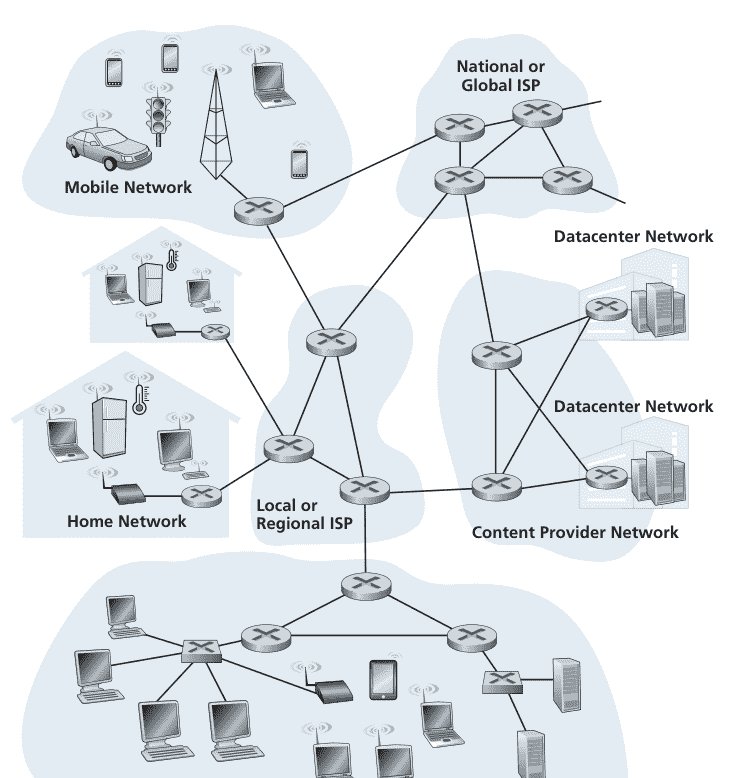

**图例：**
- 主机
  （= 端系统）
- 服务器
- 移动设备
- 计算机
- 路由器
- 链路层交换机
- 基站
- 智能手机或平板电脑
- 蜂窝电话塔
- 数据中心
- 工作站
- 红绿灯
- 恒温器
- 冰箱

**图 1.1** 互联网的一些组成部分

端系统通过由**通信链路**和**分组交换机**组成的网络相互连接。我们将在第 1.2 节中看到，有许多类型的通信链路，它们由不同类型的物理介质组成，包括同轴电缆、铜线、光纤和无线电频谱。不同的链路可以以不同的速率传输数据，链路的**传输速率**以比特/秒衡量。当一个端系统有数据要发送到另一个端系统时，发送端系统会将数据分段并为每个分段添加头部字节。由此产生的信息包，在计算机网络术语中被称为**分组**，然后通过网络发送到目标端系统，在那里重新组装成原始数据。

分组交换机接收到达其中一个传入通信链路的分组，并将该分组转发到其中一个传出通信链路上。分组交换机有许多不同的形式，但在当今互联网中最突出的两种类型是**路由器**和**链路层交换机**。这两种类型的交换机都将分组转发至其最终目的地。链路层交换机通常用于接入网络，而路由器通常用于网络核心。从发送端系统到接收端系统，分组所经过的通信链路和分组交换机的序列被称为通过网络的一个**路由**或**路径**。思科预测，到 2022 年，全球每年的 IP 流量将达到近 5 泽字节（10$^{21}$ 字节）[Cisco VNI 2020]。

分组交换网络（传输分组）在许多方面与高速公路、道路和交叉口的交通网络（传输车辆）相似。例如，考虑一家工厂需要将大量货物运送到数千公里外的某个目的地仓库。在工厂，货物被分段并装载到一支卡车车队中。然后，每辆卡车独立地通过高速公路、道路和交叉口的网络行驶到目的地仓库。在目的地仓库，货物被卸下并与来自同一批次的其他货物归组。因此，在许多方面，分组类似于卡车，通信链路类似于高速公路和道路，分组交换机类似于交叉路口，而端系统类似于建筑物。正如卡车在交通网络中走一条路径，分组也在计算机网络中走一条路径。

端系统通过**互联网服务提供商 (ISP)**访问互联网，包括住宅 ISP，如本地有线电视公司或电话公司；企业 ISP；大学 ISP；在机场、酒店、咖啡店和其他公共场所提供 WiFi 接入的 ISP；以及为智能手机和其他设备提供移动接入的蜂窝数据 ISP。每个 ISP 本身都是由分组交换机和通信链路组成的网络。ISP 为端系统提供多种类型的网络接入，包括住宅宽带接入（如电缆调制解调器或 DSL）、高速局域网接入和移动无线接入。ISP 还为内容提供商提供互联网接入，将服务器直接连接到互联网。互联网的核心在于将端系统相互连接，因此


为终端系统提供接入的 ISP 也必须相互连接。因此，这些底层级 ISP 通过国家级和国际级的高层级 ISP 相互连接，而这些高层级 ISP 又直接彼此相连。一个高层级 ISP 由高速路由器和通过高速光纤链路互连而成。每个 ISP 网络，无论是高层级还是底层级，都是独立管理的，运行 IP 协议（参见下文），并遵循某些命名和地址规范。我们将在 1.3 节中更详细地研究 ISP 及其互连情况。

终端系统、分组交换器以及互联网的其他组成部分运行着用于控制互联网内部信息收发协议。**传输控制协议（TCP）**和**互联网协议（IP）**是互联网中最重要的两个协议。IP 协议规定了路由器和终端系统之间发送和接收的数据包格式。互联网的主要协议统称为 **TCP/IP**。我们将在这一章的引言部分开始探讨协议。但这仅仅是个开始——本书的大部分内容都涉及网络协议！

鉴于协议对互联网的重要性，所有人都必须就每个协议的功能达成一致，以便人们能够创建可以互操作的系统和产品。这就是标准发挥作用的地方。**互联网标准**由互联网工程任务组（IETF）制定 [IETF 2020]。IETF 的标准文档被称为**请求评论（RFCs）**。RFC 最初是通用的请求评论（因此得名），用于解决互联网前身所面临的网络和协议设计问题 [Allman 2011]。RFC 通常非常技术性且细节繁多。它们定义了诸如 TCP、IP、HTTP（用于 Web）和 SMTP（用于电子邮件）等协议。目前共有近 9000 份 RFC。其他机构也制定了网络组件的标准，尤其是网络链路方面的标准。例如，IEEE 802 局域网标准委员会 [IEEE 802 2020] 规定了以太网和无线 WiFi 标准。

### 1.1.2 服务描述

我们在上面的讨论中识别了构成互联网的许多组件。但我们可以从完全不同的角度来描述互联网——即作为*为应用程序提供服务的基础设施*。除了电子邮件和网页浏览等传统应用外，互联网应用还包括移动智能手机和平板应用，如互联网消息传递、带有实时道路交通信息的地图服务、音乐流媒体——电影和电视流媒体、在线社交媒体、视频会议、多人游戏以及基于位置的系统推荐系统。这些应用被称为**分布式应用**，因为它们涉及多个终端系统，这些系统相互交换数据。重要的是，互联网应用程序运行在终端系统上——它们并不运行在网络核心的分组交换器中。虽然分组交换器促进了终端系统之间的数据交换，但它们并不关心作为数据来源或接收方的应用程序。

让我们进一步探讨一下，我们将“为应用程序提供服务的基础设施”这一概念具体指什么。为此，假设你有一个令人兴奋的分布式互联网应用的新点子，这个点子可能会给人类带来巨大利益，或者可能只是让你变得富有和出名。你该如何将这个想法转化为实际的互联网应用程序？由于应用程序运行在终端系统上，你需要编写在这些终端系统上运行的程序。例如，你可以用 Java、C 或 Python 编写你的程序。现在，由于你正在开发的是一个分布式互联网应用程序，在不同终端系统上运行的程序将需要相互发送数据。在这里，我们触及了一个核心问题——这也引出了描述互联网的另一种方式：作为应用程序的平台。运行在一个终端系统上的程序如何指示互联网将数据传递到运行在另一个终端系统上的程序？

连接到互联网的终端系统提供了一个**套接字接口（socket interface）**，它规定了一个在某个终端系统上运行的程序如何要求互联网基础设施将数据传递到另一个终端系统上运行的特定目标程序。这个互联网套接字接口是一组规则，发送数据的程序必须遵循这些规则，以便互联网能将数据传递到接收数据的程序。我们将在第 2 章中详细讨论互联网套接字接口。现在，让我们借助一个简单的类比，这个类比我们将经常在本书中使用。假设爱丽丝（Alice）想通过邮政服务给鲍勃（Bob）寄一封信。当然，爱丽丝不能只是写好信（数据）然后把信扔出窗外。相反，邮政服务要求爱丽丝将信装入信封；在信封中心写上鲍勃的全名、地址和邮政编码；封好信封；在信封的右上角贴上一枚邮票；最后，将信封投入官方邮政信箱。因此，邮政服务有自己的一套“邮政服务接口”，或者说是一组规则，爱丽丝必须遵循这些规则，才能让邮政服务将她的信投递给鲍勃。类似地，互联网也有一个套接字接口，发送数据的程序必须遵循该接口，以便互联网将数据传递给接收数据的程序。

当然，邮政服务向其客户提供的不止一种服务。它提供快递、收件确认、普通邮寄等许多服务。类似地，互联网向其应用程序提供多种服务。当你开发一个互联网应用程序时，你也必须为你的应用程序选择互联网提供的其中一项服务。我们将在第 2 章中描述互联网的服务。

我们刚刚给出了互联网的两种描述；一种是基于其硬件和软件组件，另一种是基于为分布式应用程序提供服务的基础设施。但也许你仍然对互联网是什么感到困惑。什么是分组交换和 TCP/IP？什么是路由器？互联网中存在哪些类型的通信链路？什么是分布式应用？恒温器或体重秤如何连接到互联网？如果你现在感觉这些信息量有点大，别担心——本书的目的是向你介绍互联网的方方面面以及支配其运作方式和原理。我们将在随后的章节中解释这些重要术语和问题。

### 1.1.3 什么是协议？

现在，我们已经对互联网有了一点感觉，让我们考虑计算机网络中的另一个重要术语：*协议*。什么是协议？协议的作用是什么？

### 人类类比

通过首先考虑一些人类类比，理解计算机网络协议的概念可能最容易，因为我们人类总是执行各种协议。考虑一下当你想知道时间时会怎么做。典型的交互过程如图 1.2 所示。人类协议（或至少是礼貌）规定，人们首先会发出问候（图 1.2 中的第一个“Hi”）以发起与他人的交流。

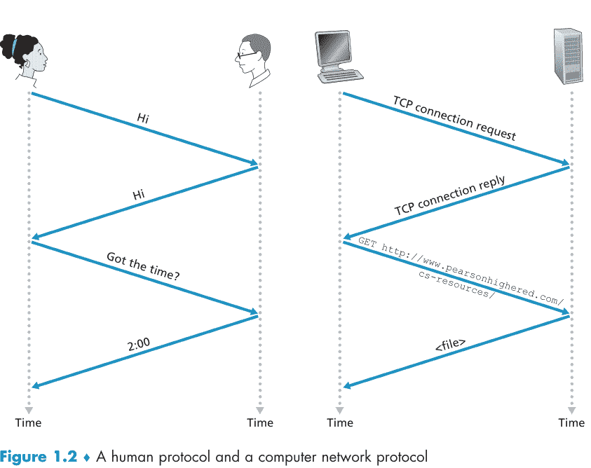

对“Hi”的典型回应是回一个“Hi”消息。隐含地，我们会将友善的“Hi”回应视为可以继续进行并询问时间的迹象。对初始“Hi”的不同回应（例如“别打扰我！”、“我不说英语”，或某些无法打印的回复）可能表示不愿意或无法沟通。在这种情况下，人类协议将是不询问时间。有时问话完全没有回应，这时通常会放弃向那个人询问时间。请注意，在我们的人类协议中，*我们发送特定的消息，并根据收到的回复消息或其他事件采取特定的行动*（例如，在给定时间内没有回复）。显然，发送和接收的消息，以及在这些消息发送、接收或其他事件发生时采取的行动，在人类协议中起着核心作用。如果人们运行不同的协议（例如，一个人有礼貌而另一个人没有，或者一个人理解时间的概念而另一个人不理解），那么这些协议将无法互操作，也无法完成任何有用的工作。网络也是如此——需要两个（或更多）运行相同协议的通信实体才能完成任务。

让我们考虑第二个人类类比。假设你正在上一门大学课程（例如计算机网络课程！）。老师在滔滔不绝地讲协议，而你感到困惑。老师停下来问道：“有什么问题吗？”（这条消息被传输到并接收自所有没有睡觉的学生）。你举起手（向老师传输了一条隐式消息）。老师微笑着点头，说道“是……”（这是一条传输的消息，鼓励你提出你的问题——老师们*喜欢*被提问），然后你提出了你的问题（即，将你的消息传输给你的老师）。你的老师听到了你的问题（接收了你的问题消息）并回答（向你传输了一个回复）。再一次，我们看到，消息的传输和接收，以及在这些消息发送和接收时采取的一系列约定俗成的行动，是这个问答协议的核心。

### 网络协议

网络协议与人类协议相似，只是交换消息并采取行动的实体是某些设备（例如，计算机、智能手机、平板电脑、路由器或其他具有网络能力的设备）的硬件或软件组件。互联网中所有涉及两个或更多远程通信实体的活动都由协议控制。例如，两个物理连接的计算机中硬件实现的协议控制着两个网络接口卡之间“线路”上的比特流；终端系统中的拥塞控制协议控制发送方和接收方之间数据包传输的速率；路由器中的协议确定数据包从源到目的地的路径。协议正在运行


互联网上的各个角落，因此本书中有大量内容涉及计算机网络协议。

以一个你可能熟悉的计算机网络协议为例，考虑当你向 Web 服务器发起请求时发生了什么，即当你将 Web 页面的 URL 输入到 Web 浏览器时的情景。该场景如图 1.2 右半部分所示。首先，你的计算机将向 Web 服务器发送一个连接请求消息，并等待回复。Web 服务器最终会收到你的连接请求消息，并返回一个连接回复消息。得知现在可以请求 Web 文档后，你的计算机随后在一个 GET 消息中发送它想要从该 Web 服务器获取的 Web 页面名称。最后，Web 服务器将 Web 页面（文件）返回给你的计算机。

基于上述的人际和网络示例，消息的交换以及在发送和接收这些消息时采取的动作是协议的关键定义要素：

> *协议定义了两个或多个通信实体之间交换的消息的格式和顺序，以及对消息传输和/或接收或其他事件所采取的动作。*

互联网以及一般的计算机网络大量使用协议。不同的协议用于完成不同的通信任务。随着你阅读本书，你会发现有些协议简单明了，而有些则复杂且具有深刻的内涵。掌握计算机网络领域的精髓等同于理解网络协议的“是什么”、“为什么”以及“如何运作”。

## 1.2 网络边缘

在上一节中，我们介绍了互联网和网络协议的高层概述。现在我们将对互联网的组件进行更深入的探讨。本节从网络边缘开始，审视我们最熟悉的组件——即我们日常使用的计算机、智能手机和其他设备。在下一节中，我们将从网络边缘移至网络核心，并检查计算机网络中的交换和路由。

回想上一节的内容，在计算机网络术语中，连接到互联网的计算机和其他设备通常被称为端系统。之所以称为端系统，是因为它们位于互联网的边缘，如图 1.3 所示。互联网的端系统包括台式计算机

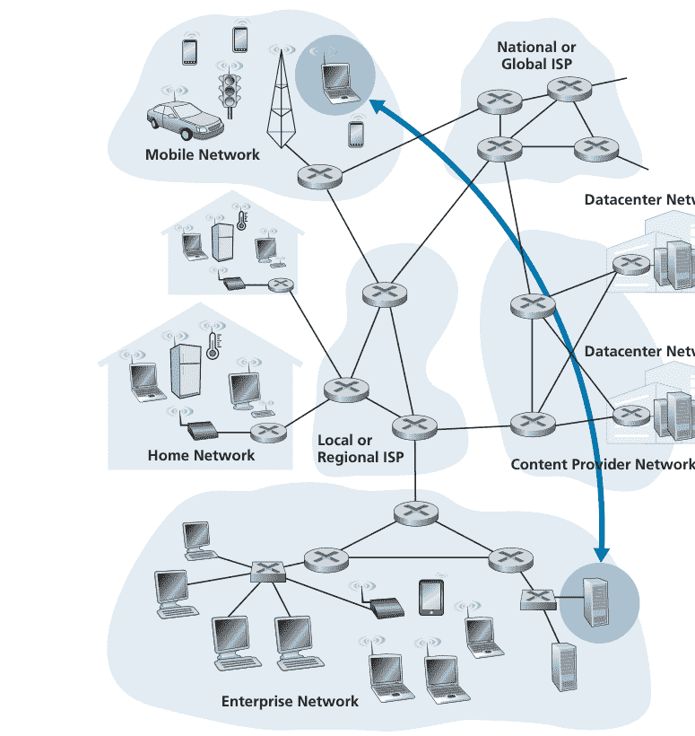

**图 1.3 ♦ 端系统交互**

（例如，台式 PC、Mac 和 Linux 电脑）、服务器（例如，Web 和电子邮件服务器）以及移动设备（例如，笔记本电脑、智能手机和平板电脑）。此外，越来越多的非传统“事物”作为端系统连接到互联网（参见案例历史栏目）。

端系统也被称为 *主机*，因为它们承载（即运行）应用程序，如 Web 浏览器程序、Web 服务器程序、电子邮件

#### 案例历史

### 数据中心与云计算

Google、Microsoft、Amazon 和 Alibaba 等互联网公司建立了庞大的数据中心，每个数据中心容纳数万到数十万台主机。这些数据中心不仅连接到互联网，如图 1.1 所示，其内部还包含连接数据中心主机的复杂计算机网络。数据中心是我们日常使用的互联网应用背后的引擎。

广义上讲，数据中心服务于三个目的，这里以 Amazon 为例具体说明。首先，它们为用户服务于 Amazon 电子商务页面，例如描述产品和购买信息的页面。其次，它们作为大规模并行计算基础设施，用于 Amazon 特定的数据处理任务。第三，它们为其他公司提供 **云计算**。确实，当今计算领域的一个主要趋势是各公司使用 Amazon 这样的云提供商来处理其 *所有* IT 需求。例如，Airbnb 和其他许多基于互联网的公司并不拥有和管理自己的数据中心，而是在名为 Amazon Web Services (AWS) 的 Amazon 云中运行其整个基于 Web 的服务。

数据中心中的工蜂是主机。它们提供内容（例如，Web 页面和视频），存储电子邮件和文档，并共同执行大规模分布式计算。数据中心中的主机被称为 *刀片*，外观类似披萨盒，通常是包含 CPU、内存和磁盘存储的普通主机。这些主机堆叠在机架中，每个机架通常装有 20 到 40 片刀片。然后，这些机架通过先进且不断演变的中心网络设计相互连接。中心网络将在第 6 章中更详细地讨论。

客户端程序或电子邮件服务器程序。在整个本书中，我们将 *主机* 和 *端系统* 互换使用；即 *主机 = 端系统*。主机有时进一步分为两类：**客户端**和**服务器**。非正式地说，客户端往往是台式机、笔记本电脑、智能手机等，而服务器往往是更强大的机器，用于存储和分发 Web 页面、流媒体视频、转发电子邮件等。如今，我们接收搜索结果、电子邮件、Web 页面、视频和移动应用内容的大部分服务器都位于大型 **数据中心** 中。例如，截至 2020 年，Google 在四个大洲拥有 19 个数据中心，共包含数百万台服务器。图 1.3 包括两个这样的数据中心，案例历史侧边栏更详细地描述了数据中心。

### 1.2.1 接入网络

在考虑了“网络边缘”的应用程序和端系统后，让我们接下来考虑接入网络——将端系统物理连接到从该端系统到任何其他遥远端系统的路径上的第一个路由器（也称为“边缘路由器”）的网络。图 1.4 显示了几种类型的接入

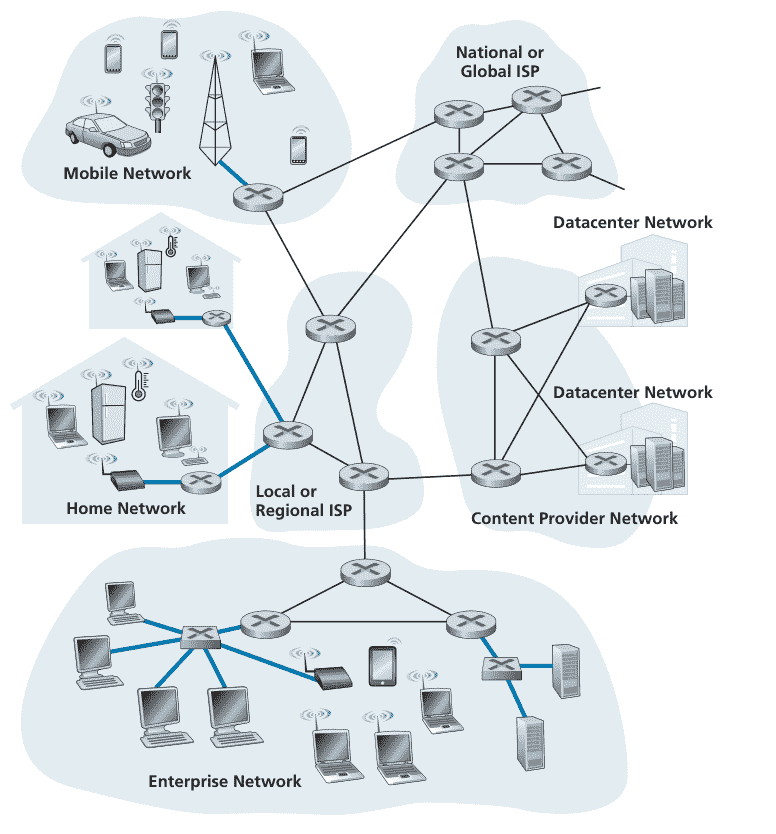

网络，使用粗阴影线表示，并展示了它们使用的场景（家庭、企业和广域移动无线）。

#### 家庭接入：DSL、电缆、FTTH 和 5G 固定无线

截至 2020 年，欧洲和美国的家庭互联网接入率已超过 80% [Statista 2019]。鉴于家庭接入网络的广泛使用，让我们从考虑家庭如何连接到互联网开始，对接入网络进行概述。
如今，两种最普遍的宽带住宅接入类型是 **数字用户线 (DSL)** 和电缆。住宅通常从提供有线本地电话接入的同一本地电话公司（telco）获取 DSL 互联网接入。因此，当使用 DSL 时，客户的电信公司同时也是其 ISP。如图 1.5 所示，每个客户的 DSL 调制解调器使用现有的电话线与位于电信公司本地中心局（CO）中的数字用户线接入复用器（DSLAM）交换数据。家庭中的 DSL 调制解调器将数字数据转换为高频音调，通过电话线传输到中心局；来自许多此类家庭的模拟信号在 DSLAM 中被转换回数字格式。
住宅电话线同时承载数据和传统电话信号，它们以不同的频率编码：

- 高速下行信道，在 50 kHz 到 1 MHz 频段
- 中速上行信道，在 4 kHz 到 50 kHz 频段
- 普通双向电话信道，在 0 到 4 kHz 频段

这种方法使单一的 DSL 链路看起来像是三个独立的链路，使得电话呼叫和互联网连接可以共享

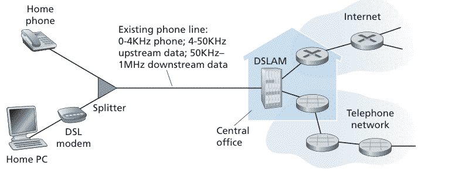

**图 1.5** • DSL 互联网接入

同一 DSL 链路。（我们将在第 1.3.1 节中描述这种频分复用技术。）在客户侧，分离器将到达家庭的数据信号和电话信号分开，并将数据信号转发给 DSL 调制解调器。在电信公司一侧，在中心局中，DSLAM 将数据和电话信号分开，并将数据发送到互联网。数百甚至数千个家庭连接到单一的 DSLAM。

DSL 标准定义了多种传输速率，包括 24 Mb/s 和 52 Mb/s 的下行传输速率，以及 3.5 Mb/s 和 16 Mb/s 的上行速率；最新标准提供 1 Gbps 的聚合上行加下行速率 [ITU 2014]。由于下行和上行速率不同，这种接入被称为非对称的。实际实现的下行和上行传输速率可能低于上述速率，因为当提供分级服务（以不同价格提供不同速率）时，DSL 提供商可能会故意限制住宅速率。最大速率还受家庭与中心局之间的距离、双绞线的线径以及电气干扰程度的限制。工程师专门为家庭与中心局之间的短距离设计了 DSL；通常，如果住宅不位于中心局 5 到 10 英里范围内，住宅必须依赖另一种形式的互联网接入。

虽然 DSL 利用电信公司现有的本地电话基础设施，**电缆互联网接入**利用有线电视公司现有的有线电视基础设施。住宅从提供其有线电视的同一公司获取电缆互联网接入。如图 1.6 所示，光纤

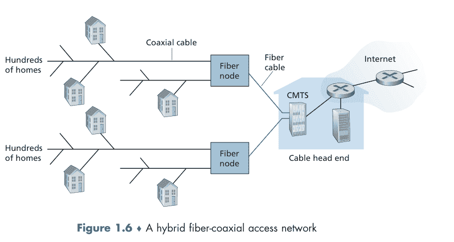

14 第 1 章 • 计算机网络与互联网


将电缆头端连接到社区级接头，然后通过传统的同轴电缆连接到各个家庭和公寓。每个社区接头通常支持 500 到 5,000 个家庭。由于该系统同时使用了光纤和同轴电缆，因此通常被称为混合光纤同轴（HFC）。

有线互联网接入需要特殊的调制解调器，称为有线调制解调器（cable modem）。与 DSL 调制解调器一样，有线调制解调器通常是一个外部设备，并通过以太网端口连接到家庭 PC。（我们将在第 6 章中详细讨论以太网。）在电缆头端，有线调制解调器终止系统（CMTS）起着与 DSL 网络中 DSLAM 类似的作用——将来自许多下游家庭的有线调制解调器发送的模拟信号转换回数字格式。有线调制解调器将 HFC 网络划分为两个信道：下行信道和上行信道。与 DSL 一样，接入通常是非对称的，下行信道通常分配比上行信道更高的传输速率。DOCSIS 2.0 和 3.0 标准分别定义了 40 Mbps 和 1.2 Gbps 的下行比特率，以及 30 Mbps 和 100 Mbps 的上行速率。与 DSL 网络一样，由于较低的对比度数据速率或媒体损伤，可能无法实现最大可达速率。

有线互联网接入的一个重要特性是它是一种共享广播介质。具体来说，头端发送的每个数据包都会通过到达每个家庭的每一个链路向下游传输，而家庭发送的每个数据包都会通过上行信道传输到头端。因此，如果多个用户同时在下行信道下载视频文件，每个用户接收视频文件的实际速率将显著低于电缆下行聚合速率。另一方面，如果只有少数活跃用户且他们都在浏览网页，那么由于用户很少会在完全相同的时间请求网页，每个用户实际上可能以完整的电缆下行速率接收网页。由于上行信道也是共享的，因此需要一种分布式多址接入协议来协调传输并避免冲突。（我们将在第 6 章中详细讨论这一冲突问题。）

尽管 DSL 和有线网络目前代表了美国大多数住宅宽带接入，但一种提供更高速度且新兴的技术是光纤到户（FTTH）[Fiber Broadband 2020]。顾名思义，FTTH 概念很简单——从中央局（CO）直接提供一条光路径到家庭。FTTH 有潜力提供千兆比特每秒级别的互联网接入速率。

从中央局到家庭的光分发存在几种竞争技术。最简单的光分发网络被称为直接光纤，即每个家庭有一条光纤从中央局引出。更常见的是，从中央局引出的每条光纤实际上由许多家庭共享；直到光纤相对接近家庭时，才分裂为特定的客户专用光纤。有两种竞争的光分发网络架构执行

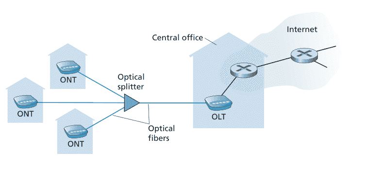

**图 1.7** ♦ FTTH 互联网接入

这种分裂：有源光网络（AON）和无源光网络（PON）。AON 本质上是交换式以太网，这在第 6 章中有讨论。

在这里，我们简要讨论用于 Verizon 的 FiOS 服务的 PON。图 1.7 显示了使用 PON 分发架构的 FTTH。每个家庭都有一个光网络终端（ONT），通过专用光纤连接到社区分路器。分路器将许多家庭（通常少于 100 户）合并到一条共享的光纤上，该光纤连接到电信公司中央局中的光线路终端（OLT）。OLT 提供光信号和电信号之间的转换，并通过电信公司路由器连接到互联网。在家庭中，用户将家庭路由器（通常是无线路由器）连接到 ONT，并通过此家庭路由器访问互联网。在 PON 架构中，从 OLT 发送到分路器的所有数据包都会在分路器处复制（类似于电缆头端）。

除了 DSL、有线和 FTTH 之外，**5G 固定无线**也开始部署。5G 固定无线不仅承诺高速住宅接入，而且无需从电信公司的中央局到家庭安装昂贵且易损的布线。在 5G 固定无线中，利用波束成形技术，数据从提供商的基站无线发送到家庭中的调制解调器。WiFi 无线路由器连接到调制解调器（可能捆绑在一起），类似于 WiFi 无线路由器连接到有线或 DSL 调制解调器的方式。5G 蜂窝网络在第 7 章中讨论。

#### 企业（和家庭）中的接入：以太网和 WiFi

在企业和大学校园，以及日益增多的家庭环境中，使用局域网（LAN）将端系统连接到边缘路由器。虽然有许多类型的局域网技术，但以太网在企业和大学网络中是最普及的接入技术。如图

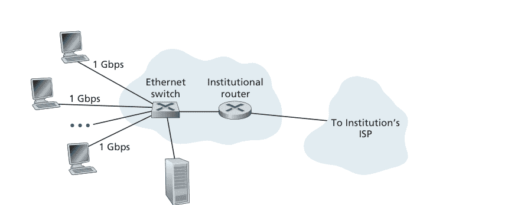

**图 1.8** 以太网互联网接入

图 1.8 所示，以太网用户使用双绞铜线连接到以太网交换机，这是一种在第 6 章中详细讨论的技术。以太网交换机，或此类相互连接的交换机网络，进而连接到更大的互联网。在以太网接入中，用户通常具有 100 Mbps 到几十 Gbps 的以太网交换机接入速率，而服务器可能具有 1 Gbps 或 10 Gbps 的接入速率。

然而，越来越多的人通过笔记本电脑、智能手机、平板电脑和其他“设备”无线方式访问互联网。在无线局域网环境中，无线用户通过连接到企业网络（最可能是使用有线以太网）的接入点进行发送/接收数据包，进而连接到有线互联网。无线局域网用户通常必须在距接入点几十米范围内。基于 IEEE 802.11 技术的无线局域网接入，更通俗地称为 WiFi，如今几乎无处不在——大学、办公室、咖啡馆、机场、家庭，甚至在飞机上。如第 7 章详细讨论，802.11 今天提供高达 100 Mbps 以上的共享传输速率。

尽管以太网和 WiFi 接入网络最初是在企业（公司、大学）环境中部署的，但它们也是家庭网络的常见组成部分。许多家庭将宽带住宅接入（即有线调制解调器或 DSL）与这些廉价的无线局域网技术结合，以创建强大的家庭网络。图 1.9 显示了一个典型的家庭网络。该家庭网络包括一个漫游笔记本电脑、多个连接互联网的家庭电器以及有线 PC；一个基站（无线接入点），它与家庭中的无线 PC 和其他无线设备通信；以及一个家庭路由器，该路由器将无线接入点和其他有线家庭设备连接到互联网。该网络允许家庭成员通过一名成员从厨房漫游到后院再到卧室，获得宽带互联网接入。

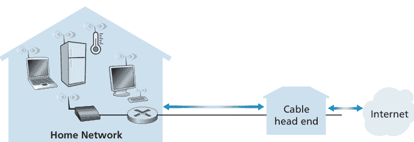

**图 1.9 ♦ 典型的家庭网络**

#### 广域无线接入：3G 和 LTE 4G 及 5G

如 iPhone 和 Android 设备等移动设备正在运行中用于发消息、在社交网络分享照片、移动支付、观看电影、流媒体音乐以及更多功能。这些设备使用与蜂窝电话相同的无线基础设施，通过由蜂窝网络运营商运营的中继站发送/接收数据包。与 WiFi 不同，用户只需在基站几十公里范围内（而非几十米范围内）即可。

电信公司在所谓的第四代（4G）无线通信方面进行了巨额投资，其实用下载速度高达 60 Mbps。但更高宽域的接入技术——第五代（5G）广域无线网络——已经部署。我们将在第 7 章中涵盖无线网络和移动性的基本原理，以及 WiFi、4G 和 5G 技术（以及更多）。

### 1.2.2 物理介质

在上一小节中，我们概述了互联网中一些最重要的网络接入技术。在描述这些技术时，我们也指出了使用的物理介质。例如，我们说 HFC 使用光纤电缆和同轴电缆的组合。我们说 DSL 和以太网使用铜线。我们说移动接入网络使用无线频谱。在本小节中，我们简要概述了互联网中常用的这些及其他传输介质。

为了定义什么是物理介质，让我们反思一下比特的短暂生命。考虑一个比特从一个端系统，通过一系列链路和路由器，传输到另一个端系统。这个可怜的比特被踢来踢去并传输了许多许多次！源端系统首先传输

……位（bit），随后该系列中的第一个路由器随即接收到该位；第一个路由器随后传输该位，接着第二个路由器很快接收到该位；依此类推。因此，当我们的位从源传输到目的地的过程中，它会经过一系列发射机-接收机对。对于每一对发射机-接收机，位是通过在**物理介质**上传播电磁波或光脉冲来发送的。物理介质可以有多种形状和形式，并且路径上每对发射机-接收机所使用的物理介质类型也不必相同。物理介质的例子包括双绞铜线、同轴电缆、多模光纤电缆、地面无线电频谱和卫星无线电频谱。物理介质分为两类：**引导介质**和**非引导介质**。在使用引导介质时，波沿固体介质（如光纤电缆、双绞铜线或同轴电缆）被引导传输。在使用非引导介质时，波在大气层和外部空间中传播，例如在无线局域网或数字卫星信道中。

但在讨论各种介质类型的特性之前，让我们先谈谈它们的成本。物理链路（铜线、光纤电缆等）的实际成本与其他网络成本相比通常相对次要。特别是，物理链路安装所涉及的劳动力成本可能比材料成本高几个数量级。因此，许多建筑商在建筑物的每个房间都安装双绞线、光纤和同轴电缆。即使最初只使用一种介质，未来也很可能会使用另一种介质，因此通过不在此后铺设额外线路可以节省资金。

#### 双绞铜线

最便宜且最常用的引导传输介质是双绞铜线。一百多年来，它一直被电话网络使用。事实上，从电话听筒到本地电话交换机的有绳连接中，超过99%使用双绞铜线。我们中的大多数人都曾在家里（或父母或祖父母家里！）以及工作环境中见过双绞线。双绞线由两根绝缘铜线组成，每根大约 1 毫米厚，排列成规则的螺旋图案。将线绞在一起是为了减少来自附近相似线对的电干扰。通常，许多线对通过在线对上包裹保护屏蔽层而捆绑在电缆中。一对线构成单个通信链路。**非屏蔽双绞线（UTP）** 常用于建筑物内的计算机网络，即局域网。目前使用双绞线的局域网的数据传输速率范围为 10 Mbps 到 10 Gbps。可以实现的数据传输速率取决于线的厚度和发射机与接收机之间的距离。

当光纤技术在 20 世纪 80 年代出现时，许多人因其相对较低的位速率而贬低双绞线。有些人甚至认为光纤技术将完全取代双绞线。但双绞线并未轻易放弃。现代双绞线技术，如 6A 类电缆，可以在高达一百米的距离内实现 10 Gbps 的数据传输速率。最终，双绞线已成为高速局域网通信的主导解决方案。

如前所述，双绞线也常用于住宅互联网接入。我们看到拨号调制解调器技术允许通过双绞线以高达 56 kbps 的速率进行访问。我们还看到，DSL（数字用户线）技术使住宅用户能够通过双绞线以数十 Mbps 的速率访问互联网（当用户居住在 ISP 中心局附近时）。

#### 同轴电缆

与双绞线类似，同轴电缆由两根铜导体组成，但这两根导体是同心而非平行的。借助这种结构以及特殊的绝缘层和屏蔽层，同轴电缆可以实现高数据传输速率。同轴电缆在有线电视系统中非常常见。正如我们之前所见，有线电视系统最近已与电缆调制解调器结合，为住宅用户提供高达数百 Mbps 速率的互联网接入。在有线电视和有线互联网接入中，发射机将数字信号移动到特定的频带，产生的模拟信号从发射机发送到一台或多台接收机。同轴电缆可作为引导**共享介质**使用。具体来说，许多终端系统可以直接连接到电缆，每个终端系统都可以接收由其他终端系统发送的内容。

#### 光纤

光纤是一种细长的、柔性的介质，能够传导光脉冲，每个脉冲代表一个位。单根光纤可以支持极高的位速率，高达数十甚至数百吉比特每秒。它们对电磁干扰免疫，信号衰减极低，可达 100 公里，并且很难被窃听。这些特性使光纤成为首选的长距离引导传输介质，特别是用于跨洋链路。美国和世界各地的许多长途电话网络现在仅使用光纤。光纤也广泛存在于互联网骨干网中。然而，光设备（如发射机、接收机和交换机）的高成本阻碍了其在短距离传输中的应用，例如在局域网或住宅接入网络中进入家庭。光载体（OC）标准链路速度范围从 51.8 Mbps 到 39.8 Gbps；这些规范通常被称为 OC-*n*，其中链路速度等于 *n* × 51.8 Mbps。目前使用的标准包括 OC-1、OC-3、OC-12、OC-24、OC-48、OC-96、OC-192、OC-768。

#### 地面无线电信道

无线电信道在电磁频谱中承载信号。它们是一种有吸引力的介质，因为不需要安装物理线路，可以穿透墙壁，为移动用户提供连接性，并且可以潜在地长距离传输信号。无线电信道的特性在很大程度上取决于传播环境和信号传输的距离。环境因素决定了路径损耗和阴影衰落（随着信号传播距离的增加以及绕/穿过障碍物时信号强度的下降）、多径衰落（由于信号在干扰物体上的反射）和干扰（由于其他传输和电磁信号）。

地面无线电信道可以大致分为三类：那些在非常短距离内工作的（例如一两米）；那些在局部区域工作的，通常跨度从十米到几百米；以及那些在广域内工作的，跨度为数十公里。无线耳机、键盘和医疗设备等个人设备在短距离内工作；第 1.2.1 节中描述的无线局域网技术使用局域无线电信道；蜂窝接入技术使用广域无线电信道。我们将在第 7 章中详细讨论无线电信道。

#### 卫星无线电信道

通信卫星连接两台或多台基于地球的微波发射机/接收机，称为地面站。卫星在一个频率上接收传输，使用中继器（如下文所述）再生信号，并在另一个频率上发射信号。通信中使用两种类型的卫星：**地球同步卫星**和**低地球轨道（LEO）卫星**。

地球同步卫星永久停留在地球上方的同一位置。这种静止状态是通过将卫星放置在距地球表面 36,000 公里的轨道上实现的。从地面站通过卫星再回到地面站的巨大距离引入了 280 毫秒的显著信号传播延迟。尽管如此，卫星链路可以以数百 Mbps 的速度运行，经常用于无法访问基于 DSL 或电缆的互联网接入的区域。

LEO 卫星放置得离地球更近，并且不会永久停留在地球上的同一个位置。它们绕地球旋转（就像月亮一样），并且可以相互通信，也可以与地面站通信。为了对某个区域提供连续覆盖，需要将许多卫星放置在轨道上。目前有许多低空通信系统正在开发中。LEO 卫星技术可能在未来用于互联网接入。


## 1.3 网络核心

在考察了互联网的边缘部分之后，让我们更深入地探究网络核心——即互连互联网终端系统的分组交换机和链路组成的网状结构。图 1.10 用加粗的阴影线突出了网络核心。

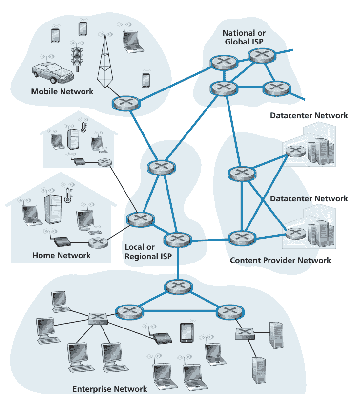

图 1.10 ♦ 网络核心

### 1.3.1 分组交换

在网络应用中，终端系统彼此交换消息。消息可以包含应用设计者所需的任何内容。消息可以执行控制功能（例如，我们在图 1.2 的握手示例中的“Hi”消息），或者包含数据，如电子邮件消息、JPEG 图像或 MP3 音频文件。为了将消息从源终端系统发送到目的终端系统，源端会将长消息拆分为较小的数据块，称为分组（packet）。在源端和目的端之间，每个分组通过通信链路和分组交换机进行传输（分组交换机主要有两种类型：路由器和链路层交换机）。分组在每个通信链路上的传输速率等于该链路的完整传输速率。因此，如果源终端系统或分组交换机以 R bits/sec 的传输速率在链路上发送一个包含 L 比特的分组，那么传输该分组所需的时间为 L/R 秒。

#### 存储转发传输

大多数分组交换机在链路输入端使用存储转发传输。存储转发传输意味着，分组交换机必须接收完整个分组后，才能开始在出站链路上传输该分组的第一个比特。为了更深入地探讨存储转发传输，让我们考虑一个简单的网络，该网络由通过单个路由器连接的两个终端系统组成，如图 1.11 所示。路由器通常有许多相连的链路，因为其工作是将传入的分组切换到出站链路上；在这个简单的示例中，路由器执行的是一个相当简单的任务，即将分组从一个（输入）链路转移到唯一另一个连接的链路上。在这个例子中，源端有三个分组要发送给目的端，每个分组由 L 比特组成。在图 1.11 所示的时间快照中，源端已经传输了分组 1 的一部分，并且分组 1 的前端已经到达路由器。由于路由器采用存储转发机制，在此时刻，路由器无法传输它已接收的比特；相反，它必须先将分组的比特缓存（即“存储”）。只有在路由器接收完分组的所有比特后，它才能开始在出站链路上传输（即“转发”）该分组。为了对存储转发传输有一些直观的理解，我们现在来计算从源端开始发送分组到目的端接收完整分组所经过的时间量。（这里我们将忽略传播时延——比特以接近光速在电线中传输所需的时间——这将在 1.4 节中讨论。）源端在时间 0 开始传输；在 L/R 秒时，源端已经传输了整个分组，并且整个分组已在路由器处接收并存储（因为没有传播时延）。在 L/R 秒时，由于路由器刚刚接收完整个分组，它可以在目的端方向的出站链路上开始传输该分组；在 2L/R 时，路由器已传输了整个分组，并且整个分组已被目的端接收。因此，总时延为 2L/R。如果交换机在比特到达时立即转发（而不先接收整个分组），那么总时延将为 L/R，因为比特在路由器处不会被滞留。但是，正如我们将在 1.4 节中讨论的那样，路由器需要接收、存储并处理整个分组后才能转发。

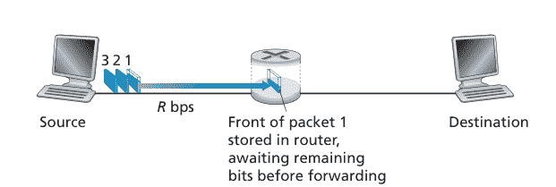

**图 1.11** 存储转发分组交换

现在，让我们计算从源端开始发送第一个分组到目的端接收完所有三个分组所经过的时间量。与之前一样，在 L/R 时，路由器开始转发第一个分组。但同样在 L/R 时，源端也将开始发送第二个分组，因为它刚刚发送完第一个分组。因此，在 2L/R 时，目的端已接收第一个分组，而路由器已接收第二个分组。类似地，在 3L/R 时，目的端已接收前两个分组，而路由器已接收第三个分组。最后，在 4L/R 时，目的端已接收所有三个分组！

现在让我们考虑一般情况：通过一条由 N 条链路组成的路径将一个分组从源端发送到目的端，每条链路的速率为 R（因此，源端和目的端之间有 N-1 个路由器）。应用上述相同的逻辑，我们可以看到端到端时延为：

$$
d_{\text{end-to-end}} = \frac{NL}{R} \quad (1.1)
$$

你可能现在想要尝试确定在 N 条链路上发送 P 个分组时的时延。

#### 排队时延与分组丢失

每个分组交换机都连接着多个链路。对于每个连接的链路，分组交换机都有一个**输出缓冲区**（也称为**输出队列**），用于存储路由器即将发送到该链路中的分组。输出缓冲区在分组交换中起着关键作用。如果一个到达的分组需要传输到某条链路，但发现该链路正忙于传输另一个分组，那么该到达的分组必须在输出缓冲区中等待。因此，除了存储转发时延外，分组还会遭受输出缓冲区的**排队时延**。这些时延是变化的，取决于网络中的拥塞程度。由于缓冲空间是有限的，到达的分组可能会发现缓冲区已完全被等待传输的其他分组占满。在这种情况下，将发生**分组丢失**——要么丢弃到达的分组，要么丢弃已排队的一个分组。

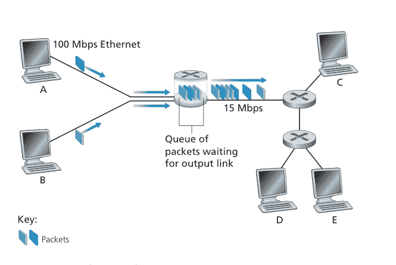

图 1.12 展示了一个简单的分组交换网络。与图 1.11 一样，分组由三维块表示。块的宽度代表分组中的比特数。在此图中，所有分组的宽度相同，因此长度也相同。假设主机 A 和 B 正在向主机 E 发送分组。主机 A 和 B 首先通过 100 Mbps 以太网链路将分组发送到第一个路由器。然后，路由器将这些分组引导到 15 Mbps 链路上。如果在短时间内，到达路由器的分组速率（转换为比特/秒）超过 15 Mbps，则路由器会发生拥塞，因为分组会在传输到链路之前在该链路的输出缓冲区中排队。例如，如果主机 A 和 B 同时各发送一组连续的五个分组，那么这些分组中的大多数将在队列中等待一段时间。实际上，这种情况与许多日常情况完全类似——例如，当我们在银行柜员前排队或在收费站前等待时。我们将在 1.4 节中更详细地研究这种排队时延。

#### 转发表与路由协议

之前，我们说过路由器接收其连接通信链路上到达的一个分组，并将该分组转发到其另一个连接的通信链路上。但是，路由器如何确定应该将分组转发到哪条链路？不同类型的计算机网络中，分组转发的实际执行方式各不相同。在这里，我们简要描述在因特网中是如何执行的。

在因特网中，每个终端系统都有一个称为 IP 地址的地址。当源终端系统想要向目的终端系统发送分组时，源端会在分组的头部中包含目的端的 IP 地址。与邮政地址一样，这种地址具有层次结构。当分组到达网络中的路由器时，路由器检查分组目的地址的一部分，并将分组转发到相邻的路由器。更具体地说，每个路由器都有一个**转发表**，它将目的地址（或目的地址的一部分）映射到该路由器的出站链路。当分组到达路由器时，路由器使用目的地址检查其转发表，以找到适当的出站链路。然后，路由器将该分组引导至该出站链路。

端到端路由过程类似于一个不使用地图而是更喜欢询问路过的汽车司机。例如，假设 Joe 正开车从费城前往佛罗里达州奥兰多的 156 Lakeside Drive。Joe 首先开车到他所在社区的加油站，询问如何到达佛罗里达州奥兰多的 156 Lakeside Drive。加油站工作人员提取地址中的佛罗里达部分，告诉 Joe 他需要进入州际公路 I-95 南行，该公路入口就在加油站旁边。他还告诉 Joe，一旦进入佛罗里达，他应该在那里询问其他人。然后 Joe 沿 I-95 南行直到到达佛罗里达州杰克逊维尔，此时他向另一位加油站工作人员问路。工作人员提取地址中的奥兰多部分，告诉 Joe 他应该继续沿 I-95 前往代托纳海滩，然后再询问其他人。在代托纳海滩，另一位加油站工作人员也提取地址中的奥兰多部分，告诉 Joe 他应该直接乘坐 I-4 前往奥兰多。Joe 乘坐 I-4 并在奥兰多出口下高速。Joe 去了另一个加油站，这次工作人员提取地址中的 Lakeside Drive 部分，告诉 Joe 到达 Lakeside Drive 必须遵循的道路。一旦 Joe 到达 Lakeside Drive，他向一个骑自行车的孩子询问如何到达他的目的地。孩子提取地址中的 156 部分，并指向那栋房子。Joe 最终到达了他的最终目的地。在上面的类比中，加油站工作人员和骑自行车的孩子类似于路由器。

我们刚了解到，路由器使用分组的目的地地址作为索引查找转发表，并确定适当的出站链路。但这又引发了另一个问题：转发表是如何设置的？它们是在每个路由器中手工配置的吗，还是因特网使用更自动化的程序？这个问题将在第 5 章深入研究。但为了在这里勾起你的兴趣，我们现在将指出，因特网拥有许多特殊的**路由协议**，用于自动设置转发表。例如，路由协议可以确定从每个路由器到每个目的地的最短路径，并使用最短路径结果来配置路由器中的转发表。


### 1.3.2 电路交换

数据在链路和交换机组成的网络中传输有两种基本方式：**电路交换**和**分组交换**。在上一小节中，我们已经介绍了分组交换网络，现在我们将目光转向电路交换网络。

在电路交换网络中，为终端系统间提供通信所需的资源（缓冲区、链路传输速率）在终端系统通信会话的整个期间被*预留*。在分组交换网络中，这些资源*不预留*；会话的消息按需使用资源，因此作为结果，可能需要等待（即排队）以获取通信链路的访问权。作为一个简单的类比，考虑两家餐厅，一家需要预约，另一家既不要求也不接受预约。对于需要预约的餐厅，我们在离开家之前不得不经历打电话预约的麻烦。但当我们到达餐厅时，原则上可以立即入座并点餐。对于不需要预约的餐厅，我们不需要费心预订餐桌。但当我们到达餐厅时，入座前可能需要等待空位。

传统电话网络是电路交换网络的一个例子。考虑一个人想通过电话网络向另一个人发送信息（语音或传真）时发生的情况。在发送者能够发送信息之前，网络必须在发送者和接收者之间建立连接。这是一个*真正*的连接，发送者和接收者之间路径上的交换机为该连接维护连接状态。在电话术语中，这种连接被称为**电路**。当网络建立电路时，它还预留了网络中链路中的恒定传输速率（代表每条链路传输容量的一部分），持续时间覆盖整个连接期间。由于为该发送者到接收者的连接预留了特定的传输速率，发送者可以以*保证*的恒定速率向接收者传输数据。

图 1.13 展示了一个电路交换网络。在这个网络中，四个电路交换机通过四个链路互连。每个链路有四个电路，因此每个链路可以支持四个并发连接。主机（例如，个人计算机和工作站）每个都直接连接到其中一个交换机。当两个主机想要通信时，网络在两个主机之间建立专用的**端到端连接**。因此，为了使主机 A 与主机 B 通信，网络必须首先在两个链路中的每个链路上预留一个电路。在这个例子中，专用的端到端连接使用第一条链路中的第二个电路和第二条链路中的第四个电路。由于每个链路有四个电路，对于端到端连接使用的每个链路，该连接在连接期间获得该链路总传输容量的四分之一。因此，例如，如果相邻交换机之间的每个链路的传输速率为 1 Mbps，则每个端到端电路交换连接获得 250 kbps 的专用传输速率。

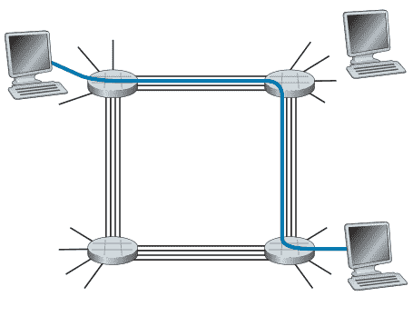

**图 1.13** 一个简单的电路交换网络，由四个交换机和四个链路组成

相比之下，考虑当某个主机组件想要在分组交换网络（如互联网）上向另一个主机发送分组时发生的情况。与电路交换一样，分组通过一系列通信链路传输。但与电路交换不同的是，分组进入网络时没有预留任何链路资源。如果其中一个链路因同一时间需要传输其他分组而拥塞，则分组不得不在传输链路的发送端缓冲区等待并遭受延迟。互联网尽最大努力及时交付分组，但不做任何保证。

#### 电路交换网络中的多路复用

链路中的电路通过**频分多路复用 (FDM)** 或**时分多路复用 (TDM)** 实现。在 FDM 中，链路的频率频谱在链路建立的连接之间进行划分。具体来说，链路在连接期间为每个连接专用一个频带。在电话网络中，该频带通常宽度为 4 kHz（即 4,000 赫兹或每秒 4,000 个周期）。频带的宽度被称为，不出所料，**带宽**。调频（FM）广播电台也使用 FDM 在 88 MHz 和 108 MHz 之间共享频谱，每个电台被分配特定的频段。

对于 TDM 链路，时间被划分为固定时长的帧，每个帧被划分为固定数量的时隙。当网络在链路上建立连接时，网络为每个帧中的一个时隙专用给此连接。这些时隙专门用于该连接，每个帧中有一个时隙可用于传输连接的数据。

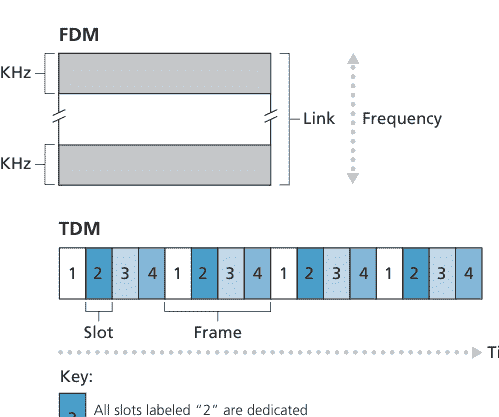

**图 1.14** 在 FDM 中，每个电路持续获得一部分带宽。在 TDM 中，每个电路在短暂的时间间隔内（即时隙期间）周期性地获得全部带宽

图注：
所有标记为 "2" 的时隙都专门用于特定的发送者-接收者对。

图 1.14 展示了支持多达四个电路的特定网络链路中的 FDM 和 TDM。对于 FDM，频率域被分割成四个频带，每个频带带宽为 4 kHz。对于 TDM，时间域被分割成帧，每个帧有四个时隙；每个电路被分配在旋转的 TDM 帧中相同的专用时隙。对于 TDM，电路的传输速率等于帧率乘以时隙中的比特数。例如，如果链路每秒传输 8,000 帧，且每个时隙由 8 个比特组成，则每个电路的传输速率为 64 kbps。

分组交换的支持者一直认为电路交换是浪费的，因为专用电路在静默期间处于空闲状态。例如，当电话通话中的人停止说话时，空闲的网络资源（连接路径中链路中的频段或时隙）不能被其他正在进行的连接使用。作为这些资源可能被低效利用的另一个例子，考虑一位使用电路交换网络远程访问一系列 X 光片的放射科医生。放射科医生建立连接，请求图像，审视图像，然后请求新图像。在放射科医生审视期间，网络资源被分配给连接但未被使用（即被浪费）。分组交换的支持者也喜欢指出，建立端到端电路并预留端到端传输容量很复杂，需要复杂的信令软件来协调端到端路径上交换机的操作。

在我们结束电路交换的讨论之前，让我们通过一个数值示例来进一步深入了解该主题。让我们考虑在电路交换网络上从主机 A 向主机 B 发送一个 640,000 比特的文件需要多长时间。假设网络中的所有链路都使用 24 个时隙的 TDM，比特率为 1.536 Mbps。还假设在主机 A 可以开始传输文件之前，建立端到端电路需要 500 毫秒。发送该文件需要多长时间？每个电路的传输速率为 (1.536 Mbps)/24 = 64 kbps，因此传输该文件需要 (640,000 比特)/(64 kbps) = 10 秒。在这 10 秒上加上电路建立时间，发送该文件总共需要 10.5 秒。请注意，传输时间与链路数量无关：如果端到端电路经过一个链路或一百个链路，传输时间都是 10 秒。（实际的端到端延迟还包括传播延迟；见第 1.4 节。）

#### 分组交换与电路交换

在描述了电路交换和分组交换之后，让我们比较这两者。分组交换的批评者经常认为，由于其可变且不可预测的端到端延迟（主要归因于可变且不可预测的排队延迟），分组交换不适合实时服务（例如，电话和视频 conferencing 通话）。分组交换的支持者认为，(1) 它比电路交换提供更好的传输容量共享，(2) 它比电路交换更简单、更高效且实施成本更低。关于分组交换与电路交换的一个有趣讨论见 [Molino-fernandez 2002]。一般来说，那些不喜欢为餐厅预约费心的人更喜欢分组交换而非电路交换。

为什么分组交换更有效率？让我们看一个简单的例子。假设用户共享一个 1 Mbps 的链路。还假设每个用户在活跃期（用户以 100 kbps 的恒定速率生成数据）和不活跃期（用户不生成数据）之间交替。进一步假设用户仅在 10% 的时间处于活跃状态（在剩余的 90% 时间内空闲喝咖啡）。在电路交换中，*每个*用户在所有时间都必须*预留* 100 kbps。例如，在电路交换 TDM 中，如果一秒钟的帧被划分为 10 个各 100 毫秒的时隙，则每个用户每帧被分配一个时隙。

因此，电路交换链路仅能支持 10 (= 1 Mbps/100 kbps) 个同时用户。在分组交换中，特定用户处于活跃状态的概率为 0.1（即 10%）。如果有 35 个用户，同时有 11 个或更多活跃用户的概率约为 0.0004。（作业问题 P8 概述了如何获得此概率。）当同时活跃用户为 10 个或更少时（这发生的概率为 0.9996），数据的总到达率小于或等于 1 Mbps，即链路的输出速率。因此，当有 10 个或更少的活跃用户时，用户的分组基本上通过链路流动


### 1.3.3 网络的网络

我们在前文中看到，端系统（PC、智能手机、Web 服务器、邮件服务器等）通过接入 ISP 连接到互联网。接入 ISP 可以提供有线或无线连接，使用的接入技术包括 DSL、电缆、FTTH、Wi-Fi 和蜂窝网络。请注意，接入 ISP 不一定是电信运营商或有线电视公司；例如，它也可以是大学（为学生、员工和教师提供互联网接入），或者是公司（为其员工提供接入服务）。但是，将最终用户和内容提供商连接到接入 ISP 仅仅是解决连接数十亿端系统所构成的互联网这一难题的一小部分。要完成这个拼图，接入 ISP 本身必须相互互联。这是通过创建一个*网络的网络*来实现的——理解这一短语是理解互联网的关键。

多年来，构成互联网的“网络的网络”已经演变成一个非常复杂的结构。这种演变的很大一部分是由经济和国家政策驱动的，而非性能考量。为了理解当今的互联网网络结构，让我们逐步构建一系列网络结构，每一种新结构都是对当今复杂互联网的更好近似。回想一下，总体目标是互联接入 ISP，使所有端系统都能相互发送数据包。一种朴素的方法是让每个接入 ISP *直接*与其他每个接入 ISP 连接。当然，这种网状设计对接入 ISP 来说成本过高，因为它要求每个接入 ISP 拥有通往全球数十万其他接入 ISP 中每一个的独立通信链路。

我们的第一个网络结构，*网络结构 1*，使用*单一的全球转接 ISP* 来互联所有接入 ISP。我们（假设的）全球转接 ISP 是一个由路由器和通信链路组成的网络，它不仅覆盖全球，而且在数十万接入 ISP 中的每一个附近都至少有一个路由器。当然，全球 ISP 构建如此广泛的网络成本很高。为了盈利，它自然会向每个接入 ISP 收取连接费用，定价反映（但不一定直接正比于）接入 ISP 与全球 ISP 交换的流量。由于接入 ISP 向全球转接 ISP 付费，接入 ISP 被称为**客户**，而全球转接 ISP 被称为**提供商**。

如果某家公司构建并运营了一个盈利的全球转接 ISP，那么其他公司自然也会构建自己的全球转接 ISP，并与最初的全球转接 ISP 竞争。这导致了*网络结构 2*，它由数十万接入 ISP 和*多个*全球转接 ISP 组成。接入 ISP 当然更喜欢网络结构 2 而不是网络结构 1，因为它们现在可以根据竞争的全球转接提供商的定价和服务进行选择。然而，需要注意的是，全球转接 ISP 本身必须相互互联：否则，连接到一个全球转接提供商的接入 ISP 将无法与连接到其他全球转接提供商的接入 ISP 通信。

刚才描述的*网络结构 2*，是一个两层等级结构，全球转接提供商位于顶层，接入 ISP 位于底层。这假设全球转接 ISP 不仅能够接近每一个接入 ISP，而且在经济上也有动力这样做。实际上，虽然某些 ISP 拥有令人印象深刻的全球覆盖范围，并直接连接了许多接入 ISP，但没有哪个 ISP 在全球每个城市都有存在。相反，在任何一个特定区域，可能存在一个**区域 ISP**，该区域内的接入 ISP 连接到它。每个区域 ISP 然后连接到**一级 ISP**。一级 ISP 类似于我们（假设的）全球转接 ISP；但一级 ISP（实际上存在）并不在全球每个城市都有存在。大约有十几个一级 ISP，包括 Level 3 Communications、AT&T、Sprint 和 NTT。有趣的是，没有官方团体正式批准一级地位；俗话说——如果你必须询问自己是否是某个团体的成员，那你很可能不是。

回到这个“网络的网络”，不仅存在多个竞争的一级 ISP，在一个区域内可能存在多个竞争的区域 ISP。在这种等级结构中，每个接入 ISP 向其连接的区域 ISP 付费，每个区域 ISP 向其连接的一级 ISP 付费。（接入 ISP 也可以直接连接到一级 ISP，在这种情况下它向一级 ISP 付费）。因此，等级结构的每一级都存在客户-提供商关系。请注意，一级 ISP 不需要向任何人付费，因为它们位于等级的顶端。为了进一步复杂化问题，在某些区域，可能存在一个更大的区域 ISP（可能横跨整个国家），该区域内的较小区域 ISP 连接到它；较大的区域 ISP 然后连接到一级 ISP。例如，在中国，每个城市都有接入 ISP，它们连接到省级 ISP，省级 ISP 然后连接到国家级 ISP，国家级 ISP 最后连接到一级 ISP [Tian 2012]。我们将这种多层等级结构，尽管它仍然是当今互联网的一个粗糙近似，称为*网络结构 3*。

要构建一个更接近当今互联网的网络，我们必须在层级化的网络结构 3 中添加接入点（PoPs）、多宿主、对等互联和互联网交换点（IXPs）。PoPs 存在于等级结构的所有层级，除了底层（接入 ISP 层级）。一个**PoP** 仅仅是提供商网络中位于同一位置的一个或多个路由器的组，客户 ISP 可以在此连接到提供商 ISP。对于客户网络要连接到提供商的 PoP，它可以租用第三方电信提供商的高速链路，将其路由器之一直接连接到 PoP 处的路由器。任何 ISP（一级 ISP 除外）都可能选择**多宿主**，即连接到两个或更多提供商 ISP。因此，例如，一个接入 ISP 可以与两个区域 ISP 多宿主，或者它与两个区域 ISP 以及一个一级 ISP 多宿主。同样，一个区域 ISP 也可以与多个一级 ISP 多宿主。当 ISP 多宿主时，即使其某个提供商发生故障，它也可以继续向互联网发送和接收数据包。

正如我们刚刚了解到的，客户 ISP 向提供商 ISP 付费以获得全球互联网互联。客户 ISP 向提供商 ISP 支付的金额反映了它们之间交换的流量。为了降低这些成本，等级结构同一层的两个邻近 ISP 可以进行**对等互联**，即它们可以直接连接它们的网络，使它们之间的所有流量通过直接连接传输，而不是通过上游中介。当 ISP 进行对等互联时，通常是不结算的，即没有一个 ISP 向另一个 ISP 付费。正如前面提到的，一级 ISP 也相互对等互联，且通常不结算。有关对等互联和客户-提供商关系的可读性讨论，请参阅 [Van der Berg 2008]。沿着同样的思路，第三方公司可以创建一个**互联网交换点（IXP）**，这是一个多个 ISP 可以相互对等互联的会议点。IXP 通常位于一个独立建筑中，拥有自己的交换机 [Ager 2012]。如今互联网上有超过 600 个 IXP [PeeringDB 2020]。我们将这种生态系统——由接入 ISP、区域 ISP、一级 ISP、PoPs、多宿主、对等互联和 IXPs 组成——称为*网络结构 4*。


我们终于来到了*网络结构5*，它描述了当今的互联网。网络结构5如图1.15所示，它在网络结构4的基础上增加了**内容提供商网络**。谷歌（Google）目前是该类内容提供商网络的领先案例之一。截至本文撰写时，谷歌在北美、欧洲、亚洲、南美洲和大洋洲拥有19个主要数据中心，每个数据中心拥有数万甚至数十万台服务器。此外，谷歌还有较小的数据中心，每个仅配备数百台服务器；这些较小的数据中心通常位于IXP（互联网交换点）内。所有谷歌数据中心均通过谷歌私有的TCP/IP网络相互连接，该网络遍布全球，但独立于公共互联网。重要的是，谷歌私有网络仅承载进出谷歌服务器的流量。如图1.15所示，谷歌私有网络试图通过与下层ISP进行对等互联（结算免费）来“绕过”互联网的上层部分，即通过直接连接或在IXP处连接实现 [Labovitz 2010]。然而，由于许多接入ISP仍然只能通过转发出流量至骨干网络才能被访问，因此谷歌网络也连接到骨干ISP，并为这些骨干ISP支付与其交换流量的费用。通过建立自己的网络，内容提供商不仅减少了对上层ISP的付款，而且对其服务最终如何交付给终端用户拥有更大的控制权。谷歌的网络基础设施在第2.6节中有更详细的描述。

总而言之，当今的互联网——一个由网络组成的网络——非常复杂，由十几个骨干ISP和数十万个下层ISP组成。这些ISP在覆盖范围上各不相同，有的跨越多个大洲和海洋，有的则局限于狭窄的地理区域。下层ISP连接到上层ISP，而上层ISP之间则相互连接。用户和内容提供商是下层ISP的客户，而下层ISP则是上层ISP的客户。近年来，主要的内容提供商也创建了自己的网络，并在可能时直接连接到下层ISP。

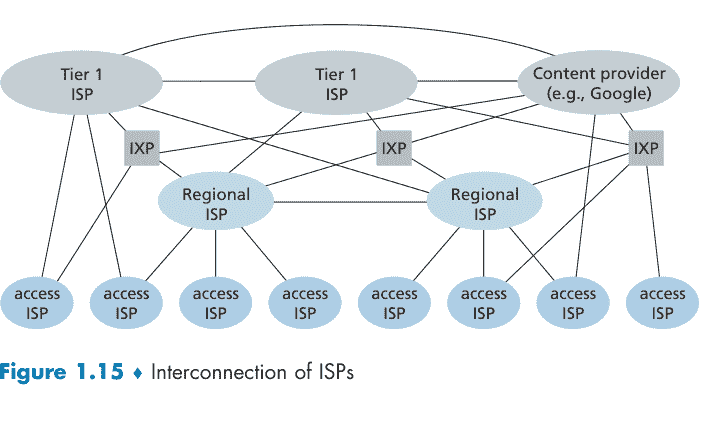

## 1.4 分组交换网络中的时延、丢包和吞吐量

在第1.1节中，我们说过互联网可以被视为一种基础设施，为运行在终端系统上的分布式应用提供服务。理想情况下，我们希望互联网服务能够在任意两个终端系统之间即时传输任意数量的数据，且没有任何数据丢失。遗憾的是，这是一个崇高的目标，在现实中是无法实现的。相反，计算机网络不可避免地限制了终端系统之间的吞吐量（每秒可传输的数据量），在终端系统之间引入时延，并且实际上可能会丢失数据包。一方面，现实世界的物理定律引入时延和丢包并限制吞吐量，这是令人遗憾的。另一方面，正因为计算机网络存在这些问题，围绕如何处理这些问题有许多迷人的议题——足以开设一门计算机网络课程并激励数千篇博士论文！在本节中，我们将开始检查并量化计算机网络中的时延、丢包和吞吐量。

### 1.4.1 分组交换网络中时延概述

回想一下，一个数据包从主机（源）开始，经过一系列路由器，最终到达另一台主机（目的地）。当数据包沿着这条路径从一个节点（主机或路由器）传输到下一个节点（主机或路由器）时，数据包会在路径上的每个节点经历几种类型的时延。其中最重要的时延包括节点处理时延、排队时延、传输时延和传播时延；这些时延累积起来形成总节点时延。许多互联网应用——如搜索、Web浏览、电子邮件、地图、即时通讯和IP电话——的性能都会受到网络时延的严重影响。为了深入理解分组交换和计算机网络，我们必须了解这些时延的性质和重要性。

#### 时延类型

让我们结合图1.16来探讨这些时延。在源和目的地之间的端到端路径中，数据包从上游节点经由路由器A发送到路由器B。我们的目标是表征路由器A处的节点时延。注意，路由器A有一个通往路由器B的出站链路。该链路前有一个队列（也称为缓冲区）。当数据包从上游节点到达路由器A时，路由器A检查数据包头部以确定合适的数据包出站链路，然后将数据包引导至该链路。在此例中，数据包的出站链路是通往路由器B的那条。只有当没有其他数据包正在该链路上传输，并且队列中没有其他数据包排在该数据包之前时，数据包才能在该链路上传输；如果链路当前忙碌或队列中已有其他数据包等待该链路，新到达的数据包就会加入队列。

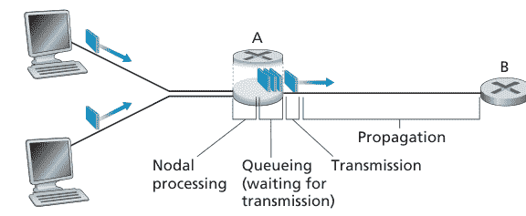

**图 1.16** 路由器A处的节点时延

*处理时延*

检查数据包头部并确定数据包去向所需的时间是**处理时延**的一部分。处理时延还可以包含其他因素，例如检查数据包中在从上游节点传输到路由器A的过程中发生的比特级错误所需的时间。高速路由器中的处理时延通常为数微秒或更短。在此节点处理之后，路由器将数据包引导至通往路由器B链路的队列前。（在第4章中，我们将学习路由器操作细节。）

*排队时延*

在队列中，数据包在等待传输到链路时会经历**排队时延**。特定数据包的排队时延长度取决于此前到达并等待传输到链路的排队数据包数量。如果队列为空且当前没有其他数据包正在传输，则我们数据包的排队时延为零。另一方面，如果流量密集且许多其他数据包也在等待传输，则排队时延将很长。我们很快就会看到，到达的数据包可能发现的排队数据包数量是到达队列的流量强度和性质的函数。在实际中，排队时延可在微秒到毫秒量级。

*传输时延*

假设数据包按先到先服务的顺序传输（这在分组交换网络中很常见），我们的数据包只有在此前到达的所有数据包都传输完毕后才能传输。设数据包的长度为\( L \)比特，设从路由器A到路由器B的链路传输速率为\( R \)比特/秒。例如，对于10 Mbps以太网链路，速率为\( R = 10 \) Mbps；对于100 Mbps以太网链路，速率为\( R = 100 \) Mbps。**传输时延**为\( L/R \)。这是将数据包的所有比特推入（即传输到）链路所需的时间。在实际中，传输时延通常为数微秒到毫秒量级。

*传播时延*

一旦比特被推入链路，它需要传播到路由器B。从链路起始处传播到路由器B所需的时间即为**传播时延**。比特以链路的传播速度传播。传播速度取决于链路的物理介质（即光纤、双绞铜线等），范围在

$$ 2 \cdot 10^8 \text{ 米/秒 至 } 3 \cdot 10^8 \text{ 米/秒} $$

之间，等于或略小于光速。传播时延是两个路由器之间的距离除以传播速度。即，传播时延为\( d/s \)，其中\( d \)是路由器A与路由器B之间的距离，\( s \)是链路的传播速度。一旦数据包的最后一个比特传播到节点B，它及之前所有该数据包的比特都存储在路由器B中。随后，整个流程继续，由路由器B执行转发。在广域网中，传播时延通常为数毫秒。

*比较传输时延和传播时延*

计算机网络领域的新手有时难以理解传输时延和传播时延之间的区别。这个区别微妙但重要。传输时延是路由器推出发数据包所需的时间；它是数据包长度和链路传输速率的函数，但与两个路由器之间的距离无关。另一方面，传播时延是一个比特从一个路由器传播到下一个路由器所需的时间；它是两个路由器之间距离的函数，但与数据包长度或链路传输速率无关。一个类比或许能阐明传输时延和传播时延的概念。考虑一条高速公路，每100公里有一个收费站，如图1.17所示。你可以把收费站之间的高速公路段看作链路，把收费站看作路由器。假设汽车在公路上行驶（即传播）的速度为100公里/小时（即当汽车离开收费站时，它瞬间加速到100公里/小时并在收费站之间保持该速度）。接下来假设10辆汽车作为一个车队按固定顺序相互跟随行驶。你可以把每辆汽车看作一个比特，把车队看作一个数据包。还假设每辆


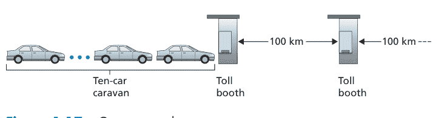

#### 图 1.17 车队类比

收费亭服务（即传输）一辆车的速率为每 12 秒一辆车，且假设此时是深夜，车队中的车辆是高速公路上唯一的车辆。最后，假设每当车队的第一辆车到达收费亭时，它会在入口处等待，直到其他九辆车也到达并排在其后面。（因此，整个车队必须在收费亭处存储完毕，才能开始被转发。）收费亭将整个车队推上高速公路所需的时间是 (10 辆车)/(5 辆车/分钟) = 2 分钟。这段时间类似于路由器中的**传输时延**。一辆车从一个收费亭出口行驶到下一个收费亭所需的时间是 100 km/(100 km/hour) = 1 小时。这段时间类似于**传播时延**。因此，从车队在一个收费亭前存储完毕到它在下一个收费亭前存储完毕的时间是传输时延和传播时延之和——在本例中，为 62 分钟。

让我们进一步探讨这个类比。如果车队经过一个收费亭的服务时间大于车辆在两个收费亭之间行驶的时间，会发生什么？例如，假设现在车辆以 1,000 公里/小时的速度行驶，而收费亭的服务速率为每分钟一辆车。那么，两个收费亭之间的行驶时延为 6 分钟，服务整个车队的时间为 10 分钟。在这种情况下，车队中较前面的几辆车将在车队最后一辆车离开第一个收费亭之前到达第二个收费亭。这种情况在分组交换网络中也会出现——分组中最初的一些位可能在分组中剩余的许多位仍等待在前一个路由器中被传输时就已到达路由器。

如果一幅画能抵千言，那么一段动画一定能抵百万言。本教材的网站提供了一个交互式动画，很好地展示并对比了传输时延和传播时延。强烈建议读者访问该动画。[Smith 2009] 也提供了关于传播、排队和传输时延的非常易于理解的讨论。

如果我们用 $d_{\text{proc}}$、$d_{\text{queue}}$、$d_{\text{trans}}$ 和 $d_{\text{prop}}$ 分别表示处理时延、排队时延、传输时延和传播时延，则节点总时延由下式给出：

$$ d_{\text{nodal}} = d_{\text{proc}} + d_{\text{queue}} + d_{\text{trans}} + d_{\text{prop}} $$

这些时延成分的影响差异可能很大。例如，对于连接同一大学校园内两个路由器的链路，$d_{\text{prop}}$ 可以忽略不计（例如，几微秒）；然而，对于通过地球静止卫星链路互连的两个路由器，$d_{\text{prop}}$ 可达数百毫秒，并可能成为 $d_{\text{nodal}}$ 中的主导项。类似地，$d_{\text{trans}}$ 的范围可以从可忽略不计到显著。在 10 Mbps 及更高速率（例如局域网）下，其影响通常可以忽略；然而，对于通过低速拨号调制解调器链路发送的大型互联网分组，它可能达到数百毫秒。处理时延 $d_{\text{proc}}$ 通常可以忽略；然而，它强烈影响路由器的最大吞吐量，即路由器转发分组的最大速率。

### 1.4.2 排队时延与分组丢失

节点时延中最复杂且有趣的部分是排队时延 $d_{\text{queue}}$。事实上，排队时延在计算机网络中如此重要和有趣，以至于成千上万篇论文和众多书籍都就此进行了论述 [Bertsekas 1991; Kleinrock 1975; Kleinrock 1976]。此处我们仅对排队时延进行高层的直觉性讨论；更感兴趣的读者可以浏览一些相关书籍（甚至最终就此主题撰写博士论文！）。与另外三种时延（即 $d_{\text{proc}}$、$d_{\text{trans}}$ 和 $d_{\text{prop}}$）不同，排队时延在每个分组之间可能不同。例如，如果 10 个分组同时到达一个空队列，第一个被传输的分组将不受排队时延影响，而最后一个被传输的分组将承受相对较大的排队时延（因为它在等待其他九个分组被传输）。因此，在表征排队时延时，通常使用统计度量，如平均排队时延、排队时延方差以及排队时延超过某个指定值的概率。

何时排队时延较大，何时微不足道？这个问题的答案取决于流量到达队列的速率、链路的传输速率以及到达流量的性质，即流量是周期性到达还是突发到达。为了获得一些洞察，设 $\lambda$ 表示分组到达队列的平均速率（$\lambda$ 的单位为 分组/秒）。回忆一下，$R$ 是传输速率；即，它是指从队列中推出位的速率（位/秒）。此外，为简单起见，假设所有分组均由 $L$ 位组成。那么，位到达队列的平均速率为 $\lambda L$ 位/秒。最后，假设队列非常大，因此它基本上可以容纳无限数量的位。比率 $\lambda L/R$，称为**流量强度**，通常在估算排队时延的程度时起着重要作用。如果 $\lambda L/R > 1$，则位到达队列的平均速率超过位能从队列中传输出去的速率。在这种不幸的情况下，队列将倾向于无限增长，而排队时延将趋向于无穷大！因此，流量工程中的一条黄金法则是：设计系统使得流量强度不超过 1。

现在考虑 $\lambda L/R \leq 1$ 的情况。在此情况下，到达流量的性质会影响排队时延。例如，如果分组周期性到达——即每 $L/R$ 秒到达一个分组——那么每个分组都将到达一个空队列，且不会产生排队时延。另一方面，如果分组以突发但周期的方式到达，则可能存在显著的平均排队时延。例如，假设每 $(L/R)N$ 秒有 $N$ 个分组同时到达。那么，第一个被传输的分组没有排队时延；第二个被传输的分组有 $L/R$ 秒的排队时延；更一般地，第 $n$ 个被传输的分组有 $(n-1)L/R$ 秒的排队时延。我们留作练习让你计算此例中的平均排队时延。

上述两个周期性到达的例子略显学术化。通常，队列的到达过程是随机的；即，到达不遵循任何模式，分组之间以随机量的时间间隔开。在这种更现实的情况下，量 $\lambda L/R$ 通常不足以完全表征排队时延统计特性。尽管如此，它在获得关于排队时延程度的直观理解方面是有用的。特别是，如果流量强度接近零，则分组到达稀少且间隔较长，到达的分组在队列中发现另一个分组的可能性很小。因此，平均排队时延将接近零。另一方面，当流量强度接近 1 时，会出现到达速率超过传输容量的时间段（由于分组到达速率的变化），在此期间会形成队列；当到达速率小于传输容量时，队列长度将缩短。尽管如此，随着流量强度趋近于 1，平均队列长度变得越来越大。平均排队时延随流量强度的定性依赖关系如图 1.18 所示。

图 1.18 的一个重要方面是，随着流量强度趋近于 1，平均排队时延迅速增加。强度上的小幅百分比增加会导致时延上大幅的百分比增加。也许你曾在高速公路上体验过这种现象。如果你经常行驶在一条通常拥堵的道路上，道路通常拥堵意味着其流量强度接近 1。如果某些事件导致交通量比平时稍大，你所经历的时延可能是巨大的。要真正很好地理解排队时延是怎么回事，我们再次鼓励你访问教材网站，该网站提供了一个关于队列的交互式动画。如果你将分组到达速率设置得足够高，使流量强度超过 1，你将看到队列随时间缓慢积累。

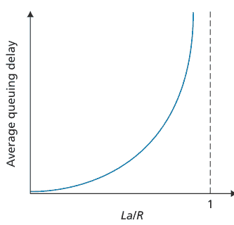

#### 图 1.18 平均排队时延对流量强度的依赖关系


#### 丢包

在上述讨论中，我们假设队列能够容纳无限数量的分组。实际上，链路前端的队列容量是有限的，尽管队列的容量很大程度上取决于路由器的设计和成本。由于队列容量有限，当业务强度趋近于 1 时，分组延迟并不会真正趋近于无穷大。相反，当一个分组到达时，可能会发现队列已满。由于没有地方存储这样的分组，路由器会**丢弃**该分组；也就是说，该分组将**丢失**。当业务强度大于 1 时，再次在交互式动画中可以看到这种队列溢出情况。

从端系统的角度来看，分组丢失表现为一个分组被传输到网络核心，但从未在目的地的网络中显现。随着业务强度的增加，丢失分组的比例也会增加。因此，节点的性能通常不仅通过延迟来衡量，还通过分组丢失概率来衡量。正如我们将在后续章节中讨论的，为了确保所有数据最终从源传输到目的地，丢失的分组可能会在端到端的基础上进行重传。

### 1.4.3 端到端延迟

我们到目前的讨论一直集中在节点延迟上，即单个路由器处的延迟。现在让我们考虑从源到目的地的总延迟。为了掌握这个概念，假设源主机和目的主机之间有 $N-1$ 个路由器。让我们暂时假设网络没有拥塞（因此排队延迟可以忽略不计），每个路由器和源主机的处理延迟为 $d_{\text{proc}}$，每个路由器和源主机的发送速率为 $R$ 位/秒，每条链路的传播延迟为 $d_{\text{prop}}$。节点延迟累积起来形成端到端延迟，

$$ d_{\text{end-end}} = N\left(d_{\text{proc}} + d_{\text{trans}} + d_{\text{prop}}\right) \quad (1.2) $$

其中，同样地，$d_{\text{trans}} = L/R$，其中 $L$ 是分组大小。请注意，公式 1.2 是公式 1.1 的推广，后者没有考虑处理和传播延迟。我们将由读者自行将公式 1.2 推广到节点间延迟异质性以及每个节点存在平均排队延迟的情况。

#### Traceroute

为了亲身体验计算机网络中的端到端延迟，我们可以利用 Traceroute 程序。Traceroute 是一个简单的程序，可以在任何 Internet 主机上运行。当用户指定目的主机的名称时，源主机中的程序会向该目的发送多个特殊分组。当这些分组向目的地移动时，它们会经过一系列路由器。当某个路由器接收到这些特殊分组之一时，它会向源主机发送一条短消息，其中包含该路由器的名称和地址。

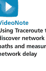

更具体地说，假设源和目的地之间有 $N - 1$ 个路由器。那么源将向网络发送 $N$ 个特殊分组，每个分组的地址都是最终目的地。这 $N$ 个特殊分组被标记为 $1$ 到 $N$，第一个分组标记为 $1$，最后一个分组标记为 $N$。当第 $n$ 个路由器接收到标记为 $n$ 的第 $n$ 个分组时，该路由器不会将分组转发到其目的地，而是向源发送一条消息。当目的主机接收到第 $N$ 个分组时，它也会向源返回一条消息。源记录发送分组和接收到相应返回消息之间经过的时间；它还记录返回该消息的路由器（或目的主机）的名称和地址。通过这种方式，源可以重建从源流向目的地的分组所经过的路径，并且源可以确定到所有中间路由器的往返延迟。Traceroute 实际上将上述实验重复三次，因此源实际上向目的地发送了 $3 \cdot N$ 个分组。RFC 1393 详细描述了 Traceroute。

以下是 Traceroute 程序输出的示例，其中追踪的路径是从源主机 gaia.cs.umass.edu（位于马萨诸塞大学）到位于巴黎索邦大学计算机系的一个主机（该大学以前被称为 UPMC）。输出包含六列：第一列是上述描述的 $n$ 值，即路径上路由器的编号；第二列是路由器的名称；第三列是路由器的地址（形式为 xxx.xxx.xxx.xxx）；最后三列是三次实验的往返延迟。如果源从任何特定路由器接收到的消息少于三个（由于网络中的丢包），Traceroute 会在路由器编号后放置一个星号，并报告该路由器少于三个的往返时间。

| 编号 | 路由器名称 | IP 地址 | 延迟 1 | 延迟 2 | 延迟 3 |
| :--- | :--- | :--- | :--- | :--- | :--- |
| 1 | gw-vlan-2451.cs.umass.edu | 128.119.245.1 | 1.899 ms | 3.266 ms | 3.280 ms |
| 2 | j-cs-gw-int-10-240.cs.umass.edu | 10.119.240.254 | 1.296 ms | 1.276 ms | 1.245 ms |
| 3 | n5-rt-1-1-xe-2-1-0.gw.umass.edu | 128.119.3.33 | 2.237 ms | 2.217 ms | 2.187 ms |
| 4 | core1-rt-et-5-2-0.gw.umass.edu | 128.119.0.9 | 0.351 ms | 0.392 ms | 0.380 ms |
| 5 | border1-rt-et-5-0-0.gw.umass.edu | 192.80.83.102 | 0.345 ms | 0.345 ms | 0.344 ms |
| 6 | nox300gw1-umass-re.nox.org | 192.5.89.101 | 3.260 ms | 0.416 ms | 3.127 ms |
| 7 | nox300gw1-umass-re.nox.org | 192.5.89.101 | 3.165 ms | 7.326 ms | 7.311 ms |
| 8 | 198.71.45.237 | 198.71.45.237 | 77.826 ms | 77.246 ms | 77.744 ms |
| 9 | renater-ib1-gw.mx1.par.fr.geant.net | 62.40.124.70 | 79.357 ms | 77.729 ms | 79.152 ms |
| 10 | 193.51.180.109 | 193.51.180.109 | 78.379 ms | 79.936 ms | 80.042 ms |
| 11 * | 193.51.180.109 | 193.51.180.109 | 80.640 ms | * | |
| 12 * | 195.221.127.182 | 195.221.127.182 | 78.408 ms | * | |
| 13 | 195.221.127.182 | 195.221.127.182 | 80.686 ms | 80.796 ms | 78.434 ms |
| 14 | r-upmc1.reseau.jussieu.fr | 134.157.254.10 | 78.399 ms | * | 81.353 ms |

在上述追踪中，源和目的地之间有 14 个路由器。其中大多数路由器都有名称，所有路由器都有地址。例如，路由器 4 的名称是 `core1-rt-et-5-2-0.gw.umass.edu`，其地址是 `128.119.0.9`。查看为该路由器提供的数据，我们可以看到，在三次尝试中的第一次中，源与该路由器之间的往返延迟为 0.351 毫秒。后续两次尝试的往返延迟分别为 0.392 和 0.380 毫秒。这些往返延迟包括刚刚讨论的所有延迟，包括传输延迟、传播延迟、路由器处理延迟和排队延迟。

由于排队延迟随时间变化，发送到路由器 *n* 的分组 *n* 的往返延迟有时可能比发送到路由器 *n*+1 的分组 *n*+1 的往返延迟更长。实际上，我们在上述例子中观察到了这一现象：到路由器 12 的延迟小于到路由器 11 的延迟！还要注意，从路由器 7 到路由器 8 时，往返延迟大幅增加。这是由于路由器 7 和 8 之间有一条跨大西洋光纤链路，导致产生相对较大的传播延迟。有许多免费软件程序提供 Traceroute 的图形界面；我们最喜欢的之一是 PingPlotter [PingPlotter 2020]。

#### 端系统、应用和其他延迟

除了处理、传输和传播延迟外，端系统中还可能存在其他显着的延迟。例如，想要将分组传输到共享介质（例如 WiFi 或电缆调制解调器场景）的端系统可能会*有意*延迟其传输，作为其与其他端系统共享介质的协议的一部分；我们将在第 6 章中详细讨论此类协议。另一个重要的延迟是媒体打包延迟，它存在于 IP 语音（VoIP）应用程序中。在 VoIP 中，发送方必须首先用编码后的数字语音填充一个分组，然后再将该分组传递给 Internet。填充分组的时间——称为打包延迟——可能非常显着的，并且会影响用户对 VoIP 呼叫质量的感知。本章末尾的作业题将进一步探讨这一问题。

### 1.4.4 计算机网络中的吞吐量

除了延迟和丢包外，计算机网络中另一个关键的性能指标是端到端吞吐量。为了定义吞吐量，考虑通过计算机网络将大文件从主机 A 传输到主机 B。这种传输可能是例如从一台计算机到另一台计算机的大视频片段。任何时刻的**瞬时吞吐量**是主机 B 接收文件的速率（单位为位/秒）。（许多应用程序在下载过程中会在用户界面上显示瞬时吞吐量——你之前可能已经观察到这一点！你可以尝试


使用 speedtest 应用程序测量你与互联网上服务器之间的端到端时延和下载吞吐量 [Speedtest 2020]。如果文件由 $F$ 比特组成，并且主机 B 接收所有 $F$ 比特需要 $T$ 秒，那么文件传输的**平均吞吐量**为 $F/T$ 比特/秒。对于一些应用程序，例如 Internet 电话，希望具有低时延，并且即时吞吐量始终高于某个阈值（例如，某些 Internet 电话应用要求超过 24 kbps，某些实时视频应用要求超过 256 kbps）。对于其他应用程序，包括涉及文件传输的应用程序，时延并不关键，但希望具有尽可能高的吞吐量。

为了对吞吐量这一重要概念获得进一步的洞察，让我们考虑几个例子。图 1.19(a) 展示了两个端系统（服务器和客户端），它们通过两条通信链路和一个路由器连接。考虑从服务器到客户端的文件传输的吞吐量。设 $R_s$ 表示服务器与路由器之间链路的速率；设 $R_c$ 表示路由器与客户端之间链路的速率。假设整个网络中发送的比特仅为从服务器到客户端的比特。现在我们要问，在这个理想场景下，服务器到客户端的吞吐量是多少？回答这个问题时，我们可以将比特视为*流体*，将通信链路视为*管道*。显然，服务器不能以快于 $R_s$ bps 的速率通过其链路泵送比特；路由器也不能以快于 $R_c$ bps 的速率转发比特。如果 $R_s < R_c$，那么服务器泵送的比特将直接“流动”通过路由器，并以 $R_s$ bps 的速率到达客户端，从而产生 $R_s$ bps 的吞吐量。另一方面，如果 $R_c < R_s$，那么路由器将无法以接收比特的同等速度转发比特。在这种情况下，比特只能以 $R_c$ 的速率离开路由器，从而产生 $R_c$ 的端到端吞吐量。（另外请注意，如果比特继续以 $R_s$ 的速率到达路由器，并以 $R_c$ 的速率离开路由器，路由器中等待传输到客户端的比特积压将越来越多——这是一个非常不理想的情况！）

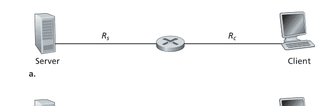

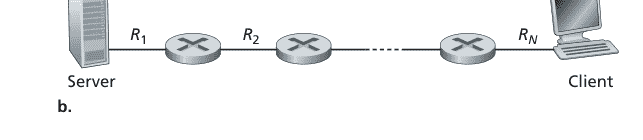

**图 1.19** 从服务器到客户端的文件传输吞吐量

因此，对于这个简单的双链路网络，吞吐量是 min{$R_s$， $R_c$}，即**瓶颈链路**的传输速率。确定吞吐量后，我们现在可以将将 $F$ 比特的大文件从服务器传输到客户端所需的时间近似为 $F$/min($R_s$， $R_c$)。举个具体的例子，假设你正在下载一个 $F$ = 3200 万比特的 MP3 文件，服务器的传输速率为 $R_s$ = 2 Mbps，而你拥有一个 $R_c$ = 1 Mbps 的接入链路。那么传输该文件所需的时间为 32 秒。当然，这些关于吞吐量和传输时间的表达式只是近似值，因为它们没有考虑到存储转发和处理时延以及协议问题。

图 1.19(b) 现在展示了一个服务器与客户端之间有 $N$ 条链路的网络，这 $N$ 条链路的传输速率分别为 $R_1$， $R_2$，...，$R_N$。应用与双链路网络相同的分析，我们发现从服务器到客户端的文件传输吞吐量是 min{$R_1$， $R_2$，...，$R_N$}，这再次是服务器和客户端之间路径上瓶颈链路的传输速率。

现在考虑另一个由当今互联网驱动的例子。图 1.20(a) 展示了两个端系统（服务器和客户端），它们连接到一个计算机网络。考虑从服务器到客户端的文件传输的吞吐量。服务器通过速率为 $R_s$ 的接入链路连接到网络，客户端通过速率为 $R_c$ 的接入链路连接到网络。现在假设通信网络核心中的所有链路都具有非常高的传输速率，远高于 $R_s$ 和 $R_c$。事实上，如今 Internet 的核心配备了高速链路，拥塞很少。另外假设整个网络中发送的比特仅为从服务器到客户端的比特。在这个例子中，由于计算机网络的核心就像一个宽管道，比特从源到目的地流动的速率再次是 $R_s$ 和 $R_c$ 中的最小值，即吞吐量 = min{$R_s$， $R_c$}。因此，当今互联网中限制吞吐量的因素通常是接入网络。

作为最后一个例子，考虑图 1.20(b)，其中 10 台服务器和 10 个客户端连接到计算机网络的核心。在这个例子中，有 10 个同时进行的下载，涉及 10 对客户端 - 服务器。假设这 10 个下载是当前时刻网络中唯一的流量。如图所示，核心中有一条链路被所有 10 个下载所使用。用 $R$ 表示这条链路的传输速率。让我们假设所有服务器接入链路具有相同的速率 $R_s$，所有客户端接入链路具有相同的速率 $R_c$，并且核心中所有链路（除了速率为 $R$ 的那条公共链路）的传输速率都远大于 $R_s$、$R_c$ 和 $R$。现在我们要问，这些下载的吞吐量是多少？显然，如果公共链路的速率 $R$ 很大——比如比 $R_s$ 和 $R_c$ 都大一百倍——那么每个下载的吞吐量再次将是 min{$R_s$， $R_c$}。但如果公共链路的速率与 $R_s$ 和 $R_c$ 同一数量级呢？在这种情况下吞吐量是多少？让我们看一个具体的例子。假设 $R_s$ = 2 Mbps，$R_c$ = 1 Mbps，$R$ = 5 Mbps，且公共链路将其传输速率平均分配给 10 个下载。那么

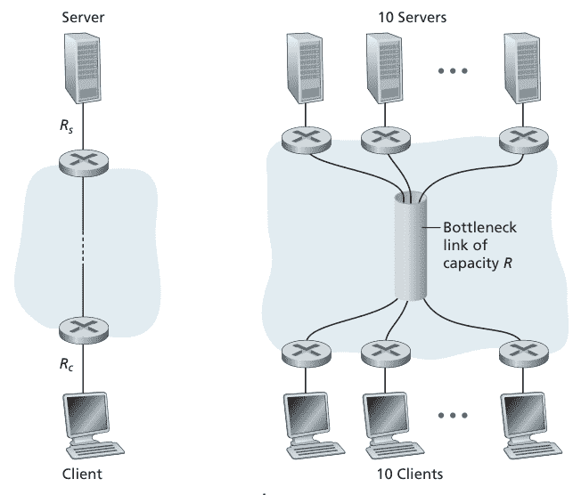

图 1.20 • 端到端吞吐量：(a) 客户端从服务器下载文件；(b) 10 个客户端与 10 个服务器进行下载

每个下载的瓶颈不再位于接入网络，而是现在位于核心中的共享链路，该链路仅为每个下载提供 500 kbps 的吞吐量。因此，每个下载的端到端吞吐量现在降低为 500 kbps。

图 1.19 和图 1.20(a) 中的例子表明，吞吐量取决于数据流经的链路的传输速率。我们看到，当没有其他中介流量时，吞吐量可以简单地近似为源和目的地之间路径上的最小传输速率。图 1.20(b) 中的例子表明，更一般地，吞吐量不仅取决于路径上链路的传输速率，还取决于中介流量。特别是，即使一条链路具有较高的传输速率，如果许多其他数据流也通过该链路，它仍可能是文件传输的瓶颈链路。我们将在作业题和后续章节中更仔细地研究计算机网络中的吞吐量。

## 1.5 协议层及其服务模型

从我们目前的讨论来看，很明显 Internet 是一个*极其*复杂的系统。我们已经看到 Internet 有很多组成部分：众多应用程序和协议，各种类型的端系统，分组交换机以及各种类型的链路层介质。鉴于这种巨大的复杂性，是否有任何希望来组织网络架构，或者至少组织我们对网络架构的讨论？幸运的是，这两个问题的答案都是肯定的。

### 1.5.1 分层架构

在尝试整理我们对 Internet 架构的思路之前，让我们寻找一个人类的类比。实际上，我们在日常生活中总是处理复杂的系统。想象一下，如果有人让你描述例如航空系统。你如何找到结构来描述这个拥有售票员、行李员、登机口工作人员、飞行员、飞机、空中交通管制以及全球飞机路由系统的复杂系统？描述这个系统的一种方式可能是描述你在乘坐飞机时采取的一系列行动（或别人替你采取的行动）。你购买机票，托运行李，前往登机口，最终被装载到飞机上。飞机起飞并被路由到目的地。当你的飞机落地后，你在登机口下机并提取行李。如果旅程体验不佳，你会向售票员抱怨航班（但你的努力并没有得到回报）。这个场景展示在图 1.21 中。

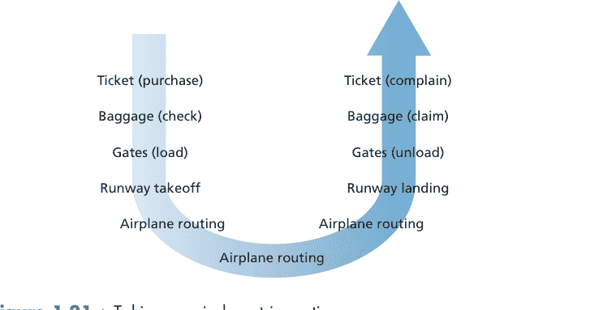

**图 1.21** ◊ 乘坐飞机旅行：行动


| 机票（购买） | | | 机票（投诉） | 机票 |
|---|---|---|---|---|
| 行李（托运） | | | 行李（提取） | 行李 |
| 登机口（登机） | | | 登机口（下机） | 登机口 |
| 跑道起飞 | | | 跑道降落 | 起飞/降落 |
| 飞机航线 | 飞机航线 | 飞机航线 | 飞机航线 | 飞机航线 |

| | 出发机场 | 中间空中交通管制中心 | 到达机场 |
|---|---|---|---|


此时，我们已经能看出这里与计算机网络的某些类比：航空公司将你从源头运送到目的地；互联网中的一个分组从源主机运送到目的主机。但这并非我们正寻求的类比。我们在图 1.21 中寻找的是一种 *结构*。观察图 1.21，我们注意到两端都有一个票务功能；对于已经购票的乘客，还有一个行李功能；对于已经购票并完成行李托运的乘客，还有一个登机口功能。对于已经通过登机口的乘客（即已经购票、完成行李托运并通过登机口的乘客），存在一个起飞和降落功能；而在飞行过程中，则有一个飞机航线功能。这表明我们可以以 *水平* 方式查看图 1.21 中的功能，如 1.22 图所示。

1.22 图将航空公司的功能划分为各个层，提供了一个探讨航空旅行的框架。请注意，每一层与其下方的层结合，实现了某种功能，某种 *服务*。在票务层及以下，实现了航空公司柜台到航空公司柜台的人员转运。在行李层及以下，实现了从行李托运到行李提取的人员及行李转运。请注意，行李层仅向已购票的人员提供此服务。在登机口层，实现了从出发登机口到到达登机口的人员及行李转运。在起飞/降落层，实现了从跑道到跑道的人员及其行李转运。每一层通过 (1) 在该层内执行某些操作（例如，在登机口层，将人员送上和移下飞机）以及 (2) 使用紧邻其下方的层的服务（例如，在登机口层，使用起飞/降落层的跑道到跑道旅客转运服务）来提供其服务。

分层架构使我们能够讨论一个庞大且复杂系统中定义明确且具体的部分。这种简化本身具有相当大的价值，因为它提供了模块化，使得更改该层提供的服务的实现方式变得更加容易。只要该层向其上方的层提供相同的服务，并从其下方的层使用相同的服务，当某层的实现发生变更时，系统的其余部分保持不变。（请注意，更改服务的实现方式与更改服务本身有着非常大的区别！）例如，如果登机口功能发生改变（例如，改为按身高顺序让乘客登机和下机），由于登机口层仍然提供相同的功能（将人员送上和移下飞机），只是在更改后以不同的方式实现了该功能，因此航空系统的其余部分将保持不变。对于不断更新的庞大且复杂的系统，在不影响系统其他组件的情况下更改服务实现的能力是分层架构的另一个重要优势。

#### 协议分层

好了，关于航空公司的话题就聊到这里。现在让我们将注意力转向网络协议。为了给网络协议的设计提供结构，网络设计师将协议——以及实现这些协议的网络硬件和软件——组织成 **层**。每个协议属于其中一层，正如 1.22 图中航空公司架构中的每个功能都属于某一层一样。我们再次关注某层向其上上层提供的 **服务**——即所谓的层的 **服务模型**。正如我们的航空公司例子所示，每一层通过 (1) 在该层内执行某些操作以及 (2) 使用紧邻其下方的层的服务来提供其服务。例如，*n* 层提供的服务可能包括将消息从网络的一端可靠地传送到另一端。这可能通过使用 *n* – 1 层的不可靠端到端消息传送服务并添加 *n* 层功能来检测并重传丢失的消息来实现。

协议层可以在软件中实现，在硬件中实现，或者是两者的结合。应用层协议——如 HTTP 和 SMTP——几乎总是在终端系统的软件中实现；传输层协议也是如此。由于物理层和数据链路层负责处理特定链路上的通信，它们通常在关联于给定链路的网络接口卡（例如，以太网或 WiFi 接口卡）中实现。网络层通常是硬件和软件的混合实现。另外请注意，正如分层航空公司架构中的功能分布在构成系统的各个机场和飞行控制中心中一样，*n* 层协议也在构成网络的终端系统、分组交换机和其他组件中 *分布* 开来。也就是说，通常在这些网络组件的每一个中都有 *n* 层协议的一部分。

协议分层具有概念和结构上的优势 [RFC 3439]。如前所述，分层提供了一种讨论系统组件的结构化方式。模块化使得更新系统组件变得更加容易。然而，我们提到，一些研究人员和网络工程师强烈反对分层 [Wakeman 1992]。分层的一个潜在缺点是某层可能重复下层的功能。例如，许多协议栈既在基于链路的基础上提供差错恢复，也在端到端的基础上提供。第二个潜在缺点是一层可能需要仅存在于另一层中的信息（例如，一个时间戳值）；这违反了层分离的目标。

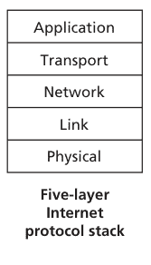

#### 图 1.23 互联网协议栈

当把各个层的协议组合在一起时，它们被称为协议栈。互联网协议栈由五个层组成：物理层、链路层、网络层、传输层和应用层，如 1.23 图所示。如果您查看目录，会发现我们大致按照互联网协议栈的层来组织本书的内容。我们采取自上而下的方法，首先涵盖应用层，然后向下推进。

## 应用层

应用层是网络应用程序及其应用层协议所在的地方。互联网的应用层包含许多协议，如 HTTP 协议（提供 Web 文档请求和传输功能）、SMTP（提供电子邮件消息传输功能）和 FTP（提供两个终端系统之间的文件传输功能）。我们将看到，某些网络功能，例如将互联网终端系统中人类友好的名称（如 www.ietf.org）转换为 32 位网络地址，也是借助特定的应用层协议完成的，即域名系统（DNS）。我们将在第 2 章中看到，创建和部署我们自己的新应用层协议非常容易。

应用层协议分布在多个终端系统上，其中一个终端系统中的应用程序使用协议与另一个终端系统中的应用程序交换信息分组。我们将应用层的此信息分组称为消息。

#### 传输层

互联网的传输层在应用端点之间传输应用层消息。在互联网中，有两种传输协议：TCP 和 UDP，两者都可以传输应用层消息。TCP 为其应用程序提供面向连接的服务。此服务包括应用层的保证交付


到目的地的消息以及流量控制（即发送方/接收方速度匹配）。TCP 还将长消息拆分为较短的数据段，并提供拥塞控制机制，以便在拥塞时源端会降低其传输速率。UDP 协议为其应用程序提供无连接服务。这是一种简化的服务，不提供可靠性、流量控制或拥塞控制。在本书中，我们将传输层的数据包称为 **段**（segment）。

#### 网络层

互联网的**网络层**负责在主机之间移动被称为 **数据报** 的网络层数据包。源主机中的互联网传输层协议（TCP 或 UDP）会将传输层段和目的地址传递给网络层，就像你将带有目的地址的信交给邮政服务一样。然后，网络层提供将段交付给目的主机传输层的服务。

互联网的**网络层**包括著名的 IP 协议，它定义了数据报中的字段，以及端系统和路由器如何对这些字段进行处理。只有一个 IP 协议，所有具有网络层的互联网组件都必须运行 IP 协议。互联网的**网络层**还包含路由协议，用于确定数据报在源和目的之间的路径。互联网有许多路由协议。如我们在第 1.3 节中看到的，互联网是网络的集合，在单个网络中，网络管理员可以运行任何所需的路由协议。虽然网络层既包含 IP 协议又包含众多路由协议，但它通常被称为 IP 层，这反映了 IP 是连接互联网各个部分的事实。

#### 链路层

互联网的**网络层**通过一系列路由器将数据报路由传输到目的地的中间节点，以移动数据包。为了将数据包从当前节点（主机或路由器）移动到路由上的下一个节点，网络层依赖于链路层的服务。具体来说，在每个节点上，网络层将数据报传递给链路层，链路层负责将数据报传送到路由上的下一个节点。在这个下一个节点上，链路层将数据报上传至网络层。

链路层提供的服务取决于链路上使用的特定链路层协议。例如，一些链路层协议提供从发送节点到接收节点、通过单条链路的可靠传输。请注意，这种可靠传输服务与 TCP 的可靠传输服务不同，TCP 提供的是从一个端系统到另一个端系统的可靠传输。链路层协议的例子包括以太网（Ethernet）、Wi-Fi 和有线接入网络的 DOCSIS 协议。由于数据报通常需要经过多条链路才能从源到达目的地，因此在路由的不同链路上，数据报可能会由不同的链路层协议处理。例如，数据报可能在一条链路上由以太网处理，而在下一条链路上由 PPP 处理。网络层将从每个不同的链路层协议获得不同的服务。在本书中，我们将链路层的数据包称为 **帧**。

#### 物理层

链路层的任务是将完整的帧从一个网络元素移动到相邻的网络元素，而物理层的任务是将帧内的 *单个比特* 从一个节点移动到下一个节点。该层的协议再次依赖于具体的链路，并且进一步取决于链路的实际传输介质（例如，双绞铜线、单模光纤）。例如，以太网有许多物理层协议：一种适用于双绞铜线，一种适用于同轴电缆，一种适用于光纤，等等。在每种情况下，比特都以不同的方式在链路上移动。

### 1.5.2 封装

图 1.24 展示了数据在发送端系统协议栈中向下传输、在中间链路层交换机和路由器的协议栈中向上又向下、最后向上接收端系统协议栈的物理路径。正如我们稍后在书中讨论的，路由器和链路层交换机都是分组交换机。与端系统类似，路由器和链路层交换机将其网络硬件和软件组织成各层。但是，路由器和链路层交换机并没有实现协议栈中的所有层；它们通常只实现底层。如图 1.24 所示，链路层交换机实现了第 1 层和第 2 层；路由器实现了第 1 层至第 3 层。这意味着，例如，互联网路由器能够实现 IP 协议（一种第 3 层协议），而链路层交换机则不能。我们稍后会看到，虽然链路层交换机不识别 IP 地址，但它们能够识别第 2 层地址，如以太网地址。请注意，主机实现了所有五个层；这与互联网架构将大部分复杂性放置在网络边缘的观点是一致的。

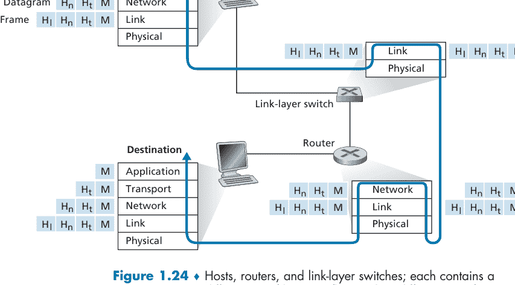

**图 1.24** 主机、路由器和链路层交换机；每个都包含不同的层集，反映了它们在功能上的差异

图 1.24 还阐明了封装这一重要概念。在发送主机上，应用层消息（图 1.24 中的 M）被传递给传输层。在最简单的情况下，传输层获取该消息并附加额外的信息（所谓的传输层头信息，图 1.24 中的 $H_T$），这些信息将由接收侧传输层使用。应用层消息和传输层头信息共同构成了传输层段。因此，传输层段封装了应用层消息。添加的信息可能包括允许接收侧传输层将消息传递给适当应用程序的信息，以及允许接收者判断消息中的比特是否在传输过程中发生改变的错误检测比特。然后，传输层将段传递给网络层，网络层添加了网络层头信息（图 1.24 中的 $H_N$），例如源和目的端系统地址，从而创建了一个网络层数据报。数据报随后被传递给链路层，链路层（当然！）会添加其自身的链路层头信息并创建一个链路层帧。因此，我们看到，在每一层，数据包都有两种类型的字段：头字段和有效载荷字段。有效载荷通常是来自上一层的数据包。

这里有一个有用的类比，即通过公共邮政服务将一个公司分公司发送给另一个分公司的内部备忘录。假设 Alice 在一个分公司，她想要向位于另一个分公司的 Bob 发送一份备忘录。备忘录类似于应用层消息。Alice 将备忘录放入一个内部信封中，并在信封正面写上 Bob 的名字和部门。内部信封类似于传输层段——它包含头信息（Bob 的名字和部门编号）并封装了应用层消息（备忘录）。当发送方分公司的收发室收到内部信封时，会将这个内部信封放入另一个适合通过公共邮政服务寄出的信封中。发送方收发室还会在邮政信封上填写发送和接收分公司的邮政地址。在这里，邮政信封类似于 *数据报*——它封装了传输层段（内部信封），而传输层段又封装了原始消息（备忘录）。邮政服务将邮政信封投递到接收方分公司的收发室。在那里，解封装的过程开始了。收发室提取出内部备忘录并将其转交给 Bob。最后，Bob 打开信封取出备忘录。

封装过程可能比上述描述的更为复杂。例如，大消息可能被分成多个传输层段（这些段本身又可能被分成多个网络层数据报）。在接收端，必须通过其组成部分的数据报来重构这样的段。

## 1.6 遭受攻击的网络

如今，互联网对许多机构都至关重要，包括大小公司、大学和政府部门。许多个人也依赖互联网进行许多职业、社交和个人活动。数十亿的“物联网设备”，包括可穿戴设备和家用设备，目前正连接到互联网。然而，在所有这些实用性和兴奋点背后，有一个阴暗面，在这个面上，“坏人”试图通过破坏我们的联网计算机、侵犯我们的隐私以及使依赖于我们的互联网服务不可用，来扰乱我们的日常生活。

网络安全领域关注的是坏人如何攻击计算机网络，以及作为即将成为计算机网络专家的我们，如何防御网络免受这些攻击，或者更进一步，设计从一开始就对这类攻击具有免疫力的新架构。鉴于现有攻击的高频和多样性，以及未来新的、破坏性更强的攻击的威胁，网络安全已成为计算机网络领域的一个核心主题。本教科书的一个特点是，它将网络安全问题置于前沿。

由于我们尚未具备计算机网络和互联网协议的专业知识，我们将在这里通过调查当今一些更为普遍的安全相关问题来开始。这将激起你对后续章节中更实质性讨论的兴趣。因此，我们在此简单地提出问题：可能出现什么问题？计算机网络存在哪些脆弱性？当今较为普遍的攻击类型有哪些？

#### 坏人可以通过互联网将恶意软件植入你的主机

我们将设备连接到互联网，因为我们要从互联网接收/发送数据。这包括各种好的东西，包括 Instagram 帖子，互联网


搜索结果、流媒体音乐、视频会议、流媒体电影等。但不幸的是，与所有这些好处相伴而来的是恶意内容——统称为**恶意软件**——这些内容也可能进入并感染我们的设备。一旦恶意软件感染了我们的设备，它就可以做出各种狡猾的事情，包括删除我们的文件，并安装间谍软件来收集我们的隐私信息，例如社会保险号码、密码和按键输入，然后（当然通过互联网！）将这些信息传回给坏人。我们的被攻陷的主机也可能被纳入一个由成千上万台类似被攻陷设备组成的网络，该网络统称为**僵尸网络（botnet）**，由坏人控制和利用，用于向目标主机发送垃圾邮件或进行分布式拒绝服务攻击（稍后将讨论）。

如今市面上流通的大部分恶意软件都是**自我复制**的：一旦感染了一台主机，它就会从该主机寻求通过互联网进入其他主机的途径；而从新感染的主机中，它又会寻求进入更多主机的途径。通过这种方式，自我复制的恶意软件可以呈指数级快速传播。

#### 坏人可以攻击服务器和网络基础设施

另一类广泛的安全威胁被称为**拒绝服务（DoS）攻击**。顾名思义，DoS攻击会使合法用户无法使用网络、主机或其他基础设施部件。Web服务器、电子邮件服务器、DNS服务器（在第2章中讨论）以及机构网络都可能遭受DoS攻击。网站“数字攻击地图”（Digital Attack Map）让我们能够可视化全球每日的主要DoS攻击[DAM 2020]。大多数互联网DoS攻击属于以下三类之一：

- **漏洞攻击。** 这涉及向目标主机上运行的易受攻击的应用程序或操作系统发送少量精心构造的数据包。如果向易受攻击的应用程序或操作系统发送了正确的数据包序列，服务可能会停止，或者更糟糕的是，主机可能会崩溃。
- **带宽洪泛。** 攻击者向目标主机发送大量数据包——如此多的数据包，以至于目标主机的接入链路变得拥塞，阻止合法数据包到达服务器。
- **连接洪泛。** 攻击者在目标主机上建立大量的半开或完全开放的TCP连接（TCP连接将在第3章讨论）。主机可能会因为这些虚假连接而不堪重负，从而停止接受合法连接。

现在，让我们更详细地探索带宽洪泛攻击。回顾我们在1.4.2节中关于延迟和丢失分析的讨论，显然，如果服务器的接入速率为 $R$ bps，那么攻击者需要以大约 $R$ bps的速率发送流量才能造成损害。如果 $R$ 非常大，单个攻击源可能无法产生足够的流量来伤害服务器。此外，如果所有流量都源自单一来源，上游路由器可能会检测到攻击，并在流量接近服务器之前阻断来自该来源的所有流量。在分布式拒绝服务（DDoS）攻击中，如图1.25所示，攻击者控制多个来源，让每个来源向目标猛烈发射流量。通过这种方式，所有受控来源的总流量速率需要大约达到 $R$ 才能瘫痪服务。如今，利用拥有数千台被攻陷主机的僵尸网络的DDoS攻击屡见不鲜[DAM 2020]。DDoS攻击比单一主机发起的DoS攻击更难检测和防御。

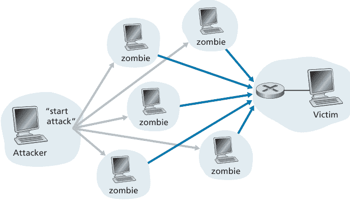

**图 1.25** 分布式拒绝服务攻击

我们鼓励你在阅读本书时思考以下问题：计算机网络设计者可以做些什么来防御DoS攻击？我们将看到，对于三种类型的DoS攻击，需要不同的防御措施。

#### 坏人可以嗅探数据包

如今许多用户通过无线设备访问互联网，例如通过WiFi连接的笔记本电脑，或具有蜂窝互联网连接的手持设备（在第7章中涵盖）。虽然无处不在的互联网访问极其方便，并为移动用户启用了美妙的新应用，但它也造成了重大的安全漏洞——通过在无线发射器附近放置一个被动接收器，该接收器就可以获取所有传输的数据包的副本！这些数据包可能包含各种敏感信息，包括密码、社会保险号码、商业机密和个人私密消息。记录所有飞过数据包的副本的被动接收器被称为**数据包嗅探器（packet sniffer）**。

嗅探器也可以在有线环境中部署。在有线的广播环境中，例如许多以太网局域网中，数据包嗅探器可以获取在局域网上传送的广播数据包的副本。如1.2节所述，有线接入技术也广播数据包，因此容易受到嗅探。此外，如果坏人获得了机构接入路由器或通往互联网的接入链路的访问权限，他们可能会部署一个嗅探器，复制进出该组织的每个数据包。然后，这些被嗅探的数据包可以在离线时进行分析，以查找敏感信息。

数据包嗅探软件在各种网站和作为商业产品免费提供。教授网络课程的老师曾布置过涉及编写数据包嗅探和应用层数据重构程序的实验练习。事实上，与本书配套的Wireshark [Wireshark 2020]实验（见本章末尾的Wireshark入门实验）使用的正是这样的数据包嗅探器！

因为数据包嗅探器是被动的——即它们不向信道注入数据包——所以很难检测到它们。因此，当我们向无线信道发送数据包时，我们必须接受这样一种可能性：某个坏人可能正在记录我们数据包的副本。正如你可能猜到的，对抗数据包嗅探的一些最佳防御措施涉及加密技术。我们将在第8章中研究适用于网络安全的加密技术。

#### 坏人可以伪装成你信任的人

创建带有任意源地址、数据包内容和目的地址的数据包，然后将这个手工构造的数据包传输到互联网中，而互联网会忠实地将该数据包转发到其目的地，这出奇地容易（*你*在阅读本书的过程中很快就会掌握这样做的方法！）。想象一下，一个毫无戒心的接收方（例如互联网路由器）收到了这样的数据包，将（虚假的）源地址视为真实，并执行数据包内容中嵌入的某些命令（例如修改其转发表）。以虚假源地址向互联网注入数据包的能力被称为**IP欺骗（IP spoofing）**，这只是用户伪装成其他用户的众多方式之一。

为了解决这个问题，我们将需要*端点身份验证*，即一种机制，使我们能够确定消息是否确实来自我们认为的来源。再次，我们鼓励你在阅读本书章节的过程中思考如何为网络应用程序和协议做到这一点。我们将在第8章探讨端点身份验证机制。

在本节结束之际，值得考虑的是互联网最初是如何变得如此不安全的。答案本质上是，互联网最初就是按照“一组相互信任的用户连接到一个透明网络”的模型设计的[Blumenthal 2001]——在这个模型中（根据定义）不需要安全性。原始互联网架构的许多方面都深刻反映了这种相互信任的观念。例如，一个用户向任何其他用户发送数据包的能力是默认的，而不是需要请求/授权的能力，并且用户身份是按照声明面值接受的，而不是默认进行身份验证。

但今天的互联网绝对不涉及“相互信任的用户”。然而，今天的用户仍然需要在不一定彼此信任的情况下进行通信，可能希望匿名通信，可能通过第三方（例如，我们将在第2章研究的Web缓存，或我们将在第7章研究的移动性辅助代理）进行间接通信，并且可能不信任他们通信所依赖的硬件、软件甚至空气。在我们阅读本书的过程中，我们面前有许多与安全相关的挑战：我们应寻求防御嗅探、端点伪装、中间人攻击、DDoS攻击、恶意软件等的措施。我们应该牢记，相互信任的用户之间的通信是例外而非规则。欢迎来到现代计算机网络的世界！

## 1.7 计算机网络和互联网的历史

第1.1节到第1.6节介绍了计算机网络技术和互联网的概述。你现在应该已经知道了足够的知识来令你的家人和朋友印象深刻！然而，如果你真的想在下一次鸡尾酒会上成为明星，你应该在你的叙述中穿插一些关于互联网迷人历史的趣闻[Segaller 1998]。

### 1.7.1 分组交换的发展：1961–1972

计算机网络领域和今天的互联网可追溯到20世纪60年代初，当时电话网络是世界上主要的通信网络。回顾1.3节，电话网络使用电路交换将信息从发送方传输到接收方——鉴于语音在发送方和接收方之间以恒定速率传输，这是一个合适的选择。考虑到计算机在20世纪60年代初日益增长的重要性以及分时计算机的出现，考虑如何将计算机连接在一起以便在地理上


分布式用户。此类用户产生的流量通常具有*突发性*——即活动间隔（例如向远程计算机发送命令），随后是等待回复或思考接收到的响应期间的非活动阶段。

全球有三个研究小组，彼此都不知道对方的工作 [Leiner 1998]，开始发明分组交换作为电路交换的高效且鲁棒的替代方案。关于分组交换技术的首篇公开发表的工作来自 MIT 的研究生 Leonard Kleinrock [Kleinrock 1961; Kleinrock 1964]。利用排队论，Kleinrock 的工作优雅地证明了分组交换方法对于突发流量源的有效性。1964 年，兰德研究院（Rand Institute）的 Paul Baran [Baran 1964] 开始研究在军用网络上使用分组交换实现安全语音传输，而英国国家物理实验室（National Physical Laboratory）的 Donald Davies 和 Roger Scantlebury 也在发展他们的分组交换理念。

MIT、兰德研究院和英国国家物理实验室的工作为今天的互联网奠定了基础。但互联网也有长期“边构建边演示”的历史，这种态度同样可以追溯到 20 世纪 60 年代。J. C. R. Licklider [DEC 1990] 和 Lawrence Roberts，两人当时都是 Kleinrock 在 MIT 的同事，后来领导了美国高级研究计划局（ARPA）的计算机科学项目。Roberts 发表了 ARPAnet 的总体计划 [Roberts 1967]，ARPAnet 是第一个分组交换计算机网络，也是当今公共互联网的直接前身。1969 年劳动节，在 Kleinrock 的监督下，第一个分组交换机安装在加州大学洛杉矶分校（UCLA），随后不久在斯坦福研究院（SRI）、加州大学圣巴巴拉分校（UC Santa Barbara）和犹他大学安装了另外三个分组交换机（图 1.26）。到 1969 年底，这个初生的互联网前身由四个节点组成。Kleinrock 回忆起该网络的首次使用，即从 UCLA 到 SRI 进行远程登录，结果导致系统崩溃 [Kleinrock 2004]。

到 1972 年，ARPA net 已增长到大约 15 个节点，并由 Robert Kahn 进行了首次公开演示。ARPA net 端系统之间首个主机到主机协议，即网络控制协议（NCP），已完成 [RFC 001]。随着端到端协议的可用，现在可以编写应用程序了。Ray Tomlinson 在 1972 年编写了第一个电子邮件程序。

### 1.7.2 专有网络与网络互连：1972–1980

最初的 ARPA net 是一个单一的封闭网络。为了与 ARPA net 主机通信，必须实际连接到另一个 ARPA net 的接口报文处理机（IMP）。在 20 世纪 70 年代初至中期，除了 ARPA net 之外，还出现了额外的独立分组交换网络：

- ALOHA net，一个连接夏威夷群岛各大学的微波网络 [Abramson 1970]，以及 DARPA 的分组卫星 [RFC 829] 和分组无线电网络 [Kahn 1978]；
- Telenet，基于 ARPAnet 技术的 BBN 商用分组交换网络；
- Cyclades，由 Louis Prouin 开创的法国分组交换网络 [Prouin 2012]；
- 20 世纪 60 年代末和 70 年代初的分时网络，如 Tymnet 和 GE Information Services 网络等 [Schwartz 1977]；
- IBM 的 SNA（1969–1974），其与 ARPAnet 工作并行发展 [Schwartz 1977]。

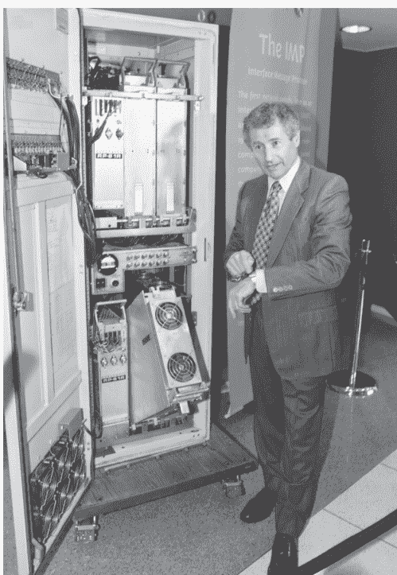

**图 1.26** *早期的分组交换机*

网络的数量在增长。若具备完美的 hindsight（后见之明），我们可以看到，开发一个连接网络的包容性架构的时机已经成熟。在国防高级研究计划局（DARPA）赞助下，Vinton Cerf 和 Robert Kahn 进行了网络互连的开创性工作 [Cerf 1974]，本质上创建了一个*网络的网络*；“网络互连”（interneting）一词被创造出来以描述这项工作。

这些架构原则体现在 TCP 中。然而，早期的 TCP 版本与今天的 TCP 大相径庭。早期的 TCP 版本将通过端系统重传实现数据的可靠按序交付（这仍然是当今 TCP 的一部分）与转发功能（如今由 IP 执行）结合在一起。对 TCP 的早期实验，加上对不可靠、无流量控制的端到端传输服务对于诸如分组语音等应用程序重要性的认识，导致了 IP 从 TCP 中分离出来以及 UDP 协议的开发。我们今天看到的三个关键互联网协议——TCP、UDP 和 IP——在 20 世纪 70 年代末在概念上已经就位。

除了与 DARPA 互联网相关的研究外，还有许多其他重要的网络活动正在进行。在夏威夷，Norman Abramson 正在开发 ALOHAnet，这是一种基于分组的无线电网络，允许夏威夷群岛上的多个远程站点相互通信。ALOHA 协议 [Abramson 1970] 是第一个多路访问协议，允许地理上分布的用户共享单一的广播通信介质（无线电频率）。Metcalfe 和 Boggs 在开发用于基于线的共享广播网络的以太网协议 [Metcalfe 1976] 时，建立在 Abramson 的多路访问协议工作之上。有趣的是，Metcalfe 和 Boggs 的以太网协议是由连接多个 PC、打印机和共享磁盘的需求所驱动的 [Perkins 1994]。25 年前，远在 PC 革命和网络爆发之前，Metcalfe 和 Boggs 就在为今天的 PC 局域网奠定基础。

### 1.7.3 网络的 proliferation（激增）：1980–1990

到 20 世纪 70 年代末，大约有两百个主机连接到 ARPA net。到 20 世纪 80 年代末，连接到公共互联网的主机数量——一个由许多网络组成的联邦，看起来很像今天的互联网——将达到十万个。20 世纪 80 年代将是巨大增长的时期。

其中许多增长源于若干旨在创建连接大学计算机网络的独立努力：

- BITNET 在东北部几所大学之间提供*电子邮件*和文件传输。
- CSNET（计算机科学与技术网络）成立，旨在连接那些无法访问 ARPANet 的大学研究人员。
- 1986 年，NSFNET 建立，旨在提供访问 NSF 资助的超级计算中心。NSFNET 的主干网初始速度为 56 kbps，到十年结束时主干网速度达到 1.5 Mbps，并作为连接区域网络的主要主干网。

在 ARPAnet 社区中，当今互联网架构的许多最终部分正在就位。1983 年 1 月 1 日，TCP/IP 正式部署为 ARPAnet 的新标准主机协议（取代 NCP 协议）。从 NCP 到 TCP/IP 的过渡 [RFC 801] 是一个“翻牌日”事件——所有主机都被要求在该日迁移到 TCP/IP。在 20 世纪 80 年代后期，对 TCP 进行了重要的扩展以实现基于主机的拥塞控制 [Jacobson 1988]。DNS 也得以开发 [RFC 1034]，用于在人类可读的互联网名称（例如，gaia.cs.umass.edu）及其 32 位 IP 地址之间进行映射。

与 ARPA net（大部分是美国努力的结果）的发展并行的是，在 20 世纪 80 年代初，法国启动了 Minitel 项目，这是一个雄心勃勃的计划，旨在将数据网络带入每个家庭。在法国政府的支持下，Minitel 系统由一个公共分组交换网络（基于 X.25 协议套件）、Minitel 服务器和内置低速调制解调器的廉价终端组成。1984 年，当法国政府向每个想要 Minitel 终端的法国家庭免费赠送一个终端时，Minitel 取得了巨大成功。Minitel 站点包括免费站点（如电话簿站点），以及从每个用户收取基于使用量费用的私有站点。在 20 世纪 90 年代中期的鼎盛时期，它提供了超过 20,000 项服务，范围从家庭银行到专业研究数据库。Minitel 在大多数美国人听到“互联网”这个词之前 10 年就已经进入了大多数法国家庭。

### 1.7.4 互联网爆炸：1990 年代

1990 年代以一系列标志着互联网持续演进和即将到来的商业化的事件开始。互联网的前身 ARPA net 停止存在。1991 年，NSFNET 取消了对其用于商业目的的限制。NSFNET 本身将在 1995 年退役，互联网主干流量由商业互联网服务提供商承载。

1990 年代的主要事件将是万维网（World Wide Web）应用的出现，它将互联网带到了全球数百万家庭和企业中。Web 作为一个平台，使我们今天视为理所当然的数百种新应用成为可能并得以部署，包括搜索（例如 Google 和 Bing）、互联网商务（例如 Amazon 和 eBay）以及社交网络（例如 Facebook）。

万维网是由 Tim Berners-Lee 在 1989 年至 1991 年间在 CERN 发明的 [Berners-Lee 1989]，基于源自 20 世纪 40 年代 Vannevar Bush [Bush 1945] 和自 20 世纪 60 年代 Ted Nelson [Xanadu 2012] 在超文本方面早期工作的想法。Berners-Lee 和他的同事开发了 HTML、HTTP、Web 服务器和浏览器的初始版本——Web 的四个关键组件。在 1993 年底左右，大约有二百台 Web 服务器在运行，这些服务器的集合只是即将发生之事的先驱。大约在这个时候，几位研究人员正在开发具有 GUI 界面的 Web 浏览器，包括 Marc Andreessen，他与 Jim Clark 一起成立了 Mosaic Communications，后来成为 Netscape Communications Corporation [Cusumano 1998; Quitterer 1998]。到 1995 年，大学学生每天都在使用 Netscape 浏览器浏览网页。大约在这个时候，大公司和小型公司开始运营


Web 服务器通过 Web 进行商务交易。1996年，微软开始制造浏览器，这引发了网景和微软之间的浏览器大战，微软在几年后赢得了这场战争 [Cusumano 1998]。

20世纪90年代后期是互联网飞速增长和创新的时期，主要的大公司和数以千计的初创企业都在创建互联网产品和服务。到了2000年之交，互联网正在支持数百种流行应用，其中包括我们所谓的“杀手级应用”：

- 电子邮件，包括附件和可通过 Web 访问的电子邮件
- Web，包括 Web 浏览和互联网商务
- 即时消息，带有联系人列表
- MP3 的点对点文件共享，由 Napster 首创

有趣的是，前两个杀手级应用源自研究界，而后两个则是由几位年轻的创业者创建的。

从1995年到2001年，互联网在金融市场上经历了一场过山车般的起伏。在尚未盈利之前，数百家互联网初创公司进行了首次公开募股（IPO），并开始进入股票市场交易。许多公司在没有任何重要收入来源的情况下，估值就达到了数十亿美元。互联网股票在2000–2001年崩溃，许多初创公司也随之关闭。尽管如此，仍有几家公司成为互联网领域的大赢家，包括微软、思科、雅虎、eBay、谷歌和亚马逊。

### 1.7.5 新千年

在21世纪的前两个十年里，也许没有其他技术比互联网以及互联网连接的智能手机对社会产生如此深刻的变革。计算机网络领域的创新也在以前所未有的速度持续进行。进步正在各个方面展开，包括访问网络和骨干网中更快的路由器和更高传输速度的部署。但以下发展特别值得关注：

- 自本世纪初以来，我们一直目睹宽带互联网接入在家庭中的激进部署——不仅包括电缆调制解调器和 DSL，还包括光纤到户（FTTH），以及正如第 1.2 节中讨论的 5G 固定无线。这种高速互联网接入为众多视频应用铺平了道路，包括用户生成视频的分布（例如，YouTube）、电影和电视节目的按需流媒体（例如，Netflix），以及多人视频 conferencing（例如，Skype、Facetime 和 Google Hangouts）。
- 高速无线互联网接入的日益普及，不仅使人们在移动中能够保持持续连接，而且使诸如 Yelp、Tinder 和 Waze 等新的基于位置的应用成为可能。连接互联网的无线设备数量在2011年超过了有线设备。这种高速无线接入为手持计算机（如 iPhone、Android、iPad 等）的迅速涌现铺平了道路，这些设备享受着持续且无拘束的互联网接入。
- 在线社交网络——如 Facebook、Instagram、Twitter 和微信（在中国极受欢迎）——在互联网之上建立了庞大的人际网络。许多这些社交网络也广泛用于消息传递和照片分享。如今，许多互联网用户主要“生活”在一个或多个社交网络中。通过其 API，在线社交网络为新联网应用创建了平台，包括移动支付和分布式游戏。
- 如第 1.3.3 节所述，像谷歌和微软这样的在线服务提供商，已经部署了它们自己的大型专用网络，这些网络不仅将它们全球分布的数据中心连接在一起，而且通过直接与较低层 ISP 对等连接，尽可能绕过互联网。结果是，谷歌几乎即时地提供搜索结果和电子邮件访问，仿佛它们的数据中心就在用户的电脑内运行一样。
- 许多互联网商务公司现在都在“云”中运行其应用程序——例如在亚马逊的 EC2、微软的 Azure 或阿里云中。许多公司和大学也将其互联网应用程序（例如电子邮件和 Web 托管）迁移到云端。云公司不仅提供可扩展的计算和存储环境，而且为应用程序提供对其高性能专用网络的隐式访问。

## 1.8 总结

在本章中，我们涵盖了大量的内容！我们研究了构成互联网（特别是）以及计算机网络（一般）的各种硬件和软件组件。我们从网络边缘开始，研究了端系统（end systems）和应用，以及提供给运行在端系统上的应用的传输服务。我们还研究了接入网络中常见的链路层技术和物理介质。然后我们深入网络内部，进入网络核心，将分组交换和电路交换确定为通过电信网络传输数据的两种基本方法，并考察了每种方法的优缺点。我们还研究了全球互联网的结构，认识到互联网是一个网络的网络。我们看到，互联网的层级结构，由较高层和较低层 ISP 组成，使其能够扩展到包含数千个网络。

在这章介绍部分的后半部分，我们考察了计算机网络领域中几个核心主题。我们首先研究了分组交换网络中延迟、吞吐量分组丢失的原因。我们开发了针对传输、传播和排队延迟以及吞吐量的简单定量模型；我们将在全书的作业题中广泛使用这些延迟模型。接下来，我们考察了协议分层和服务模型，这是网络中的重要架构原则，我们也将在全书中反复提及。我们还调查了当前互联网中一些更常见的安全攻击。我们以计算机网络简史结束了我们对网络的入门介绍。第一章本身构成了一个计算机网络迷你课程。

因此，我们确实在这一章的第一部分中覆盖了大量的地面！如果你觉得有点不知所措，别担心。在接下来的章节中，我们将重新审视所有这些概念，并以更详细的程度涵盖它们（这是承诺，不是威胁！）。在此，我们希望你在离开本章时，拥有对构成网络各个部分的正在发展的直觉，对网络词汇的正在发展的掌握（不要害羞于回头参考本章），以及想更多地了解网络的不断增长的兴趣。这是我们要为本书剩余部分承担的任务。

### 本书的路线图

在开始任何旅程之前，你总是应该看一眼路线图，以便熟悉前方主要的道路和交汇点。对于我们要开始的旅程，最终目的地是对计算机网络如何、是什么以及为什么的深刻理解。我们的路线图是本书章节的顺序：

1. 计算机网络与互联网
2. 应用层
3. 传输层
4. 网络层：数据平面
5. 网络层：控制平面
6. 链路层与局域网
7. 无线与移动网络
8. 计算机网络安全

第 2 章到第 6 章是本书的五个核心章节。你应该注意到，这些章节围绕着五层互联网协议的前四层组织。另外请注意，我们的旅程将从互联网协议堆栈的顶部，即应用层开始，并逐步向下推进。这种自上而下旅程的理由是，一旦我们理解了应用，我们就能理解支持这些应用所需的网络服务。然后，我们可以进一步检查网络架构可能实现此类服务的各种方式。因此，早期涵盖应用为文本的其余部分提供了动机。

本书的第二部分——第 7 章和第 8 章——深入探讨现代计算机网络中两个极其重要（且 somewhat 独立）的主题。在第 7 章中，我们研究无线和移动网络，包括无线局域网（包括 WiFi 和蓝牙）、蜂窝网络（包括 4G 和 5G）以及移动性。第 8 章，涉及计算机网络安全，首先审视加密和网络安全的基础，然后我们考察基本理论如何在广泛的互联网环境中得到应用。

# 作业题和问题

## 第 1 章复习题

### 1.1 节

- **R1.** 主机和端系统之间的区别是什么？列出几种不同类型的端系统。Web 服务器是端系统吗？
- **R2.** 单词*protocol*常被用来描述外交关系。维基百科如何描述外交礼节？
- **R3.** 为什么标准对于协议很重要？

### 1.2 节

- **R4.** 列出四种接入技术。将每一种分类为家庭接入、企业接入或广域无线接入。
- **R5.** HFC 传输速率是专用于用户还是在用户间共享？在 HFC 下行信道中是否可能发生冲突？为什么或为什么不？
- **R6.** 列出你所在城市的可用住宅接入技术。对于每种接入类型，提供广告下行速率、上行速率和月费价格。
- **R7.** 以太网局域网的传输速率是多少？
- **R8.** 以太网可以运行在哪些物理介质上？
- **R9.** HFC、DSL 和 FTTH 都用于住宅接入。对于每一种接入技术，提供一个传输速率范围，并评论传输速率是共享的还是专用的。
- **R10.** 描述当今最流行的无线互联网接入技术。比较它们的异同。


## 1.3 节

R11. 假设发送主机和接收主机之间恰好只有一个分组交换（packet switch）。发送主机与交换机之间的传输速率以及交换机与接收主机之间的传输速率分别为 $R_1$ 和 $R_2$。假设该交换机采用存储-转发（store-and-forward）分组交换，那么发送一个长度为 $L$ 的分组的端到端总延迟是多少？（忽略排队、传播延迟和处理延迟。）

R12. 电路交换网络相比分组交换网络有什么优势？在电路交换网络中，TDM（时分复用）相比 FDM（频分复用）有什么优势？

R13. 假设用户共享一条 2 Mbps 的链路。此外，假设每个用户在传输时以 1 Mbps 的速率持续传输，但每个用户仅在 20% 的时间内进行传输。（参见 1.3 节中关于统计复用的讨论。）
- a. 当使用电路交换时，可以支持多少用户？
- b. 对于本题的其余部分，假设使用分组交换。如果两个或更少的用户同时传输，为什么在链路前几乎不会发生排队延迟？如果三个用户同时传输，为什么会发生排队延迟？
- c. 找出特定用户正在传输的概率。
- d. 假设现在有 3 个用户。找出在任意给定时刻，这 3 个用户同时传输的概率。找出队列增长所占的时间比例。

R14. 为什么处于同一层级的两个 ISP（互联网服务提供商）通常会彼此建立对等互联（peer）？IXP（互联网交换点）如何盈利？

R15. 一些内容提供商创建了自己的网络。描述谷歌（Google）的网络。是什么动机驱使内容提供商创建这些网络？

## 1.4 节

R16. 考虑通过固定路由从源主机向目的主机发送一个分组。列出端到端延迟中的延迟组成成分。这些延迟中哪些是常数，哪些是变量？

R17. 访问配套网站上的“传输与传播延迟”交互动画。在可用的速率、传播延迟和分组大小中，找到一种组合，使得发送方在分组的第一位比特到达接收方之前完成传输。找到另一种组合，使得分组的第一位比特在发送方完成传输之前到达接收方。

R18. 一个长度为 1,000 字节的分组在距离为 2,500 km、传播速度为 $2.5 \times 10^8$ m/s、传输速率为 2 Mbps 的链路上传播需要多长时间？更一般地，长度为 $L$ 的分组在距离为 $d$、传播速度为 $s$、传输速率为 $R$ 的链路上传播需要多长时间？

R19. 假设主机 A 想要向主机 B 发送一个大文件。从主机 A 到主机 B 的路径有三条链路，其速率分别为 $R_1 = 500$ kbps，$R_2 = 2$ Mbps，以及 $R_3 = 1$ Mbps。
- a. 假设网络中没有其他流量，文件传输的吞吐量是多少？
- b. 假设文件为 400 万字节。将文件大小除以吞吐量，大约需要多长时间将文件传输到主机 B？
- c. 重复 (a) 和 (b)，但现在将 $R_2$ 降低到 100 kbps。

R20. 假设终端系统 A 想要向终端系统 B 发送一个大文件。从非常高的层面描述终端系统 A 如何从文件创建分组。当其中一个分组到达路由器时，路由器使用分组中的什么信息来确定将分组转发到哪个链路？为什么互联网中的分组交换类似于从一座城市开车到另一座城市，并在途中询问方向？

R21. 访问配套网站上的“排队与丢失”交互动画。最大发射速率和最小传输速率是多少？在这些速率下，流量强度是多少？以这些速率运行交互动画，确定发生分组丢失需要多长时间。然后第二次重复该实验，再次确定发生分组丢失需要多长时间。数值是否不同？为什么或为什么不？

## 1.5 节

R22. 列出层（layer）可以执行的五项任务。是否可能由两层（或更多层）来执行其中一项（或更多项）任务？

R23. 互联网协议栈中的五个层是什么？这些层的主要职责是什么？

R24. 什么是应用层报文？传输层段？网络层分组？链路层帧？

R25. 互联网协议栈中，路由器处理哪些层？链路层交换机处理哪些层？主机处理哪些层？

## 1.6 节

R26. 什么是自我复制恶意软件？

R27. 描述如何创建僵尸网络（botnet）以及它如何用于 DDoS（分布式拒绝服务）攻击。

R28. 假设 Alice 和 Bob 正在通过计算机网络互相发送分组。假设 Trudy 在网络中占据了一个位置，使她能够捕获 Alice 发送的所有分组，并向 Bob 发送她想要的任何内容；她还可以捕获 Bob 发送的所有分组，并向 Alice 发送她想要的任何内容。列出 Trudy 可以从这个位置做出的一些恶意行为。

## 习题

P1. 设计并描述一个应用于自动取款机（ATM）与银行中央计算机之间的应用层协议。你的协议应允许验证用户的卡片和密码，查询账户余额（在中央计算机上维护），并执行账户取款（即向用户支付现金）。你的协议实体应能够处理账户余额不足以覆盖取款金额这一常见情况。通过列出交换的消息以及自动取款机或银行中央计算机在传输和接收消息时采取的操作来指定你的协议。使用与图 1.2 类似的图表，针对无错误的简单取款情况，绘制你的协议运行过程。明确陈述你的协议对底层端到端传输服务所做的假设。

P2. 公式 1.1 给出了在传输速率为 $R$ 的 $N$ 条链路上发送一个长度为 $L$ 的分组所需的端到端延迟的公式。将此公式推广为在 $N$ 条链路上背靠背（back-to-back）发送 $P$ 个这样的分组。

P3. 考虑一个以恒定速率传输数据的应用（例如，发送方每 $k$ 个时间单位生成一个 $N$ 位的数据单元，其中 $k$ 很小且固定）。此外，当此类应用启动时，它将在相对较长的时间内继续运行。简要回答以下问题并说明理由：
- a. 对于此应用，分组交换网络还是电路交换网络更合适？为什么？
- b. 假设使用分组交换网络，且该网络中唯一的流量来自如上所述的应用。此外，假设所有应用的数据速率之和小于每条链路的容量。是否需要某种形式的拥塞控制？为什么？

P4. 考虑图 1.13 中的电路交换网络。回忆每条链路上有四个电路。按顺时针方向将四个交换机标记为 A、B、C 和 D。
- a. 在此网络中，任意时刻最多可以有多少个同时进行的连接？
- b. 假设所有连接都在交换机 A 和 C 之间。最多可以有多少个同时进行的连接？
- c. 假设我们想要建立四个 A 和 C 之间的连接，以及另外四个 B 和 D 之间的连接。我们能否通过这四条链路路由这些呼叫以容纳所有八个连接？


P5. 回顾 1.4 节中的车队类比。假设传播速度为 100 km/h。
- a. 假设车队行驶 175 km，从一个收费站前面开始，经过第二个收费站，并在第三个收费站刚刚之后结束。端到端延迟是多少？
- b. 重复 (a)，但现在假设车队中有八辆车而不是十辆。

P6. 这个基础问题开始探讨传播延迟和传输延迟，这两个是数据网络中的核心概念。考虑两个主机 A 和 B，由一条速率为 R bps 的链路连接。假设两个主机相距 $m$ 米，假设链路沿线的传播速度为 $s$ 米/秒。主机 A 需要向主机 B 发送一个大小为 $L$ 比特的分组。
- a. 用 $m$ 和 $s$ 表示传播延迟 $d_{prop}$。
- b. 用 $L$ 和 $R$ 确定分组的传输时间 $d_{trans}$。
- c. 忽略处理延迟和排队延迟，得出端到端延迟的表达式。
- d. 假设主机 A 在时间 $t = 0$ 开始传输分组。在时间 $t = d_{trans}$ 时，分组的最后一个比特在哪里？
- e. 假设 $d_{prop}$ 大于 $d_{trans}$。在时间 $t = d_{trans}$ 时，分组的第一个比特在哪里？
- f. 假设 $d_{prop}$ 小于 $d_{trans}$。在时间 $t = d_{trans}$ 时，分组的第一个比特在哪里？
- g. 假设 $s = 2.5 \cdot 10^8$，$L = 1500$ 字节，且 $R = 10$ Mbps。求距离 $m$ 使得 $d_{prop}$ 等于 $d_{trans}$。

P7. 在这个问题中，我们考虑通过分组交换网络（VoIP）从主机 A 向主机 B 发送实时语音。主机 A 即时将模拟语音转换为数字 64 kbps 比特流。然后主机 A 将这些比特分组为 56 字节的分组。主机 A 和 B 之间有一条链路；其传输速率为 10 Mbps，传播延迟为 10 毫秒。一旦主机 A 收集到一个分组，它就将其发送给主机 B。一旦主机 B 接收到完整的分组，它就将分组的比特转换为模拟信号。从比特生成（主机 A 的原始模拟信号）到比特解码（作为主机 B 的模拟信号的一部分）经过了多少时间？

P8. 假设用户共享一条 10 Mbps 的链路。此外，假设每个用户在传输时需要 200 kbps，但每个用户仅在 10% 的时间内进行传输。（参见 1.3 节中关于分组交换与电路交换的讨论。）
- a. 当使用电路交换时，可以支持多少用户？
- b. 对于本题的其余部分，假设使用分组交换。找出特定用户正在传输的概率。


c. 假设有 120 个用户。找出在任意给定时刻，恰好有 $n$ 个用户同时传输的概率。（*提示：使用二项分布。*）

d. 找出同时传输的用户数大于或等于 51 个的概率。

P9. 参见第 1.3 节中关于分组交换与电路交换的讨论，其中给出了一个 1 Mbps 链路的示例。用户忙碌时生成数据的速率为 100 kbps，但只有在概率 $p = 0.1$ 的情况下才会处于忙碌状态并生成数据。假设将 1 Mbps 链路替换为 1 Gbps 链路。

- a. 在电路交换下，能够同时支持的最大用户数 $N$ 是多少？
- b. 现在考虑分组交换和 $M$ 个用户的人口规模。给出一个公式（以 $p, M, N$ 表示），用于计算超过 $N$ 个用户正在发送数据的概率。

P10. 考虑一个长度为 $L$ 的分组，它从终端系统 A 开始，经过三条链路传输到目标终端系统。这三条链路通过两个分组交换机连接。设 $d_i$、$s_i$ 和 $R_i$ 分别表示链路 $i$ 的长度、传播速度和传输速率，其中 $i = 1, 2, 3$。分组交换机对每个分组的处理延迟为 $d_{proc}$。假设没有排队延迟，用 $d_i$、$s_i$、$R_i$ $(i = 1, 2, 3)$ 和 $L$ 表示，该分组的端到端总延迟是多少？假设现在分组为 1,500 字节，三条链路上的传播速度均为 $2.5 \times 10^8$ m/s，三条链路的传输速率均为 2.5 Mbps，分组交换机的处理延迟为 3 毫秒，第一条链路的长度为 5,000 公里，第二条链路的长度为 4,000 公里，最后一条链路的长度为 1,000 公里。对于这些数值，端到端延迟是多少？

P11. 在上一题中，假设 $R_1 = R_2 = R_3 = R$ 且 $d_{proc} = 0$。进一步假设分组交换机不采用存储转发方式，而是立即传输它接收到的每一个比特，而无需等待整个分组到达。此时的端到端延迟是多少？

P12. 一个分组交换机接收一个分组，并确定该分组应被转发到的出站链路。当该分组到达时，该出站链路上还有另一个分组正在传输且已完成一半，另有四个分组在等待传输。分组按到达顺序进行传输。假设所有分组均为 1,500 字节，链路速率为 2.5 Mbps。该分组的排队延迟是多少？更一般地，当所有分组的长度均为 $L$，传输速率为 $R$，当前正在传输的分组已传输了 $x$ 比特，且队列中已有 $n$ 个分组时，排队延迟是多少？

P13. (a) 假设 $N$ 个分组同时到达一条链路，且该链路上当前没有正在传输或排队的分组。每个分组的长度为 $L$，链路的传输速率为 $R$。这 $N$ 个分组的平均排队延迟是多少？

(b) 现在假设每隔 $L/N/R$ 秒就有 $N$ 个这样的分组到达该链路。一个分组的平均排队延迟是多少？

P14. 考虑路由器缓冲区中的排队延迟。设 $I$ 表示流量强度；即 $I = La/R$。假设当 $I < 1$ 时，排队延迟的形式为 $IL/R (1 - I)$。

- a. 提供一个总延迟的公式，即排队延迟加上传输延迟。
- b. 绘制总延迟随 $L/R$ 变化的曲线。

P15. 设 $a$ 表示分组到达链路的速率（单位：分组/秒），设 $\mu$ 表示链路的传输速率（单位：分组/秒）。基于上一题推导出的总延迟公式（即排队延迟加上传输延迟），推导一个用 $a$ 和 $\mu$ 表示的总延迟公式。

P16. 考虑位于出站链路之前的路由器缓冲区。在本问题中，你将使用李特尔公式（Little's formula），这是排队论中一个著名的公式。设 $N$ 表示缓冲区中分组的平均数量加上正在传输的分组数量。设 $a$ 表示分组到达链路的速率。设 $d$ 表示分组经历的平均总延迟（即排队延迟加上传输延迟）。李特尔公式为 $N = a \cdot d$。假设平均而言，缓冲区包含 100 个分组，分组的平均排队延迟为 20 毫秒。链路的传输速率为 100 分组/秒。使用李特尔公式，假设没有分组丢失，求分组的平均到达速率。

P17. 
- a. 将第 1.4.3 节的公式 1.2 推广到具有异构处理速率、传输速率和传播延迟的情况。
- b. 重复 (a)，但现在还假设每个节点都有平均排队延迟 $d_{queue}$。

P18. 在同一洲内的源和目标之间，在一天中的三个不同时段执行 Traceroute 操作。

- a. 找出每个时段往返延迟的平均值和标准差。
- b. 找出每个时段路径中的路由器数量。在这三个时段中的任何一个期间，路径是否发生了变化？
- c. 尝试识别 Traceroute 分组从源到目标所经过的 ISP 网络数量。名称相似和/或 IP 地址相似的路由器应被视为属于同一个 ISP。在你的实验中，最大的延迟是否发生在相邻 ISP 之间的对等互连接口处？
- d. 对位于不同洲的源和目标重复上述操作。比较洲内和洲间结果。

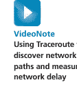

P19. 梅特卡夫定律（Metcalfe’s law）指出，计算机网络的价值与系统中连接用户数量的平方成正比。设 $n$ 表示计算机网络中的用户数。假设每个用户向其他每个用户发送一条消息，总共将发送多少条消息？你的答案是否支持梅特卡夫定律？

P20. 考虑对应于图 1.20(b) 的吞吐量示例。现在假设有 $M$ 个客户端-服务器对，而不是 10 个。用 $R_{s}$、$R_{c}$ 和 $R$ 分别表示服务器链路、客户端链路和网络链路的速率。假设所有其他链路具有充足的容量，并且网络中除了由 $M$ 个客户端-服务器对产生的流量外没有其他流量。推导一个用 $R_{s}$、$R_{c}$、$R$ 和 $M$ 表示的吞吐量通用表达式。

P21. 考虑图 1.19(b)。现在假设服务器和客户端之间有 $M$ 条路径。任意两条路径不共享任何链路。路径 $k$ ($k = 1, \ldots, M$) 由 $N$ 条链路组成，传输速率分别为 $R_{1}^{k}$、$R_{2}^{k}$、$\ldots$、$R_{N}^{k}$。如果服务器只能使用一条路径向客户端发送数据，服务器能达到的最大吞吐量是多少？如果服务器可以使用所有 $M$ 条路径发送数据，服务器能达到的最大吞吐量是多少？

P22. 考虑图 1.19(b)。假设服务器和客户端之间的每条链路的分组丢失概率为 $p$，且这些链路的分组丢失概率是独立的。服务器发送的分组被接收方成功接收的概率是多少？如果一个分组在从服务器到客户端的路径中丢失，则服务器将重新传输该分组。为了使客户端成功接收该分组，平均而言服务器需要重新传输该分组多少次？

P23. 考虑图 1.19(a)。假设我们知道从服务器到客户端路径上的瓶颈链路是速率为 $R_{s}$ bits/sec 的第一条链路。假设我们从服务器向客户端背靠背发送一对分组，且该路径上没有其他流量。假设每个分组的大小为 $L$ 比特，且两条链路具有相同的传播延迟 $d_{prop}$。

- a. 目的地的分组到达间隔时间是多少？即，从第一个分组的最后一位到达的时刻到第二个分组的最后一位到达的时刻，经过了多少时间？
- b. 现在假设第二条链路是瓶颈（即 $R_{c} < R_{s}$）。第二个分组是否可能在第二条链路的输入队列中排队？请解释。现在假设服务器在发送第一个分组 $T$ 秒后发送第二个分组。$T$ 必须有多大才能确保在第二条链路之前不发生排队？请解释。

P24. 假设你希望紧急从波士顿向洛杉矶传输 50 TB 的数据。你拥有一条可用于数据传输的 100 Mbps 专用链路。你更倾向于通过该链路传输数据，还是使用 FedEx 隔夜快递？请解释原因。


## P25. 假设主机 A 和主机 B 相距 20,000 公里，并由一条带宽为 $R = 5$ Mbps 的直接链路连接。假设该链路上的信号传播速度为 $2.5 \cdot 10^8$ 米/秒。

- a. 计算带宽时延积（bandwidth-delay product），$R \cdot d_{prop}$。
- b. 考虑将主机 A 上的一个 800,000 位的文件发送到主机 B。假设该文件作为一个大的连续消息被发送。在任意给定时刻，链路中最大有多少位？
- c. 请解释带宽时延积的含义。
- d. 链路中一个比特的宽度是多少（以米为单位）？它是否比一个足球场长？
- e. 推导一个通用表达式，用传播速度 $s$、传输速率 $R$ 和链路长度 $m$ 来表示比特的宽度。

## P26. 参考问题 P24，假设我们可以改变 $R$。当 $R$ 为什么值时，比特的宽度等于链路的长度？

## P27. 考虑问题 P24，但现在链路带宽为 $R = 500$ Mbps。

- a. 计算带宽时延积，$R \cdot d_{prop}$。
- b. 考虑将主机 A 上的一个 800,000 位的文件发送到主机 B。假设该文件作为一个大的连续消息被发送。在任意给定时刻，链路中最大有多少位？
- c. 链路中一个比特的宽度是多少（以米为单位）？

## P28. 再次参考问题 P24。

- a. 假设文件被连续发送，发送该文件需要多长时间？
- b. 假设文件被拆分为 20 个分组，每个分组包含 40,000 位。假设每个分组都由接收方确认，且确认分组传输时间可以忽略。最后，假设发送方在前一个分组被确认之前不能发送下一个分组。发送该文件需要多长时间？
- c. 比较（a）和（b）的结果。

## P29. 假设一颗地球静止卫星与其地面基站之间有一条 10 Mbps 的微波链路。每过一分钟，卫星拍摄一张数字照片并将其发送到基站。假设传播速度为 $2.4 \cdot 10^8$ 米/秒。

- a. 该链路的传播时延是多少？
- b. 带宽时延积 $R \cdot d_{prop}$ 是多少？
- c. 设 $x$ 表示照片的大小。为了使微波链路处于连续传输状态，$x$ 的最小值是多少？

## P30. 考虑我们在第 1.5 节关于分层讨论中的航空旅行类比，以及协议数据单元（PDU）在协议栈中向下流动时添加头部。在航空协议栈中，是否有一种对应的“头部信息”概念被添加到乘客和行李上？

## P31. 在现代分组交换网络中，包括互联网，源主机将长的应用层消息（例如图像或音乐文件）分割成较小的分组，并将分组送入网络。接收方然后将分组重新组装为原始消息。我们将此过程称为*消息分段*（message segmentation）。图 1.27 说明了有无消息分段的端到端消息传输。考虑一个长度为 $10^6$ 位的消息，需要按照图 1.27 从源发送到目的。假设图中每条链路均为 5 Mbps。忽略传播、排队和处理时延。

- a. 考虑在*没有*消息分段的情况下将消息从源发送到目的。将消息从源主机移动到第一个分组交换器需要多长时间？考虑到每个交换器使用存储转发（store-and-forward）分组交换方式，将消息从源主机移动到目的主机的总时间是多少？
- b. 现在假设消息被分割成 100 个分组，每个分组 10,000 位。将第一个分组从源主机移动到第一个交换器需要多长时间？当第一个分组正从第一个交换器发送到第二个交换器时，第二个分组正从源主机发送到第一个交换器。第二个分组何时会在第一个交换器处被完全接收？
- c. 使用消息分段时，将文件从源主机移动到目的主机需要多长时间？将此结果与第（a）部分的答案进行比较并发表评论。

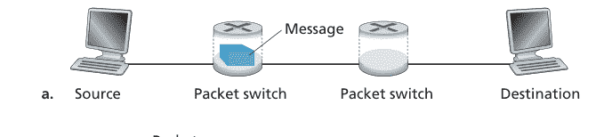

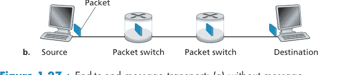

**图 1.27** ♦ 端到端消息传输：(a) 无消息分段；(b) 有消息分段

- d. 除了减少时延外，使用消息分段还有哪些原因？
- e. 讨论消息分段的缺点。

## P32. 在本书网站上的“消息分段”交互动画中进行实验。交互动画中的时延是否与前一问题中的时延对应？链路传播时延如何影响分组交换（有消息分段）和消息交换的整体端到端时延？

## P33. 考虑将 $F$ 位的大文件从主机 A 发送到主机 B。A 和 B 之间有三条链路（和两个交换机），且链路不拥塞（即没有排队时延）。主机 A 将文件分割为每个 $S$ 位的段，并在每个段上添加 80 位的头部，形成长度为 $L = 80 + S$ 位的分组。每条链路的传输速率为 $R$ bps。找出使文件从主机 A 移动到主机 B 的时延最小化的 $S$ 值。忽略传播时延。

## P34. Skype 提供了一项服务，允许用户从 PC 向普通电话拨打电话。这意味着语音呼叫必须经过互联网和电话网络。讨论这可能如何实现。

## Wireshark 实验

> “告诉我，我会忘记。做给我看，我会记住。让我参与，我会理解。”

*中国谚语*

通过观察网络协议的实际操作并与之进行互动——观察两个协议实体之间交换消息的顺序，深入研究协议操作的细节，让协议执行某些操作并观察这些操作及其后果——人们往往可以极大地加深对网络协议的理解。这可以在模拟场景中完成，也可以在真实网络环境（如互联网）中完成。教材网站上的交互动画采用了第一种方法。在 Wireshark 实验中，我们将采用后一种方法。你将使用书桌、家中或实验室里的计算机在各种场景下运行网络应用程序。你将观察计算机中的网络协议，与在互联网其他位置运行的协议实体进行交互并交换消息。因此，你和你的计算机将成为这些实时实验不可分割的一部分。你将通过动手实践来观察——并学习。

观察正在运行的协议实体之间交换消息的基本工具被称为**分组嗅探器**（packet sniffer）。顾名思义，分组嗅探器被动地复制（嗅探）从你的计算机发送和接收的消息；它还显示这些捕获消息中各种协议字段的内容。图 1.28 显示了 Wireshark 分组嗅探器的屏幕截图。Wireshark 是一个免费的分组嗅探器，运行在 Windows、Linux/Unix 和 Mac 计算机上。在整个教材中，你会发现允许你探索本章所研究的一系列协议的 Wireshark 实验。在这个第一个 Wireshark 实验中，你将获取并安装 Wireshark 的副本，访问一个网站，并捕获和检查你的 Web 浏览器和 Web 服务器之间交换的协议消息。

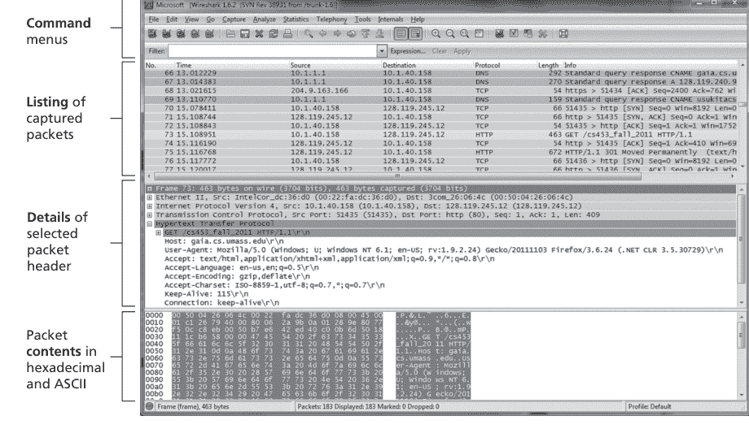

**图 1.28** ♦ 一个 Wireshark 屏幕截图（Wireshark 屏幕截图经 Wireshark 基金会许可重印。）

你可以在网站 www.pearson.com/cs-resources 找到关于这个第一个 Wireshark 实验的完整详细信息（包括如何获取和安装 Wireshark 的说明）。

## Leonard Kleinrock

Leonard Kleinrock 是加利福尼亚大学洛杉矶分校（UCLA）的计算机科学教授。1969 年，他在 UCLA 的计算机成为互联网的第一个节点。他在 1961 年创建的分组交换原理的数学理论成为了互联网背后的技术基础。他获得纽约城市学院（CCNY）的电机工程学士学位，以及麻省理工学院（MIT）的电机工程硕士学位和博士学位。


> 是什么让你决定专门研究网络/互联网技术？

1959 年，当我是麻省理工学院的一名博士生时，我环顾四周，发现我的大多数同学都在研究由伟大的研究人员克劳德·香农（Claude Shannon）确立的信息论和编码理论领域。我判断他基本上已经解决了大多数重要问题。剩下的研究问题很困难，在我看来意义也较小。因此，我决定开辟一个新的领域，这是其他人尚未想到的。幸运的是，在麻省理工学院我被许多计算机包围着，我很清楚，迟早这些机器需要相互通信。当时，没有有效的方法让它们做到这一点，而解决这个重要问题的方案将产生影响。我有解决这个问题的一套方法，因此，对于我的博士研究，我决定创建一个数学理论来建模、评估、设计和优化高效且可靠的数据网络。

> 你在计算机行业的第一个职位是什么？它包含哪些内容？

从 1951 年到 1957 年，我前往纽约城市学院的夜校攻读电机工程学士学位。白天，我首先是一名技术人员，然后是一家名为 Photobell 的小型工业电子公司里的电气工程师。在那里，我将数字技术引入他们的产品线。基本上，我们使用光电设备来检测某些物品（盒子、人等）的存在，而当时被称为双稳态多谐振荡器的电路正是我们需要的，它将数字处理引入了这个检测领域。这些电路恰好是计算机的构建模块，在当今的术语中被称为*触发器*（flip-flops）或开关。

> 当你发送第一个主机到主机的消息（从 UCLA 到斯坦福研究所）时，你脑子里在想什么？

老实说，我们并不知道那件事的重要性。我们没有准备一条具有历史意义的特殊消息，不像过去的许多发明家那样（如塞缪尔·莫尔斯的“上帝做了什么”，或亚历山大·格雷厄姆·贝尔的“沃森，过来！我需要你。”）或者尼尔·阿姆斯特朗的“这是个人的一小步，却是人类的一大步。”那些人很*聪明！*他们理解媒体和公关。我们只想证明我们能够远程登录到 SRI 计算机。所以我们输入了“L”，


该信息被正确接收。我们输入了字母“o”，该字母被正确接收，随后我们输入了字母“g”，导致 SRI 主机崩溃！因此，事实证明，我们的信息是史上最简短的，也许也是最具预言性质的信息，即“Lo”，意为“Lo and behold!”（意为“瞧”或“看哪”）。

在那一年早些时候，我在 UCLA 的一份新闻稿中被引用，当时我说，一旦网络建成并运行，我们就能够像获取电力和电话连接一样，轻松地从家庭和办公室访问计算机工具。因此，我当时的愿景是互联网将是无所不在的，永远在线，随时可用，任何拥有任何设备的人都可以从任何位置连接，并且它是不可见的。然而，我从未预料到我 99 岁的母亲会在我 5 岁的孙女同时使用互联网时——事实上她确实这么做了！

## 你对网络未来的愿景是什么？

愿景中容易的部分是预测基础设施本身。我预计我们将看到无线和移动设备在智能空间中大量部署，从而产生我喜欢称之为“隐形互联网”的东西。这一步将使我们得以从赛博空间的幽暗世界走向智能空间的物理世界。我们的环境（桌面、墙壁、车辆、手表、腰带、指甲、身体等）将通过执行器、传感器、逻辑、处理、存储、相机、麦克风、扬声器、显示器和通信变得充满生机。这种嵌入式技术将允许我们的环境在我们希望的任何时间、任何地点提供 IP 服务。当我走进一个房间时，房间会知道我进入了。我将能够以自然的方式（如英语口语、触觉、手势，最终通过脑机接口）与我的环境进行交流；我的请求将生成回复，通过墙面显示器、我的眼镜，以语音、全息图像等形式向我展示网页。

再往前看，我看到的网络未来包括以下额外的关键组成部分。
- 我看到定制的智能软件代理被部署在整个网络上，其功能在于挖掘数据、对数据采取行动、观察趋势，并动态且自适应地执行任务。
- 我看到区块链技术的部署，它提供不可否认、不可变的分布式账本，并结合声誉系统为内容和功能提供可信度。
- 我看到网络流量大幅增加，这些流量并非主要产生于人类，而是产生于嵌入式设备、智能软件代理和分布式账本。
- 我看到大量的自组织系统在控制这个庞大、快速网络。
- 我看到海量信息瞬间在此网络中闪烁，这些信息经过巨大的处理和过滤。
- 隐形互联网本质上将是一个无处不在的全球神经系统。
- 当我大步迈向 21 世纪时，我看到所有这些以及更多的事物。

愿景中更难的部分是预测应用和服务，这些应用和服务一直以戏剧性的方式令我们惊讶（电子邮件、搜索技术、万维网、博客、点对点网络、社交网络、用户生成内容，以及音乐、照片和视频的分享等）。这些应用是“横空出世”，突然、未预见且爆炸性地出现。这对于下一代来说，是一个多么奇妙的世界去探索啊！

## 在职业上谁给你带来了启发？

迄今为止，最启发我的是来自 MIT 的克劳德·香农，他是一位杰出的研究者，能够以极具直觉性的方式将其数学思想与物理世界联系起来。他是我的博士论文委员会中一位出色的成员。

## 你对进入网络/互联网领域的学生有什么建议？

互联网及其所带来的一切是一个广阔的新边疆，持续充满惊人的挑战。这里有巨大的创新空间。不要被当今的技术所束缚。伸出手去，想象可能存在的样子，然后让它实现。


# 第 2 章

## 应用层

网络应用是计算机网络的*存在理由*——如果我们无法构想出任何有用的应用，那么就不需要支持它们的基础设施和协议。自互联网诞生以来，确实创造了许多有用且有趣的应用。这些应用是互联网成功背后的驱动力，促使家庭、学校、政府和企业的用户将互联网作为其日常活动的组成部分。

互联网应用包括在 20 世纪 70 年代和 80 年代流行的经典基于文本的应用：文本电子邮件、远程计算机访问、文件传输和新闻组。它们包括 20 世纪 90 年代中期的*杀手级应用*——万维网，涵盖网页浏览、搜索和电子商务。自新千年伊始，新的高度引人注目的应用不断涌现，包括通过 IP 的语音和视频 conferencing（如 Skype、Facetime 和 Google Hangouts）；用户生成的视频（如 YouTube）和点播电影（如 Netflix）；以及多人在线游戏（如《第二人生》和《魔兽世界》）。在同一时期，我们看到新一代社交网络应用的崛起——如 Facebook、Instagram 和 Twitter——它们在互联网的路由器或通信链接网络之上构建了人类网络。最近，随着智能手机的到来和 4G/5G 无线互联网接入的普及，出现了大量的基于位置的手机应用，包括流行的签到、约会和道路交通预测应用（如 Yelp、Tinder 和 Waze），移动支付应用（如微信和 Apple Pay）以及消息应用（如微信和 WhatsApp）。显然，新的激动人心的互联网应用从未减速。也许本书的一些读者将创造下一代杀手级互联网应用！

在本章中，我们将研究网络应用的概念和实现方面。我们首先定义关键的应用层概念，包括应用所需的网络服务、客户端和服务器、进程以及传输层接口。我们将详细研究几种网络应用，包括 Web、电子邮件、DNS、点对点（P2P）文件分发和视频流媒体。然后，我们将涵盖基于 TCP 和 UDP 的网络应用开发。特别地，我们将研究套接字接口，并逐步介绍一些用 Python 编写的简单客户端-服务器应用。我们还在本章末尾提供了几个有趣且有意思的套接字编程作业。

应用层是我们研究协议的一个特别好的起点。这是我们熟悉的地盘。我们熟悉许多依赖于我们将要研究的协议的应用。这将让我们对协议的本质有一个很好的感觉，并将引导我们看到许多在我们研究传输层、网络层和链路层协议时会再次遇到的相同问题。

### 2.1 网络应用原理

假设你有一个新的网络应用想法。也许这个应用将为人类带来巨大服务，或者取悦你的教授，或者给你带来巨大财富，或者仅仅是开发起来很有趣。无论动机是什么，让我们现在来看看如何把这个想法转化为现实中的网络应用。

网络应用开发的核心是编写运行在不同终端系统上并相互通过网络通信的程序。例如，在 Web 应用中，有两个不同的程序相互通信：运行在用户主机（台式机、笔记本电脑、平板电脑、智能手机等）上的浏览器程序；以及运行在 Web 服务器主机上的 Web 服务器程序。作为另一个例子，在点播视频应用（如 Netflix，参见第 2.6 节）中，有一个由 Netflix 提供并运行在用户智能手机、平板电脑或计算机上的程序；以及一个运行在 Netflix 服务器主机上的 Netflix 服务器程序。服务器（但并不总是）通常安置在数据中心，如图 2.1 所示。

因此，在开发你的新应用时，你需要编写将在多个终端系统上运行的软件。例如，该软件可以用 C、Java 或 Python 编写。重要的是，你不需要编写在网络核心设备（如路由器或链路层交换机）上运行的软件。即使你想为这些网络核心设备编写应用软件，你也做不到。正如我们在第 1 章所学到的，以及之前在图 1.24 中所示，网络核心设备不在应用层工作，而是在较低的层——具体是在网络层及以下工作。这种基本设计——即将应用软件限制在终端系统上，如图 2.1 所示——促进了大量网络应用的快速开发和部署。


**图 2.1** 网络应用的通信发生在应用层的主机系统之间

### 2.1.1 网络应用架构

在深入软件编码之前，你应该为应用程序制定一个广泛的架构计划。请记住，应用程序架构与网络架构（例如第 1 章中讨论的五层互联网架构）有着明显的区别。从应用程序开发者的角度来看，网络架构是固定的，并为应用程序提供一组特定的服务。另一方面，应用程序架构由应用程序开发者设计，并决定应用程序如何在各种终端系统上进行结构化。在选择应用程序架构时，应用程序开发者很可能会采用现代网络应用使用的两种主要架构范式之一：客户-服务器架构或对等（P2P）架构。

在客户-服务器架构中，有一个始终在线的主机，称为**服务器**，它处理来自许多其他主机（称为**客户**）的请求。一个经典的例子是 Web 应用，其中一台始终在线的 Web 服务器处理来自运行在客户主机上的浏览器的请求。当 Web 服务器收到来自客户主机的对象请求时，它会通过向该客户主机发送请求的对象来响应。请注意，在客户-服务器架构中，客户之间不直接通信；例如，在 Web 应用中，两个浏览器不直接通信。客户-服务器架构的另一个特征是，服务器具有固定的、众所周知的地址，称为 IP 地址（我们将很快讨论这一点）。由于服务器具有固定的、众所周知的地址，且服务器始终在线，因此客户始终可以通过向服务器的 IP 地址发送数据包来联系服务器。一些具有客户-服务器架构的知名应用包括 Web、FTP、Telnet 和电子邮件。客户-服务器架构如图 2.2(a) 所示。

通常，在客户-服务器应用中，单台服务器主机无法应对来自所有客户的请求。例如，如果一个流行的社交网站仅有一台服务器处理其所有请求，它很快就会被淹没。为此，通常使用容纳大量主机的数据中心来创建一个强大的虚拟服务器。最受欢迎的互联网服务——如搜索引擎（例如 Google、必应、百度）、互联网商务（例如 Amazon、eBay、阿里巴巴）、基于 Web 的电子邮件（例如 Gmail 和 Yahoo 邮箱）、社交媒体（例如 Facebook、Instagram、Twitter 和微信）——都在一个或多个数据中心中运行。正如 1.3.3 节中讨论的，Google 在全球拥有 19 个数据中心，它们共同处理搜索、YouTube、Gmail 和其他服务。数据中心可能拥有数十万台服务器，这些服务器需要供电和维护。此外，服务提供商必须支付来自其数据中心发送数据的重复互连和带宽费用。

在 P2P 架构中，对数据中心中专用服务器的依赖极少（或没有）。相反，该应用程序利用称为**对等节点**的间歇性连接主机对之间的直接通信。这些对等节点不属于服务提供商，而是由用户控制的台式机和笔记本电脑，其中大多数对等节点位于家庭、大学和办公室。因为对等节点


**图 2.2** ● (a) 客户-服务器架构；(b) P2P 架构

在不经过专用服务器的情况下进行通信，这种架构被称为对等（peer-to-peer）。一个流行的 P2P 应用示例是文件共享应用 BitTorrent。P2P 架构最具吸引力的特点之一是它们的**自扩展性**。例如，在 P2P 文件共享应用中，虽然每个对等节点通过请求文件产生工作负载，但每个对等节点也通过向其他对等节点分发文件为系统增加服务能力。P2P 架构还具有成本效益，因为它们通常不需要大量的服务器基础设施和服务器带宽（这与带有数据中心的客户-服务器设计形成对比）。然而，由于其高度去中心化的结构，P2P 应用面临安全性、性能和可靠性的挑战。

### 2.1.2 进程间的通信

在构建你的网络应用之前，你还需要基本了解运行在多个终端系统中的程序如何相互通信。在操作系统的术语中，实际上进行通信的不是**程序**，而是**进程**。进程可以被视为在终端系统内运行的程序。当进程在同一终端系统上运行时，它们可以通过进程间通信相互通信，使用的规则由该终端系统的操作系统管理。但在这本书中，我们并不特别关注同一主机上的进程如何通信，而是关注运行在*不同*主机（可能具有不同的操作系统）上的进程如何通信。

两个不同终端系统上的进程通过跨计算机网络交换**消息**来相互通信。发送进程创建消息并将消息发送到网络中；接收进程接收这些消息，并可能通过返回消息来响应。图 2.1 说明，相互通信的进程驻留在五层协议栈中的应用层。

#### 客户端和服务端进程

网络应用由通过网络相互发送消息的进程对组成。例如，在 Web 应用中，客户端浏览器进程与 Web 服务器进程交换消息。在 P2P 文件共享系统中，文件从一个对等节点中的进程传输到另一个对等节点中的进程。对于每对通信的进程，我们通常将其中一个进程标记为**客户端**，另一个进程标记为**服务端**。在 Web 中，浏览器是客户端进程，Web 服务器是服务端进程。在 P2P 文件共享中，下载文件的对等节点被标记为客户端，上传文件的对等节点被标记为服务端。

你可能已经注意到，在某些应用中，如 P2P 文件共享，一个进程可以既是客户端又是服务端。确实，P2P 文件共享系统中的进程既可以上传文件也可以下载文件。然而，在任何一对进程之间给定的通信会话的上下文中，我们仍然可以将一个进程标记为客户端，另一个进程标记为服务端。我们将客户端和服务端进程定义如下：

> *在一对进程之间通信会话的上下文中，发起通信（即，在会话开始时最初联系另一个进程）的进程被标记为客户端。等待被联系以开始会话的进程是服务端。*

在 Web 中，浏览器进程初始化与 Web 服务器进程的联系；因此，浏览器进程是客户端，Web 服务器进程是服务端。在 P2P 文件共享中，当对等节点 A 要求对等节点 B 发送特定文件时，在此特定通信会话的上下文中，对等节点 A 是客户端，对等节点 B 是服务端。当没有混淆时，我们有时也使用“应用程序的客户端一侧和服务端一侧”这样的术语。在本章末尾，我们将逐步讲解网络应用客户端和服务端一侧的简单代码。

#### 进程与计算机网络之间的接口

如上所述，大多数应用由相互通信的进程对组成，每对中的两个进程相互发送消息。从一个进程发送到另一个进程的任何消息都必须通过底层网络。进程通过称为**套接字**的软件接口向网络发送消息和从网络接收消息。让我们考虑一个类比，以帮助理解进程和套接字。进程类似于房屋，其套接字类似于其门。当进程想要向另一主机上的另一个进程发送消息时，它通过门（套接字）将消息推出去。此发送进程假设门的另一边存在运输基础设施，将消息传输到目标进程的门。一旦消息到达目标主机，消息通过接收进程的门（套接字），然后接收进程对消息进行处理。

图 2.3 说明了通过互联网通信的两个进程之间的套接字通信。（图 2.3 假设进程使用的底层传输协议是互联网的 TCP 协议。）如图所示，套接字是主机内应用层和传输层之间的接口。它也被称为应用程序和网络之间的**应用程序编程接口（API）**，因为套接字是构建网络应用的编程接口。应用程序开发者可以控制套接字应用程序层一侧的一切，但对套接字传输层一侧的控制很少。应用程序开发者在传输层一侧唯一的控制是（1）选择传输协议，以及（2）可能固定少数


传输层参数，例如最大缓冲区和最大分段大小（将在第 3 章中详述）。一旦应用程序开发者选择了一种传输协议（如果存在选择的话），应用程序就会使用该协议提供的传输层服务进行构建。我们将在第 2.7 节中详细探讨套接字。

#### 进程寻址

为了将邮政邮件发送到特定目的地，目的地必须有一个地址。类似地，为了一个主机上的进程向另一个主机上的进程发送分组，接收进程必须拥有一个地址。为了标识接收进程，需要指定两个信息：(1) 主机的地址和 (2) 一个指定目标主机中接收进程的标识符。

在互联网中，主机由**IP 地址**标识。我们将在第 4 章中详细讨论 IP 地址。目前，我们只需要知道 IP 地址是一个 32 位数量，我们可以将其视为唯一标识主机的标识。除了知道消息目的主机的地址外，发送进程还必须标识运行在该主机中的接收进程（更具体地说，是接收套接字）。需要这些信息是因为，通常一个主机可能运行着许多网络应用程序。目的地的**端口号**就是为此目的的。流行应用程序已被分配了特定的端口号。例如，Web 服务器由端口号 80 标识。邮件服务器进程（使用 SMTP 协议）由端口号 25 标识。所有互联网标准协议知名端口号的列表可以在 www.iana.org 找到。我们将在第 3 章中详细考察端口号。

### 2.1.3 可供应用程序使用的传输服务

回顾一下，套接字是应用进程与传输层协议之间的接口。发送端的应用程序通过套接字推送消息。在套接字的另一端，传输层协议负责将消息传输到接收进程的套接字。

许多网络，包括互联网，提供不止一种传输层协议。当你开发应用程序时，你必须在可用的传输层协议中选择一个。你如何做出这个选择？很可能，你会研究可用传输层协议提供的服务，然后选择服务最符合你应用程序需求的协议。这种情况类似于在两个城市之间旅行时选择火车或飞机运输。你必须选择其中一个，而每种运输方式都提供不同的服务。（例如，火车提供市区接送，而飞机提供较短的旅行时间。）

传输层协议可以为调用它的应用程序提供哪些服务？我们可以将可能的服务大致沿四个维度进行分类：可靠数据传输、吞吐量、计时和安全。

#### 可靠数据传输

如第 1 章所述，分组在计算机网络中可能会丢失。例如，分组可能会溢出路由器中的缓冲区，或者在部分比特受损后被主机或路由器丢弃。对于许多应用程序——例如电子邮件、文件传输、远程主机访问、Web 文档传输和金融应用——数据丢失可能带来毁灭性的后果（在后一种情况下，对银行或客户都是如此！）。因此，为了支持这些应用程序，必须采取措施来保证由应用程序一端发送的数据能够正确且完整地传递到应用程序的另一端。如果一种协议提供这种保证的数据传输服务，我们就说它提供**可靠数据传输**。传输层协议可以为应用程序提供的一个重要潜在服务是进程到进程的可靠数据传输。当传输协议提供此服务时，发送进程只需将其数据传入套接字，即可完全确信数据将无差错地到达接收进程。

当传输层协议不提供可靠数据传输时，发送进程发送的一些数据可能永远不会到达接收进程。对于**容忍丢失的应用程序**来说，这可能是可以接受的，最典型的是能够容忍一定数据丢失的多媒体应用程序，如交互式音频/视频。在这些多媒体应用程序中，丢失的数据可能会导致音频/视频中出现小故障——并非致命损害。

#### 吞吐量

在第 1 章中，我们引入了可用吞吐量的概念，在两个进程之间通过网络路径进行的通信会话的背景下，它是发送进程向接收进程传递比特速率。由于其他会话将共享网络路径上的带宽，并且这些其他会话来来去去，可用吞吐量可能随时间波动。这些观察结果导致了传输层协议可以提供的另一个自然服务，即保证以特定速率达到可用吞吐量。有了这样的服务，应用程序可以请求保证 $r$ 比特/秒的吞吐量，然后传输协议将确认可用吞吐量始终至少为 $r$ 比特/秒。这种保证吞吐量的服务将吸引许多应用程序。例如，如果互联网电话应用程序以 32 kbps 编码语音，它需要向网络发送数据，并以该速率将数据传输到接收应用程序。如果传输协议无法提供此吞吐量，应用程序需要以较低的速率编码（并接收足够的吞吐量以维持这种较低的编码速率），或者可能需要放弃，因为对于这种互联网电话应用程序来说，接收所需吞吐量的一半可能没什么用或毫无用处。具有吞吐量要求的应用程序被称为**带宽敏感型应用程序**。许多当前的多媒体应用程序对带宽敏感，尽管一些多媒体应用程序可以使用自适应编码技术，以匹配当前可用吞吐量的速率来编码数字语音或视频。

虽然带宽敏感型应用程序有具体的吞吐量要求，但**弹性应用程序**可以利用恰好可用的尽可能多或尽可能少的吞吐量。电子邮件、文件传输和 Web 传输都是弹性应用程序。当然，吞吐量越大越好。有一句格言说，一个人不能太富、太瘦，也不能拥有太多的吞吐量！

#### 计时

传输层协议还可以提供计时保证。与吞吐量保证一样，计时保证可以有多种形式。一个保证的例子可能是：发送者泵入套接字的每个比特到达接收者套接字的时间不超过 100 毫秒。这种服务对交互式实时应用程序具有吸引力，例如互联网电话、虚拟环境、视频会议和多人生存游戏，所有这些都需要对数据传输施加严格的计时限制才能有效，参见 [Gauthier 1999; Ramage 1994]。例如，互联网电话中的长延迟往往会导致对话中出现不自然的停顿；在多人生存游戏或虚拟交互环境中，采取动作和看到环境响应（例如来自端到端连接另一端的另一玩家）之间的长延迟使应用程序感觉不那么真实。对于非实时应用程序，低延迟总是比高延迟更可取，但对端到端延迟没有严格的限制。

#### 安全

最后，传输协议可以为应用程序提供一个或多个安全服务。例如，在发送主机中，传输协议可以加密发送进程传输的所有数据，而在接收主机中，传输层协议可以在将数据传递给接收进程之前解密数据。这种服务将为这两个进程之间提供保密性，即使数据在发送和接收进程之间以某种方式被观察到。除了保密性之外，传输协议还可以提供其他安全服务，包括数据完整性和端点认证，这些主题我们将在第 8 章中详细涵盖。

### 2.1.4 互联网提供的传输服务

到目前为止，我们一直在考虑计算机网络*可以*提供的一般传输服务。现在让我们更具体地查看互联网提供的传输服务类型。互联网（以及更一般的 TCP/IP 网络）为应用程序提供两种传输协议，UDP 和 TCP。当你（作为应用程序开发者）为网络创建一个新的


| 应用程序 | 数据丢失 | 吞吐量 | 对时间敏感 |
|---|---|---|---|
| 文件传输/下载 | 不允许丢失 | 弹性 | 否 |
| 电子邮件 | 不允许丢失 | 弹性 | 否 |
| Web 文档 | 不允许丢失 | 弹性（几 kbps） | 否 |
| 互联网电话 | 容忍丢失 | 音频：几 kbps—1 Mbps | 是：数百毫秒 |
| 视频 conferencing（视频会议） | 容忍丢失 | 视频：10 kbps—5 Mbps | 是：数百毫秒 |
| 流式存储音频/视频 | 容忍丢失 | 同上 | 是：几秒 |
| 互动游戏 | 容忍丢失 | 几 kbps—10 kbps | 是：数百毫秒 |
| 智能手机消息 | 不允许丢失 | 弹性 | 既是不 |

**图 2.4** • 某些选定网络应用的需求

在互联网上，你需要做出的第一个重要决策是使用 UDP 还是 TCP。这些协议各自为调用应用程序提供不同的服务集。图 2.4 展示了一些选定应用的服务需求。

#### TCP 服务

TCP 服务模型包括面向连接的服务和可靠数据传输服务。当应用程序调用 TCP 作为其传输协议时，该应用程序会从 TCP 获得这两项服务。

- **面向连接的服务。** TCP 让客户端和服务器在应用程序级消息开始流动*之前*交换传输层控制信息。这种被称为握手的过程会让客户端和服务器得到通知，使它们能够准备好应对涌入的分组。在握手阶段之后，在两个进程的套接字之间被认为存在一个 **TCP 连接**。该连接是全双工连接，即两个进程可以同时通过该连接向对方发送消息。当应用程序完成消息发送后，它必须断开连接。在第 3 章中，我们将详细讨论面向连接的服务，并考察其实现方式。
- **可靠数据传输服务。** 通信进程可以依赖 TCP 来无误地传递所有发送的数据，并保持正确的顺序。当应用程序的一侧将字节流传入套接字时，我们可以指望 TCP 将相同的字节流传递给接收套接字，没有缺失或重复的字节。

TCP 还包括拥塞控制机制，这是一种为互联网整体福利而非直接惠及通信进程的服务。当发送者和接收者之间的网络拥塞时，TCP 拥塞控制机制会限制发送进程（客户端或服务器）的发送速率。正如我们将在第 3 章中看到的，TCP 拥塞控制还试图将每个 TCP 连接限制在公平的带宽份额内。

#### UDP 服务

UDP 是一个功能精简、轻量级的传输协议，提供最小的服务。UDP 是无连接的，因此在两个进程开始通信之前没有握手过程。UDP 提供不可靠的数据传输服务——也就是说，当一个进程将消息送入 UDP 套接字时，UDP 并不保证该消息最终会到达接收进程。此外，确实到达接收进程的消息可能会出现乱序。

#### 保护 TCP

TCP 和 UDP 均不提供任何加密——发送进程传入其套接字的数据，与通过网络传输到目标进程的数据是相同的。因此，例如，如果发送进程将明文（即未加密）密码传入其套接字，该明文密码将流经发送者和接收者之间的所有链路，可能在任何中间链路被嗅探和发现。由于隐私和其他安全问题对许多应用程序变得至关重要，互联网社区开发了一种针对 TCP 的增强技术，称为**传输层安全性**（TLS）[RFC 5246]。增强了 TLS 的 TCP 不仅执行传统 TCP 的所有功能，还提供关键的进程间安全服务，包括加密、数据完整性和端点身份验证。我们强调，TLS 并非与 TCP 和 UDP 处于同一级别的第三种互联网传输协议，而是对 TCP 的增强，且增强部分在应用层实现。特别是，如果应用程序希望使用 TLS 的服务，需要在应用程序的客户端和服务器端都包含 TLS 代码（现有的、高度优化的库和类）。TLS 拥有自己的套接字 API，类似于传统的 TCP 套接字 API。当应用程序使用 TLS 时，发送进程将明文数据传递给 TLS 套接字；发送主机上的 TLS 随后对该数据进行加密，并将加密后的数据传递给 TCP 套接字。加密后的数据通过互联网传输到接收进程的 TCP 套接字。接收套接字将加密数据传递给 TLS，由其解密数据。最后，TLS 通过其 TLS 套接字将明文数据传递给接收进程。我们将在第 8 章中详细探讨 TLS。

UDP 不包含拥塞控制机制，因此 UDP 的发送端可以随意将其认为合适的速率将数据泵入下一层（网络层）。（但请注意，由于中间链路传输容量有限或网络拥塞，实际的端到端吞吐量可能低于此速率）。

#### 互联网传输协议未提供的服务

我们沿四个维度组织了传输协议的服务：可靠数据传输、吞吐量、时序和安全。TCP 和 UDP 提供了其中哪些服务？我们已经注意到，TCP 提供可靠的端到端数据传输。我们也知道，TCP 可以通过 TLS 在应用层轻松增强以提供安全服务。但在我们对 TCP 和 UDP 的简要描述中，明显缺失的是关于吞吐量或时序保证的提及——这些服务是现代互联网传输协议所不提供的。这是否意味着互联网电话等对时间敏感的应用程序无法在当今的互联网上运行？答案显然是否——互联网多年来一直在承载对时间敏感的应用程序。这些应用程序通常运行得相当好，因为它们在尽可能大的程度上被设计来应对这种缺乏保证的情况。然而，当延迟过大或端到端吞吐量受限时，巧妙的设计也有其局限性。总之，当今的互联网通常能为对时间敏感的应用程序提供令人满意的服务，但不能提供任何时序或吞吐量保证。

图 2.5 指示了一些流行互联网应用程序使用的传输协议。我们看到，电子邮件、远程终端访问、Web 和文件传输都使用 TCP。这些应用程序选择 TCP 主要是因为它提供可靠的数据传输，保证所有数据最终都会到达目的地。由于互联网电话应用程序（如 Skype）通常可以容忍一定程度的丢失，但需要最低速率才能有效工作，互联网电话应用程序的开发者

| 应用程序 | 应用层协议 | 底层传输协议 |
| :--- | :--- | :--- |
| 电子邮件 | SMTP [RFC 5321] | TCP |
| 远程终端访问 | Telnet [RFC 854] | TCP |
| Web | HTTP 1.1 [RFC 7230] | TCP |
| 文件传输 | FTP [RFC 959] | TCP |
| 流式多媒体 | HTTP（例如 YouTube）、DASH | TCP |
| 互联网电话 | SIP [RFC 3261]、RTP [RFC 3550] 或专有（例如 Skype） | UDP 或 TCP |


通常更喜欢通过 UDP 运行其应用程序，从而绕过 TCP 的拥塞控制机制和分组开销。但由于许多防火墙被配置为阻塞（大多数类型的）UDP 流量，互联网电话应用程序通常被设计为在 UDP 通信失败时使用 TCP 作为备用。

### 2.1.5 应用层协议

我们刚刚了解到，网络进程通过向套接字发送消息来相互通信。但这些消息是如何构造的？消息中各个字段的含义是什么？进程何时发送消息？这些问题将我们带入了应用层协议的领域。**应用层协议**定义了运行在不同端系统上的应用程序进程如何相互传递消息。具体而言，应用层协议定义：

- 交换的消息类型，例如请求消息和响应消息
- 各种消息类型的语法，例如消息中的字段以及字段如何划分
- 字段的语义，即字段中信息的含义
- 确定进程何时以及如何发送消息和响应消息的规则

一些应用层协议在 RFC 中规范，因此属于公共领域。例如，Web 的应用层协议 HTTP（超文本传输协议 [RFC 7230]）作为 RFC 可用。如果浏览器开发人员遵循 HTTP RFC 的规则，该浏览器将能够从任何同样遵循 HTTP RFC 规则的 Web 服务器获取 Web 页面。许多其他应用层协议是专有的，并且有意不在公共领域公开。例如，Skype 使用专有应用层协议。

区分网络应用程序和应用层协议很重要。应用层协议只是网络应用程序的一部分（尽管从我们的角度来看，它是应用程序中非常重要的一部分！）。让我们看几个例子。Web 是一个客户端-服务器应用程序，允许用户按需从 Web 服务器获取文档。Web 应用程序由许多组件组成，包括文档格式标准（即 HTML）、Web 浏览器（例如 Chrome 和 Microsoft Internet Explorer）、Web 服务器（例如 Apache 和 Microsoft 服务器），以及应用层协议。Web 的应用层协议 HTTP 定义了浏览器和 Web 服务器之间交换的消息格式和顺序。因此，HTTP 只是 Web 应用程序的一部分（尽管是一个重要的部分）。作为另一个例子，我们将在 2.6 节中看到，Netflix 的视频服务也有许多组件，


### 2.1.6 本书涵盖的联网应用

每天都有新的应用被开发出来。我们选择不以百科全书的方式涵盖大量的互联网应用，而是聚焦于少数既普及又重要的应用。在本章中，我们将讨论五个重要应用：Web（万维网）、电子邮件、目录服务、视频流媒体以及 P2P（对等网络）应用。我们首先讨论 Web，这不仅因为它是极其流行的应用，还因为其应用层协议 HTTP 简单直观且易于理解。接着我们讨论电子邮件，这是互联网的第一个杀手级应用。电子邮件比 Web 更复杂，因为它使用的不止一个而是多个应用层协议。在电子邮件之后，我们介绍 DNS（域名系统），它为互联网提供目录服务。大多数用户并不直接与 DNS 交互；相反，用户通过其他应用（包括 Web、文件传输和电子邮件）间接调用 DNS。DNS 很好地说明了核心网络功能（如网络名称到网络地址的转换）如何在互联网中的应用层实现。随后，我们将讨论 P2P 文件共享应用，并通过讨论按需视频流媒体来结束我们的应用研究，这包括通过内容分发网络分发存储的视频。

### 2.2 Web 与 HTTP

在 20 世纪 90 年代早期之前，互联网主要被研究人员、学者和大学生用于登录远程主机、在本地主机与远程主机之间传输文件、接收和发送新闻以及接收和发送电子邮件。虽然这些应用（过去是，现在仍是）极其有用，但在学术界和研究界之外，互联网基本上是未知的。然后，在 20 世纪 90 年代早期，一项主要的新应用横空出世——万维网（World Wide Web）[Berners-Lee 1994]。Web 是第一个引起大众注意的互联网应用。它彻底改变了人们在工作和非工作环境中互动的方式。它使互联网从众多数据网络之一提升为实际上唯一的数据网络。

或许最吸引用户的是，Web 是*按需*运行的。用户可以在想要的时候获得想要的东西。这与传统的广播无线电和电视不同，后者强制用户在内容提供方提供内容时调谐接收。除了按需可用外，Web 还有许多其他受人喜爱和珍视的精彩特性。任何人都可以非常方便地在 Web 上发布信息——每个人都可以以极低的成本成为出版者。超链接和搜索引擎帮助我们浏览信息的海洋。照片和视频刺激着我们的感官。表单、JavaScript、视频以及许多其他设备使我们能够与页面和网站进行互动。此外，Web 及其协议作为 YouTube、基于 Web 的电子邮件（如 Gmail）以及大多数移动互联网应用（包括 Instagram 和 Google 地图）的平台。

#### 2.2.1 HTTP 概述

**超文本传输协议（HTTP）**，即 Web 的应用层协议，是 Web 的核心。它定义在 [RFC 1945]、[RFC 7230] 和 [RFC 7540] 中。HTTP 通过两个程序实现：一个客户端程序和一个服务器程序。运行在不同终端系统上的客户端程序和服务器程序通过交换 HTTP 消息来相互通信。HTTP 定义了这些消息的结构以及客户端和服务器如何交换这些消息。在详细解释 HTTP 之前，我们应该回顾一些 Web 术语。

一个 **Web 页面**（也称为文档）由对象组成。**对象** 就是一个文件——例如 HTML 文件、JPEG 图像、JavaScript 文件、CCS 样式表文件或视频片段——可以通过单个 URL 寻址。大多数 Web 页面由一个 **基础 HTML 文件** 和几个被引用的对象组成。例如，如果一个 Web 页面包含 HTML 文本和五个 JPEG 图像，那么该 Web 页面就有六个对象：基础 HTML 文件加上这五个图像。基础 HTML 文件使用这些对象的 URL 引用页面中的其他对象。每个 URL 有两个组成部分：托管该对象的服务器的主机名和该对象的路径名。例如，URL

```
http://www.someSchool.edu/someDepartment/picture.gif
```

其 **主机名** 为 `www.someSchool.edu`，**路径名** 为 `/someDepartment/picture.gif`。因为 **Web 浏览器**（如 Internet Explorer 和 Chrome）实现了 HTTP 的客户端部分，所以在 Web 的语境中，我们将互换使用 *浏览器* 和 *客户端* 这两个词。**Web 服务器** 实现了 HTTP 的服务器部分，它们容纳 Web 对象，每个对象都可以通过 URL 寻址。流行的 Web 服务器包括 Apache 和 Microsoft Internet Information Server。

HTTP 定义了 Web 客户端如何从 Web 服务器请求 Web 页面，以及服务器如何将 Web 页面传输给客户端。我们稍后将详细讨论客户端与服务器之间的交互，但一般概念如 图 2.6 所示。当用户请求一个 Web 页面（例如，点击一个超链接）时，浏览器发送

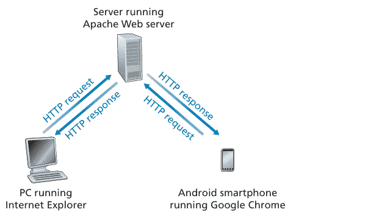

**图 2.6** HTTP 请求-响应行为

请求该页面中对象的 HTTP 请求消息给服务器。服务器接收这些请求，并响应包含这些对象的 HTTP 响应消息。

HTTP 使用 TCP 作为其底层传输协议（而不是运行在 UDP 之上）。HTTP 客户端首先与服务器建立 TCP 连接。一旦连接建立，浏览器和服务器进程通过其套接字接口访问 TCP。如 2.1 节所述，在客户端，套接字接口是客户端进程和 TCP 连接之间的门；在服务器端，它是服务器进程和 TCP 连接之间的门。客户端将 HTTP 请求消息发送到其套接字接口，并从其套接字接口接收 HTTP 响应消息。同样地，HTTP 服务器从其套接字接口接收请求消息，并将其响应消息发送到其套接字接口。一旦客户端将消息发送到其套接字接口，该消息就不再受客户端控制，而是“处于” TCP 的手中。回顾 2.1 节，TCP 为 HTTP 提供可靠的数据传输服务。这意味着客户端进程发送的每个 HTTP 请求消息最终都会完整到达服务器；同样地，服务器进程发送的每个 HTTP 响应消息最终都会完整到达客户端。在这里我们看到分层架构的一个巨大优势——HTTP 不必担心数据丢失或网络内 TCP 如何从数据丢失或乱序中恢复的细节。那是 TCP 和协议栈中较低层协议的工作。

重要的是要注意，服务器向客户端发送所请求的文件时，并不存储任何关于客户端的状态信息。如果某个客户端在几秒内两次请求相同的对象，服务器不会回应说它刚刚已经为该客户端提供了该对象；相反，服务器会重新发送该对象，因为它已经完全忘记了之前做了什么。由于 HTTP 服务器不维护有关客户端的信息，因此 HTTP 被称为**无状态协议**。我们还指出，Web 使用如 2.1 节所述的客户端–服务器应用架构。Web 服务器始终开启，具有固定的 IP 地址，并服务来自潜在数百万个不同浏览器的请求。

HTTP 的原始版本称为 HTTP/1.0，可追溯到 20 世纪 90 年代早期 [RFC 1945]。截至 2020 年，大多数 HTTP 事务通过 HTTP/1.1 进行 [RFC 7230]。然而，越来越多的浏览器和 Web 服务器也支持称为 HTTP/2 的新版本 HTTP [RFC 7540]。在本节末尾，我们将提供 HTTP/2 的介绍。

#### 2.2.2 非持久连接与持久连接

在许多互联网应用中，客户端和服务器在延长的时间内通信，客户端发起一系列请求，服务器响应每个请求。根据应用及其使用方式，这一系列请求可能是连续的、定期按固定间隔进行的，或者是间歇性的。当这种客户端–服务器交互在 TCP 上进行时，应用程序开发人员需要做出一个重要决定——每个请求/响应对是通过*单独的* TCP 连接发送，还是所有请求及其对应的响应都通过*同一个* TCP 连接发送？在前一种方法中，应用程序被称为使用**非持久连接**；在后一种方法中，则使用**持久连接**。为了深入理解这个设计问题，让我们在一个具体应用的背景下检查持久连接的优缺点，即 HTTP，它可以使用非持久连接也可以使用持久连接。虽然 HTTP 在其默认模式下使用持久连接，但 HTTP 客户端和服务器可以配置为使用非持久连接。

##### 采用非持久连接的 HTTP

让我们逐步查看在非持久连接情况下，将 Web 页面从服务器传输到客户端的步骤。假设该页面由一个基础 HTML 文件和 10 个 JPEG 图像组成，并且这 11 个对象都位于同一个服务器上。进一步假设基础 HTML 文件的 URL 为

`http://www.someSchool.edu/someDepartment/home.index`

以下是发生的情况：

1. HTTP 客户端进程向服务器 www.someSchool.edu 的 80 端口（HTTP 的默认端口号）发起 TCP 连接。与该 TCP 连接相关联的，客户端和服务器各有一个套接字。


2. HTTP 客户端通过其套接字向服务器发送 HTTP 请求消息。该请求消息包含路径名 /someDepartment/home.index。（我们将在下文详细讨论 HTTP 消息。）
3. HTTP 服务器进程通过其套接字接收请求消息，从其存储（RAM 或磁盘）中检索对象 /someDepartment/home.index，将该对象封装在 HTTP 响应消息中，并通过其套接字将响应消息发送给客户端。
4. HTTP 服务器进程通知 TCP 关闭该 TCP 连接。（但 TCP 实际不会终止连接，直到它确切知道客户端已完整接收到响应消息为止。）
5. HTTP 客户端接收到响应消息。TCP 连接终止。消息表明封装的对象是一个 HTML 文件。客户端从响应消息中提取该文件，检查 HTML 文件，并发现对 10 个 JPEG 对象的引用。
6. 然后，针对每个被引用的 JPEG 对象重复执行上述前四个步骤。

当浏览器接收到网页时，它会向用户显示该页面。两个不同的浏览器可能会以略有不同的方式解释（即向用户显示）同一个网页。HTTP 与客户端如何解释网页无关。HTTP 规范（[RFC 1945] 和 [RFC 7540]）仅定义了客户端 HTTP 程序和服务器 HTTP 程序之间的通信协议。

上述步骤说明了非持久连接的使用方式，即每个 TCP 连接在服务器发送对象后都会关闭——该连接不会为其他对象保留。HTTP/1.0 采用非持久 TCP 连接。请注意，每个非持久 TCP 连接仅传输一个请求消息和一个响应消息。因此，在此示例中，当用户请求网页时，会产生 11 个 TCP 连接。

在上述描述的步骤中，我们故意模糊处理了客户端是通过 10 个串行 TCP 连接获取这 10 个 JPEG，还是通过并行 TCP 连接获取部分 JPEG。实际上，用户可以配置某些浏览器来控制并行度。浏览器可能会打开多个 TCP 连接，并通过这些多个连接请求网页的不同部分。正如我们将在下一章中看到的，使用并行连接可以缩短响应时间。

在继续之前，让我们通过估算来大致计算从客户端请求基础 HTML 文件到客户端完整接收该文件所经过的时间。为此，我们定义了往返时间（RTT），即一个小数据包从客户端传送到服务器再返回客户端所需的时间。RTT 包括数据包传播延迟、中间路由器和交换机中的数据包排队延迟以及数据包处理延迟。（这些延迟在第 1.4 节中进行了讨论。）现在考虑用户点击超链接时会发生什么。如图 2.7 所示，这会促使浏览器在浏览器和 Web 服务器之间发起 TCP 连接；这涉及到

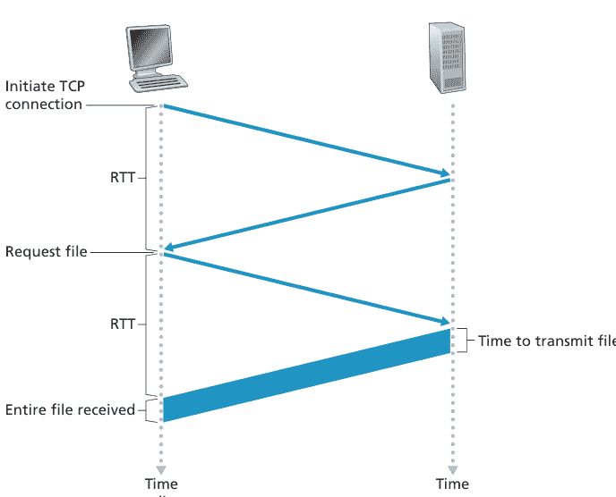

**图 2.7** 请求并接收 HTML 文件所需时间的估算计算

一次“三次握手”——客户端向服务器发送一个小 TCP 段，服务器确认并回复一个小 TCP 段，最后客户端向服务器回传确认。三次握手的前两部分消耗一个 RTT。在完成握手的前两部分后，客户端将 HTTP 请求消息与三次握手的第三部分（确认）一起发送到 TCP 连接中。一旦请求消息到达服务器，服务器便将 HTML 文件发送到 TCP 连接中。这个 HTTP 请求/响应过程又消耗了一个 RTT。因此，粗略地说，总响应时间约为两个 RTT 加上服务器传输该 HTML 文件的时间。

##### 具有持久连接的 HTTP

非持久连接存在一些缺点。首先，必须为*每个请求的对象*建立并维持一个全新的连接。对于这些连接中的每一个，客户端和服务器都必须分配 TCP 缓冲区并维护 TCP 变量。这可能会给 Web 服务器带来沉重负担，因为它可能正在同时为来自数百个不同客户端的请求提供服务。其次，正如我们刚刚描述的，每个对象都会遭受两个 RTT 的交付延迟——一个 RTT 用于建立 TCP 连接，另一个 RTT 用于请求和接收对象。

通过 **HTTP/1.1** 持久连接，服务器在发送响应后保持 TCP 连接打开。同一客户端和服务器之间的后续请求和响应可以通过同一连接发送。特别是，一个完整的网页（在上述示例中，即基础 HTML 文件和 10 个图像）可以通过单个持久 TCP 连接发送。此外，位于同一服务器上的多个网页可以通过单个持久 TCP 连接从服务器发送到同一客户端。这些对象请求可以背靠背地发出，而无需等待对挂起请求的回复（流水线处理）。通常，当连接在特定时间（可配置的超时区间）内未被使用时，HTTP 服务器会关闭该连接。当服务器接收到背靠背的请求时，它会背靠背地发送对象。HTTP 的默认模式使用带有流水线处理的持久连接。我们将在第 2 章和第 3 章的课后作业中定量比较非持久连接和持久连接的性能。我们也鼓励参阅 [Heidemann 1997; Nielsen 1997; RFC 7540]。

#### 2.2.3 HTTP 消息格式

HTTP 规范 [RFC 1945; RFC 7230; RFC 7540] 包含了 HTTP 消息格式的定义。HTTP 消息有两种类型：请求消息和响应消息，下文将对这两种类型进行讨论。

##### HTTP 请求消息

下面是一个典型的 HTTP 请求消息：

```
GET /somedir/page.html HTTP/1.1
Host: www.someschool.edu
Connection: close
User-agent: Mozilla/5.0
Accept-language: fr
```

通过仔细查看这个简单的请求消息，我们可以学到很多。首先，我们看到消息是以普通 ASCII 文本编写的，因此任何普通的具备计算机素养的人都可以阅读它。其次，我们看到消息由五行组成，每行后面跟着一个回车符和一个换行符。最后一行后面跟着额外的一个回车符和换行符。虽然这个特定的请求消息有五行，但请求消息可以包含更多行，也可以少至一行。HTTP 请求消息的第一行被称为**请求行**；后续的行被称为**头部行**。请求行有三个字段：方法字段、URL 字段和 HTTP 版本字段。方法字段可以取几个不同的值，包括 GET、POST、HEAD、PUT 和 DELETE。

绝大多数 HTTP 请求消息使用 GET 方法。当浏览器请求某个对象时，使用 GET 方法，被请求的对象在 URL 字段中指定。在此示例中，浏览器正在请求对象 /somedir/page.html。版本是自解释的；在此示例中，浏览器实现了 HTTP/1.1 版本。

现在让我们看看示例中的头部行。头部行 `Host: www.someschool.edu` 指定了对象所在的宿主。你可能会认为这个头部行是不必要的，因为已经存在到该宿主的 TCP 连接了。但是，正如我们将在第 2.2.5 节中看到的，主机头部行提供的信息是 Web 代理缓存所必需的。通过包含 `Connection: close` 头部行，浏览器告诉服务器它不想麻烦进行持久连接；它希望服务器在发送完请求的对象后关闭连接。`User-agent:` 头部行指定了用户代理，即向服务器发出请求的浏览器类型。在这里，用户代理是 Mozilla/5.0，这是一种 Firefox 浏览器。这个头部行很有用，因为服务器实际上可以向不同类型的用户代理发送同一对象的不同版本。（每个版本都由同一个 URL 寻址。）最后，`Accept-language:` 头部表明，如果服务器上存在该对象的法语版本，用户偏好接收该法语版本；否则，服务器应发送其默认版本。`Accept-language:` 头部只是 HTTP 中可用的众多内容协商头部之一。

在查看了这个示例之后，让我们现在看一下请求消息的一般格式，如图 2.8 所示。我们看到一般格式与我们前面的示例非常接近。然而，你可能会注意到，在头部行（以及额外的回车符和换行符）之后有一个“实体主体”。实体主体

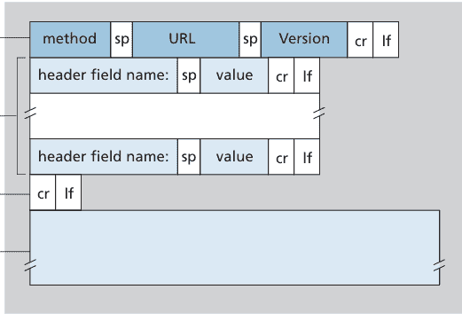

**图 2.8** HTTP 请求消息的一般格式


GET 方法的请求体为空，但 POST 方法会使用请求体。HTTP 客户端通常在用户填写表单时使用 POST 方法——例如，当用户向搜索引擎提供搜索关键词时。在使用 POST 消息时，用户仍然在向服务器请求一个网页，但网页的具体内容取决于用户填入表单字段的信息。如果 method 字段的值是 POST，那么实体体（entity body）就包含用户在表单字段中输入的内容。

如果我们不提这一点，那就是失职了：由表单生成的请求不一定非要使用 POST 方法。实际上，HTML 表单经常使用 GET 方法，并将输入的数据（在表单字段中）包含在请求的 URL 中。例如，如果一个表单使用 GET 方法，有两个字段，且这两个字段的输入值分别是 monkey 和 banana，那么 URL 的结构将是 www.somesite.com/animalsearch?monkey=monkey&banana=banana。在日常的网页浏览中，你可能已经注意到过这种扩展 URL。

HEAD 方法与 GET 方法类似。当服务器收到带有 HEAD 方法的请求时，它会响应一个 HTTP 消息，但省略了所请求的对象。应用程序开发人员经常使用 HEAD 方法进行调试。PUT 方法通常与网页发布工具配合使用。它允许用户上传对象到特定 Web 服务器上的特定路径（目录）。需要向 Web 服务器上传对象的应用程序也使用 PUT 方法。DELETE 方法允许用户或应用程序删除 Web 服务器上的对象。

##### HTTP 响应消息

下面提供一个典型的 HTTP 响应消息。该响应消息可能正是对刚才讨论的示例请求消息的回应。

```
HTTP/1.1 200 OK
Connection: close
Date: Tue, 18 Aug 2015 15:44:04 GMT
Server: Apache/2.2.3 (CentOS)
Last-Modified: Tue, 18 Aug 2015 15:11:03 GMT
Content-Length: 6821
Content-Type: text/html
(data data data data data . . .)
```

让我们仔细看看这个响应消息。它有三个部分：一个初始状态行，六个头部行，然后是实体体。实体体是消息的核心——它包含所请求的对象本身（用 data data data data data . . . . 表示）。状态行有三个字段：协议版本字段、状态码以及对应的状态消息。在这个例子中，状态行表明服务器正在使用 HTTP/1.1，并且一切正常（即服务器已找到并正在发送所请求的对象）。

现在让我们看看头部行。服务器使用 `Connection: close` 头部行来告诉客户端它将在发送完消息后关闭 TCP 连接。`Date:` 头部行表明 HTTP 响应被服务器创建和发送的时间和日期。请注意，这不是对象创建或最后修改的时间；而是服务器从文件系统中检索对象、将对象插入响应消息并发送响应消息的时间。`Server:` 头部行表明该消息是由 Apache Web 服务器生成的；它类似于 HTTP 请求消息中的 `User-agent:` 头部行。`Last-Modified:` 头部行表明对象创建或最后修改的时间和日期。我们稍后将详细讨论的 `Last-Modified:` 头部对于对象缓存至关重要，无论是在本地客户端还是在网络缓存服务器（也称为代理服务器）中。`Content-Length:` 头部行表明正在发送的对象的字节数。`Content-Type:` 头部行表明实体体中的对象是 `HTML` 文本。（对象类型由 `Content-Type:` 头部正式指示，而不是由文件扩展名指示。）

既然看过了一个示例，让我们现在检查一下响应消息的一般格式，如图 2.9 所示。响应消息的这种一般格式与之前的响应消息示例相匹配。让我们对状态码及其短语多说几句。状态码及相关短语表明请求的结果。一些常见的状态码及相关短语包括：

-   **200 OK:** 请求成功，信息在响应中返回。
-   **301 Moved Permanently:** 所请求的对象已被永久移动；新的 `URL` 在响应消息的 `Location:` 头部中指定。客户端软件将自动检索新的 `URL`。

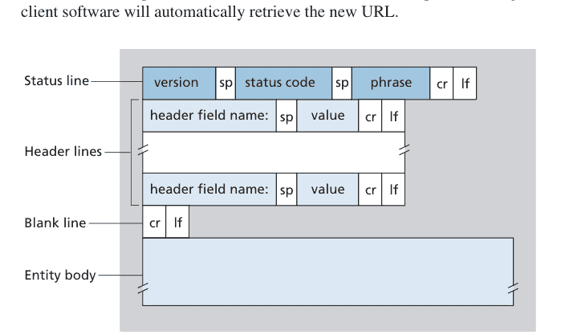

**图 2.9** ◆ HTTP 响应消息的一般格式

-   **400 Bad Request:** 这是一个通用错误代码，表明服务器无法理解该请求。
-   **404 Not Found:** 所请求的文档在此服务器上不存在。
-   **505 HTTP Version Not Supported:** 所请求的 HTTP 协议版本不受服务器支持。

您想看到真实的 HTTP 响应消息吗？这非常推荐且很容易做到！首先 Telnet 到您最喜欢的 Web 服务器。然后输入一行针对服务器上某个对象的请求消息。例如，如果您可以访问命令提示符，请输入：

```
telnet gaia.cs.umass.edu 80
GET /kurose_ross/interactive/index.php HTTP/1.1
Host: gaia.cs.umass.edu
```

（在输入最后一行后按两次回车键。）这将打开到主机 gaia.cs.umass.edu 的 80 端口的 TCP 连接，然后发送 HTTP 请求消息。您应该看到一条响应消息，其中包含这本教科书交互式作业问题的基础 HTML 文件。如果您只想查看 HTTP 消息行而不接收对象本身，请将 GET 替换为 HEAD。

在本节中，我们讨论了一些可以在 HTTP 请求和响应消息中使用的头部行。HTTP 规范定义了许多许多其他可由浏览器、Web 服务器和网络缓存服务器插入的头部行。我们只涵盖了头部行总数中的一小部分。我们将在下面介绍几个，并在 2.2.5 节讨论网络 Web 缓存时再介绍另外几个。关于 HTTP 协议（包括其头部和状态代码）的一个可读性强且全面的讨论见 [Krishnamurthy 2001]。

浏览器如何决定在请求消息中包含哪些头部行？Web 服务器如何决定在响应消息中包含哪些头部行？浏览器将根据浏览器类型和版本、用户的浏览器配置以及浏览器当前是否拥有对象的缓存版本（可能已过时）来生成头部行。Web 服务器的行为类似：不同的产品、版本和配置都会影响响应消息中包含哪些头部行。


##### 用户与服务器交互：Cookie

我们上面提到 HTTP 服务器是无状态的。这简化了服务器设计，并允许工程师开发能够处理成千上万同时 TCP 连接的高性能 Web 服务器。然而，Web 站点通常希望识别用户，要么是因为服务器希望限制用户访问，要么是因为它希望根据用户身份提供内容。为此，HTTP 使用 Cookie。在 [RFC 6265] 中定义的 Cookie 允许站点跟踪用户。如今大多数主要的商业 Web 站点都使用 Cookie。

如图 2.10 所示，Cookie 技术有四个组成部分：(1) HTTP 响应消息中的 Cookie 头部行；(2) HTTP 请求消息中的 Cookie 头部行；(3) 保存在用户端系统上并由用户浏览器管理的 Cookie 文件；以及 (4) Web 站点上的后端数据库。让我们借助图 2.10 通过一个例子来看看 Cookie 是如何工作的。假设 Susan 总是

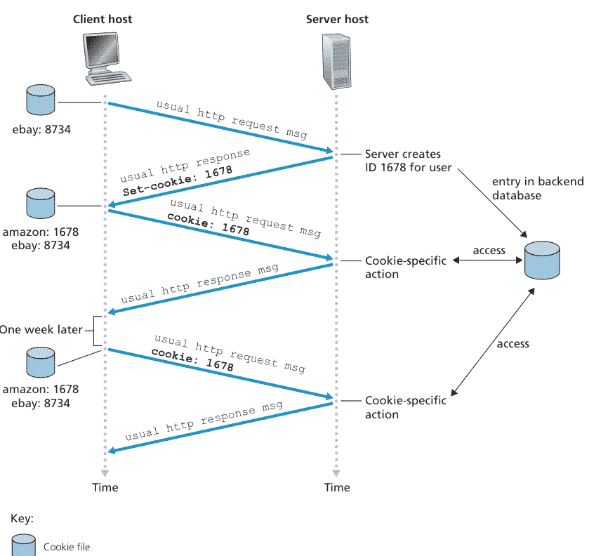

**图 2.10** ◆ 使用 Cookie 保持用户状态


她的家用 PC 通过 **Internet Explorer** 访问网页，并首次联系 Amazon.com。假设她过去已经访问过 eBay 网站。当请求到达 Amazon Web 服务器时，服务器生成一个唯一的识别号码，并在其后端数据库中创建一个由该识别号码索引的条目。然后，Amazon Web 服务器响应 Susan 的浏览器，在 HTTP 响应中包含一个 `Set-cookie:` 头，其中含有该识别号码。例如，头行可能是：

```
Set-cookie: 1678
```

当 Susan 的浏览器收到 HTTP 响应消息时，它会看到 `Set-cookie:` 头。随后，浏览器向它管理的那个特殊 Cookie 文件追加一行。这一行包括 `Set-cookie:` 头中服务器的**主机名**和识别号码。请注意，由于 Susan 过去访问过该站点，Cookie 文件中已经有一个针对 eBay 的条目。随着 Susan 继续浏览 Amazon 站点，每次她请求一个 Web 页面时，她的浏览器都会查询她的 Cookie 文件，提取她针对此站点的识别号码，并在 HTTP 请求中放入一个包含该识别号码的 Cookie 头行。具体而言，她发给 Amazon 服务器的每个 HTTP 请求都包含以下头行：

```
Cookie: 1678
```

通过这种方式，Amazon 服务器能够追踪 Susan 在 Amazon 站点的活动。虽然 Amazon Web 网站不一定知道 Susan 的名字，但它确切知道用户 1678 访问了哪些页面、访问顺序如何以及访问时间是何时！Amazon 使用 Cookie 来提供其购物车服务——Amazon 可以维护一个 Susan 打算购买的所有商品清单，以便她可以在会话结束时统一支付。

如果 Susan 一周后再次返回 Amazon 站点，她的浏览器将继续在请求消息中放入头行 `Cookie: 1678`。Amazon 还会根据 Susan 过去在 Amazon 访问过的 Web 页面向她推荐产品。如果 Susan 还在 Amazon 进行了注册——提供全名、电子邮件地址、邮政地址和信用卡信息——那么 Amazon 就可以将这些信息包含在其数据库中，从而将 Susan 的名字与她的识别号码（以及她过去在该站点访问过的所有页面！）关联起来。这就是 Amazon 和其他电子商务网站提供“一键购物”的方式——当 Susan 在后续访问中选择购买某件商品时，她不需要重新输入她的姓名、信用卡号码或地址。

从这一讨论中，我们可以看到 Cookie 可用于识别用户。当用户第一次访问一个站点时，用户可以提供一个用户标识（可能是他/她的名字）。在后续的会话中，浏览器向服务器传递一个 Cookie 头，从而向服务器标识该用户。因此，Cookie 可用于在无状态的 HTTP 之上创建一个用户会话层。例如，当用户登录基于 Web 的电子邮件应用程序（如 Hotmail）时，浏览器向服务器发送 Cookie 信息，使服务器能够识别用户在与其应用程序交互的整个会话期间身份。

尽管 Cookie 通常为用户简化了网购体验，但它们也具有争议性，因为它们也可被视为对隐私的侵犯。正如我们刚才看到的，通过结合 Cookie 和用户提供的账户信息，一个 Web 站点可以了解用户的大量信息，并有可能将这些信息出售给第三方。

#### 2.2.5 Web 缓存

**Web 缓存**（也称为**代理服务器**）是一个网络实体，它代表源 Web 服务器来满足 HTTP 请求。Web 缓存拥有自己的磁盘存储，并在此存储中保留最近请求的对象副本。如图 2.11 所示，用户浏览器可以配置为将用户的所有 HTTP 请求首先定向到 Web 缓存 [RFC 7234]。一旦浏览器完成配置，每个针对对象的浏览器请求都会首先定向到 Web 缓存。举个例子，假设一个浏览器正在请求对象 `http://www.someschool.edu/campus.gif`。以下是发生的情况：

-   浏览器与 Web 缓存建立 TCP 连接，并向 Web 缓存发送针对该对象的 HTTP 请求。
-   Web 缓存检查其本地是否存储有该对象的副本。如果有，Web 缓存会在 HTTP 响应消息中将对象返回给客户端浏览器。
-   如果 Web 缓存没有该对象，Web 缓存会与源服务器（即 `www.someschool.edu`）打开一个 TCP 连接。然后，Web 缓存通过该缓存到服务器的 TCP 连接发送针对该对象的 HTTP 请求。收到此请求后，源服务器在 HTTP 响应中将对象发送给 Web 缓存。
-   当 Web 缓存收到该对象时，它会在本地存储中保存一个副本，并通过现有的客户端浏览器与 Web 缓存之间的 TCP 连接，在 HTTP 响应消息中向客户端浏览器发送一份副本。

请注意，缓存同时既是服务器又是客户端。当它接收来自浏览器的请求并向其发送响应时，它是服务器；当它向源服务器发送请求并接收其响应时，它是客户端。

通常，Web 缓存是由 ISP 购买和安装的。例如，一所大学可能会在其校园网络上安装一个缓存，并将校园内所有浏览器配置为指向该缓存。或者，一家主要的住宅 ISP（如 Comcast）可能会在其网络中安装一个或多个缓存，并将其随附的浏览器预配置为指向这些已安装的缓存。

Web 缓存在 Internet 中的部署主要基于两个原因。首先，Web 缓存可以显著减少客户端请求的响应时间，特别是当客户端与源服务器之间的瓶颈带宽远小于客户端与缓存之间的瓶颈带宽时。如果客户端与缓存之间存在高速连接（通常如此），且缓存拥有被请求的对象，那么缓存将能够快速向客户端交付该对象。其次，正如我们将通过示例很快展示的那样，Web 缓存可以显著减少机构访问 Internet 的接入链路上的流量。通过减少流量，该机构（例如公司或大学）不必过快升级带宽，从而降低成本。此外，Web 缓存可以显著减少整个 Internet 中的 Web 流量，从而提升所有应用程序的性能。

为了更深入地理解缓存的优势，让我们在图 2.12 的背景下考虑一个示例。该图显示了两个网络——机构网络和公共 Internet 的其余部分。机构网络是一个高速局域网。机构网络中的一个路由器与 Internet 中的一个路由器通过一条 15 Mbps 链路相连。源服务器连接到 Internet，但分布在全球各地。假设对象的平均大小为 1 Mbits，且机构浏览器向源服务器发出的平均请求速率为每秒 15 个请求。假设 HTTP 请求消息微不足道地小，因此不会在网络或接入链路（从机构路由器到 Internet 路由器）中产生流量。还假设，在图 2.12 中，位于接入链路 Internet 一侧的路由器转发一个 HTTP 请求（在一个 IP 数据报内）到接收响应（通常包含在许多 IP 数据报内）的平均时间为两秒。非正式地，我们将这最后的延迟称为“Internet 延迟”。

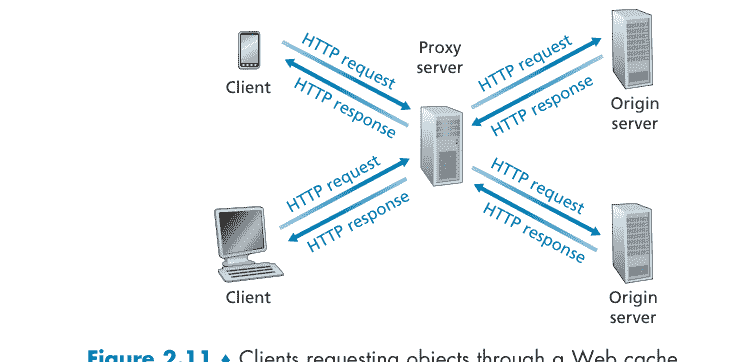

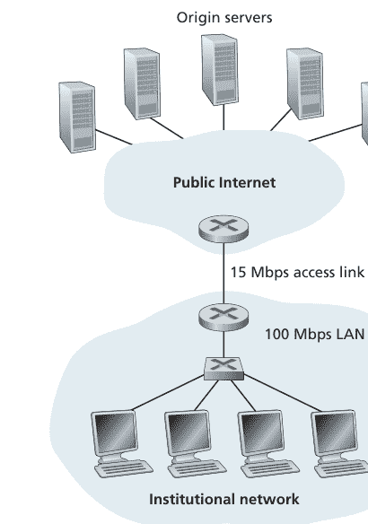

##### 图 2.12 ♦ 机构网络与 Internet 之间的瓶颈

总响应时间——即从浏览器请求对象到接收该对象的时间——是局域网延迟、接入延迟（即两个路由器之间的延迟）和 Internet 延迟之和。现在让我们进行一个非常粗略的计算来估算此延迟。局域网上的流量强度（参见 1.4.2 节）为

##### (15 请求/秒) • (1 Mbits/请求)/(100 Mbps) = 0.15

而接入链路（从 Internet 路由器到机构路由器）上的流量强度为

##### (15 请求/秒) • (1 Mbits/请求)/(15 Mbps) = 1

在局域网中 0.15 的流量强度通常导致最多几十毫秒的延迟；因此，我们可以忽略局域网延迟。然而，正如 1.4.2 节中所讨论的，当流量强度接近 1 时（如图 2.12 中的接入链路所述），链路上的延迟变得非常大，并且无限制地增长。因此，满足请求的平均响应时间将达到分钟级别，甚至更长，这对机构用户来说是不可接受的。显然，必须采取一些措施。


一种可能的解决方案是将访问速率从 15 Mbps 提升至，例如，100 Mbps。这将把接入链路上的业务强度降低到 0.15，这意味着两个路由器之间的延迟微乎其微。在这种情况下，总响应时间大约为两秒，即互联网延迟。但是，这个解决方案也意味着该机构必须将其接入链路从 15 Mbps 升级到 100 Mbps，这是一个成本高昂的方案。

现在考虑替代方案：不升级接入链路，而是在机构网络中安装 Web 缓存。该方案在图 2.13 中进行了说明。命中率——即由缓存满足的请求比例——在实践中通常介于 0.2 到 0.7 之间。为了说明问题，假设该机构的缓存命中率为 0.4。由于客户端和缓存连接到同一个高速局域网，因此 40% 的请求几乎可以立即得到满足，例如在 10 毫秒内由缓存完成。然而，剩余的 60% 请求仍需由源服务器来满足。但是，由于只有 60% 的请求对象通过接入链路，接入链路上的业务强度从 1.0 降低到了 0.6。通常，小于 0.8 的业务强度对应于 15 Mbps 链路上的小延迟，例如几十毫秒。与两秒的互联网延迟相比，这个延迟是可以忽略不计的。鉴于上述考虑，平均延迟因此为：

```
0.4 · (0.01 seconds) + 0.6 · (2.01 seconds)
```

这仅略大于 1.2 秒。因此，这第二种方案提供了比第一种方案更低的响应时间，并且不需要机构将其到互联网的链路升级。当然，机构必须购买并安装 Web 缓存。但这种成本低廉——许多缓存使用在廉价 PC 上运行的公共领域软件。

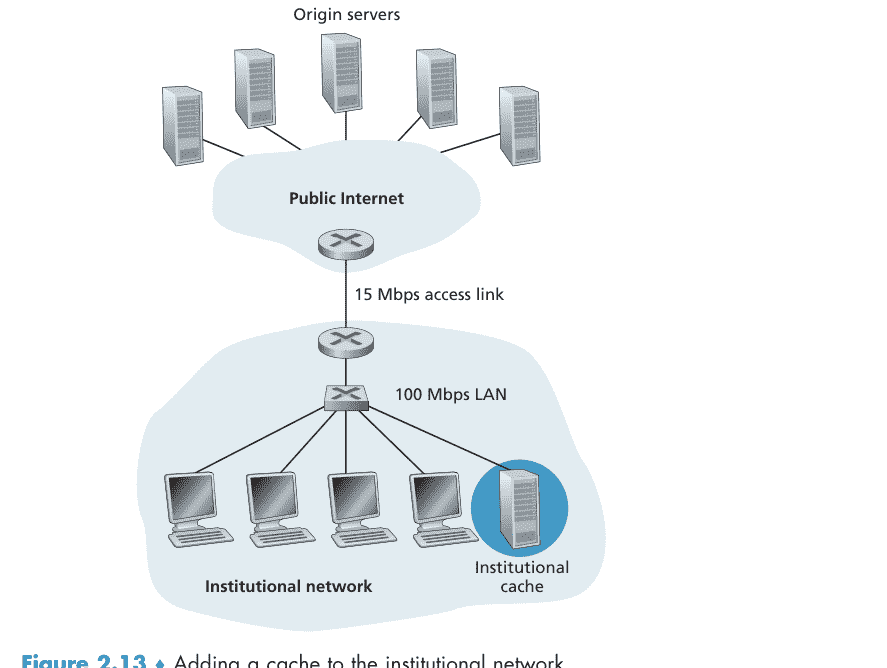

通过**内容分发网络（CDN）**的使用，Web 缓存在互联网中发挥着越来越重要的作用。CDN 公司在互联网上安装了许多地理上分布的缓存，从而将大量流量本地化。存在共享 CDN（如 Akamai 和 Limelight）和专用 CDN（如 Google 和 Netflix）。我们将在第 2.6 节中更详细地讨论 CDN。

##### 条件式 GET

虽然缓存可以减少用户感知的响应时间，但它引入了一个新问题——驻留在缓存中的对象副本可能是过期的。换句话说，Web 服务器中的对象自其在客户端被缓存以来可能已被修改。幸运的是，HTTP 拥有一种机制，允许缓存验证其对象是最新的。这种机制被称为**条件式 GET** [RFC 7232]。如果满足以下条件，HTTP 请求消息就是一个所谓的条件式 GET 消息：(1) 请求消息使用 GET 方法，并且 (2) 请求消息包含一个 `If-Modified-Since:` 头字段行。

为了说明条件式 GET 是如何工作的，让我们通过一个例子来演练。首先，代表请求浏览器的代理缓存向 Web 服务器发送一个请求消息：

```
GET /fruit/kiwi.gif HTTP/1.1
Host: www.exotiquecuisine.com
```

其次，Web 服务器向缓存发送包含所请求对象的响应消息：

```
HTTP/1.1 200 OK
Date: Sat, 3 Oct 2015 15:39:29
Server: Apache/1.3.0 (Unix)
Last-Modified: Wed, 9 Sep 2015 09:23:24
Content-Type: image/gif
(data data data data data . . .)
```

缓存将对象转发给请求浏览器，但也在本地缓存该对象。重要的是，缓存还存储了对象的最后修改日期。第三，一周后，另一个浏览器通过缓存请求相同的对象，且该对象仍在缓存中。由于该对象在过去一周内可能在 Web 服务器上被修改过，缓存通过发出条件式 GET 来执行更新检查。具体而言，缓存发送：

```
GET /fruit/kiwi.gif HTTP/1.1
Host: www.exotiquecuisine.com
If-modified-since: Wed, 9 Sep 2015 09:23:24
```

注意，If-modified-since: 头字段行的值正好等于一周前服务器发送的 Last-Modified: 头字段行的值。这个条件式 GET 告诉服务器仅在对象自指定日期以来被修改过时才发送该对象。假设自 2015 年 9 月 9 日 09:23:24 以来该对象未被修改。那么，第四，Web 服务器向缓存发送响应消息：

```
HTTP/1.1 304 Not Modified
Date: Sat, 10 Oct 2015 15:39:29
Server: Apache/1.3.0 (Unix)

(empty entity body)
```

我们看到，作为对条件式 GET 的响应，Web 服务器仍然发送一个响应消息，但不包含所请求的对象。包含所请求的对象只会浪费带宽并增加用户感知的响应时间，特别是当对象很大时。注意，这最后一个响应消息的状态行中有 304 Not Modified，这告诉缓存可以继续将其（代理缓存的）对象缓存副本转发给请求浏览器。

#### 2.2.6 HTTP/2

HTTP/2 [RFC 7540] 于 2015 年标准化，是自 1997 年标准化的 HTTP/1.1 以来第一个新版本。自标准化以来，HTTP/2 已迅速发展，2020 年排名前 1000 万的网站中有超过 40% 支持 HTTP/2 [W3Techs]。大多数浏览器——包括 Google Chrome、Internet Explorer、Safari、Opera 和 Firefox——也支持 HTTP/2。

HTTP/2 的主要目标是通过在单个 TCP 连接上启用请求和响应多路复用来减少感知延迟，提供请求优先级排序和服务器推送，并提供高效的 HTTP 头字段压缩。HTTP/2 不改变 HTTP 方法、状态码、URL 或头字段。相反，HTTP/2 改变了客户端和服务器之间数据格式化和传输的方式。

为了说明对 HTTP/2 的需求，回想一下 HTTP/1.1 使用持久 TCP 连接，允许通过单个 TCP 连接将 Web 页面从服务器发送到客户端。由于每个 Web 页面只有一个 TCP 连接，减少了服务器上的套接字数量，并且每个传输的 Web 页面都能获得公平的网络带宽份额（如下文所述）。但 Web 浏览器的开发者很快发现，通过单个 TCP 连接发送 Web 页面中的所有对象存在**队头（HoL）阻塞问题**。为了理解 HoL 阻塞，考虑一个包含 HTML 基础页面、位于 Web 页面顶部的大视频片段以及视频下方许多小对象的 Web 页面。进一步假设在服务器和客户端之间的路径上存在一个低中速瓶颈链路（例如，低速无线链路）。使用单个 TCP 连接时，视频片段将花费很长时间通过瓶颈链路，而小对象由于在视频片段后面等待而被延迟；也就是说，队头的视频片段阻塞了其后的小对象。HTTP/1.1 浏览器通常通过打开多个并行 TCP 连接来解决这个问题，从而使同一 Web 页面中的对象并行发送到浏览器。这样，小对象可以更快地到达浏览器并被渲染，从而减少用户感知的延迟。

第 3 章详细讨论的 TCP 拥塞控制也提供了一种意想不到的动力，促使浏览器使用多个并行 TCP 连接而不是单个持久连接。粗略地说，TCP 拥塞控制旨在让共享瓶颈链路的每个 TCP 连接获得该链路可用带宽的相等份额；因此，如果有 *n* 个 TCP 连接在瓶颈链路上运行，那么每个连接大约获得 1/n 的带宽。通过打开多个并行 TCP 连接来传输单个 Web 页面，浏览器可以“作弊”并抢占更大比例的链路带宽。许多 HTTP/1.1 浏览器打开多达六个并行 TCP 连接，不仅为了规避 HoL 阻塞，还为了获得更大的带宽。

HTTP/2 的主要目标之一是消除（或至少减少）用于传输单个 Web 页面的并行 TCP 连接数量。这不仅减少了需要在服务器上打开和维持的套接字数量，还允许 TCP 拥塞控制按预期运行。但是，如果只有单个 TCP 连接来传输 Web 页面，HTTP/2 需要精心设计机制来避免 HoL 阻塞。

##### HTTP/2 帧

HTTP/2 解决 HoL 阻塞的方案是将每个消息分解为小的帧，并在同一个 TCP 连接上交织请求和响应消息。为了理解这一点，再次考虑由一个大视频片段和，比如说，8 个较小对象组成的 Web 页面示例。因此，服务器将收到任何想要查看此 Web 页面的浏览器发送的 9 个并发请求。对于每个请求，服务器需要向浏览器发送 9 个竞争的 HTTP 响应消息。假设所有帧都是


固定长度。视频片段由 1000 帧组成，而每个较小的对象则由两帧组成。通过帧交错，在发送视频片段的一帧之后，每个小对象的第一帧将被发送。然后，在发送视频片段的第二帧之后，每个小对象的最后一帧将被发送。因此，在总共发送 18 帧后，所有较小的对象都将被发送。如果没有使用交错，较小的对象将在发送 1016 帧之后才被发送。因此，HTTP/2 成帧机制可以显著降低用户感知的延迟。

将 HTTP 消息分解为独立的帧、对其进行交错、然后在另一端重新组装的能力，是 HTTP/2 最重要的增强功能。成帧由 HTTP/2 协议的成帧子层完成。当服务器想要发送 HTTP 响应时，该响应会经过成帧子层处理，并被分解为帧。响应的头部字段成为一个帧，而消息的主体则被分解为一个或多个额外的帧。然后，服务器上的成帧子层会将这些响应帧与其他响应的帧进行交错，并通过单一的持久 TCP 连接发送。当帧到达客户端时，它们首先会在成帧子层被重新组装为原始响应消息，然后由浏览器像往常一样处理。类似地，客户端的 HTTP 请求也会被分解为帧并进行交错。

除了将每个 HTTP 消息分解为独立的帧外，成帧子层还对帧进行二进制编码。二进制协议解析效率更高，生成的帧稍小，且不易出错。

##### 响应消息优先级排序与服务器推送

消息优先级排序允许开发人员定制请求的相对优先级，以更好地优化应用性能。正如我们刚才所学到的，成帧子层将消息组织为指向同一请求者的并行数据流。当客户端向服务器发送并发请求时，它可以通过为每个消息分配 1 到 256 之间的权重来优先处理其请求的响应。数值越高，表示优先级越高。利用这些权重，服务器可以首先发送优先级最高的响应的帧。此外，客户端还可以通过指定其依赖的消息 ID 来声明每个消息对其他消息的依赖关系。

HTTP/2 的另一个特性是服务器能够为单个客户端请求发送多个响应。也就是说，除了对原始请求的响应外，服务器还可以*推送*额外的对象给客户端，而无需客户端单独请求每一个对象。这是可能的，因为 HTML 基础页面指明了完全渲染 Web 页面所需的对象。因此，服务器可以分析 HTML 页面，识别所需的对象，并在*收到针对这些对象的显式请求之前*就将它们发送给客户端。服务器推送消除了因等待请求而产生的额外延迟。

##### HTTP/3

在第 3 章中讨论的 QUIC 是一种新的“传输”协议，它实现于应用程序层，基于精简的 UDP 协议。QUIC 具有多个 HTTP 所需的特性，如消息多路复用（交错）、每流流量控制以及低延迟连接建立。HTTP/3 是一种新的 HTTP 协议，设计为在 QUIC 之上运行。截至 2020 年，HTTP/3 在 Internet 草案中描述，尚未完全标准化。HTTP/2 的许多特性（如消息交错）被 QUIC 所取代，从而允许 HTTP/3 采用更简单、流线型的设计。

### 2.3 互联网中的电子邮件

电子邮件自互联网诞生之初就已存在。在互联网早期，它是流行的应用程序 [Segalller 1998]，并且随着时间推移变得越来越复杂和强大。它仍然是互联网最重要和最常用的应用程序之一。

与普通邮政邮件一样，电子邮件是一种异步通信媒介——人们可以在方便的时候发送和阅读消息，而无需与其他人的时间表协调。与邮政邮件相比，电子邮件速度快、易于分发且成本低廉。现代电子邮件具有许多强大的功能，包括带附件的消息、超链接、HTML 格式文本以及嵌入的照片。

在本节中，我们将检查互联网电子邮件核心的应用层协议。但在深入讨论这些协议之前，让我们先以高层视角看待互联网邮件系统及其关键组件。

图 2.14 展示了互联网邮件系统的高层视图。从该图中我们可以看到，它有三个主要组件：用户代理、邮件服务器和简单邮件传输协议 (SMTP)。我们现在将在发送者 Alice 向收件人 Bob 发送电子邮件消息的背景下描述这些组件。用户代理允许用户阅读、回复、转发、保存和编写消息。电子邮件用户代理的示例包括 Microsoft Outlook、Apple Mail、基于 Web 的 Gmail、运行在智能手机上的 Gmail App 等。当 Alice 完成消息编写后，她的用户代理会将消息发送到她的邮件服务器，消息将被放置在邮件服务器的出站消息队列中。当 Bob 想要阅读消息时，他的用户代理会从他的邮件服务器中的邮箱中检索该消息。

邮件服务器构成了电子邮件基础设施的核心。每个收件人（如 Bob）在其中一个邮件服务器中都有一个邮箱。Bob 的邮箱管理和维护发送给他 的消息。一条典型的消息旅程始于发送者的用户代理，然后到达发送者的邮件服务器，接着到达收件人的邮件服务器，最后存入收件人的邮箱。当 Bob 想要访问邮箱中的消息时，包含其邮箱的邮件服务器会对 Bob 进行身份验证（使用他的用户名和密码）。Alice 的邮件服务器还必须处理 Bob 的邮件服务器的故障。如果 Alice 的服务器无法将邮件投递到 Bob 的服务器，Alice 的服务器会将消息保留在一个**消息队列**中，并稍后尝试传输该消息。重试通常每 30 分钟左右进行一次；如果几天后仍不成功，服务器将移除该消息，并通过电子邮件消息通知发送者（Alice）。

SMTP 是互联网电子邮件的主要应用层协议。它使用 TCP 的可靠数据传输服务将邮件从发送者的邮件服务器传输到收件人的邮件服务器。与大多数应用层协议一样，SMTP 有两面：运行在发送者邮件服务器上的客户端端，以及运行在收件人邮件服务器上的服务器端。SMTP 的客户端端和服务器端都运行在每个邮件服务器上。当邮件服务器向其他邮件服务器发送邮件时，它充当 SMTP 客户端。当邮件服务器从其他邮件服务器接收邮件时，它充当 SMTP 服务器。

#### 2.3.1 SMTP

由 RFC 5321 定义的 SMTP 是互联网电子邮件的核心。如上所述，SMTP 将消息从发送者的邮件服务器传输到收件人的邮件服务器。SMTP 比 HTTP 历史悠久得多。（最初的 SMTP RFC 可追溯到 1982 年，而在那之前 SMTP 就已经存在了。）尽管 SMTP 拥有许多优秀的品质，这从其在互联网中的普遍存在可以看出，但它仍然是一项遗留技术，具有某些过时的特征。例如，它限制所有邮件消息的主体（不仅仅是头部）为简单的 7 位 ASCII。这一限制在 20 世纪 80 年代初是有道理的，当时传输能力稀缺，没有人发送大型附件或大型图像、音频或视频文件。但如今，在多媒体时代，7 位 ASCII 限制有点棘手——它要求二进制多媒体数据在通过 SMTP 发送前编码为 ASCII；并且要求在 SMTP 传输后将相应的 ASCII 消息解码回二进制。回忆一下第 2.2 节中提到的，HTTP 不要求在传输前将多媒体数据编码为 ASCII。

为了说明 SMTP 的基本操作，让我们走过一个常见场景。假设 Alice 想要给 Bob 发送一条简单的 ASCII 消息。

- 1. Alice 调用她的电子邮件用户代理，提供 Bob 的电子邮件地址（例如，bob@som school.edu），编写一条消息，并指示用户代理发送该消息。
- 2. Alice 的用户代理将消息发送到她的邮件服务器，消息被放置在一个消息队列中。
- 3. 运行在 Alice 邮件服务器上的 SMTP 客户端端看到消息队列中的消息。它向运行在 Bob 邮件服务器上的 SMTP 服务器打开一个 TCP 连接。
- 4. 在一些初始的 SMTP 握手之后，SMTP 客户端将 Alice 的消息放入 TCP 连接中。
- 5. 在 Bob 的邮件服务器上，SMTP 的服务器端接收该消息。Bob 的邮件服务器然后将消息放置在 Bob 的邮箱中。
- 6. Bob 在他的方便时刻调用他的用户代理来读取该消息。

该场景总结于图 2.15 中。

重要的是要注意，SMTP 通常不使用中间邮件服务器来发送邮件，即使两个邮件服务器位于世界的两端。如果 Alice 的服务器在香港，而 Bob 的服务器在圣路易斯，TCP 连接是香港服务器和圣路易斯服务器之间的直接连接。在


##### 图 2.15 Alice 向 Bob 发送消息


特别地，如果 Bob 的邮件服务器宕机，消息将保留在 Alice 的邮件服务器中，并等待新的尝试——消息不会放置在某个中间邮件服务器上。

现在让我们更仔细地看看 SMTP 如何将消息从发送方邮件服务器传输到接收方邮件服务器。我们会发现 SMTP 协议与用于面对面人类交互的协议有许多相似之处。首先，客户端 SMTP（运行在发送方邮件服务器主机上）通过 TCP 与服务器端 SMTP（运行在接收方邮件服务器主机上的 25 端口）建立连接。如果服务器宕机，客户端稍后会再次尝试。一旦建立此连接，服务器和客户端将执行一些应用层握手——就像人类通常在传输信息前先介绍自己一样，SMTP 客户端和服务器在传输信息前也会介绍自己。在这个 SMTP 握手阶段，SMTP 客户端会指明发件人（生成消息的人）的电子邮件地址和收件人的电子邮件地址。一旦 SMTP 客户端和服务器相互介绍了自己，客户端就会发送消息。SMTP 依靠 TCP 的可靠数据传输服务来确保消息无误地到达服务器。如果客户端有其他消息要发送给服务器，它会通过相同的 TCP 连接重复此过程；否则，它会指示 TCP 关闭连接。

接下来，让我们看一下 SMTP 客户端（C）和 SMTP 服务器（S）之间交换的消息示例记录。客户端的主机名是 `crepes.fr`，服务器的主机名是 `hamburger.edu`。以 `C:` 开头的 ASCII 文本行是客户端发送到其 TCP 套接字的精确行，以 `S:` 开头的 ASCII 文本行是服务器发送到其 TCP 套接字的精确行。以下记录从 TCP 连接建立时开始。

```text
S:   220 hamburger.edu
C:   HELO crepes.fr
S: 250 Hello crepes.fr, pleased to meet you
C:  MAIL FROM: <alice@crepes.fr>
S: 250 alice@crepes.fr ... Sender ok
C:  RCPT TO: <bob@hamburger.edu>
S: 250 bob@hamburger.edu ... Recipient ok
C:  DATA
S: 354 Enter mail, end with "." on a line by itself
C: Do you like ketchup?
C: How about pickles?
C: .
S: 250 Message accepted for delivery
C:  QUIT
S: 221 hamburger.edu closing connection
```

在上面的示例中，客户端将一条消息（“你喜欢番茄酱吗？泡菜怎么样？”）从邮件服务器 crepes.fr 发送到邮件服务器 hamburger.edu。作为对话的一部分，客户端发出了五个命令：HELLO（HELO 的缩写）、MAIL FROM、RCPT TO、DATA 和 QUIT。这些命令的含义不言自明。客户端还发送了一行仅由一个点组成的行，这向服务器表示消息结束。（在 ASCII 术语中，每条消息以 CRLF.CRLF 结尾，其中 CR 和 LF 分别代表回车和换行。）服务器对每个命令发出回复，每个回复包含一个回复代码和一些（可选的）英语解释。我们在此指出，SMTP 使用持久连接：如果发送方邮件服务器有几条消息要发送给同一个接收方邮件服务器，它可以所有消息都通过相同的 TCP 连接发送。对于每条消息，客户端以新的 MAIL FROM: crepes.fr 开始该过程，用一个孤立的点表示消息结束，并在所有消息发送完成后才发出 QUIT 命令。

强烈建议您使用 Telnet 与 SMTP 服务器进行直接对话。为此，请输入

telnet serverName 25

其中 serverName 是本地邮件服务器的名称。这样做时，您只是在本主机和邮件服务器之间建立了一个 TCP 连接。输入此行后，您应立即收到服务器的 220 回复。然后，在适当的时候发出 SMTP 命令 HELO、MAIL FROM、RCPT TO、DATA、CRLF.CRLF 和 QUIT。还强烈建议您在本章末尾完成编程作业 3。在该作业中，您将构建一个实现 SMTP 客户端端的简单用户代理。它将允许您通过本地邮件服务器向任意收件人发送电子邮件消息。

#### 2.3.2 邮件消息格式

当 Alice 给 Bob 写一封普通的平信时，她可能在信的顶部包含各种外围头部信息，例如 Bob 的地址、她自己的退信地址和日期。同样，当电子邮件消息从一个人发送给另一个人时，包含外围信息的头部会先于消息主体本身。这些外围信息包含在一系列头部行中，它们定义在 RFC 5322 中。头部行和消息主体之间由一个空行（即 CRLF）分隔。RFC 5322 规定了邮件头部行的确切格式及其语义解释。与 HTTP 一样，每个头部行都包含可读文本，由一个关键字、一个冒号和一个值组成。其中一些关键字是必需的，另一些是可选的。每个头部必须包含一个 *From*:* 头部行和一个 *To*:* 头部行；头部还可以包含一个 *Subject*:* 头部行以及其他可选头部行。重要的是要注意，这些头部行与我们在 2.3.1 节中研究的 SMTP 命令是*不同的*（尽管它们包含一些常见的单词，如 *'from'* 和 *'to'*）。那一节中的命令是 SMTP 握手协议的一部分；本节中检查的头部行是邮件消息本身的一部分。

典型的邮件头看起来像这样：

```text
From: alice@crepes.fr
To: bob@hamburger.edu
Subject: Searching for the meaning of life.
```

在邮件头之后，跟随一个空行；然后是消息主体（在 ASCII 中）。您应该使用 Telnet 向邮件服务器发送包含一些头部行的消息，包括 *Subject*:* 头部行。为此，请按照 2.3.1 节中讨论的方法，输入 telnet serverName 25。

#### 2.3.3 邮件访问协议

一旦 SMTP 将消息从 Alice 的邮件服务器传递到 Bob 的邮件服务器，消息就被放置在 Bob 的邮箱中。鉴于 Bob（收件人）在其本地主机（例如智能手机或 PC）上运行其用户代理，考虑在他的本地主机上也放置一个邮件服务器是很自然的。采用这种方法，Alice 的邮件服务器将直接拨打-Bob 的 PC。然而，这种方法存在一个问题。回想一下，邮件服务器管理邮箱并运行 SMTP 的客户端和服务器端。如果 Bob 的邮件服务器位于他的本地主机上，那么 Bob 的主机必须保持始终开机并连接到互联网，以接收随时可能到达的新邮件。这对许多互联网用户来说是不切实际的。相反，典型用户在本地主机上运行用户代理，但访问存储在始终开机的共享邮件服务器上的邮箱。此邮件服务器与其他用户共享。

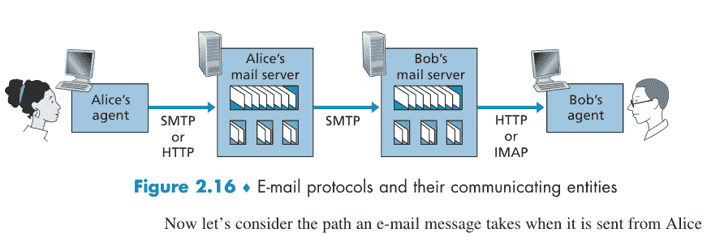

现在让我们考虑当电子邮件从 Alice 发送给 Bob 时所经过的路径。我们刚刚得知，在路径上的某个点，电子邮件消息需要被存入 Bob 的邮件服务器。这可以通过让 Alice 的用户代理直接将消息发送给 Bob 的邮件服务器来实现。然而，通常发送方的用户代理不会直接与接收方的邮件服务器对话。相反，如图 2.16 所示，Alice 的用户代理使用 SMTP 或 HTTP 将电子邮件消息传递到她的邮件服务器，然后 Alice 的邮件服务器使用 SMTP（作为 SMTP 客户端）将电子邮件消息中继到 Bob 的邮件服务器。为什么采用这种两步过程？主要是因为如果不通过 Alice 的邮件服务器中继，Alice 的用户代理在遇到不可达的目标邮件服务器时就没有任何补救办法。通过让 Alice 先将电子邮件存入她自己的邮件服务器，Alice 的邮件服务器可以反复尝试将消息发送到 Bob 的邮件服务器，例如每 30 分钟一次，直到 Bob 的邮件服务器恢复运行。（如果 Alice 的邮件服务器宕机，她就有理由向系统管理员投诉！）

但是，拼图还缺了一块！像 Bob 这样的收件人，在他的本地主机上运行用户代理，如何获取他的消息，而这些消息正存放在邮件服务器中？请注意，Bob 的用户代理不能使用 SMTP 来获取消息，因为获取消息是一个拉取操作，而 SMTP 是一个推送协议。

如今，Bob 从邮件服务器检索他的电子邮件有两种常见方式。如果 Bob 使用基于 Web 的电子邮件或智能手机应用（如 Gmail），那么用户代理将使用 HTTP 来检索 Bob 的电子邮件。这种情况要求 Bob 的邮件服务器除了具有 SMTP 接口（用于与 Alice 的邮件服务器通信）外，还要具有 HTTP 接口。另一种方法，通常用于 Microsoft Outlook 等邮件客户端，是使用在 RFC 3501 中定义的互联网邮件访问协议（IMAP）。HTTP 和 IMAP 两种方法都允许 Bob 管理在 Bob 的邮件服务器中维护的文件夹。Bob 可以将消息移动到他创建的文件夹中，删除消息，将消息标记为重要等等。

### 2.4 DNS——互联网的目录服务

我们人类可以通过许多方式被识别。例如，我们可以通过出生证明上的名字被识别。我们可以通过社会安全号码被识别。我们可以通过驾照号码被识别。


虽然每种标识符都可以用于识别人，但在特定上下文中，一种标识符可能比另一种更合适。例如，美国国税局（那个臭名昭著的征税机构）的计算机更倾向于使用固定长度的社会安全号码，而不是出生证明上的姓名。另一方面，普通人则更喜欢更具记忆助益的出生证明姓名，而不是社会安全号码。（事实上，你能想象说出“你好。我的名字是 132-67-9875。请见见我的丈夫，178-87-1146。”吗？）

就像人类可以用多种方式来识别一样，互联网主机也可以用多种方式识别。主机的一个标识符是其**主机名**。主机名——例如 www.facebook.com、www.google.com、gaia.cs.umass.edu——具有助记性，因此受到人类的欢迎。然而，主机名几乎没有提供关于该主机在互联网中位置的信息。（例如，以国家代码 .fr 结尾的主机名 www.eurecom.fr 告诉我们该主机可能在法国，但没有提供更多细节。）此外，由于主机名可以由可变长度的字母数字字符组成，路由器处理起来会比较困难。

我们在第 4 章中详细讨论了**IP 地址**，但现在简要介绍一下它们也是很有用的。IP 地址由四个字节组成，具有严格的层次结构。IP 地址看起来像 121.7.106.83，其中每个点将用十进制表示的 0 到 255 之间的字节分开。IP 地址是层次化的，因为当我们从左到右扫描地址时，我们获得关于主机在互联网中位置（即位于网络中的哪个网络）的信息会越来越具体。类似地，当我们从下到上扫描邮寄地址时，我们获得关于收件人位置的信息也会越来越具体。

#### 2.4.1 DNS 提供的服务

我们刚刚看到，识别主机有两种方式——通过主机名和通过 IP 地址。人们更喜欢具有助记性的主机名标识符，而路由器更喜欢固定长度、具有层次结构的 IP 地址。为了协调这些偏好，我们需要一个将主机名翻译为 IP 地址的目录服务。这是互联网**域名系统（DNS）**的主要任务。DNS 是 (1) 在**DNS 服务器**层次结构中实现的分布式数据库，以及 (2) 允许主机查询该分布式数据库的应用层协议。DNS 服务器通常是运行 Berkeley Internet Name Domain (BIND) 软件的 UNIX 机器 [BIND 2020]。DNS 协议运行在 UDP 之上，并使用端口 53。

DNS 通常被其他应用层协议（包括 HTTP 和 SMTP）使用，以将用户提供的域名转换为 IP 地址。作为一个例子，考虑当浏览器（即 HTTP 客户端）在某个用户的主机上请求 URL www.someschool.edu/index.html 时发生的情况。为了让用户主机能够将 HTTP 请求消息发送到 Web 服务器 `www.someschool.edu`，用户主机必须首先获取 `www.someschool.edu` 的 IP 地址。过程如下：

1. 同一台用户机器运行 DNS 应用的客户端端。
2. 浏览器从 URL 中提取主机名 `www.someschool.edu`，并将主机名传递给 DNS 应用的客户端端。
3. DNS 客户端发送包含主机名的查询到 DNS 服务器。
4. DNS 客户端最终收到回复，其中包含该主机名的 IP 地址。
5. 一旦浏览器从 DNS 收到 IP 地址，它就可以发起到位于该 IP 地址端口 80 处的 HTTP 服务器进程的 TCP 连接。

从这个例子中我们可以看到，DNS 为使用它的应用增加了额外的延迟——有时是相当大的。幸运的是，正如我们将在下面讨论的那样，所需的 IP 地址通常缓存在一个“附近”的 DNS 服务器中，这有助于减少 DNS 网络流量以及平均 DNS 延迟。

除了将主机名转换为 IP 地址外，DNS 还提供其他一些重要服务：

- **主机别名。** 具有复杂主机名的主机可以拥有一个或多个别名。例如，像 `relay1.west-coast.enterprise.com` 这样复杂的主机名可能有两个别名，如 `enterprise.com` 和 `www.enterprise.com`。在这种情况下，主机名 `relay1.west-coast.enterprise.com` 被称为**规范主机名**。如果存在别名主机名，它们通常比规范主机名更具助记性。应用程序可以调用 DNS 来获取给定别名主机名的规范主机名以及该主机的 IP 地址。
- **邮件服务器别名。** 出于明显的原因，电子邮件地址具有助记性是非常可取的。例如，如果 Bob 在 Yahoo Mail 有一个账户，Bob 的电子邮件地址可能简单到像 `bob@yahoo.com` 这样。然而，Yahoo 邮件服务器的主机名比简单的 `yahoo.com` 更复杂，助记性差得多（例如，规范主机名可能是像 `relay1.west-coast.yahoo.com` 这样的东西）。邮件应用程序可以调用 DNS 来获取给定别名主机名的规范主机名以及该主机的 IP 地址。实际上，MX 记录（见下文）允许公司的邮件服务器和 Web 服务器具有相同的（别名）主机名；例如，公司的 Web 服务器和邮件服务器都可以称为 `enterprise.com`。
- **负载分配。** DNS 还用于在复制服务器（例如复制的 Web 服务器）之间执行负载分配。繁忙的网站，如 `cnn.com`，在多个服务器上复制，每个服务器运行在不同的终端系统上，并具有不同的 IP 地址。对于复制的 Web 服务器，一组 IP 地址与一个别名主机名相关联。DNS 数据库包含这组 IP 地址。当客户端发起针对映射到一组地址的姓名的 DNS 查询时，服务器以整个 IP 地址集响应，但会旋转每个回复中地址的顺序。因为客户端通常将其 HTTP 请求消息发送到集合中列出的第一个 IP 地址，所以 DNS 旋转在复制服务器之间分配流量。DNS 旋转也用于电子邮件，以便多个邮件服务器可以拥有相同的别名。此外，像 Akamai 这样的内容分发公司已经以更复杂的方式使用 DNS [Dilley 2002] 来提供 Web 内容分发（参见第 2.6.3 节）。

DNS 规范在 RFC 1034 和 RFC 1035 中规定，并在其他几个 RFC 中进行了更新。这是一个复杂的系统，我们在这里只触及了其运行的关键方面。感兴趣的读者可参考这些 RFC 以及 Albitz 和 Liu 的书籍 [Albitz 1993]；另请参阅回顾性论文 [Mockapetris 1988]，它提供了关于 DNS 是什么以及为什么的好描述，还有 [Mockapetris 2005]。

### 2.4 DNS——互联网的目录服务

**DNS：通过客户端-服务器范式实现的关键网络功能**

与 HTTP、FTP 和 SMTP 类似，由于 DNS 协议 (1) 在通信终端系统之间使用客户端-服务器范式运行，并且 (2) 依赖于底层端到端传输协议在通信终端系统之间传输 DNS 消息，因此它是一个应用层协议。然而，从另一个意义上说，DNS 的作用与 Web、文件传输和电子邮件应用有很大不同。与这些应用不同，DNS 不是一个用户直接交互的应用程序。相反，DNS 提供了一个核心互联网功能——即为互联网中的用户应用和其他软件将主机名翻译成其底层 IP 地址。我们在第 1.2 节中指出，互联网架构的大部分复杂性位于网络的“边缘”。DNS 使用位于网络边缘的客户端和服务器实现关键的主机名到地址的翻译过程，是该设计理念的另一个例子。

#### 2.4.2 DNS 工作原理概述

我们现在提供一个高层概述，说明 DNS 是如何工作的。我们的讨论将侧重于主机名到 IP 地址的翻译服务。

假设某个在用户主机上运行的应用程序（如 Web 浏览器或邮件客户端）需要将一个主机名转换为 IP 地址。该应用程序将调用 DNS 的客户端端，指定需要转换的主机名。（在许多基于 UNIX 的机器上，gethostbyname() 是应用程序执行此转换时调用的函数。）用户主机中的 DNS 然后


...接管，并向网络中发送一条查询消息。所有 DNS 查询和回复消息都以 UDP 数据报的形式发送到端口 53。经过一段延迟（从几毫秒到几秒不等），用户主机中的 DNS 会收到一条包含所需映射的 DNS 回复消息。随后，该映射会被传递给调用该应用层程序。因此，从用户主机中调用应用程序的角度来看，DNS 是一个提供简单、直接翻译服务的黑盒子。但实际上，实现该服务的黑盒子非常复杂，它由分布在全球各地的众多 DNS 服务器以及一个规定 DNS 服务器与查询主机如何通信的应用层协议组成。

DNS 的一个简单设计是拥有一个包含所有映射的 DNS 服务器。在这种集中式设计下，客户端只需将所有查询直接发送给该唯一的 DNS 服务器，DNS 服务器则直接响应查询客户端。尽管这种设计的简洁性很有吸引力，但它不适合当今拥有大量（且仍在增长）主机的互联网。集中式设计存在的问题包括：

-   **单点故障。** 如果该 DNS 服务器崩溃，整个互联网也将随之瘫痪！
-   **流量负载。** 单个 DNS 服务器必须处理所有 DNS 查询（包括由数亿台主机产生的所有 HTTP 请求和电子邮件消息）。
-   **远程集中式数据库。** 单个 DNS 服务器无法“靠近”所有查询客户端。如果我们把这个唯一的 DNS 服务器放在纽约市，那么来自澳大利亚的所有查询都必须跨越半个地球，或许还要经过缓慢且拥塞的链路。这可能导致显著的延迟。
-   **维护。** 单个 DNS 服务器必须为所有互联网主机保存记录。不仅这个集中式数据库会非常大，而且为了涵盖每一台新主机，它还必须频繁更新。

总之，位于单个 DNS 服务器中的集中式数据库*根本无法扩展*。因此，DNS 在设计上就是分布式的。事实上，DNS 是互联网中实现分布式数据库的一个绝佳范例。

##### 分布式的层级数据库

为了应对规模问题，DNS 使用大量服务器，这些服务器按层级组织并分布在世界各地。没有哪一个单一的 DNS 服务器拥有互联网上所有主机的所有映射。相反，映射是分布在各个 DNS 服务器上的。作为一阶近似，DNS 服务器分为三类——根 DNS 服务器、顶级域名（TLD）DNS 服务器和权威 DNS 服务器——它们组成的层级结构如图 2.17 所示。为了理解这三类服务器如何交互，假设一个 DNS 客户端想要确定主机名 `www.amazon.com` 的 IP 地址。作为一阶近似，将发生以下事件。客户端首先联系根服务器之一，根服务器返回顶级域名 `com` 的 TLD 服务器的 IP 地址。然后客户端联系这些 TLD 服务器之一，该服务器返回 `amazon.com` 的权威服务器的 IP 地址。最后，客户端联系 `amazon.com` 的权威服务器之一，该服务器返回主机名 `www.amazon.com` 的 IP 地址。我们将很快更详细地研究这一 DNS 查找过程。但让我们先仔细看看这三类 DNS 服务器：

1.  **根 DNS 服务器。** 如图 2.18 所示，全球各地分布着 1000 多个根服务器实例。这些根服务器是 13 台不同根服务器的副本，由 12 个不同的组织管理，并通过互联网号码分配机构（[IANA 2020]）进行协调。完整的根域名服务器列表、管理这些服务器的组织及其 IP 地址可在 [Root Servers 2020] 中找到。根域名服务器提供 TLD 服务器的 IP 地址。

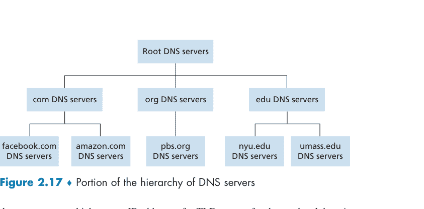

2.  **顶级域名（TLD）服务器。** 对于每个顶级域名——如 `com`、`org`、`net`、`edu` 和 `gov` 等顶级域名，以及所有国家顶级域名如 `uk`、`fr`、`ca` 和 `jp`——都有 TLD 服务器（或服务器集群）。Verisign 全球注册服务公司维护 `com` 顶级域名的 TLD 服务器，而 Educause 公司维护 `edu` 顶级域名的 TLD 服务器。支持 TLD 的网络基础设施可能庞大且复杂；有关 Verisign 网络的良好概述，请参见 [Osterweil 2012]。所有顶级域名的列表请参见 [TLD list 2020]。TLD 服务器提供权威 DNS 服务器的 IP 地址。

3.  **权威 DNS 服务器。** 每个在互联网上拥有公开可访问主机（如 Web 服务器和邮件服务器）的组织，都必须提供公开可访问的 DNS 记录，将这些主机的名称映射到 IP 地址。组织的权威 DNS 服务器存储这些 DNS 记录。组织可以选择自行实现其权威 DNS 服务器来存储这些记录；或者，组织可以付费让某服务提供者的权威 DNS 服务器存储这些记录。大多数大学和大型公司都自行实现并维护其主要和次要（备份）权威 DNS 服务器。

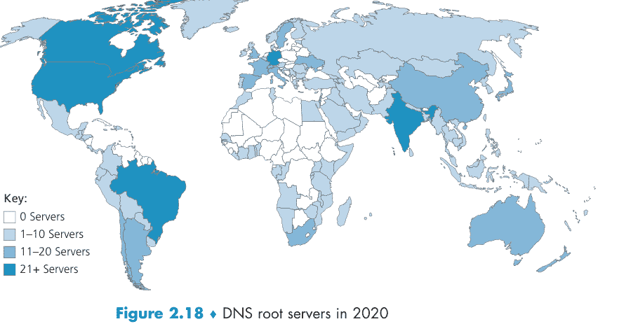

##### 图 2.18 ♦ 2020 年的 DNS 根服务器

根、TLD 和权威 DNS 服务器都属于 DNS 服务器层级，如图 2.17 所示。还有另一种重要的 DNS 服务器类型，称为本地 DNS 服务器。本地 DNS 服务器严格来说不属于该服务器层级，但它却是 DNS 架构的核心。每个 ISP——例如居民 ISP 或机构 ISP——都有一个本地 DNS 服务器（也称为默认域名服务器）。当主机连接到 ISP 时，ISP 会向主机提供一个或多个本地 DNS 服务器的 IP 地址（通常通过 DHCP 完成，这在第 4 章中进行了讨论）。您可以通过访问 Windows 或 UNIX 中的网络状态窗口轻松确定本地 DNS 服务器的 IP 地址。主机的本地 DNS 服务器通常“靠近”该主机。对于机构 ISP，本地 DNS 服务器可能位于与主机相同的 LAN 上；对于居民 ISP，它与主机之间通常不超过几个路由器。当主机发起 DNS 查询时，查询被发送到本地 DNS 服务器，该服务器充当代理，将查询转发到 DNS 服务器层级中，我们将在下文更详细地讨论这一点。

让我们看一个简单的例子。假设主机 cse.nyu.edu 需要获取 gaia.cs.umass.edu 的 IP 地址。还假设 NYU 为 cse.nyu.edu 提供的本地 DNS 服务器名为 dns.nyu.edu，且 gaia.cs.umass.edu 的一个权威 DNS 服务器名为 dns.umass.edu。如图

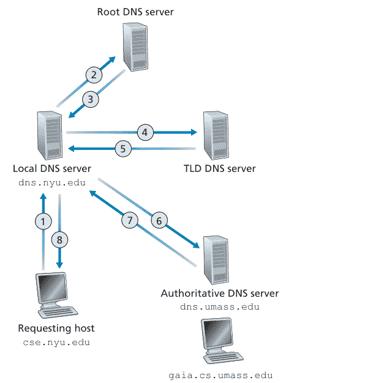

##### 图 2.19 ❖ 各种 DNS 服务器的交互

图 2.19 所示，主机 `cse.nyu.edu` 首先向本地 DNS 服务器 `dns.nyu.edu` 发送一条 DNS 查询消息。查询消息包含要解析的主机名，即 `gaia.cs.umass.edu`。本地 DNS 服务器将该查询消息转发给根 DNS 服务器。根 DNS 服务器注意到 `edu` 后缀，并返回负责 `edu` 的 TLD 服务器 IP 地址列表给本地 DNS 服务器。然后，本地 DNS 服务器将查询消息重新发送给这些 TLD 服务器之一。TLD 服务器注意到 `umass.edu` 后缀，并响应麻萨诸塞大学权威 DNS 服务器的 IP 地址，即 `dns.umass.edu`。最后，本地 DNS 服务器直接将查询消息重新发送给 `dns.umass.edu`，该服务器响应 `gaia.cs.umass.edu` 的 IP 地址。请注意，在这个例子中，为了获取一个主机名的映射，总共发送了八条 DNS 消息：四条查询消息和四条回复消息！我们将很快看到 DNS 缓存如何减少这种查询流量。

我们之前的例子假设 TLD 服务器知道该主机名的权威 DNS 服务器。通常，情况并非总是如此。相反，TLD 服务器


它们可能只知道一个中间 DNS 服务器，该服务器进而知道负责该主机名的权威 DNS 服务器。例如，假设马萨诸塞大学（University of Massachusetts）有一个大学 DNS 服务器，名为 dns.umass.edu。还假设马萨诸塞大学的每个部门都有自己的 DNS 服务器，且每个部门级 DNS 服务器都是该部门内所有主机的权威服务器。在这种情况下，当中间 DNS 服务器 dns.umass.edu 收到一个针对以 cs.umass.edu 结尾的主机名的查询时，它会向 dns.nyu.edu 返回负责所有以 cs.umass.edu 结尾的主机名的 dns.cs.umass.edu 的 IP 地址。本地 DNS 服务器 dns.nyu.edu 随后将查询发送给权威 DNS 服务器，该权威 DNS 服务器将所需的映射关系返回给本地 DNS 服务器，本地 DNS 服务器再将映射关系返回给请求主机。在这种情况下，总共发送了 10 条 DNS 消息！

图 2.19 中的示例同时使用了递归查询和迭代查询。从 cse.nyu.edu 发送到 dns.nyu.edu 的查询是递归查询，因为该查询要求 dns.nyu.edu 代表它获取映射关系。然而，随后的三个查询是迭代的，因为所有的回复都直接返回给 dns.nyu.edu。从理论上讲，任何 DNS 查询都可能是迭代的或递归的。例如，图 2.20 展示了一个所有查询都是递归的 DNS 查询链。在实践中，查询通常遵循图 2.19 中的模式：从请求主机到本地 DNS 服务器的查询是递归的，而剩余的查询是迭代的。

##### DNS 缓存

我们之前的讨论忽略了 DNS 缓存，这是 DNS 系统中一个极其重要的特性。事实上，DNS 广泛利用 DNS 缓存来提高延迟性能并减少在互联网中来回弹射的 DNS 消息数量。DNS 缓存背后的想法非常简单。在查询链中，当一个 DNS 服务器收到 DNS 回复（例如，包含从主机名到 IP 地址的映射）时，它可以在其本地内存中缓存该映射关系。例如，在图 2.19 中，每次本地 DNS 服务器 dns.nyu.edu 收到来自某个 DNS 服务器的回复时，它都可以缓存回复中包含的任何信息。如果主机名/IP 地址对被缓存在 DNS 服务器中，并且另一个针对相同主机名的查询到达该 DNS 服务器，那么即使该 DNS 服务器对该主机名不具权威性，它也能提供所需的 IP 地址。由于主机和主机名与 IP 地址之间的映射绝非永久性的，DNS 服务器会在一段时间（通常设置为两天）后丢弃缓存的信息。

作为一个例子，假设主机 apricot.nyu.edu 向 dns.nyu.edu 查询主机名 cnn.com 的 IP 地址。此外，假设几个小时后，另一个 NYU 主机，比如 kiwi.nyu.edu，也使用相同的主机名向 dns.nyu.edu 发送查询。由于缓存的存在，本地 DNS 服务器将能够立即向第二个请求主机返回 cnn.com 的 IP 地址，而无需查询任何其他 DNS 服务器。本地 DNS 服务器

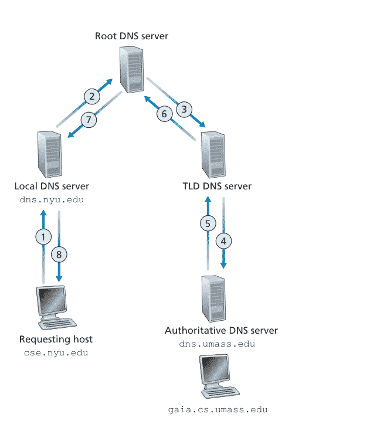

还可以缓存 TLD 服务器的 IP 地址，从而允许本地 DNS 服务器在查询链中绕过根 DNS 服务器。事实上，由于缓存的存在，除了极少量的 DNS 查询外，根服务器都会在所有查询中被绕过。

#### 2.4.3 DNS 记录与消息

共同实现 DNS 分布式数据库的 DNS 服务器存储资源记录（RR），包括提供从主机名到 IP 地址映射的 RR。每个 DNS 回复消息携带一个或多个资源记录。在本小节及下一小节中，我们将简要介绍 DNS 资源记录和消息；更多详细信息可在 [Albitz 1993] 或 DNS RFC [RFC 1034; RFC 1035] 中找到。

资源记录是一个四元组，包含以下字段：

(Name, Value, Type, TTL)

TTL 是资源记录的生存时间；它决定何时从缓存中移除资源。在下方的示例记录中，我们忽略 TTL 字段。Name 和 Value 的含义取决于 Type：

- 如果 Type=A，则 Name 是主机名，而 Value 是该主机名的 IP 地址。因此，Type A 记录提供了标准的主机名到 IP 地址映射。例如，(relay1.bar.foo.com, 145.37.93.126, A) 是一个 Type A 记录。

- 如果 Type=NS，则 Name 是一个域（如 foo.com），而 Value 是一个知道如何获取该域内主机 IP 地址的权威 DNS 服务器的主机名。此记录用于在查询链中进一步路由 DNS 查询。例如，(foo.com, dns.foo.com, NS) 是一个 Type NS 记录。

- 如果 Type=CNAME，则 Value 是别名主机名 Name 的规范主机名。此记录可以为查询主机提供该主机名的规范名称。例如，(foo.com, relay1.bar.foo.com, CNAME) 是一个 CNAME 记录。

- 如果 Type=MX，则 Value 是具有别名主机名 Name 的邮件服务器的规范名称。例如，(foo.com, mail.bar.foo.com, MX) 是一个 MX 记录。MX 记录允许邮件服务器的主机名拥有简单的别名。请注意，通过使用 MX 记录，一家公司可以为其邮件服务器和其他某台服务器（如 Web 服务器）使用相同的别名。为了获取邮件服务器的规范名称，DNS 客户端会查询 MX 记录；为了获取其他服务器的规范名称，DNS 客户端会查询 CNAME 记录。

如果一个 DNS 服务器是特定主机名的权威服务器，那么该 DNS 服务器将包含该主机名的 Type A 记录。（即使 DNS 服务器不是权威的，其缓存中也可能包含 Type A 记录。）如果一个服务器对某个主机名没有权威性，那么该服务器将包含包含该主机名的域的 Type NS 记录；它还将包含一个提供 NS 记录中 Value 字段的 DNS 服务器 IP 地址的 Type A 记录。例如，假设一个 edu TLD 服务器不是主机 gaia.cs.umass.edu 的权威服务器。那么该服务器将包含包含主机 gaia.cs.umass.edu 的域的记录，例如，(umass.edu, dns.umass.edu, NS)。edu TLD 服务器还将包含一个 Type A 记录，该记录将 DNS 服务器 dns.umass.edu 映射到一个 IP 地址，例如，(dns.umass.edu, 128.119.40.111, A)。

##### DNS 消息

在本节的早些部分，我们提到了 DNS 查询和回复消息。这是仅有的两种 DNS 消息。此外，查询和回复消息具有相同的格式，如图 2.21 所示。DNS 消息中各个字段*的含义如下：

- 前 12 个字节是*头部*，其中包含多个字段。第一个字段是一个 16 位数字，用于标识该查询。该标识符会被复制到查询的回复消息中，允许客户端将收到的回复与发出的查询进行匹配。标志字段中有多个标志。一个 1 位的查询/回复标志指示该消息是查询（0）还是回复（1）。当 DNS 服务器是所查询名称的权威服务器时，会在回复消息中设置 1 位的权威性标志。当客户端（主机或 DNS 服务器）希望 DNS 服务器在其没有记录时执行递归时，会设置 1 位的期望递归标志。如果 DNS 服务器支持递归，则会在回复中设置 1 位的递归可用字段。在头部中，还有四个“数量”字段。这些字段指示跟随在头部之后的四种类型数据部分的出现次数。

- *问题*部分包含有关正在进行的查询的信息。该部分包括 (1) 一个名称字段，其中包含被查询的名称，以及 (2) 一个类型字段，指示关于该名称正在询问的问题类型——例如，与名称关联的主机地址（Type A）或名称的邮件服务器（Type MX）。

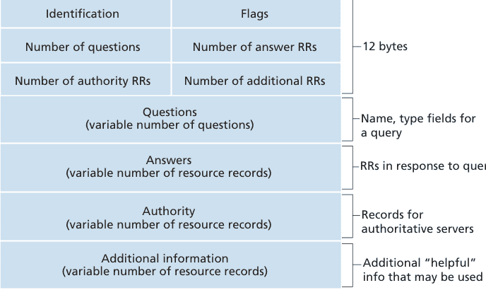

图 2.21 DNS 消息格式


+   • 在来自 DNS 服务器的回复中，*回答部分* 包含针对最初查询名称的资源记录。回顾一下，每条资源记录都包含 *类型*（例如，A、NS、CNAME 和 MX）、*值* 和 *TTL*。回复可以在回答中返回多条 RR（资源记录），因为一个主机名可以拥有多个 IP 地址（例如，如本节前面讨论的用于复制 Web 服务器）。

+   • *授权部分* 包含其他授权服务器的记录。

+   • *附加部分* 包含其他有用的记录。例如，针对 MX 查询的回复中的回答字段包含一个资源记录，提供邮件服务器的规范主机名。附加部分包含一个 A 类型记录，提供该邮件服务器规范主机名的 IP 地址。

你希望如何直接从你正在使用的主机向某个 DNS 服务器发送 DNS 查询消息呢？使用 **nslookup 程序** 可以很容易地做到这一点，该程序可在大多数 Windows 和 UNIX 平台上使用。例如，从 Windows 主机出发，打开命令提示符，只需输入“nslookup”即可调用 nslookup 程序。调用 nslookup 后，你可以向任何 DNS 服务器（根、TLD 或授权服务器）发送 DNS 查询。在收到来自 DNS 服务器的回复消息后，nslookup 将以人类可读的格式显示回复中包含的记录。作为替代方案，你可以访问许多允许远程使用 nslookup 的网站之一。（只需在搜索引擎中输入“nslookup”，你就会找到这些网站之一。）本章末尾的 DNS Wireshark 实验将允许你更详细地探索 DNS。

##### 向 DNS 数据库插入记录

上面的讨论集中在如何从 DNS 数据库中检索记录。你可能会想知道记录最初是如何进入数据库的。让我们在一个具体的示例中看看这是如何完成的。假设你刚刚创建了一家令人兴奋的新初创公司，名为 Network Utopia。你肯定首先要做的事情是在注册商处注册域名 *networkutopia.com*。**注册商** 是一个商业实体，它验证域名的唯一性，将域名输入 DNS 数据库（如下所述），并因提供服务而收取少量费用。1999 年以前，单一注册商 Network Solutions 垄断了 *com*、*net* 和 *org* 域名的注册。但现在有许多注册商在争夺客户，互联网名称与数字地址分配机构（ICANN）认证了各个注册商。完整的认证注册商列表可在 http://www.internic.net 上找到。

当你通过某个注册商注册域名 *networkutopia.com* 时，你还需要向注册商提供你的主授权 DNS 服务器和辅助授权 DNS 服务器的名称和 IP 地址。假设这些名称和 IP 地址是 *dns1.networkutopia.com*、*dns2.networkutopia.com*、*212.2.212.1* 和 *212.212.212.2*。对于这两个授权 DNS 服务器中的每一个，注册商都会确保在 TLD com 服务器中插入 NS 类型记录和 A 类型记录。具体来说，对于 networkutopia.com 的主授权服务器，注册商会在 DNS 系统中插入以下两条资源记录：

```
(networkutopia.com, dns1.networkutopia.com, NS)
(dns1.networkutopia.com, 212.212.212.1, A)
```

你还必须确保你 Web 服务器 www.networkutopia.com 的 A 类型资源记录和你邮件服务器 mail.networkutopia.com 的 MX 类型资源记录被输入到你的授权 DNS 服务器中。（直到最近，每个 DNS 服务器的内容都是静态配置的，例如由系统管理员创建的配置文件。最近，DNS 协议添加了一个 UPDATE 选项，允许通过 DNS 消息动态地向数据库添加或删除数据。[RFC 2136] 和 [RFC 3007] 指定了 DNS 动态更新。）

一旦完成所有这些步骤，人们就可以访问你的网站并向你公司的员工发送电子邮件了。让我们通过验证这一陈述来结束关于 DNS 的讨论。这种验证也有助于巩固我们关于 DNS 所学到的知识。假设澳大利亚的 Alice 想要查看 Web 页面 www.networkutopia.com。如前所述，她的主机首先会向其本地 DNS 服务器发送一个 DNS 查询。本地 DNS 服务器随后会联系 TLD com 服务器。（如果 TLD com 服务器的地址未被缓存，本地 DNS 服务器还必须联系根 DNS 服务器。）该 TLD 服务器包含上述列出的 NS 类型和 A 类型资源记录，因为注册商将这些资源记录插入到了所有 TLD com 服务器中。TLD com 服务器向 Alice 的本地 DNS 服务器发送回复，其中包含两条资源记录。本地 DNS 服务器随后向 212.212.212.1 发送一个 DNS 查询，询问对应于 www.networkutopia.com 的 A 类型记录。该记录提供了所需 Web 服务器的 IP 地址，例如 212.212.71.4，本地 DNS 服务器将其传回给 Alice 的主机。Alice 的浏览器现在可以发起与主机 212.212.71.4 的 TCP 连接，并在连接上发送 HTTP 请求。哇！当我们浏览 Web 时，幕后发生的事情远比表面看起来要多！

##### 聚焦安全

##### DNS 漏洞

我们已经看到，DNS 是互联网基础设施的关键组成部分，许多重要服务——包括 Web 和电子邮件——如果没有它就无法正常工作。因此，我们自然可以问：DNS 如何被攻击？DNS 是否是一个坐以待毙的目标，等待被击垮，同时导致大多数互联网应用也瘫痪？

首先想到的攻击类型是针对 DNS 服务器的 DDoS 带宽洪泛攻击（参见第 1.6 节）。例如，攻击者可能试图向每个 DNS 根服务器发送大量数据包，以至于大多数合法的 DNS 查询都无法得到回应。实际上，在 2002 年 10 月 21 日确实发生了一次针对 DNS 根服务器的大规模 DDoS 攻击。在这次攻击中，攻击者利用僵尸网络向 13 个 DNS 根 IP 地址中的每一个发送大量 ICMP ping 消息。（ICMP 消息在第 5.6 节中讨论。目前，只需知道 ICMP 数据包是 IP 数据报的特殊类型即可。）幸运的是，这次大规模攻击造成的损害微乎其微，对用户互联网体验几乎没有或没有任何影响。攻击者确实成功地向根服务器发送了大量数据包。但许多 DNS 根服务器受到数据包过滤器的保护，配置为始终阻止所有指向根服务器的 ICMP ping 消息。因此，这些受保护的服务器幸免于难并正常运行。此外，大多数本地 DNS 服务器会缓存顶级域服务器的 IP 地址，这使得查询过程经常可以绕过 DNS 根服务器。

针对 DNS 的潜在更有效的 DDoS 攻击是向顶级域服务器发送大量 DNS 查询，例如向处理 .com 域的顶级域服务器发送。过滤指向 DNS 服务器的 DNS 查询比较困难；而且与根服务器相比，顶级域服务器更不容易被绕过。2016 年 10 月 21 日，针对顶级域提供商 Dyn 就发生过此类攻击。这次 DDoS 攻击是通过由约十万个 IoT 设备（如打印机、IP 摄像头、住宅网关和婴儿监视器）组成的僵尸网络发出的大量 DNS 查找请求实现的，这些设备被 Mirai 恶意软件感染。在近一整天的时间里，Amazon、Twitter、Netflix、Github 和 Spotify 都受到了干扰。

DNS 还可能在其他方式下受到攻击。在中间人攻击中，攻击者拦截来自主机的查询并返回虚假的回复。在 DNS 中毒攻击中，攻击者向 DNS 服务器发送虚假回复，欺骗服务器将虚假记录接受到其缓存中。这些攻击中的任何一种都可以用于例如将无意识的 Web 用户重定向到攻击者的网站。DNS 安全扩展（DNSSEC [Gieben 2004; RFC 4033]）已设计并部署以防止此类滥用。DNSSEC，一种安全的 DNS 版本，解决了许多这些可能的攻击，并正在互联网上流行起来。

### 2.5 对等文件分发

本章迄今为止描述的应用——包括 Web、电子邮件和 DNS——都采用客户-服务器架构，并严重依赖始终在线的基础设施服务器。回顾第 2.1.1 节，在对等（P2P）架构中，对始终在线的基础设施服务器的依赖最小（或没有）。相反，成对的间歇性连接的主机（称为对等节点）直接相互通信。这些对等节点并非由服务提供商拥有，而是由用户控制的 PC、笔记本电脑和智能手机。


在本节中，我们考虑一种非常自然的 P2P 应用，即把一个大文件从单个服务器分发到大量主机（称为对等节点或 peer）。该文件可能是 Linux 操作系统的某个新版本、现有操作系统的某个软件补丁，或者一个 MPEG 视频文件。在客户端–服务器文件分发中，服务器必须向每个对等节点发送一份文件副本——这对服务器造成了巨大的负担，并消耗大量服务器带宽。而在 P2P 文件分发中，每个对等节点都可以将其已收到的文件任意部分重新分发给其他对等节点，从而协助服务器完成分发过程。截至 2020 年，最流行的 P2P 文件分发协议是 BitTorrent。BitTorrent 最初由 Bram Cohen 开发，如今已有许多不同的独立 BitTorrent 客户端遵循 BitTorrent 协议，就如同有许多 Web 浏览器客户端遵循 HTTP 协议一样。在本小节中，我们首先考察 P2P 架构在文件分发背景下的自我可扩展性（self-scalability）。然后我们较为详细地描述 BitTorrent，突出其最重要的特征和功能。

##### P2P 架构的可扩展性

为了比较客户端–服务器架构与 P2P 架构，并说明 P2P 固有的自我可扩展性，我们现在考虑一个针对两种架构类型的、将文件分发到固定一组对等节点的简单定量模型。如图 2.22 所示，服务器和对等节点都通过接入链路连接到互联网。

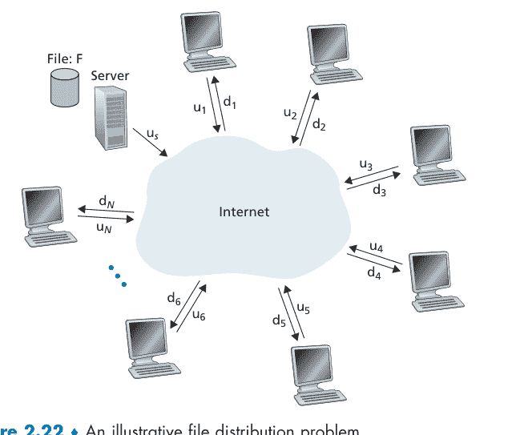

一个示例性的文件分发问题

我们用 $u_{s}$ 表示服务器接入链路的上传速率，用 $u_{i}$ 表示第 $i$ 个对等节点接入链路的上传速率，用 $d_{i}$ 表示第 $i$ 个对等节点接入链路的下载速率。此外，用 $F$ 表示待分发文件的*大小*（以比特为单位），用 $N$ 表示希望获得该文件副本的对等节点数量。**分发时间**（distribution time）指将文件副本送达所有 $N$ 个对等节点所需的时间。在以下对分发时间的分析中，对于客户端–服务器架构和 P2P 架构，我们都做出简化（且通常准确的 [Akella 2003]）假设：互联网核心具有充裕带宽，这意味着所有瓶颈都位于接入网络。我们还假设服务器和客户端没有参与任何其他网络应用，因此它们全部的上传和下载接入带宽都可以完全用于分发这个文件。

让我们首先确定客户端–服务器架构的分发时间，记作 $D_{cs}$。在客户端–服务器架构中，没有任何对等节点协助分发文件。我们有以下观察：

- 服务器必须向每个 $N$ 个对等节点中的一个发送一份文件副本。因此，服务器必须传输 $NF$ 比特。由于服务器的上传速率为 $u_{s}$，分发文件所需时间至少为 $NF/u_{s}$。
- 设 $d_{\min}$ 表示下载速率最低的对等节点的下载速率，即 $d_{\min} = \min\{d_{1}, d_{2}, \ldots, d_{N}\}$。下载速率最低的对等节点无法在少于 $F/d_{\min}$ 秒内获得文件的全部 $F$ 比特。因此，最小分发时间至少为 $F/d_{\min}$。

将上述两个观察结合起来，我们得到

$$D_{cs} \geq \max \left\{\frac{NF}{u_{s}}, \frac{F}{d_{\min}}\right\}$$

这给出了客户端–服务器架构最小分发时间的一个下界。在课后习题中，你们将被要求证明服务器可以调度其传输，使得该下界实际上可以被达到。因此，让我们将上述给出的下界视为实际的分发时间，即

$$D_{cs} = \max \left\{\frac{NF}{u_{s}}, \frac{F}{d_{\min}}\right\} \quad (2.1)$$

从公式 2.1 可以看出，当 $N$ 足够大时，客户端–服务器架构的分发时间由 $NF/u_{s}$ 给出。因此，分发时间随对等节点数量 $N$ 线性增长。举例来说，如果一周到下一周对等节点数量从一千个增加到一百万个（增长了一千倍），那么将文件分发给所有对等节点所需的时间也会增加 1,000 倍。

现在让我们对 P2P 架构进行类似的分析，其中每个对等节点都可以协助服务器分发文件。具体而言，当一个对等节点接收到部分文件数据后，它可以使用自身的上传能力将这些数据重新分发给其他对等节点。与客户端–服务器架构相比，P2P 架构分发时间的计算稍显复杂，因为分发时间取决于每个对等节点如何向其他对等节点分发文件的各个部分。尽管如此，仍然可以求得最小分发时间的一个简单表达式 [Kumar 2006]。为此，我们首先做出以下观察：

- 在分发开始时，只有服务器拥有该文件。为了使该文件进入对等节点群体，服务器必须将文件的每一比特至少一次地发送到其接入链路。因此，最小分发时间至少为 $F/u_s$。（与客户端–服务器方案不同，服务器只发送一次的一比特，之后可能无需再次发送，因为对等节点之间可以互相重新分发该比特。）
- 与客户端–服务器架构一样，下载速率最低的对等节点无法在少于 $F/d_{\text{min}}$ 秒内获得文件的全部 $F$ 比特。因此，最小分发时间至少为 $F/d_{\text{min}}$。
- 最后，观察整个系统的总上传容量，其等于服务器上传速率加上每个单独对等节点的上传速率之和，即 $u_{\text{total}} = u_s + u_1 + \cdots + u_N$。系统必须向每个 $N$ 个对等节点之一投递（上传）$F$ 比特，从而总共投递 $NF$ 比特。这一过程不可能以快于 $u_{\text{total}}$ 的速率完成。因此，最小分发时间也至少为 $NF/(u_s + u_1 + \cdots + u_N)$。

将上述三个观察结合起来，我们得到 P2P 的最小分发时间，记作 $D_{\text{P2P}}$，

$$D_{\text{P2P}} \ge \max \left\{ \frac{F}{u_s}, \frac{F}{d_{\text{min}}}, \frac{NF}{u_s + \sum_{i=1}^{N} u_i} \right\} \qquad (2.2)$$

公式 2.2 给出了 P2P 架构最小分发时间的一个下界。事实上，如果我们设想每个对等节点在收到某比特后立即可以重新分发该比特，那么存在一种重新分发方案能够实际达到该下界 [Kumar 2006]。（我们将在课后习题中证明该结果的一个特例。）在现实场景中，由于文件是以块（chunk）而非单个比特进行重新分发，公式 2.2 仍然可以作为实际最小分发时间的良好近似。因此，让我们将公式 2.2 给出的下界视为实际的最小分发时间，即

$$D_{\text{P2P}} = \max \left\{ \frac{F}{u_s}, \frac{F}{d_{\text{min}}}, \frac{NF}{u_s + \sum_{i=1}^{N} u_i} \right\} \qquad (2.3)$$

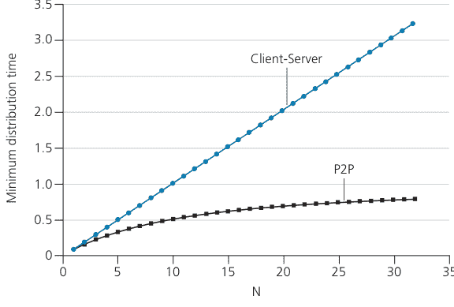

**图 2.23** P2P 与客户端–服务器架构的分发时间

图 2.23 比较了假设所有对等节点具有相同上传速率 $u$ 时，客户端–服务器架构与 P2P 架构的最小分发时间。在图 2.23 中，我们设定 $F/u = 1$ 小时，$u_s = 10u$，且 $d_{\min} \ge u_s$。因此，一个对等节点可以在一小时内传输整个文件，服务器传输速率是对等节点上传速率的 10 倍，并且（为简化起见）对等节点的下载速率被设置为足够大，从而不产生显著影响。从图 2.23 中我们看到，对于客户端–服务器架构，随着对等节点数量的增加，分发时间线性且无界增长。然而，对于 P2P 架构，最小分发时间不仅始终小于客户端–服务器架构的分发时间；而且对于*任意*数量的对等节点 $N$，它都少于一小时。因此，采用 P2P 架构的应用可以实现自我可扩展。这种可扩展性直接源于对等节点既是比特流的消费者，也是重新分发者。

##### BitTorrent

BitTorrent 是一种流行的用于文件分发的 P2P 协议 [Chao 2011]。在 BitTorrent 术语中，参与分发某个特定文件的所有对等节点的集合被称为* torrent*（种子池）。在一个 torrent 中，对等节点彼此下载文件大小相等的*块*（chunk），典型块大小为 256 KBytes。当一个对等节点首次加入 torrent 时，它没有任何块。随着时间推移，它逐渐累积越来越多的块。在它下载块的同时，也向其他对等节点上传块。一旦某个对等节点获取了完整文件，它可能会（出于私心）离开 torrent，或者（出于利他）留在 torrent 中并继续向其他对等节点上传块。此外，任何对等节点都可以在任意时刻带着部分块离开 torrent，并在稍后重新加入该 torrent。


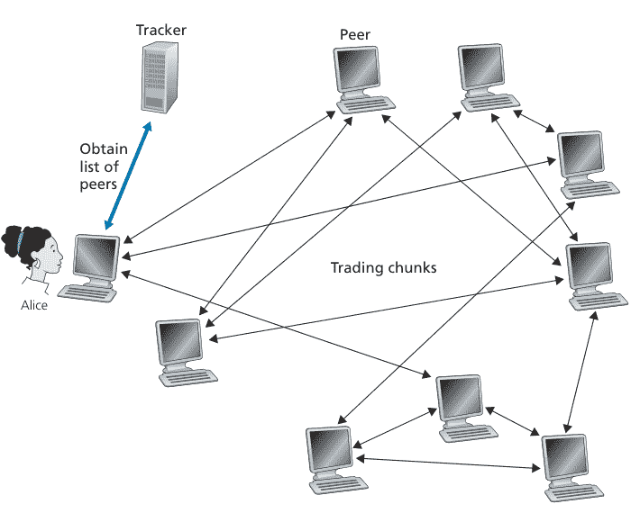

现在让我们更仔细地看看 BitTorrent 是如何运作的。由于 BitTorrent 是一种相当复杂的协议和系统，我们只将描述其最重要的机制，将一些细节一笔带过；这将让我们能够透过树木看到森林。每个 torrent 都有一个称为 *tracker* 的基础设施节点。当一个对等体加入 torrent 时，它会向 tracker 注册并定期通知 tracker 它仍在该 torrent 中。通过这种方式，tracker 可以跟踪参与该 torrent 的对等体。在任何特定时刻，给定的 torrent 可能只有不到十个或超过一千个对等体参与。

如图 2.24 所示，当一个新对等体 Alice 加入 torrent 时，tracker 从参与对等体集合中随机选择一个子集（为了具体起见，假设为 50 个），并将这 50 个对等体的 IP 地址发送给 Alice。拥有这个对等体列表后，Alice 尝试与列表中的所有对等体建立并发 TCP 连接。让我们将与 Alice 成功建立 TCP 连接的所有对等体称为“邻近对等体”。（在图 2.24 中，显示 Alice 只有三个邻近对等体。通常，她会有更多。）随着时间推移，这些对等体中的一些可能会离开，而其他对等体（初始 50 个之外的）可能会尝试与 Alice 建立 TCP 连接。因此，一个对等体的邻近对等体将随时间波动。

在任何给定时刻，每个对等体将拥有文件的一组数据块子集，不同的对等体拥有不同的子集。定期地，Alice 会通过 TCP 连接向她的每个邻近对等体询问它们拥有的数据块列表。如果 Alice 有 L 个不同的邻居，她将获得 L 个数据块列表。凭借这些知识，Alice 将通过 TCP 连接发出请求，请求她当前没有的数据块。

因此，在任何给定时刻，Alice 将拥有一组数据块，并知道她的邻居拥有哪些数据块。凭借这些信息，Alice 需要做两个重要决定。首先，她应该首先向邻居请求哪些数据块？其次，她应该向哪个邻居发送被请求的数据块？在决定请求哪些数据块时，Alice 使用了一种称为“最稀有优先”的技术。其思想是确定在她没有的数据块中，哪些在她的邻居中是最稀有的（即在她邻居中副本数量最少的那些数据块），然后首先请求这些最稀有的数据块。通过这种方式，最稀有的数据块会更快地重新分发，目的是（大致上）均衡 torrent 中每个数据块的副本数量。

为了确定她响应哪些请求，BitTorrent 使用了一种巧妙的交易算法。基本思想是 Alice 优先给予当前以最高速率向她提供数据的邻居。具体来说，对于她的每个邻居，Alice 持续测量她接收位速率，并确定向她提供位速率最高的四个对等体。然后她以向这四个相同的对等体发送数据块作为回报。每 10 秒，她重新计算速率并可能修改这四个对等体的集合。在 BitTorrent 术语中，这四个对等体被称为**解除阻塞**。重要的是，每 30 秒，她还随机选择一个额外的邻居并向其发送数据块。让我们将随机选择的对等体称为 Bob。在 BitTorrent 术语中，Bob 被称为**乐观地解除阻塞**。因为 Alice 正在向 Bob 发送数据，她可能会成为 Bob 的前四名上传者之一，在这种情况下，Bob 将开始向 Alice 发送数据。如果 Bob 向 Alice 发送数据的速率足够高，Bob 反过来也可以成为 Alice 的前四名上传者之一。换句话说，每 30 秒，Alice 将随机选择一个新的交易伙伴并与其开始交易。如果两个对等体对交易感到满意，它们会将彼此列入前四名列表并继续相互交易，直到其中一个对等体找到更好的伙伴为止。其结果是，能够以兼容速率上传的对等体倾向于找到彼此。随机邻居选择也允许新对等体获取数据块，使它们有东西可交易。除了这五个对等体（四个“顶级”对等体和一个探测对等体）之外的所有其他邻近对等体都是“阻塞”的，即它们不从 Alice 接收任何数据块。BitTorrent 有许多在此未讨论的有趣机制，包括片（mini-chunks）、流水线、随机优先选择、结束模式以及反霸凌机制 [Cohen 2003]。

刚才描述的交易激励机制通常被称为以牙还牙 [Cohen 2003]。已证明，这种激励方案可以被规避 [Lioigas 2006; Locher 2006; Piatek 2008]。尽管如此，BitTorrent 生态系统取得了巨大成功，有数百万个同时对等体在数十万个 torrent 中积极共享文件。如果 BitTorrent 在设计时没有以牙还牙（或其变体），但其他方面完全相同，BitTorrent 可能现在都不复存在，因为大多数用户将会是搭便车者 [Sario 2002]。

我们通过简要提及 P2P 的另一个应用，即分布式哈希表（DHT），来结束对 P2P 的讨论。分布式哈希表是一个简单的数据库，数据库记录分布在 P2P 系统中的对等体上。DHT 已被广泛实现（例如在 BitTorrent 中），并已成为广泛研究的主题。一个概述在配套网站的视频笔记中提供。


### 2.6 视频流和内容分发网络

根据许多估算，流媒体视频（包括 Netflix、YouTube 和 Amazon Prime）在 2020 年占互联网流量的约 80% [Cisco 2020]。本节我们将概述当今互联网中流行的视频流媒体服务是如何实现的。我们将看到，它们是使用应用层协议和服务器实现的，这些服务器在某种程度上起缓存作用。

#### 2.6.1 互联网视频

在流媒体存储视频应用中，底层介质是预录制的视频，例如电影、电视节目、预录制的体育赛事或预录制的用户生成视频（如 YouTube 上常见的那种）。这些预录制视频被放置在服务器上，用户向服务器发送请求以按需观看视频。如今许多互联网公司都提供流媒体视频，包括 Netflix、YouTube（Google）、Amazon 和 TikTok。

但在深入讨论视频流媒体之前，我们首先应该对视频介质本身有一个快速的了解。视频是图像的序列，通常以恒定速率显示，例如每秒 24 或 30 帧。未压缩的数字编码图像由像素数组组成，每个像素被编码为若干位以表示亮度和颜色。视频的一个重要特征是可以压缩，从而在视频质量与比特率之间进行权衡。如今现成的压缩算法可以将视频压缩到基本上任何期望的比特率。当然，比特率越高，图像质量越好，总体用户观看体验也越好。

从网络角度看，视频最显著的特征或许是高比特率。压缩互联网视频通常从低质量视频的 100 kbps 到流媒体高清电影的超过 4 Mbps；4K 流媒体设想的比特率超过 10 Mbps。这可能转化为大量的流量和存储，特别是对于高端视频。例如，单个 2 Mbps 的视频，时长为 67 分钟，将消耗 1 GB 的存储和流量。迄今为止，流媒体视频最重要的性能度量是平均端到端吞吐量。为了提供连续播放，网络必须为流媒体应用提供至少等于压缩视频比特率的平均吞吐量。

我们还可以使用压缩来创建同一视频的多个版本，每个版本具有不同的质量级别。例如，我们可以使用压缩创建同一视频的三个版本，速率分别为 300 kbps、1 Mbps 和 3 Mbps。然后用户可以决定根据自己的当前可用带宽观看哪个版本。拥有高速互联网连接的用户可能会选择 3 Mbps 版本；使用智能手机通过 3G 观看视频的用户可能会选择 300 kbps 版本。

#### 2.6.2 HTTP 流媒体和 DASH

在 HTTP 流媒体中，视频简单地存储在 HTTP 服务器上，作为具有特定 URL 的普通文件。当用户想要观看视频时，客户端与服务器建立 TCP 连接并发出针对该 URL 的 HTTP GET 请求。然后服务器在 HTTP 响应消息中发送视频文件，速度尽可能快，受底层网络协议和流量条件限制。在客户端方面，字节被收集在客户端应用缓冲区中。一旦该缓冲区中的字节数超过预定的阈值，客户端应用就开始播放——具体来说，流媒体视频应用定期从客户端应用缓冲区获取视频帧，解码这些帧并在用户屏幕上显示它们。因此，视频流媒体应用在接收和缓冲对应于视频后部的帧的同时显示视频。

尽管如上一段所述，HTTP 流媒体在实践中已被广泛部署（例如，自 YouTube 成立起），但它有一个主要的缺陷：尽管客户端可用带宽的量在不同客户端之间以及同一客户端随时间变化中存在巨大差异，但所有客户端都接收相同的视频编码。这导致了基于 HTTP 的新型流媒体的开发，通常被称为**基于 HTTP 的动态自适应流媒体（DASH）**。在 DASH 中，视频被编码成几个不同的版本，每个版本具有不同的比特率，相应地具有不同的质量级别。客户端动态请求长度为几秒的视频片段块。当可用带宽量较高时，客户端自然选择来自高速率版本的块；当可用带宽较低时，它自然选择来自低速率版本的块。客户端使用 HTTP GET 请求消息一次选择不同的块 [Akshabi 2011]。

DASH 允许具有不同互联网接入速率的客户端以不同的编码速率流式传输视频。具有低速 3G 连接的客户端可以接收低比特率（和低质量）版本，而具有光纤连接的客户端可以接收高质量版本。如果会话期间可用的端到端带宽发生变化，DASH 还允许客户端适应可用带宽。这一特性


这对于移动用户尤为重要，因为随着他们相对于基站的位置移动，其带宽可用性通常会发生波动。

在 DASH 中，每个视频版本都存储在 HTTP 服务器上，每个版本拥有不同的 URL。该 HTTP 服务器还包含一个 **清单文件**，该文件提供了每个版本的 URL 及其比特率。客户端首先请求清单文件，了解各个版本的信息。然后，客户端每次选择一个块，通过在每个块的 HTTP GET 请求消息中指定 URL 和字节范围来完成选择。在下载块的同时，客户端还会测量接收带宽，并运行速率决定算法来选择下一个要请求的块。显然，如果客户端有大量视频缓冲且测得的接收带宽较高，它将选择来自高比特率版本的块。同样，如果客户端的视频缓冲较少且测得的接收带宽较低，它将选择来自低比特率版本的块。因此，DASH 允许客户端在不同质量级别之间自由切换。

#### 2.6.3 内容分发网络

如今，许多互联网视频公司每天都在向数百万用户分发兆位多路复用（multi-Mbps）的点播流媒体。例如，YouTube 拥有数亿个视频的库，每天向全球用户分发数亿条视频流。将所有这些流量流式传输到全球各地，同时提供持续播放和高交互性，显然是一项具有挑战性的任务。

对于互联网视频公司而言，提供流媒体视频服务最直观的方法可能是建造一个超大型数据中心，将其所有视频存储在该数据中心，并直接从数据中心向全球客户端流式传输视频。但是这种方法存在三个主要问题。首先，如果客户端距离数据中心很远，服务器到客户端的数据包将跨越许多通信链路，并很可能穿过许多 ISP（互联网服务提供商），其中一些 ISP 可能位于不同的大陆。如果其中一条链路提供的吞吐量低于视频消耗速率，端到端吞吐量也将低于消耗速率，从而导致用户出现令人恼火的冻结延迟。（回顾第 1 章可知，流的端到端吞吐量由瓶颈链路的吞吐量决定。）随着端到端路径中链路数量的增加，这种情况发生的可能性也会增加。第二个缺点是，热门视频很可能会在同一条通信链路上被发送多次。这不仅浪费了网络带宽，而且互联网视频公司本身还要为其提供服务的 ISP（连接该数据中心的 ISP）反复将 *相同* 的字节发送到互联网而付费。这种解决方案的第三个问题是，单一的数据中心代表单点故障——如果数据中心或其与互联网的链路发生故障，它就无法分发 *任何* 视频流。

为了应对向遍布全球的用户分发大量视频数据的挑战，几乎所有主要的视频流媒体公司都利用了 **内容分发网络（CDN）**。CDN 管理分布在多个地理位置的服务器，在其服务器中存储视频副本（以及其他类型的 Web 内容，包括文档、图像和音频），并尝试将每个用户请求定向到能提供最佳用户体验的 CDN 位置。CDN 可以是私有 CDN，即由内容提供商本身拥有；例如，Google 的 CDN 分发 YouTube 视频和其他类型的内容。CDN 也可以是第三方 CDN，代表多个内容提供商分发内容；Akamai、Limelight 和 Level-3 都运营第三方 CDN。关于现代 CDN 的一个非常易读的概述见 [Leighton 2009; Nygren 2010]。

CDN 通常采用两种不同的服务器部署理念之一 [Huang 2008]：

- **深入内部（Enter Deep）**。由 Akamai 开创的一种理念是 *深入* 互联网服务提供商的接入网络，方法是在世界各地的接入 ISP 中部署服务器集群。（接入网络在第 1.3 节中有描述。）Akamai 采用这种方法，在成千上万个地点部署集群。目标是接近最终用户，从而通过减少最终用户与其接收内容的 CDN 服务器之间的链路和路由器数量，来改善用户感知的延迟和吞吐量。由于这种高度分布式设计，维护和管理工作变得具有挑战性。

- **带回家（Bring Home）**。Limelight 和许多其他 CDN 公司采用的第二种设计理念是 *将 ISP 带回家*，通过在较少数量（例如几十）的站点建立大型集群来实现。这些 CDN 通常不是进入接入 ISP 内部，而是将集群放置在互联网交换点（IXP）中（参见第 1.3 节）。与“深入内部”的设计理念相比，“带回家”设计通常导致更低的维护和管理工作开销，但可能会以增加最终用户的延迟和降低吞吐量为代价。

一旦集群就位，CDN 就会在其集群之间复制内容。CDN 可能不希望将每个视频的副本都放在每个集群中，因为有些视频很少被观看，或者只在某些国家受欢迎。事实上，许多 CDN 不会将视频推送到其集群，而是使用简单的拉取策略：如果客户端从一个未存储该视频的集群请求视频，则该集群会检索该视频（来自中央存储库或另一个集群），并在将视频流式传输给客户端的同时在本地存储副本。类似于 Web 缓存（参见第 2.2.5 节），当集群存储空间已满时，它会移除不常请求的视频。

##### CDN 的运行机制

在确定了部署 CDN 的两种主要方法后，让我们深入了解 CDN 如何运行的细节。当用户主机上的浏览器被指示获取特定视频（由 URL 标识）时，CDN 必须拦截该请求，以便它能够 (1) 确定当时适合该客户端的 CDN 服务器集群，以及 (2) 将客户端的请求重定向到该集群中的服务器。我们将稍后讨论 CDN 如何确定合适的集群。但首先让我们看看拦截和重定向请求背后的机制。

大多数 CDN 利用 DNS 来拦截和重定向请求；关于 DNS 这种用途的一个有趣讨论见 [Vixie 2009]。让我们考虑一个简单

##### 案例研究

##### GOOGLE 的网络基础设施

为了支持其庞大的服务阵列——包括搜索、Gmail、日历、YouTube 视频、地图、文档和社交网络——Google 部署了广泛的私有网络和 CDN 基础设施。Google 的 CDN 基础设施具有三层服务器集群：

- 在北美、欧洲和亚洲设有十九个“超级数据中心” [Google Locations 2020]，每个数据中心拥有约 100,000 台服务器。这些超级数据中心负责提供动态（且通常是个性化的）内容，包括搜索结果和 Gmail 消息。
- 在遍布世界各地的约 90 个 IXP（互联网交换点）集群，每个集群由数百台服务器组成 [Adhikari 2011a] [Google CDN 2020]。这些集群负责提供静态内容，包括 YouTube 视频。
- 许多位于接入 ISP 内部的“深入内部”集群，数量达数百个。这里一个集群通常由单个机架内的数十台服务器组成。这些深入内部服务器执行 TCP 拆分（参见第 3.7 节）并提供静态内容 [Chen 2011]，包括体现搜索结果的 Web 页面的静态部分。

所有这些数据中心和集群位置都通过 Google 自己的私有网络连接在一起。当用户发出搜索查询时，通常查询首先通过本地 ISP 发送到附近的深入内部缓存，在那里检索静态内容；在向客户端提供静态内容的同时，附近缓存还会通过 Google 私有网络将查询转发到其中一个超级数据中心，从那里检索个性化的搜索结果。对于 YouTube 视频，视频本身可能来自其中一个“带回家”缓存，而围绕视频的 Web 页面的部分可能来自附近的深入内部缓存，围绕视频的 advertisements（广告）则来自数据中心。总之，除了本地 ISP 之外，Google 云服务在很大程度上是由一个独立于公共互联网的网络基础设施提供的。


一个说明 DNS 通常如何参与的示例。假设内容提供商 NetCinema 雇用第三方 CDN 公司 KingCDN 向其客户分发视频。在 NetCinema 的网页上，每个视频都被分配了一个包含字符串“video”和该视频唯一标识符的 URL；例如，变形金刚 7 可能被分配为 http://video.netcinema.com/6Y7B23V。随后发生六个步骤，如图 2.25 所示：

- 1. 用户访问 NetCinema 的网页。
- 2. 当用户点击链接 http://video.netcinema.com/6Y7B23V 时，用户的主机发送一个针对 video.netcinema.com 的 DNS 查询。
- 3. 用户的本地 DNS 服务器（LDNS）将 DNS 查询中继到 NetCinema 的权威 DNS 服务器，该服务器观察到主机名 video.netcinema.com 中的字符串“video”。为了将 DNS 查询“移交”给 KingCDN，NetCinema 的权威 DNS 服务器没有返回 IP 地址，而是向 LDNS 返回了 KingCDN 域内的一个主机名，例如 a1105.kingcdn.com。
- 4. 从这一点开始，DNS 查询进入了 KingCDN 的私有 DNS 基础设施。用户的 LDNS 随后发送第二个查询，现在是针对 a1105.kingcdn.com，KingCDN 的 DNS 系统最终将 KingCDN 内容服务器的 IP 地址返回给 LDNS。因此，正是在 KingCDN 的 DNS 系统中，指定了客户端将接收内容的那个 CDN 服务器。

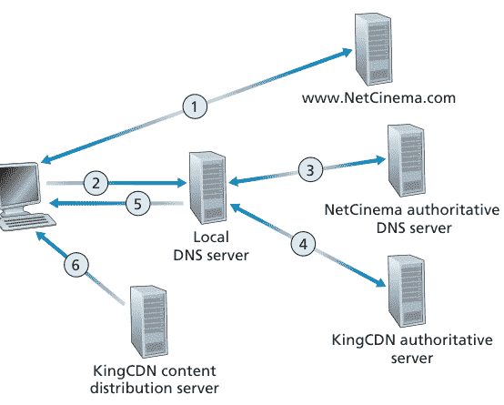

图 2.25 DNS 将用户请求重定向到 CDN 服务器

- 5. LDNS 将提供内容服务的 CDN 节点的 IP 地址转发给用户的主机。
- 6. 一旦客户端收到 KingCDN 内容服务器的 IP 地址，它与该 IP 地址处的服务器建立直接的 TCP 连接，并发出 HTTP GET 请求以获取视频。如果使用 DASH，服务器首先会向客户端发送一个包含 URL 列表的清单文件，每个 URL 对应视频的一个版本，客户端将从不同版本中动态选择数据块。

##### 集群选择策略

在任何 CDN 部署的核心是一个**集群选择策略**，即一种动态将客户端引导至 CDN 内的某个服务器集群或数据中心的机制。正如我们刚才所见，CDN 通过客户端的 DNS 查找学习到客户端 LDNS 服务器的 IP 地址。在学习到这个 IP 地址后，CDN 需要基于此 IP 地址选择一个合适的集群。CDN 通常采用专有的集群选择策略。我们现在简要介绍几种方法，每种方法都有其自身的优点和缺点。

一种简单的策略是将客户端分配给**地理位置最近**的集群。使用商业地理定位数据库（如 Quova [Quova 2020] 和 MaxMind [MaxMind 2020]），每个 LDNS IP 地址都被映射到一个地理位置。当从特定 LDNS 收到 DNS 请求时，CDN 选择地理位置最近的集群，即距离 LDNS“直线距离”最少的集群（以千米计）。这种解决方案对于很大一部分客户端可以工作得相当好 [Agrawal 2009]。然而，对于某些客户端，该解决方案的表现可能较差，因为地理位置最近的集群在通过网络路径长度或跳数衡量时可能不是最近的集群。此外，所有基于 DNS 的方法都存在一个固有问题：一些终端用户被配置为使用位于远程的 LDNS [Shaikh 2001; Mao 2002]，在这种情况下，LDNS 的位置可能与客户端的位置相距甚远。而且，这种简单策略忽略了互联网路径时延和可用带宽随时间的变化，总是将同一个集群分配给特定的客户端。

为了基于*当前*流量状况确定客户端的最佳集群，CDN 可以改为在其集群和客户端之间进行定期的**实时测量**，以评估时延和丢包性能。例如，CDN 可以让其每个集群定期向全球各地的所有 LDNS 发送探针（例如 ping 消息或 DNS 查询）。这种方法的一个缺点是许多 LDNS 被配置为不响应此类探针。

#### 2.6.4 案例研究：Netflix 和 YouTube

我们通过查看两个非常成功的大规模部署——Netflix 和 YouTube，来结束对存储视频流传输的讨论。我们将看到，这些系统中的每一个都采取了非常不同的方法，但都采用了本节中讨论的许多基本原理。

##### Netflix

截至 2020 年，Netflix 是北美在线电影和电视剧领域的领先服务提供商。如下文所述，Netflix 视频分发有两个主要组成部分：Amazon 云及其自己的私有 CDN 基础设施。

Netflix 拥有一个网站，处理众多功能，包括用户注册和登录、计费、用于浏览和搜索的电影目录以及电影推荐系统。如图 2.26 所示，该网站（及其相关后端数据库）完全运行在 Amazon 云中的 Amazon 服务器上。此外，Amazon 云处理以下关键功能：

- ***内容摄入。** 在 Netflix 向客户分发电影之前，它必须首先摄入并处理该电影。Netflix 接收制片厂提供的电影母版版本，并将其上传到 Amazon 云中的主机。
- ***内容处理。** Amazon 云中的机器为每部电影创建许多不同的格式，适用于运行在台式计算机、智能手机和连接到电视的游戏机上的各种客户端视频播放器。为这些格式中的每一种以及多个比特率创建不同版本，从而支持使用 DASH 通过 HTTP 进行自适应流媒体传输。
- ***向 CDN 上传版本。** 一旦某部电影的所有版本都已创建，Amazon 云中的主机将这些版本上传到其 CDN。

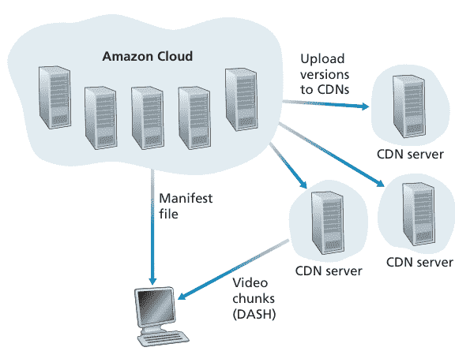

Netflix 视频流媒体平台

当 Netflix 在 2007 年首次推出其视频流媒体服务时，它雇用了三家第三方 CDN 公司来分发其视频内容。Netflix 此后创建了自己的私有 CDN，并由此分发其所有视频。为了创建自己的 CDN，Netflix 既在 IXP（互联网交换点）内部，也在住宅 ISP（互联网服务提供商）内部安装了服务器机架。Netflix 目前在超过 200 个 IXP 位置拥有服务器机架；请参阅 [Böttger 2018] [Netflix Open Connect 2020] 以查看托管 Netflix 机架的最新 IXP 列表。还有数百个 ISP 位置托管 Netflix 机架；也可参阅 [Netflix Open Connect 2020]，Netflix 在其中向潜在 ISP 合作伙伴提供了关于为其网络安装（免费）Netflix 机架的说明。机架中的每个服务器都有多个 10 Gbps 以太网端口和超过 100 太字节（terabytes）的存储。机架中服务器的数量各异：IXP 安装通常有几十个服务器，并包含完整的 Netflix 流媒体视频库，包括支持 DASH 的多个视频版本。Netflix 不使用拉取缓存（第 2.2.5 节）来填充其在 IXP 和 ISP 中的 CDN 服务器。相反，Netflix 通过在非高峰时段将视频推送到其 CDN 服务器来分发布视频。对于无法容纳整个库的位置，Netflix 仅推送最热门的视频，这些视频是根据每天的情况确定的。Netflix CDN 的设计在 YouTube 视频 [Netflix Video 1] 和 [Netflix Video 2] 中得到了详细说明；另请参阅 [Böttger 2018]。

在描述了 Netflix 架构的组件后，让我们更仔细地看看在电影交付过程中客户端与涉及的各个服务器之间的交互。如前所述，浏览 Netflix 视频库的网页由 Amazon 云中的服务器提供。当用户选择播放某部电影时，运行在 Amazon 云中的 Netflix 软件首先确定其哪个 CDN 服务器拥有该电影的副本。在拥有该电影的服务器中，软件然后确定为客户端请求选择“最佳”服务器。如果客户端使用的住宅 ISP 安装了 Netflix CDN 服务器机架，并且该机架拥有所请求电影的副本，则通常选择该机架中的服务器。如果没有，则通常选择附近 IXP 处的服务器。

一旦 Netflix 确定了将提供内容的 CDN 服务器，它向客户端发送该特定服务器的 IP 地址以及一个清单文件，其中包含所请求电影不同版本的 URL。然后，客户端与该 CDN 服务器使用专有版本的 DASH 直接交互。具体来说，如第 2.6.2 节所述，客户端使用 HTTP GET 请求消息中的字节范围头（byte-range header）来请求电影不同版本中的数据块。Netflix 使用的数据块长度约为四秒钟 [Adhikari 2012]。在数据块下载过程中，客户端测量接收到的吞吐量，并运行速率确定算法以确定下一个请求的数据块的质量。

Netflix 体现了本节前面讨论的许多关键原则，包括自适应流媒体和 CDN 分发。然而，由于 Netflix 使用自己的私有 CDN，该 CDN 仅分发布视频（而不分发布网页），Netflix 能够简化并定制其 CDN 设计。特别是，Netflix 不需要使用第 2.6.3 节中讨论的 DNS 重定向将特定客户端连接到 CDN 服务器；相反，Netflix 软件（运行在 Amazon 云中）直接告知


该客户端以使用特定的 CDN 服务器。此外，Netflix CDN 使用推缓存（push caching）而非拉缓存（pull caching）（见 2.2.5 节）：内容在离峰时间的预定时刻被推送到服务器，而不是在缓存未命中时动态加载。

##### YouTube

YouTube 每分钟有数百小时的视频被上传，每天拥有数十亿次的视频观看量，无可争议地是全球最大的视频分享网站。YouTube 于 2005 年 4 月开始提供服务，并于 2006 年 11 月被谷歌收购。尽管 Google/YouTube 的设计和协议是专有的，但通过多项独立的测量工作，我们可以对 YouTube 的运作方式获得基本的理解 [Zink 2009; Torres 2011; Adhikari 2011a]。与 Netflix 类似，YouTube 也大量使用 CDN 技术来分发其视频 [Torres 2011]。与 Netflix 类似，谷歌使用其自有的私有 CDN 来分发 YouTube 视频，并在数百个不同的 IXP（互联网交换点）和 ISP（互联网服务提供商）地点安装了服务器集群。谷歌从这些地点以及其庞大的数据中心直接分发 YouTube 视频 [Adhikari 2011a]。然而，与 Netflix 不同，谷歌使用的是拉缓存，如 2.2.5 节所述，以及 DNS 重定向，如 2.6.3 节所述。大多数时候，谷歌的集群选择策略将客户端引导至客户端与集群之间 RTT（往返时间）最低的集群；但是，为了在集群之间平衡负载，有时客户端会被（通过 DNS）引导至更远的集群 [Torres 2011]。

YouTube 采用 HTTP 流媒体传输，通常为一个视频提供少量的不同版本，每个版本具有不同的比特率和相应的质量级别。YouTube 不使用自适应流媒体（如 DASH），而是要求用户手动选择一个版本。为了节省因重新定位或提前终止而浪费的带宽和服务器资源，YouTube 使用 HTTP 字节范围请求来限制在预取了目标数量的视频后的传输数据流。

每天有数百万个视频被上传到 YouTube。YouTube 视频不仅从服务器到客户端通过 HTTP 进行流媒体传输，YouTube 上传者还将他们的视频从客户端到服务器通过 HTTP 进行上传。YouTube 处理它收到的每个视频，将其转换为 YouTube 视频格式，并创建具有不同比特率的多个版本。这些处理完全在谷歌数据中心内进行。（请参见 2.6.3 节关于谷歌网络基础设施的案例研究。）

### 2.7 套接字编程：创建网络应用程序

既然我们已经审视了许多重要的网络应用程序，让我们探索一下网络应用程序实际上是如何创建的。回想一下 2.1 节的内容，典型的网络应用程序由一对程序组成——一个客户端程序和一个服务器程序——它们驻留在两个不同的端系统中。当这两个程序执行时，会创建一个客户端进程和一个服务器进程，这些进程通过读取和写入套接字（socket）进行通信。在创建网络应用程序时，开发者的主要任务因此是编写客户端和服务器程序的代码。

有两种类型的网络应用程序。一种类型的操作规范由协议标准指定，例如某个 RFC（请求评论）或其他标准文档；这种应用程序有时被称为“开放的”，因为其操作规则为所有人所知。对于此类实现，客户端和服务器程序必须遵循 RFC 规定的规则。例如，客户端程序可以是 HTTP 协议客户端端的实现，该协议在 2.2 节中描述并在 RFC 2616 中精确定义；类似地，服务器程序可以是 HTTP 服务器协议的实现，该协议也在 RFC 2616 中精确定义。如果一个开发者编写客户端程序的代码，另一个开发者编写服务器程序的代码，并且两位开发者都仔细遵循 RFC 的规则，那么这两个程序就能互操作。事实上，当今许多网络应用程序涉及由独立开发者创建的客户端和服务器程序之间的通信——例如，Google Chrome 浏览器与 Apache Web 服务器通信，或 BitTorrent 客户端与 BitTorrent 跟踪器通信。

另一种类型的网络应用程序是专有网络应用程序。在这种情况下，客户端和服务器程序使用未在 RFC 或其他地方公开出版的应用层协议。单个开发者（或开发团队）创建客户端和服务器程序，开发者对代码中的内容拥有完全控制权。但是，由于代码没有实现开放协议，其他独立开发者将无法开发与该应用程序互操作的代码。

在本节中，我们将考察开发客户端–服务器应用程序的关键问题，并通过查看实现非常简单的客户端–服务器应用程序的代码来“动手实践”。在开发阶段，开发者必须做出的第一个决定之一是应用程序是通过 TCP 运行还是通过 UDP 运行。回想一下，TCP 是面向连接的，并提供一个可靠的字节流通道，数据通过该通道在两个端系统之间流动。UDP 是无连接的，将独立的数据包从一个端系统发送到另一个端系统，且不保证交付。也要记住，当客户端或服务器程序实现由 RFC 定义的协议时，它应该使用该协议相关的众所周知的端口号；相反，在开发专有应用程序时，开发者必须小心避免使用这些众所周知的端口号。（端口号在 2.1 节中简要讨论过。它们在第 3 章中有更详细的介绍。）

我们通过一个简单的 UDP 应用程序和一个简单的 TCP 应用程序来介绍 UDP 和 TCP 套接字编程。我们用 Python 3 展示简单的 UDP 和 TCP 应用程序。我们本可以用 Java、C 或 C++ 编写代码，但选择 Python 主要因为 Python 清晰地揭示了关键的套接字概念。使用 Python 代码行数更少，每一行都可以毫不费力地向初学者解释。但是，如果你不熟悉 Python，也不必感到害怕。如果你具备 Java、C 或 C++ 编程经验，你应该能够轻松地理解这些代码。

如果你对使用 Java 进行客户端-服务器编程感兴趣，建议你查看本书的配套网站；事实上，你可以在那里找到本节（以及相关实验）的所有 Java 示例。对于对使用 C 语言进行客户端-服务器编程感兴趣的读者，有一些很好的参考资料 [Donahoo 2001; Stevens 1997; Frost 1994]；我们下面的 Python 示例在外观和感觉上与 C 语言相似。

#### 2.7.1 使用 UDP 的套接字编程

在本小节中，我们将编写使用 UDP 的简单客户端–服务器程序；在下一节中，我们将编写使用 TCP 的类似程序。

回想 2.1 节的内容，运行在不同机器上的进程通过向套接字发送消息来相互通信。我们说过，每个进程类似于一个房子，而进程的套接字类似于门。应用程序驻留在房子内门的一侧；传输层协议驻留在房子外世界门的一侧。应用程序开发者控制套接字应用层侧的所有事情；然而，它对传输层侧的控制很少。

现在，让我们仔细看一下两个使用 UDP 套接字通信的进程之间的交互。在使用 UDP 时，在发送进程将数据包推入套接字门之前，它必须首先将目的地址附加到数据包上。数据包通过发送方的套接字后，Internet 将使用这个目的地址通过 Internet 将数据包路由到接收方进程的套接字。当数据包到达接收套接字时，接收进程将通过套接字获取数据包，然后检查数据包的内容并采取适当的行动。

那么，你可能现在想知道，附加到数据包的目的地址包含什么？正如你所料，目的主机的 IP 地址是目的地址的一部分。通过在数据包中包含目的 IP 地址，Internet 中的路由器将能够通过网络将数据包路由到目的主机。但是，由于一个主机可能正在运行许多网络应用程序进程，每个进程有一个或多个套接字，因此还需要识别目的主机中的特定套接字。当创建套接字时，会分配一个称为 **端口号（port number）** 的标识符给它。因此，正如你所料，数据包的目的地址还包括套接字的端口号。总之，发送进程将目的地址附加到数据包上，该目的地址由目的主机的 IP 地址和目的套接字的端口号组成。此外，正如我们很快就会看到的，发送方的源地址——由


源主机的 IP 地址和源套接字的端口号——也会附加到数据包中。然而，将源地址附加到数据包通常*不*是由 UDP 应用程序代码完成的；相反，这是由底层操作系统自动完成的。

我们将使用以下简单的客户端-服务器应用程序来演示 UDP 和 TCP 的套接字编程：

- 1. 客户端从键盘读取一行字符（数据）并将其发送到服务器。
- 2. 服务器接收数据并将字符转换为大写。
- 3. 服务器将修改后的数据发送回客户端。
- 4. 客户端接收修改后的数据并将其显示在屏幕上。

图 2.27 强调了通过 UDP 传输服务进行通信的客户端和服务器之间主要的套接字相关活动。


##### 图 2.27 ♦ 使用 UDP 的客户端-服务器应用程序

现在让我们动手实践，查看这个简单应用程序的 UDP 实现的客户端-服务器程序对。我们在每个程序之后都提供了详细的逐行分析。我们将从 UDP 客户端开始，该客户端将向服务器发送一个简单的应用层消息。为了让服务器能够接收并回复客户端的消息，它必须处于就绪和运行状态——也就是说，在客户端发送消息之前，它必须作为一个进程在运行。

客户端程序名为 `UDPClient.py`，服务器程序名为 `UDPServer.py`。为了强调关键问题，我们故意提供了最简化的代码。“良好的代码”肯定会有几行辅助代码，特别是用于处理错误情况的。对于此应用程序，我们任意选择 12000 作为服务器端口号。

##### UDPClient.py

以下是该应用程序客户端的代码：

```python
from socket import *
servName = 'hostname'
serverPort = 12000
clientSocket = socket(AF_INET, SOCK_DGRAM)
message = input('Input lowercase sentence:')
clientSocket.sendto(message.encode(), (servName, serverPort))
modifiedMessage, serverAddress = clientSocket.recvfrom(2048)
print(modifiedMessage.decode())
clientSocket.close()
```

现在让我们来看看 `UDPClient.py` 中的各种代码行。

```python
from socket import *
```

套接字模块是 Python 中所有网络通信的基础。通过包含这一行，我们将能够在程序中创建套接字。

```python
servName = 'hostname'
serverPort = 12000
```

第一行将变量 `servName` 设置为字符串 'hostname'。这里，我们提供一个包含服务器 IP 地址（例如，“128.138.32.126”）或服务器主机名（例如，“cis.poly.edu”）的字符串。如果我们使用主机名，则会自动执行 DNS 查找以获取 IP 地址。第二行将整数变量 `serverPort` 设置为 12000。

```python
clientSocket = socket(AF_INET, SOCK_DGRAM)
```

这一行创建了客户端的套接字，名为 `clientSocket`。第一个参数指示地址族；具体而言，`AF_INET` 指示底层网络使用 IPv4。（现在不要担心这一点——我们将在第 4 章讨论 IPv4。）第二个参数指示套接字的类型是 `SOCK_DGRAM`，这意味着它是一个 UDP 套接字（而不是 TCP 套接字）。请注意，在创建套接字时，我们没有指定客户端套接字的端口号；相反，我们让操作系统为我们完成这一点。既然客户端进程的门已经创建，我们将希望创建一个消息以通过这扇门发送。

```python
message = input('Input lowercase sentence:')
```

`input()` 是 Python 中的一个内置函数。当执行此命令时，客户端的用户会被提示输入“Input lowercase sentence:”。然后用户使用键盘输入一行，该行被放入变量 `message` 中。现在我们已经有了套接字和消息，我们将希望将消息通过套接字发送到目标主机。

```python
clientSocket.sendto(message.encode(), (servName, serverPort))
```

在上一行中，我们首先将消息从字符串类型转换为字节类型，因为我们需要向套接字发送字节；这是通过 `encode()` 方法完成的。方法 `sendto()` 将目标地址（`servName`、`serverPort`）附加到消息上，并将生成的数据包发送到进程的套接字 `clientSocket` 中。（如前所述，源地址也附加到了数据包中，尽管这是自动完成的，而不是由代码显式完成的。）通过 UDP 套接字发送从客户端到服务器的消息就是这么简单！发送数据包后，客户端等待接收来自服务器的数据。

*注：在原始 OCR 文本中，sendto 调用中的变量被识别为 `serverName`，但在上面的代码块中它被定义为 `servName`。根据代码块的上下文，`servName` 是该脚本中使用的正确变量名。*

```python
modifiedMessage, serverAddress = clientSocket.recvfrom(2048)
```

通过上一行代码，当数据包从互联网到达客户端的套接字时，数据包的数据被放入变量 `modifiedMessage` 中，数据包的源地址被放入变量 `serverAddress` 中。变量 `serverAddress` 包含服务器的 IP 地址和端口号。程序 `UDPClient` 实际上并不需要这个服务器地址信息，因为它从一开始就知道服务器地址；但这行 Python 代码仍然提供了服务器地址。方法 `recvfrom` 还接受缓冲区大小 `2048` 作为输入。（此缓冲区大小适用于大多数用途。）

```python
print(modifiedMessage.decode())
```

在将消息从字节转换为字符串后，这一行在用户显示器上打印出 modifiedMessage。它应该是用户键入的原始行，但现在是大写的。

```python
clientSocket.close()
```

这一行关闭套接字。然后进程终止。

##### UDPServer.py

现在让我们来看看该应用程序的服务器端：

```python
from socket import *
serverPort = 12000
serverSocket = socket(AF_INET, SOCK_DGRAM)
serverSocket.bind(('', serverPort))
print("The server is ready to receive")
while True:
    message, clientAddress = serverSocket.recvfrom(2048)
    modifiedMessage = message.decode().upper()
    serverSocket.sendto(modifiedMessage.encode(), clientAddress)
```

请注意，`UDPServer` 的开头与 `UDPClient` 相似。它也导入了套接字模块，也将整数变量 `serverPort` 设置为 12000，并且也创建了类型为 `SOCK_DGRAM`（即 UDP 套接字）的套接字。与 `UDPClient` 显著不同的第一行代码是：

```python
serverSocket.bind(('', serverPort))
```

上一行将端口号 12000 绑定（即分配）到服务器的套接字上。因此，在 `UDPServer` 中，代码（由应用程序开发者编写）显式地将端口号分配给套接字。以这种方式，当任何人向服务器的 IP 地址的端口 12000 发送数据包时，该数据包将被引导至此套接字。`UDPServer` 然后进入一个 while 循环；该 while 循环允许 `UDPServer` 无限期地接收和处理来自客户端的数据包。在 while 循环中，`UDPServer` 等待数据包到达。

```python
message, clientAddress = serverSocket.recvfrom(2048)
```

这行代码与我们在 `UDPClient` 中看到类似。当数据包到达服务器套接字时，数据包的数据被放入变量 `message`，数据包的源地址被放入变量 `clientAddress`。变量 `clientAddress` 包含客户端的 IP 地址和端口号。这里，`UDPServer` *将*利用此地址信息，因为它提供了返回地址，类似于普通邮件中的退回地址。有了这个源地址信息，服务器现在知道应该将回复定向到哪里。

```python
modifiedMessage = message.decode().upper()
```

这一行是我们简单应用程序的核心。它接收客户端发送的行，在将消息转换为字符串后，使用 `upper()` 方法将其转换为大写。

```python
serverSocket.sendto(modifiedMessage.encode(), clientAddress)
```

最后一行将客户端地址（IP 地址和端口号）附加到大写消息上（在将字符串转换为字节之后），并将生成的数据包发送到服务器套接字中。（如前所述，服务器地址也附加到了数据包中，尽管这是自动完成的，而不是由代码显式完成的。）然后互联网会将数据包递交到此客户端地址。在服务器发送数据包后，它保持在 while 循环中，等待另一个 UDP 数据包到达（来自任何主机上运行的任何客户端）。

要测试这两个程序，你在一个主机上运行 `UDPClient.py`，在另一个主机上运行 `UDPServer.py`。务必在 `UDPClient.py` 中包含服务器的正确主机名或 IP 地址。接下来，你在服务器主机上执行 `UDPServer.py`（已编译的服务器程序）。这在服务器中创建了一个进程，该进程空闲运行，直到被某个客户端联系。然后你在客户端上执行 `UDPClient.py`（已编译的客户端程序）。这在客户端中创建了一个进程。最后，要在客户端使用该应用程序，你键入一个句子并按下回车键。

要开发你自己的 UDP 客户端-服务器应用程序，你可以从稍微修改客户端或服务器程序开始。例如，服务器不必将所有字母转换为大写，而是可以统计字母 *s* 出现的次数并返回这个数字。或者你可以修改客户端，使得在接收到大写句子后，用户可以向服务器发送更多句子。

#### 2.7.2 使用 TCP 进行套接字编程

与 UDP 不同，TCP 是一种面向连接的协议。这意味着在客户端和服务器开始相互发送数据之前，它们首先需要握手并建立 TCP 连接。TCP 连接的一端连接到客户端套接字，另一端连接到服务器套接字。在创建 TCP 连接时，我们将客户端套接字地址（IP 地址和端口号）和服务器套接字地址（IP 地址和端口号）与之关联。在建立 TCP 连接后，当一方想要向另一方发送数据时，它只需丢弃该数据

数据通过其套接字进入 TCP 连接。这与 UDP 不同，对于 UDP，服务器必须在将数据包放入套接字之前，先为数据包附加目的地址。

现在，让我们更详细地看看 TCP 中客户端和服务器程序之间的交互。客户端的工作是主动发起与服务器的联系。为了让服务器能够响应客户端的初始联系，服务器必须处于就绪状态。这意味着两件事。第一，与 UDP 的情况一样，TCP 服务器必须在客户端尝试发起联系之前作为进程运行起来。第二，服务器程序必须有一个特殊的入口——更准确地说，是一个特殊的套接字——来欢迎来自运行在任意主机上的客户端进程的初始联系。使用我们将进程/套接字类比为房子/门的模型，我们有时会将客户端的初始联系称为“敲欢迎之门”。

当服务器进程运行时，客户端进程就可以发起与服务器之间的 TCP 连接。这在客户端程序中是通过创建一个 TCP 套接字来完成的。当客户端创建其 TCP 套接字时，它指定了服务器中欢迎套接字的地址，即服务器主机的 IP 地址和该套接字的端口号。创建套接字后，客户端发起三次握手并与服务器建立 TCP 连接。发生在传输层的三次握手，对于客户端和服务器程序来说是完全不可见的。

在三次握手期间，客户端进程敲响了服务器进程的欢迎之门。当服务器“听到”敲门声时，它会创建一个新的入口——更准确地说，是一个专门用于该特定客户端的新套接字。在下面的示例中，欢迎之门是我们称之为 serverSocket 的 TCP 套接字对象；新创建的、专门用于与正在建立连接的客户端通信的套接字被称为 connectionSocket。第一次接触 TCP 套接字的学生有时会将欢迎套接字（它是所有希望与服务器通信的客户端的初始联系点）与随后为与每个客户端通信而创建的每个新的服务器端连接套接字混淆。

从应用程序的角度来看，客户端的套接字和服务器的连接套接字通过一根管道直接连接。如图 2.28 所示，客户端进程可以向其套接字发送任意字节，TCP 保证服务器进程将通过连接套接字按发送顺序接收每个字节。因此，TCP 在客户端和服务器进程之间提供了可靠的服务。此外，正如人们可以从同一扇门进出一样，客户端进程不仅向其套接字发送字节，也从中接收字节；同样，服务器进程不仅从其连接套接字接收字节，也向其中发送字节。

我们使用同一个简单的客户端-服务器应用程序来演示使用 TCP 的套接字编程：客户端向服务器发送一行数据，服务器将该行大写并发送回给客户端。图 2.29 强调了通过 TCP 传输服务通信的客户端和服务器之间主要的套接字相关活动。


##### TCPClient.py

以下是该应用程序客户端部分的代码：

```python
from socket import *
serverName = 'servername'
serverPort = 12000
clientSocket = socket(AF_INET, SOCK_STREAM)
clientSocket.connect((serverName, serverPort))
sentence = input('Input lowercase sentence:')
clientSocket.send(sentence.encode())
modifiedSentence = clientSocket.recv(1024)
print('From Server: ', modifiedSentence.decode())
clientSocket.close()
```

现在让我们看看代码中与 UDP 实现有显著不同的几行。第一行这样的代码是创建客户端套接字。

```python
clientSocket = socket(AF_INET, SOCK_STREAM)
```

这一行创建了名为 clientSocket 的客户端套接字。第一个参数再次表明底层网络使用的是 IPv4。第二个参数表明该套接字的类型为 SOCK_STREAM，这意味着它是一个 TCP 套接字（而不是 UDP 套接字）。请注意，我们在创建套接字时再次没有指定客户端套接字的端口号；相反，我们让操作系统替我们完成这一步。下一行代码与我们在 UDPClient 中看到的不同：

```python
clientSocket.connect((serverName, serverPort))
```

回想一下，在使用 TCP 套接字向服务器发送数据（或反之亦然）之前，必须先在客户端和服务器之间建立 TCP 连接。上述这行代码发起客户端与服务器之间的 TCP 连接。`connect()` 方法的参数是连接服务端地址。执行此代码行后，会执行三次握手，并在客户端和服务器之间建立 TCP 连接。

```python
sentence = input('Input lowercase sentence:')
```

与 UDPClient 一样，上述代码从用户获取一个句子。字符串 `sentence` 继续收集字符，直到用户通过输入回车键结束该行。下一行代码与 UDPClient 也有很大不同：

```python
clientSocket.send(sentence.encode())
```

上述这行代码通过客户端套接字将 `sentence` 发送到 TCP 连接中。注意，程序没有*显式地*创建数据包并将目的地址附加到数据包上，这在 UDP 套接字中是必要的。相反，客户端程序只是将字符串 `sentence` 中的字节放入 TCP 连接中。然后客户端等待从服务器接收字节。

```python
modifiedSentence = clientSocket.recv(2048)
```

当字符从服务器到达时，它们被放入字符串 `modifiedSentence` 中。字符继续在 `modifiedSentence` 中累积，直到该行以回车字符结束。在打印大写句子后，我们关闭客户端的套接字：

```python
clientSocket.close()
```

最后一行代码关闭了套接字，从而关闭了客户端和服务器之间的 TCP 连接。它会导致客户端的 TCP 向服务器的 TCP 发送一条 TCP 消息（参见第 3.5 节）。


##### TCPServer.py

现在让我们看看服务器程序。

```python
from socket import *
serverPort = 12000
serverSocket = socket(AF_INET, SOCK_STREAM)
serverSocket.bind(('', serverPort))
serverSocket.listen(1)
print('The server is ready to receive')

while True:
    connectionSocket, addr = serverSocket.accept()
    sentence = connectionSocket.recv(1024).decode()
    capitalizedSentence = sentence.upper()
    connectionSocket.send(capitalizedSentence.encode())
    connectionSocket.close()
```

现在让我们看看与 UDPServer 和 TCPClient 有显著不同的几行代码。与 TCPClient 一样，服务器通过以下方式创建 TCP 套接字：

```python
serverSocket = socket(AF_INET, SOCK_STREAM)
```

类似于 UDPServer，我们将服务器端口号 serverPort 与此套接字关联：

```python
serverSocket.bind(('', serverPort))
```

但在 TCP 中，serverSocket 将是我们的欢迎套接字。在建立这个欢迎之门后，我们将等待并监听某个客户端敲门：

```python
serverSocket.listen(1)
```

这一行代码使服务器监听来自客户端的 TCP 连接请求。该参数指定排队连接的最大数量（至少为 1）。

```python
connectionSocket, addr = serverSocket.accept()
```

当客户端敲响这扇门时，程序调用 serverSocket 的 accept() 方法，这在服务器中创建了一个名为 connectionSocket 的新套接字，专门用于该特定客户端。然后客户端和服务器完成握手，在客户端的 clientSocket 和服务器的 connectionSocket 之间创建 TCP 连接。在建立 TCP 连接后，客户端和服务器现在可以通过该连接互相发送字节。在 TCP 中，一方发送的所有字节不仅保证到达另一方，而且保证按顺序到达。

```python
connectionSocket.close()
```

在此程序中，在将修改后的句子发送给客户端后，我们关闭连接套接字。但由于 serverSocket 保持打开状态，另一个客户端现在可以敲门并向服务器发送一个待修改的句子。


至此，我们完成了对 TCP 套接字编程的讨论。我们鼓励你在两个独立的主机上运行这两个程序，并对它们进行修改以实现略有不同的目标。你应该将 UDP 程序对与 TCP 程序对进行比较，看看它们有何不同。你还应该完成第 2 章、第 4 章和第 9 章末尾描述的许多套接字编程作业。最后，我们希望有一天，在掌握了这些以及更高级的套接字程序之后，你能编写出自己的流行网络应用程序，变得非常富有和有名，并记得本教科书的作者们！

### 2.8 摘要

在本章中，我们学习了网络应用的概念和实现方面。我们学习了许多互联网应用程序普遍采用的客户端-服务器架构，并看到了它在 HTTP、SMTP 和 DNS 协议中的应用。我们详细研究了这些重要的应用层协议及其对应的关联应用程序（Web、文件传输、电子邮件和 DNS）。我们学习了 P2P 架构，并将其与客户端-服务器架构进行了对比。我们还学习了流媒体视频，以及现代视频分发系统如何利用 CDN（内容分发网络）。我们考察了如何使用套接字 API 来构建网络应用程序。我们逐步了解了套接字在面向连接（TCP）和无连接（UDP）端到端传输服务中的使用。我们在分层网络架构旅程中的第一步现在已完成！

在本书的最初部分，即第 1.1 节中，我们给出了一个相当模糊的、简朴的协议定义：“两个或更多通信实体之间交换消息的格式和顺序，以及对消息和其他事件传输或接收时采取的操作”。本章的内容，特别是我们对 HTTP、SMTP 和 DNS 协议的详细研究，现在已经为这个定义增加了实质性的内容。协议是网络中的关键概念；我们对应用协议的研究现在让我们有机会对协议的本质建立更直观的感觉。

在第 2.1 节中，我们描述了 TCP 和 UDP 为调用它们的提供的应用程序服务模型。在第 2.7 节开发运行在 TCP 和 UDP 上的简单应用程序时，我们更近距离地观察了这些服务模型。然而，关于 TCP 和 UDP 如何提供这些服务模型，我们说得很少。例如，我们知道 TCP 提供可靠的数据服务，但我们尚未说明它是如何做到的。在下一章中，我们将仔细查看传输协议不仅包括“是什么”，还包括“如何”和“为什么”。

凭借关于互联网应用结构和应用层协议的知识，我们现在准备进一步深入协议栈，并在第 3 章中研究传输层。

## 家庭作业问题和练习

### 第 2 章复习题

**第 2.1 节**

- **R1.** 列出五个非专有的互联网应用程序及其使用的应用层协议。
- **R2.** 网络架构与应用架构之间有什么区别？
- **R3.** 对于两个进程之间的通信会话，哪个进程是客户端，哪个是服务器？
- **R4.** 对于 P2P 文件共享应用程序，你是否同意“通信会话没有客户端和服务器端的概念”这一说法？为什么或为什么不？
- **R5.** 一个在某个主机上运行的进程使用什么信息来识别另一个主机上运行的进程？
- **R6.** 假设你希望尽可能快地从远程客户端向服务器执行事务。你会使用 UDP 还是 TCP？为什么？
- **R7.** 参考图 2.4，我们看到图 2.4 中列出的应用程序中没有一个同时要求无数据丢失和定时。你能构想出一个既要求无数据丢失又对时间高度敏感的应用程序吗？
- **R8.** 列出传输协议可以提供的四类主要服务。对于每个服务类别，指出是 UDP 还是 TCP（或两者）提供这样的服务。
- **R9.** 回想一下，TCP 可以通过 TLS 增强以提供进程到进程的安全服务，包括加密。TLS 是在传输层还是应用层运行？如果应用程序开发人员希望 TCP 通过 TLS 增强，开发人员需要做什么？

**第 2.2–2.5 节**

- **R10.** 什么是握手协议？
- **R11.** 为什么 HTTP、SMTP 和 IMAP 运行在 TCP 之上而不是 UDP 之上？
- **R12.** 考虑一个希望为每个客户保留购买记录的电子商务站点。描述如何使用 Cookie 来实现这一点。
- **R13.** 描述 Web 缓存如何减少接收请求对象的延迟。Web 缓存会减少用户请求的所有对象的延迟，还是只减少部分对象的延迟？为什么？
- **R14.** 通过 Telnet 连接到 Web 服务器并发送多行请求消息。在请求消息中包含 `If-modified-since:` 头行，以强制响应消息包含 `304 Not Modified` 状态码。
- **R15.** 列出几个流行的即时通讯应用。它们使用与 SMS 相同的协议吗？
- **R16.** 假设 Alice 有一个基于 Web 的电子邮件账户（如 Hotmail 或 Gmail），向 Bob 发送了一条消息，Bob 使用 IMAP 从其邮件服务器访问邮件。讨论消息如何从 Alice 的主机到达 Bob 的主机。请务必列出在两个主机之间移动消息所使用的应用层协议系列。
- **R17.** 打印出你最近收到的一封电子邮件消息的头信息。有多少个 `Received:` 头行？分析消息中的每个头行。
- **R18.** HTTP/1.1 中的队头阻塞（HOL blocking）问题是什么？HTTP/2 试图如何解决它？
- **R19.** 是否有可能一个组织的 Web 服务器和邮件服务器具有完全相同的主机名别名（例如，foo.com）？包含邮件服务器主机名的 RR（资源记录）的类型是什么？
- **R20.** 查看你收到的电子邮件，并检查一个来自具有 .edu 电子邮件地址用户的消息头。是否可以从头信息中确定发送消息的主机的 IP 地址？对来自 Gmail 账户的消息做同样的操作。

**第 2.5 节**

- **R21.** 在 BitTorrent 中，假设 Alice 在一个 30 秒的时间间隔内向 Bob 提供数据块。Bob 是否一定会回敬并提供数据块给 Alice 在同一时间间隔内？为什么或为什么不？
- **R22.** 考虑一个没有拥有任何数据块就加入 BitTorrent 的新对等节点 Alice。由于没有任何数据块，她无法成为其他任何对等节点的前四上传者之一，因为她没有可以上传的内容。那么 Alice 如何获得她的第一个数据块？
- **R23.** 什么是覆盖网络（overlay network）？它包含路由器吗？覆盖网络中的边缘是什么？

**第 2.6 节**

- **R24.** CDN 通常采用两种不同的服务器放置理念之一。命名并简要描述它们。
- **R25.** 除了延迟、丢失和带宽性能等网络相关考虑因素外，设计 CDN 服务器选择策略时还有其他重要因素。它们是什么？

**第 2.7 节**

- **R26.** 在第 2.7 节中，描述的 UDP 服务器只需要一个套接字，而 TCP 服务器需要两个套接字。为什么？如果 TCP 服务器要支持 n 个并发连接，每个来自不同的客户端主机，TCP 服务器需要多少个套接字？
- **R27.** 对于第 2.7 节中描述的基于 TCP 的客户端-服务器应用程序，为什么必须先执行服务器程序才能执行客户端程序？对于基于 UDP 的客户端-服务器应用程序，为什么可以先导先执行客户端程序？

### 练习题

- **P1.** 判断对错？
    a. 用户请求一个由一些文本和三张图像组成的网页。对于这个页面，客户端将发送一个请求消息并接收四个响应消息。
    b. 两个不同的网页（例如，www.mit.edu/research.html 和 www.mit.edu/students.html）可以通过同一个持久连接发送。
    c. 在浏览器和源服务器之间使用非持久连接时，单个 TCP 段可能携带两个不同的 HTTP 请求消息。
    d. HTTP 响应消息中的 `Date:` 头指示响应中的对象最后一次修改的时间。
    e. HTTP 响应消息永远不会具有空的消息正文。

- **P2.** SMS、iMessage、微信和 WhatsApp 都是智能手机实时消息系统。在网络上进行一些研究后，为每个系统写一段关于它们使用的协议的介绍。然后写一段解释它们如何不同的文字。

- **P3.** 考虑一个想要检索给定 URL 的 Web 文档的 HTTP 客户端。HTTP 服务器的 IP 地址最初未知。在此场景中，除了 HTTP 之外，还需要哪些传输层和应用层协议？

- **P4.** 考虑以下 ASCII 字符字符串，它是 Wireshark 在浏览器发送 HTTP GET 消息时捕获的（即，这是 HTTP GET 消息的实际内容）。字符 `<cr>` 和 `<lf>` 分别是回车符和换行符（也就是说，*斜体*字符字符串 `<cr>` 代表在 HTTP 头中该位置包含的单个回车字符）。回答以下问题，并指出你在以下 HTTP GET 消息中的哪里找到答案。

```
GET /cs453/index.html HTTP/1.1<cr><lf>
Host: gaia.cs.umass.edu<cr><lf>
User-Agent: Mozilla/5.0 (Windows; U; Windows NT 5.1; en-US; rv:1.7.2)
Gecko/20040804 Netscape/7.2 (ax)<cr><lf>
Accept: text/xml, application/xml, application/xhtml+xml, text/html;q=0.9, text/plain;q=0.8, image/png, */*;q=0.5
```


### P5

**P5. 下方的文本显示了服务器针对上述问题中的 HTTP GET 消息发送的响应。请回答以下问题，并指明答案在上述消息中的位置。**

HTTP/1.1 200 OK
Date: Tue, 07 Mar 2008 12:39:45 GMT
Server: Apache/2.0.52 (Fedora)
Last-Modified: Sat, 10 Dec 2005 18:27:46 GMT
ETag: "526c3-f22-a88a4c80"
Accept-Ranges: bytes
Content-Length: 3874
Keep-Alive: timeout=300; max=100
Connection: Keep-Alive
Content-Type: text/html; charset=ISO-8859-1

<!doctype html public "-//w3c//dtd html 4.01 transitional//en">
<html>
<head>
<meta http-equiv="Content-Type" content="text/html; charset=iso-8859-1">
<meta name="GENERATOR" content="Mozilla/4.79 [en] (Windows NT 5.0; U) Netscape">
<title>CMPSCI 453 / 591 / NTU-ST550 Spring 2005 homepage</title>
</head>
<much more document text following here (not shown)>

- a. 服务器是否成功找到了该文档？提供文档响应的时间是什么？
- b. 该文档最后一次修改的时间是什么时候？
- c. 返回的文档包含多少字节？
- d. 返回的文档的前 5 个字节是什么？服务器是否同意保持连接（persistent connection）？

### P6

**P6. 获取 HTTP/1.1 规范（RFC 2616）。回答以下问题：**

- a. 解释用于在客户端和服务器之间发出信号以指示持久连接正在关闭的机制。客户端、服务器还是两者都可以发出连接关闭的信号？
- b. HTTP 提供了哪些加密服务？
- c. 客户端能否与给定服务器打开三个或更多的同时连接？
- d. 服务器或客户端均可能在检测到连接在一段时间内处于空闲状态时关闭它们之间的传输连接。是否可能出现一方开始关闭连接，而另一方正在通过该连接传输数据的情况？请解释。

### P7

**P7. 假设你在 Web 浏览器中点击一个链接以获取一个 Web 页面。由于关联 URL 的 IP 地址未在本地主机中缓存，因此需要进行 DNS 查询以获取 IP 地址。假设在主机从 DNS 接收到 IP 地址之前访问了 $n$ 个 DNS 服务器；相继访问引入的 RTT 为 $RTT_1, \dots, RTT_n$。进一步假设，与链接关联的 Web 页面恰好包含一个对象，该对象由少量的 HTML 文本组成。设 $RTT_0$ 表示本地主机与包含该对象的服务器之间的 RTT。假设对象的传输时间为零，从客户端点击链接到客户端接收到对象经过了多少时间？**

### P8

**P8. 参考问题 P7，假设该 HTML 文件引用了同一服务器上的 8 个非常小的对象。忽略传输时间，以下情况分别经过多少时间？**

- a. 非持久 HTTP，且没有并行的 TCP 连接？
- b. 非持久 HTTP，浏览器配置为 6 个并行连接？
- c. 持久 HTTP？

### P9

**P9. 考虑图 2.12，其中有一个机构网络连接到互联网。假设平均对象大小为 1,000,000 位，且机构的浏览器向源服务器的平均请求率为每秒 16 个请求。还假设，从接入链路互联网侧的路由器转发 HTTP 请求直到接收到响应为止，平均耗时为 3 秒（参见第 2.2.5 节）。将总平均响应时间建模为平均接入延迟（即从互联网路由器到机构路由器的延迟）与平均互联网延迟之和。对于平均接入延迟，使用 $\Delta/(1 - \Delta\beta)$，其中 $\Delta$ 是通过接入链路发送一个对象所需的平均时间，$\beta$ 是对象到达接入链路的速率。**

- a. 求总平均响应时间。
- b. 现在假设在机构局域网中安装了一个缓存。假设未命中率（miss rate）为 0.4。求总响应时间。

### P10

**P10. 考虑一条短的 10 米链路，发送方可以在两个方向上以每秒 150 位的速率传输。假设包含数据的分组长度为 100,000 位，而仅包含控制信息（例如 ACK 或握手）的分组长度为 200 位。假设 $N$ 个并行连接各自获得链路带宽的 $1/N$。现在考虑 HTTP 协议，假设每个下载的对象长度为 100 Kbits，并且初始下载的对象包含来自同一发送方的 10 个引用对象。在这种情况下，通过非持久 HTTP 的并行实例进行并行下载是否有意义？现在考虑持久 HTTP。你预计与非持久情况相比会有显著的性能提升吗？请论证并解释你的答案。**

### P11

**P11. 考虑前一个问题引入的场景。现在假设该链路由 Bob 与其他四名用户共享。Bob 使用非持久 HTTP 的并行实例，而其他四名用户使用没有并行下载的非持久 HTTP。**

- a. Bob 的并行连接是否有助于他更快地获取 Web 页面？为什么？
- b. 如果所有五名用户都打开五个非持久 HTTP 的并行实例，Bob 的并行连接仍然会有益吗？为什么？

### P12

**P12. 编写一个简单的 TCP 服务器程序，该程序接受来自客户端的输入行并将这些行打印到服务器的标准输出。（你可以通过修改文本中的 TCPServer.py 程序来完成。）编译并执行你的程序。在任何包含 Web 浏览器的其他机器上，将浏览器中的代理服务器设置为运行你的服务器程序的宿主；同时也适当配置端口号。此时，你的浏览器应向你的服务器发送 GET 请求消息，而你的服务器应在其标准输出上显示这些消息。使用此平台来确定你的浏览器是否为本地缓存的对象生成条件 GET 消息。**

### P13

**P13. 考虑通过 HTTP/2 发送一个由一个视频片段和五个图像组成的 Web 页面。假设视频片段被传输为 2000 帧，每个图像有三帧。**

- a. 如果先发送所有视频帧而不进行交错（interleaving），在发送完所有五个图像之前需要多少个“帧时间”？
- b. 如果帧是交错的，在发送完所有五个图像之前需要多少个帧时间？

### P14

**P14. 考虑问题 13 中的 Web 页面。现在采用 HTTP/2 优先级机制。假设所有图像都优先于视频片段，且第一个图像优先于第二个图像，第二个图像优先于第三个图像，依此类推。在发送完第二个图像之前需要多少个帧时间？**

### P15

**P15. SMTP 中的 `MAIL FROM:` 与邮件消息本身的 `From:` 字段有何区别？**

### P16

**P16. SMTP 如何标记消息主体的结束？HTTP 又是如何做的？HTTP 能否使用与 SMTP 相同的方法来标记消息主体的结束？请解释。**

### P17

**P17. 阅读 SMTP 的 RFC 5321。MTA 代表什么？考虑以下接收到的垃圾邮件（改编自一封真实的垃圾邮件）。假设只有该垃圾邮件的发起者是恶意的，所有其他主机都是诚实的，请识别出产生这封垃圾邮件的恶意主机。**

```
From - Fri Nov 07 13:41:30 2008
Return-Path: <tennis5@pp33head.com>
Received: from barmail.cs.umass.edu (barmail.cs.umass.edu [128.119.240.3]) by cs.umass.edu (8.13.1/8.12.6) for <hg@cs.umass.edu>; Fri, 7 Nov 2008 13:27:10 -0500
Received: from asus-us-4b96 (localhost [127.0.0.1]) by barmail.cs.umass.edu (Spam Firewall) for <hg@cs.umass.edu>; Fri, 7 Nov 2008 13:27:07 -0500 (EST)
Received: from asus-us-4b96 ([58.88.21.177]) by barmail.cs.umass.edu for <hg@cs.umass.edu>; Fri, 07 Nov 2008 13:27:07 -0500 (EST)
Received: from [58.88.21.177] by inbnd55.exchangeddd.com; Sat, 8 Nov 2008 01:27:07 +0700
From: "Jonny" <tennis5@pp33head.com>
To: <hg@cs.umass.edu>
Subject: How to secure your savings
```

### P18

**P18.**

- a. 什么是 *whois* 数据库？
- b. 使用互联网上的各种 whois 数据库获取两个 DNS 服务器的名称。请注明你使用了哪些 whois 数据库。
- c. 在本地主机上使用 nslookup 向三个 DNS 服务器发送 DNS 查询：你的本地 DNS 服务器以及在第 (b) 部分找到的两个 DNS 服务器。尝试查询 Type A、NS 和 MX 报告。总结你的发现。
- d. 使用 nslookup 查找具有多个 IP 地址的 Web 服务器。你所在机构（学校或公司）的 Web 服务器是否具有多个 IP 地址？
- e. 使用 ARIN whois 数据库确定你所在大学使用的 IP 地址范围。
- f. 描述攻击者如何使用 whois 数据库和 nslookup 工具在对一个机构发动攻击前进行侦察。
- g. 讨论为什么 whois 数据库应当公开可用。


### 问题

P19. 在本问题中，我们将使用 Unix 和 Linux 主机上可用的有用工具 `dig` 来探索 DNS 服务器的层次结构。回顾图 2.19，DNS 层次结构中的 DNS 服务器通过将较低层级 DNS 服务器的名称发回给 DNS 客户端，从而将 DNS 查询委托给较低层级的 DNS 服务器。首先阅读 `dig` 的 man 页（手册页），然后回答以下问题。

- a. 从一个根 DNS 服务器（来自 a-m.root-servers.net 中的任一服务器）开始，使用 `dig` 发起一系列查询，以获取你所在系网络服务器的 IP 地址。展示在回答你的查询过程中委托链中 DNS 服务器的名称列表。
- b. 针对几个流行的网站（如 google.com、yahoo.com 或 amazon.com）重复执行 part (a)。

P20. 假设你可以访问你所在系本地 DNS 服务器的缓存。你能提出一种方法来大致确定你所在系用户中访问量最大的外部 Web 服务器吗？请解释。

P21. 假设你的系内所有计算机都有一个本地 DNS 服务器。你是一个普通用户（即不是网络/系统管理员）。你能确定几秒钟前是否有外部网站很可能被你们系内的一台计算机访问过吗？请解释。

P22. 考虑将 F = 20 Gbits 的文件分发给 N 个对等体（peers）。服务器的上传速率为 $u_s$ = 30 Mbps，每个对等体的下载速率为 $d_l$ = 2 Mbps，上传速率为 $u$。对于 N = 10, 100, 和 1,000，以及 $u$ = 300 Kbps, 700 Kbps, 和 2 Mbps，请绘制图表，给出每种 N 和 $u$ 组合下客户端-服务器分发和 P2P 分发的最小分发时间。

P23. 考虑使用客户端-服务器架构将 F bits 的文件分发给 N 个对等体。假设流体模型，其中服务器可以同时向多个对等体传输，只要总速率不超过 $u_s$，就可以以不同的速率向每个对等体传输。

- a. 假设 $u_s/N \leq d_{min}$。指定一种分发时间 $NF/u_s$ 的分发方案。
- b. 假设 $u_s/N \geq d_{min}$。指定一种分发时间 $F/d_{min}$ 的分发方案。
- c. 得出结论，最小分发时间通常由 $\max \{NF/u_s, F/d_{min}\}$ 给出。

P24. 考虑使用 P2P 架构将 F bits 的文件分发给 N 个对等体。假设流体模型。为简单起见，假设 $d_{min}$ 非常大，因此对等体的下载带宽从未成为瓶颈。

- a. 假设 $u_s \leq (u_s + u_1 + ... + u_N)/N$。指定一种分发时间 $F/u_s$ 的分发方案。
- b. 假设 $u_s \cong (u_s + u_1 + \dots + u_N)/N$。指定一种分发时间 $NF/(u_s + u_1 + \dots + u_N)$ 的分发方案。
- c. 得出结论，最小分发时间通常由 $\max\{F/u_s, NF/(u_s + u_1 + \dots + u_N)\}$ 给出。

P25. 考虑一个具有 $N$ 个活跃对等体的覆盖网络，其中每对对等体之间都有一个活跃的 TCP 连接。此外，假设这些 TCP 连接总共经过 $M$ 个路由器。在对应的覆盖网络中有多少个节点和边？

P26. 假设 Bob 加入了一个 BitTorrent 种子文件（torrent），但他不想向其他任何对等体上传数据（即所谓的“搭便车”行为）。

a. Bob 声称他可以接收到由群体（swarm）共享的文件的完整副本。Bob 的说法可能吗？为什么？

b. Bob 进一步声称，他可以通过使用计算机实验室中多台具有不同 IP 地址的计算机来使他的“搭便车”行为更高效。他应该怎么做？

P27. 考虑一个 DASH 系统，该系统有 $N$ 个视频版本（在 $N$ 种不同的速率和质量下）和 $N$ 个音频版本（在 $N$ 种不同的速率和质量下）。假设我们要允许播放器在任何时间选择 $N$ 个视频版本中的任意一个和 $N$ 个音频版本中的任意一个。

a. 如果我们创建文件将音频混入视频，使得服务器在给定时间只发送一个媒体流，服务器需要存储多少文件（每个都有不同的 URL）？

b. 如果服务器单独发送音频和视频流，并让客户端同步这些流，服务器需要存储多少文件？

P28. 在一个主机上安装并编译 Python 程序 TCPClient 和 UDPClient，在另一个主机上安装并编译 TCPServer 和 UDPServer。

a. 假设你在运行 TCPServer 之前运行 TCPClient。会发生什么？为什么？

b. 假设你在运行 UDPServer 之前运行 UDPClient。会发生什么？为什么？

c. 如果客户端和服务器使用不同的端口号会发生什么？

P29. 假设在 UDPClient.py 中，在创建套接字（socket）之后，我们添加了一行代码：

```
clientSocket.bind((' ', 5432))
```

是否有必要修改 UDPServer.py？UDPClient 和 UDPServer 中套接字的端口号是多少？在做出此更改之前它们是多少？

P30. 你能配置你的浏览器打开到网站的多个同时连接吗？拥有大量同时 TCP 连接有什么优点和缺点？

P31. 我们已经看到，Internet TCP 套接字将发送的数据视为字节流，而 UDP 套接字则识别消息边界。与显式识别并保留应用定义的消息边界相比，字节导向 API 的一个优点和一个缺点是什么？

P32. 什么是 Apache Web 服务器？它的成本是多少？它目前具有什么功能？你可能需要查看维基百科来回答这个问题。

## 套接字编程作业

配套网站包含六个套接字编程作业。前四个作业在下文中总结。第五个作业使用了 ICMP 协议，并在第 5 章末尾总结。强烈建议学生完成这些作业中的几个，如果不是全部的话。学生可以在网站 www.pearsonhighered.com/cs-resources 上找到这些作业的完整细节以及重要的 Python 代码片段。

### 作业 1：Web 服务器

在本作业中，你将使用 Python 开发一个简单的 Web 服务器，该服务器仅能处理一个请求。具体来说，你的 Web 服务器将：(i) 当被客户机（浏览器）联系时创建连接套接字；(ii) 从该连接接收 HTTP 请求；(iii) 解析请求以确定请求的具体文件；(iv) 从服务器文件系统中获取请求的文件；(v) 创建一个 HTTP 响应消息，由请求的文件及其前的头部行组成；以及 (vi) 通过 TCP 连接将响应发送给请求的浏览器。如果浏览器请求的文件不在你的服务器上，你的服务器应返回“404 Not Found”错误消息。

在配套网站中，我们提供了你服务器的骨架代码。你的工作是完成代码，运行你的服务器，然后通过发送来自运行在不同主机上的浏览器的请求来测试你的服务器。如果你在已经运行有 Web 服务器的主机上运行你的服务器，那么你的 Web 服务器应使用不同于 80 的端口。

### 作业 2：UDP 测速器（Pinger）

在这个编程作业中，你将用 Python 编写一个客户端 ping 程序。你的客户端将向服务器发送一个简单的 ping 消息，接收来自服务器的相应 pong 消息，并确定客户端发送 ping 消息和接收 pong 消息之间的延迟。这个延迟称为往返时间（RTT）。客户端和服务器提供的功能类似于现代操作系统中可用的标准 ping 程序提供的功能。然而，标准 ping 程序使用互联网控制消息协议（ICMP）（我们将在第 5 章中研究）。在这里，我们将创建一个非标准（但简单！）的基于 UDP 的 ping 程序。

你的 ping 程序应通过 UDP 向目标服务器发送 10 个 ping 消息。对于每个消息，当相应的 pong 消息返回时，你的客户端应确定并打印 RTT。由于 UDP 是不可靠协议，客户端或服务器发送的数据包可能会丢失。因此，客户端不能无限期地等待 ping 消息的回复。你应该让客户端等待服务器回复最多一秒；如果没有收到回复，客户端应假设数据包已丢失并相应地打印消息。

在这个作业中，你将获得服务器的完整代码（在配套网站中可用）。你的任务是编写客户端代码，这与服务器代码非常相似。建议你先仔细研究服务器代码。然后你可以编写客户端代码，从服务器代码中自由地剪切和粘贴行。

### 作业 3：邮件客户端

这个编程作业的目标是创建一个简单的邮件客户端，它可以将电子邮件发送给任何收件人。你的客户端需要与邮件服务器（例如 Google 邮件服务器）建立 TCP 连接，使用 SMTP 协议与邮件服务器交互，通过邮件服务器向收件人（例如你的朋友）发送电子邮件消息，并最终关闭与邮件服务器的 TCP 连接。

对于此作业，配套网站提供了你客户端的骨架代码。你的工作是完成代码，并通过向不同的用户账户发送电子邮件来测试你的客户端。你也可以尝试通过不同的服务器发送（例如通过 Google 邮件服务器和你的大学邮件服务器）。

### 作业 4：Web 代理

在本作业中，你将开发一个 Web 代理。当你的代理从浏览器接收到针对某个对象的 HTTP 请求时，它生成针对同一对象的新 HTTP 请求并将其发送到源服务器。当代理从源服务器接收到包含该对象的相应 HTTP 响应时，它创建一个新的 HTTP 响应（包含该对象），并将其发送给客户端。

对于此作业，配套网站提供了代理服务器的骨架代码。你的工作是完成代码，然后通过让不同的浏览器通过你的代理请求 Web 对象来测试它。


## Wireshark 实验：HTTP

在实验 1 中初步接触 Wireshark 数据包嗅探器后，我们现在已经准备好使用 Wireshark 来调查正在运行的协议。在本实验中，我们将探索 HTTP 协议的几个方面：基本的 GET/回复交互、HTTP 消息格式、获取大型 HTML 文件、获取包含嵌入 URL 的 HTML 文件、持久和非持久连接，以及 HTTP 认证和安全。

与所有 Wireshark 实验一样，本实验的完整说明可在本书的网站 www.pearsonhighered.com/cs-resources 上获取。

## Wireshark 实验：DNS

在本实验中，我们将更仔细地查看 DNS 的客户端侧，DNS 是将 Internet 主机名翻译为 IP 地址的协议。回想第 2.5 节，DNS 中客户端的角色相对简单——客户端向其本地 DNS 服务器发送查询，并接收响应。在幕后，DNS 客户端不可见的地方发生了很多事情，分层 DNS 服务器彼此通信，以递归或迭代的方式解析客户端的 DNS 查询。然而，从 DNS 客户端的角度来看，协议相当简单——向本地 DNS 服务器制定查询，并从该服务器接收响应。我们在这个实验中观察 DNS 的实际运行情况。

与所有 Wireshark 实验一样，本实验的完整说明可在本书的网站 www.pearsonhighered.com/cs-resources 上获取。

## 蒂姆·伯纳斯-李

蒂姆·伯纳斯-李爵士被誉为万维网的发明者。1989 年，当他在欧洲核子研究中心（CERN）担任研究员时，他提出了一个基于 Internet 的分布式信息管理系统，其中包括 HTTP 协议的原始版本。同年，他成功地在客户端和服务器上实现了他的设计。他因“发明了万维网、第一个 Web 浏览器以及允许 Web 扩展的基本协议和算法”而获得 2016 年图灵奖。他是万维网基金会的联合创始人，目前是牛津大学计算机科学教授级研究员，也是 MIT CSAIL 的教授。


**你最初学习的是物理。网络与物理有何相似之处？**

当你学习物理时，你会想象在小尺度上什么样的行为规则可能会产生我们看到的宏观世界。当你设计像 Web 这样的全球系统时，你试图发明 Web 页面、链接等事物的行为规则，以便在宏观上创建我们希望的宏观世界。一个是分析，另一个是综合，但它们非常相似。

**是什么影响了你专门从事网络领域？**

在我获得物理学位后，电信研究机构似乎是最有趣的地方。微处理器刚刚问世，电信行业正在从硬连线逻辑非常迅速地转向基于微处理器的系统。那非常令人兴奋。

**你工作中最具挑战性的部分是什么？**

当两个群体对某事强烈分歧，但最终希望实现共同目标时，准确找出他们的确切含义以及误解所在可能非常苛刻。任何工作组的主席都知道这一点。然而，这是在大规模上取得共识进展所必需的。

**哪些人在职业上启发了你？**

我的父母，他们参与计算机发展的早期阶段，让我对这个主题产生了浓厚的兴趣。我在 CERN 不同时期为之工作的 Mike Sendall 和 Peggie Rimmer 是那些教导和激励我的人之一。后来，我学会欣赏那些在他们那个时代拥有类似梦想但没有享受到 PC 和 Internet 存在之便来实现这些梦想的人，包括 Vanevar Bush、Doug Englebart 和 Ted Nelson。

# 第 3 章：传输层

位于应用层和网络层之间，传输层是分层网络架构的核心部分。它的关键作用是为运行在不同主机上的应用程序进程直接提供通信服务。本章采用的教学方法是交替讨论传输层原则以及这些原则在现有协议中的实现方式；像往常一样，重点将放在 Internet 协议上，特别是 TCP 和 UDP 传输层协议。

我们将首先讨论传输层和网络层之间的关系。这为检查传输层的首要关键功能——将网络层在两个端到端系统之间的投递服务扩展为运行在端到端系统上的两个应用层进程之间的投递服务——奠定了基础。我们将在涵盖 Internet 的无连接传输协议 UDP 时说明这一功能。

然后我们将回到原则，面对计算机网络中最基本的问题之一——两个实体如何在可能丢失和损坏数据的介质上可靠地通信。通过一系列越来越复杂（且现实！）的场景，我们将构建一组传输协议用来解决此问题的技术。然后我们将展示这些原则如何体现在 TCP 中，即 Internet 的面向连接的传输协议。

接下来，我们将转向网络中另一个根本重要的问题——控制传输层实体的传输速率，以避免或恢复网络内的拥塞。我们将考虑拥塞的原因和后果，以及常用的拥塞控制技术。在获得对拥塞控制背后问题的坚实理解后，我们将研究 TCP 的拥塞控制方法。

## 3.1 引言与传输层服务

在前两章中，我们提到了传输层的作用及其提供的服务。让我们快速回顾一下我们已经了解的传输层知识。

传输层协议为运行在不同主机上的应用程序进程提供**逻辑通信**。*逻辑通信*意味着从应用程序的角度来看，就好像运行进程的主机是直接连接的；实际上，主机可能位于地球的两端，通过众多路由器和各种链路类型连接。应用程序使用传输层提供的逻辑通信相互发送消息，无需担心用于承载这些消息的物理基础设施细节。图 3.1 说明了逻辑通信的概念。

如图 3.1 所示，传输层协议在端到端系统中实现，但在网络路由器中不实现。在发送端，传输层将接收自发送应用程序消息的应用层消息转换为传输层数据包，在 Internet 术语中称为传输层**分组**（segment）。这是通过（可能）将应用消息拆分为更小的块，并为每个块添加传输层头以创建传输层分组来完成的。然后传输层将分组传递给发送端到端系统的网络层，在那里分组被封装在网络层数据包（数据报）中并发送到目的地。重要的是要注意，网络路由器仅作用于数据报的网络层字段；也就是说，它们不检查与数据报一起封装的传输层分组字段。在接收端，网络层从数据报中提取传输层分组，并将分组传递给传输层。然后传输层处理接收到的分组，使分组中的数据可供接收应用程序使用。

可能有不止一个传输层协议可供网络应用程序使用。例如，Internet 有两种协议——TCP 和 UDP。这些协议中的每一种都为调用应用程序提供不同的一组传输层服务。

### 3.1.1 传输层与网络层之间的关系

回想一下，传输层位于协议栈中网络层的正上方。虽然传输层协议提供逻辑通信，但……


图 3.1 • 传输层在运行于不同主机上的应用程序**进程**之间提供逻辑通信，而非物理通信；网络层协议则在**主机**之间提供逻辑通信。这一区别虽然微妙，但非常重要。让我们借助一个家庭生活的类比来考察这一区别。

想象有两座房子，一座在东海岸，另一座在西海岸，每座房子里都有十二个孩子。东海岸家里的孩子是西海岸家里孩子的表亲。这两家的孩子非常喜欢写信给彼此——每个孩子每周都会给每个表亲写信，每封信都通过传统邮政服务装在不同的信封中送达。因此，每个家庭每周向另一个家庭发送 144 封信。（如果这些孩子有电子邮件，他们就能省不少钱！）在每个家庭中，都有一个孩子——西海岸房子的安（Ann）和东海岸房子的比尔（Bill）——负责邮件的收集与分发。每周，安会拜访她所有的兄弟姐妹，收集邮件，然后将邮件交给每天来家里收取邮件的邮政服务邮递员。当邮件到达西海岸房子时，安还负责将邮件分发给她的兄弟姐妹。比尔在东海岸也有类似的工作。

在这个例子中，邮政服务提供了两座房子之间的逻辑通信——邮政服务将邮件从一座房子运送到另一座房子，而不是从一个人传递给另一个人。另一方面，安和比尔提供了表亲之间的逻辑通信——安和比尔从兄弟姐妹那里收集邮件，并将邮件送达给他们。请注意，从表亲的视角来看，安和比尔*就是*邮件服务，尽管他们仅仅是端到端投递过程的一部分（即端系统部分）。这个家庭生活的例子作为类比，很好地解释了传输层与网络层的关系：

-   应用消息 = 信封中的信件
-   进程 = 表亲
-   主机（也称为端系统） = 房子
-   传输层协议 = 安和比尔
-   网络层协议 = 邮政服务（包括邮递员）

继续这个类比，请注意安和比尔都在各自的家中完成他们的工作；例如，他们不参与在中间邮件中心分拣邮件，也不参与将邮件从一个邮件中心搬运到另一个邮件中心。类似地，传输层协议驻留在端系统中。在端系统内部，传输协议将消息从应用进程移动到网络边缘（即网络层），反之亦然，但它对消息在网络核心内的移动方式没有发言权。事实上，如图 3.1 所示，中间路由器既不对传输层可能添加到应用消息中的信息采取任何行动，也不识别这些信息。

继续我们的家庭故事，假设当安和比尔去度假时，另一对表亲——比如苏珊（Susan）和哈维（Harvey）——代替他们，提供家庭内部的邮件收集和投递服务。不幸的是，对于这两个家庭来说，苏珊和哈维收集邮件和投递邮件的方式与安和比尔不完全相同。作为更小的孩子，苏珊和哈维收集邮件和投递邮件的频率较低，偶尔还会弄丢信件（有时会被家里的狗咬碎）。因此，表亲组合苏珊和哈维并不提供与安和比尔相同的服务集（即服务模型）。类似地，计算机网络可能提供多种传输协议，每种协议为应用提供不同的服务模型。

安和比尔能够提供哪些服务，显然受到邮政服务所能提供的服务的可能性的限制。例如，如果邮政服务不能提供邮件在两座房子之间投递所需时间的最大上限（例如，三天），那么安和比尔就无法保证任何一对表亲之间邮件投递的最大延迟。类似地，传输协议能够提供的服务通常受到底层网络层协议服务模型的限制。如果网络层协议不能为在主机之间发送的传输层分组提供延迟或带宽保证，那么传输层协议就无法为在进程之间发送的应用消息提供延迟或带宽保证。

然而，即使底层网络协议在在网络层不提供相应的服务，传输协议仍然可以提供某些服务。例如，正如我们将在本章中看到的，即使底层网络协议是不可靠的（即网络协议丢失、扰乱或重复数据报），传输协议也可以向应用提供可靠的数据传输服务。另一个例子（我们将在第 8 章讨论网络安全时深入探讨）是，即使网络层无法保证传输层分组的机密性，传输协议也可以使用加密来保证应用消息不被入侵者阅读。

### 3.1.2 Internet 中传输层的概述

回想一下，Internet 为应用层提供了两种不同的传输层协议。其中一种协议是 **UDP**（用户数据报协议），它向调用应用提供不可靠、无连接的服务。第二种协议是 **TCP**（传输控制协议），它向调用应用提供可靠、面向连接的服务。在设计网络应用时，应用开发人员必须指定这两种传输协议中的一种。正如我们在 2.7 节中看到的，应用开发人员在创建套接字时选择使用 UDP 还是 TCP。

为了简化术语，我们将传输层分组称为*段*（segment）。不过，我们提一下，Internet 文献（例如 RFC）也将 TCP 的传输层分组称为段，但通常将 UDP 的分组称为数据报（datagram）。然而，同样的 Internet 文献也将*数据报*一词用于网络层分组！对于像本书这样的计算机网络入门书，我们认为将 TCP 和 UDP 分组都称为段，而将*数据报*一词保留给网络层分组，会减少混淆。

在简要介绍 UDP 和 TCP 之前，先对 Internet 的网络层说几句话是很有用的。（我们将在第 4 章和第 5 章中详细了解网络层。）Internet 的网络层协议有一个名字——IP，即互联网协议。IP 提供主机之间的逻辑通信。IP 的服务模型是一种**尽最大努力交付服务**（best-effort delivery service）。这意味着 IP 在传输通信主机之间的段时尽“最大努力”，*但不做任何保证*。具体而言，它不保证段的交付，不保证段的有序交付，也不保证段中数据的完整性。因此，IP 被称为*不可靠服务*。我们在此也提到，每个主机至少有一个网络层地址，即所谓的 IP 地址。我们将在第 4 章中详细研究 IP 编址；对于本章，我们只需记住*每个主机都有一个 IP 地址*。

在瞥了一眼 IP 的服务模型后，让我们总结一下 UDP 和 TCP 提供的服务模型。UDP 和 TCP 最基本的责任是将 IP 在两个端系统之间的交付服务扩展为在运行于端系统上的两个进程之间的交付服务。将主机到主机的交付扩展为进程到进程的交付被称为**传输层复用与解复用**（transport-layer multiplexing and demultiplexing）。我们将在下一节中讨论传输层复用与解复用。UDP 和 TCP 通过在它们的段头部包含差错检测字段来提供完整性检查。这两个最小的传输层服务——进程到进程的数据交付和差错检查——是 UDP 提供的仅有的两个服务！具体而言，与 IP 类似，UDP 是一种不可靠服务——它不保证由一个进程发送的数据能完整（或甚至*到达*）目的进程。UDP 在第 3.3 节中详细讨论。

另一方面，TCP 为应用提供几项额外的服务。首先也是最重要的，它提供**可靠的数据传输**。通过流量控制、序列号、确认和定时器（我们将在本章中详细探讨这些技术），TCP 确保数据从发送进程正确且有序地传输到接收进程。因此，TCP 将 IP 在端系统之间的不可靠服务转换为进程之间的可靠数据传输服务。TCP 还提供**拥塞控制**。拥塞控制与其说是提供给调用应用的服务，不如说是为整个 Internet 服务，即为公共利益服务。从宽泛的角度说，TCP 拥塞控制防止任何一个 TCP 连接用过多的流量淹没通信主机之间的链路和路由器。TCP 力求让穿越拥塞链路的每个连接获得相等的链路带宽份额。这是通过调节 TCP 连接发送方将流量发送到网络的速率来实现的。另一方面，UDP 流量是不受调节的。使用 UDP 传输的应用可以按任意速率发送，只要它愿意。

提供可靠数据传输和拥塞控制的协议必然是复杂的。我们需要几个章节来涵盖可靠数据传输和拥塞控制的原则，以及额外的章节来涵盖 TCP 协议本身。这些主题在第 3.4 节到 3.7 节中进行了研究。所采用的方法


在本章中，我们将在基本原理和 TCP 协议之间交替进行讲解。例如，我们首先将在一般场景下讨论可靠数据传输，然后讨论 TCP 具体如何实现可靠数据传输。类似地，我们首先将在一般场景下讨论拥塞控制，然后讨论 TCP 如何执行拥塞控制。但在深入探讨这些精彩内容之前，让我们首先来看看传输层的复用与解复用。

## 3.2 复用与解复用

在本节中，我们将讨论传输层的复用与解复用，即将网络层提供的端到端交付服务扩展为运行在主机上的应用程序之间的进程到进程交付服务。为了使讨论具体化，我们将在互联网的背景下讨论这一基本的传输层服务。然而，我们要强调，所有计算机网络都需要复用/解复用服务。

在目的主机上，传输层从紧邻其下的网络层接收分段。传输层有责任将这些分段中的数据交付给在主机上运行的适当的应用程序进程。让我们看一个例子。假设你正坐在电脑前，在运行一个 FTP 会话和两个 Telnet 会话的同时下载 Web 页面。因此，你有四个网络应用程序进程在运行——两个 Telnet 进程、一个 FTP 进程和一个 HTTP 进程。当你电脑中的传输层从下方的网络层接收到数据时，它需要将接收到的数据导向这四个进程中的某一个。现在让我们来看看这是如何做到的。

首先回顾第 2.7 节中的内容：一个进程（作为网络应用程序的一部分）可以有一个或多个套接字（socket），套接字是数据从网络传送到进程以及从进程传送到网络所通过的通道。因此，如图 3.2 所示，接收主机中的传输层实际上并不是直接将数据交付给进程，而是交付给中间的套接字。因为任一时刻接收主机中可能有多个套接字，所以每个套接字都有一个唯一的标识符。标识符的格式取决于该套接字是 UDP 套接字还是 TCP 套接字，我们稍后会对此进行讨论。

现在让我们考虑接收主机如何将传入的传输层分段导向适当的套接字。每个传输层分段都包含一组用于此目的的字段。在接收端，传输层检查这些字段以确定接收套接字，然后将分段导向该套接字。将传输层分段中的数据交付到正确套接字的工作称为解复用。在源主机上从不同的套接字收集数据块，为每个数据块封装头部信息（以后将用于解复用）以创建分段，并将分段传递给网络层的工作称为复用。请注意，图 3.2 中中间主机里的传输层必须将从下方网络层到达的分段解复用到上方的进程 P₁ 或 P₂；这是通过将到达分段的数据导向相应进程的套接字来实现的。中间主机的传输层还必须从这些套接字收集出站数据，形成传输层分段，并将这些分段向下传递给网络层。尽管我们在互联网传输协议的背景下介绍了复用和解复用，但重要的是要认识到，每当某一层（在传输层或其他层）上的单一协议被下一更高层的多个协议使用时，复用和解复用都是需要考虑的问题。


关键：


图 3.2 ♦ 传输层复用与解复用

为了说明解复用的工作，请回想上一节中的家庭类比。每个孩子都由其名字来识别。当 Bill 收到邮递员送来的一批邮件时，通过查看信封上的收件人，他将邮件亲手交给他的兄弟姐妹，从而执行了解复用操作。当 Ann 收集她兄弟姐妹的信件并将这些邮件交给邮递员时，她执行了复用操作。

既然我们理解了传输层复用和解复用的作用，让我们来看看它们实际上是在主机中如何实现的。从上面的讨论中，我们知道传输层复用需要：

-   套接字具有唯一的标识符，以及
-   每个分段具有特殊的字段，指示分段应交付到的套接字。

这些特殊字段在图 3.3 中展示，分别是源端口号字段和目的端口号字段。（UDP 和 TCP 分段还有其他字段，本章后续部分会进行讨论。）每个端口号都是一个 16 位数字，范围从 0 到 65535。范围从 0 到 1023 的端口号被称为知名端口号，并且是受限的，这意味着它们保留供知名应用程序协议使用，例如 HTTP（使用端口号 80）和 FTP（使用端口号 21）。知名端口号的列表在 RFC 1700 中给出，并可在 http://www.iana.org [RFC 3232] 上更新。当我们开发一个新的应用程序（如第 2.7 节中开发的简单应用程序）时，我们必须为该应用程序分配一个端口号。


图 3.3 ♦ 传输层分段中的源和目的端口号字段

现在应该很清楚了传输层如何实现解复用服务：主机中的每个套接字都可以被分配一个端口号，当分段到达主机时，传输层检查分段中的目的端口号，并将分段导向对应的套接字。分段的数据然后通过套接字进入连接的进程。我们将看到，这基本上就是 UDP 的做法。然而，我们还会看到 TCP 中的复用/解复用还要微妙得多。

### 无连接复用与解复用

回顾第 2.7.1 节，主机中运行的 Python 程序可以通过以下语句创建 UDP 套接字：

```
clientSocket = socket(AF_INET, SOCK_DGRAM)
```

当以这种方式创建 UDP 套接字时，传输层会自动为该套接字分配一个端口号。具体来说，传输层分配一个范围在 1024 到 65535 之间、当前未被主机中任何其他 UDP 端口使用的端口号。或者，我们可以在创建套接字后在 Python 程序中加一行代码，通过套接字的 `bind()` 方法将该 UDP 套接字关联到一个特定的端口号（例如 19157）：

```
clientSocket.bind(('', 19157))
```

如果编写代码的应用程序开发人员正在实现“知名协议”的服务端，那么开发人员必须分配相应的知名端口号。通常，应用程序的客户端让传输层自动（且透明地）分配端口号，而应用程序的服务端则分配特定的端口号。

随着 UDP 套接字被分配了端口号，我们现在可以精确地描述 UDP 复用/解复用。假设主机 A 中拥有 UDP 端口 19157 的一个进程想要向主机 B 中拥有 UDP 端口 46428 的一个进程发送一块应用程序数据。主机 A 中的传输层创建一个传输层分段，其中包含应用程序数据、源端口号（19157）、目的端口号（46428）以及另外两个值（稍后讨论，但对当前讨论不重要）。然后传输层将生成的分段传递给网络层。网络层将该分段封装在 IP 数据报中，并尽最大努力将该分段交付给接收主机。如果分段到达接收主机 B，接收主机中的传输层检查分段中的目的端口号（46428），并将分段交付给标识为端口 46428 的套接字。请注意，主机 B 可能正在运行多个进程，每个进程都有自己的 UDP 套接字和关联的端口号。当 UDP 分段从网络到达时，主机 B 通过检查分段的目的端口号，将每个分段导向（解复用到）适当的套接字。

需要注意的是，UDP 套接字由一个二元组完全标识，该二元组由目的 IP 地址和目的端口号组成。因此，如果两个 UDP 分段具有不同的源 IP 地址和/或源端口号，但具有相同的目的 IP 地址和目的端口号，那么这两个分段将通过相同的目的套接字被导向相同的目的进程。

你可能现在会问，源端口号的作用是什么？如图 3.4 所示，在从 A 到 B 的分段中，源端口号充当“回邮地址”的一部分——当 B 想要向 A 发送一个分段时，从 B 到 A 的分段中的目的端口将从从 A 到 B 的分段中的源端口值获取其值。（完整的回邮地址是 A 的 IP 地址和源端口号。）作为一个例子，回想第 2.7 节中研究的 UDP 服务器程序。在 `UDPServer.py` 中，服务器使用 `recvfrom()` 方法从从客户端接收的分段中提取客户端侧（源）端口号；然后它向客户端发送一个新分段，提取的源端口号充当此新分段中的目的端口号。

### 面向连接的复用与解复用

为了理解 TCP 解复用，我们必须仔细查看 TCP 套接字和 TCP 连接建立。TCP 套接字和 UDP 套接字之间的一个微妙区别在于，TCP 套接字由四元组标识：（源 IP 地址，源端口号，目的 IP 地址，目的端口号）。因此，当 TCP 分段从网络到达主机时，主机使用所有四个值将分段导向（解复用到）适当的套接字。


## 3.2 面向连接的传输：TCP

### 源端口号和目的端口号


图 3.4 源端口号和目的端口号的互换

具体来说，与 UDP 不同，两个源 IP 地址或源端口号不同的到达 TCP 段（除了携带原始连接建立请求的 TCP 段这一例外）将被引导至两个不同的套接字。为了进一步理解这一点，让我们重新审视 2.7.2 节中的 TCP 客户机-服务器编程示例：

- TCP 服务器应用程序拥有一个“欢迎套接字”，它等待来自 TCP 客户机的连接建立请求（参见图 2.29），监听端口号 12000。
- TCP 客户机创建一个套接字，并通过以下代码发送连接建立请求段：
```
clientSocket = socket(AF_INET, SOCK_STREAM)
clientSocket.connect((serverName, 12000))
```
- 连接建立请求不过是一个 TCP 段，其目的端口号为 12000，并且在 TCP 头部中设置了特殊的连接建立位（在 3.5 节中讨论）。该段还包含一个由客户机选择的源端口号。
- 当运行服务器进程的计算机的主机操作系统接收到目的端口为 12000 的传入连接请求段时，它会定位正在等待接受端口号 12000 上连接的服务器进程。然后，服务器进程创建一个新套接字：
```
connectionSocket, addr = serverSocket.accept()
```
- 此外，服务器端的传输层记录了连接请求段中的以下四个值：(1) 段中的源端口号，(2) 源主机的 IP 地址，(3) 段中的目的端口号，以及 (4) 自身的 IP 地址。新创建的连接套接字由这四个值标识；所有后续到达的段，只要其源端口、源 IP 地址、目的端口和目的 IP 地址匹配这四个值，就会被解复用到该套接字。随着 TCP 连接建立完毕，客户机和服务器现在可以相互发送数据。

服务器主机可能支持许多同时存在的 TCP 连接套接字，每个套接字都附加到一个进程上，并且每个套接字由其自己的四元组标识。当 TCP 段到达该主机时，所有四个字段（源 IP 地址、源端口、目的 IP 地址、目的端口）都被用于将该段引导（解复用）到适当的套接字。


### 端口扫描

我们已经看到，服务器进程耐心地等待开放端口，以便与远程客户机进行联系。某些端口保留给知名应用程序（例如，Web、FTP、DNS 和 SMTP 服务器）；其他端口则由流行应用程序按照惯例使用（例如，Microsoft Windows SQL 服务器监听 UDP 端口 1434 上的请求）。因此，如果我们确定主机上有一个端口是开放的，我们可能能够将端口映射到该主机上运行的特定应用程序。这对系统管理员非常有用，他们通常希望了解其网络中的主机上正在运行哪些网络应用程序。但是，攻击者为了“踩点”，也希望了解目标主机上哪些端口是开放的。如果发现有主机正在运行存在已知安全漏洞的应用程序（例如，监听端口 1434 的 SQL 服务器曾遭受缓冲区溢出攻击，允许远程用户在易受攻击的主机上执行任意代码，该漏洞被 Slammer 蠕虫利用 [CERT 2003–04]），那么该主机就极易受到攻击。

确定哪些应用程序正在监听哪些端口是一项相对简单的任务。实际上，有许多称为端口扫描器的公共域程序正在执行这一任务。其中使用最广泛的可能是 nmap，它可以在 http://nmap.org 免费获取，并包含在大多数 Linux 发行版中。对于 TCP，nmap 依次扫描端口，寻找接受 TCP 连接的端口。对于 UDP，nmap 再次依次扫描端口，寻找对传输的 UDP 段作出响应的 UDP 端口。在这两种情况下，nmap 都会返回开放、关闭或不可达端口的列表。运行 nmap 的主机可以尝试扫描 Internet 上任何位置的目标主机。我们将在 3.5.6 节中重新讨论 nmap，届时我们将讨论 TCP 连接管理。


**图 3.5** 两个客户机使用相同的目的端口号 (80) 与同一个 Web 服务器应用程序通信

这种情况在图 3.5 中进行了说明，其中主机 C 向服务器 B 发起两个 HTTP 会话，而主机 A 向 B 发起一个 HTTP 会话。主机 A、C 和服务器 B 各自拥有唯一的 IP 地址——分别为 A、C 和 B。主机 C 为其两个 HTTP 连接分配了两个不同的源端口号（26145 和 7532）。由于主机 A 独立于 C 选择源端口号，它也可能将其 HTTP 连接的源端口分配为 26145。但这并不是问题——服务器 B 仍然能够正确解复用具有相同源端口号的两个连接，因为这两个连接具有不同的源 IP 地址。

### Web 服务器与 TCP

在结束本讨论之前，多说几句关于 Web 服务器及其如何使用端口号的内容是有启发意义的。考虑一台在 80 端口上运行 Web 服务器（例如 Apache Web 服务器）的主机。当客户机（例如浏览器）向服务器发送段时，所有段的目的端口都将为 80。特别是，初始的连接建立段和携带 HTTP 请求消息的段的目的端口都将是 80。正如我们刚才描述的，服务器使用源 IP 地址和源端口号来区分来自不同客户机的段。

图 3.5 显示了一个为每个连接派生一个新进程的 Web 服务器。如图 3.5 所示，每个进程都有自己的连接套接字，HTTP 请求通过该套接字到达，HTTP 响应通过该套接字发送。然而，我们要提请注意，连接套接字与进程之间并不总是一一对应。事实上，当今高性能的 Web 服务器通常只使用一个进程，并为每个新的客户机连接创建一个带有新连接套接字的新线程。（线程可以被视为轻量级子进程。）如果您完成了第 2 章的第一个编程作业，您构建了一个正好执行此操作的 Web 服务器。对于这样的服务器，在任意给定时刻，可能有多个连接套接字（具有不同的标识符）附加到同一进程上。

如果客户机和服务器使用持久 HTTP，那么在持久连接的整个持续时间期间，客户机和服务器将通过同一个服务器套接字交换 HTTP 消息。然而，如果客户机和服务器使用非持久 HTTP，则每个请求/响应都会创建并关闭一个新的 TCP 连接，因此每个请求/响应都会创建并在之后关闭一个新的套接字。这种频繁的套接字创建和关闭可能会对繁忙的 Web 服务器的性能产生严重影响（尽管可以使用一些操作系统技巧来缓解此问题）。对持久和非持久 HTTP 周围的操作系统问题感兴趣的读者建议参阅 [Nielsen 1997; Nahum 2002]。

既然我们已经讨论了传输层复用和解复用，让我们继续讨论互联网的一个传输协议，UDP。在下一节中，我们将看到 UDP 在网际协议之上几乎没有增加任何内容，除了复用/解复用服务之外。

## 3.3 无连接传输：UDP

在本节中，我们将仔细研究 UDP、它的工作方式以及它的功能。我们鼓励您回顾第 2.1 节，其中包括 UDP 服务模型的概述，以及第 2.7.1 节，其中讨论了使用 UDP 的套接字编程。

为了推动我们对 UDP 的讨论，假设您有兴趣设计一个不花哨、极简主义的传输协议。您打算如何实现这一点？您可能会首先考虑使用一个空洞的传输协议。具体而言，在发送端，您可能会考虑将应用程序进程的消息直接传递给网络层；而在接收端，您可能会考虑将从网络层到达的消息直接传递给应用程序进程。但正如我们在上一节中所了解的，我们有


比什么都不做多做一点！至少，传输层必须提供多路复用/多路分解服务，以便在网络层和正确的应用层进程之间传递数据。

UDP（在 [RFC 768] 中定义）几乎只做传输协议能做的最少事情。除了多路复用/多路分解功能和一些轻量级的错误检查外，它没有给 IP 增加任何额外内容。事实上，如果应用程序开发者选择 UDP 而不是 TCP，那么该应用程序几乎直接与 IP 通信。UDP 从应用程序进程获取消息，添加源端口号和目标端口数字段用于多路复用/多路分解服务，再添加两个其他小字段，并将生成的段传递给网络层。网络层将传输层的段封装成 IP 数据报，然后尽力将段交付给接收主机。如果段到达接收主机，UDP 使用目标端口号将段的数据交付给正确的应用程序进程。请注意，在发送段之前，UDP 的发送方和接收方传输层实体之间没有握手过程。因此，UDP 被称为*无连接的*。

DNS 是一个典型使用 UDP 的应用层协议示例。当主机中的 DNS 应用程序想要发出查询时，它构建一个 DNS 查询消息并将其传递给 UDP。在与目标端系统上运行的 UDP 实体进行任何握手之前，主机侧的 UDP 向消息添加报头字段，并将生成的段传递给网络层。网络层将 UDP 段封装成数据报，并将该数据报发送到域名服务器。查询主机上的 DNS 应用程序随后等待其查询的回复。如果没有收到回复（可能是因为底层网络丢失了查询或回复），它可能会尝试重发查询、尝试将查询发送到另一个域名服务器，或者通知调用应用程序无法获取回复。

现在你可能会好奇，为什么应用程序开发者会选择不基于 TCP 而是基于 UDP 来构建应用程序。TCP 总是更可取的吗，因为 TCP 提供可靠的数据传输服务，而 UDP 不提供？答案是否定的，因为有些应用程序更适合使用 UDP，原因如下：

- **对发送什么数据以及何时发送具有更精细的应用层控制。** 在 UDP 下，一旦应用程序进程将数据传递给 UDP，UDP 就会立即将数据封装在 UDP 段中，并立即将该段传递给网络层。另一方面，TCP 拥塞控制机制会在源主机和目的主机之间的一条或多条链路变得过于拥塞时，限制传输层 TCP 发送方的发送速率。此外，无论可靠传输耗时多久，TCP 都会继续重传段，直到接收到目的方的确认。由于实时应用通常要求最低发送速率，不希望过度延迟段传输，且可以容忍一定的数据丢失，因此 TCP 的服务模型与这些应用的需求匹配度并不特别高。如前所述，这些应用可以使用 UDP，并在应用部分实现除 UDP 简单段传输服务之外所需的任何额外功能。

- **无连接建立。** 正如我们稍后讨论的，TCP 在开始数据传输之前使用三次握手。UDP 则不需要任何正式的前置步骤就开始传输。因此，UDP 不会引入建立连接的延迟。这很可能是 DNS 使用 UDP 而不是 TCP 的主要原因——如果 DNS 使用 TCP，速度会慢得多。HTTP 使用 TCP 而不是 UDP，因为对于包含文本的网页，可靠性至关重要。但正如我们在第 2.2 节中简要讨论的那样，HTTP 中的 TCP 连接建立延迟是下载网络文档时延迟的重要贡献因素。事实上，Google 的 Chrome 浏览器使用的 QUIC 协议（Quick UDP Internet Connection，[IETF QUIC 2020]）使用 UDP 作为底层传输协议，并在 UDP 之上的应用层协议中实现可靠性。我们将在第 3.8 节中更详细地研究 QUIC。

- **无连接状态。** TCP 在端系统中维护连接状态。这些连接状态包括接收和发送缓冲区、拥塞控制参数以及序列号和确认号参数。我们将在第 3.5 节中看到，这些状态信息对于实现 TCP 的可靠数据传输服务和提供拥塞控制是必需的。另一方面，UDP 不维护连接状态，也不跟踪这些参数。因此，当应用运行在 UDP 而不是 TCP 上时，专用于特定应用的服务器通常可以支持更多活动的客户端。

- **较小的包头开销。** TCP 段在每个段中有 20 字节的报头开销，而 UDP 只有 8 字节的开销。

图 3.6 列出了常见的互联网应用程序及其使用的传输协议。正如我们所预期的，电子邮件、远程终端访问和文件传输都运行在 TCP 上——所有这些应用程序都需要 TCP 的可靠数据传输服务。我们在第 2 章了解到，早期版本的 HTTP 运行在 TCP 上，但较新版本的 HTTP 运行在 UDP 上，在应用层提供自己的错误控制和拥塞控制（以及其他服务）。然而，许多重要的应用程序运行在 UDP 而不是 TCP 上。例如，UDP 用于承载网络管理（SNMP；参见第 5.7 节）数据。在这种情况下，UDP 优先于 TCP，因为网络管理应用通常必须在网络处于压力状态下运行时工作——这正是实现可靠、拥塞控制数据传输困难的时候。此外，正如我们之前提到的，DNS 运行在 UDP 上，从而避免了 TCP 的连接建立延迟。

| 应用 | 应用层协议 | 底层传输协议 |
|---|---|---|
| 电子邮件 | SMTP | TCP |
| 远程终端访问 | Telnet | TCP |
| 安全远程终端访问 | SSH | TCP |
| 网页 | HTTP, HTTP/3 | TCP (用于 HTTP), UDP (用于 HTTP/3) |
| 文件传输 | FTP | TCP |
| 远程文件服务器 | NFS | 通常 UDP |
| 流媒体 | DASH | TCP |
| 互联网电话 | 通常为专有协议 | UDP 或 TCP |
| 网络管理 | SNMP | 通常 UDP |
| 名称转换 | DNS | 通常 UDP |

**图 3.6** • 常见的互联网应用程序及其底层传输协议

如图 3.6 所示，如今 UDP 和 TCP 有时都用于多媒体应用，例如互联网电话、实时视频会议以及存储音频和视频的流媒体。我们在此仅提及，所有这些应用程序都能容忍少量的分组丢失，因此可靠数据传输并非对应用程序成功绝对关键。此外，像互联网电话和视频会议这样的实时应用对 TCP 的拥塞控制反应非常差。出于这些原因，多媒体应用的开发者可能会选择让他们的应用运行在 UDP 而不是 TCP 上。当分组丢失率较低，且一些组织出于安全原因阻止 UDP 流量时（参见第 8 章），TCP 成为流媒体传输中越来越有吸引力的协议。

虽然如今普遍这样做，但基于 UDP 运行多媒体应用需要谨慎处理。如上所述，UDP 没有拥塞控制。但为了防止网络进入拥塞状态（在这种状态下几乎没有任何有用的工作完成），需要拥塞控制。如果所有人都开始流式传输高码率视频而不使用任何拥塞控制，路由器处的分组溢出将非常严重，以至于很少有 UDP 分组能成功通过源到目的的路径。此外，由不受控制的 UDP 发送方引发的高丢失率会导致 TCP 发送方（正如我们将看到的，它们在面临拥塞时*会*降低发送速率）大幅降低其速率。因此，UDP 缺乏拥塞控制可能导致 UDP 发送方和接收方之间的高丢失率，以及 TCP 会话的排挤现象。许多研究人员已提出新机制，强制所有源（包括 UDP 源）执行自适应拥塞控制 [Mahdavi 1997; Floyd 2000; Kohler 2006: RFC 4340]。

在讨论 UDP 段结构之前，我们提到使用 UDP 时，应用程序是有可能实现可靠数据传输的。如果可靠性被构建到应用程序本身中（例如，通过添加确认和重传机制，如我们在下一节中要研究的机制），就可以做到这一点。我们之前提到，QUIC 协议在 UDP 之上的应用层协议中实现可靠性。但这是一项非平凡的任务，会让应用程序开发者花费大量时间调试。尽管如此，将可靠性直接构建到应用程序中，使得应用程序可以“拥有


又想吃蛋糕。”也就是说，应用进程可以可靠地进行通信，而不必受限于 TCP 拥塞控制机制所施加的传输速率限制。

### 3.3.1 UDP 段结构

  UDP 段的结构如**图 3.7**所示，定义在 RFC 768 中。应用数据占用 UDP 段的数据字段。例如，对于 DNS，数据字段包含查询报文或响应报文。对于流式音频应用，音频采样填充数据字段。UDP 首部仅有四个字段，每个字段由两个字节组成。如前一节所述，端口号使得目标主机能够将应用数据传递给运行在目标端系统上的正确进程（即执行解复用功能）。长度字段指定了 UDP 段中的字节数（首部加数据）。由于数据字段的大小在从一个 UDP 段到下一个 UDP 段时可能不同，因此需要一个明确的长度值。校验和由接收主机使用，以检查段中是否引入了错误。实际上，除了 UDP 段之外，校验和还涵盖了 IP 首部中的几个字段。但为了透过现象看本质，我们忽略这一细节。我们将在下文讨论校验和的计算方法。错误检测的基本原理在**第 6.2 节**中描述。长度字段指定包括首部在内的 UDP 段长度，单位为字节。

### 3.3.2 UDP 校验和

  UDP 校验和提供错误检测功能。也就是说，校验和用于确定在 UDP 段从源移动到目的地的过程中，段内的位是否已被改变（例如，由于链路中的噪声或在路由器存储期间发生）。


**图 3.7 UDP 段结构**

  发送端的 UDP 执行段中所有 16 位字的和的补码，遇到的任何溢出都会回绕。这个结果被放入 UDP 段的校验和字段中。这里给出一个校验和计算的简单示例。你可以在 [Stone 1998; Stone 2000] 中找到关于高效实现计算和实际数据性能的细节。作为一个例子，假设我们有以下三个 16 位字：

```
0110011001100000
0101010101010101
1000111100001100
```

  前两个 16 位字的和为

```
  0110011001100000
+ 0101010101010101
------------------
  1011101110101010
```

  将第三个字加到上述和中，得到

```
  1011101110101010
+ 1000111100001100
------------------
  0100101011000010
```

  注意，最后一次加法产生了溢出，该溢出进行了回绕。通过将所有 0 转换为 1，并将所有 1 转换为 0，得到补码。因此，和 0100101011000010 的补码是 1011010100111101，这就是校验和。在接收端，包括校验和在内的所有四个 16 位字相加。如果没有错误引入到数据包中，那么显然接收端的和将是 1111111111111111。如果其中一个位是 0，我们就知道数据包中引入了错误。

  你可能想知道为什么 UDP 首先要提供校验和，因为许多链路层协议（包括流行的以太网协议）也提供错误检查。原因是没有保证源和目标之间的所有链路都提供错误检查；也就是说，其中一个链路可能使用不提供错误检查的链路层协议。此外，即使段正确地在链路上传输，当段存储在路由器内存中时，也可能引入位错误。鉴于既不能保证逐链路可靠性，也不能保证内存中的错误检测，如果端到端数据传输服务要提供错误检测，UDP 必须在传输层*在端到端的基础上*提供错误检测。这是系统设计中著名的**端到端原则**的一个例子 [Salter 1984]，该原则指出，由于某些功能（在本例中是错误检测）必须在端到端的基础上实现：“放置在较低层级的功能，与在较高级别提供这些功能的成本相比，可能是冗余的或价值甚微。”

  由于 IP 被设计为可以在几乎任何二层协议上运行，因此传输层提供错误检查作为安全措施是有用的。虽然 UDP 提供错误检查，但它不做任何事情来恢复错误。一些 UDP 实现简单地丢弃损坏的段；其他实现则将损坏的段传递给应用程序并发出警告。

  这就结束了我们对 UDP 的讨论。我们将很快看到，TCP 除了提供 UDP 未提供的其他服务外，还向其应用提供可靠的数据传输。自然地，TCP 也比 UDP 更复杂。然而，在讨论 TCP 之前，退后一步首先讨论可靠数据传输的基本原理将是非常有用的。

## 3.4 可靠数据传输的原理

  在本节中，我们在一般背景下考虑可靠数据传输问题。这是合适的，因为实现可靠数据传输的问题不仅发生在传输层，还发生在链路层和应用层。因此，一般问题对于网络具有核心重要性。事实上，如果要列出所有网络中根本重要问题的“前十名”列表，这将是一个候选领导者。在下一节中，我们将研究 TCP，并特别展示 TCP 如何利用我们即将描述的许多原理。

  **图 3.8** 说明了可靠数据传输研究的框架。提供给上层实体的服务抽象是一个可靠通道，数据可以通过该通道传输。在可靠通道中，传输的数据位不会被破坏（从 0 翻转为 1，反之亦然）或丢失，并且所有数据都按照发送的顺序交付。这正是 TCP 向调用它的互联网应用提供的服务模型。

  实现这一服务抽象是可靠数据传输协议的责任。这一任务因可靠数据传输协议*下方*的层可能是不可靠的这一事实而变得困难。例如，TCP 是一个可靠数据传输协议，它实现在不可靠的（IP）端到端网络层之上。更一般地，可靠通信的两个端点之下的层可能由单个物理链路（如在链路级数据传输协议中）或全球互联网（如在传输层协议中）组成。但是，对于我们的目的而言，我们可以将这个下层简单地视为不可靠的点对点通道。

  在本节中，我们将逐步开发可靠数据传输协议的发送端和接收端，考虑越来越复杂的底层通道模型。例如，我们将考虑当底层通道可能破坏位或丢失整个数据包时，需要什么样的协议机制


图例：数据包

**图 3.8 可靠数据传输：服务模型和服务实现**

是必要的。我们在整个讨论中采用的一项假设是，数据包将按照发送的顺序交付，某些数据包可能会丢失；也就是说，底层通道不会重新排序数据包。**图 3.8(b)** 说明了我们的数据传输协议的接口。数据传输协议的发送端将通过调用 rdt_send() 从上层调用。它将把要交付的数据传递给接收端的上一层。（这里 rdt 代表可靠数据传输协议，_send 表示正在调用 rdt 的发送端。开发任何协议的第一步都是选择一个好名字！）在接收端，当数据包从通道的接收端到达时，将调用 rdt_rcv()。当 rdt 协议想要将数据交付给上一层时，它将通过调用 deliver_data() 来完成。在以下部分中，我们使用术语“packet”（数据包）而不是传输层的“segment”（段）。因为本节中开发的理论


由于这不仅适用于互联网传输层，也普遍适用于计算机网络，因此在此处使用通用术语“**分组**”（packet）可能更为恰当。

在本节中，我们仅考虑**单向数据传输**的情形，即从发送端向接收端传输数据。可靠的**双向**（即全双工）**数据传输**在概念上并不困难，但解释起来要繁琐得多。尽管我们仅考虑单向数据传输，但需要注意，我们协议中的发送端和接收端仍需要在*两个*方向上传输分组，如图 3.8 所示。我们稍后将看到，除了交换包含待传输数据的分组的分组外，rdt 的发送端和接收端还需要来回交换控制分组。rdt 的发送端和接收端都通过调用 `udt_send()`（其中 udt 代表*不可靠数据传输*）向对方发送分组。

### 3.4.1 构建可靠数据传输协议

我们现在通过一系列协议逐步讲解，每个协议都比前一个复杂，最终得到一个完美、可靠的数据传输协议。

#### 基于完美可靠信道的可靠数据传输：rdt1.0

我们首先考虑最简单的情况，即底层信道完全可靠。该协议本身（我们称之为 rdt1.0）非常简单。图 3.9 展示了 rdt1.0 发送端和接收端的**有限状态机（FSM）**定义。图 3.9(a) 中的 FSM 定义了发送端的操作，而图 3.9(b) 中的 FSM 定义了接收端的操作。需要注意的是，发送端和接收端有*独立*的 FSM。图 3.9 中的发送端和接收端 FSM 各只有一个状态。FSM 描述中的箭头表示协议从一个状态到另一个状态的转换。（由于图 3.9 中每个 FSM 只有一个状态，转换必然是从该状态回到自身；我们稍后会看到更复杂的状态图。）引起转换的事件显示在标记转换的水平线上方，当事件发生时采取的动作显示在水平线下方。当事件发生时没有采取动作，或者没有事件发生但采取了动作时，我们将分别使用符号 Λ 放在水平线下方或上方，以明确表示缺乏动作或事件。FSM 的初始状态由虚线箭头指示。尽管图 3.9 中的 FSM 只有一个状态，但我们稍后将看到的 FSM 具有多个状态，因此识别每个 FSM 的初始状态将非常重要。

rdt 的发送端简单地通过 `rdt_send(data)` 事件接受来自上层的数据，创建一个包含数据的分组（通过动作 `make_pkt(data)`），并将分组发送到信道中。实际上，`rdt_send(data)` 事件是由上层应用程序的过程调用（例如调用 `rdt_send()`）引起的。


图 3.9 ● rdt1.0—一种用于完全可靠信道的协议

在接收端，rdt 通过 `rdt_rcv(packet)` 事件从底层信道接收分组，从分组中提取数据（通过动作 `extract(packet, data)`），并将数据向上层传递（通过动作 `deliver_data(data)`）。实际上，`rdt_rcv(packet)` 事件是由下层协议的过程调用（例如调用 `rdt_rcv()`）引起的。

在这个简单的协议中，数据单元和分组之间没有区别。此外，所有分组流都是从发送端到接收端；在完美可靠的信道中，接收端无需向发送端提供任何反馈，因为不可能出错！请注意，我们还假设接收端能够以发送端发送数据的速度接收数据。因此，接收端无需要求发送端减速！

#### 基于存在比特错误信道的可靠数据传输：rdt2.0

更现实的底层信道模型是分组中的比特位可能会受损。这种比特错误通常在分组传输、传播或缓存过程中发生在网络的物理组件中。我们暂时继续假设所有传输的分组都按其发送顺序接收（尽管它们的比特位可能受损）。

在为这种信道开发可靠通信协议之前，先考虑人们可能如何应对这种情况。考虑你自己在电话口述一条长消息时的情景。在典型场景中，记录者可能在听到、理解并记录每个句子后说“好的”。如果记录者听到一个模糊不清的句子，你会被要求重复那个模糊的句子。这种口述消息协议使用了**肯定确认**（“好的”）和**否定确认**（“请重复一遍”）。这些控制消息允许接收者告知发送者哪些内容被正确接收，哪些内容被错误接收从而需要重传。在计算机网络环境中，基于这种重传的可靠数据传输协议被称为**ARQ（自动重传请求，Automatic Repeat reQuest）**协议。

从根本上说，ARQ 协议需要三种额外的协议能力来处理比特错误的存在：

- *错误检测*。首先，需要一种机制让接收者检测出比特错误是否发生。回顾前一节，UDP 使用互联网校验和字段正是为了这个目的。在第 6 章中，我们将更详细地检查错误检测和纠错技术；这些技术允许接收者检测并可能纠正分组比特错误。目前，我们只需要知道这些技术需要发送方（除了原始待传输数据的比特位外）向接收方发送额外的比特位；这些比特位将汇集到 `rdt2.0` 数据分组的校验和字段中。
- *接收方反馈*。由于发送方和接收方通常在不同的终端系统上运行，可能相隔数千英里，发送方了解接收方观点（在这种情况下，是否正确接收了分组）的唯一方式是接收方向发送方提供明确反馈。口述消息场景中的肯定确认（ACK）和否定确认（NAK）回复就是这种反馈的例子。我们的 `rdt2.0` 协议同样会从接收方向发送方发送 ACK 和 NAK 分组。原则上，这些分组只需要一位长；例如，值 0 可以表示 NAK，值 1 可以表示 ACK。
- *重传*。在接收方接收出错的分组将由发送方重传。

图 3.10 展示了 `rdt2.0` 的 FSM 表示，这是一种采用错误检测、肯定确认和否定确认的数据传输协议。

`rdt2.0` 的发送端有两个状态。在最左侧的状态中，发送端协议等待上层向下传递数据。当 `rdt_send(data)` 事件发生时，发送方将创建一个包含待发送数据的分组（`sndpkt`），以及分组校验和（例如，正如 3.3.2 节讨论的 UDP 段的情况），然后通过 `udt_send(sndpkt)` 操作发送分组。在最右侧的状态中，发送方协议等待来自接收方的 ACK 或 NAK 分组。如果收到 ACK 分组（图 3.10 中的符号 rdt_rcv(rcvpkt) && isACK(rcvpkt) 对应此事件），发送方知道最近传输的分组已被正确接收，因此协议返回到等待上层数据的状态。如果收到 NAK，协议重传最后一个分组，并等待接收方针对重传的数据分组返回 ACK 或 NAK。重要的是要注意，当发送方处于等待 ACK 或 NAK 的状态时，它*不能*从上层获取更多数据；即 `rdt_send()` 事件不会发生；这只有在发送方收到 ACK 并离开该状态后才会发生。因此，在确定接收方已正确接收当前分组之前，发送方不会发送新的数据块。由于这种行为，诸如 rdt2.0 这样的协议被称为**停等**协议。


图 3.10 ◆ rdt2.0—一种用于存在比特错误信道的协议


rdt2.0 协议接收端的有限状态机（FSM）仍然只有一个状态。在数据包到达时，接收方会根据接收到的数据包是否损坏而回复 ACK 或 NAK。在图 3.10 中，表示法 `rdt_rcv(rcvpkt) && corrupt(rcvpkt)` 对应于接收到数据包且发现其存在错误的事件。

协议 rdt2.0 看起来似乎能正常工作，但不幸的是，它有一个致命的缺陷。特别是，我们没有考虑到 ACK 或 NAK 数据包本身可能会损坏的可能性！（在继续之前，你应该思考一下如何修复这个问题。）遗憾的是，我们这一轻微的疏忽并不像表面上看起来那么无害。至少，我们需要在 ACK/NAK 数据包中添加校验位，以便检测此类错误。更困难的问题在于协议应如何从 ACK 或 NAK 数据包中的错误中恢复。这里的难点在于，如果一个 ACK 或 NAK 被损坏，发送方无法得知接收方是否正确接收了最后传输的数据。

考虑处理损坏的 ACK 或 NAK 的三种可能性：

- 对于第一种可能性，考虑一下人类在听写场景中会怎么做。如果说话者没有听懂接收方回复的“好的”或“请重复一遍”，说话者可能会问：“你说什么？”（从而向我们的协议引入了一种新的发送方到接收方的数据包类型）。然后接收方会重复回复。但如果说话者的“你说什么？”被损坏了呢？接收方由于不知道这句混乱的句子是听写的一部分还是请求重复上一条回复，可能会再次回应：“你说什么？”当然，那个响应也可能会变得混乱。显然，我们正步入一条艰难的道路。

- 第二种替代方案是添加足够的校验位，使发送方不仅能够检测比特错误，还能从中恢复。这解决了一个只能损坏数据包而不会丢失数据包的信道的即时问题。

- 第三种方法是当发送方收到混乱的 ACK 或 NAK 数据包时，简单地重新发送当前的数据数据包。然而，这种方法引入了发送方到接收方信道中的重复数据包。重复数据包的根本困难在于，接收方不知道它最后发送的 ACK 或 NAK 是否正确地被发送方接收了。因此，它无法先验地判断到达的数据包包含的是新数据还是重传！

解决这个新问题的简单方案（也是几乎所有现有数据传输协议（包括 TCP）所采用的方案）是在数据数据包中添加一个新字段，让发送方通过在该字段中放入序列号来为其数据数据包编号。然后接收方只需检查这个序列号来确定接收到的数据包是否是重传。对于这个停止等待协议的简单情况，1 比特的序列号就足够了，因为它可以让接收方知道发送方是正在重传之前发送的数据包（接收到的数据包的序列号与最近接收到的数据包相同）还是发送了一个新数据包（序列号发生变化，在模 2 算术下“向前”移动）。由于我们目前假设信道不会丢失数据包，ACK 和 NAK 数据包本身不需要指示它们所确认的数据包的序列号。发送方知道，接收到的 ACK 或 NAK 数据包（无论是混乱的还是正常的）都是针对其最近传输的数据数据包生成的响应。

图 3.11 和 3.12 展示了 rdt2.1 的有限状态机描述，这是 rdt2.0 的修复版本。rdt2.1 的发送方和接收方有限状态机现在都有两倍于之前的状态数量。这是因为协议状态现在必须反映当前正在发送（由发送方）或预期（由接收方）的数据包应该具有序列号 0 还是 1。请注意，在发送或预期 1 编号数据包的状态中的操作是发送或预期 0 编号数据包状态中的操作的镜像；唯一的区别涉及序列号的处理。

协议 rdt2.1 使用从接收方到发送方的正确认和负确认。当收到乱序数据包时，接收方发送一条针对已接收数据包的肯定确认（positive acknowledgment）。当收到损坏的数据包时，接收方发送否定确认（negative acknowledgment）。如果我们不发送 NAK，而是发送对最后一个正确接收的数据包的 ACK，就可以实现与 NAK 相同的效果。如果一个发送方收到同一个数据包的两个 ACK（即，收到重复的 ACK），它就知道了接收方没有正确接收到紧随被两次确认的数据包之后的那个数据包。我们针对存在比特错误信道的无 NAK 可靠数据传输协议是 rdt2.2，如 3.13 和 3.14 所示。rdt2.1 和 rdt2.2 之间的一个细微变化是，接收方现在必须包含被 ACK 消息确认的数据包的序列号（这是通过在接收方有限状态机中的 `make_pkt()` 中包含 `ACK, 0` 或 `ACK, 1` 参数来实现的），并且发送方现在必须检查被接收的 ACK 消息确认的数据包的序列号（这是通过在发送方有限状态机中的 `isACK()` 中包含 0 或 1 参数来实现的）。


#### 图 3.11 rdt2.1 发送方


#### 图 3.12 rdt2.1 接收方

#### 在具有比特错误的丢包信道上进行可靠数据传输：rdt3.0

假设现在底层信道不仅能够损坏比特，还会丢失数据包，这在今天的计算机网络（包括互联网）中并不罕见。协议现在必须解决两个额外的关注点：如何检测数据包丢失以及当数据包丢失时该怎么做。使用校验、序列号、ACK 数据包和重传——这些在 rdt2.2 中已经开发的技术——将允许我们回答后者的关注点。处理第一个关注点需要添加新的协议机制。

有许多处理数据包丢失的可能方法（章节末尾的练习中探讨了其中几种更多方法）。在这里，我们将检测和恢复丢失数据包的负担放在发送方身上。假设发送方传输了一个数据数据包，而该数据包或接收方对该数据包的 ACK 丢失了。在这两种情况下，接收方都没有回复。如果发送方愿意等待足够长的时间，以确保数据包确实已经丢失，它可以简单地重新传输该数据数据包。你应该确信这个协议确实有效。

但发送方必须等待多久才能确定某样东西丢失了？显然，发送方必须至少等待发送方和接收方之间的一个往返延迟（这可能包括中间路由器的缓冲）加上在接收方处理数据包所需的任何时间。在许多网络中，即使估算这个最坏情况的最大延迟也非常困难，更不用说确切知道它了。此外，协议理想情况下应尽快从数据包丢失中恢复；等待最坏情况延迟可能意味着在开始错误恢复之前要等待很长时间。因此，实践中采用的方法是让发送方明智地选择一个时间值，使得数据包丢失很可能发生，虽然不能保证。如果在这个时间内未收到 ACK，则重新传输数据包。请注意，如果一个数据包经历了特别大的延迟，发送方可能会重新传输该数据包，即使数据数据包或其 ACK 都没有丢失。这引入了在发送方到接收方信道中出现重复数据数据包的可能性。幸运的是，协议 rdt2.2 已经具备足够的功能（即，序列号）来处理重复数据包的情况。

从发送方的角度来看，重传是万灵药。发送方不知道是数据数据包丢失了，ACK 丢失了，还是数据包或 ACK 只是延迟过久。在所有情况下，动作都是相同的：重传。实现基于时间的重传机制需要一个倒计时器，它可以在给定时间过期后中断发送方。因此，发送方需要能够：(1) 每次发送数据包时（无论是首次发送还是重传）启动计时器，(2) 响应计时器中断（采取适当的措施），以及 (3) 停止计时器。

图 3.15 展示了 rdt3.0 的发送方有限状态机，该协议能够可靠地在可以损坏或丢失数据包的信道上传输数据；在家庭作业问题中，你将提供 rdt3.0 的接收方有限状态机。图 3.16 展示了协议在没有丢失或延迟数据包时如何工作，以及它如何处理丢失的数据数据包。在图 3.16 中，时间从图表的顶部向底部


#### 图 3.15 rdt3.0 发送方

示意图；请注意，由于传输和传播时延的存在，数据包的接收时间必然晚于发送时间。在图 3.16(b)–(d) 中，发送侧的方括号指示计时器被设置以及随后超时的时间点。本章末尾的习题将探讨该协议中一些较为微妙的方面。由于数据包序列号在 0 和 1 之间交替，协议 rdt3.0 有时也被称为交替位协议。

至此，我们已经组装了一个数据传输协议的关键要素。校验和、序列号、计时器以及确认（ACK）和否定确认（NAK）数据包在协议的运行中各自扮演着至关重要且不可或缺的角色。现在，我们拥有了一个可用的可靠数据传输协议！

### 3.4.2 流水线可靠数据传输协议

协议 rdt3.0 在功能上是正确的，但不太可能有人对其性能感到满意，尤其是在当今的高速网络中。rdt3.0 性能问题的核心在于它是一个停等协议。


**图 3.16** 交替位协议 rdt3.0 的运行


a. 正在运行的停等协议
b. 正在运行的流水线协议

**图 3.17** *停等协议与流水线协议*

为了理解这种停等行为对性能的影响，考虑图 3.17 所示的一种理想化情况：两个主机，一个位于美国西海岸，另一个位于东海岸。这两个端系统之间的光速往返传播时延（RTT）约为 30 毫秒。假设它们通过一条传输速率 *R* 为 1 Gbps（$10^{9}$ 比特/秒）的信道连接。若数据包大小 $L$ 为每个 1,000 字节（8,000 比特），包括头部字段和数据，则实际将数据包传输到 1 Gbps 链路中所需的时间为：

$$d_{\text{trans}} = \frac{L}{R} = \frac{8000 \text{ bits}}{10^{9} \text{ bits/sec}} = 8 \text{ microseconds}$$

图 3.18(a) 显示，在我们的停等协议中，如果发送方在 $t = 0$ 时开始发送数据包，那么在 $t = L/R = 8$ 微秒时，最后一个比特进入发送侧的信道。随后，该数据包进行 15 毫秒的跨国旅程，数据包的最后一个比特在 $t = \text{RTT}/2 + L/R = 15.008$ 毫秒时从接收方出现。为简化假设，认为 ACK 数据包极小（因此我们可以忽略其传输时间），并且接收方可以在收到数据包最后一个比特后立即发送 ACK，那么 ACK 在 $t = \text{RTT} + L/R = 30.008$ 毫秒时返回到发送方。此时，发送方现在可以传输下一个消息。因此，在 30.008 毫秒内，发送方实际只有 0.008 毫秒在发送。如果我们定义发送方（或信道）的**利用率**为发送方实际忙于向信道发送比特所占的时间比例，图 3.18(a) 的分析表明，停等协议的发送方利用率 $U_{\text{sender}}$ 相当低，仅为：

$$U_{\text{sender}} = \frac{L/R}{RTT + L/R} = \frac{.008}{30.008} = 0.00027$$


**图 3.18** 停等发送与流水线发送

也就是说，发送方只在 0.027% 的时间内处于忙碌状态！换一种看法，发送方在 30.008 毫秒内仅能发送 1,000 字节，有效吞吐量仅为 267 kbps——尽管有一条 1 Gbps 的链路可用！想象一下，一位刚刚花巨资购买千兆容量链路却只能获得 267 kbps 吞吐量的网络管理员有多沮丧！这是一个形象的例子，说明了网络协议如何限制底层网络硬件所能提供的能力。此外，我们还忽略了发送方和接收方的低层协议处理时间，以及发送方和接收方之间任何中间路由器中可能发生的处理和排队时延。包含这些效应只会进一步增加时延，并进一步凸显性能不佳的问题。

解决这一特定性能问题的方法很简单：允许发送方以非停等方式操作，即允许发送方在等待确认之前发送多个数据包，如图 3.17(b) 所示。图 3.18(b) 显示，如果允许发送方在必须等待确认之前传输三个数据包，发送方的利用率基本上增加了三倍。由于许多在途的发送方到接收方的数据包可以被可视化为填充一条流水线，这种技术被称为**流水线化**。流水线化对可靠数据传输协议有以下影响：

-   序列号的范围必须增加，因为每个在途数据包（不包括重传）必须有一个唯一的序列号，并且可能存在多个在途且未被确认的数据包。
-   协议的发送方和接收方可能需要缓冲多个数据包。至少，发送方必须缓冲已传输但尚未确认的数据包。如下所述，接收方可能也需要缓冲正确接收的数据包。
-   所需的序列号范围和缓冲需求将取决于数据传输协议如何处理丢失、损坏和过度延迟的数据包。可以确定两种基本的流水线错误恢复方法：**回退 N（Go-Back-N）**和**选择性重传（selective repeat）**。

### 3.4.3 回退 N（GBN）

在**回退 N（GBN）协议**中，允许发送方传输多个数据包（如果可用），而无需等待确认，但限制流水线中未被确认的数据包数量不得超过某个最大允许值 *N*。我们将在本节中详细描述 GBN 协议。但在继续阅读之前，鼓励大家访问配套网站上的 GBN 动画（一个出色的交互式动画）进行体验。


**图 3.19** 回退 N 中发送方对序列号的视图

图 3.19 展示了 GBN 协议中发送方对序列号范围的视图。如果我们定义 *base* 为最旧未确认数据包的序列号，nextsegment 为最小未使用序列号（即下一个要发送的数据包的序列号），那么可以识别出序列号范围中的四个区间。区间 [0, base−1] 中的序列号对应于已经传输并确认的数据包。区间 [base, nextsegment−1] 对应于已发送但尚未确认的数据包。区间 [nextsegment, base+N−1] 中的序列号可用于可以立即发送的数据包，前提是有来自上层的数据到达。最后，大于或等于 base+N 的序列号，直到当前流水线中未被确认的数据包（具体为序列号为 base 的数据包）被确认之前，不能使用该序列号。

如图 3.19 所示，已传输但尚未确认的数据包的可允许序列号范围可以看作是序列号范围上一个大小为 N 的窗口。随着协议运行，该窗口在序列号空间上向前滑动。因此，N 常被称为窗口大小，而 GBN 协议本身被称为滑动窗口协议。你可能想知道，为什么我们要首先将未决未确认数据包的数量限制为 N。为什么不允许无限数量的此类数据包？我们将在第 3.5 节中看到，流量控制是对发送方施加限制的一个原因。我们将在第 3.7 节研究 TCP 拥塞控制时，考察另一个原因。

在实践中，数据包的序列号携带在数据包头部的定长字段中。如果 *k* 是数据包序列号字段中的比特数，那么序列号的范围就是 [0, 2$^{k}$ −1]。由于序列号范围有限，涉及序列号的所有算术运算都必须使用模 2$^{k}$ 运算。（也就是说，可以将序列号空间视为一个大小为 2$^{k}$ 的环，其中序列号 2$^{k}$ −1 紧接着由序列号 0 跟随。）回想一下，rdt3.0 有 1 位序列号，序列号范围为 [0,1]。本章末尾的一些习题探讨了序列号范围有限的后果。我们将在第 3.5 节看到，TCP 有 32 位序列号字段，其中 TCP 序列号计算字节流中的字节数而非数据包数。

图 3.20 和图 3.21 给出了基于 ACK、无 NAK 的 GBN 协议的发送方和接收方扩展状态机（FSM）描述。我们将此状态机


**图 3.20** ♦ GBN 发送端的扩展有限状态机描述


**图 3.21** ♦ GBN 接收端的扩展有限状态机描述

之所以称之为*扩展有限状态机*（extended FSM）描述，是因为我们添加了变量（类似于编程语言中的变量），用于表示*基帧序号*（base）和*下一帧序号*（nextseqnum），并增加了对这些变量的操作以及涉及这些变量的条件动作。请注意，扩展有限状态机规范现在开始看起来有点像编程语言规范了。[Bochman 1984] 提供了关于有限状态机技术及其他基于编程语言的协议规范技术扩展的优秀综述。

GBN 发送端必须响应三种类型的事件：

-   *上层调用*。当上层调用 `rdt_send()` 时，发送端首先检查窗口是否已满，即是否存在 $N$ 个已发送但未确认的未决数据包。如果窗口未满，则创建并发送数据包，并相应地更新变量。如果窗口已满，发送端只是将数据返回给上层，这是窗口已满的一种隐式指示。在这种情况下，上层显然必须稍后重试。在实际实现中，发送端更可能会缓冲（但尚未立即发送）这些数据，或者使用同步机制（例如信号量或标志），以便只有当窗口未满时，上层才能调用 `rdt_send()`。

-   *接收到 ACK*。在我们的 GBN 协议中，对于序列号为 $n$ 的数据包的确认（ACK）将被视为**累积确认**，表示直到且包括 $n$ 在内的所有序列号的数据包都已正确接收。我们稍后在研究 GBN 接收端时，会重新审视这个问题。

-   *超时事件*。该协议名称“回退 N 帧”（Go-Back-N）源自发送端在数据包丢失或延迟过长的情况下的行为。与停等协议（stop-and-wait）一样，再次使用定时器来恢复丢失的数据或确认数据包。如果发生超时，发送端将发送*所有*之前已发送但尚未被确认的数据包。图 3.20 中的发送端仅使用一个定时器，这可以被视为用于最旧的已传输但尚未确认的数据包的定时器。如果收到 ACK 但仍有其他已传输但尚未确认的数据包，则重新启动定时器。如果没有未决的、未确认的数据包，则停止定时器。

在 GBN 中，接收端的动作也很简单。如果序列号为 $n$ 的数据包被正确接收且按序到达（即最后交付给上层的数据来自序列号为 $n-1$ 的数据包），接收端发送针对数据包 $n$ 的 ACK，并将该数据包的数据部分交付给上层。在其他所有情况下，接收端丢弃该数据包，并重新发送针对最近接收到的按序数据包的 ACK。请注意，由于数据包是一次一个地交付给上层的，如果数据包 $k$ 已被接收并交付，那么所有序列号小于 *k* 的数据包也已被交付。因此，使用累积确认是 GBN 的自然选择。

在我们的 GBN 协议中，接收端丢弃乱序数据包。虽然丢弃正确接收（但乱序）的数据包看起来似乎既愚蠢又浪费，但这样做是有道理的。请记住，接收端必须按序向上层交付数据。假设现在期望收到数据包 *n*，但数据包 *n* + 1 到达了。由于数据必须按序交付，接收端*可以*缓冲（保存）数据包 *n* + 1，然后在稍后接收并交付数据包 *n* 后，将此数据包交付给上层。然而，如果数据包 *n* 丢失，那么它和数据包 *n* + 1 最终都会因发送端的 GBN 重传规则而被重传。因此，接收端可以简单地丢弃数据包 *n* + 1。这种方法的优势在于接收端缓冲的简单性——接收端无需缓冲*任何*乱序数据包。因此，虽然发送端必须维护其窗口上下界以及 *nextseqnum* 在窗口内的位置，但接收端只需维护的信息就是下一个按序数据包的序列号。这个值存储在变量 *expectedseqnum* 中，如图 3.21 中的接收端有限状态机所示。当然，丢弃正确接收的数据包的缺点是，该数据包的后续重传可能会丢失或损坏，从而需要更多的重传。

图 3.22 展示了窗口大小为四个数据包时 GBN 协议的工作情况。由于这个窗口大小的限制，发送端发送数据包 0 到 3，但随后必须等待其中至少一个数据包被确认后才能继续。随着每个连续的 ACK（例如 ACK0 和 ACK1）被接收，窗口向前滑动，发送端可以传输一个新的数据包（分别为 pkt4 和 pkt5）。在接收端，数据包 2 丢失，且新到达的数据包 3、4 和 5 被发现是乱序的，因此被丢弃。

在结束关于 GBN 的讨论之前，值得指出的是，该协议在协议栈中的实现很可能具有与图 3.20 中的扩展有限状态机相似的结构。实现形式也很可能是各种过程，用于实现响应各种可能发生事件所需采取的操作。在这种**基于事件的编程**中，各种过程要么被协议栈中的其他过程调用，要么作为中断的结果被调用。在发送端，这些事件将是：(1) 上层实体调用 rdt_send()，(2) 定时器中断，以及 (3) 当数据包到达时下层调用 rdt_recv()。本章末尾的编程练习将给你机会在模拟但逼真的网络环境中实际实现这些例程。

在此我们注意到，GBN 协议几乎包含了我们在第 3.5 节研究 TCP 的可靠数据传输组件时将要遇到的所有技术。这些技术包括使用序列号、累积确认、校验和以及超时/重传操作。


图 3.22 ♦ 回退 N 帧协议的操作

### 3.4.4 选择性重传（SR）

GBN 协议允许发送端潜在地在图 3.17 中“填满流水线”，从而避免我们在停等协议中注意到的信道利用率问题。然而，存在 GBN 自身也面临性能问题的场景。特别是，当窗口大小和带宽时延积都很大时，流水线中可能包含许多数据包。因此，单个数据包错误就可能导致 GBN 重传大量数据包，其中许多是不必要的。随着信道错误概率的增加，流水线可能会被这些不必要的重传填满。想象一下，在我们的口述消息场景中，如果每次一个单词被损坏，周围的 1,000 个单词（例如窗口大小为 1,000 个单词）都必须重复一遍，那么口述过程将因所有重复的单词而变慢。

顾名思义，选择性重传协议通过让发送端仅重传它怀疑在接收端接收有误（即丢失或损坏）的那些数据包，从而避免不必要的重传。这种按需的单独重传要求接收端*单独*确认正确接收的数据包。同样使用大小为 $N$ 的窗口来限制流水线中未决的、未确认的数据包数量。然而，与 GBN 不同，发送端已经接收到窗口内某些数据包的 ACK。图 3.23 展示了 SR 发送端对序列号空间的视图。图 3.24 详细说明了 SR 发送端采取的各种操作。

SR 接收端无论乱序数据包是否按序都会确认正确接收的数据包。乱序数据包被缓冲，直到接收到任何缺失的数据包（即序列号较低的数据包），此时一批数据包可以按序交付给上层。图 3.25 列出了 SR 接收端采取的各种操作。图 3.26 展示了存在丢失数据包时 SR 操作的示例。请注意，在图 3.26 中，接收端最初缓冲了数据包 3、4 和 5，并在最终接收到数据包 2 时，将它们与数据包 2 一起交付给上层。


**图 3.23** 选择性重传（SR）发送端和接收端对序列号空间的视图


#### SR 发送方事件

1.  *从上方收到数据。* 当从上方收到数据时，SR 发送方检查该数据包下一个可用的序列号。如果该序列号位于发送方的窗口内，数据将被封装成数据包并发送；否则，它将被缓存或返回给上层稍后传输，如 GBN 协议中那样。

2.  *超时。* 定时器再次用于防止数据包丢失。然而，由于超时后只传输一个数据包，因此每个数据包现在必须拥有自己的逻辑定时器。可以使用单个硬件定时器来模拟多个逻辑定时器的操作 [Varghese 1997]。

3.  *收到 ACK。* 如果收到 ACK，且该数据包在窗口内，SR 发送方会标记该数据包为已接收。如果该数据包的序列号等于 `send_base`，则窗口基址向前移动到具有最小序列号的未确认数据包。如果窗口移动且存在序列号现在落在窗口内的未传输数据包，这些数据包将被传输。

#### 图 3.24 · SR 发送方事件与动作

#### SR 接收方事件

1.  *序列号在 [`rcv_base`, `rcv_base`+N−1] 范围内的数据包被正确接收。* 在这种情况下，接收到的数据包落在接收方的窗口内，并会向发送方返回一个选择性 ACK 数据包。如果该数据包之前未被接收过，则将其缓存。如果该数据包的序列号等于接收窗口的基址（图 3.22 中的 `rcv_base`），则此数据包以及任何之前已缓存且连续编号（从 `rcv_base` 开始）的数据包将被传递给上层。然后，接收窗口将按照传递给上层的数据包数量向前移动。例如，考虑图 3.26。当收到序列号为 `rcv_base`=2 的数据包时，它以及数据包 3、4 和 5 可以被传递给上层。

2.  *序列号在 [`rcv_base`−N, `rcv_base`−1] 范围内的数据包被正确接收。* 在这种情况下，必须生成一个 ACK，即使这是接收方之前已确认的数据包。

3.  *其他情况。* 忽略该数据包。

#### 图 3.25 · SR 接收方事件与动作

值得注意的是，在图 3.25 的步骤 2 中，接收方对序列号*低于*当前窗口基址的已接收数据包进行了重新确认（而不是忽略）。你应该自行验证这种重新确认确实是必要的。例如，给定图 3.23 中的发送方和接收方序列号空间，如果没有从接收方传播到发送方的针对数据包 `send_base` 的 ACK，发送方最终会重新传输数据包 `send_base`，即使对我们（而不是对发送方）来说很明显接收方已经收到了该数据包。如果接收方没有确认该数据包，发送方的窗口将永远无法向前移动！这个例子说明了 SR 协议（以及许多其他协议）的一个重要方面。发送方和接收方并不总是对哪些数据包已被正确接收、哪些未被接收有一致的看法。对于 SR 协议，这意味着发送方和接收方的窗口并不总是重合的。


#### 图 3.26 · SR 操作

发送方和接收方窗口之间缺乏同步，当我们面对序列号有限这一现实时，会产生重要的后果。例如，考虑序列号范围为四个数据包序列号（0, 1, 2, 3）且窗口大小为例三的情况。假设数据包 0 到 2 被传输，并在接收方被正确接收和确认。此时，接收方的窗口覆盖了第四个、第五个和第六个数据包，它们的序列号分别为 3, 0, 1。现在考虑两种场景。在第一种场景中，如图 3.27(a) 所示，前三个数据包的 ACK 丢失，发送方重新传输这些数据包。因此，接收方接下来收到的数据包序列号为 0——这是第一个发送的数据包的副本。

在第二种场景中，如图 3.27(b) 所示，前三个数据包的 ACK 全部被正确投递。因此，发送方将窗口向前移动，并发送第四个、第五个和第六个数据包，它们的序列号分别为 3, 0, 1。序列号为 3 的数据包丢失，但序列号为 0 的数据包到达——这是一个包含*新*数据的数据包。

现在考虑图 3.27 中接收方的视角，发送方和接收方之间有一个象征性的幕布，因为接收方无法“看到”发送方采取的动作。接收方所观察到的一切仅仅是它从信道接收到的消息序列以及发送到信道中的消息。就它而言，图 3.27 中的两个场景是*完全相同*的。没有方法可以区分第一个数据包的重新传输和第五个数据包的首次传输。显然，比序列号空间小 1 的窗口大小是不可行的。但窗口大小必须多小？本章末尾的一个问题要求你证明，对于 SR 协议，窗口大小必须小于或等于序列号空间大小的一半。

在配套网站上，你会找到一个动画，演示 SR 协议的操作。尝试进行与你在 GBN 动画中相同的实验。结果是否符合你的预期？

这就结束了我们对可靠数据传输协议的讨论。我们涵盖了大量内容并引入了众多机制，这些机制共同提供了可靠的数据传输。表 3.1 总结了这些机制。现在，我们已经看到所有这些机制的运行并看到了“全貌”，我们鼓励你再次回顾这一部分，看看这些机制是如何逐步添加以覆盖连接发送方和接收方的信道的日益复杂（且更贴近现实）的模型，或者改善协议的性能。

让我们通过考虑基础信道模型中剩余的假设来结束我们对可靠数据传输协议的讨论。回想一下，我们假设数据包在发送方和接收方之间的信道内不会被重新排序。当发送方和接收方通过单根物理导线连接时，这通常是一个合理的假设。然而，当连接两者的“信道”是一个网络时，数据包重新排序可能会发生。数据包重新排序的一种表现是，旧的数据包副本（具有序列号或确认号 *x*）可能会出现，即使发送方或接收方的窗口都不包含 *x*。在数据包重新排序的情况下，可以将信道视为本质上在缓存数据包并自发地在未来的*任何*时间点发出这些数据包。由于序列号可能会被重用，必须小心处理以防止此类重复数据包。实践中采用的方法是确保在发送方“确信”之前发送的具有序列号 *x* 的任何数据包不再位于网络中之前，不会重用该序列号。这是通过假设数据包在网络上“存活”的时间不能超过某个固定的最大时间量来完成的。TCP 高速网络扩展中假设数据包最大寿命约为三分钟 [RFC 7323]。[Sunshine 1978] 描述了一种使用序列号的方法，从而可以完全避免重新排序问题。


**图 3.27** ◆ SR 接收方面临窗口过大的困境：是新数据包还是重传？

#### 表 3.1 ◆ 可靠数据传输机制及其用途摘要

| 机制 | 用途、备注 |
| --- | --- |
| 校验和 | 用于检测传输数据包中的比特错误。 |
| 定时器 | 用于超时/重新传输数据包，可能是因为数据包（或其 ACK）在信道中丢失。由于超时可能发生在数据包延迟但未丢失（过早超时）或数据包已被接收方收到但接收方到发送方的 ACK 丢失的情况下，接收方可能会收到数据包的重复副本。 |
| 序列号 | 用于对从发送方流向接收方的数据包进行顺序编号。接收数据包序列号中的间隙允许接收方检测丢失的数据包。具有重复序列号的数据包允许接收方检测数据包的重复副本。 |
| 确认 | 用于接收方告知发送方某个数据包或一组数据包已被正确接收。确认通常携带被确认的数据包或一组数据包的序列号。根据协议的不同，确认可以是单独的或累积的。 |
| 否定确认 | 用于接收方告知发送方某个数据包未被正确接收。否定确认通常携带未被正确接收的数据包的序列号。 |
| 窗口、流水线 | 发送方可能仅限于发送序列号落在给定范围内的数据包。通过允许多个数据包被传输但尚未被确认，与停止等待模式操作相比，可以提高发送方利用率。我们很快会看到，窗口大小可以根据接收方接收和缓存消息的能力、网络中的拥塞程度，或两者结合来设置。 |


## 3.5 面向连接的传输：TCP

既然我们已经涵盖了可靠数据传输的基础原理，让我们转向 TCP——互联网的传输层、面向连接的可靠传输协议。在本节中，我们将看到，为了提供可靠的数据传输，TCP 依赖于前几节讨论的许多基础原理，包括差错检测、重传、累计确认、定时器以及用于序列号和确认号的首部字段。TCP 的定义见 RFC 793、RFC 1122、RFC 2018、RFC 5681 和 RFC 7323。

### 3.5.1 TCP 连接

TCP 被称为**面向连接的**，这是因为在一个应用程序进程开始向另一个进程发送数据之前，这两个进程必须首先进行“握手”——也就是说，它们必须向对方发送一些预定义的分组，以建立随后数据传输的参数。作为 TCP 连接建立的一部分，连接的双方将初始化许多与该 TCP 连接相关的 TCP 状态变量（其中许多将在本节和第 3.7 节中讨论）。

TCP“连接”并非电路交换网络中端到端的时分复用（TDM）或频分复用（FDM）电路。相反，“连接”是一种逻辑连接，公共状态仅驻留在两个通信端系统内的 TCP 中。回想一下，由于 TCP 协议仅在端系统中运行，而不在中间网络元素（路由器和链路层交换机）中运行，因此中间网络元素不维护 TCP 连接状态。实际上，中间路由器完全不知道 TCP 连接的存在；它们看到的是数据报，而不是连接。

TCP 连接提供**全双工服务**：如果一个主机上的进程 A 与另一个主机上的进程 B 之间存在 TCP 连接，那么应用层数据可以同时从进程 A 流向进程 B，以及从进程 B 流向进程 A。TCP 连接始终是**点到点的**，即在一个单一的发送方和一个单一的接收方之间。所谓的“组播”（参见本书的在线补充材料）——在单个发送操作中将数据从一个发送方传输给多个接收方——在 TCP 中是不可能的。对于 TCP 而言，两个主机是伙伴，三个就是拥挤了！

让我们现在来看看 TCP 连接是如何建立的。假设运行在一个主机上的进程想要与另一个主机上的另一个进程发起连接。回想一下，发起连接的进程被称为*客户端进程*，而另一个进程被称为*服务器进程*。客户端应用程序进程首先通知客户端传输层，它希望与服务器上的进程建立一个连接。回顾第 2.7.2 节，Python 客户端程序通过发出命令来实现这一点：

```python
clientSocket.connect((serverName, serverPort))
```

其中 *serverName* 是服务器的名称，*serverPort* 标识服务器上的进程。然后客户端的 TCP 开始与服务器中的 TCP 建立 TCP 连接。在本节末尾，我们将详细讨论连接建立过程。目前只需知道：客户端首先发送一个特殊的 TCP 分组；服务器用第二个特殊 TCP 分组响应；最后客户端再次用第三个特殊分组响应。前两个分组不携带有效载荷，即没有应用层数据；这三个分组中的第三个可以携带有效载荷。由于在两个主机之间发送了三个分组，这种连接建立过程通常被称为**三次握手**。

#### 案例历史：文顿·瑟夫（VINTON CERF）、罗伯特·卡恩（ROBERT KAHN）与 TCP/IP

在 1970 年代初期，分组交换网络开始普及，ARPANet——互联网的前身——只是众多网络中的一个。这些网络中的每一个都有自己的协议。两位研究人员，文顿·瑟夫和罗伯特·卡恩，认识到互连这些网络的重要性，并发明了一种跨网络协议，称为 TCP/IP，即传输控制协议/网际协议。尽管瑟夫和卡恩最初将该协议视为单一实体，但后来它被拆分为两个部分：TCP 和 IP，它们独立运行。瑟夫和卡恩于 1974 年 5 月在《IEEE 通信技术汇刊》上发表了一篇关于 TCP/IP 的论文 [Cerf 1974]。

TCP/IP 协议是当今互联网的核心（面包和黄油），它是在个人电脑、工作站、智能手机和平板电脑出现之前设计的，在以太网、电缆和 DSL、WiFi 及其他接入网络技术普及之前，在万维网、社交媒体和流媒体视频出现之前。瑟夫和卡恩看到了对一种网络协议的需求，一方面要广泛支持尚未定义的应用程序，另一方面要允许任意的宿主和链路层协议进行互操作。

2004 年，瑟夫和卡恩获得了 ACM 图灵奖，该奖被称为计算机领域的“诺贝尔奖”，以表彰他们“在互联网互连方面（包括互联网基本通信协议 TCP/IP 的设计与实现）的开创性工作，以及在网络领域的杰出领导力”。

一旦 TCP 连接建立，两个应用程序进程就可以相互发送数据。让我们考虑从客户端进程向服务器进程发送数据的情况。客户端进程通过套接字（进程的门口）传递数据流，如第 2.7 节所述。一旦数据通过门口，数据就由运行在客户端的 TCP 接管。如图 3.28 所示，TCP 将数据引导至连接的**发送缓冲区**，这是初始三次握手中预留的缓冲区之一。TCP 会不时从发送缓冲区抓取数据块并将数据传递给网络层。有趣的是，TCP 规范 [RFC 793] 对于规定 TCP 何时实际发送缓冲区数据非常随意，指出 TCP 应“以自身方便的方式在分组中发送该数据”。可以抓取并放入分组的数据量受**最大段大小（MSS）**限制。MSS 通常首先通过确定本地发送宿主可发送的最大链路层帧长度（即所谓的**最大传输单元，MTU**）来设置，然后设置 MSS 以确保 TCP 分组（封装在 IP 数据报中）加上 TCP/IP 首部长度（通常为 40 字节）能装入单个链路层帧中。以太网和 PPP 链路层协议的 MTU 均为 1,500 字节。因此，MSS 的典型值为 1460 字节。还提出了发现路径 MTU——即从源到目的地的所有链路上可发送的最大链路层帧 [RFC 1191]——并根据路径 MTU 值设置 MSS 的方法。请注意，MSS 是分组中应用层数据的最大数量，而不是包括首部的 TCP 分组的最大大小。（这个术语令人困惑，但我们必须接受它，因为它已经根深蒂固。）

TCP 将每个客户端数据块与 TCP 首部配对，从而形成**TCP 分组**。这些分组向下传递到网络层，在那里它们分别封装在网际层的 IP 数据报中。然后 IP 数据报被发送到网络中。当 TCP 在另一端收到分组时，分组的数据被放入 TCP 连接的接收缓冲区，如图 3.28 所示。应用程序从此缓冲区读取数据流。连接的每一方都有自己的发送缓冲区和接收缓冲区。（你可以在 http://www.awl.com/kurose-ross 查看在线流控交互动画，其中提供了发送和接收缓冲区的动画演示。）


从这段讨论中可以看出，一个 TCP 连接由缓冲区、变量以及到一个主机中进程的套接字连接组成，还包括到另一个主机中进程的另一组缓冲区、变量和套接字连接。如前所述，在主机之间的网络元素（路由器、交换机和中继器）中，不为该连接分配任何缓冲区或变量。

### 3.5.2 TCP 分组结构

在简要了解了 TCP 连接之后，让我们来看看 TCP 分组结构。TCP 分组由首部字段和数据字段组成。数据字段包含一块应用数据。如上所述，MSS 限制了分组数据字段的最大大小。当 TCP 发送大文件（例如作为网页一部分的图像）时，通常将文件分解为大小为 MSS 的块（最后一个块通常小于 MSS）。然而，交互式应用程序通常传输的数据块小于 MSS；例如，对于远程登录应用如 Telnet 和 ssh，TCP 分组中的数据字段通常只有一个字节。由于 TCP 首部通常为 20 字节（比 UDP 首部多 12 字节），Telnet 和 ssh 发送的分组长度可能仅为 21 字节。

图 3.29 展示了 TCP 分组的结构。与 UDP 一样，首部包括**源和目的端口号**，用于上层应用程序的数据复用/解复用。此外，与 UDP 一样，首部包括一个**校验和字段**。TCP 分组首部还包含以下字段：

- 32 位的**序列号字段**和 32 位的**确认号字段**由 TCP 发送方和接收方用于实现可靠数据传输服务，如下所述。
- 16 位的**接收窗口**字段用于流量控制。我们将很快看到，它用于指示接收方愿意接受的字节数。
- 4 位的**首部长度字段**以 32 位字为单位指定 TCP 首部的长度。由于 TCP 选项字段的存在，TCP 首部可以是可变长度的。（通常，选项字段为空，因此典型 TCP 首部的长度为 20 字节。）
- 可选的、可变长度的**选项字段**用于发送方和接收方协商最大分组大小（MSS），或作为高速网络中使用的窗口缩放因子。还定义了一个时间戳选项。更多细节请参见 RFC 854 和 RFC 1323。
- **标志字段**包含 6 位。**ACK 位**用于指示确认字段中携带的值有效；也就是说，分组包含对已成功接收的组分的确认。**RST**


我们将在本节末尾讨论**SYN**位和**FIN**位，它们用于连接的建立和拆除。**CWR**位和**ECE**位用于显式拥塞通知，如3.7.2节所述。设置**PSH**位表示接收方应立即将数据传递给上层。最后，**URG**位用于指示该段中存在发送方上层实体标记为“紧急”的数据。这段紧急数据的最后一个字节的位置由16位的**紧急数据指针字段**指示。当存在紧急数据时，TCP必须通知接收方上层实体，并向其传递指向紧急数据末尾的指针。（在实践中，PSH、URG位和紧急数据指针并不使用。然而，为了完整性，我们提及了这些字段。）

我们作为教师的经验是，学生们有时觉得数据包格式的讨论相当枯燥，甚至可能有点无聊。如果你对TCP报头字段有一个有趣且富于想象力的看法，特别是如果你和我们一样喜欢乐高™，请参阅[Pomeranz 2010]。

#### 序列号和确认号

TCP段头部中最重要的两个字段是序列号字段和确认号字段。这些字段是TCP可靠数据传输服务的关键组成部分。但在讨论如何利用这些字段提供可靠数据传输之前，让我们首先解释一下TCP在这些字段中具体放入了什么内容。


#### 图 3.30 ♦ 将文件数据划分为TCP段

TCP将数据视为一个无结构但有序的字节流。TCP使用序列号的方式反映了这一观点，即序列号是针对传输的字节流，而*不是*针对传输的段序列。因此，**一个段的序列号**是该段中第一个字节的字节流编号。让我们看一个例子。假设主机A中的一个进程想要通过TCP连接向主机B中的一个进程发送数据流。主机A中的TCP会隐式地对数据流中的每个字节进行编号。假设该数据流由一个包含500,000字节、最大分段大小（MSS）为1,000字节的文件组成，且数据流的第一个字节编号为0。如**图 3.30**所示，TCP从数据流中构建了500个段。第一个段被分配序列号0，第二个段被分配序列号1,000，第三个段被分配序列号2,000，依此类推。每个序列号都被插入到相应TCP段头部的序列号字段中。

现在让我们考虑确认号。这些比序列号稍微复杂一些。回想一下，TCP是全双工的，因此主机A可以在向主机B发送数据的同时从主机B接收数据（作为同一TCP连接的一部分）。从主机B到达的每个段都有一个针对从B流向*A*的数据的序列号。*主机A在其段中放入的确认号是主机A期待从主机B接收的下一个字节的序列号*。看几个例子来理解这里的情况是很好的。假设主机A已从B接收到编号为0到535的所有字节，并且假设它正准备向主机B发送一个段。主机A正在等待B数据流中的字节536及随后的所有字节。因此，主机A在其发送到B的段的确认号字段中放入536。

作为另一个例子，假设主机A从主机B接收到了两个段，一个包含字节0到535，另一个包含字节900到1,000。由于某种原因，主机A尚未接收到字节536到899。在这个例子中，主机A仍在等待字节536（及后续字节），以便重建B的数据流。因此，A的下一个发往B的段将在确认号字段中包含536。由于TCP只确认流中第一个缺失字节之前的字节，因此TCP被认为提供**累积确认**。

最后一个例子还引出了一个重要但微妙的问题。主机A在接收到第二个段（字节536到899）之前接收到了第三个段（字节900到1,000）。因此，第三个段是乱序到达的。微妙的问题在于：当主机在TCP连接中接收到乱序段时，它会怎么做？有趣的是，TCP RFC并没有在此处规定任何规则，而是将决定权留给实现TCP的程序员。基本上有两种选择：要么（1）接收方立即丢弃乱序段（如前所述，这可以简化接收方设计），要么（2）接收方保留乱序字节并等待缺失字节来填补空白。显然，后者在网络带宽方面更有效率，也是实践中采用的方法。

在**图 3.30**中，我们假设初始序列号为零。事实上，TCP连接的双方都会随机选择一个初始序列号。这样做是为了最小化这样一种可能性：两个主机之间早期已终止连接中仍留在网络中的段被误认为是这两个相同主机之间较晚连接（恰好使用了与旧连接相同的端口号）中的有效段 [Sunshine 1978]。

#### Telnet：序列号和确认号的案例研究

Telnet（定义于RFC 854）是一种流行的应用层协议，用于远程登录。它运行在TCP之上，并设计用于在任何一对主机之间工作。与第2章中讨论的批量数据传输应用不同，Telnet是一个交互式应用。我们在此讨论一个Telnet示例，因为它很好地展示了TCP的序列号和确认号。我们注意到，现在许多用户更倾向于使用SSH协议而不是Telnet，因为通过Telnet连接发送的数据（包括密码！）未经加密，这使得Telnet容易受到窃听攻击（如8.7节所述）。

假设主机A与主机B启动一个Telnet会话。由于主机A启动会话，它被标记为客户机，而主机B被标记为服务器。用户在客户机端输入的每个字符都会发送到远程主机；远程主机会返回每个字符的副本，并显示在Telnet用户的屏幕上。这种“回显”用于确保Telnet用户看到的字符已在远程站点被接收和处理。因此，从用户按下键到字符显示在用户监视器上，每个字符会在网络中往返两次。

现在假设用户输入单个字母‘C’，然后去拿咖啡。让我们检查在客户机和服务器之间发送的TCP段。如**图 3.31**所示，我们假设客户机和服务器的起始序列号分别为42和79。回想一下，段的序列号是数据字段中第一个字节的序列号。因此，从客户机发送的第一个段序列号将为42；从服务器发送的第一个段序列号将为79。回想一下，确认号是主机等待接收的下一个数据字节的序列号。


#### 图 3.31 TCP上简单Telnet应用的序列号和确认号

在TCP连接建立之后但在发送任何数据之前，客户机正在等待字节79，而服务器正在等待字节42。

如**图 3.31**所示，发送了三个段。第一个段从客户机发送到服务器，其数据字段中包含字母‘C’的1字节ASCII表示。正如我们刚才描述的那样，这个第一个段的序列号字段也包含42。此外，由于客户机尚未从服务器接收任何数据，这个第一个段的确认号字段将包含79。

第二个段从服务器发送到客户机。它具有双重目的。首先，它提供了对服务器已接收数据的确认。通过在确认字段中放入43，服务器正在告诉客户机它已成功接收到截至字节42的所有内容，现在正在等待字节43及之后的内容。该段的第二个目的是回显字母‘C’。因此，第二个段的数据字段中包含‘C’的ASCII表示。这个第二个段的序列号为79，这是该TCP连接中服务器到客户机数据流的初始序列号，因为这是服务器发送的第一个数据字节。请注意，对客户端到服务器数据的确认是在段中携带的


携带服务器到客户端的数据；这种确认消息被称为**搭载**在服务器到客户端的数据段上。

第三个段由客户端发送到服务器。它唯一的目的是确认其从服务器接收到的数据。（回顾一下，第二个段包含了从服务器到客户端的数据——字母'C'。）此段的数据字段为空（即确认消息未搭载任何客户端到服务器的数据）。该段的确认数字段为80，因为客户端已接收到截至字节序列号79的字节流，目前正在等待第80字节及之后的字节。你可能认为该段没有数据却也有一个序列号很古怪。但由于TCP具有序列号字段，该段需要有一个序列号。

## 3.5.3 **往返时间估计与超时**

与第3.4节中的rdt协议一样，TCP使用超时/重传机制来恢复丢失的段。尽管这在概念上很简单，但在像TCP这样的实际协议中实现超时/重传机制时，会出现许多微妙的问题。也许最明显的问题是超时区间的长度。显然，超时必须大于连接的往返时间（RTT），即从发送段到收到确认的时间。否则，就会发送不必要的重传。但应该大多少？首先应如何估计RTT？是否应为每个未确认的段都关联一个定时器？问题太多了！本节讨论基于[Tacobson 1988]中关于TCP的工作以及当前IETF对管理TCP定时器的建议[RFC 6298]。

### **估计往返时间**

让我们通过考虑TCP如何估计发送方和接收方之间的往返时间来开始研究TCP定时器管理。这是通过以下方式实现的。某个段的样本RTT，记为*SampleRTT*，是指该段被发送（即传递给IP）和收到该段的确认消息之间的时间量。大多数TCP实现不测量每个传输段的*SampleRTT*，而是一次只取一个*SampleRTT*测量值。也就是说，在任意时间点，*SampleRTT*仅对一个已传输但当前未确认的段进行估计，导致大约每个RTT产生一个新的*SampleRTT*值。此外，TCP永远不为已重传的段计算*SampleRTT*；它只测量仅传输了一次的段的*SampleRTT* [Karn 1987]。（本章末尾的一个习题要求你思考原因。）

显然，由于路由器中的拥塞以及终端系统上变化的负载，*SampleRTT*值会在段与段之间波动。由于这种波动，任何给定的*SampleRTT*值都可能不典型。因此，为了估计典型的RTT，自然要取某种SampleRTT值的平均。TCP维护SampleRTT值的平均值，称为*EstimatedRTT*。在获得新的SampleRTT时，TCP根据以下公式更新*EstimatedRTT*：

```
EstimatedRTT = (1 - α)· EstimatedRTT + α · SampleRTT
```

上述公式以编程语言语句的形式编写——**EstimatedRTT**的新值是**EstimatedRTT**的旧值和**SampleRTT**新值的加权组合。α的推荐值为 α = 0.125（即1/8）[RFC 6298]，在这种情况下，上述公式变为：

```
EstimatedRTT = 0.875· EstimatedRTT + 0.125· SampleRTT
```

注意，**EstimatedRTT**是SampleRTT值的加权平均值。如本章末尾的课后习题所述，这种加权平均值对近期样本赋予的权重比旧样本大。这是自然的，因为近期的样本更能反映当前网络中的拥塞情况。在统计学中，这种平均值被称为**指数加权移动平均值（EWMA）**。EWMA中出现“exponential”一词，是因为随着更新的进行，给定SampleRTT的权重呈指数快速衰减。在课后习题中，你将推导出*EstimatedRTT*中的指数项。

图3.32展示了对于α = 1/8的值，在位于马萨诸塞州阿默斯特（Amherst, Massachusetts）的gaia.cs.umass.edu和位于法国南部的fantasia.eurocom.fr之间的TCP连接中，SampleRTT值和*EstimatedRTT*。显然，在计算*EstimatedRTT*时，SampleRTT的波动被平滑了。

除了拥有RTT的估计值外，拥有RTT变异性的度量也是有价值的。[RFC 6298]定义了RTT变异，*DevRTT*，作为SampleRTT通常偏离*EstimatedRTT*程度的估计：

```
DevRTT = (1 - β)· DevRTT + β·| SampleRTT - EstimatedRTT |
```

注意，*DevRTT*是SampleRTT与*EstimatedRTT*之间差异的EWMA。如果SampleRTT值波动很小，则*DevRTT*将较小；另一方面，如果波动很大，*DevRTT*将较大。β的推荐值为0.25。

#### 设置和管理重传超时区间

给定*EstimatedRTT*和*DevRTT*的值，TCP的超时区间应使用什么值？显然，区间应大于或等于EstimatedRTT，否则就会发送不必要的重传。但超时区间不应比EstimatedRTT大太多；否则，当段丢失时，TCP不会快速重传该段，从而导致大的数据传输延迟。因此，希望将超时设置为EstimatedRTT加上一定的余量。当SampleRTT值波动较大时，余量应大；当波动较小时，余量应小。因此，DevRTT的值应在此处发挥作用。TCP确定重传超时区间的方法考虑了所有这些方面：

```
TimeoutInterval = EstimatedRTT + 4 \(DevRTT
```

建议初始TimeoutInterval值为1秒 [RFC 6298]。此外，当发生超时时，TimeoutInterval的值会加倍，以避免对随后即将被确认的段发生过早超时。然而，一旦收到段并更新了EstimatedRTT，TimeoutInterval就会再次使用上述公式计算。

#### 实践中的原则

TCP通过使用正向确认和定时器来提供可靠的数据传输，其方式与我们在第3.4节中学习的方式非常相似。TCP确认已正确接收的数据，然后当认为段或其相应的确认消息丢失或损坏时，重传段。某些版本的TCP还具有隐式NAK机制——通过TCP的快速重传机制，收到某个段的三个重复ACK充当对该下一段的隐式NAK，触发在超时间之前重传该段。TCP使用数字序列，使接收方能够识别丢失或重复的段。正如我们的可靠数据传输协议rdt3.0的情况一样，TCP本身无法确定某个段或其ACK是丢失、损坏还是延迟过久。在发送方，TCP的反应将是相同的：重传问题段。

TCP还使用流水线技术，允许发送方在任意给定时间有多个已传输但尚未确认的段未决。我们之前看到，当段大小与往返延迟的比率很小时，流水线可以显著提高会话的吞吐量。发送方可以拥有的未决、未确认段的具体数量由TCP的流量控制和拥塞控制机制决定。TCP流量控制在本节末尾讨论；TCP拥塞控制在第3.7节讨论。暂时，我们必须仅仅意识到TCP发送方使用流水线技术。


**图 3.32** • RTT 样本和 RTT 估计

### 3.5.4 可靠数据传输

回顾一下，互联网网络层的服务（IP 服务）是不可靠的。IP 不保证数据报的交付，不保证数据报按序交付，也不保证数据报中数据的完整性。在使用 IP 服务时，数据报可能溢出路由器缓冲区而永远无法到达目的地，数据报可能乱序到达，并且数据报中的位可能会损坏（从 0 变为 1，反之亦然）。由于传输层段通过网络由 IP 数据报携带，传输层段也会遭受这些问题的困扰。

TCP 在 IP 不可靠的最佳努力服务之上创建了一个**可靠数据传输服务**。TCP 的可靠数据传输服务确保进程从其 TCP 接收缓冲区读取的数据流是未损坏的、无缺口的、无重复的，且按顺序的；也就是说，字节流与连接另一端主机发送的字节流完全相同。TCP 如何提供可靠数据传输涉及我们在第 3.4 节中研究的许多原理。

在我们早期开发可靠数据传输技术时，概念上最容易的方法是假设每个已发送但尚未确认的段都关联了一个独立的定时器。虽然这在理论上很好，但定时器管理可能需要相当大的开销。因此，推荐的 TCP 定时器管理程序 [RFC 6298] 仅使用单个重传定时器，即使存在多个已发送但尚未确认的段。本节描述的 TCP 协议遵循这种单定时器建议。

我们将分两个增量步骤讨论 TCP 如何提供可靠数据传输。我们首先介绍一个高度简化的 TCP 发送器描述，该发送器仅使用超时来恢复丢失的段；然后我们介绍一个更完整的描述，该描述除了使用超时而外还使用重复确认。在随后的讨论中，我们假设数据仅在一个方向上发送，即从主机 A 到主机 B，并且主机 A 正在发送一个大文件。

图 3.33 给出了 TCP 发送器的高度简化描述。我们可以看到，在 TCP 发送器中有三个主要事件与数据传输和重传有关：来自上方应用的数据接收；定时器超时；以及 ACK 接收。当第一个主要事件发生时，TCP 从应用接收数据，将数据封装在段中，并将段传递给 IP。请注意，每个段都包含一个序列号，它是段中第一个数据字节的字节流号，如第 3.5.2 节所述。还要注意，如果定时器对于其他某些段尚未运行，TCP 在将段传递给 IP 时启动定时器。（将定时器视为与最旧的未确认段相关联是有用的。）此定时器的超时间隔是 `TimeoutInterval`，它是根据第 3.5.3 节中描述的 `EstimatedRTT` 和 `DevRTT` 计算得出的。

```pseudocode
/* Assume sender is not constrained by TCP flow or congestion control, that data from above is less than MSS in size, and that data transfer is in one direction only. */
NextSeqNum=InitialSeqNumber
SendBase=InitialSeqNumber

loop (forever) {
    switch(event)

    event: data received from application above
        create TCP segment with sequence number NextSeqNum
        if (timer currently not running)
            start timer
        pass segment to IP
        NextSeqNum=NextSeqNum+length(data)
        break;

    event: timer timeout
        retransmit not-yet-acknowledged segment with
        smallest sequence number
        start timer
        break;

    event: ACK received, with ACK field value of y
        if (y > SendBase) {
            SendBase=y
            if (there are currently any not-yet-acknowledged segments)
                start timer
        }
        break;

} /* end of loop forever */
```

**图 3.33** 简化的 TCP 发送器

第二个主要事件是超时。TCP 通过重传导致超时的段来响应超时事件。然后 TCP 重启定时器。

TCP 发送器必须处理的第三个主要事件是来自接收方的确认段（ACK）的到达（更具体地说，是包含有效 ACK 字段值的段）。当此事件发生时，TCP 将 ACK 值 $y$ 与其变量 `SendBase` 进行比较。TCP 状态变量 `SendBase` 是最旧的未确认字节的序列号。（因此 `SendBase - 1` 是接收方已知正确且按序接收的最后一个字节的序列号。）如前所述，TCP 使用累积确认，因此 $y$ 确认了字节号 $y$ 之前所有字节的接收。如果 $y > \text{SendBase}$，则 ACK 正在确认一个或多个先前未确认的段。因此发送器更新其 `SendBase` 变量；如果当前有任何未确认的段，它还重启定时器。

#### 一些有趣的场景

我们刚刚描述了 TCP 提供可靠数据传输的高度简化版本。但即使这个高度简化的版本也有许多细微之处。为了很好地了解该协议的工作方式，让我们现在走过几个简单的场景。


**图 3.34** ♦ 因确认丢失而导致的重传

图 3.34 描绘了第一个场景，其中主机 A 向主机 B 发送一个段。假设该段具有序列号 92 并包含 8 字节的数据。发送该段后，主机 A 等待来自 B 的确认号为 100 的段。尽管来自 A 的段在 B 处被接收，但来自 B 到 A 的确认丢失了。在这种情况下，发生超时事件，主机 A 重传相同的段。当然，当主机 B 接收到重传时，它从序列号中观察到该段包含已经接收过的数据。因此，主机 B 中的 TCP 将丢弃重传段中的字节。

在图 3.35 中所示的第二个场景中，主机 A 连续发送两个段。第一个段具有序列号 92 和 8 字节的数据，第二个段具有序列号 100 和 20 字节的数据。假设这两个段都完好无损地到达 B，并且 B 为每个段发送两个单独的确认。第一个确认的确认号是 100；第二个确认的确认号是 120。现在假设这两个确认在超时之前都没有到达主机 A。当发生超时事件时，主机 A 重发序列号为 92 的第一个段并重启定时器。只要第二个段的 ACK 在新的超时之前到达，第二个段就不会被重传。


**图 3.35** 段 100 未被重传

在第三个也是最后一个场景中，假设主机 A 发送了两个段，完全像第二个例子那样。第一个段的确认在网络中丢失，但在超时事件发生前，主机 A 接收到确认号为 120 的确认。因此，主机 A 知道主机 B 已接收了*所有*直到字节 119 的数据；所以主机 A 不重发这两个段中的任何一个。该场景如图 3.36 所示。

#### 将超时间隔加倍

我们现在讨论大多数 TCP 实现采用的几项修改。第一项修改涉及定时器过期后的超时间隔长度。在此修改中，每当发生超时事件时，TCP 都会重传序列号最小的未确认段，如前所述。但每次 TCP 重传时，它将下一个超时间隔设置为前一个值的两倍，而不是从最后的 EstimatedRTT 和 DevRTT 推导出来（如第 3.5.3 节所述）。例如，假设与最旧的未确认段关联的 TimeoutInterval 在定时器第一次过期时为 .75 秒。然后 TCP 将重传该段并将新的过期时间设置为 1.5 秒。如果 1.5 秒后定时器再次过期，TCP 将再次重传该段，此时将过期时间设置为 3.0 秒。因此，每次重传后间隔呈指数增长。然而，每当定时器因两个其他事件（即来自上方应用的数据接收，以及 ACK 接收）而启动时，TimeoutInterval 是根据 EstimatedRTT 和 DevRTT 的最新值推导出来的。

这种修改提供了有限形式的拥塞控制。（更全面的 TCP 拥塞控制形式将在第 3.7 节中研究。）定时器过期最可能由网络拥塞引起，即太多数据包到达源和目的地之间路径中的一个（或多个）路由器队列中，导致数据包被丢弃和/或长时间排队延迟。在拥塞期间，如果源持续不断地重传数据包，拥塞


**图 3.36** 累积确认避免了第一个报文段的重传

情况可能会变得更糟。相反，TCP 的行为更加“礼貌”，每个发送方会在越来越长的间隔后重传。当我们研究第 6 章中的 CSMA/CD 时，我们将看到以太网也使用了类似的思想。

#### 快速重传

由超时而触发的重传存在的一个问题是，超时时间可能相对较长。当一个报文段丢失时，这个较长的超时时间迫使发送方延迟重新发送丢失的数据包，从而增加了端到端时延。幸运的是，发送方通常可以通过注意所谓的重复 ACK，在超时事件发生前很久就能检测到丢包。**重复 ACK** 是指重新确认一个发送方之前已经接收过早期确认的报文段的 ACK。要理解发送方对重复 ACK 的响应，我们必须首先看看接收方最初为什么要发送重复 ACK。表 3.2 总结了 TCP 接收方的 ACK 生成策略 [RFC 5681]。当 TCP 接收方接收到

| 事件 | TCP 接收方动作 |
| :--- | :--- |
| 到达具有预期序列号的按序报文段。截至预期序列号的所有数据均已确认。 | 延迟 ACK。等待最多 500 毫秒，直到下一个按序报文段到达。如果在该间隔内下一个按序报文段未到达，则发送一个 ACK。 |
| 到达具有预期序列号的按序报文段。另有 1 个按序报文段等待发送 ACK。 | 立即发送单个累积 ACK，确认这两个按序报文段。 |
| 到达序列号高于预期序列号的乱序报文段。检测到间隙。 | 立即发送重复 ACK，指示下一个预期字节的序列号（即间隙的下端）。 |
| 到达部分或完全填补已接收数据中间隙的报文段。 | 如果该报文段从间隙的下端开始，则立即发送 ACK。 |

**表 3.2** TCP ACK 生成建议 [RFC 5681]

如果一个报文段的序列号大于下一个预期的按序序列号，接收方会检测到数据流中存在一个间隙——即缺少一个报文段。这个间隙可能是网络中报文段丢失或乱序的结果。由于 TCP 不使用否定确认（NACK），接收方无法向发送方发送显式的否定确认。相反，它只是重新确认（即生成一个重复 ACK）它已接收到的最后一个按序数据字节。（请注意，表 3.2 允许接收方不丢弃乱序报文段的情况。）

由于发送方通常连续发送大量报文段，如果其中一个报文段丢失，很可能会产生许多连续的重复 ACK。如果 TCP 发送方收到针对同一数据的三个重复 ACK，它会将其视为一个指示，表明已被确认三次的那个报文段之后的下一个报文段已丢失。（在课后问题中，我们将探讨为什么发送方要等待三个重复 ACK，而不仅仅是一个重复 ACK。）在收到三个重复 ACK 的情况下，TCP 发送方执行**快速重传** [RFC 5681]，在该报文段的计时器到期*之前*重新发送丢失的报文段。这在图 3.37 中有所展示，其中第二个报文段丢失，但在其计时器到期前被重传。对于支持快速重传的 TCP，以下代码片段替换了图 3.33 中接收到的 ACK 事件：

```
event: ACK received, with ACK field value of y
   if ( y > SendBase) {
      SendBase=y
      if (there are currently any not yet
             acknowledged segments)
         start timer
   }
```


```
else /* a duplicate ACK for already ACKed segment */
  increment number of duplicate ACKs received for y
  if (number of duplicate ACKs received for y==3)
    /* TCP fast retransmit */
    resend segment with sequence number y
  }
break;
```

我们之前指出，当在像 TCP 这样的实际协议中实现超时/重传机制时，会出现许多微妙的问题。上述过程是 TCP 计时器 30 多年经验演化的结果，应该足以让你确信事实确实如此！

#### 回退 N 帧还是选择性重传？

让我们通过考虑以下问题来结束对 TCP 错误恢复机制的研究：TCP 是一个 GBN（回退 N 帧）协议还是一个 SR（选择性重传）协议？回顾一下，TCP 确认是累积的，并且正确接收但乱序的报文段不会由接收方单独确认。因此，如图 3.33 所示（参见图 3.19），TCP 发送方只需维护已发送但未确认字节的最小编号（*SendBase*）以及要发送的下一个字节的序列号（*NextSeqNum*）。从这个意义上说，TCP 看起来很像 GBN 风格的协议。但 TCP 和 GoBack-N 之间存在一些显著差异。许多 TCP 实现会缓冲正确接收但乱序的报文段 [Stevens 1994]。此外，考虑当发送方发送一个报文段序列 1, 2, …, *N*，并且所有报文段都按序无错误地到达接收方时发生了什么。进一步假设数据包 *n* < *N* 的确认丢失，但其余 *N* – 1 个确认在各自的超时之前到达发送方。在这个例子中，GBN 不仅会重传数据包 *n*，还会重传所有后续的数据包 *n* + 1, *n* + 2, …, *N*。另一方面，TCP 最多只重传一个报文段，即报文段 *n*。而且，如果报文段 *n* + 1 的确认在报文段 *n* 的超时之前到达，TCP 甚至不会重传报文段 *n*。

一种对 TCP 的提议修改，即所谓的**选择性确认** [RFC 2018]，允许 TCP 接收方选择性地确认乱序报文段，而不仅仅是累积确认最后正确接收的按序报文段。当与选择性重传（跳过重传那些已被接收方选择性确认的报文段）结合使用时，TCP 看起来很像我们的通用 SR 协议。因此，TCP 的错误恢复机制最好被归类为 GBN 和 SR 协议的混合体。

### 3.5.5 流量控制

回想一下，TCP 连接两端的宿主都会为该连接预留接收缓冲区。当 TCP 连接接收到正确且按序列的字节时，它会将数据放入接收缓冲区。关联的应用程序进程会从该缓冲区读取数据，但不一定在数据到达的瞬间读取。实际上，接收应用程序可能忙于其他任务，甚至在数据到达很久之后才会尝试读取数据。如果应用程序读取数据相对较慢，发送方很容易通过发送过多或过快数据来溢出连接的接收缓冲区。

TCP 为其应用程序提供**流量控制服务**，以消除发送方溢出接收方缓冲区的可能性。因此，流量控制是一种速度匹配服务——将发送方的发送速率与接收应用程序的读取速率相匹配。如前所述，由于 IP 网络内的拥塞，TCP 发送方也可能被节流；这种形式的发送方控制被称为**拥塞控制**，我们将在 3.6 和 3.7 节中详细探讨这一主题。尽管流量控制和拥塞控制所采取的措施相似（节流发送方），但它们显然出于非常不同的原因而采取。不幸的是，许多作者互换使用这两个术语，明智的读者应当明智地加以区分。现在让我们讨论 TCP 如何提供其流量控制服务。为了透过现象看本质，在整个本节中，我们假设 TCP 实现使得 TCP 接收方丢弃乱序报文段。

TCP 通过让*发送方*维护一个称为**接收窗口**的变量来提供流量控制。非正式地说，接收窗口用于给发送方一个关于接收方可用空闲缓冲空间大小的概念。由于 TCP 是全双工的，连接每一方的发送方都维护一个独立的接收窗口。让我们在一个文件传输的背景下考察接收窗口。假设主机 A 正在通过 TCP 连接向主机 B 发送一个大文件。主机 B 为该连接分配了一个接收缓冲区；用 `RcvBuffer` 表示其大小。主机 B 中的应用进程会不时地从缓冲区读取数据。定义以下变量：

- `LastByteRead`：由 B 中的应用进程从缓冲区读取的数据流中最后一个字节的编号
- `LastByteRcvd`：已从网络到达并被放置在 B 的接收缓冲区中的数据流中最后一个字节的编号

由于 TCP 不允许溢出分配的缓冲区，我们必须有

```
LastByteRcvd - LastByteRead \leq RcvBuffer
```

接收窗口，记为 `rwnd`，设置为缓冲区中的空闲空间量：

```
rwnd = RcvBuffer - [LastByteRcvd - LastByteRead]
```

由于空闲空间随时间变化，`rwnd` 是动态的。变量 `rwnd` 在图 3.38 中有所图示。

连接如何使用变量 `rwnd` 来提供流量控制服务？主机 B 通过将 `rwnd` 的当前值放在它发送给 A 的每个报文段的接收窗口字段中，来告诉主机 A 它在连接缓冲区中有多少空闲空间。最初，主机 B 设置 `rwnd = RcvBuffer`。注意，为了做到这一点，主机 B 必须跟踪几个连接特定的变量。

主机 A 反过来跟踪两个变量，`LastByteSent` 和 `LastByteAcked`，其含义显而易见。注意，这两个变量之间的差值，`LastByteSent - LastByteAcked`，是 A 已发送到连接中的未确认数据量。通过保持未确认数据量小于 `rwnd` 的值，主机 A 可以确保它没有


**图 3.38** 接收窗口 (*rwnd*) 和接收缓冲区 (*RcvBuffer*)

当 B 主机的接收缓冲区溢出时。因此，主机 A 在连接的整个生命周期内都确保：

*LastByteSent* − *LastByteAcked* ≤ *rwnd*

这个方案存在一个小的技术问题。为了看清这一点，假设主机 B 的接收缓冲区已满，使得 *rwnd* = 0。在向主机 A 通告 *rwnd* = 0 后，再假设 B 也*没有任何*数据要发送给 A。现在考虑会发生什么。当 B 的应用进程清空缓冲区时，TCP 不会发送包含新 *rwnd* 值的新段给主机 A；事实上，TCP 只有在有数据要发送或有确认信息要发送时，才会向主机 A 发送段。因此，主机 A 永远无法得知主机 B 的接收缓冲区腾出了一点空间——主机 A 被阻塞，无法再传输更多数据！为了解决这个问题，TCP 规范要求在 B 的接收窗口为零时，主机 A 必须继续发送包含一个数据字节的段。这些段会被接收方确认。最终，缓冲区开始清空，确认消息中将包含一个非零的 *rwnd* 值。

本书的在线网站提供了一个交互式动画，用以说明 TCP 接收窗口的工作原理。

在描述了 TCP 的流量控制服务后，我们在此简要提及 UDP 不提供流量控制，因此接收方可能会因缓冲区溢出而丢失段。例如，考虑从主机 A 上的一个进程向主机 B 上的一个进程发送一系列 UDP 段。对于典型的 UDP 实现，UDP 会将这些段追加到一个有限大小的缓冲区中，该缓冲区“位于”相应套接字（即进程的门）之前。进程每次从缓冲区读取整个一个段。如果进程从缓冲区读取段的速度不够快，缓冲区将会溢出，导致段被丢弃。

### 3.5.6 TCP 连接管理

在本小节中，我们将更详细地查看 TCP 连接是如何建立和拆除的。虽然这个话题可能看起来并不特别令人兴奋，但它非常重要，因为 TCP 连接建立会显著增加感知延迟（例如，在浏览网页时）。此外，许多最常见的网络攻击——包括极其流行的 SYN 泛洪攻击（参见关于 SYN 泛洪攻击的侧栏）——都利用了 TCP 连接管理中的漏洞。让我们首先看看 TCP 连接是如何建立的。假设在一台主机（客户端）上运行的进程希望与另一台主机（服务器）上的另一个进程发起连接。客户端应用进程首先告知客户端 TCP，它希望与服务器上的一个进程建立连接。然后，客户端 TCP 以如下方式着手与服务器 TCP 建立 TCP 连接：

-   *步骤 1。* 客户端 TCP 首先向服务器 TCP 发送一个特殊的 TCP 段。这个特殊段不包含应用层数据。但是，该段头部（见图 3.29）中的一个标志位，即 SYN 位，被置为 1。因此，这个特殊段被称为 SYN 段。此外，客户端随机选择一个初始序列号 (*client_isn*)，并将此号码放在初始 TCP SYN 段的序列号字段中。这个段被封装在一个 IP 数据报中并发送到服务器。关于如何正确随机化 *client_isn* 的选择以避免某些安全攻击，人们一直给予了相当多的关注 [CERT 2001–09; RFC 4987]。

-   *步骤 2。* 一旦包含 TCP SYN 段的 IP 数据报到达服务器主机（假设它确实到达了），服务器从数据报中提取 TCP SYN 段，为该连接分配 TCP 缓冲区和变量，并向客户端 TCP 发送一个连接允许段。（我们将在第 8 章中看到，在完成三次握手的第三步之前分配这些缓冲区和变量，会使 TCP 容易遭受一种称为 *SYN 泛洪* 的拒绝服务攻击。）这个连接允许段同样不包含应用层数据。然而，它确实在段头部包含三个重要的信息部分。首先，SYN 位被置为 1。其次，TCP 段头部的确认号字段被设置为 *client_isn*+1。最后，服务器选择其自己的初始序列号 (*server_isn*)，并将此值放在 TCP 段头部的序列号字段中。这个连接允许段实际上是在说：“我收到了你用于启动连接的 SYN 包，你的初始序列号是 *client_isn*。我同意建立此连接。我自己的初始序列号是 *server_isn*。” 这个连接允许段被称为 **SYNACK 段**。

-   *步骤 3。* 收到 SYNACK 段后，客户端也分配缓冲区和变量给该连接。然后客户端主机向服务器发送另一个段；这个最后一个段确认了服务器的连接允许段（客户端通过将此值 *server_isn*+1 放入 TCP 段头部的确认号字段来做到这一点）。由于连接已建立，SYN 位被置为 0。三次握手的这个第三阶段可以在段的有效载荷中携带从客户端到服务器的数据。

一旦这三个步骤完成，客户端和服务器主机就可以相互发送包含数据的段。在这些未来的每个段中，SYN 位都将置为 0。请注意，为了建立连接，两个主机之间发送了三个数据包，如图 3.39 所示。因此，这种连接建立过程通常被称为 **三次握手**。TCP 三次握手的几个方面将在作业题中探讨（为什么需要初始序列号？为什么需要三次握手而不是两次握手？）。有趣的是，攀岩者和保护员（位于攀岩者下方，其工作是处理攀岩者的安全绳）使用了一种与 TCP 相同的三方握手通信协议，以确保在攀岩者开始攀登前双方都已准备就绪。

所有美好的事物终将结束，TCP 连接也是如此。参与 TCP 连接的两个进程中的任何一个都可以结束连接。当连接结束时，主机中的“资源”（即缓冲区和变量）被释放。举例来说，假设客户端决定关闭连接，如图 3.40 所示。客户端应用进程发出一个关闭命令。这导致客户端 TCP 向服务器进程发送一个特殊的 TCP 段。这个特殊段在段头部的标志位中，FIN 位（见图 3.29）被置为 1。当服务器收到这个段时，它向客户端发送一个确认段作为回应。然后服务器发送其自己的关闭段，该段的 FIN 位被置为 1。最后，客户端确认服务器的关闭段。此时，两个主机中的所有资源都被释放。


**图 3.39** TCP 三次握手：段交换


**图 3.40** 关闭 TCP 连接

在 TCP 连接的生命周期内，每台主机中运行的 TCP 协议会在各种 **TCP 状态** 之间进行转换。图 3.41 说明了 *客户端 TCP* 访问的一系列典型的 TCP 状态序列。客户端 TCP 始于 CLOSED 状态。客户端上的应用发起一个新的 TCP 连接（通过在我们的第 2 章 Python 示例中创建一个 Socket 对象）。这导致客户端 TCP 向服务器 TCP 发送一个 SYN 段。在发送 SYN 段后，客户端 TCP 进入 SYN_SENT 状态。在 SYN_SENT 状态下，客户端 TCP 等待来自服务器 TCP 的段，该段包含对客户端之前段的确认，并且具有 SYN 位


#### 图 3.41

客户端 TCP 访问的典型 TCP 状态序列

设置为 1。接收到这样的段后，客户端 TCP 进入 ESTABLISHED 状态。在 ESTABLISHED 状态下，TCP 客户端可以发送和接收包含有效负载（即应用程序生成的）数据的 TCP 段。

假设客户端应用程序决定关闭连接。（请注意，服务器也可以选择关闭连接。）这会导致客户端 TCP 发送一个 FIN 位设置为 1 的 TCP 段，并进入 FIN_WAIT_1 状态。在 FIN_WAIT_1 状态下，客户端 TCP 等待来自服务器的带有确认（ACK）的 TCP 段。当接收到该段时，客户端 TCP 进入 FIN_WAIT_2 状态。在 FIN_WAIT_2 状态下，客户端等待来自服务器的另一个 FIN 位设置为 1 的段；在接收到该段后，客户端 TCP 确认服务器的段并进入 TIME_WAIT 状态。TIME_WAIT 状态允许 TCP 客户端在 ACK 丢失的情况下重传最终的确认。在 TIME_WAIT 状态下花费的时间取决于具体实现，但典型的值是 30 秒、1 分钟和 2 分钟。等待结束后，连接正式关闭，客户端上的所有资源（包括端口号）被释放。

图 3.42 说明了假设客户端开始连接拆除时，服务器端 TCP 访问的一系列典型状态。这些转换不言自明。在这两个状态转换图中，我们仅展示了 TCP 连接如何正常建立和关闭。我们并未描述在某些异常场景中会发生什么，例如，当连接的两方同时想要发起或关闭连接时。如果你对了解

#### 图 3.42

服务器端 TCP 访问的典型 TCP 状态序列

此及其他关于 TCP 的高级问题感兴趣，鼓励你参阅 Stevens 的综合著作 [Stevens 1994]。

我们上面的讨论假设客户端和服务器都准备好进行通信，即服务器正在监听客户端发送其 SYN 段的端口。让我们考虑当主机接收到一个 TCP 段，其端口号或源 IP 地址与该主机上任何正在进行的套接字都不匹配时会发生什么。例如，假设一个主机接收到一个目的端口为 80 的 TCP SYN 包，但该主机没有接受端口 80 上的连接（即它没有在端口 80 上运行 Web 服务器）。那么，该主机将向源发送一个特殊的复位（reset）段。这个 TCP 段的 RST 标志位（参见 3.5.2 节）被设置为 1。因此，当主机发送复位段时，它是在告诉源“我没有用于该段的套接字。请不要重新发送该段。”当主机接收到一个目的端口号与任何正在进行的 UDP 套接字都不匹配的 UDP 包时，主机发送一个特殊的 ICMP 数据报，如第 5 章所述。

现在我们对 TCP 连接管理有了很好的理解，让我们重新审视 nmap 端口扫描工具，并更仔细地检查它是如何工作的。为了探索目标主机上的特定 TCP 端口，例如端口 6789，nmap 将向该主机发送一个目的端口为 6789 的 TCP SYN 段。有三种可能的结果：

- 源主机接收到来自目标主机的 TCP SYNACK 段。由于这意味着目标主机上有一个应用程序正在使用 TCP 端口 6789 运行，nmap 返回“open”。

#### 安全聚焦：SYN 泛洪攻击

我们在讨论 TCP 三次握手时看到，服务器在接收到 SYN 后分配并初始化连接变量和缓冲区。然后服务器发送 SYNACK 作为响应，并等待来自客户端的 ACK 段。如果客户端不发送 ACK 来完成这个三次握手的第三步，最终（通常在 1 分钟或更长时间后）服务器将终止这个半开连接并回收分配的资源。

这个 TCP 连接管理协议为一种经典的拒绝服务（DoS）攻击——SYN 泛洪攻击——提供了舞台。在这种攻击中，攻击者发送大量的 TCP SYN 段，而不完成握手的第三步。随着这种 SYN 段的泛滥，服务器的连接资源被耗尽，因为它们被分配（但从未被使用！）用于半开连接；随后合法客户端被拒绝服务。此类 SYN 泛洪攻击是最早记录在案的 DoS 攻击之一 [CERT SYN 1996]。幸运的是，一种称为 SYN cookies 的有效防御机制 [RFC 4987] 现在已部署在大多数主要操作系统中。SYN cookies 的工作原理如下：

- 当服务器接收到 SYN 段时，它不知道该段是来自合法用户还是 SYN 泛洪攻击的一部分。因此，服务器不会为此 SYN 创建半开 TCP 连接，而是创建一个初始 TCP 序列号，它是 SYN 段的源和目的 IP 地址及端口号以及一个只有服务器知道的秘密数字的复杂函数（哈希函数）。这个精心制作的初始序列号就是所谓的“cookie”。然后服务器向客户端发送一个带有这个特殊初始序列号的 SYNACK 包。*重要的是*，服务器不记住 cookie 或与 SYN 对应的任何其他状态信息。
- 合法客户端将返回一个 ACK 段。当服务器接收到这个 ACK 时，它必须验证该 ACK 是否对应于之前发送的某个 SYN。但如果服务器不维护关于 SYN 段的内存，这是如何做到的呢？你可能已经猜到，这是通过 cookie 实现的。回想一下，对于合法的 ACK，确认字段中的值等于 SYNACK 中的初始序列号（即这种情况下的 cookie 值）加 1（参见图 3.39）。然后服务器可以使用 SYNACK 中的源和目的 IP 地址及端口号（与原始 SYN 相同）以及秘密数字运行相同的哈希函数。如果该函数的结果加 1 与客户端 SYNACK 中的确认（cookie）值相同，则服务器得出结论，该 ACK 对应于之前的一个 SYN 段，因此是有效的。然后服务器创建一个完全打开的连接以及一个套接字。
- 另一方面，如果客户端不返回 ACK 段，那么原始的 SYN 对服务器没有造成任何伤害，因为服务器尚未针对原始的虚假 SYN 分配任何资源。

- 源主机接收到来自目标主机的 TCP RST 段。这意味着 SYN 段到达了目标主机，但目标主机没有运行使用 TCP 端口 6789 的应用程序。但攻击者至少知道，发往主机端口 6789 的数据包没有被源和目标主机之间路径上的任何防火墙阻止。（防火墙在第 8 章中讨论。）
- 源主机未收到任何响应。这很可能意味着 SYN 段被中间的防火墙阻止，从未到达目标主机。

Nmap 是一个强大的工具，不仅可以“踩点”开放的 TCP 端口，还可以用于开放的 UDP 端口、防火墙及其配置，甚至用于应用程序和操作系统的版本。其中大部分是通过操纵 TCP 连接管理段来完成的。你可以从 www.nmap.org 下载 nmap。

这就完成了我们对 TCP 中差错控制和流量控制的介绍。在 3.7 节中，我们将回到 TCP，深入探讨 TCP 拥塞控制。在此之前，我们首先退后一步，从更广泛的背景审视拥塞控制问题。

## 3.6 拥塞控制原理

在前几节中，我们考察了在数据包丢失面前提供可靠数据传输服务的一般原则和特定的 TCP 机制。我们之前提到，在实践中，这种丢失通常是由于网络拥塞导致路由器缓冲区溢出。因此，数据包重传只是处理了网络拥塞的症状（特定传输层段的丢失），并没有解决网络拥塞的根本原因——过多的源试图以过高的速率发送数据。为了解决网络拥塞的根本原因，需要机制来在网络拥塞时抑制发送方。

在本节中，我们在一般背景下考虑拥塞控制问题，试图理解为什么拥塞是一件坏事，网络拥塞如何体现在上层应用接收到的性能中，以及可以采取哪些方法来避免或对网络拥塞做出反应。这种对拥塞控制更一般的研究是合适的，因为正如可靠数据传输一样，它是我们“十大”根本重要网络问题列表中的重点。下一节包含对 TCP 拥塞控制算法的详细研究。

### 3.6.1 拥塞的原因和成本

让我们通过考察三个日益复杂的拥塞发生场景，开始对拥塞控制的一般研究。在每种情况下，我们将考察为什么


拥塞首先发生，并带来拥塞成本（表现为资源未被充分利用以及终端系统接收到的性能低下）。我们暂不（yet）专注于如何应对或避免拥塞，而是聚焦于一个更简单的问题：理解当主机增加其传输速率且网络变得拥塞时会发生什么。

#### 场景 1：两个发送端，具有无限缓冲区的路由器

我们从考虑可能最简单的拥塞场景开始：两个主机（A 和 B），每个主机都拥有一条共享单一跳（single hop）的连接，该跳位于源和目的之间，如图 3.43 所示。

假设主机 A 中的应用正在以 $\lambda_{\text{in}}$ 字节/秒的平均速率向连接中发送数据（例如，通过套接字将数据传递给传输层协议）。这些数据是原始的，即每个数据单元只发送一次。底层的传输层协议非常简单。数据被封装并发送；不执行任何错误恢复（例如重传）、流量控制或拥塞控制。忽略因添加传输层及更低层头部信息而产生的额外开销，在此第一个场景中，主机 A 向路由器提供流量的速率因此为 $\lambda_{\text{in}}$ 字节/秒。主机 B 以类似的方式运行，为了简单起见，我们假设它的发送速率也是 $\lambda_{\text{in}}$ 字节/秒。来自主机 A 和 B 的数据包经过路由器，并通过一条容量为 $R$ 的共享出站链路传输。路由器具有缓冲区，当数据包到达速率超过出站链路容量时，它可以存储传入的数据包。在这个第一个场景中，我们假设路由器具有无限的缓冲空间。

图 3.44 描绘了在此第一个场景中主机 A 连接的性能。左边的图表绘制了**每连接吞吐量**（接收端每秒的字节数）作为连接发送速率的函数。对于 0 到 R/2 之间的发送速率，接收端的吞吐量等于发送端的发送速率——发送端发送的所有数据都以有限的延迟在接收端接收。然而，当发送速率高于 R/2 时，吞吐量仅为 R/2。吞吐量受此上限的限制是两个连接共享链路容量的结果。链路根本无法以超过 R/2 的稳态速率向接收端递送数据包。无论主机 A 和 B 将发送速率设置得多高，它们各自看到的吞吐量永远不会超过 R/2。


**图 3.43** 拥塞场景 1：两个连接共享具有无限缓冲区的单一跳


**图 3.44** 拥塞场景 1：吞吐量与延迟作为主机发送速率的函数

实现每连接吞吐量 R/2 实际上看起来可能是好事，因为链路被充分利用以将数据包投递到其目的地。然而，图 3.44 右侧的图表显示了在接近链路容量下运行的后果。随着发送速率接近 R/2（从左方），平均延迟变得越来越大。当发送速率超过 R/2 时，路由器中排队的数据包平均数量是无界的，且源和目的之间的平均延迟变为无穷大（假设这些连接以这些发送速率运行无限长的时间，并且有无限的缓冲可用）。因此，虽然从吞吐量角度来看，以接近 R 的总吞吐量运行可能是理想的，但从延迟角度来看，这远非理想。即使在这种（极端）理想化的场景中，我们也已经发现了拥塞网络的一项成本——当数据包到达速率接近链路容量时，会体验到巨大的排队延迟。

#### 场景 2：两个发送端和具有有限缓冲区的路由器

现在让我们以以下两种方式略微修改场景 1（见图 3.45）。首先，假设路由器的缓冲量是有限的。这一现实假设的一个后果是，当数据包到达一个已满的缓冲区时，数据包将被丢弃。其次，我们假设每条连接都是可靠的。如果在路由器处丢弃了包含传输层段的数据包，发送方最终会重传它。由于数据包可能会被重传，我们现在必须更谨慎地使用“发送速率”这一术语。具体来说，让我们再次用 $\lambda_{\mathrm{in}}$ 字节/秒表示应用向套接字发送原始数据的速率。传输层向网络发送段（包含原始数据*以及*重传数据）的速率将表示为 $\lambda^{\prime}_{\mathrm{in}}$ 字节/秒。$\lambda^{\prime}_{\mathrm{in}}$ 有时被称为网络的**负载**（offered load）。


**图 3.45** 场景 2：两个主机（带有重传）和具有有限缓冲区的路由器

场景 2 下实现的性能现在将强烈取决于如何进行重传。首先，考虑一种不切实际的情况：主机 A 能够以某种方式（神奇地！）确定路由器中是否有空闲缓冲区，因此仅在有空闲缓冲区时才发送数据包。在这种情况下，不会发生丢失，$\lambda_{\mathrm{in}}$ 将等于 $\lambda^{\prime}_{\mathrm{in}}$，并且连接的吞吐量将等于 $\lambda_{\mathrm{in}}$。这种情况如图 3.46(a) 所示。从吞吐量角度来看，性能是理想的——发送的一切都接收到了。请注意，在此场景下，平均主机发送速率不能超过 $R/2$，因为假设永远不会发生数据包丢失。

接下来考虑稍加现实的情况：发送方仅当确定数据包丢失时才进行重传。（再次说明，这个假设有点勉强。但是，发送主机可能会将其超时设置得足够大，以几乎确保未得到确认的数据包已丢失。）在这种情况下，性能可能如图 3.46(b) 所示。为了理解这里发生了什么，考虑负载 $\lambda^{\prime}_{\mathrm{in}}$（原始数据传输速率加重传速率）等于 $R/2$ 的情况。根据图 3.46(b)，在该负载值下，数据交付给接收端应用的速率是 *R/3*。因此，在传输的 *0.5R* 单位数据中，*0.333R 字节/秒（平均）*是原始数据，而 *0.166R 字节/秒（平均）*是重传数据。*这里我们看到了拥塞网络的另一个成本——发送方必须执行重传，以补偿因缓冲区溢出而丢弃（丢失）的数据包。*


**图 3.46** 具有有限缓冲区的场景 2 性能

最后，让我们考虑发送方可能过早超时并重新传输一个在队列中延迟但尚未丢失的数据包的情况。在这种情况下，原始数据包和重传数据包都可能到达接收方。当然，接收方只需要这个数据包的一个副本，并且会丢弃重传副本。在这种情况下，路由器在转发原始数据包重传副本时所做的工作是浪费的，因为接收方已经收到了该数据包的原始副本。路由器最好利用链路传输容量来发送一个不同的数据包。*那么，这里又是拥塞网络的另一项成本——面对巨大的延迟，发送方的不必要重传可能导致路由器使用其链路带宽来转发不必要的数据包副本。* 图 3.46 (c) 显示了每个数据包假设由路由器平均转发两次时，吞吐量与负载的关系。由于每个数据包被转发两次，当负载接近 *R/2* 时，吞吐量将具有 *R/4* 的渐近值。

#### 场景 3：四个发送端，具有有限缓冲区的路由器，以及多跳路径

在我们最后的拥塞场景中，四个主机传输数据包，每个主机都通过重叠的两跳路径进行传输，如图 3.47 所示。我们再次假设每个主机使用超时/重传机制来实现可靠的数据传输服务，所有主机具有相同的 $\lambda_{in}$ 值，并且所有路由器链路都具有 *R 字节/秒*的容量。


**图 3.47** ◆ 四个发送方、具有有限缓冲区的路由器以及多跳路径

让我们考虑从主机 A 到主机 C 的连接，该连接经过路由器 R1 和 R2。A–C 连接与 D–B 连接共享路由器 R1，并与 B–D 连接共享路由器 R2。对于极小的 λin 值，缓冲区溢出很少发生（类似于拥塞场景 1 和 2），且吞吐量大约等于输入负载。对于稍大的 λin 值，相应的吞吐量也更大，因为更多的原始数据被传输到网络并交付给目的地，而溢出仍然很少。因此，对于较小的 λin 值，λin 的增加会导致 λout 的增加。

在考虑了极低流量的情况后，让我们接下来考察 λin（因此 λ'in）极大的情况。考虑路由器 R2。到达路由器 R2 的 A–C 流量（在经过从 R1 转发后到达 R2）在 R2 处的到达率最多为 R，即从 R1 到 R2 的链路容量，无论 λ'in 的值如何。如果对于所有连接（包括 B–D 连接）λ'in 都极大，那么 B–D 流量在 R2 处的到达率可能远大于 A–C 流量。由于 A–C 和 B–D 流量必须在路由器 R2 处竞争有限的缓冲空间，随着来自 B–D 的输入负载越来越大，成功通过 R2 的 A–C 流量量（即，不因数缓冲区溢出而丢失的量）变得越来越小。在极限情况下，当输入负载接近无穷大时，R2 处的空缓冲区立即被 B–D 数据包填满，并且 A–C 连接在 R2 处的吞吐量趋近于零。这反过来*意味着在高流量极限情况下，A–C 端到端吞吐量趋近于零*。这些考量导致了图 3.48 所示的输入负载与吞吐量之间的权衡。


**图 3.48** ♦ 场景 3 在有限缓冲区和多跳路径下的性能

随着输入负载增加，吞吐量最终下降的原因，当我们考虑网络所做的无用功量时是显而易见的。在上述高流量场景中，每当在第二跳路由器上丢弃数据包时，第一跳路由器在将数据包转发到第二跳路由器时所做的工作最终就变成了“浪费”。如果第一台路由器只是简单地丢弃该数据包并保持空闲，网络的状态本可以同样好（更准确地说，同样糟糕）。更关键的是，用于在第一台路由器上将数据包转发到第二台路由器的传输容量本可以更有效地用于传输其他数据包。（例如，在选择传输的数据包时，路由器可能最好优先传输那些已经经过若干上游路由器的数据包。)*因此，在这里我们看到了因拥塞而丢弃数据包的另一个代价——当数据包沿路径被丢弃时，上游各链路用于将该数据包转发到其被丢弃点的传输容量最终被浪费了。*

### 3.6.2 拥塞控制方法

在第 3.7 节中，我们将详细研究 TCP 的特定拥塞控制方法。在此，我们识别实践中采取的两种广泛的拥塞控制方法，并讨论体现这些方法的特定网络架构和拥塞控制协议。

在最高层级上，我们可以通过网络层是否为拥塞控制目的向传输层提供显式协助来区分拥塞控制方法：

- **端到端拥塞控制。** 在端到端的拥塞控制方法中，网络层不为拥塞控制目的向传输层提供显式支持。甚至网络拥塞的存在也必须由端系统仅基于观察到的网络行为（例如，数据包丢失和延迟）来推断。我们很快会在 3.7.1 节中看到，TCP 采取这种端到端的拥塞控制方法，因为 IP 层不需要就网络拥塞向主机提供反馈。TCP 分段丢失（由超时或收到三个重复确认所指示）被视为网络拥塞的指示，并且 TCP 相应地减小其窗口大小。我们还将看到一个较新的 TCP 拥塞控制提案，它使用增加的往返分段延迟作为网络拥塞增加的指示器。
- **网络辅助拥塞控制。** 在网络辅助拥塞控制中，路由器就网络的拥塞状态向发送方和/或接收方提供显式反馈。这种反馈可以简单到表示链路拥塞的单比特——这种方法被早期的 IBM SNA [Schwartz 1982]、DEC DECnet [Jain 1989; Ramakrishnan 1990] 架构以及 ATM [Black 1995] 网络架构所采用。更复杂的反馈也是可能的。例如，在 **ATM 可用比特率（ABR）** 拥塞控制中，路由器向发送方告知其（路由器）在传出链路上支持的最大主机发送速率。如上所述，IP 和 TCP 的互联网默认版本采用端到端方法进行拥塞控制。然而，我们将在 3.7.2 节中看到，最近 IP 和 TCP 也可以选择实施网络辅助拥塞控制。

对于网络辅助拥塞控制，拥塞信息通常通过图 3.49 所示的两种途径之一从网络反馈到发送方。直接反馈可以从网络路由器发送到发送方。这种通知形式通常采取堵塞数据包（choke packet）的形式（本质上说，“我拥塞了！”）。第二种也是更常见的通知形式发生在路由器标记/更新从发送方流向接收方的数据包中的字段以指示拥塞时。在收到被标记的数据包后，接收方随后将拥塞指示通知发送方。后一种通知形式需要一个完整的往返时间。


**图 3.49** ◆ 网络指示拥塞信息的两种反馈路径

## 3.7 TCP 拥塞控制

在本节中，我们回到对 TCP 的研究。正如我们在 3.5 节中所学到的，TCP 在运行于不同主机上的两个进程之间提供可靠的传输服务。TCP 的另一个关键组件是其拥塞控制机制。正如上一节所指出的，我们可能称为“经典”TCP 的版本——在 [RFC 2581] 中标准化并在最近 [RFC 5681] 中更新的 TCP 版本——使用端到端拥塞控制而不是网络辅助拥塞控制，因为 IP 层不就网络拥塞向端系统提供显式反馈。我们将在 7.3.1 节中详细涵盖这个“经典”版本的 TCP。在 7.3.2 节中，我们将研究更新的 TCP 版本，这些版本使用由网络层提供的显式拥塞指示，或者在几种不同方式上略微不同于“经典”TCP。然后，我们将讨论在必须共享拥塞链路的传输层流之间提供公平性的挑战。

### 3.7.1 经典 TCP 拥塞控制

TCP 采取的方法是让每个发送方将其向连接发送流量的速率限制为感知网络拥塞的函数。如果 TCP 发送方感知到自身与目的地之间的路径上拥塞很少，那么 TCP 发送方增加其发送速率；如果发送方感知到路径上有拥塞，那么发送方降低其发送速率。但这种方法提出了三个问题。首先，TCP 发送方如何限制其向连接发送流量的速率？其次，TCP 发送方如何感知自身与目的地之间的路径上存在拥塞？第三，发送方应使用什么算法根据感知的端到端拥塞来改变其发送速率？


让我们首先研究一下 TCP 发送方如何限制其向连接中发送流量的速率。在第 3.5 节中，我们看到 TCP 连接的每一端由一个接收缓冲区、一个发送缓冲区以及若干变量（*lastByteRead*、*rwnd* 等）组成。运行于发送端的 TCP 拥塞控制机制会跟踪一个额外的变量，即**拥塞窗口**。拥塞窗口用 *cwnd* 表示，它对 TCP 发送方向网络发送数据的速率施加了约束。具体来说，发送方的未确认数据量不得超过 *cwnd* 和 *rwnd* 中的最小值，即：

```
LastByteSent - LastByteAcked ≤ min{cwnd, rwnd}
```

为了将重点放在拥塞控制上（而非流量控制），我们此后将假设 TCP 接收缓冲区足够大，以至于可以忽略接收窗口约束；因此，发送方的未确认数据量仅受 *cwnd* 的限制。我们还将假设发送方始终有数据要发送，即拥塞窗口内的所有分段都已发送。

上述约束限制了发送方的未确认数据量，从而间接限制了发送方的发送速率。要理解这一点，考虑一个丢包和分组传输延迟均可忽略不计的连接。那么，大致上，在每个 RTT 的开始，该约束允许发送方将 *cwnd* 字节的数据发送到连接中；在 RTT 结束时，发送方接收到对数据的确认。**因此，发送方的发送速率大致为 *cwnd*/RTT 字节/秒。***通过调整 *cwnd* 的值，发送方因此可以调整其向连接发送数据的速率。***

接下来让我们考虑 TCP 发送方如何感知到自身与目的地之间的路径上存在拥塞。让我们将 TCP 发送方的“丢包事件”定义为发生超时或接收到来自接收方的三个重复 ACK 的任一情形。（回顾我们在第 3.5.4 节中关于图 3.33 中超时事件的讨论，以及随后修改为在接收到三个重复 ACK 时进行快速重传。）当存在过度拥塞时，路径上的一个（或多个）路由器缓冲区溢出，导致一个数据报（包含 TCP 分段）被丢弃。被丢弃的数据报进而导致发送方发生丢包事件——即超时或接收到三个重复 ACK——发送方将其视为发送方到接收方路径上存在拥塞的指示。

在考虑了拥塞是如何被检测之后，让我们接着考虑一种更乐观的情况，即网络没有拥塞时的情形，也就是说，未发生丢包事件时的情形。在这种情况下，TCP 发送方将接收到针对之前未确认分段的确认。正如我们将看到的，TCP 将这些确认的到达视为一切正常的指示——即传输到网络中的分段正被成功投递到目的地——并将利用确认来增加其拥塞窗口大小（从而增加其传输速率）。需要注意的是，如果确认到达的速率相对较慢（例如，如果端到端路径具有较高延迟或包含低带宽链路），那么拥塞窗口将以相对较慢的速率增加。另一方面，如果确认到达的速率很高，那么拥塞窗口将增加得更快。由于 TCP 使用确认来触发（或钟控）其拥塞窗口大小的增加，因此说 TCP 是**自钟控的**。

给定调整 `cwnd` 值以控制发送速率的*机制*，关键问题依然存在：*TCP 发送方应如何确定其发送速率？* 如果 TCP 发送方集体发送过快，它们可能会使网络拥塞，导致我们在图 3.48 中看到的拥塞崩溃类型。事实上，我们即将研究的 TCP 版本正是为了应对早期 TCP 版本下观察到的互联网拥塞崩溃 [Jacobson 1988] 而开发的。然而，如果 TCP 发送方过于谨慎并发送过慢，它们可能会未能充分利用网络中的带宽；也就是说，TCP 发送方本可以以更高的速率发送而不会使网络拥塞。那么，TCP 发送方如何确定其发送速率，使其既不使网络拥塞，又充分利用所有可用带宽？TCP 发送方是显式协调的，还是存在一种分布式方法，使得 TCP 发送方可以仅基于本地信息来设置其发送速率？TCP 使用以下指导原则来回答这些问题：

- ***丢失的分段意味着拥塞，因此，当分段丢失时，TCP 发送方的速率应降低。*** 回顾我们在第 3.5.4 节中的讨论，超时事件或接收针对某特定分段的四个确认（一个原始 ACK 随后是三个重复 ACK）被解释为该四重确认分段之后的分段发生了一个隐式的“丢包事件”指示，从而触发对丢失分段的重新传输。从拥塞控制的角度来看，问题是 TCP 发送方应如何根据此推断出的丢包事件来减小其拥塞窗口大小，进而降低其发送速率。

- ***已确认的分段表明网络正在将发送方的分段投递到接收方，因此，当之前未确认的分段收到 ACK 时，发送方的速率可以增加。*** 确认的到达被视为一切正常的隐式指示——分段正从发送方成功投递到接收方，因此网络并未拥塞。因此，拥塞窗口大小可以增加。

- ***带宽探测。*** 给定表明源到目的地路径无拥塞的 ACK 和表明路径拥塞的丢包事件，TCP 调整其传输速率的策略是：响应到达的 ACK 增加其速率，直到发生丢包事件，此时降低传输速率。因此，TCP 发送方增加其传输速率以探测拥塞开始的速率，然后从该速率后退，接着再次开始探测以查看拥塞开始速率是否已改变。TCP 发送方的行为或许类似于一个孩子，他/她不断要求（并得到）越来越多的糖果，直到最终被告诉“不！”，后退一点，但随后很快又开始提出要求。需要注意的是，网络并没有拥塞状态的显式信令——ACK 和丢包事件作为隐式信令发挥作用——并且每个 TCP 发送方都基于本地信息异步地与其他 TCP 发送方行动。

鉴于对 TCP 拥塞控制的概述，我们现在有能力考虑著名的 **TCP 拥塞控制算法**的细节，该算法最初在 [Jacobson 1988] 中描述，并在 [RFC 5681] 中标准化。该算法有三个主要组成部分：(1) 慢启动，(2) 拥塞避免，以及 (3) 快速恢复。慢启动和拥塞避免是 TCP 的强制组成部分，它们区别在于响应接收到的 ACK 时增加 cwnd 大小的方式不同。我们很快会看到，尽管名为“慢”启动，但慢启动增加 cwnd 大小的速度比拥塞避免更快。快速恢复是针对 TCP 发送方的推荐项，但并非强制要求。

#### 慢启动

当 TCP 连接开始时，cwnd 的值通常初始化为一个较小的值，即 1 MSS [RFC 3390]，导致初始发送速率大致为 MSS/RTT。例如，如果 MSS = 500 字节且 RTT = 200 毫秒，则产生的初始发送速率仅为约 20 kbps。由于对 TCP 发送方可用的带宽可能远大于 MSS/RTT，因此 TCP 发送方希望快速找到可用带宽的量。因此，在**慢启动**状态下，cwnd 的值从 1 MSS 开始，每当一个传输的分段首次被确认时，就增加 1 MSS。在图 3.50 的示例中，TCP 将第一个分段发送到网络中


图 3.50 • TCP 慢启动


并等待确认。当该确认到达时，TCP 发送方将拥塞窗口增加一个 MSS，并发送两个最大化分段的报文段。随后这些分段得到确认，发送方针对每个被确认的报文段将拥塞窗口增加 1 个 MSS，使拥塞窗口变为 4 个 MSS，依此类推。这一过程使得每个 RTT 内的发送速率翻一番。因此，TCP 的发送速率起初较慢，但在慢启动阶段呈指数级增长。

那么，这种指数增长应当在何时结束呢？慢启动为该问题提供了几种答案。首先，如果由超时指示的丢包事件（即拥塞）发生，TCP 发送方将 cwnd 的值设为 1，并重新开始慢启动过程。它同时将第二个状态变量 ssthresh（"慢启动阈值"的缩写）的值设置为 cwnd/2——即检测到拥塞时拥塞窗口值的一半。慢启动可能结束的另一种方式直接与 ssthresh 的值相关。既然 ssthresh 是上次检测到拥塞时 cwnd 值的一半，那么当 cwnd 达到或超过 ssthresh 值时，继续使 cwnd 翻倍可能有些鲁莽。因此，当 cwnd 的值等于 ssthresh 时，慢启动结束，TCP 进入拥塞避免模式。我们将看到，在拥塞避免模式下，TCP 会更谨慎地增加 cwnd。慢启动可能结束的最后一种情况是检测到三个重复 ACK，此时 TCP 执行快速重传（参见第 3.5.4 节）并进入快速恢复状态，如下文所述。TCP 在慢启动中的行为总结在图 3.51 的 TCP 拥塞控制 FSM 描述中。慢启动算法源于 [Jacobson 1988]；一种类似于慢启动的方法也在 [Jain 1986] 中独立提出。

#### 拥塞避免

在进入拥塞避免状态时，cwnd 的值大约是其上次遇到拥塞时值的一半——拥塞可能就在不远处！因此，TCP 采用了一种更保守的方法，每个 RTT 仅将 cwnd 的值增加一个 MSS [RFC 5681]。这可以通过几种方式实现。一种常见的方法是，每当有新的确认到达时，TCP 发送方将 cwnd 增加 MSS 字节（MSS/cwnd）。例如，如果 MSS 为 1,460 字节，而 cwnd 为 14,600 字节，则在一个 RTT 内正在发送 10 个报文段。每个到达的 ACK（假设每个报文段对应一个 ACK）使拥塞窗口大小增加 1/10 MSS，因此，当所有 10 个报文段的 ACK 都收到后，拥塞窗口的值将增加一个 MSS。

但是，拥塞避免的线性增长（每个 RTT 增加 1 MSS）应在何时结束？当发生超时时，TCP 的拥塞避免算法的行为与慢启动的情况相同：将 cwnd 的值设为 1，并将 ssthresh 的值更新为发生丢包事件时 cwnd 值的一半。然而，请记住，丢包事件也可能由三重重复 ACK 事件触发。


**图 3.51** • TCP 拥塞控制的 FSM 描述

在这种情况下，网络仍在将某些报文段从发送方传送到接收方（如通过接收到的重复 ACK 所示）。因此，TCP 对此类丢包事件的行为不应像对超指标示的丢包那样剧烈：TCP 将 cwnd 的值减半（为了稳妥起见，额外增加 3 个 MSS 以考虑接收到的三重重复 ACK），并记录 ssthresh 的值为接收三重重复 ACK 时 cwnd 值的一半。随后进入快速恢复状态。


#### 快速恢复

在快速恢复中，对于导致 TCP 进入快速恢复状态的缺失报文段，每收到一个重复 ACK，cwnd 的值就增加 1 个 MSS。最终，当缺失报文段的 ACK 到达时，在缩减 $\text{cwnd}$ 后，TCP 进入拥塞避免状态。如果发生超时事件，在执行与慢启动和拥塞避免相同的操作后，快速恢复将过渡到慢启动状态：将 cwnd 的值设为 1 个 MSS，并将 ssthresh 的值设为发生丢包事件时 cwnd 值的一半。

#### 实践中的原则

#### TCP 拆分：优化云服务性能

对于搜索、电子邮件和社交网络等云服务，提供高水平的响应能力是理想的，最好能给用户一种服务正在其自身端系统（包括智能手机）上运行的错觉。这可能是一个主要挑战，因为用户通常位于负责提供云服务动态内容的数据中心很远的地方。事实上，如果端系统距离数据中心很远，则 RTT 将很大，可能会由于 TCP 慢启动而导致响应时间性能不佳。

作为一个案例研究，考虑接收搜索查询响应时的延迟。通常，服务器在慢启动期间需要三个 TCP 窗口来传递响应 [Pathak 2010]。因此，从端系统发起 TCP 连接的时间到接收响应最后一个数据包的时间大约为 4 · RTT（一个 RTT 用于建立 TCP 连接，三个 RTT 用于三个窗口数据）加上数据中心内的处理时间。这些 RTT 延迟会导致相当一部分查询在返回搜索结果时出现明显的延迟。此外，接入网络中可能存在显著的丢包，导致 TCP 重传和更大的延迟。

缓解此问题并提高用户感知性能的一种方法是 (1) 将前端服务器部署在离用户更近的地方，以及 (2) 通过在**TCP 拆分**中在 frontend 服务器处断开 TCP 连接。通过 TCP 拆分，客户端与附近的前端建立 TCP 连接，而前端与数据中心保持一个 TCP 持久连接，该连接具有非常大的 TCP 拥塞窗口 [Tariq 2008, Pathak 2010, Chen 2011]。采用这种方法，响应时间大致变为 $4 \cdot \text{RTT}_{\text{FE}} + \text{RTT}_{\text{BE}} + \text{处理时间}$，其中 $\text{RTT}_{\text{FE}}$ 是客户端与前端服务器之间的往返时间，$\text{RTT}_{\text{BE}}$ 是前端服务器与数据中心（后端服务器）之间的往返时间。如果前端服务器离客户端很近，那么由于 $\text{RTT}_{\text{FE}}$ 小到可以忽略不计，且 $\text{RTT}_{\text{BE}}$ 近似为 RTT，因此该响应时间近似为 RTT 加处理时间。总之，TCP 拆分可以将网络延迟大致从 $4 \cdot \text{RTT}$ 减少到 RTT，从而显著提高用户感知性能，特别是对于距离最近数据中心很远的用户。TCP 拆分还有助于减少因接入网络中的丢包而导致的 TCP 重传延迟。Google 和 Akamai 大量使用其接入网络中的 CDN 服务器（回顾我们在第 2.6 节中的讨论）来为其支持的云服务执行 TCP 拆分 [Chen 2011]。


**图 3.52** ♦ TCP 拥塞窗口的演变（Tahoe 和 Reno）

快速恢复是 TCP 的一个推荐但非必需的组成部分 [RFC 5681]。有趣的是，TCP 的一个早期版本，称为 **TCP Tahoe**，在发生由超指标示或由三重重复 ACK 指示的丢包事件后，无条件地将拥塞窗口削减至 1 MSS 并进入慢启动阶段。较新的 TCP 版本，**TCP Reno**，引入了快速恢复。

图 3.52 展示了 Reno 和 Tahoe 两种 TCP 拥塞窗口的演变。在该图中，阈值最初等于 8 MSS。在前八个传输轮次中，Tahoe 和 Reno 采取相同的操作。在慢启动期间，拥塞窗口呈指数级快速攀升，并在第四个传输轮次达到阈值。随后，拥塞窗口线性攀升，直到在传输第 8 轮之后不久发生三重重复 ACK 事件。请注意，发生此丢包事件时，拥塞窗口为 12 · MSS。此时，ssthresh 的值被设置为 0.5 · cwnd = 6 · MSS。在 TCP Reno 下，拥塞窗口被设置为 cwnd = 9 · MSS，然后线性增长。在 TCP Tahoe 下，拥塞窗口被设置为 1 MSS，并呈指数级增长直到达到 ssthresh 的值，此时它开始线性增长。

图 3.51 展示了 TCP 拥塞控制算法——慢启动、拥塞避免和快速恢复的完整 FSM 描述。该图还指出了新报文段或重传报文段的传输可能发生的位置。虽然区分 TCP 差错控制/重传和 TCP 拥塞控制很重要，但理解这两个 TCP 方面如何紧密相连也同样重要。

#### TCP 拥塞控制：回顾

在深入研究了慢启动、拥塞避免和快速恢复的细节之后，现在退后一步，从宏观视角（透过树木看森林）审视全局是值得的。忽略


加性增大，乘性减小拥塞控制

在连接开始时的初始慢启动阶段，假设丢包是通过三个重复 ACK 而非超时来表示的，TCP 的拥塞控制由 cwnd 每个 RTT 线性（加性）增加 1 MSS，然后在出现三个重复 ACK 事件时将 cwnd 减半（乘性减小）组成。因此，TCP 拥塞控制通常被称为**加性增大，乘性减小（AIMD）**形式的拥塞控制。AIMD 拥塞控制导致了图 3.53 中所示的“锯齿”行为，这也很好地说明了我们对 TCP“探测”带宽的早期直觉——TCP 线性地增加其拥塞窗口大小（从而增加其传输速率），直到出现三个重复 ACK 事件。然后，它将拥塞窗口大小减半，但随后再次开始线性增加，以探测是否还有额外的可用带宽。

TCP 的 AIMD 算法是基于大量工程洞察力和在运营网络中对拥塞控制的实验开发出来的。在 TCP 开发十年后，理论分析表明，TCP 的拥塞控制算法充当一种分布式异步优化算法，同时优化了用户和网络性能的几个重要方面 [Kelly 1998]。自那时以来，已经发展出了一套丰富的拥塞控制理论 [Srikant 2012]。

#### TCP Cubic

鉴于 TCP Reno 采用加性增大、乘性减小的方法来处理拥塞控制，人们自然会想知道这是否是“探测”刚好低于触发丢包阈值的包发送速率的最佳方式。确实，将发送速率减半（甚至更糟，如早期版本的 TCP 即 TCP Tahoe 中那样将发送速率降至每个 RTT 一个包）然后随着时间相当缓慢地增加可能过于谨慎。如果发生丢包的拥塞链路状态没有太大变化，那么也许更快地提高发送速率以接近丢包前的发送速率，然后才谨慎地探测带宽会更好。这一见解是被称为 TCP CUBIC 的一种 TCP 风味的基础 [Ha 2008, RFC 8312]。

TCP CUBIC 与 TCP Reno 只有细微差别。同样，拥塞窗口仅在收到 ACK 时增加，慢启动和快速恢复阶段保持不变。CUBIC 仅改变了拥塞避免阶段，具体如下：

- 设 $W_{\max}$ 为上次检测到丢包时 TCP 拥塞控制窗口的大小，$K$ 为假设没有丢包情况下 TCP CUBIC 窗口大小再次达到 $W_{\max}$ 的未来时间点。几个可调整的 CUBIC 参数决定了 $K$ 的值，即协议的拥塞窗口大小多快能达到 $W_{\max}$。
- CUBIC 根据当前时间 $t$ 与 $K$ 之间距离的*立方*函数来增加拥塞窗口。因此，当 $t$ 离 $K$ 较远时，拥塞窗口大小的增加量比 $t$ 接近 $K$ 时大得多。也就是说，CUBIC 快速提升 TCP 的发送速率以接近丢包前的速率 $W_{\max}$，然后才在接近 $W_{\max}$ 时谨慎地探测带宽。
- 当 $t$ 大于 $K$ 时，立方规则意味着当 $t$ 仍然接近 $K$ 时，CUBIC 的拥塞窗口增加量很小（如果导致丢包的链路拥塞水平没有太大变化，这是好事），但随着 $t$ 超过 $K$，增加量迅速变大（这使得 CUBIC 能够更快地找到新的工作点，如果导致丢包的链路拥塞水平已发生显著变化）。

根据这些规则，图 3.54 比较了 TCP Reno 和 TCP CUBIC 的理想化性能，改编自 [Huston 2017]。我们可以看到慢启动阶段在 $t_{0}$ 结束。然后，当在 $t_{1}$、$t_{2}$ 和 $t_{3}$ 发生拥塞丢包时，CUBIC 更快地提升至接近 $W_{max}$（从而享受比 TCP Reno 更高的整体吞吐量）。我们可以直观地看到 TCP CUBIC 如何尝试将流保持在刚好低于（发送方未知的）拥塞阈值尽可能长时间。请注意，在 $t_{3}$ 时，拥塞水平显然有所下降，使得 TCP Reno 和 TCP CUBIC 都能实现高于 $W_{max}$ 的发送速率。


**图 3.54** TCP 拥塞避免发送速率：TCP Reno 和 TCP CUBIC

TCP CUBIC 最近已获得广泛部署。虽然 2000 年左右对热门 Web 服务器的测量显示几乎所有服务器都运行某种版本的 TCP Reno [Padhye 2001]，但最近对 5000 个最受欢迎 Web 服务器的测量显示，近 50% 运行的是 TCP CUBIC 的某个版本 [Yang 2014]，这也是 Linux 操作系统中 TCP 的默认版本。

#### TCP Reno 吞吐量宏观描述

鉴于 TCP Reno 的锯齿状行为，自然地会考虑一个长寿命的 TCP Reno 连接的**平均吞吐量**（即平均速率）可能是多少。在这种分析中，我们将忽略超时事件后发生的慢启动阶段。（这些阶段通常非常短，因为发送方以指数速度快速结束该阶段。）在某个特定的往返时间区间内，TCP 发送数据的速率是拥塞窗口和当前 $RTT$ 的函数。当窗口大小为 $w$ 字节且当前往返时间为 $RTT$ 秒时，TCP 的传输速率大致为 $w/RTT$。然后 TCP 通过每个 $RTT$ 将 $w$ 增加 1 MSS 来探测额外的带宽，直到发生丢包事件。设 $W$ 为发生丢包事件时 $w$ 的值。假设 $RTT$ 和 $W$ 在连接持续期间大致恒定，TCP 传输速率在 $W/(2 \cdot RTT)$ 到 $W/RTT$ 之间变化。

这些假设导致了一个高度简化的 TCP 稳态行为宏观模型。当速率增加到 $W/RTT$ 时，网络丢弃连接中的一个数据包；然后速率减半，并且每个 $RTT$ 增加 $MSS/RTT$，直到再次达到 $W/RTT$。这个过程反复进行。由于 TCP 的吞吐量（即速率）在两个极值之间线性增加，我们有

$$ \text{连接的平均吞吐量} = \frac{0.75 \cdot W}{RTT} $$

使用这个高度理想化的 TCP 稳态动态模型，我们还可以推导出一个有趣的表达式，该表达式将连接的丢包率与其可用带宽联系起来 [Mathis 1997]。这个推导在课后作业问题中有概述。一个更复杂的模型在实证上与测量数据相符，即 [Padhye 2000]。

### 3.7.2 网络辅助显式拥塞通告和基于延迟的拥塞控制

自 1980 年代末慢启动和拥塞避免的初始标准化以来 [RFC 1122]，TCP 一直实施我们在第 3.7.1 节中研究的端到端拥塞控制形式：TCP 发送方没有从网络层收到任何显式拥塞指示，而是通过观察到的丢包来推断拥塞。最近，提出了、实现了并部署了 IP 和 TCP 的扩展 [RFC 3168]，允许网络向 TCP 发送方和接收方显式发出拥塞信号。此外，还提出了几种 TCP 拥塞控制协议的变体，它们使用测量的数据包延迟来推断拥塞。我们将在本节中查看网络辅助和基于延迟的拥塞控制。

#### 显式拥塞通告

显式拥塞通告（ECN）[RFC 3168] 是互联网内进行的网络辅助拥塞控制形式。如图 3.55 所示，TCP 和 IP 都参与其中。在网络层，IP 数据报头中 Type of Service 字段的两个位（总共四种可能值）用于 ECN（我们将在第 4.3 节讨论）。

ECN 位的一种设置由路由器使用，以指示它（该路由器）正在经历拥塞。这个拥塞指示随后通过被标记的 IP 数据报携带到目标主机，目标主机然后通知发送主机，如图 3.55 所示。RFC 3168 没有定义路由器何时被视为拥塞；该决定是由路由器制造商提供配置选项，并由网络运营商做出的选择。然而，直觉是，拥塞指示位可以被设置以在实际发生丢包之前向发送方发出拥塞开始的信号。ECN 位的第二种设置由发送主机使用，以告知路由器发送方和接收方具备 ECN 能力，因此能够响应由 ECN 指示的网络拥塞采取措施。

如图 3.55 所示，当接收主机中的 TCP 通过接收到的数据报收到 ECN 拥塞指示时，接收主机中的 TCP 通过在接收方到发送方的 TCP ACK 段中设置 ECE（显式拥塞通告回显）位（见图 3.29）来通知发送主机中的 TCP 拥塞指示。发送方 TCP 随后对带有拥塞指示的 ACK 做出反应，方法是减半拥塞窗口，就像使用快速重传对丢失段做出反应一样，并在下一个传输的 TCP 发送方到接收方段头中设置 CWR（拥塞窗口已减小）位。

除 TCP 之外的其他传输层协议也可能利用网络层信号的 ECN。数据报拥塞控制协议（DCCP）[RFC 4340] 提供了一种低开销、具备拥塞控制的类 UDP 不可靠服务，并利用 ECN。DCTCP（数据中心 TCP）[Alizadeh 2010, RFC 8257] 和


#### 显式拥塞通知：网络辅助拥塞控制

专为数据中心网络设计的 **DCQCN（数据中心量化拥塞通知）** [Zhu 2015] 也利用了 ECN。近期的互联网测量表明，ECN 功能在流行服务器以及通往这些服务器路径上的路由器中的部署正在增加 [Kühlewind 2013]。

#### 基于时延的拥塞控制

回顾上述关于 ECN 的讨论，拥塞路由器可以设置拥塞指示位，在因缓冲区全满导致该路由器丢弃数据包*之前*向发送方发出拥塞开始的信号。这使得发送方能够更早地降低发送速率，希望能在*丢包之前*完成，从而避免昂贵的丢包和重传。第二种拥塞避免方法采用基于时延的方式，同样旨在在丢包发生*之前*主动检测拥塞的开始。

在 **TCP Vegas** [Brakmo 1995] 中，发送方测量源到目的路径上所有已确认数据包的 RTT。设 $RTT_{\text{min}}$ 为这些测量值在发送方的最小值；这种情况发生在路径未拥塞且数据包经历最小排队时延时。如果 TCP Vegas 的拥塞窗口大小为 cwnd，那么未拥塞时的吞吐量应为 cwnd/$RTT_{\text{min}}$。TCP Vegas 背后的直觉是：如果发送方实际测量的吞吐量接近此值，由于（根据定义和测量结果）路径尚未拥塞，TCP 发送速率可以增加。然而，如果发送方实际测量的吞吐量显著低于未拥塞吞吐量，则路径拥塞，Vegas TCP 发送方将降低其发送速率。详见 [Brakmo 1995]。

TCP Vegas 基于以下直觉运行：TCP 发送方应该“*让管道刚好装满，但绝不能更满*” [Kleinrock 2018]。“让管道保持满”意味着链路（特别是限制连接吞吐量的瓶颈链路）被保持忙碌传输，做有用的工作；“但绝不能更满”意味着，如果在管道保持满的同时允许大队列堆积，除了增加时延外，并无其他收益。

**BBR 拥塞控制协议** [Cardwell 2017] 建立在 TCP Vegas 的思想之上，并纳入了机制使其能够与 TCP 非 BBR 发送方公平竞争（参见第 3.7.3 节）。[Cardwell 2017] 报告称，2016 年，Google 开始在其私有 B4 网络 [Jain 2013]（互连 Google 数据中心）的所有 TCP 流量中使用 BBR，取代了 CUBIC。它也被部署在 Google 和 YouTube 的 Web 服务器上。其他基于时延的 TCP 拥塞控制协议包括用于数据中心网络的 TIMELY [Mittal 2015]，以及用于高速和长距离网络的 Compound TCP (CTCP) [Tan 2006] 和 FAST [Wei 2006]。

### 3.7.3 公平性

考虑 K 个 TCP 连接，每个连接具有不同的端到端路径，但都经过一个传输速率为 R bps 的瓶颈链路。（*瓶颈链路*是指：对于每个连接，沿其路径的其他链路均不拥塞，且与其传输容量相比具有充裕的传输容量。）假设每个连接正在传输大文件，且没有 UDP 流量经过该瓶颈链路。如果每个连接的平均传输速率约为 R/K，即每个连接获得相等的链路带宽份额，则称拥塞控制机制是*公平*的。

TCP 的 AIMD 算法是公平的吗？特别是考虑到不同的 TCP 连接可能在不同的时间开始，因此在给定点可能具有不同的窗口大小？[Chiu 1989] 提供了一种优雅且直观的解释，说明 TCP 拥塞控制如何收敛为在竞争的 TCP 连接之间提供瓶颈链路带宽的相等份额。

让我们考虑两个 TCP 连接共享一个传输速率为 R 的单条链路的简单情况，如图 3.55 所示。假设这两个连接具有相同的 MSS 和 RTT（因此，如果它们具有相同的拥塞窗口大小，则它们具有相同的吞吐量），它们有大量的数据要发送，且没有其他 TCP 连接或 UDP 数据报流经此共享链路。此外，忽略 TCP 的慢启动阶段，并假设 TCP 连接始终处于拥塞避免（CA）模式（AIMD）。


**图 3.56** 两个 TCP 连接共享单个瓶颈链路

图 3.56 绘制了两个 TCP 连接实现的吞吐量。如果 TCP 要在两个连接之间均分链路带宽，则实现的吞吐量应沿源自原点的 45 度箭头（带宽份额相等）落下。理想情况下，两个吞吐量的总和应等于 R。（当然，每个连接获得相等但为零的链路容量份额并非理想情况！）因此，目标应是使实现的吞吐量落在图 3.56 中带宽份额相等线与满带宽利用线的交点附近。

假设 TCP 窗口大小使得在给定时间点，连接 1 和连接 2 实现的吞吐量由图 3.56 中的点 A 指示。由于两个连接共同消耗的链路带宽少于 R，不会发生丢包，且两个连接都将根据 TCP 的拥塞避免算法在每 RTT 增加 1 个 MSS 的窗口。因此，两个连接的联合吞吐量将沿着一条 45 度线（两个连接同等增加）从点 A 开始前进。最终，两个连接共同消耗的链路带宽将大于 R，并且最终会发生丢包。假设连接 1 和连接 2 在实现由点 B 指示的吞吐量时经历丢包。连接 1 和连接 2 随后将窗口缩小一半。因此，实现的吞吐量位于点 C，即从 B 到原点向量的一半处。由于在点 C 处联合带宽使用少于 R，两个连接再次从 C 开始沿 45 度线增加吞吐量。最终，丢包将再次发生，例如在点 D，两个连接再次将窗口大小缩小一半，依此类推。你应该自行确信，两个连接实现的带宽最终将沿带宽份额相等线波动。你也应该自行确信，无论它们在二维空间中的哪个位置，两个连接都将收敛到此行为。虽然此场景背后存在许多理想化假设，但它仍然提供了关于 TCP 为何导致连接间带宽均分直觉性感受。

在我们理想化的场景中，我们假设只有 TCP 连接经过瓶颈链路，连接具有相同的 RTT 值，且每个主机-目的对仅关联单个 TCP 连接。在实践中，这些条件通常不满足，因此客户端-服务器应用可能获得非常不等的链路带宽部分。特别是，已表明当


**图 3.57** TCP 连接 1 和 2 实现的吞吐量

多个连接共享公共瓶颈时，RTT 较小的会话能够更快地抓取该链路上可用的带宽（即更快地打开拥塞窗口），因此将享受比 RTT 较大的连接更高的吞吐量 [Lakshman 1997]。

#### 公平性与 UDP

我们刚刚看到 TCP 拥塞控制如何通过拥塞窗口机制调节应用的传输速率。许多多媒体应用，如互联网电话和视频会议，往往不运行在 TCP 上，原因正是如此——它们不希望自己的传输速率受到限制，即使网络非常拥塞也是如此。相反，这些应用更喜欢运行在 UDP 上，因为 UDP 没有内置的拥塞控制。在运行于 UDP 时，应用可以以恒定速率将音频和视频泵入网络并偶尔丢包，而不是在拥塞时将速率降至“公平”水平而不丢包。从 TCP 的角度来看，运行在 UDP 上的多媒体应用是不公平的——它们不与其他连接合作，也不适当调整传输速率。由于 TCP 拥塞控制会在拥塞（丢包）增加时降低其传输速率，而 UDP 源则不必这样做，因此 UDP 源有可能挤占 TCP 流量。许多

互联网上已提出多种拥塞控制机制，以防止 UDP 流量使互联网吞吐量陷入瘫痪 [Floyd 1999; Floyd 2000; Kohler 2006; RFC 4340]。

#### 公平性与并行 TCP 连接

但即使我们能够强制 UDP 流量表现出公平性，公平性问题也远未得到完全解决。这是因为没有什么能阻止基于 TCP 的应用程序使用多个并行连接。例如，Web 浏览器通常使用多个并行 TCP 连接来传输 Web 页面内的多个对象。（在大多数浏览器中，并行连接的具体数量是可配置的。）当应用程序使用多个并行连接时，它在拥塞链路上会获得更大比例的带宽。举例来说，考虑一个速率为 $R$ 的链路，支持九个正在进行的客户端-服务器应用程序，每个应用程序各使用一个 TCP 连接。如果一个新应用程序加入，也使用一个 TCP 连接，那么每个应用程序将获得大致相同的传输速率 $R/10$。但如果这个新应用程序转而使用 11 个并行 TCP 连接，那么该新应用程序将获得超过 $R/2$ 的不公平带宽分配。由于 Web 流量在互联网中如此普遍，使用多个并行连接并不罕见。

## 3.8 传输层功能的演进

我们在本章中讨论具体的互联网传输协议时，重点介绍了 UDP 和 TCP——互联网传输层的两匹“主力马”。然而，正如我们所见，三十年来对这两种协议的使用经验表明，在某些情况下两者均非理想之选，因此传输层功能的设计与实现一直在持续演进。

过去十年间，TCP 的使用经历了丰富的演进。在第 3.7.1 节和第 3.7.2 节中，我们了解到，除了“经典”版本的 TCP（如 TCP Tahoe 和 Reno）外，如今还开发、实现并部署了多个较新的 TCP 版本，且已得到广泛应用。这些版本包括 TCP CUBIC、DCTCP、CTCP、BBR 等。事实上，根据 [Yang 2014] 的测量数据显示，CUBIC（及其前身 BIC [Xu 2004]）和 CTCP 在 Web 服务器上的部署范围比经典的 TCP Reno 更广；我们还看到，BBR 正在 Google 的内部 B4 网络以及 Google 的许多面向公众的服务器上部署。

而且 TCP 还有更多（真的很多！）版本！有专门为无线链路、具有大 RTT 的高带宽路径、存在报文乱序的路径以及数据中心内部短路径设计的 TCP 版本。还有 TCP 版本实现了在竞争瓶颈链路带宽的 TCP 连接之间不同的优先级，以及针对在不同源-目的路径上并行发送分段的 TCP 连接。此外，还有一些 TCP 变体在处理报文确认和 TCP 会话建立/关闭方面与我们在第 3.5.6 节中研究的内容不同。事实上，现在称其为“the” TCP 协议可能都不再准确；也许这些协议*唯一*的共同特征是它们使用了我们在图 3.29 中研究的 TCP 分段格式，并且在面对网络拥塞时应彼此“公平”竞争！关于 TCP 众多变体的综述，请参见 [Afanasiev 2010] 和 [Narayan 2018]。

### QUIC：快速 UDP 互联网连接

如果应用程序所需的传输服务不完全契合 UDP 或 TCP 的服务模型——例如，应用程序可能需要比 UDP 提供的更多服务，但不希望具备 TCP 附带的全部特定功能，或者希望获得与 TCP 不同的服务——应用程序设计者始终可以在应用层“自行开发”协议。QUIC（Quick UDP Internet Connections，快速 UDP 互联网连接）协议 [Langley 2017, QUIC 2020] 采用的正是这种方法。具体而言，QUIC 是一种全新的应用层协议，从底层重新设计，旨在提升安全 HTTP 的传输层服务性能。尽管 QUIC 仍在作为互联网 RFC 进行标准化的过程中 [QUIC 2020]，但它已经得到广泛部署。Google 已在许多面向公众的 Web 服务器上部署了 QUIC，并应用于其移动视频流媒体应用 YouTube、Chrome 浏览器以及 Android 的 Google Search 应用中。如今，超过 7% 的互联网流量已是 QUIC [Langley 2017]，因此我们有必要对其进行更深入的探讨。对 QUIC 的研究也将作为我们对传输层学习的圆满总结，因为 QUIC 使用了许多我们在本章中研究过的可靠数据传输、拥塞控制和连接管理方法。

如图 3.58 所示，QUIC 是一种应用层协议，使用 UDP 作为其底层传输层协议，并专门设计用于与简化但演进后的 HTTP/2 版本进行接口交互。在近期内，HTTP/3 将原生集成 QUIC [HTTP/3 2020]。QUIC 的一些主要特性包括：

- **面向连接且安全。** 与 TCP 类似，QUIC 是一种在两个端点之间面向连接的协议。这需要端点之间的握手来建立 QUIC 连接状态。连接状态的两个组成部分是源连接 ID 和目的连接 ID。所有 QUIC 报文均经过加密。如图 3.58 所示，QUIC 将建立连接状态所需的握手与认证和加密所需的握手（传输层安全主题，我们将在第 8 章中研究）相结合，从而比图 3.58(a) 中的协议栈提供更快的建立速度，后者需要多个 RTT 来先建立 TCP 连接，然后在 TCP 连接上建立 TLS 连接。


(a) 传统的安全 HTTP 协议栈，以及 (b) 基于 QUIC 的安全 HTTP/3 协议栈

- **流（Streams）。** QUIC 允许将多个不同的应用层“流”复用通过单个 QUIC 连接，且一旦 QUIC 连接建立，可以快速添加新流。流是用于两个 QUIC 端点之间可靠、有序双向数据传输的抽象。在 HTTP/3 的上下文中，Web 页面中的每个对象对应一个不同的流。每个连接都有一个连接 ID，每个连接内的每个流都有一个流 ID；这两个 ID 都包含在 QUIC 报文头部中（与其他头部信息一起）。来自多个流的数据可能包含在单个 QUIC 分段中，该分段通过 UDP 传输。流控制传输协议（SCTP）[RFC 4960, RFC 3286] 是一种早期的可靠、面向消息的协议，开创了通过单个 SCTP 连接复用多个应用层“流”的概念。我们将在第 7 章中看到，SCTP 用于 4G/5G 蜂窝无线网络的控制平面协议中。

- **可靠、TCP 友好的拥塞控制数据传输。** 如图 3.59(b) 所示，QUIC 为每个 QUIC 流*独立*提供可靠的数据传输。图 3.59(a) 展示了 HTTP/1.1 通过单个 TCP 连接发送多个 HTTP 请求的情况。由于 TCP 提供可靠的有序字节交付，这意味着多个 HTTP 请求必须在目标 HTTP 服务器处按顺序交付。因此，如果某个 HTTP 请求的字节丢失，在 TCP 在 HTTP 服务器处重传并正确接收这些丢失字节之前，剩余的 HTTP 请求无法被交付——这就是我们之前在 2.2.5 节中遇到的所谓队头阻塞（HOL）问题。由于 QUIC 提供基于*每个流*的可靠有序交付，丢失的 UDP 分段仅影响携带该分段数据的流；其他流中的 HTTP 消息可以继续被接收并交付给应用程序。QUIC 使用类似于 TCP 的确认机制来实现可靠数据传输，具体规范见 [RFC 5681]。


**图 3.59**
- (a) HTTP/1.1：在 TCP 的可靠数据传输（RDT）和拥塞控制（CC）之上，使用应用层 TLS 加密的**单连接**客户端和服务器。
- (b) HTTP/3：在 UDP 的不可靠数据报服务之上，使用 QUIC 的加密、可靠数据传输和拥塞控制的**多流**客户端和服务器。

QUIC 的拥塞控制基于 TCP NewReno [RFC 6582]，这是我们在第 3.7.1 节中研究的 TCP Reno 协议的一个小改进。QUIC 的草案规范 [QUIC-recovery 2020] 指出：“熟悉 TCP 丢失检测和拥塞控制的读者会发现这里的算法与著名的 TCP 算法非常相似。”既然我们已经仔细研究了第 3.7.1 节中 TCP 的拥塞控制，阅读 QUIC 草案规范中关于其拥塞控制算法的细节时就会觉得非常亲切！

最后，值得再次强调指出，QUIC 是一个应用层协议，提供两个端点之间可靠、经拥塞控制的数据传输。QUIC 的作者 [Langley 2017] 强调，这意味着可以在“应用更新的时间尺度”上对 QUIC 进行修改，也就是说，比 TCP 或 UDP 的更新时间尺度快得多。

## 3.9 总结

本章开头，我们研究了传输层协议可以为网络应用提供的服务。在一个极端情况下，传输层协议可以非常简单，向应用提供无附加功能的服务，仅提供用于通信进程的多路复用/分路复用功能。互联网中的 UDP 协议就是这样一种无附加功能的传输层协议的例子。在另一个极端情况下，传输层协议可以向应用提供多种保证，例如可靠的数据交付、时延保证和带宽保证。然而，传输协议所能提供的服务通常受到底层网络层协议服务模型的约束。如果网络层协议无法向传输层分组提供时延或带宽保证，那么传输层协议就无法为进程间发送的消息提供时延或带宽保证。

我们在第 3.4 节中学到，即使底层网络层不可靠，传输层协议也可以提供可靠的数据传输。我们看到，提供可靠数据传输有许多细微之处，但通过仔细结合确认、计时器、重传和序列号，可以完成这一任务。

尽管本章涵盖了可靠数据传输，但我们应牢记，可靠数据传输可以由链路层、网络层、传输层或应用层协议提供。协议栈的上层四层中的任何一层都可以实现确认、计时器、重传和序列号，并为上一层提供可靠的数据传输。事实上，多年来，工程师和计算机科学家独立设计并实现了提供可靠数据传输的链路层、网络层、传输层和应用层协议（尽管这些协议中的许多已经悄然消失）。

在第 3.5 节中，我们仔细考察了 TCP，即互联网中有连接的可靠传输层协议。我们了解到，TCP 是复杂的，涉及连接管理、流量控制、往返时间估计以及可靠数据传输。事实上，TCP 实际上比我们的描述更复杂——我们有意没有讨论在 TCP 各种版本中广泛实现的各种 TCP 补丁、修复和改进。然而，所有这些复杂性都隐藏在网络应用之外。如果某主机上的客户端希望可靠地将数据发送到另一主机上的服务器，它只需向服务器打开一个 TCP 套接字并将数据泵入该套接字即可。客户机-服务器应用完全无需理会 TCP 的复杂性。

在第 3.6 节中，我们从广义角度考察了拥塞控制，并在第 3.7 节中展示了 TCP 如何实施拥塞控制。我们了解到，拥塞控制对于网络的正常运行至关重要。没有拥塞控制，网络很容易陷入僵局，端到端传输的数据很少或没有。在第 3.7 节中，我们了解到经典 TCP 实现了一种端到端拥塞控制机制，当判定 TCP 连接的路径无拥塞时，以加性方式增加其传输速率；当发生丢失时，以乘性方式降低其传输速率。该机制还努力使通过拥塞链路的每个 TCP 连接获得链路带宽的同等份额。我们还研究了若干较新的 TCP 拥塞控制变体，它们试图比经典 TCP 更快地确定 TCP 的发送速率，采用基于时延的方法或来自网络的显式拥塞通知（而非基于丢失的方法）来确定 TCP 的发送速率。我们还深入考察了 TCP 连接建立和慢启动对时延的影响。我们观察到，在许多重要场景中，连接建立和慢启动显著增加了端到端时延。我们再次强调，尽管 TCP 拥塞控制多年来一直在演进，但它仍然是一个密集研究的领域，并且很可能在未来几年继续演进。为结束本章，在第 3.8 节中，我们研究了使用 QUIC 协议在应用层实现传输层许多功能——可靠数据传输、拥塞控制、连接建立等——的最新发展。

在第 1 章中，我们说过计算机网络可以划分为“网络边缘”和“网络核心”。网络边缘涵盖了在端系统中发生的一切。既然现在已经涵盖了应用层和传输层，我们对网络边缘的讨论就完成了。是时候探索网络核心了！这段旅程始于接下来的两章，在那里我们将研究网络层，并延续到第 6 章，在那里我们将研究链路层。

## 课后问题与题目

## 第 3 章 复习题

### 3.1–3.3 节

- R1. 假设网络层提供以下服务。源主机中的网络层从传输层接收最大长度为 1,200 字节的分组和目的主机地址。然后，网络层保证将该分组交付给目的主机中的传输层。假设目的主机上可以运行许多网络应用进程。
  a. 设计最简单的传输层协议，使应用数据能够到达目的主机上所需的进程。假设目的主机的操作系统已为每个运行的应用进程分配了一个 4 字节的端口号。
  b. 修改此协议，使其向目的进程提供“返回地址”。
  c. 在你的协议中，传输层是否“必须”在计算机网络的核心中做任何事情？

- R2. 考虑一个星球，那里每个人都属于一个六口之家，每个家庭住在自己独立的房子里，每所房子都有唯一的地址，每个房子里的每个人都有唯一的姓名。假设这个星球有一种邮件服务，将信件从源房子投递到目的房子。邮件服务要求：(1) 信件必须装在信封里，且 (2) 信封上必须清楚写上目的房子的地址（且仅此而已）。假设每个家庭指定一名代表成员，负责收集其他成员的信件并分发信件。这些信件不一定提供任何关于收件人的指示。
  a. 以问题 R1 的解答为灵感，描述一种代表们可以用来将信件从寄件家庭成员投递给收件家庭成员的协议。
  b. 在你的协议中，邮件服务是否必须拆开信封并检查信件才能提供其服务？

- R3. 考虑主机 A 和主机 B 之间的一个 TCP 连接。假设从主机 A 到主机 B 传播的 TCP 分组的源端口号为 x，目的端口号为 y。那么，从主机 B 到主机 A 传播的分组的源端口号和目的端口号是什么？

- R4. 描述为什么应用程序开发人员可能会选择在 UDP 而不是 TCP 上运行应用程序。

- R5. 为什么在当今的互联网中，语音和视频流量通常通过 TCP 而不是 UDP 发送？（提示：我们要寻找的答案与 TCP 的拥塞控制机制无关。）

- R6. 即使应用程序运行在 UDP 之上，是否可能享受可靠的数据传输？如果可能，如何做到？

- R7. 假设主机 C 中的一个进程拥有一个端口号为 6789 的 UDP 套接字。假设主机 A 和主机 B 都向主机 C 发送目的端口号为 6789 的 UDP 分组。这两个分组是否都会被定向到主机 C 的同一个套接字？如果是，主机 C 中的进程如何知道这两个分组来自两个不同的主机？

- R8. 假设一个 Web 服务器运行在主机 C 的 80 端口。假设此 Web 服务器使用持久连接，并且当前正在接收来自两个不同主机 A 和 B 的请求。所有请求是否都通过主机 C 的同一个套接字发送？如果它们通过不同的套接字传递，这两个套接字是否都有 80 端口？讨论并解释。

### 3.4 节

- R9. 在我们的 rdt 协议中，为什么我们需要引入序列号？

- R10. 在我们的 rdt 协议中，为什么我们需要引入计时器？


### 第 3.4 节

### 练习

- **R11.** 假设发送方和接收方之间的往返延迟是常数且发送方已知。假设数据段可能会丢失，在协议 rdt 3.0 中是否仍然需要定时器？请解释。

- **R12.** 访问配套网站上的 Go-Back-N（回退 N 帧）交互动画。
    - a. 让源节点发送五个数据段，然后暂停动画，在任何一个数据段到达目的端之前暂停。然后丢弃第一个数据段并恢复动画。描述发生了什么。
    - b. 重复该实验，但现在让第一个数据段到达目的端，并丢弃第一个确认帧。再次描述发生了什么。
    - c. 最后，尝试发送六个数据段。会发生什么？

- **R13.** 重复 R12，但使用 Selective Repeat（选择重传）交互动画。选择重传和 Go-Back-N 有何不同？

### 第 3.5 节

- **R14.** 判断正误？
    - a. 主机 A 正在通过 TCP 连接向主机 B 发送一个大文件。假设主机 B 没有数据要发送给主机 A。主机 B 不会向主机 A 发送确认帧，因为主机 B 无法将确认帧搭载在数据上。
    - b. TCP 接收窗口（rwnd）的大小在整个连接期间从不改变。
    - c. 假设主机 A 正在通过 TCP 连接向主机 B 发送一个大文件。A 发送的未确认字节数不能超过接收缓冲区的大小。
    - d. 假设主机 A 正在通过 TCP 连接向主机 B 发送一个大文件。如果该连接中某个分段的序列号为 $m$，则下一个分段的序列号必然为 $m + 1$。
    - e. TCP 分段头部中有一个字段用于 rwnd。
    - f. 假设 TCP 连接中最后一个 SampleRTT 等于 1 秒。该连接当前的 TimeoutInterval 值必然大于或等于 1 秒。
    - g. 假设主机 A 通过 TCP 连接向主机 B 发送一个序列号为 38 且包含 4 字节数据的分段。在同一分段中，确认号必然为 42。

- **R15.** 假设主机 A 通过 TCP 连接向主机 B 连续发送两个 TCP 分段。第一个分段的序列号为 90；第二个分段的序列号为 110。
    - a. 第一个分段中包含多少数据？
    - b. 假设第一个分段丢失但第二个分段到达 B。主机 B 发送给主机 A 的确认中，确认号是多少？

- **R16.** 考虑第 3.5 节中讨论的 Telnet 示例。在用户输入字母 ‘C’ 几秒钟后，用户输入字母 ‘R’。在输入字母 ‘R’ 之后，发送了多少个分段？这些分段的序列号字段和确认字段中分别填写了什么？

### 第 3.7 节

- **R17.** 假设在某条速率为 $R$ bps 的瓶颈链路上存在两个 TCP 连接。这两个连接都有一个巨大的文件需要发送（在同一条瓶颈链路上传输，方向相同）。文件传输同时开始。TCP 希望给每个连接分配多少传输速率？

- **R18.** 判断正误？考虑 TCP 中的拥塞控制。当发送方的定时器超时时，$ssthresh$ 的值会被设置为之前值的一半。

- **R19.** 在第 3.7 节侧栏中关于 TCP 拆分的讨论中，声称使用 TCP 拆分时的响应时间大约为 $4 \cdot RTT_{FE} + RTT_{BE} +$ 处理时间。请论证这一说法。

## 习题

- **P1.** 假设客户端 A 与服务器 S 建立 Telnet 会话。在同一时间，客户端 B 也与服务器 S 建立 Telnet 会话。请提供以下分段的源端口号和目的端口号的可能值：
    - a. 从 A 发送到 S 的分段。
    - b. 从 B 发送到 S 的分段。
    - c. 从 S 发送到 A 的分段。
    - d. 从 S 发送到 B 的分段。
    - e. 如果 A 和 B 是不同主机，从 A 到 S 的分段中的源端口号是否可能等于从 B 到 S 的分段中的源端口号？
    - f. 如果它们是同一主机呢？

- **P2.** 考虑图 3.5。从服务器流向客户端进程的分段中的源端口和目的端口值是多少？承载传输层分段的网络层数据报中的 IP 地址是多少？

- **P3.** UDP 和 TCP 使用 1 的补数（1s complement）来计算校验和。假设你有以下三个 8 位字节：01010011, 01100110, 01110100。这些 8 位字节之和的 1 的补数是什么？（注意：虽然 UDP 和 TCP 在计算校验和时使用 16 位字，但本题要求你考虑 8 位求和。）展示所有计算过程。为什么 UDP 取和的 1 的补数；也就是说，为什么不直接使用和？在 1 的补数方案中，接收方如何检测错误？是否可能有一个 1 位错误未被检测到？对于 2 位错误呢？

- **P4.**
    - a. 假设你有以下 2 个字节：01011100 和 01100101。这 2 个字节之和的 1 的补数是什么？
    - b. 假设你有以下 2 个字节：11011010 和 01100101。这 2 个字节之和的 1 的补数是什么？
    - c. 对于 (a) 部分中的字节，举一个例子，其中这 2 个字节中各翻转一位，但 1 的补数保持不变。

- **P5.** 假设 UDP 接收方计算收到的 UDP 分段的互联网校验和，发现它与校验和字段中的值匹配。接收方是否能绝对确定没有发生位错误？请解释。

- **P6.** 考虑我们修正协议 rdt2.1 的动机。展示图 3.60 中的接收方在与图 3.11 中的发送方一起工作时，可能会导致发送方和接收方进入死锁状态，其中双方都在等待一个永远不会发生的事件。

- **P7.** 在协议 rdt3.0 中，从接收方流向发送方的 ACK 数据包没有序列号（尽管它们确实有一个包含其所确认的数据包序列号的 ACK 字段）。为什么我们的 ACK 数据包不需要序列号？


- **P8.** 绘制协议 rdt3.0 接收方一侧的 FSM（有限状态机）。

- **P9.** 给出协议 rdt3.0 在数据段和确认段发生损坏（garbled）时的操作跟踪。你的跟踪应与图 3.16 中使用的类似。

- **P10.** 考虑一个会丢失数据包但具有已知最大延迟的通道。修改协议 rdt2.1 以包含发送方超时和重传。非正式地论证为什么你的协议可以在此通道上正确通信。

- **P11.** 考虑图 3.14 中的 rdt2.2 接收方，以及 Wait-for-0-from-below 和 Wait-for-1-from-below 状态中自转换（即从该状态返回自身的转换）中新数据包的创建：`sndpkt=make_pkt(ACK,1,checksum)` 和 `sndpkt=make_pkt(ACK,0,checksum)`。如果从 Wait-for-1-from-below 状态的自转换中移除此操作，协议还能正常工作吗？请论证你的答案。如果从 Wait-for-0-from-below 状态的自转换中移除此操作呢？[提示：在后一种情况下，考虑如果第一个发送方到接收方的数据包损坏会发生什么。]

- **P12.** rdt3.0 的发送方一侧简单地忽略（即不采取任何行动）所有收到的存在错误或者确认数据包的 acknum 字段值不正确数据包。假设在这种情况下，rdt3.0 简单地重传当前的数据包。协议还能正常工作吗？（提示：考虑如果只有位错误；没有数据包丢失，但可能会发生过早超时。考虑当 n 趋近于无穷大时，第 n 个数据包被发送了多少次。）

- **P13.** 考虑 rdt3.0 协议。绘制一个图表，表明如果发送方和接收方之间的网络连接可以重新排序消息（即，在发送方和接收方之间的介质中传播的两个消息可以重新排序），则交替位协议不能正常工作（请明确指出它不能正常工作的含义）。你的图表应将发送方放在左侧，接收方放在右侧，时间轴沿页面向下运行，显示数据 (D) 和确认 (A) 消息交换。请务必指示与任何数据或确认段相关的序列号。

- **P14.** 考虑一种仅使用否定确认（Negative Acknowledgments, NAK）的可靠数据传输协议。假设发送方只偶尔发送数据。NAK-only 协议是否比使用 ACK 的协议更优？为什么？现在假设发送方有大量数据要发送，且端到端连接经历很少的丢失。在后一种情况下，NAK-only 协议是否比使用 ACK 的协议更优？为什么？


### P15
考虑图 3.17 中所示的跨国示例。为了使信道利用率大于 98%，窗口大小需要有多大？假设分组大小为 1,500 字节，包括头部字段和数据。

### P16
假设一个应用程序使用 rdt 3.0 作为其传输层协议。由于停止-等待协议的信道利用率非常低（如跨国示例所示），该应用程序的设计者允许接收方持续发送多个（超过两个）交替的 ACK 0 和 ACK 1，即使相应的数据尚未到达接收方。这种应用程序设计会增加信道利用率吗？为什么？这种方法存在哪些潜在问题？请解释。

### P17
考虑两个通过网络实体 A 和 B 连接的实体，它们通过一个完美的双向信道连接（即，发送的任何消息都会正确接收；信道不会损坏、丢失或重排数据包）。A 和 B 将以交替的方式向对方传递数据消息：首先，A 必须向 B 传递一条消息，然后 B 必须向 A 传递一条消息，接着 A 再向 B 传递一条消息，以此类推。如果某个实体处于不应尝试向对方传递消息的状态，而上方发生了如 `rdt_send(data)` 这样试图向下层传递数据以发送给对方的事件，该来自上方的调用可以被简单地忽略，通过调用 `rdt_unable_to_send(data)`，这将告知更高层当前无法发送数据。[注：做出这一简化假设是为了让你不必担心数据缓冲。]

为该协议绘制一个 FSM 规范（为 A 和一个 FSM，为 B 和一个 FSM）。注意，这里不需要考虑可靠性机制；这个问题的主要目的是创建一个反映两个实体同步行为的 FSM 规范。你应该使用与图 3.9 中协议 rdt1.0 具有相同含义的以下事件和动作：`rdt_send(data)`, `packet = make_pkt(data)`, `udt_send(packet)`, `rdt_rcv(packet)`, `extract(packet,data)`, `deliver_data(data)`。确保你的协议反映了 A 和 B 之间发送的严格交替。此外，在你的 FSM 描述中，务必指明 A 和 B 的初始状态。

### P18
在我们第 3.4.4 节研究的通用 SR 协议中，发送方一旦消息可用（如果在窗口内）就立即传输，而无需等待确认。现在假设我们希望有一个每次发送两条消息的 SR 协议。也就是说，发送方将发送一对消息，并且只有当它知道第一对中的两条消息都已正确接收时，才会发送下一对消息。

假设信道可能会丢失消息，但不会损坏或重排消息。设计一个用于单向可靠传输消息的差错控制协议。给出发送方和接收方的 FSM 描述。描述发送方和接收方之间发送的分组格式，反之亦然。如果你使用了第 3.4 节中除外的任何过程调用（例如 `udt_send()`, `rdt_timer()`, `start_rcv()` 等），请清楚地陈述它们的作用。给出一个示例（发送方和接收方的时间线追踪），展示你的协议如何从丢失的分组中恢复。

### P19
考虑这样一种场景：主机 A 希望同时向主机 B 和 C 发送数据包。A 通过广播信道与 B 和 C 连接——A 发送的数据包由信道传送到 B 和 C 两者。假设连接 A、B 和 C 的广播信道可能会独立地丢失和损坏数据包（因此，例如，从 A 发送的数据包可能被 B 正确接收，但未被 C 接收）。设计一种类似停止-等待的差错控制协议，以便可靠地将数据包从 A 传输到 B 和 C，使得 A 在确定 B 和 C 都已正确接收当前数据包之前，不会从上层获取新数据。给出 A 和 C 的 FSM 描述。（*提示：* B 的 FSM 应与 C 的基本相同。）此外，给出所用分组格式的描述。

### P20
考虑这样一种场景：主机 A 和主机 B 希望向主机 C 发送消息。主机 A 和 C 通过一个可能丢失和损坏（但不重排）消息的信道连接。主机 B 和 C 通过另一个信道（独立于连接 A 和 C 的信道）连接，具有相同的特性。主机 C 的传输层应交替地将来自 A 和 B 的消息交付给上层（即，首先交付来自 A 的数据包的数据，然后交付来自 B 的数据包的数据，依此类推）。设计一种类似停止-等待的差错控制协议，以便可靠地将数据包从 A 和 B 传输到 C，并在 C 处实现如上所述的交替交付。给出 A 和 C 的 FSM 描述。（*提示：* B 的 FSM 应与 A 的基本相同。）此外，给出所用分组格式的描述。

### P21
假设有两个网络实体 A 和 B。B 拥有一系列将按以下约定发送给 A 的数据消息。当 A 从上层获得请求以从 B 获取下一条数据 (D) 消息时，A 必须通过 A 到 B 的信道向 B 发送一个请求 (R) 消息。只有当 B 接收到 R 消息时，它才能通过 B 到 A 的信道向 A 发送一个数据 (D) 消息。A 应向恰好向交付每个 D 消息的一份副本给上层。R 消息可能在 A 到 B 的信道中丢失（但不会损坏）；一旦 D 消息被发送，它总是被正确交付。两个信道上的延迟未知且可变。

设计（给出 FSM 描述）一个协议，该协议包含适当的机制来补偿容易丢失分组的 A 到 B 信道，并实现上述讨论的实体 A 向上传递消息。仅使用绝对必要的机制。

### P22
考虑发送窗口大小为 4，序列号范围为 1,024 的 GBN 协议。假设在时间 t，接收方期望的下一个按序分组的序列号为 k。假设介质不会重排消息。回答以下问题：

- a. 在时间 t，发送方窗口内的可能序列号集合是什么？请证明你的答案。
- b. 在时间 t，所有目前在向发送方传播的消息中，ACK 字段的所有可能值是多少？请证明你的答案。

### P23
考虑 GBN 和 SR 协议。假设序列号空间的大小为 k。对于这两种协议中的每一种，避免图 3.27 中所示问题发生所允许的最大发送窗口是多少？

### P24
对以下问题回答真或假，并简要证明你的答案：

- a. 在 SR 协议中，发送方可能接收到针对位于其当前窗口之外的分组确认。
- b. 在 GBN 中，发送方可能接收到针对位于其当前窗口之外的分组确认。
- c. 交替比特协议与发送和接收窗口大小均为 1 的 SR 协议相同。
- d. 交替比特协议与发送和接收窗口大小均为 1 的 GBN 协议相同。

### P25
我们说过，应用程序可能选择 UDP 作为传输协议，因为 UDP 提供了比 TCP 更精细的应用程序控制，以控制发送段中发送什么数据以及何时发送。

为什么应用程序对发送段中发送什么数据有更多的控制？

为什么应用程序对段何时发送有更多的控制？

### P26
考虑从主机 A 向主机 B 传输一个包含 L 字节的巨大文件。假设 MSS 为 536 字节。

- a. 如果 TCP 序列号未被耗尽，L 的最大值是多少？请记住，TCP 序列号字段有 4 字节。
- b. 对于你在 (a) 中得到的 L，计算传输该文件所需的时间。假设在将最终分组通过 155 Mbps 链路发送出去之前，每个段都添加了总计 66 字节的传输、网络和数据链路头部。忽略流量控制和拥塞控制，以便 A 可以背靠背且连续地发出段。

### P27
主机 A 和 B 正在通过 TCP 连接通信，主机 B 已经接收到来自主机 A 的所有字节直到字节 126。假设主机 A 然后背靠背地向主机 B 发送两个段。第一个和第二个


这些段分别包含 80 和 40 字节的数据。在第一个段中，序列号是 127，源端口号是 302，目的端口号是 80。主机 B 每当从主机 A 接收到一个段时，就会发送一个确认。

- a. 在主机 A 发送给 B 的第二个段中，序列号、源端口号和目的端口号分别是多少？
- b. 如果第一个段在第二个段之前到达，在针对第一个到达段的确认中，确认号、源端口号和目的端口号是多少？
- c. 如果第二个段在第一个段之前到达，在针对第一个到达段的确认中，确认号是多少？
- d. 假设 A 发送的两个段按顺序到达 B。第一个确认丢失，第二个确认在第一个超时间隔之后到达。绘制一个时序图，显示这些段以及发送的所有其他段和确认。（假设没有额外的分组丢失。）对于图中的每个段，请提供序列号和数据字节数；对于你添加的每个确认，请提供确认号。

P28. 主机 A 和 B 通过一条 100 Mbps 链路直接连接。这两个主机之间有一个 TCP 连接，主机 A 正在通过这个连接向主机 B 发送一个大文件。主机 A 可以以最高 120 Mbps 的速率将应用数据发送到其 TCP 套接字，但主机 B 以最大 50 Mbps 的速率从其 TCP 接收缓冲区读取数据。描述 TCP 流量控制的影响。

P29. SYN cookies 在第 3.5.6 节中讨论过。

- a. 为什么服务器在 SYNACK 中需要使用特殊的初始序列号？
- b. 假设攻击者知道目标主机使用 SYN cookies。攻击者是否可以通过简单地向目标主机发送一个 ACK 包来创建半打开或完全打开的连接？为什么或为什么不？
- c. 假设攻击者收集了大量由服务器发送的初始序列号。攻击者是否可以通过发送带有这些初始序列号的 ACK 来使服务器创建许多完全打开的连接？为什么？

P30. 考虑第 3.6.1 节场景 2 中显示的网络。假设发送主机 A 和 B 都有某个固定的超时值。

- a. 论证增加路由器有限缓冲区的大小可能会降低吞吐量 ($\lambda_{out}$)。
- b. 现在假设两个主机都根据路由器处的缓冲延迟动态调整它们的超时值（就像 TCP 所做的那样）。增加缓冲区大小是否有助于增加吞吐量？为什么？

P31. 假设测量到的五个 $SampleRTT$ 值（参见第 3.5.3 节）分别为 106 ms、120 ms、140 ms、90 ms 和 115 ms。使用 $\alpha=0.125$，并假设在获得这五个样本中的第一个之前 $EstimatedRTT$ 的值为 100 ms，计算每次获得这些 $SampleRTT$ 值后的 $EstimatedRTT$。还假设 $\beta=0.25$，且在获得这五个样本中的第一个之前 $DevRTT$ 的值为 5 ms，计算每次获得样本后的 $DevRTT$。最后，计算每次获得这些样本后的 TCP $TimeoutInterval$。

P32. 考虑 TCP 估计 RTT 的过程。假设 $\alpha=0.1$。设 $SampleRTT_1$ 为最近的样本 RTT，设 $SampleRTT_2$ 为次近的样本 RTT，以此类推。
- a. 对于给定的 TCP 连接，假设已返回四个确认，对应的样本 RTT 分别为：$SampleRTT_4$、$SampleRTT_3$、$SampleRTT_2$ 和 $SampleRTT_1$。用这四个样本 RTT 表达 $EstimatedRTT$。
- b. 将你的公式推广到 $n$ 个样本 RTT。
- c. 对于部分 (b) 中的公式，让 $n$ 趋近于无穷大。评论为什么这种平均过程被称为指数移动平均。

P33. 在第 3.5.3 节中，我们讨论了 TCP 对 RTT 的估计。你认为为什么 TCP 避免测量重传段的 $SampleRTT$？

P34. 第 3.5.4 节中的变量 $SendBase$ 和第 3.5.5 节中的变量 $LastByteRcvd$ 之间的关系是什么？

P35. 第 3.5.5 节中的变量 $LastByteRcvd$ 和第 3.5.4 节中的变量 $y$ 之间的关系是什么？

P36. 在第 3.5.4 节中，我们看到 TCP 等待收到三个重复 ACK 后才执行快速重传。你认为 TCP 设计者为什么选择不执行在收到某个段第一个重复 ACK 后的快速重传？

P37. 比较 GBN、SR 和 TCP（无延迟 ACK）。假设这三种协议的超时值都足够长，使得接收主机（主机 B）和发送主机（主机 A）分别能够接收五个连续的数据段及其对应的 ACK（如果在信道中没有丢失的话）。假设主机 A 向主机 B 发送五个数据段，且第二个段（从 A 发送）丢失。最终，主机 B 正确接收了所有五个数据段。
- a. 主机 A 总共发送了多少个段，主机 B 总共发送了多少个 ACK？它们的序列号是什么？请回答所有三种协议的这个问题。
- b. 如果这三种协议的超时值都远大于 5 RTT，那么哪种协议能在最短的时间间隔内成功交付所有五个数据段？

P38. 在我们对 TCP 的描述中（图 3.53），阈值 $ss\_thresh$ 的值在几个地方设置为 $ss\_thresh= cwnd/2$，并且当发生丢失事件时，$ss\_thresh$ 的值被称为设置为窗口大小的一半。当发生丢失事件时，发送者发送的速率必须大致等于每个 RTT $cwnd$ 个段吗？解释你的答案。如果你的答案是否定的，你能建议一种设置 $ss\_thresh$ 的不同方式吗？

P39. 考虑图 3.46(b)。如果 $\lambda_{in}$ 增加到超过 $R/2$，$\lambda_{out}$ 能增加到超过 $R/3$ 吗？请解释。现在考虑图 3.46(c)。如果 $\lambda_{in}$ 增加到超过 $R/2$，在假设分组从路由器到接收方的平均转发次数为两次的情况下，$\lambda_{out}$ 能增加到超过 $R/4$ 吗？请解释。

P40. 考虑图 3.61。假设 TCP Reno 是经历上述行为的协议，回答以下问题。在所有情况下，你应该提供简短的讨论来支持你的答案。

- a. 识别 TCP 慢启动运行的时间区间。
- b. 识别 TCP 拥塞避免运行的时间区间。
- c. 在第 16 次传输轮之后，段丢失是通过三重重复 ACK 还是超时检测到的？
- d. 在第 22 次传输轮之后，段丢失是通过三重重复 ACK 还是超时检测到的？


- e. 在第一次传输轮时，$ss\_thresh$ 的初始值是多少？
- f. 在第 18 次传输轮时，$ss\_thresh$ 的值是多少？
- g. 在第 24 次传输轮时，$ss\_thresh$ 的值是多少？
- h. 在第几次传输轮发送第 70 个段？
- i. 假设在第 26 轮之后通过收到三重重复 ACK 检测到分组丢失，拥塞窗口大小和 $ss\_thresh$ 的值将是多少？
- j. 假设使用 TCP Tahoe（而不是 TCP Reno），并假设在第 16 轮收到三重重复 ACK。第 19 轮的 $ss\_thresh$ 和拥塞窗口大小是多少？
- k. 再次假设使用 TCP Tahoe，并且在第 22 轮发生超时事件。从第 17 轮到第 22 轮（包括两端），总共发送了多少个分组？

P41. 参见图 3.55，该图说明了 TCP 的 AIMD 算法的收敛性。假设 TCP 不是进行乘法减少，而是将窗口大小减少一个常数。由此产生的 AIAD 算法会收敛到等份算法吗？使用类似于图 3.55 的图表证明你的答案。

P42. 在第 3.5.4 节中，我们讨论了超时事件后超时间隔的加倍。这种机制是一种拥塞控制形式。为什么 TCP 除了这种加倍超时间隔机制外，还需要基于窗口的拥塞控制机制（如第 3.7 节所研究的那样）？

P43. 主机 A 正在通过 TCP 连接向主机 B 发送一个大文件。在这个连接中，从来没有任何分组丢失，定时器也从不超时。用 $R$ bps 表示连接主机 A 和 Internet 的链路的传输速率。假设主机 A 中的进程能够以速率 $S$ bps 将数据发送到其 TCP 套接字，其中 $S = 10 \cdot R$。进一步假设 TCP 接收缓冲区足够大以容纳整个文件，而发送缓冲区只能容纳文件的 1%。是什么阻止了主机 A 中的进程以速率 $S$ bps 持续将数据传递给其 TCP 套接字？TCP 流量控制？TCP 拥塞控制？还是其他什么？请详细阐述。

P44. 考虑通过无丢失的 TCP 连接将大文件从一个主机发送到另一个主机。

- a. 假设 TCP 使用 AIMD 进行拥塞控制而不使用慢启动。假设 $cwnd$ 每次收到一批 ACK 时增加 1 MSS，并假设往返时间大致恒定，$cwnd$ 从 6 MSS 增加到 12 MSS 需要多长时间（假设没有丢失事件）？
- b. 直到时间 = 6 RTT 时，该连接的平均吞吐量（以 MSS 和 RTT 为单位）是多少？


### P45. 参考图 3.54。

假设在 $t_3$ 时刻，下一次发生拥塞丢包时的发送速率下降至 $0.75 \cdot W_{max}$（当然，TCP 发送端并不知道这一点）。请展示 TCP Reno 和 TCP CUBIC 在随后两轮中的演化过程（*提示：注意 TCP Reno 和 TCP CUBIC 对拥塞丢包做出反应的时间点可能不再相同*）。

### P46. 再次参考图 3.54。

假设在 $t_3$ 时刻，下一次发生拥塞丢包时的发送速率上升至 $1.5 \cdot W_{max}$。请展示 TCP Reno 和 TCP CUBIC 在随后两轮中的演化过程（*提示：参见 P45 中的提示*）。

### P47. 回顾 TCP 吞吐量的宏观描述。

在连接速率从 $W/(2 \cdot RTT)$ 变化到 $W/RTT$ 的时间段内，仅丢失一个分组（在该时间段结束时）。

- a. 证明丢包率（丢失的分组比例）等于

$$
L = \text{丢包率} = \frac{1}{\frac{3}{8}W^2 + \frac{3}{4}W}
$$

- b. 利用上述结果证明，如果一个连接的丢包率为 $L$，则其平均速率大约由下式给出

$$
\approx \frac{1.22 \cdot MSS}{RTT \sqrt{L}}
$$

### P48. 假设仅有一个 TCP (Reno) 连接使用一条 10 Mbps 的链路，且该链路不缓存任何数据。

假设该链路是发送主机和接收主机之间唯一的拥塞链路。假设 TCP 发送端有巨大的文件要发送给接收端，且接收端的接收缓冲区远大于拥塞窗口。我们还做出以下假设：每个 TCP 分组大小为 1,500 字节；该连接的双程传播时延为 150 毫秒；且该 TCP 连接始终处于拥塞避免阶段，即忽略慢启动。

- a. 该 TCP 连接能达到的最大窗口大小是多少（以分组数计）？
- b. 该 TCP 连接的平均窗口大小（以分组数计）和平均吞吐量（以 bps 计）是多少？
- c. 从分组丢失中恢复后，该 TCP 连接再次达到其最大窗口需要多长时间？

### P49. 考虑前一个问题中描述的场景。

假设该 10 Mbps 链路可以缓冲有限数量的分组。请论证为了使链路始终忙于发送数据，我们应选择一个缓冲区大小，至少等于链路速率 $C$ 与发送端和接收端之间双程传播时延的乘积。

### P50. 重复问题 46，但将 10 Mbps 链路替换为 10 Gbps 链路。

注意，在你回答第 c 部分时，你会意识到从分组丢失中恢复后，拥塞窗口大小达到其最大窗口大小需要非常长的时间。请提出一种解决此问题的方案。

### P51. 设 $T$（以 RTT 衡量）表示 TCP 连接将其拥塞窗口大小从 W/2 增加到 W 所花费的时间间隔，其中 W 是最大拥塞窗口大小。

请论证 T 是 TCP 平均吞吐量的函数。

### P52. 考虑一种简化的 TCP AIMD 算法，其中拥塞窗口大小以分组数而非字节衡量。

在加法增大（additive increase）阶段，拥塞窗口大小在每个 RTT 增加一个分组。在乘法减小（multiplicative decrease）阶段，拥塞窗口大小减半（如果结果不是整数，则向下舍入到最近的整数）。假设两个 TCP 连接 $C_1$ 和 $C_2$ 共享一条速率为每秒 30 个分组的单一拥塞链路。假设 $C_1$ 和 $C_2$ 均处于拥塞避免阶段。连接 $C_1$ 的 RTT 为 50 毫秒，连接 $C_2$ 的 RTT 为 100 毫秒。假设当链路中的数据速率超过链路速率时，所有 TCP 连接都会经历数据分组丢失。

- a. 如果在时间 $t_0$ 时 $C_1$ 和 $C_2$ 的拥塞窗口均为 10 个分组，那么 1000 毫秒后它们的拥塞窗口大小是多少？
- b. 从长远来看，这两个连接是否会获得拥塞链路带宽的相同份额？请解释。

### P53. 考虑前一个问题中描述的网络。

现在假设两个 TCP 连接 C1 和 C2 具有相同的 RTT，均为 100 毫秒。假设在时间 $t_0$ 时，C1 的拥塞窗口大小为 15 个分组，而 C2 的拥塞窗口大小为 10 个分组。

- a. 2200 毫秒后它们的拥塞窗口大小是多少？
- b. 从长远来看，这两个连接是否将获得拥塞链路带宽的大致相同份额？
- c. 如果两个连接在同一时间达到其最大窗口大小，并在同一时间达到其最小窗口大小，我们称这两个连接是同步的。从长远来看，这两个连接最终会同步吗？如果是，它们的最大窗口大小是多少？
- d. 这种同步有助于提高共享链路的利用率吗？为什么？请构想一种打破这种同步的方法。

### P54. 考虑对 TCP 拥塞控制算法的一种修改。

而不是使用加法增大，我们可以使用乘法增大。每当 TCP 发送端接收到一个有效的 ACK 时，就将其窗口大小增加一个小的正常数 $a$ ($0 < a < 1$)。找出丢包率 $L$ 与最大拥塞窗口 $W$ 之间的函数关系。论证对于这种修改后的 TCP，无论 TCP 的平均吞吐量如何，TCP 连接始终花费相同的时间将其拥塞窗口大小从 $W/2$ 增加到 $W$。

## P55. 在我们在第 3.7 节中讨论 TCP 未来发展趋势时，我们指出为了达到 10 Gbps 的吞吐量，TCP 只能容忍 $2 \cdot 10^{-10}$ 的分组丢失概率（或等效地，每 5,000,000,000 个分组发生一次丢失事件）。

根据第 3.7 节中给定的 RTT 和 MSS 值，展示 $2 \cdot 10^{-10}$（即 5,000,000,000 分之 1）的推导过程。如果 TCP 需要支持 100 Gbps 的连接，可容忍的丢包率是多少？

### P56. 在我们在第 3.7 节中讨论 TCP 拥塞控制时，我们隐含地假设 TCP 发送端始终有数据要发送。

现在考虑这样一种情况：TCP 发送端发送了大量数据后，在 $t_1$ 时刻进入空闲状态（因为它没有更多数据要发送）。TCP 保持空闲相对较长的一段时间，然后在 $t_2$ 时刻想要发送更多数据。当在 $t_2$ 开始发送数据时，使用 $t_1$ 时刻的 $cwnd$ 和 $ssthresh$ 值有哪些优点和缺点？你建议采用什么替代方案？为什么？

### P57. 在本问题中，我们调查 UDP 或 TCP 是否提供一定程度的端点身份验证。

- a. 考虑一个服务器，它接收到 UDP 数据包中的请求并在 UDP 数据包中响应该请求（例如 DNS 服务器所执行的操作）。如果一个 IP 地址为 $X$ 的客户端伪造其地址为地址 $Y$，服务器将把响应发送到哪里？
- b. 假设一个服务器接收到 IP 源地址为 $X$ 的 SYN，并在响应 SYNACK 后，接收到带有正确确认号的、IP 源地址为 $Y$ 的 ACK。假设服务器选择一个随机初始序列号且不存在“中间人攻击”，服务器能否确定客户端确实位于 $Y$（而不是位于某个正在伪造 $Y$ 的其他地址 $X$）？

### P58. 在本问题中，我们考虑由 TCP 慢启动阶段引入的时延。

考虑一个客户端和一个 Web 服务器通过一条速率为 $R$ 的链路直接连接。假设客户端希望检索一个对象，其大小恰好等于 $15S$，其中 $S$ 是最大分组大小（MSS）。设客户端和服务器之间的往返时间为 RTT（假设为常数）。忽略协议头部，确定检索该对象所需的时间（包括 TCP 连接建立时间），当：

- a. $4S/R + RTT > 2S/R$
- b. $S/R + RTT > 4S/R$
- c. $S/R > RTT$。

---

## 编程作业

## 实现可靠传输协议

在这个实验室编程作业中，你将编写发送端和接收端的传输层代码，以实现一个简单的可靠数据传输协议。这个实验有两个版本，即交替位协议版本和 GBN 版本。这个实验应该会很有趣——你的实现与真实世界中所需要的实现差异很小。

由于你可能没有独立的机器（带有你可以修改的操作系统），你的代码必须在一个模拟的硬件/软件环境中运行。然而，提供给你的例程的编程接口——从上方和下方调用你实体的代码——与在真正的 UNIX 环境中所做的工作非常接近。（事实上，这个编程作业中描述的软件接口比许多教科书描述的无限循环发送端和接收端要现实得多。）停止和启动定时器也是模拟的，定时器中断将导致你的定时器处理例程被激活。

完整的实验作业以及你需要与自己的代码一起编译的代码，可以在本书的网站 www.pearsonhigher-ed.com/cs-resources 上找到。

## Wireshark 实验：探索 TCP

在这个实验中，你将使用你的 Web 浏览器从 Web 服务器访问一个文件。与早期的 Wireshark 实验一样，你将使用 Wireshark 捕获到达你计算机的数据包。与早期实验不同的是，你还将能够从下载文件的 Web 服务器下载一个 Wireshark 可读的数据包跟踪文件。在这个服务器跟踪文件中，你将找到由你对 Web 服务器的访问所产生的数据包。你将分析客户端和服务端的跟踪文件以探索 TCP 的各个方面。特别是，你将评估你的计算机与 Web 服务器之间的 TCP 连接的性能。你将跟踪 TCP 的窗口行为，并推断分组丢失、重传、流量控制和拥塞控制行为，以及估计的往返时间。

与所有 Wireshark 实验一样，这个实验的完整描述可以在本书的网站 www.pearsonhigher-ed.com/cs-resources 上找到。

## Wireshark 实验：探索 UDP

在这个简短的实验中，你将对你最喜欢的使用 UDP 的应用程序进行数据包捕获和分析（例如 DNS 或 Skype 等多媒体应用程序）。正如我们在第 3.3 节中所学到的，UDP 是一个简单、无花哨功能的传输协议。在这个实验中，你将调查 UDP 分组中的头部字段以及校验和的计算。

与所有 Wireshark 实验一样，这个实验的完整描述可以在本书的网站 www.pearsonhigher-ed.com/cs-resources 上找到。


## 访谈……范·雅各布森

范·雅各布森目前在谷歌工作，此前曾任帕洛阿尔托研究中心（PARC）的研究员。在此之前，他是帕克特设计（Packet Design）公司的联合创始人及首席科学家。在那之前，他曾任思科（Cisco）的首席科学家。在加入思科之前，他是劳伦斯伯克利国家实验室网络研究组的负责人，并曾在加州大学伯克利分校和斯坦福大学任教。2001年，范因在通信网络领域做出的杰出终身贡献而获得美国计算机协会（ACM）SIGCOMM 奖；2002年，他因“促进对网络拥塞的理解并开发了使互联网成功扩展的拥塞控制机制”而获得 IEEE 小林昭雄（Kobayashi）奖。2004年，他被选入美国国家工程院。


*由范·雅各布森提供*

### 请描述一两个你职业生涯中参与过的最令人兴奋的项目。最大的挑战是什么？

学校教会了我们寻找答案的许多方法。在我处理过的每一个有趣的问题中，挑战在于找到正确的问题。当迈克·卡雷尔斯（Mike Karels）和我开始研究 TCP 拥塞时，我们花了好几个月盯着协议和数据包跟踪记录，问着：“它为什么失败？”。一天在迈克的办公室里，我们其中一人说：“我找不到它失败的原因，是因为我根本不知道它一开始是如何工作的。”结果这被证明是正确的方向，它迫使我们去弄清楚使 TCP 工作的“确认时钟（ack clocking）”。在那之后，剩下的工作就简单了。

### 更广泛地说，你如何看待网络和互联网的未来？

对大多数人来说，万维网（Web）就是互联网。网络极客们会礼貌地微笑，因为我们知道万维网只是运行在互联网之上的一个应用程序，但如果他们是对的呢？互联网旨在促进成对主机之间的对话。而万维网则关乎分布式信息的生产和消费。“信息传播”是一种对通信非常广义的看法，其中“成对对话”只是其中的一个极小子集。我们需要进入更大的视野。今天的网络通过假装广播媒体（无线电、PO Ns等）是点对点线路来处理它们。这是极其低效的。每秒太比特（Tbps）的数据正通过拇指驱动器或智能手机在全球各地交换，但我们不知道如何将其视为“网络”。互联网服务提供商（ISPs）正忙着建立缓存和 CDN（内容分发网络）以可扩展地分发视频和音频。缓存是解决方案的必要部分，但当今网络体系的任何部分——从信息、排队论或流量理论到互联网协议规范——都没有告诉我们如何设计和部署它。我认为并希望在接下来的几年里，网络将进化以拥抱支撑万维网的那个更宏大的通信愿景。

### 哪些人在职业上激励了你？

我读研究生时，理查德·费曼曾来访并做了一场学术讲座。他讲解了一个我整个学期都在苦苦挣扎的量子理论片段，他的解释如此简单明了，使得对我来说原本令人费解的胡话变得显而易见且不可避免。在我看来，看到并传达那种支撑着我们复杂世界的简单性的能力，是一种罕见而美好的天赋。

### 对于那些希望在计算机科学和网络领域发展职业的学生，你有哪些建议？

这是一个美妙的领域——计算机和网络对社会的影响可能超过了自印刷术（书本）以来任何发明。网络从根本上说是关于连接事物，研究它有助于你建立智力上的联系：蚂蚁觅食和蜜蜂舞蹈比 RFC（请求评论）更好地展示了协议设计，交通堵塞或人们从拥挤的体育场离开的场景是拥塞的本质，而学生在感恩节后暴风雪中寻找返校航班则是动态路由的核心。如果你对各种事物都感兴趣并希望产生影响，很难想象还有比这更好的领域了。

## 网络层：数据平面

我们在前一章中了解到，传输层通过依赖网络层的主机到主机的通信服务，提供了各种形式的进程到进程的通信。我们还了解到，传输层在对网络层实际如何实现这一服务没有任何知识的情况下做到了这一点。所以，也许你现在想知道，主机到主机通信服务的“引擎盖”下有什么，是什么使其跳动？

在本章和下一章中，我们将学习网络层如何提供其主机到主机的通信服务的确切机制。我们将看到，与传输层和应用层不同，*网络层的每一部分存在于网络中的每一个主机和路由器中*。正因为如此，网络层协议是协议栈中最具挑战性（因此也是最有意思的！）的协议之一。

由于网络层可以说是协议栈中最复杂的层，我们将在这里覆盖大量的内容。确实，内容非常多，以至于我们用两章来介绍网络层。我们将看到，网络层可以分解为两个相互作用的部分：**数据平面**和**控制平面**。在第 4 章中，我们首先介绍网络层的数据平面功能——即网络层中*每个路由器*的功能，它决定到达路由器某个输入链接的数据报（即网络层数据包）如何被转发到该路由器的某个输出链接。我们将介绍传统的 IP 转发（其中转发基于数据报的目的地址）和通用转发（其中转发和其他功能可以使用数据报头部中多个不同字段中的值来执行）。我们将详细研究 IPv4 和 IPv6 协议及寻址。在第 5 章中，我们将介绍网络层的控制平面功能——即*整个网络范围*的逻辑，它控制数据报如何沿着从源主机到目的主机的端到端路径在路由器之间路由。我们将介绍路由算法，以及如今在互联网中广泛使用的路由协议，如 OSPF 和 BGP。传统上，这些控制平面路由协议和数据平面转发功能在路由器内部一起实施，采用单一实体（monolithic）的方式。软件定义网络（SDN）通过将控制平面功能作为独立的服务（通常是在远程“控制器”中）来实现，从而明确地将数据平面和控制平面分离。我们将在第 5 章中也涵盖 SDN 控制器。

在学习网络层时，网络层中数据平面功能与控制平面功能之间的这种区别是一个重要的概念，值得牢记——它将帮助你结构化对网络层的思考，并反映了现代网络层在计算机网络中角色的观点。

## 4.1 网络层概述

图 4.1 展示了一个简单的网络，包含两个主机 H1 和 H2，以及位于 H1 和 H2 之间路径上的几个路由器。假设 H1 正在向 H2 发送信息，让我们考虑网络层在这些主机以及中间路由器中的角色。H1 中的网络层从 H1 中的传输层接收段，将每个段封装成一个数据报，然后将数据报发送给它附近的路由器 R1。在接收主机 H2，网络层从它附近的路由器 R2 接收数据报，提取传输层段，并将这些段向上递交给 H2 的传输层。每个路由器的主要数据平面角色是将数据报从其输入链接转发到输出链接；网络控制平面的主要角色是协调这些局部的、每个路由器的转发操作，以便数据报最终能够沿源主机和目的主机之间的路由器路径端到端传输。请注意，图 4.1 中的路由器显示的是截断的协议栈，也就是说，网络层之上没有更高层，因为路由器不运行我们在第 2 章和第 3 章中研究的应用层和传输层协议。

### 4.1.1 转发与路由：数据平面和控制平面

网络层的主要角色看似简单——将数据包从发送主机移动到接收主机。为了做到这一点，可以识别出两个重要的网络层功能：

- **转发。** 当数据包到达路由器的输入链接时，路由器必须将数据包移动到适当的输出链接。例如，在图 4.1 中，从主机 H1 到达路由器 R1 的数据包必须被转发到通往 H2 的路径上的下一个路由器。正如我们将看到的，转发只是其中一个功能（尽管是最……


图 4.1 网络层

**转发**（forwarding）数据包是一种常见且重要的功能，它是数据平面中的一个关键功能（也是最常见的功能！）。在更一般的情况下，我们将在第 4.4 节中讨论，数据包可能被阻止离开路由器（例如，如果数据包源自已知的恶意发送主机，或者如果数据包的目的地址是被禁止的目的主机），或者被复制并通过多个出站链路发送。

*   ***路由**（Routing）*。当数据包从发送方流向接收方时，网络层必须确定数据包所经过的路径或路线。用于计算这些路径的算法被称为**路由算法**。例如，路由算法将确定图 4.1 中数据包从 H1 流向 H2 的路径。路由是在网络层的控制平面中实现的。

在讨论网络层的作者中，术语*转发*（forwarding）和*路由*（routing）常被互换使用。我们将在本书中更精确地使用这些术语。**转发**指的是路由器本地动作，即将数据包从输入链路接口传输到适当的输出链路接口。转发发生在极短的时间尺度上（通常仅几纳秒），因此通常由硬件实现。**路由**指的是网络范围内的过程，用于确定数据包从源到目的地所采取的端到端路径。路由发生在长得多得多的时间尺度上（通常以秒计），并且如我们将看到的，它经常由软件实现。使用我们的驾驶类比，考虑一下我们在第 1.3.1 节中提到的旅行者从宾夕法尼亚州到佛罗里达州的旅程。在这段旅程中，我们的司机在前往佛罗里达州的途中经过了许多立交桥。我们可以将转发视为通过单个立交桥的过程：汽车从一条道路进入立交桥，并确定应该选择哪条道路离开立交桥。我们可以将路由视为规划从宾夕法尼亚州到佛罗里达州旅程的过程：在开始旅程之前，司机已经参考了地图并选择了多条可能路径中的一条，每条路径由通过立交桥连接的一系列道路段组成。

每个网络路由器的一个关键元素是其**转发表**。路由器通过检查到达数据包报头中一个或多个字段的值，然后使用这些报头值作为索引来查找其转发表，从而转发数据包。转发表条目中存储的值指示了在该路由器上将向哪个出站链路接口转发该数据包。例如，在图 4.2 中，一个报头字段值为 0110 的数据包到达路由器。路由器对其转发表进行索引查找，并确定该数据包的输出链路接口是接口 2。然后，路由器在内部将数据包转发到接口 2。在第 4.2 节中，我们将深入路由器内部，更详细地检查转发功能。转发是由网络层数据平面功能执行的关键功能。

#### 控制平面：传统方法

但现在你无疑会好奇路由器的转发表最初是如何配置的。这是一个关键问题，它揭示了转发（在数据平面）和路由（在控制平面）之间的重要互动关系。如图 4.2 所示，路由算法决定了路由器转发表的内容。


图 4.2 ✦ 路由算法确定转发表中的值

在这个例子中，路由算法在每个路由器中运行，且转发和路由功能都包含在路由器内部。我们将在第 5.3 节和第 5.4 节中看到，一个路由器中的路由算法功能与其他路由器中的路由算法功能进行通信，以计算其转发表的数值。这种通信是如何进行的？通过根据路由协议交换包含路由信息的消息！我们将在第 5.2 节到第 5.4 节中涵盖路由算法和协议。

转发功能和路由功能的不同且独特的目的可以通过考虑一种假设的（不切实际但在技术上可行）情况来进一步说明，即在一个网络中，所有的转发表都是由 physically 位于路由器旁的人类网络操作员直接配置的。在这种情况下，不需要任何路由协议！当然，人类操作员需要彼此互动，以确保转发表配置得使数据包能够到达其预期目的地。与路由协议相比，人类配置也很可能更容易出错，并且对网络拓扑变化的响应速度要慢得多。因此，我们很庆幸所有网络都具有转发和路由功能！

#### 控制平面：SDN 方法

图 4.2 中所示的实现路由功能的方法——每个路由器都有一个路由组件，该组件与其他路由器的路由组件进行通信——是路由供应商在其产品中采用的传统方法，至少直到最近为止。我们观察到人类可以手动配置转发表，这确实表明，控制平面功能确定数据平面转发表内容的方式可能还有其他方法。

图 4.3 展示了一种替代方法，其中物理上独立的远程控制器计算并将转发表分发给每一个路由器使用。请注意，图 4.2 和图 4.3 中的数据平面组件是相同的。然而，在图 4.3 中，控制平面的路由功能与物理路由器分离——路由设备仅执行转发，而远程控制器计算并分发转发表。远程控制器可以实现在具有高可靠性和冗余的远程数据中心中，并可能由 ISP 或第三方管理。路由器和远程控制器如何通信？通过交换包含转发表和其他路由信息片段的消息。图 4.3 中所示的控制平面方法是**软件定义网络（SDN）**的核心，其中网络是“软件定义”的，因为计算转发表并与路由器交互的控制器是用软件实现的。越来越多的，这些软件实现也是开放的，也就是说，类似于 Linux 操作系统代码，代码是公开可用的，允许 ISP（以及网络研究人员和学生！）进行创新并提出对控制网络层功能的软件的更改。我们将在第 5.5 节中介绍 SDN 控制平面。


图 4.3 ♦ 远程控制器确定并分发转发表中的值

### 4.1.2 网络服务模型

在深入探讨网络层的数据平面之前，让我们以整体视角结束我们的介绍，并考虑网络层可能提供的不同类型服务。当发送主机上的传输层向网络发送数据包（即将其向下传递给发送主机上的网络层）时，传输层是否可以依靠网络层将数据包交付给目的地？当发送多个数据包时，它们是否会按照发送的顺序交付给接收主机上的传输层？两个连续数据包发送之间的时间量是否等于它们接收之间的时间量？网络是否提供关于网络拥塞的任何反馈？这些问题的答案以及其他问题取决于网络层提供的服务模型。**网络服务模型**定义了发送主机和接收主机之间数据包端到端交付的特性。

现在我们考虑一下网络层可能提供的一些服务。这些服务可能包括：

- *保证交付*。此服务保证由源主机发送的数据包最终会到达目的主机。
- *具有有界延迟的保证交付*。此服务不仅保证交付数据包，而且保证在指定的主机到主机延迟界限内交付（例如，在 100 毫秒内）。
- *按序数据包交付*。此服务保证数据包按照发送的顺序到达目的地。
- *保证最小带宽*。此网络层服务模拟了发送和接收主机之间具有指定比特率（例如，1 Mbps）的传输链路的行为。只要发送主机以低于指定比特率的速率发送比特（作为数据包的一部分），网络层就保证数据包将以该速率交付。


of packets) 速率低于指定的比特率，那么所有数据包最终都会被投递到目的主机。

- **安全性。** 网络层可以在源端对所有数据报进行加密，并在目的端进行解密，从而为所有传输层分段提供机密性。

这只是网络层可能提供的服务列表的一部分——还有无数种可能的变体。

互联网网络层提供了一种单一的服务，称为**尽力而为服务**。在尽力而为服务中，数据包既不保证按照发送的顺序接收，也不保证其最终一定被投递。对于端到端延迟没有保证，也没有最小带宽保证。*尽力而为服务*可能看起来像是*完全没有服务*的委婉说法——如果一个网络*没有*将任何数据包投递到目的地，它仍然满足尽力而为投递服务的定义！其他网络体系结构已经定义并实现了超越互联网尽力而为服务的服务模型。例如，ATM 网络体系结构 [Black 1995] 提供了保证按顺序延迟、有界延迟和保证最小带宽。也有提议对互联网体系结构进行服务模型扩展；例如，Intserv 体系结构 [RFC 1633] 旨在提供端到端延迟保证和无拥塞通信。有趣的是，尽管有这些成熟的替代方案，互联网的基本尽力而为服务模型结合充足的带宽配置和带宽自适应的应用层协议（如我们在第 2.6.2 节中遇到的 *DASH* 协议），或许被证明“足够好”，能够支持令人惊叹的一系列应用，包括像 Netflix 这样的流媒体视频服务和 IP 视频，以及像 Skype 和 Facetime 这样的实时 conferencing 应用。

#### 第 4 章概述

在提供了网络层概述之后，我们将在本章接下来的章节中介绍网络层的数据平面组件。在第 4.2 节中，我们将深入了解路由器的内部硬件操作，包括输入和输出包处理、路由器内部交换机制以及包队列和调度。在第 4.3 节中，我们将查看传统的 IP 转发，其中数据包根据目的 IP 地址被转发到输出端口。我们将遇到 IP 寻址、著名的 IPv4 和 IPv6 协议等更多内容。在第 4.4 节中，我们将涵盖更通用的转发，其中数据包可能根据大量头部值（即不仅仅基于目的 IP 地址）被转发到输出端口。数据包可能在路由器处被阻止或复制，或者某些头部字段值可能被重写——所有这些都在软件控制之下。这种更通用的数据包转发形式是现代网络数据平面的关键组件，包括软件定义网络（SDN）中的数据平面。在第 4.5 节中，我们将了解除了转发外还能执行其他功能的“中间盒（middleboxes）”。

我们顺带提一下，术语*转发*（forwarding）和*交换*（switching）在计算机网络研究人员和实践中常被互换使用；我们在本教科书中也将互换使用这两个术语。既然谈到术语，也值得一提另外两个常互换使用但我们会更谨慎使用的术语。我们将保留术语*分组交换机*（packet switch）来指代一种通用的分组交换设备，它根据数据包头部字段中的值将数据包从输入链路接口转移到输出链路接口。一些分组交换机，称为**链路层交换机**（在第 6 章中研究），基于链路层帧字段中的值做出转发决策；因此，这些交换机被称为链路层（第 2 层）设备。其他分组交换机，称为**路由器**，基于网络层数据报中的头部字段值做出转发决策。因此，路由器是网络层（第 3 层）设备。（要充分理解这一重要区别，您可能想回顾一下第 1.5.2 节，其中我们讨论了网络层数据报和链路层帧及其关系。）由于本章的重点是网络层，我们将主要使用术语*路由器*来代替*分组交换机*。

## 4.2 路由器内部有什么？

既然我们已经概述了网络层内的数据平面和控制平面、转发和路由之间的重要区别，以及网络层的服务和功能，让我们将注意力转向其转发功能——即数据包从路由器的入站链路实际传输到该路由器的合适出站链路的过程。

通用路由器架构的高层视图如图 4.4 所示。可以识别出四个路由器组件：


*图 4.4* ♦ *路由器架构*

- **输入端口。** 输入端口执行几个关键功能。它执行物理层功能，即在路由器处终止入站物理链路；这在图 4.4 中输入端口的最左侧方框和输出端口的最右侧方框中有所展示。输入端口还执行与入站链路另一端的链路层互操作所需的链路层功能；这由输入和输出端口中间的方框表示。也许最关键的是，输入端口还执行查找功能；这将发生在输入端口最右侧的方框中。在此处，将查阅转发表以确定到达的数据包将通过交换结构被转发到哪个路由器输出端口。控制数据包（例如，携带路由协议信息的数据包）从输入端口转发到路由处理器。请注意，这里的术语“端口”——指代物理输入和输出路由器接口——与第 2 章和第 3 章中讨论的网络应用和套接字相关的软件端口截然不同。实际上，路由器支持的端口数量可以从企业路由器中相对较小的数量，到 ISP 边缘路由器中数百个 10 Gbps 端口不等，在后一种情况下，入站线路的数量往往最大。例如，Juniper MX2020 边缘路由器支持多达 800 个 100 Gbps 以太网端口，整体路由器系统容量为 800 Tbps（Juniper MX 2020 2020）。

- **交换结构。** 交换结构将路由器的输入端口连接到其输出端口。这个交换结构完全包含在路由器内部——是一个网络内部的路由器！

- **输出端口。** 输出端口存储从交换结构接收的数据包，并通过执行必要的链路层和物理层功能，将这些数据包传输到出站链路上。当链路是双向的（即承载两个方向的流量）时，输出端口通常与该链路上同一线路卡上的输入端口配对。

- **路由处理器。** 路由处理器执行控制平面功能。在传统路由器中，它执行路由协议（我们将在第 5.3 节和第 5.4 节中研究），维护路由表和相关链路状态信息，并计算路由器的转发表。在 SDN 路由器中，路由处理器负责与远程控制器通信，以便（除其他活动外）接收由远程控制器计算的转发表条目，并将这些条目安装到路由器的输入端口中。路由处理器还执行我们将在第 5.7 节中研究的网络管理功能。

路由器的输入端口、输出端口和交换结构几乎总是通过硬件实现的，如图 4.4 所示。要理解为什么需要硬件实现，请考虑以下情况：对于一个 100 Gbps 的输入链路和一个 64 字节的 IP 数据报，输入端口只有 5.12 纳秒的时间来处理该数据报，以防另一个数据报到达。如果在一条线路上合并了 N 个端口（实践中常这样做），数据报处理流水线必须以 N 倍的速度运行——远太


软件实现快速。转发硬件可以通过路由器供应商自己的硬件设计来实现，也可以利用购买的商用芯片（例如英特尔或博通等公司销售的芯片）来构建。

虽然数据平面的运行在纳秒时间尺度上，但路由器的控制功能——执行路由协议、响应连接链路的上下线状态、与远程控制器通信（在 SDN 情况下）以及执行管理功能——则运行在毫秒或秒的时间尺度上。因此，这些**控制平面**功能通常由软件实现，并在路由处理器（通常是传统 CPU）上执行。

在深入探讨路由器内部细节之前，让我们回到本章开头的那个类比，其中将数据包转发比作进入和离开立交桥的车辆。假设这个立交桥是一个环岛，当车辆进入环岛时，需要少量处理。让我们考虑一下处理所需的信息：

- **基于目的地的转发。** 假设车辆在入口站停车，并指明其最终目的地（不是本地环岛，而是其行程的最终目的地）。入口站的工作人员查阅最终目的地，确定通往该最终目的地的环岛出口，并告知驾驶员应走哪个环岛出口。
- **广义转发。** 工作人员也可以根据除了目的地之外的许多其他因素来确定车辆的出口匝道。例如，所选的出口匝道可能取决于车辆的来源，例如颁发车辆牌照的州。来自特定一组州的车辆可能被引导使用一个出口匝道（通过一条慢速道路通往目的地），而来自其他州的车辆可能被引导使用另一个出口匝道（通过高速公路通往目的地）。相同的决定也可能基于车辆的型号、品牌和年份。或者，如果某辆车被认为不适于上路，它可能会被阻挡，不允许通过环岛。在广义转发的情况下，任意数量的因素都可能影响工作人员为特定车辆选择出口匝道的决定。

一旦车辆进入环岛（该环岛可能已充满了从其他入口道路进入并驶向其他环岛出口的车辆），它最终会从指定的环岛出口匝道驶出，在那里它可能会遇到其他正从该出口驶离环岛的车辆。

我们可以很容易地在这个类比中识别出图 4.4 中的主要路由器组件——入口道路和入口站对应于输入端口（具有查找功能以确定本地输出端口）；环岛对应于交换结构；而环岛出口道路对应于输出端口。在这个类比中，考虑瓶颈可能出现在哪里是颇有启发性的。如果车辆以极快的速度到达（例如，环岛位于德国或意大利！），但车站工作人员反应缓慢，会发生什么？工作人员必须以多快的速度工作，才能确保入口道路上没有拥堵？即使工作人员反应极快，如果车辆缓慢穿过环岛——仍可能发生拥堵吗？如果几乎所有在所有环岛入口匝道进入的车辆都希望从同一个出口匝道离开——在出口匝道或其他地方会发生拥堵吗？如果我们希望为不同的车辆分配优先级，或者首先阻止某些车辆进入环岛，环岛应该如何运作？所有这些问题都与路由器和交换机设计师面临的关键问题类似。

在接下来的小节中，我们将更详细地查看路由器功能。[Tumer 1988; McKeown 1997a; Partridge 1998; Iyer 2008; Serpanos 2011; Zilberman 2019] 提供了对特定路由器架构的讨论。为了具体和简单起见，我们本节最初假设转发决策仅基于数据包的目的地址，而不是基于广义的一组数据包头部字段。我们将在第 4.4 节中讨论更广义的数据包转发情况。

### 4.2.1 输入端口处理与基于目的地的转发

输入处理的更详细视图如图 4.5 所示。正如刚才讨论的，输入端口的线路终止功能和链路层处理实现了该单独输入链路的物理层和链路层。在输入端口执行的查找对路由器的运行至关重要——在这里，路由器使用转发表来查找通过交换结构将到达的数据包转发到的输出端口。转发表要么由路由处理器计算和更新（使用路由协议与其他网络路由器的路由处理器进行交互），要么从远程 SDN 控制器接收。转发表通过一条单独的总线（例如 PCI 总线，由图 4.4 中从路由处理器指向输入线路卡的虚线表示）从路由处理器复制到线路卡。通过在线路卡上拥有这样的影子副本，可以在每个输入端口本地做出转发决策，而无需针对每个数据包调用集中式路由处理器，从而避免集中式处理瓶颈。

现在让我们考虑“最简单”的情况，即传入数据包所交换到的输出端口基于数据包的目的地址。在 32 位 IP 地址的情况下，转发表的暴力实现将为每个可能的目的地址包含一个条目。由于有超过 40 亿个可能的地址，这种方案是完全不可行的。


**图 4.5** 输入端口处理

作为处理这种规模问题的一个例子，假设我们的路由器有四个链路，编号为 0 到 3，并且数据包应按照以下方式转发到链路接口：

| 目的地址范围 | 链路接口 |
| :--- | :---: |
| 11001000 00010111 00010000 00000000 至 11001000 00010111 00010111 11111111 | 0 |
| 11001000 00010111 00011000 00000000 至 11001000 00010111 00011000 11111111 | 1 |
| 11001000 00010111 00011001 00000000 至 11001000 00010111 00011111 11111111 | 2 |
| 其他 | 3 |

显然，对于这个例子，路由器的转发表中不需要有 40 亿个条目。例如，我们可以拥有一个只有四个条目的转发表，如下所示：

| 前缀 | 链路接口 |
| :--- | :---: |
| 11001000 00010111 00010 | 0 |
| 11001000 00010111 00011000 | 1 |
| 11001000 00010111 00011 | 2 |
| 其他 | 3 |

采用这种风格的转发表，路由器将数据包目的地址的**前缀**与表中的条目进行匹配；如果有匹配项，路由器将数据包转发到与该匹配项关联的链路。例如，假设数据包的目的地址是 `11001000 00010111 00010110 10100001`；因为该地址的 21 位前缀与表中的第一个条目匹配，路由器将数据包转发到链路接口 0。如果某个前缀不匹配前三个条目中的任何一个，那么路由器将数据包转发到默认接口 3。虽然这听起来很简单，但这里有一个非常重要的微妙之处。你可能已经注意到，目的地址可能匹配多个条目。例如，地址 `11001000 00010111 00011000 10101010` 的前 24 位与表中的第二个条目匹配，而该地址的前 21 位与表中的第三个条目匹配。当存在多个匹配项时，路由器使用**最长前缀匹配规则**；也就是说，它在表中找到匹配项最长的条目，并将数据包转发到与该最长前缀匹配项关联的链路接口。我们将看到*为什么*这样


在第 4.3 节中，当我们更详细地研究互联网寻址时，将使用最长前缀匹配规则。

假设存在一张转发表，查表操作在概念上很简单——硬件逻辑只需搜索转发表以寻找最长前缀匹配。但在千兆位传输速率下，此查找必须以纳秒级速度完成（回想我们之前关于 10 Gbps 链路和 64 字节 IP 数据报的示例）。因此，查找不仅必须在硬件中执行，还需要采用超越对大表进行简单线性搜索的技术；关于快速查找算法综述可参见 [Gupta 2001, Ruiz-Sanchez 2001]。此外，还必须特别注意内存访问时间，这导致了嵌入片上 DRAM 和更快的 SRAM（用作 DRAM 缓存）内存的设计。在实际应用中，三态内容可寻址存储器（TCAMs）也常用于查找 [Yu 2004]。使用 TCAM 时，将 32 位 IP 地址呈现给存储器，该存储器几乎在常数时间内返回该地址对应的转发表项内容。思科 Catalyst 6500 和 7600 系列路由器和交换机可以容纳多达百万条 TCAM 转发表项 [Cisco TCAM 2014]。

一旦通过查找确定了数据包的目的端口，数据包就可以被送入交换结构（switching fabric）。在某些设计中，如果其他输入端口的数据包正在使用交换结构，数据包可能会被暂时阻止进入交换结构。被阻止的数据包将在输入端口排队，然后在稍后的时间点被调度穿越交换结构。我们很快就会更详细地查看数据包的阻塞、排队和调度（在输入端口和输出端口两者上）。虽然“查找”可以说是输入端口处理中最重要的操作，但还必须执行许多其他操作：(1) 如前所述，必须发生物理层和数据链路层处理；(2) 数据报的版本号、校验和和时间生存期（time-to-live）字段——我们将在第 4.3 节中学习这些——必须被检查，且后两个字段必须被重写；(3) 用于网络管理的计数器（如接收到的 IP 数据报数量）必须被更新。

让我们通过指出输入端口处理的最后一步——查找目的 IP 地址（“匹配”）然后将数据包发送到指定的输出端口的交换结构（“动作”）是更通用的“匹配加动作”抽象的一个特例，该抽象在许多网络设备（不仅仅是路由器）中执行——来结束我们对输入端口处理的讨论。在链路层交换机（在第 6 章中涵盖）中，查找链路层目的地址，除了将帧发送到交换结构朝输出端口方向外，可能还会采取几种其他动作。在防火墙（在第 8 章中涵盖）——过滤选定传入数据包的装置中——如果传入数据包的报头符合特定标准（例如，源/目的 IP 地址和传输层端口号的组合），它可能会被丢弃（动作）。在网络地址转换器（NAT，在第 4.3 节中涵盖）中，其传输层端口号匹配给定值的传入数据包在转发前会被重写其端口号（动作）。事实上，“匹配加动作”抽象 [Bosshart 2013] 在当今的网络设备中既强大又普遍，并且是我们将在第 4.4 节中研究的通用转发概念的核心。

### 4.2.2 交换

交换结构位于路由器的心脏位置，因为数据包正是通过该结构从输入端口实际被交换（即，转发）到输出端口的。如图 4.6 所示，可以通过多种方式实现交换：

- **通过内存交换。** 最简单、最早期的路由器是传统的计算机，输入和输出端口之间的交换在 CPU（路由处理器）的直接控制下进行。输入和输出端口在传统操作系统中作为传统的 I/O 设备运行。带有到达数据包的输入端口首先通过中断向路由处理器发出信号。然后，数据包从输入端口复制到处理器内存。接着，路由处理器从报头中提取目的地址，在转发表中查找适当的输出端口，并将数据包复制到该输出端口的缓冲区。在此场景中，如果内存带宽使得每秒最多能写入或读取 $B$ 个数据包，那么总的转发吞吐量（数据包从输入端口传输到输出端口的总速率）必须小于 $B/2$。还要注意，即使两个数据包具有不同的目的端口，它们也不能同时被转发，因为在共享系统总线上一次只能执行一次内存读/写操作。一些现代路由器通过内存进行交换。然而，与早期路由器相比，主要区别在于，目的地址的查找以及数据包到适当内存位置的存储是由输入线路卡上的处理器执行的。从某些方面来看，通过内存交换的路由器看起来很像共享内存多处理器，线路卡上的处理将（写入）数据包切换到适当输出端口的内存中。思科的 Catalyst 8500 系列交换机 [Cisco 8500 2020] 内部通过共享内存交换数据包。


**图例：**
输入端口 输出端口

**图 4.6** ◆ 三种交换技术

- **通过总线交换。** 在这种方法中，输入端口通过共享总线直接将数据包传输到输出端口，无需路由处理器干预。这通常通过让输入端口在数据包前附加一个交换机内部标签（报头）来实现，该标签指示该数据包正在传输到哪个本地输出端口，然后将数据包传送到总线上。所有输出端口都会接收数据包，但只有匹配该标签的端口会保留数据包。然后在输出端口移除该标签，因为此标签仅在交换机内部用于穿越总线。如果多个数据包同时到达路由器，且各自处于不同的输入端口，那么除其中一个数据包外，其他数据包必须等待，因为一次只能有一个数据包穿越总线。由于每个数据包都必须穿越单条总线，路由器的交换速度受限于总线速度；用我们之前的环形交叉口类比来说，这就像环形交叉口一次只能容纳一辆汽车。尽管如此，通过总线交换对于运行在小型局域网和企业网络中的路由器通常已经足够。思科 6500 路由器 [Cisco 6500 2020] 内部通过 32-Gbps 背板总线交换数据包。

- **通过互连网络交换。** 克服单一共享总线带宽限制的一种方式是使用更复杂的互连网络，例如过去用于在多处理器计算机架构中互连处理器的网络。交叉开关（crossbar switch）是一种由 $2N$ 条总线组成的互连网络，这些总线连接 $N$ 个输入端口和 $N$ 个输出端口，如图 4.6 所示。每条垂直总线在交叉点与每条水平总线相交，交换结构控制器（其逻辑是交换结构本身的一部分）可以在任何时间打开或关闭这些交叉点。当数据包从端口 $A$ 到达并需要转发到端口 $Y$ 时，交换机控制器关闭总线 $A$ 和 $Y$ 交叉处的交叉点，然后端口 $A$ 将数据包发送到其总线上，该数据包仅被总线 $Y$ 拾取。请注意，来自端口 $B$ 的数据包可以同时转发到端口 $X$，因为 $A$-到-$Y$ 和 $B$-到-$X$ 的数据包使用了不同的输入和输出总线。因此，与之前两种交换方法不同，交叉开关能够并行转发多个数据包。交叉开关是**无阻塞的**——只要没有其他数据包当前正在转发到该输出端口，正在转发到某个输出端口的数据包就不会被阻塞到达该输出端口。然而，如果来自两个不同输入端口的两个数据包都旨在到达同一个输出端口，那么其中一个必须在输入端等待，因为任何一条给定总线上一次只能发送一个数据包。思科 12000 系列


[cisco 12000 2020] 等交换机使用交叉开关网络；Cisco 7600 系列可以配置为使用总线或交叉开关 [Cisco 7600 2020]。更复杂的互连网络使用多级交换元件，以允许来自不同输入端口的数据包在同一时间通过多级交换结构前往相同的输出端口。有关交换架构的综述，请参见 [Tobagi 1990]。Cisco CRS 采用三级无阻塞交换策略。路由器交换容量的扩展也可以通过并行运行多个交换结构来实现。在这种方法中，输入端口和输出端口连接到 $N$ 个并行运行的交换结构。输入端口将数据包拆分为 $K$ 个较小的块，并将这些块通过这 $N$ 个交换结构中的 $K$ 个“喷洒”到选定的输出端口，输出端口随后将这些 $K$ 个块重新组装为原始数据包。

### 4.2.3 输出端口处理

输出端口处理如图 4.7 所示，它接收存储在输出端口内存中的数据报，并通过输出链路发送它们。这包括选择（即调度）并出队待发送的数据包，以及执行所需的链路层和物理层传输功能。


**图 4.7** ♦ 输出端口处理

### 4.2.4 排队发生在何处？

如果我们考虑输入和输出端口的功能以及图 4.6 中所示的配置，很明显，数据包队列既可能在输入端口*也*在输出端口形成，正如我们在环岛类比中识别出汽车可能在交通路口输入和输出处等待的情况一样。排队的位置和范围（是在输入端口队列还是输出端口队列）将取决于流量负载、交换结构的相对速度以及链路速度。让我们现在更详细地考虑这些队列，因为这些队列越大，路由器的内存最终可能会被耗尽，当没有可用内存来存储到达的数据包时，将发生**数据包丢失**。回顾我们早期的讨论，我们说过数据包是“在网络上丢失”或“在路由器处被丢弃”。*正是在这些路由器内的队列中，此类数据包实际上被丢弃和丢失。*

假设输入和输出链路速度（传输速率）都具有相同的每秒 $R_{\text{line}}$ 个数据包的传输速率，并且有 $N$ 个输入端口和 $N$ 个输出端口。为了进一步简化讨论，让我们假设所有数据包都具有相同的固定长度，并且数据包以同步方式到达输入端口。也就是说，在任何链路上发送一个数据包所需的时间等于在任何链路上接收一个数据包所需的时间，并且在这样的一段时间内，输入链路可以到达零个或一个数据包。定义交换结构传输速率 $R_{\text{switch}}$ 为数据包从输入端口移动到输出端口的速率。如果 $R_{\text{switch}}$ 是 $R_{\text{line}}$ 的 $N$ 倍快，那么输入端口只会发生可忽略不计的排队。这是因为即使在所有 $N$ 条输入线路都在接收数据包且所有数据包都转发到相同输出端口的最坏情况下，每批 $N$ 个数据包（每个输入端口一个数据包）也可以在下一批到达之前通过交换结构清除。

#### 输入排队

但是如果交换结构相对于输入链路速度不够快，无法在不延迟的情况下将所有到达的数据包通过结构传输会发生什么？在这种情况下，数据包排队也可能发生在输入端口，因为数据包必须加入输入端口队列以等待轮到它们通过交换结构传输到输出端口。为了说明这种排队的一个重要后果，考虑一个交叉开关结构，并假设 (1) 所有链路速度相同，(2) 在任何时间内，从一个输入端口将数据包传输到给定输出端口所需的时间与在输入链路上接收一个数据包所需的时间相同，以及 (3) 数据包以先到先服务 (FCFS) 的方式从给定的输入队列移动到其期望的输出队列。只要它们的输出端口不同，就可以并行传输多个数据包。然而，如果两个输入队列前端的两个数据包目标是相同的输出队列，那么其中一个数据包会被阻塞并必须在输入队列等待——交换结构一次只能将数据包传输到给定的输出端口。

图 4.8 展示了一个例子，其中两个数据包（深色阴影）位于其输入队列的前端，目标是相同的右上输出端口。假设交换结构选择传输左上队列前端的数据包。在这种情况下，左下队列中的深色阴影数据包必须等待。但不仅是这个深色阴影数据包必须等待，左下队列中排在该数据包后面的浅色数据包也必须等待，即使中间右侧输出端口（浅色数据包的目标）没有竞争。这种现象称为输入队列交换机中的队头 (HOL) 阻塞——输入队列中排队的数据包必须等待通过结构传输（即使其输出端口空闲），因为它被队列头部的另一个数据包阻塞。[Krol 1987] 表明，由于 HOL 阻塞，在某些假设下，一旦输入链路的数据包到达率仅达到其容量的 58 %，输入队列就会增长到无界长度（非正式地说，这等价于说会发生显著的数据包丢失）。[McKeown 1997] 讨论了一系列解决 HOL 阻塞的方案。


时间 t 时的输出端口竞争——
可以传输一个深色数据包


浅蓝色数据包经历 HOL 阻塞

图例：
设计用于上方输出端口
设计用于中间输出端口
设计用于下方输出端口

**图 4.8** ♦ 输入队列交换机中的 HOL 阻塞

#### 输出排队

让我们接下来考虑在交换机的输出端口是否会发生排队。假设 $R_{\text{switch}}$ 再次比 $R_{\text{line}}$ 快 $N$ 倍，并且到达每个 $N$ 个输入端口的数据包目标都是同一个输出端口。在这种情况下，在将单个数据包发送到传出链路所需的时间内，会有 $N$ 个新数据包到达该输出端口（来自 $N$ 个输入端口中的每一个）。由于输出端口在一个单位时间内（数据包传输时间）只能传输单个数据包，这 $N$ 个到达的数据包必须排队（等待）通过传出链路发送。然后，在传输刚刚排队的 $N$ 个数据包中的一个所需时间内，可能会有额外的 $N$ 个数据包到达。依此类推。因此，即使交换结构比端口链路速度快 $N$ 倍，数据包队列也会在输出端口形成。最终，排队的数据包数量可能增长到耗尽输出端口可用内存的程度。


**图 4.9** ♦ 输出端口排队

当没有足够的内存来缓冲传入数据包时，必须做出决定，是丢弃到达的数据包（一种称为**尾部丢弃**的策略），还是移除一个或多个已排队的包以为新到达的数据包腾出空间。在某些情况下，在缓冲区满*之前*丢弃（或标记数据包头）数据包可能更有利，以便向发送方提供拥塞信号。这种标记可以使用我们在第 3.7.2 节中研究的显式拥塞通知位来完成。已经提出并分析了一系列主动的数据包丢弃和标记策略（统称为**主动队列管理 (AQM)** 算法）[Laborador 1999, Hollott 2002]。研究最广泛并实现最广泛的 AQM 算法之一是**随机早期检测 (RED)** 算法 [Christiansen 2001]。较新的 AQM 策略包括 PIE（比例积分控制器增强 [RFC 8033]）和 CoDel [Nichols 2012]。

输出端口排队在图 4.9 中加以说明。在时间 $t$，每个传入输入端口都到达了一个数据包，每个数据包都目标是最大的传出端口。假设相同的链路速度和一个以三倍链路速度运行的交换机，一个时间单位后（即接收或发送一个数据包所需的时间），所有三个原始数据包都已传输到传出端口并排起队等待传输。在下一个时间单位，这三个数据包中的一个将通过传出链路传输。在我们的例子中，两个*新*数据包到达了入端口的


切换；其中有一个数据包是 destined 给这个最上层输出端口的。这种队列化的一个后果是，输出端口的**数据包调度器**必须从排队的数据包中选择一个进行传输——这一点我们将在下一节中讨论。

#### 多少缓冲算“足够”？

我们上述的研究表明，当突发数据包到达路由器的输入端口或（更可能）输出端口，且数据包到达速率暂时超过转发速率时，数据包队列是如何形成的。这种不匹配持续的时间越长，队列就会增长得越长，直到端口的缓冲区最终充满，导致数据包被丢弃。一个自然的问题是，端口应该提供多少*缓冲区*。事实证明，这个问题的答案比人们想象的要复杂得多，并且可以让我们对网络边缘拥塞感知发送方与网络核心之间的微妙相互作用有相当多的了解！

多年来，关于缓冲区大小的经验法则[RFC 3439]是：缓冲量（**B**）应等于平均往返时间（**RTT**，例如 250 毫秒）乘以链路容量（**C**）。因此，一个 RTT 为 250 毫秒的 10 Gbps 链路所需的缓冲量等于**B = RTT · C = 2.5 Gbits**。这一结果基于对相对少量 TCP 流队列动态的分析[Villamizar 1994]。然而，较新的理论和实验努力[Appenzeller 2004]表明，当大量*独立的* TCP 流（**N**）通过一个链路时，所需的缓冲量是 **B = RTT · C / √N**。在核心网络中，通常有大量 TCP 流通过大型骨干路由器链路，**N** 的值可能很大，所需缓冲区大小的减少将变得非常显著。[Appenzeller 2004; Wischik 2005; Beheshti 2008] 从理论、实现和运营角度对缓冲区大小问题进行了非常易读的讨论。

我们很容易认为更多的缓冲区*一定*更好——更大的缓冲区将允许路由器吸收数据包到达速率的较大波动，从而降低路由器的数据包丢失率。但更大的缓冲区也意味着潜在的更长排队延迟。对于游戏玩家和交互式视频会议用户来说，几十毫秒都很重要。将每跳缓冲区增加 10 倍以降低数据包丢失率，可能会将端到端延迟增加 10 倍！增加的 RTT 还会使 TCP 发送方反应迟钝，对初期拥塞和/或数据包丢失的响应变慢。这些基于延迟的考虑表明缓冲区是一把双刃剑——缓冲区可用于吸收流量中的短期统计波动，但也可能导致延迟增加及相关问题。缓冲区有点像盐——适量的盐使食物更好，但过多则令人难以下咽！

在上述讨论中，我们隐含地假设了许多独立的发送方正在争抢拥塞链路的带宽和缓冲区。虽然这对于网络核心内的路由器来说可能是一个极好的假设，但在网络边缘


**图 4.10** 缓冲区膨胀：持续性队列

这种情况可能并不成立。图 4.10(a) 显示了一个家用路由器向远程游戏服务器发送 TCP 段。按照 [Nichols 2012]，假设传输一个数据包（包含游戏玩家的 TCP 段）需要 20 毫秒，通往游戏服务器路径上其他地方的排队延迟可忽略不计，且 RTT 为 200 毫秒。如图 4.10(b) 所示，假设在 $t = 0$ 时，25 个数据包的突发到达队列。然后，每 20 毫秒传输其中一个排队的数据包，因此在 $t = 200$ 毫秒时，第一个 ACK 到达，恰好第 21 个数据包正在传输。ACK 的到达促使 TCP 发送方发送另一个数据包，该数据包在家用路由器的传出链路队列中等待。在 $t = 220$ 时，下一个 ACK 到达，游戏玩家发出另一个 TCP 段并进入队列，此时第 22 个数据包正在传输，以此类推。你应该确信，在这种场景下，ACK 时钟机制导致每当一个排队数据包被发送时，就会有一个新数据包到达队列，结果是家用路由器传出链路的队列大小*始终*为五个数据包！也就是说，端到端管道已满（以路径瓶颈速率每 20 毫秒将一个数据包传送到目的地），但排队延迟是恒定的且*持续的*。因此，游戏玩家对延迟感到不满，而家长（即使他知道 Wireshark！）也很困惑，因为他或她不明白为什么即使家庭网络上没有其他流量，延迟依然持续且过长。

上述由于持续性缓冲导致长延迟的场景被称为**缓冲区膨胀**（bufferbloat），它说明不仅吞吐量很重要，最小延迟也很重要 [Kleinrock 2018]，而且网络边缘发送方与网络内部队列之间的相互作用确实复杂而微妙。我们将在第 6 章学习的有线网络 DOCSIS 3.1 标准最近添加了一种特定的 AQM 机制 [RFC 8033, RFC 8034]，以在保持大批量吞吐量性能的同时对抗缓冲区膨胀。

### 4.2.5 数据包调度

现在让我们回到确定排队数据包在传出链路上传输顺序的问题。由于你自己无疑曾在许多场合等待过长队，并观察过等待的顾客是如何被服务的，你无疑熟悉路由器中常用的许多排队规则。

首先是先到先服务（FCFS，也称为先进先出，FIFO）。英国人以在公交车站和市场上耐心、有序的 FCFS 排队而闻名（“哦，你也在排队吗？”）。其他国家则基于优先级运行，某一类等待顾客比其他等待顾客享有优先服务。还有轮询排队，顾客再次被分成不同的类（如优先级排队一样），但每类顾客依次接受服务。

#### 先进先出（FIFO）

图 4.11 显示了 FIFO 链路调度规则的排队模型抽象。如果链路当前正忙于传输另一个数据包，到达链路输出队列的数据包将等待传输。如果没有足够的缓冲空间来容纳到达的数据包，则队列的数据包丢弃策略决定是丢弃（丢失）该数据包，还是从队列中移除其他数据包以为到达的数据包腾出空间，如前所述。在下面的讨论中，我们将忽略数据包丢弃。当一个数据包在传出链路上完全传输完毕（即接受服务）时，它就从队列中移除。

FIFO（也称为先到先服务，或 FCFS）调度规则按照数据包到达输出链路队列的顺序选择数据包进行链路传输。我们都熟悉来自服务中心的 FIFO 排队，在那里，到达的顾客加入单一等待队列的尾部，保持顺序，当到达队首时接受服务。图 4.12 展示了 FIFO 队列的运行情况。上方时间线上的编号箭头表示数据包到达，编号表示该数据包到达的顺序。下方时间线上的单个数据包离开情况则显示在下方。数据包接受服务（传输中）所花费的时间由两个时间线之间的阴影矩形表示。


**图 4.11** FIFO 排队抽象

在我们这里的示例中，假设每个数据包需要三个时间单位进行传输。在 FIFO 规则下，数据包按照它们到达的顺序离开。注意，在数据包 4 离开后，链路保持空闲状态（因为数据包 1 到 4 已传输并从队列中移除），直到数据包 5 到达。


**图 4.12** FIFO 队列的运行

#### 优先级排队

在优先级排队中，到达输出链路的数据包在到达队列时被分类到不同的优先级类中，如图 4.13 所示。实际上，网络运营商可以配置队列，使携带网络管理信息的数据包（例如，由源或目的 TCP/UDP 端口号指示）享有比用户流量更高的优先级；此外，实时语音 over IP 数据包可能享有比电子邮件等非实时流量数据包更高的优先级。每个优先级类通常都有自己的队列。在选择要传输的数据包时，优先级


**图 4.13** 优先级排队模型


排队策略将从拥有非空队列的最高优先级类（即有数据包等待传输的类）中发送一个数据包。在同一优先级类中数据包的选取通常以先进先出（FIFO）方式进行。

图 4.14 展示了具有两个优先级类的优先级队列的工作过程。数据包 1、3 和 4 属于高优先级类，数据包 2 和 5 属于低优先级类。数据包 1 到达时，发现链路空闲，便开始传输。在数据包 1 传输期间，数据包 2 和 3 分别到达，并分别被放入低优先级队列和高优先级队列中。数据包 1 传输完成后，数据包 3（一个高优先级数据包）被选中进行传输，而不是数据包 2（尽管数据包 2 到达得更早，但它是低优先级数据包）。在数据包 3 传输结束时，数据包 2 开始传输。数据包 4（一个高优先级数据包）在数据包 2（一个低优先级数据包）传输期间到达。在**非抢占式优先级排队**策略下，一旦数据包开始传输，其传输过程不会被中断。在这种情况下，数据包 4 等待传输，并在数据包 2 传输完成后开始传输。

#### 实践中的原理

#### 网络中立性

我们已经看到，数据包调度机制（例如严格优先级、加权公平排队 WFFQ 等优先级流量调度策略）可用于为不同“类”的流量提供不同级别的服务。关于具体什么构成流量“类”的定义，由 ISP 自行决定，但潜在地可以基于 IP 数据报头部中的任何一组字段。例如，IP 数据报头部中的端口字段可用于根据与该端口相关的“知名服务”对数据报进行分类：SNMP 网络管理数据报（端口 161）可能被分配到比 IMAP 电子邮件协议（端口 143 或 993）数据报更高的优先级类，从而获得更好的服务。ISP 还可能会利用数据报的源 IP 地址来为某些公司（已预先向 ISP 支付以获得此特权）发送的数据报提供优先级，而高于其他公司（未付费）发送的数据报；ISP 甚至可能阻断来自特定公司或国家的具有特定源 IP 地址的流量。存在许多机制允许 ISP 为不同类的流量提供不同级别的服务。真正的问题在于，哪些政策和法律决定了 ISP 实际上可以做什么。当然，这些法律因国家而异；有关简要综述，请参见 [Smithsonian 2017]。这里，我们将简要讨论关于已经被称为“网络中立性”的美国政策。

“网络中立性”一词并没有精确定义，但 2015 年 3 月由美国联邦通信委员会发布的 *《保护并促进开放互联网订单》*（FCC 2015）提供了三条如今常与网络中立性相关联的“明确、清晰”规则：

- “*无阻断。*……提供宽带互联网接入服务的人员……不得阻断合法的内容、应用、服务或无害设备，合理的网络管理除外。”
- “*无节流。*……提供宽带互联网接入服务的人员……不得基于互联网内容、应用或服务，或无害设备的使用而削弱或降低合法互联网流量，合理的网络管理除外。”
- “*无付费优先。*……提供宽带互联网接入服务的人员……不得进行付费优先。“付费优先”指的是管理宽带提供商的网络以直接或间接地优先处理某些流量而非其他流量，包括通过使用流量整形、优先级排序、资源预留或其他形式的优先流量管理等技术……”

相当有趣的是，在该订单发布之前，已观察到 ISP 违反上述前两条规则的行为 [Faulhaber 2012]。2005 年，北卡罗来纳州的一家 ISP 同意停止其阻止客户使用 Vonage 的做法，Vonage 是一种与其自家电话业务竞争的基于 IP 的语音服务。2007 年，Comcast 被裁定通过内部创建并发送 TCP RST 数据包给 BitTorrent 发送方和接收方，导致其关闭 BitTorrent 连接，从而干扰了 BitTorrent P2P 流量 [FCC 2008]。

网络中立性辩论双方都进行了激烈辩论，主要聚焦于网络中立性在多大程度上能向客户带来利益，同时促进创新。参见 [Feiha 2006, Faulhaber 2012, Economides 2017, Madhyastha 2017]。

2015 年 FCC *《保护并促进开放互联网订单》*禁止 ISP 阻断、节流或提供付费优先，该订单被 2017 年 FCC *《恢复互联网自由订单》* [FCC 2017] 取代，后者推翻了这些禁令，转而重点关注 ISP 的透明度。鉴于关注度如此之高且变化如此之多，可以说我们在美国或世界其他地方看到网络中立性的最终篇章还为时过早。

#### 轮询和加权公平排队（WFQ）

在轮询排队策略下，数据包像优先级排队那样被分类。然而，类之间并不存在严格的服务优先级，轮询调度器在各类之间交替提供服务。在最简单的轮询调度形式中，先传输一个 1 类数据包，接着传输一个 2 类数据包，再接着传输一个 1 类数据包，接着传输一个 2 类数据包，以此类推。所谓的**工作保持型排队**策略绝不允许链路在有（任何类的）数据包等待传输时保持空闲。一种寻找给定类数据包但发现没有的工作保持型轮询策略，会立即检查轮询序列中的下一个类。

图 4.15 展示了双类轮询队列的工作过程。在这个例子中，数据包 1、2 和 4 属于 1 类，数据包 3 和 5 属于第二类。数据包 1 在到达输出队列后立即开始传输。数据包 2 和 3 在数据包 1 传输期间到达，因此排队等待传输。数据包 1 传输完成后，链路调度器寻找 2 类数据包，因此传输数据包 3。数据包 3 传输完成后，调度器寻找 1 类数据包，因此传输数据包 2。数据包 2 传输完成后，数据包 4 是唯一的排队数据包；因此在数据包 2 之后立即传输它。


**图 4.15** ♦ 工作中的双类轮询队列

已在路由器中广泛实现的轮询排队的通用形式是所谓的**加权公平排队（WFQ）策略** [Demers 1990; Parekh 1993]。WFQ 如图 4.16 所示。这里，到达的数据包被分类并排队在相应的每类等待区域中。与轮询调度一样，WFQ 调度器以循环方式服务各类——先服务 1 类，然后服务 2 类，接着服务 3 类，然后（假设共有三类）重复该服务模式。WFQ 也是一种工作保持型排队策略，因此当发现某个类队列为空时，会立即转移到服务序列中的下一个类。


**图 4.16** ♦ 加权公平排队

WFQ 与轮询的不同之处在于，每个类在任何时间间隔内可能获得不同数量的服务。具体来说，每个类 *i* 被分配一个权重，$w_{i}$。在 WFQ 下，在任何有 *i* 类数据包需要发送的时间间隔内，*i* 类将被保证获得等于 $w_{i} / (\sum w_{j})$ 的服务比例，其中分母中的求和是对所有也有数据包排队等待传输的类进行的。在最坏情况下，即使所有类都有排队数据包，*i* 类仍将被保证获得带宽的 $w_{i} / (\sum w_{j})$ 比例，在这种最坏情况下，分母中的求和是对*所有*类进行的。因此，对于传输率为 $R$ 的链路，*i* 类始终实现的吞吐量至少为 $R \cdot w_{i} / (\sum w_{j})$。我们对 WFQ 的描述是理想化的，因为我们没有考虑数据包是离散的这一事实，以及一个数据包的传输不会被打断以开始另一个数据包的传输；[Demers 1990; Parekh 1993] 讨论了这一问题。

## 4.3 互联网协议（IP）：IPv4、寻址、IPv6 及其他

迄今为止我们在第 4 章中对网络层的研究——包括网络层的数据平面和控制平面组件的概念、我们区分的转发和路由、识别的各种网络服务模型，以及我们查看路由器内部——通常没有参照任何特定的计算机网络架构或协议。在本节中，我们将重点关注当今互联网及备受赞誉的互联网协议（IP）网络层的关键方面。

目前有两个版本的 IP 在使用。我们首先将在 4.3.1 节中检查广泛部署的 IP 协议版本 4，通常简称为 IPv4 [RFC 791]。我们将检查 IP 版本 6 [RFC 2460; RFC 4291]，它


已在第 4.3.4 节中提出用其替代 IPv4。在此之前，我们将主要介绍 Internet 编址——这个话题可能看起来相当枯燥且注重细节，但我们将会发现，它是理解 Internet 网络层工作原理的关键所在。掌握 IP 编址就是掌握 Internet 网络层本身！

### 4.3.1 IPv4 数据报格式

回顾一下，Internet 的网络层分组被称为*数据报*。我们通过对 IPv4 数据报的语法和语义进行概览，开始学习 IP。你可能会认为，没有什么比数据包位的语法和语义更枯燥的了。然而，数据报在 Internet 中扮演着核心角色——每个网络专业的学生和专业人士都需要了解、吸收并掌握它。（顺便看看协议报头确实有趣且值得研究，请查阅 [Pomeranz 2010]）。IPv4 数据报格式如图 4.17 所示。IPv4 数据报的关键字段如下：


- *版本号*。这 4 个比特指定数据报的 IP 协议版本。通过查看版本号，路由器可以确定如何解释其余的 IP 数据报。不同版本的 IP 使用不同的数据报格式。IPv4 的数据报格式如图 4.17 所示。新版本 IP（IPv6）的数据报格式将在第 4.3.4 节中讨论。
- *报头长度*。由于 IPv4 数据报可以包含可变数量的选项（这些选项包含在 IPv4 数据报报头中），因此需要这 4 个比特来确定 IP 数据报中的有效载荷（例如，封装在此数据报中的传输层分组）实际上是从哪里开始的。大多数 IP 数据报不包含选项，因此典型的 IP 数据报具有 20 字节的报头。
- *服务类型*。服务类型（TOS）比特被包含在 IPv4 报头中，以便将不同类型的 IP 数据报彼此区分开来。例如，区分实时数据报（例如 IP 电话应用使用的那些）和非实时流量（例如，FTP）可能是有用的。要提供的具体服务级别是由该路由器的网络管理员确定和配置的策略问题。我们还在第 3.7.2 节中学到，TOS 比特中的两个被用于显式拥塞通知。
- *数据报长度*。这是 IP 数据报的总长度（报头加数据），以字节为单位测量。由于此字段长为 16 位，IP 数据报的理论最大尺寸为 65,535 字节。然而，数据报很少超过 1,500 字节，这使得 IP 数据报能够适应最大尺寸以太网帧的有效载荷字段。
- *标识符、标志、分片偏移*。这三个字段与所谓的 IP 分片有关，即当一个大型 IP 数据报被分解成几个较小的 IP 数据报时，它们随后独立地转发到目的地，在那里在有效载荷数据（见下文）被传递到目的主机的传输层之前进行重组。有趣的是，IP 的新版本 IPv6 不允许分片。我们将不在这里介绍分片；但读者可以在网上找到关于本书早期版本中“已停用”材料的详细讨论。
- *生存时间*。生存时间（TTL）字段被包含以确保数据报不会在网络中永远循环（例如，由于长期存在的路由环路）。每次数据报被路由器处理时，该字段减 1。如果 TTL 字段达到 0，路由器必须丢弃该数据报。
- *协议*。此字段通常仅在 IP 数据报到达其最终目的地时使用。此字段的值指示应将此 IP 数据报的数据部分传递到的特定传输层协议。例如，值为 6 表示数据部分被传递到 TCP，而值为 17 表示数据被传递到 UDP。有关所有可能值的列表，请参见 [IANA Protocol Numbers 2016]。请注意，IP 数据报中的协议号的作用类似于传输层分组中的端口号字段的作用。协议号是将网络层和传输层结合在一起的胶水，而端口号是将传输层和应用层结合在一起的胶水。我们将在第 6 章中看到，链路层帧也有一个将链路层与网络层结合的特别字段。
- *报头校验和*。报头校验和有助于路由器检测接收到的 IP 数据报中的比特错误。报头校验和通过将其中的每 2 字节视为一个数字并使用 1 补数运算对这些数字求和来计算。如第 3.3 节所述，该和的 1 补数，即 Internet 校验和，被存储在校验和字段中。路由器为每个接收到的 IP 数据报计算报头校验和，如果数据报报头中携带的校验和不等于计算出的校验和，则检测到错误条件。路由器通常会丢弃检测到错误的数据报。请注意，必须重新计算并再次存储校验和，因为 TTL 字段，以及可能的选项字段，将会改变。关于快速计算 Internet 校验和算法的有趣讨论见 [RFC 1071]。此时经常被问到的问题是，TCP/IP 为什么在传输层和网络层都执行错误检查？这种重复有几个原因。首先，请注意，在 IP 层仅对 IP 报头进行校验和，而 TCP/UDP 校验和是针对整个 TCP/UDP 分组计算的。其次，TCP/UDP 和 IP 并不一定都属于同一个协议栈。原则上，TCP 可以运行在另一种网络层协议（例如，ATM）之上（Black 1995），而 IP 可以携带不会传递到 TCP/UDP 的数据。
- **源和目的 IP 地址**。当源创建一个数据报时，它将它的 IP 地址插入源 IP 地址字段，并将最终目的地的地址插入目的 IP 地址字段。通常，源主机通过 DNS 查找来确定目的地址，如第 2 章所述。我们将在第 4.3.2 节中详细讨论 IP 编址。
- **选项**。选项字段允许扩展 IP 报头。报头选项旨在很少被使用——因此决定通过不在每个数据报报头中包含选项字段中的信息来节省开销。然而，选项的存在使事情复杂化——因为数据报报头可以是可变长度的，所以无法预先确定数据字段将从哪里开始。另外，由于一些数据报可能需要选项处理，而其他的可能不需要，在路由器处处理 IP 数据报所需的时间可能差异很大。这些考虑对于高性能路由器和主机的 IP 处理尤为重要。因此，出于这些原因和其他原因，IP 选项未包含在 IPv6 报头中，如第 4.3.4 节所述。
- **数据（有效载荷）**。最后，我们来到了最后一个也是最重要的字段——*数据报存在的根本原因*！在大多数情况下，IP 数据报的数据字段包含要传递到目的地的传输层分组（TCP 或 UDP）。然而，数据字段可以承载其他类型的数据，例如 ICMP 消息（在第 5.6 节中讨论）。

请注意，IP 数据报共有 20 字节的报头（假设没有选项）。如果数据报携带 TCP 分组，则每个数据报总共携带 40 字节的报头（20 字节的 IP 报头加 20 字节的 TCP 报头）以及应用层消息。

### 4.3.2 IPv4 编址

我们现在把注意力转向 IPv4 编址。尽管你可能认为编址一定是一个直接明了的话题，但希望到本节结束时，你会被说服认为 Internet 编址不仅是一个引人入胜、微妙且有趣的话题

但也是互联网的核心组成部分。关于 IPv4 寻址的优秀论述，可以在 [Stewart 1999] 的第一章中找到。

然而，在讨论 IP 寻址之前，我们需要先说几句关于主机和路由器如何连接到互联网的内容。主机通常只有一条链路进入网络；当主机中的 IP 想要发送数据报时，它通过这条链路发送。主机与物理链路之间的边界被称为**接口**。现在考虑一个路由器及其接口。由于路由器的职责是在一条链路上接收数据报并在另一条链路上转发该数据报，因此路由器必然拥有两条或更多的连接链路。路由器与其任一链路之间的边界也称为接口。因此，路由器拥有多个接口，每个链路对应一个接口。由于每个主机和路由器都能发送和接收 IP 数据报，IP 要求每个主机和路由器接口拥有其自己的 IP 地址。因此，从技术上讲，IP 地址是与接口相关联的，而不是与包含该接口的主机或路由器相关联。

每个 IP 地址长度为 32 位（等效于 4 字节），因此总共有 $2^{32}$（或大约 40 亿）个可能的 IP 地址。这些地址通常以所谓的**点分十进制表示法**书写，其中地址的每个字节以其十进制形式书写，并通过句点（点）与其他字节分隔。例如，考虑 IP 地址 193.32.216.9。193 是地址前 8 位的十进制等价值；32 是地址第二个 8 位的十进制等价值，等等。因此，地址 193.32.216.9 的二进制表示为：
11000001 00100000 11011000 00001001

全球互联网中的每个主机和路由器的每个接口必须拥有一个全局唯一的 IP 地址（位于 NAT 之后的接口除外，详见第 4.3.3 节）。然而，这些地址不能随意选择。接口的 IP 地址的一部分将由其所连接的子网决定。

图 4.18 提供了 IP 寻址和接口的一个示例。在该图中，使用了一个路由器（具有三个接口）来互连七个主机。请仔细查看分配给主机和路由器接口的 IP 地址，因为有几个需要注意的地方。图 4.18 左上部分的三个主机，以及它们所连接的路由器接口，其 IP 地址形式均为 223.1.1._。也就是说，它们 IP 地址中最左边的 24 位是相同的。这四个接口也是通过一个不包含*路由器*的网络彼此互连的。该网络可以通过以太网局域网互连，在这种情况下，接口将通过以太网交换机互连（我们将在第 6 章讨论），或者通过无线接入点互连（我们将在第 7 章讨论）。我们将把这个连接这些主机的无路由器网络暂时表示为一个云，并在第 6 章和第 7 章深入探讨此类网络的内部结构。

在 IP 术语中，连接三个主机接口和一个路由器接口的这个网络形成一个**子网** [RFC 950]。（子网在互联网络文献中也被称为*IP 网络*或简称为网络。）IP 寻址为该子网分配了一个地址：223.1.1.0/24，其中 /24（“slash-24”）表示法，有时被称为**子网掩码**，表示 32 位数量中最左边的 24 位定义子网地址。因此，223.1.1.0/24 子网由三个主机接口（223.1.1.1、223.1.1.2 和 223.1.1.3）和一个路由器接口（223.1.1.4）组成。任何附加到 223.1.1.0/24 子网的其他主机都*必须*拥有形式为 223.1.1.xxx 的地址。图 4.18 中还显示了两个额外的子网：223.1.2.0/24 网络和 223.1.3.0/24 子网。图 4.19 阐明了图 4.18 中存在的三个 IP 子网。


# **图 4.18** ◊ 接口地址和子网

IP 对子网的定义并不局限于将多个主机连接到路由器接口的以太网段。为了对此获得一些见解，考虑图 4.20，它显示了三个通过点对点链路彼此互连的路由器。每个路由器有三个接口，每个点对点链路一个，以及一个直接将该路由器连接到一对主机的广播链路一个。这里存在哪些子网？三个子网 223.1.1.0/24、223.1.2.0/24 和 223.1.3.0/24 与我们在图 4.18 中遇到的子网相似。但请注意，这个例子中还有另外三个子网：一个子网 223.1.9.0/24，用于连接路由器 R1 和 R2 的接口；另一个子网 223.1.8.0/24，用于连接路由器 R2 和 R3 的接口；以及第三个子网 223.1.7.0/24，用于连接路由器 R3 和 R1 的接口。对于由路由器和主机组成的通用互连系统，我们可以使用以下方法来定义系统中的子网：


> *要确定子网，将每个接口从其主机或路由器上断开，创建孤立网络的岛屿，其中接口终止于孤立网络的端点。这些孤立网络中的每一个都被称为子网。*

如果我们把这个程序应用于图 4.20 中的互连系统，我们会得到六个岛屿或子网。

根据上述讨论，很明显，一个拥有多个以太网段和点对点链路的组织（如公司或学术机构）将拥有多个子网，给定子网上的所有设备都具有相同的子网地址。原则上，不同的子网可以拥有非常不同的子网地址。然而，在实践中，它们的子网地址往往有很多共同之处。为了理解为什么，让我们接下来把注意力转向全球互联网中寻址是如何处理的。

互联网的地址分配策略被称为**无类别域间路由（CIDR**—发音为 *cider*）[RFC 4632]。CIDR 推广了子网寻址的概念。与子网寻址一样，32 位 IP 地址被分为两部分，再次采用点分十进制形式 $a.b.c.d/x$，其中 $x$ 表示地址第一部分的位数。


**图 4.20** ◊ 互连六个子网的三个路由器

形式为 $a.b.c.d/x$ 的地址的前 $x$ 位构成 IP 地址的网络部分，通常被称为该地址的**前缀**（或*网络前缀*）。一个组织通常被分配一块连续地址，即具有共同前缀的地址范围（参见“实践中的原则”功能特性）。在这种情况下，组织内部设备的 IP 地址将共享共同前缀。当我们在第 5.4 节介绍互联网的 BGP 路由协议时，我们将看到，只有这些 $x$ 位前导前缀位被组织外部网络的路由器考虑。也就是说，当组织外部的路由器转发目的地址在组织内部的数据报时，只需考虑地址的前 $x$ 位。这大大减少了这些路由器中转发表的大小，因为一条形式为 $a.b.c.d/x$ 的*单个*条目就足以将数据包转发到组织内的*任何*目的地址。

地址中剩余的 $32-x$ 位可以被认为是用于区分组织*内部*的设备，这些设备都具有相同的网络前缀。这些位是在组织*内部*的路由器上转发数据包时将被考虑的位。这些低位部分可能（也可能不会）具有额外的子网化结构，如上所述。例如，假设 CIDR 地址 a.b.c.d/21 的前 21 位指定了组织的网络前缀，并且是该组织中所有设备 IP 地址的公共部分。剩余的 11 位则用于识别组织中的特定主机。组织的内部结构可能是这样的：这 11 位最右边的位用于组织内部的子网化，如上所述。例如，a.b.c.d/24 可能指代组织内的特定子网。

在采用 CIDR 之前，IP 地址的网络部分被限制为 8、16 或 24 位长度，这种寻址方案被称为**有类别寻址**。


因为子网具有8位、16位和24位的子网地址，分别被称为A类、B类和C类网络。要求IP地址的子网部分长度恰好为1、2或3字节的限制，对于支持快速增长的小型和中型子网组织来说，证明是存在问题的。一个C类（/24）子网最多只能容纳 $2^8 - 2 = 254$ 台主机（$2^8 = 256$ 个地址中有两个被保留用于特殊用途）——对于许多组织来说太小了。然而，一个B类（/16）子网，虽然支持多达 65,634 台主机，却又太大。在经典编址中，一个拥有例如2,000台主机的组织通常会被分配一个B类（/16）子网地址。这导致了B类地址空间的快速枯竭以及已分配地址空间的利用率低下。例如，使用B类地址为2,000台主机服务的组织被分配了足以容纳多达 65,534 个接口的地址空间——结果留下了超过 63,000 个地址无法被其他组织使用。

#### 实践中的原则

一个ISP将八个组织连接到Internet的例子，很好地说明了经过仔细分配的CIDR化地址如何促进路由。假设，如图4.21所示，该ISP（我们称之为Fly-By-NightISP）向外界通告，任何前20位地址比特匹配 200.23.16.0/20 的数据报都应该发送给它。世界上的其他部分无需知道在地址块 200.23.16.0/20 内部实际上还有八个其他组织，每个组织都有自己的子网。这种使用单个前缀来通告多个网络的能力通常被称为**地址聚合**（也称为**路由聚合**或**路由汇总**）。

当地址以块的形式分配给ISP，然后由ISP分配给客户组织时，地址聚合工作得非常好。但如果地址不是以这种层次结构的方式分配会发生什么？例如，如果Fly-By-NightISP收购了ISPs-R-Us，然后组织1通过其子公司ISPs-R-Us连接到Internet，会发生什么？如图4.21所示，子公司ISPs-R-Us拥有地址块 199.31.0.0/16，但遗憾的是，组织1的IP地址位于此地址块之外。这里应该怎么做？当然，组织1可以重新编号其所有路由器和主机，使其拥有ISPs-R-Us地址块内的地址。但这是一种昂贵的解决方案，而且组织1未来可能会被重新分配给另一个子公司。通常采用的解决方案是让组织1保留其在 200.23.18.0/23 中的IP地址。在这种情况下，如图4.22所示，Fly-By-NightISP继续通告地址块 200.23.16.0/20，ISPs-R-Us继续通告 199.31.0.0/16。然而，ISPs-R-Us现在*还*通告组织1的地址块，即 200.23.18.0/23。当更大Internet中的其他路由器看到地址块 200.23.16.0/20（来自Fly-By-NightISP）和 200.23.18.0/23（来自ISPs-R-Us），并希望路由到块 200.23.18.0/23 中的地址时，它们将使用*最长前缀匹配*（见第4.2.1节），并将路由指向ISPs-R-Us，因为它通告了与目的地址匹配的最长（即最具体）地址前缀。


#### 图 4.21 ◆ 层次化编址和路由聚合


#### 图 4.22 ◆ ISPs-R-Us对组织1有更具体的路由

如果我们没有提到另一种类型的IP地址——IP广播地址 255.255.255.255，那我们就失职了。当主机发送一个目的地址为 255.255.255.255 的数据报时，该消息会被投递到同一子网上的所有主机。路由器可选择将消息转发到相邻的子网（尽管它们通常不会这样做）。

在详细研究了IP编址之后，我们需要了解主机和子网最初是如何获得地址的。让我们首先看看组织如何为其设备获得一个地址块，然后看看设备（如主机）是如何从组织的地址块中被分配地址的。

#### 获取地址块

为了在组织的子网内使用而获取一组IP地址，网络管理员可能会首先联系其ISP，ISP将提供一个更大地址块中已经分配给ISP的地址。例如，ISP本身可能已被分配了地址块 200.23.16.0/20。ISP随后可以将其地址块划分为八个大小相等的连续地址块，并将其中一个地址块分配给由该ISP支持的至多八个组织中的每一个，如下所示。（为了方便起见，我们将这些地址的子网部分加了下划线。）

| 实体 | 地址块 | 二进制表示 |
| :--- | :--- | :--- |
| ISP的块： | 200.23.16.0/20 | 11001000 00010111 0001<u>00</u>00 00000000 |
| 组织 0 | 200.23.16.0/23 | 11001000 00010111 0001<u>00</u>00 00000000 |
| 组织 1 | 200.23.18.0/23 | 11001000 00010111 0001<u>01</u>00 00000000 |
| 组织 2 | 200.23.20.0/23 | 11001000 00010111 0001<u>01</u>00 00000000 |
| ... | ... | ... |
| 组织 7 | 200.23.30.0/23 | 11001000 00010111 0001<u>11</u>10 00000000 |

*注：原文表格中未显式使用下划线标记二进制位，但文本说明提到“我们为您方便将这些地址的子网部分加了下划线”。为了保持表格内容的准确性，上述表格中的二进制表示仅为原始比特位。如果在实际渲染中需要强调子网部分，通常会对最后两个字节的高位或根据/23掩码划分的位进行标记。在此翻译中，保留原始二进制数字，因为Markdown表格内直接添加下划线可能破坏对齐或格式，且原文明确说“如下所示”指的是表格数据本身。*

从ISP获取一组地址是获取地址块的一种方式，但这并非唯一方式。显然，ISP本身也必须有一种方式获取地址块。是否有一个全球性权威机构，对管理IP地址空间并向ISP和其他组织分配地址块负有最终责任？确实有！IP地址在因特网名称与数字分配机构（ICANN）的权威下管理，基于[RFC 7020]中制定的指南。非营利组织ICANN的角色不仅是分配IP地址，还要管理DNS根服务器。它还有一个极具争议性的工作，即分配域名和解决域名争议。ICANN向区域互联网注册机构分配地址（例如，ARIN、RIPE、APNIC和LACNIC，它们共同构成了ICANN的地址支持组织[ASO-ICANN 2020]），并在其区域内处理地址的分配/管理。

#### 获取主机地址：动态主机配置协议

一旦组织获得了一个地址块，它就可以为其组织内的主机和路由器接口分配单个IP地址。系统管理员通常手动将IP地址配置到路由器中（通常是通过网络管理工具远程操作）。主机地址也可以手动配置，但通常这是使用**动态主机配置协议（DHCP）**[RFC 2131]完成的。DHCP允许主机自动获取（分配）一个IP地址。网络管理员可以配置DHCP，使得特定主机每次连接到网络时都接收相同的IP地址，或者主机可能被分配一个**临时IP地址**，该地址在每次主机连接到网络时都会不同。除了主机IP地址分配外，DHCP还允许主机学习其他信息，例如子网掩码、第一跳路由器的地址（通常称为默认网关）以及本地DNS服务器的地址。

由于DHCP能够自动化将主机连接到网络的相关网络方面，它通常被称为*即插即用*或*零配置*（zeroconf）协议。这种能力使得它对网络管理员极具*吸引力*，否则他们不得不手动执行这些任务！DHCP在居民互联网接入网络、企业网络以及无线局域网中也得到了广泛应用，在这些网络中，主机频繁加入和离开网络。例如，考虑一个学生带着笔记本电脑从宿舍房间到图书馆或教室。很可能在每个位置，该学生都将连接到一个新的子网，因此在每个位置都需要一个新的IP地址。DHCP非常适合这种情况，因为有很多用户来来去去，而地址只需要有限的时间。DHCP即插即用功能的价值是显而易见的，因为很难想象系统管理员能够在每个位置重新配置笔记本电脑，而很少有学生（除了那些正在学习计算机网络课程的学生！）拥有手动配置笔记本电脑的专业知识。

DHCP是一个客户-服务器协议。客户端通常是新到达并希望获取网络配置信息（包括其自身的IP地址）的主机。在最简单的情况下，每个子网（在图4.20中编址的意义下）将有一个DHCP服务器。如果子网上不存在服务器，则需要知道该网络的DHCP服务器地址的DHCP中继代理（通常是路由器）。图4.23显示了一个连接到子网 223.1.2/24 的DHCP服务器，路由器作为中继代理，服务于连接到子网 223.1.1/24 和 223.1.3/24 的到达客户端。在我们下面的讨论中，我们假设子网上有可用的DHCP服务器。


##### 图 4.23 ♦ DHCP 客户端与服务器

对于新到达的主机，DHCP 协议是一个四步过程，如图 4.24 所示，该图展示了图 4.23 中所示网络配置下的情况。在此图中，*yiaddr*（意为“你的 Internet 地址”）表示分配给新到达客户端的地址。这四个步骤是：

-   *DHCP 服务器发现*。新到达主机的首要任务是找到一台可以与之交互的 DHCP 服务器。这是通过使用**DHCP 发现报文**完成的，客户端将其封装在 UDP 数据报中发送至 67 端口。UDP 数据报被封装在 IP 数据报中。但是这个数据报应该发送给谁呢？主机甚至不知道该连接到哪个网络的 IP 地址，更不用说该网络中 DHCP 服务器的地址了。鉴于此，DHCP 客户端创建一个包含其 DHCP 发现报文的 IP 数据报，目标 IP 地址设为广播地址 255.255.255.255，源 IP 地址设为“本主机”地址 0.0.0.0。DHCP 客户端将此 IP 数据报传递给链路层，链路层随后将此帧广播到连接到子网的所有节点（我们将在第 6.4 节中详细介绍链路层广播的细节）。

-   *DHCP 服务器提议*。接收到 DHCP 发现报文的 DHCP 服务器会以广播方式向子网中的所有节点响应一个**DHCP 提议报文**，再次使用 IP 广播地址 255.255.255.255。（你可能需要思考一下，为什么服务器响应也必须进行广播）。由于子网上可能存在多台 DHCP 服务器，客户端可能会发现自己处于一种令人羡慕的位置，即可以在多个提议中进行选择。每个服务器提议报文包含收到的发现报文的交易 ID、建议分配给客户端的 IP 地址、网络掩码以及 IP 地址租约时长——即该 IP 地址有效的时长。服务器通常将租约时长设置为几小时或几天 [Droms 2002]。


##### 图 4.24 DHCP 客户端-服务器交互

子网上的节点。

-   **DHCP 请求**。新到达的客户端会从一台或多台服务器的提议中进行选择，并向其选定的提议发送**DHCP 请求报文**作为响应，回显配置参数。
-   **DHCP 确认**。服务器以**DHCP ACK 报文**响应 DHCP 请求报文，确认所请求的参数。

一旦客户端收到 DHCP ACK，交互即告完成，客户端可以在租约持续时间内使用通过 DHCP 分配到的 IP 地址。由于客户端可能希望在租约到期后继续使用其地址，DHCP 还提供了一种机制，允许客户端续订其 IP 地址的租约。

从移动性角度看，DHCP 确实有一个非常显著的缺陷。由于节点每次连接到新的子网时都会从 DHCP 获得一个新的 IP 地址，因此当移动节点在子网之间移动时，无法维持与远程应用的 TCP 连接。在第 7 章中，我们将了解移动蜂窝网络如何允许主机在提供商的蜂窝网络中的基站之间移动时保留其 IP 地址和正在进行的 TCP 连接。有关 DHCP 的更多细节可参见 [Droms 2002] 和 [dhc 2020]。Internet Systems Consortium 提供了 DHCP 的一个开源参考实现 [ISC 2020]。

### 4.3.3 网络地址转换 (NAT)

鉴于我们要讨论 Internet 地址和 IPv4 数据报格式，我们现在很清楚，每个支持 IP 的设备都需要一个 IP 地址。随着小型办公/家庭办公 (SOHO) 子网的普及，这似乎意味着，每当 SOHO 想要安装局域网 (LAN) 来连接多台机器时，就需要由 ISP 分配一段地址范围，以覆盖 SOHO 的所有 IP 设备（包括电话、平板电脑、游戏设备、IP 电视、打印机等）。如果子网变大，则必须分配更大的地址块。但是，如果 ISP 已经分配了（或 SOHO 网络当前地址范围的）连续部分怎么办？而且，典型的房主真的想要（或者需要）知道如何管理 IP 地址吗？幸运的是，在如此场景中，有一种更简单的地址分配方法得到了越来越广泛的应用：**网络地址转换** (NAT) [RFC 2663; RFC 3022; Huston 2004; Zhang 2007; Huston 2017]。

图 4.25 展示了启用 NAT 的路由器的工作方式。位于家庭中的启用 NAT 的路由器，其在图 4.25 右侧家庭网络部分的一个接口。家庭网络内部的寻址正如我们上面所见的那样——家庭网络中所有四个接口都具有相同的子网地址 10.0.0.0/24。地址空间 10.0.0.0/8 是 [RFC 1918] 中保留的三个 IP 地址空间部分之一，用于**私有网络**或**具有私有地址的域**，例如图 4.25 中的家庭网络。具有私有地址的域指的是其地址仅对

## 4.3 • 因特网协议 (IP)：IPV4、寻址、IPV6 及其它


该网络内的设备有意义的网络。为了了解这为何重要，请考虑以下事实：有数十万个家庭网络，其中许多使用相同的地址空间 10.0.0/24。给定家庭网络内的设备可以使用 10.0.0/24 寻址相互发送数据包。然而，*超出*家庭网络转发到更大的全球因特网的数据包显然不能使用这些地址（无论是作为源地址还是目的地址），因为有数十万个网络正在使用这个地址块。也就是说，10.0.0/24 地址只能在给定的家庭网络内具有意义。但如果私有地址只在给定网络内具有意义，那么当数据包发送到或接收自地址必然唯一的全局因特网时，寻址是如何处理的呢？答案在于理解 NAT。

启用 NAT 的路由器在外部世界中看起来*不*像路由器。相反，NAT 路由器对外部世界的行为就像一个具有*单一* IP 地址的*单一*设备。在图 4.25 中，所有离开家庭路由器前往更大因特网的流量，其源 IP 地址均为 138.76.29.7，所有进入家庭路由器的流量，其目的地址必须为 138.76.29.7。从本质上讲，启用 NAT 的路由器向外部世界隐藏了家庭网络的细节。（顺便提一下，你可能会想知道家庭网络中的计算机从哪里获得地址，以及路由器如何获得其单一 IP 地址。通常答案是相同的——DHCP！路由器从 ISP 的 DHCP 服务器获取地址，并且路由器运行一个 DHCP 服务器，为 NAT-DHCP 路由器控制的家庭网络地址空间内的计算机提供地址。）

如果所有从 WAN 到达 NAT 路由器的数据报都具有相同的目的地 IP 地址（具体而言，是 NAT 路由器的 WAN 侧接口的地址），那么路由器如何知道应该将某个数据报转发到哪个内部主机？诀窍是在 NAT 路由器上使用**NAT 转换表**，并在表项中包含端口号以及 IP 地址。

考虑图 4.25 中的例子。假设位于主机 10.0.0.1 后的家庭网络中的用户请求某个 IP 地址为 128.119.40.186 的 Web 服务器（端口 80）上的 Web 页面。主机 10.0.0.1 分配了（任意的）源端口号 3345，并将数据报发送到 LAN。NAT 路由器接收该数据报，为该数据报生成一个新的源端口号 5001，将源 IP 地址替换为其 WAN 侧 IP 地址 138.76.29.7，并将原始源端口号 3345 替换为新的源端口号 5001。在生成新的源端口号时，NAT 路由器可以选择任何当前不在 NAT 转换表中的源端口号。（请注意，由于端口号字段长度为 16 位，NAT 协议可以使用路由器的单一 WAN 侧 IP 地址支持超过 60,000 个并发连接！）路由器中的 NAT 还会向其 NAT 转换表添加一条条目。Web 服务器在毫不知晓到达的数据报中包含的 HTTP 请求已被 NAT 路由器操纵的情况下，响应一个数据报，其目的地址为 NAT 路由器的 IP 地址，目的端口号为 5001。当此数据报到达 NAT 路由器时，路由器使用目的 IP 地址和目的端口号索引 NAT 转换表，以获取家庭网络中浏览器适当的 IP 地址（10.0.0.1）和目的端口号（3345）。然后，路由器重写数据报的目的地址和目的端口号，并将数据报转发到家庭网络。

近年来，NAT 得到了广泛部署。但 NAT 并非没有批评者。首先，人们可能会争辩说，端口号本应用于寻址进程，而不是用于寻址主机。这种违反确实可能导致运行在家庭网络上的服务器出现问题，因为正如我们在第 2 章所见，服务器进程在知名端口号上等待传入请求，而 P2P 协议中的对等方在作为服务器时需要接受传入连接。当一个对等方位于 NAT 服务器之后，并拥有 DHCP 提供的 NAT 地址时，另一个对等方如何连接它？这些问题的技术解决方案包括**NAT 穿越**工具 [RFC 5389] [RFC 5389, RFC 5128, Ford 2005]。

架构纯粹主义者还提出了针对 NAT 的更“哲学”的论点。在这里，担忧在于路由器本应作为第 3 层（即网络层）设备，并且应该仅处理到网络层为止的数据包。NAT 违反了主机应相互直接通信的原则，没有中间节点修改 IP 地址，更不用说端口号了。我们将在第 4.5 节讨论中间盒时再次回到这场辩论。


## 4.3 • 互联网协议（IP）：IPv4、寻址、IPv6 及其他

### 安全焦点：检查数据报：防火墙和入侵检测系统

假设你被指派管理一个家庭、部门、大学或企业网络。攻击者如果知道你的网络 IP 地址范围，就可以轻松地向该范围内的地址发送 IP 数据报。这些数据报可以执行各种恶意行为，包括使用 ping 扫描和端口扫描绘制你的网络地图，用畸形数据包使易受攻击的主机崩溃，扫描网络中服务器开放的 TCP/UDP 端口，以及通过数据包中携带恶意软件来感染主机。作为网络管理员，面对所有这些能够向你的网络发送恶意数据包的外部坏人，你打算怎么办？针对恶意数据包攻击的两种流行防御机制是防火墙和入侵检测系统（IDS）。

作为网络管理员，你首先可能会尝试在你的网络和互联网之间安装防火墙。（当今大多数接入路由器都具有防火墙功能。）防火墙会检查数据报和分段头部字段，拒绝可疑数据报进入内部网络。例如，防火墙可以配置为阻止所有 ICMP 回显请求数据包[参见 5.6 节]，从而防止攻击者对你的 IP 地址范围进行传统的端口扫描。防火墙还可以根据源 IP 地址和目标 IP 地址以及端口号来阻止数据包。此外，防火墙可以配置为跟踪 TCP 连接，只允许属于已批准连接的数据报进入。

入侵检测系统（IDS）可以提供额外的保护。IDS 通常位于网络边界，执行“深度数据包检查”，不仅检查头部字段，还检查数据报中的有效载荷（包括应用层数据）。IDS 拥有一个数据包签名数据库，其中包含已知属于攻击的一部分的签名。随着新攻击的发现，该数据库会自动更新。当数据包通过 IDS 时，IDS 尝试将头部字段和有效载荷与其签名数据库中的签名进行匹配。如果找到匹配项，就会创建一个警报。入侵防御系统（IPS）类似于 IDS，除了创建警报外，它实际上还会阻止数据包。我们将在 4.5 节和第 8 章中更详细地探讨防火墙和 IDS。

防火墙和 IDS 能完全保护你的网络免受所有攻击吗？答案显然是否定的，因为攻击者不断发现新的攻击，而这些攻击的签名尚未可用。但防火墙和基于传统签名的 IDS 在保护网络免受已知攻击方面是有用的。

### 4.3.4 IPv6

在 20 世纪 90 年代初，互联网工程任务组（IETF）开始努力开发 IPv4 协议的继承者。这一努力的主要动力是认识到 32 位的 IPv4 地址空间正在耗尽，因为新的子网和 IP 节点正以惊人的速度连接到互联网（并被分配唯一的 IP 地址）。为了应对这种对大型 IP 地址空间的需求，开发了一种新的 IP 协议——IPv6。IPv6 的设计者还借此机会基于 IPv4 的积累操作经验，对 IPv4 的其他方面进行了微调和增强。

关于 IPv4 地址何时会被完全分配（从而没有新网络可以连接到互联网）的时间点，存在相当大的争议。IETF 地址生命周期预期工作组两位领导的估计是，地址将分别在 2008 年和 2018 年耗尽 [Solensky 1996]。2011 年 2 月，IANA 将最后一批未分配的 IPv4 地址池分配给了一个区域注册机构。虽然这些注册机构在其池内仍有可用的 IPv4 地址，但一旦这些地址耗尽，就没有更多可用的地址块可以从中心池分配 [Huston 2011a]。关于 IPv4 地址空间耗尽的最新调查以及延长地址空间寿命所采取的步骤见 [Richter 2015]；关于 IPv4 地址使用的最新分析见 [Huston 2019]。

尽管 1990 年代中期对 IPv4 地址枯竭的估计表明，在 IPv4 地址空间耗尽之前可能还有相当多的时间，但人们意识到，以如此广泛的规模部署新技术需要相当长的时间，因此启动开发互联网协议版本 6（IPv6）[RFC 2460] 的过程 [RFC 1752]。（一个经常被问到的问题是 IPv5 怎么样了？最初设想 ST-2 协议将成为 IPv5，但后来 ST-2 被取消了。）关于 IPv6 的一个优秀信息来源是 [Huitema 1998]。

#### IPv6 数据报格式

IPv6 数据报的格式如图 4.26 所示。IPv6 引入的最重要变化在数据报格式中显而易见：

-   **扩展的寻址能力。** IPv6 将 IP 地址大小从 32 位增加到 128 位。这确保了世界不会耗尽 IP 地址。现在，地球上的每一粒沙子都可以被 IP 寻址。除了单播和多播地址外，IPv6 引入了一种新类型的地址，称为任播地址，它允许将数据报投递到一组主机中的任意一个。（例如，这个特性可用于向包含特定文档的多个镜像站点中最近的一个发送 HTTP GET 请求。）
-   **简化的 40 字节头部。** 如下文所述，许多 IPv4 字段已被删除或设为可选。由此产生的 40 字节固定长度头部允许路由器更快地处理 IP 数据报。选项的新编码允许更灵活的选项处理。
-   **流标记。** IPv6 对流有一个晦涩的定义。RFC 2460 指出，这允许“标记属于特定流的数据包，发送方请求对其提供特殊处理，如非默认的 QoS 或实时服务。” 例如，音频和视频传输很可能被视为一个流。另一方面，更传统的应用程序，如文件传输和电子邮件，可能不被视为流。高优先级用户（例如，为其流量支付更好服务费用的人）承载的流量也可能被视为一个流。然而，明确的是，IPv6 的设计者预见了区分不同流的最终需求，即使流的确切含义尚未确定。


| 版本 | 流量类别 | 流标记 |
| :--- | :--- | :--- |
| 有效载荷长度 | 下一报头 | 跳数限制 |
| 源地址 (128 位) | | |
| 目标地址 (128 位) | | |
| 数据 | | |

**图 4.26 IPv6 数据报格式**

如上所述，将图 4.26 与图 4.17 进行比较，可以看出 IPv6 数据报具有更简单、更精简的结构。IPv6 中定义了以下字段：

-   **版本。** 这个 4 位字段标识 IP 版本号。不出所料，IPv6 在此字段中携带值 6。注意，在此字段中放入 4 不会创建一个有效的 IPv4 数据报。（如果这样做可以，生活会简单得多——参见下文关于从 IPv4 到 IPv6 过渡的讨论。）
-   **流量类别。** 8 位的流量类别字段，类似于 IPv4 中的 TOS 字段，可用于在流内对某些数据报给予优先级，或者用于对来自某些应用（例如 IP 语音）的数据报给予优先于来自其他应用（例如 SMTP 电子邮件）的数据报的优先级。
-   **流标记。** 如上所述，这个 20 位字段用于标识数据报的流。
-   **有效载荷长度。** 这个 16 位的值被视为无符号整数，表示 IPv6 数据报中位于固定长度 40 字节数据报头部之后的字节数。
-   **下一报头。** 此字段标识此数据报的内容（数据字段）将被投递到的协议（例如 TCP 或 UDP）。该字段使用与 IPv4 头部中协议字段相同的值。
-   **跳数限制。** 此字段的内容由每个转发该数据报的路由器减一。如果跳数限制计数达到零，路由器必须丢弃该数据报。
-   **源地址和目标地址。** IPv6 128 位地址的各种格式在 RFC 4291 中描述。
-   **数据。** 这是 IPv6 数据报的有效载荷部分。当数据报到达其目的地时，有效载荷将从 IP 数据报中移除，并传递给下一报头字段中指定的协议。

上述讨论确定了 IPv6 数据报中包含的字段的目的。将图 4.26 中的 IPv6 数据报格式与我们在图 4.17 中看到的 IPv4 数据报格式进行比较，我们注意到 IPv4 数据报中的几个字段在 IPv6 数据报中不再存在：

-   **分片/重组。** IPv6 不允许中间路由器进行分片和重组；这些操作只能由源和目标执行。如果路由器收到的 IPv6 数据报对于通过出站链路进行转发来说太大，路由器简单地丢弃该数据报，并向发送方发送一个“数据包太大”的 ICMP 错误消息（参见 5.6 节）。然后，发送方可以使用较小的 IP 数据报大小重新发送数据。分片和重组是一个耗时的操作；从路由器中移除此功能并将其完全置于端系统中，显著提高了网络内的 IP 转发速度。
-   **头部校验和。** 由于互联网中的传输层（例如 TCP 和 UDP）和链路层（例如以太网）协议执行校验和，IP 的设计者可能认为这种功能在网络层中已经足够冗余，可以移除。再一次，快速处理 IP 数据包是一个核心关注点。回顾我们在 4.3.1 节中关于 IPv4 的讨论，由于 IPv4 头部包含一个 TTL 字段（类似于 IPv6 中的跳数限制字段），IPv4 头部校验和需要在每个路由器处重新计算。与分片和重组一样，这在 IPv4 中也是一个昂贵的操作。
-   **选项。** 选项字段不再是标准 IP 头部的一部分。然而，它并没有消失。相反，选项字段是 IPv6 头部指向的可能的下一报头之一。也就是说，就像 TCP 或 UDP 协议头部可以是 IP 数据包中的下一报头一样，选项字段也可以。移除选项字段的结果是一个固定长度的 40 字节 IP 头部。


#### 从 IPv4 过渡到 IPv6

在了解了 IPv6 的技术细节之后，让我们考虑一个非常实际的问题：基于 IPv4 的公共互联网将如何过渡到 IPv6？问题在于，虽然新的支持 IPv6 的系统可以实现向后兼容，即能够发送、路由和接收 IPv4 数据报，但已经部署的支持 IPv4 的系统却无法处理 IPv6 数据报。存在几种可能的选择 [Huston 2011b, RFC 4213]。

一种选择是宣布一个“标志日”（flag day）——即在指定的时间和日期，将所有互联网设备关机，并从 IPv4 升级到 IPv6。上一次重大的技术过渡（从使用 NCP 转向使用 TCP 进行可靠传输服务）发生在近 40 年前。即使在那时候 [RFC 801]，当互联网规模很小且仍由少数“贤者”管理时，人们也意识到这样的“标志日”是不可行的。今天，涉及数十亿设备的“标志日”更是不可想象的。

实践中被最广泛采用的 IPv4 到 IPv6 过渡方法涉及**隧道技术** [RFC 4213]。隧道技术背后的基本思想——这是一个关键概念，不仅应用于 IPv4 到 IPv6 的过渡，还广泛应用于我们将在第 7 章中介绍的全 IP 蜂窝网络——如下所述。假设两个 IPv6 节点（在本例中，图 4.27 中的 B 和 E）希望使用 IPv6 数据报进行互操作，但它们之间由中间的 IPv4 路由器连接。我们将两个 IPv6 路由器之间的中间 IPv4 路由器集合称为**隧道**，如图 4.27 所示。通过隧道技术，位于隧道发送端的 IPv6 节点（在本例中为 B）会将*整个* IPv6 数据报放入 IPv4 数据报的数据（有效载荷）字段中。然后，这个 IPv4 数据报被寻址到隧道接收端的 IPv6 节点（在本例中为 E），并发送到隧道中的第一个节点（在本例中为 C）。隧道中的中间 IPv4 路由器会在它们之间路由这个 IPv4 数据报，就像路由任何其他数据报一样，它们完全不知道这个 IPv4 数据报内部包含着一个完整的 IPv6 数据报。位于隧道接收端的 IPv6 节点最终会收到这个 IPv4 数据报（它是该 IPv4 数据报的目的地！），确定该 IPv4 数据报包含一个 IPv6 数据报（通过观察到 IPv4 数据报中的协议编号字段为 41 [RFC 4213]，这表明 IPv4 有效载荷是一个 IPv6 数据报），提取出 IPv6 数据报，然后按照它从直接连接的 IPv6 邻居处收到该 IPv6 数据报时相同的方式进行路由。

本节最后需要指出的是，虽然 IPv6 的采用起初进展缓慢 [Lawton 2001; Huston 2008b]，但其势头正在增强。NIST [NIST IPv6 2020] 报告称，超过三分之一的美国政府二级域名已启用 IPv6。在客户端方面，谷歌报告称，大约 25% 的访问谷歌服务的客户端是通过 IPv6 进行的 [Google IPv6 2020]。其他最近的测量 [Czyz 2014] 表明，IPv6 的采用正在加速。IP 电话和其他便携式设备等设备的普及


**图 4.27** *隧道技术*

为更广泛部署 IPv6 提供了额外的推动力。欧洲第三代合作伙伴计划 [3GPP 2020] 已将 IPv6 指定为移动多媒体的标准寻址方案。

我们可以从 IPv6 的经验中学到的一个重要教训是，更改网络层协议极其困难。自 20 世纪 90 年代初以来，众多新的网络层协议被宣传为互联网的下一个重大革命，但其中大多数协议迄今渗透率有限。这些协议包括 IPv6、多播协议和资源预留协议；关于后两类协议的讨论可参见本书的在线补充材料。确实，向网络层引入新协议就像替换房子的地基——如果不拆掉整栋房子，或者至少暂时安置好居民，就很难做到。另一方面，互联网见证了应用层新协议的快速部署。经典的例子当然是 Web、即时消息、流媒体、分布式游戏以及各种形式的社交媒体。引入新的应用层协议就像给房子刷上一层新漆——这相对容易做到，如果你选了一种吸引人的颜色，邻居们会效仿你。

总之，在未来，我们完全可以预见互联网网络层的变化，但这些变化发生的速度很可能远慢于应用层发生的变化。

### 4.4 通用转发与 SDN

回想一下，第 4.2.1 节将基于目的地的转发描述为两个步骤：查找目标 IP 地址（“匹配”），然后发送数据包到交换矩阵中的指定输出端口（“动作”）。现在让我们考虑一个显著更通用的“匹配+动作”范式，其中“匹配”可以针对协议栈中不同层的相关协议中的多个头部字段进行。“动作”可以包括将数据包转发到一个或多个输出端口（如基于目的地的转发中那样）、在通往服务的多个出站接口之间进行负载均衡（如负载均衡中那样）、重写头部值（如 NAT 中那样）、故意阻塞/丢弃数据包（如防火墙中那样）、将数据包发送到特殊服务器进行进一步处理和操作（如 DPI 中那样），以及更多。

在通用转发中，匹配+动作表推广了我们在第 4.2.1 节中遇到的基于目的地的转发表的概念。由于转发决策可以使用网络层和/或链路层的源地址和目的地址，因此图 4.28 中显示的转发设备更准确地被描述为“分组交换机”，而不是第 3 层“路由器”或第 2 层“交换机”。因此，在本节其余部分以及第 5.5 节中，我们将这些设备称为分组交换机，采用在 SDN 文献中日益广泛采用的术语。

图 4.28 显示每个分组交换机中都有一个匹配+动作表，该表由远程控制器计算、安装和更新。我们注意到，虽然单个分组交换机上的控制组件可以彼此交互（例如，以类似于图 4.2 中的方式），但在实践中，通用的匹配+动作能力是通过远程控制器来实现的，该控制器负责计算、安装和更新这些表。你可能花一分钟时间比较图 4.2、4.3 和 4.28——你在图 4.2 和 4.3 中显示的基于目的地的转发与图 4.28 中显示的通用转发之间注意到了什么相似之处和不同之处？


图 4.28 • 通用转发：每个分组交换机包含一个由远程控制器计算和分发的匹配+动作表

我们接下来关于通用转发的讨论将基于 OpenFlow [McKewn 2008, ONF 2020, Casado 2014]——一个高度可见的标准，它开创了匹配+动作转发抽象和控制器概念，以及更广泛的 SDN 革命 [Feamster 2013]。我们将主要考虑 OpenFlow 1.0，它以特别清晰简洁的方式引入了关键的 SDN 抽象和功能。OpenFlow 的后续版本通过实施和使用获得的经验引入了额外的功能；OpenFlow 标准的当前及早期版本可在 [ONF 2020] 中找到。

匹配+动作转发表中的每个条目（在 OpenFlow 中称为流表）包括：

-   一组头部字段值，用于匹配传入的数据包。与基于目的地的转发类似，基于硬件的匹配在 TCAM 内存中最快执行，可能拥有超过一百万个目的地址条目 [Bosshart 2013]。不匹配任何流表条目的数据包可以被丢弃或发送到远程控制器进行更进一步的处理。在实践中，出于性能或成本原因，流表可以由多个流表来实现 [Bosshart 2013]，但在这里我们将重点放在单个流表的抽象上。


- 一组在数据包匹配到流表项时更新的*计数器*。这些计数器可能包括被该表项匹配的数据包数量，以及自上次更新该表项以来的时间。
- 当数据包匹配到流表项时要采取的一组*动作*。这些动作可能是将数据包转发到指定的输出端口、丢弃该数据包、制作该数据包的副本并将其发送到多个输出端口，以及/或重写选定的头部字段。

我们将在第 4.4.1 节和第 4.4.2 节中分别详细探讨匹配和动作。随后，我们将在第 4.4.3 节中研究如何利用网络范围内的每数据包交换机匹配规则集合来实现广泛的功能，包括路由、二层交换、防火墙、负载均衡、虚拟网络等。最后，我们注意到流表本质上是一种 API，它是通过这种抽象来编程单个数据包交换机行为的；我们将在第 4.4.3 节中看到，通过以适当的方式编程/配置*一系列*网络数据包交换机的这些表，网络范围内的行为也可以被类似地编程 [Casado 2014]。

### 4.4.1 匹配

图 4.29 展示了在 OpenFlow 1.0 匹配加动作规则中可以匹配的 11 个数据包头部字段和入端口 ID。回想第 1.5.2 节，到达数据包交换机的链路层（第二层）帧将其有效载荷包含一个网络层（第三层）数据报，而该数据报通常又包含一个传输层（第四层）段。我们的第一个观察是，OpenFlow 的匹配抽象允许对来自*三层*协议头部中的选定字段进行匹配（从而相当大胆地违背了我们在第 1.5 节中研究的分层原则）。既然我们尚未涵盖链路层，只需说明图 4.29 中显示的源和目的 MAC 地址是与帧的发送和接收接口相关联的链路层地址；通过基于以太网地址而非 IP 地址进行转发，我们可以看到，支持 OpenFlow 的设备可以同等地充当路由器（第三层设备）转发数据报，以及充当交换机（第二层设备）转发帧。以太网类型字段对应于帧的有效载荷将进行解多路复用的上层协议（例如，IP），而 VLAN 字段涉及所谓的虚拟局域网，我们将在第 6 章中研究。OpenFlow 1.0 规范中可以匹配的 12 个值的集合在较新的 OpenFlow 规范中已增长到 41 个值 [Bosshart 2014]。

入端口指的是数据包被接收的数据包交换机上的输入端口。数据包的 IP 源地址、IP 目的地址、IP 协议字段和 IP 服务类型字段已在第 4.3.1 节中讨论过。传输层的源和目的端口号字段也可以进行匹配。

流表项还可以具有通配符。例如，流表中的 IP 地址 128.119.*.* 将匹配任何地址的前 16 位为 128.119 的数据报的相应地址字段。每个流表项还有一个相关联的优先级。如果一个数据包匹配多个流表项，则所选的匹配和对应的动作将是与该数据包匹配的最高优先级表项的动作。

最后，我们观察到并非 IP 头部中的所有字段都可以进行匹配。例如，OpenFlow 不*允许*基于 TTL 字段或数据报长度字段进行匹配。为什么有些字段允许匹配，而有些则不允许？毫无疑问，答案与功能和复杂性之间的权衡有关。在选择抽象时的“艺术”在于提供足够的功能来完成一项任务（在本例中是实现、配置和管理此前通过一系列网络层设备实现的广泛网络层功能），同时不要使抽象负担过多的细节和通用性，以至于它变得臃肿且不可用。巴特勒·兰普森曾著名地指出 [Lampson 1983]：

> 一次只做一件事，并做好。接口应该捕获抽象的最小必要要素。不要泛化；泛化通常是不正确的。

鉴于 OpenFlow 的成功，可以推断其设计者确实很好地选择了他们的抽象。有关 OpenFlow 匹配的更多细节可以在 [ONF 2020] 中找到。

### 4.4.2 动作

如图 4.28 所示，每个流表项都有一个包含零个或多个动作的列表，这些动作决定了应用于匹配流表项的数据包的处理方式。如果有多个动作，它们将按照列表中指定的顺序执行。

最重要的可能动作包括：

- *转发*。 incoming 数据包可以被转发到特定的物理输出端口，在所有端口（除到达端口外）上进行广播，或在选定的一组端口上进行组播。数据包可以被封装并发送到该设备的远程控制器。该控制器随后可以（也可以不）对该数据包采取某些动作，包括安装新的流表项，并将数据包返回给设备，以便在更新后的流表规则集下进行转发。
- *丢弃*。 没有动作的流表项表示匹配到的数据包应被丢弃。
- *修改字段*。 在数据包转发到选定的输出端口之前，10 个数据包头部字段（图 4.29 中显示的所有第二层、第三层和第四层字段，但 IP 协议字段除外）的值可以被重写。

#### 4.4.3 OpenFlow 匹配加动作实例

在考虑了广义转发的匹配和动作组件后，让我们将这些理念结合到图 4.30 所示的示例网络背景中。该网络有 6 个主机（h1, h2, h3, h4, h5 和 h6）和三个数据包交换机（s1, s2 和 s3），每个都有四个本地接口（编号为 1 到 4）。我们将考虑一些希望实现的广泛行为，以及实现这些行为所需的 s1、s2 和 s3 中的流表项。


**图 4.30** 具有三个数据包交换机、6 个主机和一个 OpenFlow 控制器的 OpenFlow 匹配加动作网络

##### 第一个示例：简单转发

作为一个非常简单的例子，假设所需的转发行为是：从 h5 或 h6 发往 h3 或 h4 的数据包应从 s3 转发到 s1，然后从 s1 转发到 s2（从而完全避免使用 s3 和 s2 之间的链路）。s1 中的流表项将是：

s1 流表（示例 1）

| 匹配 | 动作 |
| :--- | :--- |
| 入端口 = 1 ; IP 源 = 10.3.*.* ; IP 目的 = 10.2.* | 转发(4) |
| ... | ... |

当然，我们还需要 s3 中的一个流表项，以便从 h5 或 h6 发送的数据报通过出站接口 3 转发到 s1：

s3 流表（示例 1）

| 匹配 | 动作 |
| :--- | :--- |
| IP 源 = 10.3.*.* ; IP 目的 = 10.2.* | 转发(3) |
| ... | ... |

最后，我们还需要 s2 中的一个流表项来完成这个第一个示例，以便从 s1 到达的数据报被转发到其目的地，即主机 h3 或 h4：

s2 流表（示例 1）

| 匹配 | 动作 |
| :--- | :--- |
| 入端口 = 2 ; IP 目的 = 10.2.0.3 | 转发(3) |
| 入端口 = 2 ; IP 目的 = 10.2.0.4 | 转发(4) |
| ... | ... |

##### 第二个示例：负载均衡

作为第二个例子，让我们考虑一个负载均衡场景，其中从 h3 发往 10.1.*.* 的数据报应通过 s2 和 s1 之间的直接链路转发，而从 h4 发往 10.1.*.* 的数据报应通过 s2 和 s3 之间的链路（然后从 s3 到 s1）转发。注意，这种行为无法通过基于 IP 的目的地址转发来实现。在这种情况下，s2 中的流表将是：

s2 流表（示例 2）

| 匹配 | 动作 |
| :--- | :--- |
| 入端口 = 3; IP 目的 = 10.1.* | 转发(2) |
| 入端口 = 4; IP 目的 = 10.1.* | 转发(1) |
| ... | ... |

s1 中也需要流表项，以将从 s2 接收的数据报转发到 h1 或 h2；并且 s3 中也需要流表项，以将从 s2 的接口 4 接收的数据报通过接口 3 向 s1 转发。看看你是否能找出 s1 和 s3 中这些流表项。

##### 第三个示例：防火墙

作为第三个例子，让我们考虑一个防火墙场景，其中 s2 只希望接收（在其任何接口上）由连接到 s3 的主机发送的流量。

s2 流表（示例 3）

| 匹配 | 动作 |
| :--- | :--- |
| IP 源 = 10.3.*; IP 目的 = 10.2.0.3 | 转发(3) |
| IP 源 = 10.3.*; IP 目的 = 10.2.0.4 | 转发(4) |
| ... | ... |

如果 s2 的流表中没有其他项，那么只有来自 10.3.* 的流量会被转发到连接到 s2 的主机。

虽然在这里我们只考虑了少数基本场景，但广义转发的通用性和优势希望是显而易见的。在家庭作业中，我们将探索如何利用流表创建许多不同的逻辑行为，包括虚拟网络——两个或多个逻辑上独立的网络（每个都具有自己独立且不同的转发行为），它们使用同一组物理数据包交换机和链路。在第 5.5 节中，当我们研究计算和分发流表的 SDN 控制器，以及数据包交换机与其控制器之间通信所使用的协议时，我们将回到流表的话题。

我们在本节中看到的匹配加动作流表实际上是可编程性的一种有限形式，它基于数据报头部值与匹配条件之间的匹配，指定路由器应如何转发和操作（例如，更改头部字段）数据报。人们可以想象一种更丰富的可编程形式——一种具有更高级别构造的编程语言，例如变量、通用算术和布尔运算、变量、函数和条件语句，以及特定的构造


专为线路速率下的数据报处理而设计。P4（编程协议无关包处理器）[P4 2020] 正是这样一种语言，自五年前引入以来 [Bossart 2014]，已引起极大的关注和兴趣。

## 4.5 中间盒子（Middleboxes）

路由器是网络层的主力，在本章中，我们学习了它们如何完成将 IP 数据报向其目的地转发这一“本职工作”。但在这章以及前面的章节中，我们也遇到了网络中位于数据路径上并执行除转发以外功能的网络设备（“盒子”）。我们在第 2.2.5 节中遇到了 Web 缓存；在第 3.7 节中遇到了 TCP 连接拆分器；在第 4.3.4 节中遇到了网络地址转换（NAT）、防火墙和入侵检测系统。我们在第 4.4 节中了解到，通用转发使得现代路由器能够轻松、自然地通过通用的“匹配加动作”操作执行防火墙和负载均衡功能。

在过去 20 年里，我们见证了这类中间盒子的巨大增长，RFC 3234 将其定义为：

> *任何在源主机和目的主机之间的数据路径上，执行除正常、标准的 IP 路由器功能以外的功能的中间盒子*

我们可以广泛地将中间盒子执行的服务识别为三种类型：

- **NAT 转换**。正如我们在第 4.3.4 节所见，NAT 盒子实现私有网络寻址，重写数据报头部的 IP 地址和端口号。
- **安全服务**。防火墙基于头部字段值阻止流量，或将数据包重定向以进行额外处理，例如深度包检测（DPI）。入侵检测系统（IDS）能够检测预定义模式并相应地过滤数据包。应用层电子邮件过滤器阻止被视为垃圾邮件、钓鱼邮件或构成安全威胁的电子邮件。
- **性能增强**。这些中间盒子执行诸如压缩、内容缓存，以及将服务请求（例如，HTTP 请求或搜索引擎查询）负载均衡到一组可以提供所需服务的服务器之一的服务。

许多其他中间盒子 [RFC 3234] 在有线和无线蜂窝 [Wang 2011] 网络中提供属于这三种服务类型的能力。

随着中间盒子的普及，随之而来的是运行、管理和升级此类设备的相应需求。独立的专用硬件盒子、独立的软件栈以及独立的管理/操作技能意味着巨大的运营和资本成本。因此，研究人员正在探索使用通用硬件（网络、计算和存储）加上构建在通用软件栈之上的专用软件来实现这些服务，这并不令人惊讶——*正是* 十年前 SDN 所采用的方法。这种方法被称为 **网络功能虚拟化（NFV）** [Mijumbi 2016]。另一种也被探索的方法是外包中间盒子功能到云端 [Sherry 2012]。

多年来，互联网架构在网络层与传输/应用层之间有着清晰的分离。在这些“*美好的旧时光*”里，网络层由路由器组成，它们在 *网络核心* 内运行，仅使用 IP 数据报头部的字段将数据报转发至其目的地。传输层和应用层在位于 *网络边缘* 的主机中实现。主机在传输层段和应用层消息中彼此交换数据包。当今的中间盒子显然违背了这种分离：位于路由器和主机之间的 NAT 盒子重写网络层 IP 地址和传输层端口号；网络内防火墙使用应用层（例如 HTTP）、传输层和网络层头部字段来阻止可疑数据报；电子邮件安全网关被插入电子邮件发送者（无论是否有恶意）和预期的电子邮件接收者之间，基于白名单/黑名单 IP 地址以及电子邮件消息内容过滤应用层电子邮件消息。虽然有些人认为这种中间盒子是一种架构上的畸形 [Garfinkel 2003]，但另一些人则采纳了这样的理念，即这种中间盒子“出于重要且持久的原因而存在”——它们满足了一个重要需求——并且在未来我们将会有更多而非更少的中间盒子 [Walfish 2004]。请参见附带的侧栏部分“端到端论证”，以从略有不同的角度审视在网络中何处放置服务功能的问题。

### 原则在实践中

#### 互联网的架构原则

鉴于互联网的非凡成功，人们自然会想知道那些指导了这个 arguably 是人类有史以来建造的最大、最复杂的人造系统发展的架构原则。题为“*互联网架构原则*”的 RFC 1958 暗示，如果这些原则确实存在，它们真的是极简的：

> “互联网社区的许多成员可能会争辩说，没有架构，只有一种传统，这种传统在前 25 年没有写下来（至少 IAB 没有写下它）。然而，在非常一般的术语中，社区相信目标是连通性，工具是互联网协议，智能是端到端的，而不是隐藏在网络中。” [RFC 1958]

所以我们看到了！目标是提供连通性，将只有一个网络层协议（我们在本章研究的著名的 IP 协议），并且“智能”（可以说“复杂性”）将被放置在网络边缘，而不是在网络核心。让我们更详细地看看后两个考量。

#### IP 沙漏

到现在为止，我们对图 1.23 中首次遇到的五层互联网协议栈已经非常熟悉了。该堆栈的另一种可视化，如图 4.31 所示，有时被称为 *IP 沙漏*，说明了分层互联网架构的 *窄腰*。虽然互联网在物理层、链路层、传输层和应用层有许多协议，但只有一个网络层协议——IP 协议。这是每个连接的数十亿互联网设备*必须*实现的唯一协议。这种窄腰在互联网的惊人增长中发挥了关键作用。IP 协议的相对简单性，以及它是互联网连通性唯一通用要求的事实，允许各种各样的网络——具有非常不同的底层链路层技术，从以太网到 WiFi 到蜂窝到光网络——成为互联网的一部分。[Clark 1997] 指出窄腰的作用，他将其称为“跨越层”，其作用是“……隐藏这些各种[底层]技术之间的详细差异，并向上面的应用呈现统一的服务接口。” 特别是对于 IP 层：“IP 跨越层如何实现其目的？它定义了一组基本服务，这些服务经过精心设计，可以由各种底层网络技术构建。软件，作为互联网 [即网络] 层的一部分，将每种这些底层技术提供的东西转换为互联网层的通用服务。”

关于窄腰的讨论，包括互联网之外的例子，请参阅 [Beck 2019; Akhshabi 2011]。我们在这里注意到，随着互联网架构进入中年期（当然，互联网 40 到 50 岁的年龄符合中年的标准！），人们可能会观察到，它的“窄腰”确实可能会通过中间盒子的兴起而略微变宽（正如中年时常发生的那样）。


#### 端到端论证

RFC 1958 中的第三个原则——“智能是端到端的，而不是隐藏在网络中”——谈到了功能在网络中的放置。在这里，我们看到，直到最近中间盒子兴起之前，大多数互联网功能确实被放置在网络的边缘。值得注意的是，与 20 世纪的电话网络直接形成对比的是，电话网络具有“笨”（不可编程）的端点和智能交换机，而互联网一直具有智能端点（可编程计算机），这使得复杂功能可以放置在那些端点。但关于实际上将功能放置在端点更具原则性的论点是在一篇极具影响力的论文 [Saltzer 1984] 中提出的，该论文阐明了“端到端论证”。它陈述：

> “……有一份列表，其中每项功能都可以通过几种方式实现之一：由通信子系统，由其客户端，作为联合努力，或者也许冗余地，每个做自己的版本。在推理这个选择时，应用的要求提供了该类论证的基础，如下所示：  
> 
> 所讨论的功能只有在位于通信系统端点的应用的知识和帮助下才能完全且正确地实现。因此，将所讨论的功能作为通信系统本身的功能提供是不可能的。（有时，由通信系统提供的功能的不完整版本可能作为性能增强是有用的。）”

我们将这条反对底层功能实现的推理路线称为“端到端论证”。

说明端到端论证的一个例子是可靠数据传输。由于数据包可能在网络中丢失（例如，即使没有缓冲区溢出，持有排队数据报的路由器也可能崩溃，或者数据包排队所在的网络部分可能由于链路故障而分离），端点（在这种情况下通过 TCP 协议）必须执行错误控制。正如我们将在第 6 章中看到的，某些链路层协议确实执行本地错误控制，但仅靠这种本地错误控制是“不完整”的，不足以提供端到端的可靠数据传输。因此，可靠的数据传输必须端到端实现。

RFC 1958 故意只包含两个引用，这两个都是“关于互联网架构的根本论文”。其中之一是端到端论文本身 [Saltzer 1984]；第二篇论文 [Clark 1988] 讨论了 DARPA 互联网协议的设计哲学。对于任何对互联网架构感兴趣的人来说，两者都是有趣的“必读”文献。[Clark 1988] 的后续文献是 [Blumenthal 2001; Clark 2005]，它们根据当今互联网必须运行的更加复杂的环境重新考虑了互联网架构。


## 4.6 总结

在本章中，我们介绍了网络层的**数据平面**功能——即*逐路由器*的功能，这些功能决定了到达路由器某个输入链路的数据包如何被转发到该路由器的某个输出链路。我们首先详细研究了路由器的内部操作，包括输入和输出端口的功能、基于目的地的转发（路由器的内部交换机制）、分组排队管理等等。我们涵盖了传统的 IP 转发（转发基于数据报的目的地址）和广义转发（转发和其他功能可以使用数据报头部中多个不同字段的值来执行），并看到了后一种方法的通用性。我们还详细研究了 IPv4 和 IPv6 协议，以及互联网编址，我们发现这比我们预期的要深奥、微妙和有趣得多。我们通过研究中间盒（middleboxes）和关于互联网架构的广泛讨论，完成了对网络层数据平面的研究。

带着对网络层数据平面的新认识，我们现在准备好在第 5 章中深入研究网络层的控制平面！

## 课后习题与问题

### 第 4 章 复习题

#### 4.1 节

- R1. 让我们回顾一下本教材中使用的一些术语。回想一下，传输层分组称为*段*（segment），链路层分组称为*帧*（frame）。网络层分组叫什么？回想一下，路由器和链路层交换机都称为*分组交换机*。路由器与链路层交换机之间的根本区别是什么？
- R2. 我们注意到网络层功能可以大致分为数据平面功能和控制平面功能。数据平面的主要功能是什么？控制平面的主要功能是什么？
- R3. 我们在网络层执行的转发功能和路由功能之间做了区分。路由和转发之间的主要区别是什么？
- R4. 路由器内部的路由表起什么作用？
- R5. 我们说过网络层的服务模型“定义了发送主机和接收主机之间端到端传输分组的特性”。互联网网络层的服务模型是什么？互联网服务模型对主机到主机的数据报传递做出了哪些保证？

#### 4.2 节

- R6. 在 4.2 节中，我们看到路由器通常由输入端口、输出端口、交换矩阵和路由处理器组成。其中哪些是用硬件实现的，哪些是用软件实现的？为什么？回到网络层数据平面和控制平面的概念，哪些是用硬件实现的，哪些是用软件实现的？为什么？
- R7. 讨论为什么高速路由器的每个输入端口都会存储路由表的影子副本。
- R8. 什么是基于目的地的转发？它与广义转发有何不同（假设你读过 4.4 节，软件定义网络（SDN）采用的是哪种方法）？
- R9. 假设到达的数据包匹配了路由器路由表中的两个或更多条目。在传统的基于目的地的转发中，路由器应用什么规则来确定应该应用这些规则中的哪一个来确定到达数据包应被交换到哪个输出端口？
- R10. 4.2 节中讨论了三种类型的交换矩阵。列出并简要描述每种类型。其中哪种（如果有）可以并行地在交换矩阵上发送多个数据包？
- R11. 描述数据包丢失如何在输入端口发生。描述如何消除输入端口的数据包丢失（不使用无限缓冲区）。
- R12. 描述数据包丢失如何在输出端口发生。能否通过增加交换矩阵速度来防止这种丢失？
- R13. 什么是 HOL 阻塞（队头阻塞）？它发生在输入端口还是输出端口？
- R14. 在 4.2 节中，我们学习了 FIFO（先进先出）、优先级、轮询（RR）和加权公平队列（WFQ）分组调度机制？这些队列机制中哪些确保所有数据包按到达顺序离开？
- R15. 举一个例子，说明为什么网络运营商可能希望一类数据包相对于另一类数据包获得优先权。
- R16. RR 和 WFQ 分组调度之间的本质区别是什么？是否存在一种情况（提示：考虑 WFQ 权重）使得 RR 和 WFQ 的行为完全相同？

#### 4.3 节

- R17. 假设主机 A 向主机 B 发送封装在 IP 数据报中的 TCP 段。当主机 B 接收该数据报时，主机 B 中的网络层如何知道它应该将段（即数据报的负载）传递给 TCP 而不是 UDP 或其他上层协议？
- R18. IP 头中的哪个字段可用于确保数据包最多经过 *N* 个路由器进行转发？
- R19. 回想一下，我们看到互联网校验和既用于传输层段（在 UDP 和 TCP 头中，分别是图 3.7 和 3.29），也用于网络层数据报（IP 头，图 4.17）。现在考虑封装在 IP 数据报中的传输层段。段头和数据报头中的校验和是否在 IP 数据报中计算了任何共同的字节？解释你的答案。
- R20. 当一个大数据报被分片成多个较小数据报时，这些较小数据报在哪里被重新组装成单个较大数据报？
- R21. 路由器有 IP 地址吗？如果有，有多少个？
- R22. IP 地址 223.1.3.27 的 32 位二进制等效形式是什么？
- R23. 访问一个使用 DHCP 获取其 IP 地址、网络掩码、默认路由器和本地 DNS 服务器 IP 地址的主机。列出这些值。
- R24. 假设源主机和目的主机之间有三个路由器。忽略分片，从源主机发送到目的主机的 IP 数据报将经过多少个接口？为了将数据报从源移动到目的，需要索引多少张路由表？
- R25. 假设一个应用每 20 毫秒生成 40 字节的数据块，每个块封装在 TCP 段中，然后再封装在 IP 数据报中。每个数据报中有多少比例是开销，有多少比例是应用数据？
- R26. 假设你购买了一个无线路由器并将其连接到你的线缆调制解调器。还假设你的 ISP 动态分配给你连接的设备（即你的无线路由器）一个 IP 地址。还假设你家里有五台 PC 使用 802.11 无线连接到你的无线路由器。这五台 PC 的 IP 地址是如何分配的？无线路由器是否使用 NAT（网络地址转换）？为什么？
- R27. 术语“路由聚合”是什么意思？为什么路由器执行路由聚合是有用的？
- R28. “即插即用”或“零配置”（zeroconf）协议是什么意思？
- R29. 什么是私有网络地址？具有私有网络地址的数据报是否应该存在于更大的公共互联网中？请解释。
- R30. 比较和对比 IPv4 和 IPv6 头部字段。它们有共同的字段吗？
- R31. 据说当 IPv6 通过 IPv4 路由器隧穿时，IPv6 将 IPv4 隧道视为链路层协议。你同意这个说法吗？为什么同意或不同意？

#### 4.4 节

- R32. 广义转发与基于目的地的转发有何不同？
- R33. 我们在 4.1 节中遇到的基于目的地的转发的路由表与我们在 4.4 节中遇到的 OpenFlow 流表有什么区别？
- R34. 路由器或交换机的“匹配加动作”操作是什么意思？在基于目的地的转发分组交换机中，匹配的是什么，采取的动作是什么？在 SDN 的情况下，命名三个可以匹配的字段和三个可以采取的动作。
- R35. 命名 IP 数据报中可以在 OpenFlow 1.0 广义转发中“匹配”的三个头部字段。IP 数据报头部中有哪些字段是 OpenFlow 中无法“匹配”的？

### 问题

- P1. 考虑下面的网络。
  - a. 显示路由器 A 中的路由表，使得所有目的为主机 H3 的流量都通过接口 3 转发。
  - b. 你能写出路由器 A 中的路由表，使得所有从 H1 发往主机 H3 的流量通过接口 3 转发，而从 H2 发往主机 H3 的流量通过接口 4 转发吗？  
    *（提示：这是一个陷阱题。）*


- P2. 假设两个数据包恰好在同一时间到达路由器的两个不同输入端口。还假设路由器中其他任何地方都没有其他数据包。
  - a. 假设这两个数据包要转发到两个不同的输出端口。当交换矩阵使用共享总线时，是否可能同时通过交换矩阵转发这两个数据包？
  - b. 假设这两个数据包要转发到两个不同的输出端口。当交换矩阵使用基于内存的交换时，是否可能同时通过交换矩阵转发这两个数据包？
  - c. 假设这两个数据包要转发到同一个输出端口。当交换矩阵使用交叉点矩阵（crossbar）时，是否可能同时通过交换矩阵转发这两个数据包？


#### P3.
在第 4.2.4 节中，我们提到如果 $R_{switch}$ 比 $R_{line}$ 快 $N$ 倍，那么即使所有分组都被转发到同一输出端口，输入端口处的排队也微乎其微。现在假设 $R_{switch} = R_{line}$，但所有分组都要被转发到不同的输出端口。设 $D$ 为传输一个分组所需的时间。作为 $D$ 的函数，(a) 存储器、(b) 总线、和 (c) 交叉开关交换结构（switching fabrics）中分组最大输入排队时延分别是多少？

#### P4.
考虑下图所示的交换机。假设所有数据报具有相同的固定长度，交换机以分帧同步方式工作，并且在一个时隙内，可以将一个数据报从一个输入端口传输到一个输出端口。交换结构是一个交叉开关，因此在某个时隙内，最多只能向一个给定的输出端口传输一个数据报，但不同的输出端口可以在单个时隙内从不同的输入端口接收数据报。假设可以采用任何输入队列调度顺序（即不需要避免队头阻塞，HOL blocking），将图中所示的数据报从输入端口传输到其输出端口至少需要多少个时隙？假设最不利的调度顺序（假设非空输入队列从不空闲），最多需要多少个时隙？


#### P5.
假设对支持三个类的缓冲区应用了加权公平排队（WEQ）调度策略，并且这三个类的权重分别为 0.5、0.25 和 0.25。

- a. 假设每个类在缓冲区中都有大量的分组。为了达到 WFQ 权重，这三个类的服务顺序可能是什么？（对于轮询调度，一种自然的顺序是 123123123...）。
- b. 假设类 1 和类 2 在缓冲区中有大量的分组，而缓冲区中没有类 3 的分组。为了达到 WFQ 权重，这三个类的服务顺序可能是什么？

### P6.
考虑下图。回答以下问题：


- a. 假设采用 FIFO（先进先出）服务，指出分组 2 到 12 各自离开队列的时间。对于每个分组，其到达时间与它开始传输所在的时隙起始时间之间的时延是多少？所有 12 个分组的平均时延是多少？
- b. 现在假设采用优先级服务，假设奇数编号的分组具有高优先级，偶数编号的分组具有低优先级。指出分组 2 到 12 各自离开队列的时间。对于每个分组，其到达时间与它开始传输所在的时隙起始时间之间的时延是多少？所有 12 个分组的平均时延是多少？
- c. 现在假设采用轮询（round robin）服务。假设分组 1、2、3、6、11 和 12 属于类 1，而分组 4、5、7、8、9 和 10 属于类 2。指出分组 2 到 12 各自离开队列的时间。对于每个分组，其到达时间与离开时间之间的时延是多少？所有 12 个分组的平均时延是多少？
- d. 现在假设采用加权公平排队（WFQ）服务。假设奇数编号的分组属于类 1，偶数编号的分组属于类 2。类 1 的 WFQ 权重为 2，而类 2 的 WFQ 权重为 1。请注意，可能无法实现文本中描述的理想化 WFQ 调度，因此请说明为什么在每个时隙选择了特定的分组进入服务。对于每个分组，其到达时间与离开时间之间的时延是多少？所有 12 个分组的平均时延是多少？
- e. 你在四种情况（FIFO、RR、优先级和 WFQ）的平均时延中注意到了什么？

### P7.
再次考虑 P6 中的图。

- a. 假设采用优先级服务，其中分组 1、4、5、6 和 11 是高优先级分组。其余分组是低优先级。指出分组 2 到 12 各自离开队列的时隙。
- b. 现在假设使用轮询服务，分组 1、4、5、6 和 11 属于一类流量，其余分组属于第二类流量。指出分组 2 到 12 各自离开队列的时隙。
- c. 现在假设使用 WFQ 服务，分组 1、4、5、6 和 11 属于一类流量，其余分组属于第二类流量。类 1 的 WFQ 权重为 1，而类 2 的 WFQ 权重为 2（注意这些权重与上一题中的不同）。指出分组 2 到 12 各自离开队列的时隙。也要参考上一题中关于 WFQ 服务的注意事项。

### P8.
考虑一个使用 32 位主机地址的数据报网络。假设路由器有四条链路，编号从 0 到 3，并且分组要按照以下规则转发到链路接口：

| 目的地址范围 | 链路接口 |
| :--- | :---: |
| 11100000 00000000 00000000 00000000 到 11100000 00111111 11111111 11111111 | 0 |
| 11100000 01000000 00000000 00000000 到 11100000 01000000 11111111 11111111 | 1 |
| 11100000 01000001 00000000 00000000 到 11100001 01111111 11111111 11111111 | 2 |
| 其他 | 3 |

- a. 提供一个包含五个条目的转发表，使用最长前缀匹配，并将分组转发到正确的链路接口。
- b. 描述你的转发表如何确定以下目的地址的数据报的适当链路接口：

```text
11001000 10010001 01010001 01010101
11100001 01000000 11000011 00011100
11100001 10000000 00010001 01110111
```

### P9.
考虑一个使用 8 位主机地址的数据报网络。假设路由器使用最长前缀匹配，并具有以下转发表：

| 前缀匹配 | 接口 |
| :--- | :---: |
| 00 | 0 |
| 010 | 1 |
| 011 | 2 |
| 10 | 2 |
| 11 | 3 |

对于这四个接口中的每一个，给出关联的目的主机地址范围和该范围内的地址数量。

### P10.
考虑一个使用 8 位主机地址的数据报网络。假设路由器使用最长前缀匹配，并具有以下转发表：

| 前缀匹配 | 接口 |
| :--- | :---: |
| 1 | 0 |
| 10 | 1 |
| 111 | 2 |
| 其他 | 3 |

对于这四个接口中的每一个，给出关联的目的主机地址范围和该范围内的地址数量。

### P11.
考虑一个互连三个子网的路由器：子网 1、子网 2 和子网 3。假设这三个子网中的每个接口的所有地址都需要前缀 223.1.17/24。另外，假设子网 1 需要支持至少 60 个接口，子网 2 需要支持至少 90 个接口，子网 3 需要支持至少 12 个接口。提供三个满足这些约束的网络地址（形式为 a.b.c.d/x）。

### P12.
在第 4.2.2 节中，给出了一个使用最长前缀匹配的转发表示例。使用 a.b.c.d/x 表示法而不是二进制字符串表示法重写该转发表。

### P13.
在问题 P8 中，要求你提供一个使用最长前缀匹配的转发表。使用 a.b.c.d/x 表示法而不是二进制字符串表示法重写该转发表。

### P14.
考虑前缀为 128.119.40.128/26 的子网。给出一个可以分配给该网络的 IP 地址示例（形式为 xxx.xxx.xxx.xxx）。

假设某 ISP 拥有形式为 128.119.40.64/26 的地址块。假设它希望从这个块中创建四个子网，每个子网具有相同数量的 IP 地址。这四个子网的前缀（形式为 a.b.c.d/x）是什么？

### P15.
考虑图 4.20 所示的拓扑。将具有主机的三个子网（从 12 点钟方向开始顺时针）标记为网络 A、B 和 C。将没有主机的子网标记为网络 D、E 和 F。

- a. 为这六个子网分配网络地址，遵循以下约束：所有地址必须从 214.97.254/23 中分配；子网 A 应该有足够地址支持 250 个接口；子网 B 应该有足够地址支持 120 个接口；子网 C 应该有足够地址支持 120 个接口。当然，子网 D、E 和 F 每个都应该能够支持两个接口。对于每个子网，分配的形式应为 a.b.c.d/x 或 a.b.c.d/x – e.f.g/h/y。
- b. 使用你在 (a) 部分的答案，为这三个路由器中的每一个提供转发表（使用最长前缀匹配）。

### P16.
使用美国互联网号码注册局（American Registry for Internet Numbers, http://www.arin.net/whois/）的 whois 服务来确定三所大学的 IP 地址块。whois 服务能否用来确定特定 IP 地址的地理位置？使用 www.maxmind.com 来确定这三所大学中 Web 服务器的位置。

### P17.
假设源主机 A 和目的主机 B 之间的数据报（包括头部）限制为 1,500 字节。假设 IP 头部为 20 字节，发送一个由 500 万字节组成的 MP3 文件需要多少个数据报？解释你是如何计算这个答案的。

### P18.
考虑图 4.25 中的网络配置。假设 ISP 将路由器地址分配为 24.34.112.235，且家庭网络的地址为 192.168.1/24。

- a. 为家庭网络中的所有接口分配地址。
- b. 假设每个主机有两个正在进行的 TCP 连接，全部连接到主机 128.119.40.86 的 80 端口。提供 NAT 转换表中对应的六个条目。

### P19.
假设你感兴趣的是检测 NAT 后面的主机数量。你观察到 IP 层在 IP 包头中的每个包中按顺序放置标识号（identification number）。主机生成的第一个 IP 包的标识号是一个随机数，后续 IP 包的标识号是顺序分配的。假设 NAT 后面的主机生成的所有 IP 包都发送到外部世界。

- a. 基于此观察，并假设你可以嗅探 NAT 发送到外部的所有包，你能概述一种检测 NAT 后面唯一主机数量的简单技术吗？请证明你的答案。


b. 如果标识符不是顺序分配的，而是随机分配的，你的方法还能起作用吗？请证明你的答案。

P20. 在本问题中，我们将探讨 NAT 对 P2P 应用程序的影响。假设一个用户名为 Arnold 的对等节点通过查询发现了一个用户名为 Bernard 的对等节点，而该节点拥有 Arnold 想要下载的文件。同时假设 Bernard 和 Arnold 都位于 NAT 之后。请尝试设计一种技术，使 Arnold 能够在没有特定应用程序 NAT 配置的情况下与 Bernard 建立 TCP 连接。如果你难以设计出这样的技术，请讨论原因。

P21. 考虑图 4.30 中所示的 SDN OpenFlow 网络。假设到达 s2 的数据报所需的转发行为如下：

-   任何从主机 h5 或 h6 到达输入端口 1 且目的地为主机 h1 或 h2 的数据报，都应通过输出端口 2 转发；
-   任何从主机 h1 或 h2 到达输入端口 2 且目的地为主机 h5 或 h6 的数据报，都应通过输出端口 1 转发；
-   任何到达输入端口 1 或 2 且目的地为主机 h3 或 h4 的数据报，都应投递到指定主机；
-   主机 h3 和 h4 应能够相互发送数据报。

请指定 s2 中实现此转发行为的流表项。

P22. 再次考虑图 4.30 中所示的 SDN OpenFlow 网络。假设从主机 h3 或 h4 到达 s2 的数据报所需的转发行为如下：

-   任何来自主机 h3 且目的地为 h1、h2、h5 或 h6 的数据报，应在网络中沿顺时针方向转发；
-   任何来自主机 h4 且目的地为 h1、h2、h5 或 h6 的数据报，应在网络中沿逆时针方向转发。

请指定 s2 中实现此转发行为的流表项。

P23. 再次考虑上述 P21 中的场景。请给出分组交换机 s1 和 s3 上的流表项，使得任何源地址为 h3 或 h4 的到达数据报都被路由到 IP 数据报中目的地地址字段指定的目标主机。（*提示：* 你的转发表规则应包括到达数据报目的地为直连主机，或应转发给相邻路由器以便最终投递到该主机的情况。）

P24. 再次考虑图 4.30 中所示的 SDN OpenFlow 网络。假设我们想让交换机 s2 作为防火墙运行。请指定 s2 中的流表，以实现以下防火墙行为（对下面四种防火墙行为分别指定不同的流表），用于投递目的地为 h3 和 h4 的数据报。你不需要指定 s2 中转发流量到其他路由器的行为。

-   仅允许从主机 h1 和 h6 到达的流量被投递到主机 h3 或 h4（即，阻塞来自主机 h2 和 h5 的到达流量）。
-   仅允许 TCP 流量被投递到主机 h3 或 h4（即，阻塞 UDP 流量）。
-   仅投递目的地为 h3 的流量（即，阻塞所有到 h4 的流量）。
-   仅投递从 h1 发出且目的地为 h3 的 UDP 流量。其他所有流量均被阻塞。

P25. 考虑图 1.23 和 4.31 中的互联网协议栈。你认为 ICMP 协议是网络层协议还是传输层协议？请证明你的答案。

## Wireshark 实验：IP

在本教科书的网站 www.pearsonhighered.com/cs-resources 上，你可以找到一个 Wireshark 实验作业，该作业检查 IP 协议的操作，特别是 IP 数据报格式。

## 专访...

## 文顿·瑟夫（Vinton G. Cerf）

文顿·瑟夫自 2005 年起担任谷歌副总裁兼首席互联网布道师。他在 MCI 工作了 15 年多，担任过各种职务，最终以技术战略高级副总裁的身份结束他在该机构的任职。他作为 TCP/IP 协议和互联网架构的共同设计者而广为人知。在 1976 年至 1982 年他在美国国防部高级研究计划局（DARPA）任职期间，他在领导开发和推广互联网及互联网相关分组通信和安全技术方面发挥了关键作用。他于 2005 年获得美国总统自由奖章，并于 1997 年获得美国国家技术奖章。他拥有斯坦福大学数学学士学位，以及加州大学洛杉矶分校计算机科学硕士学位和博士学位。


**是什么促使你专注于网络领域？**

我在 20 世纪 60 年代末在 UCLA 担任程序员。我的工作由美国国防高级研究计划局（当时称为 ARPA，现称 DARPA）资助。我在新成立的 ARPANet 网络测量中心的伦纳德·克莱因洛克（Leonard Kleinrock）教授的实验室工作。ARPANet 的第一个节点于 1969 年 9 月 1 日安装在 UCLA。我负责编写程序，使用一台计算机捕获关于 ARPANet 的性能信息，并将这些信息报告回，以便与网络的数学模型和性能预测进行比较。

我和其他几位研究生被指派负责处理 ARPANet 所谓的“主机级协议”——这些程序和格式允许网络上的许多不同种类的计算机相互交互。对于我而言，这是一次对分布式计算和通信这一新世界（对我来说是全新的领域）的迷人探索。

**当你最初设计该协议时，你是否曾想象 IP 会像今天这样普及？**

当鲍勃·卡恩（Bob Kahn）和我在 1973 年最初着手研究这项工作时，我认为我们主要非常关注一个核心问题：如果我们实际上无法更改网络本身，我们应该如何让异质的分组网络相互协作？我们希望找到一种方法，允许任意一群分组交换网络以透明的方式互连，这样主机计算机就可以端到端地通信，而无需在中间进行任何转换。我想我们知道我们处理的是强大且可扩展的技术，但我怀疑我们当时对数十亿台计算机在互联网上全部互连的世界会有什么样的样子并没有清晰的想象。

**你现在如何展望网络和互联网的未来？你认为它们的发展中有哪些主要的挑战/障碍？**

我相信互联网本身以及通用网络将继续普及。互联网上已经有数十亿台联网设备，包括手机、冰箱、个人数字助理、家庭服务器、电视等家电，以及常见的笔记本电脑、服务器等。主要挑战包括对移动性的支持、电池寿命、通往网络的访问链路容量，以及以无限方式扩展网络的光核心。互联网向星际空间的扩展是 NASA 和其他航天机构正在进行的项目。我们仍然需要向原始的 IPv4 [32 位地址] 数据报格式添加 IPv6 [128 位] 寻址。列表很长！

**谁在职业上激励了你？**

我的同事鲍勃·卡恩；我的论文导师杰拉尔德·埃斯特尔（Gerald Estrin）；我最好的朋友史蒂夫·克罗克（Steve Crocker，我们在高中相识，他在 1960 年向我介绍了计算机！）；以及如今继续推动互联网演进的成千上万的工程师。

**对于进入网络/互联网领域的学生，你有什么建议？**

跳出现有系统的限制去思考——想象什么可能是可能的；但随后要付出艰苦的努力，找出如何从现状到达那里。敢于梦想。“物联网”是互联网扩展的下一个重大阶段。安全性、隐私、可靠性和自主性都需要关注。地面互联网向星际空间的扩展始于推测性设计，但正在成为现实。实现这一目标可能需要数十年，需要一个个任务地推进，但借用一句话：“人的触达应超越其抓取范围，否则天穹有何用？”


# 第 5 章

## 网络层：控制平面

在本章中，我们将通过介绍网络层的**控制平面**组件来完成对网络层的探索——这种*全网*逻辑不仅控制数据报如何沿*端到端*路径从源主机路由到目的主机，还控制网络层组件和服务如何配置和管理。在 5.2 节中，我们将介绍用于计算图中最短路径的传统路由算法；这些算法是两种广泛部署的互联网路由协议 OSPF 和 BGP 的基础，我们将分别在 5.3 节和 5.4 节中介绍它们。我们将看到，OSPF 是一种在单个 ISP 网络内运行的路由协议。BGP 是一种用于互连互联网中所有网络的路由协议；因此，BGP 通常被称为将互联网连接在一起的“胶水”。传统上，控制平面路由协议与数据平面转发功能一起在路由器内以单体（monolithic）方式实现。正如我们在第 4 章引言中学到的那样，软件定义网络（SDN）在数据平面和控制平面之间做出了明确的分离，在与其所控制的路由器转发组件分离且远程的独立“控制器”服务中实现控制平面功能。我们将在 5.5 节中介绍 SDN 控制器。

在 5.6 节和 5.7 节中，我们将介绍管理 IP 网络的一些基本要素：ICMP（互联网控制报文协议）和 SNMP（简单网络管理协议）。

## 5.1 引言

让我们通过回顾图 4.2 和图 4.3 来快速设定研究网络控制平面的背景。在那里，我们看到转发表（在基于目的地的转发情况下）和流表（在泛化转发情况下）是连接网络层数据平面和控制平面的主要元素。我们了解到，这些表规定了路由器本地的数据平面转发行为。我们还看到，在泛化转发的情况下，采取的操作不仅包括将数据包转发到路由器的输出端口，还包括丢弃数据包、复制数据包，和/或重写第 2 层、第 3 层或第 4 层的数据包头字段。

在本章中，我们将研究这些转发表和流表是如何计算、维护和安装的。在 4.1 节对网络层的引言中，我们了解到有两种可能的处理方法。

-   *每路由器控制。* 图 5.1 说明了路由算法在每个路由器中运行的情况；每个路由器都包含转发和路由功能。每个路由器都有一个路由组件，该组件与其他路由器的路由组件通信，以计算其转发表的值。这种每路由器控制方法在互联网中已使用了几十年。我们将在 5.3 节和 5.4 节中研究的 OSPF 和 BGP 协议基于这种每路由器控制方法。


*每路由器控制：各个路由算法组件在控制平面中交互*

-   *逻辑集中控制。* 图 5.2 说明了逻辑集中控制器计算并分发用于每个路由器转发表的情况。正如我们在 4.4 节和 4.5 节中所见，泛化的“匹配加动作”抽象允许路由器执行传统的 IP 转发以及一系列其他功能（负载均衡、防火墙和 NAT），这些功能以前是在独立的中间盒中实现的。


**图 5.2** 逻辑集中控制：一个独立且通常远程的控制器与本地控制代理（CA）交互

控制器通过定义良好的协议与每个路由器中的控制代理（CA）交互，以配置和管理该路由器的流表。通常，CA 具有最小功能；它的任务是与其控制器通信，并执行控制器的命令。与图 5.1 中的路由算法不同，CA 之间不直接交互，也不主动参与转发表的计算。这是每路由器控制和逻辑集中控制之间的关键区别。

所谓“逻辑集中”控制 [Levin 2012]，是指路由控制服务被访问的方式就像它是一个单一的中心服务点，尽管该服务很可能通过多个服务器实现，以实现容错和性能可扩展性。正如我们将在 5.5 节中看到的，SDN 采用了这种逻辑集中控制器的概念——这种方法在生产部署中的应用日益增加。谷歌使用 SDN 来控制其内部 B4 全球广域网中连接其数据中心的[路由器](https://example.org) [Jain 2013]。来自微软研究院的 SWAN [Hong 2013] 使用逻辑集中控制器来管理广域网和数据中心网络之间的路由和转发。包括 COM-CAST 的 ActiveCore 和德国电信的 Access 4.0 在内的主要 ISP 部署正在积极将 SDN 集成到其网络中。并且，正如我们将在第 8 章中看到的，SDN 控制也是 4G/5G 蜂窝网络的核心。[AT&T 2019] 指出，“……SDN 不是一个愿景、目标或承诺。它是一个现实。到明年年底，我们*75%*的网络功能将实现完全虚拟化并由软件控制。”中国电信和中国联通正在数据中心内部以及数据中心之间使用 SDN [Li 2015]。

## 5.2 路由算法

在本节中，我们将研究**路由算法**，其目标是确定网络中从发送方到接收方、穿过路由器网络的良好路径（等价地说，路由）。通常，“良好”的路径是成本最低的路径。我们将看到，然而在实践中，实际世界的担忧，如策略问题（例如，像“属于组织 *Y* 的路由器 *x* 不应转发任何源自组织 *Z* 拥有的网络的数据包”这样的规则）也会发挥作用。我们注意到，无论网络控制平面是采用每路由器控制方法还是逻辑集中方法，从发送主机到接收主机传输数据包时，总必须存在一个定义良好的路由器序列。因此，计算这些路径的路由算法具有根本重要性，也是我们十大根本重要网络概念列表中的另一个候选者。

图被用来表述路由问题。回想一下，**图 $G = (N, E)$** 是节点集合 $N$ 和边的集合 $E$，其中每条边是 $N$ 中节点的配对。在网络层路由的背景下，图中的节点代表


### 图 5.3 计算机网络的抽象图模型

路由器——即做出数据包转发决策的点——而连接这些节点的边代表这些路由器之间的物理链路。图 5.3 展示了这种计算机网络的图抽象。当我们研究 BGP 域间路由协议时，我们将看到节点代表网络，连接两个这样的节点的边代表两个网络之间的方向连接（也称为对等连接，peering）。要查看表示真实网络映射的一些图，请参见 [CAIDA 2020]；关于不同的基于图的模型对互联网建模效果的讨论，请参见 [Zegura 1997, Faloutsos 1999, Li 2004]。

如图 5.3 所示，边还具有一个代表其成本的数值。通常，边的成本可能反映对应链路的物理长度（例如，跨大洋链路的成本可能高于短途陆地链路）、链路速度或与链路相关的货币成本。对于我们的目的来说，我们只将边成本视为给定值，而不关心它们是如何确定的。对于 $E$ 中的任何边 (x, y)，我们将 $c(x, y)$ 表示为节点 $x$ 和 $y$ 之间边的成本。如果配对 (x, y) 不属于 $E$，我们将 $c(x, y)$ 设置为 $\infty$。此外，我们在讨论中只考虑无向图（即边没有方向的图），因此边 (x, y) 与边 (y, x) 相同，且 $c(x, y) = c(y, x)$；然而，我们要研究的算法可以很容易地扩展到具有不同方向成本的方向链路的情况。另外，如果 (x, y) 属于 $E$，则节点 $y$ 被称为节点 $x$ 的邻居。

鉴于图抽象中为各个边分配了成本，路由算法的一个自然目标是确定源和目的地之间成本最低的路径。为了使这个问题更精确，回想一下，图 $G = (N, E)$ 中路径是节点序列 $(x_1, x_2, \cdot \cdot \cdot, x_p)$，使得每对 $(x_1, x_2), (x_2, x_3), \cdot \cdot \cdot, (x_{p-1}, x_p)$ 都是 $E$ 中的边。路径 $(x_1, x_2, \cdot \cdot \cdot, x_p)$ 的成本简单地等于路径上所有边成本的总和，即，


$c(x_1, x_2) + c(x_2, x_3) + \cdots + c(x_{p-1}, x_p)$。对于任意两个节点 $x$ 和 $y$，通常存在许多路径连接这两个节点，每条路径都有一个代价。其中一条或多条路径是**最小代价路径**。因此，最小代价问题很明确：在源节点和目的节点之间寻找一条代价最小的路径。例如，在图 5.3 中，源节点 $u$ 和目的节点 $w$ 之间的最小代价路径是 ($u$，$x$，$y$，$w$)，其路径代价为 3。请注意，如果图中所有边的代价都相同，那么最小代价路径也是**最短路径**（即源和目的之间链路数量最少的路径）。

作为一个简单的练习，试着找出图 5.3 中从节点 $u$ 到 $z$ 的最小代价路径，并思考一下你是如何计算该路径的。如果你和大多数人一样，你可能是通过查看图 5.3，追踪从 $u$ 到 $z$ 的几条路线，然后以某种方式让自己确信你所选择的路径在所有可能路径中具有最小代价。（你检查了 $u$ 和 $z$ 之间所有 17 种可能的路径吗？可能没有！）这种计算是集中式路由算法的一个例子——路由算法在一个位置（即你的大脑）运行，并拥有关于网络的完整信息。从广义上讲，我们可以根据路由算法是集中式还是分布式，对其进行分类。

-   **集中式路由算法**利用关于网络的完整、全局知识来计算源和目的之间的最小代价路径。也就是说，该算法将所有节点之间的连接性以及所有链路代价作为输入。这意味着算法在执行计算之前，需要以某种方式获取这些信息。计算本身可以在一个站点运行（例如，图 5.2 中的逻辑集中控制器），也可以在每个路由器（例如，图 5.1 中）的路由组件中复制运行。然而，这里的关键区分特征是，算法拥有关于连接性和链路代价的完整信息。具有全局状态信息的算法通常被称为**链路状态（LS）算法**，因为算法必须了解网络中每条链路的代价。我们将在 5.2.1 节中研究 LS 算法。
-   在**分布式路由算法**中，最小代价路径的计算由路由器以迭代的分布式方式执行。没有节点拥有关于所有网络链路代价的完整信息。相反，每个节点最初只知道其直接相连链路的代价。然后，通过与邻居节点进行迭代计算和信息交换的过程，节点逐渐计算出到目的地或一组目的地的最小代价路径。我们将在下面 5.2.2 节中研究的这种分布式路由算法被称为距离向量（DV）算法，因为每个节点维护一个向量，其中包含到网络中所有其他节点的代价（距离）估计。这种涉及相邻路由器之间交互式消息交换的分布式算法，或许更适合路由器直接相互交互的控制平面，如图 5.1 所示。

分类路由算法的另一种广泛方式是根据它们是静态的还是动态的。**在静态路由算法中**，路由随时间变化非常缓慢，通常是由于人为干预（例如，人工手动编辑链路代价）。**动态路由算法**随着网络流量负载或拓扑的变化而改变路由路径。动态算法可以定期运行，也可以直接响应拓扑或链路代价的变化。虽然动态算法对网络变化的响应更灵敏，但也更容易出现路由环路和路由振荡等问题。

分类路由算法的第三种方式是根据它们是负载敏感的还是负载不敏感的。在**负载敏感算法**中，链路代价动态变化，以反映底层链路的当前拥塞水平。如果一条当前拥塞的链路关联有较高代价，路由算法倾向于选择避开该拥塞链路的路由。虽然早期的 ARPAnet 路由算法是负载敏感的 [McQuillan 1980]，但遇到了一些困难 [Huitema 1998]。今天的互联网路由算法（如 RIP、OSPF 和 BGP）是**负载不敏感的**，因为链路代价并不显式地反映其当前（或近期）的拥塞水平。

### 5.2.1 链路状态（LS）路由算法

回想一下，在链路状态算法中，网络拓扑和所有链路代价都是已知的，即可作为 LS 算法的输入。在实践中，这是通过每个节点向网络中的*所有*其他节点广播链路状态数据包来实现的，每个链路状态数据包包含其连接链路的标识和代价。在实践中（例如，在 5.3 节中讨论的互联网 OSPF 路由协议），这通常是通过**链路状态广播**算法 [Perelman 1999] 来实现的。节点广播的结果是所有节点都拥有网络的相同且完整的视图。然后，每个节点可以运行 LS 算法，并计算出与其他所有节点相同的一组最小代价路径。

我们在下面介绍的链路状态路由算法被称为*Dijkstra 算法*，以其发明者命名。一个密切相关的算法是 Prim 算法；有关图算法的一般讨论，请参见 [Cormen 2001]。Dijkstra 算法计算从一个节点（源节点，我们将称为 $u$）到网络中所有其他节点的最小代价路径。Dijkstra 算法是迭代的，并且具有这样一个特性：在算法的第 $k$ 次迭代后，已知到 $k$ 个目的节点的最小代价路径，并且在所有到目的节点的最小代价路径中，这 $k$ 条路径具有 $k$ 个最小的代价。让我们定义以下符号：

-   $D(v)$：到 $v$ 为止，算法此次迭代时从源节点到目的 $v$ 的最小代价路径的代价。
-   $p(v)$：当前从源到 $v$ 的最小代价路径上的前一个节点（$v$ 的邻居）。
-   $N^{\prime}$：节点的子集；如果从源到 $v$ 的最小代价路径已明确得知，则 $v$ 在 $N^{\prime}$ 中。

集中式路由算法由一个初始化步骤和一个循环组成。循环执行的次数等于网络中的节点数量。终止时，算法将计算出从源节点 $u$ 到网络中每个其他节点的最短路径。

#### 源节点 $u$ 的链路状态（LS）算法

```
1  初始化:
2  N' = {u}
3  for all nodes v
4    if v is a neighbor of u
5      then D(v) = c(u,v)
6      else D(v) = \infty
7
8  循环
9    找到不在 N' 中且 D(w) 最小的 w
10   将 w 加入 N'
11   更新 w 的每个邻居 v（不在 N' 中）的 D(v):
12   D(v) = min(D(v), D(w) + c(w,v))
13   /* 到 v 的新代价是到 v 的旧代价，或者是
14      已知到 w 的最小路径代价加上从 w 到 v 的代价 */
15   直到 N' = N
```

举个例子，让我们考虑图 5.3 中的网络，并计算从 $u$ 到所有可能目的地的最小代价路径。算法计算的表格摘要显示在表 5.1 中，其中表格的每一行给出了迭代结束时算法变量的值。让我们详细考虑前几步。

-   在初始化步骤中，从 $u$ 到其直接相连邻居 $v, x$ 和 $w$ 的当前已知最小代价路径分别初始化为 2、1 和 5。请特别注意的是，到 w 的代价被设为 5（尽管我们很快就会看到确实存在一条代价更低的路径），因为这是从 u 到 w 的直接（单跳）链路的代价。到 y 和 z 的代价被设为无穷大，因为它们不与 u 直接相连。
-   在第一次迭代中，我们在尚未加入集合 N' 的节点中查找，并找到在前一次迭代结束时代价最小的节点。该节点是 x，其代价为 1，因此 x 被加入集合 N'。然后执行 LS 算法的第 12 行，更新所有节点 v 的 D(v)，得到表 5.1 中第二行（步骤 1）所示的结果。到 v 的路径代价不变。通过节点 x 到 w 的路径代价（初始化结束时为 5）被发现为 4。因此，选择这条代价更低的路径，并将 u 的最短路径上 w 的前驱节点设为 x。类似地，通过 x 到 y 的代价被计算为 2，表格相应更新。
-   在第二次迭代中，发现节点 v 和 y 具有最小代价路径（均为 2），我们任意断开平局，将 y 加入集合 N'，使得 N' 现在包含 u、x 和 y。通过 LS 算法的第 12 行，更新剩余尚未在 N' 中的节点，即节点 v、w 和 z 的代价，得到表 5.1 中第三行所示的结果。
-   以此类推……

| 步骤 | N' | D(v), p(v) | D(w), p(w) | D(x), p(x) | D(y), p(y) | D(z), p(z) |
| :--- | :--- | :--- | :--- | :--- | :--- | :--- |
| 0 | u | 2, u | 5, u | 1, u | ∞ | ∞ |
| 1 | ux | 2, u | 4, x | | 2, x | ∞ |
| 2 | uxy | 2, u | 3, y | | | 4, y |
| 3 | uxyv | 2, u | 3, y | | | 4, y |
| 4 | uxyvw | 2, u | 3, y | | | 4, y |
| 5 | uxyvwz | 2, u | 3, y | | | 4, y |

**表 5.1 ◆ 在图 5.3 的网络上运行链路状态算法**

当 LS 算法终止时，对于每个节点，我们都知道了它在从源节点到该节点的最小代价路径上的前驱节点。对于每个前驱节点，我们也知道了它的前驱节点，以此类推，我们可以构建从源到所有目的地的完整路径。然后，节点（例如节点 u）中的转发表可以根据这些信息构建，通过为每个目的地存储从 u 到该目的地的最小代价路径上的下一跳节点。图 5.4 显示了图 5.3 网络中产生的最小代价路径和 u 中的转发表。


| 目的节点 | 链路 |
| :--- | :--- |
| v | (u, v) |
| w | (u, x) |
| x | (u, x) |
| y | (u, x) |
| z | (u, x) |

该算法的计算复杂度是多少？也就是说，给定 $n$ 个节点（不包括源节点），在最坏情况下，为了找到从源节点到所有目的节点的最优路径，需要进行多少计算量？在第一次迭代中，我们需要搜索所有 $n$ 个节点，以确定不在 $N'$ 中且成本最小的节点 $w$。在第二次迭代中，我们需要检查 $n-1$ 个节点来确定最小成本；在第三次迭代中检查 $n-2$ 个节点，依此类推。总体而言，我们需要在所有迭代中搜索的节点总数为 $n(n+1)/2$，因此我们说上述 LS 算法实现的最坏情况复杂度为 $n$ 的平方量级：$O(n^2)$。（更复杂的该算法实现，使用一种称为堆（heap）的数据结构，可以在第 9 行以对数时间而非线性时间找到最小值，从而降低复杂度。）

在结束对 LS 算法的讨论之前，让我们考虑一种可能出现的病理现象。图 5.5 展示了一个简单的网络拓扑结构，其中链路成本等于链路上承载的负载，例如，反映所经历的延迟。在这个例子中，链路成本是不对称的；也就是说，只有当链路 $(u, v)$ 两个方向上承载的负载相同时，$c(u, v)$ 才等于 $c(v, u)$。在此示例中，节点 $z$ 发出一个单位流量，目的地为 $w$，节点 $x$ 也发出一个单位流量，目的地为 $w$，并且节点 $y$ 注入等于 $e$ 数量的流量，目的地同样为 $w$。初始路由如图 5.5(a) 所示，链路成本对应于承载的流量数量。

当下一次运行 LS 算法时，节点 $y$ 根据（图 5.5(a) 中所示的链路成本）确定，到 $w$ 的顺时针路径成本为 1，而到 $w$ 的逆时针路径（之前使用的那条）成本为 $1+e$。因此，$y$ 到 $w$ 的最优路径现在变为顺时针方向。类似地，$x$ 也确定其到 $w$ 的新最优路径也是顺时针方向，结果如图 5.5(b) 所示。当下一次运行 LS 算法时，节点 $x$、$y$ 和 $z$ 都检测到到 $w$ 的逆时针方向零成本路径，并且都将它们的流量路由到逆时针路径。当再次运行 LS 算法时，$x$、$y$ 和 $z$ 随后又将它们的流量路由到顺时针路径。

可以做什么来防止这种振荡（这种振荡可能出现在任何使用基于拥塞或延迟链路指标的算法中，而不仅仅是 LS 算法）？一种解决方案是强制规定链路成本不依赖于承载的流量数量——这是一个不可接受的解决方案，因为路由的一个目标就是避免高度拥塞（例如，高延迟）的链路。另一种解决方案是确保并非所有路由器同时运行 LS 算法。这似乎是一个更合理的解决方案，因为我们希望，即使路由器以相同的周期性运行 LS 算法，算法在每个节点上的执行实例也是不同的。有趣的是，研究人员发现互联网中的路由器可能会彼此自我同步 [Floyd Synchronization 1994]。也就是说，尽管它们最初以相同的周期但在不同的时间瞬间执行算法，但算法的执行实例最终可能会变得同步，并且保持这种同步状态。避免这种自我同步的一种方法是每个路由器随机化其发送链路通告的时间。

在研究了 LS 算法之后，让我们考虑当今实际使用的另一种主要路由算法——距离矢量路由算法。

### 5.2.2 距离矢量 (DV) 路由算法

LS 算法是一种使用全局信息的算法，而距离矢量 (DV) 算法是迭代的、异步的和分布式的。它是分布式的，因为每个节点从一个或多个直接连接的邻居接收某些信息，执行计算，然后将其计算结果分发回其邻居。它是迭代的，因为这个过程持续进行，直到邻居之间不再交换更多信息。（有趣的是，该算法也是自终止的——没有信号表明计算应该停止；它只是自行停止。）

该算法是异步的，因为它不要求所有节点彼此同步操作。我们将看到，异步、迭代、自终止的分布式算法比集中式算法更有趣、更令人兴奋！

在我们介绍 DV 算法之前，讨论最短路成本之间存在的某个重要关系将大有裨益。设 $d_x(y)$ 为从节点 $x$ 到节点 $y$ 的最短路成本。那么，最小成本之间通过著名的 Bellman-Ford 方程相关联，即：

$$ d_{x}(y)=\min _{v}\left\{c(x, v)+d_{v}(y)\right\},\qquad(5.1) $$

其中方程中的 $\min_v$ 是在 $x$ 的所有邻居上取的。Bellman-Ford 方程相当直观。确实，在从 $x$ 前往 $v$ 之后，如果我们再采取从 $v$ 到 $y$ 的最短路，路径成本将是 $c(x, v) + d_v(y)$。由于我们必须首先前往某个邻居 $v$，因此从 $x$ 到 $y$ 的最小成本是在所有邻居 $v$ 上取 $c(x, v) + d_v(y)$ 的最小值。

但对于那些可能对等式有效性持怀疑态度的人，让我们检查图 5.3 中源节点 $u$ 和目的节点 $z$。源节点 $u$ 有三个邻居：节点 $v$、$x$ 和 $w$。通过沿着图中的各种路径行走，很容易看出 $d_v(z) = 5$，$d_x(z) = 3$，以及 $d_w(z) = 3$。将这些值代入方程 5.1，再加上成本 $c(u, v) = 2$、$c(u, x) = 1$ 和 $c(u, w) = 5$，得到 $d_u(z) = \min\{2+5, 5+3, 1+3\} = 4$，这显然是正确的，而且正是 Dijkstra 算法针对相同网络给我们给出的结果。这种快速验证应该有助于消除您可能存在的任何怀疑。

Bellman-Ford 方程不仅仅是一个智识上的好奇。它实际上具有重大的实际意义：Bellman-Ford 方程的解提供了节点 $x$ 转发表中的条目。为了看到这一点，设 $v^*$ 为实现方程 5.1 中最小值的任意邻居节点。那么，如果节点 $x$ 想要沿最短路向节点 $y$ 发送数据包，它应该首先将该数据包转发到节点 $v^*$。因此，节点 $x$ 的转发表将指定节点 $v^*$ 作为最终目的地 $y$ 的下一跳路由器。Bellman-Ford 方程的另一个重要的实际贡献是，它暗示了将在 DV 算法中发生的邻居到邻居通信的形式。

基本思想如下。每个节点 $x$ 从 $D_x(y)$ 开始，即从自身到节点 $y$ 的最短路成本的估计值，针对 $N$ 中的所有节点 $y$。设 $D_x = [D_x(y); y \in N]$ 为节点 $x$ 的距离矢量，它是从 $x$ 到 $N$ 中所有其他节点 $y$ 的成本估计矢量。在 DV 算法中，每个节点 $x$ 维护以下路由信息：

- 对于每个邻居 $v$，从 $x$ 到直接连接邻居 $v$ 的成本 $c(x,v)$
- 节点 $x$ 的距离矢量，即 $\mathbf{D}_{x} = [D_{x}(y): y \text{ in } N]$，包含 $x$ 到 $N$ 中所有目的地 $y$ 的成本估计
- 其每个邻居的距离矢量，即对于 $x$ 的每个邻居 $v$，$\mathbf{D}_{v} = [D_{v}(y): y \text{ in } N]$

在这种分布式、异步算法中，时不时地，每个节点向其每个邻居发送其距离矢量的一份副本。当节点 $x$ 从其任何邻居 $w$ 处收到新的距离矢量时，它保存 $w$ 的距离矢量，然后使用 Bellman-Ford 方程按如下方式更新其自身的距离矢量：

$$D_{x}(y) = \min_{v} \{c(x, v) + D_{v}(y)\} \quad \text{for each node } y \text{ in } N$$

如果节点 $x$ 的距离矢量作为此更新步骤的结果发生了变化，节点 $x$ 随后将向其每个邻居发送其更新后的距离矢量，这些邻居反过来可以更新它们自己的距离矢量。奇迹般地是，只要所有节点继续以异步方式交换它们的距离矢量，每个成本估计 $D_{x}(y)$ 都会收敛到 $d_{x}(y)$，即从节点 $x$ 到节点 $y$ 的最短路的实际成本 [Bertsekas 1991]！

#### 距离矢量 (DV) 算法

在每个节点 $x$ 处：

```
1. 初始化:
2. 对于 N 中的所有目的地 y:
3.     D_x(y) = c(x,y) /* 如果 y 不是邻居，则 c(x,y) = \infty */
4. 对于每个邻居 w
5.     D_w(y) = ? 对于 N 中的所有目的地 y
6. 对于每个邻居 w
7.     发送距离矢量 D_x = [D_x(y): y in N] 给 w
8.
9. 循环
10.     等待 (直到我看到到某个邻居 w 的链路成本变化，或者
11.         直到我从某个邻居 w 那里收到一个距离矢量)
12.
13.     对于 N 中的每个 y:
14.         D_x(y) = min_v {c(x,v) + D_v(y)}
15.
16.     如果 D_x(y) 对于任何目的地 y 都发生了变化
17.         发送距离矢量 D_x = [D_x(y): y in N] 给所有邻居
18.
19. 永远
```


a. 初始路由


b. x, y 检测到到 w 的更好路径，顺时针


c. x, y, z 检测到到 w 的更好路径，逆时针


d. x, y, z 检测到到 w 的更好路径，顺时针

图 5.5 基于拥塞敏感路由产生的振荡


#### 距离矢量算法

在 DV 算法中，当节点 $x$ 检测到其直接相连链路之一的开销发生变化，或者收到来自某个邻居的距离矢量更新时，它会更新其距离矢量估计值。但是，为了更新其针对特定目的 $y$ 的转发表，节点 $x$ 真正需要知道的并不是到达 $y$ 的最短路径距离，而是沿最短路径到达 $y$ 的下一跳路由器，即相邻节点 $v^{*}(y)$。正如你所料，下一跳路由器 $v^{*}(y)$ 就是在 DV 算法第 14 行实现最小值的邻居 $v$。（如果有多个邻居 $v$ 都实现了最小值，则 $v^{*}(y)$ 可以是这些使代价最小的邻居中的任意一个。）因此，在第 13–14 行中，针对每个目的 $y$，节点 $x$ 还会确定 $v^{*}(y)$，并更新针对目的 $y$ 的转发表。

回想一下，LS 算法在某种意义上是一种集中式算法，因为它要求每个节点在运行 Dijkstra 算法之前先获取网络的完整地图。而 DV 算法是*去中心化*的，不使用这种全局信息。事实上，节点拥有的唯一信息是与其直接相连邻居的链路开销，以及从这些邻居接收到的信息。每个节点等待来自任何邻居的更新（第 10–11 行），在收到更新时计算新的距离矢量（第 14 行），并将其新的距离矢量分发到其邻居（第 16–17 行）。类似 DV 的算法在许多实际的路由协议中都有使用，包括互联网的 RIP 和 BGP、ISO IDRP、Novell IPX 以及原始的 ARPAnet。

图 5.6 展示了 DV 算法在图顶部所示的简单三节点网络中的运行情况。该算法的运行以*同步*方式展示，即所有节点同时从邻居接收距离矢量，计算它们的新的距离矢量，并在其距离矢量发生变化时通知其邻居。在研究完这个例子后，你应该确信该算法在*异步*方式下也能正确运行，即节点的计算和更新的生成/接收可以在任何时间发生。

该图最左边一列显示了三个节点各自的初始**路由表**。例如，左上角的表格是节点 $x$ 的初始路由表。在一个特定的路由表中，每一行是一个距离矢量；具体来说，每个节点的路由表包含其自己的距离矢量以及其每个邻居的距离矢量。因此，节点 $x$ 的初始路由表中的第一行是 $\mathbf{D}_{x}=[D_{x}(x), D_{x}(y), D_{x}(z)]=[0,2,7]$。该表中的第二行和第三行分别是最近从节点 $y$ 和 $z$ 接收到的距离矢量。因为在初始化时节点 $x$ 尚未从节点 $y$ 或 $z$ 收到任何信息，所以第二行和第三中的条目被初始化为无穷大。

初始化完成后，每个节点将其距离矢量发送给它的两个邻居。图 5.6 中从第一列表格指向第二列表格的箭头说明了这一点。例如，节点 $x$ 将其距离矢量 $\mathbf{D}_{x}=[0,2,7]$ 发送给节点 $y$ 和 $z$ 两者。在收到更新后，每个节点重新计算其自身的距离矢量。例如，节点 $x$ 计算如下：

$D_x(x) = 0$
$D_x(y) = \min \{ c(x,y) + D_y(y), c(x,z) + D_z(y) \} = \min \{ 2 + 0, 7 + 1 \} = 2$
$D_x(z) = \min \{ c(x,y) + D_y(z), c(x,z) + D_z(z) \} = \min \{ 2 + 1, 7 + 0 \} = 3$

因此，第二列对于每个节点，展示了该节点的新距离矢量以及刚从其邻居接收到的距离矢量。注意例如：


节点 $x$ 对到达节点 $z$ 的最小开销的估计值 $D_{x}(z)$ 从 7 变为了 3。还要注意，对于节点 $x$，相邻节点 $y$ 在 DV 算法的第 14 行实现了最小值；因此，在算法的此阶段，在节点 $x$ 处我们有 $v^{*}(y) = y$ 和 $v^{*}(z) = y$。

在节点重新计算它们的距离矢量后，它们再次将更新后的距离矢量发送给它们的邻居（如果有变化）。图 5.6 中从第二列表格指向第三列表格的箭头说明了这一点。注意只有节点 $x$ 和 $z$ 发送更新；节点 $y$ 的距离矢量没有变化，所以节点 $y$ 不发送更新。在收到更新后，节点重新计算它们的距离矢量并更新它们的路由表，如第三列所示。

从邻居接收更新后的距离矢量、重新计算路由表条目以及通知邻居到目的地的最小开销路径成本发生变化的过程，一直持续到没有更新消息被发送为止。此时，由于没有发送更新消息，不会再发生进一步的路由表计算，算法将进入静止状态；即，所有节点都将执行 DV 算法第 10–11 行中的等待操作。算法保持静止状态，直到链路开销发生变化，正如接下来讨论的那样。

#### 距离矢量算法：链路开销变化与链路故障

当运行 DV 算法的节点检测到从自身到某个邻居的链路开销发生变化时（第 10–11 行），它会更新其距离矢量（第 13–14 行），并且如果最小开销路径的开销发生了变化，则通知其邻居（第 16–17 行）其新的距离矢量。图 5.7(a) 说明了一种场景，其中从 $y$ 到 $x$ 的链路开销从 4 变为 1。在这里，我们仅关注 $y$ 和 $z$ 到目的 $x$ 的距离表条目。DV 算法会导致以下事件序列发生：

- 在时间 $t_{0}$，$y$ 检测到链路开销变化（开销已从 4 变为 1），更新其距离矢量，并由于其距离矢量已改变，通知其邻居这一变化。
- 在时间 $t_{1}$，$z$ 收到来自 $y$ 的更新并更新其表格。它计算出了到 $x$ 的新最小开销（开销已从 5 减少到 2），并将其新的距离矢量发送给其邻居。
- 在时间 $t_{2}$，$y$ 收到 $z$ 的更新并更新其距离表。$y$ 的最小开销没有变化，因此 $y$ 不向 $z$ 发送任何消息。算法进入静止状态。

因此，DV 算法只需要两次迭代即可达到静止状态。关于 $x$ 和 $y$ 之间开销减少的好消息迅速传播到了整个网络。


#### 图 5.7 ◇ 链路开销的变化

让我们现在考虑当链路开销*增加*时可能发生的情况。假设 $x$ 和 $y$ 之间的链路开销从 4 增加到 60，如图 5.7(b) 所示。

1. 在链路开销变化之前，$D_y(x) = 4$，$D_y(z) = 1$，$D_z(y) = 1$，且 $D_z(x) = 5$。在时间 $t_0$，$y$ 检测到链路开销变化（开销已从 4 变为 60）。$y$ 计算其到 $x$ 的新最小开销路径的开销为：
   $$D_y(x) = \min \{ c(y,x) + D_x(x), c(y,z) + D_z(x) \} = \min \{ 60 + 0, 1 + 5 \} = 6$$
   当然，凭借我们对网络的全局视图，我们可以看出经由 $z$ 的这个新开销是*错误*的。但节点 $y$ 拥有的唯一信息是它到 $x$ 的直接开销为 60，且 $z$ 最近告知 $y$ 说 $z$ 可以以 5 的开销到达 $x$。因此，为了到达 $x$，$y$ 现在将经由 $z$ 路由，完全预期 $z$ 能够以 5 的开销到达 $x$。截至 $t_1$，我们遇到了一个**路由循环**——为了到达 $x$，$y$ 经由 $z$ 路由，而 $z$ 经由 $y$ 路由。路由循环就像一个黑洞——在 $t_1$ 时刻到达 $y$ 或 $z$ 的、目的为 $x$ 的数据包将在这两个节点之间永久往返（或者直到转发表被修改为止）。
2. 由于节点 $y$ 计算出了到 $x$ 的新最小开销，它在时间 $t_1$ 通知 $z$ 其新的距离矢量。
3. 在 $t_1$ 之后的某个时间，$z$ 收到 $y$ 的新距离矢量，该矢量表明 $y$ 到 $x$ 的最小开销为 6。$z$ 知道它可以以 1 的开销到达 $y$，因此计算出到 $x$ 的新最小开销为 $D_z(x) = \min \{ 50 + 0, 1 + 6 \} = 7$。由于 $z$ 到 $x$ 的最小开销增加了，它随后在 $t_2$ 通知 $y$ 其新的距离矢量。
4. 以类似的方式，在收到 $z$ 的新距离矢量后，$y$ 确定 $D_y(x) = 8$ 并向 $z$ 发送其距离矢量。$z$ 随后确定 $D_z(x) = 9$ 并向 $y$ 发送其距离矢量，如此往复。

这个过程将持续多久？你应该确信该循环将持续 44 次迭代（$y$ 和 $z$ 之间的消息交换）——直到 $z$ 最终计算出经由 $y$ 的路径开销大于 50。此时，$z$ 将（终于！）确定其到 $x$ 的最小开销路径是经由其到 $x$ 的直接连接。$y$ 随后

经由 z 路由到 x。坏消息（链路成本增加）传播得确实很慢！如果链路成本 $c(y, x)$ 从 4 变为 10,000，而成本 $c(z, x)$ 为 9,999，会发生什么？正是由于存在这种场景，我们所看到的这个问题有时被称为 count-to-infinity（计数至无穷）问题。

#### 距离向量算法：加入毒化反转

上述特定环路场景可以通过一种被称为*毒化反转*的技术来避免。其思想很简单——如果 z 通过 y 路由到目的地 x，那么 z 会向 y 通告它到 x 的距离为无穷大，即 z 会向 y 通告 $D_z(x) = \infty$（尽管 z 实际上知道 $D_z(x) = 5$）。只要 z 通过 y 路由到 x，它就会持续向 y 撒这个小谎。由于 y 认为 z 没有通往 x 的路径，因此只要 z 继续通过 y 路由到 x（并如此撒谎），y 就永远不会尝试通过 z 路由到 x。

现在让我们看看毒化反转如何解决我们在图 5.5(b) 中遇到的特定环路问题。由于毒化反转的作用，y 的距离表显示 $D_z(x) = \infty$。当 (x, y) 链路的成本在时间 $t_0$ 从 4 变为 60 时，y 更新其表并继续直接路由到 x，尽管成本更高（为 60），并告知 z 其到 x 的新成本，即 $D_y(x) = 60$。在 $t_1$ 收到更新后，z 立即将其到 x 的路由切换到直接的 (z, x) 链路，成本为 50。由于这是到 x 的新最低成本路径，且路径不再经过 y，因此 z 在 $t_2$ 时刻告知 y $D_z(x) = 50$。在收到 z 的更新后，y 用 $D_z(x) = 51$ 更新其距离表。此外，由于 z 现在位于 y 到 x 的最低成本路径上，y 在时间 $t_3$ 告知 z $D_y(x) = \infty$（尽管 y 实际上知道 $D_y(x) = 51$），从而毒化 z 到 x 的反向路径。

毒化反转能解决一般的计数至无穷问题吗？不能。你应该自己确信，涉及三个或更多节点（而不仅仅是两个相邻节点）的环路将无法通过毒化反转技术检测到。

#### LS 和 DV 路由算法的比较

DV 和 LS 算法在计算路由方面采取互补的方法。在 DV 算法中，每个节点*仅*与其直接相连的邻居通信，但它向邻居提供从自身到网络中*所有*节点（它已知的节点）的最低成本估计值。LS 算法需要全局信息。因此，例如当在每一个路由器中实施时（如图 4.2 和 5.1 所示），每个节点都需要与*所有*其他节点通信（通过广播），但只告诉它们其直接相连链路的成本。让我们通过快速比较一些特性来结束对 LS 和 DV 算法的研究。回忆一下，N 是节点（路由器）集合，E 是边（链路）集合。

-   消息*复杂性*。我们看到 LS 要求每个节点知道网络中每条链路的成本。这需要发送 O(N |E|) 条消息。此外，每当链路成本发生变化时，新的链路成本必须发送给所有节点。DV 算法要求直接相连的邻居在每次迭代中进行消息交换。我们看到算法收敛所需的时间可能取决于许多因素。当链路成本改变时，只有当新的链路成本导致该链路所连接节点之一的最低成本路径发生变化时，DV 算法才会传播该链路成本变化的结果。

-   收敛速度。我们看到我们实施的 LS 是一个 O(N^2) 算法，需要 O(N |E|) 条消息。DV 算法收敛缓慢，并且在算法收敛过程中可能存在路由环路。DV 还遭受计数至无穷问题的影响。

-   鲁棒性。如果路由器故障、行为异常或遭到破坏会发生什么？在 LS 下，路由器可以广播其某个连接链路的不正确成本（但不能广播其他链路）。节点还可以损坏或丢弃作为 LS 广播一部分接收到的任何数据包。但 LS 节点仅计算自己的转发表；其他节点也在为自己执行类似的计算。这意味着在 LS 下，路由计算在一定程度上是分离的，提供了一定程度的鲁棒性。在 DV 下，节点可以向任何或所有目的地通告不正确的最低成本路径。（事实上，在 1997 年，一家小型 ISP 中一台故障的路由器向国家骨干路由器提供了错误的路由信息。这导致其他路由器向故障路由器发送大量流量，并导致 Internet 的大部分内容断开连接长达数小时 [Neumann 1997]。更一般地，我们注意到，在每次迭代中，DV 中节点的计算会传递给其邻居，然后在下一迭代间间接传递给邻居的邻居。在这个意义上，错误的节点计算可以在 DV 下扩散到整个网络。

最终，两种算法都没有明显的赢家；事实上，两种算法都用于 Internet。

### 5.3 Internet 中的 AS 内部路由：OSPF

在我们对路由算法的研究中，到目前为止，我们将网络仅仅视为互连路由器的集合。一个路由器与另一个路由器没有区别，因为所有路由器都执行相同的路由算法来计算通过整个网络的路由路径。在实践中，这种模型及其对所有执行相同路由算法的同质路由器集合的观点由于两个重要原因过于简单化：

-   规模。随着路由器数量变大，通信、计算和存储路由信息所涉及的重开销变得令人望而却步。当今的 Internet 由数亿个路由器组成。在每个路由器中存储可能目的地的路由信息显然需要大量的内存。在所有路由器之间广播连接和链路成本更新所需的开销将是巨大的！一种在如此多路由器之间迭代的距离向量算法肯定永远不会收敛。显然，必须采取措施来减少像 Internet 这么大的网络中的路由计算复杂性。

-   管理自治。如第 1.3 节所述，Internet 是一个 ISP 网络，每个 ISP 由其自己的路由器网络组成。ISP 通常希望按其意愿运行其网络（例如，在其网络内运行其选择的任何路由算法），或向外部隐藏其网络内部组织的一些方面。理想情况下，一个组织应该能够按自己的意愿运行和管理其网络，同时仍能够将网络连接到其他外部网络。

这两个问题都可以通过将路由器组织成**自治系统（AS）**来解决，每个 AS 由一组在相同管理控制下的路由器组成。通常，ISP 中的路由器以及互连它们的链路构成单个 AS。然而，一些 ISP 将其网络划分为多个 AS。特别是，一些 Tier-1 ISP 使用一个巨大的 AS 涵盖其整个网络，而另一些则将 ISP 拆分为数十个互连的 AS。自治系统由其全球唯一的自治系统号（ASN）[RFC 1930] 标识。与 IP 地址类似，AS 编号由 ICANN 区域注册机构分配 [ICANN 2020]。

同一 AS 内的路由器都运行相同的路由算法并拥有彼此的信息。在自治系统内运行的路由算法称为**自治系统内部路由协议**。

#### 开放最短路径优先（OSPF）

OSPF 路由及其紧密相关的表亲 IS-IS 在 Internet 的 AS 内部路由中广泛使用。OSPF 中的“开放”表明该路由协议规范是公开可用的（例如，与 Cisco 的 EIGRP 协议相对，后者仅在最近才开放 [Savage 2015]，此前作为 Cisco 专有协议已有大约 20 年）。OSPF 的最新版本，版本 2，定义在公开文档 [RFC 2328] 中。

OSPF 是一种链路状态协议，使用链路状态信息泛洪和 Dijkstra 最低成本路径算法。使用 OSPF，每个路由器构建整个自治系统的完整拓扑映射（即图）。然后每个路由器在本地运行 Dijkstra 最短路径算法，以确定到所有*子网*的最短路径树，以自身为根节点。单个链路成本由网络管理员配置（见侧边栏，原理与实践：


#### 实践原则：设置 OSPF 链路权重

我们在链路状态路由的讨论中隐含地假设了链路权重已设定，运行了如 OSPF 之类的路由算法，且流量根据由 LS 算法计算的路由表进行流动。从因果关系的角度来看，链路权重是给定的（即它们排在首位），并（通过 Dijkstra 算法）导致总体成本最低的路由路径。在这一观点中，链路权重反映了使用某条链路的成本（例如，如果链路权重与容量成反比，则高容量链路的使用权重较小，因此从路由角度来看更具吸引力），而 Dijkstra 算法旨在最小化总体成本。

在实践中，链路权重与路由路径之间的因果关系可能会反转，网络运营商为了达成特定的流量工程目标而配置链路权重 [Fortz 2000, Fortz 2002]。例如，假设网络运营商估计了每个入口点进入网络且去往每个出口点的流量。运营商随后可能会希望建立一个从入口到出口的具体流量路由，以最小化网络所有链路中的最大利用率。但是，在使用 OSPF 等路由算法的情况下，运营商调整网络中流量路由的主要“旋钮”是链路权重。因此，为了实现最小化最大链路利用率的目标，运营商必须找到能达成此目标的链路权重集合。这是因果关系的一种反转——理想的流量路由是已知的，必须找到 OSPF 链路权重，使得 OSPF 路由算法产生这种理想的流量路由。

##### 设置 OSPF 权重

管理员可能会选择将所有链路成本设置为 1，从而实现最少跳数路由；或者可能会选择将链路权重设置为与链路容量成反比，以阻止流量使用低带宽链路。OSPF 并不强制规定链路权重的设置策略（那是网络管理员的工作），而是提供用于确定给定链路权重集合下最低成本路径路由的机制（协议）。

在 OSPF 中，路由器向自治系统内的*所有*其他路由器广播路由信息，而不仅仅是其邻居路由器。当链路状态发生变化时（例如，成本变化或 up/down 状态变化），路由器会广播链路状态信息。即使链路状态未发生变化，它也会周期性（至少每 30 分钟一次）广播链路状态。RFC 2328 指出：“链路状态通告的这种周期性更新增加了链路状态算法的鲁棒性。” OSPF 通告包含在 OSPF 消息中，这些消息直接由 IP 承载，上层协议号为 89（用于 OSPF）。因此，OSPF 协议本身必须实现可靠消息传输和链路状态广播等功能。OSPF 协议还会检查链路是否处于操作状态（通过发送到相邻路由器的 HELLO 消息），并允许 OSPF 路由器获取相邻路由器的全网络链路状态数据库。

OSPF 体现的一些进步包括以下几点：

- **安全性。** OSPF 路由器之间的交换（例如，链路状态更新）可以进行身份验证。通过身份验证，只有受信任的路由器才能参与 AS 内的 OSPF 协议，从而防止恶意入侵者（或带着新知识出来兜风的网络学生）向路由表中注入错误信息。默认情况下，路由器之间的 OSPF 数据包未经身份验证，且可能被伪造。可以配置两种类型的身份验证——简单身份验证和 MD5（有关 MD5 和身份验证的通用讨论，请参阅第 8 章）。在使用简单身份验证时，每个路由器上都配置了相同的密码。当路由器发送 OSPF 数据包时，它以明文形式包含该密码。显然，简单身份验证的安全性不高。MD5 身份验证基于在所有路由器中配置的共享秘密密钥。对于其发送的每个 OSPF 数据包，路由器计算 OSPF 数据包内容附加秘密密钥后的 MD5 哈希值。（请参阅第 8 章中关于消息认证码的讨论。）然后，路由器将该哈希值包含在 OSPF 数据包中。接收路由器使用预配置的秘密密钥计算数据包的 MD5 哈希值，并将其与数据包携带的哈希值进行比较，从而验证数据包的真实性的。MD5 身份验证还使用序列号来防止重放攻击。
- **多条同成本路径。** 当到达目的地的多条路径具有相同成本时，OSPF 允许使用多条路径（即，当存在多条同等成本路径时，不必选择一条路径来承载所有流量）。
- **对单播和组播路由的集成支持。** 组播 OSPF（MOSPF）[RFC 1584] 提供对 OSPF 的简单扩展，以支持组播路由。MOSPF 使用现有的 OSPF 链路数据库，并在现有的 OSPF 链路状态广播机制中添加一种新的链路状态通告类型。
- **支持单一 AS 内的层次结构。** OSPF 自治系统可以分层配置为区域。每个区域运行自己的 OSPF 链路状态路由算法，该区域内的每个路由器将其链路状态广播到该区域内的所有其他路由器。在每个区域内，一个或多个区域边界路由器负责区域外的数据包路由。最后，AS 中恰好有一个 OSPF 区域被配置为骨干区域。骨干区域的主要作用是在 AS 中的其他区域之间路由流量。骨干区域始终包含 AS 中的所有区域边界路由器，并且可能还包含非边界路由器。AS 内的区域间路由要求数据包首先被路由到区域边界路由器（区域内路由），然后通过骨干路由到位于目标区域的区域边界路由器，最后路由到最终目的地。

OSPF 是一个相对复杂的协议，我们在此处的介绍必然是简略的；[Huitema 1998; Moy 1998; RFC 2328] 提供了更多细节。

### 5.4 ISP 之间的路由：BGP

我们刚刚了解到 OSPF 是 AS 内路由协议的一个例子。当在同一个 AS 内的源和目的端之间路由数据包时，数据包遵循的路径完全由 AS 内路由协议决定。然而，为了在多个 AS 之间（例如从廷巴克图的一个智能手机到硅谷数据中心的一个服务器）路由数据包，我们需要一个**自治系统间路由协议**。由于自治系统间路由协议涉及多个 AS 之间的协调，通信的 AS 必须运行相同的自治系统间路由协议。事实上，在互联网中，所有 AS 都运行相同的自治系统间路由协议，称为边界网关协议，更常被称为 **BGP** [RFC 4271; Stewart 1999]。

BGP 可以说是所有互联网协议中最重要的一个（唯一的另一个竞争者是我们第 4.3 节学习的 IP 协议），因为它是将互联网中数千个 AS 粘合在一起的协议。正如我们将很快看到的那样，BGP 是一种去中心化和异步协议，类似于 5.2.2 节中描述的距离向量路由。尽管 BGP 是一个复杂且具有挑战性的协议，但为了在深层次上理解互联网，我们需要熟悉其基础和运作方式。我们花在学习 BGP 上的时间将是值得的。


#### 5.4.1 BGP 的角色

为了理解 BGP 的职责，请考虑一个 AS 以及该 AS 中的任意路由器。回想一下，每个路由器都有一个转发表，它在将到达的数据包转发到出站路由器链路的过程中起着核心作用。如我们所知，对于同一 AS 内的目的地，路由器转发表中的条目由 AS 的 AS 内路由协议决定。但是，对于 AS 外部的目的地呢？这正是 BGP 派上用场之处。

在 BGP 中，数据包不是路由到特定的目的地址，而是路由到 CIDR 化的前缀，每个前缀代表一个子网或一组子网。


在 BGP 世界中，目的地的形式可能为 138.16.68/22，在这个例子中，它包含 1,024 个 IP 地址。因此，路由器的转发表将包含形式为 $(x, I)$ 的条目，其中 $x$ 是一个前缀（例如 138.16.68/22），而 $I$ 是路由器某个接口的接口号。

作为自治系统间（inter-AS）路由协议，BGP 为每个路由器提供手段以：

- **从相邻 AS 获取前缀可达性信息。** 具体而言，BGP 允许每个子网向互联网的其余部分宣告其存在。子网高喊道：“我存在，我在这里”，而 BGP 确保互联网中的所有路由器都知道这个子网。如果没有 BGP，每个子网都将是一座孤立的岛屿——孤独、未知且无法被互联网的其他部分访问。
- **确定到前缀的“最佳”路由。** 路由器可能会学到到特定前缀的两条或多条不同路由。为了确定最佳路由，路由器将在本地运行 BGP 路由选择过程（使用其通过相邻路由器获得的前缀可达性信息）。最佳路由将基于策略以及可达性信息来确定。

现在让我们深入探讨 BGP 是如何执行这两项任务的。

#### 5.4.2 宣告 BGP 路由信息

考虑图 5.8 所示的网络。我们可以看到，这个简单的网络有三个自治系统：AS1、AS2 和 AS3。如图所示，AS3 包含一个前缀为 $x$ 的子网。对于每个 AS，每个路由器要么是 **网关路由器**，要么是 **内部路由器**。网关路由器是位于 AS 边缘并直接连接到其他 AS 中一个或多个路由器的路由器。内部路由器仅连接到其自身 AS 内的主机和路由器。例如，在 AS1 中，路由器 1c 是一个网关路由器；路由器 1a、1b 和 1d 是内部路由器。

让我们考虑将前缀 $x$ 的可达性信息宣告给图 5.8 中所示的所有路由器这一任务。从高层来看，这很直接。首先，AS3 向 AS2 发送一条 BGP 消息，声称 $x$ 存在且在 AS3 中；让我们将此消息记为“AS3 $x$”。然后，AS2 向 AS1 发送一条 BGP 消息，声称 $x$ 存在，并且你可以通过先经过 AS2 再到达 AS3 来访问 $x$；让我们将该消息记为“AS2 AS3 $x$”。通过这种方式，每个自治系统不仅会了解到 $x$ 的存在，还会了解到一条通向 $x$ 的自治系统路径。

虽然上一段关于宣告 BGP 可达性信息的讨论应该能传达出基本思想，但它在某种程度上不精确，因为自治系统实际上并不彼此发送消息，而是路由器在发送。为了理解这一点，让我们重新审视图 5.8 中的例子。在 BGP 中，成对的路由器通过端口 179 上的半永久性 TCP 连接交换路由信息。每个这样的 TCP 连接，以及通过该连接发送的所有 BGP 消息，被称为一个 **BGP 连接**。此外，跨越两个 AS 的 BGP 连接被称为 **外部 BGP (eBGP)** 连接，而同一 AS 内路由器之间的 BGP 会话被称为 **内部 BGP (iBGP)** 连接。图 5.9 展示了图 5.8 中网络的 BGP 连接示例。通常，对于每条直接连接不同 AS 中网关路由器的链路，都有一个 eBGP 连接；因此，在图 5.9 中，网关路由器 1c 和 2a 之间有一个 eBGP 连接，网关路由器 2c 和 3a 之间有一个 eBGP 连接。

在每个 AS 内部的路由器之间也有 iBGP 连接。具体而言，图 5.9 显示了一种常见的配置，即 AS 内部每对路由器之间有一个 BGP 连接，在每个 AS 内创建一个 TCP 连接网格。在图 5.9 中，eBGP 连接用长虚线表示；iBGP 连接用短虚线表示。请注意，iBGP 连接并不总是对应物理链路。

为了传播可达性信息，iBGP 和 eBGP 会话都被使用。让我们再次考虑将前缀 $x$ 的可达性信息宣告给 AS1 和 AS2 中的所有路由器。在此过程中，网关路由器 3a 首先向网关路由器 2c 发送 eBGP 消息“AS3 $x$”。然后，网关路由器 2c 向 AS2 中的所有其他路由器（包括网关路由器 2a）发送 iBGP 消息“AS3 $x$”。接着，网关路由器 2a 向网关路由器 1c 发送 eBGP 消息“AS2 AS3 $x$”。最后，网关路由器 1c 使用 iBGP 将消息“AS2 AS3 $x$”发送到 AS1 中的所有路由器。在此过程完成后，AS1 和 AS2 中的每个路由器都意识到了 $x$ 的存在，并意识到一条通向 $x$ 的 AS 路径。

当然，在实际网络中，从给定路由器到给定目的地可能有许多不同的路径，每条路径经过不同的 AS 序列。例如，考虑图 5.10 中的网络，它是图 5.8 中的原始网络，并额外增加了一条从路由器 1d 到路由器 3d 的物理链路。在这种情况下，从 AS1 到 $x$ 有两条路径：通过路由器 1c 的路径“AS2 AS3 $x$”；以及通过路由器 1d 的新路径“AS3 $x$”。

#### 5.4.3 确定最佳路由

正如我们刚刚学到的，从给定路由器到目的子网可能有许多路径。事实上，在互联网中，路由器经常接收关于数十个不同可能路径的可达性信息。路由器如何从这些路径中进行选择（然后相应地配置其转发表）？

在解决这个关键问题之前，我们需要介绍更多 BGP 术语。当路由器通过 BGP 连接宣告一个前缀时，它会随前缀包含几个 BGP 属性。在 BGP 行话中，前缀及其属性被称为路由。两个更重要的属性是 AS-PATH 和 NEXT-HOP。AS-PATH 属性包含该宣告所经过的 AS 列表，正如我们在上面的例子中看到的。为了生成 AS-PATH 值，当前缀传递到一个 AS 时，该 AS 会将其 ASN 添加到 AS-PATH 中现有的列表中。例如，在图 5.10 中，从 AS1 到子网 $x$ 有两条路由：一条使用 AS-PATH “AS2 AS3”；另一条使用 AS-PATH “AS3”。BGP 路由器还使用 AS-PATH 属性来检测并防止循环宣告；具体来说，如果路由器发现其自身的 AS 包含在路径列表中，它将拒绝该宣告。

NEXT-HOP 属性提供了 AS 间路由协议和 AS 内路由协议之间的关键联系，具有微妙但重要的用途。NEXT-HOP 是开始 AS-PATH 的路由器接口的 IP 地址。为了深入了解此属性，让我们再次参考图 5.10。如图 5.10 所示，从 AS1 经过 AS2 到 $x$ 的路由“AS2 AS3 $x$”的 NEXT-HOP 属性是路由器 2a 左侧接口的 IP 地址。从 AS1 绕过 AS2 到 $x$ 的路由“AS3 $x$”的 NEXT-HOP 属性是路由器 3d 最左侧接口的 IP 地址。总之，在这个示例中，AS1 中的每个路由器都会意识到到前缀 $x$ 的两条 BGP 路由：

- 路由器 2a 最左侧接口的 IP 地址；AS2 AS3；$x$
- 路由器 3d 最左侧接口的 IP 地址；AS3；$x$

在这里，每条 BGP 路由被写为一个包含三个组件的列表：NEXT-HOP；AS-PATH；目的前缀。在实践中，BGP 路由还包括其他属性，但我们暂时忽略它们。请注意，NEXT-HOP 属性是一个 *不* 属于 AS1 的路由器的 IP 地址；然而，包含此 IP 地址的子网直接连接到 AS1。

##### 热土豆路由

我们现在 *终于* 能够精确地讨论 BGP 路由算法了。我们将从最简单的路由算法之一开始，即 **热土豆路由**。

考虑图 5.10 网络中的路由器 1b。正如刚刚描述的，该路由器将了解到到前缀 $x$ 的两条可能的 BGP 路由。在热土豆路由中，被选定的路由（从所有可能的路由中）是到开始该路由的 NEXT-HOP 路由器成本最低的路由。在此示例中，路由器 1b 将参考其 AS 内路由信息以找到到 NEXT-HOP 路由器 2a 的最低成本 AS 内路径，以及到 NEXT-HOP 路由器 3d 的最低成本 AS 内路径，然后选择这些最低成本路径中最小的那个。例如，假设成本定义为穿越的链路数。那么从路由器 1b 到路由器 2a 的最低成本是 2，从路由器 1b 到路由器 3d 的最低成本是 3，因此将选择路由器 2a。然后，路由器 1b 将参考其转发表（由其 AS 内算法配置），找到位于到路由器 2a 的最低成本路径上的接口 $I$。然后它将 $(x, I)$ 添加到其转发表中。

在路由器转发表中添加外部 AS 前缀的热土豆路由步骤总结在图 5.11 中。重要的是要注意，当将外部 AS 前缀添加到转发表时，既使用了 AS 间路由协议（BGP），也使用了 AS 内路由协议（例如 OSPF）。

热土豆路由的理念是让路由器 1b 尽快（更具体地说，以尽可能低的成本）将数据包移出其 AS，而不去担心路径剩余部分在其 AS 之外到目的地的成本。在“热土豆路由”这个名称中，数据包相当于一个烫手的热土豆。因为它很烫，你想尽快把它传给另一个人（另一个 AS）。因此，热土豆路由是


**图 5.11** 在路由器转发表中添加外部 AS 目的地的步骤


### 5.4 ISP 之间的路由：BGP

一种利己算法——它试图降低自身自治系统（AS）内的成本，而忽略其 AS 之外的端到端成本的其他组成部分。请注意，在热土豆路由中，同一个 AS 内的两个路由器可能会选择到达同一前缀的两个不同 AS 路径。例如，我们刚刚看到路由器 1b 会通过 AS2 发送数据包以到达 x。然而，路由器 1d 会绕过 AS2，直接将数据包发送到 AS3 以到达 x。

### 路由选择算法

在实践中，BGP 使用的算法比热土豆路由更复杂，但仍然包含了热土豆路由。对于任何给定的目的前缀，BGP 路由选择算法的输入是路由器已学习和接受的所有通往该前缀的路由集合。如果只有这样一条路由，那么 BGP 显然会选择该路由。如果存在两条或更多通往同一前缀的路由，那么 BGP 会依次应用以下消除规则，直到只剩下一条路由：

- 1. 路由被分配一个**本地优先级**值作为其属性之一（除了 AS-PATH 和 NEXT-HOP 属性外）。路由的本地优先级可能由路由器设置，也可能从同一 AS 中的其他路由器学习而来。本地优先级属性的值是一个完全由 AS 网络管理员决定的策略决策。（我们将随后详细讨论 BGP 策略问题。）具有最高本地优先级值的路由被选中。
- 2. 从剩余的路由中（所有都具有相同的最高本地优先级值），选择 AS-PATH 最短的路由。如果这条规则是路由选择的唯一规则，那么 BGP 将使用一种 DV（距离向量）算法来确定路径，其中距离度量使用 AS 跳数而不是路由器跳数。
- 3. 从剩余的路由中（所有都具有相同的最高本地优先级值和相同的 AS-PATH 长度），使用热土豆路由；也就是说，选择 NEXT-HOP 路由器最近的路由。
- 4. 如果仍有多于一条路由，路由器使用 BGP 标识符来选择路由；参见 [Stewart 1999]。

作为一个例子，让我们再次考虑图 5.10 中的路由器 1b。回想一下，恰好有两条到前缀 x 的 BGP 路由，一条经过 AS2，另一条绕过 AS2。还要回想一下，如果单独使用热土豆路由，BGP 会将数据包通过 AS2 路由到前缀 x。但在上述路由选择算法中，规则 2 在规则 3 之前应用，导致 BGP 选择绕过 AS2 的路由，因为该路由具有更短的 AS PATH（AS 路径）。因此，我们看到，使用上述路由选择算法，BGP 不再是一种利己算法——它首先寻找具有短 AS 路径的路由（从而很可能降低端到端延迟）。

如上所述，BGP 是互联网 AS 间路由的事实标准。要查看从第一层 ISP 路由器中提取的各种 BGP 路由表（非常大！）的内容，请访问 http://www.routeviews.org。BGP 路由表通常包含超过 50 万条路由（即前缀和相应的属性）。关于 BGP 路由表大小和特征的统计信息在 [Huston 2019b] 中提出。

#### 5.4.4 IP 组播（Anycast）

除了是互联网的 AS 间路由协议外，BGP 还常用于实现 IP 组播（Anycast）服务 [RFC 1546, RFC 7094]，这在 DNS 中非常普遍。为了说明 IP 组播的动机，请考虑在许多应用程序中，我们要做的是 (1) 在分散于许多不同地理位置的不同服务器上复制相同的内容，以及 (2) 让每个用户从最近的服务器访问该内容。例如，CDN 可能会在不同国家的服务器上复制视频和其他对象。同样，DNS 系统可以在世界各地的 DNS 服务器上复制 DNS 记录。当用户想要访问这些复制的内容时，最好将用户指向拥有该复制内容的“最近”服务器。BGP 的路由选择算法提供了一种简单且自然的机制来实现这一点。

为了使我们的讨论具体化，让我们描述一下 CDN 可能如何使用 IP 组播。如图 5.12 所示，在 IP 组播配置阶段，CDN 公司为每个服务器分配*相同*的 IP 地址，并使用标准 BGP 从每个服务器广播此 IP 地址。当 BGP 路由器收到针对此 IP 地址的多个路由广播时，它将这些广播视为提供到同一物理位置的不同路径（尽管实际上这些广播是针对到不同物理位置的不同路径）。在配置其路由表时，每个路由器将在本地使用 BGP 路由选择算法来“最佳”（例如，由 AS 跳数决定的最接近的）选择到该 IP 地址的路由。例如，如果一条 BGP 路由（对应于一个位置）距离路由器仅一跳 AS，而所有其他 BGP 路由（对应于其他位置）距离路由器两跳或更多 AS，那么 BGP 路由器将选择将数据包路由到一跳远的该位置。在此初始 BGP 地址广播阶段之后，CDN 可以执行其主要工作，即分发内容。当客户端请求视频时，无论客户端位于何处，CDN 都会向客户端返回地理分散的服务器共同使用的 IP 地址。当客户端向该 IP 地址发送请求时，互联网路由器随后根据 BGP 路由选择算法定义的“最近”服务器将请求数据包转发到该服务器。

虽然上述 CDN 例子很好地说明了如何使用 IP 组播，但在实践中，CDN 通常选择不使用 IP 组播，因为 BGP 路由变化可能导致同一 TCP 连接的不同数据包到达 Web 服务器的不同实例。但是，IP 组播被 DNS 系统广泛使用，以将 DNS 查询定向到最近的根 DNS 服务器。回顾第 2.4 节，目前有 13 个根 DNS 服务器的 IP 地址。对于每个这些地址，都有多个 DNS 根服务器，其中一些地址拥有超过 100 个分散在世界各地的 DNS 根服务器。当 DNS 查询发送到这 13 个 IP 地址之一时，IP 组播用于将查询路由到负责该地址的最近的 DNS 根服务器。[Li 2018] 提供了近期的测量结果，说明了互联网组播的使用、性能和挑战。


图 5.12 ♦ 使用 IP 组播将用户引导至最近的 CDN 服务器

#### 5.4.5 路由策略

当路由器选择通往目的地的路由时，AS 路由策略可以压倒其他所有考虑因素，例如最短 AS 路径或热土豆路由。事实上，在路由选择算法中，路由首先根据本地优先级属性进行选择，其值由本地 AS 的策略固定。

让我们用一个简单的例子来说明 BGP 路由策略的一些基本概念。图 5.13 显示了六个互连的自治系统：A、B、C、W、X 和 Y。重要的是要注意，A、B、C、W、X 和 Y 是 AS，而不是路由器。


图 5.13 ♦ 一个简单的 BGP 策略场景

假设自治系统 W、X 和 Y 是接入 ISP，而 A、B 和 C 是骨干提供商网络。我们还将假设 A、B 和 C 直接相互发送流量，并为其客户网络提供完整的 BGP 信息。进入 ISP 接入网络的所有流量都必须以该网络为目的，离开 ISP 接入网络的所有流量都必须源自该网络。W 和 Y 显然是接入 ISP。X 是一个**多归属接入 ISP**，因为它通过两个不同的提供商连接到网络的其余部分（这在实践中变得越来越常见）。然而，与 W 和 Y 一样，X 本身必须是所有离开/进入 X 的流量的源/目的。但是，这种存根网络行为将如何实现和强制执行？如何防止 X 在 B 和 C 之间转发流量？通过控制 BGP 路由广播的方式，可以很容易地实现这一点。具体来说，如果 X 广播（向其邻居 B 和 C）它除了自身以外没有其他路径，那么 X 将作为接入 ISP 网络运行。也就是说，即使 X 可能知道一条路径，比如 XC Y，可以达到网络 Y，它也不会向 B 广播这条路径。由于 B 不知道 X 有通往 Y 的路径，B 永远不会通过 X 转发以 Y（或 C）为目的地的流量。这个简单的例子说明了如何使用选择性路由广播策略来实现客户/提供商路由关系。

接下来，让我们关注一个提供商网络，例如 AS B。假设 B 已经（从 A）得知 A 有一条通往 W 的路径 AW。因此，B 可以将路由 AW 安装到其路由信息库中。显然，B 也希望向其客户 X 广播路径 BAW，以便 X 知道可以通过 B 路由到 W。但是 B 应该向 C 广播路径 BAW 吗？如果这样做，C 就可以通过 BAW 路由到 W 的流量。如果 A、B 和 C 都是骨干提供商，那么 B 可能正确地认为它不应该承担（并付出成本！）在 A 和 C 之间携带中转流量的负担。B 可能正确地认为，确保 C 可以通过 A 和 C 之间的直接连接路由到/来自 A 的客户是 A 和 C 的工作（成本！）。目前没有任何官方标准来规范骨干 ISP 之间的路由方式。然而，商业 ISP 遵循的一条经验法则是，流经 ISP 骨干网络的任何流量，其源或目的（或两者）必须在该 ISP 的客户网络中；否则，流量就是在该 ISP 的网络上免费搭车。个别对等协议（这将解决诸如


#### 为什么存在不同的域间路由和域内路由协议？

既然我们已经研究了当今互联网中部署的具体域间路由和域内路由协议的细节，让我们通过考虑关于这些协议可能最根本的问题来结束这一部分（希望你也一直在思考这个问题，没有“只见树木，不见森林”！）：为什么要使用不同的域间路由和域内路由协议？

这个问题的答案触及了域内路由与域间路由目标差异的核心：

- *策略（Policy）。* 在自治系统（AS）之间，策略问题占主导地位。一个 AS 发出的流量可能不能通过另一个特定 AS，这一点可能非常重要。同样，某个 AS 可能希望控制其携带的其他 AS 之间的过境流量。我们已经看到，BGP 携带路径属性并提供受控的路由信息分发，从而可以做出基于策略的路由决策。在 AS 内部，名义上所有事情都在同一管理控制之下，因此在 AS 内部选择路由时，策略问题的作用要小得多。

- *规模（Scale）。* 路由算法及其数据结构扩展到处理大量网络间路由的能力，是域间路由的关键问题。在 AS 内部，可扩展性不太令人担忧。一方面，如果一个 ISP 变得太大，总是可以将其划分为两个 AS，并在两个新的 AS 之间执行域间路由。（回想一下，OSPF 允许通过将 AS 划分为区域来构建这样的层次结构。）

- *性能（Performance）。* 由于域间路由如此侧重于策略，所用路由的质量（例如，性能）往往是次要的考虑（也就是说，满足某些策略标准的更长或更昂贵的路由很可能被优先于较短但不满足该标准的选路）。实际上，我们看到在 AS 之间，路由甚至没有成本的概念（除了 AS 跳数之外）。然而，在单个 AS 内部，此类策略关注的程度较低，使得路由可以更多地关注路由所实现的性能水平。


上述提及的协议通常是成对的 ISP 之间协商的结果，且往往是保密的；[Huston 1999a; Huston 2012] 对对等互连协议进行了有趣的讨论。关于路由策略如何反映 ISP 之间的商业关系的详细描述，请参阅 [Gao 2001; Dimitriou 2007]。关于从 ISP 角度讨论 BGP 路由策略，请参阅 [Caesar 2005b]。

至此，我们对 BGP 的简要介绍就结束了。理解 BGP 很重要，因为它在互联网中发挥着核心作用。我们鼓励你参阅参考文献 [Stewart 1999; Huston 2019a; Laboritz 1997; Halabi 2000; Huietma 1998; Gao 2001; Fearmster 2004; Caesar 2005b; Li 2007] 以了解更多关于 BGP 的知识。

#### 5.4.6 整合各部分：获取互联网接入

虽然这一小节并非专门讨论 BGP *本身*，但它汇集了我们此前看到的许多协议和概念，包括 IP 寻址、DNS 和 BGP。

假设你刚刚创建了一家公司，拥有多台服务器，包括一台描述你公司产品和服务的公共 Web 服务器、一台供员工获取电子邮件的邮件服务器，以及一台 DNS 服务器。显然，你希望全世界都能访问你的网站，以了解你令人兴奋的产品和服务。此外，你还希望你的员工能够与全球各地的潜在顾客收发电子邮件。

为了实现这些目标，你首先需要获得互联网连接，这通过与本地 ISP 签约并连接该 ISP 来完成。你的公司将有一台网关路由器，它将与本地 ISP 中的一台路由器相连。这种连接可能是通过现有电话基础设施的 DSL 连接、租用的线路到 ISP 路由器，或者第 1 章中描述的众多其他接入解决方案之一。你的本地 ISP 还将为你提供一个 IP 地址范围，例如，一个由 256 个地址组成的 /24 地址范围。一旦你有了物理连接和 IP 地址范围，我们将为你的 Web 服务器、邮件服务器、DNS 服务器、网关路由器以及你公司网络中的其他服务器和网络设备分配 IP 地址（在你地址范围内）。

除了与 ISP 签约外，你还需要根据第 2 章的描述，与互联网注册机构签约以获取你公司的域名。例如，如果你公司的名字是 Xanadu Inc.，你自然会尝试获取域名 xanadu.com。你的公司还必须获得在 DNS 系统中的存在。具体来说，因为外部人员将希望联系你的 DNS 服务器以获取你服务器的 IP 地址，所以你还需要向注册机构提供你的 DNS 服务器的 IP 地址。然后，你的注册机构将在 .com 顶级域服务器中放入你 DNS 服务器（域名和相应的 IP 地址）的条目，如第 2 章所述。完成此步骤后，任何知道你的域名（例如 xanadu.com）的用户都可以通过 DNS 系统获取你 DNS 服务器的 IP 地址。

为了让人们能够发现你 Web 服务器的 IP 地址，你需要在 DNS 服务器中包含将 Web 服务器主机名（例如 www.xanadu.com）映射到其 IP 地址的条目。你还希望为其他公开可用的服务器（包括邮件服务器）拥有类似的条目。这样，如果 Alice 想要浏览你的 Web 服务器，DNS 系统将联系你的 DNS 服务器，找到你 Web 服务器的 IP 地址，并将其提供给 Alice。然后，Alice 可以直接与你的 Web 服务器建立 TCP 连接。

然而，为了让全球各地的外部人员能够访问你的 Web 服务器，仍然剩下一个必要且关键的步骤。考虑当知道你的 Web 服务器 IP 地址的 Alice 向该 IP 地址发送一个 IP 数据报（例如，一个 TCP SYN 段）时会发生什么。这个数据报将在互联网中路由，访问许多不同 AS 中的一系列路由器，并最终到达你的 Web 服务器。当任何一个路由器接收到数据报时，它将查找其转发表中的条目，以确定它应该通过哪个出口端口转发该数据报。因此，每个路由器都需要了解你公司的 /24 前缀（或某个聚合条目）的存在。路由器是如何得知你公司前缀的？正如我们刚才看到的，它是通过 BGP 得知的！具体而言，当你的公司与本地 ISP 签约并被分配前缀（即地址范围）时，你的本地 ISP 将使用 BGP 向与之连接的 ISP 通告你的前缀。这些 ISP 随后将使用 BGP 传播该通告。最终，所有互联网路由器都会知道你的前缀（或包含你前缀的某个聚合），从而能够适当地转发旨在发往你的 Web 和邮件服务器的数据报。

### 5.5 SDN 控制平面

在本节中，我们将深入探讨 SDN 控制平面——控制网络中 SDN 启用设备之间的数据包转发的网络范围逻辑，以及这些设备及其服务的配置和管理。我们在这里的研究建立在第 4.4 节中关于广义 SDN 转发的早期讨论之上，因此你可能希望先复习该章节以及本章的第 5.1 节，然后再继续。与第 4.4 节一样，我们将再次采用 SDN 文献中使用的术语，将网络中的转发设备称为“分组交换机”（或简称为交换机，“分组”是默认的），因为转发决策可以基于网络层源/目的地址、链路层源/目的地址，以及传输层、网络层和链路层包头字段中的许多其他值。

可以识别出 SDN 架构的四个关键特性 [Kreutz 2015]：

- *基于流的转发（Flow-based forwarding）。* SDN 控制交换机的数据包转发可以基于传输层、网络层或链路层头部中任意数量的头字段值。我们在第 4.4 节中看到，OpenFlow 1.0 抽象允许基于十一个不同的头字段值进行转发。这与


与我们在第5.2节至第5.4节中学习的基于传统路由器的转发方法截然不同，传统方法中 IP 数据报文的转发仅基于报文的目的 IP 地址。请回顾图5.2：数据包转发规则在交换机的流表中指定；计算、管理和安装网络中所有交换机的流表项是 SDN 控制平面的职责。

- **数据平面与控制平面的分离。** 这种分离在图5.2和图5.14中清晰可见。数据平面由网络中的交换机组成——它们是相对简单（但快速）的设备，执行其流表中的“匹配加动作”规则。控制平面由确定和管理交换机流表的服务器和软件组成。

- **网络控制功能：独立于数据平面交换机之外。** 鉴于 SDN 中的“S”代表“软件（software）”，SDN 控制平面以软件形式实现也就不足为奇了。然而，与传统路由器不同，该软件运行在与网络交换机既独立又远程的服务器上。如图5.14所示，控制平面本身由两个组件组成——SDN 控制器（或网络操作系统 [Guide 2008]）和一组网络控制应用程序。控制器维护准确的网络状态信息（例如，远程链路、交换机和主机的状态）；将这些信息提供给在控制平面中运行的网络控制应用程序；并提供这些应用程序监控、编程和控制底层网络设备的机制。尽管图5.14中的控制器显示为单个中央服务器，但实际上控制器仅在逻辑上是集中的；它通常实现在多个服务器上，以提供协同的、可扩展的性能和高可用性。

- **可编程网络。** 网络通过运行在控制平面中的网络控制应用程序进行编程。这些应用程序代表了 SDN 控制平面的“大脑”，使用 SDN 控制器提供的 API 来指定和控制网络设备中的数据平面。例如，路由网络控制应用程序可能确定源和目标之间的端到端路径（例如，通过利用 SDN 控制器维护的节点状态和链路状态信息执行 Dijkstra 算法）。另一个网络应用程序可能执行访问控制，即确定哪些数据包应在交换机处被阻止，如我们在第4.4.3节中的第三个例子所示。还有一个应用程序可能让交换机以执行服务器负载均衡的方式转发数据包（这是我们在第4.4.3节中考虑过的第二个例子）。

从上述讨论中，我们可以看到 SDN 代表了网络功能的重大“解绑”——数据平面交换机、SDN 控制器和网络控制应用程序是独立的实体，它们可能由不同的供应商和组织提供。这与前 SDN 模型形成对比，在该模型中，交换机/路由器（连同其嵌入式控制平面软件和协议实现）是一体的、垂直整合的，并由单一供应商销售。这种网络功能


在 SDN 中的解绑，常被比作从大型机计算机（其中硬件、系统软件和应用均由单一供应商提供）到个人计算机（拥有独立的硬件、操作系统和应用）的早期演变。计算硬件、系统软件和解绑应用的应用导致了由这三个领域创新的驱动的丰富、开放的生态系统；对 SDN 的一个希望是，它将继续推动和促成这种丰富的创新。

鉴于我们对图5.14所示 SDN 架构的理解，自然会产生许多问题。流表究竟是如何以及在何处计算的？这些表如何响应 SDN 控制设备上的事件（例如，附加链路的状态变更）进行更新？多个交换机上的流表项如何协调，以产生编排一致的全局网络功能（例如，用于从源到目的转发包的端到端路径，或协调分布式防火墙）？提供这些以及许多其他能力是 SDN 控制平面的职责。

#### 5.5.1 SDN 控制平面：SDN 控制器和 SDN 网络控制应用程序

让我们从抽象层面开始讨论 SDN 控制平面，通过考虑控制平面必须提供的通用功能入手。正如我们将看到的，这种抽象的“第一性原理”方法将引导我们得出一个总体架构，该架构反映了 SDN 控制平面在实际中的实现方式。

如上所述，SDN 控制平面大致分为两个组件——SDN 控制器和 SDN 网络控制应用程序。让我们首先探索控制器。自最早的 SDN 控制器 [Gude 2008] 以来，已经开发了许多 SDN 控制器；参见 [Kretz 2015] 获取极其详尽的综述。图5.15 提供了通用 SDN 控制器的更详细视图。控制器的功能可以大致组织为三层。让我们以不寻常的自底向上的方式考虑这些层：

- **通信层：** 在 SDN 控制器和被控网络设备之间进行通信。显然，如果 SDN 控制器要控制远程 SDN 启用交换机、主机或其他设备的操作，则需要一种协议在控制器和该设备之间传输信息。此外，设备必须能够将本地观察到的事件告知控制器（例如，指示附加链路已连接或断开、设备刚刚加入网络或心跳表明设备在线且正常运行的消息）。这些事件为 SDN 控制器提供了最新的网络状态视图。如图5.15所示，该协议构成了控制器架构的最底层。控制器和被控设备之间的通信跨越被称为控制器的“南向”接口。在第5.5.2节中，我们将学习 OpenFlow——一种提供此通信功能的具体协议。OpenFlow 在大多数甚至所有 SDN 控制器中都有实现。

- **全网状态管理层。** SDN 控制平面做出的最终控制决策——例如，配置所有交换机的流表以实现所需的端到端转发、实现负载均衡或实现特定的防火墙功能——将需要控制器拥有关于网络中主机、链路、交换机和其他 SDN 控制设备状态的最新信息。交换机的流表包含计数器，其值也可被网络控制应用程序有益地利用；因此这些值应该对应用程序可用。由于控制平面的最终目的是确定各个受控设备的流表，控制器也可能维护这些表的副本。这些信息片段都是 SDN 控制器维护的跨全网“状态”的示例。

- **与网络控制应用程序层的接口。** 控制器通过其“北向”接口与网络控制应用程序交互。该 API


**图 5.15** ◆ SDN 控制器的组件

允许网络控制应用程序读取/写入状态管理层中的网络状态和流表。应用程序可以注册以在状态变更事件发生时收到通知，从而能够对由 SDN 控制设备发送的网络事件通知作出响应。可能会提供不同类型的 API；我们将看到，两个流行的 SDN 控制器使用 REST [Fielding 2000] 请求-响应接口与其应用程序通信。

我们多次指出，SDN 控制器可以被认为是“逻辑上集中的”，即该控制器可以从外部视角（例如，从 SDN 控制设备和外部网络控制


...应用）作为一个单一的、单体式服务。然而，这些服务以及用于保存状态信息的数据库，在实践中是由一组分布式的服务器实现的，目的是为了实现故障容忍、高可用性，或出于性能方面的考虑。随着控制器功能由一组服务器实现，必须考虑控制器内部操作（例如，维护事件的逻辑时间顺序、一致性、共识等）的语义 [Panda 2013]。这些关注点在许多不同的分布式系统中都很常见；请参阅 [Lamport 1989, Lamport 1996] 了解解决这些挑战的优雅方案。现代控制器，如 OpenDaylight [OpenDaylight 2020] 和 ONOS [ONOS 2020]（见侧边栏），都致力于构建一个逻辑上集中但物理上分布式的控制器平台，旨在为受控设备和网络控制应用提供可扩展的服务和高可用性。

图 5.15 中描绘的架构与 2008 年最初提出的 NOX 控制器 [Gude 2008] 的架构非常相似，也与今天的 OpenDaylight [OpenDaylight 2020] 和 ONOS [ONOS 2020] SDN 控制器（见侧边栏）的架构相似。我们将在第 5.5.3 节中介绍一个控制器操作的示例。然而，首先，让我们来看看 OpenFlow 协议，这是最早期的协议之一，也是现在可用于 SDN 控制器与受控设备之间通信的多种协议之一，它位于控制器的通信层。

#### 5.5.2 OpenFlow 协议

OpenFlow 协议 [OpenFlow 2009, ONF 2020] 运行在 SDN 控制器和由 SDN 控制的交换机或其他实现了我们在第 4.4 节中研究的 OpenFlow API 的设备之间。OpenFlow 协议基于 TCP 运行，默认端口号为 6653。

从控制器流向受控交换机的重要消息包括：

- **配置（Configuration）。** 此消息允许控制器查询和设置交换机的配置参数。
- **修改状态（Modify-State）。** 控制器使用此消息添加/删除或修改交换机流表中的条目，并设置交换机端口属性。
- **读取状态（Read-State）。** 控制器使用此消息从交换机的流表和端口中收集统计数据和计数器值。
- **发送数据包（Send-Packet）。** 控制器使用此消息通过受控交换机的指定端口发送特定的数据包。该消息本身在其有效载荷中包含要发送的数据包。

从 SDN 受控交换机流向控制器的消息包括：

- **端口状态（Port-status）。** 交换机使用此消息通知控制器端口状态发生了变化。
- **数据包进入（Packet-in）。** 回顾第 4.4 节，到达交换机端口且未匹配任何流表条目的数据包会被发送到控制器进行进一步处理。匹配到的数据包也可能被发送到控制器，作为匹配时需要采取的动作。*数据包进入* 消息用于将此类数据包发送到控制器。

[OpenFlow 2009, ONF 2020] 中还定义了其他 OpenFlow 消息。


##### 谷歌的软件定义全球网络

回顾第 2.6 节中的案例研究，谷歌部署了一个专用的广域网（WAN），用于互连其数据中心和服务器集群（位于 IXP 和 ISPs 中）。这个名为 B4 的网络拥有一个由谷歌设计的、基于 OpenFlow 构建的 SDN 控制平面。谷歌的网络能够在长期内将 WAN 链路的利用率驱动到接近 70%（比典型链路利用率提高了两到三倍），并根据应用优先级和现有流需求将应用流分配到多条路径上 [Jain 2013]。

谷歌 B4 网络特别适合 SDN：
- (i) 谷歌控制所有设备，从 IXP 和 ISPs 中的边缘服务器到其网络核心中的路由器；
- (ii) 带宽密集度最高的应用是站点间的大规模数据复制，在资源拥塞期间，这些应用可以让位于更高优先级的交互式应用；
- (iii) 由于只连接几十个数据中心，集中式控制是可行的。

谷歌的 B4 网络使用定制交换机，每个交换机都实现了略微扩展版本的 OpenFlow，并配备了一个本地 OpenFlow Agent（OFA），其精神类似于我们在图 5.2 中遇到的控制代理。每个 OFA 又通过网络控制服务器（NCS）中的 OpenFlow 控制器（OFC）进行连接，使用的是一个独立的“带外”网络，该网络与承载数据中心之间流量的网络是分开的。因此，OFC 提供了 NCS 与其受控交换机通信时所使用的服务，其精神类似于图 5.15 所示 SDN 架构中的最低层。在 B4 中，OFC 还执行状态管理功能，在网络信息库（NIB）中保持节点和链路的状态。谷歌对 OFC 的实现基于 ONIX SDN 控制器 [Koponen 2010]。实现了两种路由协议：BGP（用于数据中心之间的路由）和 IS-IS（OSPF 的近亲，用于数据中心内部路由）。使用 Paxos [Chandra 2007] 来运行 NCS 组件的热副本，以保护系统免受故障影响。

位于网络控制服务器组逻辑上层的流量工程网络控制应用，与这些服务器交互，为应用流组提供全局、全网络的带宽配置。借助 B4，SDN 在全球网络提供商的运营网络中迈出了重要的一步。请参阅 [Jain 2013; Hong 2018] 获取 B4 的详细说明。

#### 5.5.3 数据平面与控制平面的交互：一个示例

为了巩固我们对 SDN 受控交换机与 SDN 控制器之间交互的理解，让我们考虑图 5.16 中所示的示例，其中使用 Dijkstra 算法（我们在第 5.2 节中研究过）来确定最短路径路由。图 5.16 中的 SDN 场景与第 5.2.1 和 5.3 节中早期的每路由器控制场景有两个重要区别，在早期场景中，Dijkstra 算法在每个路由器中实现，链路状态更新在所有网络路由器之间泛洪：

- Dijkstra 算法作为一个独立的应用程序执行，位于分组交换机之外。
- 分组交换机将链路更新发送到 SDN 控制器，而不是相互发送。

在这个示例中，让我们假设交换机 s1 和 s2 之间的链路断开；实现了最短路径路由；因此 s1、s3 和 s4 上的入站和出站流转发规则受到影响，但 s2 的操作保持不变。我们还假设 OpenFlow 被用作通信层协议，并且控制平面除了链路状态路由之外不执行任何其他功能。

1. 交换机 s1 检测到与 s2 之间的链路故障，并使用 OpenFlow 端口状态消息通知 SDN 控制器链路状态已改变。
2. SDN 控制器接收指示链路状态变化的 OpenFlow 消息，并通知链路状态管理器，后者更新链路状态数据库。
3. 实现 Dijkstra 链路状态路由的网络控制应用程序之前已注册以在链路状态变化时收到通知。该应用程序接收到链路状态变化的通知。
4. 链路状态路由应用程序与链路状态管理器交互以获取更新的链路状态；它可能还会咨询状态管理层中的其他组件。然后它计算新的最低成本路径。
5. 链路状态路由应用程序随后与流表管理器交互，后者确定需要更新的流表。
6. 流表管理器随后使用 OpenFlow 协议更新受影响交换机上的流表条目——s1（现在将通过 s4 路由发往 s2 的数据包），s2（现在将开始通过中间交换机 s4 接收来自 s1 的数据包），以及 s4（现在必须转发从 s1 发往 s2 的数据包）。


这个示例很简单，但它说明了 SDN 控制平面如何提供此前在每个网络路由器中通过每路由器控制实现的控制平面服务（在本例中，是网络层路由）。现在可以很容易地理解，启用 SDN 的 ISP 如何轻松地从最低成本路径路由切换到更精心定制的路由方法。实际上，由于控制器可以随意定制流表，它可以实现其喜欢的任何形式的转发——只需更改其应用控制软件即可。这种更改的便利性应与传统的每路由器控制平面情况进行对比，在后一种情况下，必须更改所有路由器中的软件（这些软件可能由多个独立供应商提供给 ISP）。

#### 5.5.4 SDN：过去与未来

虽然对 SDN 的强烈兴趣是一个相对较新的现象，但 SDN 的技术根源，特别是数据平面和控制平面的分离，要追溯到更早以前。在 2004 年，[Feamster 2004, Lakshman 2004, RFC 3746] 都主张分离网络的数据平面和控制平面。[van der Merwe 1998] 描述了一个用于 ATM 网络 [Black 1995] 的控制框架，具有多个控制器，每个控制器控制若干 ATM 交换机。Ethane 项目 [Casado 2007] 开创了一种由简单的基于流的以太网交换机组成的网络概念，这些交换机具有匹配加动作的流表，以及一个管理流...


...接入与路由，以及交换机将未匹配数据包转发给控制器的过程。2007 年，一个由 300 多个 Ethane 交换机组成的网络已投入运行。Ethane 迅速演变为 OpenFlow 项目，而剩下的（俗话说！）都已成为历史！

众多研究工作致力于开发未来的 SDN 架构和功能。正如我们所见，SDN 革命正带来颠覆性的变革，用简单的通用交换硬件和复杂的软件控制平面取代了专用的单片式交换机和路由器（包含数据平面和控制平面）。一种被称为网络功能虚拟化（NFV）的 SDN 扩展（我们在 4.5 节中已讨论过）同样旨在颠覆性地取代复杂的中间盒（例如，使用专用硬件和专有软件进行媒体缓存/服务的中间盒），转而使用简单的通用服务器、交换和存储设备。第二个重要的研究领域试图将 SDN 概念从域内（intra-AS）环境扩展到域间（inter-AS）环境 [Gupta 2014]。

#### 实践中的原则

##### SDN 控制器案例研究：OpenDaylight 和 ONOS 控制器

在 SDN 的最初发展阶段，只有一种 SDN 协议 [OpenFlow [McKeown 2008; OpenFlow 2009]] 和一个 SDN 控制器（NOX [Gude 2008]）。自那以后，SDN 控制器的数量尤其增长显著 [Kreutz 2015]。一些 SDN 控制器是公司特定的且专有的，特别是当用于控制内部专有网络时 [例如，在公司内部或公司间的数据中心]。但更多的控制器是开源的，并使用多种编程语言实现 [Erickson 2013]。最近，OpenDaylight 控制器 [OpenDaylight 2020] 和 ONOS 控制器 [ONOS 2020] 获得了相当大的行业支持。它们都是开源的，并与 Linux 基金会合作开发。

###### OpenDaylight 控制器

图 5.17 展示了 OpenDaylight (ODL) 控制器平台的简化视图 [OpenDaylight 2020, Eckel 2017]。


**图 5.17** OpenDaylight 控制器的简化视图

ODL 的基本网络功能是控制器的核心，与图 5.15 中我们遇到的全网状态管理功能密切相关。服务抽象层（SAL）是控制器的神经中枢，允许控制器组件和应用相互调用服务、访问配置和运营数据，并订阅它们生成的事件。SAL 还为 ODL 控制器与被控设备之间运行的特定协议提供统一的抽象接口。这些协议包括 OpenFlow [我们在 4.5 节中涵盖了它]，以及简单网络管理协议（SNMP）和网络配置（NETCONF）协议，我们将在 5.7 节中介绍这两个协议。Open vSwitch 数据库管理协议（OVSD）用于管理数据中心交换，这是 SDN 技术的一个重要应用领域。我们将在第 6 章中介绍数据中心网络。

网络编排和应用决定了如何在被控设备中实现数据平面转发以及其他服务，如防火墙和负载均衡。ODL 提供了两种应用与原生控制器服务（因此也是设备）以及应用之间进行互操作的方式。在 API 驱动（AD-SAL）方法中，如图 5.17 所示，应用程序使用运行在 HTTP 上的 REST 请求-响应 API 与控制器模块通信。OpenDaylight 控制器的早期版本仅提供 AD-SAL。随着 ODL 越来越多地用于网络配置和管理，后期的 ODL 版本引入了模型驱动（MD-SAL）方法。在这里，YANG 数据建模语言 [RFC 6020] 定义了设备、协议、网络配置和运营状态数据的模型。然后，通过使用 NETCONF 协议操作这些数据来配置和管理设备。


**图 5.18** ONOS 控制器架构

###### ONOS 控制器

图 5.18 展示了 ONOS 控制器的简化视图 [ONOS 2020]。与图 5.15 中的标准控制器类似，ONOS 控制器中可以识别出三层：

- **北向抽象和协议。** ONOS 的一个独特功能是其意图框架，它允许应用程序请求高层服务（例如，在主机 A 和主机 B 之间建立连接，或者相反，不允许主机 A 和主机 B 通信），而无需知道该服务执行的具体细节。状态信息通过北向 API 提供给网络控制应用程序，可以是同步的（通过查询）或异步的（通过监听器回调，例如，当网络状态发生变化时）。

- **分布式核心。** 网络链路、主机和设备的状态维护在 ONOS 的分布式核心中。ONOS 作为服务部署在一组互连的服务器上，每台服务器运行相同的 ONOS 软件副本；增加服务器数量可以提高服务容量。ONOS 核心提供机制以实现服务复制和实例间的协调，为上层应用和下层网络设备提供逻辑上集中的核心服务抽象。

- **南向抽象和协议。** 南向抽象屏蔽了底层主机、链路、交换机和协议的异构性，使分布式核心既对设备不敏感，也对协议不敏感。由于这种抽象，分布式核心下方的南向接口在逻辑上高于我们在图 5.14 或图 5.17 ODL 控制器中标准控制器的位置。

### 5.6 ICMP：互联网控制报文协议

互联网控制报文协议（ICMP），在 [RFC 792] 中规范，被主机和路由器用于彼此通信网络层信息。ICMP 最典型的用途是错误报告。例如，在运行 HTTP 会话时，你可能遇到过诸如“目标网络不可达”的错误消息。这条消息的起源是 ICMP。在某个时刻，IP 路由器无法找到通往 HTTP 请求中指定主机的路径。该路由器创建并向你的主机发送了一条 ICMP 消息以指示该错误。

ICMP 通常被视为 IP 的一部分，但在架构上它位于 IP 之上，因为 ICMP 消息承载在 IP 数据报内。也就是说，ICMP 消息作为 IP 有效载荷承载，就像 TCP 或 UDP 段作为 IP 有效载荷承载一样。类似地，当主机接收到一个指定上层协议为 ICMP（上层协议号为 1）的 IP 数据报时，它会将数据报的内容解复用给 ICMP，就像它将数据报内容解复用给 TCP 或 UDP 一样。

ICMP 消息具有类型和代码字段，并包含最初导致生成该 ICMP 消息的 IP 数据报的报头和前 8 个字节（以便发送方可以确定导致错误的数据报）。图 5.19 展示了选定的 ICMP 消息类型。请注意，ICMP 消息不仅用于信令错误条件。

众所周知的 ping 程序向指定主机发送 ICMP 类型 8 代码 0 消息。目标主机看到回显请求后，会发回一个类型 0 代码 0 的 ICMP 回显应答。大多数 TCP/IP 实现在操作系统中直接支持 ping 服务器；也就是说，服务器不是一个进程。[Stevens 1990] 的第 11 章提供了 ping 客户端程序的源代码。请注意，客户端程序需要能够指示操作系统生成类型 8 代码 0 的 ICMP 消息。

另一种有趣的 ICMP 消息是源抑制消息。这种消息在实践中很少使用。其最初目的是执行拥塞控制——允许拥塞路由器向主机发送 ICMP 源抑制消息，以强制


| ICMP 类型 | 代码 | 描述 |
|---|---|---|

# **图 5.19** ◊ ICMP 消息类型

...到该主机以降低其传输速率。我们在第 3 章中已经看到，TCP 拥有在传输层运行的自身拥塞控制机制，且显式拥塞通知（ECN）位可由网络层设备用于指示拥塞。

在第 1 章中，我们介绍了 Traceroute（路由追踪）程序，该程序允许我们追踪从一台主机到世界上任何另一台主机的路径。有趣的是，Traceroute 正是通过 ICMP 消息来实现的。为了确定源和目的之间路由器的名称和地址，源端的 Traceroute 会向目的端发送一系列普通的 IP 数据报。这些数据报中的每一个都携带有一个 UDP 分段，其中包含一个不太可能的 UDP 端口号。第一个数据报的 TTL 为 1，第二个为 2，第三个为 3，依此类推。源端同时会为每个数据报启动计时器。当第 $n$ 个数据报到达第 $n$ 个路由器时，该路由器会观察到数据报的 TTL 恰好已过期。根据 IP 协议的规则，路由器丢弃该数据报，并向源端发送一个 ICMP 警告消息（类型 11 代码 0）。这个警告消息包含了路由器的名称及其 IP 地址。当该 ICMP 消息返回到源端时，源端通过计时器获取往返时间，并从 ICMP 消息中获取第 $n$ 个路由器的名称和 IP 地址。

Traceroute 源端如何知道何时停止发送 UDP 分段？回想一下，源端为其发送的每个数据报递增 TTL 字段。因此，其中一个数据报最终会完整地到达目的主机。由于该数据报包含一个具有不太可能端口号的 UDP 分段，目的主机会向源端回发一个“端口不可达”ICMP 消息（类型 3 代码 3）。当源主机收到这个特定的 ICMP 消息时，它就知道不需要再发送额外的探测数据包了。（标准的 Traceroute 程序实际上会发送具有相同 TTL 的三组数据包；因此，Traceroute 的输出针对每个 TTL 提供三个结果。）

通过这种方式，源主机了解到位于它和目的主机之间的路由器的数量和身份，以及两台主机之间的往返时间。请注意，Traceroute 客户端程序必须能够指示操作系统生成具有特定 TTL 值的 UDP 数据报，并且必须能够在其操作系统收到 ICMP 消息时得到通知。既然你现在理解了 Traceroute 的工作原理，你可能想回去再好好研究一下。在 RFC 4443 中，针对 IPv6 定义了一个新的 ICMP 版本。除了重新组织现有的 ICMP 类型和代码定义外，ICMPv6 还添加了由新 IPv6 功能所需的新类型和代码。这些包括“数据包过大”类型和“未识别的 IPv6 选项”错误代码。

### 5.7 网络管理与 SNMP、NETCONF/YANG

在完成了对网络层的学习，仅剩链路层等待探索之际，我们深知网络由许多复杂且相互作用的硬件和软件组件组成——从构成网络物理组件的链路、交换机、路由器、主机和其他设备，到控制和协调这些设备的众多协议。当一个组织将成百上千个此类组件汇聚在一起形成一个网络时，网络管理员让网络“保持运行”的工作无疑是一项挑战。我们在 5.5 节中已经看到，在 SDN 环境下，逻辑集中的控制器可以在这一过程中提供帮助。但网络管理的挑战远早于 SDN 出现，拥有一套丰富的网络管理工具和方法来帮助网络管理员监控、管理和控制网络。我们将在本节中研究这些工具和技术，以及与 SDN 共同演化的新工具和技术。

一个常被问到的问题是“什么是网络管理？”[Saydam 1996] 提供了一个构思周全的单句（尽管是一个相当长的连句）网络管理定义：

> 网络管理包括硬件、软件和人为元素的部署、集成和协调，以监控、测试、轮询、配置、分析、评估和控制网络及元素资源，从而在合理的成本下满足实时、操作性能和服务质量要求。

鉴于这个广泛的定义，本节将仅涵盖网络管理的基础知识——网络管理员在执行任务时使用的架构、协议和数据。我们不会涵盖管理员的决策过程，在那里需要考虑诸如故障识别 [Labovitz 1997; Steinder 2002; Feamster 2005; Wu 2005; Teixeira 2006]、异常检测 [Lakhina 2005; Barford 2009]、为满足合同服务水平协议（SLA）进行的网络设计/工程等话题。因此，我们的焦点是故意狭窄的；感兴趣的读者应查阅这些参考文献、[Subramanian 2000; Schnowler 2010; Claise 2019] 中优秀的综述，以及本文网站可获得的关于网络管理更详细的内容。

#### 5.7.1 网络管理框架

图 5.20 展示了网络管理的关键组件：

- **管理服务器。** 管理服务器是一个应用程序，通常有人类的**网络管理员**参与其中，运行在位于网络运营中心（NOC）中的集中式网络管理站上。管理服务器是网络管理活动的中心：它控制网络管理信息和命令的收集、处理、分析和分发。在这里发起配置、监控和控制网络受管设备的操作。在实践中，一个网络可能有多个这样的管理服务器。
- **受管设备。** 受管设备是位于受管网络上的一个网络设备部件（包括其软件）。受管设备可以是主机、路由器、交换机、中间盒、调制解调器、温度计或其他网络连接设备。设备本身将有许多可管理的组件（例如，网络接口只是主机或路由器的一个组件），以及这些硬件和软件组件的配置参数（例如，AS 内部路由协议，如 OSPF）。
- **数据。** 每个受管设备都拥有与之关联的数据，也称为“状态”。有几种不同类型的数据。**配置数据**是由网络管理员明确配置的设备信息，例如，为设备接口分配的 IP 地址或接口速度。**操作数据**是设备在运行过程中获取的信息，例如，OSPF 协议中直接邻居的列表。**设备统计**是随设备操作而更新的状态指示器和计数器（例如，接口上丢弃的数据包数量，或设备的冷却风扇速度）。网络管理员可以查询远程设备数据，并且在某些情况下，可以通过写入设备数据值来控制远程设备，如下所述。如图 5.17 所示，管理服务器还维护其受管设备配置、操作和统计数据的自身副本，以及网络范围的数据（例如，网络拓扑）。
- **网络管理代理。** 网络管理代理是在受管设备中运行的软件进程，与管理服务器通信，在管理服务器的命令和控制下在受管设备上执行本地操作。网络管理代理类似于我们在图 5.2 中看到的 路由代理。


图 5.20 网络管理的要素

- *网络管理协议。* 网络管理框架的最后一个组件是网络管理协议。该协议在管理服务器和受管设备之间运行，允许管理服务器查询受管设备的状态，并通过其代理在这些设备上执行操作。代理可以使用网络管理协议来通知管理服务器异常事件（例如，组件故障或违反性能阈值）。重要的是要注意，网络管理协议本身并不管理网络。相反，它提供了网络管理员可用于管理（“监控、测试、轮询、配置、分析、评估和控制”）网络的能力。这是一个细微但重要的区别。

在实践中，网络运营商使用上述组件管理网络有三种常用的方法：

- *CLI。* 网络运营商可以向设备发出直接的**命令行界面（CLI）**命令。这些命令可以直接在受管设备的控制台上输入（如果运营商物理上位于设备旁），或者通过 Telnet 或安全外壳（SSH）连接输入，可能是通过脚本，在


管理服务器/控制器与被管设备之间的交互。CLI 命令是特定于厂商和设备的，且往往晦涩难懂。虽然经验丰富的网络专家可能能够使用 CLI 完美地配置网络设备，但使用 CLI 容易出错，并且很难在大规模网络上实现自动化或高效扩展。面向消费者的网络设备，例如您的无线家庭路由器，可能会导出一个管理菜单，您（网络管理员！）可以通过 HTTP 访问该菜单来配置该设备。虽然这种方法对于单个、简单的设备可能运行良好，且比 CLI 更少出错，但它也无法扩展到更大规模的网络。

- **SNMP/MIB。** 在这种方法中，网络运营人员可以使用**简单网络管理协议（SNMP）** 查询/设置设备**管理信息库（MIB）** 对象中包含的数据。一些 MIB 是特定于设备和厂商的，而其他 MIB（例如，由于 IP 数据报头中的错误而在路由器处丢弃的 IP 数据报数量，或主机接收到的 UDP 段数量）则是与设备无关的，提供了抽象性和通用性。网络运营人员通常会使用这种方法来查询和监控运行状态及设备统计数据，然后使用 CLI 主动控制/配置该设备。值得注意的是，这两种方法都是*单独*管理设备的。我们将在下文第 5.7.2 节中介绍 SNMP 和 MIB，它们自 20 世纪 80 年代后期以来一直在使用中。互联网架构委员会（IAB）在 2002 年召集的网络管理研讨会 [RFC 3353] 不仅指出了 SNMP/MIB 方法在设备监控方面的价值，还指出了其不足之处，特别是在大规模网络中的设备配置和网络管理方面。这催生了最近的网络管理方法，即使用 NETCONF 和 YANG。

- **NETCONF/YANG。** NETCONF/YANG 方法对网络管理采取更抽象、全网范围和整体的视角，更强调配置管理，包括指定正确性约束以及对多个受控设备提供原子管理操作。**YANG** [RFC 6020] 是一种数据建模语言，用于对配置和运行数据进行建模。**NETCONF** 协议 [RFC 6241] 用于在远程设备之间以及与其通信和接收 YANG 兼容的操作和数据。我们在图 5.17 中关于 OpenDaylight 控制器的案例研究中简要介绍了 NETCONF 和 YANG，并将在下文第 5.7.3 节中详细研究它们。

#### 5.7.2 简单网络管理协议 (SNMP) 和管理信息库 (MIB)

**简单网络管理协议** 版本 3（SNMPv3）[RFC 3410] 是一种应用层协议，用于在管理服务器和代表该管理服务器运行的代理之间传输网络管理控制信息和消息。SNMP 最常见的用法是请求-响应模式，其中 SNMP 管理服务器向 SNMP 代理发送请求，代理接收请求，执行某些操作，并发送对请求的回复。通常，请求用于查询（检索）或修改（设置）与管理设备关联的 MIB 对象值。SNMP 的第二种常见用法是代理向管理服务器发送非请求消息，称为陷阱消息。陷阱消息用于通知管理服务器异常状况（例如，链路接口启用或禁用），这些状况导致了 MIB 对象值的变化。

MIB 对象使用一种称为 SMI（管理信息结构）[RFC 2578; RFC 2579; RFC 2580] 的数据描述语言进行指定，这是网络管理框架中一个命名相当怪异的组成部分，其名称并未暗示其功能。使用形式化定义语言以确保网络管理数据的语法和语义是明确定义且无歧义的。相关的 MIB 对象汇集到 MIB 模块中。截至 2019 年底，有 400 多个与 MIB 相关的 RFC，以及数量多得多的特定于设备和厂商的（私有）MIB 模块。

SNMPv3 定义了七种类型的消息，统称为协议数据单元——PDU，如表 5.2 所示并在下文描述。PDU 的格式如图 5.21 所示。

- GetRequest、GetNextRequest 和 GetBulkRequest PDU 都是从管理服务器发送到代理，请求代理被管设备中一个或多个 MIB 对象值的。正在请求其值的 MIB 对象在 PDU 的变量绑定部分中指定。`GetRequest`、`GetNextRequest` 和 `GetBulkRequest` 在数据请求的粒度上有所不同。GetRequest 可以请求任意一组 MIB 值；可以使用多个 GetNextRequest 按顺序遍历 MIB 对象的列表或表格；GetBulkRequest 允许返回大块数据，避免发送多个 GetRequest 或 GetNextRequest 消息时产生的开销。在这三种情况下，代理都会回复一个包含对象标识符及其关联值的 Response PDU。

- `SetRequest` PDU 由管理服务器使用，用于设置被管设备中一个或多个 MIB 对象的值。代理回复一个具有“noError”错误状态的 Response PDU，以确认值确实已被设置。

- `InformRequest` PDU 由管理服务器使用，用于通知另一个管理服务器对接收方服务器而言是远程的 MIB 信息。

- `Response` PDU 通常由被管设备在响应来自该服务器的请求消息时发送给管理服务器，返回请求的信息。

- SNMPv3 PDU 的最后一种类型是陷阱消息。陷阱消息是异步生成的；也就是说，它们不是响应接收到的请求生成的，而是响应管理服务器需要获知的某个事件生成的。RFC 3418 定义了众所周知的陷阱类型，包括设备冷启动或热启动、链路启用或禁用、邻居丢失或认证失败事件。接收到的陷阱请求不需要管理服务器进行响应。

| SNMPv3 PDU 类型 | 发送方/接收方 | 描述 |
|---|---|---|
| GetRequest | manager-to-agent | 获取一个或多个 MIB 对象实例的值 |
| GetNextRequest | manager-to-agent | 获取列表中或表中下一个 MIB 对象实例的值 |
| GetBulkRequest | manager-to-agent | 获取大块数据中的值，例如，大表中的值 |
| InformRequest | manager-to-manager | 通知远程管理实体其无法访问的 MIB 值 |
| SetRequest | manager-to-agent | 设置一个或多个 MIB 对象实例的值 |
| Response | agent-to-manager or manager-to-manager | 响应 GetRequest、GetNextRequest、GetBulkRequest、SetRequest PDU 或 InformRequest 时生成 |
| SNMPv2-Trap | agent-to-manager | 通知管理器异常事件 |

**表 5.2** SNMPv3 PDU 类型


**图 5.21** *SNMP PDU 格式*

鉴于 SNMP 的 request-response（请求-响应）性质，值得在此指出的是，虽然 SNMP PDU 可以通过许多不同的传输协议承载，但 SNMP PDU 通常在 UDP 数据报的有效载荷中承载。事实上，RFC 3417 指出 UDP 是“首选的传输映射”。然而，由于 UDP 是一种不可靠的传输协议，没有保证请求或其响应会在预期的目的地被接收。PDU 的请求 ID 字段（见图 5.21）由管理服务器用于为其向代理发出的请求编号；代理的响应从接收到的请求中获取其请求 ID。因此，管理服务器可以使用请求 ID 字段来检测丢失的请求或回复。由管理服务器决定如果在给定的时间内没有收到相应的响应，是否重新传输请求。特别是，SNMP 标准不强制规定任何特定的重传程序，甚至不规定是否要重传。它只要求管理服务器“在重传的频率和持续时间方面需要负责任地行事”。当然，这让人不禁想知道一个“负责任”的协议应该如何行事！

SNMP 经历了三个版本的演变。SNMPv3 的设计者曾表示，“SNMPv3 可以被视为具有额外安全和行政管理功能的 SNMPv2” [RFC 3410]。当然，SNMPv3 在 SNMPv2 的基础上有所变化，但在行政和安全领域，这些变化最为明显。SNMPv3 中安全的核心作用尤为重要，因为缺乏充分的安全措施导致 SNMP 主要用于监控而非控制（例如，SetRequest 在 SNMPv1 中很少被使用）。再次地，我们看到安全——我们将在第 8 章中详细讨论的主题——是一个至关重要的关切，但再一次，这一关切的重要性可能晚了一些才被认识到，然后才被“添加”。

##### 管理信息库 (MIB)

我们之前了解到，在 SNMP/MIB 网络管理方法中，被管设备的运行状态数据（以及在一定程度上其配置数据）表示为对象，这些对象汇集到该设备的 MIB 中。MIB 对象可能是计数器，例如由于 IP 数据报头中的错误而在路由器处丢弃的 IP 数据报数量；或以太网接口卡中载波侦听错误的数量；描述性信息，例如在 DNS 服务器上运行的软件版本；状态信息，例如特定设备是否正常运行；或协议特定信息，例如到目的地的路由路径。相关的 MIB 对象汇集到 MIB 模块中。各种 IETF RFC 中定义了 400 多个 MIB 模块；还有更多特定于设备和厂商的 MIB。[RFC 4293] 指定了定义管理对象（包括 ipSystemStatsInDelivers）的 MIB 模块，用于管理互联网协议（IP）及其相关的互联网控制消息协议（ICMP）的实现，[RFC 4022] 指定了 TCP 的 MIB 模块，而 [RFC 4113] 指定了 UDP 的 MIB 模块。


虽然 MIB 相关的 RFC 读起来相当枯燥乏味，但研究一个 MIB 对象的示例仍然很有教育意义（也就是说，就像吃蔬菜一样，这对你是“有益的”）。来自 [RFC 4293] 的 `ipSystemStatsInDelivers` 对象类型定义定义了一个 32 位只读计数器，用于跟踪在受管设备上接收到的 IP 数据报的数量，这些数据报已成功传递给上层协议。在下例中，`Counter32` 是 SMI 中定义的基本数据类型之一。

```text
ipSystemStatsInDelivers OBJECT-TYPE
    SYNTAX Counter32
    MAX-ACCESS read-only
    STATUS current
    DESCRIPTION
        "The total number of datagrams successfully delivered to IP user-protocols (including ICMP).
        When tracking interface statistics, the counter of the interface to which these datagrams
        were addressed is incremented. This interface
        might not be the same as the input interface
        for some of the datagrams.
        Discontinuities in the value of this counter can
        occur at re-initialization of the management
        system, and at other times as indicated by the
        value of ipSystemStatsDiscontinuityTime."
    ::= { ipSystemStatsEntry 18 }
```

#### 5.7.3 网络配置协议 (NETCONF) 和 YANG

NETCONF 协议运行在管理服务器与受管网络设备之间，提供消息机制以：(i) 在受管设备上获取、设置和修改配置数据；(ii) 查询受管设备的运行数据和统计数据；以及 (iii) 订阅由受管设备生成的通知。管理服务器通过向受管设备发送配置（这些配置在结构化 XML 文档中指定）并在受管设备上激活配置来主动控制该设备。NETCONF 使用远程过程调用 (RPC) 范式，其中协议消息也以 XML 编码，并通过诸如基于 TLS（传输层安全）协议（在第 8 章中讨论）的 TCP 上的安全、面向连接的会话在管理服务器和受管设备之间交换。


图 5.22 展示了一个 NETCONF 会话示例。首先，管理服务器与受管设备建立安全连接。（在 NETCONF 术语中，管理服务器实际上被称为“客户端”，而受管设备被称为“服务器”，因为管理服务器是建立与受管设备连接的一方。但为了与图 5.20 中展示的传统网络管理服务器/客户端术语保持一致，我们将在这里忽略这种称呼。）一旦建立安全连接，管理服务器和受管设备将交换 `<hello>` 消息，声明它们的“能力”——即补充 [RFC 6241] 中基础 NETCONF 规范的 NETCONF 功能。管理服务器和受管设备之间的交互采用远程过程调用的形式，使用 `<rpc>` 和 `<rpc-response>` 消息。这些消息用于获取、设置、查询和修改设备配置、运行数据和统计数据，以及订阅设备通知。设备通知本身是受管设备主动使用 NETCONF `<notification>` 消息发送给管理服务器的。会话通过 `<session-close>` 消息关闭。

表 5.3 展示了一些管理服务器可以在受管设备上执行的重要 NETCONF 操作。与 SNMP 的情况类似，我们看到用于获取运行状态数据（`<get>`）和事件通知的操作。然而，`<get-config>`、`<edit-config>`、`<lock>` 和 `<unlock>` 操作展示了 NETCONF 对设备配置的特殊强调。使用表 5.3 中所示的基本操作，还可以创建一组更复杂的网络管理事务，这些事务要么在*一组*设备上原子地（即作为一组）且成功地完成，要么完全反转并使设备恢复到交易前的状态。这种多设备事务——“使[运营商]能够专注于*整个*网络的*配置*，而不是单个设备”——是 [RFC 3535] 中提出的重要运营商需求。

NETCONF 的完整描述超出了本文的范围；[RFC 6241, RFC 5277, Claise 2019; Schonwalder 2010] 提供了更深入的覆盖。

但由于这是我们要首次看到格式化为 XML 文档的协议消息（而不是具有报头字段和消息体的传统消息，例如图 5.21 中所示的 SNMP PDU），让我们以两个示例来结束我们对 NETCONF 的简要研究。

在第一个示例中，从管理服务器发送到受管设备的 XML 文档是一个 NETCONF `<get>` 命令，请求所有设备配置和运行数据。通过此命令，服务器可以了解设备的配置。

```xml
<?xml version="1.0" encoding="UTF-8"?>
<rpc message-id="101"
     xmlns="urn:ietf:params:xml:ns:netconf:base:1.0">
  <get/>
</rpc>
```

虽然很少有人能完全直接解析 XML，但我们看到 NETCONF 命令相对易读，并且比我们在图 5.21 中看到的 SNMP PDU 格式更像 HTTP 和 HTML。RPC 消息本身跨越第 02–05 行（我们在此处添加了行号以用于教学目的）。该 RPC 的消息 ID 值为 101，在第 02 行中声明，并包含单个 NETCONF `<get>` 命令。来自设备的回复包含匹配的 ID 号（101），以及设备的所有配置数据（当然是 XML 格式），从第 04 行开始，最终以闭合的 `<rpc-reply>` 结束。

```xml
<?xml version="1.0" encoding="UTF-8"?>
<rpc-reply message-id="101"
     xmlns="urn:ietf:params:xml:ns:netconf:base:1.0">
  <!-- . . all configuration data returned... -->
</rpc-reply>
```

在下方的第二个示例中（改编自 [RFC 6241]），从管理服务器发送到受管设备的 XML 文档将名为“Ethernet0/0”的接口的最大传输单元 (MTU) 设置为 1500 字节：

```xml
<?xml version="1.0" encoding="UTF-8"?>
<rpc message-id="101"
     xmlns="urn:ietf:params:xml:ns:netconf:base:1.0">
  <edit-config>
    <target>
      <running/>
    </target>
    <config>
      <top xmlns="http://example.com/schema/1.2/config">
        <interface>
          <name>Ethereal0/0</name>
          <mtu>1500</mtu>
        </interface>
      </top>
    </config>
  </edit-config>
</rpc>
```

**表 5.3 选定的 NETCONF 操作**

| NETCONF 操作 | 描述 |
| :--- | :--- |
| `<get-config>` | 获取给定配置的全部或部分。设备可能有多个配置。始终有一个*运行中*的配置，描述设备的*当前*（运行中）配置。 |
| `<get>` | 获取配置状态和运行状态数据的全部或部分。 |
| `<edit-config>` | 更改受管设备上指定配置的全部或部分。如果指定了*运行中*配置，则设备的*当前*（运行中）配置将被更改。如果受管设备能够满足请求，则发送包含 `<ok>` 元素的 `<rpc-reply>`；否则返回 `<rpc-error>` 响应。发生错误时，设备的配置状态可以回滚到其先前状态。 |
| `<lock>`, `<unlock>` | `<lock>`（或 `<unlock>`）操作允许管理服务器锁定（或解锁）受管设备的整个配置数据系统。锁旨在是短期的，允许客户端进行更改，而不必担心与其他来源的 NETCONF、SNMP 或 CLI 命令发生交互。 |
| `<create-subscription>`, `<notification>` | 此操作发起事件通知订阅，将从受管设备向管理服务器发送针对指定感兴趣事件的*异步*事件 `<notification>`，直到订阅终止。 |


RPC 消息本身跨越第 02–17 行，其消息 ID 值为 101，并包含单个 NETCONF `<edit-config>` 命令，跨越第 04–15 行。第 06 行表明被管设备的运行配置将会被更改。第 11 行和第 12 行指定了将在以太网 0/0 接口上设置的 MTU 大小。

一旦被管设备在配置中更改了接口的 MTU 大小，它便会向管理服务器发送一个 OK 回复（如下所示的第 04 行），同样封装在一个 XML 文档中：

```xml
01 <?xml version="1.0" encoding="UTF-8"?>
02 <rpc-reply message-id="101"
03 xmlns="urn:iETF:params:xml:ns:netconf:base:1.0"
04 <ok/>
05 </rpc-reply>
```

##### YANG

YANG 是用于精确指定 NETCONF 所使用的网络管理数据的结构、语法和语义的数据建模语言，这与 SMI 用于指定 SNMP 中的 MIB 的方式非常相似。所有的 YANG 定义都包含在模块中，并且可以从 YANG 模块生成描述设备及其能力的 XML 文档。

YANG 具有一小组内置数据类型（与 SMI 的情况类似），并且还允许数据建模者表达有效 NETCONF 配置必须满足的约束——这是确保 NETCONF 配置满足指定正确性和一致性约束的有力辅助手段。YANG 还用于指定 NETCONF 通知。

对 YANG 更全面的讨论超出了本文的范围。如需更多信息，我们建议感兴趣的读者参阅优秀的著作 [Claise 2019]。

### 5.8 总结

至此，我们完成了对网络核心的两章之旅——这段旅程始于我们在第 4 章中对网络层数据平面的研究，并在此处随着我们对网络层控制平面的研究而结束。我们了解到，控制平面是全网范围的逻辑，它不仅控制数据报在从源主机到目的主机的端到端路径上如何经由路由器进行转发，还控制网络层组件和服务如何配置和管理。

我们了解到，构建控制平面有两大类方法：传统的*逐路由器控制*（其中路由算法在每个路由器上运行，且路由器中的路由组件与其他路由器中的路由组件进行通信）和*软件定义网络*（SDN）控制（其中逻辑集中的控制器计算并分发要供每个路由器使用的转发表）。我们在第 5.2 节中研究了两类用于计算图中最小成本路径的基本路由算法——链路状态路由和距离向量路由；这些算法既应用于逐路由器控制，也应用于 SDN 控制。这些算法构成了两种广泛部署的互联网路由协议——OSPF 和 BGP——的基础，我们在第 5.3 节和第 5.4 节中涵盖了它们。我们在第 5.5 节中介绍了网络层控制平面的 SDN 方法，探讨了 SDN 网络控制应用、SDN 控制器以及用于在控制器和 SDN 受控设备之间通信的 OpenFlow 协议。在第 5.6 节和第 5.7 节中，我们介绍了管理 IP 网络的一些基本原理：ICMP（互联网控制报文协议）以及使用 SNMP 和 NETCONF/YANG 进行网络管理。

在完成网络层的学习后，我们的旅程现在进一步向下深入协议栈，即来到链路层。与网络层一样，链路层是每个联网设备的一部分。但我们将在下一章中看到，链路层具有更为本地化的任务，即在同一链路或局域网中的节点之间移动数据包。虽然与网络层的任务相比，这项任务表面上看起来相当简单，但我们将会看到，链路层涉及许多重要且迷人的问题，可以让我们忙碌很长一段时间。

## 课后习题与问题

## 第 5 章 复习题

- **第 5.1 节**
  R1. 基于逐路由器控制的控制平面是什么意思？在这种情况下，当我们要说网络控制平面和数据平面是“整体式”实现的，我们指的是什么？
  R2. 基于逻辑集中控制的控制平面是什么意思？在这种情况下，数据平面和控制平面是实现在同一设备中还是分别实现在不同的设备中？请解释。

- **第 5.2 节**
  R3. 比较集中式和分布式路由算法的特性。给出一个采用集中式和去中心化方法的路由协议的例子。
  R4. 比较链路状态和距离向量路由算法。
  R5. 距离向量路由中的“计数到无穷”问题是什么？
  R6. 是否每个自治系统都必须使用相同的 AS 内部路由算法？为什么是或为什么不是？

- **第 5.3–5.4 节**
  R7. 为什么在 Internet 中使用不同的 AS 间和 AS 内协议？
  R8. 判断正误：当 OSPF 路由器发送其链路状态信息时，它仅发送给直接相连的邻居节点。请解释。
  R9. OSPF 自治系统中的*区域*是什么意思？为什么引入区域的概念？
  R10. 定义并比较以下术语：子网、前缀和 *BGP 路由*。
  R11. BGP 如何使用下一跳属性？它如何使用 AS 路径属性？
  R12. 描述上层 ISP 的网络管理员在配置 BGP 时如何实施策略。
  R13. 判断正误：当 BGP 路由器从其邻居处收到一个通告路径时，它必须将自己的标识添加到接收到的路径中，然后将该新路径发送给其所有邻居。请解释。

- **第 5.5 节**
  R14. 描述 SDN 控制器中通信层、全网状态管理层和网络控制应用层的主要角色。
  R15. 假设你想在 SDN 控制平面中实现一种新的路由协议。你将在哪一层实现该协议？请解释。
  R16. 哪些类型的消息在 SDN 控制器的北向和南向 API 之间流动？通过南向接口从控制器发送的这些消息的接收者是谁，以及谁通过北向接口向控制器发送消息？
  R17. 描述两种你选择的从受控设备发送到控制器的 OpenFlow 消息的目的。描述两种你选择的从控制器发送到受控设备的 OpenFlow 消息的目的。
  R18. OpenDaylight SDN 控制器中服务抽象层的目的是什么？

- **第 5.6–5.7 节**
  R19. 列出四种不同类型的 ICMP 消息。
  R20. 在运行 *Traceroute* 程序的发送主机上收到哪两种类型的 ICMP 消息？
  R21. 在 SNMP 的语境下定义以下术语：*管理服务器*、*被管设备*、*网络管理代理* 和 *MIB*。
  R22. SNMP GetRequest 和 SetRequest 消息的目的是什么？
  R23. SNMP 陷阱（trap）消息的目的是什么？

## 习题

- P1. 观察图 5.3，列举所有不包含任何环路的从 y 到 u 的路径。
- P2. 对于从 x 到 z、z 到 u 和 z 到 w 的路径，重复习题 P1。
- P3. 考虑以下网络。根据给定的链路代价，使用 Dijkstra 最短路径算法计算从 x 到所有网络节点的最短路径。通过计算类似表 5.1 的表格来展示算法的工作过程。


- P4. 考虑习题 P3 中所示的网络。使用 Dijkstra 算法，并通过使用类似表 5.1 的表格展示计算过程，完成以下任务：
  a. 计算从 t 到所有网络节点的最短路径。
  b. 计算从 u 到所有网络节点的最短路径。
  c. 计算从 v 到所有网络节点的最短路径。
  d. 计算从 w 到所有网络节点的最短路径。
  e. 计算从 y 到所有网络节点的最短路径。
  f. 计算从 z 到所有网络节点的最短路径。
- P5. 考虑下面所示的网络，并假设每个节点最初都知道其每个邻居的代价。考虑距离向量算法，并展示节点 z 处的距离表项。


### P6.
考虑一个通用的拓扑结构（即，不是上面所示的特定网络）以及距离向量算法的同步版本。假设在每次迭代中，节点与其邻居交换距离向量并接收它们的距离向量。如果算法开始时每个节点只知道到其相邻节点的成本，那么在分布式算法收敛之前，最多需要多少次迭代？请证明你的答案。

### P7.
考虑下面显示的网络片段。$x$ 只有两个连接的邻居，$w$ 和 $y$。$w$ 到目的地 $u$（未显示）的最小成本路径为 5，$y$ 到 $u$ 的最小成本路径为 6。从 $w$ 和 $y$ 到 $u$ 的完整路径（以及 $w$ 和 $y$ 之间的路径）未显示。网络中所有链路成本均为严格正整数。


- a. 给出 $x$ 到目的地 $w$、$y$ 和 $u$ 的距离向量。
- b. 给出 $c_{(x, w)}$ 或 $c_{(x, y)}$ 的链路成本变化，使得 $x$ 在执行距离向量算法后，将向邻居通知一条到 $u$ 的新最小成本路径。
- c. 给出 $c_{(x, w)}$ 或 $c_{(x, y)}$ 的链路成本变化，使得 $x$ 在执行距离向量算法后，*不会*向邻居通知一条到 $u$ 的新最小成本路径。

### P8.
考虑图 5.6 中显示的三节点拓扑。与图 5.6 中显示的链路成本不同，链路成本为 $c_{(x, y)} = 3$，$c_{(y, z)} = 6$，$c_{(z, x)} = 4$。计算初始化步骤之后以及距离向量算法同步版本的每次迭代之后的距离表（正如我们在图 5.6 的早期讨论中所做的那样）。

### P9.
考虑距离向量路由中的 count-to-infinity（计至无穷）问题。如果我们降低链路成本，会发生计至无穷问题吗？为什么？如果我们连接两个没有链路连接的节点，情况又如何？

### P10.
论证在图 5.6 中的距离向量算法中，距离向量 $D(x)$ 中的每个值是非递增的，并且最终会在有限步骤内稳定下来。

### P11.
考虑图 5.7。假设存在另一个路由器 $w$，连接到路由器 $y$ 和 $z$。所有链路的成本如下所示：$c_{(x, y)} = 4$，$c_{(x, z)} = 50$，$c_{(y, w)} = 1$，$c_{(z, w)} = 1$，$c_{(y, z)} = 3$。假设在距离向量路由算法中使用了 poisoned reverse（毒化反转）。

- a. 当距离向量路由稳定时，路由器 $w$、$y$ 和 $z$ 相互告知它们到 $x$ 的距离。它们告诉彼此的距离值是多少？
- b. 现在假设 $x$ 和 $y$ 之间的链路成本增加到 60。即使使用了毒化反转，是否会发生计至无穷问题？为什么？如果不发生，或者如果发生，需要多少次迭代距离向量路由才能再次达到稳定状态？证明你的答案。
- c. 如何修改 $c_{(y,z)}$，使得当 $c_{(y,x)}$ 从 4 变为 60 时，完全不会出现计至无穷问题？

### P12.
描述如何在 BGP 中检测路径中的环路。

### P13.
BGP 路由器是否总是选择具有最短 AS 路径长度的无环路径？证明你的答案。

### P14.
考虑下面显示的网络。假设 AS3 和 AS2 为其域内路由协议运行 OSPF。假设 AS1 和 AS4 为其域内路由协议运行 RIP。假设 eBGP 和 iBGP 被用于域间路由协议。最初假设 AS2 和 AS4 之间没有物理链路。

- a. 路由器 3c 从哪种路由协议了解前缀 x：OSPF、RIP、eBGP 还是 iBGP？
- b. 路由器 3a 从哪种路由协议了解 x？
- c. 路由器 1c 从哪种路由协议了解 x？
- d. 路由器 1d 从哪种路由协议了解 x？


### P15.
参考上一个问题，一旦路由器 1d 了解到 x，它将在其转发表中放入一个条目 $(x, I)$。
- a. 对于此条目，$I$ 将等于 $I_1$ 还是 $I_2$？用一句话解释原因。
- b. 现在假设 AS2 和 AS4 之间存在物理链路，如虚线所示。假设路由器 1d 了解到 x 既可以通过 AS2 访问，也可以通过 AS3 访问。$I$ 将被设置为 $I_1$ 还是 $I_2$？用一句话解释原因。
- c. 现在假设存在另一个 AS，称为 AS5，它位于 AS2 和 AS4 之间的路径上（图中未显示）。假设路由器 1d 了解到 x 既可以通过 AS2 AS5 AS4 访问，也可以通过 AS3 AS4 访问。$I$ 将被设置为 $I_1$ 还是 $I_2$？用一句话解释原因。

### P16.
考虑以下网络。ISP B 为地区性 ISP A 提供国家级骨干服务。ISP C 为地区性 ISP D 提供国家级骨干服务。每个 ISP 由一个 AS 组成。B 和 C 在两个地方使用 BGP 进行对等连接。考虑从 A 到 D 的流量。B 倾向于在西海岸将该流量交给 C（这样 C 就必须承担跨国家传输流量的成本），而 C 倾向于通过其与 B 的东海岸对等点获取流量（这样 B 就会承担跨国家传输流量的成本）。C 可以使用哪种 BGP 机制，使得 B 在其东海岸对等点将 A 到 D 的流量交给它？要回答这个问题，你需要深入研究 BGP 规范。


### P17.
在图 5.13 中，考虑到达存根网络 W、X 和 Y 的路径信息。基于 W 和 X 上可用的信息，它们各自对网络拓扑的看法是什么？证明你的答案。Y 处的拓扑视图如下所示。


### P18.
考虑图 5.13。基于 BGP 路由，B 绝不会将通过 X 转发旨在到达 Y 的流量。但有一些非常流行的应用程序，其数据包先到达 X，然后流向 Y。确定这样一个应用程序，并描述数据包如何遵循一条不是由 BGP 路由给出的路径。

### P19.
在图 5.13 中，假设存在另一个存根网络 V，它是 ISP A 的客户。假设 B 和 C 之间有对等关系，且 A 是 B 和 C 两者的客户。假设 A 希望旨在到达 W 的流量仅来自 B，而旨在到达 V 的流量可以来自 B 或 C。A 应如何向 B 和 C 通告其路由？C 接收哪些 AS 路由？

### P20.
假设 AS X 和 Z 没有直接连接，而是通过 AS Y 连接。进一步假设 X 与 Y 有对等协议，且 Y 与 Z 有对等协议。最后，假设 Z 希望中转 Y 的所有流量，但不希望中转 X 的流量。BGP 是否允许 Z 实施此策略？

### P21.
考虑管理实体和被管设备之间通信的两种形式：请求-响应模式（request-response）和陷阱（trapping）。就 (1) 开销、(2) 异常事件发生时的通知时间，以及 (3) 管理实体和设备之间丢失消息的鲁棒性而言，这两种方法的优缺点是什么？

### P22.
在第 5.7 节中，我们看到在不可靠的 UDP 数据报中传输 SNMP 消息更可取。你认为 SNMP 的设计者为什么选择 UDP 而不是 TCP 作为 SNMP 的首选传输协议？

## Socket Programming Assignment 5: ICMP Ping

在章节 2 的末尾，有四个套接字编程作业。这里你可以找到第五个作业，该作业使用了 ICMP，这是本章讨论的一个协议。

Ping 是一个流行的网络应用程序，用于从远程位置测试特定主机是否运行并可到达。它也通常用于测量客户端主机和目标主机之间的延迟。它的工作原理是向目标主机发送 ICMP“echo request”（回声请求）数据包（即 ping 数据包），并监听 ICMP“echo response”（回声响应）回复（即 pong 数据包）。Ping 测量 RTT（往返时间），记录数据包丢失，并计算多次 ping-pong 交换的统计摘要（往返时间的最小值、平均值、最大值和标准差）。

在这个实验中，你将用 Python 编写自己的 Ping 应用程序。你的应用程序将使用 ICMP。但为了使你的程序简单，你不必完全遵循 RFC 1739 中的官方规范。注意，你只需要编写程序的客户端部分，因为服务器端所需的功能已内置于几乎所有操作系统中。你可以在网站 http://www.pearsonhighered.com/cs-resources 上找到此作业的完整详细信息以及重要的 Python 代码片段。

## Programming Assignment: Routing

在这个编程作业中，你将编写一组“分布式”程序，以实现下面所示网络的分布式异步距离向量路由。

你需要编写以下例程，以便在此作业提供的模拟环境中“异步执行”。对于节点 0，你需要编写以下例程：


- *rinit*0*()。此例程将在模拟开始时调用一次。*rinit*0*() 没有参数。它应初始化节点 0 的距离表，以反映到节点 1、2 和 3 的分别为 1、3 和 7 的直接成本。在上面的图中，所有链路都是双向的，且双向成本相同。在初始化距离表以及节点 0 例程所需的任何其他数据结构后，它应向其直接连接的邻居（在本例中为 1、2 和 3）发送其到所有其他网络节点的最小成本路径的成本。


## Wireshark 实验：ICMP

这种最小代价信息通过调用例程 *tolayer2*() 发送到相邻节点的路由更新数据包中，如完整作业所述。路由更新数据包的格式也在完整作业中进行了描述。

- *rtupdate0(struct rtpkt* *rcvdpkt*)。当节点 0 接收到由其直接相连的邻居之一发送的路由数据包时，将调用此例程。参数 *rcvdpkt* 是指向接收到的数据包的指针。*rtupdate0()* 是距离向量算法的“核心”。它从某个其他节点 *i* 的路由更新数据包中接收到的值包含了 *i* 到所有其他网络节点的当前最短路径代价。*rtupdate0()* 使用这些接收到的值来更新其自身的距离表（如距离向量算法所规定）。如果更新导致其自身到另一节点的最小代价发生变化，节点 0 会向与其直接相连的邻居发送路由数据包，告知它们最小代价的这一变化。回顾一下，在距离向量算法中，只有直接相连的节点才会交换路由数据包。因此，节点 1 和 2 会相互通信，但节点 1 和 3 不会相互通信。

为节点 1、2 和 3 定义了类似的例程。因此，您将总共编写八个过程：*rtinit0*()、*rtinit1*()、*rtinit2*()、*rtinit3*()、*rtupdate0*()、*rtupdate1*()、*rtupdate2*() 和 *rtupdate3*()。这些例程共同实现了一个分布式、异步计算过程，用于计算前一页图中所示拓扑和代价的距离表。

您可以在 http://www.pearsonhighered.com/cs-resource 找到编程作业的完整细节，以及用于创建模拟硬件/软件环境的 C 代码。该作业的 Java 版本也可用。

在本教材的网站 www.pearsonhighered.com/cs-resources 中，您会发现一个 Wireshark 实验作业，该作业考察了 ping 和 traceroute 命令中 ICMP 协议的使用。

## 采访……Jennifer Rexford

Jennifer Rexford 是普林斯顿大学计算机科学系的教授。她的研究有一个广泛的目标，即使计算机网络更容易设计和管理，特别强调可编程网络。从 1996 年到 2004 年，她是 AT&T Labs-Research 网络管理和性能部门的成员。在 AT&T 期间，她设计了用于网络测量、流量工程和路由器配置的技术和工具，这些技术被部署在 AT&T 的主干网络中。Jennifer 是《Web Protocols and Practice: Networking Protocols, Caching, and Traffic Measurement》一书的合著者，该书由 Addison-Wesley 于 2001 年 5 月出版。她曾于 2003 年至 2007 年担任 ACM SIGCOMM 主席。她于 1991 年从普林斯顿大学获得电气工程 BSE 学位，并于 1996 年从密歇根大学获得电气工程和计算机科学博士学位。Jennifer 是 2004 年 ACM Grace Murray Hopper 杰出年轻计算机专业人士奖的获得者、ACM Athena 讲师奖（2016）、NCVIT Harrod and Notkin 研究和研究生指导奖（2017）、ACM SIGCOMM 终身贡献奖（2018）以及 IEEE 互联网奖（2019）的获得者。她是 ACM 会士（2008 年）、IEEE 会士（2018 年），并且是工程研究院（2014 年）的成员。


### 请描述您在职业生涯中参与过的一个或两个最令人兴奋的项目。最大的挑战是什么？

当我在 AT&T 担任研究员时，我们中的一群人设计了一种管理互联网服务提供商主干网络路由的新方法。传统上，网络运营商单独配置每个路由器，这些路由器运行分布式协议来计算通过网络的路径。我们认为，如果网络运营商能够基于对拓扑和流量的全网视图对路由器如何转发流量进行直接控制，网络管理将变得更简单、更灵活。我们设计并构建的路由控制平台（RCP）可以在一台普通计算机上计算 AT&T 整个主干网络的路由，并且可以在不修改的情况下控制传统路由器。对我而言，这个项目令人兴奋，因为我们有新颖的想法、可工作的系统，并最终在运营网络中实现了实际部署。快进几年，软件定义网络（SDN）已成为主流技术，标准协议（如 OpenFlow）和语言（如 P4）使得告知底层交换机做什么变得更加容易。

### 您认为软件定义网络未来应如何发展？

与过去截然不同，控制网络设备的软件可以由许多不同的程序员创建，而不仅仅是销售网络设备的公司。然而，与运行在服务器或智能手机上的应用程序不同，SDN 应用程序必须协同工作以处理相同的流量。网络运营商不希望对某些流量执行负载均衡，而对其他流量执行路由；相反，他们希望同时对相同的流量执行负载均衡和路由。未来的 SDN 平台应提供良好的编程抽象，以便组合独立编写的多个应用程序。更广泛地说，良好的编程抽象可以使创建应用程序变得更容易，而无需担心底层细节，如流表项、流量计数器、包头中的位模式等。此外，虽然 SDN 控制器在逻辑上是集中的，但网络仍由一组分布式设备组成。未来的可编程网络应提供良好的抽象，用于更新分布式设备集，使网络管理员能够推理在设备更新期间飞行中的数据包会发生什么。针对可编程网络的编程抽象是计算机网络、分布式系统和编程语言之间跨学科研究的令人兴奋的领域，在未来几年内具有实际影响的真实机会。

### 您如何看待网络和互联网的未来？

网络是一个令人兴奋的领域，因为应用程序和底层技术总是在变化。我们总是在重塑自己！谁会在十年前预测智能手机的主导地位，它允许移动用户访问现有应用程序以及新的基于位置的服务？云计算的出现从根本上改变了用户与其运行应用程序之间的关系，联网的传感器和致动器（“物联网”）正在使丰富新应用程序（以及安全漏洞！）成为可能。创新的步伐真正鼓舞人心。

底层网络是所有这些创新中的关键组成部分。然而，网络以“碍事”而闻名——限制性能、损害可靠性、限制应用程序，并使服务的部署和管理变得复杂。我们应该努力使未来的网络像我们呼吸的空气一样不可见，这样它永远不要阻碍新想法和有价值的服务。为了做到这一点，我们需要提高抽象层级，使其位于单个网络设备和协议（及其伴随的缩写！）之上，这样我们就可以将网络和用户的高层目标作为一个整体进行推理。

### 哪些人在职业上启发了您？

多年来，我一直受到在 International Computer Science Institute 工作了多年的 Sally Floyd 的启发。她的研究始终是有目的的，专注于互联网面临的重要挑战。她深入挖掘困难的问题，直到她完全理解问题及其解空间，并且她投入了大量的精力来“让事情发生”，例如将她的想法推入协议标准和网络设备中。此外，她通过众多标准和研究组织的专业服务以及创建工具（例如广泛使用的 ns-2 和 ns-3 模拟器）来回馈社区，使其他研究人员能够成功。她于 2009 年退休，于 2019 年去世，但她对该领域的影响将在未来几年内持续存在。

### 您对希望从事计算机和 networking 职业生涯的学生有什么建议？

Networking 是一个本质上跨学科的领域。应用其他学科技术到 Networking 中的突破来自如此多样化的领域，如排队论、博弈论、控制论、分布式系统、网络优化、编程语言、机器学习、算法、数据结构等。我认为，熟悉相关领域，或与该领域的专家紧密合作，是将 Networking 建立在更坚实基础上的绝佳方式，这样我们可以学习如何构建值得社会信任的网络。除了理论学科之外，Networking 令人兴奋，因为我们创造了真正的人使用的真实制品。通过获得操作系统、计算机架构等方面的经验，熟练掌握如何设计和构建系统——这是放大您对 Networking 的知识以帮助使世界变得更美好的另一个绝妙方式。


# 6 数据链路层与局域网（LAN）

在前两章中，我们了解到网络层在*任意*两个网络主机之间提供通信服务。在这两个主机之间，数据报通过一系列通信链路传输，其中一些是有线的，一些是无线的，从源主机出发，经过一系列分组交换机（交换路由器和路由器），最终到达目的主机。随着我们沿着协议栈向下，从网络层进入数据链路层，我们自然会想知道分组是如何在构成端到端通信路径的*各个独立链路*上发送的。网络层数据报是如何封装在数据链路层帧中以便在单个链路上传输的？沿通信路径的不同链路是否使用不同的数据链路层协议？在广播链路中，传输冲突是如何解决的？数据链路层是否有寻址？如果有，数据链路层的寻址是如何与我们在第 4 章中了解到的网络层寻址协同工作的？交换机和路由器之间究竟有什么区别？我们将在本章回答这些问题以及其他重要问题。

在讨论数据链路层时，我们会看到，数据链路层通道有两种根本不同的类型。第一种是广播通道，它们连接无线局域网（LAN）中的多个主机、卫星网络中的主机以及混合光纤同轴电缆（HFC）接入网络中的主机。由于许多主机连接到同一个广播通信通道，因此需要一种所谓的介质访问协议来协调帧的传输。在某些情况下，可能使用中央控制器来协调传输；而在其他情况下，则由主机自身协调传输。第二种数据链路层通道是点对点通信链路，例如通常存在于由长途链路连接的两个路由器之间，或者存在于用户的办公计算机与其连接的附近以太网交换机之间的链路。协调点对点链路的访问相对简单；本书网站上的参考资料对点对点协议（PPP）进行了详细讨论，该协议用于从通过电话线的拨号服务到通过光纤链路的高速点对点帧传输等多种场景。

我们将在本章探索几个重要的数据链路层概念和技术。我们将深入探讨错误检测和纠正，这是我们在第 3 章中简要涉及的话题。我们将考虑多址网络和交换式局域网，包括以太网——目前为止最普及的有线局域网技术。我们还将查看虚拟局域网（VLAN）和数据中心网络。虽然 Wi-Fi，更广泛地说无线局域网（WLAN），是数据链路层的话题，但我们将把对这些重要话题的研究推迟到第 7 章。

## 6.1 数据链路层简介

让我们先来看一些重要的术语。在本章中，我们将把任何运行数据链路层（即第 2 层）协议的设备称为**节点**。节点包括主机、路由器、交换机和 Wi-Fi 接入点（将在第 7 章中讨论）。我们还称连接通信路径上相邻节点的通信通道为**链路**。为了使数据报从源主机传输到目的主机，它必须经过端到端路径中的每个*独立链路*。例如，在图 6.1 底部所示的公司网络中，假设我们要从一个无线主机向其中一台服务器发送一个数据报。这个数据报实际上将经过六条链路：发送主机与 Wi-Fi 接入点之间的 Wi-Fi 链路；接入点与数据链路层交换机之间的以太网链路；数据链路层交换机与路由器之间的链路；两个路由器之间的链路；路由器与数据链路层交换机之间的以太网链路；以及最后交换机与服务器之间的以太网链路。在给定链路上，发送节点将数据报封装在一个**数据链路层帧**中，并将该帧传输到链路中。

为了进一步理解数据链路层及其与网络层的关系，让我们考虑一个交通运输的类比。假设有一位旅行社代理人正在为一名从新泽西州普林斯顿前往瑞士洛桑的旅客计划行程。代理人决定，最方便的方式是让旅客先乘坐豪华轿车从普林斯顿到肯尼迪机场（JFK），然后从肯尼迪机场飞往日内瓦机场，最后乘坐火车从日内瓦机场到洛桑火车站。一旦代理人完成了这三个预订，普林斯顿豪华轿车公司的职责就是将旅客从普林斯顿送到 JFK；航空公司的职责是将旅客从 JFK 送到日内瓦；瑞士铁路公司的职责是将旅客从日内瓦送到洛桑。行程的这三个部分都是在两个“相邻”地点之间“直接”进行的。注意，这三个交通部分由不同的公司管理，并使用完全不同的交通方式（豪华轿车、飞机和火车）。尽管交通方式不同，它们都提供了将乘客从一个位置移动到相邻位置的基本服务。在这个交通运输类比中，旅客相当于数据报，每个交通部分相当于链路，交通方式相当于数据链路层协议，而旅行社代理人相当于路由协议。


**图 6.1** $\diamond$ 无线主机和服务器之间的六个数据链路层跳数

### 6.1.1 数据链路层提供的服务

尽管任何数据链路层的基本服务都是通过单个通信链路将数据报从一个节点移动到相邻节点，但所提供服务的细节从一个数据链路层协议到下一个可能会不同。数据链路层协议可能提供的服务包括：

- *帧成形（封装）*。几乎所有的数据链路层协议在通过链路传输之前，都会将每个网络层数据报封装在一个数据链路层帧中。一个帧由一个数据字段（其中插入网络层数据报）和若干头部字段组成。帧的结构由数据链路层协议指定。当我们在本章后半部分检查特定的数据链路层协议时，我们将看到几种不同的帧格式。

- *链路接入*。介质访问控制（MAC）协议规定了帧传输到链路的规则。对于点对点链路，其链路一端只有一个发送方，另一端只有一个接收方，MAC 协议很简单（甚至不存在）——当链路空闲时，发送方可以随时发送帧。更有趣的情况是多个节点共享单个广播链路——即所谓的多址问题。在此情况下，MAC 协议用于协调众多节点的帧传输。

- *可靠传输*。当数据链路层协议提供可靠传输服务时，它保证每个网络层数据报都能无误地跨越链路传输。回想一下，某些传输层协议（如 TCP）也提供可靠传输服务。类似于传输层可靠传输服务，数据链路层可靠传输服务可以通过确认和重传来实现（参见第 3.4 节）。数据链路层可靠传输服务常用于易受高错误率影响的链路，如无线链路，其目标是在本地（即发生错误的链路上）纠正错误，而不是迫使传输层或应用层协议进行端到端的数据重传。然而，对于低误码率的光纤、包括光纤、同轴电缆和许多双绞铜线链路而言，数据链路层可靠传输可被视为不必要的开销。因此，许多有线数据链路层协议不提供可靠传输服务。

- *错误检测与纠正*。接收节点中的数据链路层硬件可能会错误地判断帧中的一位为零，尽管它是以


一个 1，反之亦然。这类比特错误是由信号衰减和电磁噪声引起的。由于没有必要转发存在错误的分组，许多链路层协议都提供检测此类比特错误的机制。这是通过让发送节点在帧中包含差错检测位，并由接收节点执行差错检查来实现的。回想第 3 章和第 4 章的内容，互联网的传输层和网络层也提供了一种有限形式的差错检测——互联网校验和。链路层的差错检测通常更复杂，并且在硬件中实现。差错校正与差错检测类似，不同之处在于接收方不仅检测帧中何时发生比特错误，还确切地确定错误发生在帧中的哪个位置（然后校正这些错误）。

### 6.1.2 链路层在哪里实现？

在深入详细研究链路层之前，让我们通过考虑链路层在哪里实现这一问题来结束引言部分。主机的链路层是在硬件中实现还是在软件中实现？它是在单独的卡片或芯片上实现的吗？它与主机硬件和操作系统组件的其他部分如何接口？

图 6.2 展示了典型的主机体系结构。以太网功能要么集成到主板芯片组中，要么通过低成本的专用以太网芯片实现。在大多数情况下，链路层是在称为网络适配器的芯片上实现的，网络适配器有时也被称为网络接口控制器（NIC）。网络适配器实现了许多链路层服务，包括成帧、链路接入、差错检测等。因此，链路层控制器的大部分功能是在硬件中实现的。例如，Intel 的 700 系列适配器 [Intel 2020] 实现了我们将在第 6.5 节中研究的以太网协议；Atheros AR5006 [Atheros 2020] 控制器实现了我们将在第 7 章中研究的 802.11 WiFi 协议。

在发送端，控制器获取由协议栈较高层创建并存储在主机内存中的分组，将分组封装在链路层帧中（填充帧的各个字段），然后按照链路接入协议将帧传输到通信链路中。在接收端，控制器接收整个帧，并提取网络层分组。如果链路层执行差错检测，那么是发送控制器设置帧头中的差错检测位，而接收控制器执行差错检测。

图 6.2 表明，虽然链路层的大部分是在硬件中实现的，但链路层的一部分是在运行于主机 CPU 上的软件中实现的。链路层的软件组件实现了较高级别的链路层功能，例如组装链路层寻址信息和激活控制器硬件。在接收端，链路层软件响应控制器中断（例如，由于接收到一个或多个帧），处理错误条件并将分组传递给网络层。因此，链路层是硬件和软件的结合——它是协议栈中软件与硬件交汇的地方。[Intel 2020] 从软件编程的角度提供了 XL710 控制器的可读性概述（以及详细描述）。


**图 6.2** ♦ 网络适配器：它与其他主机组件及协议栈功能的关系

## 6.2 差错检测与校正技术

在上一节中，我们注意到 **比特级差错检测与校正**——检测和校正从一个节点发送到物理连接的相邻节点时链路层帧中比特的损坏——是链路层通常提供的两种服务。我们在第 3 章中看到，差错检测和校正服务也通常在传输层提供。在本节中，我们将研究几种可用于检测并在某些情况下校正此类比特错误的最简单技术。关于该主题理论和实现的完整论述本身也是许多教科书的主题（例如，[Schwartz 1980] 或 [Bertsekas 1991]），而我们的讨论必然是简略的。我们这里的目的是对差错检测和校正技术所提供的能力建立直观感受，并了解几种简单技术是如何工作以及在实践中如何在链路层中使用的。

图 6.3 阐明了我们的研究设置。在发送节点，需要保护免受比特错误的数据 *D* 通过添加差错检测和校正比特（*EDC*）来增强。通常，要保护的数据不仅包括从网络层传递下来用于跨链路传输的分组，还包括链路层帧头中的链路级寻址信息、序列号和其他字段。*D* 和 *EDC* 都在链路级帧中发送到接收节点。在接收节点，接收到达的比特序列 *D'* 和 *EDC'*。请注意，由于传输过程中的比特翻转，*D'* 和 *EDC'* 可能与原始的 *D* 和 *EDC* 不同。

接收者的挑战在于，在仅接收到 *D'* 和 *EDC'* 的情况下，确定 *D'* 是否与原始的 *D* 相同。图 6.3 中接收者决策的确切措辞（我们问的是是否检测到错误，而不是是否发生了错误！）很重要。差错检测和校正技术允许接收者有时，但*并非总是*，检测到比特错误的发生。即使使用差错检测比特，仍然可能存在**未检测到的比特错误**；也就是说，接收者可能不知道接收到的信息包含比特错误。因此，接收者可能会向网络层传递损坏的分组，或者不知道帧头中某字段的内容已损坏。因此，我们想要选择一种差错检测方案，使此类事件发生的概率保持较小。通常，更复杂的差错检测和校正技术（即允许未检测到的比特错误概率较小的技术）会产生更大的开销——需要更多的计算来计算和传输更多数量的差错检测和校正比特。


现在让我们考察三种检测传输数据中错误的技术——奇偶校验（用于说明差错检测和校正背后的基本概念）、校验和方法（更常用于传输层）和循环冗余校验（更常用于适配器中的链路层）。

### 6.2.1 奇偶校验

也许最简单的差错检测形式是使用单个**奇偶位**。假设要发送的信息，即图 6.4 中的 $D$，有 $d$ 位。在偶校验方案中，发送方简单地包含一个额外的比特，并选择其值使得 $d+1$ 位（原始信息加上奇偶位）中 1 的总数为偶数。对于奇校验方案，奇偶位的值被选择使得 1 的总数为奇数。图 6.4 说明了一种偶校验方案，其中单个奇偶位存储在一个单独的字段中。

使用单个奇偶位时，接收方的操作也很简单。接收方只需计算接收到的 $d+1$ 位中 1 的数量。如果在偶校验方案中发现 1 值的比特数为奇数，接收方就知道至少发生了一个比特错误。更准确地说，它知道发生了某个*奇数*数量的比特错误。

但是如果发生了偶数个比特错误会发生什么？你应该说服自己，这将导致未检测到的错误。如果比特错误的概率很小，并且可以假设错误从一个比特到下一个比特独立发生，那么分组中多个比特错误的概率将极小。在这种情况下，单个奇偶位可能就足够了。然而，测量表明，错误并非独立发生，而是往往在“突发”中聚集在一起。在突发错误条件下，受单比特奇偶校验保护的帧中未检测到的错误的概率可以接近 50% [Spragins 1991]。显然，需要一种更健壮的差错检测方案（幸运的是，实践中正在使用这种方案）。但在检查实际使用的差错检测方案之前，让我们考虑一个简单的


**图 6.4** ♦ 单比特偶校验


### 6.2.1 广义校验码

这种单位校验位（one-bit parity）的泛化将为我们理解纠错技术提供洞见。

图 6.5 展示了单位校验位方案在二维上的泛化。这里，*D* 中的 *d* 个位被分为 *i* 行和 *j* 列。为每一行和每一列计算一个校验值。由此产生的 *i* + *j* + 1 个校验位构成了链路层帧的检错位。

假设在原始的 *d* 个信息位中发生了一个位错误。在这种**二维校验**方案中，包含出错位的列和行的校验结果都将出现错误。因此，接收方不仅能*检测*到单个位错误发生，还能利用校验出现错误的列和行的索引，实际定位被破坏的位并*纠正*该错误！图 6.5 展示了一个示例，其中位于位置 (2,2) 的值为 1 的位被破坏并翻转为 0——这是一个在接收方既可以检测也可以纠正的错误。虽然我们的讨论主要关注原始的 *d* 个信息位，但校验位本身出现的单个错误也是可检测和可纠正的。二维校验还可以检测（但不能纠正！）数据包中任意两个错误的组合。二维校验方案的其他特性将在本章末尾的习题中进行探讨。


**图 6.5** 二维偶校验

接收方检测和纠正错误的能力被称为**前向纠错（FEC）**。这些技术常用于音频存储和播放设备，如音频 CD。在网络环境中，FEC 技术可以单独使用，也可以与我们在第 3 章中讨论的类似链路层自动重传请求（ARQ）技术结合使用。FEC 技术之所以有价值，是因为它可以减少发送方所需的重传次数。或许更重要的是，它允许在接收方立即纠正错误。这避免了等待发送方接收 NAK 包以及重传包传播回接收方所需的往返传播延迟——这对于实时网络应用 [Rubenstein 1998] 或具有长传播延迟的链路（如深空链路）可能是一个重要的优势。研究在差错控制协议中应用 FEC 的文献包括 [Biersack 1992; Nonnenmacher 1998; Byers 1998; Shacham 1990]。

### 6.2.2 校验和方法

在校验和（checksumming）技术中，图 6.4 中的 $d$ 个数据位被视为一系列 $k$ 位整数。一种简单的校验和方法就是直接将这些 $k$ 位整数求和，并将得到的和作为检错位。**互联网校验和（Internet checksum）** 基于这种方法——数据字节被作为 16 位整数处理并求和。然后，该和的 1 的补码（1s complement）构成携带在分段头部的互联网校验和。如 3.3 节所讨论，接收方通过计算收到的数据（包括校验和）之和的 1 的补码，并检查结果是否全为 0 位来校验校验和。如果任何位为 1，则表明存在错误。RFC 1071 详细讨论了互联网校验和算法及其实现。在 TCP 和 UDP 协议中，互联网校验和是针对所有字段（包括头部和数据字段）计算的。在 IP 中，校验和仅针对 IP 头部计算（因为 UDP 或 TCP 分段有其自身的校验和）。在其他协议中，例如 XTP [Strayer 1992]，一个校验和针对头部计算，另一个校验和针对整个数据包计算。

校验和方法需要相对较少的数据包开销。例如，TCP 和 UDP 中的校验和仅使用 16 位。然而，与下面讨论的、常用于链路层的循环冗余检查（cyclic redundancy check, CRC）相比，它们提供的错误保护相对较弱。此时一个自然的问题是，为什么在传输层使用校验和，而在链路层使用循环冗余检查？回想一下，传输层通常以软件形式在主机中实现，作为主机操作系统的一部分。由于传输层的检错是通过软件实现的，因此拥有像校验和这样简单且快速的检错方案至关重要。另一方面，链路层的检错是在适配器中的专用硬件中实现的，它可以快速执行更复杂的 CRC 操作。Feldmeier [Feldmeier 1995] 提出了快速软件实现技术，不仅用于加权校验和码，还用于 CRC（见下文）以及其他码。

### 6.2.3 循环冗余检查（CRC）

当今计算机网络中广泛使用的一种检错技术基于**循环冗余检查（CRC）码**。CRC 码也被称为**多项式码**，因为可以将要发送的位串视为一个多项式，其系数是位串中的 0 和 1 值，位串上的运算被解释为多项式算术。

CRC 码的工作原理如下。考虑发送节点想要发送给接收节点的 $d$ 位数据 $D$。发送方和接收方必须首先就一个 $r$ + 1 位的模式达成一致，称为**生成器（generator）**，我们将其表示为 $G$。我们将要求 $G$ 的最高有效位（最左边）为 1。CRC 码背后的关键思想如图 6.6 所示。对于给定的数据 $D$，发送方将选择 $r$ 个额外的位 $R$，并将它们附加到 $D$ 上，使得结果生成的 $d$ + $r$ 位模式（解释为二进制数）在模 2 算术下能被 $G$ 整除（即没有余数）。因此，使用 CRC 进行差错检查的过程很简单：接收方将收到的 $d$ + $r$ 位除以 $G$。如果余数非零，接收方知道发生了错误；否则数据被视为正确并接受。

所有 CRC 计算都在模 2 算术中进行，加法无进位，减法无借位。这意味着加法和减法是相同的，且都等价于操作数的按位异或（XOR）。因此，例如：

```
1011 XOR 0101 = 1110
1001 XOR 1101 = 0100
```

同样，我们也有：

```
1011 - 0101 = 1110
1001 - 1101 = 0100
```

乘法和除法与二进制算术相同，只是任何所需的加法或减法都是无进位或无借位进行的。与常规


**图 6.6** CRC

二进制算术一样，乘以 $2^{k}$ 使位模式左移 $k$ 位。因此，给定 $D$ 和 $R$，量 $D \cdot 2^{r}$ XOR $R$ 产生图 6.6 中所示的 $d + r$ 位模式。我们将在下面的讨论中使用图 6.6 中该 $d + r$ 位模式的这种代数表征。

现在让我们转向关键问题：发送方如何计算 $R$。回想一下，我们要找到 $R$，使得存在一个 $n$，满足：

$D \cdot 2^{r}$ XOR $R = nG$

也就是说，我们要选择 $R$，使得 $G$ 能整除 $D \cdot 2^{r}$ XOR $R$ 而没有余数。如果我们对上述方程两边都进行 XOR 操作（即模 2 加法，无进位） $R$，我们得到：

$D \cdot 2^{r} = nG$ XOR $R$

这个方程告诉我们，如果我们用 $G$ 去除 $D \cdot 2^{r}$，余数的值正好是 $R$。换句话说，我们可以将 $R$ 计算为：

$R = remainder \frac{D \cdot 2^{r}}{G}$

图 6.7 说明了 $D = 101110$, $d = 6$, $G = 1001$, 且 $r = 3$ 时的这种计算。在这种情况下传输的 9 位是 101110011。你应该自行检查这些计算，并确实验证 $D \cdot 2^{r} = 101011 \cdot G$ XOR $R$。


**图 6.7** 一个 CRC 计算示例

国际标准已经为 8、12、16 和 32 位生成器 *G* 进行了定义。已被多个链路层 IEEE 协议采用的 CRC-32 32 位标准，使用生成器为：

$G_{\text{CRC-32}} = 1000001001100000100011110110110111$

每个 CRC 标准都能检测少于 *r* + 1 个位的突发错误。（这意味着所有连续的、长度不超过 *r* 个位的位错误都将被检测到。）此外，在适当假设下，长度大于 *r* + 1 个位的突发错误将以概率 $1 - 0.5^{r}$ 被检测到。而且，每个 CRC 标准都能检测任何奇数个位错误。有关实现 CRC 检查的讨论，参见 [Williams 1993]。CRC 码的理论以及更强大的码超出了本文的范围。文本 [Schwartz 1980] 为此主题提供了极好的介绍。

## 6.3 多路接入链路和协议

在本章引言中，我们指出有两种类型的网络链路：点对点链路和广播链路。**点对点链路**由链路一端的一个发送方和另一端的一个接收方组成。许多链路层协议是为点对点链路设计的；点对点协议（PPP）和高阶数据链路控制（HDLC）就是两个这样的协议。第二种类型的链路，**广播链路**，可以有多个发送和接收节点都连接到同一个单一的共享广播信道。这里使用*广播*一词是因为当任何一个节点传输帧时，信道广播该帧，其他每个节点都会收到一个副本。以太网和无线局域网是广播链路层技术的例子。在本节中，我们将退后一步，不具体讨论某些链路层协议，而是首先考察一个对链路层具有核心重要性的问题：如何协调多个发送和接收节点对共享广播信道的接入——即**多路接入问题**。广播信道常用于局域网（LAN），这些网络在地理上集中在一个建筑内（或在一个企业或大学园区内）。因此，我们将在本节末尾查看多路接入信道如何在局域网中使用。

我们都熟悉广播的概念——自其发明以来，电视一直在使用它。但传统的电视是单向广播（即一个固定节点向许多接收节点传输），而计算机网络广播信道上的节点既可以发送也可以接收。对于广播信道，一个更恰当的人类类比可能是鸡尾酒会，许多人在一个大房间（空气充当广播介质）聚集交谈和倾听。第二个很好的类比是许多读者熟悉的场景——教室——其中教师和学生同样共享同一个单一的广播介质。一个核心问题是


两种情况都涉及到确定谁有发言权（即，向信道传输数据）以及何时发言。作为人类，我们已经进化出了一套复杂的协议来共享广播信道：

- “给每个人发言的机会。”
- “在被叫到之前不要说话。”
- “不要垄断对话。”
- “如果你有疑问，请举手。”
- “当别人在说话时不要打断。”
- “当别人在说话时不要打瞌睡。”

计算机网络同样拥有协议——即所谓的**多路访问协议**——通过它，节点调节其向共享广播信道的传输。如图6.8所示，多种网络环境都需要多路访问协议，包括有线和无线接入网络，以及卫星网络。虽然从技术上讲，每个节点都通过其适配器访问广播信道，但在本节中，我们将*节点*称为发送和接收设备。在实践中，数百甚至数千个节点可以直接在广播信道上通信。


由于所有节点都能传输帧，因此可能有两个以上的节点同时传输帧。当这种情况发生时，所有节点会同时接收到多个帧；也就是说，传输的帧在所有接收机处发生**碰撞**。通常，当发生碰撞时，没有任何接收节点能够理解任何被传输的帧；从某种意义上说，碰撞帧的信号变得无法解开的纠缠在一起。因此，参与碰撞的所有帧都丢失了，并且在碰撞期间广播信道被浪费。显然，如果许多节点想要频繁传输帧，许多传输将导致碰撞，广播信道的很大一部分带宽将被浪费。

为了确保在多个节点活跃时广播信道能执行有用的工作，必须以某种方式协调活跃节点的传输。这项协调工作是多路访问协议的责任。在过去40年里，关于多路访问协议发表了数千篇论文和数百篇博士论文；对该领域前20年工作的全面综述见[Rom 1990]。此外，由于新类型链路（特别是新的无线链路）的持续出现，多路访问协议的活跃研究仍在继续。

多年来，数十种多路访问协议已在各种链路层技术中实现。然而，我们可以将几乎所有的多路访问协议分为三类：**信道划分协议、随机访问协议和轮流使用协议。** 我们将在接下来的三个小节中介绍这些多路访问协议的类别。

让我们以此概述的结尾来指出，理想情况下，对于速率为 $R$ bps 的广播信道的多路访问协议应具有以下期望特性：

1. 当一个节点有数据要发送时，该节点的吞吐量为 $R$ bps。
2. 当 $M$ 个节点有数据要发送时，这些节点中的每一个都有 $R/M$ bps 的吞吐量。这并不一定意味着每个 $M$ 个节点始终具有 $R/M$ 的瞬时速率，而是每个节点在某个适当定义的时间间隔内应具有 $R/M$ 的平均传输速率。
3. 该协议是分布式的；也就是说，没有代表网络单点故障的主节点。
4. 该协议很简单，因此实施成本低廉。

### 6.3.1 信道划分协议

回想我们在第1.3节早期的讨论，时分复用（TDM）和频分复用（FDM）是两种可用于在共享该信道的节点之间划分广播信道带宽的技术。举个例子，假设信道支持 $N$ 个节点，且信道的传输速率为 $R$ bps。TDM将时间划分为**时间帧**，并将每个时间帧进一步划分为*时隙*。（TDM时间帧不应与在发送和接收适配器之间交换数据链路层单位混淆，后者也称为帧。为了减少混淆，在本小节中，我们将交换的数据链路层单位称为分组。）然后将每个时隙分配给 $N$ 个节点之一。每当节点有一个要发送的分组时，它会在旋转的TDM帧中分配给它的时隙期间传输分组的比特。通常，时隙的大小选择为使得单个分组可以在时隙时间内传输。图6.9展示了一个简单的四节点TDM示例。回到我们的鸡尾酒会类比，由TDM管理的鸡尾酒会允许一个参与者发言一段固定的时间，然后允许另一个参与者发言相同的时间，依此类推。一旦每个人都有机会说话，模式就会重复。


TDM具有吸引力，因为它消除了碰撞并且完全公平：每个节点在每个帧时间内获得专用的传输速率 $R/N$ bps。然而，它有两个主要缺点。首先，即使它是唯一有分组要发送的节点，一个节点也被限制在平均速率 $R/N$ bps。第二个缺点是，节点必须始终等待其在传输序列中的轮次——再次，即使它是唯一有帧要发送的节点。想象一下那个唯一有话可说的参与者（并想象这是更罕见的情况，每个人都想听那个人要说什么）。显然，TDM将不适合这个特定聚会的多路访问协议。

虽然TDM在时间上共享广播信道，但FDM将 $R$ bps 信道划分为不同的频率（每个带宽为 $R/N$），并将每个频率分配给 $N$ 个节点之一。因此，FDM从单个较大的 $R$ bps 信道创建 $N$ 个较小的 $R/N$ bps 信道。FDM共享TDM的优点和缺点。它避免碰撞并在 $N$ 个节点之间公平地分配带宽。然而，FDM也共享TDM的一个主要缺点——即使它是唯一有分组要发送的节点，节点的带宽也被限制在 $R/N$。

第三种信道划分协议是**码分多址**（CDMA）。虽然TDM和FDM分别将时隙和频率分配给节点，但CDMA为每个节点分配不同的*码*。然后，每个节点使用其唯一的码来编码其发送的数据比特。如果码被仔细选择，CDMA网络具有一个很好的特性，即不同节点可以*同时*传输，而其各自的接收机可以正确接收发送者的编码数据比特（假设接收机知道发送者的码），尽管其他节点有干扰传输。CDMA一段时间以来在军事系统中使用（由于其抗干扰特性），现在在民用领域也有广泛使用，特别是在蜂窝电话中。由于CDMA的使用与无线信道紧密相关，我们将把CDMA技术细节的讨论留到第7章。目前，只需知道CDMA码，就像TDM中的时隙和FDM中的频率一样，可以分配给多路访问信道用户。

### 6.3.2 随机访问协议

第二类广泛的多路访问协议是随机访问协议。在随机访问协议中，传输节点始终以信道全速率传输，即 $R$ bps。当发生碰撞时，参与碰撞的每个节点反复重传其帧（即，分组），直到其帧无碰撞地通过。但当节点遇到碰撞时，它并不一定立即重传帧。*而是等待一段随机延迟后再重传帧。* 参与碰撞的每个节点选择独立的随机延迟。由于随机延迟是独立选择的，其中一个节点有可能选择一个足够小于其他碰撞节点延迟的延迟，因此能够将其帧悄悄放入信道而不发生碰撞。

文献中描述了几十种甚至数百种随机访问协议 [Rom 1990; Bertsekas 1991]。在本节中，我们将描述几种最常用的随机访问协议——ALOHA协议 [Abramson 1970; Abramson 1985; Abramson 2009] 和载波侦听多路访问（CSMA）协议 [Kleinrock 1975b]。以太网 [Metcalfe 1976] 是一个流行且广泛部署的CSMA协议。


#### 随机访问协议：时隙 ALOHA

让我们从随机访问协议中最简单的协议之一——时隙 ALOHA 协议开始学习。在描述时隙 ALOHA 时，我们假设以下条件：

- 所有帧恰好由 $L$ 个比特组成。
- 时间被划分为大小为 $L/R$ 秒的时隙（也就是说，一个时隙等于传输一个帧所需的时间）。
- 节点仅在时隙开始时启动帧传输。
- 节点是同步的，因此每个节点都知道时隙何时开始。
- 如果在一个时隙中有两个或更多帧发生碰撞，则所有节点会在时隙结束前检测到碰撞事件。

设 $p$ 为一个概率，即 0 和 1 之间的一个数字。时隙 ALOHA 在每个节点上的操作很简单：

- 当节点有一个新帧要发送时，它等待直到下一个时隙开始，并在此期间传输整个帧。
- 如果没有发生碰撞，则该节点已成功传输其帧，因此无需考虑重传该帧。（如果该节点有新帧，它可以准备新帧进行传输。）
- 如果发生碰撞，该节点会在时隙结束前检测到碰撞。该节点随后在每个后续时隙中以概率 $p$ 重传其帧，直到该帧无碰撞地传输成功为止。

通过以概率 $p$ 进行重传，我们的意思是该节点实际上是在抛一枚不均匀的硬币；“正面”事件对应于“重传”，发生的概率为 $p$。“反面”事件对应于“跳过该时隙并在下一个时隙再次抛硬币”；发生的概率为 $(1 - p)$。涉及碰撞的所有节点独立地抛它们的硬币。

时隙 ALOHA 似乎具有许多优势。与信道分割不同，时隙 ALOHA 允许某个节点在它是唯一活跃节点时以全速率 $R$ 连续传输。（如果节点有帧要发送，则称该节点为活跃节点。）时隙 ALOHA 还高度去中心化，因为每个节点都检测碰撞并独立决定何时重传。（然而，时隙 ALOHA 确实要求节点中的时隙是同步的；稍后我们将讨论 ALOHA 协议的非时隙版本，以及 CSMA 协议，它们都不需要这种同步。）时隙 ALOHA 也是一个极其简单的协议。

当只有一个活跃节点时，时隙 ALOHA 工作得很好，但当有多个活跃节点时，其效率如何？这里有两个可能的效率问题。首先，如图 6.10 所示，当有多个活跃节点时，一定比例的时隙会发生碰撞，因此会被“浪费”。第二个问题是，由于概率传输策略，所有活跃节点都选择不传输，导致另一部分时隙为空。唯一“未浪费”的时隙是恰好只有一个节点传输的时隙。恰好只有一个节点传输的时隙被称为成功时隙。时隙多路访问协议的效率定义为在活跃节点数量很多且每个节点始终有大量帧要发送的情况下，成功时隙的长期比例。请注意，如果不使用任何形式的访问控制，并且每个节点在每次碰撞后立即重传，效率将为零。时隙 ALOHA 显然将效率提高到零以上，但提高了多少？

#### 图 6.10

图例：

- C = 碰撞时隙
- E = 空时隙
- S = 成功时隙

节点 1、2 和 3 在第一个时隙中发生碰撞。节点 2 最终在第四个时隙成功，节点 1 在第八个时隙成功，节点 3 在第九个时隙成功。

现在，我们概述时隙 ALOHA 最大效率的推导过程。为了使推导过程简单，我们稍作修改协议，假设每个节点在每个时隙中以概率 $p$ 尝试传输一个帧。（也就是说，我们假设每个节点始终有帧要发送，并且节点对于新帧和已经发生碰撞的帧都以概率 $p$ 进行传输。）假设有 $N$ 个节点。那么，特定时隙成为成功时隙的概率是其中一个节点传输且剩余 $N - 1$ 个节点不传输的概率。给定节点传输的概率是 $p$；剩余节点不传输的概率是 $(1 - p)^{N-1}$。因此，给定节点成功的概率是 $p(1 - p)^{N-1}$。因为有 $N$ 个节点，所以 $N$ 个节点中任意一个成功的概率是 $Np(1 - p)^{N-1}$。

因此，当有 $N$ 个活跃节点时，时隙 ALOHA 的效率是 $Np(1-p)^{N-1}$。为了获得 $N$ 个活跃节点时的*最大*效率，我们必须找到使该表达式最大化的 $p^*$。（有关此推导的一般大纲，请参阅家庭作业问题。）为了获得大量活跃节点时的最大效率，我们取 $Np^*(1-p^*)^{N-1}$ 当 $N$ 趋于无穷大时的极限。（同样，请参阅家庭作业问题。）在完成这些计算后，我们将发现协议的最大效率由 $1/e \approx 0.37$ 给出。也就是说，当大量节点有许多帧要传输时，（最多）只有 37% 的时隙做有用功。因此，信道的有效传输速率不是 $R$ bps，而仅为 $0.37 R$ bps！类似的分析还表明，37% 的时隙变为空，26% 的时隙发生碰撞。想象一下那位糟糕的网络管理员，他购买了一套 100 Mbps 的时隙 ALOHA 系统，期望能够以例如 80 Mbps 的总速率向大量用户传输数据！尽管该信道能够以 100 Mbps 的全信道速率传输特定帧，但从长远来看，该信道的成功吞吐量将低于 37 Mbps。

#### ALOHA

时隙 ALOHA 协议要求所有节点同步其传输，使其在时隙开始时开始。第一个 ALOHA 协议 [Abramson 1970] 实际上是一个非时隙、完全去中心化的协议。在纯 ALOHA 中，当一个帧首次到达（即网络层数据报从发送节点的网络层向下传递）时，节点立即将整个帧传输到广播信道。如果传输的帧与一个或多个其他传输发生碰撞，该节点随后（在完全传输其发生碰撞的帧之后）以概率 $p$ 重传该帧。否则，该节点等待一个帧传输时间。在此等待之后，它以概率 $p$ 传输该帧，或以概率 $1-p$ 等待（保持空闲）另一个帧时间。

为了确定纯 ALOHA 的最大效率，我们关注单个节点。我们将做出与时隙 ALOHA 分析相同的假设，并将帧传输时间作为时间单位。在任何给定时间，节点传输帧的概率是 $p$。假设该帧在时间 $t_0$ 开始传输。如图 6.11 所示，为了使该帧成功传输，其他节点不能在区间 $[t_0 - 1, t_0]$ 内开始传输。这样的传输将与节点 $i$ 的帧传输的开始部分重叠。所有其他节点在此区间内不开始传输的概率是 $(1-p)^{N-1}$。同样，当节点 $i$ 正在传输时，其他节点也不能开始传输，因为这样的传输将与节点 $i$ 传输的后期部分重叠。所有其他节点在此区间内不开始传输的概率也是 $(1-p)^{N-1}$。因此，给定节点成功传输的概率是 $p(1-p)^{2(N-1)}$。通过像在时隙 ALOHA 案例中那样取极限，我们发现纯 ALOHA 协议的最大效率仅为 $1/(2e)$——恰好是时隙 ALOHA 的一半。这就是采用完全去中心化 ALOHA 协议所要付出的代价。


**图 6.11** 纯 ALOHA 中的干扰传输

#### 载波侦听多路访问（CSMA）

在分组型和纯 ALOHA 中，节点决定传输的行为是独立于连接到广播信道上的其他节点的活动的。特别是，当一个节点开始传输时，它既不会注意是否有另一个节点恰好也在传输，也不会在另一个节点开始干扰其传输时停止传输。在我们鸡尾酒会的类比中，ALOHA 协议非常像一位粗鲁的派对参与者，无论其他人是否在交谈，他都继续喋喋不休。作为人类，我们拥有人类协议，不仅允许我们表现得更有礼貌，还能减少在交谈中彼此“碰撞”所花费的时间，从而增加我们在对话中交换的数据量。具体来说，礼貌的人类交谈有两条重要规则：

- *说话前先倾听。* 如果别人正在说话，就等到他们说完为止。在网络世界中，这被称为**载波侦听**——节点在传输前监听信道。如果另一个节点发出的帧目前正在被传输到信道中，该节点将等待直到检测到没有传输信号一段时间，然后开始传输。
- *如果别人同时开始说话，就停止说话。* 在网络世界中，这被称为**碰撞检测**——正在传输的节点在传输期间监听信道。如果检测到碰撞，它就停止传输。

这两条规则体现于**载波侦听多路访问（CSMA）**和**具有碰撞检测的载波侦听多路访问（CSMA/CD）**协议家族中 [Kleinrock 1975b; Metcalfe 1976; Lam 1980; Rom 1990]。已经提出了许多 CSMA 和 CSMA/CD 的变体。在这里，我们将讨论 CSMA 和 CSMA/CD 的一些最重要和最基本的特性。

关于 CSMA，你可能会问的第一个问题是，如果所有节点都执行载波侦听，为什么还会出现碰撞？毕竟，当节点侦测到另一个节点正在传输时，它会抑制自己的传输欲望。最好用时空图 [Molle 1987] 来说明这个问题的答案。图 6.12 显示了连接到线性广播总线上的四个节点（A、B、C、D）的时空图。水平轴显示每个节点在空间中的位置；垂直轴代表时间。

在时间 $t_0$，节点 B 侦测到信道空闲，因为没有其他节点正在传输。因此，节点 B 开始传输，其比特在广播介质中向两个方向传播。图 6.12 中 B 的比特随着时间增加向下传播，表明 B 的比特实际上需要非零的时间才能沿广播介质传播（尽管其速度接近光速）。在时间 $t_1$（$t_1 > t_0$），节点 D 有一个帧要发送。尽管在时间 $t_1$ 节点 B 正在传输，但 B 传输的比特尚未到达 D，因此 D 侦测


到信道在 $t_1$ 时是空闲的。根据 CSMA 协议，D 于是开始传输其帧。稍后，B 的传输开始在 D 处干扰 D 的传输。从图 6.12 可以明显看出，广播信道的端到端**信道传播延迟**——信号从一个节点传播到另一个节点所需的时间——将在决定其性能方面发挥关键作用。这个传播延迟越长，载波侦听节点尚无法侦测到网络上另一节点已经开始的传输的可能性就越大。

#### 具有碰撞检测的载波侦听多路访问（CSMA/CD）

在图 6.12 中，节点不执行碰撞检测；尽管发生了碰撞，节点 B 和 D 都继续完整传输它们的帧。当节点执行碰撞检测时，一旦检测到碰撞，它就停止传输。图 6.13 显示了与图 6.12 相同的场景，只是这两个


节点在检测到碰撞后不久各自中止了传输。显然，在多路访问协议中添加碰撞检测有助于协议性能，因为它不再完整传输无用的、被损坏的（由于与其他节点帧的干扰）帧。

在分析 CSMA/CD 协议之前，让我们现在从连接到广播信道的适配器（在节点中）的角度总结其操作过程：

1. 适配器从网络层获得一个数据报，准备一个链路层帧，并将该帧放入适配器缓冲区。
2. 如果适配器侦测到信道空闲（即没有信号能量从信道进入适配器），它开始传输该帧。另一方面，如果适配器侦测到信道繁忙，它等待直到侦测到没有信号能量，然后开始传输该帧。
3. 在传输期间，适配器监视来自使用广播信道的其他适配器的信号能量的存在。
4. 如果适配器传输完整帧而没有检测到来自其他适配器的信号能量，适配器完成对该帧的处理。另一方面，如果适配器在传输时检测到来自其他适配器的信号能量，它中止传输（即停止传输其帧）。
5. 中止后，适配器等待随机的时间量，然后返回步骤 2。

需要等待随机（而非固定）时间量的必要性希望是显而易见的——如果两个节点同时传输帧，然后都等待相同的固定时间量，它们将永远继续碰撞。但是，从哪个时间间隔中选择随机退避时间才是合适的？如果间隔很大且发生碰撞的节点数量较少，节点很可能在重复“空闲时侦测并传输”步骤之前等待大量的时间（此时信道保持空闲）。另一方面，如果间隔很小且发生碰撞的节点数量很大，那么所选的随机值可能非常接近，传输节点将再次发生碰撞。我们希望的间隔是在发生碰撞的节点数量较少时短，而在发生碰撞的节点数量较多时长。

**二进制指数退避**算法，用于以太网以及 DOCSIS 电缆网络多路访问协议 [DOCSIS 3.1 2014]，优雅地解决了这个问题。具体来说，当传输一个已经经历了 $n$ 次碰撞的帧时，节点从 $\{0,1,2,\dots,2^n-1\}$ 中随机选择 $K$ 的值。因此，帧经历的碰撞越多，选择 $K$ 的间隔就越大。对于以太网，节点等待的实际时间量是 $K \cdot 512$ 比特时间（即 $K$ 乘以向以太网发送 512 比特所需的时间量），$n$ 可以取的最大值上限为 10。

让我们看一个例子。假设一个节点第一次尝试传输一个帧，并在传输过程中检测到碰撞。然后该节点以 0.5 的概率选择 $K = 0$，或以 0.5 的概率选择 $K = 1$。如果节点选择 $K = 0$，则它立即开始侦测信道。如果节点选择 $K = 1$，它在开始“空闲时侦测并传输”循环前等待 512 比特时间（例如，对于 100 Mbps 以太网为 5.12 微秒）。在第二次碰撞后，$K$ 以相等的概率从 $\{0,1,2,3\}$ 中选择。在第三次碰撞后，$K$ 以相等的概率从 $\{0,1,2,3,4,5,6,7\}$ 中选择。在 10 次或更多次碰撞后，$K$ 以相等的概率从 $\{0,1,2,\dots,1023\}$ 中选择。因此，$K$ 被选择的集合的大小随着碰撞数量的增加而呈指数增长；这就是该算法被称为二进制指数退避的原因。

我们还在此指出，每次节点准备一个新帧进行传输时，它都会运行 CSMA/CD 算法，而不考虑最近过去可能发生的任何碰撞。因此，很有可能当一个节点拥有新帧时，它可以立即成功“插队”传输，而与此同时其他几个节点正处于指数退避状态。

#### 案例历史

#### 诺姆·阿布拉姆森（Norm Abramson）与 ALOHANET

诺姆·阿布拉姆森是一位拥有博士学位的工程师，他热衷于冲浪并对分组交换感兴趣。这种兴趣的结合使他在 1969 年来到了夏威夷大学。夏威夷由许多多山的岛屿组成，这使得安装和操作陆基网络变得困难。在不冲浪的时候，阿布拉姆森思考如何设计一个通过无线电进行分组交换的网络。他设计的网络有一个中央主机和散布在夏威夷群岛的几个次要节点。该网络有两个信道，每个使用不同的频段。下行信道将分组从中央主机广播到次要主机；上行信道将分组从次要主机发送到中央主机。除了发送信息分组成外，中央主机还在下行信道发送确认信号，以确认每个从次要主机成功接收到的分组。

由于次要主机以去中心化的方式传输分组，上行信道上的碰撞不可避免地发生。这一观察促使阿布拉姆森发明了本章中描述的纯 ALOHA 协议。1970 年，在 ARPA 的持续资助下，阿布拉姆森将他的 ALOHANet 连接到 ARPAnet。阿布拉姆森的工作之所以重要，不仅因为它是第一个无线电分组网络的例子，还因为它启发了鲍勃·梅特卡夫（Bob Metcalfe）。几年后，梅特卡夫修改了 ALOHA 协议，创建了 CSMA/CD 协议和以太网局域网。


#### CSMA/CD 效率

当只有一个节点有帧需要发送时，该节点可以以信道的全速率（例如，对于以太网典型速率是 10 Mbps、100 Mbps 或 1 Gbps）进行传输。然而，如果有许多节点都有帧需要传输，信道的有效传输速率可能会低得多。我们将 CSMA/CD 的效率定义为：在拥有大量活动节点且每个节点都有大量帧需要发送的情况下，在没有冲突的情况下帧在信道上被传输的时间占比（长期平均值）。为了给出以太网效率的闭合形式近似解，设 $d_{\text{prop}}$ 表示信号能量在任意两个适配器之间传播所需的最长时间。设 $d_{\text{trans}}$ 为传输一个最大尺寸帧所需的时间（对于 10 Mbps 以太网，约为 1.2 毫秒）。CSMA/CD 效率的推导超出了本书的范围（参见 [Lam 1980] 和 [Bertsekas 1991]）。在这里，我们简单地陈述以下近似公式：

从这个公式可以看出，当 $d_{\text{prop}}$ 趋近于 0 时，效率趋近于 1。这与我们的直觉相符：如果传播时延为零，发生冲突的节点会立即中止传输，而不浪费信道。同样，当 $d_{\text{trans}}$ 变得非常大时，效率也趋近于 1。这也是合乎直觉的，因为当一个帧获取信道时，它会长时间占用信道；因此，信道大部分时间都在进行有效的工作。

### 6.3.3 轮流协议（Taking-Turns Protocols）

回想一下，多路访问协议的两种理想特性是：(1) 当只有一个节点活动时，该活动节点具有 $R$ bps 的吞吐量；(2) 当 $M$ 个节点活动时，每个活动节点具有接近 $R/M$ bps 的吞吐量。ALOHA 和 CSMA 协议具有第一种特性，但不具备第二种特性。这促使研究人员创建了另一类协议——轮流协议。与随机访问协议一样，有几十种轮流协议，并且每种协议都有许多变体。我们将在这里讨论两种更重要的协议。第一种是轮询协议（Polling Protocol）。轮询协议要求将其中一个节点指定为主节点（Master Node）。主节点以循环方式对每个节点进行轮询。具体而言，主节点向节点 1 发送一条消息，告知它（节点 1）可以传输最多若干帧。在节点 1 传输了一些帧之后，主节点告诉节点 2（即节点 2）可以传输最多若干帧。（主节点可以通过观察信道上没有信号来判断某个节点是否已完成帧的发送。）过程以这种方式继续，主节点以循环方式对每个节点进行轮询。轮询协议消除了困扰随机访问协议的冲突和空时隙。这使得轮询能够实现更高的效率。但它也有一些缺点。第一个缺点是引入了轮询延迟——即通知节点可以传输所需的时间。例如，如果只有一个节点是活动的，那么该节点将以低于 $R$ bps 的速率传输，因为主节点必须依次轮询每个非活动节点，直到活动节点发送完其最大数量的帧。第二个潜在更严重的缺点是，如果主节点发生故障，整个信道将变得不可用。我们将在第 6.3 节研究的蓝牙协议就是轮询协议的一个例子。

第二种轮流协议是**令牌传递协议（Token-Passing Protocol）**。在该协议中，没有主节点。一个小型的、具有特定用途的帧被称为**令牌（Token）**，在节点之间以某种固定的顺序传递。例如，节点 1 可能总是将令牌发送给节点 2，节点 2 可能总是将令牌发送给节点 3，而节点 N 可能总是将令牌发送给节点 1。当一个节点收到令牌时，只有当它有帧需要传输时才会保留令牌；否则，它会立即将令牌转发给下一个节点。如果一个节点在收到令牌时确实有帧需要传输，它会发送最多一定数量的帧，然后将令牌转发给下一个节点。令牌传递是去中心化的，且效率很高。但它也有其问题。例如，一个节点的故障可能会使整个信道崩溃。或者，如果一个节点不小心未释放令牌，则必须调用某种恢复程序以使令牌重新进入流通。多年来，许多令牌传递协议被开发出来，包括光纤分布式数据接口（FDDI）协议 [Jain 1994] 和 IEEE 802.5 令牌环协议 [IEEE 802.5 2012]，这些协议都必须解决上述以及其他棘手的问题。

### 6.3.4 DOCSIS：用于有线互联网接入的链路层协议

在之前的三个小节中，我们学习了多路访问协议的三大类：信道划分协议、随机访问协议和轮流协议。有线接入网络将作为这里的优秀案例研究，因为我们将在有线接入网络中发现这三类多路访问协议中*每一类*的组成部分！

回顾第 1.2.1 节，有线接入网络通常将数千个住宅有线调制解调器连接到有线网络前端处的电缆调制解调器终止系统（CMTS）。数据过电缆服务接口规范（DOCSIS）[DOCSIS 3.1 2014; Hamzeh 2015] 规定了有线数据网络架构及其协议。DOCSIS 使用频分复用（FDM）将下行链路（从 CMTS 到调制解调器）和上行链路（从调制解调器到 CMTS）网络段划分为多个频率信道。每个下行信道宽度在 24 MHz 到 192 MHz 之间，每个信道的最大吞吐量约为 1.6 Gbps；每个上行信道的宽度范围从 6.4 MHz 到 96 MHz，最大上行吞吐量约为 1 Gbps。每个上行和下行


**图 6.14** CMTS 与有线调制解调器之间的上行和下行信道

信道都是广播信道。由 CMTS 在下行信道上传输的帧会被接收该信道的所有有线调制解调器接收；然而，由于只有一个 CMTS 向下行信道传输数据，因此不存在多路访问问题。然而，上行方向更有趣，且技术上更具挑战性，因为多个有线调制解调器共享到 CMTS 的同一上行信道（频率），因此可能会发生冲突。

如图 6.14 所示，每个上行信道被划分为时间区间（类似时分复用 TDM），每个区间包含一系列迷你时隙（mini-slots），有线调制解调器可以在这些迷你时隙中向 CMTS 传输数据。CMTS 明确授予单个有线调制解调器在特定迷你时隙中传输的权限。CMTS 通过在下游信道上发送一种称为 MAP 消息的控制消息来实现这一点，以指定在控制消息中指定的时间区间内，哪个有线调制解调器（有数据要发送）可以在哪个迷你时隙传输。由于迷你时隙是明确分配给有线调制解调器的，CMTS 可以确保在一个迷你时隙内没有发生冲突的传输。

那么，CMTS 最初是如何知道哪些有线调制解调器有数据要发送的呢？这是通过让有线调制解调器在专门用于此目的的一组特殊区间迷你时隙中向 CMTS 发送迷你时隙请求帧（mini-slot-request frames）来实现的，如图 6.14 所示。这些迷你时隙请求帧以随机访问方式传输，因此它们可能会相互冲突。有线调制解调器既无法感知上行信道是否忙，也无法检测冲突。相反，如果有线调制解调器未在下一个下行控制消息中收到对其请求分配的响应，它便推断其迷你时隙请求帧经历了冲突。当推断发生冲突时，有线调制解调器使用二进制指数


回退以将其迷你槽请求帧的重传推迟到未来的时隙。当上行信道流量较少时，电缆调制解调器实际上可能会在名义上分配给迷你槽请求帧的时隙中传输数据帧（从而避免等待迷你槽分配）。

因此，有线接入网络是多种接入协议运作的绝佳示例——频分复用（FDM）、时分复用（TDM）、随机接入和集中分配时隙均在一个网络中运行！

## 6.4 交换式局域网

在上一节中，我们已经涵盖了广播网络和多种接入协议，接下来让我们将注意力转向交换式局域网。图 6.15 展示了一个连接三个部门、两台服务器和一个路由器的交换式局域网，该网络包含四个交换机。由于这些交换机工作在链路层，它们交换链路层帧（而非网络层数据报），不识别网络层地址，也不使用诸如 OSPF 之类的路由算法来确定二层交换机网络中的路径。我们将很快看到，它们不使用 IP 地址，而是使用链路层地址通过交换机网络转发链路层帧。我们将通过首先介绍链路层寻址（第 6.4.1 节）来开始学习交换式局域网。然后，我们将检查著名的以太网协议（第 6.4.2 节）。在研究了链路层寻址和以太网之后，我们将查看链路层交换机如何运作（第 6.4.3 节），接着查看（第 6.4.4 节）这些交换机如何常用于构建大规模局域网。

### 6.4.1 链路层寻址与 ARP

主机和路由器具有链路层地址。回顾第 4 章可知，主机和路由器还具有网络层地址，你可能会对此感到惊讶。你可能会问，我们为什么需要在网络层和链路层都拥有地址？除了描述链路层地址的语法和功能外，本节旨在阐明为什么这两层地址是有用的，甚至不可或缺的。我们还将介绍地址解析协议（ARP），它提供了一种将 IP 地址转换为链路层地址的机制。

#### MAC 地址

事实上，拥有链路层地址的不是主机和路由器，而是它们的适配器（即网络接口）。拥有多个网络接口的主机或路由器因此具有多个与之关联的链路层地址，就像它也可能拥有多个关联的 IP 地址一样。然而，需要注意的是，链路层交换机没有与其连接主机和路由器的接口相关的链路层地址。这是因为链路层交换机的任务是传输主机和路由器之间的数据报；交换机透明地完成这项工作。也就是说，无需主机或路由器显式地将帧寻址到中间的交换机。这在图 6.16 中有说明。链路层地址也被称为**局域网（LAN）地址**、**物理地址**或**MAC 地址**。由于 MAC 地址似乎是最常用的术语，我们将此后把链路层地址称为 MAC 地址。对于大多数局域网（包括以太网和 802.11 无线局域网），MAC 地址长度为 6 字节，提供了 $2^{48}$ 种可能的 MAC 地址。如图 6.16 所示，这些 6 字节地址通常以十六进制表示，地址中的每个字节表示为一对十六进制数。虽然 MAC 地址被设计为永久性的，但现在可以通过软件更改适配器的 MAC 地址。但在本节剩余部分，我们将假设适配器的 MAC 地址是固定的。


MAC 地址的一个有趣特性是没有任何两个适配器拥有相同的地址。鉴于适配器在许多国家由许多公司制造，这似乎令人惊讶。一家在台湾制造适配器的公司如何确保它使用的地址与一家在比利时制造适配器的公司不同？答案是 IEEE 管理 MAC 地址空间。具体来说，当一家公司想要制造适配器时，它会以象征性的费用购买一块由 $2^{24}$ 个地址组成的地址空间。IEEE 通过固定 MAC 地址的前 24 位来分配这块 $2^{24}$ 个地址的空间，让公司为每个适配器创建最后 24 位的唯一组合。


**图 6.16** 连接到局域网的每个接口都有一个唯一的 MAC 地址

适配器的 MAC 地址具有扁平结构（而非层次结构），无论适配器位于何处都不会改变。带有以太网接口的笔记本电脑始终具有相同的 MAC 地址，无论计算机在哪里。带有 802.11 接口的智能手机始终具有相同的 MAC 地址，无论智能手机在哪里。请记住，相比之下，IP 地址具有层次结构（即网络部分和主机部分），当主机移动，即改变其连接的网络时，主机的 IP 地址需要改变。适配器的 MAC 地址类似于个人的社会安全号码，它同样具有扁平的寻址结构，并且无论个人在哪里都不会改变。IP 地址类似于个人的邮政地址，它是分层的，且每次个人搬家时都必须改变。就像个人可能发现同时拥有邮政地址和社会安全号码很有用一样，主机和路由器接口同时拥有网络层地址和 MAC 地址也是有用的。

当适配器希望向某个目标适配器发送帧时，发送适配器将目标适配器的 MAC 地址插入帧中，然后将帧发送到局域网。正如我们将很快看到的，交换机会偶尔将收到的帧广播到其所有接口。我们将在第 7 章中看到 802.11 也广播帧。因此，适配器可能会接收到并非发给它的帧。因此，当适配器接收到帧时，它会检查帧中的目标 MAC 地址是否与其自身的 MAC 地址匹配。如果匹配，适配器提取封装的数据报并将数据报向上层协议栈传递。如果不匹配，适配器丢弃该帧，而不将网络层数据报向上传递。因此，只有在接收到帧时，目标才会被中断。

然而，有时发送适配器*确实*希望局域网上的所有其他适配器接收并*处理*它即将发送的帧。在这种情况下，发送适配器将特殊的**MAC 广播地址**插入帧的目标地址字段。对于使用 6 字节地址的局域网（如以太网和 802.11），广播地址是一串 48 个连续的 1（即十六进制表示为 FF-FF-FF-FF-FF-FF）。

#### 地址解析协议（ARP）

由于既有网络层地址（例如互联网 IP 地址）又有链路层地址（即 MAC 地址），因此需要在它们之间进行转换。对于互联网，这是**地址解析协议（ARP）** [RFC 826] 的工作。

为了理解像 ARP 这样的协议的需求，考虑图 6.17 所示的网络。在这个简单示例中，每个主机和路由器都有一个 IP 地址和一个 MAC 地址。像往常一样，IP 地址以点分十进制表示

#### 原则与实践：保持层独立性

主机和路由器接口除了拥有网络层地址外还拥有 MAC 地址，有几个原因。首先，局域网是为任意网络层协议设计的，而不仅仅是为 IP 和互联网设计的。如果适配器被分配 IP 地址而不是“中立”的 MAC 地址，那么适配器将难以支持其他网络层协议（例如，IPX 或 DECnet）。其次，如果适配器使用网络层地址而不是 MAC 地址，则必须将网络层地址存储在适配器 RAM 中，并且每次移动适配器（或启动）时重新配置。另一个选项是不在适配器中使用任何地址，让每个适配器将其收到的每个帧的数据（通常是 IP 数据报）向上层协议栈传递。然后，网络层可以检查匹配的网络层地址。这个选项的一个问题是主机将被局域网上传送的每个帧中断，包括那些指定给同一广播局域网中其他主机的帧。总之，为了使各层成为网络架构中主要独立的构建块，不同的层需要拥有自己的寻址方案。我们现在已经看到三种类型的地址：应用层的主机名、网络层的 IP 地址和链路层的 MAC 地址。


#### 图 6.17
**局域网中每个接口都有一个 IP 地址和一个 MAC 地址**

IP 地址采用点分十进制表示法，MAC 地址采用十六进制表示法。为了便于讨论，本节假设交换机广播所有帧；也就是说，每当交换机在某个接口上收到一个帧时，它会通过其所有其他接口转发该帧。在下一节中，我们将更准确地解释交换机的工作方式。

现在假设 IP 地址为 `222.222.222.220` 的主机希望向主机 `222.222.222.222` 发送一个 IP 数据报。在这个例子中，从 4.3.3 节中寻址的角度来看，源地址和目的地址位于同一个子网。为了发送数据报，源主机必须不仅向其适配器提供 IP 数据报，还必须提供目的地址 `222.222.222.222` 的 MAC 地址。随后，发送适配器将构建一个包含目的 MAC 地址的链路层帧，并将该帧发送到局域网中。

本节探讨的重要问题是，发送主机如何确定 IP 地址为 `222.222.222.222` 的目的主机的 MAC 地址？你可能已经猜到，它使用 ARP（地址解析协议）。发送主机中的 ARP 模块以同一局域网上的任何 IP 地址作为输入，并返回相应的 MAC 地址。在本例中，发送主机 `222.222.222.220` 将其 ARP 模块提供给 IP 地址 `222.222.222.222`，然后 ARP 模块返回相应的 MAC 地址 `49-BD-D2-C7-56-2A`。

因此我们看到，ARP 将 IP 地址解析为 MAC 地址。在很多方面，它类似于 DNS（在第 2.5 节中研究），DNS 将主机名解析为 IP 地址。然而，这两种解析器的一个重要区别是，DNS 解析互联网上任何位置的主机的 hostname，而 ARP 仅解析同一子网上的主机和路由器接口的 IP 地址。如果加利福尼亚的一个节点试图使用 ARP 来解析密西西比的一个节点的 IP 地址，ARP 将返回一个错误。

#### 图 6.18
**222.222.222.220 中可能的 ARP 表**

| IP 地址 | MAC 地址 | TTL |
| --- | --- | --- |
| 222.222.222.221 | 88-B2-2F-54-1A-0F | 13:45:00 |
| 222.222.222.223 | 5C-66-AB-90-75-B1 | 13:52:00 |

既然我们已经解释了 ARP 的作用，让我们看看它是如何工作的。每个主机和路由器都在其内存中有一个 **ARP 表**，其中包含 IP 地址到 MAC 地址的映射。图 6.18 展示了主机 222.222.222.220 中的 ARP 表可能是什么样。ARP 表还包含一个生存时间（TTL）值，它指示每个映射何时将从表中删除。注意，表中并不一定包含子网上每个主机和路由器的条目；一些可能从未被输入表中，而其他一些可能已过期。条目的典型过期时间是条目放入 ARP 表后的 20 分钟。

现在假设主机 222.222.222.220 希望向该子网上的另一个主机或路由器发送一个 IP 寻址的数据报。发送主机需要根据 IP 地址获取目的地的 MAC 地址。如果发送者的 ARP 表中已有目的节点条目，这项任务很容易。但如果 ARP 表当前没有目的地的条目怎么办？具体来说，假设 222.222.222.220 希望向 222.222.222.222 发送一个数据报。在这种情况下，发送者使用 ARP 协议来解析地址。首先，发送者构建一个称为 **ARP 包**的特殊数据包。ARP 包有几个字段，包括发送和接收 IP 和 MAC 地址。ARP 查询和响应包具有相同的格式。ARP 查询包的作用是查询子网上的所有其他主机和路由器，以确定与正在解析的 IP 地址对应的 MAC 地址。

回到我们的例子，222.222.222.220 将一个 ARP 查询包传递给适配器，并指示适配器应将该包发送到 MAC 广播地址，即 FF-FF-FF-FF-FF-FF。适配器将 ARP 包封装在链路层帧中，使用广播地址作为帧的目的地址，并将帧传输到子网中。回想一下我们关于社会安全号码/邮政地址的类比，ARP 查询相当于一个人在某公司（比如 AnyCorp）拥挤的格子间房间里大喊：“谁的社会安全号码是住在 13 号格子间、112 号房间、AnyCorp、加利福尼亚州帕洛阿尔托的人？” 包含 ARP 查询的帧被子网上的所有其他适配器接收，并且（由于使用了广播地址）每个适配器将帧内的 ARP 包传递到其 ARP 模块。这些 ARP 模块中的每一个都检查其 IP 地址是否与 ARP 包中的目的 IP 地址匹配。匹配的那一个将带有所需映射的响应 ARP 包发送回查询主机。查询主机 222.222.222.220 然后可以更新其 ARP 表并发送其 IP 数据报，该数据报封装在链路层帧中，其目的 MAC 地址是响应先前 ARP 查询的主机或路由器的 MAC 地址。

关于 ARP 协议，有几件有趣的事情需要注意。首先，查询 ARP 消息是在广播帧中发送的，而响应 ARP 消息是在标准帧中发送的。在继续阅读之前，你应该思考一下为什么会这样。其次，ARP 是即插即用的；也就是说，ARP 表是自动构建的——它不需要系统管理员配置。如果一台主机从子网断开连接，其条目最终将从子网中其他 ARP 表中删除。

学生经常想知道 ARP 是链路层协议还是网络层协议。正如我们所见，ARP 包封装在链路层帧内，因此在架构上位于链路层之上。然而，ARP 包包含链路层地址的字段，因此可以说它是一种链路层协议，但它也包含网络层地址，因此也可以说它是一种网络层协议。归根结底，ARP 最好被视为一个跨越链路层和网络层边界的协议——它并不完全适合我们在第 1 章中研究的简单分层协议栈。这就是现实世界协议的复杂性所在！

#### 将数据报发送出子网

现在应该很清楚，当主机希望向*同一子网*上的另一台主机发送数据报时，ARP 是如何工作的。但现在让我们看看更复杂的情况，即当子网上的主机希望向*子网外*的主机（即通过路由器到另一个子网）发送网络层数据报时。让我们结合图 6.19 来讨论这个问题，该图显示了一个由路由器互连的两个子网的简单网络。

关于图 6.19，有几点有趣的事情值得注意。每台主机恰好有一个 IP 地址和一个适配器。但是，如第 4 章所讨论的，路由器的*每个*接口都有一个 IP 地址。对于每个路由器接口，还有一个 ARP 模块（在路由器内）和一个适配器。因为图 6.19 中的路由器有两个接口，所以它有两个 IP 地址、两个 ARP 模块和两个适配器。当然，网络中每个适配器都有自己的 MAC 地址。


还要注意，子网 1 的网络地址是 111.111.111/24，子网 2 的网络地址是 222.222.222/24。因此，连接到子网 1 的所有接口的地址形式为 111.111.111.xxx，连接到子网 2 的所有接口的地址形式为 222.222.222.xxx。

现在让我们看看子网 1 上的主机如何向子网 2 上的主机发送数据报。具体来说，假设主机 111.111.111.11 希望向主机 222.222.222.222 发送一个 IP 数据报。发送主机像往常一样将数据报传递给其适配器。但发送主机还必须向其适配器指示适当的目的 MAC 地址。适配器应该使用什么 MAC 地址？人们可能会猜想，适当的 MAC 地址是主机 222.222.222.222 的适配器的 MAC 地址，即 49-BD-D2-C7-56-2A。然而，这种猜测是错误的！如果发送适配器使用该 MAC 地址，子网 1 上的任何适配器都不会费心将 IP 数据报传递到其网络层，因为帧的目的地址不会匹配子网 1 上任何适配器的 MAC 地址。该数据报将只是死亡并去往数据报天堂。

如果我们仔细查看图 6.19，我们会发现，为了让数据报从 111.111.111.111 传输到子网 2 上的主机，数据报必须先被发送到路由器接口 111.111.111.110，这是通往最终目的地的路径上第一跳路由器的 IP 地址。因此，帧的适当 MAC 地址是路由器接口 111.111.111.110 的适配器的地址，即 E6-E9-00-17-BB-4B。发送主机如何获取 111.111.111.110 的 MAC 地址？当然是通过 ARP！一旦发送适配器获得了这个 MAC 地址，它创建一个帧（包含寻址到 222.222.222.222 的数据报）并将帧发送到子网 1。子网 1 上的路由器适配器看到链路层帧是发给它的，因此将帧传递到路由器的网络层。太棒了——IP 数据报已成功从源主机移动到路由器！但我们还没完成。我们仍必须将数据报从路由器移动到目的地。路由器现在必须确定数据报应转发的正确接口。如第 4 章所讨论，这是通过查询路由器中的转发表来完成的。转告诉路由器数据报应通过路由器接口 222.222.222.220 转发。然后该接口将数据报传递给其适配器，适配器将数据报封装在一个新的帧中并将帧发送到子网 2。这一次，帧的目的 MAC 地址确实是最终目的地的 MAC 地址。路由器如何获得这个目的 MAC 地址？当然是从 ARP！

以太网中的 ARP 在 RFC 826 中定义。TCP/IP 教程 RFC 1180 提供了关于 ARP 的良好介绍。我们将在课后习题中更详细地探讨 ARP。

### 6.4.2 以太网

以太网几乎占据了有线局域网市场。在 20 世纪 80 年代和 90 年代初，以太网面临着来自其他局域网技术的许多挑战，包括


令牌环、FDDI 和 ATM。这些其他技术中的一些曾在几年内成功占据局域网（LAN）市场的一部分。但自 20 世纪 70 年代中期发明以来，以太网不断演进和发展，并一直保持其主导地位。如今，以太网是迄今为止应用最广泛的有线局域网技术，并且在可预见的未来很可能仍将如此。可以说，以太网对于局域网的意义，就如同互联网对于广域网的意义一样。

以太网成功的原因有很多。首先，以太网是第一个大规模部署的高速局域网。由于部署得早，网络管理员与以太网——它的优势及其怪癖——变得非常熟悉，因此当其他局域网技术出现时，他们不太愿意转换。其次，令牌环、FDDI 和 ATM 比以太网更复杂且昂贵，这进一步阻碍了网络管理员的转换意愿。第三，切换到其他局域网技术（如 FDDI 或 ATM）最有说服力的理由通常是新技术更高的数据传输率；然而，以太网总是进行反击，推出运行速率相同或更高的版本。交换式以太网也在 20 世纪 90 年代初被引入，进一步提高了其有效数据传输率。最后，由于以太网非常普及，以太网硬件（特别是适配器和交换机）已成为一种商品，价格非常便宜。

最初的以太网局域网由 Bob Metcalfe 和 David Boggs 在 20 世纪 70 年代中期发明。最初的以太网局域网使用同轴总线互连节点。以太网的总线拓扑结构实际上一直持续到 20 世纪 80 年代及 90 年代中期。具有总线拓扑的以太网是一种广播局域网——所有传输的帧都传输到连接在总线上的所有适配器并被处理。回顾一下，我们在第 6.3.2 节中介绍了以太网的 CSMA/CD 多点接入协议及其二进制指数退避机制。

到 20 世纪 90 年代末，大多数公司和大学已将其局域网更换为使用基于集线器的星型拓扑的以太网设施。在这种安装中，主机（和路由器）通过双绞铜线直接连接到集线器。**集线器**是一种物理层设备，它作用于单个比特而不是帧。当一个代表零或一的比特从一个接口到达时，集线器只是重新创建该比特，增强其能量强度，并将该比特传输到所有其他接口。因此，具有基于集线器的星型拓扑的以太网也是一种广播局域网——每当集线器从其某个接口接收到比特时，它都会向其他所有接口发送副本。特别地，如果集线器同时从两个不同的接口接收到帧，就会发生冲突，创建这些帧的节点必须重新传输。

在 21 世纪初，以太网经历了又一次重大演变。以太网安装继续使用星型拓扑，但中心的集线器被**交换机**取代。我们将在本章后面深入探讨交换式以太网。目前，我们仅提及交换机不仅是“无冲突”的，而且是一个真正的存储转发分组交换机；但与操作至第三层的路由器不同，交换机仅操作至第二层。


**图 6.20** ♦ 以太网帧结构

#### 以太网帧结构

通过检查图 6.20 中所示的以太网帧，我们可以学到关于以太网的许多知识。为了给关于以太网帧的讨论提供一个具体的背景，让我们考虑将一个 IP 数据报从一个主机发送到另一个主机，这两个主机都在同一个以太网局域网（例如，图 6.17 中的以太网局域网）上。（虽然我们的以太网帧的载荷是 IP 数据报，但我们注意到以太网帧也可以携带其他网络层分组。）假设发送适配器 A 的 MAC 地址为 AA-AA-AA-AA-AA-AA，接收适配器 B 的 MAC 地址为 BB-BB-BB-BB-BB-BB。发送适配器将 IP 数据报封装在以太网帧中，并将该帧传递给物理层。接收适配器从物理层接收该帧，提取 IP 数据报，并将 IP 数据报传递给网络层。在这个背景下，让我们现在检查图 6.20 中所示的以太网帧的六个字段。

- ***数据字段（46 到 1,500 字节）。*** 该字段携带 IP 数据报。以太网的最大传输单元（MTU）为 1,500 字节。这意味着如果 IP 数据报超过 1,500 字节，主机必须对该数据报进行分片，如第 4.3.2 节所述。数据字段的最小大小为 46 字节。这意味着如果 IP 数据报小于 46 字节，数据字段必须“填充”以使其达到 46 字节。当使用填充时，传递给网络层的数据包含填充部分以及一个 IP 数据报。网络层使用 IP 数据报头部中的长度字段来移除填充部分。

- ***目的地址（6 字节）。*** 该字段包含目的适配器的 MAC 地址，即 BB-BB-BB-BB-BB-BB。当适配器 B 接收到目的地址为 BB-BB-BB-BB-BB-BB 或 MAC 广播地址的以太网帧时，它将帧的数据字段内容传递给网络层；如果它接收到任何其他 MAC 地址的帧，则丢弃该帧。

- ***源地址（6 字节）。*** 该字段包含将帧传输到局域网的适配器的 MAC 地址，在本例中为 AA-AA-AA-AA-AA-AA。

- ***类型字段（2 字节）。*** 类型字段允许以太网复用网络层协议。要理解这一点，我们需要记住主机可以使用除 IP 之外的其他网络层协议。事实上，给定主机可能支持多个网络层协议，针对不同应用使用不同协议。

出于这个原因，当以太网帧到达适配器 B 时，适配器 B 需要知道应该将（即复用分解）数据字段的内容传递给哪个网络层协议。IP 和其他网络层协议（例如，Novell IPX 或 AppleTalk）都有自己标准化的类型编号。此外，ARP 协议（在上一节中讨论过）也有自己的类型编号，并且如果到达的帧包含 ARP 分组（即类型字段为十六进制 0806），ARP 分组将被复用分解至 ARP 协议。注意，类型字段类似于网络层数据报中的协议字段和传输层分段中的端口号字段；所有这些字段都起到将一层的协议与上一层的协议粘合在一起的作用。

- *循环冗余校验（CRC）（4 字节）。* 如第 6.2.3 节所述，CRC 字段的目的使接收适配器 B 能够检测帧中的比特错误。

- *前导码（8 字节）。* 以太网帧以 8 字节的前导码字段开始。前导码的前 7 个字节每个值均为 10101010；最后一个字节为 10101011。前导码的前 7 个字节用于“唤醒”接收适配器并将其时钟与发送器时钟同步。为什么时钟会不同步？请记住，适配器 A 旨在以 10 Mbps、100 Mbps 或 1 Gbps 传输帧，具体取决于以太网局域网的类型。然而，由于没有什么是绝对完美的，适配器 A 不会以完全的目标速率传输帧；总是会有某种相对于目标速率的*漂移*，这种漂移是局域网上的其他适配器事先未知的。接收适配器仅通过锁定前导码前 7 个字节中的比特即可锁定适配器 A 的时钟。前导码第八个字节的最后 2 个比特（前两个连续的 1）提醒适配器 B“重要内容”即将到来。

所有以太网技术都为网络层提供无连接服务。也就是说，当适配器 A 想要向适配器 B 发送数据报时，适配器 A 将数据报封装在以太网帧中并将帧发送到局域网，而无需先与适配器 B 进行握手。这种二层无连接服务类似于 IP 的三层数据报服务和 UDP 的四层无连接服务。

以太网技术为网络层提供不可靠的服务。具体而言，当适配器 B 从适配器 A 接收到帧时，它对帧运行 CRC 检查，但既不在帧通过 CRC 检查时发送确认，也不在帧未通过 CRC 检查时发送否定确认。当帧未通过 CRC 检查时，适配器 B 简单地丢弃该帧。因此，适配器 A 不知道其传输的帧是否到达了适配器 B 并通过了 CRC 检查。这种不可靠传输（在链路层）缺乏帮助使以太网变得简单且便宜。但这这也意味着传递给网络层的数据报流可能存在间隙。


#### 案例历史

##### 鲍勃·梅特卡尔夫与以太网

20 世纪 70 年代初，当鲍勃·梅特卡尔夫（Bob Metcalfe）还是哈佛大学博士生时，他在麻省理工学院（MIT）参与 ARPANet 的工作。在学习期间，他还接触到了阿布拉姆森（Abramson）关于 ALOHA 和随机接入协议的研究。博士毕业后，在即将入职施乐帕洛阿尔托研究中心（Xerox PARC）之前，他访问了阿布拉姆森及其夏威夷大学的同事们，进行了为期三个月的考察，亲眼目睹了 ALOHANet 的运行情况。在 Xerox PARC，梅特卡尔夫接触到了 Alto 计算机，这些计算机在很多方面可以说是 20 世纪 80 年代个人电脑的鼻祖。梅特卡尔夫意识到需要以低成本的方式将这些计算机网络化。于是，凭借他在 ARPANet、ALOHA 网和随机接入协议方面的知识，梅特卡尔夫——与同事大卫·博格斯（David Boggs）一起——发明了以太网（Ethernet）。

梅特卡尔夫和博格斯的原始以太网运行速率为 2.94 Mbps，连接最多 256 个主机，距离最远可达一英里。梅特卡尔夫和博格斯成功地让 Xerox PARC 的大部分研究人员通过他们的 Alto 计算机进行通信。随后，梅特卡尔夫促成了施乐、数字设备公司（Digital）和英特尔（Intel）之间的结盟，确立了被 IEEE 批准的 1.0 Mbps 以太网标准。施乐对以太网商业化并没有表现出太多兴趣。1979 年，梅特卡尔夫成立了自己的公司 3Com，该公司开发和商业化了包括以太网技术在内的网络技术。特别是，3Com 在 20 世纪 80 年代初为当时极受欢迎的 IBM PC 开发并销售了以太网卡。

如果因丢弃以太网帧而出现数据间隙，Host B 上的应用程序是否也会看到这些间隙？正如我们在第 3 章中学到的，这取决于应用程序使用的是 UDP 还是 TCP。如果应用程序使用的是 UDP，那么 Host B 上的应用程序确实会看到数据中的间隙。另一方面，如果应用程序使用的是 TCP，那么 Host B 中的 TCP 不会确认丢弃帧中包含的数据，导致 Host A 中的 TCP 重传。请注意，当 TCP 重传数据时，这些数据最终会回到当初丢弃它的以太网适配器处。因此，从这个意义上说，以太网确实会重传数据，尽管以太网并不知道自己是在传输一个包含全新数据的全新数据报，还是传输一个至少已经传输过一次的数据报。

#### 以太网技术

在上面的讨论中，我们提到以太网时，仿佛它只有一个协议标准。但事实上，以太网有许多不同的变体，带有令人困惑的缩写，如 10BASE-T、10BASE-2、100BASE-T、1000BASE-LX、10GBASE-T 和 40GBASE-T。这些以及许多其他以太网技术多年来已由 IEEE 802.3 CSMA/CD（以太网）工作组标准化 [IEEE 802.3 2020]。虽然这些缩写可能看起来很令人困惑，但实际上它们具有一定的秩序。缩写的第一部分指的是标准的速率：10、100、1000 或 10G，分别代表 10 兆位（每秒）、100 兆位、吉位、10 吉位和 40 吉位以太网。“BASE” 指基带以太网，意味着物理介质仅承载以太网流量；几乎所有的 802.3 标准都是针对基带以太网的。缩写的最后一部分指的是物理介质本身；以太网既是链路层规范，也是物理层规范，并通过包括同轴电缆、铜线和光纤在内的各种物理介质传输。通常，“T” 指的是双绞铜线。

## 6.4 交换式局域网

从历史上看，以太网最初被构想为一段同轴电缆。早期的 10BASE-2 和 10BASE-5 标准规定了两种同轴电缆上的 10 Mbps 以太网，每种电缆的长度限制在 500 米以内。通过使用中继器可以获得更长的传输距离——中继器是一种物理层设备，它在输入端接收信号，并在输出端再生该信号。同轴电缆很好地对应了我们将以太网视为广播介质的观点——由一个接口发送的所有帧都被其他接口接收，而以太网的 CSMA/CD 协议很好地解决了多路访问问题。节点只需连接到电缆上，看，我们就拥有一个局域网了！

多年来，以太网经历了一系列的演变步骤，今天的以太网与最初使用同轴电缆的总线拓扑设计大不相同。在当今大多数安装环境中，节点通过双绞铜线或光纤电缆构成的点对点网段连接到交换机，如图 6.15–6.17 所示。

在 20 世纪 90 年代中期，以太网标准化为 100 Mbps，速度是 10 Mbps 以太网的 10 倍。原始的以太网 MAC 协议和帧格式得以保留，但为铜线（100BASE-T）和光纤（100BASE-FX、100BASE-SX、100BASE-BX）定义了更高速的物理层。图 6.21 展示了这些不同的标准以及通用的以太网 MAC 协议和帧格式。100 Mbps 以太网在双绞线上的距离限制为 100 米，在光纤上可达几公里，这使得不同建筑物中的以太网交换机可以相互连接。


**图 6.21 ◆ 100 Mbps 以太网标准：通用的链路层，不同的物理层**

吉比特以太网（Gigabit Ethernet）是对非常成功的 10 Mbps 和 100 Mbps 以太网标准的扩展。提供 40,000 Mbps 的原始数据速率，40 吉比特以太网（40 Gigabit Ethernet）保持与庞大的以太网设备安装基础的完全兼容性。吉比特以太网的标准，称为 IEEE 802.3z，执行以下操作：

- 使用标准的以太网帧格式（图 6.20），并与 10BASE-T 和 100BASE-T 技术向后兼容。这使得吉比特以太网可以轻松地与现有的以太网设备存量集成。
- 允许点对点链路以及共享广播信道。点对点链路使用交换机，而广播信道使用集线器，如前所述。在吉比特以太网术语中，集线器被称为 *缓冲分配器*。
- 在共享广播信道中使用 CSMA/CD。为了具有可接受的效率，节点之间的最大距离必须受到严格限制。
- 允许点对点信道以 40 Gbps 的速度在两个方向上进行全双工操作。

吉比特以太网最初是在光纤上运行的，现在也可以在 5 类 UTP 布线（针对 1000BASE-T 和 10GBASE-T）上运行。

让我们通过提出一个可能已经困扰你的问题来结束对以太网技术的讨论。在总线拓扑和基于集线器的星型拓扑时代，以太网显然是一个广播链路（如第 6.3 节所定义），当节点同时传输时就会发生帧冲突。为了处理这些冲突，以太网标准包含了 CSMA/CD 协议，这对于跨小地理区域的有线广播 LAN 特别有效。但如果当今以太网的普遍使用是基于交换机的星型拓扑，并使用存储转发分组交换，那么是否真的还需要以太网 MAC 协议呢？正如我们即将看到的，交换机会协调其传输，在任何时候都不会将多个帧转发到同一个接口。此外，现代交换机是全双工的，因此交换机和节点可以同时相互发送帧而互不干扰。换言之，在基于交换机的以太网 LAN 中没有冲突，因此不需要 MAC 协议！

如我们所见，今天的以太网与梅特卡尔夫和博格斯在 40 多年前构思的原始以太网 *非常* 不同——速度增加了三个数量级，以太网帧通过多种介质传输，交换式以太网已成为主流，甚至 MAC 协议现在也常常不再需要！这一切 *确实* 仍然是以太网吗？答案当然是“是的，根据定义。” 然而，值得注意的是，在所有这些变化中，仍然存在

事实上，以太网帧格式是一个在过去30年中始终保持不变的持久恒定要素。也许，这才是以太网标准中唯一真正且永恒的核心。

### 6.4.3 链路层交换机

直到目前为止，我们刻意模糊了交换机实际执行的操作及其工作机制。交换机的作用是接收传入的链路层帧，并将它们转发到出站的链路上；我们将在本小节中详细研究这一转发功能。我们将看到，交换机对于子网中的主机和路由器而言是**透明的**；也就是说，主机/路由器将帧的目标地址指向另一台主机/路由器（而不是将帧的目标地址指向交换机），然后安心地将帧发送到局域网（LAN）中，完全没有意识到交换机将会接收并转发该帧。到达交换机任一输出接口的帧速率可能会暂时超过该接口的链路容量。为了解决这一问题，交换机的输出接口配备有缓冲区，其原理与路由器输出接口为数据报配备的缓冲区类似。现在，让我们更详细地观察交换机是如何工作的。

#### 转发与过滤

**过滤**是交换机的功能，用于确定一个帧应该转发到某个接口，还是应该直接丢弃。**转发**是交换机的功能，用于确定帧应该被发送至哪些接口，然后将帧移动至这些接口。交换机的过滤和转发是通过**交换表**完成的。交换表包含局域网中部分（但不一定是所有）主机和路由器的条目。交换表中的一个条目包含：(1) 一个 MAC 地址，(2) 通往该 MAC 地址的交换机接口，以及 (3) 该条目被放入表中的时间。图 6.15 中最上方交换机的一个交换表示例如图 6.22 所示。这种关于帧转发的描述可能听起来与我们在第 4 章中关于数据报转发的讨论相似。确实，在第 4.4 节关于通用转发的讨论中，我们了解到许多现代分组交换机可以配置为基于第 2 层目的 MAC 地址（即作为第 2 层交换机）或第 3 层 IP 目的地址（即作为第 3 层路由器）进行转发。尽管如此，我们将作出一个重要的区分：交换机是基于 MAC 地址而非 IP 地址来转发数据帧的。我们还会看到，传统的（即在非 SDN 环境下）交换表的构建方式与路由器的转发表有着非常大的不同。

| 地址 | 接口 | 时间 |
|---|---|---|
| 62-FE-F7-11-89-A3 | 1 | 9:32 |
| 7C-BA-B2-B4-91-10 | 3 | 9:36 |
| ...... | ...... | ...... |

**图 6.22** 图 6.15 中最上方交换机的交换表的一部分

为了理解交换机的过滤和转发是如何工作的，假设一个目的地址为 DD-DD-DD-DD-DD-DD 的帧通过接口 x 到达交换机。交换机使用该 MAC 地址 DD-DD-DD-DD-DD-DD 对表进行索引查找。这里有三种可能的情况：

- 表中没有 DD-DD-DD-DD-DD-DD 的条目。在这种情况下，交换机将帧的副本转发到除接口 x 之外的所有接口的输出缓冲区。换句话说，如果没有目的地址的条目，交换机会广播该帧。
- 表中有条目，将 DD-DD-DD-DD-DD-DD 关联到接口 x。在这种情况下，该帧来自包含适配器 DD-DD-DD-DD-DD-DD 的局域网段。由于不需要将帧转发到其他任何接口，交换机执行过滤功能，丢弃该帧。
- 表中有条目，将 DD-DD-DD-DD-DD-DD 关联到接口 $y \neq x$。在这种情况下，帧需要被转发到连接到接口 y 的局域网段。交换机通过将帧放入位于接口 $y$ 之前的输出缓冲区来执行其转发功能。

让我们针对图 6.15 中最上方的交换机及其在图 6.22 中的交换表，逐步了解这些规则。假设一个目的地址为 62-FE-F7-11-89-A3 的帧从接口 1 到达交换机。交换机检查其表，发现目的地址位于连接到接口 1 的局域网段上（即电气工程系）。这意味着该帧已经在包含目的地的局域网段上进行了广播。因此，交换机过滤（即丢弃）该帧。现在，假设一个具有相同目的地址的帧从接口 2 到达。交换机再次检查其表，发现目的地在接口 1 的方向；因此，它将帧转发到位于接口 1 之前的输出缓冲区。从这个例子应该可以清楚地看出，只要交换表是完整和准确的，交换机就会将帧转发至目的地而无需任何广播。

从这个意义上说，交换机比集线器“更聪明”。但是，这个交换表最初是如何配置的？是否存在与网络层路由协议相对应的链路层协议？还是必须让工作量超负荷的管理员手动配置交换表？

#### 自学习

交换机具有一个极佳的特性（对于已经工作量超负荷的网络管理员尤其有利），即其表是自动、动态且自主构建的——无需网络管理员或配置协议的任何干预。换句话说，交换机是**自学习**的。该能力是通过以下方式实现的：

1. 交换表初始为空。
2. 对于在每个接口上收到的每个传入帧，交换机在其表中存储：(1) 帧的*源地址字段*中的 MAC 地址，(2) 帧到达的接口，以及 (3) 当前时间。通过这种方式，交换机在其表中记录了发送方所在的局域网段。如果局域网中的每个主机最终都发送一个帧，那么每个主机最终都会被记录在表中。
3. 如果在某段时间（即**老化时间**）内没有收到以该地址为源地址的帧，交换机就会删除表中的该地址。通过这种方式，如果一台 PC 被另一台 PC（具有不同的适配器）替换，原始 PC 的 MAC 地址最终将从交换表中清除。

让我们针对图 6.15 中最上方的交换机及其对应的在图 6.22 中的交换表，逐步了解自学习特性。假设在 9:39，一个源地址为 01-12-23-34-45-56 的帧从接口 2 到达。假设该地址不在交换表中。然后，交换机向表中添加一个新条目，如图 6.23 所示。

继续这个相同的例子，假设该交换机的老化时间为 60 分钟，且在 9:32 和 10:32 之间没有源地址为 62-FE-F7-11-89-A3 的帧到达交换机。那么，在 10:32，交换机将从其表中移除该地址。

| 地址 | 接口 | 时间 |
| :--- | :--- | :--- |
| 01-12-23-34-45-56 | 2 | 9:39 |
| 62-FE-F7-11-89-A3 | 1 | 9:32 |
| 7C-BA-B2-B4-91-10 | 3 | 9:36 |
| ...... | .... | .... |

**图 6.23** 交换机学习地址为 01-12-23-34-45-56 的适配器的位置

交换机即插即用设备，因为它们不需要网络管理员或用户的干预。想要安装交换机的网络管理员只需将局域网段连接到交换机接口即可。管理员在安装时或当主机从某个局域网段移除时，无需配置交换表。交换机也是全双工的，这意味着任何交换机接口都可以同时发送和接收。

#### 链路层交换的特性

在描述了链路层交换机的基本操作之后，让我们现在来考虑它们的功能和特性。我们可以识别出使用交换机（而非总线或基于集线器的星型拓扑等广播链路）的几个优势：

- *消除冲突*。在由交换机（且没有集线器）构建的局域网中，没有因冲突而浪费的带宽！交换机缓冲帧，并且在任何时刻每个段上从不传输超过一个帧。与路由器一样，交换机的最大聚合吞吐量是所有交换机接口速率的总和。因此，与具有广播链路的局域网相比，交换机提供了显着的性能提升。
- *异构链路*。由于交换机将一个链路与另一个链路隔离开，局域网中的不同链路可以以不同的速度运行，并可以通过不同的介质运行。例如，图 6.15 中最上方的交换机可能拥有三条 1 Gbps 1000BASE-T 铜缆链路、两条 100 Mbps 100BASE-FX 光纤链路和一条 100BASE-T 铜缆链路。因此，交换机非常适合混合使用旧设备和新设备。
- *管理*。除了提供增强的安全性（见“安全焦点”边栏）外，交换机还能简化网络管理。例如，如果某个适配器发生故障并持续发送以太网帧（称为“喋喋不休的适配器”），交换机可以检测到该问题并内部断开故障适配器的连接。借助此功能，网络管理员无需起床并开车回到工作岗位来修正问题。同样，切断线缆只会断开使用被切断线缆连接至交换机的那台主机。在同轴电缆的时代，许多网络经理花费数小时“沿线缆步行”（或者更准确地说，“在地面上爬行”）来寻找导致整个网络瘫痪的电缆断裂点。交换机还会收集关于带宽使用率、冲突率和流量类型的统计数据，并让这些信息可供网络经理使用。这些信息可用于调试和纠正问题，并规划局域网未来的演变方向。研究人员正在原型部署中探索向以太网局域网添加更多管理功能 [Casado 2007; Koponen 2011]。


### 关注安全性

#### 嗅探交换式局域网：交换机投毒

当主机连接到交换机时，它通常只能接收发给它的数据帧。例如，考虑图 6.17 中的交换式局域网。当主机 A 向主机 B 发送数据帧，且交换机表中存在主机 B 的条目时，交换机将只将该数据帧转发给主机 B。如果主机 C 恰好正在运行嗅探器，主机 C 将无法嗅探到这个从 A 到 B 的数据帧。因此，在交换式局域网环境中（与 802.11 局域网或基于集线器的以太网局域网等广播链路环境相比），攻击者嗅探数据帧的难度更大。然而，由于交换机会广播那些目的地址不在交换机表中的数据帧，因此位于 C 处的嗅探器仍然可以嗅探到一些并非发给 C 的数据帧。此外，嗅探器将能够嗅探到所有具有广播目的地址 FF-FF-FF-FF-FF-FF 的以太网广播数据帧。一种针对交换机的著名攻击称为交换机投毒，即向交换机发送大量带有许多不同伪造源 MAC 地址的分组，从而用伪造条目填满交换机表，导致合法主机的 MAC 地址没有空间存储。这导致交换机广播大多数数据帧，这些数据帧随后可能被嗅探器捕获 [Skoudis 2006]。由于即使是复杂的攻击者也较难实施此攻击，因此交换机被嗅探的脆弱性显著低于集线器和无线局域网。

#### 交换机与路由器

正如我们在第 4 章中所了解的，路由器是存储转发分组交换机，它们使用网络层地址转发分组。虽然交换机也是存储转发分组交换机，但它与路由器的根本区别在于它使用 MAC 地址转发分组。路由器是层 3 分组交换机，而交换机是层 2 分组交换机。然而，请记住我们在 4.4 节中所学到的，使用“匹配加动作”操作的现代交换机可以根据数据帧的目的 MAC 地址转发层 2 数据帧，也可以根据数据报的目的 IP 地址转发层 3 数据报。实际上，我们看到使用 OpenFlow 标准的交换机可以基于 11 个不同的帧、数据报和传输层头部字段中的任何一个执行通用分组转发。

尽管交换机和路由器在本质上是不同的，但网络管理员在安装互连设备时通常必须在两者之间做出选择。例如，对于图 6.15 中的网络，网络管理员同样可以轻易地使用路由器而不是交换机来连接部门局域网、服务器和互联网网关路由器。实际上，路由器允许部门间通信而不会产生冲突。鉴于交换机和路由器都是互连设备的候选者，这两种方法各有哪些优缺点？


**图 6.24** 交换机、路由器和主机中的分组处理

首先考虑交换机的优缺点。如上所述，交换机即插即用，这是全球所有超负荷工作的网络管理员都珍视的特性。交换机还可以具有相对较高的过滤和转发速率——如图 6.24 所示，交换机只需处理到层 2 的帧，而路由器需要处理到层 3 的数据报。另一方面，为了防止广播帧循环，交换网络的活动拓扑被限制为生成树。此外，大型交换网络将需要在主机和路由器中使用大型 ARP 表，并产生大量的 ARP 流量和处理。而且，交换机容易受到广播风暴的影响——如果某台主机失控并传输无尽的以太网广播帧流，交换机将转发所有这些帧，导致整个网络瘫痪。

现在考虑路由器的优缺点。由于网络地址通常是分层次的（而 MAC 地址则是扁平的），即使网络有冗余路径，分组通常也不会通过路由器循环。（然而，当路由器表配置错误时，分组可能会循环；但正如我们在第 4 章所学到的，IP 使用特殊的分组报头字段来限制这种循环。）因此，分组不受生成树的限制，可以使用源和目的之间最佳路径。由于路由器没有生成树限制，它们允许互联网构建丰富的拓扑，例如在欧洲和北美之间拥有多条活动链路。路由器的另一个功能是提供防火墙保护，防止层 2 广播风暴。不过，路由器最显著的缺点可能是它们不是即插即用的——它们及其连接的主机需要配置 IP 地址。此外，路由器通常比交换机具有更大的每分组处理时间，因为它们必须处理到层 3 的字段。最后，*router* 这个词有两种不同的发音方式，一种是“rooter”，另一种是“router”，人们花费了大量时间争论正确的发音 [Perlman 1999]。

鉴于交换机和路由器各有优缺点（如表 6.1 所述），何时机构网络（例如大学校园网络或企业校园网络）应使用交换机，何时应使用路由器？通常，由数百台主机组成的小型网络有少数几个局域网段。对于这些小型网络，交换机就足够了，因为它们可以在无需配置 IP 地址的情况下本地化流量并增加聚合吞吐量。但由数千台主机组成的大型网络通常包括网络内的路由器（除交换机外）。路由器提供更稳健的流量隔离，控制广播风暴，并在网络中的主机之间使用更“智能”的路由。

| 特性 | 集线器 | 路由器 | 交换机 |
| :--- | :---: | :---: | :---: |
| 流量隔离 | 否 | 是 | 是 |
| 即插即用 | 是 | 否 | 是 |
| 最优路由 | 否 | 是 | 否 |

**表 6.1** 常见互连设备典型特性的比较

有关交换式网络与路由式网络优缺点的更多讨论，以及如何扩展交换式局域网技术以容纳比当今以太网多两个数量级的主机的讨论，请参阅 [Meyers 2004; Kim 2008]。

### 6.4.4 虚拟局域网 (VLAN)

在我们之前对图 6.15 的讨论中，我们注意到现代机构局域网通常配置为分层结构，每个工作组（部门）拥有自己的交换式局域网，并通过交换机层次结构与其他组的交换式局域网连接。虽然在理想世界中这种配置运行良好，但现实世界往往远非理想。图 6.15 中的配置可以识别出三个缺点：

- 缺乏流量隔离。尽管层次结构将组流量本地化在单个交换机内，但广播流量（例如，携带 ARP 和 DHCP 消息的帧，或自学习交换机尚未学习到目的地的帧）仍然必须穿过整个机构网络。限制此类广播流量的范围将改善局域网性能。也许更重要的是，出于安全/隐私原因，可能也希望限制局域网广播流量。例如，如果一个组包含公司的高层管理团队，而另一个组包含运行无线分组嗅探器的不满员工，网络管理员可能更希望高管的流量甚至不触及员工主机。这种隔离可以通过用路由器替换图 6.15 中的中心交换机来实现。我们稍后会看到，这种隔离也可以通过交换式（层 2）解决方案实现。

- 交换机使用效率低下。如果有 10 个组而不是 3 个组，则需要 10 个一级交换机。如果每个组都很小，比如说少于 10 人，那么单个 96 端口交换机可能足够容纳所有人，但这个单一交换机将不会提供流量隔离。

- 用户管理。如果员工在组之间调动，必须更改物理布线以将该员工连接到图 6.15 中不同的交换机。属于两个组的员工使问题变得更加困难。

幸运的是，支持虚拟局域网 (VLAN) 的交换机可以处理这些困难。顾名思义，支持 VLAN 的交换机允许在单个物理局域网基础设施上定义多个虚拟局域网。VLAN 内的主机彼此通信，就好像只有它们（没有其他主机）连接到该交换机一样。在基于端口的 VLAN 中，交换机的端口（接口）由网络管理员分组。每个组构成一个 VLAN，每个 VLAN 中的端口形成一个广播域（即，来自一个端口的广播流量只能到达组内的其他端口）。图 6.25 显示了一个具有 16 个端口的单个交换机。端口 2 到 8 属于 EE VLAN，而端口 9 到 15 属于 CS VLAN（端口 1 和 16 未分配）。此 VLAN 解决了上述所有困难——EE 和 CS VLAN 帧彼此隔离，图 6.15 中的两个交换机已被单个交换机取代，如果交换机端口 8 处的用户加入 CS 部门，网络运营商只需重新配置 VLAN 软件，使端口 8 现在与 CS VLAN 相关联。人们可以很容易地想象 VLAN 交换机是如何配置和操作的——网络管理员声明一个端口属于...


到给定的VLAN（未声明的端口属于默认VLAN），使用交换机管理软件时，交换机内部会维护一张端口到VLAN的映射表；并且交换机硬件仅在属于同一VLAN的端口之间转发帧。

但是，通过完全隔离两个VLAN，我们引入了一个新的难题！来自计算机工程系（EE）的流量如何发送到计算机科学系（CS）？处理这一问题的一种方法是将VLAN交换端口（例如，图6.25中的端口1）连接到外部路由器，并将该端口配置为同时属于EE和CS两个VLAN。在这种情况下，尽管EE和CS部门共用同一个物理交换机，但逻辑配置看起来就像是EE和CS部门拥有两个通过路由器连接的独立交换机。从EE部门到CS部门的IP数据报将首先跨越EE VLAN到达路由器，然后由路由器转发回CS VLAN，最终到达CS主机。幸运的是，交换机厂商通过构建一种既包含VLAN交换机又包含路由器的单一设备，使这种配置对网络管理员来说变得更加容易，因此无需使用独立的外部路由器。本章末尾的一个作业问题将更详细地探讨这一场景。

再次回到图6.15，现在假设我们没有独立的计算机工程系，而是部分EE和CS的教职员工位于另一栋建筑物中，那里（当然！）他们需要网络接入，并且（当然！）他们希望成为其所在部门VLAN的一部分。图6.26显示了一个第二台8端口交换机，其中交换机端口已根据需要被定义为属于EE或CS VLAN。那么，这两个交换机应如何互连？一种简单的解决方案是在每个交换机上定义一个属于CS VLAN的端口（类似地，也定义一个属于EE VLAN的端口），并将这些端口相互连接，如图6.26(a)所示。然而，这种方案不具备可扩展性，因为N个VLAN仅仅为了互连两个交换机就需要在每个交换机上占用N个端口。

一种更具可扩展性的VLAN交换机互连方法被称为**VLAN中继**（VLAN trunking）。在图6.26(b)所示的VLAN中继方法中，每个交换机上的一个特殊端口（左侧交换机的端口16和右侧交换机的端口1）被配置为中继端口，用于互连两个VLAN交换机。中继端口属于所有VLAN，发送到任何VLAN的帧都通过中继链路转发到另一个交换机。但这又引发了另一个问题：交换机如何知道到达中继端口的帧属于哪个特定的VLAN？IEEE为跨越VLAN中继的帧定义了扩展以太网帧格式802.1Q。如图6.27所示，802.1Q帧由标准以太网帧加上一个四字节的**VLAN标签**组成，该标签被添加到报头中，用于携带帧所属VLAN的身份标识。VLAN标签由VLAN中继发送端的交换机添加到帧中，接收端的交换机对其进行解析并移除。VLAN标签本身由一个2字节的标签协议标识符（TPID）字段（固定十六进制值为81-00）、一个包含12位VLAN标识符字段的2字节标签控制信息（TCI）字段，以及一个3位的优先级字段组成，该优先级字段在意图上类似于IP数据报的TOS字段。


**图 6.26** ♦ 使用两个VLAN连接两个VLAN交换机：(a) 两根电缆 (b) 中继连接

| 字段 | 值/描述 |
| :--- | :--- |
| 前导码 | 前导码 |
| 目的地址 | 目的地址 |
| 源地址 | 源地址 |
| 类型 | 类型 |
| 数据 | 数据 |
| CRC | CRC |

| 字段 | 值/描述 |
| :--- | :--- |
| 前导码 | 前导码 |
| 目的地址 | 目的地址 |
| 源地址 | 源地址 |
| 类型 | 类型 |
| 标签协议标识符 | 标签协议标识符 |
| 标签控制信息 | 标签控制信息 |
| 数据 | 数据 |
| CRC' | 重新计算的CRC |

**图 6.27** ♦ 原始以太网帧（上图），带802.1Q标签的以太网VLAN帧（下图）

在本文的讨论中，我们仅简要涉及了VLAN，并重点介绍了基于端口的VLAN。我们还应该提到，VLAN还可以通过其他几种方式定义。在基于MAC的VLAN中，网络管理员指定属于每个VLAN的MAC地址集合；每当设备连接到某个端口时，该端口会根据设备的MAC地址连接到相应的VLAN。VLAN还可以基于网络层协议（例如，IPv4、IPv6或AppleTalk）和其他标准进行定义。VLAN还可以跨越IP路由器进行扩展，使得局域网孤岛可以连接在一起，形成一个可跨越全球的单一VLAN [Yu 2011]。有关更多细节，请参见802.1Q标准 [IEEE 802.1q 2005]。

## 6.5 链路虚拟化：将网络视为链路层

由于本章关注的是链路层协议，且鉴于我们现在已接近本章结尾，让我们回顾一下我们对*链路*这一术语的理解是如何演变的。我们在本章开始时，将链路视为连接两个通信主机的物理线路。在研究多路访问协议时，我们看到多个主机可以通过共享线路连接，而连接主机的“线路”可以是无线电频谱或其他介质。这促使我们更抽象地看待链路，将其视为一个信道，而不仅仅是一根线。在研究以太网LAN（图6.15）时，我们看到互连介质实际上可能是一个相当复杂的交换基础设施。然而，在这一演变过程中，主机本身始终认为互连介质仅仅是一个连接两个或多个主机的链路层信道。例如，我们看到，以太网主机可以完全 unaware（未意识到）它是通过单个短LAN网段（图6.17）、地理分散的交换式LAN（图6.26）还是VLAN（图6.26）与其他LAN主机连接的。

在两个主机之间通过拨号调制解调器连接的情况下，连接这两个主机的链路实际上是电话网络——一个逻辑上独立的、全球性的电信网络，拥有自己的交换机、链路和数据传输及信令的协议栈。然而，从互联网链路层的角度来看，通过电话网络的拨号连接被视为一条简单的“线路”。从这个意义上说，互联网将电话网络虚拟化，将电话网络视为一种提供两个互联网主机之间链路层连接的链路层技术。你可能还记得，在我们在第2章关于覆盖网络的讨论中，覆盖网络同样将互联网视为提供覆盖节点之间连接的手段，寻求以互联网覆盖电话网络的方式，将互联网进行覆盖。

在本节中，我们将考虑多协议标签交换（MPLS）网络。与电路交换的电话网络不同，MPLS本身是一个分组交换、虚电路网络。它拥有自己的分组格式和转发行为。因此，从教学观点来看，对MPLS的讨论既适合网络层的学习，也适合链路层的学习。然而，从互联网的观点来看，我们可以像看待电话网络和交换式以太网一样，将MPLS视为一种用于互连IP设备的链路层技术。因此，我们将在链路层的讨论中考虑MPLS。帧中继（Frame-relay）和ATM网络也可以用于互连IP设备，尽管它们代表了一种稍旧（但仍在使用）的技术，且在此不会涵盖；有关细节请参见非常易读的书 [Goralski 1999]。我们对MPLS的处理必然是简略的，因为关于这些网络可以（并且已经）写整本书。我们推荐 [Davie 2000] 以获取MPLS的细节。我们将主要关注MPLS服务器如何与IP设备互连，尽管我们也会稍微深入探讨底层技术。

### 6.5.1 多协议标签交换（MPLS）

多协议标签交换（MPLS）源自20世纪90年代中后期行业界的一些努力，旨在通过采用虚电路世界的一个关键概念——固定长度标签——来提高IP路由器的转发速度。目标并不是放弃基于目的地的IP数据报转发基础设施，转而采用基于固定长度标签和虚电路的基础设施，而是通过在可能的时候有选择地为数据报打上标签，并允许路由器基于固定长度标签（而非目的IP地址）转发数据报来对其进行增强。重要的是，这些技术与IP协同工作，使用IP寻址和路由。IETF在MPLS协议 [RFC 3031, RFC 3032] 中统一了这些努力，有效地将VC技术融合到路由数据报网络中。

让我们通过考虑由支持MPLS的路由器处理的链路层帧格式来开始对MPLS的研究。图6.28显示，在支持MPLS的设备之间传输的链路层帧在层2（例如，以太网）报头和层3（即，IP）报头之间添加了一个小的MPLS报头。RFC 3032定义了此类链路的MPLS报头格式；在其他RFC中也定义了用于ATM和帧中继网络的报头。在MPLS中的字段之一


表头包括标签（label）、3 位保留用于实验、一个单独的 S 位（用于表示一系列“堆叠”MPLS 表头的结束，这是一个高级主题，我们在此不做详述），以及一个生存时间（time-to-live）字段。

从图 6.28 中可以立即看出，MPLS 增强帧只能发送在两个都支持 MPLS 的路由器之间（因为一个不支持 MPLS 的路由器在期望找到 IP 表头的地方发现 MPLS 表头时会感到非常困惑！）。支持 MPLS 的路由器通常被称为**标签交换路由器**，因为它通过查找转发表中的 MPLS 标签，然后立即将数据报传递到适当的输出接口来转发 MPLS 帧。因此，支持 MPLS 的路由器*不需要*提取目的 IP 地址并执行最长前缀匹配查找。但是，路由器如何知道其邻居是否确实支持 MPLS，以及路由器如何知道应将哪个标签与给定的 IP 目的地址关联？为了回答这些问题，我们需要查看一组支持 MPLS 的路由器之间的交互。

在图 6.29 的例子中，路由器 R1 到 R4 支持 MPLS。R5 和 R6 是标准 IP 路由器。R1 已向 R2 和 R3 通告它可以路由到目的 A，并且带有 MPLS 标签 6 的接收帧将被转发到目的 A。路由器 R3 已向路由器 R4 通告它可以路由到目的 A 和 D，并且带有 MPLS 标签 10 和 12 的传入帧将分别被交换到那些目的。路由器 R2 也已向路由器 R4 通告它可以到达目的 A，并且带有 MPLS 标签 8 的接收帧将被交换到 A。注意，路由器 R4 现在处于一个有趣的位置，它拥有两条 MPLS


路径来到达 *A*：通过接口 0 使用出站 MPLS 标签 10，以及通过接口 1 使用 MPLS 标签 8。图 6.29 描绘的整体图景是，IP 设备 R5、R6、A 和 D 是通过一个 MPLS 基础设施（支持 MPLS 的路由器 R1、R2、R3 和 R4）连接在一起的，这与交换式 LAN 或 ATM 网络连接 IP 设备的方式非常相似。并且，就像交换式 LAN 或 ATM 网络一样，支持 MPLS 的路由器 R1 到 R4 在没有接触*数据包 IP 表头*的情况下实现了这一点。

在我们上面的讨论中，我们没有具体说明在支持 MPLS 的路由器之间分配标签所使用的特定协议，因为该信令的细节远远超出了本书的范围。然而，我们注意到，MPLS 的 IETF 工作组已在 [RFC 3468] 中规定，RSVP 协议的扩展（称为 RSVP-TE [RFC 3209]）将是其在 MPLS 信令方面工作的重点。我们也没有讨论 MPLS 如何实际计算支持 MPLS 的路由器之间数据包的路径，或者它如何收集链路状态信息（例如，未被 MPLS 预留的链路带宽量）用于这些路径计算。现有的链路状态路由算法（例如，OSPF）已被扩展以将此信息泛洪到支持 MPLS 的路由器中。有趣的是，实际的路径计算算法尚未标准化，目前因厂商而异。

到目前为止，我们对 MPLS 的讨论重点在于 MPLS 基于标签执行交换这一事实，而无需考虑数据包的 IP 地址。然而，MPLS 的真正优势以及目前对 MPLS 的兴趣所在，并不在于交换速度可能提高，而在于 MPLS 实现的新流量管理功能。如上所述，*R4 有两条到 A 的 MPLS 路径*。如果转发在 IP 层基于 IP 地址进行，我们在第 5 章学习的 IP 路由协议将只指定一条到 *A* 的单条最低成本路径。因此，MPLS 提供了沿标准 IP 路由协议无法实现的路由转发数据包的能力。这是使用 MPLS 进行**流量工程** [RFC 3346; RFC 3272; RFC 2702; RFC 2000] 的一种简单形式，在此形式中，网络运营商可以覆盖正常的 IP 路由，并强制将前往特定目的地的一些流量沿一条路径传输，将前往相同目的地的其他流量沿另一条路径传输（无论是出于策略、性能还是其他原因）。

MPLS 也可以用于许多其他目的。它可以用于快速恢复 MPLS 转发路径，例如，在链路故障时通过预计算的故障转移路径重新路由流量 [Kar 2000; Huang 2002; RFC 3469]。最后，我们注意到，MPLS 可以（并且已经）被用于实现所谓的**虚拟专用网络（VPNs）**。在为客户端实施 VPN 时，ISP 使用其支持 MPLS 的网络将客户端的各个网络连接起来。MPLS 可用于将客户端 VPN 使用的资源和寻址与穿越 ISP 网络的其他用户隔离开来；详情见 [DeClercq 2002]。

我们对 MPLS 的讨论是简略的，我们鼓励您查阅我们提到的参考文献。我们注意到，MPLS 在软件定义网络（我们在第 5 章中研究的）开发之前就已兴起，并且 MPLS 的许多流量工程功能也可以通过 SDN 和我们在第 4 章中研究的广义转发范式实现。只有未来才能告诉我们 MPLS 和 SDN 是否将继续共存，或者较新的技术（如 SDN）最终是否会取代 MPLS。

## 6.6 数据中心网络

Google、Microsoft、Amazon 和 Alibaba 等互联网公司建立了大规模的数据中心，每个数据中心容纳数万台到数十万台主机。如第 1.2 节侧边栏中简要讨论的那样，数据中心不仅连接到互联网，其内部还包含复杂的计算机网络，称为**数据中心网络**，用于互连其内部主机。在本节中，我们将简要介绍用于云应用的数据中心网络。

从广义上讲，数据中心服务于三个目的。首先，它们向用户提供内容，如网页、搜索结果、电子邮件或流媒体视频。其次，它们作为用于特定数据处理任务的并行计算基础设施，例如搜索引擎的分布式索引计算。第三，它们向其他公司提供**云计算**。事实上，如今计算领域的一个重要趋势是，公司使用云提供商（如 Amazon Web Services、Microsoft Azure 和 Alibaba Cloud）来处理其*所有* IT 需求。

### 6.6.1 数据中心架构

数据中心的设计通常被严格保密，因为它们往往为领先的云计算公司提供关键的竞争优势。大型数据中心的成本巨大，2009 年一个拥有 10 万台主机的数据中心每月成本超过 1200 万美元 [Greenberg 2009a]。在这些成本中，大约 45% 可归因于主机本身（每 3–4 年需要更换一次）；25% 归因于基础设施，包括变压器、不间断电源（UPS）系统、用于长期停电的发电机和冷却系统；15% 用于电力公用事业成本（用于功耗）；15% 用于网络，包括网络设备（交换机、路由器和负载均衡器）、外部链接和传输流量成本。（在这些百分比中，设备成本已进行摊销，以便对一次性购买和持续费用（如电力）应用共同的成本指标。）虽然网络不是最大的成本，但网络创新是降低总体成本和最大化性能的关键 [Greenberg 2009a]。

数据中心的工蜂是主机。数据中心中的主机被称为**刀片**，形状类似披萨盒，通常是包括 CPU、内存和磁盘存储的通用主机。主机堆叠在机架中，每个机架通常有 20 到 40 个刀片。在每个机架的顶部，有一个交换机，通常称为**机架顶部（TOR）交换机**，它将机架中的主机彼此互连，并与数据中心中的其他交换机互连。具体来说，机架中的每个主机都有一个连接到其 TOR 交换机的网络接口，并且每个 TOR 交换机都有额外的端口，可以连接到其他交换机。如今，主机通常通过 40 Gbps 或 100 Gbps 以太网连接连接到其 TOR 交换机 [FB 2019; Greenberg 2015; Roy 2015; Singh 2015]。每个主机还被分配其自己的数据中心内部 IP 地址。


图 6.30 具有分层拓扑的数据中心网络

数据中心网络支持两种类型的流量：在外部客户端与内部主机之间流动的流量，以及在内部主机之间流动的流量。为了处理外部客户端与内部主机之间的流量，数据中心网络包含一个或多个**边界路由器**，将数据中心网络连接到公共互联网。因此，数据中心网络将机架相互连接，并将机架连接到边界路由器。图 6.30 展示了数据中心网络的示例。**数据中心网络设计**，即设计连接机架之间以及机架与边界路由器之间的互连网络及协议的艺术，近年来已成为计算机网络研究的一个重要分支。（参见本节的参考文献。）

#### 负载均衡

云数据中心（例如由 Google、Microsoft、Amazon 和 Alibaba 运营的数据中心）并发地提供许多应用程序，如搜索、电子邮件和视频应用程序。为了支持来自外部客户端的请求，每个应用程序都关联一个公共可见的 IP 地址，客户端向该地址发送请求并从中接收响应。在数据中心内部，外部请求首先被引导至负载均衡器，其任务是将请求分配给主机，并根据主机的当前负载在主机之间平衡负载 [Patel 2013; Eisenbud 2016]。大型数据中心通常会有多个负载均衡器，每个负载均衡器专门服务于一组特定的云应用程序。这种负载均衡器有时被称为“四层交换机”，因为它基于目的端口号（第四层）以及数据包中的目的 IP 地址做出决策。在接收到针对特定应用程序的请求后，负载均衡器将其转发给处理该应用程序的主机之一。（主机随后可能会调用其他主机的服务来帮助处理请求。）负载均衡器不仅平衡主机间的工作负载，还提供类似 NAT 的功能，将公共外部 IP 地址转换为适当主机的内部 IP 地址，并在沿相反方向返回客户端的包中再转换回来。这防止了客户端直接联系主机，具有隐藏内部网络结构并防止客户端直接与主机交互的安全优势。

#### 分层架构

对于仅容纳数千台主机的小型数据中心，由边界路由器、负载均衡器以及通过单个以太网交换机互连的数十个机架组成的简单网络可能就足够了。但为了扩展到数万台到数十万台主机，数据中心通常采用路由器和交换机的分层结构，例如图 6.30 所示的拓扑。在分层的顶端，边界路由器连接到接入路由器（图 6.30 中仅显示两个，但实际上可以有更多）。在每个接入路由器下方，有三层交换机。每个接入路由器连接到一个顶层交换机，每个顶层交换机连接到多个第二层交换机和一个负载均衡器。每个第二层交换机又通过机架的 TOR 交换机（第三层交换机）连接到多个机架。所有链路通常使用以太网作为其链路层和物理层协议，混合使用铜缆和光纤线缆。采用这种分层设计，可以将数据中心扩展到数十万台主机。

由于云应用程序提供商持续提供高可用性应用程序至关重要，数据中心的设计中还包含冗余的网络设备和冗余链路（图 6.30 中未显示）。例如，每个 TOR 交换机可以连接到两个第二层交换机，并且每个接入路由器、第一层交换机和第二层交换机都可以被复制并整合到设计中 [Cisco 2012; Greenberg 2009b]。在图 6.30 的分层设计中，请注意每个接入路由器下方的主机形成一个单一子网。为了本地化 ARP 广播流量，这些子网中的每一个进一步划分为更小的 VLAN 子网，每个子网由数百台主机组成 [Greenberg 2009a]。

虽然上述常规分层架构解决了规模问题，但它存在主机到主机容量有限的缺点 [Greenberg 2009b]。要理解这一限制，请再次考虑图 6.30，假设每台主机通过 10 Gbps 链路连接到其 TOR 交换机，而交换机之间的链路是 100 Gbps 以太网链路。同一机架中的两台主机始终以 10 Gbps 的满速率通信，仅受主机网络接口控制器的速率限制。然而，如果数据中心网络中存在许多并发流，不同机架中两台主机之间的最大速率可能会小得多。为了深入了解这个问题，考虑一个由 40 个并发流组成的流量模式，这些流分布在 40 对不同机架中的主机对之间。具体而言，假设图 6.30 中机架 1 的 10 台主机中的每一台都向机架 5 中对应的主机发送一个流。同样，机架 2 和 6 之间、机架 3 和 7 之间以及机架 4 和 8 之间各有十个并发流。如果每个流与其他 traversing 该链路的流平均分享链路的容量，那么穿越 100 Gbps A 到 B 链路（以及 100 Gbps B 到 C 链路）的 40 个流每个仅能接收 $100$ Gbps $/ 40 = 2.5$ Gbps，这远低于 10 Gbps 的网络接口速率。对于需要在层级中向上更高层传输的流，问题变得更加严重。

解决此问题有几种可能的方案：

- 解决此限制的一种可能方案是部署更高速率的交换机和路由器。但这会显著增加数据中心的成本，因为具有高速端口的交换机和路由器非常昂贵。

- 解决这个问题的第二种方案（在尽可能时采用）是将相关服务和数据尽可能靠近地放置（例如，在同一机架或附近的机架）[Roy 2015; Singh 2015]，以最小化通过第二层或第一层交换机的机架间通信。但这只能做到一定限度，因为数据中心的关键要求是计算和服务放置的灵活性 [Greenberg 2009b; Farrington 2010]。例如，大型互联网搜索引擎可能运行在分布在多个机架上的数千台主机上，且所有主机对之间都有显著的带宽需求。同样，云计算服务（如 Amazon Web Services 或 Microsoft Azure）可能希望将组成客户服务的多个虚拟机放置在拥有最大容量的物理主机上，而不管它们在数据中心中的位置。如果这些物理主机分布在多个机架中，上述网络瓶颈可能导致性能不佳。

- 解决方案的最后一部分是增加 TOR 交换机与第二层交换机之间，以及第二层交换机与第一层交换机之间的连接性。例如，如图 6.31 所示，每个 TOR 交换机可以连接到两个第二层交换机，从而在机架之间提供多个链路无关且交换机无关的路径。在图 6.31 中，第一个第二层交换机和第二个第二层交换机之间有四个不同的路径，共同提供第一和第二层交换机之间 400 Gbps 的聚合容量。增加层级之间的连接度有两个显著好处：交换机之间的容量增加和可靠性增加（由于路径多样性）。在 Facebook 的数据中心 [FB 2014; FB 2019] 中，每个 TOR 连接到四个不同的第二层交换机，每个第二层交换机连接到四个不同的第一层交换机。


##### 图 6.31
♦ 高度互联的数据中心网络拓扑

数据中心网络中不同层级间连接性增强的一个直接后果是，多路径路由（multi-path routing）在这些网络中可能成为第一公民（first-class citizen）。流（flows）默认即为多路径流。实现多路径路由的一个非常简单方案是等价多路径（Equal Cost Multi Path, ECMP）[RFC 2992]，它在源站和目的站之间的交换机上执行随机的下一跳选择。此外，还提出了使用更细粒度负载均衡的先进方案 [Alizadeh 2014; Noormohammadi 2018]。虽然这些方案在流级别执行多路径路由，但也有设计在流内部将单个数据包路由到多条路径 [He 2015; Raicu 2010]。

### 6.6.2 数据中心网络趋势

数据中心网络正在快速演进，其趋势由成本降低、虚拟化、物理限制、模块化及定制化驱动。

#### 成本降低

为了降低数据中心的成本，同时改善其延迟和吞吐量性能，并简化扩展和部署，互联网云计算巨头们不断部署新的数据中心网络设计。尽管其中一些设计是专有的，但其他设计（例如，[FB 2019]）则是明确开放的，或在公开文献中有所描述（例如，[Greenberg 2009b; Singh 2015]）。因此，我们可以识别出许多重要趋势。

图 6.31 展示了数据中心网络中最重要的趋势之一——一种分层网络的出现，该网络用于互连数据中心中的主机。从概念上讲，这种层级结构与我们在第 4.2.2 节中研究的大型单一交叉开关（crossbar switch）具有相同的目的，允许数据中心中的任何主机与其他任何主机通信。但正如我们所见，这种分层互连网络相比概念上的交叉开关开关具有许多优势，包括从源到目的的多条路径，以及由于多路径路由带来的容量增加（由于多条路径）和由于任意两个主机之间存在多个交换机和链路不相交路径而带来的可靠性提升。

数据中心互连网络由大量小型交换机组成。例如，在 Google 的 Jupiter 数据中心网络中，一种配置在 ToR（Top of Rack）交换机与其下方的服务器之间有 48 条链路，向上连接到 8 个二级（tier-2）交换机；每个二级交换机与 256 个 ToR 交换机有链路，并向上连接到 16 个一级（tier-1）交换机 [Singh 2015]。在 Facebook 的数据中心架构中，每个 ToR 交换机连接到多达四个不同的二级交换机（每个位于不同的“spline plane”中），而每个二级交换机连接到其 spline plane 中的 48 个一级交换机中的 4 个；共有四个 spline plane。一级和二级交换机分别向下连接到更大、可扩展数量的二级或 ToR 交换机 [FB 2019]。对于一些最大的数据中心运营商来说，这些交换机并非从交换机供应商处购买，而是使用通用的现成商用芯片（commodity, off-the-shelf, merchant silicon）在内部构建 [Greenberg 2009b; Roy 2015; Singh 2015]。

如图 6.31 所示以及上述数据中心架构中实现的多交换机分层（多级）互连网络被称为 Clos 网络，命名来源于研究此类网络的 Charles Clos [Clos 1953]，他是在电话交换的背景下研究这些网络的。自那以后，Clos 网络的丰富理论已经发展起来，并在数据中心网络和多处理器互连网络中找到了额外的应用。

#### 集中式 SDN 控制与管理

由于数据中心由单一组织管理，最大的数据中心运营商（包括 Google、Microsoft 和 Facebook）拥抱类 SDN（软件定义网络）的逻辑集中控制概念似乎是顺理成章的。正如我们在第 5.5 节中所见，他们的架构也反映了数据平面（由相对简单的通用交换机组成）和基于软件的控制平面之间的明确分离。由于其数据中心的巨大规模，我们在第 5.7 节中遇到的自动化配置和运行状态管理也至关重要。

#### 虚拟化

虚拟化是推动云计算和更广泛的数据中心网络增长的主要动力之一。虚拟机（VMs）将运行应用程序的软件与物理硬件解耦。这种解耦还允许在物理服务器之间无缝迁移虚拟机，这些服务器可能位于不同的机架中。标准以太网和 IP 协议在使虚拟机在跨服务器的活动网络连接保持状态下移动方面存在局限性。由于所有数据中心网络都由单一管理权限管理，该问题的一个优雅解决方案是将整个数据中心网络视为单一的、扁平的二层网络。回顾一下，在典型的以太网中，ARP 协议维护接口上 IP 地址与硬件（MAC）地址之间的绑定。为了模拟所有主机连接到“单一”交换机的效果，ARP 机制被修改为使用类似 DNS 的查询系统而不是广播，并且目录维护分配给虚拟机的 IP 地址与该虚拟机当前在数据中心网络中连接的物理交换机之间的映射。实现此基本设计的可扩展方案已在 [Mysore 2009; Greenberg 2009b] 中提出，并已成功部署在现代数据中心中。

#### 物理限制

与广域网 Internet 不同，数据中心网络运行在不仅具有非常高容量（40 Gbps 和 100 Gbps 链路如今已很常见），而且具有极低延迟（微秒级）的环境中。因此，缓冲区大小较小，TCP 及其变种等拥塞控制协议在数据中心中无法良好扩展。在数据中心中，拥塞控制协议必须快速反应并在极低丢失率的环境中运行，因为丢失恢复和超时会极端低效。已提出并部署了多种解决此问题的方法，范围从数据中心特定的 TCP 变种 [Alizadeh 2010] 到在标准以太网上实现远程直接内存访问（RDMA）技术 [Zhu 2015; Moshrf 2016; Guo 2016]。调度理论也被应用于开发将流调度与速率控制解耦的机制，从而在保持链路高利用率的同时启用非常简单的拥塞控制协议 [Alizadeh 2013; Hong 2012]。

#### 硬件模块化与定制化

另一个主要趋势是采用基于海运集装箱的模块化数据中心（MDCs）[YouTube 2009; Waldrop 2007]。在 MDC 中，工厂在标准的 12 米海运集装箱内建造一个“迷你数据中心”，并将该集装箱运送到数据中心地点。每个集装箱包含多达数千台主机，堆叠在数十个机架中，这些机架紧密地打包在一起。在数据中心地点，多个集装箱相互互连，并与 Internet 互连。一旦预制的集装箱部署在数据中心，通常很难进行维护。因此，每个集装箱都设计用于优雅的性能降级：随着组件（服务器和交换机）随时间失效，集装箱继续运行但性能降低。当许多组件失效且性能降至阈值以下时，整个集装箱会被移除并更换为一个新的。

用集装箱构建数据中心带来了新的网络挑战。在 MDC 中，有两种类型的网络：每个集装箱内部的容器内网络和连接每个集装箱的核心网络 [Guo 2009; Farrington 2010]。在每个集装箱内，在多达数千台主机的规模上，可以使用廉价的通用千兆以太网交换机构建全连接网络。然而，核心网络的设计，即在提供典型工作负载下跨集装箱的高主机间带宽的同时互连数百至数千个集装箱，仍是一个具有挑战性的问题。一种混合


## 6.7 回顾：Web 页面请求的一天

如今，我们已在本章中介绍了链路层，并在前面几章中介绍了网络层、传输层和应用层，因此我们沿着协议栈的旅程已经告一段落！在本书的最初（第 1.1 节），我们写道“本书的大部分内容涉及计算机网络协议”，而在前五章中，我们确实看到了事实确是如此！在进入本书第二部分的专题章节之前，我们希望通过对迄今为止所学的协议进行整体、全面的回顾，来结束我们沿协议栈的旅程。因此，采取这种“大局观”的一种方式是识别出满足即使是简单的请求（例如：下载一个 Web 页面）所涉及的众多（很多！）协议。图 6.32 说明了我们的设置：一名学生 Bob 将他的笔记本电脑连接到学校的以太网交换机，并下载一个 Web 页面（例如 www.google.com 的主页）。我们现在知道，为了满足这个看似简单的请求，“内部”发生了*大量*的工作。本章末尾的一个 Wireshark 实验更详细地检查了包含类似场景中若干相关数据包的跟踪文件。

### 6.7.1 起步阶段：DHCP、UDP、IP 和以太网

假设 Bob 启动他的笔记本电脑，然后将其连接到连接到学校以太网交换机的以太网电缆，该交换机又连接到学校的路由器，如图 6.32 所示。学校的路由器连接到 ISP，在本例中为 comcast.net。在这个例子中，comcast.net 为学校提供 DNS 服务；因此，DNS 服务器驻留在 Comcast 网络中，而不是学校网络中。我们将假设 DHCP 服务器在路由器内运行，这种情况也很常见。

当 Bob 首次将笔记本电脑连接到网络时，如果没有 IP 地址，他什么都做不了（例如，下载 Web 页面）。因此，Bob 的笔记本电脑采取的第一个与网络相关的操作是运行 DHCP 协议，从本地 DHCP 服务器获取 IP 地址以及其他信息：


**图 6.32** Web 页面请求的一天：网络设置和操作

- 1. Bob 笔记本电脑上的操作系统创建一个**DHCP 请求报文**（第 4.3.3 节），并将此报文放入一个**UDP 分段**（第 3.3 节）中，目的端口为 67（DHCP 服务器），源端口为 68（DHCP 客户端）。然后，UDP 分段被放入一个**IP 数据报**（第 4.3.1 节）中，目的 IP 地址为广播地址（255.255.255.255），源 IP 地址为 0.0.0.0，因为 Bob 的笔记本电脑还没有 IP 地址。
- 2. 包含 DHCP 请求报文的 IP 数据报随后被放入一个**以太网帧**（第 6.4.2 节）中。该以太网帧的目的 MAC 地址为 FF:FF:FF:FF:FF:FF，以便帧被广播到连接到交换机的所有设备（希望其中包括一个 DHCP 服务器）；该帧的源 MAC 地址是 Bob 笔记本电脑的地址，即 00:16:D3:23:68:8A。
- 3. 包含 DHCP 请求的广播以太网帧是 Bob 的笔记本电脑发送到以太网交换机的第一个帧。交换机在所有出站端口（包括连接到路由器的端口）上广播传入的帧。
- 4. 路由器在其 MAC 地址为 00:22:6B:45:1F:1B 的接口上接收到包含 DHCP 请求的广播以太网帧，并从以太网帧中提取出 IP 数据报。数据报的广播目的 IP 地址表明该 IP 数据报应由该节点的上层协议处理，因此该数据报的有效载荷（一个 UDP 分段）因此被**解复用**（第 3.2 节）至 UDP，并从 UDP 分段中提取出 DHCP 请求报文。此时，DHCP 服务器已经拥有了 DHCP 请求报文。
- 5. 假设在路由器内运行的 DHCP 服务器可以在**CIDR**（第 4.3.3 节）块 68.85.2.0/24 中分配 IP 地址。在这个例子中，学校内使用的所有 IP 地址都在 Comcast 的地址块中。假设 DHCP 服务器将地址 68.85.2.101 分配给 Bob 的笔记本电脑。DHCP 服务器创建一个包含此 IP 地址、DNS 服务器的 IP 地址（68.87.71.226）、默认网关路由器的 IP 地址（68.85.2.1）以及子网块（68.85.2.0/24）（等价地，“网络掩码”）的**DHCP ACK 报文**（第 4.3.3 节）。DHCP 报文被放入一个 UDP 分段中，该 UDP 分段被放入一个 IP 数据报中，该 IP 数据报被放入一个以太网帧中。该以太网帧的源 MAC 地址是路由器面向家庭网络的接口地址（00:22:6B:45:1F:1B），目的 MAC 地址是 Bob 笔记本电脑的地址（00:16:D3:23:68:8A）。
- 6. 包含 DHCP ACK 的以太网帧由路由器（单播）发送到交换机。由于交换机是**自学习**的（第 6.4.3 节），并且之前从 Bob 的笔记本电脑接收过以太网帧（包含 DHCP 请求），因此交换机知道仅将地址为 00:16:D3:23:68:8A 的帧转发到通向 Bob 笔记本电脑的输出端口。
- 7. Bob 的笔记本电脑接收到包含 DHCP ACK 的以太网帧，从以太网帧中提取出 IP 数据报，从 IP 数据报中提取出 UDP 分段，并从 UDP 分段中提取出 DHCP ACK 报文。然后，Bob 的 DHCP 客户端记录其 IP 地址及其 DNS 服务器的 IP 地址。它还将在其**IP 转发表**（第 4.1 节）中安装默认网关的地址。Bob 的笔记本电脑将把所有目的地址位于其子网 68.85.2.0/24 之外的数据报发送到默认网关。此时，Bob 的笔记本电脑已初始化其网络组件，并准备开始处理 Web 页面获取。（注意，第 4 章中介绍的四个 DHCP 步骤中，实际上只有最后两个步骤是必要的。）

### 6.7.2 仍在起步阶段：DNS 和 ARP

当 Bob 将 www.google.com 的 URL 输入到他的 Web 浏览器中时，他开始了一系列漫长的流程，最终将使他的 Web 浏览器显示 Google 的主页。Bob 的 Web 浏览器通过创建一个**TCP 套接字**（第 2.7 节）来启动该过程，该套接字将用于向 www.google.com 发送**HTTP 请求**（第 2.2 节）。为了创建该套接字，Bob 的笔记本电脑需要知道 www.google.com 的 IP 地址。我们在第 2.5 节中了解到，DNS 协议用于提供这种名称到 IP 地址的转换服务。

- 8. 因此，Bob 笔记本电脑上的操作系统创建一个**DNS 查询报文**（第 2.5.3 节），将字符串“www.google.com”放入 DNS 报文的问题部分。然后，该 DNS 报文被放入一个目的端口为 53（DNS 服务器）的 UDP 分段中。UDP 分段随后被放入一个目的 IP 地址为 68.87.71.226（在第 5 步的 DHCP ACK 中返回的 DNS 服务器地址）且源 IP 地址为 68.85.2.101 的 IP 数据报中。
- 9. Bob 的笔记本电脑然后将包含 DNS 查询报文的数据报放入一个以太网帧中。该帧将被发送（在链路层寻址）到 Bob 学校网络中的网关路由器。然而，尽管 Bob 的笔记本电脑通过上述第 5 步中的 DHCP ACK 报文知道学校网关路由器的 IP 地址（68.85.2.1），但它不知道网关路由器的 MAC 地址。为了获取网关路由器的 MAC 地址，Bob 的笔记本电脑需要使用**ARP 协议**（第 6.4.1 节）。
- 10. Bob 的笔记本电脑创建一个目标 IP 地址为 68.85.2.1（默认网关）的**ARP 查询**报文，将 ARP 报文放入一个具有广播目的地址（FF:FF:FF:FF:FF:FF）的以太网帧中，并将该以太网帧发送到交换机，交换机将该帧交付给所有连接的设备，包括网关路由器。
- 11. 网关路由器在面向学校网络的接口上接收到包含 ARP 查询报文的帧，并发现 ARP 报文中的目标 IP 地址 68.85.2.1 与其接口的 IP 地址匹配。因此，网关路由器准备一个**ARP 应答**，表明其 MAC 地址 00:22:6B:45:1F:1B 对应 IP 地址 68.85.2.1。它将 ARP 应答报文放入一个以太网帧中，目的地址为 00:16:D3:23:68:8A（Bob 的笔记本电脑），并将帧发送到交换机，交换机将帧交付给 Bob 的笔记本电脑。
- 12. Bob 的笔记本电脑接收到包含 ARP 应答报文的帧，并从 ARP 应答报文中提取出网关路由器的 MAC 地址（00:22:6B:45:1F:1B）。
- 13. 现在，Bob 的笔记本电脑可以（*终于*）将包含 DNS 查询的以太网帧寻址到网关路由器的 MAC 地址。注意，该帧中的 IP 数据报的目的 IP 地址为 68.87.71.226（DNS 服务器），而该帧的目的地址为 00:22:6B:45:1F:1B（网关路由器）。Bob 的笔记本电脑将该帧发送到交换机，交换机将帧交付给网关路由器。

### 6.7.3 仍在起步阶段：到 DNS 服务器的域内路由

- 14. 网关路由器接收到帧并提取包含 DNS 查询的 IP 数据报。路由器查找该数据报的目的地址


15. Comcast 网络中最左侧的路由器接收到该帧，提取出 IP 数据报，检查数据报的目的地址（68.87.71.226），并确定从转发表中将数据报向 DNS 服务器转发的出站接口。该转发表是由 Comcast 的域内协议（如 **RIP、OSPF** 或 **IS-IS**，见 5.3 节）以及 **Internet 的域间协议 BGP**（见 5.4 节）填充的。

16. 最终，包含 DNS 查询的 IP 数据报到达 DNS 服务器。DNS 服务器提取出 DNS 查询消息，在其 DNS 数据库（见 2.5 节）中查找名称 **www.google.com**，并找到包含 www.google.com IP 地址（64.233.169.105）的 **DNS 资源记录**。（假设该数据当前已缓存于 DNS 服务器中）。请回想，这些缓存数据源自 google.com 的**权威 DNS 服务器**（见 2.5.2 节）。DNS 服务器构建一条包含此主机名到 IP 地址映射的 **DNS 应答消息**，并将该 DNS 应答消息封装在一个 UDP 段中，再将 UDP 段封装在一个指向 Bob 笔记本电脑（68.85.2.101）的 IP 数据报中。该数据报将通过 Comcast 网络原路返回至学校的路由器，然后通过以太网交换机转发至 Bob 的笔记本电脑。

17. Bob 的笔记本电脑从 DNS 消息中提取出服务器 **www.google.com** 的 IP 地址。*最终*，在经历*大量*工作后，Bob 的笔记本电脑现在已准备好联系 www.google.com 服务器！

### 6.7.4 Web 客户机-服务器交互：TCP 和 HTTP

18. 现在 Bob 的笔记本电脑拥有了 www.google.com 的 IP 地址，它就可以创建用于向 www.google.com 发送 **HTTP GET** 消息（见 2.2.3 节）的 **TCP 套接字**（见 2.7 节）。当 Bob 创建 TCP 套接字时，Bob 笔记本电脑中的 TCP 必须首先与 www.google.com 中的 TCP 执行**三次握手**（见 3.5.6 节）。因此，Bob 的笔记本电脑首先创建一个目的端口为 80（用于 HTTP）的 **TCP SYN** 段，将该 TCP 段封装在一个目的 IP 地址为 64.233.169.105（即 www.google.com）的 IP 数据报中，再将数据报封装在一个目的 MAC 地址为 00:22:6B:45:1F:1B（网关路由器）的帧中，并将该帧发送给交换机。

19. 学校网络、Comcast 网络和 Google 网络中的路由器使用各自路由器中的转发表，将包含 TCP SYN 的数据报转发向 www.google.com，如同上述步骤 14-16 所示。请回想，控制 Comcast 和 Google 网络之间域间链路上数据包转发的路由器转发表项是由 **BGP 协议**（第 5 章）确定的。

20. 最终，包含 TCP SYN 的数据报到达 www.google.com。TCP SYN 消息从数据报中提取出来，并分用至与端口 80 关联的欢迎套接字。为 Google HTTP 服务器与 Bob 的笔记本电脑之间的 TCP 连接创建一个连接套接字（见 2.7 节）。生成一个 TCP SYNACK（见 3.5.6 节）段，将其封装在一个指向 Bob 笔记本电脑的数据报中，最后将其封装在一个适用于连接 www.google.com 与其第一跳路由器的链路的链路层帧中。

21. 包含 TCP SYNACK 段的数据报通过 Google、Comcast 和学校网络进行转发，最终到达 Bob 笔记本电脑中的以太网控制器。该数据报在操作系统内被分用至步骤 18 中创建的 TCP 套接字，该套接字随即进入已连接状态。

22. 当 Bob 笔记本电脑上的套接字现在（终于！）准备好向 www.google.com 发送字节时，Bob 的浏览器创建包含要获取的 URL 的 HTTP GET 消息（见 2.2.3 节）。随后，HTTP GET 消息被写入套接字，GET 消息成为 TCP 段的载荷。该 TCP 段被放入数据报中并发送，按照上述步骤 18–20 递送至 www.google.com。

23. www.google.com 上的 HTTP 服务器从 TCP 套接字中读取 HTTP GET 消息，创建一个 **HTTP 响应** 消息（见 2.2 节），将请求的 Web 页面内容放入 HTTP 响应消息的主体中，并将该消息发送入 TCP 套接字。

24. 包含 HTTP 应答消息的数据报通过 Google、Comcast 和学校网络进行转发，到达 Bob 的笔记本电脑。Bob 的 Web 浏览器程序从套接字中读取 HTTP 响应，从 HTTP 响应的主体中提取 Web 页面的 html，并最终（终于！）显示该 Web 页面！

上述场景涵盖了大量的网络领域！如果你理解了上面示例的大部分内容，那么你也已经取得了很大的进步，因为你第一次阅读 1.1 节时，我们写道“本书的大部分内容与计算机网络协议有关”，那时你可能还在疑惑协议究竟是什么！虽然上述示例似乎非常详细，但我们省略了公共互联网中会遇到的一些其他可能的协议（例如，在学校网关路由器中运行的 NAT、对学校的网络的无线访问、访问学校网络或加密段或数据报的安全协议、网络管理协议）以及考量因素（Web 缓存、DNS 层级）。我们将在本书的第二部分涵盖这些中的许多主题及其他内容。

最后，我们要指出，上述示例对我们第一本书中研究的许多协议提供了一个综合且整体的，但也 very “底层细节（nuts and bolts）” 的视角。该示例更多侧重于“如何”而非“为何”。为了获得对网络协议设计更广泛、更具反思性的观点，你可能想要重新阅读 4.5 节中的“Internet 的架构原则”及其中的参考文献。

## 6.8 摘要

在本章中，我们考察了链路层——其服务、其操作背后的原理，以及许多利用这些原则实现链路层服务的重要特定协议。

我们看到，链路层的基本服务是将网络层数据报从一个节点（主机、交换机、路由器、WiFi 接入点）移动到相邻节点。我们看到，所有链路层协议在将帧传输到相邻节点之前，都通过封装网络层数据报到链路层帧中来工作。除了这种共同的封装功能外，我们了解到不同的链路层协议提供了非常不同的链路接入、交付和传输服务。这些差异部分归因于链路层协议必须在其上工作的链路类型的多样性。一个简单的点对点链路具有单个发送方和接收方，通过单一“线路”进行通信。多路访问链路由许多发送方和接收方共享；因此，多路访问链路的链路层协议具有协调链路接入的协议（其多路访问协议）。在 MPLS 的情况下，连接两个相邻节点（例如，在 IP 意义上相邻的两个 IP 路由器——它们是通往某目的地的下一跳 IP 路由器）的“链路”实际上可能本身就是一个网络。从某种意义上说，将网络视为链路的想法并不奇怪。例如，连接家庭调制解调器/计算机与远程调制解调器/路由器的电话链路，实际上是通过一个复杂且精密的电话网络的路径。

在链路层通信背后的原理中，我们考察了错误检测和纠正技术、多路访问协议、链路层寻址、虚拟化（VLAN）以及扩展交换式 LAN 和数据中心网络的构建。如今在链路层，重点大多集中在这些交换网络上。在错误检测/纠正方面，我们考察了如何通过向帧头添加额外位来检测，并在某些情况下纠正帧在通过链路传输时可能发生的位翻转错误。我们介绍了简单的奇偶校验和校验和方案，以及更健壮的循环冗余校验（CRC）。随后，我们转向多路访问协议的主题。我们确定并研究了协调广播信道访问的三种广泛方法：信道划分方法（TDM、FDM）、随机访问方法（ALOHA 协议和 CSMA 协议）以及轮流访问方法（轮询和令牌传递）。我们研究了有线接入网络，发现它使用了许多这些多路访问方法。我们看到，多个节点共享单个广播信道的后果是需要在链路层提供节点地址。我们了解到，链路层地址与网络层地址大不相同，并且在 Internet 的情况下，使用一种特殊协议（ARP——地址解析协议）在这两种寻址形式之间进行转换，并详细研究了极为成功的以太网协议。然后，我们考察了共享广播信道的节点如何形成一个 LAN，以及多个 LAN 如何连接在一起形成更大的 LAN——所有这些都不需要


到网络层路由以互连这些本地节点。我们还学习了如何在单个物理局域网基础设施上创建多个虚拟局域网。

我们对链路层的研究以关注 MPLS 网络如何提供链路层服务来结束，当它们互连 IP 路由器时；以及对当今大型数据中心网络设计的概述。我们通过识别获取简单网页所需的各种协议，结束了这一章（实际上也是前五章）。既然已经涵盖了链路层，我们沿协议栈的旅程现在结束了！当然，物理层位于链路层之下，但物理层的细节最好留给另一门课程（例如，通信理论，而不是计算机网络）。然而，我们在本章和第 1 章（我们在 1.2 节中对物理介质的讨论）中已经触及了物理层的几个方面。我们将在下一章研究无线链路特性时再次考虑物理层。

虽然我们沿协议栈的旅程结束了，但我们对计算机网络的研究尚未结束。在接下来的三章中，我们将涵盖无线计算机网络、网络安全和多媒体计算机网络。这四个主题不方便地归入任何一层；实际上，每个主题都跨越了许多层。理解这些主题（在某些网络教材中被称为高级主题）因此需要协议栈所有层次的坚实基础——一个我们链路层的研究现在已经完成的基础！

## 课后习题与问题

### 第 6 章复习题

第 6.1–6.2 节

- R1. 考虑 6.1.1 节中的运输类比。如果乘客类似于数据报，那么什么类似于链路层帧？
- R2. 如果互联网中的所有链路都提供可靠传输服务，TCP 的可靠传输服务是否冗余？为什么或为什么不是？
- R3. 链路层协议可以向网络层提供哪些可能的服务？这些链路层服务中有哪些在 IP 中有对应的服务？在 TCP 中呢？

第 6.3 节

- R4. 假设两个节点同时开始在速率为 $R$ 的广播信道上传输长度为 $L$ 的包。设两个节点间的传播时延为 $d_{prop}$。如果 $d_{prop} < L/R$，会发生碰撞吗？为什么或为什么不是？
- R5. 在 6.3 节中，我们列出了广播信道的四个期望特性。时分多址（slotted ALOHA）具有这些特性中的哪些？令牌传递具有这些特性中的哪些？
- R6. 在 CSMA/CD 中，第五次碰撞后，节点选择 K = 4 的概率是多少？结果 K = 4 对应于 10 Mbps 以太网上的延迟是多少秒？
- R7. 使用鸡尾酒会互动的类比来描述轮询和令牌传递协议。
- R8. 为什么如果局域网具有非常大的周长，令牌环协议会效率低下？

第 6.4 节

- R9. MAC 地址空间有多大？IPv4 地址空间有多大？IPv6 地址空间有多大？
- R10. 假设节点 A、B 和 C 各自连接到同一个广播局域网（通过它们的适配器）。如果 A 向 B 发送数千个 IP 数据报，每个封装帧都寻址到 B 的 MAC 地址，C 的适配器会处理这些帧吗？如果是，C 的适配器会将这些帧中的 IP 数据报传递给 C 的网络层吗？如果 A 发送带有 MAC 广播地址的帧，你的回答会有什么变化？
- R11. 为什么 ARP 查询在广播帧中发送？为什么 ARP 响应在具有特定目的 MAC 地址的帧中发送？
- R12. 对于图 6.19 中的网络，路由器有两个 ARP 模块，每个都有自己的 ARP 表。相同的 MAC 地址是否可能出现在两个表中？
- R13. 比较 10BASE-T、100BASE-T 和千兆以太网的帧结构。它们有何不同？
- R14. 考虑图 6.15。在 4.3 节的寻址意义上，有多少个子网？
- R15. 支持 802.1Q 协议的交换机可以配置的最大 VLAN 数量是多少？为什么？
- R16. 假设 N 个支持 K 个 VLAN 组的交换机要通过中继协议连接。需要多少个端口来连接这些交换机？证明你的答案。

## 习题

- P1. 假设包的信源内容是位模式 1110 0110 1001 0101，并且使用偶校验方案。对于二维校验方案的情况，包含校验位字段的值是多少？你的答案应该是使用最小长度的校验和字段。
- P2. 展示（给出除图 6.5 中所示之外的一个例子）二维校验可以纠正和检测单个位错误。展示（给出一个例子）可以被检测到但不能被纠正的双位错误。
- P3. 假设包的信息部分（图 6.3 中的 D）包含 10 个字节，由字符串 "Internet" 的 8 位无符号二进制 ASCII 表示组成。计算此数据的 Internet 校验和。
- P4. 考虑前一个习题，但假设这 10 个字节包含：
  - a. 数字 1 到 10 的二进制表示。
  - b. 字母 B 到 K（大写）的 ASCII 表示。
  - c. 字母 b 到 k（小写）的 ASCII 表示。
  - d. 计算此数据的 Internet 校验和。
- P5. 考虑 5 位生成器，G = 10011，假设 D 的值为 1010101010。R 的值是多少？
- P6. 考虑前一个习题，但假设 D 的值为：
  - a. 1000100101。
  - b. 0101101010。
  - c. 0110100011。
- P7. 在这个习题中，我们探索 CRC 的一些特性。对于 6.2.3 节中给出的生成器 G (= 1001)，回答以下问题。
  - a. 为什么它可以检测数据 D 中的任何单个位错误？
  - b. 上述 G 可以检测奇数个位错误吗？为什么？
- P8. 在 6.3 节中，我们提供了分时多址（slotted ALOHA）效率推导的概述。在这个习题中我们将完成推导。
  - a. 回忆当有 N 个活动节点时，分时多址（slotted ALOHA）的效率是 $Np(1 - p)^{N-1}$。找到使此表达式最大化的 p 的值。
  - b. 使用 (a) 中找到的 p 值，通过让 N 趋向于无穷大，找到分时多址（slotted ALOHA）的效率。提示：当 N 趋向于无穷大时，$(1 - 1/N)^N$ 趋向于 $1/e$。
- P9. 展示纯 ALOHA 的最大效率是 $1/(2e)$。注意：如果你完成了上面的习题，这个问题很容易！
- P10. 考虑两个节点，A 和 B，它们使用分时多址（slotted ALOHA）协议竞争信道。假设节点 A 比节点 B 有更多的数据要传输，并且节点 A 的再传输概率 $p_A$ 大于节点 B 的再传输概率，$p_B$。
  - a. 提供节点 A 的平均吞吐量公式。具有这两个节点时协议的总效率是多少？
  - b. 如果 $p_A = 2p_B$，节点 A 的平均吞吐量是节点 B 的两倍吗？为什么或为什么不是？如果不是，如何选择 $p_A$ 和 $p_B$ 以实现这一点？
  - c. 一般来说，假设有 *N* 个节点，其中节点 A 的再传输概率为 2*p*，所有其他节点的再传输概率为 *p*。提供计算节点 A 和任何其他节点平均吞吐量的表达式。
- P11. 假设四个活动节点——节点 A、B、C 和 D——使用分时多址（slotted ALOHA）竞争信道接入。假设每个节点有无限数量的包要发送。每个节点在每个时隙中以概率 *p* 尝试传输。第一个时隙编号为时隙 1，第二个时隙编号为时隙 2，等等。
  - a. 节点 A 在时隙 4 首次成功的概率是多少？
  - b. 某个节点（A、B、C 或 D）在时隙 5 成功的概率是多少？
  - c. 第一次成功发生在时隙 4 的概率是多少？
  - d. 这个四节点系统的效率是多少？
- P12. 对于以下 *N* 值，绘制分时多址（slotted ALOHA）和纯 ALOHA 的效率随 *p* 变化的曲线：
  - a. *N* = 10。
  - b. *N* = 30。
  - c. *N* = 50。
- P13. 考虑一个具有 *N* 个节点和传输速率 *R* bps 的广播信道。假设广播信道使用轮询（带有额外的轮询节点）进行多路访问。假设从节点完成传输到允许后续节点传输的时间间隔（即轮询延迟）为 *d*$_{poll}$。假设在一个轮询周期内，给定节点允许传输最多 *Q* 位。广播信道的最大吞吐量是多少？
- P14. 考虑三个由两个路由器互连的局域网，如图 6.33 所示。
  - a. 为所有接口分配 IP 地址。对于子网 1 使用形式为 192.168.1.xxx 的地址；对于子网 2 使用形式为 192.168.2.xxx 的地址；对于子网 3 使用形式为 192.168.3.xxx 的地址。
  - b. 为所有适配器分配 MAC 地址。
  - c. 考虑从主机 E 向主机 B 发送一个 IP 数据报。假设所有 ARP 表都是最新的。像 6.4.1 节中的单路由器例子一样，列举所有步骤。
  - d. 重复 (c)，现在假设发送主机的 ARP 表为空（而其他表是最新的）。
- P15. 考虑图 6.33。现在我们将子网 1 和 2 之间的路由器替换为交换机 S1，并将子网 2 和 3 之间的路由器标记为 R1。


#### 图 6.33 由路由器互连的三个子网

- a. 假设要将一个 IP 数据报从主机 E 发送到主机 F。主机 E 会请求路由器 R1 协助转发该数据报吗？为什么？在承载该 IP 数据报的以太网帧中，源 IP 地址、目的 IP 地址、源 MAC 地址和目的 MAC 地址分别是什么？
- b. 假设主机 E 希望向主机 B 发送一个 IP 数据报，并且假设 E 的 ARP 缓存中不包含 B 的 MAC 地址。E 会执行 ARP 查询以寻找 B 的 MAC 地址吗？为什么？在传递到路由器 R1 的以太网帧（其中包含发往 B 的 IP 数据报）中，源 IP 地址、目的 IP 地址、源 MAC 地址和目的 MAC 地址分别是什么？
- c. 假设主机 A 希望向主机 B 发送一个 IP 数据报，且 A 的 ARP 缓存中不包含 B 的 MAC 地址，B 的 ARP 缓存中也不包含 A 的 MAC 地址。进一步假设，交换机 S1 的转发表中仅包含主机 B 和路由器 R1 的条目。因此，A 将广播一个 ARP 请求消息。当交换机 S1 收到该 ARP 请求消息后，它会执行什么操作？路由器 R1 也会收到这个 ARP 请求消息吗？如果是，R1 会将该消息转发到子网 3 吗？一旦主机 B 收到此 ARP 请求消息，它将向主机 A 发送一个 ARP 响应消息。但它会发送 ARP 查询消息来询问 A 的 MAC 地址吗？为什么？当交换机 S1 收到来自主机 B 的 ARP 响应消息时，它会做什么？

**P16.** 考虑上一个问题，但假设现在将子网 2 和子网 3 之间的路由器替换为交换机。在此新情境下，回答上一个问题中的问题 (a)–(c)。

**P17.** 回顾一下，在使用 CSMA/CD 协议时，适配器在发生冲突后会等待 K · 512 比特时间，其中 K 是随机抽取的。对于 100 Mbps 的广播信道，当 K = 100 时，适配器需要等待多长时间才能返回到步骤 2？对于 1 Gbps 的广播信道呢？

**P18.** 假设节点 A 和 B 位于同一个 10 Mbps 广播信道上，且两个节点之间的传播时延为 325 比特时间。假设该广播信道使用 CSMA/CD 和以太网数据包。假设节点 A 开始传输一个帧，并在其传输完成之前，节点 B 开始传输一个帧。A 能在检测到 B 已传输之前完成传输吗？为什么？如果答案是肯定的，那么 A 会错误地认为其帧在没有冲突的情况下成功传输了。提示：假设在 t = 0 比特时间，A 开始传输一个帧。在最坏情况下，A 传输一个最小尺寸的帧，耗时 512 + 64 比特时间。因此，A 将在 t = 512 + 64 比特时间结束帧的传输。因此，如果 B 的信号在 t = 512 + 64 比特时间之前到达 A，答案就是否定的。在最坏情况下，B 的信号何时到达 A？

**P19.** 假设节点 A 和 B 位于同一个 10 Mbps 广播信道上，且两个节点之间的传播时延为 245 比特时间。假设 A 和 B 同时发送以太网帧，帧发生冲突，随后 A 和 B 在 CSMA/CD 算法中选择了不同的 K 值。假设没有其他节点处于活动状态，A 和 B 的重传会发生冲突吗？为了我们的目的，只需解决以下示例即可。假设 A 和 B 在 t = 0 比特时间开始传输。它们在 t = 245 比特时间都检测到了冲突。假设 K_A = 0 且 K_B = 1。B 在什么时间安排其重传？A 在什么时间开始传输？（注意：节点在返回步骤 2 后必须等待空闲信道——参见协议。）A 的信号在什么时间到达 B？B 是否会避免在其预定时间进行传输？

**P20.** 在本问题中，你将推导一种类似 CSMA/CD 的多址接入协议的效率。在此协议中，时间是分组的，所有适配器都与时间片同步。然而，与分组 ALOHA 不同，一个时间片的长度（以秒为单位）远小于帧传输时间（传输一个帧所需的时间）。设 S 为一个时间片的长度。假设所有帧的长度恒定，为 L = kRS，其中 R 是信道的传输速率，k 是一个大整数。假设存在 N 个节点，每个节点都有无限多的帧待发送。我们还假设 d_prop < S，因此所有节点都可以在时间片结束之前检测到冲突。该协议如下：

-   如果对于给定的时间片，没有任何节点拥有信道，则所有节点竞争信道；具体而言，每个节点以概率 p 在该时间片内传输。如果恰好只有一个节点在该时间片内传输，则该节点获得随后 k − 1 个时间片的信道所有权，并传输其完整帧。
-   如果某个节点拥有信道，则所有其他节点在该节点完成帧传输之前均不进行传输。一旦该节点传输完其帧，所有节点再次竞争信道。

注意，信道在两种状态之间交替：生产状态（productive state），持续恰好 $k$ 个时间片；以及非生产状态（nonproductive state），持续随机数量的时间片。显然，信道效率是 $k / (k + x)$ 的比值，其中 $x$ 是连续非生产时间片的期望数量。

-   a. 对于固定的 $N$ 和 $p$，确定此协议的效率。
-   b. 对于固定的 $N$，确定使效率最大化的 $p$。
-   c. 使用在 (b) 中找到的 $p$（它是 $N$ 的函数），确定当 $N$ 趋于无穷大时的效率。
-   d. 证明当帧长度变大时，该效率趋近于 1。

**P21.** 考虑问题 P14 中的图 6.33。为主机 A 的接口、两个路由器以及主机 F 提供 MAC 地址和 IP 地址。假设主机 A 向主机 F 发送一个数据报。当承载该 IP 数据报的帧在以下时刻被传输时，给出该帧中的源 MAC 地址和目的 MAC 地址：$(i)$ 从 A 到左侧路由器，$(ii)$ 从左侧路由器到右侧路由器，$(iii)$ 从右侧路由器到 F。同时，在每一个这些时刻，给出封装在帧内的 IP 数据报中的源 IP 地址和目的 IP 地址。

**P22.** 假设现在将图 6.33 中最左侧的路由器替换为交换机。主机 A、B、C 和 D 以及右侧路由器均星型连接到此交换机。当承载该 IP 数据报的帧在以下时刻被传输时，给出该帧中的源 MAC 地址和目的 MAC 地址：$(i)$ 从 A 到交换机，$(ii)$ 从交换机到右侧路由器，$(iii)$ 从右侧路由器到 F。同时，在每一个这些时刻，给出封装在帧内的 IP 数据报中的源 IP 地址和目的 IP 地址。

**P23.** 考虑图 6.15。假设所有链路均为 1 Gbps。在此网络中，9 个主机和 2 个服务器之间能达到的最大总聚合吞吐量是多少？你可以假设任何主机或服务器都可以发送给任何其他主机或服务器。为什么？

**P24.** 假设将图 6.15 中的三个部门交换机替换为集线器。所有链路均为 1 Gbps。现在回答问题 P23 中提出的问题。

**P25.** 假设将图 6.15 中的所有交换机替换为集线器。所有链路均为 1 Gbps。现在回答问题 P23 中提出的问题。

**P26.** 让我们考虑学习交换机在一个包含 6 个标记为 A 到 F 的节点星型连接到以太网交换机中的网络环境下的工作过程。假设 $(i)$ B 向 E 发送一个帧，$(ii)$ E 回复一个帧给 B，$(iii)$ A 向 B 发送一个帧，$(iv)$ B 回复一个帧给 A。交换机的表初始为空。展示在每一个事件发生前后交换机表的状态。对于每个事件，识别被传输帧将被转发的链路，并简要证明你的答案。

**P27.** 在本问题中，我们探讨在 Internet 语音（Voice-over-IP）应用中使用小数据包。小数据包的一个缺点是，大量链路带宽被开销字节消耗。为此，假设数据包由 $L$ 字节和 5 字节头部组成。

-   a. 考虑直接传输数字编码的语音源。假设源以恒定的 128 kbps 速率编码。假设在源将数据包发送到网络之前，每个数据包都完全填满。填充一个数据包所需的时间是**数据包化时延**（packetization delay）。用 $L$ 表示，确定以毫秒为单位的数据包化时延。
-   b. 超过 20 msec 的数据包化时延会导致明显且令人不快的回声。确定 $L = 1,500$ 字节（大致对应最大尺寸的以太网数据包）和 $L = 50$（对应 ATM 数据包）时的数据包化时延。
-   c. 对于链路速率 $R = 622$ Mbps，计算单个交换机处的存储转发时延，分别针对 $L = 1,500$ 字节和 $L = 50$ 字节的情况。
-   d. 评论使用小数据包大小的优势。

**P28.** 考虑图 6.25 中的单交换机 VLAN，并假设外部路由器连接到交换机端口 1。为 EE 和 CS 主机以及路由器接口分配 IP 地址。追踪在网络层和链路层为将 IP 数据报从 EE 主机传输到 CS 主机所采取的步骤 *(提示：重读正文中关于图 6.19 的讨论)*。

**P29.** 考虑图 6.29 中所示的 MPLS 网络，并假设路由器 R5 和 R6 现在启用了 MPLS。假设我们想要执行流量工程，使得发往 A 的来自 R6 的数据包通过 R6-R4-R3-R1 交换到 A，而发往 A 的来自 R5 的数据包通过 R5-R4-R2-R1 交换。展示使这种情况成为可能的 R5 和 R6 中的 MPLS 表，以及 R4 中修改后的表。

**P30.** 再次考虑与前一个问题相同的场景，但假设发往 D 的来自 R6 的数据包通过 R6-R4-R3 交换，而发往 D 的来自 R5 的数据包通过 R4-R2-R1-R3 交换。展示使这种情况成为可能的所有路由器中的 MPLS 表。

**P31.** 在本问题中，你将整合关于互联网协议所学到的许多知识。假设你走进一个房间，连接到以太网，并想要下载一个网页。从启动 PC 到获取网页，所有发生的协议步骤是什么？假设当你启动 PC 时，DNS 或浏览器缓存中没有内容。


#### 习题 P32. 考虑图 6.30 中具有分层拓扑的数据中心网络。假设现在有 80 对流量流，其中第一机柜和第九机柜之间有 10 条流，第二机柜和第十机柜之间有 10 条流，以此类推。进一步假设，除了主机和 TOR 交换机之间的链路为 1 Gbps 外，网络中所有链路均为 10 Gbps。

- a. 每条流具有相同的数据速率；确定流的最大速率。
- b. 对于相同的流量模式，确定图 6.31 中高度互联拓扑下流的最大速率。
- c. 现在假设存在类似的流量模式，但每个机柜涉及 20 台主机，共有 160 对流量流。确定这两种拓扑的最大流速率。

#### 习题 P33. 考虑图 6.30 中的分层网络，并假设数据中心需要支持电子邮件和视频分发等其他应用程序。假设四个机架的服务器保留用于电子邮件，四个机架保留用于视频。对于每个应用程序，所有四个机架必须位于单个二层交换机之下，因为二层到一层链路的带宽不足以支持应用内流量。对于电子邮件应用程序，假设在 99.9% 的时间里只使用三个机架，并且视频应用程序具有相同的使用模式。

- a. 电子邮件应用程序需要在多长的时间比例内使用第四个机架？视频应用程序呢？
- b. 假设电子邮件使用量和视频使用量是独立的，那么在多长的时间比例内（等效地，概率是多少）两个应用程序都需要第四个机架？
- c. 假设对于应用程序来说，在 0.001% 的时间或更短的时间内出现服务器短缺是可以接受的（导致用户性能降级很少发生）。讨论如何使用图 6.31 中的拓扑，使得两个应用程序总共只分配七个机架（假设该拓扑可以支持所有流量）。

## Wireshark 实验室：802.11 以太网

在本教材的配套网站 [http://www.pearsonhighered.com/cs-resources/](http://www.pearsonhighered.com/cs-resources/) 上，您可以找到一个 Wireshark 实验室，它检查了 IEEE 802.3 协议的工作以及 Wireshark 帧格式。第二个 Wireshark 实验室检查了在家用网络场景中捕获的报文跟踪。

## 访谈……

## Albert Greenberg


Albert Greenberg 是微软 Azure 网络的企业副总裁。他领导 Azure 网络团队的开发工作，该团队负责微软的网络研发——涵盖数据中心内部及跨数据中心和边缘站点；全球陆上和海底网络；光网络；FPGA 和 SmartNIC 卸载；接入和混合云网络；主机网络和网络虚拟化；应用负载均衡器和网络虚拟设备；网络服务和分析；安全服务；容器网络；内容分发网络；包括应用加速和 5G 的 5G 边缘网络，以及第一方网络。为了应对云规模带来的敏捷性和质量挑战，他的团队开发并采用了定制硬件、机器学习和开源技术。Albert 于 2007 年加入微软，致力于在云端进行创新并将网络引入主机（网络虚拟化），这些想法与 VL2 论文中的许多想法一样，构成了当今云网络的基础。

在加入微软之前，Albert 在 Bell Labs 和 AT&T Labs 担任 AT&T 研究员。他帮助构建了运行 AT&T 网络的系统和工具，并开创了软件定义网络基础层的架构和系统。他拥有达特茅斯学院的数学文学学士学位和华盛顿大学的计算机科学博士学位。

Albert 是国家工程院院士，也是 ACM 会士。他获得了 IEEE 小柳川计算机与通信奖、ACM Sigcomm 奖，以及 ACM Sigcomm 和 Sigmetrics 特刊奖。Albert 和妻子 Kathryn 是四个女儿的骄傲父母。他在新奥尔良长大。虽然西雅图海鹰队是他的球队，但他无法摆脱他对圣徒队的喜爱。

## 是什么促使您专注于网络领域？

我一直喜欢解决实际问题，同时也喜欢数学。我发现网络领域在两者方面都有很大的发展空间和范围。这种组合对我很有吸引力。在华盛顿大学攻读博士学位期间，我受益于 Ed Lazowska 在系统方面，以及 Richard Lader 和 Martin Tompa 在数学和理论方面的影响。我的硕士课程项目之一是让来自同一供应商的两台机器相互通信。现在看来，你无法阻止机器通信！

## 您有没有任何建议给即将进入网络/互联网领域的学生？

网络的面貌正在改变。它正在成为一个非常多样化、包容和开放的环境。我是从两个方面这样说的。首先，我们将看到网络开发人员和研究人员中的多样性大大增加，包括女性和其他在技术行业中代表不足群体。我为微软团队以及我早期在 AT&T 的团队所具有的多样性和包容性感到自豪。多样性使我们更具韧性，更能适应变化，并使我们的决策更好。其次，人们可以将多样化的技术技能和兴趣带入网络。这些兴趣可能是架构、编程语言、光学、形式方法、数据科学、人工智能，或容错和可靠的系统设计。开源系统正在产生巨大的影响。SONiC，一个基于 Linux 的网络操作系统开源计划，就是一个很好的例子。阅读这本书，并将你整套的技能、经验和知识带到创造未来网络中来。SDN 和离散化带来了多样性和开放性。太令人兴奋了。

## 你能描述一下你在职业生涯中参与的最令人兴奋的一两个项目吗？最大的挑战是什么？

云是长期以来出现的最重要的事情。那里的挑战远远超过我处理过的其他系统挑战，部分原因是云融合了许多系统方面。云场景极大地延伸了网络挑战。传统的网络技术只是其中的一部分：在当今的实践中，还有操作系统、分布式系统、架构、性能、安全性、可靠性、机器学习、数据科学和管理——整个技术栈。如果我们过去将这些单个领域视为“花园”，我们可以将云视为由所有这些精彩花园组成的“农场”。设计、监控和管理超可靠全球规模系统的运营至关重要，因为云为政府、工业、教育等提供了至关重要的基础设施。这一切都必须坚如磐石；它需要安全；它需要值得信赖。软件当然是有效监控和管理如此大规模云的关键。在这里，SDN 在大规模管理和配置中发挥着核心作用，本质上创建了一个软件定义的数据中心。软件还允许我们快速创新。

## 你如何设想网络和互联网的未来？你认为在其发展过程中，特别是在数据中心网络和边缘网络领域，前方有哪些主要挑战/障碍？

我已经谈到了云，我们才刚刚走了其演变的 10%。然而，很明显端到端系统中的分工将成为一个日益重要的问题。有多少计算和存储将发生在应用程序和端主机上？有多少将发生在网络“边缘”的云组件中，即在端主机或容器附近或内部？又有多少将发生在数据中心本身。所有这些将如何协调？我们将看到云计算被推得更接近边缘，并且我们将看到“水平”增长——一个更丰富的端到端计算/数据/网络生态系统——不仅仅是增长，比如在一个数据中心内部。这将是一个巨大的创新领域。5G 无线将是其中重要的一部分。

## 谁在职业上激励了你？

我在微软和 AT&T 都从客户和现场学习到了大量知识。与工程师互动激励了我，因为他们对运营服务和系统全生命周期（从发明到开发再到部署到最终退役）的开发和运维充满热情。这些人从头到尾、由内而外地了解架构和系统。他们是很好的合作伙伴，并且有很多见解、经验和知识可以分享，无论是在微软的 Azure 云，还是在我职业生涯早期的 AT&T 网络。我也很喜欢与那些确立了这些大规模系统设计和某些底层原则的研究人员合作。


# 第 7 章

## 无线与移动网络

在电信领域，过去 25 年是有线电话的黄金时代。全球移动蜂窝订户数量从 1993 年的 3400 万增长到 2019 年的 83 亿。如今，手机订阅数量已超过了地球上的人口总数。手机带来的诸多优势显而易见——通过一个高度可移动且轻便的设备，随时随地以无线方式接入全球电话网络。近年来，智能手机、平板电脑和笔记本电脑通过蜂窝或 WiFi 网络无线连接到互联网。越来越多地，游戏机、恒温器、家庭安全系统、家用电器、手表、眼镜、汽车、交通控制系统等其它设备也正通过无线方式连接到互联网。

从网络角度来看，将这些无线和移动设备进行网络互联所提出的挑战，尤其是在链路层和网络层方面，与传统有线计算机网络如此不同，以至于专门设立一章来研究无线和移动网络（即本章）是合适的。

本章将首先讨论移动用户、无线链路和网络，以及它们与其连接到的更大规模（通常是有线）网络之间的关系。我们将区分由此类网络中通信链路的*无线*特性所引发的挑战，以及由这些无线链路所实现的*移动性*引发的挑战。做出这一重要区分——无线与移动性之间——将有助于我们更好地隔离、识别和掌握每个领域的关键概念。

我们将以无线接入基础设施及其相关术语概述作为开篇。随后，我们将在第 7.2 节中探讨此无线链路的特性。我们将在第 7.2 节中简要介绍码分多址（CDMA），这是一种常用于无线网络的共享介质访问协议。在第 7.3 节中，我们将深入考察 IEEE 802.11（WiFi）无线局域网标准的链路层方面；我们也会简要提及蓝牙无线个人局域网。在第 7.4 节中，我们将概述蜂窝互联网接入，包括提供语音和高速互联网接入的 4G 和新兴的 5G 蜂窝技术。在第 7.5 节中，我们将把重点转向移动性，关注定位移动用户、向移动用户路由以及“移交”（或切换）动态从一个网络接入点移动到另一个接入点的移动用户的问题。我们将在第 7.6 节中考察这些移动服务如何在 4G/5G 蜂窝网络以及移动 IP 标准中实现。最后，我们将在第 7.7 节中考虑无线链路和移动性对传输层协议和网络应用的影响。

## 7.1 引言

图 7.1 展示了我们将探讨无线数据通信和移动性话题的场景。我们将开始以一种足够通用的讨论，涵盖广泛的网络，包括 WiFi 等无线局域网以及 4G 和 5G 蜂窝网络；我们将在后续章节中更深入地讨论具体的无线架构。我们可以在无线网络中识别出以下要素：

- **无线主机。** 与有线网络类似，主机是运行应用程序的端系统设备。**无线主机**可以是智能手机、平板电脑或笔记本电脑，也可以是物联网（IoT）设备，如传感器、家用电器、汽车或连接到互联网的无数其他设备。主机本身可能是移动的，也可能不是。

- **无线链路。** 主机通过**无线通信链路**连接到基站（定义见下文）或另一无线主机。不同的无线链路技术具有不同的传输速率，并能传输不同的距离。图 7.2 展示了更流行的无线网络标准的两个关键特性：链路传输速率和覆盖范围。（该图旨在提供这些特性的粗略概念。例如，其中一些类型的网络目前才刚开始部署，并且根据距离、信道条件和无线网络中的用户数量，某些链路速率可能会超出表中所示数值进行增加或减少。）我们将在本章的前半部分涵盖这些标准；我们也会在第 7.2 节中考虑其他无线链路特性（如它们的比特错误率和比特错误的原因）。


在图 7.1 中，无线链路将位于网络边缘的无线主机连接到更大的网络基础设施。我们要强调的是，无线链路有时也用于*网络内部*连接路由器、交换机和其他网络设备。然而，本章的重点将是无线通信在**网络边缘**的使用，因为正是在这里，许多最令人兴奋的技术挑战和大部分增长正在发生。

- **基站。** **基站**是无线网络基础设施的关键部分。与无线主机和无线链路不同，基站在有线网络中没有明显的对应物。基站负责与其关联的无线主机之间发送和接收数据（例如数据包）。基站通常负责协调与其关联的多个无线主机的传输。当我们要说一个无线主机与某个基站“关联”时，我们的意思是 (1) 该主机在基站的无线通信距离内，并且 (2) 该主机使用该基站在它（主机）与更大的网络之间中继数据。蜂窝网络中的**蜂窝塔**和 802.11 无线局域网中的**接入点**就是基站的例子。


在图 7.1 中，基站连接到更大的网络（例如互联网、企业或家庭网络），从而作为无线主机与世界其余部分（即主机与之通信的其他设备）之间的链路层中继器。

与基站关联的主机通常被称为在**基础设施模式**下运行，因为所有传统的网络服务（例如地址分配和路由）都是由主机通过基站连接到的网络提供的。在**自组织网络**中，无线主机没有此类基础设施可供连接。在缺乏此类基础设施的情况下，主机本身必须提供路由、地址分配、类似 DNS 的名称解析等服务。

当移动主机移动到一个基站范围之外并进入另一个基站范围内时，它将会改变其接入更大网络的接入点（即改变其关联的基站）——这一过程被称为**切换**或**移接**。这种移动性提出了许多具有挑战性的问题。如果主机可以移动，如何在网络中找到移动主机当前位置，以便将数据转发给该移动主机？考虑到主机可能位于许多可能位置中的某一个，寻址是如何进行的？如果主机在 TCP 连接或电话通话*期间*移动，数据是如何路由的，以便连接保持不中断？这些以及许多（非常多！）其他问题使得无线和移动网络成为激动人心的网络研究领域。

- **网络基础设施。** 这是无线主机可能希望与之通信的更大的网络。

在讨论了无线网络的“组成部分”之后，我们注意到这些部分可以以许多不同的方式组合起来，形成不同类型的无线网络。继续阅读本章或学习本书之外的更多无线网络知识时，你可能会发现对这些无线网络类型的分类很有用。在最高层级，我们可以根据两个标准对无线网络进行分类：(i) 无线网络中的数据包是穿过一个无线跳数还是多个无线跳数，以及 (ii) 网络中是否存在基站等基础设施：

- **单跳，基于基础设施。** 这些网络有一个连接到更大有线网络（例如互联网）的基站。此外，所有通信都是通过单跳无线链路在此基站和无线主机之间进行的。你在教室、咖啡馆或图书馆使用的 802.11 网络，以及我们稍后将了解的 4G LTE 数据网络，都属于这一类别。我们日常交互中的绝大多数是单跳、基于基础设施的无线网络。

- **单跳，无基础设施。** 在这些网络中，没有连接到无线网络的基站。然而，正如我们将看到的，这个单跳网络中的一个节点可能会协调其他节点的传输。蓝牙网络（连接键盘、扬声器和耳机等小型无线设备，我们将在第 7.3.6 节中学习）是单跳、无基础设施的网络。

- **多跳，基于基础设施。** 在这些网络中，存在一个连接到更大有线网络的基站。然而，一些无线节点可能需要通过其他无线节点中继它们的通信，以便通过基站进行通信。一些无线传感器网络和部署在家庭中的所谓**无线网状网络**属于这一类别。

- **多跳，无基础设施。** 在这些网络中，没有基站，节点可能需要通过几个其他节点中继消息才能到达目的地。节点也可能是移动的，节点之间的连接性会发生变化——这类网络被称为**移动自组织网络 (MANET)**。如果移动节点是车辆，该网络就是**车载自组织网络 (VANET)**。你可以想象，为这类网络开发协议具有挑战性，并且是许多持续研究的主题。

在本章中，我们将主要局限于单跳网络，并且主要是基于基础设施的网络。


让我们现在更深入地探讨无线和移动网络中出现的技术挑战。我们将从考察单个无线链路开始，而将关于移动性的讨论留到本章稍后部分进行。

## 7.2 无线链路与网络特征

无线链路与其有线对应物在几个重要方面存在差异：

- *信号强度衰减。* 电磁辐射在穿过物质（例如，无线电波穿过墙壁）时会发生衰减。即使在自由空间中，信号也会扩散，导致随着发送器和接收器之间距离的增加，信号强度降低（有时称为**路径损耗**）。

- *来自其他源的干扰。* 在同一频段内发射的无线电源会相互干扰。例如，2.4 GHz 无线电话和 802.11b 无线局域网在同一频段发射。因此，在使用 2.4 GHz 无线电话通话的 802.11b 无线局域网用户可以预期网络和电话的性能都不会特别好。除了来自发射源的干扰外，环境中的电磁噪声（例如附近的电机、微波炉）也会导致干扰。因此，许多较新的 802.11 标准在 5GHz 频段运行。

- *多径传播。* 当电磁波的一部分在物体和地面反射，并在发送器和接收器之间走过不同长度的路径时，就会发生**多径传播**。这会导致接收器处接收到的信号模糊化。发送器和接收器之间的移动物体可能导致多径传播随时间变化。

关于无线信道特性、模型和测量的详细讨论，请参见 [Anderson 1995; Almers 2007]。

上述讨论表明，与有线链路相比，无线链路中比特错误的发生率可能更高。因此，也许毫不奇怪的是，无线链路协议（如我们将在下一节中研究的 802.11 协议）不仅采用了强大的 CRC 错误检测码，还采用了链路层可靠数据传输协议来重传损坏的帧。

在考虑了无线信道上可能发生的损伤之后，让我们接下来把注意力转向接收无线信号的主机。该主机接收到的电磁信号是发送器传输的原始信号的降级形式（由于我们上面讨论的衰减和多径传播效应以及其他因素而降级）与环境背景噪声的组合。**信噪比 (SNR)** 是接收信号强度（即正在传输的信息）与噪声强度的相对度量。SNR 通常以分贝 (dB) 为单位测量，这是一个有些电气工程师认为主要用于混淆计算机科学的计量单位。以 dB 为单位测量的 SNR 是接收信号振幅的以 10 为底的对数与噪声振幅之比乘以 20。就我们在此的目的而言，我们只需要知道更大的 SNR 使接收器更容易从背景噪声中提取传输的信号。


**图 7.3 比特错误率、传输速率和 SNR**

图 7.3（改编自 [Holland 2001]）展示了比特错误率 (BER)——粗略地说，是传输比特在接收器处被错误接收的概率——与三种不同调制技术在理想化无线信道上的信息编码传输中 SNR 的关系。调制和编码理论，以及信号提取和 BER，远远超出了本文的范围（关于这些主题的讨论请参见 [Schwartz 1980; Goldsmith 2005]）。尽管如此，图 7.3 说明了理解高层无线通信协议中重要的几个物理层特征：

- *对于给定的调制方案，SNR 越高，BER 越低。* 由于发送器可以通过增加其发射功率来提高 SNR，发送器可以通过增加其发射功率来降低帧被错误接收的概率。然而，值得注意的是，将功率增加到超过某个阈值（例如，将 BER 从 $10^{-12}$ 降低到 $10^{-13}$）可能几乎没有实际增益。此外，增加发射功率还存在*缺点*：发送器必须消耗更多能量（这对电池供电的移动用户是一个重要的关注点），并且发送器的传输更有可能干扰其他发送器的传输（见图 7.4(b)）。


**图 7.4 ♦ 由障碍物 (a) 和衰落 (b) 引起的隐藏终端问题**

- *对于给定的 SNR，具有更高比特传输速率（无论是否出错）的调制技术将具有更高的 BER。* 例如，在图 7.3 中，在 SNR 为 10 dB 时，传输速率为 1 Mbps 的 BPSK 调制的 BER 小于 $10^{-7}$，而传输速率为 4 Mbps 的 QAM16 调制的 BER 为 $10^{-1}$，这对于实际应用来说太高了。然而，在 SNR 为 20 dB 时，QAM16 调制具有 4 Mbps 的传输速率和 $10^{-7}$ 的 BER，而 BPSK 调制仅具有 1 Mbps 的传输速率和极低（字面意义上“超出图表”）的 BER。如果可以容忍 $10^{-7}$ 的 BER，则 QAM16 提供的更高传输速率将使其成为此情况下的首选调制技术。这些考虑导致了下一个描述的最后特征。

- *可以动态选择物理层调制技术来使调制技术适应信道条件。* SNR（因此也是 BER）可能会由于移动性或环境变化而改变。自适应调制和编码用于 802.11 WiFi 以及我们将在 7.3 节和 7.4 节中研究的 4G 和 5G 蜂窝数据网络。例如，这允许在给定信道特性下，选择在 BER 约束下提供最高可能传输速率的调制技术。

更高且时变的比特错误率并非有线链路和无线链路之间唯一的差异。回想一下，在有广播链路的情况下，所有节点都会接收来自所有其他节点的传输。在无线链路的情况下，情况并不像图 7.4 所示的那样简单。假设站点 A 正在向站点 B 传输。假设站点 C 也正在向站点 B 传输。在所谓的隐藏终端问题中，环境中的物理障碍物（例如山脉或建筑物）可能会阻止 A 和 C 听到彼此的传输，即使 A 和 C 的传输确实在目的地 B 处发生干扰。这在图 7.4(a) 中展示。导致接收器处无法检测碰撞的第二种情况源于信号强度在无线介质中传播时的衰落。图 7.4(b) 说明了 A 和 C 被放置得使它们的信号不足以检测彼此的传输，但它们的信号*确实*足以在站点 B 处相互干扰的情况。我们将在 7.3 节中看到，隐藏终端问题和衰落使得无线网络中的多址接入比有线网络复杂得多。

### 7.2.1 CDMA

回顾第 6 章，当主机通过共享介质通信时，需要一种协议，以便多个发送器发送的信号不会在接收器处发生干扰。在第 6 章中，我们描述了三类介质访问协议：信道划分、随机访问和轮流访问。码分多址接入 (CDMA) 属于信道划分协议家族。它在无线局域网和蜂窝技术中很普遍。由于 CDMA 在无线世界中如此重要，我们将在进入后续部分的具体无线接入技术之前，先快速了解一下 CDMA。

在 CDMA 协议中，每个发送的比特通过将比特乘以一个以比原始数据比特序列快得多的速率变化的信号（称为**码片速率**）进行编码。图 7.5 显示了一个简单的、理想化的 CDMA 编码/解码场景。假设原始数据比特到达 CDMA 编码器的速率定义了时间单位；也就是说，每个要传输的原始数据比特需要一个比特槽时间。设 $d_i$ 为第 $i$ 个比特槽中数据比特的值。为了数学上的方便，我们将值为 0 的数据比特表示为 $-1$。每个比特槽进一步细分为 $M$ 个微槽；在图 7.5 中，$M = 8$，尽管在实际中 $M$ 要大得多。发送器使用的 CDMA 码由 $M$ 个值的序列组成，$c_m, m = 1, \dots, M$，每个值取 $+1$ 或 $-1$。在图 7.5 的例子中，发送器使用的 $M$ 比特 CDMA 码是 $(1, 1, 1, -1, 1, -1, -1, -1)$。

为了说明 CDMA 是如何工作的，让我们关注第 $i$ 个数据比特，$d_i$。在 $d_i$ 的比特传输时间内的第 $m$ 个微槽，CDMA 编码器的输出 $Z_{i,m}$ 是 $d_i$ 的值乘以分配的 CDMA 码中的第 $m$ 个比特 $c_m$：

$Z_{i,m} = d_i \cdot c_m \quad (7.1)$


#### 图 7.5 一个简单的 CDMA 示例：发送端编码与接收端解码


在一个没有干扰发送端的理想世界中，接收端会接收到编码后的比特 $Z_{i,m}$，并通过计算以下公式恢复原始数据比特 $d_i$：

$$d_i = \frac{1}{M} \sum_{m=1}^{M} Z_{i,m} \cdot c_m$$

读者不妨仔细推敲一下图 7.5 示例的细节，以便验证在接收端使用公式 7.2 确实能够正确恢复原始数据比特。

然而，现实世界远非理想，且如前文所述，CDMA 必须在存在干扰发送端的情况下正常工作，这些干扰发送端使用不同的分配代码对数据进行编码和传输。那么，当发送端的原始数据比特与其他发送端传输的比特交织在一起时，CDMA 接收端如何恢复某个特定发送端的原始数据比特呢？CDMA 基于一个假设工作，即干扰的传输比特信号是**可叠加的**。这意味着，例如，如果三个发送端在同一微时隙发送值 1，而第四个发送端在同一微时隙发送值 -1，则在该微时隙期间所有接收端收到的信号为 2（因为 1 + 1 + 1 - 1 = 2）。在存在多个发送端的情况下，发送端 $s$ 按照与公式 7.1 完全相同的方式计算其编码传输信号 $Z_{i,m}^{s}$。然而，在第 $i$ 个比特时隙的第 $m$ 个微时隙期间，接收端收到的值现在是该微时隙中所有 $N$ 个发送端传输比特之**总和**：

$$Z_{i,m}^{*} = \sum_{s=1}^{N} Z_{i,m}^{s}$$

令人惊讶的是，如果发送端的编码被仔细选择，每个接收端只需按照与公式 7.2 完全相同的方式使用发送端的编码，即可从聚合信号中恢复出给定发送端发送的数据：

$$d_{i} = \frac{1}{M}\sum_{m=1}^{M} Z_{i,m}^{*} \cdot c_{m} \quad (7.3)$$

如图 7.6 所示，这是一个双发送端 CDMA 示例。上方发送端使用的 $M$ 比特 CDMA 编码为 (1, 1, 1, −1, 1, −1, −1, −1)，而下方发送端使用的 CDMA 编码为 (1, −1, 1, 1, 1, −1, 1, 1)。图 7.6 展示了一个接收端从上方发送端恢复原始数据比特的过程。请注意，尽管存在来自发送端 2 的干扰传输，接收端仍能够提取出发送端 1 的数据。

回忆一下我们在第 6 章提到的鸡尾酒会类比。CDMA 协议类似于有多个使用不同语言交谈的派对宾客；在这种情况下，人类实际上非常善于锁定并听懂自己理解的语言中的对话，同时过滤掉其余的对话。我们可以看到，CDMA 是一种分区协议，因为它对代码空间进行分区（而不是时间或频率），并为每个节点分配代码空间中专用的一部分。

关于 CDMA 的讨论在此必然简略；实际上必须解决许多棘手的问题。首先，为了使 CDMA 接收端能够提取特定发送端的信号，必须仔细选择 CDMA 编码。其次，我们的讨论假设来自各个发送端的接收信号强度相同；但在现实中，实现这一点可能非常困难。关于 CDMA 相关问题的文献浩如烟海；详情可参阅 [Pickholtz 1982; Viterbi 1995]。

## 7.3 无线网络：802.11 无线局域网

无线网络广泛存在于工作场所、家庭、教育机构、咖啡馆、机场和街角，如今已成为互联网最重要的接入网络技术之一。尽管 20 世纪 90 年代开发了多种无线局域网技术和标准，但有一类标准显然脱颖而出成为赢家：IEEE 802.11 无线局域网，也被称为 WiFi。在本节中，我们将详细考察 802.11 无线局域网，研究其帧结构、其介质访问协议，以及 802.11 局域网与有线以太网局域网的互操作。

如表 7.1 所示，有几种 802.11 标准 [IEEE 802.11 2020]。802.11 b、g、n、ac、ax 是面向无线局域网（WLAN）的连续几代 802.11 技术，通常用于家庭办公室、工作场所或商务环境，覆盖范围通常小于 70 米。802.11 n、ac 和 ax 标准最近被重新品牌化为 WiFi 4、5 和 6——这无疑是在与 4G 和 5G 蜂窝网络的品牌竞争。802.11 af 和 ah 标准在更长的距离上工作，旨在用于物联网、传感器网络和计量应用。

不同的 802.11 b、g、n、ac、ax 标准都共享一些共同特征，包括我们稍后将研究的 802.11 帧格式，并且向后兼容。例如，这意味着仅支持 802.11 g 的移动电缆仍可能与较新的 802.11 ac 或 802.11 ax 基站进行交互。它们都使用相同的介质访问协议 CSMA/CA，我们稍后也会讨论这一点；此外，802.11 ax 还支持基站对关联无线设备的传输进行集中调度。

然而，如表 7.1 所示，各标准在物理层上存在重大差异。802.11 设备在两个不同的频率范围内工作：2.4–2.485 GHz（称为 2.4 GHz 频段）和 5.1–5.8 GHz（称为 5 GHz 频段）。2.4 GHz 频段是非授权频段，802.11 设备可能与 2.4 GHz 电话以及微波炉等家用电器争夺频谱。在 5 GHz 频段，给定功率水平下 802.11 局域网的传输距离更短，且更容易受到多径传播的影响。802.11n、802.11ac 和 802.11ax 设备使用多输入多输出（MIMO）天线；即发送端有两个或两个以上的天线，接收端也有两个或两个以上的天线，用于发送/接收不同的信号 [gnavi 2004]。802.11ac 和 802.11 ax 基站可以同时向多个站点传输，并使用“智能”天线自适应地对准接收端方向进行波束成形。这减少了干扰，并在给定数据速率下增加了传输距离。表 7.1 中显示的数据速率是针对理想环境的，例如接收端靠近基站且没有干扰的场景——我们在实际中不太可能体验到这种情况！所以正如俗话所说，YMMV（Your Mileage May Vary）：您的实际里程（或在这种情况下您的无线数据速率）可能会有所不同。

### 7.3.1 802.11 无线局域网架构

图 7.7 展示了 802.11 无线局域网架构的主要组件。802.11 架构的基本构建块是**基本服务集 (BSS)**。一个 BSS 包含一个或多个无线站点以及一个中央**基站**，在 802.11 术语中称为**接入点 (AP)**。图 7.7 展示了两个 BSS 中的每个 AP 如何连接到互连设备（如交换机或路由器），进而连接到互联网。在典型的家庭网络中，有一个 AP 和一个路由器（通常集成在一个单元中），该路由器将 BSS 连接到互联网。


与以太网设备一样，每个 802.11 无线站点都有一个 6 字节的 MAC 地址，存储在该站点适配器（即 802.11 网络接口卡）的固件中。每个 AP 也都有一个用于其无线接口的 MAC 地址。与以太网一样，这些 MAC 地址由 IEEE 管理，并在理论上是全局唯一的。

如 7.1 节所述，部署了 AP 的无线局域网通常被称为**基础设施无线局域网**，其中的“基础设施”是 AP 以及

| IEEE 802.11 标准 | 年份 | 最大数据速率 | 范围 | 频率 |
| :--- | :--- | :--- | :--- | :--- |
| 802.11 b | 1999 | 11 Mbps | 30 米 | 2.4 GHz |
| 802.11 g | 2003 | 54 Mbps | 30 米 | 2.4 GHz |
| 802.11 n (WiFi 4) | 2009 | 600 Mbps | 70 米 | 2.4, 5 GHz |
| 802.11 ac (WiFi 5) | 2013 | 3.47 Gbps | 70 米 | 5 GHz |
| 802.11 ax (WiFi 6) | 2020（预计） | 14 Gbps | 70 米 | 2.4, 5 GHz |
| 802.11 af | 2014 | 35–560 Mbps | 1 公里 | 未使用的电视频段 (54–790 MHz) |
| 802.11 ah | 2017 | 347 Mbps | 1 公里 | 900 MHz |

**表 7.1** ♦ **IEEE 802.11 标准摘要**


连接无线接入点（AP）和路由器的有线以太网基础设施。图 7.8 表明，IEEE 802.11 站点也可以自行分组以形成一个 Ad-hoc 网络——一种没有集中控制且不与“外部世界”连接的网络。在这里，网络是由彼此靠近、需要通信且在其所在位置未找到现有网络基础设施的移动设备“即时”形成的。当使用笔记本电脑的人们聚集在一起（例如在会议室、火车上或车内）并希望在没有集中式 AP 的情况下交换数据时，就可能会形成一个 Ad-hoc 网络。随着通信便携式设备的不断普及，Ad-hoc 网络引起了极大的关注。不过，在本节中，我们将重点关注基础设施无线局域网。

#### 信道与关联

在 802.11 中，每个无线站点在发送或接收网络层数据之前，需要先与一个 AP 进行关联。尽管所有 802.11 标准都使用关联，但我们将在 IEEE 802.11b、g、n、ac、ax 的背景下具体讨论这一主题。

当网络管理员安装一个 AP 时，管理员会为访问点分配一个由一个或两个单词组成的**服务集标识符（SSID）**。（例如，当你在 iPhone 的设置中选择 Wi-Fi 时，会显示一个列表，展示范围内每个 AP 的 SSID。）管理员还必须为 AP 分配一个信道号。为了理解信道号，请记住 802.11 在 2.4 GHz 到 2.4835 GHz 的频率范围内工作。在这个 85 MHz 的频段内，802.11 定义了 11 个部分重叠的信道。当且仅当两个信道之间间隔四个或更多信道时，它们才不重叠。特别是，信道 1、6 和 11 是唯一一组三个互不重叠的信道。这意味着，管理员可以通过在同一个物理位置安装三个 802.11 AP，将信道 1、6 和 11 分配给这些 AP，并通过交换机互连每个 AP，从而创建一个最大聚合传输速率是表 7.1 所示最大传输速率三倍的无线局域网。

现在，在基本理解 802.11 信道之后，让我们描述一种有趣（且并不罕见）的情况——即 Wi-Fi 丛林。**Wi-Fi 丛林**是指无线站点从两个或更多 AP 接收到足够强信号的任何物理位置。例如，在纽约市的许多咖啡馆中，无线站点可以接收到来自附近众多 AP 的信号。其中一个 AP 可能由咖啡馆管理，而其他 AP 可能位于咖啡馆附近的住宅公寓中。这些每个 AP 很可能位于不同的 IP 子网中，并且被独立分配了信道。

现在，假设你带着智能手机、平板电脑或笔记本电脑进入这样一个 Wi-Fi 丛林，寻求无线互联网访问和一个蓝莓玛芬。假设 Wi-Fi 丛林中有五个 AP。为了获得互联网访问，你的无线设备需要加入恰好一个子网，因此需要与恰好一个 AP **关联**。关联意味着无线设备在其自身和 AP 之间创建一条虚拟线路。具体来说，只有已关联的 AP 才会向你的无线设备发送数据帧（即包含数据的帧，如图形），并且你的无线设备只能通过已关联的 AP 将数据帧发送到互联网。但是，你的无线设备如何与特定的 AP 关联？更根本的是，你的无线设备如何知道丛林中有哪些 AP（如果有的话）？

802.11 标准要求 AP 定期发送**信标帧**，每个信标帧都包含该 AP 的 SSID 和 MAC 地址。你的无线设备知道 AP 正在发送信标帧，因此扫描 11 个信道，寻找可能存在的 AP（其中一些可能在同一信道上传输——那里是个丛林！）发出的信标帧。通过学习信标帧了解可用的 AP 后，你（或你的无线设备）选择一个 AP 进行关联。

802.11 标准没有指定选择哪个可用 AP 进行关联的算法；该算法交由无线设备中 802.11 固件和软件的设计者决定。通常，设备选择信标帧接收信号强度最高的 AP。虽然高信号强度是好的（参见，例如，图 7.3），但信号强度并不是决定设备性能的唯一 AP 特性。特别是，所选 AP 可能有强信号，但可能因其他关联设备（这些设备需要共享该 AP 的无线带宽）而过载，而一个未过载的 AP 由于信号稍弱而未被选中。因此，最近提出了多种选择 AP 的替代方法 [Vasudevnan 2005; Nicholson 2006; Sundaresan 2006]。关于如何测量信号强度的有趣且切实可行的讨论，请参阅 [Bardwell 2004]。

扫描信道并监听信标帧的过程被称为**被动扫描**（见图 7.9a）。无线设备还可以进行**主动扫描**，通过广播探测帧，该帧将被无线设备范围内的所有 AP 接收，如图 7.9b 所示。AP 以探测响应帧回复探测请求帧。无线设备然后可以从响应 AP 中选择要关联的 AP。


- a. 被动扫描
  1. 从 AP 发送信标帧
  2. 发送关联请求帧：从 H1 到选定的 AP
  3. 发送关联响应帧：从选定的 AP 到 H1

- a. 主动扫描
  1. 从 H1 广播探测请求帧
  2. 从 AP 发送探测响应帧
  3. 发送关联请求帧：从 H1 到选定的 AP
  4. 发送关联响应帧：从选定的 AP 到 H1

**图 7.9** 接入点的主动和被动扫描

选定要关联的 AP 后，无线设备向该 AP 发送关联请求帧，AP 则以关联响应帧回应。注意，主动扫描需要第二次请求/响应握手，因为响应初始探测请求帧的 AP 不知道该设备将选择与哪个（可能是许多个中的）响应 AP 关联，这与 DHCP 客户端可以从多个 DHCP 服务器中选择的情况非常相似（见图 4.21）。一旦与 AP 关联，设备将希望加入该 AP 所属的子网（在第 4.3.3 节 IP 编址的意义上）。因此，设备通常通过 AP 向该子网发送 DHCP 发现消息（见图 4.21），以获取子网上的 IP 地址。一旦获得地址，世界上的其他部分就将该设备简单地视为该子网中另一个具有 IP 地址的主机。

为了与特定的 AP 创建关联，可能需要无线设备向 AP 进行身份验证。802.11 无线局域网提供了多种身份验证和访问替代方案。许多公司使用的一种方法是基于设备的 MAC 地址允许访问无线网络。许多互联网咖啡馆使用的第二种方法是使用用户名和密码。在这两种情况下，AP 通常与身份验证服务器通信，使用诸如 RADIUS [RFC 2865] 或 DIAMETER [RFC 6733] 之类的协议在无线设备和身份验证服务器之间中继信息。将身份验证服务器与 AP 分离允许一个身份验证服务器为许多 AP 提供服务，将（通常敏感的）身份验证和访问决策集中在单一服务器中，并保持


### 7.3.2 802.11 MAC 协议

一旦无线设备与接入点（AP）建立关联，它就可以开始向接入点发送和接收数据帧。但由于可能有多个无线设备，或者 AP 本身希望在同一时间通过同一信道传输数据帧，因此需要一种多路访问协议来协调这些传输。在下文中，我们将把这些设备或 AP 称为共享多路访问信道的无线“站点”。正如在第 6 章和第 7.2.1 节中讨论的那样，从广义上讲，多路访问协议分为三类：信道划分（包括 CDMA）、随机访问和轮流取用。受以太网及其随机访问协议巨大成功的启发，802.11 的设计者为 802.11 无线局域网（WLAN）选择了一种随机访问协议。这种随机访问协议被称为 CSMA 冲突避免，或更简洁地称为 CSMA/CA。类似于以太网的 CSMA/CD，CSMA/CA 中的“CSMA”代表“载波侦听多路访问”，这意味着每个站点在传输前都会侦听信道，并且在侦听到信道忙碌时禁止传输。尽管以太网和 802.11 都使用载波侦听随机访问，但这两种 MAC 协议存在重要差异。首先，802.11 没有使用冲突检测，而是使用了冲突避免技术。其次，由于无线信道的相对高比特误码率，802.11（与以太网不同）使用了链路层确认/重传（ARQ）方案。我们将在下文描述 802.11 的冲突避免和链路层确认方案。

回顾第 6.3.2 节和第 6.4.2 节可知，在以太网的冲突检测算法中，以太网站点在传输时会监听信道。如果在传输过程中检测到另一个站点也在传输，它会中止其传输，并在等待一小段随机时间后再次尝试传输。与 802.3 以太网协议不同，802.11 MAC 协议没有实现冲突检测。这有两个重要原因：

-   检测冲突的能力要求能够同时发送（站点自身的信号）和接收（以判断是否还有其他站点也在传输）。由于在 802.11 适配器处，接收信号的强度通常远小于发射信号的强度，因此构建能够检测冲突的硬件成本很高。
-   更重要的是，即使适配器能够同时传输和监听（并且假设在侦听到信道忙碌时会中止传输），由于第 7.2 节中讨论的隐藏终端问题和衰落，适配器仍然无法检测到所有冲突。

由于 802.11 无线局域网不使用冲突检测，一旦站点开始传输帧，它就会完整传输该帧；也就是说，一旦站点开始传输，就无法回头。正如人们所预料的那样，在冲突普遍存在的情况下传输完整帧（特别是长帧）会显著降低多路访问协议的性能。为了降低发生冲突的可能性，802.11 采用了多种冲突避免技术，我们将稍后讨论这些技术。


**图 7.10** ♦ 802.11 使用链路层确认

然而，在考虑冲突避免之前，我们首先需要考察 802.11 的**链路层确认**方案。回顾第 7.2 节可知，当无线局域网中的某个站点发送帧时，由于多种原因，该帧可能无法完整到达目的站点。为了应对这种不可忽略的失败概率，802.11 MAC 协议使用链路层确认。如图 7.10 所示，当目的站点接收到一个通过 CRC 校验的帧时，它会等待一段称为**短帧间间隔（SIFS）**的短时间，然后回送一个确认帧。如果传输站点在给定时间内未收到确认，它会假设发生了错误并重新传输该帧，使用 CSMA/CA 协议来访问信道。如果在固定数量的重传后仍未收到确认，传输站点将放弃并丢弃该帧。

在讨论了 802.11 如何使用链路层确认之后，我们现在能够描述 802.11 CSMA/CA 协议了。假设某个站点（无线设备或 AP）有一个帧要传输。

1.  如果最初站点侦听到信道空闲，它会在一段称为分布式帧间间隔（DIFS）的短时间后传输其帧；参见图 7.10。
2.  否则，站点使用二进制指数退避（如我们在第 6.3.2 节中遇到的那样）选择一个随机退避值，并在侦听到信道空闲时，在 DIFS 之后对该值进行倒数。在侦听到信道忙碌期间，计数器值保持冻结。
3.  当计数器达到零时（注意这只能在侦听到信道空闲时发生），站点传输整个帧，然后等待确认。
4.  如果收到确认，传输站点知道其帧已被目的站点正确接收。如果该站点有另一个帧要发送，它将从第 2 步重新开始 CSMA/CA 协议。如果未收到确认，传输站点将以从更大区间选择随机值的方式重新进入第 2 步的退避阶段。

回想一下，在以太网 CSMA/CD 多路访问协议（第 6.3.2 节）中，站点一旦侦听到信道空闲就开始传输。然而，在使用 CSMA/CA 时，即使站点侦听到信道空闲，它在倒数期间也会禁止传输。为什么 CSMA/CD 和 CSMA/CA 在此采取如此不同的方法？

为了回答这个问题，让我们考虑这样一个场景：两个站点各有一个数据帧要传输，但两个站点都没有立即传输，因为每个站点都侦听到第三个站点已经在传输。在以太网 CSMA/CD 中，这两个站点会在检测到第三个站点停止传输时立即传输。这会导致冲突，但在 CSMA/CD 中这不是严重问题，因为两个站点都会中止传输，从而避免无用传输剩余帧的部分。然而，在 802.11 中，情况大不相同。因为 802.11 不检测冲突也不中止传输，遭受冲突的帧将被完整传输。因此，802.11 的目标是尽可能避免冲突。在 802.11 中，如果两个站点侦听到信道忙碌，它们都会立即进入随机退避，希望选择不同的退避值。如果这些值确实不同，一旦信道变得空闲，两个站点中有一个会在另一个之前开始传输，并且（如果两个站点彼此不是隐藏终端），“输掉的站点”会听到“赢了的站点”的信号，冻结其计数器，并禁止传输，直到赢了的站点完成传输为止。以此方式，昂贵的冲突得以避免。当然，在这个场景中 802.11 仍可能发生冲突：（两个站点可能彼此隐藏，或者两个站点选择的随机退避值非常接近，以至于先开始传输的站点的传输信号尚未到达第二个站点。回想一下，我们在讨论图 6.12 背景下的随机访问算法时曾遇到过这个问题。）

#### 处理隐藏终端：RTS 和 CTS

802.11 MAC 协议还包含一种巧妙（但可选的）预留方案，有助于即使在存在隐藏终端的情况下也避免冲突。让我们在图 7.11 的语境下研究这个方案，该图显示了两个无线站点和一个接入点。这两个无线站点都在 AP 的范围内（其覆盖范围显示为阴影圆圈），并且两者都已与 AP 关联。然而，由于衰落，无线站点的信号范围仅限于图 7.11 中显示的阴影圆圈内部。因此，每个无线站点对于另一个都是隐藏的，但两个站点对于 AP 都不是隐藏的。

让我们现在考虑为什么隐藏终端可能有问题。假设站点 H1 正在传输一个帧，而在 H1 传输进行到一半时，站点 H2 希望向 AP 发送一个帧。H2 没有听到 H1 的传输，将首先等待一个 DIFS 间隔，然后传输该帧，从而导致冲突。因此，信道将在 H1 传输的整个期间以及 H2 传输的期间内被浪费。

为了规避这个问题，IEEE 802.11 协议允许站点使用短的**发送请求（RTS）**控制帧和短的**允许发送（CTS）**控制帧来*预留*对信道的访问。当发送方想要发送一个 DATA 帧时，它可以首先向 AP 发送一个 RTS 帧，指示传输 DATA 帧和确认（ACK）帧所需的总时间。当 AP 接收到 RTS 帧时，它会通过广播一个 CTS 帧来响应。这个 CTS 帧


隐藏终端示例：H1 对 H2 隐藏，反之亦然


它有两个用途：它给予发送方明确的发送许可，并指示其他站点在预留时长内不要发送。

因此，在图 7.12 中，在发送数据帧之前，H1 首先广播一个 RTS 帧，该帧被其范围内的所有站点（包括 AP）听到。然后，AP 响应一个 CTS 帧，该帧被其覆盖范围内的所有站点（包括 H1 和 H2）听到。站点 H2 在听到 CTS 后，在 CTS 帧中指定的时间内 refrain（抑制）发送。图 7.12 展示了 RTS、CTS、数据帧和 ACK 帧。


图 7.12 • 使用 RTS 和 CTS 帧避免冲突

使用 RTS 和 CTS 帧可以在两个重要方面提高性能：

- 由于只有在信道被预留后才传输长数据帧，因此隐藏站点问题得到缓解。
- 由于 RTS 和 CTS 帧很短，涉及 RTS 或 CTS 帧的冲突持续时间仅为短 RTS 或 CTS 帧的传输时间。一旦 RTS 和 CTS 帧正确传输，随后的数据帧和 ACK 帧应当无冲突地传输。

建议您查看教科书网站上的 802.11 动画。这个交互式动画演示了 CSMA/CA 协议，包括 RTS/CTS 交换序列。

虽然 RTS/CTS 交换可以帮助减少冲突，但它也引入了延迟并消耗信道资源。因此，RTS/CTS 交换（如果使用的話）仅用于预留信道以传输长数据帧。在实践中，每个无线站点可以设置一个 RTS 阈值，使得仅当帧长于该阈值时才使用 RTS/CTS 序列。对于许多无线站点，默认的 RTS 阈值值大于最大帧长，因此对于发送的所有数据帧都跳过了 RTS/CTS 序列。

#### 将 802.11 用作点对点链路

我们之前的讨论主要关注 802.11 在多点访问环境中的应用。我们应该提到，如果两个节点各自拥有定向天线，它们可以将定向天线对准彼此，并在本质上是一个点对点链路上运行 802.11 协议。鉴于商品 802.11 硬件的低成本，使用定向天线和增加发射功率使得 802.11 能够作为提供几十公里距离的无线点对点连接的一种廉价手段。[Raman 2007] 描述了最早的多跳无线网络之一，该网络在印度恒河平原的农村地区运行，使用点对点 802.11 链路。

### 7.3.3 IEEE 802.11 帧

虽然 802.11 帧与以太网帧有许多相似之处，但它也包含一些特定于无线链路使用的字段。802.11 帧如图 7.13 所示。帧中每个字段上方的数字表示该字段的长度（以*字节*为单位）；帧控制字段中每个子字段上方的数字表示该子字段的长度（以*位*为单位）。现在让我们来查看帧中的字段以及帧控制字段中一些更重要的子字段。

#### 负载和 CRC 字段

帧的核心是负载，通常由 IP 数据报或 ARP 数据包组成。虽然该字段允许长达 2,312 字节，但通常少于 1,500 字节，容纳一个 IP 数据报或 ARP 数据包。与以太网帧一样，802.11 帧包括一个 32 位循环冗余检查（CRC），以便接收方可以检测接收到的帧中的位错误。正如我们所看到的，位错误在无线局域网中比有线局域网中更常见，因此 CRC 在这里更有用。


图 7.13 ♦ 802.11 帧

#### 地址字段

802.11 帧中最显著的区别可能是它具有四个地址字段，每个字段都可以容纳一个 6 字节的 MAC 地址。但为什么需要四个地址字段？源 MAC 字段和目的 MAC 字段难道不够吗，就像在以太网中那样？事实证明，为了互联网接口的目的——具体而言，是为了通过网络层数据报将数据从无线站点通过 AP 移动到路由器接口——需要三个地址字段。第四个地址字段用于 AP 在自组织模式下将帧转发给彼此时。由于我们在这里只考虑基础架构网络，让我们关注前三个地址字段。802.11 标准对这些字段的定义如下：

- 地址 2 是发送该帧的站点的 MAC 地址。因此，如果无线站点发送帧，该站点的 MAC 地址插入到地址 2 字段中。类似地，如果 AP 发送帧，AP 的 MAC 地址插入到地址 2 字段中。
- 地址 1 是接收该帧的无线站点的 MAC 地址。因此，如果移动无线站点发送帧，地址 1 包含目的 AP 的 MAC 地址。类似地，如果 AP 发送帧，地址 1 包含目的无线站点的 MAC 地址。
- 为了理解地址 3，请记住 BSS（由 AP 和无线站点组成）是一个子网的一部分，并且该子网通过某个路由器接口连接到其他子网。地址 3 包含此路由器接口的 MAC 地址。


图 7.14

802.11 帧中地址字段的使用：在 H1 和 R1 之间发送帧

为了进一步深入理解地址 3 的目的，让我们在图 7.14 的背景下通过一个互联网接口示例进行 walkthrough（遍历）。在该图中，有两个 AP，每个 AP 负责一定数量的无线站点。每个 AP 都与路由器有直接连接，路由器进而连接到全球互联网。我们应该记住，AP 是链路层设备，因此既“不说” IP，也不理解 IP 地址。现在考虑将数据报从路由器接口 R1 移动到无线站点 H1。路由器并不知道它和 H1 之间有一个 AP；从路由器的角度看，H1 只是与其连接的一个子网中的一个主机。

- 路由器（知道 H1 的 IP 地址（来自数据报的目的地址））使用 ARP 来确定 H1 的 MAC 地址，就像在普通的以太网局域网中一样。在获得 H1 的 MAC 地址后，路由器接口 R1 将数据报封装在一个以太网帧中。该帧的源地址字段包含 R1 的 MAC 地址，目的地址字段包含 H1 的 MAC 地址。
- 当以太网帧到达 AP 时，AP 在将帧传输到无线信道之前，将 802.3 以太网帧转换为 802.11 帧。如上所述，AP 用 H1 的 MAC 地址和其自己的 MAC 地址分别填充地址 1 和地址 2。对于地址 3，AP 插入 R1 的 MAC 地址。通过这种方式，H1 可以确定（从地址 3）将数据报发送到该子网的路由器接口的 MAC 地址。

现在考虑当无线站点 H1 通过从 H1 到 R1 移动数据报进行响应时发生的情况。

- H1 创建一个 802.11 帧，如上所述，用 AP 的 MAC 地址和 H1 的 MAC 地址分别填充地址 1 和地址 2 字段。对于地址 3，H1 插入 R1 的 MAC 地址。
- 当 AP 接收到 802.11 帧时，它将帧转换为以太网帧。该帧的源地址字段是 H1 的 MAC 地址，目的地址字段是 R1 的 MAC 地址。因此，地址 3 允许 AP 在构建以太网帧时确定适当的目的 MAC 地址。

总之，地址 3 对于将 BSS 与有线局域网互连起着至关重要的作用。

#### 序列号、时长和帧控制字段

回忆一下，在 802.11 中，每当一个站点正确接收到来自另一个站点的帧时，它会返回一个确认。由于确认可能会丢失，发送站点可能会发送给定帧的多个副本。正如我们在讨论 rdt2.1 协议（第 3.4.1 节）时所见，序列号的使用允许接收方区分新传输的帧和之前帧的重传。因此，802.11 帧中的序列号字段在此链路层中发挥着与第 3 章传输层中完全相同的作用。

回忆一下，802.11 协议允许发送站点预留信道一段时间，这段时间包括传输其数据帧的时间和传输确认的时间。该时长字段包含在帧的时长字段中（对于数据帧以及 RTS 和 CTS 帧均如此）。

如图 7.13 所示，帧控制字段包含许多子字段。我们将仅简要提及一些更重要的子字段；对于更完整的讨论，建议您查阅 802.11 规范 [Held 2001; Crow 1997; IEEE 802.11 1999]。*类型*和*子类型*字段用于区分关联、RTS、CTS、ACK 和数据帧。*到*和*从*字段用于定义不同地址字段的含义。（这些含义取决于使用自组织模式还是基础架构模式，并且在基础架构模式下，取决于发送帧的是无线站点还是 AP。）最后，WEP 字段指示是否使用加密（WEP 在第 8 章中讨论）。

### 7.3.4 同一 IP 子网内的移动性

为了增加无线局域网的物理范围，公司和大学通常会在同一 IP 子网内部署多个 BSS。这自然会引发 BSS 之间移动性的问题——无线站点如何在保持现有 TCP 会话的同时无缝地从一个 BSS 移动到另一个 BSS？正如我们将在本小节中看到的那样，当 BSS 是... 的一部分时，移动性可以以相对简单的方式处理。


子网中。当站点在子网之间移动时，需要更复杂的移动性管理协议，例如我们将在第 7.5 节和第 7.6 节中学习的协议。

现在让我们来看看同一子网内 BSS 之间移动性的一个具体示例。图 7.15 展示了两个相互连接的 BSS，主机 H1 从 BSS1 移动到 BSS2。由于在此示例中连接两个 BSS 的互连设备*不是*路由器，因此两个 BSS 中的所有站点（包括 AP）都属于同一个 IP 子网。因此，当 H1 从 BSS1 移动到 BSS2 时，它可以保留其 IP 地址及其所有正在进行的 TCP 连接。如果互连设备是路由器，那么 H1 必须获取其移动到的子网中的新 IP 地址。这种地址更改将中断（并最终终止）H1 上任何正在进行的 TCP 连接。在第 7.6 节中，我们将看到如何使用网络层移动性协议（例如移动 IP）来避免此问题。

但是，当 H1 从 BSS1 移动到 BSS2 时，具体发生了什么？当 H1 远离 AP1 时，H1 检测到来自 AP1 的信号减弱，并开始扫描更强的信号。H1 接收到来自 AP2 的信标帧（在许多企业和大学环境中，AP2 将与 AP1 具有相同的 SSID）。然后，H1 与 AP1 解除关联，并与 AP2 关联，同时保留其 IP 地址并维持其正在进行的 TCP 会话。

这解决了从主机和 AP 角度看的切换问题。但图 7.15 中的交换机呢？它如何知道主机已从某个 AP 移动到另一个 AP？正如你可能在第 6 章中回忆的那样，交换机是“自学习”的，并自动构建其转发表。这种自学习特性很好地处理了偶尔的移动（例如，当员工从一个部门调到另一个部门时）；然而，交换机并非设计用来支持希望在 BSS 之间移动时维持 TCP 连接的具有高移动性的用户。要理解这里的问题，请记住，在移动之前，交换机的转发表中有一条条目，将 H1 的 MAC 地址与可以通过其到达 H1 的交换机输出接口配对。如果 H1 最初在 BSS1 中，那么发送到 H1 的数据报将通过 AP1 转发给 H1。然而，一旦 H1 与 BSS2 关联，其帧应被转发到 AP2。一种解决方案（实际上是一种权宜之计）是 AP2 在新的关联建立后，立即向交换机发送一个带有 H1 源地址的广播以太网帧。当交换机收到该帧时，它会更新其转发表，使得可以通过 AP2 到达 H1。802.11f 标准组正在开发一种 AP 间协议来处理这些问题及相关问题。


**图 7.15 ♦ 同一子网中的移动性**

我们上面的讨论集中在同一 LAN 子网中的移动性。请记住，我们在第 6.4.4 节中研究的 VLAN 可以用于将 LAN 的孤岛连接成一个可以跨越大地理区域的大型虚拟 LAN。此类 VLAN 内基站之间的移动性可以按照上述完全相同的方式处理 [Yu 2011]。

#### 案例历史

##### 位置发现：GPS 和 WiFi 定位

当今许多最有用的智能手机应用是基于位置的移动应用，包括 Foursquare、Yelp、Uber、Pokémon Go 和 Waze。这些软件应用都使用一种 API，允许它们直接从智能手机提取其当前的地理位置。你是否好奇过你的智能手机是如何获取其地理位置的？如今，这是通过结合两个系统来实现的，即**全球定位系统（GPS）**和**WiFi 定位系统（WPS）**。

GPS 拥有 30 多颗卫星的星座，广播卫星位置和定时信息，进而被每个 GPS 接收器用于估计其地理位置。美国政府创建、维护该系统，并使其对所有拥有 GPS 接收器的人免费开放。这些卫星具有非常稳定的原子钟，彼此同步并与地面时钟同步。这些卫星还以极高的精度知晓其位置。每个 GPS 卫星连续广播包含其当前时间和位置的无线电波信号。如果 GPS 接收器从至少四颗卫星获得此信息，它可以解算三角测量方程来估计其位置。

然而，如果 GPS 与至少四颗 GPS 卫星没有视线联系，或者存在来自其他高频通信系统的干扰，GPS 并不总能提供准确的地理位置。在城市环境中尤其如此，因为高楼经常阻挡 GPS 信号。这时 WiFi 定位系统就派上用场了。WiFi 定位系统利用 WiFi 接入点数据库，这些数据库由包括 Google、Apple 和 Microsoft 在内的各种互联网公司独立维护。每个数据库都包含数百万个 WiFi 接入点的信息，包括每个接入点的 SSID 及其地理位置的估计值。要了解 WiFi 定位系统如何利用此类数据库，请考虑一部带有 Google 位置服务的 Android 智能手机。对于每个附近的接入点，智能手机接收并测量信标信号的信号强度（参见第 7.3.1 节），这些信标信号包含接入点的 SSID。因此，智能手机可以发送消息到 Google 位置服务（在云中），包括附近接入点的 SSID 及对应的信号强度。当可用时，它还会发送其 GPS 位置（通过上述卫星广播信号获得）。利用信号强度信息，Google 将估计智能手机与每个 WiFi 接入点之间的距离。利用这些估计距离，它随后可以解算三角测量方程来估计智能手机的地理位置。最后，将这种基于 WiFi 的估计值与基于 GPS 卫星的估计值结合，形成一个综合估计值，然后将其发送回智能手机，供基于位置的移动应用使用。

但你可能仍然好奇 Google（以及 Apple、Microsoft 等）如何获取和维护接入点数据库，特别是接入点的地理位置？请记住，对于给定的接入点，每个附近的 Android 智能手机都会向 Google 位置服务发送从该接入点接收到的信号强度以及智能手机的估计位置。鉴于每天可能有数千部智能手机经过该接入点，Google 的位置服务将拥有大量可用数据来估计接入点的位置，再次通过解算三角测量方程来实现。因此，接入点帮助智能手机确定其位置，反过来，智能手机也帮助接入点确定其位置！

### 7.3.5 802.11 中的高级特性

我们将通过简短讨论 802.11 网络中的两项高级功能来结束对 802.11 的介绍。正如我们将看到的，这些功能并未在 802.11 标准中完全指定，而是通过标准中指定的机制实现的。这允许不同的供应商使用自己的（专有）方法来实现这些功能，从而可能使其在竞争中占据优势。

#### 802.11 速率适配

我们在图 7.3 中看到，不同的调制技术（提供不同的传输速率）适用于不同的信噪比（SNR）场景。例如，考虑一个最初距离基站 20 米的移动 802.11 用户，其信噪比很高。鉴于高 SNR，该用户可以使用提供高传输速率的物理层调制技术与基站通信，同时保持低误码率（BER）。这是一个快乐用户！现在假设用户变得移动，远离基站，随着与基站距离的增加，SNR 下降。在这种情况下，如果基站和用户之间运行的 802.11 协议中使用的调制技术没有改变，随着 SNR 的降低，BER 将变得高得无法接受，最终没有传输的帧能被正确接收。

因此，一些 802.11 实现具有速率适配功能，根据当前或最近的信道特征自适应地选择要使用的底层物理层调制技术。如果一个节点连续发送两个帧而没有收到确认（这是比特在信道中发生隐式指示的错误

the channel)，传输速率会回退到下一个较低的速率。如果连续10个帧都被确认，或者跟踪自上次回退以来经过时间的计时器超时，传输速率将提升到下一个较高的速率。这种速率自适应机制与TCP的拥塞控制机制共享相同的“探测”哲学——当条件良好（通过ACK接收反映）时，传输速率会增加，直到发生某些“坏”事（缺少ACK接收）；当发生某些“坏”事时，传输速率会减少。因此，802.11速率自适应和TCP拥塞控制类似于那个不断向父母索要更多（比如幼儿索要糖果，青少年索要更晚的宵禁时间）的孩子，直到父母最终说“够了！”然后孩子退后一步（只是在条件希望有所改善后再次尝试！）。此外，还提出了多种其他方案来改进这种基本的自动速率调整机制 [Karmerman 1997; Holland 2001; Lacey 2004]。

#### 电源管理

电力是移动设备中的宝贵资源，因此802.11标准提供了电源管理功能，允许802.11节点最小化其传感、发射、接收功能及其他电路需要处于“开启”状态的时间。802.11电源管理的工作方式如下。节点能够显式地在睡眠状态和唤醒状态之间切换（这与教室里昏昏欲睡的学生颇为相似！）。节点通过将802.11帧头中的电源管理位设置为1，向接入点（AP）表明它将进入睡眠状态。然后，节点内的计时器会被设置，以便在AP计划发送其信标帧（beacon frame）之前唤醒该节点（回顾一下，AP通常每100毫秒发送一个信标帧）。由于AP从已设置的电源管理位得知节点即将进入睡眠，它（AP）知道不应该向该节点发送任何帧，并会将任何发往睡眠主机稍后传输的数据帧进行缓冲。

节点会在AP发送信标帧前不久唤醒，并迅速进入完全活动状态（与昏昏欲睡的学生不同，这种唤醒仅需250微秒 [Karmerman 1997]！）。AP发出的信标帧中包含一个节点列表，这些节点的数据帧在AP处已被缓冲。如果该节点没有缓冲的数据帧，它可以再次进入睡眠状态。否则，节点可以通过向AP发送轮询消息来显式请求发送这些缓冲的数据帧。考虑到信标间隔为100毫秒，唤醒时间为250微秒，以及接收信标帧并检查是否存在缓冲帧的类似极短时间，一个没有数据帧要发送或接收的节点可以99%的时间处于睡眠状态，从而显著节省能源。

### 7.3.6 个人区域网络：蓝牙

蓝牙网络似乎已迅速成为日常生活的一部分。也许你曾使用蓝牙网络作为“线缆替代”技术，将你的计算机与无线键盘、鼠标或其他外设互连。或者，也许你曾使用蓝牙网络将你的无线耳机、扬声器、手表或健康监测手环连接到你的智能手机，或将你的智能手机连接到汽车的音频系统。在所有这些情况下，蓝牙都在短距离（几十米或更短）、低功耗和低成本下运行。因此，蓝牙网络有时被称为**无线个人区域网络**（WPAN）或**微微网**（piconets）。

尽管蓝牙网络在设计上是小型且相对简单的，但它们包含了我们之前学习过的许多链路层网络技术，包括时分复用（TDM）和频分（第6.3.1节）、随机退避（第6.3.2节）、轮询（第6.3.3节）、差错检测*及*纠正（第6.2节），以及通过ACK和NAK进行可靠数据传输（第3.4.1节）。而这还只是考虑了蓝牙的链路层！

蓝牙网络在未授权的2.4 GHz工业、科学和医疗（ISM）无线电波段上运行，与其他家用电器如微波炉、车库门遥控器和无绳电话一起工作。因此，蓝牙网络是明确考虑到噪声和干扰而设计的。蓝牙无线信道以TDM方式运行，时间槽为625微秒。在每个时间槽中，发送方在79个信道之一上发射，信道（频率）在槽与槽之间以已知但伪随机的方式改变。这种跳频形式被称为**跳频扩频**（FHSS），其使用目的是使ISM波段中其他设备或家电产生的干扰最多只会干扰蓝牙通信中的一小部分时间槽。蓝牙的数据速率最高可达3 Mbps。

蓝牙网络是自组织网络——不需要网络基础设施（例如接入点）。相反，蓝牙设备必须*自行*组织成一个包含最多八个活动设备的微微网，如图7.16所示。其中一个设备


被指定为主节点，其余设备作为从节点（client）。主节点真正统治着微微网——它的时钟决定微微网中的时间（例如，决定TDM时间槽边界）；它决定槽到槽的跳频序列；它控制从设备进入微微网；它控制从设备发射的功率（100 mW、2.5mW或1 mW）；并使用轮询来授予从设备在被允许进入网络后的发射权限。除了活动设备外，微微网中还可以有最多255个“停放”设备。这些停放设备通常处于某种“睡眠模式”以节省能源（正如我们在802.11电源管理中所见），并按照主节点的计划定期唤醒，以接收来自主节点的信标消息。停放设备在其状态被主节点从停放更改为活动之前无法进行通信。

由于蓝牙自组织网络必须自我组织，因此有必要深入了解它们如何引导其网络结构。当主节点想要形成一个蓝牙网络时，它必须首先确定范围内有哪些其他蓝牙设备；这就是邻居发现问题。主节点通过在79个不同的频率信道上广播一系列32个查询消息（inquiry messages）来实现这一点，并将此传输序列最多重复128次。从设备在其选定的频率上监听，希望听到主节点在该频率上的查询消息之一。当它听到查询消息时，它会在0到0.3秒之间退避一个随机时间（以避免与其他响应节点发生冲突，这与以太网的二进制退避类似），然后向主节点发送一条包含其设备ID的消息进行响应。

一旦蓝牙主节点发现了范围内所有潜在的从设备，它就会邀请那些它希望加入微微网的从设备。这个阶段被称为蓝牙寻呼（paging），让人想起802.11客户端与基站关联的过程。通过寻呼过程，主节点将向从设备告知要使用的跳频模式和发送方的时钟。主节点通过再次发送32个相同的寻呼邀请消息来开始寻呼过程，每条消息现在都指向特定的从设备，但再次使用不同的频率，因为该从设备尚未学习到跳频模式。一旦从设备回复寻呼邀请消息的ACK消息，主节点就向从设备发送跳频信息、时钟同步信息和活动成员地址，然后最终使用跳频模式轮询从设备，以确保从设备已连接到网络。

在上面的讨论中，我们只涉及了蓝牙的无线组网。更高层的协议提供了可靠的数据包传输、类似电路的音视频流传输、改变传输功率电平、改变活动/停放状态（及其他状态）等功能。较新版本的蓝牙已解决了低功耗和安全问题。有关蓝牙的更多信息，感兴趣的读者应查阅 [Bisdikian 2001, Colbach 2017, 和 Bluetooth 2020]。


## 7.4 蜂窝网络：4G 与 5G

在上一节中，我们探讨了当主机位于 802.11 WiFi 接入点（AP）附近时如何访问互联网。但正如我们所见，AP 的覆盖范围很小，主机显然无法与遇到的每个 AP 建立关联。因此，对于移动中的用户而言，WiFi 接入几乎不具备普遍性。

相比之下，4G 蜂窝网络接入已迅速变得无处不在。最近一项针对超过 100 万名美国移动蜂窝网络用户的研究发现，他们 90% 以上的时间都能找到 4G 信号，且下载速度超过 20 Mbps。韩国三大蜂窝运营商的用户在 95% 到 99.5% 的时间里都能找到 4G 信号 [Open Signal 2019]。因此，如今在汽车、公交车或高速列车移动过程中流媒体播放高清视频或参加视频会议已成为常态。4G 互联网接入的普及还催生了众多新的物联网（IoT）应用，例如互联网连接的共享自行车和滑板车系统，以及移动支付（自 2018 年起在中国已非常普及）和基于互联网的即时通讯（如微信、WhatsApp 等）等智能手机应用。

“蜂窝”（cellular）一词指的是蜂窝网络覆盖的区域被划分为多个地理覆盖区域，这些区域被称为“小区”（cells）。每个小区包含一个基站，该基站向当前位于其小区内的移动设备发送信号并接收来自这些设备的信号。小区的覆盖范围取决于多种因素，包括基站的发射功率、设备的发射功率、小区内的遮挡建筑物，以及基站天线的高度和类型。

在本节中，我们将概述当前的 4G 和新兴的 5G 蜂窝网络。我们将考虑移动设备与基站之间的无线第一跳，以及蜂窝运营商的全 IP 核心网络，该网络将无线第一跳连接到运营商网络、其他运营商网络以及更广阔互联网。也许令人惊讶的是（考虑到移动蜂窝网络起源于电话领域，而电话领域的网络架构与互联网大不相同），我们将在 4G 网络中发现许多我们在第 1-6 章聚焦互联网的研究所遇到的架构原则，包括协议分层、边缘/核心区分、多个提供商标识的网络互联形成的全球“网络之网”，以及数据平面与控制平面之间清晰的分离和逻辑集中的控制。我们现在将通过移动蜂窝网络（而非互联网）的视角来审视这些原则，从而看到这些原则以不同的方式得以体现。当然，作为一个拥有全 IP 核心的运营商网络，我们还会遇到许多我们早已熟悉的互联网协议。我们将在后续章节中涵盖其他 4G 主题——第 7.6 节讨论移动性管理，第 8.8 节讨论 4G 安全——这些内容需要在发展出这些主题所需的基本原理后再进行介绍。

我们在此对 4G 和 5G 网络的讨论将相对简短。移动蜂窝网络是一个广度与深度兼具的领域，许多大学都开设了几门相关课程。希望深入了解的读者建议参阅 [Goodman 1997; Kaarlanen 2001; Lin 2001; Korhonen 2003; Schiller 2003; Palat 2009; Scourias 2012; Turner 2012; Akyildiz 2010]，以及特别优秀且详尽的著作 [Mouly 1992; Sauter 2014]。

正如互联网 RFC 定义了互联网标准架构和协议一样，4G 和 5G 网络也是由被称为技术规范（Technical Specifications）的标准文档定义的。这些文档可免费在线获取，见 [3GPP 2020]。与 RFC 一样，技术规范的阅读可能相当密集且细节繁多。但当你有疑问时，它们是答案的权威来源！

### 7.4.1 4G LTE 蜂窝网络：架构与元素

截至本文写作的 2020 年，普遍存在的 4G 网络实现了 4G 长期演进标准，或更简洁地称为 **4G LTE**。在本节中，我们将描述 4G LTE 网络。图 7.17 展示了 4G LTE 网络架构的主要元素。网络大致分为位于蜂窝网络边缘的无线网络和核心网络。所有网络元素都使用我们在第 4 章中学到的 IP 协议进行通信。与早期的 2G 和 3G 网络一样，4G LTE 充满了相当晦涩的缩写和元素名称。我们将首先关注元素的功能以及 4G LTE 网络的各个元素如何在数据平面和控制平面中相互交互，以理清这些混乱：

- **移动设备。** 这是一个连接至蜂窝运营商网络的智能手机、平板电脑、笔记本电脑或物联网设备。应用（如网页浏览器、地图应用、语音和视频会议应用、移动支付应用等等）在此运行。移动设备通常实现了完整的 5 层互联网协议栈，包括传输层和应用层，正如我们在互联网网络边缘的主机上看到的那样。移动设备是一个网络端点，拥有一个 IP 地址（通过 NAT 获取，我们稍后将会看到）。移动设备还具有一个全球唯一的 64 位标识符，称为**国际移动用户识别码（IMSI）**，该标识符存储在其 SIM（用户识别模块）卡中。IMSI 在全球蜂窝运营商网络系统中识别用户，包括用户所属的国家及归属蜂窝运营商网络。在某些方面，IMSI 类似于 MAC 地址。SIM 卡还存储用户能够访问的服务信息以及该用户的加密密钥信息。在官方的 4G LTE 术语中，移动设备被称为**用户设备（UE）**。然而，在本教材中，我们将全程使用对读者更友好的术语“移动设备”。我们也在此指出，移动设备并不总是移动的；例如，设备可能是固定的温度传感器或监控摄像头。

- **基站。** 基站位于运营商网络的“边缘”，负责管理无线射频资源及其覆盖区域内的移动设备（在图 7.17 中显示为六边形小区）。正如我们稍后所见，移动设备将与基站交互以接入运营商网络。基站协调设备认证和无线接入网络中的资源分配（信道访问）。从这个意义上说，蜂窝基站的功能与无线局域网中的 AP 功能可相比（但绝不等同）。但蜂窝基站还有几个在无线局域网中未见的重要角色。特别是，基站创建从移动设备到网关的设备特定 IP 隧道，并在彼此之间交互以处理小区间的设备移动性。附近的基站也会相互协调，管理无线电频谱以最小化小区间的干扰。在官方的 4G LTE 术语中，基站被称为“eNode-B”，这一术语相当晦涩且描述性不强。在本教材中，我们将改用对读者更友好的术语“基站”。


图 7.17 4G LTE 架构的元素

顺便一提，如果你觉得 LTE 术语有点晦涩，你并不孤单！“eNode-B”的词源植根于早期的 3G 术语，其中网络功能点被称为“节点”（node），“B”则回溯到早期 1G 术语中的“基站（BS）”或 2G 术语中的“基带收发信站（BTS）”。4G LTE 是 3G 的“演”进（e**volution** 取 e），因此，在 4G LTE 术语中，“Node-B”前加了一个“e”。这种名称的晦涩似乎有增无减！在 5G 系统中，eNode-B 的功能现在被称为“ng-eNB”，也许你可以猜到那个缩写代表什么！

- **归属用户服务器（HSS）。** 如图 7.18 所示，HSS 是一个控制平面元素。HSS 是一个数据库，存储其网络作为归属网络的移动设备的信息。它与 MME（下文讨论）一起用于设备认证。

- **服务网关（S-GW）、分组数据网络网关（P-GW）和其他网络路由器。** 如图 7.18 所示，服务网关和分组数据网络网关是两个路由器（在实际中通常同址部署），它们


#### 移动性管理实体（MME）
MME 也是一个控制平面元素，如图 7.18 所示。它与 HSS 一起，在设备尝试连接其网络时，在身份验证中扮演着重要角色。它还负责建立数据路径上设备与 PDN 互联网网关路由器之间的隧道，并维护有关处于活动状态的移动设备在运营商蜂窝网络中的小区位置信息。但是，如图 7.18 所示，它并不位于移动设备数据报在互联网之间发送和接收的转发路径上。

#### 身份验证
对于网络和附着到网络的移动设备而言，*相互*进行身份验证是至关重要的——网络需要知道正在附着的设备确实与给定的 IMSI 相关联，而移动设备也需要知道它正在附着的网络确实是一个合法的蜂窝运营商网络。我们将在第 8 章中讨论身份验证，并在 8.8 节中介绍 4G 身份验证。在此，我们只需指出 MME 在移动设备和移动设备归属网络中的归属用户服务器（HSS）之间扮演着中介角色。具体来说，在接收到来自移动设备的附着请求后，本地 MME 会联系移动设备归属网络中的 HSS。移动设备的归属 HSS 随后向本地 MME 返回足够的加密信息，以向移动设备证明归属 HSS 正通过该 MME 执行身份验证，并让移动设备向 MME 证明它确实是与该 IMSI 相关联的移动设备。当移动设备附着在其归属网络上时，身份验证期间需要联系的 HSS 位于同一个归属网络内。然而，当移动设备漫游在由不同蜂窝网络运营商运营的拜访网络时，该漫游网络中的 MME 需要联系移动设备归属网络中的 HSS。

#### 路径设置
如图 7.18 的下半部分所示，从移动设备到运营商网关路由器的数据路径由移动设备与基站之间的无线第一跳，以及基站与服务网关之间、服务网关与 PDN 网关之间级联的 IP 隧道组成。隧道在 MME 的控制下建立，并用于数据转发（而不是网络路由器之间的直接转发），以方便设备移动性——当设备移动时，只需更改终止于基站的隧道端点，而其它隧道端点以及与隧道相关的服务质量（QoS）保持不变。

#### 小区位置跟踪
当设备在小区之间移动时，基站将向 MME 更新设备的位置。如果移动设备处于睡眠模式但仍然在小区之间移动，基站将无法再跟踪设备的位置。在这种情况下，MME 将负责通过一种称为**寻呼**（paging）的过程来定位设备以唤醒它。


**图 7.18** *LTE 数据平面和控制平面元素*

表 7.2 总结了我们在上述讨论中涉及的主要 LTE 架构元素，并将这些功能与我们在研究 WiFi 无线局域网（WLAN）时遇到的功能进行了比较。

| LTE 元素 | 描述 | 类似的 WLAN 功能 |
|---|---|---|
| 移动设备（UE：用户设备） | 最终用户具备 IP 能力的无线/移动设备（例如，智能手机、平板电脑、笔记本电脑） | 主机，终端系统 |
| 基站（eNode-B） | LTE 网络中无线接入链路的网络侧 | 接入点（AP），但 LTE 基站执行了许多 WLAN 中没有的功能 |
| 移动性管理实体（MME） | 移动设备服务的协调器：身份验证，移动性管理 | 接入点（AP），但 MME 执行了许多 WLAN 中没有的功能 |
| 归属用户服务器（HSS） | 位于移动设备的*归属*网络中，提供在归属网络和拜访网络中的身份验证、访问权限 | 无 WLAN 对应项 |
| 服务网关（S-GW），PDN 网关（P-GW） | 蜂窝运营商网络中的路由器，协调向运营商网络外部的转发 | 接入 ISP 网络中的 iBGP 和 eBGP 路由器 |
| 无线接入网络 | 移动设备与基站之间的无线链路 | 移动设备与 AP 之间的 802.11 无线链路 |

**表 7.2** *LTE 元素及类似的 WLAN（WiFi）功能*

#### 案例历史
##### 从 2G 到 3G 再到 4G 的架构演进

在短短 20 年的相对短时期内，蜂窝运营商网络经历了惊人的转变，从几乎纯粹是电路交换电话网络转变为全 IP 分组交换数据网络，其中语音只是众多应用之一。从架构角度来看，这种转变是如何发生的？是否存在一个“标志性日子”，之前的面向电话的网络被“关闭”，全 IP 蜂窝网络被“开启”？还是如我们在 4.3.5 节中看到的 IPv4 到 IPv6 的过渡那样，之前面向电话的网络元素开始承担双重电路（传统）和分组（新）功能？

图 7.19 取自本书早期的第 7 版，该版本涵盖了 2G 和 3G 蜂窝网络。（我们已经删除了这一历史性材料，该材料仍可在本书网站上找到，以便在本第 8 版中更深入地介绍 4G LTE）。虽然 2G 网络是一个电路交换移动电话网络，但图 7.17 和图 7.19 的对比说明了相似的概念结构，尽管是针对语音而非数据服务——由基站控制的无线边缘、从运营商网络到外部世界的网关，以及基站和网关之间的汇聚点。


图 7.20（同样取自本书第 7 版）展示了 3G 蜂窝架构的主要组件，它支持电路交换语音服务和分组交换数据服务。在此，从纯语音网络到语音和数据结合网络的转变是明显的：现有的核心 2G 蜂窝语音网络元素保持不变。然而，额外的蜂窝数据功能被并行添加，并独立于当时现有的核心语音网络运行。如图 7.20 所示，这两个独立的核心语音和数据网络的拆分点发生在网络边缘，即在无线接入网络中的基站处。另一种选择——直接将新数据服务集成到现有蜂窝语音网络的核心元素中——将会引发在 Internet 中集成新（IPv6）和传统（IPv4）技术时遇到的相同挑战。运营商也希望利用并发挥其在现有基础设施（以及盈利服务！）在现有蜂窝语音网络中的大量投资的优势。


**图 7.20** 3G 系统架构：支持独立的电路交换语音服务和分组交换数据服务的运营商核心网络


### 7.4.2 LTE 协议栈

由于 4G LTE 架构是一种全 IP 架构，我们已经在第 2 章到第 5 章的学习中对 LTE 协议栈中的高层协议非常熟悉，特别是 IP、TCP、UDP 以及各种应用层协议。因此，我们将在此重点关注的新型 LTE 协议主要位于链路层和物理层，以及移动性管理方面。

图 7.21 展示了 LTE 移动节点、基站和服务网关上的用户平面协议栈。我们将在研究 LTE 移动性管理（第 7.6 节）和安全（第 8.8 节）时，简要介绍 LTE 的若干控制平面协议。正如我们从图 7.21 中可以看到，大多数新颖且有趣的用户平面协议活动发生在移动设备与基站之间的无线无线电链路上。

LTE 将移动设备的链路层划分为三个子层：

- **分组数据汇聚**。这是链路层最上层的子层，紧邻 IP 之下。分组数据汇聚协议 (PDCP) [3GPP PDCP 2019] 执行 IP 头部压缩，以减少通过无线链路发送的比特数，并使用通过 LTE 移动设备与移动性管理实体 (MME) 之间的信令消息建立的密钥对 IP 数据报进行加密/解密；这些信令消息是在移动设备首次接入网络时建立的；我们将在第 8.8.2 节中介绍 LTE 安全方面的内容。
- **无线电链路控制**。无线电链路控制 (RLC) 协议 [3GPP RLC P 2018] 执行两项重要功能：(i) 对过大的 IP 数据报进行分片（在发送端）和重组（在接收端），以便其能适配底层链路层帧；以及 (ii) 通过使用基于 ACK/NAK 的 ARQ 协议实现链路层的可靠数据传输。回忆一下，我们曾在第 3.4.1 节中研究了 ARQ 协议的基本要素。
- **介质访问控制 (MAC)**。MAC 层执行传输调度，即申请和使用第 7.4.4 节中描述的无线电传输时隙。MAC 子层还执行额外的错误检测/纠正功能，包括使用冗余比特传输作为前向纠错技术。冗余量可以根据信道条件进行调整。

图 7.21 还展示了用户数据路径中隧道的使用。如上所述，这些隧道是在移动设备首次接入网络时，在 MME 的控制下建立的。两个端点之间的每个隧道都有一个唯一的隧道端点标识符 (TEID)。当基站从移动设备接收数据报时，它使用 GPRS 隧道协议 [3GPP GTvPv1-U 2019] 对其进行封装，包括 TEID，并以 UDP 段的形式将其发送到隧道另一端的服务网关。在接收端，基站解封装隧道的 UDP 数据报，提取封装的旨在发送给移动设备的 IP 数据报，并通过无线跳将该 IP 数据报转发到移动设备。


### 7.4.3 LTE 无线接入网

LTE 在下游信道上使用频分复用和时分复用的组合，称为正交频分复用 (OFDM) [Hwang 2009]。（术语“正交”来源于这样一个事实：在不同频率信道上发送的信号被创建得彼此干扰很小，即使信道频率紧密排列也是如此。）在 LTE 中，每个活动移动设备被分配一个或多个 0.5 ms 时隙，位于一个或多个信道频率上。图 7.22 展示了在四个频率上分配八个时隙的示例。通过被分配越来越多的时隙（无论是同一频率还是不同频率上），移动设备能够实现越来越高的传输速率。移动设备之间的时隙（再）分配可以每毫秒执行一次。还可以使用不同的调制方案来改变传输速率；请参阅我们之前对图 7.3 的讨论以及 WiFi 网络中调制方案的动态选择。

移动设备时隙的具体分配并不由 LTE 标准强制规定。相反，关于哪些移动设备被允许在特定频率的特定时间槽中传输的决定，是由 LTE 设备供应商和/或网络运营商提供的调度算法决定的。通过机会式调度 [Bender 2000; Kolding 2003; Kul Karni 2005]，将物理层协议与发送方和接收方之间的信道条件相匹配，并根据信道条件选择发送分组的接收方，使基站能够最佳地利用无线介质。此外，用户优先级和合同约定的服务级别（例如，银色、金色或白金）也可用于调度下游分组传输。除了上述描述的 LTE 功能外，LTE-Advanced 通过向移动设备分配聚合信道，允许下游带宽达到数百 Mbps [Akylidiz 2010]。


**图 7.22** 在每个频率上，20 个 0.5-ms 时隙被组织成 10 ms 帧。图中阴影部分显示了八个时隙的分配。

### 7.4.4 其他 LTE 功能：网络接入和电源管理

让我们在这里结束对 4G LTE 的研究，通过考虑另外两个重要的 LTE 功能：(*i*) 移动设备首次接入网络的过程以及 (*ii*) 移动设备与核心网络元素配合使用的电源管理技术。

#### 网络接入

移动设备接入蜂窝运营商网络的过程大致分为三个阶段：

- **接入基站**。设备接入的第一个阶段在目的上与我们在第 7.3.1 节中研究的 802.11 关联协议相似，但在实践上却大相径庭。希望接入蜂窝运营商网络的移动设备将开始一个自举过程，以了解并随后与附近的基站进行关联。移动设备最初会在所有频段的所有信道中搜索主同步信号，该信号由基站每 5 ms 周期性广播。一旦找到此信号，移动设备将保持在该频率上并定位次同步信号。利用在第二个信号中找到的信息，该设备可以（经过若干后续步骤）定位诸如信道带宽、信道配置以及该基站的蜂窝运营商信息等额外信息。有了这些信息，移动设备就可以选择一个要关联的基站（如果可用，优先接入其归属网络），并与该基站跨无线跳建立控制平面信令连接。这个移动设备到基站的信道将用于网络接入过程的剩余部分。
- **相互认证**。在我们之前关于移动性管理实体 (MME) 的描述（第 7.4.1 节）中，我们指出基站联系本地 MME 以执行相互认证——我们将在第 8.8.2 节中进一步详细研究这个过程。这是网络接入的第二阶段，使网络能够知道接入设备确实是与给定 IMSI 关联的设备，并让移动设备知道它正在接入的网络也是一个合法的蜂窝运营商网络。一旦网络接入的这个第二阶段完成，MME 和移动设备已经相互认证，并且 MME 还知道移动设备所连接的基站的身份。有了这些信息，MME 现在可以配置移动设备到 PDN 网关的数据路径。
- **移动设备到 PDN 网关的数据路径配置**。MME 联系 PDN 网关（该网关还为移动设备提供 NAT 地址）、服务网关和基站，以建立图 7.21 中显示的两个隧道。一旦此阶段完成，移动设备就能够通过基站经由这些隧道向互联网发送/接收 IP 数据报！

#### 电源管理：睡眠模式

回忆一下，在我们之前关于 802.11（第 7.3.5 节）和蓝牙（第 7.3.6 节）高级功能的讨论中，无线设备中的无线电可以在不传输或接收时进入睡眠状态以节省电源，从而最小化移动设备的电路需要处于“开启”状态以发送/接收数据以及进行信道检测的时间。在 4G LTE 中，处于睡眠状态的移动设备可以处于两种不同的睡眠状态之一。在非连续接收状态中，这通常是在几百毫秒的不活动之后进入的 [Sauter 2014]，移动设备和基站将提前调度周期性时间（通常间隔几百毫秒），在此期间移动设备将醒来并主动监测下游（基站到移动设备）传输的信道；然而，除了这些调度时间外，移动设备的无线电将处于睡眠状态。

如果非连续接收状态可以被认为是“浅睡眠”，那么第二种睡眠状态——空闲状态——在 5 到 10 秒的更长时间不活动之后出现，可以被视为“深睡眠”。在这个深睡眠中，移动设备的无线电醒来并监测信道的频率更低。事实上，这种睡眠如此之深，以至于如果移动设备移动到运营商网络中的新小区


在休眠期间，它无需通知之前关联的基站。因此，当移动设备从这种深度睡眠中定期唤醒时，它将需要重新建立与一个（可能是新的）基站的关联，以便检查由 MME 广播给与该移动设备最后关联的基站附近的基站的寻呼消息。这些由这些基站向其小区内所有移动设备广播的控制平面寻呼消息，指示哪些移动设备应完全唤醒并重新建立与基站的新数据平面连接（参见图 7.18），以接收传入的数据包。

### 7.4.5 全球蜂窝网络：网络中的网络

既然已经研究了 4G 蜂窝网络架构，让我们退后一步，看看全球蜂窝网络——本身就像互联网一样是“网络中的网络”——是如何组织的。

图 7.23 显示用户的移动智能手机通过 4G 基站连接到其**家庭网络**。用户的家庭移动网络由蜂窝运营商运营，例如美国的路易斯安那（Verizon）、AT&T、T-Mobile 或 Sprint；法国的 Orange；或韩国的 SK 电讯。用户的家庭网络反过来又通过图 7.23 中所示家庭网络中的一个或多个网关路由器，连接到其他蜂窝运营商的网络以及全球互联网。移动网络本身通过公共互联网或互联网协议包交换（IPX）网络互连 [GSMA 2018a]。IPX 是一个专门用于互连蜂窝运营商的管理网络，类似于用于 ISP 之间对等的互联网交换点（参见图 1.15）。从图 7.23 中，我们可以看到全球蜂窝网络确实是一个“网络中的网络”——就像互联网一样（回顾图 1.15 和 5.4 节）。4G 网络也可以与 3G 蜂窝语音/数据网络以及早期的仅语音网络进行对等连接。

我们稍后将回到其他 4G LTE 主题——7.6 节中的移动性管理，以及 8.8.2 节中的 4G 安全——在开发这些主题所需的基本原则之后再详细讨论。现在让我们快速看一下新兴的 5G 网络。


**图 7.23** • 全球蜂窝数据网络：网络中的网络。

### 7.4.6 5G 蜂窝网络

终极的广域数据服务应具有无处不在的千兆连接速度、极低的时延，以及对任何区域可支持的用户和设备数量没有限制。这样的服务将为各种新应用打开大门，包括普及的增强现实和虚拟现实、通过无线连接控制自动驾驶汽车、通过无线连接控制工厂中的机器人，以及用固定无线互联网服务（即从基站到家庭调制解调器的住宅无线连接）取代 DSL 和电缆等住宅接入技术。

预计将在 2020 年代逐步推出改进版本的 5G，将使实现终极广域数据服务的目标迈出一大步。预测 5G 将在峰值比特率上比 4G 提高约 10 倍，时延降低 10 倍，流量容量增加 100 倍 [Qualcomm 2019]。

原则上，5G 指的是“5G NR（新无线）”，这是 3GPP 采用的标准。然而，除了 NR 之外还存在其他 5G 技术。例如，Verizon 专有的 5G TF 网络在 28 和 39 GHz 频率上运行，仅用于固定无线互联网服务，不用于智能手机。

5G 标准将频率分为两组：FR1（450 MHz–6 GHz）和 FR2（24 GHz–52 GHz）。大多数早期部署将在 FR1 频段进行，尽管截至 2020 年，如上所述，在 FR2 频段中已有用于固定互联网住宅接入的早期部署。重要的是，5G 的物理层（即无线）方面与 LTE 等 4G 移动通信系统不具备向后兼容性；特别是，通过部署基站升级或软件更新，无法将其提供给现有智能手机。因此，在向 5G 过渡的过程中，无线运营商需要对物理基础设施进行大量投资。

FR2 频率也被称为**毫米波频率**。虽然毫米波频率允许更快的数据速度，但它们有两个主要缺点：

- 毫米波频率从基站到接收器的范围短得多。这使得毫米波技术不适合农村地区，并要求在城市地区更密集地部署基站。
- 毫米波通信极易受到大气干扰。附近的树叶和雨水可能会给室外使用带来问题。

5G 不是一个连贯的标准，而是由三个共存的标准组成 [Dahlman 2018]：

- *eMBB（增强移动宽带）*。5G NR 的初始部署集中在 eMBB，它通过增加带宽来提供更高的下载和上传速度，并与 4G LTE 相比适度降低时延。eMBB 支持丰富的媒体应用，如移动增强现实和虚拟现实，以及移动 4K 分辨率和 360° 视频流。
- *URLLC（超高可靠低时延通信）*。URLLC 面向高时延敏感的应用，如工厂自动化和自动驾驶。URLLC 的目标时延为 1ms（有效值）。截至本文撰写之时，使 URLLC 成为可能的技术仍在标准化过程中。
- *mMTC（海量机器类通信）*。mMTC 是一种用于传感、计量和监控应用的窄带接入类型。5G 网络设计的一个优先事项是降低物联网设备网络连接的门槛。除了降低时延外，5G 网络的新技术还致力于减少功耗要求，使物联网设备的使用比 4G LTE 更加普及。

#### 5G 和毫米波频率

许多 5G 创新将是工作在 24 GHz–52 GHz 频段的毫米波频率的直接结果。例如，这些频率有潜力实现比 4G 容量增加 100 倍。为了对此有所了解，容量可以定义为三个项的乘积 [Björnson 2017]：

```
capacity = cell density × available spectrum × spectral efficiency
```

其中，cell density 的单位是 cells/$km^{2}$，available spectrum 的单位是赫兹（Hertz），spectral efficiency 是衡量每个基站与用户通信效率的指标，单位是 bps/Hz/cell。通过将这些单位相乘，很容易看出容量的单位是 bps/$km^{2}$。对于这三个项中的每一个，5G 的值都将大于 4G：

- 由于毫米波频率的范围远短于 4G LTE 频率，因此需要更多的基站，从而增加了 cell density。
- 由于 5G FR2 在比 4G LTE（最高约 2 GHz）大得多的频段（$52-24=28$ GHz）上运行，因此它有更多的可用频谱。
- 关于 spectral efficiency，信息论指出，如果要使 spectral efficiency 翻倍，需要功率增加 17 倍 [Björnson 2017]。5G 不增加功率，而是使用 MIMO 技术（我们在 7.3 节研究 802.11 网络时遇到的相同技术），该技术在每个基站使用多个天线。MIMO 天线不是在所有方向广播信号，而是采用**波束成形**并将信号指向用户。MIMO 技术允许基站同时在同一频段向 10–20 个用户发送信号。

通过增加容量公式中的全部三个项，预计 5G 将在城市地区提供 100 倍的容量增加。同样，由于频段更宽，预计 5G 将提供 1 Gbps 或更高的峰值下载速率。

然而，毫米波信号很容易被建筑物和树木阻挡。需要在基站和用户之间填补覆盖缺口的**小基站**。在人口稠密的地区，两个小基站之间的距离可能从 10 到 100 米不等 [Dahlman 2018]。

#### 5G 核心网络

**5G 核心网络**是管理所有 5G 移动语音、数据和互联网连接的数据网络。5G 核心网络正在重新设计，以更好地与互联网和基于云的服务集成，并且还包括分布在整个网络中的服务器和缓存，从而降低时延。网络功能虚拟化（如第 4 章和第 5 章所述），以及针对不同应用和服务的网络切片，将在核心中管理。

新的**5G 核心**规范引入了重大变化，改变了移动网络支持多样化服务和不同性能的方式。与 4G 核心网络的情况类似（回顾图 7.17 和 7.18），5G 核心从终端设备中继数据流量，对设备进行身份验证，并管理设备移动性。5G 核心还包含我们在 7.4.2 节中遇到的所有网络元素——移动设备、小区、基站、移动性管理实体（现在分为两个子元素，如下所述）、HSS 以及服务和 PDN 网关。

虽然 4G 和 5G 核心网络执行相似的功能，但新的 5G 核心架构有一些重大区别。5G 核心旨在实现控制和用户平面的完全分离（参见第 5 章）。5G 核心完全由虚拟化软件网络功能组成。这种新架构将赋予


运营商的灵活性，以满足不同5G应用的多样化需求。部分新的5G核心网功能包括 [Rommer 2019]：

- **用户面功能 (UPF)。** 控制面与用户面分离（参见第5章）允许将分组处理进行分布化，并推送到网络边缘。
- **接入和移动性管理功能 (AMF)。** 5G核心网本质上将4G的移动性管理实体 (MME) 分解为两个功能实体：AMF和SMF。AMF接收来自终端用户设备的所有连接和会话信息，但仅处理连接和移动性管理任务。
- **会话管理功能 (SMF)。** 会话管理由会话管理功能 (SMF) 处理。SMF负责与解耦的数据平面交互。SMF还负责IP地址管理，并扮演DHCP的角色。

截至本文撰写时（2020年），5G仍处于部署的早期阶段，许多5G标准尚未最终确定。5G是否能成为一种普及的宽带无线服务，能否在室内无线服务方面成功与WiFi竞争，能否成为工厂自动化和自动驾驶基础设施的关键组成部分，以及能否推动我们朝着最终的全域无线服务迈出重要一步，这些问题只有时间能给出答案。

## 7.5 移动性管理：原则

在涵盖了无线通信链路在无线网络中的无线特性之后，是时候将注意力转向这些无线链路所赋予的移动性了。从最广义上讲，移动设备是指其网络接入点随时间变化的设备。由于“移动性”这一术语在计算机和电信领域都具有多种含义，我们首先需要仔细考量移动性的各种形式。

### 7.5.1 设备移动性：网络层视角

从网络层的角度来看，物理上移动的设备会根据其在网络接入点之间移动时的活跃程度，给网络层带来非常不同的挑战。在频谱的一端，图7.24中的场景(a)是移动用户本人物理上在不同网络间移动，但在移动过程中关闭移动设备电源。例如，一名学生可能会断开无线教室网络并关闭设备电源，前往食堂并连接那里的无线接入


**图 7.24** 从网络层角度看的各种程度的移动性

网络以便餐，然后断开连接并关闭食堂网络电源，步行至图书馆，并在自习时连接图书馆的无线网络。从网络角度来看，该设备*并非*移动设备——它接入一个接入网络，并在开启期间保持在该接入网络中。在这种情况下，设备依次与遇到的每个无线接入网络建立关联，随后断开关联。这种设备（非）移动性的情况可以完全通过我们在第7.3节和第7.4节中已经研究过的网络机制来处理。

在图7.24的场景*(b)*中，设备物理上是移动的，但保持在同一接入网络中。从网络层角度看，该设备也*并非*移动设备。此外，如果设备与相同的802.11 AP或LTE基站保持关联，那么即使从链路层角度看，该设备也不是移动的。

从网络角度来看，我们对设备移动性的兴趣真正始于情况*(c)*，即设备在持续发送和接收IP分组的同时，切换其接入网络（例如802.11 WLAN或LTE小区），并保持高层（例如TCP）连接。在此，当设备在WLAN之间或LTE小区之间移动时，网络需要提供**切换（handover）**——即将分组转发责任从一个AP或基站转移到移动设备——。我们将在第7.6节中详细介绍切换。如果切换发生在属于单一网络提供商的接入网络内部，该提供商可以自行编排切换过程。当移动设备在多个提供商网络之间漫游时，如场景*(d)*所示，各提供商必须协同编排切换过程，这大大复杂化了切换流程。

### 7.5.2 归属网络与在拜访网络上的漫游

正如我们在第7.4.1节关于蜂窝4G LTE网络的讨论中学到的那样，每个用户都隶属于某个蜂窝提供商的“归属”网络。我们了解到，归属订户服务 (HSS) 存储关于其每个用户的信息，包括全球唯一的设备ID（嵌入在用户的SIM卡中）、用户可访问的服务信息、用于通信的加密密钥以及计费信息。当设备连接到除其**归属网络**之外的蜂窝网络时，该设备被认为是在**拜访网络**上**漫游**。当移动设备附着到拜访网络并在其上漫游时，归属网络和拜访网络之间需要进行协调。

互联网并没有同样强烈的归属网络或拜访网络的概念。在实践中，学生的归属网络可能是其学校运营的网络；对于移动的专业人士，他们的归属网络可能是其公司网络。拜访网络可能是他们访问的学校或公司的网络。但是，互联网架构中并没有深深嵌入归属/拜访网络的概念。移动IP协议 [Perkins 1998, RFC 5944]，我们将在第7.6节中简要介绍，是一项强烈融入归属/拜访网络概念的方案。但实际上，移动IP的部署/使用受到限制。目前还有一些活动基于现有IP基础设施，以提供跨拜访IP网络的认证网络接入。Eduroam [Eduroam 2020] 就是其中一项活动。

移动设备拥有归属网络的概念提供了两个重要优势：归属网络提供了一个可以查找该设备信息的单一位置，并且（正如我们将看到的）它可以作为与漫游移动设备通信的协调点。

为了欣赏这种信息聚合和协调中心点的潜在价值，请考虑一个关于刚出社会的20多岁成人Bob搬出家庭住所的人类类比。Bob变得“移动”起来，居住在一连串的宿舍和公寓中，并经常更换住址。如果老朋友Alice想联系他，Alice如何找到Bob的当前地址？一种常见方式是联系Bob的家人，因为20多岁的移动成人通常会向家人登记其当前住址（如果别无他因，至少是为了让父母可以汇款帮助支付租金！）。家庭住所成为了其他人联系Bob的第一步所去的独特位置。此外，后来Alice的邮政通信可以是*间接*的（例如，邮件先寄到Bob的家庭住所，然后转发给Bob），也可以是*直接*的（例如，Alice使用从Bob父母那里获得的地址直接将邮件寄给Bob）。

### 7.5.3 与移动设备通信的直接和间接路由

现在让我们考虑图7.25中希望与移动设备通信的互联网连接主机（我们将称之为*对应方*）所面临的困境，该移动设备可能位于其蜂窝归属网络内部，也可能正在拜访网络中漫游。在接下来的推导中，我们将采用4G/5G蜂窝网络的观点，因为这些网络在支持设备移动性方面有着悠久的历史。但正如我们将看到的，支持设备移动性的基本挑战和基础解决方案在蜂窝网络和互联网中同样适用。

如图7.25所示，我们假设该移动设备有一个与其关联的全球唯一标识符。在4G LTE蜂窝网络中（参见第7.4节），


这将是国际移动用户识别码（**IMSI**）以及存储在移动设备 SIM 卡上的关联电话号码。对于移动互联网用户而言，这将是其归属网络 IP 地址范围内的一个**永久 IP 地址**，类似于 **Mobile IP** 架构中的情况。

在允许对应方发送的数据报能够到达该移动设备的移动网络架构中，可能会采用哪些方法？我们可以识别出三种基本方法，并在下文进行讨论。正如我们将看到的，后两种方法在实践中被广泛采用。

#### 利用现有 IP 地址基础设施

或许路由到访问网络中移动设备的最简单方法是**直接利用现有的 IP 编址基础设施**——不为架构添加任何新东西。这能有多容易！

回顾我们在图 4.21 中的讨论，ISP 使用 **BGP** 通过枚举可达网络的 **CIDR** 化地址范围来发布到目的网络的路由。因此，访问网络只需发布一个高度具体的地址——即移动设备的完整 32 位**永久 IP 地址**——即可向所有其他网络通告某移动设备驻留在其网络中。这实质上是在告知其他网络，它拥有用于向该移动设备转发数据报的路径。这些相邻网络随后将作为正常的 **BGP** 更新路由信息和转发表过程的一部分，在整个网络中传播此路由信息。由于数据报始终会被转发到通告该地址最具体目的地的路由器（见第 4.3 节），因此所有寻址给该移动设备的数据报都将转发到访问网络。如果移动设备离开一个访问网络并加入另一个访问网络，新的访问网络可以发布一条指向该移动设备的新的高度具体路由，而旧的访问网络则可以撤回有关该移动设备的路由信息。

这同时解决了两个问题，并且无需对网络层基础设施进行任何更改！其他网络知道移动设备的位置，并且路由数据报到移动设备也很简单，因为转发表会将数据报指向访问网络。然而，致命缺点是**可扩展性**问题——网络路由器将不得不为可能数十亿个移动设备维护转发表条目，并且每当设备漫游到不同网络时更新该设备的条目。显然，这种方法在实践中行不通。一些额外的缺点将在本章末尾的问题中进行探讨。

一种替代的、更实际的方法（且已在实践中采用）是将移动性功能从网络核心推至网络边缘——这是我们研究互联网架构时的一个反复出现的主题。实现这一点的一个自然方式是通过移动设备的归属网络。就像十几岁、二十多岁的成年人的父母追踪其孩子的位置一样，移动设备归属网络中的**移动性管理实体（MME）**可以追踪移动设备所驻留的访问网络。此信息可能存储在数据库中，如图 7.25 中所示的 **HSS** 数据库。在访问网络和归属网络之间运行的协议将用于更新移动设备所驻留的网络。您可能还记得，我们在研究 4G LTE 时遇到了 MME 和 HSS 组件。我们将在此复用它们的元素名称，因为它们描述性很强，而且它们在 4G 网络中已得到广泛部署。

让我们更详细地考虑图 7.25 中所示的访问网络元素。移动设备显然需要一个访问网络中的 IP 地址。这里的可能性包括：使用与移动设备归属网络关联的永久 IP 地址，在访问网络的地址范围内分配新地址，或通过 **NAT**（见第 4.3.4 节）提供 IP 地址。在后两种情况下，移动设备除了存储在归属网络 HSS 中的永久标识符外，还拥有一个**临时标识符**（新分配的 IP 地址）。这些情况类似于作者将信件寄给那套我们的二十多岁成年移动用户当前居住的房屋地址。在使用 NAT 地址的情况下， destined 给移动设备的数据报最终会到达访问网络中的 NAT 网关路由器，然后该路由器执行 NAT 地址转换并将数据报转发至移动设备。

我们已经看到了解决图 7.24 中对应方困境的若干解决方案要素：归属网络和访问网络，MME 和 HSS，以及移动设备编址。但是，数据报应如何编址并转发到移动设备？由于只有 HSS（而不是全网路由器）知道移动设备的位置，对应方不能简单地将数据报寻址到移动设备的永久地址并发送到网络中。必须采取更多措施。可以识别出两种方法：间接路由和直接路由。

##### 对移动设备的间接路由

让我们再次考虑想要向移动设备发送数据报的对应方。在**间接路由**方法中，对应方只需将数据报寻址到移动设备的永久地址，并将数据报发送到网络中，完全不知道移动设备是驻留在其归属网络还是访问网络中；因此，移动性对对应方而言是完全透明的。这些数据报首先按常规路由到移动设备的归属网络。这在图 7.26 的步骤 1 中进行了说明。


**图 7.26** 对移动设备的间接路由

现在让我们将注意力转向 **HSS**，它负责与访问网络交互以追踪移动设备的位置，以及归属网络的网关路由器。该网关路由器的一项工作是留意那些家在此网络中但目前驻留在访问网络中的设备发来的到达数据报。归属网络网关拦截此数据报，查询 HSS 以确定移动设备驻留的访问网络，并将数据报转发至访问网络网关路由器——即图 7.26 中的步骤 2。然后访问网络网关路由器将数据报转发至移动设备——即图 7.26 中的步骤 3。如果使用 NAT 转换（如图 7.26 所示），访问网络网关路由器将执行 NAT 转换。

考虑归属网络中的重新路由过程会很有启发意义。显然，归属网络网关需要将到达的数据报转发到访问网络中的网关路由器。另一方面，最好保持对应方的数据报完整无损，因为接收数据报的应用不应意识到该数据报是通过归属网络转发的。这两个目标都可以通过让归属网关将对应方的原始完整数据报封装在一个新的（更大的）数据报内来满足。这个较大的数据报随后被寻址并交付给访问网络的网关路由器，后者将解封装该数据报——即从较大的封装数据报中移除对应方的原始数据报——并将原始数据报（图 7.26 中的步骤 3）转发到移动设备。敏锐的读者会注意到，这里描述的封装/解封装正是第 4.3 节在 IPv6 背景下讨论的**隧道**概念；事实上，当我们介绍 4G LTE 数据平面（图 7.18 上下文）时，我们也讨论了隧道的使用。

最后，让我们考虑移动设备如何向对应方发送数据报。在图 7.26 的上下文中，移动设备显然需要通过访问网关路由器转发数据报，以执行 NAT 转换。但访问网关路由器应如何将数据报转发至对应方？如图 7.26 所示，这里有两种选择：(4a) 数据报可以通过隧道返回归属网关路由器，然后从那里发送给对应方，或者 (4b) 数据报可以从访问网络直接传输给对应方——这种方法在 LTE 中被称为**本地出口（local breakout）**[GSMA 2019a]。

让我们通过回顾支持移动性所需的新网络层功能，总结一下我们对间接路由的讨论。

- ***移动设备与访问网络关联协议。*** 移动设备需要与访问网络进行关联，并且在离开访问网络时也需要类似地进行解关联。

- ***访问网络与归属网络 HSS 注册协议。*** 访问网络需要将移动设备的位置注册到归属网络的 HSS 中，并可能在使用 HSS 获取的信息执行设备认证时使用这些信息。


在家庭网络网关与被访问网络网关路由器之间使用的数据报隧道协议。发送方负责对应方的原始数据报的封装和转发；在接收方，网关路由器负责解封装、NAT 转换，并将原始数据报转发给移动设备。

前面的讨论为移动设备在移动于不同网络之间时，与对应方维持持续连接提供了所有必要的要素。当设备从一个被访问网络漫游到另一个被访问网络时，需要在家庭网络的 HSS 中更新新的被访问网络信息，并且需要将家庭网关路由器到被访问网关路由器的隧道端点移动。但是，当移动设备在移动于不同网络之间时，是否会观察到数据报流的中断？只要移动设备从一个被访问网络断开连接并附着到下一个被访问网络之间的时间很短，数据报丢失的数量就会很少。回忆一下第 3 章的内容，端到端连接可能会因网络拥塞而经历数据报丢失。因此，当设备移动于不同网络之间时，连接中偶尔的数据报丢失绝不是灾难性问题。如果需要无丢失通信，上层机制将从数据报丢失中恢复，无论这种丢失是由网络拥塞还是设备移动造成的。

我们上面的讨论刻意保持了一定的通用性。移动 IP 标准 [RFC 5944] 以及 4G LTE 网络 [Sauter 2014] 中也使用了间接路由方法。它们的细节，特别是所采用的隧道程序，与我们上面的通用讨论略有不同。

#### 直接路由至移动设备

图 7.26 所示的间接路由方法存在一种称为三角形路由问题的低效性——寻址到移动设备的数据报必须先转发到家庭网络，然后才能转发到被访问网络，即使对应方和漫游移动设备之间存在更高效的路径。在最坏的情况下，想象一下，一个移动用户正在漫游，而该网络是一个海外同事（我们的移动用户正在访问此人）的家庭网络。两人并排而坐，正在交换数据。移动用户与其海外同事之间的数据报将被转发到移动用户的家庭网络，然后再传回被访问网络！

**直接路由**克服了三角形路由的低效性，但代价是增加了额外的路由复杂性。在如图 7.27 所示的直接路由方法中，对应方首先发现移动设备驻留的被访问网络。这是通过查询移动设备家庭网络中的 HSS 来实现的，假设（如在间接路由的情况下）移动设备的被访问网络已在 HSS 中注册。这如图 7.27 中的步骤 1 和 2 所示。然后，对应方将其网络中的数据报直接隧道传输到移动设备被访问网络中的网关路由器。


**图 7.27** 直接路由至移动设备

虽然直接路由克服了三角形路由问题，但它引入了两个重要的额外挑战：

-  需要一种移动用户位置协议，以便对应方可以查询 HSS 以获取移动设备的被访问网络（图 7.27 中的步骤 1 和 2）。这除了移动设备向其 HSS 注册其位置所需的协议外，是额外需要的。
-  当移动设备从一个被访问网络移动到另一个被访问网络时，对应方如何知道现在要将数据报转发到新的被访问网络？在间接路由的情况下，这个问题很容易通过更新家庭网络中的 HSS，并将隧道端点更改为终止于新的被访问网络的网关路由器来解决。然而，在使用直接路由时，这种被访问网络的变更并不那么容易处理，因为 HSS 仅在会话开始时由对应方查询。因此，需要额外的协议机制来在移动设备每次移动时主动更新对应方。本章末尾的两个问题探讨了该问题的解决方案。

## 7.6 实际中的移动性管理

在前一节中，我们确定了开发支持设备移动性的网络架构时的关键基本挑战和潜在解决方案：家庭网络和被访问网络的概念；家庭网络作为向该家庭网络订阅的移动设备提供信息与控制中心的角色；家庭网络的移动性管理实体跟踪漫游于被访问网络之间的移动设备所需的控制平面功能；以及直接路由和间接路由的数据平面方法，以实现对应方与移动设备之间数据报的交换。现在，让我们看看这些原则是如何付诸实践的！在第 7.6.1 节中，我们将研究 4G/5G 网络中的移动性管理；在第 7.6.2 节中，我们将看看已为互联网提出的移动 IP。

### 7.6.1 4G/5G 网络中的移动性管理

我们在第 7.4 节中对 4G 和新兴 5G 架构的早期研究，使我们熟悉了在 4G/5G 移动性管理中起核心作用的所有网络元素。现在，让我们说明这些元素如何相互配合，以提供当今 4G/5G 网络 [Sauter 2014; GSMA 2019b] 中的移动性服务，这些网络根源于早期的 3G 蜂窝语音和数据网络 [Sauter 2014]，甚至更早期的 2G 纯语音网络 [Mouly 1992]。这将帮助我们综合到目前为止学到的知识，允许我们介绍一些更高级的主题，并提供一个观察 5G 移动性管理前景的视角。

让我们考虑一个简单的场景，其中移动用户（例如，汽车上的乘客）使用智能手机附着到一个被访问的 4G/5G 网络，开始从远程服务器流式传输高清视频，然后从一个 4G/5G 基站的覆盖范围移动到另一个基站。该场景中的四个主要步骤如图 7.28 所示：

1.  *移动设备和基站关联。* 移动设备与在被访问网络中的一个基站关联。
2.  *为移动设备配置网络元素的控制平面。* 被访问网络和家庭网络建立控制平面状态，表明移动设备驻留在被访问网络中。
3.  *为移动设备配置数据平面的转发隧道。* 被访问网络和家庭网络建立隧道，使得移动设备和流媒体服务器可以通过家庭网络的分组数据网络网关 (P-GW) 使用间接路由发送/接收 IP 数据报。
4.  *移动设备从一个基站切换到另一个基站。* 移动设备通过从一个基站切换到另一个基站，改变其到被访问网络的附着点。

现在，让我们更详细地考虑这四个步骤中的每一个。


**图 7.28** 一个 4G/5G 移动性场景示例

1.  **基站关联。** 回忆一下，在第 7.4.2 节中，我们研究了移动设备与基站关联的过程。我们了解到，移动设备在其区域内的所有频率上监听基站发送的主要信号。移动设备逐渐获取有关这些基站的更多信息，最终选择与之关联的基站，并与该基站建立引导控制信令信道。作为此关联的一部分，移动设备向基站提供其国际移动用户识别码 (IMSI)，它唯一标识移动设备及其家庭网络以及其他额外的订户信息。

2.  **为移动设备配置 LTE 网络元素的控制平面。** 一旦建立了移动设备到基站的信令信道，基站就可以联系被访问网络中的 MME。MME 将查询并配置家庭和被访问网络中的许多 4G/5G 元素，以代表移动节点建立状态：
   - MME 将使用移动设备提供的 IMSI 和其他信息，检索该订户的认证、加密和可用网络服务信息。该信息可能位于 MME 的本地缓存中，是从移动设备最近联系过的另一个 MME 中检索的，或是从移动设备家庭网络中的 HSS 中检索的。相互认证过程（我们将在第 8.8 节中详细介绍）确保

被拜访网络确定移动设备的身份，并且该设备能够认证其正在接入的网络。

- MME 通知移动设备归属网络中的 HSS，该移动设备当前驻留在被拜访网络中，HSS 随后更新其数据库。
- 基站和移动设备选择用于在移动设备和基站之间建立的数据平面通道的参数（请记住，控制平面信令通道已经处于工作状态）。

**3. 为移动设备配置数据平面转发隧道。** 接下来，MME 为移动设备配置数据平面，如图 7.29 所示。建立了两个隧道。第一个隧道位于基站和被拜访网络中的服务网关（Serving Gateway）之间。第二个隧道位于该服务网关和*移动设备归属网络*中的 PDN 网关路由器之间。4G LTE 实现了这种对称的间接路由方式——发往/来自移动设备的所有流量都将被隧道封装并通过该设备的归属网络传输。4G/5G 隧道使用 GPRS 隧道协议（**GTP**），该协议在 [3GPP GTPv1-U 2019] 中规定。GTP 头部中的隧道端点 ID（TEID）指示数据报属于哪个隧道，使得 GTP 能够在隧道端点之间对多个流进行复用和去复用。

比较图 7.29 中的隧道配置（移动设备在被拜访网络中漫游的情况）和图 7.18 中的配置（仅在移动设备归属网络内移动的情况）具有启发性。我们可以看到，在两种情况下，服务网关都与移动设备驻留在同一网络中，但 PDN 网关（始终是移动设备归属网络中的 PDN 网关）可能与移动设备不在同一网络中。这恰恰就是间接路由。间接路由的替代方案被称为**本地 breakout** [GSMA 2019a]，其中服务网关建立到本地被拜访网络中 PDN 网关的隧道。然而在实践中，本地 breakout 的使用并不广泛 [Sauter 2014]。


**图 7.29** 在被拜访网络中的服务网关和归属网络中的 PDN 网关之间的**4G/5G 网络中的隧道封装**

一旦隧道配置并激活完成，移动设备现在就可以通过其归属网络中的 PDN 网关向互联网发送/接收数据包了！

**4. 切换管理。** 当移动设备将其关联从一个基站变更到另一个基站时，会发生切换（Handover）。下面描述的切换过程是相同的，无论移动设备是驻留在其归属网络中，还是正在被拜访网络中漫游。

如图 7.30 所示，发往/来自设备的数据报最初（在切换前）通过一个基站（我们称之为*源*基站）转发给移动设备，而在切换后则通过另一个基站（我们称之为*目标*基站）路由到移动设备。正如我们将看到的，基站之间的切换不仅导致移动设备与新的基站进行发送/接收，还导致图 7.29 中服务网关到基站隧道的基站端发生变化。在切换的最简单情况下，当两个基站彼此靠近且位于同一网络中时，因切换而发生的所有变化因此都是相对局部的。特别是，服务网关正在使用的 PDN 网关对设备移动性毫不知情。当然，更复杂的切换场景将需要使用更复杂的机制 [Sauter 2014; GSMA 2019a]。


**图 7.30** ♦ 将移动设备从源基站切换到目标基站的步骤

发生切换可能有多种原因。例如，当前基站和移动设备之间的信号可能已恶化到通信严重受损的程度。或者，某个小区可能已经过载，处理大量流量；将移动设备切换到附近拥塞程度较低的小区可以缓解这种拥塞。移动设备定期测量其当前基站信标信号的特征，以及它可以“听到”的附近基站信号的特征。这些测量结果每秒一次或两次报告给移动设备当前的（源）基站。基于这些测量结果、附近小区中移动设备的当前负载以及其他因素，源基站可能会选择发起切换。4G/5G 标准没有规定基站用于确定是否执行切换或选择哪个目标基站的具体算法；这是一个活跃的研究领域 [Zheng 2008; Alexandris 2016]。

图 7.30 展示了源基站决定将移动设备切换到目标基站时所涉及的步骤。

1. 当前（源）基站选择目标基站，并向目标基站发送切换请求消息。
2. 目标基站检查其是否拥有支持该移动设备及其服务质量要求的资源。如果有，它会在其无线接入网上预分配信道资源（例如，时隙）以及该设备的其他资源。这种资源预分配使移动设备免去了经历前面讨论过的耗时的基站关联协议，从而允许尽可能快地执行切换。目标基站以切换请求确认消息回复源基站，该消息包含目标基站上的所有信息，移动设备需要这些信息以与新基站关联。
3. 源基站接收切换请求确认消息，并将目标基站的身份和信道接入信息通知移动设备。此时，移动设备可以开始向新的目标基站发送/接收数据报。从移动设备的角度来看，切换现在已完成！然而，网络内部仍有一些工作要做。
4. 源基站还将停止向移动设备转发数据报，而是将接收到的任何隧道数据报转发给目标基站，后者稍后会将这些数据报转发给移动设备。
5. 目标基站通知 MME，它（目标基站）将成为服务该移动设备的新基站。MME 反过来向服务网关和目标基站发出信号，重新配置服务网关到基站的隧道，使其终止于目标基站，而不是源基站。
6. 目标基站向源基站确认隧道已重新配置，允许源基站释放与该移动设备关联的资源。
7. 此时，目标基站也可以开始向移动设备交付数据报，包括在切换期间由源基站转发给目标基站的数据报，以及通过重新配置的隧道从服务网关新到达的数据报。它还可以将来自移动设备的发送数据报转发到通往服务网关的隧道中。

当今 4G LTE 网络中的漫游配置，如上述讨论，也将用于未来新兴的 5G 网络 [GSMA 2019c]。然而，请回顾我们在 7.4.6 节的讨论，5G 网络将更加密集，小区尺寸显著更小。这将使切换成为一个更加关键的网路功能。此外，低切换延迟对许多实时 5G 应用至关重要。我们在第 5 章中研究的将蜂窝网络控制平面迁移到 SDN 框架 [GSMA 2018b; Condoluci 2018] 有望实现更高容量、更低延迟的 5G 蜂窝网络控制平面。SDN 在 5G 环境中的应用是大量研究的主题 [Giusti 2015; Ordonez-Lucena 2017; Nguyen 2016]。

### 7.6.2 移动 IP

当今的互联网没有广泛部署的基础设施，能为我们遇到的“移动中”用户（在 4G/5G 蜂窝网络中遇到的那种类型服务）提供此类服务。但这肯定不是因为缺乏在互联网环境中提供此类服务的技术解决方案！事实上，我们下面将简要讨论的移动 IP 架构和协议 [RFC 5944] 已经通过互联网 RFC 标准化了超过 20 年，并且关于新的、更安全且更通用的移动解决方案的研究一直在继续 [Venkataraman 2014]。

相反，也许是缺乏具有说服力的业务和使用场景 [Arkko 2012]，以及蜂窝网络中替代移动解决方案的及时开发和部署，削弱了移动 IP 的部署。回想一下，20 年前，2G 蜂窝网络已经为移动语音服务提供了解决方案（移动用户的“杀手级应用”）；此外，支持语音*和*数据的下一代 3G 网络也指日可待。也许这种双技术解决方案——当我们真正移动和“在路上”时通过蜂窝网络提供移动服务（即图 7.24 中移动性光谱的最右侧），以及当我们静止或移动时通过 802.11 网络或有线网络提供互联网服务


在本地（即图 7.24 中移动性频谱的最左侧）——我们 20 年前拥有且至今仍然存在的移动性将延续到未来。

尽管如此，在这里简要概述 Mobile IP 标准仍具有启发性，因为它提供了与蜂窝网络相同的许多服务，并实现了许多相同的移动性基本原理。本教科书的早期版本提供了对 Mobile IP 更深入的深入研究，而我们将在这里提供；感兴趣的读者可以在本教科书的网站上找到这些已撤下的材料。支持移动性的互联网架构和协议，统称为 Mobile IP，主要在 RFC 5944 中为 IPv4 定义。Mobile IP 与 4G/5G 一样，是一个复杂的标准，需要一整本书才能详细描述；事实上，这样的一本书就是 [Perkins 1998b]。我们在这里的目标是提供 Mobile IP 最重要方面的概述。

Mobile IP 的整体架构和元素与蜂窝提供商网络惊人地相似。有一个强烈的“家庭网络”概念，其中移动设备拥有一个永久的 IP 地址，以及访问网络（在 Mobile IP 中称为“外部”网络），移动设备将被分配一个照看地址（care-of-address）。Mobile IP 中的家庭代理（home agent）具有类似于 LTE HSS 的功能：它通过接收来自该移动设备访问过的外部网络中的外部代理（foreign agents）的更新来跟踪移动设备的位置，就像 HSS 接收位于 4G 移动设备驻留的访问网络中的移动性管理实体（MME）的更新一样。并且 4G/5G 和 Mobile IP 都使用隧道将家庭和访问/外部网络中的网关路由器连接起来，以使用间接路由到移动节点。表 7.3 总结了 Mobile IP 架构的元素，并与 4G/5G 网络中的类似元素进行了比较。

| 4G/5G 元素 | Mobile IP 元素 | 讨论 |
| :--- | :--- | :--- |
| 家庭网络 | 家庭网络 | |
| 访问网络 | 外部网络 | |
| IMSI 标识符 | 永久 IP 地址 | 全球唯一的路由地址信息 |
| 家庭用户服务器 (HSS) | 家庭代理 | |
| 移动性管理实体 (MME) | 外部代理 | |
| 数据平面：通过家庭网络进行间接转发，在家庭和访问网络之间进行隧道传输，并在移动设备驻留的网络内部进行隧道传输 | 数据平面：通过家庭网络进行间接转发，在家庭和访问网络之间进行隧道传输 | |
| 基站 (eNode-B) | 接入点 (AP) | Mobile IP 中未指定特定的 AP 技术 |
| 无线接入网络 | WLAN | Mobile IP 中未指定特定的 WLAN 技术 |

表 7.3 ♦ 4G/5G 与 Mobile IP 架构之间的共同点

Mobile IP 标准由三个主要部分组成：

- **代理发现**。Mobile IP 定义了外部代理解通告其移动服务给希望连接到其网络的移动设备所使用的协议。这些服务包括向移动设备提供在外部网络中使用的照看地址、将移动设备注册到移动设备家庭网络中的家庭代理，以及向/从移动设备转发数据报，等等其他服务。

- **与家庭代理注册**。Mobile IP 定义了移动设备和/或外部代理用于将照看地址注册/注销到移动设备的家庭代理的协议。

- **数据报的间接路由**。Mobile IP 还定义了家庭代理向移动设备转发数据报的方式，包括转发数据报和处理错误条件的规则，以及几种隧道形式 [RFC 2003, RFC 2004]。

再次说明，我们对 Mobile IP 的覆盖是有意简短的。感兴趣的读者应查阅本节中的参考资料，或本教科书早期版本中关于 Mobile IP 更详细的讨论。

## 7.7 无线与移动性：对高层协议的影响

在本章中，我们看到无线网络在链路层（由于无线信道特性，如衰落、多径和隐藏终端）和网络层（由于改变其网络接入点的移动用户）上与有线对应物存在显著差异。但在传输层和应用层是否存在重要差异？由于网络层在有线和无线网络中为上层提供相同的尽力而为交付服务模型，我们可能会倾向于认为这些差异将是微小的。类似地，如果使用 TCP 或 UDP 等协议在有线和无线网络中为应用提供传输层服务，那么应用层也应该保持不变。从某种意义上说，我们的直觉是正确的——TCP 和 UDP 可以（并且确实）在具有无线链路的网络中运行。另一方面，传输协议总体上，特别是 TCP，在有线和无线网络中的性能有时会有很大的不同，正是这里，在性能方面，差异得以显现。让我们看看原因。

回想一下，TCP 重传在发送方和接收方之间的路径上丢失或损坏的分段。对于移动用户来说，丢失可能是由网络拥塞（路由器缓冲区溢出）或切换（例如，将分段重路由到移动设备新的网络接入点的延迟）引起的。在所有情况下，TCP 的接收方到发送方的 ACK 仅指示分段未完整接收；发送方不知道分段是因为拥塞、切换还是检测到的位错误而丢失。在所有情况下，发送方的反应都是相同的——重传分段。TCP 的拥塞控制响应在*所有*情况下也是相同的——TCP 减小其拥塞窗口，如第 3.7 节所述。通过无条件地减小其拥塞窗口，TCP 隐含地假设分段丢失是由拥塞而不是损坏或切换引起的。我们在第 7.2 节中看到，位错误在无线网络中比在有线网络中更常见。当发生此类位错误或切换丢失时，TCP 发送方实际上没有理由减小其拥塞窗口（从而降低其发送速率）。事实上，很可能路由器缓冲区是空的，数据包沿着端到端路径流动，未受拥塞阻碍。

研究人员在 20 世纪 90 年代初到中期意识到，鉴于无线链路的高位错误率和切换丢失的可能性，TCP 的拥塞控制响应在无线环境中可能存在潜在问题。解决这个问题的方法有三种广泛的类别：

- **本地恢复**。本地恢复协议在位错误发生的时间和地点（例如，在无线链路处）进行恢复，例如我们在第 7.3 节中研究的 802.11 ARQ 协议，或者我们在第 7.4.2 节中看到在 4G/5G 网络中使用的结合 ARQ 和 FEC 的更复杂方法 [Ayanoglu 1995]。

- **TCP 发送方对无线链路的感知**。在本地恢复方法中，TCP 发送方 blissfully（怡然地）不知道其分段正在穿越无线链路。另一种方法是让 TCP 发送方和接收方意识到无线链路的存在，区分发生在有线网络中的拥塞丢失和发生在无线链路处的损坏/丢失，并且仅响应有线网络拥塞丢失来调用拥塞控制。[Liu 2003] 研究了区分端到端路径中有线和无线段上的丢失的技术。[Huang 2013] 提供了关于开发对 LTE 更友好的传输协议机制和应用的见解。

- **分连接方法**。在分连接方法 [Bakre 1995] 中，移动用户与另一端点之间的端到端连接被分解为两个传输层连接：一个从移动主机到无线接入点，另一个从无线接入点到另一个通信端点（我们假设这里是一个有线主机）。因此，端到端连接由无线部分和有线的串联组成。无线段上的传输层可以是标准 TCP 连接 [Bakre 1995]，或者是建立在 UDP 之上的专门定制的差错恢复协议。[Yavatkar 1994] 调查了在无线连接上使用传输层选择性重传协议。[Wei 2006] 中报告的测量结果表明，分 TCP 连接已在蜂窝数据网络中广泛使用，并且通过分 TCP 连接的使用确实可以取得显著改善。


我们在此对无线链路上的 TCP 进行的讨论不可避免地较为简略。关于无线网络中 TCP 面临的挑战及其解决方案的深入综述，可参阅 [Hanabali 2005; Leung 2006]。我们鼓励读者查阅参考文献，以获取这一持续研究领域中的详细信息。

在考虑了传输层协议之后，让我们接下来探讨无线和移动性对应用层协议的影响。由于无线频谱具有共享性质，在无线链路（特别是蜂窝无线链路）上运行的应用程序必须将带宽视为一种稀缺资源。例如，向运行在 4G 智能手机上的 Web 浏览器提供内容的 Web 服务器，可能无法提供其向通过有线连接操作的浏览器提供的那样丰富的图像内容。尽管无线链路在应用层带来了一些挑战，但其所启用的移动性也使得一系列丰富的位置感知和上下文感知应用成为可能 [Baldauf 2007]。更普遍地说，无线和移动网络将在实现未来普适计算环境中继续发挥关键作用 [Weiser 1991]。可以说，关于无线和移动网络对联网应用及其协议的影响，我们仅看到了冰山一角！

## 7.8 总结

无线和移动网络首先彻底改变了电话通信，如今也对计算机网络世界产生了越来越深刻的影响。凭借任何时间、任何地点、无需线缆即可接入全球网络基础设施的特性，它们不仅使联网接入更加普及，还启用了一系列激动人心的位置依赖型服务。鉴于无线和移动网络日益重要的地位，本章重点介绍了支持无线和移动通信的原理、常用链路技术和网络架构。

本章以介绍无线和移动网络开始，我们在这些网络中*无线*通信链路带来的挑战与这些无线链路启用的*移动性*所带来的挑战之间做出了重要区分。这使我们能够更好地隔离、识别并掌握各个领域的关键概念。我们首先关注无线通信，在第 7.2 节中探讨了无线链路的特性。在第 7.3 节和第 7.4 节中，我们考察了 IEEE 802.11（WiFi）无线局域网标准、蓝牙以及 4G/5G 蜂窝网络的链路层面方面。随后，我们将注意力转向移动性问题。在第 7.5 节中，我们确定了多种移动性形式，这一光谱上的不同点带来不同的挑战并允许不同的解决方案。我们考虑了定位和路由到移动用户的问题，以及将动态移动从一个网络接入点移动到另一个网络接入点的移动用户进行切换的方法。我们研究了 4G/5G 网络和移动 IP 标准如何解决这些问题。最后，在第 7.7 节中，我们考虑了无线链路和移动性对传输层协议和联网应用的影响。

虽然我们用了整整一章来研究无线和移动网络，但要全面探索这个令人兴奋且迅速扩展的领域，则需要一整本书（甚至更多）。我们鼓励读者通过查阅本章提供的众多参考文献，更深入地探索这一领域。

## 课后习题与问题

## 第 7 章 复习题

### 7.1 节

- R1. 无线网络在“基础设施模式”下运行意味着什么？如果网络不处于基础设施模式，它处于哪种操作模式，该模式与基础设施模式有何区别？
- R2. 我们在 7.1 节分类法中确定的四种无线网络类型是什么？你使用过这些无线网络中的哪几种？

### 7.2 节

- R3. 以下类型的无线信道损伤之间有何区别：路径损耗、多径传播、来自其他源的干扰？
- R4. 当移动节点离基站越来越远时，基站可以采取哪两种措施以确保发送帧的丢失概率不增加？

### 7.3 节

- R5. 描述 802.11 中信标帧的作用。
- R6. 判断对错：在 802.11 站点发送数据帧之前，它必须首先发送一个 RTS 帧并接收相应的 CTS 帧。
- R7. 为什么 802.11 使用确认（ACK）机制，而有以太网不使用？
- R8. 判断对错：以太网和 802.11 使用相同的帧结构。
- R9. 描述 RTS 阈值是如何工作的。
- R10. 假设 IEEE 802.11 RTS 和 CTS 帧的长度与标准 DATA 和 ACK 帧一样长。使用 CTS 和 RTS 帧有什么优势吗？为什么？
- R11. 7.3.4 节讨论了 802.11 的移动性，即无线站点在同一子网内从一个 BSS 移动到另一个 BSS。当 AP 通过交换机互连时，AP 可能需要发送带有伪造 MAC 地址的帧，以便交换机能够正确转发该帧。为什么？

### 7.4 节

- R12. 蓝牙网络中的主设备与 802.11 网络中的基站有何区别？
- R13. 在 4G/5G 蜂窝架构中，基站的作用是什么？它在控制平面上与哪些其他 4G/5G 网络元素（移动设备、MME、HSS、服务网关路由器、PDN 网关路由器）直接通信？在数据平面上呢？
- R14. 什么是国际移动用户识别码（IMSI）？
- R15. 在 4G/5G 蜂窝架构中，归属用户服务（HSS）的作用是什么？它在控制平面上与哪些其他 4G/5G 网络元素（移动设备、基站、MME、服务网关路由器、PDN 网关路由器）直接通信？在数据平面上呢？
- R16. 在 4G/5G 蜂窝架构中，移动性管理实体（MME）的作用是什么？它在控制平面上与哪些其他 4G/5G 网络元素（移动设备、基站、HSS、服务网关路由器、PDN 网关路由器）直接通信？在数据平面上呢？
- R17. 描述 4G/5G 蜂窝架构数据平面中两个隧道目的。当移动设备附着在其归属网络时，这两个隧道中每个隧道的每一端终止于哪个 4G/5G 网络元素（移动设备、基站、HSS、MME、服务网关路由器、PDN 网关路由器）？
- R18. LTE 协议栈链路层中的三个子层是什么？简要描述它们的功能。
- R19. LTE 无线接入网使用 FDMA、TDMA 还是两者兼用？请解释你的答案。
- R20. 描述 4G/5G 移动设备的两种可能的睡眠模式。在这些睡眠模式中的每一种中，移动设备在入睡到醒来并首次发送/接收新数据报之间的这段时间里，是否会保持与同一个基站的关联？
- R21. 在 4G/5G 蜂窝架构中，什么是“拜访网络”和“归属网络”？
- R22. 列出 4G 和 5G 蜂窝网络之间的三个重要区别。

### 7.5 节

- R25. 移动设备被说成是在“漫游”意味着什么？
- R26. 网络设备的“切换”是什么意思？
- R27. 数据报到/自漫游移动主机的直接路由和间接路由之间有何区别？
- R28. “三角路由”是什么意思？

### 7.6 节

- R29. 当移动设备驻留在其归属网络时，与漫游在拜访网络中时，隧道配置的相似之处和不同之处是什么？
- R30. 当移动设备在 4G/5G 网络中从一个基站切换到另一个基站时，哪个网络元素做出发起该切换的决定？哪个网络元素选择移动设备将被切换到的目标基站？
- R31. 描述进入拜访网络且目的地为移动设备的数据报的转发路径在切换前、切换中和切换后是如何以及何时改变的。
- R32. 考虑移动 IP 架构的以下元素：归属网络、外部网络永久 IP 地址、归属代理、外部代理、数据平面转发、接入点（AP）以及网络边缘的 WLAN。在 4G/5G 蜂窝网络架构中，与之最对应的元素是什么？

### 7.7 节

- R33. 为了避免单个无线链路降低端到端传输层 TCP 连接的性能，可以使用哪三种方法？

## 习题

- P1. 考虑图 7.5 中的单发送者 CDMA 示例。如果发送者的 CDMA 码是 (1, -1, 1, -1, 1, 1, 1, -1)，那么发送者的输出（针对显示的 2 个数据位）会是什么？
- P2. 考虑图 7.6 中的发送者 2。发送者向信道输出（在加到发送者 1 的信号之前）$Z_{im}^2$ 是多少？
- P3. 假设图 7.6 中的接收者想要接收发送者 2 发送的数据。通过计算证明接收者确实能够使用发送者 2 的码从聚合信道信号中恢复发送者 2 的数据。
- P4. 对于双发送者、双接收者的示例，给出两个包含 1 和 21 个值的 CDMA 码的示例，这两个码不允许两个接收者从两个 CDMA 发送者中提取原始发送位。
- P5. 假设有两个 ISP 在特定咖啡馆提供 WiFi 接入，每个 ISP 运行自己的 AP 并拥有自己的 IP 地址块。
  - a. 进一步假设，由于意外，每个 ISP 都将其 AP 配置为在信道 11 上工作。在这种情况下，802.11 协议会完全失效吗？讨论当两个分别关联到不同 ISP 的站点同时尝试发送时会发生什么。
  - b. 现在假设一个 AP 在信道 1 上工作，另一个在信道 11 上工作。你的答案会如何变化？


P6. 在 CSMA/CA 协议的第 4 步中，成功传输帧的站点将从第 2 步而不是第 1 步开始执行第二个帧的 CSMA/CA 协议。CSMA/CA 的设计者可能基于什么理由，让这样的站点不立即传输第二个帧（即使侦测到信道空闲）？

P7. 假设一个 802.11b 站点被配置为始终使用 RTS/CTS 序列来预留信道。假设该站点突然想要传输 1,500 字节的数据，此时所有其他站点均处于空闲状态。作为 SIFS 和 DIFS 的函数，忽略传播延迟并假设没有比特错误，计算传输该帧并接收确认所需的时间。

P8. 考虑图 7.31 所示的场景，其中有四个无线节点 A、B、C 和 D。四个节点的无线电覆盖范围通过阴影椭圆表示；所有节点共享相同的频率。当 A 传输时，只有 B 能听到/接收到 A；当 B 传输时，A 和 C 都能听到/接收到 B；当 C 传输时，B 和 D 都能听到/接收到 C；当 D 传输时，只有 C 能听到/接收到 D。

假设现在每个节点都有无限的消息要发送给其他每个节点。如果消息的目的站不是直接邻居，则消息必须通过中继转发。例如，如果 A 想要发送给 D，A 的消息必须先发送给 B，然后 B 将消息发送给 C，最后 C 将消息发送给 D。时间被划分为时隙，消息传输时间恰好占据一个时隙，例如在时隙 Aloha 中。在一个时隙内，节点可以执行以下操作之一：(i) 发送消息，(ii) 接收消息（如果有且仅有一个消息被发送给该节点），(iii) 保持静默。一如既往，如果一个节点听到两个或更多同时发生的传输，则发生冲突，并且没有传输的消息能被成功接收。在此可以假设没有比特级错误，因此如果恰好发送了一个消息，它将被发送者传输半径内的节点正确接收。

- a. 假设现在有一个全知控制器（即知道网络中每个节点状态的控制器），它可以命令每个节点执行它（全知控制器）希望的操作，即发送消息、接收消息或保持静默。没有冲突的情况下，四个节点向其他三个节点各发送一条消息需要多少个时隙？


消息，或者保持静默。给定这个全知控制器，假设其他源/目的站对之间没有其他消息，从 C 到 A 的数据消息最大传输速率是多少？

- b. 假设现在 A 向 B 发送消息，D 向 C 发送消息。从 A 到 B 以及从 D 到 C 的数据消息合计最大传输速率是多少？

- c. 假设现在 A 向 B 发送消息，C 向 D 发送消息。从 A 到 B 以及从 C 到 D 的数据消息合计最大传输速率是多少？

- d. 假设现在无线链路被有线链路取代。在此有线场景下，重复问题 (a) 到 (c)。

- e. 现在假设我们再次处于无线场景，并且对于从源发送到目的地的每个数据消息，目的地将向源发送一个 ACK 消息（例如 TCP 中的情况）。假设每个 ACK 消息占用一个时隙。在此场景下，重复上述问题 (a)–(c)。

P9. 描述蓝牙帧的格式。你需要在课本之外阅读一些资料来找到这些信息。帧格式中是否有某些内容内在地将网络中的活动节点数量限制为 8 个？请解释。

P10. 考虑以下理想化的 LTE 场景。下游信道（参见图 7.22）在时间上被划分为时隙，跨越 F 个频率。有四个节点 A、B、C 和 D，它们在下游信道上从基站可达，速率分别为 10 Mbps、5 Mbps、2.5 Mbps 和 1 Mbps。这些速率假设基站利用所有 F 个频率上可用的所有时隙仅向一个站点发送数据。基站拥有无限量的数据要发送给每个节点，并且可以在下游子帧的任何时隙中，使用 F 个频率中的任意一个向这四个节点中的任意一个发送数据。

- a. 假设基站可以在每个时隙向它选择的任何节点发送数据，基站向节点发送数据的最大速率是多少？你的解决方案公平吗？请解释并定义你所指的“公平”。

- b. 如果存在公平性要求，即每个节点必须在每个一秒区间内接收到相等的数据量，那么基站在下游子帧中（向所有节点）的平均传输速率是多少？请解释你是如何得出答案的。

- c. 假设公平准则是，在子帧期间，任何节点接收的数据量最多是任何其他节点的两倍。基站在子帧中（向所有节点）的平均传输速率是多少？请解释你是如何得出答案的。

P11. 在第 7.5 节中，提出的一种允许移动用户在外部网络之间移动时保持其 IP 地址不变的解决方案是，让外部网络宣告一条指向移动用户的高度特定路由，并使用现有的路由基础设施在整个网络中传播此信息。我们指出了可扩展性是一个关注点。假设当移动用户从一个网络移动到另一个网络时，新的外部网络宣告一条指向移动用户的特定路由，而旧的外部网络撤销其路由。考虑路由信息在距离向量算法中（特别是对于跨越全球的互联网间路由）是如何传播的。

- a. 当外部网络开始宣告其路由时，其他路由器是否能够立即将数据报路由到新的外部网络？

- b. 不同的路由器是否可能认为移动用户位于不同的外部网络中？

- c. 讨论网络中其他路由器最终学习到通往移动用户的路径的时间尺度。

P12. 在 4G/5G 网络中，切换（handoff）对源和目的之间数据报的端到端延迟有什么影响？

P13. 考虑一个移动设备，它开机并附着到 LTE 访问网络 $A$，并假设正在使用从其家乡网络 $H$ 到移动设备的间接路由。随后，在漫游期间，该设备移出访问网络 $A$ 的范围，并进入 LTE 访问网络 $B$ 的范围。你需要设计一个从访问网络 $A$ 中的基站 $BS.A$ 到访问网络 $B$ 中的基站 $BS.B$ 的切换过程。草绘出需要采取的一系列步骤，注意识别涉及的网络元素（以及它们所属的网络），以完成此切换。假设切换后，从家乡网络到访问网络的隧道将在访问网络 $B$ 中终结。

P14. 再次考虑问题 P13 中的场景。但现在假设从家乡网络 $H$ 到访问网络 $A$ 的隧道将继续使用。也就是说，访问网络 $A$ 将在切换后作为锚点。（旁注：这实际上是 2G GSM 网络中路由电路交换语音呼叫到漫游手机的过程。）在这种情况下，需要建立额外的隧道以到达其驻留访问网络 $B$ 中的移动设备。再次草绘出需要采取的一系列步骤，注意识别涉及的网络元素（以及它们所属的网络），以完成此切换。与你在问题 P13 中的解决方案相比，这种方法的优点和缺点各是什么？

## Wireshark 实验：WiFi

在本书的网站上，www.pearsonhighered.com/cs-resources，以及镜像在教师网站上，http://gaia.cs.umass.edu/kurose_ross，你可以找到本章的一个 Wireshark 实验，该实验捕获并研究了无线笔记本电脑和接入点之间交换的 802.11 帧。


## 采访……

## 黛博拉·埃斯特林

黛博拉·埃斯特林（Deborah Estrin）是纽约市康奈尔科技大学（Cornell Tech）的计算机科学教授兼影响事务副教务长，同时也是韦利康奈尔医学院（Weill Cornell Medical College）的公共卫生教授。她于1985年获得麻省理工学院（M.I.T.）计算机科学博士学位，1980年于加利福尼亚大学伯克利分校（UC Berkeley）获得理学学士学位。埃斯特林早期的研究专注于网络协议的设计，包括多播和域间路由。2002年，埃斯特林创立了由美国国家科学基金会（NSF）资助的加州大学洛杉矶分校（UCLA）科学与技术中心——嵌入式网络感知中心（Center for Embedded Networked Sensing，简称CENS，http://cens.ucla.edu.）。CENS开创了多学科计算机系统研究的新领域，范围从用于环境监测的传感器网络，到参与式感知和移动健康。正如她在2013年的TEDMED演讲中所述，她探索个人如何从数字和物联网（IoT）交互产生的普遍性数据副产品中获益，以用于健康和生活管理。埃斯特林教授是美国艺术与科学院（2007年）、美国国家工程院（2009年）和美国国家医学院（2019年）的当选成员。她是IEEE、ACM和AAAS的会士。她当选为首位ACM-W雅典娜讲席教授（2006年），获得Anita Borg研究所的“远见女性创新奖”（2007年），入选WITI名人堂（2008年），并获得洛桑联邦理工学院（EPFL，2008年）和乌普萨拉大学（2011年）的名誉博士学位，此外还被选为麦克阿瑟奖学金获得者（2018年）。


由黛博拉·埃斯特林提供

**请描述一下你在职业生涯中参与过的几个最令人兴奋的项目。最大的挑战是什么？**

在90年代中期，在南加州大学（USC）和信息科学研究所（ISI），我有幸与史蒂夫·迪林（Steve Deering）、马克·汉德利（Mark Handley）和范·雅各布森（Van Jacobson）等专家合作，设计多播路由协议（特别是PIM）。我试图将多播架构设计中的一些经验教训应用于生态监测阵列的设计中，在那里我第一次真正开始严肃对待应用程序和多学科研究。在社会和技术领域进行联合创新的需求，是我对最新研究领域——移动健康——感兴趣的原因所在。多播路由、环境感知和移动健康中的挑战各不相同，如问题域一样多样，但它们共同点在于，我们需要保持警惕，确保在设计到部署、原型到试点的迭代过程中，我们的问题定义是否正确。这些问题不能仅通过解析方法、仿真甚至构建实验室实验来解决。它们考验了我们在面对混乱的问题和情境时保持清晰架构的能力，并且需要大量的协作。

**你认为未来无线网络和移动性方面会发生哪些变化和创新？**

在此前版本的采访中，我说过我对预测未来并不抱太大信心，但我确实推测过，随着智能手机越来越强大，并成为许多人主要的互联网接入点，功能机（即不可编程且仅用于语音和短信的设备）可能会走向终结——而现在没过多少年，这显然已经发生。我还预测，嵌入式SIM卡的普及将会持续，使得各种设备都能通过蜂窝网络以低数据传输率进行通信。虽然这种情况确实发生了，但我们看到许多设备和“物联网”使用嵌入式WiFi或其他低功耗、短距离的连接形式来连接本地枢纽。当时我并未预料到大型消费级可穿戴设备市场或像Siri和Alexa这样的交互式语音助手的出现。等到下一版出版时，我预计将看到利用物联网数据和其他数字痕迹的个人应用程序的广泛普及。

**你认为网络未来的发展方向在哪里？**

我认为回顾过去和展望未来都是很有用的。此前我曾评论说，命名数据（named data）和软件定义网络（SDN）的努力将会浮现，创造一个更可管理、更可演化且更丰富的基础设施，更普遍地说，是将架构的作用在协议栈中向上移动。在互联网初期，架构主要位于第四层及以下，应用程序更加孤立/巨石化，位于顶部。如今，数据和分析主导了传输层。SDN的采纳（我很高兴看到它被引入到*本书的第7版*中）远超我的预期。话虽如此，协议栈上层出现了新的挑战。基于机器学习的系统和服务倾向于规模效应，特别是当它们依赖持续的消费者互动（点击）来获得财务可行性时。由此产生的信息生态系统比前几十年更加巨石化。这对网络、互联网，坦率地说，对我们的社会来说是一个挑战。

**哪些人在职业上激励了你？**

有三个人浮现在脑海中。首先，戴夫·克拉克（Dave Clark），他是互联网社区幕后功臣和未被充分颂扬的英雄。我很幸运在早期就在身边，看到他是IAB（互联网架构委员会）和互联网治理的“组织原则”；是粗共识（rough consensus）和运行代码（running code）的大祭司。其次，斯科特·申克（Scott Shenker），因其智慧、正直和坚持。我努力追求但很少能达到他定义问题和解决方案时的清晰度。他总是我在遇到大小事情时第一个发邮件请教的人。第三，我的妹妹朱迪·埃斯特林（Judy Estrin），她在职业生涯的前半段拥有创造力和承诺，将想法和概念推向市场；现在她有勇气去研究、撰写文章并提供建议，探讨如何重建它以支持更健康的民主。

**对于希望在计算机科学和网络领域从事职业生涯的学生，你有什么建议？**

首先，在你的学术工作中打下坚实的基础，并尽可能平衡获得现实世界的工作经验。在寻找工作环境时，寻找你真正关心的领域的问题机会，并加入你可以向其学习并共同构建有意义事物的聪明团队。

## 计算机网络中的安全性

早在第1.6节中，我们描述了互联网攻击中更普遍且更具破坏性的类别，包括恶意软件攻击、拒绝服务攻击、嗅探、源伪装以及消息修改和删除。尽管我们后来从计算机网络中学到了大量知识，但我们尚未探讨如何保护网络免受这些攻击。现在，凭借我们在计算机网络和互联网协议方面新获得的专业知识，我们将深入研究安全通信，特别是如何防御计算机网络免受这些恶意势力的侵害。

让我们介绍爱丽丝（Alice）和鲍勃（Bob），两个希望“安全地”进行通信的人。由于这是一本关于网络的著作，我们应该指出，爱丽丝和鲍勃可以是希望安全交换路由表的两个路由器，希望建立安全传输连接的客户端和服务器，或者是希望交换安全电子邮件的两个电子邮件应用程序——这些案例研究我们将在本章后面考虑。爱丽丝和鲍勃是安全界广为人知的人物，也许是因为他们的名字比名为“A”的通用实体希望安全地与名为“B”的通用实体通信更有趣。恋爱关系、战时通信和商业交易是常被引用的对安全通信的人类需求；比起后两者，我们更偏爱前者，因此我们很高兴使用爱丽丝和鲍勃作为我们的发送者和接收者，并想象他们处于这个第一个场景中。

我们说爱丽丝和鲍勃希望通信并希望这样做是“安全的”，但这具体意味着什么？正如我们将看到的，安全性（就像爱一样）是多面体的；也就是说，安全性有很多侧面。当然，爱丽丝和鲍勃希望他们的通信内容对窃听者保持秘密。他们可能还希望确保当他们


## 8.1 什么是网络安全？

让我们从重新审视爱丽丝（Alice）和鲍勃（Bob）这对恋人开始，他们希望“安全地”进行通信。这具体意味着什么？当然，即使他们*确实*是在一个不安全的介质上进行通信——其中入侵者（特鲁迪，即入侵者）可能会截获从爱丽丝发送到鲍勃的任何内容——爱丽丝也希望只有鲍勃能够理解她发送的信息。鲍勃也希望确信他从爱丽丝那里收到的信息确实是爱丽丝发送的，而爱丽丝则希望确信与她通信的人确实是鲍勃。爱丽丝和鲍勃还希望确保他们消息的内容在传输过程中未被篡改。他们还需要确保首先能够进行通信（即没有人拒绝他们访问通信所需资源）。鉴于这些因素，我们可以识别出**安全通信**应具有以下理想属性。

- *保密性*。只有发送者和预期的接收者才应能够理解传输消息的内容。由于窃听者可能会截获消息，这就要求消息必须以某种方式**加密**，以便被截获的消息无法被窃听者理解。保密性的这一方面可能是术语*安全通信*最常见的理解。我们将在第 8.2 节中研究用于加密和解密数据的密码技术。
- *消息完整性*。爱丽丝和鲍勃希望确保他们通信的内容在传输过程中没有被恶意或意外篡改。我们在可靠传输和数据链路协议中遇到的校验和技术的扩展可用于提供这种消息完整性。我们将在第 8.3 节中研究消息完整性。
- *端点认证*。发送者和接收者都应能够确认通信中另一方参与者的身份——确认另一方确实是其所声称的人或事物。面对面的人类通信通过视觉识别轻松地解决了这个问题。当通信实体在无法看到对方的介质上交换消息时，认证就不那么简单了。当用户想要访问收件箱时，邮件服务器如何验证用户是其声称的那个人？我们在第 8.4 节中研究端点认证。
- *操作安全*。如今几乎所有组织（公司、大学等）都拥有连接到公共互联网的网络。因此，这些网络有可能被攻破。攻击者可能会尝试向网络中的主机植入蠕虫，获取公司机密，映射内部网络配置，并发起拒绝服务（DoS）攻击。我们将在第 8.9 节中看到，防火墙和入侵检测系统等操作设备用于抵御针对组织网络的攻击。防火墙位于组织网络和公共网络之间，控制进入和离开网络的数据包访问。入侵检测系统执行“深度包检测”，向网络管理员报告可疑活动。

在确定了网络安全的含义之后，让我们接下来考虑入侵者可能访问哪些信息，以及入侵者可以执行哪些操作。图 8.1 展示了该场景。作为发送者的爱丽丝希望向作为接收者的鲍勃发送数据。为了在满足保密性、端点认证和消息完整性要求的同时安全地交换数据，爱丽丝和鲍勃将交换控制消息和数据消息（这与 TCP 发送者和接收者交换控制段和数据段的方式非常相似）。


图 8.1 发送者、接收者和入侵者（爱丽丝、鲍勃和特鲁迪）

这些消息的全部或部分通常都是加密的。如第 1.6 节所述，入侵者潜在地可以执行以下操作：

- *窃听*——嗅探并记录信道上的控制和数据消息。
- 对消息或消息内容进行*修改、插入或删除*。

正如我们将看到的，除非采取适当的对策，否则这些功能允许入侵者发动多种类型的安全攻击：窥探通信（可能窃取密码和数据）、伪装成另一个实体、劫持正在进行的会话、通过过载系统资源拒绝为合法网络用户提供服务，等等。CERT 协调中心维护了一份已报告攻击的摘要 [CERT 2020]。

既然已经确定互联网中确实存在真实的威胁，那么互联网中与爱丽丝和鲍勃（我们需要安全通信的朋友）等价的是什么？当然，鲍勃和爱丽丝可能是两个端系统上的人类用户，例如真正想要交换安全电子邮件的真心爱丽丝和真心鲍勃。他们也可能是电子商务交易中的参与者。例如，一个真实的鲍勃可能希望安全地将他的信用卡号传输到 Web 服务器以在线购买物品。同样，一个真实的爱丽丝可能希望在线与她的银行互动。需要安全通信的各方本身也可能是网络基础设施的一部分。回想一下，域名系统（DNS，见第 2.4 节）或交换路由信息的路由守护进程（见第 5 章）都需要两方之间的安全通信。我们在第 5 章研究过的网络管理应用也是如此。能够主动干扰 DNS 查询（如第 2.4 节所述）、路由计算（第 5.3 和 5.4 节）或网络管理功能（第 5.5 和 5.7 节）的入侵者可能会在互联网中造成巨大破坏。

在确立了框架、一些最重要的定义以及网络安全的需求之后，让我们接下来深入探讨密码学。虽然使用密码学提供保密性是显而易见的，但我们很快就会发现，它对于提供端点认证和消息完整性也是至关重要的——这使得密码学成为网络安全的基石。

## 8.2 密码学原理

尽管密码学有着悠久的历史，至少可以追溯到尤利乌斯·凯撒时代，但现代密码技术（包括互联网中使用的许多技术）是基于过去 30 年的进展而发展起来的。卡恩的书《密码破译者》 [Kahn 1967] 和辛格的书《密码之书：从古埃及到量子密码学的秘密科学》 [Singh 1999] 提供了对密码学漫长历史的迷人视角。关于密码学本身的完整讨论需要一整本书 [Bishop 2003; Kaufman 2002; Schneier 2015]，因此我们只涉及密码学的基本方面，特别是它们在互联网上的实践。我们还注意到，虽然我们本节的重点是使用密码学进行保密，但我们很快就会看到，密码技术与认证、消息完整性、不可否认性等紧密交织在一起。


图 8.2 密码学组件

密码学技术允许发送者隐藏数据，使得入侵者无法从截获的数据中获取任何信息。当然，接收者必须能够从隐藏的数据中恢复原始数据。图 8.2 说明了一些重要的术语。

假设爱丽丝现在想要向鲍勃发送一条消息。爱丽丝的消息以其原始形式（例如，“鲍勃，我爱你，爱丽丝”）被称为**明文**，或**明文文本**。爱丽丝使用**加密算法**对她的明文消息进行加密，使得加密后的消息（被称为**密文**）对任何入侵者来说都是不可理解的。有趣的是，在许多现代密码系统中，包括那些在互联网中使用的系统，加密技术本身是*已知的*——已发布、标准化并对所有人可用（例如 [RFC 1321; RFC 3447; RFC 2420; NIST 2001]），甚至是潜在的入侵者！显然，如果每个人都知道了编码数据的方法，那么一定存在某些秘密信息，可以防止入侵者解密传输的数据。这就是密钥发挥作用的地方。

在图 8.2 中，爱丽丝提供一个**密钥**，$K_{A}$（一串数字或字符），作为加密算法的输入。加密算法将密钥和明文消息 $m$ 作为输入，并产生密文作为输出。符号 $K_{A}(m)$ 指代明文消息 $m$ 的密文形式（使用密钥 $K_{A}$ 加密）。使用密钥 $K_{A}$ 的实际加密算法将来自上下文。类似地，鲍勃将为**解密算法**提供一个密钥，$K_{B}$


该过程以密文和鲍勃的密钥作为输入，输出原始的明文。也就是说，如果鲍勃收到一条加密消息 $K_{b}(m)$，他通过计算 $K_{b}(K_{A}(m))=m$ 对其进行解密。在**对称密钥系统**中，爱丽丝和鲍勃的密钥是相同的，并且是保密的。在**公钥系统**中，会使用一对密钥。其中一个密钥为鲍勃和爱丽丝所知（实际上，它为世界所知）。另一个密钥仅为鲍勃或爱丽丝其中之一所知（但不能两人皆知）。在接下来的两个小节中，我们将更详细地讨论对称密钥系统和公钥系统。

### 8.2.1 对称密钥密码学

所有密码算法都涉及将一种事物替换为另一种事物，例如，取一段明文，然后计算并替换为适当的密文，以创建加密消息。在研究现代基于密钥的密码系统之前，让我们先通过研究一个非常古老、非常简单的对称密钥算法来“下水试试”，该算法归功于尤利乌斯·凯撒，被称为**凯撒密码**（密码是一种加密数据的方法）。

对于英文文本，凯撒密码的工作原理是取明文消息中的每个字母，并将其替换为字母表中向后移动 $k$ 个位置的字母（允许循环回绕；也就是说，字母 $z$ 之后是字母 $a$）。例如，如果 $k=3$，则明文中的字母 $a$ 变为密文中的 $d$；明文中的 $b$ 变为密文中的 $e$，依此类推。在这里，$k$ 的值充当密钥。作为一个例子，明文消息“bob, i love you. Alice”在密文中变为“ere, l oryh brx. dolfh”。虽然密文确实看起来像是乱码，但如果你知道正在使用凯撒密码，那么破解这个密码将不会花费太长时间，因为只有 25 种可能的密钥值。

凯撒密码的一个改进是**单表替换密码**，它同样将字母表中的一个字母替换为另一个字母。然而，它不是根据规律性模式（例如，对所有字母使用偏移量为 $k$ 的替换）进行替换，而是可以将任何字母替换为任何其他字母，只要每个字母都有一个唯一的替换字母，反之亦然。图 8.3 中的替换规则显示了编码明文的一种可能规则。

| | a | b | c | d | e | f | g | h | i | j | k | l | m | n | o | p | q | r | s | t | u | v | w | x | y | z |
|---|---|---|---|---|---|---|---|---|---|---|---|---|---|---|---|---|---|---|---|---|---|---|---|---|---|---|
| 明文字母: | a | b | c | d | e | f | g | h | i | j | k | l | m | n | o | p | q | r | s | t | u | v | w | x | y | z |
| 密文字母: | m | n | b | v | c | x | z | a | s | d | f | g | h | j | l | p | o | i | u | y | t | r | e | w | q | |


明文消息“bob, i love you. Alice”变为“nkn, s gktc wky. Mgslc.”。因此，与凯撒密码的情况一样，这也看起来像是乱码。单表替换密码在这一点上似乎也比凯撒密码更好，因为有 26!（约为 $10^{26}$ 量级）种可能的字母配对，而不是 25 种可能的配对。通过尝试所有 $10^{26}$ 种可能配对的暴力破解方法需要的工作量太大，无法成为破解加密算法和解码消息的可行方式。然而，通过对明文语言的统计分析，例如，知道字母 e 和 t 是典型英文文本中出现频率最高的字母（分别占字母出现次数的 13% 和 9%），并且知道特定的双字母和三字母组合（例如，“in”、“it”、“the”、“ion”、“ing”等）经常一起出现，这使得破解该密码变得相对容易。如果入侵者对消息的可能内容有一些了解，那么破解代码甚至更容易。例如，如果入侵者特鲁迪是鲍勃的妻子，并且怀疑鲍勃与爱丽丝有婚外情，那么她可能会怀疑文本中出现了“bob”和“alice”这两个名字。如果特鲁迪确知这两个名字出现在密文中，并且拥有上面示例密文消息的副本，那么她可以立即确定 26 个字母配对中的七个，从而使暴力方法需要检查的可能性减少了 $10^9$。事实上，如果特鲁迪怀疑鲍勃有婚外情，她很可能会在消息中发现其他一些措辞。

在考虑特鲁迪破解鲍勃和爱丽丝的加密方案的难易程度时，可以根据入侵者拥有的信息区分三种不同的场景。

- **仅密文攻击**。在某些情况下，入侵者可能只能访问被截获的密文，对明文消息的内容没有确定的信息。我们已经看到统计分析如何帮助对加密方案进行仅密文攻击。
- **已知明文攻击**。我们在上面看到，如果特鲁迪以某种方式确知“bob”和“alice”出现在密文消息中，那么她可以确定字母 a, l, i, c, e, b 和 o 的（明文，密文）配对。特鲁迪可能还足够幸运，记录了所有的密文传输，然后在一张纸上发现了鲍勃自己解密的一个传输版本。当入侵者知道一些（明文，密文）配对时，我们将此称为对加密方案的已知明文攻击。
- **自选明文攻击**。在自选明文攻击中，入侵者能够选择明文消息并获得其对应的密文形式。对于我们目前看到的简单加密算法，如果特鲁迪能让爱丽丝发送消息“The quick brown fox jumps over the lazy dog”，她就可以完全破解加密方案。我们将很快看到，对于更复杂的加密技术，自选明文攻击并不意味着加密技术一定能被破解。

五年前，人们发明了改进单表替换加密的技术，称为多表替换加密。多表替换加密背后的想法是使用多个单表替换密码，使用特定的单表替换密码对明文消息中特定位置的字母进行编码。因此，同一个字母在明文消息的不同位置出现时，可能会被以不同的方式编码。图 8.4 展示了一个多表替换加密方案的例子。它有两个凯撒密码（*k* = 5 和 *k* = 19），显示为行。我们可以选择以重复模式 C$_{1}$, C$_{2}$, C$_{2}$, C$_{1}$, C$_{2}$ 使用这两个凯撒密码 C$_{1}$ 和 C$_{2}$。也就是说，明文的第一个字母使用 C$_{1}$ 编码，第二个和第三个使用 C$_{2}$，第四个使用 C$_{1}$，第五个使用 C$_{2}$。模式然后重复，第六个字母使用 C$_{1}$ 编码，第七个使用 C$_{2}$，依此类推。因此，明文消息“bob, i love you”被加密为“ghu, n etox dhz”。请注意，明文消息中的第一个 *b* 使用 C$_{1}$ 加密，而第二个 *b* 使用 C$_{2}$ 加密。在这个例子中，加密和解密的“密钥”是两个凯撒密钥（*k* = 5, *k* = 19）以及模式 C$_{1}$, C$_{2}$, C$_{2}$, C$_{1}$, C$_{2}$ 的知识。


#### 分组密码

让我们现在进入现代，看看今天对称密钥加密是如何进行的。我们关注分组密码，它用于许多安全 Internet 协议中，包括 PGP（用于安全电子邮件）、TLS（用于保护 TCP 连接）和 IPsec（用于保护网络层传输）。

在分组密码中，要加密的消息以 *k* 位的块进行处理。例如，如果 *k* = 64，则消息被分成 64 位的块，并且每个块独立加密。为了编码一个块，密码使用一对一映射将明文的 *k* 位块映射到密文的 *k* 位块。让我们看一个例子。假设 *k* = 3，即分组密码将 3 位输入（明文）映射到 3 位输出（密文）。一种可能的映射如表 8.1 所示。注意，这是一个一对一映射；也就是说，每个输入都有一个不同的输出。这个分组密码将消息分成 3 位的块，并根据上述映射加密每个块。你应该验证消息 010110001111 被加密为 101000111001。

继续这个 3 位块示例，请注意表 8.1 中的映射只是众多可能映射中的一种。有多少种可能的映射？要回答这个问题，请观察映射无非是所有可能输入的排列。有 $2^{3}$（= 8）种可能的输入（列在下方的


#### 表 8.1 ◆ 一个具体的 3 位分组密码

| 输入 | 输出 | 输入 | 输出 |
| :---- | :----- | :---- | :----- |
| 000 | 110 | 100 | 011 |
| 001 | 111 | 101 | 010 |
| 010 | 101 | 110 | 000 |
| 011 | 100 | 111 | 001 |

输入列）。这八个输入可以有 $8! = 40,320$ 种不同的排列方式。由于每种排列都指定了一种映射关系，因此存在 40,320 种可能的映射。我们可以将每一种映射视为一个密钥——如果爱丽丝（Alice）和鲍勃（Bob）都知道该映射（即密钥），他们就能对双方之间发送的消息进行加密和解密。

对于该密码的暴力破解攻击是通过尝试所有映射来解密密文。由于仅有 40,320 种映射（当 $k = 3$ 时），这在个人台式计算机上可以很快完成。为了抵御暴力破解攻击，分组密码通常使用更大的分组，由 $k = 64$ 位甚至更多位组成。请注意，对于一般的 $k$ 位分组密码，可能的映射数量是 $2^{k!}$，即使对于 $k$ 的中等数值（例如 $k = 64$），这个数字也是天文数字。

尽管如上所述，具有中等 $k$ 值的全表分组密码可以产生强健的对称密钥加密方案，但不幸的是它们难以实现。对于 $k = 64$ 且给定某种映射的情况，爱丽丝和鲍勃需要维护一个包含 $2^{64}$ 个输入值的表，这是一项不可行的任务。此外，如果爱丽丝和鲍勃要更换密钥，他们各自都必须重新生成该表。因此，全表分组密码——提供所有输入和输出之间的预定映射关系（如上述示例所示）——是绝对不可行的。

相反，分组密码通常使用模拟随机排列表的函数。对于 $k = 64$ 位，此类函数的一个示例（改编自 [Kaufman 2002]）如图 8.5 所示。该函数首先将 64 位分组拆分为 8 个块，每个块由 8 位组成。每个 8 位块由一个 8 位到 8 位的表处理，其大小是可以管理的。例如，第一个块由表示为 $T_1$ 的表处理。接下来，8 个输出块被重新组装成一个 64 位分组。然后，该分组中 64 个位的位置被打乱（排列），以生成 64 位输出。该输出反馈给 64 位输入，开始另一个循环。经过 $n$ 个这样的循环后，该函数提供 64 位的密文分组。这些轮次的目的是使每个输入位影响最终输出位的大部分（如果还不是全部的话）。（如果只使用一轮，则给定的输入位将只影响 64 个输出位中的 8 个。）此分组密码算法的密钥将是这八个排列表（假设打乱函数是公开已知的）。

如今有许多流行的分组密码，包括 DES（数据加密标准的缩写）、3DES 和 AES（高级加密标准的缩写）。这些标准中的每一个都使用函数，而不是像图 8.5 那样沿用的预定表（尽管每个密码都更加复杂且具体）。这些算法中的每一个也都使用一串位作为密钥。例如，DES 使用 64 位分组和 56 位密钥。AES 使用 128 位分组，并可以使用长度为 128、192 和 256 位的密钥进行操作。算法的密钥决定了算法内部特定的“迷你表”映射和排列。对于这些密码中的每一种，暴力破解攻击都是遍历所有密钥，并用每个密钥应用解密算法。请注意，如果密钥长度为 *n*，则有 2ⁿ 个可能的密钥。NIST [NIST 2001] 估计，一台能在 1 秒内破解 56 位 DES 的机器（即，在 1 秒内尝试所有 2⁵⁶ 个密钥）大约需要 149 万亿年才能破解 128 位 AES 密钥。


**图 8.5** 一个分组密码的示例

#### 密码分组链接

在计算机网络应用中，我们通常需要加密长消息或长数据流。如果我们简单地按照描述应用分组密码，将消息切分为 *k* 位分组并独立加密每个分组，就会发生一个微妙但重要的问题。为了理解这一点，请注意两个或更多个明文分组可能是相同的。例如，两个或更多个分组中的明文可能是“HTTP/1.1”。对于这些相同的分组，分组密码当然会产生相同的密文。攻击者看到相同的密文分组时，可能会猜测明文，甚至可能通过识别相同的密文分组并利用关于底层协议结构的知识来解密整个消息 [Kaufman 2002]。

为了解决这个问题，我们可以向密文中混合一些随机性，以便相同的明文分组产生不同的密文分组。为了解释这个想法，设 $m(i)$ 表示第 $i$ 个明文分组，$c(i)$ 表示第 $i$ 个密文分组，$a \oplus b$ 表示两个位串 $a$ 和 $b$ 的异或（XOR）。（回忆一下，$0 \oplus 0 = 1 \oplus 1 = 0$ 且 $0 \oplus 1 = 1 \oplus 0 = 1$，并且两个位串的异或是按位进行的。所以，例如，$10101010 \oplus 11110000 = 01011010$。）另外，将具有密钥 $S$ 的分组密码加密算法记为 $K_S$。基本思想如下。发送者为第 $i$ 个分组创建一个随机的 $k$ 位数 $r(i)$，并计算 $c(i) = K_S(m(i) \oplus r(i))$。请注意，每个分组都会选择一个新的 $k$ 位随机数。发送者然后发送 $c(1), r(1), c(2), r(2), c(3), r(3)$，等等。由于接收者接收到 $c(i)$ 和 $r(i)$，它可以通过计算 $m(i) = K_S(c(i) \oplus r(i))$ 来恢复明文的每个分组。重要的是要注意，虽然 $r(i)$ 是以明文发送的，因此可以被崔迪（Trudy）窃听，但她无法获得明文 $m(i)$，因为她不知道密钥 $K_S$。还请注意，如果两个明文分组 $m(i)$ 和 $m(j)$ 相同，相应的密文分组 $c(i)$ 和 $c(j)$ 将会不同（只要随机数 $r(i)$ 和 $r(j)$ 不同，这种情况以极高的概率发生）。

作为一个例子，考虑表 8.1 中的 3 位分组密码。假设明文是 010010010。如果爱丽丝直接加密它，而不包含随机性，生成的密文将变成 101101101。如果崔迪窃听此密文，由于三个密码分组中的每一个都是相同的，她可以正确地推断出三个明文分组中的每一个都是相同的。现在，假设相反爱丽丝生成了随机数 $r(1) = 001, r(2) = 111$ 和 $r(3) = 100$，并使用上述技术生成密文 $c(1) = 100, c(2) = 010$ 和 $c(3) = 000$。请注意，尽管明文分组是相同的，但三个密文分组是不同的。然后爱丽丝发送 $c(1), r(1), c(2)$ 和 $r(2)$。你应该验证鲍勃可以使用共享密钥 $K_S$ 获得原始明文。

敏锐的读者会注意到，引入随机性解决了一个问题，但创建了另一个问题：即爱丽丝必须传输比以前多两倍的位。确实，对于每个密码位，她现在还必须发送一个随机位，使所需的带宽加倍。为了既吃蛋糕又吃蛋（即两者兼得），分组密码通常使用一种称为 **密码分组链接（CBC）** 的技术。基本思想是只发送一个 *随机值* 随 *第一条消息* 一起发送，然后让 *发送者* 和 *接收者* 使用 *计算编码分组* *替代* 后续的随机数。具体而言，CBC 操作如下：

- 1. 在加密消息（或数据流）之前，发送者生成一个随机的 $k$ 位字符串，称为 **初始化向量（IV）**。将此初始化向量记为 $c(0)$。发送者以 *明文* 形式将 IV 发送给接收者。
- 2. 对于第一个分组，发送者计算 $m(1) \oplus c(0)$，即计算第一个明文本与 IV 的异或。然后它将结果通过分组密码算法以获取相应的密文分组：即 $c(1) = K_S(m(1) \oplus c(0))$。发送者将加密的分组 $c(1)$ 发送给接收者。
- 3. 对于第 $i$ 个分组，发送者从 $c(i) = K_S(m(i) \oplus c(i - 1))$ 生成第 $i$ 个密文分组。


让我们现在来考察这种方法的某些结果。首先，接收方仍然能够恢复原始消息。事实上，当接收方收到 $c(i)$ 时，它会使用 $K_S$ 对其进行解密以获得 $s(i) = m(i) \oplus c(i-1)$；由于接收方也知道 $c(i-1)$，它随后可以从 $m(i) = s(i) \oplus c(i-1)$ 获得明文块。其次，即使两个明文块相同，对应的密文（几乎总是）也会不同。第三，尽管发送方以明文发送 IV，但入侵者仍然无法解密密文块，因为入侵者不知道密钥 $S$。最后，发送方只发送一个开销块（即 IV），从而对于长消息（由数百个块组成）而言，带宽使用量的增加微乎其微。

作为一个例子，让我们现在确定表 8.1 中 3 位块密码的密文，其明文为 010010010，IV = $c(0) = 001$。发送方首先使用 IV 计算 $c(1) = K_S(m(1) \oplus c(0)) = 100$。然后发送方计算 $c(2) = K_S(m(2) \oplus c(1)) = K_S(010 \oplus 100) = 000$，以及 $c(3) = K_S(m(3) \oplus c(2)) = K_S(010 \oplus 000) = 101$。读者应验证接收方在知道 IV 和 $K_S$ 的情况下可以恢复原始明文。

CBC 在设计安全网络协议时有一个重要的推论：我们需要在协议中提供一种机制，将 IV 从发送方分发到接收方。我们将在本章后面看到几种协议是如何实现这一点的。

### 8.2.2 公钥加密

在 2,000 多年里（从凯撒密码时代直到 20 世纪 70 年代），加密通信要求通信双方共享一个秘密——即用于加密和解密的对称密钥。这种方法的一个困难之处在于，双方必须以某种方式就共享密钥达成一致；但要做到这一点本身就需要安全的通信。也许双方可以先见面并亲自商定密钥（例如，凯撒的两名百夫长可能在罗马浴场会面），然后使用加密进行通信。然而，在网络世界中，通信方可能永远不会见面，也可能除了通过网络之外从未交谈过。

是否可能在不预先知道共享密钥的情况下，通过加密进行通信？1976 年，Diffie 和 Hellman [Diffie 1976] 展示了一种算法（现在被称为 Diffie-Hellman 密钥交换）来实现这一点——这是一种 radically different（截然不同）且 marvelously elegant（奇妙优雅）的安全通信方法，它促成了现代公钥密码系统的发展。我们很快将看到，公钥密码系统还具有几种美好的特性，使它们不仅可用于加密，还可用于身份验证和数字签名。有趣的是，人们发现，类似于 [Diffie 1976] 和 [RSA 1978] 中的想法，在 20 世纪 70 年代初，由英国通信与电子安全小组的研究人员在一系列秘密报告中独立开发出来 [Ellis 1987]。


**图 8.6 公钥密码**

就像通常的情况一样，伟大的思想可以在许多地方独立产生；幸运的是，公钥技术的进步不仅在私人领域发生，也在公众视野中发生。

公钥密码的使用在概念上相当简单。假设 Alice 想要与 Bob 通信。如图 8.6 所示，而不是 Bob 和 Alice 共享单个秘密密钥（如对称密钥系统的情况），Bob（Alice 消息的接收者）拥有两个密钥——一个**公钥**，可供世界上的*每个人*（包括入侵者 Trudy）使用，以及一个**私钥**，只有 Bob 知道。我们将使用符号 $K_B^+$ 和 $K_B$ 分别指代 Bob 的公钥和私钥。为了与 Bob 通信，Alice 首先获取 Bob 的公钥。然后 Alice 使用 Bob 的公钥和已知的（例如标准化的）加密算法将她的消息 $m$ 加密给 Bob；也就是说，Alice 计算 $K_B^+(m)$。Bob 收到 Alice 的加密消息，并使用他的私钥和已知的（例如标准化的）解密算法来解密 Alice 的加密消息。也就是说，Bob 计算 $K_B(K_B^+(m))$。我们将在下面看到，存在加密/解密算法和选择公钥和私钥的技术，使得 $K_B(K_B^+(m)) = m$；也就是说，将 Bob 的公钥 $K_B^+$ 应用于消息 $m$（得到 $K_B^+(m)$），然后将 Bob 的私钥 $K_B$ 应用于 $m$ 的加密版本（即计算 $K_B(K_B^+(m))$）会返回 $m$。这是一个惊人的结果！以这种方式，Alice 可以使用 Bob 公开可用的密钥向 Bob 发送秘密消息，而双方都不需要分发任何秘密密钥！我们很快将看到，我们可以互换公钥和私钥加密，并得到同样惊人的结果——即 $K_B(K_B^+(m)) = K_B^+(K_B(m)) = m$。

尽管公钥密码很有吸引力，但一个担忧立即浮现。由于 Bob 的加密密钥是公开的，任何人都可以向 Bob 发送加密消息，包括 Alice 或*假装*是 Alice 的人。在单个共享秘密密钥的情况下，发送方知道秘密密钥这一事实隐含地向接收方标识了发送方。然而，在公钥密码的情况下，由于任何人都可以使用 Bob 公开可用的密钥向 Bob 发送加密消息，这种情况不再成立。需要数字签名（我们将在第 8.3 节研究的主题）来将发送方与消息绑定。

#### RSA

虽然可能有许多算法可以解决这些担忧，但 **RSA 算法**（以其创始人 Ron Rivest、Adi Shamir 和 Leonard Adleman 的名字命名）几乎已成为公钥密码的同义词。让我们首先看看 RSA 是如何工作的，然后研究它为什么有效。

RSA 广泛使用模 $n$ 算术的算术运算。因此，让我们简要回顾一下模运算。回想一下，*x mod n* 仅意味着 *x* 除以 *n* 的余数；例如，19 mod 5 = 4。在模运算中，执行常规的加法、乘法和幂运算。但是，每个运算的结果都被替换为当该结果除以 *n* 时留下的整数余数。利用以下便捷的事实，可以方便地进行模运算的加法和乘法：

$$
\begin{gathered}
\left[\left(a \mod n\right)+\left(b \mod n\right)\right] \mod n=(a+b) \bmod n \\
\left[\left(a \bmod n\right)-\left(b \bmod n\right)\right] \bmod n=(a-b) \bmod n \\
\left[\left(a \bmod n\right) \cdot\left(b \bmod n\right)\right] \bmod n=(a \cdot b) \bmod n
\end{gathered}
$$

从第三个事实可以得出 $(a \text { mod } n)^{d} \text { mod } n=a^{d} \text { mod } n$，这是一个我们很快就会发现的非常有用的恒等式。

现在假设 Alice 想要向 Bob 发送一个 RSA 加密的消息，如图 8.6 所示。在讨论 RSA 时，让我们始终牢记消息不过是位模式，而每个位模式都可以由一个整数（连同位模式的长度）唯一表示。例如，假设消息是位模式 1001；这个消息可以用十进制整数 9 表示。因此，使用 RSA 加密消息时，等价于加密代表该消息的唯一整数。

RSA 有两个相互关联的组件：
- 公钥和私钥的选择
- 加密和解密算法

为了生成 RSA 公钥和私钥，Bob 执行以下步骤：
1. 选择两个大素数 *p* 和 *q*。*p* 和 *q* 应该有多大？数值越大，破解 RSA 就越困难，但执行编码和解码所需的时间就越长。RSA 实验室建议 *p* 和 *q* 的乘积应为 1,024 位左右。关于如何寻找大素数的讨论，请参见 [Caldwell 2020]。
2. 计算 $n = pq$ 和 $z = (p - 1)(q - 1)$。
3. 选择一个小于 *n* 的数 *e*，它与 *z* 没有公共因子（除了 1）。（在这种情况下，说 *e* 和 *z* 是互质的。）使用字母 *e* 是因为这个值将用于加密。
4. 找到一个数 *d*，使得 $ed - 1$ 恰好能被 *z* 整除（即没有余数）。使用字母 *d* 是因为这个值将用于解密。换句话说，给定 *e*，我们选择 *d* 使得 $ed \text{ mod } z = 1$。
5. Bob 向世界公开的公钥 $K_B^+$ 是数对 (*n*, *e*)；他的私钥 $K_B^-$ 是数对 (*n*, *d*)。

Alice 的加密和 Bob 的解密如下进行：
- 假设 Alice 想要向 Bob 发送由整数 *m*（其中 *m* < *n*）表示的位模式。为了编码，Alice 执行幂运算 $m^e$，然后计算当 $m^e$ 除以 *n* 时的整数余数。换句话说，Alice 的明文消息 *m* 的加密值 *c* 为 $c = m^e \text{ mod } n$。
- 与这个密文 *c* 对应的位模式被发送给 Bob。
- 为了解密收到的密文消息 *c*，Bob 计算 $m = c^d \text{ mod } n$，这需要用到他的私钥 (*n*, *d*)。

作为 RSA 的一个简单例子，假设 Bob 选择 *p* = 5 和 *q* = 7。（承认这些值太小而不安全。）那么 *n* = 35 且 *z* = 24。Bob 选择 *e* = 5，因为 5 和 24 没有公共因子。最后，Bob 选择 *d* = 29，因为 $5 \cdot 29 - 1$（即 $ed - 1$）恰好能被 24 整除。Bob 公开这两个值 *n* = 35 和 *e* = 5，并保密值 *d* = 29。观察到这两个公开值，假设 Alice 现在想要向 Bob 发送字母 *l*, *o*, *v* 和 *e*。将每个字母解释为 1 到 26 之间的数字（*a* 为 1，*z* 为 26），Alice 和 Bob 分别执行表 8.2 和 8.3 中显示的加密和解密。注意，在这个例子中，我们将四个字母中的每一个视为一个独立的消息。更现实的例子是将四个字母转换为它们的 8 位 ASCII 表示，然后加密对应于由此产生的 32 位位模式的整数。（这样的现实例子会产生太长的数字，无法在教科书中打印！）


| 明文字母 | m：数值表示 | m^e | 密文 c = m^e mod n |
|---|---|---|---|
| l | 12 | 248832 | 17 |
| o | 15 | 759375 | 15 |
| v | 22 | 5153632 | 22 |
| e | 5 | 3125 | 10 |

**表 8.2** ♦ 爱丽丝的 RSA 加密，$e = 5$，$n = 35$

鉴于表 8.2 和 8.3 中的“玩具”示例已经产生了一些极大的数字，并且考虑到我们之前看到 $p$ 和 $q$ 应各自长达数百位，关于 RSA 的若干实际问题便浮现在脑海中。如何选择大素数？然后如何选择 $e$ 和 $d$？如何使用大数进行指数运算？对这些重要问题的讨论超出了本书的范围；关于细节，请参阅 [Kauffman 2002] 及其中的参考文献。

#### 会话密钥

我们在此指出，RSA 所需的指数运算是一个相当耗时的过程。因此，在实际应用中，RSA 经常与对称密钥密码术结合使用。例如，如果爱丽丝想要向鲍勃发送大量加密数据，她可以这样做。首先，爱丽丝选择一个用于编码数据本身的密钥；该密钥被称为 **会话密钥**，并记为 $K_S$。爱丽丝必须告知鲍勃会话密钥，因为这是他们将使用对称密钥密码（例如，使用 DES 或 AES）的共享对称密钥。爱丽丝使用鲍勃的公钥加密会话密钥，即计算 $c = (K_S)^e \mod n$。鲍勃接收到 RSA 加密的会话密钥 $c$，并将其解密以获得会话密钥 $K_S$。现在，鲍勃知道了爱丽丝将用于其加密数据传输的会话密钥。

| 密文 c | c^d | m = c^d mod n | 明文字母 |
|---|---|---|---|
| 17 | 4819685721067509150915091411825223071697 | 12 | l |
| 15 | 127834039403948858939111232757568359375 | 15 | o |
| 22 | 85164331908653770195619449721106030592 | 22 | v |
| 10 | 1000000000000000000000000000000000 | 5 | e |

**表 8.3** ♦ 鲍勃的 RSA 解密，$d = 29$，$n = 35$

#### 为什么 RSA 有效？

RSA 加密/解密看起来相当神奇。为什么通过应用加密算法然后应用解密算法，就能恢复原始消息？为了理解 RSA 为何有效，再次记 $n=pq$，其中 $p$ 和 $q$ 是在 RSA 算法中使用的大素数。

回忆一下，在 RSA 加密下，消息（由一个整数唯一表示），$m$，使用模 $n$ 算术进行 $e$ 次幂运算，即

$c=m^{e} \mathrm{~mod} n$

解密是通过将该值进行 $d$ 次幂运算完成的，同样使用模 $n$ 算术。因此，加密步骤后接解密步骤的结果是 $(m^{e} \mathrm{~mod} n)^{d} \mathrm{~mod} n$。让我们现在看看关于这个量我们能说什么。如前所述，模算术的一个重要性质是对于任何值 $a, n$ 和 $d$，$(a \mathrm{~mod} n)^{d} \mathrm{mod} n=a^{d} \mathrm{mod} n$。因此，利用该性质中的 $a=m^{e}$，我们有

$(m^{e} \mathrm{~mod} n)^{d} \mathrm{mod} n=m^{ed} \mathrm{mod} n$

因此，剩下的任务是证明 $m^{ed} \mathrm{mod} n=m$。虽然我们试图消除关于 RSA 为何有效的一些神秘感，但要建立这一点，我们需要在此使用数论中一个相当神奇的结果。具体而言，我们需要这样一个结果：如果 $p$ 和 $q$ 是素数，$n=p q$，且 $z=(p-1)(q-1)$，那么 $x^{v} \mathrm{mod} n$ 等同于 $x^{(v \bmod z)} \mathrm{mod} n$ [Kaufman 2002]。应用此结果，取 $x=m$ 和 $y=ed$，我们有

$m^{ed} \mathrm{mod} n=m^{(ed \bmod z)} \mathrm{mod} n$

但请记住，我们已选择 $e$ 和 $d$ 使得 $ed \bmod z=1$。这给我们

$m^{ed} \mathrm{mod} n=m^{1} \mathrm{mod} n=m$

这正是我们想要的结果！通过首先进行 $e$ 次幂运算（即加密），然后进行 $d$ 次幂运算（即解密），我们获得了原始值 $m$。更美妙的是，如果我们首先进行 $d$ 次幂运算，然后进行 $e$ 次幂运算——即颠倒加密和解密的顺序，先执行解密操作，然后应用加密操作——我们同样获得原始值 $m$。这个美妙的结果直接源于模算术：

$(m^{d} \mathrm{~mod} n)^{e} \mathrm{mod} n=m^{de} \mathrm{mod} n=m^{ed} \mathrm{mod} n=(m^{e} \mathrm{~mod} n)^{d} \mathrm{mod} n$

RSA 的安全性依赖于这样一个事实：目前没有已知算法能迅速将某个数（在此情况下为公值 $n$）分解为素数 $p$ 和 $q$。如果知道 $p$ 和 $q$，那么给定公值 $e$，就可以轻松计算出秘密密钥 $d$。另一方面，目前尚不清楚是否存在快速分解因子的算法，从这个意义上说，RSA 的安全性没有保证。随着量子计算的最近进展以及针对量子计算机发布的快速分解算法，人们担心 RSA 可能不会永远安全 [MIT TR 2019]。但正如目前看来，这些算法的实际实现仍遥不可及。

另一种流行的公钥加密算法是 Diffie-Hellman 算法，我们将在课后作业中简要探讨它。Diffie-Hellman 不像 RSA 那样通用，因为它不能用于加密任意长度的消息；然而，它可以用于建立对称会话密钥，该密钥随后用于加密消息。

## 8.3 消息完整性与数字签名

在上一节中，我们看到了加密如何用于为两个通信实体提供机密性。在本节中，我们将转向同样重要的密码学主题：提供 **消息完整性**（也称为消息认证）。除了消息完整性之外，本节还将讨论两个相关主题：数字签名和端点认证。

我们再次使用爱丽丝和鲍勃来定义消息完整性问题。假设鲍勃接收到一条消息（可能是加密的，也可能是明文的），并且他认为这条消息是由爱丽丝发送的。为了认证这条消息，鲍勃需要验证：

- 1. 该消息确实源自爱丽丝。
- 2. 该消息在传输到鲍勃的过程中未被篡改。

我们将在 8.4 节到 8.7 节中看到，消息完整性这一问题是几乎在所有计算机网络协议中的关键关注点。

作为一个具体示例，考虑一个使用链路状态路由算法（如 OSPF）来确定网络中每对路由器之间路径的计算机网络（参见第 5 章）。在链路状态算法中，每个路由器需要向网络中的所有其他路由器广播一个链路状态消息。路由器的链路状态消息包括其直接相连邻居的列表以及到这些邻居的直接开销。一旦路由器接收到所有其他路由器的链路状态消息，它就可以创建网络的完整地图，运行其最小成本路由算法，并配置其转发表。对路由算法的一个相对容易的攻击是特鲁迪分发带有错误链路状态信息的虚假链路状态消息。因此，需要消息完整性——当路由器 B 接收到来自路由器 A 的链路状态消息时，路由器 B 应验证路由器 A 确实创建了对方的消息，并且，更重要的是，没有人在传输过程中篡改了该消息。

在本节中，我们描述了一种被许多安全网络协议使用的流行消息完整性技术。但在这样做之前，我们需要涵盖密码学中的另一个重要主题——密码学哈希函数。

### 8.3.1 密码学哈希函数

如图 8.7 所示，哈希函数接受输入 *m*，并计算一个固定长度的字符串 *H*(*m*)，称为哈希值。Internet 校验和（第 3 章）和 CRC（第 6 章）符合此定义。一个 **密码学哈希函数** 必须具备以下附加属性：

- 在计算上不可行找到任何两个不同的消息 *x* 和 *y*，使得 *H*(*x*) = *H*(*y*)。

非正式地，这个属性意味着对于入侵者来说，在计算上不可行用另一个消息替换受哈希函数保护的消息。也就是说，如果 (*m*, *H*(*m*)) 是发送者创建的消息及其哈希值，那么入侵者无法伪造另一条消息 *y* 的内容，使其具有与原始消息相同的哈希值。

让我们说服自己，简单的校验和，如 Internet 校验和，会是一个糟糕的密码学哈希函数。与其执行 1 补数算术（如 Internet 校验和中那样），让我们通过将每个字符视为一个字节并使用 4 字节块同时相加来计算校验和。假设鲍勃欠爱丽丝 $100.99，并发送一份包含文本字符串 "IOU 100.99BOB." 的欠条给爱丽丝。这些字母的 ASCII 表示法（十六进制表示）为 49, 4F, 55, 31, 30, 30, 2E, 39, 39, 42, 4F, 42。

图 8.8（顶部）显示，该消息的 4 字节校验和为 B2 C1 D2 AC。一个略有不同的消息（对鲍勃来说代价要高得多）


**图 8.7** ♦ 哈希函数


| 消息 | ASCII 表示 |
| :--- | :--- |
| I 0 U 1 | 49 4F 55 31 |
| 0 0 . 9 | 30 30 2E 39 |
| 9 B 0 B | 39 42 4F 42 |
| | B2 C1 D2 AC | 校验和 |

| 消息 | ASCII 表示 |
| :--- | :--- |
| I 0 U 9 | 49 4F 55 39 |
| 0 0 . 1 | 30 30 2E 31 |
| 9 B 0 B | 39 42 4F 42 |
| | B2 C1 D2 AC | 校验和 |

#### 图 8.8 ◊ 初始消息和欺诈消息具有相同的校验和！

如**图 8.8** 下半部分所示，消息“IOU100.99BOB”和“IOU900.19BOB”具有相同的校验和。因此，这种简单的校验和算法违反了上述要求。给定原始数据，找到另一组具有相同校验和的数据非常简单。显然，出于安全目的，我们需要比校验和更强大的哈希函数。

罗恩·里维斯特（Ron Rivest）的 MD5 哈希算法 [RFC 1321] 如今被广泛使用。它通过一个四步过程计算 128 位哈希，该过程包括：填充步骤（添加一个 1 以及足够多的 0，使得消息长度满足特定条件）、附加步骤（在填充前附加消息长度的 64 位表示）、累加器初始化，以及最后的循环步骤（在此步骤中，消息的 16 字块在四轮中被处理（扭曲））。有关 MD5 的描述（包括 C 源代码实现），请参阅 [RFC 1321]。

当今使用的第二大主要哈希算法是安全哈希算法（SHA-1）[FIPS 1995]。该算法基于与 MD4 [RFC 1320]（MD5 的前身）设计原理相似的原则。SHA-1 是美国联邦标准，每当联邦应用需要加密哈希算法时，都强制要求使用它。它产生 160 位消息摘要。较长的输出长度使 SHA-1 更加安全。

### 8.3.2 消息认证码

现在让我们回到消息完整性的问题。既然我们理解了哈希函数，让我们首次尝试如何实现消息完整性：

- 1. Alice 创建消息 $m$ 并计算哈希 $H(m)$（例如，使用 SHA-1）。
- 2. Alice 然后将 $H(m)$ 附加到消息 $m$，创建扩展消息 $(m, H(m))$，并将扩展消息发送给 Bob。
- 3. Bob 接收扩展消息 $(m, h)$ 并计算 $H(m)$。如果 $H(m) = h$，Bob 认为一切正常。

这种方法显然是有缺陷的。Trudy 可以创建一个虚假消息 $m'$，在其中声称自己是 Alice，计算 $H(m')$，并向 Bob 发送 $(m', H(m'))$。当 Bob 收到消息时，步骤 3 中的一切都通过了检查，因此 Bob 不会怀疑有任何鬼鬼祟祟的行为。

为了实现消息完整性，除了使用加密哈希函数外，Alice 和 Bob 还需要一个共享密钥 $s$。这个共享密钥，不过是一串比特，被称为认证密钥。使用这个共享密钥，可以按以下方式实现消息完整性：

- 1. Alice 创建消息 $m$，将 $s$ 与 $m$ 拼接以创建 $m + s$，并计算哈希 $H(m + s)$（例如，使用 SHA-1）。$H(m + s)$ 被称为消息认证码（MAC）。
- 2. Alice 然后将 MAC 附加到消息 $m$，创建扩展消息 $(m, H(m + s))$，并将扩展消息发送给 Bob。
- 3. Bob 接收扩展消息 $(m, h)$，并且知道 $s$，计算 MAC $H(m + s)$。如果 $H(m + s) = h$，Bob 认为一切正常。

该过程的概述如**图 8.9** 所示。读者应注意，这里的 MAC（代表“消息认证码”）与链路层协议中使用的 MAC（代表“媒体访问控制”）不同！

MAC 的一个良好特性是它不需要加密算法。事实上，在许多应用中，包括前面描述的链路状态路由协议，通信实体只关心消息完整性，而不关心


**关键：**
$m$ = 消息
$s$ = 共享密钥

#### 图 8.9 • 消息认证码 (MAC)

消息保密性。使用 MAC，实体可以认证它们相互发送的消息，而无需将复杂的加密算法集成到完整性过程中。

正如你可能预期的那样，多年来已经提出了许多不同的 MAC 标准。当今最受欢迎的标准是 **HMAC**，它可以与 MD5 或 SHA-1 一起使用。HMAC 实际上将数据和认证密钥通过哈希函数运行两次 [Kaufman 2002; RFC 2104]。

仍然有一个重要的问题。我们如何向通信实体分发共享认证密钥？例如，在链路状态路由协议中，我们需要以某种方式将秘密认证密钥分发到自治系统中的每个路由器。（注意，所有路由器可以使用相同的认证密钥。）网络管理员实际上可以通过亲自访问每个路由器来实现这一点。或者，如果网络管理员是个懒汉，并且每个路由器都有公钥，网络管理员可以通过使用路由器的公钥加密认证密钥，然后将加密的密钥通过网络发送给路由器，从而将认证密钥分发到其中任何一个路由器。

### 8.3.3 数字签名

回想一下，在过去一周里，你有多少次在纸上签下你的名字。你签署支票、信用卡收据、法律文件和信函。你的签名证明了你（而不是别人）已经确认和/或同意文件的内容。在数字世界中，人们通常希望指示文件的拥有者或创建者，或者表示对文件内容的同意。**数字签名**是在数字世界中实现这些目标的加密技术。

与手写签名一样，数字签名应当以可验证且不可伪造的方式进行。也就是说，必须能够证明由个人签署的文件确实是由该个人签署的（签名必须可验证），并且*只有*该个人才能签署文件（签名不能被伪造）。

现在让我们考虑如何设计数字签名方案。观察到当 Bob 签署消息时，Bob 必须在消息上放置一些对他来说是唯一的东西。Bob 可以考虑附加一个 MAC 作为签名，其中 MAC 是通过将他的密钥（对他来说是唯一的）附加到消息上，然后取哈希来创建的。但是，为了让 Alice 验证签名，她也必须有密钥的副本，在这种情况下，密钥对 Bob 来说就不再是唯一的了。因此，MAC 在这里无法完成任务。

回想一下，在公钥密码学中，Bob 拥有公钥和私钥，这两个密钥对 Bob 来说都是唯一的。因此，公钥密码学是为提供数字签名而极佳的候选者。让我们现在看看它是如何完成的。

假设 Bob 想要对一份文档 *m* 进行数字签名。我们可以把文档看作是一个文件，或者是 Bob 将要签署并发送的消息。如**图 8.10** 所示，为了签署这份文档，Bob 只需要使用他的私钥 $K_B$ 来计算


# 图 8.10 $\diamondsuit$ 为文档创建数字签名

$K_B^-(m)$。起初，Bob 使用他的私钥（正如我们在 8.2 节中看到的那样，该私钥曾用于解密用公钥加密的消息）来签署文档可能看起来很奇怪。但请记住，加密和解密只不过是数学运算（在 RSA 中是 $e$ 或 $d$ 的幂；参见 8.2 节），并且 Bob 的目标不是混淆或模糊文档的内容，而是以可验证且不可伪造的方式签署文档。Bob 对文档的数字签名是 $K_B^-(m)$。

数字签名 $K_B^-(m)$ 是否满足我们可验证且不可伪造的要求？假设 Alice 拥有 $m$ 和 $K_B^-(m)$。她想在法庭上（好讼）证明 Bob 确实签署了文档，并且是唯一可能签署文档的人。Alice 取 Bob 的公钥 $K_B^+$，并将其应用于与文档 $m$ 关联的数字签名 $K_B^-(m)$。也就是说，她计算 $K_B^+(K_B^-(m))$，瞧，在一阵戏剧性的飞舞中，她产生了 $m$，这与原始文档完全匹配！然后 Alice 论证只有 Bob 才能签署该文档，原因如下：

- 签署消息的人必须在计算签名 $K_B^-(m)$ 时使用私钥 $K_B$，使得 $K_B^+(K_B^-(m)) = m$。
- 唯一可能知道私钥 $K_B^-$ 的人是 Bob。回想我们在 8.2 节中讨论的 RSA，知道公钥 $K_B^+$ 对学习私钥 $K_B^-$ 没有任何帮助。因此，唯一可能知道 $K_B^-$ 的人是最初生成密钥对 $(K_B^-, K_B^+)$ 的人，即 Bob。（注意，这假设 Bob 没有将 $K_B^-$ 给任何人，也没有人从 Bob 那里窃取 $K_B^-$。）

同样重要的是要注意，如果原始文档 $m$ 被修改为某种替代形式 $m'$，Bob 为 $m$ 创建的签名将不再对 $m'$ 有效。

由于 $ K_{b}^{+}(K_{b}^{-}(m)) $ 不等于 $ m $。因此，我们可以看到数字签名还提供消息完整性，允许接收者验证消息是否未经篡改以及消息的来源。

通过加密数据来签名的一个担忧是，加密和解密在计算上代价高昂。鉴于加密和解密的开销，通过完整的加密/解密来对数据签名可能过于冗余。一种更高效的方法是将哈希函数引入数字签名。回顾第 8.3.2 节的内容，哈希算法接收任意长度的消息 $m$，并计算该消息的固定长度“指纹”，记为 $H(m)$。使用哈希函数时，Bob 对消息的哈希值进行签名，而不是对消息本身进行签名，即 Bob 计算 $ K_{b}^{-}(H(m)) $。由于 $ H(m) $ 通常远小于原始消息 $m$，创建数字签名所需的计算工作量大大减少。

在 Bob 向 Alice 发送消息的情境下，图 8.11 总结了创建数字签名的操作过程。Bob 将其原始长消息通过哈希函数处理。然后，他使用私钥对生成的哈希值进行数字签名。原始消息（明文）连同被数字签名的消息摘要（此后称为数字签名）随后被发送给 Alice。


图 8.11 发送带数字签名的消息


图 8.12 ♦ 验证已签名的消息

图 8.12 总结了签名验证的操作过程。Alice 将发送者的公钥应用于消息以获取哈希结果。Alice 还对明文消息应用哈希函数以获取第二个哈希结果。如果两个哈希值匹配，Alice 就可以确信消息的完整性和作者。

在继续之前，让我们简要比较一下数字签名和消息认证码（MAC），因为它们有相似之处，但也有重要的细微差别。数字签名和 MAC 都从一个消息（或文档）开始。为了从消息中创建 MAC，我们将认证密钥附加到消息中，然后计算结果的哈希值。注意，在创建 MAC 的过程中，既没有涉及公钥也没有涉及对称密钥加密。要创建数字签名，我们首先计算消息的哈希值，然后使用我们的私钥（使用公钥密码学）对消息进行加密。因此，数字签名是一种“更重量级”的技术，因为它需要以下描述的包含认证机构的底层公钥基础设施（PKI）。我们将在第 8.4 节中看到，PGP——一种流行的安全电子邮件系统——使用数字签名来保证消息完整性。我们已经看到，OSPF 使用 MAC 来保证消息完整性。我们将在第 8.5 节和第 8.6 节中看到，MAC 也用于流行的传输层和网络层安全协议。

#### 公钥认证

数字签名的一个重要应用是**公钥认证**，即认证某个公钥属于某个特定实体。公钥认证在许多流行的安全网络协议中都有使用，包括 IPsec 和 TLS。

为了深入了解这个问题，让我们考虑一下经典“披萨恶作剧”的互联网商务版本。Alice 从事披萨送货业务，并通过互联网接受订单。Bob 是一位披萨爱好者，他向 Alice 发送一条明文消息，其中包含他的家庭地址和他想要的披萨类型。在这条消息中，Bob 还包含了一个数字签名（即原始明文消息的签名哈希值），以向 Alice 证明他是该消息的真正来源。为了验证签名，Alice 获取 Bob 的公钥（可能来自公钥服务器或电子邮件消息）并检查数字签名。通过这种方式，她确保是 Bob 而不是某个青少年恶作剧者下了订单。

这一切听起来都没问题，直到聪明的 Trudy 出现。如图 8.13 所示，Trudy 正在进行恶作剧。她向 Alice 发送一条消息，声称自己是 Bob，提供 Bob 的家庭地址，并订购了一个披萨。在这条消息中，她还附带了她的（Trudy 的）公钥，尽管 Alice 自然地认为那是 Bob 的公钥。Trudy 还附加了一个数字签名，该签名是用她自己的（Trudy 的）私钥创建的。收到消息后，Alice 将 Trudy 的公钥（误以为是 Bob 的）应用于数字签名，并得出结论认为明文消息确实是由 Bob 创建的。当送货员将一份加了意大利辣香肠和鳀鱼的披萨送到 Bob 家时，Bob 将会非常惊讶！

从这个例子中我们看到，要使公钥密码学有用，你需要能够验证你拥有该实体（人、路由器、浏览器等）实际公钥的意图，即你想与之通信的对象。例如，当 Alice 想要使用公钥密码学与 Bob 通信时，她需要验证那个应该是 Bob 的公钥确实属于 Bob。

将公钥绑定到特定实体通常由**认证机构**（CA）完成，其职责是验证身份并发放证书。CA 具有以下角色：

- 1. CA 验证实体（人、路由器等）是否为其声称的身份。没有强制规定认证进行的具体程序。在处理 CA 时，必须信任 CA 已执行了适当严格的身份验证。例如，如果 Trudy 能够走进“黑市 CA”并简单地宣布“我是 Alice”并接收与 Alice 身份相关的证书，那么就不应该太信任由黑市 CA 认证的公钥。另一方面，人们可能（也可能不会！）更愿意信任作为联邦或州计划一部分的 CA。你只能在你信任 CA 及其身份验证技术的程度上信任与公钥相关联的身份。我们编织了多么混乱的信任之网！
- 2. 一旦 CA 验证了实体的身份，CA 就会创建一个**证书**，将该实体的公钥绑定到该身份。证书包含


图 8.13 ♦ Trudy 使用公钥密码学冒充 Bob

公钥和关于公钥所有者的全局唯一识别信息（例如，人类姓名或 IP 地址）。证书由 CA 进行数字签名。这些步骤如图 8.14 所示。

现在让我们看看证书如何用于对抗像 Trudy 这样恶作剧者以及其他不良分子。当 Bob 下订单时，他还发送了其 CA 签名的证书。Alice 使用 CA 的公钥来检查 Bob 证书的有效性并提取 Bob 的公钥。

国际电信联盟（ITU）和 IETF 都制定了 CA 的标准。ITU X.509 [ITU 2005a] 指定了认证服务以及证书的具体语法。[RFC 1422] 描述了基于 CA 的密钥管理，用于安全 Internet 电子邮件。它与 X.509 兼容，但通过建立密钥管理架构的程序和约定而超越了 X.509。表 8.4 描述了证书中的一些重要字段。


图 8.14 ♦ Bob 的公钥由 CA 认证

| 字段名称 | 描述 |
| :--- | :--- |
| 版本 | X.509 规范的版本号 |
| 序列号 | CA 为证书颁发的唯一标识符 |
| 签名 | 指定 CA 用于签署此证书的算法 |
| 颁发者名称 | 颁发此证书的 CA 的身份，采用可区分名称（DN）[RFC 4514] 格式 |
| 有效期 | 证书有效期的开始和结束时间 |
| 主题名称 | 其公钥与此证书相关联的实体的身份，采用 DN 格式 |
| 主题公钥 | 主题的公钥以及指示与此密钥一起使用的公钥算法（及算法参数） |

表 8.4 ♦ X.509 和 RFC 1422 公钥中选定的字段

## 8.4 端点认证

端点认证是一个实体在计算机网络上向另一个实体证明其身份的过程，例如，用户向电子邮件服务器证明其身份。作为人类，我们通过许多方式相互认证：见面时我们辨认彼此的脸，在电话中我们辨认彼此的声音，我们通过检查护照照片的 customs 官员来进行身份认证。


在本节中，我们考虑当两个实体通过网络进行通信时，一方如何对另一方进行身份验证。这里我们关注的重点是，在通信实际发生时对“实时”方进行身份验证。一个具体的例子是用户向电子邮件服务器进行身份验证。这与第 8.3 节研究的证明“过去某个时间点接收到的消息确实来自声称的发件人”这一微妙不同的问题不同。

在进行网络身份验证时，通信双方不能依赖生物特征信息，例如视觉外观或声纹。实际上，我们在后续的案例研究中将会看到，往往是需要彼此进行身份验证的是路由器或客户端/服务器进程等网络元素。在这里，身份验证必须完全基于作为**身份验证协议**的一部分交换的信息和数据来进行。通常，身份验证协议会在两个通信方运行其他协议（例如，可靠数据传输协议、路由信息交换协议或电子邮件协议）*之前*运行。身份验证协议首先使双方满意地确认彼此的身份；只有在完成身份验证后，双方才开始着手处理当前任务。

就像我们在第 3 章中开发可靠数据传输（rdt）协议一样，我们会发现这里开发各种版本的身份验证协议——我们将称之为**ap**（authentication protocol）——并逐步找出每个版本的漏洞，是很有教育意义的。（如果你享受这种设计过程的逐步演变，你也可能会喜欢 [Bryant 1988]，它讲述了一个关于开放网络身份验证系统设计师之间的虚构故事，以及他们发现其中涉及的许多细微问题的过程。）

假设 Alice 需要向 Bob 进行身份验证。

也许我们能想象到的最简单的身份验证协议是 Alice 简单地给 Bob 发送一条消息，说她就是 Alice。该协议如图 8.15 所示。这里的缺陷很明显——Bob 实际上没有办法知道发送“我是 Alice”这条消息的人确实是 Alice。例如，Trudy（入侵者）同样可以发送这样的消息。


### 身份验证协议 ap2.0

如果 Alice 拥有一个众所周知的网络地址（例如 IP 地址），并且她总是从中进行通信，Bob 可以通过验证承载身份验证消息的 IP 数据报中的源地址是否与 Alice 的众所周知的地址匹配，来尝试对 Alice 进行身份验证。在这种情况下，Alice 将被验证。这可能阻止非常不熟悉网络的入侵者冒充 Alice，但它无法阻止那些认真研读本书的学生，或许多其他人！

从我们对网络层和数据链路层的研究中可知，创建 IP 数据报并不那么难（例如，如果一个人有操作系统代码的访问权限，并且能够构建自己的操作系统内核，就像 Linux 和其他几种免费操作系统那样），可以将任何我们想要的 IP 源地址（例如 Alice 的众所周知的 IP 地址）放入 IP 数据报中，并通过链路层协议将数据报发送到第一跳路由器。从此以后，错误源地址的数据报将被忠实地转发给 Bob。这种在图 8.16 中展示的方法是一种 IP 欺骗形式。如果 Trudy 的第一跳路由器被配置为仅转发包含 Trudy IP 源地址的数据报 [RFC 2827]，就可以避免 IP 欺骗。然而，这一功能并非普遍部署或强制执行。因此，Bob 认为 Trudy 的网络管理员（可能是 Trudy 本人）已经配置了 Trudy 的第一跳路由器，使其仅转发地址正确数据报的想法是愚蠢的。


**图 8.16** ♦ 协议 ap2.0 及其失效场景

### 身份验证协议 ap3.0

身份验证的一种经典方法是使用密码。密码是验证方和被验证方之间共享的秘密。Gmail、Facebook、telnet、FTP 以及许多其他服务使用密码进行身份验证。在协议 ap3.0 中，Alice 因此将她的密码发送给 Bob，如图 8.17 所示。


由于密码被如此广泛地使用，我们可能会怀疑协议 ap3.0 相当安全。如果是这样，我们就错了！这里的安全漏洞很明显。如果 Trudy 窃听 Alice 的通信，她就可以得知 Alice 的密码。别以为这不太可能发生，请考虑这样一个事实：当你 Telnet 到另一台机器并登录时，登录密码是以未加密的形式发送到 Telnet 服务器的。连接到 Telnet 客户端或服务器 LAN 的人可以嗅探（读取和存储）LAN 上传输的所有数据包，从而窃取登录密码。事实上，这是一种众所周知的窃取密码的方法（参见，例如，[Jimenez 1997]）。这种威胁显然非常真实，因此 ap3.0 显然行不通。

### 身份验证协议 ap3.1

我们修复 ap3.0 的下一个想法当然是加密密码。通过加密密码，我们可以阻止 Trudy 得知 Alice 的密码。如果假设 Alice 和 Bob 共享一个对称密钥，$K_{A-B}$，那么 Alice 可以加密密码并发送她的身份验证消息，“我是 Alice”，以及她的加密密码给 Bob。然后 Bob 解密密码，并假设密码正确，就验证了 Alice。Bob 在验证 Alice 时感到放心，因为 Alice 不仅知道密码，还知道加密密码所需的共享密钥值。让我们将这条协议称为 ap3.1。

虽然 ap3.1 确实阻止了 Trudy 得知 Alice 的密码，但在这里使用密码学并没有解决身份验证问题。Bob 容易受到**回放攻击**：Trudy 只需窃听 Alice 的通信，记录密码的加密版本，然后将密码的加密版本回放给 Bob 来假装她是 Alice。在 *ap3.1* 中使用加密密码并没有使情况与图 8.17 中协议 *ap3.0* 的情况有显著不同。

### 身份验证协议 *ap4.0*

图 8.17 中的失效场景源于 Bob 无法区分 Alice 的原始身份验证和对 Alice 原始身份验证的后续回放。也就是说，Bob 无法判断 Alice 是实时的（即当前真的在连接的另一端），还是他接收到的消息是之前 Alice 身份验证的记录回放。非常（*非常*）细心的读者会回忆起，TCP 三次握手协议需要解决同样的问题——TCP 连接的服务器端不希望接收到的 SYN 段是早期连接中 SYN 段的旧副本（重传）就接受连接。TCP 服务器端如何解决确定客户端是否真的在线的问题？它选择一个很久未使用的初始序列号，将该号码发送给客户端，然后等待客户端使用包含该号码的 ACK 段响应。我们可以为身份验证目的采用相同的想法。

**随机数**（nonce）是协议在生命周期中只使用一次的数字。也就是说，一旦协议使用了一个 nonce，它将永远不再使用该数字。我们的 *ap4.0* 协议使用 nonce 的方式如下：

- Alice 向 Bob 发送消息“我是 Alice”。
- Bob 选择一个 nonce，$R$，并将其发送给 Alice。
- Alice 使用 Alice 和 Bob 的对称密钥，$K_{A-B}$，对 nonce 进行加密，并将加密后的 nonce，$K_{A-B}(R)$，发送回给 Bob。与协议 *ap3.1* 一样，事实上，Alice 知道 $K_{A-B}$ 并使用它加密一个值，这让 Bob 知道接收到的消息是由 Alice 生成的。nonce 用于确保 Alice 是在线的。
- Bob 解密接收到的消息。如果解密后的 nonce 等于他发送给 Alice 的 nonce，则 Alice 通过身份验证。

协议 *ap4.0* 在图 8.18 中进行了说明。通过使用仅使用一次的数值，$R$，然后检查返回的值，$K_{A-B}(R)$，Bob 可以确信 Alice 既是她声称的那个人（因为她知道加密 $R$ 所需的密钥值），也是在线的（因为她加密了 Bob 刚刚创建的 nonce，$R$）。

使用 nonce 和对称密钥密码学构成了 *ap4.0* 的基础。一个自然的问题是，我们是否可以使用 nonce 和公钥密码学（而不是对称密钥密码学）来解决身份验证问题。这个问题在章末的习题中进行了探讨。


## 8.5 邮件安全

在前几节中，我们探讨了网络安全中的基本问题，包括对称密钥和公钥密码学、终端认证、密钥分发、消息完整性以及数字签名。我们现在将研究这些工具如何被用于在互联网上提供安全性。

有趣的是，可以在互联网协议栈的前四层中的任意一层提供安全服务。当为特定的应用层协议提供安全性时，使用该协议的应用将享有一项或多项安全服务，例如机密性、认证或完整性。当为传输层协议提供安全性时，所有使用该协议的应用都将享有传输协议的安全服务。当在主机之间基于网络层提供安全性时，所有传输层段（进而所有应用层数据）都将享有网络层的安全服务。当基于链路层提供安全性时，则所有在该链路上传输的数据帧都将接收该链路的安全服务。

在第 8.5 节至第 8.8 节中，我们将考察安全工具如何在应用层、传输层、网络层和链路层中发挥作用。为了与本书的总体结构保持一致，我们从协议栈的顶层开始，讨论应用层的安全性。我们的方法是使用一个具体的应用——电子邮件，作为应用层安全性的案例研究。然后我们向下移动协议栈。我们将研究 TLS 协议（在传输层提供安全性）、IPSec（在网络层提供安全性）以及 IEEE 802.11 无线局域网协议的安全性。

你可能会想知道为什么互联网在多个层级都提供了安全功能。仅仅在网络层提供安全功能是否就够了？这个问题有两个答案。首先，虽然网络层的安全性可以通过加密所有分组中的数据（即所有传输层段）并认证所有源 IP 地址来提供“全面覆盖”，但它无法提供用户级别的安全性。例如，商业网站不能依赖 IP 层安全性来认证在该网站购物的客户。因此，除了低层级的全面覆盖外，高层级也需要安全功能。其次，通常来说，在协议栈的较高层级部署新的互联网服务（包括安全服务）更容易。在等待网络层安全性广泛部署（这可能在很多年以后才会实现）的同时，许多应用开发者“直接动手”，在其喜爱的应用中引入安全功能。一个经典的例子是 PGP（Pretty Good Privacy），它提供了安全电子邮件（将在本节后面讨论）。PGP 只需要客户端和服务器应用程序代码，是互联网上最早被广泛使用的安全技术之一。

### 8.5.1 安全电子邮件

我们现在利用第 8.2 节至第 8.3 节中的密码学原理来创建一个安全电子邮件系统。我们以增量方式创建这一高层设计，每一步引入新的安全特性。在设计安全电子邮件系统时，让我们记住第 8.1 节中引入的那个充满戏剧性的例子——爱丽丝（Alice）和鲍勃（Bob）之间的恋情。想象一下，爱丽丝想给鲍勃发送一封电子邮件，而崔迪（Trudy）想要插手其中。

在直接着手为爱丽丝和鲍勃设计安全电子邮件系统之前，我们应该考虑哪些安全特性对他们来说是最可取的。首要的是*机密性*。如第 8.1 节所述，爱丽丝和鲍勃都不希望崔迪阅读爱丽丝的电子邮件。爱丽丝和鲍勃最希望看到安全电子邮件系统中的第二个特性是*发送方认证*。具体来说，当鲍勃收到一条信息：“我不再爱你了。我再也不想见到你。曾经是你的，爱丽丝。”时，他自然会想要确定这条信息确实来自爱丽丝，而不是崔迪。这对恋人还会欣赏的另一个特性是*消息完整性*，即确保爱丽丝发送的消息在到达鲍勃之前没有被篡改。最后，电子邮件系统应提供*接收方认证*；也就是说，爱丽丝希望确保她确实是将信件发送给鲍勃，而不是发送给冒充鲍勃的某人（例如崔迪）。

因此，让我们从解决最首要的关注点——机密性开始。提供机密性的最直接方式是爱丽丝使用对称密钥技术（如 DES 或 AES）对消息进行加密，鲍勃在收到消息后进行解密。如第 8.2 节所述，如果对对称密钥足够长，并且只有爱丽丝和鲍勃拥有该密钥，那么其他人（包括崔迪）读取该消息将极其困难。虽然这种方法很直接，但它存在我们在第 8.2 节讨论过的根本困难——分发对称密钥，使只有爱丽丝和鲍勃拥有其副本。因此，我们自然地考虑一种替代方法——公钥密码学（例如使用 RSA）。在公钥方法中，鲍勃使他的公钥公开可用（例如，在公钥服务器或他的个人网页上）。爱丽丝使用鲍勃的公钥加密她的消息，并将加密后的消息发送到鲍勃的电子邮件地址。当鲍勃收到消息时，他只需用他的私钥对其进行解密。假设爱丽丝确定该公钥是鲍勃的公钥，那么这种方法是一种提供所需机密性的极佳手段。然而，一个问题在于公钥加密相对低效，特别是对于长消息而言。


**图 8.18** 协议 *ap4.0* 及一个故障场景

为克服效率问题，让我们利用会话密钥（在第 8.2.2 节中讨论过）。具体来说，爱丽丝 (1) 选择一个随机的对称会话密钥，$K_{S}$，(2) 用对称密钥对消息 $m$ 进行加密，(3) 用鲍勃的公钥 $K_{B}^{+}$ 加密该对称密钥，(4) 将加密的消息和加密的对称密钥连接成一个“数据包”，以及 (5) 将数据包发送到鲍勃的电子邮件地址。这些步骤在图 8.19 中进行了说明。（在本图及随后的图中，圆圈中的“+”表示连接，圆圈中的“−”表示断开连接。）当鲍勃收到数据包时，他 (1) 使用他的私钥 $\bar{K}_{B}$ 获取对称密钥 $K_{S}$，并且 (2) 使用对称密钥 $K_{S}$ 解密消息 $m$。

在设计了一个提供机密性的安全电子邮件系统后，让我们现在设计另一个系统，它同时提供发送方认证和消息完整性。我们暂时假设爱丽丝和鲍勃不再关心机密性（他们想与每个人分享他们的感情！），只关心发送方认证和消息完整性。为了完成这项任务，我们使用第 8.3 节中描述的数字签名和消息摘要。具体来说，爱丽丝 (1) 对她的消息 $m$ 应用哈希函数 $H$（例如 MD5）以获得消息摘要，(2) 用她的私钥 $K_{A}$ 对哈希函数的结果进行签名以创建数字签名，(3) 将原始（未加密的）消息与签名连接起来创建一个数据包，以及 (4) 将数据包发送到鲍勃的电子邮件地址。当鲍勃收到数据包时，他 (1) 对签名的消息摘要应用爱丽丝的公钥 $K_{A}^{+}$，以及 (2) 将该操作的结果与他自己的消息哈希 $H$ 进行比较。这些步骤在图 8.20 中进行了说明。如第 8.3 节所述，如果两个结果相同，鲍勃可以相当有把握地认为该消息来自爱丽丝且未被篡改。


**图 8.20** 使用哈希函数和数字签名提供发送方认证和消息完整性

现在让我们考虑设计一个提供机密性、发送方认证*以及*消息完整性的电子邮件系统。这可以通过结合图 8.19 和图 8.20 中的程序来完成。爱丽丝首先创建她的初步数据包，完全如图中所示，包含她的原始消息以及该消息的数字签名哈希。然后，她将这个初步数据包本身视为一个消息，并将这个新消息通过图 8.19 中发送方的步骤发送，创建一个发送给鲍勃的新数据包。爱丽丝执行的步骤如图 8.21 所示。当鲍勃收到数据包时，他首先应用图 8.19 中他的那一侧的步骤，然后应用他的


**图 8.21** 爱丽丝使用对称密钥密码学、公钥密码学、哈希函数和数字签名来提供保密性、发送方认证和消息完整性


图 8.20 的右侧。应该很明显，这种设计实现了提供机密性、发送方身份认证和消息完整性的目标。请注意，在这种方案中，Alice 使用了两次公钥密码学：一次使用她自己的私钥，另一次使用 Bob 的公钥。同样，Bob 也使用了两次公钥密码学——一次使用他的私钥，另一次使用 Alice 的公钥。

图 8.21 中概述的安全电子邮件设计，在大多数情况下，可能为大多数电子邮件用户提供令人满意的的安全性。然而，仍有一个重要问题需要解决。图 8.21 中的设计要求 Alice 获取 Bob 的公钥，并要求 Bob 获取 Alice 的公钥。这些公钥的分发是一个非平凡的问题。例如，Trudy 可能会冒充 Bob，向 Alice 提供她自己的公钥并声称那是 Bob 的公钥，从而使她能够接收原本发给 Bob 的消息。正如我们在 8.3 节中学到的那样，安全分發公钥的一种流行方法是使用 CA 对公钥进行*认证*。

### 8.5.2 PGP

**Pretty Good Privacy (PGP)** 由 Phil Zimmermann 于 1991 年编写，是一个电子邮件加密方案的良好示例 [PGP 2020]。PGP 的设计本质上与图 8.21 中所示的设计相同。根据版本不同，PGP 软件使用 MD5 或 SHA 来计算消息摘要；使用 CAST、三重 DES 或 IDEA 进行对称密钥加密；并使用 RSA 进行公钥加密。

安装 PGP 后，软件会为用户创建一对公钥。公钥可以发布在用户的网站上，或放置在公钥服务器上。私钥通过使用密码进行保护。每次用户访问私钥时，都必须输入该密码。PGP 提供选项让用户对消息进行数字签名、加密消息，或同时进行数字签名和加密。图 8.22 显示了一个 PGP 签名消息。该消息出现在 MIME 头部之后。消息中的编码数据是 $K_{\bar{A}}^{\bar{}}(H(m))$，即经过数字签名的消息摘要。正如上面讨论的那样，为了让 Bob 验证消息的完整性，他需要能够访问 Alice 的公钥。

```
-----BEGIN PGP SIGNED MESSAGE-----
Hash: SHA1
Bob:
Can I see you tonight?
Passionately yours, Alice
-----BEGIN PGP SIGNATURE-----
Version: PGP for Personal Privacy 5.0
Charset: noconv
yHJHRhGJGhgg/12EpJ+lo8gE4Vb3mqJhFEvzP9t6n7G6m5Gw2
-----END PGP SIGNED MESSAGE-----
```


```
-----BEGIN PGP MESSAGE-----
Version: PGP for Personal Privacy 5.0
u2R4d+/jKmn8Bc5+hgDsqAewsDfrGdszX68l1Km5F6Gc4sDfCxCyt
RFdS1OjHgbCfDssWe7/K=1KhmN1KLo0+1/BvCxC4t==UjK9PbCD4
Thtf2awQfgHbnmKlo8iY6g7hlP
-----END PGP MESSAGE-----
```


图 8.23 显示了一个秘密 PGP 消息。该消息也出现在 MIME 头部之后。当然，明文消息不包含在秘密电子邮件消息中。当发送方（例如 Alice）同时需要机密性和完整性时，PGP 会将图 8.23 中的消息包含在图 8.22 的消息中。

PGP 还提供了一种公钥认证机制，但该机制与传统的 CA 有很大不同。PGP 公钥由*信任网*进行认证。当 Alice 相信某公钥/用户名对确实属于同一个人时，她可以认证任何公钥/用户名对。此外，PGP 允许 Alice 声明她信任另一个用户为更多公钥的真实性作保。一些 PGP 用户通过举办公钥签署派对来相互签署公钥。用户们物理上聚集在一起，交换公钥，并通过使用私钥对彼此的公钥进行签名来认证它们。

## 8.6 保护 TCP 连接：TLS

在上一节中，我们看到了加密技术如何为特定应用程序（即电子邮件）提供机密性、数据完整性和端点身份认证。在本节中，我们将向下跨越协议栈的一层，研究加密如何增强 TCP 以提供安全服务，包括机密性、数据完整性和端点身份认证。这种增强版的 TCP 通常被称为**传输层安全（TLS）**，并由 IETF 标准化 [RFC 4346]。该协议的一个更早且类似的版本是 SSL 版本 3。

SSL 协议最初由 Netscape 设计，但保护 TCP 的基本思想早于 Netscape 的工作（例如，参见 Woo [Woo 1994]）。自问世以来，SSL 及其继任者 TLS 已获得广泛部署。TLS 被所有流行的 Web 浏览器和 Web 服务器支持，并用于 Gmail 以及几乎所有互联网商务网站（包括 Amazon、eBay 和淘宝）。每年有数百亿美元的交易通过 TLS 完成。事实上，如果您曾经使用信用卡在互联网上购买过任何东西，您的浏览器和服务器之间用于此购买的通信几乎肯定是通过 TLS 进行的。（当 URL 以 https: 而不是 http: 开头时，您可以识别出您的浏览器正在使用 TLS。）

为了理解对 TLS 的需求，让我们走一遍典型的互联网商务场景。Bob 正在浏览网络，并访问了正在销售香水的 Alice Incorporated 网站。Alice Incorporated 网站显示了一个表单，Bob 需要输入想要的香水类型和数量、他的地址以及他的支付卡号码。Bob 输入这些信息，点击提交，并期望收到（通过普通邮寄）购买的香水；他还期望在下一份支付卡账单中看到订单的费用。这一切听起来不错，但如果未采取任何安全措施，Bob 可能会面临一些意外情况：

- 如果使用未使用机密性（加密），入侵者可能会截获 Bob 的订单并获得他的支付卡信息。入侵者随后可以以 Bob 的支出来进行购买。
- 如果未使用数据完整性，入侵者可以修改 Bob 的订单，使他购买比预期多十倍的香水瓶。
- 最后，如果未使用服务器认证，即使站点实际上是由冒充 Alice Incorporated 的 Trudy 维护的，服务器也可以显示 Alice Incorporated 的著名标志。在收到 Bob 的订单后，Trudy 可以拿走 Bob 的钱然后逃之夭夭。或者，Trudy 可以通过收集 Bob 的姓名、地址和信用卡号来进行身份盗窃。

TLS 通过增强 TCP 以提供机密性、数据完整性、服务器认证和客户端认证来解决这些问题。

TLS 通常用于为通过 HTTP 进行的事务提供安全性。然而，由于 TLS 保护 TCP，它可以由任何运行在 TCP 上的应用程序使用。TLS 提供了简单的应用程序编程接口（API），带有套接字，它与 TCP 的 API 类似且可类比。当应用程序希望使用 TLS 时，该应用程序包含 SSL 类/库。如图 8.24 所示，虽然 TLS 在技术上驻留在应用层，但从开发人员的角度来看，它是一个提供增强安全服务的 TCP 服务的传输协议。


**图 8.24** 虽然 TLS 在技术上驻留在应用层，但从开发人员的角度来看，它是一个传输层协议。

### 8.6.1 整体概况

我们首先描述 TLS 的一个简化版本，该版本将让我们对 TLS 的*为什么*和*如何*有一个整体的了解。我们将把这个简化版本的 TLS 称为“almost-TLS”。在描述 almost-TLS 之后，我们将在下一小节中描述真正的 TLS，并补充细节。Almost-TLS（以及 TLS）有三个阶段：*握手、密钥推导和数据传输*。我们现在描述客户端（Bob）和服务器（Alice）之间的通信会话中这三个阶段，其中 Alice 拥有一个私钥/公钥对以及一个将她的身份绑定到她的公钥的证书。

#### 握手

在握手阶段，Bob 需要 (a) 与 Alice 建立 TCP 连接，(b) 验证 Alice 是*真正的* Alice，以及 (c) 向 Alice 发送一个主密钥，Alice 和 Bob 都将使用该主密钥来生成他们在 TLS 会话中所需的所有对称密钥。这三个步骤如图 8.25 所示。请注意，一旦建立 TCP 连接，Bob 就会向 Alice 发送一条 hello 消息。然后 Alice 以包含她公钥的证书作为回应。正如在 8.3 节中讨论的那样，由于证书已经由 CA 认证，Bob 可以肯定证书中的公钥属于 Alice。然后 Bob 生成一个主密钥（MS）（仅用于此 TLS 会话），用 Alice 的公钥加密 MS 以创建


**图 8.25** *almost-TLS 握手，从 TCP 连接开始*


加密主密钥（EMS），并将 EMS 发送给 Alice。Alice 使用她的私钥解密 EMS 以获得 MS。在此阶段结束后，只有 Bob 和 Alice（以及其他任何人）都知道此 TLS 会话的主密钥。

#### 密钥派生

原则上，现在由 Bob 和 Alice 共享的 MS 可以用作后续所有加密和数据完整性检查的对称会话密钥。然而，通常认为让 Alice 和 Bob 各自使用不同的加密密钥更安全，并且对加密和完整性检查使用不同的密钥也更安全。因此，Alice 和 Bob 都使用 MS 生成四个密钥：

- $E_B$ = 从 Bob 发送到 Alice 的数据的会话加密密钥
- $M_B$ = 从 Bob 发送到 Alice 的数据的会话 HMAC 密钥，其中 HMAC [RFC 2104] 是一种标准化的散列消息认证码（MAC），我们在 8.3.2 节中曾遇到过它
- $E_A$ = 从 Alice 发送到 Bob 的数据的会话加密密钥
- $M_A$ = 从 Alice 发送到 Bob 的数据的会话 HMAC 密钥

Alice 和 Bob 各自从 MS 生成这四个密钥。这可以通过简单地切分 MS 为四个密钥来实现。（但在*实际* TLS 中情况稍微复杂一些，正如我们将看到的。）在密钥派生阶段结束时，Alice 和 Bob 都拥有了所有四个密钥。两个加密密钥将用于加密数据；两个 HMAC 密钥将用于验证数据的完整性。

#### 数据传输

现在 Alice 和 Bob 共享相同的四个会话密钥（$E_B$、$M_B$、$E_A$ 和 $M_A$），它们可以开始在 TCP 连接上互相发送安全数据。由于 TCP 是一个字节流协议，TLS 的一种自然方法是即时加密应用数据，然后将加密数据即时传递给 TCP。但如果我们这样做，用于完整性检查的 HMAC 放在哪里呢？我们当然不希望等到 TCP 会话结束才去验证整个会话中 Bob 发送的所有数据的完整性！为了解决这个问题，TLS 将数据流划分为记录，为每个记录附加一个用于完整性检查的 HMAC，然后加密记录+HMAC。为了创建 HMAC，Bob 将记录数据和密钥 $M_B$ 输入散列函数，如 8.3 节所述。为了加密包 记录+HMAC，Bob 使用他的会话加密密钥 $E_B$。然后，这个加密包被传递给 TCP，以便通过互联网传输。

尽管这种方法走得很远，但在为整个消息流提供数据完整性方面仍然不是万无一失的。特别是，假设 Trudy 是一个中间人，并且有能力在 Alice 和 Bob 之间发送的 TCP 段流中插入、删除和替换片段。例如，Trudy 可以捕获 Bob 发送的两个段，反转段的顺序，调整 TCP 序列号（这些序列号未被加密），然后将这两个顺序颠倒的段发送给 Alice。假设每个 TCP 段恰好封装一个记录，让我们现在看看 Alice 如何处理这些段。

1. 运行在 Alice 上的 TCP 会认为一切正常，并将两个记录传递给 TLS 子层。
2. Alice 上的 TLS 将解密这两个记录。
3. Alice 上的 TLS 将使用每个记录中的 HMAC 来验证这两个记录的数据完整性。
4. TLS 随后将两个记录的解密字节流传递给应用层；但由于记录的顺序颠倒，Alice 收到的完整字节流不会按正确的顺序排列！

我们鼓励读者类似地分析 Trudy 删除片段或 Trudy 重放片段时的场景。

正如你可能猜到的，这个问题的解决方案是使用序列号。TLS 按以下方式实现这一点。Bob 维护一个序列号计数器，从零开始，每发送一个 TLS 记录就递增一次。Bob 实际上没有在记录本身中包含序列号，但在计算 HMAC 时，他将序列号包含在 HMAC 计算中。因此，HMAC 现在是数据加上 HMAC 密钥 $M_B$ 加上当前序列号的散列。Alice 跟踪 Bob 的序列号，使她能够通过将适当的序列号包含在 HMAC 计算中来验证记录的数据完整性。TLS 序列号的这种用法阻止了 Trudy 实施中间人攻击，例如重排或重放片段。（为什么？）

#### TLS 记录

TLS 记录（以及近乎 TLS 的记录）如图 8.26 所示。该记录由类型字段、版本字段、长度字段、数据字段和 HMAC 字段组成。注意，前三个字段不是加密的。类型字段指示记录是握手消息还是包含应用数据的消息。它也用于关闭 TLS 连接，如下所述。接收端的 TLS 使用长度字段从传入的 TCP 字节流中提取 TLS 记录。版本字段不言自明。


### 8.6.2 更完整的视角

上一小节涵盖了近乎 TLS 协议；它帮助我们基本理解 TLS 的原理和运作方式。现在有了基本的理解，我们可以挖掘得更深，研究实际 TLS 协议的本质。在阅读对 TLS 协议的这一描述的同时，我们鼓励读者完成可在教科书网站上获得的 Wireshark TLS 实验。

#### TLS 握手

SSL 并不强制 Alice 和 Bob 使用特定的对称密钥算法或特定的公钥算法。相反，TLS 允许 Alice 和 Bob 在 TLS 会话开始时的握手阶段商定加密算法。此外，在握手阶段，Alice 和 Bob 互相发送随机数（nonces），这些随机数用于创建会话密钥（$E_B$、$M_B$、$E_A$ 和 $M_A$）。实际 TLS 握手的步骤如下：

1. 客户端发送它支持的加密算法列表，以及一个客户端随机数。
2. 从列表中，服务器选择一个对称算法（例如 AES）、一个公钥算法（例如具有特定密钥长度的 RSA）以及 HMAC 算法（MD5 或 SHA-1）连同 HMAC 密钥。它向客户端返回其选择结果，以及一个证书和一个服务器随机数。
3. 客户端验证证书，提取服务器的公钥，生成一个预主密钥（Pre-Master Secret, PMS），用服务器的公钥加密 PMS，并将加密后的 PMS 发送给服务器。
4. 使用相同的密钥派生函数（如 TLS 标准所规定），客户端和服务器独立地从 PMS 和随机数计算主密钥（MS）。然后，MS 被切分以生成两个加密密钥和两个 HMAC 密钥。此外，当所选的对称密码采用 CBC（如 3DES 或 AES）时，还会从 MS 中获取两个初始化向量（IVs）——连接每一方一个。从此以后，客户端和服务器之间发送的所有消息都经过加密和认证（使用 HMAC）。
5. 客户端发送所有握手消息的 HMAC。
6. 服务器发送所有握手消息的 HMAC。

最后两步保护握手免受篡改。为了理解这一点，请观察在第 1 步中，客户端通常提供一个算法列表——有些强，有些弱。这个算法列表是以明文发送的，因为加密算法和密钥尚未商定。作为中间人的 Trudy 可能会从列表中删除较强的算法，迫使客户端选择弱算法。为了防止这种篡改攻击，在第 5 步中，客户端发送其发送和接收的所有握手消息连接起来的 HMAC。服务器可以将此 HMAC 与其接收和发送的握手消息的 HMAC 进行比较。如果存在不一致，服务器可以终止连接。类似地，服务器发送其看到的握手消息的 HMAC，允许客户端检查是否存在不一致。

你可能想知道为什么第 1 步和第 2 步中有随机数。序列号是否足以防止段重放攻击？答案是肯定的，但它们单独并不能防止“连接重放攻击”。考虑以下连接重放攻击。假设 Trudy 嗅探了 Alice 和 Bob 之间的所有消息。第二天，Trudy 伪装成 Bob，向 Alice 发送与前一天 Bob 发送给 Alice 完全相同顺序的消息。如果 Alice 不使用随机数，她将回应与前一天完全相同顺序的消息。Alice 不会怀疑有什么不对，因为她收到的每条消息都会通过完整性检查。如果 Alice 是一个电子商务服务器，她会认为 Bob 正在下达第二份订单（购买完全相同的东西）。另一方面，通过在协议中包含随机数，Alice 会为每个 TCP 会话发送不同的随机数，导致两天中的加密密钥不同。因此，当 Alice 接收到 Trudy 回放的 TLS 记录时，这些记录将无法通过完整性检查，虚假的电子商务交易将不会成功。总之，在 TLS 中，随机数用于防御“连接重放攻击”，而序列号用于防御在正在进行的会话中重放单个数据包。

#### 连接关闭

在某个时刻，Bob 或 Alice 会想要结束 TLS 会话。一种方法是让 Bob 通过简单地终止底层 TCP 连接来结束 TLS 会话——也就是说，由 Bob 向 Alice 发送一个 TCP FIN 段。但这样简单的设计为截断攻击铺平了道路，Trudy 再次在正在进行的 TLS 会话中间介入，并通过 TCP FIN 提前结束会话。如果 Trudy 这样做，Alice 会认为她收到了 Bob 的所有数据，而实际上她只收到了一部分。这个问题的解决方案是在类型字段中指示记录是否用于终止 TLS 会话。（虽然 TLS 类型是明文发送的，但它在接收端使用记录的 HMAC 进行认证。）通过包含这样一个字段，如果 Alice 在接收到关闭的 TLS 记录之前接收到 TCP FIN，她就会知道发生了不对劲的事情。

这完成了我们对 TLS 的介绍。我们看到它使用了 8.2 节和 8.3 节中讨论的许多加密原则。想要更深入探索 TLS 的读者可以阅读 Rescorla 那本可读性极高的关于 SSL/TLS 的书 [Rescorla 2001]。


## 8.7 网络层安全：IPsec 与虚拟专用网络

互联网协议安全（IP security protocol），更常被称为 **IPsec**，在**网络层**提供安全服务。IPsec 保护任何两个网络层实体（包括主机和路由器）之间传输的 IP 数据报。正如我们将要描述的那样，许多机构（公司、政府机构、非营利组织等）使用 IPsec 在公共互联网上创建**虚拟专用网络 (VPNs)**。

在深入了解 IPsec 的具体细节之前，让我们退后一步，思考在网络层提供机密性意味着什么。在两个网络实体（例如，两个路由器之间、两个主机之间，或者一个路由器和一个主机之间）之间实现网络层机密性时，发送方实体对其发送给接收方实体的所有数据报的有效载荷进行加密。加密的有效载荷可以是 TCP 报文段、UDP 报文段、ICMP 消息等。如果这种网络层服务就位，从一个实体发送到另一个实体的所有数据——包括电子邮件、网页、TCP 握手消息和管理消息（如 ICMP 和 SNMP）——对于可能正在嗅探网络的任何第三方都是不可见的。因此，网络层安全被认为提供了“全面覆盖”（blanket coverage）。

除了机密性，网络层安全协议还潜在地提供其他安全服务。例如，它可以提供源身份验证，使接收方实体能够验证受保护数据报的来源。网络层安全协议可以提供数据完整性，使接收方实体能够检查数据报在传输过程中可能发生的任何篡改。网络层安全服务还可以提供重放攻击防护，这意味着 Bob 可以检测到攻击者可能插入的任何重复数据报。我们很快就会看到，IPsec 确实为所有这些安全服务提供了机制，即机密性、源身份验证、数据完整性和重放攻击防护。

### 8.7.1 IPsec 与虚拟专用网络 (VPNs)

一个跨越多个地理区域的机构通常希望拥有自己的 IP 网络，以便其主机和服务器能够以安全和机密的方式相互发送数据。为了实现这一目标，该机构实际上可以部署一个独立的物理网络——包括路由器、链路和 DNS 基础设施——该网络与公共互联网完全隔离。这种专门服务于特定机构的 disjoint（不相交）网络被称为**私有网络 (private network)**。不出所料，私有网络可能非常昂贵，因为机构需要购买、安装和维护自己的物理网络基础设施。

如今，许多机构不再部署和维护私有网络，而是在现有的公共互联网上创建 VPN。通过 VPN，机构的跨办公室流量通过公共互联网传输，而不是通过物理上独立的网络。但为了提供机密性，跨办公室流量在进入公共互联网之前会被加密。一个 VPN 的简单示例如图 8.27 所示。在这里，该机构由总部、分支机构和通常从酒店房间访问互联网的巡回销售人员组成。（图中仅显示了一名销售人员。）在这个 VPN 中，当总部内的两个主机相互发送 IP 数据报时，或者当分支机构内的两个主机想要通信时，它们使用普通的 vanilla IPv4（即不使用 IPsec 服务）。然而，当该机构的两个主机通过穿越公共互联网的路径进行通信时，流量在进入互联网之前会被加密。

为了了解 VPN 是如何工作的，让我们结合图 8.27 的上下文通过一个简单的示例进行说明。当总部的一个主机向酒店里的销售人员发送一个 IP 数据报时，总部的网关路由器将普通的 IPv4 数据报转换为 IPsec 数据报，然后将该 IPsec 数据报转发到互联网中。这个 IPsec 数据报实际上具有传统的 IPv4 头部，因此公共互联网中的路由器会将其视为一个普通的 IPv4 数据报进行处理——对于它们来说，这是一个完全普通的数据报。但是，如图 8.27 所示，IPsec 数据报的有效载荷包括一个用于 IPsec 处理的 IPsec 头部；此外，IPsec 数据报的有效载荷是加密的。当 IPsec 数据报到达销售人员的笔记本电脑时，笔记本电脑中的操作系统解密有效载荷（并提供其他安全服务，如验证数据完整性），并将未加密的有效载荷传递给上层协议（例如 TCP 或 UDP）。

我们刚刚给出了机构如何使用 IPsec 创建 VPN 的高层概述。为了透过树木看见森林，我们回避了许多重要细节。让我们现在仔细看看。

### 8.7.2 AH 和 ESP 协议

IPsec 是一种相当复杂的机制——它在十多个 RFC 中定义。两个重要的 RFC 是 RFC 4301，它描述了整体 IP 安全架构，以及 RFC 6071，它提供了 IPsec 协议套件的概述。正如往常一样，我们教科书的目标不仅仅是重述枯燥乏味的 RFC，而是采取一种更具操作性和教学性的方法来描述这些协议。

在 IPsec 协议套件中，有两个主要协议：**认证头 (Authentication Header, AH)** 协议和**封装安全载荷 (Encapsulation Security Payload, ESP)** 协议。当源 IPsec 实体（通常是主机或路由器）向目标实体（也是主机或路由器）发送安全数据报时，它是通过 AH 协议或 ESP 协议完成的。AH 协议提供源身份验证和数据完整性，但*不提供*机密性。ESP 协议提供源身份验证、数据完整性*以及*机密性。由于机密性对于 VPN 和其他 IPsec 应用通常至关重要，因此 ESP 协议比 AH 协议应用更广泛。为了消除对 IPsec 的神秘感并避免其复杂性，我们将仅专注于 ESP 协议。想要同时了解 AH 协议的读者，鼓励他们探索 RFC 和其他在线资源。

### 8.7.3 安全关联

IPsec 数据报在网络实体对之间发送，例如两个主机之间、两个路由器之间，或者主机和路由器之间。在从源实体向目标实体发送 IPsec 数据报之前，源实体和目标实体会创建一个网络层逻辑连接。这种逻辑连接被称为**安全关联 (security association, SA)**。SA 是一个单工逻辑连接；也就是说，它是从源到目标的单向连接。如果两个实体都想要相互发送安全数据报，则需要建立两个 SA（即两个逻辑连接），每个方向一个。

例如，让我们再次考虑图 8.27 中的机构 VPN。该机构由总部办公室、分支机构和假设有 \(n\) 名巡回销售人员组成。举例来说，假设总部和分支机构之间存在双向 IPsec 流量，总部和销售人员之间也存在双向 IPsec 流量。在这个 VPN 中，有多少个 SA？为了回答这个问题，请注意总部的网关路由器和分支机构网关路由器之间有两个 SA（每个方向一个）；对于每个


**图 8.28** • 从 R1 到 R2 的安全关联 (SA)

销售人员的笔记本电脑，总部网关路由器和笔记本电脑之间有两个 SA（同样，每个方向一个）。因此，总共有 (2 + 2n) 个 SA。然而，请记住，网关路由器或笔记本电脑发送到互联网上的所有流量并不都是经过 IPsec 保护的。例如，总部的一个主机可能希望访问公共互联网中的 Web 服务器（如 Amazon 或 Google）。因此，网关路由器（以及笔记本电脑）会向互联网发出普通的 IPv4 数据报和经过保护的 IPsec 数据报。

让我们现在看看 SA 的“内部”。为了使讨论具体和真实，让我们在图 8.28 中路由器 R1 到路由器 R2 的 SA 上下文中这样做。（你可以把 Router R1 想象成图 8.27 中的总部网关路由器，Router R2 想象成分支办公室网关路由器。）路由器 R1 将维护关于这个 SA 的状态信息，其中包括：

- 一个 32 位的 SA 标识符，称为**安全参数索引 (Security Parameter Index, SPI)**
- SA 的源接口（在本例中为 200.168.1.100）和 SA 的目标接口（在本例中为 193.68.2.23）
- 要使用的加密类型（例如，使用 CBC 模式的 3DES）
- 加密密钥
- 完整性检查类型（例如，使用 MD5 的 HMAC）
- 认证密钥

每当路由器 R1 需要构建一个 IPsec 数据报以便通过此 SA 转发时，它会访问这些状态信息来确定它应该如何认证和加密该数据报。类似地，路由器 R2 将为此 SA 维护相同的状态信息，并将使用这些信息来认证和解密任何从该 SA 到达的 IPsec 数据报。

一个 IPsec 实体（路由器或主机）通常维护许多 SA 的状态信息。例如，在图 8.27 中有 n 名销售人员的 VPN 示例中，总部网关路由器维护 (2 + 2n) 个 SA 的状态信息。IPsec 实体将其所有 SA 的状态信息存储在其**安全关联数据库 (Security Association Database, SAD)**中，这是该实体操作系统内核中的一个数据结构。


### 8.7.4 IPsec 数据报

在描述了 SA（安全关联）之后，我们现在可以描述实际的 IPsec 数据报了。IPsec 有两种不同的包格式，一种用于所谓的**隧道模式**，另一种用于所谓的**传输模式**。隧道模式更适合 VPN，因此比传输模式部署得更为广泛。为了进一步消除对 IPsec 的神秘感并避免其复杂性，我们在此仅关注隧道模式。一旦你牢固掌握了隧道模式，你应该能够轻松自学传输模式。

IPsec 数据报的包格式如图 8.29 所示。你可能认为包格式枯燥乏味，但我们很快就会看到，IPsec 数据报实际上看起来和尝起来都像一种流行的 Tex-Mex（墨西哥风味）美食！让我们在图 8.28 的背景下检查 IPsec 字段。假设路由器 R1 从主机 172.16.1.17（位于总部网络）接收一个普通的 IPv4 数据报，其目标是主机 172.16.2.48（位于分支机构网络）。路由器 R1 使用以下“食谱”将这个“原始 IPv4 数据报”转换为 IPsec 数据报：

- 在原始 IPv4 数据报（包含原始头部字段！）的末尾附加一个“ESP 尾部”字段
- 使用 SA 指定的算法和密钥对结果进行加密
- 在这个加密数据的前端附加一个名为“ESP 头部”的字段；由此产生的包被称为“enchilada”（墨西哥辣肉卷）
- 使用 SA 中指定的算法和密钥，针对*整个 enchilada* 创建认证 MAC
- 将 MAC 附加到 enchilada 的末尾，形成*有效载荷*
- 最后，创建一个全新的 IP 头部，包含所有经典的 IPv4 头部字段（通常总长度为 20 字节），并将其附加在有效载荷之前

请注意，生成的 IPsec 数据报是一个合法的 IPv4 数据报，传统的 IPv4 头部字段后跟着有效载荷。但在这种情况下，有效载荷包含一个 ESP 头部、原始 IP 数据报、ESP 尾部以及 ESP 认证字段（原始数据报和 ESP 尾部已加密）。原始 IP 数据报的源 IP 地址为 172.16.1.17，目的 IP 地址为 172.16.2.48。由于 IPsec 数据报包含原始 IP 数据报，这些地址作为 IPsec 包有效载荷的一部分被包含（并加密）。那么，新 IP 头部中的源 IP 地址和目的 IP 地址（即 IPsec 数据报中最左边的头部）呢？正如你可能预期的那样，它们被设置为隧道两端的源路由器和目的路由器接口，即 200.168.1.100 和 193.68.2.23。此外，这个新 IPv4 头部字段中的协议号不设置为 TCP、UDP 或 SMTP 的协议号，而是设置为 50，表明这是一个使用 ESP 协议的 IPsec 数据报。

在 R1 将 IPsec 数据报发送到公共互联网后，在到达 R2 之前，它将通过许多路由器。这些路由器中的每一个都会像处理普通数据报一样处理该数据报——它们完全不知道数据报正在承载 IPsec 加密的数据。对于这些公共互联网路由器来说，由于外部头部中的目的 IP 地址是 R2，因此该数据报的最终目的地是 R2。

在遍历了 IPsec 数据报构造的示例之后，让我们现在仔细看看 enchilada 中的成分。我们在图 8.29 中看到，ESP 尾部由三个字段组成：填充；填充长度；和下一头部。回顾一下，分组密码要求待加密的消息必须是块长的整数倍。填充（由无意义的字节组成）用于确保当添加到原始数据报（连同填充长度和下一头部字段）时，生成的“消息”是整数个块。填充长度字段指示接收方插入了多少填充（从而需要移除）。下一头部标识有效载荷数据字段中包含的数据类型（例如，UDP）。有效载荷数据（通常是原始 IP 数据报）和 ESP 尾部连接在一起，然后进行加密。

在这个加密单元的前端附加了 ESP 头部，它以明文发送，并由两个字段组成：SPI 和序列数字段。SPI 向接收方指示数据报所属的 SA；接收方随后可以使用 SPI 作为索引查找其 SAD，以确定适当的认证/解密算法和密钥。序列数字段用于防御重放攻击。

发送方还附加了认证 MAC。如前所述，发送方计算整个 enchilada 的 MAC（包含 ESP 头部、原始 IP 数据报和 ESP 尾部——其中数据报和尾部已加密）。回顾一下，为了计算 MAC，发送方将秘密 MAC 密钥附加到 enchilada 上，然后计算结果的固定长度哈希值。

当 R2 接收到 IPsec 数据报时，R2 观察到数据报的目的 IP 地址是 R2 本身。因此 R2 处理该数据报。由于协议字段（在最左边的 IP 头部中）为 50，R2 看到它应该对该数据报应用 IPsec ESP 处理。首先，观察 enchilada，R2 使用 SPI 确定数据报属于哪个 SA。其次，它计算 enchilada 的 MAC 并验证 MAC 是否与 ESP MAC 字段中的值一致。如果一致，它就知道该 enchilada 来自 R1 且未被篡改。第三，它检查序列数字段以验证数据报是新鲜的（而不是重放的数据报）。第四，它使用与 SA 关联的解密算法和密钥解密加密单元。第五，它移除填充并提取原始的、未加修饰的 IP 数据报。最后，第六，它将原始数据报转发到分支机构网络，指向其最终目的地。哇，这是一个多么复杂的食谱，不是吗？好吧，没人说过准备和拆解 enchilada 是容易的！

实际上，还有一个重要的细微之处需要解决。其核心是以下问题：当 R1 从总部网络中的一台主机接收到一个（未受保护的）数据报，且该数据报的目标是总部外部某个目的 IP 地址时，R1 如何知道它是否应该将其转换为 IPsec 数据报？如果它将被 IPsec 处理，R1 如何知道应该使用哪一个 SA（其 SAD 中的许多 SA 之一）来构建 IPsec 数据报？该问题的解决方案如下。除了 SAD 之外，IPsec 实体还维护另一种称为**安全策略数据库（SPD）**的数据结构。SPD 指示哪些类型的数据报（作为源 IP 地址、目的 IP 地址和协议类型的函数）应进行 IPsec 处理；对于需要进行 IPsec 处理的数据报，应使用哪个 SA。从某种意义上说，SPD 中的信息指示对到达的数据报“做什么”；SAD 中的信息指示“如何做”。

#### IPsec 服务摘要

那么，IPsec 究竟提供什么服务？让我们从攻击者的角度来检查这些服务，比如说 Trudy，一个位于图 8.28 中 R1 和 R2 之间路径上某处的中间人。在整个讨论中，假设 Trudy 不知道 SA 使用的认证和加密密钥。Trudy 能做什么和不能做什么？首先，Trudy 无法看到原始数据报。事实上，不仅原始数据报中的数据对 Trudy 隐藏，协议号、源 IP 地址和目的 IP 地址也对其隐藏。对于通过 SA 发送的数据报，Trudy 只知道该数据报源自 200.168.1.100 且目的是 193.68.2.23。她不知道它承载的是 TCP、UDP 还是 ICMP 数据；她不知道它承载的是 HTTP、SMTP 还是其他类型的应用数据。这种机密性因此比 SSL 走得远得多。第二，假设 Trudy 试图通过翻转其某些比特来篡改 SA 中的数据报。当这个被篡改的数据报到达 R2 时，它将无法通过完整性检查（使用 MAC），再次挫败 Trudy 的恶劣企图。第三，假设 Trudy 试图冒充 R1，创建一个源为 200.168.1.100 且目的为 193.68.2.23 的 IPsec 数据报。Trudy 的攻击将徒劳无功，因为该数据报在 R2 处再次无法通过完整性检查。最后，由于 IPsec 包含序列号，Trudy 将无法创建成功的重放攻击。总而言之，正如本节开始时所述，IPsec 提供了——在网络层处理包的任何一对设备之间——机密性、源认证、数据完整性和重放攻击防护。


### 8.7.5 IKE：IPsec 中的密钥管理

当 VPN 具有少量端点时（例如，如图 8.28 所示，仅有两个路由器），网络管理员可以手动将 SA 信息（加密/认证算法和密钥，以及 SPI）输入到端点的 SAD 中。对于由数百甚至数千个 IPsec 路由器和主机组成的大型 VPN，这种“手动密钥管理”显然是不可行的。大规模、地理分布广泛的部署需要一种自动创建 SA 的机制。IPsec 通过互联网密钥交换（IKE）协议来实现这一功能，该协议在 RFC 5996 中定义。

IKE 与 SSL 握手过程有一些相似之处（参见第 8.6 节）。每个 IPsec 实体都有一个证书，其中包含该实体的公钥。与 SSL 一样，IKE 协议让两个实体交换证书，协商认证和加密算法，并安全地交换用于创建 IPsec SA 中会话密钥的密钥材料。与 SSL 不同，IKE 采用两个阶段来执行这些任务。

让我们以图 8.28 中的两个路由器 R1 和 R2 为背景，来研究这两个阶段。第一阶段由 R1 和 R2 之间两次消息对交换组成：

-   在第一次消息交换过程中，双方使用 Diffie-Hellman（参见课后习题）在路由器之间创建一个双向 IKE SA。为了让大家都不困惑，这个双向 IKE SA 与第 8.6.3 和 8.6.4 节讨论的 IPsec SA 完全不同。IKE SA 在两个路由器之间提供经过认证和加密的通道。在这个第一次消息对交换期间，建立了用于 IKE SA 加密和认证的密钥。还建立了一个主密钥，将在第二阶段稍后用于计算 IPsec SA 密钥。请注意，在这个第一步中，未使用 RSA 公钥和私钥。特别地，R1 和 R2 都没有通过用私钥签署消息来透露其身份。

-   在第二次消息交换过程中，双方通过签署消息向彼此揭示身份。然而，身份不会向被动窃听者透露，因为消息是通过安全的 IKE SA 通道发送的。在这个阶段，双方还协商了由 IPsec SA 采用的 IPsec 加密和认证算法。

在 IKE 的第二阶段，双方在每个方向上创建一个 SA。在第二阶段结束时，双方都为两个 SA 建立了加密和认证会话密钥。然后，双方可以使用这些 SA 发送安全的数据报，如第 8.7.3 和 8.7.4 节所述。IKE 采用两个阶段的主要动机是计算成本——由于第二阶段不涉及任何公钥密码学，IKE 可以以相对较低的计算成本在两个 IPsec 实体之间生成大量 SA。

## 8.8 保障无线局域网和 4G/5G 蜂窝网络的安全性

安全性在无线网络中是一个特别重要的关注点，攻击者只需将接收设备放置在发送者的传输范围内任何位置，就可以窃听帧。这在 802.11 无线局域网（WLAN）以及 4G/5G 蜂窝网络中都是如此。在这两种环境中，我们将看到本章前面学到的基本安全技术得到广泛应用，包括使用 nonce（随机数）进行认证，使用加密哈希进行消息完整性检查，推导共享对称密钥以加密用户会话数据，以及广泛使用 AES 加密标准。我们还将看到，与有线互联网环境一样，无线安全协议经历了不断的演变，因为研究人员和黑客发现了现有安全协议中的弱点。

在本节中，我们简要介绍 802.11（WiFi）和 4G/5G 环境下的无线安全。如需更深入的处理，请参阅可读性极高的 802.11 安全书籍 [Edney 2003; Wright 2015]，关于 3G/4G/5G 安全的优秀综述 [Sauter 2014]，以及近期的调查 [Zou 2016; Kohlios 2018]。

### 8.8.1 802.11 无线局域网中的认证与密钥协商

让我们通过识别两个（众多 [Zou 2016] 中）关键安全关注点来开始讨论 802.11 安全，我们希望 802.11 网络能够处理这些问题：

-   **相互认证。** 在允许移动设备完全连接到接入点并向远程主机发送数据报之前，网络通常希望首先对该设备进行认证——验证连接到网络的移动设备的身份，并检查该设备的访问权限。同样，移动设备也希望对其连接的网络进行认证——确保其加入的网络确实是其想要连接的网络。这种双向认证被称为**相互认证**。

-   **加密。** 由于 802.11 帧将通过无线信道进行交换，该信道可能被潜在的坏人（ne’er do-wells）窃听和操作，因此加密承载移动设备和接入点（AP）之间交换的用户级数据的链路层帧至关重要。实际使用对称密钥加密，因为加密和解密必须以高速执行。移动设备和 AP 需要推导将用于加密和解密的对称密钥。

图 8.30 说明了移动设备希望连接到 802.11 网络的场景。我们可以看到我们在第 7.3 节研究 802.11 网络时遇到的两个常见网络组件——移动设备和 AP。我们还看到一个新架构组件，**认证服务器**（AS），它负责认证移动设备。认证服务器可能位于 AP 内部，但更常见的是如图 8.30 所示，它被实现为提供认证服务的独立服务器。对于认证，AP 充当直通设备，在移动设备和认证服务器之间中继认证和密钥推导消息。这样的认证服务器通常为其网络内的所有 AP 提供认证服务。


**图 8.30** WPA 中的相互认证和加密密钥推导

我们可以识别出图 8.30 中相互认证和加密密钥推导及使用过程中的四个不同阶段：

1.  **发现。** 在发现阶段，AP 宣告其存在以及可以向移动设备提供的认证和加密形式。然后，移动设备请求其希望的具体认证和加密形式。尽管设备和 AP 已经在交换消息，但设备尚未经过认证，也没有用于通过无线链路传输帧的加密密钥，因此在设备能够通过 AP 安全通信之前，还需要几个步骤。

2.  **相互认证和共享对称密钥推导。** 这是“保护”802.11 信道的最关键步骤。如我们将看到的，通过假设（这在 802.11 和 4G/5G 网络中实际上都是正确的）认证服务器和移动设备在开始相互认证之前已经拥有一个共享秘密，这一步骤大大简化了。在此步骤中，设备和认证服务器将使用此共享秘密，结合 nonce（以防止重放攻击）和加密哈希（以确保消息完整性）来相互认证。它们还将推导出由移动设备和 AP 用于加密通过 802.11 无线链路传输帧的共享会话密钥。

3.  **共享对称会话密钥分发。** 由于对称加密密钥是在移动设备和认证服务器处推导的，因此需要一个协议让认证服务器通知 AP 共享的对称会话密钥。虽然这相当直接，但仍是一个必要的步骤。

4.  **通过 AP 在移动设备和远程主机之间进行加密通信。** 这种通信如我们在第 7.3.2 节中看到的，由移动设备和 AP 之间发送的链路层帧使用步骤 2 和 3 创建和分发的共享会话密钥进行加密。我们之前在第 8.2.1 节介绍的 AES 对称密钥加密通常在实践中用于加/解密 802.11 帧数据。

#### 相互认证与共享对称会话密钥推导

相互认证和共享对称会话密钥推导是 802.11 安全的核心组件。由于早期的各种 802.11 安全版本中在此发现了安全缺陷，因此让我们首先解决这些挑战。

802.11 安全问题在技术圈和媒体中引起了广泛关注。尽管有大量讨论，但争议不大——人们普遍认同原始的 802.11 安全规范，统称为有线等效保密（WEP），包含若干严重的安全缺陷 [Fluhrer 2001; Stubblefield 2002]。一旦发现这些缺陷，很快就有公开领域软件利用这些漏洞，使得使用 WEP 保护的 802.11 WLAN 的用户面临的安全攻击风险与不使用任何安全功能的用户一样高。有兴趣了解 WEP 的读者可以查阅参考资料以及本教科书的早期版本，其中涵盖了 WEP。一如既往，本书的已停用材料可在配套网站上找到。

WiFi 保护访问（WPA1）由 WiFi 联盟 [WiFi 2020] 于 2003 年开发，以克服 WEP 的安全缺陷。WPA1 的初始版本通过引入消息完整性检查并避免允许用户通过观察加密消息流一段时间后推断出加密密钥的攻击，改进了 WEP。WPA1 很快被 WPA2 取代，WPA2 强制使用 AES 对称密钥加密。

WPA 的核心是一个四次握手协议，执行相互认证和共享对称会话密钥推导。该握手协议以简化形式显示在图 8.31 中。请注意，移动设备（M）和认证服务器（AS）开始时都知道一个共享秘密密钥 K_AS-M


#### 图 8.31 • WPA2 四次握手

例如密码）。其任务之一就是推导出共享的对称会话密钥 $K_{M-AP}$，该密钥将用于加密/解密稍后在移动设备（M）和接入点（AP）之间传输的帧。

相互认证和共享对称会话密钥的推导是在图 8.31 所示的四次握手中前两步（步骤 a 和 b）完成的。步骤 c 和 d 用于推导用于组通信的第二把密钥；详细信息请参见 [Kohllos 2018; Zou 2016]。

- a. 在此第一步中，认证服务器（AS）生成一个随机数 $Nonce_{AS}$，并将其发送到移动设备。回顾第 8.4 节，随机数用于避免重放攻击并证明被认证方是“活”的。

- b. 移动设备 M 从 AS 接收随机数 $Nonce_{AS}$，并生成其自身的随机数 $Nonce_{M}$。随后，移动设备使用 $Nonce_{AS}$、$Nonce_{M}$、初始共享秘密密钥 $K_{AS-M}$、其 MAC 地址以及 AS 的 MAC 地址生成对称共享会话密钥 $K_{M-AP}$。接着，它发送其随机数 $Nonce_{M}$ 和一个经 HMAC 签名的值（见图 8.9），该值编码了 $Nonce_{AS}$ 和原始共享秘密。

AS 从 M 收到此消息。通过查看其刚刚发送的随机数 $Nonce_{AS}$ 的 HMAC 签名版本，认证服务器知道移动设备是“活”的；由于移动设备能够使用共享秘密密钥 $K_{AS-M}$ 进行加密，AS 还知道该移动设备确实如其声称的那样（即，知道共享初始秘密的设备）。因此，AS 已经对移动设备进行了认证！AS 现在还可以执行与移动设备完全相同的计算，利用其收到的 $Nonce_{M}$、$Nonce_{AS}$、初始共享秘密密钥 $K_{AS,M}$、其 MAC 地址以及移动设备的 MAC 地址，推导出共享对称会话密钥 $K_{M,AP}$。此时，移动设备和认证服务器都已计算出相同的共享对称密钥 $K_{M,AP}$，该密钥将用于加密/解密在移动设备和 AP 之间传输的帧。AS 在图 8.30 的步骤 3 中通知 AP 此密钥值。

WPA3 于 2018 年 6 月发布，作为 WPA2 的更新版本。该更新解决了针对四次握手协议的一种攻击，这种攻击可能导致重用之前使用过的随机数 [VanHoev 2017]，但仍允许将四次握手作为遗留协议使用，并包括更长的密钥长度等变更 [WiFi 2019]。

#### 802.11 安全消息协议

图 8.32 展示了用于实现上述 802.11 安全框架的协议。可扩展认证协议（EAP）[RFC 3748] 定义了移动设备和认证服务器之间在简单请求/响应交互模式下使用的端到端消息格式，并在 WPA2 下获得认证。如图 8.32 所示，EAP 消息使用 EAPoL（基于局域网的 EAP）进行封装，并通过 802.11 无线链路发送。这些 EAP 消息随后在接入点处被解封装，然后使用 RADIUS 协议重新封装，以便通过 UDP/IP 传输到认证服务器。虽然 RADIUS 服务器和协议 [RFC 2865] 并非强制要求，但它们是事实上的标准组件。最近标准化的 DIAMETER 协议 [RFC 3588] 预计最终将在未来取代 RADIUS。


| 协议层 | 无线链路（移动设备到 AP） | 有线链路（AP 到认证服务器） |
| :--- | :--- | :--- |
| EAP / EAP-TLS | 基于局域网的 EAP (EAPoL) | RADIUS |
| 物理/网络 | IEEE 802.11 | UDP/IP |

> **图 8.32** EAP 是一种端到端协议。EAP 消息在移动设备和接入点之间的无线链路上使用 EAPoL 进行封装，在接入点和认证服务器之间使用基于 UDP/IP 的 RADIUS 进行封装

### 8.8.2 4G/5G 蜂窝网络中的认证与密钥协商

在本节中，我们将描述 4G/5G 网络中的相互认证和密钥生成机制。我们将遇到的许多方法与我们刚刚在 802.11 网络中研究的方法并行，但有一个显著例外：在 4G/5G 网络中，移动设备可能附着在其归属网络（即其订阅的蜂窝运营商网络）上，或者可能在漫游的访问网络上。在后一种情况下，访问网络和归属网络在认证移动设备和生成加密密钥时需要相互交互。在继续之前，您可能希望重读第 7.4 节和第 7.7.1 节，以重新熟悉 4G/5G 网络架构。

在 4G/5G 环境中，相互认证和密钥生成的目标与在 802.11 环境中相同。为了加密通过无线信道传输的帧的内容，移动设备和基站需要推导出一把共享对称加密密钥。此外，移动设备要附着到的网络需要认证设备的身份并检查其访问权限。同样，移动设备也希望认证其要附着到的网络。虽然网络需要认证移动设备的需求可能很明显，但反向认证的需求可能不那么清晰。然而，有记录在案的案例显示，一些不务正业者运营着非法的蜂窝基站，诱骗不知情的移动设备附着到非法网络上，从而使设备暴露于多种攻击之中 [Li 2017]。因此，正如 802.11 WLAN 的情况一样，移动设备在附着到蜂窝网络时应倍加谨慎！

图 8.33 说明了移动设备附着到 4G 蜂窝网络的场景。在图 8.33 的顶部，我们可以看到许多我们在第 7.4 节中早些时候遇到的 4G 组件——移动设备（M）、基站（BS）、移动设备想要附着到的网络中的移动性管理实体（MME），以及移动设备归属网络中的归属用户服务（HSS）。对比图 8.30 和图 8.33，可以看出 802.11 和 4G 安全环境之间的异同。我们再次看到移动设备和基站；在附着过程中推导出的用户会话密钥 K<sub>BS-M</sub> 将用于加密/解密通过它们之间的无线链路传输的帧。4G 的 MME 和 HSS 共同起到类似于 802.11 环境中认证服务器的作用。请注意，HSS 和移动设备还共享一个共同秘密 K<sub>HSS-M</sub>，在认证开始之前这两个实体都知道该秘密。此密钥存储在移动设备的 SIM 卡中，以及移动设备归属网络中的 HSS 数据库中。


4G 认证与密钥协商（AKA）协议包括以下步骤：

- **向 HSS 的认证请求。** 当移动设备首次通过基站请求附着到网络时，它发送一条包含其国际移动用户识别码（IMSI）的附着消息，该消息被中继到移动性管理实体（MME）。然后，MME 将 IMSI 和关于访问网络的信息（在图 8.33 中显示为“VN info”）发送到设备归属网络中的归属用户服务（HSS）。在第 7.4 节中，我们描述了 MME 如何通过互连蜂窝网络的全 IP 全球网络与 HSS 进行通信。

- **来自 HSS 的认证响应。** HSS 使用预先共享的秘密密钥 $K_{\text{HSS-M}}$ 执行加密运算，以推导认证令牌 `auth_token` 和预期的认证响应令牌 $xres_{\text{HSS}}$。`auth_token` 包含由 HSS 使用 $K_{\text{HSS-M}}$ 加密的信息，这些信息将使移动设备知道计算 `auth_token` 的人是否知道该秘密密钥。例如，假设 HSS 计算 $K_{\text{HSS-M}}$(IMSI)，即使用 $K_{\text{HSS-M}}$ 加密设备的 IMSI 并将该值作为 `auth_token` 发送。当移动设备收到该加密值并使用其秘密密钥解密此值（即计算...


K_HSS-M（K_HSS-M (IMSI)）= IMSI，这意味着生成了 auth_token 的 HSS 知道其密钥。因此，移动设备可以认证 HSS。

预期的认证响应令牌 xres_HSS 包含一个值，移动设备需要能够使用 K_HSS-M 计算出该值并返回给 MME，以证明移动设备知道密钥，从而向 MME 认证移动设备。

请注意，MME 在这里仅充当中间人的角色，接收认证响应消息，保留 xres_HSS 以备后用，提取认证令牌并将其转发给移动设备。特别是，MME 无需知道（也不会得知）密钥 K_HSS-M。

- c. **移动设备的认证响应。** 移动设备接收 auth_token 并计算 K_HSS-M（K_HSS-M (IMSI)）= IMSI，从而认证 HSS。然后，移动设备使用其密钥计算值 res_M——执行与 HSS 计算 xres_HSS 时完全相同的加密计算——并将此值发送给 MME。

- d. **移动设备认证。** MMS 将移动设备计算出的 res_M 值与 HSS 计算出的 xres_HSS 值进行比较。如果匹配，则移动设备被认证，因为移动设备已向 MME 证明它和 HSS 都知道共同的密钥。MMS 通知基站和移动设备互认认证已完成，并发送将在步骤 e 中使用的基站密钥。

- e. **用户平面和控制平面密钥派生。** 移动设备和基站将各自确定用于对其无线信道上的帧传输进行加密/解密的密钥。将为数据平面和控制平面帧传输派生不同的密钥。我们在 802.11 网络中看到的 AES 加密算法也用于 4G/5G 网络。

我们上面的讨论主要集中在 4G 网络中的认证和密钥协商上。虽然 4G 安全性的许多部分都保留到了 5G，但有一些重要的变化：

- 首先，请注意在我们上面的讨论中，是由拜访网络中的 MME 做出认证决定。5G 网络安全方面正在进行的一项重大变化是允许认证服务由归属网络提供，而拜访网络则扮演更小的中间人角色。虽然拜访网络可能仍然会拒绝来自移动设备的认证，但在新的 5G 场景中，由归属网络接受认证请求。

- 5G 网络将支持上述描述的认证和密钥协商（AKA）协议，以及两个新的认证和密钥协商附加协议。其中一个被称为“AKA'”，与 4G AKA 协议密切相关。它也使用预先共享的密钥 K_HSS-M。然而，由于它使用我们在图 8.33 中在 802.11 认证背景下遇到的 EAP 协议，5G“AKA'”的消息流与 4G AKA 不同。第二个新的 5G 协议适用于 IoT 环境，不需要预先共享的密钥。

- 5G 的另一项额外变化是使用公钥加密技术对设备的永久身份（即其 IMSI）进行加密，以确保其永不以明文传输。

在本节中，我们仅简要概述了 4G/5G 网络中的互认认证和密钥协商。正如我们所见，它们大量使用我们在本章前面学习的安全技术。有关 4G/5G 安全的更多细节，可参见 [3GPP SAE 2019; Cable Labs 2019; Cichonski 2017]。

## 8.9 运营安全：防火墙和入侵检测系统

贯穿本章，我们已经看到互联网并不是一个非常安全的地方——坏人就在外面，肆意制造各种破坏。鉴于互联网的敌意，让我们现在考虑一个组织的网络及其网络管理员。从网络管理员的角度来看，世界可以很好地划分为两个阵营——好人（属于组织网络的人，他们应该能够以相对不受约束的方式访问组织内部的资源）和坏人（其他所有人，他们对网络资源的访问必须受到仔细审查）。在许多组织中，从中世纪的城堡到现代的办公楼，都有一个单点入口/出口，进入和离开组织的好人和坏人都要在那里接受安全检查。在城堡中，这是在吊桥一端的城门进行的；在办公楼中，这是在安保台进行的。在计算机网络中，当进入/离开网络的流量被安全检查、记录、丢弃或转发时，这是由称为防火墙、入侵检测系统（IDS）和入侵防御系统（IPS）的运营设备完成的。

### 8.9.1 防火墙

**防火墙**是硬件和软件的组合，它将组织的内部网络与整个互联网隔离开来，允许某些数据包通过并阻止其他数据包。防火墙允许网络管理员通过管理进出这些资源的流量流来控制外部世界与被管理网络内资源之间的访问。防火墙有三个目标：

- 所有从外部到内部的流量，以及从内部到外部的流量，都通过*防火墙*。
  

  图 8.34 ♦ 被管理网络与外部世界之间的防火墙位置

  图 8.34 显示了一个防火墙，它位于被管理网络与互联网其余部分的边界上。虽然大型组织可能会使用多层防火墙或分布式防火墙 [Skoudis 2006]，但将防火墙定位在网络的一个单点入口处，如图 8.34 所示，使其更容易管理和执行安全访问策略。

- 仅由本地安全策略定义的授权流量才被允许通过。通过使所有进出机构网络的流量都经过防火墙，防火墙可以限制访问以仅允许授权流量。

- 防火墙本身具有免疫力，不会被渗透。防火墙本身是连接到网络的设备。如果设计或安装不当，它可能会被攻破，在这种情况下，它只能提供虚假的安全感（这比没有防火墙更糟糕！）。

思科（Cisco）和 Check Point 是当今领先的防火墙供应商之一。你还可以使用 iptables（通常随 Linux 发布的公共领域软件）轻松地从一个 Linux 盒子创建防火墙（包过滤器）。此外，正如在第 4 章和第 5 章中讨论的那样，防火墙现在通常直接在路由器中实现，并使用 SDN 进行远程控制。

防火墙可以分为三类：传统包过滤器、有状态过滤器和应用网关。我们将在以下小节中依次介绍这些类型。

#### 传统包过滤器

如图 8.34 所示，组织通常有一个网关路由器将其内部网络连接至其 ISP（进而连接到更大的公共互联网）。离开和进入内部网络的所有流量都通过这个路由器经过，**包过滤**就发生在这个路由器上。包过滤器独立检查每个数据报，根据管理员特定的规则确定数据报是应该被允许通过还是应该被丢弃。过滤决策通常基于：

- IP 源地址或目标地址
- IP 数据报字段中的协议类型：TCP、UDP、ICMP、OSPF 等
- TCP 或 UDP 源和目标端口
- TCP 标志位：SYN、ACK 等
- ICMP 消息类型
- 离开和进入网络的数据报有不同的规则
- 不同的路由器接口有不同的规则

网络管理员根据组织的策略配置防火墙。该策略除了考虑组织的安全问题外，还可能考虑用户生产力和带宽使用情况。表 8.5 列出了组织可能采用的多种策略，以及它们如何通过包过滤器来解决。例如，如果组织不希望任何入站 TCP 连接，除了为其公共 Web 服务器提供的连接外，它可以阻止所有入站 TCP SYN 段，除了目标端口为 80 且目标 IP 地址对应于 Web 服务器的 TCP SYN 段。如果组织不希望其用户使用互联网广播应用独占访问带宽，它可以阻止所有非关键流量。

| 策略 | 防火墙设置 |
| :--- | :--- |
| 禁止外部网络访问。 | 丢弃所有发往任何 IP 地址、端口 80 的出站数据包。 |
| 禁止入站 TCP 连接，除了组织的公共 Web 服务器。 | 丢弃所有发往任何 IP 地址（除 130.207.244.203 外）、端口 80 的入站 TCP SYN 数据包。 |
| 防止网络广播消耗可用的带宽。 | 丢弃所有入站 UDP 数据包 —— 除了 DNS 数据包。 |
| 防止你的网络被用于 smurf 拒绝服务攻击。 | 丢弃所有发往“广播”地址（例如 130.207.255.255）的 ICMP ping 数据包。 |
| 防止你的网络被 traceroute。 | 丢弃所有出站 ICMP TTL 过期流量。 |

**表 8.5** 组织网络 130.207/16（Web 服务器位于 130.207.244.203）的策略及相应的过滤规则


UDP 流量（因为网络广播通常通过 UDP 发送）。如果机构不希望其内部网络被外部人员映射（ traceroute ），它可以阻止所有离开该机构网络的 ICMP TTL 过期消息。

过滤策略可以基于地址和端口号的组合。例如，过滤路由器可以转发所有 Telnet 数据报（端口号为 23 的那些），除了那些流向和来自特定 IP 地址列表的流量。此策略允许与允许列表上主机进行 Telnet 连接。不幸的是，基于外部地址的策略无法防止源地址被欺骗的数据报。

过滤还可以基于 TCP ACK 位是否设置。如果一个机构希望允许其内部客户端连接到外部服务器，但希望防止外部客户端连接到内部服务器，那么这一技巧非常有用。回想一下第 3.5 节中提到的，每个 TCP 连接中的第一个报文段的 ACK 位设置为 0，而连接中所有其他报文段的 ACK 位都设置为 1。因此，如果一个机构希望阻止外部客户端发起对内部服务器的连接，它只需过滤所有 ACK 位设置为 0 的传入报文段。此策略终止了所有来自外部的 TCP 连接，但允许内部发起的连接。

防火墙规则在路由器中通过访问控制列表实现，每个路由器接口都有自己的列表。表 8.6 展示了一个针对 222.22/16 网络的访问控制列表示例。此访问控制列表适用于将路由器连接到机构外部 ISP 的接口。规则按照从上到下的顺序应用于每个通过接口的数据报。前两条规则共同允许内部用户浏览网页：第一条规则允许任何目的端口为 80 的 TCP 数据包离开机构的网络；第二条规则允许任何源端口为 80 且设置了 ACK 位的 TCP 数据包进入机构的网络。请注意，如果外部源试图与内部主机建立 TCP 连接，该连接将被阻止，即使源端口或目的端口是 80 也是如此。后两条规则共同允许 DNS 数据包进入和离开机构的网络。总之，这个相当严格的访问控制列表除了由机构内部发起的 Web 流量和 DNS 流量外，阻止了所有流量。[CERT 过滤 2012] 提供了一份推荐的端口/协议数据包过滤列表，以避免现有网络应用程序中的一些已知安全漏洞。

记忆敏锐的读者可能会想起，当我们在第 4 章 4.4.3 节中研究泛型转发时，遇到了与表 8.6 类似的访问控制列表。确实，我们在其中提供了一个示例，说明如何使用泛型转发规则来构建数据包过滤防火墙。

#### 有状态数据包过滤器

在传统的数据包过滤器中，过滤决策是独立针对每个数据包做出的。有状态过滤器实际上会跟踪 TCP 连接，并利用这些知识来做出过滤决策。

为了理解有状态过滤器，让我们重新审视表 8.6 中的访问控制列表。虽然相当严格，但表 8.6 中的访问控制列表仍然允许任何从外部到达且 ACK = 1 且源端口为 80 的数据包通过过滤器。攻击者可能会利用此类数据包，尝试通过畸形数据包使内部系统崩溃、执行拒绝服务攻击，或映射内部网络。天真的解决方案是同时阻止 TCP ACK 数据包，但这种方法会阻止机构的内部用户浏览网页。

有状态过滤器通过连接表跟踪所有正在进行的 TCP 连接来解决这个问题。这是可能的，因为防火墙可以通过观察三次握手（SYN、SYNACK 和 ACK）来观察新连接的开始；当它看到连接的 FIN 数据包时，它也可以观察到连接的结束。如果防火墙在例如 60 秒内没有看到连接上的任何活动，它也可以（保守地）假设连接已经结束。表 8.7 展示了一个防火墙的连接表示例。此连接表表明当前有三个正在进行的 TCP 连接，它们都是由机构内部发起的。此外，有状态过滤器在其访问控制列表中包括一个新的列“检查连接”，如表 8.8 所示。请注意，表 8.8 与表 8.6 中的访问控制列表相同，只是现在它指示其中两条规则需要检查连接。

| 动作 | 源地址 | 目的地址 | 协议 | 源端口 | 目的端口 | 标志位 | 检查连接 |
| :--- | :--- | :--- | :--- | :--- | :--- | :--- | :--- |
| 允许 | 222.22/16 | 222.22/16 之外 | TCP | > 1023 | 80 | 任意 | |
| 允许 | 222.22/16 之外 | 222.22/16 | TCP | 80 | > 1023 | ACK | X |
| 允许 | 222.22/16 | 222.22/16 之外 | UDP | > 1023 | 53 | — | |
| 允许 | 222.22/16 之外 | 222.22/16 | UDP | 53 | > 1023 | — | X |
| 拒绝 | 所有 | 所有 | 所有 | 所有 | 所有 | 所有 | |

表 8.8 有状态过滤器的访问控制列表

让我们通过一些示例来看看连接表和扩展的访问控制列表是如何协同工作的。假设攻击者尝试通过将 TCP 源端口设置为 80 并设置 ACK 标志的数据包发送到机构内部网络，以发送畸形数据包。进一步假设这个数据包的源端口号为 12543，源 IP 地址为 150.23.23.155。当这个数据包到达防火墙时，防火墙检查表 8.7 中的访问控制列表，该列表指示在允许此数据包进入机构网络之前必须也检查连接表。防火墙相应地检查连接表，发现这个数据包不是正在进行 TCP 连接的一部分，因此拒绝该数据包。作为第二个示例，假设内部用户想要浏览外部网站。由于该用户首先发送了一个 TCP SYN 报文段，该用户的 TCP 连接被记录在连接表中。当 Web 服务器发回数据包时（ACK 位必然被设置），防火墙检查该表，并看到有一个对应的连接正在进行。因此，防火墙将允许这些数据包通过，从而不会干扰内部用户的网页浏览活动。

#### 应用网关

在上述示例中，我们可以看到，数据包级过滤允许机构基于 IP 和 TCP/UDP 头部内容（包括 IP 地址、端口号和确认位）执行粗粒度过滤。但是，如果一个机构希望向一组受限的内部用户提供 Telnet 服务（而不是基于 IP 地址）该怎么办？如果机构希望这些特权用户首先进行身份验证，然后才允许他们创建到外部世界的 Telnet 会话该怎么办？这些任务超出了传统有状态过滤器的能力。事实上，关于内部用户身份的信息是应用层数据，并不包含在 IP/TCP/UDP 头部中。

为了获得更细粒度的安全性，防火墙必须将数据包过滤器与应用网关结合使用。应用网关会查看 IP/TCP/UDP 头部以外的内容，并基于应用数据做出策略决策。**应用网关**是一个应用程序特定的服务器，所有应用数据（入站和出站）都必须通过它。多个应用网关可以在同一主机上运行，但每个网关都是拥有自己进程的独立服务器。

为了深入了解应用网关，让我们设计一个防火墙，它只允许一组受限的内部用户进行外部 Telnet 连接，并阻止所有外部客户端进行内部 Telnet 连接。这种策略可以通过实现数据包过滤器（在路由器中）和 Telnet 应用网关的组合来实现，如图 8.35 所示。路由器的过滤器被配置为阻止所有 Telnet 连接，除非它们源自应用网关的 IP 地址。这样的过滤器配置强制所有出站 Telnet 连接必须通过应用网关。现在考虑一个想要向外部世界进行 Telnet 连接的内部用户。该用户必须首先与应用网关建立 Telnet 会话。在网关中运行的应用程序监听传入的 Telnet 会话，提示


**图 8.35** ♦ 由应用网关和过滤器组成的防火墙


用户需提供用户 ID 和密码。当用户提供这些信息后，应用网关会检查该用户是否有权限通过 Telnet 访问外部世界。如果没有，网关将终止内部用户到网关的 Telnet 连接。如果用户有权限，则网关将：(1) 提示用户输入其想要连接的外部主机的名称，(2) 在网关和外部主机之间建立一个 Telnet 会话，并 (3) 将来自用户的所有数据转发给外部主机，同时将来自外部主机的所有数据转发给用户。因此，Telnet 应用网关不仅执行用户授权，还作为 Telnet 服务器和 Telnet 客户端工作，在用户和远程 Telnet 服务器之间中转信息。请注意，由于是网关主动发起对外部世界的 Telnet 连接，因此过滤器将允许步骤 2 的发生。

#### 案例历史

#### 匿名性与隐私

假设你想访问一个有争议的网站（例如，一个政治激进分子网站），并且你（1）不希望向该网站透露你的 IP 地址，（2）不希望你的本地 ISP（可能是你家庭或办公室的 ISP）知道你正在访问该网站，以及（3）不希望你的本地 ISP 看到你与该网站交换的数据。如果你使用传统的直接连接方法，不进行任何加密直接连接到网站，那么你在以上三点上都会失败。即使你使用 SSL，你仍然会失败在前两点：你在发送的每个数据报中都会向网站呈现你的源 IP 地址；而且你发送的每个数据包的目的地地址都可以轻松被你的本地 ISP 嗅探到。

为了获得隐私和匿名性，你可以转而使用受信任代理服务器和 SSL 的组合，如图 8.36 所示。采用这种方法，你首先与受信任的代理建立 SSL 连接。然后，你在这个 SSL 连接中发送一个针对目标网站页面的 HTTP 请求。当代理收到 SSL 加密的 HTTP 请求时，它解密该请求并将明文 HTTP 请求转发给网站。网站随后向代理作出响应，代理再通过 SSL 将响应转发给你。由于网站只能看到代理的 IP 地址，而不是你客户端的地址，你确实获得了该网站的匿名访问权限。并且，由于你与代理之间的所有流量都是加密的，你的本地 ISP 无法通过记录你访问的网站或你交换的数据来侵犯你的隐私。如今，许多公司（如 proxyify.com）都提供此类代理服务。


**图 8.36** 使用代理提供匿名性和隐私

当然，在这个解决方案中，你的代理知道一切：它知道你的 IP 地址以及你正在访问的网站的 IP 地址；并且它可以看到你与网站之间交换的所有明文流量。因此，这种解决方案的好坏仅取决于代理的可信度。一个更稳健的方法是被 TOR 匿名化和隐私服务采用的方法，即将你的流量通过一系列不串谋的代理服务器进行路由 [TOR 2020]。具体来说，TOR 允许独立的个人向其代理池贡献代理节点。当用户使用 TOR 连接到服务器时，TOR 会从其代理池中随机选择一条由三个代理组成的链路，并将客户端和服务器之间的所有流量通过该链路进行路由。在这种方式下，假设这些代理不进行串谋，则没有人知道你的 IP 地址和目标网站之间发生了通信。此外，虽然最后一个代理和网站之间发送的是明文，但最后一个代理并不知道哪个 IP 地址在发送和接收这些明文。

内部网络通常有多个应用网关，例如，用于 Telnet、HTTP、FTP 和电子邮件的网关。事实上，组织的邮件服务器（见第 2.3 节）和 Web 缓存也是应用网关。

应用网关并非没有缺点。首先，每种应用程序都需要一个不同的应用网关。其次，需要付出性能代价，因为所有数据都会通过网关中转。当多个用户或应用程序使用同一个网关机器时，这尤其成为一个问题。最后，当用户发起请求时，客户端软件必须知道如何联系网关，并且必须知道如何告诉应用网关要连接哪个外部服务器。

### 8.9.2 入侵检测系统

我们刚刚看到，包过滤器（传统型和状态型）在决定让哪些数据包通过防火墙时，会检查 IP、TCP、UDP 和 ICMP 头部字段。然而，为了检测许多类型的攻击，我们需要执行**深度包检测**，即不仅查看头部字段，还要查看数据包携带的实际应用数据。正如我们在 8.9.1 节中看到的那样，应用网关通常执行深度包检测。但应用网关仅针对特定应用程序执行此操作。

显然，还有另一种设备的利基市场——一种不仅像包过滤器一样检查所有通过它的数据包头部，还执行深度包检测（不像包过滤器那样）的设备。当此类设备观察到可疑的数据包，或一系列可疑的数据包时，它可以阻止这些数据包进入组织网络。或者，由于该活动仅被视为可疑，设备可以让数据包通过，但向网络管理员发送警报，然后管理员可以更仔细地检查流量并采取适当的行动。当观察到潜在恶意流量时生成警报的设备被称为入侵检测系统 (IDS)。过滤掉可疑流量的设备被称为入侵防御系统 (IPS)。在本节中，我们将一起研究这两种系统——IDS 和 IPS，因为这些系统最有趣的技术方面在于它们如何检测可疑流量（而不是它们是否发送警报或丢弃数据包）。此后，我们将把 IDS 系统和 IPS 系统统称为 IDS 系统。

IDS 可用于检测广泛范围的攻击，包括网络映射（例如来自 nmap）、端口扫描、TCP 堆栈扫描、DoS 带宽淹没攻击、蠕虫和病毒、操作系统漏洞攻击以及应用程序漏洞攻击。（有关网络攻击的综述，请参见第 1.6 节。）如今，成千上万的组织部署了 IDS 系统。许多已部署的系统是专有的，由 Cisco、Check Point 和其他安全设备供应商营销。但许多已部署的 IDS 系统是公共领域的系统，例如极其流行的 Snort IDS 系统（我们稍后讨论）。

一个组织可以在其组织网络中部署一个或多个 IDS 传感器。图 8.37 展示了一个拥有三个 IDS 传感器的组织。当部署多个传感器时，它们通常协同工作，将关于可疑流量活动的信息发送到中央 IDS 处理器，该处理器收集并整合信息，并在适当的时候向网络管理员发送警报。在图 8.37 中，该组织将其网络划分为两个区域：一个高安全区域，由包过滤器和应用网关保护，并由 IDS 传感器监控；以及一个较低安全区域——被称为隔离区 (DMZ)，它仅由包过滤器保护，但也由 IDS 传感器监控。请注意，DMZ 包含需要与外部世界通信的组织服务器，例如其公共 Web 服务器和其权威 DNS 服务器。

此时你可能会问，为什么要使用多个 IDS 传感器？为什么不在图 8.37 中的包过滤器后面（甚至与包过滤器集成）只放置一个 IDS 传感器呢？我们将很快看到，IDS 不仅需要执行深度包检测，还必须将每个通过的数据包与数万条“签名”进行比较；这可能是一项大量的处理任务，特别是当组织从互联网接收每秒数十亿位 (gigabits/sec) 的流量时。通过将 IDS 传感器放置在更下游的位置，每个传感器只看到组织流量的一小部分，因此更容易跟上节奏。尽管如此，如今已有高性能的 IDS 和 IPS 系统，许多组织实际上只需在靠近其接入路由器的地方放置一个传感器即可满足需求。


**图 8.37** 部署过滤器、应用网关和 IDS 传感器的组织

IDS 系统大致分为**基于特征的系统**或**基于异常的系统**。基于特征的 IDS 维护着一个庞大的攻击特征数据库。每个特征都是一组与入侵活动相关的规则。一个特征可能只是关于单个数据包的特征列表（例如，源和目的端口号、协议类型以及数据包载荷中的特定比特串），也可能与一系列数据包相关。这些特征通常由研究已知攻击的专业网络安全工程师创建。组织的网络管理员可以自定义特征或将它们自己的特征添加到数据库中。

在操作层面上，基于特征的 IDS 嗅探每一个经过它的数据包，将每个嗅探到的数据包与其数据库中的特征进行比较。如果一个数据包（或一系列数据包）与数据库中的某个特征匹配，IDS 就会生成警报。该警报可以通过电子邮件消息发送给网络管理员，可以发送到网络管理系统，或者简单地记录下来以供日后检查。

基于特征的 IDS 系统虽然被广泛部署，但存在一些局限性。最重要的是，它们需要预先了解攻击才能生成准确的特征。换句话说，基于特征的 IDS 对尚未记录的新攻击是完全盲目的。另一个缺点是，即使匹配了一个特征，结果也不一定是攻击导致的，因此可能会产生虚警。最后，由于每个数据包都必须与大量的特征集合进行比较，IDS 可能会因处理负载过重而实际上无法检测到许多恶意数据包。

基于异常的 IDS 在观察正常运行期间的流量时创建一个流量配置文件。然后它查找统计上不寻常的数据包流，例如， ICMP 数据包的比例异常高，或者端口扫描和 ping 扫描呈现突然的指数级增长。基于异常的 IDS 系统的一大优点是它们不依赖于对现有攻击的先知——也就是说，它们有可能检测到新的、未记录的攻击。另一方面，区分正常流量和统计上不寻常的流量是一个极具挑战性的问题。迄今为止，大多数 IDS 部署主要基于特征，尽管有些包含一些基于异常的功能。

#### Snort

Snort 是一个公有领域的开源 IDS，拥有数十万现有的部署实例 [Snort 2012; Koziol 2003]。它可以在 Linux、UNIX 和 Windows 平台上运行。它使用通用的嗅探接口 libpcap，该接口也被 Wireshark 和许多其他数据包嗅探器使用。它可以轻松处理 100 Mbps 的流量；对于千兆/秒流量率的安装，可能需要多个 IDS 传感器。

为了深入了解 Snort，让我们看看一个 Snort 特征的示例：

```
alert icmp $EXTERNAL_NET any -> $HOME_NET any
(msg:"ICMP PING NMAP"; dsize: 0; itype: 8;)
```

这个特征匹配任何从外部 ($EXTERNAL_NET) 进入组织网络 ($HOME_NET) 的 ICMP 数据包，类型为 8 (ICMP ping)，且载荷为空 (dsize = 0)。由于 nmap（见第 1.6 节）生成具有这些特定特征的 ping 数据包，因此这个特征旨在检测 nmap ping 扫描。当一个数据包匹配此特征时，Snort 会生成一个包含消息 "ICMP PING NMAP" 的警报。

或许 Snort 最令人印象深刻的是维护其特征数据库的庞大用户和安全专家社区。通常在新攻击发生后的几个小时内，Snort 社区就会编写并发布攻击特征，随后被全球分布的数十万个 Snort 部署下载。此外，使用 Snort 特征语法，网络管理员可以通过修改现有特征或创建全新的特征来根据自己组织的需求定制特征。

### 8.10 摘要

在本章中，我们考察了我们的秘密恋人 Bob 和 Alice 可以使用的各种机制来安全通信。我们看到 Bob 和 Alice 关注保密性（以便只有他们能够理解传输消息的内容）、端点认证（以便确定他们是在彼此之间通信）以及消息完整性（以便确定他们的消息在传输过程中未被篡改）。当然，安全通信的需求并不局限于秘密恋人。事实上，我们在 8.5 到 8.8 节中看到，安全可以用于网络架构的各个层面，以保护免受拥有大量潜在攻击武器库的坏人的侵害。

本章的第一部分介绍了安全通信的各种基本原理。在 8.2 节中，我们介绍了用于加密和解密数据的加密技术，包括对称密钥加密和公钥加密。DES 和 RSA 作为当今网络中使用的这两大类加密技术的具体案例研究进行了考察。

在 8.3 节中，我们考察了提供消息完整性的两种方法：消息认证码 (MACs) 和数字签名。这两种方法有许多相似之处。它们都使用加密哈希函数，并且两种技术都能让我们验证消息的来源以及消息本身的完整性。一个重要的区别是 MACs 不依赖于加密，而数字签名需要公钥基础设施。如我们在 8.5 到 8.8 节中所见，这两种技术在实践中都被广泛使用。此外，数字签名用于创建数字证书，这对于验证公钥的有效性非常重要。在 8.4 节中，我们考察了端点认证，并介绍了 nonce 以防御重放攻击。

在 8.5 到 8.8 节中，我们考察了在实践中广泛使用的几种安全网络协议。我们看到对称密钥加密是 PGP、SSL、IPsec 和无线安全的核心。我们看到公钥加密对 PGP 和 TLS 都至关重要。我们看到 PGP 使用数字签名来保证消息完整性，而 TLS 和 IPsec 使用 MACs。我们还探索了无线网络的安全，包括 WiFi 网络和 4G/5G 蜂窝网络。现在你对加密的基本原理有了理解，并且考察了这些原理的实际应用，你现在有能力设计自己的安全网络协议！

掌握了 8.2 到 8.8 节中介绍的技术，Bob 和 Alice 可以安全地通信。但保密性只是网络安全的一小部分。正如我们在 8.9 节所学到的，越来越多的网络安全重点在于保护网络基础设施免受坏人的潜在猛攻。因此，在本章的后半部分，我们涵盖了检查进出组织网络的数据包的防火墙和 IDS 系统。

## 家庭作业与问题

### 第 8 章 复习题

**SECTION 8.1**

- R1. 消息保密性和消息完整性之间有什么区别？你能拥有保密性而没有完整性吗？你能拥有完整性而没有保密性吗？请证明你的答案。
- R2. Internet 实体（路由器、交换机、DNS 服务器、Web 服务器、用户终端系统等）通常需要安全通信。给出三对可能想要安全通信的 Internet 实体的具体示例。

**SECTION 8.2**

- R3. 从服务角度来看，对称密钥系统和公钥系统之间的重要区别是什么？
- R4. 假设入侵者拥有一个加密的消息以及该消息的解密版本。入侵者可以发起仅密文攻击、已知明文攻击还是选明文攻击？
- R5. 考虑一个 8 位块密码。这个密码有多少个可能的输入块？有多少种可能的映射？如果我们把每个映射视为一个密钥，那么这个密码有多少个可能的密钥？
- R6. 假设 $N$ 个人想要使用对称密钥加密与另外 $N - 1$ 个人通信。组内任何两个人，$i$ 和 $j$ 之间的所有通信对组内其他所有人可见，组内其他人不应能够解码他们的通信。整个系统需要多少密钥？现在假设使用公钥加密。这种情况下需要多少密钥？
- R7. 假设 $n = 10,000$，$a = 10,023$，$b = 10,004$。利用模算术的一个恒等式在心算中计算 $(a \cdot b) \text{ mod } n$。
- R8. 假设你想通过加密对应于消息的十进制数来加密消息 10101111。这个十进制数是多少？

**SECTIONS 8.3–8.4**

- R9. 哈希在哪些方面比校验和（如 Internet 校验和）提供更好的消息完整性检查？
- R10. 你能“解密”消息的哈希值以获取原始消息吗？解释你的答案。


## R11. 考虑 MAC 算法（图 8.9）的一个变体，其中发送者发送 $(m, H(m)+s)$，其中 $H(m)+s$ 是 $H(m)$ 和 $s$ 的拼接。这种变体有缺陷吗？为什么？

## R12. 对于一个签名文档而言，“可验证”和“不可伪造”是什么意思？

## R13. 与公钥加密的消息相比，公钥加密的消息哈希在哪些方面提供了更好的数字签名？

## R14. 假设 certifier.com 为 foo.com 创建了一个证书。通常情况下，整个证书会用 certifier.com 的公钥加密。这句话是对还是错？

## R15. 假设 Alice 有一条消息，她准备好发送给任何询问的人。成千上万的人希望获得 Alice 的消息，但每人都想确保消息的完整性。在这种背景下，你认为基于 MAC 的还是基于数字签名的完整性方案更合适？为什么？

## R16. 在端点认证协议中，nonce（随机数）的作用是什么？

## R17. 说一个 nonce 是“一次性值”是什么意思？在谁的“一生”中只有一次？

## R18. 基于 HMAC 的消息完整性方案容易受到重放攻击吗？如果是，如何将 nonce 融入该方案以消除这种易受攻击性？

## 第 8.5–8.8 节

## R19. 假设 Bob 从 Alice 那里收到一条 PGP 消息。Bob 如何确切地知道该消息是 Alice 创建的（而不是，比如说，Trudy）？PGP 是否使用 MAC 来保证消息完整性？

## R20. 在 TLS 记录中，有一个用于 TLS 序列号的字段。这句话是对还是错？

## R21. TLS 握手中的随机 nonce 的目的是什么？

## R22. 假设一个 TLS 会话使用带有 CBC 的块密码。这句话是对还是错：服务器向客户端明文发送 IV（初始化向量）。

## R23. 假设 Bob 向假装是 Alice 的 Trudy 发起 TCP 连接。在握手过程中，Trudy 向 Bob 发送 Alice 的证书。在 TLS 握手算法的哪一步中，Bob 会发现他并没有在和 Alice 通信？

## R24. 考虑使用 IPsec 从主机 A 向主机 B 发送数据包流。通常，对于流中发送的每个数据包都会建立一个新的 SA（安全关联）。这句话是对还是错？

## R25. 假设图 8.28 中总部和分支机构之间通过 IPsec 运行 TCP。如果 TCP 重传相同的数据包，那么由 R1 发送的两个对应数据包在 ESP 头部中的序列号将是相同的。这句话是对还是错？

## R26. IKE SA 和 IPsec SA 是同一回事。这句话是对还是错？

## R27. 考虑 802.11 中的 WEP。假设数据是 10101100，密钥流是 1111000。结果得到的密文是什么？

## 第 8.9 节

## R28. 有状态包过滤器维护两个数据结构。请命名它们并简要描述它们的作用。

## R29. 考虑传统的（无状态）包过滤器。这个包过滤器可能基于 TCP 标志位以及其他头部字段来过滤数据包。这句话是对还是错？

## R30. 在传统包过滤器中，每个接口可以拥有自己的访问控制列表。这句话是对还是错？

## R31. 为什么应用网关必须与路由器过滤器协同工作才能生效？

## R32. 基于签名的 IDS（入侵检测系统）和 IPS（入侵防御系统）会检查 TCP 和 UDP 分段的载荷。这句话是对还是错？

## 习题

### P1. 使用图 8.3 中的单字母替换密码，编码消息“This is an easy problem.”。解码消息“rmij”u uamu xyj.”。

### P2. 证明 Trudy 的明文攻击中，她知道七个字母的（密文，明文）转换对，这使得第 8.2.1 节示例中需要检查的可能替换数量减少了大约 $10^{9}$。

### P3. 考虑图 8.4 中显示的多字母替换系统。一次能够获取消息“The quick brown fox jumps over the lazy dog.”的明文编码的指定明文攻击是否足以解码所有消息？为什么？

### P4. 考虑图 8.5 中的分组密码。假设每个分组密码 $T_{i}$ 简单地反转八个输入位的顺序（例如，11110000 变成 00001111）。进一步假设 64 位混淆器不修改任何位（因此第 $n$ 位输出值等于第 $n$ 位输入值）。
- (a) 当 $n = 3$ 且原始 64 位输入为 10100000 重复八次时，输出的值是多少？
- (b) 重复部分 (a)，但现在将原始 64 位输入的最后一位从 0 更改为 1。
- (c) 重复部分 (a) 和 (b)，但现在假设 64 位混淆器反转 64 位的顺序。

### P5. 考虑图 8.5 中的分组密码。对于给定的“密钥”，Alice 和 Bob 需要保留八个表格，每个表格为 8 位 x 8 位。为了让 Alice（或 Bob）存储所有八个表格，需要多少位的存储空间？这个数量与完整的 64 位分组密码全表格所需的位数相比如何？

### P6. 考虑表 8.1 中的 3 位分组密码。假设明文是 100100100。
- (a) 最初假设不使用 CBC。结果得到的密文是什么？
- (b) 假设 Trudy 嗅探到密文。假设她知道使用的是没有 CBC 的 3 位分组密码（但不知道具体的密码算法），她能推断出什么？
- (c) 现在假设使用 CBC，IV = 111。结果得到的密文是什么？

### P7.
- (a) 使用 RSA，选择 $p = 3$ 和 $q = 11$，通过单独加密每个字母来编码单词“dog”。对加密版本应用解密算法以恢复原始明文消息。
- (b) 重复部分 (a)，但现在将整个“dog”作为一个消息 $m$ 进行加密。

### P8. 考虑 $p = 5$ 和 $q = 11$ 的 RSA。
- a. $n$ 和 $z$ 是什么？
- b. 令 $e$ 为 3。为什么这是 $e$ 的一个可接受选择？
- c. 找到满足 $de \equiv 1 \pmod{z}$ 且 $d < 160$ 的 $d$。
- d. 使用密钥 $(n, e)$ 加密消息 $m = 8$。令 $c$ 表示相应的密文。展示所有工作过程。*提示*：为了简化计算，使用事实：$\left[\left(a \,\mathrm{mod}\, n\right) \cdot \left(b \,\mathrm{mod}\, n\right)\right] \,\mathrm{mod}\, n = \left(a \cdot b\right) \,\mathrm{mod}\, n$

### P9. 在本题中，我们探讨 Diffie-Hellman（DH）公钥加密算法，该算法允许两个实体同意使用一个共享密钥。DH 算法使用一个大素数 $p$ 和另一个小于 $p$ 的大数 $g$。$p$ 和 $g$ 都是公开的（因此攻击者会知道它们）。在 DH 中，Alice 和 Bob 各自独立选择秘密密钥，分别为 $S_A$ 和 $S_B$。然后 Alice 通过将 $g$ 提升到 $S_A$ 然后取模 $p$ 来计算她的公钥 $T_A$。Bob 类似地通过将 $g$ 提升到 $S_B$ 然后取模 $p$ 来计算他自己的公钥 $T_B$。然后 Alice 和 Bob 通过互联网交换他们的公钥。然后 Alice 通过将 $T_B$ 提升到 $S_A$ 然后取模 $p$ 来计算共享秘密密钥 $S$。类似地，Bob 通过将 $T_A$ 提升到 $S_B$ 然后取模 $p$ 来计算共享密钥 $S'$。
- a. 证明，通常 Alice 和 Bob 获得相同的对称密钥，即证明 $S = S'$。
- b. 在 $p = 11$ 和 $g = 2$ 的情况下，假设 Alice 和 Bob 分别选择私钥 $S_A = 5$ 和 $S_B = 12$。计算 Alice 和 Bob 的公钥 $T_A$ 和 $T_B$。展示所有工作过程。
- c. 接着部分 (b)，现在计算 $S$ 作为共享对称密钥。展示所有工作过程。
- d. 提供一个时序图，显示 Diffie-Hellman 如何遭受中间人攻击。时序图应有三条垂直线，分别代表 Alice、Bob 和攻击者 Trudy。

### P10. 假设 Alice 想使用对称密钥密码和会话密钥 $K_{S}$ 与 Bob 通信。在第 8.2 节中，我们学习了如何使用公钥密码学将会话密钥从 Alice 分发给 Bob。在本题中，我们探讨如何使用密钥分发中心（KDC）来分发会话密钥——而不使用公钥密码学。KDC 是一个与每个注册用户共享独特秘密对称密钥的服务器。对于 Alice 和 Bob，将这些密钥记为 $K_{A	ext{-}KDC}$ 和 $K_{B	ext{-}KDC}$。设计一个使用 KDC 向 Alice 和 Bob 分发 $K_{S}$ 的方案。你的方案应使用三条消息来分发会话密钥：一条来自 Alice 到 KDC；一条来自 KDC 到 Alice；最后一条来自 Alice 到 Bob。第一条消息是 $K_{A	ext{-}KDC}(A, B)$。使用符号 $K_{A	ext{-}KDC}, K_{B	ext{-}KDC}, S, A$ 和 $B$ 回答以下问题。
- a. 第二条消息是什么？
- b. 第三条消息是什么？

### P11. 计算一条与图 8.8 中的两条消息不同的第三条消息，该消息具有与图 8.8 中消息相同的校验和。

### P12. 假设 Alice 和 Bob 共享两个秘密密钥：认证密钥 $S_{1}$ 和对称加密密钥 $S_{2}$。扩展图 8.9，使得同时提供完整性和机密性。

### P13. 在 BitTorrent P2P 文件分发协议（参见第 2 章）中，种子将文件拆分为块，对等节点相互重新分配这些块。没有任何保护的情况下，攻击者很容易通过在 torrent 中冒充一个善意的对等节点并向 torrent 中少数对等节点发送伪造块来大搞破坏。这些不明真相的对等节点随后将这些伪造块重新分配给其他对等节点，后者又将这些伪造块重新分配给更多的对等节点。因此，BitTorrent 拥有一种让对等节点验证块完整性的机制至关重要，这样它们就不会重新分配伪造块。假设当一个对等节点加入 torrent 时，它最初从一个*完全*可信的来源获得 `.torrent` 文件。描述一个简单的方案，允许对等节点验证块的完整性。

### P14. OSPF 路由协议使用 MAC 而不是数字签名来提供消息完整性。你认为为什么选择了 MAC 而不是数字签名？

### P15. 考虑我们在图 8.18 中，Alice 向 Bob 进行认证的认证协议，我们发现它工作得很好（即，我们没有发现其中的缺陷）。现在假设在 Alice 向 Bob 进行认证的同时，Bob 也必须向 Alice 进行认证。给出一个场景，使得假装是 Alice 的 Trudy 现在能够以 Alice 的身份向 Bob 进行认证。（*提示*：考虑该协议的操作序列，一个由 Trudy 发起，一个由 Bob 发起，可以任意交错。特别注意 Bob 和 Alice 都会使用 nonce，如果不加以小心，同一个 nonce 可以被恶意使用。）


### P16. 一个自然的问题是，我们是否可以使用随机数（nonce）和公钥密码学来解决第 8.4 节中提到的端点认证问题。考虑以下自然协议：(1) 爱丽丝（Alice）向鲍勃（Bob）发送消息“我是爱丽丝”。(2) 鲍勃选择一个随机数 R，并将其发送给爱丽丝。(3) 爱丽丝使用她的私钥加密该随机数，并将结果值发送给鲍勃。(4) 鲍勃将爱丽丝的公钥应用于接收到的消息。因此，鲍勃计算出 R 并验证爱丽丝的身份。

- a. 使用教材中关于公钥和私钥的符号，为该协议绘制图表。
- b. 假设不使用证书。描述特鲁迪（Trudy）如何通过拦截爱丽丝的消息，然后向鲍勃冒充爱丽丝，从而成为“中间人”（woman-in-the-middle）。

### P17. 图 8.21 展示了爱丽丝必须使用 PGP 执行的操作，以提供保密性、认证和完整性。请绘制鲍勃在处理从爱丽丝接收到的数据包时所对应执行的操作图表。

### P18. 假设爱丽丝想要向鲍勃发送一封电子邮件。鲍勃拥有一对公私钥 (K_B^+, K_B^-)，并且爱丽丝拥有鲍勃的证书。但是爱丽丝没有公私钥对。爱丽丝和鲍勃（以及整个世界）共享同一个哈希函数 H()。

- a. 在这种情况下，是否可能设计一种方案，使得鲍勃可以验证消息是由爱丽丝创建的？如果可以，请使用方块图展示爱丽丝和鲍勃的操作。
- b. 是否可能设计一种方案，为从爱丽丝到鲍勃的消息发送提供保密性？如果可以，请使用方块图展示爱丽丝和鲍勃的操作。

### P19. 考虑以下 Wireshark 输出，它展示了一个 SSL 会话的一部分。

- a. Wireshark 数据包 112 是由客户端还是服务器发送的？
- b. 服务器的 IP 地址和端口号是多少？
- c. 假设没有丢包且没有重传，客户端发送的下一个 TCP 数据段的序列号是多少？
- d. Wireshark 数据包 112 包含多少个 SSL 记录？
- e. 数据包 112 是否包含主密钥（Master Secret）或加密的主密钥（Encrypted Master Secret），或者两者都没有？
- f. 假设握手类型字段为 1 字节，每个长度字段为 3 字节，主密钥（或加密的主密钥）的第一个和最后一个字节的值是多少？
- g. 客户端加密的握手消息考虑了（基于）多少个 SSL 记录？
- h. 服务器加密的握手消息考虑了（基于）多少个 SSL 记录？

### P20. 在第 8.6.1 节中，已经证明如果没有序列号，特鲁迪（一个中间人）可以通过交换 TCP 数据段在 TLS 会话中制造混乱。特鲁迪能否通过删除一个 TCP 数据段来做出类似的举动？为了成功执行删除攻击，她需要做什么？这将产生什么影响？


> （Wireshark 截图经 Wireshark 基金会许可转载。）

### P21. 假设爱丽丝和鲍勃正在通过一个 TLS 会话进行通信。假设一个攻击者，他不拥有任何共享密钥，向数据流中插入了一个伪造的 TCP 数据段，该数据段具有正确的 TCP 校验和、序列号（以及正确的 IP 地址和端口号）。接收端的 TLS 会接受这个伪造的数据包并将有效载荷传递给接收端应用程序吗？为什么或为什么不？

### P22. 以下是关于图 8.28 的是非题。

- a. 当 172.16.1/24 网络中的一台主机向 Amazon.com 服务器发送数据报时，路由器 R1 将使用 IPsec 加密该数据报。
- b. 当 172.16.1/24 网络中的一台主机向 172.16.2/24 网络中的一台主机发送数据报时，路由器 R1 将更改 IP 数据报的源地址和目的地址。
- c. 假设 172.16.1/24 网络中的一台主机发起与 172.16.2/24 网络中 Web 服务器的 TCP 连接。作为此连接的一部分，由 R1 发送的所有数据报在其最左侧的 IPv4 头字段中协议号均为 50。
- d. 考虑将 TCP 数据段从 172.16.1/24 网络中的一台主机发送到 172.16.2/24 网络中的一台主机。假设对该数据段的确认（ACK）丢失了，导致 TCP 重新发送该数据段。由于 IPsec 使用序列号，R1 不会重新发送该 TCP 数据段。

### P23. 考虑图 8.28 中的示例。假设特鲁迪是一个中间人，她可以将从 R1 和 R2 发出的数据报流中插入数据报。作为重放攻击的一部分，特鲁迪发送了从 R1 发送到 R2 的一个数据报的副本。R2 会解密该重复数据报并将其转发到分支机构网络中吗？如果不会，请详细描述 R2 如何检测到该重复数据报。

### P24. 为一个尽可能严格但实现以下功能的有状态防火墙提供过滤表和连接表：

- a. 允许所有内部用户与外部主机建立 Telnet 会话。
- b. 允许外部用户访问位于 222.22.0.12 的公司网站。
- c. 但除此之外，阻止所有传入和传出流量。

内部网络为 222.22/16。在你的解决方案中，假设连接表当前缓存了三个连接，全部都是从内部到外部的。你需要发明合适的 IP 地址和端口号。

### P25. 假设爱丽丝想要访问网站 activist.com，使用类似 TOR 的服务。该服务使用两个不共谋的代理服务器，Proxy1 和 Proxy2。爱丽丝首先从某个中央服务器获取 Proxy1 和 Proxy2 的证书（每个证书包含一个公钥）。记 $K_{1}^{+}$，$K_{2}^{+}$，$K_{1}^{-}$ 和 $K_{2}^{-}$ 为使用 RSA 公钥和私钥进行加密/解密的表示。

- a. 使用时序图，提供一个协议（尽可能简单），使爱丽丝能够与 Proxy1 建立共享会话密钥 $S_{1}$。记 $S_{1}(m)$ 为使用共享密钥 $S_{1}$ 对数据 $m$ 进行加密/解密的表示。
- b. 使用时序图，提供一个协议（尽可能简单），允许爱丽丝与 Proxy2 建立共享会话密钥 $S_{2}$，同时不向 Proxy2 泄露她的 IP 地址。
- c. 假设现在共享密钥 $S_{1}$ 和 $S_{2}$ 已经建立。使用时序图，提供一个协议（尽可能简单且不使用公钥密码学），允许爱丽丝从 activist.com 请求一个 html 页面，同时不向 Proxy2 泄露她的 IP 地址，并且不向 Proxy1 泄露她正在访问哪个站点。你的图表应以一个到达 activist.com 的 HTTP 请求结束。

## Wireshark 实验：SSL

在这个实验（可在书籍网站上获取）中，我们研究安全套接字层（SSL）协议。回忆第 8.6 节，SSL 用于保护 TCP 连接，并且在实际中广泛用于安全的互联网事务。在这个实验中，我们将重点研究通过 TCP 连接发送的 SSL 记录。我们将尝试界定并分类每个记录，目标是理解每个记录的原因和方式。我们将研究各种 SSL 记录类型以及 SSL 消息中的字段。我们通过分析你的主机与一个电子商务服务器之间发送的 SSL 记录跟踪来实现这一点。

## IPsec 实验

在这个实验（可在书籍网站上获取）中，我们将探索如何在 Linux 系统之间创建 IPsec SA（安全关联）。你可以使用两个普通的 Linux 系统，每个系统都有一个以太网适配器，来完成实验的第一部分。但对于实验的第二部分，你需要四个 Linux 系统，其中两个具有两个以太网适配器。在实验的后半部分，你将使用 ESP 协议在隧道模式下创建 IPsec SA。你将首先手动创建 SA，然后通过让 IKE 创建 SA 来完成。

## 访谈...

## 史蒂文·M·贝洛文（Steven M. Bellovin）

史蒂文·M·贝洛文在 AT&T 实验室新泽西州弗洛姆公园的网络服务实验室工作了多年后，加入了哥伦比亚大学的教职员行列。他的研究重点是网络、安全性以及这两者为何不兼容。1955 年，他因其在创建 Usenet（第一个连接两台或多台计算机并允许用户共享信息和参与讨论的新闻组交换网络）方面的工作，获得了 Usenix 终身成就奖。史蒂文还是美国工程院的当选会员。他获得哥伦比亚大学学士学位和北卡罗来纳大学教堂山分校博士学位。


### 是什么让你专门从事网络安全领域？

这听起来可能有点奇怪，但答案很简单：很有趣。我的背景是系统编程和系统管理，这自然地导向了安全性。而且我一直对通信感兴趣，可以追溯到我在大学时所做的兼职系统编程工作。

我对安全性的工作继续由两件事驱动——一种让计算机保持有用（这意味着它们的功能不能被攻击者破坏）的欲望，以及一种保护隐私的欲望。

### 在你开发 Usenet 时，你对它的愿景是什么？现在又是怎样的？

我们最初将其视为一种方式来讨论全国各地的计算机科学和计算机编程，同时在管理事项、出售广告等方面也有大量的本地使用。事实上，我最初的预测是每天一到两条消息，最多来自 50 到 100 个站点——永远。然而，真正的增长在于与人相关的主题，包括——但不限于——人类与计算机的交互。多年来，我最喜欢的新闻组包括 rec.woodworking（木工）以及 sci.crypt（科学密码学）。

在某种程度上，netnews 已被 Web 取代。如果我现在重新开始设计它，它看起来会非常不同。但它仍然是接触对特定主题感兴趣的非常广泛受众的一种优秀方式，而不必依赖特定的网站。

### 有谁在职业上激励过你？以何种方式？

弗雷德·布鲁克斯教授（Fred Brooks）——北卡罗来纳大学教堂山分校计算机科学系的创始人和首任系主任、开发 IBM S/360 和 OS/360 团队的经理、《人月神话》（*The Mythical Man-Month*）的作者——是一个巨大的

对我职业生涯的影响。最重要的是，他教会了我看待问题的视角和权衡取舍——如何结合现实世界的情境来看待问题（以及现实世界比理论学家所期望的要混乱得多），以及如何在设计解决方案时平衡相互冲突的利益。大多数计算机工作都是工程——艺术在于做出正确的权衡，以满足众多相互矛盾的目标。

### 你对网络和安全未来的愿景是什么？

迄今为止，我们所拥有的许多安全措施都来自于隔离。例如，防火墙通过切断对某些机器和服务的访问来工作。但我们正处于一个连接性日益增强的时代——隔离事物变得更加困难。更糟糕的是，我们的生产系统需要由许多独立的部分组成，并通过网络相互连接。确保所有这些的安全是我们面临的最大挑战之一。

### 你认为在安全领域最大的进展是什么？我们还需要走多远？

至少从科学角度来看，我们知道如何进行密码学。这是一个巨大的帮助。但大多数安全问题都是由有缺陷的代码引起的，这是一个困难得多的问题。事实上，这是计算机科学中最古老的未解决问题，我认为它将会一直是这样。挑战在于，当我们不得不用不安全的组件来构建系统时，如何确保系统的安全性。我们已经在面对硬件故障时实现了可靠性；我们能否对安全也做到同样？

### 你对于互联网和网络安全有什么建议给学生？

学习机制是容易的部分。学习如何“多疑地思考”则更难。你必须记住，概率分布并不适用——攻击者能够并且会寻找不太可能的状况。而且细节很重要——非常重要。

# 参考文献

**关于URL的说明。** 在下面的参考文献中，我们为网页、仅限网络的文档以及未在会议或期刊上发表的材料提供了URL（当我们可以找到此类材料的URL时）。我们未为会议和期刊出版物提供URL，因为这些文档通常可以通过搜索引擎、会议网站（例如，所有*ACM SIGCOMM*会议和研讨会中的论文都可以通过http://www.acm.org/sigcomm找到）或通过数字图书馆订阅找到。虽然下面提供的所有URL在2020年1月都是有效的（并经过测试），但URL可能会过时。请参阅本书的在线版本（www.pearsonhighered.com/cs-resources）以获取最新的参考文献。

**关于互联网请求评论（RFC）的说明：** 许多网站都提供互联网RFC的副本。互联网协会（负责监督RFC的组织）的RFC编辑维护着网站，http://www.rfc-editor.org。该站点允许你按标题、编号或作者搜索特定的RFC，并显示所列出RFC的更新。互联网RFC可能会被后续的RFC更新或废弃。我们获取RFC的最喜欢的站点是原始来源——http://www.rfc-editor.org。

- **[3GPP 2020]** 3GPP, 3GPP 规范集，https://www.3gpp.org/dynareport/SpecList.htm
- **[3GPP GTPv1-U 2019]** 3GPP, “隧道协议用户面 (GTPv1-U),” 3GPP 技术规范 29.281 版本 15.3.0, 2018.
- **[3GPP PDCP 2019]** 3GPP, “分组数据汇聚协议 (PDCP) 规范,” 3GPP 技术规范 36.323 版本 15.4.0, 2019.
- **[3GPP RLC 2018]** 3GPP, “无线链路控制 (RLC) 协议规范,” 3GPP 技术规范 25.322 版本 15.0.0, 2018.
- **[3GPP SAE 2019]** 3GPP, “系统架构演进 (SAE); 安全架构,” 技术规范 33.401, 版本 15.9.0, 2019年10月.
- **[Abramson 1970]** N. Abramson, “Aloha系统——计算机通信的另一种选择,” *1970年秋季联合计算机会议, AFIPS会议*, 第37页, 1970.
- **[Abramson 1985]** N. Abramson, “Alohanet的发展,” *IEEE信息论汇刊*, 卷IT-31, 第3期 (1985年3月), 第119–123页.
- **[Abramson 2009]** N. Abramson, “Alohanet——无线数据冲浪,” *IEEE通信杂志*, 卷47, 第12期, 第21–25页.
- **[Adhikari 2011a]** V. K. Adhikari, S. Jain, Y. Chen, Z. L. Zhang, “解剖YouTube: 主动测量研究,” 技术报告, 明尼苏达大学, 2011.
- **[Adhikari 2012]** V. K. Adhikari, Y. Gao, F. Hao, M. Varvello, V. Hilt, M. Steiner, Z. L. Zhang, “解开Netflix: 理解并改进多CDN电影分发,” 技术报告, 明尼苏达大学, 2012.
- **[Afanasyev 2010]** A. Afanasyev, N. Tilley, P. Reiher, L. Kleinrock, “TCP的主机到主机拥塞控制,” *IEEE通信综述与教程*, 卷12, 第3期, 第304–342页.
- **[Agarwal 2009]** S. Agarwal, J. Lorch, “在线游戏及其他对延迟敏感的P2P系统的匹配,” *2009年ACM SIGCOMM会议论文集*.
- **[Ager 2012]** B. Ager, N. Chatzis, A. Feldmann, N. Sarrar, S. Uhlig, W. Willinger, “大型欧洲ISP的解剖,” *2012年ACM SIGCOMM会议论文集*.
- **[Akamai 2020]** Akamai主页, http://www.akamai.com
- **[Akella 2003]** A. Akella, S. Seshan, A. Shaikh, “广域网瓶颈的经验评估,” *2003年ACM互联网测量会议论文集* (佛罗里达州迈阿密, 2003年11月).
- **[Akshabi 2011]** S. Akshabi, A. C. Begen, C. Dovrolis, “自适应HTTP流媒体中速率适应算法的实验评估,” *2011年ACM多媒体系统会议论文集*.
- **[Akshabi 2011]** S. Akshabi, C. Dovrolis, “分层协议栈的演进导致沙漏形架构,” *2011年ACM SIGCOMM会议论文集*, 第206–217页.
- **[Akylidiz 2010]** I. Akylidiz, D. Gutierrez-Estevez, E. Reyes, “向4G蜂窝系统演进, LTE高级,” *物理通信*, Elsevier, 3 (2010), 第217–244页.
- **[Albitz 1993]** P. Albitz and C. Liu, *DNS和BIND*, O’Reilly & Associates, 加利福尼亚州佩塔卢马, 1993.
- **[Alexandris 2016]** K. Alexandris, N. Nikaein, R. Knopp and C. Bonnet, “分析LTE/LTE-A中的X2切换,” *2016年第14届移动、自组织和无线网络建模与优化国际研讨会 (WiOpt)*, 亚利桑那州坦佩, 第1–7页.
- **[Alizadeh 2010]** M. Alizadeh, A. Greenberg, D. Maltz, J. Padhye, P. Patel, B. Prabhakar, S. Sengupta, M. Sridharan, “数据中心TCP (DC TCP),” *2010年ACM SIGCOMM会议论文集*, ACM, 纽约州, 美国, 第63–74页.
- **[Alizadeh 2013]** M. Alizadeh, S. Yang, M. Sharif, S. Katti, N. McKeown, B. Prabhakar, S. Shenker, “pFabric: 最小近最优数据中心传输,” *2013年ACM SIGCOMM会议论文集*.
- **[Alizadeh 2014]** M. Alizadeh, T. Edsall, S. Dharmapurikar, K. Chu, A. Fingerhut, V. T. Lam, F. Matus, R. Pan, N. Yadav, G. Varghese, “CONGA: 数据中心分布式拥塞感知负载均衡,” *2014年ACM SIGCOMM会议论文集*.
- **[Allman 2011]** E. Allman, “重新审视健壮性原则: 寻求中间立场,” *ACM通讯*, 卷54, 第8期 (2011年8月), 第40–45页.
- **[Almers 2007]** P. Almers, et. al., “无线MIMO系统信道和无线电传播模型综述,” *无线通信与网络杂志*, 2007.
- **[Amazon 2014]** J. Hamilton, “AWS: 大规模创新, YouTube视频, https://www.youtube.com/watch?v=JIQETrFC_SQ
- **[Andersen 1995]** J. B. Andersen, T. S. Rappaport, S. Yoshida, “无线通信通道的传播测量和模型,” *IEEE通信杂志*, (1995年1月), 第42–49页.
- **[Appenzeller 2004]** G. Appenzeller, I. Keslassy, N. McKeown, “路由器缓冲区大小调整,” *2004年ACM SIGCOMM会议论文集* (俄勒冈州波特兰, 2004年8月).
- **[Arkkko 2012]** J. Arkko, “分析IP移动性协议部署的困难,” 第83届IETF会议, 2012年3月.
- **[ASO-ICANN 2020]** 地址支持组织主页, http://www.aso.icann.org
- **[AT&T 2019]** A. Fuetsch, “从下一世代到现在: SDN、白盒和开源走向主流,” https://about.att.com/innovationblog/2019/09/sdn_white_box_and_open_source_go_mainstream.html
- **[Atheros 2020]** Atheros Communications Inc., “Atheros AR5006 WLAN芯片组产品公告,” http://www.atheros.com/pt/AR5006Bulletins.htm
- **[Ayongu 1995]** E. Ayangolu, S. Paul, T. F. La Porta, K. K. Sabnani, R. D. Gitlin, “AIRMAIL: 无线网络链路层协议,” *ACM/Baltzer无线网络杂志*, 1: 47–60, 1995年2月.
- **[Bakre 1995]** A. Bakre, B. R. Badrinath, “I-TCP: 移动主机的间接TCP,” *1995年分布式计算系统国际会议 (ICDCS) 论文集* (1995年5月), 第136–143页.
- **[Baldau 2007]** M. Baldau, S. Dustdar, F. Rosenberg, “上下文感知系统综述,” *国际自组织和普适计算杂志*, 卷2, 第4期 (2007), 第263–277页.
- **[Baran 1964]** P. Baran, “关于分布式通信网络,” *IEEE通信系统汇刊*, 1964年3月. 兰德公司技术报告


具有相同的标题（备忘录 RM-3420-PR，1964 年）。http://www.rand.org/pu blications/RM/RM3420/

[Bardwell 2004] J. Bardwell, “你以为你理解了我所说的话……关于 802.11 信号和噪声指标的真相：澄清常被误用的 802.11 WLAN 术语的讨论”，http://www.connect802.com/ download/techpubs/2004/you_believe_D100201.pdf

[Barford 2009] P. Barford, N. Duffield, A. Ron, J. Sommers, “网络性能异常检测与定位”，*2009 年 IEEE INFOCOM 会议论文集* (2009 年 4 月)。

[Beck 2019] M. Beck, “关于沙漏模型”，*ACM 通讯*，第 62 卷，第 7 期 (2019 年 6 月)，第 48–57 页。

[Beheshti 2008] N. Beheshti, Y. Ganjali, M. Ghobadi, N. McKeown, G. Salamon, “路由器缓冲区大小的实验研究”，*ACM 互联网测量会议论文集* (2008 年 10 月，希腊 Wouliagmeni)。

[Bender 2000] P. Bender, P. Black, M. Grob, R. Padovani, N. Sindhushayana, A. Viterbi, “CDMA/HDR：一种面向游牧用户的带宽高效的高速无线数据服务”，*IEEE 通信杂志*，第 38 卷，第 7 期 (2000 年 7 月)，第 70–77 页。

[Berners-Lee 1989] T. Berners-Lee, CERN, “信息管理：一项提议”，1989 年 3 月，1990 年 5 月。http://www.w3.org/History/1989/proposal.html

[Berners-Lee 1994] T. Berners-Lee, R. Cailliau, A. Luotonen, H. Frystyk Nielsen, A. Secret, “万维网”，*ACM 通讯*，第 37 卷，第 8 期 (1994 年 8 月)，第 76–82 页。

[Bertsekas 1991] D. Bertsekas, R. Gallagher, *数据网络*，第 2 版，Prentice Hall，新泽西州恩格尔伍德克利夫斯，1991 年。

[Biersack 1992] E. W. Biersack, “ATM 网络中前向纠错的性能评估”，*1992 年 ACM SIGCOMM 会议论文集* (马里兰州巴尔的摩，1992 年 8 月)，第 248–257 页。

[BIND 2020] 互联网软件联盟关于 BIND 的页面，http://www.isc.org/ bind.html

[Bisikian 2001] C. Bisikian, “蓝牙无线技术概述”，*IEEE 通信杂志*，第 12 期 (2001 年 12 月)，第 86–94 页。

[Bishop 2003] M. Bishop, *计算机安全：艺术与科学*，波士顿：爱丁威秀出版社，马萨诸塞州波士顿，2003 年。

[Bishop 2004] M. Bishop, *计算机安全导论*，爱丁威秀出版社，2004 年。

[Björnson 2017] E. Björnson, J. Hoydis, L. Sanguinetti, *大规模 MIMO 网络：频谱、能量和硬件效率*，Now Publishers，2017 年。

[Black 1995] U. Black, *ATM 第一卷：宽带网络基础*，Prentice Hall，1995 年。

[Bluetooth 2020] *蓝牙特别兴趣小组*，http://www.bluetooth.com/

[Blumenthal 2001] M. Blumenthal, D. Clark, “重新思考互联网设计：端到端论与勇敢新世界”，*ACM 互联网技术期刊*，第 1 卷，第 1 期 (2001 年 8 月)，第 70–109 页。

[Bochmann 1984] G. V. Bochmann, C. A. Sunshine, “通信协议设计中的形式化方法”，*IEEE 通信汇刊*，第 28 卷，第 4 期 (1980 年 4 月)，第 624–631 页。

[Bosshart 2013] P. Bosshart, G. Gibb, H. Kim, G. Varghese, N. McKeown, M. Izzard, F. Mujica, M. Horowitz, “转发变形：SDN 中的快速可编程硬件匹配-动作处理”，*2013 年 SIGCOMM 会议论文集*，第 99–110 页。

[Bosshart 2014] P. Bosshart, D. Daly, G. Gibb, M. Izzard, N. McKeown, J. Rexford, C. Schlesinger, D. Talayco, A. Vahdat, G. Varghese, D. Walker, “P4：编程协议无关的分组处理器”，*2014 年 ACM SIGCOMM 会议论文集*，第 87–95 页。

[Bötter 2018] T. Bötter, F. Cuadrado, G. Tyson, I. Castro, S. Uhlig, “开放连接无处不在：透过 Netflix CDN 视角窥探互联网生态系统”，*2018 年 ACM SIGCOMM 会议论文集*。

[Brakmo 1995] L. Brakmo, L. Peterson, “TCP Vegas：全球互联网上的端到端拥塞避免”，*IEEE 精选通信领域期刊*，第 13 卷，第 8 期 (1995 年 10 月)，第 1465–1480 页。

[Bryant 1988] B. Bryant, “设计一个认证系统：四幕对话”，http://web.mit.edu/kerberos/d/dialogue.html

[Bush 1945] V. Bush, “我们的思想可能如何”，*大西洋月刊*，1945 年 7 月。http://www.theatlantic.com/unchanged/flashbks/computer/bushfl.htm

[Byers 1998] J. Byers, M. Luby, M. Mitzenmacher, A. Rege, “一种用于可靠分发海量数据的数字喷泉方法”，*1998 年 ACM SIGCOMM 会议论文集* (加拿大温哥华，1998 年 8 月)，第 56–67 页。

[Cable Labs 2019] Cable Labs，“4G 和 5G 认证的比较介绍”，https://www.cablelabs.com/insights/a-comparative-introduction-to-4g-and-5g-authentication

[Caesar 2005b] M. Caesar, D. Caldwell, N. Feamster, J. Rexford, A. Shaikh, J. van der Merwe, “路由控制平台的设计与实现”，*网络系统设计与实现会议论文集* (2005 年 5 月)。

[Caesar 2005b] M. Caesar, R. Rexford, “ISP 网络中的 BGP 路由策略”，*IEEE 网络杂志*，第 19 卷，第 6 期 (2005 年 11 月)。

[CAIDA 2020] 互联网数据分析应用中心，www.caida.org

[Caldwell 2020] C. Caldwell, “素数页面”，http://www.utm.edu/research/primes/prove

[Cardwell 2017] N. Cardwell, Y. Cheng, C. S. Gunn, S. H. Yeganeh, V. Jacobson, “BBR：基于拥塞的拥塞控制”，*ACM 通讯*，第 60 卷，第 2 期 (2017 年 1 月)，第 58–66 页。

[Casado 2007] M. Casado, M. Freedman, J. Pettit, J. Luo, N. McKeown, S. Shenker, “Ethane：掌控企业网络”，*2007 年 ACM SIGCOMM 会议论文集*，纽约，第 1–12 页。另见 *IEEE/ACM 网络汇刊*，第 17 卷，第 4 期 (2007 年 8 月)，第 270–1283 页。

[Casado 2009] M. Casado, M. Freedman, J. Pettit, J. Luo, N. Gude, N. McKeown, S. Shenker, “重新思考企业网络控制”，*IEEE/ACM 网络汇刊 (ToN)*，第 17 卷，第 4 期 (2009 年 8 月)，第 1270–1283 页。

[Casado 2014] M. Casado, N. Foster, A. Guha, “软件定义网络的抽象”，*ACM 通讯*，第 57 卷，第 10 期 (2014 年 10 月)，第 86–95 页。

[Cerf 1974] V. Cerf, R. Kahn, “分组网络互连协议”，*IEEE 通信技术汇刊*，第 COM-22 卷，第 5 期，第 627–641 页。

[CERT 2001–09] CERT,“建议 2001-09：TCP/IP 初始序列号中的统计弱点”，http://www.cert.org/advisories/CA-2001-09.html

[CERT 2003–04] CERT, “CERT 建议 CA-2003-04 MS-SQL 服务器蠕虫”，http://www.cert.org/advisories/CA-2003-04.html

[CERT 2020] 软件工程部 CERT 部门，https://www.sei.cmu.edu/about/divisions/cert, 2020 年

[CERT Filtering 2012] CERT, “防火墙系统的包过滤”，http://www.cert.org/tech_tips/packet_filtering.html

[Cert SYN 1996] CERT,“建议 CA-96.21：TCP SYN 泛洪和 IP 欺骗攻击”，http://www.cert.org/advisories/CA-1998-01.html

[Chandra 2007] T. Chandra, R. Greisemer, J. Redstone, “让 Paxos 活起来：工程视角”，*2007 年 ACM 分布式计算原理研讨会 (PODC) 论文集*，第 398–407 页。

[Chao 2011] C. Zhang, P. Dungel, D. Wu, K. W. Ross, “解开 BitTorrent 生态系统”，*IEEE 并行与分布式系统汇刊*，第 22 卷，第 7 期 (2011 年 7 月)。

[Chen 2011] Y. Chen, S. Jain, V. K. Adhikari, Z. Zhang, “表征动态内容分发端到端性能中前端服务器的角色”，*2011 年 ACM 互联网测量会议论文集* (德国柏林，2011 年 11 月)。

[Chiu 1989] D. Chiu, R. Jain, “分析计算机网络中用于拥塞避免的增量和减量算法”，*计算机网络与 ISDN 系统*，第 17 卷，第 1 期，第 1–14 页。http://www.cs.wustl.edu/~jain/papers/cong_av.htm

[Christiansen 2001] M. Christiansen, K. Jeffay, D. Ott, F. D. Smith, “为 Web 流量调优 RED”，*IEEE/ACM 网络汇刊*，第 9 卷，第 3 期 (2001 年 6 月)，第 249–264 页。

[Cichonski 2017] J. Cichonski, J. Franklin, M. Bartock, *LTE 安全指南*，NIST 特别出版物 800–187，2017 年 12 月。

[Cisco 2012] Cisco 2012，数据中心，http://www.cisco.com/go/dce

[Cisco 2020] Cisco 可视化网络索引：预测与趋势，2017–2022 白皮书。

[Cisco 6500 2020] Cisco Systems,“Cisco Catalyst 6500 架构白皮书”，http://www.cisco.com/en/US/products/collateral/switches/_catalyst-6500-series-switches/prod_white_paper000a0ecd80673385.html

[Cisco 7600 2020] Cisco Systems,“Cisco 7600 系列解决方案和设计指南”，http://www.cisco.com/en/US/products/hw/routers/ps368/prod_technical__reference09186a0080092246.html

[Cisco 8500 2020] Cisco Systems Inc.,“Catalyst 8500 园区交换机路由器架构”，http://www.cisco.com/univercd/cc/td/doc/product/13sw/8540/_rel_12_0/w5_6f/softcfg/1cfg8500.pdf

[Cisco 12000 2020] Cisco Systems Inc.,“Cisco XR 12000 系列和 Cisco 12000 系列路由器”，http://www.cisco.com/en/US/products/ps6342/index.html

[Cisco Queue 2016] Cisco Systems Inc.,“拥塞管理概述”，http://www.cisco.com/en/US/docs/ios/12.2/qos/configuration/guide/qccfcmng.html

[Cisco SYN 2016] Cisco Systems Inc.,“定义保护策略以抵御 TCP SYN 拒绝服务攻击”，http://www.cisco.com/en/US/tech/tk828/technologies_tech_note09186a008006f7d5.shtml


[Cisco TCAM 2014] Cisco Systems Inc.，《CAT 6500 和 7600 系列路由器和交换机 TCAM 分配调整程序》，https://www.cisco.com/c/en/us/support/docs/switches/catalyst-6500-series-switches/117712-problemsolution-catal6500-00.html

[Cisco VNI 2020] Cisco Systems Inc.，《视觉网络指数》，https://www.cisco.com/c/en/us/solutions/collateral/service-provider/visual-networking-index-vni-white-paper-c11-741490.html

[Calise 2019] B. Calise, J. Clarke, J. Lindblad，*使用 YANG 的网络可编程性*，Pearson，2019。

[Clark 1988] D. Clark，《DARPA 互联网协议的设计哲学》，*1988 年 ACM SIGCOMM 会议论文集*（加利福尼亚州斯坦福，1988 年 8 月）。

[Clark 1997] D. Clark，《互操作性、开放接口与协议架构》，收录于 *不可预测的确定性*，The National Academies Press，1997 年，第 133–144 页。

[Clark 2005] D. Clark, J. Wroclawski, K. R. Sollins, B. Braden，《网络空间之争：定义明天的互联网》，*IEEE/ACM 网络事务*，第 13 卷，第 3 期（2005 年 6 月），第 462–475 页。

[Clos 1953] C. Clos，《非阻塞交换网络研究》，*贝尔系统技术期刊*，第 32 卷，第 2 期（1953 年 3 月），第 406–424 页。

[Cohen 2003] B. Cohen，《构建 BitTorrent 鲁棒性的激励措施》，第一届点对点系统经济学研讨会，加利福尼亚州伯克利，2003 年 6 月。

[Colbach 2017] G. Colbach，*无线技术：蓝牙和 WiFi 简介*，2017。

[Condoluci 2018] M. Condoluci, T. Mahmoodi，《5G 移动网络中的软件化和虚拟化：优势、趋势与挑战》，*计算机网络*，第 146 卷（2018），第 65–84 页。

[Cormen 2001] T. H. Cormen，*算法导论*，第 2 版，MIT Press，马萨诸塞州剑桥，2001。

[Crow 1997] B. Crow, I. Widjaja, J. Kim, P. Sakai，《IEEE 802.11 无线局域网》，*IEEE 通信杂志*（1997 年 9 月），第 116–126 页。

[Cusumano 1998] M. A. Cusumano, D. B. Yoffie，*在互联网时代竞争：来自网景及其与微软之战的教训*，Free Press，纽约州，1998。

[Czyz 2014] J. Czyz, M. Allman, J. Zhang, S. Iekel-Johnson, E. Osterweil, M. Bailey，《衡量 IPv6 的采用率》，*2014 年 ACM SIGCOMM 会议论文集*，ACM，美国纽约州纽约市，第 87–98 页。

[Dahlman 2018] E. Dahlman, S. Parkvall, J. Skold，*5G NR：下一代无线接入技术*，Academic Press，2018。

[DAM 2020] Digital Attack Map，http://www.digitalattackmap.com

[Davie 2000] B. Davie 和 Y. Rekhter，*MPLS：技术与应用*，Morgan Kaufmann 网络系列，2000。

[DEC 1990] Digital Equipment Corporation，《纪念：J. C. R. Licklider 1915–1990》，SRC 研究报告 61，1990 年 8 月。http://www.memex.org/licklider.pdf

[DeClercq 2002] J. DeClercq, O. Paridaens，《虚拟专用网的可扩展性影响》，*IEEE 通信杂志*，第 40 卷，第 5 期（2002 年 5 月），第 151–157 页。

[Demers 1990] A. Demers, S. Keshav, S. Shenker，《公平队列算法的分析与模拟》，*互联网互连：研究与经验*，第 1 卷，第 1 期（1990），第 3–26 页。

[dhc 2020] IETF 动态主机配置工作组主页，https://datatracker.ietf.org/wg/dhc/about/

[Diffie 1976] W. Diffie, M. E. Hellman，《密码学的新方向》，*IEEE 信息论汇刊*，第 IT-22 卷（1976），第 644–654 页。

[Diggavi 2004] S. N. Diggavi, N. Al-Dhahir, A. Stamoulis, R. Calderbank，《美好期望：无线网络中空间分集的价值》，*IEEE 汇刊*，第 92 卷，第 2 期（2004 年 2 月）。

[Dilley 2002] J. Dilley, B. Maggs, J. Parikh, H. Prokop, R. Sitaraman, B. Weihl，《全球分布式内容交付》，*IEEE 互联网计算*（2002 年 9 月–10 月）。

[Dmitriopoulos 2007] X. Dmitriopoulos, D. Krioukov, M. Fomenkov, B. Huffaker, Y. Hyun, K. C. Claffy, G. Riley，《AS 关系：推断与验证》，*ACM 计算机通信评论*，第 37 卷，第 1 期（2007 年 1 月）。

[DOCSIS3.1 2014] *电缆数据服务接口规范，MAC 和上层协议接口规范 DOCSIS 3.1*（CM-SP-MUL-PV3.1-104-141218）以及 *电缆数据服务接口规范，物理层规范 DOCSIS 3.1*（CM-SP-PHYv3.1-104-141218），2014 年 12 月。

[Donahoo 2001] M. Donahoo, K. Calvert，*C 语言中的 TCP/IP Sockets：程序员实用指南*，Morgan Kaufmann，2001。

[Droms 2002] R. Droms, T. Lemon，*DHCP 手册*，第 2 版，SAMS Publishing，2002。

[Eckel 2017] C. Eckel，使用 OpenDaylight，https://www.youtube.com/watch?v=rAm48gVv8_A

[Economides 2017] N. Economides，《支持网络中立的一个案例》，*IEEE 电气与电子工程师学会*，2017 年 12 月，https://spectrum.ieee.org/tech-talk/telecom/internet/a-case-for-net-neutrality

[Edney 2003] J. Edney 和 W. A. Arbaugh，*真正的 802.11 安全性：Wi-Fi 受保护访问和 802.11i*，Addison-Wesley Professional，2003。

[Eduroam 2020] Eduroam，https://www.eduroam.org/

[Eisenbud 2016] D. Eisenbud, C. Yi, C. Contavalli, C. Smith, R. Kononov, E. Mann-Hielscher, Cilingiroglu, 以及 B. Cheney, W. Shang, J.D. Hosein，《Maglev：一种快速可靠的软件网络负载均衡器》，*NSDI 2016*。

[Ellis 1987] H. Ellis，《非秘密加密的故事》，http://jya.com/ellis-doc.htm

[Erickson 2013] D. Erickson，《Beacon OpenFlow 控制器》，第二届 *ACM SIGCOMM 软件定义网络热点主题研讨会*（HotSDN ‘13）。ACM，美国纽约州纽约市，第 13–18 页。

[Facebook 2014] A. Andreyev，《介绍数据中心网络结构，下一代 Facebook 数据中心网络》，https://code.facebook.com/posts/360346274145943/introducing-data-center-fabric-the-next-generation-facebook-data-center-network

[Faloutsos 1999] C. Faloutsos, M. Faloutsos, P. Faloutsos，《互联网看起来像什么？互联网拓扑的经验法则》，*1999 年 ACM SIGCOMM 会议论文集*（马萨诸塞州波士顿，1999 年 8 月）。

[Farrington 2010] N. Farrington, G. Porter, S. Radhakrishnan, H. Bazzaz, V. Subramanya, Y. Fainman, G. Papen, A. Vahdat，《Helios：一种用于模块化数据中心的混合电气/光交换架构》，*2010 年 ACM SIGCOMM 会议论文集*。

[Faulhaber 2012] G. Faulhaber，《网络中立的经济学：是否需要针对非问题的“预防性”补救措施？》，*监管*，第 34 卷，第 4 期，第 18 页，2011–2012 年冬季刊。

[FB 2014] Facebook，《介绍数据中心网络结构，下一代 Facebook 数据中心网络》。https://engineering.fb.com/production-engineering/introducing-data-center-fabric-the-next-generation-facebook-data-center-network/

FCC 08-083。

[FCC 2015] 美国联邦通信委员会，《保护并促进开放互联网》，重新命令报告和指令、宣告性裁决和指令，GN Docket No. 14-28。（2015 年 3 月 12 日），https://apps.fcc.gov/edocs_public/attachmatch/FCC-15-24A1.pdf

[FCC 2017] *恢复互联网自由*，宣告性裁决、报告和指令以及指令，WC Docket No. 17-108，2017 年 12 月 14 日。https://transition.fcc.gov/Daily_Releases/Daily_Business/2018/db0105/FCC-17-166A1.pdf

[Feamster 2004] N. Feamster, H. Balakrishnan, J. Rexford, A. Shaikh, K. van der Merwe，《将路由从路由器中分离出来的案例》，*ACM SIGCOMM 网络架构未来方向研讨会*，2004 年 9 月。

[Feamster 2004] N. Feamster, J. Winick, J. Rexford，《用于网络工程的 BGP 路由模型》，*2004 年 ACM SIGMETRICS 会议论文集*（纽约州纽约市，2004 年 6 月）。

[Feamster 2005] N. Feamster, H. Balakrishnan，《通过静态分析检测 BGP 配置故障》，*NSDI*（2005 年 5 月）。

[Feamster 2013] N. Feamster, J. Rexford, E. Zegura，《通往 SDN 的道路》，*ACM Queue*，第 11 卷，第 12 期，（2013 年 12 月）。

[Feamster 2018] N. Feamster, J. Rexford，《为什么（以及如何）网络应该自我管理》，*2018 年 ACM 应用网络研究研讨会论文集*（ANRW ’18）。

[Feldmeier 1995] D. Feldmeier，《错误检测代码的快速软件实现》，*IEEE/ACM 网络事务*，第 3 卷，第 6 期（1995 年 12 月），第 640–652 页。

[Fiber Broadband 2020] 光纤宽带协会 https://www.fiberbroadband.org/

[Fielding 2000] R. Fielding，《架构风格与基于网络的软件架构设计》，2000。博士论文，加州大学尔湾分校，2000。

[FIPS 1995] 联邦信息处理标准，《安全散列标准》，FIPS 出版物 180-1。http://www.itl.nist.gov/fips pubs/fip180-1.htm

[Floyd 1999] S. Floyd, K. Fall，《促进在互联网中使用端到端拥塞控制》，*IEEE/ACM 网络事务*，第 6 卷，第 5 期（1998 年 10 月），第 458–472 页。

[Floyd 2000] S. Floyd, M. Handley, J. Padhye, J. Widmer，《用于单播应用的基于方程的拥塞控制》，*2000 年 ACM SIGCOMM 会议论文集*（瑞典斯德哥尔摩，2000 年 8 月）。


[Floyd 2016] S. Floyd，“关于 RED（随机早期检测）队列管理的参考文献”， http://www.icir.org/floyd/red.html

[Floyd Synchronization 1994] S. Floyd, V. Jacobson，“周期性路由消息的同步”，*IEEE/ACM 网络汇刊*，第 2 卷，第 2 期（1997 年 4 月），第 122–136 页。

[Floyd TCP 1994] S. Floyd，“TCP 与显式拥塞通知”，*ACM SIGCOMM 计算机通信评论*，第 24 卷，第 5 期（1994 年 10 月），第 10–23 页。

[Fluhrer 2001] S. Fluhrer, I. Mantin, A. Shamir，“RC4 密钥调度算法中的弱点”，*第八届密码学选区研讨会*（加拿大多伦多，2002 年 8 月）。

[Ford 2005] Bryan Ford, Pyda Srisuresh, and Dan Kegel. 2005. 跨越网络地址转换器的对等通信。收录于 *USENIX 年度技术会议年会论文集*（ATEC ’05）。

[Fortz 2000] B. Fortz, M. Thorup，“通过优化 OSPF 权重进行互联网流量工程”，*2000 年 IEEE INFOCOM 会议论文集*（以色列特拉维夫，2000 年 4 月）。

[Fortz 2002] B. Fortz, J. Rexford, M. Thorup，“使用传统 IP 路由协议进行流量工程”，*IEEE 通信杂志*，第 40 卷，第 10 期（2002 年 10 月）。

[Frost 1994] J. Frost，“BSD Sockets：一份快速且简单的入门指南”， http://world.std.com/~jim/papers/sockets/sockets.html

[Gao 2001] L. Gao, J. Rexford，“无需全球协调的稳定互联网路由”，*IEEE/ACM 网络汇刊*，第 9 卷，第 6 期（2001 年 12 月），第 681–692 页。

[Garfinkel 2003] S. Garfinkel，“端到端的终结？”，《麻省理工科技评论》，2003 年 7 月。

[Gauthier 1999] L. Gauthier, C. Diot, and J. Kurose，“互联网上多人交互式应用的端到端传输控制机制”，*1999 年 IEEE INFOCOM 会议论文集*（美国纽约，1999 年 4 月）。

[Gieben 2004] M. Gieben，“DNSSEC”，*互联网协议期刊*，7 [2]（2004 年 6 月）， http://ip.dreamhosters.com/internet-protocol-journal/issues/back-issues/

[Giust 2015] F. Giust, L. Cominardi 和 C. J. Bernardos，“面向未来 5G 网络的分布式移动性管理：现有方法的概述与分析”，收录于 *IEEE 通信杂志*，第 53 卷，第 1 期，第 142–149 页，2015 年 1 月。

[Goldsmith 2005] A. Goldsmith，*无线通信*，剑桥大学出版社，2005 年。

[Goodman 1997] David J. Goodman，*无线个人通信系统*，Prentice-Hall，1997 年。

[Google CDN 2020] Google 数据中心位置 https://cloud.google.com/cdn/docs/locations

[Google IPv6 2020] Google Inc. “IPv6 统计数据”， https://www.google.com/intl/en/ipv6/statistics.html

[Google Locations 2020] Google 数据中心。 http://www.google.com/corporate/datacenter/locations.html

[Goralski 1999] W. Goralski，*高速网络的帧中继*，John Wiley，纽约，1999 年。

[Greenberg 2009a] A. Greenberg, J. Hamilton, D. Maltz, P. Patel，“云的成本：数据中心网络中的研究难题”，ACM 计算机通信评论（2009 年 1 月）。

[Greenberg 2009b] A. Greenberg, N. Jain, S. Kandula, C. Kim, P. Lahiri, D. Maltz, P. Patel, S. Sengupta，“VL2：一个可扩展且灵活的数据中心网络”，2009 年 ACM SIGCOMM 会议论文集。

[Greenberg 2015] A. Greenberg，“云时代的 SDN”，2015 年 ACM SIGCOMM 会议主旨演讲， http://conferences.sigcomm.org/sigcomm/2015/pdf/papers/keynote.pdf

[GSMA 2018a] 全球移动通信系统协会，“IPX 提供商网络指南”，文档 IR.34，版本 14.0，2018 年 8 月。

[GSMA 2018b] 全球移动通信系统协会，“从物理网络功能向虚拟网络功能迁移：最佳实践与经验教训”，2019 年 7 月。

[GSMA 2019a] 全球移动通信系统协会，“LTE 和 EPC 漫游指南”，文档 IR.88，2019 年 6 月。

[GSMA 2019b] 全球移动通信系统协会，“IMS 漫游、互连与互通指南”，文档 IR.65，2019 年 4 月。

[GSMA 2019c] 全球移动通信系统协会，“5G 实施指南”，2019 年 7 月。

[Gude 2008] N. Gude, T. Koponen, J. Pettit, B. Pfaff, M. Casado, N. McKeown, and S. Shenker，“NOX：迈向网络操作系统”，ACM SIGCOMM 计算机通信评论，2008 年 7 月。

[Guo 2009] C. Guo, G. Lu, D. Li, H. Wu, X. Zhang, Y. Shi, C. Tian, Y. Zhang, S. Lu，“Bcube：一种面向模块化数据中心的高性能、以服务器为中心的网络架构”，2009 年 ACM SIGCOMM 会议论文集。

[Guo 2016] C. Guo, H. Wu, Z. Deng, G. Soni, J. Ye, J. Padhye, M. Lipshteyn，“大规模通用以太网上的 RDMA”，*2016 年 ACM SIGCOMM 会议论文集*。

[Gupta 2001] P. Gupta, N. McKeown，“数据包分类算法”，*IEEE 网络杂志*，第 15 卷，第 2 期（2001 年 3 月/4 月），第 24–32 页。

[Gupta 2014] A. Gupta, L. Vanbever, M. Shahbaz, S. Donovan, B. Schlinner, N. Feamster, J. Rexford, S. Shenker, R. Clark, E. Katz-Bassett，“SDX：软件定义互联网交换”，*2014 年 ACM SIGCOMM 会议论文集*（2014 年 8 月），第 551–562 页。

[Ha 2008] S. Ha, I. Rhee, L. Xu，“CUBIC：一种新的 TCP 友好高速 TCP 变体”，*ACM SIGOPS 操作系统评论*，2008 年。

[Halabi 2000] S. Halabi，*互联网路由架构*，第 2 版，Cisco Press，2000 年。

[Hamzeh 2015] B. Hamzeh, M. Toy, Y. Fu 和 J. Martin，“DOCSIS 3.1：将宽带有线电视扩展至千兆速度”，*IEEE 通信杂志*，第 53 卷，第 3 期，第 108–113 页，2015 年 3 月。

[Hanbali 2005] A. A. Hanbali, E. Altman, P. Nain，“Ad Hoc 网络上 TCP 的综述”，*IEEE 通信调查与教程*，第 7 卷，第 3 期（2005 年），第 22–36 页。

[He 2015] K. He, E. Rozner, K. Agarwal, W. Felter, J. Carter, A. Akella，“Presto：面向快速数据中心网络的基于边缘的负载平衡”，*2015 年 ACM SIGCOMM 会议论文集*。

[Heidemann 1997] J. Heidemann, K. Obraczka, J. Touch，“建模多种传输协议下 HTTP 的性能”，*IEEE/ACM 网络汇刊*，第 5 卷，第 5 期（1997 年 10 月），第 616–630 页。

[Held 2001] G. Held，*无线网络数据：Bluetooth、WAP 和无线局域网*，McGraw-Hill，2001 年。

[Holland 2001] G. Holland, N. Vaidya, V. Bahl，“多跳无线网络中的速率自适应 MAC 协议”，*2001 年 ACM 移动计算与网络国际会议论文集*（意大利罗马，2001 年 7 月）。

[Hollot 2002] C.V. Hollot, V. Misra, D. Towsley, W. Gong，“支持 TCP 流的 AQM 路由器控制器分析与设计”，*IEEE 自动控制汇刊*，第 47 卷，第 6 期（2002 年 6 月），第 945–959 页。

[Hong 2012] C.Y. Hong, M. Caesar, P. B. Godfrey，“通过抢先调度快速完成流程”，*2012 年 ACM SIGCOMM 会议论文集*。

[Hong 2013] C. Hong, S. Kandula, R. Mahajan, M.Zhang, V. Gill, M. Nanduri, R. Wattenhofer，“通过软件驱动 WAN 实现高利用率”，*ACM SIGCOMM 会议论文集*（2013 年 8 月），第 15–26 页。

[Hong 2018] C. Hong 等，“B4 及其后续：管理 Google 软件定义 WAN 中的层次、分区和不对称性以提升可用性和规模”，*2018 年 ACM SIGCOMM 会议论文集*，第 74–87 页。

[HTTP/3 2020] *M. Bishop. Ed.*，“超文本传输协议版本 3（HTTP/3）”，互联网草案 draft-ietf-quip-http-23，有效期截至 2020 年 3 月 15 日。

[Huang 2002] C. Haung, V. Sharma, K. Owens, V. Makam，“使用路径保护机制构建可靠的 MPLS 网络”，*IEEE 通信杂志*，第 40 卷，第 3 期（2002 年 3 月），第 156–162 页。

[Huang 2008] C. Huang, J. Li, A. Wang, K. W. Ross，“理解混合 CDN-P2P：为什么 Limelight 需要自己的 Red Swoosh”，*2008 年 NOSSDAV 会议论文集*，德国布伦瑞克。

[Huang 2013] J. Huang, F. Qian, Y. Guo, Yu. Zhou, Q. Xu, Z. Mao, S. Sen, O. Spatscheck，“LTE 深入剖析：网络协议和应用行为对性能的影响”，*2013 年 ACM SIGCOMM 会议论文集*。

[Huiteema 1998] C. Huiteema，*IPv6：新的互联网协议*，第 2 版，Prentice Hall，新泽西州恩格尔伍德克利夫斯，1998 年。

[Huston 1999a] G. Huston，“互连、对等结算——第一部分”，*互联网协议期刊*，第 2 卷，第 1 期（1999 年 3 月）。

[Huston 2004] G. Huston，“NAT 解剖：网络地址转换器内部观察”，*互联网协议期刊*，第 7 卷，第 3 期（2004 年 9 月）。

[Huston 2008b] G. Huston, G. Michaelson，“IPv6 部署：我们目前在哪里？” http://www.potaroo.net/ispcol/2008-04/ipv6.html

[Huston 2011a] G. Huston，“地址枯竭粗略指南”，*互联网协议期刊*，第 14 卷，第 1 期（2011 年 3 月）。

[Huston 2011b] G. Huston，“过渡协议”，*互联网协议期刊*，第 14 卷，第 1 期（2011 年 3 月）。

[Huston 2012] G. Huston，“互联网对等与结算快速入门”，2012 年 4 月， http://www.potaroo.net/ispcol/2012-04/interconnection-primer.html

[Huston 2017] G. Huston，“BBR，TCP 街区里的新来者”， https://blog.apnic.net/2017/05/09/bbr-new-kid-tcp-block/

[Huston 2017] G. Huston，“一篇为 NAT 辩护的观点”， https://www.potaroo.net/ispcol/2017-09/natdefence.html

[Huston 2019] G. Huston，“2018 年寻址情况”， https://www.potaroo.net/ispcol/2019-01/addr2018.html

[Huston 2019a] G. Huston，“BGP 生日快乐”，2019 年 6 月， http://www.potaroo.net/ispcol/2019-06/bgp30.html


- [Huston 2019b] G. Huston, “BGP in 2018, Part 1 - The BGP Table,” https://www.potaroo.net/ispcp/2019-01/bgp2018-part1.html

- [Hwang 2009] T. Hwang, C. Yang, G. Wu, S. Li and G. Ye Li, “OFDM and Its Wireless Applications: A Survey,” *IEEE Transactions on Vehicular Technology*, Vol. 58, No. 4, pp. 1673–1694, 2009年5月.

- [IAB 2020] 互联网架构委员会（Internet Architecture Board）主页, http://www.iab.org/

- [IANA 2020] 互联网编号分配机构（Internet Assigned Names Authority）, https://www.iana.org/

- [IANA Protocol Numbers 2016] 互联网编号分配机构（Internet Assigned Numbers Authority）, 协议编号, http://www.iana.org/assignments/protocol-numbers/protocol-numbers.xhtml

- [ICANN 2020] 互联网名称与数字地址分配机构（The Internet Corporation for Assigned Names and Numbers）主页, http://www.icann.org

- [IEEE 802 2020] IEEE 802 局域网/城域网标准委员会主页, http://www.ieee802.org/

- [IEEE 802.11 1999] IEEE 802.11, “1999 Edition (ISO/IEC 8802-11: 1999) IEEE Standards for Information Technology—Telecommunications and Information Exchange Between Systems—Local and Metropolitan Area Network— Specific Requirements—Part 11: Wireless LAN Medium Access Control (MAC) and Physical Layer (PHY) Specification,” http://standards.ieee.org/getieee802/download/802.11-1999.pdf

- [IEEE 802.1q 2005] IEEE, “IEEE Standard for Local and Metropolitan Area Networks: Virtual Bridged Local Area Networks,” http://standards.ieee.org/getieee802/download/802.1Q-2005.pdf

- [IEEE 802.3 2020] IEEE, “IEEE 802.3 CSMA/CD (以太网),” http://grouper.ieee.org/groups/802.3/

- [IEEE 802.5 2012] IEEE, IEEE 802.5 主页, http://www.ieee802.org/5/www8025org/

- [IEEE 802.11 2020] IEEE 802.11 无线局域网, 无线局域网标准工作组, http://www.ieee802.org/11/

- [IETF 2020] 互联网工程任务组（Internet Engineering Task Force）主页, http://www.ietf.org

- [IETF QUIC2020] 互联网工程任务组, QUIC 工作组, https://datatracker.ietf.org/wg/quic/about/

- [Intel 2020] Intel 公司, “Intel 710 以太网适配器,” http://www.intel.com/content/www/us/en/ethernet-products/converged-network-adapters/ethernet-xl710.html

- [ISC 2020] 互联网系统联盟（Internet Systems Consortium）主页, http://www.isc.org

- [ITU 2005a] 国际电信联盟（International Telecommunication Union）, “ITU-T X.509, The Directory: Public-key and attribute certificate frameworks” (2005年8月).

- [ITU 2014] ITU, “G.fast 宽带标准获批并上市,” http://www.itu.int/net/pressoffice/press_releases/2014/70.aspx

- [ITU 2020] 国际电信联盟（ITU）主页, http://www.itu.int/

- [Iyer 2008] S. Iyer, R. R. Kompella, N. McKeown, “Designing Packet Buffers for Router Line Cards,” *IEEE/ACM Transactions on Networking*, Vol. 16, No. 3 (2008年6月), pp. 705–717.

- [Jacobson 1988] V. Jacobson, “Congestion Avoidance and Control,” 1988年 ACM SIGCOMM 会议论文集 (美国加州斯坦福, 1988年8月), pp. 314–329.

- [Jain 1986] R. Jain, “A Timeout-Based Congestion Control Scheme for Window Flow-Controlled Networks,” *IEEE Journal on Selected Areas in Communications SAC-4*, 7 (1986年10月).

- [Jain 1989] R. Jain, “A Delay-Based Approach for Congestion Avoidance in Interconnected Heterogeneous Computer Networks,” *ACM SIGCOMM Computer Communications Review*, Vol. 19, No. 5 (1989), pp. 56–71.

- [Jain 1994] R. Jain, *FDDI 手册：基于光纤及其他介质的高速网络*, Addison-Wesley, 马萨诸塞州雷丁, 1994.

- [Jain 1996] R. Jain, S. Kalyanaraman, S. Fahmy, R. Goyal, S. Kim, “ABR 源行为教程论文,” ATM Forum/96-1270, 1996年10月. http://www.cse.wustl.edu/~jain/atm/ttp/atm96-1270.pdf

- [Jain 2013] S. Jain, A. Kumar, S. Mandal, J. Ong, L. Poutievski, A. Singh, S. Venkata, J. Wanderer, J. Zhou, M. Zhu, J. Zolla, U. Hölzle, S. Stuart, A. Vahdat, “B4: 全局部署软件定义广域网的经验,” 2013年 ACM SIGCOMM 会议论文集, pp. 3–14.

- [Jimenez 1997] D. Jimenez, “外部黑客入侵 MIT 网络，危及安全,” *The Tech*, Vol. 117, No. 49 (1997年10月), p. 1, http://www-tech.mit.edu/V117/N49/hackers.49n.html

- [Juniper MX2020 2020] Juniper Networks, “MX2020 和 MX2010 3D 通用边缘路由器,” https://www.juniper.net/us/en/products-services/routing/mx-series/mx2020/

- [Kaaranen 2001] H. Kaaranen, S. Naghian, L. Laitinen, A. Ahtiainen, V. Niemi, *网络：架构、移动性与服务*, 纽约：John Wiley & Sons, 2001.

- [Kahn 1967] D. Kahn, *密码学家：秘密写作的故事*, The Macmillan Company, 1967.

- [Kahn 1978] R. E. Kahn, S. Gronemeyer, J. Burchfiel, R. Kunzelman, “Packets Radio Technology 的进展,” *Proc. IEEE*, Vol. 66, No. 11 (1978年11月), pp. 1468–1496.

- [Kamerman 1997] A. Kamerman, L. Monteban, “WaveLAN-II: 未授权频段的高性能无线局域网,” *Bell Labs Technical Journal* (1997年夏季), pp. 118–133.

- [Kar 2000] K. Kar, M. Kodialam, T. V. Lakshman, “具有带宽保证隧道的最小干扰路由及 MPLS 流量工程应用,” *IEEE J. Selected Areas in Communications* (2000年12月).

- [Karn 1987] P. Karn, C. Partridge, “改善可靠传输协议中的往返时间估计,” *Proc. 1987 ACM SIGCOMM Conference*.

- [Karol 1987] M. Karol, M. Huchyj, A. Morgan, “空分包交换中的输入队列与输出队列,” *IEEE Transactions on Communications*, Vol. 35, No. 12 (1987年12月), pp. 1347–1356.

- [Kaufman 2002] C. Kaufman, R. Perlman, M. Speciner, *网络安全：公共世界中的私密通信*, 第2版, Prentice Hall, 2002.

- [Kelly 1998] F. P. Kelly, A. Maulloo, D. Tan, “通信网络的速率控制：影子价格、比例公平与稳定性,” *J. Operations Res. Soc.*, Vol. 49, No. 3 (1998年3月), pp. 237–252.

- [Kim 2008] C. Kim, M. Caesar, J. Rexford, “SEATTLE 的无泛洪：面向大型企业的可扩展以太网架构,” *Proc. 2008 ACM SIGCOMM Conference* (美国华盛顿州西雅图, 2008年8月).

- [Kleinrock 1961] L. Kleinrock, “大型通信网络中的信息流,” RLE 季度进展报告, 1961年7月.

- [Kleinrock 1964] L. Kleinrock, *1964 通信网络：随机消息流与延迟*, McGraw-Hill, 纽约州纽约市, 1964.

- [Kleinrock 1975] L. Kleinrock, *排队系统, 卷 1*, John Wiley, 纽约, 1975.

- [Kleinrock 1975b] L. Kleinrock, F. A. Tobagi, “无线电信道中的分组交换：第一部分——载波侦听多路访问模式及其吞吐量-延迟特性,” *IEEE Transactions on Communications*, Vol. 23, No. 12 (1975年12月), pp. 1400–1416.

- [Kleinrock 1976] L. Kleinrock, *排队系统, 卷 2*, John Wiley, 纽约, 1976.

- [Kleinrock 2004] L. Kleinrock, “互联网的诞生,” http://www.lk.cs.ucla.edu/LK/inet/birth.html

- [Kleinrock 2018] L. Kleinrock, “使用功率指标进行互联网拥塞控制：保持管道恰好满载，但不再更多,” *Ad Hoc Networks*, Vol. 80, 2018, pp. 142–157.

- [Kohler 2006] E. Kohler, M. Handley, S. Floyd, “DDCP: 设计 DCCP：无可靠性拥塞控制,” *Proc. 2006 ACM SIGCOMM Conference* (意大利比萨, 2006年9月).

- [Kohlios 2018] C. Kohlios, T. Hayajneh, “Wi-Fi 和 WPA3 的综合攻击流模型与安全分析,” *Electronics*, Vol. 7, No. 11, 2018.

- [Kolding 2003] T. Kolding, K. Pedersen, J. Wigard, F. Frederiksen, P. Mogensen, “高速下行分组接入：WCDMA 演进,” *IEEE Vehicular Technology Society News* (2003年2月), pp. 4–10.

- [Koponen 2010] T. Koponen, M. Casado, N. Gude, J. Stribling, L. Poutievski, M. Zhu, R. Ramanathan, Y. Iwata, H. Inoue, H. Hama, S. Shenker, “Onix: 大规模生产网络的分布式控制平台,” *第9届 USENIX 操作系统设计与实现会议 (OSDI’10)*, pp. 1–6.

- [Koponen 2011] T. Koponen, S. Shenker, H. Balakrishnan, N. Feamster, I. Ganichev, A. Ghodsi, P. B. Godfrey, N. McKeown, G. Parulkar, B. Raghavan, J. Rexford, S. Arianfar, D. Kuptsov, “为创新进行架构设计,” *ACM Computer Communications Review*, 2011.

- [Korhonen 2003] J. Korhonen, *3G 移动通信导论*, 第2版, Artech House, 2003.

- [Kozio1 2003] J. Kozio1, *使用 Snort 进行入侵检测*, Sams Publishing, 2003.

- [Kreutz 2015] D. Kreutz, F.M.V. Ramos, P. Esteves Verissimo, C. Rothenberg, S. Azodolmolky, S. Uhlig, “软件定义网络：综合调查,” *Proceedings of the IEEE*, Vol. 103, No. 1 (2015年1月), pp. 14–76. 该论文也在 https://github.com/SDN-Survey/latex/wiki 上更新

- [Krishnamurthy 2001] B. Krishnamurthy, J. Rexford, *Web 协议与实践：HTTP/1.1、网络协议与流量测量*, Addison-Wesley, 马萨诸塞州波士顿, 2001.

- [Kühlewind 2013] M. Kühlewind, S. Neuner, B. Trammell, “互联网上 ECN 和 TCP 选项的现状,” *Proc. 14th International Conference on Passive and Active Measurement (PAM’13)*, pp. 135–144.

- [Kulkarni 2005] S. Kulkarni, C. Rosenberg, “机会性调度：包含多重约束、多重接口和短期公平性的广义化,” *Wireless Networks*, 11 (2005), pp. 557–569.


[Kumar 2006] R. Kumar, K.W. Ross, “*最优对等协助文件分发：单类与多类问题*,” *IEEE 网络系统与技术研究热点研讨会* (波士顿, 马萨诸塞州, 2006)。

[Labovitz 1997] C. Labovitz, G. R. Malan, F. Jahanian, “*互联网路由不稳定*,” *1997年 ACM SIGCOMM 会议论文集* (戛纳, 法国, 1997年9月), 第 115–126 页。

[Labovitz 2010] C. Labovitz, S. Iekel-Johnson, D. McPherson, J. Oberheide, F. Jahanian, “*互联网域间流量*,” *2010年 ACM SIGCOMM 会议论文集*。

[Labrador 1999] M. Labrador, S. Banerjee, “*ATM 和 IP 网络中的分组丢弃策略*,” *IEEE 通信综述*, 第 2 卷, 第 3 期 (1999年第三季度), 第 2–14 页。

[Lacage 2004] M. Lacage, M.H. Manshaei, T. Turlletti, “*IEEE 802.11 速率适配：一种实用方法*,” *ACM 无线与移动系统建模、分析与模拟国际研讨会* (MSWiM) (威尼斯, 意大利, 2004年10月)。

[Lakhina 2005] A. Lakhina, M. Crovella, C. Diot, “*利用流量特征分布挖掘异常*,” *2005年 ACM SIGCOMM 会议论文集*。

[Lakshman 1997] T. V. Lakshman, U. Madhow, “*高带宽延迟积及随机丢失网络中 TCP/IP 的性能*,” *IEEE/ACM 网络学报*, 第 5 卷, 第 3 期 (1997), 第 336–350 页。

[Lakshman 2004] T. V. Lakshman, T. Nandagopal, R. Ramjee, K. Sabhani, T. Woo, “*SoftRouter 架构*,” *第三届 ACM 网络热点研讨会论文集* (Hotnets-III), 2004年11月。

[Lam 1980] S. Lam, “*局域网的载波侦听多路访问协议*,” *计算机网络*, 第 4 卷 (1980), 第 21–32 页。

[Lamport 1989] L. Lamport, “*部分议会*,” 技术报告 49, 系统研究中心, 数字设备公司 (Digital Equipment Corp.), 帕洛阿尔托, 1989年9月。

[Lampson 1983] Lampson, Butler W. “*计算机系统设计的提示*,” *ACM SIGOPS 操作系统评论*, 第 17 卷, 第 5 期, 1983。

[Lampson 1996] B. Lampson, “*如何使用共识构建高可用系统*,” *第十届分布式算法国际研讨会论文集* (WDAG’96), Ózalp Babaoglu 和 Keith Marzullo (编辑), Springer-Verlag, 第 1–17 页。

[Langley 2017] A. Langley, A. Riddoch, A. Wilk, A. Vicente, C. Krasic, D. Zhang, F. Yang, F. Kourouno, I. Swett, J. Yenger, J. Bailey, J. Dorfman, J. Roskind, J. Kulik, P. Westin, R. Tenneti, R. Shade, R. Hamilton, V. Vasiliev, W. Chang, Z. Shi, “*QUIC 传输协议：设计与互联网规模部署*,” *2017年 ACM SIGCOMM 会议论文集*。

[Lawton 2001] G. Lawton, “*IPv6 最终是否在站稳脚跟？*,” *IEEE 计算机杂志* (2001年8月), 第 11–15 页。

[Leighton 2009] T. Leighton, “*改进互联网上的性能*,” *ACM 通讯*, 第 52 卷, 第 2 期 (2009年2月), 第 44–51 页。

[Leiner 1998] B. Leiner, V. Cerf, D. Clark, R. Kahn, L. Kleinrock, D. Lynch, J. Postel, L. Roberts, S. Woolf, “*互联网简史*,” http://www.isoc.org/internet/history/brief.html

[Leung 2006] K. Leung, V. O. K. Li, “*无线网络中的 TCP：问题、方法与挑战*,” *IEEE 通信综述与教程*, 第 8 卷, 第 4 期 (2006), 第 64–79 页。

[Levin 2012] D. Levin, A. Wundsam, B. Heller, N. Handigol, A. Feldmann, “*逻辑中心化？软件定义网络中的状态分布权衡*,” *首届软件定义网络热点研讨会论文集* (2012年8月), 第 1–6 页。

[Li 2004] L. Li, D. Alderson, W. Willinger, J. Doyle, “*理解互联网路由器级拓扑的第一性原理方法*,” *2004年 ACM SIGCOMM 会议论文集* (波特兰, 俄勒冈州, 2004年8月)。

[Li 2007] J. Li, M. Guidero, Z. Wu, E. Purpus, T. Ehrekrantz, “*重新审视 BGP 路由动态*。” *ACM 计算机通信评论* (2007年4月)。

[Li 2015] S. Q. Li, “*构建 Softcom 生态系统基础*,” 开放网络峰会, 2015。

[Li 2017] Z. Li, W. Wang, C. Wilson, J. Chen, C. Qian, T. Jung, L. Zhang, K. Liu, X.Li, Y. Liu, “*FBS-Radar：在现实世界中大规模揭露虚假基站*,” *ISOC 网络与分布式系统安全研讨会 (NDSS)*, 2017年2月。

[Li 2018] Z. Li, D. Levin, N. Spring, B. Bhattacharjee, “*互联网任播 (Anycast)：性能、问题与潜力*,” *2018年 ACM SIGCOMM 会议论文集*, 第 59–73 页。

[Lin 2001] Y. Lin, I. Chlamtac, *无线与移动网络架构*, John Wiley and Sons, 纽约, 纽约州, 2001。

[Liogkas 2006] N. Liogkas, R. Nelson, E. Kohler, L. Zhang, “*利用 BitTorrent 寻找乐趣 (而非盈利)*,” *第六届点对点系统国际研讨会 (IPTPS 2006)*。

[Liu 2003] J. Liu, I. Matta, M. Crovella, “*混合有线/无线环境中端到端推断丢失性质*,” *WiOpt’03: 移动、自组织和无线网络建模与优化会议论文集*。

[Locher 2006] T. Locher, P. Moor, S. Schmid, R. Wattenhofer, “*BitTorrent 中的搭便车行为是廉价的*,” *ACM HotNets 2006 会议论文集* (欧文, 加利福尼亚州, 2006年11月)。

[Madhyasta 2017] H. Madhyasta, “*反对网络中立性的案例*,” *IEEE 频谱*, 2017年12月, https://spectrum.ieee.org/tech-talk/telecom/internet/a-case-against-net-neutrality

[Mahdavi 1997] J. Mahdavi, S. Floyd, “*基于 TCP 友好的单播速率流控制*,” 未发表笔记 (1997年1月)。

[Mao 2002] Z. Mao, C. Cranor, F. Douglis, M. Rabinovich, O. Spatscheck, J. Wang, “*精确高效评估 Web 客户端与其本地 DNS 服务器之间的邻近程度*,” *2002年 USENIX 年度技术会议*, 第 229–242 页。

[Mathis 1997] M. Mathis, J. Semke, J. Mahdavi, T. Ott, “*TCP 拥塞避免算法的宏观行为*,” *ACM SIGCOMM 计算机通信评论*, 27(3): 第 67–82 页。

[MaxMind 2020] http://www.maxmind.com/app/ip-location

[McKeown 1997a] N. McKeown, M. Izzard, A. Kekkikikul, W. Ellersick, M. Horowitz, “*Tiny Tera：分组交换核心*,” *IEEE 微计算机杂志* (1997年1月–2月)。

[McKeown 1997b] N. McKeown, “*吉比特交换路由器中的快速交换背板*,” *商业通信评论*, 第 27 卷, 第 12 期. http://tiny-tera.stanford.edu/~nckm/papers/cisco_fasts_wp.pdf

[McKeown 2008] N. McKeown, T. Anderson, H. Balakrishnan, G. Parulkar, L. Peterson, J. Rexford, S. Shenker, J. Turner. 2008. 开放流 (OpenFlow)：启用校园网络创新. *SIGCOMM 计算通信评论* 38, 2 (2008年3月), 第 69–74 页.

[McQuillan 1980] J. McQuillan, I. Richer, E. Rosen, “*Arpanet 的新路由算法*,” *IEEE 通信汇刊*, 第 28 卷, 第 5 期 (1980年5月), 第 711–719 页.

[Metcalfe 1976] R. M. Metcalfe, D. R. Boggs. “*以太网：局域网的分布式分组交换*,” *计算机协会通信杂志*, 第 19 卷, 第 7 期 (1976年7月), 第 395–404 页.

[Myers 2004] A. Myers, T. Ng, H. Zhang, “*重新思考服务模型：将以太网扩展至百万节点*,” *ACM Hotnets 会议*, 2004.

[Mijumbi 2016] R. Mijumbi, J. Serrat, J. Gorricho, N. Bouten, F. De Turck and R. Boutaba, “*网络功能虚拟化：现状与研究挑战*,” *IEEE 通信综述与教程*, 第 18 卷, 第 1 期, 第 236–262 页, 2016.

[MIT TR 2019] MIT 技术评论, “*量子计算机如何在 8 小时内破解 2048 位 RSA 加密*,” 2019年5月, https://www.technologyreview.com/s/613596/how-a-quantum-computer-could-break-2048-bit-rsa-encryption-in-8-hours/

[Mittal 2015] R. Mittal, V. Lam, N. Dukkipati, E. Bleim, H. Wassel, M. Ghobadi, A. Vahdat, Y. Wang, D. Wetherall, D. Zats, “*TIMELY：基于 RTT 的数据中心拥塞控制*,” *2015年 ACM SIGCOMM 会议论文集*, 第 537–550 页.

[Mockapetris 1988] P. V. Mockapetris, K. J. Dunlap, “*域名系统的开发*,” *1988年 ACM SIGCOMM 会议论文集* (斯坦福, 加利福尼亚州, 1988年8月).

[Mockapetris 2005] P. Mockapetris, Sigcomm 获奖讲座, 视频可在此获取 http://www.postel.org/sigcomm

[Molinaro-Fernandez 2002] P. Molinaro-Fernandez, N. McKeown, H. Zhang, “*IP 会接管 (通信) 世界吗？*,” *2002年 ACM Hotnets 会议论文集*.

[Molle 1987] M. L. Molle, K. Sohraby, A. N. Venetianopoulos, “*局域网异步 CSMA 协议的空时模型*,” *IEEE 通信领域精选汇刊*, 第 5 卷, 第 6 期 (1987), 第 956–968 页.

[Moshref 2016] M. Moshref, M. Yu, R. Govindan, A. Vahdat, “*Trumpet：数据中心的及时且精确的触发器*,” *2016年 ACM SIGCOMM 会议论文集*.

[Motorola 2007] Motorola, “*长期演进 (LTE)：技术概述*,” http://www.motorola.com/staticfiles/Business/Solutions/Industry%20Solutions/Service%20Providers/Wireless%20Operators/LTE_Document/Static%20Files/6834_MotDoc_New.pdf

[Mouly 1992] M. Mouly, M. Pautet, *移动通信 GSM 系统*, Cell and Sys, 巴黎塞尔, 法国, 1992.

[Moy 1998] J. Moy, *OSPF：互联网路由协议剖析*, Addison-Wesley, 马萨诸塞州雷丁, 1998.

[Mysore 2009] R. N. Mysore, A. Pamboris, N. Farrington, N. Huang, P. Miri, S. Radhakrishnan, V. Subramanya, A. Vahdat, “*PortLand：可扩展的容错二层数据中心网络结构*,” *2009年 ACM SIGCOMM 会议论文集*.

[Nahum 2002] E. Nahum, T. Barzilai, D. Kandlur, “*WWW 服务器中的性能问题*,” *IEEE/ACM 网络学报*, 第 10 卷, 第 1 期 (2002年2月).

[Narayan 2018] A. Narayan, F. Cangialosi, R. Dghavan, P. Goyal, S. Narayana, R. Mittal, M. Alizadeh, H. Balakrishnan, “*重构端点拥塞控制*,” *ACM SIGCOMM 2018 会议论文集*, 第 30–43 页.

[Netflix Open Connect 2020] Netflix Open Connect CDN, 2016, https://openconnect.netflix.com/


**Netflix 视频 1** 设计 Netflix 的内容分发系统，D. Fullager，2014，https://www.youtube.com/watch?v=LkLLpYdDINA

**Netflix 视频 2** 扩展 Netflix 全球 CDN，D. Temkin，2015，https://www.youtube.com/watch?v=tbqcsHg_Q_o

**Neumann 1997** R. Neumann，“互联网路由黑洞”，*The Risks Digest: 计算机及相关系统中对公共风险的论坛*，第 19 卷，第 12 期（1997 年 5 月）。http://catless.ncl.ac.uk/Risks/19.12.html#subj1.1

**Neville-Neil 2009** G. Neville-Neil，“套接字是否？” *ACM 通讯*，第 52 卷，第 6 期（2009 年 6 月），第 51–55 页。

**Nguyen 2016** T. Nguyen, C. Bonnet 和 J. Harri，“基于 SDN 的 5G 网络分布式移动性管理”，*2016 年 IEEE 无线通信和网络会议*，多哈，2016 年，第 1–7 页。

**Nichols 2012** K. Nichols, V. Jacobson。控制队列延迟。*ACM Queue*，第 10 卷，第 5 期，2012 年 5 月。

**Nicholson 2006** A. Nicholson, Y. Chowathe, M. Chen, B. Noble, D. Wetherall，“改进的接入点选择”，*2006 年 ACM Mobicom 会议论文集*（瑞典于普萨拉，2006 年）。

**Nielsen 1997** H. F. Nielsen, J. Gettys, A. Baird-Smith, E. Prud'hommeaux, H. W. Lie, C. Lilley，“HTTP/1.1、CSS1 和 PNG 对网络性能的影响”，*W3C 文档*，1997 年（也见 *1997 年 ACM SIGCOMM 会议论文集*（法国戛纳，1997 年 9 月），第 155–166 页。

**NIST 2001** 美国国家标准与技术研究院，“高级加密标准（AES），” *联邦信息处理标准 197*，2001 年 11 月，http://csrc.nist.gov/publications/fips/fips197/fips-197.pdf

**NIST IPv6 2020** 美国国家标准与技术研究院，“估算 IPv6 和 DNSSEC 部署快照”，http://fedv6-deployment.ant.nist.gov/snap-all.html

**Nmap 2020** Nmap 主页，https://nmap.org

**Nonnemaker 1998** J. Nonnemaker, E. Biersack, D. Towsley，“基于奇偶校验的可靠组播传输丢失恢复”，*IEEE/ACM 网络杂志*，第 6 卷，第 4 期（1998 年 8 月），第 349–361 页。

**Noormohammadpour 2018** M. Noormohammadpour, C. Raghavendra, Caugii，“数据中心流量控制：理解技术与权衡”，*IEEE 通信综述与教程*，第 20 卷（2018 年），第 1492–1525 页。

**Nygren 2010** Erik Nygren, Ramesh K. Sitaraman 和 Jennifer Sun，“Akamai 网络：高性能互联网应用程序的平台”，*SIGOPS 操作系统评论* 44, 3（2010 年 8 月），第 2–19 页。

**ONF 2020** 开放网络基金会，规范，https://www.opennet-working.org/software-defined-standards/specifications/

**ONOS 2020** ONOS，https://onosproject.org/collateral/

**OpenDaylight 2020** OpenDaylight，https://www.opendaylight.org/

**OpenDaylight 2020** OpenDaylight，https://www.opendaylight.org/what-we-do/current-release/sodium

**OpenSignal 2019** Opensignal，https://www.opensignal.com/

**Ordoez-Lucena 2017** J. Ordoez-Lucena, P. Amegisras, D. Lopez, J. J. Ramos-Munoz, J. Lorca 和 J. Folgueira，“基于 SDN/NFV 的 5G 网络切片：概念、架构与挑战”，*IEEE 通信杂志*，第 55 卷，第 5 期，第 80–87 页，2017 年 5 月。

**Osterweil 2012** E. Osterweil, D. McPherson, S. DiBenedetto, C. Papadopoulos, D. Massey，“DNS 主要流量参与者的行为”，*被动和主动测量会议*，2012 年。

**P4 2020** P4 语言联盟，https://p4.org/

**Padhye 2000** J. Padhye, V. Firoiu, D. Towsley, J. Kurose，“建模 TCP Reno 性能：一个简单模型及其经验验证”，*IEEE/ACM 网络杂志*，第 8 卷，第 2 期（2000 年 4 月），第 133–145 页。

**Padhye 2001** J. Padhye, S. Floyd，“关于推断 TCP 行为”，*2001 年 ACM SIGCOMM 会议论文集*（加利福尼亚州圣地亚哥，2001 年 8 月）。

**Pala 2009** S. Pala, P. Godin，“LTE 网络架构：综合教程”，载于 *LTE——UMTS 长期演进：从理论到实践*。也可作为独立的阿尔卡特（Alcatel）白皮书获取。

**Panda 2013** A. Panda, C. Scott, A. Ghosdi, T. Koponen, S. Shenker，“面向网络的 CAP”，*2013 年 ACM HotSDN 会议论文集*，第 91–96 页。

**Parekh 1993** A. Parekh, R. Gallagher，“综合服务网络中流量控制的广义处理器共享方法：单节点情况”，*IEEE/ACM 网络杂志*，第 1 卷，第 3 期（1993 年 6 月），第 344–357 页。

**Partridge 1998** C. Partridge 等人。“每秒五十千兆比特的 IP 路由器”，*IEEE/ACM 网络杂志*，第 6 卷，第 3 期（1998 年 6 月），第 237–248 页。

**Patel 2013** P. Patel, D. Bansal, L. Yuan, A. Murthy, A. Greenberg, D. Maltz, R. Kern, H. Kumar, M. Zikos, H. Wu, C. Kim, N. Karri，“Ananta：云规模负载均衡”，*2013 年 ACM SIGCOMM 会议论文集*。

**Pathak 2010** A. Pathak, Y. A. Wang, C. Huang, A. Greenberg, Y. C. Hu, J. Li, K. W. Ross，“测量和评估云服务中的 TCP 拆分”，*被动和主动测量（PAM）会议*（苏黎世，2010 年）。

**Peering DB 2020** “互联数据库”，https://www.peeringdb.com/

**Peha 2006** J. Peha，“强制实施网络中立的好处与风险，以及寻求平衡政策的探索”，*2006 年电信政策研究会议（TPRC）论文集*，https://ssrn.com/abstract=2103831

**Perkins 1994** A. Perkins，“与鲍勃·梅塔卡夫的网络对话”，*Red Herring 杂志*（1994 年 11 月）。

**Perkins 1998b** C. Perkins，*移动 IP：设计原则与实践*，Addison-Wesley，马萨诸塞州雷丁，1998 年。

**Perkins 2000** C. Perkins，*Ad Hoc Networking*，Addison-Wesley，马萨诸塞州雷丁，2000 年。

**Periman 1999** R. Periman，*互连：网桥、路由器、交换机和网间协议*，第 2 版，Addison-Wesley Professional Computing Series，马萨诸塞州雷丁，1999 年。

**PGP 2020** Symantec PGP，https://www.symantec.com/products/encryption，2020 年

**Phifer 2000** L. Phifer，“NAT 的麻烦”，*互联网协议杂志*，第 3 卷，第 4 期（2000 年 12 月），http://www.cisco.com/warp/public/759/ipj_3-4/ipj_3-4_nat.html

**Piatek 2008** M. Piatek, T. Isdal, A. Krishnamurthy, T. Anderson，“对等文件共享工作负载的单跳重复”，*NSDI 会议论文集*（2008 年）。

**Pickholtz 1982** R. Pickholtz, D. Schilling, L. Milstein，“扩频通信理论——教程”，*IEEE 通信杂志*，第 30 卷，第 5 期（1982 年 5 月），第 855–884 页。

**PingPlotter 2020** PingPlotter 主页，http://www.pingplotter.com

**Pomeranz 2010** H. Pomeranz，“针对互联网协议数据包头部控制字段的有效、可视、三维教学法”，https://righteousit.wordpress.com/2010/06/27/practical-visual-three-dimensional-pedagogy-for-internet-protocol-packet-header-control-fields/，2010 年 6 月。

**Quagga 2012** Quagga，“Quagga 路由套件”，http://www.quagga.net/

**Qualcomm 2019** *高通*，“关于 5G 你想知道的一切”，https://www.qualcomm.com/invention/5g/what-is-5g

**Qazi 2013** Z. Qazi, C. Tu, L. Chiang, R. Miao, V. Sekar, M. Yu，“使用 SDN 简化中间盒策略执行”，*ACM SIGCOMM 会议论文集*（2013 年 8 月），第 27–38 页。

**Quic 2020** https://quicwg.org/

**QUIC-recovery 2020** J. Iyengar, Ed., I. Swett, Ed.，“QUIC 丢失检测和拥塞控制”，互联网草案 draft-ietf-quic-recovery-latest，2020 年 4 月 20 日。

**Quittner 1998** J. Quittner, M. Slatalla，*加速互联网：网景内部故事及其挑战微软的过程*，Atlantic Monthly Press，1998 年。

**Quova 2020** www.quova.com

**Raicu 2010** C. Raicu, C. Pluntke, S. Barre, A. Greenhalgh, D. Wischik, M. Handley，“基于多路径 TCP 的数据中心网络”，*2010 年 ACM SIGCOMM 会议论文集*。

**Ramakrishnan 1990** K. K. Ramakrishnan, R. Jain，“计算机网络中拥塞避免的二进制反馈方案”，*ACM 计算机系统工程杂志*，第 8 卷，第 2 期（1990 年 5 月），第 158–181 页。

**Raman 2007** B. Raman, K. Chebrolu，“在印度农村使用 WiFi 进行互联网接入的经验”，*IEEE 通信杂志*，新兴经济体网络技术新方向特刊（2007 年 1 月）。

**Ramjee 1994** R. Ramjee, J. Kurose, D. Towsley, H. Schulzrinne，“广域网中分组化音频应用的自适应播放机制”，*1994 年 IEEE INFOCOM 会议论文集*。

**Rescorla 2001** E. Rescorla，*SSL 和 TLS：设计和构建安全系统*，Addison-Wesley，波士顿，2001 年。

**RFC 001** S. Crocker，“主机软件”，RFC 001（第一个 RFC！）。

**RFC 768** J. Postel，“用户数据报协议”，RFC 768，1980 年 8 月。

**RFC 791** J. Postel，“互联网协议：DARPA 互联网计划协议规范”，RFC 791，1981 年 9 月。

**RFC 792** J. Postel，“互联网控制报文协议”，RFC 792，1981 年 9 月。

**RFC 793** J. Postel，“传输控制协议”，RFC 793，1981 年 9 月。

**RFC 801** J. Postel，“NCP/TCP 过渡计划”，RFC 801，1981 年 11 月。

**RFC 826** D. C. Plummer，“以太网地址解析协议——将网络协议地址转换为 48 位以太网地址以在以太网硬件上传输”，RFC 826，1982 年 11 月。

**RFC 829** V. Cerf，“分组卫星技术参考来源”，RFC 829，1982 年 11 月。

**RFC 854** J. Postel, J. Reynolds，“TELNET 协议规范”，RFC 854，1993 年 5 月。

**RFC 950** J. Mogul, J. Postel，“互联网标准子网划分程序”，RFC 950，1985 年 8 月。

**RFC 959** J. Postel 和 J. Reynolds，“文件传输协议（FTP）”，RFC 959，1985 年 10 月。


- **[RFC 1034]** P. V. Mockapetris,“域名——概念与设施”，RFC 1034，1987 年 11 月。
- **[RFC 1035]** P. Mockapetris,“域名——实现与规范”，RFC 1035，1987 年 11 月。
- **[RFC 1071]** R. Braden, D. Borman, 和 C. Partridge,“计算互联网校验和”，RFC 1071，1988 年 9 月。
- **[RFC 1122]** R. Braden,“互联网主机通信层要求”，RFC 1122，1989 年 10 月。
- **[RFC 1191]** J. Mogul, S. Deering,“路径 MTU 发现”，RFC 1191，1990 年 11 月。
- **[RFC 1320]** R. Rivest,“MD4 消息摘要算法”，RFC 1320，1992 年 4 月。
- **[RFC 1321]** R. Rivest,“MD5 消息摘要算法”，RFC 1321，1992 年 4 月。
- **[RFC 1422]** S. Kent,“互联网电子邮件隐私增强：第二部分：基于证书的管理”，RFC 1422。
- **[RFC 1546]** C. Partridge, T. Mendez, W. Milliken,“主机任意服务（Host Anycasting Service）”，RFC 1546，1993 年。
- **[RFC 1584]** J. Moy,“OSPF 的多播扩展”，RFC 1584，1994 年 3 月。
- **[RFC 1633]** R. Braden, D. Clark, S. Shenker,“互联网体系结构中的综合服务：概述”，RFC 1633，1994 年 6 月。
- **[RFC 1752]** S. Bradner, A. Mankin,“对下一代 IP 协议的推荐”，RFC 1752，1995 年 1 月。
- **[RFC 1918]** Y. Rekhter, B. Moskowitz, D. Karrenberg, G. J. de Groot, E. Lear,“私有互联网的地址分配”，RFC 1918，1996 年 2 月。
- **[RFC 1930]** J. Hawkinson, T. Bates,“自治系统（AS）的创建、选择和注册指南”，RFC 1930，1996 年 3 月。
- **[RFC 1945]** T. Berners-Lee, R. Fielding, H. Frystyk,“超文本传输协议——HTTP/1.0”，RFC 1945，1996 年 5 月。
- **[RFC 1958]** B. Carpenter,“互联网架构原则”，RFC 1958，1996 年 6 月。
- **[RFC 2003]** C. Perkins,“IP 在 IP 内的封装”，RFC 2003，1996 年 10 月。
- **[RFC 2004]** C. Perkins,“IP 内的最小封装”，RFC 2004，1996 年 10 月。
- **[RFC 2018]** M. Mathis, J. Mahdavi, S. Floyd, A. Romanow,“TCP 选择性确认选项”，RFC 2018，1996 年 10 月。
- **[RFC 2104]** H. Krawczyk, M. Bellare, R. Canetti,“HMAC：用于消息认证的密钥哈希”，RFC 2104，1997 年 2 月。
- **[RFC 2131]** R. Droms,“动态主机配置协议”，RFC 2131，1997 年 3 月。
- **[RFC 2136]** P. Vixie, S. Thomson, Y. Rekhter, J. Bound,“域名系统中的动态更新”，RFC 2136，1997 年 4 月。
- **[RFC 2328]** J. Moy,“OSPF 版本 2”，RFC 2328，1998 年 4 月。
- **[RFC 2420]** H. Kummer,“PPP 三重 DES 加密协议（3DESE）”，RFC 2420，1998 年 9 月。
- **[RFC 2460]** S. Deering, R. Hinden,“互联网协议，版本 6（IPv6）规范”，RFC 2460，1998 年 12 月。
- **[RFC 2578]** K. McCloghrie, D. Perkins, J. Schoenwalder,“管理信息结构版本 2（SMIv2）”，RFC 2578，1999 年 4 月。
- **[RFC 2579]** K. McCloghrie, D. Perkins, J. Schoenwalder,“SMIv2 的文本约定”，RFC 2579，1999 年 4 月。
- **[RFC 2580]** K. McCloghrie, D. Perkins, J. Schoenwalder,“SMIv2 的符合性声明”，RFC 2580，1999 年 4 月。
- **[RFC 2581]** M. Allman, V. Paxson, W. Stevens,“TCP 拥塞控制”，RFC 2581，1999 年 4 月。
- **[RFC 2663]** P. Srisuresh, M. Holdrege,“IP 网络地址转换器（NAT）术语与考量”，RFC 2663。
- **[RFC 2702]** D. Awdhuche, J. Malcolm, J. Agogbua, M. O’Dell, J. McManus,“MPLS 流量工程的要求”，RFC 2702，1999 年 9 月。
- **[RFC 2827]** P. Ferguson, D. Senie,“网络入口过滤：对抗使用 IP 源地址伪造的拒绝服务攻击”，RFC 2827，2000 年 5 月。
- **[RFC 2865]** C. Rigney, S. Willens, A. Rubens, W. Simpson,“远程认证拨号用户服务（RADIUS）”，RFC 2865，2000 年 6 月。
- **[RFC 2992]** C. Hops,“等价成本多路径算法分析”，RFC 2992，2000 年 11 月。
- **[RFC 3022]** P. Srisuresh, K. Egevang,“传统 IP 网络地址转换器（传统 NAT）”，RFC 3022，2001 年 1 月。
- **[RFC 3031]** E. Rosen, A. Viswanathan, R. Callon,“多协议标签交换架构”，RFC 3031，2001 年 1 月。
- **[RFC 3032]** E. Rosen, D. Tappan, G. Fedorkow, Y. Rekhter, D. Farinacci, T. Li, A. Conta,“MPLS 标签堆栈编码”，RFC 3032，2001 年 1 月。
- **[RFC 3168]** K. Ramakrishnan, S. Floyd, D. Black,“向 IP 添加显式拥塞通知（ECN）”，RFC 3168，2001 年 9 月。
- **[RFC 3209]** D. Awdhuche, L. Berger, D. Gan, T. Li, V. Srinivasan, G. Swallow,“RSVP-TE：用于 LSP 隧道的 RSVP 扩展”，RFC 3209，2001 年 12 月。
- **[RFC 3232]** J. Reynolds,“分配号码：RFC 1700 被在线数据库取代”，RFC 3232，2002 年 1 月。
- **[RFC 3234]** B. Carpenter, S. Brim,“中间盒：分类与问题”，RFC 3234，2002 年 2 月。
- **[RFC 3261]** J. Rosenberg, H. Schulzrinne, G. Carraro, A. Johnstone, J. Peterson, R. Sparks, M. Handley, E. Schooler,“SIP：会话初始协议”，RFC 3261，2002 年 7 月。
- **[RFC 3272]** J. Boyle, V. Gill, A. Hannan, D. Cooper, D. Awdhuche, B. Christian, W. S. Lai,“互联网流量工程概述与原则”，RFC 3272，2002 年 5 月。
- **[RFC 3286]** L. Ong, J. Yoakum,“流控制传输协议（SCTP）简介”，RFC 3286，2002 年 5 月。
- **[RFC 3346]** J. Boyle, V. Gill, A. Hannan, D. Cooper, D. Awdhuche, B. Christian, W. S. Lai,“使用 MPLS 进行流量工程的适用性声明”，RFC 3346，2002 年 8 月。
- **[RFC 3390]** M. Allman, S. Floyd, C. Partridge,“增加 TCP 的初始窗口”，RFC 3390，2002 年 10 月。
- **[RFC 3410]** J. Case, R. Mundy, D. Partain,“互联网标准管理框架的引言与适用性声明”，RFC 3410，2002 年 12 月。
- **[RFC 3439]** R. Bush, D. Meyer,“一些互联网体系结构指南与理念”，RFC 3439，2003 年 12 月。
- **[RFC 3447]** J. Jonsson, B. Kaliski,“公钥加密标准（PKCS）#1：RSA 加密规范版本 2.1”，RFC 3447，2003 年 2 月。
- **[RFC 3468]** L. Andersson, G. Swallow,“多协议标签交换（MPLS）工作组关于 MPLS 信令协议的决议”，RFC 3468，2003 年 2 月。
- **[RFC 3469]** V. Sharma, 编辑, F. Hellstrand, 编辑,“基于多协议标签交换（MPLS）恢复的框架”，RFC 3469，2003 年 2 月。 ftp://ftp.rfc-editor.org/in-notes/rfc3469.txt
- **[RFC 3535]** J. Schönwälder,“2002 年 IAB 网络管理工作坊概述”，RFC 3535，2003 年 5 月。
- **[RFC 3550]** H. Schulzrinne, S. Casner, R. Frederick, V. Jacobson,“RTP：实时应用的传输协议”，RFC 3550，2003 年 7 月。
- **[RFC 3588]** P. Calhoun, J. Loughney, E. Guttman, G. Zorn, J. Arkko,“Diameter 基础协议”，RFC 3588，2003 年 9 月。
- **[RFC 3746]** L. Yang, R. Dantu, T. Anderson, R. Gopal,“转发与控制元素分离（ForCES）框架”，Internet, RFC 3746，2004 年 4 月。
- **[RFC 3748]** B. Aboba, L. Blunk, J. Vollbrecht, J. Carlson, H. Levkowitz, 编辑,“可扩展认证协议（EAP）”，RFC 3748，2004 年 6 月。
- **[RFC 4022]** R. Raghunaran, 编辑,“传输控制协议（TCP）的管理信息库”，RFC 4022，2005 年 3 月。
- **[RFC 4033]** R. Arends, R. Austein, M. Larson, D. Massey, S. Rose,“DNS 安全引言与要求”，RFC 4033，2005 年 3 月。
- **[RFC 4113]** B. Fener, J. Flick,“用户数据报协议（UDP）的管理信息库”，RFC 4113，2005 年 6 月。
- **[RFC 4213]** E. Nordmark, R. Giligan,“IPv6 主机和路由器的基本过渡机制”，RFC 4213，2005 年 10 月。
- **[RFC 4271]** Y. Rekhter, T. Li, S. Hares, 编辑,“边界网关协议 4（BGP-4）”，RFC 4271，2006 年 1 月。
- **[RFC 4291]** R. Hinden, S. Deering,“IP 版本 6 寻址架构”，RFC 4291，2006 年 2 月。
- **[RFC 4293]** S. Routhier, 编辑,“互联网协议（IP）的管理信息库”，RFC 4293，2006 年 4 月。
- **[RFC 4340]** E. Kohler, M. Handley, S. Floyd,“数据报拥塞控制协议（DCCP）”，RFC 4340，2006 年 3 月。
- **[RFC 4346]** T. Dierks, E. Rescorla,“传输层安全（TLS）协议版本 1.1”，RFC 4346，2006 年 4 月。


# 参考文献

- [RFC 4514] K. Zeilenga, 编辑，“轻量级目录访问协议（LDAP）：可解析名称的字符串表示”，RFC 4514，2006年6月。
- [RFC 4632] V. Fuller, T. Li, “无类别域间路由（CIDR）：互联网地址分配和聚合计划”，RFC 4632，2006年8月。
- [RFC 4960] R. Stewart, 编辑, “流控制传输协议”，RFC 4960，2007年9月。
- [RFC 4987] W. Eddy, “TCP SYN泛洪攻击及常见缓解措施”，RFC 4987，2007年8月。
- [RFC 5128] P. Srisuresh, B. Ford, D. Kegel, “网络地址转换器（NAT）之间点对点（P2P）通信的状态”，2008年3月，RFC 5128。
- [RFC 5246] T. Dierks, E. Rescorla, “传输层安全（TLS）协议，版本1.2”，RFC 5246，2008年8月。
- [RFC 5277] S. Chisholm, H. Trevino, “NETCONF事件通知”，RFC 5277，2008年7月。
- [RFC 5321] J. Klensin, “简单邮件传输协议”，RFC 5321，2008年10月。
- [RFC 5389] J. Rosenberg, R. Mahy, P. Matthews, D. Wing, “NAT会话穿越实用工具（STUN）”，RFC 5389，2008年10月。
- [RFC 5681] M. Allman, V. Paxson, E. Blanton, “TCP拥塞控制”，RFC 5681，2009年9月。
- [RFC 5944] C. Perkins, 编辑, “IPv4 IP移动性支持，修订版”，RFC 5944，2010年11月。
- [RFC 6020] M. Bjorklund, “YANG——网络配置协议（NETCONF）的数据建模语言”，RFC 6020，2010年10月。
- [RFC 6241] R. Enns, M. Bjorklund, J. Schönwälder, A. Bierman, “网络配置协议（NETCONF）”，RFC 6241，2011年6月。
- [RFC 6265] A. Barth, “HTTP状态管理机制”，RFC 6265，2011年4月。
- [RFC 6298] V. Paxson, M. Allman, J. Chu, M. Sargent, “计算TCP重传定时器”，RFC 6298，2011年6月。
- [RFC 6582] T. Henderson, S. Floyd, A. Gurtov, Y. Nishida, “TCP快速恢复算法的NewReno修改”，RFC 6582，2012年4月。
- [RFC 6733] V. Fajardo, J. Arkko, J. Loughney, G. Zorn, “Diameter基本协议”，RFC 6733，2012年10月。
- [RFC 7020] R. Housley, J. Curran, G. Huston, D. Conrad, “互联网号码注册系统”，RFC 7020，2013年8月。
- [RFC 7094] D. McPherson, D. Oren, D. Thaler, E. Osterweil, “IP任播的架构考虑”，RFC 7094，2014年1月。
- [RFC 7230] R. Fielding, 编辑, J. Reschke, “超文本传输协议（HTTP/1.1）：消息语法和路由”，RFC 7230，2014年6月。
- [RFC 7232] R. Fielding, 编辑, J. Reschke, 编辑, “超文本传输协议（HTTP/1.1）：条件请求”，RFC 7232，2014年6月。
- [RFC 7234] R. Fielding, 编辑, M. Nottingham, 编辑, J. Reschke, 编辑, “超文本传输协议（HTTP/1.1）：缓存”，RFC 7234，2014年6月。
- [RFC 7323] D. Borman, S. Braden, V. Jacobson, R. Scheffenegger, “TCP高性能扩展”，RFC 7323，2014年9月。
- [RFC 7540] M. Belshe, R. Peon, M. Thomson (编辑), “超文本传输协议版本2（HTTP/2）”，RFC 7540，2015年5月。
- [RFC 8033] R. Pan, P. Natarajan, F. Baker, G. White, “比例积分控制器增强（PIE）：解决缓冲膨胀问题的轻量级控制方案”，RFC 8033，2017年2月。
- [RFC 8034] G. White, R. Pan, “基于比例积分控制器增强（PIE）的有源队列管理（AQM），用于数据过电缆服务接口规范（DOCSIS）电缆调制解调器”，RFC 8034，2017年2月。
- [RFC 8257] S. Bennesley, D. Thaler, P. Balasubramanian, L. Eggert, G. Judd, “数据中心TCP（DCTCP）：数据中心TCP拥塞控制”，RFC 8257，2017年10月。
- [RFC 8312] L. Xu, S. Ha, A. Zimmermann, L. Eggert, R. Scheffenegger, “面向快速长距离网络的CUBIC”，RFC 8312，2018年2月。
- [Richter 2015] P. Richter, M. Alman, R. Bush, V. Paxson, “IPv4稀缺性入门”，*ACM SIGCOMM计算机通信评论*，第45卷，第2期（2015年4月），第21–32页。
- [Roberts 1967] L. Roberts, T. Merill, “迈向时间共享计算机协作网络”，*AFIPS秋季会议*（1966年10月）。
- [Rom 1990] R. Rom, M. Sidi, *多址协议：性能与分析*，Springer-Verlag出版社，纽约，1990年。
- [Rommer 2019] S. Rommer, P. Hedman, M. Olsson, L. Frid, S. Sultana, C. Mulligan, *5G核心网络：推动数字化*，Academic Press出版社，2019年。
- [Root Servers 2020] 根服务器主页，http://www.root-servers.org/
- [Roy 2015] A. Roy, H. i Zeng, J. Bagga, G. Porter, A. Snoeren, “社交网络（数据中心）网络内部”，*2015年ACM SIGCOMM会议论文集*，第123–137页。
- [RSA 1978] R. Rivest, A. Shamir, L. Adleman, “获取数字签名和公钥密码系统的方法”，*ACM通讯*，第21卷，第2期（1978年2月），第120–126页。
- [Rubenstein 1998] D. Rubenstein, J. Kurose, D. Towsley, “使用主动前向纠错的实时可靠组播”，*NOSSDAV ’98会议论文集*（英国剑桥，1998年7月）。
- [Ruiz-Sanchez 2001] M. Ruiz-Sánchez, E. Biersack, W. Dabbous, “IP地址查找算法调查与分类”，*IEEE网络杂志*，第15卷，第2期（2001年3月/4月），第8–23页。
- [Salzer 1984] J. Salzer, D. Reed, D. Clark, “系统设计中的端到端论证”，*ACM计算机事务（TOCS）*，第2卷，第4期（1984年11月）。
- [Saroiu 2002] S. Saroiu, P. K. Gummadi, S. D. Gribble, “点对点文件共享系统测量研究”，*多媒体计算与网络（MMCN）会议论文集*（2002年）。
- [Sauter 2014] M. Sauter, *从GSM到LTE-Advanced*，John Wiley and Sons出版社，2014年。
- [Savage 2015] D. Savage, J. Ng, S. Moore, D. Slicc, P. Paluch, R. White, “增强型内部网关路由协议”，互联网草案，draft-savage-eigrp-04.txt，2015年8月。
- [Saydam 1996] T. Saydam, T. Magendanz, “从网络和网络管理到服务和服务管理”，*网络和系统管理杂志*，第4卷，第4期（1996年12月），第345–348页。
- [Schiller 2003] J. Schiller, *移动通信*，第二版，Addison Wesley出版社，2003年。
- [Schneier 2015] B. Schneier, *应用密码学：协议、算法和C语言源代码*，Wiley出版社，2015年。
- [Schönwälder 2010] J. Schönwälder, M. Björklund, P. Shafer, “使用NETCONF和YANG进行网络配置管理”，*IEEE通信杂志*，2010年，第48卷，第9期，第166–173页。
- [Schwartz 1977] M. Schwartz, *计算机通信网络设计与分析*，Prentice-Hall出版社，新泽西州恩格伍德克利夫斯，1977年。
- [Schwartz 1980] M. Schwartz, *信息、传输、调制和噪声*，McGraw Hill出版社，纽约州纽约市，1980年。
- [Schwartz 1982] M. Schwartz, “SNA虚拟路由节奏控制性能分析”，*IEEE通信杂志*，第30卷，第1期（1982年1月），第172–184页。
- [Scourias 2012] J. Scourias, “全球移动通信系统概述：GSM。” http://www.privateline.com/PCS/GSM0.html
- [Segaller 1998] S. Segaller, *Nerds 2.0.1, 互联网简史*，TV Books出版社，纽约，1998年。
- [Serpanos 2011] D. Serpanos, T. Wolf, *网络系统架构*，Morgan Kaufmann出版社，2011年。
- [Shacham 1990] N. Shacham, P. McKenney, “使用编码和缓冲管理在高速网络中恢复数据包”，*1990年IEEE Infocom会议论文集*（加利福尼亚州旧金山，1990年4月），第124–131页。
- [Shaikh 2001] A. Shaikh, R. Tewari, M. Agrawal, “基于DNS的服务器选择有效性研究”，*2001年IEEE INFOCOM会议论文集*。
- [Sherry 2012] J. Sherry, S. Hasan, C. Scott, A. Krishnamurthy, S. Ratanasamy, V. Sekar, “将中间盒变成别人的问题：网络处理作为云服务”，*2012年ACM SIGCOMM会议论文集*。
- [Singh 1999] S. Singh, *密码之书：从苏格兰女王玛丽到量子密码学的保密演变*，Doubleday出版社，1999年。
- [Singh 2015] A. Singh等, “Jupiter Rising：Google数据中心网络十年来的Clos拓扑结构和集中式控制”，*2015年ACM SIGCOMM会议论文集*，第183–197页。
- [Smith 2009] J. Smith, “与物理抗争：一场艰难的战役”，*ACM通讯*，第52卷，第7期（2009年7月），第60–65页。
- [Smithsonian 2017] 史密森尼杂志, “其他国家如何处理网络中立性”，https://www.smithsonianmag.com/innovation/how-other-countries-deal-net-neutrality-180967558/
- [Snort 2012] Sourcefire公司, Snort主页, http://www.snort.org/
- [Solensky 1996] F. Solensky, “IPv4地址寿命预期”，收录于*IPng：下一代互联网协议*（S. Bradner, A. Mankin, 编），Addison-Wesley出版社，马萨诸塞州雷丁市，1996年。
- [Speedtest 2020] https://www.speedtest.net/
- [Spragins 1991] J. D. Spragins, *电信协议与设计*，Addison-Wesley出版社，马萨诸塞州雷丁市，1991年。


[Srikant 2012] R. Srikant，*《互联网拥塞控制的数学》*，Springer Science & Business Media，2012。

[Statista 2019] “全球移动互联网使用情况 - 统计与事实”，https://www.statista.com/topics/779/mobile-internet/

[Steinder 2002] M. Steinder, A. Sethi，“通过丢失、虚假和阳性症状分析提高故障定位的鲁棒性”，*《2002 年 IEEE INFOCOM 会议论文集》*。

[Stevens 1990] W. R. Stevens，*《Unix 网络编程》*，Prentice-Hall, Englewood Cliffs, NJ。

[Stevens 1994] W. R. Stevens，*《TCP/IP 详解，卷 1：协议》*，Addison-Wesley, Reading, MA, 1994。

[Stevens 1997] W. R. Stevens，*《Unix 网络编程，卷 1：网络 API - Socket 和 XTI》*，第 2 版，Prentice-Hall, Englewood Cliffs, NJ, 1997。

[Stewart 1999] J. Stewart，*《BGP4：互联网中的域间路由》*，Addison-Wesley, 1999。

[Stone 1998] J. Stone, M. Greenwald, C. Partridge, J. Hughes，“真实数据上校验和与 CRC 的性能”，*《IEEE/ACM 网络汇刊》*，第 6 卷，第 5 期（1998 年 10 月），第 529–543 页。

[Stone 2000] J. Stone, C. Partridge，“当现实与校验和不一致时”，*《2000 年 ACM SIGCOMM 会议论文集》*（瑞典斯德哥尔摩，2000 年 8 月）。

[Strayer 1992] W. T. Strayer, B. Dempsey, A. Weaver，*《XTP：快速传输协议》*，Addison-Wesley, Reading, MA, 1992。

[Stubblefield 2002] A. Stubblefield, J. Ioannidis, A. Rubin，“利用 Fluhrer、Mantin 和 Shamir 攻击破解 WEP”，*《2002 年网络和分布式系统安全研讨会论文集》*（2002），第 17–22 页。

[Subramanian 2000] M. Subramanian，*《网络管理：原则与实践》*，Addison-Wesley, Reading, MA, 2000。

[Subramanian 2002] L. Subramanian, S. Agarwal, R. Rexford, R. Katz，“从多个视点刻画互联网层次结构”，*《2002 年 IEEE INFOCOM 会议论文集》*。

[Sundaresan 2006] K. Sundaresan, K. Papagiannaki，“接入点选择对跨层信息的需求”，*《2006 年 ACM 互联网测量会议论文集》*（里约热内卢，2006 年 10 月）。

[Sunshine 1978] C. Sunshine, Y. Dalal，“传输协议中的连接管理”，*《计算机网络》*，North-Holland, Amsterdam, 1978。

[Tan 2006] K. Tan, J. Song, Q. Zhang, M. Sridharan，“针对高速长距离网络的复合 TCP 方法”，*《2006 年 IEEE INFOCOM 会议论文集》*。

[Tariq 2008] M. Tariq, A. Zeitoun, V. Valancius, N. Feamster, M. Ammar，“使用 WISE 回答假设部署和配置问题”，*《2008 年 ACM SIGCOMM 会议论文集》*（2008 年 8 月）。

[Teixeira 2006] R. Teixeira, J. Rexford，“管理互联网服务提供商网络中的路由中断”，*《IEEE 通信杂志》*，第 44 卷，第 3 期（2006 年 3 月），第 160–165 页。

[Think 2012] 网络协议的技术历史，“Cyclades”，http://www.cs.utexas.edu/users/chris/think/Cyclades/index.shtml

[Tian 2012] Y. Tian, R. Dey, Y. Liu, K. W. Ross，“中国的互联网：拓扑映射和地理定位”，*《2012 年 IEEE INFOCOM 小型会议》*（奥兰多，FL，2012）。

[TLD list 2020] Wikipedia 维护的顶级域名列表，https://en.wikipedia.org/wiki/List_of_Internet_top-level_domains

[Tobagi 1990] F. Tobagi，“宽带综合网络的高速分组交换架构”，*《IEEE 汇刊》*，第 78 卷，第 1 期（1990 年 1 月），第 133–167 页。

[TOR 2020] Tor：在线匿名，http://www.torproject.org

[Torres 2011] R. Torres, A. Finamore, J. R. Kim, M. M. Munafa, S. Rao，“剖析 YouTube CDN 中的视频服务器选择策略”，*《2011 年国际分布式计算系统会议论文集》*。

[Tourrilhes 2014] J. Tourrilhes, P. Sharma, S. Banerjee, J. Petit，“SDN 和 Open-flow 演进：标准视角”，*《IEEE 计算机杂志》*，2014 年 11 月，第 47 卷，第 11 期，第 22–29 页。

[Turner 1988] J. S. Turner，“广播分组交换网络设计”，*《IEEE 通信汇刊》*，第 36 卷，第 6 期（1988 年 6 月），第 734–743 页。

[Turner 2012] B. Turner，“2G、3G、4G 无线教程”，http://blogs.nmsc-communications.com/communications/2008/10/2g-3g-4g-wireless-tutorial.html

[van der Berg 2008] R. van der Berg，“网络是如何工作的：对 Peering 和 Transit 的介绍”，http://arsttechnica.com/guides/other/peering-and-transit.ars

[van der Merwe 1998] J. van der Merwe, S. Rooney, I. Leslie, S. Crosby，“Tempest：网络可编程性的实用框架”，*《IEEE 网络》*，第 12 卷，第 3 期（1998 年 5 月），第 20–28 页。

[Vanhoo 2017] M. Vanhoo, F. Piessens，“密钥重装攻击：强制 WPA2 中的 Nonce 重用”，*《2017 年 ACM SIGSAC 计算机和通信安全会议 (CCS '17)》*，第 1313–1328 页。

-   **[Varghese 1997]** G. Varghese, A. Lauck，“哈希和层次化计时轮：实现计时器功能的高效数据结构”，*《IEEE/ACM 网络汇刊》*，第 5 卷，第 6 期（1997 年 12 月），第 824–834 页。

-   **[Vasudevan 2005]** S. Vasudevan, C. Diot, J. Kurose, D. Towsley，“促进 IEEE 802.11 无线网络中的接入点选择”，*《2005 年 ACM 互联网测量会议论文集》*（旧金山 CA，2005 年 10 月）。

-   **[Venkataramani 2014]** A. Venkataramani, J. Kurose, D. Raychaudhuri, K. Nagaraja, M. Mao, S. Banerjee，“MobilityFirst：以移动为中心且可信任的互联网架构”，*《ACM 计算机通信评论》*，2014 年 7 月。

-   **[Villamizar 1994]** C. Villamizar, C. Song，“ANSNET 中的高性能 TCP”，*《ACM SIGCOMM 计算机通信评论》*，第 24 卷，第 5 期（1994），第 45–60 页。

-   **[Viterbi 1995]** A. Viterbi，*《CDMA：扩频通信原理》*，Addison-Wesley, Reading, MA, 1995。

-   **[Vixie 2009]** P. Vixie，“DNS 不是什么”，*《ACM 通信杂志》*，第 52 卷，第 12 期（2009 年 12 月），第 43–47 页。

-   **[Wakeman 1992]** I. Wakeman, J. Crowcroft, Z. Wang, D. Sirovica，“分层是否有害（远程过程调用）”，*《IEEE 网络》*，第 6 卷，第 1 期（1992 年 1 月），第 20–24 页。

-   **[Waldrop 2007]** M. Waldrop，“箱式数据中心”，*《科学美国人》*（2007 年 7 月）。

-   **[Walfish 2004]** M. Walfish, J. Stirling, M. Krohn, H. Balakrishnan, R. Morris, S. Shenker，“中间盒不再被视为有害”，*《USENIX OSDI 2004》*，旧金山 CA，2004 年 12 月。

-   **[Wang 2011]** Z. Wang, Z. Qian, X. Qu, Z. Mao, M. Zhang，“蜂窝网络中中间盒的未解之谜”，*《2011 年 ACM SIGCOMM 会议论文集》*。

-   **[Wei 2006]** D. X. Wei, C. Jin, S. H. Low, S. Hegde，“FAST TCP：动机、架构、算法、性能”，*《IEEE/ACM 网络汇刊》*，第 14 卷，第 6 期，第 1246–1259 页，2006 年 12 月。

-   **[Wei 2006]** W. Wei, C. Zhang, H. Zhang, J. Kurose, D. Towsley，“蜂窝数据网络中分连接方法的推断与评估”，*《主动与被动测量研讨会论文集》*（阿德莱德，澳大利亚，2006 年 3 月）。

-   **[Weiser 1991]** M. Weiser，“二十一世纪的计算机”，*《科学美国人》*（1991 年 9 月）：94–10。http://www.ubiq.com/hypertext/weiser/SciAmDraft3.html

-   **[Wifi 2019]** WiFi 联盟，“WPA3™ 安全考量概述”，2019 年 4 月。

**[WiFi 2020]** WiFi 联盟，https://www.wi-fi.org/

**[Williams 1993]** R. Williams，“CRC 错误检测算法无痛指南”，http://www.ross.net/crc/crcpaper.html

**[Wireshark 2020]** Wireshark 主页，http://www.wireshark.org

**[Wischnik 2005]** D. Wischnik, N. McKeown，“第一部分：核心路由器的缓冲区大小”，*《ACM SIGCOMM 计算机通信评论》*，第 35 卷，第 3 期（2005 年 7 月）。

**[Woo 1994]** T. Woo, R. Bindgnavle, S. Su, S. Lam，“SNP：安全网络编程接口”，*《1994 年夏季 USENIX 会议论文集》*（波士顿 MA，1994 年 6 月），第 45–58 页。

**[Wright 2015]** J. Wright, J.，*《无线黑客揭秘》*，McGraw-Hill Education, 2015。

**[Wu 2005]** J. Wu, Z. M. Mao, J. Rexford, J. Wang，“大海捞针：定位 IP 网络中显著的 BGP 路由变更”，*《USENIX NSDI 会议论文集》*（2005）。

**[W3Techs]** 万维网技术调查，2020。https://w3techs.com/technologies/details/ce-https/all/all.

**[Xanadu 2012]** Xanadu 项目主页，http://www.xanadu.com/

**[Xiao 2000]** X. Xiao, A. Hannan, B. Bailey, L. Ni，“互联网中 MPLS 的流量工程”，*《IEEE 网络》*（2000 年 3/4 月）。

**[Xu 2004]** L. Xu, K. Harfoush, I. Rhee，“快速长距离网络的二进增加拥塞控制（BIC）”，*《IEEE INFOCOM 2004》*，第 2514–2524 页。

**[Yang 2014]** P. Yang, J. Shao, W. Luo, L. Xu, J. Deegun，“TCP 拥塞避免算法识别”，*《IEEE/ACM 网络汇刊》*，第 22 卷，第 4 期（2014 年 8 月），第 1311–1324 页。

**[Yavatkar 1994]** R. Yavatkar, N. Bhagwat，“改进移动互联网中 TCP 的端到端性能”，*《1994 年移动计算系统与应用研讨会论文集》*（1994 年 12 月）。

**[YouTube 2009]** YouTube 2009，谷歌容器数据中心之旅，2009。

**[Yu 2004]** Yu, Fang, H. Katz, Tirunellai V. Lakshman，“使用 TCAM 进行千兆速率分组模式匹配”，*《2004 年国际网络协议会议论文集》*，第 174–183 页。

**[Yu 2011]** M. Yu, J. Rexford, X. Sun, S. Rao, N. Feamster，“校园网络中 VLAN 使用的调查”，*《IEEE 通信杂志》*，2011 年 7 月。

**[Zegura 1997]** E. Zegura, K. Calvert, M. Donahoo，“基于图的互联网拓扑模型的定量比较”，*《IEEE/ACM 网络汇刊》*，

第5卷，第6期，（1997年12月）。另见 http://www.cc.gatech.edu/projects/gtitm，获取一个能够生成具有中转-存根结构的网络拓扑的软件包。

**[Zhang 2007]** L. Zhang, "NAT的回顾视角," *IETF期刊*, 第3卷, 第2期 (2007年10月).

**[Zheng 2008]** N. Zheng 和 J. Wiggard, "LTE网络中集成切换算法的性能研究," *2008年IEEE第68届车辆技术会议*, 加拿大阿尔伯塔省卡尔加里, 2008, 第1–5页.

**[Zhu 2015]** Y. Zhu, H. Eran, D. Firestone, D. Firestone, C. Guo, M. Lipshteyn, Y. Liron, J. Padhye, S. Raitzel Mohammad, H. Yahia, M. Zhang, J. Padhye, "面向大规模RDMA部署的拥塞控制," *2015年ACM SIGCOMM会议录*.

**[Zilberman 2019]** N. Zilberman, G. Bracha, G. Schrijver, "Stardust：数据中心网络中的分而治之," *2019年USENIX网络系统设计与实现研讨会*.

**[Zink 2009]** M. Zink, K. Suh, Y. Gu, J. Kurose, "校园网络中YouTube网络流量的特征——测量、模型及启示," *计算机通信网络*, 第53卷, 第4期, 第501–514页, 2009.

**[Zou 2016]** Y. Zou, J. Zhu, X. Wang, L. Hanzo, "无线安全综述：技术挑战、最新进展与未来趋势," *IEEE会刊*, 第104卷, 第9期, 2016.

# 索引

## A

- Abramson, Norman, 61, 470
- 接入和移动性管理功能 (AMF), 578
- 访问控制列表, 670
- 接入网, 12–18, 408
  - 电缆, 14–15, 63
  - DSL, 13–14, 63
  - 企业, 16–17
  - 以太网, 16–17
  - FTTH (光纤到户), 15–16, 63
  - 3G, 18
  - 4G, 18
  - 5G, 18
  - 5G 蜂窝网络, 16
  - 5G 固定无线, 16
  - HFC (混合光纤同轴网), 15
  - LTE, 18
  - WiFi, 16–17
- 接入点 (AP), 544
  - 在基础设施局域网中, 544
  - MAC地址, 544
  - 在不同AP间的移动性, 557
  - 电源管理, 560
  - 扫描, 547
  - SSID, 545
  - WiFi, 450
  - 无线局域网, 533
- ACK (确认帧), 204–208
  - 损坏的, 206
  - DHCP, 344
  - 重复的, 208, 243
  - 在802.11 RTC/CTS系统中, 560
  - TCP生成建议, 244
- ACK 位, 230
- TCP, 670
- 确认钟控, 301
- ACK 帧, 552
- 已确认的数据段, 265
- 确认机制
  - 累积确认, 218, 232
  - 否定确认, 204–208, 235
  - 捎带确认, 235
  - 肯定确认, 204–208, 243, 344
  - TCP, 231–233, 246
- 确认号, 231–233
  - 捎带, 235
  - Telnet及确认号, 233–235
- 确认号字段, 230
- ACK 接收事件, 239, 240
- 主动光网络 (AONs), 16
- 主动队列管理 (AQM), 322
- 主动扫描, 546
- 适配器
  - 802.11, 533
  - ARP查询, 482
  - CSMA/CD操作, 485
  - 数据报传输, 486
  - 错误检测, 452
  - 以太网帧, 494
  - 帧, 464
  - 喋喋不休 (jabbering), 494
  - MAC地址, 478
  - 监控器, 472
  - 主板芯片组, 453
  - 网络, 453
- 自适应拥塞控制, 197
- 加性增、乘性减 (AIMD), 271
  - 公平性, 276-279
- 地址聚合, 338
- 地址。另见 IP地址；MAC地址
  - Anycast, 348
  - 广播, 480
  - 代理地址 (care-of), 593, 594
  - 外部地址 (foreign), 593
  - IEEE 802.11 无线局域网, 554-556
  - IP广播, 340, 342-343
  - 局域网, 478
  - MAC, 544
  - 移动节点, 593
  - 通过DHCP获取, 341-344
  - 永久性, 130
  - 物理, 478
  - 私有地址区域, 344
  - SIP, 93
  - 临时IP地址, 341
- 编址, 333-344
  - 有类别, 337-338
  - IP, 186
  - IPv4, 333-344
  - 链路层, 453, 478-484
  - 移动性管理, 566
  - 子网, 336
- 地址租期, 343
- 地址解析协议 (ARP), 480
  - MAC地址, 478-483
  - 数据包, 482
  - 表, 482
- ICANN 地址支持组织, 340-341
- 自组网, 534
  - 移动自组网, 535
  - 车联网, 535
- Adleman, Leonard, 620
- 管理自治性, 396
- 高级研究计划局 (ARPA), 59, 375
- AES (高级加密标准), 615
- 代理发现, 594
- 老化时间, 493
- AH协议。见认证头协议
- AIMD。见加性增、乘性减
- Akamai, 112, 125
- 别名
  - 主机别名, 124
  - 邮件服务器别名, 124
- 阿里云, 64
- ALOHA网, 59, 61, 470
- ALOHA协议, 468
- 载波侦听多路访问 (CSMA), 469-471
- 带有冲突检测的载波侦听多路访问 (CSMA/CD), 471-474
  - 效率, 467
  - 纯ALOHA, 521
  - 时隙ALOHA, 466-468
  - 成功时隙, 467
- 交替位协议, 211, 212
- Alo计算机, 488
- Amazon, 63
  - 云服务, 505, 506
  - DNS漏洞, 135
  - 视频流, 143
- Andreen, Marc, 62
- Android设备, 18
- 基于异常的系统, 677
- 匿名性, 674-675
- Anycast地址, 348
- AONs。见主动光网络
- Apache Web服务器, 193
- API。见应用程序编程接口
- 应用架构, 84
- 应用延迟, 43
- 应用网关, 668
- 应用层, 50, 81
- 应用层消息, 53
- 应用层协议, 94
  - DNS, 50
  - FTP, 50
  - HTTP, 50
  - Skype, 94
  - SMTP, 50
- 应用层传输可靠性, 197–198
- 应用程序编程接口 (API), 87
- 知名应用协议, 188–189
- 应用。另见多媒体应用；网络应用
  - 带宽敏感型, 89
  - 控制, 414–416
  - 延迟, 43
  - 分布式, 5
  - 弹性, 90
  - 容忍丢失型, 89
  - 多媒体, 196
  - 网络, 82–95
  - 网络服务, 420
  - SDN控制, 414–416
- APs。见接入点
- AQM。见主动队列管理
- 从2G到3G再到4G的架构演进, 568–569
- ARP。见地址解析协议
- ARPA。见高级研究计划局
- ARPanet, 228
  - 与ALOHA网的连接, 59
  - Cerf的观点, 375
  - 发展, 59–62
  - 路由算法, 383, 390
- ARP数据包, 553
- ARP协议, 515
- ARP查询, 515
- ARP应答, 515
- ARP表, 482
- ARQ (自动重传请求) 协议, 204
- ASN。见自治系统号
- AS号。见自治系统号
- AS-PATH, 403, 405
- ASs。见自治系统
- 关联, 503
- 关联
  - IEEE 802.11 无线局域网, 545–548
  - 安全性, 653–655
- Atheros AR5006, 453
- ATM
  - 拥塞控制, 262
  - 时延和带宽保证, 310
  - 帧中继, 502
  - SDN, 419
- ATM 可用比特率 (ABR), 262
  - 拥塞控制, 262
- AT&T, 32, 380, 446
- 认证, 398
  - 端点认证, 57-58, 609
  - 4G/5G蜂窝网络, 664-667
  - 4G LTE蜂窝网络, 566, 664-667
  - MD5, 398
  - 互认, 660
  - OSPF中的认证, 398
  - 发送方认证, 609
  - 共享机密, 661
  - 简单认证, 398
  - 无线局域网, 660
- 认证和密钥协商 (AKA) 协议
  - 4G, 665
- 认证头 (AH) 协议, 653
- 认证密钥, 627
- 认证协议, 636-639
- 认证服务器 (AS), 660
- 权威DNS服务器, 127, 516
- 自治系统号 (ASN), 396
- 自治系统 (ASs), 396
  - BGP路由通告中, 400-402
  - 内部层次结构, 398-399
  - 内部iBGP连接, 401
  - 系统间路由, 395-399, 409, 420
- 可用区, 512
- 平均吞吐量, 44
- Azure, 64

## B

- B4, 380, 417
- 骨干提供商, 408
- 退避
  - 二进制指数退避, 473
  - 随机退避, 550
- 带宽, 28-29
  - ATM保证, 310
  - 尽力而为服务, 310
  - 信道, 573
  - 拥塞控制, 265
  - DoS (拒绝服务), 676
  - 下行, 572
  - 公平性, 276-279
  - 泛洪, 55
  - 调频广播, 28
  - 保证最小带宽, 309-310
  - 内存, 317
  - 探测, 265, 271
  - 无线, 546
- Baran, Paul, 59
- 基础HTML文件, 96
- 基站, 533, 563, 564
- 基本服务集 (BSS), 544
- BBN, 59
- BBR。见TCP BBR
- 信标帧, 546
- 波束成形, 577
- Bellman-Ford方程, 388-389
- Bellovin, Steven M., 689
- BER。见比特差错率
- Berners-Lee, Tim, 62
- 尽力而为投递服务, 186
- 尽力而为服务, 310
- BGP, 516。另见边界网关协议
- 双向数据传输, 202
- 二进制指数退避算法, 473
- bind(), 189
- 比特差错率 (BER), 537

## C

- 比特错误
  - 在存在比特错误的信道上的数据传输, 203–208
  - 在存在丢失的信道上的数据传输, 208–211
- 比特级错误检测和校正, 454
- BITNET, 61
- BitTorrent
  - 块, 140
  - DHT (分布式哈希表), 143
  - 文件分发, 141
  - 乐观非饥饿 (optimistically unchoked), 142
  - 稀有度优先 (rarest first), 142
  - 种子文件, 定义, 140
  - 跟踪器, 141
  - 非饥饿 (unchoked), 142
- 刀片服务器, 505
- 分组密码
  - 3位分组, 615
  - 全表, 615
  - *k位分组, 614
- 蓝牙
  - 作为替代电缆的技术, 560
  - 邻居发现问题, 562
  - 寻呼, 562
  - 微微网 (piconet), 561
  - 自组织, 562
  - 标准、传输速率和范围, 534
- Boggs, David, 485
- 边界网关协议 (BGP), 377, 383, 390, 399–411, 516
  - 属性, 402–403
  - 连接, 401
  - 确定最佳路由, 402–406
  - Google SDN中的BGP, 417
  - 热马铃薯路由, 404–405
  - 内部BGP (iBGP), 401–402
  - IP-Anycast的实现, 406–407
  - 外部AS目的地, 404
  - 角色, 399–400
  - 路由属性, 403
  - 路由信息通告, 400–402
  - 路由选择算法, 405–406
  - 路由策略, 407–410
  - 路由表, 405–406
- 边界路由器, 398–399, 506
- 僵尸网络, 55
- 瓶颈链路, 45
  - TCP公平性, 276–278
- 有界时延, 309
- 明亮线条规则, 328
- 宽带互联网, 63
- 广播
  - 在ALOHA中, 61
  - 作为广播的以太网, 489
  - 转发至, 357
  - 链路, 461
  - 链路状态, 383, 395
  - MAC地址, 480
  - 多路访问协议, 462
  - OSPF中, 397–398
  - 与数据包嗅探, 57
- 广播地址, 480
  - IP广播地址, 340, 342–343
  - MAC广播地址, 480
- 广播链路, 461
- 广播媒体, 301
- 广播风暴, 496
- Brooks, Fred, 689
- 浏览器, 62, 96
- BS。见基站
- 缓冲区膨胀, 324
- 缓冲分配器, 490
- 缓冲, 323–324
- 缓冲区溢出导致拥塞, 260–261


### 缓冲区
- 有限，258
- 无限，256
- 输出，24
- 接收，229，247，248
- 发送，229
- 路由器的大小配置，323
- TCP，100

### 布什，万尼瓦尔，62

### 总线，经由其交换，318

## C

- CA。见认证机构
- 有线互联网接入，14–15，63
- 有线调制解调器终止系统 (CMTS)，15
- 缓存，301
  - DNS，130
  - 拉取，151
  - 推送，152
  - Web，105，108
- 凯撒密码，612，614
- 规范主机名，124
- 当前地址 (COA)，593，594
- 载波侦听多路访问 (CSMA)，469–471
- 带有冲突检测的载波侦听多路访问 (CSMA/CD)，471–474
  - 效率，474
- 载波侦听，469
- CBC。见密码分组链接
- CDMA。见码分多址
- CDNs。见内容分发网络
- 蜂窝位置跟踪，567
- 蜂窝单元，563
- 蜂窝网络
  - 3G，18
  - 4G，18
  - 5G，18
  - 4G/5G，传输速率和覆盖范围，534
  - LTE，18
- 蜂窝电话，18
- 集中式路由算法，382
  - 在 LS 算法中，384
- 中心局 (CO)，13–14
- 瑟夫，文顿，61，228，375–376
- 证书，632
- 认证机构 (CA)，632
- 信道划分协议，463
  - CDMA，465
  - FDM，463–464
  - TDM，463–464
- 信道传播延迟，471
- 信道
  - 带有位错误，203–210
  - IEEE 802.11 无线局域网，545–548
  - 有损信道，208–211
  - 完全可靠信道，202–203
  - 卫星无线电，21
  - 陆地无线电，21
- 信道利用率，213
- 校验和字段，230
- 校验方法，458
- 校验和
  - 损坏的 ACK 和 NAK 分组检测，206
  - IPv4 报头，332–333
  - UDP，198–200
- 中国电信，380
- 中国联通，380
- 扩频速率，539
- 拥塞分组，262
- 选明文攻击，613
- 数据块，140
- CIDR。见无类别域间路由
- 密码分组链接 (CBC)，617
- 密文，611
- 仅密文攻击，613
- 电路，27
- 电路交换，27–31
  - 与分组交换相比，30–31
- 思科，4，63
- 思科 Catalyst 6500 系列，316
  - 交换总线，318
- 思科 Catalyst 7600 系列，316
  - 交换织物，319
- 思科 Catalyst 8500 系列，交换织物，318
- 思科 CRS，交换策略，319
- 思科 12000 系列，交换织物，318–319
- 克拉克，吉姆，62
- 有类编址，337–338
- 无类别域间路由 (CIDR)，336–337，514
- “类别”流量，328
- 明文，611
- 允许发送 (CTS) 控制帧，551
- 客户端进程，227
- 客户端，11，86
- 客户端–服务器架构，84
- 云计算，11，64，505
- 云服务，响应时间，269
- 集群选择策略，149
- CMTS。见有线调制解调器终止系统
- CO。见中心局
- COA。见当前地址
- 同轴电缆，20
- 码分多址 (CDMA)，465，532，539–542
- 碰撞，462
- 冲突
  - 检测，469
  - 消除，494
- 3Com，488
- COMCAST，380
- 命令行界面 (CLI)，427–428
- 通信
  - 安全通信，608
- 通信层，414
- 通信链路，4
- 复合 TCP (CTPC)，276
- LS 算法的计算复杂度，386
- 计算机网络，2
  - 图模型，380–381
  - 历史，58–64
  - 吞吐量，43–46
- 条件 GET，112
- 机密性，608，640
- 配置数据，426
- 拥塞
  - 缓冲区溢出，260–261
  - 原因和代价，255–261
  - 延迟，257
  - 丢失分段，265
  - 多路径，259–261
  - 路由器，256–261
  - 吞吐量，256–261
- 拥塞避免，267–268
- 拥塞控制，186，247
  - ABR，197
  - 自适应，197
  - AIMD，271
  - 方法，262–263
  - 带宽，265
  - 端到端，262
  - 网络辅助，262，263
  - 原则，255–263
  - TCP，263–279
- 拥塞窗口，264，270
- 拥塞窗口减少 (CWR) 位，274
- 连接洪水，55
- 无连接解复用，189–190
- 无连接复用，189–190
- 无连接传输，194–200
- 连接管理，TCP，249–253，255
- 面向连接且安全，280–281
- 面向连接解复用，190–193
- 面向连接复用，190–193
- 面向连接传输，227–255
- 连接请求，191
- 连接状态，196
- 内容分发网络 (CDNs)，112，145
  - 带回家，146
  - 集群选择策略，149
  - DNS 将用户请求重定向至，148
  - 深入进入，146
  - 地理位置最近，149
  - Google，147
  - IP 任播，406–407
  - Netflix，150–152
  - 操作，146
  - 私有，146
  - 实时测量，149
  - 第三方，146
  - 上传版本至，150
  - YouTube，152
- 内容摄取，150
- 内容处理，150
- 内容提供商网络，34
- 控制分组，312
- 控制平面，303，313，377
  - SDN，411–420
- 收敛，路由算法速度，395
- 饼干（Cookies），105–108
  - SYN，254
- 成本降低，509–510
- 倒计时器，210
- CRC。见循环冗余检查
- 交叉开关，318–319
- 密码哈希函数，625–626
- 密码学
  - 组件，611
  - 原则，610–624
  - 公钥，619
- CSMA。见载波侦听多路访问
- 带有冲突避免的 CSMA，548
- CSNET，61
- CTS。见允许发送
- CUBIC。见 TCP CUBIC
- 累计确认，218，232
- 客户，32
- cwnd（拥塞窗口），264，266–271
- Cyclades（塞拉达群岛），60
- 循环冗余检查 (CRC)，459–461
  - 编码，459，487
  - 差错检测技术，459–461
  - IEEE 802.11 无线局域网，553–554

## D

- DARPA。见国防高级研究计划局
- DASH。见动态自适应流媒体 over HTTP
- 数据，426
- 数据中心，84
  - 成本降低，509–510
  - 硬件模块化和定制，511–512
  - 物理约束，511
  - SDN 控制和管理，510
  - 虚拟化，510–511
- 数据中心网络设计，506
- 数据中心网络
  - 数据中心架构，505–509
  - 趋势，509–512
- 数据中心网络，505
- 数据中心量化拥塞通知 (DCQCN)，275
- 数据中心，11
- 数据中心 TCP (DCTCP)，274，279
- 数据加密标准 (DES)，615
- 数据报拥塞控制协议 (DCCP)，274
- 数据报，51，185
  - 间接路由，594
  - 检查，346
  - IPv4 格式，331–333
  - IPv6 格式，348–350
  - NAT 和数据报，346
  - 网络层，53
  - 重组，350
  - 传输，486
- 数据有线业务接口规范 (DOCSIS)，475–477
- 数据平面，303，364
  - 4G，584
  - 通用转发和 SDN，353–360
  - IP，330–353
  - 路由器，311–330
  - SDN 和数据平面，412，418–419
- 数据接收事件，239，240
- 戴维斯，唐纳德，59
- DCCP。见数据报拥塞控制协议
- DCTCP。见数据中心 TCP
- DDoS。见分布式 DoS
- 去中心化路由算法，382–383
- 解密，623
- 解密算法，611
- 深度包检测 (DPI)，360，609，675
- 国防高级研究计划局 (DARPA)，60，61，375
- 基于延迟的拥塞控制，275–276
- 延迟
  - 应用程序，43
  - 有界，309
  - 在终端系统中，43
  - 端到端，41–43
  - 网络拥塞，257
  - 节点，36
  - 节点处理，35
  - 在分组交换网络中，35–46
  - 处理，36
  - 传播，35，37–39
  - 排队，24–25，35，36，39–41，257
  - 在共享介质中，43
  - 总节点延迟，35
  - 传输，35–39
  - 类型，35–39
- 删除，消息内容，610
- 非军事区 (DMZ)，676
- 解复用，187–194，514
  - 无连接，189–190
  - 面向连接，190–193
  - 传输层，186
- 拒绝服务 (DoS) 攻击，55–56
  - 分布式，56，57
  - 用于 SYN 洪水，254
- 基于目的地的转发，313–316
- 目的端口号，230
- 目的端口号字段，188
- 德国电信，380
- 设备统计，426
- DHCP。见动态主机配置协议
- DHCP ACK 消息，344，514
- DHCP discover 消息，342
- DHCP offer 消息，342–343
- DHCP request 消息，344，513
- DHT。见分布式哈希表
- 迪菲-赫尔曼算法，624
- DIFS。见分布式帧间间隔
- 数字攻击地图，55
- 数字以太网，488
- 数字签名，628–631
- 数字用户线 (DSL)，13–14，63
- 数字用户线接入复用器 (DSLAM)，13–14
- 戴克斯特拉算法，383，390
  - 在 OSPF 中，396
- 直接路由，585
- 距离向量算法 (DV 算法)，388–395
  - 去中心化，390
  - 链路成本变化和链路故障，392–394
  - 与 LS 相比，394–395
  - 消息复杂度，394–395
  - 毒化反转，394
  - 鲁棒性，395
  - 收敛速度，395
- 远距离集中式数据库，126
- 分布式应用程序，5
- 分布式 DoS (DDoS)，56
- 分布式哈希表 (DHT)，143
- 分布式帧间间隔 (DIFS)，550
- 分发时间，138
- DMZ。见非军事区
- DNS。见域名系统
- DNS 协议，515
- DNS 查询消息，515
- DNS 响应消息，516
- DNS 资源记录，516
- DOCSIS。见数据有线业务接口规范
- DOCSIS 2.0，15
- 域名，410
- 域名系统 (DNS)，50，123
  - 附加部分，134
  - 答案部分，134
  - 和 ARP，514–515
  - 权威服务器，127
  - 权限部分，134
  - 缓存，130
  - 远距离集中式数据库，126
  - 分布式层次数据库，126–130
  - 报头部分，133
  - 层次结构，127
  - 交互，129
  - 互联网存在，410–411
  - 域内路由，515–516
  - IP 任播，406–407
  - 迭代查询，130
  - 本地服务器，128
  - 维护，126
  - 消息，133
  - 操作，125–131
  - 点对等文件分发，136–143
  - 问题部分，133
  - 记录插入，134
  - 递归查询，130
  - 资源记录 (RRs)，131
  - 根服务器，127
  - 服务器，123
  - 2020 年的服务器，128
  - 提供的服务，123–125
  - 单点故障，126
  - 顶级域 (TLD)，126，127


流量，126
UDP 使用情况，195
漏洞，135
点分十进制表示法，334
DPI。参见深入包检测
丢弃，数据包，41
丢弃策略
OpenFlow，357
数据包，策略，322
尾丢弃，322
DSL。参见数字用户线路
DSLAM。参见数字用户线路接入复用器
重复 ACK，208, 243
重复数据分组，210
重复分组，206
DV 算法。参见距离向量算法
动态自适应流媒体 over HTTP (DASH)，144
动态主机配置协议 (DHCP)，341–344
通过其获取地址，341–344
消息，342–343
移动节点及其交互，344
NAT 及其交互，344
动态路由算法，383

## E

- EAP。参见可扩展认证协议
- 窃听，610
- e-Bay，63
- eBGP。参见外部 BGP
- EC2，64
- ECE。参见显式拥塞通告回声
- 回显请求，423
- ECN。参见显式拥塞通告
- 边缘路由器，312
- 效率
  - ALOHA 协议，467
  - CSMA/CD，474
  - 802.11。参见 IEEE 802.11
- EIGRP 协议，396
- 弹性应用，90
- 电子邮件
  - 组成部分，116
  - 高层视图，117
  - 在互联网中，116
  - 邮件访问协议，121–122
  - 邮件消息格式，121
  - PGP，643–644
  - 协议，122
  - 安全的，640–643
  - SMTP，50, 117–120
- 封装，52–54
- 封装安全载荷 (ESP) 协议，653
- 加密的，608
- 加密
  - 公钥，612, 618–624
  - 对称密钥，612–618
- 加密算法，611
- 端到端原则，199
- 端点认证，57–58, 609, 634–636
- 端系统，2, 4, 9–11
  - 延迟，43
- 端到端论点，363
- 端到端拥塞控制，262
- 端到端连接，27
- 端到端延迟，41–43
- 增强型移动宽带 (eMBB)，576
- eNode-B，565
- 实体体，103
- 等价多路径 (ECMP)，509

## F

- 差错检测，UDP 校验和，198-200
- 纠错技术，452, 454, 455
- 差错检测，204
- 差错检测技术，452, 454, 455
  - 校验和方法，458
  - 循环冗余检查 (CRC)，459-461
  - 奇偶校验，456-458
- ESP。参见封装安全载荷
- EstimatedRTT，236
- Estrin, Deborah，603
- Ethaneproject，419-420
- 以太网，5, 16-17, 362
  - 缓冲分发器，490
  - 挑战，484
  - 发展，61
  - 帧，513
  - 帧结构，486-488
  - 千兆，490
  - 安装，485
  - MTU，229
  - 分组嗅探，57
  - 标准，489
  - 技术，488-491
- 基于事件的编程，219
- EWMA。参见指数加权移动平均
- 显式拥塞通告 (ECN)，274-275
- 显式拥塞通告回声 (ECE)，275
- 指数加权移动平均 (EWMA)，236
- 扩展 FSM，218
- 可扩展认证协议 (EAP)，663-664
- 外部 BGP (eBGP)，401

- Facebook，636
- Facetime，视频会议，81
- 衰落，539
- 公平性
  - AIMD 的公平性，276-279
  - 并行 TCP 连接及其公平性，279
  - TCP 及其公平性，276-279
  - UDP 及其公平性，278-279
- 快速恢复，268-270
- 快速重传，243-245
- FCFS。参见先到先得
- FDM。参见频分复用
- FEC。参见前向纠错
- Feynman, Richard，302
- FHSS。参见跳频扩频
- 光纤，63
  - 在电缆系统中，14-15
  - 物理介质，20
- 光纤到户 (FTTH)，15-16, 63
- FIFO。参见先进先出
- 5G，18
- 5G 蜂窝网络，16
- 5G 固定无线，16
- 过滤，491
  - 链路层交换机，491-492
- 过滤器
  - 有状态的，668
  - 传统分组，668
- FIN 位，231
- 有限状态机 (FSM)，202
  - 用于具有比特错误的信道的数据传输，204-210
  - 用于具有比特错误的有损信道的数据传输，210-211
  - 用于完全可靠信道的数据传输，202-203
  - 扩展的，218
  - 用于 GBN 协议，216–218
  - TCP 拥塞控制，267, 268

- 防火墙，347, 353
  - 应用网关，668
  - 有状态过滤器，668
  - 传统分组过滤器，668
- 先到先得 (FCFS)，325
- 先进先出 (FIFO)，325–326
- 5G 蜂窝网络，575
  - 核心网络，577–578
  - eMBB，576
  - FR2 频率，576
  - 毫米波频率，576
  - 与毫米波频率，576–577
  - mMTC，576
  - 标准，576
  - URLLC，576
- 5G 核心网络，577
- 标志日，351
- 标志字段，230
- 流，348
- 基于流的转发，411–412
- 流控制服务，246
- 流控制，TCP，246–248
- 流表，354
  - 匹配加动作，419
  - SDN，414
  - 通配符，356
- 前向纠错 (FEC)，458
- 转发，30, 304, 311, 491
  - 到广播，357
  - 基于目的地的，313–316
  - 基于流的，411–412
  - 通用的，313, 353–360
  - 链路层交换机，491–492
  - 最长前缀匹配规则，315, 338
  - OpenFlow，357
  - 分组，306
  - SDN，411–412
- 转发平面，312–313
- 转发表，25–26, 306, 307
  - 在输入处理中，315–316
  - 线路卡，315
  - 在 LS 算法中，385–386
  - 匹配加动作，354
  - 前缀，315
  - 路由器，306, 307
  - 在 SDN 中，312, 314
- 4G LTE 蜂窝网络
  - 认证，566
  - 基站，564–565
  - 小区位置跟踪，567
  - 元素，565
  - 功能，567
  - 归属用户服务器 (HSS)，565
  - 移动设备，564
  - 移动性管理实体 (MME)，566
  - 网络附着，572–573
  - 网络的网络，574–575
  - 分组数据网络网关，565
  - 路径建立，566
  - 电源管理，573–574
  - 协议栈，570–571
  - 无线接入网，571–572
  - 服务网关，565
- 4G，18
- 分片，350
- 帧，52
  - ACK，552
  - 信标，546
  - CTS，551
  - 以太网，513
  - IEEE 802.11 无线局域网，553–556
  - 链路层，53
  - 时间，464
  - VLANS，500
- 成帧，452
- 频分复用 (FDM)，28–29, 463–464
- 跳频扩频 (FHSS)，561
- FSM。参见有限状态机
- FTP 协议，50
- FTTH。参见光纤到户
- 全双工服务，227
- 全连接拓扑，511

## G

- 网关路由器，400
- 网关，313
- GBN 协议。参见回退 N (GBN) 协议
- GE Information Services，60
- 通用转发，313, 353–360
  - 动作，356–357
  - 匹配，355–356
  - 匹配加动作，357–360
- 生成器，459
- 静止卫星，21
- 4G/5G 蜂窝网络
  - 认证和密钥协商，664–667
  - 安全性，659
- 千兆以太网，490
- Github，135
- 全球定位系统 (GPS)，558
- 回退 N (GBN) 协议，215–220
  - 事件，218
  - 作为 TCP，246
- Google，11, 63, 276, 280
  - CDN 基础设施，147
  - 私有网络，34, 64, 380
  - SDN 的使用，380, 417
  - 视频流媒体，143
- Google Chrome 浏览器
  - QUIC 协议，196
- 图，380
- 图算法，383
- Greenberg, Albert，528
- 保证交付，309
- 具有有界延迟的保证交付，309
- 保证最小带宽，309–310
- 导引介质，19

## H

- Handley, Mark，603
- 切换，534
- 移交，534, 579
- 移交管理，590
- 握手
  - TCP 三次握手，228, 250–251
  - TLS，646
- 哈希函数
  - 校验和，625–626
  - 加密的，625–626
  - 使用其进行数字签名，630
  - MD5，626
  - SHA-1，626
- 报头长度字段，230
- 报头行，101, 103
- 报头，332–333
  - AH 协议，653
  - DNS，133
  - IPv4，331–332
- 队头阻塞 (HOL 阻塞)，114, 320
- HELLO 消息，398
- 异构链路，494
- HFC。参见混合光纤同轴

- 隐藏终端问题，539
- 分层架构，507–509
  - 在 ASS 中，398–399
- 高速无线互联网接入，63
- HMAC，628
- HOL 阻塞。参见队头阻塞
- 主代理
  - 在移动 IP 中，593
  - 向主代理注册，594
- 家庭网络，574, 580
- 归属用户服务器 (HSS)，565, 579
- 跳数限制，350
- 主机别名，124
- 主机地址，通过 DHCP 获取，341–344
- 主机名，123
- 主机，2, 10, 11
- 热马铃薯路由，404–405
- 沙漏，互联网协议，362–363
- HTML，发展，62
- HTTP
  - 清单文件，145
  - TCP 及其交互，516–517
- HTTP GET 消息，516
- HTTP 请求，514
- HTTP 响应，517
- 集线器，485
- 混合光纤同轴 (HFC)，14–15
- 超文本传输协议 (HTTP)，50, 62, 96
  - 条件 GET，112–113
  - HTTP/2，113–114
  - HTTP/3，116
  - HTTP/2 成帧，114–115
  - ICMP 及其交互，423
  - 消息格式，101–105
  - 与非持久连接，98–100
  - 概述，96–98
  - 与持久连接，100–101
  - 端口，193–194
  - 快速 UDP 互联网连接，281–282
  - 请求消息，101–103
  - 请求-响应行为，97
  - 响应消息，103–105
  - 响应消息优先级排序，115
  - 服务器，清单文件，145
  - 服务器推送，115
  - 无状态协议，98
  - 用户-服务器交互，105–108
  - 万维网及其交互，95–96
  - 万维网缓存，108–112

## I

- IANA，348
- iBGP。参见内部 BGP
- IBM，60
- ICANN。参见互联网名称与数字地址分配机构
- ICMP。参见互联网控制消息协议
- IEEE 802.11ac，543
- IEEE 802.11ax，543
- IEEE 802.11b，543
- IEEE 802.11g，543
- IEEE 802 LAN/MAN 标准委员会，5
- IEEE 802.11n，543


# 索引

I

- **IEEE 802.11 无线局域网**，17, 543
  - 地址字段，554–556
  - 高级特性，559–560
  - 体系结构，544–548
  - 信道和关联，545–548
  - 允许发送（CTS）控制帧，551
  - 冲突避免，552
  - 持续时间，556
  - 帧控制字段，556
  - 帧，553–556
  - 隐藏终端问题处理，551–553
  - 链路层确认，549
  - MAC 协议，548–553
  - 同一 IP 子网内的移动性，556–558
  - 有效载荷和 CRC 字段，553–554
  - 个人区域网络，560–562
  - 作为点到点链路，553
  - 电源管理，560
  - 公共访问，63
  - 速率自适应，559–560
  - 请求发送（RTS）控制，551
  - 序列号，556
  - 标准，543
- **IETF**。参见 Internet Engineering Task Force
- **IKE**。参见 Internet Key Exchange
- **IKE SA**，658
- **IMAP**。参见 Internet Mail Access Protocol
- **间接路由方式**，583
- **信息传播**，301
- **基础设施模式**，534
- **基础设施无线局域网**，544
- **初始化向量（IV）**，617
- **按序分组投递**，309
- **输入端口**，312
- **输入端口处理**，314–316
  - 其中的转发表，315–316
- **输入排队**，320
- **插入，消息内容**，610
- **瞬时吞吐量**，43
- **Intel 以太网**，488
- **智能软件代理**，79
- **区域间路由**，398–399
- **自治系统间路由协议**，399, 409
- **互连网络**
  - 通过其进行交换，318–319
- **域间协议**，516
- **接口**，334
  - SDN 控制器，414–415
  - 套接字，6
- **内部 BGP（iBGP）**，401–402
- **内部路由器**，400
- **国际移动用户识别码（IMSI）**，564
- **国际电信联盟（ITU）**，633
- **Internet**。另参见接入网
  - 体系结构原则，361
  - 尽力而为服务，310
  - 宽带，63
  - Cern 在其上的存在，375–376
  - 商业化，62
  - 组成成分，2–5
  - DNS 及其存在，410–411
  - 企业接入，16–17
  - 历史，58–64
  - 家庭接入，13–16
  - 网络核心，22
  - 网络边缘，9–11
  - 网络层，310
  - 获取其上的存在，410–411
  - 注册局，340
  - 路由器自同步，387
  - 使用的路由算法，383
  - 作为服务基础设施，5–7
  - 传输层，185–187
- **Internet 应用，其使用的传输协议**，197
- **Internet 校验和**，458
- **连接 Internet 的智能手机**，63
- **Internet 控制消息协议（ICMP）**，423–425, 431
  - 与 IPv6，425
  - 消息类型，424
- **互联网号码分配机构（ICANN）**，134, 340, 396
- **互联网工程任务组（IETF）**，5, 347
- **互联网交换点（IXP）**，33–34
- **互联网密钥交换（IKE）协议**，658
- **互联网邮件访问协议（IMAP）**，122
- **互联网协议（IP）**，5, 51, 375
  - 与 ICMP，423
  - 移动，592–594
  - 服务模型，186
  - 栈，50
  - 年度总流量，4
  - 向该协议的过渡，61
- **IPX 网络**，575
- **互联网注册局**，410
- **互联网服务提供商（ISP）**，4–5
  - 接入，32
  - 骨干网，408
  - AS 配置，396
  - 全球中转，32
  - 多宿主，33
  - 多宿主接入，408
  - 它们之间的对等协议，408–409
  - PoP，33
  - 它们之间的路由，399–411
- **互联网标准**，5
- **互联网系统协会**，344
- **互联网电话**，93
- **互连**，59–61
- **自治系统内路由**，395–399, 409
  - 其中的 SDN，420
- **入侵者，安全攻击**，610
- **入侵检测系统（IDS）**，347, 609, 675–678
- **入侵防御系统（IPS）**，347, 676
- **Intserv**，310
- **IP**。参见 Internet Protocol
- **IP 地址**，62, 88, 123, 333–344, 348
  - 广播，340, 342–343
  - 类别，337–338
  - DHCP，341–344
  - 互联网存在性及其关系，410
  - IPv4，333–344
  - IPv6，348
  - NAT 及其关系，344–346
  - 获取地址块，340–341
  - 临时，341
- **IP 任播**，406–407
- **IP 数据报**，513
- **IP 转发表**，514
- **IP 分片**，350
  - IPv6，350
- **iPhones**，18
- **IP 沙漏**，362–363
- **IPsec**，651–653
- **IPsec 数据报**，655–657
- **IP 欺骗**，57–58
- **IPSS**。参见 intrusion prevention systems
- **IP 流量，其规模**，4
- **IPv4**
  - 编址，333–344
  - 数据报格式，331–333
  - 向 IPv6 的过渡，351–353
- **IPv6**，347
  - 采用情况，351–352
  - 数据报格式，348–350
  - ICMP，425
  - 向其过渡，351–353
  - 隧道技术，351–352
- **IPX**，390
- **IS-IS**，396, 417, 516
- **ISO IDRP**，390
- **ISPs**。参见 Internet Service Providers
- **迭代查询**，130
- **ITU**。参见 International Telecommunication Union
- **IV**。参见 Initialization Vector
- **IXPs**。参见 Internet Exchange Points

J

- **喋喋不休的适配器**，494
- **Jacobson, Van**，301–302
- **Juniper MX2020**，312

K

- **Kahn, Bob**，375, 376
- **Kahn, Robert**
  - ARPAnet 的发展与其关系，59–61
  - TCP/IP 的创建与其关系，228
- **Karels, Mike**，301
- **密钥**，611
- **密钥协商**
  - 4G/5G 蜂窝网络，664–667
- **Kleinnock, Leonard**，59, 78–80, 375
- **已知明文攻击**，613

L

- **标签交换路由器**，503
- **Lampson, Butler**，356
- **LAN**。参见 local area network
- **LAN 地址**，478
- **分层体系结构**，47–52
  - 封装，52–54
- **各层**，49
- **第 4 层交换**，313
- **第 5 层交换**，313
- **最小代价路径**，382
  - Bellman-Ford 方程，388–389
  - LS 算法中的最小代价路径，384–386
- **低地球轨道（LEO）卫星**。参见 low-earth orbiting satellites
- **Level 3 Communications**，32
- **Licklider, J. C. R.**，59
- **线卡**
  - 其中的转发表，315
  - 输入和输出端口，312
  - 其上的处理，318
- **线速与排队**，319–320
- **链路访问**，452
- **链路容量**
  - 与缓冲区大小的关系，323
  - 与网络拥塞的关系，257
- **链路故障**，392–394
- **链路层**，51–52
  - 广播，452
  - 电缆互联网接入，475–477
  - 实现位置，453–454
  - 网络作为链路层，501–504
  - 网络类型，461–463
  - 提供的服务，452–453
  - 无线主机与服务器，451
- **链路层确认方案**，549
- **链路层帧**，53, 450
- **链路层交换机**，4, 23, 311
  - 其中的目的地址查找，316
  - 过滤，491–492
  - 转发，491–492
  - 特性，494–495
  - 与路由器相比，495–497
  - 自学习，493–494
- **链路**，450
- **链路状态算法（LS 算法）**，382–387, 390
  - 集中式路由算法，384
  - 计算复杂度，386
  - 与 DV 的比较，394–395
  - 转发表，385–386
  - 消息复杂度，394–395
  - 其中的震荡，386–387
  - OSPF，396
  - 鲁棒性，395
  - 收敛速度，395
  - 步骤，384–385
- **链路状态广播**，383
  - 错误的，395
- **链路虚拟化**，501
  - 拨号调制解调器连接，501
  - 多协议标签交换（MPLS），502–504
- **OSPF 中的链路权重**，397
- **Linux, Snort**，678
- **负载平衡**，506–507
- **负载平衡分组**，353
- **负载分布**，124
- **负载不敏感算法**，383
- **负载敏感算法**，383
- **局域网（LAN）**，16–17。另参见虚拟局域网；无线局域网
- **局域网**
  - 交换式，477–501
- **本地分叉**，584, 590
- **本地域名服务器（LDNS）**，128, 148
- **本地优先级**，405
- **逻辑通信**，182
- **逻辑集中控制**，379–380
- **逻辑集中的路由控制器**，308
- **最长前缀匹配规则**，315, 338
- **长期演进（LTE）**，18
- **查找算法**，316
- **容忍丢失的应用**，89
- **有损信道**，208–211
- **丢失的，分组**，41
- **丢失的分段**，265
- **低地球轨道（LEO）卫星**，21
- **LS 算法**。参见 link-state algorithms
- **LTE**。参见 Long-Term Evolution

M

- **MAC**。参见 message authentication code
- **MAC 地址**，478
  - 与 ARP 的关系，478–483
  - 子网，483–484
- **邮件服务器**，116
  - 别名，124
- **恶意软件**，54–55
  - 自我复制的，55
- **受管设备**，426
- **受管对象**，431
- **管理信息库（MIB）**，428–432
- **管理服务器**，426
- **MANETs**。参见 mobile ad hoc networks
- **HTTP 清单文件**，145
- **海量机器类通信（mMTC）**，576
- **匹配-动作**，316
  - 转发表，354
  - 广义转发中，353–354
  - OpenFlow，357–360
- **匹配-动作流表**，419
- **最大分段大小（MSS）**，229
  - 协商，230
- **最大传输单元（MTU）**，229, 435–436
- **MD5 认证**，398
- **MD5 散列算法**，626
- **媒体访问控制（MAC）**，571
- **内存**
  - 访问时间，316
  - 带宽，317
  - 通过其进行交换，317–318
- **消息认证码（MAC）**，626–628
  - 广播地址，480
  - 数字签名，628–631
- **消息完整性**，608–609, 624–634, 640
- **消息队列**，117
- **消息**，23, 50
  - 应用层消息，53
  - LS 算法中的复杂度，394–395
  - DHCP 消息，342–343
  - HELLO 消息，398
  - OpenFlow 消息，419
  - 端口状态消息，419
  - 源抑制消息，423–424
- **Metacafe, Bob**，485, 488
- **MIB**。参见 Management Information Base
- **Microsoft**，63
  - 私有网络，64
- **Microsoft Research**，380
- **Microsoft 的 Azure**，64
- **中间盒**，310, 346, 360–361
- **毫米波频率**，576
- **Minel**，62
- **MME**。参见 Mobility Management Entity
- **移动 Ad Hoc 网络（MANET）**，535
- **移动设备**，563, 564
- **移动设备到 PDN 网关的数据路径配置**，573
- **移动节点与 DHCP 的关系**，344
- **移动性管理**
  - 设备移动性，578–579
  - 直接和间接路由到/来自移动设备，580–581
  - 直接路由到移动设备，585–586
  - 在 4G/5G 网络中，587–592
  - 主网与在访问网漫游，579–580
  - 间接路由到移动设备，583–585
  - IP 地址基础设施，581–583
  - 移动 IP，592–594
  - 实际应用，587–594
  - 与无线相关，594–596
- **移动性管理实体（MME）**，566, 573
- **修改，消息内容**，610
- **修改字段动作**，357
- **单字母替换密码**，612
- **Mosaic Communications**，62
- **MOSPF**。参见 multicast OSPF
- **MP3**，45
- **组播 OSPF（MOSPF）**，398
- **OSPF 中的组播路由**，398
- **多宿主**，33
- **多宿主接入 ISP**，408
- **多跳，基于基础设施的网络**，535
- **多跳，无基础设施的网络**，535
- **多跳路径**，259–261
- **多媒体应用**
  - TCP 的使用，196
  - UDP 的使用，196–197


# 索引

- 多径传播，536
- 多路访问问题，461
- 多路访问协议，462
- 多条同等成本路径，在 OSPF 中，398
- 复用，187–194
  - 无连接，189–190
  - 面向连接，190–193
  - 传输层，186
- 多协议标签交换（MPLS）网络，501–504
- 相互认证，573, 659

### N
- NAK（否定确认），204–208
  - 损坏的，206
- 窄腰，362, 363
- NASA，376
- NAT。参见网络地址转换；网络地址转换器
- 国家物理实验室，59
- NAT 转换表，346
- NAT 穿透，346
- NCP。参见网络控制协议
- NCS。参见网络控制服务器
- 否定确认，204
- 邻居，381
- 相邻对等方，141
- 内尔森，特德，62
- 奈飞
  - CDN 及其，150–152
  - 组件，151
  - DNS 漏洞，135
  - 视频流媒体，143, 150
- 网络中立性，327–328
- 网景通信，62–63
- 网络适配器，453, 454
- 网络地址转换（NAT），344–346, 353, 360
- 网络地址转换器（NAT），316
- 网络应用原理，82–95
- 网络辅助拥塞控制，262, 263
- 网络接入，572
- 网络配置协议（NETCONF），428, 432–436
  - 受管网络设备，432
  - MTU，435–436
  - 操作，434
  - 会话，433
  - XML 格式，434–435
- SDN 中的网络控制功能，412
- 网络控制协议（NCP），59, 61
- 网络控制服务器（NCS），417
- 网络核心，22
  - 电路交换，27–31
  - 网络的网络，31–34
  - 分组交换，23–26, 30–31
- 网络功能虚拟化（NFV），361, 420
- 网络信息库（NIB），417
- 网络基础设施，535
- 网络接口控制器（NIC），453
- 网络层，51。另见控制平面；数据平面
  - 尽力而为服务，310
  - 转发和路由，304–309
  - 安全性，310
  - 服务，309–310
  - 与传输层的关系，182–185
- 网络层分组，53
- 网络层安全性
  - AH 协议，653
  - ESP 协议，653
  - 互联网密钥交换（IKE）协议，658
  - IPsec，651–653
  - IPsec 分组，655–657
  - 安全关联，653–655
  - 虚拟专用网络（VPNs），651–653
- 网络管理，425–436
  - 定义，425
  - 框架，426–428
- 网络管理代理，426
- 网络管理协议，427
- 网络管理员，426
- 网络的网络，31–34, 61
- 网络运营中心（NOC），426
- 网络前缀，336
- 网络协议，8–9
- 网络。另见接入网络；蜂窝网络；互联网；局域网；无线网络
  - 针对网络的攻击，54–58
  - 蜂窝，18
  - 内容提供商，34
  - 边缘，9–11
  - 分组无线电，59
  - 分组卫星，59
  - 私有，34, 64, 344, 380
  - 可编程，412
  - 扩散，61–62
  - 专有，59–61
  - 提供商，408
  - 网络中的吞吐量，43–46
- 网络安全，608–610
- 网络服务模型，309–310
- NEXT-HOP（下一跳），403–405
- NFV。参见网络功能虚拟化
- NIB。参见网络信息库
- NIST，351
- nmap，192, 255
- NOC。参见网络运营中心
- 节点延迟，36
- 节点处理延迟，35
- 节点，450
- 非阻塞交换机，318
- 随机数（nonce），638
- 非持久连接，98
- 非抢占式优先级排队，327
- Novell IPX，390
- NOX 控制器，416, 420
- NSFNET，61, 62
- nslookup 程序，134
- NTT，32

### O
- OC。参见光载波标准
- ODL 的基本网络功能，420
- OFA。参见开放流代理
- OFC。参见开放流控制器
- OFDM。参见正交频分复用
- 业务负荷，258
- OLT。参见光线路终端
- 单比特偶校验，456
- ONIX SDN 控制器，417
- ONOS，416, 420, 422–423
- ONT。参见光网络终端
- OpenDaylight，416, 420–421
- OpenDaylight 控制器，421
- OpenDaylight Lithium，420
- OpenFlow，414, 416–419
  - 动作，357
  - 流表，354
  - 匹配，355–356
  - 匹配加动作，357–360
- 开放流代理（OFA），417
- 开放流控制器（OFC），417
- 开放最短路径优先（OSPF），377, 383, 396–399, 516
  - 其中的认证，398
  - 其中的广播，397–398
  - 迪杰斯特拉算法，396
  - 链路权重，397
  - 组播，398
  - 与其安全性相关，398
  - 子网，396
- 操作数据，426
- 操作安全，609
  - IDSS，347
- 光载波标准（OC），20
- 光线路终端（OLT），16
- 光网络终端（ONT），16
- 选项字段，230
- 正交频分复用（OFDM），571
- OSPF。参见开放最短路径优先
- 乱序分组，219
- 输出缓冲区，24
- 输出端口，312
  - 转发至，316
- 输出端口处理，319
- 输出队列，24
- 输出排队，321–323
- AS 外部目的地，404
- OVSDB，421

### P
- 分组数据汇聚，570
- 分组数据网络网关（P-GW），565
- 分组丢弃策略，322
- 分组过滤，669
- 分组头部开销，196
- 分组头部
  - 路由及其，306, 307
- 分组丢失，25, 41, 319
- 分组标记策略，322
- 分组无线电网络，59
- 分组，4, 23
  - 拥塞，262
  - 控制，312
  - 对其深度检查，347, 360
  - 重复，206
  - 重复数据，210
  - 转发，306
  - 按序交付，309
  - 乱序，219
- 分组卫星网络，59
- 分组调度器，323
- 分组调度
  - FIFO，325–326
  - 优先级排队，326–327, 329
  - 轮询，329–330
  - WFQ，329–330
- 分组嗅探器，57, 76
- 分组交换网络，其中的延迟，35–46
- 分组交换机，4, 23, 311
- 分组交换，23–27, 78
  - 与电路交换相比，30–31
  - 发展，58–59
  - 存储转发，23–24
- 寻呼，567
- 成对通信，301
- 并行 TCP 连接，公平性及其，279
- 校验位，456
- 校验检查，456–458
- 无源光网络（PONs），16
- 被动扫描，546
- 路径损耗，536
- 路径，4, 381
  - 最小成本，382, 384–386, 388–389
  - 多跳，259–261
  - 多条同等成本，398
  - 最短，382
- Paxos，417
- 载荷字段，53
- PDUs。参见协议数据单元
- 对等协议，408–409
- 对等方，33
- 对等架构（P2P），84, 137–140
  - BitTorrent，140–143
  - 块，140
  - DHT，143
  - 与其文件分发，141
  - 乐观未检查，142
  - 最优先稀有，142
  - 种子文件（torrent），定义，140
  - 追踪器，141
  - 未拥塞，142
- 每连接吞吐量，256–257
- 性能增强，360
- 每路由器控制，378–380, 436
- 持久连接，98
- PGP。参见良好隐私
- P-GW。参见分组数据网络网关
- Photobell，78
- 物理地址，478
- 物理层，52
- 物理媒体，18–21
  - 同轴电缆，20
  - 光纤，20
  - 卫星无线电，21
  - 地面无线电，21
  - 双绞线铜线，19–20
- 物理介质，19
- 微网（piconets），561
- 搭载确认，235
- ping，423
- 流水线可靠数据传输协议，211, 213–215
- 流水线化，215
  - TCP，237
- 明文，611, 612
- 重放攻击，638
- 即插即用，341
- 即插即用设备，494
- 存在点（PoPs），33
- 点对点连接，227
- 点对点链路，461
- 点对点协议（PPP）
  - MTU，229
- 毒化反向，394
- 轮询协议，474
- 轮询，474
- 多字母加密，613, 614
- 多项式码，459
- PONs。参见无源光网络
- PoPs。参见存在点
- 端口号，88, 154, 189–190
  - NAT 及其，344–346
  - 套接字，189–190
  - 知名端口，188
- 端口扫描，192
- 端口状态消息，419
- 肯定确认，204
- 普赞，路易，60
- PPP。参见点对点协议
- 前导码，487
- 前缀，315, 316, 336–338
- 良好隐私（PGP），643–644
- 普里姆算法，383
- 优先级排队，325–327, 329
  - 非抢占式，327
- 隐私，674–675
- 私钥，619
- 私有网络，34, 64, 344, 380
- 进程，85
  - 服务器，227
  - 连接它们的传输层协议，182
- 处理延迟，36
- 可编程网络，412
- 传播延迟，35, 37–39
- 专有网络，59–61
- 协议数据单元（PDUs），429, 430
- 协议分层，49–50
- 协议，5, 9。*另见* 特定协议
  - 定义，7–9
  - 网络，8–9
  - 路由，25–26
- 协议栈，50
- 提供商，32
- 提供商网络，408
- 代理服务器，108
- PSH 位，231
- 公钥，619
- 公钥认证，632–634
- 公钥加密，612, 618–624
- 公钥基础设施（PKI），631
- 拉取协议，151
- 纯 ALOHA 协议，521
- 推送协议，152
- Python
  - 端口号，189
  - UDP 连接，189

### Q
- QoS。*参见* 服务质量
- 服务质量，567
  - 非默认，349
- 排队延迟，24–25, 36, 39–41
  - 网络拥塞及其，257
- 排队
  - 延迟，35
  - FIFO，325–326
  - 输入，320
  - 线速及其，319–320
  - 非抢占式优先级，327
  - 输出，321–323
  - 优先级，325–327, 329
  - 轮询，325, 329–330
  - 在路由器中，319–324
  - 流量负荷及其，319
  - 传输速率及其，319–320
  - WFQ，329–330
  - 工作守恒，329
- 快速 UDP 互联网连接（QUIC），280–282
  - 面向连接且安全，280–281
  - HTTP，281–282
  - 流，281
  - 对 TCP 友好的拥塞控制数据传输，281
- QUIC 协议，196, 197

### R
- 无线电链路控制，570
- Rand 研究所，59
- 随机访问协议，463, 465
- 随机早期检测（RED），322
- RCP。*参见* 路由控制平台
- 具有私有地址的域，344
- 实时对话应用。*参见* 基于 IP 的语音
- 重新组装，IPv6 分组，350
- 接收缓冲区，247, 248
- 接收方认证，609, 640
- 接收方反馈，204
- 接收窗口，230, 247, 248
- 递归查询，130, 131
- RED。*参见* 随机早期检测
- 区域 ISP，32–33
- 注册商，410
- 注册表，340
- 可靠数据传输，89, 186, 225–226
  - 实现，300
  - 在具有比特错误的信道上，203–208
  - 在具有比特错误的丢失信道上，208–211
  - 在完全可靠的信道上，202–203
  - 原理，200–226
  - 为其服务实现，201, 202
  - 为其服务模型，200, 201
  - TCP，238–346


可靠数据传输协议, 200

建筑物, 202–211
流水线化, 211, 213–215
可靠数据传输服务, 238
可靠交付, 452
可靠的、对TCP友好的拥塞控制数据传输, 281
可靠传输协议, 300

远程过程调用 (RPC), 432
中继器, 489
请求行, 101
请求评议 (RFC), 5
请求发送 (RTS) 控制帧, 551
响应时间, 云服务性能, 269

重传, 204
与拥塞, 258–259
由重传产生的重复分组, 206
快速重传, 243–245
随机访问协议, 465
用于处理重传的序列号, 206–207
时隙ALOHA协议, 466–468
TCP超时区间, 236–237
TCP定时器管理, 238–239
基于时间的重传, 210–211

雷克斯福德，珍妮弗, 446
RFC 1422 公钥, 634
RFC. 参见 请求评议
RIP, 383, 390, 516
里维斯特，罗恩, 620
漫游, 580
罗伯茨，劳伦斯, 59
鲁棒性，链路状态与距离向量算法, 395
根DNS服务器, 127
轮询排队, 325, 329–330

往返时间 (RTT), 99
与缓冲区大小, 323
TCP估算, 235–238
TCP Reno吞吐量, 273
TCP变量跟踪, 264

路由, 4, 402
BGP, 403
BGP选择算法, 405–406
路由聚合, 338
路由信息，在BGP中广播, 400–402

路由器, 4, 23, 311, 353
结构, 311
边界路由器, 398–399, 506
缓冲区大小, 323
组件, 311–314
与拥塞, 256–261
数据平面, 311–330
基于目的地的转发, 313–316
边缘路由器, 312
转发平面, 312–313
转发表, 306, 307
网关, 400
输入端口处理, 314–316
内部路由器, 400
支持NAT的, 344–346
输出端口处理, 319
每路由器控制, 378–380
排队, 319–324
自同步, 387
交换网, 317–319
路由汇总, 338
常规节点, 444–445

路由选择, 306, 307
在ISP之间, 399–411
热土豆, 404–405
域间路由, 398–399
AS内路由, 395–399, 409, 420
链路权重, 397
逻辑集中式, 308

## S

- 多播, 398
- 编程作业, 444–445
- 路由算法, 306, 307, 380–395
    - ARPAnet, 383, 390
    - 集中式, 382, 384
    - 收敛速度, 395
    - 分散式, 382–383
    - 距离向量, 388–395
    - 动态, 383
    - 链路状态, 383–387
    - 负载敏感度, 383
    - 静态, 383
- 路由控制器
    - 逻辑集中式, 308
    - SDN与, 309
- 路由控制平台 (RCP), 446
- 路由循环, 393
- 路由策略，BGP, 407–410
- 路由处理器, 312
- 路由协议, 25–26
- 路由表, 390
    - BGP, 405–406
- RSA算法, 620–622
    - 组件, 620
    - 加密/解密, 623
- RST位, 230
- RTT. 参见 往返时间
- rwnd, 264

- SA. 参见 安全联盟
- SAD. 参见 安全联盟数据库
- SAL. 参见 服务抽象层
- SampleRTT, 236
- 卫星无线电信道, 21
- 斯坎特尔伯里，罗杰, 59
- SCTP. 参见 流控制传输协议

- SDN. 参见 软件定义网络
- SDN控制与管理, 510
- SDN控制器, 414–416
- 安全通信, 608
- 安全哈希算法 (SHA-1), 626
- 安全外壳 (SSH) 连接, 427
- 安全
    - 数据报检测, 347
    - 防火墙, 347, 353
    - 入侵检测系统, 347
    - 网络安全, 608–610
    - 网络层, 310
    - 运行安全, 388, 609
    - OSPF与, 398
    - SYN泛洪攻击, 254
    - 安全联盟 (SA), 653
    - 安全联盟数据库 (SAD), 654
    - 安全联盟, 653–655
    - 安全参数索引 (SPI), 654
    - 安全策略数据库 (SPD), 657
    - 安全服务, 360
- 分段, 51, 182, 185
    - 被确认的, 265
    - 丢失的, 265
    - 最大尺寸, 229, 230
    - TCP, 229
    - TCP结构, 230–235
    - 传输层, 53
    - UDP结构, 198
- 选择性确认, 246
- 选择性重传 (SR), 215, 220–226
    - 事件与动作, 222
    - 操作, 223
    - TCP作为SR, 246
    - 窗口大小, 224, 225
- 自时钟, 265
- 自学习, 493, 514
    - 链路层交换机, 493–494
- 自我复制恶意软件, 55

自同步, 387

发送缓冲区, 229

发送方认证, 609, 640

发送速率, 258

序列号, 206
在GBN协议中, 215–216
在流水线协议中, 215
与重传处理, 206–207
在SR协议中, 221, 224
TCP, 231–233
TCP分段, 232
Telnet与, 233–235

序列号字段, 230

分段序列号, 232

服务器, 86

服务器, 11
管理, 426
网络控制, 417
进程, 227
Web服务器, 62, 193–194

服务抽象层 (SAL), 420–421

服务等级协议 (SLA), 426

服务模型, 49
IP, 186
网络, 309–310
可靠数据传输, 200, 201

服务, 49
流量控制, 246
全双工, 227
分层, 49
网络层, 309–310
TCP, 186
不可靠的, 186

服务集标识符 (SSID), 545

服务网关 (S-GW), 565

会话密钥, 622

会话管理功能 (SMF), 578

S-GW. 参见 服务网关

SHA-1. 参见 安全哈希算法

沙米尔，阿迪, 620

共享介质, 20
延迟, 43

最短路径, 382

短帧间间隔 (SIFS), 549

SIFS. 参见 短帧间间隔

信噪比 (SNR), 536

基于签名的系统, 677

静默期, 29

简单认证, 398

简单邮件传输协议 (SMTP), 50, 116–120

简单网络管理协议 (SNMP), 421, 428–432

简单网络管理协议版本3 (SNMPv3), 428–431

单跳、基于基础设施的网络, 535

单跳、无基础设施的网络, 535

Skype
应用层协议, 94
互联网电话, 93

Slammer蠕虫, 192

SLA. 参见 服务等级协议

睡眠模式, 573–574

滑动窗口协议, 216

慢启动, 266–267

小基站, 577

小型办公室、家庭办公室 (SOHO), 子网, 344

智能空间, 79

SMI. 参见 管理信息结构

SMTP. 参见 简单邮件传输协议

SNA, 60

嗅探, 57, 76

SNMP. 参见 简单网络管理协议

Snort, 678

SNR. 参见 信噪比

社交网络, 64

套接字接口, 6

套接字编程
端口号, 189–190
使用TCP, 159–165
类型, 152, 153
使用UDP, 154–159

套接字, 87, 187
端口号, 189–190
同时存在的, 192
欢迎的, 191

软件代理, 79

软件定义网络 (SDN), 304, 309, 447
架构, 413
控制应用, 414–416
控制平面, 313, 411–420
数据平面, 412, 418–419
转发表, 312, 314
通用转发与, 353–360
关键特性, 411–412
链路状态变化, 418–419
逻辑集中控制, 379–380
分组转发与, 310
路由组件, 436
路由处理器职责, 312

源端口号, 230

源端口号字段, 188

源抑制消息, 423–424

跨层, 362

SPD. 参见 安全策略数据库

SPI. 参见 安全参数索引

Spotify
DNS漏洞, 135

Sprint, 32

SR. 参见 选择性重传

SRI. 参见 斯坦福研究院

SSID. 参见 服务集标识符

ssthresh, 267–270

斯坦福研究院 (SRI), 59, 78

无状态协议, 98

状态管理层，SDN, 414

静态路由算法, 383

状态行, 103

停等协议, 205, 213, 214

存储转发传输, 23–24

流控制传输协议 (SCTP), 281

流媒体
内容分发网络, 145–149
DASH, 144–145
HTTP流媒体, 144–145
互联网视频, 143–144

流, 281

管理信息结构 (SMI), 429

子网掩码, 335

子网, 334–338, 483–484
获取IP地址块, 340–341
在OSPF中, 396

SOHO, 344

SWAN, 380

交换机
机架顶部, 505

交换机, 313
交叉开关, 318–319
链路层, 4, 23, 311, 316
无阻塞, 318

交换机与路由器, 495–497

交换, 311
在基于目的地的转发中, 316
技术, 317-319

交换网, 312
总线, 318
交叉开关, 317-319
互连网络, 318-319
内存, 317-318
排队与速度, 319-320

交换机投毒, 495

交换表, 491

对称密钥加密, 612-618
分组密码, 614-616
凯撒密码, 612
选择明文攻击, 613
分组密码链接模式 (CBC), 617
仅密文攻击, 613
在IPsec中, 614
已知明文攻击, 613
单表替换密码, 612
在PGP中, 614
多表替换加密, 613, 614
在TLS中, 614

SYNACK分段, 249, 253

SYN位, 231

SYN饼干, 254

SYN泛洪攻击, 254

## T

标签协议标识符 (TPID), 499

轮流传输协议, 463, 474-475

TCAM. 参见 三态内容可寻址存储器

TCP. 参见 传输控制协议

TCP BBR, 276

TCP拥塞控制算法, 265-270

TCP连接, 91

TCP CUBIC, 271-273, 279

对TCP友好的拥塞控制数据传输, 281

TCP/IP, 5, 228

TCP Reno, 270-273

TCP分段, 229

TCP套接字, 514, 516

TCP拆分, 269

TCP状态, 251-253

TCP SYN, 516

TCP Tahoe, 270, 271

TCP Vegas, 275-276

TDM. 参见 时分复用

电信公司. 参见 电话公司

Telenet, 59

电话公司 (telco), 13

Telnet, 233-235, 427

临时IP地址, 341

三态内容可寻址存储器 (TCAM), 316

地面无线电信道, 21

3G, 18

第三代合作伙伴计划, 352

三次握手, 228, 250-251, 516

吞吐量, 43-46
平均值, 44
与拥塞, 256-261
瞬时值, 43
每连接, 256-257
TCP Reno, 273

一级ISP, 32-33

TikTok
视频流媒体, 143

基于时间的重传, 210-211

时分复用 (TDM), 28-30, 463-464

时间帧, 464

超时事件
在GBN协议中, 218
在SR协议中, 222
TCP, 236-237, 239, 240


- 超时区间
  - 倍增，241–243
  - TCP，236–237，241–243
- 时隙，464
- 生存时间（TTL），332
- 令牌，475
- 令牌传递协议，475
- 汤姆林森，雷，59
- 自顶向下方法，50
- 顶级域（TLD），126，127
- 机架顶部（TOR）交换机，505
- 种籽文件（Torrent），140
- TOR 交换机。*参见* 机架顶部交换机
- TOS。*参见* 服务类型
- 总节点延迟，35
- TPID。*参见* 标签协议标识符
- 路由跟踪（Traceroute），41–43，424–425
- 流量工程，397，504
- 业务强度，39
- 流量负载，排队论及，319
- 流量体积，DNS，126
- 传输控制协议（TCP）
  - ACK 生成
    - 建议，244
  - 确认号，231–233
  - 经典拥塞控制，263–273
  - 使用其中的客户端-服务器应用程序，162
  - 连接关闭，250–251
  - 拥塞避免，267–268
  - 拥塞控制算法，265–270
  - 其中的拥塞控制，263–279
  - 拥塞窗口，264，270
  - 连接，227–230
  - 连接管理，249–253，255
  - 连接请求，191
  - cubic，271–273
  - 累计确认，232
  - 解复用，190–193
  - 发展，61
  - 建立连接，249–250
  - 探索，300
  - 公平性及，276–279
  - 快速恢复，268–270
  - 快速重传，243–245
  - 流量控制，246–248
  - 全双工服务，227
  - 握手协议，638
  - 使用其中的多媒体应用程序，196
  - 并行连接公平性，279
  - 管道化，237
  - 点对点连接，227
  - 接收窗口，247，248
  - 可靠数据传送，238–346
  - 重传超时区间，236–237
  - RTT 估计，235–238
  - 连接安全性保护，644–646
  - 分组结构，230–235
  - 选择性确认，246
  - 自时钟，265
  - 序列号，231–233
  - 由其所提供的服务，186
  - 同时连接
    - 套接字，192
  - 慢启动，266–267
  - 使用其中的套接字编程，159–165
    - (*另见* 套接字编程)
  - 稳态行为，273
  - TCPClient.py，161–163
  - TCPServer.py，163–165
  - 三次握手，228，250–251
  - 吞吐量，273
  - 超时事件，236–237，239，240
  - 超时区间，236–237，241–243
  - 计时器管理，238–239
  - 过渡到，61–62
  - 传输层功能，279–282
  - 变量，264，267，270
  - Web 服务器及，193–194

- 传输延迟，35–39
- 传输速率，4
  - 排队论及，319–320
- 透明的，491
- 传输层，50–51
  - 在 Internet 中，185–187
  - 与网络层的关系，182–185
- 传输层功能，279–282
- 传输层复用与解复用，186
- 传输层协议（TCP），182，452
  - 与 HTTP，516–517
- 传输层安全（TLS），92，432，644–645
  - 连接关闭，650
  - 数据传输，647
  - 握手阶段，646，649–650
  - 密钥派生，647
  - 记录，648
- 传输层分组，53
- 传输模式，655
- 三角形路由问题，585
- 中继（Trunking），VLAN，499
- TTL。*参见* 生存时间
- 隧道，351
- 隧道端点标识符（TEID），571
- 隧道技术，351
- 隧道模式，655
- 双绞线铜线，19–20
- 推特
  - DNS 漏洞，135
- 二维偶校验，457
- 二维校验方案，457
- 泰姆网（Tymnet），60
- 服务类型（TOS），332

## U

- 泛在 WiFi，563
- 加州大学洛杉矶分校（UCLA），78，375
- UDP。*参见* 用户数据报协议
- UDP 分组，513
- 超低时延高可靠通信（URLLC），576
- 未检出的比特错误，455
- 无引导媒体，19
- 单向数据传输，202
- UNIX，Snort，678
- 不可靠服务，186
- 非屏蔽双绞线（UTP），19
- URG 位，231
- 紧急数据指针字段，231
- 用户代理，116
- 用户数据报协议（UDP），185，186，194–200
  - 优势，195–196
  - 校验和，198–200
  - 使用其中的客户端-服务器应用程序，155
  - 无连接特性，195
  - 使用 UDP 的 DNS，195
  - 探索，300
  - 公平性及，278–279
  - 使用其中的多媒体应用程序，196–197
  - 复用与解复用，189–190
  - 可靠性与，197–198
  - 分组结构，198
  - 使用其中的套接字编程，154–159
  - UDPClient.py，156–158
  - UDPServer.py，158–159
- 用户设备（UE），564
- 用户面功能（UPF），578
- 利用率，213
- UTP。*参见* 非屏蔽双绞线

## V

- VANET。*参见* 车联网自组网
- 车联网自组网（VANET），535
- 视频
  - 来自远程服务器，587
  - 流媒体，576
  - 视频流
    - 内容分发网络，145–149
    - DASH，144–145
    - HTTP 流媒体，144–145
    - 互联网视频，143–144
- 虚拟化，510–511
- 虚拟局域网（VLANs），498
  - 交换机的低效使用，498
  - 缺乏流量隔离，497–498
  - 原始以太网帧，500
  - 具有两个 VLAN 的单交换机，498
  - 标签，499
  - 中继，499
  - 具有两个 VLAN 的两个交换机，500
  - 用户管理，498
- 虚拟专用网（VPNs），504，651–653
- 拜访网络，580
- VLANs。*参见* 虚拟局域网
- 网络电话（VoIP），35，43，326，328
- VoIP。*参见* 网络电话
- VPNs。*参见* 虚拟专用网
- 漏洞攻击，55
- 加权公平排队（WFQ），329–330
- 欢迎套接字，191
- 知名应用层协议，188–189
- 知名端口号，188
- 知名服务，328
- WFQ。*参见* 加权公平排队
- 广域无线互联网接入，18
- WiFi，4，5，17，362，543。*另见* IEEE 802.11 无线局域网
  - 地址字段，554–556
  - 高级特性，559–560
  - 架构，544–548
  - 信道与关联，545–548
  - 清除发送（CTS）控制帧，551
  - 冲突避免，552
  - 持续时间，556
  - 企业使用，16–17
  - 帧控制字段，556
  - 帧，553–556
  - 隐藏终端，处理，551–553
  - 链路层确认，549
  - MAC 协议，548–553
  - 同一 IP 子网内的移动性，556–558
  - 数据报嗅探，57
  - 有效载荷和 CRC 字段，553–554
  - 个人区域网络，560–562
  - 作为点对点链路，553
  - 电源管理，560
  - 公共接入，63
  - 速率自适应，559–560
  - 请求发送（RTS）控制，551
  - 序列号，556
  - 标准，543
  - 传输速率与范围，534
  - 广域无线与之对比，18

## W

- Web 浏览器，62–63，96
  - 条件 GET，112
  - 并行连接，279
- Web 缓存，108
- Web 客户端-服务器交互，516–517
- Web 页面，96
- Web 服务器，62，96，276
  - TCP 及，193–194
- WiFi 丛林，546
- WiFi 定位系统（WPS），558
- WiFi 无线路由器，16
- 通配符，在流表项中，356
- 窗口缩放因子，230
- 窗口大小，216
  - 在 SR 中，224，225
- Windows 平台
  - Snort，678
- 无线和移动设备，79
- 无线通信链路，532
- 无线主机，532
- 无线局域网，17
  - 加密，659
  - 加密密钥派生，660
  - 四次握手，662
  - 相互认证，660
  - 安全性，659–664
  - 安全消息协议，663–664
  - 共享对称会话密钥派生，661
- 802.11 无线局域网。*参见* IEEE 802.11 无线局域网
- 无线网状网络，535
- 无线网络
  - CDMA，539–542
  - 元素，532，533
  - 链路和网络特性，536–539
  - 网状，535
  - 数据报嗅探，57
  - 传输速率与范围，534
  - WiFi，542–563
- 无线个人区域网络（WPANs），561
- Wireshark，57，76–77
  - TCP，300
- 工作保持型排队，329
- 蠕虫，192
- WPANs。*参见* 无线个人区域网络

## X

- X.509，634
- 施乐公司
  - 以太网，488
- X.25 协议簇，62
- XTP，458

## Y

- 雅虎，63
- YANG，428，436
- YouTube，276
  - CDN 及，152
  - 视频流媒体，143

## Z

- zerocnf，341
- 齐默尔曼，菲尔，643

