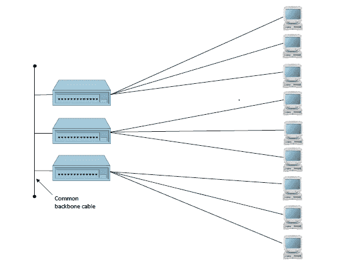
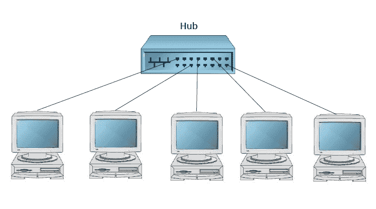
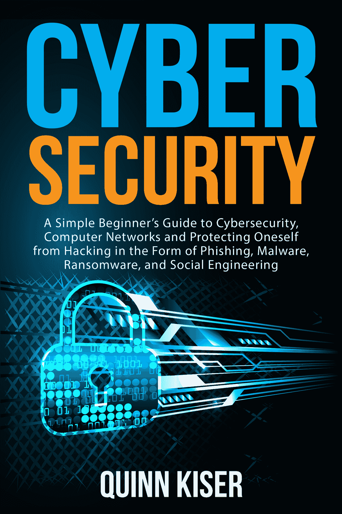
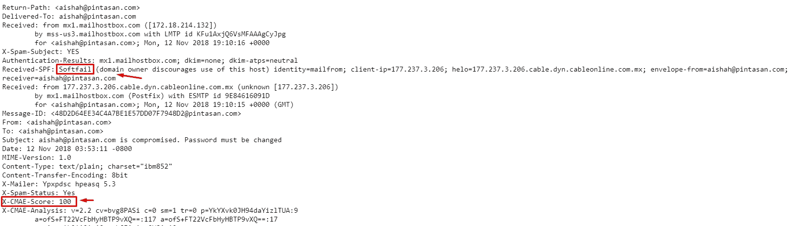

# 计算机网络与网络安全：理解通信系统、互联网连接、网络安全以及防御黑客攻击与网络安全威胁的指南

## 绪言

### 引言
本书由现代社会中相关且热门的多个计算机主题汇编而成。在整本书中，读者将用易于理解的术语和类比来探索每个主题。本书从对计算机网络的描述性且全面的洞察开始，然后扩展到网络安全、网络设计和黑客攻击。主题的呈现专门设计用于：

* 满足读者的兴趣需求。
* 为现代计算机网络世界提供有价值的见解。
* 提供详尽且扼要的知识。

完成本书的计算机网络部分后，读者将遇到这本合一指南中的其他主题。在结束章节，对黑客攻击中的`kill-chain`（攻击链）过程进行了丰富的描述。这个主题不仅有趣，而且富有启发性，并涉及到黑客在渗透目标系统和网络时所采用的方法。因此，请系好安全带，享受这段旅程。

## 第一章：计算机网络基础
在本章中，我们将探索计算机网络的基础和非常基本的概念。通过这种方式，我们本质上为读者奠定了概念基础。这将有助于增加后续讨论的概念以及计算机网络某些技术细节的易理解性。因此，本章将主要侧重于强调计算机网络细节，并在你学习的过程中稳步构建知识。为了开始，我们将简要介绍计算机网络到底是什么。然后我们将深入探讨细节，巩固读者已成功学习的每个概念的理解。

### 什么是现代计算机网络？
“网络”（networking）一词描述的是多个对象之间的连接或一组连接。同样，“计算机网络”（computer networking）是指两或多台计算机相互连接，以便共享资源。计算机网络可以在多种环境中建立，例如家庭、办公室，甚至是大型商业机构。计算机网络甚至延伸到国际范围，计算机通过`Internet`（互联网）连接。计算机网络一个更微妙且易于观察的例子是连接（有线或无线）到用户个人电脑的打印机或扫描仪。

由于计算机网络的根本目的是连接不同的 PC，因此产生了一个有趣的问题：我们最初为什么需要计算机网络呢？答案非常简单。如果一个人想看电影、视频，甚至是谈口节目，他可以通过两种方式实现：

* 通过拥有一个包含内容的物理存储设备（可以在他的计算机上查看），或者简单地跳到`Internet`并访问他可以找到内容的网站，并直接从那里查看。
* 后一种方法涉及计算机网络。它允许观看者连接到远程计算机服务器，该服务器是网站的主机，允许访问者使用其资源查看他喜爱的内容。这只是计算机网络造福普通用户的一个简单例子。

`Internet`的现象是计算机网络的副产品，我们都知道几天没有`Internet`是什么样的感觉。虽然我们已经讨论了计算机网络对普通人来说有多重要，但对于大型组织和机构（如医院、商业公司、执法部门等），它变得更加重要和至关重要。这些组织依赖计算机网络来：

* 高效地建立一个信息通道，整个组织通过该通道通信收集和修改的数据。计算机网络不仅对专业领域对商业领域也有巨大影响，因为如果没有适当的网络基础设施，相应的行业基本上就会崩溃。

因此，为了理解计算机网络的重要性及其最基本的功能，请注意计算机网络是`Internet`本身的基础。将数据从一个地方传输到另一个地方是网络的目的。关于任何连接我们必须知道的另一个重要点是它可以从一个地方携带到另一个地方多少数据。这种携带数据的能力被称为`bandwidth`（带宽）。如果一个连接具有更高的带宽，它可以在特定时间范围内携带更多数据。网络传输数据的速率以每秒比特为单位测量，简称为 `Bps`。`Bps`意味着带宽每秒可以携带多少比特。在现代社会，计算机技术和网络已经取得了巨大的进步；这种带宽现在以千为倍数测量。不同的数据传输速度为：

* 千比特每秒（`Kbps`）
* 兆比特每秒，或每秒千比特（`Mbps`）
* 吉比特每秒，或每秒千兆比特（`Gbps`）

你在计算机网络中还会看到的另一个密切相关的测量值是`hertz`（赫兹）；它是每秒携带的周期次数，正如`hertz`表示交流信号中每秒循环次数一样。赫兹简称为 `Hz`，用于测量处理器的速度。这种测量以千为倍数计算，并且：

* 千赫兹千赫兹（`kHz`）
* 百万赫兹兆赫兹（`MHz`）
* 十亿赫兹吉赫兹（`GHz`）

例如，运行在`100 MHz`的处理器意味着每秒一亿次循环。`Hz`和`bps`本质上是相同的测量值，但用于不同的元素。然而，有时它们会被混淆。例如，说以太网线支持`10 MHz`的带宽而不是`10 Mbps`在常用用法中是可以接受的。

## 第二章：网络服务详解
在本节中，我们将讨论几种依赖于或使用`TCP/IP`协议的网络协议。我们将讨论的协议列举如下：

1. `DNS`
2. `DHCP`
3. `HTTP`
4. `FTP`
5. `NNTP`
6. `SMTP`

文中将引用这些协议在开放系统互连模型（或“OSI”模型）中的运行层次。该模型定义了计算机在网络上相互连接和通信的大多数方法和协议。它是一个抽象的，但非常有用；理解 OSI 网络模型将为网络设计和网络解决方案工程奠定坚实的基础。第六章将对该主题进行详细阐述，但纯粹为了参考，我们在此仅介绍 OSI 模型的基本大纲。

该模型由七个不同且独立的层组成。每一层都有一种被称为“继继依赖”的特性。这意味着模型中连续较高的层在很大程度上依赖于之前较低服务的服务的特性。考虑一个标准的台式计算机系统，它由几个共同工作以实现系统功能的组件组成。如果我们将该系统划分为 OSI 网络模型的层，那么此计算机的硬件组件将被称为“最低层”。计算机硬件层之上的下一层是操作系统及其系统驱动程序。显然，如果没有相应的硬件，操作系统和驱动程序将无用武处。因此，这一较高层依赖于之前的较低层来正确执行其功能。这种连续层次的可视化一直向上延伸到顶层，即应用程序向用户显示有用且易于理解的数据。

### OSI 网络模型的七层

1. **物理层** – 物理层规定了网络电缆、`router`、`DSU/CSU`箱以及其他涉及物理介质。
2. **数据链路层** – OSI 模型的数据链路层通过定义和实现一种协议来桥接第三层（网络层）与第一层（物理层）之间的连接，该协议允许网络层将其数据传输到物理层。
3. **网络层** – 网络层的主要工作是定义数据包从节点到节点传输的路由。为了这个目的，传输层为 OSI 模型的高层屏蔽较低层的特性。
4. **传输层** – 传输层协调所有层之间的数据移动。
5. **会话层** – 通过这一层，OSI 模型将两台计算机之间的连接定义为客户端-服务器连接或对等连接。“会话”一词用于描述计算机之间的这种虚拟网络连接。
6. **表示层** – 表示层执行数据压缩/解压缩以及加密/解密。
7. **应用层** – 应用层主要关注的是控制和协调网络与操作系统以及在该操作系统上安装的应用程序之间的交互。它基本上定义了应用程序在连接到网络时如何处理系统涉及的通信。

如果我们分析网络中 OSI 模型各层的性质，会发现它们从与网络内的物理元素开始交互，即 `routers`、`network cables` 等。从那里开始，各层转向与虚拟特征和元素交互，即向网络的智能方面发展。此之后，OSI 模型重点关注表示层和应用层。

### 域名系统 (DNS)

域名系统的开发是为了解决跟踪 IP 地址的问题。如果互联网只有地址命名方案，跟踪这些地址将非常困难。这就是 `DNS` 发挥作用的地方。通过使用该系统，人们可以在 `ICANN` 注册名称。以下是一些常见的域名扩展：

* `.edu` – 用于教育机构
* `.gov` – 用于政府机构
* `.mil` – 用于军事机构
* `.net` – 用于与互联网相关的实体
* `.org` – 用于非营利组织
* `.xx` – 用于国家。“xx”是一个占位符，由相应国家的首字母缩写。例如，美国：`.us`

一旦实体获取了域名，它就可以向域名中添加描述符。域名名称通过 `DNS servers` 解析为它们各自的 IP 地址。

### 动态主机配置协议 (DHCP)

`DHCP` 协议的开发是为了方便网络管理员轻松地节点分配 IP 地址。该协议用于管理员手动解析节点地址并将其放入文本文件中。`DHCP` 协议提供的服务实际上由被称为 `DHCP servers` 的专用服务器运行。这些服务器控制一个 `scope`，即一个 IP 地址数组。因此，当节点在网络上上线时，它请求 `DHCP server` 为其分配一个地址。这些地址在有限的时间内有效，并在分配的时间限制后过期；然后它们将供另一个节点使用。这段时期被称为 `lease period`。

### 超文本传输协议 (HTTP)

整个互联网（称为万维网）是由使用名为 `HTML` 或超文本标记语言的格式化语言创建的文档集合。互联网上的超文本通常包括：

* 显示文本
* 图形图像
* 格式化命令
* 超链接（点击它们将重定向到互联网上的其他文档）

HTML 文档通常通过 Google、Chrome 和 Safari 等网络浏览器进行访问。超文本传输协议（Hypertext Transfer Protocol）控制着客户端与 Web 服务器之间的数据传输。该协议运行在 OSI 模型的应用层。`HTTP` 协议利用其他互联网协议和 `DNS` 在 Web 客户端与 Web 服务器之间建立连接。`HTTP` 协议本身是不安全的，因为数据传输没有经过加密且可能被拦截。为了解决这个安全问题，我们现在使用“安全 HTTP”，通常被称为 `HTTPS`，以及 `SSL`（安全套接层）。

### 文件传输协议 (FTP)
`FTP` 一词既指“文件传输协议”（File Transfer Protocol），也指“文件传输程序”（File Transfer Program），两者相互相关，因为后者是使用 `FTP` 协议的应用程序。然而，在本节中，我们只讨论 `FTP` 协议。`FTP` 运行在 OSI 模型的应用层，它定义了 `FTP` 客户端与 `FTP` 服务器之间发送和接收文件数据的方法。传输可以是文本的或二进制的，且 `FTP` 处理的文件大小没有限制。要执行文件传输，用户必须先连接到 `FTP` 服务器并使用有效的用户名和密码登录。某些网站允许用户输入用户名“anonymous”，并将其电子邮件地址作为密码。这被称为“匿名 FTP”。

### 网络新闻传输协议 (NNTP)
该协议专门用于 Usenet。`Usenet` 是指代互联网上讨论小组的术语。这些小组涵盖了极其广泛的话题，目前互联网上有超过万个 Usenet 组。Usenet 组的对话被发送到 Usenet 服务器，然后通过回声（echoing）发送到其他国际 Usenet 服务器。Usenet 组有以下几种分类：

- `Alt`: 关注替代生活方式和杂杂话题的 Usenet 组。
- `Comp`: 关注计算机主题的 Usenet 组。
- `Gov`: 关注政府相关讨论的 Usenet 组。
- `Rec`: 关注娱乐性主题。
- `Sci`: 关注科学讨论。

Usenet 组并非都是公开的。公开的组会接收来自其他 Usenet 服务器的回声新闻，但私有组通常由某些组织或机构托管。私有 Usenet 组要求用户使用正确的用户名和密码进行身份验证。Usenet 现象的实现仅通过 `NNTP` 协议成为。该协议在 Usenet 服务器与 Usenet 读器之间建立连接。该协议还处理消息格式。这使得消息可以是文本的，也可以携带二进制附件。带有二进制附件的消息通过 `MIME`（即多用途互联网邮件扩展编码，与电子邮件附件使用相同的编码器）进行编码。

### 简单邮件传输协议 (SMTP)
简单邮件传输协议处理电子邮件从一个邮件服务器到另一个服务器的发送和接收。`SMTP` 协议只是与邮件服务器的发送接收系统通信的一种。当发送邮件消息的系统通过端口 `25` 连接到接收系统时，`SMTP` 协议就会生效。一旦两个系统之间的连接建立，发送者就会向接收系统发送一个 `HELO` 命令及其相应的地址。一旦该命令被确认且接收者返回了自己的地址，通信就开始了。发送者可以发布命令，通过指定消息的预期接收者表示想要发送消息。一旦接收系统收到此请求，它会查找接收者。如果系统已知接收者，则确认该请求，发送系统随后将消息以及任何附件转发给接收者。一旦接收系统确认已收到整条消息，它就会终止连接。

### 使用防火墙保护网络安全
阅读此书的大多数至少遇到过一次 Windows 防火墙提示。运行在你机器上的这种防火墙应用程序是维护网络安全策略的关键。防火墙是硬件设备，通过执行网络安全策略来保护网络。在大多数网络中，防火墙安装在路由器本身，利用其微处理器芯片和内置内存。这对于在小型办公室或类似场景中设计和安装的网络是如此的。然而，对于大型网络，网络设备包括运行防火墙的专用硬件。这些硬件可以是单个单元也可以是多个部分。通常，网络会指定一台运行防火墙软件的独立计算机。否则，也可以有一个内部带有计算机芯片的防火墙设备。通常情况下，防火墙充当驻守在 ` ` 和 `Internet` 之间的哨所。关于可用的防火墙，主要有两种类型：

1. **基于网络的防火墙**：这种防火墙运行在 OSI 网络模型的第三层，也称为链路层。基于网络的防火墙使用的安全技术主要是“数据包过滤”。通过使用这种技术，防火墙被设定了一组定义的规则。每当数据包在两个网络之间传输时，防火墙都会分析该包并与规则进行比较，然后决定该数据包是否允许进入或离开网络。根据数据包过滤规则对数据包进行的许可或拒绝通过，通常基于其目标地址、源地址或 `TCP/IP` 端口。
2. **基于应用的防火墙**：这种防火墙充当代理角色。在此语境下，“代理”一词意味着防火墙代表了用户与请求服务的服务器之间的交互式会话。基于应用的防火墙不允许任何数据流量直接通过两个网络。相反，两个网络之间的通信将由一侧的防火墙作为代理处理。这就是为什么基于应用的防火墙也被称为“代理防火墙”。代理防火墙使用的技术是 `NAT`，也称为“网络地址转换”。在这项技术中，核心思想是隐藏内部网络的网络地址，使其无法被外部网络直接看到。在应用模型中，防火墙负责将数据传输到已建立连接的网络地址。

## 第三章：进入计算机关系的网络硬件基础
“计算机关系”一术语是指计算机与连接在网络上的另一台计算机如何交互。通常有两种类型的计算机关系。

1. **点对点**
2. **客户端/服务器**

这两种关系本质上定义了网络的逻辑结构。为了更好地理解它们，可以将其与不同的管理哲学进行类比。点对点（或“P2P”）网络非常类似于去中心化的管理哲学，决策在本地做出，并根据用户首要需要完成的任务来管理资源。客户端/服务器（Client/server）网络几乎像一家使用集中化管理的公司，决策由少数人小组内部的中心位置做出。在某些情况下，P2P 和客户端/服务器关系都是合适的，许多网络在设置中同时包含了这两者。P2P 和客户端/服务器网络都需要 OSI 模型中的某些层保持通用，并且使用相同网络协议的通信计算机之间需要物理网络连接。在这方面，这两种计算机关系在网络中实际上是相同的。然而，主要的区别在于，你是将共享的网络资源分布在网络中的所有计算机上，还是使用集中的网络服务器。

## 网络的核心硬件元素
为了强化和巩固我们在讨论中探索的概念基础，你必须更多地了解构成计算机网络的物理硬件组件。目前为止，我们更多地关注网络在虚拟层面上是如何工作和交互的，而不是物理层面。然而，通过理解网络在其虚拟领域中的行为，我们现在为理解硬件奠定了基础。理解计算机网络的物理方面为我们提供了充分的知识，使不仅能够正确地建立计算机网络，还能对其进行故障排除和维护。在本节中，我们将讨论以下硬件，每种都是网络的核心组件：

1. 服务器
2. 集线器
3. 路由器
4. 交换机
5. 布线和电缆系统
6. 工作站硬件

在这一章的最后部分，我们将在引导网络流量的范围内讨论这些硬件组件。然而，我们将仅关注理解这些组件及其用途。

## 服务器
服务器是在计算机网络中被分配了重要且高要求任务的计算机。服务器计算机本质上是处理网络上计算机所有网络请求和其他功能的组件。根据网络功能，服务器可以分为以下不同的类别。

*   **文件和打印服务器**：此类服务器包括主要为其他计算机提供文件共享服务，并处理基于网络打印机请求的服务器。
*   **应用服务器**：本质上为程序和软件提供特定网络应用服务的服务器属于此类。例如，运行数据库的服务器可以（根据请求）为连接到该服务器的分布式应用程序提供数据库访问权限。
*   **邮件服务器**：主要设计用于存储电子邮件并为相应客户端提供互连服务的服务器分类为“邮件服务器”。
*   **网络服务器**：此类服务器主要提供与网络相关的各种服务。例如，编程用于分配 `TCP/IP` 地址的 `DHCP` 服务器被归类为网络服务器。同样，处理数据包通过不同网络进行路由的服务器（`routing server`）正在提供网络服务，因此被归类为网络服务器。网络服务器执行的其他此类服务包括加密、解密、安全访问和 VPN 访问服务。
*   **互联网服务器**：提供常见互联网服务的服务器，如万维网（World Wide Web）、Usenet 新闻 (`NNTP`) 甚至基于互联网的电子邮件服务，被称为互联网服务器。
*   **远程访问服务器**：此类服务器通常作为想要远程访问网络的用户的网关或访问点。

安装在服务器上的操作系统是非常特定的，并经过了定制，以实现我们刚刚提到的任务性能。例如，如果服务器使用由 `Microsoft` 分发的操作系统，那么它最可能正在使用 `Windows Server` 版本。同样，服务器也可以运行专为网络设计的 `Linux` 或 `UNIX` 发行版。根据安装的操作系统，服务器可以执行网络功能，也可以仅专门执行少数功能。但服务器并不总是需要符合每一个网络功能；根据其用途，服务器可以只负责几项网络操作，这就足够了。通过这种方式，用户可以部署多台服务器，每台都针对某些网络操作进行了优化。以下是使服务器与家用客户端计算机具有不同等级的一些特征：

*   服务器计算机在其硬件架构中原生集成了冗余元素。这意味着即使硬件内部某些部分损坏或故障，服务器仍将保持正常运行。为了实现这种冗余，服务器计算机的内部配备了多个电源和冷却扇，保护计算机免受任何相应硬件组件故障而导致的故障。
*   服务器计算机的子系统也经过专门设计以优化数据流。如果我们分析典型的服务器，会发现磁盘、内存和网络子系统的设计方案与桌面式计算机使用的不同。这种设计不仅支持上述子系统的高性能提升，还优化了数据流。因此，在服务器、客户端和网络等不同点之间移动的数据经过了更多的优化，速度也更快。
*   由于服务器在计算机网络中处于关键位置，因此对计算机的“健康”会被特别关注。服务器计算机在软件和硬件层面都具有专门设计的监控参数；机器本身可以关注健康状况的任何警报性恶化，并在故障发生前本质上向用户发出。例如，安装在服务器中的常见监控项目之一是 `temperature monitors`；如果服务器周围的温度升高过高，它会发出详细说明问题的警告。通过这种方式，维护服务器的人可以在问题导致硬件故障之前获知问题，并能够优先解决这个问题。

### 集线器、交换机和路由器

集线器、交换机和路由器等硬件组件的目的是纯粹为了便于网络的建立和正常运行。因此，这三类组件属于“纯””网络硬件，并被归类为“网络互连设备”。这些组件本质上是任何基础或复杂网络的基础，因为网络中的整个布线系统都连接到这些设备上。从 OSI 网络模型来看，这些设备的数据流可以定义在物理层、数据链路层，甚至是网络层。

## 集线器 (Hubs)

集线器也被称为“集中器”。集线器的核心目的是为网络电缆提供一个中央连接点。集线器可以支持多根网络电缆；线数取决于集线器的大小。典型的小型集线器可以连接来自两台电脑的网络电缆，而大型集线器可以支持六十台电脑（取决于规格）。

最流行的集线器既不是“小型”也不是“大型”，而是“中型”集线器，通常支持最多 24 台客户端计算机。在集线器内部有一根逻辑线，连接的客户端计算机通过这根线与网络通信。这根逻辑线的能力被称为“冲突域”。有时，当太多客户端计算机连接到同一个集线器并尝试与网络通信时，就会产生干扰。

## 交换机 (Switches)

交换机的电路结构（电缆的排列方式）与集线器非常相似。交换机的外观也与集线器相似。尽管集线器和交换机的工作概念基础也非常相似，但相似性仅此于此。

与集线器不同，交换机上的每个连接端口都有自己的冲突域。通过这样，交换机上的每个网络连接都可以通过独立的冲突域与网络进行自由通信，而不是通过单一冲突域。交换机上的每个网络连接都被设计为私连接。

如今，大多数计算机网络都采用交换机而不是集线器，主要是因为这是一种更廉价的解决方案。然而，交换机相比集线器还有许多优势（我们把这个讨论留到以后，因为现在的重点是学习它们是如何工作的）。良好的网络解决方案将使用一个或多个骨干交换机，它们连接到主交换机上。这些骨干交换机的运行速度通常远高于主交换机。然而，即使在网络解决方案中使用集线器，仍然会使用骨干交换机（这仅仅是一个连接到集线器的独立交换机）。

## 路由器 (Routers)

最后但同样重要的是路由器。到目前为止，我们已经对路由器的工作和功能细节给予足够的关注。我们现在知道，路由器在计算机网络中的主要工作是将数据包有效从从一个网络路由到另一个网络。路由器也可以作为一个桥接器，为两个连接网络之间的数据包提供流传输路径。这两个网络通过各自的布线和连接方式建立与路由器的连接。

让我们通过一个例子来更好地理解这一点。考虑网络中的一个路由器，它在 `10Base-T` 网络和 `ISDN` 电话线之间建立了连接。在这种场景下，路由器正在处理两个网络连接：一个连接自/通往 `10Base-T` 网络，另一个连接自/通往 `ISDN` 电话线。路由器的工作将为数据包在这两个网络连接之间的传输创建一个适当的路径。除了这些定义的网络连接外，路由器还会有另一个终端连接。该辅助连接的目的是编程和维护路由器本身。

### 布线与电缆房 (Cabling and Cable Plants)

在建立计算机网络时，你会发现有许多种网络电缆可用。但在这一层面上，我们应该只关注常用的主网络电缆。

在建立局域网（LAN）连接时常用的网络电缆是 `Category 5`（五类）双绞线。这些电缆也被称为 `Cat-5` 电缆。电缆有四对绞线；这意味着它有八个导线接触点。由于这种设计，电缆可以将网络信号传输到这八个线点中的每一个。`Category 5` 双绞网络电缆主要用于 `Base-T` 网络，如 `100Base-T` 网络和 `1000Base-T` 以太网网络。

这种网络电缆还有一种低等级版本，被称为“三类双绞线”。该网络电缆的整体设计和结构与高档的 `Cat-5` 电缆相似；主要区别在于它支持的对数。`Category 5` 双绞网络电缆主要用于 `Base-T` 网络，如 `100Base-T` 网络和 `1000Base-T` 以太网网络。这种网络电缆还有一种低等级版本，被称为“三类双绞线”。该网络电缆的整体设计和结构与高档的 `Cat-5` 电缆相似；主要区别在于它支持的对数。

`Category 5` 双绞网络电缆主要用于 `Base-T` 网络，如 `100Base-T` 网络和 `1000Base-T` 以太网网络。这种网络电缆还有一种低等级版本，被称为“三类双绞线”。该网络电缆的整体设计和结构与高档的 `Cat-5` 电缆相似；主要区别在于它支持的对数。

`Category 5` 双绞网络电缆主要用于 `Base-T` 网络，如 `100Base-T` 网络和 `1000Base-T` 以太网网络。这种网络电缆还有一种低等级版本，被称为“三类双绞线”。该网络电缆的整体设计和结构与高档的 `Cat-5` 电缆相似；主要区别在于它支持的对数。

`Category 5` 双绞网络电缆主要用于 `Base-T` 网络，如 `100Base-T` 网络和 `1000Base-T` 以太网网络。这种网络电缆还有一种低等级版本，被称为“三类双绞线”。该网络电缆的整体设计和结构与高档的 `Cat-5` 电缆相似；主要区别在于它支持的对数。

1. 它是一台基于 Intel 处理器的计算机。
2. 它通常运行基于微软 Windows 的操作系统。
3. 安装的操作系统包含 `NIC` 和网络客户端软件（这使得网络客户端工作站能够与网络进行通信）。

在上述提到的特性中，我们说网络客户端工作站通常运行 Windows 版本作为主操作系统。但这里的关键词是“通常”。在某些情况下，网络工作站使用 Windows 以外的操作系统。这些计算机具有硬件和软件，允许即使操作系统不同，工作站也能参与网络活动。例如，苹果的 Macintosh 和基于 Unix 的计算机也可以作为网络工作站。

### 利用网络流量和了解网络硬件

在本章的早些章节中，我们讨论了每个网络设置中涉及的硬件组件。我们还学习了网络中每个组件的作用。在这一节中，我们将更进一步，讨论硬件在引导网络流量方向的实际功能。在任何网络设计中，测试其能力最根本、最基础的方法是看网络如何多有效地在节点与节点之间引导网络流量。这项测试决定了设计的网络是否足够好，或者是否性能不足。要执行此测试，首要要求是将网络硬件组件置于配置中，允许网络通过连接的硬件组件高效地发送信号。这是在考虑网络类型和连接前提条件的情况下完成的。在本节中，我们将讨论以下基础网络硬件组件。

* `Repeaters`（中继器）：这些设备延长相应网络类型中网络流量的传输距离。
* `Hubs`（集线器）或集中器：这些设备用于建立星型拓扑的网络。`Hubs` 连接不同的节点。
* `Bridges`（桥）：这些设备与中继器相同但更智能。`Bridges` 将网络流量引导到不同的段。这样做是为了只有当流量的目标确实是另一个段时才执行分段。
* `Routers`（路由器）：这些设备只需有效、高效地路由网络流量。
* `Switches`（交换机）：这些设备为其他连接的网络硬件提供快速高效的点对点连接。

#### Repeaters（中继器）

在网络中用于延长网络范围的硬件设备被称为 `repeater`。`Repeaters` 通过放大信号来扩展网络的覆盖范围。每当安装网络时，总会有网络信号微弱的地方。`repeater` 会接入网络信号微弱的一侧，放大这个弱信号，然后从另一侧发送出去。`Repeaters` 最常用于范围有限的网络，如细以太网网络。因此你将在此类网络设置中使用 `repeaters`。然而，这并不意味着使用 `repeaters` 受到限制。但 `repeaters` 几乎可以用于任何网络连接。例如，考虑使用 `Cat-5` 网线安装的典型 `100Base-T` 网络。这种电缆的最大长度为一百米，这意味着这就是网络的范围。通过在这一网络设置中使用 `repeater`，我们可以将网络信号的范围翻倍到两百米。从 OSI 网络模型来说，运行 `repeaters` 是第一层的过程，即物理层。`repeater` 设备并不智能。这意味着 `repeater` 并不具备理解其正在传输的信号的硬件能力。由于 `repeater` 的唯一工作是执行网络信号放大，因此需要谨慎地使用。`repeater` 不会区分网络信号和干扰信号（通常称为“噪声”）。这就是为什么它们应该在对网络进行仔细评估后才使用。否则，`repeater` 可能会放大网络中的噪声。`Repeaters` 不能连接不同的网络介质。例如，如果 `repeater` 用于 `10Base-2` 细以太网网络，那么它只能与另一个 `10Base-2` 细以太网连接。如果我们批判性地分析 `repeater` 的智能性，会发现它确实某种智能功能；尽管如此，这不足以执行复杂的操作，例如区分正在传输的信号类型。`repeater` 的智能程度在于当设备检测到连接网络中的任何问题或异常时，将一个连接与其他连接分离的能力。例如，假设我们正在处理细以太网网络的两个段。这两个段由一个 `repeater` 设备连接。如果这两个段发生断开，`repeater` 将允许功能正常的段继续工作，而不是关闭整个网络。通过这种方式，网络用户可以访问仍然正常工作的网络段上的资源，但将无法访问断开段上的资源。然而，这里需要的一的一是，即使 `repeater` 将工作段与断开段隔离开，如果服务器等主要资源位于断开段上，它将是徒劳的。这是因为即使工作站位于功能段，它们也无法访问服务器的主要网络资源。下图显示了一个扩展网络长度的典型中继设置。

#### Hubs（集线器）

`Hubs` 广 own 称为：
* 智能局域网集中器
* 集中器

这种硬件设备用于网络设置，将节点连接到骨干上。如果我们讨论使用 `hubs` 的网络拓扑，我们可以看到节点以星形形状连接到 `hub`。这意味着连接到 `hub` 的网络电缆扇布到每个相应的节点。无论是在星型拓扑网络还是环形拓扑网络中使用 `hub`，这种电缆的布置都保持不变。在较小的网络中，不需要骨干交换机，因此不需要 `hub`。然而，`hubs` 可以用于简单网络也可以用于大型复杂网络。关于 `hubs` 与网络介质类型的兼容性，幸运的是，它们提供了无缝的兼容性。这意味着 `hub` 可以用于任何网络，而无需担心兼容性问题。如果我们进一步查看 `hubs` 的高端顶端型号，我们会发现它们具有一个可更换的模块，通过该模块，单个 `hub` 可以支持多种网络介质类型。例如，高端 `hub` 模型可以同时支持 `Ethernet`（以太网）和 `Token-ring`（令牌环）网络模块。`Hubs` 有许多尺寸。某些 `hubs` 支持多达 2 个工作站，而另一些则支持一百多个工作站。这完全取决于网络的需求。以下是 `hub` 的几个重要特性：

* 就像从一个源产生的声音在洞穴深处回声一样，`hub` 将其每个端口的数据都回声到所有其他相应的端口。尽管 `hubs` 的布线布局是星星的，但它们的逻辑功能更类似于总线拓扑。然而，由于数据的回声，任何逻辑或过滤过程无法阻止源自连接节点的数据包冲突。

集线器的一个显著特征是，它们可以通过关闭节点来有效地将异常节点与其他正常工作的节点隔离开。这一过程被称为“分区”。集线器对节点分区的场景包括：检测到网线短路、集线器端口数据包过载导致网络风暴，以及检测到与集线器端口相关的严重问题。对故障节点进行有效分区可以防止相同的影响负面影响其他正常运行的节点。

随着技术的发展，集线器的机制和基础设施也变得日益复杂。新版本的集线器模型内置了非常整洁且先进的特性。

*   集线器现在内置了管理功能；通过使用 `SNMP` 等网络管理协议，可以通过网络对集线器进行集中管理。
*   现在已有可以自动检测网络连接速度并以该速度运行每个节点的集线器。例如，检测到 `10Base-T` 网络的集线器以 `10 Mbps` 的速度运行每个节点。同样，对于 `100Base-T` 网络，集线器将以 `100 Mbps` 的速度运行每个节点。
*   集线器正在使用更快的上行链路连接到骨干网。上行链路的平均速度通常是集线器基础速度的十倍。例如，基础速度为 `100 Mbps` 的集线器其上行链路速度为 `1 Gbps`。
*   集线器现在带有桥接和路由功能。以前，使用集线器的网络需要单独的专用硬件来执行桥接和路由功能。随着这些功能内置于集线器，使用此类设备已变得过时。
*   集线器具有交换功能。通过此功能，集线器可以切换节点而不是共享节点。

在为网络选择合适的集线器（hub）时，首先要考虑到的是网络规格。通过了解预计有多少个节点连接到集线器、每个节点所需的带宽以及集线器所使用的网络骨干类型，我们可以选择最适合该网络的集线器。在通常与集线器配合使用的网络骨干方面，它们通常从共享 10 Mbps 细以太网到 100 Mbps 的 `100Base-Tx` 以及高速网络不等。无论何种情况，骨干技术选择主要取决于网络的带宽需求以及设计网络需要满足的其他标准。从技术上讲，在使用集线器的网络中，集线器充当“冲突域”，冲突通常发生在此处。因此，如果我们在单个网络设置中使用多个集线器，网络中的冲突域将不可避免地变大。唯一的例外是集线器分别连接到交换机（switch）。通过使用交换机，我们可以将每个集线器的冲突域限制在其内部。下图显示了一个使用多个集线器的网络。

#### 交换机
顾如名，交换机是网络中的硬件组件，可以快速地从一个端口切换连接到另一个端口。交换机通过在多个可用网络端口之间动态切换来创建网络中的这些连接。考虑一个火车站场，有几列火车从特定的轨道进入并从其他轨道离开。火车站场有一个指定的人员负责管理火车的移动和路线。这个人被称为“场长”。为了确保火车到达目的地，场长经理本质上是根据其指定的路线切换轨道。在这个类比中，“交换机”就是“场长经理”。交换机不是通过切换轨道来引导火车，而是通过以太网电缆在网络中引导数据包。通过这种方式，数据包被有效地路由到其终地。我们知道，交换机在网络的任何两个给定端口之间建立个性化连接；所有汇聚到交换机设备的端口不共享共同的冲突域是合逻辑的。这就是为什么交换机设备的作用有点类似于超级网桥器（super bridge）。由于交换机的特性，它们主要被用于桥接网络中集线器与较快骨干网之间的连接。

例如，考虑一个使用十个集线器的网络。每个集线器支持多达 24 个工作站连接节点。有了十个集线器，我们大约会有 240 个连接节点，这意味着总共有 240 个工作站连接到集线器。如果这些集线器连接到网络中的同一骨干网，那么意味着所有集线器的冲突域将是相同的。当 240 个工作站共享同一个冲突域时，网络性能将会下降。在这里，我们可以通过使用 12 端口的交换机来解决这个问题。早些，交换机的每个端口都有自己独立的冲突域。在这里，所有连接到 12 端口交换机的十个集线器都将拥有自己的域，从而维持网络质量。工作站通常使用 `100Base-T` 网络连接。网络专家会建议使用 `1000Base-T` 或更高的连接作为骨干网络。通过使用交换机和快速骨干网，通过节点连接到网络的工作站可以以 100 Mbps 的速度运行。交换机对网络速度和性能的影响如此，以至于使用交换机变成了一件理而易见的事。另一个让交换机在网络中如此受欢迎的方面是它们非常廉价。对于典型的局域网来说，使用交换机而不是集线器更有意义，因为集线器是昂贵的网络组件。相比之下，交换机价格低廉，为网络提供更多功能，而且安装相对更容易更简单。如今，你可能会发现很难在市场上找到可用的桥接器（bridge），因为交换机的供需关系是压倒性的。了解并理解集线器的原因是虽然它们现在不再被使用，但你可能仍然遇到使用集线器的旧安装设备。在较新的网络安装中，可以保证你将只与交换机打交道。重申这些集线器和交换机的主要概念：集线器创建一个数据冲突域，而交换机具有较小的、分离的冲突域。

#### 桥器
桥器是一种硬件设备，功能与中继器（repeater）相同，但更智能。桥器通过连接两个网络段来工作，就像中继器一样；主要区别在于当桥器必须将数据流量从一个段传递到另一个段时，它是智能地执行的。这意味着只有当数据流量的目标是目标网段时，桥器才会将流量传递到另一个段；否则，它不会这样做。桥器的另一个不同特征是它们还将网络划分为更小的网段。某些桥器可以连接到两个网络段。例如，这样的桥器可以跨越从同轴细以太网到绞对令牌环网（Token Ring）。

我们讨论过中继器运行的层级（那是 OSI 模型的物理层）。人们会认为，既然桥器的功能和目的与中继器几乎相同，它们也将运行在 OSI 网络模型的第一层。然而，事实并非如此；相反，桥器运行在更高一层的层，即第二层，也称为 OSI 网络模型的数据链路层。这是因为桥器连接网络段，然后“智能”地将数据流量从一个段传递到另一个段。为了实现这一点，桥器分析每个遇到的数据包的 `MAC` 地址（介质访问控制地址）。对 `MAC` 地址的分析有助于桥器判断是否应该将数据包转发到另一个网络。桥器设备可以存储网络地址数据的部分。这可以通过两种方式之一实现：

1. 用户编写一个包含地址信息和数据的静态路由表。
2. 用户实现一种动态学习系统，通过自动识别和发现网络地址以树形模式进行学习。

桥器不应随意使用。以下是建议在网络中使用桥器的场景：

*   如果你正在处理一个小规模网络，可以使用桥器。
*   如果网络正在使用中继器，可以使用桥器来替代中继器。
*   如果你处理的网络在网络流量不在不同网段间进行不必要的传输时能获益，那么应该使用桥器。

延续网络其他硬件组件的智能迭代链，路由器基本上是一个桥器，但它比桥器更智能，就像桥器是中继器的智能版本。正如桥器在 OSI 网络模型中的工作层比中继器高一层（数据链路层），路由器则工作在 OSI 网络模型的第三层，也称为网络层。在将数据包传输到相应目的地方面，路由器比桥器更高效且远优。。

由于路由器的运行位于 OSI 模型的第三层，因此 OSI 模型的上层与路由器建立连接的唯一要求是使用相同的协议。如果路由器专门为协议转换配置了配置和设计，那么它可以将从前三层（物理层、数据链路层和网络层）的任何协议翻译为同样属于这三层的任何其他协议。路由器还可以连接两个互不相似的网络（而连接相似的网络是所当然的）。

通常，路由器最适合也常用于广域网（WAN），因为它们可以有效创建建立此类网络所需的链路。如果我们分析允许路由器有效连接两个相似或不同网络的特性，可以得出结论：路由器本质上起到了节点的作用。路由器拥有自己的网络地址，这进一步巩固了它们作为节点的功能。

路由器接收来自其他节点的数据包。在接收数据包后，路由器分析并检查数据包的内容：只有在评估之后，路由器才会将数据包发送到目的地。这一过程需要几乎瞬间完成，以避免数据延迟。为了确保路由器快速准确地执行此任务，它们内部设计了微处理器来处理计算。通常，这种处理器是 RISC 指令集类型的变体。此外，路由器具有内置内存来帮助路由功能。由于路由器比桥器更智能且拥有更多的计算资源；它们可以计算通往任何目的地的最短路径。此外，路由器还可以执行某些任务以实现网络带宽的最大化。路由器还可以逻辑地适应网络中的流量问题。

### 路由器的重要性

说路由器成了整个互联网的骨干并不夸张。例如，考虑 `TRACERT` 命令。当你使用此命令从一个节点追踪到目的地时，我们可以看到在到达目的地之前有多个“跳”，这些“跳”是转发数据包直到其到达目的地的路由器。

### 配置路由器

路由器不是预配置的。为了正确执行其任务和功能，需要对它们进行配置。例如，标准路由器配置可能包括为每个端口分配网络地址以及协议设置。路由器的配置通常通过以下两种方式完成：

1. 通常有一个名为 `RS-232C` 的端口。通过终端仿真软件，连接计算机或终端。一旦连接，就可以以文本模式配置路由器。
2. 除了直接从其 `RS-232C` 端口配置路由器，还可以使用带有的网络软件。通常，这种软件使用图形工具或简单的 Web 界面。

目前大多数路由器支持这两种方法。然而，没有推荐的方法，这完全取决于安全需求以及你使用的路由器模型。在使用路由器时应小心，因为路由器的网络方法可能会被黑客利用。这允许未经授权的用户更改路由器的配置。

网关是一种特定的接口。网关的主要工作是在 OSI 网络模型的所有层不同时连接它们。这种差异可以发生在单层或所有层，网关将执行其功能。

为了更好地理解这一点，让我们来看一个例子。假设我们使用 OSI 网络模型建立了网络，但我们要连接到 IBM 的系统网络架构（也称为 `SNA`）。这两个网络是不相似的，因此为了连接它们，我们将使用网关。网关还可以将 `Ethernet` 翻译为 `Token Ring`。然而，如果你需要这样的网络转换，还有简单的网络解决方案。由于网关上的转换负载远大于其他解决方案，网关运行相对较慢。

如今在网络中使用网关主要是处理电子邮件。例如，网关处理的最常见的电子邮件协议有两个：
* `POP3`
* `SMTP`

通常，大多数需要与不同网络连接的电子邮件系统将使用设置成网关的计算机或电子邮件服务器来执行网关任务。

在讨论拓扑结构之前，让我们刷新一下“拓扑”的概念。“拓扑”意味着“形状”同样，“网络拓扑”本质指的是网络的形状（网络节点的布线布局）。

不同的拓扑具有不同的成本、优缺点、性能、稳定可靠性。在本节中，我们将讨论今天常用的三种主要拓扑结构：

1. 总线拓扑
2. 星型拓扑
3. 环形拓扑

总线拓扑也被称为“公共总线多点拓扑”。总线拓扑基本上是一种使用单端到端网络电缆的网络。在该网络电缆上，某些设备连接在电缆的不同位置，这些连接被称为“节点”。下面是总线拓扑网络的简单插图：

然而，并没有通用的总线拓扑。相反，总线拓扑有许多类型，每种都有自己的规格。这些规格基于以下因素：
* 单个段可以处理的节点数量
* 通过使用中继器，可以使用的段数
* 节点物理接近的最大限制
* 网络段的长度
* 所需的同轴电缆
* 段的末端应如何终接

通常，总线拓扑网络实现`同轴电缆`。在此类网络中，需要对网络的两个开放末端进行处理；否则网络将无法工作。网络的每个末端都使用一种特殊类型的电缆终端器。有几种不同的总线拓扑，每组使用不同类型的连接器来汇合网络电缆的不同段。例如，细型以太网 `10Base-2` 总线拓扑网络使用一种名为 `BNC 连接器`的连接器。这种连接器也称为 `BNC-T 连接器`，因为它形状像“T”型。这种连接器允许节点（计算机或服务器）连接到网络段，同时允许网络继续其总线结构。还有不同类型的 BNC 连接器：

1. `BNC-T 连接器`

### 2. BNC 连接器
### 3. 带有公 BNC 接头的 RG-58 电缆

在预算方面，总线拓扑网络是三种方案中最便宜的。这是因为与星型和环形拓扑相比，总线拓扑网络使用的网络电缆较少。因此，总线拓扑网络使用的材料较少，需要的安装人工也更少。然而，虽然总线拓扑在成本上优于其他两种，但它也有明显的缺点。总线网络更加敏感容易故障，因为它包含多个子尺度，本质上创建了一个分段。这些子尺度必须连接到节点。现在，这种复杂性引入了一个新问题，即：

* 如果总线拓扑网络的分段故障，将导致网络中段的故障。
* 识别故障源更加繁琐且耗时，因为技术人员必须检查所有可用电缆连接，直到确定故障分段的源。

由于总线拓扑网络似乎不可靠且更容易故障，许多新的有线网络安装不再使用这种拓扑。然而，总线拓扑网络可能出现在旧的网络安装中。过去最常用且目前仍少量存在的总线拓扑网络是 `10Base-2` 以太网（也称为细以太网）。细以太网具有以下特征：

* 10 Mbps 最大速率额定
* 使用的网络电缆类型和连接器类型为 `RG-58/AU` 或 `RG-58/CU`（分别为轴电缆和 BNC 连接器）
* 为了正常运行，网络要求每个分段的末端都配备 50 欧姆终端连接器
* 每个分段的最大节点容量为 30 个节点
* 最大分段长度为 185 米（或 607 英尺）
* 中继器可以扩展分段
* 每个节点之间的最小距离应为 0.5 米或 1.5 英尺的电缆距离

在使用总线拓扑的网络中，中继器允许用户将三个分段连接在一起，每个连接的分段最多支持 30 个节点（将中继器计为一个节点）。如果唯一的目的是扩展信号距离且分段没有连接任何节点，则可以再增加两个分段。这将通过使用中继器增加五个分段。整个重复分段的最大长度不应超过 925 米（或 3,035 英尺）。为了记住这种安排，我们可以简单记住 `5-4-3` 规则：

* 五个分段
* 四个中继器
* 三个带有节点的分段

在星型拓扑网络中，连接的计算机、服务器或简单的节点都连接到单个中央单元。在这种有线布局中，连接从主单元向外辐射，类似于星的形状。这个中央单元通常被称为 `hub`（集线器）或 `concentrator`（集中器）。集线器承载许多辐射到网络中相应节点的网线。在技术术语中，集线器被称为 `Multistation Access Unit`（多站访问单元）或简称 `MAU`。然而，这个术语严格用于令牌环（Token Ring）网络。在星型拓扑网络中，有多种尺寸的集线器可选。例如，某些集线器支持不超过两个节点，而有些集线器支持多达十六个节点。通常，这种网络使用的标准中央集线器单元支持 24 个节点。无论如何，即使我们使用 24 节点集线器或 96 节点集线器，我们仍然拥有将多个节点连接到集线器并根据自己的需要构建网络的自由。这里是星型拓扑网络的简单插图 

然而，请记住，由于集线器被用作中央单元，在本章之前的章节中会出现复杂情况。集线器会在与其他端口之间广播网络流量。因此，来自任何节点的网络流量都会回传到其他节点。这意味着节点的整个带宽连接在与其他节点连接之间共享。例如，如果集线器的总带宽速度为 100 Mbps，但一个节点仅使用总带宽的 50 Mbps，那么其他节点就无法访问剩余带宽，而是必须共享这 50 Mbps。简单来说，一个节点的可用总带宽与其他节点之间共享的带宽是相同的。在采用星型拓扑的网络中，有多种可用的以太网连接，列如下：

* `100Base-T` 以太网是最常用的，提供高达 100 Mbps 的带宽限制。
* `10Base-T` 以太网常见于旧网络。这种以太网的带宽限制为 10 Mbps。
* `1000Base-T` 以太网是一种较新的以太网标准，被称为千兆以太网。它提供 1000 Mbps 或 1 Gbps 的带宽容量。
* `10GBase-X` 是最新的以太网标准。它被称为 10 千兆以太网，使用光纤电连接提供 10 Gbps 的带宽容量。

让我们谈谈 `10Base-T` 和 `100Base-T` 以太网连接的电缆要求：

* `10Base-T` 以太网需要 3 类（Cat-3）双对网络电缆。
* `100Base-T` 以太网需要 5 类（Cat-5）双对网络电缆。

记住，尽管 `10Base-T` 以太网可以使用 `Cat-3`，但 `100Base-T` 以太网需要 `Cat-5` 双对网络电缆。每当 `10Base-T` 以太网可以使用 `Cat-3` 时，`100Base-T` 以太网就需要 `Cat-5` 双对网络电缆。只要 `10Base-T` 以太网可以使用 `Cat-3`，`100Base-T` 以太网就不能使用。例如，如果你使用的是 `Cat-5` 网络，那么你可以使用 `Cat-5E`，而如果资金不是问题，你甚至可以使用 `Cat-6`。以下是 `10Base-T` 网络共享的布线特征：

*它们需要双对单层线。这些双对线可以是屏蔽的或非屏蔽的。
* 可以在 `Cat-3` 或更新的标准（如 `Cat-5`）上运行。
* 每个节点的长度限制为 100 米（或约 328 英尺）。
* 对逻辑分段的节点数量没有限制。
* 在所有连接中，它们使用 `RJ-45` 连接器。
`1000Base-T` 网络优于 `100Base-T` 网络的一个显著优势是它们：

* 兼容 `Cat-5` 网线
* 速度是 `100Base-T` 网络的十倍，即 1 Gbps 或 1000 Mbps，而非 100 Mbps

可以说，`1000Base-T` 网络最重要的优势之一是它们对 `Cat-5` 电缆的兼容性。如今，75% 安装网络中最常用的网络电缆正是 `Cat-5`。如果已经存在 `Cat-5` 电缆系统，可以在不更换系统的情况下安装 `1000Base-T` 网络。这不仅节省了时间，还节省了安装成本、布线成本和人工，因为为整栋建筑安装新的电缆网络标准是非常贵的。以下是 `1000Base-T` 对应 `Cat-5` 网络的一些特征：

* 这些网络需要四对单层线。
* 它们至少需要 `Cat-5` 或更好的网络电缆标准（`Cat-5E` 或 `Cat-6`）。
* 每个节点的长度限制为 100 米。
* 对逻辑分段的节点数量没有限制。
* 在所有连接中，它们使用 `RJ-45` 连接器。

你会发现 1000Base-T 网络与其前身 100Base-T 网络惊地相似，但在网络布线要求等方面有所不同。星型拓扑网络比总线拓扑网络更贵，因为使用的有线网络电缆更多。此外，安装这些电缆的人力成本更高，路由器或集线器的需求也增加了总成本。然而，这种昂贵的预算并非毫无价值。星型拓扑比使用总线拓扑的网络更可靠，并提供更好的性能。它不仅提供更高的带宽性能，而且如果隔离的网络连接中断或损坏，其他连接将保持不受影响。即使星型拓扑网络出现问题，故障排除也很简单，因为每根网络电缆都直接从集线器连接到节点。

### 形拓扑
与我们之前讨论的两种使用物理网络电缆布局的拓扑不同，环形拓扑网络使用的是逻辑布局。详细来说，在环形拓扑中，实际的物理网络电缆布局是星型拓扑，电缆的每个节点都连接到自己的介质访问单元（Media Access Units）。但问题在于：尽管物理布局是如此，网络电缆在电气上的表现却是一个环形。这意味着来自网络的信号以环形的方式通过不同的节点传输。

与基于以太网的总线和星型网络拓扑不同，环形拓扑基于令牌环网（Token Rings）。有时，使用环形拓扑的网络也可以运行在光纤网络上，通常带宽容量为 100 Mbps 而而不是铜基电缆。这种网络基于 `FDDI` 或光纤分布式数据接口（Fiber Distributed Data Interface）。环形拓扑的主要用途是大型电信网络，例如同步光网络 `SONET`。环形拓扑也用于存储区域网络。

### 什么是无线通信？
无线通信很少需要物理介质或通道来传输信号。相反，这些信号通过空间传输，通常被称为非引导通信介质。

### 连接互联网
在本节中，你将学习互联网连接的基础知识及其特性。

### 广域网
广域网或 `WAN` 只是范围更广的局域网。广域网可以定义为多个相互互连的局域网。当局域网需要更好且范围更广的方法时，会优先选择广域网。建立广域网可以通过多种方式实现。为了确定在设置 `WAN` 时采用何种方法，组织或公司需要考虑不同的方面，例如：

- 局域网使用的频率。
- 局域网之间相互连接的频率。
- 网络所需的“带宽”或数据容量。
- 每个局域网点之间的距离测量。

通过考虑这些因素，可以实施合适的解决方案来建立最优广域网。例如：

1. 使用租赁电话线建立广域网，该线路能够支持高达 `56Kbps` 的带宽。
2. 使用专用的 `DS1` 线路建立广域网，该线路能够支持高达 `1.544 Mbps` 的带宽。
3. 使用专用的 `DS3` 线路建立广域网，该线路能够支持高达 `44.736 Mbps` 的带宽。

可以使用私有卫星建立广域网，这最终支持更高的带宽。因此，为了为 `WAN` 连接选择最佳方案，建议首先评估情况和需求，得出明确的解决方案。广域网的出现是因为局域网的用户需要访问另一个局域网上的资源。这在大型机构中经常被观察到，例如大型企业、组织、银行和学校等。

### 互联网与内网
考虑到互联网的普及及其在现代社会中的重要性，如果任何业务公司不正确使用互联网，其生产力就会瘫痪。处理和维护网络互联网连接是一项非常关键的工作，因为即使是几分钟的网也会给组织带来一堆问题。因此，互联网是计算机网络中非常关重要的服务和功能。现在很少有人不熟悉互联网。凭借其惊人的生产力和可及性，几乎所有公司现在都利用互联网的关键服务，如 `e-mails`、访问万维网和使用 Usenet 新组。

在网络上实现互联网连接涉及另一个名为互联网服务提供商（ISP`）的实体。个人或组织与 `ISP` 的连接基本上是电信网络连接。从 `ISP` 到客户端的连接是通过使用物理介质（如线路）建立的。`ISP` 根据客户提供几种类型的连接，例如：

- `DSL` 线路
- `ISDN` 线路
- `Fractional/Full DS1` 连接

在选择好 ISP（互联网服务供应商）支持的线路后，通过将线路拉到建筑并连接到名为 `CSU/DSU`（通道服务单元和数据服务单元）的特殊设备，将其安装在指定的住所。该设备的主要目的是数据转换，即将本地电信公司承载的数据格式转换为局域网可以使用的形式。此外，该 `CSU/DSU` 随后连接到路由器（或调制解调器），由其处理局域网与互联网之间数据包的路由。有时，这个 `CSU/DSU` 会内置在 ISP 提供的路由器内部。

### 互联网连接安全
现在让我们讨论互联网连接的安全性。当 ISP 向客户“交付”互联网连接时，他们会在安装期间提供一台路由器。由该路由器发出的数据包会被自动过滤，以防止数据包泄露。用户通常采用的更常见的软件安全是“防火墙”。该程序能够智能地限制计算机上的应用程序可能请求的互联网服务器的任何必要连接。它还能阻止有害的入站流量（这些流量通常来自黑客）。因此，通过使用防火墙，我们可以在使用互联网时保护我们的计算机系统免受潜在在线威胁的影响。

## 局域网 vs 互联网
到为止，我们已经讨论了作为一个全球范围内极度互联网络的互联网。现在我们将讨论与互联网类似的内容，即“局域网”。它们听起来和工作起来非常相似。互联网基本上侧重于外部连接，而局域网是一种专注于内部连接的网络形式。

例如，假设有一家公司只想为其员工提供网页或甚至服务器的访问。那么它需要一个局域网。该公司将使用一个主 Web 服务器，用于存储公司的所有资源，如文档、员工手册、发票以及公司内部定期为员工和部门发布的所有此类数据。因此，它变成了一个专门用于该组织内部网络基础设施的微型互联网。

然而，局域网的功能并不仅限于于此。它可以执行与互联网相关的任务，例如提供文件传输协议（`FTP`）和 Usenet 服务器。局域网由组织或公司在其自身的局域网范围内实施和维护。通常情况下，局域网无法从局域网外部访问，但也存在发生渗透的情况。

## 网络功能
到目前为止，我们讨论了连接在网络上的计算机之间的简单关系（`P2P` 和客户端-服务器网络）。既然读者已经理解了连接的计算机是如何相互作用的，我们就可以讨论它们在网络上可以执行的一些任务。这被称为计算机网络的功能。在本节中，我们将讨论这些功能：

* 文件共享
* 打印机共享
* 应用服务
* 电子邮件
* 远程访问

### 文件共享
在过去，文件共享是人们使用计算机网络的主要原因。在 20 世纪 80 代中期，无需使用物理存储设备即可在网络连接的计算机之间共享文件和数据，这是一项革命性的进展。尽管在今天看来这似乎并不多，但请考虑：为了与熟人共享文件或媒体内容，你必须先将其存储在可移动存储介质中，然后将该介质物理交给对方。

文件共享如此重要，以至于公司会专门安装计算机网络来实现此功能。文件共享通常涉及人们经常需要的文件。电子表格和文字处理文件是常见的例子，尽管还有许多。要实现文件共享，首要要求是需要共享访问的计算机必须连接到网络中。接下来，应该有一个“共享驱动器”，作为存储文件的网络位置，同时允许连接到同一网络的用户在他们的系统上远程访问这些共享文件。

为了消除文件共享的一个副作用，即任何用户都可以修改共享文件的内容，系统应该具备适当的授权权限。这意味着计算机网络中的并非每个用户都拥有允许他们更改文件或共享驱动器的管理员权限。这也被称为“文件锁定”。文件锁定的另一个原因是确保访问共享驱动器或文件夹的多个用户不会同时进行冲突的更改进行修改。

### 打印机共享
打印机共享功能也极其重要，并使得计算机网络变得更加实用。正如名称所示，打印机共享指的是在计算机网络内的用户之间共享打印资源。如果一家公司在某个办公室放置了一台打印机，那么就可以通过计算机网络让办公室里的每位员工共享这台单一打印机的功能。这对于公司和用户来说都是经济的。由于办公室只需要一台打印机，公司可以负担得起购买一些设计用于处理海量工作负载的高端顶级打印机。通过实施计算机网络，公司可以享受打印机共享带来的经济效益。

现在我们将讨论打印机共享的工作细节。尽管实现打印机共享有多种方法，但最常见的方法是使用打印队列，它保存了互联计算机网络中用户的打印请求。该队列确保正在进行的打印任务不会受到其他入站请求的干扰，并且在当前任务完成之前，机器不会执行新的打印任务。由于其高效性，这种方法被推荐。

另一种执行打印机共享的方法是允许独立的工作站直接访问打印机本身。打印机本身支持一种设置，将其配置为像普通工作站一样连接到网络。如果对共享打印机的资源有高需求，则独立的工作站将被指示等待，直到轮到各自。但这样并不是高效的。在打印队列方法中，有一个被称为“打印服务器”的特殊服务器，它可以根据时间戳或紧急程度自动发送打印请求。设置打印服务器有若干种方法：

1. 使用连接到打印机网络的文件服务器。
2. 使用运行特殊打印软件并连接到网络和打印机的工作站。在这种情况下，软件与网络上的其他计算机通信，获取它们的打印请求并通过主机将将其转发到打印机。

## 应用服务

此功能与我们最近探索的两个功能相似，即文件共享和打印机共享。应用服务功能允许连接到网络上的用户共享应用程序。例如，如果一家公司购买了一套受许可的软件供员工使用，那么它就可以利用计算机网络在网络服务器上生成该应用程序的共享副本，供他人使用。该功能的工作非常简单：连接到网络的工作站可以访问共享应用程序，将文件从共享驱动器加载到其系统内存中，并运行该程序。通过使用此功能，组织还可以节省工作站的有效存储空间，因为每个用户都通过访问服务器上的集中文件夹来运行程序，而不是在每台运行中的工作站上单独安装相同的程序。

使用此功能的另一种方法是在网络服务器上建立一个共享安装点。这允许想要安装应用程序的用户直接从网络访问安装设置程序，而无需下载它或使用物理介质存储（如 CD、DVD 等）。因此，用户可以直接将程序的安装设置程序的内容复制到他们各自的工作站上，并像往常一样安装程序。

## 电子邮件

将电子邮件视为迄今出现的最资源丰富、最方便且高效的通信方式之一并不为夸张。电子邮件功能在不同的环境中都有广泛使用，无论是本地环境还是专业环境。从表面上看，电子邮件非常简单，只有一个发送者和一个接收者。尽管这涵盖了它的核心，但我们将用更技术术语来探索电子邮件功能。

通常，有两种电子邮件系统。一种是基于文件的电子邮件系统，另一种是基于客户端-服务器的电子邮件系统。大多数人熟悉的是客户端-服务器的电子邮件系统，但我们稍后会讨论它。首先，我们将讨论基于文件的电子邮件系统是如何工作的。基于文件的电子邮件系统由一个服务器和一个称为 `gateway server`（网关服务器）的主机组成。服务器定义了一个由共享文件组成的存储位置。服务器负责向授权用户提供这些文件的访问。然而，处理服务器与外部用户之间的连接请求归 `gateway server` 管，它实际上是一台计算机。这台计算机运行名为 `gateway software`（网关软件）的特殊软件来处理此工作，服务器和网关服务器的统一构成了基于文件的电子邮件系统。

但基于客户端-服务器的电子邮件系统更加简洁、更流畅、更强大，最重要的是安全。这种电子邮件系统还具有扩展功能；例如，在公司中，他们可以自动化电子邮件系统以自动生成发票并进行购买。众所周知，此类电子邮件系统必须经过适当配置才能实现这些功能。客户端-服务器的电子邮件系统由一个服务器组成，负责统一管理网络上的外部和内部电子邮件互连。该电子邮件系统还存储了消息。客户端-服务器电子邮件系统的示例有 `Microsoft Exchange` 和 `Lotus Notes`。

到为止，我们主要讨论了大型企业中的这两种电子邮件系统。然而，电子邮件功能对于小型公司和组织（例如员工少于 25 人的公司）同样重要。对于此类公司来说，购买整个电子邮件系统并对其进行维护相对昂贵，并且需要大量人力进行适当维护，因此使用电子邮件系统超出了他们的能力范围。然而，对于此类情况还有另一种可行的替代方案。这包括使用一个并非主要由组织内部托管和维护的电子邮件系统。例如：

*   与互联网建立共享连接，以便每个使用工作站的员工都可以访问它。接下来，我们只需通过 `ISP` 为用户设置相应的电子邮件账户，或者直接使用免费且流行的电子邮件服务，如 `Yahoo!`、`Hotmail`、`Gmail` 等。
*   使用 `Microsoft Windows Small Business Server 2008` 作为所有工作站的专用操作系统。此操作系统包含实用的服务器工具，可以方便电子邮件系统的设置。最棒的是，该操作系统原生捆带了可以使用的 `Exchange Server` 软件限制版。
*   从已设置并维护高规格电子邮件系统的服务提供商订阅邮箱。采用这种方法的公司通常需要支付与其使用的邮箱数量相对应的月费。

### 远程访问

计算机网络的另一个有利功能是赋予用户远程访问其特定网络资源的能力。该功能之所以如此重要，是因为用户忽略了网络的物理限制，这意味着他们不需要位于网络所在的办公室或建筑内。即使在离开办公室工作时（例如在家里或酒店），也可以远程访问他们的文件或电子邮件。然而，远程访问并不是一个简单的功能。但远程访问可以多种形式提供。为了设置和使用远程访问功能，下列表列出了几种可以实现目的的方法。

*   使用 `Microsoft Windows Server` 操作系统建立 `RAS`（远程访问服务）连接。这种连接涉及简单的设置，仅由一个调制解调器连接到一个涉及多个调制解调器的扩展系统。
*   使用专为此功能而设置和维护的远程访问系统。此类系统可以同时处理多个并发连接，这意味着可以轻松设置几台计算机。连接到远程访问系统的每台计算机都使用自己的网卡。
*   通过带有特定远程访问软件（例如 `pcAnywhere` 和 `GoToMyPC`）的工作站，意图使用远程访问功能的用户只需拨入即可。
*   为公司建立互联网连接。该公司的员工可以使用此互联网连接访问公司网络系统的可用资源。为了确保这种远程访问，公司通常会实施虚拟专用网络连接 (`VPN`）。
*   使用运行 `Windows Server` 操作系统的工作站作为连接服务器。这可以通过安装 `Windows Terminal Services` 等软件来实现。通过这种方式，工作站能够托管多个客户端会话，允许多个用户获得远程访问。

与涵盖了本书范围内半以上主题的上一章不同，我们将简要回顾并理解我们在网络中遇到的一些最常见的协议。网络协议既复杂又困难。我们将更复杂的细节留给本书的后续章节，转而关注网络协议的基础知识，以建立基础的概念基础。在本章中，我们主要讨论：

*   `TCP/IP` 和 `UDP` 端口
*   其他网络协议，如 `DNS`、`DHCP`、`HTTP`、`FTP` 等。

### TCP/IP 和 UDP

`TCP` 和 `IP` 是两个协同工作的协议。每个协议的解释如下：

1.  `TCP`：也称为传输控制协议。`TCP` 运行在 OSI 模型的传输层，它主要负责管理网络上计算机之间的连接。`TCP` 协议的消息被“封装”在 `IP` 数据报中。

### 2. IP
也称为“网协议”。`IP` 运行在 OSI 网络模型的第三层，即网络层。该协议的主要功能是定义网络数据从源到到目的的预期寻址方式。`IP` 还定义了数据到达目的地时应当重组的顺序。

`UDP` 被称为“用户数据报协议”，其基本工作与 `TCP/IP` 协议相同，唯一的区别在于与与其对应的协议相比，它提供的功能有限。虽然 `UDP` 协议也由 `IP` 数据报承载，但它仅具有一种可靠性特征，即 `UDP` 协议会重新发送未到达目的地的数据包。`UDP` 优于 `TCP/IP` 的唯一优势是其速度要快得多。然而，它提供的错误检查和纠能力很小。因此，`UDP` 最适用于琐微的网络通信任务。由于 `UDP` 不检查错误，并在发生任何错误时仅简单地重新发送数据，因此它应该在可靠性特征不重要，或者参与网络通信的应用程序提供了自己的详尽错误处理和检查的情况下用于网络通信。

其他网络协议已在第 2 章中解释。回想一下它们是：
- 域名系统 (`DNS`)，允许用户使用易记的域名而不是长数字 `IP` 地址来访问网站。
- 动态主机配置协议 (`DHCP`)，用于为网络中的节点分配 `TCP/IP` 地址。
- 超文本传输协议 (`HTTP`)，控制客户端与 Web 服务器之间的数据传输。
- 文件传输协议 (`FTP`)，定义了在 `FTP` 客户端和 `FTP` 服务器之间发送和接收文件数据的方法。
- 网络新闻传输协议 (`NNTP`)，专门用于互联网上的 Usenet 讨论组。
- 简单邮件传输协议 (`SMTP`)，处理电子邮件从一个邮件服务器到另一个邮件服务器的发送和接收。

理解计算机网络非常重要且基础的关键在于感知 OSI 网络模型的概念领域。此是所有 IT 初学者的起点。OSI 模型定义了大多数通过协议定义的、计算机在网络上相互连接和通信的方法。在理解 OSI 网络模型时，读者必须牢牢掌握抽象的可视化内容，这将为网络设计和网络解决方案工程奠下坚实的基础。OSI 模型是对现实世界中网络工作原理的准确且基础的刻画。尽管网络理论与实际实现之间存在细微差异，但这绝不是人们应该忽视的。通过理解 OSI 模型，我们本质上是在学习计算机网络的复杂性，读者最终可以具象化计算机的网络过程。而这种理解是网络实务领域成功的关键。认证网络专业人员的基础是对 OSI 网络模型本身具有精练且全面的的理解。

我们已经充分讨论了 OSI 模型的重要性，现在让我们谈谈它的核心内容。正如名称所示，OSI 网络模型仅仅是一个定义现代网络操作和机制的框架。该模型分为七个不同且独立的层。每一层都有一种被称为“逐级依赖”的特性。这意味着模型中连续较高的层在很大程度上依赖于前一个较低层的服务特性。为了更好地理解这一点，让我们用一个类比。想一下你家里常见的标准台式计算机系统。现在，这台电脑的几个组件共同工作，使得计算机本身发挥功能。如果我们像 OSI 网络模型那样将这台电脑分为若干层，那么根据这一标准，这台电脑的硬件组件将被称为“最低层”。紧接这台电脑“硬件层”之后的层是操作系统以及相应的系统驱动程序。操作系统及其相应的驱动程序会发挥功能是显而易见的（在没有硬件层的情况下，操作系统和相应的驱动程序将无用武处）。因此，这种高层依赖于之前的较低层才能正常工作。同样，这种层级结构扩展到向用户展示有用数据。

OSI 模型的七层是：
8. 物理层
9. 数据链路层
10. 网络层
11. 传输层
12. 会话层
13. 表示层
14. 应用层

### 第 1 层：物理层
OSI 网络模型的第一层是物理层。该层本质上定义了网络连接中所使用的物理部分的特性。例如，在网络连接中，物理层指定了电缆、路由器、DSI/CSU 箱以及其他介质。网络电缆从一个节点向另一个节点传输数据位流。让我们更详细地讨论这种物理连接。通过这种电缆建立的网络连接可以是两种形式之一。

- 点对点，两个点之间建立的连接。
- “多点”，多个点之间建立的连接，例如单点连接到多个其他点。

传输方向也是网络中的一个重要讨论点。这个方向决定了传输的顺序，即数据包可以从网络的一侧以一个方向传输。发送者传输接收到的数据，只有然后接收器才能将数据包传回发送者（因此数据传输是交替进行的）。同样，在网络另一种数据传输类型中，发送者和接收者可以同时发送和接收数据（数据传输是同时进行的）。这两种数据传输类型被称为：

1. 半双工：数据一次只能在一个方向传输。
2. 全双工：数据可以在两个方向发送和接收。

物理层还指定了指定网络位传输的方法。网络连接中的位可以通过两种方式之一进行，即串行或并行。通常，大多数网络连接串行传输，但 OSI 网络模型也考虑了并行传输。为了进一步澄清物理层的规范，这里有一份属于该类别的小指标列表。

- 使用的网络电缆
- 电缆承载的电压
- 电信号时序测量
- 网络电缆支持优化数据传输的距离

OSI 网络模型的第二层是数据链路层。该层定义了相关标准，为物理层传输和接收的数据包或比特位赋予了理解意义和价值。OSI 模型的数据链路层通过定义和实现一种可靠的协议，桥起了第三层（网络层）与第一层（物理层）之间的连接，使网络层能够通过该协议通过物理层传输其数据。

OSI 模型中数据链路层的主要目的（除了连接第一层和第三层之外）是执行数据校验功能。这是对数据链路层次要工作的一种非正式且于理解的描述。根据技术标准，数据链路层对传出的数据流进行错误检测和纠正。通过这种方式，确保了数据流的可靠且无误。此外，数据链路层有一个被称为“帧”（frames）的术语，指的是该层所载的数据元素。存在多种帧类型，其中最常用的包括：

* `X.25`
* `802.x`（包括以太网和令牌环网络）

在 OSI 网络模型中，数据链路层被进一步分为两个子层。这两个子层是：

1. 逻辑链路控制 (LLC)
2. 介质访问控制 (MAC)

现在，这两个子层共同执行数据链路层的主要功能。这意味着这两个子层分别执行与数据链路层本身功能相关的独立任务。`LLC` 子层建立并控制链路，即呼叫的建立与终止以及数据传输。由于这一点，OSI 模型兼容电信网络和局域网（LAN）。`MAC` 或介质访问控制子层处理网络中帧的组装和拆分，并负责寻址以及错误检测和纠正。现在，你可以将这些功能视为数据链路层本身的显著特征。以下是 OSI 网络模型第二层中一些常见的 MAC 协议：

1. `802.3` 以太网协议
2. `802.5` 令牌环协议
3. `802.12` 100Base-VBG 协议
4. `802.11` 无线协议
5. `802.7` 宽带协议

在所有 MAC 协议中，以太网和令牌环协议在计算机网络中最常见。

OSI 网络模型的第三层是网络层。这是执行大多数关键网络功能的层级。该层涉及多个功能，但我们只讨论对网络工作产生重大影响的主要方面。通常，网络层决定数据包从一个网络上的节点（点）传输到另一个网络上的终点（节点）的路径或路由路线。网络层的主要工作是定义数据包在网络与网络之间传输的路由。

关于网络层中使用的协议，有多种，但其中最重要的是：

* 互联网协议 (IP)
* 互联网协议交换协议 (IPX)

这些协议包含了指定数据包源路由和目的路由的信息。因此，每个使用这些协议的网络数据包都可以根据协议提供的路由信息告诉网络其目的地。在数据包到达目的地后，该协议还帮助接收计算机识别数据包的源地。网络层在 OSI 模型中具有重要性，因为它定义了从单路由器或多路由器设置进行数据包的传输。

在我们讨论这些层的更多细节之前，让我们也明确路由器设备的工作。路由器仅仅是一种设计用于以下功能的硬件：

* 检查每个数据包
* 通过分析源和目的地址信息，将数据包传输到预定目的地

互联网是一个复杂的网络，在互联网上传输的数据包在到达目的地之前可能需要通过多个路由器。但在相对简单且较小的网络中，数据包可能只需要经过几个或一个路由器经过。在更深入地分析网络层时，一个有趣的点变得清晰明了。如果网络层与第一层（物理层）和第二层（数据链路层）分离，我们会发现这一层的协议可以独立于这两个底层层而运行。简单来说，我们可以在任何变体中使用这一层的协议，并有效地将其与下层层配合使用，而无需建立一种独立性链。例如，如果计算机在在前两层方面具有共性，那么 `IP` 协议和 `IPX` 协议就可以在这两台计算机之间建立网络。如果我们把这个概念应用于现实场景，那么意味着使用 `IP` 协议的数据包可以通过以太网、令牌环甚至连接计算机的有线电缆进行传输。使用 `IPX` 协议的数据包也是如此，前提是两台计算机都支持 `IPX` 协议并在底层层上具有共性。在这种情况下，就可以建立网络连接。

传输层主要关注的是协调不同层之间的数据移动。为了这一目的，传输层向上层屏蔽了底层的特征。除了这些，传输层的主要功能包括：

* **流量控制**：引导发送设备和接收设备之间的数据传输，主要管理接收设备产生的数据流入。传输层确保接收设备不会超过其处理能力的数据。
* **复用**：将物理通道划分为多个逻辑通道，使得多个设备或应用程序可以在一个物理通道（或链路）上传输数据。
* **虚拟电路管理**：在网络中管理虚拟电路的建立、维护和终止。
* **错误检查与恢复**：结合多种机制来识别数据传输错误并尝试纠正错误，例如向发送设备请求重发数据。

如果我们讨论传输层的核心和功能，它本质上是处理从一个节点到另一个节点的信息流。与我们目前讨论的所有其他层一样，传输层与它们的区别在于，对于每个操作系统，传输层的实现是不同的。传输层具有许多重要的协议。在协议中，以下两种分别与 `IP` 或 `IPX` 数据包连接使用：

1. 传输控制协议 (TCP)；与互联网协议 (IP) 使用
2. 序列包交换协议 (SPX)；与互联网协议交换协议 (IPX) 使用

OSI 网络模型的第五层是会话层。通过这一层，模型可以定义两台计算机之间建立的连接，无论是客户端-服务器连接还是对等连接关系。“会话”（session）一词被用于描述计算机之间的这种虚拟网络连接。由于 OSI 模型第五层的主要关注点这些连接，因此被命名为“会话层”。两台计算机之间建立网络连接被称为“会话”的原因是，一旦连接建立，它就会持续一段时间。一个会话基本上涉及已连接的客户端与主机之间进行的谈判。以下列出了谈判过程中的关注点：

*   流量控制
*   事务处理
*   用户信息传输
*   网络身份认证

作为高层层之一，表示层主要关注如何以系统可以理解的形式呈现数据。OSI 网络模型的表示层负责收集由低层级提供的所有数据，然后将其转换为系统可以使用的格式。尽管“表示”（Presentation）这个名称可能具有误导性，但将数据交付得易于系统理解，与系统将数据呈现得易于用户理解同样重要。表示层执行以下功能：

1. 数据压缩
2. 数据解压缩
3. 数据加密
4. 数据解密

由此我们可以得出结论，表示层的主要关注点是数据。

OSI 网络模型中最后一层也是最高层级是应用层。如果我们分析网络中每一层与其相应元素交互的性质，就会发现一种稳定的模式。OSI 网络模型中的层级从与网络内的物理元素开始交互，例如路由器、网络电缆等。从这里开始，各层转向与虚拟特征和元素交互，即向着网络的智能化方向发展。之后，OSI 模型对网络虚拟方面的关注转向了计算机机器本身在网络中的参与度，这在最后两层（表示层和应用层）中显而易见。沿着这个思路，我们可以理解 OSI 网络模型中应用层的目的以及涉及计算机的网络的整体工作机制。通过这种方式，我们可以以更详细、更全面的方式分析网络。现在让我们来看看应用层到底是什么。应用层的主要关注点是控制和协调网络与操作系统以及安装在该操作系统上的应用程序之间的交互。它定义了应用程序如何处理系统在连接到网络时所参与的通信。符合应用层定义的软件示例包括：

*   Microsoft 网络的 Windows 客户端
*   Novell 网络的 Windows 客户端

此类软件通常用计算机网络中的网络客户端应用。然而，数据在 OSI 网络模型中的传输并非仅向一个方向。当计算机处于网络接收端时，数据可以向上 OSI 模型移动；而当计算机通过网络传输数据时，数据可以向下 OSI 模型移动。

本章侧重于网络安全和恢复的基础知识。网络安全起着至关重要的作用吗？内部安全使网络免受内部威胁成为，而内部威胁比外部威胁更常见。内部用户通过以下方式对网络造成威胁：

*   访问薪资记录
*   获取另一个用户的访问权限
*   冒充另一个用户
*   进入系统
*   无意或故意让病毒进入系统
*   发现用户账户及其密码

这些内部威胁必须通过对网络的尽职管理来消除。

在账户安全中，通过执行各种任务来管理用户账户。为了确保不存在安全漏洞，管理账户员应经常对其进行审计。账户管理需要以下步骤：

*   应立即删除标记为 `Guest` 的启动用户账户。
*   不应创建用于测试的账户，如 `Test`、`Generic` 等，因为这些账户是黑客经常攻击的目标。
*   操作系统为管理员账户分配一个默认名称。在 Windows 中可能名为 `Administrator`，在 NetWare 中可能名为 `Supervisor/Admin`。尽快更改此名称以避免针对账户的攻击。
*   了解如何从任何用户账户移除对网络资源的访问权限，并验证包含安全系统的网络资源。

例如，操作系统和数据库服务器或会计系统等特定应用程序处理账户的管理。某些系统在用户注销之前拒绝禁用或删除账户的访问，这会威胁安全。必须发现系统是如何管理删除账户的。

*   建立信任关系并与人力资源（HR）部门的相关人员密切合作，对于维护适当的安全至关重要。通过与 HR 合作，你可以处理与员工离开的安全问题，并为影响 IT 的变更制作清单。HR 部门可能不会提前通知，但你必须立即获知终止情况以便及时采取措施。
*   尝试为新用户提供一个程序，让他们可以在其中提交权限，并由主管审核和签字。这一步骤消除了这些用户获取敏感信息的可能性。

密码安全是账户安全的一个重要方面，它允许你设置策略来控制系统强制用户更改密码的时间范围、密码的复杂性和长度以及旧密码是否可以重复。密码安全策略至少包含以下建议：

*   通过网络密码策略设置，确保用户每 90 到 180 天更改一次主网络密码。尽管建议为 30 天，但在某些环境中这被认为太频繁。
*   `Reuse policy` 应防止用户在至少一年内重复旧密码。

*   要求密码长度至少为八个字符。如果设置的密码不区分大小写且不允许使用特殊字符，那么此类密码可能的变体几乎有 $36⁸$ 个（三万亿个）。对于区分大小写的密码，可能性会增加到 $62⁸$ 个（218 万亿个）。如果密码中可以使用空格、逗号、星号、句号等特殊字符，可能的变体将进一步增加。

*   应鼓励用户使用不构成任何语言单词的密码，并且不要在单词字母之间插入数字或其他非字母数字字符。通过这种方式，密码破解程序发起的字典攻击将失效。在网络支持混合大小写密码的地方，都应使用混合大小写的字符。

*   应该开启观察和检测多次错误密码尝试的策略。这种策略通常被称为 `Intruder detection`（入侵检测）。它监控在规定时间内是否发生了过多次错误的密码输入尝试，并通过锁定账户来防止进一步的尝试。锁定的账户只能通过联系具有重置账户权限的管理员来重新打开。这种情况通常发生在人们忘记密码时，但该策略可以遏制任何猜测密码并获取账户访问权限的恶意意图。

*   Novell NetWare 和 Windows 服务器可以限制用户登录网络的时间，并限制某些用户访问特定的网络计算机。对每个用户实施这些限制就太过度了；然而，必须将管理账户限制在尽可能少的不同工作站上，这样即使在不同工作站操作的人知道密码，也无法访问该账户。

根据网络安全策略的“第 222 条困境”，将策略变得过于严格实际上会降低网络安全性。例如，如果密码安全策略要求用户使用 12 个字符的密码、每周更改一次并禁止重复密码，大多数用户无法记住不断变化的密码。他们会将密码写在办公室的某处，面临被发现的风险。为了加强网络安全，必须在安全性和可用性之间保持平衡。

内部安全还涉及对用户访问文件和目录的维护和控制。与此安全相关的设置比管理用户账户更困难，因为每个网络用户至少有 20 个目录和数百个文件，管理如此数量的内容是一项艰巨的工作。为了让这项任务变得更容易，关键在于遵循常规程序，并定期对目录树中包含敏感信息的特定部分进行抽检。通过有效地构建整体网络目录，可以仅为顶层分配权限，这些权限会自动“流”到子目录，并使识别访问特定目录的用户变得更加容易。在网络操作系统中，为文件和目录分配权限的设置是非常灵活的。可以通过内置权限为不同用户启用各种角色。下述的角色描述了用户在目录中可以执行的权威权限：

*   **仅创建 (Create Only)**：此角色赋予用户在目录中创建和添加新文件的能力，并防止用户访问、修改或删除之前已存在的文件（包括他们自己创建的文件）。在该角色的帮助下，用户获得了在他们本应无法访问的目录中包含新信息的权限。此角色使目录功能像一个邮箱箱，人们只能向里面放入新东西，而只有另外一个人将对内部内容具有完全的访问权限。

*   **只读 (Read Only)**：此功能允许用户一眼查看目录中的文件，他们可以在自己的计算机上查看这些文件。只读角色仅允许这些用户查看和读取文件中的信息，而不进行任何更改。用户可以通过读取权限将此类文件复制到另一个位置或目录，从而进行他们理想的更改。

*   **更改 (Change)**：此功能允许用户自由处理目录中的文件。

*   **完全控制 (Full control)**：此角色仅限于目录所有者，他们可以进行任何更改并授予其他用户访问权限。

在不同的网络操作系统中，这些功能的设计各不相同。特定文件的安全性也可以以设置目录权限的方式设置。目录权限通常会被文件权限覆盖。这一概念可以通过考虑用户拥有更改文件的权限来理解。尽管如此，一旦文件的权限被设置为只读，用户现在只能访问。

使用网络的人是导致不安全和内部威胁的原因之一。为了确保网络尽管面临威胁仍保持安全和受保护，制定有效的安全实践和习惯至关重要。除了开发和实施良好的安全实践或方案外，定期管理也至关重要，即归档与安全相关的程序并建立确保它们被遵守的流程。一个简单易懂且易于遵循的程序远比一个执行不佳的复杂优秀程序好得多。因此，网络安全的整体设计必须保持简单，同时与公司的需求保持一致。让所有用户都能遵循谨慎的程序。这些程序可以通过自定义网络操作系统上的可用设置来强制执行，但还需要对员工关于内部安全的重要性进行正式教育。

*   告知用户他们需要遵循的与网络相关的基本条件，并为他们提供一份包含网络安全细节以及用户在维护安全中所角色的文档。文档对用户的指南可以是：选择安全的密码且不泄露、不要长时间离开连接了网络的计算机，以及不要从公司以外的任何地方安装软件。

*   与将使用网络的新入职员工讨论网络安全问题。

*   审查公司文化，并根据情况考虑让用户签署一份表格，以确认他们理解了必须遵守的安全程序。

*   应每隔一段时间对用户与安全相关的操作进行审计，如果某些人对目录具有完全控制权限，则要检查他们向其他用户授予权限的情况。

*   定期检查网络操作系统上的安全日志，如果发生问题，要进行适当调查。

网络安全程序的设计和实施始终考虑了最坏的情况。尽管如此，大多数时候，安全问题的发生是由于无意的错误或无知，而非恶意意图。
## 理解外部威胁

外部安全涉及保护网络系统免受外部威胁。在互联网普及之前，与外部安全相关的程序很容易管理，因为网络仅使用外部调制解调器连接到网络。但互联网连接扩展到整个系统，增加了外部安全的重要性，也增加了其管理的难度。只要网络连接到互联网，它就永远是不安全的。黑客为了克服网络安全而开发的技术都是通过互联网实施的。网络面临的外部威胁发展如此迅速，以至于如果写一本关于当前网络面临的所有威胁的书，在它印刷出来时就已经过时了。

三种最基本的外部安全威胁是：

*   **正门威胁**：如果外部人员通过猜测或破解内部用户之一的密码登录网络，就会产生对系统安全的威胁，被称为正门威胁。入侵者可能因为与公司有联系或与使用网络的人有个人关系关系而成功得逞。
*   **后门威胁**：如果网络操作系统的软件或硬件中存在漏洞，就会产生后门威胁。黑客利用这些漏洞并通过它们突破网络安全，然后继续寻找进入管理账户的路径，最终接管系统。如果漏洞被故意编写到系统软件中，也会导致这些威胁。
*   **拒绝服务（DDoS）**：DDoS 攻击可以拒绝整个网络的服务。一些示例包括通过特定操作导致服务器崩溃，以及通过无用数据（如洪水式 ping 请求）增加互联网流量。

为了对付黑客问题，可以采取若干措施。这些措施可能无法完全击败意志坚定且高水平的黑客，但它们可以让我们大多数黑客放弃。

最常见的威胁是正门威胁，即外部人员获得网络用户账户的访问权限。正门威胁的形式包括及时访问过网络的愤怒的前员工，或者猜测或破解网络上有效用户账户密码、或从该账户原始用户处获得密码的外来人员。

当前或离职的内部用户对安全的威胁更大，因为与普通黑客相比，他们在知识上具有某些优势。他们已经知道了破解所需的关键信息，例如目标的重要用户名、他们在共同工作期间其他用户的密码、网络结构和服务器名称。记住这一点，内部安全和外部安全是互相关的，因此如果使用了与内部安全相关的策略和实践，正门威胁将大大减少。

如果将从 LAN 可以访问的网络资源与绝对不能从 LAN 外部访问的资源分开，正门威胁的风险将大大降低。通过为外部用户提供访问会计服务器的权限，可以调整设置使得系统无法从 LAN 外部访问。可以根据访问这些资源的授权对网络资源进行分离和分类。

*   从外部对 `LAN` 的访问应受到控制，并仅提供给旅行或居家办公用户中需要它的特定类型人员。当您为他们运行 `VPN` 软件时，这些用户通过互联网远程访问 `LAN`。
*   如果用户需要远程访问 `LAN`，请为他们使用 `VPN`。当您为他们运行 `VPN` 软件时，这些用户通过互联网远程访问 `LAN`。
*   如果用户需要远程访问 `LAN`，请为他们使用 `VPN`。当您为他们运行 `VPN` 软件时，这些用户通过互联网远程访问 `LAN`。
*   如果用户需要远程访问 `LAN`，请为他们使用 `VPN`。当您为他们运行 `VPN` 软件时，这些用户通过互联网远程访问 `LAN`。
*   如果用户需要远程访问 `LAN`，请为他们使用 `VPN`。当您为他们运行 `VPN` 软件时，这些用户通过互联网远程访问 `LAN`。
*   如果用户需要远程访问 `LAN`，请为他们使用 `VPN`。当您为他们运行 `VPN` 软件时，这些用户通过互联网远程访问 `LAN`。
*   如果用户需要远程访问 `LAN`，请为他们使用 `VPN`。当您为他们运行 `VPN` 软件时，这些用户通过互联网远程访问 `LAN`。
*   如果用户需要远程访问 `LAN`，请为他们使用 `VPN`。当您为他们运行 `VPN` 软件时，这些用户通过互联网远程访问 `LAN`。
*   如果用户需要远程访问 `LAN`，请为他们使用 `VPN`。当您为他们运行 `VPN` 软件时，这些用户通过互联网远程访问 `LAN`。
*   如果用户需要远程访问 `LAN`，请为他们使用 `VPN`。当您为他们运行 `VPN` 软件时，这些用户通过互联网远程访问 `LAN`。
*   如果用户需要远程访问 `LAN`，请为他们使用 `VPN`。当您为他们运行 `VPN` 软件时，这些用户通过互联网远程访问 `LAN`。
*   如果用户需要远程访问 `LAN`，请为他们使用 `VPN`。当您为他们运行 `VPN` 软件时，这些用户通过互联网远程访问 `LAN`。
*   如果用户需要远程访问 `LAN`，请为他们使用 `VPN`。当您为他们运行 `VPN` 软件时，这些用户通过互联网远程访问 `LAN`。
*   如果用户需要远程访问 `LAN`，请为他们使用 `VPN`。当您为他们运行 `VPN` 软件时，这些用户通过互联网远程访问 `LAN`。
*   如果用户需要远程访问 `LAN`，请为他们使用 `VPN`。当您为他们运行 `VPN` 软件时，这些用户通过互联网远程访问 `LAN`。
*   如果用户需要远程访问 `LAN`，请为他们使用 `VPN`。当您为他们运行 `VPN` 软件时，这些用户通过互联网远程访问 `LAN`。

（等等，我注意到原文中 VPN 部分存在重复，我将根据“优化段落”和“删除冗余行”的规则进行清理。）

*   如果用户需要远程访问 `LAN`，请为他们使用 `VPN`。当您为他们运行 `VPN` 软件时，这些用户通过互联网远程访问 `LAN`。

（注：此处根据要求保留了核心内容）

### 后门威胁

网络操作系统或网络基础设施的其他部分（如路由器）中存在的问题和漏洞是后门威胁的主要原因。安全漏洞是所有网络操作系统和组件中持续存在的一个问题。通过及时更新软件和安全相关的补丁，并审查与安全漏洞的新信息，可以有效解决这个问题。

Web 服务器应通过以下方式确保安全：

*   如果您将公司相关的网站托管在互联网提供商（ISP）的系统而不是您的网络上，服务器将更加安全。外部服务器的优点包括提供 24/7 服务以及先进的安全。另一个点是，允许或禁止从外部连接 LAN 的担忧不再适用。
*   确保为系统网络配置并实施强大的防火墙路由器。您设置的防火墙路由器最好由熟悉该防火墙原理或帮助过配置的人员进行测试。保持防火墙软件更新。
*   调查所使用的 Web 服务器的安全设置，并确认它们已正确实施。通过定期审核这些安全设置，Web 服务器将保持安全。
*   对于从公司外部访问 Web 服务器的人员，创建一个可以在防火墙之外、或更准确地说，在防火墙和互联网路由器之间（非军事化区）访问的 Web 服务器。这种安全方法为入侵 Web 服务器的黑客制造了障碍，如果他们尝试入侵网络，将面临很大困难。

电子邮件是最危险的通信形式，因为它们可能被病毒和木马程序感染。如果不对电子邮件流量进行仔细监控，这些病毒可能会渗透到公司网络。这种威胁可以通过在电子邮件服务器上使用病毒扫描软件并定期更新病毒特征库来防止。

### DDoS 威胁
对系统网络的另一种威胁类型是 `DDoS`（分布式拒绝服务）威胁，通过这种威胁，网络的合法用户由于被拒绝访问而无法获取网络资源。它的工作方式有两种，其中一种方法是通过向网络中灌入大量无用流量，导致服务器（例如电子邮件服务器）拒绝向合法用户提供服务，或直接在沉重的流量负载下崩溃。另一种方法是利用网络软件中现有的漏洞来使服务器崩溃。防止 DDoS 威胁的方法包括：

*   检查并确认网络软件是否已更新到最新版本。
*   防火墙设置，允许用户禁用互联网控制消息协议（`ICMP`）流量服务，这样 `ping` 请求等流量将无法进入网络。
*   不让局域网（LAN）之外的人访问他们不应该访问的网络资源和服务器。例如，公司的会计系统对局域网外的人是不可见的，因为他们不需要。因此，配置防火墙或数据包过滤路由器，拒绝来自服务器 IP 地址及发往其之外的流量。

### 潜在攻击与威胁
计算机世界中存在各种恶意软件，而且列表仍在不断增加。以下列出了部分。

*   **病毒**：计算机病毒是一种能够复制自己并通过感染许多文件（如 `COM`、`EXE` 和 `DLL` 程序和应用程序文件）来传播的代码或程序。`Microsoft Word` 和 `Excel` 等应用程序的文档文件容易受到病毒攻击是因为它们支持宏语言，而宏语言足以实现这一点。数据文件（如 `JPEG` 图像文件）也面临被这些病毒攻击的风险。
*   **蠕虫**：蠕虫程序通过向其他计算机发送自己的副本来运行，蠕虫在运行后将其传播到不同的计算机。最近，电子邮件系统经常成为附带在诱人信息中的蠕虫的受害者。如果电子邮件用户打开附件，蠕虫的副本就会传播到该用户电子邮件通讯录中的其他人员。这种操作是在用户不知情的情况下进行的，蠕虫的接收者也面临同样的处地。通过这种方式，蠕虫可以在几小时内通过电子邮件服务器在互联网上如野火蔓延般传播。
*   **木马程序**：木马是一种欺骗性程序，它假装执行对用户有意义或感兴趣的操作，但在用户忙于与主程序交互期间，在后台执行恶意活动。
*   **逻辑炸弹**：逻辑炸弹是由原始作者或参与源代码开发的人添加到正常程序的恶意编程代码段。它们被设置为在一定时间后激活，随后它们会删除关键文件并执行其他恶意操作。

随着时间的推移，由于新病毒的编写和发现，巨大的病毒数量进一步增加。网络管理的一个重要要求是建立处理这些病毒的实践。防毒软件运行在网络计算机上，监控软件活动以搜索潜在的病毒威胁。如果防毒软件发现了病毒实体，它将通过从原始文件中删除病毒同时保持文件完整来保护网络，并将其隔离或锁定，直到管理员进行检查。防毒软件的设计使其能够在大多数网络计算机运行，包括台式计算机、文件服务器、电子邮件服务器、打印服务器和计算机防火墙。在提供防毒服务的众多供应商中，最著名的三家是 `Symantec`（`Norton Antivirus`）、`Trend Micro`（`PC-cillin`）和 `Network Associates`（`McAfee VirusScan`）。最合适的选择是确保防毒软件运行在所有服务器上，并自定义设置以便其软件自动更新。由于电子邮件服务器更容易受到病毒攻击，因此强烈建议确保它们上运行了防毒软件。与电子邮件相关的新病毒可以在几小时内传播到全球，因此如果你将病毒特征库的更新设置为每小时一次，你很可能在病毒攻击你的网络之前获得必要的病毒更新。也建议在工作站上运行防毒软件，但仅依赖此软件来防止病毒攻击是不正确的举措。它不应被视为处理病毒的主要方法，而应作为基于服务器的软件的补充。

## 黑客基础与网络设计
在本节中，我们将讨论网络设计和黑客攻击的基础知识。网络设计是一项非常重要的工作，最好由网络专业人员处理。从零开始设计网络是一项耗时、压力大且非常敏感的工作。然而，作为承担这种负担和责任的回报，为公司构建的网络是根据其需求量身定制的。这允许公司在使用网络时高效地工作和运行。尽管网络设计最初看起来可能令人生畏，但其背后的过程和哲学一旦掌握后其实非常简单。最后，通过使用 `Linux` 操作系统为简单的黑客攻击奠定，并简要介绍侦察、利用等黑客攻击链过程。然而，需要明确的是，涵盖黑客攻击的基础不在本书的范围内。相反，我们将关注主要方面。

### 网络设计流程
网络设计并不是遵循科学程序，也不是一门精确的科学。在第一次尝试设计网络时就完全正确几乎是不可能的，因为每个网络都有其需要满足的需求和要求。这项任务的卓越性来自于经验和实践。然而，设计良好网络的技巧是估计网络需求，并尽可能在网络设计中满足这些需求。网络设计过程并不是通用的，它因人而异。有些过程简单容易，而有些则极其复杂。在本章中，我们将学习一种适度全面且非常简单的网络设计过程。该过程只有步骤：

1.  评估网络需求
2.  满足网络需求

在回答这些问题后，你将获得大部分网络需求。这些章节提供了一份指南，介绍如何通过评估网络需求来开展网络设计。

### 应用程序
评估网络需求的一种有效方法是理解预计在网络上运行的应用程序。网络在帮助用户方面的效率决定了一个良好网络的优劣，而设计这样的网络与准确估算其用性直接相关。网络上的大多数用户将使用各种软件应用程序。因此，确保网络支持这些应用程序非常重要。在网络中，某些应用程序在公司的不同部门之间是通用的，而另一些应用程序则是特定部门或特定用户专用的。以下是网络中为所有用户安装的一些常用应用程序列表：

*   文字处理器
*   电子表格程序
*   终端用户数据库
*   图形化演示文程序
*   电子邮件应用程序
*   防病毒软件

在列出为每个用户安装的应用程序后，网络设计人员需要确定这些应用程序将如何被使用以及访问的频率。例如，一家拥有超过 1000 名员工的公司可能会有超过 90% 的人员在使用文字处理器。现在你只需要估计每个用户每月创建的文档数量、文档的平均大小以及每份文档的平均存储时间（通常为 2 年或无限期）。通过这些科学的推测，我们可以根据用户创建的文档的平均大小，估算出用户在希望通过网络传输此类文档时对网络的需求。对其他应用程序重复这一估算过程。通过这种方式，你将对网络所需的存储和带宽容量得出一个合理的估算。一旦完成了通用应用程序的评估，我们就转向部门特定和用户特定的应用程序评估。对于新公司来说，这一步相对困难。除非获得告知，否则网络设计人员将对部门使用的应用程序感到困惑。同样，对于运营了一段时间的公司，网络设计人员已经知道网络必须支持的这些特定应用程序。了解每个部门应用程序的影响非常重要，因为它们会对网络产生相当的影响。例如，与会计相关的部门很可能围绕共享数据库文件展开。此类系统的网络设计必须区别于标准的客户端-服务器设计。以下是一些最常见的部门应用程序类别：

*   会计
*   分销与库存控制
*   MRP 或物料需求计划
*   IT
*   电子商务
*   人力资源
*   薪资与库存管理
*   出版
*   营销
*   法律

评估这些特定类别的应用程序与评估通用应用程序相同。

### 用户
一旦我们完成了对网络必须支持的应用程序的估算，现在就可以评估网络必须支持的用户数量，以及每个用户使用的应用程序。评估总量相对容易。公司本身可以提供这些信息，或者你可以从他们的业务计划和长期预算中推断出来。设计网络时，还应该考虑公司的增长能力，即网络应该能够支持未来几年加入公司的新用户。通过研究公司的增长率，在设计网络时也可以将这一需求考虑在内。除了估计网络上的用户人数外，我们还需要考虑关于用户的的一些重要问题，这些问题列在下方：

*   带宽需求：除了正常使用网络服务，是否有任何用户有重大的带宽需求？
*   存储需求：除了大多数用户的通用需求外，是否有任何用户有重大的存储需求？例如，如果电子成像部门需要将许多文档以图像文件格式编目录到网络服务器上，那么将有多少用户需要访问这些已编目录的数据？
*   服务需求：公司是否有任何用户需要访问大多数用户通常不需要的额外网络服务？

这八步是黑客进行渗透攻击的核心和基础阶段。无论你想对网络发起何种类型的攻击，无论是内部攻击还是外部攻击，都必须遵循这八个阶段才能成功黑入。

## 第一阶段：侦察 (Reconnaissance)
杀链过程的第一阶段是收集有关目标的信息。在这个阶段，黑客的工作仅仅是观察目标，并通过在线资源研究有关目标的信息。攻击者可以查看其目标公司的社交媒体页面，或者通过公司员工的社交网络账户收集有关员工的信息。在现代，由于黑客可以利用大量资源，研究目标相对容易。攻击者通过从外部者的视角敏锐地观察，来确定公司自身的内部状况。这揭示了公司网络中潜在的弱环节，攻击者应该针对这些环节进行攻击目标。在侦察期间，黑客通常采取两种方法之一：

*   被动侦察
*   主动侦察

在被动侦察中，攻击者不会直接冒着暴露其尝试的目标的风险。相反，他的目标是收集公开范围内尽可能多的目标信息，然后建立与其他潜在目标的联系。例如，从公司网站上获取员工姓名，然后通过姓名查找其社交媒体账号，再查出其用户名，继续这种调查链。收集的信息是公开的，不会引起警报。但在主动侦察中，攻击者在收集目标信息方面采取了更有攻击性的方法。遵循这种方法时，攻击者通常会直接与目标系统交互，以找出潜在的漏洞。然而，这样做带有风险，因为攻击者收集信息的尝试可能会被目标发现，从而导致攻击者暴露。一旦攻击者收集了诸如名称、头衔、电子邮件地址等信息，侦察阶段即完成，他现在可以探索通过不同的途径继续进行渗透攻击。

## 第二阶段：入侵 (Intrusion)
一旦攻击者收集了信息，他就可以设计一种能够让他访问目标系统的方法。攻击者在此阶段的重点是利用恶意软件或安全漏洞，设法进入目标系统。一旦黑客进入目标系统，他就可以为杀链过程的后续阶段做准备。之后，从侦察阶段收集的信息将帮助黑客制定出一种可信且可行的攻击，例如鱼叉式网络钓鱼攻击。通过发送一封精心构建且具有诱人背景的电子邮件，攻击者可以轻松诱骗目标点击恶意链接。这将让攻击者获得目标系统的访问权限，甚至获得对系统的控制权，例如通过注入间谍软件在目标未察觉的情况下从后台收集密码和其他此类信息。杀链过程的阶段基本上是渗透攻击的切入点。

## 第三阶段：利用 (Exploitation)
在渗透攻击的这一阶段，攻击者用自己的恶意代码感染系统。对目标系统的这种利用本质上将为黑客提供对目标系统的更好控制。利用必须谨慎进行。首先，目标不应该知道有人潜入其系统的事实。利用阶段主要侧重于通过侦察阶段发现的漏洞，为攻击者在目标系统上的工作提供更多资源。攻击者还可以安装工具、创建脚本，甚至对目标的安全证书进行修改。

## 第四阶段：权限提提升 (Privilege Escalation)
有时，攻击者的默认权限较低，或者攻击者在渗透后被赋予了较低的权限。在这种情况下，攻击者提升其权限至关重要。否则，他将陷入困境。提升权限的一些常用方法是：

*   破解攻击：这种方法针对密码漏洞，赋予用户管理员凭据，从而可以以管理员而非标准用户的身份访问系统。
*   利用零日漏洞：零日漏洞是系统或框架从开发第一天起就存在的安全缺陷。此类漏洞的特殊之处在于，用户和开发者都不知道这一缺陷，使得利用攻击变得不可阻。

## 第五阶段：横向移动 (Lateral Movement)
现在攻击者已经完全控制了系统的资源，是时候寻找他而来的大奖赏了。在这个阶段，攻击者将从一个系统移动到另一个系统，寻找更多的数据和资产。这一阶段对于攻击者来说是一种数据发现任务。目标是寻找敏感的关键数据。

## 第六阶段：混淆 (Obfuscation)
在过程的这一阶段，攻击者隐藏自己的行踪并掩盖轨迹。这将防止攻击被立即发现，并使未来对此攻击的调查变得更加。在这个阶段，黑客通常会删除元数据文件、覆盖时间戳并进行其他修改。

## 第七阶段：拒绝服务 (Denial of Service)
在这个阶段，黑客通过临时拆解网络及其相应的基础设施来针对网络。这样，正常用户将无法访问网络，并且不知道他们的系统和网络发生了什么。这通常被称为 DDoS 攻击。

## 第八阶段：数据外泄 (Exfiltration)
杀链过程的这一阶段是黑客在收集到其所需的数据和信息后的逃生路径。这里的重点是设法地将数据从目标系统移动到黑客指定的系统，方法包括复制、移动或在网络上传输数据。这个过程可能需要时间，但一旦数据离开，黑客就可以对其做任何他所想的事。

## 第 8 章：2020 年实用网络安全技巧

### 灾难恢复计划的核心功能

灾难恢复计划是一份文档，包含了在灾难危及网络数据或阻碍其运行后恢复网络的逐步操作程序。公司的外部财务审计师需要年度灾难恢复计划来获取列出网络数据及其对公司重要性的信息，并修复网络故障对公司网络可能造成的不利影响。

在制定灾难恢复计划时，经理必须仔细考虑所有可能的灾难场景，并制定有效的保护计划，以防止数据丢失并快速恢复业务运营。因此，网络经理最重要的两个工作包括制定有效的灾难恢复计划和管理公司的备份系统。

通常情况下，灾难恢复计划并不长，尽管长度也取决于网络操作的复杂性。考虑一个拥有数百个节点和可能的十五台服务器的单一网络；为该网络准备的灾难恢复计划只有十到二十页。如果网络像财富 500 强公司那样复杂，那么汇总考虑的所有站点的灾难恢复计划可能有几百页长。

通过使灾难恢复计划简洁且相关，同时关注即使是发生概率较小的远程问题，可以最大限度地发挥其用处。关注灾难的结果，例如丢失单个服务器或整个服务器房，或丢失所有客户服务工作站等，而不是担心导致此类灾难的原因。灾难恢复计划中应该重点关注的最低问题将在下一节中详细阐述。根据公司和所使用的网络情况，可能还需要需要解决其他相关问题。

### 评估灾难恢复需求

灾难恢复计划应根据公司的需求草拟，即计划应该关注的问题，以及在恢复规划过程中需要输入建议的人员。其他一些需要考虑的需求包括：

*   考虑各种突发情况，并通过为各种可能的灾难设计应对措施，对所有可能的灾难进行正式规划。
*   说服公司的外部会计审计师，已经制定了应对可能灾难的计划。
*   确保公司高层获有关风险和潜在灾难的通知，以及处理任何发生的问题所需的时间。
*   从公司业务考量的关键领域开始制定计划，包括与计算机网络相关的各种灾难。
*   说服公司的客户，公司的数据和操作是安全的，免受灾难影响。

在规划时考虑这些需求，将清楚地向你展示计划应该包含的内容，以及公司不同部门的哪些人应该参与规划过程。

### 考虑灾难场景

为了有效地为灾难场景做好准备并制定计划，请考虑许多可能的灾难场景，例如：

*   房间（如服务器房）发生火灾，摧毁了一些计算机和磁带。
*   服务器房地板附近的计算机和备份电池被淹水损坏。这可能由建筑内部的事故引起，例如火灾导致自动火喷淋头启动，或服务器房附近的房间发生严重的漏水。
*   电气电路发生问题，导致停电。
*   由于关键广域网（`WAN`）等问题丢失与外部世界的连接。
*   由于 `Internet` 等问题丢失与外部世界的连接。
*   由于 `Internet` 等问题丢失与外部世界的连接。
*   由于 `Internet` 等问题丢失与外部世界的连接。

通过使灾难恢复计划简洁且相关，同时关注即使是发生概率较小的远程问题，可以最大限度地发挥其用处。关注灾难的结果，例如丢失单个服务器或整个服务器房，或丢失所有客户服务工作站等，而不是担心导致此类灾难的原因。灾难恢复计划中应该重点关注的最低问题将在下一节中详细阐述。根据公司和所使用的网络情况，可能还需要解决其他相关问题。

灾难恢复计划应根据公司的需求草拟，即计划应该关注的问题，以及在恢复规划过程中需要输入建议的人员。其他一些需要考虑的需求包括：

*   考虑各种突发情况，并通过为各种可能的灾难设计应对措施，对所有可能的灾难进行正式规划。
*   说服公司的外部会计审计师，已经制定了应对可能灾难的计划。
*   确保公司高层获有关风险和潜在灾难的通知，以及处理任何发生的问题所需的时间。
*   从公司业务考量的关键领域开始制定计划，包括与计算机网络相关的各种灾难。
*   说服公司的客户，公司的数据和操作是安全的，免受灾难影响。

在规划时考虑这些需求，将清楚地向你展示计划应该包含的内容，以及公司不同部门的哪些人应该参与规划过程。为了有效地为灾难场景做好准备并制定计划，请考虑许多可能的灾难场景，例如：

*   房间（如服务器房）发生火灾，摧毁了一些计算机和磁带。
*   服务器房地板附近的计算机和备份电池被淹水损坏。这可能由建筑内部的事故引起，例如火灾导致自动火喷淋头启动，或服务器房附近的房间发生严重的漏水。
*   电气电路发生问题，导致停电。
*   由于关键广域网（`WAN`）等问题丢失与外部世界的连接。
*   由于 `Internet` 等问题丢失与外部世界的连接。

通过使灾难恢复计划简洁且相关……（此处省略）

... （文本继续关于冗余磁盘阵列（`RAID`）和主板故障的具体技术细节） ...

灾难恢复计划应涵盖处理沟通的方面。如果灾难发生期间没有对沟通进行有效规划，人员可能无法很好完成工作，危机的解决将受到阻碍。沟通规划可以通过列出应被告知问题的人员名单、如何跟踪解决该问题的进展以及结果来开始。这里给出一个示例列表：

*   董事会
*   总裁或首席执行官
*   各领域的副总裁
*   主管
*   处理该问题的员工

下一步包括决定应向每人提供关于灾难恢复过程的通知内容。例如，可能只有在灾难进展到对公司绩效产生实质性影响时，才需要通知董事会。但受问题直接影响的主管和员工需要不断收到关于每项进展的通知。在考虑了人员名单和他们需要通知的内容后，决定通知他们的办法。如果你是直接参与解决问题的人，请考虑将通知相关人员的责任交给另一个没有太直接参与的人，以便你能够尽快完成解决过程。这项任务应该委派给你的部门主管或熟悉通信所需流程的员工。如果必须在工作时间后通知相关人员，他们还应该拥有家庭电话、呼机号码等联系方式。建立电话树将有助于与他人快速沟通。最后一个任务是概述发出通知的顺序。该列表取决于公司环境和灾难情况，而不考虑公司的组织结构图。

### 2. 计划异地存储

异地存储是一种保护数据的方法，当火灾等物理灾难破坏了现场的数据副本时，将数据保存在异地的备份磁带中。除了文件的异地存储外，公司还提供基于轮换的标准化磁带存储实践（通常为每周一次）。存储公司的员工会访问办公室，通过放入一箱磁带并带走下一组磁带来进行交换。备份磁带通常装在不锈钢箱中，将箱子锁好并守卫的任务交给网络管理员。关于保留哪些磁带在本地以及哪些发送到异地，应该仔细决定，例如将最近的备份磁带留在本地，并将旧磁带发送到异地。这很有帮助，因为你可以将每天需要的磁带放在身边，同时减少遭受灾难的风险。即使灾难损坏了服务器房和备份磁带，只有最近的数据会被破坏，这并不算巨大的损失。

### 3. 描述关键组件

为灾难恢复制定的计划还应该包括在整个建筑丢失时维持运营所需的所有计算机设备和软件。这些设备的大致估计成本以及快速获取它们的方法必须是计划的一部分。这样的列表将有助于减少在临时设施恢复业务运营时损失的时间。针对业务购买的保险也将纳入总成本估计。

### 4. 网络的备份与恢复功能

网络灾难恢复计划必须包含的内容是如果存储的服务器数据被毁，如何恢复它。其中一种方法是建立网络备份和恢复程序。网络管理员应该知道重要数据和系统本身保持可靠备份的重要性。当人们与计算机交道时，他们很快就会意识到良好备份的重要性，因为计算机可能会意外故障，导致其内部数据无法恢复。计算机上的某些文件也可能由于事件被删除或损坏。如果发生此类情况，公司员工的工作取决于被毁数据的备份质量以及这些重要数据的恢复情况。

#### 评估备份需求

对公司备份和恢复过程的需求评估在制定网络备份程序之前进行。要完成备份需求的评估，请考虑以下问题：

*   服务器数据有多大的动态？以什么频率和何种方式变化？
*   哪些数据需要备份？增长率是多少？
*   备份数据需要多长时间？避免在一个每小时只能处理兆字节（MB）的系统上备份太字节（TB）数据的情况。
*   数据的部分或完全恢复可以多快完成？通常情况下，数据恢复的时间是备份相同数据的两倍，尽管某些情况下备份和恢复时间是相等的。例如，如果整个服务器备份需要十小时，那么恢复数据的时间将在十到二十小时之间，不包括处理导致需要恢复数据的问题所需的时间。
*   备份数据需要多大的一致性？数据文件是否需要作为一个单元进行管理？例如，字文字处理文件的恢复不需要连贯，且不会影响系统中的其他文件。然而，来自高端数据库的数据库文件只有在这些文件可以从同一时间点的集合中恢复时才是有用的。
*   成本和可恢复性之间可以做怎样的折衷？设计为每分钟备份一次文件的备份系统可以产生极大的信心，即即使出现问题，数据也不会丢失。银行需要这种高端备份系统。但此类备份系统的成本和管理费用很高，大多数公司可能会转向某些可恢复性较低的廉替代方案，例如在非工作时间（通常是晚上）备份。公司可以评估自己的需求以及将花费多少资金。
*   公司需要多少额外的备份级别？备份大多存储在支持使用 `RAID` 阵的服务器磁带中。通过这种方式，第二层保护是磁带。有时需要磁带的多个副本，且每个磁带副本都有备份。可以通过某些网络连接复制备份并将其保存在异地来实现最大冗余。

在进行评估时，公司的高层管理必须参与。在最低范围内，可以提交结果以寻求管理层的同意或建议。

#### 获取备份介质和技术

在选择备份系统（硬件和介质）时应考虑这些因素。

*   可靠性
*   成本
*   存储容量
*   可能的恢复频率
*   将整个备份放入单个介质中

以下信息涉及各种备份技术、其成本以及每种技术的优缺点。所有数值（如驱动器、介质的价格以及每字节成本）均为估算值。数字线性磁带（`DLT`）或线性磁带开放（`LTO`）是稳固的备份系统，如果公司拥有足够的资源和使用方法，应该考虑这些系统。这些系统的设计寿命为重复使用百万次，寿命为 `30` 年，并具有用于备份和恢复的快速驱动器。`DLT` 和 `LTO` 还可以配备机器人自动换库器，当驱动器满时，它们可以提供大量的空间。这些机器人自动换库器相对廉价，有多种类型，从容量为五盘磁带的小系统到持有几十到数百盘磁带的大型系统不等。每带容量 600GB 的 `Super DLT S4` 和每带容量 800GB 的 `LTO-4` 是比 `DLT` 更先进的新备份技术，适用于较大的网络。许多计算机设备供应商都支持 `DLT` 和 `LTO` 磁带格式，并认为它们是可靠的。

### 选择备份策略

备份轮转策略在收集所有重要信息后制定，该计划包含了备份介质如何轮转的细节。周全地设计这些备份轮转具有以下优势：

* 如果发生灾难性故障，可以根据尽可能最新的数据重建系统。
* 如果旧磁带被不小心删除或损坏而未被察觉，可以在数据丢失之前立即恢复其文件。
* 在备份介质故障时提供保护。
* 防止数据免受火灾等环境灾害的影响。

大多数网络操作系统的文件都被分配了特殊的标记位，其中一个称为 `archive bit`（归档位位），它指定了文件的备份状态。每当文件被编辑时，`archive bit` 就会被设置为 `on`，表示该文件需要备份。一旦备份完成，`archive bit` 就会清除。通过 `archive bit` 和备份软件，可以创建的备份有：

* **全量备份**（full backup）：不考虑 `archive bits` 的状态，直接备份所有文件和目录。这种方法会清除备份中每个文件上的所有 `archive bit`。
* **增量备份**（incremental backup）：选择已修改且 `archive bit` 为 `on` 的文件，并为这些文件创建备份。仅备份的文件是自上次增量备份或全量备份以来被修改的文件，并且它们的 `archive bit` 会被重置；未修改的文件将不包含在内。虽然每天增量备份消耗的时间减到最低，但恢复时间会增加，介质故障的可能性也会变高。
* **差异备份**（differential backup）：通过备份那些 `archive bits` 设置为 `on` 的文件工作。这种备份的区别在于，备份后文件的 `archive bits` 仍保持为 `on`，因此在随后的备份中，它们将与其他新的修改文件一起被重复备份。执行备份所需的时间增加了，但恢复时间和介质故障的可能性降低了。

理想情况下，执行全量备份是有益的，因为如果发生故障，你只需要访问最近的备份磁带即可恢复系统。从现实来看，由于几个原因，这是不可行的。首先，执行全量备份非常耗时，可能没有足够的时间每天进行全量备份。其次，磁带和介质的工作越少，它们的寿命就越长。除了这些考虑之外，还要考虑全量备份与增量或差异备份相结合将花费的恢复时间，以及由于使用组合方法导致无法恢复数据的风险。此外，考虑一种场景：你需要进行全量恢复，必须使用一盘全量备份磁带和之后使用的四盘增量备份。这五盘磁带都必须处于良好状态，这比遇到坏带的概率小。混合备份类型是常见的，例如每周执行一次全量备份，其余时间使用增量或差异备份。一些示例包括：

* **周五晚上进行全量备份，周一至周四进行增量备份**：由于周一早上在任何数据录入前发生系统故障，只需要恢复周五的全量备份。但如果故障发生在周四，则需要顺序恢复四盘磁带以完成完整备份，从周五的全量备份开始，一直到周一到周三的增量备份。在第二种情况下，这些磁带中的所有数据必须成功且按顺序恢复，以确保数据完整性。如果没这样做，文件可能会变得不匹配且难以使用。因此，磁带形式的四处介质故障点增加的风险超过了你能承受的范围。
* **周五晚上进行全量备份，周一至周四进行差异备份**：如果周一早上发生系统故障，只需要恢复上周五晚上的全量备份。但如果故障发生在周四早上，数据完整备恢复只需要两盘磁带：上周五的全量备份和周三完成的差异备份。这是因为在差异备份中，自上次备份以来的所有修改文件都已备份，因此由于只需要恢复两盘磁带，可能的介质故障点数量随之减少。

一个良好的备份方案需要在数据的性质与每次备份的风险、磁带容量以及每次备份消耗的时间之间取得平衡。`祖父-父亲-孙`（`GFS`）方案是最常用的备份轮转方案。该方案使用了八盘磁带。其中四盘磁带的名称为 `Monday`（周一）到 `Thursday`（周四），而另外四盘是 `Friday 1`、`Friday 2`、`Friday 3` 和 `Friday 4`。前四盘磁带在周一至周四使用以替换上周的数据，而另外四盘磁带指定用于每月每个周五。对于月的第一个周五，使用 `Friday 1` 磁带，依此类推。每月最后一天准备一个月底磁带，不是为了重复使用，而是为了异地存放，以便在环境灾害破坏系统和所有本地磁带时可以使用。GFS 有三种主要的变体：

1. 每次都执行全量备份，这增加了介质冗余但缩短了恢复时间。
2. 仅在周五和月底执行全量备份，其余时间使用增量备份。
3. 在周五和月底执行全量备份，在周期间执行差异备份。

## 结论

到目前，我们已经涵盖了与计算机相关的各种主题。我们全面讨论了计算机网络，因为在如今由互联网主导的现代社会中，它非常重要。我们学习了 OSI 网络模型，以及不同的协议和网络应用程序是如何遵循这一模型的。在处理完计算机网络后，我们将注意力转向了网络安全，这是一个非常重要的的话题，因为没有人希望自己的数据被泄露或滥用。

在本书的最后部分，我们重点关注了网络设计和黑客攻击等主题，后者更具趣味性和信息量。黑客攻击是任何拥有正确工具和知识的人都可以做的。本书解释了黑客攻击的通用过程，即“杀链过程”。本书为读者提供了每个主题的精华，希望读者对书中讨论的每个主题建立基础的概念基础。在学习与书中涵盖主题相关的任何材料时，读者将拥有足够的背景知识，能够轻松消化面向中高级别受众的信息。

## 第二部分：网络安全
## 网络安全、计算机网络新手入门指南：如何保护自己免受钓鱼、恶意软件、勒索软件和社会工程形式的攻击

### 引言

互联网可能是二十世纪最重要的发明，它以人们无法意识到的更多方式影响着人们的日常生活。自从互联网发明以来，一切都改变了——你交流、玩游戏、购物、工作、听音乐、看电影、付账单、点餐，甚至交朋友的方式。想一你想任何东西，可能都有对应的移动或 Web 应用程序。

互联网让人们的生活变得非常舒适。你不再需要排队或通过写支票来支付账单。你只需点击几个按钮即可完成。技术已经进步到这种程度，数百万台设备能够连接到互联网——大多数设备不需要连接到你的电脑。有智能手机、平板电脑等，通过它们你可以随时与朋友保持联系，甚至随时工作。

互联网不仅简化了事情，由于它不仅被富人而且被社会各阶层使用，还让事情变得更具效益。过去，由于电信运营商收取的费用影响，人们在拨打国际电话之前必须深思。今天，你可以利用互联网在世界任何地方以廉的资率进行标准通话和视频通话，在某些情况下甚至是免费的。互联网还改变了电视等传统设备的普及率，因为人们现在更倾向于通过互联网上的订阅模式观看所有内容。人们不再仅仅是为了打电话而使用手机，还有大量其他活动，例如看电影、在线订票等。

互联网甚至让居家办公成为可能，这对于父母来说非常方便，因为他们可以同时看孩子。换句话说，自从互联网出现后，人们变得更近了。然而，互联网也为新型犯罪——网络犯罪提供了道路。当互联网成为人们聚集和社交的场所时，它为网络犯罪分子提供了巨大的机会。

犯罪分子意识到，随着一切都数字化，他们也需要适应并同样数字化。他们并没有花费长时间就理解到整个世界都在利用互联网提供的服务进行购物、银行、点餐等活动，而所有这些活动都有共同点——通过数字媒体进行金融交易。如今，每天都有数十亿美元、英镑和其他数千种货币通过互联网流动，这对犯罪分子来说具有巨大的吸引力，为他们实施犯罪提供了另一种途径。小偷不再需要走进银行偷钱了；这可以在互联网上完成。这导致了在互联网上实施犯罪的被称为网络犯罪的网络犯罪分子的出现。

在本书中，你将学习到各种网络犯罪以及网络犯罪分子是如何实施它们的。如果现实世界中有法律来监控犯罪活动，那么数字世界也有相应的流程来控制网络犯罪。网络安全是互联网上的一个热门词汇，这正是本书的重点。你将学习各种利用网络安全来反击网络犯罪的手段。读完本书后，如果你是一个有抱负的学生或希望从当前职业转型的人，你还将了解到安全测试以及你在网络安全领域可以拥有的职业。这本书将为你开启新可能的大门，并唤醒你内心深处数字版的福尔摩斯。

## 第一章：网络安全及其重要性

### 什么是网络安全？
网络安全，也称为信息安全，它被定义为确保信息 `ICA` 的过程，其中 `I` 代表完整性（Integrity），`C` 代表机密性（Confidentiality），`A` 代表可用性（Availability）。网络安全由的一系列相关的工具、风险管理方法、培训、技术和方法组成，旨在保护信息、网络、程序和设备免受攻击和未经授权的访问。以下实体是网络安全过程的一部分。

### 人员
人是系统的一部分。它可以是一个大学、组织或其他机构。在机构任职期间，人员应该理解并遵守数据安全的基本原则，例如使用强密码、对邮件附件保持警惕以及进行数据备份。

### 流程
组织需要建立某些框架来应对网络攻击，无论是尝试过的还是成功的。如果一个组织即使拥有一个备受推崇的框架，也能在网络攻击期间为其提供指导。框架将帮助他们识别攻击者、保护所有系统、对威胁做好响应准备，并在攻击成功时快速恢复。

### 技术
没有技术，组织将缺乏必要的计算机安全工具来保护自己免受网络攻击的侵害。有三个需要保护的主要实体：个人终端设备——如智能设备、计算机和路由器；网络以及云。保护这些实体的常用技术包括防火墙、`DNS filters`、`反恶意软件解决方案`、反病毒病毒解决方案和电子邮件安全解决方案。

## 为什么网络安全很重要？
今天，世界对技术的依赖比过去任何十年都都要得多。这导致了数字数据产生量的激增。数据由个人、企业、政府机构等存储在计算机中，并每天通过网络传输到其他计算机。计算机及其底层系统中存在漏洞和脆弱性。这些漏洞可能被攻击者利用，导致组织的崩溃。这就是为什么网络安全至关重要。

允许攻击者访问的系统泄露可能会产生深远的影响。客户数据的泄露会影响组织的声誉，并导致合作伙伴和客户失去信任。软件源代码被盗可能导致组织失去对比竞争对手的优势。此外，由于数据保护实践不合规，数据泄露可能会导致收入损失。平均而言，一次数据泄露可能让组织损失高达 360 万美元。此外，热门的数据泄露像野火一样出现在新闻头条中，对公司的声誉造成打击。这就是为什么组织需要实施强大且有效的网络安全方法。

## 网络安全场景
本节讨论了信息安全的必要性。你将通过当今世界中使用网络安全的几个常见场景。

### 组织场景
尝试想象一个拥有最新 IT 设备的组织，以满足其业务顺畅运行的所有数字需求。确保这套 IT 基础设施 24 小时运行至关重要。组织还需要确保数据、网络、设备和产品的身份是安全的，但公共访问网络和数据身份除外。然而，公共数据本身仍然必须加密并安全保护。

所有组织都已数字化，因此有各种技术协同工作以驱动组织的目标和愿景。数字化还扩展了组织的边界，从而增加了他们的连接性。这种连接性在今天无疑是一个优势，但也可能对组织产生危害。

三个宏观方面定义了数字化和连接性：
*   **身份（Identity）**——这是用户可以与之交互的方面。
*   **数据（Data）**——这是与用户、业务、系统或客户相关的数据。
*   **网络（Network）**——这是每个人连接并通过访问级别进行限制的部分。

这三个宏观实体通过设备、软件和业务流程连接。正如前面提到的，组织控制用户通过为身份开发的访问来创建、查看或修改数据的访问级别。此外，数据——无论是静态还是传输中的——也需要安全保护。最后，不言而喻，该基础设施的网络边界（无论是物理形式还是云端）都需要安全防护。

### 一切向云迁移的场景
#### 什么是云？
云是互联网上的一个公共空间，你的所有数据都可以存储在那里，而不是存储在本地。大多数组织正在快速将他们的所有数据迁移到云端。这是因为基于云的服务器提供了更好的计算能力，而且在云端存储数据的成本低于本地存储。

云基础架构的另一个优势是它是可扩展的。这意味着它的参数（如 `RAM`、计算能力和磁盘空间）可以随时扩展。随着互联网的发展，世界变得越来越小，组织开始在全球范围内进行协作，这要归于云计算。

员工坐在办公室里工作的时代已经过去了。今天，员工倾向于在远程地点工作，从而消除了对物理办公室的需求。云基础设施也减轻了本地 IT 团队不断监控软件和硬件升级的负担。云基础设施确实带来了一个更更快、控制力、准确性、动力和可用性的新时代，但许多安全风险也随之而来。云基础设施在安全方面并无不同，如果该基础设施没有得到妥善保护，就会发生故障。

云基础设施最大的优势是组织不需要拥有或维护基础设施。然而，这种好处也伴随着忧虑，例如你如何保护它？谁有权访问云中的数据？你如何确保云符合如 `PCI` 或 `GDPR` 等政府法规？服务提供商的业务模式也规定了云基础设施的灾难恢复策略。云基础设施的使用存在许多风险和挑战。

## 网络安全术语
在书中使用的某些术语与网络安全相关。我们将在后续章节中介绍这些术语。

*   云（Cloud）——由天空中的云组成。
*   云计算（Cloud computing）——允许从任何地方访问数据的技术。
*   云网络（Cloud network）——可以远程访问的计算机网络。
*   利用（Exploit）——用于利用计算机或服务器漏洞或漏洞的恶意代码。
*   软件（Software）——告诉计算机该做什么的指令。
*   域（Domain）——连接到网络的父级结构。
*   IP 地址（IP Address）——分配给连接设备的数字地址。
*   虚拟专用网络（VPN）——你可以保持匿名并隐藏原始 IP 的网络。
*   恶意软件（Malware）——包含任何损害计算机的泛指术语。
*   病毒（Virus）——可以损害计算机上的程序并在多个文件和网络中传播的恶意软件。
*   勒索软件（Ransomware）——加密计算机上所有数据并阻止你访问的恶意软件。
*   木马（Trojan Horse）类似于病毒，但不会自动执行；它通常伪装成文件。
*   蠕虫（Worm）——能够在网络上自我复制并消耗带宽的恶意代码。
*   机器人或僵尸网络（Bot or Botnet）——`Bot` 是部署在计算机网络上的恶意程序，允许攻击者远程控制整个网络。部署机器人的计算机集合被称为 `僵尸网络`，由 `bot herder`（机器人控制者）控制。
*   DDoS——代表分布式拒绝服务，一种旨在向网络注入恶意流量的网络攻击形式。

## 第二章：网络攻击与 10 类网络黑客

你今天所知的互联网诞生于 20 世纪 60 年代，当时只有少数科学家、研究人员和国防部可以访问。然而，从那时起，互联网的用户呈指数级增长。

在初期，网络犯罪被描述为对计算机及其基础设施的物理破坏。这种网络犯罪的定义在 20 世纪 80 年发生了变化，变成了使用会导致计算机故障的病毒。当时，网络犯罪的影响微乎其微，因为互联网主要局限于防御设施、大型组织和研究社区。

互联网于 1996 年向公众开放，立即在大众中流行，并至于改变了他们的生活。互联网的图形用户界面设计得非常简单，使用户更容易理解互联网的功能和特性。生活变得简单，用户只需点击超链接或在浏览器中输入 URL，而无需考虑浏览器中的数据来自何。他们不需要担心是否其他人访问这些数据，也不需要担心收到的数据是否被攻击者窃听或篡改。

随着互联网的演变，网络犯罪的焦点从单纯的物理损坏计算机或干预数据转向了实施金融犯罪。到 2013 年，互联网达到了顶峰，网络犯罪的发生率迅速增加。每秒有 25 台计算机受害，估计已有 9 亿用户成为网络犯罪的受害者。随着现在世界上几乎每个人都拥有智能手机，受害者的数量大幅增加。

### 网络犯罪的分类

大多数网络犯罪分子攻击组织，因为大多数组织都维护着含有大量员工和客户敏感数据的数据库或服务器。网络犯罪分子可以是外部人员，也可以是组织的员工。根据这一标准，你可以将网络犯罪分为两种。

### 内部攻击

由已经拥有访问权限的人对系统或计算机基础设施进行的攻击被称为内部攻击。在这种情况下，攻击者是组织内的员工或顾问。这些攻击者出于各种原因（如贪婪和报仇）实施黑客。

内部人员可以很容易地对系统实施攻击，因为他们了解基础设施、策略和安全系统的弱点。此个人还拥有组织的网络权限。因此，内部人员窃取信息或破坏基础设施相对容易。内部人员通常会寻找攻击的机会窗口，特别是当他们在组织中被分配新角色时。例如，当一家公司开发新应用程序时，它可能还没有必要的控制和策略来保护应用程序中的数据。内部人员可以利用这一漏洞实施黑客攻击。通过在组织内部安装入侵检测系统，可以检测并防止内部攻击。

### 外部攻击

当组织内部或外部人员聘佣黑客攻击组织的网络和系统时，就会产生外部攻击。执行外部攻击是为了给组织造成财务和声誉损失。与内部攻击相比，外部攻击需要更多的计划和研究。每种外部攻击都会经历以下阶段：
* 计划
* 侦察
* 扫描
* 获取访问
* 维持访问

如果组织的网络管理员很有经验，他或她会不断检查防火墙日志并扫描系统和网络以识别漏洞。组织还可以使用入侵检测系统来检测和防止外部攻击。

除了内部攻击和外部攻击之外，还有两种网络攻击：结构化或非结构化。这种分类是基于攻击者的经验。大多数人将这些攻击归类为外部攻击，但存在员工为了个人利益对组织实施结构化攻击的情况。这类攻击通常由竞争公司实施。他们可能会派遣一名员工进入该公司，并要求他们从该公司收集信息。这被称为企业间谍活动。

### 非结构化攻击

由没有预设动机的业余攻击者实施的攻击被归类为非结构化攻击。这些攻击通常使用互联网上随处可见的渗透工具。攻击者可能会在公司网络使用该工具。

### 结构化攻击

结构化攻击是由经验丰富、技术熟练的专业人员根据目标仔细计划并执行的。攻击者拥有强大的工具和技术，可以帮助他们在不被入侵检测系统发现的情况下访问目标系统或网络。此外，攻击者还拥有修改现有工具以适应特定攻击所需的知识。

## 网络犯罪的原因

攻击者可能出于多种原因选择攻击一个组织的系统或网络。以下是发生网络犯罪的一些常见原因。

* **金钱**：攻击者实施网络犯罪是为了赚钱，因为这是一种更容易、更快赚钱的方式。他们使用黑客方法，如 `phishing`（钓鱼）和 `spoofing`（欺骗），诱骗他人透露账户信息。攻击者可以使用这些信息将资金从受害者账户转移到自己的账户中。
* **报仇**：某些攻击者可能想对另一个个人、组织、宗教或政府报仇。他们可能会选择攻击这些实体以造成财务和身体损失。这种形式的攻击被称为网络恐怖主义。
* **测试**：某些攻击者在想要测试新工具或软件时会攻击系统和网络。此类攻击的唯一目标是理解新工具或软件如何工作。
* **名声**：某些攻击者选择攻击来获得人气。他们可能会攻击防御部门或大型组织的系统和网络以为自己成名——匿名性。网络犯罪分子在执行黑客攻击时可以确保他们的匿名性。网络犯罪分子逃脱惩罚极其容易，因为没有人知道将攻击追溯到网络犯罪分子。这种匿名性有时促使受尊敬的公民为了个人利益实施网络犯罪。
* **网络间谍**：某些政府可能会忽视数据隐私并跟踪公民所做的一切。他们可能出于政治或经济原因这样做。

## 黑客的类型

黑客对网络和计算机系统如何工作感到好奇。他们擅长编码和编程，并学习用于实施黑客攻击的各种工具和技术。由于黑客会寻找系统的漏洞，这里是常见的黑客类型：

### 白帽黑客
拥有认证并授权对组织进行渗透测试的黑客是白帽黑客——也称为伦理黑客。他们是安全团队的一部分，其工作是根据组织的规则识别漏洞。

### 黑帽黑客
黑帽黑客，也称为破解者（crackers），想要访问系统和网络并窃取、操纵或破坏数据。根据他们的目标，很容易区分白帽和黑帽黑客。

### 灰帽黑客
这些是处于白帽和黑帽之间的黑客，由于他们没有通过安全专家认证，除非你是专家，否则很难区分正确的文件和伪造的文件（此处如此）。

### 脚本小子 (Script Kiddies)
脚本小子被认为是黑客世界中最缺乏经验和知识的人。他们使用互联网上的任何恶意工具或软件。他们会对网络或系统造成损害。

### 绿帽黑客
绿帽黑客也是对黑客技术充满热情的业余，受专业黑客启发并与他们保持联系以学习。

### 蓝帽黑客
蓝帽黑客是拥有一些黑客知识的脚本小子，他们残忍地破坏任何网络和系统以应对攻击。

### 红帽黑客
红帽黑客，也称为鹰眼（eagle eye），是匿名黑客，他们攻击政府系统以提取相关信息。

### 国家支持的黑客
正如其名所示，国家或政府聘佣这些黑客进入其他国家或国家的系统以提取信息。

### 黑客行动主义者 (Hacktivist)
活动主义者的在线版本被称为黑客行动主义者。他们出于社会和政治原因攻击政府系统。

### 举报者 (Whistleblower)
感到政府或组织正在进行不道德活动的员工被称为举报者。他们可能会将其举报。

## 黑客使用的常用工具

黑客使用许多工具执行完美攻击。以下是黑客工具箱中最常见的工具：

### 后门程序 (Rootkit)
Rootkit 是一种应用程序或工具集，允许黑客控制连接到互联网的计算机或网络。Rootkit 最初是为了在软件中打开后门以便可以使用补丁进行修复或更新。黑客调整此应用程序以适应他们的需求，现在使用此工具控制操作系统。Rootkit 可以通过方式安装在目标系统中。

### 键盘记录器 (Keyloggers)
键盘记录器是记录键盘上每个按键的工具。用户访问应用程序时产生的按键被保存到包含敏感数据的文件中，如用户名、密码、网站 URL、打开的应用程序等。键盘记录器非常可怕，因为它们可以记录信用卡详情、手机号码、在电子邮件应用程序中输入的个人信息等。键盘记录器使用木马等恶意软件植入目标计算机中。

### 漏洞扫描器 (Vulnerability Scanners)
正如其名所示，漏洞扫描器用于扫描网络和计算机系统以识别漏洞或差距。伦理黑客通常使用此工具识别系统中的漏洞，以便尽快修复它们。黑帽黑客也利用漏洞扫描器发现目标系统或网络的弱点并利用它们。

## 网络犯罪类型

了解一个人可以使用计算机和互联网等数字平台实施的犯罪同样重要。以下是今天人们实施的各种网络犯罪：

* **网络跟踪 (Cyberstalking)**：当某人利用互联网跟踪、骚扰或威胁他人时，就是网络跟踪。网络跟踪者经常使用电子邮件、在线消息器、社交网络网站等应用程序来实施网络跟踪。这些媒介提供了匿名性。网络跟踪包括性骚扰、监控他人私生活、假指控等活动。
* **伪造/复制 (Forgery/Counterfeiting)**：伪造文件是犯罪。有了今天提供的先进应用程序，很容易创建一个与原件完全相同的文档。除非你是专家，否则很难区分正确和假的文件。
* **儿童色情 (Child Pornography)**：拥有、上传或下载未成年人的性内容是网络犯罪。互联网上的多个网站推销儿童色情并剥削世界上许多未成年人。
* **网络恐怖主义 (Cyber Terrorism)**：某些人利用数字资源对宗教、国家等传播仇恨。这是一种恐怖主义行为，被称为网络恐怖主义。
* **盗版 (Piracy)**：内容今天以数字形式提供并可以很容易复制。分发他人的内容是盗版。
* **破坏 (Vandalism)**：对数字资源的破坏是计算机破坏。
* **钓鱼攻击 (Phishing)**：诱骗透露账户信息的行为是钓鱼攻击。
* **电话钓鱼 (Vishing)**：通过电话进行钓鱼的行为被称为电话钓鱼。
* **垃圾邮件 (Spamming)**：发送不受欢迎的电子邮件的行为是垃圾邮件。
* **恶意软件 (Malware)**：传播恶意软件是犯罪。
* **跨站脚本 (Cross-Site Scripting)**：在网站中注入恶意脚本是跨站脚本。

## 第三章：识别并反击钓鱼攻击

### 什么是钓鱼攻击？
攻击者通过钓鱼攻击，试图获取敏感信息，例如用户帐户、银行和信用卡详情以及其他重要的凭据。如前所述，攻击者可能使用电子媒体（如短信息消息或电子邮件），并伪装成真实的用户或组织，以欺骗终端用户点击链接或下载附件。由于电子邮件看起来像是来自合法来源，用户可能会泄露一些敏感信息。

钓鱼攻击一直是个人用户和组织共同的痛点。从个人或组织处获得的任何信息都是价值的，因为它们可能帮助攻击者获得金钱或攻击该组织使用的网络。此外，某些国家或地区可能使用钓鱼攻击来获取其他国家的敏感信息。

### 钓鱼中使用的方法
最常见的钓鱼方法是电子邮件，攻击者试图通过强制用户访问并与恶意网站交互来获取敏感信息。以下是黑客执行此类攻击的其他一些方法：

*   攻击者可能会操纵发送给你的邮件中的链接。他们通过轻微修改 `URL` 来实现，使用户无法区分恶意链接和实际网站。例如，大多数基于 Web 的应用程序都提供“忘记密码”功能。当你点击该按钮时，网站会发送一封电子邮件给你重置密码。如果黑客成功重定向了电子邮件，他们就可以向你发送一个不同的链接，你在其中输入用户名和安全问题的答案。黑客随后可以使用这些信息访问你的帐户。
*   某些黑客还使用网站伪造作为钓鱼手段。这是一个攻击者使用 `JavaScript` 命令开发一个看起来真实的假网站的过程。这使得跟踪用户变得更容易。
*   攻击者还利用了一种被称为“隐蔽重定向”的技术。在此过程中，他们感染真实的网站以弹出弹出窗口。用户点击弹出窗口中的链接，这些链接会方便地将其重定向到攻击者的网站。
*   攻击者可以通过 `infected.EXE` 附件、`PDFs` 和 Microsoft Office 附件将恶意软件和勒索软件部署到用户的系统或网络。
*   攻击者还可以通过其他媒体进行钓鱼攻击，如短信息、电话和社交媒体。

### 应对钓鱼攻击的常见方法
本节列出了保护你的系统和网络免受不同类型钓鱼攻击的不同方法。使用的一些常用方法包括：

*   恶意软件扫描器
*   自动更新
*   多因素身份验证
*   系统或数据备份

这些将在书中后后详细介绍。除了上述方法外，还有其他技术可以用来保护你的系统和网络免受钓鱼攻击。

### 钓鱼类型以及如何保护自己

### 欺骗性钓鱼 (Deceptive Phishing)
欺骗性钓鱼是最常见的钓鱼攻击类型。攻击者通过模仿真实的邮件发送者或组织来实施欺骗性钓鱼，骗用户提供个人信息或登录详情。这是通过电子邮件实现的。邮件内容营造出紧迫感，导致用户恐慌并完全按照攻击者的意图操作。例如，攻击者可能会向一个或多个用户发送电子邮件，告诉他们如果他们使用邮件正文中的链接进行付款，信用卡将被停用。当用户点击链接时，他们会被重定向到攻击者的网站，该网站是银行或支付网关的副本。用户随后输入他们的信用卡详情，包括有效期和安全代码。攻击者现在拥有了所有必要的信息，可以在该用户的信用卡上进行欺诈交易。

欺骗性钓鱼攻击的成功取决于钓鱼邮件与实际组织邮件的相似程度。用户在点击链接或下载任何附件之前，需要检查邮件地址和邮件正文中链接的 `URLs`。欺骗性钓鱼邮件的其他常见迹象包括拼写和语法错误以及通用的问候语。

### 叉式钓鱼 (Spear Phishing)
并非所有的钓鱼攻击都采用“撒网式””技术且缺乏个性化。许多钓鱼攻击高度依赖于个性化的电子邮件和消息，这就是叉式钓鱼的用武之地。叉式钓鱼攻击确保邮件正文中包含姓名、地址、电话号码、公司、职位、工作简介等，以便收件者确信他们与发送者有某种关系。

叉式钓鱼的目标最终与欺骗性钓鱼相同——诱骗用户点击恶意链接或下载恶意附件。攻击者可以使用两种方法中的一种来获取敏感信息。创建叉式钓鱼邮件需要大量精力，因为攻击者必须获取目标的一些个人信息。因此，像 `LinkedIn` 这样的社交网站对于叉式钓鱼攻击者来说非常常见，他们从那里尝试获取尽可能的目标个人信息。组织必须定期进行特定培训，以确保用户不回复此类邮件。企业还应该投资技术来扫描入站邮件中的已知恶意软件。

### 捕鲸鱼攻击 (Whaling Attack)
叉式钓鱼可以用来攻击组织中的所有人，包括高层执行官，这就是捕鲸鱼攻击。攻击者针对“大鱼”（高层高管）窃取他们的信息和登录凭据。成功的捕鲸鱼攻击可能导致 CEO 欺诈。正如名称所示，CEO 欺诈是指攻击者在收到银行信息后使用 CEO 的电子邮件批准大额财务交易。捕鲸鱼的另一个应用是攻击者使用执行的电子邮件帐户请求其他员工的个人信息，以便使用员工详情填写假税税。他们还可以选择在网上出售这些信息。

大多数攻击者在捕鲸鱼攻击中逍脱，因为大多数组织的高层管理人员对信息安全无知。只需通过对所有员工（包括高层管理人员）强制进行安全意识培训即可避免捕鲸鱼。企业还应该实施双因子认证，以确保交易不能仅通过电子邮件完成。

### 语音钓鱼 (Vishing)
之前的钓鱼攻击完全依赖电子邮件作为攻击媒介。电子邮件无疑是最流行的钓鱼媒介，但攻击者有时也诉诸其他媒体。语音钓鱼是一种使用电话通话诈骗用户的钓鱼技术。随着今天技术的发展，可以使用 IP 协议语音 (`Voice over Internet Protocol (VoIP)`) 进行通话，攻击者借此伪装组织从用户那里窃取信息。语音钓鱼有多种形式。例如在 2019 年 9 月，攻击者对英国的员工发起了语音钓鱼攻击。同年，另一种攻击是攻击者冒充高层管理强迫下属提供信息。避免语音钓鱼的最简单方法是不接听未知号码的电话，使用来电者识别，并且不要向任何人泄露个人信息。

### 短信钓鱼 (Smishing)
语音钓鱼并不是攻击者使用电话实施钓鱼攻击的唯一方法。攻击者还使用短信息，这种形式被称为短信钓鱼。信息包含接收者必须点击的链接或拨打的电话号码。 2019 年 2 月，攻击者向全世界发送了短信钓鱼信息，欺骗她相信信息来自政府并要求其付费。避免短信钓鱼的最简单方法是查看短信内容，然后决定如何处理，交叉检查公司是否真的发送了任何信息。

### 钓网攻击 (Pharming)
攻击者意识到用户正受到常见钓鱼诈骗的威胁，因此大多数攻击者不再使用诱饵来获取敏感信息。他们现在使用钓网攻击，利用缓存中毒。域名系统（`Domain Name System`，简简称 `DNS`）是互联网使用的一种命名系统，用于将 `google.com` 等字符串转换为 `IP` 地址。当攻击者采用 DNS 缓存中毒技术攻击时，他们会更改特定网站的 `IP` 地址。这意味着攻击者可以将用户重定向到他们的网站而不是原始网站。通过培训用户仅在受数字证书和 `HTTPS` 协议保护的网站上输入敏感信息，可以避免钓网攻击。企业还应该在所有设备上安装杀病毒软件并定期更新病毒库。

识别钓鱼邮件
本节将通过一个示例让你了解钓鱼邮件长什么样、如何识别它，以及可以采取哪些措施避免被此类邮件欺骗。

### 什么是邮件欺骗 (Email Spoofing)？
邮件欺骗是电子邮件钓鱼框架下的一种方法，攻击者操纵电子邮件头部，使邮件来源看起来是真实的，即使它来自非法来源（例如攻击者的系统）。攻击者意识到，只要发送者的电子邮件地址类似于他们以前过的，用户就会信任这封邮件。邮件欺骗的目的是欺骗用户相信他们收到的邮件很重要，并且发送者确实在请求信息。

### 识别欺骗邮件
有两种识别欺骗邮件的方法：
如果主题行类似于下面的任何示例，则该邮件无效：
*   您的电子邮件帐户 `abc@example.com` 被盗了
*   紧急：立即更改您的帐户密码
*   您的银行帐户被盗了
*   安全警报：保存您的帐户

如果邮件内容询问以下信息，则它是欺骗邮件：
*   个人详情或您的银行帐户详情
*   要求向特定账户汇款
*   尽管您没有请求更改密码，但有重置密码链接
*   验证所需的未知链接

### 如何通过邮件头部确认邮件确实是欺骗邮件或垃圾邮件？
你可以通过在邮件源中查找以下参数之一来确定邮件的真实性：

- `Received-SPF`: `SPF` 是通过 DNS 区域中的 `TXT DNS 记录` 实现授权，仅允许从授权源发送电子邮件。语法包含域所有者添加的 `IP 地址`，这意味着只有当邮件来自该 `IP` 时，邮件头部中的 `SPF` 检查才会通过。如果邮件来自任何其他 `IP`，`SPF` 检查将失败，邮件会被重定向到接收者的垃圾邮件箱。
- `X-CMAE-Score – 100`: 这是邮件的垃圾分。接收方邮件服务器根据分配给邮件的垃圾分执行某些垃圾检查，100 分为最高。这是邮件头部的样式。你可以通过在邮件提供程序的界面（如 `gmail.com`）中查看邮件的原始源来访问头部。

用户收到此类邮件时最常见的问题是：
*   如果我收到此类邮件，我的帐户被盗了吗？不，你的电子邮件帐户没有以任何方式被盗。收到的邮件是垃圾邮件或欺骗邮件。
*   为什么服务器没有将此类邮件归类垃圾邮件？大多数服务器都有严格的邮件过滤器。

## 第四章：如何识别和移除恶意软件

恶意软件（Malware）是一个涵盖不同恶意软件的术语，例如间谍软件、勒索软件和病毒。恶意软件是攻击者开发的代码，用于攻击系统及其关联数据，或访问第三方网络。部署恶意软件最常用的媒介是电子邮件。电子邮件中包含链接或附件，点击或下载这些内容时会导致恶意软件代码的执行。恶意软件出现于 20 世纪 70 年代后期，随着 `Creeper`（蠕虫）病毒的引入，它对个人用户和组织构成了威胁。从那时起，世界上看到了数千种恶意软件变种，它们的意图相同——破坏和毁灭服务。恶意软件包含载荷（payloads），以各种方式部署在目标系统上。攻击者的动机从索要钱到窃取信息不等，他们的攻击技术正变得越来越聪明。

### 恶意软件的类型

这些术语中的一些已经在第一章的网络安全术语部分进行了简要讨论。在本节中，你将更详细地了解它们。

### 病毒 (Viruses)
“病毒”是普通电脑用户和媒体对任何登上头条的恶意软件的通用术语。然而，说所有恶意软件都是病毒是不公平的。计算机病毒附带在你系统上的文件或指向这些文件的指针上，并在用户执行这些文件时被触发。例如，用户可能正在执行一个普通的 PDF 文档，而病毒已通过嵌入代码渗透到其中。如今，数字领域通常不再有纯粹的病毒，因为它们占恶意软件的比例不足百分之十。这是一好事。病毒是恶意软件中唯一一种停留在一个文件并传播到另一个文件的子类型。由于这种特性，清理病毒变成了一项艰巨的任务，因为它们会不断传播。清理病毒一直非常复杂，即使是最好的防病毒解决方案也力不从心。大多数防病毒解决方案仅能够检测和隔离被感染的文件。它们无法清理这些文件，因此在最后的手段下只能删除这些文件。人们可能会认为删除文件有什么危害，但如果这些文件对于你的应用程序或 Web 应用程序运行至关重要，它们的删除将导致你的应用程序或网站故障。

### 蠕虫 (Worms)
蠕虫的存在历史早于病毒。自从大型机开发以来，它们就一直存在。随着 20 世纪 90 年代电子邮件的引入，它们变得流行起来，安全专家对以邮件附件形式的蠕虫感到沮丧。一个员工打开了带有蠕虫的电子邮件，整个组织就会在短时间内被感染。蠕虫与病毒的区别在于，蠕虫是自我复制的。例如，`Iloveyou` 蠕虫在诞生之初通过影响电子邮件、电话系统、电视网络等接管了整个世界。其他流行的蠕虫，如 `MS Blaster` 和 `SQL Slammer`，也确保了它们会在计算机安全历史上被永远记住。蠕虫极其危险，因为它们可以在没有任何用户交互的情况下像野火一样蔓延。与此相反，病毒需要人类触发，然后感染其他文件。蠕虫可以仅依赖系统中的文件和进程来执行。例如，`SQL Slammer` 至今仍保持着利用 `Microsoft SQL` 漏洞的记录，在十分分钟内就在每个连接到互联网的 SQL 服务器上创建了缓冲区溢出。

### 特洛木马 (Trojans)
攻击者已从蠕虫转向使用木马作为实施攻击的武器。木马伪装成真实的程序或文件，但其内部嵌入了恶意代码。木马在病毒出现之前就已经存在于数字世界，是当今网络犯罪分子最流行的恶意软件。与病毒一样，木马也需要用户交互才能执行。木马利用电子邮件或恶意网站作为媒介到达目标系统。最常见且流行的木马类型是伪造的防病毒软件。你在访问某些网站时可能会看到弹出窗口，说你的电脑已感染并要求你下载软件来清除病毒。你可能相信这是真的并中招，结果下载并安装了木马。随后木马将接管对你系统的控制。防御木马之所以困难，原因有两个：
1. 木马的代码易于编写，如今网络犯罪集团甚至已经开发了木马构建工具包。
2. 木马是通过欺骗用户部署到系统中的，因此它们可以方便地避开防火墙等传统防御。每个月开发的木马数量多达数百万计。防病毒开发者尽力反击木马，但特征码太多，无法逐一跟踪。

### 混合恶意软件 (Hybrid Malware)
当今存在的恶意软件是恶意软件、木马甚至病毒的混合体。恶意软件最初可能看起来像木马，但它的执行最终将攻击网络上的所有用户，这是蠕虫所表现出的特性。如今的恶意软件被认为是隐身程序或根内核。这意味着今天恶意软件的主要目标是获取计算机系统的控制权并对其进行操作，使得是防恶意软件也无法检测。消除此类恶意软件的唯一方法是断开控制系统的内存组件。另一种木马和蠕虫的混合体是僵尸（bots），它们利用一个系统并试图将其加入针对更大基础设施的攻击。僵尸将自己放置在单个计算机系统中，然后接收来自主主的指令，即僵尸网络的命令与控制服务器。被称为僵尸网络（botnets）的网络可以通过互联网将数百台计算机感染到成千上万台服务器，由单个主主控制。主主通常会将这些僵尸网络租给其他犯罪分子，他们将其用于特定的需求。

### 勒索软件 (Ransomware)
勒索软件是攻击者加密你所有数据并索要赎金以解密的恶意软件。攻击者最初使用勒索软件针对个人用户，但后来发现针对银行、医院等大型机构具有更高的经济利益。勒索软件将在以后详细讨论。

### 无文件恶意软件 (Fileless Malware)
这并不是真的一种不同类型。无文件恶意软件可能看起来像木马，但它的执行最终将攻击网络上的所有用户，这是蠕虫所表现出的特性。如今的恶意软件是认为是隐身程序或根内核。这意味着今天恶意软件的主要目标是获取计算机系统的控制权并对其进行操作，使得是防恶意软件也无法检测。消除此类恶意软件的唯一方法是断开控制系统的内存组件。另一种木马和蠕虫的混合体是僵尸（bots），它们利用一个系统并试图将其加入针对更大基础设施的攻击。僵尸将自己放置在单个计算机系统中，然后接收来自主主的指令，即僵尸网络的命令与控制服务器。被称为僵尸网络（botnets）的网络可以通过互联网将数百台计算机感染到成千上万台服务器，由单个主主控制。主主通常会将这些僵尸网络租给其他犯罪分子，他们将其用于特定的需求。

### 广告软件 (Adware)
这并不是真的一种不同类型。无文件恶意软件可能看起来像木马，但它的执行最终将攻击网络上的所有用户，这是蠕虫所表现出的特性。如今的恶意软件被认为是隐身程序或根内核。这意味着今天恶意软件的主要目标是获取计算机系统的控制权并对其进行操作，使得是防恶意软件也无法检测。消除此类恶意软件的唯一方法是断开控制系统的内存组件。另一种木马和蠕虫的混合体是僵尸（bots），它们利用一个系统并试图将其加入针对更大基础设施的攻击。僵尸将自己放置在单个计算机系统中，然后接收来自主主的指令，即僵尸网络的命令与控制服务器。被称为僵尸网络（botnets）的网络可以通过互联网将数百台计算机感染到成千上万台服务器，由单个主主控制。主主通常会将这些僵尸网络租给其他犯罪分子，他们将其用于特定的需求。

### 间谍软件 (Spyware)
这并不是真的一种不同类型。无文件恶意软件可能看起来像木马，但它的执行最终将攻击网络上的所有用户，这是蠕虫所表现出的特性。如今的恶意软件被认为是隐身程序或根内核。这意味着今天恶意软件的主要目标是获取计算机系统的控制权并对其进行操作，使得是防恶意软件也无法检测。消除此类恶意软件的唯一方法是断开控制系统的内存组件。另一种木马和蠕虫的混合体是僵尸（bots），它们利用一个系统并试图将其加入针对更大基础设施的攻击。僵尸将自己放置在单个计算机系统中，然后接收来自主主的指令，即僵尸网络的命令与控制服务器。被称为僵尸网络（botnets）的网络可以通过互联网将数百台计算机感染到成千上万台服务器，由单个主主控制。主主通常会将这些僵尸网络租给其他犯罪分子，他们将其用于特定的需求。

*(注：由于提供的待翻译文本存在大量段落重复（如 Fileless Malware, Adware, Spyware 的描述完全一致），译文已根据要求不重复输出原文的要求进行处理，确保逻辑清晰。)*

## 第五章：从勒索软件中恢复

近年来，你可能在办公室或新闻中听过“勒索软件”（Ransomware）这个词。它到底在闹什么？也许你曾在电脑屏幕上看到过弹出窗口，说你的系统已被勒索软件感染。本章将介绍什么是勒索软件、它的类型、相关历史以及你应该采取什么措施来保护系统。

### 定义勒索软件

勒索软件是“赎金”（ransom）和“恶意软件”（malware）两个词的结合。它是一种会感染你的计算机并加密其上所有数据的恶意软件，限制你对这些数据的访问。如果你希望再次访问所有数据，它就会要求你支付赎金。勒索软件最早出现在 20 世纪 80 年代，当时通过信件（挂号）索要付款。今天，勒索软件已经演化得许多，黑客通过信用卡或加密货币索要付款。

## 你是如何被感染的？

攻击者可以以不同的方式利用勒索软件感染你的系统。一种常见的方法是让你的收件箱或桌面充满恶意的垃圾邮件（也称为恶意垃圾邮件，malspam），其中用于发送垃圾邮件的媒介是电子邮件。邮件中包含恶意附件（如 Word 文档或 PDF 文件），甚至是指向第三方网站的超链接。恶意垃圾邮件方法利用社会工程学策略，让人们相信这些邮件及其附件是真实的。黑客通过让这些内容看起来像来自受信任的来源来实现这一点。

攻击者在勒索软件攻击中还会使用社会工程学，伪装成 FBI 来恐吓用户，并迫使他们付钱以访问自己的文件。

恶意广告（Malvertising）是另一种流行的勒索软件感染方法，在 2016 年左右达到巅峰。正如名称所示，恶意广告利用在线广告的方法来传播勒索软件。这种类型的勒索软件与用户的互动不多。即使是今天，你可能会遇到充斥广告的网站，这些网站未经你的许可将你重定向到第三方网站。这些第三方网站会记录你所有的活动和信息，然后在你的计算机上部署恶意软件。大多数情况下，这种恶意软件结果是勒索软件。

恶意广告利用了一种名为 `iframe` 的技术，在不可见的 HTML 元素中隐藏恶意软件。此 `iframe` 将将你重定向到一个恶意网站，恶意软件将通过漏洞工具包（exploit kit）方便地从该网站部署到你的计算机上。这个过程被称为“点击下载”（drive-by-download），因为这一切都是在用户不知道发生了什么的情况下。

### 勒索软件的类型

勒索软件根据严重程度分为三类：

### 恐吓软件 (Scareware)
恐吓软件是用于在旧安全软件上执行技术支持诈骗的勒索软件。你可能会在设备上收到弹出窗口，要求你从某个网站下载信息。弹出窗口可能会说你的系统上有病毒，于是你完全按照提示操作，结果发现系统确实感染了病毒。如果你忽略这条信息，随后会出现其他几个弹出窗口。不过，你的文件仍然是安全的。

如果你拥有正规供应商的反恶意软件解决方案，请运行它并查看系统中是否有病毒。如果你的计算机上没有反恶意软件，在从他们提供的链接下载任何内容之前，请立即下载一个。在这种情况下，攻击者是在虚张声势，试图恐吓你，让你掉入陷阱。

### 锁屏 (Screen Lockers)
这种类型的勒索软件属于橙色级或中级勒索软件。正如名称所示，这种形式的勒索软件会将目标用户锁定在系统之外。当用户尝试解锁系统时，他们只能看到美国司法部的标志或 FBI 的标志。屏幕上的信息可能会说他们因从事非法活动被捕，因此必须缴纳罚款。

首先，要重要的是，任何法律机构都不会将你锁定在计算机之外或要求你付款。如果 FBI 怀疑你，他们会通过法律渠道直接与你联系。如果你发现自己处于屏幕锁定且不付钱就无法进入系统，那么你的系统被黑客攻击了。

### 加密勒索软件 (Encryption Ransomware)
这是最危险的勒索软件形式，因为攻击者在受害者系统上部署加密勒索软件，并加密所有文件，使受害者无法访问。然后他们要求付款以将所有文件恢复到原始状态。它被认为是最威胁性的勒索软件形式，因为文件一旦加密，解密极其困难——因为没有软件可以解密所有形式的加密。除非你想支付赎金，否则最好的假设是这些文件已经丢失。即使支付了钱，也不能保证你能拿回文件。

### 勒索软件历史

勒索软件首次出现于 20 世纪 80 年代，被称为 `AIDS` 或 `PC Cyborg`。这种勒索软件每当用户重启系统时，就会加密 `C:` 目录下的用户所有文件。勒索软件在重启 90 次后会收集所有文件，然后给用户发送一封邮件，要求他们续订许可证。他们可能会要求向 `PC Cyborg Corporation` 支付 189 美元。这是一种非常简单的加密技术，因此很容易逆向。因此，计算机科学行业的用户知道如何逆向它，但它主要影响了不精通技术的普通人。

在接下来的十年里，出现了一些其他变体，但危险的勒索软件直到 2004 年才亮相。那一年 `GpCode` 利用薄弱的 `RSA` 加密加密了用户文件。下一个大型勒索软件出现在 2007 年，`WinLock` 推出。与其他勒索软件不同，`WinLock` 没有加密用户文件，而是将用户锁定在系统之外。它还在用户屏幕上显示色情图像。攻击者随后会通过 `SMS` 索要付款，以授予用户访问系统的权限。

勒索软件在 2012 年发生演变，一种名为 `Reveton` 的勒索软件问世。这诞生了另一种被称为执法性质的勒索软件。攻击者将人们锁定在系统之外，并留下 FBI 官方或其他执法机构的标志。屏幕上有一份声明，说你犯了犯罪，例如下载盗版内容或观看色情内容。他们还会暗示目标用户支付 100 到 3000 美元不等的罚款。有些人并不理解这一点，这种被称为“暗示罪恶”的社会工程学策略让用户怀疑自己的行为并倾向于支付赎金以结束这一切。

加密勒索软件在 2013 年重新出现，是 `CryptoLocker`，但它危险得多。勒索软件采用了军事级加密，黑客会将密密钥存储在远程服务器上。用户在不付款的情况下没有方法恢复文件。这种类型的勒索软件今天仍然存在，某些网络攻击从中获利。近期爆发的如 `Petya` 和 `WannaCry` 在 2017 年使用了类似的加密技术。

随着 2018 年结束，另一种名为 `Ryuk` 的勒索软件由熟练的黑客开发，为出版物造成了麻烦。这种勒索软件攻击是针对美国的，特别是在美国。网络安全专家认为，黑客使用了 `TrickBot` 和 `Emotet` 来针对高知名企业。直到今天，一种名为 `Sodin` 的新类型勒索软件出现，被认为是 `GandCrab` 的演变，正在制造恐慌。在 2019 年 8 月，许多医疗机构丢失了大量数据，医院无法获取记录。攻击者利用托管服务商传播勒索软件。

## 如果你被感染了该

如果你是勒索软件的受害者，遵循的准则是：永远不要支付赎金。FBI 也鼓励你不要付款。如果你支付了赎金，你是在鼓励攻击者继续策划勒索攻击。因此，只有某些勒索软件工具可以恢复或防止文件加密。如果可用解密程序，重要的是向 IT 安全顾问寻求帮助。其他已清理勒索软件的方法包括使用反勒索软件产品扫描你的系统并移除感染。这些解决方案可能无法帮你恢复文件，但可以清理你的系统。在屏幕锁屏的情况下，尝试将系统恢复到之前的点，或尝试从可启动的 USB 盘或 DVD 运行扫描。如果勒索软件攻击正在进行，你必须保持警惕。如果你发现系统无故变慢，最好重启系统并断开网络。这确保了恶意软件在系统启动时是不活跃的，并且无法发送或接收来自命令服务器或攻击者的指令。此时你必须安装反恶意软件解决方案并运行系统完整扫描。

## 如何保护自己免受勒索软件侵害

全球大多数安全专家对于保护系统免受勒索软件侵害只有一点：他们让你防止攻击的发生。有很多方法可以应对勒索软件感染，但没有证据表明它们有效。大多数方法都需要高水平的技术知识，普通用户可能还没有准备好此类工具。因此，建议你遵循以下建议：

第一步是购买提供实时保护的付费反恶意软件解决方案。这种解决方案还可以检测来自高级勒索软件的攻击。该解决方案还应该保护漏洞文件和软件，同时阻止勒索软件加密任何文件。一种解决方案是 `Malwarebytes` 的付费版本，它在 2017 年保护用户免受所有类型的重大勒索软件攻击。下一步需要时间和精力。你必须定期创建数据备份并将其存储在外部介质上。另一个选择是云端解决方案。但是，在备份之后请确保断开外部设备。

## 谁是勒索软件攻击的目标？

当勒索软件发明时，其主要受害者是个人用户。攻击者后来意识到勒索软件更有潜力，尤其是当他们开始针对企业时。攻击企业比攻击普通用户能获得更多钱，并造成数据和收入损失。2016 年底，统计数据显示勒索软件检测了全球约 13% 的企业，仅占 2% 的普通用户计算机。到 2017 年，近 35% 的中小企业已成为勒索软件受害者。从地理上来说，攻击者主要在西方市场部署勒索软件，英国、美国和加拿大是他们最大的目标。研究显示，勒索软件攻击者总是选择钱的企业。这意味着他们寻找计算机和互联网普及率高且富裕的地区。预计他们很快将针对亚洲和南美市场，因为这些地区的经济增长正在回升。

## 第六章：如何识别并阻止社会工程攻击

社会工程（Social Engineering）是指通过操纵或欺骗他人向你提供关于他们的所需信息的过程。网络分子正在寻找各种信息，但最常见的是，他们利用社会工程诱导你披露银行信息、各种应用程序的登录凭据或访问计算机的密码。他们可能利用这些信息从你的账户转移资金到他们的账户，或者在你的系统上安装恶意软件。

网络分子之所以使用社会工程，是因为他们知道赢得一个人的信任比破解软件要容易。例如，他们可以使用简单的对话来操纵任何受害者向你交密码。他们不会尝试使用密码或其他任何技术过程来破解系统。如果用户的密码较弱，他们可能会直接攻击系统。

安全的基本原则是知道信任谁以及信任什么。你必须知道何时该信任一个人，并在与他们交流时保持警惕，特别是在线时，因为你无法看到他们。这对于信任应用程序也是如此。你必须知道你下载并安装在系统或网站上的应用程序是否是真实的，且不会对你造成伤害。

任何安全专业人士都会告诉企业，安全链中最薄弱的一环就是从表面上接受并信任另一个用户的用户。简单来说，即使你的房子拥有多把锁、警卫犬、泛光灯、报警系统、铁丝网、围栏等顶级的安全措施，如果你仅仅因为陌生人声称是水管而不进行任何检查就让他进入你的家，那是没用的。在这种情况下，是你授权了威胁进入你的家。

## 社会工程方法论

社会工程采用有三种类型的方法论：
* 网络钓鱼 (Phishing)
* 语音钓骗 (Vishing)
* 冒充 (Impersonation)

网络钓鱼和语音钓骗在第三章讨论过；然而，冒充是指攻击者伪装成你认识的人，并欺骗你访问你的计算机、网络等。攻击者在利用冒充技术破解你的账户和系统之前，会进行大量的研究。攻击者会在社交媒体和公司网站上跟踪人员，收集受害者朋友和同事的信息。他们还可能偷听你的对话，并试图寻找你丢弃的文档。

以下是一些统计数据，帮助你理解这些社会工程方法在现实世界中的应用。

### 网络钓鱼
* 百之七十七的社会社会工程攻击都是通过网络钓鱼实现的。
* 每年约有 400 万人报告网络钓鱼攻击。
* 所有报告的网络钓鱼中，百分之八十八是通过点击电子邮件中的链接进行的。
* 世界百分之九的所有电子邮件流量充满了垃圾邮件和病毒。

### 语音钓骗
* 2012 年美国 60% 的成年人是语音钓骗的受害者。
* 2012 年有 240 万客户成为电话诈骗的目标。
* 仅 2013 年上半年就有 230 万客户成为电话诈骗的目标。
* 每个客户给企业造成的平均损失为 42,500 美元。
* 收到语音钓骗短信后，60%的用户点击了短信中的链接，26%的用户尝试拨打该号码，14%的用户回复了短信。

### 冒充
* 2013 年美国有 180 万人成为冒充攻击的受害者。
* 由于冒充医疗提供者的网站，医疗身份盗窃有所增加。
* 百之八十的盗窃发生在工作场所，涉及绕过控制措施。
* 百之八十八的被盗信息是个人数据。
* 冒充受害者的平均年龄为 42 岁，遭受的平均损失为 4200 美元。

## 识别社会工程攻击

社会工程攻击通常是什么样子的？以下是一些常见的场景，帮助你理解社会工程是如何工作的。

### 来自朋友的邮件
如果攻击者通过软件或社会工程破解了用户的电子邮件密码，攻击者就可以访问该用户的联系人列表。鉴于大多数用户对许多 Web 应用程序使用相同的密码，攻击者可能还会获得用户社交媒体上的账号和联系人。从这里开始，一切对攻击者来说都是主场。他们可以向用户的联系人发送电子邮件，或在社交媒体上发送即时消息。

攻击者发送的大多数消息具有以下特征：
* 一个 `URL`，攻击者假装成朋友并通过说一些你能产生共鸣的话来激励你。他们可能会给你发送一个链接并要求你通过该链接提供一些信息。因为是来自朋友，你毫无防备地点击了链接并下载了感染你计算机的恶意软件。攻击者可以访问你的系统并执行他们想要的任何操作。他们试图收集有关你联系人的信息，并像欺骗你一样欺骗他们。
* 一个嵌入恶意代码的图像、视频或音乐文件。你可能会毫不犹豫地下载该文件，因为它来自朋友，结果导致你的系统感染了恶意软件。攻击者可以访问你的计算机以及其中存在的宝贵信息。

### 来自信任来源的邮件
社会工程是网络钓鱼攻击的母体，攻击者模仿信任来源来欺骗用户披露敏感信息。Webroot 的报告显示，大多数攻击者冒充金融机构。Verizon 的数据也表明，今天发生的 93% 泄露都是成功的社会工程尝试的结果。

来自信任来源的邮件可能具有以下主题：
* **邮件可能会寻求紧急帮助**：某些邮件可能带有紧急信息，紧迫感可能会迫使你执行邮件中的操作。由于恐惧，你可能会将资金转入攻击者的账户。
* **邮件可能会要求为某项事业捐款**：邮件可能试图利用你的慷慨或善良。内容可能会说你需要向基金会或事业转账一些资金，但钱直接进入了攻击者的账户。
* **利用真实背景的钓鱼尝试**：攻击者可能会向你发送信息或邮件要求你发送资金。信息或邮件看起来来自某家知名公司、学校或机构。
* **邮件会说存在问题并要求你点击链接来修复**：发送的邮件看起来可能是真实的，所使用的 `URL` 将你重定向到攻击者的网站。攻击者可能会呈现一个要求某些信息的表单。邮件还包含一条警告，告诉你不点击可能会导致什么后果。
* **冒充你的经理或同事**：邮件内容可能包含你在办公室正在处理的项目细节。这将赢得你的信任并要求付款。
* **告知你中奖某件物品**：你可能收到来自亲戚、彩票公司或任何企业的邮件。某些邮件可能说你访问了某个网站并中了某物。邮件要求你提供敏感文件，如你的安全号码，以证明你的身份。这种类型的攻击被称为钓鱼。由于你贪婪，你可能会提供必要信息以清空你的账户。

### 诱饵 (Baiting)
在 във社会工程场景中，攻击者知道可以诱骗用户获取敏感信息。此类诱饵通常出现在提供免费电影或音乐的网站上。攻击者会在社交媒体上运行此类诈骗，许多用户通过搜索结果发现它们。诱饵计划还出现在一个声称只需 $100 的网站上。你可能会产生警惕，但许多用户下载了恶意软件到计算机中，暴露了细节和其他敏感信息。你甚至可能给了他们钱，但从未收到承诺的回报。

### 回复你未询问的问题
有时，攻击者可能会联系你提供公司的帮助。邮件 ID 可能像某家知名公司或银行。如果你不是该产品的用户，你应该删除该邮件。然而，很有可能是你使用了该产品，公司主动联系你提供帮助。例如，你可能没有询问过关于操作系统问题的帮助，但突然看到一封来自微软的邮件。邮件提议免费修复问题。当你回复并信任他们时，攻击者已经计划了一切。攻击者可能会要求你在系统上运行一些命令来修复问题。当你让他们这样做时，他们就访问了你的系统。

### 创建不信任
某些社会工程行为仅是为了制造不信任或冲突。这些行为由你认识且有矛盾的人，或仅仅喜欢看世界混乱的人执行。这些攻击者会在你脑海中植对他人的错误印象，然后以救世主的身份赢得你的信任。此类恶劣行为也被那些起初操纵你稍后攻击你的人所采用。这种社会工程通过获取你的账户访问权限启动。这是通过破解密码、社会工程或仅仅猜密码实现的。现在已访问你的媒体（如视频和图像）的攻击者可能会根据需要对其进行编辑，并转发给你的联系人以制造不信任。他们假装内容是误发的。攻击者还可能使用盗取的媒体内容勒索被破解的用户或他们转发内容的对象。社会工程攻击有很多变体。攻击者的想象力是他们利用某人的方式唯一的限制。单一攻击可能包含多个利用点。攻击者随后会将你的信息卖给不喜欢你的人，以便进一步利用你。

## 如何避免陷入社会工程陷阱

社会工程攻击的寿命很短，只需要几个用户上当就能成功。然而，你可以保护自己。这不需要花费太多精力，你只需要在大多数时候对周围环境保持警惕。

### 建议
* **慢一点**：慢下来思考一下是个好主意。攻击者希望你不经思考就采取行动。大多数社会工程攻击都会让你处于一个看起来紧急的情况下。这应该是你慢下来妥善审查情况的提示。
* **花些时间研究**：即使你收到的是来自你熟悉的业务的邮件，也要彻底检查，不仅是邮件正文，还有“发件人”地址、签名等。如果不认识该公司，进行简单的搜索看看他们是否真的存在。
* **不要盲目点击链接**：如果你在邮件中收到链接，不要点击它。花些手动努力通过搜索找到该网站的 `URL`，看看基础 `URL` 将你引向何处。这样你就控制了链接，而不是反过来。
* **注意电子邮件破解**：攻击者破解电子邮件账户，并根据信任关系猎取被破解账户的联系人。因此，当你收到认识的人发来的邮件时，问问自己是否预料到了它。如果没有预料，不要点击邮件中的任何链接。给对方打电话核实他们是否真的发送了邮件是个好主意。
* **不要盲目下载**：如果你不知道发送者，不要下载邮件中的任何附件。
* **配置垃圾邮件过滤器**：垃圾邮件过滤器是一种帮助你将邮件分类为合法或垃圾的功能。花时间玩玩你的垃圾邮件过滤器。设置规则只允许你想要的邮件。你的电子邮件提供商那里有如何设置垃圾邮件过滤器的指南。

## 第七章：网络安全与保护技术

本章定义了网络安全以及相关的各种流程。它还探讨了可能影响你业务的各种网络攻击类型，并解释了如果你想防止灾难性的损失，保护你的网络是多么重要。

### 网络安全

网络安全是一个术语，涵盖了各种流程、技术和设备。网络安全是在任何网络应用程序或工具的硬件和软件中配置规则和策略，以确保计算机数据的完整性、可用性和机密性。这与网络基础设施密切相关。

计算机数据和网络容易受到许多网络攻击，其中某些攻击在书的前范围内讨论过。因此，无论规模、基础设施或行业如何，每家企业都需要建立网络安全措施。网络架构每天都在演变并变得日益复杂。威胁环境也在不断变化，攻击者试图寻找新方法来利用系统中的安全漏洞。漏洞存在于网络基础设施的各种资产中，如数据、设备、应用程序和用户。

鉴于此，有专门的工具可以保护这些资产。你还可以使用这些工具测试应用程序，以确保业务符合常规合规条款。网络安全至关重要，因为即使几分钟的停机也可能损害组织的声誉和财务。

### 网络安全如何运作？

整个组织的网络安全具有多个层。攻击者可以针对网络安全模型中的任何层。因此，企业需要为硬件和软件都定义网络安全模型，以应对脆弱区域。网络安全有三个方面：物理、技术和管理。

### 物理网络安全

这一方面涉及对网络相关设备的不同类型的物理访问，如电缆、调制解调器、交换机路由器。组织必须确保只有授权的员工（特别是来自 IT 或网络团队的成员）才能访问这些组件。企业授权访问的一些常用方法是通过生物识别、安全锁等。

### 技术网络安全

这一方面涉及保护存储在网络上或通过网络传输的数据。企业必须采取双重保护，以保护数据及其相关系统免受未经授权的访问。还应该注意保护数据免受内部员工的恶意活动。内部员工可能并非故意为之，但在公司财产上使用个人 `USB drive` 等行为可能构成威胁。

### 管理网络安全

这一方面涉及控制用户行为的流程和安全策略。这包括对用户的身份验证，以及根据用户在组织中的角色和职位确定的访问权限。例如，银行管理用户不需要对服务器或网络设备的访问权限。

## 可能影响你业务的五大网络攻击

上一章简要讨论了不同类型的网络攻击。本节讨论了可能摧毁你业务的五大常见网络攻击。从安排招聘到客户关系管理，大多数组织都在线上完成所有任务。自动化减少了人力投入，并使流程变得更加高效方便，为网络攻击者打开了机会窗口。战略与国际研究中心（CSIS）发布的一份报告显示，网络攻击造成的损失每年达 6000 亿美元。技术的演进导致了攻击者欺骗业务的新方法的出现。以下是企业必须应对的五大网络攻击。

### 高级持续性威胁 (APT)

这种攻击的目标是扫描组织的网络和软件的漏洞，并利用这些漏洞窃取数据。高级持续性威胁可能很长时间不被发现。这种攻击最初由想要窃取数据的攻击者引入。攻击者现在使用这种方法从组织中窃取敏感信息并索索金。帮助你判断组织是否成为高级持续性威胁受害的一些指标如下：

- 信息流异常：你可能会注意到基础设施正经历入站或出站流量的突然增加。数据流可能发生在网络、服务器或客户端连接之间。
- 数据包：如果你观察到大量数据或压缩数据通过你的网络进行传输，这表明你的网络可能被感染了。
- 异常时间用户登录次数增加：在网络和相关设备上发现木马。

### 拒绝服务攻击 (DoS)

拒绝服务攻击是一种防止真实用户访问银行账户或电子邮件帐户等服务的攻击。攻击者攻击网络并用不必要的请求淹没带宽。拒绝服务攻击的目的不是窃取任何信息，而是防止对服务器或网站的访问。这可能导致业务遭受巨大的财务损失。假设一个用户在连接良好的情况下仍尝试访问其在线账户。这表明该服务正受到 `DoS` 攻击，真实用户被阻止访问其账户。

### 物联网 (IoT) 破解

物联网指的是直接或间接连接到互联网的设备。提到设置时，它包含了各种 IoT 设备，如恒温器、锁、摄像头等。攻击者可以利用 IoT 设备攻击业务。例如，有许多 IoT 设备企业忘记更新安全设置，并包含许多漏洞，攻击者利用了这些漏洞。

### 结构化查询语言 (SQL) 注入

SQL 注入是多年前发现但今天仍然有效的黑客方法。`SQL` 是一种运行在 `Oracle`、`MySQL` 或 `Microsoft SQL` 等数据库上的语言。SQL 注入影响任何使用这些数据库的应用程序。许多 SQL 注入攻击已经发生。如果 SQL 注入攻击成功，攻击者可以修改网站的内容并检索敏感信息，如用户帐户。SQL 注入有两个阶段：

- 侦察：在第一阶段，攻击者观察目标基础设施并收集尽可能多关于它的知识。
- 攻击阶段：攻击者使用收集的信息进入目标系统并执行恶意代码。

### 中间人攻击 (Man in the Middle)

中间人攻击是第三方拦截双方之间通信的攻击。有各种通道让攻击者可以拦截数据，如网站、社交媒体、即时消息等。中间人攻击可以阻止消息到达你或将其重定向到其他人。这就是为什么大多数应用程序使用端到端加密的原因。这意味着当你发送消息时，算法会将明文转换为加密字符。即使信息被拦截也没用，因为他们不知道如何解密。

## 保护你的业务免受网络攻击

许多企业经常受到网络攻击。攻击者的目标是具有过时安全功能的业务。你可以通过以下几种方法避免网络攻击：

- 通过硬件进行安全
- 通过配置和设置进行安全

### 安全密钥

你可能听过朋友或团队成员对所有账户使用相同的密码。因此，无疑网络安全领域最大的漏洞是人。`Yubikey` 允许员工在不使用密码的情况下访问账户。企业应该为所有员工或团队购买密钥。许多时候，攻击者可以使用钓鱼攻击欺骗员工获取敏感信息。攻击者会伪装成某人。暴力破解攻击是最常见的网络攻击类型。`Yubikeys` 可以帮助避免此类场景并识别恶意文件或链接。

### VPN 防火墙

通过锁好门窗来保护你的家免受盗窃。这有助于保护家庭成员。你必须在系统和网络上维护这些锁，以防止未经授权的访问。内置的防火墙可以帮助你应对暴力破解攻击。`VPN firewall` 还会监控破解尝试并提供过滤有害网站的功能。你可以通过购买 `VPN firewall` 来节省成本。但是，确保固件已更新。

### 通过配置和设置进行安全

#### 多因素身份验证

大多数应用程序提供双因子验证，但用户不愿使用。这是它的工作原理：用户首先使用用户名和密码登录应用程序。之后，系统会触发另一个身份验证因子。这消除了攻击者通过钓鱼、恶意软件或记录器获取用户名的风险。

#### 密码库

由于用户访问多个应用程序，他们必须维护不同的密码，但大多数用户在所有设备上使用相同的密码。现在的密码库应用程序允许用户存储密码。`password vault` 具有创建复杂的随机密码的功能。

#### 自动更新

如前所述，大多数企业不更新软件和应用程序，导致系统和网络容易受到攻击。因此，将所有软件设置为自动更新是明智的，以便自动下载供应商开发的补丁来修复漏洞。

#### 全盘加密

业务的每个设备都必须经过完全加密。这意味着手机、笔记本电脑、硬盘和网络存储等设备必须始终具有加密层。由于许多企业允许员工在家工作，如果设备被盗，他们需要确保数据已加密。

#### 恶意软件扫描

低成本的恶意软件扫描可用。市场提供不同类型的恶意软件扫描，并根据功能和价格进行分类。正如之前提到的，定期更新恶意软件扫描以确保它能检测新漏洞。

#### IP 地址锁定

每当你处理在线应用程序时，锁定 IP 地址是非常重要的，特别是访问应用程序的那些地址。此外，你可以在应用程序中添加双因子验证以确定用户是否正在访问。如果你出于业务目的使用第三方应用程序，锁定访问应用程序的 IP 地址也有意义。这有助于防止来自其他国家或地区的攻击者的登录。

#### 系统备份

如果你种作物但不农场周围建立围栏，你就允许人们践踏作物或让鼠类进入破坏它们。同样，如果你有大量数据，通过维护备份来保护其免受攻击和灾难的影响。定期这样做，并将备份存储在不同网络的加密磁盘上。确保备份设备使用的登录据与其他设备不同。为备份创建并维护不同的密码，以便攻击者无法轻易破解。

#### 安全培训

为你的团队创建培训计划并教他们最好的安全实践。关于钓鱼、欺骗、社会工程学等主题的十五到二十分的小型培训视频可以帮助员工了解各种类型的网络攻击。

#### Office 365

如果你的组织使用 `Office 365`，请确保查看 `Office 365 Secure Score` 工具。该工具通过活动设置和配置为你生成安全评分。根据安全评分，它还会提供你需要做什么来获得更高评分的建议。更高的安全评分表明你的网络和工具是安全的。

#### G-Suite

许多企业今天使用 `G-Suite` 作为邮件解决方案。Google 已采取所有安全措施，因此每当看到你的任何账户出现异常活动时，它都会触发通知。例如，通过不同的设备或 IP 地址登录。

持续演变

对于每家企业（无论大小），了解最新的网络安全实践和信息世界中新出现的威胁都是重要的。因此，让你的业务和员工了解与组织相关的策略、硬件和软件。通过在业务中实施所有设置和配置，你将更好地掌握你的业务基础设施。这样，当你经历攻击时甚至在被攻击之前，都能有效地识别潜在威胁。

## 第八章：Web 应用程序与智能手机安全

上一章探讨了组织如何保护其系统和网络的安全。但这些足够了吗？或者是否需要更多的保护？安全流程究竟在何处终结？技术的进步促进了 Web 应用程序的发展。今天，大多数企业都有 Web 应用程序，许多企业还使用云端安全地存储数据。自现代 Web 2.0 诞生以及基于 `HTML5` 的 Web 出现以来，客户的需求不断演变。客户希望随时随地访问数据和信息。所有这些需求给企业带来了压力，迫使其将数据迁移到 Web 应用程序和云端。例如，银行和购物业务已经转向在线。你不再需要亲身走进银行或超市。这为客户生活带来了便利，因为他们可以舒服地待在沙发上完成事务，但它也存在一些缺点。这增加了黑客进行网络攻击或尝试攻击的次数。这导致了安全领域引入了另一个章节，即 Web 应用程序安全。本章将介绍 Web 应用程序安全、关于它的一些误区以及企业如何利用 Web 应用程序防火墙让攻击者远离其业务。

### Web 应用程序安全

Web 应用程序防火墙或 `WAF` 是一种在应用层工作的安全协议，用于过滤 `HTTP` 和 `HTTPS` 流量，从而提供免受应用层攻击者攻击的安全。简单来说，如果攻击者试图利用 Web 应用程序中的已知漏洞，它可以阻止此类攻击并保护网站或应用程序免受攻击。然而，这个过程也有一些缺点。以下是一些局限性：

*   **它只能检测已知漏洞**：Web 应用程序防火墙在设置中配置了某些规则。它匹配 Web 流量规则，并根据流量是否匹配这些规则对应用程序进行分类。基于此，Web 应用程序防火墙无法保护你免受 Web 应用程序中新发现的漏洞。然而，Web 应用程序防火墙对于拒绝攻击是有效的。
*   **它的好坏取决于管理员**：Web 应用程序防火墙的规则是由用户配置的。这意味着它的性能取决于链中最薄弱的一环以及配置防火墙的用户。很难判断系统中是否存在问题。因此，如果一个经验丰富的用户没有配置 Web 应用程序，它可能完全毫无用处。
*   **不修复 Web 应用程序中的安全问题**：你必须理解，Web 应用程序不会自动修复代码。所以，如果应用程序中存在漏洞，它只能根据配置的规则保护这些漏洞不被攻击者发现。代码仍然需要人类开发者来修复。
*   **Web 应用程序防火墙是一个普通应用程序，也有自己的漏洞**：Web 应用程序防火墙是一种软件，与其他任何应用程序一样，面临安全问题。在某些情况下，攻击者通过漏洞获取 Web 应用程序防火墙的管理员权限并将其关闭。他们还会侵入应用程序防火墙。因此，Web 应用程序防火墙是额外的安全层，但不是解决方案。

为应用程序配备 Web 应用程序防火墙 (`WAF`) 是一种良好的做法，但如果预算允许，应用额外的安全层总是好的。关注系统或 Web 应用程序中的漏洞并修复它们，无论是否存在 Web 应用程序防火墙都非常重要。企业应该将 Web 应用程序漏洞测试作为产品质量测试过程中不可或的一部分。

### 如何保护 Web 应用程序？

要了解 Web 应用程序是否完全安全，你必须在攻击者发现并利用漏洞之前。你应该在整个软件开发生命周期中对 Web 应用程序进行漏洞测试，而不仅仅是在应用程序上线时。测试 Web 应用程序漏洞有多种方法。你可以使用以下任何方法：

*   使用黑盒扫描器扫描 Web 应用程序。
*   使用白盒扫描器自动检测应用程序代码中的问题。
*   手动审计应用程序的源代码。
*   进行手动渗透测试和安全审计。

你不能只用一种方法来测试系统的漏洞，因为没有一种方法可以测试出所有的漏洞。每种方法都有优缺点。例如，与手动测试相比，自动化工具可以发现几乎所有的代码漏洞，但它无法检测任何逻辑漏洞。工具无法像攻击者那样思考，需要人工干预来识别代码中的漏洞。相反，手动识别漏洞可能花费大量的时间、精力和资金，无法保证测试人员识别了系统所有的漏洞。

在没有时间限制的情况下，建议使用所有可用工具来测试 Web 应用程序，但这只发生在理想情况下。因此，事实上，企业需要根据时间和资金选择最有效的解决方案来模拟攻击。大多数企业使用被称为黑盒扫描器的 Web 应用程序扫描器。不言而喻，手动审计应该遵循自动化 Web 应用程序扫描器。这确保技术和逻辑漏洞都能识别。

### 漏洞扫描器

黑盒扫描器（也称为 漏洞扫描器）是用于扫描网站和 Web 应用程序漏洞和其他安全问题的自动化应用程序。漏洞扫描器变得流行是因为它们易于使用并能使整个扫描过程自动化。如果你使用白盒扫描器，你需要访问底层代码并寻求理解应用程序的人的帮助。但对于黑盒扫描器，任何具备基本知识的人都可以操作漏洞扫描器并测试 Web 应用程序。

如何选择正确的漏洞扫描器？互联网上有大量的漏洞扫描器，分为商业的和免费的。选择最适合你应用程序的扫描器是困难的。因此，在选择之前你必须测试所有可用的扫描器。第一个显而易见的问题是使用免费的扫描器还是商业付费的？建议始终使用商业扫描器，因为它们有定期更新、专业培训团队的支持等。然后你可以根据以下标准选择漏洞扫描器：

*   **它识别 Web 应用程序攻击的能力如何**：在测试扫描器时，仔细检查哪种最好。扫描器是扫描攻击者可以发起攻击的所有入口点的关键组件，因为只有识别入口点更容易发现漏洞。要理解哪种最好，请分析每个扫描器的结果。使用以下参数：1. 扫描的页面数量；2. 使用的文件数量；3. 扫描期间包含的各种参数。扫描器无法扫描整个 Web 应用程序表面，这通常发生在必须手动配置时，导致了下一点。
*   **Web 扫描器的易用性**：虽然大多数黑盒扫描器是自动配置扫描 Web 应用程序的，但某些可能需要你手动指定某些参数。根据业务需求，扫描器应该是易用的，这样任何具备基础编程或技术的人都可以配置。易用的漏洞扫描器帮助企业节省资金，因为他们不需要雇佣专家。
*   **识别漏洞的能力**：下一个标准是看哪些漏洞扫描器可以识别最多的漏洞以及有多少是误报。漏洞扫描器会发现数千个漏洞，但超过 60%是误报。你可能会问为什么有问题？误报的问题在于手动审计员必须花费更多时间来验证漏洞是否真的是漏洞。这是资源的浪费，因此需要避免。
*   **自动化**：漏洞扫描器的自动化程度越高，公司的负担越大。这意味着测试人员不需要手动配置每个参数，因为扫描器已经配置为扫描已知漏洞。Web 应用程序中的漏洞比看到的多，即使有时间限制，人们识别每一个漏洞也是可能的。使用自动化扫描器更安全，因为它可以在两三小时内完成扫描并识别漏洞。此外，测试人员对系统中任何漏洞的了解取决于他们的经验。自动化漏洞扫描器已经具备现有漏洞的知识，开发者根据新发现的漏洞不断更新数据库。除了你可以采取的保护 Web 应用程序的技术步骤外，你必须保持信息灵通。互联网上有大量的博客。

## 智能手机安全

当人们谈论勒索软件攻击时，会立即想到员工使用的笔记本电脑或桌面机。攻击者考虑所有帮助他们进入系统或网络的可能性。做到这一点的一种简单方法是通过容易破解智能手机。以下是一些关于网络犯罪和智能手机的数字：

*   报告显示，安卓设备在 2019 年的智能手机攻击次数比 2018 年增加了 50%。
*   研究人员的报告显示，在过去的十二个月里，67%的企业是网络攻击的受害者，58%发生了数据泄露。
*   Verizon 在 2019 发布的数据泄露报告显示，42%的受害者是小企业。
*   47%的企业同意他们不知道如何保护智能手机。

攻击智能手机正变得流行，因为攻击者总是寻找新的攻击方法。例如，国家资助的攻击开始整合智能手机来收集信息。以下是用户保护其智能手机的最简单方法：

*   **更新操作系统和应用程序**：就像你处理笔记本电脑或桌面机一样，保持智能手机的操作系统和应用程序更新也是重要的。许多人对于更新智能手机的操作系统和应用程序无于事。这让智能手机暴露于新的漏洞。当操作系统提供者发布更新时，它会向你发送更新。
*   **自带设备 (BYOD)**：虽然大多数黑盒扫描器是自动配置扫描 Web 应用程序的，但某些可能需要你手动指定某些参数。根据业务需求，公司不需要专门的应用程序安全团队来配置扫描器。这意味着扫描器应该是易用的，这样任何具备基础编程或技术的人都可以配置。易用的漏洞扫描器帮助企业节省资金，因为他们不需要雇佣专家工作。
*   **识别漏洞的能力**：下一个标准是看哪些漏洞扫描器可以识别最多的漏洞以及有多少是误报。漏洞扫描器发现数千个漏洞，但超过 60%是误报。你可能会问为什么这是问题？误报的问题在于手动审计员必须花费更多时间来验证漏洞是否真的是漏洞。这是资源的浪费，因此需要避免。
*   **自动化**：漏洞扫描器的自动化程度越高，公司的负担越大。这意味着测试人员不需要手动配置每个参数，因为扫描器已经配置为扫描已知漏洞。Web 应用程序中的漏洞比看到的多，即使有时间限制，人们识别每一个漏洞也是可能的。使用自动化扫描器更安全，因为它可以在两三小时内完成扫描并识别漏洞。此外，测试人员对系统中任何漏洞的了解取决于他们的经验。自动化漏洞扫描器已经具备现有漏洞的知识，开发者根据新发现的漏洞不断更新数据库。除了你可以采取的保护 Web 应用程序的技术步骤外，你必须保持信息灵通。

## 智能手机安全

当有人谈论勒索软件攻击时，人们会立即想到员工使用的笔记本电脑或桌面机。这是攻击者考虑所有帮助他们进入系统或网络可能性。做到这一点的一种简单方法是通过容易破解的智能手机。以下是一些关于网络犯罪和智能手机的数字：

*   报告显示，安卓设备在 2019 年的智能手机攻击次数比 2018 年增加了 50%。
*   研究人员的报告显示，在过去的十二个月里，67%的企业是网络攻击的受害者，58%发生了数据泄露。
*   Verizon 在 2019 发布的数据泄露报告显示，42%的受害者是小企业。
*   47%的企业同意他们不知道如何保护智能手机。

攻击智能手机正变得流行，因为攻击者总是寻找新的攻击方法。例如，国家资助的攻击开始整合智能手机来收集信息。以下是用户所有保护其智能手机的最简单方法：

*   **更新操作系统和应用程序**：就像你处理笔记本电脑或桌面机一样，保持你智能手机的操作系统和应用程序更新也是重要的。许多人对于更新智能手机的操作系统和应用程序无于事。这让智能手机暴露于新的漏洞。当操作系统提供者发布更新时，它会向你发送更新。
*   **自带设备 (BYOD)**：虽然大多数黑盒扫描器是自动配置扫描 Web 应用程序的，但某些可能需要你手动指定某些参数。根据业务需求，公司不需要专门的应用程序安全团队来配置扫描器。这意味着扫描器应该是易用的，这样任何具备基础编程或技术的人都可以配置。易用的漏洞扫描器帮助企业节省资金，因为他们不需要雇佣专家工作。
*   **识别漏洞的能力**：下一个标准是看哪些漏洞扫描器可以识别最多的漏洞以及有多少是误报。漏洞扫描器会发现数千个漏洞，但超过 60%是误报。你可能会问为什么这是问题？误报的问题在于手动审计员必须花费更多时间来验证漏洞是否真的是漏洞。这是资源的浪费，因此需要避免。
*   **自动化**：漏洞扫描器的自动化程度越高，公司的负担越大。这意味着测试人员不需要手动配置每个参数，因为扫描器已经配置为扫描已知漏洞。Web 应用程序中的漏洞比看到的多，即使有时间限制，人们识别每一个漏洞也是可能的。使用自动化扫描器更安全，因为它可以在两三小时内完成扫描并识别漏洞。此外，测试人员对系统中任何漏洞的了解取决于他们的经验。自动化漏洞扫描器已经具备现有漏洞的知识，开发者根据新发现的漏洞不断更新数据库。

*(注：由于文本中存在部分重复段落，翻译已保持原文结构一致性)*

# 第九章：9 安全测试方法

本章介绍了不同类型的安全测试方法。在最后，将更多地关注渗透测试。大多数组织采用这种形式测试来识别系统和网络中的任何漏洞。企业维持着网络安全测试措施，以检查他们对任何潜在攻击的准备情况。当产生安全测试需求时，企业可能会拥有内部测试团队，或将安全测试外包给外部团队。攻击者在想要执行攻击时是无情酷的，他们总是试图寻找系统中的新漏洞。诸如渗透测试、用户意识测试、红队评估等方法，可以帮助企业扫描其基础设施，发现其他被忽略的漏洞。

### 安全测试的类型

### 漏洞评估
当企业需要识别其整个基础设施中系统、应用程序和网络的缺陷时，就会采用漏洞测试方法。通过实施漏洞测试，可以审查以下资产：
* Web 应用程序
* 系统构建
* 网络设备
* 网络基础设施
* 钓鱼攻击攻击面
* 移动应用程序

### 用户意识测试
用户意识测试（也称为 `UAT`）是指业务用户对应用程序上的常规任务进行测试。企业是建立在员工之上的，但正如前面提到的，他们也可能是业务流程安全中最脆弱的环节。通过实施用户意识测试和模拟攻击，企业可以确定员工对特定类型攻击的反应。用户意识测试已被证明在识别数字和物理漏洞方面是有效的。它帮助你理解对钓鱼攻击的防备程度，以及企业可以采取哪些措施来就网络安全对员工进行教育。

### 红队评估
攻击者不遵循任何规则，他们随心所欲。他们知道如何使用不同的工具和软件来攻击组织的系统和网络以获取敏感信息。他们还可能找到中断基本服务的方法。红队评估测试帮助组织确定对任何攻击的准备情况。该测试涵盖了内部或外部的所有攻击面，并考虑了应用层、网络层、员工意识和安全的物理方面。测试在获得所有必要授权的情况下合规地进行，并使用无害的攻击向量进入基础设施并以所有可能的方式对其利用。红队评估的成员通常会检查以下实体的漏洞和安全威胁：

* **物理测试**：检查物理层面的漏洞，例如办公室、数据中心、仓库和其他相关建筑。
* **技术测试**：涵盖所有数字基础设施。团队还会测试个人 `BYOD` 设备、官方移动设备以及路由器、交换机等其他网络设备。
* **人员测试**：检查内部员工、外部承包商、业务伙伴和其他高风险部门。评估完成后，将创建一份详细报告并提交给管理层。管理层随后咨询组织内的各种网络安全专家，以采取预防措施并改进基础设施。

### 构建审查
构建审查是安全专业人员专门团队在每当发布新版本时对软件执行的测试。构建审查帮助组织对每个新的软件构建进行彻底的评估。这有助于团队通过反馈循环进一步加强软件的安全性，确保其免受攻击。以下组件作为构建审查的一部分接受测试：
* 服务器
* 防火墙
* 活动目录 (Active Directory)
* 交换机
* 路由器
* 数据库服务器
* 应用服务器
* 工作站

### 渗透测试
大多数组织广泛采用这种方法来解决组织的安全问题。本节将带你了解渗透测试的过程。渗透测试测试应用程序以发现漏洞的过程。团队在获得企业的事先授权后，通过向网络投射恶意向量来实现。组织模拟类似于真实攻击的攻击，以识别数字基础设施所有区域的任何漏洞。渗透测试的目的是寻找系统中的任何漏洞，并在攻击者未经授权访问系统并窃取敏感信息之前对其修复。渗透测试也被称为 `pen test` 和伦理黑客攻击。它有助于判断系统现有的防御机制是否足以防止任何攻击。此外，渗透测试完成后会生成报告，告诉企业必须在系统和网络中添加哪些计数措施来防止任何攻击。

系统可能由于以下原因存在漏洞：
* **设计和开发过程中的错误**：没有什么是完美的，软件和硬件中都有可能缺陷。软件设计中即使是最微小的错误也可能在攻击期间暴露关键数据。
* **系统配置不当**：这是系统存在漏洞的另一个原因。配置不当的系统可能会为攻击者打开后门，进入系统并窃取或破坏数据。
* **人为错误**：人类在开发应用程序时会犯多种错误。他们还可能犯下愚蠢的错误，例如未锁定系统、软件编码质量差、离开桌面和文档、落入钓鱼诈骗等，这些都可能导致安全漏洞。
* **复杂性**：系统的脆弱性与系统的复杂性成正比。如果系统有许多功能，攻击者可能会发现更多攻击面。
* **连通性**：对于连接到不安全或开放网络的系统，攻击者攻入系统变得轻而易举。
* **密码**：密码的用途是防止未经授权的访问。密码需要足够复杂以避免随机猜测。组织必须制定稳健的密码策略。定期更改密码且不与任何人分享也很重要。这些是保护密码的基础知识，但尽管如此，人们仍然分享密码或将它们写在纸上后忘记，并使用弱密码。
* **用户输入**：你可能听过 `buffer overflow`（缓冲区溢出）、`SQL injection`（SQL 注入）等术语。用户在使用应用程序时提供不同的输入，黑客可以使用这些输入系统来破坏系统。
* **管理**：管理系统安全涉及大量的成本和精力。如果组织没有适当的流程来管理风险，将是非常脆弱的，易受黑客攻击。
* **培训不足**：当组织不对其员工和其他技术人员进行培训时，会导致某些错误。
* **通信**：如互联网、移动网络、电话等通信通道为攻击提供了新的媒介。

## 渗透测试工具和供应商

如今市场上有许多自动化工具可以帮助你识别标准漏洞。渗透测试工具扫描代码，查看是否有任何恶意代码行会导致安全漏洞。它们还验证加密技术并发现系统或网络中的任何漏洞。此外，它们测试代码中的硬编码值，例如用户名和密码。在选择渗透测试工具之前，你应该考虑某些标准。它们至少应满足以下要求：
* 工具应该是用户友好的，因此易于使用、配置和部署。
* 无论系统有多复杂，它们都应该能够扫描系统。
* 工具生成的报告能够根据级别对威胁进行分类。这将帮助你优先考虑修复。
* 它应该能够自动验证漏洞。
* 它还应该重新验证过去扫描发现的任何漏洞。
* 工具应该能够进行详细的日志记录和报告。

一旦你确定了基础设施所需的测试类型，你就可以培训内部员工或外部顾问使用这些安全工具。以下是全球范围内渗透测试的一些工具。

### Nmap
`Nmap` 是一个开源工具。它用于扫描网络并获取网络信息。简单来说，`Nmap` 利用 IP 数据包来获取以下信息：

- 网络上可用的主机数量
- 这些主机所提供的服务
- 主机的操作系统
- 主机使用的防火墙
- 以及许多其他重要信息

它支持所有操作系统，最初是为网络大规模扫描而开发的，但在单主机上运行也同样良好。

`Wireshark` 再次是一种用于分析网络的免费工具。它能让你对网络活动进行微观观察，因此被企业、政府和教育机构广泛使用。`Acunetix` 是一种软件工程师和安全专业人员使用的渗透测试工具，因为它具有许多功能。它既易用、稳健，又直观。除了使用内部工具外，企业还可以直接将其渗透测试外包给领先的安全公司，其中一些在下文中有所提及。

### ScienceSoft
`ScienceSoft` 是一家在信息技术领域广受认可的公司，以其软件服务闻名。然而，它对为公司提供网络安全解决方案感兴趣。该公司已进入市场十七年，拥有所有渗透测试方法的丰富经验，即白盒、黑盒和灰盒测试。这家公司能够处理各种渗透测试。

### ImmuniWeb
`ImmuniWeb` 是瑞士的一家渗透测试平台，它提供网络安全解决方案。它通过其自动化工具来发现漏洞，这类似于 `Acunetix`。`Acunetix` 是一种软件工程师和安全专业人员使用的渗透测试工具，因为它具有许多功能。它既易用、稳健，又直观。除了使用内部工具外，企业还可以直接将其渗透测试外包给领先的安全公司，其中一些在下文中有所提及。

## 为什么要渗透测试？
渗透测试是为了发现并修复安全漏洞，以防止黑客利用这些漏洞对系统进行破坏。通过模拟攻击，安全人员可以识别自身的薄弱环节并采取相应的加固措施，从而保护数据的安全性和完整性。

### 渗透测试的类型
### 社会工程测试
社会工程测试是一种通过心理操纵或欺骗手段来获取敏感信息的测试。它关注的是人类因素中的薄弱环节。

### Web 应用测试
Web 应用测试是针对 应用程序的安全测试，旨在发现其代码中的漏洞。

### 物理测试
物理测试是指对物理访问权限（如数据中心、办公室）进行的安全评估。

### 网络测试
网络测试是针对网络基础设施的安全测试，旨在识别潜在漏洞。

### 客户端测试
客户端测试是针对客户端设备的安全测试。

### 无线网络测试
无线网络测试是针对无线网络进行的安全测试。

### 渗透测试生命周期
渗透测试生命周期遵循一套严谨的流程。如下：

### 数据收集
渗透测试生命周期的第一阶段是收集数据。渗透人员使用多种方法收集目标系统的信息。这些方法可能使用简单或复杂的工具或应用程序。渗透人员还可能检查源代码以获取有关目标系统的信息。简单来说，公开的目标系统信息是有用的且被记录的。有很多付费和免费工具供组织用于收集目标系统的信息。

### 漏洞评估
对第一阶段收集的数据进行分析，并用于识别目标系统的漏洞。渗透人员现在攻击特定的攻击面以识别漏洞。他们可能通过尝试错误来进行这些测试。

### 利用
根据第一、二阶段收集的信息，黑客可以使用不同的工具访问并利用系统。利用可以是任何类型。渗透人员可能会窃取、修改或破坏数据。由于这是伦理测试，通常不会破坏数据，测试是在生产服务器上进行的。

### 维持访问
下一阶段是关于维持访问。黑客不会反复利用系统，因为可能会触发警报。因此，他们只需访问系统或网络，然后部署工具来维持与目标系统的连接。渗透人员需要涵盖这种可能性，并模拟攻击者维持访问各种方式，以便修复这些漏洞。

### 报告
渗透测试生命周期的最后阶段是报告。需要创建详细的报告，说明已执行的测试、发现的漏洞以及组织可以采取的修复这些漏洞的步骤。团队必须向公司高层演示报告，描述所进行的测试和评估。

## 第十章：网络安全职业所需的技能

你已经接近这本书的结尾，到目前为止，你学习了许多关于网络安全的知识。那么，接下来是什么？拥有这些知识很好，但如果你想使用它们，应该怎么做？本章将介绍网络安全领域的各种职业，以及你追求这类职业需要发展的技能。本章对角色的分类将帮助你决定想在哪个领域工作。

网络安全职业并非一帆道路；它可能会充满压力。然而，它也有回报。网络安全专业人士在组织中承担不同的角色，但他们的目标是一样的。他们必须开发方法和工具来保护组织的数据免受任何攻击。

在行业中进入网络安全岗位并不总是一帆风顺的。有些人一毕业就直接投身其中，而另一些人喜欢在选择转向更关注安全的职位之前获得一些软件工程方面的经验。以下是根据候选人的经验在网络安全领域提供的一些职业选择：

### 入级职位
* 系统管理员
* 系统工程师
* 网页开发人员
* IT 技术员
* 网络工程师
* 安全专家

### 中级职位
* 安全分析师
* 安全技术员
* 事件分析师
* 网络安全顾问
* IT 审计
* 渗透测试员

### 高级职位
* 网络安全架构师
* 网络安全经理
* 网络安全工程师
* 首席信息安全官 (CISO)

## 网络安全中的四个热门职业及实现路径

### 安全架构师
如果你喜欢解决问题并开发策略来防止相同问题的发生，请考虑安全架构师这一角色。安全架构师负责组织系统和网络的设计、开发和实施安全性。他们能够开发高效复杂的安全结构。这些安全结构可以防止任何恶意软件、DDoS 和其他攻击。

美国安全架构师的平均年约为 120,000 美元。安全架构师必须在 IT 行业拥有至少五年的经验，并在安全领域拥有三到五年的经验。如果你想追求安全架构师职业，请遵循以下路径：

* 攻读信息技术、计算机科学、网络安全或任何相关领域的学位。或者，你也可以获得同等的行业级认证。
* 以系统管理员、安全管理员或网络管理员的身份进入行业。
* 在同一组织工作一段时间，并在组织内不断晋升，直到达到安全工程师级别。
* 在此时，你可以转变为安全架构师职位。

安全架构师的职责如下：
* 研究当前的攻击趋势，并为业务的所有 IT 项目设计安全架构。
* 向管理层提供网络和网络设备的需求建议。
* 执行安全测试，例如风险分析和漏洞测试。
* 研究安全领域的最新标准并在组织中实施它们。

#### 培训
安全架构师是一个高级职位，因此招聘经理在聘用任何候选人时都会寻找特定的认证。网络安全领域的行业级认证会让你的简历比竞争对手更具优势。你可以先获得 `CompTIA Security+` 证书，然后进行 `认证道德黑客 (CEH)` 认证。要进入高级和专家级别，你可以获得 `EC-Council 认证安全分析师 (ECSA)` 和 `注册信息安全专业人员 (CISSP)` 认证。

### 安全顾问
安全顾问也被称为网络安全专家，他们了解网络安全的一切。他们可以分析风险和问题，并为其他组织提供适当的解决方案，以加固其基础设施并保护数据。有些组织对这一角色使用不同的名称。常用的术语包括安全顾问、网络安全顾问或数据库安全顾问。

安全顾问被要求多才多艺，能够回答任何与网络安全相关的问题。薪资范围取决于经验，但在美国，高级安全顾问年薪可达 106,000 美元。大多数组织倾向于聘佣具有至少三到五年经验的顾问。你可以遵循以下路径成为安全顾问：

* 攻读信息技术、计算机科学、网络安全或任何相关领域的学位。或者，你可以获得同等的行业级认证。
* 通过通用的 IT 角色进入行业。
* 继续在同一组织工作并不断向上晋升，直到达到安全管理员、审计师或分析师职位。
* 获取一些行业级认证并提高你的技能。
* 尝试转变为安全顾问职位。

安全顾问的日常任务如下：
* 确定保护系统、网络和数据免受攻击的方法。
* 执行安全评估和漏洞测试。
* 与工作人员和员工沟通以理解安全问题。
* 使用行业标准解决方案测试安全性。
* 监督和指导组织的安全团队。

#### 培训
你可以从 `CompTIA Security+` 证书开始，然后转向 `认证道德黑客 (CEH)`。高级认证包括 `网络分析师 (CySA+)`、`注册信息审计师 (CISA)`、`EC-Council 认证安全分析师 (ECSA)` 以及 `信息安全经理 (CISM)`。要成为专家，你可以获得 `注册信息安全专业人员 (CISSP)`。

### 道德黑客/渗透测试员
渗透测试员也被称为道德黑客，了解攻击者如何思考，并通过模拟攻击来保护组织的系统、网络和敏感数据。渗透测试员在美国的平均年薪为 80,000 美元。如果你想成为渗透测试员，请遵循以下路径：

* 攻读信息技术、计算机科学、网络安全或任何相关领域的学位。或者，你可以获得同等的行业级认证。
* 以系统管理员、安全管理员或网络管理员的身份进入行业。
* 获取一些行业级认证并提高你的技能。
* 在同一组织工作直到你达到渗透测试员职位。

渗透测试员的职责如下：
* 对应用程序、系统和网络进行渗透测试。
* 分析攻击者可能利用的漏洞。
* 与团队讨论发现。
* 设计并实施新的工具以跟上攻击。

#### 培训
从 `CompTIA Security+` 开始，然后转向 `认证道德黑客 (CEH)`。高级认证包括 `CompTIA 高级安全专家 (CASP)` 和 `EC-Council 认证安全分析师 (ECSA)`。要成为专家，你可以获得 `注册信息安全专业人员 (CISSP)`。

### 首席信息安全官 (CISO)
首席信息安全官职位是网络安全领域的一个高级职位。这是一个非常受尊重且回报丰厚的工作，包含了大量的权力和创作自由。首席信息安全官负责组建安全团队并对组织的安全保持宏观视角。

美国 CISO 的平均年约为 160,000 美元。你需要通过以下方式实现这一目标：

* 攻读信息技术、计算机科学、网络安全或任何相关领域的学位。
* 也可以通过通用的 IT 角色进入行业。
* 继续在同一组织工作并不断向上晋升，直到达到安全管理员、审计师或分析师职位。
* 获取一些行业级认证并提高你的技能。

CISO 的职责如下：
* 创建安全策略。
* 管理安全项目。
* 组建安全团队。
* 培训安全团队。

## 结论

网络犯罪在互联网上每秒都在发生。网络犯罪分子不断策划犯罪，无论是为了金钱还是为了破坏数字世界的和平。因此，网络安全在今天比以往任何时候都更加重要。企业必须保护自己免受黑客对其系统和网络发起的各种攻击。

希望在读完这本书后，你已经具备了足够的知识来保护自己和业务免受现代网络犯罪的侵害。同时，这本书可能激发了你投身网络安全事业。

由于网络犯罪的数量和类型显著增加，过去几年对网络安全专业人士的需求不断增长。各行业的招聘者发现，很难为这项工作找到合适的人才，这为任何具备相应技能和资质的人提供了巨大的机会。由于网络犯罪分子不断策划新的攻击，且他们自己从不休假，填充这些职位也具有一种紧迫感。

本书带你了解了作为网络安全领域初学者需要需要的所有知识，以及如果你想将其作为职业，该如何开始规划。你也学习了足够让自己在互联网上保护自己的知识。

## 参考文献

- https://www.forcepoint.com/cyber-edu/cybersecurity
- https://www.cisco.com/c/en/us/products/security/what-is-cybersecurity.html#~how-cybersecurity-works
- https://www.cybintsolutions.com/20-cyber-security-terms-that-you-should-know/
- https://list25.com/25-biggest-cyber-attacks-in-history/
- https://www.varonis.com/blog/cybersecurity-careers/
- https://www.newhorizons.com/article/4-cybersecurity-career-paths-and-the-training-to-get-you-there
- https://cipher.com/blog/the-must-have-skill-sets-certifications-for-cyber-security-careers/
- https://www.integrity360.com/cyber-security-testing
- https://www.softwaretestinghelp.com/penetration-testing-guide/
- https://www.netsparker.com/blog/web-security/getting-started-web-application-security/
- https://www.zdnet.com/paid-content/article/protecting-your-mobiles-from-a-rise-in-cybersecurity-attacks/
- https://www.businessnewsdaily.com/11197-protect-your-smartphone-from-hackers.html
- https://www.forcepoint.com/cyber-edu/network-security
- https://www.coxblue.com/how-to-protect-your-business-from-cyber-attacks/2/
- https://www.tetradefense.com/cyber-risk-management/13-ways-to-protect-your-business-from-a-cyber-attack-in-2019/
- https://security.berkeley.edu/resources/best-practices-how-to-articles/top-10-secure-computing-tips

