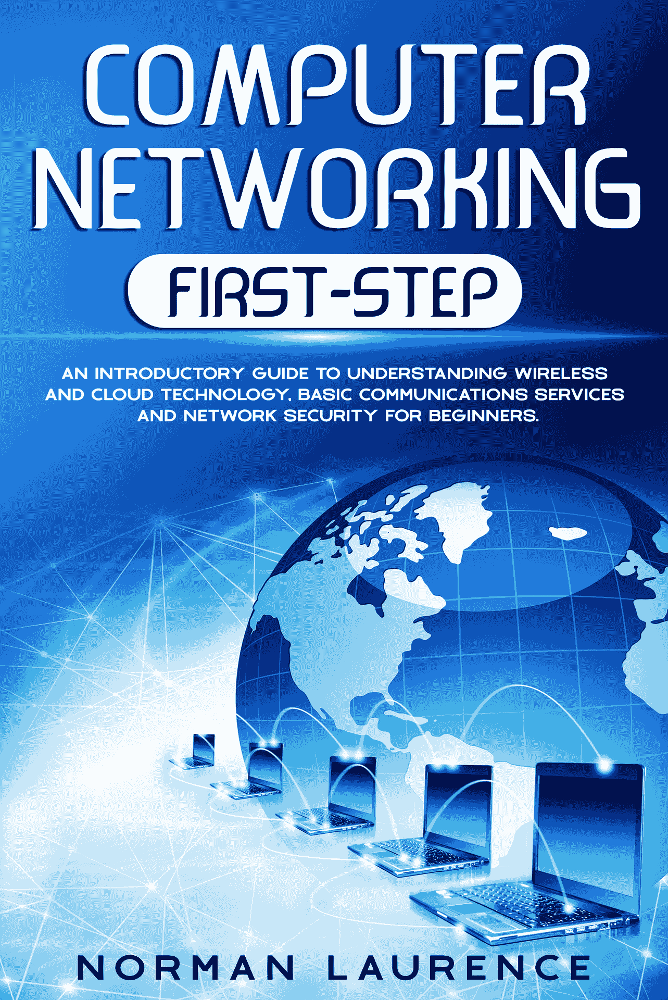
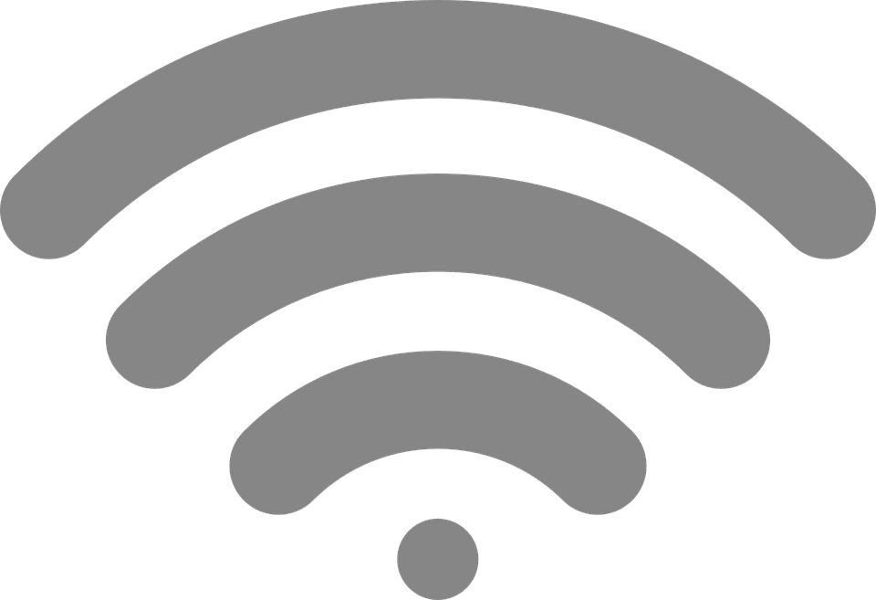
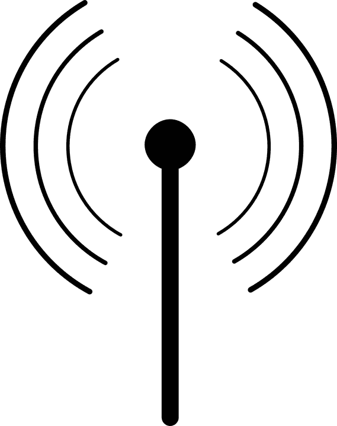

# 计算机网络第一步：理解无线与云技术、基础通信服务及网络安全的初学者指南

## 描述

### 引言

恭喜购买《计算机网络第一步：初学者理解无线与云技术、基础通信服务及网络安全的入门指南》，感谢您的支持。后续章节将讨论计算机网络的基础知识。在如今互联网主宰一切的世界里，了解这些基础是非常重要的，否则你无法保持领先。尽管距离互联网出现已经有 40 年了，但无线标准今天仍在取得巨大的成就。这本书的目的是为你提供一个计算机网络世界的简要概述，以及一些帮助你开始的课题。你将学习到各种传输方法，以及一些需要处理的常见安全威胁。这是一个非常迷人的领域，我已尝试以一种方式来呈现这一切，使其听起来不像专业术语。

# 第 1 章：无线技术简介

现在你可能已经熟悉了“无线技术”这一术语。“无线技术”涵盖的范围非常广泛。然而，简单来说，它可以被描述为在没有任何电缆或导线的情况下连接人或设备进行相互通信、传输数据或功率，这种技术被称为无线技术。因此，让我们先了解这项新技术过去几十年来的简单历史。

## 无线技术简史

无线技术的根源于德国物理学家海因里希·赫兹（Heinrich Hertz）对电磁波的发现。当他在 1885 年至 1889 年进行电磁波实验时，他观察到了以下现象：

* 波的长度和速度
* 振动的性质以及波对反射和折射的敏感性与热波和光波相似。

通过他的发现，他证明了热和光都是电磁波。这种电磁波根据海因里希·赫兹的名字命名为“赫兹波”，后来被称为无线电波。

### 第一次无线通信

亚历山大·格拉汉·贝尔（Alexander Graham Bell）和查尔斯·萨默纳·泰特（Charles Sumner Tainter）于 1880 年发明了第一台光电话。光电话是一种通过调制光束传输音频对话的电话。

### 远距离无线电传输的无线电报

意大利电气工程师古利尔莫·马可尼（Guglielmo Marconi）是一位先驱，他长期从事无线传输的研究。最后，马可尼与德国物理学家卡尔·费尔迪南·布劳恩（Karl Ferdinand Braun）合作开发了里程性的远程无线电报，并于 1909 年共同获得了诺贝尔奖。

### 广播、电视与卫星

随着马可尼远程无线传输的发展，无线广播在 20 世纪初出现。随后，电视出现了，它可以在没有线的情况下接收广播的音视频通信。卫星也是无线技术的一个例子。

## 当代的无线技术

今天的无线技术已成为每个人生活的一部分。如果你问任何人关于无线技术的知识，他们会用手机、平板电脑、笔记本电脑、调制解调器等作为例子回答。然而，今天无线技术被应用于两大类，它们是：

*   **Wi-Fi 技术** – Wi-Fi 技术通过射频（`RF`）或无线波连接两个设备。它通常用于将互联网路由器与笔记本电脑、平板电脑、电脑、手机等设备连接起来相互通信。事实上，Wi-Fi 技术是一种无线局域网（`WLAN`），运行由电气与电子工程师协会（`IEEE`）开发的 `802.11` 协议。`802.11` 系列使用的规范是以太网协议，该协议通过遵循载波感应多接入带冲突避免（`CSMA/CA`）机制来共享路径。

    Wi-Fi 可以同时使用 `2.4GHz` UHF（超高频）和 `5GHz` SHF（超高频）。你可能会好奇，无论你去到哪里，例如你的俱乐部、咖啡馆、市场，甚至呆家里，你都被无线电波包围并沉溺其中。无论你使用什么种设备，可能是手机、蓝牙耳机、婴儿监视器、汽车门控器、车库门开启器，都是由无线频率运行的。现在的问题是 `2.4GHz` 这个数字代表什么？它是移动服务供应商向你的手机发射的频率。波在每秒内振荡的次数。对于计算机来说，它告诉你计算机处理器的速度。对于你的电视来说，它指的是电视刷新屏幕的速率。`5GHz` 是 SHF 无线频谱的一部分，在国际上作为次要分配给业余无线电用户和卫星用户。尽管用户必须接受来自工业、科学和医疗（`ISM`）频段的有害干扰。在美国，`2.4GHz` 和 `5GHz` 频段不需要 `FCC` 的许可即可运行。

*   **蜂窝网络或手机网络** – 蜂窝网络是一种远距离连接两个电子设备进行相互通信或传输数据的网络。由于覆盖距离远，频率复用是必要的。通常，网络服务通过许多基站提供。每个基站覆盖一个被称为“小区”的小区域。基站的功率限制使得在基站几个小区外复用频率成为可能，而且在不产生干扰的情况下实现。小区的大小取决于区域内的人数和人均流量。

## 无线技术市场

无线技术市场非常广泛，包括固定无线、移动无线、便携无线和红外无线。当你在办公室或家里使用无线技术时，你主要使用固定无线连接设备，以通过调制解调器接入互联网。人们在车辆、个人通信服务（`PCS`）和手机中使用移动无线。便携无线设备包括电池供电的手机和个人通信系统（`PCS`）。`IR` 无线用于在控制系统中传输数据。

## 无线技术的工业应用有哪些？

你可能在过去的二十年里一直在使用无线设备，但在工业领域，它已经使用了三十多年。首先，这种应用被用于起重机和自动引导车辆（`AGV`），以实现对工业车辆的灵活控制访问。然而，标准化的 `RF` 协议如 `WLAN`（`IEEE 802.11`、`IEEE 802.15.4`）和蓝牙技术（`IEEE 802.15.1`）现在在工业中起着最主导的作用。无线技术在工业应用中的优势包括：

# 第 2 章：无线网络组件

到此时，你可能已经知道无线网络需要一些支持和兼容组件才能在系统中正常工作。虽然该系统被称为无线网络，但网络中存在某些组件是通过线缆连接的。因此，你脑中可能会产生一个问题：为什么这个系统被称为无线网络？答案是，无线网络系统是有线网络的扩展，而不是取代线缆。这种扩展的有线网络的目的是在终端用户之间扩展无线网络。总的来说，像你这样的终端用户是整个无线基础设施最重要的目标用户。整个网络使用射频通过空气传输或接收数据。这就是为什么无线基础设施的最后几步是不进行线缆连接的。这种程序让用户能够自由在任何时间、任何地点访问互联网。因此，为了讨论无线网络系统中使用的或需要的组件，让我们从用户在系统中的角色和重要性开始吧。

## 终端用户的角色和重要性

无线网络中的用户指的是人或实体。然而，它通常指的是人。假设你是一个经常因公差旅行的商人。当你在机场等飞机时，你需要访问互联网来检查一些紧急邮件。那时你会做什么？你必须访问机场的公共无线局域网来检查并回复邮件。在这里，你就是机场无线网络的用户。

很多时候，用户可能不是人类。假设你正在使用机场的公共无线网络向你的中央服务器发送指令。根据你的指令，你办公室的中央服务器使用了办公室内的无线网络设置。服务器将相同的指令转发到你的制造单元，机器人接收到信号并根据发送的消息采取行动。在这里，用户是一个机器人。所以，无线网络的主要目的是为其终端用户提供服务。

现在可能已经清楚了，用户是无线网络的主要组件之一，他们从系统中获益。这就是为什么用户是无线网络基础设施的重要部分之一。用户是决定何时使用无线网络以及何时终止无线网络的最终权威。因此，这使得“终端用户”这一术语变得合理。通常，作为用户，除了使用特定的无线网络接口外，你还可以使用计算机通过不同的应用程序软件执行各种活动。不同的应用程序帮助你在计算机上完成工作，而无线网络接口帮助你实现从服务器到客户端以及反之的双向通信。因此，作为无线网络接口的用户，你这里的角色是通信者。

无线网络的用户可能是移动的，也可能是固定的。如果你需要经常旅行，移动网络是理想的。假设你正在参加座座，需要通过你的 PDA 接收电子邮件并发送回复。在这里，你需要无线网络接口的持续支持。有时，用户可能需要便携式无线网络接口。假设你正在参加会议，需要在一段时间内使用无线网络讨论一个分析项目。在这里，你可以使用笔记本电脑并在无线网络的帮助下在听观众之前讨论该项目。

无线网络的其他用户是固定的。这意味着坐在某个地方（例如办公室）并在那里工作，并在不确定的时间使用无线网络。假设你在一家 BPO（业务流程外包）公司工作，24x7 访问无线网络平台。在这里，网络是固定的。移动无线网络和固定无线网络的主要区别在于漫游功能。

## 计算机设备

你知道计算机设备在无线网络系统中有不同的使用方式吗？很多时候，它可以在无线网络基础设施中作为客户端-服务器计算系统使用。在客户端-服务器计算概念中，客户端和服务器计算机相互交互。通常，客户端计算机向服务器计算机发送请求以共享资源。服务器计算机可能连接到多个客户端计算机以获取共享资源。因此，服务器计算机为连接到它的客户端计算机提供服务。无线网络基础设施充当客户端和服务器计算机之间的中枢。客户端-服务器网络最好的例子是根据请求返回所需网页的 Web 服务器。

与客户端-服务器计算系统不同，很多时候计算机作为同一无线网络内的终端系统使用。它包含了网站、服务器、数据库。例如，你可以从火车站、机场休息室或酒店的无线局域网查看你喜欢的新频道。同样，坐在办公室的员工可以使用无线网络访问仓库管理程序。在这里，仓库计算机系统充当终端系统。

作为用户，你也可以在笔记本电脑上安装如网卡（`NIC`）之类的计算机设备，以便无线网络环境中工作和交互。计算机或笔记本可以使用 `Linux`、`Windows XP` 或 `Mac OS` 等操作系统作为软件平台运行无线网络应用程序。某些操作系统提供了访问无线网络的内置功能。`Windows XP` 是通过识别无线局域网来工作的操作系统之一。

## 网络设备

随着无线网络变得越来越大，网络性能会下降。这是由于网络中严重的流量拥塞造成的。网络拥塞是由于传输过多数据包引起的。网络性能甚至可能降低到无法传输数据。因此，为了避免此类事件，将巨大的网络分割成若干个小网络段。将这样一个大型网络划分为若干个小网络段被称为子网划分。子网划分通过使用不同的网络设备完成，如 `hub`、`bridge`、`switch` 和 `router`。让我们进入每个部分以了解更多细节。

*   **集线器** – 它是一种用于将每台计算机连接到网络的基础设备。计算机连接到 `hub` 的端口并像单个网络段一样工作。`hub` 将所有数据传输到连接到它的计算机。`hub` 本身没有工作的智能。

    所有连接到 `hub` 的计算机都可以相互发现。这就是为什么当 `hub` 提供的可用端口增加且所有端口都连接到计算机时，网络中的数据冲突几率就会随之增加。

### 网桥

`Bridge`：桥与集线器不同，它具有单一源和单一目的，用于发送接收的数据包。因此，桥是一种双向接口设备。当从特定的网络接口接收到数据时，它会将数据传输到另一个网络接口（该接口显然是连接在它上面的）。因此，桥会产生两个独立的冲突域。根据桥功能的特征，它有时被定义为智能集线器，能够检测数据必须发送的目标点。

桥的工作可以通过电子邮件的示例来完美解释。电子邮件只会投递到收件者的电子邮件地址，而不会发送到任何其他收件者的账户。例如，如果你向朋友 `John@xyz.com` 发送封邮件，无线网络系统将在网上搜索该邮件。如果该邮件 ID 存在，系统将将其投送到该特定的电子邮件地址，否则将发送失败。这就是桥在网络系统中的功能。

### 交换机

`Switch`：交换机的作用类似于集线器，但执行工作更加智能。当交换机第一次接收请求时，它会将数据发送到所有连接到它的计算机。一旦计算机对该数据做出响应，交换机就会定位该计算机连接的端口。同时，交换机会立即学习响应的计算机的媒体访问控制（`MAC`）地址及其端口。因此，当从同一源计算机接收到任何后续请求时，交换机会直接响应，因为交换机已经知道了源计算机及其 MAC 地址。

例如，三台名为 `Computer X`、`Y` 和 `Z` 的计算机连接到交换机。交换机接收到一个目标为 `Computer X` 的请求。交换机将请求的数据传输给名为 `X`、`Y` 和 `Z` 的三台计算机。在 `Computer X` 响应数据的瞬间，交换机将路径保存在内存中，并在未来所有指向 `Computer X` 的引用中将数据发送到 `Computer X`。交换机在开放系统互连（OSI）模型的网络层第一层执行此功能。然而，交换机在同一网段的每个端口上都会创建自己的冲突域。

### 路由器

`Router`：在目前市场上提供的任何网络设备中，路由具有最高水平的智能性。它是可以预设将数据传输到目标计算机的高效设备之一。路由器用于在开放系统互连（OSI）模型的第 3 层网络上操作。路由器还可以通过检测目标计算机的 `IP` 地址将数据从一个网络传输到另一个网络。然而，路由器默认不会转发任何内容。

路由器为其每个端口创建一个独立的网段，并同时创建一个独立的冲突域。因此，路由器拥有多个网段和多个冲突域。然而，尽管路由器创建了不同的冲突域，但它在相同的域内运行。路由器的功能包括检测路径、为每条路径过滤数据包、交换每个数据包以及在互联网上工作。为了实现此类功能，路由器单独考虑所有设备，并将广播域从一个网段隔离开。这意味着当消息发送到某个网段时，连接到该特定网段的设备可以获取消息，而不会干预网络中的其他网段。路由器通过使用访问列表和逻辑地址进行数据包过滤，以交换数据并在互联网上运行。

### 无线网络基础设施

无线基础设施的主要目的是建立并确保其用户和终端系统。该基础设施由四个部分组成：1) 基站，2) 控制器，3) 应用连接软件以及 4) 分配系统。

#### 基站

`Base Stations`：基本上，基站是一种基础设施组件，使用户能够访问网络浏览器、电子邮件、数据库应用程序等网络服务。它包含了无线网络网卡（`NIC`）中找到的技术。在这里，基站负责将通信信号从一个接入点接口到另一个接入点，信号通过空气传输。

#### 访问控制器

`Access Controllers`：如名称所示，访问控制器控制资源与无线网络开放侧之间的流量。它是一个位于接入点和通过电线连接的网络开放侧之间的硬接线设备。它通过为访问控制机制提供中心化的智能解决方案，增强了无线系统的安全性。访问控制器还允许管理员根据用户为基准安排应用程序，以确保访问特定端口或阻塞该端口。例如，当您输入用户 ID 和密码浏览网页时，访问控制器会通过服务器验证、身份确认并校验您的身份。

#### 应用连接软件

`Application Connectivity Software`：网络基础设施中的连接通常定义了连接应用程序软件或系统的能力，否则您无法访问所需的数据库或任何应用程序。这意味着，当你尝试通过计算机访问托管在系统上的数据库或应用软件时，你需要一个可以在你的计算机和主机服务器之间建立接口的应用连接软件。

应用程序通常用几种不同的独立编程语言编写。另一方面，处理器运行多个多个独立的操作系统，并可能位于不同的地方。在这里，应用连接软件在用户计算机与托管数据库或应用程序的服务器之间建立通信方面起着关键作用。

#### 分配系统

`Distribution System`：无线网络本身在没有电线的情况下运行，但其基础设施需要电线来绑定其分配系统，将服务器、访问控制器接入点整合在一起。然而，分配系统被定义为遵循 `IEEE 802.11` 标准协议的接入点与无线局域网（Wireless LAN）之间的互连。

对于多层建筑或连接两个或多个办公室所需的大型网络，以太网集线器充当连接无线基础设施中所有计算机的介质。集线器允许多个领域存在，以提高用户之间的有效传输性能。

## 管理系统

与任何其他基础设施一样，无线网络基础设施也需要一套有效的管理程序，以确保无线网络骨干及相关人员能够满足用户需求。

*   **安全性**：安全管理包含网络组件和资源的防护措施。它强制执行与网络基础设施配置相关的安全策略，以应对各种可能损害无线信号的问题。安全策略应包含强力加密，以保护系统免受未经授权的人员窃取用户数据的影响。否则，用户将失去对无线网络基础设施接入点的信任。
*   **帮助台**：帮助台的主要目标是在出现无线连接相关的任何主要问题时为用户帮助。因此，帮助台必须具备一个通信接口来触达用户的需求。
*   **配置管理**：企业必须有一项明确政策来审查无线网络骨干，其中包括接入点、射频（`RF`）通道、安全设置等。配置管理必须确保对骨干系统的任何更新或升级采取及时且动态的行动，并在必要时相应配置系统。
*   **网络监控**：无线网络基础设施的监控是一项巨大的任务，需要一个主动的计划来成功管理网络功能。网络监控管理的关键作用是确保降低接入点访问用户数据时的风险。监控管理进一步要求用户网络流量向接入点的增长，同时不损害网络和用户的安全。监控简化了操作支持系统，并为基站重叠提供覆盖，重叠可能会导致接入点性能下降。
*   **报告**：报告系统包含了无线网络性能的各种重要因素，包括数据使用统计和安全违规通知。这些因素负责决定任何需要应对接入点及其利用率潜在威胁的运营变更。这些信息必须提供给如帮助台、工程师和维护人员等所有支持团队。
*   **工程**：工程团队在无线网络骨干安装时至关重要，但他们的角色不仅局限于安装。为了保持系统高效无误地运行，工程团队的必要性本质上更高。为了让网络系统流畅运行，工程师应该对网络骨干的结构设计和功能设计保持警惕。他们应该持续监控网络系统的性能，并开发新技术，在不对任何安全威胁妥协的前提下，通过有效的安全措施增加流量流。
*   **维护**：无线网络基础设施的维护部分负责天线、信道等不同组件的修复。维护团队评估射频传播，并在任何必要的时间和地点安装额外的接入点。因此，维护团队充当工程团队的扩展支持团队。

# 第 3 章：什么是互联网？

简单来说，互联网是一个全球性的计算机网络。它提供了通信设施以及信息共享等其他功能。全球网的骨架通过标准通信协议相互连接。它作为一个“网络之网络”而运行，全球所有的 Web 服务器都互联联，形成一个国际网络。例如，你正在你的电脑或笔记本电脑上工作，而这些设备正运行在网络上。你可以从另一台运行在独立网络上的计算机获取任何信息、消息和数据。如果你对他人计算机的网络具有访问权限，这种信息共享就可以发生。互联网的概念最早于 1969 年由美国国防部下属国防高级研究计划局（`DARPA`）提出的。该机构旨在建立一个网络，以便在发生军事攻击或此类破坏时，将信息从防御系统的一台计算机传输到另一台计算机。然而，这项设施现在已扩展到全球，全球每个角落的公民都可以访问。

## 互联网的历史

在 1969 年 `DARPA` 发明了革命性的互联网之后，它的使用被局限于美国的防御系统中。近一个半世纪后，即 1983 年，一种名为 `TCP/IP` 的新型网络协议技术演变出来。`TCP/IP` 代表传输控制协议/网络协议，它由一组用于开放式套件的标准协议组成。1985 年，美国科学基金会网络（`NSFN`）开发了一种新的网络设计，使所有的计算机科学部门能够在范围内连接它们的计算机。1989 年，随着超文本传输协议（`HTTP`）的开发，互联网通信得到了极大改进。`HTTP` 的发展为互联网世界带来了巨大的变化。它提供了各种计算机平台到互联网上相同站点的连接能力。1993 年，当 Web 浏览器 `Mosaic` 演变时，互联网网络进一步扩大。然而，互联网在全球范围内不断发展其强大的存在性。例如，互联网协议第 6（`IPv6`）是由互联网工程任务组（`IETF`）开发的，它实现了数据包交换。数据交换简化了网络中两台计算机之间的数据接收和发送。互联网的发展开启了其商业化和竞争的必要性。然而在 20 世纪 80 初，一些供应商已将 `TCP/IP` 整合到他们的业务产品线中。这种发生并不是因为供应商想要启动网络，而是因为客户在接触网络。因此，供应商的组织也开始接触消费产品的网络化。然而，1988 年当 `Interop` 贸易展会开始时，满足消费者论坛和供应商组织的需求变得可能了。互联网的商业化已使其成为一种商品，现在它已成为全球范围内信息共享的骨干和支持全球商业活动的支柱。

## 互联网是如何工作的？

互联网的功能分为两个部分。一个是物理部分，另一个是技术部分。互联网的物理部分根据现行的电信过程原理工作。技术部分处理 `TCP/IP`，它使用一组数据传输指南。当你深入研究互联网时，你会发现两个作为整个互联网基础设施支柱的两个组件。第一个支柱是网络协议，第二个支柱是硬件。

第一个组件网络协议（如 `TCP/IP`），它由一组规则组成，指导设备执行以完成任务。没有这些公共规则集，机器将无法执行任务。使用这些协议集的目的是将数据中使用的、数字和其他符号翻译成电子信号。这些电子信号在互联网上传输。最后，当信号到达终端用户时，信号会被重新翻译回其原始文本形式。

互联网基础设施的第二个支柱是它的硬件部分。它包含了在网络中两台计算机之间传输信息的电缆。还包括路由器、卫星、手机塔等其他硬件。所有硬件都连接到网络。智能手机、电脑等设备被称为“客户端”。客户端-服务器架构分配了跨设备的计算。互联网的通信线路可能有两种类型。一种是通过手机塔或卫星发送的无线信号。另一种是像光纤这样的物理连接。跨设备的数据传输取决于无连接网络中的包交换。当你尝试通过互联网向某人发送数据时，每个数据包会被分配一个名为端口号的数字。因此，你的数据包具有两个特征。其之一是唯一的 IP 地址，另一个是端口号。唯一的 IP 地址和端口号从字母数字文本翻译成电子信号。

现在信号在通信模型的层之间传递。信号从应用层移动到物理层。然后信息通过互联网提供商（`ISP`）的路由器进行传输。路由器检查分配给每个数据包的接收者地址并确定发送路径。数据包到达客户端后，执行反向过程，将信号翻译成原始数据的字母数字形式。当信号从 `OSI` 模型的下层移动到上层时，该过程开始。在此过程中，通过检测 IP 地址和端口号从数据包中剥离字母数字数据，从而完成数据传输过程。

## 互联网的用途

虽然全球几乎每个人都在使用互联网，但了解互联网的用途是非常重要的。它通常用于将信息从一个地方共享到另一个地方（全球范围内）。以下是互联网用途的一些重要例子：

- 访问即时消息、电子邮件、互联网相对聊天、电话、视频会议、社交媒体；
- 利用在线教育计划以获得学位、参加研讨会和不同的技能培训；
- 两端获得工作的机会，例如，雇主发布职位机会，工作申请者可以申请空缺职位。招聘者和申请者都可以在像 `LinkedIn` 这样的共同社交媒体平台上找到彼此；
- 研究工作的可扩展性以及下载下载；
- 开发在线小组论坛的能力；
- 阅读杂志、报纸和期刊的能力。
- 用于在线购物、在线游戏和在线约会的设施。

## 互联网（Internet）与万维网（World Wide Web）概念的区别

“互联网”和“万维网”这两个术语经常被误淆地定义为同一个东西。它们既不是同义词，也不执行相同的活动。互联网是跨越全球的网网络，由于不同网络的快速增长，它正在不断扩大。

“万维网”或简称为“Web”被定义为一种可以通过互联网访问的文档和信息收集系统。换句话说，互联网可以解释为网络的基础设施，而万维网则在该基础设施之上提供服务。万维网涵盖了互联网大部分用途。

万维网最卓越的特征是其超文本。超文本是一种软件，允许文本的相关部分与关联图形材料之间进行广泛的交叉引用。大多数网站使用某些特定的短语或单词，它们在页面上以与内容其余部分形成对比的独立颜色显示。此外，不同颜色的文本通常带有下划线。当你点击选定的彩色文本时，该网页将带你跳转到与彩色文本相关的另一个页面或网站。这使用户能够获取更多关于彩色文本的信息。图像、图像的一部分、按钮等都被用作超链接。

现在万维网已经为人们提供了数十亿个各种信息页面供其访问。因此，要导航或浏览这些网页，你需要一个浏览器。浏览器是一种软件应用程序，帮助你找到进入万维网的方法，查看你所需的页面并与页面上提供的信息进行交互。在万维网上的浏览可能包括网页、图像、视频等。`Google Chrome`、`Internet Explorer`、`Firefox` 是所有其他网页浏览器中最流行的。然而，特定网页的外观可能会根据你使用的浏览器而略有不同。

## 网络安全与互联网

互联网上可能属于私密或公开的信息的积累每天变得日益巨大。互联网的这种巨大性给用户带来了两种威胁：一个是数据泄露的威胁，另一个是安全威胁。这两种威胁都与不同的风险相关。

数据泄露是指未经授权或非法方式访问或披露用户个人机密或敏感信息的确定事件。它可能涉及访问用户的身份识别或个人身份信息（PII）、用户的个人健康信息（PHI）、知识产权、贸易秘密等许多。数据泄露的一些常见例子包括社会安全号码（SSN）、信用卡号、医疗信息等。

互联网的安全是数字世界防御来自内部或外部、恶意或意外威胁的防御系统。防御系统的首要目标是持续检测威胁。防御系统的第二阶段是制定安全策略以应对和反击威胁，利用信息技术和软件工具防止系统发生故障。

以下是你可以遵循以保护自己个人隐私的某些建议安全步骤：

- 安装杀病毒软件和反恶意软件
- 创建强大且多样化的密码，并定期以多样化的方式更改
- 尝试使用虚拟专用网络（`VPN`）或像 `Google Chrome` 这样的隐私浏览器，它们可以创建安全加密的连接
- 仅使用 `HTTPS`
- 将所有社交网络账户设为私密
- 禁用自动填充选项
- 关闭设备的 `GPS`
- 更新 Cookie，以便在每次安装时你都会收到通知
- 在离开账户前注销，而不仅仅关闭窗口或标签页
- 不要打开未知来源的文档或从那里下载文档
- 对垃圾邮件保持谨慎
- 在访问热点或公共 `Wi-Fi` 时保持谨慎

## 互联网的社会影响

与其他许多科学成就一样，互联网对社会也产生了辩证性的影响。有些人对互联网持负面态度。他们认为了一种他们从未见过的特定代人的行为。此类指控包括疏远、与社会脱节、特定代人日益增加的情绪反应如错失恐惧（`FOMO`）。

而持互联网积极态度的人对互联网的使用表示相反的意见。他们认为互联网扩展了公民参与的边界，加强了志同道合的人之间的关系，提供了更多的社交稳定性，发展了跨越家庭、朋友和同事核心圈的更大社区，通过分享他人的价值、项目和兴趣关注个人的成长。一些社交网络网站如 `Facebook`、`Instagram`、`Twitter` 和 `LinkedIn` 是最受欢迎的平台，从个人到企业的每个人都能获得相互互动的机会，以造福自身和整个社会的利益。

# 第 4 章：无线网络应用

“无线通信”这一术语起源于 19 世纪，对世界产生了巨大影响。多年来，这项技术经历了数次重大变化，反过来也使其更加发达。在将信息从一个设备传输到另一个设备时，无线介质的重要性是不可或缺的，它也已成为最重要的传输介质。正如你可能已经知的，在无线通信中，信息不是通过任何物理对象的帮助传输的，而是通过空气传输，且不需要任何电子导体。很令人惊讶，对吧？唯一使用的就是如 `RF`、`IR` 和卫星之类的电磁波。在当今时代，无线通信不仅限于少数设备，而是扩展到了从计算机到智能手机、笔记本电脑、平板电脑等大量物品。`Bluetooth` 技术也是其中的一部分。在本章中，你将概述无线网络在当今世界中的各种应用，以及它如何对我们的日常生活产生如此巨大的影响。在从远程操作区域进行通信时，无线通信提供了巨大的帮助。

## 无线通信的类型

以下是一些常见的无线通信类型及其简要介绍。

### 卫星通信

卫星通信是最先进的电信基础设施形式之一，是一项自成体系的技术。通过这项技术，你可以连接到地球上任何你想要连接的人和任何地方。这是一种通用的通信方式。依赖这种通信方式的人通常会寻求拥有地球地球静止卫星的商业供应商的帮助。现在你可能在想什么是地球静止卫星。嗯，它们是某类旋转速度与地球旋转速度匹配的卫星，因此具有相同的轨道周期。正因为如此，卫星始终留在天空中的同一位置。在这种通信类型中，调制的微波波束充当信号，当信号接近卫星时，它会被放大。然后，该放大后的信号将被发送到位于地球某处的相应天线。因此，卫星通信主要分为两个部分：一个位于地面，另一个位于太空。移动或固定传输、辅助设备和接收设备都是地面段的一部分，而空间段主要由卫星组成。卫星通信出现后，世界通信的节奏和模式发生了彻底变化。

### 红外通信

接下来，我们来看红外线无线通信，其基本组件是 `IR` 辐射。对于那些不知道什么是 `IR` 的人来说，它是一种波长大于红光的电磁能量。这类别的通信可以发生在固定设备和便携设备之间，也可以发生在两个便携设备之间。红外通信有两种基本类型，下文解释——

* **扩散点** – 在这种情况下，不需要接收器和发射器之间有视线，链路的维护通过信号的反弹或反射完成。这是通过屋顶或天花板等表面实现的。该系统的一个非常常见的例子是无线 `LAN` 通信。
* **点点** – 在这种情况下，视线是强制性的。这意味着接收器和发射器的放置或安排方式应使它们相互指向，并且注意它们之间没有障碍物。遥控通信是这种类型红外通信的常见例子。

如果你在想红外通信的优势是什么，让我为你详细阐述一下——

* 首先，红外通信的高方向性是其最大的优势。这里涉及的各种源发射的不是相同的辐射，而是频率不同的辐射，因此识别源源变得容易得多。所以，任何涉及信息扩散的风险都消失了。
* `IR` 辐射不会对人类造成伤害，因此在某地使用它时不必反复考虑。
* 如果你正在发送视频信号或任何需要高速通信的内容，那么你绝对应该选择红外通信，因为传输速度可以高达 `1Gbps`。

### 广播无线

你想知道第一种无线通信技术是什么吗？嗯，它是开放式无线电通信。它非常普及，即使在今天也有自己的受众。多通道收音机允许用户之间进行短距离通信，而另一类收音机被称为波段无线电和海事无线电，它们被水员用于通信服务。此外还有业余无线爱好者，他们在灾难发生期间，可以通过部署他们强大的广播设备来分享应急通信辅助，他们甚至可以通过他们的系统发送数字信息。

无线电波是无线电通过空气传输声音的介质。它使用一个发射器将数据发送到接收天线。无线电波也被归类为电磁信号，它们属于完全不同的频率频段。如果你想获取特定的音频信号，你就必须相应地改变你的频率频段。

### 微波通信

这种通信也利用了无线电波的帮助，这些波的单位是厘米级。在这种通信中，有两种方法可以传输信息或数据。一种是地面法，另一种是卫星法。

在卫星法的情况下，正如你可能已经猜到的，使用的是卫星来执行接收来自地面站发送信号的任务。这些信号的频率范围在 `11-14 GHz` 之间。传输速度在 `1 to 10 Mbps` 之间波动。

然后是地面法。在这里，两个微波波塔之间清晰的视线是前提条件。你应该确保这两个波塔之间没有障碍物。这种类型微波通信的频率范围通常在 `4-6 GHz` 之间，传输速度与卫星法相同。但微波通信有一个很大的缺点，那就是在天气状况的情况下，它们会受到巨大的影响。

### Wi-Fi

Wi-Fi 最大的优点之一它是无线类别中的一种低功耗通信。各种类型的设备都可以使用 Wi-Fi，所有这些设备在人们的日常生活中都很常见。例如，笔记本电脑、手机等。在这类无线通信中，通信枢纽的角色由 `router` 扮演。但为了保持与 `router` 的连接，你必须靠近系统，而不能像上述无线通信类型那样进行远距离传输。为了安全起见，无线网络需要通过设置合适的密码来妥善保护。

### 移动通信系统

随着每一代的发展，移动通信的增长突飞猛进。通过手机的帮助，人们可以跨越单一频段进行通信。无线电话和手机是这一类中的两个常见例子。由于各种可用网络，移动通信系统的覆盖范围是巨大的。但在无线电话的情况下，范围是有限的。此外，你还会发现某些设备使用卫星连接到其他设备。

### 蓝牙技术

这也是一种无线通信系统，允许你在两个设备之间传输文件。这种技术在当今世界最常见的应用是：耳机、无线键盘和鼠标等不同设备通过这种蓝牙技术连接到手机上。与这项特定技术有多种功能相关。

## 无线通信提供互联网访问

在你应该选择无线通信的所有其他可行理由中，最令人信服和重要的一点是它将允许你访问互联网并与他人共享这种高速互联网。因此，你家庭或公司的所有成员都可以共享同一个高速互联网连接。这将为你节省大量的钱，而且非常方便。每个人都将能够访问该高速互联网，并在建筑内走动而不必担心丢失连接。

灵活性也增加了，因为你可以不断增加工作站，而无需处理与电缆相关的问题，反过来这可能会造成很多混乱。此外，你可以将你的任何设备移动到你想要的任何地方，而没有任何电线在过程中干扰。这使得服务器、打印机以及任何其他附件设备的移动成为可能，并使整个过程变得毫无烦恼。

无线通信还有另一个好处。例如，当你有宾客或任何客户访问你的办公室时。你可以允许他/她快速连接到互联网连接，而无需经过任何复杂的配置设置。因此，生产力得到了极大提高。访问你场所的任何访客只需开启其设备并连接到你的网络，即可在网络上进行一些工作或访问他们的电子邮件。

## 库存控制中的无线网络

如果你不使用无线通信，你的经销商可能会遭受沉重打击。由于各种可用网络，移动通信系统的覆盖范围是巨大的。但在无线电话的情况下，范围是有限的。此外，你还会发现某些设备使用卫星连接到其他设备。

# 第 5 章：无线通信技术

在上一章中，我曾向您简要介绍了存在的不同类型的无线通信技术。在这里，我将为您详细解释无线通信技术的不同方面以及它们具有哪些特性。这一切始于无线电的发明，而现在，无线通信已经达到了极高的高度。即使是远距离通信，社会也发生了变革。世界现在从字面上变成了一个小得多的。

## 无线通信的优势

无线通信的优势列表无穷无尽，但我在这里尝试用简洁的方式列出所有这些优势——

### 移动性

各种类型的无线网络具有极大的移动性。它们不会遇到任何障碍，因为通信是通过空气中各种波的形式完成的，不涉及任何电线。例如，你可以在开车穿过森林时听收广播节目。是的，某些因素可能会影响信号强度，但无论如何，你所获得的移动性范围是不容置疑的。

### 便捷性

为了使有线连接工作，物理连接的存在变得必不可少，这反而会产生很多麻烦。另一方面，无线通信不需要任何物理物体。信号强度是唯一的决定因素。如果它工作正常，你就不需要担心其他任何事情。你只需要密码来保护你的网络，就可以将设备立即连接到网络，而无需担心任何黑客。

### 灵活性

无线网络通过空气运行，因此它们可以穿透墙壁。你不需要对安装位置反复考虑。你可以在你想要的任何地方安装它们，它们仍然将保持高效运行。灵活性无疑是无线网络最大的优势之一。

### 成本效益

安装无线网络可以节省你方面的巨大成本。特别是与有线系统相比时，安装非常廉。在有线系统的情况下，电缆成本是巨大的，你必须根据所需的每英尺线支付费用。这还涉及完成整个安装所需的单独的人力和时间，从而产生额外费用。此外，如果你想对安装这些电缆的布线计划进行任何更改，将产生更多成本。但是确实，有时在大规模上建立无线连接时仍需要少量的布线，但这远少于有线系统的成本。

## 无线通信系统中存在的基本元素

大多数无线通信系统中通常存在三个元素，如下：

- 发送器
- 信道
- 接收器

## 传输路径

# 无线通信系统

在无线通信中，传输路径的某些部分如下——复用、调制、加密和编码器。`Source Encoder`（源编码器）是信号源自源通过的地方。为了使信号处理技术正常工作，需要根据信号创建一个合适的格式，这是通过 `source encoder` 自身完成的。如果信号中包含任何冗余信息，这些信息将会被立即移除。这确保了资源的最化利用。接着是 `Encryption Standard`（加密标准）的工作，它负责信号加密。这确保了所有内容都以安全的形式传输，且不允许任何类型的未经授权访问。当你通过 `channel encoding`（信道编码）时，信号中的干扰、噪声等所有类型的损伤都会从信号中消除。在此过程中还会进行另一件事，即为了使信号具有更强的抗噪声能力，引入少量的冗余。然后，使用合适的调制技术，如 `FSK`、`PSK` 或 `QPSK`。这使得信号能够通过天线进行传输。接着是各种复用技术的作用，如 `FDM`（频分复用 `Frequency Division Multiping`）和 `TDM`（时分复用 `Time Division Multiplexing`），它们有助于共享宝贵的带宽。

## 信道

正如你从术语本身所理解的那样，无线通信网络中的信道是传输介质，在这种情况下是开放空间。这在本质上可能是高度变化且不可预测的。它也相当随机性。这种信道受到散射、噪声、失真、干扰等许多因素的影响。结果是多个错误开始充斥信号。

## 接收路径

从特定信道收集信号是接收机的任务。然后，同一个信号会被复制以作为源信号。`Demultiplexing demodulation`（解复用调制）是无线通信系统中接收路径的一部分。其他一些部分包括 `source decoding`（源解码）、`decryption`（解密）和 `channel decoding`（信道解码）。现在，如果你仔细研究这些方面，你就会理解接收机和发射器的任务是完全相反的。`demultiplexer`（解复用器）负责从信道接收信号。该特定信号还会与其他所有信号分离。然后实施各种 `demodulation`（解调）技术来对单个信号进行解调。完成所有这些之后，最终恢复原始信号。随后，`channel decoder`（信道解码器）从信号移除任何或所有冗余位。现在，你必须理解你接收的消息是加密格式的，因此必须进行 `decryption`（解密）。这样，安全措施被移除，并从加密信号中提取出简单的序列。然后 `source decoder`（源解码器）介入，解密后的信号被交给它。最后，检索原始传输的消息。

# 无线信号

在我们进入细节之前，你首先需要什么是无线信号。无线信号是负责视频、音频或任何其他形式数据传输的，它们在没有任何线的情况下完成这一切。但所有类型无线信号的一个共同点是，它们都是通过空气传播的电磁波。现在，你可能在想这些波是如何形成的。嗯，当使用某种金属传输电能时，在该金属周围就会产生波。这些波被称为电磁波。取决于该能量的强度，波可以传输一段距离。现在，我们来看不同类型的无线信号。有些你可能已经非常熟悉，并且在上一章中已经简要讨论过了——电视、`AM` 和 `FM radio`、`Bluetooth`、`Wi-Fi` 和卫星连接。但它们彼此在某种形式上都是相互不同的。

## 频率

所以，我们从无线通信的一些共同方面开始，因为...

### 2.4 GHz

2.4 GHz – 这是两个频率中较低的一个，但它也是 Wi-Fi 技术中更常用的频率。市场上有许多设备在使用这个频率。它也有一个缺点：使用特定频率的设备数量越多，该频率就变得越拥挤。因此，信号传输中会出现干扰，所以速度并不总是很快。但它可以轻松地穿过墙壁和窗户。

### 5 GHz

接下来我们来看两个频率中较高的一个。这个频率没有前一个那么流行，因此使用它的设备也少得多。所以，如果某个设备在使用这个频率，因为拥的人较少，它可以实现更高的速度。但它也有一个缺点，即这个频率穿透墙壁和窗户的效率不如前者。这就是为什么 5GHz 技术受到限制的原因。

### Wi-Fi 频段

因此，Wi-Fi 可以分为两个类型的频段或频率带。在 Wi-Fi 的每个频段中都有几个不同的通道。你可以将这些通道想象成一个举办派对的房屋里的独立房间。当一个房间里的人太多时，你无法在里面进行交流。这时你就必须去另一个房间，但过一段时间后，那个房间也会变得拥挤。很快，你会发现整栋楼都变得拥挤，这时你最终放弃了发起对话，因为在那个拥挤的地方已经不再可能。

#### 2.4 GHz 频段

首先，我们将讨论这个 Wi-Fi 频段。该频段总共有 14 个通道，但并非所有通道都是唯一或独立的。其中有几个通道是重叠的，你能猜到后果是什么吗？嗯，它们无法同时使用。如果你正在考虑建立网状网络（mesh network），有些是你是你知道的。同一个通道必须包含所有的网状链路。根据你所处的地理位置，可用的通道数量会有不同。例如，如果你来自美国，那么通道 14、13 和 12 是无法供 Wi-Fi 使用的，因为它们被用于卫星和电视服务业务。因此，为了建立网络，你可以使用 1 到 11 之间的任何通道。对于世界其他地区，1 到 13 之间的通道通常可用于构建网络，但在某些地方你甚至可以使用通道 14。除了我上面提到的内容外，在 2.4 GHz 频段中，在美国最好用的通道是 1、6 和 11。存在某些部分重叠的 Wi-Fi 信号，但如果你坚持使用这些通道，将面临非常少的干扰。你还应该记住，为网络使用其他通道是完全没问题的，只要它们之间隔开 5 个通道，例如 3、8、13。但这不是一个最佳选择，因为通道 13 在世界上许多地方并不是可行的选项，而且你没有利用到通道 1 和 2。无论你在世界的哪个地方，做一下小小的研究，你就会了解该地区最常用的通道，然后你需要相应制定计划，以免你的网络产生重叠。

#### 5 GHz 频段

由于这是一个较高的频率，它比 2.4 GHz 频段宽得多。因此，它拥有更多的通道。最棒的一点是，这些通道不像 2.4 GHz 频段那样重叠，因此没有所谓的非标准通道。在有这么多通道的情况下，在这种选择一个不会引起任何干扰的通道是非常容易的。在美国构建网状网络的可用通道有 165、161、157、153、149、48、44、40 和 36。但这些之外，其他通道可用于其他形式的社区网络或接入点，但当涉及到网状网络时，那些通道无法工作。你可以在线查看你所在地区哪些有效，哪些无效。

## 天线

接下来我们来看天线。无线路由器使用不同类型的天线。但在某些路由器中，天线并不总是独立的，因为它们是内置的。另一方面，还有其他类型的路由器，你可以选择想要连接什么种类型的天线。天线有很多类型，但如果你考虑基础知识，有三种，下文解释——

*   **全向天线 (Omnidirectional Antennas)**：该术语本身表示了这种天线的类型。它负责向所有方向均匀地发送信号。通过这些天线，在任何方向建立连接都是可能的。

*   **定向天线 (Directional Antennas)**：与全向天线的主要区别在于它们只向一个方向发送信号。这些天线的用处是你可以增加信号传输的距离。它们可以进一步分为两类：

    *   **聚焦天线 (Focused Antenna)**：这种类型的天线以窄束的形式发送信号，宽度通常在 5 到 10 度之间。

    *   **扇区天线 (Sector Antenna)**：它们以扇形的形式发送信号。宽度可以高达 120 度。

# 第 6 章：移动通信系统

移动通信技术允许你使用无线网络与他人通信。无线电波用于创建无线电话。该系统涉及不同的类型。公共无线电、移动双向无线、业余无线电和手机是不同类型的示例。公共无线电用于消防、警察和市政机构，包括 `FM`（调频）无线系统。该系统的能力限制在小的地理区域内。移动双向无线有助于创建半双工模式的通信系统。`CB`（民用频率）无线是这种类型最常见的例子之一，它利用 `AM`（幅度调制）在 26.271 MHz 到 27 MHz 的频率范围内运行，涉及 40 个通道。它使用按下通讲开关，因为它不是商业服务。移动电话提供全双工传输。它涉及一对一系统，允许同时进行传输。每个移动单元都包含一个特定的号码以维护隐私。

## 近期与之前的移动通信

自 1983 年以来，`AMPS`（先进移动电话系统）的商业应用促进了移动通信系统的增长。小区概念是一个巨大的突破。

## 小区概念

小区业务的出现促进了个人通信系统的指数级增长，涉及无线接入、集成电路、数字信号处理、电池寿命延长等不同进步。小区系统通过遵循以下步骤运行：

*   将可用频谱划分为离散通道，分配到覆盖蜂窝服务的地理区域内。
*   离散通道可以在 2 公里到 50 公里的不同范围内重用。
*   当相邻小区在不同频率上运行时，服务区域内的 `RF`（射频）发射器可以避免干扰。

手机电话涉及由于频率调制的双向模拟通信系统，其涉及语音传输以及使用频率频移键控来控制传输和信号信息。蜂窝系统的其他终端示例包括无线电话、数字蜂窝系统、寻呼机和卫星移动。模拟蜂窝系统认为是蜂窝概念的 `1G`（第一代）类别。数字蜂窝低功率无线认为是蜂窝概念的 `2G`（第二代）类别。

## 模拟蜂手机

在新泽西州，贝尔实验室在 1970 年内提出了一项被视为 `AMPS`（高级移动电话系统）的手机电话提案。`AMPS` 的运行于 1983 年 10 月 13 日作为标准蜂窝电话服务开始。它利用了窄带陆地调调制，包括可用的 `300-3 kHz` 音频频带，以及为了 100% 调制而具有的正、负 `12 kHz` 最大频率偏移。根据卡森法则，它对应于 `3 kHz`。`AMPS` 在传输在频域内划分的区域内利用 `FDMA`（频分多址）。允许用户在通话期间获得一对正向和反向语音信道。模拟蜂窝信道包括利用数字信号信息的语音和通过遵循二进制 `FSK` 的 `FM`。

## 数字蜂窝系统

它允许在性能和容量方面的发展。`FDMA` 利用频率信道化方法来管理频谱，而时分多址（`TDMA`）使用时分划分的方法。所有可用的蜂窝 `RF` 频谱被划分为窄带通道内的子类，这些通道在基站和移动点之间作为单向通信链路被利用。

## 蜂窝系统中使用的多接入技术

蜂窝系统通常会被分配特定数量的频率频谱。由于使用了多种多接入方法，用户可以轻松地共享可用频谱。无线通信可以遵循三个维度进行复用，这三个维度是 `TDMA`（时分多址）、`CDMA`（码分多址）和 `FDMA`（频分多址）及其各种 `OFDMA`。

在 `TDMA` 中，可用频谱被分为频率信道或窄频带。这些还被划分为许多时隙。根据美国数字蜂窝标准 `IS 136`，每个频率为 `30 kHz` 的频率信道被划分为三个隙。另一方面，根据欧洲数字蜂窝系统，每个频率为 `200 kHz` 的频率信道被划分为八个隙。`GSM` 保护带对于时隙和频率信道都是至关重要的。

用户在 `FDMA` 中共享频率频带内被称为业务信道的可用频谱。考虑到频带包含用户的信号功率，不同的用户被分配了不同的信道。所有模拟蜂窝系统都涉及 `FDMA`。数据流在一种名为 `OFDM` 的多蜂窝传输方法中涉及多个较低速率的载波音调。移动通信系统包括 `OFDM` 以控制恶性的频率选择衰落。无线网络标准也通过引入 `OFDM` 来维持。`OFDM` 提供了 `OFDM` 调制和相干识别的优点。它具有若干对于未来高速传输较为复杂的特性。通过对 `OFDM` 收发器进行上下变频，可以极大减少对电气带宽的需求。这对于高速设计非常有效，因为电气带宽涉及成本。此外，当 `OFDM` 收发器中涉及信号处理时，有效的 `FFT`（快速傅里叶变换）或逆 `FFT` 算法的优势就建立了。

## 数字调制键控

通常，通信系统对载波进行调制以产生带通波形。数字信号可以帮助调制正弦载波的频率、幅度或相位，形成三种不同的数字调制形式，如 `FSK`（频移键控）、`ASK`（幅移键控）和 `PSK`（相移键控）。此外，某些调制方案还涉及相位调制和幅度调制的结合。值得注意的是，`PSK` 传输是极性的，而 `ASK` 信号是非极性的。`PSK` 代表非线性调制方案，而 `ASK` 代表线性调制。`PSK` 的效果比 `Ask` 好。

### QPSK（四相移键控）

上述数字调制方法的频谱效率并不高，因为可用信道带宽没有被完全利用。`OPSPSK` 有助于提高频谱效率。它涉及两种信息源。在这种方法中，调制载波通过正交相位组合创建输出波形。在 `QPSK` 中，调制增益和调制器波形的幅度几乎相等形成。

### DPSK（差分相移键控）

在 `OPSK` 对 `PS` 的修改中，不需要为了识别 `PSK` 信号引入同步载波。这是一种原始方法，通过应用 `1-bit delay` 从前述位间隔内的接收到的波形中推导出载波参考。

## 涉及包交换的数据传输

通过包交换过程提供具有互连性的不同地址数据包以进行通话。

### SMS（短信业务）

如 `GSM`、`EDGE`、`IS-136` 和 `PDC`（包数据业务）等数字蜂窝网络支持短信业务，这是最常见的包服务之一。它代表了存储和转发或包模式服务，并提供了固定网络内不同服务和应用程序之间的互操作。由于适用网络服务之间的消息传输，通常利用信令和控制信道进行数据传输。

### GPRS（通用分组数据业务）

`GPRS` 对于代表基础语音优化型蜂窝网络系统的附加功能非常重要，用以处理无线接入技术的重要属性。

### EDGE（GSM 演进增强数据速率）

当你想要增强 `2G` 服务的数据处理能力时，必须修改无线接入部分。`EDGE` 是这种修改的形式，它在欧洲演进。它有助于采用一种机制，根据链路随时间变化的质量选择最佳的调制组合和编码方案。`EDGE` 概念涉及包模式和电路模式，并且具有足够的通用性，可用于其他数字蜂窝系统。

### 扩展频谱

扩展频谱是一种特定的通信方法，它有意识地涉及更多的无线频率。对于提高信噪比至关重要。它有助于防止故意干扰并确保通信安全。

### 跳频

在跳频方法中，传输频率通过将窄带信号扩展为伪随机函数的函数而转换为预分配的信道。

### 直序列

在直序列方法中，信号通过使用本地生成的 `PN`（伪噪声）码在无线电的宽带部分进行扩展。扩展频谱信号具有许多不同的格式，并被用于通信符号。结果是，尽管接收器可以通过单个消息识别出这些格式之一。

### CDMA（码分多址）

`CDMA` 是一种涉及扩展频谱技术的直序列类型。它帮助许多用户参与相同的频率时间和分配。`CDMA` 通过为每个用户分配唯一的扩展码，提供了比 `AMPS` 更多的模拟容量和比 `TDMA` 更多的通话容量。

### PCS（个人通信系统）

`PCS` 涉及智能网络和蜂窝网络的结合。它代表协议中的 `SST`（超简单传输）。作为北美的实现，`PCS` 遵循 `GSM` 标准并提供扩展的容量和特定服务，如呼叫转发和短信。二级频段被专门化。该频段包含两个从 `1710 MHz` 到 `1785 MHz` 以及从 `1805 MHz` 到 `1880 MHz` 的区域。

### DECT（数字增强无线通信）

`ETSI`（欧洲标准协会）开发了 `DECT`，它是 `PCS` 的一种类型。

### GSM（全球移动通信）

`GSM` 提供扩展的容量和特定服务，如呼叫转发和短信。二级频段被专门化。该频段包含两个从 `1710 MHz` 到 `1785 MHz` 以及从 `1805 MHz` 到 `1880 MHz` 的区域。

# 第 7 章：Wi-Fi 与互联网故障排除

Wi-Fi 是现代时期一项重要的技术发展。它是一种无线网络技术，通过无线传输技术连接大量的数字设备、硬件和接入点。对于任何消费者来说都非常方便。它的覆盖距离比红外或蓝牙更远，且功率低于无障碍式技术。它兼容许多操作系统、高级打印机以及您的设备。它是智能手机、笔记本电脑、平板电脑等便携设备连接互联网的完美选择。Wi-Fi 联盟（Wi-Fi Alliance）是一个制造商协会，他们规定标准定义和产品认证，并管理 Wi-Fi。Wi-Fi 网络服务多个等级，涉及不同的功率需求和速度。Wi-Fi 网络系统的早期标准是 `802.11b`。随后，它升级到了 `802.11a` 和 `802.11g`。Wi-Fi 网络系统的最新标准是 `802.11n`。

## Wi-Fi 是如何工作的？

Wi-Fi 网络利用无线电波在网络系统之间传输数据或信息。计算机必须包含一个无线适配器，将通过无线电信号发送的数据进行翻译。该信号将通过天线传输到名为 `router`（路由器）的解码器。然后，数据或信息将通过有线以太网连接到互联网。由于 Wi-Fi 提供双向流量，从互联网接收的数据将通过 `router` 编码在无线信号中，以便被计算机的无线适配器接收。Wi-Fi 在您的办公室或家中建立一个网络，让您的计算机可以获取宽带上网。

## 如何设置 Wi-Fi？

如果您想使用 Wi-Fi，需要特定的设备，这些是名为 `WAP`（无线接入点）的无线传输器和 Wi-Fi 适配器。许多 `ISP`（互联网服务提供商）从一开始就为新客户安装 Wi-Fi 设施。如果您想在家里设置 Wi-Fi，您需要一个无线路由器，并且必须访问 `router` 的管理页面来安排完美的设置，例如密码、Wi-Fi 通道和网络名称。有时，设备内部没有内置无线适配器，您可以购买 Wi-Fi USB 适配器。您可以从电脑创建无线热点，与其他设备共享互联网连接。Wi-Fi 连接广泛应用于机场、咖啡馆和许多公共建筑。

## 排除无线网络问题的 10 个步骤

与无线网络问题相关的因素有很多种。这里解释了排除无线网络问题的 10 个步骤。在指向正确方向之前，请先开启它：有时，很难在网络系统中找到故障最明显的原因。大多数时候，都会做出错误的假设。当您的 Wi-Fi 网络连接无法工作时，遵循最基础是最佳选择，这些是：

*   您应该检查无线适配器是否已连接，无需考虑您正在使用的设备类型。
*   您应该确保您的平板电脑或手机没有开启飞行模式。
*   `WLAN` 环境涉及多个服务集标识符（`SSID`），所有这些都并不能帮助您到达理想的地方。当您的 Wi-Fi 网络连接激活状态时，您将没有任何选项来检查您是否选择了正确的网络服务以到达目标位置。某些无线互联网连接涉及特定用途的“死胡同”，在这些地方无法连接互联网。
*   有时，考虑到您想要连接的网络服务类型，获得使用 Wi-Fi 的协调许可是关键的。如果您在建立网络连接时忽略这一状况而没有遵循此步骤，您将无法获得网络服务。

### 尝试理解问题的程度

如果您想解决网络连接问题，您必须了解问题扩散得有多远。您应该遵循以下步骤来理解它。

*   您有已连接的相对设备吗？例如，您可以使用笔记本电脑连接，但无法使用智能手机？您能将您的网络连接与靠近您的人联系起来吗？
*   如果您理解问题与用户、单设备或密码有关，您可以寻求帮助台的协助以进行妥善安排。
*   任何客户端的设备或用户的账户都可能出现问题，无论您是使用高质量的 Apple 产品，还是作为 C 级员工工作，每个人通常都会面临 Wi-Fi 网络问题。
*   当多个用户面临网络问题时，您可以向 IT 提供更详细的说明，并以更快的方式获得解决方案。

### 遵循基础诊断

当您的 Wi-Fi 网络连接无法工作时，智能手机、笔记本电脑和平板电脑可以显示并帮助您获取基础级的信息。但是，您必须了解您正试图寻找什么。不要根据少量的信息做出决定。

*   信号条通常指示网络连接强度。如果信号条不可见或太弱，则表示您的网络连接存在问题。
*   有时，用户的设备漫游性能并不完美。由于设备性能差，可能会获得糟糕的网络信号。
*   `ping` 目标是最有效的网络故障排除步骤之一。它将帮助您判断目标设备是否活跃以维持双向网络连接。但是，`ping` 可能由于主机防火墙设置到整个网络路径的过滤等原因而失效。
*   您可以包含 `DNS`（域名系统）测试来发现 `DNS` 问题。`DNS` 测试是一个简单的程序，并解释许多问题。
*   大多数标准网络系统包含标签系统。如果您的接入点有问题，在报告问题时请记录规格和可见的 LED 颜色。

### 尝试理解故障点

大多数 `WLAN` 框架比 Wi-Fi 网络连接复杂。但是，要了解连接框架的常见标准故障点。不同类型的自动化工具有助于提供良好管理的网络连接。

### 尝试衡量应用问题数量及到达目的的风险

有时，尽管您已正确连接到 Wi-Fi 网络，但无法使用特定的应用程序。或者，当您尝试打开一个网页时，收到了错误信息。通常情况下，这种情况可能是由于 Wi-Fi 网络连接之外的其他网络系统状况引起的。

当您遇到障碍时，您将尝试测量正常运行的部分或非活动状态的部分。具体来说，如果防火墙设置中阻止了某些重要的目标协议，则此类故障与 `WLAN` 有关。通过使用网络系统的无线射频和访问点，您将收集对管理员进行故障排除至关重要的信息。

### 尝试理清客户端设备的复杂问题

当所有事项都安排妥当时，某个特定设备在网络系统中运行时可能会出现问题。您必须找到错误之处以解开客户端设备的复杂问题。您应该让该设备置空，否则将会产生更大的问题。您应该关注该特定设备，并在服务帮助台的协助下对其进行审查。

通常情况下，尽管开启了 `Windows` 更新，硬件驱动程序也不会自动刷新。您应该检查您的无线网络连接适配器、网络中的芯片组以及基础输入/输出系统的硬件驱动程序，以确保其为最新状态。公司级的互联网连接比仅使用预共享密钥或密码要复杂得多。有时，在连接特定设备之前，调整若干设置是必须的。通常，业务互联网连接涉及强加密、身份验证以及每个连接的详细日志记录，以便进行故障排除和审计。当您将特定设备接入您的互联网连接时，这会产生复杂性。

您应该检查您互联网连接的管理员是否提供了任何书面说明或安排工具，以修复您互联网连接中的任何特定设备。有时可能需要定期更改互联网连接系统的密码。在输入密码连接设备到网络系统之前，您应该检查 `Caps Lock` 是否处于激活状态。

### 为包含良好信息的问题编写报告

通常，业务 `WLAN` 许多许多组件来支持提供良好的网络连接。当您向处理问题的 IT 人员或正式帮助台传达有关问题的良好信息时，您可以快速获得网络问题的解决方案。以下列出了针对无线网络连接故障排除的一些重要问题和信息：

*   问题发生的位置在哪里？如果是某个房间，网络连接问题是否随您移动到了另一个楼层、不同的房间或另一栋楼？
*   如果有许多设备连接到网络系统，它们是否都涉及这些问题？如果答案是否定的，您必须提到哪些设备运行良好，哪些设备无法工作。
*   您应该说明网络连接问题是从何时开始的。
*   您将描述当网络系统无法连接设备时的经历。
*   您将提到您是否获取了 `IP address`。您还需要提到是否已对网络连接执行了 `DNS` 测试。
*   在报告网络连接问题时，您应尝试提供具体的信息。

### 跟进代码 Bug 的症状

现在有很多最新的 AI 驱动分析仪表板，但它们不会通知您可能攻击您 Wi-Fi 网络连接的代码 Bug。网络连接的管理员通常负责解决代码 Bug。以下是代码 Bug 的症状：

*   不同的访问点持续重启，数量从几个到几千个不等。
*   `APS` 将阻止客户端的访问权限。
*   主要功能将变为非活动状态。
*   客户端设备中的某些通用子集面临相同的问题，无论其他客户端设备是否正常。
*   访问点或 Wi-Fi 客户端的网络连接模式将变得不稳定。

### 正确使用您的网络连接

目前，无线网络连接通常是集成的，涉及多个组件以开发更大的互联网连接。当出现问题时，有效的工具、文档、培训和监控对于网络系统至关重要。标准网络框架、访问点、连接良好的电缆以及最新的路由器列表可以快速解决网络问题。定期更换工具和偶尔进行人员维护是必要的。框架的准确维护和标记需要时间，但这些对于排除故障是有益的。

## 正确选择设备或装置

您应该正确选择支持互联网连接的设备或装置。有时，当您购买昂贵的设备时，Wi-Fi 连接可能不支持。有许多导致互联网连接变慢的原因，某些产品或设备不具备良好的安全功能。

## 网络连接速度慢

有时，您可能会在上传文件或打开网页时遇到互联网连接慢的问题。导致互联网连接变慢的常见问题在此处得到了解释。

### 网络盗窃

Wi-Fi 是获取互联网连接最简单的方法之一。有时，当网络连接不安全时，他人可以非法使用您的连接。如果您没有为网络连接设置简单的密码，他人可以轻松访问您的网络。您可以使用名为 `Wi-Fi History` 的免费程序来分析连接到网络的设备，并检查未知的 `IP` 地址。您应该更改路由器密码以保护网络连接。您可以借助 `Router Password` 网站查找路由器的默认密码。通过创建复杂的密码，您可以维护网络安全。

### 过时设备

您必须升级网络连接的设备。Wi-Fi 路由器有不同的类别。`AC` 路由器比旧的 `B` 和 `G` 模型路由器具有更多功能，`N` 模型路由器允许更多数据传输而不会导致互联网连接变慢。

### 拥堵

公寓内的人太多且社区拥挤，他们可能使用相同的 Wi-Fi 通道。当同时使用互联网连接时，高峰时的网络连接速度可能会慢。您可以通过为 Wi-Fi 路由器选择不同的通道来解决这个问题。通常，您可以选择 2.4GHz 频率通道。您可以尝试推荐的通道，如 `6` 和 `11` 以获得更高的网络连接速度。否则，您可以购买更强大的 5GHz 频率路由器。

### 路由器安全设置

有时，未经授权的带宽使用会导致网络连接速度降低。如果您的网络连接不安全或您正在使用 `WEP`，您必须立即更换网络安全系统。其原因是任何人都可以通过窃取您的 Wi-Fi 连接上网。另一方面，黑客可以轻松破解使用旧 `WEP` 安全的网络连接。您可以使用 `WPA2` 和 `AES` 来保护网络系统并实现高速度。

### 路由器范围之外

路由传输信号距离有限，因此可能存在死角或热点。您可以使用名为 `Heat Mapper` 的工具来识别强大的 Wi-Fi 信号区域。在确定家中问题区域后，您可以购买 Wi-Fi 扩展器来增强路由器的传输范围。您可以根据需求选择不同范围的 Wi-Fi 扩展器。您可以购买 Mesh 系统作为另一种选择，由一系列同步的小型路由器组成以扩展网络连接的覆盖区域。这将帮助您在整个家中或理想位置获得完美的网络连接速度。

## 故障排除步骤

如果您通知 `ISP`（互联网服务供应商）查找互联网连接慢的原因，他们在解决问题之前会进行许多询问。您可以遵循此处列出的互联网故障排除清单来节省时间。

### 重置互联网连接适配器

可以通过点击设备 `Windows 任务栏` 中的网络访问图标选择故障排除。然后，`Windows` 将自动重置互联网连接适配器以提高互联网连接速度。

### 重启路由器和调制调器

首先，确保关闭调制调器，然后关闭路由器。等待十秒后，插上调制调器。当调制调器完全运行时，启动路由器。

### 互联网速度测试

您可以获得许多在线速度测试资源，它们将帮助了解互联网连接的准确速度。然后，可以将可用网络速度与 `ISP` 合同中提到的网络速度进行比较。您可以联系您的 `ISP` 升级您的网络连接速度。

### 联系 ISP 寻求帮助

如果在应用许多加速网络连接的程序后网络连接速度没有提高，您应该联系 `ISP` 检查问题并寻求正确的解决方案。

### 安装双频路由器或选择 LAN 连接

在许多情况下，您可以安装双频路由器或选择 `LAN` 连接来提高网络连接速度。其中一种情况是，当您在依赖 Wi-Fi 调制器的公寓楼区域使用网络连接时，您的 `ISP` 可能无法提供提升连接速度的服务。另一种导致连接变慢的情况是同一地点有多个 Wi-Fi 网络连接，这会导致不同的 Wi-Fi 连接之间为了免费通道产生竞争。这导致了互联网连接速度变慢。您可以选择 `LAN` 连接将互联网直接连接到您的电脑。

# 第 8 章：网络服务

在本章中，您将学习有关网络服务及其解释，包括示例、用途和优势。学习本节后，您将获得关于网络服务的全面知识。无论您是否熟悉这些领域，网络适用于许多领域。现代社会青睐基于技术的网络应用，这些应用在日常生活中起着重要作用。例如，广泛的网络被用于电话通话和消息传递，这使我们在不同领域获得多种收益。您可以在工作的不同层面上应用网络服务，以获得比基础功能更多的收益。这是利用最少的可靠性、性能和特定安全性来提供高水平服务的有效方法。

## 什么是网络？

网络解释了一个互连设备的系统，通过利用一些通用标准建立通信，以交换资源和服务。例如，网络在实现职业上的成功方面起着重要作用。互联网是网络构建全球通信的一个伟大应用。网络是扩展您的网络以与家人、亲戚、朋友、同事和理想对象建立或维持关系的简单方式之一。

## 网络服务的类型

网络服务的类型如下：

### WAN（广域网）优化

有时，公司的 `WAN` 因为带宽和延迟的限制而面临性能问题。`WAN` 优化服务涉及不同的技术来防止这些问题的发生，包括协议优化、去重、本地缓存、压缩和流量整形。通常，`WAN` 服务有助于连接距离很远甚至相隔数英里的计算机。`WAN` 服务可以由多个所有者拥有，并向全球开放管理。`WAN` 可以包括涉及公司总部、云服务、分支机构、托管益处和其他收益的连接。`WAN` 不局限于相同的地理位置。公司 `WAN` 支持用户共享服务、访问应用程序以及其他集中管理的类型资源。`WAN` 连接可以包括无线和有线技术。`WAN` 连接的无线技术可以涉及蜂窝数据网络，如 `Fi`、`4G LTE` 或卫星网络服务。扩展的安全性至关重要，这取决于终端用户的工作位置。

### 互连

如果您想私密地交换数据，互连是完美的选择。它为需要安全链路的业务提供多对多的连接。

### SD-WAN（软件定义广域网）

这是一种虚拟技术。它通过使用 `SDN`（软件定义网络）帮助分布网络，这有助于自动发现。通过使用集中控制功能，`SD-WAN` 服务提高了应用程序性能，增加了业务生产力并降低了 `IT` 成本。

### MPLS（多协议标签交换）

它有助于加速和整形网络流。公司可以在 `layer2` 交换层转发数据，而不是传递给 `layer3` 路由器。`MPLS` 的产生是为了比传统的 `IP`（网际协议）路由更有效。`MPLS` 可以满足与机时间、流量延迟和抖动丢包相关的特定服务。它还协助分类流量并制作 `VPN`（虚拟专用网络）、虚拟租线和虚拟 `LAN`（局域网）。

### GMPLS（通用多协议标签交换）

开发 `MPLS` 服务以处理波长交换、`TDM`（时分复用）和其他类型的交换技术。

### 以太网专线网络

如果您在两个或多个不同的地点拥有业务，可以选择 `EPL`（以太网专线）网络服务作为高效且成本效益的解决方案。它通过连接 `CPE`（用户侧设备）与 `UNI`（用户到网络接口）来取代传统的 `TDM`（时分复用）。它不经过公共互联网。`EPL` 服务是一种近距离传输服务，本质上维护安全性，不需要加密。您可以使用范围从 `10 Mbps` 到 `10 Gbps` 的带宽速度。`EPL` 提供了独特的 `QoS`（服务质量），不共享服务并始终遵循直接网络路径。它通过为不同的应用程序（如文件共享、视频会议、信用卡处理、`Ethernet VOIP` 和数据备份）提供可靠性和安全性而在业务内部使用。

# 第 9 章：网络安全

网络安全是一种涉及物理及软件预防措施的方法，旨在保护底层网络配置免受误用、篡改、故障、破坏、未经授权的访问和不当披露。目前，大多数人依赖互联网来完成他们的社交、职业和个人活动。一些不诚实的人试图通过破坏连接互联网的计算机来侵犯他人隐私。

网络安全通过使用任务和工具来实现，防止未经授权的程序和人员访问您的设备以及连接的网络。有时，黑客通过窃取客户的详细信息并将其出售用于欺诈案件，从而对组织产生公众的不信任和负面形象。攻击者的主要目标是网络系统内用户的数据和通信。他们还通过物理访问获取设施或通过损坏用户设备来操纵系统。

## 网络安全基础

网络安全的基础遵循保护、检测和反应的策略。当您遵循保护策略时，您应该尽可能准确地构建您的网络系统。当您遵循检测策略时，您必须保持检测结构化网络中任何变化或网络流量问题迹象的能力。在发现安全问题后，您必须立即做出响应并尽快安排安全状态。网络安全服务的基础旨在保护数据、资源或信息免受任何类型的恶意使用，并对用作个人或公共网络区域的个人计算机或笔记本电脑中的信息、数据或资源提供保护。

## 为什么您需要网络安全？

当您将设备连接到互联网或其他网络服务时，您将获得与世界上各种可能性建立连接的机会。您可以利用这些机会，而无需将其永久保存在您的设备中。您也可以允许他人与您连接以共同工作或其他目的。但是，有很多黑客和攻击者始终活跃在误用或未经授权的方式进行访问。

使用网络服务的理由有很多，如下：

*   它保护数据、资源或信息免受误用。
*   它保护信息或数据避免在向规定时间内传输到所需地点的路径中发生不必要的延迟。
*   它保护数据免受任何意外更改。
*   它禁止网络内的特定用户在隐藏发送者真实身份的情况下发送消息或电子邮件。
*   它保护硬件（如笔记本电脑、PC 和笔记本硬盘）免受病毒或恶意软件的攻击，防止破坏系统或损坏/删除设备中所有存储的数据和内容。

## 网络安全类型

有几种特定的网络安全类型，其中一些如下。

### 访问控制

它可以帮助您防止未经授权的设备和用户访问您的网络。它仅允许具有权限的用户真实地访问有限的资源。访问控制系统的作用是对用户进行身份验证和授权。它还通过控制安全计划的基本要素，帮助降低未经授权用户带来的风险，这有助于确保访问控制策略和安全技术能够到位，以保护客户详情等机密信息。

通常，公司拥有配置和流程，以限制对网络应用程序、计算机、系统、文件以及如知识产权和个人信息等机密数据的身份识别访问。在大型企业中，员工很多，很难识别员工。此时，访问控制系统可以防止陌生人进入并允许员工进入。此外，它允许企业限制对特定区域的访问。通过提高安全性，减少企业内部的事故和盗窃。

## 反恶意软件

反恶意软件抵抗由不同类型恶意软件引起的感染，例如各种病毒、勒索软件、根内核和间谍软件。它可以用于个人计算设备、网络设备或网关服务器。它对云服务也有用。此外，它会扫描所有用于恶意软件的入站网络数据，并在检测到任何威胁时进行拦截。它可以识别高级恶意软件，并针对勒索软件攻击提供重大保护。它阻止用户访问已知的传播恶意代码的网站。当一个设备被感染时，它还能阻止恶意病毒的传播。它会创建并跟踪有关感染数量以及清除这些感染所需的时间。有时，它可以协助管理员了解恶意软件是如何攻击受损的网络或设备的。

## 应用安全

它解释了在应用程序时的安全措施，旨在防止应用内的代码或数据被劫持或盗取。这是一种改进、添加和检查应用程序安全功能以抵抗漏洞的方法。目前，应用程序频繁出现在不同的网络中并连接到云端。结果是应用程序内部的威胁和安全泄露增加。应用程序安全检查可以通过协助抵抗黑客攻击，发现应用程序层面的缺陷。

应用安全有多种类型，如身份验证、加密、授权、日志和应用安全测试。身份验证的应用安全有助于识别已授权的用户。用户在登录特定应用程序时必须提供用户名和密码。

## 行为分析

它涉及使用软件工具来识别网络内未经授权的数据传输模式。行为分析工具通过根据正常行为的基础进行跟踪并报告异常以做出判断。行为分析安全软件产品可以标记为 `BTA`（行为威胁分析）产品或 `UBA`（用户行为分析）产品。某些产品涉及生物识别特征，用于映射打字风格等重要行为。它有软件可以扫描偏离正常基准的情况。它有助于智能地判断异常是否具有危害。

## 数据泄露防护 (DLP)

它包含一套程序和工具，确保机密数据不被误用、丢失或被未经授权的用户访问。网络安全 DLP 软件有助于分类机密、受监管和业务关键数据，并检测公司定义或已定义策略包内违反策略的行为。通常，DLP 对于主要三个目标有利，分别是合规性、IP（知识产权）保护、个人信息保护以及数据可见性。它控制并监控网络内部敏感信息的流动。企业的某些敏感数据包括源代码、产品设计报告、流程文档、财务报告等。

## 邮件安全

它解释了在电子邮件通信中保持机密数据的不同技术，并防止未经授权的访问、破解或丢失。电子邮件是传播垃圾邮件、恶意软件和钓鱼攻击的常见媒介。通常，钓鱼攻击针对维护机密数据或财务信息的部门。有时，恶意软件发送的邮件可能具有破坏性。钓鱼邮件的附件可能包含伪装成有效文档的恶意软件。钓鱼邮件可能包含作为恶意软件的网站链接。此外，钓鱼邮件通过要求收件者确认其密码、登录信息、银行账户、社会安全号码等来窃取信息。

## 防火墙

它监控出站和入站流量并拦截恶意流量（如到达您的网络）。包过滤防火墙是最常见的类型之一。它们可以分为 `stateful`（有状态）和 `stateless`（无状态）。

## 入侵检测

它扫描网络内的可疑活动。如果你正确设置了入侵检测，它将帮助你识别发生了什么。入侵检测系统可以分为 `NIDS`（网络入侵检测）和 `HIDS`（主机入侵检测）。`NIDS` 观察流量，而 `HIDS` 监控行为。

## 网络分段

它有助于将计算机网络分成更小的部分以提高网络安全性。它减少了网络拥塞并防止有害流量到达未受保护的设备。它允许授权用户访问访问资源。

## 安全信息和事件管理 (SIEM)

它提供了特定时刻网络服务内部事件的全局视图，并帮助 IT 团队在对抗安全威胁方面更加主动。`SIEM` 系统的应用对任何规模的公司都有益。它有助于提高效率并降低成本以及安全泄露的影响。它有助于制作更好的报告和日志分析。

## VPN

它建立加密且安全的连接，以保护安全性较低的网络连接（如公共互联网）。它涉及隧道协议。`VPN` 中使用了多种协议，如 `IP`、`PPTP`、`SSL`、`L2TP`、`TLS` 和 `OpenVPN`。

如果你想通过 `VPN` 使用有限资源，你需要获得使用 `VPN` 应用的授权，并且需要提交一个或多个文件，如生物识别、密码或安全令牌。任何人都可以使用 `VPN` 应用保护移动设备上的数据传输，或访问地理限制的网站。它对于远程公司员工、出差人员和自由职业工作者有利。`VPN` 有多种类型，如`远程访问 VPN`、`移动 VPN`、`对点 VPN`、`硬件 VPN`、`MPVPN` 和 `VPN 设备`。

## Web 安全

它涉及保护 Web 应用或网站的协议和保护措施。它防止黑客或未经授权的用户进入或使用您的网站或 Web 应用。使用了多种维护高水平安全性的技术。用于检查、构建和预防威胁的常用技术解决方案包括 Fuzzing 工具、`Web 应用防火墙`、`密码破解工具`、`黑盒测试工具`、`漏洞扫描器`和`白盒测试工具`。

# 第 10 章：如何保护你的网络？

无线网络通常需要互联网接入点（如 DSL 调制解调器或电缆）与无线路由器之间建立连接，以便在固定范围内通过空气发送信号。路由器范围内的任何设备都可以获取空气中存在的信号并使用互联网。你必须采取预防措施，以确保附近的人无法访问你的互联网连接。

## 为你的无线网络加密

你必须使用不同的工具进行加密或扰乱，以便任何人都无法读取。目前，大多数无线设备都提供不同的方案，如 WEP（有线设备隐私）、WPA（Wi-Fi 保护访问）或 WPA2。

- **WEP**：这是一种保护网络服务的旧方法。它包含了第一代设备无线网络服务。通常，旧路由器支持 `WEP`。

- **WPA**：Wi-Fi 联盟开发了 `WPA`，提供比 `WEP` 更复杂的数据加密。它涉及 `TKIP`（临时性密钥完整性协议）。`TKIP` 具有消息完整性检查、每包混合函数、重密钥机制和扩展的初始化向量。`WPA` 提供了涉及 `802.1 x` 和 `EAP`（可扩展身份验证协议）的用户认证。它还通过考虑如 `RADIUS` 等中央认证服务器来验证每个用户。

- **WPA2**：它涉及 `AES`（高级加密标准）算法和取代 `TKIP` 的 `CCMP`（计数器块链消息认证码协议）。通常，`WPA2` 系统使用网络服务需要比 `WPA` 更长的密码。它提供了额外的保护层，并有助于保护公共网络。`WPA2`有两个版本，如 `WPA2-Personal` 和 `WPA2-Enterprise`。

公司的 Wi-Fi 系统没有使用 `WPA` 或 `WPA2-Personal`，因为区别在于共享密码。通过选择 `WPA2-Enterprise`，公司可以避免共享密码，并为每个员工和设备分配特定的凭据。它可以保护公司免受离职员工的损害。任何金融公司的权限账户都应该通过更长且更强的密码来加强，频繁更改密码也同样重要。

## 更改你的默认家庭网络名称

通过更改家庭 Wi-Fi 网络的名称，你可以使家庭网络服务更具安全性。当你更改 Wi-Fi 的默认名称时，恶意攻击者将难以理解你所使用的路由器类型。如果黑客获取了你路由器制造商名称的信息，他们就能检测出你路由器型号涉及的漏洞。然后，他们会尝试利用这些漏洞。人们更改默认 Wi-Fi 名称有很多原因，其中如下：

- 有时，你和邻居可能使用相同的默认 Wi-Fi 名称，可能会对自己的路由器和网络服务感到混淆。为了避免混乱，你可以更改 Wi-Fi 的默认名称。

- 这有助于增强家庭网络服务的安全性。通过选择自定义名称，你可以阻止网络攻击者。这将表明你的路由器正在使用通用默认设置进行谨慎管理。黑客通常针对住宅区内多个家庭网络中最薄弱的网络。

- 保留你的家庭网络服务是有利的。如果有人想通过移动设备或手机扫描 Wi-Fi 信号来使用网络，他们将看到 `SSID`位于附近的网络服务中。

## 限制对网络的访问

如果你想维护网络安全，`NAC`（网络访问安全）是完美的解决方案之一。`NAC`系统的激活取决于谁或什么具有真实权限使用网络。当网络遵循`NAC`系统时，它将包含访问管理系统和指定的身份。网络系统中有一组预定义的策略和参数，用于允许或阻止用户访问网络。使用`NAC`系统有很多原因，其中如下：

- 它有助于构建用于认证、授权和审计（`AAA`）的网络连接。

- 它包含了特定的策略来维护价值资产的隔离性和连续性。

- 它有助于处理资产和身份。

- 它根据功能控制用户、经过身份验证的应用程序或设备。

- 它帮助管理员根据设备类型、用户配置和位置等重要条件，解释多种访问方案，以管理连接到网络服务的用户和设备。

- 当公司在终端用户和计算设备上遵循`NAC`系统时，它开始持续检查和评估正确的软件应用程序，以及是否使用了更新版本的设备或通过管理打了补丁。如果未能满足这些要求，终端用户在设备未进行适当更新的情况下无法访问网络。

- `NAC`系统允许客人访问公司网络服务的受限区域。

- 在医疗和制造业等许多行业中，管理员对获取网络内使用的设备完整视图有巨大需求。

- `NAC`系统包含了安全分析和机器学习的应用，以识别可能导致黑客攻击或网络服务内凭据被取的恶意行为。

- `NAC`系统有利于发现连接到网络的所有设备，包括与之相关的指纹和配置。作为结果，IT 管理员可以获得网络服务内部情况的全局视图。

## 你的密码应该是唯一的

为网络服务选择密码在构建网络安全方面起着重要作用。密码帮助用户证明其在网络服务中使用计算设备时的身份验证。你应该遵循一些关键点来设置密码，以减少被黑客破解网络的概率。这些关键点如下：

- 通过选择长而复杂的密码，你可以维护网络安全。

- 当你选择长而复杂的密码时，黑客破解需要花费更多的精力和时间。

- 你应该选择一个至少十个字符的密码，结合字母、数字、逗号、百分号等。

- 你不要使用相同的密码处理不同的设备，因为如果黑客找到了一个设备的密码，就很容易控制其他设备。

- 你应该避免写下密码，因为这可能会增加密码被破解的机会。

- 你不应该根据常见事物（如姓氏、宠物的名字、孩子的名字、爱好等）设置密码。其原因是这类密码很容易被他人破解。

## 你的电脑应该安装杀毒软件

在网络服务中，你将获得用于保护设备的杀毒软件。通常，免费的杀毒软件通过检测你的特征码来定位已检测的恶意软件，从而提供简单的扫描程序。另一方面，付费杀毒软件通常涉及启发式检测，通过利用遗传签名在虚拟环境中通过使用文件检测甚至是新类型的现有病毒代码，从而捕捉各种威胁。它还能帮助衡量网络内的恶意行为。通过使用杀毒软件，你可以获得多种保护，其中一些保护如下：

### 保护你的网络系统免于间谍软件、病毒和木马

很多人知道 `Trojan`（木马）这个术语，但他们不知道如何管理它们。木马代表了涉及欺骗技术的黑入网络系统的恶意计算机程序。通常，木马通过社会工程学传播，很难被识别，因为它们通常看起来像合法软件。如果你点击来自假设来源的电子邮件或链接附件，木马将获得未经授权访问你文件的机会。

`Viruses`（病毒）是有的，它们通过复制和感染多个程序来破坏你的系统。识别病毒极其困难。你可以通过特殊的杀毒软件高效地消除它们。`Malware`（恶意软件）间谍基本上结构化为提取分类文件，这些文件会破坏业务的完整性。

### 文件共享保护

许多企业使用 `USB drives`、`hard drives` 和其他文件共享设备来共享文件。外部驱动器面临病毒传播的危险，特别是 `auto-run viruses` 和 `shortcut viruses`。病毒防护程序有助于防止任何恶意病毒在你的网络系统中引起感染。

### 邮件病毒防护

邮件杀毒软件通过正文、标头和附件拦截入站邮件，包括在系统运行和启动时进行扫描。杀毒软件可以通过分析独立邮件组件中的加密文件和危险对象来识别任何可疑之处，使有害病毒无法破坏你的业务安全。

### 通过制作诊断报告进行保护

杀毒软件的优势在于制作统计报告和分类图，便于理解。对网络系统的彻底诊断提供了公司的关键配置，包括硬件问题、系统响应时间和性能评分。杀毒软件确保你的业务安全。它有助于实时扫描以识别任何恶意实体并移除可疑代码。

## 开启防火墙

防火墙创建一个屏障或盾牌，为你的手机、电脑、笔记本电脑或任何连接到互联网服务的设备提供保护。防火墙监控计算机、路由器和服务器之间的数据交换以确保网络安全。大多数设备都带有内置防火墙，你必须了解设备内置防火墙的设置程序。使用防火墙有几个好处，其中一些好处如下：

- 通过引入防火墙，你可以避免计算机被未经授权的远程访问。

- 使用防火墙，你可以防止指向不良内容的消息。

- 防火墙通过阻止有害或不当内容保护你的个人目录。

- 防火墙有助于安全地玩在线游戏。

通常使用四种防火墙，分别是：

- `Packet Filtering Firewall`（包过滤防火墙）：这是基础级防火墙，通过在内部网络和外部网络之间建立隔离来保护内部网络。你必须维护涉及某些值的设置，例如 `IP Protocol ID`、`Source IP address`、`IP Options settings`、`Fragmentation flags`、`Destination IP Address`、`ICMP Message type` 等。

- `Application Proxy Firewall`（应用代理防火墙）：被认为是最好的防火墙。它涉及七层协议来处理来自服务器的流量。

- `Network Address Translation Firewall`（网络地址转换防火墙）：路由器包含 `NAT` 防火墙，用于将互联网连接分配到不同的设备。

- `Circuit Level Gateway Firewall`（电路级网关防火墙）：它在代理服务器和内部用户之间激活。当任何内部客户端向代理服务器发出请求时，它通过 `Circuit Level Gateway Firewall` 进行。

## 使用 VPN

`VPN (Virtual Private Network)`（虚拟专用网络）帮助你通过不安全的公共且未加密的网络个人连接你的网络。那里有特定的加密版本支持 `VPN` 工具为你的数据提供保护。它保护你从移动设备发送到互联网网关的数据。它完全加密用户的网络会话。它为任何银行或金融网站提供安全。使用 `VPN` 可以获得更多数据，因为它在发送给你之前会将所有信息压缩到服务器。`VPN` 有助于维护你的隐私，因为它抵抗追踪个人身份。

## 不用时关闭路由器

路由器具有专用软件和硬件，在集成地址系统中转发数据。路由器有助于在两个不同的互联网连接之间建立连接以转发信息和数据。它允许我们建立灵活的跨网络连接并构建更大的网络系统。它还包括与其他设备的组合以增强防火墙的功能。不用时关闭路由器有几个优点，这些优点如下：

- 提高安全性：通过关闭设备电源，你可以提高网络安全。Wi-Fi 驱动或黑客无法破解离线设备。

- 成本效益：通过关闭路由器、`modem` 和电脑，你可以节省费用。

- 浪涌保护：如果你拔掉网络设备，它将提供防止电力浪涌损坏的保护。它还保护你的设备免受雷电等电力影响。

- 减少无线干扰：有时，当主要设备使用路由器运行时，其他设备可能会变弱或失效。但当你关闭路由器时，它们可以活跃。

## 应更改路由器的管理员凭据

你可以在家里安装 `Wi-Fi router` 让家人上网。通过使用 `Wi-Fi connection` 的密码，任何人都可以将设备连接到你的网络服务。你的路由器信号在你家周围的范围内可用。当 `Wi-Fi connection` 密码泄露到世界上，很难检测是谁在访问你的网络。实施某些更改以保护网络服务免受入侵者、黑客和窥视者的侵害至关重要。你必须控制谁访问你的网络。遵循一些重要提示可以维护网络安全，提示如下：

- 你应该选择复杂的路由器密码。如果你共享了网络服务的密码，任何人都可以进入你的网络进行访问。你可以通过随机选择字母、数字和特殊字符来选择密码。设置一个包含 20 个字符的密码是维护网络安全的理想选择。

- 你应该对网络服务密码的使用设置限制。

- 你可以通过频繁更改密码来维护网络安全。

- 你可以通过选择随机字母和数字来替换管理员账户密码，从而构建网络服务的安全性。

## 关闭即插即用

即插即用程序允许设备检测您家中的网络，并连接到制造商以获取供应和固件更新。UPnP（通用即插即用）是创建与互联网相关内容的重要元素。它对于制造智能家用电器非常有利。然而，UPnP 同时也为黑客攻击提供了通道。UPnP 有助于建立支持网络的智能家居设备与路由器之间的协作关系。黑客可以通过将您的家庭设备包含在僵尸网络中重定向访问请求，从而攻击或感染您的家庭设备。在不使用设备时，你应该关闭即插即用。通过这种方式，你可以维护设备的网络安全。

## 更改您的默认 IP 地址

当你将任何设备（包括路由器）连接到互联网时，IP 地址都是关键的。路由器还有另一个 IP 地址，用于连接通过路由器使用互联网的设备。在某些情况下，更改 IP 地址是必须的，这些情况如下：

- 当网络服务用户意外配置了无效 IP 地址，例如设置了涉及错误数字范围的静态 IP 地址。

- 如果你安装了新路由器并使用其默认 IP 地址范围重新配置你的家庭网络，你将不得不更改你的默认 IP 地址。

IP 地址主要有两种类型：静态 IP 地址和动态地址。静态 IP 地址有很多优点。通过使用静态 IP 地址，你的计算机可以从任何地方定位服务器。此外，它可以帮助不同的计算机运行不同的操作系统以访问主机系统，并且每次找到相同的地址。你可以轻松地分配和处理静态 IP 地址。

## 禁用其他网络上的文件共享

在使用拨号上网连接到互联网后，你将能够通过 `TCP`（传输控制协议）或 `IP`（互联网协议）连接互联网共享文件和打印机。你可以通过禁用文件共享来防止未经授权对你的打印机、文件和网络的访问。你无法确定在线来源的文件是否没有恶意软件。通常，黑客的目标是文件共享应用程序并使用恶意软件感染它们。当你下载这些内容时，可能会存在安全风险。如果你对安全没有足够的保护，将导致许多安全泄露。有时，文件共享接口会在用户不知情的情况下暴露用户的计算机目录。结果是黑客可以获取用于攻击的信息。文件共享有很多技术，其中一些文件共享技术如下：

- **移除存储介质**：它涉及移动式存储设备，如优存盘、内存卡、光盘、移动硬盘等。移动式存储介质的用户可以向他人共享文件，接收者可以连接服务来传输文件。

- **FTP**（文件传输协议）：它有助于通过互联网共享文件。所有现代操作系统都可用，包括内置网络。当你想要访问它时，必须设置有效的登录名和密码。

- **点对点网络**：这是一种非常流行的文件共享方式，主要用于音乐和视频。点对点软件的示例有 `uTorrent` 和 `Bit Torrent`。

- **在线存储网站或文件托管服务**：`Google Drive` 和 `Drop-box` 是在线存储网站或文件托管服务的示例。成员可以使用网络浏览器上传文档、照片等。

有时，当你为计算机连接移动存储介质时，计算机可能会通过受感染的系统被感染。如果你使用 `FTP` 传输官方文件，你的计算机数据可能会暴露并产生安全风险，因为 `FTP` 不包含传输数据的加密。有时，文件托管服务的用户不够警惕，将机密数据放在公共访问的文件夹中。禁用另一个网络上的文件共享可以帮助你避免上述问题或风险。

## 禁用 DHCP

DHCP（动态主机配置协议）为网络服务内的 IP 地址共享提供了自动、快速和集中的管理。DHCP 有助于配置设备上的默认网关、子网掩码和 `DNS`（域名系统）服务器信息。通常，在家庭或小型企业中，路由器充当 DHCP。当用户通过路由器请求 IP 地址时，主机分配一个可用的 IP 地址并帮助用户通过网络服务进行通信。当带有 DHCP 服务器的设备启动与带有 DHCP 服务器的网络通信时，它有助于向服务器发送名为 `DHCPDISCOVER` 的请求。在收到 `DISCOVER` 包后，DHCP 服务器会保留一个供设备使用的 IP 地址。然后，它向用户提供带有 `DHCPREQUEST` 的 DHCP 服务器 IP 地址以供接受它。服务器通过发送 `ACK`（确认代码）向用户确认其特定的 IP 地址，并说明设备用户可以使用该地址的时间范围。DHCP 有助于轻松管理网络。设备用户可以自动获取 IP 地址，并且用户可以在 DHCP 促成的网络设置中自由移动。

## 定期升级路由器固件

路由器固件升级对于升级你的设备固件至关重要。固件升级可以提供新功能和高级安全性。有不同类型的路由器，但路由器固件的升级程序几乎相同。你应该始终查看制造商网站上的用户手册，以根据你的设备型号获取升级路由器的特定说明。有时，路由器所有者面临恶意软件用户或黑客的威胁。当创建任何设备时，硬件设计及其开发是主要阶段。固件确保硬件组件运行正常。通常，设备的系统性能会由于同时在设备上运行多个程序而降低。它还会降低操作速度，人们会考虑使用新部件更换磨损的硬件组件。路由器固件的升级有助于提高设备性能。如果你想升级路由器固件，你将需要确定路由器型号。你可以通过路由器的型号数字检查制造商网站，以获取更新路由器的可用程序。通常，路由器的更新是通过路由器的管理面板下载的。如果你可以下载更新的固件文件，你可以将其下载并保存到桌面上。否则，你将需要使用管理面板从计算机更新路由器。你还需要知道路由器的 IP 地址。有时，路由器具有自动固件更新功能。Amped 路由器是游戏玩家最喜欢的路由器之一。你可以方便地更新 Amped 路由器的固件。你可以访问 Amped 无线网站的支持部分来更新 Amped 路由器的固件。

# 结语

感谢你读完《计算机网络入门：理解无线与云技术、基础通信服务及初学者网络安全指南》一书。希望这本书能为你提供有益的信息，并为你提供实现目标所需的所有工具，无论你的目标是什么。

下一步是吸收所有这些知识，并开始进行深层思考。只有当你完全理解了所有章节后，才应该继续阅读下一本书，否则，你很容易被如此庞大的知识库所淹没。

在计算机世界中，联网的含义非常简单，即将各个独立的设备连接在一起以传输信息。硬件和软件的特定组合共同构成一个网络。市面上的某些书籍技术性极强，对于初学者来说几乎无法理解其全部内容。这就是为什么我这本书的主要目标是帮助你掌握计算机网络世界，以便你能够充满自信地迈向下一步。

在本书中，我尝试将计算机网络的主题拆解为最简单的形式。如果你已经读完所有章节并完全理解，那么你绝对已经准备好阅读下一本书了。最后，如果你觉得这本书在任何方面对你有帮助，我们将非常感谢你在 Amazon 上的评价！
