# 计算机网络问题与解决方案：构建韧性现代网络的创新方法


1 17

**执行编辑**  
Mark Taub

**产品线经理**  
Brett Bartow

**开发编辑**  
Christopher Cleveland

**管理编辑**  
Sandra Schroeder

**高级项目编辑**  
Tonya Simpson

**校对编辑**  
Chuck Hutchinson

**索引**  
Ken Johnson

**校对**  
Abigail Manheim

**技术审阅者**  
Peter Welcher, Jordan Martin

**出版协调员**  
Vanessa Evans

**封面设计**  
Chuti Prasertsith

**排版**  
codeMantra

*献给 Lori，我美丽的妻子，20 年*。

*献给 Bruce Little 和 Doug Bookman；感谢你们挑战我思考*。

*献给 Brett Bartow, Eyvonne Sharp, Phil Gervasi, 和 Jordan Martin；感谢你们的启发*。

*愿上帝祝福你们每一个人，感谢你们带给我的祝福*。

—*Russ White*

*献给 Summerset；感谢你让我追求我必须追逐的事情*。

*献给 Drew Conry-Murray；感谢共鸣、建议和鼓励*。

*献给 Robin Young 和 Greg Ferro；感谢写作自由和道义支持*。

*献给 Jordan Martin；感谢你没有说不*。

*献给 Packet Pushers 社区；感谢他们众多的声音，既有沮丧也有胜利*。

—*Ethan Banks*

## 关于本电子书

EPUB 是一种开放的电子书行业标准格式。然而，EPUB 及其众多功能的支持因阅读设备和应用程序而异。使用设备或应用设置来自定义呈现以满足您的喜好。您可以自定义的设置通常包括字体、字体大小、单列或双列、横向或纵向模式，以及可点击或轻点放大[content]
## Computer Networking Problems and Solutions

An innovative approach to building resilient, modern networks

Russ White and Ethan Banks


Boston • Columbus • Indianapolis • New York • San Francisco Amsterdam • Cape Town • Dubai • London • Madrid • Milan Munich • Paris • Montreal • Toronto • Delhi • Mexico City • São Paulo Sidney • Hong Kong • Seoul • Singapore • Taipei • Tokyo

Many of the designations used by manufacturers and sellers to distinguish their products are claimed as trademarks. Where those designations appear in this book, and the publisher was aware of a trademark claim, the designations have been printed with initial capital letters or in all capitals.

The authors and publisher have taken care in the preparation of this book, but make no expressed or implied warranty of any kind and assume no responsibility for errors or omissions. No liability is assumed for incidental or consequential damages in connection with or arising out of the use of the information or programs contained herein.

For information about buying this title in bulk quantities, or for special sales opportunities (which may include electronic versions; custom cover designs; and content particular to your business, training goals, marketing focus, or branding interests), please contact our corporate sales department at corpsales@pearsoned.com or (800) 382-3419.

For government sales inquiries, please contact governmentsales@pearsoned.com.

For questions about sales outside the U.S., please contact intlcs@pearson.com.

Visit us on the Web: informit.com/aw

Library of Congress Control Number: 2017958319

Copyright © 2018 Pearson Education, Inc.

All rights reserved. Printed in the United States of America. This publication is protected by copyright, and permission must be obtained from the publisher prior to any prohibited reproduction, storage in a retrieval system, or transmission in any form or by any means, electronic, mechanical, photocopying, recording, or likewise. For information regarding permissions, request forms and the appropriate contacts within the Pearson Education Global Rights & Permissions Department, please visit [www.pearsoned.com/permissions/](http://www.pearsoned.com/permissions/).

ISBN-13: 978-1-58714-504-9  
ISBN-10: 1-58714-504-9

1 17

**Editor-in-Chief**  
Mark Taub

**Product Line Manager**  
Brett Bartow

**Development Editor**  
Christopher Cleveland

**Managing Editor**  
Sandra Schroeder

**Senior Project Editor**  
Tonya Simpson

**Copy Editor**  
Chuck Hutchinson

**Indexer**  
Ken Johnson

**Proofreader**  
Abigail Manheim

**Technical Reviewers**  
Peter Welcher, Jordan Martin

**Publishing Coordinator**  
Vanessa Evans

**Cover Designer**  
Chuti Prasertsith

**Compositor**  
codeMantra

*To Lori, my beautiful wife of 20 years*.

*To Bruce Little and Doug Bookman; for challenging me to think*.

*To Brett Bartow, Eyvonne Sharp, Phil Gervasi, and Jordan Martin; for inspiring me*.

*May God bless each of you for the blessings you have brought into my life*.

—*Russ White*

*To Summerset; for enabling me to pursue the things I must chase*.

*To Drew Conry-Murray; for commiseration, advice, and encouragement*.

*To Robin Young and Greg Ferro; for freedom to write and moral support*.

*To Jordan Martin; for not saying no*.

*To the Packet Pushers community; for their multiplied voices, both frustrated and victorious*.

—*Ethan Banks*

### About This E-Book

EPUB is an open, industry-standard format for e-books. However, support for EPUB and its many features varies across reading devices and applications. Use your device or app settings to customize the presentation to your liking. Settings that you can customize often include font, font size, single or double column, landscape or portrait mode, and figures that you can click or tap to enlarge. For additional information about the settings and features on your reading device or app, visit the device manufacturer’s Web site.

Many titles include programming code or configuration examples. To optimize the presentation of these elements, view the e-book in single-column, landscape mode and adjust the font size to the smallest setting. In addition to presenting code and configurations in the reflowable text format, we have included images of the code that mimic the presentation found in the print book; therefore, where the reflowable format may compromise the presentation of the code listing, you will see a “Click here to view code image” link. Click the link to view the print-fidelity code image. To return to the previous page viewed, click the Back button on your device or app.


## 致谢

首先，如果没有 Radia Perlman 认识到这一需求，这本书就不会被写成，因此她种下了这个想法成长为本书的种子。然而，种子之外，一本书并不代表两位作者的工作；许多人实际上参与了创建和出版你现在可以访问的高质量内容的流程。下面是参与内容创建的（希望是完整）人员名单。

Ignas Bagdonas 是 Equinix 的架构师，专注于互联结构的大规模设计和网络自动化。Ignas 在 Routing System, Ltd. 的工作中实施了 BGP。

Chris Kane 目前是 Arista Networks 的系统工程师，负责设计和部署大规模网络，并是俄亥俄网络用户组的创始成员。Chris 在网络行业已有超过 25 年的经验，曾在服务提供商、金融、零售和咨询等多个垂直领域工作。

Kim Pedersen，CCIE 29189，CCDE 2017:0021，是 Lytzen IT A/S 的网络工程师，专注于网络设计以及国际 MPLS 网络的维护和开发。他热衷于学习新技术主题，是所有网络相关内容的狂热读者。他与妻子住在丹麦，喜欢旅行！

Nick Russo，CCIE 42518，CCDE 2016:0041，是 Cisco Systems 在马里兰州阿伯丁地区的网络工程师，专注于服务提供商、大规模 MPLS 和移动性设计，以及网络自动化。Nick 是 *CCIE Service Provider Version 4 Written and Lab Exam Comprehensive Guide* 的作者，可在 LeanPub 上获取。

Maria Urlea，CCDP，CCDA，CCNP，CCNA，是加拿大安大略省 Cisco Systems 的系统工程师。Maria 获得过多个硕士奖学金和学生研究奖，专注于多个大型网络运营商的网络设计和架构。

Chris Cleveland 是网络工程领域最优秀的开发编辑之一；自 1997 年以来，他与 Russ 合作了 Pearson 的 13 个项目。

## 关于作者

**Russ White，** CCIE No. 2635，CCDE 2007::1，CCAr，拥有超过 30 年设计、部署、破坏和故障排除大规模网络的经验。在此期间，他共同撰写了 40 多项软件专利，在世界各地发表演讲，参与了多个互联网标准的制定，帮助开发了 CCDE 和 CCAr，并在互联网协会参与互联网治理。Russ 目前是 LinkedIn 架构团队的成员，负责下一代数据中心设计、复杂性、安全和隐私工作。他也是 IETF 路由区域指导组的成员，并共同主持 IETF I2RS 和 BABEL 工作组。他的最新书籍是 *The Art of Network Architecture* 和 *Navigating Network Complexity*。

Russ 拥有 Capella University 的 MSIT 学位，Shepherds Theological Seminary 的 MACM 学位，以及 Southeastern Theological Seminary 在读博士。


**Ethan Banks,** CCIE No. 20655, Routing & Switching，自 1995 年起从事 IT 工作，早年职业生涯中曾担任 Novell、Windows 和 Linux 环境的系统工程师。随后他成为互联网服务工程师，在一家区域性 ISP 工作，负责 DNS、SMTP、HTTP 以及相关应用。他主要担任企业网络工程师和架构师，服务领域包括高等教育、州政府、咨询、金融和技术等。他曾担任高级网络工程师、网络运营经理、技术服务经理、网络架构经理和高级网络架构师等职务。

2010 年，Ethan 联合创办了 Packet Pushers Interactive，这是一家媒体公司，其旗舰产品是一档每周播出的播客，在全球被超过 10,000 名网络工程师收听。

Ethan 是一名作家，其文章发表于*Network World, Network Computing, InformationWeek, Modern Infrastructure*以及*TechTarget*等刊物。Ethan 还维护着自己的博客，在`ethancbanks.com`上撰写技术文章。Ethan 曾为 SolarWinds、Nuage Networks、CloudGenix 和 NetBrain Technologies 撰写和/或编辑白皮书。他目前担任 Interop 的 Future of Networking 联合主席。

Ethan 持有来自佛罗里达州彭萨科拉的 Pensacola Christian College 颁发的计算机科学与工商管理理学学士学位，他于 1993 年以 Summa Cum Laude 的成绩毕业。过去，Ethan 曾获得认证，包括 Certified Netware Engineer、Microsoft Certified Systems Engineer、Cisco Certified Network Professional、Certified Ethical Hacker 和 Cisco Certified Security Professional 等头衔。

###### Introduction

理解计算机网络运行原理的方法有很多。例如，一种比较传统的方法是从整体上考察控制平面的运行，从建立邻居邻接关系到承载信息再到构建路由。另一种常见的方法是从模型入手，例如开放系统互连 OSI 模型，并在模型内部描述协议的运行。这些方法显然在教授工程师和工程学生计算机网络的工作原理方面很有用，它们在过去 30 年里被用来教授数千名，甚至数十万名网络工程师。

但——在本文作者看来——它们的效果本可以更好。尽管花费了大量时间在实验室、阅读技术资料，甚至配置和部署网络设备，仍有许多工程师不了解计算机网络实际工作的基本原理。大量网络工程师和工程学生之间在基本思维技能方面仍存在很大差距，需要填补。

本书旨在填补这一差距——不仅针对现有工程师，也针对所有试图学习计算机网络工作原理的学生，即使网络工程并非他们的最终职业目标。如果你是计算机科学学生、拥有 20 年经验的网络工程师、只是想学习网络工程的人，甚至是负责“网络”的业务经理，本书都能为你提供帮助。

#### How This Book Is Organized

本书诞生于两位作者在网络工程领域超过 50 年的 combined 经验，他们多年来涉猎从转发设备到控制平面、存储到计算等各个方面。作者及审阅者已在正式和非正式培训中花费数千小时教授网络工程涉及的众多技能，形式和场合各不相同。本书的组织结构是经过无数小时思考如何最好地处理计算机网络技术各个方面后得出的。哪些方法有效，哪些方法无效——尤其是后者——都被详细考虑，直到最终形成一个作者认为将对计算机网络领域及相关人员尽可能广泛的群体有所帮助的方案。

本书的组织结构始于互联网工程任务组 IETF 请求评论 RFC 1925《十二条网络真理》中提出的一个种子。规则 11 指出：

Every old idea will be proposed again with a different name and a different presentation, regardless of whether it works.

虽然这显然是幽默的，但幽默若没有至少一丝真实就不会好笑。在规则 11 的情况下，真实远不止一丝：规则 11 中蕴含着一种看待技术和技术变革速度的整体视角，这种视角可以彻底改变工程师学习技术的方式。如果每个想法都会被重新提出，那么每个想法也都曾被提出过。如果能够在想法首次提出时就学会其背后的基本概念，那么未来就应该能够理解基于相同思想的每一次新提案。

这一观察——使计算机网络运行的技术背后的基础思想其实并没有真正改变——正是本书所采用的教学方法的驱动力。与其关注模型或协议，本书遵循一种独特的模式。

本书的论点因此是：要真正理解计算机网络，你需要提出并回答三个问题：问题是什么？可能的解决方案是什么？这些解决方案在实现时是什么样子？

##### What Is the Problem?

本书分为三个主要部分，涵盖数据传输、控制平面以及特定的设计或技术情况。在这三个部分中，各章节集以一个基本问题开始：问题是什么？以有意义的方式描述问题集通常需要相当多的理论工作，因此这些章节乍一看可能并不非常实用。

然而这些章节极其实用；如果没有对问题的扎实理解，几乎不可能在正确的上下文中真正理解任何提出的或已实现的解决方案。理解基本问题可以让你做到两件事：

• 将你现在面临的问题、看似新颖或独特的问题，与网络工程过去解决的共同问题体联系起来。
• 清晰地看到并理解大型系统中的组成部分问题，从而有很大机会以构建完整且连贯系统的方式，将全套解决方案应用于每个问题。

提出这个问题实际上是你真正理解用于解决网络工程问题的技术的最重要的步骤。

##### What Is the Solution?

一旦问题被揭示，本书随后将考虑一系列可能的解决方案。解决方案集不一定局限于最常见的解决方案，或已实现的解决方案。相反，所选解决方案的目的是为你提供可用的解决方案类型的良好概览。同样，这一部分往往具有理论性，具体体现在描述旨在解决点问题的点解决方案。同样，不实用的表象是错误的——每个解决方案都是你可以添加到解决各种问题的心智工具集中的“工具”。以这种方式组合问题和解决方案，从而建立了一套坚实的思维技能，对任何类型的工程师都有用。

##### How Has This Been Implemented?


最后，一旦针对一组问题及其每种问题的多种解决方案进行了探讨，这些问题和解决方案将被整合到一组实现示例中。这部分内容将展示理论与实践之间的联系：每个协议如何着手解决一组常见问题，然后从一系列解决方案中挑选出用于解决这些问题的方案。作者已努力为这些部分选择了广泛的协议和系统，因此你不仅会被引导穿越解决方案空间，而且（在这种类型的作品的限制范围内尽可能地）穿越计算机网络工程的历史。

#### 本书未涵盖的内容

在该领域撰写的任何书籍都可能在范围上无穷无尽——但这样无穷无尽的书籍将不会受到足够的约束而具有实用性。因此，为了管理本书的范围和规模，关于涵盖什么以及不涵盖什么做出了若干选择。

涵盖了分组交换网络；电路交换网络未涵盖。在分组交换网络中，信息以分组的形式传输，每个分组都包含足够的信息以将分组通过网络从端到端路由。发送方和接收方之间没有“固定”的通信线路；只是底层的一组分组转发设备，作为一个完整系统，以尽力而为的方式递送这些分组。电路交换网络可以以不需要每个分组都携带转发信息所需的所有信息的方式分解信息，并且存在与每个特定信息流相关联的商定路径和资源。

涵盖了数据平面和控制平面，但未涵盖管理平面。确定数据平面何时结束以及控制平面何时开始通常很困难。同样，确定控制平面何时结束以及管理系统何时开始通常也很困难。作者基于其丰富的经验，尝试仅包含与构建和管理网络中用于转发分组的路径相关的主题，同时排除那些似乎更侧重于网络管理的主题。

这些遗漏并不是对所讨论主题重要性的否定声明；相反，如果一本书要在任何一组人类在合理的时间内编写出来，就必须以某种方式限定其范围。

#### 关于阅读流程

在许多方面，了解作者打算如何阅读一本书，与了解信息的结构或书籍试图回答的问题一样，是理解如何使用材料的重要指南。本书旨在覆盖广泛的受众，从“普通”网络工程师，到试图在没有正式培训的情况下学习网络工程的人，到大学课堂。

为了覆盖这一范围，作者采取了几个具体步骤：

• 主文中呈现的材料，虽然深度不一（根据具体主题的要求），但将努力保持入门的感觉。文本的主流程将努力使用尽可能少的“大词”和“重符号”。

• 更技术性的材料、历史旁注以及作者认为对试图学习网络工程的人有用的其他材料将被放置在侧边栏中。

• 只有在为特定作品或为起源特定思想的特定个人所知的作品提供署名时，才会提供脚注。在其他上下文中通常会放在脚注中的解释将被放在侧边栏中。

• 更深入的技术论文和资源将在每章末尾列出，供那些希望更深入研究特定主题的人使用。这些项目在可能的情况下将包含有关它们所关联的具体主题的一些信息。

#### 开始

研究、撰写、编辑和制作这本书花费了大量的时间和精力。参与此项工作的作者和编辑代表了网络工程各个方面最广泛的、通常也是最深入的经验——协议设计和规范、协议实现、网络设计、网络实现、故障排除等等。希望这本书能为你提供一个深厚而宽广的基础，让你真正理解计算机网络的工作原理，从而为你奠定设计、实现和管理协议和网络的基础，这些协议和网络将在未来许多年内解决现实世界的问题。

#### 读者服务

在 InformIT 网站上注册你的《Computer Networking Problems and Solutions》副本，以便在更新和/或更正可用时方便访问。开始注册流程，请前往 `informit.com/register` 并登录或创建账户*。输入产品 ISBN（`9781587145049`）并点击提交。流程完成后，你将在已注册产品下找到任何可用的奖励内容。

*请务必选中你希望从我们这里收到未来本产品新版独家折扣的复选框。

# PART I
## 数据平面

首先，网络的主要工作是从一个连接的主机向另一个连接的主机传输数据。这乍一看似乎很简单，但实际上充满了问题。这里有一个插图可能会有所帮助；Figure PI-1 用于说明复杂性。

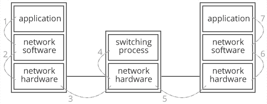

**Figure PI-1** *The Data Plane Problem Space*

从插图的左上角开始：

1. 应用程序生成一些数据。这些数据必须以允许接收应用程序理解已传输内容的格式进行格式化——数据必须被编组。用于编组数据的机制必须在许多方面高效，包括编码快速且易于编码，解码快速且易于解码，足够灵活以允许在不破坏太多东西的情况下更改编码，并且在数据传输期间添加尽可能少的开销。

2. 网络软件需要封装数据，并使其准备好实际传输。网络软件 somehow 需要知道目标主机的地址。连接源和目标的网络是一个*共享资源*，因此必须提供某种形式的复用，以便源可以将信息定向到正确的目标。通常这将涉及某种形式的寻址。

3. 数据必须从源的内存中移出并进入网络本身——实际的线路（或光缆、或无线链路），该线路将信息在网络连接设备之间传输。

4. 网络设备必须有某种方式来发现信息的最终目的地——复用问题的第二种形式——并确定在信息在源和目的地之间传输时是否需要对其进行任何其他处理。

5. 信息在通过网络设备后，必须再次被编码并从内存中移出到线路上。在信息从内存移动到某种物理介质的每个点，信息都需要排队；通常在任何给定时间需要传输的数据多于可以放置在任何特定物理介质上的数据。这就是服务质量发挥作用的地方。

6. 信息在通过网络传输时，现在必须从物理介质复制出来并返回到内存中。它必须进行错误检查——这是错误控制——并且接收方必须有某种方式告诉发送方它正在用完存储传入信息的内存——这是流量控制。


The network device in the middle of the diagram is of particular interest. A network device—such as a router, switch, or middle box—connects two physical media together to build an actual network. Perhaps the simplest question to begin with is this: why are these devices required in the first place? Routers and switches are obviously complex devices, with their own internal architecture (which will be covered in this chapter at a high level); why add this complexity to a network? There are two fundamental reasons.

The original reason for building these devices was to connect different kinds of physical media together. For instance, within a building it might be practical to run ARCnet or thicknet Ethernet (to use examples from the time when network devices were first invented). The distance these media can traverse, however, is very short— on the order of hundreds of meters. Somehow these networks must be extended between buildings, between campuses, between cities, and eventually between continents, using some sort of multiplexed (or inverse multiplexed) telephone circuit like a T1 or DS3. These two different media types use different kinds of signaling; there must be some sort of device that translates one kind of signaling into another.

The second reason is this: scale quickly became an issue. The nature of the physical world is such that you have two choices when it comes to putting data on a wire:
• The wire can connect precisely two computers; in this case, every pair of computers needs to be physically connected to every other computer it needs to communicate with.
• The wire can be shared among many computers (the wire can be a shared media).

To solve the problem the first way, you need a lot of wire. Solving the problem the second way seems like the obvious solution, but it presents another set of problems—specifically, how is the bandwidth available on the wire shared among all the devices? At some point, if there are enough devices on a single shared media, any sort of scheme used to enable resource sharing will, itself, consume as much or more bandwidth as any individual device connected to the wire. At some point, even a 100G link, shared among enough hosts, will leave each individual host with very little available resources.

The solution to this situation is the network device—the router or switch—that separates two shared media, only passing traffic between the two as needed. With some logical planning, devices that need to talk to each other more often can be placed closer together (in terms of network topology), conserving bandwidth in other places. Routing and switching has moved far beyond these humble beginnings, of course, but these are the root problems engineers solved by injecting network devices into networks.

There are other difficult problems to solve in this space beyond the bare carrying of information from a source to a destination; many times it is useful to be able to virtualize the network, which generally means creating a tunnel between two devices in the network.

The series of chapters in Part I consider the sometimes incredibly difficult problems in simply carrying data from one end of a network to the other, along with a range of possible solutions for each of these problems. Along the way, various chapters also explore the concept of layering in data transport protocols, and its importance to breaking this complex domain into more solvable chunks. Layering, however, brings its own set of problems into the transport world, so Part I also needs to consider how to resolve the problems caused by the introduction of layering—specifically, interlayer discovery.

The chapters in this part include:
• **Chapter 1: Fundamental Concepts**, which discusses business drivers, circuit switching, packet switching, and network complexity
• **Chapter 2: Data Transport Problems and Solutions**, which discusses marshaling data, dictionaries, grammars, metadata, error detection, error correction, addressing, multiplexing, multicast, anycast, and flow control
• **Chapter 3: Modeling Network Transport**, which discusses the value of modeling, the Department of Defense (DoD) model, the Open Systems Interconnect (OSI) model, the Recursive Internet Architecture (RINA) model, connection-oriented and connectionless transport mechanisms
• **Chapter 4: Lower Layer Transports**, which discusses Ethernet and 802.11 Wireless
• **Chapter 5: Higher Layer Data Transports**, which discusses the Internet Protocol (IP), the Transmission Control Protocol (TCP), QUIC, and the Internet Control Message Protocol (ICMP)
• **Chapter 6: Interlayer Discovery**, which discusses mapping identifiers and services between layers, the Domain Name System (DNS), the Address Resolution Protocol (ARP), Neighbor Discovery (ND), Stateless Address Autoconfiguration (SLAAC), and the concept of the default gateway
• **Chapter 7: Packet Switching**, which discusses the process of copying a packet off of the physical media, processing the packet, moving a packet through the network device, and finally copying a packet onto the physical medium
• **Chapter 8: Quality of Service**, which discusses why Quality of Service (QoS) is needed, traffic classification, Class of Service, Type of Service, QoS trust boundaries, jitter, and fairness in queueing
• **Chapter 9: Network Virtualization**, which discusses use cases for network virtualization, tunneling, switching tunneled packets, the problems network virtualization must solve, Segment Routing (SR), Software-Defined Wide Area Networks (SD-WAN), virtualization tradeoffs, and shared fate
• **Chapter 10: Transport Security**, which discusses data exhaust, asymmetric and symmetric encryption, key exchange, hiding user information, man-in-the-middle (MitM) attacks, and Transport Level Security (TLS)

### Chapter 1
#### Fundamental Concepts

##### Learning Objectives

After reading this chapter, you should be able to:

Understand the relationship between business drivers and network engineering

Understand the difference between circuit and packet switching

Understand the advantages and disadvantages of circuit and packet switching

Understand the basic concept of network complexity and complexity tradeoffs

Networks were always designed to do one thing: carry information from one attached system to another. The discussion (or perhaps argument) over the best way to do this seemingly simple task has been long-lived, sometimes accompanied by more heat than light, and often intertwined with people and opinions of a rather absolute kind. This history can be roughly broken into multiple, and often overlapping, stages, each of which asked a different question:
• Should networks be circuit switched or packet switched?
• Should packet switched networks use fixed- or variable-sized frames?
• What is the best way to calculate a set of shortest paths through a network?
• How should packet switched networks interact with Quality of Service (QoS)?
• Should the control plane be centralized or decentralized?

Some of these questions have been long since answered, most often by blending the more extreme elements of each position into a sometimes messy, but generally always useful, solution. Some of these questions are, on the other hand, still active, particularly the last one. Perhaps, in twenty years’ time, readers will be able to look on this last question as being answered, as well.


本章将从网络工程领域内的这些历史运动或阶段的框架出发，描述本书中使用的基本术语和概念。到本章结束时，你将准备好攻克本书的前两部分——转发平面和控制平面。第三部分，即网络设计的概述，建立在前两部分的基础上。本书的最后一部分则展望了几种可能塑造未来的特定技术和运动——不仅是网络工程的未来，甚至是整体信息生产和处理的未来。

##### 艺术还是工程？

必须首先提出的一个问题是，网络工程是艺术，还是真正的工程。许多工程领域最初更像是一种艺术。例如，在 1970 年代初期，围绕电子管、“线圈”和变压器从事电子工作在很大程度上被认为是一种艺术。到 1980 年代中期，电子产品变得无处不在，这引发了一场比任何标准化都更严酷的商品化过程。当时的电子产品被认为更偏向工程而非艺术。到 2010 年代，电子产品已成为“构成计算机的东西”。在电子产品的设计和故障排除中仍有一些艺术成分，但总体而言，其制造更侧重于工程原理。问题已从“如何做到这一点”转移到“如何以最便宜的方式做到这一点”，或“如何以最小的方式做到这一点”，或在早期会被认为属于次要问题的其他问题。也许可以用比例来表述电子产品的发展。也许——这些是非常粗略的估计——电子产品最初大约是 80% 的艺术和 20% 的工程，现在已转变为 80% 的工程和 20% 的艺术。

网络工程呢？它是否会经历相同的阶段，最终进入 80% 工程、20% 艺术的范围？由于几个原因，这似乎值得怀疑。网络工程工作在一个很大程度上是虚拟的空间中；尽管有线缆和设备，但协议、数据和功能都建立在物理基础设施之上，而不是`是`物理基础设施本身。与电子产品不同，你可以指着一个物理对象说“这就是产品”，网络并不是一个物理事物。换句话说，网络是一个概念性的“事物”，它使用通过协议和数据模型连接在一起的各种独立组件构建而成。这意味着设计选择几乎无限地可变和可塑。每个问题都可以比在电子产品中更具体地进行处理、评估和设计。只要有新的问题需要解决，就会开发出新的解决方案，并在网络中部署——最终——被移除。也许一个有用的比较是在应用程序和各种计算设备之间；无论计算设备变得多么标准化，仍有几乎无限数量的软件应用程序可以在其上运行。

Figure 1-1 将有助于从一个角度说明网络与业务之间的这种“契合”。

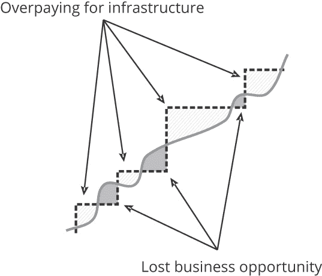

**Figure 1-1** *Business to Technology Fit, First Perspective*

在 Figure 1-1 中，实心的灰色曲线是 `business growth`。垂直和水平运行的虚线黑色线是 `network capacity`。网络过度配置、导致企业为未使用的容量付费维护的时段很多；这些显示在灰色线阴影区域。还有其他时候网络承受压力。在这些深灰色实心阴影区域，企业本可以更快增长，但网络却在拖后腿。网络架构和设计（这更多是架构问题而非严格的设计问题；参见 `The Art of Network Architecture`）的众多目标之一就是使这些线条更接近。完成这部分工作需要创造力和前瞻性问题解决技能。工程师必须提出诸如“网络如何构建才能随业务需求而更大更小地扩展？”这样的问题。这不仅仅是规模和大小的问题；然而，业务的性质甚至可能随时间而变化，推动应用程序、运营程序和运营节奏的变化。网络必须具有能够按需改变的架构，而不会引入 `ossification`，即系统和流程的硬化，最终会导致网络以灾难性的方式失败。网络工作中这一部分通常被认为更偏向 `art` 而非 `engineering`，并且在整个商业世界以某种方式发生变化之前，它不太可能改变。

Figure 1-2 说明了企业以另一种方式推动网络工程成为艺术。

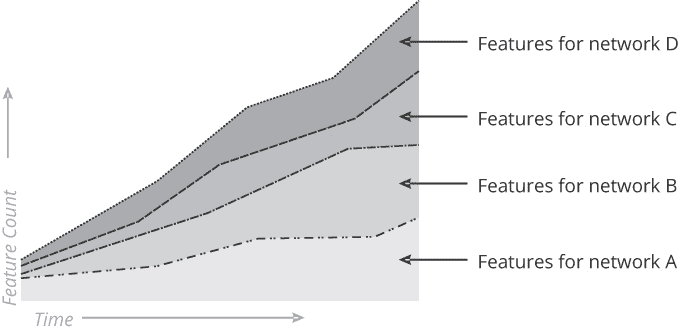

**Figure 1-2** *Features versus Usage in Networking Products*

在 Figure 1-2 中，时间从左到右运行，功能数量从下到上运行。图表表达的是产品随时间增加的功能。网络运营商 A 最初只需要一个相当小的功能集，但所需的功能集会随时间增加；其他三个网络也将如此。运行这些网络所需的任何功能集总会在某种程度上重叠，`并且它们也总会在某种程度上不同`。如果供应商想要销售单一产品（或产品线）并满足全部四个网络的需求，它将需要实现每个网络所需的所有独特功能。整个功能集由图表右侧的峰值表示。对于每个网络，任何产品中可用功能中的某个百分比将是不必要的——也称为 `code bloat`。

即使这些功能未被使用，每一个仍将代表安全漏洞、必须测试的代码、与`正在`使用的功能交互的代码等。换句话说，`这些未使用的功能中的每一个实际上都是网络运营商的负债`。理想的解决方案可能是为每个网络定制构建设备，仅包含所需的功能——但这通常不是供应商或网络运营商可用的选择。相反，网络工程师必须在所需功能和可用功能之间取得某种平衡——而这一过程绝对更像是一种 `art` 而非 `engineering`。

只要网络可以构建的方式与企业使用网络的方式之间存在不匹配，网络中 `art` 与 `engineering` 之间的相互作用就将始终存在。每种成分的百分比当然会根据网络、工具以及网络工程领域的时间而变化，但 `art` 成分在网络领域中可能总是比在电子工程等领域中更强地体现出来。

**Note**

有些人可能会反对本节中使用 `art` 这个词。很容易用 `craft` 替换 `art`，如果这样能使本节的概念更容易理解的话。

##### 电路交换


计算机网络世界中的第一次大型讨论是网络应该是电路交换还是分组交换。这两者之间的基本区别在于电路的概念——发送方和接收方是否将网络“视为”在开始通信前就已预先配置（或设置）好特定属性的单根电线或连接？还是它们将网络“视为”共享资源，信息只是“随心所欲”地生成和传输？前者被认为是电路交换，而后者被认为是分组交换。电路交换倾向于提供更多的流量和交付保证，而分组交换倾向于以更低的成本传输数据——这是你在网络工程中将遇到的众多权衡中的第一个。`Figure 1-3` 将用于说明电路交换，以时分复用（`TDM`）为例。

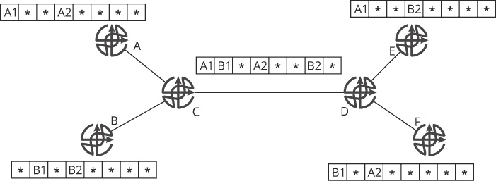

**Figure 1-3** *Time Division Multiplexing Based Circuit Switching*

在 `Figure 1-3` 中，任意两个设备之间链路的总带宽被分成八个相等部分；A 使用时隙 A1 向 E 发送数据，使用时隙 A2 向 F 发送数据；B 使用时隙 B1 向 E 发送数据，使用时隙 B2 向 F 发送数据。每条信息长度固定，因此每条信息都可以放入持续数据流中的单个时隙（因此，每个数据块代表在电线上固定的时间量，或时隙）。假设在某个地方有一个控制器为流量将经过的每个段分配一个时隙：

• **对于 `[A,E]` 流量：**
• **在 C：** A 的时隙 1 被切换到朝向 D 的时隙 1
• **在 D：** C 的时隙 1 被切换到朝向 E 的时隙 1

• **对于 `[A,F]` 流量：**
• **在 C：** A 的时隙 4 被切换到朝向 D 的时隙 4
• **在 D：** C 的时隙 4 被切换到朝向 F 的时隙 3

• **对于 `[B,E]` 流量：**
• **在 C：** B 的时隙 4 被切换到朝向 D 的时隙 7
• **在 D：** C 的时隙 7 被切换到朝向 E 的时隙 4

• **对于 `[B,F]` 流量：**
• **在 C：** B 的时隙 2 被切换到朝向 D 的时隙 2
• **在 D：** C 的时隙 2 被切换到朝向 F 的时隙 1

网络中没有任何分组处理设备需要知道哪一位数据要去哪里；只要 C 在每个时间帧内将 A 数据流中时隙 1 中的内容复制到其朝向 D 的输出流的时隙 1 中，并且 D 将其从 C 传入的时隙 1 复制到其朝向 E 的输出的时隙 1 中，A 传输的流量就会被送达 E。关于这种流量处理，有一个有趣的点需要注意——为了转发流量，网络中的设备实际上不需要知道源或目的地是什么。网络中传输的数据块不需要包含源或目的地址；它们要去哪里、来自哪里，这些决策完全基于控制器对每条链路中空闲时隙的了解。分配给任何特定设备到设备通信的时隙集合称为电路，因为它是为该一对设备之间的通信承诺的带宽和网络资源。

电路交换网络的主要优点包括：

• 设备不需要读取报头，也不需要进行任何复杂处理即可交换分组。在网络早期，这极其重要，当时硬件的晶体管和门数远低于现在，线路速度较低，设备处理分组的时间占网络中分组总延迟的很大一部分。
• 控制器知道网络中各处朝向边缘设备的可用带宽和流量。这使得在实际上有足够带宽可用的情况下，工程化流量以创建网络中可能的最优路径变得相对简单。

也存在缺点，包括：

• 随着网络及其提供的服务规模扩大，控制器的复杂性会显著增加。控制器的负载实际上可能变得难以承受，导致网络中断。
• 每条链路上的带宽未得到最优利用。在 `Figure 1-3` 中，包含 *\** 的时间块（或 *cells*）本质上是浪费的带宽。时隙是预先分配给特定电路的：用于 `[A,E]` 流量的时隙即使 A 没有向 E 传输内容，也不能被“借用”用于 `[A,F]` 流量。
• 对拓扑变化的反应所需时间在网络术语中可能相当长；本地设备必须发现变化，向控制器报告，控制器必须重新配置每条受影响流量路径上的每个网络设备。

TDM 系统为当今使用的网络开发贡献了许多想法。特别是，TDM 系统塑造了有关将数据分解为分组以通过网络传输的早期讨论的大部分内容，并为后来的 QoS 和流量控制工作奠定了基础。这些早期 TDM 系统留给更广泛网络世界的一个相当重要的想法是 *network planes*。

**Note**

服务质量在本书本章后面的一个部分中简要讨论，然后在 `Chapter 8` 的 “Quality of Service” 中更深入地讨论，后者在本书记载。

具体来说，TDM 系统分为三个平面：

• `control plane` 是构建网络设备转发流量所需信息的协议和过程的集合。在电路交换网络中，控制平面完全是一个独立的平面；控制器与各个设备之间通常有一个独立的网络（尽管并非总是如此，尤其是在较新的电路交换系统中）。
• `data plane`（也称为 *forwarding* 平面）是信息在网络中的路径。这包括将电线中接收到的信号解码为帧，对其进行处理，并根据物理传输系统对其进行编码后重新推回电线。
• `management plane` 专注于管理网络设备，包括监控可用内存、监控队列深度，以及监控设备丢弃网络中传输的信息的时间等。网络中很难区分管理平面和控制平面。例如，如果设备被手动配置为以特定方式转发流量，这是管理平面功能（因为设备正在被配置）还是控制平面功能（因为这是关于如何转发信息的信息）？

**Note**

这个问题没有确定的答案。然而，在整本书中，任何影响网络中流量转发方式的东西都被认为是控制平面的一部分，而任何影响设备物理或逻辑状态的东西，例如接口状态，则被认为是管理平面的一部分。不要期望这些定义在现实世界中成立。

**Note**

Frame Relay、SONET、ISDN 和 X.25 是电路交换技术的示例，其中一些在撰写本文时仍在使用。有关这些技术的学习建议来源，请参阅“进一步阅读”部分。

#### Packet Switching


在 20 世纪 60 年代初到中期，分组交换“已在空气中”。很多人重新思考了网络迄今为止的构建方式，并考虑电路交换范式的替代方案。兰德公司工作的保罗·巴兰提出分组交换网络作为生存能力的解决方案；几乎同一时间，英国的唐纳德·戴维斯提出了同类型的系统。这些想法传到了劳伦斯·利弗莫尔实验室，导致第一个分组交换网络（称为 `Octopus`）于 1968 年投入运行。`ARPANET`，一个实验性的分组交换网络，不久后于 1970 年开始运行。

##### 分组交换操作

**注意**

有关交换分组的实际过程的更详细讨论，请参阅 第 7 章，“分组交换。”

电路交换与分组交换之间的本质区别是个体网络设备在流量转发中所扮演的角色，如 图 1-4 所示。

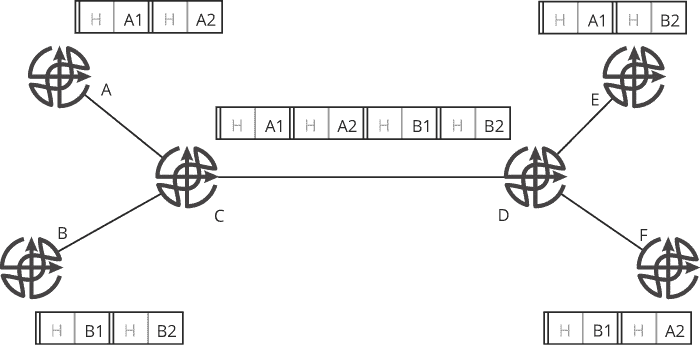

**图 1-4** *分组交换网络*

在 图 1-4 中，`A` 产生两个数据块。每个数据块都包含一个头部，至少描述目的地（由每个数据块中的 `H` 表示）。这种完整的信息捆绑——原始数据块和头部——称为分组。头部还可以描述分组内部的内容，并包含转发设备在处理分组时应采取的任何特殊处理指令——这些有时称为 `metadata`，或“关于分组中数据的‘数据’”。

`A` 产生了两个分组：`A1`，目的地为 `E`；以及 `A2`，目的地为 `F`。`B` 也发送了两个分组：`B1`，目的地为 `F`，以及 `B2`，目的地为 `E`。当 `C` 接收到这些分组时，它读取分组头部的一小部分，通常称为字段，以确定目的地。`C` 然后查阅本地表以确定分组应通过哪个出站接口传输。`D` 也同样操作，将分组通过正确的接口转发向目的地。

这种转发流量方式称为 `hop-by-hop forwarding`，因为网络中的每个设备都会对每个单独分组的转发位置做出完全独立的决策。每个设备查阅的本地表称为 `forwarding table`；这通常不是一张表，而是许多表，可能包括路由信息库（`RIB`）和转发信息库（`FIB`）。

**注意**

这些表、它们的构建方式以及使用方式在 第 7 章，“分组交换”中得到了更充分的解释。

在原始的电路交换系统中，控制平面与通过网络的分组转发完全分离。随着从电路到分组交换的转变，对应地从集中式控制器决策转变为在网络本身上运行的分布式协议。对于后者，每个节点都能够在本地做出自己的转发决策。网络中的每个设备运行分布式协议以获取构建这些本地表所需的信息。这种模型称为分布式控制平面；因此控制平面的概念只是从一个模型转移到另一个模型，尽管它们实际上并不意味着同一件事。

**注意**

分组交换网络可以使用集中式控制平面，电路交换网络可以使用分布式控制平面。然而，在分组交换网络首次设计和部署时，它们通常使用分布式控制平面。软件定义网络（`SDNs`）将集中式控制平面的概念带回了分组交换网络的世界。

分组交换网络相对于电路交换网络的第一个优势是 `hop-by-hop forwarding` 范式。由于每个设备都可以做出完全独立的转发决策，分组可以动态地绕过网络拓扑的变化转发，消除了与控制器通信并等待决策的需要。只要源和目的地之间至少有两条路径（网络是双连通的），源交给网络的分组最终将被网络交给目的地。

分组交换网络相对于电路交换网络的第二个优势是分组交换网络使用带宽的方式。在电路交换网络中，如果特定电路（实际上是 TDM 示例中给出的时隙）未被使用，则该时隙就被浪费了。在 `hop-by-hop forwarding` 中，每个设备都可以最好地利用每个出站链路上的可用带宽来承载必要的流量负载。虽然这在 `locally` 上更复杂，但在 `globally` 上更简单，并且能更好地利用网络资源。

分组交换网络的主要缺点是所需的额外复杂性，特别是在转发过程中。每个设备必须能够读取分组头部，在表中查找目的地，然后根据表查找结果转发信息。在早期的硬件中，这些都是困难且耗时的任务；电路交换通常比分组交换更快。随着硬件随时间的改进，交换可变长度分组的速度通常与交换固定长度分组的速度足够接近，分组交换与电路交换之间的差异很小。

##### 分组交换网络中的流量控制

在电路交换网络中，控制器通过为源到目的地的每个电路分配时隙来为每个电路分配特定数量的带宽。如果发送方想要发送的流量超过分配的时隙所能支持的数量会怎样？答案很简单——`it cannot`。从某种意义上说，控制分组通过网络的流动的能力已内置于电路交换网络中；发送方无法发送超过网络能够转发的流量，因为发送方用于信息发送的“空间”是预先分配的。

分组交换网络呢？如果 图 1-4 中显示的所有链路具有相同的链路速度，如果 `A` 和 `B` 都想使用整个链路容量向 `C` 发送会怎样？`C` 将如何决定如何通过一条比它需要处理的流量小一半的链路将其全部发送给 `D`？这就是流量流控制技术可以派上用场的地方。通常，它们被实现为“搭载”在底层网络之上的单独协议/规则集，有助于通过在两个通信设备之间建立虚拟电路来“组织”分组传输。

**注意**

流量和错误控制在 第 2 章，“数据传输问题与解决方案”中进行了详细讨论。

传输控制协议（`TCP`）为基于互联网协议（`IP`）的分组交换网络提供流量控制。该协议由 Vint Cerf 和 Bob Kahn 于 1973 年首次指定。

###### 协议之战

在分组交换网络的发展中，开发了许多不同的协议（或协议栈）。随着时间的推移，所有这些协议都已被放弃，取而代之的是 `IP` 协议套件。例如，Banyan Vines 有自己的基于 `IP` 的协议套件，称为 Vines Internet Protocol（`VIP`），而 Novell Netware 有自己的基于 `IPX` 协议的协议套件。其他标准机构也创建了标准协议套件，例如国际电信联盟（`ITU`）围绕无连接模式网络服务（`CLNS`）构建的协议套件。


为什么所有这些协议套件都逐渐被淘汰了呢？其中一些是专有的，而许多政府和大型组织出于各种原因拒绝了分组交换网络的专有解决方案。专有解决方案通常也考虑得不够周全，因为它们通常由一小群人开发和维护。基于标准的协议可能更复杂，但它们往往由更大的一群经验丰富的工程师开发和维护。基于 `CLNS` 的协议套件曾一度是强有力的竞争者，但它从未真正流行起来，而全球互联网当时正成为一股重要的经济力量。这其中有一些具体的技术原因——例如，`CLNS` 编号的是 *wires*，而不是主机。因此，可达性信息的聚合（本书后面会更详细地介绍这些概念）在许多方面都受到限制。

关于 `CLNS` 与 `IP` 协议套件之间讨论的一个有趣参考是 *The Elements of Networking Style*。^(1)

###### 固定长度与可变长度帧

在 20 世纪 80 年代后期，一个新的讨论话题席卷了网络工程界——异步传输模式 (`ATM`)。对更高速度电路的不断需求，加上基于目的地址单独交换分组进展缓慢，导致人们推动一种新的传输形式，这种形式最终将重新配置整个（或堆栈，因为每个协议都形成一个位于下方协议之上的层，就像“堆叠的蛋糕”）现代网络中使用的协议集合。`ATM` 将电路交换的固定长度单元（或分组）大小与分组交换的报头（尽管大大简化了）结合起来，产生了一种“介于两者之间”的技术解决方案。`ATM` 有两个关键点：标签交换和固定呼叫大小；Figure 1-5 说明了前者。

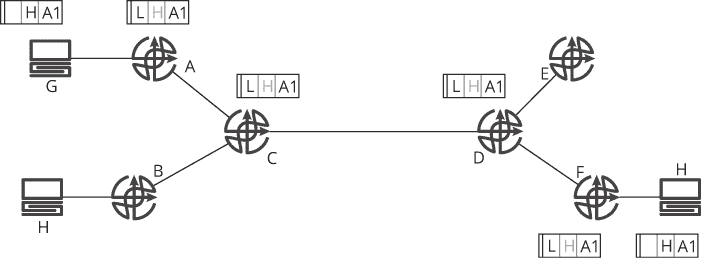

**Figure 1-5** *Label Switching*

在 Figure 1-5 中，`G` 发送一个发往 `H` 的分组。`A` 收到该分组后，检查本地表，发现通往 `H` 的下一跳是 `C`。`A` 的本地表还指定了一个标签，显示为 `L`，而不是“仅仅”关于如何转发分组的信息。`A` 将该标签插入到分组头部的一个专用字段中，然后转发给 `C`。当 `C` 收到分组时，它不需要读取报头中的目的地址；相反，它只需读取标签，这是一个短的、固定长度的字段。标签在本地表中查找，告诉 `C` 将发往目的 `H` 的流量转发给 `D`。标签非常小，因此转发设备处理起来很容易，从而使交换速度更快。

标签在某种意义上也可以“包含”分组的处理信息。例如，如果 `G` 和 `H` 之间实际上有两条流量流，每条流都可以通过网络分配不同的标签（或一组标签）。携带一个标签的分组可以优先于携带另一个标签的分组，因此网络设备无需查看报头中的任何字段即可确定如何处理特定分组。

这可以看作是分组交换和电路交换之间的折中。虽然每个分组仍逐跳转发，但虚拟电路也可以通过网络中的标签路径定义。第二个要点是 `ATM` 还基于固定大小的单元：每个分组最多限制为 53 个八位字节的信息。固定大小的单元似乎是小事一桩，但固定大小的分组会带来巨大的性能差异。Figure 1-6 说明了固定单元大小涉及的一些因素。

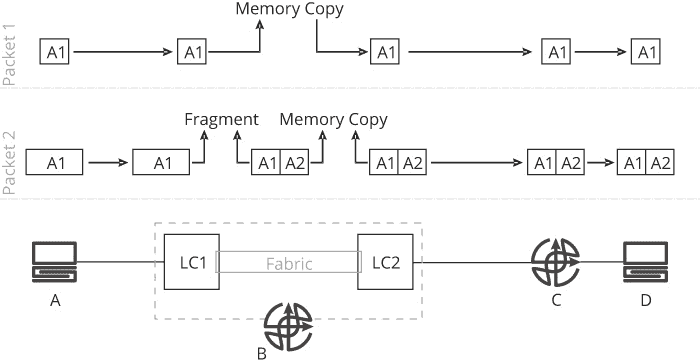

**Figure 1-6** *Fixed Cell Sizes*

在 Figure 1-6 中，分组 1 (`A1`) 从网络复制到线路卡或接口的内存中，*LC1;* 然后它在 `B` 内部的内部结构中传输（在内存位置之间），到达 *LC2*，最终放置回 `B` 的出站接口。从这样的图表来看似乎微不足道，但设备交换/处理分组的速度最重要的因素可能是将分组复制到内存位置之间任何内部路径所需的时间。将信息从内存中的一个位置复制到另一个位置的过程是设备可以执行的最慢操作之一，尤其是在旧处理器上。使每个分组相同（固定单元大小）允许围绕复制过程进行代码优化，从而极大地提高交换速度。

**Note**

在内部结构上交换分组的过程在 Chapter 7，“Packet Switching” 中进行了讨论。

从性能角度来看，分组 2 通过 `B` 的路径更糟；它首先被复制到本地内存中。从本地转发表中查找目的端口时，处理分组的代码意识到分组必须被分片以适应 [B,C] 链路出站允许的最大分组大小。入站线路卡，*LC1*，将分组分片为 *A1* 和 *A2*，创建第二个报头并根据需要调整报头中的任何值。分组被分成两个分组，`A1` 和 `A2`。这两个分组通过结构复制到出站线路卡，*LC2*，需要两次操作。通过使用固定大小的单元，`ATM` 避免了几乎所有其他分组交换系统在 `ATM` 被提出时都会产生的分片分组的性能成本。

事实上，`ATM` 并没有从网络核心开始，然后向网络边缘推进。为什么不呢？第一个答案在于单元大小的奇怪选择。为什么是 53 个八位字节？答案很简单——也许有点惊人。`ATM` 应该不仅取代分组交换网络，还应取代当时基于电路交换技术的语音网络。在统一这两种技术后，服务提供商可以在同一组电路和设备上提供这两种服务。

携带语音流量理想的信息量或分组大小是多少？大约 48 个八位字节。数据传输有意义的最小信息量或分组大小是多少？大约 64 个八位字节。53 个八位字节是这两个大小之间的折中；它对语音传输并不完美，因为每个携带语音的单元中有 5 个八位字节会被浪费。它对数据流量也不完美，因为最常见的分组大小 64 个八位字节需要在 `ATM` 网络上传输时拆分为两个单元。当时进行这些讨论时，一个常见的想法是数据传输协议能够适应稍小的单元大小，从而使 53 个八位字节成为支持各种流量的最佳大小。然而，数据传输协议并没有调整。为了传输 64 个八位字节的数据块，一个单元将包含 53 个八位字节，第二个单元将包含 9 个八位字节，并有 42 个八位字节的空闲空间。服务提供商发现 `ATM` 链路上 50% 或更多的可用带宽被空单元消耗——实际上是浪费的带宽。因此，数据提供商停止部署 `ATM`，语音提供商从未真正开始部署它，而 `ATM` 就此消亡。


有趣的是，像 ATM 这样的项目的遗产是如何在其他协议和思想中延续下来的。标签交换的概念被 Yakov Rekhter 和其他工程师采纳，并发展成了 `label switching`。这保留了 ATM 在转发路径中快速查找的许多基本优势，并将有关数据包处理的元数据捆绑到标签本身中。标签交换最终演变为多协议标签交换（MPLS），它不仅提供更快的查找，还提供标签堆栈和虚拟化。因此，基本思想被采纳并扩展，在很大程度上影响了现代网络协议和设计。

**注意**

MPLS 在 第 9 章 中讨论，“网络虚拟化。”

ATM 的第二个遗产是固定的单元大小。多年以来，以 TCP 和 IP 为基础的主导网络传输套件，允许网络设备在转发时对数据包进行分片。然而，这是一种众所周知会降低网络性能的方法。IP 头中添加了一个 *do not fragment* 位，告诉网络设备丢弃数据包而不是对其进行分片，并投入了大量精力来发现网络中任意一对设备之间可以传输的最大数据包。一种更新的 IP，称为 IPv6，从协议规范中移除了由网络设备进行的分片。

###### 计算无环路径

在网络工程界重叠了许多这些之前的讨论的，还有另一个问题，这使得决定数据包交换还是电路交换是更好的解决方案变得更加困难。在数据包交换网络中应如何计算无环路径？

由于数据包交换网络在网络工程的历史上一直与分布式控制平面相关联，而电路交换网络与集中式控制平面相关联，计算无环路径的效率问题对数据包交换网络是否可行产生了重大影响。

**注意**

无环路径在 第二部分 中讨论，“控制平面。”

在网络工程的早期，可用的处理能力、内存和带宽往往供不应求。表 1-1 提供了一些历史背景。

**表 1-1** *计算能力、内存和带宽的历史*

| **年份** || **MIPS** || **内存（成本/MB）** || **带宽（LAN）** |
| --- | --- | --- | --- |
| 1984 || 3.2 (Motorola 68010) || 1331 || 2Mb/s |
| 1987 || 6.6 (Motorola 68020) || 154 || 10Mb/s |
| 1990 || 44 (Motorola 68040) || 98 || 16Mb/s |
| 1996 || 541 (Intel Pentium Pro) || 8 || 100Mb/s |
| 1999 || 2,054 (Intel Pentium III) || 1 || 100Mbp/s |
| 2006 || 49,161 (Intel Core 2, 4 cores) || 0.1 || 4Gb/s |
| 2014 || 238,310 (Intel i7, 4 cores) || 0.001 || 100Gb/s |

在 1984 年，当许多这些讨论正在进行时，两种计算网络中无环路径的方法在处理器和内存用量上的任何差异都会对构建网络的成本产生实质性影响。当带宽是稀缺资源时，减少控制平面传输计算网络中一组无环路径所需信息所需比特数，会对网络能够处理的用户流量数量产生实际影响。减少控制操作所需的比特数也会在较低带宽下对网络的稳定性产生很大影响。

例如，使用类型长度值（TLV）格式来描述在网络上传输的控制平面信息，会在整体数据包长度上增加几个八位字节的信息——但在 2Mbps 链路的背景下，加剧了爱聊天的控制平面，成本可能远远超过协议可扩展性的长期优势。

**注意**

TLV 在 第 2 章 中讨论，“数据传输问题和解决方案。”

协议之争在某些时候相当激烈；整个研究项目被开展，并撰写了论文，论述为什么以及如何一种协议优于另一种协议。作为这些争论产生的来回交锋的一个例子，在开放最短路径优先（OSPF）协议正在开发期间在互联网工程任务组（IETF）上看到的一件衬衫上写着：*IS-IS = 0*。这里的“IS-IS”指的是 *中间系统到中间系统*，一种最初由国际标准化组织（ISO）开发的控制平面（路由协议）。

提出了各种各样的机制来解决计算网络中无环路径的问题；最终有三类通用解决方案被广泛部署和使用：

• **距离矢量** 协议，基于路径成本逐跳计算无环路径
• **链路状态** 协议，基于在网络设备间同步的数据库计算无环路径
• **路径矢量** 协议，基于先前跳的记录逐跳计算无环路径

关于哪种协议最适合特定网络，以及出于什么特定原因的讨论仍然持续；这可能是一个永无止境的对话，因为这个问题（可能）没有最终答案。相反，就像将网络适配到业务一样，在使特定控制平面在特定网络上工作时，可能总会涉及一定程度的艺术（或工艺）。然而，随着网络在处理能力、内存和带宽方面的不断提速，这一问题的紧迫性在很大程度上已被削弱。

#### 服务质量

随着实时流量开始在数据包交换网络上传输，QoS 成为一个主要问题。语音和视频都依赖于网络能够快速在主机之间承载流量（具有低延迟），并且数据包间隔的波动很小（抖动）。围绕 QoS 的讨论实际上始于数据包交换网络的早期，但在 ATM 被考虑时达到了高峰。事实上，ATM 的主要优势之一是能够紧密控制数据包在数据包交换网络上传输时的处理方式。随着 ATM 在市场上的失败，出现了两种不同的思路，关于需要对 *抖动* 和 *延迟* 进行强控制的应用：

• 这些应用永远无法在数据包交换网络上运行；这类应用始终需要在单独的网络上运行。
• 只需找到正确的一组 QoS 控制，就能让此类应用在数据包交换网络上运行。

**注意**

服务质量在 第 8 章 中详细讨论，“服务质量。”

提供商和工程师最关心的首要应用是语音，根本问题归结为：是否可以在同时承载大文件传输和其他“非实时”流量的网络上提供体面的语音？发明了复杂的方案来允许对数据包进行分类和标记（称为 QoS 标记），以便网络设备知道如何正确处理它们。开发了映射系统以将这些 QoS 标记从一种网络携带到另一种网络，并投入了大量时间和精力来研究排队机制——数据包在接口上发送的顺序。图 1-7 显示了一个 QoS 系统的示例图表，以及应用程序与 QoS 标记之间的映射，将足以说明这些系统的复杂性。

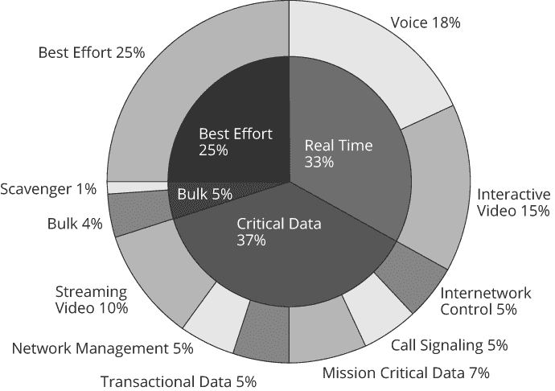

**图 1-7** *QoS 规划和映射*

之前在 表 1-1 中显示的链路速度的增加，对围绕 QoS 的讨论产生了两种影响：


• 更快的链路（显然）会承载更多数据。随着单个语音和视频流在整体带宽使用中所占比例越来越小，在不同应用之间强力平衡带宽使用的重要性变得降低。

• 将数据包从内存通过物理芯片传输到线路上所需的时间会随着带宽的每次提升而减少。

随着可用带宽的增加，用于抵消抖动的复杂排队策略的需求变得不那么重要。这种速度的提升得到了更新排队系统的增强，这些系统在管理不同类型的流量方面更加有效，减少了以精细方式标记和处理流量的必要性。

这些带宽的提升通常是通过从铜线改为玻璃光纤实现的。光纤不仅提供更大的带宽，而且数据传输也更可靠。物理链路的构建方式也在演进，使其更能抵抗断裂和其他材料问题。增加带宽可用性的第二个因素是互联网的增长。随着网络变得更普遍、更互联，单条链路故障对可用带宽和网络中流量流量的影响变得更小。

随着处理器变得更快，就有可能开发出丢包和延迟对实时流质量影响更小的系统。处理器速度的提升也使得可以使用非常有效的压缩算法，从而减小每个流的大小。在网络侧，更快的处理器意味着控制平面可以更快地计算出网络中无环路径集，减少链路和设备故障的直接和间接影响。

最终，尽管 QoS 仍然重要，但可以大大简化。四到六个队列通常足以支持即使是最困难的应用。如果需要更多，一些系统现在要么可以通过网络工程流量，要么主动管理队列，以在队列管理的复杂性和应用支持之间取得平衡。

###### 集中式控制平面的复仇

在 1990 年代，为了解决人们对分组交换网络的许多 perceived 问题，例如复杂的控制平面和 QoS 管理，研究人员开始研究一个名为 `Active Networking` 的概念。总体思路是，分组交换网络的控制平面可以，也应该，与转发设备分离，以便网络能够与运行在其上的应用进行交互。

在 IETF 形成转发与控制元素分离（`ForCES`）工作组时，更加明确地分离分组交换网络中的控制平面和数据平面的基本概念再次被考虑。该工作组主要关注于创建应用可用于在网络设备上安装转发信息的接口。该工作组最终于 2015 年关闭，其标准从未得到广泛实施。

在 2006 年，研究人员开始寻找一种在分组交换网络中试验控制平面的方法，而无需在设备本身上编写修改——这是一个特别的问题，因为大多数这些设备都是由厂商作为不可修改的设备（或黑盒）出售的。最终的结果是 `OpenFlow`，这是一种标准接口，允许应用直接在转发表中安装条目（而不是路由表；这在本书 Part I 的多个地方有更充分的解释，“The Data Plane”）。该研究项目被多个厂商作为功能采纳，并且由厂商和开源项目创建了大量控制器。许多工程师认为 `OpenFlow` 将通过集中控制平面来彻底改变网络工程。

现实很可能大不相同——很可能发生的事情是数据网络世界中一直发生的事情：集中式控制平面的更好部分将被吸收到现有系统中，而完全集中的模型将逐渐被淘汰，其留下的将是关于控制平面如何与应用和整个网络交互的改变观念。

###### 复杂性

迄今为止描述的技术——电路和分组交换、控制平面以及 QoS——非常复杂。事实上，网络中的复杂性似乎没有尽头，特别是在应用和业务变得越来越苛刻的情况下。本节将针对复杂性和网络的两个具体问题进行探讨：

• 什么是网络复杂性？
• 网络复杂性可以被“解决”吗？

本节的最后部分将考虑将复杂性视为一组权衡的一种看法。

####### 为什么如此复杂？

虽然最明显的地方可能始于复杂性的定义，但从更一般的意义上考虑为什么需要复杂性实际上更有用。更简洁地说，是否可能“解决”复杂性？为什么不只是设计更简单的网络和协议？为什么在网络世界中每一次试图使任何东西变简单的尝试最终似乎在长期内使事情变得更复杂？

例如，通过在 `IP` 之上（或通过 `IP`）进行隧道，控制平面的复杂性得以降低，网络整体变得更简单。那么为什么隧道化覆盖网络最终包含如此多的复杂性呢？

这个问题有两个答案。`First`，就人类本性而言，工程师总会发明十种不同的方式来解决同一个问题。在虚拟世界中尤其如此，在那里新解决方案（相对）易于部署，很容易（相对）找到上一组建议解决方案的问题，并且很容易（相对）移动一些位来创建一个“比旧的更好”的新解决方案。这在厂商角度尤其如此，因为构建新东西通常意味着能够销售全新的产品线和技术——即使这些技术看起来与旧的非常相似。换句话说，虚拟空间之所以如此混乱，部分原因在于在那里构建新东西如此容易。

然而，`second` 个答案在于一个更根本的问题：复杂性是处理难以解决的问题所涉及的不确定性所必需的。Figure 1-8 进行了说明。

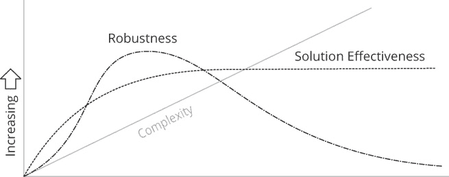

**Figure 1-8** *Complexity, Effectiveness, and Robustness*

增加复杂性似乎允许网络更容易地处理未来的需求和意外事件，以及在更小的基函数集上提供更多服务。如果是这种情况，为什么不只构建一个运行单一协议的单一网络，能够处理可能抛给它的所有需求并能处理你能想象的任何事件序列呢？运行单一协议的单一网络肯定会减少网络工程师需要处理的活动部件数量，让我们的生活更简单，对吧？事实上，有多种不同的方式来管理复杂性，例如：

1. 抽象掉复杂性，为系统的每个部分构建一个黑盒，以便每个部分以及这些部分之间的交互更易于理解。
2. 把复杂性扔过隔间墙——将问题从网络领域转移到应用领域、编码领域或协议领域。正如 `RFC1925` 所说，“将问题移动（例如，通过将问题转移到整体网络架构的不同部分）比解决它更容易。”
3. 在上面再加一层，将所有复杂性视为黑盒，通过在已有的东西之上再加一个协议或隧道。正如 `RFC1925` 所说，“总是可以增加另一个间接层。”


4\. 因复杂性而不知所措，将现有事物标记为 `legacy`，并追逐某个被认为能以更简单的方式解决所有问题的闪亮新事物。

5\. 忽视问题并希望它自行消失。为例证，争辩说 `just this once` 给予例外，以便在非常紧凑的时间表内实现某个业务目标，或修复某个问题，并承诺复杂性问题将在 `later` 处理，这就是一个很好的例子。

然而，每种解决方案都有其需要考虑和管理的权衡。此外，在某个时间点，任何复杂系统都会变得脆弱——*坚固却脆弱*。当系统能够对预期的一组情况做出弹性反应，但意外情况会导致其失败时，系统就是坚固却脆弱的。为了举一个现实世界的例子——刀刃需要具有某种独特的特性组合。它们必须足够坚硬以保持锋利并切割，同时又足够灵活以在受力时略微弯曲，使用后恢复原状且无损坏痕迹，并且在掉落时不会碎裂。经过多年的研究和经验才找到了制造刀刃的合适金属，并且关于哪种材料适合特定特性、在什么条件下等，仍有漫长而深入的技术讨论。

`Trying to make a network proof against predictable problems tends to make it fragile in dealing with unpredictable problems (through an ossification effect as you mentioned). Giving the same network the strongest possible ability to defend itself against unpredictable problems, it necessarily follows, means that it MUST NOT be too terribly robust against predictable problems. Not being too robust against predictable problems is necessary to avoid the ossification issue, but not necessarily sufficient to provide for a robust ability to handle unpredictable network problems.` —Tony Przygienda

复杂性是必要的，然后：它无法被 `solved`。

###### 定义复杂性

既然复杂性是必要的，工程师就需要以某种方式学会管理它，通过寻找或构建模型或框架。构建此类模型的最佳起点是提出最基本的问题：就网络而言，复杂性意味着什么？你能把一个网络放在秤上，让指针指向 `complex` 吗？是否存在一个数学模型，可以将一组网络设备的配置和拓扑结构代入其中，从而产生 `complexity index`？规模、弹性、脆弱性和优雅的概念与复杂性有何关系？构建模型的最佳起点是一个示例。

####### 控制平面状态与伸展

网络伸展是什么？用最简单的术语来说，它是网络中最短路径与两点之间流量实际所走路径之间的差异。Figure 1-9 阐释了这一概念。

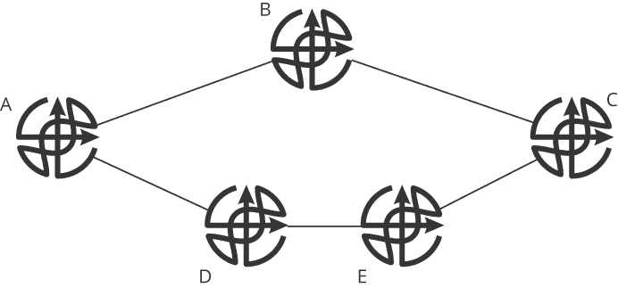

**Figure 1-9** *A Small Network to Illustrate State and Stretch*

假设该网络中每个链路的成本为 1，路由器 A 与 C 之间的最短物理路径也将是最短逻辑路径：`[A,B,C]`。然而，如果 `[A,B]` 链路的度量值改为 3 呢？最短物理路径仍然是 `[A,B,C]`，但最短逻辑路径现在是 `[A,D,E,C]`。最短物理路径与最短逻辑路径之间的差异就是在路由器 A 与 C 之间转发的数据包必须行进的距离——在本例中，伸展可计算为 (4 `[A,D,E,C]`)−(3 `[A,B,C]`)，伸展为 1。

####### 如何衡量伸展？

衡量伸展的方式取决于在任何给定情况下什么最重要，但最常见的方式是通过比较网络中的跳数，如本文示例中所用。在某些情况下，考虑两条路径的度量值、两条路径的延迟或其他度量值可能更为重要，但重要的是要对每条可能的路径保持一致地测量，以便在路径之间进行准确比较。

有时很难区分物理拓扑和逻辑拓扑。在本例中，`[A,B]` 链路的度量值是否增加是因为该链路实际上是较慢的链路？如果是，那么这是否是伸展的例子，还是仅仅是将逻辑拓扑与物理拓扑保持一致的例子，则存在争议。

与此观察一致的是，用伸展来定义策略比几乎任何其他方式都容易得多。策略是任何增加网络伸展的配置。例如，使用 `Policy-Based Routing` 或 `Traffic Engineering` 将流量从最短物理路径推向较长的逻辑路径以减少特定链路的拥塞，这就是一种策略——它增加了伸展。

增加伸展并不总是坏事。理解伸展的概念只是帮助我们理解其他各种概念，并在复杂性和优化权衡周围建立一个框架。物理上最短的路径并不总是最佳路径。

伸展在这一说明中非常简单——它影响每个目标，以及流经网络的每个数据包。在现实世界中，情况更为复杂。伸展实际上是按源/目的对计算的，这使得在网络范围内衡量它变得非常困难。

####### 定义复杂性：一个模型

三个组成部分——状态、优化和表面——在几乎每种网络或协议设计决策中都很常见。这些可以被视为一组权衡，如 Figure 1-10 所示，并在下面的列表中描述。

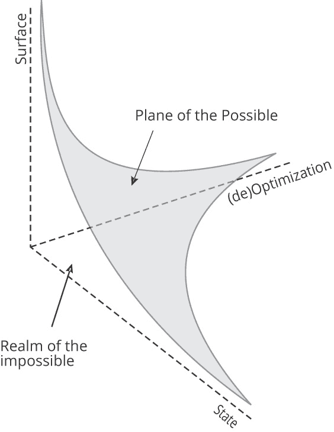

**Figure 1-10** *The Plane of the Possible*

• 增加优化总是会趋向于更多状态或更多交互表面。

• 减少状态总是会趋向于更少的优化或更多的交互表面。

• 减少交互表面总是会趋向于更少的优化或更多的状态。

当然，这些并不是铁律；它们取决于特定的网络、协议和需求，但它们足够普遍，以至于足以使这一模型成为理解复杂性权衡的有用模型。

####### 交互表面

虽然状态和优化相当直观，但值得再花一点时间来讨论交互表面。交互表面的概念难以把握，主要是因为它涵盖了如此广泛的想法。也许一个例子会有帮助；假设一个函数

• 接受两个数字作为输入

• 将它们相加

• 将所得总和乘以 100

• 返回结果

这个单一函数可以被视为某个更大系统中的子系统。现在假设你将这个单一函数拆分为两个函数，其中一个执行加法，另一个执行乘法。你创建了两个更简单的函数（每个函数只做一件事），但你也创建了这两个函数之间的交互表面——你在一个原本只有一个子系统的系统中创建了两个相互作用的子系统。

再举一个例子，假设你在单个网络上运行两个控制平面。这两个控制平面中的一个携带有关网络外部可达目的地的信息（外部路由），而另一个携带有关网络内部可达目的地的目的地（内部路由）。虽然这两个控制平面是不同的系统，但它们仍会在许多有趣且复杂的方式下相互作用。例如，对外部目的地的可达性必然取决于对网络边缘之间内部目的地的可达性。这两个控制平面现在必须协同工作，以构建一个完整的信息表，可用于在网络中转发数据包。


即使在同一个控制平面内通信的两个路由器也可以被视为一个交互面。这种定义的广度正是定义交互面如此困难的原因。

交互面并不是坏事；它们帮助工程师和设计师在任何给定的问题空间中分而治之，从建模到实现。同时，交互面也很容易在没有思考的情况下被引入。

###### 通过蜂腰管理复杂性

蜂腰，或沙漏模型，被自然界广泛使用，并在工程界被广泛模仿。虽然工程师并不经常有意识地应用这种模型，但它实际上一直在被使用。Figure 1-11 在催生了互联网协议（IP）套件的四层美国国防部（DoD）模型背景下说明了沙漏模型。


**Figure 1-11** *The DoD Model and the Wasp Waist*

在最底层的物理传输系统，有大量的协议，从以太网到卫星。在顶层，即信息被组织并呈现给应用的地方，有大量的协议，从超文本传输协议（HTTP）到 TELNET（以及数千种其他协议）。然而，当你向堆栈中间移动时，会发生一件有趣的事情：协议数量减少，形成了沙漏。为什么这能控制复杂性？回顾复杂性的三个组成部分——状态、表面和复杂性——揭示了沙漏与复杂性之间的关系。

• 状态被蜂腰划分为两种不同的状态类型：关于网络的信息和关于在网络上传输的数据的信息。虽然上层关注以可用方式组织和呈现信息，但下层关注发现存在哪些连接以及连接属性实际是什么。下层不需要知道如何格式化 FTP 帧，上层也不需要知道如何通过以太网承载数据包——模型两端的状态都减少了。

• 表面通过将各种组件之间的交互点数量减少到精确的一个——互联网协议（IP）——来控制。这个单一的交互点可以通过标准化流程得到良好定义，对单一交互点的更改受到严格监管，以防止会反映到协议栈上下方的巨大快速变化。

• 优化通过允许一层进入另一层，并将网络状态隐藏于应用之外而被权衡。例如，TCP 实际上并不真正知道网络的状态，除了它能从本地信息中收集到的。TCP 在使用网络资源方面可能更高效，但代价是层违规，这会打开难以控制的交互面。

因此，分层网络模型的分层是直接试图控制网络的各种交互组件的复杂性。

###### 复杂性与权衡

复杂性的一项非常基本法则可以这样表述：在任何复杂系统中，都存在三方权衡的集合。本文所述的状态/优化/表面（SOS）模型就是这样一组权衡中的一种。另一种更熟悉于主要从事数据库工作的工程师的是一致性/可访问性/分区（CAP 定理）。又一种，常在更广泛的上下文中发现的是快速/成本/质量（QSQ）。这些不是复杂性的组成部分，而是可以称为复杂性的*结果*。工程师需要善于发现这类权衡三角形，准确理解三角形的“角”，确定在*可能平面*上最优解所在的位置，并能够阐明为什么某些解决方案根本不可行或不理想。

*如果你还没有找到权衡，你就还没有足够仔细地寻找* 是在所有工程工作中应遵循的一个良好经验法则。

##### 最后的思考

本章无意提供细节，而是要在计算机网络技术历史的范围内框定关键术语。计算机网络世界没有悠久的历史（例如，人类历史至少可追溯 6,000 年，取决于你的观点，甚至可能数百万年），但这段历史仍然包含一系列反复曲折和坎坷的道路，这往往使普通人难以理解事物为何以这种方式工作以及如何工作。

有了这一介绍，现在是时候转向理解网络真正如何工作的第一个感兴趣主题——数据平面。

##### 进一步阅读

Brewer, Eric. “Towards Robust Distributed Systems.” Presented at the ACM Symposium on the Principles of Distributed Computing, July 19, 2000. [`www.cs.berkeley.edu/~brewer/cs262b-2004/PODC-keynote.pdf`](http://www.cs.berkeley.edu/~brewer/cs262b-2004/PODC-keynote.pdf).

Buckwalter, Jeff T. *Frame Relay: Technology and Practice*. 1st edition. Reading, MA: Addison-Wesley Professional, 1999.

Cerf, Vinton G., and Edward Cain. “The DoD Internet Architecture Model.” *Computer Networks 7* (1983): 307–18.

Gorrell, Mike. “Salt Lake County Data Breach Exposed Info of 14,200 People.” *The Salt Lake Tribune*. Accessed April 23, 2017. [`www.sltrib.com/home/3705923-155/data-breach-exposed-info-of-14200`](http://www.sltrib.com/home/3705923-155/data-breach-exposed-info-of-14200).

Ibe, Oliver C. *Converged Network Architectures: Delivering Voice over IP, ATM, and Frame Relay*. 1st edition. New York: Wiley, 2001.

Kumar, Balaji. *Broadband Communications: A Professional’s Guide to ATM, Frame Relay, SMDs, Sonet, and Bisbn*. New York: McGraw-Hill, 1995.

“LAN Emulation.” *Microsoft TechNet*. Accessed August 4, 2017. [`technet.microsoft.com/en-us/library/cc976969.aspx`](http://technet.microsoft.com/en-us/library/cc976969.aspx).

“LAN Emulation (LANE).” *Cisco*. Accessed August 4, 2017. [`www.cisco.com/c/en/us/tech/asynchronous-transfer-mode-atm/lan-emulation-lane/index.html`](http://www.cisco.com/c/en/us/tech/asynchronous-transfer-mode-atm/lan-emulation-lane/index.html).

Padlipsky, Michael A. *The Elements of Networking Style and Other Essays and Animadversions on the Art of Intercomputer Networking*. Prentice-Hall, 1985.

Russell, Andrew L. “OSI: The Internet That Wasn’t.” Professional Organization. *IEEE Spectrum*, September 27, 2016. [`spectrum.ieee.org/tech-history/cyberspace/osi-the-internet-that-wasnt`](http://spectrum.ieee.org/tech-history/cyberspace/osi-the-internet-that-wasnt)

“Understanding the CBR Service Category for ATM VCs.” *Cisco*. Accessed June 10, 2017. [`www.cisco.com/c/en/us/support/docs/asynchronous-transfer-mode-atm/atm-traffic-management/10422-cbr.html`](http://www.cisco.com/c/en/us/support/docs/asynchronous-transfer-mode-atm/atm-traffic-management/10422-cbr.html).

White, Russ, and Jeff Tantsura. *Navigating Network Complexity: Next-Generation Routing with SDN, Service Virtualization, and Service Chaining*. Indianapolis, IN: Addison-Wesley Professional, 2015.

##### Review Questions

1. 一个可以清楚看到不同业务假设的具体领域是在选择使用少量大型网络设备（例如支持多块线路卡的机箱式路由器）还是使用更多的小型设备（所谓的 *pizza box*，或 *one rack unit*，具有固定数量可用接口的路由器）来构建校园或数据中心网络。列出可能使其中一个选项比另一个更昂贵的一系列不同因素，然后解释什么样的业务条件可能会规定对*两种选项*使用其中一种而不是另一种。


2\. 软件应用程序中代码膨胀的一种“外部表现”是 `nerd knobs`；虽然 nerd knob 有很多定义，但它们通常被认为是一种配置命令，会修改协议或设备运行方式中的某个微小、特定的操作点。实际上，关于 nerd knobs 带来的危害有一些研究论文和在线讨论；你也可以在多年间的多个软件版本中查找各种网络设备的命令集。为了观察网络设备复杂性的增长，追踪可用命令的数量，并尝试判断其中有多少会被认为是 nerd knobs 而不是主要功能。你能从这些信息中得出什么结论？

3\. TDM 并不是唯一可用的复用方式；还有频分复用 `FDM`。`FDM` 是否可以用与 `TDM` 相同的方式来划分信道？为什么或为什么不？

4\. 什么是逆向复用器，它有什么用途？

5\. 阅读“进一步阅读”部分中关于 ATM LAN 仿真 `LANE` 的两个参考。描述该解决方案在复杂性模型中的复杂性；状态和交互表面是在哪里增加的，每次增加所获得的是何种优化？你认为 ATM `LANE` 解决方案在提供其设计所提供的服务方面，与共享以太网网络相比是否提供了良好的权衡？

6\. 用人类语言描述，为什么延迟和抖动在实时交互式语音和视频通信中是不好的。这些相同的问题是否适用于稍后存储和播放的录制语音和视频？为什么或为什么不？

7\. 实时交互式语音和视频将如何与网络的使用方式不同于大文件传输？是否存在可以比较这两种流量的具体点，并描述网络可能需要如何对每种流量类型做出不同的反应？

8\. 文本声称“细腰”是自然界中管理复杂性的常用策略。找出自然界中的几个例子。研究除 TCP/IP 之外的至少一套其他协议，协议栈，例如 Banyan Vines、Novell 的 IPX 或 OSI 系统。这些协议集中是否存在“细腰”？它是什么？

9\. 在计算的其他领域，例如个人计算机使用的操作系统，或移动计算设备，是否存在细腰，例如平板电脑和手机？你能识别它们吗？

10\. 研究一些反对从 IPv6 中的互联网协议中删除分片的论点。总结双方提出的观点。你是否同意最终删除分片的决定？

1. Padlipsky, *The Elements of Networking Style and Other Essays and Animadversions on the Art of Intercomputer Networking* (New York: Prentice-Hall, 1985).

### 第 2 章
#### 数据传输问题与解决方案

###### 学习目标

阅读本章后，你应该能够：

理解数据编组的概念、不同的编组选项以及它们之间的权衡

理解在数据编组上下文中字典、语法和元数据的概念

理解定长字段、类型长度值和共享数据字典的概念

理解错误检测与错误校正之间的区别

理解数据传输中检查错误的基本概念

理解寻址与复用之间的关系

理解多播和任播背后的基本理论

理解流控机制，包括窗口式流控

*当传输协议做梦时，它们会梦见应用程序吗？* 它们应该如此，因为网络的主要目的是支持应用程序——而应用程序从网络所需的主要资源是数据从一个进程，传输到另一个进程。但数据如何通过电线、空气或光缆传输呢？

也许最好从一个更熟悉的例子开始：人类语言。本书的作者使用格式、语言和词汇编写了本书，使你能够阅读和理解所呈现的信息。语言需要克服哪些问题才能使这种交流，即这种写作和阅读成为可能？

**思想必须以一种允许接收者检索的形式被捕获。** 在人类语言中，信息被打包成单词、句子、段落、章节和书籍。这种划分的每个级别都意味着某种信息单元和某种组织系统。例如，声音或思想被封装成字母或符号；声音或思想然后组合成单词；单词组合成句子，等等。句子遵循特定的语法形式，以便你能从符号中解码含义。这种将思想和信息编码成符号的格式，使读者，接收者能够检索原始含义，在本书中将被称作编组数据。

编组的一个方面是*定义性*的——将一组符号与特定含义关联起来的过程。元数据，或关于数据的数据，使你能够理解如何解释流或流中的信息。

**必须有某种方式来管理传输或接收中的错误。** 假设你有一只喜欢追逐特定球的宠物狗。有一天，球从篮子里掉出来，弹到街上。狗追了上去，看起来正直接冲向一辆迎面而来的汽车。你该怎么办？也许你会喊“停！”——然后也许“不！”——也许“别动！”使用多个应该导致相同动作的命令——狗在跑到街上之前停下来——可以确保狗正确接收并理解了信息。大声喊出多条信息，你希望确保在你告诉狗该做什么时不会产生误解。

这实际上是一种错误校正形式。人类语言中内置了许多种错误校正。例如，yu cn prbbly stll rd ths sntnce。人类的语言过度指定了它们包含的信息，因此几个丢失的字母不会导致整个信息丢失。这种过度指定可以被视为一种前向错误校正。然而，这并不是人类语言包含的唯一形式的错误校正。它们还包含问题，可以用来验证、确认或获取先前通过语言“传输”的信息的缺失位或上下文。

**必须有某种方式在更大的群体中使用单一介质——空气——与一个人或一小群人交谈。** 在一屋子人中需要与其中一个人交谈的情况并不少见。人类语言在许多情况下内置了处理此问题的方法，例如叫出某人的名字，或大声说话以便你正面对的人能听到，换句话说，语言的实现可以是*定向的*。能够在众多人中与一个人交谈，或与特定子集的人交谈的能力是复用。


最后，必须有某种方式来控制对话的流程。对于一本书来说，这很简单；作者将文本分段制作，然后收集成读者可以阅读、并且以完全不同的节奏重读的格式。很少有人会把书看作一种流控形式，但把思想写成文字是一种有效的方式，可以将发送者的速度（写作速度）与接收者的速度（阅读速度）分离。口语也有其他形式的流控，例如“嗯”，以及听众眼中那种茫然的神情，当她跟不上说话者推理的思路时，甚至还有身体上的手势表示说话者应该放慢速度。

总之，成功的通信系统需要解决四个问题：

• 组织数据；将思想转换为接收者能够理解的符号和语法

• 管理错误，确保思想从发送者正确地传输到接收者

• 复用，或允许通用媒体或基础设施被用于许多不同发送者-接收者对之间的对话

• 流控，或确保接收者确实在接收和处理信息，然后发送者再传输更多信息的能力

以下各节将检查这些问题以及每个问题空间中可用的一些解决方案。

##### 数字语法与编排

考虑你正在阅读这本书所使用的过程。你检查在一物理载体上形成以产生对比的标记集，纸上的墨水。这些标记代表某些符号（或者，如果你是在听这本书，某些在白噪声背景上的声音），你随后将其解释为字母。这些字母，你又可以根据间距和排版规则组合成单词。单词，通过标点和间距，可以组成句子。

在过程的每个阶段，都有几种事物在相互作用：

• 物理载体，信号可以施加其上。将信息表示在载体上的工作以克劳德·香农的工作为基础，超出了本书的范围；对于感兴趣的读者，建议在下一节中进一步阅读。

• 用于将物理符号转换为第一层逻辑内容的单位信息的符号表示。当你解释符号时，需要两件事：一个词典，描述可以对应于某一物理状态的可能逻辑符号的范围，以及一种语法，描述如何确定哪个逻辑符号与此物理状态实例相关。这两件事合在一起可以描述为一种协议。

• 将符号转换为单词，然后将单词转换为句子的方式。同样，这将由两个部分组成，一个词典和一种语法。同样，这些可以描述为协议。

当你“向上层移动”，从物理到字母到单词到句子等时，词典会变得越来越不重要，而语法则变得越来越重要，语法允许你将上下文转换为意义——但这两者在阅读和/或聆听过程的每一层都存在。词典和语法被认为是两种不同的元数据形式，你可以用它们将物理表示转换为句子、思想、论证线等。

###### 数字语法与词典

人类语言，例如你现在正在阅读的这种，与数字语言其实并没有太大区别。数字语言并不被称为*语言*，它被称为协议。更正式地说：

协议是一种词典和一种语法（元数据），用于将一种信息翻译成另一种信息。

协议当然不只在一个方向上工作；它们既可以用于编码信息，也可以用于解码信息。语言可能是你日常生活中遇到的最常见的协议形式，但还有许多其他形式，例如交通标志；你的烤面包机、电脑和移动设备上的用户界面；以及每种人类语言。

鉴于你正在开发一种协议，这主要意味着开发一个词典和一种语法，有两种优化方向可以努力：

• 资源效率。编码任何特定信息位使用了多少资源？内联包含的元数据越多，与数据本身一起，编码就越有效——但实现将更依赖词典来解码信息。使用非常小的信号编码大量信息的协议通常被认为是紧凑的。

• 灵活性。在现实世界中，事物会发生变化。协议必须以某种方式设计来应对变化，最好是不需要“旗日”来升级协议的方式。

元数据权衡是你将在网络工程中发现的众多权衡之一；要么包含更多元数据，允许协议更好地处理未来的需求，要么包含更少元数据，使协议更高效、更紧凑。一个经验法则，你将在本书中多次看到重复，是：*如果你没有找到权衡，你就还没有足够仔细地寻找*。

**什么是旗日？**

如果你需要从一个已安装并在许多计算机上运行的协议版本切换到同一协议的新版本，或许甚至是不同的协议，你有三个选择。

*第一*，你可以设计协议（或协议），使旧版本和新版本可以重叠，或在同一网络上同时运行。这有时被称为夜航船解决方案；旧协议和新协议（或同一协议的版本）完全不相互作用。

*第二*，你可以选定一天（在某些情况下甚至精确到毫秒）来从旧协议切换到新协议。这被称为旗日。这个术语是如何与这种协议变更事件联系起来的？1966 年，所有运行 Multics 操作系统的系统都需要从一种字符定义切换到另一种，具体是从 ASCII 1965 替换为 ASCII 1967。为此选择了一个假日，这将给所有 Multics 系统管理员一个整天的时间来替换他们的软件，并在变更后的第一个工作日使系统运行。选定的日子是美国的*旗日*，1966 年 6 月 14 日。因此，*旗日*这个术语永远与需要系统中的每个主机在（大致）同一时间重新启动以确保正常运行的变更相关联。^(1)

最著名的旗日是 1983 年从网络控制程序（NCP）传输协议向传输控制协议（TCP）在*整个互联网*（当时存在的）上的过渡。从一个协议到另一个协议的迁移过程需要互联网工程任务组（IETF）请求评论（RFC）来描述和协调该过程——RFC801。^(2)

*第三*，你可以设计协议，使单个版本可以包含同一信息的多个版本，每个版本格式不同。发送者可以用任一格式发送，接收者应该能够以任一格式解释数据。当所有系统都升级到新版本的软件时，较旧的编码可以被替换。这种机制严重依赖于 RFC760 中阐述的原则：

通常，实现在发送行为上必须保守，在接收行为上必须宽松。也就是说，它必须小心发送格式良好的数据报，但必须接受它能够解释的任何数据报（例如，不反对技术错误，只要含义仍然清晰）。^(3)


协议中的字典是一张数字模式到符号和操作的对照表。也许最常用的数字字典就是字符编码。Table 2-1 复现了 Unicode 字符编码字典的一部分。

**Table 2-1** *A Partial Unicode Dictionary or Table*

| **Code** || **Glyph** || **Decimal** || **Description** || **#** |
| --- | --- | --- | --- | --- |
| U+0030 || 0 || &#048; || Digit Zero || 0017 |
| U+0031 || 1 || &#049; || Digit One || 0018 |
| U+0032 || 2 || &#050; || Digit Two || 0019 |
| U+0033 || 3 || &#051; || Digit Three || 0020 |
| U+0034 || 4 || &#052; || Digit Four || 0021 |
| U+0035 || 5 || &#053; || Digit Five || 0022 |
| U+0036 || 6 || &#054; || Digit Six || 0023 |
| U+0037 || 7 || &#055; || Digit Seven || 0024 |
| U+0038 || 8 || &#056; || Digit Eight || 0025 |
| U+0039 || 9 || &#057; || Digit Nine || 0026 |
| U+003A || : || &#058; || Colon || 0027 |
| U+003B || ; || &#059; || Semicolon || 0028 |
| U+003C || < || &#060; || Less-than sign || 0029 |

使用 Table 2-1，如果计算机正在“读取”表示一系列字母的数组，它将打印出（或在处理中处理）数字 `6`，如果数组中的数字是 `0023`，如果数组中的数字是 `0024` 则打印数字 `7`，等等。此表或字典将特定的数字与字母表中的特定符号关联，就像字典将单词与一系列含义关联一样。

计算机如何区分香蕉的价格和单词 *banana* 中的字母？通过信息的上下文。例如，也许相关数组被存储为 `string`，或一系列字母；数组被存储为 `string variable type` 提供了元数据或上下文，指示这些特定内存位置中的值应被视为字母而不是数组中包含的数值。这种由计算机作用的元数据提供了协议的语法。

在协议中，字典通常以数据包中任何特定字段包含的内容来表达，而语法通常以数据包是如何构建的、或数据包中哪些位置包含哪些字段来表达。

构建字典和基本（第一级）语法有几种方法；以下各节将考虑其中几种。

##### Fixed Length Fields

固定长度字段是解释字典机制中最简单的一种。协议定义了一组字段，每个字段包含什么样的数据以及每个字段有多大。这些信息被“烘焙”到协议定义中，因此每个实现都基于相同的规范构建，从而可以相互互操作。Figure 2-1 说明了开放最短路径优先 (`OSPF`) 协议中使用的固定长度字段编码，取自 `RFC2328`。^(4)

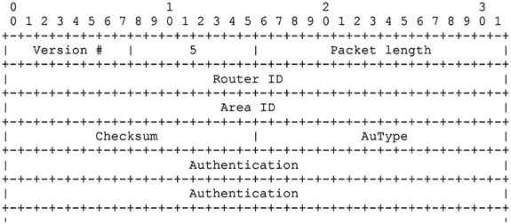

**Figure 2-1** *OSPF Fixed Length Field Definition in the Protocol Specification*

Figure 2-1 顶部的一行数字表示数据包格式中的各个位；每一行包含 32 位信息。前 8 位表示版本号，第二 8 位始终为数字 5，随后的 16 位包含总数据包长度，等等。这些字段在协议规范中进一步定义了字段中携带的信息类型以及其编码方式。例如：

• `version number` 字段被编码为无符号整数。这是元数据，指示用于此数据包的字典和语法。如果需要更改数据包格式，可以增加版本号，使发送方和接收方在编码和解码数据包中的信息时使用正确的字典和语法。

• 数字 5 表示协议中的数据包类型；这是标准文档中 elsewhere 定义的字典的一部分，因此在此说明中仅作为固定值插入。此特定数据包是 *Link State Acknowledgment Packet*。

• `packet length` 被编码为无符号整数，表示完整数据包中包含的八位字节（或 8 位集合）的数量。这允许数据包长度根据需要携带的信息量而变化。

固定长度字段格式有几个优点。主要是，数据包中任何信息的位置从数据包到数据包都相同，这意味着可以轻松优化为数据包格式设计的编码和解码代码。例如，处理固定长度数据包格式的常见方法是创建与数据包格式精确匹配的内存数据结构；当数据包从线路读取时，它只是被复制到该数据结构中。然后可以直接读取数据包中的字段。

固定长度格式往往比较紧凑。编码和解码数据所需的元数据以协议规范的形式“在协议之外”携带。数据包本身仅包含值，而从不包含有关值的任何信息。另一方面，固定长度格式可以通过缓冲字段使其始终具有相同的长度而浪费大量空间。例如，十进制数字 `1` 可以用单个二进制位（单个位）表示，而十进制数字 `4` 需要 3 个二进制位（三个位）；如果固定长度字段必须能够表示 0 到 4 之间的任何数字，它至少需要 3 位长，即使其中两个位在表示较小的十进制数字时有时会被“浪费”。

固定长度格式也经常通过将字段大小对齐到常见的处理器内存边界来浪费空间，以提高处理速度。即使字段只需要两个位来表示完整的取值范围，要求取值在 0 到 3 之间的字段也可能被编码为 8 位字段（一个完整的八位字节），以确保后续字段始终对齐到八位字节边界以实现更快的内存处理。

灵活性是固定长度编码经常遇到问题的领域。如果某个字段在原始规范中被定义为 8 位值（单个八位字节），则没有明显的方法修改字段长度以支持新需求。解决固定长度编码方案中此问题的首要方法是通过版本号。如果必须更改字段的长度，则在支持新字段长度的数据包格式中修改版本号。这允许实现在网络中的所有设备升级以支持新格式之前继续使用旧格式；一旦全部升级，整个系统就可以切换到新的格式，无论是更大还是更小。

##### Type Length Value

类型长度值 (`TLV`) 格式是解决编组数据问题的另一种广泛使用的解决方案。Figure 2-2 显示了中间系统到中间系统 (`IS-IS`) 路由协议中的一个示例。

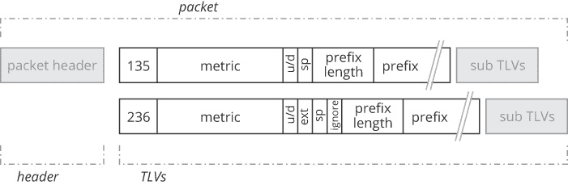

**Figure 2-2** *An Example of a TLV Format from IS-IS*


在 图 2-2 中，一个数据包由一个通常为固定长度的头部组成，然后是一组 TLV。每个 TLV 的格式基于其类型代码。在此情况下，显示了两种 TLV 类型（IS-IS 中还有许多其他类型；此处仅使用两种进行说明）。第一种类型是 135，它携带的是 Internet Protocol version 4 (IPv4) 信息。此类型有多个字段，其中一些是固定长度的——例如 metric。其他字段，如 prefix，则是可变长度的；字段的长度取决于 TLV 内部其他字段中的值。在此情况下，*prefix length* 字段决定了 prefix 字段的长度。还有 subTLVs，其格式类似，并携带与此 IPv4 信息相关联的信息。类型 236 与 135 类似，但它携带的是 IPv6 而非 IPv4 信息。

本质上，TLV 可以被视为在更大的数据包内携带的完整自包含信息集。TLV 由三部分组成：

• 类型代码，描述数据的格式

• 长度，描述数据的总长度

• 值，即数据本身

基于 TLV 的格式比固定长度格式更不紧凑，因为它们在数据包本身内携带了更多元数据。数据中携带的类型和长度信息提供了在字典中查找格式信息的位置的信息，以及使用的语法信息（每个字段如何格式化等）。TLV 格式以在无需每个设备升级的情况下更改协议所携带信息的格式的能力，或允许某些实现选择不支持每种可能的 TLV，来换取在链路上携带的额外元数据。

TLV 通常被认为是一种非常灵活的在协议中编组数据的方式；你会发现这一概念几乎无处不在。

###### 共享对象字典

固定长度字段的主要问题之一是字段定义的*固定性*；如果要修改固定长度字段协议，你需要提升版本号并修改数据包，或者必须创建具有不同字段编码的新数据包类型。TLV 格式化通过在传输的数据中内联包含元数据来解决此问题，其代价是携带更多信息并降低紧凑性。共享编译字典试图通过将字典放在可共享的文件（或库）中而不是放在规范中来解决此问题。 图 2-3 说明了该过程。

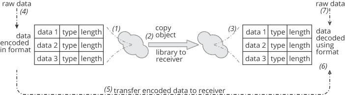

**图 2-3** *共享编译字典*

在 图 2-3 中，该过程始于开发人员构建数据结构以将特定要跨网络传输的数据集编组。一旦数据结构构建完成，它会被编译成一个函数，或许被复制到函数库中（1），并复制到接收方（2）。接收方随后使用此库编写应用程序来处理此数据（3）。在发送方，原始数据被编码为该格式（4），然后通过协议在网络上传输到接收方（5）。接收方使用其共享的数据格式副本（6）解码数据，并将解码后的信息传递给接收应用程序（7）。

这种系统结合了 TLV 模型基于的灵活性与固定字段协议的紧凑性。虽然字段是固定长度的，但字段定义以允许在编组格式需要更改时进行快速、灵活更新的方式给出。只要共享库与使用数据的应用程序解耦，字典和语法就可以通过分发原始数据结构的新版本来更改。

如果分发了数据结构的新版本，是否需要进行旗日切换？不一定。如果数据结构中包含版本号，以便接收方可以将接收到的数据与正确的数据结构匹配，那么系统中可以同时存在多个版本的数据结构。一旦找不到使用旧数据格式的发送方，旧结构就可以在整个系统中安全地丢弃。

**注意**

`gRPC` 是编译共享库编组系统的示例；请参阅“进一步阅读”部分获取资源。

**注意**

虽然固定格式和 TLV 系统依赖于开发人员阅读规范，并以编写代码的形式共享语法和字典，但本节所述的共享数据结构系统依赖于共享字典以其他方式分发。这可以有许多不同的方式完成；例如，可以将软件的新版本分发给所有发送方和接收方，或者可以使用某种分布式数据库来确保所有发送方和接收方都收到更新的数据字典，或者可以分发专门管理编组数据的应用程序的一部分，并与生成和消费数据的应用程序配对。此类系统的一些系统在初始会话设置时传输共享字典。所有这些都是可能的，且超出了本文的范围。

###### 错误

不能假设任何数据传输介质是完美的。如果传输介质是共享的，如射频（RF），则可能存在干扰，甚至数据报冲突。这就是当一个以上的发送方尝试同时传输信息时发生的情况。结果是无法被预期接收方理解的乱码消息。即使是专用介质，例如点对点海底光纤（光波）电缆，也可能由于电缆退化或点事件而出现错误——甚至看似荒谬的事件，例如太阳耀斑导致辐射，进而干扰铜缆中的数据传输。

网络传输在错误方面必须回答两个关键问题：

• 如何检测数据传输中的错误？

• 网络应对数据传输中的错误做什么？

以下各节考虑了这些问题的一些可能答案。

####### 错误检测

处理错误的第一个步骤，无论是由于传输介质故障、路径上交换设备中的内存损坏，还是其他任何原因，都是*检测*错误。问题当然是，当接收方检查接收到的数据时，没有任何东西可以与数据进行比较以检测错误。

奇偶校验是最简单的检测机制。存在两种互补的奇偶校验算法。使用偶校验时，会在每个数据块中添加一个额外位。如果数据块中位的总和为偶数——即数据块中 1 位的数量为偶数——则额外位设置为 0。这保持了块的偶校验状态。如果位的总和为奇数，则额外位设置为 1，这将整个块设置为偶校验状态。奇校验使用相同的额外位策略，但要求块具有奇校验（1 位的数量为奇数）。

例如，计算这四个八位数据组的偶校验和奇校验：

Click here to view code image

```
00110011 00111000 00110101 00110001
```


仅仅统计数字就能发现，这段数据中共有 14 个 `1s` 和 18 个 `0s`。为了使用奇偶校验进行错误检测，你需要给数据额外添加一位，使得在扩大的位集合中 `1s` 的总数为偶数以实现偶校验，或为奇数以实现奇校验。例如，如果你想在此例中添加偶校验位，则附加位应设为 0。这是因为 `1s` 的数量本身就是偶数。将附加的校验位置为 0 不会增加另一个 `1`，因此不会改变 `1s` 总数是偶数还是奇数。对于偶校验而言，最终的位集合为

Click here to view code image

```
00110011 00111000 00110101 00110001 0
```

另一方面，如果你想为这组位添加一位 `odd` 校验，则需要使附加的校验位为 `1`，这样 `1s` 的数量就变为 15 而不是 14。对于奇校验，最终的位集合为

Click here to view code image

```
00110011 00111000 00110101 00110001 1
```

为了检查数据在传输过程中是否被损坏或更改，接收方只需注意使用的是偶校验还是奇校验，统计 `1s` 的数量，然后丢弃校验位。如果 `1s` 的数量与所使用的校验类型不匹配（偶或奇），则数据已被损坏；否则，数据看起来与原始发送的数据相同。

当然，这一位也会与原始位一起传输。如果校验位本身 somehow 被损坏会怎样？这其实是可以接受的；假设使用了偶校验检查，并且发送方发送的是

Click here to view code image

```
00110011 00111000 00110101 00110001 0
```

然而，接收方收到的却是

Click here to view code image

```
00110011 00111000 00110101 00110001 1
```

校验位本身已从 0 翻转为 1。接收方会统计 `1s`，确定有 15 个；由于使用了偶校验检查，接收到的数据将被标记为有错误 *即使实际上没有*。校验检查对故障可能过于敏感，但在错误检测的情况下，宁可谨慎出错也好。

奇偶校验存在一个问题：它只能检测传输信号中的单一位翻转。例如，如果使用偶校验，并且发送方发送的是

Click here to view code image

```
00110011 00111000 00110101 00110001 0
```

然而，接收方收到的却是

Click here to view code image

```
00110010 00111000 00110101 00110000 0
```

接收方会统计 `1s` 的数量，发现是 12；由于系统使用偶校验，接收方会认为数据正确并正常处理。然而，用粗体标记的两个位 *都* 已被损坏。如果任意组合的偶数个位被修改，奇偶校验无法检测到变化；只有当变化涉及奇数个位时，奇偶校验才能检测到数据的修改。

##### Cyclic Redundancy Check

循环冗余校验 Cyclic Redundancy Check (CRC) 可以通过在整个数据集上按周期进行除法（而非加法）操作，一次处理一小部分数据，从而检测到更广泛的传输数据修改。通过一个示例来理解 CRC 的计算方式是最好的方法。CRC 计算始于一个多项式，如 Figure 2-4 所示。

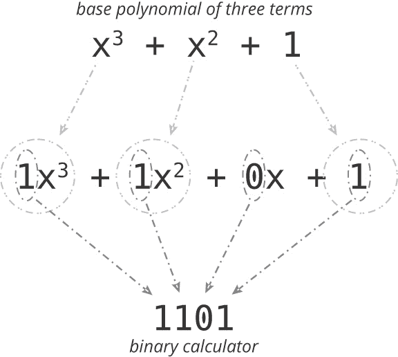

**Figure 2-4** *A Polynomial Used to Calculate a CRC*

在 Figure 2-4 中，一个三项多项式 x³ + x² + 1 被展开以包含所有项——包括前面带 0 的项（因此无论 x 的值如何都不会影响计算结果）。然后将这四个系数用作 `binary calculator`，用于计算 CRC。

执行 CRC 时，首先从原始二进制数据集开始，并添加三位额外位（因为原始多项式不含系数时有三项；因此称为三位 CRC 检查），如下所示：

Click here to view code image

```
10110011 00111001 (original data)
10110011 00111001 000 (with the added CRC bits)
```

这三位是必需的，以确保原始数据中的所有位都被包含在 CRC 中；当 CRC 从左到右移动穿过原始数据时，只有在包含这些填充位的情况下，最后几位原始数据才会被包含。现在从最左边的四位开始（因为四个系数表示为四位）。使用异或 Exclusive OR (XOR) 操作比较最左边的位与 CRC 位，并保存结果，如下所示：

Click here to view code image

```
10110011 00111001 000 (padded data)
1101 (CRC check bits)
---- 
01100011 00111001 000 (result of the XOR)
```

**Note**

对两个二进制数字进行 XOR 操作，如果两个数字相同则结果为 0，如果不同则结果为 1。

校验位，称为 `divisor`，向右移动一位（此处可跳过某些步骤），并重复该操作直到数字末尾：

Click here to view code image

```
10110011 00111001 000
1101
01100011 00111001 000
 1101
00001011 00111001 000
    1101
00000110 00111001 000
     110 1
00000000 10111001 000
         1101
00000000 01101001 000
         1101
00000000 00000001 000
                 1 101
00000000 00000000 101
```

CRC 在最后三位中，即最初作为填充添加的位；这是将原始数据加上原始填充进行除法过程移动的“余数”。接收方只需保留 CRC 位（本例中为 101），并使用原始除数对数据进行操作，即可轻松判断数据是否被更改，如下所示：

Click here to view code image

```
10110011 00111001 101
1101
01100011 00111001 101
 1101
00001011 00111001 101
    1101
00000110 00111001 101
     110 1
00000000 10111001 101
          1101
00000000 01101001 101
          1101
00000000 00000001 101
                1 101
00000000 00000000 000
```

如果数据未被更改，此操作的结果应始终为 0。如果某一位被更改，结果将不为 0，如下所示：

Click here to view code image

```
10110011 00111000 000
1101
01100011 00111000 000
 1101
00001011 00111000 000
    1101
00000110 00111000 000
     110 1
00000000 10111000 000
          1101
00000000 01101000 000
          1101
00000000 00000000 000
                1 101
00000000 00000001 000
```

CRC 看起来可能很复杂，但它利用了计算机的优势——有限长度的二进制运算。如果将 CRC 的长度设为与常见处理器中标准小型寄存器相同，例如八位，计算 CRC 就是一个相当直接且快速的过程。与前面描述的奇偶校验不同，CRC 检查具有抗多位变化的优点。

###### Error Correction

检测错误只是问题的一半。然而，一旦检测到错误，传输系统应该做什么呢？本质上只有三个选项。


传输系统可以简单地丢弃数据。在这种情况下，传输实际上是将如何处理错误这一责任上交给更高层的协议或可能是应用程序本身。由于某些应用程序需要完整且无错误的数据集（例如文件传输系统，或金融交易），它们很可能会有某种方式来发现任何缺失的数据并重新传输。那些不在乎少量缺失数据的应用程序（例如语音流）可以简单地忽略缺失的数据，在接收端根据缺失的信息尽可能地重建信息。

传输系统可以向发送方发出错误信号，并让发送方决定如何处理此信息（通常出错的数据将被重新传输）。

传输系统可以通过在原始传输中包含足够的信息来超越丢弃数据，并确定错误所在并尝试纠正它。这称为 `Forward Error Correction`（FEC）。`Hamming codes`，最早开发的 FEC 机制之一，也是最简单解释的一种。汉明码最好通过示例来解释；Table 2-2 将用于说明。

**Table 2-2** *An Illustration of the Hamming Code*

|    || **1** || **2** || **3** || **4** || **5** || **6** || **7** || **8** || **9** || **10** || **11** || **12** |

| --- | --- | --- | --- | --- | --- | --- | --- | --- | --- | --- | --- | --- |

| **0001** || **0010** || **0011** || **0100** || **0101** || **0110** || **0111** || **1000** || **1001** || **1010** || **1011** || **1100** |

| P1 || P2 || D1 || P4 || D2 || D3 || D4 || P8 || D5 || D6 || D7 || D8 |

|   ||   || 1 ||   || 0 || 1 || 1 ||   || 0 || 0 || 1 || 1 |

| **P1** || 1 ||   || X ||   || X ||   || X ||   || X ||   || X ||   |

| **P2** ||   || 0 || X ||   ||   || X || X ||   ||   || X || X ||   |

| **P4** ||   ||   ||   || 1 || X || X || X ||   ||   ||   ||   || X |

| **P8** ||   ||   ||   ||   ||   ||   ||   || 0 || X || X || X || X |

在 Table 2-2 中：

• 12 位空间中每个是 2 的幂（1、2、4、6、8 等）且第一个位的位被设为奇偶校验位。

• 要用 FEC 保护的 8 位数字 `10110011` 已分布在 12 位空间中剩余的位上。

• 每个奇偶校验位都设为 0，然后通过对每个奇偶校验位进行加法计算来计算奇偶校验，具体方法为统计位号的二进制位与奇偶校验位相同的位上 *1s* 的数量。具体如下：

• `P1` 的位号的最低位被置位；数字空间中也具有最低位置位的其他位被包含在奇偶校验计算中（请参阅表格中的第二行以找到数字中具有最低位置位的所有位位置）。这些在表格的 `P1` 行中用 *X* 标出。*1s* 的总数为奇数 3，因此 `P1` 位被设为 *1*（本示例使用偶校验）。

• `P2` 的位号的倒数第二位被置位；数字空间中具有倒数第二位置位的其他位被包含在奇偶校验计算中，如表格 `P2` 行中的 *X* 所示。*1s* 的总数为偶数 4，因此 `P2` 位被设为 0。

• `P4` 的位号的倒数第三位被置位，因此其位置号的倒数第三位被置位的其他位，如 P3 行中用 *X* 标出。标记列中 *1s* 的数量为奇数，因此 `P4` 奇偶校验位被设为 1。

为了确定是否有任何信息发生变化，接收方可以以发送方计算的方式检查奇偶校验位；包括奇偶校验位在内的任何集合中的 *1s* 总数应为偶数。如果其中一个数据位被翻转，接收方绝不会只发现一个奇偶校验错误，因为数据中的每个位位置都被多个奇偶校验位覆盖。为了发现哪个数据位不正确，接收方将出错的奇偶校验位的位置相加；结果就是被翻转的位位置。例如，如果位置 9 的位，即第五个数据位，被翻转，则奇偶校验位 `P1` 和 `P8` 都将出错。在这种情况下，8 + 1 = 9，因此位置 9 的位出错，翻转它即可纠正数据。如果 *单个* 奇偶校验位出错——例如 `P1` *或* `P8`——那么出错的就是该奇偶校验位本身，而数据本身是正确的。

虽然汉明码很巧妙，但它无法检测许多位翻转模式。更现代的代码，例如 `Reed-Solomon`，可以在向数据流添加更少额外信息的同时检测和纠正更广泛的错误条件。

**Note**

在通信世界中，使用了大量不同种类的 CRC 和纠错码。CRC 检查按检查中使用的位数进行分类（填充位的数量，或多或少是多项式的长度），在某些情况下，还按特定应用进行分类。例如，通用串行总线使用 5 位 CRC（`CRC-5-USB`）；全球移动通信系统（GSM），一种广泛使用的蜂窝电话标准，使用 `CRC-3-GSM`；码分多址（CDMA），另一种广泛使用的蜂窝电话标准，使用 `CRC-6-CDMA2000A`、`CRC-6-CDMA2000B` 和 `CRC-30`；而一些用于连接车辆中各种组件的车载局域网（CANs）使用 `CRC-17-CAN` 和 `CRC-21-CAN`。其中一些各种 CRC 函数不是单一函数，而是函数类或族，其中包含许多不同的代码和选项。

##### Multiplexing

你走进一个房间并大喊，“Joe！” 你的朋友 Joe 转过身来开始就政治和宗教进行对话（当然，在任何礼貌的对话中，这两个都是禁忌话题）。这种能够使用单一介质（你的声音传播的空气）来与某个人交谈的能力，即使许多其他人也在同时使用同一介质进行其他对话，这在网络工程中被称为复用。更正式地说：

**Multiplexing is used to allow multiple entities attached to the network to communicate over a shared network.**

为什么这里使用 *entities* 这个词而不是 hosts？回到“与 Joe 交谈”的例子，假设你与 Joe 交流的唯一方式是通过他的十几岁的孩子，而孩子只发短信（从不说话）。事实上，Joe 是由数百到数千人组成的一个家庭的一部分，并且这个整个家庭的所有通信都必须通过这个十几岁的孩子进行，并且家庭中的每个人都有多个并发对话，有时在不同主题上与同一个人交谈。那个可怜的十几岁的孩子必须非常快速地发短信，并且要在脑海中保留大量信息，比如“Joe 与 Mary 有四次对话”，并且必须将每个对话中的信息完全与其他对话分开。这更接近网络复用实际的工作方式；考虑：

• 可能有数百万（或数十亿）台主机连接到单个网络，所有主机共享相同的物理网络进行相互通信。

• 这些主机中的每一个实际上包含许多应用程序，可能有数百个，每个应用程序都可以与连接到网络的任何其他主机上的数百个应用程序通信。

• 这些应用程序中的每一个实际上可能与网络中任何其他主机上运行的任何其他应用程序有几次对话。

如果这开始听起来很复杂，那是因为它确实很复杂。那么本节需要回答的问题是：

**How do hosts multiplex effectively over a computer network?**

以下各节考虑了该领域最常用的解决方案，以及与此基本问题相关的一些有趣问题，例如多播和任播。

###### Addressing Devices and Applications


计算机网络使用一系列层次排列的地址来解决这些问题；图 2-5 进行了说明。

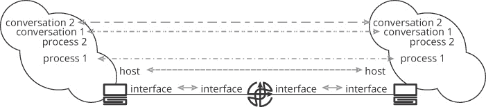

**图 2-5** *在网络中对多个层级的实体进行寻址*

在 图 2-5 中，展示了四层寻址：
• 在物理链路层，有接口地址，允许两个设备单独寻址特定设备。
• 在主机层，有主机地址，允许两个主机直接寻址特定主机。
• 在进程层，有 `port numbers`，结合主机地址，允许两个进程寻址特定设备上的特定进程。
• 在会话层，源端口、目的端口、源地址和目的地址的集合可以组合起来唯一标识特定的会话或流。

该图和解释看起来非常清晰。在现实生活中，情况要混乱得多。在部署最广泛的寻址方案中，互联网协议 (`IP`)，没有 `host-level addresses`。相反，按接口 basis 有逻辑地址和物理地址。

**Note**
`IP` 和 `IP` 寻址将在 第 5 章，“Higher Layer Data Transports” 中更详细地讨论。

复用和复用标识符（地址）在网络中层级地堆叠在彼此之上。

**Note**
将在 第 6 章，“Interlayer Discovery” 中更全面地讨论将一种地址与另一层之间的另一种地址关联起来的机制。

然而，在某些情况下，你希望同时向多个主机发送流量；对于这些情况，有组播和任播。这两种特殊的寻址方式将在以下章节中讨论。

##### 在物理链路上、广播和故障域

当考虑广播域和物理连接的概念时，图 2-5 中说明的清晰模型变得更加复杂。某些媒体类型（尤其是以太网，详细内容见 第 4 章，“Lower Layer Transports”）设计为连接到同一物理链路的每个设备都会接收到传输到物理介质上的每个数据包——主机只是忽略未寻址到与物理线路连接的物理接口相关联的地址的数据包。然而，在现代网络中，物理以太网布线很少允许每个设备接收到每个其他设备的包；相反，网络中间有一个交换机，它会阻止未发往特定设备的数据包在连接到该主机的物理线路上传输。

然而，在这些协议中，预留了显式地址用于数据包，这些数据包 `should be` 传输给如果没有交换机时本应接收到每个数据包的所有主机，或所有主机都应接收并处理的数据包（通常，这是地址的全 1 或全 0 版本）。这些被称为广播。任何会接收并处理由某设备发送的广播的设备都被认为属于该设备的广播域。广播域的概念传统上与故障域密切相关，因为影响广播域上某台设备的网络故障通常会影响广播域上的每个设备（有关故障域的更多信息，请参阅 第 23 章，“Redundant and Resilient”）。

不要惊讶如果你发现这一切相当令人困惑，因为它确实相当令人困惑。广播和广播域的基本概念仍然存在，并且对于理解网络的运行仍然很重要，但在某些情况下，术语的含义可能会改变，甚至不适用。在考虑任何情况时要小心，确保你真正理解广播域的实际位置以及特定技术如何影响物理连接、寻址和广播域之间的关系。

###### Multicast

**Note**
这个简短的解释无法真正体现构建组播树的全部解决方案范围；请参阅本章末尾的“Further Reading”部分，了解该领域的更多资料。

如果你有一个像 图 2-6 所示的网络，并且需要 A 将相同内容分发给 G、H、M 和 N，你将如何进行？

你可以生成四份流量的副本，使用正常的 `unicast` 转发将一个流发送给每个接收者，或者你可以以某种方式将流量发送到网络知道要复制以便所有四个主机都接收到副本的单个地址。后一种选项称为组播，这意味着使用单个地址向多个接收者传输流量。组播要解决的关键问题是在流量通过网络时进行转发和复制，以便对流感兴趣的每个接收者都会收到一份副本。

**Note**
对来自组播源的数据包流感兴趣的设备集合称为组播组。这可能有点令人困惑，因为用于描述组播流的地址在某些情况下也称为组播组。这两种用法在 `practically` 上可以互换，因为对特定组播数据包集感兴趣的设备集合将加入组播组，这实际上意味着监听特定的组播地址。

**Note**
在组播流量为双向的情况下，解决此问题要困难得多。例如，假设有一个要求构建一个组播组，其中包含 图 2-6 中所示网络中的每个主机，除了 N，并且进一步要求任何传输到组播组地址的组播都交付给组播组内的每个主机。


**图 2-6** *一个组播示例*

组播要解决的关键问题可以分为两个问题：
• 如何发现哪些设备希望接收发送到组播组的流量的副本？
• 如何确定网络中哪些设备应该复制流量，以及它们应在哪些接口上发送副本？

一种可能的解决方案是使用本地请求构建一棵树，通过该树将组播流量转发通过网络。这样的系统的一个例子是协议无关组播 (`PIM`) 中的 `Sparse Mode`。在这个过程中，每个设备为其感兴趣的组播流发送一个 `join` 消息；这些加入请求在网络中向上游传递，直到到达发送者（通过组播流发送数据包的主机）。图 2-7 用于说明此过程。

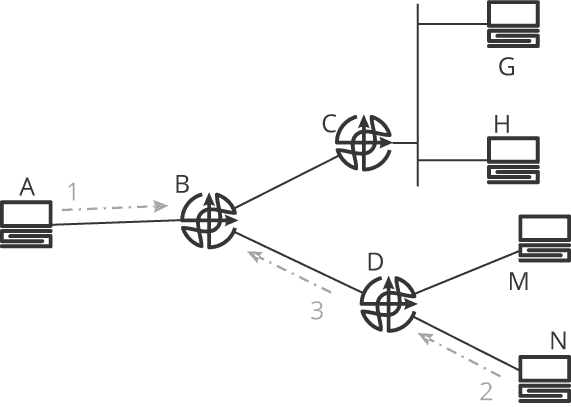

**图 2-7** *稀疏模式组播*

在 图 2-7 中：
1. A 正在向一个组播组（地址）发送一些流量；称其为 `Z`。
2. N 希望接收 Z 的副本，因此它向其上游路由器 D 发送一个请求（加入）以获取此流量的副本。
3. D 没有此流量的源，因此它向其连接的路由器发送请求以获取此流量的副本；在这种情况下，D 发送请求的唯一路由器是 B。

在每个跳点，接收请求的路由器会将其接收请求的接口放入其 `Outbound Interface List (OIL)` 中，并开始转发在任何其他接口上接收到的给定组播组中的流量。以这种方式，可以从接收者到流量源构建一条路径；这称为 `reverse path tree`。


发现对特定组播组感兴趣的主机的一种第二种方法是借助某种注册服务器。每个希望接收流副本的主机都可以向服务器注册其需求。主机可以通过以下几种方式发现服务器的存在，包括

• 将组播组地址视为域名，并通过查询组播组地址来查找注册服务器的地址

• 构建并维护一个组到服务器映射的列表，或在本地表中维护映射

• 使用某种哈希算法根据组播组地址计算注册服务器

注册可以由通往服务器路径上的设备跟踪，也可以，一旦接收方和发送方的集合已知，服务器可以向路径上的适当设备发出信号，指示应为复制和转发数据包配置哪些端口。

##### Anycast

多路复用解决方案面临的另一个问题是，能够使用单个地址寻址部署在多个主机上运行的服务的特定实例。 Figure 2-8 举例说明。

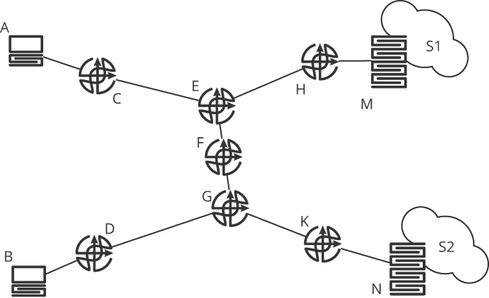

**Figure 2-8** *An Anycast Example*

在 Figure 2-8 中，某个服务 `S` 需要被设计以提高其性能。为实现此目标，创建了该服务的第二个副本，两个副本分别命名为 `S1` 和 `S2`。这两个服务的副本分别运行在服务器 `M` 和 `N` 上。Anycast 试图解决的问题是这个：

**如何将客户端引导到服务的最佳实例？**

解决此问题的一种方法是引导所有客户端到单个设备，并让 *负载均衡器* 根据客户端的拓扑位置、每个服务器的负载和其他因素将流量分配到服务器。这种解决方案并不总是理想的。例如，如果负载均衡器无法处理客户端为访问服务的各个副本而产生的全部连接请求呢？为了使负载均衡器能够跟踪服务的各个副本的健康状况，会向网络增加哪些复杂性？

**Note**

负载均衡在 Chapter 7，“Packet Switching” 中进行了讨论。

Anycast 通过为服务的每个副本分配 *相同的地址* 来解决此问题。在 Figure 2-8 所示的网络中，`M` 和 `N` 将使用相同的地址提供对 `S1` 和 `S2` 的可达性。`M` 和 `N` 将有不同的地址分配并通告，以提供对其他服务以及设备本身的可达性。

`H` 和 `K`，即 `M` 和 `N` 之外的第一跳路由器，将把此相同地址通告到网络中。当 `C` 和 `D` 收到通往同一目的地的两条路由时，它们将根据度量选择最近的路由。在这种情况下，如果网络中每条链路都配置了相同的度量，则 `C` 将把源自 `A` 且目标为服务地址的流量导向 `M`。另一方面，`D` 将把源自 `B` 且目标为服务地址的流量导向 `N`。如果服务的两个实例距离相近会怎样？路由器将使用本地哈希算法在两条路径中选择其一。

**Note**

有关等价成本多路径交换的更多信息，请参阅 Chapter 7，以及哈希如何确保流中的每个数据包使用相同的路径。即使在互联网中，路由通常也足够稳定，可以使用状态协议的 anycast 解决方案。^5

Anycast 通常用于必须通过配置大量服务器来扩展的大规模服务，以支持单一服务。示例包括以下内容：

• 大多数大规模域名系统 DNS 服务器实际上是一组可通过 anycast 地址访问的服务器。

• 许多大规模基于 Web 的服务，特别是社交媒体和搜索，其中单一服务在大量边缘设备上实现。

• 内容缓存服务通常在分发和提供信息时使用 anycast。

设计正确时，anycast 可以提供有效的负载均衡以及服务的最佳性能。

##### Flow Control

你还记得你那说话飞快以至于你一个字也听不懂的远房大姨（或者说是堂兄的表亲？）吗？有些计算机程序也说话太快了。 Figure 2-9 举例说明。

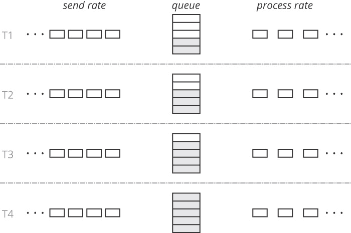

**Figure 2-9** *Buffer Overflow Example*

在 Figure 2-9 中：

• 在 *Time* 1 (`T1`)，发送方传输的数据包大约是接收方能够处理的三倍的四倍；接收方有一个可存储未处理信息的五数据包缓冲区；缓冲区中有两个数据包。

• 在 `T2`，发送方已传输四个数据包，接收方已处理三个；接收方的缓冲区现在保存了三个数据包。

• 在 `T3`，发送方已传输四个数据包，接收方已处理三个；接收方的缓冲区现在保存了四个数据包。

• 在 `T4`，发送方已传输四个数据包，接收方已处理三个；接收方的缓冲区现在保存了五个数据包。

下一个传输的数据包将被接收方丢弃，因为在接收方处理数据包以便将其移除时，缓冲区中没有空间来存储它。需要某种反馈回路来告诉发送方放慢发送数据包的速度，如 Figure 2-10 所示。

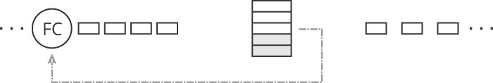

**Figure 2-10** *A Feedback Loop to Control Packet Flow*

这种反馈回路需要在接收方和发送方之间进行隐式信号或显式信号。隐式信号部署更广泛。在隐式信号中，发送方根据对流量流的某些观察假设数据包未被接收。例如，接收方可能会确认稍后数据包的接收，或者接收方可能根本不确认接收特定数据包，或者接收方可能在很长一段时间内什么也不发送（按网络术语）。在显式信号中，接收方以某种方式直接通知发送方特定数据包未被接收。

###### Windowing

Windowing 与隐式信号结合，是实际网络中部署最广泛的流量控制机制。Windowing 本质上包括以下内容：

1. 发送方向接收方发送一定量的信息。

2. 发送方等待以决定信息是否已正确接收。

3. 如果接收方在特定时间内确认接收，发送方发送新信息。

4. 如果接收方在特定时间内未确认接收，发送方重新发送信息。

隐式信号通常与 windowing 协议一起使用，只需不确认特定数据包的接收即可。显式信号 *有时* 在接收方知道已丢弃数据包时使用，或当接收到的数据包含错误、数据乱序接收，或数据以某种方式损坏时使用。 Figure 2-11 说明了最简单的 windowing 方案，即单数据包窗口。

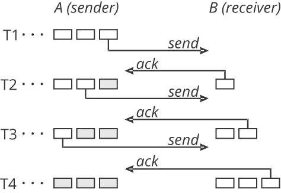

**Figure 2-11** *A Single Packet Window*


在一个单包窗口（有时也称为乒乓）中，发送方仅在接收方已确认（在插图中显示为 `ack`）上一个发送的数据包的接收后才发送数据包。如果数据包未被接收，接收方将不会确认它。在发送数据包时，发送方设置一个定时器，通常称为 `retransmit timer`；一旦此定时器唤醒（或过期），发送方将假定接收方未收到该数据包，并重新发送它。

##### 发送方应等待多久？
这个问题有多种可能的答案，但本质上发送方要么等待固定的时间，要么根据从先前传输和网络状况推断出的信息设置定时器。一种简单（且天真）的方案是

• 测量发送数据包与收到确认之间的时间长度，称为往返时间（`RTT`， though normally written in the lowercase, so `rtt`）。

• 将 `retransmit timer` 设置为此数值加上少量缓冲时间，以应对多次传输中 `rtt` 的变化。

###### Note
有关计算 `retransmit timer` 的各种方法的更多信息将在 第 5 章 中讨论。

接收方也可能接收到同一信息的两个副本：

1\. A 发送一个数据包并设置其 `retransmit timer`。

2\. B 收到该数据包，但

a. 由于内存不足或处理器利用率过高或其他情况，无法确认收到。

b. 发送确认，但确认被网络设备丢弃。

3\. A 处的 `retransmit timer` 超时，因此发送方传输该数据包的另一个副本。

4\. B 收到此同一信息的第二个副本。

##### 接收方如何检测重复数据？
似乎接收方可以通过比较收到的包来判断是否存在重复信息，但这并不总是有效——也许发送方 *本意* 就是发送两次相同的信息。检测重复信息的常用方法是 在传输的数据包中包含某种序列号。每个数据包在由发送方构建时都会被赋予唯一的序列号；如果接收方收到两个具有相同序列号的数据包，它会认为数据是重复的并丢弃副本。

窗口大小为 1，或乒乓，需要发送方和接收方之间每传输一组数据进行一次往返。这通常会导致非常缓慢的传输速率。如果你把网络想象成端到端的铁路轨道，每个数据包作为一节火车车厢，轨道最有效的使用方式，以及最快的传输速度，是轨道始终处于满载状态。然而，在网络的情况下，这在物理上是不可能的，因为网络被许多发送方和接收方使用，并且总会有网络状况阻止网络利用率达到 100%。在一次发送多个数据包带来的更高效率和速度，与一次发送较少数据包（例如一个）带来的多路复用和“安全性”之间存在某种平衡。如果能以某种方式计算出正确的平衡点，固定窗口流控方案可能效果良好。 图 2-12 说明了这一点。

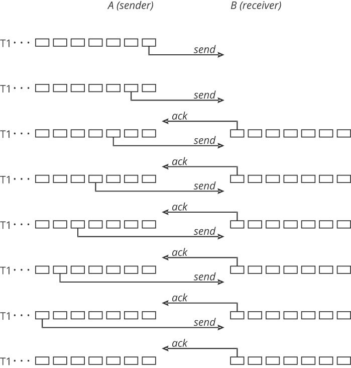

**图 2-12** *固定窗口流控的一个示例*

在 图 2-12 中，假设固定窗口为三个数据包：

• 在 `T1`、`T2` 和 `T3` 时，A 传输数据包；由于窗口大小固定为 3，A 无需等待 B 确认任何内容即可发送这三个数据包。

• 在 `T4` 时，B 确认这三个数据包，这允许 A 传输另一个数据包。

• 在 `T5` 时，B 确认这个新数据包，即使它只有一个数据包。B 无需等待 A 传输另外三个数据包才确认单个数据包。此确认使 A 拥有足够的 *预算* 发送另外三个数据包。

• 在 `T5`、`T6` 和 `T7` 时，A 发送另外三个数据包，填满其窗口。它现在必须等待 B 确认这三个数据包后才能发送更多信息。

• 在 `T8` 时，B 确认收到这三个数据包。

在窗口大小大于一的窗口方案中，接收方可以向发送方发送四种类型的确认：

• **肯定确认：** 接收方单独确认每个数据包的接收。例如，如果已收到序列号 1、3、4 和 5，接收方将确认接收到这些特定数据包。发送方可以通过注意哪些序列号未被确认来推断接收方未收到哪些数据包。

• **否定确认：** 接收方对推断丢失或接收时损坏的数据包发送否定确认。例如，如果已收到序列号 1、3、4 和 5，接收方可能会推断序列号 2 丢失并为该数据包发送否定确认。

• **选择性确认：** 这本质上结合了上述肯定和否定确认；接收方对每个接收到的信息序列发送肯定和否定确认。

• **累积确认：** 确认收到一个序列号意味着收到所有具有更低序列号的信息。例如，如果序列号 10 得到确认，则序列号 1–9 包含的信息以及序列号 10 包含的信息均被隐含。

第三种窗口机制称为滑动窗口流控。此机制与固定窗口流控机制非常相似，*区别在于窗口大小不是固定的*。在滑动窗口流控中，发送方可以根据网络状况动态修改窗口大小。接收方不知道窗口的大小是多少，只知道发送方传输数据包，并且不时接收方会使用前面列表中描述的确认机制之一确认其中一些或全部数据包。

滑动窗口机制为其他窗口机制中已考虑的问题增加了一个更有趣的问题：窗口大小应为多少？一种天真的解决方案可能只是计算 `rtt` 并将窗口大小设置为 `rtt` 的若干倍。提出了更复杂的解决方案；其中一些将在 第 5 章 中讨论，在对传输控制协议（`TCP`）的讨论中。

###### Negotiated Bit Rates
另一种解决方案，更常用于电路交换而非分组交换网络，是发送方、接收方和网络协商特定流的比特率。为多种不同的网络技术设计了各种可能的比特率；也许“最完整的一套”是 *异步传输模式*（`ATM`）——在你最近的网络历史博物馆中寻找 ATM 网络，因为 ATM 已很少部署在生产网络中。ATM 比特率如下：

• **恒定比特率 (CBR)：** 发送方将以恒定速率传输数据包（或信息）；因此，网络可以围绕此恒定带宽负载进行规划，接收方也可以围绕此恒定比特率进行规划。此比特率通常用于需要发送方和接收方之间时间同步的应用。

• **可变比特率 (VBR)：** 发送方将以可变速率传输流量。此速率通常与有关流的若干其他信息一起协商，以帮助网络和接收方规划资源，包括：

• 峰值速率，或发送方计划传输的最大每秒数据包数

• 持续速率，或发送方计划正常传输的速率


• 最大突发大小，或发送方打算在极短时间内传输的最大数据包数量

• **可用比特率 (ABR)：** 发送方打算依赖网络尽力而为的基础上交付流量的能力，使用其他形式的流量控制，例如滑动窗口技术，以防止缓冲区溢出并根据可用带宽调整传输流量。

##### 关于传输的最终思考

本章从理解网络工程问题空间的整个范围的基础开始：在网络中传输数据。通过考虑*人类语言*空间，发现了四个具体问题，并以高层次提出了几种解决方案：

• 为了组织数据，考虑了定长和基于 TLV 的系统，以及*元数据、字典*和*语法*的概念。

• 为了管理错误，考虑了两种检测错误的方法，奇偶校验和 CRC；以及一种纠错方法，汉明码。

• 为了允许多个发送方和接收方使用相同的物理介质，考虑了多路复用中的几个概念，包括多播和任播。

• 为了防止缓冲区溢出，探索了几种窗口机制，并定义了协商比特率。

与本书中你将遇到的许多其他领域一样，传输世界可以成为一个完整的专业领域。然而，理解基础知识对于每个网络工程师都很重要。下一章将考虑一些模型，帮助你将通常与转发或数据平面相关联的数据传输置于更大的背景中。第 4 章和第 5 章将考虑几种不同的传输协议示例，将本章和下一章的概念引入现实生活中的示例。

##### 延伸阅读

以下延伸阅读资源旨在帮助回答本章的学习问题。

Conran, Matt. “Know Anycast? Think Before You Talk.” Blog. *CacheFly*, February 22, 2017. [`insights.cachefly.com/anycast-think-before-you-talk-part-i`](https://insights.cachefly.com/anycast-think-before-you-talk-part-i)。

———. “Anycast—Think Before You Talk.” Blog. *CacheFly*, February 22, 2017. [`insights.cachefly.com/anycast-think-before-you-talk-part-ii`](https://insights.cachefly.com/anycast-think-before-you-talk-part-ii)。

“Flag Day.” Accessed June 6, 2017. [`www.catb.org/jargon/html/F/flag-day.html`](http://www.catb.org/jargon/html/F/flag-day.html)。

Gleick, James. *The Information: A History, A Theory, A Flood*. New York: Vintage, 2012。

“Grpc /.” Accessed June 7, 2017. [`www.grpc.io/docs/tutorials/basic/c.html`](http://www.grpc.io/docs/tutorials/basic/c.html)。

*Internet Protocol*. Request for Comments 791. RFC Editor, 1981. doi:10.17487/RFC0791。

Koopman, P. “32-Bit Cyclic Redundancy Codes for Internet Applications.” In *Proceedings International Conference on Dependable Systems and Networks*, 459–68, 2002. doi:10.1109/DSN.2002.1028931。

Koopman, P., and T. Chakravarty. “Cyclic Redundancy Code (CRC) Polynomial Selection for Embedded Networks.” In *International Conference on Dependable Systems and Networks, 2004*, 145–54, 2004. doi:10.1109/DSN.2004.1311885。

Loveless, Josh, Ray Blair, and Arvind Durai. *IP Multicast, Volume I: Cisco IP Multicast Networking*. 1st edition. Indianapolis, IN: Cisco Press, 2016。

———. *IP Multicast, Volume II: Advanced Multicast Concepts and Large-Scale Multicast Design*. 1st edition. Indianapolis, IN: Cisco Press, 2017。

McPherson, Danny R., David Oran, Dave Thaler, and Eric Osterweil. *Architectural Considerations of IP Anycast*. Request for Comments 7094. RFC Editor, 2014. doi:10.17487/RFC7094。

Moon, Todd K. *Error Correction Coding: Mathematical Methods and Algorithms*. 1st edition. Hoboken, NJ: Wiley-Interscience, 2005。

Morelos-Zaragoza, Robert H. *The Art of Error Correcting Coding*. 2nd edition. Chichester; Hoboken, NJ: Wiley, 2006。

Moy, John. “OSPF Specification.” Request for Comment. RFC Editor, October 1989. doi:10.17487/RFC1131。

———. “OSPF Version 2.” Request for Comment. RFC Editor, April 1998. doi:10.17487/RFC2328。

Palsson, Bret, Prashanth Kumar, Samir Jafferali, and Zaid Ali Kahn. “TCP over IP Anycast—Pipe Dream or Reality?” Blog. *LinkedIn Engineering Blog*, September 2015. [`engineering.linkedin.com/network-performance/tcp-over-ip-anycast-pipe-dream-or-reality`](https://engineering.linkedin.com/network-performance/tcp-over-ip-anycast-pipe-dream-or-reality)。

Postel, J. *NCP/TCP Transition Plan*. Request for Comments 801. RFC Editor, 1981. doi:10.17487/RFC0801。

Shannon, Claude E., and Warren Weaver. *The Mathematical Theory of Communication*. 4th edition. Champaign, IL: University of Illinois Press, 1949。

Soni, Jimmy, and Rob Goodman. *A Mind at Play: How Claude Shannon Invented the Information Age*. New York: Simon & Schuster, 2017。

Stone, James V. *Information Theory: A Tutorial Introduction*. 1st edition. England: Sebtel Press, 2015。

“Understanding the CBR Service Category for ATM VCs.” *Cisco*. Accessed June 10, 2017. [`www.cisco.com/c/en/us/support/docs/asynchronous-transfer-mode-atm/atm-traffic-management/10422-cbr.html`](http://www.cisco.com/c/en/us/support/docs/asynchronous-transfer-mode-atm/atm-traffic-management/10422-cbr.html)。

Warren, Henry S. *Hacker’s Delight*. 2nd edition. Upper Saddle River, NJ: Addison-Wesley Professional, 2012。

Williamson, Beau. *Developing IP Multicast Networks, Volume I*. Indianapolis, IN: Cisco Press, 1999。

##### 复习问题

1. 虽然 TLV 几乎总是需要比定长字段更多的空间来携带信息，但在某些情况下，定长字段会效率更低。携带 IPv6 地址是 TLV 比定长字段更高效的一个具体实例。请描述原因。比较路由协议携带 IPv4 和 IPv6 地址的方式是理解答案的一个好起点。特别是，检查 IPv4 地址在 OSPF 版本 2 中的携带方式，并将其与 BGP 中这些相同地址的携带方式进行比较。

2. 考虑以下数据类型，并确定你会使用定长字段还是 TLV 来携带每一种，以及原因。

a. 时间和日期

b. 一个人的全名

c. 一个温度读数

d. 一栋建筑的平方英尺数

e. 一系列音频或视频剪辑

f. 一本书分解为段落和章节等部分

g. 地址中的城市和州

h. 地址中的门牌号或邮政编码

3. 比特错误率 (BER) 与检测和/或修复数据传输流中的错误所需的信息量之间有什么关系？你能解释为什么会这样吗？

4. 在某些条件下，发送足够的信息在接收时纠正数据更有意义（例如使用汉明码）。在其他情况下，发现错误并丢弃数据更有意义。这些条件不仅仅是链路类型，也不仅仅是应用；而是两者的结合。哪些链路特性，结合哪些应用特性，会提示使用前向纠错？哪些会提示使用错误检测结合重传数据？最好先考虑具体的应用和具体的链路类型，然后再从中概括。

5. 奇偶校验可以检测多少次比特翻转变化？

6. 隐式和显式信令具有不同的特性，或者说不同的权衡。请描述每种信令形式用于错误检测和/或纠正的至少一个积极方面和一个消极方面。


##### 7.
在大规模部署 anycast 时，来自单个流的数据包可能被传递给多个接收者。解决此问题的两种广泛方案；第一种是接收者强制发送方重置其状态，如果数据包似乎以这种方式被错误投递。另一种是限制发送方与接收方之间的接口，以允许状态被限制在单个事务中。这种后一种解决方案的一种形式称为原子事务，通常在 RESTful 接口中实现。请考虑这两种可能的解决方案，并描述可能更适合每种解决方案的应用类型，给出具体的应用示例。

##### 8.
你会总是考虑元数据的词典和语法形式吗？为什么或为什么不？

##### 9.
找出另外三种不涉及数据格式方式的元数据种类，而是以可能对试图理解特定流程的攻击者有用的方式描述数据，例如在两个账户之间转账资金。是否存在被视为元数据的特定限制，还是更准确地说“元数据取决于观察者”？

##### 10.
考虑本章末尾解释的协商比特率。在分组交换网络中是否可能真正提供恒定比特率？你的答案是否取决于网络条件？如果是，什么条件会影响对该问题的答案？

1。“Flag Day。”

2。Postel, *NCP/TCP Transition Plan*。

3。*Internet Protocol* 这句话，或类似的说法，被归于 Jon Postel。

4。Moy, *OSPF Version 2*, 201。

5。Palsson et al., “TCP over IP Anycast—Pipe Dream or Reality?”

### Chapter 3
#### Modeling Network Transport

**Learning Objectives**

阅读本章后，你应该能够：

理解协议栈模型对网络工程的价值

理解美国国防部 DoD 网络协议栈模型，包括每一层的目的

理解开放系统互连 OSI 网络协议栈模型，包括每一层的目的

理解递归互联网架构 RINA 模型，以及它与 DoD 和 OSI 模型的不同之处

理解面向连接模型与无连接模型之间的区别

前一章中考虑的一系列问题和解决方案为网络传输系统的复杂性提供了一些见解。工程师如何应对此类系统中涉及的明显复杂性？

第一种方法是查看传输系统解决的基本问题，并了解针对每个问题可用的解决方案范围。第二种是构建模型，以帮助理解传输协议，通过
• 帮助工程师按其目的、每个协议包含的信息以及协议之间的接口对传输协议进行分类
• 帮助工程师知道需要提出哪些问题以理解特定协议，或理解特定协议如何与运行其上的网络以及其承载信息的应用程序交互
• 帮助工程师理解单个协议如何组合成传输系统

Chapter 1，“Fundamental Concepts，”提供了传输问题和解决方案空间的高层次概述。本章将处理工程师可以更充分地理解协议的第二种方式：模型。模型本质上是对前一章中考虑的问题和解决方案的抽象表示；它们提供更直观、更模块化的表示，显示事物如何组合在一起。本章将考虑这个问题：

**如何以允许工程师快速、全面地把握这些系统需要解决的问题，以及如何将多个协议组合起来解决这些问题的方式对传输系统进行建模？**

本章将考虑三种具体模型：
• 美国国防部 DoD 模型
• 开放系统互连 OSI 模型
• 递归互联网架构 RINA 模型

这三种模型各有不同的目的和历史。本章还将考虑第二种协议分类形式，*面向连接* 与 *无连接*。

##### United States Department of Defense (DoD) Model

在 1960 年代，美国国防部高级研究计划署 DARPA 赞助开发分组交换网络，以取代电话网络作为计算机通信的主要方式。与神话相反，最初的想法并不是为了在核爆炸中幸存，而是为了为当时在几所大学、研究机构和政府办公室使用的各种计算机创建一个通信方式。当时，每个计算机系统都使用自己的物理布线、协议和其他系统；没有办法互连这些设备以传输数据文件，更不用说创建类似“万维网”的东西，或跨执行软件。这些原始模型通常旨在提供终端到主机的通信，因此你可以将 *远程终端* 安装在办公室或共享空间中，然后可用于访问系统的共享资源，或 *主机*。围绕这些模型的原始写作很大程度上反映了这一现实。

该领域最早的开发之一是 DoD 模型，显示在 Figure 3-1。

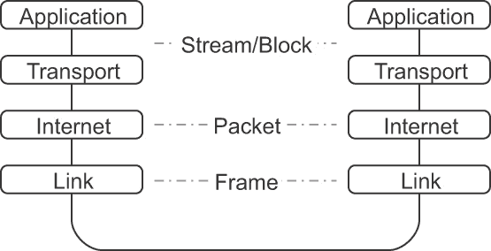

**Figure 3-1** *The Four-Layer DoD Model*

DoD 模型将跨网络传输信息的工作分为四个不同的功能，每个功能都可由众多协议之一执行。在 1980 年代后期，甚至到 1990 年代初期，认为每一层都有多个协议的想法被认为有些有争议。事实上，DoD 与 OSI 模型的原始版本之间的关键区别之一就是每一层拥有多个协议的概念。

在 DoD 模型中：
• **物理层**负责将 0 和 1 调制或序列化到物理链路上。每种链路类型对信号 0 或 1 都有不同的格式；物理层负责将 0 和 1 转换为物理信号。
• **互联网层**负责在不通过单个物理链路连接的系统之间传输数据。因此，互联网层提供网络范围的地址，而非链路本地地址，并且还提供某种发现必须跨越以到达这些目的地的设备和链路集合的方法。
• **传输层**负责在通信设备之间建立和维护会话，并为数据流或数据块提供通用透明的数据传输机制。流量控制和可靠传输也可能在此层实现，如 TCP 的情况。
• **应用层**是用户与网络资源之间的接口，或使用并向连接到网络的其他设备提供数据的特定应用程序。


应用层，尤其是在网络传输模型中，看起来格格不入。为什么使用数据的应用会被视为传输系统的一部分？因为早期的系统将*人类用户*视为数据的最终使用者，而应用主要被视为将数据处理成供实际用户呈现的方式。大量机器对机器的处理、在呈现给用户之前对数据进行大量处理，以及以数字格式简单存储信息等用例，甚至都没有被认为可行。当信息从一个人传输到另一个人时，应用只是被视为传输系统的一部分。

另外两点可能有助于理解为何包含应用层更合理。首先，在这些原始系统的设计中，有两个组件：终端和主机。终端实际上是一个显示设备；应用运行在主机上。其次，网络软件并没有被视为系统中的一个独立“事物”；路由器尚未被发明，也没有其他独立设备来处理和转发数据包。相反，一台主机只是连接到终端或另一台主机；网络软件只是在这些设备上运行的另一个应用。

随着时间的推移，OSI 模型变得更加常规使用，DoD 模型被修改以包含更多层。例如，在 Figure 3-2 中，复制自一篇关于 DoD 模型的 1983 年论文的图表，有七层（七对于某些原因来说是一个神奇的数字）。^(1)

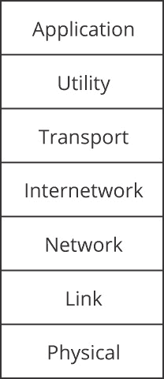

**Figure 3-2** *A Later Version of the DoD Model*

这里添加了三层：

• 实用层是一组位于更通用的传输层和应用之间 的协议。具体来说，简单邮件传输协议（SMTP）、文件传输协议（FTP）以及其他协议被视为该层的一部分。

• 四层版本中的网络层被划分为网络层和互联网络层。网络层代表在每种链路类型上使用的不同数据包格式，例如无线电网络和以太网（在 1980 年代初期仍然非常新）。互联网络层将运行在网络上的应用和实用协议的视图统一为单一的互联网数据报服务。

• 链路层被插入以区分信息在各种链路类型上的编码以及设备与物理链路的连接。并非所有硬件接口都提供链路层。

随着时间的推移，这些扩展的 DoD 模型失去了青睐；四层模型是今天最常引用的模型。其原因有几个：

• 在大多数情况下，实用层和应用层本质上是彼此的重复。FTP 例如是在传输控制协议（TCP）之上复用内容，而不是作为堆栈中单独的协议或层。TCP 和用户数据报协议（UDP）最终固化为传输层中的两个协议，其余一切（通常）运行在这两个协议之一之上。

• 随着主要用于转发数据包的设备（路由器和交换机）的发明，网络层和互联网络层之间的分离被事件克服。最初的区分主要是在低速长途（广域）链路和短程局域链路之间；路由器通常承担将链路安装到广域网络中的负担，从而使主机中的负担减轻，因此这种区分变得不那么重要。

• 某些接口类型根本没有办法将信号编码与主机接口分离，正如链路层和物理层分离中所设想的那样。因此，这两个层在 DoD 模型中通常被混杂成一个单一的“事物”。

DoD 模型在历史上很重要，因为

• 它是首次尝试将网络功能编纂成模型之一。

• 它是 TCP/IP 协议套件（全球互联网运行的基础）设计所依据的模型；该模型的痕迹对于理解 TCP/IP 协议设计的许多方面都很重要。

• 它在模型中“内置”了在任何特定层使用多个协议的概念。这为任何特定协议缩小焦点，同时允许许多不同协议在同一网络上同时运行的总体概念奠定了基础。

##### Open Systems Interconnect (OSI) Model

在 1960 年代延续到 1980 年代，主要的通信形式是交换电路；发送方会要求网络元素（交换机）将其连接到特定接收方，交换机完成连接（如果接收方未忙），然后流量会通过由此产生的电路传输。如果这听起来像传统的电话系统，这是因为它确实基于传统的网络系统（现在称为普通老式电话服务 \[POTS\])。大型电话和计算机公司深度投资于这种模型，并从围绕电路交换技术设计的系统获得大量收入。随着 DoD 模型（及其配套协议和概念）开始在研究人员中流行，这些既得利益者决定建立一个新的标准组织，该组织将构建一个提供“两者兼得”的替代系统。他们将融合分组交换的最佳元素，同时保留电路交换的最佳元素，创建一个将满足所有人的新标准。1977 年，这个新的标准组织被提议，并作为国际标准化组织（ISO）的一部分被采纳。

这个新的 ISO 工作组设计了一个分层模型，类似于拟议的（并被拒绝的）基于分组的模型，其基础是数据库通信。主要目标是允许在 1970 年代后期占主导地位的大型数据库为中心的系统之间进行互通。委员会在电信工程师和数据库派系之间分裂，使得标准变得复杂。开发的协议需要同时提供面向连接和无连接的会话控制，并发明整个应用套件来创建电子邮件、文件传输和许多其他应用（记住，*应用是堆栈的一部分)*。例如，需要规范各种传输模式来承载各种服务。1989 年——整整十年后——规范仍未完全完成。该协议尚未得到广泛部署，尽管许多政府、大型计算机制造商和电信公司支持它而非 DoD 协议堆栈和模型。

但在这十年里，DoD 堆栈继续发展；互联网工程任务组（IETF）成立以指导 TCP/IP 协议堆栈，主要面向研究人员和大学（当时所知的互联网不允许商业流量，直到 1992 年才允许）。随着 OSI 协议未能实现，许多商业网络和网络设备转向 TCP/IP 协议套件来“立即”解决现实世界的问题。

此外，由于 TCP/IP 协议堆栈的开发是由美国政府的拨款资助的，因此规范是免费的。事实上，由于大学和研究生为其研究工作需要实现，因此有大量系统可用的 TCP/IP 实现。OSI 规范只能以纸质形式从 ISO 本身购买，并且只能由 ISO 成员购买。ISO 被设计为“仅限会员”的俱乐部，旨在让既得利益者牢牢控制分组交换技术的发展。然而，该组织的“仅限会员”性质却对既得利益者不利，最终在他们衰落中发挥了作用。


OSI 模型尽管如此，对网络发展的推进做出了许多贡献；例如，对服务质量（`QoS`）和路由问题的细致关注在之后的几年里带来了回报。一个主要贡献是清晰模块化的概念；互连许多不同系统、且要求各不相同的复杂性，促使 OSI 社区呼吁明确的责任划分，以及各层之间定义良好的接口。

第二个贡献是机器对机器通信的概念。中间设备，当时称为网关，现在称为路由器和交换机，被明确地视为网络模型的一部分，如 Figure 3-3 所示。

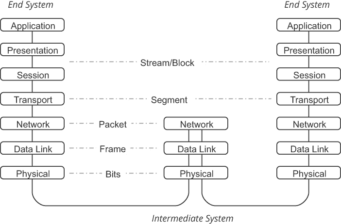

**Figure 3-3** *The OSI Model, Including the Concept of an Intermediate System*

你可能甚至不需要看这张图片就能记住 OSI 模型——每个上过网络课的人，或为网络工程认证做过准备的人，都熟悉使用七层模型来描述网络的工作方式。

以这种方式对网络建模的天才之处在于，它使各个部分之间的交互变得更容易看到和理解。每对层，垂直穿过模型，通过一个套接字，或应用程序编程接口（`API`）进行交互。因此，要连接到某个物理端口，数据链路层的一段代码将连接到该端口的套接字。这使得各层之间的交互可以被抽象化和标准化。网络层的一段软件不需要知道如何处理各种物理接口，只需要知道如何将数据传递给同一系统上的数据链路层软件即可。

每一层都有特定的功能需要执行。

物理层，也称为第 1 层，负责将 0 和 1 调制或序列化到物理链路上。每种链路类型对 0 或 1 的信号格式不同；物理层负责将 0 和 1 转换为这些物理信号。

数据链路层，也称为第 2 层，负责确保传输的信息实际上被发送到连接到同一链路的正确计算机。每台设备都有一个不同的数据链路（第 2 层）地址，可用于向特定设备发送流量。数据链路层假设信息流中的每个帧都与其他帧分离，并且仅为通过单个物理链路连接的设备提供通信。

网络层，也称为第 3 层，负责在不通过单个物理链路连接的系统之间传输数据。因此，网络层提供网络范围的（或第 3 层）地址，而不是链路本地地址，并且还提供某种手段来发现到达这些目的地的必须跨越的设备和链路集合。

传输层，也称为第 4 层，负责在不同设备之间透明传输数据。传输层协议可以是“可靠的”，这意味着传输层会重传在某一较低层丢失的数据，也可以是“不可靠的”，这意味着在较低层丢失的数据必须由某一较高层应用程序重传。

会话层，也称为第 5 层，并不真正传输数据，而是管理在两台不同计算机上运行的应用程序之间的连接。会话层确保数据的类型、数据的形式以及数据流的可靠性都被暴露并得到考虑。

表示层，也称为第 6 层，实际上以一种允许两台设备上的应用程序理解和处理数据的方式格式化数据。加密、流量控制以及为在应用程序和网络之间提供接口而对数据进行的任何其他操作都在此进行。应用程序通过套接字与表示层交互。

应用层，也称为第 7 层，提供用户与应用程序之间的接口，而应用程序则通过表示层与网络交互。

不仅可以在七层模型中以精确的术语描述层之间的交互，还可以精确地描述多台计算机上并行层之间的交互。可以说第一台设备的物理层与第二台设备的物理层通信，第一台设备的数据链路层与第二台设备的数据链路层通信，依此类推。就像设备上两层之间的交互通过套接字处理一样，不同设备上并行层之间的交互通过网络协议处理。

`Ethernet` 描述了将 0 和 1 的信号调制到物理电线上、数据帧的开始和停止格式，以及在连接到同一根电线的众多设备中寻址单个设备的方式。因此，`Ethernet` 在 OSI 模型中属于物理层和数据链路层（1 和 2）。

`IP` 描述了将数据格式化为数据包，以及寻址和其他将数据包跨越多个数据链路层链路发送以到达数跳之外的设备所需的手段。因此，`IP` 在 OSI 模型中属于网络层（3）。

`TCP` 描述了会话的建立和维护、数据重传以及与应用程序的交互。因此，`TCP` 在 OSI 模型中属于传输层和会话层（4 和 5）。

对于只接触过 TCP/IP 协议栈的工程师来说，更令人困惑的一点是，OSI 栈中设计的/为其设计的协议与设备交互的不同方式。在 TCP/IP 中，地址指的是接口（在网络大量虚拟化的世界中，多个地址可以指同一个接口，或指向一个任播服务，或指向一个组播数据流等）。然而在 OSI 模型中，每个设备只有一个地址。这意味着 OSI 模型中的协议通常以它们被设计用来连接的设备类型来命名。例如，承载网络中可达性和拓扑（或路由）信息的协议称为 *Intermediate System to Intermediate System*（`IS-IS`）协议，因为它在中间系统之间运行。还有一种协议旨在允许中间系统发现终端系统；这称为 *End System to Intermediate System*（`ES-IS`）协议（你没指望名字有*创意*，对吧？）。

**Note**

网络工程历史中令人悲伤的事实之一是，TCP/IP 协议套件的支持者对 OSI 协议套件产生了早期的反感，以至于拒绝了其开发过程中所学到的经验教训。虽然这在近年已大多淡化为一种较为温和的调侃，但因其起源而非技术优点而拒绝一种协议所浪费的岁月，是网络工程中谦逊的教训。关注思想，而非个人；从你能接触到的每个人和每个项目中学习；不要让你的自负妨碍更大的项目，或手头问题的解决。

##### Recursive Internet Architecture (RINA) Model

DoD 和 OSI 模型有两个共同的特定焦点：

• 它们都包含*应用层；* 这在网络工程早期世界的背景下是有意义的，因为应用程序和网络软件都是更大系统的一部分。

• 它们将数据应包含在哪里的概念与某一层实现何种目标的概念结合在一起。

这导致了一些奇怪的问题，例如


• `Border Gateway Protocol (BGP)`，它在两个模型中都在传输层之上运行，提供独立实体（自治系统）之间的路由（可达性）。这是否使其成为应用层协议？同时，该协议正在提供网络层运行所需的路由信息。这是否使其成为网络层协议？

• `IPsec` 向 Internet 协议（`IP`）头部添加信息，并规定了在网络上传输的信息的加密。由于 `IP` 是网络层，而 `IPsec`（某种程度上）在 `IP` 之上运行，这是否使 `IPsec` 成为传输协议？或者，由于 `IPsec` 与 `IP` 并行运行，它是网络层协议？

争论这些类型的问题可以在技术会议或标准会议上提供很多娱乐；然而，它们也指出了这些模型定义方式中存在一定程度的模糊性。这种模糊性来自于这些模型中形式与功能的精心混合；它们描述的是信息包含的位置、谁使用信息、对信息做了什么，还是为解决通过网络传输信息中的特定问题而需要满足的特定目标？答案是——以上所有。或者也许，*视情况而定*。

这导致了以下观察：任何数据承载协议实际上只能提供四种功能：传输、多路复用、差错校正和流量控制。如果这些听起来很熟悉，那应该是的——因为这些正是我们在 Chapter 2 “Data Transport Problems and Solutions” 中对人类语言的调查中发现的同样的四种功能。

在这四种功能中存在两种自然分组：传输和多路复用，差错和流量控制。因此大多数协议都属于做以下两件事之一：

• 协议提供传输，包括从一种数据格式到另一种数据格式的某种形式的转换；以及多路复用，协议保持来自不同主机和应用程序的数据分离的能力。

• 协议提供差错控制，要么通过纠正小错误的能力，要么通过重传丢失或损坏的数据；以及流量控制，它防止由于网络交付数据的能力与应用程序生成数据的能力不匹配而导致不必要的丢包。

从这个角度来看，`Ethernet` 提供传输服务和流量控制，因此它是一个集中于单个链路、端口到端口（或隧道端点到隧道端点）内的混合体。`IP` 是一种多跳协议（跨越一个以上物理链路的协议）提供传输服务，而 `TCP` 是一种使用 `IP` 传输机制的多跳协议，并提供差错校正和流量控制。Figure 3-4 说明了迭代模型。

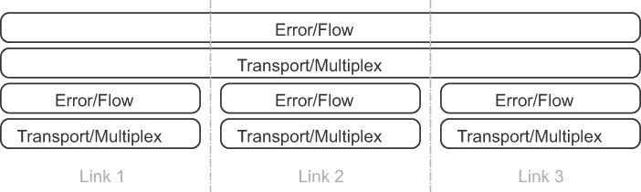

**Figure 3-4** *The RINA Model*

模型的每一层都有相同的两种功能之一，只是范围不同。该模型在网络协议工作中并未广泛流行，但它比七层或四层模型提供了对网络协议动态和操作的更简单视图，并且增加了范围的概念，这在考虑网络操作时至关重要。信息的范围是网络稳定性和弹性的基础。

##### Connection Oriented and Connectionless

迭代模型也再次将面向连接和无连接网络协议的概念带入了白天。

面向连接的协议在发送第一个数据位之前，先建立端到端连接，包括传输有意义数据所需的所有状态。状态可能包括诸如服务质量要求、流量通过网络的路径、将发送和接收数据的特定应用程序、可以发送数据的速率以及其他信息。一旦连接建立，数据就可以以非常小的开销传输。

另一方面，无连接服务将传输数据所需的数据与数据本身结合，在单个数据包（或协议数据单元）中携带两者。无连接协议只是将携带数据通过网络所需的状态分散到可能需要数据的每个设备，而面向连接的模型将状态限制在只需要了解特定数据包流的设备上。结果是，无连接网络中单个设备或链路故障可以通过将流量转移到另一条可能路径来修复，而不是重新做建立状态以继续从源到目的传输流量的所有工作。

大多数现代网络都是用无连接传输模型与面向连接的服务质量、差错控制和流量控制模型组合构建的。这种组合并不总是理想的；例如，服务质量通常沿特定路径配置以匹配应遵循这些路径的特定流。将服务质量视为比正在管理的实际流量流更面向连接的做法会导致网络理想状态与各种可能故障模式之间出现强烈的脱节。

##### Final Thoughts

了解多个模型，以及它们如何应用于各种网络协议，可以帮助你快速理解以前未遇到过的协议并诊断运营网络中的问题。了解协议模型的历史可以帮助你理解为什么特定协议被设计成那样，特别是协议设计者认为需要解决的问题，以及该协议最初设计时周围的协议。不同类型的模型以不同的方式抽象一组协议；了解多个模型，以及如何将一组协议适配到每个模型中，可以帮助你以不同的方式而不是单一方式理解协议操作，就像在绘画中看到一个花瓶与在三维展示中看到它大不相同。

特别重要的是无连接和面向连接协议的两个概念。这两个概念将是理解流量控制、错误管理以及许多其他协议操作的基础。

下一章将把这些模型应用于较低层的传输协议。

##### Further Reading

Cerf, Vinton G., and Edward Cain. “The DoD Internet Architecture Model.” *Computer Networks* 7 (1983): 307–18.

Day, J. *Patterns in Network Architecture: A Return to Fundamentals*. Indianapolis, IN: Pearson Education, 2007.

Grasa, Eduard. “Design Principles of the Recursive InterNetwork Architecture.” In *3rd FIArch Workshop*. Brussels, 2011. [`www.future-internet.eu/fileadmin/documents/fiarch23may2011/06-Grasa_DesignPrinciplesOTheRecursiveInterNetworkArchitecture.pdf`](http://www.future-internet.eu/fileadmin/documents/fiarch23may2011/06-Grasa_DesignPrinciplesOTheRecursiveInterNetworkArchitecture.pdf).

Maathuis, I., and W. A. Smit. “The Battle between Standards: TCP/IP Vs OSI Victory through Path Dependency or by Quality?” In *Standardization and Innovation in Information Technology, 2003. The 3rd Conference on*, 161–76, 2003. doi:10.1109/SIIT.2003.1251205.

Padlipsky, Michael A. *The Elements of Networking Style and Other Essays and Animadversions on the Art of Intercomputer Networking*. Prentice-Hall, 1985.

Russell, Andrew L. “OSI: The Internet That Wasn’t.” Professional Organization. *IEEE Spectrum*, September 27, 2016. [`spectrum.ieee.org/tech-history/cyberspace/osi-the-internet-that-wasnt`](https://spectrum.ieee.org/tech-history/cyberspace/osi-the-internet-that-wasnt).

White, Russ, and Denise Donohue. *The Art of Network Architecture: Business-Driven Design*. 1st edition. Indianapolis, IN: Cisco Press, 2014.

##### Review Questions


1. 研究本章所述的三种网络模型之前出现的 X.25 栈中的协议。X.25 协议栈是否显示出分层设计？X.25 栈中的每个协议分别适合 DoD 和 OSI 模型的哪一层？你能用 RINA 模型描述每个协议吗？

2. 研究 IBM Systems Network Architecture（SNA）栈中的协议，该栈也早于本章所述的三种网络模型。SNA 协议栈是否显示出分层设计？SNA 栈中的每个协议分别适合 DoD 和 OSI 模型的哪一层？你能用 RINA 模型描述每个协议吗？

3. 计费在某些协议栈和模型中被考虑（如 X.25 栈），而在其他模型中则没有。你认为这可能是为什么？考虑 IP 和 X.25 栈中网络利用率的使用方式，特别是以带宽与数据包作为主要度量系统的使用。

4. 分层网络模型如何有助于网络协议栈的模块化？

5. 分层网络模型如何提高工程师对网络工作原理的理解？

6. 绘制比较 DoD 和 OSI 模型的图表。一种模型中的每一层是否能整齐地对应到另一种模型？

7. 考虑 OSI 和 RINA 模型；你能找出 RINA 模型中的哪些服务适合 OSI 模型中的哪一层吗？

8. 结合 State/Optimization/Surface 模型，考虑协议操作的无连接与面向连接模型，特别是就状态和优化而言。你能解释在面向连接模型中添加状态如何增加网络资源的最佳利用？它如何降低网络资源的最佳利用？

9. 在较早的网络模型中，应用程序通常被视为协议栈的一部分。然而，随着时间的推移，应用程序似乎已在很大程度上从网络协议栈中分离出来，并被视为网络服务的“用户”或“消费者”。你能想到终端主机设计相对于运行在终端主机上的应用程序的某种特定转变，会导致网络工程思维的这种转变吗？

10. 你认为从协议设计角度来看，固定长度的数据包（或帧，或单元）比可变长度数据包更有意义吗？与固定长度格式相比，可变长度数据包格式增加了多少状态？获得了多少优化？回答这个问题的一个有用出发点是全球互联网中传输的平均数据包长度的列表或图表。

1. Cerf and Cain, “The DoD Internet Architecture Model.”

### 第 4 章
#### 下层传输

###### 学习目标

阅读本章后，你应该能够：

理解以太网用于防止单根物理线路上多个发送器之间发生冲突的机制

理解以太网网络中物理地址是如何分配的

理解以太网网络中的半双工和全双工工作模式

理解 802.11 WiFi 用于防止多个发送器之间发生冲突的机制

理解调制、空间复用和波束成形的概念

数据传输协议通常是分层的，其中下层沿单跳提供服务，一组中间层在两个设备之间提供端到端服务，并且可能有一组层在两个应用程序之间或单个应用程序的两个实例之间提供端到端服务。Figure 4-1 进行了说明。

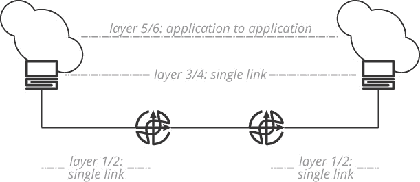

**Figure 4-1** *Transport Layers*

每组协议都显示为一对协议，因为——如上一章中递归互联网架构（RINA）模型所示——传输协议通常成对出现，每对中的每个协议承担特定的功能。本章将考虑物理和数据链路协议，如 Figure 4-1 所示。具体而言，本章将考虑两种广泛用于网络中点到点传输的协议：以太网和 WiFi（802.11）。

##### Ethernet

许多早期设计用于让多台计算机共享单根线路的机制都基于从更偏向电话的技术中采用的设计。它们通常侧重于令牌传递和其他更确定性的方案，以确保两个设备不会同时尝试使用同一共享电气介质。以太网由在 1970 年代初由 Bob Metcalf 发明（当时他在 Xerox 工作），以不同方式解决重叠的说话者——通过非常简单的一组规则来防止大多数重叠传输，然后通过检测和退避来解决任何重叠传输。

任何与物理介质交互的协议的初始关注点都将集中在复用领域，因为在解决第一个问题之前，很少有其他问题可以解决。因此，本节将首先描述以太网的复用组件，然后再转向其他操作方面。

##### Multiplexing

要理解以太网在刚发明时面临的复用问题，请考虑以下问题：在共享介质网络中，整个共享介质是一个单一的电气电路（或线路）。

当一台主机传输数据包时，网络上的每台其他主机都会接收到信号。这很像在开放空气环境中进行的对话；通过公共介质（空气）传输的声音会被每个听众听到。在传输过程中，没有物理方法可以限制听众的集合。

####### CSMA/CD

由此产生的系统称为载波侦听多路访问/冲突检测（Carrier Sense Multiple Access with Collision Detection，CSMA/CD），其操作使用一组步骤：

1. 主机*侦听*介质以查看是否有正在进行的传输；这是该过程的载波侦听部分。

2. 在听到没有其他传输正在进行时，主机会开始将帧中的位串行化到线路上。

这部分很简单——只需在传输前侦听。当然，正如 Figure 4-2 所示，两个（或更多）主机的传输可能会发生碰撞。

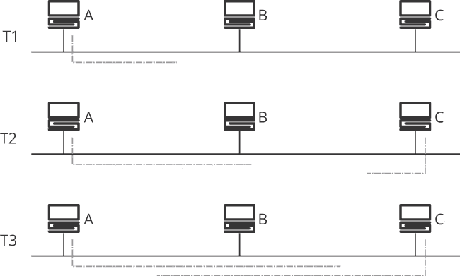

**Figure 4-2** *Collisions in a Shared Medium*

在 Figure 4-2 中：

1. 在时间 1（T1），A 开始向共享介质传输帧。信号从线路一端传播到另一端需要一定的时间；这称为传播延迟。

2. 在时间 2（T2），C 侦听线路上的信号，未检测到信号后开始向共享介质传输帧。此时碰撞已经发生，因为 A 和 C 同时传输帧，但它们尚未检测到碰撞。

3. 在时间 3（T3），两个信号实际上在线路上发生碰撞，导致它们都变得畸形，因而无法读取。

当 C 的信号到达 A 时，A 可以通过在传输到线路上的同时侦听自己的信号来检测碰撞。C 的信号到达 A 时，A 会接收到由两个信号组合产生的畸形信号（碰撞的结果）。这是 CSMA/CD 操作中的*冲突检测*部分（CD 部分）。


##### 主机检测到冲突时应做什么？

在原始的 `Ethernet` 设计中，主机将发送一个足够长的 `jam signal`，以迫使连接到线路上的任何其他主机感知到冲突并停止传输。`jam signal` 的长度最初被设定为，使其消耗的时间至少等于在整条线路长度上传输一个最大尺寸帧所需的时间。为什么是这个特定的时间？

• 如果在确定 `jam signal` 传输时间时使用的是小于最大帧的帧，那么具有较旧接口（无法同时发送和接收）的主机在传输单个大帧时实际上可能会完全错过整个 `jam signal`，从而使 `jam signal` 失效。

• 必须留出足够的时间，让连接到线路最末端的主机接收到 `jam signal`，以便它们感知到冲突并采取以下步骤。

一旦接收到 `jam signal`，连接到线路上的每个主机都会设置一个退避计时器，以便它们在再次尝试传输前各等待一段随机时间。由于这些计时器被设置为随机数，当两个有帧等待传输的主机尝试下一次传输时，冲突不应再次发生。

如果连接到单根线路上的每个主机在大致相同的时间内（考虑到线路的传播延迟）接收到相同的信号，那么某个特定主机如何知道它是否应该实际接收某个特定帧（或者说，将帧中的信息从线路复制到本地内存）？这是媒体访问控制（`MAC`）地址的工作。

每个物理接口都被分配（至少）一个 `MAC` 地址。每个 `Ethernet` 帧都包含源和目的 `MAC` 地址；帧的格式使得目的 `MAC` 地址在任何数据之前被接收。一旦整个目的 `MAC` 地址被接收，主机就可以决定是否应继续接收该数据包。如果目的地址与接口地址匹配，主机将继续从线路复制信息到内存。如果目的地址与本地接口地址不匹配，主机 simply 停止接收该数据包。

##### Ethernet 芯片组、广播、多播和混杂模式

`Ethernet` 的基本功能要求 `Ethernet` 芯片组不仅能够接收发往本地 `MAC` 地址的流量，而且 `Ethernet` 芯片组还必须能够接收发往其他 `MAC` 地址的流量。例如，`Ethernet` 芯片组还应接受发送到 `broadcast address` 的任何数据包，因为发送到 `broadcast address` 的帧 intended for *连接到物理介质的每台设备*。`Ethernet` 芯片组必须能够接受的第二类地址是 `multicast addresses`。一组特定的 `MAC` 地址被保留用于作为 `multicast addresses`；该范围内的每个地址称为一个组，因为它可用于向一组 *监听者* 发送单个帧。

因此，每个 `Ethernet` 芯片组都是设计成具有可编程的地址集，芯片组可以被指示监听这些地址。如果芯片组必须监听的地址集大于为存放此地址表而预留的空间，`Ethernet` 芯片组可以被设置为 `promiscuous mode`，这意味着它将把每条 `Ethernet` 帧从线路复制到内存中。

为什么不直接将所有 `Ethernet` 芯片组都设置为 `promiscuous mode`，以便每台主机都能接收到每个帧？因为这会将确定哪些帧需要在本地处理的任务从 `Ethernet` 芯片组（硬件）转移到在帧完全复制到内存后处理这些帧的软件。将每帧都从线路复制下来，并将匹配工作推给软件，会产生几个负面影响：

• 匹配软件必须在某处运行；这个地方几乎总是同时运行系统上所有其他软件的通用处理器。在主处理器上确定哪些帧需要在本地处理或不处理会占用其他进程的周期，降低整个系统和软件的运行速度。

• 从线路复制下来的帧必须在等待处理时存储在某处；这通常是某种内存。用于存储等待处理的包的内存将无法供其他应用程序使用。同样，这会对整体系统性能产生负面影响。

• 在软件中确定哪些帧需要在本地处理，比在硬件中做出此判断要慢得多。正因如此，复制每帧到内存的系统的包处理速率会远低于在硬件中进行部分匹配的系统。软件匹配包也会降低主机上网络接口的效率。

鉴于这些缺点，是否 ever 有意义将设备的 `Ethernet` 芯片组配置为 `promiscuous mode`？至少有两种情况是合理的：

• 当设备是 `router` 时，这意味着它必须接收特定接口上传输的大多数流量，以确定每个接收到的包是否需要转发。路由器的操作将在 `Chapter 7` 中更全面地考虑，“Packet Switching。”

• 当设备正在监控网络时。在这种情况下，必须捕获每个包以查看流经线路的所有流量。这类设备通常用于排除网络操作、协议操作故障，或监控网络性能。

重复的 `MAC` 地址怎么办？如果连接到同一介质的多个主机具有相同的物理地址，它们将各自接收并可能处理相同的帧。检测重复 `MAC` 地址的方法是存在的，但这些方法作为层间发现的一部分实现，而不是 `Ethernet` 本身；这些将在 `Chapter 6` 中考虑，“Interlayer Discovery。” `Ethernet` 本身假设

• 如果 `MAC` 地址是手动分配的，则 `MAC` 地址将由系统管理员正确分配。

• `MAC` 地址将由设备制造商分配，因此无论有多少主机相互连接，都不会出现重复的 `MAC` 地址。

###### Note

由于 `MAC` 地址通常在每个 `router` 处被重写（有关更多信息，请参阅 `Chapter 7`），因此它们只需在段或广播域内唯一。虽然许多旧系统力求确保每个段或广播域的唯一性，但这通常必须通过手动配置来强制执行，因此在很大程度上已被放弃，转而尝试为每个设备提供一个在创建 `Ethernet` 芯片组时“固化”的全局唯一的 `MAC` 地址。

第一种解决方案在大多数大规模网络中难以实现；现实世界中手动配置 `MAC` 地址极为罕见，几乎不存在。第二种选项本质上意味着 `MAC` 地址必须分配给单个设备，以便世界上没有任何两个设备共享相同的 `MAC` 地址。这是如何实现的？通过从由标准组织管理的中央存储库分配 `MAC` 地址。`Figure 4-3` 说明了这一点。

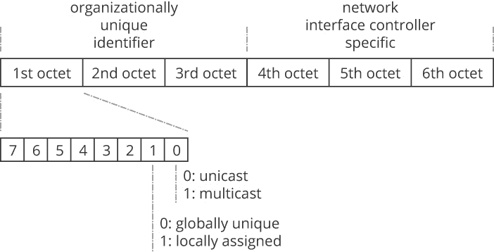

**Figure 4-3** *`MAC-48/EUI-48` Address Format*


MAC 地址被分为两个部分：组织唯一标识符（`OUI`）和 *网络接口标识符*。网络接口标识符由以太网芯片组的制造商分配。生产以太网芯片组的公司，其组织标识符则由电气和电子工程师学会（`IEEE`）分配。只要一个组织（或制造商）始终为其芯片组分配的地址在 MAC 地址的前三个八位组中使用其 `OUI`，并且不在 MAC 地址的后三个八位组中为两个设备分配相同的网络接口标识符，*任何以太网芯片组的任意两个 MAC 地址都不应相同*。

`OUI` 空间中的两个位被保留下来，用于指示 MAC 地址是否由本地分配（这意味着制造商分配的 MAC 地址已被设备的配置覆盖），以及 MAC 地址是否 intended 为以下其中一种：

• 单播地址，表示单个接口

• 组播地址，表示一组接收器

MAC 地址由 48 位组成；去掉这两个位后，MAC 地址空间为 46 位，这意味着它可以描述 2⁴⁶—或 70,368,744,177,664—个可寻址接口。由于这（潜在地）不足以应对诸如蓝牙耳机和传感器等新可寻址设备数量的快速增长，MAC 地址的长度被增加到 64 位，从而创建了 EUI-64 MAC 地址，其构造方式与较短的 48 位 MAC 地址相同。这些地址可以支持 2⁶²—或 4,611,686,018,427,387,904—个可寻址接口。

##### CSMA/CD 的终结

以太网部署的共享介质模型在大多数网络中已基本（尽管并非完全！）被取代。不同于共享介质，现在大多数以太网部署都是交换式的，这意味着单个电气电路或单根电线被多个电路分割开来，通过将每个设备连接到交换机上的一个端口来实现。 Figure 4-4 进行了说明。

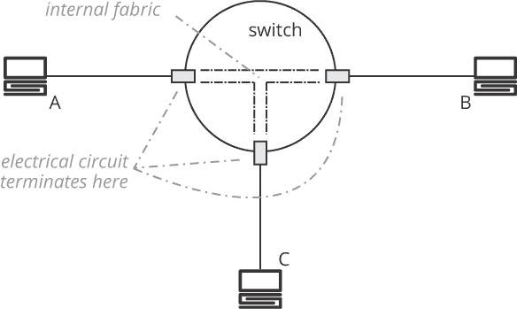

**Figure 4-4** *Switched Ethernet Network Operation*

在 Figure 4-4 中，每个设备都连接到不同的电线组，所有电线都终止于同一个交换机。如果三个主机（A、B 和 C）的网络接口以及交换机网络接口可以在同一时刻发送或接收，而不是同时进行两者，则 A 可以在交换机同时发送时发送。在这种情况下，即使只有两个发送器连接到同一根电线上，也必须仍然遵循 CSMA/CD 过程以防止冲突。这种操作模式称为半双工。

如果以太网芯片组能够同时收听和传输以检测冲突，则情况可以改变。最简单的方法是将接收和发送信号放在以太网电缆中使用的电线集内的 *不同物理电线* 上。使用不同的电线意味着两个连接系统之间的传输不可能发生冲突，因此芯片组可以同时传输和接收。为了启用这种称为全双工的操作模式，双绞线以太网在一条线对上传输一个方向的信号，在另一组电线上传输相反方向的信号。在这种情况下，就不再需要 CSMA/CD 了。

**Note**

交换机必须学习哪个设备（主机）连接到每个端口，该系统才能正常工作；在交换网络中了解可达目的地的学习过程在 Chapter 15，“Distance Vector Control Planes” 中进行了讨论。

##### 错误控制

CSMA/CD 的设计目的是防止以太网中一种可检测的错误：当冲突导致帧格式错误时。 然而，与任何其他电气或光学系统一样，其他类型的错误也可能渗入信号中。例如，在双绞线布线系统中，如果在安装连接器时双绞线被“解开”太多，一根电线可以通过磁干扰将其信号传输到另一根电线上，从而导致串扰。随着信号沿电线传输，它可以到达电线的另一端并沿电线长度反射回来。

以太网如何控制这些错误？原始以太网标准在每个帧中都包含 32 位循环冗余校验（`CRC`），可以检测传输中大量错误，如 Chapter 2，“Data Transport Problems and Solutions” 中所述。 然而，在更高速度下，以及在光学（而非电气）传输机制上，`CRC` 可能无法检测到足够多的错误以影响协议的操作。为了提供更好的错误控制，后期（更快）的以太网标准已包含更强大的错误控制机制。

例如，千兆以太网指定了一种 8B10B 编码方案，旨在确保发送方和接收方时钟的正确同步；该方案还可以检测一些位错误。 十千兆以太网通常在硬件中实现 Reed-Solomon 编码纠错（`EC`）系统和 16B18B 编码系统，该系统提供良好的前向纠错（`FEC`）和时钟同步，额外开销为 18%。

**Note**

8B10B 编码方案试图确保数据流中 0 和 1 位的数量大致相同，这允许高效的激光利用并提供时钟同步嵌入信号中。该方案通过将 8 位数据（8B）编码为线路上传输的 10 位（10B）来工作，这意味着每个传输字符的开销约为 25%。单比特奇偶校验错误可以被检测和纠正，因为接收方知道应该接收多少个 0 和 1。

##### 数据编组

以太网以 *数据包* 和 *帧* 的形式传输数据；数据包由前导信息、帧和任何尾随信息组成。帧包含一个报头，由固定长度字段组成，以及所携带的数据。 Figure 4-5 说明了以太网数据包；帧也被标出。

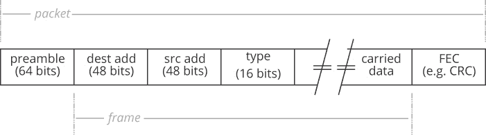

**Figure 4-5** *An Ethernet Packet and Frame*

在 Figure 4-5 中，前导码包含帧开始标记、接收方可用于将其时钟与传入数据包同步的信息以及其他信息。目的地址在前导码之后立即接收，因此接收方可以快速决定是否将此数据包复制到内存中。地址、协议类型和所携带的数据都是帧的一部分。最后，任何 `FEC` 信息和其他尾部信息被添加到帧上，以构成数据包的最终部分。

类型字段尤其值得关注，因为它为上层协议——提供数据字段中携带的信息的协议——提供了识别协议的信息。此信息对以太网是透明的——以太网芯片组不知道如何解释此信息（只知道它在哪里），以及如何携带它。如果没有此字段，就没有一致的方式让所携带的数据被分发到正确的上层协议，或者说，让多个上层协议正确地复用到以太网帧中，然后正确地解复用。

###### 流量控制


在以太网原始的 CSMA/CD 实现中，共享介质本身提供了一种基本流量控制机制。假设没有两个主机可以同时传输，并且由某些上层协议传输的信息必须至少偶尔得到确认或回复，则发送方必须定期暂停以接收任何确认或回复。有时会出现这种粗糙的流量控制形式不起作用的情况；以太网规范假定某个更高层协议将控制信息流以防止此类情况下的故障。

在交换式全双工以太网中，没有 CSMA/CD，因为没有共享介质。连接到一对传输通道的两个主机可以尽可能快地发送数据，速度取决于线路的允许速度。实际上，这可能导致主机接收到的数据超过其处理能力。为了解决这个问题，为以太网开发了暂停帧。当接收方发送暂停帧时，发送方应停止发送流量一段时间。

暂停帧并未得到广泛部署。

**注意**

许多协议不包含作为递归互联网架构（RINA）模型中描述的四个功能全部，递归互联网架构（RINA）模型在第 3 章，“建模网络传输”中描述：错误控制、流量控制、传输和复用。即使在实现全部四个功能的协议中，这四个功能也并非总是部署。通常，在这种情况下，协议和/或网络设计师将该功能交给堆栈中较低或较高的层处理。这在某些情况下确实有效，但你应始终小心不要假设这是正确的做法。例如，逐跳加密和端到端加密之间存在差异。端到端加密对加密的应用和协议来说是好的，但并非每个应用实际上都会加密传输的数据，也不是每个主机都配置了加密传输。在这些情况下，逐跳加密在不安全的链路（如无线连接）上可能很有用。

##### 无线 802.11

通常被称为并作为 *WiFi* 营销，802.11 广泛部署用于在美国未许可的 2.4 和 5GHz 无线电频谱中传输无线数据。微波炉、雷达系统、蓝牙、一些业余无线电系统，甚至婴儿监视器也使用 2.4GHz 无线电频谱，因此 WiFi 既可能干扰这些其他系统，也可能受到这些其他系统的干扰。

###### 复用

802.11 规范通常使用一种频率复用形式，通过单个信道或一组频率承载大量信息。信号的频率只是信号在单秒内极性切换的速率；因此 2.4GHz 信号是一种电信号，通过电线、光纤或空气传输，其极性在每秒 2.4 × 10⁹ 次之间从正到负（或从负到正）切换。

**注意**

这些是最基本的描述；如果你愿意，可以研究整个无线电和波传播领域；这里的目标是给你足够的信息来理解基本概念，而不会让你不知所措。

要理解无线信号的概念，最好从载波和调制的概念开始；图 4-6 进行了说明。

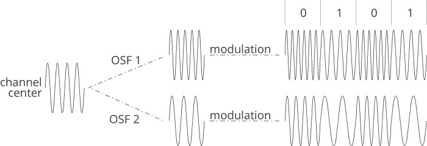

**图 4-6** *使用频率调制的正交信道*

在 图 4-6 中，选择一个单一的中心频率；信道将是该中心频率两侧的一系列频率。在由此产生的信道内，选择两个载波频率，使它们彼此正交——这意味着在这些两个载波频率上承载的信号不会相互干扰。它们在图中标记为 *OSF 1* 和 *OSF 2*。每个载波频率本身实际上是一个更窄的信道，允许将 0 和 1 的实际信号调制到该信道上。调制，在这种情况下，意味着围绕每个 OSF 频率改变信号的实际频率。

**注意**

调制仅仅意味着以某种方式修改载波，使信号能够被承载，以便接收方能够可靠地解码它。

因此，802.11 规范使用正交频分复用（OFDM）方案，并使用频率调制（FM）对实际数据进行编码。

**注意**

复用令人困惑的一点是它有两个含义，而不是一个。或者它意味着将多个比特同时放置在同一介质上，或者它意味着允许多个主机同时使用同一介质进行通信。哪种含义是 intended 只能在特定上下文中理解。在本节中，含义是第一个，将单个介质分解为信道以允许同时传输多个比特。在本书的大部分其余部分中，它意味着第二个，允许多个主机通过同一介质传输数据。

可以在此类系统上传输数据的速度（带宽）直接取决于每个信道的宽度以及发射机选择正交频率的能力。因此，为了提高 802.11 的速度，应用了两种不同的技术。第一种方法只是增加信道宽度，以便可以使用更多载波频率来承载数据。第二种方法是找到更有效的方法将数据打包到单个信道中，通过使用更复杂的调制方法。例如，802.11b 可以在 2.4GHz 范围内使用 40MHz 宽的信道，而 802.11ac 可以在 5GHz 范围内使用 80 或 160MHz 宽的信道。

####### 空间复用

在 802.11 规范系列中，还使用了其他形式的复用来在两个设备之间获得更多带宽。802.11n 规范引入了多输入多输出（MIMO）天线阵列，允许信号通过单个介质（空气）沿不同路径传播。这似乎不可能，因为房间里只有一个“空气”，但无线信号实际上会从房间内的不同物体反射，导致它们通过空间的路径是多条的。图 4-7 进行了说明。

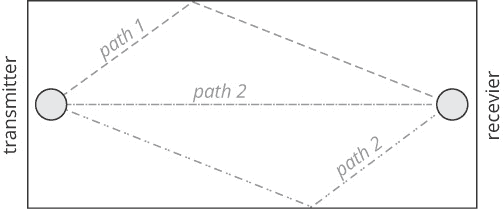

**图 4-7** *单个房间内的多条路径*

在 图 4-7 中，假设发射机使用的是全向天线（向所有方向发射），则在单个空间中有三条路径，标记为 1、2 和 3。发射机和接收机无法“看到”三条单独的路径，但它们可以测量每对天线之间的信号强度，并尝试在看似分离的天线对之间发送不同的信号，直到找到多条可以在其上传输不同数据集的路径。

天线可以使用的第二种方式是波束成形。通常，从天线发射的无线信号覆盖一个圆形（在三维中是一个球体，但这很难有意义地说明）。在波束成形中，波束使用各种技术之一进行塑形，使其更细长。图 4-8 说明了这些概念。

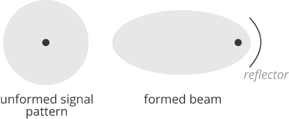

**图 4-8** *波束形成*


在未成形的模式中，信号大致呈围绕天线尖端的球体或球状；从顶部绘制时，看起来很像一个简单的圆，延伸到球形的最远点。通过使用反射器，可以将波束塑造成更细长的形状。反射器后面的空间以及波束两侧的空间将接收到较少的（或甚至为零，对于非常集中的波束）传输功率。如何构建这样的反射器？最简单的方法是使用一个调谐为排斥信号功率的物理屏障，就像镜子反射光线，或墙壁反射声音一样。关键在于物理屏障放置在传输信号中的位置。Figure 4-9 将用于解释波形、反射和抵消的关键点。

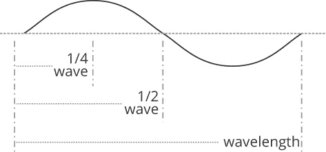

##### Figure 4-9 A Signal Waveform

典型的波形遵循正弦波，它从零功率开始，增加到最大正功率，然后回到零功率，然后经历一个正负功率循环。其中每一个都是一个周期；频率指的是每秒重复此循环的次数。波在空间中、沿着导线或光纤的整个长度称为波长。波长与频率成反比；频率越高，波长越短。

本图中需要注意的关键点是信号在四分之一波长和半波长点处的状态。在四分之一波点处，信号处于最高功率；如果在该点有物体或另一个信号干扰，信号将被吸收或反射。在半波点处，信号处于最小功率；如果信号上没有偏移或恒定电压，信号将达到零功率。因此，要反射信号，可以将物理物体放置在四分之一波点处反射功率。实现这一点所需的物理距离当然取决于频率，就像波长取决于频率一样。

物理反射器很容易；如果您想在不使用物理反射器的情况下动态形成波束怎么办？Figure 4-10 说明了您可以在这里使用的原理。

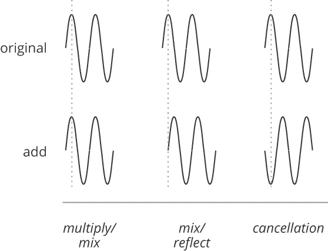

##### Figure 4-10 Combinations of signals

Figure 4-10 中的浅灰色虚线提供了一个相位标记；如果它们的峰值对齐，则两个信号同相，如左侧所示。中间显示的两个信号相差四分之一相位，因为一个信号的峰值与第二个信号的零点或最小值对齐。右侧最远处显示的第三对信号是互补的，或相差 180 度，因为一个信号的正峰值与另一个信号的负峰值对齐。第一对信号会相加；第三对信号会抵消。第二对信号如果制作正确，可能会相互反射。这三种效应允许波束形成，如 Figure 4-11 所示。

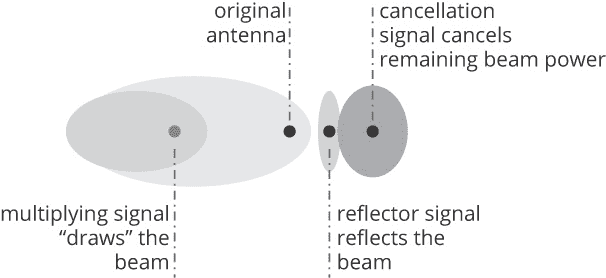

##### Figure 4-11 Beamforming

单个波束成形系统可能使用或不使用所有这些组件，但总体思路是在介质内的物理空间内限制波束——通常是自由空间传播。波束成形允许共享的物理介质用作多个不同的通信信道，如 Figure 4-12 所示。

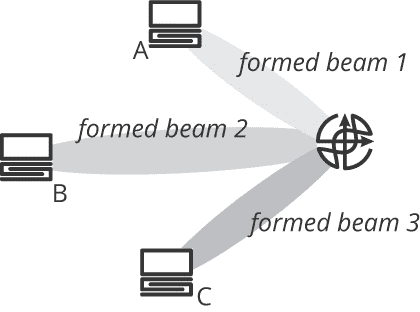

##### Figure 4-12 Beamforming and Spatial Multiplexing

在 Figure 4-12 中，无线路由器已利用其波束成形功能形成了三个不同的波束，每个波束指向不同的主机。现在路由器可以在这三个成形波束上发送流量，速率高于将其整个空间视为单个共享介质的情况，因为发送给 A 的信号不会与发送给 B 或 C 的信息发生干扰或重叠。

**Note**

诸如波束成形之类的定向方法仅改善一个方向传输的流量。例如，如果无线接入点能够进行波束成形，而与其通信的主机不能，则两个设备能够通信的距离将受主机限制，因为它无法发送定向信号。然而，物理距离并不总是波束成形技术中的重要点。无线信号能够承载的信息量与功率以及其他因素有关；接收端接收到的功率越大（不是发射功率，而是接收功率），能够传输的信息就越多。因此，如果接入点可以形成波束，使其向主机提供的功率是主机返回接入点的两倍，它将增加主机通过无线链路下载数据的速度。因此，在无线连接的一端（而非另一端）使用波束成形可能是值得的。是否值得，答案总是“取决于”—取决于应用、流量模式以及许多其他因素。

##### Channel Sharing

无线信号中的复用问题涉及共享单个信道，就像有线网络系统一样。设计用于共享单个无线介质的解决方案中占主导地位的两个具体问题是隐藏节点问题和传输/接收功率问题（有时也称为接收机淹没）。Figure 4-13 说明了隐藏节点问题。

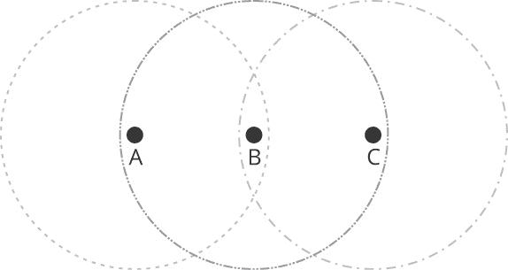

##### Figure 4-13 The Hidden Node Problem in Wireless Networks

Figure 4-13 中的三个圆圈代表 A、B 和 C 处无线发射机的三个重叠范围。如果 A 向 B 传输，C 听不到该传输。即使 C 监听信道是否空闲，A 和 C 也可能同时传输，导致在 B 处发生碰撞。

隐藏节点问题因传输功率与接收信号功率的差异以及空气作为介质的现实而变得更糟。关于空气中无线电信号强度的经验法则是信号每传播一个波长的空间就会损失一半功率。在高频下，信号衰减非常快，这意味着发射机必须以比其接收机能够接收的功率大一个数量级的功率发送信号。

很难构建一个接收机，能够在不破坏接收电路的情况下“监听”全功率的本地发射信号，同时还能“听到”延长设备范围所需的极低功率信号。换句话说，发射机用足以在许多情况下破坏接收机的功率淹没接收机。这使得在无线网络中发射机无法在传输信号时监听该信号，因此使得以太网（例如）中使用的碰撞检测机制无法实现。

`802.11` 用于在多个发射机之间共享单个信道的机制必须避免隐藏信道和接收机淹没问题。`802.11` WiFi 使用载波侦听多路访问/冲突避免 (`CSMA/CA`) 来协商信道使用。`CSMA/CA` 与 `CSMA/CD` 类似：

1. 在传输之前，发送方监听以确定是否有其他设备正在传输。
2. 如果听到其他传输，发送方会在尝试再次传输之前退避一段随机时间；这种随机退避旨在防止多个设备听到同一传输，并在未来的某个时间点同时尝试再次传输。
3. 如果没有听到其他传输，发送方会传输整个帧；发送方无法接收其正在传输的信号，因此无法在此点检测到碰撞。


4\. 接收方在收到帧后会发送确认；如果发送方未收到确认，它将假设发生了冲突，等待随机一段时间，然后重新发送该帧。

某些 WiFi 系统还可以使用请求发送/清除发送（`RTS/CTS`）系统。在这种情况下：

1\. 发送方发送 `RTS`。

2\. 当信道空闲且没有其他传输被安排时，接收方发送 `CTS`。

3\. 在收到 `CTS` 后，发送方传输数据。

哪个系统会产生更高的带宽取决于使用该信道的发送方和接收方的数量、帧的长度以及其他因素。

##### 数据编组、差错控制和流量控制

`802.11` 中的数据编组与以太网类似；每个数据包中有一组固定长度的报头字段，其后是传输的数据，最后是一个四字节的帧校验序列（`FCS`），其中包含对数据包内容的 CRC。如果接收方可以根据 CRC 信息纠正错误，它就会这样做；否则，接收方 simply 不会确认收到该帧，这将导致发送方重传该帧。

每个帧中还包含一个序列号，以确保数据包按发送顺序接收和处理。流量控制在 `RTS/CTS` 系统中通过接收方等待发送 `CTS` 直到它有足够的空闲缓冲区空间来接收新数据包来实现。

##### 吞吐量与有效吞吐量

大多数链路的容量以带宽来衡量，但带宽只是决定可以通过链路推送的数据量的因素之一。第二层需要考虑的因素是流量控制和信道效率。例如，在以太网中，如果发生冲突，信道效率会略有下降，因此传输的总数据量将低于可用的理论带宽。这种第二种度量，即在特定链路或信道上实际可以传输的数据总量，通常称为吞吐量。它与带宽一样，以每秒位数来衡量。实际通过信道传输的数据中还有第三组变量需要考虑：包括差错校正码在内的各种报头占用的吞吐量。实际通过链路传输的用户数据的量称为有效吞吐量，通常比带宽低很多。例如，对于 `54Gb/s` `802.11` 链路，实际有效吞吐量可能在 `22Gb/s` 范围内。当设计网络的速度和吞吐量时，你需要关注的就是这个有效吞吐量；带宽会给出理论最大值，但如果你计划用一条 `54Gb/s` 链路来处理包含 `50Gb/s` 数据的流，你可能会对结果感到失望。

##### 关于底层传输协议的最终思考

底层传输协议往往以物理问题为主导，例如主机如何知道何时访问信道，以及如何最有效地使用信道？四个要素仍然很重要。复用，例如，仍然需要地址来确定特定帧正在传输到哪个主机。换句话说，复用包含寻址 *和* 其他为解决仅在与物理信道交互时才会出现的问题而设计的解决方案。

这些底层协议中的许多解决方案也被假定为“第一道防线”，而不是“唯一防线”。物理层的差错控制往往比在更高层实现的机制更简单，这意味着这些机制检查速度更快，但也可能允许一些错误通过，需要在更高层检测和纠正。在这些层中，流量控制侧重于控制单个链路上的流量，并且通常是信道访问的副作用，而不是显式的控制机制。

总体而言，物理层距离应用最远，通常是网络设计师关注最少的；然而这些协议仍然很重要，它们仍然遵循与更高层协议相同的问題和解决方案模式。

##### 延伸阅读

Correa, Colt, Charles M. Kozierok, Robert B. Boatright, Jeffrey Quesnelle, and Bob Metcalfe. *Automotive Ethernet—The Definitive Guide*. Intrepid Control Systems, 2014.

Gast, Matthew S. *802.11 Wireless Networks: The Definitive Guide*. 2nd edition. Beijing; Farnham: O’Reilly Media, 2005.

———. *802.11n: A Survival Guide: Wi-Fi Above 100 Mbps*. 1st edition. Sebastopol, CA: O’Reilly Media, 2012.

Geier, Jim. *Designing and Deploying 802.11 Wireless Networks: A Practical Guide to Implementing 802.11n and 802.11ac Wireless Networks for Enterprise-Based Applications*. 2nd edition. Indianapolis, IN: Cisco Press, 2015.

McLaughlin, Steven W., and David Warland. “Error Control Coding and Ethernet.” presented at the IEEE 802.3 EFM Study Group, Portland, OR, July 10, 2017. [`http://www.ieee802.org/3/efm/public/jul01/presentations/mclaughlin_1_0701.pdf`](http://www.ieee802.org/3/efm/public/jul01/presentations/mclaughlin_1_0701.pdf).

Metcalfe, Robert M., and David R. Boggs. “Ethernet: Distributed Packet Switching for Local Computer Networks.” *Communications of the ACM* 19, no. 7 (July 1976): 395–404.

Perahia, Eldad, and Robert Stacey. *Next Generation Wireless LANs: 802.11n and 802.11ac*. 2nd edition. Cambridge, UK: Cambridge University Press, 2013.

Potter, Bruce, and Bob Fleck. *802.11 Security*. 1st edition. Sebastopol, CA: O’Reilly Media, 2002.

Rouzic, Jean-Pierre Le. *IEEE 802.11ac: An Analysis of the Standard*. CreateSpace Independent Publishing Platform, 2013.

Spurgeon, Charles E., and Joann Zimmerman. *Ethernet Switches: An Introduction to Network Design with Switches*. 1st edition. Beijing: O’Reilly Media, 2013.

———. *Ethernet: The Definitive Guide: Designing and Managing Local Area Networks*. 2nd edition. Beijing: O’Reilly Media, 2014.

Tropper, Carl. *Local Computer Network Technologies*. Elsevier, 2014.

##### 复习问题

1\. 光调制与本章描述的电调制有何不同或相似之处？

2\. 在无线电波上，你通常会使用不同频率的不同信道在单一介质上承载多个信号（例如无线网络中的空气，甚至在某些有线网络中的电线）。用于“信道化”光传输介质的机制是什么，它是如何工作的？

3\. 本章指出复用必须经常在解决数据传输中的其他问题之前得到解决。为什么会这样？

4\. 以太网最初设计用于在细同轴电缆和粗同轴电缆（`10BASE5` 和 `10BASE2`）上运行。是否可能在同轴电缆上实现全双工操作？为什么或为什么不？

5\. 本章指出暂停帧在以太网中并未广泛部署。在什么条件下需要暂停帧，为什么它不再被广泛部署？

6\. 鉴于音频也是通过空气传播的波，似乎不同相位信号之间的混合、相乘和抵消交互也可能以类似的方式适用于音频工程。找到一个解释音频设计中这些相同问题影响的网站，并描述音频工程师用来解决这些问题的一些解决方案。

7\. 有很多种方法可以构建定向信号。例如，碟形天线如何塑造无线信号？一种常用的波束成形天线类型是周期对数偶极子（`LPD`）。这种天线是如何工作的？这种天线在无线网络中会有用吗？

8\. 查找一些有线和无线链路类型的有效吞吐量。它们差异很大吗？你能解释为什么吗？


9. 以太网规范旨在允许全球制造的每个设备都具有不同的 `MAC addresses`。本章提到了需要网络运营商手动为以太网设备配置地址的旧版本和设备。你能用 `state`、`optimization` 和 `surfaces` 的术语描述这两种选择之间的权衡吗？尝试找出解决该问题的每种可能方式的积极和消极方面。

10. 本章指出以太网芯片组将被分配至少一个地址，这意味着某些芯片组可能被分配多个地址。描述至少两种单芯片需要拥有多个 `MAC address` 的用例。

### Chapter 5
#### Higher Layer Data Transports

**Learning Objectives**

阅读本章后，你应该能够：

了解互联网协议 (`IP`) 的历史和运行方式

了解 `IP` 的目的

了解 `IP` 地址和聚合的概念

了解 `IP` 头部的结构

了解传输控制协议 (`TCP`) 的运行方式

了解通过滑动窗口进行拥塞控制的基础知识

了解 `QUIC` 的运行方式

了解互联网控制报文协议 (`ICMP`) 的目的

上一章考虑了两种通过物理介质进行点对点数据传输的示例，本章将考虑四种端到端数据传输的示例。 Figure 5-1 以递归互联网架构 (`RINA`) 的术语进行了说明。

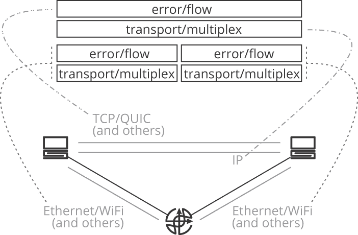

**Figure 5-1** *Transport Protocol Examples, Protocol Function, and RINA*

当然，并非每个传输协议都能精确映射到 `RINA` 中的单个功能层，但映射足够接近以便有用。需要记住的主要一点是——对于每个传输协议，你可以提出四个问题：

• 协议如何提供传输，或如何编组数据？
• 协议如何提供多路复用服务，或在单个共享资源上承载多条数据流的能力？
• 协议如何提供差错控制，这应不仅包括差错检测，还包括通过重传或提供足够信息来重建原始信息来解决错误？
• 协议如何提供流量控制？

每个问题都可以有若干子问题，例如发现最大传输单元 (`MTU`)、为多播提供数据包复制等。

本章将考虑四种协议：

• 互联网协议 (`IP`)，它提供了第二对层的下半部分。`IP` 的主要关注点在于用于多路复用的寻址方案，以及提供跨多种不同物理传输系统的单一传输的能力。
• 传输控制协议 (`TCP`)，它提供了第二对层的上半部分的一个版本。`TCP` 提供差错和流量控制，以及用于在 `TCP` 之上运行的应用程序和其他协议的多路复用信息承载位置。
• 快速用户数据报协议互联网连接 (`QUIC`)，它提供了第二对层的上半部分的另一个版本。`QUIC` 在功能上与 `TCP` 非常相似，但在操作方式上与 `TCP` 有一些显著差异。
• 互联网控制报文协议 (`ICMP`)。

#### The Internet Protocol

互联网协议 (`IP`) 最初在 1970 年代中期由 Jonathan B. Postel 主笔的一系列名为 *IENs* 的互联网协议规范文档中记录。这些文档描述了一种名为 `TCP` 的协议，当它最初部署时，包含了两个协议 `IP` 和 `TCP` 的功能。Postel 注意到将这种功能组合在单个协议中不是一件好事；在 `IEN #2` 中，他指出：

我们在设计互联网协议时违反了分层原则而犯了错误。具体来说，我们试图让 `TCP` 做两件事：充当主机级端到端协议，并充当互联网打包和路由协议。这两件事应该以分层和模块化的方式提供。我建议需要一个新的独立的互联网络协议，并且 `TCP` 应该严格用作主机级端到端协议。我还认为，如果 `TCP` 仅以这种更清晰的方式使用，它可以稍微简化。还必须指定第三项——互联网主机到主机协议与互联网逐跳协议之间的接口。^1

`IEN #28` 于 1978 年 2 月发布，指定了这个新互联网协议的版本 2。^2 这很快被 1978 年 6 月的 `IEN #48` 取代，^3) 再次被 1978 年 9 月的 `IEN #54` 取代。^4) 在 1980 年 1 月，`IP` 成为 IETF 协议，随着 `RFC760` 的发布，该协议也被称为 `IEN #128`，^5) 并于 1981 年 9 月通过 `RFC791` 的更新成为当前规范。^6) 在这一点上，今天仍在使用的 `IP` 版本 4 (`IPv4`) 头部格式已确定。

**Note**

本书中未深入介绍 `IPv4`；虽然它被广泛部署，但将考虑 `IP` 协议的版本 6，因为工程师在未来更有可能遇到这种协议。出于同样的精神，本书中的所有示例也将使用版本 6 格式的地址。“进一步阅读”部分列出了希望了解更多 `IPv4` 信息的读者感兴趣的资源。

`IPv4` 地址空间是一个 32 位无符号整数，这意味着它可以编号或寻址 `2³²` 台设备——约 42 亿台设备。这听起来很多，但现实情况因以下几个原因而大不相同：

• 每个地址代表一个 *接口*，而不是一台 *设备*。事实上，`IP` 地址通常用于表示一个 *服务*，或一个 *虚拟主机*（或 *机器*），这意味着单台设备通常会消耗多个 `IP` 地址。
• 大量地址在聚合过程中被浪费。

在 1990 年代初期，很明显互联网将在 `IPv4` 地址空间中耗尽地址；Figure 5-2 所示的图表显示了从 1990 年代中期开始随时间推移的可用 `IPv4` 地址空间。^7)

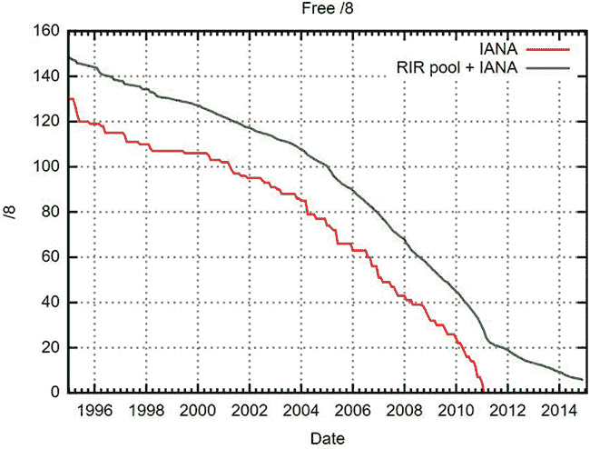

**Figure 5-2** *IPv4 Address Space Usage over Time*

解决这一情况的简单方法将是扩展 `IPv4` 地址空间以涵盖更多设备，但对 `IPv4` 协议在现场的经验促使互联网工程任务组 (`IETF`) 承担更大的任务：重新设计 `IPv4`。该替代方案的工作始于 1990 年，第一份草案于 1998 年达到标准状态。`IPv6` 地址空间包含 `2¹²⁸` 个地址，约 3.4 ×10³⁸。

`IPv6` 设计用于为多种协议提供服务，例如 `TCP` 和 `QUIC`，这些协议将在本章后面的章节中讨论。因此，`IPv6` 仅提供在网络中传输数据的四个必需服务中的两个：传输，包括编组数据，以及多路复用。这两个功能将在以下各节中更详细地讨论。

##### Transport and Marshaling

`IP` 在许多不同类型的物理链路上为大量更高层协议提供“基础层”。为此，`IP` 必须解决两个问题：

• 在大量不同的物理和下层协议上运行，同时向高层提供一致的服务集合


##### 适应底层提供的各种帧大小

为了创建一个所有上层协议都可以在其上运行的单一协议，`IP` 必须“适配”多种不同物理层协议的帧类型。

一系列草案描述了如何在特定物理层之上运行 `IP`，包括 `MPEG-2` 网络、^(8) `Asynchronous Transfer Mode`、^(9) 光网络、^(10) `Point-to-Point Protocol (PPP)`、^(11) 电视中的 `Vertical Blanking Interval (VBI)`、^(12) `Fiber Distributed Data Interface (FDDI)`、^(13) 鸟类信使、^(14) 以及许多其他物理层协议（请参阅下文“进一步阅读”部分）。这些草案主要说明了如何在底层物理层的帧（或数据包）中承载 `IP` 数据报（或数据包），以及如何使层间发现，例如 `Address Resolution Protocol (ARP)` 在每种媒体类型上工作（请参阅 Chapter 6，“Interlayer Discovery，”了解更多信息）。

`IP` 还必须指定如何在不同物理链路上可用的各种 `MTUs` 上承载大块数据。虽然原始 `Ethernet` 规范选择了 1,500 字节的 `MTU` 来在较大数据包大小和最大信道利用率之间取得平衡，但许多其他物理层是设计为具有更大的 `MTUs`。此外，应用程序往往不会以整齐的 `MTU` 大小块发送信息。`IP` 通过提供分片来解决这两个问题；Figure 5-3 进行了说明。


**Figure 5-3** *Fragmentation in IPv6*

如果应用程序（或更高层协议）传递 2,000 字节的数据供 `IP` 传输，则 `IP` 实现将

- 确定数据必须通过的路径上的 `MTU`；这通常是读取系统软件设置的配置或默认值的问题
- 根据 `MTU` 减去头部的预计大小，包括隧道头部等——必须与数据一起传输的元数据，将信息分解为多个片段
- 发送第一个分片，其中带有 `IPv6` 可选头部（这意味着对于不是较大数据块的分片的数据包，无需包含分片头部）
- 将 more fragments 头部中的 `offset` 设置为原始数据块中此数据包表示的第一个字节除以 8；在 Figure 5-3 中的示例中，第一个数据包的偏移量为 0，而第二个数据包的偏移量为 150（1200/8）。
- 如果这是数据块的最后一个分片，则将 more fragments 位设置为 0，如果后面还有更多分片，则设置为 1。

`IPv6` 可以通过分片携带的总数据块大小受 *offset* 字段大小的限制，该字段长 13 位。因此，`IPv6` 最多可以携带 2¹⁴ 字节的数据作为一系列分片，或约 65,536 字节加上一个 `MTU` 大小的分片的数据块。任何更大的数据都需要在传递给 `IPv6` 进行传输之前以某种方式由更高层协议分解。

最后，`IP` 必须提供一种在网络中使用多种物理层类型时承载数据包的方法。这是通过在网络中可能互连多种媒体类型的每个跳上重写下层头部来解决的。以这种方式重写下层头部的设备最初被称为网关，但现在通常称为路由器，因为它们根据 `IP` 头部中包含的信息路由流量。分组交换在 Chapter 7，“Packet Switching” 中进行了更详细的考虑。

`IPv6` 承载数据的方式还有一些其他有趣的方面；Figure 5-4 说明了一个可供参考的 `IPv6` 头部。


**Figure 5-4** *The IPv6 Header Format*

在 Figure 5-4 中：

- **`version`** 设置为 6，表示 `IPv6`。
- **`traffic class`** 分为两个字段，6 位用于承载服务类型（或服务类别），2 位用于承载拥塞通知。`Quality of Service (QoS)` 在 Chapter 8，“Quality of Service” 中进行了更详细的考虑。
- **`flow label`** 设计为提示，用于告诉转发设备如何在等价成本多路径（`ECMP`）路径集中沿同一路径保持单个流中的数据包。
- **`payload length`** 指示数据包中承载的数据量，以字节为单位。
- **`next header`** 提供有关数据包中包含的任何额外头部的信息。`IPv6` 头部可以包含超出基本头部所包含的信息；这些可选头部将在后面的部分中更详细地讨论。
- **`hop limit`** 是此数据包在被丢弃之前可以被网络设备“处理”的次数。任何重写下层头部的路由器（或其他设备）都应在转发过程中将此数字递减一；当跳数限制达到 0 或 1 时，应丢弃数据包。

**Note**

跳数用于防止数据包在网络中无限循环。每次网络设备转发数据包时，跳数都会递减一。如果跳数达到 0，则数据包将被丢弃。如果数据包在网络内循环，跳数（也称为生存时间，或 `TTL`）最终将被减少到 0，数据包将被丢弃。

`IPv6` 头部是可变（类型长度值 [`TLV`]) 和定长信息的混合。基本头部由定长字段组成，但 *next header* 字段为可选（或扩展）头部留下了可能性，其中一些头部被格式化为 `TLVs`。这允许构建定制硬件（例如，专用集成电路 [`ASIC`]）来基于定长字段快速交换数据包，同时仍有可能携带可能仅在软件中处理的变长数据。

##### Multiplexing

`IPv6` 以两种不同的方式实现多路复用：

- 通过提供一个用于标识主机和网络（或更广泛地说，可达目的地）的庞大地址空间
- 通过提供一个空间供上层协议放置协议号，从而允许多个协议在 `IPv6` 之上运行

##### IPv6 Addressing

`IPv6` 地址为 128 位，这意味着可以有高达 2¹²⁸ 个地址——一个庞大的数字，足以可能为地球上的每一粒尘埃编号。`IPv6` 地址通常写成一系列十六进制数字，而不是写成一系列 128 个 0 和 1，如 Figure 5-5 所示。


**Figure 5-5** *IPv6 Address*

`IPv6` 地址格式中关于零的两个要点值得注意：

- 每个部分（以冒号分隔）中的前导零被省略。
- 地址中一个长串零可以用双冒号替换一次（不能两次）。

**Note**

当网络中的每个地址都以相同的数字集开头时，*有时* 仅包含变化的部分以缩短地址。例如，在具有 2001:db8:3e8:100::1 和 2001:db8:3e8:101::2 的网络中，这两个地址可能被称为 100::1 和 101::2，而不是重复整个地址。你需要从上下文中填补地址的其余部分，例如网络图，或对地址的某些早期提及等。

为什么需要这么多地址？因为在任何寻址方案中，许多地址从未被使用。


*首先*，许多地址从未被使用，因为地址会被聚合。聚合是指使用单个前缀（或网络，或可达目的地）来表示更大数量的可达目的地；图 5-6 对此进行了说明。


**图 5-6** *IPv6 中的地址聚合*

在 图 5-6 中：

• 主机 A 和 B 分别被分配了 `101::1` 和 `101::2` 作为其 IPv6 地址。然而，这两个主机连接在同一个广播段（例如以太网）上，因此在 C 处共享同一个接口。即使 C 在此共享网络上有一个地址，它实际上还是通告网络本身——一些工程师认为将其视为 *线路本身*——作为可达目的地：`101::/64`。

• E 接收到两个可达目的地，来自 C 的 `101::/64` 和来自 D 的 `102::/64`。通过减小前缀长度，它可以通告一个包含这两个 *更长前缀* 可达目的地的单个可达目的地。E 通告 `100::/60`。

• G 依次从 E 接收到 `100::/60`，从 F 接收到 `110:/60`。同样，此地址空间可以用单个可达目的地 `100::/56` 来描述，因此 G 通告的就是这个。

这种聚合在实际地址空间中是如何工作的？图 5-7 用于解释。


**图 5-7** *IPv6 地址中的聚合与可达目的地*

前缀长度，即可达目的地中斜杠后的数字，告诉你有多少位在确定前缀的一部分（因此也确定非前缀部分）时起作用。前缀长度从左到右计数。任何在前缀长度范围内数值相同的地址集合都被视为属于同一个可达目的地。

• 完整的 IPv6 地址空间有 128 位，因此 `/128` 表示单个主机。

• 在具有 64 位前缀长度（`/64`）的地址中，只有 IPv6 地址左侧的四个段属于前缀，或可达目的地；其余部分，即 IPv6 地址右侧的四个段，被假定为“包含”在前缀中的主机或子网地址。

• 在具有 60 位前缀长度（`/60`）的地址中，IPv6 地址左侧的四个段 *减去一个* 十六进制数字被视为可达目的地，或前缀的一部分。

• 在具有 56 位前缀长度（`/56`）的地址中，IPv6 地址左侧的四个段 *减去两个* 十六进制数字被视为可达目的地，或前缀的一部分。

**注意**

只要你始终以 4 的增量更改前缀长度（`/4`、`/8`、`/12`、`/16` 等），有效数字，或前缀的一部分的数字，始终会向右移动（当你增加前缀长度时）或向左移动（当你减小前缀长度时）。

聚合有时看起来很复杂，但它是 IP 的一个重要组成部分。

部分地址空间被用于自动配置。虽然自动配置在此未详细讨论，但自动配置与 IPv6 地址分配之间的交互是需要考虑的重要问题。通常必须预留一定量的地址空间，以确保连接到网络的任何两个设备都不会最终获得相同的标识符。在 IPv6 的情况下，地址空间的一半（大于 `/64` 的所有内容），在某些地址范围内，被预留出来以形成每个设备的唯一标识符。

*第三*，一些地址被保留用于特殊用途。例如，在 IPv6 中，以下地址空间被分配给某些特殊用途：

• `::ffff/96` 被保留用于“映射到”IPv6 地址空间的 IPv4 地址。

• `fc00::/7` 被保留用于唯一本地地址（ULA）；具有这些地址的数据包并不打算在全球互联网上路由，而是保留在单个组织的网络内。

• `fe80::/10` 被保留用于链路本地地址；这些地址在每个接口上自动分配，并且仅用于在单个物理或虚拟链路上进行通信。

• `::/0` 被保留用作默认路由；如果网络设备不知道到达特定目的地的任何其他方式，它将把流量转发到默认路由。

*第四*，设备可以被分配多个地址。许多工程师倾向于将地址视为描述单个主机或系统的东西。实际上，单个地址可用于描述许多事物，包括

• 单个主机或系统

• 主机或系统上的单个接口；具有多个接口的主机将具有多个地址

• 主机或系统上的可达服务集合；例如，虚拟机或在主机上运行的特定服务可能被分配一个与主机接口分配的任何地址不同的地址

地址与物理设备之间，或地址与物理接口之间没有必要的直接关联。

##### 进程间复用

第二种复用机制是允许多个协议在同一基础层上运行。这种形式的复用是通过协议号提供的；图 5-8 对此进行了说明。


**图 5-8** *IPv6 中的协议号*

下一个报头字段指向

• 如果 IPv6 数据包中存在下一个报头，则指向下一个报头

• 如果下一个报头是传输协议（如 TCP），则指向协议号

这些附加报头称为可选或扩展报头；其中一些是定长的，其他的是 TLV 为基础的；例如：

• **逐跳选项：** 一组 TLV，描述每个转发设备应采取的操作

• **路由：** 一组定长路由类型，用于指示数据包应通过网络采取的路径

• **分片：** 一组定长字段，提供数据包分片信息（如上所述）

• **认证报头：** 一组包含认证和/或加密信息的 TLV

• **巨型报文：** 一个可选的数据长度字段，使 IPv6 数据包能够携带多达 4GB 减一字节的数据

下一个报头字段长度为 8 位，这意味着它可以携带 0 到 255 之间的数字。此范围内的每个数字都被分配给特定类型的选项报头或特定更高层协议。例如：

• `0:` 下一个报头是 IPv6 逐跳选项。

• `1:` 数据包有效载荷是互联网控制报文协议（ICMP）。

• `6:` 数据包有效载荷是 TCP。

• `17:` 数据包有效载荷是用户数据报协议（UDP）。

• `41:` 数据包有效载荷是 IPv6。

• `43:` 下一个报头是 IPv6 路由报头。

• `44:` 下一个报头是 IPv6 分片报头。

• `50:` 下一个报头是封装安全报头（ESH）。

协议号由接收主机用于将数据包的内容分发给正确的本地进程进行处理；通常，这意味着剥离数据包的下层（物理）报头，将数据包放入正确进程（如 TCP）的输入队列中，然后通知操作系统相关进程需要运行。

##### 传输控制协议

TCP 的主要目标是在 IP 之上提供看似面向连接的传输。作为更高层协议，它依赖于 IPv6 的寻址和复用能力将信息携带到正确目的主机。因此，TCP 不需要地址方案。TCP 的重点在于流量和错误控制，在下面的各节中讨论。对 TCP 端口号的简短介绍完成了对 TCP 的讨论。

###### 流量控制

TCP 使用滑动窗口方法来控制两个主机之间每个连接的信息流；图 5-9 对此进行了说明。


##### 图 5-9 *滑动窗口*

在 图 5-9 中，假设初始窗口大小设为 20。事件序列如下

• 在 *t1* 时，发送方传输 10 个数据包或八位字节（在 TCP 的情况下，是 10 个八位字节的数据）。

• 在 *t2* 时，接收方确认这 10 个八位字节，窗口被设为 30。这意味着发送方现在被允许在等待另一个确认之前发送多达 30 个八位字节的数据；换句话说，发送方可以在必须等待确认以发送更多数据之前发送到第 40 个八位字节。

• 在 *t3* 时，发送方发送另外 5 个八位字节的数据，编号为 11–15。

• 在 *t4* 时，接收方确认收到到 15 的八位字节，窗口被设为 40 个八位字节。

• 在 *t5* 时，发送方发送约 20 个八位字节的数据，编号为 16–35。

• 在 *t6* 时，接收方确认 35，窗口被设为 50。

关于此技术需要注意的几个重要点如下：

• 当接收方确认收到某一特定数据时，它隐式地也确认了在此数据之前的所有内容都已收到。

• 如果接收方未发送确认——例如发送方在 *t5* 时发送 16–35，而接收方未发送确认——发送方将等待一段时间并假设数据从未到达，因此会重传数据。

• 如果接收方确认发送方已传输的部分数据，但并非全部，发送方会假设部分数据丢失，并从接收方已确认的点开始重传。例如，如果发送方在 *t6* 时传输了 16–35，而接收方确认了 30，则发送方应重传 30 及之后的数据。

• 窗口在发送方和接收方均设置；这将在后面的章节中更详细地解释。

TCP 不使用八位字节编号，而是为每次传输分配一个序列号；当接收方确认特定序列号时，发送方假定接收方实际上已收到该序列号传输为止的所有信息八位字节。对 TCP 而言，序列号充当了一组八位字节的“简写”。图 5-10 进行了说明。

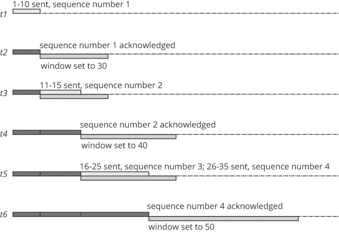

##### 图 5-10 *带序列号的窗口流控*

在 图 5-10 中：

• 在 *t1* 时，发送方将八位字节 1–10 捆绑并传输，标记为序列号 1。

• 在 *t2* 时，接收方确认序列号 1，隐式确认收到八位字节 1–10。

• 在 *t3* 时，发送方将八位字节 11–15 捆绑在一起并传输，标记为序列号 2。

• 在 *t4* 时，接收方确认序列号 2，隐式确认已发送到 15 的八位字节。

• 在 *t5* 时，假设 10 个八位字节可放入单个数据包；在这种情况下，发送方将发送两个数据包，一个包含 16–25，序列号为 3，另一个包含八位字节 26–35，序列号为 4。

• 在 *t6* 时，接收方确认序列号 4，隐式确认所有先前传输的数据。

以下各节将针对 TCP 使用的窗口流控方案讨论各种问题。

###### 如果丢失一个信息包会怎样？

如果 100 个数据包的流中第一个数据包未被接收会怎样？使用 图 5-10 中描述的系统，接收方只需不确认此第一个信息包，迫使发送方稍后重传数据。然而这效率低下；每个丢失的数据包都需要从该数据包开始完全重发。TCP 实现使用两种不同的方法允许接收方请求单个数据包。

*第一种方法* 是三次重复确认。如果接收方三次确认一个早于最近确认的序列号的包，发送方会假设接收方要求重传该包。采用三次重复确认是为了防止乱序数据包交付或丢弃的数据包导致错误的重传请求。

*第二种方法* 是实现选择性确认（SACK）。^(15) SACK 在 TCP 确认中增加了一个新字段，允许接收方确认特定一组序列号的接收，而非假设对单个序列号的确认也确认了所有更低的序列号。

###### 发送方在重传前等待多久？

发送方检测到数据包丢失的第一种方式是通过重传超时（`RTO`），它被计算为往返时间（`RTT` 或 `rtt`）的函数。`rtt` 是发送方传输数据包与从接收方收到确认之间的时间间隔。`rtt` 衡量从发送方到接收方的网络延迟、接收方的处理时间以及从接收方到发送方的网络延迟。请注意，`rtt` 可能因数据包在网络中经过的路径、交换时当地条件等而变化。

`RTO` 通常被计算为加权平均值，其中较旧的 `rtts` 对结果的影响小于最近测量的 `rtts`。

大多数 TCP 实现中使用的另一种替代机制是 **快速重传**。在快速重传中，接收方在任何确认中将期望的序列号加一。例如，如果发送方传输序列号 10，接收方确认序列号 11，*即使它尚未收到序列号 11*。在这种情况下，确认中的序列号确认了数据的接收并指示它期望发送方接下来传输的序列号。

如果发送方连续三次收到序列号比上次确认的序列号大一的确认，它将假设后续数据包已被丢弃。

因此，在实现快速启动时，TCP 中存在两种 *类型* 的数据包丢失。第一种是标准超时，即发送方传输数据包，但在 `RTO` 到期前未收到确认。这称为 `RTO` 失败。第二种称为快速重传失败。这两种情况通常以不同方式处理。

###### 窗口大小如何选择？

选择窗口大小有许多不同的考虑因素，但主导因素通常是在避免链路拥塞的同时获得尽可能高的性能。事实上，TCP 拥塞控制可能是全球互联网中实际部署的主要拥塞控制形式。为了理解 TCP 拥塞控制，最好从一些定义开始：

• **接收窗口（`RWND`）**：接收方愿意接收的数据量；该窗口通常根据接收方的缓冲区大小或接收方可用的其他资源设置。这是 TCP 头部中通告的窗口大小。

• **拥塞窗口（`CWND`）**：发送方在收到确认之前愿意发送的数据量。该窗口不会在 TCP 头部中通告；接收方不知道 `CWND` 的大小。

• **慢启动阈值（`SST`）**：发送方认为连接在网络上未发生拥塞的情况下达到最大数据包速率时的 `CWND`。`SST` 最初由实现设置，并在发生数据包丢失时根据使用的拥塞避免机制进行更改。


大多数 TCP 实现使用慢启动算法开始会话。^16 在此阶段，`CWND` 从 1、2 或 10 开始。对于收到的每个段的确认，`CWND` 的大小增加 1。鉴于此类确认不应比单个 `rtt` 长太多，慢启动应使窗口每个 `rtt` 翻倍。窗口将以此速率继续增加，直到出现以下任一情况：数据包丢失（接收方未能确认数据包）、`CWND` 达到 `RWND`，或 `CWND` 达到 `SST`。一旦出现这三种条件中的任何一种，发送方将进入拥塞避免模式。

**Note**

如何通过为每个收到的 ACL 增加 `CWND` 1 来使窗口每个 `rtt` 翻倍？思路如下：当窗口大小为 1 时，你应在每个 `rtt` 收到一个段。当你将窗口大小增加到 2 时，你应在每个 `rtt` 收到 2 个段；到 4 时，应收到 4 个，等等。由于接收方会单独确认每个段，并且每次确认一个段时将窗口增加 1，因此它应在第一个 `rtt` 中确认 1 个段，并将窗口设置为 2；在第二个 `rtt` 中确认 2 个段，将窗口增加 2，设置为 4；在第三个 `rtt` 中确认 4 个段，将窗口增加 4，窗口大小设置为 8，等等。

在拥塞避免模式下，`CWND` 每个 `rtt` 增加一次，这意味着窗口大小的增长停止呈指数增长，而改为线性增长。`CWND` 将继续增长，直到接收方未能确认数据包（`TCP` 认为这意味着数据包已丢失或被丢弃），或直到 `CWND` 达到 `RWND`。`TCP` 实现在数据包丢失时响应的两种广泛部署的方式称为 *Tahoe* 和 *Reno*。

**Note**

实际上 Tahoe 和 Reno 存在许多不同的变体；这里仅考虑最基本实现。连接处于拥塞避免模式时，对数据包丢失的反应也有许多不同方法；“进一步阅读”部分包含有关其中一些其他方法的资料来源。

如果实现使用 Tahoe，并且通过快速重传发现数据包丢失，它会将 `SST` 设置为当前 `CWND` 的一半，将 `CWND` 设置为其原始值，并再次开始慢启动。这意味着发送方将再次传输 1、2 或 10 个序列号，并在确认每个序列号时增加 `CWND`。与慢启动过程开始时一样，这会使 `CWND` 每个 `rtt` 翻倍。一旦 `CWND` 达到 `SST`，`TCP` 将重新进入拥塞避免模式。

如果实现使用 Reno，并且通过快速重传发现数据包丢失，它会将 `SST` *和* `CWND` 都设置为当前 `CWND` 的一半，并继续在拥塞避免模式下运行。

在任一实现中，如果因为接收方在 `RTO` 内未发送确认而发现数据包丢失，则 `CWND` 被设置为 1，并使用慢启动将连接速度恢复。

##### Error Control

`TCP` 提供两种形式的错误检测和控制：

• 协议本身以及窗口机制确保数据按顺序且不丢失地传递给应用程序。

• `TCP` 头部中包含的 one's complement 校验和被认为比循环冗余校验（`CRC`）和其他许多形式的错误检测要弱。这种错误检查是对协议栈中下层和上层提供的错误校正的补充，而不是替代。

如果接收方检测到校验和错误，它可以使用此处描述的任何机制请求发送方重传数据——简单地不确认数据的接收、通过 `SACK` 请求重传、通过快速重传主动 *不* 确认数据的接收，或为包含损坏数据的特定段发送三次重复确认。

##### TCP Port Numbers

`TCP` 本身不直接管理任何形式的复用；然而，它确实提供了端口号，供协议栈中 `TCP` 之上的应用程序和协议使用以进行复用。虽然这些端口号是 *在* `TCP` 中携带的，但它们通常对 `TCP` 来说是 *不透明的*；`TCP` 对这些端口号没有附加任何含义，只是将信息分发到接收主机上的正确应用程序。

`TCP` 端口号分为两个大类：众所周知和临时。众所周知的端口是作为上层协议规范的一部分定义的；这些端口是这些应用程序的“默认”端口。例如，支持简单邮件传输协议（`SMTP`）的服务通常可以通过使用 `TCP` 连接到端口号 25 的主机找到。支持超文本传输协议（`HTTP`）的服务通常可以通过使用 `TCP` 连接到端口 80 的主机找到。这些服务不 *一定* 需要使用这些端口号；大多数服务器可以配置为使用与协议规范中指定的端口号不同的端口号。例如，不打算供一般（或公众）使用的 Web 服务器可能会使用其他 `TCP` 端口，例如 8080。

临时端口仅对本地主机有意义，通常从本地主机上可用端口号池中分配。临时端口最常用作 `TCP` 连接的源端口；例如，主机连接到服务器上端口 80 的服务时，会使用临时端口作为其源 `TCP` 端口。只要任何特定主机对任何 `TCP` 连接仅使用一次给定的临时端口号，任何网络上的每个 `TCP` 会话都可以通过源地址、源端口、目的地址、目的端口以及运行在 `TCP` 之上的协议编号唯一标识。

##### TCP Session Setup

`TCP` 使用三次握手来建立会话：

1. 客户端向服务器发送同步（`SYN`）。该数据包是正常的 `TCP` 数据包，但在 `TCP` 头部中设置了 `SYN` 位，表示发送方请求与接收方建立会话。该数据包通常发送到众所周知的端口号，或客户端知道服务器将在特定 IP 地址上监听的某个预先安排的端口号。该数据包包含客户端的初始序列号。

2. 服务器发送对 `SYN` 的确认，即 `SYN-ACK`。该数据包确认客户端提供的序列号加一，并将服务器的初始序列号作为该数据包的序列号包含在内。

3. 客户端发送确认（`ACK`），其中包含服务器的初始序列号加一。

此过程用于确保在开始传输数据之前客户端和服务器之间存在双向通信。发送方和接收方选择的初始序列号在大多数实现中是随机的，以防止第三方攻击者猜测将使用什么序列号并在 `TCP` 会话形成初期接管会话。^17

##### QUIC

2012 年，Jim Roskind 设计了一种新的传输协议，主要目的是增加在相对稳定高速网络上传输数据的速度。具体如下：

• 将三次握手减少为单包启动（零次握手）

• 减少传输数据所需重传的数据包数量

• 减少单个 `TCP` 流中因数据包丢失而在多个数据流之间产生的队头阻塞

以下各节将讨论这些问题。

###### Reducing the Startup Handshake


`rtt` 通常无法更改，因为它通常受发送方和接收方之间物理距离和链路速度的限制。因此，减少在发送方和接收方之间传输给定数据流或数据块所需往返次数，是减少总数据传输时间的一种最佳方法。`QUIC` 的启动设计就是为了将建立新连接所需的往返次数从 `TCP` 的三次握手减少到 0 往返时间启动过程。

为此，`QUIC` 使用一系列加密密钥和哈希值（请参阅 第 10 章，“传输安全” 获取更多信息）；该过程如下：

1. 客户端向服务器发送一个问候 (`CHLO`)，其中包含证明请求，即客户端将接受以验证服务器身份的证书类型列表；客户端可访问的一组证书；以及客户端打算在此连接中使用的证书的哈希值。其中一个特定字段，源地址令牌 (`STK`) 将留空，因为在此之前尚未与该服务器进行过通信。

2. 服务器将使用这些信息根据客户端初始问候中提供的信息和客户端源 IP 地址创建 `STK`。服务器发送一个拒绝 (`REJ`)，其中包含此 `STK`。

一旦客户端获得 `STK`，它就会将其包含在未来的问候数据包中。如果 `STK` 与此 IP 地址之前使用的 `STK` 匹配，服务器将接受该问候。

**注意**

此 IP 地址/`STK` 对可能会被窃取，因此如果攻击者可以访问包含此对的任何通信，则源 IP 地址可能会被伪造。这是 `QUIC` 中已知的问题，已在指向本章末尾“进一步阅读”部分中的 `QUIC` 文档中进行了说明。

相比之下，`TCP` 建立新会话至少需要一个半 `rtt`：`SYN`、`SYN-ACK`，然后是随后的 `ACK`。将连接时间从一个半 `rtt` 移动到单个 `rtt` 能节省多少时间？当然，这取决于客户端和服务器应用程序的实现。然而，许多网页和移动设备应用程序必须连接到许多不同的服务器（可能有数百个）才能构建单个网页或应用程序屏幕。如果每个连接都从一个半 `rtt` 减少到单个 `rtt`，可能会产生显著的性能影响。

###### 减少重传

`QUIC` 使用多种不同的机制来减少重传数据包的数量：

• 在所有数据包中包含前向纠错 (`FEC`)；这允许接收方（通常）重建损坏的信息，而无需请求重新发送信息。

• 使用否定确认 (`NACKs`) 而不是 `SACK` 或三重 `ACK` 机制来请求重传特定序列号；这可以防止重传请求与导致发送多个确认的网络条件之间的歧义。

• 使用快速确认，如前所述的 `TCP`。

• 使用 `CUBIC` 拥塞避免窗口控制。

`CUBIC` 拥塞避免机制是其中最有趣的。`CUBIC` 尝试在上次丢包前的最后一个窗口大小和通过乘法因子计算出的某个更小窗口大小之间进行二分搜索。当检测到数据包丢失时（通过 `RTO` 超时或通过 `NACK`），最大窗口大小 (`WMAX`) 被设置为当前窗口大小，并计算新的最小窗口大小 (`WMIN`)。

发送方的窗口被设置为 `WMIN`，然后迅速增加到 `WMIN` 和 `WMAX` 之间的一半窗口大小。一旦窗口达到此中点，窗口大小就会在称为探测的过程中非常缓慢地增加，直到遇到下一个数据包丢弃为止。此过程允许 `CUBIC` 快速找到网络开始丢弃数据包之前的最大传输速率。

###### 减少头部阻塞

互联网上的“单次事务”通常不是“单次事务”，而是在多个不同服务器之间进行的大量事务集合。例如，要构建单个网页，就需要从服务器传输到客户端数百个元素，例如图像、脚本、层叠样式表 (`CSS`) 元素和超文本标记语言 (`HTML`) 文件。这些文件可以通过两种方式传输：串行或并行。 图 5-11 说明了这一点。

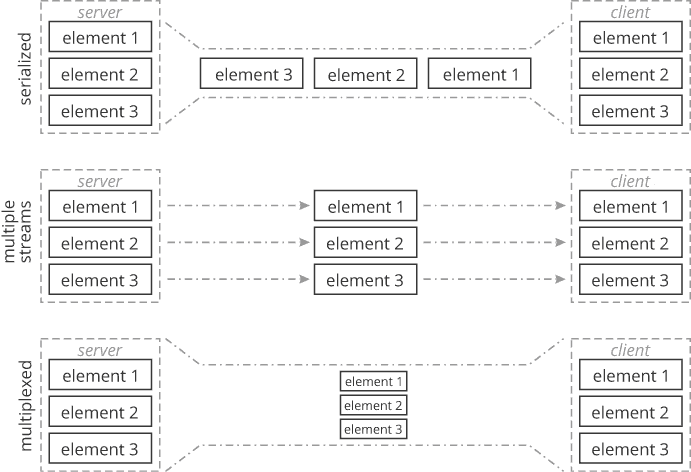

**图 5–11** *多元素传输选项*

在 图 5-11 中，说明了三种从服务器向客户端传输多个元素的选项：

• 在序列化选项中，元素通过单个会话一次传输一个。这是三种可能选项中最慢的，因为整个页面必须逐个元素构建，较小的元素必须等待较大的元素传输后才能显示。

• 在多流选项中，每个元素通过单独的连接（例如 `TCP` 会话）传输。这要快得多，但需要建立多个连接，这可能会对客户端和服务器资源产生负面影响。

• 在多路复用选项中，每个元素通过单个连接单独传输。这允许每个元素以自己的速率传输，但具有多流选项的资源开销。

某种形式的多路复用传输机制往往能提供最快的传输速率和最有效的资源利用，但这种多路复用应如何实现？超文本传输协议版本 2 (`HTTPv2`) 允许 Web 服务器在单个 HTTP 会话中多路复用多个元素；由于 HTTP 运行在 `TCP` 之上，这意味着单个 `TCP` 流可用于并行传输多个网页元素。然而，`TCP` 层上的单个丢弃数据包意味着 HTTP 流内的每个并行传输都必须暂停，同时 `TCP` 恢复（这是一种命运共享形式）。

`QUIC` 通过允许多个 `HTTPv2` 流驻留在单个 `QUIC` 连接中来解决此问题。这减少了客户端和服务器的传输开销，同时提供了网页元素的最佳交付。

###### 路径 MTU 发现

异步传输模式 (`ATM`) 与互联网协议 (`IP`) 争论的核心问题之一是固定单元大小。虽然 `IP` 网络依赖于可变长度数据包，但 `ATM` 为了实现更快的交换速度，并为了更好地与许多不同的时分复用 (`TDM`) 物理层互操作，指定了固定长度的单元。`IPv4` 特别不仅提供可变长度数据包，而且还提供飞行中分片。 图 5-12 说明了这一点。

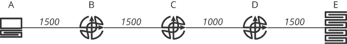

**图 5–12** *数据包分片示例*

在 图 5-12 中，如果 A 向 E 发送数据包，它应该使数据包有多大？A 真正知道的唯一链路是 A 和 B 之间的链路，其标记的最大传输单元 (`MTU`) 大小为 1,500 字节。然而，如果 A 发送 1,500 字节的数据包，则数据包将无法通过 [C,D] 链路。有两种方法可以解决此问题。

第一种方法是让 C 将数据包分片为两个更小的数据包。这在 `IPv4` 中是可能的；C 可以确定数据包将无法通过数据包应被转发到的下一链路，并将数据包拆分为两个更小的数据包。当然，这种解决方案存在许多问题。例如，分片数据包的过程需要 C 付出更多的工作，甚至可能将数据包从硬件交换路径移动到软件交换路径。


第二种方法是要求 A 在整个通往 E 的路径上永远不要发送大于最小 MTU 的数据包。要做到这一点，A 必须发现路径上的最小 MTU，并且必须能够在传输之前将来自上层协议的信息分片为多个数据包。IPv6 选择了后一种方案，依赖于路径 MTU（PMTU）发现来找到路径上的最小 MTU（假设 PMTU 实际上有效，这在大型公共网络中是一个相当糟糕的假设），并允许 A 处的 IPv6 进程将来自上层协议的信息分片为多个数据包，这些数据包随后在接收方重新组装成原始的上层数据块。

然而，这个解决方案似乎也有问题。在对域名系统（DNS）的最新研究中，研究人员发现所有 DNS 解析器中约有 37% 会丢弃分片的 IPv6 数据包。^18 为什么会这样？最容易理解的方法是考虑分片数据包的结构以及 DoS 和 DDoS 攻击的性质。

当数据包被传输时，会在数据包上放置一个头部，指示接收服务（某种套接字或协议号），以及有关发送服务的信息。这些信息对于根据各种安全策略过滤数据包非常重要，特别是如果安全策略是“除非数据包属于现有会话，否则只允许会话发起数据包进入网络”。换句话说，保护服务器的典型有状态过滤器会遵循一些基本规则：
• 如果数据包发起新的会话，则转发它并建立新的会话记录。
• 如果数据包是现有会话的一部分，则转发它并重置会话计时器。
• 如果数据包不是现有会话的一部分，则丢弃它。
• 不时清理旧会话。

虽然可以伪造一个看起来来自现有会话的数据包，但并不容易；部署了各种 nonce 和其他技术来阻止这种行为。但分片数据包会将头部从数据包的后半部分移除，这实际上意味着分片对中的第二个数据包只能通过追溯具有完整头部的部分来附加到特定会话或流。

路由器或中间盒如何做到这一点？它必须以某种方式在内存中保留每个具有头部的分片数据包的副本，以便可以引用具有头部的该数据包来处理任何后续分片。它必须保留这些带头部的分片多久？实际上无法确定。最终，简单地丢弃任何分片比维护处理它们所需的状态更容易。

结果如何？看起来即使是源端分片在 IP 层也不是很有用。

这应该会让人想起互联网协议套件的奠基原则之一：*端到端原则*。端到端原则指出，网络不应修改在两个端设备之间传输的流量；或者说网络应作为连接两个设备的黑盒运行，从不更改从端主机接收到的数据。

这是否意味着所有流量的过滤都应该在公共互联网上被禁止，真正实施端到端规则，将所有安全都留给端主机？这似乎是围绕有状态数据包过滤器的原始 IPv6 讨论的基调。然而，这似乎并不是最现实的选择；更强的防御不是一堵完美的墙，而是多道不完美的墙。纵深防御每次都能击败单一防火墙。

另一种选择是接受网络工程界经常被遗忘的另一个现实：抽象会泄漏。端到端原则描述了一个能够将流量从一台主机传输到另一台主机的完美抽象系统，以及流量在其间传输的完美抽象主机集。但所有非平凡的抽象都会泄漏；MTU 和分片问题只是网络状态向主机泄漏的一个例子，以及主机上试图将该泄漏抽象到通过网络发送流量的应用程序的系统。在这种情况下，最好只是承认泄漏并正式将信息推向上层堆栈，以便应用程序可以更好地决定如何发送流量。

但这引出了另一个有趣的问题：这里描述的有状态过滤是否背叛了端到端原则？答案取决于你是否认为发送数据的上层协议是端点，还是应用程序运行的系统（因此包括 IP 栈本身）是端点。无论哪种方式，这种模糊性一直困扰着互联网从最早的日子开始，尽管网络工程界并不总是认真思考这两种观点之间的区别。

##### ICMP

虽然传输协议，如 TCP 和 QUIC，往往在中间层协议中获得最多的关注，但还有许多其他协议对于 IP 网络的运行同样重要。其中之一是 ICMP，可以说它提供了有关网络本身的元数据。ICMP 是一个简单的协议，用于请求特定状态信息，或供网络设备发送有关某个数据包在网络中某处被丢弃的原因的信息。具体来说：
• ICMP 可用于发送回显请求或回显应答。此功能用于 ping 特定目标地址，可用于确定地址是否可达，而不会在接收方消耗太多资源。
• ICMP 可用于发送有关数据包因太大而无法在链路上传输而被丢弃的通知（数据包太大）。
• ICMP 可用于发送有关数据包因其生存时间（TTL）达到 0 而被丢弃的通知（数据包在传输中已过期）。

数据包太大响应可用于查找网络中的最大传输单元（MTU）；发送方可以传输一个大包并等待网络中的某个设备通过 ICMP 发送 *数据包太大* 通知。如果收到此类通知，发送方可以尝试逐步减小的数据包以确定可在网络中端到端传输的最大数据包。

传输中过期响应可用于追踪网络中从源到目的地的路由（这称为追踪路由）。发送方可以使用任何传输层协议（包括 TCP、UDP 或 QUIC）向特定目的地传输数据包，但 TTL 为 1。第一跳网络设备应递减 TTL 并向发送方发送 ICMP 传输中过期通知。发送一系列 TTL 每次比前一个大一的数据包，可以诱导路径上的每个设备向发送方传输 ICMP 传输中过期通知，从而揭示数据包的整个路径。

##### 最后的思考

上层传输协议管理的问题与下层传输协议相同——差错控制、流量控制、传输和编组——只是端到端而不是设备到设备。即使如此，虽然许多解决方案相似或相同，但许多其他解决方案则截然不同。本章考虑了四种不同的上层传输协议，其中两种占据协议栈中的同一“空间”——TCP 和 QUIC——另外两种占据协议栈中完全不同的空间——IP 和 ICMP。虽然存在其他解决方案，但这四种协议提供的解决方案涵盖了这些问题的大多数广泛部署的解决方案。


下一章将带你从理解信息如何在网络中传输，转向本章和前一章中考虑的各层如何相互作用的领域。这些层间问题与 State/Optimization/Surface 网络复杂性模型中考虑的交互表面相关，该模型在分析大量网络问题时对你很有用。

##### 进一步阅读

Armitage, Grenville. “Summary of Five New TCP Congestion Control Algorithms Project.” *The FreeBSD Forums*. Accessed July 5, 2017. [`forums.FreeBSD.org/threads/22396/`](http://www.ieee802.org/3/efm/public/jul01/presentations/mclaughlin_1_0701.pdf).

Blanton, Ethan, Dr. Vern Paxson, and Mark Allman. *TCP Congestion Control*. Request for Comments 5681. RFC Editor, 2009. doi:10.17487/RFC5681.

Chu, H. K. Jerry, and Vivek Kashyap. *Transmission of IP over InfiniBand (IPoIB)*. Request for Comments 4391. RFC Editor, 2006. doi:10.17487/RFC4391.

Cole, Robert G., Dr. David H. Shur, and Curtis Villamizar. *IP over ATM: A Framework Document*. Request for Comments 1932. RFC Editor, 1996. doi:10.17487/RFC1932.

Deering, Dr. Steve E., and Robert M. Hinden. “Internet Protocol, Version 6 (IPv6) Specification.” Internet-Draft. Internet Engineering Task Force, May 2017. [`datatracker.ietf.org/doc/html/draft-ietf-6man-rfc2460bis-13`](https://datatracker.ietf.org/doc/html/draft-ietf-6man-rfc2460bis-13).

Desanti, Claudio, Robert Nixon, and Craig Carlson. *Transmission of IPv6, IPv4, and Address Resolution Protocol (ARP) Packets over Fibre Channel*. Request for Comments 4338. RFC Editor, 2006. doi:10.17487/RFC4338.

“DoD Standard Internet Protocol.” IETF, January 1980. [`tools.ietf.org/html/rfc760`](https://tools.ietf.org/html/rfc760).

Fairhurst, Gorry, Marie-Jose Montpetit, Bernhard Collini-Nocker, Hilmar Linder, and Horst D. Clausen. *A Framework for Transmission of IP Datagrams over MPEG-2 Networks*. Request for Comments 4259. RFC Editor, 2005. doi:10.17487/RFC4259.

Floyd, Sally, Jamshid Mahdavi, Matt Mathis, and Dr. Allyn Romanow. *TCP Selective Acknowledgment Options*. Request for Comments 2018. RFC Editor, 1996. doi:10.17487/RFC2018.

Gont, Fernando, and Steven Bellovin. *Defending against Sequence Number Attacks*. Request for Comments 6528. RFC Editor, 2012. doi:10.17487/RFC6528.

Gupta, Mukesh, and Alex Conta. *Internet Control Message Protocol (ICMPv6) for the Internet Protocol Version 6 (IPv6) Specification*. Request for Comments 4443. RFC Editor, 2006. doi:10.17487/RFC4443.

Ha, Sangtae, Injong Rhee, and Lisong Xu. “CUBIC: A New TCP-Friendly High-Speed TCP Variant.” *ACM SIGOPS Operating System Review* 42, no. 5 (July 2008): 64–74.

Huston, Geoff. “Dealing with IPv6 Fragmentation in the DNS.” *APNIC Blog*, August 22, 2017. [`blog.apnic.net/2017/08/22/dealing-ipv6-fragmentation-dns/`](https://blog.apnic.net/2017/08/22/dealing-ipv6-fragmentation-dns/).

*Internet Control Message Protocol*. Request for Comments 792. RFC Editor, 1981. doi:10.17487/RFC0792.

“Internet Protocol.” IETF, September 1981. [`tools.ietf.org/html/rfc791`](https://tools.ietf.org/html/rfc791).

*IPv4 Exhaustion*, June 9, 2010. [`commons.wikimedia.org/wiki/File:Ipv4-exhaust.svg`](https://commons.wikimedia.org/wiki/File:Ipv4-exhaust.svg).

Jacobson, V. “Congestion Avoidance and Control.” In *Symposium Proceedings on Communications Architectures and Protocols*, 314–29. SIGCOMM ’88. New York, NY, USA: ACM, 1988. doi:10.1145/52324.52356.

Jamal, Habibullah, and Kiran Sultan. “Performance Analysis of TCP Congestion Control Algorithms.” *International Journal of Computers and Communications* 2, no. 1 (2008): 30–38.

Johansson, Peter G. *IPv4 over IEEE 1394*. Request for Comments 2734. RFC Editor, 1999. doi:10.17487/RFC2734.

Katz, Dave. *Transmission of IP and ARP over FDDI Networks*. Request for Comments 1390. RFC Editor, 1993. doi:10.17487/RFC1390.

Lawrence, Joe L., and David M. Piscitello. *The Transmission of IP Datagrams over the SMDS Service*. Request for Comments 1209. RFC Editor, 1991. doi:10.17487/RFC1209.

Luciani, Dr. James V., Dr. Bala Rajagopalan, and Daniel O. Awduche. *IP over Optical Networks: A Framework*. Request for Comments 3717. RFC Editor, 2004. doi:10.17487/RFC3717.

Mathis, Matt, Nandita Dukkipati, and Yuchung Cheng. *Proportional Rate Reduction for TCP*. Request for Comments 6937. RFC Editor, 2013. doi:10.17487/RFC6937.

Panabaker, Ruston, Simon Wegerif, and Dan Zigmond. *The Transmission of IP Over the Vertical Blanking Interval of a Television Signal*. Request for Comments 2728. RFC Editor, 1999. doi:10.17487/RFC2728.

Partridge, Dr. Craig, Mark Allman, and Sally Floyd. *Increasing TCP’s Initial Window*. Request for Comments 3390. RFC Editor, 2002. doi:10.17487/RFC3390.

Postel, J. “Comments on Internet Protocol and TCP,” August 15, 1977. [`www.rfc-editor.org/ien/ien2.txt`](https://www.rfc-editor.org/ien/ien2.txt).

———. “Draft Internetwork Protocol Specification, Version 2,” February 1978. [`www.rfc-editor.org/ien/ien28.pdf`](https://www.rfc-editor.org/ien/ien28.pdf).

———. “Internetwork Protocol Specification, Version 4,” June 1978. [`www.rfc-editor.org/ien/ien41.pdf`](https://www.rfc-editor.org/ien/ien41.pdf).

———. “Internetwork Protocol Specification, Version 4,” September 1978. [`www.rfc-editor.org/ien/ien41.pdf`](https://www.rfc-editor.org/ien/ien41.pdf).

“QUIC, a Multiplexed Stream Transport over UDP—The Chromium Projects.” Accessed July 5, 2017. [`www.chromium.org/quic`](https://www.chromium.org/quic).

Riegel, Max, Sangjin Jeong, and HongSeok Jeon. *Transmission of IP over Ethernet over IEEE 802.16 Networks*. Request for Comments 5692. RFC Editor, 2009. doi:10.17487/RFC5692.

Stevens, W. Richard. *TCP Slow Start, Congestion Avoidance, Fast Retransmit, and Fast Recovery Algorithms*. Request for Comments 2001. RFC Editor, 1997. doi:10.17487/RFC2001.

Varada, Srihari V. *IP Version 6 over PPP*. Request for Comments 5072. RFC Editor, 2007. doi:10.17487/RFC5072.

Waitzman, David. *Standard for the Transmission of IP Datagrams on Avian Carriers*. Request for Comments 1149. RFC Editor, 1990. doi:10.17487/RFC1149.

##### 复习问题

1. 使用 `/64` 作为主机地址空间的选择通常被认为是有争议的。你认为这种特定选择的积极和消极方面是什么？

2. 互联网多年来一直“耗尽 IPv4 地址空间”。对这种地址空间缺乏的一种反应是网络地址转换器 (`NATs`) 的广泛部署。以下问题与 `NATs` 相关。

   a. `NAT` 与端口地址转换器 (`PAT`) 有什么区别？

   b. 为什么 `PATs` 会为 `FTP`（例如）造成问题？这通常是如何解决的？

   c. 在 IPv6 的整个发展过程中，一直存在反对部署 `NATs` 和 `PATs` 的普遍趋势；你能想到或找到工程师反对在全球互联网上使用 `NAT` 和 `PAT` 的原因吗？

3. 路由器和其他网络设备对数据包的分片已从 IPv6 规范中移除，尽管在 IPv4 规范中是允许的。移除这种能力有什么权衡？分片给网络设备增加了什么复杂性，而从网络设备中移除它又给终端主机增加了什么复杂性？

4. `TCP` 的实现如何区分知名端口和临时端口？它需要这样做吗？

5. 从安全角度来看，允许网络设备和主机响应 `ICMP` 与不允许它们响应相比，可能有什么优点和缺点？

6. 用尼布尔（4 位）而不是本章中使用的位来解释 IPv6 地址的聚合。

7. 为什么前缀长度被称为 *前缀长度*？这个术语背后的历史是什么？


8\. 将前缀长度与用于确定网络地址停止而主机位、或“网络设备不关心的位”开始的旧方法，即子网掩码进行比较。你认为哪一种更容易使用？

1. Postel，“Comments on Internet Protocol and TCP”，1。

2. Postel，“Draft Internetwork Protocol Specification, Version 2.”

3. Postel，“Internetwork Protocol Specification, Version 4,” June 1978。

4. Postel，“Internetwork Protocol Specification, Version 4,” September 1978。

5. “DoD Standard Internet Protocol.”

6. “Internet Protocol.”

7. Mro, *IPv4 Exhaustion*。

8. Fairhurst et al., *A Framework for Transmission of IP Datagrams over MPEG-2 Networks*。

9. Cole, Shur, and Villamizar, *IP over ATM: A Framework Document*。

10. Luciani, Rajagopalan, and Awduche, *IP over Optical Networks: A Framework*。

11. Varada, *IP Version 6 over PPP*。

12. Panabaker, Wegerif, and Zigmond, *The Transmission of IP Over the Vertical Blanking Interval of a Television Signal*。

13. Katz, *Transmission of IP and ARP over FDDI Networks*。

14. Waitzman, *Standard for the Transmission of IP Datagrams on Avian Carriers*。

15. Floyd et al., *TCP Selective Acknowledgment Options*。

16. Blanton, Paxson, and Allman, *TCP Congestion Control*。

17. Gont and Bellovin, *Defending against Sequence Number Attacks*。

18. Huston, “Dealing with IPv6 Fragmentation in the DNS.”

### 第 6 章
#### 层间发现

###### 学习目标

阅读本章后，你应该能够：

理解设备在不同层使用不同协议的标识符之间进行映射的四种方式

理解端口号

理解域名系统（DNS）的基本操作

理解动态主机配置协议（DHCP）的基本操作

理解地址解析协议（ARP）

理解邻居发现和无状态地址自动配置

理解默认网关

在分层和/或模块化系统中，必须有某种方式将一层中的*服务*或*实体*与另一层的服务和实体关联起来。 Figure 6-1 说明了该问题。

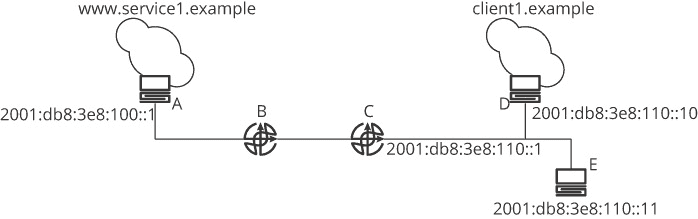

**Figure 6-1** *Interlayer Discovery Problems*

在 Figure 6-1 中：

• A、D 和 E 如何发现它们应为其接口使用的 IP 地址？

• D 如何发现它应使用哪种媒体访问控制（MAC）、物理或较低层协议地址向 E 发送数据包？

• 运行在 D 上的 client1.example 如何发现它应使用哪个互联网协议（IP）地址来访问 [www.service1.example?](http://www.service1.example?)

• 如果 D 和 E 不在同一线路或段上，它们应将流量发送到什么地址？

这些问题中的每一个都代表了层间发现的不同部分。虽然这些问题看起来似乎无关，但它们实际上代表了在网络或协议栈的不同层上，同一组问题，具有狭窄的一组可用解决方案。本章将考虑这些问题的各种可能解决方案，包括每种解决方案的示例。

本章将以默认网关问题结束；虽然这严格来说不是层间发现问题，但对于理解 IP 网络如何运行仍然很重要。

##### 层间发现解决方案

层间发现问题空间看起来像是大量不相关的问题，而不是一个单一问题的主要原因是它分布在许多不同的层中；网络协议栈中的每一组层都需要能够发现“此”层的哪个服务或实体与某个较低层的哪个服务或实体相关。另一种描述这一组问题的方式是能够将一个层的标识符映射到另一个层的标识符——标识符映射。由于大多数广泛部署的协议栈中至少有三对协议（并且可能或可以认为有八个），因此必须部署各种解决方案来在不同位置解决同一组层间发现问题。两个定义有助于理解解决方案的范围，以及该空间中实际部署的协议和系统：

• 一个**标识符**是一组数字或字母（例如字符串），唯一标识一个实体。

• 一个设备，无论是真实的还是虚拟的，从网络的角度来看似乎是一个单一的目的地，在考虑通用问题和解决方案时将被称作**实体**，在考虑具体解决方案时将被称作**主机**或**服务**。

解决层间发现和地址分配问题有四种不同的方法：

• 使用众所周知和/或手动配置的标识符

• 将信息存储在*映射数据库*中，服务可以访问该数据库以在不同类型的标识符之间进行映射

• 在协议中通告两个标识符之间的映射

• 从另一种标识符计算出一种标识符

这些解决方案不仅适用于*发现*，还适用于标识符*分配*。当主机连接到网络，或服务启动时，它必须以某种方式确定它应如何标识自己——例如，当连接到本地网络时应使用哪个互联网协议版本 6（IPv6）地址。解决此问题的可用解决方案是*相同的四种解决方案*。

以下各节将讨论这四种解决方案。

###### 众所周知和/或手动配置的标识符

所选解决方案通常取决于标识符的范围、需要分配的标识符的数量，以及标识符变化的速率。如果

• 标识符被广泛使用，尤其是在协议实现中，并且网络如果没有对层间映射达成一致就无法工作，并且…

• 标识符之间的映射数量相对较小，并且…

• 标识符通常是稳定的——特别是，它们永远不会以需要修改现有部署的实现以使网络继续 functioning 的方式更改，那么…

最简单的解决方案是手动维护某种映射表。

例如，传输控制协议（TCP）承载了许多更高层的传输协议。 将单个承载协议与端口号关联起来的问题是一个全局层间发现问题：部署在真实网络中的每个 TCP 实现都必须就网络“正常工作”时哪些服务可以在特定端口号上访问达成一致。 然而，层间映射的范围非常小，只有几千个端口号需要映射到服务，并且相对静态（新协议或服务并不经常添加）。 因此，这个特定问题很容易通过手动管理的映射表来解决。

TCP 端口号的映射表由互联网号码分配机构（IANA）在互联网工程任务组（IETF）的指导下维护；该表的部分内容显示在 Figure 6-2 中。^(1)

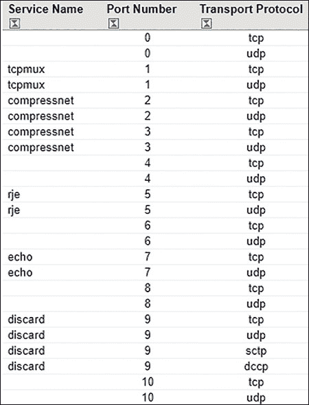

**Figure 6-2** *IANA TCP Port Mapping Table*


在 Figure 6-2 中，`echo` 服务被分配了端口 7；该服务用于提供 Chapter 5 结尾处描述的 `ping` 功能，“Higher Layer Data Transports.”

##### Mapping Database and Protocol

如果表中条目的数量变得足够大，参与维护该表的人员数量变得足够大，或者信息动态性足够强，以至于需要在进行映射时学习该信息，而不是在软件部署时学习，那么构建并动态分发数据库是有意义的。此类系统应包括协议以同步数据库分区，以便向外部查询呈现一致的视图，以及主机和服务可以使用这些协议通过一个标识符查询数据库以发现来自网络不同层的匹配标识符。

动态映射数据库可以通过手动配置或自动化流程接受输入（例如，收集有关网络状态的信息并将所得信息存储在动态数据库中的发现流程）。它们也可能是分布式的，这意味着数据库的副本或部分存储在多个不同的主机或服务器上，或者是集中的，这意味着数据库存储在少数主机或服务器上。

域名系统（DNS）被描述为基于动态分布式数据库的身份映射服务的示例。动态主机配置协议（DHCP）被描述为主要用于地址分配的类似系统的示例。

##### Advertising Identifier Mappings in a Protocol

如果映射问题的范围可以被限定，但身份对的数量很大，或者可能迅速变化，那么创建一个允许实体直接从设备请求映射信息的单一协议可能是一个最佳解决方案。例如，在 Figure 6-1 中，D 可以直接询问 E 其本地 MAC（或物理）地址是什么。

互联网协议版本 4（IPv4）地址解析协议（ARP）是这种解决方案的一个很好的例子，IPv6 邻居发现（ND）协议也是如此。这些示例将在后面的章节中更详细地讨论。

##### Calculating One Identifier from the Other

在某些情况下，可以从另一层的地址或标识符计算出一层的地址或标识符。很少有系统使用这种技术进行地址映射；大多数使用这种技术的系统都是为了 `assign` 地址。一个这样的系统示例是无状态地址自动配置（SLAAC），这是一种 IPv6 协议，主机可以使用它来确定应分配给接口的 IPv6 地址，该协议将在本章后面 IPv6 ND 讨论的一部分中更详细地考虑。

使用下层地址计算上层地址的另一个示例是在国际标准化组织（ISO）协议套件中端系统地址的形成中，例如中间系统到中间系统（IS-IS）。该示例将在 Chapter 16 中更详细地讨论，“Link State and Path Vector Control Planes.”

##### Interlayer Discovery Examples

以下各节将讨论四种提供层间发现和地址分配的协议示例。

###### The Domain Name System

DNS 在人类可读的字符串，例如 Figure 6-1 中使用的名称 `service1.example`，与 IP 地址之间进行映射。 Figure 6-3 说明了 DNS 系统的基本操作。

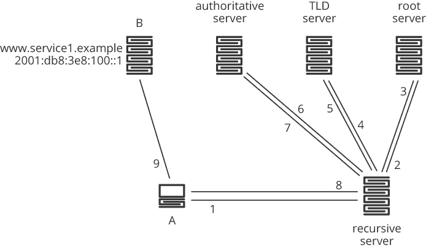

**Figure 6-3** `An Overview of the Operation of the DNS System`

在 Figure 6-3 中，假设没有任何缓存（因此整个过程都被说明）：

1. 主机 A 尝试连接到 [www.service1.example](http://www.service1.example)。主机操作系统检查其本地配置以查找应查询的 DNS 服务器的地址以发现该服务的位置，并找到递归服务器的地址。主机操作系统的 DNS 应用程序向该地址发送 DNS 查询。

2. 递归服务器接收此查询，并且——由于没有缓存——检查正在请求地址的域名。递归服务器注意到域名的右手部分是 `example`，因此它询问根服务器在哪里可以找到有关 `example` 域的信息。

3. 根服务器返回包含有关顶级域（TLD） `example` 的信息的服务器的地址。

4. 递归服务器现在请求有关应联系哪个服务器获取 `service1.example` 的信息。递归服务器一次通过域名的一个部分，使用关于名称右侧部分发现的信息来发现应询问关于左侧信息哪个服务器。此过程称为通过域名 `recursing`；因此服务器称为递归服务器。

5. TLD 服务器返回 `authoritative server` 的地址，用于 service1. example。如果从先前的请求缓存了有关服务位置的信息，则将其作为非权威答案返回；如果配置为保存有关域的信息的实际服务器回复，其答案就是 `authoritative`。

6. 递归服务器从权威服务器请求有关 [www.service1.example](http://www.service1.example) 的信息。

7. 权威服务器用服务器 B 的 IP 地址作出响应。

8. 递归服务器现在用到达所请求服务的正确信息响应主机 A。

9. 主机 A 联系在 IP 地址 `2001:db8:3e8:100::1` 上运行 [www.service1.example](http://www.service1.example) 的服务器。

这个过程看起来可能非常冗长；例如，为什么不将所有信息都保存在根服务器上以节省大量步骤呢？然而，这会违反 DNS 的基本思想，即尽可能将每个域的信息控制权保留在域所有者手中。此外，这会使根服务器的构建和维护变得非常昂贵，因为它们需要能够保存数百万条记录并每天回答数亿次 DNS 信息查询。信息的分离允许每个所有者控制其数据并使 DNS 系统能够扩展。

通常，通过 DNS 查询过程返回的信息会被沿途的每个服务器缓存，因此主机每次需要访问新服务器时都不需要请求映射。

这些 DNS 表是如何维护的？通常通过世界各地域和顶级域所有者以及边缘提供商的手工工作来维护。DNS 不会自动发现连接到网络的每个实体的名称及其地址是什么。

DNS 将手工维护的数据库，与工作分散在许多不同的人手中，配以用于查询数据库的协议；因此 DNS 属于 `mapping database with a protocol` 类解决方案。主机如何知道应查询哪个 DNS 服务器？此信息要么是手动配置的，要么是通过 IPv6 ND 或 DHCP 等发现协议学习的。

###### DHCP


当一台主机（或其他设备）首次连接到网络时，它如何知道应为本地接口分配哪个 IPv6 地址（或一组 IPv6 地址）？解决此问题的一种方案是让主机向某个数据库发送查询，以发现应使用哪些地址，例如 `DHCPv6`。要理解 `DHCPv6`，重要的是首先从 IPv6 中链路本地地址的概念开始。在关于 Chapter 5 中 IPv6 地址空间大小的讨论，“Higher Layer Data Transports” 中，`fe80::/10` 被指出为保留用于链路本地寻址。要形成链路本地地址，运行 IPv6 的设备将 `fe80::` 前缀与 MAC（或物理）地址组合，后者通常格式化为 EUI-48 地址，有时为 EUI-64 地址（有关 EUI 地址的信息，请参阅 Chapter 4， “Lower Layer Transports”。例如：

• 一台设备具有 EUI-48 地址为 `01-23-45-67-89-ab` 的接口。
• 该接口已连接到 IPv6 网络。
• 该设备可以分配 `fe80::123:4567:89ab` 作为链路本地地址，并使用此地址仅与该段上的其他设备通信。

这是一个 *从一个标识符计算出另一个标识符* 的示例。一旦链路本地地址形成，DHCP6 就是可用于在网络内（或根据网络配置全局）获取唯一地址的一种方法。`DHCPv6` 使用用户数据报协议（`UDP`）作为其下层传输。Figure 6-4 进行了说明。

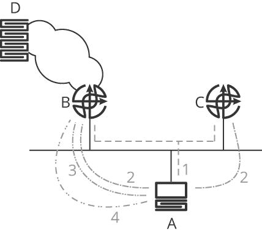

**Figure 6-4** *DHCPv6 Operation*

在 Figure 6-4 中：

1\. 刚刚连接到网络的主机 A 发送 *solicit* 消息。该消息源自链路本地地址并发送到多播地址 `ff02::1:2`，UDP 端口 `547`（服务器）和 `546`（客户端），因此与同一物理线路连接的每个设备都会收到该消息。该消息将包含 DHCP 唯一标识符（`DUID`），客户端形成它，^(2)，服务器用它来确保与同一设备持续通信。

2\. B 和 C 都配置为充当 `DHCPv6` 服务器，它们会以 *advertise* 消息进行响应。该消息是单播数据包，定向到 A 本身，使用 A 源自 solicit 消息的链路本地地址。

3\. 主机 A 从两个服务器中选择一个以请求地址。主机向多播地址 `ff02::1:2` 发送 *request*，要求 B 为其提供地址（或地址池）、应使用哪个 DNS 服务器的信息等。

4\. 运行在 B 上的服务器随后向 A 最初形成的链路本地地址发送 *reply*；这验证了 B 已从其本地池分配资源，并允许 A 开始使用它们。

如果段上没有设备配置为 `DHCPv6` 服务器会怎样？例如，在 Figure 6-4 中，如果 D 是唯一可用的 `DHCPv6` 服务器，因为 B 或 C 上未运行 `DHCPv6`？在这种情况下，路由器（甚至其他主机或设备）可以充当 *DHCPv6 relay*。A 传输的 `DHCPv6` 数据包将被中继接收、封装并传输到 `DHCPv6` 服务器进行处理。

**Note**

此处描述的过程称为有状态 DHCP，通常在 *router advertisement* 中的 *Managed* 位被设置时触发。`DHCPv6` 也可以与稍后在“IPv6 Neighbor Discovery”部分中描述的 SLAAC 配合使用，以提供无状态 `DHCPv6` 模式下 SLAAC 未提供的信息。此模式通常在路由器通告中的 *Other* 位被设置时使用。IETF 草案 *DHCPv6/SLAAC Interaction Problems on Address and DNS Configuration* 描述了这种交互以及这两种机制交互中的问题。^(3)

在网络管理员知道所有 IPv6 地址都将通过 `DHCPv6` 配置，并且每个段上只有一个 `DHCPv6` 服务器可用的情况下，可以通过启用 `DHCPv6` *rapid commit* 跳过 advertise 和 request 消息。

##### IPv4 Address Resolution Protocol

尽管本书的重点是 IPv6，但在某些情况下 IPv4 提供了有用的解决方案示例；IPv4 地址解析协议（`ARP`）就是其中之一。`ARP` 是一种非常简单的协议，用于在不依赖任何类型服务器的情况下解决层间发现问题。Figure 6-5 将用于解释 `ARP` 的操作。

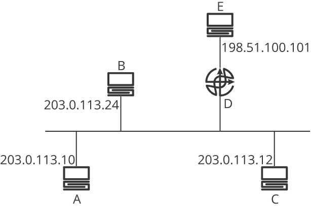

**Figure 6-5** *Address Resolution Protocol Example*

假设 A 希望向 C 发送数据包。仅知道 C 的 IPv4 地址 `203.0.113.12` 对于 A 正确地形成要向 C 发送到线路上的数据包是不够的。为了正确构建数据包，A 还必须知道

• C 是否与 A 在同一线路上
• C 的 MAC 或物理地址

如果没有这两条信息，A 就不知道如何在线路上封装数据包，因此 C 实际上将不会收到数据包，而 B 将忽略它。A 如何发现这些信息？第一个问题，C 是否与 A 在同一线路上，可以通过考虑本地接口 IP 地址、目标 IP 地址和子网掩码来回答。这将在本章后面更详细地讨论。

`ARP` 通过以下过程解决了第二个问题，即将目标 IP 地址与目标 MAC 地址匹配：

1\. 主机 A 向线路上的每个设备发送广播数据包，其中包含 IPv4 地址，但不包含 MAC 地址。这是 *ARP request；* 它是 A 请求与 `203.0.113.12` 对应的 MAC 地址。

2\. B 和 D 收到此数据包，但不响应，因为它们的本地接口中没有地址 `203.0.113.12`。

3\. 主机 C 收到此数据包并再次使用单播数据包进行响应，以响应请求。此 *ARP reply* 包含 IPv4 地址和匹配的 MAC 地址，为 A 提供了构建向 C 的数据包所需的信息。

当 A 收到此回复时，它将在本地 ARP 缓存中插入 `203.0.113.12` 与回复中包含的 MAC 地址之间的映射。此信息将存储到超时为止；ARP 缓存条目超时的规则因实现而异，通常可以手动配置。缓存 ARP 条目的时长是在网络上不要过于频繁地重复相同信息——在 IPv4 到 MAC 地址映射很少更改的情况下——与跟上设备位置的任何更改——在特定 IPv4 地址可能在主机之间移动的情况下——之间取得平衡。

任何接收到 ARP 回复的设备都可以接受该数据包并缓存其中包含的信息。例如，B 在收到 C 的 ARP 回复后，可以将其 ARP 缓存中插入 `203.0.113.12` 与 C 的 MAC 地址之间的映射。事实上，ARP 的这一特性通常用于加快设备连接到网络时的发现速度。ARP 规范中没有任何要求主机必须等待 ARP 请求才能发送 ARP 回复。当设备连接到网络时，它可以简单地发送包含正确映射信息的 ARP 回复，以使与同一线路上其他主机的初始连接过程更快；这称为 *gratuitous ARP*。

无偿 ARP 对 *Duplicate Address Detection (DAD)* 也很有用；如果主机收到包含其正在使用的 IPv4 地址的 ARP 回复，它将报告重复的 IPv4 地址。某些实现在这种情况下还会发送一系列无偿 ARP，以防止该地址被使用，或强制另一台主机也报告重复地址。

如果主机 A 使用 ARP 请求不在同一段上的地址，例如 Figure 6-5 中的 `198.51.100.101` 会怎样？这种情况有两种不同的可能性：


• 如果 `D` 配置为作为代理 ARP 进行响应，它可以对 ARP 请求作出响应，并提供连接到该段的 MAC 地址。`A` 随后会缓存此响应，将发往 `E` 的任何流量发送到 `D` 的 MAC 地址，`D` 随后可以将此流量转发给 `E`。大多数广泛部署的实现默认不启用代理 ARP。

• `A` 可以将流量发送到其默认网关，即一个本地连接的路由器，该路由器应知道网络上任何目的地的路径。

IPv4 ARP 是将层间标识符映射的协议的一个示例，它在一个协议中同时包含两种标识符。

##### IPv6 邻居发现

IPv6 用一系列的互联网控制消息协议 ICMP v6 消息取代了更简单的 ARP 协议。定义了五种 ICMPv6 消息：

• Type 133, Router Solicitation
• Type 134, Router Advertisement
• Type 135, Neighbor Solicitation
• Type 136, Neighbor Advertisement
• Type 137, Redirect

Figure 6-6 用于解释 IPv6 ND 的操作。

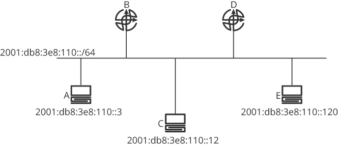

**Figure 6-6** *IPv6 Neighbor and Router Discovery*

要理解 IPv6 ND 的操作，最好跟踪一台主机在连接到新网络时的过程。 Figure 6-6 中的主机 `A` 用作示例。

• `A` 将首先形成一个链路本地地址，如前所述；假设 `A` 选择 `fe80::AAAA` 作为其链路本地地址。
• `A` 现在使用此链路本地地址作为源地址，并向链路本地多播地址发送路由器请求；这是 ICMPv6 消息类型 133；该地址为全节点多播地址。
• `B` 和 `D` 接收到此路由器请求并以路由器通告作出响应，即 ICMPv6 消息类型 134。此单播数据包被传输到用作源地址的链路本地地址 `A`，即 `fe80::AAAA`。
• 路由器通告包含有关新连接的主机应如何确定其本地配置信息的信息，以若干标志的形式给出。
• `M` 标志表示主机应通过 DHCPv6 请求地址，因为这是一个 *managed* 链路。
• `O` 标志表示主机可以通过 DHCPv6 检索 *other* 于应使用的地址之外的信息。例如，主机应使用的 DNS 服务器用于解析 DNS 名称，应使用 DHCPv6 检索。
• 如果设置了 `O` 标志，而未设置 `M` 标志，`A` 必须自行确定其接口 IPv6 地址。为此，它通过检查路由器通告中的 *prefix information* 字段来确定该段上使用的 IPv6 前缀集合。它选择其中一个前缀并形成一个 IPv6 地址，使用其形成链路本地地址时所用的相同过程：它将本地 MAC（EUI-48 或 EUI-64）地址添加到指示的前缀中。此过程称为 SLAAC。
• 主机现在必须确保它没有选择同一网络上其他主机正在使用的地址；它必须执行 DAD。要执行重复地址检测：
  • 主机发送一系列邻居请求消息，使用刚形成的 IPv6 地址并请求相应的 MAC（物理）地址。这些是 ICMPv6 类型 135 消息，从已分配给接口的链路本地地址发送。
  • 如果主机收到使用相同 IPv6 地址的邻居通告或邻居请求，它会认为本地形成的地址是重复的；在这种情况下，它将使用不同的本地 MAC 地址形成新地址并重试。
  • 如果主机未收到响应，也未收到其他主机使用相同地址的邻居请求，它会认为地址是唯一的并将新形成的地址分配给接口。

###### Resolving False Positives in Duplicate Address Detection

如本文所述，DAD 过程可能会导致假阳性。具体来说，如果线路上的某些其他设备将原始邻居请求数据包循环回 `A`，它会认为这些数据包来自声称使用相同地址的另一台主机，因此会声明重复并尝试形成新地址。如果设备不断循环回 `A` 发送的任何邻居请求，`A` 将永远无法使用 SLAAC 形成地址。

为了解决这个问题，RFC7527 概述了一种增强的 DAD 过程。在此过程中，`A` 将计算一个 nonce，即随机选择的一系列数字，并将其包含在用于检查重复地址的邻居请求中。此 nonce 通过 RFC3971 中概述的 IPv6 安全邻居发现 SEND 扩展包含在内。

如果 `A` 收到邻居请求，其中包含其在 DAD 期间用于发送邻居请求的相同 nonce，它将形成一个新的 nonce 并重试。如果再次发生这种情况，主机将假设数据包正在被循环，并忽略其中包含其自身 nonce 的任何进一步邻居请求。如果收到的邻居请求具有与本地主机选择的不同的 nonce，主机将假设确实存在另一台主机选择了相同的 IPv6 地址，然后将形成新的 IPv6 地址。

一旦有了用于传输数据的地址，`A` 在向同一段上的另一台主机发送信息之前还需要一个额外信息——接收主机的 MAC 地址。如果 `A` 例如想要向 `C` 发送数据包，它将首先向 `C` 发送多播邻居请求消息，请求其 MAC 地址；这是 ICMPv6 消息类型 135。当 `C` 收到此消息时，它将以正确的 MAC 地址作出响应，用于发送到请求的 IPv6 地址的流量；这是 ICMPv6 消息类型 136。

尽管前述过程描述了路由器通告作为对路由器请求的响应而发送，但每个路由器会在每个附加接口上发送周期性的路由器通告。路由器通告包含一个 *lifetime* 字段，指示路由器通告的有效时间。

##### The Default Gateway Problem

主机如何知道是否尝试将数据包发送到其所连接的段上的主机，还是将数据包发送给路由器进行进一步处理？如果主机应将数据包发送给路由器进行进一步处理，它如何知道应将流量发送到哪个路由器（如果有多个）？这两个问题合在一起构成了默认网关问题。

对于 IPv4，使用前缀和前缀长度可以相当容易地解决该问题。 Figure 6-7 说明了这一点。


**Figure 6-7** *IPv4 Default Gateway Usage*

IPv4 实现假设 *同一 IPv4 子网内的任何主机都必须物理连接到同一根线缆*。实现如何区分？子网掩码是前缀长度的另一种形式，它指示网络地址结束和主机地址开始的位置。在本例中，假设前缀长度为 24 位，或网络地址为 /24。*24* 告诉你子网掩码中设置了多少位：

```
24 bits = 11111111.11111111.11111111.0000000
```

由于 IPv4 使用“点分十进制”表示法，这也可以写成 255.255.255.0。要发现 `C` 是否与 `A` 在同一根线缆上，`A` 将

1. 对子网掩码与本地接口地址进行逻辑 AND
2. 对子网掩码与目标地址进行逻辑 AND
3. 比较两个结果；如果它们匹配，则目标主机与本地接口在同一根线缆上

Figure 6-8 说明了这一点。


**Figure 6-8** *Using the Prefix Length to Determine What Is On and Off Segment*


There are four `IPv4` addresses in Figure 6-8; assume `A` needs to send packets to `C`, `D`, and `E`. If `A` knows the prefix length of the local segment is `24` bits either through manual configuration or through `DHCPv4`, then it can simply look at the `24` most significant bits of each address, compare it to the `24` most significant bits of its own address, and determine whether the destination is on segment or not. Twenty-four bits of an `IPv4` address produces a nice break between the third and fourth section of the address (each section of an `IPv4` address represents `8` bits of address space, for a total of `32` bits of address space).

Any two addresses with the same left three sections as `A` has, called the network address, are on the same segment; any address that does not is not on segment. In this case, the network address for `A` and `C` match, so `A` will believe `C` is on the same segment, and hence will send packets to `C` directly, rather than sending them to a router. For any destination `A` believes is off segment, it will send packets to the final destination’s `IPv4` address, but to the default gateway’s `MAC` address. This means the router acting as the default gateway will accept the packet and switch it based on the destination `IPv4` address (packet switching is considered more fully in Chapter 7, “Packet Switching”). How is the default gateway chosen? It is either manually configured or included in a `DHCPv4` option.

What about `D`? Because the network portions of the addresses don’t match, `A` will believe `D` is off segment. In this case, `A` will send any traffic for `D` to its default gateway, which is `B`. When `B` receives these packets, it will realize `A` and `D` are reachable through the same interface (based on its routing table—building routing tables is considered in Part II, “The Control Plane”), so it will send an `ICMP` redirect to `A` telling it to send traffic toward `D` directly, rather than through `B`.

`IPv6` presents a more complex set of problems to solve when considering which default gateway to use, because `IPv6` assumes a single device may have many `IPv6` addresses assigned to a particular interface. Figure 6-9 illustrates.


**Figure 6-9** *IPv6 and On Link/Off Link Determination*

In Figure 6-9, assume the network administrator has configured the following policies:

• No host may connect to `A` unless it has an address in the `2001:db8:3e8:110::/64` range of addresses.
• No host may connect to `D` unless it has an address in the `2001:db8:3e8:112::/64` range of addresses.

**Note**

You would never build policies like this in the real world; this is a contrived situation to illustrate a problem set in a minimally sized network. A much more real problem of this same type would involve unicast Reverse Path Forwarding (`uRPF`).

To make these policies work, the administrator has assigned `110::3` and `112::12` to host `C` and `111::120` to host `F`. This might look odd, but it is perfectly legal for a single segment to have multiple `IPv6` subnets assigned in `IPv6`; it is also perfectly legal to have a single device with multiple addresses. In fact, in `IPv6`, there are many situations where a single device may have a range of addresses assigned.

From the perspective of the prefix lengths, however, no two addresses assigned to `C` or `F` are on the same subnet. Because of this, `IPv6` does not rely on the prefix length to determine what is on segment and what is not. Instead, `IPv6` implementations keep a table of all connected hosts, using neighbor solicitations to discover what is on segment and what is not. When a host wants to send traffic off the local segment, it sends the traffic to one of the routers it has learned about through router advertisements. If a router receives a packet that it knows another router on the segment has a better route to (because the routers have routing tables that tell them which path to take to any particular destination), the router will send an `ICMPv6` redirect message telling the host to use some other first hop router to reach the destination.

##### Final Thoughts

This chapter has provided an overview of a very difficult problem, and a number of complex solutions—the Domain Name System, the Dynamic Host Configuration Protocol, the Address Resolution Protocol, and Neighbor Discovery—are far more complex than the high-level overviews provided here. The deployment and operation of `DNS` servers and the maintenance of the `DNS` system are an entire career field within network engineering, for instance.

Even so, all of these complex solutions represent just one of four ways to solve the difficult problems of mapping the identifiers used at one layer into the identifiers used at another layer, or the discovery of identifiers in order to facilitate communication. The contrast between the four basic solutions and the diverse protocols implementing those solutions is a solid example of the premise of this book: if you understand the problem space, and you understand the available solutions, then it becomes possible to ask the right questions of a solution to understand how it works.

Once the identifiers have been discovered, and the data to be transported has been marshaled, it is time to switch packets through the network; this is the topic of the next chapter.

##### Further Reading

Asati, Rajiv, Hemant Singh, Wes Beebee, Carlos Pignataro, Eli Dart, and Wesley George. *Enhanced Duplicate Address Detection*. Request for Comments `7527`. RFC Editor, 2015. doi:10.17487/RFC7527.

Baker, Fred, and Brian E. Carpenter. *First-Hop Router Selection by Hosts in a Multi-Prefix Network*. Request for Comments `8028`. RFC Editor, 2016. doi:10.17487/RFC8028.

Beebee, Wes, Hemant Singh, and Erik Nordmark. *IPv6 Subnet Model: The Relationship between Links and Subnet Prefixes*. Request for Comments `5942`. RFC Editor, 2010. doi:10.17487/RFC5942.

Droms, Ralph. *DNS Configuration Options for Dynamic Host Configuration Protocol for IPv6 (DHCPv6)*. Request for Comments `3646`. RFC Editor, 2003. doi:10.17487/RFC3646.

———. *Stateless Dynamic Host Configuration Protocol (DHCP) Service for IPv6*. Request for Comments `3736`. RFC Editor, 2004. doi:10.17487/RFC3736.

Gont, Fernando. *Security Implications of IPv6 Fragmentation with IPv6 Neighbor Discovery*. Request for Comments `6980`. RFC Editor, 2013. doi:10.17487/RFC6980.

Johnson, Jarrod, and Dr. Thomas Narten. *Definition of the UUID-Based DHCPv6 Unique Identifier (DUID-UUID)*. Request for Comments `6355`. RFC Editor, 2011. doi:10.17487/RFC6355.

Kempf, James, Jari Arkko, Brian Zill, and Pekka Nikander. *SEcure Neighbor Discovery (SEND)*. Request for Comments `3971`. RFC Editor, 2005. doi:10.17487/RFC3971.

Liu, Bing, Sheng Jiang, Xiangyang Gong, Wendong Wang, and Enno Rey. “DHCPv6/SLAAC Interaction Problems on Address and DNS Configuration.” Internet-Draft. Internet Engineering Task Force, August 2016. [`datatracker.ietf.org/doc/html/draft-ietf-v6ops-dhcpv6-slaac-problem-07`](https://datatracker.ietf.org/doc/html/draft-ietf-v6ops-dhcpv6-slaac-problem-07).

Mrugalski, Tomek, Marcin Siodelski, Bernie Volz, Andrew Yourtchenko, Michael Richardson, Sheng Jiang, Ted Lemon, and Timothy Winters. “Dynamic Host Configuration Protocol for IPv6 (DHCPv6) bis.” Internet-Draft. Internet Engineering Task Force, June 2017. [`datatracker.ietf.org/doc/html/draft-ietf-dhc-rfc3315bis-09`](https://datatracker.ietf.org/doc/html/draft-ietf-dhc-rfc3315bis-09).

Narten, Dr. Thomas, Tatsuya Jinmei, and Dr. Susan Thomson. *IPv6 Stateless Address Autoconfiguration*. Request for Comments `4862`. RFC Editor, 2007. doi:10.17487/RFC4862.

Nordmark, Erik, and Igor Gashinsky. *Neighbor Unreachability Detection Is Too Impatient*. Request for Comments `7048`. RFC Editor, 2014. doi:10.17487/RFC7048.


Simpson, William A., Dr. Thomas Narten, Erik Nordmark, and Hesham Soliman. *邻居发现协议用于 IP 版本 6 (IPv6)*. Request for Comments 4861. RFC Editor, 2007. doi:10.17487/RFC4861.

Troan, Ole, and Ralph Droms. *用于动态主机配置协议版本 6 (DHCP) 的 IPv6 前缀选项*. Request for Comments 3633. RFC Editor, 2003. doi:10.17487/RFC3633.

Zeng, Shengyou, John Jason Brzozowski, Kim Kinnear, and Bernie Volz. *DHCPv6 Leasequery*. Request for Comments 5007. RFC Editor, 2007. doi:10.17487/RFC5007.

##### Review Questions

1\. 考虑本章讨论的四种解决层间发现和映射问题的方法。构建一个图表描述每种方法的状态和表面交互，以及可能的优化权衡。

2\. 描述 IETF 用于维护号码注册表的过程。这看起来像是一个复杂系统还是一个简单系统？看起来它是否能有效确保标识符的唯一性？

3\. 考虑每天可能有数百万，甚至数亿次 DNS 查询。DNS 根服务器有多少个？鉴于这两个数字，你认为 DNS 系统是如何扩展以支持整个全球互联网的？

4\. 是否可以将一个全球可达的 IP 地址转换为 DNS 名称（与本章描述的方向相反进行映射）？你能想到一个这会很有用的例子吗？

5\. 更大的 DNS 系统还包含一个从 DNS 名称到有关域名所有权的人类可读信息的映射系统，称为 whois。它使用什么协议进行通信，信息存储在哪里，通过该系统可以获得哪些信息？

6\. 解释 DNS 胶水记录是什么以及它们用于什么。

7\. 从状态、优化和表面的角度来看，像 DHCP 这样的机制与像 SLAAC 这样的机制之间有什么权衡？不仅要考虑地址分配的便捷性，还要考虑每种机制可能出现的任何安全和控制问题。

8\. 为什么大多数实现默认不会启用代理 ARP？启用代理 ARP 的风险是什么？

9\. 邻居发现协议端系统到中间系统协议 End System to Intermediate System (ES-IS) 与 IPv6 ND 相比如何？

10\. 考虑 IPv6 路由器发现相对于默认网关问题的工作方式。

1. 该图表取自 [`www.iana.org/assignments/service-names-port-numbers/service-names-port-numbers.xhtml`](https://www.iana.org/assignments/service-names-port-numbers/service-names-port-numbers.xhtml)。

2. Johnson and Narten, *基于 UUID 的 DHCPv6 唯一标识符 (DUID-UUID) 的定义*。

3. Liu et al., “DHCPv6/SLAAC 交互在地址和 DNS 配置上的问题。”

### Chapter 7
#### Packet Switching

**Learning Objectives**

阅读本章后，你应该能够理解：

将数据包通过网络设备切换所需的四个步骤

接收和发送环在转发数据包过程中的使用方式

数据包切换的基本过程，包括转发表是如何构建的

路由与交换的区别以及路由的优势

等价多路径的概念

链路聚合的概念

总线概念和交叉开关结构的概念

网络设备被插入网络以解决许多问题，包括连接不同类型的介质以及通过仅在需要的地方携带数据包来扩展网络。然而，路由器和交换机本身就是复杂的设备；工程师可以通过专门解决在数据包通过网络设备传输过程中遇到的仅一小部分问题来建立整个职业生涯。

Figure 7-1 用于讨论问题空间的概述。


**Figure 7-1** *将数据包通过网络设备移动*

在 Figure 7-1 中，有四个不同的步骤：

1\. 数据包需要从物理介质复制到设备内的内存中；这有时被称为将数据包从线路上时钟化。

2\. 数据包需要被处理，这通常意味着确定正确的出站接口并以任何必要的方式修改数据包。例如，在路由器中，底层头会被剥离并替换为新的头；在有状态数据包过滤器中，数据包可能基于内部状态被丢弃；等等。

3\. 数据包需要从入站复制到出站接口。这通常涉及跨内部结构或总线的传输。一些系统通过使用单一内存池用于入站和出站接口来跳过此步骤；这些被称为共享内存系统（你会注意到网络工程中事物的名称要么太巧妙，要么太明显）。

4\. 数据包需要复制回出站物理介质；这有时被称为将数据包时钟化到线路上。

**Note**

较小的系统，特别是那些专注于快速、一致的数据包交换的系统，通常会使用共享内存将数据包从一个接口传输到另一个接口。复制数据包到内存所需的时间通常大于接口运行的速度；共享内存系统避免了这种数据包的内存复制。

因此，下面各节讨论的问题空间在于：

**网络设备需要转发的包是如何从入站物理介质携带到出站物理介质的，以及包如何在此路径上暴露给处理？**

以下每个部分讨论此问题的解决方案的一部分。

#### Physical Media to Memory

数据包通过网络设备处理的第一步是将数据包从线路复制到内存中。Figure 7-2 用于说明该过程。


**Figure 7-2** *将数据包时钟化到内存中*

Figure 7-2 中有两步：

**Step 1.** 物理介质芯片组（*PHY 芯片*）会将来自物理介质的每个时间（或逻辑）时隙，即代表单个数据位，复制到一个内存位置。该内存位置实际上映射到一个接收环中，该接收环是一组内存位置（数据包缓冲区），专门用于接收从线路上时钟化的数据包。接收环以及所有数据包缓冲区内存通常是从一种可被接收端线路卡或设备上的所有交换组件访问（共享）的单一内存中划分出来的。

**Note**

环形缓冲区是基于单个指针使用，该指针在每次将新数据包插入缓冲区时递增。例如，在 Figure 7-2 中显示的环中，指针将从槽 1 开始，并在数据包被复制到环形缓冲区时递增通过各槽。如果指针到达槽 7，并且有新数据包到达，数据包将被复制到槽 1——无论槽 1 的内容是否已被处理。

在数据包交换中，最耗时且最困难的任务是从一个位置复制数据包到另一个位置；这通过使用指针尽可能避免。数据包在内存中移动，而不是移动数据包本身，指向内存位置的指针在交换路径内的进程之间传递。


##### Step 2.
一旦数据包被时钟写入内存，某个本地处理器会被中断。在此中断期间，本地处理器会从 `receive ring` 中移除指向包含数据包的数据包缓冲区的指针，并将指向空数据包缓冲区的指针放到 `receive ring` 上。该指针被放置在名为 `input queue` 的单独列表上。

##### Processing the Packet
一旦数据包进入 `input queue`，它就可以被处理。处理可以被视为一系列事件的链，而不是单一事件；Figure 7-3 进行了说明。


**Figure 7-3** *Packet Switching Process*

在数据包被交换之前需要进行一些处理，例如网络地址转换，因为它会更改在实际交换过程中使用的有关数据包的一些信息。其他处理可以在交换之后进行。

###### Switching
交换数据包是一个相对简单的操作：

1\. 交换过程会在 `forwarding table` 中查找目标媒体访问控制 (`MAC`)，或物理设备，地址（在交换机中这有时被称为 `bridge learning table`，或仅为 `bridge table`）。

2\. 基于该表中的信息确定出站接口。

3\. 数据包从 `input queue` 移动到 `output queue`。

在交换过程中，数据包不会以任何方式被修改；它只是从 `input queue` 复制到 `output queue`。

**Note**
`forwarding table` 是如何构建的？由控制平面构建。本书的 Part II 详细讨论了控制平面。

###### Routing
路由比交换更复杂的过程；Figure 7-4 进行了说明。


**Figure 7-4** *Routing a Packet*

在 Figure 7-4 中，数据包开始于 `input queue`。交换处理器随后

1\. 移除（或忽略）下层头部（例如，数据包上的 `Ethernet` 帧）。此信息用于确定路由器是否应接收数据包，但在实际交换过程中不使用。

2\. 在 `forwarding table` 中查找目标地址（以及可能的其他信息）。`forwarding table` 将数据包的目的地与数据包的下一跳相关联。下一跳可以是通往目的地的路径中的下一个路由器，也可以是目的地本身。

3\. 交换处理器随后检查 `interlayer discovery table`（例如在 Chapter 6 “Interlayer Discovery” 中讨论的那些），以确定应发送数据包到哪个正确的物理地址，从而使数据包更接近目的地一跳。

4\. 使用此新的下层目标地址构建新的下层头部并复制到数据包上。通常，下层目标地址连同整个下层头部一起在本地缓存。整个头部在称为 `MAC header rewrite` 的过程中被重写。

整个数据包现在从 `input queue` 移动到 `output queue`。

###### Why Route?
由于路由比交换更复杂的过程，为什么要路由？Figure 7-5 将用于说明。


**Figure 7-5** *Why Route?*

在网络中，路由而非交换至少有三个具体原因。以 Figure 7-5 中的网络为例：

• 如果 `[B,C]` 链路是与连接到主机的两条链路不同种类的物理介质，具有不同的编码、头部、寻址等，则路由将允许 A 和 D 在不必担心这些链路类型差异的情况下进行通信。这可以通过纯交换网络中的头部转换来克服，但头部转换在交换路径中实际上并不会比路由少做任何工作，因此没有理由不通过路由来解决此问题。另一种解决方案可能是让每种物理介质类型都同意采用单一的寻址和数据包格式，但鉴于物理介质的不断进步，以及物理介质的种类繁多，这似乎不太可能。

• 如果整个网络都是交换的，B 需要知道 D 和 E 的完整可达性信息；具体来说，D 和 E 需要知道连接到 C 之外的主机段的每个设备的物理或下层地址。这在较小的网络中可能不是大问题，但在拥有数十万个节点或全球互联网的大型网络中，这将无法扩展——需要管理的状态实在太多。可以使用下层寻址聚合可达性信息，但这比使用基于设备拓扑连接点的更高层地址要困难得多，而不是使用在工厂分配的唯一标识接口芯片组的地址。

• 如果 D 向“段上所有设备”发送广播，A 将在 B 和 C 为交换机时接收到广播，但在 B 和 C 为路由器时则不会。广播数据包无法消除，因为它们几乎是每种传输协议的重要组成部分，但在纯交换网络中，广播会带来一个难以解决的扩展问题。广播在路由器处被阻止（或更确切地说被消耗）。

**Note**
在商业网络世界中，术语 *routing* 和 *switching* 通常可以互换使用。其原因主要在于营销历史；*routing* 最初始终意味着“在软件中交换”，而 *switching* 始终意味着“在硬件中交换”。随着能够在硬件中重写 MAC 头部的分组交换引擎的出现，它们被称为“第 3 层交换机”，最终缩短为仅 *switch*。例如，大多数数据中心“交换机”实际上是路由器，因为它们确实会对转发的分组执行 MAC 头部重写。如果有人称某设备为交换机，最好澄清它是否是第 3 层交换机（正确来说是路由器）还是第 2 层交换机（正确来说是交换机）。

**Note**
此处 *link* 和 *connection* 的术语可互换使用；链路是两个设备之间的物理或虚拟有线或无线连接。

###### Equal Cost Multipath
在某些网络设计中，工程师会在两个网络节点之间引入并行链路。如果假设这些并行链路在带宽、延迟等方面相等，则称它们为等价成本。在此场景中，这些链路被称为等价成本多路径 (`ECMP`)。

在网络中，在生产网络上经常看到两种变体。它们的行为相似，但在网络操作系统如何对链路进行分组和管理方面有所不同。

####### Link Aggregation
`Link aggregation` 方案将多个物理链路捆绑成单个虚拟链路。就路由协议和生成树等环路预防算法而言，虚拟链路被视为单个物理链路。

`Link aggregation` 用于在不必用更快的物理链路替换较慢的物理链路的情况下增加网络节点之间的带宽。例如，两个 10Gbps 链路可以聚合为单个 20Gbps 链路，从而将两个节点之间的潜在带宽加倍，如 Figure 7-6 所示。单词 *potential* 被谨慎选择，因为在实践中，聚合链路并不会线性扩展。


**Figure 7-6** *Link Aggregation*


链路聚合面临的问题是确定哪些数据包应该发送到捆绑中的哪个成员。直观上，这可能看起来不是一个问题。毕竟，使用链路捆绑以轮询方式似乎是有意义的。初始帧将发送到捆绑的第一个成员，第二帧发送到第二个成员，以此类推，最终绕回到第一个链路捆绑成员。这样，链路应该被完美地平均使用，并且带宽应该线性扩展。

现实生活中只有极少数实现以这种轮询方式使用聚合链路，因为它们有交付乱序数据包的风险。假设以太网帧一发送到链路成员一，帧二紧接着发送到链路成员二。无论出于何种原因，帧二在另一端到达的时间早于帧一。这些帧包含的数据包将被交付给接收主机时出现乱序——先是数据包二，然后是数据包一。这是一个问题，因为现在主机需要承担重新排序数据包的计算负担，以便整个数据报能够被正确重组。

因此，大多数厂商实现流哈希以确保整个流量流使用相同的捆绑成员。这样就不会有主机接收到乱序数据包的风险，因为它们将按顺序通过同一链路成员发送。

##### Hash Algorithms

哈希是一个简单的概念，实际上以一种有用的方式实现起来相当困难：哈希接收任意大小的数字字符串并返回一个固定长度的数字，或哈希，该数字（或多或少）唯一地表示原始字符串。简单实现的部分是这个：一个相当天真的哈希就是简单地将一组数字中的数字相加，直到得到一位数，将结果称为哈希。例如：

Click here to view code image

```
23523  
2 + 3 + 5 + 2 + 3 == 15  
1 + 5 == 6
```

因此，数字 23523 可以被*表示*为 6。哈希的一个有趣特性是，从哈希中无法确定原始数字是什么——这是哈希许多用途的基本观察之一。如果我与第三方共享一个数字，而该方又与你共享，你可以要求我提供该数字的哈希值（而不告诉我实际数字是什么！），并且你可以通过验证我给你的哈希与你计算的哈希是否匹配来验证数字是否相同。

这里的哈希是天真的，因为它很容易产生*冲突*。换句话说，有许多不同的数字集合会根据相同的过程产生哈希值 6，例如 222、33、111111，以及（可能）几乎无限的其他数字。在某些情况下，冲突是极其不希望的。例如，如果你试图存储数字对，其中你通过查找第一个数字来找到第二个数字（一个索引问题），那么你希望最小化冲突。一旦你计算了用作索引的数字的哈希值，你就不希望结果指向一个包含大量条目的哈希桶，因为桶中的每个条目都需要被搜索以找到索引。在极端情况下，每个数字都将索引到单个哈希桶，导致哈希作为排序工具完全无效。

在其他情况下，例如本文给出的负载共享示例，更重要的是确保哈希在可用桶之间尽可能均匀地分布条目。你希望确保每个桶包含大约相同数量的条目，因为每个桶代表一条链路，你希望链路各自接收大约相同数量的目的地的流量。

流哈希通过对流的两个或多个静态组件执行数学运算来工作，例如源和目的 `MAC` 地址、源和目的互联网协议 (`IP`) 地址，或传输控制协议 (`TCP`) 或用户数据报协议 (`UDP`) 端口号，以计算流将使用的链路成员。因为流的特征是静态的，所以哈希算法对流量流中的每个帧或数据包产生相同的计算，保证在流的生命周期内使用相同的链路。

虽然流哈希解决了乱序数据包问题，但它引入了一个新问题。并非所有流的大小都相同。一些流使用大量带宽，例如用于文件传输、备份或存储的流；这些有时被称为*大象流*。其他流非常小，例如用于加载网页或使用语音 over IP 进行通信的流；这些有时被称为*老鼠流*。由于流大小不同，一些链路成员可能处于容量状态，而其他链路则未充分利用。

这种利用率不匹配使我们回到了关于线性扩展的观点。如果帧在聚合链路捆绑中被完美均匀地负载均衡，那么向捆绑中添加新链路将均匀地乘以容量。然而，哈希算法结合不可预测的流量流量的体积意味着捆绑链路将不会被均匀加载。

网络工程师的工作是了解流经聚合捆绑的流量类型，并选择可用的哈希算法，以实现最均匀的负载分布。例如，一些考虑因素可能是

• 是否有许多主机在同一广播域中通过聚合链路相互通信？对 `Ethernet` 帧头中发现的 `MAC` 地址进行哈希是一个可能的解决方案，因为 `MAC` 地址会有所不同。

• 是否有少数主机通过聚合链路与单个服务器通信？在此场景中，可能没有足够的 `MAC` 地址或 `IP` 地址的多样性。相反，对 `TCP` 或 `UDP` 端口号进行哈希可能会产生最大的多样性，并随后在聚合链路上实现流量分布。

##### Link Aggregation Control Protocol

在捆绑链路时，你必须考虑链路两端的网络设备，并特别注意在保持无环拓扑的同时形成链路捆绑。解决此问题最常见的方法是使用行业标准的链路聚合控制协议 (`LACP`)，该协议被编纂为电气和电子工程师学会 (`IEEE`) 标准 `802.3ad`。

在网络工程师指定的链路上，`LACP` 广告其形成聚合链路的意图到另一侧。另一侧也在运行 `LACP`，如果宣布的参数有效，则接受此广告并形成链路。一旦链路捆绑形成，聚合链路将被置于转发状态。网络操作员然后可以查询 `LACP` 以获取聚合链路的状态和链路成员的状态。

`LACP` 还知道当链路捆绑的成员宕机时，因为控制数据包不再流经故障链路。此功能很有用，因为它允许 `LACP` 进程通知网络操作系统重新计算其流哈希。如果没有 `LACP`，网络操作系统可能需要更长的时间才能意识到故障链路，导致流量被哈希到不再是有效路径的链路成员。

其他链路聚合控制协议也存在。在某些场景中，也可以在没有控制协议保护的情况下手动创建链路捆绑；然而，`LACP` 主导了网络厂商以及主机操作系统和 hypervisor 厂商用于链路聚合所使用的标准。

##### Multichassis Link Aggregation


多机箱链路聚合（MLAG）是某些网络厂商提供的一项功能，允许单个聚合链路捆绑跨越两个或多个网络交换机。为此，厂商的专用控制协议将在 MLAG 成员交换机之间运行，使多个网络交换机在 LACP、生成树协议（STP）以及任何其他协议看来都如同是一个交换机。

MLAG 通常的理由是物理冗余，即网络工程师需要在网络设备之间建立底层（如以太网）邻接关系（而不是路由连接），并且要求在链路远端故障时链路捆绑仍保持可用。将链路捆绑分散到两个或多个交换机上可以满足这一要求。Figure 7-7 进行了说明。


**Figure 7-7** *Multichassis Link Aggregation*

虽然许多网络在生产环境中运行某种形式的 MLAG，但许多其他网络却避开了该技术，部分原因在于 MLAG 是专有的；不存在多厂商 MLAG。更好的网络设计趋向于远离广泛分散的交换域，而这正是 MLAG 受益的场景。相反，网络设计正趋向于通过路由互连的受限交换域，从而使 MLAG 技术变得不再必要。

##### Routed Parallel Links

路由控制平面，即路由协议（有关路由和无环路径计算的更多信息，请参阅本书 Part II 中的章节），有时会计算出网络中具有相等成本的一组多条路径。在路由的情况下，成本相同的多条链路甚至可能不连接同一对设备；Figure 7-8 进行了说明。


**Figure 7-8** *Routed ECMP*

在 Figure 7-8 中，有三条路径：

• \[A,B,D\] 总成本为 10

• \[A,D\] 总成本为 10

• \[A,C,D\] 总成本为 10

由于这三条路径的成本相同，它们都可能被安装在 A 和 D 的本地转发表中。例如，路由器 A 可能会通过这三条链路中的任意一条向 D 转发流量。当路由器有多个到达同一目的地的选项时，它如何决定采用哪条物理路径？

与底层 ECMP 一样，答案是哈希。路由 ECMP 哈希可以在多种字段上执行。常用的哈希字段包括源或目的 IP 地址以及源或目的端口号。哈希会为 L3 流的持续时间选择一条一致的路径。只有在链路故障的情况下，流才需要重新哈希并选择新的转发链路。

##### Packet Processing Engines

路由单个数据包所涉及的步骤似乎非常简单——在表中查找目的地址，构建（或检索）MAC 头重写，重写 MAC 头，然后将数据包放置到出站接口的正确队列中。尽管如此简单，处理单个数据包仍然需要时间。Figure 7-9 说明了数据包在网络设备中可能经过的三种不同 *paths*。


**Figure 7-9** *Switching Paths*

Figure 7-9 说明了设备中三种不同的交换路径；这些并非 *only possible* 的交换路径，但它们是最常见的。第一条路径通过通用处理器（GPP）上运行的软件应用程序处理数据包，包含三个步骤：

1\. 数据包被从物理介质复制到主内存中，如上文各节所述。

2\. 物理信号处理器，即 PHY 芯片，向 GPP（很可能是、但不一定是网络设备中的主处理器）发送一个信号，称为中断。

a. 中断会导致处理器停止其他任务（因此称为中断）并运行一段小代码，该代码将安排另一个进程，即交换应用程序，以后运行。

b. 当交换应用程序运行时，它将执行适当的查找并对数据包进行适当的修改。

3\. 一旦数据包被交换，它就会被出站处理器从主内存中复制出来，如以下各节所述。

以这种方式通过进程交换数据包通常称为进程交换（原因显而易见），有时也称为慢路径。无论 GPP 有多快，要在高速接口上达到全线速交换都需要大量调优——几乎是不可能的。Figure 7-9 中显示的第二条交换路径旨在更快地处理数据包：

4\. 数据包被从物理介质复制到主内存中，如前几节所述。

5\. PHY 芯片中断 GPP；中断处理程序代码不是调用另一个进程，而是实际处理数据包。

6\. 一旦数据包被交换，数据包就会从主内存复制到输出进程，如下文所述。

此过程通常称为中断上下文交换，原因显而易见；许多处理器可以在此模式下支持足够快的交换，以在低速和中等速率接口之间承载数据包。当然，交换代码本身必须高度优化，因为交换数据包会导致处理器停止执行任何其他任务（如处理路由协议更新）。这最初——有时至今仍——被称为快速交换路径。

对于真正高速的应用，交换数据包的过程必须从主处理器或任何类型的 GPP 中卸载，并转移到专门为处理数据包这一特定任务而设计的专用处理器。有时这些处理器被称为网络处理器单元（NPUs），就像专门处理图形的处理器被称为图形处理器单元（GPU）一样。这些专用处理器是更广泛的一类处理器——专用集成电路（ASICs）——的子集，工程师们通常也只是称它们为 ASICs。Figure 7-9 中以步骤 7 至 9 显示了通过 ASIC 交换数据包：

7\. 数据包被从物理介质复制到 ASIC 的内存中，如前几节所述。

8\. PHY 芯片中断 ASIC；ASIC 通过交换数据包来处理中断。

9\. 一旦数据包被交换，数据包就会从 ASIC 的内存复制到输出进程，如下所述。

许多专用数据包处理 ASIC 具有一些有趣的功能，包括

• 内部内存结构（寄存器），专门配置为处理网络中使用的各种地址

• 专门的指令集，旨在处理各种数据包处理需求，例如检查数据包中承载的内部头部，并重写 MAC 头

• 专门的内存结构和指令集，旨在存储和查找目的地址以加快数据包处理

• 能够在数据包管道中循环使用数据包，以便执行单次通过无法支持的操作，例如深度数据包检测或专用过滤任务

###### Across the Bus

在仅有一个网络进程（即前面所述的 ASIC 或 NPU）的较小网络设备中，将数据包从输入队列移动到输出队列很简单。输入和输出接口共享一个公共的数据包内存池，因此数据包的指针可以从一个队列移动到另一个队列。


要实现更高的端口数量和更大规模的设备——尤其是机箱式设备——必须有一个内部总线，或称结构（fabric），来连接输入和输出报文处理引擎。用于在网络设备内部互连报文处理引擎的一种常见结构类型是交叉开关结构；图 7-10 进行了说明。


**图 7-10** *一个交叉开关结构*

交叉开关结构的大小和结构取决于所连接的端口数量。如果交换机中的端口数量超过单个交叉开关结构可行的连接数量，则交换机将使用多个交叉开关结构。这种结构的一种常见拓扑是多级 Clos，将入口和出口交叉开关结构连接在一起。你可以把它想象成交叉开关的交叉开关。

**注意**

作为 Clos 形式的一种的 Spine 和 Leaf 结构，在 第 25 章，“拆分、超融合与网络的变革” 中进行了讨论。

交叉开关结构需要一种时间感（或更确切地说是一个固定的时间槽）以及一个调度器来工作。在每个时间间隔内，一个输出（发送）端口连接到一个输入（接收）端口，以便在此期间发送方可以向接收方传输一个报文、帧或一组报文。调度器在正确的时间段内“连接”交叉开关结构上的正确交叉点以进行传输。例如：

• `LC1` 希望向 `LC3` 发送一个报文。

• `LC3` 希望向 `LC5` 发送一个报文。

在下一个时间周期中，调度器可以将行 A 连接到列 1（在 `A3` 处“建立”连接）并将行 C 连接到列 5（在 `C5` 处“建立”连接），从而在这些线卡对之间建立通信通道。

###### 交叉开关与争用

如果两个发送方想要向同一个接收方发送报文会怎样？例如，如果在某个时间段内 `LC1` 和 `LC2` 都想通过交叉开关结构向 `LC9` 发送报文？这称为争用，这是必须由结构调度器处理的状况。哪一个入口端口应该被允许将其流量发送到出口端口？而在此期间入口流量队列在哪里？

一个选项是将报文存储在输入队列中；使用这种技术的交换机称为输入队列交换机。这类交换机受制于首部阻塞（head-of-line，`HOL`）。`HOL` 阻塞是指等待通过结构转发时，队列头部报文会阻塞排在其后面的其他报文的情况。

另一个选项是让交换机利用每个输入端口的多个虚拟输出队列（`VOQs`）。

`VOQs` 为交叉开关结构提供了多个存放入口报文的位置，而这些报文在等待交付到其出口端口。 在许多交换机设计中，为每个输入流量目的地出口端口存在一个 `VOQ`。因此，输入端口可以有多个报文排在多个不同的 `VOQ` 中，假设目的地是多个不同的出口端口。

在单个时钟周期内，这些 `VOQ` 中的每一个都有资格被服务。这意味着 `HOL` 阻塞被消除了，因为来自同一输入队列的多个不同报文可以同时通过交叉开关结构传递。 与输入端口存在单个队列不同，这里存在多个不同的队列。可以把它想象成在杂货店开设了额外的收银通道。

即使有 `VOQs`，交叉开关结构上仍可能存在争用。最常见的例子是两个或多个入口报文需要在同一时间、或更准确地说在同一时钟周期内通过同一个出口端口离开交换机。出口端口每时钟周期只能发送一个报文。

确定哪个入口队列将首先获得向出口端口交付流量的权限，是由交换机制造商决定的算法，以最大化硬件利用率。`iSLIP` 是交换机用于解决此问题的调度算法之一。

####### iSLIP 算法的概述

`iSLIP` 算法仲裁交叉开关结构的争用，调度流量以使网络设备实现无阻塞吞吐量。为了便于本次讨论，通过回顾 `iSLIP` 算法执行一次时发生的情况，以其最简单的形式审视 `iSLIP` 是有帮助的。

在一次 `iSLIP` 执行期间会发生三个关键事件：

1. **请求。** 交叉开关结构上所有具有排队流量的输入点（入口）都会向其输出点（出口）询问是否可以发送。

2. **授权。** 每个收到请求的输出点必须确定哪个输入点将被允许发送。如果只有一个请求，则授予授权无需进一步商议。但是，如果有多个请求，输出点必须确定哪个输入点可以发送。这是通过轮询进行的，其中一个请求被授予授权，随后的请求在 `iSLIP` 的下一次执行期间被授予授权，依此类推呈循环方式。当为本次 `iSLIP` 执行做出决定后，每个输出点都会向适当的输入点发送其授权消息，有效地发出发送许可信号。

3. **接受。** 输入点考虑其收到的来自输出点的授权消息，以轮询方式选择一个授权。选择后，输入会通知输出授权已被接受。只有在输出点被通知授权已被接受时，输出点才会继续处理下一个请求。如果没有收到接受消息，则输出点将在下一次 `iSLIP` 执行期间尝试服务之前的请求。

理解请求、授权和接受过程让我们深入了解报文如何能够同时通过交叉开关结构交付而不发生碰撞。然而，如果你思考一组复杂的输入、 `VOQs` 和输出，你可能会意识到一次 `iSLIP` 运行并不会安排尽可能多的报文在仅一次执行后交付。

当然，一些输入获得了输出授权并且一些报文可以被转发，但有可能某些输出从未与等待的输入匹配。换句话说，如果将 `iSLIP` 限制为每个时钟周期一次执行，我们就会让可用的出口带宽未被使用。

因此，通常的做法是通过多次迭代运行 `iSLIP`。结果是输入到输出匹配的数量被最大化。一次可以发送更多报文通过交叉开关结构。为了最大化在时钟周期内可通过交叉开关结构交换的报文数量，`iSLIP` 需要运行多少次？研究表明，对于大多数网络上普遍存在的流量模式，运行 `iSLIP` 四次可在交叉开关结构上最好地匹配输入和输出。执行 `iSLIP` 超过四次并不会导致匹配数量有意义地增加。换句话说，在大多数网络环境中，运行 `iSLIP` 五次、六次或十次没有任何收益。

####### 超越 iSLIP

到目前为止，本次讨论假设通过交叉开关结构的流量全部具有同等重要性。然而，在现代数据中心中，某些流量类别优先于其他类别。例如，Fibre Channel over Ethernet（`FCoE`）存储帧需要在无损的方式下穿越结构，而落入 scavenger `QoS` 类别的 `TCP` 会话则不需要。

`iSLIP` 是否处理具有不同优先级的流量，在授予请求之前优先考虑某些请求？是的，但采用我们所看算法的修改形式。`iSLIP` 的变体包括 Prioritized、Threshold 和 Weighted `iSLIP`。


超出 iSLIP 范围，iSLIP 在此仅作为争用管理的方便示例，厂商会根据自身交叉开关结构（crossbar fabric）的硬件能力编写自己的算法。例如，本节仅考虑了输入队列式交叉开关结构，但许多交叉开关结构在交叉开关的出口侧也提供输出队列。

##### 内存到物理介质

一旦数据包通过总线传输到出站线路卡，或数据包缓冲区的指针从输入队列移动到输出队列，网络设备仍有工作要做。Figure 7-11 进行了说明。


**Figure 7-11** *Clocking a Packet Back onto the Wire*

请注意 Figure 7-11 中显示的环是发送环，而非接收环。Figure 7-11 中共有四个步骤：

**Step 1.** 数据包被传递到路由器的发送侧以进行转发。这里可能需要进行交换后处理，具体取决于平台和特定功能；这些在该图示中未显示。首先会尝试将数据包直接放置在发送环上，以便进行传输。如果环上已有数据包，或环已满（取决于实现方式），则数据包不会被放置在发送环上。如果数据包被放置在发送环上，则跳过步骤 2（这意味着数据包不会使用任何出站服务质量 \[QoS\] 规则进行处理）。否则，数据包将被放置在输出队列中，等待被转移到发送环。

**Step 2.** 如果数据包无法放置在发送环上，它将被放置在输出队列中以便在稍后时间持有。

**Step 3.** 定期地，发送代码会将数据包从输出队列移动到发送环。从输出队列中取出数据包的顺序将取决于 QoS 配置；有关 QoS 如何在各种情况下应用于队列的更多信息，请参阅 Chapter 8，“Quality of Service”。

**Step 4.** 在数据包被移动到发送环之后的一段时间内，发送 PHY 芯片会从数据包缓冲区读取每一位，将其编码为适合出站物理介质类型的格式，并将数据包复制到线路上。

##### 关于分组交换的最终思考

分组交换的细节可能看起来陷入琐碎。毕竟，数据包或帧在两个设备之间如何移动是否真的重要？是否真的那么关键去理解串行化和反串行化、等价成本多路径、交叉开关结构争用、发送环等？

从某种意义上说，这些细节对普通网络工程师并不重要。当网络设备正在执行其通过自身移动数据的任务时，交换机为完成该任务所遵循的实际过程都是微不足道的。“它就是能工作。”

然而，交换内部结构通常在很大程度上影响网络设计。例如，考虑端口到端口延迟。在某些高流量网络中，交换机将帧从入口端口移动到出口端口所需的时间会影响整体应用性能。在现代交换机中，端口到端口延迟以单个微秒或数百纳秒来衡量。如果一台交换机在 1 微秒内完成工作，而另一台可以在 400 纳秒内完成，这可能会影响硬件选择。

另一个考虑因素是故障排除。当网络设备似乎没有转发其接收到的所有数据包时，即入口大于出口，会发生什么？网络结构中少量数据包丢失很难追踪。了解网络设备的内部分组交换过程能极大地揭示故障可能发生的位置。

因此，不要将分组交换视为对有志于网络的人来说“过于接近线路”而无关紧要。相反，应拥抱对分组交换的了解，以获得其提供的对整体网络性能的深刻见解。

##### 进一步阅读

“1.5. Basics of How Operating Systems Work.” *Operating Systems Study Guide*. Accessed April 22, 2017. [`faculty.salina.k-state.edu/tim/ossg/Introduction/OSworking.html`](http://faculty.salina.k-state.edu/tim/ossg/Introduction/OSworking.html).

Bollapragada, Vijay, Russ White, and Curtis Murphy. *Inside Cisco IOS Software Architecture*. Indianapolis, IN: Cisco Press, 2000.

*BSTJ 18: 1. January 1939: Crossbar Dial Telephone Switching System. (Scudder, F. J.; Reynolds, J. N.)*, 1939. [`archive.org/details/bstj18-1-76`](http://archive.org/details/bstj18-1-76).

“Cisco Nexus 5548P Switch Architecture.” *Cisco*. Accessed July 29, 2017. [`www.cisco.com/c/en/us/products/collateral/switches/nexus-5548p-switch/white_paper_c11-622479.html`](http://www.cisco.com/c/en/us/products/collateral/switches/nexus-5548p-switch/white_paper_c11-622479.html).

“Fast Ethernet | Integrating 100mbps into Existing 10mbps Networks.” *Savvius*. Accessed April 22, 2017. [`www.savvius.com/resources/compendium/fast_ethernet/overview`](https://www.savvius.com/resources/compendium/fast_ethernet/overview).

Heineman, George T., Gary Pollice, and Stanley Selkow. *Algorithms in a Nutshell: A Practical Guide*. 2nd edition. O’Reilly Media, 2016.

Inniss, Daryl, and Roy Rubenstein. *Silicon Photonics: Fueling the Next Information Revolution*. 1st edition. Morgan Kaufmann, 2016.

“Intel Ethernet Switch Family Hash Efficiency.” Intel, April 2009. [`www.intel.com/content/dam/www/public/us/en/documents/white-papers/ethernet-switch-hash-efficiency-paper.pdf`](https://www.intel.com/content/dam/www/public/us/en/documents/white-papers/ethernet-switch-hash-efficiency-paper.pdf).

“Interrupt.” *Wikipedia*, Accessed February 3, 2017. [`en.wikipedia.org/w/index.php?title=Interrupt&oldid=763436239`](https://en.wikipedia.org/w/index.php?title=Interrupt&oldid=763436239).

Kloth, Axel K. *Advanced Router Architectures*. Boca Raton, FL: CRC Press, 2005.

Konheim, Alan G. *Hashing in Computer Science: Fifty Years of Slicing and Dicing*. 1st edition. Wiley-Interscience, 2011.

Lekkas, Panos. *Network Processors: Architectures, Protocols and Platforms*. 1st edition. New York: McGraw-Hill Education, 2003.

Meiners, Chad R., Alex X. Liu, and Eric Torng. *Hardware Based Packet Classification for High Speed Internet Routers*. 2010 edition. New York: Springer, 2010.

Noubir, Guevara. “Signal Encoding Techniques.” Accessed April 22, 2017. [`www.ccs.neu.edu/home/noubir/Courses/CS6710/S12/slides/signals-encoding.pdf`](http://www.ccs.neu.edu/home/noubir/Courses/CS6710/S12/slides/signals-encoding.pdf).

Stringfield, Nakia, Russ White, and Stacia McKee. *Cisco Express Forwarding*. 1st edition. Indianapolis, IN: Cisco Press, 2007.

Thakur, Dinesh. “Encoding Techniques and Codec.” *Computer Notes*. Accessed April 22, 2017. [`ecomputernotes.com/computernetworkingnotes/communication-networks/encoding-techniques-and-codec`](http://ecomputernotes.com/computernetworkingnotes/communication-networks/encoding-techniques-and-codec).

“Understanding IEEE 802.3ad Link Aggregation—Technical Documentation—Support—Juniper Networks,” March 26, 2013. [`www.juniper.net/documentation/en_US/junose14.2/topics/concept/802.3ad-link-aggregation-understanding.html`](https://www.juniper.net/documentation/en_US/junose14.2/topics/concept/802.3ad-link-aggregation-understanding.html).

##### Review Questions

1. What happens if one end of a link is configured as a bundle and the other end is not? Specifically, what happens if one device thinks `STP` is running and the other does not?

2. Why is flow hashing typically used as opposed to round-robin as a forwarding algorithm in `ECMP`?

3. What is the purpose of a multistage fabric? Provide an example.


4\. 简要总结交叉开关结构中用于缓解竞争的技巧。

5\. iSLIP 算法有请求、授权和接受三个步骤。请用一句话分别说明每个步骤发生了什么。

6\. iSLIP 需要运行多少次后才不再有效于改善输入到输出的匹配？

7\. 一次可以在发送环上放置多少个数据包？

8\. 为什么不把发送和接收环做得足够大，以防止任何数据包因环形缓冲区中的数据包未被及时处理而被覆盖？在交换机吞吐速度、内存利用率和其他因素方面有哪些权衡？

9\. 研究并描述广播风暴对网络的影响。路由如何防止广播风暴？

10\. 使用 MLAG 构建非常大、扁平且无需路由的网络有哪些优点？有哪些缺点？

### 第 8 章
#### 服务质量

###### 学习目标

阅读本章后，你应该理解：

即使网络带宽充足，为什么网络中仍需要服务质量

流量是如何被分类的，以及为什么分类通常尽可能少地进行

服务质量、服务类别和服务类型之间的关系

ToS 标记如何在数据包中携带

什么是 QoS 信任边界

ToS 标记，以及在网络边界处这些标记的转换

抖动及其对应用的影响

队列中的公平性

在普通的日子里，高速公路足够宽，可以容纳旅行者。车道足够多。限速设定为让交通快速通过该区域。车辆数量并不过多。这条高速公路上的车辆有效移动，沿着道路行驶，无需争抢位置、猛踩刹车、穿梭于车道之间，或以其他方式应对过量交通。也就是说，在普通的日子里。

这不是一个普通的日子。在这一天，总统要来访。总统要发表演讲，许多人想听这场演讲。随着总统演讲的时间临近，这条通常有效的高速公路的交通量增加。起初，这不是问题。高速公路很少达到容量，因此交通量的增加是可以管理的。确实，道路上的车辆更多了，它们行驶得更近。但这并没有造成任何问题。

随着白天的推移，总统演讲的时间越来越近，交通量再次增加。现在，出现了问题。高速公路已无法承载试图通过它的交通量。并入高速公路的车辆发现自己被困在匝道入口的车队中。其他车辆被困在高速公路上，虽然在移动，但速度非常慢。一些车辆放弃使用高速公路，掉头回家，希望通过电视或直播观看总统演讲。

总统的车队从区域机场驶向演讲现场。他们的车辆也受到了拥堵高速公路的影响。然而，总统的车队比道路上任何其他车辆都拥有更多的一种东西——重要性。为了表明其重要性，他们打开了紧急灯。警察护送车辆、总统保护 detail、豪华轿车和威胁应对卡车都闪烁着红蓝灯。

挣扎的高速公路交通让路，总统的车辆向前冲，沿着优先车道驶向演讲现场。并非每个人都能赶上演讲，但总统不能被交通所困。无论高速公路多么超载，总统都必须通过。总统是发表演讲的人。

##### 定义问题空间

网络工程师经常面临的难题是流量太多而链路太小。特别是，在几乎每条网络路径中，一条链路限制了整条路径，就像一个路口或一条道路限制了交通流量一样。Figure 8-1 进行了说明。


**Figure 8-1** *网络路径中的拥塞瓶颈*

在 Figure 8-1 中，A 与 G 通信，B 与 E 通信。如果这对设备中的每一对都使用其本地链路 \[A,C\]、\[B,C\]、\[F,G\] 和 D,E\] 接近可用带宽，假设所有链路速度相同，则 \[C,D\] 链路将被流量淹没，成为网络中的瓶颈。

当链路发生拥塞时，例如 Figure 8-1 中的 \[C,D\] 链路，则需要发送到链路的流量超过了链路的承载能力。在拥塞期间，路由器或交换机等网络设备必须确定应转发哪些流量、应丢弃哪些流量，以及数据包应按什么顺序转发。已经构建了各种优先级方案来解决这一挑战。

通过优先处理某些流量类别来管理链路拥塞，属于服务质量 QoS 的广泛范畴。网络工程师对 QoS 的认知因多种原因而存在问题。例如，许多实现，即使是最近的，也往往考虑得不够周全，尤其是在配置和维护方式上。此外，早期的方案并不总是有效，QoS 往往会增加网络的问题，而不是缓解它们，并且通常很难排查。

由于这些原因，以及实现优先级方案所需的配置趋向于晦涩难懂，QoS 通常被认为是一门黑暗艺术。要成功实施 QoS 策略，你必须对流量进行分类，为各种流量类别定义排队策略，并在可能出现链路拥塞的所有网络设备上一致地安装该策略。

虽然有可能陷入 QoS 方案和实现的众多特性和功能中，但结果始终应该是相同的。总统必须及时发表演讲。

###### 为什么不只是把链路做得足够大？

在思考 QoS 的价值主张后，一个明显的反应是想知道为什么网络工程师不简单地把链路做得足够大以避免拥塞。毕竟，如果链路足够大，拥塞就会消失。如果拥塞消失了，那么优先处理一种流量类型而非另一种的需求也会消失。所有流量都会被交付，所有这些因带宽不足而产生的讨厌问题都会被消除。的确，过度配置或许是最好的 QoS。

遗憾的是，过度配置策略并不总是可用的选择。即使是这样，最大的链路也无法克服某些流量模式。某些应用在传输数据时会使用尽可能多的可用带宽，从而为共享链路的其他应用造成拥塞点。其他应用会以微突发的方式传输，在短时间内压倒网络资源，而某些传输机制——例如传输控制协议 TCP——会故意偶尔拥塞一条路径以确定最佳发送速率。虽然更大的链路可以减少拥塞条件存在的时间，但在某些场景下，没有足够的带宽来满足所有需求。


大多数网络都是基于超额订阅模型构建的，其中在某些瓶颈处共享更大的聚合带宽。例如，一个繁忙数据中心中的机架顶（ToR）交换机可能面向主机有 48x10GbE 端口，但面向数据中心其余部分只有 4x40GbE 端口。这导致超额订阅比例为 480:160，简化后为 3:1。隐含地，面向数据中心的 160Gbps 带宽是面向主机 480Gbps 带宽的潜在瓶颈——拥塞点。然而，3:1 的超额订阅比例在数据中心交换设计中很常见。为什么？

最终的答案通常是金钱。设计一种边缘端口与可用带宽相匹配的网络通常是可行的。例如，在上述数据中心结构中，几乎肯定可以增加足够的链路容量以提供从 ToR 到结构中的 480Gbps，但成本可能非常高昂。网络工程师需要考虑的不仅是端口和光纤的成本，还包括额外功耗的成本，以及在添加必要设备后控制环境所需的额外制冷成本，甚至是额外的机架空间和楼面承重成本。

如果网络或结构很少拥塞，花钱提供更高的结构带宽也可能难以证明其合理性。某些拥塞事件发生的频率不足以证明昂贵的网络升级是合理的。一个城市会花费数百万甚至数十亿美元改善交通基础设施，只为缓解政客一年来一次访问时的交通吗？不会。相反，会做出其他调整来处理交通问题。

例如，公司在广域网中可能最强烈地感受到这种限制，其中链路是从服务提供商（SPs）租用的。SPs 通过为无法自行建设和运营长距离光纤电缆的组织连接不同的地理区域来赚钱。这些长途链路通常提供的带宽远低于单个校园或甚至单个建筑物内的较短、本地链路。校园或数据中心内的高速链路很容易压倒较慢的长途链路。

组织会将长途（如站点间，甚至洲际）链路按合理可能的大小进行配置，但再次需要记住的关键是金钱。SPs 向其他组织提供的长途链路是一项昂贵、通常重要且经常受到审查的预算项目。租用的带宽越多，成本往往越高。其结果是巨大的超额订阅，即与校园或数据中心内部可用的速度相比，WAN 链路在带宽上受到极大限制。

在一个存在超额订阅和由此产生的拥塞点，以及需要仔细管理的临时流量模式的世界里，QoS 流量优先级方案始终是必需的。

##### 分类

QoS 优先级方案作用于不同的流量类别，但什么是流量类别，又是如何定义的？

流量类别代表聚合的流量组。来自需要类似处理或向网络呈现类似流量模式的应用的数据流被分组并由 QoS 策略（或服务等级，CoS）管理。这种分组至关重要，因为为 potentially 无限数量的应用定义独特的 QoS 策略会非常繁琐。出于实用性考虑，网络工程师通常会将流量分为四个类别。当然类别更多也是可能的，并且此类方案确实存在于生产网络中。然而，随着类别数量超过四个，分类系统和管理策略操作的管理会变得越来越繁琐。

每个数据包都可以根据源地址、目的地址、源端口、目的端口、数据包大小和其他因素被分配到特定的 CoS。假设每个应用都有自己的配置文件或特征集，每个应用都可以被放置到特定的 CoS 中，并在本地 QoS 策略下进行处理。这种流量分类方法的缺点是分类仅在本地有效——分类操作仅与执行分类的设备相关。

以这种方式对数据包进行分类需要花费大量时间，并且处理每个数据包需要大量处理能力。因此，最好不要在数据包经过的每个设备上重复此处理。相反，最好在一次对流量进行分类，在此单一节点上标记数据包，并在网络中的每个后续跳上根据此标记进行操作。

**Note**

尽管在网络中数据包和帧是不同的，但本章中将使用术语 *packets*。

已经设计并标准化了各种标记方案，例如包含在互联网协议版本 4 (`IPv4`) 头部中的 8 位服务类型（`ToS`）字段。同一协议的版本 6 (`IPv6`) 包含一个 8 位流量类别字段，作用类似。Ethernet 帧使用 `802.1p` 规范的一部分 3 位字段。Figure 8-2 说明了 IPv4 ToS 字段。


**Figure 8-2** *Ethernet DSCP and IP ToS Fields*

在网络最佳实践中，流量分类应只产生一个操作——标记。当数据包已被标记后，所分配的值可以保留并在数据包通过网络路径的整个旅程中被执行。分类和随后的标记应是数据包生命周期中的“一劳永逸”事件。

QoS 最佳实践是在尽可能接近源的地方标记流量。理想情况下，流量将在进入网络的点被标记。例如，从个人电脑、电话、服务器、物联网设备等流入网络交换机的流量将被标记，并且该标记将在数据包通过网络的旅程中充当流量分类器。

一种替代方案是让应用本身标记自己的流量。即数据包发出时 ToS 字节已填充。这就引出了信任问题。是否应该允许应用自行评定其重要性？在最坏的情况下，所有应用都会自私地用表示最高可能重要性的值标记其数据包。如果每个数据包都被标记为高度重要，那么实际上，没有任何数据包是高度重要的。为了让一个数据包比其他数据包更重要，必须有差异化。流量类别必须具有不同的重要性级别，QoS 优先级方案才有意义。

为了保持对流量分类的控制，所有实施 QoS 的网络都有信任边界。信任边界允许网络避免所有应用都将自己标记为重要的情况。想象一下，如果每辆车都闪烁紧急灯，拥堵的道路上会发生什么——真正重要的车辆将无法脱颖而出。

在网络中，某些应用和设备被信任自行标记其流量。例如，IP 电话通常被信任对其流媒体语音和控制协议流量进行适当标记，这意味着 IP 电话对其流量应用的标记会被入口网络设备接受。其他终端或应用可能是不受信任的，这意味着数据包的 ToS 字节在入口时会被擦除或重写。默认情况下，大多数网络交换机会擦除发送给它们的标记，除非配置为信任特定设备。例如，服务器放置在数据包中的标记通常被信任，而终端主机设置的标记则不被信任。Figure 8-3 说明了信任边界。


**Figure 8-3** *QoS Trust Boundary*


在 Figure 8-3 中，B 传输的数据包被标记为 `AF41`。由于这些数据包源自 QoS 信任域内的主机，因此在经过 D 时标记保持不变。源自 A 的数据包被标记为 `EF`；然而，由于 A 位于 QoS 信任域之外，该标记在 D 处被剥离。源自 A 且位于信任域内的包从 QoS 角度来看被视为未标记。物理层和上层协议标记可能相关，也可能不相关。例如，上层标记可能被复制到下层标记中，或者下层标记可能在网络中被携带，或者下层标记可能被剥离。存在许多不同的实现方式，因此你应谨慎理解标记在各层之间以及在每个跳上是如何处理的。

尽管网络运营商可以在 `ToS` 字节中使用他们选择的任何值来创建不同的流量类别，但最好坚持使用某些标准，例如 IETF RFC 标准中定义的值。这些标准被定义为给网络工程师一个逻辑方案，以适当区分许多不同的流量类别。

其中两种“逐跳行为”方案出现在 `RFC2597` 中，即 Assured Forwarding (`AF`)，以及 `RFC3246` 中，即 Expedited Forwarding (`EF`)，还有各种其他 RFC 更新或澄清这些基础文档的内容。这两个 RFC 都定义了流量标记方案，包括应填充 IP 头部 `ToS` 字节或 Traffic Class 字节的确切位值以指示特定类型流量的位值。这些被称为 Differentiated Service Code Points，或 `DSCP` 值。

例如，`RFC2597` 的 assured forwarding 方案在位层次结构中定义了 12 个值，用于填充 `ToS` 字节字段中的八位。前三位用于标识一个类别，而后三位标识丢弃优先级。最后两位未使用。Table 8-1 说明了几个 AF 类别的代码标记。

**Table 8-1** *Assured Forwarding Class of Service Quality of Service Markings*

|   || **Class 1 (001)** || **Class 2 (010)** || **Class 3 (011)** || **Class 4 (100)** |

| --- | --- | --- | --- | --- |

| **Low Drop** || 001 010 || AF11 || 010 010 || AF21 || 011 010 || AF31 || 100 010 || AF41 |

| **Medium Drop** || 001 100 || AF12 || 010 100 || AF22 || 011 100 || AF32 || 100 100 || AF42 |

| **High Drop** || 001 110 || AF13 || 010 110 || AF23 || 011 110 || AF33 || 100 110 || AF43 |

Table 8-1 显示 `DSCP` 位值对于 `AF11`，即 Class 1 且丢弃优先级为低的流量，是 001 010，其中“001”表示 Class 1，“010”表示丢弃优先级。更深入地检查表格揭示了 RFC 作者选择的二进制模式。所有 Class 1 流量在前三位中都标记为 001，所有 Class 2 在前三位中标记为 010，等等。所有 Low Drop Precedence 流量在后三位中都标记为 010，所有 Medium Drop Precedence 流量在后三位中标记为 100，等等。

Assured Forwarding 方案在 Table 8-2 中显示以说明问题。它并非旨在成为 QoS 流量分类中使用的代码点的权威列表。例如，`RFC2474` 中描述的 Class Selector 方案是为了与 IP Precedence 标记方案向后兼容而存在的。IP Precedence 仅使用 `ToS` 字节的前三位，总共可有八个可能的类别。Class Selector 也使用八个值，将六位 `DSCP` 字段的前三位填充为有意义的值（与旧的 IP Precedence 方案匹配），最后三位填充为零。Table 8-2 显示了这些类选择器。

**Table 8-2** *Class Selectors from RFC2474*

| CS0 || 000 000 |

| --- | --- |

| CS1 || 001 000 |

| CS2 || 010 000 |

| CS3 || 011 000 |

| CS4 || 100 000 |

| CS5 || 101 000 |

| CS6 || 110 000 |

| CS7 || 111 000 |

`RFC3246` 定义了必须快速转发流量的延迟、丢失和抖动要求，以及一个单一的新代码点——`EF`，其二进制值为 101 110（十进制 46）。

正式定义的 `DSCP` 值的数量和种类可能看起来令人不知所措。仅 `AF`、`CS` 和 `EF` 的组合定义就为 `DSCP` 字段的六位中可能的 64 个类别中的 21 个不同的类别提供了正式定义。网络工程师是否期望在他们的 QoS 优先级方案中使用所有这些值？为了实现有效的 QoS，流量是否需要以如此精细的粒度进行细分？

在实践中，大多数 QoS 方案将自身限制在四到八个流量类别之间。不同的类别允许在拥塞期间对每个组进行独特处理。例如，一个流量类别可能被整形以满足特定的带宽阈值。另一个流量类别可能被优先于所有其他流量。还有一个可能被定义为业务关键，或比大多数流量更重要但比某些流量更不重要的流量。网络协议流量对于基础设施稳定性至关重要，可被视为非常高的优先级。 scavenger 流量类别可能接近优先级列表的底部，比未标记流量获得稍多的关注。

纳入这些值的方案很可能是在各种 RFC 中定义的 code points 的混合，并且可能因组织而异而有所不同。一般接受的值包括 `EF` 用于具有及时性要求的关键流量，例如 `VoIP`，以及 `CS6` 用于网络控制流量，例如路由和第一跳冗余协议。未标记流量（即 `DSCP` 值为 0）按尽力而为的方式交付，不提供服务级别保证（这通常被认为是上述的 scavenger 类别）。

##### Preserving Classification

`RFC2597` 和 `RFC3246` 中提到的一个有趣问题是当标记的数据包被隧道传输时标记保持的问题。当数据包被隧道传输时，原始数据包被包装——或封装——在新的 IP 数据包内部。`ToS` 字节值位于现在被封装的数据包的 IP 头部中。哎呀。精心设计的流量分类方案发生了什么？答案是网络设备在隧道传输时进行 *ToS reflection*。Figure 8-4 显示了反射过程。


**Figure 8-4** *DSCP Bit Reflection between the Inner and Outer Header*

当数据包被隧道传输时，被封装数据包中的 `ToS` 字节值会被复制（或反射）在隧道数据包的 IP 头部中。这保留了被隧道传输应用的流量分类。

当从你控制的网络域向你不控制的网络域发送标记流量时会出现类似的挑战。最常见的例子是将标记流量从你的局域网发送到你的服务提供商的网络，穿越其广域网。服务提供商作为提供连接性的合同的一部分，通常也提供差异化的服务级别。然而，为了使他们能够提供差异化服务，流量必须以他们可以识别的方式进行标记。考虑到可能的标记方案数量之多，他们的标记方案不太可能与你的标记方案相同。

解决这一困境有几种方案：

• **DSCP mutation:** 在此场景中，LAN 与 WAN 之间边界上的网络设备将标记从 LAN 上分配的原始值转换为服务提供商会认可的新值。转换是根据网络工程师配置的表执行的。

• **DSCP translation:** 服务提供商仅观察 `ToS` 字节的前三位的情况并不少见，这让人想起一直追溯到 `RFC791` 中定义的 IP Precedence 时代。


在第二种解决方案中，网络工程师面临着使用六位创建一个现代 DSCP 标记方案的挑战，尽管服务提供商只会关注前三位。挑战在于保持区分度。例如，考虑 Table 8-3 中说明的方案；该方案无法解决此问题。

**Table 8-3** *Translating DSCP to IP Precedence*

| **DSCP (LAN, 6 bits)** || **PRECEDENCE (SP WAN, 3 bits)** |
| --- | --- |
| EF / 101 110 || 101 |
| CS5 / 101 000 || 101 |
| AF23 / 010 110 || 010 |
| AF13 / 001 110 || 001 |
| AF12 / 001 100 || 001 |
| AF11 / 001 010 || 001 |

在此表中，为局域网使用定义了六个唯一的 DSCP 值。然而，如果服务提供商只尊重前三位，这六个唯一值将被简化为仅三个唯一值。这意味着在进入提供商网络之前可能享受差异化处理的某些流量现在将被归入同一个桶中。在示例中，EF 和 CS5 过去是唯一的，但在离开边界路由器时落入同一类别，因为 EF 和 CS5 的初始三位均为 101。AF11、AF12 和 AF13 也是如此——三个过去不同的流量类别在穿越 SP WAN 时现在将被同等对待，因为它们在初始三位中都共享相同的 001 值。

解决此问题的一种方法是创建一种 DSCP 标记方案，该方案将在前三位中保持唯一性，如 Table 8-4 所示。这可能需要减少总体流量类别的数量。然而，将方案限制为使用前三位来定义类别，将使类别总数最多减少到六个。

**Table 8-4** *Translating DSCP to IP Precedence*

| **DSCP (LAN, 6 bits)** || **PRECEDENCE (SP WAN, 3 bits)** |
| --- | --- |
| EF / 101 110 || 101 |
| AF41 / 100 010 || 100 |
| AF31 / 011 010 || 011 |
| AF21 / 010 010 || 010 |
| AF11 / 001 010 || 001 |
| CS0 / 000 000 || 000 |

Table 8-4 显示了一种使用特别挑选以在前三位中保持唯一性的 EF、AF 和 Class Selector 值的混合标记方案。

###### The Unmarked Internet

到目前为止，此讨论假设网络设备会尊重 IP 数据包中发现的标记。当然，这在私有网络中是正确的，也适用于与服务提供商协商了信任条款的租用网络。但在全球互联网上会发生什么？为公共互联网流量服务的网络设备是否会观察并尊重 DSCP 值，并在拥塞期间优先处理某些流量？从互联网消费者的角度来看，答案是否定的。公共互联网是一种尽力而为的传输。即使是流量交付也没有保证，更不用说流量优先级。

即使如此，全球互联网越来越多地被用作在私有设施之间承载流量的广域传输。廉价的宽带互联网服务有时提供的带宽比从服务提供商租用的私有 WAN 电路更多，成本更低。这种较低成本的权衡是服务水平较低，通常低得多。廉价的互联网电路之所以便宜，是因为它们不提供服务等级保证，至少没有足以让人对流量及时交付产生信心的保证。如果使用互联网作为 WAN 传输，那么 QoS 策略如何才能有效地应用于流量呢？

在公共互联网上创建服务质量需要重新思考 QoS 优先级方案。对私有网络运营商而言，公共互联网是一个黑盒。私有运营商无法控制私有 WAN 边缘之间的公共路由器。在没有对中间公共互联网路由器的控制的情况下，私有运营商不可能在拥塞的公共互联网链路上优先处理某些流量而不是其他流量。

在公共互联网上提供服务质量的解决方案是多方面的：
• 对流量的控制发生在私有网络边缘，在流量进入公共互联网的黑盒之前。这是私有网络运营商仍具有设备控制权的最后一点。
• QoS 策略主要通过 *path selection* 实施，其次通过拥塞管理实施。

**Note**

有关使用流量工程管理 QoS 问题，请参阅 Chapter 17，“Policy in the Control Plane”。

隐含在路径选择概念中的是存在不止一个可供选择的路径。在新兴的软件定义广域网 SD-WAN 模型中，两个或多个 WAN 电路被视为带宽池。在该池中，用于在任何给定时间承载流量的单个电路是根据网络设备在池边缘沿每个可用电路或路径执行质量测试的情况，按时刻决定的。根据路径在任何时间点的特征，流量可能会沿一条路径或另一条路径发送。

哪种流量沿哪条路径发送？SD-WAN 提供了超出 DSCP 标记施加在 ToS 字节上的人类可管理的四到八个类别的细粒度流量分类功能。SD-WAN 路径选择策略可以按应用程序为基础定义，并做出细微的转发决策。这与尽可能靠近源进行标记，然后在拥塞时基于标记做出转发决策的想法不同。相反，SD-WAN 将实时路径特征与策略定义的应用程序实时分类的需求进行比较，然后做出实时路径选择决策。

结果应与完全拥有的私有 WAN 具有类似的应用程序用户体验，其中 QoS 优先级方案管理拥塞。然而，实现这一类似结果所使用的机制是截然不同的。SD-WAN 的功能取决于检测并快速将流量流重新路由到问题周围的能力，而不是在拥塞问题发生后管理它。SD-WAN 技术并不取代 QoS；相反，它们为在底层网络不支持 QoS 的情况下提供了一种“覆盖”选项。

##### Congestion Management

分类本身并不会导致网络设备采取特定的转发姿态。相反，对流量进行分类是创建差异化转发行为框架的第一步必要步骤。换句话说，数据包已被分类和区分，但仅此而已。指出差异与对这些类别采取差异化行动是不同的。

我们的 QoS 讨论现在进入了 *policy* 的领域。拥塞的接口如何管理？当数据包等待交付时，网络设备如何决定先发送哪些数据包？决策点主要基于用户体验能够容忍的抖动、延迟和丢包程度。各种问题和 QoS 工具出现以解决这些问题。

###### Timeliness: Low-Latency Queueing

网络接口尽可能快地转发数据包。当流量以小于或等于出口接口带宽的速率流动时，流量一次一个数据包地交付，没有戏剧性。当接口能够跟上对其施加的需求时，就不存在 *congestion*。没有拥塞，就没有关于差异化流量类型的担忧。单个数据包上的标记可能被观察用于统计目的，但不需要应用 QoS 策略。流量到达出口接口并被交付。


如第 7 章中关于通过路由器切换路径的描述，“分组交换”所述，分组在被交换后会被送到发送环。出站接口的物理处理器从该环中取出分组并将其时钟送到物理网络介质。如果需要传输的分组数量超过链路所能支持的数量会怎样？在这种情况下，分组会被放入队列，即`output queue`，而不是放到发送环上。当分组被放到输出队列而不是发送环上时，接口即被认为处于拥塞状态。

默认情况下，拥塞的网络接口以先进先出（`FIFO`）方式交付分组。`FIFO`不会根据差异化的流量类别做出策略决策；相反，`FIFO`只是按顺序尽快为缓冲的分组提供服务，速度取决于出站接口所允许的速率。对于许多应用而言，`FIFO`并不是一种糟糕的分组出队方式。例如，如果一个 Web 服务器的超文本传输协议（`HTTP`，用于承载万维网信息的协议）分组在另一个 Web 服务器的分组之前被传输，现实世界中的影响可能很小。

对于其他流量类别，`timeliness` 令人非常关注。与`FIFO`相反，某些分组应被移至队列头部并尽快发送，以避免`delay`以及对终端用户体验的影响。一种影响是分组到达时间过晚而变得无用。另一种影响是分组根本未到达。值得考虑每种情况，然后是针对每种情况的一些有用的`QoS`工具。

语音 over IP（`VoIP`）流量必须被交付且必须及时交付。考虑语音流量时，可想像使用 `Skype` 等应用程序通过互联网进行的实时语音聊天。大多数情况下，通话质量不错。你能听到对方的声音。对方也能听到你。交谈正常进行。你几乎就像与对方在同一房间里，即使他身处异国他乡。

有时，`VoIP` 通话质量可能会下降。你可能会听到对方声音中出现一系列亚秒级的卡顿，语音传递速度不规则。在这种情况下，你正在经历`jitter`，这意味着分组没有在一致的时间内到达。过长的分组间间隔会导致可听见的卡顿效果。虽然没有分组丢失，但它们并未及时沿网络路径交付。在路径的某处，分组被延迟足够长的时间以引入可听见的伪影。图 8-5 说明了分组传输中的抖动。


**图 8-5** *网络中分组交付的抖动*

`VoIP` 通话质量也可能因分组丢失而受损，即网络路径中的分组在途中被丢弃。虽然网络路径中分组丢失有许多潜在原因，但此处考虑的场景是尾部丢弃，即到达的流量远超出口接口处理能力，以至于缓冲区中已无空间再排队额外的过量流量。最新的流量到达因此被丢弃；这种丢弃称为尾部丢弃。

当`VoIP` 流量被尾部丢弃时，听者会听到丢失的结果。扬声者的声音完全缺失会出现间隙。丢弃的分组可能表现为静音，作为填补间隙的方式而循环上一次收到的声音，或出现延长嘶声或其他数字噪声。图 8-6 说明了通过路由器或交换机的丢弃分组。


**图 8-6** *通过路由器或交换机的丢弃分组*

为了在拥塞的网络路径面前仍提供一致的通话质量，必须应用`QoS` 优先级方案。该方案必须满足以下标准。

• **VoIP 流量必须被交付：** 丢失的 `VoIP` 分组会导致对话中出现可听见的下降。
• **VoIP 流量必须及时交付：** 延迟或抖动的 `VoIP` 分组会导致可听见的卡顿。
• **VoIP 流量不得使其他流量类别的带宽枯竭：** `VoIP` 固然重要，但编写良好的 `QoS` 策略会在及时交付语音分组与让其他流量类别也能使用链路的需求之间取得平衡。

一种常用的对丢失和抖动敏感的流量进行优先处理的方案是低延迟队列（`LLQ`）。没有`IETF RFC` 定义 `LLQ`；而是网络设备厂商发明了 `LLQ` 作为 `QoS` 策略工具箱中的工具，用于优先处理需要低延迟、抖动和丢失的流量——例如语音。

`LLQ` 有两个关键要素。

• 由 `LLQ` 服务的流量会尽可能快地传输以避免延迟，从而最小化抖动。
• 由 `LLQ` 服务的流量不允许超过指定的带宽量（通常建议不超过可用带宽的 30%）。超过带宽限制的流量会被丢弃而不是传输。这种技术可避免使其他流量类别饥饿。

隐含在此方案中的是对由 `LLQ` 服务的流量类别的妥协。该流量将被尽可能快地服务，有效地将其移至队列头部，一旦在拥塞接口出现即被处理。问题在于对该类别流量以这种方式处理的量有一个限制。该限制由编写 `QoS` 策略的网络工程师设定。

举例说明，假设一条可用带宽为 1,024Kbps 的 `WAN` 链路。该链路将总部办公室连接到服务提供商 `WAN` 云，该云还将多个远程办公室连接到总部。这是一条繁忙的 `WAN` 链路，承载办公室间的 `VoIP` 流量，以及不时出现的 Web 应用流量和备份流量。此外，假设 `VoIP` 系统使用每路通话需要 64Kbps 的编解码器对语音流量进行编码。

理论上，这条 1,024Kbps 链路可容纳 16 × 64Kbps 的同时 `VoIP` 通话。然而，这将不留任何空间给其他存在的流量类型。这是一条繁忙的 `WAN` 链路！在编写 `QoS` 策略时，必须做出决定。`LLQ` 将允许多少路语音通话以避免使剩余流量带宽枯竭？可以做出选择将 `LLQ` 限制为仅 512Kbps 的带宽，这足以处理八路同时通话，剩余的 `WAN` 链路留给其他流量类别。

假设链路处于拥塞状态，即 `QoS` 策略生效时链路必须处于的状态，第 9 路 `VoIP` 通话会发生什么？这个问题实际上是天真的，因为它假设 `QoS` 策略分别处理每路通话。事实上，`QoS` 策略将由 `LLQ` 服务的所有流量视为一个大的分组组。一旦第 9 路 `VoIP` 通话加入，就会有 576Kbps 的流量需要由仅分配了 512Kbps 的 `LLQ` 服务。要找到丢弃流量的量，从为 `LLQ` 保留的总流量中减去提供的总流量：576Kbps – 512Kbps = 64Kbps 的 `LLQ` 流量将被丢弃以符合带宽上限。被丢弃的 64Kbps 将来自整个 `LLQ` 流量类别，影响所有 `VoIP` 通话。如果第 10、第 11 和第 12 路 `VoIP` 通话加入 `LLQ`，问题会变得更严重。在这种情况下，64Kbps × 4 = 256Kbps 的不合规流量将被从 `LLQ` 中丢弃，导致所有 `VoIP` 通话的丢失进一步增加。


正如这个示例所示，管理拥塞需要了解应用组合、峰值负载时间、带宽需求以及可用的网络架构选项。只有在考虑了所有要点后，才能部署满足业务目标的解决方案。例如，假设由于成本限制，长途链路的最大带宽为 `1,024Kbps`。你可以将 `LLQ` 带宽限制提高到 `768Kbps` 以容纳 12 个每个 `64Kbps` 的会话。然而，这将只剩下 `256Kbps` 用于其他流量，这可能不足以满足其他应用的业务需求。

在这种情况下，可能可以与语音系统管理员协调，使用带宽需求更低的语音编解码器。如果部署的新编解码器每个呼叫仅需 `16Kbps` 带宽，而不是原来的 `64Kbps`，则可以通过分配 `512Kbps` 带宽的 `LLQ` 无损转发 32 个 `VoIP` 会话。妥协之处在于？语音质量。以 `64Kbps` 编码的人声与以 `16Kbps` 编码的人声相比听起来会更清晰、更自然。也可能更好的是以 `16Kbps` 编码，这样丢包更少，因此整体质量更好。应采用哪种解决方案将取决于具体情况。

可能有超过 `LLQ` 带宽上限指定的流量通过接口。 如果由 `LLQ` 服务的流量的带宽上限设置为最高 `512Kbps`，则该类别中超过 `512Kbps` 的流量仍有可能通过接口。这种编程行为仅在接口未拥塞时才会显现。在原始示例中，使用 `64Kbps` 编解码器时，通过链路传输 10 个 `64Kbps` 的会话将导致 `640Kbps` 的语音流量穿越 `1,024Kbps` 容量的链路（`1,024Kbps - 640Kbps = 384Kbps` 剩余）。只要所有其他流量类别的总带宽利用率保持在 `384Kbps` 以下，链路就会保持无拥塞状态。如果链路未拥塞，则 `QoS` 策略不会生效。如果 `QoS` 策略未生效，则 `LLQ` 带宽上限 `512Kbps` 不会影响 `640Kbps` 的聚合语音流量。

在本次关于 `LLQ` 的讨论中，上下文是语音流量，但请注意 `LLQ` 可以应用于任何期望的流量类型。然而，在存在 `VoIP` 的网络中，`VoIP` 往往是唯一由 `LLQ` 服务的流量。对于不存在 `VoIP` 流量的网络，`LLQ` 成为保证其他类型应用流量及时、低延迟和低抖动交付的有趣工具。然而，`LLQ` 并不是 `QoS` 策略编写者可用的唯一工具。还有其他有用的工具。

##### 公平性：基于类的加权公平队列

当实际交付比时序更重要时，流量通常可以通过基于类的加权公平队列 `CBWFQ` 技术进行管理。在 `CBWFQ` 中，参与的流量类别按照分配给它们的策略进行服务。例如，标记为 `AF41` 的流量可能保证最低带宽。标记为 `AF21` 的流量也可能保证最低带宽，可能少于分配给 `AF41` 流量的带宽。未标记的流量可能获得剩余的带宽。

`CBWFQ` 有公平性的概念，即各种流量类别都有机会通过拥塞链路交付。`CBWFQ` 确保队列中的数据包以公平的方式进行服务，符合 `QoS` 策略。所有分配了带宽的流量类别都会有数据包被发送。

例如，假设链路容量为 `1,024Kbps`。流量类别 `AF41` 已保证最低 `256Kbps`。类别 `AF31` 已保证最低 `128Kbps`。类别 `AF21` 已保证最低 `128Kbps`。这给我们这三个类别之间 `2:1:1` 的比例。剩余的 `512Kbps` 未分配，意味着它可供其他流量使用。包括未分配的部分，完整比例为 `256:128:128:512`，简化为 `2:1:1:4`。

为了决定下一个发送哪个数据包，队列将根据 `CBWFQ` 策略进行服务。此示例将 `1,024Kbps` 带宽划分为四个部分，比例为 `2:1:1:4`。为简单起见，假设拥塞接口将在八个时钟周期内服务队列中的数据包：
1. **时钟周期 1。** 将发送一个 `AF41` 数据包。
2. **时钟周期 2。** 将发送另一个 `AF41` 数据包。
3. **时钟周期 3。** 将发送一个 `AF31` 数据包。
4. **时钟周期 4。** 将发送一个 `AF21` 数据包。
5. **时钟周期 5–8。** 将发送具有其他分类以及未分类的数据包。

此示例假设缓冲区中存在代表四个类别的数据包，排队等待发送。然而，情况并不总是如此简单。当某个特定流量类别没有待发送的数据包时，即使其保证的最低带宽分配中仍有空闲，会发生什么？

保证的带宽最低值不是预留。如果分配了保证最低值的流量类别不需要全部分配，其他流量类别可以使用该带宽。保证的带宽最低值也不是硬性限制。如果特定类别的流量超过保证最低值且有带宽可用，该类别的流量将以更快的速率流动。

因此，实际情况可能更像这样：
1. **时钟周期 1。** 发送一个 `AF41` 数据包。
2. **时钟周期 2。** 没有 `AF41` 数据包可发送，因此改为发送一个 `AF31` 数据包。
3. **时钟周期 3。** 发送另一个 `AF31` 数据包。
4. **时钟周期 4。** 没有 `AF21` 数据包可发送，因此发送一个未分类数据包。
5. **时钟周期 5–7。** 发送具有其他分类以及未分类的数据包。
6. **时钟周期 8。** 没有更多其他分类或未分类数据包可发送，因此再发送一个 `AF31` 数据包。

结果是，未使用的带宽在有超额流量的类别之间分配。

##### 过度拥塞

`CBWFQ` 并不会增加拥塞链路的吞吐量。相反，该算法是关于以反映各种流量类别相对重要性的方式，谨慎控制过度压力链路的 *共享*。`CBWFQ` 共享的结果是通过拥塞链路交付流量，但与链路在未拥塞时的情况相比，速率降低。

“共享过度压力链路”与“凭空创造带宽”之间的区别不容夸大。关于 `QoS` 的一个常见误解是，尽管网络路径中存在拥塞点，用户体验仍将保持不变。这根本不是事实。`QoS` 工具如 `CBWFQ` 在很大程度上是关于在糟糕的情况下尽力而为。在选择转发哪个流量时，`QoS` 也在选择丢弃哪个流量；跨网络传输的流中存在“赢家”和“输家”。

`LLQ` 是一个显著的例外，因为由 `LLQ` 服务的流量被认为如此绝对关键，以至于它将以分配的带宽限制为上限，排他地得到服务。`LLQ` 旨在保留用户体验。

##### 其他 QoS 拥塞管理工具

*流量整形* 是一种优雅地将流量类别限制到特定速率的方法。例如，标记为 `AF21` 的流量可能被整形为 `512Kbps`。整形是优雅的；它允许在丢弃数据包之前出现高于定义限制的标称突发。这使得 `TCP` 更容易调整到所需速率。当绘制整形流量类别的吞吐量时，结果显示升速到速度限制，然后在流持续期间保持平坦、一致的传输速度。流量整形最常应用于由 *大象流* 填充的流量类别。


大象流是长寿命的流量，用于尽可能快地在两个端点之间移动大量数据。大象流有能力用自己的流量填满网络瓶颈，挤压较小的流。一种常见的 QoS 策略是对大象流的流量速率进行整形，使其在瓶颈链路离开时仍保留足够的带宽来有效服务其他流量类别。

`Policing` 与流量整形类似，但对超额（不符合）流量处理得更严厉。与整形在丢弃之前允许在定义的带宽上限之上出现少量突发不同，限速会立即丢弃超额流量。面对限速器时，受影响的流量会增加到带宽限制，超出后被丢弃。这种丢弃行为会导致 `TCP` 重新开始加速过程。 resulting 图形看起来像锯齿。限速也可用于完成其他任务，例如将不符合流量的标记重新标记为较低优先级的 `DSCP` 值，而不是丢弃。

##### Queue Management

缓冲数据包以处理拥塞的接口似乎是个不错的主意。事实上，缓冲区对于处理因突发或接口速度不匹配而到达过快的流量是必要的——例如从高速 LAN 移动到低速 WAN。迄今为止，关于 QoS 的讨论一直集中在根据策略对分类、优先化，然后转发排队在这些缓冲区中的数据包。把缓冲区尽可能做大似乎是个好主意。理论上，如果缓冲区足够大，可以将压倒链路的数据包排队，则所有数据包最终都会被交付。然而，大缓冲区和满缓冲区都会带来需要处理的问题。

当数据包在缓冲区中时，它们正在被延迟。微秒甚至毫秒的数量正在被添加到数据包从源到目的地的旅程中，而它们在缓冲区中等待交付。延迟的传输对于某些网络对话来说是麻烦的，因为 `TCP` 使用的算法假设发送方和接收方之间有可预测的、理想情况下较低的延迟。

在主动队列管理类别下，你会找到管理队列内容的不同方法。一些方法针对的是满队列的问题，丢弃足够的数据包以留出一些空间供新到达的数据包使用。其他方法针对的是延迟的挑战，保持较浅的队列深度，最大限度地减少数据包在缓冲区中停留的时间。这保持了缓冲延迟在合理范围内，使 `TCP` 能够将流量速度调整为适合拥塞接口的速率。

###### Managing a Full Buffer: Weighted Random Early Detection

随机早期检测 (`RED`) 帮助我们处理满队列的问题。缓冲区的大小不是无限的；每个缓冲区只分配了这么多内存。当缓冲区被数据包填满时，新的到达数据包将被尾部丢弃。这对 `VoIP` 等关键流量来说是不利的，因为丢弃会影响用户体验。处理这个问题的方法是确保缓冲区永远不会完全填满。如果缓冲区从未完全填满，则总有空间接受额外的流量。

为防止缓冲区填满，`RED` 使用主动丢弃选定的入站流量的方案，保持空间开放。缓冲区越满，传入数据包被丢弃的可能性就越大。`RED` 是现代变体的前身，例如加权随机早期检测 (`WRED`)。`WRED` 会根据其标记考虑传入流量的优先级。优先级较高的流量被丢弃的可能性较小。优先级较低的流量被丢弃的可能性较大。如果流量使用某种窗口传输，例如 `TCP`，这些丢弃将被解释为拥塞， signaling 发送方减慢速度。

`RED` 及其变体也管理 `TCP synchronization` 的问题。没有 `RED`，在缓冲区满的情况下，所有入站数据包都会被尾部丢弃。对于 `TCP` 流量，尾部丢弃导致的数据包丢失会导致传输速度降低并重新传输丢失的数据包。一旦数据包再次被交付，`TCP` 将尝试加速到更快的速率。如果这种循环在许多不同的对话中同时发生，如在无 `RED` 的尾部丢弃场景中发生的那样，接口可能会经历带宽利用率振荡，其中链路从拥塞（并尾部丢弃）变为不拥塞且未充分利用，因为 *所有* 被节流的 `TCP` 对话开始再次加速。当现在同步的 `TCP` 对话再次快速交谈时，链路再次拥塞，循环重复。

`RED` 通过在选择要丢弃的数据包时利用随机性来解决 `TCP` 同步问题。并非所有 `TCP` 对话的数据包都会被丢弃。只有某些对话会被 `RED` 随机选择。流经拥塞链路的 `TCP` 对话永远不会同步，振荡就被避免了。链路利用率更稳定。

###### Managing Buffer Delay, Bufferbloat, and CoDel

此时可能会出现一个明显的问题。如果数据包丢失是不好的事情，为什么不让缓冲区足够大以处理拥塞呢？如果缓冲区更大，可以排队更多数据包，也许可以避免这个讨厌的数据包丢失问题。事实上，这种大尺寸缓冲区的策略已在各种网络设备和一些网络工程方案中找到。然而，当链路拥塞导致缓冲区填满并保持填满时，大缓冲区被称为 `bloated`。这种现象在网络行业中如此为人所知，以至于它有一个名字：bufferbloat。

Bufferbloat 有负面含义，因为它是好事过度的一个例子。缓冲区是好的。缓冲区提供了一点余地，让突发的数据包在出站接口赶上的同时有地方停留。为了处理小流量突发，缓冲区是必要的，其关键权衡是引入延迟；然而，过度配置缓冲区并不能弥补链路配置不足。链路有特定的承载能力。如果链路被要求持续传输超过其承载能力的数据，则它不适合其所需的任务。没有任何缓冲可以克服根本的网络容量问题。

增加缓冲区的深度并不会提高链路吞吐量。事实上，持续填满的缓冲区会使拥塞的接口承受更大的压力。考虑几个例子，对比未确认数据报协议 (`UDP`) 和传输控制协议 (`TCP`)。

1. 在 `VoIP` 流量的情况下，缓冲的数据包到达较晚。死空气对于实时语音对话来说是极具破坏性的。`VoIP` 是通过 IP 在 `UDP` 上传输的流量的一个例子。`UDP` 流量是未确认的。发送方发送 `UDP` 数据包，而不关心它们是否到达目的地。如果目的主机未收到 `UDP` 数据包，则不会重新传输。在 `VoIP` 的情况下，数据包准时到达，或者不到达。如果不到达，则重新传输它毫无意义，因为它太晚了。正在交谈的人类已经继续了。

`LLQ` 可能会出现在你的脑海中作为这个问题的答案，但问题的一部分是缓冲区过大。大的缓冲区需要时间来服务，即使 `LLQ` 正在服务 `VoIP` 流量，也会导致 `VoIP` 流量交付延迟。最好丢弃在队列中停留太久的 `VoIP` 流量，而不是发送得太晚。


##### 2. 在大多数应用流量情况下，流量是通过 TCP over IP 传输的，而不是 UDP。TCP 是可靠的。TCP 流量发送方在发送更多流量之前会等待接收方确认收到。在缓冲区膨胀的情况下，一个数据包在拥塞接口的已满、过大缓冲区中停留过长时间，导致数据包交付给接收方延迟。接收方收到数据包并发送确认。确认到达发送方很慢，但最终还是到达了。TCP 不关心数据包到达需要多长时间，只要它最终到达即可。因此，发送方继续以相同的速度通过拥塞接口发送流量，这使得过大的缓冲区保持满载，延迟时间保持很长。

在极端情况下，发送方甚至可能在原始数据包仍在缓冲区中时重传该数据包。拥塞接口最终将原始缓冲数据包发送给接收方，同时同一数据包的第二个副本正在传输中，给本已拥塞的接口带来更大的压力！

这些场景说明了不合适的缓冲区大小实际上是不好的。缓冲区必须根据其服务的接口速度以及可能通过它的应用流量性质来适当调整大小。

网络行业为应对某些网络路径上发现的过大缓冲区所做的一项尝试是 *受控延迟*，即 CoDel。CoDel 假设存在过大缓冲区，但通过监控数据包在队列中停留的时间来管理数据包延迟。这被称为逗留时间。当数据包逗留时间超过计算出的理想值时，该数据包将被丢弃。这意味着排在队首的数据包——等待时间最长的那些——会在队列尾部的数据包之前被丢弃。

CoDel 对丢弃数据包的积极态度使 TCP 流量控制机制能够按预期工作。数据包不会在承受高延迟的同时仍被交付，而是在延迟变得过长之前被丢弃。丢弃会迫使 TCP 发送方重传数据包并减慢传输速度，这对于拥塞接口来说是一个非常理想的结果。总体结果是，对接口进行竞争的流量流的带宽分配更加均匀。

在早期实现中，CoDel 已以无参数方式部署在消费级边缘设备中。假设了关于互联网的某些默认值。假设包括发送方和接收方之间往返时间为 100ms 或更少，以及缓冲数据包的最大允许延迟为 5ms。这种无参数配置使消费级网络设备厂商更容易集成。消费网络是 CoDel 的重要目标，因为高速家庭网络与低速宽带网络之间的不匹配造成了自然的拥塞点。此外，消费级网络设备通常存在缓冲区过大的问题。

##### 关于服务质量的最终思考

服务质量是一个深奥的话题；人们已进行了大量研究，以了解流量如何对特定网络条件做出反应，以及网络设备应如何处理排队和数据包处理，以确保在最恶劣的网络条件下丢弃的流量最少，并且延迟和抖动最小化。作为一名有效的网络工程师，你需要理解 QoS 的几个广泛领域，包括数据包分类、数据包标记、跨不同网络的数据包标记转换以及队列处理。其中每一个都以并不总是明显的方式与传输协议交互。

下一章将深入探讨网络工程中一个完全不同的领域——虚拟化。在本书早期章节中考虑的问题集中，虚拟化在跨单个物理拓扑复用多个虚拟拓扑方面发挥着作用。

##### 延伸阅读

Baker, Fred, David L. Black, Dr. Kathleen M. Nichols, and Steven L. Blake. *IPv4 和 IPv6 头中区分服务字段（DS 字段）的定义*. Request for Comments 2474. RFC Editor, 1998. doi:10.17487/RFC2474.

Baker, Fred, and Gorry Fairhurst. *IETF 关于主动队列管理的建议*. Request for Comments 7567. RFC Editor, 2015. doi:10.17487/RFC7567.

Bennett, Jon, Shahram Davari, Dimitrios Stiliadis, William Courtney, Kent Benson, Jean-Yves Le Boudec, Victor Firoiu, Dr. Bruce S. Davie, and Anna Charny. *一种快速转发 PHB（逐跳行为）*. Request for Comments 3246. RFC Editor, 2002. doi:10.17487/RFC3246.

Bollapragada, Vijay, Russ White, and Curtis Murphy. *Inside Cisco IOS Software Architecture*. Indianapolis, IN: Cisco Press, 2000.

Floyd, S., and V. Jacobson. “用于拥塞避免的随机早期检测网关。” *IEEE/ACM Transactions on Networking* 1, no. 4 (August 1993): 397–413. doi:10.1109/90.251892.

Gettys, Jim, and Kathleen Nichols. “Bufferbloat: Dark Buffers in the Internet.” *ACM Queue*, November 2011. [`queue.acm.org/detail.cfm?id=2071893`](http://queue.acm.org/detail.cfm?id=2071893).

“History Of Networking—Fred Baker—QoS & DS Bit.” *Network Collective*, August 2, 2017. [`thenetworkcollective.com/2017/08/hon-fred-baker-qos/`](http://thenetworkcollective.com/2017/08/hon-fred-baker-qos/).

Nichols, Kathleen. “Controlling Queue Delay.” *ACM Queue*, May 2012. [`queue.acm.org/detail.cfm?id=2209336`](http://queue.acm.org/detail.cfm?id=2209336).

Postel, J., ed. *Internet Protocol*. Request for Comments 791. RFC Editor, 1981. doi:10.17487/rfc791.

“RED in a Different Light.” *Jg’s Ramblings*, December 17, 2010. [`gettys.wordpress.com/2010/12/17/red-in-a-different-light/`](https://gettys.wordpress.com/2010/12/17/red-in-a-different-light/).

Srikant, Rayadurgam. *The Mathematics of Internet Congestion Control*. 2004 edition. Boston, MA: Birkhäuser, 2003.

Stringfield, Nakia, Russ White, and Stacia McKee. *Cisco Express Forwarding*. 1st edition. Indianapolis, IN: Cisco Press, 2007.

Weiss, Walter, Dr. Juha Heinanen, Fred Baker, and John T. Wroclawski. *Assured Forwarding PHB Group*. Request for Comments 2597. RFC Editor, 1999. doi:10.17487/rfc2597.

##### 复习问题

1. QoS 有时被部署以抵消在同一链路上运行文件传输协议，如 FTP 或备份程序，以及实时流媒体应用，如语音 over IP 时产生的影响。为什么这两种应用在单个队列中交互不良？提示：数据包大小很重要。

2. 本章指出 TCP 在遇到拥塞之前发送流量然后回退。TCP 中什么机制导致这种效果？如果大量 TCP 会话的数据包在单个队列中同时丢弃一个数据包会发生什么？

3. WRED 如何尝试减轻同时在多个 TCP 流量中丢弃数据包的影响？

4. 追踪 IPv6 头中 ToS 位如何转换为 MPLS 头，然后从 MPLS 头转换为以太网头。在这些转换中信息在何处丢失？

5. 一些厂商建议在网络的不同部分使用相同的 DSCP 值来表示不同类别或类型的服务。你是否同意这一建议？它增加了哪些复杂性，又在何处使事情更简单？

6. 你可能会将哪些类型的流量放入高优先级类别，为什么？哪些放入 scavenger 类别，为什么？

7. 根据状态/优化/表面三方权衡，增加状态应提高优化同时增加复杂性等。考虑在网络中增加更多服务类别的情况。描述在额外状态、增加优化以及网络中不同协议层之间的交互表面可能受到影响方面的权衡。


8\. 流量工程是实现网络服务质量的一种完全不同的方法。你能使用流量工程来解决所有网络中的所有服务质量问题吗？描述一种网络工程情况或拓扑，在这种情况下流量工程似乎能够满足大部分 QoS 要求，以及一种不能满足的情况。

9\. 在 LLQ 系统中，一般建议将多少百分比的流量放置在低延迟队列中？解释原因。

10\. SD-WAN 如何将管理 QoS 类和服务类型“从人类手中”解放出来？这种方法的优点和缺点是什么？

### Chapter 9
网络虚拟化

##### Learning Objectives

阅读本章后，你应该理解：

网络虚拟化用于解决什么问题

隧道化的数据包如何在网络中进行交换

每种网络虚拟化解决方案必须解决的两个问题

隧道、覆盖、底层和端到端服务的一般概念

内部和外部报头的概念，以及它们在虚拟拓扑中各自的用途

分段路由的基本操作

软件定义广域网的基本概念

构建和运行虚拟拓扑时至少某些权衡的基本理解

共同命运和共享链路风险组的概念

网络虚拟化在最简单的意义上，是在物理拓扑之上创建逻辑拓扑。这些逻辑拓扑通常称为虚拟拓扑——因此得名网络虚拟化。这些拓扑可能由跨更大网络的单个虚拟链路组成，称为隧道，或由一系列虚拟链路组成，看起来像是在物理网络之上的完整网络，称为覆盖。

本章将首先通过两个用例来讨论为什么创建和使用虚拟拓扑。随后，本章的第二部分将考虑任何虚拟化解决方案必须解决的问题，第三部分将考虑复杂性和网络虚拟化。之后，将考虑两种虚拟化技术的示例：分段路由（`SR`）和软件定义广域网（`SD-WAN`）。

#### Understanding Virtual Networks

虚拟化在协议设计、网络设计和故障排除方面增加了复杂性，那么为什么要虚拟化？原因往往归结为在单一物理网络上分离多个流量流。这听起来很像另一种形式的复用，因为它*确实是*另一种形式的复用。到目前为止所考虑的复用形式与虚拟化之间的主要区别是

• 允许多个控制平面在单一物理拓扑上使用不同的可达性信息进行操作

• 允许多组可达目的地在单一物理拓扑上操作而不相互交互

到目前为止所考虑的复用技术主要关注于允许多个设备使用单一物理网络（或一组线路），允许每个设备与每个其他设备通信（只要它们从可达性角度彼此知晓）。虚拟化专注于将单一物理网络分解为多个可达性域，其中可达性域内的每个设备都可以与同一可达性域内的每个其他设备通信，但设备无法跨可达性域通信（除非可达性域之间存在某些连接点）。

Figure 9-1 说明了在物理拓扑之上叠加的虚拟拓扑的网络。


**Figure 9-1** *A Physical and a Virtual Topology*

在 Figure 9-1 中，虚拟拓扑已在物理网络之上创建，虚拟链路 `[C,H]` 用于在网络中承载流量。为了创建虚拟拓扑，C 和 H 必须具有某种本地转发信息，将物理拓扑与虚拟拓扑分开，这通常会经过 E 或 D。这通常采用本地路由表中特殊的一组虚拟接口条目，或仅包含虚拟拓扑信息的虚拟路由和转发（`VRF`）表的形式。

考虑通过虚拟拓扑的数据包流有助于理解概念。如果 C 和 H 具有虚拟接口，数据包流会是什么样子？Figure 9-2 说明了这一点。


**Figure 9-2** *Forwarding a Packet across a Virtual Link*

在 Figure 9-2 中，转发过程遵循以下步骤：

1\. A 向 M 传输一个数据包。

2\. C 接收此数据包，并在检查其本地路由表后，发现到达目的地的最短路径是通过通往 H 的虚拟接口。此虚拟接口通常称为隧道接口；从路由表的角度来看，它看起来像路由器上的任何其他接口。

3\. 数据包需要通过的虚拟接口具有重写指令，其中包括在数据包上添加新的报头，即隧道报头或外部报头，并转发 resulting 数据包。原始数据包报头现在称为内部报头。C 添加外部报头并处理新数据包以进行转发。

4\. C 现在检查新的目的地，即 H（请记住原始目的地是 M）。H 并未直接连接，因此 C 需要查找如何到达 H。这称为递归查找，因为 C 正在查找到达中间目的地的路径以将数据包朝向，但不朝向，最终目的地。

5\. C 现在会将正确的信息放置在数据包上，即链路本地报头，以便将流量转发到 E。

6\. 当 E 接收到此数据包时，它将剥离外部转发信息，即链路本地报头，并根据 C 在初始查找期间放置在数据包上的第一个报头转发流量。此外部报头告诉 E 将数据包转发到 H；E 看不到或不会根据 A 放置在数据包上的原始内部报头进行交换。

7\. E 将添加新的链路本地报头，以便数据包被正确转发到 H，并在正确的接口上传输数据包。

8\. 当 H 接收到数据包时，它将剥离链路本地报头并发现外部报头。外部报头表示数据包的目标是 H 本身，因此 H 将剥离此报头，并发现原始数据包报头或内部报头。

9\. H 现在将在其本地路由表中查找 M 并发现 M 是本地连接的。H 将在数据包上放置正确的链路本地报头并通过正确的接口传输，以便数据包到达 M。


如果 `C` 和 `H` 使用的是 VRF 而不是隧道接口，则前述列表中的流程在步骤 2 和 8 处会发生变化。在步骤 2，`C` 将在与 `[A,C]` 链路关联的 VRF 中查找 `M` 作为目的地址。当 `C` 发现发往 `M` 的流量应通过 `H` 经由虚拟拓扑转发时，它会在数据包上放置一个外层头，并基于该外层头再次处理数据包，通过基础 VRF，即代表物理拓扑的路由表。当 `H` 收到数据包时，它会剥离外层头，并再次使用 `M` 所连接的 VRF 处理数据包，以查找将流量转发到最终目的所需的信息。在这种情况下，隧道接口被替换为单独的转发表；而不是使用两个不同的目的地址两次处理同一个表中的数据包，数据包是通过两个不同的转发表处理的。

术语隧道有许多不同的定义；对于本书而言，隧道将被用来描述一种虚拟链路，其中使用外层头对内层头进行封装，并且

• 内层头与外层头处于同一层，或更低层（例如，封装在 IPv6 头内部的以太网头；通常 IPv6 是封装在以太网内部）。

• 路径中至少有一些网络设备，无论是虚拟还是物理，都仅基于外层头转发数据包。

从虚拟接口转向 VRF 在概念上差异足够大，以至于会产生不同的描述性术语。下层是流量被隧道传输的物理（或潜在的逻辑！）拓扑。上层是构成虚拟拓扑的一组隧道。大多数情况下，*下层* 和 *上层* 术语不会与单个隧道一起使用，或在服务运行于公共互联网的情况下使用。跨公共互联网构建虚拟拓扑的服务通常被称为端到端服务。

再次，这些术语在更大的网络工程领域中被或多或少互换使用，甚至以非常粗略的方式使用。有了这一背景，现在是时候转向用例，以便为虚拟化解决方案需要解决的问题集提供信息。

##### 在 IP 网络上提供以太网服务

尽管应用程序不应以以太网连接作为底层假设而构建，但许多应用程序确实如此。例如：

• 一些存储和数据库厂商在其设备中假设 *以太网连接意味着短距离和短延迟*，或他们在以太网帧之上直接构建系统于专有传输协议之上，而不是构建在互联网协议（IP）数据包之上。

• 一些虚拟化产品在其操作中嵌入了关于连接性的假设，例如默认网关和其他可达目的地的以太网到 IP 地址缓存的可靠性。

这类应用程序需要物理或虚拟运行不同节点或应用程序副本的设备之间似乎存在以太网链路。除了这一点之外，一些网络运营商认为运行一个大型扁平以太网域比运行一个大规模 IP 域更简单，因此他们希望构建尽可能大的以太网域 *（“能交换就交换，必须路由时才路由”* 是在交换在硬件中执行而路由在软件中执行的日子里的一句常见说法，因此交换数据包比路由它们快得多）。一些校园网也是基于从不要求设备在连接后更改其 IP 地址的底层思想构建的。由于用户可能基于其安全域连接到不同的以太网段，因此每个以太网段必须在每个无线接入点以及校园中每个以太网端口处可用。

给定一个基于 IP 的网络，该网络预期以太网是 IP 运行的众多传输之一，如何为通过 IP 网络互连的设备提供以太网连接？Figure 9-3 说明了需要解决的问题。


**Figure 9-3** *Ethernet over IP Problem Example*

在 Figure 9-3 中，运行在 `A` 上的进程，其 IP 地址为 `2001:db8:3e8:100::1` 需要能够与运行在 `B` 上、IP 地址为 `2001:db8:3e8:100::2` 的服务通信，就好像它们在同一以太网段上一样（两个服务需要在邻居发现等中看到彼此）。为了使问题更复杂，`A` 处的服务还需要能够移动到 `K` 而不更改其本地邻居发现缓存或默认路由器。网络本身，如图所示为脊叶结构的一个小部分，是运行 IPv6 的路由网络。

需要满足要求需要什么？

**必须有一种方法在分隔服务器的 IP 网络上承载以太网帧。** 这通常是某种形式的隧道封装，如本节开头所述。隧道可以允许以太网帧在 `C` 处接收，例如封装在某种外层头中，以便它们可以在路由网络中传输。当包含以太网帧的数据包到达 `D` 时，可以剥离此外层头并在本地转发以太网帧。从 `D` 的角度来看，该帧是本地生成的。

**必须有一种方法来了解通过隧道可达的目的地并将流量引入隧道。** 这实际上是两个独立但相关的问题。将流量引入隧道可能涉及运行具有自己的 VRF 的第二控制平面，或向现有控制平面中添加有关每个边缘路由器可达的以太网媒体访问控制（MAC）地址的额外信息。

**可能需要将服务质量（QoS）标记从内层头传输到外层头，** 以便在转发时正确处理流量。有关在隧道中在两个头之间承载 QoS 标记的更多信息，请参阅 Chapter 8，“Quality of Service”。

##### 对企业网络的虚拟私有访问

几乎每个组织都有某种远程工作人员，无论是全职，还是只是出差的人，而且大多数组织都有某种远程办公室，在那里一小群人远离主办公室工作，以某种方式与当地社区互动，例如零售或销售。所有这些人仍然需要访问网络资源，例如电子邮件、旅行系统、文件等。这些服务当然不能暴露给公共互联网，因此必须提供其他访问机制。Figure 9-4 说明了问题空间。


**Figure 9-4** *Virtual Private Networks over a Public Network*

此用例中有两个主要关注点：

• 如何保护个人主机—`B`—与小型办公室中的三个主机—`C`、`D` 和 `E`—之间的流量不被攻击者拦截和读取？如何保护目的地址本身不暴露到公共网络？这些问题涉及某种安全，这反过来意味着某种形式的包封装。

• 如何管理这些远程位置用户的体验质量以支持 IP 语音和其他实时应用程序？由于互联网上的提供商不支持服务质量，因此必须提供其他形式的服务质量保证。

因此，这里需要解决的问题集包括两个更普遍的问题。


必须有一种方法可以在不暴露原始头部信息且不让数据包中携带的信息暴露于检查的情况下，对在公共网络中传输的流量进行封装。针对这些问题的最简单解决方案是，将来自 `A` 和 `F` 的流量通过隧道（通常是加密隧道）传输到组织网络中的边缘路由器 `G`，在那里可以移除封装并将数据包转发给 `A`。

必须有一种方法来通告从 `G` 向远程用户可达的目的地，以及远程用户对 `G` 的存在（或可达性），以及 `G` 背后的网络。这种可达性信息必须被用来将流量引入隧道。在这种情况下，控制平面可能需要将流量在公共网络的各个入口和出口点之间重定向，并尝试控制流量在网络中的路径，以确保远程用户获得良好的体验质量。

##### 虚拟化问题与解决方案概述

前几节中的两个用例揭示了每个网络虚拟化解决方案必须解决的两个问题：

###### 隧道中流量如何被封装，以便数据包和控制平面信息可以与底层网络分离？

解决此问题的方案通常是将原始数据包置入某种形式的封装中，以便其在网络中传输。对封装的主要考虑是底层网络中的硬件交换支持，以允许高效转发封装后的数据包。次要考虑是封装数据包格式的大小；封装头部每增加一个八位字节，隧道可承载的有效载荷就会减少（除非网络中的最大传输单元 `MTU` 存在差异，以考虑隧道带来的额外头部信息）。

**注意**
路径 `MTU` 检测（`PMTUD`）通常无法很好地检测封装数据包的 `MTU`；因此，在隧道头部被施加的位置手动调整 `MTU` 通常是必需的。

###### 隧道中可达的目的地如何通过网络进行通告？

在更通用的隧道解决方案中，隧道成为整体网络拓扑中“又一个链路”。通过隧道可达的目的地以及额外的虚拟链路，只是作为控制平面的一部分被包含在内，就像其他目的地和链路一样。在这些解决方案中，每个设备中只有一个路由或转发表，并使用递归查找来在流量进入隧道或隧道入口处处理数据包的转发。通过修改度量，使隧道成为网络中*对于网络运营商希望通过隧道到达的那些目的地*更理想的路径，从而将流量引入隧道。这通常意味着对将流量引入隧道的问题采用 largely 手工的解决方案，例如将隧道度量设置为低于隧道运行的路径，并然后过滤通过隧道通告的目的地，以防止通告不应通过隧道到达的目的地。事实上，如果通过隧道可达的目的地包括隧道终止点（隧道尾端），则可能形成永久路由环路，或者隧道会在正确转发流量和完全不转发流量之间循环。

在叠加层和覆盖式解决方案中，会部署单独的控制平面（或在单个控制平面中为底层和叠加层可达的目的地维护单独的可达性信息数据库）。通过底层和叠加层可达的目的地被放置在隧道入口处的单独路由表（`VRFs`）中，用于转发流量的表基于某种形式的分类系统。例如，所有在特定接口上接收的数据包都可能自动置入叠加层隧道中，或者所有在数据包头部设置了特定服务等级的数据包，或者所有发往特定目的地集合的流量。完整的叠加层和覆盖式虚拟化机制通常不依赖于度量来在入口处将流量引入隧道。

另一个可选需求是提供服务质量，要么通过将内层头部的 `QoS` 信息复制到外层头部，要么通过使用某种形式的流量工程使流量沿最佳可用路径传输。

###### 分段路由

分段路由（`SR`）是否被视为隧道解决方案，可能取决于具体的实现方式，以及你希望多严格地遵守本章“理解虚拟网络”部分中提出的隧道定义。本节将考虑分段路由的基本概念以及两种可能的实现方案——一种使用 `IPv6` 流标签，另一种使用多协议标签交换（`MPLS`）标签。

`SR` 启用网络中的每个设备都被赋予一个唯一标签。描述路径的标签栈可以用这些唯一标签附加到任何数据包上，使其沿指示的具体路径传输。Figure 9-5 进行了说明。


**Figure 9-5** *Segment Routing*

Figure 9-5 中的每个路由器都通告一个 IP 地址作为标识符，并附带一个附加到该 IP 地址的标签。在 `SR` 中，附加到路由器标识符的标签称为节点段标识符（`node SID`）。由于网络中的每个路由器都被分配了唯一标签，因此可以使用这些标签仅描述通过网络的路径。例如：

- 如果你想将流量从 `A` 转发到 `K`，沿路径 [`B`,`E`,`F`,`H`]，你可以使用标签 [`101`,`104`,`105`,`107`] 来描述此路径。
- 如果你想将流量从 `A` 转发到 `K`，沿路径 [`B`,`D`,`G`,`H`]，你可以使用标签 [`101`,`103`,`106`,`107`] 来描述此路径。

用于描述路径的标签集合称为标签栈。`D` 和 `H` 之间存在两条链路；这如何描述？在 `SR` 中有几种可用选项，包括：

- 标签栈可能仅包括描述通过网络路径的节点 `SIDs`，即通过路由器，如前所示。在这种情况下，如果标签栈包含对 [`103`,`107`]，`D` 将简单地根据本地路由信息正常转发到 `H`，因此它将使用转发任何其他数据包时使用的本地过程，例如在两条链路之间进行负载共享，来转发 `SR` 标记的流量。
- 标签栈可以包含一个显式标签，用于在网络此点可用的任何路径集上进行负载共享。
- `H` 可以为每个入接口分配一个标签，以及一个与其本地路由器标识符绑定的节点 `SID`。这些标签将像节点 `SID` 一样被通告，但由于它们描述的是邻接关系，因此称为邻接 `SID`。邻接 `SID` 在本地是唯一的；它仅对通告该邻接 `SID` 的路由器本身唯一。

第三种 `SID`，前缀 `SID`，描述网络内特定可达目的地（前缀）。节点 `SID` 可以实现为与网络中每个路由器上的环回地址绑定的前缀 `SID`。

整个路径不需要由标签栈描述。例如，标签栈 [`101`,`103`] 将指示流量先到 `B`，然后到 `D`，但随后允许 `D` 使用任何可用路径到达 `K` 处的目标 IP 地址。标签栈 [`105`] 将确保流向 `K` 的网络流量会经过 `F`；流量如何到达该网络点并不重要，也无关紧要它在到达 `F` 后如何被转发，只要它在转发到 `K` 的过程中经过 `F` 即可。


每个栈中的标签代表一个段；数据包在网络中从一个标签携带到另一个标签，从路径的头部传输到路径的尾部。

##### 使用多协议标签交换的段路由

MPLS 是为了融合异步传输模式（ATM）的优点而发明的，ATM 已不再广泛部署，以及 IP 交换。在网络工程的早期，用于交换数据包的芯片组的能力比现在更受限制；当时使用的许多芯片组是现场可编程门阵列（FPGA）而不是专用集成电路（ASIC），因此数据包交换所依据的字段长度与数据包交换速度直接相关。经常情况下，回收数据包或将其处理两次，比在报头中包含大量复杂信息以便数据包只需处理一次更容易。

###### Note

在许多芯片组中，数据包回收仍然经常被用于支持内部和外部报头，甚至用于处理更长、更复杂的数据包报头的不同部分。

MPLS 将原始数据包封装到 MPLS 报头中，然后使用该报头在网络中交换数据包。Figure 9-6 显示了 MPLS 报头。


**Figure 9-6** *The MPLS Header*

整个报头为 32 位；标签为 20 位。MPLS 转发设备可以执行三种操作：

• 当前 MPLS 报头中的标签可以与另一个标签交换（`SWAP`）。

• 可以将新标签推到数据包上（`PUSH`）。

• 可以弹出当前标签，并处理当前标签下的标签（`POP`）。

`PUSH` 和 `POP` 操作直接被引入到 SR；`SWAP` 操作在 SR 中实现为 `CONTINUE`，这意味着当前标签被相同标签交换（即，带有标签 100 的报头将被 100 的标签替换），并且对该当前段的处理将继续。理解处理的最简单方法是通过示例；Figure 9-7 说明了这一点。


**Figure 9-7** *Switching a Packet through a Series of Segments*

在 Figure 9-7 中，每个路由器都从段路由全局块（`SRGB`）分配了一个全局唯一的标签；这些标签通过路由协议或其他控制平面进行通告。当 A 收到发往 N 的数据包时，它将使用某种本地机制在网络中选择一条路径。此时：

• 为开始该过程，A 将在数据包上 `PUSH` 一系列 MPLS 报头来描述网络中的路径，`[101,103,104,202,105,106,109, 110]`。当 A 将数据包向 B 交换时，它将 `POP` 栈中第一个标签，因为没有必要向 B 发送其自己的标签作为报头。`[A,B]` 链路上的标签栈将为 `[103,104,202,105,106,109,110]`。

• 当 B 收到数据包时，它检查栈中的下一个标签。发现标签为 103，它将 `POP` 该标签并将数据包转发给 D。在这种情况下，SR 标签栈选择了网络中两条可能的等价成本路径之一，因此这是 SR 选择特定路径的示例。`[B,D]` 链路上的标签栈将为 `[104,202,105,106,109,110]`。

• 当 D 收到数据包时，栈顶标签为 104；D 将 `POP` 该标签并将数据包发送给 E。`[D,E]` 链路上的标签栈将为 `[202,105,106,109,110]`。

• 当 E 收到此数据包时，栈顶标签为 202。这是邻接选择器，因此它选择特定的接口而不是特定的邻居。E 将选择正确的接口，即插图中两个接口中较低的一个，并 `POP` 该标签。顶层标签现在是 F 的节点 SID，可以被移除，因为数据包正在传输到 F；E 将回收数据包并同样 `POP` 该标签。`[E,F]` 链路上的标签栈将为 `[106,109,110]`。

• 当数据包到达 F 时，栈中下一个标签为 106。该标签指示数据包应传输到 G。F 将 `POP` 标签并将其传输给 G。`[F,G]` 链路上的标签栈将为 `[109,110]`。

• 当数据包到达 G 时，栈中下一个标签为 109，这指示数据包应向 L 转发。由于 G 未直接连接到 L，它可以使用本地、无环路（通常是最短）路径向 L。 在这种情况下，有两条等价成本路径通向 L，因此 G 将 `POP` 109 标签并通过这两条路径之一向 L 转发。在 `[G,L]` 段上，标签栈为 `[110]`。

• 假设 G 选择通过 K 发送数据包。当 K 收到数据包时，它将具有包含 `[110]` 的标签栈，这既不是本地标签，也不是相邻节点。在这种情况下，标签需要保持不变，或者段需要 `CONTINUE`。为实现这一点，K 将 `SWAP` 当前标签 110 换成同一标签的另一份副本，因此 K 将使用相同标签转发流量。在 `[K,L]` 链路上，标签栈将为 `[110]`。

• 当 L 收到数据包时，唯一剩余的标签将为 110，这指示数据包应转发到 M。L 将 `POP` 109 标签，有效地移除所有 MPLS 封装，并将数据包转发给 M。

• 当 M 收到数据包时，它将使用常规 IP 将数据包转发给 N，即最终目的地。

MPLS 中 *标签栈* 的概念被实现为一系列堆叠在彼此之上的 MPLS 报头。弹出标签意味着移除最顶层的标签，推送标签意味着在数据包上添加新的 MPLS 报头，而继续意味着用相同的标签交换标签。当你处理标签栈时，*内部* 和 *外部* 的概念经常令人困惑，特别是因为许多人将标签和报头互换使用。也许减少混淆的最佳方法是使用术语 *报头* 来指代整个标签栈和被 MPLS 承载的原始报头，同时将标签称为 *栈中的单个标签*。内部报头将是原始数据包报头，而外部报头将是标签栈；内部标签将是数据包在网络中传输的任何时刻栈中的下一个标签，而外部标签将是数据包实际正在被交换的标签。

尽管这里给出的示例使用 MPLS 内部的 IP 数据包，但 MPLS 协议设计用于承载几乎任何协议，包括以太网。因此 SR MPLS 不仅限于承载单一类型的流量，还可用于在基于 IP/MPLS 的网络上承载以太网帧。这意味着 SR 可用于支持本章讨论的第一个用例，即在 IP 网络上提供以太网服务。

##### Is MPLS a Tunnel?


关于 MPLS 是否是隧道协议的问题，业界已经流传了大量文字和口头讨论。这里对隧道所下的定义是，它是一种行为，而非一种协议；这是有意为之，旨在将隧道协议的概念与作为在网络中承载流量时所采取的一种行为的隧道概念区分开来。就 MPLS 而言，这意味着它可能是一个隧道协议，也可能不是，取决于其使用方式——就像任何其他协议一样。例如，如果一个带有 IP 头的分组上叠加了一堆标签，则外层标签，即分组正在其上进行交换的标签，在技术上并不是一个隧道。在 MPLS 网络中，这个外层头实际上是本地于该段的，因此它会在每个路由器上被弹出或压入。这类似于以太网头在每条链路上的情况。然而，内层头是被承载在 MPLS 分组内部的，因此在技术上是被隧道化的。内层标签在*当前设备*上并未被用来*切换*分组；它只是作为*分组的一部分*被携带。

这个定义并不完美——现实世界中很少有完美的定义。例如，在 MPLS SWAP 或 SR CONTINUE 的情况下，标签是否被用来切换分组呢？此外，与分组上的以太网头不同，MPLS 头实际上被用于做出转发决策。相比之下，以太网头只是用来到达下一跳然后被丢弃。更恰当的比较或许是：MPLS 头就像用于到达路由器当前正在传输到的设备之外的下一跳的以太网头。

无论这些局限性如何，这个定义通常足以在概念上管理 MPLS 以及大多数其他协议中隧道化与非隧道化的区别。

##### IPv6 上的段路由

SR 在 MPLS 上的运行与 SR 在 IPv6 上的运行在所有方面都相似，只是标签栈的承载和处理方式不同。IPv6 中的 SR 头被承载在流标签字段中，如 Figure 9-8 所示。


**Figure 9-8** *The SR IPv6 Header Extension*

在 IPv6 SR 实现中，SR 标签栈被承载在 IPv6 分组头的路由头中。该头中的信息专门用于提供关于“此分组”在通过网络路由时应经过哪些节点的信息，因此它与 SR 标签栈的作用相同。在 IPv6 实现的 SR 中，每个标签为 128 位，因此可以使用某个本地 IPv6 地址作为 SID。

一个有趣的点是，IPv6 规范指出，路由器在处理分组时不得更改 IPv6 头（参见 RFC8200 了解更多细节）。因此，SR IPv6 不依赖于弹出、压入和交换标签，而是依赖于路径上每个节点都拥有指向正在处理的栈中当前标签的指针。

##### signaling Segment Routing 标签

SR 在技术上是一种源路由机制，因为源选择了通过网络的路径——尽管 SR 中的源路由可以比传统的源路由松散得多。对于栈上的每个标签，路径上的节点处理分组时有两种可能的方式：

• 标签提供了关于该设备应如何处理分组的明确指示；POP 或 CONTINUE 该段（标签）并相应地处理分组。

• 标签没有提供关于该设备应如何处理分组的明确指示；使用本地路由信息转发分组并 CONTINUE 该段。

在这两种情况下，处理节点都不需要知道整个路径来交换分组；它要么简单地按照指定的标签路径进行，要么基于纯粹的本地信息处理分组。正因为这种范式，SR 的信令很简单。需要进行两种类型的信令。

**网络中分配给节点的本地节点、前缀和邻接 SID 需要由网络中的每个节点进行通告。** 这种信令主要通过路由协议承载；例如，中间系统到中间系统（IS-IS）协议通过草案 *IS-IS Extensions for Segment Routing*^1 扩展，使用子类型长度值（sub-TLV）承载前缀 SID，如 Figure 9-9 所示。


**Figure 9-9** *The IS-IS Sub-TLV for Carrying a Prefix SID*

其他路由和控制平面协议的扩展也被提议标准化；请参阅本章末尾的“Further Reading”部分以获取这些扩展提案的列表。由于 SR 中的路径计算基于源，因此没有必要在分布式路由协议中承载路径。唯一真正的需求是为网络中的每个节点提供所需的信息以承载 SR 节点、前缀和邻接信息。

**在 SR 路径由集中式设备或控制器计算的情况下，需要有一种方式来通告用于到达特定目的地的标签路径。** 已向边界网关协议（BGP）提出了扩展，见 *Advertising Segment Routing Policies in BGP*，^2 以及向路径计算元素协议（PCEP）提出了扩展，见 *PCEP Extensions for Segment Routing*。^3 这两种类型的通告彼此独立，因为网络中唯一需要计算或强制执行段列表的节点是隧道入口或流量进入段路径的点。

##### 软件定义广域网

许多组织需要部署和支持大量远程办公室。例如：

• 零售连锁店可能在全球拥有数百甚至数千家商店和地点。

• 区域性银行可能拥有数百个分支机构和数千个现金机位置。

当固定位置的专线服务是服务提供商在任何规模上提供的全部服务时，这类问题是通过大规模的星型网络来解决的。 Figure 9-10 说明了一个星型网络。


**Figure 9-10** *A Hub-and-Spoke Network*

Figure 9-10 所示的网络实际上相当小；远程站点中央的三个点可能代表数百甚至数千个额外站点。在许多实现中（尤其是较旧的实现），两个集线路由器 A 和 B 与远程站点如 C 和 N 之间的链路是点到点链路。这意味着集线路由器必须为每个远程路由器配置一个接口、路由过滤器、分组过滤器以及任何服务质量配置。不仅这在配置方面是一个主要问题，而且在处理器和内存利用率方面维护数千个单独的邻居也很困难。


为了减少维护此类网络所需的处理能力，协议被修改以防止将远程站点视为树的一部分。相反，这些修改允许将这些远程站点视为叶子，或 stub 网络。迈向使这类网络更易于创建和管理的另一步是在中心路由器上使用点到多点接口（使用适当的底层技术，例如 Frame Relay）。当到远程站点的连接配置为点到多点时，中心路由器 A 和 B 将所有 spoke 视为位于单个广播段上（实际上类似于以太网段）。然而，每个 spoke 路由器仍然将其与中心路由器的连接视为点到点链路。即使有了这些修改，构建和维护如此庞大的网络仍然非常困难。必须为每个远程站点购买并管理链路，必须配置和管理远程设备，必须管理中心路由器的配置等。

软件定义广域网（SD-WAN）解决方案最初就是为了解决这一特定问题集而开发的。源于思科的动态多点虚拟专用网络（DMVPN），DMVPN 的理念是使用在公共互联网之上运行的隧道覆盖、或 over-the-top 网络。这使得远程站点可以使用本地可用的互联网连接，而非为每个站点购买一条电路，并通过自动配置和其他工具减少配置和维护时间。

SD-WAN 将 over-the-top 网络的概念更进一步。SDWAN 解决方案通常由以下几个组件构建：

• 用于替换通常放置在中心和 spoke 位置的路由器的专用设备或虚拟化服务
• 用于提供可达性（并且可能提供电路存活的一种度量）并在网络中传递策略的标准路由协议的修改版本
• IP 安全（IPsec）或传输层安全（TLS）的实现，用于在中心- spoke 设备之间提供安全的隧道传输
• 一个控制器，用于监控每个虚拟链路的状态、使用该链路的应用程序以及 goodput 与流量量的比例，并对流量流和 QoS 设置进行动态调整，以优化 over-the-top 虚拟网络中应用程序的运行

SD-WAN 可以以多种不同的方式实现；例如：

• SD-WAN 可以替换“最后一英里”；而不是为每个远程站点安装一条电路，你可以使用 SD-WAN 解决方案到达一个交换或托管点，然后通过提供商通过更传统的服务将流量承载回中心路由器（这是一种回程形式）。
• SD-WAN 可以替换从组织网络到远程站点的整个路径。
• SD-WAN 可用于将流量引入云服务，在那里可以进行一些初步处理，或部署一些应用程序，仅将必须承载到组织网络的流量再通过中心路由器传输其余路径。

SD-WAN 和其他 over-the-top 解决方案与其他任何网络技术一样存在权衡。例如，将企业远程站点流量推送到“普通”公共互联网连接（或服务对，或其他以太网终止服务）上在某些情况下可能“足够好”，但提供商倾向于更好地对待更高价服务中的流量（自然如此），特别是在中断期间。

###### 复杂性与虚拟化

虚拟化通常是为了找到更简单的方法来解决本章初始部分中提到的一些问题，例如流量分离。正如网络工程世界中的所有事物一样，存在权衡。事实上，如果你没有找到权衡，你就还没有足够仔细地查看。本节将考虑网络虚拟化领域中的一些（但当然不是全部）各种复杂性权衡。本讨论的基础是 第 1 章 中考虑的复杂性权衡三元组，“基本概念”：

• **状态：** 网络中状态的数量以及状态变化的速度（特别是控制平面）
• **优化：** 网络资源的最佳使用，包括诸如流量沿网络最短路径通过等事项
• **表面：** 层数、它们交互的深度以及它们交互的广度

####### 交互表面和共享风险链路组

有史以来构想、实现和部署的每一个虚拟化系统都会产生某种共享风险。例如，考虑一条承载多个虚拟链路的单条链路，每条虚拟链路都承载流量。显而易见（事实上是微不足道）的是，如果单条物理链路发生故障，所有虚拟链路都将失败。当然，你可以简单地将虚拟链路重新路由到另一条物理链路。没错？也许或也许不。图 9-11 说明了这一点。


**图 9-11** *共享风险链路组*

从 A 和 D 的角度来看，通过 B 和 C 有两条可用链路，每条链路都提供主机和服务器之间的独立连接。现实情况是，提供商 1 和提供商 2 都通过提供商 3 的单条链路购买了虚拟链路。当提供商 3 网络中的单条链路发生故障时，流量可能从通过提供商 1 的路径重定向到通过提供商 2 的路径，但由于两条链路共享相同的物理基础设施，因此没有任何一条链路能够承载流量。

这种情况下的两条链路被称为共享命运，因为它们属于共享风险链路组（SRLG）。可以找到并规避 SRLG 或共享命运情况，但这样做会增加控制平面和/或网络管理的复杂性。例如，没有办法在不手动在物理层测试不同故障情况或检查网络地图以查找多条虚拟链路经过同一物理链路的位置的情况下发现这些共享命运情况。在 图 9-11 描述的情况下，找到共享命运情况几乎是不可能的，因为不太可能有任何提供商会告诉你它在使用第二提供商的链路，如插图中所示的提供商 3，来提供服务。

一旦发现这些共享命运情况，就必须采取行动以避免单点故障导致大规模网络中断。这通常需要将信息注入设计过程，增加设计的复杂性，或将信息注入控制平面（请参阅 RFC8001 作为在流量工程控制平面中管理 SRLG 所需信号类型的示例）。

本质上，问题归结为以下陈述：

• 虚拟化是一种抽象形式。
• 抽象通过实现策略来提供服务或减少复杂性，从而移除有关网络状态的信息。
• 关于网络状态的任何非平凡的信息减少都会以某种方式降低资源的最佳使用。

唯一能抵消这三者的最后一种情况是通过抽象泄漏信息，以便可以恢复资源的最佳使用——在这种情况下，单条链路的故障不会导致网络中流量流的完全失败。那么唯一的解决方案就是使抽象成为泄漏抽象，降低抽象控制状态范围和实现策略的有效性。

####### 交互表面和覆盖控制平面


在网络工程中，将两种路由协议或两种控制平面叠加在彼此之上是常见的。虽然这通常不被视为一种虚拟化形式，但实际上正是如此——将状态分割到两个不同的控制平面中，以控制状态的数量以及状态变化的速率，从而降低两个控制平面的复杂性。当在网络中运行虚拟叠加层时，这也很常见，因为隧道入口和出口之间需要底层控制平面提供可达性，而虚拟拓扑内部的可达性则由叠加层控制平面提供。两个叠加的控制平面会以有时出乎意料的方式相互作用。Figure 9-12 用于说明。


**Figure 9-12** *Overlaid Control Planes, Virtualization, and Interaction Surfaces*

在 Figure 9-12 中：

• 网络中的每个路由器，包括 B、C、D 和 E，都在运行两个控制平面（或者，如果更简单，则是路由协议，因此图示中为 *protocol 1* 和 *protocol 2*）。
• 协议 1，即叠加层，依赖于协议 2，即底层，为运行协议 1 的路由器之间提供可达性。
• 协议 2 没有关于连接设备（如 A 和 F）的任何信息；这些信息全部由协议 1 承载。
• 协议 1 收敛所需的时间远长于协议 2。
• 从 B 到 E 的较低成本路径是通过 C，而不是通过 D。

给定这组协议，假设 C 在 Figure 9-12 中从网络中移除，两个控制平面被允许收敛，然后 C 重新连接到网络。结果会怎样？将发生以下情况：

• C 被移除后，网络将重新收敛，B 的本地路由表中将存在两条路径：
• F 可通过 E 到达。
• E 可通过 D 到达。
• 一旦 C 重新连接到网络，协议 2 将快速收敛。
• 一旦协议 2 重新收敛，从 B 的角度来看通往 E 的最佳路径将是通过 C。
• 因此，B 现在在本地路由表中将有两条路由：
• F 可通过 E 到达。
• E 可通过 C 到达。
• B 将切换到新的路由信息，因此将在 *协议 1 收敛之前*，并且 *C 在学习到通往 F 的最佳路径之前*，将流量向 F 发送通过 C。
• 从 B 开始将目标为 F 的流量转发给 C 的时间，到协议 1 收敛的时间，目标为 F 的流量将被丢弃。

这是一个叠加协议以出乎意料的方式相互作用的相当简单的例子。为了解决这个问题，你需要将有关协议 1 收敛状态的信息注入到协议 2 中，或者你必须以某种方式强制两个协议同时收敛。在任何一种情况下，你本质上都是将状态重新添加到两个协议中，以解释它们收敛时间上的差异，以及在协议之间创建交互表面。

**Note**

此示例描述了 IS-IS 与 BGP 之间，或开放最短路径优先（OSPF）协议与 BGP 之间实际的收敛交互。为了解决这个问题，更快的协议被配置为在 BGP 收敛之前等待，然后再将任何路由安装到本地路由表中。

##### Final Thoughts on Network Virtualization

网络虚拟化是工程师手中简化设计并解决其他方法无法解决的问题的重要工具。所有虚拟化解决方案至少需要两个要素来解决虚拟化带来的问题：

• 以某种方式通过网络隧道传输流量，以便将流量分离到虚拟拓扑中
• 以某种方式发现并通告虚拟拓扑中的可达性，以及以某种方式将流量引入虚拟拓扑

网络工程师需要意识到复杂性与虚拟化之间存在许多有趣且通常出乎意料的交互点。所有技术都涉及一种或另一种权衡，因此工程师在使用虚拟化技术时应意识到这些权衡，并有意寻求这些权衡。

有时网络世界中可用的虚拟化技术数量似乎几乎是无限的。正如网络工程师有时所说：“请，拿走我的隧道协议；总是绰绰有余。”

##### Further Reading

Boutros, Sami, Ali Sajassi, Samer Salam, John Drake, and Jorge Rabadan. *Virtual Private Wire Service Support in Ethernet VPN*. Request for Comments 8214. RFC Editor, 2017. doi:10.17487/RFC8214.

Deering, Dr. Steve E., and Robert M. Hinden. *Internet Protocol, Version 6 (IPv6) Specification*. Request for Comments 8200. RFC Editor, 2017. doi:10.17487/RFC8200.

Drake, John, Wim Henderickx, Ali Sajassi, Rahul Aggarwal, Dr. Nabil N. Bitar, Aldrin Isaac, and Jim Uttaro. *BGP MPLS-Based Ethernet VPN*. Request for Comments 7432. RFC Editor, 2015. doi:10.17487/RFC7432.

Farrel, Adrian, Olufemi Komolafe, and Seisho Yasukawa. *An Analysis of Scaling Issues in MPLS-TE Core Networks*. Request for Comments 5439. RFC Editor, 2009. doi:10.17487/RFC5439.

Filsfils, Clarence, Kris Michielsen, and Ketan Talaulikar. *Segment Routing Part I*. 1st edition. CreateSpace Independent Publishing Platform, 2017.

Filsfils, Clarence, Stefano Previdi, Ahmed Bashandy, Bruno Decraene, Stephane Litkowski, and Rob Shakir. “Segment Routing with MPLS Data Plane.” Internet-Draft. Internet Engineering Task Force, June 2017. [`datatracker.ietf.org/doc/html/draft-ietf-spring-segment-routing-mpls-10`](https://datatracker.ietf.org/doc/html/draft-ietf-spring-segment-routing-mpls-10).

Filsfils, Clarence, Stefano Previdi, Bruno Decraene, Stephane Litkowski, and Rob Shakir. “Segment Routing Architecture.” Internet-Draft. Internet Engineering Task Force, June 2017. [`datatracker.ietf.org/doc/html/draft-ietf-spring-segment-routing-12`](https://datatracker.ietf.org/doc/html/draft-ietf-spring-segment-routing-12).

Filsfils, Clarence, Stefano Previdi, Bruno Decraene, and Rob Shakir. “Resiliency Use Cases in SPRING Networks.” Internet-Draft. Internet Engineering Task Force, May 2017. [`datatracker.ietf.org/doc/html/draft-ietf-spring-resiliency-use-cases-11`](https://datatracker.ietf.org/doc/html/draft-ietf-spring-resiliency-use-cases-11).

Ghein, Luc De. *MPLS Fundamentals*. 1st edition. Indianapolis, IN: Cisco Press, 2006.

Monge, Antonio Sanchez, and Krzysztof Grzegorz Szarkowicz. *MPLS in the SDN Era: Interoperable Scenarios to Make Networks Scale to New Services*. 1st edition. Beijing: O’Reilly Media, 2016.

O’Connor, Darren. *Day One: MPLS for Enterprise Engineers*. Juniper Networks Books, 2014.

O’Dell, Michael D., Joseph Malcolm, Jim McManus, Daniel O. Awduche, and Johnson Agogbua. *Requirements for Traffic Engineering Over MPLS*. Request for Comments 2702. RFC Editor, 1999. doi:10.17487/RFC2702.

Previdi, Stefano, Clarence Filsfils, Ahmed Bashandy, Hannes Gredler, Stephane Litkowski, Bruno Decraene, and Jeff Tantsura. “IS-IS Extensions for Segment Routing.” Internet-Draft. Internet Engineering Task Force, June 2017. [`datatracker.ietf.org/doc/html/draft-ietf-isis-segment-routing-extensions-13`](https://datatracker.ietf.org/doc/html/draft-ietf-isis-segment-routing-extensions-13).

Previdi, Stefano, Clarence Filsfils, Paul Mattes, Eric C. Rosen, and Steven Lin. “Advertising Segment Routing Policies in BGP.” Internet-Draft. Internet Engineering Task Force, July 2017. [`datatracker.ietf.org/doc/html/draft-ietf-idr-segment-routing-te-policy-00`](https://datatracker.ietf.org/doc/html/draft-ietf-idr-segment-routing-te-policy-00).


Previdi, Stefano, Clarence Filsfils, Kamran Raza, John Leddy, Brian Field, Daniel Voyer, Daniel Bernier, et al. “IPv6 Segment Routing Header (SRH).” Internet-Draft. Internet Engineering Task Force, July 2017. [`datatracker.ietf.org/doc/html/draft-ietf-6man-segment-routing-header-07`](https://datatracker.ietf.org/doc/html/draft-ietf-6man-segment-routing-header-07).

Psenak, Peter, Shraddha Hegde, Clarence Filsfils, and Arkadiy Gulko. “ISIS Segment Routing Flexible Algorithm.” Internet-Draft. Internet Engineering Task Force, July 2017. [`datatracker.ietf.org/doc/html/draft-hegdeppsenak-isis-sr-flex-algo-00`](https://datatracker.ietf.org/doc/html/draft-hegdeppsenak-isis-sr-flex-algo-00).

Psenak, Peter, Stefano Previdi, Clarence Filsfils, Hannes Gredler, Rob Shakir, Wim Henderickx, and Jeff Tantsura. “OSPF Extensions for Segment Routing.” Internet-Draft. Internet Engineering Task Force, August 2017. [`datatracker.ietf.org/doc/html/draft-ietf-ospf-segment-routing-extensions-19`](https://datatracker.ietf.org/doc/html/draft-ietf-ospf-segment-routing-extensions-19).

———. “OSPFv3 Extensions for Segment Routing.” Internet-Draft. Internet Engineering Task Force, March 2017. [`datatracker.ietf.org/doc/html/draft-ietf-ospf-ospfv3-segment-routing-extensions-09`](https://datatracker.ietf.org/doc/html/draft-ietf-ospf-ospfv3-segment-routing-extensions-09).

Sajassi, Ali, John Drake, Nabil Bitar, Ravi Shekhar, Jim Uttaro, and Wim Henderickx. “A Network Virtualization Overlay Solution Using EVPN.” Internet-Draft. Internet Engineering Task Force, March 2017. [`datatracker.ietf.org/doc/html/draft-ietf-bess-evpn-overlay-08`](https://datatracker.ietf.org/doc/html/draft-ietf-bess-evpn-overlay-08).

Sivabalan, Siva, Clarence Filsfils, Jeff Tantsura, Wim Henderickx, and Jonathan Hardwick. “PCEP Extensions for Segment Routing.” Internet-Draft. Internet Engineering Task Force, April 2017. [`datatracker.ietf.org/doc/html/draft-ietf-pce-segment-routing-09`](https://datatracker.ietf.org/doc/html/draft-ietf-pce-segment-routing-09).

Tappan, Dan, Yakov Rekhter, Alex Conta, Guy Fedorkow, Eric C. Rosen, Dino Farinacci, and Dr. Tony Li. *MPLS Label Stack Encoding*. Request for Comments 3032. RFC Editor, 2001. doi:10.17487/RFC3032.

Viswanathan, Arun, Eric C. Rosen, and Ross Callon. *Multiprotocol Label Switching Architecture*. Request for Comments 3031. RFC Editor, 2001. doi:10.17487/RFC3031.

Zhang, Fatai, Oscar Gonzalez de Dios, Matt Hartley, Zafar Ali, and Cyril Margaria. *RSVP-TE Extensions for Collecting Shared Risk Link Group (SRLG) Information*. Request for Comments 8001. RFC Editor, 2017. doi:10.17487/RFC8001.

##### Review Questions

1. How is virtualization different from mutliplexing?

2. What is the difference between virtual interface and VRF forwarding in a network device (such as a router)?

3. Some overlay control planes include the reachable destinations from both the underlay and the overlay in a single protocol. An example of this would be Ethernet VPNs (eVPNs), in which both the IP reachability of the underlay and the Ethernet reachability of the overlay are carried in a single protocol, the Border Gateway Protocol. How are the overlay and underlay reachability separated?

4. Draw a network where the interaction of the underlay and overlay control planes create a loop.

5. Under what situation would you need to have adjacency SIDs, rather than just node SIDs?

6. Describe another situation where an SRLG in an overlay over an Ethernet network would be impossible to detect but would cause multiple virtual links to fail when a single link fails.

7. Research virtual circuits in Frame Relay. Would you consider this a tunneling mechanism or not? Explain.

1. Previdi et al., “IS-IS Extensions for Segment Routing.”

2. Previdi et al., “Advertising Segment Routing Policies in BGP.”

3. Sivabalan et al., “PCEP Extensions for Segment Routing.”

### Chapter 10
#### Transport Security

##### Learning Objectives

After reading this chapter, you should be able to:

Understand the concept of data exhaust and how it can be used by an attacker

Understand the basic operation of encryption systems, including asymmetric and symmetric encryption

Understand the concept of a web of trust

Understand the basic principles of how keys can be exchanged

Understand the basic techniques used to hide user information

Understand the man-in-the-middle attack

Understand the basic operation of Transport Layer Security

When you log in to a financial or medical website and sign in, you should expect that the information you retrieve cannot be intercepted and read by anyone along the path between your computer and the server. A less obvious, but just as important, problem is the information you send to the site should not be open to change while it is being transported by the network.

But how can these things be ensured? These are two of the areas transport security can be used to address. This chapter will consider the transport security problem space, followed by an investigation of several kinds of solutions, including encryption. Finally, this chapter will look at the Transport Layer Security (TLS) specification as an example of transport layer encryption.

##### The Problem Space

Security generally resolves to one of four problems: proving the data has not been changed in transmission, preventing anyone other than the intended recipient from accessing the information, protecting the privacy of the humans using the network, and proving information has been delivered (or work has been done). The second and third problems, preventing unauthorized access to data as it crosses the network and protecting user privacy, are related problems but will be treated separately in the following sections. The final problem noted, the *proof of traversal* problem (which is similar to the *proof of work* problem faced in other information technology contexts), is not considered here, as it is an area of active research with few deployed systems.

###### Validating Data

If you log in to your bank’s website and transfer $100 from one account to another, you would likely be upset if the amount actually transferred was $1,000 instead, or if the account numbers were changed so the $100 ended up in someone else’s account. There are a number of other situations where making certain the data transmitted is the same as the data received, such as

• If you purchase a pair of blue shoes, you do not want a set of red ones delivered instead.

• If your doctor gives you a prescription for medicine to help your heartburn (probably resulting from the stress of working as a network engineer), you do not want medicine for arthritis (probably from typing so many documents and books) to be delivered.

There are a lot of situations where the data received must match the data transmitted, and the originator and/or receiver must be verifiable.

###### Protecting Data from Being Examined

The data protection examples given previously can be taken one step further: you do not want someone to see your account number, prescription, or other information as it is being transported across the network. Account numbers, passwords, and any kind of personally identifiable information (PII) are all very crucial, as these kinds of information can be used to break into accounts to steal money, or even used to steal someone’s identity entirely.

How can this kind of information be protected? The primary means of protection used to prevent unauthorized users (or attackers; see Chapter 21, “Security: A Broader Sweep,” later for a full definition of the elements of an attack) is encryption.


##### 保护用户隐私

隐私不仅仅是全球互联网上的锦上添花；它是用户信任系统的要求。对本地网络而言也是如此；如果用户认为自己在某种程度上被监视，他们不太可能使用该网络。相反，他们更可能使用`sneakernet`，将信息打印出来并手工携带，而不是通过网络传输。虽然许多人认为隐私不是一个有效的问题，但在这一领域存在许多有效的问题。

例如，信息管理领域的一个常见说法是`knowledge is power`。了解计算机或网络会给你在一定程度上控制计算机、网络或系统的权力。例如，假设一家银行为特定数据库表配置了自动备份；当表中账户余额发生变化达到特定金额时，备份会自动启动。这看起来像是完全合理的备份作业，但它确实涉及一定程度的数据排放。

**Note**

数据排放是关于人们或信息的物理移动的信息，可用于推断这些人或信息在做什么。例如，如果你每天早上总是走同一条路线上班，一旦你完成了旅程的某个小部分，结合一天中的时间，有人就可以推断出你要去上班。网络世界中也存在相同类型的数据排放；如果每次在一天中的特定时间，通过网络传输特定大小的特定数据，并且它恰好与特定事件相吻合，例如在两个账户之间转账，那么当此特定数据出现时，转账必须正在进行。浏览、电子邮件历史记录和其他在线操作都会留下数据排放，有时可用于推断数据流的内容，即使该流是加密的。

这里的漏洞是：如果威胁行为者将备份与账户价值的变化结合起来，那个人将具体知道账户活动模式是什么。足够多的此类线索可以发展成一套完整的攻击计划。

对人也是一样；了解人们可以让你在一定程度上影响人们朝特定方向发展。虽然对人的影响不如对机器的影响大，但让一个人对另一个人拥有权力总是会带来需要谨慎处理的道德含义。

##### 无需隐藏

“如果你没有做错任何事，就无所隐藏。”这是一个值得考虑片刻的普遍谬误。该谬误首先暗示*隐藏某事意味着你做错了事*是隐藏关于你自己的信息的首要目的。实际上，正如前面所述，信息通常可用于以不健康的方式塑造个人（或文化）对现实、信仰和行为的认知。人类是（通常但并非普遍认为）有缺陷的。假设始终应该是信息在需要用于特定原因时才提供，并在不再需要时不保留，以保护人们免受他人以不道德或无意的方式使用关于另一个人的数据。最常见的是，在现代信息技术系统中，假设是相反的——“信息想要自由”，并且只有在有特定控制理由时才应被控制。

第二个需要记住的要点是，正如前面提到的，`humans are flawed`。你过去可能做过一些令人尴尬的事情，或者有人会认为“错误”或“有害”。虽然不掩盖严重和真实的犯罪很重要，但也重要的是在人类之间允许一定的宽容，只是为了使社会能够运作。

第三个需要记住的要点是，回到`knowledge is power`，权力可以被不对称地使用。公司经常对用户隐藏关于自己的信息，却期望用户（和员工）完全透明。不对称的权力可能对现实世界中的人造成伤害。请记住，每个公司最终都是由员工组成的，每个人在其他情境下都是客户，每个人都应享有隐私。

用来描述用户在网络上交互时泄露的信息问题的短语是数据排放（参见前面的注释）。数据排放有许多形式，其中一些几乎不可能防御。

##### 解决方案空间

虽然对前几节所述的安全和隐私问题所提出的每个解决方案通常都涉及复杂的数学，但本节将（尝试）不使用数学来描述这些解决方案。希望了解更多关于此处考虑的机制的读者，建议查阅本章末尾的“进一步阅读”部分，其中提供了描述特定加密算法和所涉及数学的资源。

##### 加密

加密将信息块（`plaintext`）取出来，使用某种数学运算对其进行编码以模糊文本，从而产生`ciphertext`。要恢复原始明文，必须逆转数学运算。虽然加密通常被视为数学构造，但有时从将其视为基于所用密钥而变化的替换表的替换密码开始思考会更容易。Figure 10-1 说明了这一点。


**Figure 10-1** *A Cipher Block as a Substitution Table*

Figure 10-1 显示了一个四位信息块——一个微不足道的例子，但仍有助于说明要点。加密过程在概念上是一系列直接替换：

• 如果在原始数据块（明文）中找到 0001 且使用密钥 1，则 1010 会被替换到实际传输流（密文）中。

• 如果在明文中找到 0010 且使用密钥 1，则 0100 会被替换到传输数据中。

• 如果在明文中找到 0001 且使用密钥 2，则 0000 会被替换到传输数据中。

• 如果在明文中找到 0110 且使用密钥 2，则 1001 会被替换到传输数据中。

将一个位块替换为另一个位块的过程称为`transform`。这些转换必须是可逆的：它们不仅必须允许明文加密为密文，还必须允许从密文恢复（解密）明文。在替换表中，此过程涉及在密文侧查找密钥并替换明文等价物。

替换表的大小由块的大小决定，或一次编码的位数。如果使用 128 位块，例如，查找表需要有 2¹²⁸ 个条目——确实是一个非常大的数字。这种空间仍然可以被高效算法快速搜索，因此块必须具有除大之外的其他特征。

首先是替换块的密文侧必须`as random as possible`。对于转换来说是理想的，明文中发现的任何模式都不应可在生成的密文中用于分析。密文输出必须看起来尽可能接近随机的数字集合，无论输入是什么。


第二点是替换块应尽可能大。替换块越随机、越大，从明文和密文反推所使用的替换模式就越困难。要对使用 128 位块大小的替换进行暴力攻击，攻击者必须将明文块中的 `2¹²⁸` 个条目与密文替换块中的 `2¹²⁸` 个条目进行关联——如果信息仅使用原始 128 位空间中一小部分（或稀疏的）可能条目，则几乎没有实际可行的方法使这种关联足够快以使此类攻击变得可行——前提是加密发送方足够频繁地更换密钥。

###### Note

块大小存在收益递减规律；到了一定程度，增加块大小并不会提高密码隐藏信息的效果。

密度最好通过示例来解释。假设你在使用英语的简单替换密码，其中每个字母都被字母表中偏移四步的字母替换。在这种（平凡的）密码中：

• 每个 A 会被替换为 E。
• 每个 B 会被替换为 F。
• 每个 C 会被替换为 G。
• 等等。

现在尝试使用此变换加密两个不同的句子：

• THE SKY IS BLUE == XLI WOC MW FPYI
• THE QUICK BROWN FOX JUMPED OVER THE LAZY DOG == XLI UYMGO FVSAR JSB NYQTIH SZIV XLI PEDC HSK

对于试图弄清密文版本句子与明文版本句子之间关系的攻击者来说，第一句话在 26 个可能字母的空间中提供了 9 对匹配的字母。有很大可能你能从这个小样本中猜出正确的变换是什么——向右移动四步——但有可能存在某种“技巧”，导致未来使用此变换加密的消息无法被正确解密。第二句话则是一个众所周知的包含英语字母表中每个可能字母的句子示例。可以将变换与整个输入和输出范围内的每个可能值进行验证，使得发现变换变得 trivial。

在此示例中，第一句话的密度低于第二句话。在真实的密码系统中，一般的思路是使用 `2¹²⁸` 或 `2⁵¹²` 个可能符号空间中的仅数千个可能符号，这会产生一个更稀疏的信息集来处理。在某一点上，密度变得足够低，变换变得足够复杂，且密文足够随机，以至于在输入（明文）和输出（密文）之间计算关系在实践中是不可能的。

在现实生活中，替换块并不是以这种方式预先计算的。相反，会使用加密函数实时计算替换值。这些加密函数接收块大小的输入，即明文，进行变换，并输出正确的密文。密钥是第二个输入，它修改变换的输出，使得每个密钥都会导致变换产生不同的输出。如果密钥大小为 128 位，而块大小为 256 位，则变换的可能输出组合为 `2¹²⁸` × `2²⁵⁶`。 Figure 10-2 进行了说明。


**Figure 10-2** *Substitution Tables Generated by Large Key Transforms*

在 Figure 10-2 中，每个替换表即为块大小；如果块大小为 256 位，则每个表中存在 `2²⁵⁶` 种可能的替换。每个密钥都会生成一个新表，因此如果密钥为 128 位，则存在 `2¹²⁸` 个可能的表。攻击此类加密系统大致有两种方法。

第一种攻击方法是尝试将每个可能的输入值映射到每个可能的输出值，从而揭示整个替换表。如果输入仅代表可能输入的一小部分（表使用稀疏，或更准确地说，是稀疏数组），此任务几乎不可能。如果用户足够频繁地更改她的密钥，从而在可能的表集合中更改特定的表，就无法比密钥更改的速度更快地执行此映射。

###### Note

即使使用大块结合变换产生接近随机的输出，即便变换接近理想，仍然存在潜在的弱点——换句话说，即使变换接近理想。如果你在同一个房间里聚集 23 个人，他们中有两人拥有相同生日的概率很高——但这似乎不合理，因为一个人出生时每年有 365 天的可能性（不计闰年）。这种看似应该发生的情况与实际发生情况之间的差异原因在于：在现实世界中，人们的生日集中在一年中的极少数几天。输入数据因此在中等大小的可能值集合中是一个非常密集的“点”。当这种情况发生时，数据的稀疏性可能会*反过来*影响加密系统。如果在较大集合中定期重复一小部分数据，攻击者就可以仅关注最常使用的替换，并有可能发现*足够多*的消息内容以使恢复大部分含义变得合理可行。

第二种攻击此类加密系统的方法是攻击变换本身——即加密函数。请记住，这些大型替换表通常不可能生成、存储和传输，因此会使用某种加密函数将明文块作为输入并生成密文块作为输出。如果你能够发现此变换函数，那么你就可以以与发送方和接收方相同的方式计算输出，并实时解密明文。

在现实世界中，此问题因以下原因变得更加复杂

• Kerckhoffs’ principle，即 *变换本身绝不能是秘密的*。而*只有用于选择在可能的表集合中哪个表使用的密钥应保持秘密*。
• 由于各种原因，有时可以从正在进行的加密数据传输中恢复部分明文和密文——也许是由于错误，或者加密的目的是为了验证文本，而不是防止文本被阅读。

鉴于这些限制，有几个关键点需要考虑：

• 从明文、密文和加密函数（变换）计算密钥的难度必须非常高。
• 加密函数的输出随机性必须非常高，以降低暴力攻击——即在空间中尝试每一个可能的密钥——成功的可能性。
• 密钥空间必须很大，再次是为了防止暴力攻击成功。

加密函数的质量由函数产生接近随机输出的能力决定，该输出来自几乎任何输入，并且以攻击者无法发现正在使用的密钥的方式进行，即使他们同时拥有明文和密文。因此，加密函数通常使用某种最难计算的问题之一。其中一个经常使用的是计算非常大素数的因子。

##### Security and Obscurity

**No security through obscurity.** 如果你足够长时间接近一名安全工程师，或参与任何关于适当安全的辩论，你很可能会在某个时候听到这些话。这一短语的更正式名称是 Kerckhoffs’ principle，其表述为：加密块或流中携带的信息安全性应依赖于私钥的保密性，而非算法的保密性。


不过，这句话有一个问题：它经常被脱离上下文使用。要理解这句话的真正含义，你需要回到加密算法的起源。在物理锁的世界里，公开锁的图纸往往会暴露绕过或破解锁的各种通道。这种习惯被带到了早期的软件安全厂商中；其推理是，如果攻击者知道加密算法的工作原理，他就能找到击败加密算法的方法。

但加密算法并不是门锁；在一种领域中很重要的保护措施，在另一个领域可能成为危险的拐杖。隐藏用于加密明文的代码并不会真正使代码更安全；事实上，恰恰相反。隐藏加密代码和流程并不会提高安全性；相反，它只是阻止该领域的专家在实际部署中暴露之前发现缺陷和可能的破解方法。最终，在这种特定情况下，安全通过模糊是危险的。

所以这是一个好的原则，但它可能被误用。例如，如果网络运营商试图隐藏内部网络架构、寻址，甚至阻止外部主机访问内部主机，至少一些安全专家会反驳说“这只是安全通过模糊；你不应该这样做”。然而，按这种理解，*加密数据也是一种安全通过模糊*。隐藏信息和隐藏你的基础设施信息本质上都是在隐藏信息，而隐藏信息本质上是一种模糊形式。

你如何判断何时应该应用“不要安全通过模糊”，何时不应该？也许最好的经验法则是：隐藏流程、算法和实现并不是网络世界中安全的有用补充。然而，隐藏信息通常是有用的。在许多情况下应用这一经验法则可能很困难，但它应该是思考问题并在每种特定情况下做出正确决定的良好起点。

如果你使用的是 128 位块，而你有 56 位数据需要传输呢？在这种情况下最自然的做法是用一些数字填充明文；最有可能的是全 0 或全 1。输出的质量在一定程度上取决于输入的稀疏性；用作输入的数字范围越少，密码学函数的输出就越可预测。在这种情况下，使用尽可能*接近随机的*填充非常重要；有一个完整的学科研究如何填充明文块以“帮助”密码学函数产生尽可能接近随机的密文。

###### 多轮加密

可以多次将相同的信息通过密码学函数处理。例如，如果你有一个 128 位块和一个 128 位密钥，你可以

• 取明文并使用密钥计算密文；称之为 `ct1`。
• 取 `ct1` 并使用密钥计算第二轮密文；称之为 `ct2`。
• 取 `ct2` 并使用密钥计算第三轮密文；称之为 `ct3`。

实际传输的密文将是最终的 `ct3`。这个过程实现了什么？记住加密过程的质量与输出相对于输入的随机性有关。每轮在许多情况下会使随机性增加一点。这个过程存在收益递减点；通常在第三轮之后，数据不会变得“更随机”，因此更多的轮次基本上只是浪费处理能力和时间而几乎没有收益。

###### 公钥与私钥密码学

有一类密码学函数可以使用两个不同的密钥将明文转换为密文并转换回来。这种能力在你想用一个密钥加密数据块并允许其他人用不同的密钥解密数据时很有用。你保密的密钥称为*私钥*，你交给他人或发布的密钥称为*公钥*。

例如，为了证明你是一个特定文件的实际发送者，你可以用你的私钥加密该文件。现在任何拥有你的公钥的人都可以解密该文件，而这只能由你发送。你通常不会用你的私钥加密整个数据块（事实上大多数使用密钥对的系统设计成你*不能*这样做）；而是使用你的私钥创建一个签名，可以用你的公钥验证。为了确保只有你想阅读的人可以阅读，你可以用她的公钥加密一些数据，发布它，只有拥有正确私钥的人才能解密它。

这类系统称为公钥密码学（有时工程师选择的名称也许有点*太*明显了），或非对称密码学。在公钥密码学中，公钥通常会被“释放到野外”；任何可以访问密钥服务器或其他来源的人都可以查找它。

公钥密码学的替代方案是对称密钥密码学。在对称密钥密码学中，发送方和接收方共享一个用于加密和解密数据的单个密钥（共享密钥）。鉴于共享密钥（显然）难以创建和使用，为什么还要使用对称密钥密码学呢？在对称和公钥/私钥密码学之间进行选择时需要考虑两个基本权衡：

• **处理复杂度：** 公钥密码学系统通常需要相当多的处理能力来加密和解密传输的数据。对称密钥系统通常更容易开发和部署，而不需要大量的处理能力和时间。因此，公钥密码学通常用于加密非常少量的数据，例如私钥（参见下一节中的示例）。

• **安全性：** 公钥密码学通常需要一套相当独特的数学变换机制。对称密钥系统往往有更广泛的可用变换，并且也更复杂，因此更安全（它们在输出中提供更多随机性，因此更难破解）。

鉴于这些权衡和现实世界的需要，两类系统都有其位置。

####### 密钥交换

一些最早的密码学系统涉及用纸包裹特定尺寸的圆柱体；圆柱体必须以某种方式在加密通信的双方之间传递，而不被敌人捕获。近年来，密钥本被物理携带在加密系统的两个端点之间。其中一些安排为特定页面将在特定时间段使用，然后被撕下、安全销毁，并被新页面替换以供次日使用。其他设计为密钥本中的每一页用于加密一条消息，之后该页将被撕下并替换——一次性密码本。

**Note**

一次性密码本的概念已带入现代世界，与允许用户创建一次性使用代码的身份验证系统一起使用，使用后即丢弃，下次用户尝试身份验证时会被新代码替换。任何依赖一次性使用代码的系统仍被称为一次性密码本。

在现代世界中，你可以交换密码材料有其他方式，无论是使用共享密钥还是检索私钥。


很多时候，在密码学中，使用简单的例子来解释某事是如何工作的会更容易。在下面的解释中，Fish 和 Jeff 将是两个试图交换安全信息的用户，其中 Fish 是发起者和发送方，Jeff 是接收方。

##### 交换公钥

Fish 想以只有 Jeff 能阅读的方式向 Jeff 发送消息；为此，她需要 Jeff 的公钥（记住她不应有权访问 Jeff 的私钥）。她可以在哪里获得这些信息？她可以

• 直接向 Jeff 询问。这看起来似乎很容易做到，但在现实生活中可能非常困难。例如，她如何确定自己实际上是在与 Jeff 通信？

• 在公钥的公共数据库（密钥服务器）中查找 Jeff 的公钥。同样，这看起来很直接，但她如何知道自己找到了正确的人，或者有人没有在这个特定服务器上为 Jeff 放置了一个虚假的密钥？

这两种问题可以通过某种声誉系统来解决。例如，在公钥的情况下，Jeff 可以请他认识的几位朋友使用他们的私钥签署他的公钥。朋友们对他的公钥的签名本质上是在说：“我认识 Jeff，我知道这是他的公钥。” Fish 可以检查这份朋友名单，以确定其中是否有她可以信任的人。基于此检查，Fish 可以确定她是否信任此特定密钥是 Jeff 的密钥，或者不信任。

在这种情况下，Fish 需要自行决定她将接受多少以及何种类型的证明。例如，她是否应该接受她手中的密钥确实是 Jeff 的，因为

• 她直接认识 Jeff 的一位朋友，并且信任这位第三方告诉她真相。

• 她认识一位认识 Jeff 朋友的人，并且信任她朋友告诉她关于 Jeff 朋友的真相，从而信任 Jeff 的朋友会关于 Jeff 及其密钥说真话。

• 她认识几位认识 Jeff 朋友的人，并根据几个人证词的判断决定信任这是 Jeff 的密钥。

这种系统被称为信任网络。总体思路是信任具有不同程度的传递性。传递信任的概念有些有争议，但信任网络背后的想法是 *如果你获得了足够的证据，你就可以建立对某个人/密钥配对的信任*。这种信任网络的一个例子是 Pretty Good Privacy 生态系统，人们在会议上会互相交叉签署对方的密钥，建立起可以依赖的传递信任关系网络，当他们的通信进入纯电子领域时。

另一个选择是密钥服务器所有者可以 somehow 调查 Jeff 并确定他是否真的是他声称的那个人，以及这是否真的是他的密钥。这种解决方案最清晰的“现实世界”例子是 *公证人*。如果你在公证人面前签署一份文件，他会检查某种形式的身份证明（验证你的身份），然后看着你亲笔签署文件（验证你的密钥）。

这种验证被称为中央信任源（或类似名称——尽管它几乎总是包含 *集中式* 这个词）或公钥基础设施（PKI）。该解决方案取决于 Fish 信任集中式密钥存储库的流程和诚信。

##### 交换私钥

鉴于对称密钥密码学处理速度远快于公钥密码学，你理想情况下希望使用对称共享密钥加密任何长期或高流量的通信。但，除了某种物理交换密钥的方式外，如何在通过网络连接的两台设备之间交换单个私钥？Figure 10-3 用于说明。


**Figure 10-3** *Using Public Keys to Either Exchange or Calculate a Private Session Key*

在 Figure 10-3 中：

1\. 假设 A 开始该过程。A 将使用 B 的公钥加密一个 `nonce`，一个在过程中使用一次后就丢弃的随机数（`nonce` 实际上是一种一次性密码本）。由于 `nonce` 已使用 B 的公钥加密，理论上只有 B 能解密该 `nonce`，因为只有 B 应该知道 B 的私钥。

2\. B 在解密 `nonce` 后，将向 A 发送一个新的 `nonce`。这可能包括 A 的原始 `nonce`，或 A 的原始 `nonce` 加上其他信息。关键是 A 必须确切知道，包括 A 的 `nonce` 的原始消息已被 B 接收——而不是某个冒充 B 的其他系统接收。这是通过 B 包含使用其公钥加密的信息片段来确保的，因为只有 B 系统才能解密它。

3\. A 和 B 使用到目前为止交换的 `nonces` 和其他信息来计算一个私钥，然后用于加密/解密在两系统之间传输的信息。

这里概述的步骤有些天真；有更好、更安全的系统，例如 Internet Key Exchange (`IKE`) 协议；请参阅本章末尾的“Further Reading”部分获取该领域的资源。

##### 密码哈希

假设你想发送一个大文本文件，甚至是一张图片，并允许接收者验证它源自你。如果相关数据 *非常* 大呢？或者如果数据需要被压缩才能有效传输呢？密码算法和压缩之间存在自然冲突；密码算法试图产生最大随机性的输出，而压缩算法试图利用数据中的非随机性将数据压缩成更少的比特。或者也许你希望信息被任何想阅读的人阅读，这意味着不加密它，但你希望接收者能够在他们愿意时验证你已传输它。

密码哈希旨在提供解决这些问题的方案。哈希的简要说明在 Chapter 7，“Packet Switching” 中。你可能已经注意到哈希思想与密码算法之间至少有一个相似之处。具体来说，哈希旨在接收一个非常大的数据块，并创建一个固定长度的表示，以便在广泛的输入范围内输出冲突很少。这与密码算法要求的 *对任何输入都尽可能接近随机输出* 的概念非常相似。另一个值得提及的相似之处是，哈希和密码算法都更适合稀疏的输入空间。

密码哈希只是用密码函数替换了正常的哈希函数。在这种情况下，哈希可以计算并与数据一起发布或传输。

密码哈希可以与对称或公钥系统一起使用，但它们通常与公钥系统一起使用。

##### 隐藏用户信息

回到本章引言，另一个安全问题空间是数据残留。在个人用户的情况下，数据残留可用于追踪用户在网络上的行为（而不仅仅是进程）。例如：

• 如果你随身携带一部手机，就有可能追踪媒体访问控制 (`MAC`) 地址在无线连接点之间的移动，从而追踪你的物理移动。


由于大多数数据流并不对称——数据通过大包传输，而确认信息则通过小包传输——观察者可以发现你何时正在上传和下载数据，甚至可能发现你何时正在完成小额交易。结合目标服务器，这些信息可能会揭示你在特定情况下或随时间的用户行为的相当多内容。并且，许多其他类型的流量分析甚至可以在加密流量上执行。

当你从一个网站移动到另一个网站时，观察者可以追踪你在每个网站上花费的时间，你点击了什么，你是如何到达下一个网站的，你搜索了什么，你在任何时候保持打开了哪些网站等。这些信息可以揭示关于你这个人、你试图完成的目标以及其他个人因素的相当多内容。

本节中作为可用解决方案类型的示例涵盖了两种感兴趣的解决方案：MAC 地址随机化和洋葱路由。

###### MAC 地址随机化

电气和电子工程师学会（IEEE）最初设计了 MAC-48 地址空间，描述于第 4 章，“下层传输，”由网络接口制造商分配。这些地址随后将“原样”被网络设备制造商使用，因此每件硬件都将具有固定的、不可变的硬件地址。该过程是在手机甚至还只是梦想中的遥远未来之前设计的，也是在隐私成为问题之前设计的。

在现代世界中，这意味着单个设备无论连接到网络的何处都可以被追踪。许多用户认为这不可接受，特别是因为不仅提供商可以追踪这些信息，任何能够监听无线信号的人都可以追踪这些信息，这意味着任何拥有天线的人都可以。解决这个问题的一种方法是允许设备定期更改其 MAC 地址，甚至可能在每个数据包中使用不同的 MAC 地址。由于第三方监听者，位于提供商网络之外，无法“猜测”任何设备将使用的下一个 MAC 地址，因此它无法追踪特定设备。使用 MAC 地址随机化的设备在加入的每个网络上也会使用不同的 MAC 地址，因此它无法在多个网络之间被追踪。

MAC 地址随机化存在攻击，主要集中在用户对网络的使用认证上。大多数认证系统依赖于 MAC 地址，因为它被编程到设备中，来识别设备，进而识别用户。一旦 MAC 地址不再是一个不变的标识符，就必须有其他解决方案。MAC 地址随机化可以被攻击的地方有

- **时序：** 如果设备要更改其 MAC 地址，它必须以某种方式告诉无线链路的另一端关于这些更改，以便连接设备与基站之间的信道保持可用。必须有一些商定的时序系统，以便在更改期间更改的 MAC 地址可以继续通信。如果攻击者能够确定何时会发生这种更改，那么她就可以观察正确的时间窗口并发现设备采用的新 MAC 地址。

- **序列号：** 与所有传输系统一样，必须有某种方法来确定所有数据包是否已被接收或丢弃。攻击者可以追踪用于追踪数据包传输和确认的序列号。结合刚才提到的时序攻击，这可以相当确定地识别特定设备在 MAC 地址更改之间。

- **信息元素指纹：** 每个移动设备都有一组它可以支持的功能，例如已安装的浏览器、扩展、应用和额外硬件。由于每个用户都是独一无二的，他使用的应用集合也可能相当独特，形成一组功能指纹，该指纹将通过信息元素在响应基站探测时报告。

- **服务集标识符（SSID）指纹：** 每个设备都保留一个它当前可以到达的网络列表，以及（潜在地）它过去某个时间点可能可以到达的网络列表。该列表可能相当独特，因此可以作为设备标识符发挥作用。

虽然这些项目中的每一个可能在设备级别提供某种程度的唯一性，但这些项目的组合可以非常接近地识别特定设备，足以在追踪连接到无线网络的任何特定用户时具有实际用途。

这并不意味着 MAC 地址随机化毫无用处，而是说这是保护用户在连接到无线网络时隐私的一步。

###### 洋葱路由

洋葱路由是一种用于伪装用户流量通过网络的路径，以及加密该流量的机制。图 10-4 用于说明。


**图 10-4** *洋葱路由*

在图 10-4 中，主机 A 希望安全地向 K 发送一些流量，而不让网络中的任何其他节点看到主机与服务器之间的连接，并且不让任何观察者看到明文。为了使用洋葱路由实现这一点，A 执行以下操作：

1. 它使用一个服务来找到一组可以互连并提供到服务器 K 的路径的节点。假设这组节点包括 `[B,D,G]`；虽然插图显示它们是路由器，但它们更可能是运行在主机上的软件路由器，而不是专用网络设备。主机 A 将首先找到 B 的公钥并使用此信息与 B 建立对称密钥加密会话。

2. 一旦会话建立，A 将然后找到 D 的公钥，并使用此信息与 D 交换一组对称密钥，最终使用此对称密钥建立到 D 的会话以加密安全通道。重要的是要注意，从 D 的角度来看，此会话是与 B 而不是 A 的；主机 A 只是指示 B 代表其执行这些操作，而不是直接执行。这意味着 D 不知道 A 是流量的发起者；它只知道流量源自 B 并通过加密链路从那里传输。

3. 一旦会话建立，A 将然后指示 D 以与指示 B 为 D 建立会话相同的方式与 G 建立会话。D 现在知道目的地是 G，但不知道 G 将如何路由流量。

主机 A 现在拥有到 K 的安全路径，具有以下属性：

- 路径上每对节点之间的流量都使用不同的对称私钥加密。攻击者如果破坏了路径上某对节点之间的连接，仍然无法观察路径上其他节点之间传输的流量。

- 出口节点，即 G，知道目的地但不知道流量的来源。

- 入口节点，即 B，知道流量的来源但不知道目的地。

在这种网络中，只有 A 知道其与目的地之间的完整路径。中间节点甚至不知道路径中有多少个节点——它们只知道前一个和下一个节点。对此类系统的主要攻击形式是接管尽可能多的出口节点，以便你可以观察整个网络流出的流量，并将其关联回完整的信息流。

**中间人**


任何安全措施不仅应检查如何保护信息，还应考虑导致数据保护失效的各种方式。鉴于没有任何系统是完美的，总会存在某种成功攻击系统的方式。如果了解可以成功针对传输安全系统发起的攻击类型，就可以在设计网络和环境时尝试阻止这些攻击。中间人（`MitM`）攻击足够常见，值得详细考虑。Figure 10-5 进行了说明。


**Figure 10-5** *A Man-in-the-Middle Attack*

Figure 10-5 与 Figure 10-3 类似，只多了一个添加：主机 B 位于希望开始加密会话的主机 A 与服务器 C 之间。通过某种手段，要么伪造 C 的 IP 地址，要么修改域名系统（`DNS`）记录使 C 的名称解析为 B 的地址，或许甚至修改路由系统使本应送达 C 的流量改为送达 B，攻击者导致 B 接收到源自 A 且目标为 C 的流量。在 Figure 10-5 中：

1. 主机 A 向 C 发送一个半随机数，称为 `nonce`。该信息被 B 接收。
2. 主机 B，即攻击者用作 `MitM` 的主机，将该 `nonce` 转发给 C，使其看起来该数据包实际源自 A。此时，攻击者已获知由 A 加密的 `nonce`；攻击者不知道 A 的私钥，但可以访问 A 用其私钥加密发送的任何内容。
3. 服务器 C 也发送一个加密的 `nonce` 作为响应。B 接收到它并记录下来。
4. 主机 B 将其从 C 接收到的 `nonce` 转发给 A。主机 A 仍会认为该数据包直接来自 C。
5. 主机 B 与 A 计算出一个私钥，假装自己是 C。
6. 主机 B 与 C 计算出一个私钥，假装自己是 A。

A 发送给 C 的任何流量都将被 B 接收，B 将

• 使用 Figure 10-5 第 5 步计算出的私钥解密 A 传输的数据。
• 使用 Figure 10-5 第 6 步计算出的私钥加密 A 传输的数据并将其发送给 C。

在此过程中，攻击者在 B 处可以访问 A 与 C 之间整个流量的明文。A 和 C 都未意识到他们实际上是各自与 B 建立了加密会话，而非彼此之间。这类 `MitM` 攻击非常难以预防和检测。

##### Transport Layer Security

传输层安全（`TLS`），也称为 *安全套接层*（`SSL`），是一种默认部署于大多数网络浏览器的安全传输层协议。当用户看到表示网站“安全”的小绿锁时，这意味着 `SSL` 证书有效，且主机（浏览器运行所在）与服务器（Web 服务器运行所在）之间的流量正在被加密。`TLS` 是一个复杂且具有多种选项的协议；本节将提供其运行的大致概述。Figure 10-6 说明了 `TLS` 套件的组件。


**Figure 10-6** *TLS Components*

在 Figure 10-6 中：

• **握手协议**负责初始化会话并设置会话参数，包括初始私钥交换。
• **警报协议**负责错误处理。
• **变更密码规范**负责启动加密。
• **记录协议**将用于传输的数据块拆分为片段，（可选）压缩数据，添加消息认证码（`MAC`），使用对称密钥加密数据，将原始信息添加到块中，然后将块发送给传输控制协议（`TCP`）以在网络上传输。

运行在 `TLS` 之上的应用程序使用特殊的端口号通过 `TLS` 访问服务。例如，使用超文本传输协议（`HTTP`）的 Web 服务通常可通过 `TCP` 端口 80 访问；`TLS` 加密的 `HTTP` 通常可通过端口 443 访问。虽然服务相同，但端口号的更改允许 `TCP` 进程将需要为最终应用程序解密的流量进行定向。

`MAC`，在此上下文中指消息认证码，用于确保发送者经过身份验证。虽然某些密码系统假设使用接收者已知的密钥成功加密数据就证明发送者确实是其声称的人，但 `TLS` 并非如此。相反，`TLS` 包含一个 `MAC`，它独立于用于在线路上加密消息的密钥来验证发送者。这有助于防止针对 `TLS` 加密数据流的 `MitM` 攻击。

Figure 10-7 显示了由握手协议管理的 `TLS` 启动握手。


**Figure 10-7** *TLS Secure Session Startup Process (Handshake)*

在 Figure 10-7 中：

1. `client hello` 以明文发送，包含客户端运行的 `TLS` 版本信息、32 个随机八位字节（`nonce`）、`session identifier`（允许恢复或重建先前会话）、客户端支持的加密算法（`cipher suites`）列表，以及客户端支持的数据压缩算法列表。
2. `server hello` 也以明文发送，包含从服务器角度看的上述相同信息。在 `server hello` 中，加密算法字段指示本次会话将使用的加密类型。这通常是客户端和服务器都可用的“最佳”加密算法（尽管并不总是“最佳”）。
3. 服务器发送其公钥（证书），连同客户端发送给服务器的 `nonce`，此时 `nonce` 已使用服务器的私钥加密。
4. `server hello done` 消息表示客户端现在已拥有完成会话设置所需的信息。
5. 客户端生成一个私钥并使用服务器的公钥对其进行加密。这在 `client key exchange` 消息中向服务器传输。
6. 一旦传输完成，客户端必须对服务器和客户端均已知的内容进行签名以验证发送者是否为正确设备。通常，签名覆盖交换到此为止的所有消息；一般使用密码哈希来生成验证。
7. `change cipher specification` 消息本质上确认会话已启动并运行。
8. `finished` 消息再次对到此为止的所有先前握手消息进行身份验证。
9. 服务器随后通过发送 `change cipher specification` 消息确认加密会话已设置。
10. 服务器随后发送 `finished` 消息，以与上述相同的方式对握手中先前发送的消息进行身份验证。

**Note**

为清晰起见，`TLS` 握手中的可选步骤已从本解释中省略。

一旦会话运行起来，应用程序就可以向接收主机的正确端口号发送信息。该数据将使用先前协商的私钥进行加密，然后交给 `TCP` 进行交付。

##### Final Thoughts on Transport Security


本章讨论了传输安全空间中的三个具体问题：验证数据、保护数据不被检查以及保护用户隐私。对于网络工程师而言，了解传输安全的工作原理以及传输安全系统中的薄弱点如何与网络设计相互作用的理论，往往比了解实际安全机制的细节更为重要。正因如此，本章的重点在于提供更坚实的理论基础，即“如何思考传输安全”，而不是传输安全的实际实现。对传输安全感兴趣并希望更深入探索的读者，建议查阅本章末尾的“Further Reading”部分。

总体而言，传输安全只是网络工程所需整体安全中的一小部分；第 21 章，“Security: A Broader Sweep”，从网络和系统两个层面探讨了更广泛的安全主题。

##### Further Reading

Bauer, Kevin, Damon McCoy, Dirk Grunwald, Tadayoshi Kohno, and Douglas Sicker. “Low-Resource Routing Attacks Against Tor.” In *Proceedings of the 2007 ACM Workshop on Privacy in Electronic Society*, 11–20. WPES ’07. New York, NY, USA: ACM, 2007. doi:10.1145/1314333.1314336.

Brockners, Frank, Shwetha Bhandari, Sashank Dara, Carlos Pignataro, John Leddy, Stephen Youell, David Mozes, and Tal Mizrahi. “Proof of Transit.” Internet-Draft. Internet Engineering Task Force, March 2017. [`datatracker.ietf.org/doc/html/draft-brockners-proof-of-transit-03`](https://datatracker.ietf.org/doc/html/draft-brockners-proof-of-transit-03).

Davies, Joshua. *Implementing SSL / TLS Using Cryptography and PKI*. 1st edition. Hoboken, NJ: Wiley, 2011.

Ducklin, Paul. “What Your Encrypted Data Says about You.” *Naked Security*, March 18, 2016. [`nakedsecurity.sophos.com/2016/03/18/what-your-encrypted-data-says-about-you/`](https://nakedsecurity.sophos.com/2016/03/18/what-your-encrypted-data-says-about-you/).

Ferguson, Niels, and Bruce Schneier. *Practical Cryptography*. 1st edition. New York: Wiley, 2003.

Ferguson, Niels, Bruce Schneier, and Tadayoshi Kohno. *Cryptography Engineering: Design Principles and Practical Applications*. 1st edition. Indianapolis, IN: Wiley, 2010.

Katz, Jonathan, and Yehuda Lindell. *Introduction to Modern Cryptography*. 2nd edition. Boca Raton, FL: Chapman and Hall/CRC, 2014.

Kaufman, Charlie, Paul E. Hoffman, Yoav Nir, Pasi Eronen, and Tero Kivinen. *Internet Key Exchange Protocol Version 2 (IKEv2)*. Request for Comments 7296. RFC Editor, 2014. doi:10.17487/RFC7296.

Matte, Célestin, Mathieu Cunche, Franck Rousseau, and Mathy Vanhoef. “Defeating MAC Address Randomization Through Timing Attacks.” In *Proceedings of the 9th ACM Conference on Security #38; Privacy in Wireless and Mobile Networks*, 15–20. WiSec ’16. New York, NY: ACM, 2016. doi:10.1145/2939918.2939930.

Narayanan, Arvind, Joseph Bonneau, Edward Felten, Andrew Miller, and Steven Goldfeder. *Bitcoin and Cryptocurrency Technologies: A Comprehensive Introduction*. Princeton, NJ: Princeton University Press, 2016.

Paar, Christof, Jan Pelzl, and Bart Preneel. *Understanding Cryptography: A Textbook for Students and Practitioners*. 1st edition. Heidelberg; New York: Springer, 2010.

Piper, Fred, and Sean Murphy. *Cryptography: A Very Short Introduction*. 1st edition. Oxford; New York: Oxford University Press, 2002.

Rescorla, Eric, and Tim Dierks. *The Transport Layer Security (TLS) Protocol Version 1.2*. Request for Comments 5246. RFC Editor, 2008. doi:10.17487/RFC5246.

Schneier, Bruce. *Applied Cryptography: Protocols, Algorithms and Source Code in C*. 1st edition. Indianapolis, IN: Wiley, 2015.

Shimeall, Tim. “Traffic Analysis for Network Security: Two Approaches for Going Beyond Network Flow Data.” *SEI Blog*, September 16, 2016. [`insights.sei.cmu.edu/sei_blog/2016/09/traffic-analysis-for-network-security-two-approaches-for-going-beyond-network-flow-data.html`](https://insights.sei.cmu.edu/sei_blog/2016/09/traffic-analysis-for-network-security-two-approaches-for-going-beyond-network-flow-data.html).

Silva, John Edward. “An Overview of Cryptographic Hash Functions and Their Uses.” SANS Institute, January 15, 2013. [`www.sans.org/reading-room/whitepapers/vpns/overview-cryptographic-hash-functions-879`](https://www.sans.org/reading-room/whitepapers/vpns/overview-cryptographic-hash-functions-879).

Sobers, Rob. “The Definitive Guide to Cryptographic Hash Functions (Part 1).” *Varonis Blog*, August 2, 2012. [`blog.varonis.com/the-definitive-guide-to-cryptographic-hash-functions-part-1/`](https://blog.varonis.com/the-definitive-guide-to-cryptographic-hash-functions-part-1/).

———. “The Definitive Guide to Cryptographic Hash Functions (Part II).” *Varonis Blog*, August 14, 2012. [`blog.varonis.com/the-definitive-guide-to-cryptographic-hash-functions-part-ii/`](https://blog.varonis.com/the-definitive-guide-to-cryptographic-hash-functions-part-ii/).

Stallings, William. *Cryptography and Network Security: Principles and Practice*. 7th edition. Boston, MA: Pearson, 2016.

Vanhoef, Mathy, Célestin Matte, Mathieu Cunche, Leonardo S. Cardoso, and Frank Piessens. “Why MAC Address Randomization Is Not Enough: An Analysis of Wi-Fi Network Discovery Mechanisms.” In *Proceedings of the 11th ACM on Asia Conference on Computer and Communications Security*, 413–24. ASIA CCS ’16. New York, NY: ACM, 2016. doi:10.1145/2897845.2897883.

##### Review Questions

1. 中间人攻击被视为一个主要的安全弱点，但在许多情况下，系统被有意放置在加密数据流的路径中。中间的系统充当代理，在数据通过系统时对其进行解密和重新加密。找出这种系统的至少一个用例，并解释此类系统的积极和消极方面。

2. 作为数据残留的一个例子，研究网络浏览器指纹的概念。描述该概念、其准确性以及可用的缓解措施。

3. 哈希和加密算法有很多相似之处，也有一些不同之处。描述这些相似之处和不同之处。

4. 找到至少一种使用多轮加密的加密系统。为什么选择这个轮数？加密系统是否建议为更高安全性使用更多轮数？

5. 近年来，公证人的概念变得更难设计和实现。描述此类系统可能面临的一些挑战，以及这些挑战可能如何克服。

6. MAC 地址随机化在 IPv4 和 IPv6 中的实现是否不同？有哪些不同之处，为什么存在这些差异？

7. 调查 IPsec。它与 TLS 有何不同？它在协议栈的哪一层进行加密，可用的操作模式有哪些？

# PART II
## The Control Plane

构建单个数据包处理设备\[md\]路由器（或第三层交换机，现在通常仅称为交换机，这让几乎所有人都感到困惑）是最常见的例子\[md\]一直是到目前为止的重点。现在是时候开始连接路由器了。考虑 Figure P2-1 中的网络。


**Figure P2-1** *Topology Discovery*

运行在主机 A 上的应用程序需要从运行在 F 上的进程获取一些信息。设备 B、C、D 和 E 当然是数据包处理器（路由器）。为了在主机 A 和 F 之间转发数据包，路由器 B 将被要求转发数据包到 F，即使它未连接到 F；同样，路由器 C 和 D 将需要转发数据包到 A 和 F，即使它们也未连接到这两个主机。


The question posed in this Part II, then, is this:

**网络设备如何构建所需的表，以便沿着网络中无环路径转发数据包？**

答案比乍看之下要复杂得多，因为实际上其中包含几个问题：

• 设备如何了解网络拓扑\[md\]哪些链路连接到哪些设备和目的地？

• 控制平面如何利用这些信息并在网络中构建无环路径？

• 控制平面如何检测并对网络变化做出反应？

• 控制平面如何扩展以满足大规模网络的需求？

• 控制平面中实现了哪些策略，以及如何实现？

本部分中的每一章都解决前面列表中提出的大问题的其中一个或多个子问题。还有两章专门介绍控制平面的示例，以展示问题和解决方案是如何由广泛部署的协议实现的。Part II 中的章节包括：

• **Chapter 11: Topology Discovery**，讨论控制平面如何发现网络拓扑和可达性信息

• **Chapters 12 and 13: Unicast Loop-Free Paths**，讨论计算网络中一组无环路径的问题，以及解决这一系列问题的广泛部署的解决方案

• **Chapter 14: Reacting to Topology Changes**，讨论控制平面对网络拓扑变化做出反应的选项

• **Chapter 15: Distance Vector Control Planes**，讨论基于 Bellman-Ford 和扩散更新算法的控制平面

• **Chapter 16: Link State and Path Vector Control Planes**，讨论基于 Dijkstra 最短路径优先算法的路由协议，以及保留路由更新所经过的路径元素的列表的路由协议

• **Chapter 17: Policy in the Control Plane**，讨论策略需要在控制平面中解决哪些问题，以及解决这些问题的各种方案

• **Chapter 18: Centralized Control Planes**，讨论软件定义网络、可编程网络以及其他将全部或部分策略或无环路径计算集中化的控制平面

• **Chapter 19: Failure Domains and Information Hiding**，讨论路由过滤、聚合、汇总以及路由协议策略的其他形式

• **Chapter 20: Examples of Information Hiding**，讨论链路状态协议中泛洪域的实现以及边界网关协议中的路由聚合

### Chapter 11
#### Topology Discovery

##### Learning Objectives

After reading this chapter, you should understand:

图论中基本术语 *node* 或 *vertex* 和 *edge*，以及它们与网络设备的关系

什么是可达目的地

控制平面必须发现的网络的两个基本要素

网络设备如何发现彼此并检测双向连通性缺失

MTU 如何通过网络被发现

具有反应式可达性学习的积极控制平面、积极控制平面和反应式控制平面之间的区别

在控制平面之间重新分发信息时需要解决的问题。

网络图通常只显示几种类型的设备，包括路由器、交换机、连接到网络的系统（通常是各种主机）以及各种类型的设备（例如防火墙）。这些设备通常通过链路互连，链路以线条表示。Figure 11-1 中提供了示例。


**Figure 11-1** *Topology Discovery Example*

网络图像许多形式的抽象一样，隐藏了大量信息以使所包含的信息更易于获取。首先，网络图往往介于网络的逻辑和物理表示之间。此类图通常不会显示网络中的每个物理连接；例如，网络图可能将一组链路显示为单个链路，或将一条被复用为多个逻辑链路的物理线（例如以太网，或其他广播链路，即多个设备用于通信的单个物理信道）。

**Note**

在网络工程中，术语 *multiplexing* 经常引起一些混淆。许多工程师倾向于认为共享两个虚拟链路（参见 Chapter 9，“Network Virtualization”）是网络复用的唯一形式。然而，*任何时候* 有多个设备共享一条链路，最终需要某种形式的寻址、基于时间的流量划分或基于频率的流量划分时，都在使用复用。虚拟化可以看作是第二层复用，或复用之上的复用。

**Definition by Platypus Considered Harmful**

有时人们会想在所有情况下都精确地定义术语。尽管这种想法很诱人，但你应该抵制它。想象一下，地球上第一个人类在存在的第一天醒来并发现了一只鸭嘴兽。由于鸭嘴兽产卵、有毛皮、像哺乳动物一样是恒温的，并且像鸟一样有喙，因此第一个人类可能会以鸭嘴兽为基础来定义其他动物。以鸭嘴兽作为起点会带来问题：它会把最初的分类器拉伸到足以使进一步分类几乎不可能的程度。

因此，重要的是不要让鸭嘴兽决定你的定义。相反，应从最常见的情况开始，并允许边缘保持某种柔软性。有时设备必须在上下文发生变化时转换角色，有时想法、技术和设备根本无法 neatly 归入一个类别。让类别代表一般情况并注明例外，比最终得到繁琐且在主要工作——描述事物方面无效的定义和分类器要好。

当然这里存在平衡——随着发现更多例外，定义可能会随着时间变得“无用”。另一方面，为了一个例外而放弃定义几乎从来都不是有用的。

网络工程中有许多此类问题；你将在本章早期遇到两个问题。其中第一个是前面注释中提到的 *multiplexing*；第二个是 *node*，其定义在本文本的后续部分中给出。

其次，网络图通常省略了服务的逻辑复杂性。然而，控制平面无法掩盖这些复杂性。

相反，控制平面必须在本地和从其他控制平面收集有关网络的信息，将其通告给运行控制平面的其他设备，并构建数据平面可用于在网络中每个设备上从源到目的地转发流量的表集。本章将考虑问题：

**控制平面如何了解网络？**

这个问题可以分解为多个部分：


• 控制平面试图学习什么？或者说，网络拓扑的组成部分是什么？

• 控制平面如何获知连接到网络的设备？

• 描述网络信息通告时使用哪些基本分类？

**注意**

本章不考虑用于承载网络信息的机制，因为它们通常与计算无环路径集的方式密切相关。

##### 节点、边和可达目的地

首先要解决的问题其实是一个元问题：控制平面需要学习和分发哪些信息，才能在网络中构建无环路径？不过请注意以下警告：网络术语很难界定，因为在不同的使用上下文中，单个术语往往被用来描述网络中各种不同的“事物”。

###### 节点

节点在网络中要么处理数据包（包括转发数据包），要么发送数据包，要么接收数据包。该术语源自图论，其中它们也被称为顶点，尽管在网络工程中该术语的应用更为宽松。网络中有几种节点，包括

• **Transit node：** 任何设计用于在一个接口上接收数据包、以某种方式处理它们并从另一个接口发送它们的设备。Transit node 的例子是路由器和交换机；它们通常仅被称为 *nodes*，正如这里所做的那样，而不是 *transit nodes*。

• **Leaf node：** 又称为端系统或主机；任何设计用于运行生成和/或从一个或多个接口接收数据包的应用的设备。这些是网络 *sources* 和 *sinks；* 最常见的是这些节点实际上被称为 *hosts*，而不是 *leaf nodes*，以区别于简写 *nodes*，后者通常意味着 *transit node*。

这两种定义存在许多显而易见的漏洞。应该如何称呼这样一种设备：它在一个接口上接收数据包，在本地进程或应用中终止连接，生成新的数据包，然后从不同的接口传输该新数据包？如果两个数据包包含的信息大致相同，例如在 *proxy server* 或其他类似设备的情况下，问题会变得更复杂。在这些情况下，将设备分类为叶节点或节点在特定上下文中是有用的，*取决于它相对于上下文中其他设备的角色*。举例来说，从主机的角度来看，代理服务器充当网络转发设备，因为代理服务器的操作对主机来说是（某种程度上）透明的。然而，从相邻节点的角度来看，代理服务器是主机，因为它们终止了流量流，并且（通常）以与主机相同的方式参与控制平面。

###### 边

边是数据包在其中被转发连接两个网络设备的任何连接。典型情况是连接两个路由器的点到点链路——但这并不是唯一的情况。在图论中，一条边 *只* 连接恰好两个节点。在网络工程中，存在多路复用、多点和其他种类多路复用链路的概念。这些最常被建模为一组点到点链路，特别是在构建网络中的无环路径集时。然而，在网络图中，多路复用链路通常被绘制为一条具有多个节点附着的单链路。

###### 可达目的地

可达目的地可以描述单个主机或服务，或通过网络可达的一组主机或服务。可达目的地的典型例子是主机或 *subnet* 上的主机集，但重要的是要记住该术语在某些上下文中也可以描述 *service*，例如在单个设备上运行的特定进程，或在多台设备上可用的服务的多个副本。 Figure 11-2 进行了说明。


**Figure 11-2** *An Illustration of Reachable Destinations*

在 Figure 11-2 所示的网络中，可达目的地可能包括

• 任何单个主机，如 A、D、F、G 和 H

• 任何单个节点，如 B、C 或 E

• 运行在单个主机上的服务或进程，如 S2

• 运行在多个主机上的服务或进程，如 S1

• 连接到单个物理链路或边的设备集，如 F、G 和 H

这个最后的可达目的地也表示为网络中特定链路或边上的 *interface*。因此，路由器 E 可能具有多个可达目的地，包括

• 连接路由器 E 到 C 的链路的接口

• 连接路由器 E 到 B 的链路的接口

• 连接路由器 E 到主机 F、G 和 H 的链路的接口

• 表示可达主机 F、G 和 H 的网络

• 可能作为单个地址、端口或协议号通告的任意数量的内部服务

• 连接到不存在于物理网络中的虚拟链路的任意数量的内部地址，但可能用于表示设备内部状态（未在 Figure 11-2 中显示）

因此，*reachable destination* 的概念可以根据上下文意味着许多不同的东西。在大多数网络中，可达目的地要么是单个主机，要么是单个链路（以及连接到该链路的主机），要么是一组链路（以及连接到这些链路的主机）*aggregated* 成单个可达目的地。

**注意**

关于可达目的地被聚合的示例在 Chapter 5，“Higher Layer Data Transports” 中提供。使用较短前缀长度的 IP 地址来表示一组较长前缀的子网是一种聚合形式。

###### 拓扑

拓扑是 *描述整个网络的链路（或边）和节点的集合*。通常，拓扑被描述并绘制为图，但它也可以表示为供机器消费的数据结构，或供人类消费的树。

拓扑信息可以通过简单地使物理上（或虚拟地）连接数跳之外的目的地看起来直接连接到本地节点，然后从汇总点开始，从控制平面中携带的路由信息中删除有关链路和节点的信息来进行汇总。 Figure 11-3 说明了这一概念


**Figure 11-3** *Summarization of Topology Information in the Control Plane*

##### 学习拓扑

学习网络拓扑似乎足够简单：检查附着的链路。然而，在网络中，看似简单的事情往往变得复杂。检查本地接口可以告诉你关于 *link* 的信息，但不能告诉你连接到该链路的其他网络设备。进一步，即使你能检测到在特定链路上运行相同控制平面的另一个网络设备，这也不意味着该设备能检测到 *你*。因此，有几个问题需要探讨。

###### 检测其他网络设备

假设路由器 A、B 和 C 连接到单个链路，如 Figure 11-4 所示，它们可以使用什么机制来相互检测，以及交换关于其能力的的信息？


**Figure 11-4** *Network Device Neighbor Discovery in the Control Plane*


关于左侧 Figure 11-4 所示网络，首先需要注意的一点是 *接口并不对应邻居*。实际的邻居关系显示在 Figure 11-4 的右侧。该网络中的每个路由器有两个邻居，但只有一个接口。这说明控制平面无法使用接口信息来发现邻居；控制平面必须使用某种其他机制来查找邻居。

手动配置是解决此问题的一种广泛部署的方案。特别是在设计为覆盖另一控制平面，或设计为通过网络多个路由跳建立邻居关系的控制平面中，手动配置通常是最容易获得的机制。从复杂性角度来看，手动配置对协议本身几乎没有增加；例如，无需任何形式的组播邻居通告。另一方面，邻居的手动配置确实需要配置邻居信息，这从配置角度增加了复杂性。在 Figure 11-4 的网络中，路由器 A 需要配置与 B 和 C 的邻居关系，路由器 B 需要配置与 A 和 C 的邻居关系，路由器 C 需要配置与 A 和 B 的邻居关系。即使邻居的配置是自动化的，手动配置也会加深和拓宽管理平面与控制平面之间的交互面。

从路由通告中推断邻居曾是一种广泛使用但已变得不常见的解决方案。在此方案中，每个设备会定期通告可达性和/或拓扑信息。路由器第一次从某设备接收到路由信息时，会将远程设备添加到本地邻居表中。只要邻居设备继续定期发送路由信息，邻居关系就会被视为活动或 *up*。

在从路由通告中推断邻居时，重要的是能够确定邻居何时发生故障，以便从邻居学习到的可达性和拓扑信息可以从本地表中移除。解决此问题的最常见方法是使用一对定时器：*hold* 或 *dead* 定时器，以及 *update* 或 *advertisement* 定时器。只要邻居在 dead 或 hold 定时器内发送更新或通告，就被视为 up 或活动。如果在整个 dead 周期内未收到任何更新，则认为邻居已死，并采取某些操作来验证从邻居学习到的拓扑和可达性信息，或直接将其从表中移除。

dead 定时器与 update 定时器之间的正常关系为 3×——dead 定时器设置为 update 定时器的三倍。因此，如果邻居连续三次未发送更新或通告，dead 定时器就会唤醒，并开始处理该下线邻居。

显式 hellos 是最常见的邻居发现机制。Hello 数据包基于 *hello timer* 发送，如果在 dead 或 hold 定时器间隔内未收到 hello，则认为邻居已死。这与从路由通告中推断邻居时使用的 dead 和 update 定时器类似。Hellos 通常包含有关邻居系统的信息，例如支持的功能、设备级标识符等。

集中式注册是另一种有时用于发现并传播邻居设备信息的机制。每个连接到网络的设备都会向某个服务发送有关自身的的信息，并从该集中式服务中了解网络中其他连接的设备。当然，该集中式服务必须以某种方式被发现，这通常使用上述其他机制之一来实现。

##### 检测双向连通性

在具有更复杂邻接形成过程的控制平面中——特别是依赖 hellos 形成邻居关系的协议——在建立关系之前，检测两个路由器是否能相互看到（双向通信）非常重要。确保双向连通性不仅可以防止单向链路进入转发表，而且还可以防止邻居形成的持续循环——发现新邻居、构建正确的本地表、向新邻居通告可达性、等待 hello 或其他信息超时、移除邻居，或重新发现新邻居。管理网络设备之间双向连通性有三种广泛的选项。

不费心检查双向连通性。某些协议不会尝试确定控制平面中网络设备之间是否存在双向连通性，而是假设从中接收到数据包的邻居也必须是可达的。

在链路上携带已听到邻居的列表。对于使用 hellos 发现邻居并维护存活性的协议，在同一链路上携带可达邻居列表是确保存在双向连通性的常见方法。 Figure 11-5 说明了这一点。


**Figure 11-5** *Two-Way Handshake for Control Plane Two-Way Connectivity Check*

在 Figure 11-5 中，假设路由器 A 在 B 之前上电。在这种情况下：

1. A 将发送带有空邻居列表的 hellos，因为它尚未在链路上听到任何其他网络设备的 hellos。
2. 当 B 上电时，它将接收到 A 的 hello，因此在自己的 hello 数据包中包含一个已听到邻居的列表，其中包含 A。
3. 当 A 接收到 B 的 hello 时，它也会在自己的“已听到”邻居列表中包含 B，并将其包含在 hello 数据包中。
4. 当 A 和 B 都在各自的“已听到”邻居列表中报告对方时，两台路由器都可以确定已建立双向连通性。

此过程通常称为 *three-way handshake*，基于三个步骤：

1. A 必须向 B 发送 hello，以便 B 可以将其包含在邻居列表中。
2. B 必须接收 A 的 hello，并将 A 包含在邻居列表中。
3. A 必须接收包含自身（A）在 B 的邻居列表中的 B 的 hello。

依赖底层传输协议。最后，控制平面可以依赖底层传输机制来确保存在双向连通性。这是一种不常见的解决方案，但有一些广泛部署的解决方案。例如，Border Gateway Protocol（BGP），在 Chapter 16，“Link State and Path Vector Control Planes” 中解释，依赖于 Transmission Control Protocol（TCP），在 Chapter 5，“Higher Layer Data Transports” 中考虑，来确保 BGP 对等体之间的双向连通性。

##### 检测最大传输单元

控制平面通常需要超越仅仅检查双向连通性。许多控制平面还会检查以确保链路上的两个接口的 Maximum Transmission Unit（MTU）配置为相同的 MTU。 Figure 11-6 说明了控制平面中链路级 MTU 检查所解决的问题。


**Figure 11-6** *The Impact of a Mismatched MTU on the Control Plane*


在同一链路上的两个接口之间 `MTU` 不匹配的情况下，邻居关系可能建立，但路由和其他信息无法在网络设备之间传递。虽然许多协议都有某种机制来防止关于由此产生的单向链路的信息被用于计算网络中无环路径，但检测这种情况仍然很有用，以便可以明确报告并修复。控制平面协议通常使用几种技术来显式检测此条件，或至少防止邻居形成的初始阶段发生。

控制平面协议可以在 hello 数据包的字段中包含本地配置的 `MTU`。而不是仅在三次握手期间检查邻居是否存在，每个路由器还可以检查在将新检测到的网络设备添加为邻居之前，链路两端的 `MTU` 是否匹配。

另一个选项是将 hello 数据包填充到本地接口的 `MTU`。如果填充后的最大尺寸 hello 数据包未被链路上某些其他设备接收，邻居关系的初始阶段将无法完成。如果两个设备都无法接收对方的 hello 数据包，三次握手就无法完成。

最后，控制平面协议可以依赖底层传输来调节数据包大小，以便通信设备可以接收它们。此机制主要用于设计为覆盖其他控制平面的控制平面，特别是在域间路由和网络虚拟化的情况下。覆盖控制平面通常依赖于路径 `MTU` (`PMTU`) 发现来提供通过多跳连接的两个设备之间的准确 `MTU`。

`MTU` 大小本身对控制平面在收敛速度方面的性能可能有很大影响。例如，假设一个协议必须通过具有 500ms 延迟的多跳链路发送描述 500,000 个目的地的信息，并且每个目的地需要 512 位来描述：
• 如果 `MTU` 小于 1,000 位，控制平面将需要 500,000 次往返来交换整个可达目的地数据库，或大约 500,000 × 500ms，即 250,000 秒，接近 70 小时。
• 如果 `MTU` 为 1,500 字节，或 12,000 位，控制平面将需要大约 21,000 次往返来描述整个可达目的地数据库，或大约 21,000 × 500ms，即大约 175 分钟。

压缩此类数据库的重要性，使用某种窗口机制来减少交换可达性信息所需完整往返次数并增加 `MTU`，显而易见。

##### 学习可达目的地

邻居发现允许控制平面了解网络拓扑，但关于可达目的地的信息是如何学习的？在 Figure 11-7 中，路由器 D 如何了解主机 A、B 和 C？


**Figure 11-7** *Discovering Reachability*

解决此问题的两大类方案是 *reactive* 和 *proactive*，将在以下章节中讨论。

###### Learning Reactively

在 Figure 11-7 中，假设主机 A 刚刚开机，并且网络仅使用基于传输的数据流量的动态学习。路由器 D 如何了解这个新附加的主机？一种可能性是 A 只是开始发送数据包。例如，如果 A 手动配置为将所有它不知道如何到达的目的地的数据包发送到 D（本质上是任何 *off segment*，该概念在 Chapter 6，“Interlayer Discovery” 中考虑），A 必须至少发送一个数据包才能让 D 发现其存在。在得知 A 后，D 可以缓存相关信息一段时间——通常只要 A 似乎在发送流量。 如果 A 一段时间不发送流量，D 可以将其在本地缓存中为 A 的条目超时。

这种基于实际流量流来发现可达性的过程是 *reactive discovery*。从复杂性角度来看，反应式发现将最佳流量与控制平面中已知的信息以及可能携带的信息进行了权衡。

**反应式发现机制需要花费一定的时间来运行**——即 D 在主机开始发送数据包后学习到 A 的存在。例如，如果主机 F 在 A 开机的那一刻就开始向 A 发送流量，流量可能会通过网络转发到 D，但 D 将没有转发流量到链路、从而到 A 所需的信息。在主机 A 开机和 D 发现其存在之间的时间内，数据包将被丢弃——这种情况对 F 来说，最坏的情况是网络故障，最好的情况是一些额外的抖动（或网络中不可预测的响应）。

**缓存条目需要随着时间的推移而超时。** 这通常需要平衡多个因素，包括缓存的大小、缓存的设备信息量以及缓存条目在过去一段时间内的使用频率。

缓存信息超时所需的时间以及其他设备使用过时信息的安全风险构成了攻击的基础。例如，如果 A 将其连接从 D 移动到 E，D 关于 A 的信息将保留在 D 的缓存中一段时间。在此期间，如果另一个设备连接到网络到 D，它可以冒充 A。缓存信息有效的时间越长，执行这种类型的攻击的可能性就越大。

###### Learning Proactively

一些可达性信息可以主动学习，这意味着路由器不需要等待附加主机开始发送流量即可了解它。这种能力往往在主机高度移动的环境中很重要；例如，在数据中心结构中，虚拟机可能在保持其地址或其他标识信息的同时在物理设备之间移动，或在支持无线设备（如手机）的网络中。有四种广泛使用的主动学习可达性信息的方法，在此介绍：
• **邻居发现协议** 可以在边缘网络节点（或设备）与连接的主机之间运行。从此类邻居发现协议中学习到的信息然后可用于在控制平面中注入可达性信息。虽然邻居发现协议被广泛部署，但通过这些协议学习到的信息并不广泛用于将可达性信息注入控制平面。
• **可达性信息可以通过设备配置学习。** 几乎所有网络设备（如路由器）都将在所有面向主机的接口上配置或发现可达地址。网络设备然后可以广告这些附加接口作为可达目的地。在这种情况下，链路（或线路）、网络或子网是可达目的地，而不是单个主机。这是路由器学习网络层可达性信息最常见的方式。
• **主机可以向身份服务注册。** 在某些系统中，服务（无论是集中式还是分布式）跟踪主机附加的位置，包括应通过其发送流量以到达它们的第一跳路由器、名称到地址映射、每个主机能够提供的服务、每个主机正在搜索和/或使用的服务等信息。身份服务很常见，尽管它们对网络工程师来说并不经常显而易见。此类系统在高移动性环境中非常常见，例如面向消费者的无线网络。


进入`/path/to/xxx`目录，找到`xxx.json`。

在表达式`cvar = avar + bvar`中，加法运算符（`+`）将`avar`与`bvar`相加，得到它们的和`cvar`

在`List.of(arg0, arg1, arg2)`中，`List`接口的工厂方法`of()`接受一系列的元素，返回包含它们的只读列表。

之后我们这样调用`cmd`命令：`cmd arg0 arg1 arg2`。

```
if (condVar > someVal) {console.log("xxx")}
```


##### 图 11-9 源路由发现

使用 图 11-9，并假设基于主机的源路由：

1. 主机 A 需要向 H 发送一个数据包，但没有路径。
2. A 向其默认网关路由器 C 发送一个 `explorer`。
3. C 没有到目的地的路由，因此它将 explorer 数据包转发到除接收数据包的链路之外的所有链路上；因此转发给 B、D 和 E。
4. B 是一个主机，没有其他接口，并且不是 explorer 的目标，因此它忽略 explorer 数据包。
5. D 和 E 都没有到 H 的路径，因此它们都将 explorer 转发到除接收数据包的接口之外的所有接口上；因此转发到 D 和 E 与 F 共享的多路访问链路上。
6. F 接收到两份相同的 explorer 数据包；它根据某些本地标准（如先接收到的，或某种控制平面策略）选择其中一份，并将其转发到除接收数据包的接口之外的所有接口上，朝向 G。
7. G 接收到数据包，并且由于它没有到达 H 的路径，因此将其转发到它唯一的另一条链路上，该链路通向 H。
8. H 接收到 explorer 并作出响应。

在此方案中，路径上的每个设备在转发 explorer 数据包到 `除接收到的接口之外的所有接口` 之前，都会将自身添加到 `traversed nodes` 列表中。这样，当 H 接收到 explorer 数据包（该数据包最终旨在找到通往 H 的路径）时，数据包现在描述了从 A 到 H 的完整路径。当 H 对 explorer 作出回复时，它会将此路径放入数据包的主体中；当 A 接收到响应时，它将拥有从 A 到 H 的完整路径。

###### Note

在某些实现中，A 既不会生成也不会接收 explorer 数据包的响应。相反，第一跳路由器 C 可以执行这些功能。同样，H 本身可能不会对这些 explorer 数据包作出响应，而是 G，或路径上任何其他具有关于如何到达 G 的信息的网络设备。在这些情况下，一般概念和处理方式保持不变。

要向 H 发送数据包，A 则将此路径以 `source route` 的形式插入到数据包头中，其中包含路径 `[A,C,D,F,G,H]`。当每个路由器接收到此数据包时，它将检查头部的源路由以确定下一步将流量转发到哪个路由器。例如，C 将检查数据包头中的源路由信息并确定数据包需要下一步发送到 D，而 D 将检查此信息并确定它需要将数据包发送到 F。

###### Note

在某些实现中，每个 explorer 实际上都被发送到目的地，然后目的地确定流量应采用哪条路径。事实上，实现源路由的方式有很多；这里给出的过程只是解释源路由一般思想的一个示例。

##### 主动分发可达性

与反应式控制平面相比，主动控制平面在信息可用时，而不是在转发数据包时需要时，就会在网络中分发可达性和拓扑信息。主动控制平面面临的主要挑战是确保可达性和拓扑信息在网络节点之间可靠地传输，从而使每个设备都具有相同的可达性信息。

###### Note

这实际上是一个分布式数据库问题；第 14 章，“对拓扑变化的反应，”更详细地考虑了在数据库的上下文中分发可达性和拓扑。

丢弃控制平面信息可能导致永久路由环路或创建 `routing black holes`（之所以如此称呼是因为它们消耗发送到没有痕迹的目的地的流量），这两种情况都会严重降低网络对应用的有用性（可能还轻描淡写）。有几种广泛使用的机制可确保控制平面信息通过网络可靠传输。

**控制平面可以定期传输信息，使旧信息超时。** 这类似于邻居形成，因为网络中的每个路由器都会基于一个计时器，通常称为 `update` 或 `advertisement` 计时器，将其拥有的可达性信息传输给所有邻居（或在所有接口上，具体取决于控制平面）。一旦接收到可达性信息，就会将其保存在本地表中，并在某个时间段后超时，通常称为 `hold timer`（与邻居发现 hello 类似）。

这里描述的剩余机制依赖于现有的邻居发现系统，以确保可达性信息的可靠交付——以及持续的可靠性。在所有这些系统中：

• 邻居列表不仅用于驱动新可达性信息的传输，还用于验证可达性信息的正确接收。
• 只要邻居处于活动状态或存活，从该邻居接收到的可达性信息就被假定为仍然有效。

在基于邻居的可达性分发上下文中，有几种常用的机制可以确保可达性信息在设备之间传输；通常，任何给定的控制平面都会部署其中一种以上这里描述的技术。

**控制平面可以使用序列号（或其他机制）来确保正确复制。** 序列号实际上可用于描述单个数据包和大块可达性信息；图 11-10 进行了说明。


**图 11-10** 使用序列号确保可靠复制

接收方在接收到数据包后，可以通过记录其已接收的序列号来发送对数据包接收的确认。可以单独使用序列号来描述网络层可达性信息 (`NLRI`)，因为它在网络中传输。分布在多个数据包上的 NLRI 信息然后可以使用单个序列号来描述。

**控制平面可以描述数据库以确保正确复制。** 例如，控制平面可以描述数据库中的信息为

• 与数据库中包含的可达性信息条目相匹配的序列号列表
• 数据库中包含的连续序列号组（表示所有序列号的一种更紧凑的方式）
• 与每个可达性信息条目中信息哈希值配对的序列号集合；这不仅描述了数据库中的条目，还为接收方提供了一种验证每个条目的内容的方法，但无需携带整个数据库来执行检查
• 数据库中包含的可达性条目块的哈希值，可以由接收方在相同的条目上计算并直接比较以确定条目是否缺失

这些类型的数据库描述符可以定期传输，或仅在发生变化时传输，甚至在其他特定情况下传输，以不仅确保网络设备具有同步的数据库，还确定缺少或出错的内容，以便可以请求额外的信息。

每种方案都有优点和缺点；通常，协议会实现一种方案，使实现不仅可以检查缺失的信息，还可以检查在内存中或传输过程中意外损坏的信息。

##### 控制平面之间的重分发


在许多情况下，让一个控制平面从另一个控制平面学习可达性和拓扑信息，比通过本章迄今为止所述的机制更有效，或更符合特定的策略限制。一些示例可能如下：

• 两个组织需要互联其网络，但双方都不希望对方控制其控制平面的策略和操作
• 一个大型组织由许多业务单元组成，每个业务单元都被允许根据本地条件和应用需求运行自己的内部网络。
• 一个组织需要在从一个控制平面过渡到另一个控制平面的过程中，允许两个控制平面互操作。

允许一个控制平面从另一个控制平面学习可达性信息的原因几乎是无穷无尽的。鉴于该需求，许多网络设备允许操作员在控制平面之间重新分发信息。重新分发可达性会引发两个与控制平面相关的问题：如何处理度量，以及如何防止路由环路。

###### Note

重新分发可以被视为将路由从一种协议导出到另一种协议。事实上，导入/导出和重新分发通常被用来表示相同的含义，无论是由不同的厂商，还是由同一厂商在不同的情况下使用。

##### Redistribution and Metrics

链路属性、策略和度量之间的关系由每个控制平面协议独立于其他协议定义；事实上，更具描述性或更有用的度量系统正是有时吸引操作员选择特定控制平面协议的原因。图 11-11 说明了运行两种不同控制平面的网络的两个部分，其中每个控制平面都使用不同的方法来计算链路度量。


**Figure 11-11** *Redistribution and Metrics*

在本网络中，协议 X 和协议 Y 已使用两种不同的度量分配系统进行配置。在部署协议 X 时，管理员将 1,000 除以链路速度（单位为千兆位）。在部署协议 Y 时，管理员设置了一个“度量表”，基于对未来 10 到 15 年可能拥有的最高和最低速度链路的最佳猜测，并在此表中为不同链路速度分配度量。结果，如插图所示，度量不兼容：

• 协议 X 中的 10G 链路度量为 100，而在协议 Y 中为 20。
• 协议 X 和 Y 中的 100G 链路度量均为 10。

假设度量越低越受青睐，如果将度量相加，[B,C,F] 链路将被认为比 [B,D,G] 链路更理想的路径。然而，如果考虑带宽，则两条链路将被认为同样理想。

如果在这两个协议之间配置了重新分发，这些度量应如何处理？这个问题有三种常见解决方案。

**管理员可以在每个重新分发点分配一个度量，**该度量作为内部协议度量的一部分携带。例如，管理员可能会在路由器 C 从协议 X 重新分发到 Y 时，为目标 E 分配度量 5。该目标 E 由路由器 C 以度量 5 注入协议 Y。在路由器 F，通往 E 的度量经 C 为 25。在 G，沿路径 [F,C] 到达 E 的成本为 35。任何特定出口点对任何特定目标的使用优劣性由操作员在分配这些手动度量时决定。

**“另一方”协议的度量可以作为内部协议度量的一部分被接受。** 这在一种协议的可用度量范围比另一种协议更宽的情况下不起作用。例如，如果协议 Y 的最大度量为 63，则来自协议 X 的 10G 度量将“超过最大值”；这种情况不太可能最优。假设没有此类限制，路由器 C 将以成本 100 向协议 Y 注入通往 E 的路由。路由器 F 到达 E 的成本为 110；路由器 G 通过 [F,C] 的成本为 130。

###### Note

你可能会在这里认识到控制平面状态与网络最优使用之间的权衡，这是现实世界协议设计中复杂性权衡的另一个实例。携带外部度量作为单独字段会增加控制平面状态，但允许更优地通过网络引导流量。分配或消耗外部度量会减少控制平面状态，但代价是无法优化流量流。

**外部度量可以作为单独字段携带，** 这样每个网络设备都可以对到达每个外部目标的最佳路径做出单独判断。这是第三种解决方案，也是使用最广泛的，因为它提供了在两个网络之间引导流量的最佳能力。在此解决方案中，C 以外部成本 100 注入对 E 的可达性。在 F，描述对 E 可达性的通告中有两个度量；到达重新分发点（或出口点）的内部度量为 20，到达外部网络内 E 的度量为 100。在 G，到达出口点的内部度量为 30，外部度量为 100。

实现将如何使用这两个度量？协议应选择最近的出口点，还是选择最低的内部度量？这将优化本地网络使用，并可能使外部网络资源的使用变差。协议应选择最接近外部目标的出口点，还是选择最低的外部度量？这将优化外部网络资源的使用，可能以牺牲本地网络资源的使用为代价。或者协议应尝试以某种方式组合这两个度量，以尽可能优化两个网络中的资源使用？

一些协议选择始终优化本地或外部资源，而其他协议则为操作员提供配置选项。例如，协议可能允许外部度量作为不同 *类型* 的度量携带，其中一种类型被认为大于任何内部度量（因此首先优先选择最低内部度量，并将外部度量作为平局决胜），另一种类型则是内部和外部度量被认为等价（因此将内部和外部度量相加以做出路径决策）。

##### Redistribution and Routing Loops

在上述讨论中，你可能已经注意到从一种协议重新分发到另一种协议的目标始终看起来像是连接到重新分发路由器的。在本质上，重新分发充当了一种汇总形式（这意味着拓扑信息被移除，而不是可达性信息），如本章前面所述。虽然这一点对重新分发度量并不关键，但在控制平面选择最优路径的能力方面需要考虑。在某些特定情况下，性能下降可能导致控制平面完全无法选择无环路径；图 11-12 说明了这一点。


**Figure 11-12** *Redistribution Routing Loop*

构建此网络中的路由环路：

1. 通往主机 A 的路由从协议 X 重新分发到 Y，手动配置的度量为 1。
2. 路由器 E 优先选择通过 C 的路由，总度量（内部和外部）为 2。
3. 路由器 D 优先选择通过 E 的路由，总度量为 3。
4. 路由器 D 将通往主机 A 的路由以现有度量 3 重新分发到协议 X。
5. 路由器 B 有两条通往 A 的路由：一条成本为 10（直接），另一条经 D 的度量为 4。
6. 路由器 B 选择通过 D 的路径，创建路由环路。
7. 等等（环路将继续，直到每个协议达到其最大度量）。


这个例子有点牵强，用来在一个简单的网络中制造路由环路，但所有由重发布引起的路由环路在结构上都是相似的。在这个例子中，重要的是不仅拓扑信息丢失了（通往 A 的路由被汇总，从 E 的角度来看，似乎直接连接到 C），而且度量信息也丢失了（原始成本为 11 的路由在 C 处以成本 1 重发布到协议 Y）。有多种常用机制可用于防止这种路由环路形成。

##### 路由协议始终可以优先选择内部路由而非外部路由
在这种情况下，如果 B 始终优先选择通往 A 的内部路由而不是经由 D 的外部路径，则路由环路就无法形成。许多路由协议在将路由安装到本地路由表（或路由信息库 RIB）时都会使用排序偏好，始终优先选择内部路由而非外部路由。这种偏好的原因是为了防止此类路由环路形成。

##### 可以配置过滤器以防止单个目标被重发布两次
在此网络中，路由器 D 可以配置为防止在协议 Y 中接收到的任何外部路由被重发布到协议 X。在仅有两种协议（或网络）在其间重发布控制平面信息的情况下，这可以是一个简单的解决方案。在需要为每个目标配置过滤器的情况下，过滤器很快就会变得难以管理。配置这些过滤器时的错误可能导致某些目标变得不可达（路由黑洞），或允许环路形成，可能导致控制平面故障。

##### 路由在重发布时可以被标记，然后在其他重发布点基于这些标记进行过滤
例如，当通往 A 的路由在 C 处重发布到协议 Y 时，该路由可以被管理上标记为某个数字，例如 `100`，以便可以轻松识别。在路由器 D 处，可以配置过滤器以阻止任何标记为 `100` 的路由，从而防止路由环路形成。许多协议允许路由携带管理标记（有时称为 `community`，或类似名称），然后基于此标记过滤路由。

##### 关于拓扑发现的最终思考

本章涵盖了大量内容，主要是通过考虑控制平面在某些基本领域面临的各种问题。对于每个问题，都提供了多种解决方案，其中许多已由现实世界中运行网络中使用的实际控制平面协议实现。

按链路为基础发现拓扑是首先考虑的问题，包括检测其他网络设备、确定设备之间是否存在双向连通性，以及确定 MTU（以及是否匹配）。了解可达目标是第二个考虑的问题。这里考虑了两大类解决方案：反应式和主动式。通告可达性信息也分为反应式和主动式这两个大类，但信息在网络中的可靠传输也被详细考虑。最后考虑了路由协议之间的重发布，因为这是一种控制平面以间接方式了解可达目标的常见方式。

你将在考虑实际协议实现时再次遇到这些问题及其解决方案，见第 15 章，“距离向量控制平面”，和第 16 章，“链路状态和路径向量控制平面”，它们更详细地考虑了分布式和集中式控制平面实现。这些问题及其解决方案对于现实世界中成功控制平面协议的运行至关重要。

##### 延伸阅读

Alekseev, V. B., V. P. Kozyrev, and A. A. Sapozhenko. “Graph Theory,” February 2011. [`www.encyclopediaofmath.org/index.php/Graph_theory`](https://www.encyclopediaofmath.org/index.php/Graph_theory)。

Caldwell, Chris K. “Graph Theory Tutorials,” 1995. [`primes.utm.edu/graph/`](http://primes.utm.edu/graph/)。

Doyle, Jeff, and Jennifer DeHaven Carroll. *Routing TCP/IP, Volume 1*. 2nd edition. New Delhi, India: Cisco Press, 2005.

“Enhanced Interior Gateway Routing Protocol.” *Cisco*. Accessed September 4, 2017. [`www.cisco.com/c/en/us/support/docs/ip/enhanced-interior-gateway-routing-protocol-eigrp/16406-eigrp-toc.html`](https://www.cisco.com/c/en/us/support/docs/ip/enhanced-interior-gateway-routing-protocol-eigrp/16406-eigrp-toc.html)。

Huang, Peng, Chuanxiong Guo, Lidong Zhou, Jacob R. Lorch, Yingnong Dang, Murali Chintalapati, and Randolph Yao. “Gray Failure: The Achilles’ Heel of Cloud-Scale Systems.” In *Proceedings of the 16th Workshop on Hot Topics in Operating Systems*, 150–55. HotOS ’17. New York, NY, USA: ACM, 2017. doi:10.1145/3102980.3103005.

Krebs, Valdis. “The Social Life of Routers.” *Internet Protocol Journal*, December 2000. [`www.orgnet.com/SocialLifeOfRouters.pdf`](http://www.orgnet.com/SocialLifeOfRouters.pdf)。

Lahey, Kevin. *TCP Problems with Path MTU Discovery*. Request for Comments 2923. RFC Editor, 2000. doi:10.17487/RFC2923.

Mathis, Matt, and John Heffner. *Packetization Layer Path MTU Discovery*. Request for Comments 4821. RFC Editor, 2007. doi:10.17487/RFC4821.

McCann, Jack, Stephen E. Deering, Jeffrey Mogul, and Robert M. Hinden. *Path MTU Discovery for IP Version 6*. Request for Comments 8201. RFC Editor, 2017. doi:10.17487/RFC8201.

Medved, Jan, Nitin Bahadur, Hariharan Ananthakrishnan, Xufeng Liu, Robert Varga, and Alexander Clemm. “A Data Model for Network Topologies.” Internet-Draft. Internet Engineering Task Force, March 2017. [`tools.ietf.org/html/draft-ietf-i2rs-yang-network-topo-12`](https://tools.ietf.org/html/draft-ietf-i2rs-yang-network-topo-12)。

Moy, John. *OSPF Version 2*. Request for Comments. RFC Editor, April 1998. doi:10.17487/RFC2328.

Rekhter, Yakov, Susan Hares, and Tony Li. *A Border Gateway Protocol 4 (BGP-4)*. Request for Comments 4271. RFC Editor, 2006. doi:10.17487/rfc4271.

Retana, Alvaro, Russ White, and Don Slice. *EIGRP for IP: Basic Operation and Configuration*. 1st edition. Boston, MA: Addison-Wesley Professional, 2000.

Savage, Donnie, Steven Moore, James Ng, Russ White, Donald Slice, and Peter Paluch. *Cisco’s Enhanced Interior Gateway Routing Protocol (EIGRP)*. Request for Comments 7868. RFC Editor, 2016. [`rfc-editor.org/rfc/rfc7868.txt`](https://rfc-editor.org/rfc/rfc7868.txt)。

White, Russ, Alvaro Retana, and Don Slice. *Optimal Routing Design*. 1st edition. Cisco Press, 2005.

##### 复习问题

1. 将每个设备分类为中转节点或叶子节点：
   a. 用作热点功能的移动电话
   b. 路由器
   c. 数据库服务器
   d. 交换机
   e. 代理服务器

2. 解释聚合和汇总在本章中（以及整本书中）的区别。

3. 注意以下每种路由协议使用的邻居发现、双向连通性检查和链路 MTU 发现的类型：
   a. 开放最短路径优先 OSPF
   b. 中间系统到中间系统 IS-IS
   c. 路由信息协议 RIP
   d. 边界网关协议 BGP

4. 将以下每种协议分类为反应式或主动式发现拓扑并计算网络中无环路径集：
   a. 生成树协议 STP
   b. 开放最短路径优先 OSPF
   c. BABEL
   d. OpenFlow

5. 将以下每种协议分类为反应式或主动式发现和通告可达目标：
   a. 生成树协议 STP
   b. 开放最短路径优先 OSPF
   c. BABEL
   d. OpenFlow


6. 描述一种情况，其中用于保存转发信息的缓存发生溢出，会导致控制平面在缓存超时或被清除之前持续转发数据包。

7. 阅读“进一步阅读”部分所提论文中对灰色故障的解释。你认为灰色故障可能与邻居状态的发现和双向连通性检查有何关联？

8. 假设在路由重分发时可以对路由进行标记，然后在所有其他重分发点基于这些标记进行过滤。你能解释这种标记如何用于防止重分发路由环路吗？

9. 看起来可以在重分发过程中自动构建一个将一种协议的度量转换为另一种协议度量的表，但几乎没有（几乎没有）路由协议是设计为具有这种能力的。这样的系统会有什么问题？

10. 一种协议，增强型内部网关路由协议（`EIGRP`），确实允许路由进程直接从外部路由进程设置外部度量。你能推断出在什么情况下这是可能的，并解释原因吗？

### 第 12 章
#### 单播无环路径（1）

**学习目标**

阅读本章后，你应该能够理解：

计算最短路径集合与计算无环路径集合之间的关系

Loop-Free Alternate 和远程 Loop-Free Alternate 路径的概念

最小生成树与最短路径树之间的区别，以及它们的计算方法

防止路由环路的瀑布或大陆分水岭和 P/Q 模型

在寻找无环路径时贪心算法的概念

用于寻找无环路径的 Bellman-Ford 算法

视界点和水平分割

如何在扩散更新算法（`DUAL`）中寻找无环路径

网络工程师通常认为控制平面执行各种各样的任务，从计算网络中的最短路径到分发用于转发数据包的策略。然而，*最短路径* 的概念却暗含了最优路径的概念。同样，策略的概念也暗含了网络资源优化的概念。虽然最短路径和策略都很重要，但它们都不是控制平面工作的根本。控制平面的工作是首先在网络中寻找一组无环路径；优化是一个不错的附加功能，但优化只能在寻找一组无环路径的上下文中“完成”。

那么本章将回答的问题是

**控制平面如何计算网络中的无环路径？**

本章将首先研究最短或最低度量路径与无环路径之间的关系。接下来讨论的是 Loop-Free Alternate (`LFA`) 路径，它们不是最佳路径但仍然无环。这种路径在设计控制平面时很有用，可以在网络故障或拓扑变化时快速从最佳路径切换到备用无环路径。然后讨论了两种用于寻找一组无环路径的具体机制；另外两种将在 第 13 章 “单播无环路径（2）”中讨论。

#### 哪条路径是无环的？

*最短路径*，通常以度量为衡量标准，与 *无环路径* 之间的关系相当简单：*最短路径总是无环的*。这种关系的理由可以用几何学（或更具体地说 *图论*，即离散数学中的一个专门研究领域）的术语最简单地表达。图 12-1 用于解释原因。


**图 12-1** *网络中的可用路径*

从 A、B、C 和 D 到达目的地的路径有哪些？

• 从 A：\[B,H\]；\[C,E,H\]；\[D,F,G,H\]

• 从 B：\[H\]；\[A,C,E,H\]；\[A,D,F,G,H\]

• 从 D：\[F,G,H\]；\[A,C,E,H\]；\[A,B,H\]

如果网络中每个设备都必须独立地（不参考任何其他设备选择的路径）选择它将用于到达目的地的路径，则可能形成持久环路。例如，A 可以选择路径 \[D,F,G,H\]，而 D 可以选择通过 A 的路径到达目的地。设备 A 然后会将流量向目的地转发给 D，而 D 然后会将流量向目的地转发给 A。除了 *选择一条路径* 之外，算法在每个设备上计算路径时必须实现其他规则，例如 *选择最短（或最低成本）路径*。但为什么选择最短（或最低成本）路径可以防止环路？图 12-2 说明了这一点。


**图 12-2** *较长的路径包含较短的路径*

图 12-2 假设 A 选择路径 \[D,F,G,H\] 到达目的地，而 D 选择通过 A 到达目的地的路径。D 无法知道这一点，因为它在没有任何关于 A 已计算内容的知识的情况下计算到达目的地的路径，而 A 正在使用通过 D 本身的路径到达目的地。控制平面如何避免此类环路？通过观察沿环路的路径成本必须始终包含环路的成本以及路径的无环部分。在这种情况下，从 D 的角度来看，通过 A 的路径必须包括从 D 到目的地的成本。因此，从 D 的角度来看，通过 A 的成本将始终大于 D 可用的最低成本。这导致以下观察：

**最低成本（或最短）路径不能包含经过计算节点的路径**；或者说，**最短路径总是无环的**。

关于这一观察，有两点很重要。

*第一，* 这一观察 *并不能* 说成本更高的路径 *肯定* 是环路，只是最低成本路径 *必须不是* 环路。可以扩展规则以发现超出最低成本路径的更广泛的无环路径集合；这些被称为 Loop-Free Alternates。

*第二*，这一观察仅在网络中每个节点对网络拓扑具有相同视图时才成立。节点可能由于多种原因对网络拓扑有不同的视图；例如：

• 网络拓扑已发生变化，并且并非所有节点都已收到更改通知；因此出现微环。

• 通过汇总或聚合，从拓扑数据库中删除了有关网络拓扑的一些信息。

• 度量已配置为使得从不同角度看最低成本路径不一致。

实际网络中使用的控制平面经过精心设计，以规避或最大程度地减少不同设备对网络拓扑有不同视图、可能导致环路路径的影响。例如：

• 控制平面经过精心调整，以最大程度地减少学习拓扑变化与修改转发（或在拓扑变化期间丢弃流量而不是转发它）之间的时间差。

• 在汇总拓扑或聚合可达性时，会注意保留成本信息。

• 网络设计“最佳通用实践”鼓励使用对称度量，并且许多实现使配置具有真正危险度量（例如零链路成本）的链路变得困难或不可能。

在实际控制平面协议中，找到并规避或防止对最短路径规则的非预期破坏往往需要大量的设计工作。

**为什么不使用节点列表？**


此时一个显而易见的问题应该是：*为什么不直接使用节点列表来寻找无环路由？* 例如，在 Figure 12-1 中，如果 `A` 通过 `D` 计算出一条路径，`D` 能否以某种方式获得 `A` 计算出的路径，发现 `D` 本身就在该路径中，从而不使用经由 `A` 的路径？

这种机制的第一个问题在于发现过程。`D` 应如何得知 `A` 选择的路径，而 `A` 又如何得知 `D` 选择的路径，而不产生竞态条件？两个设备可能在同一时刻将对方选为通往目的地的下一跳，然后在同一时刻相互通知，导致两者同时选择其他路径。结果可能是形成一组无环的稳定路径、两个设备在相互选择和没有通往目的地的路径之间循环，或者出现一种稳定的状态，其中没有通往目的地的路径。

这种机制的第二个问题是汇总——有意移除有关网络拓扑的信息以减少控制平面中携带的状态量。控制平面在拓扑被汇总的地方只能使用度量值；因此，使用基于度量或成本的规则，而不是路径经过的节点集合，会更好。

请注意，这两个问题都可以解决；事实上，确实存在依赖节点列表来计算网络中无环路径的路径向量算法。虽然这些系统已得到广泛部署，但通常被认为过于复杂，无法部署在许多网络工程场景中。因此，基于度量或成本的系统被广泛使用。

##### Trees

简单的最短路径规则用于构建一组路径的描述，而不仅仅是单条路径，在现实网络中。尽管可以用多种不同类型的树来表示拓扑或网络中的一组路径，但描述计算机网络时常用两种：最小生成树 (`MST`) 和最短路径树 (`SPT`)。这两种树的差异通常很微妙。图中所示的网络 Figure 12-3 将用于说明 `MST` 和 `SPT`。


**Figure 12-3** *The Minimum Spanning Tree and the Shortest Path Tree*

在 Figure 12-3 中， numerous different paths will touch every node；例如，从 `A` 的角度来看：

1\. `[A,B,E,D,C]` 和 `[A,C,D,E,B]`，总成本均为 10

2\. `[A,B,E]` 成本为 5 和 `[A,C,D]` 成本为 3，总成本为 8

3\. `[A,C,D,E]` 成本为 6 和 `[A,B]` 成本为 1，总成本为 7

*MST* 是一棵树，以最低的总体成本访问网络中的每个节点（通常以网络中选择的全部链路之和衡量）。计算 `MST` 的算法将选择选项 3，因为它在到达网络中每个节点所需的一组边上的总成本最低。

*SPT* 描述了到网络中每个目的地的最短路径，而与图的总体成本无关。从 `A` 的角度来看，计算 `SPT` 的算法会选择：

• `[A,B]` 到 `B`，成本为 1，因为该路径比 `[A,C,D,E,B]` 成本为 10 的路径更短

• `[A,B,E]` 到 `E`，成本为 5，因为这比 `[A,C,D,E]` 成本为 6 的路径更短

• `[A,C]` 到 `C`，成本为 1，因为该路径比 `[A,B,E,D,C]` 成本为 10 的路径更短

• `[A,C,D]` 到 `D`，成本为 3，因为该路径比 `[A,B,E,D]` 成本为 8 的路径更短

将最短路径集合与上文将触及每个节点的路径集合进行比较，计算 `SPT` 的算法会选择选项 2，而不是前述列表中的 3。换句话说，`SPT` 将忽略 `MST` 中边的总体成本以找到到每个可达目的地（本例中为节点）的最短路径，而 `MST` 将忽略到每个可达目的地的最短路径以最小化整个图的成本。

网络控制平面最常计算 `SPT`，而不是 `MST`，使用某种形式的 *greedy algorithm*。虽然 `SPT` 并非解决所有网络流量问题问题的最优方案，但在网络控制平面必须解决的流量问题类型中，它们通常优于 `MST`。

**Greedy Algorithms**

贪心算法通过选择局部最优解来解决更大问题。例如，在计算网络中的最短路径时，贪心算法可能会选择先访问更近的邻居节点（可通过成本更低的链路到达），再访问更远的节点（可通过成本更高的链路到达）。因此，可以说贪心算法放松了计算，通常通过忽略或近似全局优化来实现。

有时贪心算法会失败；当它们失败时，可能会惨败，提供最差的可能解。例如，使用合适的度量集，贪心算法，如 `Dijkstra’s`（在 Chapter 13 “Unicast Loop-Free Paths (2)” 中描述），可能会计算网络中的最长路径集，而不是最短路径集。因此，贪心算法有时被视为 *heuristic*，因为它们 *approximate* 难题的解，或能在受限环境中求解，而非真正解决一般问题。

在现实世界中，计算机网络的设计方式使得这些算法在每种情况下都能计算出手头问题的最佳可能解——即找到网络中一组最短路径。

##### Alternate Loop-Free Paths

如前一节所述，最短路径规则是一种否定性测试，而非肯定性测试；它始终可用于在一组可用路径中找出无环路径，但不能确定该集合中哪些其他路径也可能恰好无环。 Figure 12-4 说明了这一点。


**Figure 12-4** *Alternate Loop-Free Paths*

在 Figure 12-4 中，很容易观察到从 `A` 到目的地的最短路径沿着路径 `[A,B,F]`。也很容易观察到路径 `[A,C,F]` 和 `[A,D,E,F]` 是通往同一目的地的替代路径。但这些路径无环吗？答案取决于 *loop free* 的含义：通常无环路径是指流量不会在任何节点上循环（不会在拓扑中访问任何节点超过一次）的路径。虽然该定义通常是好的，但在单个节点具有多个可向可达目的地发送流量的下一跳的情况下，可以缩小该定义。具体来说，定义可以缩小为：

**一条路径是无环的，如果下一跳设备不会将流量向特定目的地转发回我（发送节点）。**

在这种情况下，从 `A` 的角度来看，经由 `C` 的路径可以说在 `C` 不会将流量向目的地经由 `A` 转发时是无环的。换句话说，如果 `A` 将数据包发送给 `C` 供 *Destination* 使用，`C` 不会将数据包转发回 `A`，而是会将数据包转发得更接近 *Destination*。该定义在一定程度上简化了寻找替代无环路径的问题。`A` 无需考虑通往目的地的整个路径，只需考虑任何特定邻居在向目的地转发流量时是否会将流量转发回 `A` 本身即可。

例如，考虑路径 `[A,C,F]`。如果 `A` 将数据包发送给 `C` 供 `F` 之外的目的地使用，`C` 会将此数据包转发回 `A` 吗？`C` 可用的路径是

• `[C,A,B,F]`，总成本为 5

• `[C,A,D,E]`，总成本为 6

• `[C,F]`，总成本为 2


给定 C 将选择到目的地的最短路径，它会选择 `[C,F]`，因此不会将流量转发回 A。将其转化为一个问题：为什么 C 不会将流量转发回 A？因为它有一条*成本低于通过 A 的任何路径*到达目的地的路径。这可以被概括并称为*下游邻居：*

**任何具有比本地到目的地的路径更短的路径的邻居都不会将流量循环回我（发送节点）。**

或者说，给定本地成本表示为 LC，邻居的成本表示为 NC，则

**如果 NC < LC，则该邻居是下游的。**

现在考虑 Figure 12-4 中显示的第二条替代路径：`[A,D,E,F]`。同样，如果 A 将流量向目的地发送给 D，D 会将流量循环回 A 吗？D 可用的路径有

• `[D,A,C,F]`，总成本为 5

• `[D,A,B,F]`，总成本为 4

• `[D,E,F]`，总成本为 3

假设 D 将使用最短可用路径，D 会将此类流量通过 E 转发，而不是通过 A 返回。这可以被概括并称为无环备选路径 Loop-Free Alternate (LFA)：

**任何具有比本地到目的地的路径加上邻居到达我（本地节点）的成本更短的路径的邻居都不会将流量循环回我（本地节点）。**

或者说，给定本地成本表示为 LC，邻居的成本表示为 NC，以及回到本地节点（从邻居的角度）的成本为 BC：

**如果 NC + BC < LC，则该邻居是 LFA。**

解释无环备选路径的另外两种常用模型是瀑布模型和 P/Q 空间。详细了解这些模型是有用的。

###### Waterfall (or Continental Divide) Model 瀑布（或大陆分水岭）模型

防止控制平面计算的路由出现环路的一种方法是简单地不向会将流量转发回我的（发送节点）的邻居通告路由。这称为水平分割；它导致网络中流量的流动像瀑布或溪流床中的水一样，沿着阻力最小的路径流向目的地，如 Figure 12-5 所示。


**Figure 12-5** *Traffic Flow from a Metric-based Packet Divide* **图 12-5** *基于度量的数据包分区的流量流向*

在 Figure 12-5 中，如果流量在 C 处进入网络（在源 2）并且目的地在 E 之外，它将沿环的右侧向下流动。然而，如果流量在 A 处进入网络并且目的地在 E 之外，它将沿环的左侧向下流动。为了防止目的地在 E 之外的流量在此环上循环，控制平面可以做的一件简单的事情是，要么不允许 A 向 C 通告目的地，要么不允许 C 向 A 通告目的地。阻止这两个路由器中的一个向另一个通告称为水平分割，因为它阻止路由在地平线上传播，或者说阻止在任何特定设备知道沿特定链路传递的流量会被循环的点之外传播。

水平分割是通过只允许设备通过其未用于到达相关目的地的接口通告可达性来实现的。在本例中：

• D 使用 E 到达目的地，因此它不会向 E 通告可达性

• C 使用 D 到达目的地，因此它不会向 D 通告可达性

• B 使用 E 到达目的地，因此它不会向 E 通告可达性

• A 使用 B 到达目的地，因此它不会向 B 通告可达性

因此，A 阻止 B 知道它通过 C 到达目的地的替代路径，而 C 阻止 D 知道它通过 A 到达目的地的替代路径。无环备选路径将跨越网络中的此水平分割点。在 Figure 12-5 中，A 可以计算出 C 的路径成本小于 A 的路径成本，因此 A 向 C 转发到目的地的任何流量都将沿着 A 所知的路径以外的某条路径转发。在 LFA 术语中，C 是 A 的下游邻居。

因此，另一种看待 LFA 计算的方法是找到环中的水平分割点，并确定分割点两侧的设备是否会通过数据包分水岭转发流量。

###### P/Q Space

描述 LFA 如何工作的另一种模型是 *P/Q Space；* Figure 12-6 说明了这一点。


**Figure 12-6** *P Space and Q Space* **图 12-6** *P 空间和 Q 空间*

最容易从两个空间的定义开始。假设 `[E,D]` 链路需要从故障中保护：

• 从 E 计算一棵反向最短路径树（E 在计算此树时使用通往自身的路径成本，而不是远离自身的成本，因为流量沿此路径流向 D）。

• 删除 `[E,D]` 链路，以及只能通过该链路到达的任何节点。

• E 仍可到达的剩余节点为 Q 空间。

• 从 D 计算一棵最短路径树。

• 删除 `[E,D]` 链路，以及只能通过该链路到达的任何节点。

• D 仍可到达的剩余节点在 P 空间中。

如果 D 能在 `[E,D]` 链路故障时找到 Q 空间中的一个路由器来转发流量，这就是一个 LFA。

###### Remote Loop-Free Alternates 远程无环备选路径

如果没有 LFA 怎么办？有时可以找到远程无环备选路径 rLFA，它也可以承载流量到目的地。rLFA 并未直接连接到计算路由器，而是距离一个或多个跳；这意味着流量必须通过计算路由器和远程下一跳之间的路由器承载；这通常是通过隧道传输流量来实现的。

这些模型可以在不查看计算所需的数学的情况下解释 rLFA。了解环将在何处“分割”为 P 和 Q，或分割为水平分割划分的两半，有助于你快速了解即使没有 LFA 存在时 rLFA 也可用于规避故障的位置。回到 Figure 12-6，例如，如果 `[E,D]` 链路故障，D 必须简单地等待网络收敛后再开始向目的地转发流量。E 的最佳路径已因故障而从 D 的树中移除，而 E 没有可转发流量的 LFA。

回到本节开始时对无环路径的受限定义——任何设备可以转发流量而不被返回的邻居。设备在本地链路故障情况下发送数据包的邻居没有特别的理由必须是本地连接的。Chapter 9，“Network Virtualization，” 描述了创建可承载网络中任意两个节点之间流量的隧道或覆盖拓扑的能力。

鉴于能够通过 C 隧道传输流量，以便 C 不基于实际目的地转发流量，而是基于隧道头，D 可以直接将流量转发给 A，从而绕过环路。因此，当 `[E,D]` 链路故障时，D 可以执行以下操作：

1. 计算网络中可隧道传输流量且不会返回到 C 本身的最接近点。
2. 形成到该路由器的隧道。
3. 将流量封装到隧道头中。
4. 转发流量。

**Note**

在实际实现中，rLFA 隧道会在故障发生时之前预先计算，而不是在故障时计算。这些 rLFA 隧道也不一定需要对正常转发过程可见。本文档是为了清晰地说明此过程的*如何*工作而安排的，而不是关注其通常的实现方式。


D 将流量转发到隧道目的地，而不是原始目的地；这绕过了 C 的本地转发表中针对原始目的地的条目，该条目会将流量循环回 C。关于此类交点计算的讨论将在 第 13 章 中关于 Dijkstra 最短路径优先算法的部分进行。

###### Bellman-Ford 无环路径计算

Bellman-Ford 是较易理解的协议之一，因为它通常通过将关于某个目的地的最新学习信息与关于同一目的地的现有信息进行比较来实现。如果新发现的路由比当前已知的路由更好，则路径列表中较高的成本路由会简单地被替换——正如用于在网络中寻找无环路径的最短路径规则所规定。按这种方式迭代整个拓扑，可以找到到每个目的地的最短路径集。 图 12-7 用于说明该过程。


**Figure 12-7** *A Sample Network to Run Bellman-Ford*

**Note**

虽然 Bellman-Ford 因其在 *Routing Information Protocol (RIP)* 等广泛部署的协议中实现的分布式变体而广为人知，但它最初是作为在描述节点和边拓扑的单个结构上执行的搜索算法设计的。本文将 Bellman-Ford 讨论为 *algorithm*。与 Bellman-Ford 相似的分布式算法将在下一节中讨论。

####### Bellman-Ford as an Algorithm

尽管该算法最早由 Alfonso Shimbel 于 1955 年提出，^(1) 并于 1957 年由 Edward F. Moore 再次提出，^(2) 但该算法以 Richard Bellman 的名字命名，他于 1958 年发表了它，^(3) 以及 Lester Ford, Jr.，他于 1956 年发表了它。^(4)

Bellman-Ford 将在最坏情况下以 O(`V`*`E`) 计算到每个可达目的地的最短路径树，其中 *V* 是网络中节点的数量（顶点），*E* 是链路（边）的数量。从本质上讲，这意味着 Bellman-Ford 在拓扑上运行并计算最短路径树所需的时间与设备和链路的数量成线性关系；将其中任一数量加倍将使运行时间加倍。同时将两者加倍将使运行时间增加 4 倍。

因此，当在最坏情况下对较大拓扑使用时，Bellman-Ford 是一种相对较慢的算法，此时拓扑表中的节点从离根最远到离根最近排序。如果拓扑表从离根最近到离根最远排序，Bellman-Ford 可以在 O(`E`) 中终止，这要快得多；在现实世界中，很难确保任一排序，因此构建最短路径树实际所需的时间通常介于 O(`V`*`E`) 和 O(`E`) 之间。

Bellman-Ford 是一种贪心算法，通过假设网络中除本地节点外的每个节点只能通过无限成本到达来运行，并在遍历拓扑时用实际成本替换这些无限成本。假设所有节点都是无限远的称为放松计算，因为它对网络中所有未知目的地的距离使用近似值，一旦计算出实际成本就将其替换为实际成本。

**Note**

用于计算最短路径树的任何算法的实际运行时间通常会被将拓扑变化信息通过网络所需的时间所掩盖；有关此主题的更多信息，请参阅 第 14 章， “Reacting to Topology Changes”。所有这些协议的实现，特别是在其分布式形式中，都包含许多优化措施，以将它们的运行时间降低到远低于最坏情况，因此虽然最坏情况作为参考点给出，但在实际部署的网络中，它通常对每个算法的性能影响很小（或没有）。

要在此拓扑上运行 Bellman-Ford，它必须首先转换为一组向量和距离，并存储在数据结构中，如 表 12-1 所示。

**Table 12-1** *Topology, or Edges, Represented as a Table for Bellman-Ford*

| **Row** || **Source (s)** || **Destination (d)** || **Distance (cost)** |

| --- | --- | --- | --- |

| 1 || F (6) || G (7) || 1 |

| 2 || E (5) || H (8) || 1 |

| 3 || D (4) || H (8) || 2 |

| 4 || D (4) || E (5) || 1 |

| 5 || B (2) || F (6) || 1 |

| 6 || B (2) || E (5) || 2 |

| 7 || C (3) || D (4) || 1 |

| 8 || A (1) || B (2) || 2 |

| 9 || A (1) || C (3) || 1 |

该表中共有九个条目，因为网络中有九条链路（边）。最短路径算法计算单向树（沿图的一个方向）。在 图 12-7 中的网络中，SPT 显示起源于节点 1，计算显示从节点 1 向外移动，节点 1 将是计算进行的点。算法的伪代码如下：

**Note**

此示例中的数据结构是 1 引用（或基于），这意味着第一行是 1 而不是 0，以便使编号更清晰。

Click here to view code image

```
// create a set to hold the response, with one entry for each node  
// the first slot in the resulting structure will represent node 1,  
// the second node 2 etc.  
define route[nodes] {  
  predecessor // as a node  
  cost // as an integer  
}  
// set the source (me) to 0 cost  
// position 1 in the array is the origination point’s entry  
route[1].predecessor = NULL  
route[1].cost = 0  
// table 1, above, is held in an array called topo  
// walk the topo (edges) table once for each entry in the route  
// (results) table, replacing longer entries with shorter ones  
i = nodes  
while i > 0 {  
  j = 1  
  while j <= nodes { // iterates over every row in the topology table  
    source_router = topo[j].s  
    destination_router = topo[j].d  
    link_cost = topo[j].cost  
    if route[source_router].cost == NULL {  
      source_router_cost = INFINITY  
    } else {  
      source_router_cost = route[source_router].cost  
    }  
    if route[destination_router].cost == NULL {  
      destination_router_cost = INFINITY  
    } else {  
      destination_router_cost = route[destination_router].cost  
    }  
    if source_router_cost + link_cost <= destination_router_cost {  
      route[destination_router].cost = source_router_cost + link_cost  
      route[destination_router].predecessor = source_router  
    }  
    j = j + 1 //or j++ depending on what pseudocode this is representing  
  }  
  i = i - 1  
}
```

这段代码看起来比实际更复杂。关键行是比较 `if route[topo[j].s].cost + topo[j].cost < route[topo[j].d].cost;` 通过一个示例聚焦于这一行是有用的。在外层循环的第一次运行中（该循环对结果表中的每个条目运行一次，这里称为 `route`）：

• 对于 `topo` 表的第一行：

• `j` 为 1，因此 `topo[j].s` 为节点 6 (F)，边表中向量的源

• `j` 为 1，因此 `topo[j].d` 为节点 7 (G)，边表中向量的目标

• `route[6].cost =` 无穷大，`topo[1].cost` = 1，且 `route[7].cost` = 无穷大

• 无穷大 + 1 == 无穷大，因此条件失败且没有其他操作发生

• 任何源成本为无穷大的 `topo` 表条目都会产生相同的结果，因为无穷大 + 任何值始终等于无穷大；其余包含源成本为无穷大的行将被跳过。

• 对于 `topo` 表的第八行（第八条边）：

• `j` 为 8，因此 `topo[j].s` 为节点 1 (A)，边表中向量的源


• `j` is 8, so `topo[j].d` is node 2 (B), the destination of the vector in the edge table

• `route[1].cost` = 0, `topo[8].cost` = 2, and `route[2].cost` = infinity

• 0 + 2 <= infinity, so the condition succeeds

• `route[2].predecessor` is set to 1, and `route[2].cost` is set to 2

• For the ninth line of the topo table (the ninth edge):

• `j` is 9, so `topo[j].s` is node 1 (A), the source of the vector in the edge table

• `j` is 9, so `topo[j].d` is node 3 (C), the destination of the vector in the edge table

• `route[1].cost` = 0, `topo[9].cost` = 1, and `route[3].cost` = infinity

• 0 + 1 <= infinity, so the condition succeeds

• `route[3].predecessor` is set to 1, and `route[3].cost` is set to 1

In the second run of the outer loop:

• For the fifth line of the topo table (the fifth edge):

• `j` is 5, so `topo[j].s` is node 2 (B), the source of the vector in the edge table

• `j` is 5, so `topo[j].d` is node 6 (F), the destination of the vector in the edge table

• `route[2].cost` = 2, `topo[5].cost` = 1, and `route[6].cost` = infinity

• 2 + 1 <= infinity, so the condition succeeds

• `route[6].predecessor` is set to 2, and `route[6].cost` is set to 3

• For the sixth line of the topo table (the sixth edge):

• `j` is 6, so `topo[j].s` is 2 (B), the source of the vector in the edge table

• `j` is 6, so `topo[j].d` is 5 (E), the destination of the vector in the edge table

• `route[2].cost` = 2, `topo[6].cost` = 2, and `route[5].cost` = infinity

• 2 + 2 <= infinity, so the condition succeeds

• `route[5].predecessor` is set to 2, and `route[5].cost` is set to 4

• The remainder of this run is shown in 表 12-2.

In the third run of the outer loop, node 8 is of particular interest, as there are two paths to this destination.

• For the second line of the topo table (the second edge):

• `j` is 2, so `topo[j].s` is node 5 (E), the source of the vector in the edge table

• `j` is 2, so `topo[j].d` is node 8 (H), the destination of the vector in the edge table

• `route[5].cost` = 4, `topo[2].cost` = 1, and `route[8].cost` = infinity

• 4+1 <= infinity, so the condition succeeds

• `route[8].predecessor` is set to 5, and `route[8].cost` is set to 5

• For the third line of the topo table (the third edge):

• `j` is 3, so `topo[j].s` is node 4 (D), the source of the vector in the edge table

• `j` is 3, so `topo[j].d` is node 8 (H), the destination of the vector in the edge table

• `route[4].cost` = 2, `topo[3].cost` = 2, and `route[8].cost` = 5

• 2+2 <= 4, so the condition succeeds

• `route[8].predecessor` is set to 4, and `route[8].cost` is set to 4

The interesting point in the third cycle through the `topo` table is the entry for the edge `[5,8]` is processed first, which sets 8’s (H’s) predecessor to 5 and cost to 5. When the next line in the `topo` table is processed, however, the `[4,8]` edge, the algorithm discovers a shorter path to node 8 and replaces the existing one. 表 12-2 shows the state of the `route` table with each pass through the `topo` table.

**Table 12-2** *Bellman-Ford Cycles Across the Sample Network*

|   || **A (1)** || **B (2)** || **C (3)** || **D (4)** || **E (5)** || **F (6)** || **G (7)** || **H (8)** |

| --- | --- | --- | --- | --- | --- | --- | --- | --- |

| **P** || **C** || **P** || **C** || **P** || **C** || **P** || **C** || **P** || **C** || **P** || **C** || **P** || **C** || **P** || **C** |

| **First Cycle** || N || 0 || 1 || 2 || 1 || 1 || N || I || N || I || N || I || N || I || N || I |

| **Second Cycle** || N || 0 || 1 || 2 || 1 || 1 || 3 || 2 || 2 || 4 || 2 || 3 || N || I || N || I |

| **Third Cycle** || N || 0 || 1 || 2 || 1 || 1 || 3 || 2 || 2 || 4 || 2 || 3 || 6 || 4 || 4 || 4 |

In 表 12-2, the top line represents an entry in the routing table and a node that is reachable in the network. For instance, A (1) represents the best path to A, B (2) represents the best path to B, etc. The `P` column represents the `predecessor`, or the node through which A must pass to reach the destination indicated. The `C` represents the cost to reach this destination. The sample network can be completed in three cycles, given the algorithm is coded to detect the completion of the tree. The pseudocode, as shown, does not have any test for this completion and would run the full 8 cycles (one for each node) anyway.

**Note**

Bellman-Ford can also support negative cost edges (unlike Dijkstra’s algorithm); as these do not normally exist in a network, the process for handling these is not shown here.

##### Garcia’s Diffusing Update Algorithm

The Diffusing Update Algorithm (`DUAL`) is one of the two algorithms discussed here originally designed to be implemented in a distributed network. It is unique in also having the removal of reachability and topology information contained in the algorithm’s state machine. The other algorithms discussed here leave the removal of information to the implementation of the protocol, rather than considering this aspect of the algorithm’s operation within the algorithm itself.

**The Origins of the Diffusing Update Algorithm**

By 1993, Bellman-Ford and Dijkstra had been implemented as distributed algorithms in several routing protocols. The experience gained from these early implementations and deployments led to a “second wave” of research into and thinking around the problem of routing in packet switched networks, resulting in path vector and `DUAL`. The abstract from the 1993 paper by J. J. Garcia -Luna- Aceves summarizes much of this previous work and experience, and proposes a new distributed computation system (rather than strictly an algorithm) to find the shortest path through a network more efficiently. In the earlier days of network engineering, memory, processor, and network utilization were three primary concerns in designing a protocol; processors were either 6- or 8-bit; memory was measured in kilobytes, and bandwidth was measured in kilobytes per second. Hence, the development of a protocol that was very efficient in these terms was a major breakthrough in deploying large-scale networks. The abstract of the original Garcia-Luna-Aceves paper is worth repeating here:

*Abstract—A family of distributed algorithms for the dynamic computation of the shortest paths in a computer network or internet is presented, validated, and analyzed. According to these algorithms, each node maintains a vector with its distance to every other node. Update messages from a node are sent only to its neighbors; each such message contains a distance vector of one or more entries, and each entry specifies the length of the selected path to a network destination, as well as an indication of whether the entry constitutes an update, a query, or a reply to a previous query. The new algorithms treat the problem of distributed shortest-path routing as one of diffusing computations, which was first proposed by Dijkstra and Scholten. They improve on algorithms introduced previously by Chandy and Misra, Jaffe and Moss, Merlin and Segall, and the author. The new algorithms are shown to converge in finite time after an arbitrary sequence of link cost or topological changes, to be loop-free at every instant, and to outperform all other loop-free routing algorithms previously proposed from the standpoint of the combined temporal, message, and storage complexities*.5


##### 增强型内部网关路由协议（EIGRP）与 DUAL

本文所述协议 `Enhanced Interior Gateway Routing Protocol (EIGRP)` 被广泛部署于其他协议无法达到的规模。`DUAL` 与 `Bellman-Ford` 一样是一种贪心算法，如果将其作为非分布式算法实现，在计算初始最短路径树集合时最坏情况下的运行时间为 `O(E*V)`。然而，特殊的优化使得 `DUAL` 在拓扑发生变化时能够非常快速地运行。

由于 `DUAL` 被设计为分布式算法，最佳的描述方式是在网络中描述其运行情况；Figure 12-8 和 Figure 12-9 用于此目的。为了解释 `DUAL`，本示例将追踪 A 学习三个目的地的流程，然后处理这些相同目的地可达性状态的变化。第一个示例将考虑存在备选路径但没有下游邻居的情况；第二个示例将考虑存在备选路径且存在下游邻居的情况。


**Figure 12-8** *First Network for Demonstrating the Diffusing Update Algorithm*


**Figure 12-9** *Second Network for Demonstrating the Diffusing Update Algorithm*

**Note**

虽然原始的 `DUAL` 论文提到了邻居邻接关系，但在此讨论中不会描述它们。相反，将简单地假设此类邻居存在，因此控制平面数据的传输是可靠的。

在 Figure 12-8 中，从 A 的视角学习 D：

1. A 了解到通往 D 的两条路径：
   a. 经由 H，成本为 3。
   b. 经由 C，成本为 4。
2. A 不会学习经由 B 的路径，因为 B 将 A 用作其后继：
   a. A 是 B 到达 D 的最佳路径。
   b. 由于 B 使用经由 A 的路径到达 D（目的地），它不会向 A 广告其已知关于 D 的路由（经由 C）。
   c. B 将 *split horizon* 其向 A 的 D 路由通告，以防止可能形成的转发环路。
3. A 比较可用路径并选择最短路径作为无环路：
   a. 经由 H 的路径被标记为 *successor*。
   b. *feasible distance* 被设置为沿最短路径的成本，为 3。
4. A 检查剩余路径以确定其中是否有下游邻居：
   a. C 的成本为 3。A 知道这一点，因为 C 使用其本地度量通告到 D 的路由，该度量为 3。A 将 C 的本地度量保存在其 *topology table* 中。
   因此，A 知道 C 处的本地成本和 A 处的本地成本。
   b. 3（C 处的成本）>= 3（A 处的成本），因此此路由 *可能* 存在环路。因此，C 不满足 *feasibility condition*。
   c. C 未被标记为下游邻居。

下游邻居在 `DUAL` 中称为 *feasible successors*。

假设 `[A,H]` 链路失效。`DUAL` 不依赖周期性更新，因此 A 不能简单地等待另一条包含有效信息的更新；相反，A 必须主动寻求备选路径。因此，这是一个备选路径发现的 *diffused* 过程。如果 `[A,H]` 链路失效，仅考虑 D：

1. A 检查其本地表中的任何可行后继（下游邻居）。
2. 没有可行后继，因此 A 必须发现一条到 D 的备选无环路路径（如果存在）。
3. A 向每个邻居发送 *query* 以确定是否存在某条到 D 的备选无环路路径。
4. 在 C 处：
   a. C 的后继是 E（不是发送查询的 A）。
   b. E 的成本低于 A 到 D 的成本；因此 C 的路径不是环路。
   c. C 向 A *replies* 其当前度量 3。
5. 在 B 处：
   a. A 是 B 当前的后继。
   b. 通过查询，B 现在发现其到 D 的最佳路径已失效，并且它也必须找到一条备选路径。
   c. *B 的处理在此不予考虑，而是留给读者作为练习*。
   d. B 回复 A 它没有备选路径（以无限度量响应）。
6. A 收到这些回复：
   a. 经由 C 的路径是唯一可用的，成本为 4。
   b. A 将经由 C 的路径标记为其后继。
   c. 没有其他到 D 的路径；因此没有可行后继（下游邻居）。

在 Figure 12-9 中，目的地 D 已从 H 移动到 E；这将用于第二个示例。

在此示例中，存在一个可行后继（下游邻居）。从 A 的视角学习 D：

1. A 了解到通往 D 的两条路径：
   a. 经由 H，成本为 4。
   b. 经由 C，成本为 3。
2. A 不会学习任何经由 B 的路径：
   a. B 有两条到 D 的路径。
   b. 经由 C 和 A，成本均为 4。
   c. 在此情况下，B 将 A 和 C 同时用作其后继。
   d. B 将 *split horizon* 其向 A 的 D 路由通告，因为 A 被标记为后继。
3. A 比较可用路径并选择最短路径作为无环路：
   a. 经由 C 的路径被标记为 *successor*。
   b. *feasible distance* 被设置为沿最短路径的成本，为 3。
4. A 检查剩余路径以确定其中是否有下游邻居：
   a. H 的成本为 2。
   b. 2（H 处的成本）<= 3（A 处的成本），因此此路由 *不能* 形成环路；因此 H 满足 *feasibility condition*。
   c. H 被标记为可行后继（下游邻居）。

如果仅考虑 A，`[A,C]` 链路失效：

1. A 将检查其本地拓扑表以寻找可行后继。
2. 通过 H 存在可行后继。
3. A 将其本地表切换为以 H 作为最佳路径。
   a. 没有运行扩散更新，因此没有路径被验证或重新计算。
   b. 因此，可行距离不能更改；保持为 3。
4. A 向其邻居发送更新，说明其到达 D 的成本已从 3 变为 4。

*此更新的影响在此未描述，但请考虑 B 正在使用 A 作为后继。*

正如你所见，当存在可行后继时的处理速度要快得多，也更简单。在部署了使用 `DUAL` 的路由协议（具体为 `EIGRP`）的网络中，一个主要的设计目标将是限制在没有可行后继的情况下产生的查询范围。查询范围是决定 `DUAL` 算法完成速度以及网络收敛速度的主要因素。

Figure 12-10 说明了一个基本的 `DUAL` 有限状态机。


**Figure 12-10** *A Simple DUAL Finite State Machine*

Things included in *route gets worse* could include

• Failure of a connected link or neighbor

• Receiving an update for a route with a higher metric

• Receiving a query from the current successor route gets worse

Things included in *route gets better* could include

• A new route learned from a neighbor

• A new neighbor discovered, along with the routes this neighbor can reach

• Receiving all queries sent to neighbors when a *route gets worse*

##### Final Thoughts

本章是讨论通过网络计算无环路路径的两个章节中的第一个。最短路径规则是大多数计算机制的基础；`Bellman-Ford` 和 `DUAL` 是大多数广泛部署的 *distance-vector* 协议的基础（协议的分类在 Chapters 15 至 17 中更深入地讨论，这些章节讨论分布式和集中式控制平面）。下一章将考虑一个更依赖于最短路径规则的算法，然后转向路径向量，最后是分离路径。

##### Further Reading

Bellman, Richard. “On a Routing Problem.” *Quarterly of Applied Mathematics* 16 (1958): 87–90.


“Enhanced Interior Gateway Routing Protocol (EIGRP) Wide Metrics White Paper.” *Cisco*. Accessed January 28, 2017. [`www.cisco.com/c/en/us/products/collateral/ios-nx-os-software/enhanced-interior-gateway-routing-protocol-eigrp/whitepaper_C11-720525.html`](http://www.cisco.com/c/en/us/products/collateral/ios-nx-os-software/enhanced-interior-gateway-routing-protocol-eigrp/whitepaper_C11-720525.html)。

Ford, L. R. *Network Flow Theory*. Santa Monica, CA: RAND Corporation, 1956。

Garcia-Luna-Aceves, J. J. “Loop-Free Routing Using Diffusing Computations.” *IEEE/ACM Transactions on Networking* 1, no. 1 (February 1993): 130–41。

Hendrick, C. *Routing Information Protocol*. Request for Comments 1058. RFC Editor, 1988. doi:10.17487/rfc1058。

Malkin, Gary S. *RIP Version 2*. Request for Comments 2453. RFC Editor, 1998. doi:10.17487/rfc2453。

Malkin, Gary S., and Robert E. Minnear. *RIPng for IPv6*. Request for Comments 2080. RFC Editor, 1997. doi:10.17487/rfc2080。

Moore, Edward F. “The Shortest Path through a Maze.” In *Proceedings of the International Symposium on Switching Theory 1957, Part II*. Cambridge MA: Harvard University Press, 1959。

Perlman, Radia. “An Algorithm for Distributed Computation of a Spanningtree in an Extended LAN.” *SIGCOMM Computer Communication Review* 15, no. 4 (September 1985): 44–53. doi:10.1145/318951.319004。

———. *Interconnections: Bridges, Routers, Switches, and Internetworking Protocols*. 2nd edition. Reading, MA: Addison-Wesley Professional, 1999。

Retana, Alvaro, Russ White, and Don Slice. *EIGRP for IP: Basic Operation and Configuration*. 1st edition. Boston, MA: Addison-Wesley Professional, 2000。

Russ White. “CAP Theorem and Routing.” *Rule 11 Reader*, March 25, 2016. [`rule11.tech/cap-theorem-routing/`](https://rule11.tech/cap-theorem-routing/)。

———. “Ordered FIB.” *Packet Pushers*, March 25, 2014. [`packetpushers.net/ordered-fib/`](http://packetpushers.net/ordered-fib/)。

———. “Video: Do Remote LFAs Really Solve Microloops?” *Rule 11 Reader*, September 11, 2017. [`rule11.tech/video-remote-lfas-really-solve-microloops/`](https://rule11.tech/video-remote-lfas-really-solve-microloops/)。

Savage, Donnie, Steven Moore, James Ng, Russ White, Donald Slice, and Peter Paluch. *Cisco’s Enhanced Interior Gateway Routing Protocol (EIGRP)*. Request for Comments 7868. RFC Editor, 2016. [`rfc-editor.org/rfc/rfc7868.txt`](https://rfc-editor.org/rfc/rfc7868.txt)。

Shimbel, A. “Structure in Communication Nets.” In *Proceedings of the Symposium on Information Networks*. New York: Polytechnic Press of the Polytechnic Institute of Brooklyn, n.d., 199–203。

##### Review Questions

1\. 解释最短路径计算与网络中无环路径之间的关系。

2\. 备选路径必须满足什么条件才被视为无环备选路径？

3\. 解释使用包含七个路由器的环形网络和通过其中一个路由器可达的单个目的地的网络图，瀑布模型和 P/Q 空间模型在理解环将如何形成方面的区别。

4\. 当求解无环路径问题的算法被称为“贪心”时是什么情况？

5\. 将本章中给出的 DUAL 的状态机与 EIGRP RFC 中给出的状态机进行比较。遗漏了什么，结合了什么等？更详细或更少的详细状态机图有什么优缺点？你会更偏好哪一种？为什么？

6\. 画一个大约 10 或 11 个节点的较小网络，并逐步演示在该网络上运行 Bellman-Ford 和扩散更新算法的过程。DUAL 在此网络中会找到任何无环备选路径吗？是否存在可以计算远程无环备选路径的位置？

7\. 在问题 6 的网络中，假设一条链路已失效；追踪 DUAL 对此事件的反应？是否需要查询？为什么或为什么不？

1. Shimbel, “Structure in Communication Nets.”

2. Moore, “The Shortest Path through a Maze.”

3. Bellman, “On a Routing Problem.” 87–90.

4. Ford, *Network Flow Theory.*

5. Garcia-Luna-Aceves, “Loop-Free Routing Using Diffusing Computations.” 130–41.

### Chapter 13
#### Unicast Loop-Free Paths (2)

##### Learning Objectives

After reading this chapter, you should be able to understand:

Dijkstra’s Shortest Path First algorithm

The computation of Loop-Free Alternates using Dijkstra’s algorithm

Suurballe’s Disjoint Path algorithm

DFS numbering for calculating disjoint paths

Maximally redundant trees for calculating disjoint paths

前一章讨论了最短路径规则以及两种用于在网络中查找无环路径的算法（或也许是系统）。存在大量此类系统——多到无法在较大书籍的几章中全部涵盖——但网络工程师熟悉其中至少几种系统是很重要的。本章考虑 Dijkstra 的最短路径优先算法、路径向量，以及两种不同的不相交路径算法：Suurballe 的算法和最大冗余树。最后，本章将考虑控制平面需要解决的另一个问题：确保网络中双向连通性。

##### Dijkstra’s Shortest Path First

Dijkstra 的最短路径优先（SPF）算法也许是最广为人知和最被理解的用于发现网络中无环路径的系统。它被两种广泛部署的路由协议使用，并在许多其他日常系统中使用，例如设计用于查找道路网络中最短路径的软件，或用于发现社交网络中连接和连接模式的软件。

###### The History of Dijkstra’s Algorithm

Edsger Dijkstra，一位理论物理学家，于 1959 年发表了他的最短路径算法。^1 该贪心算法在原始形式下最坏情况下运行时间为 `O(n²)`，但通过使用自平衡和有序堆进行了优化，达到 `O(|E|+|V| log |V|)`，其中 `E` 是网络中边的（或链路）数量，`V` 是顶点（或节点）数量。在大多数真实网络中，做出了各种假设，使得算法运行速度比这更快，在数十到数百毫秒内计算出跨大量节点和边的树。

Dijkstra 最初将此算法设计为“玩具问题”以展示 6 位计算机的能力，然后将其重新用于查找连接几台计算机所需的最小电线量。该算法通常被认为是 *Prim’s Universal Shortest Path First* 算法的一个版本。Prim 于 1957 年发表了一个版本，据称 Jarnik 在 1920 年代就已知道该版本。

这种算法交织的历史在计算机科学领域很常见；很难理清任何特定算法的真正历史，因为许多算法在理论上是由非常早期的希腊或其他古典数学家发现的。

Dijkstra 的算法在伪代码中使用两种数据结构。第一个是临时列表，或 `TENT`；该列表包含正在考虑纳入最短路径树的节点集合。第二个是 `PATH`；该列表包含位于最短路径树上的节点（因此也是链路）集合。

Click here to view code image

```
01 move "me" to the TENT  
02 while TENT is not empty {  
03   sort TENT  
04   selected == first node on TENT  
05   if selected is in PATH {  
06     *do nothing*  
07     }  
08   else {  
09     add selected to PATH  
10     for each node connected to selected in TOPO  
11       v = find node in TENT  
12       if (!v)  
13         move node to TENT  
14       else if node.cost < v.cost  
```


```
15         replace v with node on TENT  

16       else  

17         remove node from TOPO  

18     }  

19 }
```

通常情况下，该算法看起来比实际检查时更复杂；关键在于对两个列表的排序以及从 `TENT` 列表中处理节点的顺序。在通过示例讲解之前，这里先对伪代码做一些说明：

1\. 流程始于拓扑数据库的副本，在此称为 `TOPO`；这在示例中会更清晰，它只是一个包含源节点、目的节点以及它们之间链路成本的结构。

2\. `TENT` 是可能被视为到特定节点的最短路径的节点列表。

3\. `PATH` 是最短路径树（`SPT`），一个包含到每个节点的无环路径以及从“我”到该节点的下一跳的结构。

4\. 该算法中的第一个关键点是仅将已 somehow 连接到 `PATH` 列表上节点的节点保留在 `TENT` 上；这意味着 `TENT` 上的最短路径就是网络中的下一条最短路径。

5\. 该算法中的第二个关键点是对连接到同一节点的 `TENT` 上任何现有节点进行比较；这结合了 `TENT` 的排序以及 `TENT` 与 `PATH` 的分离，执行了最短路径规则。

有了这些要点，Figures 13-1 至 13-9 用于说明 Dijkstra SPF 算法的运行。


**Figure 13-1** *A Small Network for Demonstrating Dijkstra’s SPF Algorithm*


**Figure 13-2** *The First Step in Dijkstra’s SPF Calculation*


**Figure 13-3** *The Second Step in Dijkstra’s SPF Calculation*


**Figure 13-4** *The Third Step in Dijkstra’s SPF Calculation*


**Figure 13-5** *The Fourth Step in Dijkstra’s SPF Calculation*


**Figure 13-6** *The Fifth Step in Dijkstra’s SPF Calculation*


**Figure 13-7** *The Sixth Step in Dijkstra’s SPF Calculation*


**Figure 13-8** *The Seventh Step in Dijkstra’s SPF Calculation*


**Figure 13-9** *Partial and Incremental SPF*

以下每一幅插图连同其说明，将展示该网络上 SPF 算法的每一步，从 Figure 13-2 开始。

在 Figure 13-2 所示的点上，`A` 已从 `TOPO` 移入 `TENT` 再移入 `PATH`。源节点到自身的成本始终为 0；该链路被包含在内以启动 SPF 计算。这代表了前面所示伪代码中的第 01 行至第 09 行。Figure 13-3 说明了 SPF 计算的第二步。

在 Figure 13-3 中，每个连接到 `A` 的节点都已从 `TOPO` 移至 `TENT`；这代表了前面所示伪代码中的第 10 行至第 17 行。当此步骤开始时，`TENT` 中只有 `A`，因此 `TENT` 中没有会导致任何度量比较的现有节点。`TENT` 已排序，执行继续进行伪代码的第 03 行。Figure 13-4 说明了该情况。

在 Figure 13-4 中，选择了两条最短成本路径之一——到 `B` 和 `F`，成本均为 1——并移至 `PATH`（伪代码所示第 05–09 行）。当 `B` 从 `TENT` 移至 `PATH` 时，`TOPO` 中以 `B` 为源的任何节点都会移至 `TENT`（伪代码所示第 10–17 行）。注意 `C` 在通过 `B` 移至 `PATH` 时绘制到图上之前并未已存在于 `TENT` 中，因此不进行度量比较。到达 `C` 的成本是其在 `PATH` 中的前驱的成本（即 `B`，成本为 1）与两节点间链路之和；因此 `C` 以成本 2 添加到 `TENT`。`TENT` 已排序（伪代码第 3 行），因此流程可再次开始。Figure 13-5 说明了过程中的下一步。

在 Figure 13-5 中，选择了 `TENT` 上的最短路径，并将 `F` 从 `TENT` 移至 `PATH`。`F` 与 `E` 之间存在链路（在之前的插图中显示为 `[E,F]`），但经 `F` 到 `E` 的路径成本与路径 `[A,E]` 相同，因此该链路未被添加到 `TENT`。相反，它保持灰色，表示不被考虑纳入 `SPT`，并从 `TOPO` 中移除。Figure 13-6 说明了过程中的下一步，该步将把一条度量为 2 的路径移入 `PATH`。

**Note**

大多数实际实现支持将多条等价成本路径从 `TENT` 携带到 `PATH`，以便在所有具有相同度量的链路上转发流量。这称为等价成本多路径，或 `ECMP`。实现此功能有多种方式，但本文不予涵盖。

在 Figure 13-6 中，成本为 2 的经 `B` 到 `C` 的路径已移至 `PATH`，而经 `[A,B,C,D]` 到 `D` 的路径已移至 `TENT`。在将此路径移至 `TENT` 时，伪代码第 11 行发现 `TENT` 上已存在一条到 `D` 的路径，即 `[A,D]` 路径，成本为 5。经新路径的度量为 3，低于现有路径的度量 5，因此在添加 `[A,B,C,D]` 路径时，`[A,D]` 路径被从 `TENT` 中移除（伪代码第 15 行）。Figure 13-7 显示了下一步，其中剩余的成本 2 链路从 `TENT` 移至 `PATH`。

在 Figure 13-7 中，成本为 2 的到 `E` 的路径已从 `TENT` 移至 `PATH`。`G` 已以成本 4 移至 `TENT`（`[A,E]` 与 `[E,G]` 之和）。`E` 的另一个邻居 `F` 被探索，但它已在 `PATH` 上，因此不被考虑纳入 `TENT`。Figure 13-8 说明了下一步，该步将 `D` 移至 `PATH`。

在 Figure 13-8 中，`D` 以总成本 3 从 `TENT` 移至 `PATH`。这使 `D` 的邻居 `G`——`TOPO` 中的最后一个条目——被考虑纳入 `TENT`。然而，已存在一条经 `[A,E,G]` 到 `G` 的总成本为 4 的路径，因此伪代码第 14 行失败，路径 `[D,G]` 被从 `TOPO` 中移除。这是最终的 `SPT`。

理解 Dijkstra 算法的主要困难在于最短路径规则并非在某一个地方（或某一个路由器上）执行，正如 Bellman-Ford 或扩散更新算法（`DUAL`）那样。最短路径（表面上）仅在将节点从 `TOPO` 移至 `TENT` 时被检查——但实际上，`TENT` 本身的排序执行了最短路径规则的另一部分，而与 `PATH` 检查现有节点构成了过程中的另一个步骤，使该过程分为三步：

1\. 如果到该节点的路径比 `TENT` 上的任何一条都长，则 `TENT` 上的那条是整个网络中的更短路径。

2\. 一条通过排序上升到 `TENT` 顶部的路径是网络中到该节点的最短路径。

3\. 如果路径从 `TENT` 顶部移至 `PATH`，则它是到该节点的最短路径，且 `TOPO` 中到该节点的任何其他条目都应被丢弃。

在基础算法就位后，有用的是查看一些优化，以及无环备选路径（`LFAs`）和远程无环备选路径（`rLFAs`）的计算。

##### Partial and Incremental SPF

并没有特别的原因要求每次网络拓扑或可达性信息发生变化时都重建整个 `SPT`；Figure 13-9 用于解释。


假设 `G` 失去对 `2001:db8:3e8:100::/64` 的连接；设备 `A` 无需重新计算到网络中任何节点的路径。可达的目的地只是树上的一个叶子，即使它是一组连接到单根线缆的主机集合，例如以太网。 当单个叶子或任何一组叶子从网络断开时，没有理由重新计算整个 `SPT`。 在这种情况下，只需将叶子本身，即 Internet 协议 [`IP`] 地址或可达目的地，从网络中移除即可，或者更确切地说，可以在不改变网络的情况下将该目的地从数据库中移除。这是对 `SPT` 的 *partial* 重新计算。

假设 [`C,E`] 链路失效。 这种情况下 `A` 会怎么做？ 同样，`C`、`B` 和 `D` 的拓扑没有变化，因此 `A` 没有理由重新计算整棵树。 在这种情况下，`A` 可以移除 `E` 之外的整棵树。 要仅计算图发生变化的部分，请执行以下操作：

• 移除失效的节点以及 `A` 通过 `E` 到达的所有节点。
• 从 `C` 的前驱节点重新计算树，在本例中为 `A`，以确定在 [`C,E`] 链路失效前是否可以通过 `E` 到达的节点现在是否有替代路径。

这被称为 *incremental* `SPF`。

##### Calculating LFAs and rLFAs

Chapter 12，“Unicast Loop-Free Paths (1)，” 讨论了 `LFAs` 和 `rLFAs` 背后的理论。 Bellman-Ford 既不计算下游邻居也不计算 `LFAs`，并且似乎没有执行此操作所需的信息。 `DUAL` 默认计算下游邻居并在收敛期间使用它们。 基于 `Dijkstra` 的协议如何，以及由此扩展的类似 `SPF` 算法？ Figure 13-10 说明了这些协议可用于查找 `LFAs` 和下游邻居的简单机制。


**Figure 13-10** *Calculating LFAs and Downstream Neighbors with Dijkstra’s Algorithm*

下游邻居的定义是邻居到达目的地的成本小于本地到达目的地的成本。 从 `A` 的角度来看：

• `A` 知道到达目的地的本地成本，基于运行 `Dijkstra` 的 `SPF` 构建的 `SPT`。
• `A` 知道 `B` 和 `C` 到达目的地的成本，通过从本地计算的成本中减去 [`A,B`] 和 [`A,C`] 链路的成本。

因此，`A` 可以将本地成本与每个邻居的成本进行比较，以确定是否有任何邻居相对于特定目的地是下游的。 `LFA` 的定义是

**如果邻居到“我的”成本加上邻居到达目的地的成本低于本地成本，则该邻居是 LFA。**

或者说，给定

• `NC` 是邻居到目的地的成本。
• `BC` 是邻居到我的成本。
• `LC` 是到目的地的本地成本。

如果 `NC + BC < LC`，则该邻居是 `LFA`。 在这种情况下，`A` 知道 [`B,A`] 和 [`C,A`] 链路的成本，来自邻居的视角，它将包含在拓扑表中，尽管它在计算 `SPT` 时未使用 `Dijkstra` 算法。 因此 `LFAs` 和下游邻居的计算只需要很少的额外工作，但远程 `LFAs` 呢？ `P/Q Space` 模型为 `Dijkstra` 基于的算法计算下游邻居和 `LFAs` 提供了最简单的方法。 Figure 13-11 用于从 `P/Q Space` 内进行说明，请参阅 Chapter 12。


**Figure 13-11** *P/Q Space and Calculating Remote LFAs with Dijkstra’s Algorithm*

`P` 空间的定义是从受保护链路一端可达的节点集合，`Q` 空间的定义是无需遍历受保护链路即可到达的节点集合。 这应该提示一种相对简单的方法，使用 `Dijkstra` 计算这两个空间：

**从连接到链路一端的设备角度计算 `SPT`；在不重新计算 `SPT` 的情况下移除链路。 剩余的节点是可以从该链路端到达的节点**。

在 Figure 13-11 中，`E` 可以

• 通过从本地 `SPT` 的副本中移除 [`E,D`] 链路，以及 `E` 使用 `D` 到达的所有节点，来计算 `Q` 空间。
• 通过从 `D` 的角度计算 `SPT`，使用 `D` 作为树的根，移除 [`D,E`] 链路，然后移除 `D` 使用 `E` 到达的所有节点，来计算 `P` 空间。
• 在移除 [`E,D`] 链路的情况下，找到可以从 `E` 和 `D` 都到达的最接近的节点。

`Dijkstra` 的 `SPF` 是一种多功能、广泛使用的算法，用于通过网络计算最短路径树。

##### Path Vector

`Path vector` 依赖于维护路径经过的节点列表。 任何接收到更新中包含自身路径的节点都将丢弃该更新，因为它不是可行的路径。 Figure 13-12 用于举例说明。


**Figure 13-12** *Path Vector Operation Example*

在 Figure 13-12 中，每个设备向每个邻居设备通告有关目的地的信息；对于连接到 `E` 的目的地：

1. `E` 将通告 `F`，其源中包含自身，因此路径为 [`E`]，通告给 `B` 和 `D`。
2. 来自 `B`：
`B` 将向 `A` 通告 `F`，路径为 [`E,B`]。
3. 来自 `D`：
`D` 将向 `C` 通告 `F`，路径为 [`E,D`]。
4. 来自 `C`：
`C` 将向 `A` 通告 `F`，路径为 [`E,D,C`]。

**Note**

`Path vector` 并不是作为理论或算法开发的，而是作为协议开发的；就这一点而言，它是本文讨论的算法中独一无二的。

`A` 会偏好哪条路径？ 在路径向量系统中，可以有多种度量，包括路径长度、策略偏好等。 例如，假设有一个度量是在每个节点本地设置并随每个路由携带。 该本地度量在节点间携带，但不会以任何方式在网络中累加，并且每个节点可以独立于其他节点设置该度量，只要节点对每个邻居使用相同的度量即可。 例如，`E` 的本地度量通告给 `B`，`B` 然后为此目的地设置自己的本地度量并向 `A` 通告由此产生的路由，等等。

为了确定最佳路径，每个节点可以

• *Discard* 路径中包含本地节点标识符的任何目的地。
• *Compare the metric*，在收到的路由中选择具有最高本地度量的路由。
• *Compare the length of the path*，在收到的路由中选择最短路径。
• 仅通告用于转发流量的路径。

**Note**

每个节点选择最高度量还是最低度量并不重要；重要的是整个网络中的每个节点都做同样的事情。 然而，如果比较路径，节点必须始终选择较短的路径。

如果网络中的每个节点始终遵循这三条规则，就不会形成环。 例如：

• `E` 向 `B` 通告 `F`，路径为 [`E`]，度量为 100。
• `B` 向 `A` 通告 `F`，路径为 [`E,B`]，度量为 100。
• `E` 向 `D` 通告 `F`，路径为 [`E`]，度量为 100。
• `D` 向 `C` 通告 `F`，路径为 [`E,D`]，度量为 100。
• `C` 向 `A` 通告 `F`，路径为 [`E,D,C`]，度量为 100。

`A` 有两条路径，度量相同，因此将使用第二条规则来选择其中一条，即较短的路径。 在这种情况下，`A` 将选择通过 [`E,B`] 的路径。 `A` 将向 `C` 通告其正在使用的路由，但如果 `C` 遵循相同的规则集，它也将有两条度量为 100 的路径可用，一条路径为 [`E,B,A`]，另一条路径为 [`E,D,C`]。 在这种情况下，`C` 必须使用内部的平局决胜机制在两条路由之间进行选择。 平局决胜机制是什么并不重要，只要在节点内部一致应用即可；无论 `C` 选择哪条路径，流向 `F` 的流量都不会形成环。


假设，然而，情况略有不同：

• `E` 向 `B` 广告 `F`，路径为 `[E]`，度量值为 100。

• `B` 向 `A` 广告 `F`，路径为 `[E,B]`，度量值为 100。

• `E` 向 `D` 广告 `F`，路径为 `[E]`，度量值为 50。

• `D` 向 `C` 广告 `F`，路径为 `[E,D]`，度量值为 50。

• `C` 向 `A` 广告 `F`，路径为 `[E,D,C]`，度量值为 50。

`A` 有两条路径，一条度量值为 100，另一条度量值为 50。因此：

• `A` 将选择两者中较高的度量值，通过 `[E,B]` 的路径，并向 `C` 广告此路由。

• `C` 将选择两者中较高的度量值，通过 `[E,B,A]` 的路径，并向 `D` 广告此路由。

• `D` 将选择两者中较高的度量值，通过 `[E,B,A,C]` 的路径，并向 `E` 广告此路由。

• `E` 将丢弃此路由，因为 `E` 本身已在路径中。

因此，即使度量值在（几乎）每个节点上都覆盖了路径长度，也不会形成环。

##### 多度量问题

到目前为止讨论的所有算法都使用单一度量来计算无环路径，除了路径向量，而路径向量以非常受限的方式使用两个度量，其中一个始终优先于另一个。实际上，路径可以被视为一种“平局决胜者”，只有在与路径无关的 primary 度量（因为它不是在网络中逐跳累加）未能防止环路时才会发挥作用。某些协议可以使用多个度量，但它们总会以某种方式组合这些度量，以便仅使用单一组合度量来查找无环路径。为什么？

从数学角度来看，用于在网络中查找一组无环（或最短）路径的所有方法都可以在多项式或非指数时间内求解——或者说，它们被认为是 `P` 类问题。存在一个更广的问题类，包含 `P`，其中包含任何可使用（理论）非确定性图灵机求解的问题。在 NP 问题中，有一组被认为是 NP-完全的问题，这意味着没有已知的有效求解方法；换句话说，为了解决问题，必须列出每一种可能的组合，并从中选择最佳解决方案。

多度量问题被归类为 NP-完全，因此——虽然可解——但它无法以适用于近实时通信网络的方式求解。

##### 不相交路径算法

考虑一个由机器人执行的外科手术问题，该机器人跟随远在世界另一半的现场外科医生的手。可能使这种系统工作需要将来自外科医生手部传感器的分组以近实时、按顺序、抖动极小或无抖动的方式传递给机器人，并且绝对不能丢弃任何分组。当然，这个例子可以扩展到许多不同的情况，包括金融系统和其他机械控制系统，其中需要近实时的分组传递且无故障。

在这些情况下通常需要的是传输每个分组的两份副本，然后允许接收方选择最符合支持该应用所需的服务质量（`QoS`）和分组丢失特性的分组。然而，到目前为止讨论的所有系统都只能找到一条无环路径，以及可能的一条备用路径（LFA 和/或 rLFA）。因此，不相交路径算法要解决的问题是：

如何通过网络构建路径，以确保它们尽可能使用最少的重叠资源（设备和链路）——即最大程度不相交，或最大程度冗余？

本节将首先描述双连通网络的概念，然后考虑在双连通网络上计算不相交拓扑的两种不同（但看似相关）方法。

###### 双连通网络

双连通网络是指源与目的之间至少存在两条不使用相同设备（节点）或链路（边）的路径的任何网络。这里需要注意几点：

• 网络相对于特定的源和目的集合而言是双连通的；大多数网络并非对每个源和每个目的都双连通。

• 任何给定网络的小块可能对某些源和目的双连通，而这些块可能通过狭窄的一连通或双连通 *瓶颈* 相互连接。

**Note**

瓶颈将在网络设计的许多不同领域中发挥主要作用，该主题在 Part III，“Network Design” 中讨论。

通过实际示例最容易理解双连通性；Figure 13-13 显示了一个划分为块的网络。


**Figure 13-13** *Two-Way Connected Network Example*

在 *block A* 中，`X` 与 `F` 之间至少存在两条不同的不相交路径：

• `[X,A,B,E,F]` 和 `[X,C,F]`

• `[X,A,B,F]` 和 `[X,C,F]`

在 *block B* 中，`G` 到 `L` 存在一对不相交路径：`[G,K,L]` 和 `[G,H,L]`。不存在通往 `Z` 的不相交路径，因为该节点是 *单连通* 的。`F` 与 `G` 之间也不存在不相交路径，因为这两个节点是单连通的。`[F,G]` 链路可被视为这两个拓扑块之间的瓶颈。在 Figure 13-13 所示的网络中，不可能计算出 `X` 与 `Z` 之间的两条不相交路径。

####### Suurballe’s Disjoint Path Algorithm

1974 年，J. W. Suurballe 发表了一篇论文，描述了如何使用多次运行 `Dijkstra` 的 `SPF` 算法在网络中找到多个不相交拓扑。^2 该算法本质上是计算一次 `SPF`，移除 `SPT` 上使用的部分链路，然后在剩余链路上计算第二次 `SPF`。由于 Suurballe 算法依赖于通过 `SPT` 计算的链路的方向性，因此用示例说明比解释更容易；Figure 13-14 至 Figure 13-18 被用作示例。


**Figure 13-14** *Using Suurballe’s Algorithm for Finding Disjoint Paths, Step 1*


**Figure 13-15** *Using Suurballe’s Algorithm for Finding Disjoint Paths, Step 2*


**Figure 13-16** *Using Suurballe’s Algorithm for Finding Disjoint Paths, Step 3*


**Figure 13-17** *Using Suurballe’s Algorithm for Finding Disjoint Paths, Step 4*


**Figure 13-18** *A Depth First Search Tree Example*

Figure 13-14 显示了第一次 `SPF` 运行完成后且初始 `SPT` 计算完毕后的操作状态。请注意链路上的方向箭头；通常不会将 `SPT` 视为有方向的，但实际上它是这样，链路都指向远离源或树的根。当 `F` 向 `X` 计算一棵树时，它也会产生一棵方向相反的树，箭头指向相反方向。

`SPT` 上的边（或链路）称为树边，而不在生成的 `SPT` 上的边（或链路）称为非树边。在 Figure 13-14 中，树边以实心黑色并带方向箭头标记，非树边为浅灰色虚线。

第二步显示在 Figure 13-15 中。


Figure 13-15 显示了每个链接的修改后成本；每个属于原始 SPT 的链接（每个树边，以实线显示）具有两个成本，一个在每个方向，而不原本属于 SPT 的链接（非树边，以虚线显示）保持其原始成本。注意显示每个情况下成本方向的箭头；这在计算的下一步中将很重要。计算每个树边的两个方向链接的成本：

1. 将链接的一端称为 `u`，另一端称为 `v`；注意方程在两个方向上运行。
2. 从源到 `v` 的成本从从 `u` 到 `v` 的链接成本中减去。
3. 加上从源到 `u` 的成本。

如果源是 `s`：

`dsp = d(u,v) − d(s,v) + d(s,u)`

这本质上将树边的成本设置为 0，正如通过对 `[B,E]` 链接进行数学运算所能看到的那样：

- `B` 是 `u`，`E` 是 `v`，`A` 是 `s`
- `d(u,v) = 2`，`d(s,v) = 3`，`d(s,u) = 1`
- `2 − 3 + 1 = 0`

然而，所有非树边将被设置为某个（通常更大）非零成本。对于 Figure 13-15 中的网络：

- 对于 `[B,A]` 链接（注意 `[A,B]` 不是正在计算的方向树中的链接）：

`B` 是 `u`，`A` 是 `v`，`A` 是 `s`

`d(u,v) = 0`，`d(s,v) = 0`，`d(s,u) = 1`

`0 − 0 + 1 = 1`

- 对于 `[E,B]` 链接：

`E` 是 `u`，`B` 是 `v`，`A` 是 `s`

`d(u,v) = 2`，`d(s,v) = 1`，`d(s,u) = 3`

`2 − 1 + 3 = 4`

- 对于 `[C,A]` 链接：

`C` 是 `u`，`A` 是 `v`，`A` 是 `s`

`d(u,v) = 2`，`d(s,v) = 0`，`d(s,u) = 2`

`2 − 0 + 2 = 4`

- 对于 `[F,D]` 链接：

`F` 是 `u`，`D` 是 `v`，`A` 是 `s`

`d(u,v) = 1`，`d(s,v) = 4`，`d(s,u) = 5`

`1 − 4 + 5 = 2`

- 对于 `[D,B]` 链接：

`D` 是 `u`，`B` 是 `v`，`A` 是 `s`

`d(u,v) = 1`，`d(s,v) = 1`，`d(s,u) = 2`

`1 − 1 + 2 = 2`

下一步，如 Figure 13-16 所示，是删除所有指向源的方向边，该源沿原始 SPT 指向特定目的地（本例中为 Z），反转沿同一路径的零成本边（链接）的方向，然后再次运行 Dijkstra 的 SPF，创建同一拓扑上的第二个 SPT。

回到原始 SPT，从 X 到 Z 的路径沿路径 `[A,B,D,F]`。因此，指向源 A 的四个非零成本边（虚线）沿此路径已被删除。沿同一路径 `[A,B,D,F]`，每条边的方向已被反转；例如，`[A,B]` 原本从 A 指向 B，现在从 B 指向 A。下一步是运行此图上的 SPF，记住 *流量不能逆着链接的方向流动*。 resulting tree 显示在 Figure 13-17 中。

Figure 13-17 显示了原始树和新计算的树叠加在原始拓扑上作为两条不同的虚线。两个拓扑仍然共享 `[B,D]` 链接，因此它们尚未真正分离。此时，从 X 到 Z 有两条最短路径：

- `[A,B,D,F]`
- `[A,C,D,B,E,F]`

这两个图合并形成一组边，任何在两个图中但方向相反的链接都被丢弃；合并后的集合如下所示：

`[A->B, B->E, E->F, A->C, C->D, D->F]`

再次注意每个链接的方向性——对于剔除重叠链接至关重要，该链接将被同时列为 `[B->D]` 和 `[D->B]`。有了图上这部分可能的边，就可以看到正确的最短路径集是 `[A,B,E,F]` 和 `[A,C,D,F]`。

Suurballe 算法很复杂，但展示了计算不相交树的原理要点——包括它们计算起来有多困难。

##### 最大冗余树

计算不相交树的 Suurballe 算法的更简单替代方案是计算最大冗余树（MRT）。理解 MRT 的最佳起点是谦逊的深度优先搜索（DFS），特别是编号 DFS。 Figure 13-18 用作说明。

在 Figure 13-18 中，左侧代表一个简单的拓扑；右侧是使用 DFS 编号的同一拓扑。假设用于“遍历”树的 DFS 算法总是选择左侧节点而不是右侧，过程将如下所示：

Click here to view code image

```
01 main {  
02   dfs_number = 1  
03   root.number = dfs_number  
04   recurse_dfs(root)  
05 }  
06 recurse_dfs(current) {  
07   for each neighbor of current {  
08     child = left most neighbor (not visited)  
09     if child.number == 0 {  
10       dfs_number++  
11       child.number = dfs_number  
12       if child.children > 0 {  
13         recurse_dfs(child)  
14       }  
15     }  
16   }  
17 }
```

理解这段代码的最佳方法是遍历递归几次以了解其工作原理。使用 Figure 13-18：

- 第一次调用 `recurse_dfs` 时，A 或 `root` 被设为当前节点。
- 进入 `recurse_dfs` 后，A 的最左侧节点被选中，即 B。
- 进入循环时 B 没有 `number`，因此第 09 行的 `if` 语句为真。
- B 被分配下一个 DFS 编号（第 11 行）。
- B 有子节点（第 12 行），因此 `recurse_dfs` 再次被调用，当前节点为 B。
- 进入（第二层的）`recurse_dfs` 后，B 的最左侧邻居被选中，即 E。
- E 没有 DFS 编号，因此第 09 行的 `if` 语句为真。
- E 被分配下一个 DFS 编号（3）。
- E 没有子节点，因此处理回退到循环顶部。
- F 现在是 B 的尚未访问的最左侧邻居，因此被分配给 `child`。
- F 没有编号，因此第 09 行的 `if` 语句为真。
- F 被分配下一个 DFS 编号（4）。
- B 没有更多子节点，因此第 07 行的 `for` 循环失败，`recurse_dfs` 退出。
- 然而，`recurse_dfs` 并未真正退出——它只是“回退”到之前的递归级别，即第 14 行；该递归级别仍在处理 A 的邻居。
- C 是 A 的下一个尚未触及的邻居，因此 `child` 被设为 C。
- 等等。

检查 Figure 13-18 右侧节点编号会得出以下有趣观察：

- 如果 A 总是遵循递增编号到达 D，它将遵循路径 `[A,C,G,D]`。
- 如果 D 总是遵循递减 DFS 编号到达 A，它将遵循路径 `[D,A]`。
- 这两条路径实际上是不相交的。

此属性适用于通过 DFS 搜索分配编号的所有拓扑：始终遵循递增编号的路径将始终与始终遵循递减编号的路径不相交。这正是 MRT 构建不相交路径所依赖的属性。然而，DFS 编号的问题在于在接近实时中执行它很困难。必须有某种选举的 `root`，流量在局部水平上是次优的（就像最小生成树 MST 可能一样），并且拓扑的任何更改都需要重建整个 DFS 编号方案。

为了解决这些问题，MRT 使用相同原理但以不同方式构建不相交拓扑。 Figure 13-19 用于解释。


**Figure 13-19** *Sample Network for Building an MRT*

构建 MRT 的第一步是找到从根通过拓扑的短环（通常这些环是使用 Dijkstra 的 SPF 算法找到的）。在这种情况下，A 将被选为根，环将为 `[A,B,C,D]`。这个第一个环将用作两个拓扑中的第一个，称为 *red* 拓扑。将环反转为 `[A,D,C,B]` 生成一个不相交的拓扑，称为 *blue* 拓扑。通过这个短环的这对拓扑称为 *ear*。


为了扩展 MRT 的范围，在第一个 `ear` 上添加第二个 `ear`。为此，发现了第二个环路，这次是通过 \[A,D,F,E,B\]，而不相交的拓扑是 \[A,B,E,F,D\]。问题是：这两个拓扑扩展中哪一个应添加到 `red` 拓扑，哪一个应添加到 `blue`？这就是 DFS 编号发挥作用的地方。

网络中的每个设备必须已经分配了标识符，要么由管理员分配，要么通过其他机制分配。这些标识符必须在每个设备中唯一。在 DFS 编号方案中，还有 `low point` 的概念，它指示该节点在特定树上的连接位置，以及哪些节点通过该节点连接到树。

给定这些唯一标识符以及计算 `low point` 的能力，网络中的每个节点都可以像通过 DFS 编号过程赋予数字一样进行 `ordered`。关键是要知道排序如何对应于现有的 `red` 和 `blue` 拓扑。假设 `B` 的 low point 高于 `C` 的，如果 \[A,B,C,D\] 拓扑是 `red` 拓扑的一部分。对于拓扑中经过 `B` 和 `C` 的任何其他 `ear` 或环路，`B` 小于 `C` 的 `ear` 方向应放置在 `red` 拓扑上。相反方向的环路应放置在 `blue` 拓扑上。

这个解释相当简略，但它确实让你感受到 MRT 如何形成不相交拓扑。有关 MRT 及其构造的更多信息，请参阅本章末尾的“Further Reading”部分。

##### Two-Way Connectivity

本章和前一章描述了通过网络计算无环路径或一组不相交路径的多种不同方法。在每种情况下，计算出的路径都是单向的——从树的根到边缘，或可达的目的地。事实上，`no return path to exist` 是可能的。换句话说，源可能能够沿无环路径到达目的地，但从目的地到源可能没有返回路径。这在某些链路类型中可能是一种不常见的故障模式，是由于过滤可达性信息，或网络中的其他多种情况造成的。

`Note`

并非总是希望具有双向连通性；例如，考虑一艘潜艇的情况，它需要接收有关当前任务的信息，但不能传输任何信息而不暴露其当前位置。即使没有双向连通性，也能够向位于潜艇上的设备发送数据包，这将是可取的。控制平面必须修改或专门设计以处理这种不常见的案例，因为常见情况是需要双向连通性才能使网络正常运行。

`One other problem control planes must contend with in the area of computing paths is ensuring end-to-end two-way connectivity exists`。

控制平面可以通过多种方式解决这个问题：

• 一些控制平面只是忽略这个问题，这意味着它们假设其他协议，例如传输协议，会检测到这种状况。
• 控制平面可以在路由计算期间检查这个问题。例如，在使用 Dijkstra 算法计算路由时，可以在计算无环路径时执行回链检查。在计算的每一步执行此回链检查可以确保存在双向连通性。
• 控制平面可以假设邻居之间的双向连通性确保端到端双向连通性。执行基于每个邻居的显式双向连通性检查的控制平面通常可以安全地假设通过这些邻居的任何路径也能够进行双向通信。

##### Final Thoughts

这两章涵盖了很多内容，从最短路径规则及其在计算网络中无环路径过程中的重要性开始。接下来讨论了 Bellman-Ford 的原始形式，然后是 Garcia 的 DUAL。基于这两种协议构建的路由协议被认为是 `distance-vector` 协议，你将在后续章节中遇到该术语。接下来考虑了 Dijkstra 的 SPF；基于该算法构建的协议被认为是 `link state`。然后讨论了路径向量解决方案，最后是 disjoint paths。

大多数这些算法可以由分布式控制平面或集中式控制平面使用。主要要点是了解如何解决无环路径问题，以便你能够以其多种形式识别它并理解它是如何被解决的，无论你查看的是什么协议或控制器。

##### Further Reading

Chandra, Ravi, and John Scudder. *Capabilities Advertisement with BGP-4*. Request for Comments 5492. RFC Editor, 2009. doi:10.17487/rfc5492.

Chen, Enke, Tony J. Bates, and Ravi Chandra. *BGP Route Reflection: An Alternative to Full Mesh Internal BGP (IBGP)*. Request for Comments 4456. RFC Editor, 2006. doi:10.17487/rfc4456.

Chen, Enke, John Scudder, Alvaro Retana, and Daniel Walton. *Advertisement of Multiple Paths in BGP*. Request for Comments 7911. RFC Editor, 2016. doi:10.17487/rfc7911.

Chen, Enke, and Quaizar Vohra. *BGP Support for Four-Octet AS Number Space*. Request for Comments 4893. RFC Editor, 2007. doi:10.17487/rfc4893.

Chunduri, Uma, Wenhu Lu, Albert Tian, and Naiming Shen. *IS-IS Extended Sequence Number TLV*. Request for Comments 7602. RFC Editor, 2015. doi:10.17487/rfc7602.

Dijkstra, E. W. “A Note on Two Problems in Connexion with Graphs.” *Numerische Mathematik* 1, no. 1 (1959): 269–71. doi:10.1007/BF01386390.

Doyle, Jeff, and Jennifer DeHaven Carroll. *Routing TCP/IP, Volume 1*. 2nd edition. New Delhi, India: Cisco Press, 2005.

Ferguson, Dennis, Acee Lindem, and John Moy. *OSPF for IPv6*. Request for Comments 5340. RFC Editor, 2008. doi:10.17487/rfc5340.

Ginsberg, Les, Stephane Litkowski, and Stefano Previdi. *IS-IS Route Preference for Extended IP and IPv6 Reachability*. Request for Comments 7775. RFC Editor, 2016. doi:10.17487/rfc7775.

Heitz, Jakob, Keyur Patel, Job Snijders, Ignas Bagdonas, and Nick Hilliard. “BGP Large Communities.” Internet-Draft. Internet Engineering Task Force, January 2017. [`tools.ietf.org/html/draft-ietf-idr-large-community-12`](https://tools.ietf.org/html/draft-ietf-idr-large-community-12).

“Intermediate System to Intermediate System Intra-Domain Routing Information Exchange Protocol for Use in Conjunction with the Protocol for Providing the Connectionless-Mode Network Service.” Standard. Geneva: International Organization for Standardization, 2002. [`standards.iso.org/ittf/PubliclyAvailableStandards/`](http://standards.iso.org/ittf/PubliclyAvailableStandards/).

Katz, Dave. “OSPF and IS-IS: A Comparative Anatomy.” Presented at the NANOG19, Albuquerque, NM, June 12, 2000. [`nanog.org/meetings/abstract?id=1084`](https://nanog.org/meetings/abstract?id=1084).

McPherson, Danny R., and Keyur Patel. *Experience with the BGP-4 Protocol*. Request for Comments 4277. RFC Editor, 2006. doi:10.17487/rfc4277.

Meyer, David, and Keyur Patel. *BGP-4 Protocol Analysis*. Request for Comments 4274. RFC Editor, 2006. doi:10.17487/rfc4274.

Mirtorabi, Sina, Abhay Roy, Acee Lindem, and Fred Baker. “OSPFv3 LSA Extendibility.” Internet-Draft. Internet Engineering Task Force, October 2016. [`tools.ietf.org/html/draft-ietf-ospf-ospfv3-lsa-extend-13`](https://tools.ietf.org/html/draft-ietf-ospf-ospfv3-lsa-extend-13).

Moy, John. “OSPF Version 2.” Request for Comments 2328. RFC Editor, April 1998. doi:10.17487/RFC2328.

Parker, Jeff. *Recommendations for Interoperable Networks Using Intermediate System to Intermediate System (IS-IS)*. Request for Comments 3719. RFC Editor, 2004. doi:10.17487/rfc3719.


Przygienda, Dr. Antoni B. *中间系统到中间系统中的可选校验和 (ISIS)*. Request for Comments 3358. RFC Editor, 2002. doi:10.17487/rfc3358.

Ramachandra, Srihari S., and Yakov Rekhter. *BGP 扩展社区属性*. Request for Comments 4360. RFC Editor, 2006. doi:10.17487/rfc4360.

Raszuk, Robert, Christian Cassar, Bruno Decraene, Stephane Litkowski, Kevin Wang, and Erik Aman. “BGP 最优路由反射 (BGP-ORR).” Internet-Draft. Internet Engineering Task Force, January 2017. [`tools.ietf.org/html/draft-ietf-idr-bgp-optimal-route-reflection-13`](https://tools.ietf.org/html/draft-ietf-idr-bgp-optimal-route-reflection-13).

Rekhter, Yakov, Susan Hares, and Tony Li. *边界网关协议 4 (BGP-4)*. Request for Comments 4271. RFC Editor, 2006. doi:10.17487/rfc4271.

Retana, Alvaro, and Russ White. “BGP 自定义决策过程.” Internet-Draft. Internet Engineering Task Force, February 2017. [`tools.ietf.org/html/draft-ietf-idr-custom-decision-08`](https://tools.ietf.org/html/draft-ietf-idr-custom-decision-08).

Roy, Abhay, Yi Yang, and Alvaro Retana. *在 OSPF 中隐藏仅为转发的网络*. Request for Comments 6860. RFC Editor, 2013. doi:10.17487/rfc6860.

Shand, Mike, Stefano Previdi, Les Ginsberg, and Danny R. McPherson. *IS-IS 链路状态 PDU (LSP) 空间的简化扩展*. Request for Comments 5311. RFC Editor, 2009. doi:10.17487/rfc5311.

Suurballe, J. W. “网络中的不相交路径.” *Networks* 4, no. 2 (1974): 125–45. doi:10.1002/net.3230040204.

Vohra, Quaizar, and Enke Chen. *BGP 对四字节自治系统号 (AS) 号码空间的支持*. Request for Comments 6793. RFC Editor, 2012. doi:10.17487/rfc6793.

Walton, Daniel, Alvaro Retana, Enke Chen, and John Scudder. *BGP 持续路由振荡的解决方案*. Request for Comments 7964. RFC Editor, 2016. doi:10.17487/rfc7964.

Wang, Lili, Zhaohui (Jeffrey) Zhang, and Nischal Sheth. *OSPF 混合广播和点到多点接口类型*. Request for Comments 6845. RFC Editor, 2013. doi:10.17487/rfc6845.

“What Are the Differences between NP, NP-Complete and NP-Hard? Stack Overflow.” Accessed September 24, 2017. [`stackoverflow.com/questions/1857244/what-are-the-differences-between-np-np-complete-and-np-hard`](https://stackoverflow.com/questions/1857244/what-are-the-differences-between-np-np-complete-and-np-hard).

White, Russ. *中间系统到中间系统 (IS-IS) 路由协议 LiveLessons*. Video. LiveLessons. Cisco Press, 2016. [`www.ciscopress.com/store/intermediate-system-to-intermediate-system-is-is-routing-9780134465326?link=text&cmpid=2017_02_02_CP_RussWhiteVideo`](http://www.ciscopress.com/store/intermediate-system-to-intermediate-system-is-is-routing-9780134465326?link=text&cmpid=2017_02_02_CP_RussWhiteVideo).

White, Russ. “iSPF Versus PRC.” *Rule 11 Reader*, June 7, 2017. [`rule11.tech/ispf-verse-prc/`](https://rule11.tech/ispf-verse-prc/).

White, Russ, Danny McPherson, and Srihari Sangli. *Practical BGP*. Boston, MA: Addison-Wesley Professional, 2004.

White, Russ, and Alvaro Retana. *IS-IS: Deployment in IP Networks*. 1st edition. Boston, MA: Addison-Wesley, 2003.

##### Review Questions

1\. Read through the additional material on DFS numbering systems. The concept of the low point was left out of the main text for brevity. Can you expand on this concept and the importance of finding the low point in determining disjoint paths through the network?

2\. Compare the operation of Bellman-Ford and Dijkstra in a network with negative cost links; draw a small network of six or seven routers, set one of the links so it has a negative cost in both directions, and determine the set of loop-free paths through the network using both algorithms. You do not need to run the algorithm to do this in a formal way; just describe which paths the Dijkstra algorithm will have a problem with and how the Bellman-Ford algorithm will react to these same paths.

3\. Run MRT across the network shown in Figure 13-19 and show the resulting disjoint topologies.

4\. Run Dijkstra’s SPF across the network shown in Figure 13-19 from the perspective of A, using a cost of 1 for each link. Show the resulting shortest paths.

5\. Using the network shown in Figure 13-19, assuming all link costs are 1, what would be the best path toward G? Would D have an LFA or rLFA in this network?

6\. Is there any way you can think of to ensure connectivity exists with a unidirectional connectivity problem, such as the submarine example given in the note?

1. Dijkstra, “A Note on Two Problems in Connexion with Graphs.”

2. Suurballe, “Disjoint Paths in a Network.”

### Chapter 14 Reacting to Topology Changes

##### Learning Objectives

After reading this chapter, you should be able to understand:

收敛过程的四个步骤

使用轮询和事件驱动机制进行拓扑变化检测

双向转发检测

记录级复制和泛洪

微环路

逐跳控制平面状态分发

CAP 定理及其与控制平面的交互

You might have noticed that very few of the mechanisms described in Chapter 12 “Unicast Loop-Free Paths (1),” and Chapter 13, “Unicast Loop-Free Paths (2),” considered changes in the topology. Most of these solutions are focused on computing loop-free paths through an apparently stable network, as discovered by the mechanisms described in Chapter 11, “Topology Discovery.” But what happens when the topology changes? Returning to the introduction of Part II:

**How do network devices build the tables needed to forward packets along loop-free paths through the network?**

Now it is time to consider one more of the subproblems of this overarching problem:

**How do control planes detect and react to changes in the network?**

This question will be answered by examining two components of the convergence process in a control plane. The convergence process in a network can be described in four stages. Figure 14-1 is used for reference in describing these four stages.


**Figure 14-1** *The Convergence Process*

Once the \[C,E\] link fails, the four stages that must occur are *detection, distribution, computation*, and *installation.*

1\. **Detecting the change:** Whether the inclusion of a new device or link, or the removal of a device or link, regardless of the reason, the change must be detected by any connected devices. In Figure 14-1, devices C and E must detect the failure of the \[C,E\] link; when the link is brought back up, they must also detect the inclusion of this (apparently new) link in the topology.

2\. **Distributing information about the change:** Each device participating in the control plane must learn about the topology change in some way. In Figure 14-1, devices A, B, and D must somehow be notified of the failure of the \[C,E\] link; when the link is brought back up, they must again be notified of the inclusion of this (apparently new) link in the topology.

3\. **Computing a new loop-free path to the destination:** These algorithms are discussed in Chapters 12 and 13. In Figure 14-1, B and C must compute some alternate path to reach destinations behind E (or perhaps E itself).


#### 将新的转发信息安装到相关的本地表中
在 Figure 14-1 中，B 和 C 必须将新计算的到 E 之外目的地的无环路径安装到它们的本地转发表中，以便流量可以沿新路径切换。

以下各节将重点关注前述列表中描述的四个步骤中的前两个步骤，首先讨论检测拓扑变化的一些思路。将考虑一些专门用于检测拓扑变化的协议示例。拓扑和可达性信息的分发将占据本章的后半部分。由于这个问题本质上是一个分布式数据库问题，因此将从该角度来处理。

#### 检测拓扑变化

对网络拓扑变化做出反应的第一步是检测变化。回到 Figure 14-1，与该链路相连的两个设备 C 和 E 应如何检测链路已失效？这个问题解决方案并不像乍看之下那么简单，原因有两个：信息过载和误报。

信息过载发生在控制平面接收到如此多的信息，以至于它根本无法分发有关拓扑变化的信息，和/或在每个设备中快速计算并安装到相关表中的替代路径，以保持网络状态一致。在快速且持续发生的更改的情况下，例如链路每隔几毫秒就断开并重新连接，控制平面会被信息淹没，导致控制平面本身消耗足够的网络资源以致网络失效。也可能发生一系列故障触发正反馈循环，在这种情况下，控制平面“折叠”在自身上，要么反应非常缓慢，要么完全失效。解决信息过载的方法是在变化速率在控制平面能够支持的范围内之前，将拓扑的真实状态隐藏在控制平面之外。

误报是第二种问题；如果链路每 100 个数据包丢弃一个数据包，而每次丢弃的单个数据包恰好是用于监控链路状态的控制平面数据包，则链路看起来会频繁地 down 掉并恢复（flap）——即使其他流量正在通过链路正常转发。

事件检测问题的解决方案大致可分为两类：

• 实现可以定期发送数据包来确定链路、设备或系统的状态。这是 `polling`。
• 实现可以触发对链路或设备状态变化的反应，基于系统内的某些物理或逻辑状态。这是 `event driven`。

与往常一样，这两种解决方案各有利弊，并且各自有子类别。

##### 通过轮询检测故障

轮询可以 `remotely`，或 `out of band`；或 `locally`，或 `in band`；Figure 14-2 说明了这一点。


**Figure 14-2** *In Band and Out of Band Polling*

在 Figure 14-2 中，A 和 B 正在通过它们连接的同一链路，以及它们转发流量的同一链路，定期发送 `hello` 或其他形式的轮询数据包。这是 `in band polling`，其优点在于跟踪正在转发流量的链路的状态，可达性信息正在被携带等。另一方面，D 正在从网络中的另一个位置轮询 A 和 B 以获取有关 `[A,B]` 链路状态的一些信息。例如，D 可以定期检查 `[A,B]` 链路上的两个接口的状态，或者也许定期沿 `[C,A,B,C]` 路径发送数据包等。这里的优点是，可以将大量链路的状态信息集中起来，使网络管理和故障排除变得更容易。两种轮询在实际网络部署中经常同时使用。

轮询机制通常使用两个独立的计时器来操作：

• 一个计时器用于确定轮询的发送频率；在带外轮询的情况下，这通常称为 `polling interval`，在带内轮询的情况下，这通常称为 `hello timer`
• 一个计时器用于确定在宣布链路或设备 down，或触发某种警报之前等待多长时间；在带内轮询的情况下，这通常称为 `dead interval` 或 `dead timer`

带内和带外轮询的目标通常不同。带外轮询用于发现网络状态变化，通常（但并非总是——具体来说，在集中式控制平面的情况下）用于监控网络状态，并允许对状态变化做出集中反应。带内轮询最常用于（正如你可能预期的那样）本地检测状态变化，以驱动分布式控制平面的反应。

##### 事件驱动的故障检测

事件驱动的故障检测依赖于某些本地可测量的事件来确定特定链路或设备的状态。Figure 14-3 说明了这一点。


**Figure 14-3** *Event-Driven Detection Example*

**Note**

这只是一个示例；并非所有路由器实现都遵循此模型。

在 Figure 14-3 中，显示了物理接口和路由协议之间架构元素的一种可能实现，有四个步骤：

1. 位于链路两端的两个物理接口 (`phy`) 芯片之间的链路失效。物理接口芯片通常是光电转换。大部分物理接口芯片还对传入信息执行一定程度的解码，将线路上的各个位转换为数据包（反序列化），并将数据包转换为位（序列化）。信息由物理接口编码到载波上，该载波由连接到物理介质的两个物理芯片提供。如果链路失效，或其中一个接口因任何原因断开，链路另一端的物理接口芯片将几乎实时地看到载波下降——通常基于光速和物理介质的长度。此条件称为 `loss of carrier`。
2. 物理接口芯片在检测到 `loss of carrier` 后，将向本地设备的路由表 (`RIB`) 发送通知。此通知通常以中断的形式开始，然后被转换为对 `RIB` 代码的某种形式的应用程序编程接口 (`API`) 调用，这会导致通过该接口可达的路由以及通过该接口的任何下一跳信息被标记为陈旧或从路由表中删除。此信号可能，也可能不会在途中经过转发信息库 (`FIB`)，这取决于实现。
3. `RIB` 将通知路由协议有关它刚刚基于接口 down 事件从本地表中删除的路由。
4. 路由协议然后可以删除通过所指示接口可达的任何邻居（或更确切地说是通过连接的路由）。

在 Figure 14-3 中，没有任何周期性过程检查任何事物的状态，也没有数据包在有线上移动。整个过程基于物理接口芯片在连接的介质上丢失载波；因此该过程是事件驱动的。

通常情况下，事件驱动状态和轮询状态是结合使用的。例如，在 Figure 14-3 中，如果有一个管理站定期轮询本地 `RIB` 中接口的状态，则从物理接口芯片组到 `RIB` 的过程是事件驱动的，而从 `RIB` 到管理站的过程则由轮询驱动。


#### 比较事件驱动和基于轮询的检测

Table 14-1 总结了每种事件检测机制的优缺点。

**Table 14-1** *Comparison of Polling and Event-Driven Detection*

|  | **Out of Band Polling** | **In Band Polling** | **Event Driven** |
| --- | --- | --- | --- |
| **Status Distribution** | 状态由集中式系统驱动；集中式系统对整体网络状态具有 *bigger picture* 视图 | 状态由本地设备驱动；获取整个网络状态的 *bigger picture* 视图需要从每个单独的网络设备收集信息 | 状态由本地设备驱动；获取整个网络状态的 *bigger picture* 视图需要从每个单独的网络设备收集信息 |
| **Ties forwarding state to link or device state** | 链路和/或设备状态可能被错误报告；不直接测试转发能力 | 链路和/或设备状态可以直接与转发能力关联（除状态检查机制内部的故障外） | 链路和/或设备状态可以直接与转发能力关联（除状态检查机制内部的故障外） |
| **Speed of Detection** | 必须有一定等待间隔才能宣布链路或设备故障以防止误报；减慢网络变化的报告 | 必须有一定等待间隔才能宣布链路或设备故障以防止误报；减慢网络变化的报告 | 在报告故障前设置一些计时器可能有助于减少误报，但该计时器可以非常短，并辅以对系统本身状态的二次检查；通常报告网络变化的速度要快得多 |
| **Scaling** | 必须传输周期性轮询，消耗带宽、内存和处理周期；在这些限制范围内扩展 | 必须传输周期性轮询，消耗带宽、内存和处理周期；在这些限制范围内扩展 | 仅少量当前本地状态；通常比轮询机制扩展性更好 |

虽然事件驱动检测似乎应该始终被优先考虑，但在某些特定情况下，轮询可以解决事件驱动机制无法解决的问题。例如，基于轮询系统的其中一个主要优势，特别是在带内部署时，是能够“看到”其他不可见设备的状态。例如，在 Figure 14-4 中，有两个路由器通过一个第三设备连接，在插图中被标识为中继器。


**Figure 14-4** *Signal Repeaters and Loss of Carrier*

在 Figure 14-4 中，设备 B 是一个简单的物理中继器；它在 [A,B] 链路上接收到的任何内容都会原样在 [B,C] 链路上重新传输。该设备上没有运行任何类型的控制平面（至少 A 和 C 不知情）。A 和 C 都无法检测到该设备，因为它不会以 A 或 C 能够测量的任何方式改变信号。

如果 [A,B] 链路故障，而 A 和 B 使用事件驱动机制来确定链路状态会怎样？A 当然会丢失载波，因为 B 上的物理接口将不再可达。然而，C 将继续接收载波，因此根本不会检测到链路故障。如果 A 和 C 能够以某种方式与 B 通信，则可以解决这种情况。例如，如果 B 跟踪其收到的所有地址解析协议 (ARP) 请求，那么当 [A,B] 链路故障时，它可以以某种方式发送“逆向 ARP”通知 B，A 已不再可达。在这种情况下可用的另一种解决方案是 A 和 C 之间某种形式的轮询，以验证整个链路的可达性，包括 B 的状态（即使 A 和 C 不知道 B 的存在）。

从复杂性角度来看，事件驱动检测增加了网络中系统之间的交互面，而轮询倾向于将状态保留在系统内部。在 Figure 14-3 中，物理接口芯片组、RIB 和路由协议实现之间必须存在某种接口。每个接口都代表信息在系统之间传输的地方，而这些信息本可以通过抽象更好地隐藏，并且必须维护和管理的接口。另一方面，轮询通常可以包含在单个系统内，完全忽略底层机制和技术。

#### 一个示例：双向转发检测

在这一点上，花几页篇幅研究一个专门设计用于检测网络中链路状态的协议示例将是有用的。两者都不是更大系统（例如路由协议）的一部分，而是通过编程接口和状态指示符与其他协议交互。

双向转发检测 (BFD) 基于一个观察得出的结论：典型网络设备上运行着许多控制平面，每个控制平面都有自己的故障检测机制。运行一个在所有不同控制平面之间共享的检测机制会更高效。在大多数应用中，BFD 并不会取代每个控制平面中使用的现有 hello 协议，而是对其进行增强。 Figure 14-5 说明了这一点。


**Figure 14-5** *Bidirectional Forwarding Detection*

在 BFD 模型中，很可能有 *at least* 两个不同的轮询进程在同一逻辑链路上运行（如果有逻辑链路层叠在其他逻辑链路上，则可能更多，因为 BFD 可用于各种网络虚拟化技术）。控制平面轮询将使用 hellos 来发现运行相同控制平面进程的相邻设备，以交换功能、确定最大传输单元 (MTU)，并最终确保相邻设备上的控制平面进程仍在运行。这些 hellos 在 Figure 14-5 中的 *control plane connection* 上运行，可视为穿过物理链路的一种“虚拟链路”。

BFD 轮询将在控制平面连接 *underneath* 运行，如图所示，验证两个连接设备上的物理连接和转发平面的操作。这种双层方法使 BFD 即使作为轮询机制，也能比任何基于路由协议的检测机制运行得更快。

BFD 可以在四种不同的模式下运行：

• **Asynchronous mode:** 在此模式下，BFD 像轻量级 hello 协议一样工作。A 处的 BFD 进程，可能运行在分布式进程中（甚至在专用集成电路 [ASIC] 中），向 C 发送 hello 数据包；C 处的 BFD 进程确认这些 hello 数据包。这是通过 hellos 进行轮询的相当传统用法。

• **Asynchronous mode with echo:** 在此模式下，A 中的 BFD 进程将向 C 发送 hello 数据包，以便 hello 数据包仅通过转发路径处理，从而仅轮询转发路径。为此，A 发送以这样的方式形成的数据包到 C，使其会被转发回 A。例如，A 可以向 C 发送一个以 A 自身地址为目的地址的数据包；C 可以接收该数据包并将其转发回 A。在此模式下，A 发送的 hellos 与 C 发送的 hellos 完全不同；没有确认，只是两个系统发送独立的 hellos，从每个端点双向测试链路。


#### 按需模式

在此模式下，两个 `BFD` 对端同意仅在需要验证连通性时发送 hello，而不是周期性发送。这在存在其他方式来确定链路状态的情况下很有用——例如，如果 `[A,C]` 链路是 Ethernet 链路，这意味着载波检测可用以检测链路故障——但当备选方法不一定能在所有情况下提供准确的连通性状态时。例如，在“中间有交换机”的情况下，`B` 与 `A` 断开但未与 `C` 断开，`C` 在发现与 `A` 的连通性有任何问题时可以发送 `BFD` hello 以验证其与 `A` 的连接仍然良好。在按需模式下，某些事件，例如丢失数据包，会导致本地进程触发 `BFD` 检测事件。

#### 带回显的按需模式

此模式与按需模式类似——运行 `BFD` 的两个设备之间不传输常规 hello。当数据包被传输时，它以这样的方式发送以使另一设备将 hello 数据包转发回发送方。这减少了两个设备的处理器负载，允许对 `BFD` hello 使用更快的定时器。

无论操作模式如何，`BFD` 都会在链路两侧分别计算不同的轮询（hello）和检测（dead）定时器。解释该过程的最佳方式是通过示例。假设 `A` 发送 `BFD` 控制数据包，提出的轮询间隔为 500ms，而 `C` 发送 `BFD` 控制数据包，提出的轮询间隔为 700ms。选择较高的数值，即较慢的轮询间隔；其理由是较慢的系统必须能够跟上轮询间隔以防止误报。

实际使用中轮询速率会被修改以防止同一线路上多个系统之间 hello 数据包同步。如果有四到五个系统在单个多路访问链路上部署 Border Gateway Protocol（`BGP`），并且每个系统都基于接收到上一个数据包来设置发送下一个 hello 数据包的定时器，则所有五个系统都可能同步其 hello 传输，使得线路上的所有 hello 都在完全相同的时间点传输。由于 `BFD` 通常使用小于一秒的定时器，这可能导致设备在同一时间从多个设备接收 hello，并且无法足够快地处理它们以防止误报。

所使用的具体修改是抖动数据包；每个发送方必须取基本轮询定时器并减去介于轮询定时器的 0% 到 25% 之间的随机时间。例如，如果轮询定时器为 700ms，如示例所示，`A` 和 `C` 将在上一次 hello 传输后大约 562 到 750ms 之间发送每个 hello 数据包。

最后需要考虑的一点是 `A` 和 `C` 在宣布链路（或邻居）down 之前会等待多长时间。在 `BFD` 中，每个设备都可以计算自己的 dead 定时器，通常表示为轮询定时器的倍数。例如，`A` 可以选择在丢失两个 `BFD` hello 后认为链路（或 `C`）down，而 `C` 可能决定等待丢失三个 `BFD` hello。

#### 变更分发

一旦检测到网络拓扑的变更，就必须以某种方式将其分发给参与控制平面的所有设备。网络拓扑中的每个项目都可以描述为

* 链路，或边，包括连接到此链路的节点或可达目标
* 设备，或节点，包括连接到此设备的节点、链路和可达目标

这种相当受限的术语集很适合保存在表中，或数据库中，通常称为 *拓扑表* 或 *拓扑数据库*。因此，将网络拓扑的变更分发给参与控制平面的所有设备的问题，可以描述为将此表或数据库中特定行的变更分发到整个网络的过程。

信息在网络中分发的方式当然取决于协议的设计，但有三种常用的分发方式：逐跳分发、泛洪分发，以及某种集中式存储。

##### 泛洪

在泛洪中，参与控制平面的每个设备接收并存储有关网络拓扑和可达目标的每条信息的副本。虽然有多种同步数据库或表的方法，但在控制平面中通常只使用一种：记录级复制。 Figure 14-6 说明了这一点。


**Figure 14-6** *Flooding Between Network Devices*

在 Figure 14-6 中，每个设备会将其所知的信息泛洪给每个邻居，后者再将其泛洪给每个邻居。例如，`A` 知道网络拓扑的两个具体事项：如何到达 `2001:db8:3e8:100::/64` 以及如何到达 `B`。`A` 将此信息泛洪给 `B`，`B` 又将其泛洪给 `C`。网络中的每个设备最终都会获得所有拓扑信息的副本；`A`、`B` 和 `C` 具有 *同步* 的拓扑数据库（或表）。

在 Figure 14-6 中，`C` 与 `D` 的连通性显示为数据库中的一项；并非所有控制平面都会包含此信息。相反，`C` 可能仅包含对 `2001:db8:3e8:102::/64` 地址范围（或子网）的连通性，其中包含 `D` 的地址。

**Note**

在较大网络中，设备的连接的完整描述不可能放入单个 `MTU` 大小的包中，并且连接信息需要在定期基础上超时并重新泛洪以确保新鲜度。

在泛洪分发机制中会出现一个有趣的问题，可能导致临时路由环路，称为微环路； Figure 14-7 说明了这一点。


**Figure 14-7** *Microloops in Flooded Database Distribution*

在 Figure 14-7 中，假设 `[E,D]` 链路故障。考虑以下事件链，包括每个事件的大致可能时间：

1. **Start:** `A` 使用 `E` 到达 `D`；`C` 使用 `D` 到达 `E`。
2. **100ms:** `E` 和 `D` 发现链路故障。
3. **500ms:** `E` 和 `D` 向 `C` 和 `A` 泛洪有关拓扑变更的信息。
4. **750ms:** `C` 和 `A` 接收到更新的拓扑信息。
5. **1,000ms:** `E` 和 `D` 重新计算其最佳路径；`E` 选择 `A` 作为到达 `D` 的最佳路径，`D` 选择 `C` 作为到达 `E` 的最佳路径。
6. **1,250ms:** `A` 和 `C` 向 `B` 泛洪有关拓扑变更的信息。
7. **1,400ms:** `A` 和 `C` 重新计算其最佳路径；`A` 选择 `B` 到达 `D`，`C` 选择 `B` 到达 `E`。
8. **1,500ms:** `B` 接收到更新的拓扑信息。
9. **2,000ms:** `B` 重新计算其最佳路径；它选择 `C` 到达 `D`，并选择 `A` 到达 `E`。

虽然在任何特定网络中时间和顺序可能会略有变化，但发现、通告和重新计算的顺序几乎总是遵循类似的模式。在此示例中，在步骤 5 和 7 之间形成了一个微环路；在 400ms 内，`A` 使用 `E` 到达 `D`，而 `E` 使用 `A` 到达 `D`。在 `E` 重新计算到 `D` 的最佳路径与 `A` 重新计算到 `D` 的最佳路径之间的时间内进入环的任何流量 *都会循环*。该问题的更正式定义将在后面的章节“Consistency, Accessibility, and Partitionability”中考虑。解决此问题的一个方案是预先计算无环备选路径或远程无环备选路径（两者均在 Chapter 13 中讨论）。

**Microloops and Ordered FIB**


如果接收到新的拓扑信息并计算新的最佳路径的路由器能够被诱导按顺序安装新的最佳路径，则可以避免微环。在 Figure 14-7 中，如果 C 能够以某种方式配置为等待安装其新的最佳路径，直到 B 已计算并安装了其新的最佳路径，并且如果 D 能够配置为等待安装其新的最佳路径，直到 C 已计算并安装了其新的最佳路径，则可以避免微环。换句话说，避免微环的一种方法是以某种方式确保网络设备中的转发信息库 (`FIB`) 条目按顺序 B->(C,A)->(D,E) 安装。

实际上存在一种计算安装顺序的技术，称为有序 `FIB`，或 `oFIB`。^1 该机制假设采用某种形式的链路状态优先 (`SPF`) 算法，例如 `Dijkstra`’s，来计算最佳路径。为了计算应安装 `FIB` 条目的顺序以避免环路，首先假设在任何网络设备进行最佳路径计算之前，所有可用的新拓扑信息将被接收到每个网络设备上。这需要测量洪泛更新拓扑信息通过网络所需的最长（典型）时间，并设置某个计时器，以便在计时器到期之前没有任何网络设备计算新的最佳路径。

一旦所有拓扑信息都收到，每个设备都会计算两条最佳路径：一条基于新拓扑信息从本地节点出发，另一条基于变更前的拓扑信息从 *受影响节点* 出发。受影响节点是距离本地节点最远的失败链路的末端（从 A 的角度来看 Figure 14-7 中的 D），或实际发生故障的节点。这可以通过检查与故障点相连的两个设备（Figure 14-7 中的 D 和 E）发出的故障报告来发现。

依赖本地节点转发到受影响设备的设备数量，可以使用从受影响路由器的角度计算的最短路径来计算。对于 Figure 14-7 中的网络，A 和 B 依赖 E 到达 D，而 B 依赖 A 到达 D。基于此信息，设备可以在确定任何曾经依赖它的设备——这些设备可能仍在使用本地设备将流量转发到受影响设备——安装了其新的转发信息之后再安装任何新的转发信息。为此，在网络中（在故障发生前！）就已约定一个安装等待时间（此处称为 `wait-time`）。该等待时间是指在故障发生后，任何设备在安装任何新的转发信息之前应等待的时间，每依赖一个节点。最好当然是根据在网络中最慢的节点上计算和安装新的最佳路径所需的时间的实际测量值来确定此等待时间。

给定此等待时间，E 可以注意到有两个设备（可能）将流量转发给 E 以到达 D。因此，当 `[D,E]` 链路故障时，E 应在安装任何新的到达 D 的路径之前等待 `2*wait-time`。A 可以注意到有一个设备（可能）将流量转发给 A 以到达 D；因此它应在安装任何新的到达 D 的路径之前等待 `1*wait-time`。这一过程将确保新的转发信息按正确的顺序安装以防止微环。

`oFIB` 有趣之处在于，它不仅能在链路或节点故障的情况下防止微环，而且还能在网络中一个或多个链路度量增加的情况下防止微环，甚至还能防止在度量减少或在网络中插入新链路或节点的情况下形成的微环。代价是必须引入两个额外的等待时间以使 `oFIB` 正常运行：新的最佳路径的计算必须等到所有拓扑变更的报告都被网络中的每个节点接收到，包括每个设备在安装新的转发信息之前必须额外等待的时间。

##### Hop by Hop

在逐跳分发中，每个设备计算本地最佳路径并仅将其最佳路径发送给其邻居。 Figure 14-8 说明了这一点。


**Figure 14-8** *Hop-by-Hop Distribution*

在 Figure 14-8 中，每个设备向其每个邻居通告它可以到达的信息。例如，D 通告对 E 的可达性，而 B 向 A 通告对 C、D 和 E 的可达性。有趣的是考虑当 A 通过网络顶部的链路通告其对 E 的可达性时会发生什么。一旦 E 收到此信息，它将有两个到达 B 的路径：一个通过 D，另一个通过 A。以同样的方式，A 将有两个到达 B 的路径：一个直接到 B，另一个通过 E。之前章节中讨论的任何最短路径算法都可以确定使用哪条路径，但使用泛洪分发机制时是否可能形成微环？考虑：

1. E 选择通过 A 到达 B 的路径。
2. `[A,B]` 链路故障。
3. A 检测到此故障，并切换到通过 E 的路径。
4. A 然后向 E 通告此新路径。
5. E 接收到变更的拓扑信息并计算出通过 D 的新最佳路径。

在步骤 3 和 5 之间的时间内，A 将指向 E 作为其到达 B 的最佳路径，而 E 将指向 A 作为其到达 B 的最佳路径——这是一个微环。大多数逐跳分发系统通过 `split horizon` 或 `poison reverse` 来解决此问题。定义如下：

• `split horizon` 规则规定：设备不应通告其用于到达目的地的路径所使用的可达性。
• `poison reverse` 规则规定：设备应以无限度量向其用于到达目的地的相邻设备通告目的地。

如果在 Figure 14-8 中实现 `split horizon`，E 将不会通告对 B 的可达性，因为它使用通过 A 的路径到达 B。或者，E 可以对通过 A 到达 B 的路由进行中毒，这将产生确保 A 没有通过 E 到达 B 的路径的效果。

##### A Centralized Store

在集中式系统中，每个网络设备向控制器报告有关拓扑和可达性变更的信息，或者更确切地说，向作为控制器的一些离盒服务和设备集合报告。虽然集中化通常会让人联想到一个单一设备（或虚拟设备），所有信息都报告给它，并且它向网络中的所有数据包处理设备提供正确的转发信息，但这对 *集中式控制平面* 的真实含义是一种过度简化。 Figure 14-9 说明了这一点。


**Figure 14-9** *Topology Changes and Centralized Control Planes*

在 Figure 14-9 中，当 D 和 F 之间的链路故障时：

1. D 和 F 都向控制器 Y 报告拓扑变更。
2. Y 将此信息转发给另一个控制器 X。
3. Y 在没有 `[D,F]` 链路的情况下计算到每个目的地的最佳路径并将其发送给网络中每个受影响的设备。
4. 每个设备将其新的转发信息安装到其本地表中。

步骤 3 的一个具体实例是 Y 计算在没有 `[D,F]` 链路的情况下到达 E 的下一跳最佳路径，并将其发送给 D 以安装在其本地转发表中。集中式控制平面中是否会形成微环？

• X 和 Y 中的数据库需要同步，以便两个控制器都能计算出网络中无环的路径。
• 同步这些数据库将涉及相同的挑战，并且（可能）使用与本章迄今为止讨论的解决方案相同的解决方案。


• 需要一些时间让连接的设备发现拓扑变化并将变化报告给控制器。

• 需要一些时间让控制器计算新的无环路径。

• 需要一些时间让控制器通过网络通知受影响的设备新的无环路径。

在上述描述的时间间隔内，网络仍有可能形成微环。集中式控制平面最常意味着*控制平面并未运行在转发流量的设备上*。尽管它们看起来截然不同，集中式控制平面实际上使用许多相同的机制来分发拓扑和可达性，并使用相同的算法来计算网络中的无环路径，就像分布式控制平面一样。

#### Sharding and Control Planes

减少任何单个设备上携带的状态的一种有趣思路，无论使用分布式还是集中式控制平面，都是对拓扑表（或数据库）中的信息进行*分片*。分片是根据数据的某些属性将单个表中的信息拆分开，并将每个 resulting 分片，或数据库的一部分，存储在单独的设备上。Figure 14-10 进行了说明。


**Figure 14-10** *Sharding Reachability Information*

在 Figure 14-10 中的网络中，假设两个控制器 X 和 Y 都有网络中所有节点（设备）和边（链路）的拓扑信息。然而，为了扩展网络规模，可达的目的地已在两个控制器之间进行分片。分片方案有很多种——任何能够将数据库（或表）划分为大致相等大小的块的方法都可行。哈希经常被使用，因为哈希可以在存储分片的每个设备上快速修改以重新平衡分片大小。

在本例中，假设分片方案是稍微简单一些的：互联网协议（IP）地址的范围。具体来说，插图中表示了两个 IP 地址范围：2001:db8:3e8:100::/60，其中包含 100::/64 到 10f::/64；以及 2001:db8:3e8:110::/60，其中包含 110::/64 到 11f::/64。每个地址范围都被分片到单个控制器上；X 将保存有关 2001:db8:3e8:100::/60 的信息，Y 将保存有关 2001:db8:3e8:110::/64 的信息。这些可达目的地连接到网络的位置无关紧要。例如，2001:db8:3e8:102::/64 连接到 F 的信息将保存在控制器 X 中，而 2001:db8:3e8:110::/64 连接到 A 的信息将保存在控制器 Y 中。为了构建关于 2001:db8:3e8:102::/64 的可达性信息，Y 需要从 X 检索此目的地连接位置的信息。这在计算最短路径方面效率会更低，但在存储计算最短路径所需信息方面会更高效。事实上，如果信息以正确的方式存储（而不是本示例中使用的简单方式），多个设备可以计算最短路径的不同部分，然后仅交换 resulting 树；这将不仅分发存储，还分发处理。

控制平面信息可以被拆分、存储并在上面运行计算以找到网络中一组无环路径的方式有很多种。所有这些系统都面临本节各章中讨论的相同挑战：发现拓扑、计算一组无环路径、分发拓扑和可达性信息，以及对拓扑变化做出反应。

##### Consistency, Accessibility, and Partitionability

在本章讨论的所有三种分发系统——泛洪、逐跳和集中式存储——中，微环问题都会出现。实现这些技术的协议有各种系统，例如水平分割和无环备选路径，来规避这些微环，或者允许微环发生，假设对网络的影响不会太大。是否存在一个统一的理论或模型，能让工程师理解数据通过网络分发所固有的难题以及涉及的各种权衡？

有：*CAP 定理*。

2000 年，Eric Brewer 在理论和实践追求中提出，分布式数据库有三个质量：一致性、可用性和分区容忍性（CAP）。在这三者之间，始终存在权衡，使得在任何系统设计中只能选择其中两个。这个后来被数学证明为真的猜想，现在被称为 CAP 定理。三个术语定义如下

• **Consistency:** 每个读取者看到数据库内容的统一视图。如果某个设备 C 在另外两个设备 A 和 B 从数据库读取之前几刻写入数据库，这两个读取者将收到相同的信息。换句话说，数据库的写入与两个读取者 A 和 B 能够读取刚写入的信息之间没有延迟。

• **Accessibility:** 每个读取者在需要时（接近实时）都能访问数据库。对读取的响应可能被延迟，但每次读取都会得到响应。另一种说法是每个读取者始终可以访问数据库；不会有读取者收到“您现在无法查询此数据库”之类的回答的时间。

• **Partition tolerance:** 数据库能够被复制，或分区到多个设备的能力。

在小型网络中更容易*看到* CAP 定理；Figure 14-11 用于此目的。


**Figure 14-11** *The CAP Theorem Illustrated*

假设 A 包含一个数据库的单一副本，C 和 D 必须访问它。假设 C 向数据库写入一些信息，随后 C 和 D 都立即读取相同的信息。为了确保 C 和 D 接收到相同的信息，必须进行的唯一处理是在 A 本身。现在，复制数据库，使其在 E 上有一个副本，在 F 上有另一个副本。现在假设 K 向 E 上的副本写入，L 从 F 上的副本读取。会发生什么？

• F 可以返回它当前拥有的值，即使该值与 K 刚写入的值不同。这意味着数据库返回不一致的回复，因此通过*分区*数据库牺牲了*一致性*。

• 如果两个数据库同步，回复最终当然会相同，但需要一些时间来打包更改（编组数据）、传输到 F 并将更改集成到 F 的本地副本中。F 可以在同步进行时*锁定*数据库，或数据库的特定部分。在这种情况下，当 L 读取数据时，它可能会收到记录被锁定的回复。在这种情况下，*可用性*丢失，但一致性和数据库的分区得以保留。

• 如果两个数据库合并，则可以保留*一致性*和*可用性*，以*分区*为代价。

由于在两个数据库副本之间同步信息所需的时间，无法使所有三者都得以保留。相同的问题也适用于分片数据库。


这如何适用于控制平面？在分布式控制平面中，控制平面从中获取信息以计算无环路径的数据库被划分到整个网络中。此外，数据库可以在任何时候本地读取以计算无环路径。鉴于分布式数据库在控制平面中所需的划分和可访问性，你应该预期一致性会受损——确实如此，这在收敛期间会导致微环。集中式控制平面并不能“解决”这个问题；它只是将问题转移，或者允许设计者在权衡中做出不同的选择。运行在单个设备上的集中式控制平面将始终保持一致，但它并不总是可访问的，而缺乏划分会在网络的弹性方面带来问题。

这三个极点——一致性、可访问性和分区容忍性——当然并不像这里所呈现的那样泾渭分明。经常会出现这样的情况：较少的分区可以带来更多的一致性，或者短期可用性的损失会带来一致性的大幅提升。换句话说，CAP 定理实际上并不是描述三个绝对极点的集合，而更像是跨一系列可能性的一组极值点。在这方面，它与网络复杂性分析中发现的 *状态、优化、表面* 三元组非常相似。^2

CAP 定理是思考控制平面所用数据库性能的一种有用方式。

##### 最后的思考

检测和分发有关拓扑变化的信息的问题，在网络工程领域仅次于在网络上计算最短路径的问题。将问题分解为四个步骤——检测、报告、计算和安装——提供了一个框架，你可以用它来评估各种选项并思考网络实际收敛的方式。有两大类解决方案可用，即事件驱动和轮询，每种都有不同的权衡；控制平面通常使用某种形式的记录级复制来在发生变化时将拓扑信息通过网络传递。

环和微环的问题在链路状态协议中尤其棘手，在距离矢量协议中则表现为丢弃的数据包。这些问题促使协议设计领域的顶尖人才进行了多年的研究；最终，然而，所有这些解决方案都受制于 CAP 定理的三方权衡。CAP 定理在考虑集中式控制平面时还会再次出现。

接下来的两章将讨论三种广泛部署的控制平面基本类型——距离矢量、链路状态和路径矢量。本章和关于单播无环路径的两章中的内容应能帮助你更轻松地理解后续章节中给出的示例的运行方式。总的来说，了解控制平面需要解决哪些问题以及可用的解决方案，将有助于你对任何控制平面提出正确的问题并快速理解其运行方式。

##### 进一步阅读

Bhatia, Manav, Carlos Pignataro, Sam Aldrin, and Trilok Ranganath. *OSPF Extensions to Advertise Seamless Bidirectional Forwarding Detection (S-BFD) Target Discriminators*. Request for Comments 7884. RFC Editor, 2016. [`rfc-editor.org/rfc/rfc7884.txt`](https://rfc-editor.org/rfc/rfc7884.txt)。

Bryant, Stewart, Stefano Previdi, Clarence Filsfils, Pierre Francois, Mike Shand, and Olivier Bonaventure. *Framework for Loop-Free Convergence Using the Ordered Forwarding Information Base (oFIB) Approach*. Request for Comments 6976. RFC Editor, 2013. [`rfc-editor.org/rfc/rfc6976.txt`](https://rfc-editor.org/rfc/rfc6976.txt)。

Gilbert, Seth, and Nancy A. Lynch. “Perspectives on the CAP Theorem.” *Computer* 45 (2011): 30–36. doi:doi.ieeecomputersociety.org/10.1109/MC.2011.389。

Huang, Peng, Chuanxiong Guo, Lidong Zhou, Jacob R. Lorch, Yingnong Dang, Murali Chintalapati, and Randolph Yao. “Gray Failure: The Achilles’ Heel of Cloud-Scale Systems.” In *Proceedings of the 16th Workshop on Hot Topics in Operating Systems*, 150–155. HotOS ’17. New York, NY, USA: ACM, 2017. doi:10.1145/3102980.3103005。

Katz, Dave, and David Ward. *Bidirectional Forwarding Detection (BFD)*. Request for Comments 5880. RFC Editor, 2010. [`rfc-editor.org/rfc/rfc5880.txt`](https://rfc-editor.org/rfc/rfc5880.txt)。

Pignataro, Carlos, David Ward, Manav Bhatia, Nobo Akiya, and Juniper Networks. *Seamless Bidirectional Forwarding Detection (S-BFD)*. Request for Comments 7880. RFC Editor, 2016. [`rfc-editor.org/rfc/rfc7880.txt`](https://rfc-editor.org/rfc/rfc7880.txt)。

White, Russ, and Jeff Tantsura. *Navigating Network Complexity: Next-Generation Routing with SDN, Service Virtualization, and Service Chaining*. Indianapolis, IN: Addison-Wesley Professional, 2015。

##### 复习问题

1. 在状态/优化/表面 SOS 模型背景下考虑报告拓扑变化时的信息过载概念。更快地发送信息与更慢地发送拓扑变化信息之间，在优化与状态方面有哪些权衡？

2. 在状态、优化、表面模型背景下考虑轮询和事件驱动通知。列出每种解决方案在模型三个领域 SOS 中的至少一两个，正面和负面方面，如果可能更多。

3. 阅读论文“Gray Failure: The Achilles’ Heel of Cloud-Scale Systems。”你认为轮询型还是事件驱动型解决方案最适合解决论文中描述的那类问题？为什么？

4. 解释为什么 BFD 会话中会引入抖动。

5. 记录级复制的一种替代方案是两个文件的二进制级复制。例如，rsynch 使用二进制复制来同步两个文件或数据库。为什么网络控制平面不使用二进制复制？

6. 网络拓扑与微环之间有什么关系？微环会在任何拓扑中形成还是仅在环中？环的大小是否会影响微环是否会形成？

1. Bryant et al., Framework for Loop-Free Convergence Using the Ordered Forwarding Information *Base (oFIB) Approach*。

2. 有关复杂性理论和控制平面的更多信息，请参阅 White and Tantsura, *Navigating Network Complexity*。

### 第 15 章
#### 距离矢量控制平面

###### 学习目标

阅读本章后，你应该理解：

控制平面划分为链路状态和距离矢量

生成树协议的操作

路由信息协议的操作

路由信息协议如何对拓扑变化做出反应

增强型内部网关协议的操作

增强型内部网关路由协议如何对拓扑变化做出反应

前几章考虑了分组交换网络的每个控制平面必须解决的三个广泛问题领域，以及针对每个问题的各种解决方案。第一个考虑的问题是发现网络拓扑和可达性。第二个是计算网络中的无环路径（在某些情况下为不相交路径）。最后一个问题，对拓扑变化做出反应，实际上是一组问题，包括在控制平面中检测和报告网络的变化。


本章将通过检查用于分组交换网络中单播转发的分布式控制平面的一些实现来巩固这些问题和解决方案。这里的实现并非因为它们被广泛使用而被选中，而是因为它们代表了前几章中概述的解决方案中的一系列实现选择。每种协议的基本操作在每种情况下都会被考虑；本书这一部分的后面章节将深入探讨信息隐藏和其他控制平面中更高级的主题，因此这里不会涉及。

与其直接深入协议操作，本章的第一部分将首先定义各种广泛的控制平面类别。一旦这些广泛的定义明确，六种分布式单播控制平面将被考虑。

#### 控制平面分类

控制平面通常按两个特征进行分类。首先，它们根据无环路径的计算位置进行划分，是在转发设备上还是在外部。在实际交换设备直接参与无环路径计算的控制平面中，然后根据它们携带的关于网络的信息种类进行划分。没有根据用于计算无环路径的算法进行分类，尽管这通常与控制平面携带的信息种类密切相关。

虽然*集中式控制平面*通常与少数或一个概念上收集每个交换设备的可达性和拓扑信息的控制器相关，计算无环路径集合，并将 resulting 转发表下载到交换设备，但这一概念要宽松得多。更一般地，集中式控制平面只是意味着在实际转发设备以外的某个地方计算转发信息的一部分。这可能意味着单个设备或一组设备；可能意味着在虚拟机中运行的一组进程；可能意味着计算所有所需的转发信息，也可能只是大部分。

*分布式控制平面*通常具有三个一般特征：

• 在每个设备上运行的协议，并实现在设备之间传输可达性和拓扑信息所需的各种机制

• 在每个设备上实现的一组算法，用于计算到已知目的地的无环路径集合

• 能够在每个设备本地检测并对可达性和拓扑变化做出反应

在分布式控制平面中，不仅每个分组逐跳转发，而且每个跳都会本地确定到达任何特定目的地的无环路径集合。分布式控制平面通常分为三类协议：链路状态、距离向量和路径向量。

在链路状态协议中，每个设备都会通告每个连接链路的状态，包括可达的目的地和连接到链路的邻居。此信息形成一个拓扑数据库，包含网络中的每条链路、每个节点和每个可达目的地，可以使用 Dijkstra 或 Suurballe 等算法在该数据库上计算无环或不相交路径集合。链路状态协议通常会泛洪其数据库，以便每个转发设备都拥有与每个其他转发设备同步的副本。

在距离向量协议中，每个设备都会通告到已知可达目的地的*距离*集合。这种可达性信息由提供*向量*信息的特定邻居通告，或者说通过该邻居可以到达目的地的方向。距离向量协议通常实现 Bellman-Ford、Garcia-Luna 的 DUAL 或类似算法来计算网络中的无环路径。

在路径向量协议中，到达目的地的路径会随着路由通告在网络中逐节点传递而被记录下来。可能会添加其他信息，例如度量，以表达某种形式的策略，但每条路径的主要无环特性是基于通告在网络中传递时实际经过的路径来计算的。

Figure 15-1 展示了这三种分布式控制平面。


**Figure 15-1** *Distributed Control Plane Classifications*

在 Figure 15-1 中：

• 在顶部的链路状态示例中，每个设备都会向网络中的每个其他设备通告它可以到达的内容。因此，A 通告对 B、C 和 D 的可达性；同时，D 通告对 2001:db8:3e8:100::/64 以及对 C、B 和 A 的可达性。

• 在中间的距离向量示例中，D 向 C 通告对 2001:db8:3e8:100::24 的可达性，其本地成本为 1。C 添加 [D,C] 成本并向 B 通告对 2001:db8:3e8:100::64 的可达性，成本为 2。

• 在底部的路径向量示例中，D 通过自身通告对 2001:db8:3e8:100::/24 的可达性。C 接收此通告并将自身添加到 [D,C]。

控制平面并不*总是*整齐地符合某一类别，特别是在进入各种形式的信息隐藏时。例如，一些链路状态协议使用聚合信息采用距离向量原则，而路径向量协议通常使用某种形式的距离向量度量安排来增强路径以计算无环路径。这些分类——集中式、距离向量、链路状态和路径向量——对于理解和接触网络工程世界非常重要。

##### 数据包并不遵循通告

在评估和理解路径向量协议时，一个常见的错误，这个错误很容易扩展到距离向量协议，是将*通告的路径*与*数据包在网络中的路径*联系起来。不仅流量流向与通告方向相反。在设计时思考流量工程、在故障排除时试图理解为什么特定数据包流表现得特定方式，以及在保护控制平面以提供更大数据平面安全时，这一错误尤其明显。需要记住的关键点是控制平面提供无环路径，但每个转发设备在转发流量时选择其中一条可能的无环路径来使用。Figure 15-2 展示了一个在路径向量系统中数据包路径不遵循更新路径的情况。


**Figure 15-2** *Update versus Packet Path through a Network*

假设在 Figure 15-2 所示的网络中，D 和 E 正在通告 /64。 在 C 处，由 D 通告的 /64 被聚合为覆盖的 /60。此 /60 加上由 E 通告的 /64 都被通告给 B。在 B 处，存在某种策略识别重叠前缀，将 /60 传递给 A，并阻止 /64。转发不受此配置影响；通过 A 向 2001:db8:3e8:100::/64 或 2001:db8:3e8:101::/64 传输的流量将被正确交付。

假设就位的路径向量系统以与任何其他可达目的地相同的方式处理聚合。在 C 处，那么当创建 2001:db8:3e8::/60 聚合路由时，C 会向 B 通告该路由，其路径起源于 C 本身。因此，当 A 接收到此聚合路由时，网络中的路径为 [A,B,C]。从 A 的角度来看，则向 2001:db8:3e8:100::/64 和 2001:db8:3e8:101::/64 传输的流量都将在 C 处离开网络。这是不正确的。


查看 A 处的路由（或拓扑）表时，会得到关于流量如何通过网络转发以到达这两个目的地的信息，看起来是错误的。虽然路由仍然是正确的，但使用路由表来查看流量将如何通过网络转发——无论是为了故障排除、设计还是安全——价值有限。这种情况可能在使用任何路由协议时出现；转发是逐跳通过网络进行的，每个设备都会独立决定将每个单独的数据包发送到哪里。

##### 生成树协议

`Spanning Tree Protocol`（`STP`）最初由 Radia Perlman 设计，并于 1985 年在 *An Algorithm for Distributed Computation of a Spanning Tree in an Extended LAN* 中首次描述。^(1) `STP` 在此处考虑的控制平面列表中是独一无二的，因为它最初是为支持交换而不是路由而设计的。换句话说，`STP` 是为支持在没有生存时间（`TTL`）且交换设备不进行逐跳头部交换的情况下的数据包转发而设计的。基于 `STP` 交换的数据包在网络中传输时不会发生变化。

###### 构建无环树

构建无环树的过程如下：

1\. 每个设备将所有端口置于阻塞模式，以便没有任何端口转发任何流量，并开始通过每个端口通告桥接协议数据单元（`BPDUs`）。此 `BPDU` 包含

a. 广告设备的 ID，即优先级与本地接口媒体访问控制（`MAC`）地址的组合。

b. 候选根桥的 ID。这是本地设备所知 ID 最低的桥。如果网络上的每个设备同时启动，则每个设备都会将自己广告为候选根桥，直到它了解到具有更低桥 ID 的其他桥。

2\. 在接口上接收到 `BPDU` 时，`BPDU` 中包含的根桥 ID 将与本地存储的最低根桥 ID 进行比较。如果 `BPDU` 中包含的根桥 ID 更低，则本地存储的根桥 ID 将被具有更低 ID 的新发现的桥所替换。

3\. 经过几次通告后，每个桥都应发现网络中桥 ID 最低的桥，并将该桥声明为根桥。

a. 这应该在所有设备的所有端口仍处于阻塞状态（不转发流量）时发生。

b. 为确保在所有端口仍处于阻塞状态时确实会发生这种情况，会设置一个足够长的计时器以允许选举根桥。

4\. 一旦根桥被选举，就确定到根桥的最短路径。

a. 每个 `BPDU` 还包含到达根桥的度量。此度量可以是跳数，但每个跳的成本也可以根据管理变量而变化，例如链路的带宽。

b. 每个设备确定通过其到达根桥的成本最低的端口；将其标记为根端口。

c. 如果到根桥有多条成本相同的路径，则使用平局决胜者；这通常是端口标识符。

5\. 对于连接两个桥的任何链路

a. 到根桥的成本路径最低的桥被选为向根桥转发流量的桥。

b. 将选定的转发器连接到链路的端口标记为指定端口。

6\. 标记为根端口或指定端口的端口允许转发流量。

该过程的结果是在其上可以到达网络中每个目的地的单棵树。Figure 15-3 用于展示 `STP` 在实际拓扑中的工作方式。


**Figure 15-3** *Spanning Tree Protocol Operation*

假设 Figure 15-3 中的所有设备同时打开。时序可能存在多种变化，但从 F 的角度来看，通过网络构建一组无环路径的过程看起来大致如下：

1\. 选举根桥：

a. F 向 E 和 D 广告一个 `BPDU`，其 ID 和候选根桥为 `32768.0200.0000.6666`。

b. D（假设 D 未接收到任何 `BPDUs`）广告一个 `BDPU`，其 ID 和候选根桥为 `28672.0200.0000.4444`。

c. E（假设 E 未接收到任何 `BPDUs`）广告一个 `BPDU`，其 ID 和候选根桥为 `32768.0200.0000.5555`。

d. 此时，F 将选举 D 为根桥，并开始广告 `BPDUs`，其本地 ID 和候选根桥设置为 D 的 ID。

e. 在某一点，D 和 E 都将从 C 接收到 `BPDUs`，C 的桥 ID 更低（`24576.0200.0000.3333`）。在接收到此 `BPDU` 后，它们都将把其候选根桥 ID 设置为 C 的 ID 并向 F 发送新的 `BPDUs`。

f. 在接收到这些新的 `BPDUs` 后，F 将注意到新的候选根桥 ID 低于其之前的候选根桥 ID，然后它将选举 C 为根桥。

g. 经过几次 `BDPUs` 轮次后，网络中的所有桥都将选举 C 为根桥。

2\. 通过找到到根的最短路径来标记根端口：

a. 假设每条链路的成本为 1。

b. D 将从 C 接收一个 `BDPU`，其本地 ID 和根桥 ID 为 `24576.0200.0000.3333`，成本为 0。

c. D 将加上到达 C 的成本，一个跳，广告它可以通过成本为 1 到达根桥到 F。

d. E 将从 C 接收一个 `BDPU`，其本地 ID 和根桥 ID 为 `24576.0200.0000.3333`，成本为 0。

e. E 将加上到达 C 的成本，一个跳，广告它可以通过成本为 1 到达根桥到 F。

f. F 现在有两个成本相等的通告指向根桥；它必须在这些可用路径之间打破平局。为此，F 检查广告桥的桥 ID。D 的桥 ID 低于 E 的，所以 F 将其通往 D 的端口标记为其根端口。

3\. 在每个链路上标记指定端口：

a. F 的另一个唯一端口通往 E。此端口应被阻塞吗？

b. 为确定这一点，F 将其本地桥 ID 与 E 的桥 ID 进行比较。优先级相同，因此必须比较本地端口地址以做出决定。F 的本地 ID 以 `6666` 结尾，而 E 的以 `5555` 结尾，所以 E 的更低。

c. F *不* 将通往 E 的接口标记为指定端口；相反，它将此端口标记为 *blocked*。

d. E 进行同样的比较并将通往 F 的端口标记为指定端口。

e. D 将其到根的成本与 F 到根的成本进行比较。

f. D 的成本更低，所以它将把其通往 D 的端口标记为指定端口。

Figure 15-4 说明了这些计算完成后阻塞、指定和根端口的情况。


**Figure 15-4** *The Result of the Spanning Tree Process*

Figure 15-4 中的端口用 `bp` 表示阻塞端口，`rp` 表示根端口，`dp` 表示指定端口。该过程的结果是一棵可以到达网络中任何段的树，从而可以到达连接到网络中任何段的主机。关于 `STP` 的一个有趣点是，结果是整个拓扑上的 *single* 树，以根桥为锚点。如果某个连接到 E 的主机向连接到 B 或 F 的主机发送数据包，数据包必须经过 C，即根桥，因为 `[F,E]` 和 `[E,B]` 链路上的两个端口之一被阻塞。这不是最有效利用带宽的方式，但它确实可以防止正常转发期间数据包循环。


STP 中邻居发现是如何处理的？邻居发现根本没有从可靠传输信息通过网络的角度来考虑。网络中的每个设备都构建自己的 BPDU；这些 BPDU 不会*通过*任何设备传输，因此控制平面中不需要端到端的可靠传输。邻居发现被用来选举根桥，并使用 BPDU 在整个拓扑上构建无环树。那么丢包和漏包怎么办？运行 STP 的每个设备都会根据 `retransmission timer` 定期在每个链路上重传其 BPDU；运行 STP 的设备需要丢弃几个数据包（根据 `dead timer`）才会认为其邻居已失效，从而重新开始计算根桥和端口状态。STP 中也没有双向连通性检查，无论是按邻居还是跨整个路径。也没有任何类型的最大传输单元（MTU）检查。STP 通过将 BPDU 与每个节点上的本地链路信息结合来了解拓扑；网络中没有单个节点具有描述整个拓扑的表。

##### 了解可达目标

STP 如何启用转发？更具体地说，运行 STP 的设备如何了解可达目标？Figure 15-5 用于解释。


**Figure 15-5** *STP Reachability Discovery*

Figure 15-5 显示了网络的状态，其中生成树已计算完成，每个端口都被标记为指定端口或根端口。此拓扑中没有被阻塞的端口，因为没有环路。假设 B、C 和 D 没有关于连接设备的任何信息；A 向 E 发送一个数据包。此时会发生什么？
1. A 将数据包传输到 [A,B] 链路上。由于 B 在此链路上有一个指定端口，它将接受该数据包（交换机接受指定端口上的所有数据包）并检查源地址和目的地址。
2. B 可以确定 A 可通过此指定端口到达，因为它已在此端口上收到来自 A 的数据包。基于此，B 将在通往 [A,B] 链路的接口上，将 A 的 MAC 地址作为可达地址插入其转发表中。
3. B 没有关于 E 的任何信息；因此它将此数据包泛洪到其所有未被阻塞的端口。在这种情况下，B 拥有的唯一其他端口是其根端口，因此 B 将此数据包向 C 转发。这种泛洪称为广播、未知和组播（BUM）流量；BUM 流量是每个在转发过程中学习目标的控制平面必须以某种方式管理的东西。
4. 当 C 收到此数据包时，它将检查源地址并发现 A 可通过连接到 [B,C] 的指定端口到达。它会将此信息插入其本地转发表中。
5. C 也没有关于 E 在网络上的位置的信息，因此它将简单地在所有未被阻塞的端口上泛洪该数据包。在这种情况下，C 拥有的唯一其他端口是通往 [C,D] 链路的端口。
6. D 重复 B 和 C 遵循的相同过程，学习到 A 可通过其根端口通往 [C,D] 链路到达，并将数据包泛洪到 [D,E] 链路上。
7. 当 E 收到数据包时，它处理信息并向 A 发送回复。
8. 当 D 从 E 收到此回复数据包时，它将检查源地址并发现 E 可通过其通往 [D,E] 链路的指定端口到达。D 知道返回 A 的路径，因为它在处理从 A 到 E 的流中的第一个数据包时发现了此信息。它将在其转发表中查找 A 并将数据包传输到 [C,D] 链路上。
9. C 和 B 将重复 D 和 C 用于发现 E 的位置并将返回流量转发回 A 的过程。

通过这种方式——从传入数据包中学习源地址，并将数据包泛洪或转发到传出链路上——网络中的每个设备都可以了解每个可达目标。由于 STP 依赖于对网络上传输的数据包的反应来学习可达目标，因此它被归类为反应式控制平面。请注意此学习过程是在主机级别进行的；子网和 Internet 协议（IP）地址不会被学习，而是主机接口的物理地址。如果单个主机在同一线路上有两个物理接口，它对 STP 控制平面来说将显示为两个不同的主机。

设备上的转发表中的信息如何被移除？通过超时过程。如果转发条目在特定时间内未被使用（`hold timer`），该条目将被从表中移除。因此，STP 依赖于缓存的转发信息。

##### 关于生成树协议的总结性思考

STP 显然不是链路状态协议，也不是路径向量协议。它是距离向量协议吗？对如何对协议进行分类的任何困惑都源于在计算最短路径之前最初选择根桥。去掉这一步，更容易将 STP 分类为使用 Bellman-Ford 算法的分布式形式来计算拓扑中无环路径的距离向量协议。初始根桥计算应该怎么办？此过程的一部分确保整个网络中只有一个最短路径树。因此 STP 可以被归类为使用 `Bellman-Ford algorithm` 计算整个网络中 `all` 目标的单个最短路径集的 `distance vector protocol`。另一种说法是 STP 计算的是跨 `topology` 的最短路径树，而不是跨 `destinations` 的。

为什么必须在整个网络中计算 `single` 树很重要？这与 STP 学习可达性信息的方式有关：STP 是一个反应式控制平面，根据实际流经网络的数据包学习可达性。如果每个设备都构建以自身为根的单独树，这种反应式过程将导致网络拓扑的不一致视图，从而导致转发环路。

###### STP 与广播风暴

广播是大多数应用中服务发现的重要组成部分。例如，在 Figure 15-6 中，A 如何发现 F 上特定服务的存在？


**Figure 15-6** *Broadcast Storms and the Spanning Tree Protocol*

A 在这种情况下最容易做的事情是发送某种将被传送到连接到网络的每个主机的包，并等待运行所讨论服务的主机回复。因此 A 发送广播询问特定服务或设备。B、C、D 和 E 应该如何处理此广播？由于广播不是“可学习”的地址（每个段上的每个设备都应接收广播），交换机最好将数据包转发到每个未被阻塞的端口上。

如果 A 发送*大量*广播会怎样？如果主机发送足够多的广播导致 BPDU 被丢弃会怎样？在这种情况下，STP 本身会变得混乱，并且很可能在拓扑中创建一个转发环路。这种转发环路当然会将广播数据包转发*永远*；没有 TTL 来在数据包遍历网络特定次数后丢弃数据包。在这种情况下，A 发送的每个广播都将永远留在网络中，可能在交换机 B、C、D 和 E 之间循环。而且添加到网络负载的每个广播当然会阻止 BPDU 成功传输或接收，从而阻止 STP 收敛。


因此，网络上的流量会阻止 `STP` 收敛，而收敛的缺乏又会增加网络本身的流量负载——这种正反馈循环会在整个网络中造成破坏。这些事件被称为广播风暴，在基于 `STP` 的网络中足够常见，以至于明智的网络设计师和运营商会限制任何 `STP` 域的范围。广播风暴的存在也推动了对 `STP` 运行方式的一系列修改，例如简单地用真正的链路状态控制平面替换基础协议。

##### 路由信息协议

路由信息协议（`RIP`）最初在 `RFC1058` 中指定，*Routing Information Protocol,* 于 1998 年发布。^(2) 该协议在后续的一系列 RFC 中得到更新，包括 `RFC2435`，*RIP version 2*,^(3) 和 `RFC2080`，*RIP Next Generation for IPv6*.^(4) Figure 15-7 用于解释 `RIP` 的运行。


**Figure 15-7** *RIP Operation Example*

`RIP` 的运行看似简单。在 Figure 15-7 中：

1\. `A` 发现 `2001:db8:3e8:100::/64` 是因为它配置在直接连接的接口上。

2\. `A` 将此目标以成本 1 添加到其本地路由表。

3\. 当 `100::/64` 安装在本地路由表中时，`A` 将会向 `B` 和 `C` 广告此可达目的地（*route*）。

4\. 当 `B` 收到此路由时，它将增加入站接口的成本，使得通过 `A` 的路径成本为 2，并检查其本地表是否存在通往此目的地的更低成本路由。由于 `B` 没有其他通往 `100::/64` 的路径，它将把路由安装到其路由表中并向 `E` 广告该路由。

5\. 当 `C` 收到此路由时，它将增加入站接口的成本，使得通过 `A` 的路径成本为 2，并检查其本地表是否存在通往此目的地的更低成本路由。由于 `C` 没有其他通往 `100::/64` 的路径，它将把路由安装到其路由表中并向 `D` 和 `E` 广告该路由。

6\. 当 `D` 收到此路由时，它将增加来自 `C` 的入站接口的成本，使得通过 `C` 的路径成本为 3，并检查其本地表是否存在通往此目的地的更低成本路由。由于 `D` 没有其他通往 `100::/64` 的路径，它将把路由安装到其路由表中并向 `E` 广告该路由。

7\. `E` 现在将收到三份相同的路由；一条通过 `C` 成本为 3，一条通过 `B` 成本为 4，一条通过 `D` 成本为 5。`E` 将选择通过 `C` 成本为 2 的路径，将此路径到 `100::/64` 安装到其本地路由表中。

8\. `E` 不会向 `C` 广告通往 `100::/64` 的任何路径，因为它正使用 `C` 作为到达此特定目的地的最佳路径。因此，`E` 将 *split horizon* 其向 `C` 的 `100::/64` 广告。

9\. 虽然 `E` 会向 `D` 和 `B` 广告其通过 `C` 的最佳路径，但两者都不会选择通过 `E` 的路径，因为它们已有通往 `100::/64` 的更好路径。

`RIP` 一次通过网络以一次一跳的方式广告一组目的地和成本；因此它被认为是一种 *distance vector* 协议。`RIP` 用于在网络中查找一组无环路径的过程被认为是一种分布式的 `Bellman-Ford` 算法形式，但 `RIP` 使用的过程与 `Bellman-Ford` 的关系并不明显。

###### 将 Bellman-Ford 与 RIP 关联起来

要看到这种联系，最好将网络中的每一次跳跃视为拓扑表中的一行；这在 Figure 15-8 中有所说明。


**Figure 15-8** *RIP and Bellman-Ford*

Chapter 12， “Unicast Loop-Free Paths (1),” 描述了 `Bellman-Ford` 在拓扑表上运行，拓扑表排列为一组列和行。使用 Figure 15-8 中指示的行号，您可以为此网络构建一个类似的拓扑表，如 Table 15-1 所示。

**Table 15-1** *A Topology Table Built from the Network in Figure 15-8*

| **Row** || **Source (s)** || **Destination (d)** || **Distance (cost)** |

| --- | --- | --- | --- |

| 1 || `100::/64` || `A` || 1 |

| 2 || `A` || `B` || 1 |

| 3 || `B` || `C` || 2 |

| 4 || `C` || `D` || 2 |

假设表的每一行都由不同的节点通过 `Bellman-Ford` 算法运行。例如，`A` 在第一行上计算 `Bellman-Ford` 并将结果传递给 `B`。同样，`B` 在相关行上计算 `Bellman-Ford` 并将结果传递给 `C`。`Bellman-Ford` 仍然是用于计算网络中一组无环路径的算法；它只是分布在网络中的节点上。事实上，这就是 `RIP` 的运行方式。请考虑以下内容：

1\. `A` 计算表中的第一行，将 `100::/64` 的前驱设置为 `A`，成本设置为 1。`A` 将此结果传递给 `B` 进行第二轮处理。

2\. `B` 处理表中的第二行，将 `100::/64` 的前驱设置为 `B`，成本设置为 2。`B` 将此结果传递给 `C` 进行第三轮处理。

3\. `C` 处理表中的第二行，将 `100::/64` 的前驱设置为 `C`，成本设置为 2。`C` 将此结果传递给 `D`。

在更复杂的拓扑中，分布式的 `Bellman-Ford` 处理更难看到，因为网络中传递着不止一个“结果表”。然而，这些“结果表”最终会在源节点处合并。Figure 15-9 说明了这一点。


**Figure 15-9** *Distributed Bellman-Ford in Parallel*

在 Figure 15-9 中，`A` 将计算一个临时结果表作为 `Bellman-Ford` 算法的第一“轮”，将结果传递给 `B` 和 `E`。`B` 将根据本地信息计算一个临时结果，将其传递给 `C`，然后 `C` 传递给 `D`。同样，`E` 将根据本地信息计算一个临时结果表，将其传递给 `F`，然后 `F` 传递给 `D`。在 `D` 处，两个临时结果合并成 `D` 视角下的最终表。当然，对于每个跳跃处的设备，临时表被视为最终表。从 `E` 的角度来看，它基于本地可用信息加上来自 `A` 的广告计算的表是到达 `100::/64` 的无环路径的 *final* 表。

整个分布式过程的效果与在拓扑表中的每一行上行走与拓扑表本身条目数量相同次数一样，缓慢地根据上一轮计算中设置的新前驱对每个条目的前驱和成本字段进行排序。

###### 对拓扑变化的反应

在节点或链路故障的情况下，`RIP` 如何从网络中删除可达性信息？Figure 15-10 用于解释。


**Figure 15-10** *Link Failure in a RIP Network*

对于 `[A,B]` 链路的丢失，有两种不同的可能反应，取决于在此网络中运行的 `RIP` 版本和配置。第一种可能的反应是简单地让关于 `100::/64` 的信息超时。假设任何给定路由的 *invalid timer*（一种保持计时器形式）为 180 秒（`RIP` 实现中的常见设置）：

• `B` 会立即注意到链路故障，因为它是直接连接的，并从其本地路由表中删除 `100::/64`。

• `B` 将停止向 `C` 广告通往 `100::/64` 的可达性。

• `C` 将在 `B` 停止广告通往 `100::/64` 的可达性 180 秒后，从其本地路由表中删除此目的地的可达性并停止向 `D` 广告通往 `100::/64` 的可达性。

• `D` 将在 `C` 停止广告通往 `100::/64` 的可达性 180 秒后，从其本地路由表中删除此目的地的可达性。


此时，网络已收敛到新的拓扑信息。显然这是一个相当缓慢的过程，因为每个跳都必须等待离目的地更近的每个路由器将目的地超时后，才能发现连接丢失。

为了加快这一过程，大多数 `RIP` 实现还包括 `triggered updates`。如果 `triggered updates` 在此网络中实现并部署，当 `[A,B]` 链路失效（或从服务中移除）时，`B` 将从其本地表中删除对 `100::/64` 的可达性并向 `C` 发送触发更新，通知 `C` 目的地方向的可达性已失效。此触发更新通常以具有无限度量的广告形式出现，或者更确切地说是所谓的 `poison reverse`。触发更新通常是 `paced` 的，因此链路抖动不会导致触发更新本身压垮链路或邻居路由器。

`RIP` 中还指定了另外两个用于收敛的计时器：`flush timer` 和 `hold-down timer`。当一条路由超时（如上所述）时，它不会立即从本地路由表中删除。相反，会设置另一个计时器来确定路由何时从本地表中刷新。这就是 `flush timer`。此外，还有一个单独的时间段，在此期间，任何度量比之前已知度量更差的路由都不会被接受。这就是 `hold-down timer`。

##### Concluding Thoughts on RIP

`RIP` 将关于本地可达目的地的信息连同每个目的地的成本一起传递给邻居，因此它是一种距离矢量协议。可达目的地是通过每个设备上的本地信息学习到的，并通过协议在网络中传递，而不管流量流向如何；因此 `RIP` 是一种 `proactive` 控制平面。

`RIP` 不为通过网络可靠传输数据形成邻接关系；相反，`RIP` 依赖于周期性传输的更新以确保信息没有过时或被意外丢弃。任何信息保留的时间基于 `hold timer`，传输频率基于 `update timer`；`hold timer` 通常设置为 `update timer` 值的三倍。

由于 `RIP` 没有真正的邻接过程，因此它无法检测是否存在双向连通性；因此没有双向连通性检查（`TWCC`）。`RIP` 中也没有内置检查两个邻居之间 MTU 的方法。

##### The Enhanced Interior Gateway Routing Protocol

增强型内部网关路由协议（`EIGRP`）最初于 1993 年发布，用以取代思科的内部网关路由协议（`IGRP`）。取代 `IGRP` 的主要原因是其无法承载分类路由信息；具体来说，`IGRP` 无法承载子网掩码。思科的工程师（具体为 Dino Farinacci 和 Bob Albrightson）没有重建协议以支持前缀长度，而是决定基于 Garcia-Luna 的扩散更新算法（`DUAL`）构建新协议。Dave Katz 在 1990 年代中期重建了传输层以解决一些常见问题。在此初始实现的基础上，由 Donnie Savage 领导的团队在 2000 年代对协议的操作进行了大量修改，增加了许多扩展功能，并重写了 `EIGRP` 对拓扑变化的反应。`EIGRP` 连同几乎所有这些增强功能一起，于 2013 年在信息性 `RFC7868` 中发布。

虽然 `EIGRP` 在大多数服务提供商网络中并不常被考虑用于主动部署（大多数运营商更喜欢链路状态协议），但 `DUAL` 为无环路路径的讨论引入了一些重要概念。`DUAL` 也被用于其他协议，例如 `BABEL`（在 `RFC6126` 中指定，并用于轻量级无线和家庭网络环境）。

###### EIGRP Metrics

`EIGRP` 最初设计为近实时读取链路的带宽、延迟、错误率等其他因素并将其作为度量携带。这将使 `EIGRP` 能够实时响应网络条件的变化，从而使运行 `EIGRP` 的网络能够更有效地使用可用网络资源。然而，在 `EIGRP` 最初设计和部署时，并未设置“护栏”来防止例如协议对可用带宽变化的反应与基于可用带宽的流量转移之间的反馈循环。如果一对具有近实时可用带宽的链路彼此并行放置，流量将转移到可用带宽最多的链路，导致协议反应显示另一条链路上有更多可用带宽，从而改善其度量，进而使流量转移到另一条链路。这种流量在链路之间来回转移的过程可以通过各种方式解决，但在早期 `EIGRP` 部署中造成了足够的问题，以至于这种近实时能力被从代码中移除。相反，`EIGRP` 在特定时间读取接口的特性并为接口广告这些度量，而不管网络条件如何。

`EIGRP` 携带五个不同的路由属性，包括带宽、延迟、负载、可靠性以及 MTU。四项度量使用图 15-11 所示的公式组合。


**Figure 15-11** *The EIGRP Metric Calculation Formula*

该公式中默认的 `K` 值使整个公式坍缩为 `(10*⁷/throughput) * delay`。用路径上的 `minimum bandwidth` 替换 `throughput` 可得到大多数工程师熟悉的版本，`(10*⁷/band-width) * delay`。

然而，在 `EIGRP` 的较新版本中，带宽和延迟值已按比例缩放，以考虑带宽高于 `10⁷` kbps 的链路。

**Note**

在整个 `EIGRP` 讨论中，假设每条链路的带宽均设置为 `1,000`，并且 `K` 值设置为其默认值，从而使延迟成为影响度量的唯一组成部分。鉴于此，这些示例中仅使用延迟值作为度量以简化计算。

图 15-12 用于描述 `EIGRP` 的操作。


**Figure 15-12** *Sample Network for EIGRP Operation*

在此网络中，`EIGRP` 的操作表面上非常简单：

1. `A` 因为直接连接而发现 `2001:db8:3e8:100::/64`（这可能是通过接口配置实现的）。
2. `A` 将入站接口成本，即此处显示的延迟 `100`，添加到路由中，并将其安装在其本地路由表中。
3. `A` 通过另外两个连接的接口向 `B` 和 `C` 广告 `100::/64`。
4. `B` 接收此路由，添加入站接口成本（总延迟为 `200`），并检查其本地表中是否存在其他（或更好）的路由到此目的地；`B` 没有通往 `100::/64` 的路由，因此将其安装在其本地路由表中。
5. `B` 向 `D` 广告 `100::/64`。
6. `C` 接收此路由，添加入站接口成本（总延迟为 `200`），并检查其本地表中是否存在其他（或更好）的路由到此目的地；`C` 没有通往 `100::/64` 的路由，因此将其安装在其本地路由表中。
7. `C` 向 `D` 广告 `100::/64`。
8. `D` 从 `B` 接收到通往 `100::/64` 的路由，添加入站接口成本（总延迟为 `300`），并检查其本地表中是否存在其他（或更好）的路由到此目的地；`D` 没有通往此目的地的路由，因此将其安装在其本地路由表中。


9. `D` 从 `C` 收到通往 `100::/64` 的路由，添加入站接口成本（总延迟为 400），并检查其表中是否存在通往该目的地的其他（或更好）路由；`D` 确实通过 `B` 拥有通往 `100::/64` 的更好路由，因此它将新路由插入到本地拓扑表中（另请参见 `D` 对此替代路径进行的额外处理）。

10. `D` 向 `E` 广告通往 `100::/64` 的路由。

11. `E` 从 `D` 收到通往 `100::/64` 的路由，添加入站接口成本（总延迟为 400），并检查其本地表是否存在通往该目的地的其他（或更好）路由；`E` 没有通往该目的地的路由，因此它将路由安装在其本地路由表中。

到目前为止，这与 `RIP` 的操作非常相似。然而，第 9 步需要更多的细节。在第 8 步之后，`D` 通往 `100::/64` 的路径总成本为 300；这是到目的地的可行距离，并且 `B` 是后继节点，因为它是成本最低的路径。在第 9 步，`D` 收到通往同一目的地的第二条路径。在 `RIP` 或其他 Bellman-Ford 实现中，这第二条路径将被忽略或丢弃。然而，`EIGRP` 基于 `DUAL`，它会检查这第二条路径以确定其是否无环。如果主路径失败，可以使用此路径吗？

为了确定此替代路径是否无环，`D` 必须将可行距离与 `C` 报告的到达 `100::/64` 的成本进行比较——即报告的距离。此信息可在 `D` 从 `C` 接收到的广告中找到（请记住 `C` 使用其到目的地的成本广告路由；`D` 将此成本加上 `[B,D]` 链路的成本以找到经由 `C` 到达 `100::/64` 的总成本）。经由 `C` 的报告距离为 200，小于本地可行距离 300。因此，经由 `C` 的路由是无环的，并被标记为可行后继。

###### 对拓扑变化的反应

这些可行后继如何使用？假设 `[B,D]` 链路失败，如图 15-13 所示。


**Figure 15-13** *Using the Feasible Successor*

当此链路失败时，`D` 将检查其本地拓扑表以发现是否仍有另一条通往目的地的无环路径。由于经由 `C` 的路径被标记为可行后继，`D` 确实拥有替代路径。在这种情况下，`D` 只需切换到经由 `C` 的路径即可到达 `100::/64`。`D` 在这种情况下*不会*重新计算可行距离，因为它没有收到有关网络拓扑的任何新信息。

如果 `C` 与 `A` 之间的链路失败会怎样，如图 15-14 所示？


**Figure 15-14** *Reacting to Failure Without a Feasible Successor in EIGRP*

在这种情况下，在故障之前，`C` 有两条通往 `100::/64` 的路径：一是通过 `A` 总延迟为 200，第二是通过 `D` 总延迟为 500。`C` 的可行距离将被设置为 200，因为这是收敛完成时可用的最佳路径的成本。`D` 处的报告距离为 300，大于 `C` 处的可行距离，因此 `C` 不会将经由 `D` 的路径标记为可行后继。一旦 `[A,C]` 链路失败，由于 `C` 没有替代路径，它将标记路由为活动状态并向其每个邻居发送查询，请求关于通往 `100::/64` 的任何可用路径的更新信息。

当 `D` 收到此查询时，它将检查其本地拓扑表并发现其通往 `100::/64` 的最佳路径仍然可用。由于此路径仍然存在，`D` 上的 `EIGRP` 进程可以假设经由 `B` 的当前最佳路径未受 `[A,C]` 链路故障的影响。`D` 用其当前度量值回复此查询，表明此路径仍然可用，并且从 `D` 的角度来看是无环的。

收到此回复后，`C` 将注意到它不再等待任何其他邻居响应（因为它只有一个邻居 `D`）。由于 `C` 已收到其等待的所有回复，它将重新计算可用的无环路径，选择 `D` 作为后继，并将经由 `D` 的成本作为可行距离。

如果 `D` 从未对 `C` 的查询做出响应会怎样？在旧的 `EIGRP` 实现中，`C` 会设置一个计时器，称为 `Stuck in Active Timer`；如果 `D` 在此时间内未对 `C` 的查询做出响应，`C` 将声明路由 `Stuck in Active (SIA)` 并重置其与 `D` 的邻居邻接关系。在较新的 `EIGRP` 实现中，`C` 会设置一个名为 `SIA Query` 的计时器。当此计时器到期时，它将重新向 `D` 发送查询。只要 `D` 回复称它仍在处理查询的答复，`C` 就会继续等待响应。

这些查询在哪里终止？`EIGRP` 查询在网络中会传播多远？`EIGRP` 查询在以下两种情况之一终止：

• 当路由器没有其他邻居可发送查询时

• 当接收查询的路由器没有任何关于查询中引用的目的地的信息时

这意味着在“`EIGRP` 网络的末端”（称为自治系统），或在任何隐藏特定目的地信息的策略或配置之外的一个路由器；例如，在路由被汇总的点之外一跳。

###### EIGRP 查询范围和网络设计

`EIGRP` 一直被称为“可在任何网络上运行的协议”，因为其具有很大的扩展性（在许多情况下与 `BGP` 相当）以及在“任何”拓扑上无需大量配置即可运行的明显能力。然而，`EIGRP` 扩展性的主要决定因素是查询范围；在 `EIGRP` 网络中网络设计的主要任务是通过聚合或某种形式的过滤来*限制*查询在网络中的范围。首先，查询范围会影响 `EIGRP` 收敛的速度；查询范围每增加一跳，就会给网络的整体收敛时间增加少量的时间（在大多数情况下约为 200ms）。其次，查询范围会影响网络的稳定性。查询必须经过网络的距离越远，途中某个路由器无法立即回答查询的可能性就越大。因此，在围绕 `EIGRP` 作为协议设计网络时，最重要的点是通过聚合或某种形式的过滤来限制查询。

###### 邻居发现和可靠传输

`EIGRP` 检查邻居之间的双向连通性、链路 MTU，并通过形成邻居关系为控制平面信息在网络中的可靠传输提供支持。图 15-15 说明了 `EIGRP` 邻居形成过程。


**Figure 15-15** *EIGRP Neighbor Formation*

图 15-15 所示的步骤如下：

1. `A` 向 `A` 与 `B` 共享的链路上发送组播 hello。

2. `B` 将 `A` 置于 *pending* 状态；在 `A` 处于 pending 状态期间，`B` 不会向 `A` 发送标准更新或查询，也不会接受来自 `A` 的除特别格式化的更新之外的任何内容。

3. `B` 向 `A` 的单播接口地址发送一个设置了 `initialization bit` 的空更新；此数据包发送到 `A` 的单播接口地址。

4. 收到此更新后，`A` 回复一个设置了初始化位并包含 `acknowledgment` 的空更新；此数据包发送到 `B` 的单播接口地址。

5. 收到此单播更新后，`B` 将 `A` 置于 connected 状态并开始向 `A` 发送包含单个拓扑表条目的更新；每个数据包上都搭载了对来自邻居的上一数据包的确认。


由于 EIGRP 并不会与一组邻居形成邻接关系，而只会与单个邻居形成邻接，因此该过程确保了形成邻接的两个路由器之间既有单播可达性也有组播可达性。为了确保链路两端的 MTU 不会不匹配，EIGRP 在邻居形成期间会对特定的一组数据包进行填充；如果这些数据包未被另一台路由器接收，则说明 MTU 不匹配，不应形成邻居关系。

###### Note
默认情况下，EIGRP 会发送组播 hello 用于邻居发现，但如果邻居是手动配置的，则会使用单播 hello。

##### Concluding Thoughts on EIGRP
EIGRP 为路由协议在跨网络发送信息、计算无环路径以及对拓扑变化做出反应时所遇到的问题提供了一系列有趣的解决方案。EIGRP 被归类为使用 DUAL 计算网络中无环路径以及备用无环路径的距离矢量协议。EIGRP 在不参考网络中流量流向的情况下通告路由，因此它是一种主动式协议。

##### Distance Vector Protocols and the Routing Table
在大多数关于距离矢量协议的讨论中，包括本文，这些协议的解释方式暗示它们完全独立于路由表以及设备上运行的其他路由进程而运作。然而事实并非如此；距离矢量协议与路由表的交互方式与链路状态协议不同。具体来说，距离矢量协议不会通告其尚未安装在本地路由表中的目的地的路由。

例如，假设同一台路由器上运行着 EIGRP 和 RIP。EIGRP 了解到某个目的地址并在本地路由表中安装了到该目的地的路由。RIP 也了解到同一目的地并尝试将学习到的路由安装到本地路由表中，但未能成功——EIGRP 路由覆盖了或优先于 RIP 学习到的路由。在这种情况下，RIP 将*不会*向其任何邻居通告该特定路由。

这种行为有两个原因。*首先*，通过 EIGRP 学习到的路由可能指向与通过 RIP 学习到的路由完全不同的下一跳。如果度量值未正确设置，这两个协议可能会在网络中形成永久的转发环路。*其次*，RIP 没有办法知道 EIGRP 路由的有效性如何。它可能通告该路由，导致其他路由器向本地设备发送发往所通告目的地的流量，而本地设备实际上会丢弃该数据包，而不是转发它。这就是*路由黑洞*的一个实例。

为了防止出现上述任一情况，距离矢量协议不会通告该协议本身未在本地路由表中存在的路由。如果由于任何原因距离矢量协议的路由被覆盖，它将停止通告对该目的地的可达性。

##### Further Reading
Bellman, Richard. “On a Routing Problem.” *Quarterly of Applied Mathematics* 16 (1958): 87–90.

Dijkstra, E. W. “A Note on Two Problems in Connexion with Graphs.” *Numerische Mathematik* 1, no. 1 (1959): 269–71. doi:10.1007/BF01386390.

Envedi, Gabor Sandor, Andras Csaszar, Alia Atlas, Chris Bowers, and Abishek Gopalan. *An Algorithm for Computing IP/LDP Fast Reroute Using Maximally Redundant Trees (MRT-FRR)*. Request for Comments 7811. RFC Editor, 2016. [`rfc-editor.org/rfc/rfc7811.txt`](https://rfc-editor.org/rfc/rfc7811.txt).

“eRSTP—Enhanced Rapid Spanning Tree Protocol—Industrial Communication—Siemens.” WCMS3Article. Accessed September 25, 2017. [`w3.siemens.com/mcms/industrial-communication/en/rugged-communication/technology-highlights/pages/erstp-enhance-rapid-spanning-tree-protocol.aspx`](http://w3.siemens.com/mcms/industrial-communication/en/rugged-communication/technology-highlights/pages/erstp-enhance-rapid-spanning-tree-protocol.aspx).

Ford, L. R. *Network Flow Theory*. Santa Monica, CA: RAND Corporation, 1956.

Garcia-Luna-Aceves, J. J. “Loop-Free Routing Using Diffusing Computations.” *IEEE/ACM Transactions on Networking* 1, no. 1 (February 1993): 130–41.

Hendrick, C. *Routing Information Protocol*. Request for Comments 1058. RFC Editor, 1988. [`rfc-editor.org/rfc/rfc1058.txt`](https://rfc-editor.org/rfc/rfc1058.txt).

Malkin, Gary S. *RIP Version 2*. Request for Comments 2453. RFC Editor, 1998. [`rfc-editor.org/rfc/rfc2453.txt`](https://rfc-editor.org/rfc/rfc2453.txt).

Malkin, Gary S., and Robert E. Minnear. *RIPng for IPv6*. Request for Comments 2080. RFC Editor, 1997. [`rfc-editor.org/rfc/rfc2080.txt`](https://rfc-editor.org/rfc/rfc2080.txt).

Moore, Edward F. “The Shortest Path through a Maze.” In *Proceedings of the International Symposium on Switching Theory 1957, Part II*. Cambridge, MA: Harvard University Press, 1959.

Perlman, Radia. “An Algorithm for Distributed Computation of a Spanningtree in an Extended LAN.” *SIGCOMM Computer Communication Review* 15, no. 4 (September 1985): 44–53, doi:10.1145/318951.319004.

Retana, Alvaro, Russ White, and Don Slice. *EIGRP for IP: Basic Operation and Configuration*. 1st edition. Boston, MA: Addison-Wesley Professional, 2000.

Savage, Donnie, Steven Moore, James Ng, Russ White, Donald Slice, and Peter Paluch. *Cisco’s Enhanced Interior Gateway Routing Protocol (EIGRP)*. Request for Comments 7868. RFC Editor, 2016. [`rfc-editor.org/rfc/rfc7868.txt`](https://rfc-editor.org/rfc/rfc7868.txt).

Schrijver, Alexander. “On the History of the Shortest Path Problem.” *Documenta Mathematica* Extra (2012): 155–67.

Shimbel, A. “Structure in Communication Nets.” In *Proceedings of the Symposium on Information Networks*, 199–203. New York: Polytechnic Press of the Polytechnic Institute of Brooklyn, n.d.

Suurballe, J. W. “Disjoint Paths in a Network.” *Networks* 4, no. 2 (1974): 125–45. doi:10.1002/net.3230040204.

“Understanding Rapid Spanning Tree Protocol (802.1w).” *Cisco*. Accessed September 25, 2017. [`www.cisco.com/c/en/us/support/docs/lan-switching/spanning-tree-protocol/24062-146.html`](https://www.cisco.com/c/en/us/support/docs/lan-switching/spanning-tree-protocol/24062-146.html).

##### Review Questions
1. 针对一些特定协议进行阐述，从协议角度描述每个协议：
   • 该协议的大致分类
   • 它们解决了书中描述的问题集中的哪些问题
   • 它们为每个问题选择了哪些解决方案
   • 该协议未解决哪些问题

这告诉你该协议的收敛特性是什么？

每个协议是否有特定的用例？

它们各自与书中描述的协议有何重叠/不同？
   • AODV
   • TRILL
   • BABEL
   • OLSR

2. STP 在拓扑变化发生后用于防止环路的具体方法是什么？你能将其与 CAP 定理联系起来吗？

3. 文本仅描述了单播数据包流经 STP 域的处理方式。广播和组播是如何处理的？什么是广播风暴，为什么它在运行 STP 的网络中如此危险？

4. 从复杂性角度审视 STP。做出了哪些简化假设，这些简化假设如何影响网络资源使用的优化？

5. 研究快速生成树协议 RSTP 的运行情况（请参阅“Further Reading”部分获取资源）。RSTP 相对于生成树协议有哪些优势？

6. 考虑 STP 的 VLAN 扩展。这些扩展是什么？它们使协议更复杂还是更简单？它们是增加还是减少了网络资源使用的最优性？


7. 考虑文中描述的 `RIP` 防抖定时器。构造一个网络，如果实现不支持防抖定时器，`RIP` 可能形成环路。

8. 在状态/优化/表面的复杂性模型中分析文中描述的触发式 `RIP`。触发式更新是否在 `RIP` 中引入了额外的交互表面？是否有额外的状态？优化权衡是什么？

9. `EIGRP` 可以承载两种不同类型的度量——窄度量和宽度量。为什么存在这两种度量？它们之间有什么关系？

10. `EIGRP` 可以承载两种不同类型的度量——窄度量和宽度量。描述窄到宽的转换机制。这有效吗？该过程是否存在固有的问题？如果一台路由器从未升级会怎样？

11. 在 SIA 查询被插入代码之前，考虑 `EIGRP` 的卡在活动状态过程。描述该过程。构造一个网络，在没有 SIA 查询的情况下，`EIGRP` 会重置与未响应查询的路由器相隔数跳的邻接关系。

1. Perlman, “An Algorithm for Distributed Computation of a Spanningtree in an Extended LAN.”

2. Hendrick, *Routing Information Protocol.*

3. Malkin, *RIP Version 2.*

4. Malkin and Minnear, *RIPng for IPv6.*

### 第 16 章
#### 链路状态和路径向量控制平面

###### 学习目标

阅读本章后，你应该理解：

OSI 地址，配合 IS-IS 使用

IS-IS 的基本操作，包括拓扑发现和泛洪

OSPF 的基本操作，包括拓扑发现和泛洪

指定路由器和指定中间系统

OSPF 和 IS-IS 中双向连通性和链路 MTU 的验证

边界网关协议的基本操作

本章继续讨论分布式控制平面，介绍另外三种路由协议。其中两种是链路状态协议，第三种是唯一广泛部署的路径向量协议，即边界网关协议 (`BGP`) 版本 4。

在本章中，重要的是要考虑 *为什么* 每个协议都是这样实现的。虽然很容易迷失在协议操作的细节中，但更重要的是记住这些协议旨在解决的问题以及可能的解决方案范围。你研究的每个协议都是可用解决方案的适度受限集合的某种组合；几乎没有 *新的* 解决方案；有不同的解决方案组合以有时独特的方式实现，以解决特定的一组问题。

在阅读这些协议操作的高层次概述时，你应该尝试找出它们实现的共同解决方案，然后将这些共同解决方案映射回任何分布式控制平面必须在真实网络中成功解决的一系列问题。

##### OSPF 和 IS-IS 的简史

中间系统到中间系统 (`IS-IS`, 或 IS to IS) 协议在多个方面是路由协议中独一无二的。`IS-IS` 的工作始于 1978 年，当时 Honeywell Labs 提出的七层网络模型被英国标准协会接受，随后该协会提议在国际标准化组织 (`ISO`) 内成立一个工作组来标准化计算机之间的通信。这一想法非常好，以至于国际电信联盟的前身 `ITU` 成立了一个平行工作组，与 `ISO` 合作构建这些标准。这些委员会、其子委员会和子子委员会，*ad infinitim*，创建了一套标准协议。其中一种协议就是 `IS-IS`。

开放最短路径优先 (`OSPF`) 最初被构想为 `IS-IS` 的替代方案，专门设计用于与 `IPv4` 网络交互。1989 年，互联网工程任务组发布了第一个 `OSPF` 规范，而大幅改进的规范 `OSPFv2` 则于 1998 年作为 `RFC2328` 发布。`OSPF` 无疑是使用更广泛的协议，`IS-IS` 的早期实现在现实世界中几乎没有得到锻炼。双方进行了一些来回争论，许多特性被“窃取”到另一个协议中（双向皆然）。

1993 年，当时的网络巨头 Novell 使用 `IS-IS` 作为 Netware 原生路由协议的替代品。Novell 的传输层 Internet Packet Exchange (`IPX`) 当时运行在大量设备上，而单一协议能够路由多种传输协议的能力在网络市场中是一个决定性的优势（增强型内部网关路由协议，或 `EIGRP`，也可以路由 `IPX`）。该替代协议基于 `IS-IS`；为了实现 Novell 的新协议，许多厂商只是重写了他们对 `IS-IS` 的实现，从而极大地改进了它们。这次重写使 `IS-IS` 对大规模互联网服务提供商具有吸引力，因此当他们放弃路由信息协议 (`RIP`) 时，他们通常会转向 `IS-IS` 而不是 `OSPF`。

**注意**

本历史部分的部分内容依赖于 Dave Katz 在 2000 年夏季北美网络运营商组 (`NANOG`) 的演讲。^1 其他部分依赖于 *IS-IS: Deployment in IP Networks* 中给出的历史。^2

##### 中间系统到中间系统协议

在中间系统到中间系统 (`IS-IS`) 协议中，*路由器* 被称为中间系统 (`IS`)，主机被称为终端系统 (`ES`)。该套件的原始设计是每个 *设备* 而不是接口都具有单个地址。设备上的服务和接口然后具有网络服务访问点 (`NSAP`)，用于将流量定向到特定服务或接口。从 IP 角度来看，`IS-IS` 最初是在主机路由范式内设计的；中间系统和终端系统使用终端系统到中间系统 (`ES-IS`) 协议直接通信，使 `IS-IS` 能够发现任何连接的终端系统上可用的服务，以及将较低接口地址与较高层设备地址匹配。

`IS-IS` 设计的另一个有趣方面是它运行在链路层；协议的设计者认为，运行控制平面以提供传输系统的可达性却通过传输系统本身本身就不太合理。路由器不会转发 `IS-IS` 数据包，因为它们在协议栈中与 `IP` 并行，并且传输到链路本地地址。`IS-IS` 开发时，大多数链路速度非常低，因此额外的封装也被认为浪费。链路也经常失败，导致数据包丢失和损坏；因此协议被设计为能够承受传输错误和数据包丢失。

###### OSI 地址

由于 `IS-IS` 是为不同的传输协议套件开发的，它不使用 Internet 协议 (`IP`) 地址来标识设备。相反，它使用开放系统互连 (`OSI`) 地址来标识中间系统和终端系统。`OSI` 地址方案相当复杂，包括分配地址空间的机构标识符、两部分域标识符、区域标识符、系统标识符和服务选择器（N 选择器）；这些 `OSI` 地址的许多部分是可变长度的，使得系统更难理解。然而在 IP 世界中，只有这地址空间的三个部分被使用。


• 权限格式标识符（AFI）、初始域标识符（IDI）、高阶域特定部分（HO-DSP）以及区域都被视为一个名为 `area` 的单一字段。

• 系统标识符仍被视为 `system identifier`。

• N 选择器，或 NSAP，通常会被忽略（尽管在某些特定情况下存在一个与 NSAP 类似的接口标识符）。

中间系统地址因此通常采用 Figure 16-1 中所示的形式。


**Figure 16-1** *An Overview of the OSI Addressing Scheme Used in IS-IS*

在 Figure 16-1 中：

• 系统标识符与地址其余部分之间的分界点位于第六个八位组，或从右侧起的十二个十六进制数字；第六个八位组左侧的所有内容都被视为区域地址的一部分。

• 如果包含 N 选择器，它是一个八位组，或两个十六进制数字，位于系统标识符的右侧；例如，如果为地址 A 包含一个 N 选择器，它可能是 `49.0011.2222.0000.0000.000A.00`。

• 如果地址中包含 N 选择器，在计算超过六个八位组以找到区域地址的起始位置时，需要跳过 N 选择器。

• A 和 B 处于同一个泛洪域，因为它们在地址中从第七个八位组到最左侧八位组的数字相同。

• C 和 D 处于同一个泛洪域。

• A 和 D 代表不同的系统，尽管它们的系统标识符相同；这种寻址方式可能非常令人困惑，因此在实际的 IS-IS 部署中并不使用（至少在深思熟虑的系统管理员中不使用）。

即使你经常将 IS-IS 作为路由协议使用，你也可能会发现这种寻址方案比 IP 更难处理。然而，使用与网络传输层不同的寻址方案具有一个主要优势；区分网络上 `kinds` 的设备要容易得多，并且在思考 Dijkstra 的最短路径优先（`SPF`）算法时，将节点与目的地分开也容易得多。

##### Marshalling Data in IS-IS

IS-IS 使用一种相当有趣的机制来编排中间系统之间传输的数据。每个 IS 生成三种类型的报文：

• Hello 报文

• 序列号报文（部分，PSNPs；完整，CSNPs）

• 单个链路状态报文（`LSP`）

单个 `LSP` 包含有关 IS 本身、任何可达中间系统以及连接到 IS 的任何可达目的地的所有信息。该单个 `LSP` 被格式化为类型长度值（`TLVs`），其中包含各种信息。其中一些更常见的 TLV 包括以下内容：

• **Types 2 and 22:** Reachability to another intermediate system

• **Types 128, 135, and 235:** Reachability to an IPv4 destination

• **Types 236 and 237:** Reachability to an IPv6 destination

存在多种类型是因为 IS-IS 最初支持 6 位度量值（协议定义时大多数处理器一次只能容纳 8 位，并且从该字段大小中“窃取”了两位来携带有关路由是内部还是外部以及其他信息）。随着时间的推移，随着链路速度的提高，引入了各种其他度量长度，包括 24 位和 32 位度量，以支持 `wide metrics`。

携带所有 IS、IPv4 和 IPv6 可达性信息——以及可能 MPLS 标签和其他信息——的单个 `LSP` 不会适合单个 MTU 大小的报文。为了实际在网络上传送信息，IS-IS 将 `LSP` 分成片段。每个片段在泛洪过程中被视为一个独立实体。如果一个片段发生变化，只有发生变化的片段会被泛洪到网络中，而不是整个 `LSP`。由于这种方案，IS-IS 在泛洪新的拓扑和可达性信息时非常高效，而不会使用超过所需最小带宽。

##### Neighbor and Topology Discovery

虽然 IS-IS 最初设计为通过 ES-IS 协议学习网络可达性，但当 IS-IS 用于路由 IP 时，它“效仿 IP 协议”，通过每个设备的本地配置以及从其他路由协议的重分发来学习可达目的地。因此 IS-IS 是一种主动协议，在无需等待报文在网络中传输和转发的情况下学习并通告可达性。

IS-IS 中的邻居形成相当简单；Figure 16-2 说明了该过程。


**Figure 16-2** *IS-IS Neighbor Formation Process*

在 Figure 16-2 中：

1. IS A 向 B 发送 hello。该 hello 包含已听到的邻居列表，其中为空；B 应为 A 使用的保持时间设置；并且它被填充到链路的本地接口最大传输单元（`MTU`）。Hello 报文仅在邻接形成过程完成之前被填充；并非每个 hello 报文都被填充到链路的完整 MTU。

2. IS B 向 A 发送 hello。该 hello 包含已听到的邻居列表，其中将包括 A；A 应为 B 使用的保持时间设置；并且它被填充到本地接口 MTU。

3. 由于 A 在 B 的“已听邻居”列表中，A 将认为 B 已启动并进入邻居形成的下一阶段。

4. 一旦 A 在至少一个 hello 中将 B 包含在“已听邻居”列表中，B 将认为 A 已启动并进入邻居形成的下一阶段。

5. B 将发送其本地拓扑表中所有条目的完整列表（B 描述其本地数据库中拥有的 LSPs）。该列表在完整序列号报文（`CSNP`）中发送。

6. A 将检查其本地拓扑表，将其与 B 发送的完整列表进行比较；它没有的任何拓扑表条目（`LSPs`），它将使用部分序列号报文（`PSNP`）向 B 请求。

7. 当 B 收到 `PSNP` 时，它将在其本地拓扑表（`LSPs`）中 A 请求的任何条目上设置发送路由消息（`SRM`）标志。

8. 泛洪过程稍后将遍历本地拓扑表查找设置了 `SRM` 标志的条目；它将泛洪这些条目，使 A 和 B 的数据库同步。

**Note**

此处描述的过程包括 RFC5303 引入的修改，该 RFC 规定了三次握手，以及 hello 填充，该填充于 2005 年左右被添加到大多数实现中。

设置 `SRM` 标志会将信息标记为待泛洪，但泛洪实际上是如何进行的？

##### Reliable Flooding

对于 Dijkstra 的 `SPF` 算法（或任何其他 `SPF` 算法）要正确工作，泛洪域中的每个 IS 必须共享同步的数据库。两个中间系统之间数据库的任何不一致都会导致永久路由环路的可能性。IS-IS 如何确保已连接的中间系统具有同步的数据库？本节描述点对点链路上的过程；下一节将描述在多路访问（如以太网）链路上对泛洪过程所做的修改。

IS-IS 依赖于 `LSP` 头部中的多个字段来确保两个中间系统具有同步的数据库；Figure 16-3 说明了这些字段。


**Figure 16-3** *IS-IS LSP Header Fields*

在 Figure 16-3 中：

• 报文长度包含报文的总长度，以八位组为单位。例如，如果该字段包含 15，则报文长度为 15 个八位组。报文长度字段为 2 个八位组，因此它可以描述长达 65,536 个八位组的报文——比即使是最大的链路 MTU 还长。


• 剩余生存时间字段也是两个八位组，包含该 `LSP` 有效的秒数。这迫使 `LSP` 中携带的信息偶尔需要刷新，这在较旧的传输技术上是一个重要的考虑因素，在这些技术中，位可能会被翻转，分组可能会被截断，或者通过链路传输的信息可能会以其他方式损坏。采用倒计时的计时器的优点是网络中的每个 `IS` 都可以独立于其他 `IS` 确定其信息应保持有效的时间。缺点是无法明确禁用所述功能。然而，65,536 秒是一个很长的时间——1,092 分钟，或大约 18 小时。每 18 小时左右在网络中重新泛洪每个 `LSP` 片段对网络运行几乎没有负担。

• `LSP ID` 描述 `LSP` 本身。实际上，该字段描述的是片段，因为它包含源系统标识符、伪节点标识符（该标识符的功能将在后面描述）以及 `LSP` 编号，或者说 `LSP` 片段编号。单个 `LSP` 片段中包含的信息在整个网络中都被视为“一个单元”；单个 `LSP` 片段永远不会被其他 `IS` “重新分片”。该字段通常为 8 个八位组。

• 序列号描述此 `LSP` 的 *版本*。序列号确保网络中的每个 `IS` 在其本地拓扑表副本中具有相同的信息。它还确保攻击者（或损坏的实现）无法重放旧信息来替换新信息。

• 校验和确保在传输过程中 `LSP` 片段中携带的信息未被修改。

###### Note

术语 *LSP* 通常用于两种不同的事物：描述特定 `IS` 的所有连通性和其他信息的完整 `LSP`，以及在网络中传输时 `LSP` 的每个片段。因此，`LSP` 被拆分为 `LSPs`，每个都在网络中传输。这可能会令人困惑；本书将始终称在传输时为 `LSP` 的 `LSP` 片段或 *fragment*，而由 `IS` 生成、描述其整个连通性的 `LSP` 则简单称为 `LSP`。

泛洪使用 Figure 16-4 描述。


**Figure 16-4** *IS-IS Flooding*

在 Figure 16-4 中：

1\. A 连接到 `2001:db8:3e8:100::/64`。A 构建一个新的片段来描述这个新可达的目的地。

2\. A 在此片段上向 B 设置 `SRM` 标志。

3\. 泛洪过程，在未来的某个时间点（通常是毫秒级），将检查拓扑表并泛洪具有 `SRM` 标志设置的条目。

4\. 一旦新条目被放入其拓扑表，B 将创建一个 `CSNP` 描述其整个数据库并将其发送给 A。

5\. 在接收到此 `CSNP` 后，A 清除其指向 B 的 `SRM` 标志。

6\. B 验证校验和并将接收到的片段与拓扑表中的现有条目进行比较。由于没有其他条目与此系统和片段标识符匹配，它将把新片段放入其本地拓扑表。鉴于这是一个新片段，B 将向 C 发起泛洪过程。

关于删除信息？信息可以通过三种方式从 IS-IS 泛洪系统中删除：

• 源 `IS` 可以发布一个不包含相关信息且序列号更高的新片段。

• 如果整个片段不再包含任何有效信息，源 `IS` 可以泛洪该片段并将剩余生存时间设为 0 秒。这会导致泛洪域中的每个 `IS` 重新泛洪零龄片段并将其从未来 `SPF` 计算的考虑中移除。

• 如果任何 `IS` 中片段的剩余生存时间计时器超时，该片段将被泛洪并带有零龄剩余生存时间。接收到此零龄片段的每个 `IS` 将验证它是该片段的最新的副本（基于序列号），将该片段的本地副本的剩余生存时间设为零秒，并重新泛洪该片段。这称为从网络中 *flushing* 一个片段。

当 `IS` 收到片段后发送 `CNSP` 作为回复时，它实际上会验证整个数据库，而不是仅验证收到的一个片段。每次片段在网络中泛洪时，中间系统之间的整个数据库都会被检查。

###### Concluding Thoughts on IS-IS

`IS-IS` 可以描述为

• 使用泛洪使泛洪域中每个中间系统的数据库同步（一种链路状态协议）。

• 使用 Dijkstra 的 `SPF` 算法计算无环路径。

• 通过配置和本地信息学习可达目的地（一种主动协议）。

• 通过在 hello 分组中携带“已见邻居”列表，在邻居形成时验证双向连通性。

• 通过每个片段中的序列号和剩余生存时间字段的组合从泛洪域中删除信息。

• 通过填充最初交换的 hello 分组来验证每条链路的 `MTU`。

• 通过校验和、定期重新泛洪以及中间系统之间交换的数据库描述来验证同步数据库中信息的正确性。

`IS-IS` 是一种广泛部署的路由协议，已证明能够在各种网络拓扑和运营需求下胜任。

##### The Open Shortest Path First Protocol

在 2013 年，发布了用于路由 `IPv6` 的 `OSPF` 版本。被称为 `OSPFv3`，它最初在 `RFC2740` 中指定，后来被 `RFC5340` 取代，并由后续标准更新。本章中关于 `OSPF` 操作的任何具体细节都假定为 `OSPFv3` 版本。

###### Marshalling Data in OSPF

像许多在网络工程早期开发的协议一样，`OSPF` 被设计为最小化携带 `IPv4` 路由信息通过网络所需的处理能力、内存和带宽。`OSPF` 设计过程中早期做出的两个具体选择反映了对资源利用的关注：

• `OSPF` 依赖于固定长度字段来编排数据，而不是 `TLVs`。这节省了以类型长度值（`TLV`）头部的形式携带额外元数据的开销，通过允许固定大小的内存数据结构与从线路接收到的分组匹配来减少处理需求，并减少线路上 `OSPF` 数据的大小。

• `OSPF` 将拓扑数据库拆分为多种类型的数据，而不是依赖于单个带有 `TLVs` 的 `LSP`。这意味着每种类型的信息——可达性、拓扑等——都以唯一的分组格式携带。

###### Note

`OSPFv3` 中的最新工作用基于 `TLV` 的 `LSAs` 替换了当前固定字段 `LSAs` 中的特定字段。有关更多信息，请参阅 *OSPFv3 LSA Extendibility*。^(3)

`OSPF` 能够携带的每种类型的信息都以不同 *类型* 的链路状态通告（`LSA`）携带。其中一些更值得注意的 `LSA` 类型如下：

• **Type 1:** code `0x2001`, Router `LSA`

• **Type 2:** code `0x2002`, Network `LSA`

• **Type 3:** code `0x2003`, Inter-Area Prefix `LSA`

• **Type 4:** code `0x2004`, Inter-Area Router `LSA`

• **Type 5:** code `0x4005`, AS-external `LSA`

• **Type 7:** code `0x2007`, Type-7 (NSSA) `LSA`

还有许多其他类型的 `LSAs`，包括不透明数据、多播组成员关系，以及范围泛洪 `LSAs`（例如到单个邻居、单个链路或单个泛洪域）。


每个 `OSPF` 路由器生成恰好一个 `Router LSA`（`type 1`）；该 `LSA` 描述了通告路由器相邻的任何邻居，以及任何可达的连接目标。通往这些邻居和目标的链路状态是从邻居和目标的通告中推断出来的；尽管名称为“链路状态”，但链路并不会作为单独的“事物”进行通告（这通常是一个令人困惑的点）。如果 `Router LSA` 太大而无法放入单个 `IP` 数据包中（由于链路 `MTU`），它将被拆分为多个 `IP` 片段以便在路由器之间传输。每个路由器在本地处理之前都会重新组装整个 `Router LSA`，并且如果 `Router LSA` 发生变化则泛洪整个 `Router LSA`。

`OSPF` 也使用几种不同的数据包类型——这些与 `LSA` 类型不同。它们可以被视为 `OSPF` 内的不同“服务”，或者，也许可以被视为在用户数据报协议（`UDP`）或传输控制协议（`TCP`）之上运行的不同“端口号”。

• `hello` 为 `type 1`。这些用于邻居发现和存活检测。
• 数据库描述符（`DBD`）为 `type 2`。这些用于描述本地拓扑表。
• 链路状态请求（`LSR`）为 `type 3`。这些用于向相邻路由器请求特定的链路状态通告。
• 链路状态更新（`LSU`）为 `type 4`。这些用于承载本节所述的链路状态通告。
• 链路状态确认是 `type 5`。这只是一个 `LSA` 头部的列表；在此数据包中列出的任何 `LSA` 都被确认已被发送路由器接收。

##### 邻居和拓扑发现

作为一种链路状态协议，`OSPF` 必须确保区域（一个泛洪域）内的每个路由器都具有相同的数据库以计算无环路径。共享拓扑数据库的任何变化都可能导致路由环路，只要共享拓扑数据库存在变化，路由环路就会持续存在。因此，`OSPF` 邻居形成的其中一个目的是确保拓扑信息通过网络可靠泛洪。`OSPF` 邻居形成的第二个原因是发现网络拓扑，通过确定哪些路由器与本地路由器相邻。Figure 16-5 说明了 `OSPF` 邻居形成过程。


**Figure 16-5** *OSPF Neighbor Formation*

在 Figure 16-5 中：

1\. B 向 A 发送一个 `hello` 数据包。
2\. 由于 B 的 `hello` 包含一个空的 *neighbors seen* 列表，A 将 B 置于 init 状态并将 B 添加到其 *neighbors seen* 列表中。
3\. A 发送一个包含 B 在其 *neighbors seen* 列表中的 `hello`。
4\. B 收到 A 的 `hello` 并发送一个包含 A 在其 *neighbors seen* 列表中的 `hello`。
5\. A 收到此 `hello`；由于 A 本身在 *neighbors seen* 列表中，A 将 B 置于 two-way 状态。这意味着 A 已验证自身与 B 之间存在双向连通性。
6\. 如果在此链路上正在选举 `DR` 和 `BDR`（`DR` 和 `BDR` 的功能稍后会考虑），选举将在步骤 5 之后进行。一旦选举完成，`DR` 和 `BDR` 将置于 exstart 状态。在此状态下，将为 `DBDs` 和 `LSAs` 的交换选举主设备和从设备。本质上，主设备控制新相邻路由器之间 `DBDs` 和 `LSAs` 的流动。点对点链路上的相邻路由器在技术上会直接跳到 full 状态。
7\. B 被移至 exchange 状态。
8\. A 向 B 发送一组描述其数据库的 `DBDs`；B 向 A 发送一组描述其数据库的 `DBDs`。
9\. A 向 B 发送链路状态请求以获取 B 描述的每个 `LSA`，而 A 在其本地拓扑表中没有该 `LSA` 的副本。
10\. B 为来自 A 的每个链路状态（LS）请求发送一个 `LSA`。
11\. 一旦数据库同步完成，B 将被移至 full 状态。

`OSPF` 邻居形成过程通过在 `hello` 中携带出站接口的 `MTU` 来验证链路两端的 `MTUs` 是否匹配；如果两个 `hello` 数据包的 `MTU` 大小不匹配，则两个 `OSPF` 路由器将不会形成邻接关系。

##### 可靠泛洪

`OSPF` 不仅必须确保拓扑信息的初始交换完成，还必须确保网络拓扑的持续变化被泛洪到泛洪域中的每个路由器。Figure 16-6 说明了 `OSPF` `LSA` 头部；检查此头部将提供有关 `OSPF` 如何可靠地通过网络泛洪拓扑和可达性信息的一些重要线索。


**Figure 16-6** *OSPF LSA header*

在 Figure 16-6 中：

• `LS Age` 大约为此链路状态通告生成以来经过的秒数。此数字是 *递增* 的，而不是 *递减* 的。当 `LS Age` 达到 `MAXAGE` 设置时（在任何路由器上，而不仅仅是源路由器），路由器将序列号递增 1，将 `LS Age` 设置为最大年龄，并将 `LSA` 重新泛洪到整个网络。这会删除一段时间未刷新的旧拓扑和可达性信息。源自特定 `LSA` 的路由器将在此 `LSA Age` 字段达到最大值之前若干秒刷新其 `LSAs`；这是 *LS 刷新间隔*。
• `Link State Identifier` 是源路由器分配的唯一标识符，用于描述此 `LSA`。它通常是链路地址，或某些本地链路层地址（例如以太网媒体访问控制，或 `MAC` 地址）。
• `Advertising Router` 是源路由器的路由器 ID。这通常与 IP 地址混淆，因为它通常源自本地配置的 IP 地址——但它 *不是* IP 地址。
• `Link State Sequence Number` 表示 `LSA` 的版本。一般来说，数字越大表示版本越新，尽管 `OSPF` 的早期版本使用循环数字空间，而不是绝对递增的数字空间。使用绝对递增数字空间的实现在数字空间结束时重新启动 `OSPF` 进程。
• `Link State Checksum` 是针对 `LSA` 计算的校验和，用于捕获信息传输或存储中的错误。

Figure 16-7 用于检查泛洪过程。


**Figure 16-7** *OSPF Flooding*

在 Figure 16-7 中：

1\. 链路到 `2001:db8:3e8:100::/64` 在 A 上配置、启动、连接等。
2\. A 重建其 `Router LSA`（`type 1`），以包含此新的可达性信息，将其打包到 `LSU` 中（在放入 `IP` 数据包时可能会被分片），并将其泛洪给 B。
3\. B 收到此 `LSA` 并通过链路状态确认对其接收进行确认。如果 B 没有及时确认，A 将重新发送 `LSA`。
4\. B 现在将检查其拓扑表以确定此 `LSA` 是否为新 `LSA` 或其已有的副本。B 主要通过检查 `LSA` 本身包含的序列号来确定这一点。如果这是新的（或更新的）`LSA`，B 将启动相同的过程以将更改后的 `LSA` 泛洪给 C。

##### 关于 OSPF 的总结性思考

`OSPF` 可以描述为

• 通过配置和本地信息学习可达目标（一种 *主动协议*）
• 使用泛洪使泛洪域中每个中间系统同步数据库（一种 *链路状态协议*）
• 使用 *Dijkstra 的 SPF 算法* 计算无环路径
• 通过在 `hello` 数据包中携带“neighbors seen”列表来 *在邻居形成中验证双向连通性*
• 通过在 `hello` 数据包中携带 `MTU` 来 *在邻接形成时验证 MTU*

`OSPF` 广泛用于小型和大型网络，包括零售、服务提供商、金融以及许多其他企业。

##### OSPF 和 IS-IS 的共同元素


前面的章节已经讨论了 `OSPF` 和 `IS-IS` 中差异足够大、需要分别解释的方面。然而，这两种协议在许多方面实现得足够相似，可以将它们的解决方案视为简单的变体。这些包括对多路访问链路的处理、最短路径树的概念化方式，以及双向连通性检查的处理方式。

##### 多路访问链路

多路访问链路，例如以太网，是附属设备“共享”可用带宽的链路，并且每个设备可以直接向连接到同一链路的任何其他设备发送数据包。多路访问链路对跨链路同步数据库的协议提出了特殊挑战；图 16-8 用于解释。


**图 16-8** *用于解释 IS-IS 操作的多路访问网络*

一种协议在多路访问链路上运行时可采用的选项是像在点对点链路上那样简单地形成邻接关系。例如，在 图 16-8 中：
• A 可以与 B、C 和 D 形成邻接关系。
• B 可以与 A、C 和 D 形成邻接关系。
• C 可以与 A、B 和 D 形成邻接关系。
• D 可以与 A、B 和 C 形成邻接关系。

如果使用这种邻接形成模式，当 A 从未连接到共享链路的某个路由器收到新的 `LSP` 片段（`IS-IS`）或 `LSA`（`OSPF`）时：
• A 将分别向 B、C 和 D 传输新的片段或 `LSA`。
• 当 B 收到片段或 `LSA` 时，它将分别向 C 和 D 传输新的片段或 `LSA`。
• 当 C 收到片段或 `LSA` 时，它将向 D 传输新的片段或 `LSA`。

鉴于每个片段或 `LSA` 的传输，以及随后的 `CSNP` 或确认以确保每个路由器的本地数据库同步，必须有大量数据包跨越共享链路才能确保每个设备的数据库同步。为了减少多路访问链路上的泛洪，`IS-IS` 和 `OSPF` 选举单个设备负责确保连接到链路的每个设备都具有同步的数据库。在 图 16-8 中，对于 `IS-IS`：
• 选举单个设备来管理链路上的泛洪。在 `IS-IS` 中，该设备称为指定中间系统（`DIS`）。
• 每个具有新的链路状态信息的设备将片段发送到多播地址，以便共享链路上的每个设备都能接收到它。连接到链路的设备在接收到更新的片段时不会发送任何类型的确认。
• `DIS` 会定期向同一多播地址发送其 `CSNP` 的副本，以便多路访问链路上的每个设备都能收到副本。
• 如果共享链路上的任何设备根据 `CSNP` 中 `DIS` 数据库的描述发现自己缺少某个特定片段，它将向链路发送 `PSNP` 请求缺失信息。
• 如果共享链路上的任何设备根据 `CSNP` 中 `DIS` 数据库的描述发现自己拥有 `DIS` 没有的信息，它将向链路泛洪缺失的片段。

这样，新的链路状态信息在链路上传播的次数最少。在 图 16-8 中，对于 `OSPF`：
• 选举单个设备来管理链路上的泛洪，称为指定路由器（`DR`）。同时还选举一个备份设备，称为备份指定路由器（`BDR`——很有创意，对吧？）。
• 每个具有新的链路状态信息的设备将其泛洪到 `DR` 和 `BDR` 监控的特殊多播地址（all-DR-routers）。
• `DR` 接收此 `LSA`，检查其是否包含新信息，然后将其重新泛洪到所有 `OSPF` 路由器在链路上监听的多播地址（all-SPF-routers）。

`DIS` 或 `DR` 的选举不仅会影响多路访问链路上信息的泛洪；它还会影响通过链路计算 `SPF` 的方式。图 16-9 进行了说明。


**图 16-9** *DIS、DR 和 SPF 计算*

在 图 16-9 中，A 被选为多路访问电路的 `DIS` 或 `DR`。A 不仅确保链路上的每个设备都具有同步的数据库，而且它还会创建一个伪节点，或 `p-node`，并像它是连接到网络的真实设备一样进行通告。连接到共享链路的每个路由器都通告与 `p-node` 的连通性，而不是与每个其他连接系统通告。

在 `IS-IS` 中，A 为 `p-node` 创建一个 `LSP`；此 `p-node` 广告到连接到多路访问链路的每个设备的零成本链路。在 `OSPF` 中，A 创建一个网络 `LSA`（类型 2）。

如果没有这个 `p-node`，网络对泛洪域中的其他中间系统来说看起来就像一个全网状网络，如 图 16-9 左侧所示。有了 `p-node`，网络看起来就像一个星型网络，`p-node` 作为中心。每个设备都通告通往 `p-node` 的链路，链路成本设置为到共享链路的本地接口成本。`p-node` 反过来通告到连接到共享链路的每个设备的零成本链路。这降低了在大型多路访问链路上计算 `SPF` 的复杂性。

##### 在链路状态协议中概念化链路、节点和可达性

链路状态协议的一个令人困惑的方面是如何节点、链路和可达性相互作用。图 16-10 进行了说明。


**图 16-10** *在链路状态协议中概念化节点、链路和可达性*

在 `OSPF` 和 `IS-IS` 中，节点和链路用于构建最短路径树，如较暗的实线所示。虚线显示了可达性信息如何附加到每个节点。连接到特定可达目的地的每个节点都会通告该目的地——不仅仅是连接到点对点链路的两个节点中的一个，而是两者都通告。为什么是这样？

主要原因是这是通告可达目的地的最简单解决方案。如果你想构建一种路由协议，只通告每个可达目的地连接到单个设备，你需要找到某种方法来选举哪个连接设备应该通告可达目的地。此外，如果被选中的设备发生故障，则必须有其他设备接管通告可达目的地，这可能需要时间并以负面方式影响收敛。最后，通过允许每个设备通告所有本地可达目的地，你实际上可以找到到每个目的地的最短路径。

每个设备通告每个本地可达目的地这一点对于一些工程师来说很难理解。

##### 在 SPF 中验证双向连通性

双向连通性是控制平面的两个不同位置的问题：在相邻设备之间以及在计算网络中无环路径时。`IS-IS` 和 `OSPF` 在计算无环路径时也确保双向连通性到位。

基本要素是 *回链检查*。图 16-11 进行了说明。


**图 16-11** *计算回链以测试双向连通性*

在 图 16-11 中，每个链路的方向都用箭头（或一组箭头）标记。`[A,B]` 链路是单向指向 A 的；其余链路是双向连接的（双向）。在计算 `SPF` 时，D 将执行以下操作：
• 在处理 C 的链路状态信息时，注意 C 声称连接到 B。D 将找到 B 的链路状态信息并检查 B 是否也声称连接到 C。在这种情况下，B 确实声称连接到 C，因此 D 将使用 `[B,C]` 链路。


• 处理 `B` 的链路状态信息时，注意 `B` 声称与 `A` 相连。检查 `A` 的链路状态信息时，`D` 却无法从 `A` 找到任何声称与 `B` 相连的信息。正因为如此，`D` 将不会使用 `[A,B]` 链路。

此检查通常在链路移至 `TENT` 之前或链路从 `TENT` 移至 `PATH` 之前进行。

##### Border Gateway Protocol

1989 年 1 月在美国德克萨斯州奥斯汀举行的第 12 次互联网工程任务组 (`IETF`) 会议上，Yakov Rekhter 和 Kirk Lougheed 坐在一张桌子旁，短时间内诞生了一种新的外部网关路由协议，即 `BGP`。最初的 `BGP` 设计记录在一张据传被番茄酱重重溅到的小纸巾上。纸巾上的设计扩展为三张手写纸张，由此迅速开发出了第一个可互操作的 `BGP` 实现。

`BGP` 最初被设计为外部网关协议 (`EGP`)，这意味着它旨在连接网络，或自治系统 (`ASes`)，而不是设备。如果 `BGP` 是一个 `EGP`，这就必须意味着其他路由协议，如 `RIP`、`EIGRP`、`OSPF` 和 `IS-IS`，必须是内部网关协议 (`IGPs`)——这一称呼“保留”下来了。明确定义内部和外部网关在设计和运营大规模网络时被证明是有用的。`BGP` 在广泛部署的协议中，其无环路径计算是独一无二的。有三种广泛使用的距离矢量协议（`Spanning Tree`、`RIP` 和 `EIGRP`）。有两种广泛使用的链路状态协议（`OSPF` 和 `IS-IS`）。还有更多这类两种类型的协议被开发并部署在可能被视为利基市场的领域中。`BGP`，然而，是唯一广泛部署的路径矢量协议。

对于一个 `EGP` 来说，最重要的目标是什么？首先显然是选择无环路径，但这显然并不意味着 *最短* 路径。最短路径在 `EGP` 中不如在 `IGP` 中重要原因是 `EGPs` 用于连接实体，例如服务提供商、内容提供商和企业网络。在这一层级连接网络意味着关注 *策略*，而不是效率——在复杂性方面，通过策略机制增加状态，同时在纯粹的流量承载方面降低整体网络优化。

`BGP` 策略机制在此不会深入讨论；一些基本策略概念在 第 17 章 “Control Plane Policy” 中讨论。本节重点关注传输、对等、通告以及 `BGP` 决策过程。

###### BGP Peering

`BGP` 不提供任何可靠的传输。相反，`BGP` 依赖 `TCP` 在 `BGP` 对等体之间传输信息。使用 `TCP` 确保

• `MTU` 检测得到处理，即使连接跨越多个跳数（或路由器）。

• 底层传输负责流量控制，因此 `BGP` 本身不需要流量控制（尽管大多数 `BGP` 实现确实会与本地主机的 `TCP` 堆栈交互以提高 `BGP` 的吞吐量）。

• `TCP` 实现的三次握手确保了对等体之间的双向连通性。

即使 `BGP` 依赖于底层 `TCP` 连接来解决控制平面在建立邻居关系时必须解决的许多功能，仍有许多功能是 `TCP` 无法提供的。因此，仍需更详细地审视 `BGP` 对等过程；Figure 16-12 进行了说明。


**Figure 16-12** *The BGP Peering Process*

在 Figure 16-12 中：

1. `BGP` 对等会话开始于空闲状态。

2. `A` 在端口 179 上发送 `TCP` 开启；`B` 响应 `A` 上的一个临时端口。完成 `TCP` 三次握手后（`TCP` 会话成功），`BGP` 将对等状态移至 connect。如果对等会话是通过某种基于状态的过滤，例如防火墙，建立的，那么重要的是 `TCP` 开启必须从过滤设备的“内部”传输。

3. 如果 `TCP` 连接失败，`BGP` 对等状态将被移至 active。

4. `A` 向 `B` 发送 `BGP` open 并将 `B` 移至 opensent 状态。此时，`A` 等待 `B` 发送 keepalive。如果 `B` 在特定时间内未发送 keepalive，`A` 将把会话移回空闲状态。open 消息包含许多参数，例如两个 `BGP` 扬声器支持的地址族和保持计时器。这称为功能协商。两个通告中较低（最小）的保持计时器被选为对等会话的保持计时器。

5. 当 `B` 向 `A` 发送 keepalive 时，`A` 将 `B` 移至 openconfirm 状态。

6. 此时，`A` 将向 `B` 发送一个 keepalive 以验证连接。当 `A` 和 `B` 收到彼此的 keepalive 时，对等会话将移至 established 状态。

7. 两个 `BGP` 扬声器交换路由，以便其表保持最新。`A` 和 `B` 仅交换其最佳路径，除非支持并配置了某种形式的 `BGP` 多路径。

8. 为通知 `A` 它已完成发送其整个本地表，`B` 向 `A` 发送 End of Table (`EOT`) 或 End of RIB (`EOR`) 信号。

有两种类型的 `BGP` 对等关系：在同一自治系统 (`AS`，通常指单个管理域内的路由器集合，尽管这是一个相当宽松的定义) 内的 `BGP` 对等体称为内部 `BGP` (`iBGP`) 对等体，而自治系统之间的 `BGP` 对等体称为外部（或外部）`BGP` (`eBGP`) 对等体。虽然两种类型的 `BGP` 对等关系建立方式相同，但它们具有不同的通告规则。

###### The BGP Best Path Decision Process

由于 `BGP` 设计用于互连自治系统，最佳路径算法主要关注策略，而不是无环性。事实上，如果你检查任何标准的 `BGP` 最佳路径过程的解释，某个特定路径是否无环根本不包含在决策过程中。那么，`BGP` 如何确定某个对等体正在通告一条无环路由？Figure 16-13 进行了说明。


**Figure 16-13** *BGP and Loop-Free Paths*

在 Figure 16-13 中，每个路由器都在单独的 `AS` 中，因此每对 `BGP` 扬声器都会形成一个 `eBGP` 对等会话。`A`，它连接着 `2001:db8:3e8:100::/64`，向 `B` 和 `C` 通告此路由。`BGP` 路由通告携带许多 *属性*，其中之一是 `AS Path`（在描述最佳路径选择过程时将讨论其他属性）。在 `A` 向 `B` 通告 `100::/64` 之前，它会将其 `AS` 号码添加到 `AS Path` 属性中。`B` 收到路由后向 `D` 通告；在向 `D` 通告路由之前，它将 `AS65001` 添加到 `AS Path` 中。`AS Path` 然后，从 `A` 经由 `C` 追踪，在每个跳上看起来大致如下：

• 由 `B` 接收时：`[AS65000]`

• 由 `C` 接收时：`[AS65000, AS65001]`

• 由 `D` 接收时：`[AS65000, AS65001, AS65003]`

当 `D` 从 `B` 收到路由时，它会将其通告回 `C`（`BGP` 中没有水平分割）。假设 `C` 因某种原因将路由通告回 `A`（在这种情况下它不会，因为经由 `A` 的路径是到目的地的更好路径，但只是为了说明环路预防），`A` 将检查 `AS Path` 并发现其本地 `AS` 在 `AS Path` 中。这显然是一个环路，因此 `A` 只是忽略该路由。由于该路由被忽略，它永远不会被放入 `BGP` 拓扑表；因此只有无环路由才使用 `BGP` 最佳路径过程进行比较。

`BGP` 最佳路径过程在大多数实现中包含 13 个步骤（第一步并不总是实现，因为它是 `BGP` 扬声器本地的决定）：

1. 选择权重最高的路由。某些实现不实现路由权重。


##### BGP 最佳路径决策过程

2. 选择具有最高本地优先级（`LOCAL PREF`）的路由。本地优先级代表本地 AS 的出口策略——在可用的出口点中，*该 AS* 的所有者希望 BGP 扬声器优先使用哪个出口点。

3. 优先选择本地生成的路由，即 *在此 BGP 扬声器上*。此步骤在决策过程中很少使用。

4. 优先选择 `AS Path` 最短的路径。此步骤旨在通过选择经过最少数量自治系统到达目的地的路径，来优先选择通过互联网的最有效路径。运营商经常在 `AS Path` 中 *添加前缀* 条目以影响决策过程中的此步骤。

5. 优先选择起源类型最低的路径。从 `IGP` 重新分发而来的路由优先于起源未知 的路由。此步骤对决策过程的影响很少。

6. 优先选择多出口判别值（`MED`）最低的路径。`MED` 代表远程 AS 的 *入口策略*。因此，只有当从同一个邻居 AS 收到多条路由时，才会比较 `MED`；如果同一条路由从两个不同的邻居自治系统收到，则忽略 `MED`。

7. 优先选择 `eBGP` 路由而非 `iBGP` 路由。

8. 优先选择到下一跳的 `IGP` 成本最低的路由。如果未设置本地出口策略（以本地优先级形式），并且邻居 AS 未设置入口策略（以 `MED` 形式），则选择距离本地路由器最近的出口作为出口点。

9. 确定是否应在路由表中安装多条路径（配置了某种形式的 multipath）。

10. 如果比较两条外部路由（从 `eBGP` 对等体学习），则优先选择最旧的路由，或最先学习的路由。此规则可防止仅因路由刷新而产生路由震荡。

11. 优先选择从路由器 ID 最低的对等体学习到的路由。这只是一个平局决胜器，用于防止路由表震荡。

12. 优先选择簇长度最短的路由（请参阅下一节了解簇的解释）。

13. 优先选择从对等地址最低的对等体学习到的路由。这再次只是一个平局决胜器，任意选择以防止平局并导致路由表震荡，通常在两个 BGP 对等体通过两条并行链路连接时使用。

虽然这看起来像一个漫长的过程，但 BGP 中几乎每一次最佳路径决策都归结为四个因素：本地优先级、`MED`、`AS Path` 长度和 `IGP` 成本。

**注意**

如果这个过程还不够复杂，BGP 已被扩展以支持运营商能想到的几乎任何最佳路径决策方案。有关更多信息，请参阅 *BGP 自定义决策过程*。^4 这些自定义决策功能可以在此处描述的任何决策点之前或之后确定哪条路径是最优路径。

##### BGP 通告规则

BGP 有两个简单的规则来确定通告路由的位置：

• 向每个目的地的每条 `eBGP` 对等体通告最佳路径。

• 向每个 `iBGP` 对等体通告从 `eBGP` 对等体学习到的最佳路径。

另一种说法是这两个规则：永远不要向另一个 `iBGP` 对等体通告从 `iBGP` 学习到的路由。 Figure 16-14 说明了这一点。


**Figure 16-14** *BGP 通告规则*

在 Figure 16-14 中，A 和 B 是 `eBGP` 对等体，而 B 和 C，以及 C 和 D 是 `iBGP` 对等体。假设 A 向 B 通告 `2001:db8:3e8:100::/64`。由于 B 从 `eBGP` 对等体收到此路由通告，它将向 C 通告 `100::/64`，而 C 是 `iBGP` 对等体。C 在学习到此路由后，不会向 D 通告该路由，因为 C 是从 `iBGP` 对等体收到该路由，而 D 也是 `iBGP` 对等体。在此示例中，D 将不会获知 `100::/64`。这在现实世界中似乎不太有用；然而，此限制是有原因的。

考虑 BGP 如何防止路由环路的形成——通过在路由通告本身中携带路由经过的自治系统列表。当从一个 `iBGP` 扬声器向另一个 `iBGP` 扬声器通告路由时，*AS Path 没有变化*。如果 `iBGP` 扬声器向 `iBGP` 对等体通告从 `iBGP` 对等体学习到的路由，则很容易形成路由环路。解决此问题的其中一个方案是简单地在 B 和 D 之间建立 *多跳* 对等关系（请记住 BGP 运行在 TCP 之上；只要两个 BGP 扬声器之间存在 IP 连通性，它们就可以建立对等关系）。假设 B 在 C 上与 D 建立对等关系，并且 B 和 D 都不与 C 建立对等关系。当 D 将流量向 `100::/64` 切换到 C 时会发生什么？此流量的数据包在 C 处会发生什么？C 将没有到 `100::/64` 的路由，因此它会丢弃流量。这可以通过多种方式解决——例如，B 和 D 可以在 C 上方隧道传输流量，这样 C 就不需要对外部目的地具有可达性。BGP 也可以配置为将路由重新分发到正在运行的底层 `IGP` 中（这是个坏主意！不要这样做）。

*BGP 路由反射器* 已被标准化以解决此问题。 Figure 16-15 说明了路由反射器的操作。


**Figure 16-15** *BGP 路由反射器*

在 Figure 16-15 中，E 被配置为路由反射器；B、C 和 D 被配置为路由反射器客户端（具体来说，是 E 的客户端）。A 向 B 通告 `2001:db8:3e8:100::/64` 路由；B 将此路由通告给 E，因为它是从 `eBGP` 对等体收到的，而 E 是 `iBGP` 对等体。E 向路由添加一个新属性，即 *簇列表*，它指示更新在 AS 内通过路由反射器簇的路径。E 然后将路由通告给其每个客户端。在这种情况下，环路预防由簇列表处理。

##### 关于 BGP 的总结性思考

虽然 BGP 最初设计用于互连自治系统，但其用途已扩展到数据中心网络结构、网络核心以及承载虚拟专用网络信息。BGP 的用途实际上几乎是无限的；因此，你将在今后的多个章节中遇到 BGP。在此过程中，BGP 已成为一个非常复杂的协议；本节仅初步概述了该协议的操作。

BGP 可以描述为

• 一种主动协议，通过配置、本地信息和其他协议学习可达目的地的知识

• 一种路径向量协议，仅向每个邻居通告最佳路径，并且不防止自治系统内的环路（除非部署了路由反射器或某些附加功能）

• 通过检查到达目的地的路径来选择无环路径

• 通过使用 TCP 作为传输来验证双向连通性和 MTU

##### 最终思考

在两章篇幅内只能触及分布式控制平面的皮毛。希望这些章节能让你感受到计算无环路径问题的复杂性以及该问题集的众多可能解决方案。只要你记住基本分类，你就可以快速掌握任何路由协议的基本操作：

• 它如何学习并通告有关拓扑和可达目的地的信息？该协议是反应式的还是主动式的？

• 运行该协议的设备如何发现运行相同协议的其他设备？它如何形成邻居？

• 该协议如何检测 MTU 不匹配？

• 该协议如何可靠地在网络中分发路由信息？

• 该协议如何编排数据？

• 该协议如何删除拓扑和可达性信息？


• 该协议如何在邻居级别以及在计算无环路径时确保双向连通性？

• 该协议如何计算无环路径？

如果你想更深入地了解每个或任何这些协议，可以参考“Further Reading”部分中的资源。

##### Further Reading

Chandra, Ravi, and John Scudder. *Capabilities Advertisement with BGP-4*. Request for Comments 5492. RFC Editor, 2009. [`rfc-editor.org/rfc/rfc5492.txt`](https://rfc-editor.org/rfc/rfc5492.txt).

Chen, Enke, Tony J. Bates, and Ravi Chandra. *BGP Route Reflection: An Alternative to Full Mesh Internal BGP (IBGP)*. Request for Comments 4456. RFC Editor, 2006. [`rfc-editor.org/rfc/rfc4456.txt`](https://rfc-editor.org/rfc/rfc4456.txt).

Chen, Enke, John Scudder, Alvaro Retana, and Daniel Walton. *Advertisement of Multiple Paths in BGP*. Request for Comments 7911. RFC Editor, 2016. [`rfc-editor.org/rfc/rfc7911.txt`](https://rfc-editor.org/rfc/rfc7911.txt).

Chen, Enke, and Quaizar Vohra. *BGP Support for Four-octet AS Number Space*. Request for Comments 4893. RFC Editor, 2007. [`rfc-editor.org/rfc/rfc4893.txt`](https://rfc-editor.org/rfc/rfc4893.txt).

Chunduri, Uma, Wenhu Lu, Albert Tian, and Naiming Shen. *IS-IS Extended Sequence Number TLV*. Request for Comments 7602. RFC Editor, 2015. [`rfc-editor.org/rfc/rfc7602.txt`](https://rfc-editor.org/rfc/rfc7602.txt).

Doyle, Jeff, and Jennifer DeHaven Carroll. *Routing TCP/IP, Volume 1*. 2nd edition. Indianapolis, IN: Cisco Press, 2005.

Ferguson, Dennis, Acee Lindem, and John Moy. *OSPF for IPv6*. Request for Comments 5340. RFC Editor, 2008. [`rfc-editor.org/rfc/rfc5340.txt`](https://rfc-editor.org/rfc/rfc5340.txt).

Ginsberg, Les, Stephane Litkowski, and Stefano Previdi. *IS-IS Route Preference for Extended IP and IPv6 Reachability*. Request for Comments 7775. RFC Editor, 2016. [`rfc-editor.org/rfc/rfc7775.txt`](https://rfc-editor.org/rfc/rfc7775.txt).

Heitz, Jakob, Keyur Patel, Job Snijders, Ignas Bagdonas, and Nick Hilliard. “BGP Large Communities.” Internet-Draft. Internet Engineering Task Force, January 2017. [`tools.ietf.org/html/draft-ietf-idr-large-community-12`](https://tools.ietf.org/html/draft-ietf-idr-large-community-12).

“Intermediate System to Intermediate System Intra-Domain Routing Information Exchange Protocol for Use in Conjunction with the Protocol for Providing the Connectionless-Mode Network Service.” Standard. Geneva, CH: International Organization for Standardization, 2002. [`standards.iso.org/ittf/PubliclyAvailableStandards/`](http://standards.iso.org/ittf/PubliclyAvailableStandards/).

Katz, Dave. “OSPF and IS-IS: A Comparative Anatomy.” Presented at the NANOG19, Albuquerque, NM, June 12, 2000. [`nanog.org/meetings/abstract?id=1084`](https://nanog.org/meetings/abstract?id=1084).

McPherson, Danny R., and Keyur Patel. *Experience with the BGP-4 Protocol*. Request for Comments 4277. RFC Editor, 2006. [`rfc-editor.org/rfc/rfc4277.txt`](https://rfc-editor.org/rfc/rfc4277.txt).

Meyer, David, and Keyur Patel. *BGP-4 Protocol Analysis*. Request for Comments 4274. RFC Editor, 2006. [`rfc-editor.org/rfc/rfc4274.txt`](https://rfc-editor.org/rfc/rfc4274.txt).

Mirtorabi, Sina, Abhay Roy, Acee Lindem, and Fred Baker. “OSPFv3 LSA Extendibility.” Internet-Draft. Internet Engineering Task Force, October 2016. [`tools.ietf.org/html/draft-ietf-ospf-ospfv3-lsa-extend-13`](https://tools.ietf.org/html/draft-ietf-ospf-ospfv3-lsa-extend-13).

Moy, John T. *OSPF Version 2*. Request for Comments 2328. RFC Editor, 1998. [`rfc-editor.org/rfc/rfc2328.txt`](https://rfc-editor.org/rfc/rfc2328.txt).

Parker, Jeff. *Recommendations for Interoperable Networks Using Intermediate System to Intermediate System (IS-IS)*. Request for Comments 3719. RFC Editor, 2004. [`rfc-editor.org/rfc/rfc3719.txt`](https://rfc-editor.org/rfc/rfc3719.txt).

Przygienda, Dr. Antoni B. *Optional Checksums in Intermediate System to Intermediate System (ISIS)*. Request for Comments 3358. RFC Editor, 2002. [`rfc-editor.org/rfc/rfc3358.txt`](https://rfc-editor.org/rfc/rfc3358.txt).

Ramachandra, Srihari S., and Yakov Rekhter. *BGP Extended Communities Attribute*. Request for Comments 4360. RFC Editor, 2006. [`rfc-editor.org/rfc/rfc4360.txt`](https://rfc-editor.org/rfc/rfc4360.txt).

Raszuk, Robert, Christian Cassar, Bruno Decraene, Stephane Litkowski, Kevin Wang, and Erik Aman. “BGP Optimal Route Reflection (BGP-ORR).” Internet-Draft. Internet Engineering Task Force, January 2017. [`tools.ietf.org/html/draft-ietf-idr-bgp-optimal-route-reflection-13`](https://tools.ietf.org/html/draft-ietf-idr-bgp-optimal-route-reflection-13).

Rekhter, Yakov, Susan Hares, and Tony Li. *A Border Gateway Protocol 4 (BGP-4)*. Request for Comments 4271. RFC Editor, 2006. [`rfc-editor.org/rfc/rfc4271.txt`](https://rfc-editor.org/rfc/rfc4271.txt).

Retana, Alvaro, and Russ White. “BGP Custom Decision Process.” Internet-Draft. Internet Engineering Task Force, February 2017. [`tools.ietf.org/html/draft-ietf-idr-custom-decision-08`](https://tools.ietf.org/html/draft-ietf-idr-custom-decision-08).

Roy, Abhay, Yi Yang, and Alvaro Retana. *Hiding Transit-Only Networks in OSPF*. Request for Comments 6860. RFC Editor, 2013. [`rfc-editor.org/rfc/rfc6860.txt`](https://rfc-editor.org/rfc/rfc6860.txt).

Shand, Mike, Stefano Previdi, Les Ginsberg, and Danny R. McPherson. *Simplified Extension of Link State PDU (LSP) Space for IS-IS*. Request for Comments 5311. RFC Editor, 2009. [`rfc-editor.org/rfc/rfc5311.txt`](https://rfc-editor.org/rfc/rfc5311.txt).

Vohra, Quaizar, and Enke Chen. *BGP Support for Four-Octet Autonomous System (AS) Number Space*. Request for Comments 6793. RFC Editor, 2012. [`rfc-editor.org/rfc/rfc6793.txt`](https://rfc-editor.org/rfc/rfc6793.txt).

Walton, Daniel, Alvaro Retana, Enke Chen, and John Scudder. *Solutions for BGP Persistent Route Oscillation*. Request for Comments 7964. RFC Editor, 2016. [`rfc-editor.org/rfc/rfc7964.txt`](https://rfc-editor.org/rfc/rfc7964.txt).

Wang, Lili, Zhaohui (Jeffrey) Zhang, and Nischal Sheth. *OSPF Hybrid Broadcast and Point-to-Multipoint Interface Type*. Request for Comments 6845. RFC Editor, 2013. [`rfc-editor.org/rfc/rfc6845.txt`](https://rfc-editor.org/rfc/rfc6845.txt).

White, Russ. *Intermediate System to Intermediate System (IS-IS) Routing Protocol LiveLessons*. Video. LiveLessons. Cisco Press, 2016. [`www.ciscopress.com/store/intermediate-system-to-intermediate-system-is-is-routing-9780134465326?link=text&cmpid=2017_02_02_CP_RussWhiteVideo`](http://www.ciscopress.com/store/intermediate-system-to-intermediate-system-is-is-routing-9780134465326?link=text&cmpid=2017_02_02_CP_RussWhiteVideo).

White, Russ, Danny McPherson, and Srihari Sangli. *Practical BGP*. Boston, MA: Addison-Wesley Professional, 2004.

White, Russ, and Alvaro Retana. *IS-IS: Deployment in IP Networks*. 1st edition. Boston, MA: Addison-Wesley, 2003.

##### Review Questions

1. 为什么 IS-IS 在像以太网这样的多路访问链路上发送接口地址作为“邻居已见”，而在点对点链路上发送 IS 标识符？不同形式的双向连通性检查背后的理由是什么？

2. IS-IS 携带两种度量——窄度量和宽度量。描述在两种度量类型之间转换所使用的机制。它有效吗？与 EIGRP 采用的解决方案相比如何？它是否会遭受与 EIGRP 转换机制相同的故障模式？

3. IS-IS LSP 可能变得比 LSP 头部中“LSP 大小”字段所允许的最大尺寸更长。描述 RFC5311 如何解决这个问题。你还能想到其他解决同一问题的方法吗？


4. IS-IS 和 OSPF 依赖序列号来指示通过网络泛洪的信息片段中哪一个是最新的。请阅读 `RFC7602` 和 `RFC5310`。描述这种依赖所导致的问题以及 IS-IS 如何解决此问题。`RFC7602` 中标准化的解决方案是否存在问题？

5. 使用书中前面描述的复杂度模型（`state/optimization/surface`）比较 OSPF 和 IS-IS 的数据编组。在你看来，这两种协议在何处以状态换取了优化？多种 LSA 类型和对 IP 分片的依赖是否代表了一种交互面，从而增加了 OSPF 的复杂性？

6. 描述 OSPF 和 IS-IS 的链路状态老化及重泛洪行为所造成的的安全问题。查找并描述 IETF 提出的解决方案。

7. 考虑在被视为广播介质的点对点链路上进行的 DIS/DR 选举（例如点对点以太网链路）。选举 DR/DIS 并创建伪节点会降低整体复杂性还是增加它？在 OSPF 和 IS-IS 的商业实现中实施了哪些功能来缓解该结果？

1. Katz，“OSPF and IS-IS: A Comparative Anatomy.”

2. White and Retana, *IS-IS: Deployment in IP Networks*.

3. Mirtorabi et al., “OSPFv3 LSA Extendibility.”

4. Retana and White, “BGP Custom Decision Process.”

# 第 17 章  
控制平面的策略

###### 学习目标

阅读本章后，你应该理解：

如何定义控制平面策略

热土豆路由和冷土豆路由作为控制平面策略的示例

如何通过虚拟拓扑作为策略实现机制来创建虚拟拓扑

基本的流量工程概念，例如流钉扎

最近几章考虑了在网络中寻找一组无环路径的许多变体。然而，在对边界网关协议（`BGP`）的解释中，你可能会注意到对各种策略的强调，而不仅仅是严格寻找无环路径。因此，本章将继续在前一章中开始的对策略的强调。

首先要回答的问题是：什么是策略？不幸的是，没有简单的答案。回答这个问题最好的方式是通过示例；这些将在下一节中讨论。本章的第二部分将从这些示例中汲取教训，然后考虑控制平面策略空间中的问题和解决方案。

**Note**

控制策略在概念上通常很难与数据平面策略（如数据包过滤和服务质量（`QoS`））区分开来。事实上，两者在许多地方重叠，例如控制平面携带随后应用于数据包的 QoS 标记，或将数据包引入空接口，从而有效地丢弃它们。为了清晰起见，这里避免了这类边缘情况。

##### 控制平面策略用例

理解一个概念的最好方法通常是通过示例。本节检查三个在控制平面中使用策略来满足业务需求的示例：确定流量应从提供商网络中何处退出、通过钉扎大象流来优化应用性能，以及通过网络分段来增加或提供安全性。下一节从这些示例中得出一些经验教训。

##### 路由与土豆

服务提供商通常生活在一个预算紧张、应用要求和业务驱动因素并存的世界中。这三者的混合在不同类型的提供商之间进行路由时可能会产生一些奇怪的情况。具体来说，冷土豆路由旨在尽可能长时间地将流量保留在提供商网络内部，而热土豆路由旨在尽可能将流量推送到最近的出口点。将这两种方式混合的结果有时被称为（戏谑地）土豆泥路由。Figure 17-1 用于解释。


**Figure 17-1** *Routing and Potatoes*

假设 `AS65000` 是一个边缘提供商，或许是一个“企业”网络，连接到两个上游提供商 `AS65001` 和 `AS65003`。`AS65001`、`AS65003` 和 `AS65004` 是转接提供商，而 `AS65002` 是内容提供商。该网络集合中可能存在一些策略以及这些策略的业务驱动因素

• `AS65001` 希望尽可能多地从 `AS65000` 吸引流量，经由链路 C。链路使用得越多，`AS65000` 购买升级链路的可能性就越大。当然，`AS65001` 实际上几乎无法吸引流量，除非是试图说服 `AS65000` 中的管理员向其方向发送更多流量，或试图从 `AS65000` 端可能配置的某种流量工程系统的角度改善链路性能。

• `AS65001` 希望将进入链路 C 的任何流量转发到具有到目的地的路由的最接近的出口。例如，如果 `AS65003` 在图表右侧通告到 K 的路由，`AS65001` 将优先选择经由链路 D 的出口，即使它可能不是到目的地的最短整体路径。通常，`AS65001` 会使用 `BGP` 的本地优先级来实现此类策略，或依赖底层内部网关协议（`IGP`）度量来将流量吸引到自治系统（`AS`）外的最近出口点。这称为热土豆路由。为什么 `AS65001` 希望将流量推送到具有到目的地路由的最接近的出口点？因为将流量沿着到链路 H 的路径携带会消耗网络资源。`AS65001` 是基于链路 C 的使用量获得报酬，而不是尽可能接近目的地实际携带流量。因此，`AS65001` 会尽可能多地从其付费客户那里吸引流量，然后将流量推送到最近的出口点。

• 另一方面，`AS65002` 通常希望尽可能紧密地控制其用户的体验，因为它正在销售服务。如果服务与用户之间的网络质量较差，则服务本身会被认为质量较差，内容提供商的整体业务将受损。流量在 `AS65002` 网络中停留的时间越长，内容提供商对服务质量交付的控制就越强。让客户流量留在网络内部本质上是将客户的“眼球”更接近服务本身。这是一种冷土豆路由。与将流量尽快从网络中抛弃（就像热土豆一样）不同，你尽可能长时间地保留流量（就像冷土豆一样）。在这种情况下，`AS65002` 会认为到客户的最接近的出口点是通过 `AS65001` 的链路 H，因为经由 H 的路径具有最短的 AS 路径。尽管内部路径更长，但 `AS65002` 将选择经由链路 H 的路径以尽可能长时间地控制流量。

• 当流量在链路 H 接收时，`AS65001` 需要决定是将流量发送到附近的某个出口点，例如链路 F，还是将流量沿整个网络携带以便在链路 C 退出。在这种情况下，`AS65001` 几乎总是决定将流量沿其整个网络携带。再次，`AS65001` 向 `AS65000` 的主要卖点是增加链路 C 的平均利用率。为此，`AS65001` 需要向 `AS65000` 发送流量；获得这种流量的唯一方法是将进入网络的每个入口点的流量携带到与客户的连接，如果目的地是客户。这再次是冷土豆路由。


通过最少的链路（因此也是最少的网络设备）转发流量会消耗最少的资源，但冷土豆路由和热土豆路由都会选择较长的路径以满足策略约束。这用资源的高效使用换取了协议或服务的有效运行，以增加收入。路由系统也可能适用其他策略，例如选择带宽最高的路径，或选择将流量引导至地理出口点最接近用户的路径。无论策略如何，它通常都代表了一种优化与另一种优化之间的权衡，并且需要某种额外的状态来实现。

##### 资源分段

很多时候网络在逻辑上被划分以控制对特定资源的访问。文中将使用 Figure 17-2 所示的网络来说明。


**Figure 17-2** *Overlays as a Form of Segmentation*

Figure 17-2 显示了三个不同的网络：

• Network A 显示基础（路由）拓扑。
• Network B 显示必须相互连接的一组设备和链路。
• Network C 显示必须相互连接的另一组设备和链路。

在 Figure 17-2 中，主机 B 只能连接到服务器 L，而主机 A 只能连接到 H。当然，可以通过在 G 和 K 上配置简单的包过滤器来提供这种分段，但进一步的要求可能排除了使用简单包过滤器。例如：

• A 和 H 之间通过的流量可能需要使用路径 `[C,E,F,K,G]`；这将流量工程要求与服务访问要求混合在一起。
• 服务器 H 和 L 可能甚至不能*看到*来自另一拓扑的路由和其他信息。如果这两个服务器参与路由控制平面，这可能非常困难，例如如果它们托管许多虚拟机（`VMs`），每个虚拟机都需要将其自己的 IP 地址通告到控制平面。

当达到这种要求级别时，一个常见的解决方案是创建覆盖网络，通常使用隧道来承担将网络分离为多个虚拟拓扑的重任。在 Figure 17-2 中，这些要求通过覆盖网络得到满足。在网络 B 中，隧道将从面向主机 B 的 D 的入站接口开始构建（隧道入口）。该隧道将跨越 G 和 K，最终在 K 连接到 L 的接口上终止（隧道出口）。为了将流量从 B 引导到 L，必须有一些路由控制平面将流量拉入隧道入口，以便将其通过隧道路由到 L。在网络 C 中，隧道将从面向 A 的 C 的入站接口开始构建。隧道跨越 C、E、F、K 和 G，并在 G 面向 H 的出站接口处终止。同样，必须有一些控制平面将数据拉过该隧道，以便从 A 发起的流量在 C 处被拉入隧道，并在 G 处作为“原始 IP 包”（不带隧道头）呈现，以便 G 可以将包交换到 H。

引导流量通过这两个隧道的路由信息实际上可能在单独的控制平面中承载。在这种情况下，下层控制平面将提供对隧道端点的可达性，而覆盖控制平面将引导流量通过隧道。这种控制平面的分离使得不同的拓扑、下层和覆盖层完全分离；可达性和拓扑信息不会在这两个控制平面之间共享。

通过网络引导的流量也是如此；两个流通过隧道化被分离。不仅流量通过隧道化被分离，而且流的路径也在网络中被工程化。隧道化，以及覆盖的更完整概念，在满足许多不同的策略要求方面很有用；这就是为什么覆盖在网络工程中被广泛使用。

##### 为应用优化的流固定

大象流和老鼠流是工程师经常遇到的两类流。大象流通常是大型、持久的数据流。例如，任何占用单个链路可用带宽超过约 20% 且持续超过两三分钟的流都可能被归类为大象流。另一方面，老鼠流的带宽要低得多，例如任何链路可用带宽的 1% 以下，并且往往持续时间很短。大多数流量都可以分为大象流和老鼠流。*应该如何处理大象流和老鼠流？*

一种解决方案是交错每个流的包，这允许每个流公平地访问可用带宽。虽然服务质量（`QoS`）是一种解决方案，但另一种解决方案是将特定流量流固定到特定路径，或路径固定。Figure 17-3 用于进一步解释。


**Figure 17-3** *Pinning an Elephant Flow in a Network*

在 Figure 17-3 中，A 开始了一个将持续数小时的流，消耗链路可用带宽的 20%（假设所有链路带宽相同，为 100Mbps），并终止于 H。几乎同一时刻，B 发送一系列终止于 H 的短期小流。鉴于 C 和 G 之间只会选择一条最佳路径，两个流都将沿同一路径，例如沿路径 `[C,E,G]`。以这种方式混合两个流可能会导致两者在性能方面都受损。为了理解问题，最好考虑将包序列化到线路上的速率：

• **64-byte packet onto a 100Mbps link:** .05ms
• **1,500-byte packet onto a 100Mbps link:** .12ms
• **9,000-byte packet onto a 100Mbps link:** .72ms

假设整个网络能够支持 9,000 字节的包大小（最大传输单元，或 `MTU` 端到端为 9,000 字节），并且大象流实际上正在发送 9,000 字节的包。对于老鼠流，假设包大小为 64 字节包（至少在一个方向）。如果单个老鼠流包被困在单个大象流包后面，老鼠流包将被保持 .72ms 才能序列化到物理接口上。如果两个流的包始终交替出现，可能会出现一些显著的性能下降，但两个应用程序可能仍然足够好地工作。

但如果两个流之间的交错不是最优的会怎样？例如，如果存在类似于 Figure 17-4 所示的包序列的情况？


**Figure 17-4** *A Problematic Mixture of Packets from Elephant and Mouse Flows*

老鼠流包之间最短和最长间隔的差异为 .05ms 和 .288ms。大象流包之间最短和最长间隔的差异为 .05ms 和 .15ms。这些变化似乎很小，但即使是最小的变化也会在端到端显示为抖动。这种抖动，特别是在更大规模上，对流量控制和错误校正是有问题的。在这种情况下，即使大象流远远大于老鼠流，两者仍然受到负面影响。这种相同类型的问题在数据中心结构中也很常见。Figure 17-5 说明了这一点。


**Figure 17-5** *Traffic Engineering in a Data Center Fabric*


在 图 17-5 中，`A` 有两个流：一条通往 `G` 的大象流和一组通往 `H` 的老鼠流。虽然整个网络有足够的带宽来支持这两个流，但如果这两个流恰好都被等价多路径（`ECMP`）算法哈希到 `[B,C]` 链路上，则两种流的相互作用可能会导致所支持应用出现抖动，从而降低性能。

将大象流固定在 `[B,C]` 链路上，并让其他流量远离该链路，使通往 `F` 的流量沿 `[A,B,D,F,H]` 路径传输，可以解决这些性能问题。大象流在数据中心环境中更为常见。

如何防止在单条链路上混合两种不同类型的流量所引起的问题？在像 图 17-3 和 图 17-5 所示的双连通网络中，一个明显的方法是 somehow 将其中一个流固定到一条路径上，并将其他流从大象流被固定的链路中移除。例如：

• 在 图 17-3 中，如果其中一个流被固定到较长的 `[C,D,F,G]` 链路上，同时让另一个流保留在较短的 `[C,E,G]` 链路上。

• 在 图 17-5 中，如果大象流被固定到一条路径，例如 `[B,C,E]`，并且老鼠流可以 somehow 被引导避开 `[B,C,E]`，从而使用其他路径，例如 `[B,D,F]`。

不仅大象流必须被固定到特定路径上，而且必须防止老鼠流沿着大象流被固定的路径流动。有时仅允许一个流沿最短的无环路径传输，同时将另一个流固定到某条较长（但仍无环）的路径上就足够了。然而，这在数据中心网络布线和其他路径成本相等的网络中并不总是有效。将大象流固定到一条路径上是没有用的，如果老鼠流仍可通过路由器在多条等价路径中随机选择的操作而被放置到与大象流相同的路径上。

为了在 图 17-3 示例中分离两种流，必须在交换过程中以某种方式区分这些流。区分流的方式有多种，包括

• `目的地址。` 在 图 17-3 中，两个流的目的地都是 `H`，因此目的地址对于区分两种流没有用处。这并非总是如此。

• `源地址。` 在 图 17-3 中，第一条流的源是 `A`，第二条流的源是 `B`。源地址可在此情况下用于在 `C` 处区分两种流。然而，由于主机通常向网络中的多个服务器发送数据包（或打开会话），因此源地址和目的地址通常一起使用，而不是仅使用源地址。

• `端口号。` 端口号和协议号通常与主机或服务器上的单个应用相关联。源端口号和目的端口号通常可以结合起来挑选出特定流的流量，而非其中之一。

这些区分符可以组合成一组标记，唯一标识运行互联网协议（`IP`）套件的网络中的每个流，即五元组。五元组由以下组成

• 源 `IP` 地址

• 目的 `IP` 地址

• 协议号

• 源端口号

• 目的端口号

由于每种协议的工作方式，源端口或目的端口将是临时端口，或分配给此特定主机的端口。除了检查标识流的各个字段外，流量还有其他识别方式。例如，主机 `A` 可以配置为用 `IPv6` 扩展头中的特定数字或特定的 `QoS` 位标记大象流中的所有数据包。在这种情况下，`C` 只需检查 `IP` 头中的指定信息，根据正确字段的内容确定流量应切换到哪条链路。

鉴于流量流可以相互区分，是否有可用的技术来引导（或推动）每个流的流量沿不同的链路传输？通常使用几种方法。

可在 图 17-3 中的 `C` 和 `G` 处配置静态配置的包过滤器，有时称为策略路由或基于过滤器的转发规则。该规则将包含在区分流的字段上 `matches` 并 `sets` 正确下一跳的逻辑。此解决方案（显然）需要手动配置；随着时间的推移必须管理此配置，包括调整包过滤器的应用位置、过滤器匹配的流量以及匹配流量被转发的去向。这种过滤器在首次部署时可能看起来很简单，但随着时间的推移维护起来会变得困难。例如，在 图 17-3 中，检查 `F` 处的流量模式不会给你任何线索说明为什么其中一个流会经过较长的路径。你需要将流量追溯到 `C` 才能发现为什么此流量会沿着特定路径通过。由于额外的管理维护问题，通常更喜欢自动化解决方案。

有时可以通过度量操纵来引导每个流沿不同的路径传输。在 图 17-3 中，如果 `H` 向 `A` 和 `B` 发送流量，则可以通过 `[C,D,F,G]` 的路径操纵使其通往 `A` 的成本更低，同时通过 `[C,E,G]` 的路径操纵使其通往 `B` 的成本更低。此解决方案的一个问题从示例中显而易见。考虑从 `A` 和 `B` 的角度来看的情况；这两个主机实际上都向同一目的地发送大象流和老鼠流，因此无法使用度量来引导来自这两个主机的流量沿两条可用路径传输。此解决方案的第二个问题与前面描述的包过滤器问题类似。如果你检查 `F` 处的路由表，就不会有明显原因说明为什么两个不同目的地的度量不同。同样，你需要追溯度量差异到 `C` 或 `G` 上的某些配置，才能发现为什么两个看似位于同一组链路两端的目标具有两个不同的度量。

一个流中的数据包可以通过网络进行隧道传输，或被引导进入虚拟叠加拓扑。在大多数网络中，隧道更可能用于解决大象流问题，而不是虚拟叠加拓扑；隧道可以沿单条路径定向，但虚拟叠加拓扑可能有许多流量可走的路径，因此流不会被固定到特定路径。

##### 定义控制平面策略

上一节给出的三个用例（或示例）是流量工程的示例，这仅仅意味着操纵控制平面以指定特定流通过网络的路径。需要注意的第一点是，在这些示例的每一种情况下，某些流量都被移出了最短——因此 presumably 最有效——的网络路径，并 somehow 被迫沿着较长的无环路径传输。这一共同要素有助于定义策略：

**控制平面策略是任何导致流量流经比最短路径更长的路径以提供某种形式优化的东西。**

在此定义中需要进一步考虑一个特定术语：优化究竟意味着什么？虽然可能存在许多优化，但它们可以分为四个大类：


##### 网络利用率
运营商有时会尝试优化单个链路的利用率，例如两个数据中心之间高度利用的路径。网络利用率也可以以更全局的方式进行优化，例如网络中每条链路的平均利用率，或者可能是设备和链路之间的可用交换容量与支持特定业务目标和/或应用程序所需的容量相比。

##### 应用支持
应用程序和数据通常是企业“真正的”核心。无论企业声称做什么工作，它实际上都是通过某种方式利用信息将买家与卖家连接起来，这一过程需要数据和数据处理或数据分析。网络可以针对代表主要业务驱动因素的特定应用程序进行优化，通过确保这组应用程序始终具有可达性或降低抖动和延迟。

##### 业务优势
网络可以进行优化，以某种方式增加企业的财务优势。具体而言，减少企业为运营而向其他公司支付的成本，或通过提高用户参与度增加收入，或通过连接到新的地理位置开拓新市场，这些都可能是网络创造机会以改善业务的方式。

##### 成本
企业如何构建和维护更便宜的网络？这不仅仅是一个常见问题；对于依赖网络的企业来说，这通常是*唯一*关心的问题。

任何特定网络很少会针对这四类中的单一类别进行优化。大多数网络会在其拓扑的各个部分甚至在不同时间针对这四类进行优化。优化通常会跨越这些类别；例如，改进对特定应用程序的支持可能会通过允许信息更快地应用于业务的特定领域来增加业务优势，同时通过减少应用程序的停机时间来节省成本。

#### 控制平面策略与复杂性

控制平面策略并不免于“二选三”——状态、表面和优化——复杂性权衡，该权衡在第 1 章中描述，“基本概念”。第一部分中给出的示例涉及哪些权衡？每个用例将在以下各节中介绍。

##### 路由与土豆

在第一个用例中，使用了各种策略机制来管理流量在 AS 中出口的位置，以及在一定程度上管理流量进入 AS 的位置。很容易忽视 BGP 中携带的属性的复杂性影响，因为它们实际上是 BGP 的*一部分*。仅仅使用协议内置的东西如何从复杂性角度产生影响？

*首先*，协议本身必须更加复杂才能支持所携带的属性，并且实现会构建、测试和维护处理这些属性所需的代码。这看起来可能非常微不足道，但考虑 BGP 更新打包的情况。图 17-6 说明了两组 BGP 数据包。


**图 17-6** *复杂性与 BGP 策略*

图 17-6 中标记为 A 的上部一对数据包是两种不同的目的地址以 BGP 格式携带；在该示例中有一组属性，仅显示一个属性，即 `LOCAL_PREF` 和一个可达前缀。虽然两个数据包中的可达目的地不同，但 `LOCAL_PREF`，或者说属性集是相同的。因此，在实际向目的地通告这些信息时，BGP 可以将这两个前缀**打包**到单个更新中。为此，两个前缀只需合并为具有单一属性集的单个更新。

图 17-6 中标记为 B 的下部一对数据包是两种不同的目的地址以 BGP 格式携带。在这种情况下，可达目的地和属性是不同的，因此它们无法合并为单个 BGP 更新。

如数据包 A 所示的打包更新，在 BGP 中通过网络传输可达性信息时代表了主要的空间节省。虽然节省量因网络而异，但高效打包将初始收敛时间和发送的数据包数量减少约 80% 并不令人惊讶。

添加策略信息的目标是提高网络的利用率，或者说将流量移动以最大化收入并最小化支出。添加按路由的决定本质上是以状态换取优化。更多状态被注入控制平面，既体现在实际状态量的增加，也体现在跨网络携带状态的效率上，因此状态与优化的权衡仍然成立。

交互表面如何？该解决方案在网络中与其他系统交互有两个地方。首先，策略标记需要在正确的路由上设置，并与网络其他地方的某个操作相关联。很大程度上，这些设置将由一双人手通过添加正确的配置命令来完成，以指示 BGP 设置并对这些路由标记做出反应。人员与网络之间的交互表面通常是最难管理的表面。在多出口或多出口判别器 `MED` 和向 AS 外发送的社区的情况下，与相邻自治系统之间存在交互表面。

路由策略，在这种情况下，肯定符合状态/优化/表面 `SOS` 模型；提高网络利用率需要增加状态和表面。

##### 资源分段

在资源分段中，似乎通过将可达性和拓扑状态从底层拓扑中分离出来，底层拓扑中的状态量已经减少，因此整体复杂性已经降低。同时，网络似乎更紧密地与业务需求保持一致，因此看起来优化已经增加而状态已经减少。这似乎违背了复杂性模型；如果网络变得更加优化，状态应该会增加。

欢迎来到抽象的世界；这就是那些必须更仔细考虑才能真正理解复杂性影响的案例之一。记住：*如果你没有找到权衡，你就没有足够仔细地查看。* 这里发生的情况是，现在有三个不同的控制平面，对整体拓扑的信息较少；系统中的总状态已经增加，因为关于一组链路的子集有三块状态——一条用于底层物理拓扑，一条用于每个覆盖虚拟拓扑。肯定有更大的状态量；它只是更“分散”了。

此外，现在网络中运行着三个控制平面；即使协议不通过相同的链路携带相同的可达性信息，也必须考虑协议之间的交互表面。图 17-7 说明了这一点。


**图 17-7** *多个覆盖控制平面之间的交互表面*


Figure 17-7 表示与 Figure 17-2 中所示相同的网络拓扑，只是将虚拟叠加拓扑折叠成一张单一图表。物理拓扑由实心灰线表示；第一层叠加由黑色虚线表示；第二层叠加由带交错点和破折号的黑色线表示。当物理拓扑和叠加拓扑以这种方式示意时，很容易看出单个 \[G,K\] 链路在所有三个拓扑中共享。如果 \[G,K\] 链路发生故障，两个叠加拓扑也将同时失效；这被称为命运共享。多个拓扑之间共享的链路集合称为共享风险链路组（Shared Risk Link Group，SRLG）。

这三个控制平面乍看之下似乎互不交互。然而，它们在 \[G,K\] 链路上交互。即使没有实际的链路故障，底层控制平面的任何故障都会导致两个虚拟拓扑都无法在各自的源和目的之间转发流量。三个控制平面之间存在交互，即使它们之间不进行信息重分发。

更糟糕的是，在 Figure 17-7 所示的这种双连通网络中，网络中任意两点之间应始终存在两条路径。单条链路故障不应导致 H 从 A 变得不可达。然而，由于虚拟拓扑 \[C,E,F,K,G\] 并非双连通，网络已被改造成一种设计，即物理层的单条链路故障可能导致两个虚拟拓扑都断开。

这种共享命运的交互面在设计叠加网络时常常很容易被忽略。抽象化移除了细节，使得更容易“看到”每个拓扑的独立性，并减少了每个控制平面中的状态，但它也隐藏了在虚拟化部署之前并不存在的故障风险和模式。

通常解决此类问题的唯一方法就是将状态重新加回三个控制平面中。例如，在 Figure 17-7 所示的网络中，有多种方法可以将状态重新加回网络，以便在 \[G,K\] 链路故障时提供替代路径。例如：
• 某个外部进程可以计算拓扑，然后跨越层级找到 SRLG，或网络中的命运共享点。在这种情况下，还需要另一个控制“骑在上面”，至少向设计者发出警报，说明存在 SRLG，以便修改网络设计以规避它们。此解决方案实际上增加了第四个控制平面，该平面必须与另外三个交互，包括第四个控制平面中携带的任何状态。
• 两个虚拟拓扑可以配置为覆盖整个物理拓扑，并为每个叠加拓扑的链路成本放置某种形式的度量权重，以便流量沿正确路径通过。这会将整个控制平面的状态加回两个拓扑，并可能增加多个控制平面交互的点。此外，叠加链路度量必须被计算、配置和管理。
• 可以在网络上设计并部署次级虚拟叠加，以便每个拓扑都有预先构建的备份拓扑。多协议标签交换（MPLS）流量工程（TE）快速重路由（FRR）提供了这种类型的解决方案。要部署这种解决方案，必须为备份路径添加额外状态，以及在隧道入口处进行快速切换到备份路径的交换状态；操作员与网络之间、网络中运行的各种控制平面之间、甚至每个设备上可用的各种交换路径之间新增的潜在交互面，都会使网络的复杂性重新增加。

最终，天下没有免费的午餐。网络分段通常是提供客户和工作负载之间分离的有效方法——鉴于应用和安全要求，这通常是唯一可行的方案——但在这种设计中，复杂性总会在某处增加。

##### 应用的流钉扎

从复杂性角度来看，流钉扎示例带来了哪些收益？流钉扎的主要目的，当然是为了优化大象流和老鼠流应用的性能。网络在交换方面也可能运行得更高效，QoS 设置在两种流被分离的情况下也可能更简单。因此，优化程度有所提高，并且状态和交互面可能有所减少（由于 QoS 配置和处理的简化）。

要获得这些改进，必须在其他地方相应增加复杂性。在这种情况下，复杂性的增加体现在控制平面状态。大象流必须以某种方式钉扎到特定链路上，老鼠流必须以某种方式从大象流被钉扎到的链路上移除。还必须为大象流所钉扎的路径发生故障的情况提供某种“备份计划”。

##### 控制平面策略的最终思考

控制平面策略通常以分段、流钉扎、流量工程等形式隐藏在显而易见之处。一般来说，它将表现为将流量从最短路径引导开，并引导到一条从最低度量或跳数角度看似乎不太理想的路径上，但从应用支持等其他方式来看更优。事实上，这也是对控制平面策略的一个很好的定义：

**控制平面策略** 是对数据包在网络中经过的路径进行的任何修改，偏离最短路径，以实现特定的业务或应用需求。

这里未考虑的还有控制平面策略的另一种形式：聚合和汇总控制平面信息以减少状态并划分（或创建）故障域。

使用控制平面来实现策略给网络工程师带来了一系列权衡。分布式控制平面，如本书前几章所讨论的，当被要求发现拓扑、提供可达性信息并承载策略时，往往变得非常复杂。下一章将探讨通过集中控制平面的全部或部分功能来解决这些问题的一些替代方法。

##### 进一步阅读

以下资料考虑了本章未讨论的许多其他有趣且有用的控制平面策略，并提供了对已讨论策略的更多信息。

Agarwal, Sharad, A. Nucci, and Supratik Bhattacharyya. “Measuring the Shared Fate of IGP Engineering and Interdomain Traffic.” In *13th IEEE International Conference on Network Protocols (ICNP’05)*, 10, 2005. doi:10.1109/ICNP.2005.22.

Casado, Martin, and Justin Pettit. “Of Mice and Elephants.” *Network Heresy*, November 1, 2013. [`networkheresy.com/2013/11/01/of-mice-and-elephants/`](https://networkheresy.com/2013/11/01/of-mice-and-elephants/).

Das, V. V. “Honeypot Scheme for Distributed Denial-of-Service,” 497–501, 2009. doi:10.1109/ICACC.2009.146.

Hinrichs, Tim, and Scott Lowe. “On Policy in the Data Center: The Policy Problem.” *Network Heresy*, April 22, 2014. [`networkheresy.com/2014/04/22/on-policy-in-the-data-center-the-policy-problem/`](https://networkheresy.com/2014/04/22/on-policy-in-the-data-center-the-policy-problem/).


Justin Pettit, Kanna Rajagopal, and J. R. Rivers. “Elephant Detection in the vSwitch with Performance Handling in the Underlay.” *Network Heresy*, May 16, 2014. [`networkheresy.com/2014/05/16/elephant-detection-in-the-vswitch-with-performance-handling-in-the-underlay/`](https://networkheresy.com/2014/05/16/elephant-detection-in-the-vswitch-with-performance-handling-in-the-underlay/).

Karp, Brad Nelson. “Geographic Routing for Wireless Networks.” Harvard University, 2000. [`citeseerx.ist.psu.edu/viewdoc/download?doi=10.1.1.115.5738&rep=rep1&type=pdf`](http://citeseerx.ist.psu.edu/viewdoc/download?doi=10.1.1.115.5738&rep=rep1&type=pdf).

Kaur, Harminder, Harsukhpreet Singh, and Anurag Sharma. “Geographic Routing Protocol: A Review.” *International Journal of Grid and Distributed Computing* 9, no. 2 (2016): 254.

McPherson, Danny R., and Keyur Patel. *Experience with the BGP-4 Protocol*. Request for Comments 4277. RFC Editor, 2006. [`rfc-editor.org/rfc/rfc4277.txt`](https://rfc-editor.org/rfc/rfc4277.txt).

Psounis, K., A. Ghosh, B. Prabhakar, and G. Wang. “SIFT: A Simple Algorithm for Tracking Elephant Flows, and Taking Advantage of Power Laws.” In *Proceedings of the 43rd Allerton Conference on Communication, Control and Computing*, 2005. [`web.stanford.edu/~balaji/papers/05sifta.pdf`](https://web.stanford.edu/~balaji/papers/05sifta.pdf).

Teixeira, Renata. “Hot Potatoes Heat Up BGP Routing.” Presented at the RIPE, Amsterdam, October 2005. [`meetings.ripe.net/ripe-51/presentations/pdf/ripe51-hot-potatoes.pdf`](https://meetings.ripe.net/ripe-51/presentations/pdf/ripe51-hot-potatoes.pdf).

Weiler, Nathalie. “Honeypots for Distributed Denial of Service Attacks.” IEEE, 2002. [`www.csl.mtu.edu/cs6461/www/Reading/Weiler02.pdf`](http://www.csl.mtu.edu/cs6461/www/Reading/Weiler02.pdf).

White, Russ. “Elephant Flows, Fabrics, and I2RS.” *Rule 11 Reader*, October 3, 2016. [`rule11.tech/i2rs-elephant-flows/`](http://rule11.tech/i2rs-elephant-flows/).

##### Review Questions

1. 本章提到了运营商可能为网络优化的四种广泛类别。思考本章中给出的用例示例，并解释其中每一个可能适合哪一种优化类别以及原因。找出另外三个用例（需要找到来源）并解释它们各自可能适合哪一种优化类别以及原因。是否存在不适合这四种广泛类别中的任何一种的用例？你会添加什么类别来涵盖所有用例？

2. 除了热土豆路由和冷土豆路由之外，还有“捣碎土豆路由”。捣碎土豆路由的定义是什么，它有什么用途？

3. 本章将大象流和老鼠流描述为大流量、持久性流量，以及短时小流量。列出会产生每种流量类型的三个应用。

4. 在 Figure 17-3 中，必须在 C 和 G 两处配置报文分类以支持区分 A 和 H 之间流动的流量。为什么需要在这两个地方进行配置？过滤器会相同吗？如果不同，它们会如何不同？

### Chapter 18
#### Centralized Control Planes

##### Learning Objectives

After reading this chapter, you should understand:

An overview of the interfaces between components in a network device used in building the information needed to forward packets

The four different control plane models

Using BGP as a southbound interface for a centralized control plane

Using fibbing to modify paths in a link state protocol

The Interface to the Routing System as a southbound interface

The Path Control Element Protocol

OpenFlow’s origins and operation

ACP Theorem and the subsidiarity principle

As much as it might seem otherwise, the information technology field is strongly driven by egos and fashion. What was “in” last year will be “out” this year, often with very little reason other than “this is new, and that is old.” Network engineering is no different in this regard. For instance, network designs have swung between an “ideal” of decentralized control planes to centralized control planes a number of times over their history. Which is truly better?

The best way to cut through these pendulum swings, and their attendant hype factor, is to be able to understand the underlying problems, the underlying solutions, and the tradeoffs between the various solutions (as well as whether the problem at hand even needs to be solved at all—a point far too many designers and architects tend to forget). Toward this end, this chapter will begin by explaining a taxonomy of centralized control planes, developed on the model of a forwarding device.

With this model in hand, several specific examples will be surveyed. Each of these systems will be placed into the framework of the problems a control plane needs to solve, and the tradeoffs against distributed control planes, examples of which were considered in the preceding two chapters, will be examined. These solutions all fit into the roughly defined categories of a Software-Defined Network (SDN) or Programmable Network (PN).

##### Considering the Definition of Software Defined

SDN is often presented as an either/or proposition: either you build a network using distributed protocols, *or* you build a network with a centralized control plane. The nebulous nature of the term *SDN* contributes to this way of seeing *software defined*. Specifically, how is an implementation of Open Shortest Path First (OSPF), for instance, not *software defined*? The general idea seems to be this: in hardware-based networks the software is *embedded* in appliances; the software and hardware are purchased, configured, and managed as one “thing.” In software defined, the software is separate from the hardware. Hence, in the SDN model, the software is seen as separate from the appliance; in the distributed model, the software has traditionally been seen as part of (or embedded in) the hardware. This brings us to a second false either/or divide. In reality, *every* distributed control plane is implemented in software, and hence can *always* be separated from the hardware.

Given software can always be separated from hardware, how can SDN be differentiated from the “traditional” model? The primary idea revolves around separating some part of the functionality of the control plane from the individual forwarding devices, or rather, pulling some part of the functionality of the control plane into a “centralized” control plane. It is important to note the term *centralized control plane*, as it is used here, does not mean a single “god box” that controls the network. Rather, it simply means a control plane that, in some way, does not run entirely on the network devices.

###### A Taxonomy of Interfaces

The SDN and PN worlds, in many ways, have their own terminology; the most important are the *southbound interface* and the *northbound interface*:

• The *southbound interface* is the interface between the controller and the network devices.

• The *northbound interface* is the interface between the controller and applications (or business logic).

Within the realm of southbound interfaces, there are a number of different interaction points, or ways in which the controller interacts with the forwarding devices.

Figure 18-1 shows four different control plane models:


**Figure 18-1** *Centralized control plane models*


• 在 **分布式** 模型中，控制平面软件主要运行在转发设备上。这并不意味着控制平面软件是 *嵌入* 在转发设备中的。在设备模型中，软件被视为设备本身的嵌入式部分。然而在解耦模型中，软件主要运行在转发设备上，但软件与转发硬件之间有明确的区分。

• 在 **增强** 模型中，控制平面软件主要运行在转发设备上。与分布式模型类似，控制平面不一定嵌入在转发设备中。在增强模型中，本地控制平面进程与路由表（Routing Information Base，或 RIB）交互。盒外进程与分布式控制平面交互，以影响安装在 RIB 中的无环路径集合。

• 在 **混合** 模型中，控制平面的集中化组件与分布式控制平面并行运行。对于在每个设备上运行的分布式控制平面进程而言，控制器看起来就像是另一个并行运行的分布式控制平面（实际上如此）。从控制器的角度来看，情况也大致相同；分布式控制平面只是与控制器并行运行的另一个控制平面。

• 在 **替换** 模型中，没有分布式控制平面；集中式控制平面是本地交换设备无环路径的唯一来源。使用此模型实现的一个关键标志是控制器直接与转发表（FIB）通信，而不是与 RIB 通信。

在此框架内，重要的是要问控制平面的哪个 *部分* —— 或者更具体地说，哪个功能 —— 被放置在分布控制平面中，哪个被放置在集中式控制平面中。

##### 考虑劳动分工

将控制平面的哪个 *部分* 集中化是考虑 SDNs 和 PNs 时 *最* 关键的问题。控制平面的 *部分* 有哪些？

控制平面必须提供给应用程序和业务支持的三个“事物”是：拓扑信息、可达性信息和策略。自网络工程开始以来实现的几乎每个控制平面都假设这三个功能是单个“事物”的组成部分，因此它们必须在单一协议中完成。

然而，正如数据平面按功能和位置分层一样，更合理的思路是将控制平面视为可拆分为层的函数集合。这些层会是什么样的？

• 在某些协议中，例如路由信息协议（RIP）和增强型内部网关路由协议（EIGRP），发现拓扑和通告可达性是不可分割的。在其他协议中，例如中间系统到中间系统（IS-IS），最短路径树（SPT）是基于拓扑计算的，可达性则作为叶节点“挂在树上”。从概念上讲，很难看出拓扑和可达性如何能被分离成层；两者信息之间的相互作用是直接且即时的。

• 另一方面，策略依赖于拓扑和可达性信息，但除此之外并不与拓扑和可达性交互。事实上，控制平面策略通常是覆盖控制平面计算的基本拓扑和可达性信息的过程。

似乎存在一个自然的“分割”，拓扑和可达性在一侧，策略在另一侧。因此，可以将控制平面拆分为两个“层”，底层提供拓扑和可达性信息，上层提供对底层计算路径的修改以实现特定策略。

##### BGP 作为 SDN

虽然边界网关协议（BGP）最初设计用于互连由不同公司运营的网络——特别是转接服务提供商网络——但拥有大规模数据中心的提供商意识到它可用于扩展 spine 和 leaf 结构。Figure 18-2 用于说明 BGP 在数据中心中的使用。


**Figure 18-2** *BGP in a data center fabric*

Figure 18-2 显示了一个使用 eBGP 作为控制平面的五阶段 spine 和 leaf 结构；由于 spine 和 leaf 中没有“交叉链路”，因此在（使用行和列标识符标记路由器）路由器 5a 和 5b 之间没有 iBGP。行 1 和 5 是机架顶端（ToR）设备，连接到使用该结构的服务器托管应用程序。

为了提供示例，假设某条流需要在 5b 和 1d 之间固定。总是可以手动为网络中的每个路由器配置静态路由，以将此单一流固定到特定路径，但这会产生大量配置错误的机会。

**Note**

当然，你也可以始终自动化配置。但自动化并不能真正减少复杂性；它只是将复杂性从人到设备的接口转移到三层结构中，人到自动化系统，自动化系统到设备。换句话说，自动化复杂的配置并不会使配置变得不那么复杂；它只是使复杂性不那么明显。毫无疑问，这有时可能是件好事，但毫无疑问，自动化一个糟糕的流程并不会改善该流程。自动化可以解决很多问题，但网络工程师在思考自动化配置会“解决所有问题”时需要谨慎。

另一个选择，特别是由于 BGP 已在网络中的每个路由器上运行，就是将 BGP 用作 SDN。为此，一个 iBGP 控制器，如图所示位于底部，连接到结构中的每个路由器。

**Note**

为了使插图保持可读性，仅显示了少量 iBGP 连接。

一旦 iBGP 会话建立，控制器就可以“读取”整个拓扑并使用本地策略确定流应固定到哪条路径，以及哪些流需要避免经过固定流所经过的路径。例如，假设流应固定到 [5b,4a,3c,2b,1d] 路径。可以通过在 5b 处注入一条指向 4a 的更低成本路径朝向目的地（位于 1d 后方），并再次在 4a 处通过 3c 注入，等等，直到沿路径的每个路由器上的最佳路径都通过所选路径为止。在 BGP 中实现此目的最简单的方法是注入一条具有更低本地优先级的路由——但在 BGP 中表达此类策略的方式有很多。

这是一个增强模型的示例；控制平面的集中部分直接与分布式控制平面（eBGP）交互。然而，这是一个相当有趣的混合模型实现，因为用于推送策略的协议（南向接口）与用于发现和分发拓扑和可达性信息的协议相同。

##### Fibbing

与 BGP 不同，链路状态协议专注于找到到给定目的地的 *最短* 路径；虽然大多数实现确实支持可在协议中携带的标签，但这些标签很少（实际上从未）用于修改流量。原因相当简单：链路状态数据库必须在所有路由器之间同步。如果两个路由器对网络拓扑有不同的视图，它们可能会计算出网络中的环路路径。


Fibbing 在这组约束下工作，可以在不修改链路状态协议（如 `Open Shortest Path First (OSPF)` 或 `Intermediate System to Intermediate System (IS-IS)`）的情况下计算出经过流量工程的路径。本质上，fibbing 通过在链路状态数据库中插入虚假节点，类似于伪节点，导致 `OSPF` 和 `IS-IS` 改变最短路径，从而在网络中对流量进行工程化。

###### Note

该技术要求用于创建这些虚假节点的路由类型能够携带第三方下一跳；例如，`v1` 必须能够将 `h1` 的下一跳设置为 `D`，`h1` 的地址与 `H` 相同，而不是指向虚假节点本身。在链路状态协议中，截至本文撰写时，只有一种路由可以携带第三方下一跳：`OSPF` 外部路由。这意味着使用 fibbing 进行流量工程的目的地必须是外部路由，并且控制器注入的虚假节点和其他信息也必须是 `OSPF` 外部路由。

Figure 18-3 说明了将此类虚假节点插入网络以修改流量的一种可能方式。


**Figure 18-3** *Fibbing traffic engineering process*

Figure 18-3 说明了同一网络中的三个阶段：第一阶段是没有 fibbing 的网络，第二阶段是加入 fibbing 节点以改变 `OSPF` 选择的最佳路径，第三阶段是 fibbing 节点经过优化之后。

在 1 中，Figure 18-3 中所示的顶部网络，`OSPF` 将从 `A` 到 `H` 选择最佳路径沿 `[A,B,C,F,H]`，因为该路径的总成本为 40。下一个最短路径是通过 `[B,D,E,F]` 或 `[B,D,E,G]`，两者成本均为 50。要应用于该网络的策略是强制 `A` 到 `H` 的流量沿路径 `[A,B,D,E,G,H]`。第一步是添加一个控制器，该控制器可以通过参与 `OSPF` 来消费链路状态数据库，并且还可以向网络注入新的 LSAs。该控制器连接到 `F`，在图中标记为 `K`。

为了实施该策略，控制器必须说服

• `B` 相信通往 `H` 的最短路径经过 `D`。
• `D` 相信通往 `H` 的最短路径经过 `E`。
• `E` 相信通往 `H` 的最短路径经过 `G`。

为此，控制器可以向网络注入三个虚假节点 `v1`、`v2` 和 `v3` 的 LSA，每个节点都将目的地 `H` 广告为直连（在图中显示为 `h1`、`h2` 和 `h3`）：

• `v1` 对 `h1` 的广告将 `D` 设置为下一跳，因此如果 `B` 选择该路径前往 `H`，流量将被转发到 `D` 而不是 `v1`。
• `v2` 对 `h2` 的广告将 `E` 设置为下一跳，因此如果 `B` 选择该路径前往 `H`，流量将被转发到 `E` 而不是 `v2`。
• `v3` 对 `h3` 的广告将 `G` 设置为下一跳，因此如果 `B` 选择该路径前往 `H`，流量将被转发到 `G` 而不是 `v3`。

控制器还必须广告一些新的链路——具体为：

• `[B,v1]` 的成本低于 40
• `[v1,B]` 的成本为无限
• `[v1,D]` 的成本任意
• `[D,v1]` 的成本为无限
• `[D,v2]` 的成本小于 30
• `[v2,D]` 的成本为无限
• `[E,v2]` 的成本任意
• `[v2,E]` 的成本为无限
• `[E,v3]` 的成本小于 20
• `[v3,E]` 的成本为无限
• `[v3,G]` 的成本任意
• `[G,v3]` 的成本为无限

给定这组节点和链路：

• `B` 将计算经由 `v1` 到 `H` 的路径，并将流量向 `H` 转发到 `D`（因为 `v1` 广告给 `h1` 的下一跳是通过 `D`）。
• `D` 将计算经由 `v2` 到 `H` 的路径，并将流量向 `H` 转发到 `E`（因为 `v2` 广告给 `h2` 的下一跳是通过 `E`）。
• `E` 将计算经由 `v3` 到 `H` 的路径，并将流量向 `H` 转发到 `G`（因为 `v3` 广告给 `h3` 的下一跳是通过 `G`）。

因此，这些备选最佳路径将把流量沿路径 `[A,B,v1(to D),v2(to E),v3(to G),H]` 承载。每跳添加一个节点似乎效率低下；因此 fibbing 过程包含一个优化步骤。在计算路径的每一步，算法都可以计算每个路由器本来会如何转发流量。在 `B` 的情况下，最短路径通常是通过 `C`，因此需要虚假节点来重定向流量。在 `D` 的情况下，最短路径通常是通过 `E`，这是正确的路径；不需要创建虚假节点来说服 `D` 将流量向 `H` 通过 `E` 转发。在 `E` 的情况下，有两条等价成本路径；需要虚假节点来强制 `E` 在两者中选择正确的路径。最终网络 3，Figure 18-3 中所示，展示了在网络中插入的经过优化的虚假节点集合。

##### I2RS

Interface to the Routing Systems (`I2RS`) 的工作于 2012 年在 Internet Engineering Task Force (`IETF`) 开始。原始章程是构建一个进入 `RIB` 的接口，作为 `RIB` 与设备外进程或应用程序之间的接口。直接引用问题陈述 `RFC7920`：

传统上，路由系统已实现路由和信令（例如，`Multiprotocol Label Switching`，或 `MPLS`）来控制网络中的流量转发。路由计算由相对静态的策略控制，这些策略定义链路成本、路由成本或导入和导出路由策略。随着高度动态的数据中心网络、按需广域网 (`WAN`) 服务、动态策略驱动的流量转向和服务链、通过流量控制实现实时安全威胁响应的需求，以及将基于策略的决策与路由器本身分离的范式，出现了更动态地管理和编程路由系统的需求。这些需求应允许控制路由信息和流量路径，并从路由系统中提取网络拓扑信息、流量统计和其他网络分析。^(1)

Figure 18-4 说明了 `I2RS` 的架构。


**Figure 18-4** *I2RS architecture*

在 Figure 18-4 中，有几个关键组件：

• `application`，通常是某种网络级编排包，为用户提供“业务策略”或“意图聚焦”接口。该应用程序负责将意图翻译成 `I2RS` 控制器可以理解的某种输入形式，或将 `I2RS` 控制器提供的信息翻译成某种人类可读信息（例如，网络上当前启用的所有拓扑的覆盖视图）。
• 北向 `Application Programming Interface (API)`，未由 `I2RS` 规范定义。
• `I2RS` 控制器，是在某个地方的服务器（虚拟或其他）上执行的包。它将来自应用程序的意图和“人类可读”请求翻译成 `southbound API` 的格式。
• `southbound API`，是 `YANG` 模型化的数据，通过几种不同的传输机制承载。
• `I2RS` 代理，完成两件事：
  • 将 `YANG` 模型化的数据翻译成本地 `RIB API` 调用以安装、删除和修改路由。
  • 将本地 `RIB` 和路由信息翻译成描述网络拓扑（包括覆盖拓扑）的 `YANG` 模型。


有可能在每个路由器上仅运行一个 `I2RS` 代理，完全取代分布式控制平面。在这种情况下，控制器将从 `RIB` 中获取已连接接口和目的地址信息，可能使用其他协议的信息（例如链路本地发现协议，或 `LLDP`），以验证相邻已连接路由器，从而构建网络的完整视图。基于此信息，控制器可以使用任意一种无环路径计算机制来计算网络中一组无环路由，根据应用程序向控制器提供的策略对其进行修改，然后将生成的路由分发到每个路由器的 `RIB`。以这种方式部署 `I2RS` 将是本章第一部分讨论的 *replace* 模型的示例。

然而，`I2RS` 并非设计为以 *replace* 模式部署。`I2RS` 代理以与设备上运行的任何分布式路由协议相同的方式与 `RIB` 接口，允许 `I2RS` 与其他控制平面并行运行；这属于本章第一部分讨论的 *hybrid* 模式。 Figure 18-5 说明了这一点。


**Figure 18-5** *An I2RS use case*

在 Figure 18-5 中，A 和 H 都向驻留在 K 上的两个不同服务发送大量数据流。路由协议计算的从 A 到 K 的最短路径是沿路径 \[B,E,G\]；路由协议计算的从 H 到 K 的最短路径是 \[E,G\]。如果这两个流都放置在 \[E,G\] 链路上，它可能会压垮该链路，因此网络运营商希望将 A 的流量转移到备用路径。这可以表示为类似“网络中任意两条路径的利用率差异不应超过 20%”的策略，或类似内容。

控制器 C 然后可以监控网络中的每条链路；当 A 和 H 同时发送流量时，控制器可以注意到 \[E,G\] 链路超出策略，因此寻找发送部分流量的备用路径。显而易见的选择将是源自 A 的流量；不那么明显的是将此流量发送到何处。控制器可用的选项有多种，具体取决于网络中每个设备的 capabilities。例如：

• 如果网络支持 `MPLS` 标签栈，控制器可以在连接 B 到 A 的入端口上对流量施加标签栈，使流量沿路径 \[B,E,F,G\] 传输；这将使用 `I2RS` 将标签栈推送到网络设备来实现 *segment routing*。

• 如果 E 支持基于源地址和目的地址的转发，控制器可以推送一条转发规则，声明所有源自 A 且目的为 K 的流量应转发到 F 而不是 G；控制器当然需要计算 F 不会将流量转发回 E，这将取决于本地链路度量。

• 如果 F 出于某种原因通常使用通过 E 的路径到达 K，控制器可以在 B、D、F 和 G 中设置基于目的地的转发规则，使源自 A 且目的为 K 的流量沿路径 \[B,D,F,G\] 传输。

网络中的所有其他流量将继续遵循与 `I2RS` 并行运行的分布式路由协议计算的路由。这意味着在该示例中，`I2RS` 以 *hybrid* 模型可编程网络模式使用。这是 `I2RS` 被设计用于填充的运营角色。

`I2RS` 使用 `YANG` 建模语言来描述转发和拓扑信息。例如，一条路由被建模为一组对象，如 Figure 18-6 所示。


**Figure 18-6** *The components of an I2RS route*

Figure 18-6 所示的路由模型中的三种对象如下：

• 路由属性，例如度量。

• 路由匹配，即与目的地址匹配的路由部分；在处理时，数据包的目的地可以匹配 `IPv4` 地址、`IPv6` 地址、`MPLS` 标签、媒体访问控制 (`MAC`) 地址或接口。

• 当路由和属性匹配时，数据包将被发送到下一跳字段中包含的内容。

为什么不将其定义为单个结构，而定义为一组相关对象呢？毕竟，这种结构似乎使单个路由的模型更加复杂。然而，这里所获得的优势与将信息编码为类型长度值 (`TLV`) 的优势相同；如果需要某种新的匹配、某种新的属性或某种新的下一跳，很容易扩展模型。一个具体的例子是等价多路径 (`ECMP`) 组的想法。下一跳对象可以是单个下一跳，也可以是 `ECMP` 组的下一跳集合，甚至可能是下一跳和快速重路由下一跳（备用下一跳）。

用 `YANG` 表达的每条路由的模型如下所示：

Click here to view code image

```
+--rw route-list* [route-index]  
  |  +--rw route-index     uint64  
  |  +--rw match  
  |  |  +--rw (route-type)?  
  |  |     +--:(ipv4)  
  |  |     |  ...  
  |  |     +--:(ipv6)  
  |  |     |  ...  
  |  |     +--:(mpls-route)  
  |  |     |  ...  
  |  |     +--:(mac-route)  
  |  |     |  ...  
  |  |     +--:(interface-route)  
  |  |        ...  
  |  +--rw nexthop  
  |  |  +--rw nexthop-id?uint32  
  |  |  +--rw sharing-flag?         boolean  
  |  |  +--rw (nexthop-type)?  
  |  |     +--:(nexthop-base)  
  |  |     |  ...  
  |  |     +--:(nexthop-chain) {nexthop-chain}?  
  |  |     |  ...  
  |  |     +--:(nexthop-replicates) {nexthop-replicates}?  
  |  |     |  ...  
  |  |     +--:(nexthop-protection) {nexthop-protection}?  
  |  |     |  ...  
  |  |     +--:(nexthop-load-balance) {nexthop-load-balance}?  
  |  |        ...  
  |  +--rw route-status  
  |  |  ...  
  |  +--rw route-attributes  
  |  |  ...  
  |  +--rw route-vendor-attributes  
  +--rw nexthop-list* [nexthop-member-id]  
      +--rw nexthop-member-id    uint32
```

你可以在 `YANG` 模型中以人类可读的文本格式看到此处所示的每个元素在图表中的布局。

##### PCEP

原始的路径控制元素协议 (`PCEP`) 工作始于 2000 年代初，第一份 `IETF` RFC（4655）于 2006 年成为信息性文档，这意味着 `PCEP` 早于 SDN 变得“流行”的时间。`PCEP` 的创建是由于计算通过（主要是）服务提供商 (`SP`) 网络的流量工程 (`TE`) 路径的复杂性日益增加。推动 `PCEP` 设计、标准化和部署的三个具体发展是：

• 在大型、分散的网络中跨大量不同可用路径计算 `TE` 路径的复杂性

• 跨多个组织和内部网络边界计算 `TE` 路径的复杂性；例如多个泛洪域、多个通过 `BGP` 拼接在一起的内部网关协议，或多个 `BGP` 自治系统

• 通过多层抽象计算 `TE` 路径的复杂性，例如在光路径之上计算 `MPLS` `TE` 路径；这包括计算共享风险链路组 (`SRLGs`) 的困难，其中大量虚拟拓扑跨越复杂的物理（主要是光）链路集

在每种情况下计算 `TE` 路径所需的网络状态要么非常难以在单个分布式控制平面中组装，要么不可能组装。所有这些功能都需要某种覆盖控制器型网络，能够看到整个网络，包括从物理层到应用层，以及跨行政和故障域边界的可见性。


###### PCEP 生态系统

如果这套需求听起来开始熟悉，那是应该的；本章讨论的许多 SDN 类型叠加层都是为了解决这一问题集的某种变体而创建的。 Figure 18-7 说明了 `PCEP` 生态系统的组件。


**Figure 18-7** *The elements of a PCEP deployment*

Figure 18-7 显示了 `PCEP` 的四个关键组件：

• `PCC` 是路径计算客户端；这是请求通过网络配置新的 TE 路径的应用程序或服务。
• `PCE` 是路径计算元素；这是对网络有整体视图的控制器，它计算通过网络的 TE 路径（通常使用某种形式的受限 SPF）。
• `LER` 是标签边缘路由器；这是通过网络的 TE 标签交换路径 (`LSP`) 的头端和尾端。
• `LSR` 是标签交换路由器；它们仅根据 `PCE` 使用 `PCEP` 配置的标签进行转发。

在单个网络（域或自治系统）中，可能存在多个 `PCE`，它们可以通过多种不同的方式进行通信。例如，`PCE` 可以使用链路状态协议或 `BGP`（特别是如果 `BGP` 通过 `BGP-LS` 承载拓扑信息）共享拓扑信息。还可能有一个或多个 `PCC`。`PCEP` 还设计用于跨域或自治系统构建路径；一组 `PCC` 可以相互通信以在多个提供商网络之间构建 TE 路径，指示本地 `PCE` 在路径上的每个 `LSR` 通过每个 `LSP` 设置正确的 `LSP`。

在 `PCEP` 中，TE 路径通常的设计方式是每个设备都配置有一组简单的转发规则；接收到带有某个标签的任何数据包，例如 *X*，都会转发到指示的接口并使用新标签 *Y*。这与在每个跳上交换外层标签的任何其他 `MPLS` 技术完全相同。

`PCEP` 作为一种协议，高度针对在每个 `LER` 和 `LSR` 处将入站标签、出站接口和出站标签插入转发表的过程。虽然 `PCEP` 将信息编码到 TLV 中，但没有插入任何形式的过滤或流量分类规则的特定功能。控制器必须能够以某种方式配置 `LER` 将正确的流量引导到 `LSP` 头端。当然，可以配置标签路由到 `NULL0` 接口，这有效地过滤了数据包流，因此可以使用 `PCEP` 实现某种形式的数据包过滤。

`PCEP` 属于本章第一部分所述的 *hybrid* 模型。

##### OpenFlow

`OpenFlow` 让 SDN 技术变得“酷”。该项目始于 2006 年，围绕两组问题展开。第一个是斯坦福大学的一个项目，围绕集中管理网络中的策略构建。第二个是其他大学的一组项目，研究人员希望尝试构建路由协议的新方法；然而，当时可用的硬件平台并不是最终用户可以通过在其上安装新的路由代码来修改的东西。这些需求为分离控制平面和转发平面的概念注入了新的活力，其驱动思想是使用标准协议在控制平面和 `FIB` 之间传输信息。 Figure 18-8 说明了基本概念。


**Figure 18-8** *Basic OpenFlow*

Figure 18-8 说明了最基本的 `OpenFlow` 配置。交换设备根本没有任何控制平面，因为控制器直接与 `FIB` 交互。`OpenFlow` 提供了一种数据包格式和一种协议，通过该协议可以传输这些数据包，直接描述 `FIB` 中的转发表条目。在 `OpenFlow` 文档中，`FIB` 被称为 *flow table*，因为它包含有关交换机需要了解的每个单独流的信息。

注意这里的措辞：*each individual flow*。这是因为 `OpenFlow` 最初设计为可以操作数据包报头中的任何和（可能）每个字段。

控制器指定一组位和交换机应匹配的偏移量，然后指定如果数据包匹配指定模式时要执行的一组操作。然后，交换机只需检查它处理的每个数据包，看看它是否与此模式匹配。模式可能包含，例如，源和目标 Internet 协议 (`IP`) 地址，源和目标媒体访问地址，协议号，端口号，以及数据包报头中包含的几乎任何内容。

不可能构建能够包含设备上通过的每个流信息的硬件。同样，控制器也不可能知道连接到网络的每个主机发起的每个流。为了解决这些问题，`OpenFlow` 通常实现为反应式控制平面。这意味着处理新流需要几个步骤：

1. 主机开始在新流中发送数据包。
2. 第一跳交换机接收这些数据包并发现它没有匹配新流的流标签。
3. 第一跳交换机将数据包发送到控制器。
4. 控制器检查数据包，找到匹配的策略（如果有），并计算通过网络的无环路径。
5. 控制器在数据包将通过的每个交换机中安装此新流的流标签信息。
6. 交换机现在正常转发流量。

流标签被缓存，这意味着每个流标签在一段时间内未被使用后才会被保留。因此，`OpenFlow` 最初设计为，并且通常部署为反应式控制平面，这意味着控制平面依赖于数据平面动态（接近实时）提供的信息来构建转发信息。

这种处理在许多环境中通常不可扩展，特别是在 `OpenFlow` 被认为理想的环境中——用于构建私有和公共云的超大规模数据中心结构。正因为如此，许多实现依赖于通配符流标签，其工作原理类似于 `IP` 路由；如果匹配了信息子集，则数据包将根据部分匹配给出的规则进行处理。与更传统的 `IP` 路由一样，部分匹配通常是目标子网。

虽然 `OpenFlow` 通常显示为具有离设备控制器的情况，但这并不是 `OpenFlow` 被使用的唯一部署模式。 Figure 18-9 说明了这一点。


**Figure 18-9** *OpenFlow in a chassis system*

在 Figure 18-9 中，表示了两个机箱设备。在每个设备中，都有一个处理器（或计算引擎）运行标准的分布式路由协议。此路由引擎与设备 *内部* 的 `OpenFlow` 控制器通信，可能在同一处理器上运行。然后该控制器使用 `OpenFlow` 将路由发送到各个线路卡，每个线路卡都充当某种独立的交换机。整个单元可能看起来像一个相当标准的机箱交换机，`OpenFlow` 被用作组件之间的一种进程间通信（IPC）系统。这种设计的一个优点是可以使用不同类型的处理器的线路卡；只要每种类型的处理器都有 `OpenFlow` 接口，控制器下的硬件（以及堆栈或机箱内的硬件）就可以相当容易地更换。

##### CAP 定理和辅助性


集中化在政策实施方面往往能带来诸多益处；一些工程师和研究人员认为集中式控制平面比分布式控制平面简单得多。为什么不将所有控制平面完全集中化呢？答案在于另一个三方权衡问题，很像在 Chapter 1 “Fundamental Concepts” 中讨论的 State/Optimization/Surface (SOS) 三方问题。要理解这个问题，请考虑 Figure 18-10。


**Figure 18-10** *Understanding the CAP theorem*

Figure 18-10 中说明了四个 *sets*：

1\. 单个服务器上的单个数据库，由运行在两台主机 C 和 D 上的两个进程访问

2\. 一对包含相同信息（必须同步）的数据库运行在单个服务器上，由运行在两台主机 C 和 D 上的两个进程访问

3\. 一对包含相同信息（必须同步）的数据库运行在一对通过单根线缆连接的服务器上，由运行在两台主机 C 和 D 上的两个进程访问

4\. 一对包含相同信息（必须同步）的数据库运行在一对通过路由器连接的服务器上，由运行在两台主机 C 和 D 上的两个进程访问

现在考虑在每种情况下，如果 C 写入某条信息而 D 立即读取它会发生什么：

1\. 信息被写入数据库；当 D 读取该信息时，它将与 C 写入的内容完全相同。

2\. 信息被写入一个数据库，然后需要几分钟时间同步到另一个数据库，因为它必须通过某种内部总线传输才能从一个数据库复制到另一个数据库。如果 D 立即从 B 读取该信息，它将收到旧信息；D 必须等待同步过程完成才能看到信息的准确副本（或数据库）。

3\. 一旦 C 将信息写入副本 A，信息必须跨越内部总线到网络接口，被整理成某种数据包形式，序列化到线路上（可能在排队几分钟后），在第二台服务器上从线路复制下来，通过第二台服务器的内部总线传递，然后同步到数据库的第二个副本。

4\. 一旦 C 将信息写入副本 A，信息必须跨越内部总线到网络接口，被整理成某种数据包形式，序列化到线路上（可能在排队几分钟后），被路由器从线路复制下来，在内存中处理和交换，在路由器中排队，再次序列化到线路上，在第二台服务器上从线路复制下来，通过第二台服务器的内部总线传递，然后同步到数据库的第二个副本。

显而易见，两个数据库副本在逻辑上相距越远，C 完成写入后，副本 B 中的信息与副本 A 中的信息匹配所需的时间就越长。这就是 CAP 定理的第一个三分之一：分区性。集合 1 中的数据库未被分区；随着从左到右移动，通过添加信息必须经过的更多进程，数据库变得“更强”地分区，以便两个数据库副本能够同步。

假设你必须确保 D 检索到的信息与 C 写入的信息完全相同。确保这一点的最简单方法是简单地阻止 D 在你知道两个副本已同步之前读取 B 上的副本。换句话说，你可以阻止 D 访问数据库。这就是 CAP 定理的第二个三分之一，“A”—可访问性。你可以通过使数据库在部分时间不可读，或降低其可访问性来解决通过分区数据库产生的同步问题。

另一种假设可能是你不需要 B 读取与 C 写入完全相同的信息；因此读写不需要一致。这就是 CAP 定理的第三个三分之一，“C”—一致性。

综合起来，CAP 定理指出构建数据库时有三个设计参数：*一致性, 可访问性*，和 *分区性*。你可以在一定程度上选择其中三个中的两个。

这如何适用于控制平面？答案很简单：如果想要对网络有一个一致的视图，就必须在某些时间段内以某种方式阻止对描述网络拓扑的数据库的访问（具体来说是在网络收敛期间）。分布式路由协议所做的是始终允许访问，并且简单地“容忍”由此产生的这种“始终可用”的拓扑和可达性信息分布式数据库造成的不一致。

集中式控制平面 however 面临双重问题。首先，数据库现在分布在实际转发设备和描述网络的数据库所在的设备之间。其次，不能“只有一个控制器”—这会造成不可接受的单点故障。为了防止单点故障，至少必须有两个控制器。这些控制器必须以某种方式同步。

因此集中式控制平面面临诸多挑战，例如

• 确保网络的实际状态从连接到链路和目的地的设备反映到控制器中

• 确保控制器对网络具有一致的视图，或确保网络的不一致视图不会以某种方式导致系统性、大规模的故障

• 确保转发数据包所需的信息能足够快地在各个转发设备上可用，以至于转发不会因控制平面和转发平面的分布式特性而受损

这些领域都有解决方案，但它们往往引入的复杂性与分布式控制平面本身一样多。相当频繁地，会选择混合模型来在分布式控制平面的复杂性和集中式控制平面的复杂性之间取得平衡。

思考集中化和去中心化的一种有趣方式是通过 *辅助性原则*。应用辅助性原则，该原则源于托马斯·阿奎那的社会教义，似乎与工程相去甚远，但请考虑原则本身：

这一信条认为，任何可以由更小、更简单的组织同样做好的事情，都不应由更大、更复杂的组织来做。^(2)

辅助性原则的“根”在于此：决策应尽可能靠近决策本身所依赖的信息。将其应用于网络工程意味着思考信息在何处 *产生*，并将任何 *决策者*（通常是协议、进程等）尽可能靠近信息源。从 CAP 定理的角度来看，将决策者置于其所依赖的信息源附近，可以减少信息可用与决策做出之间的时间。

这在网络工程世界中意味着什么？策略主要源于业务决策，而业务决策应靠近业务，而非拓扑。因此，策略，或至少策略的某些要素，通常最好在集中化时完成。然而，拓扑和可达性植根于关于网络状态的唯一真实来源，即网络本身。因此，有意义的是，与拓扑和可达性相关的决策，从检测到反应，都应保持靠近网络本身；因此，拓扑和可达性决策应趋向于去中心化。

##### Final Thoughts on Centralized Control Planes


在网络工程的世界里没有绝对的真理；如果你还没有找到权衡取舍，那只是因为你还没有足够深入地思考。这同样适用于选择何时何地进行集中化，以及何时何地进行分散化。这些选择往往被呈现为非此即彼的绝对选择，但现实是，不同的问题通常需要不同的解决方案。

就控制面在现实世界中必须解决的众多不同问题而言，集中化与分布化为网络和协议设计者提供了一系列权衡。考虑到这两种提供可达性和拓扑信息的方式时，一系列可能的解决方案是显而易见的；例如：

- 将可达性和拓扑发现集中到一组分布式控制器中，*取代*分布式控制面而采用集中式控制面。这种模型并不真正假设一个“集中式”控制面，而更像是将关于网络发现的信息处理从单个交换设备中移除。信息在多个设备间的分布在创建弹性设计时仍然是关键。
- 集中控制面功能的某部分，通常是策略，并将剩余部分进行分布。`PCEP`、`I2RS`以及许多其他“覆盖”控制面都采用这种路线。
- 将控制面的所有组件都分散化，包括可达性、拓扑和策略下发。实际上，完全以这种方式分散化的大规模网络非常少；通常至少有一部分策略是集中的。

最终，控制面在现实世界中提出的问题并没有简单的答案。在复杂性理论所暗示的三方权衡（`state`、`optimization`和`surface`）与`CAP`定理（`consistency`、`accessibility`和`partitioning`）之间，设计者在构建网络和协议时可以做出广泛的选择。

明智选择。

##### 进一步阅读

Atlas, Alia, David Ward, and Thomas Nadeau. *Problem Statement for the Interface to the Routing System*. Request for Comments 7920. RFC Editor, 2016. [`rfc-editor.org/rfc/rfc7920.txt`](https://rfc-editor.org/rfc/rfc7920.txt)。

Bjorklund, Martin. *The YANG 1.1 Data Modeling Language*. Request for Comments 7950. RFC Editor, 2016. [`rfc-editor.org/rfc/rfc7950.txt`](https://rfc-editor.org/rfc/rfc7950.txt)。

Bosnich, David A. “The Principle of Subsidiarity.” *Religion & Liberty* 4, no. 4 (July 2010). [`acton.org/pub/religion-liberty/volume-6-number-4/principle-subsidiarity`](https://acton.org/pub/religion-liberty/volume-6-number-4/principle-subsidiarity)。

Clarke, Joe, Gonzalo Salgueiro, and Carlos Pignataro. *Interface to the Routing System (I2RS) Traceability: Framework and Information Model*. Request for Comments 7922. RFC Editor, 2016. [`rfc-editor.org/rfc/rfc7922.txt`](https://rfc-editor.org/rfc/rfc7922.txt)。

Doria, Avri, Ligang Dong, Weiming Wang, Hormuzd M. Khosravi, Jamal Hadi Salim, and Ram Gopal. *Forwarding and Control Element Separation (ForCES) Protocol Specification*. Request for Comments 5810. RFC Editor, 2010. [`rfc-editor.org/rfc/rfc5810.txt`](https://rfc-editor.org/rfc/rfc5810.txt)。

Hares, Susan, and Mach Chen. “Summary of I2RS Use Case Requirements.” Internet-Draft. Internet Engineering Task Force, November 2016. [`tools.ietf.org/html/draft-ietf-i2rs-usecase-reqs-summary-03`](https://tools.ietf.org/html/draft-ietf-i2rs-usecase-reqs-summary-03)。

Hares, Susan, Qin Wu, and Russ White. “Filter-Based Packet Forwarding ECA Policy.” Internet-Draft. Internet Engineering Task Force, October 2016. [`tools.ietf.org/html/draft-ietf-i2rs-pkt-eca-data-model-02`](https://tools.ietf.org/html/draft-ietf-i2rs-pkt-eca-data-model-02)。

Medved, Jan, Nitin Bahadur, Hariharan Ananthakrishnan, Xufeng Liu, Robert Varga, and Alexander Clemm. “A Data Model for Network Topologies.” Internet-Draft. Internet Engineering Task Force, March 2017. [`tools.ietf.org/html/draft-ietf-i2rs-yang-network-topo-12`](https://tools.ietf.org/html/draft-ietf-i2rs-yang-network-topo-12)。

Medved, Jan, Nitin Bahadur, and Sriganesh Kini. “Routing Information Base Info Model.” Internet-Draft. Internet Engineering Task Force, December 2016. [`tools.ietf.org/html/draft-ietf-i2rs-rib-info-model-10`](https://tools.ietf.org/html/draft-ietf-i2rs-rib-info-model-10)。

Medved, Jan, Robert Varga, Hariharan Ananthakrishnan, Nitin Bahadur, Xufeng Liu, and Alexander Clemm. “A YANG Data Model for Layer 3 Topologies.” Internet-Draft. Internet Engineering Task Force, January 2017. [`tools.ietf.org/html/draft-ietf-i2rs-yang-l3-topology-08`](https://tools.ietf.org/html/draft-ietf-i2rs-yang-l3-topology-08)。

Nadeau, Thomas, Alia Atlas, Joel M. Halpern, Susan Hares, and David Ward. *An Architecture for the Interface to the Routing System*. Request for Comments 7921. RFC Editor, 2016. [`rfc-editor.org/rfc/rfc7921.txt`](https://rfc-editor.org/rfc/rfc7921.txt)。

Prieto, Alberto Gonzalez, Eric Voit, Ambika Tripathy, Einar Nilsen-Nygaard, Balazs Lengyel, Andy Bierman, and Alexander Clemm. “Subscribing to YANG Data-store Push Updates.” Internet-Draft. Internet Engineering Task Force, October 2016. [`tools.ietf.org/html/draft-ietf-netconf-yang-push-04`](https://tools.ietf.org/html/draft-ietf-netconf-yang-push-04)。

Vissicchio, Stefano, Laurent Vanbever, and Jennifer Rexford. “Sweet Little Lies: Fake Topologies for Flexible Routing.” In *ACM HotNets*. Los Angeles, California, 2014.

Wang, Lixing, Hariharan Ananthakrishnan, Mach Chen, Sriganesh Kini, and Nitin Bahadur. “A YANG Data Model for Routing Information Base (RIB).” Internet-Draft. Internet Engineering Task Force, January 2017. [`tools.ietf.org/html/draft-ietf-i2rs-rib-data-model-07`](https://tools.ietf.org/html/draft-ietf-i2rs-rib-data-model-07)。

##### 复习问题

1. 研究微软的 `SWAN` 架构。你会如何对该架构进行分类？控制面的哪些部分是集中的，哪些部分是分布式的，使用了什么接口，南向协议是什么？
2. 研究谷歌的 `FirePath` 架构。你会如何对该架构进行分类？控制面的哪些部分是集中的，哪些部分是分布式的，使用了什么接口，南向协议是什么？
3. 研究 `OpenFabric`。你会如何对该架构进行分类？控制面的哪些部分是集中的，哪些部分是分布式的，使用了什么接口，南向协议是什么？
4. 研究 `RESTful` 接口。`RESTful` 接口与非 `RESTful` 接口有什么区别？
5. 在四种可能的接口中，`forCES` 协议与哪种接口交互？
6. 研究 `OpenFlow` 混合模式。`OpenFlow` 协议的开发者为何放弃了这一想法？这种模式会如何改变 `OpenFlow` 协议的分类？
7. 使用 `BGP` 作为南向接口的运营商面临的一个问题是缺乏对网络拓扑的完整视图。`BGP-LS`（链路状态）如何解决这个问题？
8. 在撒谎中，`state`、`surface` 和 `optimization` 的权衡是什么？

1. Atlas, Ward, and Nadeau, *Problem Statement for the Interface to the Routing System.*

2. Bosnich, “The Principle of Subsidiarity.”

### 第 19 章
#### 故障域与信息隐藏

**学习目标**

阅读完本章后，你应该理解：

 控制面中隐藏信息的理由

 控制面状态范围和速度的概念

 反馈回路以及正反馈回路的危险

 汇总拓扑与聚合可达性之间的区别

 过滤可达性信息

 分层控制面


##### 缓存控制平面信息


对网络中流量进行有意修改或塑形并不是网络工程师必须处理的唯一一种策略。信息隐藏虽然不常被视为一种策略形式，但与构建可扩展、可重复网络的更大目标或策略相关。这些策略对流量流有影响，尽管这些影响通常是无意的而非有意的——这意味着它们经常被忽略。本章和下一章，第 20 章，“信息隐藏示例”，专门用于探讨这一问题、解决方案空间以及一些广泛使用的解决方案实现。本章的第一部分将考察问题空间，第二部分将介绍可用于抵消该问题的各种解决方案，第三部分将从网络复杂性的角度考虑信息隐藏。

##### 问题空间

控制平面旨在尽可能多地学习关于网络拓扑和可达性的信息。为什么网络工程师在花费处理和内存学习这些信息后，还想限制其范围？有几个原因，包括

• 为了减少参与控制平面的设备中的资源利用率，通常只是为了节省成本

• 为了防止网络某一部分的故障影响网络的另一部分；换句话说，将网络划分为故障域

• 为了防止向攻击者泄露有关网络拓扑以及连接到网络的目的地的可达性信息；换句话说，减少网络的攻击面

• 为了防止可能导致整个网络故障的正反馈循环

前述列表中的问题可以分为两类：减少控制平面信息的范围以及减少允许控制平面信息变化的速度。这将在接下来的两个部分中讨论。

###### 定义控制平面状态范围

图 19-1 说明了控制平面状态的范围。


**图 19-1** *控制平面状态的范围*

控制平面携带两种状态：拓扑和可达性。这两种控制平面状态在网络中可能具有不同的范围。例如：

• 如果 `D` 知道 `2001:db8:3e8:100::/64`，那么此可达性信息的范围是 `A`、`B`、`C` 和 `D`——整个网络。

• 如果 `C` 知道 `2001:db8:3e8:100::/64`，而 `D` 不知道，那么此可达性信息的范围是 `A`、`B` 和 `C`。

• 如果 `D` 知道连接 `A` 和 `B` 的链路，或 `A` 和 `B` 相邻，则此拓扑信息的范围是 `A`、`B`、`C` 和 `D`——整个网络。

• 如果 `D` 不知道连接 `A` 和 `B` 的链路，或 `A` 和 `B` 相邻，则此拓扑信息的范围是 `A`、`B` 和 `C`。

另一种看待方式是问：如果到特定目的地的链路或可达性发生故障，哪些设备必须参与收敛？任何不参与收敛的设备，也许通过发送更新、重新计算网络中无环路径集，或切换到备用路径，都不属于故障域。任何需要发送更新、重新计算无环路径集或切换到备用路径的设备都属于故障域。因此，故障的范围决定了故障域的范围。在 图 19-1 中：

• 如果 `D` 知道 `2001:db8:3e8:100::/64`，那么当 `100::/64` 与 `A` 断开时，`D` 必须重新计算其可达目的地集；因此 `D` 是该目的地的故障域的一部分。

• 如果 `D` 不知道 `2001:db8:3e8:100:/64`，那么当 `100::/64` 与 `A` 断开时，`D` 不会更改其本地转发表；因此 `D` 不是该目的地的故障域的一部分。

• 如果 `D` 知道 `A` 和 `B` 之间的链路，那么当链路故障时（连同通过该链路传递的任何可达性信息），`D` 需要重新计算网络中无环路径集；因此 `D` 是该特定链路的故障域的一部分。

• 如果 `D` 不知道 `A` 和 `B` 之间的链路，那么当链路故障时，`D` 无需重新计算任何内容；因此 `D` 不属于故障域。

此定义意味着必须为每条可达性和拓扑信息确定故障域。虽然协议和网络设计会在网络中的常见点阻止可达性和/或拓扑，但在某些情况下

• 拓扑信息被阻止，但可达性信息未被阻止。

• 部分可达性信息被阻止，但并非全部。

• 部分可达性或拓扑信息泄漏，导致抽象泄漏。

网络中控制平面信息的范围很重要，因为它对控制平面收敛的速度有很大影响。每次拓扑或可达性变化导致额外设备需要重新计算，都代表网络将保持未收敛的一段时间，因此某些目的地将不必要地不可达，或者数据包将在网络中的某些链路中循环，因为某些路由器对网络拓扑的视图与其他路由器不同。循环尤其是一个问题，因为循环往往有成为正反馈循环的潜力，这可能导致控制平面永久无法收敛。

###### 正反馈循环

正反馈循环比控制平面信息的范围更难想象；图 19-2 说明了这一点。


**图 19-2** *说明正反馈循环的示例电路*

在 图 19-2 中，有四个设备：

• 设备 `A`，它将从信号输入接收到的内容与从 `B` 接收到的内容相加

• 设备 `B`，它可以增加或减少从 `C` 接收到的信号的大小或频率

• 设备 `C`，它将信号不变地传递给 `D`，并对信号进行采样，将样本发送给 `B`

• 设备 `D`，它测量信号

为了创建一个简单的反馈循环，假设 `C` 对通过它的信号采样一部分，将此样本传递给 `B`。设备 `B` 反过来放大样本的某个倍数，并将此放大后的信号传回 `A`。图 19-3 显示了结果。


**图 19-3** *正反馈循环的结果*

图 19-3 中显示的情况是正反馈循环；`C` 放大它接收到的样本，使信号略微变大。结果在 `D` 处是幅度不断增加的信号。什么时候这个反馈循环会停止？当遇到某种限制因素时。例如，`A` 可能达到无法继续添加两个信号的极限，或者 `C` 达到输入信号极限并失效，释放其魔烟（所有电子设备在输入功率过大时会这样做）。也可以设置负反馈循环，其中 `C` 每次循环减少一点功率；在正弦波的情况下（如图所示），这需要 `C` 反转从 `A` 接收到的样本。最后，可以配置电路中的每个组件，使其既不增加也不减少 `D` 处的最终输出。在这种情况下，`C` 以某种方式调谐以补偿布线或 `A` 或 `C` 操作中的任何效率低下，通过向 `A` 注入足够的反馈来保持 `D` 处的信号功率不变。

图 19-4 将输出信号的幅度更改为事件的频率以说明原因。


**Figure 19-4** *使用事件的正反馈回路*

在 图 19-4 中，`B`（如之前在 图 19-2 所示）被编程为每接收到一对事件就发送一个事件。在原始信号输入中，有六个事件信号，因此 `B` 在通向 `A` 的反馈路径中额外加入了三个事件。在第二轮中，如中间列所示，来自输入信号的原始六个事件与来自 `B` 的三个事件相加，得出九个事件信号。基于 `C` 输出处的这九个事件信号，`B` 将生成四个事件信号并反馈给 `A`。结果是 `A` 的输出现在有十个事件信号。随着信号数量的增加，这一增长将持续下去，直到整个时间空间都被事件信号饱和。

物理和逻辑环路会导致链路饱和、设备处理能力或内存耗尽，或导致网络最终故障的其他各种情况。 图 19-5 用于提供一个示例。


**Figure 19-5** *正反馈回路导致永久控制平面故障*

假设 图 19-5 中的每个路由器每秒能够处理十次网络变化——例如路由或拓扑变化——并且路由表中总共有五条路由。由于接口速度（或出于其他原因），更新在网络中传输的顺序始终为 `[D,A,C,B]`；通过 `[A,C]` 从 `D` 发出的更新总是在通过 `[D,A]` 直接到达 `B` 的更新之前到达。

`2001:db8:3e8:100::/64` 链路开始每秒抖动三次。看起来网络应该能够很好地收敛于此抖动速率；毕竟这是任何设备所能支持速率的 50%。然而，要理解反馈回路的影响，追踪收敛的整个过程是很重要的：

• 每次 `100::/64` 链路故障或恢复时，`D` 都会向 `A` 发送一次更新；这是三次故障和三次恢复，总共每秒六次事件。
• 对于这些事件中的每一个，`D` 都会向 `A` 发送一次更新。
• 对于这些事件中的每一个，`A` 都会向 `B` 和 `C` 发送一次更新。
• `B` 还会针对收到的每个更新向 `C` 发送一次更新；这实际上使 `C` 处的事件速率翻倍，达到每秒 12 次。

在第一秒内 `C` 每秒接收到 12 个事件，它将会故障，进而导致其与 `A` 和 `B` 的关系中断。当它重新启动时，它将尝试与每个连接的路由器建立新的邻接关系，这意味着它将把包含五条路由的整个数据库发送给 `A` 和 `B`。鉴于 `100::/64` 链路仍以相同速率抖动，这将使 `B` 超过其阈值，导致 `B` 崩溃。同样（取决于时序），`A` 也可能崩溃。

一旦 `A` 崩溃，由于资源耗尽而导致的崩溃链将继续——如果时序正确，或者崩溃形成自身自持的反馈回路，即使原始抖动链路已修复，崩溃也会继续。虽然这种类型的反馈回路并未被标记为故障的根本原因（在本例中，抖动链路将被视为故障的根本原因），但它们通常是将单一事件转变为控制平面完全无法收敛的完整故障的原因。

##### The Solution Space

多年来已开发出许多解决方案来限制控制平面状态，包括汇总、聚合、过滤、分层、缓存和退避计时器。所有这些解决方案都属于限制控制平面状态的两种不同方式之一——减少控制平面信息的 *范围* 或 *速度*。反过来，每一种方法都解决了特定的问题，例如

• 减少控制平面信息的范围通过控制可以获得网络视图的设备集合来提高安全性。
• 减少控制平面信息的范围通过控制因任何单个变化而必须重新计算无环路径的设备集合来改善收敛。
• 减少控制平面信息的范围通过防止状态通过控制平面“回环”来降低正反馈回路发生的可能性。
• 减少控制平面信息的范围通过减少内存中保存的任何表的大小以及必须在其中计算无环路径集合的大小，降低了任何特定设备资源耗尽的可能性（并且可能降低任何特定设备的成本）。
• 降低控制平面信息在网络中传播的速度，或状态的速率，降低了正反馈回路形成的可能性，并降低了任何单个设备资源耗尽的可能性。

以下各节考虑了几种广泛实施和部署的技术，用于控制状态的范围和速率。

###### Summarizing Topology Information

拓扑信息可以通过使物理上（或虚拟上）相隔数跳的目的地看起来直接连接到本地节点，然后从汇总点开始移除控制平面中携带的路由信息中关于链路和节点的任何信息来进行汇总。 图 19-6 从 `F` 的角度说明了这一概念，其中 `E` 进行汇总。


**Figure 19-6** *控制平面中拓扑信息的汇总*

在汇总拓扑之前（上部网络），`F` 可能（取决于协议）知道 `A` 连接到 `B`，`B` 连接到 `C` 和 `D`，并且 `C` 和 `D` 连接到 `E`。如果 `E` 开始汇总拓扑信息（显示在下部网络中），从 `F` 的角度来看，这些其他节点似乎都直接连接到 `E`。物理拓扑当然没有改变，但 `F` 对拓扑的视图发生了改变。

汇总是对网络拓扑的一种抽象；可达目的地的集合从网络中抽象出来并连接起来，以便保留无环路径，但不保留详细的拓扑信息。通常的做法是移除实际链路信息，同时保留与每个目的地相关联的度量信息，因为仅度量信息就可以用来计算无环路径。

距离矢量协议本质上在每跳处汇总拓扑信息，因为它们在设备之间传输每个目的地及其度量。在 `Bellman-Ford` 中，本地设备检查其对网络的本地视图以计算网络中无环路径的集合。在 `Garcia-Luna` 的 `Diffusing Update Algorithm`（`DUAL`）中，设备保留（实际上）一跳的拓扑信息，即从每个邻居看到的每个目的地的成本，并使用此信息计算到每个目的地的备用无环路径。链路状态协议在单个泛洪域内携带完整的拓扑信息，包括链路和度量。

###### Aggregating Reachability Information

如果你通过一系列航班前往遥远的城市，你将需要

• 从家到当地机场的路线
• 在当地机场内前往登机口的路线
• 在每个航班中转的机场内从登机口到登机口的路线
• 从登机口到租车处、出租车处或某种公共交通工具的路线
• 到你将入住的酒店的路线
• 从酒店到你将参加的会议或大会地点的路线

如果你打电话给目的地酒店，要求提供从你所在位置到其位置的完整路线会怎样？假设酒店工作人员甚至知道你的出行方式，这些路线很容易让你不知所措。也许它们看起来像这样：


##### Directions Example

1. 走出前门，坐进你的车。

2. 从车道左转，走到第一个停车标志处，左转。

3. 前行三条街，右转进入高速公路入口匝道。

4. 并入车流并沿此道路行驶 4.1 英里。

5. …

6. 下飞机时，出闸口左转。

7. 前行 400 码到达机场内部交通站。

8. 上楼梯或扶梯到二层，左转，乘坐到达那里的第一班列车。

9. 在第三站下车，左转，沿楼梯或扶梯下到一层。

10. …

你可以看到这样一套指示在范围上可能令人不知所措。事实上，它们会令人如此不知所措以至于令人困惑。

###### Note

为什么下行扶梯仍被称为扶梯？既然它们向下走，不应该叫做下降梯吗？

旅行者真正导航的方式是分阶段的，或分段的。会给出一个大致的指示集（乘坐航班 123，这将带你到芝加哥；然后乘坐航班 456，这将带你到圣何塞；租车；并驾车到酒店）。在每一步中，你都假定在当地会有指示可供你在任意两点之间通行。例如，你假定在当地高速公路上会有路标，或你可以查阅的某些软件或地图来提供从你家到当地机场的指示，然后在机场中转时会有机场内的路标来引导你在登机口之间通行，等等。

这种分阶段出行的方式，实际上是一种抽象。你在旅行时知道，随着行程的推进，信息会变得可用，因此你现在不需要它。你需要的是足够的信息让你进入一个大致区域，然后在到达那里时获得更详细的信息。

这正是网络协议中聚合的工作方式。聚合随着在网络中覆盖的拓扑距离而移除关于特定目的地的更具体信息。 Figure 19-7 说明了这一点。


**Figure 19-7** *Aggregation of reachability information*

在 Figure 19-7 中，有三个主机连接到一个单一的共享链路（广播域），该链路连接到 A 上的一个接口。这些主机各自拥有自己的物理媒体访问控制（`MAC`）地址，该地址与一个互联网协议（`IP`）地址相关联，该地址是通过手动分配或通过动态主机配置协议（`DHCP`）分配的。这些地址都落在同一个 `/64` 地址范围内。A 将这些主机地址聚合为一个单一的通告，传统上被认为是 IP 网络中“线路”的地址：`2001:db8:3e8:100::/64`。

另外两个路由器 B 和 C 广告了另外两个 `/64`；A、B 和 C 广告的三个 `/64` 都落在同一个 `/60` 地址范围内。路由器 D 配置为将这三个 `/64` 聚合为 `/60`。E 进而向 F 广告一条默认路由（`::/0`），其含义是“任何你不知道的 IP 地址，都可以通过我到达。” 这是一个位于 `2001:db8:3e8:100::/60` “之上”的聚合。一些有用的术语：

• `Supernet or aggregate`: 一个覆盖或代表一组更长前缀、或更具体目的地的地址

• `Subnet`: 一个被路由表中更长前缀、或更不具体的目的地所覆盖或代表的地址

子网和聚合在任何单个设备的路由表中看起来是相同的。唯一能看出某条特定路由是超网还是子网的方法是，如果在聚合设备的路由表中同时存在更长和更短的路由。没有子网，你就无法判断一条路由是否是一个聚合。

A 在广告 `2001:db8:3e8:100::/64` 时，并没有*移除*网络中的任何可达性；相反，它*增加了*在控制平面中看起来可达的不可达目的地。路由器 A 广告对大量主机（如 `2001:db8:3e8:100:4//64`）的可达性，即使该主机不存在。同样，D 通过广告 `2001:db8:3e8:100::/60` 向网络中广告不可达地址空间，E 通过广告 `::/0` 向网络中广告不可达地址空间。

发送到不存在主机的报文通常会被第一个拥有足够具体路由信息以知道主机不存在的设备丢弃。例如：

• 如果一个报文由 F 转发给 E，目的地址为 `2001:db8:3e8:110::1`，E 可以丢弃该报文，因为该目的地不在 E 的路由表中的任何可用目的地范围内。

• 如果一个报文由 F 转发给 E，目的地址为 `2001:db8:3e8:103::1`，D 可以丢弃该报文，因为该目的地不在 D 的路由表中的任何可用目的地范围内。

• 如果一个报文由 F 转发给 E，目的地址为 `2001:db8:3e8:100::100`，A 需要丢弃该报文，因为该目的地不在 A 连接到 `2001:db8:3e8:100::/64` 的地址解析协议（`ARP`）缓存中。

聚合可以在网络中的另一个位置配置：在路由表（路由信息库，或 `RIB`）与转发表（转发信息库，或 `FIB`）之间，在单个网络设备内部。这种类型的聚合相当不常见；它主要用于设备转发表因内存限制而受限于特定大小的情况。

##### Filtering Reachability Information

与聚合不同，过滤可达性信息确实会从控制平面中移除可达性信息；因此过滤通常用作网络安全的辅助或分层防御的一部分。 Figure 19-8 用于说明。


**Figure 19-8** *Route filtering*

在 Figure 19-8 中，A 应该能够在组织内部（组织边界线右侧）到达 E，并且不能到达组织外部的任何目的地。主机 A 绝对不应该能够到达 G，例如，或组织网络内的任何中继链路或路由器。当然，有几种方法可以实现这一点。网络管理员可以在网络边缘放置一个有状态报文过滤器以阻止不属于从网络内部发起的会话的流量，或者网络管理员可以配置一个报文过滤器阻止 A 访问 E 以外的任何目的地。虽然这些当然是好主意，但最好将此类过滤器与某些控制平面过滤器结合起来，以防止 A 所连接的网络中的任何路由器（在云中）学习到这些目的地。为了实现这一点，网络管理员可以在 B 处放置一个过滤器，阻止广告网络内除 E 所连接的子网之外的任何可达目的地。

在 D 处，所有路由也都向 F 过滤——除了默认路由。虽然这在 D 上配置为路由过滤器，但它像路由聚合一样起作用；默认路由仍然允许 G 到达 E，即使 F 没有特定路由，也可以沿着默认路由进行。这很重要区分两种情况：路由过滤器被用作聚合，以及路由过滤器被用来防止或阻止对特定设备（或一组设备）的可达性。

##### Layering Control Planes


在 第 9 章，“网络虚拟化” 中，从数据平面的角度阐述了构建虚拟拓扑的理由：主要用于提供流量分离、可达性分离，并提供“端到端”网络服务，特别是加密和隧道协议支持。分层控制平面则有完全独立的理由，无论是有虚拟化拓扑还是没有。考虑前面在 图 19-8 中提出的 安全示例；解决同一问题的另一种方法可能是部署覆盖网络，如 图 19-9 所示。


**图 19-9** *覆盖作为控制平面信息隐藏*

在 图 19-9 中，`A` 需要访问 `H` 和 `K`，但不需要访问 `M`；`N` 需要访问全部三个。路由器 `B` 是一个较小的设备，也许是小型家庭办公室路由器，只能支持少量路由。当然，可以在 `C` 处过滤路由信息，使得 `B` 仅拥有其所需的一到两个路由，但从网络管理角度来看，这可能无法扩展。而且这并不能提供流量分离，而这是在许多使用覆盖网络的地方所要求的。满足任何流量分离要求都需要沿路径的每个设备上构建数据包过滤器，进一步增加了网络管理负担。

在许多情况下，更好的选择是创建仅包含需要通信设备的虚拟覆盖网络。在本例中，虚线灰线代表为满足给定要求而创建的虚拟覆盖网络。从信息隐藏的角度来看，重要的是要注意以下几点：

• `B` 无需知道 `D` 或 `G`、连接它们的链路，以及 `2001:db8:3e8:102::/64` 子网；关于这些拓扑元素和可达目的地的信息通过在 `B` 处建立隧道或虚拟拓扑，一端在 `B`，另一端在 `E` 和 `F`，从而对 `B` 的控制平面隐藏。

• 第二个控制平面可以作为 `C`、`E` 和 `F` 上的不同进程运行；这个第二控制平面也不需要知道这些拓扑元素或可达目的地。

因此，某些关于拓扑和可达性的信息对 `B` 完全隐藏，对 `C`、`E` 和 `F` 上的某些进程也隐藏，而不会降低所需的可达性。将这一点与故障域的概念联系起来，路由器在不知道特定拓扑元素和/或可达目的地时，就无需在这些（隐藏的）元素发生变化时重新计算网络中无环路径的集合。因此，可以说 `B` 与 `D` 和 `G` 处于不同的故障域中。虚拟化因此通常可被视为另一种形式的信息隐藏。

##### 缓存

缓存始于一个简单的观察：并非所有转发信息都会一直被使用。相反，特定的流会沿着网络中的特定路径通过，通常特定设备对仅在短时间内通信。为短暂的流存储转发信息，以及在任何特定流可能使用的路径远端设备上存储转发信息，都是资源浪费。 图 19-10 用于说明。


**图 19-10** *考虑缓存为何有效*

在 图 19-10 中，从 `A` 到 `2001:db8:3e8:100::/64` 的路径不经过 `C`、`E` 或 `F`；如果 `A` 是唯一会发起通往此目的地的路径的设备，那么让 `C`、`E` 和 `F` 计算到 `100::/64` 目的地的最短路径就是内存和处理能力的浪费。但 `E` 如何知道没有连接到 `101::/64` 的主机要向连接到 `100::/64` 的某设备发送流量呢？从控制平面的角度来看，没有办法知道这一点。

相反，`E` 必须依赖流量在网络中的通过。例如，当本地连接的主机向 `100::/64` 子网上的某个目的地传输数据包时，`E` 可以计算通往 `100::/64` 的路由。这是一个反应式控制平面。然而，缓存并不局限于反应式控制平面。`E` 可以计算到 `100::/64` 的无环路由，但不将其信息安装到其本地 `FIB` 中。这是另一种形式的 `FIB` 压缩，可在 `RIB` 大小不受限制但 `FIB` 大小受限时使用（例如硬件转发表有限时）。`FIB` 压缩在网络设备中曾经相当常见，但随着内存成本下降以及存储更多转发信息于更少内存中的其他技术被开发和部署后，已普遍失宠。

**Note**

网络工程文化中也存在对 `RIB` 到 `FIB` 缓存方案的坏记忆；在 20 世纪 90 年代末，许多提供商网络因这些方案而失败，因此许多网络工程师避免此类方案——而且通常是正确的。`RIB` 到 `FIB` 缓存方案中存在许多有趣且不可预测的故障模式，超出了“正常”缓存方案中的故障模式。

任何缓存方案中的关键问题是：缓存信息应保留多长时间？这个问题至少有两个答案：

• 在缓存条目安装后经过特定时间，或在最后一次用于转发数据包后经过特定时间后删除缓存条目；这是基于计时器。

• 当缓存达到其容量的某个百分比时，删除最旧或最具体的缓存条目；这是基于容量。

通常这两种方法会结合使用，第一种是删除陈旧缓存信息的“正常”过程，第二种用作“安全阀”以防止缓存溢出。缓存通常依赖于 *正在使用* 的转发表条目数量仅为可达目的地的很小百分比。一般经验法则是大约 80/20——80% 的流量将指向 20% 的目的地，或者在其他情况下，约 20% 的总可达目的地需要在任何给定时间存储。

设计人员在以这种方式缓存转发信息时面临许多问题。 图 19-11 用于说明一种有趣的故障模式。


**图 19-11** *一种有趣的缓存故障模式*

在 图 19-11 中，`E` 连接了 100 台主机；同时，`C` 和 `D` 可在其转发表中支持 70 个条目，并在转发表 80% 满时开始从缓存中删除项目（因此当缓存达到 56 个条目时，缓存算法开始删除最旧的条目以将缓存降至某个总条目数，例如本例中为 50）。假设缓存是在单个目的 IP 地址级别进行的，而不是在子网级别（原因将在以下示例中解释）。缓存解决方案通常假设的情况是 `A` 会同时与 100 个可能目的地中的有限数量通信。如果 `A` 在一分钟内与其中 20 个目的设备建立会话，下一分钟再与另外 20 个建立，依此类推，则缓存可以“调优”为仅在最后一次使用后几秒内保留关于任何特定可达目的地的信息。


从缓存的角度来看，最糟糕的情况是 `A` 同时尝试与全部 100 个可达主机通信，或者缓存计时器设置得足够长，以至于这些目的地始终保留在缓存中。在这种情况下会产生两个问题。*首先*，`B` 处的缓存会溢出。当 `B` 收到触发对 `57^(th)` 个目的地进行缓存的报文时，它将开始删除旧的缓存条目，以防止缓存完全失效。依赖于被删除缓存条目的流量当然会继续发送报文（或可能重置，然后再次开始发送报文），再次导致缓存达到 `57^(th)` 条目，从而再次删除最旧的条目。这是一个直接的问题，容易被检测到，即使不容易缓解。

*其次*，`C` 和 `D` 处的缓存很可能出现问题。如果 `B` 能完美地在 `C` 和 `D` 之间分配负载，则可以构建一个稳定的系统。然而，在现实生活中这种情况很少发生。相反，`A` 处最可能发生的是 60/40 分配；因此，`B` 向 40 个目的地发送的流量被发送到 `C`，而 `A` 向其他 60 个目的地发送的流量被发送到 `D`。结果是 `D` 的缓存溢出（需要 60 个缓存条目，而缓存算法只允许 56 个），导致 `D` 开始删除缓存条目。缓存信息的删除也会导致会话重置。

`B`、`C` 和 `D` 处的缓存抖动很容易发展成正反馈循环，其中丢弃的报文和会话会导致网络中流量流向的重构，进而导致不同的缓存溢出，进而（再次）导致报文丢弃和会话重置。解决此类问题的方法很少，除了显而易见的方法：增加缓存大小，或减少网络中并发流的数量。

一个看似显而易见的答案——在子网级别而非单个主机级别进行缓存——是行不通的。 Figure 19-12 用于解释为什么这行不通。


**Figure 19-12** *Caching to the subnet level*

Figure 19-12 显示了两个网络：一个（上部）标记为 *before*，另一个（下部）标记为 *after*。假设 `B`、`C`、`D` 和 `E` 缓存在目的地的子网级别，而不是单个主机信息。在此网络中发生的情况是

• `A` 向 `2001:db8:3e8:101::1` 发送一个报文。

• `B` 收到此报文并发现（通过某种机制——具体机制无关紧要）目的地可通过 `C` 和 `D` 到达。

• `B` 确定（也许基于负载共享）流量应通过 `C` 传输；它在本地转发表中构建一条指向 `2001:db8:3e8:100::/60` 通过 `C` 的缓存条目。

• `A` 现在向 `2001:db8:3e8:100::1` 发送一个报文。

• `B` 将此流量沿着通往 `100::/60` 的路径转发，因此流量被发送到 `C`，然后转发到 `E`，在那里被丢弃。

为什么 `E` 会丢弃此流量？目的为 `100::1` 的报文“存在于”两个不同的网络地址空间中：`100::/60` 和 `100::/64`。`E` 知道 `100::/60` 地址空间，因此它应该知道此空间中的每个可达目的地。因为 `E` 相信它知道此地址空间中的每个目的地，所以 `E` 没有理由向其任何邻居询问 `100:1`；它应该已经知道此特定目的地。然而，此目的地连接到 `D`，因此 `E` 没有任何方式将其 `100::1` 包含在其本地转发表中。实际上，`E` 相信它 *知道* `100::1` 作为单个主机 *不存在*，因此它会丢弃发往此地址的任何流量。

由于这个原因，`A` 没有有效的方式到达连接到 `100::/64` 网络的任何设备；可能是当（或如果）`B` 处的缓存条目超时时，下一个报文恰好是发往 `100::/64` 网络内的目的地，从而在 `B` 处构建正确的缓存条目集。无论这是否可能发生，控制平面都不应该存在此类可变或不可预测的可达性状态。

有许多方法可以修复此问题，但似乎都无法在现实世界中部署。例如，你可以规定 *网络中的每个前缀必须具有相同的前缀长度*，但这将排除聚合，这是有问题的。

**Note**

构建按设备（或按地址）级别的缓存条目还有另一个原因——改善负载共享。考虑 Figure 19-11 中显示的示例；如果 `B` 在子网级别构建其缓存，则 `B` 将选择一条路径，要么通过 `C` 要么通过 `D`，来发送网络中的所有流量。另一条路径将保持未使用（至少直到 `B` 的缓存条目超时，此时已使用和未使用的路径可能会切换）。在子网级别缓存可能会导致大量网络资源未被使用；通常认为这是应避免的结果。

###### Slowing Down

现代世界的每个人都应该知道有时放慢速度的价值——它可以减少信息过载。对于控制平面来说也是一样；减慢向设备呈现信息的速度并不会真正减少处理和内存需求，而只是将其分散到时间上。放慢状态速度的另一个优点是，它可以允许多个状态更改被“收集”或“捆绑”到单个处理周期中。 Figure 19-13 说明了这些概念。


**Figure 19-13** *Examples of slowing down state velocity*

在 Figure 19-13 中，时间线 1 说明了 `F` 与另一台路由器之间链路实际失效的顺序；`[A,F]` 和 `[B,F]` 相对于彼此失效的时间比较接近，而剩余的链路失效则稍晚一些（或在时间上分散）。在时间线 2 中，`F` 等待固定时间后再通告控制平面状态更改。由于事件发生与报告事件之间的延迟，`[A,F]` 和 `[B,F]` 链路的失效同时报告，或在同一更新中报告。这允许 `G` 同时处理这两个事件，这（应该）需要更少的处理器和内存资源。

最后，在时间线 3 中显示了一个指数退避计时器。基本上，事件第一次发生时设置一个计时器，并在计时器到期后报告事件。在时间线 3 中，此计时器设置为 0 秒，因此事件会立即报告（指数退避的常见配置）。一旦事件已被报告，就会设置一个单独的计时器，必须在下一次事件被报告之前到期（或唤醒）。此后发生的每个事件都会使此计时器呈指数增长，导致事件报告被分散到越来越长的时间间隔中。

##### Final Thoughts on Hiding Information

隐藏信息有几个积极效果：

• 它通过限制必须对任何特定拓扑或可达性更改做出反应的设备范围，将网络划分为故障域。

• 它降低了控制平面状态的速度和范围，使网络能够扩展到更大的规模，同时保持网络稳定性。

• 它是实现策略的“钩子”，具体与网络安全相关。


看起来基于这些优势，隐藏更多状态总是更好。然而，就像网络工程中的所有事物一样，真相更接近于权衡。*如果你还没有找到权衡点，那说明你还没有足够深入地思考*。在信息隐藏的情况下，请回顾第 1 章，“基本概念”，具体是关于复杂性的部分，以及关于伸缩性和路由汇总的示例。隐藏状态的第二个实例与微环路有关，微环路在第 13 章，“单播无环路径（2）”中进行了说明。你减缓状态的速度越慢，这样的微环路在网络中存在的就越久。

因此，隐藏状态是优秀设计师手中的有用工具，但它也会通过负面影响网络性能而引发许多问题。

##### 进一步阅读

Bollapragada, Vijay, Russ White, and Curtis Murphy. *Inside Cisco IOS Software Architecture*. Indianapolis, IN: Cisco Press, 2000.

Doyle, Jeff, and Jennifer DeHaven Carroll. *Routing TCP/IP, Volume 1*. 2nd edition. New Delhi, India: Cisco Press, 2005.

Stringfield, Nakia, Russ White, and Stacia McKee. *Cisco Express Forwarding*. 1st edition. Indianapolis, IN: Cisco Press, 2007.

Teixeira, Renata, Aman Shaikh, Timothy G. Griffin, and Jennifer Rexford. “Impact of Hot-Potato Routing Changes in IP Networks.” *IEEE/ACM Transactions on Networking*, 16, no. 6 (December 2008): 1295–307. doi:10.1109/TNET.2008.919333.

White, Russ, and Denise Donohue. *The Art of Network Architecture: Business-Driven Design*. 1st edition. Indianapolis, IN: Cisco Press, 2014.

White, Russ, and Alvaro Retana. *IS-IS: Deployment in IP Networks*. 1st edition. Boston, MA: Addison-Wesley, 2003.

White, Russ, Alvaro Retana, and Don Slice. *Optimal Routing Design*. 1st edition. Indianapolis, IN: Cisco Press, 2005.

White, Russ, and Jeff Tantsura. *Navigating Network Complexity: Next-Generation Routing with SDN, Service Virtualization, and Service Chaining*. Indianapolis, IN: Addison-Wesley Professional, 2015.

White, Russell I., Steven Edward Moore, James L. Ng, and Alvaro Enrique Retana. United States Patent: 8121130—Determining an optimal route advertisement in a reactive routing environment. 8121130, issued February 21, 2012. [`patft.uspto.gov/netacgi/nph-Parser?Sect1=PTO1&Sect2=HITOFF&d=PALL&p=1&u=%2Fnetahtml%2FPTO%2Fsrchnum.htm&r=1&f=G&l=50&s1=8,121,130`](http://patft.uspto.gov/netacgi/nph-Parser?Sect1=PTO1&Sect2=HITOFF&d=PALL&p=1&u=%2Fnetahtml%2FPTO%2Fsrchnum.htm&r=1&f=G&l=50&s1=8,121,130). PN.&OS=PN/8,121,130&RS=PN/8,121,130.

———. United States Patent: 9191227—Determining a route advertisement in a reactive routing environment. 9191227, issued November 17, 2015. [`patft.uspto.gov/netacgi/nph-Parser?Sect1=PTO1&Sect2=HITOFF&d=PALL&p=1&u=%2Fnetahtml%2FPTO%2Fsrchnum.htm&r=1&f=G&l=50&s1=9191227`](http://patft.uspto.gov/netacgi/nph-Parser?Sect1=PTO1&Sect2=HITOFF&d=PALL&p=1&u=%2Fnetahtml%2FPTO%2Fsrchnum.htm&r=1&f=G&l=50&s1=9191227). PN.&OS=PN/9191227&RS=PN/9191227.

##### 复习问题

1\. 描述如何确定控制平面状态的范围和速度。

2\. 是否可能通过负反馈环导致网络故障？如果是，如何实现？

3\. 描述在控制状态时，汇总和聚合控制平面信息之间的区别。

4\. 考虑状态/优化/表面（SOS）模型。你如何在这个模型中描述汇总和聚合？

5\. 考虑状态/优化/表面模型（SOS）。你如何在这个模型中描述通过分层控制平面隐藏信息？

6\. 网络控制平面中形成正反馈环可能存在哪些限制因素？

7\. 研究分类的互联网协议寻址。超网/子网概念如何比在分类寻址方案中更“整洁”地融入这种方案？

8\. 研究“进一步阅读”部分中列出的两项关于反应式控制平面和可达性信息缓存的专利。描述这些专利中提出的解决方案如何解决文本中描述的问题。

9\. 描述将网络划分为故障域的重要性。

10\. 描述信息隐藏与故障域之间的关系。

### 第 20 章
信息隐藏的示例

**学习目标**

阅读本章后，你应该理解：

中间系统到中间系统（IS-IS）中用于汇总和聚合控制平面信息的机制

开放最短路径优先（OSPF）中用于汇总和聚合控制平面信息的机制

开放最短路径优先中汇总、聚合与外部路由信息之间的交互

边界网关协议（BGP）中的聚合

边界网关协议作为可达性覆盖层

控制器驱动的段路由

指数退避

链路状态泛洪的减少

上一章考虑了信息隐藏旨在防止或解决的问题，包括正反馈环，作为安全整体模式的一部分，以及减少控制平面中的状态数量和速度。本章将提供信息隐藏在网络和协议中部署的几个示例。这里的第一部分将描述中间系统到中间系统（IS-IS）和开放最短路径优先（OSPF）中的汇总；如前几章所述，此处的汇总是指移除拓扑信息，而不是可达性信息。第二部分将描述边界网关协议（BGP）中的聚合，BGP 最初包含了一个有趣的特性，即在聚合路由中保留拓扑信息。接下来将考虑分层的示例，具体是 BGP 中承载的外部路由分层于 IS-IS 中承载的内部路由之上。最后一部分将详细描述指数退避，如应用于 BGP 邻居阻尼以及 IS-IS 中控制平面状态的分布和无环路径的计算。

#### 汇总拓扑信息

阅读本节时，请记住汇总是移除拓扑信息以管理控制平面状态，而聚合是移除可达性信息以管理控制平面状态。本节将在链路状态协议的背景下考虑汇总，因为距离矢量协议在网络中的每个跳都会移除拓扑信息——即使是保留少量拓扑信息的增强型内部网关路由协议（EIGRP）也是如此。

##### 中间系统到中间系统

IS-IS 是一种链路状态协议，用于许多大规模网络中，包括转接提供商和数据中心（云）结构。链路状态控制平面中携带的状态数量和速度可能会压垮处理速度较慢、内存较少的处理器，例如可能用于低成本路由器和交换机，或必须安装在有限物理空间中的设备。请考虑图 20-1 中所示的网络。


**图 20-1** *链路状态协议中的泛洪副本*

**注意**


##### Flooding Domains

###### Introduction

In the early years of networking, routers were often shipped with much less computing power and storage than are available at the time of this writing. Even the routers deployed today for small office and home use can have more available resources than midrange routers used in early networks, and “low-end” routers deployed today often have more available resources than the most capable routers just a few years ago. It is always important to consider this when looking at protocol design and deployment, particularly in the area of summarization and aggregation.

In Figure 20-1, if the status of `100::/64` changes, `D` and `E` will receive three or four different copies of the Link State Packet (`LSP`) generated by `A` (depending on which `LSP` arrives at which intermediate system, or `IS`, when). Further, if the `[A,B]` link fails, `F` will receive an update about this topology change, even though it has no impact on `E`’s ability to reach `100::/64`. There are a number of ways to reduce the control plane state in this network; this section considers one method included in every link state protocol: flooding domains.

A flooding domain is a set of routers (intermediate systems in the case of `IS-IS`) with completely synchronized databases. When the flooding domain boundary is crossed, topology information will be summarized, and reachability information may be aggregated.

###### OSI Addressing Review

To understand flooding domains, it is best to start with a quick review of Open Systems Interconnect (`OSI`) addressing, which is used in `IS-IS`. Figure 20-2 will help illustrate this addressing scheme.


**Figure 20-2** *OSI addressing*

There are two primary sections of the `OSI` address to consider in Figure 20-2. The right three parts of the address between the dots are unique to each `IS`, and are generally calculated based on a local physical (Media Access Control, or `MAC`) address (as these are almost always designed to be unique for each physical interface or piece of hardware). The left sections, which are variable in length (although almost always used as shown in Internet Protocol, or `IP`, networks), are considered the “area ID” by the `IS`. Any two intermediate systems with the same information to the left of the right three dotted sections of their `OSI` address (called the area identifier, or area ID), are considered part of the same `level 1` flooding domain, and will form a `level 1` adjacency. Likewise, any two intermediate systems with different information in the left sections of their `OSI` addresses will form a *level 2* adjacency, and hence will be considered part of the `level 2` flooding domain. There may be many different `level 1` flooding domains in an `IS-IS` network, but there can be only one `level 2` flooding domain.

> **Note**
>
> `IS-IS` forms `level 2` adjacencies between each pair of intermediate systems, regardless of the area identifier. To simplify the explanation of flooding domains, however, this text will assume that neighbors capable of forming `level 1` adjacencies will form *only* `level 1` adjacencies. This will be revisited later in this chapter to provide more detail on this point.

###### Flooding Domains in IS-IS

Figure 20-3 illustrates.


**Figure 20-3** *Flooding domains in IS-IS*

In Figure 20-3, `A` has a different area ID than `B` and `C`; `A` has `49.0011.2222`, while `B` and `C` have `49.0011.5555`. Hence, `[A,B]` and `[A,C]` will be `level 2` adjacencies. `[B,C]`, `[B,D]`, `[C,E]`, `[B,E]`, `[C,D]`, `[D,F]`, and `[E,F]` will all be `level 1` adjacencies. Each adjacency type will exchange only the database associated with the correct adjacency level; Figure 20-4 illustrates.


**Figure 20-4** *Shared databases in IS-IS flooding domains*

In Figure 20-4, `A`, `B`, and `C` all have a synchronized (shared) `level 2` database; `B`, `C`, `D`, `E`, and `F` all have a synchronized (shared) `level 1` database.

> **Note**
>
> To be precise, every `IS` builds and maintains both a `level 1` and a `level 2` database. If you were to examine `F`, for instance, you would find it has a `level 1` database containing information about every link, node (`IS`), and reachable destination in the `49.0011.5555` flooding domain. The `level 2` flooding domain at `F`, however, would contain a single entry, for `F` itself. Why does the `level 2` database at `F` have a single entry? `F` only builds `level 1` adjacencies with `D` and `E`; it will not synchronize anything in its `level 2` database across a `level 1` adjacency. Hence, it builds a `level 2` database but will not share the contents (synchronize) the contents of this database with any adjacent neighbors.

This arrangement certainly seems to reduce the scope of the reachability and topology information in the network; as the information about `100::/64` is in the `level 2` flooding database at `A`, it will be shared just across `level 2` adjacencies; hence only `B` and `C` will receive this information. But how can a host connected to `F` (at `101::/64`, for instance) reach this destination? `F` does not receive a copy of the `level 2` database, and therefore cannot know about `100::/64`.

`IS-IS` solves this through the *attached bit*. `B` and `C`, because they are *attached* to the `level 2` flooding domain (remember there can be only one `level 2` flooding domain in an `IS-IS` network), will set the *attached bit* in their advertisements. This causes `D`, `E`, and `F` to create a default route in their local routing tables to point toward `B` and `C`. Traffic originating someplace on `101::/64`, then, will be switched based on this default route at `F` toward either `D` or `E`, and then toward `B` or `C` from `D` or `E`. When the traffic reaches `B` or `C`, it will follow the specific route installed in the local routing table based on the information contained in the `level 2` database toward the destination.

What about the return traffic? If `101::/64` is shared to `B`, `C`, `D`, `E`, and `F` through a `level 1` flooding database, `A` cannot know about this destination. Hence, hosts attached to the `100::/64` network will not be able to send traffic toward a host on the `101::/64` network. `IS-IS` solves this problem through redistribution between the two databases. Any destinations in the `level 1` flooding database are automatically redistributed into the `level 2` flooding database as if they are attached to the redistributing `IS`. The cost to reach the destination from the redistribution point is preserved in the new route injected into `level 2` to provide (some level of) optimal routing through the network.

What if you want to carry a more specific route toward `100::/64` into the `level 1` flooding domain in the network shown in Figure 20-4? Most `IS-IS` implementations allow this through redistribution from the `level 2` database into the `level 1` database through route leaking. To prevent routing loops (consider what would happen if `100::/64` were redistributed from the `level 2` database into the `level 1` database and back again), routes redistributed from the `level 2` flooding domain into a `level 1` flooding domain have the `down bit` set; this means the route has been redistributed *down* the flooding domain hierarchy and should not be redistributed back up the hierarchical level structure.

`IS-IS`, then, both aggregates routing information and summarized topology information at a flooding domain boundary. It is possible to leak more specific reachability information through the aggregate (the `attached bit`, which causes a `::/0` route to be installed in the local routing table of each `IS` in the `level 1` flooding domain), so route aggregation can be “undone,” if the network designer decides it is important to do so.


关于 `IS-IS` 泛洪域的一个有趣点是：级别 1 泛洪域和级别 2 泛洪域之间没有任何“硬边界”。在网络中，每个 `IS` 都是级别 2 泛洪域的一部分，同时也是某个级别 1 泛洪域的一部分，这完全是有效的。 Figure 20-5 说明了一个网络，其中一些中间系统同时处于级别 1 和级别 2 泛洪域中。


**Figure 20-5** *IS-IS 中重叠的泛洪域*

Figure 20-5 中说明了四个泛洪域。第一个，`49.0011.1111`，包含 `A`、`B` 和 `C`。第二个，`49.0011.3333`，包含 `D` 和 `F`。第三个，`49.0011.4444`，包含 `G`、`H`、`M` 和 `N`。第四个泛洪域是覆盖的级别 2 泛洪域，包含 `C`、`E`、`D`、`G` 和 `F`。这里第一个有趣的点是，级别 2 泛洪域中的所有中间系统也都处于一个级别 1 泛洪域中，除了 `E`。同时处于级别 1 和级别 2 泛洪域中的每个中间系统都已与其在级别 2 泛洪域中的每个连接邻居建立了级别 2 相邻关系，并正在与其级别 2 邻居同步其级别 2 数据库。例如，`C` 有四个相邻关系：

• `A`，它只同步级别 1 数据库
• `B`，它只同步级别 1 数据库
• `D`，它只同步级别 2 数据库
• `E`，它只同步级别 2 数据库

第二个有趣的点是，`D` 和 `F` 处于级别 1 泛洪域 `49.0011.3333` 中，该域完全被级别 2 泛洪域重叠。`D` 和 `F` 已在它们之间的链路上同时建立了级别 1 和级别 2 相邻关系，并正在同步级别 2 数据库和 `49.0011.3333` 数据库。具有相同区域 ID 的两个相邻中间系统形成级别 2 相邻关系是可能的；具有不同区域 ID 的两个相邻中间系统形成级别 1 相邻关系是不可能的。

###### Open Shortest Path First

`OSPF` 也是一种链路状态协议，因此也受制于与 `IS-IS` 相同的局限性；快速变化的拓扑有时会使处理速度较慢、内存较小的处理器不堪重负。为防止这种情况，网络设计人员可以将 `OSPF` 网络中的泛洪域划分为 *areas*。`OSPF` 区域的实现方式与 `IS-IS` 中的泛洪域不同； Figure 20-6 说明了这一点。


**Figure 20-6** *OSPF 中的泛洪域*

虽然某些机制相似，但两者之间存在一些重要差异。

*First*，`OSPF` 区域不能重叠；区域边界路由器 (`ABRs`) 连接两个泛洪域（或区域）并具有两个数据库（每个区域一个）。网络中所有其他路由器都有一个链路状态数据库 (`LSDB`)，其中包含可达性和拓扑信息。外围区域 ID 可以标识特定路由器所在的区域；*area 0* 作为中央区域连接所有外围区域。

*Second*，`OSPF` 默认情况下会汇总，但不会默认聚合。`OSPF` 以一系列链路状态通告 (`LSA`) 类型的形式携带信息，每种类型携带不同种类信息。最常见的类型有

• **Router:** 关于源路由器、连接的邻居和连接的目的地的信息
• **Network LSA:** 一个伪节点
• **Inter-Area Prefix (or** ***summary*****) LSA:** 汇总的可达性信息
• **Inter-Area Router LSA:** 关于源路由器的信息
• **AS-External LSA:** 外部可达性信息
• **AS-External Not-So-Stubby Area (NSSA) LSA:** 外部可达性信息

其中许多 `LSA` 类型用于在泛洪域之间携带信息； Figure 20-7 说明了这一点。


**Figure 20-7** *OSPF 泛洪域之间的链路状态通告*

在两个区域之间携带的 `LSAs` 集合取决于外围（非区域 0）区域的 *type*。以下各节描述了其中几种。

####### Normal Area

位于正常区域和区域 0 之间的区域边界路由器 (`ABR`) 默认情况下会汇总拓扑信息，但不会聚合路由信息。最好从 `B` 关于区域 1 的信息开始，然后检查 `B` 将向区域 0 中的 `A` 发送什么信息。在此网络中，`B` 在其区域 1 `LSDB` 中将有：

• 由 `D` 发起的用于 `100::/64` 的 `AS-external LSA`
• 用于 `[C,D]` 广播链路的网络 `LSA`（伪节点），其中将包括连接到 `C`、`D` 和 `101::/64`
• 来自 `D` 的路由器 `LSA`，连接到 `[C,D]` 网络 `LSA`（伪节点）、连接到 `C`，以及连接到 `101::/64`
• 来自 `C` 的路由器 `LSA`，连接到 `[C,D]` 网络 `LSA`（伪节点）、连接到 `C`、连接到 `101::/64`、连接到 `B`，以及连接到 `102::/64`
• 来自 `B` 的路由器 `LSA`，连接到 `C` 以及连接到 `102::/64`

如果未手动配置聚合，`A` 将收到有关区域 1 的以下信息：

• 由 `D` 发起的用于 `100::/64` 的 `AS-external LSA`。外部 `LSAs` 在正常 `OSPF` 区域中不会被 `ABR` 以任何方式修改。
• 在 `B` 处发起的包含 `101::64` 和 `102::/64` 的 summary `LSA`。从最短路径树的角度来看，这两个路由将显示为连接到 `B` 本身，`B` 到达每个目的地的成本保留在 summary `LSA` 中。

可以在 `OSPF` 实现中手动配置路由聚合；例如，Figure 20-7 中 `OSPF` 区域 1 中可达的目的地 `100::/64`、`101::/64` 和 `102::/64` 可以聚合为 `100::/60`。在这种情况下，`B` 将在其 summary `LSA` 中向 `A` 广告一条单一路由 `100::/60`。

####### Stub Area

`OSPF` stub 区域旨在支持没有外部可达性的外围区域；所有拓扑和可达性信息都内部于 `OSPF`。因此，`OSPF` stub 区域中的路由器不允许将重分布的路由信息携带到外围区域；同样，来自网络其余部分的外部路由信息也不会携带到 stub 区域。因此，`D` 将无法将 `100::/64` 路由重分布到区域 1。在此网络中，`B` 在其区域 1 `LSDB` 中将有：

• 用于 `[C,D]` 广播链路的网络 `LSA`（伪节点），其中将包括连接到 `C`、`D` 和 `101::/64`
• 来自 `D` 的路由器 `LSA`，连接到 `[C,D]` 网络 `LSA`（伪节点）、连接到 `C`，以及连接到 `101::/64`
• 来自 `C` 的路由器 `LSA`，连接到 `[C,D]` 网络 `LSA`（伪节点）、连接到 `C`、连接到 `101::/64`、连接到 `B`，以及连接到 `102::/64`
• 来自 `B` 的路由器 `LSA`，连接到 `C` 以及连接到 `102::/64`

如果未手动配置聚合，`A` 将收到有关区域 1 的以下信息：

在 `B` 处发起的包含 `101::/64` 和 `102::/64` 的 summary `LSA`。从最短路径树的角度来看，这两个路由将显示为连接到 `B` 本身，`B` 到达每个目的地的成本保留在 summary `LSA` 中。

`ABR`，Figure 20-7 中的 `B`，还将向外围泛洪域（本例中为区域 1）传输一条默认路由（`::/0`），以便 `C` 和 `D` 可以到达连接到网络中其他区域的任何外部目的地。`B`、`C` 和 `D` 仍将知道 `[A,B]` 链路，因为这是内部路由信息。

####### Totally Stubby Area


如果一个区域被配置为完全 stubby 区域，则该区域内的路由器不能起源（重分发）外部路由信息到 `OSPF`，并且外部路由也不会被携带进入该区域。在这种情况下，`B` 处的 `LSDB` 将与 stub 区域的情况相同，并且 `B` 向 `A` 广告的 `LSAs` 也将与 stub 区域的情况相同。stub 区域与完全 stubby 区域之间的主要区别在于从区域 0 到区域 1 的可达性信息的处理。在完全 stubby 区域中，`ABR`（图中 Figure 20-7 中的 `B`）将生成一个摘要 `LSA` 进入区域 1，其中仅包含一个默认路由（`::/0`）。`C` 和 `D` 将不知道区域 0 之外的拓扑或可达目标，例如 `A` 的存在或 `[A,B]` 链路的存在。

####### Not-so-Stubby Area

`NSSA` 中的路由器可以从其他来源（例如其他路由协议或静态配置的路由）重分发路由信息到网络，但来自其他 `OSPF` 路由器（区域 0）的外部路由会在 `ABR` 处被阻止。因为 `AS-external LSAs` 不允许在泛洪域内，因此改用一种特殊的 `LSA`：`AS-external NSSA LSA`（`OSPFv4` 中的类型 7 `LSA`）。在 Figure 20-7 中，如果区域 1 被配置为 `NSSA`，则 `B` 将具有以下 `LSDB` 条目：

• 用于 `[C,D]` 广播链路的网络 `LSA`（伪节点），其中将包括连接到 `C`、`D` 和 `101::/64`

• 来自 `D` 的路由器 `LSA`，连接到 `[C,D]` 网络 `LSA`（伪节点）、连接到 `C`，以及连接到 `101::/64`

• 来自 `C` 的路由器 `LSA`，连接到 `[C,D]` 网络 `LSA`（伪节点）、连接到 `C`、连接到 `101::/64`、连接到 `B`，以及连接到 `102::/64`

• 来自 `B` 的路由器 `LSA`，连接到 `C` 以及连接到 `102::/64`

• 来自 `D` 携带 `100::/64` 的 `AS-external NSSA LSA`

特殊的 `NSSA AS-external` 不能泄漏到区域外，因此 `ABR` 必须在将其发送到区域 0 之前将其转换为标准的 `AS-external LSA`。鉴于此转换，如果未手动配置聚合，则 `A` 将收到有关区域 1 的以下信息：

• 由 `D` 起源的 `100::/64` 的 `AS-external LSA`。外部 `LSAs` 在正常的 `OSPF` 区域中不会以任何方式被 `ABR` 修改。

• 在 `B` 处起源的包含 `101::64` 和 `102::/64` 的摘要 `LSA`。从最短路径树的角度来看，这两个路由将看起来连接到 `B` 本身，并且 `B` 到达每个目标的成本会保留在摘要 `LSA` 中。

####### Totally Not-so-Stubby Area

完全 not-so-stubby 区域（完全 `NSSA`）是

• 与完全 stubby 区域类似，因为 `ABR` 仅向外围区域发送一个包含默认路由（`::/0`）的摘要 `LSA`

• 与 not-so-stubby 区域（`NSSA`）类似，因为区域内的路由器可以使用 `AS-external NSSA LSA` 起源外部路由，`ABR` 将其转换为 `AS-external LSA`，然后传输到区域 0

####### The Inter-area Router LSA

在正确的情况下，拓扑信息的汇总可能会导致区域 0 中的路由器选择到外部目标的次优路径。 Figure 20-8 说明了这一点。


**Figure 20-8** *Suboptimal routing with OSPF external routes*

在 Figure 20-8 中，如果 `A` 仅有一个指向 `100::/64` 的单个 `AS-external` 路由，它将选择连接到区域 1（重分发路由进入的外围区域）的最近 `ABR`。在这种情况下，`A` 将选择 `C`，将所有流量向 `100::/64` 目标发送，沿着总成本为 30 的路径。有总成本为 25 的路径可用，但 `A` 不“知道”该路径，因为区域 1 的内部拓扑通过 `ABRs` 处的 `OSPF` 汇总过程被隐藏。

为了解决这个问题，`OSPF ABRs` 将为每个 `ASBR`（或每个将可达目标重分发到 `OSPF` 的路由器）生成一个 inter-area router `LSA`。inter-area router `LSA` 包含 `ABR` 到达特定 `ASBR` 的成本。在此网络中，假设区域 1 是某种支持重分发的区域，则 `A` 将在其 `LSDB` 中至少具有以下条目：

• 由 `D` 起源的 `2001:db8:3e8:100::/64` 的 `AS-external LSA`（这可能是一个转换后的 `AS-external NSSA LSA`，但 `A` 将无法区分这两种可能性）

• 由 `B` 生成的 inter-area router `LSA`，到达 `D` 的成本为 10

• 由 `C` 生成的 inter-area router `LSA`，到达 `D` 的成本为 20

使用这些信息，`A` 可以比较

• 通过 `B` 到达 `100::/64` 的成本，通过将到达 `B` 的成本加到 `B` 到 `D` 的成本，总成本为 25

• 通过 `C` 到达 `100::/64` 的成本，通过将到达 `C` 的成本加到 `C` 到 `D` 的成本，总成本为 30

额外的 `LSA` 提供了 `A` 所需的信息，以便选择到 `100::/64` 外部目标的最优路径，通过 `B`。

**Note**

关于最优路由和 inter-area router `LSAs` 的讨论应该让人想起 Chapter 1 中关于状态、优化和表面的讨论。这是一个从控制平面中移除状态可能导致次优流量，而添加信息回来被用作使流量再次更优的技术的一个具体实例。

####### Final Thoughts on OSPF Stub Areas

如果你发现各种区域类型令人困惑，你并不孤单；网络工程师在记住哪种区域类型允许何种信息时也感到困难。然而，如果你能记住三条简单的规则，你就可以轻松地弄清楚在任何 `OSPF` 实现中应将何种信息放在何处：

• Stub 表示区域内完全不允许外部信息。

• Not-so 表示外部信息允许从区域发出。

• Totally 表示区域内不允许内部信息进入。

区域类型旨在减少在泛洪域之间携带的信息量，减少网络中任何特定路由器需要存储和处理的信息量。许多 `OSPF` 实现也可以 *filter* 插入到摘要 `LSA` 中的信息；这通常称为 type 3 filtering，即使在 `OSPF` 的每个版本中摘要 `LSA` 可能不是类型 3。

####### Aggregation

聚合通过将多个可达目标组合成单个目标来减少网络中的状态。大多数情况下，聚合意味着汇总，如在 `IS-IS` 中路由信息穿越泛洪域的示例所示。`OSPF` 也是如此——在几乎所有情况下，聚合路由信息也涉及汇总拓扑信息。

是否存在聚合而不使用汇总的情况？在边界网关协议（`BGP`）中有一个较旧的功能，现在通常已弃用，几乎从未真正部署过，它可以在不丢弃所有可用拓扑信息的情况下聚合路由。 Figure 20-9 用于说明。


**Figure 20-9** *The BGP atomic aggregate*

在 Figure 20-9 中，一系列 `BGP` 自治系统（`AS`）已连接成一个环。假设以下情况：

• `100::/64` 通过 `[65004,65001]` 边界向 `AS65000` 和 `AS65002` 广告。

• `100::/64` 在 `[65004,65003]` 边界向 `AS65003` 过滤。

• `100::/64` 和 `101::/64` 路由在 `[65001,65002]` 边界向 `AS65002` 聚合。


如果 `AS65004` 中的某个路由器更倾向于聚合路由而非 `AS65004` 内部的更长前缀路由（例如本地过滤），则在此网络中可能形成路由环路。这种情况之所以会发生，是因为 `BGP` 依赖于 `AS path` 来防止在互联网络中形成环路。如何解决这个问题？最明显的方法是 somehow 包含足够的信息关于 `AS path`，以防止 `100::/60` 路由泄漏回任何 `AS`，而该 `AS` 中连接有聚合的组件。

为防止此类环路形成，`BGP` 要求任何聚合路由信息的发言者要在聚合更新中包含一个 `atomic aggregate`。`atomic aggregate` 包含构成聚合的任何组件路由路径中每个 `AS` 的完整列表。在本例中，通告到 `AS60552` 的 `100::/60` 聚合将具有一个条目的 `AS path`，即 `65001`，但它还将包含一个包含 `[65004, 65000]` 的 `atomic aggregate`。当自治系统 `65003` 和 `65004` 之间的 `eBGP` 发言者接收到 `100::/60` 聚合时，它可以检查 `atomic aggregate` 属性并确定聚合路由的至少一部分组件源自 `AS65004`。因此，`AS65003` 边缘的 `eBGP` 发言者可以拒绝该聚合路由，从而防止环路。

**注意**

人们提出了许多删除 `BGP` 中 `atomic aggregate` 的提案；最近的一个是 Deprecate Atomic Aggregate。^1

####### 分层

分层通常不被网络工程师视为一种信息隐藏形式，但它确实会从一组转发设备中隐藏有关拓扑和可达性的 *完整* 信息。两个例子——使用 `BGP` 作为覆盖层来承载外部路由信息，以及 Segment Routing（`SR`）结合控制器来生成流量工程（`TE`）覆盖层——将被用来说明分层。

**注意**

像这样一本入门级书籍，不可能对网络中发明和部署的众多可能的分层协议和系统进行深入概述。为了举一个小例子：基于 `MPLS` 和 `IP` 和 `IP` 隧道的 Layer 3 虚拟专用网络（`L3VPNs`），Layer 2 虚拟专用网络（`L2VPNs`），Ethernet VPNS（`eVPNs`），使用 Path Computation Element Protocol（`PCEP`）的流量工程覆盖层，`VXLAN`（它具有原生控制平面，尽管隧道封装通常与不同的控制平面一起使用），`802.1q` 虚拟局域网（`VLANs`），Transparent Connection of Lots of Links（`TRILL`） `VLANs`，以及 `SR`。涵盖这些主题需要另一本完整的书籍，而这本已经足够庞大。希望阅读更多这些主题的读者应查看本章末尾的“Further Reading”部分以获取更多信息。

######## Border Gateway Protocol 作为可达性覆盖层

Border Gateway Protocol（`BGP`）最初设计用于承载自治系统间（inter-AS）信息；它明确 *不是* 设计用于在 `AS` 内部承载可达性信息。基本设计是将内部可达性（在 `AS` 内部）与外部可达性（在 `AS` 外部，或在默认自由区，或 `DFZ`）分开，以便

• 防止网络外部的变化影响网络本身的运行

• 对内部和外部路由应用不同的策略

第一个原因，即防止外部于网络的变化影响网络本身的运行，应该是对隐藏信息的熟悉原因——将网络划分为多个故障域。Figure 20-10 说明了这一点。


**Figure 20-10** *BGP as an overlay*

在 Figure 20-10 中：

• `IS-IS` 在 `B`、`C`、`D` 和 `E` 上运行，以提供 `AS` 内部的可达性和拓扑信息。

• `E` 和 `F` 配置了外部 `BGP`（`eBGP`）会话。

• `A` 和 `B` 配置了 `eBGP` 会话。

• 每对 `[B,C]`、`[B,D]`、`[D,E]` 和 `[C,E]` 配置了内部（`iBGP`）会话。

• `C` 和 `D` 充当 `B` 和 `E` 的路由反射器。

追踪 `100::/64` 路由通告在网络中的路径：

• `F` 通过 `eBGP` 会话向 `E` 通告 `100::/64`；`AS path` 设置为 `[65002]`。

• `E` 向 `D` 和 `C` 通告 `100::/64` 路由，然后它们将路由反射给 `B`。

• `B` 通过 `eBGP` 会话向 `A` 通告该路由；`AS path` 设置为 `[65002,65001]`。

在 `AS` 内部运行的 Interior Gateway Protocol（`IGP`）根本不需要承载 `100::/64` 路由。`IS-IS` 只承载内部目标，例如 `100f::/64`。另一种说法是，`IS-IS` 提供内部可达性以允许 `BGP` 在 `AS` 内形成会话并发现可沿其转发流量的路径，而 `BGP` 承载可达性信息，允许其他自治系统经过本地 `AS`（将流量从 `A` 经由 `AS65001` 转发到 `F`）。

这种职责分离是一种分层形式；`BGP` 覆盖 `IS-IS`（`IGP`），使用 `IGP` 形成邻接关系并发现 `AS` 内部的路径以便转发流量。另一方面，`IS-IS` 不需要知道任何外部可达的目的地。这如何将网络划分为两个故障域？

*第一*，`IS-IS`（或任何其他 `IGP`）不受 `AS` 外部拓扑和可达性信息变化的影响。如果 `F` 与 `100::/64` 之间的链路发生变化，运行在 `B`、`C`、`D` 和 `E` 上的 `IS-IS` 进程无需重新计算任何内容，因为从它们的角度来看，网络没有任何变化。

*第二*，对等自治系统免受 `AS65001` 内部变化的影响。例如，如果 `[C,E]` 链路故障，从 `A` 的角度来看路径没有变化；`AS path` 保持不变，因此 `BGP` 无需重新收敛。

内部和外部拓扑及可达性信息（至少在很大程度上）是分离的；因此内部路由和外部路由是两个不同的故障域。

**注意**

已有一些研究探讨在什么情况下，以及在什么情况下，`AS` 级策略结合 `AS` 内部的路由变化会“泄漏”到其余的 `DFZ`。^2 这类信息泄漏跨越了本应是故障域边界的东西，至少在某些小部分合并了故障域。这是泄漏抽象的一个例子，在 Chapter 1 中进行了讨论。

######## Segment Routing with a Controller Overlay

`SR` 也许是除手动配置的网络中点对点隧道外，使用 Multiprotocol Label Switching（`MPLS`）的最简单用法。`SR` 背后的总体思路是在网络的一端堆叠一组标签，以便路径上的每个设备都可以基于栈上暴露的最外层标签进行转发。随着每个设备弹出最外层标签，栈上会暴露一个新的标签，描述路径中的下一跳。Figure 20-11 用于说明。


**Figure 20-11** *Segment routing sample network*

**注意**

`SR` 在这里以非常高层次的方式描述。`SR` 的设计、部署和操作中还有许多更多细节；请参阅本章末尾的“Further Reading”部分以获取有关 `SR` 的良好参考。

在 Figure 20-11 中，`A` 收到一个发往 `100::/64` 的数据包。基于 `IP` 路由，该数据包将被转发到最低成本路径，沿 `[A,B,D,E,F]`。如果网络运营商希望数据包沿备用路径 `[A,B,C,E,F]` 传输呢？当然可以修改路径上的度量，但这将影响 *所有* 进入网络的、在 `A` 处发往 `100::/64` 的流量。


多种叠加技术可以使用多种不同的控制平面和多种不同的封装来解决这类问题。如果你将每一种可能的封装与每一种可能的控制平面相乘，你可能会发现解决这个问题的方法比用正常语言能解释的还要多。也许真正的解释是无聊的工程师们喜欢以尽可能多的方式解决同一个问题的挑战。`SR` 是一种相对简单的方式来解决这个问题。如果运营商在其网络上部署了 `SR`，他可以

- 计算从 `A` 到 `F` 经由 `[B,C,E]` 的路径。
- 发现沿途每个设备的 MPLS 标签； resulting 标签栈将为 `[30,31,33,34]`。
- 在 `A` 处交换时对数据包施加此标签栈。

一旦在 `A` 处施加了此标签栈，交换路径将为

- `A` 将数据包转发到标签 `30`，即 `B`。
- 当 `B` 收到此数据包时，它会弹出栈中最外层的标签；栈现在为 `[31,33,34]`。
- `B` 将数据包向 `31` 切换，即栈中最外层的标签，为 `C`。
- 当 `C` 收到此数据包时，它会弹出栈中最外层的标签；栈现在为 `[33,34]`。
- `C` 将数据包向 `33` 切换，即 `E`。
- 当 `E` 收到此数据包时，它会弹出栈中最外层的标签；栈现在为 `[34]`。
- `E` 将数据包向 `34` 切换，即 `F`。

最后，`F` 将弹出栈中最后一个标签并根据目的 IP 地址转发流量。`A` 施加的标签栈来自哪里？正如一贯的情况那样，有很多可能性，但为了使示例尽可能简单，假设网络上的某个位置有一个控制器，在 Figure 20-11 中标记为 `G`。

该控制器可以参与路由协议以发现网络拓扑和可达目的地（包括分配给每个设备的 MPLS 标签是什么）。在将此信息与一组策略结合后，它可以计算通过网络的正确流量工程路径，然后向 `A`  signaling 应在此特定流上施加什么标签栈。

这种分层通过以下方式减少状态（隐藏信息）

- 允许将流量工程策略从分布式控制平面中抽离出来，从而大大减少分布式控制平面中的状态
- 将邻居发现过程和其他分布式元素从分布式控制平面的管辖范围中移除

即使策略控制器发生故障，网络仍会转发流量，这意味着控制器已被置于不同的故障域中。

####### 减缓状态速度

协议中常用于隐藏信息的第三种技术是简单地减慢信息在网络中分发速度。减缓状态速度在技术上并不永久地 *隐藏* 信息：它要么允许网络设备“集中信息”，需要更短的突发处理间隔更远，要么允许网络设备以稳定节奏接收信息，要么从网络中移除控制平面状态的重复副本。减少网络控制平面中状态速度的方法有很多，但这里考虑两个例子：指数退避和洪泛减少。

######## 指数退避

指数退避用于各种各样的上下文中，包括

- 在减慢（*抑制*）路由在互联网中传播的速度
- 在减慢（*抑制*）接口状态变化在某些网络操作系统实现中传播的速度
- 在减慢链路状态协议在接收到新的拓扑信息后计算新的最短路径树（`SPT`）的速度
- 在减慢链路状态协议响应链路状态变化而分发路由信息速度

本节将使用链路状态协议中运行 `SPF` 作为示例，但你应该记住指数退避可以在许多地方使用。要理解指数退避，需要几个定义：

- **初始等待：** 实现在接收到事件后在处理它之前等待的时间
- **第二次等待：** 与指数偏移相乘以设置后续事件的等待时间
- **最大等待：** 用于两个目的：
  - 实现在事件后等待的时间，然后将等待计时器设置回初始等待
  - 实现将 *ever* 设置等待计时器的最大时间
- **等待计时器：** 实现在处理当前处理队列中的项目之前等待的时间

指数退避过程在伪代码中看起来像这样：

Click here to view code image

```
// initial_wait == initial wait time  
// second_wait == second wait time  
// max_wait == max wait time  
// next_wait == how long before the wait_timer expires  
// begin by expiring the reset_timer  
when reset_timer expires {  
  stop wait_timer  
  next_wait = initial_wait  
  backoff = 1  
}  
when event_occurs {  
  if wait_timer is running {  
    next_wait = backoff * second_wait  
    if next_wait > max_wait {  
      next_wait = max_wait  
    }  
    backoff = backoff * 2  
  } else {  
    next_wait = initial_wait  
  }  
  set event to process at wait_time  
  start reset_timer to expire in max_wait * 2  
  start wait_timer to expire in next_wait  
}
```

Figure 20-12 用于解释在确定何时运行 `SPF` 时的指数退避。


**Figure 20-12** *Exponential backoff*

假设某路由器配置为使用指数退避以减少运行 `SPF` 所需的处理量。使用 Figure 20-12，事件序列可能如下所示：

1. 路由器开始时 `wait_time` 设置为 `initial_wait`。
2. 路由器接收到新的链路状态条目（对于此示例，`LSA` 或 `LSP` 并不重要；可能是 `OSPF` 或 `IS-IS`）。
3. 事件被接受，并且
   a. 计时器设置为 `max_wait * 2`；这可以称为 `reset_timer`。
   b. 为此特定事件设置计时器；一旦此计时器到期，事件将被处理。
4. 在 `reset_timer` 到期之前，收到第二个事件。
   a. `reset_timer` 被重新启动，因此它将再次在 `max_wait * 2` 后到期。
   b. 为此特定事件设置计时器；一旦此计时器到期，事件将被处理。
   c. `wait_time` 设置为 `second_timer * 1`，因为这是第二个事件。
5. 在 `reset_timer` 到期之前，收到第二个事件。
   a. `reset_timer` 被重新启动，因此它将再次在 `max_wait * 2` 后到期。
   b. 为此特定事件设置计时器；一旦此计时器到期，事件将被处理。
   c. `wait_time` 设置为 `second_timer * 2`，因为这是第三个事件。

`wait_time` 设置为事件编号乘以 2（这可以在某些实现上配置），因此 `wait_time` 随着每个事件而翻倍。如果 `wait_time` 达到 `max_wait`，它将被限制在 `max_wait`。如果重置计时器到期，即距离上次事件 `max_wait * 2`，整个系统将重置为初始状态。此过程产生如 Figure 20-12 所示的 `wait_time`；计时器值呈指数增长直到达到上限。如果很长时间内没有事件发生，整个系统将重置。


为什么使用指数退避？因为它允许系统在最初快速反应，但随后减慢反应时间，直到系统达到最慢的可接受速度。在 SPF 运行的情况下，第一次 SPF 运行会很快发生，但随着接收到更多链路状态更新，SPF 运行会被间隔得越来越远，直到达到某个最大值。这允许对单个事件做出快速反应，同时抑制大量快速发生的事件的处理速率。

####### 链路状态泛洪减少

在将链路状态协议部署到高度互联的移动网络上时，为收敛所需的泛洪量可能成为限制因素。图 20-13 用于说明。


**Figure 20-13** *A spine and leaf fabric as a flooding reduction example*

在 Figure 20-13 中：

• 列和行是标记的，而不是标记每个单独的路由器；例如 A1 位于左上角，而 D5 位于右下角。
• 层级编号标记在右侧；T0 中的路由器是机架顶端（ToR）交换机（或路由器）。

如果在 A5 发生某些变化，则
• A5 将链路状态变化泛洪到第 4 行的每个路由器。
• 第 4 行的每个路由器将链路状态变化泛洪到 A3。

因此，A3 将收到同一链路状态变化的四个副本；事实上，结构中的每个路由器都将至少收到同一链路状态变化的四个副本，有些路由器会收到更多副本。在此拓扑中如何减少副本数量？通过构建距离任何正在泛洪变化的路由器两跳的路由器的视图，并以某种方式仅通知其中一个重新泛洪链路状态变化到其邻居。例如，如果 A5 能够发现 A4 可以到达 A5 本身两跳范围内的每个路由器，A5 就可以以不会使其重新泛洪的格式将链路状态变化发送给 B4-D4，同时以允许 A4 重新泛洪该变化的方式向 A4 发送更新。

但 A5 如何确定哪些路由器是两跳之外的？至少已经设计并实现了两种方法：
• 每个路由器可以将自己的完整邻居集合报告给每个邻居，而不是仅报告此链路上的邻居。例如，A4 可以向 A5 报告邻居集合 `[A3,B3,C3,D3,B5,C5,D5]`，而不是仅 `[A5]`（它在形成邻接关系期间通常用于验证双向连通性）。
• 一旦初始邻接关系形成，就可以在 A5 上运行一个限制为两跳的 SPF。

一旦 A5 发现了所有邻居的邻居，它就可以构建一个最小的邻居列表，以“覆盖”整个两跳邻居集合。鉴于 A4、B4、C4 和 D4 *都具有相同的邻居集合*，指定其中任何一个邻居作为“重新泛洪者”将确保 LSDB 的更改通过网络同步。此列表上的任何邻居都应以允许其重新泛洪的方式接收更改；不在此列表上的邻居应以不允许其重新泛洪更改的方式接收链路状态信息。链路状态协议可以通过多种方式修改以限制泛洪范围。

为了概述在 Figure 20-13 所示网络中的过程：
1. A5 发现拓扑或可达性信息发生了一些变化。
2. A5 确定 A4、B4、C4 和 D4 都具有相同的两跳邻居集合。
3. A5 选择一个邻居作为重新泛洪者（或指定泛洪者）；假设这是 A4。
4. A5 以正常方式向 A4 泛洪。
5. A5 以不允许其重新泛洪该变化的机制向 B4、C4 和 D4 泛洪。
6. A4 确定 A3、B3、C3 和 D3 都具有相同的两跳邻居集合。
7. A4 选择一个邻居作为重新泛洪者（或指定泛洪者）；假设这是 A3。
8. A4 以正常方式向 A3 泛洪。
9. A4 以不允许其重新泛洪该变化的机制向 B3、C3 和 D3 泛洪。

这种技术比此处概述的要复杂一些；请参阅“进一步阅读”部分以了解有关此技术的更多信息，以及与此技术类似的其他泛洪减少机制。

####### 关于故障域的最终思考

汇总信息的初始问题似乎相当简单；在简单的网络中，从距离协议的框架内工作时，可以如此。然而，在链路状态协议中，汇总而不进行聚合的能力以及聚合和汇总必须在网络中的特定位置进行的要求，使得汇总和聚合变得更加困难。相当频繁地，思想和概念被粘合在一起，导致每个思想单独理解起来都很困难。然而，解开这些思想以使其更容易理解也可能很困难。添加外部路由信息使得链路状态协议中的汇总和聚合更加复杂。

所有这些概念对于你作为网络工程师来说都极其重要。结合对任何给定控制平面信息承载方法的基线知识、每个最短路径算法在任何给定拓扑上的工作原理，以及信息在何处以及如何被聚合和/或汇总，可以让你快速判断网络在正常情况下以及在各种故障情况下的工作方式。

这种思路提供了一个很好的过渡，从思考协议转向思考网络操作。

##### 进一步阅读

Dearlove, Christopher, Thomas H. Clausen, Ulrich Herberg, and Philippe Jacquet. *The Optimized Link State Routing Protocol Version 2*. Request for Comments 7181. RFC Editor, 2014. doi:10.17487/rfc7181.

Ferguson, Dennis, Acee Lindem, and John Moy. *OSPF for IPv6*. Request for Comments 5340. RFC Editor, 2008. doi:10.17487/rfc5340.

Hares, Susan. “Deprecate Atomic Aggregate.” Internet-Draft. Internet Engineering Task Force, March 2017. [`datatracker.ietf.org/doc/html/draft-hares-deprecate-atomic-aggregate-00`](https://datatracker.ietf.org/doc/html/draft-hares-deprecate-atomic-aggregate-00).

“Intermediate System to Intermediate System Intra-Domain Routing Information Exchange Protocol for Use in Conjunction with the Protocol for Providing the Connectionless-Mode Network Service.” Standard. Geneva, CH: International Organization for Standardization, 2002. [`standards.iso.org/ittf/PubliclyAvailableStandards/`](http://standards.iso.org/ittf/PubliclyAvailableStandards/).

Jacquet, Philippe. *Optimized Link State Routing Protocol (OLSR)*. Request for Comments 3626. RFC Editor, 2003. doi:10.17487/rfc3626.

Katz, Dave. “OSPF and IS-IS: A Comparative Anatomy.” Presented at the NANOG19, Albuquerque, NM, June 12, 2000. [`nanog.org/meetings/abstract?id=1084`](https://nanog.org/meetings/abstract?id=1084).

Moy, John. *OSPF Version 2*. Request for Comments. RFC Editor, April 1998. doi:10.17487/RFC2328.

Nguyen, Dang-Quan, Thomas H. Clausen, Philippe Jacquet, and Emmanuel Baccelli. *OSPF Multipoint Relay (MPR) Extension for Ad Hoc Networks*. Request for Comments 5449. RFC Editor, 2009. doi:10.17487/rfc5449.

Ogier, Richard G. *Use of OSPF-MDR in Single-Hop Broadcast Networks*. Request for Comments 7038. RFC Editor, 2013. doi:10.17487/rfc7038.

Ogier, Richard, and Phil Spagnolo. *Mobile Ad Hoc Network (MANET) Extension of OSPF Using Connected Dominating Set (CDS) Flooding*. Request for Comments 5614. RFC Editor, 2009. doi:10.17487/rfc5614.

Pelsser, Cristel, Randy Bush, Keyur Patel, Prodosh Mohapatra, and Olaf Maennel. *Making Route Flap Dampening Usable*. Request for Comments 7196. RFC Editor, 2014. doi:10.17487/RFC7196.

Przygienda, Tony, John Drake, and Alia Atlas. “RIFT: Routing in Fat Trees.” Internet-Draft. Internet Engineering Task Force, January 2017. [`datatracker.ietf.org/doc/html/draft-przygienda-rift-01`](https://datatracker.ietf.org/doc/html/draft-przygienda-rift-01).


Rekhter, Yakov, Susan Hares, and Tony Li. `A Border Gateway Protocol 4 (BGP-4)`.

Request for Comments 4271. RFC Editor, 2006. doi:10.17487/rfc4271.

Retana, Alvaro, and Stan Ratliff. `Use of the OSPF-MANET Interface in Single-Hop Broadcast Networks`. Request for Comments 7137. RFC Editor, 2014. doi:10.17487/rfc7137.

Roy, Abhay, Yi Yang, and Alvaro Retana. `Hiding Transit-Only Networks in OSPF`. Request for Comments 6860. RFC Editor, 2013. doi:10.17487/rfc6860.

Shen, Naiming, Les Ginsberg, and Sanjay Thyamagundalu. “IS-IS Routing for Spine-Leaf Topology.” Internet-Draft. Internet Engineering Task Force, March 2017. [`datatracker.ietf.org/doc/html/draft-shen-isis-spine-leaf-ext-03`](https://datatracker.ietf.org/doc/html/draft-shen-isis-spine-leaf-ext-03)。

Teixeira, Renata, et al., “Impact of Hot-Potato Routing Changes in IP Networks,” `IEEE/ACM Transactions on Networking` 16, no. 6 (December 2008): 1295–307, doi:10.1109/TNET.2008.919333。

Wang, Lili, Zhaohui (Jeffrey) Zhang, and Nischal Sheth. `OSPF Hybrid Broadcast and Point-to-Multipoint Interface Type`. Request for Comments 6845. RFC Editor, 2013. doi:10.17487/rfc6845。

White, Russ. `Intermediate System to Intermediate System (IS-IS) Routing Protocol Live-Lessons`. Video. LiveLessons. Cisco Press, 2016. [`www.ciscopress.com/store/intermediate-system-to-intermediate-system-is-is-routing-9780134465326?link=text&cmpid=2017_02_02_CP_RussWhiteVideo`](http://www.ciscopress.com/store/intermediate-system-to-intermediate-system-is-is-routing-9780134465326?link=text&cmpid=2017_02_02_CP_RussWhiteVideo)。

White, Russ, and Shawn Zandi. “IS-IS Support for Openfabric.” Internet Draft. Internet Engineering Task Force, October 2017. [`datatracker.ietf.org/doc/html/draft-white-openfabric-03`](https://datatracker.ietf.org/doc/html/draft-white-openfabric-03)。

White, Russ, Danny McPherson, and Srihari Sangli. `Practical BGP`. Boston, MA: Addison-Wesley Professional, 2004.

##### Review Questions

1\. Read the OpenFabric documentation provided in the “Further Reading” section. Does OpenFabric concentrate on aggregation or summarization? How does OpenFabric reduce the amount of control plane information without dividing up the network into flooding domains?

2\. Read the Routing in Fat Trees (RIFT) documentation provided in the “Further Reading” section. Does RIFT concentrate on aggregation or summarization? Describe one technique that RIFT uses to summarize state and how RIFT handles aggregation.

3\. When might it be useful to be able to configure overlapping flooding domains in IS-IS?

4\. “Stub” in OSPF means what kinds of routing information will always be blocked at an ABR?

5\. “Totally” in OSPF means what kinds of routing information will always be blocked at an ABR?

6\. “Not so” in OSPF means what kinds of routing information will always be blocked at an ABR?

7\. Read RFC7196, `Making Route Flap Dampening Usable`. What problems does this document pose for exponential backoff schemes, and what solutions does it propose to resolve these problems?

1. Hares, “Deprecate Atomic Aggregate.”

2. Teixeira, et al., “Impact of Hot-Potato Routing Changes in IP Networks.”

# PART III
## Network Design

Understanding the design and operation of the transport and control plane subsystems of a network is a good start toward being a network engineer. Design involves adding several more points and integrating them into a whole. For instance, network design also involves the following tasks:

• Building security into the design and operation of a network

• Using the network as a tool (where it makes sense) to help secure the attached hosts and applications

• The design patterns used in network design, and where and how to apply those patterns

• Resilience at a system-wide level

• Choosing between the many technologies available to solve the set of problems presented by applications and business drivers (this reaches into the world of the network designer)

• How network design interacts with strategic business interests in the long term, including how the network impacts the directions the company may be able to take in the future (this reaches into the realm of the network architect)

Network design and architecture are very broad fields, far outside the scope of this book. In fact, very little has been written specifically on these larger fields—unlike the other introductory sections in this book. Be sure to consult the “Further Reading” section at the end of each chapter in this part so that the key works in this space are called out in the larger scope.

### Three Underlying Models

The field of design relies heavily on models and abstractions; design tends to be more of a “seat of the pants” affair, grounded in experience and a broad knowledge set. Although they have been covered in other areas of this book, it is important to keep three specific models in mind when reading these chapters on design.

#### The Law of Leaky Abstractions

Many abstractions are meant to be “perfect,” in that they completely contain information within a single system. For instance, the Transmission Control Protocol (`TCP`) is designed to provide what appears to be a connection between two hosts (or two applications) across a network that does not guarantee packet delivery—in order, or at all. In reality, there are many situations where the operation of the Internet Protocol (`IP`)—which underlies `TCP`, and the physical links that underlie `IP`—will be directly visible in the operation of `TCP`. The law of leaky abstractions applies to almost every type of abstraction undertaken in a network, from layering protocols, to aggregating reachability and topology information, to building an overlay network “over the top.” A lot of complexity is driven into network protocols and design through various attempts to account for state leaking outside what should be a fairly watertight abstraction.

#### The State/Optimization/Surface (SOS) Triad

This was originally explained in Chapter 1, “Fundamental Concepts,” and is referenced throughout the rest of the book. Much of the art of design is consciously considering this set of tradeoffs at a system level; many designs have become overly complex, and hence overly fragile, because designers tend to focus on goals rather than tradeoffs. Consider this in terms of the decision to deploy an overlay (or even what kind of overlay to deploy). Deploying an overlay certainly decreases the amount of state, and the speed at which state changes, in the resulting underlay and overlay. The overlay can inject additional state at the overlay layer to use resources more efficiently (as an example, see Chapter 25, “Disaggregation, Hyperconvergence, and the Changing Network,” on network function virtualization). But introducing a second control plane and an “over the top” transport layer also creates a broad, and often deep, interaction surface. Will deploying the overlay ultimately increase overall complexity, or reduce it? What can be done to mitigate this additional complexity? Where will the underlay, as an abstraction, leak? What steps might need to be taken to stem this leak, and how much more complexity will this add?

Every design discussion, every design decision, needs to be driven by asking questions like these about tradeoffs.

#### The Consistency/Accessibility/Partitioning (CAP) Triad


CAP 定理在数据库设计领域广为人知且备受推崇，但在网络设计领域却很少被考虑。实际上，CAP 告诉设计者，距离和处理是有时间成本的。数据源与最终数据目的地之间分隔的距离和处理越多，数据到达那里所需的时间就越长。当决策依赖于数据的存在时，这意味着距离和处理需求最终会减慢决策可以做出的速度。因此，理想的情况是决策被下放到最接近所需决策数据“所在”位置的点——这被称为辅助性原则。需要记住的关键点是数据的来源；商业政策的来源是企业，因此关于政策的决策需要靠近企业。另一方面，用于查找无环路径的路由信息的来源是具有近实时网络拓扑和可达性状态访问能力的网络设备，因此将基于拓扑变化的决策放在实际转发流量的网络设备附近是有意义的。

Part III 中的章节假设所有这些因素需要在每个设计领域中考虑；了解并应用它们将加快你作为网络设计师的能力。本部分包含的章节有：

• **Chapter 21: Security: A Broader Sweep**，讨论安全环境的不同组件、纵深防御、信息隐私和 OODA 循环

• **Chapter 22: Network Design Patterns**，讨论业务与网络设计之间的关系、网络所有权模型、瓶颈、层次化设计、分层、常见网络拓扑和规则拓扑

• **Chapter 23: Redundant and Resilient**，讨论控制平面故障、控制平面收敛、测量网络可用性、优雅重启、在线软件升级以及为弹性进行的模块化

• **Chapter 24: Troubleshooting**，讨论收敛过程、将网络分解为组件、*how* 模型、*what* 模型、故障排除工具、故障排除中的模型、二分法以及技术债务

### Chapter 21
#### Security: A Broader Sweep

**Learning Objectives**

阅读完本章后，你应该理解：

威胁行为者、利用、攻击、漏洞、资产和风险之间的区别

纵深防御的概念，以及它与安全的关系

AAA 的概念以及 AAA 系统旨在实现的目标

数据残留的概念

交换私钥所使用的过程

分布式拒绝服务攻击的概念和保护机制

控制平面安全与保护通过网络传输的流量之间的关系

OODA 循环及其在网络安全中的应用

安全通常被放在网络设计原则讨论的最后；它常被视为设计过程主要关注点的附加物。然而，现代世界对数据来说是一个危险的地方，特别是那些可能*永久*毁掉人们生活的数据。

##### The Scope of the Problem

安全是网络工程师非常广泛且重要的主题；以下各节将概述原因。

###### The Biometric Identity Conundrum

考虑这个简单例子：许多电子设备都有指纹读取器，它（通常）被用来代替密码。访问此类设备的难度比密码或 PIN 访问要简单得多；无需记住密码。它也（理论上）更安全。你无法“窃取”某人的指纹。

真的吗？有两条不太明显的攻击路线。首先，你在日常生活中到处都留下指纹。它在你的手机屏幕上、你进入的任何建筑物的门把手上、你汽车的门把手上（或你的滑板车或自行车的车把上），以及许多其他地方。人们长期以来一直能够从各种服务中提取此类指纹。你的指纹到底有多秘密？同样的问题适用于用于识别你的任何外部可见身体特征：摄像头无处不在，其中至少有一些会定期捕捉用于识别的身体的几乎任何部位。Figure 21-1 说明了这个问题。


**Figure 21-1** *The fingerprint as a password problem*

第二条攻击路线也许不太明显但可能更危险。没有系统会以图像形式存储指纹，严格来说。相反，所有指纹系统都将指纹存储为每个指纹关键特征的数字化版本。当然此类文件会被加密和保护，甚至可能仅本地存储。然而，一旦指纹数据被带到线上，所有安全保障都将失效。无论保护得多好，跨公共互联网传输的数据在某个时间点被窃取的概率总会存在。数据泄露很常见；例如，这里是 2016 年的一些样本泄露：

• FACC，一家轻质复合材料制造商，遭受至少 5450 万美元的网络盗窃。^(1)

• 佛罗里达大学，泄露了约 63,000 名学生和员工的记录。^(2)

• FBI，泄露了约 20,000 名员工的联系信息。^(3)

• 美国国税局，泄露了约 220,000 名纳税人的信息。^(4)

• 加州大学伯克利分校，泄露了约 80,000 名学生、教职员工和校友的信息。^(5)

• Premier Health Care，泄露了约 200,000 名患者的信息。^(6)

• Verizon Enterprise Services，可能泄露了约 150 万客户的信息。^(7)

• 犹他州盐湖城市，泄露了约 14,200 人的信息。^(8)

• Tidewater Community College，泄露了约 3,000 名员工的信息。^(9)

• 菲律宾的投票系统，泄露了约 5500 万公民的信息。^(10)

• Yahoo，泄露了 5 亿至 10 亿用户的信息。^(11)

每年有数百起（或数千起）此类泄露，其中许多逃过了公众的注意或根本未被报告。一旦指纹像信用卡和其他信息一样被存储，就只是时间问题，届时大量指纹信息将被窃取。当然，并非每个人的指纹都会在一次泄露中被窃取，但这对那些指纹被窃的人来说是小小的安慰。

###### Definitions

要理解安全世界，了解一些基本术语很重要。Figure 21-2 说明了第一组重要定义。


**Figure 21-2** *Security definitions*

在 Figure 21-2 中，从左到右：

• `threat actor`，或 `attacker`，是发起攻击的个人或组织。威胁行为者的身份可以帮助你理解动机、技能水平和可能的攻击计划。


• **利用**通过使用流程或工具利用漏洞，例如手动输入特定字符串、运行脚本或软件等。

• **攻击**或**威胁**是威胁行为者使用利用程序执行的潜在或实际攻击。

• **漏洞**是防御中可能存在的弱点，可以被利用以实现目标。例如，缺少或配置错误的包过滤器、网络内部拥有目标系统权限的人可以通过社会工程被诱导以某种方式提供访问，或系统代码中的缺陷允许威胁行为者以某种方式攻击系统。

• **攻击面**是威胁行为者以某种方式能够访问的系统的总集合、端口号、应用程序等。

• **资产**是网络内威胁行为者希望访问或阻止访问的网络元素和信息（在拒绝服务攻击的情况下）。

• **风险**是攻击可能产生的潜在负面结果，例如负面宣传（由麦克风表示）、重大的业务后果（由泄露报告表示），甚至是业务本身的完全失败。风险通常量化为可能性乘以影响。

##### 问题空间

从网络角度来看，安全问题空间可以分为三个广泛的领域：

• 用户和进程如何访问他们完成工作所需的数据？
• 如何确保通过网络传输并存储在连接网络的设备上的信息保持机密？
• 如何保持网络的可访问性？许多攻击者希望通过移除网络作为可用资源来破坏企业或组织；这称为拒绝服务（DoS）攻击。

以下部分将考虑解决这些问题的各种可能解决方案。在此之后，将考虑安全领域中解决方案的一些示例，然后将讨论一种用于考虑网络安全的有用模型，即观察、定向、决定、行动（OODA）循环。

##### 解决方案空间

自第一次网络入侵以来，可能发生在第一个网络投入运行后的第二天起，就已经有很多书籍、文章和研究论文撰写，涉及安全的不同要素。“进一步阅读”部分将有所帮助，如果您有兴趣了解比本章中本节和后续章节所包含的更多安全知识。

本节将首先介绍纵深防御的概念，然后考虑三个广泛的安全解决方案空间：访问控制、数据保护和服务可用性保障。

###### 纵深防御

第一个，也是最重要的，解决方案更偏向概念而非工具或方法。纵深防御是指拥有多层、重叠的防御层，以一种对攻击者构成多重挑战的方式相互作用的方式。Figure 21-3 说明了一组可能的防御线。


**Figure 21-3** *Defense in depth*

在 Figure 21-3 中，有多条防御线，包括

• 路由边缘的包过滤器和访问控制；这些是“基本”控制，只检查用户是否被授权一般访问网络，阻止一些基本（明显）的包流，甚至限制网络外部主机传输数据的速率。
• 路由边缘的路由验证；这将有助于防止从被劫持的地址空间访问。
• 网络各处的通用遥测，这将指示主要通信者，提供最常见的源/目的对信息，注意利用率异常峰值等。
• 中间盒 C 处的 stateful 包过滤器，这将只允许在存在现有连接的情况下通过某些端口进入网络的流量。
• 在多个位置部署的渗出监控；这将在发生特定访问模式时发出警报，例如大量数据从包含敏感用户信息的数据库向网络外部的目的地传输。
• 对单个服务和/或服务器（如 G）的访问控制，这可确保用户 D 被授权访问单个资源。

尽管这些系统中的任何一个都无法阻止入侵者入侵您的网络或数据，但结合使用它们可以针对许多不同形式的攻击提供相当有效的防御系统。首先，威胁行为者在穿过一层时花费的时间为网络运营商提供了发现并以更具体的控制措施反击攻击的机会。其次，系统和过滤器的分层形成了一种“网格层”，流量必须通过这些网格才能到达重要资源。未被第一层网格阻止的攻击可能被第二层阻止，等等。

理解网络中完整系统集合的纵深防御态势，并将每个可用资源用作潜在防御系统，是网络设计领域中的重要技能。

###### 访问控制

访问控制试图确保

• 用户（或进程）就是他们声称的那个人——验证身份。这通常称为身份验证。
• 用户（或进程）能够访问他们试图访问的数据，或者说他们是否被授权使用特定服务或访问特定数据。
• 关于用户操作的信息被记录下来，以便用于追溯故障和入侵。这通常称为记账。

访问控制系统通常称为 AAA 系统，因为三个 A：身份验证、授权和记账。这些系统通常是专用应用程序，通过诸如远程身份验证拨入用户服务（`RADIUS`）之类的协议与设备交互，以确保用户正确登录，并且应用程序拥有足够的信息以确保只有有效且授权的用户访问信息和服务。

访问控制可以在系统的许多不同位置实现；例如：

• 在用户连接到网络之前，或者说在用户能够登录到能够获得互联网协议（`IP`）地址的设备、连接到上游交换机、连接到无线网络等之前。
• 在用户连接到网络之后但在用户能够访问任何服务之前。
• 在用户连接到网络之后且在用户访问每个单独服务之前。

这三个不同的选项可以组合使用；例如，用户可能在连接到网络之前被要求提供用户名和密码，然后在访问网络上的任何服务之前再次提供，然后在访问特定、更受限制的系统或信息之前再次提供。

###### 数据保护

考虑一下存放机密文件的保险箱周围的保护。保险箱是否可能以某种方式被攻破？如果有人向保险箱所在的建筑物打来炸弹威胁电话会怎样？建筑物的住户会收集任何必要的设备和信息，包括保险箱的内容，然后离开建筑物吗？或者如果有人看起来有权访问并打电话要求数据会怎样？保险箱被攻破类似于访问控制失败，而炸弹威胁或要求信息将数据带到街上类似于请求将信息拉过网络。

最终，在这些情况下必须有一条防线来保护数据；系统和应用程序将被攻破，数据将被请求通过网络传输。加密通常是这些情况的最后一道防线。

**中间人攻击和控制平面**


##### 当数据离开安全空间

当数据离开安全空间时，会出现许多新的漏洞。虽然加密可以在这些情况下帮助保护数据，但了解这些情况是什么样的，以及因此（可能）需要防范什么以及保护的局限性是什么，是很有用的。`Man-in-the-middle` (`MitM`) 攻击是这一领域中常见的一种攻击；这些攻击有时会由对控制平面的攻击所促成（对一个系统的攻击使对另一个系统的攻击成为可能，这被称为侧面攻击）。Figure 21-4 用于说明。


**Figure 21-4** *A man-in-the-middle attack*

##### 中间人攻击说明

在 Figure 21-4 中，主机 `A` 向 `G` 打开一个安全会话。作为安全会话配置的一部分，`A` 和 `G` 必须交换密钥和其他信息以允许加密会话运行。如果攻击者 `E` 可以拦截这些通信，它可以

使 `A` 相信它正在与 `G` 交换信息，即使它实际上正在与 `E` 交换信息

使 `G` 相信它正在与 `A` 交换信息，即使它实际上正在与 `E` 交换信息

通过充当中間人，`E` 可以使 `A` 和 `G` 相信它们正在安全地交换信息，而整个连接实际上正在被 `E` 监控。对攻击者来说的问题是，要在恰当的时间点拦截 `A` 和 `G` 之间的流量，以使这种攻击能够奏效。如果 `A` 和 `G` 之间只有一条路径，这可能相当容易，但在 Figure 21-4 中有两条路径。攻击者如何确保它能看到 `A` 和 `G` 之间流动的流量？攻击者必须利用路由系统中的某些漏洞，以确保 `A` 和 `G` 之间的流量流经 `[C,F]` 链路。

并非所有中间人攻击都需要以这种方式破坏路由系统，但至少有些需要；因此，路由系统本身的安全性也可能成为安全问题。然而，保护路由系统非常困难。例如：

• 如果目标只能通过公共互联网到达，几乎不可能知道“正确”的路由是什么。互联网由各个网络组成，每个网络都有故意不向其他运营商公开的策略。

• 如果目标完全通过内部网络到达，检测 `[B,C,F]` 路径作为无效路径将很困难。两条可用路径在源和目标之间都是“有效”的可用路径；为什么一条路径应被认为比另一条“更有效”则很难分辨。

这些以及许多其他问题困扰着控制平面的安全。虽然可以验证某些信息，例如现有连通性，但很难确定流量是否遵循这些已验证的路径。虽然网络可以帮助防止此类中间人攻击，但某些攻击只能在协议和应用层解决。

##### 加密基础

加密将一段信息（`plaintext`）使用某种数学运算进行编码以模糊文本，从而生成 `ciphertext`。要恢复原始的 `plaintext`，必须逆转这些数学运算。大多数加密基于分解由两个或多个素数因子组成的的大整数的难度。一个整数是基于 `key`（一个素数因子）和 `plaintext` 的一部分计算得出的，从而生成 `ciphertext`。要从 `ciphertext` 中恢复 `plaintext`，过程会被逆转；`key` 用于找到 `ciphertext` 中大整数的因子，最终计算出原始的 `plaintext`。

有两种广泛使用的加密类型：公钥和私钥。在公钥密码学中，更准确地称为 `asymmetric cryptography`，有两个因子或密钥；如果使用其中一个密钥加密 `plaintext`，则可以使用第二个密钥解密。这很有用，因为它允许其中一个密钥公开发布。在私钥密码学中，更准确地称为 `symmetric key cryptography`，相同的 `key` 用于加密和解密 `plaintext`；因此发送方和接收方必须共享相同的 `key` 才能通信。

公钥和私钥密码学通常一起使用以形成单一系统。Figure 21-5 用于说明。


**Figure 21-5** *Using public keys to either exchange or calculate a private session key*

在 Figure 21-5 中：

1. 假设 `A` 开始该过程。`A` 将使用 `B` 的公钥加密一个 `nonce`，或一个大随机数。由于 `nonce` 已使用 `B` 的公钥加密，理论上只有 `B` 能解密该 `nonce`，因为只有 `B` 应该知道 `B` 的私钥。

2. `B` 在解密 `nonce` 后，将向 `A` 发送一个新的 `nonce`。这可能包括 `A` 的原始 `nonce`，或 `A` 的原始 `nonce` 加上其他信息。关键在于 `A` 必须确切知道，原始消息，包括 `A` 的 `nonce` 已被 `B` 收到——而不是某个冒充 `B` 的其他系统收到。这是通过 `B` 包含使用其公钥加密的信息来确保的，因为 `B` 是唯一能够解密它的系统。

3. `A` 和 `B` 利用到目前为止交换的 `nonces` 和其他信息，计算出一个私有的 `key`，然后用于加密/解密在两个系统之间传输的信息。

这里概述的步骤有些天真；有更好、更安全的系统，例如互联网密钥交换 (`IKE`) 协议；请参阅“进一步阅读”部分获取该领域的资源。为什么不一直使用非对称（或公钥）密码学呢？因为使用非对称密钥密码学的计算成本远高于使用对称密码学。

##### 数据残余

数据保护的第二个需要关注的领域是数据残余。当然对此有许多其他术语，但总体思路是通信模式中的漏洞。例如，假设一家银行为特定数据库表配置了自动备份；当表中账户余额变化达到特定金额时，备份会自动启动。这看起来似乎是一个完全合理的备份作业，但它确实涉及一定程度的数据残余。如果威胁行为者将备份与账户价值的变化结合起来，他将确切知道账户活动的模式。足够多的此类线索可以发展成一套完整的攻击计划。

网络工程师如何防范数据残余？没有真正的好方法可以防止通过此类行为无意中将信息泄露到公共领域；即使在安全领域，泄漏抽象定律也适用。你能做的最好的事情就是意识到此类问题，可能以攻击者相同的方式对你的网络进行分析，并注意任何可能被用来对抗你的防御系统的模式。

##### 安全与模糊性

*No security through obscurity*。如果你足够长时间地接近一名安全工程师，或参与任何关于适当安全的辩论，你很可能会在某个时候听到这些话。然而，这个短语有一个问题：它经常被脱离上下文使用。要理解该短语的真正含义，你需要追溯到加密算法的起源。在物理锁的世界里，公开锁的图纸往往会揭示绕过或击败锁的各种通道。这种习惯被带到了早期的软件安全厂商；如果攻击者知道加密算法的工作原理，她将能够找到击败加密算法的方法。


但加密算法并不是门锁；在一个领域中重要的安全保障，在另一个领域可能成为危险的拐杖。隐藏用于加密明文而开发的代码并不会使代码更安全；事实上，恰恰相反。与其提高安全性，隐藏加密代码和流程只会阻止该领域的专家在实际部署中暴露之前发现缺陷和可能击败代码的方法。最终，在这种特定情况下，安全通过模糊性是危险的。

所以这是一个好的原则，但它可能被误用。例如，如果网络运营商试图隐藏内部网络架构或寻址，甚至阻止外部主机访问内部主机，至少一些安全专家会反驳说“这是安全通过模糊性；你不应该这样做”。然而，从这个意义上说，*加密数据也是安全通过模糊性*。隐藏信息和隐藏你的基础设施信息本质上都是隐藏信息，而隐藏信息本质上是一种模糊形式。

你如何判断何时应该应用“不要安全通过模糊性”，何时不应该？也许最好的经验法则是：隐藏流程、算法和实现并不是在网络世界中对安全有用的补充。然而，隐藏信息通常是有用的。在许多情况下应用这一经验法则可能很困难，但它应该是一个良好的开端，指导对受害者的响应。其次，这些服务很少被阻止；由于它们是大型、众所周知的服务，并且通常对整个互联网的正常运行至关重要，因此在任何形式的包过滤方面，它们通常会获得“特殊通行证”。第三，如果实际使用 `botnet` 设备，其使用会向被攻击的设备和/或网络以及 `botnet` 内的系统所连接的上游提供商透露其位置。一旦其位置被揭示，它们通常会被阻止，或采取某种形式的缓解措施，使得在直接攻击中使用的设备在未来的攻击中变得没那么有用。直接攻击有时被称为一次性攻击，因为它们暴露了 `botnet` 本身；资源已被曝光，因此被烧毁。

###### 对主机操作系统的修改

可以对主机操作系统进行一些修改，使服务器能够承受 `DDoS` 攻击的流量，同时继续提供服务（尽管可能更慢）。这些修改主要与提供更多资源、更快地关闭不完整的连接请求、更快地使当前未使用的缓存信息过期以及其他措施有关。

###### 阻止半开和畸形会话

服务器协议实现，甚至（在某种程度上）边缘路由器，可以阻止半开和畸形会话。正常的传输控制协议 (`TCP`) 会话建立有多个步骤：

1\. 客户端通过向服务器发送同步 (`SYN`) 数据包请求连接。

2\. 服务器用连接请求确认 (`SYN-ACK`) 回复。

3\. 客户端用 `ACK` 确认收到 `SYN-ACK`；三次握手完成，数据可以通过会话传输。


在某些 TCP DDoS 攻击中，客户端会发送 SYN 但永远不会确认 SYN-ACK。这被称为半开会话。开放端口代表服务器上被消耗的资源，而对攻击者来说成本却很低。许多路由器和状态化包检测设备可以丢弃半开的 TCP 会话。

在基于 TCP 的 DDoS 攻击情况下的另一种选择是让服务器将处理工作推回攻击所使用的系统。一种方法是允许服务器对 TCP SYN 消息以畸形的 SYN-ACK 进行响应。如果客户端运行的是设计良好、未修改的 TCP 实现，这将导致攻击所使用的系统花费处理和内存资源向服务器报告错误。这种额外的负载将减少 botnet 可用于继续攻击的带宽和处理能力。

其中很少有响应能作为针对无连接传输协议（如用户数据报协议 UDP）的攻击的响应。

##### 速率限制

许多操作系统提供在特定时间范围内限制传入连接请求数量的能力（通常是每秒 *x 百/千 个连接请求*）。一些网络设备将这一概念扩展到控制平面保护，该保护限制从数据平面向控制平面传输以供处理的信息速率。这些方案确实可以节省资源，但通常要付出代价：好坏流量都会被丢弃。方案可能被应用于仅丢弃坏流量，但定义坏流量是困难的。*IP 数据包中没有邪恶位*。

##### 在多个服务器之间分散流量

对于拥有非常大（或分散）的边缘的运营商，可以使用路由控制将 DDoS 流量分散到尽可能多的网络入口点。例如，1T 攻击，如果分散到 1,000 台服务器/网络边缘入口点，则在每个服务器/入口点处变为 1k 数据流，可以被忽略。图 21-7 用于说明。


**图 21-7** *分散 DDoS 攻击*

在 图 21-7 中，`AS65000` 有六个入口点，每个入口点连接一个单独的服务器（或一组服务器）。

假设攻击者拥有散布在 `AS65002` 中的物联网设备，这些设备被用来发起攻击。由于 `AS65002` 内的策略，DDoS 攻击流被转发到 `AS65001`，然后到 A 和 B。很容易关闭这两个链路，迫使流量分散到五个入口而不是两个（B、C、D、E 和 F）。如果将流量在五个入口点之间分割，可能可以承受该流量。每个流现在都小于原始 DDoS 攻击的一半，可能在这些入口点服务器丢弃 DDoS 流量的范围内。

然而，这种响应也会落入攻击者的手中。现在任何直接连接到 `AS65001` 的客户，例如 G，都需要经过 `AS65002`，攻击者从那里发起 DDoS，并进入相同的五个入口点。你认为 G 处的客户会对此情况有多满意？最可能的答案是 *不太*。

还有其他选择吗？与其关闭这两个链路，不如尝试减少通过链路的流量并保持链路畅通更有意义。更简短地说，如果 DDoS 攻击减少了你在网络边缘可用的总带宽，那么作为响应减少边缘可用带宽是没有意义的。你想要做的是重新分配进入每个边缘的流量，以便现有服务器有更好的机会丢弃 DDoS 攻击。

一种可能的解决方案是在从其中一个服务实例通告的 any-cast 地址的自治系统 AS 路径前加上前缀。在这里，你可以向 C 的路由通告添加一个前缀，并检查攻击流量是否在三个站点之间更均匀地分布。然而，这并不总是有效的解决方案。此外，如果这是一个 anycast 服务，地址空间就不能被拆分为更小的部分。那还能做什么？

有一种方法可以使用边界网关协议 BGP 来实现：使用社区来限制 A 和 B 通告的路由范围。例如，你可以开始通过 `NO_PEER` 社区向 `AS65001` 通告受攻击目的地的路由。鉴于 `AS65002` 是一个 transit AS（假设在本练习中如此），`AS65001` 将接受来自 A 和 B 的路由，但不会向 `AS65002` 通告它们。这意味着 G 仍可通过 `AS65001` 到达 A 和 B 背后的目的地，但攻击流量仍将在五个入口点而不是两个之间分散。这里你可以使用其他机制；具体来说，一些提供商允许你设置一个社区，告诉他们不要向特定 AS 通告路由，无论该 AS 是对等体还是客户。你应该咨询你的提供商，因为每个提供商使用不同的社区集，格式略有不同；你的提供商很可能会指向一个解释其格式的网页。

如果 `NO_PEER` 不起作用，可以使用 `NO_ADVERTISE`，它会阻止向 *任何* `AS65001` 的连接通告受攻击的目的地。G 仍可能能够使用 `AS65001` 到 A 和 B 的连接，如果它使用默认路由到达整个互联网。

可以通过一组脚本自动执行这种反应，但与往常一样，必须对这些脚本保持短暂的控制。人类需要被提醒以做出使用这些社区的决定或继续使用这些社区的决定；假阳性很容易导致真正的问题。

##### 过滤不可路由地址

由于（至少部分）攻击流量源自未使用和/或不可路由的地址空间（称为 bogon 路由），因此过滤这些路由对于阻止一定量的 DDoS 攻击流量是有用的。

##### 单播反向路径转发 uRPF

图 21-8 用于解释 uRPF 过滤器。


**图 21-8** *单播反向路径转发过滤器*

假设 A 被病毒感染，成为 botnet 的一部分；此时，主机将被配置为向公共服务器发送一些数据包流，然后反射到目标机器。botnet 可以指示主机使用其实际地址，但这对于某些形式的攻击不起作用。例如，DNS 服务器会响应包含 DNS 请求的数据包中的源地址。

攻击者的首选方法是：指示 A 使用伪造的或劫持的地址。例如，botnet 控制器可能会指示 A 使用 `2001:db8:3e8:100::/64` 地址空间中的地址，因为 C 是攻击的目标。

B 可以以一种相对简单的方式阻止这种伪造流量。在交换流量时，B 可以查找正在交换的数据包的源地址的路由。如果源地址是

• 不可达，数据包应被丢弃；这是 loose uRPF。

• 只能通过除数据包接收接口之外的某个接口到达，则丢弃数据包；这是 strict uRPF。

如果 B 在连接到客户的端口上（例如 A 连接到的端口）配置了 strict uRPF，则源自 A 且源地址为 B 的流量将被丢弃。


如果 `uRPF` 可以阻止许多种反射 DDoS 攻击，为什么它没有在每个端口上配置？严格的 `uRPF` 并非在所有情况下都适用；存在许多合法的原因，导致数据包可能并非通过路由器用于到达源地址的同一接口进入。造成这种情况的主要原因是双归属场景，即提供商仅为目标安装一条路由，但实际主机却沿着两条路由传输数据包。此外，在不影响超高速链路性能的情况下实现 `uRPF` 也很困难。

##### 上游阻断 DDoS

大规模 DDoS 攻击的一个问题是，你的整个上游链路都可能被攻击消耗掉。一种解决方案是通知你的上游提供商阻断 DDoS 流量。`Flowspec` 可用于在 `BGP` 中承载数据包级过滤规则。其基本思路是这样的：你向提供商发送一组特殊格式的社区，提供商随后会自动使用这些社区在你的链路进入互联网一侧创建过滤器。flowspec 编码分为两个部分，如 `RFC5575bis` 中所述：匹配规则和动作规则。匹配规则的编码如 Figure 21-9 所示。


**Figure 21-9** *Flowspec encoding*

你可以匹配的条件的范围很广。源地址和目的地址相当直接。对于 IP 协议和端口号，操作符 sub-TLV 允许你指定一组要匹配的条件，并指定是 *AND* 条件（所有条件都必须匹配）还是 *OR* 条件（列表中任何条件均可匹配）。端口范围、大于、小于、大于等于、小于等于以及等于均受支持。还可以匹配分片、TCP 头标志以及其他许多头信息。

一旦流量被匹配，你该如何处理它？有多种规则，包括

• 控制流量速率，按每秒字节数或每秒数据包数

• 将流量重定向到 `VRF`

• 用特定的 `DSCP` 位标记流量

• 过滤流量

如果你认为编码起来一定很复杂，你是对的。这就是为什么大多数实现允许你设置相当简单的规则，并为你处理所有编码细节。鉴于 flowspec 编码，你只需能够检测到攻击，在 `BGP` 中设置一些简单规则，向提供商发送正确的“东西”，然后看着 DDoS 消失。如果你从事网络工程的时间超过“昨天才开始”，你应该早就知道——事情永远不会这么简单。

*如果你看不到权衡，你就没有仔细看*。

首先，从提供商的角度来看，flowspec 是一个全新的攻击面。你不能让你的客户随意发送任何 flowspec 规则给你。例如，如果你的客户发送一条阻断流向你其中一个 DNS 服务器的 flowspec 规则怎么办？或者流向其竞争对手的？甚至流向其自己的 BGP 会话？为了防止此类问题，大多数提供商会将任何由 flowspec 启动的规则仅应用于连接你网络的端口。这可以保护你网络与提供商之间的链路，但如果提供商允许这些 flowspec 规则在其网络更深处实施，就几乎没有办法防止滥用。

其次，过滤需要成本。在单个链路规模下这可能不明显，但当你开始考虑如何基于深度包检测类型的规则过滤多个千兆位的流量时——特别是考虑到可以在单个 flowspec 过滤规则中组合多个规则——过滤在实际数据包交换过程中需要大量资源。任何给定的数据包处理引擎（`ASIC`）上此类资源的数量有限，而想要过滤的客户却很多。由于过滤会给提供商带来成本，因此它很可能会对 flowspec 收费，限制哪些客户可以发送 flowspec 规则（通常基于提供商对客户熟练程度的判断），甚至限制任何给定时间内可以实施的 flowspec 规则数量。

##### 使用 DDoS 清洗设备或服务

许多设备会使用本地信息，结合从众多网络收集的分析结果，来发现并阻断 DDoS 特定流量。这些设备可以部署在你的网络内部，位于边缘路由器之前或之后，作为安全设备。DDoS 保护服务也可以清洗你的入站流量；Figure 21-10 说明了这些服务的一种工作方式。


**Figure 21-10** *DDoS scrubbing service operation*

Figure 21-10 中有五个步骤：

1\. 主机 A 向 `DNS` 服务器请求某个域名的 IP 地址，例如 `example.com`。

2\. `DNS` 服务器响应一个指向 DDoS 清洗服务的 IP 地址，该服务托管在内容或服务提供商的网络中。

3\. 主机将流量发送到 B 处的清洗服务。

4\. B 去除任何 DDoS 流量，只留下有效吞吐量，然后通过隧道将剩余流量跨互联网传输到原始服务器 C。

5\. 服务器正常响应请求，将信息直接发送回请求主机。

任何属于僵尸网络的一部分的设备也将收到清洗服务的地址作为到达受攻击服务的正确地址。清洗服务通常部署在能够消耗数千兆位流量、移除任何看起来像是 DDoS 攻击一部分的流量，并将剩余流量发送到原始服务器的网络中。此类清洗服务远不止检查流量，还会使用有关活跃僵尸网络的接近实时信息、`DNS` 查询信息和其他因素来确定哪些流量是有效吞吐量，哪些是 DDoS 攻击的一部分。

##### OODA 循环作为安全模型

`OODA` 循环最初由美国空军约翰·伯德上校开发，以帮助战斗机飞行员在生死攸关的情况下快速做出决策。虽然网络安全似乎远离军用飞机领域，但 `OODA` 循环已在许多不同的安全相关（以及更一般地反应相关）情况下被证明有用。`OODA` 循环包含四个步骤：

• Observe

• Orient

• Decide

• Act

四个步骤以字母 O、O、D 和 A 开头——因此得名 `OODA` 循环。 Figure 21-11 说明了这一点。


**Figure 21-11** *The OODA loop*

如果你曾听说过“你需要进入循环内”这一说法，这就来自 `OODA` 循环。拥有“最紧的循环”或能够最快通过循环的人将赢得竞争。就网络安全而言，你必须能够进入威胁行为者的循环，以领先于他并找到在攻击进行中阻止攻击的方法。

四个步骤中的每一个都值得更仔细地审视。

###### Observe

你应该观察什么，以及在哪里观察？在某些情况下，这是最重要的问题，也是最难回答的问题。你应该测量网络特定点的平均流量？特定点的平均抖动？平均延迟？路由表中的路由数量？路由表变化的速率？


正确答案是衡量所有能够让你对网络日常运行有良好感觉的内容——但要谨慎。似乎从网络中每台设备和每个部分获取遥测数据并在证明无用后在短时间内丢弃信息并无大碍。现实的答案是，你必须在经过大量试错、并对流量流、故障模式等进行大量思考后，才能谨慎选择观察点。

然而，在观察中还隐藏着第二个要点：除非你记录下来，否则你怎么知道自己在观察什么？正如老话所说，“如果你没有写下来，那就没发生过”——在观察的世界里，没有什么比这更真实的了。除非你知道过去发生了什么，否则知道现在正在发生什么毫无意义。

##### Orient

一旦你做了一系列观察，你就需要决定你观察的是什么。考虑 Figure 21-12 中显示的简单视觉错觉。


**Figure 21-12** *An observational illusion*

在 Figure 21-12 中，有两组正方形，其中一组叠加在几何线条的背景上。在右侧，正方形确实是正方形。然而在左侧，正方形看起来并不像正方形；它们似乎被扭曲了。你所看到的内容往往取决于上下文，而不仅仅是事物本身。因此，观察是一种*技能*，你可以通过时间来培养。观察网络以了解其正常状态就像任何其他观察技能一样。工程师如何培养观察技能？

首先，在理论层面上理解网络、协议和应用程序的运行。超越命令行，进入网络中设备的实际运行——理解路由器如何转发数据包，或 OSPF 如何构建和处理数据包，可以极大地提高你对所观察内容的定位能力。

其次，学习和应用模型非常有帮助。你可能对本图中的视觉错觉感到困惑的原因是方框看起来接近正方形，所以你立即认为它们必须是正方形。你脑海中有“正方形的模型”，当你看到接近该模型的东西时，你会试图让物体符合它。因此，了解各种各样的模型非常重要，任何问题都可以融入其中——或者在网络世界中，了解各种各样的模型来“看到”协议、应用程序、设备和网络的运行。每增加一个“心理模型集”中的模型，都能让你更快地定位自己。

整个过程非常类似于定向越野。首先，让地图指向北方。然后，找到地图上与你位置相匹配的地标，并从那里逐个地标向目的地前进。没有定向地图就是未能将背景与信息分开。无法看到周围区域就是未能收集将地图与现实相匹配所需的信息。不知道地图上的符号就是缺乏足够的心理模型来使地图与现实的匹配发生。

##### Decide

在凌晨 2 点，网络中断期间，在你承受着恢复业务运行的压力时，做出任何决定都是最糟糕的时机。但鉴于网络中断从不发生在方便的时间，如何避免做出这类决定？

你可以在必须决定之前就决定好你要决定什么。

这听起来可能有点绕；也许来自防身训练课程的例子会有帮助。如果有人攻击你，最佳决定去向的时间是在他这样做之前，还是在他正在这样做的时候？防御性驾驶也是一样：最好总是知道如果前面的汽车突然失控、轮子掉落或发生其他你可能不期望发生的事情时，你会去哪里。

这种预先决策过程在网络环境中非常有帮助。例如：

• 你会在哪里放置过滤器来阻止这种特定类型的流量？
• 你会移除哪些并行链路来消除保持路由协议无法收敛的正反馈循环？
• 在你试图弄清楚数据中心结构为何突然变得如此炎热时，你可以暂时关闭哪些服务器？

所有这些决定都是你在行动开始之前——在你必须决定做某事之前——就可以做出的选择。换句话说，决定你需要做什么，以便当是时候去做时，你已经有一个计划。

##### Act

一旦你观察了情况，对正在发生的事情进行了定位，并考虑了在凌晨 2 点接到网络宕机电话之前做出的预先计划的决定，行动应该很容易——但行动往往比应有的更困难。为什么？

首先，很难相信“这真的发生了”。这是自卫情况中的常见问题；当你第一次遇到问题时，你不想适应新的情况。相反，你宁愿忽略问题并“继续生活”。这是《圣诞颂歌》中的斯克鲁奇对马利说：“你身上更多的是肉汁而不是坟墓。”然而在现实世界中，这种反应方式可能代价高昂。

其次，实际决策时刻自然会伴随着怀疑风暴。你真的观察到这次特定的攻击了吗？如果错了，后果会比攻击本身更糟吗？

这两个问题的答案都在于 OODA 循环本身。如果你已经确定了观察点，如果你已经根据你拥有的背景信息对自己进行了定位，如果你正在遵循在更理性的时间做出的预先决定，那么行动就是下一步应该采取的正确步骤。

磨练你的技能，了解你的网络，了解你的监控点，了解你在看什么，了解你的计划，并去执行。制定你的计划，然后相信你的计划。

##### Final Thoughts on Security

安全并不简单；它是一个广阔的领域，有很多坑洼，你可以在不知不觉中踏入其中，往往意识不到自己实际上已经踏入了一个坑洼。防火墙和非军事区（DMZ）的城墙已是过去。火炮早已发明，网络工程旧世界的城墙只是对已逝时代的见证。威胁行为者无处不在，因此防御也必须无处不在。

本章并未考虑每一种可能的防御，包括微分段和白名单等热门话题，但它描述了一套有助于理解网络安全世界的思维工具。

##### Further Reading

Bacher, Martin, Robert Raszuk, Susan Hares, Danny R. McPherson, and Christoph Loibl. “Dissemination of Flow Specification Rules.” Internet-Draft. Internet Engineering Task Force, February 2017. [`datatracker.ietf.org/doc/html/draft-hr-idr-rfc5575bis-03`](https://datatracker.ietf.org/doc/html/draft-hr-idr-rfc5575bis-03).

CNN and Mary Kay Mallonee. “Hackers Publish 20,000 FBI Employees’ Contact Information.” *CNN*. Accessed April 23, 2017. [`www.cnn.com/2016/02/08/politics/hackers-fbi-employee-info/index.html`](http://www.cnn.com/2016/02/08/politics/hackers-fbi-employee-info/index.html).

Czyz, J., M. Luckie, M. Allman, and M. Bailey. “Don’t Forget to Lock the Back Door! A Characterization of IPv6 Network Security Policy.” In *Network and Distributed Systems Security (NDSS)*, 2016. [`www.caida.org/publications/papers/2016/dont\_forget\_lock/`](https://www.caida.org/publications/papers/2016/dont_forget_lock/).


“Data Breach Affects 80,000 UC Berkeley Faculty, Students and Alumni.” 文本.文章. *FoxNews.com*，2016 年 2 月 28 日. [`www.foxnews.com/tech/2016/02/28/data-breach-affects-80000-uc-berkeley-faculty-students-and-alumni.html`](http://www.foxnews.com/tech/2016/02/28/data-breach-affects-80000-uc-berkeley-faculty-students-and-alumni.html)。

Dobbins, Roland, Robert Moskowitz, Nik Teague, Liang Xia, Kaname Nishizuka, Stefan Fouant, and Daniel Migault. “Use Cases for DDoS Open Threat Signaling.” Internet-Draft. Internet Engineering Task Force, 2017 年 3 月. [`datatracker.ietf.org/doc/html/draft-ietf-dots-use-cases-04`](https://datatracker.ietf.org/doc/html/draft-ietf-dots-use-cases-04)。

“EANS-Adhoc: FACC AG / UPDATE: FACC AG—Cyber-Fraud,” 2016 年 1 月 20 日. [`www.facc.com/en/content/view/full/3958`](http://www.facc.com/en/content/view/full/3958)。

Ferguson, Paul. *Network Ingress Filtering: Defeating Denial of Service Attacks Which Employ IP Source Address Spoofing*. Request for Comments 2827. RFC Editor, 2000. doi:10.17487/rfc2827。

Gorrell, Mike. “Salt Lake County Data Breach Exposed Info of 14,200 People.” *Salt Lake Tribune*. 访问于 2017 年 4 月 23 日. [`www.sltrib.com/home/3705923-155/data-breach-exposed-info-of-14200`](http://www.sltrib.com/home/3705923-155/data-breach-exposed-info-of-14200)。

Herley, Cormac. “Unfalsifiability of Security Claims.” *Proceedings of the National Academy of Sciences of the United States of America* 113, no. 23 (2016 年 6 月 7 日): 6415–20. doi:10.1073/pnas.1517797113。

“How Does Micro-Segmentation Help Security? Explanation.” *SDxCentral*，2016 年 3 月 8 日. [`www.sdxcentral.com/sdn/network-virtualization/definitions/how-does-micro-segmentation-help-security-explanation/`](https://www.sdxcentral.com/sdn/network-virtualization/definitions/how-does-micro-segmentation-help-security-explanation/)。

Khandelwal, Swati. “World’s Largest 1 Tbps DDoS Attack Launched from 152,000 Hacked Smart Devices.” *Hacker News*. 访问于 2017 年 4 月 25 日. [`thehackernews.com/2016/09/ddos-attack-iot.html`](http://thehackernews.com/2016/09/ddos-attack-iot.html)。

Krupp, Johannes, Michael Backes, and Christian Rossow. “Identifying the Scan and Attack Infrastructures Behind Amplification DDoS Attacks.” In *Proceedings of the 2016 ACM SIGSAC Conference on Computer and Communications Security*, 1426–37. CCS ’16. New York, NY, USA: ACM, 2016. doi:10.1145/2976749.2978293。

Leary, Judy. “IRS Data Breach Grows.” *IdentityForce®*，2016 年 2 月 29 日. [`www.identityforce.com/blog/irs-data-breach-more-taxpayers-affected`](https://www.identityforce.com/blog/irs-data-breach-more-taxpayers-affected)。

———. “UCF Data Breach.” *IdentityForce*，2016 年 2 月 8 日. [`www.identityforce.com/blog/ucf-data-breach-affects-63000`](https://www.identityforce.com/blog/ucf-data-breach-affects-63000)。

———. “Verizon Enterprise Data Breach.” *IdentityForce*，2016 年 3 月 25 日. [`www.identityforce.com/blog/verizon-enterprise-data-breach`](https://www.identityforce.com/blog/verizon-enterprise-data-breach)。

Marsh, Jennifer. “How to Detect and Analyze DDoS Attacks Using Log Analysis.” *Loggly*，2016 年 3 月 2 日. [`www.loggly.com/blog/how-to-detect-and-analyze-ddos-attacks-using-log-analysis/`](https://www.loggly.com/blog/how-to-detect-and-analyze-ddos-attacks-using-log-analysis/)。

McKinney, Matt. “Data Breach Exposes Information on More than 3,000 TCC Employees.” *Virginian-Pilot*. 访问于 2017 年 4 月 23 日. [`pilotonline.com/news/local/crime/data-breach-exposes-information-on-more-than-tccemployees/article_6ab72a2f-52a0-533e-8060-a2d245c7f151.html`](http://pilotonline.com/news/local/crime/data-breach-exposes-information-on-more-than-tccemployees/article_6ab72a2f-52a0-533e-8060-a2d245c7f151.html)。

Mortensen, Andrew, Flemming Andreasen, Tirumaleswar Reddy, Christopher Gray, Rich Compton, and Nik Teague. “Distributed-Denial-of-Service Open Threat Signaling (DOTS) Architecture.” Internet-Draft. Internet Engineering Task Force, 2016 年 10 月. [`datatracker.ietf.org/doc/html/draft-ietf-dots-architecture-01`](https://datatracker.ietf.org/doc/html/draft-ietf-dots-architecture-01)。

Mortensen, Andrew, Robert Moskowitz, and Tirumaleswar Reddy. “Distributed Denial of Service (DDoS) Open Threat Signaling Requirements.” Internet-Draft. Internet Engineering Task Force, 2017 年 3 月. [`datatracker.ietf.org/doc/html/draft-ietf-dots-requirements-04`](https://datatracker.ietf.org/doc/html/draft-ietf-dots-requirements-04)。

Muncaster, Phil. “Every Voter in Philippines Exposed in Mega Hack.” *Infosecurity Magazine*，2016 年 4 月 8 日. [`www.infosecurity-magazine.com/news/every-voter-in-philippines-exposed/`](https://www.infosecurity-magazine.com/news/every-voter-in-philippines-exposed/)。

“1 Billion Yahoo Accounts Compromised in Data Breach | IdentityForce.” 访问于 2017 年 4 月 23 日. [`www.identityforce.com/blog/one-billion-yahoo-accounts-compromised-new-data-breach`](https://www.identityforce.com/blog/one-billion-yahoo-accounts-compromised-new-data-breach)。

“Premier Healthcare Faces Possible Data Breach That Could Affect 200,000 Patients.” *Healthcare IT News*，2016 年 3 月 9 日. [`www.healthcareitnews.com/news/premier-healthcare-faces-possible-data-breach-could-affect-200000-patients`](http://www.healthcareitnews.com/news/premier-healthcare-faces-possible-data-breach-could-affect-200000-patients)。

Richter, Andy, and Jeremy Wood. *Practical Deployment of Cisco Identity Services Engine (ISE): Real-World Examples of AAA Deployments*. 第 1 版. Waltham, MA: Syngress, 2015。

Rigney, Carl. *RADIUS Accounting*. Request for Comments 2866. RFC Editor, 2000. doi:10.17487/rfc2866。

Rubens, Allan, Carl Rigney, Steve Willens, and William A. Simpson. *Remote Authentication Dial In User Service (RADIUS)*. Request for Comments 2865. RFC Editor, 2000. doi:10.17487/rfc2865。

Santuka, Vivek, Premdeep Banga, and Brandon James Carroll. *AAA Identity Management Security*. 第 1 版. Indianapolis, IN: Cisco Press, 2010。

“Securing Apache, Part 8: DoS & DDoS Attacks.” *Open Source for You*，2011 年 4 月 1 日. [`opensourceforu.com/2011/04/securing-apache-part-8-dos-ddos-attacks/`](http://opensourceforu.com/2011/04/securing-apache-part-8-dos-ddos-attacks/)。

Siciliano, Robert. “Yahoo Data Breach: Almost 500 Million Affected.” *IdentityForce*，2016 年 9 月 22 日. [`www.identityforce.com/blog/yahoo-data-breach-almost-500-million-affected`](https://www.identityforce.com/blog/yahoo-data-breach-almost-500-million-affected)。

Simeonovski, Milivoj, Giancarlo Pellegrino, Christian Rossow, and Michael Backes. “Who Controls the Internet?: Analyzing Global Threats Using Property Graph Traversals.” In *Proceedings of the 26th International Conference on World Wide Web*, 647–56. WWW ’17. Republic and Canton of Geneva, Switzerland: International World Wide Web Conferences Steering Committee, 2017. doi:10.1145/3038912.3052587。

“Understanding and Mitigating NTP-Based DDoS Attacks.” *Cloudflare Blog*，2014 年 1 月 9 日. [`blog.cloudflare.com/understanding-and-mitigating-ntp-based-ddos-attacks/`](http://blog.cloudflare.com/understanding-and-mitigating-ntp-based-ddos-attacks/)。

Vacca, John R., ed. *Network and System Security*. 第 2 版. Waltham, MA: Syngress, 2014。

Vempati, Jagannadh, Mark Thompson, and Ram Dantu. “Feedback Control for Resiliency in Face of an Attack.” In *Proceedings of the 12th Annual Conference on Cyber and Information Security Research*, 17:1–17:7. CISRC ’17. New York, NY: ACM, 2017. doi:10.1145/3064814.3064815。

White, Russ, and Bora Akyol. *Considerations in Validating the Path in BGP*. Request for Comments 5123. RFC Editor, 2008. doi:10.17487/RFC5123。

##### Review Questions

1. Find a real-life data breach; identify the threat actor, the exploit, the vulnerability, the assets, and the risks。


##### 2
虽然许多工程师认为通过路由验证计算出的路径会提高路径上流量的安全性，但这种方法似乎存在一些问题，其中一些问题在 `RFC5123` 中有所概述。解释你认为路由安全与网络中流量安全之间有什么关系。

##### 3
文中将 `RADIUS` 称为 `AAA` 的一种形式；再找一种 `AAA` 的形式并简要描述它。

##### 4
什么是入侵检测系统？描述它的作用。

##### 5
什么是数据外泄检测系统？描述它的作用。

##### 6
如果单播 `RPF` 在全球互联网中能有效阻止攻击，为什么如此少的提供转接连接的全球互联网提供商部署它？

###### References
1. “EANS-Adhoc: FACC AG / UPDATE: FACC AG - Cyber-Fraud.”
2. Leary, “UCF Data Breach.”
3. CNN and Mallonee, “Hackers Publish 20,000 FBI Employees’ Contact Information.”
4. Leary, “IRS Data Breach Grows.”
5. “Data Breach Affects 80,000 UC Berkeley Faculty, Students and Alumni.”
6. “Premier Healthcare Faces Possible Data Breach That Could Affect 200,000 Patients.”
7. Leary, “Verizon Enterprise Data Breach.”
8. Gorrell, “Salt Lake County Data Breach Exposed Info of 14,200 People.”
9. McKinney, “Data Breach Exposes Information on More than 3,000 TCC Employees.”
10. Muncaster, “Every Voter in Philippines Exposed in Mega Hack.”
11. Siciliano, “Yahoo Data Breach: Almost 500 Million Affected”; “1 Billion Yahoo Accounts Compromised in Data Breach | IdentityForce.
12. Khandelwal, “World’s Largest 1 Tbps DDoS Attack Launched from 152,000 Hacked Smart Devices.”

### Chapter 22
#### Network Design Patterns

##### Learning Objectives

When you are finished reading this chapter, you should understand:

 The relationship between business problems and network design

 The different network ownership models

 How network investment cycles relate to waste

 What a choke point is and how it is used in network design

 How hierarchical design is used

 Common network topologies

 The concepts of planar, nonplanar, and regular topologies

After “yet another outage,” a large service provider called on its primary vendor with a demand: *send these 16 (specific, by name) people to our office for one week so they can redesign our network and prevent this kind of outage from ever happening again*. On hearing of the plan, one of the 16 engineers chosen for the “field trip” convinced the vendor’s management not to send such a large group of designers in to rebuild this network. The reason? *When you get 16 designers in a room, what you will have is 1 person drawing on the white board, and the other 15 erasing*.

This story encapsulates one of the primary truths about network design: there is no *one right way* to design a network. Of course, there are *better* designs and *worse designs*, but the protocols and systems that networks are built out of are designed to be very forgiving in the face of imperfect conditions. If they were not, networks would be very fragile, failing completely with the first network device or link failure. So, given you can pretty much “slap stuff together” and “make it work,” what makes a design better or worse? This chapter will focus on answering this question.

Getting to the answer, however, will require working through a range of ideas and concepts, beginning with the problem space itself.

##### The Problem Space

What problem are designers trying to solve? While this might seem like an obvious question, it is far too often forgotten in the design process. What generally happens is this:

1. Engineers are given a set of objectives to fulfill.
2. A rough sketch is made of two or three possible solutions.
3. These two or three solutions are considered and compared at a technical level.
4. A solution is chosen, and the equipment and configurations are determined and deployed.

This is not a *bad* process, necessarily; rather, this process tends to take some points that should be considered in every step and push them into a “corner.” Once the first stage is passed, it is *never revisited*. Just like security is often left to the last, the larger questions of network design are often pushed to the first part of the process, and forgotten about when the real “geek-level stuff” of selecting equipment and building configurations arrives. It is better to use the basic problem set as a backdrop in *every* stage of the design.

###### Solving Business Problems

The network exists to solve business and real-world problems. When you are in the thick of choosing which forwarding engine is better, or which network software package has the greatest number of features, what is the fundamental question that network design needs to answer—the one that should be kept in mind at every stage of the design process?

`What is the least expensive and most flexible way to provide transport for the applications required to solve a real-world problem?`

This single question has many components, of course; it is worth looking at some of them in more detail.

What does the least expensive really mean? This is actually a difficult question with many different facets—and any answer given is probably the result of a good deal of crystal ball gazing and reliance on assumptions. Some expenses that engineers often remember to include are

• **Hardware:** The cost of the actual, physical devices, cabling, power, racks, and other gear required to physically build the network. This should include the cost of physical devices to connect the network through providers, for instance, spare equipment and tools.

• **Software:** The cost of licenses for the network operating system, routing stack, monitoring tools, and any ongoing maintenance costs.

• **Services:** The cost of having a technical assistance center to call, design services, offsite backup services, etc.

These kinds of costs, both in terms of capital expenses (`CAPEX`) and operational expenses (`OPEX`) are generally well understood, even if they are difficult to predict. A number of costs, however, are not generally included in any sort of planning, nor are they even well understood.

Many of these can be described as different forms of opportunity costs, and they often revolve around difficult operations and network modification driven by design complexity. Specifically, during the time it takes to bring the network up, modify the network, or troubleshoot and repair the network when there is a failure, the network is either not operational or is not fully supporting the business.


##### 机会成本与灵活性

##### 如何衡量机会成本

机会成本的关键问题在于它们难以衡量。例如，内容提供商往往拥有非常完善的系统来衡量网络性能不佳的影响，因为实际上可以将更慢的页面速度等转化为参与度降低或产品购买转化率下降。关键在于了解你所构建的网络所支持的具体业务，并找到某种方式来衡量网络运行不佳时的影响。这种反馈往往以大量无法量化的抱怨形式反馈给网络工程团队。作为一名网络工程师，你不能等待客户投诉才去寻找创造性的方法来衡量网络对业务的支持效果。你必须在此领域保持主动，特别是在你希望将网络从成本中心转变为公司战略资产的情况下。

##### “最灵活”到底意味着什么？

网络往往被宣传为“多用途系统”，意味着它们可以支持任何应用和业务的任何变化。然而在现实生活中，这很少成立。网络设计中灵活性的两个敌人是：`ossification` 和 `the forklift`。

##### 骨化

`Ossification` 是木材、骨骼甚至面粉袋等硬化石化的过程。原本可塑、可变的物体变得难以修改，并且容易出现大规模、退化和经常意外的故障状态。网络也会随着时间的推移以多种方式骨化：

• 新系统层层叠加在旧系统之上，创建出难以理解、难以排查和难以替换的交互面。

• 网络不断被调整以满足日益扩展的应用和需求。然而，随着旧应用和需求被移除，对应的调整和“专家旋钮”却没有从网络中移除。由此产生的配置累积往往缺乏文档记录，也在网络中创建了大量状态和不必要的交互面。

• 网络架构通常是在厂商设计和产品、“行业最佳实践”以及业务需求的交汇处构建的。厂商可以理解地不断试图将未来销售融入当前销售，并将整个垂直领域转化为自己的产品。与此同时，业务领导层经常在阅读报告和文章了解最新趋势和产品，然后询问：“我们为什么不部署这些？”结果是政治、趋势和实际考虑的熔炉，往往导致设计不够理想，尤其是在灵活性方面。

骨化系统通常很脆弱；从外部看它们似乎“坚如磐石”，但在看似少量变化或压力面前，它们会意外且过于容易地崩溃。

##### 叉车问题

`forklift` 是构建灵活网络时相关但不同的问题。叉车问题的第一部分是普遍倾向于用包含所有硬件和软件的设备来构建网络；路由器作为单一设备购买，包含路由协议、转发软件和硬件、电源和冷却组件等。这种系统各部分之间的绑定往往导致强垂直整合。虽然来自许多不同厂商的系统可以在很大程度上协同工作，但大多数厂商驱动的基于设备的系统只有在单一厂商环境中使用其设备时才会启用特殊功能和操作模式。

升级此类系统的过程通常涉及叉车——因此行业俗语为 `forklift upgrade`。要更改控制平面架构，整个设备必须被替换。如果控制平面以某种集成方式运行，并且只有在少量设备上才提供特殊功能，则整个网络必须进行叉车升级。这无疑是一个极具挑战性的局面。为最大灵活性而设计的网络则采用某种形式的解耦。 Figure 22-1 进行了说明。


**Figure 22-1** *Network ownership*

Figure 22-1 说明了 `network ownership` 的多种不同选项：

• 如果你购买构建网络所需的一切，包括使用对控制平面的厂商专有扩展，那么你的网络就是厂商驱动的。在这种情况下，如果厂商更改其产品架构，或更改其控制平面的理念以支持某种新的网络架构，那么你必须更改网络设计以跟随厂商。

• 你也可以从厂商处购买所有硬件和软件，但使用基于开放标准的协议互连设备并构建网络。理论上，这应该使你的网络实现厂商独立，尽管在现实生活中并不总是如此。当你部署这种网络时，重要的是要跟上新标准，并了解由单一厂商实现的新功能是否以允许来自多个厂商的路由器成功互操作的方式实现。

• 在解耦模型中，你可能会从一个或多个厂商处购买网络操作系统和硬件，并依赖于开源的、无论是否“为你的网络调整过”实现的路由栈。此模型内还有各种其他“模式”，例如同时依赖开源网络操作系统以及开源路由栈，或依赖开源网络操作系统并创建自己的控制平面。

• 在自建模型中，你只从厂商处购买硬件——也许你甚至给厂商提供了一套标准来构建硬件。

**Note**

在现实世界中，大多数网络运营商使用的模型可能被称为陈旧发霉，这意味着你购买设备并将其保留在原地直到它坏掉。这是对许多运营商而言管理网络增长和随时间管理网络的“正常”方式。

这些模型都不像 Figure 22-1 所暗示的那样清晰；这些各种模型之间存在许多不同的渐变。作为网络工程师、设计师或架构师，你需要明白的重要一点是，除了从厂商处购买之外，还有许多其他选择。选择一个为你的公司提供最大价值和灵活性的模型很重要，而不是简单地依赖其他公司的做法，或之前的做法。

Figure 22-2 说明了网络设计中灵活性与业务契合度方面的另一个问题。


**Figure 22-2** *Waste and lost opportunity in network scaling flexibility*

Figure 22-2 说明了公司规模和网络规模或容量相互叠加。网络，尤其是基于设备的网络，往往只能以大块的方式升级，并且通常通过某种形式的叉车升级。另一方面，业务往往以阵发式增长，并伴有偶尔的收缩。当业务规模和网络能力不匹配时——在现实世界中几乎总是如此——会出现以下两种情况之一：

• 网络规模不足，这会阻碍业务支持更多客户或更多运营负载的能力；这造成了机会成本。

• 网络规模过大，这意味着资金被不必要地花费——本可更有利可图地投资于其他方式的基础设施投资。这又是另一种形式的 opportunity cost。


网络设计越灵活，网络工程人员就越能够让业务规模与网络容量紧密跟随。这可以减少浪费和错失机会。

##### 将业务需求转化为技术

理解业务层面和将业务需求转化为技术解决方案是两件不同的事情。网络设计师有哪些工具可以将这些业务问题应用到网络设计中？模块化是主要工具；正如自然界常在复杂系统之间设置瓶颈，网络设计师也使用瓶颈在网络设计中将复杂性与复杂性分离。Figure 22-3 说明了这一概念。


**Figure 22-3** *Modularity*

模块化的思想是将一个单一问题拆分为多个部分，分别解决每个部分，然后使用一组连接器允许信息在整体系统中从边缘流向边缘。这一概念在网络工程中几乎无处不在；你可能至少能认出以下内容：

• 将协议分层为功能和拓扑单元；在 Day 的 RINA 模型中，有两个协议，每个协议有两个功能，层叠在一起。在每条链路、每对主机之间以及每对应用之间都有一对这样的协议。

• 在单一物理拓扑之上构建虚拟拓扑层。复杂性通过在每个虚拟拓扑中携带拓扑和可达性信息的一个子集，并将策略限制在连接到虚拟拓扑的目的地上来控制。

• 将网络划分为链路状态协议中的泛洪域，并通过 L1/L2 中间系统或区域边界路由器将网络重新连接起来。泛洪域边界代表拓扑信息被汇总的边界，可达性信息也可能在此处被汇总。

信息隐藏和模块化是密切相关的概念。只要信息被隐藏，模块就被创建。仅从网络设计角度来看，对网络进行模块化可以为业务问题提供多种解决方案。一些具体例子：

• 瓶颈提供了一个可以隐藏信息以控制控制平面中状态范围和速度的点。这反过来又使网络能够扩展。

• 瓶颈提供了一个数据包必须通过的点，提供了一个方便的位置来实现数据包转发策略，例如服务质量标记、安全导向的过滤等。

• 如果模块可以被归类为“类别”，并且每个类别在模块内具有可重复的设计和配置，那么至少可以简化网络的部分构建，即为特定目的部署正确的模块。例如，如果 Figure 22-3 中的模块 1 和模块 3 都是规模和范围相似的校园网络，那么它们可以以相同的方式构建，从而节省设计和部署工作。可重复的模块也有助于使网络更紧密地随业务扩展，因为可以根据需要以完整单元添加或移除模块。

• 模块可以被归类为“世代”，较新的设计会随着时间的推移取代使用旧模块的模块。这有助于减少推土机升级问题的冲击，从而使网络在面对业务变化时更具灵活性。

在模块化带来的所有积极因素中，是否存在负面因素？在网络设计的所有领域中，重要的是要记住：

**If you have not found the tradeoff, you have not looked hard enough.**

尽管你可能已经在本书中多次读到过这句话，但它适用于网络设计和运营的许多领域，值得重复。几个经验法则可能有所帮助。

*第一个是模块的大小*。如果你使模块过大，你（很可能）会降低可重复性，没有给你足够的地方隐藏信息（这会损害扩展性），并且没有给你足够的地方在网络中插入策略。如果你使模块过小，你会降低信息隐藏过程的有效性。找到合适的大小就像找到温度刚刚好的粥一样——没有明确的答案（或者，更好的答案，有多少个气球能装进一个袋子里？）。

*第二个是优化权衡*。每次你隐藏信息，你（很可能）会在网络中失去某种形式的优化。这是网络和协议设计中的一个基本规则，仅仅因为现实的形状而存在。

*第三个是以网络复杂性为指导来确定模块边界放置位置*。通常，这里最好的规则是让复杂性与复杂性分离。例如，如果你有一个大规模的脊柱和叶型数据中心结构连接到一个大型部分网状网络核心，那么最好将它们放入两个不同的模块中。

##### 什么是好的网络设计？

最后，有了这一背景，就有可能回到本章开头提出的问题：什么是好的网络设计？第一个要点应该很明显：它应该满足之前列出的业务需求。这意味着网络应以最低的实际成本提供运行业务所需的连接，并且应能轻松适应业务的规模和范围。灵活性本身也意味着可扩展性。

第二个要点是：好的网络设计会优雅地退化，而不是一落千丈。Figure 22-4 说明了这一点。


**Figure 22-4** *Network degradation styles*

任何在一种条件下表现良好而在不理想条件下无法适应任何变化的系统都是脆弱的；它要么已经僵化，要么最初设计不良。有时应用于这类系统的另一个术语是 Robust Yet Fragile，这意味着这些系统看似稳健，但在特定条件下却真正脆弱。

第三个要点是：好的网络设计允许运维人员快速找到并修复故障。换句话说，好的网络设计与平均修复时间（`MTTR`）相互作用。

##### 层次化设计

关于如何将网络分解为模块的经验法则是一个良好的开端，但它们并不能给你完整的图景。虽然它们为模块化的目标提供了很好的思路，但它们并没有提供一个基于网络有意、系统性视图的框架。层次结构是一种可以叠加在模块化之上，或更确切地说是一种模块化模式的设计模式，常用于构建大规模网络。模块化的基本要点如下：

• 将网络的功能分解为不同的部分。

• 围绕每个部分或目的构建模块。

• 通过一组专用“互连”模块以大致的星型拓扑连接这些模块。

Figure 22-5 用于考虑常用的三层层次化设计模型，该模型常用于中等规模网络。


**Figure 22-5** *A three-tier hierarchical design*


Module 1 in Figure 22-5 is the network core. The primary—really the only— function assigned to the core module is to forward traffic as quickly as possible between distribution layer modules. There should be *no* control plane policy in this core; there should only be forwarding policy aimed at differentiated forwarding rules for Quality of Service and virtualization. This module will tend to be one of the more complex in terms of transports and equipment, and is also “unique” because there is just one core, so offsetting simplification in other areas allows the core to remain maintainable.

Modules 2 through 5 are considered the distribution layer. This layer is primarily responsible for carrying traffic within a region and all control plane policy. Each of the four modules in this layer should be as similar as possible; the physical configuration, at least, should be completely repeatable within a generation of each module across the entire network. Standardizing the hardware configuration across all of the modules in the distribution layer simplifies one part of the problem, allowing the complexity in this layer to reside in control plane policy, which is normally a complex problem.

Modules 6 through 13 reside in the access layer. Modules in the access layer are primarily responsible for providing connections into the network. Because of this, there will likely be many kinds of modules in the access layer. For instance, there may be one kind of module for supporting campus environments, another for supporting data center fabrics, and another for supporting Internet and extranet access. Traffic classification and security access should be focused in this layer of the network. Physical and logical configurations should be as repeatable as possible between modules of the same kind within the access layer.

An alternate form of hierarchy is the two-layer hierarchy, often used in smaller networks, illustrated in Figure 22-6.


**Figure 22-6** *A two-layer hierarchy*

The two-layer hierarchy appears to be a three-layer hierarchy with the access layer removed—but there are other subtle changes involved, as well. The aggregation layer, modules 2 through 5, are primarily responsible for providing connectivity into the network, as well as packet filtering and classification. Security functions also tend to be focused in the aggregation layer. As with the three-layer hierarchy, these modules should be physically and logically repeatable where possible.

The core, as in the three-layer model, is focused on forwarding traffic at high speed. The missing piece seems to be control plane policy; in the core/aggregation model, control plane policy is implemented along the edge between the core and aggregation modules.

Figure 22-7 shows an example of a recursively layered hierarchy, often used in very large-scale networks.


**Figure 22-7** *A recursive hierarchy*

Figure 22-7 illustrates what appears to be a simpler core/aggregation hierarchy. Looking more closely at module 2 in the aggregation layer, however, exposes an internal core/aggregation hierarchy, as well. The layer functions are the same; the core within module 2 (6) is focused on forwarding traffic quickly between the different aggregation modules (7 through 9) within module 2; the aggregation modules within module 2 are focused on providing connection, security, and classification; and control plane policy is imposed at the core/aggregation edge. This may appear to be a slightly modified version of a three-layer hierarchy, but there are several important differences:

• Regional policy is handled regionally, providing more flexibility in this area. Of course, this also means the modules are less likely to be logically repeatable, so there is more complexity in this kind of design.
• It is possible to build layers within layers more than once; module 6 may contain core and aggregation modules, as well. Because of this, the recursive layering architecture is a very powerful paradigm for building and understanding network topologies.

##### Common Topologies

Another basic pattern in network design is the network topology. While it might seem there would be an infinite number of possible topologies, there are a few basic kinds that this infinite variety will fit into. Control planes tend to converge on any particular topology type based on the basic components—rings, meshes, and triangles. This section will consider a few basic topology types and some of their characteristics.

###### Ring Topologies

Ring topologies are among the simplest to design and understand. They are also the least expensive option, especially when long haul links are involved, so they tend to predominate in wide area networks.

####### Scaling Characteristics

Ring topologies have been scaled to large sizes; the additional cost to add a node is minimal. Generally, one new router (or switch), moving one circuit, and adding another new circuit is all that is needed. With careful planning, the addition of a new node into the ring can be accomplished without any real impact to overall network operations. Figure 22-8 depicts adding a node to a ring.


**Figure 22-8** *Adding a node to a ring*

Adding new nodes to the ring increases the total hop count through the ring (from 4 to 5 in this case), and it does spread the available bandwidth across more devices. However, every device on the ring still has just two neighbors; this constant neighbor count is much of the secret behind the scaling properties of ring networks.

As ring size increases, it becomes difficult to manage Quality of Service and optimal traffic flows. Figure 22-9 illustrates.


**Figure 22-9** *Traffic engineering in a ring topology*

In Figure 22-9, assume F has a voice over Internet Protocol (VoIP) stream connected to H, while G has some large file transfer (perhaps a complete backup). One of these streams requires very small amounts of bandwidth, low delay, and small amounts of jitter; the other requires large amounts of bandwidth but can tolerate a lot of delay and jitter. These two streams, however, share the \[D,E\] link. One option may be to force traffic along the “back side” of the ring to avoid the problem of having two kinds of traffic on the same link, but this would require tunneling one of the two streams using something like Multiprotocol Label Switching (MPLS). Another option may be to use a well-designed Quality of Service (QoS) mechanism to ensure the two streams can coexist. Either of these two solutions, however, adds complexity into the control plane and forwarding process. In terms of complexity, then, the ring topology requires just two neighbors per device, but it can require a lot more traffic engineering work to support all the requirements that applications place on the network.

####### Resilience Characteristics

Rings can withstand a single failure anyplace in the ring; any two failures will cause the ring to split. However, a single failure can make the kinds of traffic engineering problems considered in the preceding section much more difficult to manage; a single failure essentially turns a ring into a bus, with just one path between each pair of connected devices. The “middle segment,” in this case, will be a bandwidth choke point in a very negative way.

####### Convergence Characteristics


环形拓扑中的收敛为真正理解所有曾经设计或部署过的其他网络拓扑的收敛奠定了基础。在你理解了环形拓扑中路由收敛的原理后，就很容易将这些相同的原理应用到快速理解你可能遇到的任何其他拓扑的收敛。

换句话说，留心！

在考虑任何控制平面协议——路由或交换——在特定拓扑上如何运行时需要记住的关键点是，要以“首要指令”为思路思考：*切勿让数据包循环！* 这种对数据包循环的厌恶解释了环形拓扑的收敛特性。请考虑 Figure 22-10 中的环。


**Figure 22-10** *Convergence in a ring topology*

虽然通常认为路由会使用网络中的*每一条*链路，但协议会为每个目的地址构建一棵生成树。对于给定的目的地址，特定的链路会被从路径中阻断，以防止转发到目的地址的数据包在网络中循环。在 Figure 22-10 所示的两个环中，路由协议不会向 `2001:db8:3e8:100::/64` 转发数据包的链路已标出。

对于通往 `100::/64` 的四跳环：

• B 与 C 之间的链路似乎是单向指向 B。
• C 与 D 之间的链路似乎是单向指向 D。

为什么路由协议会以这种方式阻断这些链路？为了遵循首要指令——切勿让数据包循环！

• 如果一个发往 `100::/64` 的数据包从 D 转发到 C，该数据包会循环回到 D。
• 如果一个发往 `100::/64` 的数据包从 B 转发到 C，该数据包会循环回到 D。

对于通往 `100::/64` 的五跳环，G 与 H 之间的链路似乎是完全被阻断的。但为什么会这样？假设一个发往 `100::/64` 中某主机的包从 G 转发到 H。该数据包将被正确转发到 F，然后到 E，最后到目的主机本身。

但如果 G 正在为 `100::/64` 向 H 转发流量，而 H 也正在为 `100::/64` 向 G 转发流量呢？就会产生永久的路由环路。这意味着

• 如果 A 与 D 之间的链路失效，D 在路由协议收敛之前就无法向 `100::/64` 转发流量。
• 如果 E 与 K 之间的链路失效，H 在路由协议收敛之前就无法向 `100::/64` 转发流量。

##### Generalizing Ring Convergence

为什么理解这一切如此重要？因为你能设想的几乎所有具有某种冗余的拓扑，最终都是由环组成的（许多人认为全网状设计是例外，Clos 结构也是例外）。换句话说，世界上几乎每一种网络拓扑都可以分解为一组相互连接的环，而每个环都将根据非常基本的一组规则收敛：

• 每个环对于每个目的地址都有一组不用于转发流量的链路。
• 环上任何链路或节点的失效都会导致流量在路由协议收敛之前被丢弃（距离矢量）或循环（链路状态）。

鉴于路由协议收敛的速度与被通知特定拓扑变化的路由器数量直接相关，进而与必须重新计算到给定目的地址的最佳路径的路由器数量相关，控制平面在环上收敛的第三条规则是

• 环越大，路由协议收敛得就越慢（从而停止丢弃数据包或解决由此产生的微环）。

这三条规则适用于你遇到的几乎每一种拓扑。找到环，就找到了网络收敛的最基本元素。

##### Mesh Topologies

虽然环形拓扑部署成本最低且最易于扩展，但全网状拓扑往往部署成本最高且最难扩展。然而，全网状拓扑在收敛和扩展性方面比环形拓扑更容易理解。 Figure 22-11 说明了一个全网状拓扑。


**Figure 22-11** *A full mesh topology*

从 `2001:db8:3e8:101::/64` 到 `2001:db8:3e8:100::/64` 有十条路径：

1\. `[E,A]`
2\. `[E,C,A]`
3\. `[E,D,A]`
4\. `[E,B,A]`
5\. `[E,D,B,A]`
6\. `[E,D,C,A]`
7\. `[E,C,B,A]`
8\. `[E,C,D,A]`
9\. `[E,B,C,A]`
10\. `[E,B,D,A]`

流量工程技术可用于将特定流量导向这些路径中的任何一条，使网络设计人员能够为最佳性能设计流量流。通过网络的路径数量以及在节点集合之间构建完整网状所需链路数量由

`N(n−1)/2`

给出

对于 Figure 22-11 中的五节点网络，这就是

`5(5−1)/2 = 10`

然而，全网状网络的这一特性也指出了该拓扑的弱点：规模和成本。这两个弱点密切相关。向网络添加每个新节点意味着添加与网络中已有节点数量一样多的链路。在 Figure 22-11 所示的网络中添加一个新节点意味着添加五条新链路以使新节点完全接入网状。

每增加一条新链路不仅意味着一根电缆，还意味着使用一个新端口，而新端口意味着新的线路卡，等等。每条新链路还代表控制平面需要管理的新的邻居集合，增加内存使用和处理需求。存在协议级技术可以减少全网状拓扑中的控制平面开销，如果它们得到正确管理和部署。开放最短路径优先 (`OSPF`) 和中间系统到中间系统 (`IS-IS`) 都具有构建网状组的能力，将全网状拓扑视为类似广播网络；网状边缘的一小部分路由器被指定为向网状洪泛拓扑信息，而其余的附属路由器则被动监听。

网络工程师经常遇到全网状拓扑的地方是在虚拟叠加层中，尤其是在部署虚拟叠加层的主要原因之一是流量工程的部署中。虽然构建全网状隧道时端口和链路成本会降低（或消除），但管理全网状的成本仍然存在。

更常用的一种网状变体是部分网状拓扑。在部分网状中，只有部分节点相互连接，通常基于测量的流量模式和感知的弹性需求。部分网状拓扑在收敛和扩展性方面通常会简化为一组相互作用的环形拓扑。部分网状中的每个“环”都将以与前面已介绍的环形拓扑描述相同的方式扩展和收敛。

##### Hub-and-Spoke Topologies

Hub-and-spoke 拓扑的构建方式正如其名称所示；有一个或多个集线器路由器连接到大量远程路由器。 Figure 22-12 说明了两种此类拓扑。


**Figure 22-12** *Two hub-and-spoke topologies*

在 Figure 22-12 中，从 `2001:db8:3e8:101::/64` 到 `2001:db8:3e8:100::/64` 只有一条路径，沿 `[B,A]`。如果该路径失效，这些两个网络之间的连通性就会失效；这称为单归属网络。为了防止单点故障导致特定站点或应用完全中断，许多 hub-and-spoke 网络设计为有两个集线器路由器，如 Figure 22-12 右侧网络所示；这称为双归属网络。经常使用特殊技术来扩展此类网络以支持数千个远程站点，例如


• 向远程站点发送最少的路由信息，例如仅默认路由。

• 减少对这些远程站点的邻居状态；例如，开放最短路径优先协议（Open Shortest Path First）具有需求电路的概念，允许集线器路由器仅通告一次其路由信息，阻止通常需要同步数据库的周期性泛洪。

• 不通过远程站点计算路由，因为它们永远不应用于中转流量。例如，增强型内部网关路由协议（Enhanced Interior Gateway Routing Protocol，EIGRP）具有将远程站点路由器标记为 stub 的能力，这会阻止通过远程站点计算备用路径。OSPF 具有将通过远程站点的路由标记为最大度量的能力，这会阻止通过远程站点的路由。

如果没有此类特殊技术，双归属远程站点将像三角形一样收敛；有了它们，它将更像单归属远程站点收敛。由于管理大规模集线-辐条网络所涉及的扩展、配置和管理困难，许多此类网络现在使用不同的选项构建，例如

• 由服务提供商提供的服务，其中集线和远程路由器实际上由服务提供商管理，客户接收正确的路由信息和通过服务提供商网络路由的数据包。这将整个管理负担从客户转移到服务提供商。

• 软件定义广域网（Software-Defined Wide Area Network，SD-WAN）解决方案，可由服务提供商提供，也可由网络运营商安装和管理。这些服务在标准互联网“之上”运行，使用隧道构建虚拟集线-辐条或全网状网络。

##### 平面、非平面和规则

网络拓扑可以根据其属性以及拓扑的形状来描述。三个重要概念是平面、非平面和规则。

平面拓扑可以用单一平面描述；这意味着链路不会以一种方式交叉，从而迫使一条链路“跳过”另一条链路。在非平面拓扑中，无论拓扑如何排列，至少有两条链路会交叉。Figure 22-13 说明了这两个概念之间的区别。


**Figure 22-13** *平面和非平面网络拓扑*

Figure 22-13 中显示了四个网络，标记为 A、B、C 和 D。网络 A 是一个平面拓扑；没有两个链路交叉的点，因此不需要一条链路“跳过”另一条——或者更确切地说，需要第二个平面才能准确表示。B 中的拓扑是非平面拓扑。

在检查网络以发现它们是否具有平面或非平面拓扑时，尝试重新排列链路，看看它们是否可以移动以使任意两条链路都不交叉或重叠。例如，Figure 22-13 中的网络 C 看起来像是非平面设计，因为灰色虚线圆处有两条链路交叉；然而，同一网络以 D 显示，但其中一条链路已移动，因此它们不再交叉。B 中的链路无法以这种方式重新排列以防止任何重叠。

规则拓扑具有一个特征：它们由较小的、重复的拓扑组成。Figure 22-14 说明了四个跳环（或立方体）的结构，这是一个规则拓扑。


**Figure 22-14** *一个规则拓扑*

在 Figure 22-14 中，四个路由器 A、B、D 和 E 是拓扑内一个小的四路由器环。因为你能挑出的任何其他四路由器环都可以替换网络中的任何其他四路由器环，所以这是一个规则拓扑；任何一组四个路由器都可以移动到网络中的任何其他位置而不会改变整体拓扑，并且网络拓扑可以通过简单地复制拓扑的一部分并将其添加回去来增加规模。

能够识别出这些类型的拓扑有助于理解特定网络将如何收敛，以及可用的快速重路由和其他选项。详细阐述这些教训将需要比本章可用的空间多得多的篇幅，但意识到这些不同的设计模式是一个很好的起点。

##### 关于网络设计模式的最终思考

网络设计通常被当作网络安全一样对待——留到最后时刻，尽可能快地完成，尽可能少地思考和麻烦。真正的设计，从业务需求开始而不是速度和吞吐量、端口和机架，往往在眼前的暴政中被忽视。“这个项目现在就要完成，忘了设计的事，只要让它工作就行。”这是通往技术债务的道路——最终导致网络崩溃和企业失败。

适当的网络设计需要采取系统性的观点。本章虽然是一个简短的概述，但为你提供了开始思考设计问题和解决方案所需的一些基本思维方式和工具。下一章将通过考虑弹性和冗余继续探讨设计主题。

##### 进一步阅读

Oppenheimer, Priscilla. *Top-Down Network Design*. 3rd edition. Indianapolis, IN: Cisco Press, 2010.

White, Russ, and Denise Donohue. *The Art of Network Architecture: Business-Driven Design*. 1st edition. Indianapolis, IN: Cisco Press, 2014.

White, Russ, Alvaro Retana, and Don Slice. *Optimal Routing Design*. 1st edition. Indianapolis, IN: Cisco Press, 2005.

White, Russ, and Jeff Tantsura. *Navigating Network Complexity: Next-Generation Routing with SDN, Service Virtualization, and Service Chaining*. Indianapolis, IN: Addison-Wesley Professional, 2015.

##### 复习问题

1. 考虑文本中提出的网络设计目标——以最便宜、最灵活的方式提供传输。这种目标如何与管理网络复杂性的状态/优化/表面（SOS）模型相关？

2. 研究现实世界中机会成本的一个例子。

3. 解释为什么僵化的系统看起来建得很好很坚固，但实际上往往很脆弱。

4. 从状态/优化/表面权衡三元组的角度考虑离散化与厂商无关模型。任一模型会增加状态吗？表面？以何种方式？

5. 给出你可能使用两层层次结构与三层层次结构的例子。

6. 解释环形拓扑中的收敛。

### Chapter 23

#### 冗余和弹性

**学习目标**

阅读完本章后，你应该理解：

控制平面故障和收敛对应用程序的呈现方式

衡量网络可用性的不同方式

优雅重启和在线软件升级作为提供网络弹性的工具

模块化与弹性之间的相互作用

网络旨在支持应用程序，而应用程序又支持特定的业务需求（或者应用程序本身就是业务）。当网络中断时，它显然无法支持应用程序，但“中断”是一个相当模糊的术语。“中断”的种类比“完全不转发数据包”要多。本章提出的问题是

**网络弹性意味着什么？**


网络工程师可以使用多种工具来构建一个具有弹性的网络。快速重路由、指数退避以及其他快速收敛技术可以在网络收敛速度上产生巨大差异。优雅重启是工程师可以使用的另一组工具，但本书不涉及这些内容（请参阅本章末尾的“进一步阅读”部分，了解有关该主题的更多信息）。然而，冗余一直是各行各业工程师为构建弹性而采用的主要工具之一。

因此，本章的第一部分将描述弹性；第二部分将探讨使用冗余在网络中创建弹性。

##### 问题空间：应用程序看到的故障是什么样的

缓慢的性能和完全故障是与任何类型的网络故障相关的两个最常见应用程序问题。网络的运行如何与这类应用程序问题相关？Figure 23-1 将用于考虑对此问题的答案。


**Figure 23-1** *Application Impacts of Network Failures*

在 Figure 23-1 中，假设 A 与 F 之间存在一条长期存在的流，流经 \[B,D\] 链路。如果 \[B,D\] 链路发生故障，驱动该流的应用程序可能会看到以下几种结果：

• **流可能完全失败。** 如果在图示的四个路由器中的任何一个上配置了某种形式的报文或路由过滤，\[B,D\] 链路故障可能会导致 A 与 F 之间完全失去连通性。在这种情况下，A 与 F 之间的流量将停止流动，应用程序将失败。

• **端到端延迟可能会发生变化。** 一旦路由协议收敛到唯一的其他可用路径 \[B,C,E,D\]，路径中将增加两个队列、两个交换机以及两个反序列化/序列化延迟。应用程序会将其视为网络中延迟的突然变化。

• **抖动可能会增加。** 额外的队列、序列化和反序列化也可能增加网络中的抖动。一些报文在路由协议收敛期间会被不同程度地延迟，特别是如果在收敛过程中形成了微环路。总体影响可能看起来像是一次短暂的高抖动突发，随后路径上的抖动总体增加。

• **报文可能会被丢弃。** 链路故障发生的瞬间，B 向 D 传输的任何报文都可能会被丢弃。

• **可能会交付重复报文。** 特别是在收敛过程中形成微环路时，一个或两个报文可能会被两次传输通过网络。其中一个简单示例是，如果 A 处的重传计时器在故障前设置得非常短，以至于报文在收敛期间的延迟超过了该计时器，A 可能会在同一报文的另一份副本仍“在途”时重传该报文，导致 F 收到同一报文的两份副本。

• **报文可能会乱序交付。** 考虑在收敛期间 B 与 C 之间形成微环路时会发生什么。如果微环路解决的瞬间，有一个报文正从 C 向 B 转发，就有可能 A 发送并被 B 接收的报文，会在被困在微环路中的报文之前被 B 转发。较早的报文将被在较晚的报文之后交付。

在分组交换网络中几乎不可能解决这些问题。事实上，多年来开发了许多网络技术寻求防止这些故障的发生，但其中大多数技术最终给网络增加了如此多的复杂性，以至于对网络性能的整体影响是负面的。权衡是各种工程中的硬性规则；网络工程也不例外。

##### 弹性定义

弹性很容易理解：网络不会失败，也不会产生上一节中讨论的对应用程序的影响。然而，弹性不仅需要被理解，还需要被衡量。本节将考虑衡量弹性的几种方法。本节将考虑三种具体的衡量指标：

• 平均故障间隔时间 (`MTBF`)

• 平均修复时间 (`MTTR`)

• 可用性

Figure 23-2 用于说明这些概念。


**Figure 23-2** *Measuring Resilience*

Figure 23–2 中显示了三种不同的弹性衡量指标。

`MTBF` 是系统中两次故障之间的时间。只需将任意时间段内的总时间除以该时间段内的故障次数，即可得到系统在此时间段内的 `MTBF`。在 Figure 23-2 中，`MTBF` 是第一次故障与第二次故障之间的时间。使用的时间段越长（且系统无变化），`MTBF` 越准确。

`MTTR` 是系统在故障后恢复正常所需的时间。要找到 `MTTR`，将所有中断的总长度除以中断总数。要在 Figure 23-2 中找到 `MTTR`：

• 找到第一次故障与第一次修复之间的时间长度。

• 找到第二次故障与第二次修复之间的时间长度。

• 将这两个时间长度相加。

• 将该总数除以中断次数——本例中为两次。

可用性是系统应处于运行状态的总时间（不计中断）除以系统未运行的时间。从 `MTBF` 和 `MTTR` 得到可用性时，可以将 `MTBF` 作为一个运行周期并除以 `MTTR`，如下所示：


**Note**

大多数时候，你会看到可用性是通过将正常运行时间加到停机时间，然后除以停机时间来计算的。然而，这得到的结果是相同的，因为总正常运行时间加上总停机时间应为网络应处于运行状态的总时间。你也可能会看到这种表达方式使用平均故障时间 (`MTTF`) 的概念，它只是 `MTBF` 减去 `MTTR`——因此 `MTTF` 加上 `MTTR` 应得到与 `MTBF` 相同的数值。

可用性通常表示为若干个“9”；例如，一个网络可能具有四个 9 的可用性，而另一个可能具有五个 9 的可用性。这是网络可用时间的分数的简写：

• 四个 9 的可用性意味着网络 99.99% 的时间可用，或每年不可用约一小时。

• 五个 9 的可用性意味着网络 99.999% 的时间可用，或每年不可用约 5.2 分钟。

可用性的概念需要在特定网络的可用性含义的背景下考虑。整个网络是否必须停机才被视为不可用？或者服务对特定的一组应用程序或用户不可用？或者当特定应用程序（或一组应用程序、或一组用户等）性能下降时，网络可被视为不可操作？回答这类问题对于定义网络可用性非常重要。

##### 其他“衡量指标”

还有一些网络弹性衡量指标无法给出具体数值，但往往与更常用的衡量指标一样重要。这些衡量指标带有不少幽默，但这种幽默背后有大量的严肃经验。


`Mean Time Between Mistakes`（MTBM）即平均两次失误之间的时间，衡量平均而言因失误导致应用性能问题或任何规模的网络故障之间的间隔时间。MTBM 与网络中配置的复杂性相关，包括广泛分散的转发设备的配置如何相互作用。一种广为使用的经验法则是所谓的`2 a.m. rule`：如果你无法在凌晨 2 点向母语与你不同的技术支持工程师解释配置，那么可能值得重新考虑该配置。

`Mean Time to Innocence`（MTTI）是指证明网络并非导致特定应用问题原因所需的时间。证明这一点通常需要大量“之前”和“之后”的网络测量，以表明网络中的任何变化都不会导致观察到的问题。重要的是要密切关注应用可以“看到”网络故障的各种方式，如前一节所述。

##### Redundancy as a Tool to Create Resilience

网络工程师用来在网络设计中创建弹性最主要工具之一是增加冗余。在考虑增加冗余以提高弹性时需要理解的一个主要概念是单点故障。 Figure 23-3 进行了说明。


**Figure 23-3** *A Single Point of Failure*

在 Figure 23-3 中，从 A 和 G 的角度来看，网络有两个冗余路径。但这种冗余是欺骗性的；在网络中心 D 处存在一个单点故障。如果 D 本身发生故障，A 和 G 之间就无法传输流量。 Figure 23-4 说明了增加一条第二条（冗余）链路将如何提高弹性。


**Figure 23-4** *Increasing Resilience Through Redundant Paths*

在 Figure 23-4 中，现在网络中有两条并行路径，一条经过 \[B,E\]，另一条经过 \[C,F\]。如果两条链路都以相当规律的频率发生故障（它们具有相似的可用性），那么两条链路同时发生故障的可能性很低。虽然两条链路同时发生故障的可能性很小，但确实存在*某种*可能性。如果你知道每条链路的可用性，可以通过计算两条链路的组合可用性，使用以下公式来计算两条链路同时发生故障的几率：


将网络中每个并行项目分别代入`[1]`、`[2]` 等，你就可以计算出整个系统的可用性 a`[t]`。这将告诉你一年中两条链路同时宕机的可能性有多大。

**Note**

这被称为并行链路设备的可用性计算；也可以计算串联连接的设备或链路的总可用性，但本讨论超出了本书的范围。

这里有一个经验法则，在不进行所有数学运算的情况下效果相当好；它被称为 halving rule。如果有两个并行连接的路径，每条路径每年总停机时间均为 1 秒，那么组合总停机时间很可能为任一链路可能停机时间的二分之一。两条链路的组合停机时间大约为 500ms。增加第三条链路将使该数值再次减半至约 250ms。虽然可用性本质上是停机时间的反面，但增加冗余很快就会产生非常小的可用性提升。如果你从一条具有四个 9 的可用性的单链路开始——即每年不可用或宕机约 5 分钟——在并行添加第二条链路后，这对链路每年不可用时间约为 2.5 分钟。添加第三条链路将不可用时间减少到每年 1.25 分钟，添加第四条则将不可用时间减少到约 37 秒。

每个并行添加的链路也会从控制平面的角度增加网络的复杂性；必须形成更多的邻接关系，有更多路径需要计算，有更多数据库集需要同步，等等。每一点都会至少在很小的程度上减慢控制平面的收敛速度。没有明确的临界点，即通过增加并行链路减少停机时间会被增加的收敛时间完全抵消。经验表明，两条链路通常是最佳选择，三条链路在特殊情况下是好的，四条则需要仔细查看数学计算，以确保额外的链路不会降低整体可用性，而非提高它。当然，在织物中调优协议部署的情况下，例如在数据中心，存在一些例外。

由于收益递减，*你仅仅通过冗余就无法构建真正弹性的系统*。真正的弹性必须构建到整个网络和整个栈中，系统的每个部分都发挥各自的作用，从应用到控制平面再到冗余链路。

###### Shared Risk Link Groups

链路是寻找单点故障的一个关键位置——也是经常引入冗余以提高弹性的一个位置。然而，增加并行链路并不总是会提高弹性； Figure 23-5 说明了这一点。


**Figure 23-5** *Shared Risk Link Group (SRLG)*

在 Figure 23-5 中，网络运营商已从两个不同的提供商处购买链路，以在 A 和 H 之间提供连接。从外部看，这两条链路似乎完全无关；它们终止于不同位置，由两个不同的提供商管理，等等。然而，在传输路径的某处，两个提供商都已在同一根光纤上租用虚拟电路，并且两条链路都经过这条单一光纤。一台挖掘机将这根光纤从地面拉出——一次挖掘机故障——就会使两个电路同时中断。

只要虚拟电路铺设在物理基础设施之上，就存在共享风险链路组（SRLGs）。此外，SRLG 令人惊讶地难以发现和规划，尤其是在动态路由分组交换网络中。存在用于计算单个运营商网络内 SRLG 的系统，这对于防止 SRLG 在数据中心织物或企业网络中造成问题非常有用，但它们超出了本书的范围。

网络工程师应意识到 SRLG 的存在，并在可能的情况下谨慎地规划以规避它们，特别是在为提高弹性而增加的冗余方面。

###### In-Service Software Upgrade and Graceful Restart

很多时候问题不在于链路，而在于链路所连接的复杂网络设备。解决网络设备问题的解决方案有多种，包括

• 并行运行多个设备并允许控制平面绕过故障路由。这本质上是将任何来自设备软件的复杂性转移到网络和运行在网络之上的应用中——在许多情况下这是一种有效的设计选择。

• 使用 Graceful Restart（有关 graceful restart 的更多信息，请参阅本章末尾的“Further Reading”部分）以减少设备重启或其他短暂故障情况下控制平面重新收敛所需的时间。在 graceful restart 的情况下，每个设备都维护其转发状态，在控制平面进程重新启动后重新同步并重新计算网络中无环路径集。

• 使用 In-Service Software Upgrades（ISSU），或无损重启，以在不影响数据包转发的情况下重启控制平面。


Graceful Restart (GR) 和 ISSU 依赖于设备在控制平面重启期间能够在硬件中转发流量；硬件必须能够保存转发表，并在控制平面将新的路由信息输入转发表之前转发数据包。在没有控制平面的情况下转发存在一定的风险，因为在控制平面重启期间网络拓扑可能会发生变化，导致在控制平面重新收敛之前出现环路。这是由于拓扑不同步的数据库而导致微环路发生的又一个实例。

每种解决方案都有其优点和缺点——每种方案在某些情况下适用，而在其他情况下不适用——但工程师应了解这些工具及其在构建弹性网络问题上的应用。

##### 双平面和多平面核心

虽然很少使用，但双平面和多平面核心有时会被部署以确保最高级别的可用性。 Figure 23-6 说明了这两种类型的核心。


**Figure 23-6** *Dual and Multiplanar Cores*

在 Figure 23-6 中，每个核心都用不同类型的虚线表示，以便更容易看到两个核心。在这两种核心类型中，*一切*都是不同的：

• 使用来自两个不同厂商的设备，或至少使用两条不同的硬件线路，使用两种不同的协议实现，以防止单个错误或一种故障影响整个网络。

• 使用两种不同的内部网关协议，例如开放最短路径优先 OSPF 和中间系统到中间系统 IS-IS，各自用于一个核心，以便单个协议的问题不会影响整个网络。

• 与两个不同的提供商签订合同，为每个核心提供站点之间的链路。

通过创建两个完全独立的核心，可以避免与单一文化或允许问题在整个网络中传播的错误相关的问题。

这两种核心类型的主要区别在于分流链路，在 Figure 23-6 右侧的多平面核心图示中以破折号点表示，例如 C 和 D 之间的曲线链路。这些分流链路被设置为非常高的度量值，因此只有在没有其他路径可用时才会被用于转发流量。外部网关协议，例如边界网关协议 BGP，用于将整个网络连接在一起；每个站点边缘路由器，例如 A，都将拥有到网络中任何给定目的地的两条路由。其中一条是通过一个核心通过 BGP 学习到的，第二条是通过第二个核心通过 BGP 学习到的。

##### 模块化和弹性

MTTR 可以分解为两个部分：

• 网络恢复所有可达目标之间转发流量的时间

• 将网络恢复到原始设计和操作状态所需的时间

第一个定义与机器级信息过载有关；控制平面中的信息越少，网络收敛速度越快。第二个与操作员信息过载有关；配置越一致，理解网络应该是什么样子的越容易，操作员找到和定位任何网络问题的速度就越快。MTTR 与模块化之间的关系如 Figure 23-7 所示。


**Figure 23-7** *Modularization Tradeoff with MTTR*

从单一的扁平故障域转向更模块化的设计，找到和修复网络中的问题所需的时间会迅速减少，从而降低 MTTR。然而，有一点额外的模块化开始增加 MTTR，即将网络划分为更小的域会导致网络变得更复杂。为了理解这种现象，请考虑这样一种网络，其中每个网络设备，例如路由器或交换机，都成为其自身的故障域（想象一个完全使用静态路由且没有动态路由协议配置的网络）。很容易看出这种情况下与单一大型扁平故障域的情况没有区别。如何找到 MTTR 曲线上的正确点？答案总是“视情况而定”，但制定一些通用规则很重要。

*首先*，任何给定故障域的正确大小永远不会是整个网络（除非网络真的非常小）。几乎任何规模的网络都可以，也应该被划分为一个以上的故障域。

*其次*，给定故障域的正确大小总是会取决于控制平面协议的进步、处理能力的提升和其他因素。在网络世界中，关于 OSPF 区域的最佳大小存在长期的激烈争论。单个路由器能处理多少条 LSA？SPF 在给定大小的数据库上运行有多快？经过多年的优化 OSPF 运行方式的工作，以及平均路由器处理能力的提升，这一争论通常已被事件所克服。

随着技术的改进，单个故障域的最佳大小会随时间增加。随着网络规模的扩大，单个网络中最佳故障域数量往往保持不变。这两种趋势往往相互抵消，因此大多数网络在其生命周期中故障域的数量大致相同，即使它们随着业务不断增长的需求而增长和扩展。

那么多大算太大？从基本规则开始：围绕策略要求构建模块并将复杂性与复杂性分离。在围绕这两件事划定界限并根据业务单元、地理位置和其他因素添加自然边界之后，你就有了确定故障域边界应放置位置的坚实起点。

从这一点出发，考虑哪些服务需要比其他服务更隔离，仅仅是为了提高其生存能力，并查看网络的性能指标，以确定是否存在过大故障域。

##### 关于弹性的最终思考

虽然冗余是工程师构建网络弹性时的“首选工具”，但冗余的管理负面方面与正面方面一样多。弹性需要的不仅仅是冗余链路和设备；它必须包括许多其他技术，涉及整个网络栈，从物理链路，通过控制平面，到应用程序本身。

弹性，如同安全一样，必须构建到网络中，而不是在最后才附加上去。

##### 进一步阅读

Papadimitriou, Dimitri. “Inference of Shared Risk Link Groups.” Internet-Draft. Internet Engineering Task Force, November 2001. [`datatracker.ietf.org/doc/html/draft-many-inference-srlg-02`](https://datatracker.ietf.org/doc/html/draft-many-inference-srlg-02).

Pillay-Esnault, Padma, and John Moy. *Graceful OSPF Restart*. Request for Comments 3623. RFC Editor, 2003. [`rfc-editor.org/rfc/rfc3623.txt`](https://rfc-editor.org/rfc/rfc3623.txt).

Rekhter, Yakov, and Rahul Aggarwal. *Graceful Restart Mechanism for BGP with MPLS*. Request for Comments 4781. RFC Editor, 2007. [`rfc-editor.org/rfc/rfc4781.txt`](https://rfc-editor.org/rfc/rfc4781.txt).

Rekhter, Yakov, John Scudder, Srihari S. Ramachandra, Enke Chen, and Rex Fernando. *Graceful Restart Mechanism for BGP*. Request for Comments 4724. RFC Editor, 2007. [`rfc-editor.org/rfc/rfc4724.txt`](https://rfc-editor.org/rfc/rfc4724.txt).

Torrell, Wendy, and Victor Avelar. “Mean Time Between Failure: Explanation and


Standards.” White Paper. APC. Accessed May 13, 2017. [`www.apc.com/salestools/VAVR-5WGTSB/VAVR-5WGTSB_R1_EN.pdf`](http://www.apc.com/salestools/VAVR-5WGTSB/VAVR-5WGTSB_R1_EN.pdf).

———. “Performing Effective MTBF Comparisons for Data Center Infrastructure.” White Paper. APC. Accessed May 13, 2017. [`www.apc.com/salestools/ASTE-5ZYQF2/ASTE-5ZYQF2_R1_EN.pdf`](http://www.apc.com/salestools/ASTE-5ZYQF2/ASTE-5ZYQF2_R1_EN.pdf).

White, Russ, and Denise Donohue. *The Art of Network Architecture: Business-Driven Design*. 1st edition. Indianapolis, IN: Cisco Press, 2014.

##### Review Questions

1\. Find or create a chart showing how much time per year three, four, and five 9s of availability translates to. Do you think these are realistic numbers? Is there anything interesting in the amount of downtime allowed at each point, or in how much the amount of allowable downtime changes?

2\. Increased delay is not listed among the effects of a link failure in Figure 23-1. If you changed the network so the original link was a local circuit, and the backup path traveled over a much longer distance, would delay be something to look for in the case of the described failure?

3\. Find the calculation for links or devices connected in series. What is the difference between this calculation and the calculation for devices or links in parallel?

4\. Will running multiple devices in parallel, and allowing the control plane to route around failures, eliminate the need for graceful restart or ISSU in all networks? Why or why not?

5\. Consider a multiplanar core with shunt links in light of the State/Optimization/Surface (SOS) model. What are the tradeoffs when deciding whether or not to include shunt links?

### Chapter 24
#### Troubleshooting

**Learning Objectives**

When you are finished reading this chapter, you should understand:

The concept of narrowing as a part of the troubleshooting process

How to break a network down into components for troubleshooting

The difference between how and what models for troubleshooting

The importance of finding tools able to measure the problem

The importance of models in troubleshooting

The concept of half split and move

The concept of technical debt

It’s 2 a.m., the network is down, and the CEO is on the phone asking when it is going to be back up. The overnight job crucial to the business opening in the morning has failed, and the company stands to lose millions of dollars if the network is not fixed in the next hour or so. Almost every network engineer has faced this problem at least once in his career, often involving intense bouts of shouting (and/or screaming) intermixed with panicked attempts to find the root cause and fix it.

And yet troubleshooting is a skill that is hardly ever taught. There are a number of computer science programs that do include classes in troubleshooting, but these tend to be mostly focused on tools, rather than technique, or focused on practical skill application. While this chapter cannot be a complete course in troubleshooting, it will provide a basic overview of troubleshooting, including the problem set and some tools you will find helpful in locating and fixing problems (more) quickly. The basic question this chapter will answer is

**What is the most effective process for finding and fixing problems in a network?**

Each of the following sections will address one part of the answer to this question.

**Note**

In many cases, the points made in this chapter will be exemplified through stories told in the first person; these are true stories of troubleshooting success and failure supplied to help you understand the point being made.

##### What Is the Purpose?

Troubleshooting tends to be an exercise in narrowing—starting from a broad and imprecise description of the problem, moving to a more focused description, and finally finding one or more things to change in the network to resolve the problem. As with design, however, it is often easy to narrow too quickly and then to hop around rather than remembering to refocus on the overall purpose of the system if your first attempt at solving the problem does not turn out to be “the” problem.

In the middle of a long, exhausting troubleshooting session, it is easy to think of the system as the network path the application runs over and the application itself. To use an example from electronics, rather than networking:

*One of the pieces of equipment on the flightline was a wind speed indicator. This is fancy name for a really simple device; there was a small “bird” attached to the top of a pole with a tail guiding the bird into facing the wind, and then at the nose of the bird an impeller attached to a Direct Current (DC) motor. The DC motor drove a simple DC voltmeter graduated with wind speeds, and the entire system was calibrated using a resistive bridge in the wind speed indicator box, and another in the wind bird itself. The power from the impeller was passed to the voltmeter, several miles away, through a 12-gauge cable. These cables were particularly troublesome, as they were buried, and had to be spliced using gel-coated connectors, with splices buried in gel-filled casing. This was all before the advent of nitrogen-filled conduit to keep water out*.

*In one particular instance, a splice failed, requiring the cable to be dug up by hand, and the splice opened and repaired. A special team was called in to resplice the cable, but even with the new splice in place, the wind system could not be calibrated to work correctly. The cable team argued the cable had all the right voltage and resistance readings; we argued back that the equipment had been working correctly before the splice failed, and all tested on the bench okay, so the problem must still be in the splice. The argument lasted for days. From the view of the cable team, their “system” was working properly. From the perspective of the weather techs, the system was not, even though the testable components were. Who was right? It all came down to this: What does the “system” consist of, and what does “working properly” mean?*

*Eventually, by the way, the cable splice was fingered as the problem in a capacitive crosstalk test. The splice was redone, and the problem disappeared*.

The purpose is ultimately what the system is supposed to *do*, not just what *you can measure*. It does not matter if the network, or some component of the network, appears to be working fine. What matters is whether or not the system is accomplishing its purpose.

Of course, this means you need to understand what the purpose of the system is. In the broadest view, this means *what the system is supposed to accomplish from a business perspective*. A network can be running just fine from the perspective of the engineers who built it, but if it is not solving a business problem the way the business problem needs to be solved, it is still broken.

On the other hand, it is important to remember business folks do not always understand precisely how the business and the network relate, or they may have unrealistic expectations of what the network is capable of, or what is possible. In these cases, resist the urge to ask, “How high?” when the business says, “Jump!” Rather, cultivate a conversation in which you, the network engineer, have the right to say, “No, this will add too much complexity,” or “The tradeoff here is too high.”

Moving from the business to the network itself, there is a different, but still large, context: the network components.

##### What Are the Components?


说“网络由组件构成”就像说“手工玻璃动物园由……玻璃构成”一样——这没什么用。更具体地说，网络的组件是什么？在网络世界中，有

• 处理和转发流量的硬件设备，例如路由器、交换机和有状态数据包过滤器

• 环境因素，例如电力和制冷

• 布线、接口和其他硬件

• 运行在这些设备上的软件（操作系统）

• 提供转发数据包所需信息的软件应用程序；控制平面

• 网络的设计规范以及为了满足*业务需求*而需要运行的规范

• 应用程序对网络提出的要求，网络正在支持这些应用程序

更广泛、更简单的术语集合可能是：需求 + 网络软件 + 协议 + 设备。再说一次，这可能有点显而易见，但在凌晨 2 点火灾猛烈燃烧时，你试图扑灭它们，很容易忘记整个画面。

你能多好地了解这四个系统中的每一个？你能详细到最后一个传输的数据包和每个数据包中的最后一位吗？你能知道每个数据包在网络中的流动，以及任何特定应用程序推送到数据包中的每条信息，或不断变化的完整业务需求集吗？

显然，这些问题的答案是否定的。

当网络中的这四个系统相互作用（还记得第一章中的交互表面吗？）时，它们会形成一个更大的系统，该系统会遭受组合爆炸。Figure 24-1 说明了这一点。


**Figure 24-1** *Combinatorial Explosion of Systems in a Network*

组合太多，状态也太多，任何一个人都无法全部知道。如何减少信息量，以便合理地理解整个系统的状态，从而能够对其进行故障排除？通过构建系统组件的抽象模型、这些组件之间的交互点，以及最终系统本身的模型。

**这是有效故障排除的第一项技能：构建描述系统的模型集。**

所有模型必然是*不完整*的；模型只能代表整个系统或子系统的某些方面。因此，模型是一把双刃剑：它们呈现了更容易理解的系统版本，但也呈现了必然不完整的系统版本。

##### Models and Troubleshooting

没有单一的方法，也没有单一的工具集可以用来构建有效的模型。本节将考虑一些常见的模型类型——*如何*模型和*什么*模型——并讨论如何构建它们。准确模型的<|message|> 重要性以及在故障排除过程中有效使用模型的能力也在此考虑。

**Note**

这当然有一些有趣的含义。例如，当系统是“黑盒子”时，这意味着你不应该知道系统如何工作，你对系统本身进行故障排除的能力为零，你对黑盒子作为组件的任何更大系统进行故障排除的能力也严重受损。

###### Build *How* Models

*How* 模型是使用问题/解决方案集构建的。事实上，本书的全部内容就是构建 *how* 模型的练习，使用三步流程：

1\. 确定需要解决的问题。

2\. 调查该特定问题的可能解决方案范围。

3\. 理解这种特定实现如何使用特定解决方案解决特定问题。

在这三步之外，一个潜在的第四步是将许多解决方案集成到一个完整系统中，考虑解决方案之间的交互（例如，一个解决方案如何减少或增加另一个解决方案的有效性等）。

*How* 模型当然不只回答一种问题；例如，在考虑 *how* Border Gateway Protocol (BGP) 对等体形成时：

1\. BGP 如何在两个 BGP 扬声器之间管理流量控制、错误控制/纠正和数据编组？

2\. BGP 如何在两个 BGP 扬声器之间管理对等状态？

3\. 操作员如何配置 BGP 以正确地在两个 BGP 扬声器之间形成对等关系？

每个都是一个单独的 *how* 问题。许多工程师在为故障排除建立坚实基础时出错的地方在于，他们知道第二和第三个问题的答案，而从未花时间研究第一个。工程往往最终关注的问题是 *我如何完成这个？* 而不是 *这是如何工作的？*，具体来说 *为什么这样工作？* 其结果是一种“试探性”的故障排除风格——将过去问题的少量片段与大量关于如何配置事物使其工作起来的知识结合起来。这通常是一种非常低效的方式，不仅用于设计网络和协议，也用于故障排除。

你需要能够构建所有三种类型的 *how* 模型。有几种有用的方法可以建立你的 *how* 模型储备，包括

• 阅读协议理论和规范，以便理解协议如何以及为何运行（正在解决什么问题以及如何解决）

• 检查协议和网络的设计，以及它们在现实世界中的表现

• 学习基本算法和启发式方法，以及它们旨在解决的问题

本质上，构建 *how* 模型更多是关于*理论*而不是*实践*；这就是为什么工程师经常跳过学习 *how* 模型——这会阻止他们从长远来看提高工程技能。*How* 模型有时最好以图形格式表达，例如通用建模语言（UML）草图或流程图。

###### Build *What* Models

*What* 模型与 *how* 模型不同之处在于描述特定网络或应用程序的状态，或在许多网络或应用程序中发现的常见模式。这些类型的模型通常回答诸如

• 这种流量流（信号路径）在系统（例如网络、应用程序等）中的正常路径是什么？

• 这个网络上的正常顶级对话者集是什么？

• 这两个网络路径之间的负载正常分布是什么？

• 两个 BGP 扬声器之间的正常启动过程是什么？

唯一真正学习 *what* 的方法就是反复观察和总结。例如，观察大量网络中的顶级对话者，甚至在单一网络中跨越数年，将会给你一个很好的感觉去哪里寻找顶级对话者，以及在*这种情况下*顶级对话者何时不合理。

观察过程中的操纵也很重要；Figure 24-2 说明了这一点。


**Figure 24-2** *Manipulation and Causation*

在 Figure 24-2 中，某个值（代表也许是一个事件或对象的属性）被分配一个变量，`X`。因果关系回答的问题是：*`X` 是否以某种方式导致 `Y`？* 为回答这个问题，考虑了一系列可能的干预措施，或可能修改 `X` 的操作。为了显示 `X` 导致 `Y`，所有其他可能的干预措施，`Z[1]` 到 `Z[n]`，保持不变，而一个可能的干预措施，`Z[i]`，被操纵。操纵性在构建 *how* 模型时很有用，有助于你理解系统不同部分之间的关系；如果你通过改变 `Z[i]` 来操纵 `X` 对 `Y` 的影响，那么你就可以更好地理解 `X` 和 `Y` 之间的关系。


例如，假设你想了解某个特定应用在流量流方面如何使用网络，一种可能的做法是搭建该应用的测试实例，使其通过一台可以操纵服务质量（`QoS`）设置的路由器。 通过在观察流量流的同时操纵 `QoS` 设置，你可以更好地了解该应用的工作原理；你实际上是在构建应用运行的 *what* 模型。

在尽可能接近真实世界条件的情况下构建此类模型非常重要，而不是在“实验室环境”中。 这里有一个真实世界的例子，以第一人称讲述：

*有一次，我和店里的另一位技术员被叫去处理 FPS-77 暴风雨探测雷达。发射机电路出了问题；发射机根本没有产生功率。 “正确区域”内的一个电阻总是烧坏，所以我们检查了电阻，果然，它似乎被短路了。我们订购了另一个电阻，关闭设备，早上回家了（等我们完成工作时，大约是凌晨 3 点）。第二天，零件送来并由其他人安装。电阻很快再次出现短路，雷达系统无法恢复*。

*出了什么问题？我检查了简单检查的内容，常见问题，并以为自己找到了问题所在，就是这样。 又花了一天的时间排查问题才查明，问题出在与原始电阻并联的一个元件上，但不在同一块板上，甚至不在原理图的同一区域。该第二个元件是一个电感器——本质上只是紧紧缠绕在陶瓷芯上的一段导线。电感器只有在交流电通过时才会显示电阻；当直流电通过时，它们总是显示短路。由于电阻和电感器是并联的，而欧姆表（一种测量电阻的设备）仅使用直流电来测量电阻，因此整个电路看起来像是被短路了*。

*实际上，电感器发生了故障，但欧姆表由于无法产生正确频率和功率水平的交流电，根本无法“看到”正确的故障，而且我太累了，也太确信自己第一次就找到了问题（因为这是该信号路径中的“常见”问题），以至于没有在第一次发现后进一步检查*。

工程师应构建几种 *what* 模型，包括

- 对生产环境中每个系统的正常状态的描述。这通常称为基线，应包括在一天的不同时间、不同季节以及不同类型的常规事件期间在网络不同点测量的流量水平；任何特定进程运行所需的时间，例如运行链路状态控制平面的网络中的最短路径优先（`SPF`）运行时间；按应用划分的网络抖动和延迟等。这些度量很重要，因为除非你知道“正常”是什么样，否则你就不知道“损坏”是什么样。
- 对生产环境中每个系统的正常配置的描述。许多网络将有一个单一事实来源，其中包含每个设备的建议配置。许多自动化系统旨在确保每个设备都与该单一事实来源中包含的建议配置相匹配。这些系统还应包含每个配置背后的 *intent*，因为单一意图可以用许多不同的方式表达。
- 对网络对不同类型事件的“正常”反应的描述。
- 对网络上运行的每个应用的信号路径的描述，包括信息从应用的起源、流量在网络中通常经过的路径、排队以及流量被处理的其他方式。
- 对网络中安全边界的描述，包括每个安全域（逻辑或拓扑）的边界、安全域存在的原因，以及各个安全域如何相互作用。

虽然其中一些必然是 *complete*，即包含特定领域内的每一条可用信息，但能够将每一种模型总结成一个模型也很重要。知道要抽象什么是一项需要多年才能培养的技能，而且永远不会说它已经完美。

##### Build Accurate Models

事实上，选择要抽象到模型中的信息是一个如此困难的问题，以至于网络工程师经常使用构建不良的模型，这些模型根本不能准确地代表底层系统——或者根本不能提供用于指导良好故障排除或设计所需的信息。 Chapter 3，“Modeling Network Transport，”讨论了这样一个（有争议的）例子，即广泛使用的开放系统互连（`OSI`）模型。 `OSI` 模型是狭窄范围上下文中有用的模型的良好示例，但经常被用于超出其增加价值的领域。 Figure 24-3 为参考说明了 `OSI` 和递归互联网架构（`RINA`）模型。


**Figure 24-3** *The OSI and RINA Models*

一个简单的问题说明了这两种转发信息通过网络的模型之间的差异：*该模型描述了什么功能？* 开放系统互连（`OSI`）模型通常描述网络中各层包含的信息类型，这也有助于描述在网络中携带信息时层与层之间携带的信息类型。 `RINA` 模型，另一方面，专注于 *functionality:* 对于此特定连接（无论是逐跳还是端到端），网络堆栈中何处解决了什么问题。

虽然 `OSI` 模型通常对 *coding* 网络堆栈很有用，因为它描述了信息和 API，但 `RINA` 模型通常对 *understanding* 网络堆栈更有用——知道在哪里发生了什么以及为什么。换句话说，`RINA` 模型更紧密地与解决网络问题所需的解决问题/解决方案思维保持一致。

准确并不意味着 *perfection*，即系统的每个方面都得到体现，而是指 *fit to purpose*。可能需要不同的模型来理解特定系统的不同方面；一种模型可能对排查一种类型的问题有用，而另一种模型可能对排查另一种类型的问题有用（或同一整体问题的另一部分）。

##### Shifting between Models

在你的脑海中拥有大量模型来描述系统的各个方面是没有帮助的，如果你不知道如何将这些模型应用于手头的任务。如果你只是把所有这些模型都添加到你已有的关于系统的知识库中，你可能会使故障排除变得更困难，而不是更容易。关键在于知道如何将模型应用于故障排除过程。

将模型应用于故障排除的第一步是学习如何根据需要在这各种模型之间切换，因为你在需要在更广泛地了解系统和更详细地了解系统的任何部分之间移动。 Figure 24-4 说明了这一点。


**Figure 24-4** *Using Models in Troubleshooting*


在 Figure 24-4 中，整个系统被描绘为一条网络路径。当然，在现实情况下会有一个更大的上下文，例如业务需求、一个应用或一组应用，但对于本示例而言，使用网络路径作为更大的上下文是可行的。假设你正在排查网络中特定流量的故障；你脑海中保持的整体模型是整个网络路径。然而，随着你遇到关于问题的各个信息片段，你可能会意识到问题似乎出在数据平面，可能包括 QoS。进一步的信息可能会表明问题是应用对网络抖动的反应，这会让你从 QoS 模型转向抖动模型，从而唤起不同的模型。

随着你在树中向下移动，每个模型都会在特定领域包含更多细节，但会排除网络其他区域的更多信息。每个模型都应准确地代表手头的問題和系统；在该过程中任何一点使用“不匹配”的模型都可能让你在“模型树”中走上错误的道路。

工程师在故障排查中经常遇到的另一个问题是不愿在思维上回到树的顶部；在这种情况下，很容易专注于抖动问题，而不考虑控制平面的收敛特性如何与抖动相互作用。一旦形成了关于问题是什么的想法，就必须从“模型树”的顶部重新开始，并从更抽象的模型向更具体的模型工作，同时*考虑到新的信息*。这里举一个例子，以第一人称讲述：

*两名工程师被叫到一家相当重要的银行发生的重大网络故障；出于某种原因，路由协议增强型内部网关路由协议（EIGRP）在某些条件下根本无法收敛。技术支持中心（TAC）尝试了各种故障排查技术，以各种方式重新配置 EIGRP；最终问题被升级到全球升级团队*。

*开始时，升级工程师开始收集他们在停机期间 EIGRP 状态的所有信息；因此使用的主要模型围绕 EIGRP 协议的运行及其收敛过程。随着时间的推移，很明显问题与丢失的 EIGRP 数据包有关；因此工程师开始查看数据包处理以及路由器之间的传输链路。因此用于故障排查的模型转向了传输和数据包处理方面。看起来数据包正在被传输，但未被接收，因此焦点再次转向受影响路由器的數據包处理。由于网络中几乎每台路由器都受到影响，这仍然是一个非常广泛的范围，但它迅速深入到关于数据包如何在路由器上接收、排队并转发到 EIGRP 进程的相当详细的考虑，以及如何在生产网络中收集有关此处理的信息*。

*为了发现这些信息，设置了一台服务器定期捕获几台路由器的输入队列。每次 EIGRP 邻居状态出现故障时，都会提取日志文件，以查看在导致 EIGRP 数据包未被交付的特定时刻，队列中具体有什么。结果令人费解，至少可以这么说；队列中的数据包始终来自同一个互联网协议（IP）地址。没有人能识别出这个 IP 地址，因此工程师开始怀疑某种形式的拒绝服务攻击。然而，最终，罪魁祸首服务器被找到了：它是一台安全服务器。网络中的路由器已被配置为向该服务器发送每命令授权请求，以确保当前登录路由器的用户有权运行特定命令。每次命令完成后并打印其输出时，输入队列中的数据包都是来自身份验证服务器允许执行该命令的回复。毫不奇怪，这条兔子洞并没有更快地帮助解决问题*。

*最终，命令级身份验证被关闭，问题被找到了。一种新的备份软件包已安装在网络中的每台主机上——服务器版本已安装在每台主机上，而不是客户端版本。服务器版本为了查找客户端，尝试使用子网广播在整个 IP 地址范围内联系网络上的每台主机，数据包速率非常高。这些子网广播被实际路由器消耗，阻塞了本地进程输入队列，从而导致 EIGRP 数据包被丢弃*。

这里的问题最终需要在这之间切换多个不同的心理模型，每个模型涵盖网络操作的不同部分，但在模型之间切换时，重新关注“更大的上下文”很重要，这样手头的问题就不会被遗忘。例如，在追查“ rogue IP 地址”时，对实际问题的进展完全被搁置了。

##### 半分法和移动

虽然能够在模型之间切换很重要，但在故障排查问题时随机切换模型通常不是最高效的方法（尽管在现实世界中这是一种常见技术）。一旦你建立了模型并发展出在模型之间切换的能力，你需要一种方法来指导你在故障排查时如何在“模型树”上上下移动。基本上，你需要知道三件事：

1\. 你需要问什么问题？

2\. 你如何问这个问题？

3\. 一旦这个问题得到回答，你下一步应在系统中移动到哪里以继续故障排查？

一种方法在多年的经验和多个研究领域中脱颖而出作为指南：半分法。半分法的步骤如下：

1\. 绘制信号在系统中的路径。

2\. 将路径大致分成两半。

3\. 在中点测试信号以确定它是正确还是不正确。

4\. 如果信号不正确，则向源移动。

5\. 如果信号正确，则向目标移动。

半分法与拥有模型的概念之间的联系应该相当明显：

• 信号在系统中的路径可以描述为一组重叠的模型，其中“较低级别”、更详细的模型是更大上下文、更抽象模型的一部分。

• 信号的路径将依赖于标准组件的整体运行；这些组件中的每一个都与你在追踪信号路径时遇到的系统模型之一相交或位于其之下。

半分法可用于指导你通过系统中的子系统进行故障排查，使用模型抽象足够的信息，以便你可以在过程中的一个步骤中“包含”你试图测试的部分。半分法还有助于你形成需要向系统提出的问题，以了解其是否正常运行，例如

• 系统在此点的实际状态以及对信号的影响是什么？

• “正常”状态应该是什么样的？


`half split method` 还可以强迫你放慢脚步，仔细思考过程中的每一步。在排错时，很容易直接跳到你认为问题可能所在的地方，然后深入到问题的某个小部分。使用 `half split method` 会强迫你定期审视所看到的内容，将其与本应存在的内容进行比较，并回到更大的上下文中（向上移动“`model tree`”）。所有这些对于避免陷入细节、排错一个根本不是问题或只是症状而非问题的东西至关重要。

在考虑网络中 `half splitting` 的概念时，`signal` 是什么？本质上，它是 *你可以用来看系统状态的任何东西*。例如：

• 路由协议中邻居邻接的状态

• 某个流中一组数据包的抖动或延迟

• 网络的特定点上数据包流的存在

• 网络的特定点上数据包流的完整性（主要查找丢弃的数据包）

要找到 `signal`，请弄清楚在这一点上（无论是本地、点对点，还是端到端、主机到主机等）任何特定信息流你期望为真的是什么，然后确定你认为在网络中打算测试的点上它应该是什么样子。你在排错期间可能只需要模型之间切换，但你也可能需要在信号之间切换。例如，在 Figure 24-4 中给出的示例中，你需要从检查网络中数据包流的抖动，转变为控制平面收敛的方式，这可能涉及 `signal path` 分布网络拓扑变化的信息。`getting stuck in a single signal path` 和 `hopping from signal to signal` 都是排错中需要避免的错误。这些错误可以通过以下各节中概述的两种方法来避免——使用可操纵性和简化——但有时经验是唯一且最好的指导。

##### Using Manipulability

操纵——以及可操纵性——是测试理论和发现相关性与因果关系差异的关键工具。参考，Figure 24-2 在此重复为 Figure 24-5。


**Figure 24-5** *Manipulation and Testing*

在排错中，关键点是找到一些 `Z`，你可以用它来以影响 `Y` 的方式修改 `X` 的输出。换句话说，如果 `Y` 是测量的 `signal`，你希望找到某种方法来修改 `X`，以显示 `X` 是 `Y` 当前状态的原因，或者不是。Figure 24-6 通过示例来解释这一概念。


**Figure 24-6** *An Example of Manipulation in Testing*

回到抖动示例，假设有一个应用程序在 `A` 和 `H` 之间传输流量，性能不佳。在对应用程序进行一些工作后，你确定问题出在主机和服务器之间路径上的抖动。检查各个设备的日志后，你注意到问题似乎与 `E` 上运行的 `SPF` 相关。使用 `half split method`，你首先追踪 `signal path`，或者在这种情况下是流的路径，发现这两个设备之间的数据包遵循路径 `[A,B,D,F,H]`。你将电路一分为二，决定在 `D` 处检查 `signal`。

如何在 `D` 处测量抖动？最明显的方法是在数据包跟踪设备上捕获数据包流（或加载到标准主机上的软件），然后引起（或等待）导致 `E` 处事件发生的任何问题，以确定事件发生时 `D` 的输出是否存在抖动。假设你发现抖动确实存在于 `D` 的输出；下一步不是简单地假设问题就出在这里。相反，下一步是朝源头移动，确定抖动是否也存在于 `D` 的 `input`。在这种情况下，逻辑上要检查事件 `E` 期间 `B` 的输出，以查看抖动是否也在那里。跳过这个 `half split` 步骤似乎会加快你的排错过程——你知道问题在哪里，为什么不直接去找出 *为什么* 会发生这种情况？原因很简单：通过跳过朝源头移动并寻找症状的步骤，你未能将问题隔离到网络中的单个点。很容易花费大量时间试图理解 *为什么* 问题在 `D` 处发生，然后才发现问题根本不在 `D`；它在网络更早的地方。

假设 `B` 输出处的 `signal` 是正确的，下一步是找到某种方法来操纵 `D` 处的条件以引起问题；这将验证在 `D` 处出现的问题和事件发生（`E` 处的 `SPF`）不仅仅是相关性，而在某种程度上是因果相关的。最好的方法是检查 `E` 上的任何日志，这些日志可以告诉你 *为什么* `E` 上会运行 `SPF`，然后在测量 `D` 处的信号时 `replicate those conditions`。

一旦问题可以被复制，你就可以确切地知道原因是什么，并开始思考如何解决问题。

**Note**

现实生活比这里给出的示例更混乱。在现实生活中，可能存在多个相互作用的原因，并且没有办法操纵网络来引起问题。有时，那么相关性必须按面值接受，你必须 `guess`，尝试解决方案直到找到一个使问题 `go away` 的方案，或者只是依靠你对系统内部工作原理的了解来在不完全采用该流程的情况下找到解决方案。这里描述的 `half split process` 是一个 `ideal case`；你在现场很可能需要在每个案例的基础上修改它。另一方面，你越能接近理想，尤其是在开始处理更简单的问题时，你就越能快速发展出加快流程所需的“排错直觉”。此外，当你被难住时，最好停止依赖你的“排错直觉”，并回到 `half splitting` 的基础，找到 `signal`，测试 `signal`，并找到操纵 `signal` 的方法。

##### Simplify before Testing

回到 Figure 24-5（和 Figure 24-2），有许多不同的 `Z`（可能还有许多不同的 `X`）。这引发了一个有趣的问题：你如何知道在众多可用变量中应集中于哪一个特定变量？对系统的了解，加上大量经验，将是你在这里的主要指导，但还有一件事你可以做来简化你的生活：简化系统。

例如，在一个具有 *大量* 并行路径的网络中，你可能通过开始消除组件直到问题消失，或直到网络减少到最少功能链接和设备集，来在排错问题上取得更大进展。这似乎违反直觉——为什么要在网络已经出现问题时移除冗余来排错呢？——但有时这是缩小问题所在范围的唯一方法。


如果问题在你达到某个最小集合之前事实上“消失”了，那么你应该怀疑网络中存在某种正反馈回路导致故障，控制平面中承载的状态量和/或速度存在问题，或者你在简化复杂度的过程中移除了问题（例如，一条抖动的链路，或设备无法转发流量）。在这种情况下，你可以逐步把复杂度加回到网络中，直到问题重新出现，这就给你提供了一个良好的操纵测试场景。如果问题在简化过程中*没有*消失，那么你现在就拥有了一条更简单的信号路径来进行排错，这将有助于把二分法过程聚焦到一个更受限的范围内。

##### 修复问题

一旦问题被识别出来，你应该修复它。然而，在现实世界中，*修复它*的概念并不总是那么简单。*修复它*通常有两个阶段：

1\. 通过配置更改、硬件更换等解决即时问题——一种*临时修复*

2\. 通过设计或更换设备等防止问题在未来再次发生——一种*永久修复*

很难区分临时修复和永久修复；一个经验法则可能是

**临时修复会产生技术债务；永久修复要么减少技术债务，要么保持其不变。**

技术债务很难解释，但本质上是指做一些事情，这将导致未来修复问题变得更复杂，或者会导致类似的故障模式在未来再次发生。也许举个例子来解释这些概念是最有用的。

假设你遇到一种情况，多条不同的虚拟网络同时突然停止承载业务关键流量。调查问题后，你发现广播风暴导致了问题；某个特定的网络接口卡（NIC）以一种方式向物理网络推送随机广播数据包，从而阻止流量在任何虚拟拓扑中被承载（这是共享命运的一个例子）。

拔掉带有故障 NIC 的系统是显而易见的第一个解决方案：这是临时修复还是永久修复？主机存在是有原因的，所以这必须是一个临时修复，对吗？是的……也不完全是。关闭这台主机提供了即时修复，但要确定这应该是临时修复还是永久修复，你需要确定主机用途，以及它是否仍然需要。即使在修复后，如果主机不再需要仍将其连接到网络，也只会增加技术债务。未来这个主机上的其他问题将会再次导致问题，而这个问题本可以通过完全将主机从网络中移除来避免。

假设主机是必需的，替换 NIC 就成为永久修复，对吗？同样，不一定如此。主机可能已经老旧，应该整体更换。给老旧主机更换 NIC 可能再次增加技术债务，因为主机未来可能以其他方式发生故障，从而在某个时间点导致网络故障。

假设主机确实需要被更换。在这种情况下，更换主机应该是永久修复，对吗？同样，不一定如此。也许是时候重新考虑网络设计了。如果单个故障 NIC 不应能够导致系统范围的故障，那么考虑一个永久修复可能是值得的，该修复包括重新设计网络以减少命运共享或减少故障域的范围。

因此，临时修复和永久修复的概念是灵活的。着眼于业务和业务驱动因素来思考在修复问题时该在何处停止；不要假设更换硬件就是最终的修复，也不要认为每个问题都需要完整的网络重新设计。

##### 排错的最终思考

基于对系统准确模型的二分法方法，是在任何系统中排错大规模问题时有效的方法。当然它并不完美；现实世界太混乱，单一流程不可能在解决所有问题上“完美”，但长期经验表明，二分法方法是快速找到问题的最佳通用指南。重申如下：

• 建立准确的模型，特别是业务、应用、协议和设备。这可能是有效排错失败的最常见原因，也是完成时间最长的步骤。事实上，可以说这是一个真理，即没有人会完成这一步，因为总是有更多关于每个系统的知识需要学习，以及对任何给定系统进行更准确建模的方法。

• 具备问题/解决方案思维。这可能是排错过程中第二常见的失败点。

• 二分、测量并移动。

一些最后需要考虑的要点：

• 切勿假设问题是配置或设计更改的结果；始终记住设备故障、新流量模式和其他情况都可能（并且经常）导致故障。一些管理体系过度关注变更控制，以至于排除了其他故障模式的视野，这会阻碍有效的排错，并随着时间的推移增加技术债务。

• 不要走捷径。不要从容易测试的地方开始。不要假设第一次测试就找到了问题。始终尝试找到一种方法来证明你的理论，并尝试反驳它。

• 如果某件事看起来不对劲，它很可能确实不对。

• 排错中使用的许多概念也可以应用于测试，例如在将事物投入网络之前进行验证等。

排错是一门建立在技术、知识和经验基础上的艺术。如果学习这门艺术证明很困难，不要感到沮丧；它通常需要长时间与更有经验、更了解系统的人一起工作——以及了解该问什么问题——才能拥有强大的排错技能。另一方面，一旦你学会了排错的艺术，你可能不会忘记它——并且你能够将其应用于技术领域的许多不同方面，而不仅仅是网络工程。

##### 进一步阅读

Day, J. *Patterns in Network Architecture: A Return to Fundamentals*. Pearson Education, 2007. [`books.google.com/books?id=k9sFgIM-z6UC`](http://books.google.com/books?id=k9sFgIM-z6UC)。

Fowler, Martin. *UML Distilled: A Brief Guide to the Standard Object Modeling Language*. 3rd edition. Boston, MA: Addison-Wesley Professional, 2003.

Huang, Peng, Chuanxiong Guo, Lidong Zhou, Jacob R. Lorch, Yingnong Dang, Murali Chintalapati, and Randolph Yao. “Gray Failure: The Achilles’ Heel of Cloud-Scale Systems.” In *Proceedings of the 16th Workshop on Hot Topics in Operating Systems*, 150–55. HotOS ’17. New York, NY, USA: ACM, 2017. doi:10.1145/3102980.3103005.

Lieberman, Norman. *Troubleshooting Process Operations*. 4th edition. Tulsa, OK: PennWell Corp., 2009.

Mostia, William L. Jr. *Troubleshooting: A Technician’s Guide*. 2nd edition. International Society of Automation, 2016.

##### 复习问题

1\. 在网络安全背景下描述的观察、定向、决策、行动（OODA）循环。OODA 循环如何应用于排错？

2\. 研究灰色故障的概念（参见“进一步阅读”部分）。灰色故障应如何改变你的排错流程？你会在排错灰色故障时寻找什么？

3\. 解释网络排错中如何和什么模型的差异。

4\. 你正在排错一个问题，其中一小部分数据包在通过网络转发时被丢弃。丢包百分比关于所需工具和为排错此问题所需管理的信息量说明了什么？


##### 5. 描述你在网络中可能找到的不同类型的信号，这些信号可用于追踪特定系统或应用程序的运行情况。

##### 第四部分 当前主题

到目前为止，本书主要关注问题和解决方案。第四部分则有所不同，它主要聚焦于网络工程中的一些新趋势：

• 什么是功能虚拟化，它在业务需求和网络使用方面实现了什么，以及功能虚拟化如何与网络设计和性能相互作用？

• 什么是物联网，这一概念可能对网络的设计和未来产生什么影响？

• 云计算正从新颖有趣转变为常规和运营；什么是云计算，云是如何构建的？

• 网络变得如此庞大，以至于管理员和工程师难以在近实时中单独管理每台设备。自动化和开发运营如何在解决这些问题中发挥作用？

这些章节只是对每个领域的概述；即使是如此规模的书籍，也没有足够的篇幅来详细涵盖每个领域。因此，务必注意每个章节末尾的“进一步阅读”部分，以找到更多关于每个主题的学习材料。

阅读这些章节时，你应专注于在本书贯穿始终的框架下理解和分析这些技术和思想。最终，在技术层面而言，这里并没有什么真正新颖的问题解决或解决方案。物理世界的约束，无论隐藏在多深的逻辑抽象中，始终会对任何必须部署在现实世界中的解决方案或设计进行现实检验。最终，你必须寻找设计、安全、隐私、成本以及网络用途适配性方面的权衡——复杂性无法避免；它只能在网络中的一个地方转移到另一个地方。

如果你在阅读本书时，本节中的某个趋势已经“来去匆匆”，你仍应阅读这些章节，以培养思考大规模、难以解决问题的能力。本书的意图是永恒的，即在 20 年后你阅读时，它仍将是有用的学习指南和参考资料。虽然并非未来的每个组成部分都能在过去找到——技术和思想总有惊喜——但基本构建块总能在过去找到。

本书这一部分的章节将帮助你理解到目前为止所考虑的众多组件如何以不同方式组合起来创造出新事物。本节的章节包括：

• 第 25 章：拆分、超融合与不断变化的网络，探讨将拆分应用于构建网络和数据中心结构

• 第 26 章：网络自动化的案例，探讨网络自动化和开发运营

• 第 27 章：虚拟化网络功能，探讨网络功能虚拟化、服务链以及规模化服务设计

• 第 28 章：云计算概念与挑战，探讨将处理转移到公共云服务的业务驱动因素、权衡和挑战

• 第 29 章：物联网，探讨将传感器和其他“物”连接到互联网的广泛部署，以及由此带来的挑战和可能的解决方案

• 第 30 章：展望未来，探讨网络工程的未来，包括对网络自动化、区块链和命名数据网络的一些进一步思考

##### 第 25 章 拆分、超融合与不断变化的网络

###### 学习目标

阅读本章后，你应该理解：

什么是拆分以及它给业务带来的优势

融合、拆分和超融合架构的概念

网络结构的基本设计概念

主干和叶结构的基本设计概念

非阻塞和非竞争结构之间的区别

构建拆分网络所需的组件

网络工程世界从一开始就一直是基于设备的；你购买一台路由器、交换机或其他网络设备，将其上架、布线、通电，然后配置以满足你需要的功能。这与信息技术（IT）的其他部分大不相同，后者一直拥有更多样化的软件和硬件模型。本章将首先审视 IT 世界更广泛范畴内的两个特定运动，然后将这些运动与网络工程联系起来。

###### 计算资源和应用的变化

在遥远的过去，所有计算机都是以相同的方式构建的。有机箱、主板、内存、硬盘、键盘和显示器。当公司开始构建网络时，他们开始将一组服务器放置在服务器机房中，包括专门设计用于容纳 15-20 台服务器的家具，以及键盘视频鼠标（KVM）切换器，以便单套输入输出设备可以同时管理所有服务器。这样的安装所涉及的空间，以及由此产生的电力和冷却问题，很快导致了专用机架式系统的使用。

即使在机架式机箱中，每个系统也都是某种类型的独立服务器。一台服务器可能运行文件共享、目录和电子邮件服务（如 Novell Netware、Banyan Vines、Lantastic 或 IBM OS/2 服务器）。另一台服务器可能在其上运行数据库，如 Oracle。随着更多资源的需求，服务器会安装更多内存、更大的处理器、更多的驱动空间等。这称为纵向扩展。

随着时间的推移，处理和存储需求变得过大，无法构建一台能够处理负载的单台服务器，因此应用程序被重新设计为在连接到同一段的多个服务器上运行。这称为横向扩展。

当然，最终，通过英特尔、VMware 等公司的努力，应用程序或进程与物理计算资源——处理器、存储和内存——分离，并放置在虚拟机（VM）中，或后来，容器中。然而，这一虚拟化过程产生了一个副作用。

####### 融合、拆分、超融合和可组合

一旦计算资源被虚拟化，为什么它们必须位于同一物理服务器上？例如，只要硬盘可以通过网络连接作为虚拟资源访问，它就不需要在物理服务器中。因此，只要在性能要求范围内，计算资源本身就可以在网络上的任何位置移动，以便应用程序可以访问它们。


这些计算资源的原始物理格式称为 converged；所有资源都集中在一个设备中。只有运行在物理处理器上的应用程序才能访问连接到处理器的磁盘、内存和网络接口等资源。对这些计算资源访问的虚拟化导致了 dis-aggregation。在一个 disaggregated 系统中，只要计算资源可以通过网络访问，它们就可以位于任何地方。这将扩展模型提升到一个新的水平。扩展不再是通过跨越服务器来实现，而是可以通过根据需要从连接到网络的各个系统实际提取资源来实现。

以这种方式虚拟化接口的转变还有另一个副作用。应用程序用来连接和使用这些资源的虚拟接口本质上变成了一个标准化的应用程序编程接口（`API`），这意味着只要硬件满足所需的性能指标，就没有理由选择一个品牌的硬件而非另一个品牌。

当你可以根据性能与价格的配置购买硬件，并将其与你拥有的任何其他硬件（或软件）一起使用时，其结果是设备品牌被淡化了。这就引出了 `white box` 的概念——因为组件而非品牌购买硬件。当然，`white box` 是一个有点含糊的术语；它似乎暗示着几个人坐在车库里用能找到的各种组件焊接电路板。这个新的“白盒运动”或许更恰当地称为 disaggregation，因为有广泛的硬件可供选择，从基本功能到完全支持的品牌设备。

然而，disaggregation 运动也有一个特定的缺点。将存储从直接连接到处理器的本地系统总线移开，迫使处理器及其上运行的应用程序必须通过网络访问存储数据。副作用是数据访问变慢。虽然某些数据库设计为允许特定操作所需的数据集完全驻留在单个节点的内存中，但通过网络将数据在磁盘之间传输仍可能在设计中引入严重限制。

解决这个问题的最明显方法是把数据移回本地系统；然而，这样你就会失去动态构建计算资源集的能力。解决这个问题的方案是 hyperconvergence。在这里，存储、内存和网络资源仍然连接到各个处理器，但它们以一种允许连接到网络的所有处理器访问它们的方式进行虚拟化。通过良好的规划，存储、内存和其他资源可以分配在附近，从而将网络流量保持在最低限度，同时仍允许虚拟机由多样化的资源构建而成。

Figure 25-1 说明了 converged、disaggregated 和 hyperconverged 架构的概念。


**Figure 25-1** *Converged, disaggregated, and hyperconverged*

在 Figure 25-1 中：

• 在 `traditional` 示意图中，左上角，每个处理器通过本地总线连接到存储、内存和网络访问；运行在进程上的应用程序可以访问这些资源。

• 在 `converged` 示意图中，右上角，单个进程通过总线连接到存储、内存和网络访问。使用处理器功能创建多个虚拟机；这些虚拟机中的每一个都运行可以访问连接到本地处理器总线的资源的应用程序。

• 在 `disaggregated` 示意图中，左下角，存储已集中到一个可通过网络访问的设备上。运行在各个处理器上的虚拟机访问本地内存和网络资源，但通过网络连接到存储，而网络可通过本地处理器总线访问。

• 在 `hyperconverged` 示意图中，右下角，每个虚拟机运行在特定处理器上，通过本地总线访问连接到处理器的内存和网络资源。每个处理器上还运行一个代理，它将本地连接的存储重定向到基于网络的接口，并基于这些资源呈现一个单一的存储池。存储管理器通常会尝试将数据尽可能靠近使用它的处理器放置。

**Note**

在虚拟化的上下文中，术语 `processor` 可能令人困惑。许多主机包含一到四个处理器，每个处理器包含一到八个核心。单个 VM 或容器可能运行在单个核心上，消耗单个主机中的所有处理器和核心，或上述的任何组合。为了简化此处的解释，术语 `processor` 被选用来表示 VM 或容器可能运行的任何潜在核心和/或处理器集合。

你可能会注意到这些插图专门关注存储的位置。这是因为存储不仅往往是最容易在网络中移动的资源，而且它也是一个可以通过某种形式的集中化节省大量费用的资源。例如：

• 虽然数据可以在多个设备上压缩，但通常最好运行专门的硬件，能够在数据进出存储时即时压缩和解压缩。这种专用硬件不仅可以更快地运行压缩，而且可以调整为更深入地压缩并在压缩过程中使用更少的能量，而通用处理器则无法做到。

• 同样适用于加密；大多数现代处理器当然可以在写入时加密数据并在读取时解密数据，但专用处理器通常高效得多，如果涉及大量存储，投资是值得的。

• 数据去重可以减少使用的存储量，从而降低成本。如果说，一家公司备忘录附带了一个 1MB 的附件发送给 1,000 人保存，结果将消耗 1GB 的存储空间。数据去重系统可以保存一份附件的副本，将每个“副本”替换为指向该单一副本的指针，从而节省 999 份附件的副本。数据去重适用于操作系统文件、应用程序、数据库和任何其他类型的信息；在许多情况下，它可以大幅减少存储需求。

在这些解决方案中，应用程序仍然受限于连接到本地处理器的物理内存和网络资源。在可组合系统中，甚至这些资源也可以在处理器之间共享。Figure 25-2 说明了构建可组合系统的一种方式。


**Figure 25-2** *A composable system*

在 Figure 25-2 中，处理器总线已被扩展，使其具有许多不同的处理器、网络接口、内存库和存储设备可以连接。系统管理器 `composes` 从这个庞大的资源池中为单个虚拟机运行组合资源集。并非所有可组合系统都以这种方式使用扩展的处理器总线；有些将每个单独的设备连接到内部以太网网络，使用网络将信息从处理器传输到外部网络接口或存储设备。这种配置允许系统扩展到非常大的规模，同时仍将每个资源视为 `white box`；无关紧要谁制造每个设备，只要它们都能向可组合系统管理器呈现统一的 API 集合即可。

####### Applications Virtualized and Disaggregated


第二次拆分运动是由于服务器级别的虚拟化而发生的——应用程序的拆分。大多数应用程序被设计为在单个设备上运行，可以完全访问整个本地硬件资源，并从头到尾完成一项任务。例如，跟踪客户订单的应用程序可能会将客户信息、产品信息、当前订单、历史订单、库存等全部保存在一组数据库中。随着时间的推移，这样的应用程序被拆分为数据库后端和业务逻辑前端，但这两部分仍然是某种程度上统一、可识别的应用程序。

随着虚拟化的兴起，将应用程序拆分为许多部分，并在每部分运行在虚拟服务器集上变得更有意义。这样，应用程序的任何部分都可以根据需求进行扩展，或在需求低时缩减以使用更少的资源——这又是另一种形式的横向扩展，但针对的是应用程序。

将应用程序拆分为更小的部分，每个部分代表较大应用程序中的单一服务，然后将这些应用程序相互连接，最终会形成微服务，一种计算形式，其中应用程序的每个独立模块都被拆分为一个更小的应用，每个应用只做一件事并且做得很好。这些应用通过网络连接，因此应用程序实际上运行在整个网络上。

不仅此类系统往往能很好地横向扩展，而且它们还能以更优雅的方式管理变更和故障。如果数据中心网络中的单个主机或路由器发生故障，它很可能只代表整个应用程序处理的很小一部分；此类故障比运行整个处理系统的单个主机发生故障更容易处理。

###### 对网络设计的影响

这三个趋势——服务器硬件的拆分、超融合，以及向虚拟化服务而非传统意义上的应用程序转变的趋势——对数据中心网络的设计参数产生了显著影响。本节将重点讨论其中两个变化：东西向流量的兴起以及网络中抖动和延迟敏感性的增加。

####### 东西向流量的兴起

在融合和虚拟化融合系统中，网络主要用于承载到主机以及从主机发出的流量，无论主机是否虚拟化。服务器对网络而言实际上是一个黑盒；各种流量从外部世界进入设备，流量也从设备传输到外部世界。从数据中心外部到服务器的流量称为南北向流量，因为它在网络图“传统绘制”中是在顶部和底部之间传输的。Figure 25-3 对此进行了说明。


**Figure 25-3** *North/south traffic flow in a network with converged compute resources*

在 Figure 25-3 中，整个服务器 H 看起来像一个黑盒；存储、内存、处理器和网络接口之间的流量移动通过处理器总线处理，该总线实际上是一个小型内部网络。该网络的主要流量将在 A 到 H 之间往返，这沿着网络的南北轴。

Figure 25-4 说明了当存储通过拆分集中化时会发生什么。


**Figure 25-4** *The impact of disaggregation (centralized storage)*

在 Figure 25-4 中，*任何时候* 处理器需要将信息从存储复制到内存中，数据都必须跨网络传输。这种数据称为东西向流量，因为它从一个连接到数据中心网络的设备流向另一个设备。应用程序拆分为服务，甚至可能拆分为微服务，与硬件资源的拆分具有相同的效果。结合这两种现实，来自主机（如 A）的一个请求将代表少量南北向流量，但会产生大量东西向流量。

多多少？大多数 Web 和超大规模网络运营商报告约为 10 比 1 的比例——对于每一位南北向流量，将会有约 10 位东西向流量。对于几百 Gb 的实际用户请求，Web 级网络每天承载数 Tb 的数据并不罕见。

####### 抖动和延迟的兴起

应用程序和计算资源的拆分导致网络中的抖动和延迟成为一个非常大的问题。具体来说：

• 一旦你将存储与计算资源的其余部分分离，应用程序的性能和网络的性能就内在地联系在一起。例如，如果网络拥塞，从存储设备向处理器传输数据即使花费一小部分秒，也会对应用程序的性能造成毁灭性影响。

• 一旦你将应用程序拆分为服务并转向微服务，任何一个服务的性能都会影响整个应用程序的性能。

一个方便的思考方式是：处理器总线本身已通过数据中心网络延伸。应用程序作为一个整体，现在运行 *在网络上*，就像它曾经运行 *在单个主机或单个设备内* 一样。网络作为一个整体现在是一个系统，必须作为一个系统来对待。

网络中的任何延迟或抖动都可能在系统中级联，导致整个应用程序性能不佳。当你的收入取决于用户参与度，而用户参与度取决于你的应用程序加载速度时，数据中心网络中的任何问题都会直接表现为收入损失。

###### 分组交换结构

如何调整网络架构以满足应用程序在网络本身上运行、将网络视为系统的要求？为了解决这个问题，网络工程师回到了构建电路交换网络的最佳方式的一些旧思想，将其与分组交换原理合并，创建了分组交换结构。本节将讨论结构设计的某些方面。

####### 结构的特殊属性

*fabric* 如何成为 *network* 的特殊情况？首先，最好抛弃术语 *fabric* 的各种 *marketing* 用法，例如

• 任何具有覆盖虚拟拓扑的网络，包括“核心结构”和“园区结构”

• 任何高性能网络，高性能意味着高带宽

• 任何具有大量等价成本多路径（ECMP）可用性的网络

• 任何将 *整个网络* 视为单一“事物”而非一组独立组件的网络

这些对结构概念的使用几乎总是归结为营销；工程师和管理人员已经习惯于 *fabric* 是某种特殊网络，因此比“普通老式网络”更 * desirable*。这很像 1990 年代中期将路由器称为“第 3 层交换机”的营销狂潮，因为它在硬件中执行了头部重写。前述列表中的最后一个定义——将任何网络视为单一“事物”——非常巧妙，因为它暗示你无法从单个组件构建结构。相反，在此定义中，结构是你必须作为一个整体从供应商处购买的“一个东西”。

撇开这些营销定义不谈，是什么使网络成为结构？*fabric* 有三个具体特征：

• 拓扑的规律性

• 拓扑在带宽和连接性方面的扩展方式

• 拓扑在转发方面旨在实现的具体性能目标

每一个都值得更仔细地审视。


拓扑规律性意味着网络的拓扑是*定义良好*且*重复*的。说一个拓扑是*重复*的，意思是该拓扑由大量相同的片段组成，这些片段被重复以创建所需的规模；Figure 25-5 对此进行了说明。


**Figure 25-5** *Regular and irregular topologies*

规则拓扑和不规则拓扑之间的区别应该很明显：
• 如果你将 \[A1,A2,B1,B2\] 作为一个单元“拿起”，并将 A1 移动到与 B2 相同的位置，则拓扑的两个片段是相同的。事实上，\[A1,A2,B1,B2\]；\[B1,B2,C1,C2\]；\[A2,A3,B2,B3\]；和 \[B2,B3,C2,C3\] 都是较大拓扑的相同的“子拓扑”。这些子拓扑中的每一个在较大拓扑中都是可以互换的。
• 第二个网络拓扑图示中 \[D1,D2,E1,E2\] 也是如此；这四个路由器可以移动到网络中的任何其他位置，而无需对整体拓扑进行任何修改。
• 然而，\[G1,G2,H1,H2\] 在第三个网络中是唯一的，位于图示的左下角。网络中没有其他地方具有相同的拓扑。这是一个*不规则*拓扑。
• 虽然 \[L1,L2,M1,M2\] 的拓扑与 \[M2,M3,N2,N3\] 相同，但这两种四路由器集合的拓扑都与 \[L2,L3,M2,M3\] 不同。同样，这也是一个*不规则*拓扑。

为什么在决定网络是否为结构时这一点很重要？首先，因为结构通常设计为在子拓扑级别使用完全可复制的硬件、软件和配置。你可以将其视为一种*微模块化*的形式，也许，每个网络片段都设计为可以在非常小的片段中完全复制，主要为了便于配置和管理，而不是为了划分故障域。在大规模的结构设计中，物理布局与网络的逻辑布局尽可能分离。

网络拓扑的扩展特性是结构的第二个标志。具体来说，结构倾向于扩展而不是升级。这两个概念已经在服务器和应用程序的上下文中讨论过。它们如何适用于网络？Figure 25-6 对此进行了说明。


**Figure 25-6** *Network scale up versus scale out*

图示中的上部网络配置为结构，而下部网络配置为分层拓扑。面临的问题是，*如何添加足够的带宽来连接新的设备舱*？在下部网络的分层设计中，你可以在网络边缘添加一个新的汇聚路由器，并将新设备连接到那里。然而，添加这个新路由器和新设备可能也意味着网络核心中的带宽需要增加以支持额外的负载。通常，这意味着添加更多链路或也许添加并行链路并以某种方式运行 `ECMP` 或绑定链路。在任何一种情况下，这都意味着更大的端口或更多的端口、更高速度的链路等。旧设备必须被替换或增强以增加功能。

在上部网络中，添加一个新舱需要向网络添加三个新路由器以及与新路由器相关的链路。然而，*随着新的连接点的添加，网络的总带宽也会增加*。因此，网络是通过添加更多相同类型的设备来扩展的，而不是通过修改现有设备。添加更多模块与替换或增强现有设备之间的差异是扩展与扩展之间关键的区别。

经验法则是：结构是扩展而不是升级；分层设计是升级而不是扩展。当然，这并不总是正确的；结构确实有基于每个设备连接的端口数量的扩展限制，其他设计也可以构建使其在硬件必须增强或替换之前具有某种程度的“扩展”，但在大多数情况下，一般规则仍然成立。

性能目标是网络和结构之间的第三个区别。网络通常具有以服务质量 (`QoS`) 处理和正常运行时间为中心的性能目标。结构具有类似但有时略有不同的性能目标。例如：
• 故障率通常以结构中的舱和/或其他组件为单位进行衡量，而不是“整个网络”或特定应用程序。大多数设计用于在超大规模或 Web 规模结构上运行的应用程序都设计为能够容忍在服务器机架之间移动，因此单个机架、舱或链路故障可以通过将应用程序移动到连接到结构的另一个机架或舱来抵消。
• 工作负载在结构中不同位置的移动对结构提出了通常难以管理的移动性要求。移动性在其他网络拓扑中通常不是一个因素。结构上的工作负载移动必须非常快速地处理；应用程序用户通常不会等待网络在故障机架或舱周围收敛。
• 结构设计通常关注结构的超额订阅，这意味着网络核心中可用的带宽与边缘端口处可用的带宽相比的量。例如，如果边缘交换机或路由器（称为 Top of Rack \[`ToR`\ ] 或 leaf）向下提供 320Gb 的服务器带宽，但只有 180Gb 的结构连接，则描述为 2:1 超额订阅。另一种描述超额订阅的方式是任何端口到结构上任何其他端口可用的带宽。如果 `ToR` 上的每个端口都可以以全速率向连接到结构的某些其他端口集发送流量，则结构被认为具有 1:1（或无）超额订阅。
• 许多网络设计专注于使用流量工程和服务质量技术减少延迟。另一方面，结构试图减少抖动以及延迟，并且主要试图减少端到端排队，而不是实现任何复杂的 `QoS`。然而，许多结构确实使用某种形式的流量工程。

###### Spine and Leaf

构建结构最常用的拓扑之一是 spine and leaf，它并不是单一设计，而是一系列基于相同基本构建块的设计。Figure 25-7 说明了基本的 spine and leaf 设计。


**Figure 25-7** *A five-stage spine and leaf*

底部和顶部的*阶段*称为 Top of Rack (`ToR`) 或 leaf 节点；主机和其他设备就是在这里连接到网络的。剩余的阶段通常称为某种 spine；标准 spine and leaf 中 spine 有两条规则：
• Spine 路由器之间没有连接。
• 任何类型的设备都不会连接到 spine 路由器；所有进入结构的连接都通过 leaf 节点承载。

右侧显示了编号的另一种形式。结构可以绘制为*折叠*的，但阶段计数是基于穿过结构的总距离给出的；图示中显示的结构是*五阶段*或*ary* 结构。在 spine and leaf 拓扑的一些配置中，阶段数量可能会令人困惑。

**Note**

一些 spine and leaf 设计*确实*在 spine 路由器之间有连接；这可以在你在结构上汇总路由时解决一些问题，但它也可能给网络设计和控制平面收敛带来大量复杂性。


在标准配置中，如 Figure 25-7 所示，增加阶段并不会真正增加更多的端口；相反，你会将这种类型的网络横向扩展。扩展的限制是网络中每个设备可用的端口数量，而过订阅率则是 ToR 路由器提供的带宽与 ToR 路由器进入网络可用的带宽之间的差异。

关于脊柱和叶型网络的一个关键点是*它们不需要复杂的控制平面来正确转发流量*。虽然大多数超大规模网络确实使用复杂的控制平面，但它通常用于补偿交叉链路、为覆盖虚拟网络提供信息，或提供某种形式的流量工程。

##### Nonblocking versus Noncontending

*nonblocking* 和 *noncontending* 网络有什么区别？在非阻塞网络中，任何数据包在穿越网络时都不会被阻塞。分组交换网络*不能*是非阻塞的。例如，考虑 Figure 25-8 中说明的网络。


**Figure 25-8** *Nonblocking versus noncontending*

如果该网络中的每个链路带宽相同，则 B、C、D 和 E 就可以各自向 F、G、H 和 K 发送与它们连接链路大小相同的流。因为提供给服务器的边缘端口数 4 与每个 ToR 的网络侧端口数相同，所以连接到网络的每个设备都可以填满其进入网络的连接链路，而不会丢弃任何内容。另一方面，如果 B、C、D 和 E 各自向 A 发送一个大流，则 A 到其连接的 ToR 的链路需要切换的流量是其可用带宽的四倍。在这一点上，网络本身不会阻塞任何流量，只是面向所连接服务器的边缘端口被阻塞了。然而，如果 F 以全速率向 A 作为目标发送流，那么现在 ToR A 需要接收的就有五个全速率流，而只有四个链路来接收它们。在这种情况下，一个脊柱交换机将需要阻塞流量（或者，在这种情况下，丢弃足够的流量以将网络上的流量减少到可用链路可以支持的水平）。

在电路交换网络中，这个问题将通过入站侧的流量调度来解决，因此网络本身不会阻塞任何流量。然而，在分组交换网络中，多个连接设备仍有可能向单个目标发送压倒性的流量，导致网络本身阻塞流量。解决这类问题有两种方法。

首先，可以在网络上放置 `QoS` 控制，以控制转发哪些流量，哪些流量被丢弃或至少排队一段时间。其次，应用程序可以被设计为感知此类问题并降低其传输速率。如果这前两种机制听起来很熟悉，那是因为它们是任何网络处理拥塞时所使用的同类技术。

网络世界中另外两个有用的概念是树类型。瘦树网络在网络内部每个阶段之间使用相同的链路（这不包括为服务器配置的端口）。胖树网络在网络的中心阶段使用数量较少但速度更高的链路，通常在超脊柱和脊柱之间，而在脊柱和 ToR 设备之间使用速度较低的链路。在任何一种情况下，相同的过订阅概念都适用；两者之间的主要区别是光学上的，只是布线量以及网络中各种设备的端口配置方式不同。

##### Traffic Engineering on a Spine and Leaf

为什么要在一个设计为无过订阅的网络上部署流量工程？Figure 25-9 用于说明。


**Figure 25-9** *Traffic engineering in a fabric*

在 Figure 25-9 中，假设 A 有一个发往 C 的大流，消耗了 A 进入网络的本地链路的几乎全部带宽，并且是持久的；它将持续超过两三秒，可能长达数天或数月。在数据中心网络的上下文中，这些大而持久的流被称为大象流。通常，大象流与大数据的传输有关（例如在网络上移动 Hadoop 作业，或数据库复制），并且对抖动不敏感。假设该流被放置在路径 `[V1, W2, X3, Y2, Z1]` 上。在大象流持续期间的某个时刻，B 开始了一个带宽使用要求较低的短会话，以支持延迟或抖动敏感的应用程序。假设该流被放置在路径 `[V2, W2, X3, Y2, Z3]` 上。

这两个流都将共享 `[W2, X3]` 和 `[X3, Y2]` 链路。鉴于这两种流的性质，较小的流，有时称为老鼠流，即使在网络上其他路径有充足的带宽可用，也无法满足其抖动要求。为了解决这个问题，大象流需要被固定到单一路径上，并且该路径被排除在供网络中其他流使用的考虑之外。这是非竞争数据中心网络中流量工程的主要用例。

##### A Larger-Scale Spine and Leaf

许多大型（Web 或超）规模网络使用蝴蝶网络，这是一种 Benes 的变体，也是一种脊柱和叶型网络。Figure 25-10 显示了一个小示例。


**Figure 25-10** *A butterfly or Benes fabric*

在 Figure 25-10 中，有两个网络，每个网络也可能被称为核心，以及一组 ToR 设备。每个网络都是完整的脊柱和叶型；每个 ToR 连接到每个网络中的一个点。取决于你的视角，这可以被视为一个五阶段的网络，从 ToR 到 ToR，或者可以被视为一个三阶段的网络加上额外的一组接入设备（尽管你永远不会将任何设备或外部接入连接到此网络中两个网络的叶节点——所有连接都将通过其中一个 ToR 路由器或交换机）。

这种设计的首要优势是过订阅率和扩展可以在 ToR 设备网络侧端口的限制范围内进行调整。为降低过订阅率，增加核心数量。为增加规模，增加核心和 ToR 设备的并行数量。

##### Disaggregation in Networks

分解已经在计算资源如何构建和使用方面引发了革命。这些相同的概念能否应用于网络？

网络“自古以来”都是由设备构建的。从供应商处购买设备，机架安装、布线、通电，并通过某种半专有的接口进行配置。每个设备都有相当独特的功能集；事实上，软件和硬件结合的功能集是主要卖点，因为广泛的功能（和极客旋钮）允许单件设备在各种网络中、在各种条件下使用。这种能力使设备“面向未来”，因为无论你向设备提出什么问题，它很可能都有某个功能可以启用来“解决”问题（对于“解决”一词的某种取值）。

其结果是一个工程世界，其

• 追逐功能，无论这些功能是否需要立即解决某个特定问题，导致在许多情况下过度设计。


• 追逐服务和支持，因为设备本身如此复杂，而由它们构建的网络往往使用世界上其他地方找不到的组合功能；因此每个网络都相同，又每个网络都完全独特。

• 将设计和架构的工作在供应商和运营商之间进行划分，供应商通过为尽可能广泛的受众构建产品来塑造架构，而运营商则尽可能使用尽可能多的方钉，因为这就是供应商提供的产品，而不管问题的形状如何。

回顾计算资源的历史，*这些正是去耦合最初被设计用来解决的相同问题集*。那么，也许网络中的去耦合可以帮助解决这些相同的问题。在研究网络中的去耦合之前，还有一个来自计算和应用的教训需要考虑。

*去耦合在应用和计算资源中看起来并不相同*；这主要归因于每种系统类型的物理限制，以及效率可以改进的地方。鉴于此经验，去耦合在网络中可能会看起来不同，同时仍推动相同类型的效率和运营收益。

去耦合在应用和计算资源中的关键点是

• 将硬件与软件解耦

• 将硬件商品化，使其可在更广泛的功能范围内使用

• 专门化软件（例如基于服务和微服务的应用程序开发）

• 根据需要汇集资源，利用规模化设计的原则来解决特定问题

这些如何应用于网络？第一步是考虑软件和硬件可以在哪里解耦，这将推动剩余步骤。回到路由器构建方式的草图可能会有所帮助；Figure 25-11 说明了这一点。


**Figure 25-11** *Router components*

**Note**

Figure 25-11 中显示的那种图表 notoriously 难以绘制，仅仅因为构建软件的方式有如此多不同之处。这里显示的是一个可能的表示，仅用于说明构建路由器（或其他网络设备）所需的各种组件。

在 Figure 25-11 中：

• 转发专用集成电路（ASIC）、风扇/LED 等以及 PHY（物理网络接口芯片组）是唯一显示的硬件设备；其余均为软件组件。

• 假设软件组件在某些本地处理器、内存和存储资源上运行；这些在考虑网络设备架构时通常不会显示。

• 路由栈由两个组件组成：实际的路由协议（或其他控制平面）应用程序和路由信息库（RIB）。

• 内核主要管理进程，包括内存和处理器使用；内核还可能为某些组件对提供通信通道。

• 系统中可能没有、有一个或有两个数据总线。如果存在此组件，则负责提供在系统其他组件之间传输信息以及可能充当系统状态数据存储的标准方式。数据总线可以实现为数据库或发布/订阅系统。

• 可能有也可能没有配置数据库。如果存在，配置数据库负责保存设备上所有其他系统的配置状态。

• 配置系统提供读取和写入设备配置的某种方式。通常，这将包括机器可读（API）和人类可读接口（命令行界面 \[CLI\]）。机器可读接口将在 Chapter 26，“The Case for Network Automation”中更全面地考虑。

有一个单一术语，*Network Operating System*（NOS），通常用于描述

• 所有软件组件

• 内核、数据总线和（有时）其他组件，例如 HAL 和 PAL

由于 NOS 的含义是可变的，你需要确保你精确理解使用该术语时包含哪些组件，以及不包含哪些组件。

鉴于这组组件，有趣的去耦合问题变为：哪些组件可以或应该被拆分并由不同的人开发、拥有等？有几个不同的逻辑位置可以放置这种划分：

• 路由协议与 RIB 之间

• HAL 与其余组件之间

• PAL 与其余组件之间

• 硬件与软件之间

• RIB 与数据总线之间

• 配置系统与配置数据库之间

• 配置数据库与数据总线之间

传统上，所有这些组件都作为单个项目购买——即设备。要去耦合网络，你希望能够将此设备拆分为多个部分。在去耦合模型中，运营商可以

• 从一家供应商处购买硬件、HAL 和 PAL，在开源或供应商提供的 RIB 之上运行自己的控制平面，并从另一家供应商处购买系统的其余部分，这可能被称为 NOS

• 从一家供应商处购买硬件，从另一家供应商处购买软件（其中整个软件部分可能被称为 NOS）

• 从单一供应商处购买除系统配置系统之外的所有内容并自行构建其配置系统

关键点是运营商必须选择他想要拥有的网络的哪些部分，他想要购买的哪些部分，以及哪种去耦合模型对他的业务最有意义。所选的具体模型将取决于特定环境中的业务驱动因素和要求。通过将网络中的硬件与软件去耦合可以实现的某些具体成本优势包括

• 通过将硬件与软件分离来商品化硬件。如果一套软件可以在多个硬件平台上使用，则硬件功能和成本成为驱动因素，而非外部的品牌以及随硬件捆绑的软件。这是网络运营商中白盒运动的主要目标。

• 通过多代硬件提供运营稳定性。如果软件和硬件可以分别替换或修改，则可以在不修改运营流程和节奏的情况下用更新、更强大的设备替换硬件。与此同时，软件可以在不更换硬件的情况下随时间修改，允许网络在成长和成熟过程中无需使用叉车式替换来一次性更换所有设备。

与计算和应用领域中的去耦合一样，网络空间中的去耦合远不止成本节约。将软件与硬件解耦允许软件专门围绕应用架构构建——记住，去耦合的应用将整个网络视为单一的“事物”。就像构建高性能计算机需要根据具体的计算任务调整和优化硬件一样，构建高性能分布式应用通常需要将网络作为平台构建，针对应用进行调优以提高性能，并将运营商花费时间的地方集中在投资回报率更高的领域。

**Note**


网络工程师倾向于不把移除功能作为调优以获得最佳性能的方法，而更倾向于添加功能。当你打造一辆赛车时，你不会先从加装更大的发动机开始；你会先移除不必要的东西的重量。这简化了问题集合，减少了所需组件的数量，并且通常使替换或重新配置剩余部件变得简单得多，同时也使汽车本身更易于维护。网络工程师必须养成思考可以移除什么的习惯，而不仅仅是思考可以添加什么。

结果是双重收益。一方面，硬件被商品化，推动成本下降。另一方面，软件被定制化，提供更大的价值，并允许软件以业务的速度发展。即使在完全支持的解耦环境中（在撰写本文时已可用），也可能将软件生命周期与硬件生命周期分离。这允许以更快的计划更换硬件以获得新的速度和功能，以及新的交换功能，同时让软件保持更长的周期，使业务流程能够调整并围绕软件工作。

##### 关于解耦的最终思考

网络世界正在迅速变化，而解耦在推动这些变化中发挥了主要作用。网络本身是否最终会以同样的方式和出于同样的原因被解耦呢？最后一章，第 30 章，“展望未来”，将审视网络的未来并尝试回答这些问题。

计算和应用空间中的解耦已在 IT 世界和网络管理中推动了更多变化。例如，网络中另一种形式的解耦是将网络本身提供的服务与网络设备分开。

##### 延伸阅读

Churchill, Elizabeth F. “Patchwork Living, Rubber Duck Debugging, and the Chaos Monkey.” *Interactions* 22, no. 3 (April 2015): 22–23. doi:10.1145/2752126.

“Engineered Elephant Flows for Boosting Application Performance in Large-Scale CLOS Networks.” Irvine, CA: Broadcom, 2014. [`docs.broadcom.com/docs/1211168569445?eula=true`](https://docs.broadcom.com/docs/1211168569445?eula=true).

Gill, Phillipa, Navendu Jain, and Nachi Nagappan. *Understanding Network Failures in Data Centers: Measurement, Analysis, and Implications*. ACM, 2011. [`www.microsoft.com/en-us/research/publication/understanding-network-failures-data-centers-measurement-analysis-implications/`](https://www.microsoft.com/en-us/research/publication/understanding-network-failures-data-centers-measurement-analysis-implications/).

Lapukhov, Petr. “Routing Design for Large Scale Data Centers.” British Columbia, Canada, June 3, 2012. [`www.nanog.org/meetings/nanog55/presentations/Monday/Lapukhov.pdf`](https://www.nanog.org/meetings/nanog55/presentations/Monday/Lapukhov.pdf).

Lapukhov, Petr, Ariff Premji, and Jon Mitchell. *Use of BGP for Routing in Large-Scale Data Centers*. Request for Comments 7938. RFC Editor, 2016. doi:10.17487/RFC7938.

Martin Casado, and Justin Pettit. “Of Mice and Elephants.” *Network Heresy*, November 1, 2013. [`networkheresy.com/2013/11/01/of-mice-and-elephants/`](https://networkheresy.com/2013/11/01/of-mice-and-elephants/).

Pepelnjak, Ivan. *Data Center Design Case Studies*. ipspace.net, 2014. [`www.ipspace.net/Data_Center_Design_Case_Studies`](http://www.ipspace.net/Data_Center_Design_Case_Studies).

Roy, Arjun, Hongyi Zeng, Jasmeet Bagga, and Alex C. Snoeren. “Passive Realtime Datacenter Fault Detection and Localization.” In *14th USENIX Symposium on Networked Systems Design and Implementation (NSDI 17)*, 595–612. Boston, MA: USENIX Association, 2017. [`www.usenix.org/conference/nsdi17/technical-sessions/presentation/roy`](https://www.usenix.org/conference/nsdi17/technical-sessions/presentation/roy).

Singh, Arjun, Joon Ong, Amit Agarwal, Glen Anderson, Ashby Armistead, Roy Bannon, Seb Boving, et al. “Jupiter Rising: A Decade of Clos Topologies and Centralized Control in Google’s Datacenter Network.” In *Proceedings of the 2015 ACM Conference on Special Interest Group on Data Communication*, 183–197. SIGCOMM ’15. New York, NY: ACM, 2015. doi:10.1145/2785956.2787508.

White, Russ. “The State of Open Source Routers.” Presented at the North American Network Operators Group, Bellevue, WA, June 7, 2017. [`www.youtube.com/watch?v=JTQqmnVRToI`](https://www.youtube.com/watch?v=JTQqmnVRToI).

White, Russ, and Denise Donohue. *The Art of Network Architecture: Business-Driven Design*. 1st edition. Indianapolis, IN: Cisco Press, 2014.

##### 复习问题

1. 研究虚拟机和容器之间的区别。提供两者之间三到四个差异的简短列表。

2. 研究环形结构布线设计。它与更广泛使用的脊柱和叶状设计有何不同？环形设计对过订阅会产生什么影响？

3. 解释“普通”网络和结构之间的差异。

4. 阻塞问题在无阻塞设计中并未真正消除，而是被转移了。它被转移到哪里？

5. 解释大象流和老鼠流之间的区别。

6. 查找网络操作系统可用的两个硬件抽象层。注意这两个抽象层之间的四个差异。

7. 查找两个开源路由协议栈。支持哪些协议？每个项目似乎获得了多少支持？

### 第 26 章
#### 网络自动化的案例

**学习目标**

阅读本章后，你应该理解：

网络自动化的主要目标

基本网络管理需求

NETCONF 的基本目的和操作

RESTCONF 的基本目的和操作

网络自动化中使用的一些语言及其属性

设备上自动化和网络控制器

典型的网络由一组分布式节点组成，每个节点运行操作系统，每个节点都配置了协议和功能集。网络范围的功能——例如路由协议——需要同步配置以使节点能够协同工作。节点数量加上分布式配置导致了复杂性。新的节点或新功能增加了系统的复杂性，而复杂性增加会增加故障机会，增加运营成本，并阻碍网络改变的能力。这些货币和非货币成本通常限制网络工程师采用新功能、使用网络解决业务问题或理解网络故障。

网络自动化可以带来网络部署、操作和故障排除的改善。它可以降低网络部署、配置和操作的复杂性；提高敏捷性，即运营商更快地根据新需求重塑网络的能力；并通过消除人为因素并使用自动化工具与单个网络设备交互来降低成本和风险。

#### 网络自动化与复杂性


网络工程领域普遍存在一个假设，即自动化降低了复杂性。虽然自动化可以提供执行重复性任务的简单工具集，并减少人类与单个网络设备的交互，但它并不能从根本上降低复杂性。在 `State/Optimization/Surface (SOS)` 模型中，自动化减少了人类与单个网络设备之间的交互表面，但它增加了更多状态，以配置的额外数据库和新的协议交互的形式存在，并增加了一个额外的交互表面，即管理平面的新协议——`Application Programming Interface (API)`。最终，有人必须维护自动化过程中创建和使用的新工具和 API。

这并不意味着自动化是坏事；在网络运营中，几乎任何超出平凡规模的场景都需要它。然而，工程师应始终考虑权衡，并为增加的复杂性可能如何影响网络运营做好准备。与其假设复杂性会被降低，不如假设复杂性会被转移到其他地方，并考虑如何管理这种转移。

自动化也可以作为一种抽象形式，将大型配置替换为几个简单的命令。这既是好事也是坏事：好的一面是，它确保配置以一致的方式完成；坏的一面是，抽象通常在某处移除了状态，同时在其他地方降低了优化程度。同样，这并不意味着不应部署自动化；在许多情况下，自动化是唯一的前进路径。另一方面，工程师应始终寻找抽象可能影响优化的地方，并了解其对网络的潜在影响。所有非平凡的抽象都会以某种方式泄漏；尽可能地寻找并理解这些泄漏非常重要。

如果你还没有找到权衡，你就还没有足够仔细地寻找。

考虑权衡的一个特定地方是 `API` 的复杂性和能力以及用于访问 `API` 的工具，与状态的数量以及交互表面的广度和深度之间的关系。例如，与为人类交互而专门设计的接口交互通常意味着从人类到工具、从工具到以人为中心的接口、然后从以人为中心的接口到设备配置的交互链。经过以人为中心的接口的移动增加了大量复杂性，并使交互表面变得非常难以维护。从自动化工具通过某种专门为机器对机器交互设计的 `API`，然后到设备配置的移动要简单得多，因此在自动化系统中增加的复杂性也少得多。事实上，后一种情况，即工具到 `API` 到配置，在系统层面可以 *降低* 整体复杂性。

网络自动化可以简单到在数据中心自动部署新交换机，到通过动态软件开发更改配置，再到自动化对 `Syslog` 事件的响应。更强大的实现使网络团队能够停止将网络视为单个网络设备的集合，而开始将网络视为一个系统。

网络自动化催生了网络团队中的一个新职位：自动化工程师。自动化工程师通常是运营团队的一部分，需要具备高级网络、协议和故障排除技能；精通 `Python` 或 `Bash` 等脚本语言；以及能够操作文本，例如使用正则表达式。网络自动化团队通常规模很小。

###### Note

正则表达式是一种在更大的文本文件（如网络设备配置，甚至一本书）中匹配文本字符串的方法，要么是为了查找这些字符串，要么是使用文本处理器将一个字符串替换为另一个字符串。有关正则表达式的格式和用法的更多信息，可在本章末尾的“Further Reading”部分找到。

##### Automation Concepts

要自动化网络设备，网络自动化工具需要某种方法来连接、验证并与网络节点的控制平面交互。传统上，几乎所有网络设备都具有命令行界面 (`CLI`)。`CLI` 通过 `Telnet` 或安全外壳 (`SSH`) 提供对管理平面的访问，形成众所周知的从人到机器的系统。虽然 `CLI` 接口针对人类进行了优化，但它们可以使用诸如 `Expect`、`Puppet`、`Ansible`、`Chef`、`Salt` 和 `CFEngine` 等工具进行自动化（有关这些工具的信息链接，请参阅本章末尾的“Further Reading”部分）。

以其中一种工具为例：`Expect` 是一种脚本语言，用于通过交互式接口自动化配置——例如，通过 `SSH` 运行的 `CLI` 交互。`Expect` 创建了一个从机器到人类再到机器的系统，通常使用 `CLI` 作为 `API`（因此 `Expect` 可用于任何具有 `CLI` 的系统）。`Expect` 脚本在 `SSH` 会话返回某些文本后运行一组命令。例如，一个用于登录的 `Expect` 脚本可能包含以下内容：

```
expect "Username: "
send "Groot"
expect "Password: "
send "cisco123"
```

`Expect` 处理器实时检查文本流，寻找“User-name:”提示（通常通过在传入文本流上使用某种形式的正则表达式匹配引擎）。当遇到此提示时，处理器会根据先前编写的脚本发送包含“Groot”的文本字符串作为回复。密码的处理遵循相同的模式。在 Cisco `CLI` 的情况下，`Expect` 可能只是响应特定级别的命令提示，例如 `enable` 提示。`Expect` 具有很强的可扩展性，可以自动化单个设备或整个网络上的任何基于 `CLI` 的功能。在大多数情况下，网络自动化管理员会使用 `Expect` 与文本解析和操作工具（例如正则表达式）结合使用，以自动化大量设备的配置，从而使用少量脚本管理整个网络。

虽然 `CLI` 脚本工具已被证明非常成功，并且仍在使用于现代网络中，但它们非常难以构建、维护和故障排除。`Expect` 的一个常见问题是处理意料之外的事情时会出现什么情况。如果供应商更改了特定命令或提示的输出，或命令输入的顺序，变更需要被发现，并且受影响的脚本必须为新的输入/输出模式进行修改。例如，供应商可能会将“Username”更改为“username”，甚至先要求输入密码。在这些情况下，脚本将根本无法运行或抛出错误。此外，由于每个供应商的 `CLI` 都有细微差异，因此在多供应商或多网络操作系统环境中，脚本工作必须重复。最后，`Expect` 对配置状态没有任何隐含的理解；因此这种逻辑必须写入脚本中。

最早出现的用于更好地管理和自动化网络的工具之一是简单网络管理协议 (`SNMP`)。`SNMP` 使网络操作员能够安全地连接到设备，并使用通用的（标准化的）或特定于供应商的管理信息库 (`MIB`) 与其交互。`SNMP` 最初设计用于监控和配置管理；然而，使用 `SNMP` 进行配置管理的采用率极低，因为它非常难以使用，并且通常不能反映节点的所有功能。


SNMP 在词典意义上，将元数据存储在 MIB 规范中，而对应的状态则存储在从设备检索到的信息中。为了检索特定信息，所请求的信息必须按照词典规则指定；例如，一个请求可能如下所示

```
snmpget -m ../../mibs/RFC1213-MIB localhost .iso.org.dod.internet.mgmt.mib-2.system.sysDescr.0
```

为了检索整个子系统的信息，必须逐项“遍历”整个 MIB 表，每个项目单独返回。然后必须将这些单独的项目重新组装成其正确形式，并根据 MIB 定义进行解释，以了解设备的实际状态。需要一种新的方法来自动化网络。

随着网络变得更大且对应用交付越来越重要，网络运营商寻求更好的方式来管理和自动化这些网络。2002 年，一小群网络工程师举行了互联网工程任务组（`IETF`）研讨会，讨论网络管理的未来并构建未来协议开发的高层架构。该研讨会的结果记录在 `RFC3535` 中，*Overview of the 2002 IAB Network Management Workshop*。1 `RFC3535` 讨论了当前的网络管理技术，包括 `SNMP` 和 `CLI`，更重要的是描述了网络管理和自动化协议的 14 项要求。这些要求是

1. 易用性是任何网络管理技术从运营商角度来看的关键要求。
2. 有必要在配置数据和描述操作状态和统计数据的数据之间做出明确区分。某些设备很难确定哪些参数是管理配置的，哪些是通过路由协议等其他机制获得的。
3. 需要能够分别从设备获取配置数据、操作状态数据和统计数据，并能够在设备之间进行比较。
4. 有必要使运营商能够专注于整个网络的配置而不是单个设备。
5. 支持跨多个设备的配置事务将显著简化网络配置管理。
6. 给定配置 A 和配置 B，应该能够生成从 A 到 B 所需的操作，同时将状态更改和对网络和系统的影响降到最低。最小化配置更改造成的影响很重要。
7. 转储和恢复配置的机制是运营商需要的原始操作。期望有用于从设备拉取和推送配置的标准。
8. 必须能够轻松地在一段时间内以及链路两端对配置进行一致性检查，以便确定两个配置之间的更改以及这些配置是否一致。
9. 网络范围的配置通常存储在中央主数据库中，并转换为可以推送到设备的格式，要么通过生成 CLI 命令序列，要么通过将完整配置文件推送到设备。网络配置没有通用的数据库模式，尽管各种运营商使用的模型可能非常相似。期望提取、记录并标准化这些网络范围配置数据库模式的共同部分。
10. 非常希望文本处理工具如 `diff` 和版本管理工具如 `RCS` 或 `CVS` 能够用于处理配置，这意味着设备不应随意重新排序数据，例如访问控制列表。
11. 管理接口所需访问控制的粒度需要与操作需求相匹配。典型要求是基于角色的访问控制模型和最小权限原则，用户可以获得执行所需任务的最小访问权限。
12. 必须能够在设备之间对访问控制列表进行一致性检查。
13. 区分配置的分布和特定配置的激活很重要。设备应能够保存多个配置。
14. `SNMP` 访问控制是数据导向的，而 `CLI` 访问控制通常是命令（任务）导向的。根据管理功能，有时数据导向或任务导向的访问控制更有意义。因此，要求同时支持数据导向和任务导向的访问控制。

##### 现代自动化方法

作为对 `RFC3535` 的回应，开发了现代自动化协议。这些协议通过开放标准和方法实现机器到机器接口，从而实现更好的多厂商网络管理和自动化。

###### NETCONF

`NETCONF` 由 `IETF` 根据 `RFC3535` 开发；它是一种开放标准协议，可在单厂商或多厂商网络中实现设备配置和监控。`NETCONF` 采用客户端/服务器模型，其中服务器是网络节点，客户端是独立的网络管理站。管理站提供网络的整体管理并支持网络范围的自动化，使网络管理员能够将网络作为单一实体来处理。

`NETCONF` 具有多个配置数据存储，以紧密反映网络设备的操作状态，如 Table 26-1 所示。

**Table 26-1** *NETCONF Data Stores*

| **Data Store** | | **Purpose** |
| --- | --- | --- |
| `<candidate>` | | 用于验证和测试的配置工作副本 |
| `<running>` | | 设备当前使用的配置 |
| `<startup>` | | 设备启动时将运行的配置 |

Table 26-1 显示了三个数据存储（或表），它们代表了在网络设备上更新配置的标准流程：

• `<running>` 数据存储是当前正在使用或在设备上运行的配置。
• `<startup>` 配置是设备下次启动时将运行的配置。
• 候选配置存储在 `<candidate>` 数据存储中，可以在不影响运行配置的情况下进行操作。当网络运营商完成候选配置后，可以对其进行验证以检查语法是否正确，根据一组规则确保没有遗漏配置项，或进行试运行。例如，验证器可能会检查接口配置是否始终包含 IPv4 和 IPv6 地址，或路由协议是否同时配置了 IPv4 和 IPv6，或仅 IPv6。这种验证可以捕获并防止简单错误。

如果配置可接受，则将其提交，或推送到运行配置中。候选配置通常用于在停机或变更窗口期间安排提交。这允许在变更窗口之前编写和测试更改。由于某些设备不支持候选配置，`NETCONF` 具有初始 `HELLO` 消息的能力交换。`NETCONF` 配置是原子的：如果配置的任何部分失败或产生意外结果，则整个配置可以回滚。

如果运行配置被证明是正确的，则可以将其提交到 `<startup>` 数据存储，以便设备在下次重新启动时使用此配置启动。设备也可以使用非常简单的配置启动，然后由网络管理站通过 `<candidate>` 和 `<running>` 数据存储进行修改。


`NETCONF` 的一个关键组件是管理站。管理站为网络管理和自动化提供网络范围的视角。它将具有图形用户界面（`GUI`）或 `CLI` 接口，使网络管理员能够专注于整个网络范围服务的部署自动化。一个示例服务可能是为新的 `VPN` 客户进行配置或更改 `SNMP` 密码。网络管理员可以使用管理站来管理服务的整个生命周期。默认情况下，并且由于 `NETCONF`，网络管理站支持多厂商网络。为了提供额外的可扩展性，一些网络管理站还具有其他南向配置方法或协议——例如，`SNMP` 或 `CLI`——以及用于集成到其他系统中的强大的北向 `API`。

`NETCONF` 是一个模块化协议，按层组织，如 Figure 26-1 所示。


**Figure 26-1** *NETCONF Layers*

这些层允许插入其他工具或协议以扩展功能。

最底层负责设备之间消息的传输。`NETCONF` 支持许多不同的传输协议；然而，`SSH` 通常被使用，因为它众所周知并且提供身份验证、完整性和保密性。由于 `SSH` 运行在传输控制协议（`TCP`）之上，因此它也提供可靠的传输。

消息层对远程过程调用（`RPCs`）进行帧化和编码。`RPC` 对调用应用程序来说似乎是本地函数（或过程）调用，但实际上是在远程设备上执行的（有关 `RPCs` 的更多信息，请参阅本章末尾的“Further Reading”部分）。`NETCONF` 使用 `RPC` 使 `NETCONF` 能够指示远程设备对命令做什么——例如，应用操作层中详细说明的配置。`NETCONF` `RPC` 消息使用可扩展标记语言（`XML`）编码，并且必须包含 `message-id` 元素以允许 `NETCONF` 跟踪消息。最后，消息层支持通知，其中设备通知管理站配置更改。

操作层定义了 `NETCONF` 客户端和服务器的操作。`NETCONF` 操作是一组用于数据存储的创建、读取、更新和删除（`CRUD`）操作。常见操作包括 `get-config`、`edit-config` 和 `delete config`。

基础协议包括 Table 26-2 中显示的以下操作。

**Table 26-2** *NETCONF Operations*

| **NETCONF Operations** || **Description** |

| --- | --- |

| get || 检索运行配置和设备状态信息 |

| get-config || 检索指定配置数据存储的全部或部分 |

| edit-config || 将指定配置的全部或部分加载到指定的目标配置数据存储 |

| copy-config || 使用另一个完整配置数据存储的内容创建或替换整个配置数据存储 |

| delete-config || 删除配置数据存储 |

| lock || 锁定设备的整个配置数据存储系统 |

| unlock || 释放配置锁 |

| close-session || 优雅地终止 NETCONF 会话 |

| kill-session || 强制终止 NETCONF 会话 |

内容层包含发送到或来自网络节点的格式化数据，即配置或通知。`NETCONF` 规范未定义数据应如何格式化；它确实建议使用 `YANG` 数据建模语言。数据建模确保系统之间的兼容性。

`YANG` 是一种在 `RFC6020` 中定义并在 `RFC7950` 中更新的数据建模语言；它用于以 `NETCONF` 的操作和内容层中的格式配置、通知和状态数据。数据建模是对数据语法和语义或模式的定义，在远程系统之间工作时至关重要。数据模型确保 `NETCONF` 管理站的请求在 `NETCONF` 服务器（网络设备）上得到忠实执行。

有两套广泛部署和支持的 `YANG` 模型：

• `IETF` 为每个协议、基本路由功能以及通用设备管理要求标准化了 `YANG` 数据模型。

• `OpenConfig` 组织维护另一套数据模型，大体上重叠，并且通常与 `IETF` 数据模型协调。

除这些模型外，每个厂商还支持厂商和设备特定的模型集，可以（通常）从其支持站点下载。

`YANG` 的底层语法是 `XML`，采用键控层次模型，很像类型长度值（`TLV`）格式。模型的层次结构使多个组织的父/子关系键/值对数据成为可能。`YANG` 中的键在层内必须唯一，具有单个值或数据列表。`YANG` 数据是类型化的——例如，整数、字符串等——并由服务器和客户端实现强制执行。由于 `YANG` 数据采用 `XML`，因此数据通常可供人阅读。以下代码片段是 `YANG` 数据的示例，显示“show interface brief”：

Click here to view code image

```
01 <?xml version="1.0"?>  
02 <nf:rpc xmlns:nf="urn:ietf:params:xml:ns:netconf:base:1.0"  
     xmlns="http://www.cisco.com/nxos:7.0.3.I6.1.:if_manager"  
     message-id="1">  
03 <nf:get>  
04 <nf:filter type="subtree">  
05 <show>  
06  <interface>  
07   <brief/>  
08  </interface>  
09  </show>  
10   </nf:filter>  
11   </nf:get>  
12   </nf:rpc>  
13 ]]>
```

在代码片段中，第 1 行将文档声明为 `XML`。第 2 行是从标准 `NETCONF` 库的 `RPC` 调用。第 3 行是 `NETCONF` 操作。第 5 行至第 7 行是 `NETCONF` 内容和显示接口信息的命令。

**Note**

`RFC7951` 定义了使用 `YANG` 建模的数据的 JavaScript 对象表示法（`JSON`）编码。`XML` 和 `JSON` 将在本章后面讨论。

`NETCONF` 和 `YANG` 共同提供了一套基于开放标准的易于使用的工具集来自动化网络。商业工具（例如，Cisco 的 `Tail-F`）利用 `NETCONF/YANG` 并使网络管理员能够以网络提供的服务为术语来管理网络——例如，服务质量（`QoS`）或虚拟专用网络（`VPNs`）。

##### RESTCONF

`RESTCONF` 是 `NETCONF` 的一个新兴扩展，它利用广泛部署的超文本传输协议（`HTTP`）通过安全套接字层（`SSL`，结合 `HTTPS`）与网络设备交互。`RESTCONF` 使用 `YANG` 作为数据建模语言，并且具有与 `NETCONF` 相同的<|message|> 基本功能；然而，它使用 `HTTP` 方法如 `POST`、`PUT` 和 `DELETE` 来实现 `NETCONF` 操作的等价物。`REST-CONF` 中可用的 `RESTful` 方法通过 `HTTP` 在数据存储的层次结构上启用基本的创建、读取、更新和删除（`CRUD`）操作。

“REST”出现在 `RESTCONF` 中，因为它提供了一个 `RESTful` 接口；表征状态转移（`REST`）和 `RESTful` 接口的概念将在下一节中进一步讨论。

##### Automation with Programmatic Interfaces

一些现代网络操作系统，例如，Cisco `NX-OS`，提供额外的厂商特定自动化程序化接口。这些接口被称为应用程序编程接口，或 `APIs`，在标准 `TCP` 端口上公开，并且需要 `Python` 等高级语言与设备交互。高级程序包含特定的交互——例如，配置或故障排除例程——并利用 `API` 连接到设备。大多数网络操作系统要求通过 `CLI` 启用 `API` 并需要身份验证。


Network APIs are not created or maintained under the guidance of a standards body, and each vendor or even different platforms from the same vendor will have unique methods and procedures to access and use the APIs. Documentation for a network API is found on the vendor’s website.

Network automation with APIs offers higher-level applications the capability to interact with a network device. Higher-level programs introduce logic such as `IF…THEN…ELSE` or on-demand configuration changes that tie the network into business-level systems or procedures. Custom applications with APIs are extremely flexible; however, they often come with a cost in complexity and supportability. Each time a vendor changes a custom API, some amount of work must be performed to adapt applications using those APIs.

A popular way to use network APIs is to connect the network to higher-level automation tools in private cloud environments. Private cloud environments enable automatic provisioning and teardown of the network, storage, and compute to reduce costs and increase the agility of data center infrastructure. The combination of automated network, storage, and compute is commonly referred to as infrastructure as a service and is the starting point for other cloud services, for example, platform as a service (`PaaS`) and software as a service (`SaaS`)

Most modern APIs provide RESTful interfaces (or APIs), or rather adhere to REST. Beyond the transport specifications, the most interesting aspect of REST as an API is *no maintenance of state is required at the server*. This means a RESTful operation must complete in a single call and return from the network device’s perspective. For instance, say a `RESTCONF` client needs to configure three static routes on a network device:

1. 2001:db8:3e8:100::1 via 2001:db8:3e8:110::1
2. 2001:db8:3e8:110::1 via 2001:db8:3e8:120::1
3. 2001:db8:3e8:120::1 via 2001:db8:3e8:130::1

And if it installs all three routes at once, the client must handle any dependencies, such as the failure to install one 2001:db8:3e8:120::1, on which the route to 110::1 depends. The server simply does not have any state about the interaction between commands executed, and hence has no way to roll back or otherwise modify one command transmitted serially through a RESTful interface.

REST was originally designed as a paradigm for the HTTP protocol, and hence RESTful APIs are most often implemented over HTTP using common HTTP verbs, such as `GET`, `PUT`, and `DELETE`. A RESTful client connects to the interface, sends formatted data—for example, a configuration or show command— and the device responds with an HTTP code and optionally formatted data. The returned HTTP code is a standard response; for example, 200 = OK, 401 = unauthorized, etc., informs the client if the command was successful. Figure 26-2 illustrates.


**Figure 26-2** *A RESTful Operation*

The data sent and received in a RESTful connection requires some structured formatting. Common data formats include XML, JSON, and YAML (originally standing for *Yet Another Markup Language*, but later changed to *YAML Ain’t Markup Language*, a recursive acronym, like GNU, which means *GNU’s Not UNIX)*.

The following snippets illustrate three markup systems often used to format data in a RESTful interface. XML is the first example:

Click here to view code image

```
<?xml version="1.0" encoding="UTF-8"?>  
<root>  
<Beatles>  
  <Revolver>  
    <Songs>  
      <element>Taxman</element>  
      <element>Eleanor Rigby</element>  
      <element>I'm Only Sleeping</element>  
      <element>Love You Madeline</element>  
      <element>Here, There and Everywhere</element>  
      <element>Ellie Said She Said</element>  
      <element>Good Day Sunshine</element>  
      <element>And Your Bird Can Sing</element>  
      <element>For No One</element>  
      <element>Doctor Alex</element>  
      <element>I Want to Tell You</element>  
      <element>Got to Get You Into My Life</element>  
      <element>Tomorrow Never Knows</element>  
    </Songs>  
  </Revolver>  
</Beatles>  
</root>
```

XML is a markup language that encodes information between descriptive tags (XML is a superset of the Hypertext Markup Language, or HTML, which was originally designed to describe the formatting of web pages served by servers through HTTP). The encoded information is defined within user-defined schema that enable any data to be transmitted between systems. In the case of network automation, XML-encoded data may be a single command or an entire configuration. The entire XML document is stored as text, making it both machine and human readable.

YAML is the second example:

Click here to view code image

```
Beatles:  
Revolver:  
  Songs:  
    - Taxman  
    - Eleanor Rigby  
    - I'm Only Sleeping  
    - Love You Madeline  
    - Here, There and Everywhere  
    - Ellie Said She Said  
    - Good Day Sunshine  
    - And Your Bird Can Sing  
    - For No One  
    - Doctor Alex  
    - I Want to Tell You  
    - Got to Get You Into My Life  
    - Tomorrow Never Knows
```

YAML, considered a subset of JSON, is designed to be very human readable. Similar to JSON, YAML is structured in key|value pairs and allows for user-defined white space. The extra white space enables the readability of YAML documents but can be resource intensive to parse.

JSON is the third and final example:

Click here to view code image

```
{  
  "Beatles": {  
    "Revolver": {  
      "Songs": [  
        "Taxman",  
        "Eleanor Rigby",  
        "I'm Only Sleeping",  
        "Love You Madeline",  
        "Here, There and Everywhere",  
        "Ellie Said She Said",  
        "Good Day Sunshine",  
        "And Your Bird Can Sing",  
        "For No One",  
        "Doctor Alex",  
        "I Want to Tell You",  
        "Got to Get You Into My Life",  
        "Tomorrow Never Knows"  
      ]  
    }  
  }  
}
```

A more recent alternative to XML is JSON. JSON is defined in `RFC4627`, and encodes information in structured key|value pairs. The keys in a JSON document are predefined tags that are understood between systems; each such tag has a single associated value. For example, a key of “Command” may have a value of “show running configuration.” In typical cases, a key is a list of values, represented with open and close brackets—for example, “[data1, data2, data3].” Similar to XML, JSON is stored as a text file and is both human and machine readable; however, JSON is much easier for humans to interact with. The main advantage of JSON is that it is straightforward to parse because a key can reference values.

REST, XML, JSON, and YAML are all supported in a variety of different programming languages, including C, Java, and Python. Python, mainly because of its ease of use, is the unofficial standard for network programmability and automation projects. The Python language is easy to write, hard to mess up, and is supported on most operating systems. Python supports thousands of libraries that extend the language to support a wide variety of technologies.

APIs, Python, REST, and JSON come together to automate a network or network device via programmability. Most modern network operating systems require the API to be enabled on a particular TCP port and configure an authentication method. Then a different computer invokes a Python program to interact with the node. Figure 26-3 illustrates.


**Figure 26-3** *Programmability*

##### On-box Automation


许多网络设备也支持机上自动化。机上自动化是在网络设备的管理平面上运行的脚本或流程，使网络运营商能够自动化与网络设备本地相关的配置或事件。由于机上自动化脚本随网络设备一起分发，因此它们更擅长处理链路故障或隔离类事件。机上自动化工具由厂商特定的方案组成——例如，思科嵌入式事件管理器（`EEM`）、`Python` 或 Linux `Bash` 脚本。

思科 `EEM` 是思科设备流行的机上自动化工具。思科 `EEM` 具有事件检测器——例如，环境问题或路由协议邻接关系变化，以及将操作与事件关联的能力。`EEM` 的常见示例是，在接口宕机的情况下，自动执行“关闭、再开启”接口的响应，或在处理器利用率超过特定百分比时收集有关进程和内存使用情况的信息。`EEM` 操作支持基于 `CLI` 的响应，或使用 `Python` 或 `TCL` 脚本执行更复杂的操作。

某些网络设备，如思科 Nexus 支持使用 `Python` 或 `BASH` 脚本进行机上自动化。`Python` 或 `BASH` 脚本通常可在底层操作系统为 Linux 的网络设备上使用；它允许网络管理员以 `Python` 的灵活性自动化网络或设备功能。示例机上脚本可能在启动时或有人使用特权访问登录后执行操作或生成警报。机上 `Python` 脚本可以模拟或替代部署平台上不可用的功能。

##### 使用基础设施自动化工具进行网络自动化

基础设施自动化工具旨在管理和自动化操作系统、网络设备或资源。基础设施自动化工具可用于网络自动化；然而，这些工具在敏捷软件开发工具链中更为常见，例如 `DevOps`。基础设施自动化工具将连接并对网络设备进行身份验证，并使用 `CLI` 或 API 进行更改。它们将具有剧本或清单，详细说明如何与特定厂商设备的特定功能进行交互。基础设施自动化工具使网络能够以代码形式表示，称为基础设施即代码（`IaC`）。`IaC` 使网络配置更具敏捷性，因为 `DevOps` 团队将网络资源的部署或更改作为软件发布的一部分进行。迄今为止，有许多基础设施自动化工具可用，但开源工具 `Puppet` 最受欢迎。

**注意**

`DevOps` 是 *development operations* 合并成一个词的缩写。`DevOps` 的总体思想是使用开发流程来管理运行网络的操作任务，例如管理配置和版本控制。

`Puppet` 软件包由 Puppet Labs 开发，是用于通过强制设备状态（如配置设置）来管理服务器和其他资源的开源自动化工具集。

`Puppet` 组件包括在受管设备（节点）上运行的 `puppet agent` 和通常在单独的专用服务器上运行并为多个设备服务的 `puppet master`（服务器）。`puppet agent` 的操作涉及定期连接到 `puppet master`，后者编译并发送配置清单给代理；代理将该清单与节点的当前状态进行协调，并根据差异更新状态。

`puppet manifest` 是用于设置设备状态的属性定义集合。检查和设置这些属性状态的细节被抽象化，因此清单可用于多个操作系统或平台。清单通常用于定义配置设置，但也可用于安装软件包、复制文件和启动服务。

##### 网络控制器和自动化

网络中的一个相对较新的组件是网络控制器。网络控制器提供对分布式网络的整体管理，以及用于网络自动化和可编程性的单一接口。控制器构建抽象层以简化网络管理，使网络自动化更轻松。网络的抽象配置使网络范围的配置成为可能——例如，在多台设备上设置新的 NTP 服务器。在这种情况下，网络运营商只需在控制器中设置配置，控制器就会处理连接、身份验证并确保配置在每台设备上均已设置，如 Figure 26-4 所示。


**Figure 26-4** *Box-by-Box versus Controller-Based Automation*

某些网络控制器具有开箱即用的自动化功能，用于部署和管理网络。例如，思科 `APIC` 数据中心控制器可自动化部署 `VXLAN` 以及许多其他技术。此外，网络控制器通过自动化复杂性并提供基于向导的 GUI 配置，简化了网络功能的部署。

##### 网络自动化部署

部署自动化，也称为零接触部署，可自动化新网络节点的部署。自动化部署可确保网络基础设施的新增，无论是初始部署还是因故障而更换。部署自动化可减少部署新节点所需的时间、风险和费用。

部署自动化技术要求设备向部署服务器请求部署自动化。设备可能具有可配置标志以在下次启动时请求配置，或请求可能简单到缺乏配置。网络设备将使用通过 `DHCP` 或广播技术发现的信息找到自动化服务器。然后节点将向自动化工具请求配置服务器。配置服务器必须使用可能由自动化工具定制的模板化配置来响应请求。部署自动化工具的最后一步是通知网络管理员已添加新设备。

部署自动化工具适用于数据中心、园区和广域网（`WAN`）环境。迄今为止，部署自动化解决方案没有标准，每个厂商都将专有解决方案推向市场。这些解决方案通常是更大网络管理工具的组成部分，例如思科 `Prime` 用于 `WAN`/园区环境，或思科数据中心网络管理器（`DCNM`）用于数据中心。

##### 关于网络自动化未来的最终思考：从自动化到自动

数据分析和机器学习的出现和非常流行的世界将推动下一代网络自动化。*数据分析* 是指一系列工具的通用术语，允许收集数据并将数据转化为有组织且富有洞察力的信息。今天网络设备生成的大量数据被丢弃。这些被丢弃的数据可以为网络运营商提供有关网络设备状态和健康状况（日志）、配置、网络流量或穿越网络的应用程序健康状况的更好洞察。

机器学习使计算机能够从数据中预测事件。例如，机器学习可能预测安全问题或预期流量负载。机器学习系统随后可以根据其预测在无需人工干预的情况下更改网络配置。数据分析、机器学习和网络自动化的结合将实现自配置、自愈网络，并向自动网络过渡。

##### 延伸阅读

有关网络自动化和可编程性的其他资源：

Ansible by Red Hat. “Ansible Is Simple IT Automation.” Accessed September 3, 2017. [`www.ansible.com`](https://www.ansible.com).

Bjorklund, Martin. *The YANG 1.1 Data Modeling Language*. Request for Comments 7950. RFC Editor, 2016. doi:10.17487/RFC7950.


———. *YANG—A Data Modeling Language for the Network Configuration Protocol (NETCONF)*. Request for Comments 6020. RFC Editor, 2010. doi:10.17487/RFC6020.

“CFEngine—Automate Large-Scale, Complex and Mission Critical IT Infrastructure with CFEngine.” *CFEngine*. Accessed September 3, 2017. [`cfengine.com/`](https://cfengine.com/).

“Chef: Automate Infrastructure and Applications.” *Chef*. Accessed September 3, 2017. [`www.chef.io/`](https://www.chef.io/).

“Expect—Expect—Home Page.” Accessed September 3, 2017. [`expect.sourceforge.net/`](http://expect.sourceforge.net/).

“Extensible Markup Language (XML).” Accessed September 3, 2017. [`www.w3.org/XML/`](https://www.w3.org/XML/).

Goyvaerts, Jan. “Regular Expressions: The Complete Tutorial,” July 2007. [`www.princeton.edu/~mlovett/reference/Regular-Expressions.pdf`](https://www.princeton.edu/~mlovett/reference/Regular-Expressions.pdf).

“Grpc / Grpc.io.” Accessed September 3, 2017. [`grpc.io/`](https://grpc.io/).

Harrington, David, Bert Wijnen, and Randy Presuhn. *An Architecture for Describing Simple Network Management Protocol (SNMP) Management Frameworks*. Request for Comments 3411. RFC Editor, 2002. doi:10.17487/RFC3411.

Marshall, A. D. “Remote Procedure Calls.” In *Programming in C: UNIX System Calls and Subroutines Using C*, 2005. [`users.cs.cf.ac.uk/Dave.Marshall/C/node33.html`](https://users.cs.cf.ac.uk/Dave.Marshall/C/node33.html).

Meyer, Paul, David B. Levi, and Bob Stewart. *Simple Network Management Protocol (SNMP) Applications*. Request for Comments 3413. RFC Editor, 2002. doi:10.17487/RFC3413.

“Netconf Central.” Accessed September 3, 2017. [`www.netconfcentral.org/`](http://www.netconfcentral.org/).

Petrusha, Ron. “Regular Expression Language—Quick Reference.” Documentation, March 2017. [`docs.microsoft.com/en-us/dotnet/standard/base-types/regular-expression-language-quick-reference`](https://docs.microsoft.com/en-us/dotnet/standard/base-types/regular-expression-language-quick-reference).

Presuhn, Randy. *Version 2 of the Protocol Operations for the Simple Network Management Protocol (SNMP)*. Request for Comments 3416. RFC Editor, 2002. doi:10.17487/RFC3416.

“Puppet—The Shortest Path to Better Software.” *Puppet*. Accessed September 3, 2017. [`puppet.com/`](https://puppet.com/).

Schönwälder, Jürgen. *Overview of the 2002 IAB Network Management Workshop*. Request for Comments 3535. RFC Editor, 2003. doi:10.17487/RFC3535.

Thurlow, Robert. *RPC: Remote Procedure Call Protocol Specification Version 2*. Request for Comments 5531. RFC Editor, 2009. doi:10.17487/RFC5531.

Tischer, Ryan, and Jason Gooley. *Programming and Automating Cisco Networks: A Guide to Network Programmability and Automation in the Data Center, Campus, and WAN*. 1st edition. Indianapolis, IN: Cisco Press, 2016.

White, James E. *High-Level Framework for Network-Based Resource Sharing*. Request for Comments 707. RFC Editor, 1975. doi:10.17487/RFC0707.

“XML Tutorial.” Accessed September 3, 2017. [`www.w3schools.com/xml/`](https://www.w3schools.com/xml/).

##### Review Questions

1\. What is the primary objective for automating network device configurations?

2\. What are the advantages and disadvantages of SNMP?

3\. Explain the relationship between NETCONF, YANG, and a YANG model.

4\. What is the difference between NETCONF and RESTCONF?

5\. Research the concept of an ATOMIC operation. How is this similar to, or different from, a RESTful interface?

6\. What is the difference between development operations, or the automation of network configurations, and Software-Defined Networks (SDNs)?

1. Schönwälder, Overview of the 2002 IAB Network Management Workshop.

### Chapter 27
#### Virtualized Network Functions

##### Learning Objectives

After reading this chapter, you should understand:

The relationship between network function virtualization and network design flexibility

The relationship between NFV, scale up, and scale out

The concept of service chaining, and how it can be used in NFV

The concept of intent-based networking

The tradeoffs in computation power between specialized and general-purpose processors

Some of the tradeoffs involved in NFV

Sue had a problem. The infrastructure team had just stood up several new racks of servers, all of which were going to be running workloads needing firewall and load-balancing services. Sue had firewalls and load balancers, but they were not in a place where she could easily provide access to them from the location of the new racks.

The task was not impossible, of course. She created new virtual networks from each of the new racks, and added them to the tagged VLAN interface of the load balancers and firewalls. From there, she created new subinterfaces, added appropriate route statements, and made it work. Traffic was backhauled from the new racks, back through the core, shipped to the load-balanced segment, passed through the firewall, and back. The job was done.

However, the load-balancer configuration was beyond unwieldy, supporting thousands of virtual servers, pool members, and health checks in a chaotic mess overwhelming the management interface. The cluster was also a bottleneck at certain times of the day, processor-bound on the one hand and experiencing congested network links on the other. Already a substantial cluster of nodes to handle the volume of traffic and requests, the cluster capabilities were never quite able to stay in front of the demand for new load-balancing services.

The data center firewall cluster was in much the same state. Containing a massive security policy choked by multiple thousands of rules, the firewall cluster was becoming an intractable bottleneck. The policy was an administrative nightmare, filled with rules authored by a myriad of administrators who had come and gone over the years. Updates to the security policy were the bane of Sue’s existence. She could never seem to find quite the right place to install fresh rules. At the same time, she was afraid to simplify the policy by deleting existing rules for fear of breaking a critical business service.

Like the load-balancer cluster, the firewall cluster was also becoming a performance bottleneck. As compliance requirements demanded both stateful and deep packet inspections for much of the company’s traffic, the architecture team directed ever increasing amounts of traffic through the firewall cluster. The cluster could no longer keep up. Some days, she thought she could feel the heat from their processors right in her cubicle, watching sustained 60%, then 70%, then 80% steady utilization during peak business hours in recent months.

Sue explored growing the clusters even further, but this solution would address the capacity problem, and even then temporarily. She also needed a way to move both load-balancing and firewall services closer to the new racks rolling in month after month as their customer base steadily rose.

She also wanted to reduce the administrative nightmare these clusters had become. She had to admit scrolling through massive configuration paragraphs while tired and under time pressure was eventually going to result in an outage—probably a big one. Endless complexity was not the sort of challenge humans were designed to deal with effectively. One of these days, she was going to make a mistake—a “resume-generating event,” as the operations team always joked about in the cafeteria. Sue wanted to turn over the rote configuration tasks to an automated system but was struggling to sort out exactly how.

As time went on, Sue researched how to address these challenges, which she compartmentalized as follows:


##### 回传流量到特定网络位置过于受限。
Sue 希望能够将服务移动到所需的位置，而不是将流量移动到服务所在的位置。

##### 网络服务需要能够轻松扩展。
添加新的集群成员操作开销太大，而且过于困难。此外，负载问题并不是 24×7 的问题。只有在高峰时段才需要更多容量。Sue 希望在不需要时能够缩小网络服务，并在需要时按需扩展。

##### 新网络服务的配置需要在快速且出错几率有限的情况下完成。
因此，管理域必须变得更易于管理。数千条规则或虚拟服务器或路由配置段需要被拆分为更小、更易于自动化和理解的块。

Sue 找到的解决方案是网络功能虚拟化（`NFV`）。正如计算世界将裸机转变为虚拟机一样，网络世界也将裸机路由器、交换机、防火墙和负载均衡器转变为虚拟设备。

使用 `VNFs`，Sue 将网络服务移近了新的机架。Sue 并没有将服务回传到某个中心位置，而是在工作负载运行的同一机架中部署了虚拟网络服务。通过这种方法，她获得了灵活性。

Sue 还能够通过 `NFV` 方法获得可扩展性。她不再添加新的集群成员，而是在负载需要时启动额外的虚拟网络服务实例。

Sue 发现有许多编排系统能够为她处理虚拟网络功能的启动和关闭。她甚至能够将其中许多自动化任务集成到更大的计算堆栈编排方案中。当运维人员启动新的工作负载时，所需的网络服务也会随之启动，所有这些都由编排器处理。

Sue 的角色从繁琐且容易出错的配置转变为编排和自动化系统操作员。

#### 网络设计灵活性

网络功能虚拟化（`NFV`）将原本运行在专用网络硬件上的网络功能重新打包，使其能够在通用 `x86` 硬件上运行。“通用 `x86` 硬件”是指运行 `x86` 指令集的通用硬件平台。运行 Linux 和 Windows 操作系统以及 `Xen Server` 或 `VMware ESXi` 等 hypervisor 的服务器和 PC 都属于此类。

以这种方式虚拟化的网络功能被巧妙地称为虚拟化网络功能（`VNF`）。你听对了：`NFV` 由 `VNFs` 组成。需要关注的关键词是虚拟。Sue 可以通过虚拟化找到许多架构挑战的答案。

首先，考虑 Sue 的初始挑战之一：回传流量。在 Sue 的场景中，她需要在主机和服务的集群之间移动流量。请考虑 Figure 27-1。


**Figure 27-1** *Bottleneck into Fixed (Appliance-based) Services*

流量从多个主机汇聚而来，在本例中需要负载均衡服务器，从连接到顶层机架交换机（`ToRs`）的主机上行，经过核心交换机，最终到达负载均衡集群。这些设备集群可以通过增加处理能力来扩展，以处理更多交易。这造成了自然瓶颈。主机流量必须从一组 `ToRs` 汇聚，形成宽大的入口，然后进入相对狭窄的入口，在那里负载均衡服务以物理形态通过多个集群主机提供。入口越宽，瓶颈就越明显。

将此流量模式与 Figure 27-2 中的流量流向对比。


**Figure 27-2** *Virtualizing Functions to Resolve the Bottleneck*

在这种场景中，创建了一系列可以水平扩展或扩展的虚拟负载均衡器。流量不再被迫通过漏斗式瓶颈，而是创建了一个与主机流量相匹配的宽负载均衡入口。漏斗被消除了。

##### 服务链

单一类型的流量流入和流出单一类型的服务相对简单易解，但在真实世界的数据中心中，流量更可能需要在多个 `VNFs` 之间流动。例如，流量流可能属于负载均衡方案的一部分，但也可能需要数据包过滤和深度数据包检测。流量必须按正确顺序路由到这些服务。虽然某些流可能需要在网络中经过所有可用服务进行处理，但其他流可能只需要经过其中一部分可用服务。这是一个更难解决的问题。

在传统网络模型中，流量会流经所需的服务，因为网络被布线以使其发生；物理设备被物理连接到网络中，因此流量只能通过正确的服务集路由。例如，在客户端和服务器之间，会安装防火墙。内联负载均衡器也会放置在路径中。流量会自然流经所需的服务，这是由网络工程师创建的路由架构决定的，如 Figure 27-3 所示。


**Figure 27-3** *Connecting Services in an Appliance-based Network*

如果客户端和服务器之间的某些特定流量需要在防火墙中应用略有不同的规则，或者不需要由负载均衡器管理会怎样？路径上的每个设备都必须配置某种方式来检测它们必须管理的流，以及如何管理每个流的具体说明。随着时间的推移，在拥有数十万个流的网络中，配置量——以及管理这些配置所需的工作量——会增加到无法管理的程度。当然，配置过程可以自动化，但这并不会 *消除* 配置中涉及的复杂性，而是将复杂性 *转移* 到网络中的其他地方。取而代之的是人类管理这些复杂配置，操作员正在管理配置管理系统——而这些系统本身随着新需求叠加到网络上，其复杂性往往会随着时间推移而增加。

`VNF` 不仅允许网络运营商消除物理设备瓶颈，还允许为网络中每种类型的流量流创建单独的虚拟设备。每个虚拟设备可以具有更简单的配置，因为它可以插入到流经网络的一小部分流的路径中。

但这两种可能性——虚拟化功能以避免在网络中安装物理设备提供服务时所施加的拓扑（或物理）瓶颈，以及虚拟化功能以缩小任何特定功能实例的关注范围以降低复杂性——需要一种新的思考方式来指导流量在网络中的流动。在 `VNF` 场景中，流量在客户端和服务器之间传输时不会自然流经必要的服务。由于所需服务已被虚拟化，它们不再位于线路上，物理管道和路由架构方便地将流量引导通过所需服务。相反，`VNFs` 是虚拟的，位于所需网络功能物理路径之外。

解决这一问题的其中一种方法是服务链。服务链在允许流量沿其自然路径到达目的地之前，将流量引导至网络功能之间。请考虑 Figure 27-4。


##### 图 27-4 服务链

Figure 27-4 中通过虚拟化功能表示了两条不同的路径：

• 客户端 1 的流量先通过有状态数据包过滤器 (`SPF`) 服务，然后到网络地址转换 (`NAT`) 服务，然后到负载均衡器，最后传出到网络前往其最终目的地。

• 客户端 2 的流量先通过 `SPF` 服务，然后通过深度数据包检测 (`DPI`) 服务，然后通过网络前往其最终目的地。

现在每个流可以根据特定的基于流的要求，只经过所需的一组服务。被绕过的服务无需配置为忽略它们不需要处理的流，也无需交换与被忽略流相关的包，这既简化了配置，又减少了对服务的不必要负载。

但流量如何能以这种方式通过服务进行链式连接呢？服务链是网络中一种新兴技术。在撰写本文时，多个行业标准组织正在积极努力标准化该方法。

###### Note

两个组织，互联网工程任务组 (`IETF`) 和欧洲电信标准协会 (`ETSI`)，正在积极制定网络功能虚拟化标准。相关文档可在 [`datatracker.ietf.org/wg/sfc/documents/`](https://datatracker.ietf.org/wg/sfc/documents/) 和 [`www.etsi.org/technologies-clusters/technologies/nfv`](http://www.etsi.org/technologies-clusters/technologies/nfv) 找到；读者还可参考本章末尾的“进一步阅读”部分，以获取有助于深入了解 NFV 所涉及技术和架构的具体文档。

历史上，手动安装的基于策略的路由 (`PBR`) 已通过基于特定流量流特征的转发决策来实现服务链。例如，具有特定互联网协议 (`IP`) 地址的主机发出的流量可能会被路由到防火墙的接口。`PBR` 已被网络工程师用于异常路由。当流量需要以与转发信息库 (`FIB`) 指示的标准方式不同的方式传输时，会安装路由策略以覆盖 `FIB`。

因此，从有限的意义上讲，`PBR` 可能充当服务链工具，但它更适合于具有物理设备的传统网络拓扑，而不是 VNF 场景。`PBR`  notoriously 难以管理且仅具有本地意义。为了使 `PBR` 方案有效，必须在流量转向可能需要发生的每一步沿途安装 `PBR` 策略。否则，流量将不再被链式连接，并将根据 `FIB` 进行转发。

此外，`PBR` 引入了与物理设备相同的僵化性。整个流量转向系统变得依赖于可预测性。物理设备必须位于可预测的位置。网络架构必须可预测。但在 NFV 中，主要目标是灵活性——动态变化的网络设计以及 VNF 随情况需要而出现和消失。

实现这种灵活性的一种方式是通过服务功能链 (`SFC`)，它正演变为通过 VNF 架构路由流量流的标准方式。在 `SFC` 中，流会被分配一个网络服务头 (`NSH`)，其中包含服务路径标识符，定义了服务以及流量流应遍历服务的顺序。配套的服务索引有助于路径验证和环路预防。将流量流沿链从一个服务移动到另一个服务需要以太网或 `IP` 源和目的地址，就像以前一样。由 `NSH` 创建的服务平面将服务路径标识符和服务索引映射到覆盖层；流的包将被封装以在服务链的每个链路上路由。

`NSH` 可能映射到多种封装，包括 `VXLAN`、`GRE` 和普通以太网。`NSH` 的服务平面意味着服务链与拓扑无关，这是部署为 VNF 的服务的一项关键功能。

与网络技术中的许多其他事物一样，有多种方法可以在网络中沿服务链移动流量。本章描述了使用 `NSH`，即包含在包中的单独头，但也有其他方法可以将流量沿网络中的特定路径引导，例如：

• 通过网络构建标签交换路径，其中每个网络设备读取外部标签，交换标签以将每个包定向到连接到网络的所需主机；这类似于 MPLS 流量工程 (`TE`)。

• 通过构建标签栈，其中栈中的每个标签代表网络中的一次跳或包为完成其服务链需要访问的服务（虚拟设备）；例如，这可以使用段路由 (`SR`) 来完成。

每种解决方案都有各种积极和消极属性，但部署在任何特定网络中的解决方案主要取决于硬件支持、谁拥有应用程序（应用程序是否易于修改以原生支持服务链），以及是否存在需要覆盖层来解决网络中其他问题的要求。

##### 图 27-5 通过网络的服务链


**Figure 27-5** *A Service Chain through a Network*

在 Figure 27-5 中：

1. 通过自动化过程、手动配置、编排系统等设置策略，指定源自 `H1` 的特定流需要在发送到特定服务进行处理之前先经过 `DPI` 和 `SPF` 服务。由于目标服务有多个实例，因此流还必须经过负载均衡器。该策略要么在源进程或主机处注入到网络中（如果任一者有能力在传输的包上施加某种类型的服务链头），要么在第一跳路由器处配置为带有施加服务链头的过滤器——在本例中为数据中心网络中的 ToR 设备。

2. 流量被转发到服务链中指示的第一个服务；如果使用 IPv6 `NSH`，网络设备将基于服务链中第一个或“顶部”服务而不是基于目的 `IP` 地址转发包。如果使用某种形式的标签交换或堆叠，包将基于栈中最外层的标签进行转发。当流量到达虚拟 `DPI` 服务时，包的内容将被检查是否存在恶意软件等。

3. 服务链中的第一个段从包头中移除，并将包传回数据中心网络以前往第二个服务。同样，网络设备需要基于服务链上的“顶部”服务而不是目的 `IP` 地址转发此流中的包。

4. 当包到达第二个虚拟服务时，它将与有状态数据包过滤器中的本地状态进行匹配，以确保 `H1` 被允许访问目标服务，存在现有流等。顶部服务再次从服务链中剥离（或根据需要移除/交换标签），并将包转发回数据中心网络。


5\. 当数据包到达虚拟负载均衡器时，负载均衡器会检查它是否属于现有流，并修改标签、NSH 头或其他信息，以确保数据包被转发到提供目标服务的服务器组中的正确目标服务器。此时，IPv6 NSH 和/或流标签可能会被移除，并使用原生 IPv6 查找通过数据中心将数据包转发到最终目标服务器。随后数据包会再被转发一次到数据中心网络结构，以交付到其最终目的地。

此过程看起来可能很复杂，但它比将整个网络布线成使该流中的流量经过三个独立设备，并按流为每个设备管理配置要简单得多。

##### 扩展

网络设计灵活性意味着组织可以在需要时创建 VNF。无需强制所有流量通过单个庞大的负载均衡器实例或巨大的基于设备的防火墙，服务可以分布在许多较小的实例上。有了服务链，就不再依赖网络位置来决定这些 VNF 的创建位置。流量可以根据策略和服务链被导向服务 VNF 所在的位置。

这种扩展策略听起来可能只是向物理集群添加成员以增加容量。然而，从某种意义上说，集群化不过是扩展，而不是扩展。容量增加的集群仍然作为一个整体运行，而不是作为独立单元。向网络服务功能添加集群成员的结果是处理能力增加，但不具备真正的扩展架构所提供的优势。

例如，所有集群必须保持彼此或集群控制器之间的完全联系。当这种联系中断时，集群被称为分区。在分区期间，每个分区将作为自己的集群运行，这种情况被称为脑裂。当分区被修复时，集群必须进行协调，理清分区集群独立运行所产生的不可避免的差异。

集群还容易出现重大系统故障，整个系统可能因操作系统故障或协调攻击而离线。

使用 VNF 真正将网络功能扩展出去会将服务功能分解为离散的、独立运行的单元。虽然 VNF 很可能由中央进行管理，但它们并不作为单个设备运行。因此，它们不受分区集群或攻击的缺陷影响。

当一个 VNF 失败时，影响范围仅限于流经该 VNF 的流量。执行相同功能的其他 VNF 不受失败 VNF 的影响。一个小型实例的失败对生产计算环境造成的伤害远小于一个庞大集群的失败。

举例来说，考虑一家名为 NetBuckPay 的虚构支付处理组织。NetBuckPay 通过其连接的多个不同网络向客户提供几种支付网关。其中一个网关是 XML 服务。另一个使用 JSON。另一个使用专有格式。

如果 NetBuckPay 使用的是传统的网络服务模型，它可能会使用大型防火墙集群进行安全保护，使用入侵检测集群进行深度数据包检查，并使用负载均衡集群将交易分散到网关服务器池中。

如果发生什么情况…

• 负载均衡集群失败？
• 防火墙集群失败？
• 入侵检测集群失败？
• 这些集群之间的网络路径失败？
• 这些集群中的任何一个因流量过载？
• 这些集群中的任何一个遭到攻击？

细心的读者会争辩说，一个设计良好的集群可以容忍成员的宕机，而一个设计良好的网络可以容忍网络路径的故障。细心且经验丰富的读者也知道，系统往往以复杂且意想不到的方式失败。精明的 IT 架构师总是寻找减少失败系统潜在影响范围的方法。

在最坏的情况下，如果冗余系统以壮观且意想不到的方式失败，影响范围是什么？NetBuckPay 将在故障恢复完成之前失去向客户提供的全部三个支付网关。

如果 NetBuckPay 使用 VNF 模型，则可以为每个网关专门分配用于负载均衡、状态包过滤和入侵检测服务的 VNF。假设设计合理，这将把故障的影响范围缩小到单个支付网关。客户不会因共享资源故障而全部离线，而是会因受控的离散故障而受到影响。

##### 通过自动化减少服务时间

回顾 Sue 的挑战，其中之一是配置方面的困难。随着网络服务的日益使用，其配置变得越来越复杂。网络服务执行核心功能，但功能的执行方式以及对特定情况的独特处理导致了冗长的命令行段，描述设备应如何行为。对于由图形用户界面 `GUI` 驱动的设备，界面中会填充成页的屏幕配置信息。

对于网络运营商而言，配置管理是其在 IT 组织中角色的关键部分。有效地、准确地管理配置是使应用程序成活的重要部分。

但正如 Sue 所叙述的那样，配置管理也是最容易出错的。随着配置变大，人类在配置中迷失的机会就越大。配置对象越多，越难做出不干扰现有配置功能的添加。相反，删除看似过时的配置数据是有风险的，因为证明哪些配置元素在使用或未使用是具有挑战性的。

###### 集中式策略管理

VNF 有助于网络工程师解决配置问题。假设是手动配置，专门用于特定目的的单个 VNF 将具有人类必须处理得多的更小的配置数据集。这减少了出错的机会，也减少了仅仅理清适当配置所需的时间。

然而，VNF 通常以自动化方式管理，其中中央策略管理器建立和拆除服务。人类与中央策略管理器交互。策略管理器处理 VNF 及其配置。

随着 VNF 的流行度增长，用于管理其策略的技术也在不断发展。一个需要考虑的例子是状态包过滤策略管理。传统上，状态包过滤器通过规则在非常详细的层面上允许或拒绝流量，包括源 IP 地址、目标 IP 地址、源端口号、目标端口号、是否存在现有会话，甚至各种传输控制协议 `TCP` 标志。换句话说，细粒度的流信息用于描述每个规则。

应用程序通常使用多个不同的端口进行通信。主机可能使用多个不同的 IP 地址进行通信。因此，使用细粒度规则构建状态包检查策略是极具挑战性的。随着需要通过状态包过滤器允许的应用程序数量增加，以及参与服务应用程序的主机数量增加，挑战也在增长。随着时间的推移，传统的状态包过滤策略管理会失败。


传统的有状态数据包过滤策略管理在考虑部署为 VNF 的众多小型数据包过滤器时并不是一种现实的选择。为了处理 VNF 数据包过滤器管理，采用集中式策略管理。编写一条利用元数据的单一策略。

在此上下文中，元数据是指以较少粒度的方式对对象进行分组。例如，用户可能按 Microsoft Active Directory 中的对象进行分组。应用程序可能按名称进行分组。主机可能按 DNS 后缀进行分组。利用元数据，人类可以编写这样的策略：“名称中包含 ‘web’ 的主机可以对名称中包含 ‘dbase’ 的主机执行 SQL 查询。”

中央策略管理器软件分析策略、元数据以及由 VNF 数据包过滤器过滤的主机。策略管理器随后为每个 VNF 有状态数据包过滤器编译并部署正确的过滤器规则。Figure 27-6 说明了这一点。


**Figure 27-6** *A Centralized Policy Manager*

这种方法将细粒度管理的负担从网络运营商身上移除，转而交由软件承担。策略管理软件使得管理动态 VNF 成为可能。

##### Intent-Based Networking

用于处理复杂配置的一种新兴技术是基于意图的网络。基于意图的网络允许使用自然语言来表达配置需求。虽然传统配置描述了网络应如何精确运行，但基于意图的网络描述了期望的结果，而不描述结果如何实现。

在 VNF 的上下文中，基于意图的网络很有趣，因为它在网络状态和配置细节之间引入了一层抽象。意图引擎解释由人类或可能由软件表达的通用意图，然后发送将意图转换为网络状态所需的特定配置（或个体化策略）。Figure 27-7 说明了这一点。


**Figure 27-7** *Intent-based Networking*

意图也是强制执行期望网络状态的有用工具。如果使用意图来描述期望的网络状态，并且意图引擎可以将这些指令解释为配置细节，那么意图引擎也可以被利用来确定网络状态何时不再与所表达的意图匹配。

意图仍然非常新颖，并且证明难以实现。网络硬件和网络操作系统软件的广泛差异引入了许多变量，使得实现基于意图的网络成为一个复杂的编程挑战。尽管如此，特定的基于意图的网络实现已经进入了 Open Network Operating System (ONOS) 和 OpenDaylight 等开源项目。此外，一些商业变体已推向市场，预计还会有其他产品很快进入市场。

##### Benefit

VNF 自动化的主要好处是服务时间减少。快速将应用程序推向市场是 VNF 的关键优势，因为它们允许在风险最小且无需人工配置的情况下组合和实例化服务。

基于元数据的集中式策略管理和基于意图的网络是能够减少 VNF 启动时间的工具的示例。

#### Compute Advantages and Architecture

物理网络设备如交换机和路由器运行在专用硅芯片上。其他网络设备如防火墙和负载均衡器可能运行在通用 CPU 上，同时将特定功能卸载到专用硬件。加密就是一个例子，其中负载均衡器可能在通用 CPU 上运行大部分功能，而数学密集型数据包加密则卸载到专用硅芯片以维持高吞吐量。

专用硅芯片称为专用集成电路（ASIC）。ASIC 由网络厂商设计，用于快速执行少量网络功能。ASIC 在功能上有限——它们是“专用”的。因此，网络设备使用 ASIC 执行它们做得非常好的任务，但无法执行 ASIC 设计之外的任何操作。

与 ASIC 相比，通用处理器可在服务器和台式计算机中找到。通用处理器设计用于运行各种软件。Intel x86 处理器是最为人知的通用处理器；已虚拟化的网络功能被称为运行在 x86 上。

虽然 ASIC 能极好地完成少量任务，但 x86 处理器只能勉强胜任大量任务。这对于理解 VNF 至关重要。当网络功能虚拟化到 x86 上运行时，与在 ASIC 上运行相同功能相比，性能可能会降低。

关于 VNF 和性能的讨论很常见，因为存在两个主要问题。

1. VNF 需要足够快地运行以填满其运行的主机的网络管道。10、25、40 甚至更高的以太网速度都对利用 VNF 的网络运营商很有趣。
2. VNF 使用主机中的通用 x86 CPU 提供其服务。这些主机还将运行数据中心所需的其他工作负载——Web 服务器、数据库引擎等。用于 VNF 的 CPU 周期将无法用于这些其他工作负载。

##### Improving VNF Throughput

VNF 软件架构师用于获得网络服务足够吞吐量的两种重要手段。第一种是软件优化。第二种是硬件卸载。

软件优化与许多虚拟化网络功能运行的操作系统 Linux 的特殊性有关。Linux 在 Linux 内核中处理网络功能。然而，VNF 软件将作为用户运行。当用户空间程序需要访问网络接口硬件来发送或接收数据包时，它将向内核执行系统调用。执行硬件中断，并在内核和用户空间之间复制数据。所有这些都需要时间，减少了 VNF 可能实现的最高吞吐量。

VNF 的软件优化旨在消除内核空间和用户空间之间的来回交互。许多网络软件栈完全在 Linux 用户空间中运行。为了获得对网络硬件的访问权限，这些用户空间栈利用一个名为 Data Plane Development Kit (DPDK) 的开源项目。DPDK 为网络栈提供了一种直接访问主机内部网络接口而无需向内核执行系统调用的手段。这降低了延迟，随后提高了吞吐量。

硬件卸载由具有定制硅芯片的网络接口卡（NIC）组成，旨在将部分 VNF 任务从 x86 CPU 卸载。具有定制硅芯片的 NIC 与功能较弱的 NIC 相比成本更高，并且针对特定环境进行了专门设计。这些定制 NIC 随专用驱动程序运行，将特定 VNF 的功能移交给硬件以加速它们。

#### Considering Tradeoffs

*If you have not found the tradeoffs, you have not looked hard enough*.

这在工程的每个领域（和生活！）中都是正确的，包括 NFV。本章主要考虑了 NFV 的案例。权衡是什么？State/Optimization/Surface (SOS) 三元组将有助于评估这些权衡。

##### State


与其将设备或设备集群置于网络中流动的数据包路径中，NFV 则是将数据包带到服务。反过来，这些服务可能散布在整个网络中，包括位于数据中心织物上的任何位置。如果你将网络中流量的移动视为一个优化问题，NFV 需要更细粒度地了解服务的位置信息。本质上，服务成为目的地，而非逻辑子网。于是，NFV 将要求控制平面承载更多状态。

与此同时，虚拟化服务很可能比物理集群或设备中的服务移动得更频繁；拆卸、拆机架、装机架、固定一台设备比在新服务器上重新部署一个服务要困难得多。这意味着服务会更快地在周围移动，既“因为它们可以”（成本降低往往导致纪律性下降），又因为一旦网络被视为“免费”，服务就“希望”移动到最高质量、最低成本的计算资源上。

还有一个需要考虑的状态方面：网络中策略的分布。可以很简单地说，“分散在网络各处的更小块状态比一个大的配置或状态存储更容易管理。”每个单独的状态块更小，更符合本地需求（回归辅助性原则）。另一方面，理解广泛分布的状态如何相互作用可能要困难得多；单个配置文件中两块状态之间的交互可能难以理解，而在网络中相距甚远的两个不同设备上配置的两块状态之间的交互，以及不同的配置参数和/或风格，很容易进入“不可能”的领域。

用于配置和管理更多设备的所有额外状态也必须在网络上传输，这意味着必须在网络上承载和管理的状态量级不同。这不仅消耗网络资源，还增加了网络的弹性需求。

##### Optimization

在优化领域，有几个权衡需要考虑。首先，NFV 通常将网络视为“免费资源”。任何时候你让一个资源看起来便宜或免费，你就是在说你更愿意使用更多免费资源，而少用更昂贵的资源。如果网络成本为零，网络资源的边际效用就会下降到在决定在何处运行特定服务以及原因时不再考虑网络资源。将服务分散到网络各处会使更多流量进入网络，这比将服务集中到集群中使用更多网络资源。

网络利用率不仅仅是网络上承载的带宽量与所完成的工作量之间的关系。还有故障排除的效率，这直接影响平均修复时间 MTTR ，从而影响网络正常运行时间（或测量的弹性）。

##### Surface

最后，还有交互表面需要考虑。自动化一切然后将自动化系统交给基于意图的控制器来管理网络上运行的应用程序、控制平面和设备配置之间的交互，这听起来往往不错。然而，每一个新的交互也代表了一个新的交互表面，伴随着抽象的复杂性、泄漏的抽象以及交互表面带来的其他问题所暗示的复杂性。每一种交互表面都需要一个应用程序编程接口 API ，这引入了随着时间管理这些 API 的复杂性。

##### Other Tradeoffs to Consider

还有其他权衡需要考虑，例如将尽可能多的复杂性外包给供应商以实现基于意图的网络迁移过程是否真的是“好事”。当复杂问题被外包时，内部技能集注定会退化，使企业在出现问题时没有本地资源可以调用。将配置、策略和意图移动到单个设备可能意味着一次错误会影响更多设备。你是用集群设备的集中配置换成了编排系统的集中配置。这有意义吗？与所有事情一样，考虑权衡很重要。

##### Final Thoughts

NFV 和基于意图的网络是定义未来更简单网络的两种尝试。问题，如同以往一样是：“在什么方式上更简单——在其他什么方式上更复杂？” NFV，结合服务链、网络服务的解耦——从设备中分离出来进入标准化的计算资源、规模化服务的概念，以及向自动化和意图的转变，都是网络工程领域中令人感兴趣的趋势，最终将为网络的设计和运营方式做出贡献。

下一章将讨论另一种可能对网络设计和运营方式产生重大影响的趋势：物联网。

##### Further Reading

Boucadair, Mohamed. “Service Function Chaining (SFC) Control Plane Components & Requirements.” Internet-Draft. Internet Engineering Task Force, October 2016. https://datatracker.ietf.org/doc/html/draft-ietf-sfc-control-plane-08.

Dolson, David, Shunsuke Homma, Diego Lopez, Mohamed Boucadair, Dapeng Liu, Ting Ao, and Vu Anh Vu. “Hierarchical Service Function Chaining (hSFC).” Internet-Draft. Internet Engineering Task Force, January 2017. https://datatracker.ietf.org/doc/html/draft-ietf-sfc-hierarchical-02.

Filsfils, Clarence, Stefano Previdi, Bruno Decraene, Stephane Litkowski, and Rob Shakir. “Segment Routing Architecture.” Internet-Draft. Internet Engineering Task Force, February 2017. https://datatracker.ietf.org/doc/html/draft-ietf-spring-segment-routing-11.

Halpern, Joel M., and Carlos Pignataro. *Service Function Chaining (SFC) Architecture*. Request for Comments 7665. RFC Editor, 2015. https://rfc-editor.org/rfc/rfc7665.txt.

Hudson, Jon, Lawrence Kreeger, Dr. Thomas Narten, Marc Lasserre, and David L. Black. *An Architecture for Data-Center Network Virtualization over Layer 3 (NVO3)*. Request for Comments 8014. RFC Editor, 2016. https://rfc-editor.org/rfc/rfc8014.txt.

K., Thomas. “User Space Networking Fuels NFV Performance.” *Intel Developer Zone*, June 12, 2015. https://software.intel.com/en-us/blogs/2015/06/12/user-space-networking-fuels-nfv-performance.

Kumar, Surendra, Mudassir Tufail, Sumandra Majee, Claudiu Captari, and Shunsuke Homma. “Service Function Chaining Use Cases in Data Centers.” Internet-Draft. Internet Engineering Task Force, February 2017. https://datatracker.ietf.org/doc/html/draft-ietf-sfc-dc-use-cases-06.

“L4-L7 Service Function Chaining Solution Architecture.” Open Networking Foundation, June 14, 2015. https://www.opennetworking.org/images/stories/downloads/sdn-resources/onf-specifications/L4-L7_Service_Function_Chaining_Solution_Architecture.pdf.


## 参考文献

Lasserre, Marc, Florin Balus, Thomas Morin, Dr. Nabil N. Bitar, and Yakov Rekhter. *数据中心（DC）网络虚拟化框架*. Request for Comments 7365. RFC Editor, 2014. [`rfc-editor.org/rfc/rfc7365.txt`](https://rfc-editor.org/rfc/rfc7365.txt).

Nadeau, Thomas, and Paul Quinn. *服务功能链问题陈述*. Request for Comments 7498. RFC Editor, 2015. [`rfc-editor.org/rfc/rfc7498.txt`](https://rfc-editor.org/rfc/rfc7498.txt).

Narten, Dr. Thomas, Luyuan Fang, Eric Gray, Lawrence Kreeger, Maria Napierala, and David L. Black. *问题陈述：网络虚拟化覆盖*. Request for Comments 7364. RFC Editor, 2014. [`rfc-editor.org/rfc/rfc7364.txt`](http://rfc-editor.org/rfc/rfc7364.txt).

“网络功能虚拟化（NFV）；持续开发与集成；VNF 快照用例及建议报告。” European Telecommunications Standards Institute, March 2017. [`www.etsi.org/deliver/etsi_gr/NFV-TST/001_099/005/03.01.01_60/gr_NFVTST005v030101p.pdf`](http://www.etsi.org/deliver/etsi_gr/NFV-TST/001_099/005/03.01.01_60/gr_NFVTST005v030101p.pdf).

“网络功能虚拟化（NFV）版本 3；NFV 演进与生态系统；硬件互操作性需求规范。” European Telecommunications Standards Institute, March 2017. [`www.etsi.org/deliver/etsi_gs/NFV-EVE/001_099/007/03.01.02_60/gs_NFV-EVE007v030102p.pdf`](http://www.etsi.org/deliver/etsi_gs/NFV-EVE/001_099/007/03.01.02_60/gs_NFV-EVE007v030102p.pdf).

“网络功能虚拟化（NFV）版本 3；安全；安全管理和监控规范。” European Telecommunications Standards Institute, February 2017. [`www.etsi.org/deliver/etsi_gs/NFVSEC/001_099/013/03.01.01_60/gs_NFV-SEC013v030101p.pdf`](http://www.etsi.org/deliver/etsi_gs/NFVSEC/001_099/013/03.01.01_60/gs_NFV-SEC013v030101p.pdf).

“网络功能虚拟化（NFV）；可靠性；端到端可靠性模型和特性报告。” European Telecommunications Standards Institute, April 2016. [`www.etsi.org/deliver/etsi_gs/NFVREL/001_099/003/01.01.01_60/gs_NFV-REL003v010101p.pdf`](http://www.etsi.org/deliver/etsi_gs/NFVREL/001_099/003/01.01.01_60/gs_NFV-REL003v010101p.pdf).

Quinn, Paul, and Uri Elzur. “网络服务头。” Internet-Draft. Internet Engineering Task Force, February 2017. [`datatracker.ietf.org/doc/html/draft-ietf-sfc-nsh-12`](https://datatracker.ietf.org/doc/html/draft-ietf-sfc-nsh-12).

Quinn, Paul, and Jim Guichard. “服务功能链：使用网络服务头（NSH）创建服务平面。” IEEE. Accessed April 21, 2017. [`www.opennetworking.org/images/stories/downloads/sdn-resources/IEEE-papers/service-function-chaining.pdf`](https://www.opennetworking.org/images/stories/downloads/sdn-resources/IEEE-papers/service-function-chaining.pdf).

Yizhou, Li, Lucy Yong, Lawrence Kreeger, Dr. Thomas Narten, and David L. Black. “拆分 NVE 控制平面需求。” Internet-Draft. Internet Engineering Task Force, February 2017. [`datatracker.ietf.org/doc/html/draft-ietf-nvo3-hpvr2nve-cp-req-06`](https://datatracker.ietf.org/doc/html/draft-ietf-nvo3-hpvr2nve-cp-req-06).

Yong, Lucy, Aldrin Isaac, Linda Dunbar, Mehmet Toy, and Vishwas Manral. “数据中心网络虚拟化覆盖网络用例。” Internet-Draft. Internet Engineering Task Force, February 2017. [`datatracker.ietf.org/doc/html/draft-ietf-nvo3-use-case-17`](https://datatracker.ietf.org/doc/html/draft-ietf-nvo3-use-case-17).

##### 复习问题

1. 人类在执行配置管理方面有哪些不擅长之处？
2. 解释物理网络功能对网络基础设施施加的约束。
3. 为什么需要服务功能链？
4. 解释网络服务头的目的。
5. VNF 如何帮助减少网络中断的“爆炸半径”？
6. 元数据在集中式策略管理中的目的何在？
7. 意图驱动网络与传统配置有何不同？
8. VNF 自动化的主要好处是什么？
9. 将网络功能从 ASIC 迁移到通用 CPU 的最显著影响是什么？
10. Linux 内核以何种方式成为 VNF 性能的瓶颈？

#### 第 28 章
云计算概念与挑战

###### 学习目标

阅读本章后，你应理解：

一些常见的云服务提供模式，例如软件即服务和平台即服务

企业选择将其处理迁移到公共云服务的常见原因

将处理迁移到公共云服务的常见权衡

将处理迁移到云服务所涉及的常见技术挑战

数据引力概念

云安全常见要素

虽然术语 *cloud* 已被赋予许多不同的含义，但在此它被定义为 *通过自助服务消费的虚拟化产品或基础设施*。在云模型中，消费者使用门户或应用程序编程接口（API）来申请服务、平台或服务器，并在请求时指定需求。请求由软件自动完成，因此消费者可以立即使用所请求的服务。云服务的常见示例包括

• **软件即服务（SaaS）。** SaaS 是应用程序软件，消费者既无需提供硬件，也无需购买和安装盒装软件。相反，服务通过订阅租赁，并通过互联网通过网络浏览器、邮件客户端或 SaaS 提供商提供的其他自定义软件进行消费。SalesForce.com、微软的 Office365 和 Google Apps for Business 都是 SaaS 的例子。

• **平台即服务（PaaS）。** PaaS 提供的是用于创建完整软件包的软件构建块。PaaS 为软件开发人员提供空白画布供其自身项目使用，而非面向终端用户的完整软件产品即 SaaS。PaaS 构建块因厂商而异，但包括编程语言、开发测试环境、数据库、安全、负载均衡、工作负载编排和数据分析等功能。

• **无服务器或函数即服务（FaaS）。** FaaS 是在云环境中托管的按需软件例程，在接收到数据输入后执行处理并返回输出。事实上，FaaS 与任何其他计算功能一样运行在服务器上，但不会因维护繁重的软件环境而受阻。FaaS 最初以 *serverless* 术语流行，并在描述该服务的绝大多数技术文献中仍可见 serverless。

• **基础设施即服务（IaaS）。** IaaS 是虚拟化服务器、存储、网络和安全。IaaS 消费者请求具有特定数量虚拟 CPU、RAM、存储等的虚拟机。消费者还可以请求安装操作系统，甚至请求诸如交换、路由、负载均衡等服务。从此，IaaS 计算作为虚拟机可用，可运行消费者在其上安装的任何软件。IaaS 为消费者提供最大软件灵活性，而无需运行物理硬件。IaaS 提供商可被视为虚拟数据中心。

SaaS、PaaS、无服务器和 IaaS 之间的界限并不明确；一些云产品可能被归入多个“即服务”类别，且市场变化迅速。因此，过分执着于这些区别并无用处，尤其是对于本章而言，本章主要关注网络工程师在使用基于云的服务时面临的技术问题。


计算云最常被认为是公有云。构成云的物理基础设施并不为使用它的组织所拥有。相反，公有云由第三方创建和维护。最知名的

##### 云计算概念与挑战

公有云是 Amazon Web Services (`AWS`)、Microsoft Azure (`Azure`) 和 Google Cloud Platform (`GCP`)。

然而，并没有技术上的原因阻止一个组织在其自己的物理基础设施上构建托管的计算云系统。这种类型的云称为私有云。私有云由组织构建，以超越传统的计算基础设施，但受成本、安全或隐私问题限制，排除了公有云的采用。`OpenStack`、`CloudStack` 和其他编排引擎可用于创建私有云。

大多数使用云的组织既不是纯粹的公有云也不是私有云用户。相反，它们是混合云用户和运营商。部分计算工作负载位于私有云中，而其他工作负载则位于公有云中。通常，某种物理和虚拟网络将构成混合云环境的各个域连接起来。

大多数同时使用公有云的混合云组织也会使用不止一个公有云。例如，一个组织可能会同时使用 `AWS` 和 `Azure`。这些组织被称为多云。

对于研究云计算的网络工程师来说，一个关键的考虑因素是应用程序编程接口 (`APIs`)。传统上，网络设备的配置涉及使用命令行界面 (`CLI`) 来创建描述设备应如何行为的配置。通过 `CLI` 输入命令，网络操作系统会发布对这些命令的响应。`CLI` 主要 intended 作为对人类友好的界面。尤其是输出是面向人类在屏幕上阅读信息并理解它。

与 `CLI` 相比，`APIs` 是为程序设计的。`APIs` 接受特定输入并提供结构化输出。使用 `APIs` 配置设备的程序将提供特定输入，也许关于接口或路由协议，并使用该输入调用适当的 `API` 类和方法。`API` 将接受输入并适当地对其采取行动，配置设备。操作的结果以结构化数据形式返回给调用程序。结构化数据符合可预测的格式，可以由程序存储以供以后参考。

`APIs` 用于配置以及状态查询。例如，适当的 `API` 调用可以返回描述所有边界网关协议 (`BGP`) 邻居、接口计数器等的结构化输出。

云资源通常通过 `APIs` 消费。对于通过自动化其应用程序生命周期来开展业务的企业而言，`API` 消费是必然的，因为程序位于自动化流程之后。对于网络工程师来说，这意味着熟悉编程、`APIs` 和自动化技术；将网络服务集成到更大的配置任务中成为一项有用且甚至关键的技能。

###### Note

要更深入地了解 `APIs` 和自动化，请参阅 第 26 章，“网络自动化的案例。”

###### Public Cloud Business Drivers

当企业从使用内部资源转向构建云或更传统的 IT 基础设施时，它就是在外包基础设施和运营。为什么企业会将基础设施和运营外包给另一家公司？原因与许多其他外包决策并无太大不同；它们是财务和运营方面的。

####### Shifting from Capital to Operational Expenditure

企业中有两种基本成本：

• 资本支出 (`CAPEX`) 是公司为运营其销售的服务而购买的东西。这包括办公桌、建筑物和信息技术，例如路由器和交换机。

• 运营支出 (`OPEX`) 是公司按需支付的东西，例如人员、服务和消耗品。

这两者之间存在一定的权衡；有时购买设备可以降低 `OPEX`。其他时候，设备采购也会增加 `OPEX`。购买云服务将处理能力的成本从 `CAPEX` 和 `OPEX` 的混合转变为完全的 `OPEX`；通过外包，企业无需担心购买任何网络或服务器设备，除非是为了支持校园内或到云服务的连接。从 `CAPEX` 转向 `OPEX` 对业务运营有帮助，因为它带来了更平稳、更可预测的现金流。

企业通常还假设，由于大型云提供商可以获得批量采购以及配备精干的设计和硬件团队，因此他们可以比规模较小的公司更便宜地构建和管理计算资源。具体而言，大规模网络运营商可以利用白盒硬件和开源软件以比不专门提供计算资源的公司更低的成本提供服务。这在特定情况下可能成立也可能不成立，这取决于给定生态系统的成熟度、对网络的实际要求以及企业寻找解决方案的意愿。

`OPEX` 的多少取决于消耗了云运营商资源的多少，以 CPU 周期和传输的网络比特等多种指标衡量。`OPEX` 还可能因人员或咨询需求的变化而变化。外包基础设施建设给公有云运营商可能会减少对某些内部专业知识的需求。这对于 `SaaS` 提供的服务比 `PaaS` 或 `IaaS` 更为真实。

一些企业可能会发现公有云的消费比运营自己的私有基础设施更昂贵。事实上，一些组织已将工作负载从公有云转移回私有基础设施以降低 `OPEX` 成本。无服务器是公有云运营商对此问题的回应之一。利用 `FaaS` 而非运行在完整虚拟机或长期容器上的应用程序，其成本可降低多达 80%。

####### Time-to-Market and Business Agility

公有云让企业只需刷一下信用卡即可获得计算基础设施，将采购时间从数周或数月缩短到几分钟。这种对基础设施和信息技术的即时访问可以使企业非常快速地将产品和解决方案推向市场。另一种对信息技术即时访问的用途是能够在业务周期高峰期间转移负载，以便企业不会因无法扩展而失去机会。业务与基础设施支出图表最初用于 第 1 章，“基本概念”，提供了云计算如何对业务敏捷性有用的良好示例；图 28-1 进行了说明。


**Figure 28-1** *Business Agility and Cloud Computing*

为了避免标记为深灰色的 *lost business opportunity* 时段，许多企业会持续过度构建其基础设施。周期性业务在试图应对消费者行为的同时管理这种增长曲线方面处于最不利的位置。与其购买足够的网络和计算资源以始终保持在需求之上，企业可以使用公有云计算平台作为临时突发资源，例如零售运营在冬季假日前几周，平滑其信息处理采购随时间的变化。

###### Nontechnical Public Cloud Tradeoffs


虽然使用公共云服务有优势，在上一节中已有所介绍，但也存在权衡——那些销售服务的客户团队要么不会告诉你的小事，要么会将其淡化为挑战。然而，在做出将处理迁移到公共云的决定时，认真考虑这些权衡非常重要。公共云的好处既不明显也不是理所当然的，因为它因所涉及的业务情况而异。本节将讨论企业和工程师在考虑将处理迁移到公共云服务时需要考虑的各种权衡。

##### 运营权衡

将业务迁移到云的常见原因之一是为了通过减少构建和部署应用程序所需网络和基础设施工程资源的数量来降低内部运营成本。因为基础设施资源可以通过 API 在公共云环境中消耗，所以不再需要运营团队。构建应用程序的开发人员可以利用其编程技能来构建应用程序并为其运行的基础设施进行配置。这可能会吸引试图节省运营费用的企业。因此，不仅所有提供计算的成本都从 OPEX 转移到 CAPEX，而且 OPEX 的总金额至少保持稳定，如果不是减少的话。如果应用程序开发人员能够胜任基础设施工程师的工作，这似乎呈现出有吸引力的成本节约。然而，正如以下各节所述，这种将基础设施视为 `NoOps` 的观点是短视的，原因有几个。

##### 迁移到云计算并不会消除对基础设施设计的需求

基础设施工程师确实擅长基础设施配置。然而，以满足业务目标的方式配置基础设施是复杂的。业务需求驱动着特定的基础设施配置决策。

例如，企业可能与其客户签订了特定的服务等级协议 `SLAs`。为了满足这些 SLA，组织对其应用程序将有相应的弹性要求。应用程序可能需要在特定区域发生灾难性故障的情况下仍然可用。应用程序可能必须在特定时间内响应用户请求。

这类要求需要对基础设施设计有敏锐的理解。为了保持可用性，必须做出许多基础设施决策：

• 网络工程师可能需要对流量流应用特定的安全策略。
• 网络容量必须按需进行配置。
• 根据应用程序调用的资源以及这些调用的去向，可能需要多个云之间的连接。
• 复制数据到灾难恢复站点将需要连接和容量，以及路由和可能的地址转换服务，以确保主站点中断期间应用程序的可用性。

简而言之，光并非来自电灯开关。虽然拨动电灯开关可以打开灯光，但能够操作电灯开关并不意味着了解电力供应、电路、断路器、地线，甚至灯泡。然而，所有这些组件对于灯光的正常运行都是至关重要的。

##### 基础设施故障时仍需要专家

虽然可以通过丢弃损坏的设备或软件并用新的替换来克服简单故障，但许多基础设施故障并非简单。基础设施，尤其是为弹性而设计的基础设施，往往很复杂。某物越复杂，出现问题的可能性就越大，产生的问题可能就越微妙。

排除复杂问题需要深入的专业知识。在云计算时代，仍然需要具备管理故障排除复杂大规模网络的深厚专业知识的基础设施工程师。当拨动开关不再起作用时，基础设施工程师知道如何重新点亮灯光。

##### 到达云的成本仍需考虑

许多企业只是 `assume` 一旦他们将处理迁移到云，就能够 `over the Internet` 到达处理资源。现实情况是，传输大量数据仍然可能花费大量金钱。电路仍需购买和维护，服务质量必须配置，本地资源以 `land` 数据必须配置和维护等。这些电路的成本在任何云迁移过程中很可能会增加，并且在混合云或多云部署的情况下应成为特别关注的领域。抖动和延迟也是运营成本的组成部分；这是一个真正的问题，因为提供商的物理基础设施可能与您的业务运营不一致。

##### 云计算的成本可能因专用硬件不再可访问而增加

虽然云计算通常可以以比购买、安装和维护本地计算资源低得多的成本提供通用处理资源，但云的理论基础是将每个资源和每个问题尽可能以相同的方式处理。例如，您最初可能会假设单个网络设备，例如数据中心结构路由器，可以用云中的单个处理器替换。在这种情况下，可能需要 20 或 30 个云处理器来替换此单个设备，从而使云部署的成本比预期高出许多。专用硬件会提高采购和维护成本，但会降低实际处理数据的成本；公共云通常只是用大量更通用的资源替换专用硬件，以意想不到的方式转移成本。

##### 功能蔓延可能导致故障噩梦

网络工程中存在一种普遍的看法，即未使用的功能对网络运行是静默且中性的——只要功能未配置，就不会造成任何危害。然而，现实却大不相同。网络设备或基于云的服务中提供的每个功能都代表着一定量的代码——该代码必须与提供其他已配置、在用功能的代码进行交互。这些功能及其代表的代码是导致故障的完美入口，通过非预期后果、潜在的安全漏洞以及更大的攻击面。这问题当然并非云服务的独有；每个供应商都会不断添加功能流，其中大多数特定客户都不会使用。这并不意味着这些功能对您使用的产品的性能或稳定性没有影响。

运营权衡并不是在尝试了解将处理迁移到公共云的全部成本时需要考虑的唯一领域；还有业务权衡需要研究。

##### 业务权衡

充分利用云计算需要企业重新思考其运营和业务流程。首先，企业在传统基础设施解决方案上构建的应用程序可能需要进行重大重新设计，以最大化其在云计算环境中的效率。其次，企业围绕传统计算基础设施建立的运营流程需要更新以支持云计算。


运营流程和应用架构的转变是一些企业因其固有成本而回避的重大变化。这些企业试图尽可能地复制其传统的基础设施架构和运营，只是用公共云镜像中投射的映像替换了自己的硬件。这种方法类似于“把方形的木桩硬塞进圆形的孔”。当方形的木桩有足够大的锤子促使它进入圆孔时，可以采用这种方法，但结果既不优雅也不高效。

这指向了一个更大的问题，许多企业在外包时并未考虑：外包方目标与企业自身目标之间的不匹配。外包业务的目标是生产消费者想要购买的产品或服务；外包方的目标是生产企业会尽可能多地消费、且利润率尽可能高的产品。外包方完全有可能为了增加自身收入和利润率，而推动内部业务决策朝对被外包业务不利的方向发展。

例如，云提供商和其他所有供应商——公共云提供商在这方面并不独特——通常会添加新的功能和特性，利用这些功能让客户支付更多费用，无论这是否真正改善了客户的业务，并将客户锁定在其产品线中。

供应商锁定问题在大多数业务环境中尤为严重。当企业承诺使用特定的云供应商时，该企业的运营流程就会被锁定在特定供应商交付技术的方式上。转向不同的供应商变得困难，因为目标供应商很可能以不同的方式交付其技术，即使所讨论的技术本质上是相同的服务。

从网络角度来看，云计算在供应商锁定的背景下并没有带来任何新事物。几十年来，网络供应商一直以有限的功能差异但通过截然不同的消费模式交付产品。有时底层技术不同但交付结果相同。其他时候，技术是相同的，基于行业标准，但配置方式独特。而有时，供应商提供真正差异化的服务，其他人无法提供。

云计算中可用的网络服务并未打破既定范式。所有供应商都提供一些基础服务，但这些服务可以以独特方式消费。有些可能会提供特殊功能来使其产品脱颖而出。对网络工程师而言，挑战与以往并无不同，需要仔细理解技术的潜力和其对业务问题的适用性。

全能云提供商的风险：某些云提供商过去曾与客户合作，了解如何构建和支持特定的业务模式，然后利用经验进入市场，成为其自身客户的直接竞争对手。为独特业务提供服务可以成为云提供商孵化内部类似客户的绝佳策略，最终扩大其市场覆盖范围。

##### 云网络的技术挑战

对于网络工程师而言，云计算带来了通过公共和私有传输的混合体，使用物理和虚拟设备的混合体提供低延迟、安全连接的挑战。此外，这项美妙的基于云的传输服务还必须能够根据工作负载的启动和拆除，按需实时进行配置和取消配置，通过程序化方式使用，并集中监控。

###### 延迟

当你考虑应用程序如何在云环境中部署时，工作负载放置变得特别有趣。假设一家企业在多云环境中部署应用程序。在这种情况下，工作负载可以放置在一个或多个公共云中，以及私有云中。

开发人员经常将单个应用程序拆分为微服务，其中应用程序的每个组件都被分离为独立的服务。然后，应用程序被重新组装为一组服务，通过网络相互通信，以支持与原始应用程序相同的整体服务集。

微服务架构面临的问题是延迟。当通信距离以公里而不是米来衡量时，数据包穿越距离所需的时间以毫秒而不是亚毫秒来衡量；完成微服务构成的应用程序之间任何事务需要网络中往返两次，往返时间 `RTT`。由于多个微服务必须交互才能产生与原始单体应用程序相同的数据量，这些延迟会“累积”产生远大于许多开发人员预期的总延迟。Figure 28-2 进行了说明。


**Figure 28-2** *Stacked Delay in a Microservices Architecture*

在 Figure 28-2 中，A 请求单体应用程序中的某些信息；处理请求并返回信息的网络往返时间为 20ms。当 B 请求同一信息时，服务 1 必须向服务 2 请求信息，服务 2 必须向服务 3 请求信息，等等。微服务情况下的总网络时间为 80ms。如果由于任何原因网络延迟增加，其影响在微服务情况下会被四倍放大，因为每次服务请求涉及四个 RTT。

在先前部署在传统基础设施上或完全包含在本地化私有云中的应用程序中，延迟远不是一个大问题。然而，由许多组件组成、例如微服务，并分布在各种云上的应用程序可能会因延迟而性能下降。

对于面临此问题的网络工程师，至少有两种解决方案。

**与应用程序部署团队合作优化工作负载放置。** 工作负载因容量、成本和功能等多种原因放置在特定云中。对于网络工程师而言，关键是参与应用程序设计，以便关于工作负载放置的决策包括对这些放置选择的基础设施影响的清晰理解。应用程序开发人员应与基础设施工程师和业务利益相关者共同做出设计决策。

每个设计都是技术理想主义与实践务实主义之间的妥协。例如，网络延迟可能是特定设计的可以接受的妥协，因为整体应用程序性能没有受到实质性影响。另一方面，在忽视基础设施现实的情况下部署的复杂应用程序可能会遭受不可接受的性能妥协。

**让云更接近。** 许多数据中心提供云交换服务，客户可以在其中购买通往公共云提供商的直连，通常通过云交换实现。这意味着网络工程师可以通过设计网络使云更接近，从而最大程度地减少延迟的影响。

这些服务需要成本并需要有目的的路由设计。在建立与公共云的直接连接时，一个常见挑战是所讨论的 IP 地址块既可通过公共互联网访问，现在又可通过新引入的云交换电路访问。路由表必须填充，以便流量通过云交换转发，同时避免不对称路由。

###### 填充远程存储


当将现有应用迁移到公有云 IaaS 时，存储会带来第二个问题。应用数据如何从本地数据中心迁移到公有云，以便应用在新环境中能够访问数据？

对于网络工程师来说，这类挑战并不新鲜。将大量数据从一个点移动到另一个相距遥远的点，本质上是受约束的问题。首先，两个地理位置不同的点之间的带宽通常仅限于数据中心可用带宽的一小部分。其次，延迟会使充分利用可用带宽来执行传输变得困难。

在局域网 LAN 中，链路带宽非常高，通常以 10、25、40、50 甚至 100Gbps 的速度将主机互联到网络。在 LAN 场景下，移动存储数据时带宽通常不是制约因素。传输过程中的瓶颈更可能出现在磁盘或主机总线子系统。

然而，当存储传输通过广域网 WAN 如公网互联网进行时，带宽往往会成为制约因素，因为瓶颈从主机数据总线或磁盘本身转移回网络。连接私有云和公有云的链路通常远低于 10Gbps。此外，与 LAN 相比，连接可能存在丢包，需要重传并降低整体吞吐量。这是网络工程师在计算将存储卷从本地数据中心迁移到公有云所需时间时必须考虑的一个因素。

除了带宽限制外，延迟在历史上也一直是潜在的制约因素。假设传输机制是传输控制协议 TCP，等待 WAN 跨网确认所需的时间意味着可能难以填满可用带宽。这是高带宽、高延迟网络的已知问题——即所谓的长肥网络 LFNs。

然而，充分利用 LFNs 可用带宽的挑战已通过多种调优技术和 TCP 协议变体得到解决。例如，BIC-TCP、TCP Westwood、TCP Reno 及其多个变体、TCP Hybla 和 TCP Vegas 都是对核心 TCP 拥塞控制算法的算法变体，通过根据往返时间调整窗口大小来最大化吞吐量。值得注意的是，CUBIC TCP 近期在 IETF 受到关注。

需要记住的关键点是，通过公网互联网跨网复制操作将数 TB 数据填充到远程存储卷所需的时间，会比本地执行的同类复制更长。这引入了一个决策点。性能是否足够，使得复制可以通过网络传输完成？还是应该将数据复制到本地便携介质上，然后将其运送到远程公有云？

在这种情况下，没有任何魔法能让一处的数据瞬间出现在另一处。因此，这个问题是理解可用技术实际限制并与业务合作确定正确行动方案的良好示例。

##### 数据引力

一旦数据已填充到远程云存储中，将数据移出云端也会带来挑战。其中一个问题是实际的：成本。虽然公有云提供商非常希望客户上传数据，但他们并不希望客户离开。因此，公有云提供商将数据移出时的传输费用收取为数据摄取传输成本的 3 到 5 倍。这通常被称为数据引力问题。

数据引力不是网络问题，而是一个网络工程师应意识到的业务问题。对于专注于技术挑战的网络工程师而言，将大量存储数据移出公有云所面临的挑战与将数据移入云端时相同。有限的带宽和延迟会带来限制，可能使传输时间超出业务可接受范围。

##### 选择通往公有云的多个路径

虽然一些组织会通过云交换机连接公有云服务，但大多数组织会通过互联网连接公有云。互联网链路成本已下降，使得在网络边缘部署多个互联网连接变得经济实惠。这为网络工程师提供了一个有趣的网络设计选项。与单一的互联网边缘连接相比，多个连接既提供弹性，又提供额外带宽。

挑战在于如何具体利用多个互联网边缘链路？直接而明显的答案是通过路由协议。在互联网边缘的情况下，路由协议是 BGP。然而，虽然 BGP 能够使用多个互联网连接，但 BGP 的最佳路径算法侧重于连通性，而非应用体验质量。BGP 只能区分一条路径相对于另一条路径的相对接近程度，而无法判断更长的路径是否质量更好。

由于 BGP 的细微程度不足以在每个应用级别做出最优路由决策，因此业界出现了名为软件定义广域网 SD-WAN 的市场细分。SD-WAN 解决方案通常是厂商自创的专有转发方案。SD-WAN 转发方案优先考虑特定应用的体验质量 QoE，并根据网络工程师定义的 QoE 策略做出转发决策。

在访问公有云的情况下，SD-WAN 转发方案将确定使用哪条互联网链路以向云消费者提供最佳服务。例如，SD-WAN 转发器可能会断定互联网链路 A 最适合访问 Microsoft Office 365 SaaS 云，而互联网链路 B 最适合 Amazon Web Services IaaS 主机工作负载。

尽管各 SD-WAN 厂商的产品各不相同，但关于什么是最佳的转发决策可能包括以下决策点：

1. **链路丢包率。** 链路是否在丢包？如果是，程度如何？对于大文件传输等流量，丢包是可以接受的，因为恢复可确保数据完整性。对于实时语音等流量，丢包是不可接受的，因为对话会受影响。

2. **链路抖动。** 链路是否以可预测的时间间隔交付数据包？与丢包类似，抖动——即数据包交付间隔时间的差异——是否可接受取决于数据包负载。

3. **链路负载。** 给定链路有多忙？SD-WAN 解决方案可以选择将流量发送到负载较小的链路以改善流量的 QoE。

SD-WAN 产品将路由设计和管理从网络工程师或路由协议手中移出，转而交给软件。对于公有云连接，这意味着终端用户 QoE 会不断优化，而无需网络工程师对路由系统进行不寻常的调整。这种方法还有一个附加好处，即可以随时以最少的工程工作向方案中添加和移除互联网边缘链路。

SD-WAN 解决方案的缺点是它们是专有的。虽然网络行业已有一些关于使 SDWAN 解决方案互操作的早期讨论，但市场过于新颖且不稳定，尚未看到 SD-WAN 标准化方面的进展。市场更专注于产品整合和客户增长。

##### 云中的安全

随着安全漏洞成为新闻周期的常态，妥善保护公有云的讨论变得格外引人注目。对于网络工程师，有几个值得讨论的问题：

1. 保护数据在公网传输中的安全


##### 在云环境之间管理安全连接

##### 在多租户环境中隔离数据

##### 理解云环境中的基于角色的访问控制（RBAC）

##### 在公共传输中保护数据

在局域网中，数据是否应该加密是一个开放性问题。当数据在完全自有的局域网中在两个受信任的端点之间移动时，加密数据是否有任何安全优势？答案在很大程度上取决于几个因素：

1. **数据的性质。** 例如，健康数据和信用卡数据包含高度敏感的信息。数据在所有情况下都应被加密，但也可能出于监管原因而必须加密。

2. **组织中信任是如何定义的。** 受保护的网络边界的想法，即受信任的网络位于一侧，未受信任的网络位于另一侧，在很大程度上是历史性的。虽然存在一种源于熟悉的信任或舒适感，但网络主机仅仅因为它们是组织拥有的基础设施的一部分就不可信。在现代时代，恶意软件感染被认为是理所当然的，这意味着网络上的所有主机都需要被视为威胁。在网络传输的上下文中，这意味着网络上的任何主机都应被视为收集数据包的可能点。假设主机可以看到线路上的每个数据包，可以做些什么来防止数据包的有效载荷对恶意软件感染的主机产生兴趣？

3. **数据是否已经加密。** 在应用程序堆栈中，数据可以通过多种方式加密。其中一种方式是在应用程序级别，客户端和服务器协商用于混淆数据有效载荷的加密方案。例如，安全超文本传输协议（HTTPS）是传输层安全（TLS）上的 HTTP。在存在 HTTPS 的情况下，使用网络工程师用于保护点对点链路的较低层互联网协议安全（IPsec）协议再次加密流量是否有意义？

在考虑公共云时，这些问题都相关但具有不同的背景。例如，大多数对公共云服务的连接都是通过公共互联网进行的。公共互联网通常被认为是不受信任的传输。

虽然加密可能不是必需的，但始终加密通过不受信任的传输传输的数据是最佳常见做法。加密可能是通过 HTTPS 进行的，这对网络工程师来说不是问题，因为它发生在应用程序级别。对于网络工程师而言，主要的加密关注点将是连接云环境。

`IPsec` 是用于互连云环境的最常见技术。 `IPsec` 提供了隧道模式以及强大的加密的好处。这意味着网络工程师可以通过互联网将 AWS 虚拟私有云（VPC）连接到本地数据中心。 AWS VPC 网络可以像组织连接的任何其他网络一样被视为网络，使用 `IPsec` 隧道作为广域网链路。

`IPsec` 隧道不仅可用于连接私有和公共云环境，还可用于连接公共云与公共云。这意味着一个公共云中的工作负载可以通过公共互联网通过加密的有效载荷查询另一个公共云中的工作负载。

注意 *加密* 和 *安全* 并非同义。虽然加密是安全基础设施的一部分，但加密本身并不意味着网络或应用程序是安全的。可能需要用于应用程序被认为安全的额外安全元素包括身份验证、输入清理、访问控制列表、备份和恢复方案以及深度数据包检测。

##### 管理安全连接

`IPsec` 的一个重大挑战是管理连接。 `IPsec` 配置很复杂，需要深入的工程知识。创建 `IPsec` 隧道后，维护虚拟专用网络（VPN）是一项持续的任务，以确保所需的隧道保持活动状态，不再需要时拆除旧隧道，并在适当时建立新隧道。

如果供应商不同， `IPsec` 端点也 notoriously 难以连接。 `IPsec` 是一个标准，但标准中的灵活性足以使跨供应商 `IPsec` 隧道的创建和维护成为令人沮丧的体验。

在公共云网络中， `IPsec` 隧道被用于互连环境，但这样做的方式多种多样，充满了管理上的麻烦。为了减轻这一负担，市场已为供应商打开，通过集中式管理工具管理 `IPsec` 隧道。在这种情况下，该工具了解组织使用的多个云。网络工程师使用该工具选择要互连的不同云。该工具负责 `IPsec` 细节，在环境之间创建和维护隧道。

##### 多租户云

一些人提出的另一个关于公共云的担忧是，公共云是多租户环境。一个组织的计算基础设施，包括数据，在公共云中与另一个组织的计算基础设施并排托管。这些计算环境是如何分离或隔离开的？是否有可能某个租户因为共享公共云基础设施而获得访问另一个租户数据的权限？

对这一担忧的简短回答是风险通常不被认为很重要。多租户在计算和网络中已被很好地理解。虚拟化是允许多个租户共享通用硬件资源所采用的关键技术。

此外，公共云提供商通常证明其符合关键安全标准，允许其基础设施用于敏感交易。例如，AWS 和 Microsoft Azure 都是 PCI-DSS 一级服务提供商，对处理支付的人感兴趣。 PCI-DSS 只是云合规的冰山一角。 Azure 和 AWS 都为世界各地的多个合规相关计划提供认证，以及支持受这些法规影响的客户的组织。

这是一种迂回的方式来说明多租户不是希望使用公共云的组织的关注点。云中的安全产品是强大而细致的，超越了简单的租户隔离，进入了复杂法规的合规性。

##### 基于角色的访问控制

公共云还提供复杂的控制，以限制哪些实体可以访问公共云中的哪些资源。在网络中，这被称为基于角色的访问控制（RBAC）。

在网络中，RBAC 已用于控制网络工程师可以对网络设备执行的哪些管理任务。在公共云中，资源可以类似地受控。例如，在 AWS 中，身份和访问管理（IAM）服务为各种公共云资源提供细粒度的角色和权限。此外，还有广泛的文档和培训可供正确利用这一复杂资源。

##### 监控云网络

公共云中网络工程师面临的另一个挑战是数据包捕获和分析。在完全拥有的网络中，访问承载流量的物理交换机和线路意味着流量可以从一个端口复制到另一个端口以进行捕获，或通过网络 tap 拦截。这些复制的数据包流经可见性结构——一组收集、过滤和切片数据包的专用网络设备——流向执行数据包分析的工具。

公共云中的网络存在可见性结构的挑战，因为不再可以访问物理交换机或线路来获取流量的副本。当没有可访问的物理网络时，如何捕获数据包？


这种独特的挑战正通过主机拦截由供应商处理。虽然公有云的底层网络基础设施无法访问，但运行在公有云上的主机是可以访问的。这些主机是公有云消费者拥有和运营的虚拟化工作负载。因此，要在公有云中捕获流量，数据包的副本会在虚拟工作负载上制作并通过隧道传输到将执行分析的工具。

虚拟工作负载运行一个代理来促进复制。该代理还将执行过滤，因此并非所有数据包都被复制到分析工具。将所有数据包到处复制到分析工具可能会使网络因过多的流量而不堪重负，如果只需要特定数据包的话，这是一件毫无意义的事情。

##### 最后的思考

云计算尽管掩盖了基础设施的复杂性，但并未消除对深思熟虑的网络设计的需要。那些认为只要支付给友好的云提供商，运营基础设施的困难就会消失的企业，错过了关键的一点。最佳利用云技术意味着技能集的转变，而不是专业知识的消除。

如果忽视了适当的<|message|> 设计，云计算甚至会在应用性能方面引入新的问题。希望为所支持的组织增加价值的网络工程师，通过提供设计来充分利用高延迟网络链路，将使他们的组织受益。

此外，云计算要求 IT 团队中的所有技术孤岛协同工作。网络工程师有机会引领，因为云环境之间的传输是一个共同点，涉及服务之间的 API 调用、存储性能、高可用性和灾难恢复。对网络如何使通信成为可能或受限的深入理解，指导了所有这些服务的设计。

##### 延伸阅读

Erl, Thomas, Ricardo Puttini, and Zaigham Mahmood. *Cloud Computing: Concepts, Technology & Architecture*. 1st edition. Upper Saddle River, NJ: Prentice Hall, 2013.

Hawramani, Ikram. *Cloud Computing for Complete Beginners: Building and Scaling High-Performance Web Servers on the Amazon Cloud*. 1st edition. Hawramani.com, 2016.

“PCI Compliance—Amazon Web Services (AWS).” Amazon Web Services, Inc. Accessed August 25, 2017. [`aws.amazon.com/compliance/pci-dss-level-1-faqs/`](https://aws.amazon.com/compliance/pci-dss-level-1-faqs/).

Reed, Archie, and Stephen G. Bennett. *Silver Clouds, Dark Linings: A Concise Guide to Cloud Computing*. 1st edition. Prentice Hall, 2010.

Rhee, Injong, Lisong Xu, Sangtae Ha, Alexander Zimmermann, Lars Eggert, and Richard Scheffenegger. “CUBIC for Fast Long-Distance Networks.” Internet-Draft. Internet Engineering Task Force, July 2017. [`datatracker.ietf.org/doc/html/draft-ietf-tcpm-cubic-05`](https://datatracker.ietf.org/doc/html/draft-ietf-tcpm-cubic-05).

Ruparelia, Nayan B. *Cloud Computing*. Cambridge, MA: The MIT Press, 2016.

Weinberger, Matt. “Amazon Explains Its Secret Weapon in the Cloud Wars.” *Business Insider*. Accessed August 25, 2017. [`www.businessinsider.com/amazon-web-services-lambda-explained-2015-11`](http://www.businessinsider.com/amazon-web-services-lambda-explained-2015-11).

##### 复习问题

1\. 本章指出，从内部拥有和管理的资源转向公有云服务可以将资本支出转为运营支出，并使成本更可预测。云服务的成本可预测性依赖于什么？

2\. 本章指出，云服务中的功能蔓延会造成噩梦。将供应商提供的网络设备中的专有功能的使用与公有云服务中的专有功能的使用进行比较。它们有何不同或相同？

3\. 解释为什么在将处理转移到公有云服务时，延迟和抖动会是需要考虑的问题。

4\. 研究数据引力概念。除了文本中涵盖的内容外，该术语还有哪些其他含义，以及它代表哪些问题？

5\. 为什么选择进入和离开云服务的最佳路由很重要？

6\. 本章未考虑的云安全问题有很多，例如跨处理器内存攻击、数据泄露以及对抗云提供商的保密性。选择其中一个问题，描述该问题，并描述至少一种解决方案（如果有的话）。

#### 第 29 章
物联网

**学习目标**

阅读本章后，你应该理解：

物联网与 DDoS 攻击之间的关系

保护物联网设备所涉及的问题

unikernels 的概念，以及它们与物联网的关系

可用的基本物联网连接类型，包括 BlueTooth 和 LoRaWAN

世界由事物构成。电视机、收音机、灯泡和冰箱每天都围绕着我们每一个人，在某些情况下提供基本服务，在其他情况下只是让我们的生活更简单。*物联网* 要么接受这一现实，要么提议使其成为现实（取决于你的观点），即把所有这些设备都连接到互联网。然而，将如此多的“事物”连接到互联网，需要对收集和处理数据的系统进行根本性的重新思考； sheer 的数据量将需要 第 25 章 中概述的 “Disaggregation, Hyperconvergence, and the Changing Network” 这类更新的设计模式，并依赖于 第 27 章 中考虑的 “Virtualized Network Functions” 中的服务分离和扩展。

本章从各个角度探讨物联网。

##### 介绍物联网

2016 年 9 月 13 日星期二，安全分析网站 KrebsOnSecurity.com 处于离线状态。^(1) 更准确地说，该网站因分布式拒绝服务（DDoS）攻击而无法访问。DDoS 攻击利用了互联网的自由开放特性。由于互联网的任何部分都可以与任何其他部分通信，因此可以从多个互联网位置同时发起攻击。

DDoS 攻击的分布式特性使其难以缓解。应将哪些源地址过滤为攻击者，哪些源地址是合法客户的？攻击模式是有意设计成使这种区分具有挑战性，压倒目标的流量，导致服务请求被拒绝。在这种情况下，流量的压倒性数量估计高达 620Gbps。

KrebsOnSecurity.com 背后的安全专家 Brian Krebs 自称痴迷于安全，与许多其他聪明的资讯技术（IT）专家保持关系，以保持他的技能精进和写作深入知情。然而，即使拥有他的技术专长，他的网站也成为此次 DDoS 攻击的受害者。为什么？

2016 年 10 月 21 日星期五，由 Dyn 提供的域名服务（DNS）遭受了 DDoS 攻击。这次攻击比对 Krebs 的攻击更具恶意。该攻击影响了 Dyn 及其客户，使其服务实际上处于离线状态。如果名称解析器无法访问 Dyn DNS 服务器，则由 Dyn 托管的域名将无法解析。各种媒体报道称 AirBnB、Amazon Web Services、Box、FreshBooks、GitHub、Netflix、PayPal、Reddit、Spotify 和 Twitter 等都受到了影响，仅举几例。

在针对 Dyn 发起的 DDoS 攻击中，估计有 40,000–100,000 个来源产生了一个惊人的 1.2Tbps 的聚合峰值流量。这次攻击是波浪式的，在部署缓解措施的同时使服务时断时续。


这些攻击与物联网（IoT）有什么关系？在 Krebs 和 Dyn 的两次攻击中，都利用了安全性不佳的物联网设备。DDoS 攻击通常通过僵尸网络进行。在僵尸网络中，由于某种安全漏洞，许多联网的计算设备遭到入侵。一旦漏洞被利用，就会安装命令与控制软件，使设备受远程方控制。

当控制的设备足够多时，控制者就可以利用它们对目标发起协同攻击。互联网被用作执行攻击的网络。物联网使得创建僵尸网络和发起强大的 DDoS 攻击变得更容易，例如针对 *Krebs on Security*、Dyn 以及许多 Dyn 客户的攻击。

公平地说，物联网并非罪魁祸首。问题更多在于大量设备连接到一个有意开放的互联网上，这些设备很少被触及，并且很少有处理能力来投入大量精力进行安全防护。毕竟，物联网只是一个方便的术语，用来描述一个世界中意想不到的事物被连接起来的概念。家庭自动化智能设备，如恒温器、车库门开启器、冰箱、灯光、视频监控、锁和家庭娱乐设备，更不用说汽车，都是勇敢的新物联网世界的一部分。

在商业领域，智慧城市可以控制停车、优化交通并精细管理电力分配。智能建筑可以优化环境系统，根据建筑物理设计和效率协议协调管理供暖、制冷和照明。智能工厂监控制造过程，根除生产中最小的不充分之处，在问题演变成制造缺陷之前将其扼杀。

能源生产商也将智能设备添加到物联网体系中，依靠传感器来管理石油和天然气生产，以及发电风电场的运行。

随着物联网的实用性爆炸式增长，物联网设备制造商更注重功能而非安全。太多物联网设备出厂时配备了容易被击败的安全措施，使其很容易成为添加到僵尸网络中以供日后攻击的目标。

本章讨论的物联网引入的众多网络挑战之一就在此：

1. **物联网安全。** 物联网设备应如何得到保护？与传统计算相比，它们有什么独特之处？物联网安全特性引入了哪些设计约束？
2. **物联网连接。** 随着物联网设备数量的激增，网络工程师需要采取哪些策略才能最好地将它们连接到它们服务的本地网络以及互联网？这比听起来更发人深省，复杂化了寻址方案和通信协议。
3. **物联网数据。** 某些应用中物联网设备产生的数据量给互联网带来了网络工程师必须考虑的负担。为了及时利用物联网数据，必须尽快处理它。公共云的延迟为网络工程师带来了物联网数据处理挑战。

##### 物联网安全

一些作者将物联网描述为 *恐怖互联网*；^2 其他人称之为 *愚蠢之物互联网*。^3 为何如此嘲讽？*Krebs on Security* 的故事可能是每个网站的故事，除非使用某种方法来保护这些现在大量 proliferating 的“智能”设备。问题是：如何保护那些处理能力非常有限、内存非常少、通常无法或不愿定期更新的设备？

这个问题有几种可能的答案——许多安全和网络工程师认为这些答案最终并不能提供充分的解决方案。

###### 通过隔离保护不可保护的设备

保护物联网设备的一个明显想法是像对待任何计算设备一样对待它们：将其锁定。众所周知，有流程可以最小化 Linux 和 Windows 操作系统的攻击面。例如，Windows 10 工作站可能会通过集中控制推送特定策略。或者，Linux 服务器可能使用操作员预定义的模板实例化，以关闭未使用的服务，减少攻击面。

然而，物联网设备并未运行完整的操作系统，并且可能缺乏以这种方式保护它们所需的工具。此外，保护它们可能会破坏其部分功能。

由于物联网设备本身无法得到保护，控制对网络的访问目前是物联网设备安全的主要策略。想法是允许物联网设备访问网络，但严格限制物联网设备通过网络可以到达的内容。虽然互联网是一个开放的传输，但包含物联网设备的私有网络并不被假定为开放。操作员有机会控制流量流并限制其物联网设备被入侵的机会。此外，操作员可以防止其物联网设备即使被入侵后也被用作 DDoS 攻击中的小兵。

物联网设备访问控制可以通过几种不同的方式实现；以下各节考虑基于服务的隔离和端点隔离。

####### 基于服务的隔离

在物联网基于服务隔离模型中，具有共同目的的物联网设备被分配到一个特定的网络段，该段由安全服务与网络其余部分隔离。安全服务实现一种策略，过滤流入物联网网络的外部世界流量。安全策略还限制物联网设备可以访问服务之外的内容，如 Figure 29-1 所示。


**Figure 29-1** *Using a Security Service to Separate IoT Devices from the Rest of the Network*

这种策略可以在诸如建筑环境控制等场景中发挥作用。在此模型中，恒温器和 HVAC 控制等物联网设备可以参与一个共同的网络。事实上，它们可能需要在一个共同的网络上通信以相互共享数据或与集中控制器共享数据。HVAC 环境网络通过安全设备或服务策略的编程行为与建筑内所有其他网络隔离。

可以根据需要对该策略做出例外以支持业务功能。例如，IT 运营可能需要访问以支持 HVAC 功能并监控设备。支持建筑维护的工作站也可能需要访问网络。安全策略管理此流量，将数据包流限制在绝对必需的范围内。

这种策略的结果是，物联网设备变得更难远程访问。物联网设备本身仍然不安全，但其攻击面已被隔离，以使其暴露给尽可能少的外部主机，同时仍允许它们执行其功能。

####### 端点隔离

端点隔离将基于设备的隔离思想更进一步。在这种方法中，网络上的每个物联网设备都与网络上的每个其他设备隔离。这是在入口网络端口管理的。物联网设备插入网络的地方，存在一个过滤器，严格限制设备可以与哪些其他系统通信，反之亦然。

端点隔离的问题在于管理负担。为网络上的每个物联网端点维护适当的白名单，在最好情况下是繁琐的，在最坏情况下对 IT 运营团队来说是无法扩展的挑战。


为应对这一挑战，一些依赖端点隔离的物联网安全解决方案采用集中管理。在此场景中，管理员创建安全策略并将其分配给组。然后，将物联网设备放入适当的组中。中央控制器负责将适当的流量过滤策略推送到入口网络端口，从而隔离物联网设备。Figure 29-2 进行了说明。


图 29-2 具有物联网设备的端点隔离

端点隔离对于作为独行者运行的物联网设备是一种有效的方案。例如，在医疗保健领域，端点隔离效果良好，因为医疗设备可能只需要访问网络上仅少数其他系统，并且不作为协作传感器组的成员参与。

##### Unikernels

一种可能显著影响物联网安全的技术努力是 unikernels。Unikernels 是操作系统精简版，仅包含支持其应用所严格需要的功能。这种方法极大地减少了底层系统的攻击面。

在物联网设备的上下文中，“攻击面”指的是什么？操作系统通常默认随附许多库和支持应用程序，由操作系统发行版创建者随意选择。操作系统以这种方式捆绑是因为这些资源已知是常用资源，即使并非总是使用。攻击者会尝试利用任何资源，希望在运行其攻击代码时发现易受攻击的代码。

例如，一个操作系统可能包含一个过时的存储库，由发行版制作人员以防用户在旧系统上运行操作系统而包含。如果旧存储库不需要访问系统中的任何磁盘硬件，它对操作员既无用又可能被攻击者利用。该库构成了可被攻击的“表面”的一部分。

因此，在随附完整操作系统发行版的物联网设备上，存在大于必要的攻击面。Unikernels 去除了操作系统和应用程序不需要的守护进程、库和应用程序。结果是一个精简高效的操作系统环境，仅包含支持运行应用程序所需的内容。

不要在此上下文中对“精简”持负面看法。操作系统在多种上下文中运行。其中一些由终端用户主动使用——例如，作为桌面操作系统、编程环境、数字媒体创作等。在这种上下文中，一个精简的 unikernel 将是一个过于受限的平台，很可能让用户感到困扰。

然而，在为单一目的制造的专用设备的上下文中，unikernels 似乎非常合适。为交付单一应用程序而构建的操作系统，很可能运行在永远不会更改的定制硬件上，呼唤一个安全高效的环境。

撇开流程影响不谈，物联网设备制造商采用 unikernel 方法在概念上几乎没有缺点。尽管有这些优势，unikernels 尚未被物联网设备制造商广泛采用。

Unikernels 在此作为物联网设备的安全增强被提出，但有多少物联网设备的消费者会理解这一点并据此做出购买决定？也许消费者掌握了 unikernels 的知识并拥有足够的购买力，可以要求制造商将 unikernels 正确实现为其应用程序运行的基础平台。

##### The End of Open Networking?

本章以开放互联网的概念引入，即互联网有意开放的特性使得自由通信成为可能，同时也使得恶意攻击成为可能。尽管支持开放互联网，互联网工程任务组（IETF）提供了最佳实践的观点，编纂为最佳当前实践（BCP）文件。

其中一个对物联网讨论感兴趣的 BCP 是 `BCP38`，它是指向 `RFC2827` 的指针：*Network Ingress Filtering: Defeating Denial of Service Attacks Which Employ Internet Protocol (IP) Source Address Spoofing*。`BCP38` 建议所有网络运营商过滤具有不适当源地址的流量。“不适当”是指不应用于发起数据包或不应出现在接收到它们的接口上的源地址。

例如，`RFC1918`^4 指定了仅用于私有的地址块：

• `10.0.0.0/8`

• `172.16.0.0/12`

• `192.168.0.0/16`

`RFC1918` 块在公共互联网上不可路由。包含来自 `RFC1918` 地址空间的源地址的流量绝不应出现在公共互联网上。`IPv6` 也有几种全局不可路由的地址，例如链路本地地址，以及不可路由的全局唯一地址。^5 因此，`BCP38`（`RFC2827`，^6 由 `RFC3704`^7 更新）建议应对其进行过滤。

`DDoS` 攻击通常在攻击中使用伪造的——虚假的——源地址。攻击者不需要响应，并且混淆源地址使得追踪实际传播攻击的主机变得更加困难。`RFC1918` 地址在此很有用，但任何地址都可能被使用，并且在 `DDoS` 攻击中被使用。

通过丢弃具有伪造地址的流量，`DDoS` 攻击应至少得到部分缓解。编写丢弃诸如 `RFC1918` 之类的地址块的过滤列表很简单。同样简单的是对 bogons 的过滤，包含不可路由地址块，加上未分配的公共地址块。^8 单播反向路径转发（`uRPF`）确保流量仅在源地址可通过接收到数据包的接口到达时才被转发。

从物联网的角度来看，`BCP38` 和 `uRPF` 是最佳实践，因为它们有助于遏制源自受损物联网设备的某些类型的攻击。`BCP38` 中的建议尚未像可能的那样广泛部署，因为部署这些技术涉及各种操作和性能问题。例如，用于 Krebs 和 Dyn `DDoS` 攻击的 `Mirai` 僵尸网络似乎来自伪造的地址——据报道来自数万个来源的数千万个地址。尽管如此——攻击仍然成功了。

##### IoT Does Not Represent New Security Challenges

有趣的是，物联网并没有为网络工程师带来任何新的安全挑战。`DDoS`、地址伪造、入口过滤等问题的网络专业人士都很熟悉。然而，物联网使这些问题更加突出。

分布式拒绝服务攻击一直很痛苦。然而，大量安全性差、易于利用的物联网设备的普及使得 `DDoS` 攻击更容易执行，一旦发起危害更大。因此，行业被迫解决这一问题，提醒网络工程师和设备制造商注意缓解策略。

物联网还提高了赌注，因为物联网设备往往收集攻击者可能感兴趣的数据。例如，攻击者可能非常有兴趣通过物联网设备获得进入建筑物的访问权限。来自天然气管道的物联网传感器数据呢？虽然本章主要关注物联网设备被用作恶意软件的温床，但网络运营商应记住，物联网设备本身也因其有时可以访问的数据而成为机会目标。

##### IoT Connectivity


网络工程师面临的另一类挑战是由物联网连接需求带来的。典型的网络设备可通过电网稳定供电，并连接到本地有线以太网或无线 IP 网络。这类网络设备代表了物联网的相当大一部分，因为它们以熟悉的方式连接到网络，所以很直接。
然而，许多物联网设备无法以典型方式连接到网络。它们可能部署在广阔的地理区域，企业级 WiFi 网络无法覆盖。
其他物联网设备可能是电池供电，需要极低的功耗才能在无需维护的情况下长时间保持功能。鉴于地理位置和电池供电的这些限制，可以使用哪些网络技术？

##### Bluetooth Low Energy (BLE)

`Bluetooth Low Energy (BLE)` 已被蓝牙特别兴趣小组 (`SIG`) 宣传为专为物联网而建。^9 作为一个广为人知的行业标准，`Bluetooth Classic` 以及现在的 `BLE` 确实对物联网设备产生了积极影响，尤其是在消费领域，如可穿戴设备和智能家居设备。
`Bluetooth`，包括 `BLE`，是一种短距离协议。短距离意味着大约 100 米或更短的距离。因此，蓝牙通常用于家庭、汽车和个人区域网络应用，如可穿戴设备。
与 `Blue-tooth Classic` 相比，`BLE` 如何以不同的方式降低功耗？总体答案相当直观：`BLE` 做得更少，并且做得更少。`BLE` 并不意味着功能匮乏或能力不足。相反，这里使用的“更少”一词意味着 `BLE` 被设计为执行特定的网络功能，放弃其他功能，所有这些都受最小功耗的约束。
与 `Bluetooth Classic` 相比，`BLE` 在数据速率、吞吐量和连接建立时间方面明显做得更少：
• `Data rates.` `Classic` 的规格为 1–3Mbps，而 `BLE` 的速率低至 0.125Mbps，高至 2Mbps。
• `Throughput.` `Classic` 规格为 0.7–2.1Mbps，而 `BLE` 规格为更低的 0.27Mbps。
• `Connection setup time.` `Classic Bluetooth` 连接建立时间约为 100ms，而 `BLE` 将其降低到 6ms。
功耗本身并非蓝牙规范的官方组成部分，但常见经验表明 `Bluetooth Classic` 的功耗徘徊在约 1W 左右，而 `BLE` 在 0.01 至 0.50W 之间。
功耗节省部分来自占空比。在设备完成任务并可以返回睡眠状态之前，设备——在这种情况下是蓝牙主机芯片——必须通电多长时间？将 `Bluetooth Classic` 与 `BLE` 进行比较时，`BLE` 的占空比在时间和/或频率上都减少了，从而大大降低了功耗。
例如，开发人员可以设置影响 `BLE` 设备在连接状态下的几个占空比参数。以下是其中两个：
• `The interval between data exchanges known as the “connection interval.”` 间隔越高，功耗越低，代价是应用性能可能降低，因为数据只能在每个间隔交换一次。设备在睡眠时无法发送数据。
• `Slave latency.` 在蓝牙配对中，一个设备是主设备，另一个是从设备。假设没有数据要发送，从设备可以配置为在一段合理的间隔内不与主设备签到，每个跳过的间隔都会节省电量。
`BLE` 的结果是使某些物联网设备能够在硬币大小的电池上运行数周、数月甚至数年。然而，`BLE` 降低的占空比和由此产生的低功耗使其不适合音频流等应用。因此，截至本文撰写时，`BLE` 耳机尚不可用。为什么呢？
音频流需要频繁的占空比，因为主从之间总是有新的音频信息需要发送。为了使音频流在 `BLE` 环境中工作，可能需要设计新的音频编解码器，以制定一个发送/接收占空比，从而满足 `BLE` 的“低功耗”部分。
用于物联网的其他低功耗、短距离协议包括 `Zigbee` 和 `Z-Wave`。

##### LoRaWAN

除了消费领域外，物联网在工业领域也得到了应用。工业应用通常需要网络服务扩展到一个供电良好且连接良好的建筑物的舒适范围之外。
一个市政当局可能会利用物联网在消防栓、停车、街道照明和废物管理等领域利用智慧城市技术。农业可以用物联网来管理土地和灌溉并追踪动物。公用事业公司可以用物联网来计量天然气和水的使用量。
为了处理这些场景中的许多距离和低功耗要求，已经创建了低功耗、长距离通信协议。其中之一是 `LoRaWAN`（Long Range Wide Area Network）。^10
`LoRaWAN` 是一种啁啾扩频无线通信协议，在 1GHz 以下的免许可频谱中运行，创建低功耗广域网（`LPWAN`）。基于 `LoRaWAN` 的 `LPWAN` 在 2Km 至 15Km 的范围内提供约 0.3Kbps 至 50Kbps 的数据速率，具体取决于环境。`LoRaWAN` 是一种安全协议，提供工厂预编程网络身份验证和参与节点的空中激活，以及多层强加密。
`LoRaWAN` 网络包括两个主要组件：
• 用于通信的终端节点。在这种情况下，这些是物联网传感器。
• 传感器通过 `LoRaWAN` 与网关通信。`LoRaWAN` 网关是 `LoRaWAN` 网络与用于处理传感器数据的传统无线或有线网络之间的桥梁。网关负责解密通过 `LoRaWAN` 无线电接收到的传入传感器数据，并重新打包有效负载以在传统网络上传输。
`LoRaWAN` 允许其作为低功耗、高范围网络协议发挥作用的妥协是低比特率。`LoRaWAN` 网络的数据吞吐量在最大 50Kbps 时似乎微不足道，尤其是考虑到数据中心以太网速度通常为 100Gbps。
然而，`LoRaWAN` 的低带宽代表了一种解决特定网络挑战的设计。对于许多应用而言，物联网传感器不需要传输或接收大量数据，但它们确实需要在电池供电下通过长距离通信。因此，`LoRaWAN` 符合目的，提供了一种在长距离上传输少量数据的节能方式。
`LoRaWAN` 发射器分为三类：
1\. `Class A devices` 是最节能的。`Class A` 设备无线电在没有数据要发送时处于睡眠状态。数据发送后，它们会保持唤醒状态两个接收窗口，在此期间可以接收数据。如果需要发送给 `Class A` 设备的数据超过两个接收窗口内可以交付的数据，则数据必须排队等待下一个接收窗口打开。
2\. `Class B devices` 的运行方式与 `Class A` 设备类似，只是增加了定时接收窗口。虽然 `Class A` 设备只能在发送数据后接收数据，但 `Class B` 设备也可以在定期安排的接收窗口期间接收数据。额外的接收窗口会消耗电量以启用 `LoRaWAN` 无线电，因此 `Class B` 设备比 `Class A` 设备更不节能。


###### Class C 设备

`Class C` 设备与 `Class A` 和 `Class B` 设备不同，因为 `Class C` 设备在发送时除外一直都在监听。`Class C` 设备适用于物联网传感器需要定期从中心网络接收数据，且中心网络无法等待远程设备打开接收窗口的应用。持续监听除发送时的缺点是无线电不断消耗电量。因此，预计 `Class C` 设备使用市电供电，因为在 `Class C` 应用中电池会被过快耗尽。

用于物联网的其他低功耗远距离协议包括 `Sigfox` 和 `Neul`。

####### 物联网的 IPv6

物联网在 IP 网络上的连接面临一个额外的挑战——寻址。网络运营商对 `IPv4` 寻址方案很熟悉，并且可能想在物联网网络中使用 `IPv4`。就其本身而言，这并没有什么问题，但物联网确实提出了一些有趣的挑战，使得 `IPv6` 寻址具有吸引力，包括

1. **规模。** 物联网传感器网络有可能非常庞大，这取决于应用。`IPv6` 使网络中物联网传感器的数量成为无关紧要的问题，因为地址空间几乎无限大。从一开始就在物联网网络中使用经过良好规划的 `IPv6` 寻址方案意味着永远不需要重新寻址网络。

2. **消除网络地址转换 (NAT)。** `NAT` 通常用于将块的私有 `RFC1918` `IPv4` 地址空间转换为一个或多个可公网路由的 `IPv4` 地址。一些网络将其视为安全功能，而另一些则认为 `NAT` 是麻烦，因为某些应用需要在存在 `NAT` 的情况下才能正常工作，需要变通方法。`NAT` 也使设备之间的双向通信变得困难。`IPv6` 对地址节约没有要求，即在单个公共 IP 地址后面隐藏块的 `RFC1918` 地址。`IPv6` 可用于物联网网络以提供双向通信并改善端点识别和身份验证。

3. **移动物联网。** 如果物联网设备不是固定的，它们可能会在物理上移动，也可能在传感器网络中逻辑上移动，随着它们在与各种接入点和网关的关联之间移动而消失和重新出现。`IPv6` 网络非常适合移动设备。

网络工程师必须考虑的另一个关于 IP 寻址更广泛的问题是，为物联网设备分配 IP 地址是否有意义。从某种意义上说，这是一个奇怪的问题。“当然，物联网设备上需要有 IP 地址！*一切*都需要有 IP 地址。”

然而，“IP 或不 IP”的问题更为微妙。在传统网络中，网络专业人员无需考虑 IP 头是否会引入低效。硬件 `ASICs` 已针对处理这些头进行了优化，并且带宽充足。此外，IP 头用于识别源和目标地址，携带有关其所属流的有趣信息，并做出转发决策。习惯于快速以太网和无线网络以及普遍连接到互联网的设备的网络工程师可能很难想象没有 IP 的网络。

对于连接到传统网络以及对带宽没有顾虑的网络的物联网设备，IP 寻址不会引入任何新问题。然而，物联网的大部分领域已经超出了传统网络的范围。

考虑低功耗广域网 (LPWAN) 如 `LoRaWAN`。当物联网传感器将数据发送到接收器时，最重要的部分是什么？有效载荷——数据本身。任何帧或封装都是开销，即使它对于传递数据是必要的。因此，在 LPWAN 中，关键是通过最小化编码并通过空中发送的位数来减少开销。

你可能还记得 `LoRaWAN` 的最高带宽约为 50Kbps。突然间，IP 头的大小成为一个有趣的问题。IP 头的大小就是为什么不存在 `LoRaWAN` 上的 IP。`LoRaWAN` 数据包会发送到 `LoRaWAN` 网关，在那里有效载荷可以重新打包成 IP 数据报并发送到更远的地方。为什么？带有讨厌头的 IP 数据包对于通过 `LoRaWAN` 网络发送来说效率太低了。 Figure 29-3 说明了这一点。


**Figure 29-3** *LoRaWAN-to-IP Operation*

`LoRaWAN` 缺乏 IP 并不是说不可能为物联网使用 IP 寻址。相反，这意味着每种网络工具都是为特定目的而设计的。例如，在 IETF 的 `RFC4944` 中，`6LoWPAN` 被指定为将 `IPv6` 与 `IEEE 802.15.4` 网状网络集成，包括在可能的情况下压缩 `IPv6` 头。阅读 `RFC4944` 揭示了这种集成的许多技术挑战。^11 是的，该技术存在，虽然在实践中难以实现，但可以做到。

问题然后回到网络工程师身上。鉴于物联网的连接技术和寻址方案可供选择，哪一个是正确的？答案取决于连接要求。不同的要求将导致不同的答案。

##### 物联网数据

一些物联网传感器产生大量数据。当数据必须实时处理时会发生什么？数据应如何处理？

雾计算——也称为边缘计算——的理念是某些物联网传感器产生的数据太多，无法在远处处理，例如在公共云中。在这些情况下，物联网数据必须在本地分析，才能在许多应用中具有实时价值，特别是工业应用。发送数据到远处，处理它，然后将结果带回来需要太长时间。

除了趋向于高延迟之外，到公共云的带宽根本便宜不到足以使管道足够大以满足物联网应用。因此，术语 *fog* 旨在唤起一个云在附近而不是远处的形象。将数据发送到本地雾可以实现快速分析和及时结果。

雾计算模型是将物联网数据尽可能靠近传感器进行处理。许多物联网设备没有本地数据中心来进行数据处理。那些拥有比公共云更近的数据处理中心的设备可能会发现连接通常很脆弱。因此，雾计算有时看起来像是一个小型专用设备搭载在传感器上接收数据并执行处理。这也可能意味着物联网网络网关设备上驻留的数据处理软件。

雾计算的用例包括来自工业物联网 (IIoT) 的许多示例：

1. **机车燃油效率。** 引擎传感器数据与 GPS 数据相结合以减少引擎怠速时间，显著节省燃油。即使在怠速时，机车也使用大量燃油。避免过量燃油消耗需要随着机车在景观中移动进行实时数据分析。

2. **空化警报。** 温度、输入压力、输出压力和水流速实时监控，以检测空气泡可能引入到水移动系统中的条件。这些气泡，或空化，会破坏水泵。

3. **风能预测。** 分析风力涡轮机数据以预测未来 24 小时的发电量，这是世界上某些政府精心管理电网的地区的一项法律要求。

4. **工厂产量优化。** 分析传感器数据以发现导致产品不良批次的制造问题，提高整体质量并减少工厂停机时间。

虽然雾计算是一种数据处理范式多于网络范式，但物联网的计算需求对网络工程师提出了隐含要求。数据量很大时，必须有能够移动数据的网络。因此，了解物联网传感器数据产生的负载将为物联网网络设计提供信息。


##### 关于物联网的最终思考

物联网是一个有趣的新部署和研究领域，最终很可能会重塑人们对互联网的看法。互联网不再主要为人们搜索网站和社交连接提供连通性，在流量流动方面，其主要工作将是把传感器连接到基于云的服务。这些基于云的服务进而将深入生活的各个领域，引发需要大量思考才能理清的安全和隐私问题。本章提供了有关这种互联网可能如何运作以及如何得到保护的一些思路。

下一章将讨论另一个面向未来的主题，即网络工程的未来。

##### 延伸阅读

Baker, Fred, and Pekka Savola. *Ingress Filtering for Multihomed Networks*. Request for Comments 3704. RFC Editor, 2004. doi:10.17487/RFC3704.

Banks, Ethan. “Foghorn: Real-Time Decision Making for IIoT.” *Packet Pushers*, September 14, 2016. [`packetpushers.net/foghorn-iiot/`](http://packetpushers.net/foghorn-iiot/).

“The Bogon Reference Page.” Team CYMRU. Accessed July 17, 2017. [`www.team-cymru.org/bogon-reference.html`](https://www.team-cymru.org/bogon-reference.html).

Cantrill, Bryan. “Unikernels Are Unfit for Production.” Blog. *Joyent*, January 22, 2016. [`www.joyent.com/blog/unikernels-are-unfit-for-production`](https://www.joyent.com/blog/unikernels-are-unfit-for-production).

Haberman, Brian, and Robert M. Hinden. *Unique Local IPv6 Unicast Addresses*. Request for Comments 4193. RFC Editor, 2005. doi:10.17487/RFC4193.

Hilton, Scott. “Dyn Analysis Summary of Friday October 21 Attack | Dyn Blog.” Corporate. *Dyn*, October 26, 2016. [`dyn.com/blog/dyn-analysis-summary-of-friday-october-21-attack/`](https://dyn.com/blog/dyn-analysis-summary-of-friday-october-21-attack/).

Huston, Geoff. “The Internet of Stupid Things.” *APNIC Blog*, April 30, 2015. [`blog.apnic.net/2015/04/30/the-internet-of-stupid-things/`](https://blog.apnic.net/2015/04/30/the-internet-of-stupid-things/).

Krebs, Brian. “KrebsOnSecurity Hit with Record DDoS.” Blog. *Krebs on Security*, September 16, 2016. [`krebsonsecurity.com/2016/09/krebsonsecurity-hit-with-record-ddos/`](https://krebsonsecurity.com/2016/09/krebsonsecurity-hit-with-record-ddos/).

“LoRa Alliance Technology.” Standards Body. *Lora-Alliance*. Accessed July 17, 2017. [`www.lora-alliance.org/technology`](https://www.lora-alliance.org/technology).

Madhavapeddy, Anil, and David J. Scott. “Unikernels: Rise of the Virtual Library Operating System.” *Queue* 11, no. 11 (December 2013): 30:30–30:44. doi:10.1145/2557963.2566628.

Montenegro, Gabriel, Jonathan Hui, David Culler, and Nandakishore Kushalnagar. *Transmission of IPv6 Packets over IEEE 802.15.4 Networks*. Request for Comments 4944. RFC Editor, 2007. doi:10.17487/RFC4944.

Moskowitz, Robert G., Daniel Karrenberg, Yakov Rekhter, Eliot Lear, and Geert Jan de Groot. *Address Allocation for Private Internets*. Request for Comments 1918. RFC Editor, 1996. doi:10.17487/RFC1918.

Neville-Neil, George. “IoT: The Internet of Terror.” *Queue* 15, no. 3 (June 2017): 10:19–10:24. doi:10.1145/3121437.3121440.

Senie, Daniel, and Paul Ferguson. *Network Ingress Filtering: Defeating Denial of Service Attacks Which Employ IP Source Address Spoofing*. Request for Comments 2827. RFC Editor, 2000. doi:10.17487/RFC2827.

“SIG Introduces Bluetooth Low Energy Wireless Technology, the Next Generation of Bluetooth Wireless Technology.” Society. *Bluetooth*. Accessed July 17, 2017. [`www.bluetooth.com/news/pressreleases/2009/12/17/sig-introduces-bluetooth-low-energy-wireless-technologythe-next-generation-of-bluetooth-wireless-technology`](https://www.bluetooth.com/news/pressreleases/2009/12/17/sig-introduces-bluetooth-low-energy-wireless-technologythe-next-generation-of-bluetooth-wireless-technology).

##### 复习问题

1\. 解释为什么物联网引起了安全从业人员的极大关注。

2\. 解释使用设备或服务进行隔离与端点隔离之间的区别。

3\. *duty cycle* 这个术语与物联网设备中的功耗节约有什么关系？

4\. 列举一些蓝牙低功耗设备与蓝牙经典设备相比降低功耗的例子。

5\. 在使用 LoRaWAN 进行无线通信的物联网设备中，解释为什么 Class A 设备可以用电池供电，而 Class C 设备应使用专用电源。

6\. 为什么 IP 地址为 LPWAN 通信协议引入了技术挑战？

7\. 用一句话解释边缘即雾计算为何有用。

8\. 研究 BCP38，并解释为什么它没有得到广泛部署。

9\. 本文在分布式拒绝服务攻击的背景下讨论了物联网；研究物联网对大规模控制系统例如电网的影响，并解释所涉及的风险。

1. Krebs, “KrebsOnSecurity Hit with Record DDoS.”

2. Neville-Neil, “IoT.”

3. Huston, “The Internet of Stupid Things.”

4. Moskowitz et al., *Address Allocation for Private Internets*.

5. Haberman and Hinden, *Unique Local IPv6 Unicast Addresses*.

6. Senie and Ferguson, *Network Ingress Filtering: Defeating Denial of Service Attacks Which Employ IP Source Address Spoofing*.

7. Baker and Savola, *Ingress Filtering for Multihomed Networks*.

8. “The Bogon Reference Page.”

9. “SIG Introduces Bluetooth Low Energy Wireless Technology, the Next Generation of Bluetooth Wireless Technology.”

10. “LoRa Alliance Technology.”

11. Montenegro et al., *Transmission of IPv6 Packets over IEEE 802.15.4 Networks*.

#### Chapter 30
##### 展望未来

###### 学习目标

阅读本章后，你应理解：

建模语言的概念以及自动化如何改变网络工程的形态

超融合在网络工程中的应用

意图驱动网络的概念以及这一想法所涉及的权衡

机器学习是什么以及为什么可能难以应用于网络工程

命名数据网络的概念

区块链的概念以及它们可能如何影响网络工程

互联网的持续重塑

几乎世界上的每个文化都有类似的说法

*那些忘记过去的人注定要重蹈覆辙*。

这一说法的变体是 RFC1925 第 11 条规则，其规定

*每一种旧想法都将以不同的名称和不同的呈现方式再次被提出，而不管它是否有效*。^(1)

本书始于一个简单的想法：你可以利用这一点。通过学习过去的东西，你可以了解未来会被提出为新事物的内容。这种着眼过去以理解未来的思维方式可以被规范为以下过程：

• 问题在解决什么？

• 解决该问题提出了哪些可能的解决方案范围？

• 这些解决方案在过去是如何实现的？

或许还需要再补充两个想法：

• 以这种方式解决问题涉及哪些权衡？

• 该解决方案如何在更大系统中与其他问题及其解决方案相互作用？

然而，这些规则只能让你对未来有一个模糊的认识；它们提供了可能发展的“护栏”，以及理解和应用这些发展的框架。


更大的市场又如何？在前几章中精心阐述的技能和思维方式，在五年后、或者二十年后是否仍有价值？正如人们所说，预测未来很难，因为它变化如此之大。在网络工程领域尤其如此，该领域在任何时候可能都有不止一种未来。

本章将与前几章采取不同的方向。每个部分将描述网络工程中的一种不同运动，以及这种运动在未来可能走向何方。其中一些趋势会重叠，或在某种程度上相互依赖；其他则完全独立于彼此。请记住，这些面向未来的片段是基于当前趋势推演出来的，因此任何特定的一组想法在实现时很可能会被彻底改变——或者可能被发现不切实际，根本不会实现。更可能的未来是*所有*这些未来都在某些网络中成为现实。

在为单一网络工作、在网络工程世界的某个小角落工作时，很难记住网络工程世界有多大。虽然与工程世界中许多其他亚文化相比，网络工程很小，在更大的世界中更是微不足道，但它仍然是一个很大的世界，包含许多不同的子集。总会有一些企业通过不同的思考方式来拥抱未来。其中一些会成功，许多会失败，但它们都会对信息处理应该是什么样子有不同的愿景，从而决定如何构建网络来完成它们所需的工作。

##### 无处不在的开放自动化

网络设备的程序化配置已在许多网络中得到广泛使用；你可以确信这一趋势将继续并在未来加速。命令行界面（`CLI`）的时代在很大程度上已经结束；程序化接口将取代 `CLI`。

阻碍多厂商网络中网络自动化无处不在的原因是标准化的应用程序编程接口（`API`）。在多厂商网络中，用于配置和管理每个设备的 `API` 会因厂商而异。平台功能在厂商内部和之间也各不相同。因此，在可以做什么方面存在差异，这阻碍了自动化在行业范围内的快速采用，因为工具必须编写成支持多个厂商及其各自的接口细微差别。

###### 建模语言和模型

解决这一问题的开端是重新思考网络设备和协议的建模方式。传统上所做的事情——事实上 `CLI` 所做的事情——是关注要承载的信息。就像定长数据包编码（参见 第 2 章，“数据传输问题与解决方案”）一样，模型被嵌入到 `CLI` 模型中。元数据，或关于正在配置的信息的信息，包含在配置手册或 `CLI` 帮助系统中。

一种替代方案是首先关注建模语言。在这种解决方案中，建模语言被设计为更像一种类型长度值（`TLV`）系统；关于信息的信息与信息本身分开提供。这使得实现能够绕过数据表示方式的变化，甚至忽略它们不知道如何显式处理的信息。

其中一种建模语言是 `YANG`，由互联网工程任务组（`IETF`）指导和管理的一种标准。可以使用 `YANG` 建模语言构建描述与协议或过程交互的模型，而不是特定实现。想法不是编写期望特定 `API` 或网络设备芯片组的自动化流程，而是针对模型进行自动化。然后，自动化流程将与符合所使用模型的全部设备协同工作。模型充当抽象层。

一个创建此类模型的网络运营商联盟称为 `OpenConfig`。`OpenConfig` 的参与者包括 Google、AT&T、Facebook、Netflix、CloudFlare 和 Microsoft，以及其他几家主要服务提供商和大型网络运营商。

`OpenConfig` 已向社区贡献了许多网络模型，涵盖了多样化的网络元素，包括策略、接口、低层和高层传输协议以及控制平面。`OpenConfig` 组织还与互联网工程任务组（`IETF`）就这些模型进行了合作，以帮助推动行业朝着标准化表示网络的方式发展。`IETF` 已非常认真地对待建模工作，试图汇集一套完整且可互操作的统一模型。

###### YANG 简介

作为一种建模语言，`YANG` 并不是特别新。许多 `IETF` RFC 已发布，定义了 `YANG` 或与 `YANG` 相关的辅助接口。以下是两个关键 RFC：

• 2010 年 10 月，173 页的 `RFC6020`，*YANG—A Data Modeling Language for the Network Configuration Protocol (NETCONF)*，已发布。

• 2016 年 8 月，`RFC7950` 重达 217 页，标题为 *The YANG 1.1 Data Modeling Language*。即使 `YANG` 1.1 规范最近才发布，`IETF` 内部仍有关于向 1.1 添加扩展或甚至可能推出 `YANG` 版本 1.2 的讨论。

截至本文撰写时，超过 220 个模型正在通过 `IETF` 批准流程。事实上，`YANG` 建模已变得如此普遍，以至于 `IETF` 创建了一个“`YANG` 医生”的职能角色，其工作是验证拟议的 `YANG` 模型。

`YANG` 旨在可供人类阅读，与可扩展标记语言（`XML`）形成对比，后者往往更易于机器而非人读取。`YANG` 模型以模块形式发布，其中模块包含定义特定网络功能所需的所有对象。模块可以通过导入外部模块或使用子模块的包含来引用其他模块。

`YANG` 模型的结构是一个具有节点对象的树，符合特定层次结构：

• 一个模块适合于一个命名空间，用统一资源定位符（`URL`）描述。

• 前缀描述了模块在模块内部或由其他模块引用的方式。可以将 `YANG` 前缀视为 `YANG` 模块的简写描述。

• `YANG` 中至少有四种节点类型。叶对象包含逻辑上位于树分支末端的值。叶列表是叶对象的序列。列表是各种对象的集合，包括列表和叶列表。容器可以容纳列表、叶列表、叶和其他容器。所有这些都用于组织 `YANG` 模型中的元素。

`YANG` 的问题不在于建模语言本身；`YANG` 已被广泛理解并被标准开发组织以及 `OpenConfig` 等联盟使用。尽管表现出这种程度的行业热情，网络设备厂商在产品中包含 `YANG` 模型方面一直进展缓慢。

厂商通常支持 `YANG` 缓慢，因为*厂商需要差异化以销售产品*。`YANG` 模型提供了网络功能的基线，或最低公分母，因此在某种意义上，通过 `YANG` 中描述的标准模型集配置一切将“拉平竞争环境”。

因此，除非受到大型、持续客户的财务压力，否则厂商对 `YANG` 支持并不特别热情。`OpenConfig` 项目是业界的一项尝试，旨在将运营商聚集在一起，围绕支持 `YANG` 的具体请求联合其购买力。

###### 展望无处不在的自动化


标准化网络建模是实现无处不在的网络自动化的关键。一旦对网络设备的配置成为可预测的操作，那么创建自动化工具就会变得更简单。今天的网络自动化工具因接口、方法和输出的多样性而负担沉重，这些都需要被规范化，才能使自动化流程在多厂商网络中按预期工作。标准化 YANG 模型在行业中的广泛采用将改变网络工程的这一方面。没有像 YANG 这样的东西，自动化仍将继续推进，但速度和效率都不会像每个厂商和运营商都使用单一建模语言时那样快。

##### Hyperconverged Networks

Chapter 25，“Disaggregation, Hyperconvergence, and the Changing Network，” 描述了超融合计算和存储的兴起。由于网络市场在广义上往往跟随计算和存储市场，因此值得思考网络超融合可能是什么样子。边缘的超融合系统的组件是什么？

*First*，是白盒；网络世界已经在朝这个方向发展。虽然诸如防火墙、路由器和交换机等网络设备曾经以“设备”模式购买，但网络世界的许多部分正迅速转向解耦模式，其中硬件和软件作为单独的“事物”购买。这使得白盒的概念成为可能——尽管盒子可能不是白色的。术语 *bright box* 和 *gray box* 试图捕捉从品牌厂商购买盒子的行为，但与其说是为了其软件能力，现在你可以为其硬件能力购买它们。

*Second*，是扩展。 从传统分层网络设计，特别是数据中心，转向更扁平的脊柱和叶设计，是网络空间中的等效扩展解决方案。与其购买机箱并根据需要添加卡片，你购买一组单机架单元盒子，并构建一个可以通过连接更多盒子来增加（或减少！）范围和规模的网络。

*Third*，是池化。这里网络世界的几种不同趋势正在共同作用，创造出真正的池化能力的开端：动态叠加网络、软件定义网络和网络功能虚拟化的兴起。

将这三者结合起来，考虑由白盒设备构建的脊柱和叶网络，并通过动态创建的叠加网络按需提供虚拟资源集。这种网络可以

• 通过向脊柱和叶下层添加更多盒子，以及向连接到此底层结构虚拟机添加更多网络服务，来扩展资源

• 通过在叠加层构建虚拟网络来按需消耗任意数量的下层设备的服务，从而实现资源池化

一个重要问题是构建此类系统所需的叠加层深度；当今大多数叠加解决方案都非常重量级，基于全规模隧道，并且基于“第二控制平面”或集中式控制平面（而非更灵活的混合分布式 + 集中式控制平面）。这个领域最终需要的是一种更轻量级的控制平面和叠加系统，能够更好地与底层硬件协同工作——也许甚至不是“叠加”本身，而是一组服务，可以在不构建实际虚拟拓扑的情况下将隔离流量发送通过网络。段路由可能为这种轻量级叠加解决方案提供一条路径。

虽然该领域存在商业解决方案，以及由大规模云提供商构建和运营的定制解决方案，但这仍然是一个新兴市场。今天可用的解决方案，无论是基于厂商特定硬件和软件并专注于数据中心结构中的机架顶（ToR）交换机，还是基于服务器中的超 visor，通常都因网络资源之间的缺乏通信而受阻——ToR 交换机上的网络处理器与叠加交换需求之间缺乏通信。此外，这些解决方案还因仅使系统运行所需的配置量而受阻，尤其是在下层空间。

但这些市场正在增长和变化；VMWare、Cumulus 等公司正在开发解决方案，这些解决方案随着时间的推移可能会发展成这种超融合解决方案。当然，始终存在基于设备的模式；软件和硬件作为单一系统一起购买始终存在。

但解耦和可编程网络运动正在为一种新型网络铺平道路，更类似于超融合计算、存储和网络访问资源。

许多超融合网络可能都是厂商特定的；只有特定厂商的设备才能与特定的超融合解决方案配合使用。这种超融合的开端，结合厂商专有的自动化 API，已在许多厂商的产品线中显现。

##### Intent-Based Networking

根据厂商和评论人士的说法，基于意图的管理是网络工程的未来。似乎确实有很多充分的理由拥抱基于意图的浪潮。

例如，今天的网络配置、维护和故障排除确实很困难。2 a.m. 规则几乎总是被违反，仅仅因为支持企业选择运行的应用程序所需的网络将大量复杂性带入网络的设计和操作中。运维人员不得不在凌晨 2 点尝试逆向工程 *this* 配置 on *that* 设备，试图梳理出如果修改任何各种组件来立即解决问题，可能会受到影响的每个应用程序。

大量明显的问题在于将业务意图转化为设计，然后必须将设计转化为配置，然后必须将配置转化为在多年网络运营、厂商变更以及个人网络工程师的偏好、优势和弱点中分散的数百条不同意图链的组合配置。

看起来，显然会简单得多——只需陈述你的意图，让网络将这些意图直接转化为配置。你在聘用手动进行翻译工作的工程师上可以节省的资金可能就足以单独证明这种改变的合理性。运行在某些虚拟机上的人工智能流程（也许在厂商的云中）可以根据你陈述的意图、你正在运行的应用程序以及对其他客户的经验来调整你的网络设置，并为每个企业随时生成最佳网络配置。

但当这么多人在同一时间说同样的话时，尤其是在通常持相反意见的网络工程世界中，是时候退一步考虑这种对 *intent* 的追捧中可能存在的权衡。如果没有找到权衡，你就没有仔细 enough 看。

基于意图的网络涉及哪些权衡？


一个很好的起点是想象一位工程师在家中，凌晨 2 点坐在笔记本电脑前，试图解决一个网络问题（或至少弄清楚问题出在网络还是系统的其他部分）。也许意图驱动系统会比今天的工程师配置系统文档更完善，但这似乎不太可能。如果涉及人工智能，实际上几乎没有文档的可能性，因为没有人真正理解人工智能可能会做出什么决策或原因。即使忽略人工智能是否最终能够胜任这项工作的问题——监控网络中每个应用的每个元素和每个网络设备的每个元素，将这些信息与每台已安装设备的<|message|>能力结合起来，并在各个领域做出精细调整，以为每种可能的网络和业务需求提供最佳利用率和应用支持——也很难看出如何能够逆向工程某个特定决策，以确定网络是否运行正常。

这里另一个难以解决的问题是：*谁的意图*？必须有人在某个地方确定哪些因素在确定意图时起作用，以及对意图表达应做出何种响应。虽然人工智能系统可能能够在边缘处理其中的一些问题，但人类始终至少需要训练人工智能系统采取何种行动，或网络设备中任何新功能的*意图*是什么等。将意图移入控制器，就将意图的解释从配置中移开了本地工程师（他们至少可以说是）对你的业务目标负责，转而交给了供应商的云或意图服务器。

下一个需要问的问题是：*这种意图是什么样子的*？它是否像“给总裁的邮件优先于接待员的”这样？还是更精细？如果更精细，那么就必须有人将业务问题解释成某种“意图语言”（一个意图 `YANG` 模型，任何人？），这意味着理解系统及其对系统发出的任何意图声明的反应。如果*意图*是停止招聘工程师，这就不是实现这一目标的途径。要节省工程人员费用所需的是更像管理员说“优先处理总裁的邮件”的模型——但随后就会出现一系列新的问题。

鉴于系统具有某种接口，接口会标准化还是供应商特定？更可能的答案是供应商特定，因为任何“意图语言”必须足够丰富才能有用，并允许供应商在销售到端到端业务模型时实现差异化。假设目标是让应用程序驱动意图接口，以及人类，每个应用程序现在都必须能够以某种方式与每个供应商接口通信。单一供应商的绑定很快就会从网络硬件和软件扩展到整个应用程序生态系统。

在所有这些问题之上，潜伏在背景中的是一个更大的、系统性的问题：意图驱动接口最终是一种抽象形式。虽然抽象*非常*有用——事实上，工程师离不开它们——但它们也会产生副作用，这些副作用直到抽象过程很深入后才会被意识到。首先，所有抽象都会移除信息，而所有信息移除都会以某种方式降低效率（资源、时间等的最佳利用）。其次，所有非平凡的抽象都会泄漏：系统外部不可见的东西总会以某种难以理解和管理的方式传递到下一层。

这并不是说意图驱动网络不可能，也不会没有好的用途。意图驱动接口可能在狭窄的应用范围内有用，也许在大规模网络中广泛部署。意图驱动接口可能在更小规模的网络中或特定类型的拓扑中也有用，在那里业务与信息技术如此脱节，以至于随之而来的低效率和复杂性永远不会成为问题。

##### 机器学习和人工狭窄智能

无论无处不在的开放自动化是否会成为现实，将机器学习应用于网络管理都是一个活跃的研究领域。人工狭窄智能（`ANI`）与机器学习的目标（尽管不是技术）重叠程度足够高，以至于许多工程师会将两者视为同一事物。为提供更正式的定义：

• **数据挖掘**是从大量信息集中发现以前未知的模式的过程。

• **机器学习**是将一组输入变量优化以达到指定目标集的过程。

• **人工狭窄智能**是将几种不同的数据挖掘和机器学习子系统组合成一个更大系统，该系统接近自然（甚至人类）水平的能力以实现某些特定任务。

`Figure 30-1` 说明了在网络工程背景下将这三者结合起来的情况。


**Figure 30-1** *Data analytics, machine learning, and artificial narrow intelligence in the context of network engineering*

`Figure 30-1` 说明了你如何使用数据挖掘来发现有关网络的一些不明显的信息；这些信息可能会驱动一个机器学习系统，该系统消耗特定的最终网络状态，将挖掘的信息与已知状态信息结合，并调整各种网络输入以达到指定状态。如果足够多这类系统被合并以形成管理网络运营某一部分“类自然”系统，这可能（或可能不）被视为 `ANI`。

然而，要将机器学习应用于网络管理，需要克服重大的障碍。具体来说，数据分析依赖于能够在长时间内处理一致的信息集，以便找到模式以及变化中的模式。网络可能变化率太高，噪声也太多，以至于数据分析在网络工程领域的效果不如在其他领域。尽管可以通过数据分析学习一些基本的东西，例如发现有趣或不寻常的信息流，但可能很难使用机器学习来发现更深层次的模式，因为网络作为一个系统的模式可能只是“总是有变化”。

机器学习通常与数据分析一样狭隘地聚焦。机器学习很大程度上依赖于输入和输出之间的一致连接，无论有多少，都能确定如何调整输入以达到某个输出。网络作为系统可能没有足够的一致性来允许通过机器学习过程发现这种精细调整，特别是考虑到可能困扰机器学习所依赖的数据分析系统的持续变化率。

最后，机器学习系统必须基于现有数据集进行教学，或自行学习。由于每个网络本质上都是为解决单一问题集而构建的，每个网络都可以有效地被视为一个独特的机器学习问题来解决。这可能会严重阻碍机器学习系统有效“解决”网络管理问题的能力。

这些问题源于贯穿本书始终强调的网络工程中的一个基本问题：构建网络、传输系统，甚至系统内的协议，没有“唯一正确的方法”。当构建机器学习系统来管理网络时，你无法依赖“网络的一般理论”。来自截至本文撰写时正在从事该领域工作的人的一段引述有助于将这些问题置于透视中：


*尽管网络已经拥有“大量计算和大量数据”，但据 Meyer 说，目前尚不清楚机器学习如何应用于其中。他认为缺少的是网络理论。当然，有大量学术研究支撑我们今天使用的网络，但并没有统一的理论来定义网络在抽象意义上应该如何行为，或应该如何构建。构成互联网的网络确实共享一些核心原则，但它们并非基于中心理论构建。它们是通过试错产生的，“一些好主意和人们互相告知如何做”，Meyer 说*。^(2)

像基于意图的网络一样，机器学习和 ANI 在网络工程中可能在一段时间内扮演狭窄的角色，但似乎不太可能在不久的将来看到由 ANI 驱动的半自主网络。

##### 命名数据网络和区块链

命名数据网络（`NDN`），与内容中心网络（`CCN`）松散相关，依赖于简单的三项观察。首先，互联网协议栈的协议，就像其他所有网络系统一样，建立在狭窄的腰部之上。在这种情况下，狭窄的腰部是互联网协议（`IP`），如图 Figure 30-2 所示。


**Figure 30-2** *The thin IP waist*

所有复杂系统都是以这种方式构建的，具有某种薄腰；协议和网络设计模式依赖于这些薄腰点（或 *choke points)* 来通过隐藏信息（或状态的抽象）来控制复杂性。

第二个观察是，互联网和大多数网络主要是设计用来分发信息——特别是通过元数据组织和描述的信息。第三个观察是，`IP` 并不是很好地承载信息，而是设计用来承载比特。

###### 命名数据网络操作

结合这些观察，`NDN` 提出：为什么互联网的薄腰应该是一个不专门从事互联网所做之事的协议？或者说，为什么不将互联网的薄腰替换为一种旨在高效分发数据的协议？一旦你开始将互联网，或任何网络，看作一个大型分布式数据库，需要解决的问题就与本书中考虑的传输和可达性问题截然不同。 Figure 30-3 说明了这一概念。


**Figure 30-3** *A network on which to compare standard IP and NDN operation*

假设你正在寻找 Monkees 的歌曲 *Pleasant Valley Sunday*。从标准 `IP` 开始，逐步说明从 F 获取该信息的步骤 A：

1\. 用户点击 *Pleasant Valley Sunday* 的搜索结果，该结果表明歌曲的副本可以在 `http://songserver.com/monkees/pleasant` 找到。

2\. 主机操作系统查找 `.com`，然后查找 `songserver.com`，从域名系统（`DNS`）检索 IP 地址。

3\. 主机操作系统开始与该 IP 地址的会话，最终与 F 开始会话。

4\. 主机操作系统然后执行必要的身份验证步骤，例如在屏幕上放置登录表单，或交换证书——甚至可能进行某种金融交易以购买歌曲的副本。

5\. A 的主机操作系统现在下载歌曲的副本。

在此过程的每一步中，主机都与某个其他系统建立点对点连接，例如 DNS 服务器和歌曲副本所在的服务器。路径上的路由器只是交换数据包；它们不会缓存任何信息，也无法参与金融交易或用户身份验证。比较使用 `NDN` 的过程：

1\. 用户点击 *Pleasant Valley Sunday* 的搜索结果，该结果表明歌曲的副本可从 `/com/songserver/monkees/pleasant` 获得；注意数据位置的顺序差异。

2\. 主机操作系统将此请求发送到其上游路由器 B，后者检查所请求对象的名称；它发现有一条通往声称拥有此信息的服务器的路径，可通过 C 到达，因此将请求发送给 C。

3\. B 再次查阅所请求对象的名称，发现它有一条通过 E 的路径，因此将请求转发给 E。

4\. E 查阅所请求对象的名称，发现它有一条通过 F 的路径，因此将请求转发给 F。

5\. F 查阅其本地信息存储，发现它在指定位置有此对象的副本；它将对象的加密副本返回给 E。

6\. E 存储加密对象的本地副本，检查请求此对象所经过的路径，并将对象的副本发送给 C。

7\. C 同样存储加密对象的本地副本，检查请求对象所经过的路径，并将对象的副本发送给 B。

8\. B 存储对象的副本并将其发送给 A。

9\. A 在收到对象后，现在必须找到某种方式来解密加密对象；为此，它要么联系第三方安排金融交易，要么使用已存储的本地信息来解密对象。

`NDN` 版本乍一看似乎复杂得多，但它确实有几个优势。例如：

• 而不是加密客户端（A）与服务器（F）之间的会话，而是对象本身被加密；这意味着整个网络中都有按对象保护。无论任何特定设备的内存是否被破坏都不重要，因为每个对象在网络上传输时都是加密的。

• 对象的元数据是（或可以）公开的，允许每个设备根据本地策略处理数据，包括“该用户为更高速度服务支付了更多费用”等。

• 整个网络充当分布式数据库；如果第二个用户请求相同的信息，请求将被路由到本地路由表指示信息可找到的位置，如同 `IP` 数据包一样。然而，如果在到达源服务器之前就遇到该信息，则可以返回该信息。由于所有对象都是加密的，返回信息几乎没有危险；请求方必须弄清楚如何解密和使用数据。此外，加密方案可以包含某种时间和日期戳，因此一旦有新版本可用，过时信息将被丢弃。

• 由于传递的是信息而不是数据包，并且每个对象都是加密的，对象的源和目的地几乎毫无意义（除特定请求和回复序列的情况外）。

• 由于信息来源在路由方面不再真正相关，这可能会使较小的信息来源与较大的信息来源处于平等地位。

当然，这种系统也有许多需要克服的挑战。例如：


网络转发设备目前并非以这种方式设计来存储和转发信息。构建能够以这种方式存储和转发信息的系统会给大规模提供商带来沉重负担，他们需要重建网络，并思考如何根据特定用户请求的<|message|>数据量来收费，从而在网络中产生中间存储。这可能会重塑整个互联网经济，使从网络中始终拉取其他人已经想要的信息变得更便宜。例如，如果你请求某个版本的 *Pleasant Valley Sunday*，网络可能会建议另一个版本，甚至是另一首歌，这些内容已经在本地可用，从而提高网络存储的效率。这一过程可能会以与当今大型集中化内容提供商类似的方式扼杀不太受欢迎的内容。

在这种网络中，流媒体服务的工作方式似乎很难理解。也许最好的网络将是兼具分组交付系统属性和 NDN 设想的那种基于内容网络属性的网络。

网络的性能似乎难以理解或规划。您要查找的信息可能近在咫尺，也可能远在天边；即使它就在附近，网络设备也可能因处理大量其他请求而陷入困境，因此无法立即处理您的请求。服务质量（`QoS`）将需要在这种网络中完全重新思考，甚至包括 `QoS` 本身的含义。

NDN 看起来似乎不会成为一种常用技术，但它作为一种非常相似的技术的有用介绍，这种技术有望对信息技术世界产生重大影响：区块链。

##### Blockchains

要理解区块链，你必须从哈希开始。哈希是一个简单的概念，实现起来却相当困难：哈希接收任意大小的数字字符串并返回一个固定长度的数字，或 *hash*，（或多或少）唯一地表示原始字符串。简单实现的部分是这个：一种相当天真的哈希是把一组数字中的数字相加，直到得到一个单一数字，将结果称为哈希。例如：

Click here to view code image

23523  

2 + 3 + 5 + 2 + 3 == 15  

1 + 5 == 6

因此，数字 23523 可以被 *represented* 为 6。哈希的一个有趣特性是，从哈希中无法确定原始数字是什么——这是哈希许多用途的基本观察之一。如果我与第三方分享一个数字，而该方又与你分享，你可以要求我提供该数字的哈希值（而无需告诉我实际数字是什么！），并且你可以通过验证我给你的哈希值与你计算出的哈希值是否匹配来验证你拥有的数字是否相同。

前述哈希是天真的，因为它很容易产生 *collision*。换句话说，有许多不同的数字集合在相同过程中会产生哈希值 6，例如 222、33、111111，以及（很可能）几乎无限多的其他数字。因此，构建哈希的棘手之处在于确保冲突很少或不存在。

假设你已经开发了这样的哈希（有许多种），你就可以使用哈希来构建 *Merkle Tree*，如 Figure 30-4 所示。


**Figure 30-4** *A Merkle tree*

在 Figure 30-4 中，四个数字经过算法处理产生哈希：`H1` 到 `H4`。`H1` 和 `H2` 再次被哈希以产生 `H5`，而 `H3` 和 `H4` 被哈希以产生 `H6`。`H5` 和 `H6` 再次被哈希以产生根哈希。Merkle 树有一些有趣的地方；例如，如果出于任何原因更改 `H1` 的值，根哈希的值也会改变。当然，这“只是合乎逻辑”，但这意味着你可以通过检查单个值来验证任何一组文件或值的內容。此外，如果你有权访问树中的所有哈希，即使你不知道或不确定是否可以信任这些值本身，你也可以验证更改发生在树的 *which part*。

要得到区块链，你可以把 Merkle 树串起来，如 Figure 30-5 所示。这里 `H1` 和 `H5` 的哈希被哈希形成 `H2`，`H2` 和 `H6` 的哈希被哈希形成 `H3`，等等。区块链有趣的地方在于你可以判断任何步骤是否被重复两次，是否未完成工作，或前一段链中的任何数字是否被更改——因此它在形成数字货币方面很有用。


**Figure 30-5** *A Merkel tree turned into a blockchain*

**Note**

实际上，真正的区块链远不止于此；还有一个共识过程。此描述是一种极端的简化。

一旦你有了区块链，你能用它做什么？记住前面描述的 NDN 的概念？现在考虑：如果这个区块链上的每个块都是一个对象，如 NDN 网络中所述？应该可以通过使用哈希本身的信息来遍历树，找到你要找的对象。即使存在对象的更新版本，旧版本仍应以其加密形式存在，使你能够比较从其创建开始的所有版本的对象。没有办法更改区块链中包含的任何对象，而不使此对象之后的所有对象的加密失效。

加密货币利用这些特性允许用户在区块链上跨时间放置交易。没有任何交易可以在不使整个区块链失效的情况下被撤销；区块链存在许多副本，因此单个副本被使无效应会迅速导致参与区块链的整个设备网络丢弃该无效副本。

其他区块链系统，如 Ethereum，则超越了加密货币的想法，允许 *executable code* 与交易一起存储在区块链中。这意味着可以给虚拟机一个 Ethereum 区块链，该区块链不仅包含要操作的数据（例如将一定金额的钱从一个账户转移到另一个账户），还包含关于在什么条件下应操作数据的一些指令（当接收方为包裹签名时）。该操作可以在完全公开的情况下进行，但涉及的人员、账户号码等信息不会暴露给公众视野（因为这些都可以用哈希代替真实数字表示，只有交易相关方才能解读）。

像 Ethereum 这样的区块链系统理论上可以为整个公共互联网提供一个覆盖层，提供与 NDN 创建者最初设想的相同类型的系统。

##### The Reshaping of the Internet

对大多数工程师来说，互联网是恒定的。协议保持不变，虽然提供商有时会转换角色，或一家提供商收购另一家，但在整体上互联网几乎没有明显变化。然而，这并不是对世界的现实看法。 Figure 30-6 说明了互联网自商业化最初几年以来是如何构建的。


**Figure 30-6** *The shape of the old Internet*


这个形状清楚地表明大型骨干网络提供商在中心位置发挥着关键作用。骨干网络提供商提供的 QoS 和安全保护决定了任何用户发送或接收流量的速度。如果你想启动一个新的内容或边缘提供商网络或服务，你可以连接到骨干网络提供商，并触达几乎所有连接到互联网的用户。在本书写作前的五六年里，内容和边缘提供商的连接方式发生了变化。新的连接模式如图 图 30-7 所示。


**图 30-7** *互联网连接的新形态*

内容提供商发现了一个简单的事实：其内容加载速度决定了用户参与度，而用户参与度决定了收入。为了让页面加载更快，内容提供商需要“更接近”其用户。更接近本质上意味着在可能的情况下剔除骨干网络提供商并直接连接到边缘提供商。这意味着全球互联网正慢慢地从同行网络的网状结构转变为更具枢纽辐射模式的模式，大型内容提供商位于枢纽，边缘提供商充当辐条。

这种转变在长期意味着什么，目前尚无定论。例如，这可能意味着

• 互联网最终会分裂，你可以访问的内容取决于你连接的边缘提供商（因为并非每个边缘提供商都会连接到每个内容提供商）。

• 骨干网络提供商可能会缩小，但不会最终消失，从而实现完全连通，但提供两种服务等级；大型内容提供商将能够快速访问，而较小和更新的内容提供商将被迫走慢速路径。

第二种情况似乎已经在发生。这种“慢速路径/快速路径”安排的最终效果是，在全球互联网上启动新的内容服务变得越来越困难，这会随着时间的推移将越来越多的权力集中到更小的一群参与者手中。这一趋势是否会继续，或者其最终结局对互联网整体或依赖互联网的网络工程和更广泛的信息技术生态系统是否健康，目前很难说。

但这无疑是值得纳入对网络工程未来可能面貌的任何看法中的趋势之一。

##### 关于网络工程未来的最终思考

在当下，似乎世界变化太快，无法跟上，网络工程的未来黯淡。有网络工程领域的部分确实如此；旧技术最终会死亡，而其他技术会走到前台取而代之（或者也许由于某种原因，技术原本设计要解决的问题不再存在）。尽管如此，总会有对基本问题有深刻理解、并了解这些问题可用的解决方案范围的训练有素、深思熟虑的工程师的需求。对于那些在更基础层面理解技术的工程师而言，他们能够在正确的时间提出正确的问题，从而对企业运营方式产生影响，网络工程将始终拥有光明的未来。

如果你读到这里，研究了示例，并花时间思考这里所呈现的技术，你至少已经开始走上培养成为那些永远需求的工程师所需技能的道路。

##### 延伸阅读

Bjorklund, Martin. *The YANG 1.1 Data Modeling Language*. Request for Comments 7950. RFC Editor, 2016. [`rfc-editor.org/rfc/rfc7950.txt`](https://rfc-editor.org/rfc/rfc7950.txt).

Callon, Ross. *The Twelve Networking Truths*. Request for Comments 1925. RFC Editor, 1996. doi:10.17487/RFC1925.

“Ethereum Homestead Documentation.” Accessed August 30, 2017. [`www.ethdocs.org/en/latest/`](http://www.ethdocs.org/en/latest/).

Gates, Mark. *Blockchain: Ultimate Guide to Understanding Blockchain, Bitcoin, Cryptocurrencies, Smart Contracts and the Future of Money*. CreateSpace Independent Publishing Platform, 2017.

Huston, Geoff. “The Death of Transit?” *APNIC Blog*, October 28, 2016. [`blog.apnic.net/2016/10/28/the-death-of-transit/`](https://blog.apnic.net/2016/10/28/the-death-of-transit/).

“HyperConverged.org.” Accessed August 30, 2017. [`www.hyperconverged.org/`](http://www.hyperconverged.org/).

Matsumoto, Craig. “Why Machine Learning Is Hard to Apply to Networking.” Blog. *SDxCentral*, January 2, 2017. [`www.sdxcentral.com/articles/news/machine-learning-hard-apply-networking/2017/01/`](https://www.sdxcentral.com/articles/news/machine-learning-hard-apply-networking/2017/01/).

Theobald, Oliver. *Machine Learning for Absolute Beginners: A Plain English Introduction*. Independently published.

“What Is Ether.” Accessed August 30, 2017. [`www.ethereum.org/ether`](https://www.ethereum.org/ether).

White, Russ. “Death of Transit: A Need to Prevent Fragmentation.” Accessed August 30, 2017. [`www.circleid.com/posts/20161107_death_of_transit_need_to_prevent_fragmentation/`](http://www.circleid.com/posts/20161107_death_of_transit_need_to_prevent_fragmentation/).

Zhang, Lixia, Deborah Estrin, Jeffrey Burke, Van Jacobson, James D. Thornton, Diana K. Smetters, Beichuan Zhang, et al. “Named Data Networking (NDN) Project,” October 31, 2010. [`named-data.net/techreport/TR001ndn-proj.pdf`](http://named-data.net/techreport/TR001ndn-proj.pdf).

##### 复习问题

1\. 在超融合解决方案中，哪些网络资源可能像计算资源一样被池化？

2\. OpenConfig YANG 模型与 IETF 标准化 YANG 模型有何区别？

3\. 回顾实施和部署意图驱动网络的挑战。

4\. 机器学习在网络工程中可能在何处有用？

5\. 文本用何种论据解释为什么机器学习可能永远不会用于配置网络？

6\. 相比基于包的网络，命名数据网络的优势是什么？

7\. 研究以太坊。具有嵌入式操作的区块链为何需要路由？

8\. 一些工程师认为，与其拥有通用的模型集，不如拥有通用的建模语言来进行自动化。你认为他们的论点可能是什么？

1. Callon, *The Twelve Networking Truths*, 1.

2. Matsumoto, “Why Machine Learning Is Hard to Apply to Networking.”

#### **索引**

##### 数字

8B10B 编码方案（千兆以太网），99–100

##### A

AAA 系统，567

ABR（可用比特率），70

访问控制，567–568，739–740

网络建模中的准确性（网络故障排除），637–638

*Active Networking*，25

广告

数据包路径和，401–402

规则，BGP，456–457

AF（确保转发），QoS，202

聚合 IPv6 地址，124–127

算法

Bellman-Ford 无环路径计算作为，324–325

Dijkstra 的 SPF，341–349

历史，342

增量 SPF，349–350

LFA 和，350–352

部分 SPF，349–350

rLFA 和，352–353


disjoint path algorithms, 356–357

Suurballe’s disjoint path algorithms, 358–363

two-connected networks, 357–358

DUAL, 330

development of, 331

examples of, 332–337

greedy algorithms, 317

MRT, 363–366

multiple metric problem, 356

path vectors, 353–356

Suurballe’s disjoint path algorithms, 358–363

alternate loop-free paths, 317–319

Dijkstra’s SPF, 350–352

P/Q Space model, 321–322, 352–353

rLFA, 322–324, 352–353

waterfall (continental divide) model, 320–321

amplification attacks, 574

ANI (Artificial Network Intelligence), 769–771

anycasting, 61–63

API (Application Programming Interfaces)

automation, 763

cloud computing, 725

RESTCONF, 689–690

application layer

four-layer DoD model, 78

OSI model, 83

applications

disaggregation of, 658–659, 662

impact of network failures, 616, 617

data flow control, 616

dropped packets, 617

duplicate packets, 617

end-to-end delays, 616

jitter, 616

out-of-order packets, 617

optimizing via flow pinning, 468–473, 478

ARP (Address Resolution Protocol), interlayer discovery, 159–161

ARPANET, packet switched networks, 13

ASIC (Application-Specific Integrated Circuits)

packet switching, 185–186

virtual networks, 715–716

assets (security), defining, 565

asymmetric cryptography, 260

Asynchronous mode (BFD), 381

Asynchronous mode with echo (BFD), 381

ATM (Asynchronous Transfer Mode), 17

fixed cell sizes, 18–20

label switching, 17–18, 20

negotiated bit rates, flow control, 69

atomic aggregation (BGP), 542–543

attack surfaces, defining, 565

attackers (threat actors), defining, 564

attacks (threats)

amplification attacks, 574

brute-force attacks, 258

burner attacks, 574

DDoS attacks, 572–574

blocking upstream, 579–580

DDoS scrubbers/services, 581–582

preventing, blocking half-open/malformed sessions, 575

preventing, dispersing traffic over multiple servers, 576–577

preventing, filtering unroutable addresses, 578–579

preventing, host operating system modifications, 575

preventing, rate limiting, 575–576

preventing, uRPF, 578–579

defining, 564

man-in-the-middle attacks, 268–269

reflection attacks, 574

audio streaming and BLE, 752

automation, 679–680, 681

API, 763

automation engineers, 681

on-box automation, 694

CLI, 681–682, 684, 763, 763

complexity and, 680

controller-based automation, 695–696

data analytics, 697

deployment automation, 696–697

Expect scripting, 682

infrastructure automation tools, 694–695

machine learning, 697

MIB tables, 682–683

NETCONF, 685

configuring, 686

data stores, 685

layers of, 686–687

management stations, 686

operations, 687

XML, 687–689

YANG data modeling language and, 687–689

pervasive network automation, 763, 765

puppet components/manifests, automation, 695

regular expressions, 681

requirements, 683–684

RESTCONF, 689

API, 689–690

JSON, 692–694

RESTful interfaces, 690–694

XML, 691–692, 693–694

YAML, 692, 693–694

SNMP and, 682–683, 684

virtual networks, 712–713

availability, 619

dual plane cores, 623–624

multiplanar cores, 623–624

##### B

bandwidth

computing bandwidth, history of, 21

flow control

circuit switched networks, 15–16

packet switched networks, 15–16

goodput versus throughput, 110

Banyan Vines, 16

Baran and packet switched networks, Paul, 13

BCP (Best Current Practices), open networking security, 749–750

beamforming, Wireless 802.11 multiplexing, 104–105, 106–107

Bellman-Ford loop-free path calculation, 324

as algorithm, 324–325

cycles across sample networks, 330

edges, 326

negative cost edges, 330


RIP 和，412–413
拓扑，326
BFD（双向转发检测）
异步模式，381
带回显的异步模式，381
按需模式，382
带回显的按需模式，382
链路状态检测，380–382
BGP（边界网关协议），458
通告规则，456–457
原子聚合，542–543
复杂性，474–476
控制平面策略，474–476
历史，451–452
无环路径，454–456，458
对等，452–454
公有云，736
可达性覆盖，544–546
RINA 模型，84
路由反射器，457
作为 SDN，485–486
生物识别，安全问题，562–564
比特率
ABR，70
CBR，69
协商比特率，流量控制，69–70
VBR，69
BLE（蓝牙低功耗）
音频流，752
连接间隔，752
物联网及，751–752
从机延迟，752
区块链
加密货币及，777–778
以太坊区块链系统，777–778
Merkle 树，775–777
NDN 及，775–778
上游阻断 DDoS 攻击，579–580
蓝牙，BLE
音频流，752
连接间隔，752
物联网及，751–752
从机延迟，752
僵尸网络，DDoS 反射攻击，572–574
BPDU，STP 及邻居发现，406–407
广播域，57–58
广播风暴，409–410
暴力攻击，258
缓冲区溢出，63–64
缓冲数据包
缓冲延迟，216–218
Bufferbloat，216–217
CoDel，217–218
QoS 及，215，215–216
TCP，217
UDP，217
一次性攻击，574
Byrd，Col. John，OODA 循环，582–583

##### C

缓存，控制平面信息，520–525
CAP 定理，392–394，499–503
CAPEX（资本支出），公有云，726–727
载波丢失，事件驱动故障检测，379–380
CBR（恒定比特率），69
CBWFQ（基于类的加权公平队列），QoS 及拥塞管理，212–214
单元，固定单元大小（ATM），18–20
中央信任源，262
集中式控制平面，25，398，482，483，503
增强模型，483
BGP 作为 SDN，485–486
CAP 定理，499–503
变更分发，389–390
分布式模型，483
撒谎，487–490
混合模型，484
I2RS，490–495
微环路，390
OpenFlow，497–499
部分/分工，484–485
PCEP，495–497
替换模型，484
分片，390–392
辅助性，499–503
Cerf 和 TCP，Vint，16
变更分发，383，394–395
CAP 定理，392–394
集中式控制平面，389–390
泛洪分发
网络设备间泛洪，383
其中的微环路，384–385
逐跳分发，387–389
RIP 及，414–415
信道共享（复用），107–108
芯片组（以太网），95–96，98
密码块，传输安全
密码块作为替换表，253–255
由大密钥变换生成的替换表，255–258
电路损耗，公有云，736
电路交换网络，12–13
优点，11
缺点，11
流量控制，15–16
与分组交换网络相比，13–15
TDM，9–12
控制平面，12，14–15
数据（转发）平面，12
管理平面，12
CLI（命令行界面）
自动化，681–682，684，763，763
云计算，725
CLNS（无连接模式网络服务），16
从内存时钟数据包，分组交换，190–191
云计算，724，740–741
API，725
CLI，725
定义，723
FaaS，724
混合云，725
IaaS，724
延迟，732–734
PaaS，724
私有云，725
公有云，724–725，726
BGP，736
业务敏捷性，727


业务权衡, 731–732
CAPEX, 726–727
电路损耗, 736
云交换服务, 734
成本, 730
数据重力, 735
公共云上的数据保护, 737–738
加密, 738
功能蔓延, 730–731
HTTPS, 738
基础设施设计, 729
基础设施故障, 729
IPSec, 738
抖动, 736
管理安全连接, 738–739
监控云网络, 740
多个互联网连接, 735–737
多租户云, 739
非技术权衡, 728
运营权衡, 728–731
OPEX, 726–727
RBAC, 739–740
远程存储, 734–735
SD-WAN, 736–737
安全, 737–738
上市时间, 727
工作负载放置, 733–734
SaaS, 724
安全, 737
数据保护 over 公共云, 737–738
加密, 738
HTTPS, 738
IPSec, 738
管理安全连接, 738–739
监控云网络, 740
RBAC, 739–740
故障排除, 基础设施故障, 729
CoDel (Controlled Delays), 缓冲数据包, 217–218
冷锅路由, 控制平面策略, 464–466
冲突, 以太网, 93–95
通信系统, 数字语法
字典, 协议作为, 40–47
错误管理, 38, 39, 47–55
流量控制, 38–39
缓冲区溢出, 63–64
反馈回路, 64
窗口机制, 65–70
编组, 38, 39–40
字典, 40–47
协议, 40–47
多路复用, 38, 39, 55–56
寻址, 56–58
任播, 61–63
组播, 58–61
协议
定义, 40
字典, 42
定长字段, 43–44
标志日, 40, 41
灵活性, 40
元数据权衡, 40
优化, 40
资源效率, 40
共享对象字典, 46–47
TLV, 44–46
复杂性 (网络), 25–26, 599
自动化与, 680
BGP 策略, 474–476
控制平面策略, 474–476
定义, 28, 30
事件驱动故障检测, 380
交互面, 30–32
管理, 26–28
DoD 模型, 32–33
SOS 模型, 32–33
蜂腰, 32–33
必要性, 26–28
网络拉伸
控制平面状态与, 28–29
定义, 28
测量, 29–30
原因, 26
权衡, 33
组件 (网络), 定义, 631–632
可组合系统, 网络设计, 657–658
压缩 (存储), 657
计算带宽, 历史, 21
计算内存, 历史, 21
计算能力, 历史, 21
拥塞
网络路径瓶颈, 196–197
QoS 与拥塞管理, 207
CBWFQ, 212–214
大象流, 214
LLQ, 208–212, 214, 217
过度拥塞, 214
限速, 215
流量整形, 214
VoIP, 208–210, 217
连接间隔, 数据交换, 752
面向连接的协议, 86
无连接协议, 86
争用, 交叉开关结构, 188–189
大陆分水岭 (瀑布) 模型, 备选无环路径, 320–321
控制平面
BFD 与, 380–382
缓存信息, 520–525
CAP 定理, 392–394
集中式控制平面, 25, 398, 482, 483, 503
增强模型, 483
BGP 作为 SDN, 485–486
CAP 定理, 499–503
变更分发, 389–390
分布式模型, 483
撒谎, 487–490
混合模型, 484
I2RS, 490–495
微环路, 390
OpenFlow, 497–499
部分/分工, 484–485
PCEP, 495–497
替换模型, 484
分片, 390–392
辅助性, 499–503
分类, 398–400
收敛过程, 374


分布式控制平面，14–15，398–399
距离矢量协议，399
链路状态协议，399
路径矢量协议，399
误报，375
信息隐藏，526
聚合可达性信息，515–518
`BGP` 原子聚合，542–543
`BGP` 可达性覆盖，544–546
缓存控制平面信息，520–525
控制平面状态范围，508–510
过滤可达性信息，518–519
分层，543–544
正反馈循环，510–513
问题空间，507–508
减缓状态速度，525–526，548–554
解决方案空间，513
`SR` 与控制器覆盖，546–548
汇总拓扑信息，514–515，530
汇总拓扑信息，`IS-IS`，530–535
汇总拓扑信息，`OSPF`，535–542
信息过载，375
分层，519–520
无环路径
查找，312–314
双向握手，366–367
`MITM` 攻击，568–569
`MST`，317
多重覆盖控制平面，交互面，476–478
网络图，283
通告可达性/拓扑，295–298
`MTU`，291–293
邻居发现，287–290
主动分发可达性，300–302
重分发可达性/拓扑，303–307
三次握手，291
双向握手，290–291
策略，478–479
`BGP` 策略，474–476
冷土豆路由，464–466
复杂性，474–476
定义，473–474
大象流，468–473
流钉扎，468–473，478
热土豆路由，464–466
土豆泥路由，464–466
老鼠流，468–473
多重覆盖控制平面，交互面，476–478
优化，473–474
资源分段，466–468，476
数据中心网络中的流量工程，470–473
流量优化，473–474
用例，464–466
正反馈循环，375
分片，390–392
`SPT`，317
状态范围，508–510
状态与伸展，28–29
`TDM` 系统，12，14–15
基于控制器的自动化，695–696
融合网络，655
收敛过程（控制面板），374
企业网络和 `VPN`，227–229
纠正错误（错误管理），53–54
成本，网络设计，592–593
`CRC`（循环冗余校验），49–53，55
交叉开关结构
争用，188–189
分组交换，186–189
加密货币，777–778
密码学
非对称密码学，260
密码学函数，255，258，259
哈希，263–264
密钥交换，261
信任的中央源，262
`PKI`，262
私钥密码学，262–263
公钥交换，261–263
传递信任，262
信任网络，262
私钥密码学
密钥交换，262–263
与公钥密码学对比，260–261
公钥密码学
密钥交换，261–263
与私钥密码学对比，260–261
对称密码学，260
`CSMA/CD`（载波侦听多路访问/冲突检测），以太网，93，98
`CUBIC`，`QUIC` 重传，138
`CWND`（拥塞窗口），`TCP` 窗口化流控，133–134
##### D
`DAD`（重复地址检测）
误报，解决，163
`IPv4` 地址，160
`IPv6` 地址，162
数据（转发）平面（`TDM` 系统），12
数据分析，697
数据中心网络，流量工程，470–473
数据中心防火墙集群，虚拟网络，702
数据去重和存储，657
数据交换，连接间隔，752
数据废料，251–252，264–265，571
数据流控，网络故障对应用的影响，616
数据重力，公有云，735
数据链路层（`OSI` 模型），82
数据挖掘，769
数据建模语言
`OpenConfig`，764
`YANG`，763，764–765
数据包，应用对网络故障的影响
丢弃的数据包，617
重复数据包，617


无序数据包，617
数据保护，568，570–571
数据验证，传输安全，250
数据库，映射，层间发现，152–153
Davies 和分组交换网络，Donald，13
DDoS（分布式拒绝服务）攻击，750
僵尸网络和 DDoS 反射攻击，572–574
DDoS 清洗器/服务，581–582
物联网，744–745
防止
阻止半开/畸形会话，575
上游阻止，579–580
将流量分散到多个服务器，576–577
过滤不可路由地址，578–579
主机操作系统修改，575
速率限制，575–576
uRPF，578–579
去重（数据）和存储，657
默认网关
IPv4，164–166
IPv6，166–167
纵深防御，566–567
延迟，应用解耦，662
按需模式（BFD），382
带回显的按需模式（BFD），382
部署自动化，696–697
检测错误（错误管理），48\- 53，55
DevOps，695
DFS（深度优先搜索）和 MRT（最大冗余树），363–366
DHCP（动态主机配置协议）
DHCPv6
DHCPv6 快速提交，158–159
层间发现，156–159
无状态 DHCPv6，158
层间发现，156–159
有状态 DHCP，158
图表（网络），281–282，284，307–308
控制平面，283
广告可达性/拓扑，295–298
MTU，291–293
邻居发现，287–290
可达性的主动分发，300–302
可达性/拓扑的重分发，303–307
三次握手，291
两次握手，290–291
边，285
节点，284–285
定义，284
叶子节点，284
中转节点，284
可达目的地，286–287，293
广告可达性，295–298
可达性的主动分发，300–302
主动学习，294–295
可达性的被动分发，298–300
被动学习，293–294
控制平面之间的重分发，303–307
拓扑，287，295–298
字典
定长字段，43–44
协议作为字典，定义，40–47
共享对象字典，46–47
TLV，44–46，47
Unicode 字典，42
数字语法
字典，协议作为，40–47
错误管理，38，39，47–48，48–53
流量控制，38–39
缓冲区溢出，63–64
反馈回路，64
窗口机制，65–70
编组，38，39–40
字典，40–47
协议，40–47
多路复用，38，39，55–56
寻址，56–58
任播，61–63
组播，58–61
协议
定义，40
字典，42
定长字段，43–44
标志日，40，41
灵活性，40
元数据权衡，40
优化，40
资源效率，40
共享对象字典，46–47
TLV，44–46
Dijkstra 的 SPF（最短路径优先），341–349
泛洪分发，IS-IS，436
历史，342
增量 SPF，349–350
LFA 和，350–352
部分 SPF，349–350
rLFA 和，352–353
解耦网络，654–656，677
应用解耦，658–659，662，672–676
东西向流量，659–661
分组交换结构，662–666
路由器，673
不相交路径算法，356–357
Suurballe 不相交路径算法，358–363
双连通网络，357–358
分散 DDoS 攻击，576–577
距离矢量协议，399
EIGRP，416，424
度量，416–417
邻居发现，422–423
网络设计，421–422
操作示例，418–419
查询范围，421–422
拓扑变化，419–421


`loop-free paths`, 22

`RIP`, 410–411, 415–416

`Bellman-Ford` 和, 412–413

`flush timers`, 415

`hold-down timers`, 415

`link failures`, 414–415

`operation example`, 411–412

`topology changes`, 414–415

`triggered updates`, 415

`routing tables`, 424

`STP`, 402, 408–409

`broadcast storms`, 409–410

`neighbor discovery`, 406–407

`packet forwarding`, 402

`packet switching`, 402

`reachable destinations`, 407–408

`topologies` 和, 403–406

`distributed control planes`, 14–15, 398–399

`distance vector protocols`, 399

`link state protocols`, 399

`path vector protocols`, 399

`distributed databases`, `CAP theorem`, 392–394

`DNS` (`Domain Name Systems`), `interlayer discovery`, 154–156

`DoD` (`Department of Defense`) 模型, 76–77

`complexity`, `managing`, 32–33

`four-layer DoD model`, 778

`application layer`, 78

`Internet layer`, 77

`physical layer`, 77

`transport layer`, 77

`seven-layer DoD model`, 78–80

`dropped packets`, `application impacts of network failures`, 617

`DSCP` (`Differentiated Services Code Point`), `QoS`

`DSCP mutation`, 204

`DSCP translation`, 204–205

`Ethernet DSCP` 和 `IPv4 ToS` 字段, 200–202

`DUAL` (`Diffusing Update Algorithm`), 330

`development of`, 331

`examples of`, 332–337

`dual plane cores`, 623–624

`duplicate packets`, `application impacts of network failures`, 617

`Dyn`, `IoT` 和 `DDoS` 攻击, 744–745, 750

##### E

`east/west traffic flows`, `network design`, 659–661

`ECMP` (`Equal Cost Multipath`), 178

`link aggregation`, 178

`LACP`, 181

`MLAG`, 181–182

`routed parallel links`, 182–183

`routed ECMP`, 182–183

`edges`, 285

`Bellman-Ford loop-free path calculation`, 326

`negative cost edges`, `Bellman-Ford loop-free path calculation`, 330

`EEM` (`Embedded Event Manager`), `on-box automation`, 694

`EF` (`Expedited Forwarding`), `QoS`, 202, 203

`EGP` (`Exterior Gateway Protocol`), `BGP` 作为, 451–452

`EIGRP` (`Enhanced Interior Gateway Protocol`), 416, 424

`metrics`, 416–417

`neighbor discovery`, 422–423

`network design`, 421–422

`operation example`, 418–419

`query ranges`, 421–422

`topology changes`, 419–421

`elephant flows`, 180

`control plane policies`, 468–473

`QoS` 和 `congestion management`, 214

`encryption`, 570, 571–572

`add cryptography entries`

`end-to-end encryption`, 101

`hop-by-hop encryption`, 101

`MAC address randomization`, 265–266

`multiple rounds of`, 259–260

`onion routing`, 266–268

`private key cryptography`, 570–571

`processors`, 657

`public clouds`, 738

`public key cryptography`, 570–571

`storage` 和, 657

`transport security`

`cipher blocks` 作为 `substitution tables`, 253–255

`cryptographic functions`, 255, 258, 259

`multiple rounds of encryption`, 259–260

`substitution tables generated by large key transforms`, 255–258

`endpoint isolation` 和 `IoT security`, 747–748

`end-to-end delays`, `application impacts of network failures`, 616

`end-to-end encryption`, 101

`error management`, 38, 39, 47–48

`correcting errors`, 53–54

`detecting errors`, 48–53, 55

`Ethernet`, 99–100

`TCP`, 134–135

`Wireless 802.11`, 109

`Ethereum blockchain system`, 777–778

`Ethernet`, 91–92

`8B10B encoding scheme`, 99–100

`chipsets`, 95–96, 98

`collisions`, 93–95

`CSMA/CD`, 93, 98

`DSCP` 和 `IPv4 ToS` 字段, `QoS`, 200–202

`error management`, 99–100

`flow control`, 101

`frames`, 100–101

`Gigabit Ethernet`, 99–100

`MAC addresses`, 94–95, 96–98

`marshaling`, 100

`multiplexing`, 92–93

`OSI model`, 83

`packets`, 100–101

`RINA model`, 85

`switched Ethernet network operation`, 98–99

`virtual networks`, `Ethernet services over IP networks`, 226–227

`event-driven failure detection`, 377–378

`carrier loss`, 379–380

`complexity` (`network`), 380


polling-based failure detection versus, 378–379
signal repeaters, 379–380
examination, protecting data from (transport security), 250–251
exhaust (data), 251–252, 264–265, 571
Expect scripting and automation, 682
exploits, defining, 564
exponential backoff, 549–551

##### F

FaaS (Functions as a Service), 724
failure detection
event-driven failure detection, 377–378
carrier loss, 379–380
complexity, 380
polling-based failure detection versus, 378–379
signal repeaters, 379–380
polling-based failure detection, 376–377, 378–379
failure domains, 57–58
false positives and control planes, 375
fast switching paths. *See* interrupt context switching
fate sharing, 139
feature creep in cloud computing, 730–731
features versus usage (network engineering), 8–9
FEC (Forward Error Correction), 53–54
feedback loops, 64
control planes, 510–513
information hiding, 510–513
FIB (Forwarding Information Base), 14, 386–387
fibbing, 487–490
filtering unroutable addresses, preventing DDoS attacks, 578–579
fingerprints as passwords, 562–563
fixed cell sizes (ATM), 18–20
fixed length fields (protocols), 43–44
fixed window flow control, 67–69
flag days, 40, 41
flexibility
network design
forklift and, 593–595
NFV, 703–705
ossification and, 593–594
scalability, 596–597, 599
VNF, 703–705
virtual networks, 703–705
flooded distributions
flooding between network devices, 383
IS-IS, 436
LSP header fields, 436–437
operation example, 437–439
microloops in, 384–385
OSPF, 443, 443–445
flow control, 38–39
application impacts of network failures, 616
buffer overflows, 63–64
circuit switched networks, 15–16
Ethernet, 101
feedback loops, 64
negotiated bit rates, 69–70
packet switched networks, 15–16
TCP
choosing window size, 132–134
CWND, 133–134
missing packets, 131–132
retransmitting, 132
RWND, 133
SACK, 132
sliding windows, 129–130
SST, 133, 134
windowed flow control with serial numbers, 130–131
windowing, 65
fixed window flow control, 67–69
single packet windows (ping pong), 65–68
Wireless 802.11, 109
flow hashing, 179–181
elephant flows, 180
mouse flows, 180
flow pinning
application optimization, 468–473, 478
control plane policies, 468–473
flush timers, 415
forklift and network design flexibility, 593–595
forwarding packets, virtual networks, 223–225
forwarding planes. *See* data (forwarding) planes (TDM systems)
four-layer DoD model, 778
application layer, 78
Internet layer, 77
physical layer, 77
transport layer, 77
fragmentation
IPv6, 120–121
QUIC, 140–142
frames, Ethernet, 100–101

##### G

Garcia-Luna-Aceves and DUAL, J.J., 331
gateways (default)
IPv4, 164–166
IPv6, 166–167
Gigabit Ethernet, 8B10B encoding scheme, 99–100
goodput versus throughput, 110
GR (Graceful Restart), 622–623
greedy algorithms, 317
gRPC, 47

##### H

half-open/malformed sessions, blocking (security), 575
half-split method (network troubleshooting), 641–643, 645
Hamming codes, 53–54
handshakes
three-way handshakes, control planes, 291
two-way handshakes
control planes, 290–291
IS-IS, 450–451
loop-free paths, 366–367
OSPF, 450–451
hardware offload, VNF, 717
hash algorithms, 179–180
hash buckets, 179
hashes (cryptographic), 263–264
headers, NSH, service chaining, 708–709
hidden nodes, wireless networks, 108–109
hiding information, 526
aggregating reachability information, 515–518
BGP
atomic aggregation, 542–543
reachability overlay, 544–546


caching, control plane information, 520–525

control plane state scope, 508–510

feedback loops, 510–513

filtering reachability information, 518–519

layering, 543–544

positive feedback loops, 510–513

problem space, 507–508

slowing down state velocity, 525–526, 548

exponential backoff, 549–551

link state flooding reduction, 552–554

solution space, 513

SR with controller overlay, 546–548

summarizing topology information, 514–515, 530

IS-IS, 530–535

OSPF, 535–542

hierarchical network design, 600

recursive hierarchical network design, 602–603

three-tier hierarchical network design, 600–601

two-tier hierarchical network design, 601

higher level transport protocols, 116

ICMP, 117, 142–143

IP, 116

development of, 117–118

IPv4, 118–120

IPv6, 118–128

QUIC, 117, 136

fragmentation, 140–142

head of line blocking, 138–139

MTU discovery, 140–142

multiplexing, 138–142

retransmissions, 138

startup handshakes, 136–137

TCP, 117, 128–129

error management, 134–135

flow control, 129–134

IP development, 117

port numbers, 135

session setups, 135–136

three-way handshakes, 135–136

HOL (Head-of-Line) blocking, packet switching, 188

hold-down timers, 415

Honeywell Labs and IS-IS, 430

hop counts, 122

hop limits, 122

hop-by-hop distributions, 387–389

hop-by-hop encryption, 101

hop-by-hop forwarding, 13–14

host operating systems, security, 575

hot potato routing, control plane policies, 464–466

how models (network troubleshooting), 633–634

HTTPS (Hypertext Transfer Protocol Secure), public clouds, data protection over public clouds, 738

hub-and-spoke topologies, 239–240, 609–610

hybrid clouds, 725

hyperconverged networks, 656, 765–767

##### I

I2RS (Interface to the Routing Systems), 490–495

IaaS (Infrastructure as a Service), 724

ICMP (Internet Control Message Protocol), 117, 142–143

identifier mapping, interlayer discovery, 150–151, 153–154

in-band polling, 376–377

incremental SPF (Shortest Path First), 349–350

information hiding, 526

aggregating reachability information, 515–518

BGP

atomic aggregation, 542–543

reachability overlay, 544–546

caching, control plane information, 520–525

control plane state scope, 508–510

feedback loops, 510–513

filtering reachability information, 518–519

layering, 543–544

modularity and, 598

positive feedback loops, 510–513

problem space, 507–508

slowing down state velocity, 525–526, 548

exponential backoff, 549–551

link state flooding reduction, 552–554

solution space, 513

SR with controller overlay, 546–548

summarizing topology information, 514–515, 530

IS-IS, 530–535

OSPF, 535–542

information overload, control planes and, 375

infrastructure automation tools, 694–695

input-queued switches, packet switching, 188

intent-based networking, 714–715, 767–769

inter-area router LSA, 540–541

interaction surfaces, 30–32

multiple overlay control planes, 476–478

NFV, 718

virtual networks

overlaid control panels, 243–245

shared risk link groups, 242–243

interlayer discovery, 151

DHCP, 156–159

DNS, 154–156

identifier calculations, 154

identifier mapping, 150–151, 153–154

IPv4

ARP, interlayer discovery, 159–161

default gateways, 164–166

IPv6, default gateways, 166–167

manually configured identifiers, 151–152

mapping databases, 152–153

port mapping, 151–152

problems with, 149–150


众所周知的标识符，151–152

Internet，重塑，778–780

Internet 层（四层 DoD 模型），77

中断上下文切换，183–186

`IoT`（物联网），743，757
连接性，745，751，751–752，753
`IPv6`，754–756
`LoRaWAN`，753–754，755–756
数据，756–757
数据处理，745
`DDoS` 攻击，744–745
移动 `IoT`，755
`NAT`，754–755
可扩展性，754
安全性，745
基于隔离的安全性，746–748
开放网络，749–750
单内核，748–749

`IP`（互联网协议），116
发展，117–118
`IPv4`，118
地址空间使用，118
`ARP`，层间发现，159–161
`DAD`，160
默认网关，164–166
`ToS` 字段和以太网 `DSCP`，200–202
`IPv6`，118
寻址，123–127
`DAD`，162
默认网关，166–167
`DHCPv6`，层间发现，156–159
分片，120–121
头部格式，121–122
`IoT` 连接性，754–756
编组，119–120
多路复用，123–128
邻居发现，161–164
协议号，127–128
路由器发现，161–164
`SLAAC`，162
`SR`，236–237
`OSI` 模型，83
地址欺骗，137
虚拟网络，以太网服务 over IP 网络，226–227

`IPSec`（IP 安全）
公有云，公有云上的数据保护，738

`RINA` 模型，85

`IPX`（Internet Packet Exchange），16

`IS-IS`（Intermediate System to Intermediate System），431，439
泛洪分发，436
`LSP` 头部字段，436–437
操作示例，437–439
历史，430
链路状态协议，449
链路，449
编组，433–434
多路访问链路/网络，446–449
邻居发现，434–436
节点，449
`OSI` 寻址，431–433
汇总拓扑信息，530–535
`TLV`，44–46，47
拓扑发现，434–436
双向握手，450–451

`iSLIP` 算法，分组交换，189–190

基于隔离的安全性和 `IoT`，746
端点隔离，747–748
基于服务的隔离，746–747

`ISSU`（在线软件升级），623

`ITU`（国际电信联盟），16

##### J

抖动
应用拆分，662
网络故障对应用的影响，616
`BFD` 和，382
公有云，736

`JSON`，`RESTCONF`，692–694

##### K

Kahn 和 TCP，Bob，16

Kerckhoff’s 原则，257

密钥交换（密码学），261
信任的中央来源，262
`PKI`，262
私钥密码学，262–263
公钥交换，261–263
传递信任，262
信任网络，262

Krebs 和 `IoT` `DDoS` 攻击，Brian，744

KrebsOnSecurity.com，`IoT` 和 `DDoS` 攻击，744–745，746，750

##### L

标签交换（`ATM`），17–18，20

`LACP`（链路聚合控制协议），181

延迟
云计算，732–734
从设备延迟，752

劳伦斯利弗莫尔实验室，分组交换网络，13

分层，信息隐藏，543–544

叶节点，284

`LFA`。*参见* alternative loop-free paths

链路聚合
`ECMP`，路由 `ECMP`，182–183
流哈希，179–181
`LACP`，181
`MLAG`，181–182
乱序数据包，178
分组交换，178–183

链路故障，`RIP` 和，414–415

链路状态检测，`BFD`，380–382

链路状态泛洪减少，552–554

链路状态协议，399
`IS-IS`，431，439，449
泛洪分发，436–439
历史，430
编组，433–434
多路访问链路/网络，446–449
邻居发现，434–436
节点，449
`OSI` 寻址，431–433
汇总拓扑信息，530–535
拓扑发现，434–436
双向握手，450–451

无环路径，22


OSPF, 440, 445–446, 449

泛洪分发, 443–445

历史, 430

编组, 440–441

邻居发现, 441–442

节点, 449

汇总拓扑信息, 535–542

拓扑发现, 441–442

双向握手, 450–451

##### links

IS-IS, 449

OSPF, 449

物理链路, 57–58

定尺寸, QoS, 197–199

SRLG, 621–622

LLQ（低延迟队列）, QoS 和拥塞管理, 208–212, 214, 217

负载均衡器, 虚拟网络, 702

无环路径, 20

备选无环路径, 317–319

Dijkstra 的 SPF, 350–352

P/Q 空间模型, 321–322, 352–353

rLFA, 322–324, 352–353

瀑布（大陆分水岭）模型, 320–321

Bellman-Ford 无环路径计算, 324

作为算法, 324–325

跨示例网络的环, 330

边, 326

负成本边, 330

拓扑, 326

BGP 和, 454–456, 458

Dijkstra 的 SPF, 341–349

历史, 342

增量 SPF, 349–350

部分 SPF, 349–350

不相交路径算法, 356–357

Suurballe 的不相交路径算法, 358–363

双连通网络, 357–358

距离矢量协议, 22

DUAL, 330

开发, 330

示例, 332–337

查找, 312–314

链路状态协议, 22

MRT, 363–366

MST, 315–316, 317

节点列表, 314–315

路径矢量协议, 22

路径矢量, 353–356

协议之战, 22

SPT, 315, 316–317

双向握手, 366–367

无环树, 402–403

##### loops

反馈环, 64

控制平面, 510–513

信息隐藏, 510–513

跳数, 122

跳数限制, 122

微环, 395

CAP 定理, 392–394

集中式控制平面, 390

泛洪分发, 384–385

逐跳分发, 388

有序 FIB 和, 386–387

OODA 环, 582–583

行动, 585

决策, 584–585

观察, 583

定向, 583–584

正反馈环, 375

控制平面, 510–513

信息隐藏, 510–513

路由环, 可达性/拓扑的重分发, 306–307

LoRaWAN 和物联网, 753–754, 755–756

丢失性（电路）, 公共云, 736

Lougheed 和 BGP, Kirk, 451

下层传输协议, 110–111

Ethernet, 91–92

8B10B 编码方案, 99–100

芯片组, 95–96, 98

冲突, 93–95

CSMA/CD, 93, 98

错误管理, 99–100

流量控制, 101

帧, 100–101

千兆以太网, 99–100

MAC 地址, 94–95, 96–98

编组, 100

复用, 92–93

数据包, 100–101

交换式以太网网络操作, 98–99

无线 802.11, 102

错误管理, 109

流量控制, 109

编组, 109

复用, 102–109

LSA（链路状态通告）, 区域间路由器 LSA, 540–541

##### M

MAC（媒体访问控制）地址

Ethernet, 94–95, 96–98

MAC-48/EUI-48 地址格式, 97–98

随机化（加密）, 265–266

机器学习, 769–771

畸形/半开会话, 阻止（安全）, 575

中间人（MITM）攻击, 268–269, 568–569

管理平面（TDM 系统）, 12

管理站（NETCONF）, 686

操纵测试, 643–645

映射

数据库, 层间发现, 152–153

端口映射, 层间发现, 151–152

编组, 38, 39–40

字典, 协议作为字典, 40–47

Ethernet, 100

IPv6, 119–120

IS-IS, 433–434


OSPF, 440–441

协议

定义, 40

字典, 42

定长字段, 43–44

标志日, 40, 41

灵活性, 40

元数据权衡, 40

优化, 40

资源效率, 40

共享对象字典, 46–47

TLV, 44–46

无线 802.11, 109

土豆泥路由，控制平面策略, 464–466

内存

计算内存，历史, 21

分组交换

从内存时钟分组, 190–191

向内存时钟分组, 173–174

Merkle 树, 775–777

网状拓扑, 607–609

元数据, 13, 38, 40

度量

EIGRP, 416–417

多度量问题, 356

可达性/拓扑的重分布, 306–307

MIB 表和自动化, 682–683

微环路, 395

CAP 定理, 392–394

集中式控制平面, 390

泛洪分发, 384–385

逐跳分发, 388

有序 FIB 和, 386–387

MITM（中间人）攻击, 268–269, 568–569

MLAG（多机箱链路聚合）, 181–182

移动物联网, 755

建模语言

OpenConfig, 764

YANG, 763, 764–765

建模网络（故障排除）

准确性, 637–638

模型如何, 633–634

OSI 模型, 637–638

RINA 模型, 637–638

在模型之间切换, 639–641

模型是什么, 635–637

模块化

信息隐藏, 598

网络设计, 597–598

复杂性, 599

信息隐藏, 598

优化, 599

可扩展性, 599

权衡, 598

弹性与, 624–626

鼠标流, 180, 468–473

MPLS（多协议标签交换）, 20

报头, 233

分组交换, 233–235

SR, 232–236

作为隧道协议, 236

MRT（最大冗余树）, 363–366

MST（最小生成树）, 315–316, 317

MTBF（平均故障间隔时间）, 617–618

MTBM（平均犯错间隔时间）, 619

MTTI（平均无罪时间）, 619

MTTR（平均修复时间）, 618, 624–626

MTU（最大传输单元）

控制平面, 291

PMTUD, 229

QUIC，MTU 发现, 140–142

组播, 58–60, 60–61

多平面核心, 623–624

多个叠加控制平面，交互面, 476–478

复用, 38, 39, 55–56

寻址, 56–58

任播, 61–63

波束成形, 104–105, 106–107

信道共享, 107–108

以太网, 92–93

IPv6, 123

寻址, 123–127

协议号, 127–128

组播, 58–60, 60–61

OFDM, 102–103

QUIC, 138–142

空间复用, 103–104, 106–107

虚拟网络与, 222

虚拟化与, 282–283

无线 802.11, 102

波束成形, 104–105, 106–107

信道共享, 107–108

单个房间内的多条路径, 103–104

信号组合, 105–106

信号波形, 105–106

空间复用, 103–104, 106–107

##### N

NACK（否定确认），QUIC 重传, 138

NAT（网络地址转换），物联网与, 754–755

NCP（网络控制协议），标志日, 41

NDN（命名数据网络）, 772

区块链, 775–778

运行, 772–775

负成本边，Bellman-Ford 无环路路径计算, 330

协商比特率，流量控制, 69–70

邻居发现, 294

控制平面，从中检测设备, 287–290

IPv6, 161–164

IS-IS, 434–436

OSPF, 441–442

STP 与, 406–407

NETCONF, 685

配置, 686

数据存储, 685

层, 686–687

管理站, 686

操作, 687

XML, 687–689


YANG 数据建模语言和，687–689
网络图，281–282，284，307–308
控制平面，283
广告可达性/拓扑，295–298
MTU，291–293
邻居发现，287–290
可达性的主动分发，300–302
可达性/拓扑的重分发，303–307
三次握手，291
两次握手，290–291
边，285
节点，284–285
定义，284
叶子节点，284
中转节点，284
可达目的地，286–287，293
广告可达性，295–298
可达性的主动分发，300–302
主动学习，294–295
可达性的被动分发，298–300
被动学习，293–294
控制平面之间的重分发，303–307
拓扑，287，295–298
网络工程，5–6
艺术或工程，6–9
业务与技术匹配，7–9
未来，780
网络层（OSI 模型），82–83
网络，612
ATM，17
固定单元大小，18–20
标签交换，17–18，20
MPLS，20
自动化，679–680，681
API，763
自动化工程师，681
设备上自动化，694
CLI，681–682，684，763，763
复杂性与，680
基于控制器的自动化，695–696
数据分析，697
部署自动化，696–697
Expect 脚本，682
基础设施自动化工具，694–695
机器学习，697
MIB 表，682–683
NETCONF，685–689
全面网络自动化，763，765
puppet 组件/清单，自动化，695
正则表达式，681
需求，683–684
RESTCONF，689–694
SNMP 与，682–683，684
电路交换网络，12–13
优点，11
流量控制，15–16
与分组交换网络相比，13–15
TDM，9–12
复杂性，25–26，599
自动化与，680
定义，28，30
DoD 模型，32–33
交互面，30–32
管理，26–28，32–33
必要性，26–28
网络伸展，28–30
原因，26
SOS 模型，32–33
权衡，33
黄蜂腰，32–33
组件，定义，631–632
可组合系统，657–658
汇聚网络，605–607，655
数据去重，657
分解网络，654–656，677
应用分解，658–659，662，672–676
东/西向流量，659–661
分组交换结构，662–666
路由器，673
东/西向流量，659–661
故障，应用影响，616，617
数据流控制，616
丢弃的数据包，617
重复数据包，617
端到端延迟，616
抖动，616
乱序数据包，617
灵活性
整体更换与，593–595
NFV，703–705
僵化与，593–594
可扩展性，596–597，599
VNF，703–705
良好设计，599–600
分层设计，600
递归分层网络设计，602–603
三层分层网络设计，600–601
两层分层网络设计，601
星型拓扑，609–610
超融合网络，656，765–767
网状拓扑，607–609
模块化，597–599
复杂性，599
优化，599
弹性与，624–626
可扩展性，599
权衡，598
无阻塞网络，668–669
无竞争网络，668–669
非平面拓扑，610–611
机会成本，592–593
优化，599
过大网络，597


所有权，594–595
分组交换结构，662–666
分组交换网络，22–25
优缺点，15
与电路交换网络对比，13–15
发展，13
分布式控制平面，14–15
FIB，14
流量控制，15–16
逐跳转发，13–14
无环路径，20，22
元数据，13
协议之战，16–17，22
RIB，14
路径，拥塞瓶颈，196–197
平面拓扑，610–611
问题，592
冗余
双平面核心，623–624
GR，622–623
ISSU，623
多平面核心，623–624
弹性与，619–626
SRLG，621–622
规则拓扑，611–612
更换设备，596
弹性
可用性，619，623–624
定义，617
双平面核心，623–624
GR，622–623
ISSU，623
模块化与，624–626
MTBF，617–618
MTBM，619
MTTI，619
MTTR，618，624–626
多平面核心，623–624
冗余与，619–626
环形拓扑，605
SRLG，621–622
环形拓扑，603
收敛，605–607
弹性，605
可扩展性，603–604
流量工程，604
路由器，分散网络，673
可扩展性，596–597，603–604
脊柱和叶拓扑，667–668，669
大规模网络，671–672
流量工程，670–671
存储
压缩，657
融合网络，655
数据去重，657
分散网络，656
加密，657
超融合网络，656
拉伸
控制平面状态与，28–29
定义，28
测量，29–30
流量工程，环形拓扑，604
故障排除，633
网络模型中的准确性，637–638
组件，定义，631–632
半分法，641–643，645
如何建模，633–634
操纵测试，643–645
OSI 模型，637–638
RINA 模型，637–638
在模型之间切换，639–641
在信号之间切换，642–643
简化测试，645–646
什么模型，635–637
网络规模不足，596
虚拟网络，245–246
自动化，712–713
集中式策略管理，713–714
复杂性，241
融合网络，655
定义，221
分散网络，654–656
IP 网络上的以太网服务，226–227
超融合网络，656
意图驱动网络，714–715，767–769
交互表面，242–243，243–245
多路复用与，222
分组转发，223–225
物理网络向其过渡，654
问题，229–230
处理器，657
可扩展性，711–712
SD-WAN，239–241
SR，230–232，232–236，236–237，237–238
拓扑，222
VPN，227–229
VRF，222，225
NFV（网络功能虚拟化），703，708，719
交互表面，718
网络设计灵活性，703–705
优化，718
策略分发，717–718
状态，717–718
权衡，718–719
虚拟化服务，717
节点，284–285
定义，284
IS-IS，449
叶节点，284
节点列表，314–315
OSPF，449
转接节点，284
无阻塞网络，668–669
无竞争网络，668–669
非平面拓扑，610–611
北向接口，483
Novell Netware，16，430
NPU（网络处理单元），分组交换，185
NSH（网络服务头），服务链，708–709
##### O


obscurity and security, 258–259, 571–572
*Octopus*, 分组交换网络, 13
OFDM (正交频分复用), 无线 802.11, 102–103
机箱内自动化, 694
洋葱路由, 266–268
OODA 循环, 582–583
行动, 585
决策, 584–585
观察, 583
定向, 583–584
开放网络
DDoS 攻击, 750
安全, 749–751
DDoS 攻击, 750
uRPF, 750
OpenConfig 数据建模语言, 764
OpenFlow, 25, 497–499
OPEX (运营支出), 公有云, 726–727
机会成本, 网络设计, 592–593
优化
通过流固定优化应用, 468–473, 478
网络设计, 599
NFV, 718
软件, VNF, 716–717
流量流, 控制平面策略, 473–474
有序 FIB (转发信息库) 和微环路, 386–387
OSI (开放系统互连) 模型, 80–82, 637–638
应用层, 83
数据链路层, 82
以太网和, 83
IP 和, 83
网络层, 82–83
OSI 地址和 IS-IS, 431–433
物理层, 82, 83
表示层, 83
会话层, 83
TCP 和, 83
TCP/IP 和, 83–84
传输层, 83
OSPF (开放最短路径优先), 22, 440, 445–446
定长字段, 43–44
泛洪分发, 443–445
历史, 430
区域间路由器 LSA, 540–541
链路状态协议, 449
链路, 449
编组, 440–441
邻居发现, 441–442
节点, 449
普通区域, 537–538
非完全 stub 区域, 539–540
stub 区域, 538–539, 541–542
汇总拓扑信息, 535–542
拓扑发现, 441–442
完全非 stub 区域, 540
完全 stub 区域, 539
双向握手, 450–451
固化与网络设计灵活性, 593–594
带外轮询, 376–377
乱序数据包
网络故障对应用的影响, 617
链路聚合, 178
过载, QoS, 214
叠加控制面板, 交互表面和 (虚拟网络), 243–245
叠加
BGP 可达性叠加, 544–546
带控制器叠加的 SR, 546–548
网络过大, 网络设计, 597
所有权, 网络设计, 594–595

##### P

P/Q 空间模型, 备选无环路径, 321–322, 352–353
PaaS (平台即服务), 724
分组交换结构, 662–666
分组交换网络
分组交换的优点/缺点, 15
电路交换网络与之对比, 13–15
发展, 13
分布式控制平面, 14–15
FIB, 14
流量控制, 15–16
逐跳转发, 13–14
无环路径, 20, 22
元数据, 13
协议大战, 16–17, 22
QoS, 22–23
集中式控制平面, 25
QoS 映射, 23–25
QoS 标记, 23
QoS 规划, 23–25
RIB, 14
数据包
通告路径和, 401–402
缓冲区, 173
以太网, 100–101
转发
STP, 402
虚拟网络, 223–225
回收, 232
交换, 171–173, 175, 192
ASIC, 185–186
从内存时钟数据包, 190–191
向内存时钟数据包, 173–174
交叉开关结构, 186–189
ECMP, 178, 178–181, 181, 181–182, 182–183
HOL 阻塞, 188
输入排队交换机, 188
中断上下文切换, 183–186
iSLIP 算法, 189–190
链路聚合, 178–183
MPLS, 233–235
NPU, 185
数据包缓冲区, 173
处理数据包, 174, 183–186
接收环, 173
环形缓冲区, 174
路由, 175–177
STP, 402
交换路径, 183–186
VOQ, 188–189


partial SPF (Shortest Path First)，349–350

passwords，fingerprint 作为，562–563

path vector protocols，399

##### BGP
advertisement rules，456–457
history of，451–452
loop-free paths，22，454–456，458
peering，452–454
route reflectors，457
loop-free paths，22，454–456，458

path vectors，353–356

PBR (Policy-Based Routing)，service chaining，708

PCEP (Path Control Element Protocol)，495–497

Perlman and STP，Radia，402

pervasive network automation，763，765

##### physical layer
four-layer DoD model，77
OSI model，82，83
physical links，57–58

PKI (Public Key Infrastructure)，262

planar topologies，610–611

PMTUD (Path MTU Detection)，229

##### PN (Programmable Networks)
fibbing，487–490
I2RS，490–495
northbound interfaces，483
OpenFlow，497–499
PCEP，495–497
southbound interfaces，483–484

poison reverses，388–389，415

policing，QoS and congestion management，215

policy management，virtual networks，713–714

polling-based failure detection，376–377，378–379

port mapping，interlayer discovery，151–152

positive feedback loops，375，510–513

Postel and IP development，Jonathan B.，117

power management，history of computing power，21

presentation layer (OSI model)，83

privacy (user)，transport security，251–252

private clouds，725

##### private key cryptography
key exchanges，262–263
public key cryptography versus，260–261

##### processors
encryption，657
storage，657
virtual networks，657

proof demand，QUIC，startup handshakes，137

protocol stacks，16

##### protocols
connectionless protocols，86
connection-oriented protocols，86
defining，40

###### dictionaries
fixed length fields，43–44
shared object dictionaries，46–47
Unicode dictionaries，42

fixed length fields，43–44
flag days，40，41
flexibility，40
metadata，40
multiple metric problem，356
optimizing，40
protocol wars，the，16–17，21
resource efficiency，40
TLV，44–46，47

public clouds，724–725，726

BGP，736
business agility，727
CAPEX，726–727
circuit lossiness，736
cloud exchange services，734
costs of，730
data gravity，735
encryption，738
feature creep，730–731
infrastructure design，729
infrastructure failures，729
jitter，736
multiple Internet connection，735–737
multitenant clouds，739
OPEX，726–727
remote storage，734–735
SD-WAN，736–737

###### security
data protection over public clouds，737–738
HTTPS，738
IPSec，738
managing secure connections，738–739
monitoring cloud networks，740
RBAC，739–740

time-to-market，727

###### tradeoffs
business tradeoffs，731–732
nontechnical tradeoffs，728
operational tradeoffs，728–731
workload placement，733–734

public Internet and QoS，206–207

##### public key cryptography
key exchanges，261–263
private key cryptography versus，260–261

public networks and VPN，227–229

puppet components/manifests，automation，695

##### Q

##### QoS (Quality of Service)
AF，202
buffering packets，215
buffer delays，216–218
Bufferbloat，216–217
CoDel，217–218
RED，215–216
TCP，217
UDP，217
centralized control planes，25
classifying packets，199，203
AF，202
best practices，200
DSCP mutation，204
DSCP translation，204–205
EF，202，203
Ethernet DSCP and IPv4 ToS fields，200–202
marking traffic，204–205
RFC2597，AF，202
RFC3246，EF，202，203
ToS reflection，203–204
trust boundaries，201
congestion management，207
CBWFQ，212–214


`choke points`, `network paths`, 196–197

`elephant flows`, 214

`LLQ`, 208–212, 214, 217

`overcongestion`, 214

`policing`, 215

`traffic shaping`, 214

`VoIP`, 208–210, 217

`EF`, 202, 203

`packet switched networks`, 22–23

`QoS mapping`, 23–25

`QoS marking`, 23

`QoS planning`, 23–25

`public Internet and`, 206–207

`QoS mapping`, 23–25

`QoS marking`, 23

`QoS planning`, 23–25

队列管理

`buffering packets`, 215

`RED`, 215–216

`RFC2474`, 202–203

`RFC2597`, `AF`, 202

`RFC3246`, `EF`, 202, 203

`sizing links`, 197–199

`traffic classes`, 199, 203

`AF`, 202

`best practices`, 200

`DSCP mutation`, 204

`DSCP translation`, 204–205

`EF`, 202, 203

`Ethernet DSCP and IPv4 ToS fields`, 200–202

`marking traffic`, 204–205

`RFC2597`, `AF`, 202

`RFC3246`, `EF`, 202, 203

`ToS reflection`, 203–204

`trust boundaries`, 201

`trust boundaries`, 201

`unmarked Internet and`, 206–207

`QUIC (Quick User Datagram Protocol Internet Connections)`, 117, 136

`fragmentation`, 140–142

`head of line blocking`, 138–139

`MTU discovery`, 140–142

`multiplexing`, 138–142

`retransmissions`, 138

`startup handshakes`, 136–137

##### R

`RAND Corporation`, `packet switched networks`, 13

`rate limiting`, 575–576

`RBAC (Role-Based Access Control)`, `public clouds`, 739–740

`reachable destinations`, 286–287, 293

`advertising reachability`, 295–298

`proactive distribution of reachability`, 300–302

`proactive learning`, 294–295

`reactive distribution of reachability`, 298–300

`reactive learning`, 293–294

`redistribution between control planes`, 303

`STP and`, 407–408

可达性

`BGP reachability overlay`, 544–546

信息隐藏

`aggregating reachability information`, 515–518

`filtering reachability information`, 518–519

`receive rings`, 173

`recursive hierarchical network design`, 602–603

`recycling packets`, 232

`RED (Random Early Detection)`, 215–216

冗余

`CRC`, 49–53, 55

`resiliency and`, 619–621, 626

`dual plane cores`, 623–624

`GR`, 622–623

`ISSU`, 623

`multiplanar cores`, 623–624

`SRLG`, 621–622

`Reed-Solomon codes`, 54

`reflection attacks`, 572–574

`regular expressions`, 681

`regular topologies`, 611–612

Rekhter, Yakov

`ATM`, `label switching`, 20

`BGP`, 451

`remote storage`, `public clouds`, 734–735

`replacing equipment`, `network design`, 596

弹性

`availability`, 619

`dual plane cores`, 623–624

`multiplanar cores`, 623–624

`defining`, 617

`modularity and`, 624–626

`MTBF`, 617–618

`MTBM`, 619

`MTTI`, 619

`MTTR`, 618, 624–626

`ring topologies`, 605

`redundancy and`, 619–621, 626

`dual plane cores`, 623–624

`GR`, 622–623

`ISSU`, 623

`multiplanar cores`, 623–624

`SRLG`, 621–622

`resource segmentation`, `control plane policies`, 466–468, 476

`restarting`, `GR`, 622–623

`RESTCONF`, 689

`API`, 689–690

`JSON`, 692–694

`RESTful interfaces`, 690–694

`XML`, 691–692, 693–694

`YAML`, 692, 693–694

`RFC1918`, `open networking security`, 749–750

`RFC1925`, 761–762

`RFC2474`, `class selectors`, 202–203

`RFC2597`, `AF`, 202

`RFC2827`, `open networking security`, 749–750

`RFC3246`, `EF`, 202, 203

`*RFC3535 Overview of the 2002 IAB Network Management Workshop*`, 683–684

`RFC3704`, `open networking security`, 750

`RIB (Routing Information Base)`, 14

`RINA (Recursive Internet Architecture) model`, 84–86, 637–638

`ring buffers`, 174

`ring topologies`, 603

`convergence`, 605–607


弹性, 605

可扩展性, 603–604

流量工程, 604

RIP（路由信息协议）, 410–411, 415–416

Bellman-Ford 及, 412–413

刷新计时器, 415

保持计时器, 415

链路故障, 414–415

操作示例, 411–412

拓扑变化, 414–415

触发更新, 415

风险（安全），定义, 565

rLFA（远程无环备选）, 322–324, 352–353

Jim Roskind 与 QUIC, 136

BGP 路由反射器, 457

路由器/路由

冷土豆路由，控制平面策略, 464–466

非集中式网络, 673

ECMP, 182–183

热土豆路由，控制平面策略, 464–466

I2RS, 490–495

区域间路由器 LSA, 540–541

IPv6，路由器发现, 161–164

马铃薯路由，控制平面策略, 464–466

洋葱路由, 266–268

分组交换，路由, 175–177

PBR，服务链, 708

路由环路，可达性/拓扑的重发布, 306–307

路由表，距离矢量协议与, 424

SR, 230–232

使用控制器覆盖, 546–548

IPv6, 236–237

MPLS, 232–236

信令 SR 标签, 237–238

交换与路由的区别, 177

RTO（重传超时），TCP 流量控制, 132, 134

RTT（往返时延）

QUIC, 136–137

TCP 流量控制, 132, 134

RWND（接收窗口），TCP 窗口流量控制, 133

##### S

SaaS（软件即服务）, 724

SACK（选择性确认），TCP 流量控制, 132

可扩展性

物联网, 754

环形拓扑, 603–604

虚拟网络, 711–712

控制平面状态范围, 508–510

SD-WAN（软件定义广域网）, 239–241

Hub-and-Spoke 拓扑, 610

公有云, 736–737

SDN（软件定义网络）, 15, 482

作为 SDN 的 BGP, 485–486

定义, 482

欺骗, 487–490

I2RS, 490–495

北向接口, 483

OpenFlow, 497–499

PCEP, 495–497

南向接口, 483–484

安全, 561–562, 564, 586

AAA 系统, 567

访问控制, 567–568

资产，定义, 565

攻击面，定义, 565

攻击者（威胁行为者），定义, 564

攻击（威胁）

放大攻击, 574

暴力攻击, 258

一次性攻击, 574

DDoS 攻击, 572–582

定义, 564

中间人攻击, 268–269

反射攻击, 572–574

生物识别问题, 562–564

上游阻断 DDoS 攻击, 579–580

僵尸网络与 DDoS 反射攻击, 572–574

暴力攻击, 258

云计算, 737

公有云上的数据保护, 737–738

HTTPS, 738

IPSec, 738

控制平面，MITM 攻击, 568–569

数据保护, 568, 570–571

DDoS 反射攻击, 572–574

DDoS 清洗器/服务, 581–582

纵深防御, 566–567

分散 DDoS 攻击, 576–577

加密, 570, 571–572

私钥密码学, 570–571

公有云, 738

公钥密码学, 570–571

利用，定义, 564

过滤不可路由地址, 578–579

阻断半开/畸形会话, 575

主机操作系统修改, 575

HTTPS，公有云, 738

物联网, 745

基于隔离的安全, 746–748

开放网络, 749–750

单内核, 748–749

IPSec，公有云, 738

基于隔离的安全与物联网, 746

端点隔离, 747–748

基于服务的隔离, 746–747

MAC 地址随机化, 265–266

中间人攻击, 268–269

MITM 攻击，控制平面与, 568–569

安全与模糊性, 258–259, 571–572

洋葱路由, 266–268

OODA 循环, 582–583

行动, 585

决策, 584–585

观察, 583

定向, 583–584

开放网络, 749–751


DDoS 攻击，750
uRPF，750
密码，作为指纹，562–563
问题空间，565
公有云
加密，738
管理安全连接，738–739
速率限制，575–576
风险，定义，565
解决方案空间，565
威胁行为者（攻击者），定义，564
`TLS`，269–272
传输安全，249–250，272–273
非对称加密，260
暴力攻击，258
密文块作为替换表，253–255
密码学函数，255，258，259
数据残余，251–252，264–265
哈希，263–264
Kerckhoff 原则，257
密钥交换，261–263
中间人攻击，268–269
多轮加密，259–260
模糊性和，258–259
洋葱路由，266–268
私钥加密，260–261，262–263
保护数据免于检查，250–251
公钥加密，260–263
由大密钥变换生成的替换表，255–258
对称加密，260
`TLS`，269–272
用户隐私，251–252
验证数据，250
uRPF，578–579
漏洞，定义，564
无服务器云服务，724
服务链，705–707，709–711
`NSH`，708–709
`PBR`，708
`SFC`，708
基于服务的隔离和物联网安全，746–747
会话层（OSI 模型），83
七层 DoD 模型，78–80
`SFC`（服务功能链），708
香农，克劳德，39
分片，390–392
共享对象字典，46–47
共享风险链路组，虚拟网络，交互面和共享风险链路组，242–243
最短路径
Bellman-Ford 无环路径计算，324
作为算法，324–325
跨示例网络的环，330
边，326
负成本边，330
拓扑，326
Dijkstra 的 SPF，341–349
历史，342
增量 SPF，349–350
部分 SPF，349–350
无环路径
备选无环路径，317–324，350–352
查找，312–314
节点列表，314–315
`MST`，315–316，317
`SPT`，315，316–317
信号中继器，事件驱动故障检测，379–380
信号波形，无线 802.11 复用，105–106
单包窗口（乒乓），65–68
定尺寸，链路，QoS，197–199
`SLAAC`，IPv6 地址，162
从站延迟，752
减缓状态速度，525–526，548
指数退避，549–551
链路状态泛洪减少，552–554
`SNMP`（简单网络管理协议），自动化和，682–683，684
软件
`ISSU`，623
优化，VNF，716–717
`SOS`（状态、优化和表面）模型，复杂性（网络），管理，32–33
南向接口，483–484
稀疏模式组播，60–61
空间复用，无线 802.11，103–104，106–107
脊柱和叶拓扑，667–668，669
大规模网络，671–672
流量工程，670–671
水平分割，388，389
`SPT`（最短路径树），315，316–317
`SR`（段路由）
虚拟网络，230–232
IPv6，236–237
MPLS，232–236
信令 SR 标签，237–238
与控制器覆盖一起使用，546–548
`SRLG`（共享风险链路组），621–622
`SST`（慢启动阈值），133，134
状态速度，减缓，525–526，548
有状态 DHCP（动态主机配置协议），158
无状态 DHCPv6（动态主机配置协议版本 6），158
`STK`（源地址令牌），QUIC 和启动握手，137
存储
压缩，657
融合网络，655
数据去重，657
非集中网络，656
加密，657
超融合网络，656
远程存储，公有云，734–735
`STP`（生成树协议），402
广播风暴，409–410


as distance vector protocol, 408–409

neighbor discovery, 406–407

reachable destinations, 407–408

topologies and, 403–406

stretch (network)

control plane state versus, 28–29

defining, 28

measuring, 29–30

subsidiarity, centralized control planes, 499–503

substitution tables, transport security

cipher blocks as substitution tables, 253–255

substitution tables generated by large key transforms, 255–258

Suurballe’s disjoint path algorithms, 358–363

switching

input-queued switches, 188

interrupt context switching, 183–186

routing versus switching, 177

symmetric cryptography, 260

##### T

TCP (Transmission Control Protocol), 117, 128–129

buffering packets, 217

error management, 134–135

flag days, 41

flow control

choosing window size, 132–134

CWND, 133–134

missing packets, 131–132

retransmitting, 132

RWND, 133

SACK, 132

sliding windows, 129–130

SST, 133, 134

windowed flow control with serial numbers, 130–131

IP development, 117

OSI model, 83

packet switched networks, flow control, 16

port mapping, interlayer discovery, 152

port numbers, 135, 152

session setups, 135–136

three-way handshakes, 135–136

TCP/IP (Transmission Control Protocol/Internet Protocol), OSI model, 83–84

TDM (Time Division Multiplexing)

circuit switched networks, 9–12

control planes, 12, 14–15

data (forwarding) planes, 12

management planes, 12

control planes, 12, 14–15

data (forwarding) planes, 12

management planes, 12

technical debt (troubleshooting), 646–647

tests, troubleshooting methods

manipulation testing, 643–645

simplifying testing, 645–646

threat actors (attackers), defining, 564

threats (attacks)

amplification attacks, 574

brute-force attacks, 258

burner attacks, 574

DDoS attacks, 572–574

blocking upstream, 579–580

DDoS scrubbers/services, 581–582

preventing, blocking half-open/malformed sessions, 575

preventing, dispersing traffic over multiple servers, 576–577

preventing, filtering unroutable addresses, 578–579

preventing, host operating system modifications, 575

preventing, rate limiting, 575–576

preventing, uRPF, 578–579

defining, 564

man-in-the-middle attacks, 268–269

reflection attacks, 574

three-tier hierarchical network design, 600–601

three-way handshakes

control planes, 291

TCP, 135–136

throughput versus goodput, 110

TLS (Transport Layer Security), 269–270

components of, 270

secure session startup process (handshakes), 270–272

TLV (Type Length Values), 21, 44–46, 47

topologies, 287, 307–308

advertising, 295–298

Bellman-Ford loop-free path calculation, 326

CAP theorem, 392–394

change distribution, 383, 394–395

CAP theorem, 392–394

centralized control planes, 389–390

EIGRP, 419–421

flooded distributions, 383–387

hop-by-hop distributions, 387–389

RIP and, 414–415

detecting changes, 375

event-driven failure detection, 377–378

carrier loss, 379–380

complexity, 380

polling-based failure detection versus, 378–379

signal repeaters, 379–380

hub-and-spoke topologies, 609–610

information hiding, summarizing topology information, 514–515, 530

IS-IS, topology discovery, 434–436

link state detection and BFD, 380–382

mesh topologies, 607–609

nonplanar topologies, 610–611

OSPF, topology discovery, 441–442

planar topologies, 610–611

polling-based failure detection, 376–377, 378–379

redistribution of, 303–307

regular topologies, 611–612

ring topologies, 603

convergence, 605–607

resiliency, 605

scalability, 603–604

traffic engineering, 604

sharding, 390–392

spine and leaf topologies, 667–668, 669


large-scale networks, 671–672

traffic engineering, 670–671

STP and, 403–406

virtual networks, 222

ToS reflection, 203–204

traffic classes, QoS, 199, 203

AF, 202

best practices, 200

DSCP mutation, 204

DSCP translation, 204–205

EF, 202, 203

Ethernet DSCP and IPv4 ToS fields, 200–202

marking traffic, 204–205

RFC2597, AF, 202

RFC3246, EF, 202, 203

ToS reflection, 203–204

trust boundaries, 201

traffic engineering

data center fabrics, 470–473

ring topologies, 604

spine and leaf topologies, 670–671

traffic flows, optimizing (control plane policies), 473–474

traffic shaping, QoS and congestion management, 214

transit nodes, 284

transitive trust, 262

transport layer

four-layer DoD model, 77

OSI model, 83

transport security, 249–250, 272–273

brute-force attacks, 258

cryptography

asymmetric cryptography, 260

hashes, 263–264

key exchanges, 261–263

private key cryptography, 260–261, 262–263

public key cryptography, 260–263

symmetric cryptography, 260

data exhaust, 251–252, 264–265

encryption

cipher blocks as substitution tables, 253–255

cryptographic functions, 255, 258, 259

MAC address randomization, 265–266

multiple rounds of encryption, 259–260

onion routing, 266–268

substitution tables generated by large key transforms, 255–258

examination, protecting data from, 250–251

Kerckhoff’s principle, 257

man-in-the-middle attacks, 268–269

obscurity and, 258–259

TLS, 269–270

components of, 270

secure session startup process (handshakes), 270–272

user privacy, 251–252

validating data, 250

transport systems, 75–76

DoD model, 76–77

four-layer DoD model, 77–78

seven-layer DoD model, 78–80

OSI model, 80–82

application layer, 83

data link layer, 82

Ethernet and, 83

IP and, 83

network layer, 82–83

physical layer, 82, 83

presentation layer, 83

session layer, 83

TCP and, 83

TCP/IP and, 83–84

transport layer, 83

RINA model, 84–86

trees

loop-free trees, 402–403

MRT, 363–366

MST, 315–316, 317

SPT, 315, 316–317

triggered updates and RIP, 415

troubleshooting, 629–630, 647–648

cloud computing, infrastructure failures, 729

fixing problems, 646–647

half-split method, 641–643, 645

manipulation testing, 643–645

models, 633

accuracy in, 637–638

how models, 633–634

OSI models, 637–638

RINA models, 637–638

shifting between models, 639–641

what models, 635–637

network components, defining, 631–632

purpose of, 630–631

shifting between signals, 642–643

simplifying testing, 645–646

technical debt and, 646–647

trust boundaries (QoS), 201

TTL (Time To Live). *See* hop counts

tunneling protocols, MPLS as, 236

two-tier hierarchical network design, 601

two-way handshakes

control planes, 290–291

IS-IS, 450–451

loop-free paths, 366–367

OSPF, 450–451

##### U

UDP (User Datagram Protocol), buffering packets, 217

undersized networks, network design, 596

Unicode dictionaries, 42

unikernels and IoT security, 748–749

unmarked Internet and QoS, 206–207

updates, triggered updates, RIP and, 415

upgrades

forklift upgrades, network design, 594–595, 596

ISSU, 623

uRPF (Unicast Reverse Path Forwarding)

open networking security, 750

preventing DDoS attacks, 578–579

usage versus features (network engineering), 8–9

user privacy, transport security, 251–252

##### V

validating data, transport security, 250

VBR (Variable Bit Rates), 69


VIP (Vines Internet Protocol), 16

虚拟网络, 245–246, 701, 702–703

ASIC, 715–716

自动化, 712–713

复杂性, 241

融合网络, 655

数据中心防火墙集群, 702

定义, 221

非聚合网络, 654–656

IP 网络上的以太网服务, 226–227

灵活性, 703–705

超融合网络, 656

意图驱动网络, 767–769

交互表面

叠加控制面板, 243–245

共享风险链路组, 242–243

负载均衡器, 702

多路复用及, 222, 282–283

NFV, 703, 708, 719

交互表面, 718

网络设计灵活性, 703–705

优化, 718

策略分发, 717–718

状态, 717–718

权衡, 718–719

虚拟化服务, 717

分组转发, 223–225

物理网络向其过渡, 654

问题, 229–230

处理器, 657

可扩展性, 711–712

SD-WAN, 239–241

SR, 230–232

IPv6, 236–237

MPLS, 232–236

信令 SR 标签, 237–238

拓扑, 222

VNF, 703

ASIC 及, 715–716

自动化, 712–713

优点, 715

集中式策略管理, 713–714

硬件卸载, 717

意图驱动网络, 714–715

网络设计灵活性, 703–705

性能, 716

可扩展性, 711–712

服务链, 705–711

软件优化, 716–717

吞吐量, 716–717

权衡, 717

VPN

企业网络及, 227–229

公共网络及, 227–229

VRF, 222, 225

VNF (Virtualized Network Functions), 703

ASIC 及, 715–716

自动化, 712–713

优点, 715

集中式策略管理, 713–714

硬件卸载, 717

意图驱动网络, 714–715

网络设计灵活性, 703–705

性能, 716

可扩展性, 711–712

服务链, 705–711

软件优化, 716–717

吞吐量, 716–717

权衡, 717

VoIP (Voice over Internet Protocol), QoS 和拥塞管理, 208–210, 217

VOQ (Virtual Output Queues), 分组交换, 188–189

VPN (Virtual Private Networks)

企业网络及, 227–229

公共网络及, 227–229

VRF (Virtual Routing and Forwarding), 222, 225

漏洞, 定义, 564

##### W

WAN (Wide Area Networks), SD-WAN, 239–241

腰部, 复杂性 (网络), 管理, 32–33

瀑布 (大陆分水岭) 模型, 备选无环路径, 备选无环路径, 320–321

信任网络, 262

什么模型 (网络故障排除), 635–637

白盒运动。*参见* 非聚合网络

窗口化, 65

固定窗口流控, 67–69

单分组窗口 (乒乓), 65–68

Wireless 802.11, 102

错误管理, 109

流控, 109

隐藏节点, 108–109

编组, 109

多路复用, 102

波束成形, 104–105, 106–107

信道共享, 107–108

单个房间内的多条路径, 103–104

OFDM, 102–103

信号组合, 105–106

信号波形, 105–106

空间多路复用, 103–104, 106–107

无线网络, 隐藏节点, 108–109

##### X

XML (Extensible Markup Language)

NETCONF, 687–689

RESTCONF, 691–692, 693–694

##### Y–Z

YAML, RESTCONF, 692, 693–694

YANG 数据建模语言, 763, 764–765

I2RS 路由建模, 493–495

NETCONF, 687–689

##### Code Snippets
```
```


           


 

 

 


     


