# 计算机科学入门指南

## 关于作者

David Kopec 是 Champlain College 的计算机科学副教授。他是多本书的作者，包括《从零开始计算机科学：在 Python 中构建解释器、艺术、模拟器和机器学习》。他是 Talk Python 的创始人，通过他的课程和播客涵盖了许多主题。他是 Python 基金会的会员。Kopec 位于俄勒冈州波特兰。

## 致谢

最重要的是，我想感谢你，读者，购买了这本书。如果没有我的家人，我无法完成这本书，特别是我的母亲 Sylvia 和我的妻子 Rebecca。

感谢 No Starch Press 对本书的信任。我是带着一份完整的手稿找到他们的，这在书界并不多见，但他们对内容充满信任，并投入了资源对其进行完善。特别感谢我的开发编辑 Nathan Heidelberger，他花时间设身于读者的角度，从大到小对书籍进行了改进。当然，我感谢 No Starch Press 团队的其他成员，他们帮助本书完成了开发和制作。还要感谢我的技术审核员 Michael Kennedy 提供的优秀建议。

最后，我想感谢所有公开评价我之前书籍的人。如果你们没有对我之前的作品给出积极反馈并花时间记录，这本书将无法获得发展的动力。如果你正在阅读这本书，请也花时间给这本书一个评价！

## 引言

编程语言是如何工作的？计算机是如何组织的？我是一个喜欢从第一原理出发、通过实践来学习新学科的人。我不希望仅仅是高层概述。如果你也是那种学习者，那么你找到了正确的资源。通过书中的七个 Python 项目，你将对计算机科学领域的一些基础概念建立理解。

### 本书对象

本书适合中级和高级 Python 程序员。如果你是初学者，可能应该在以后再来看这本书。在全文中，我假设读者熟悉 Python 的语法和语义，能够编写中等复杂度的程序，知道如何安装 Python 库，并理解列表、集合和字典等基础数据结构。

虽然我假设读者具备一定的编程经验，但我并不假设读者拥有计算机科学或高级数学的知识。这本书是为那些缺乏正式计算机科学教育，或者想要填补某些知识空白的人而设计的。例如，如果你对编写自己的编程语言感兴趣，但从未上过编译器的课程，那么这本书将是一个极佳的起点。如果你想写一个视频游戏机模拟器，这本书将向你展示如何实现。它甚至对机器学习提供了一个非常浅显易懂的介绍。

书中的具体项目本身可能并不是你的终极目标，但这并不是重点。请将它们视为开启算法思维和软件工作原理等深层知识的手段，并作为你自己探索的起点。

### 书中包含的内容

每一章都构成一个完整的项目，第 7 章和第 8 章除外，它们共同构成一个项目。书中的七个项目从简单（第 1 章中的 `Brainfuck` 解释器）到困难（第 6 章中的 NES 模拟器），但由于提供了所有的源代码，你永远不会卡壳而无法进行。

每个项目都始于一些理论——这些理论足够理解我们将实现的内容，而不会陷入细节中——然后带你阅读代码。章节还包含了关于我个人如何对该主题产生兴趣的故事，讨论了所实现的算法或计算技术在现实世界中的应用，以及为读者提供的扩展扩展代码的挑战。

本书分为四个部分。在第一部分中，我们将通过创建两种简单编程语言的实现来探索解释器的世界。

> **第 1 章: 最小可能的编程语言** `Brainfuck` 是一种极简的编程语言，由于其简单性，通常用于教育目的——整个语言仅由八个字符组成。我们将通过实现一个可以运行任何 `Brainfuck` 程序的解释器，学习一个非常简单的解释器是如何工作的。我们还将学习语言“图灵完备”意味着什么。

> **第 2 章: 编写 BASIC 解释器** `BASIC` 编程语言及其精简方言 `Tiny BASIC` 在 20 世纪 70 年代末的 PC 革命非常流行。我们将为一个名为 `NanoBASIC` 的 `Tiny BASIC` 稍微简化变体实现解释器。这样做将展示更复杂的解释器的组成部分，包括分词器、解析器和运行时环境。

在第二部分中，我们将进入活跃的计算艺术世界。

> **第 3 章: 复古图像处理** 当显示技术还简单时，抖动算法对于图像适应使用有限色板的设备是必须的。我们将实现一种能够在原始 Macintosh 黑白屏幕上显示现代彩色照片的抖动算法。然后，我们将抖动后的图像转换为与经典 MacPaint 兼容的格式，并在此过程中使用游程编码压缩算法。我们输出的图像可以在真实的 1980 年代 Macintosh 硬件上显示。

> **第 4 章: 随机绘画算法** 相对简单的算法能创建复杂的抽象艺术吗？我们将使用随机技术，通过将随机形状与底层图像匹配来生成现有图像的“印象”，并看到爬山算法如何帮助优化结果。

第三部分全是关于模拟器——允许一种类型的计算机假装另一种类型的计算机的程序。

> **第 5 章: 构建 CHIP-8 虚拟机** `CHIP-8` 是一种虚拟机（VM）规范，最初用于 20 世纪 70 年代的视频游戏开发。构建 `CHIP-8` 虚拟机通常被认为是进入模拟世界的第一步：它相对简单，但仍涉及创建模拟器所需的所有。我们的 `CHIP-8` VM 将能够运行 70 年代机器上的所有 `CHIP-8` 游戏。

> **第 6 章: 模拟 NES 游戏机** NES 是最畅销的游戏机之一。创建一个创建一个真实游戏的模拟器。

最后，第四部分是使用 `k`-最近邻对机器学习的温和介绍。

> **第 7 章: 使用 KNN 进行分类** 我们将学习机器学习中最简单的算法 KNN，并用它来分类鱼类以及手写数字。

> **第 8 章: 使用 KNN 进行回归** 我们将 KNN 提升到新的高度，不仅用于将项目分类，还用于预测数据点的未知属性。在章节的最后，我们将使用它预测用户绘制图像的缺失像素。

### 本书的方法

我尽量让我的书尽可能简洁。我尊重你的时间。我使用类似教程的以代码为中心的形式进行教学，在可能的情况下，我让代码自己说话。

这不是一本教科书。你会发现一些理论，特别是在每一章的开头，但在进入代码之前不会持续太久。书中提供了足够的信息帮助你理解每个项目的工作原理，并提供了提示，让你在想深入研究任何主题时知道该去哪里寻找。

### 关于代码

书中所有的源代码都可以在配套 GitHub 仓库获取：`https://github.com/davecom/ComputerScienceFromScratch`。代码是对 Python 3.12 和 3.13 版本创建并测试的。由于使用了 Python 3.12 的某些类型提示相关功能，某些代码在较早版本的 Python 上无法运行。但是，如果你移除类型提示，绝大多数代码可以在 Python 3.10 及更高版本上运行。

在主章节之外，后记提供了一些进一步学习这些主题的资源，[附录](#appendix.xhtml)涵盖了 Python 中位操作的基础，这是几个项目的关键组成部分。

我在整个源代码中都使用了 Python 类型提示（或“类型注解”），因为我相信它们通过告知你函数的参数和返回类型来提高代码的可读性，而无需你仔细审视代码或注释。如果你不喜欢它们，可以忽略它们；它们不会改变代码的运行方式。我尝试不要过度使用类型提示，因为有些人人认为它们太啰嗦了。例如，我很少在函数体内部使用它们，但在每个函数签名中都会使用。在编写本书期间，我根据当时最新版本的 `Pyright` 对所有源代码进行了类型检查。

书中的几个项目使用了外部库。你应该在为本书源代码创建的虚拟环境，或者在你的系统 Python 解释器中安装 `Pygame`、`NumPy` 和 `Pillow`。对于大多数读者来说，安装这些库只需要运行 `pip install pygame numpy pillow` 即可。书籍源代码仓库中包含一个 `pip` 可以使用的 `requirements.txt` 文件。

### 修正与注释

如果你认为发现了错误，书的 GitHub 仓库是开启 issue 的绝佳场所。也欢迎通过邮件 `csfromscratch@oaksnow.com` 或通过 X `@davekopec` 与我联系。我欢迎你的反馈，无论是正面还是负面的。如果你喜欢这本书，请也考虑在 Amazon 或你购买书籍的地方留下评价。

## 第一部分 解释器

### 第 1 章 最小的编程语言

能够解决实际问题的最小编程语言是什么？无疑，该奖项的候选者将是 `Brainfuck`，这是一种由 Urban Müller 在 1993 年开发的晦涩的编程语言。在本章中，我们将开发一个 `Brainfuck` 解释器。`Brainfuck` 可能是编写解释器最简单的编程语言了——你会惊讶于我们的解释器有多简洁。到本章结束，你不仅学会了 `Brainfuck` 如何工作，还学习了任何解释器的核心原理。

#### 什么是 Brainfuck？

`Brainfuck` 只有八条命令（`+`、`-`、`.`、`,`、`>`、`<`、`[`、`]`），每个命令都是单个字符。以下是 `Brainfuck` 中的“Hello World！”：

```
++++++++[>++++[>++>+++>+++>+<<<<-]>+>+>>>+[<]<-]>>.>---.+++++++..+++.>>.<-.<.
+++.------.-----\---.>>+.>++.
```

它看起来可能很奇怪，但它是一个真实的程序。`Brainfuck` 奇特的语法和极简的功能集使其不适用于任何实际用途。相反，它是一个作为教学模型的有用玩具。但它是一个图灵完备的玩具！

#### 什么让语言变得图灵完备？

如果一个编程语言可以模拟`图灵机`，它就被认为是`图灵完备的`——这是一个可以实现任何计算机算法的机器抽象模型。要想象图灵机，想象一条无限长度的带子，分成单元格，单元格可以是空白或带有字符。然后，想象一个头部可以读取或写入单元格中的字符，包括将其删除。想象头部可以每次向左或向移动一个单元格。最后，想象它可以根据读取的值进行写入或移动——也就是说，它可以进行`分支`。换句话说，头部遵循某些简单的规则，这些规则可以被认为是一个程序，本质上说：“如果读取到这个值，写入另一个值。如果读取到该值，向左移动一个单元格。”

就是这样。这足以实现任何计算算法。以此类，任何可以模拟此功能的编程语言——即使是像 `Brainfuck` 这样简单的语言——都可以用于解决问题。图 1-1 展示了一个假设的图灵机。

图 1-1：假设的图灵机，包括无限带子、单元格和一个遵循规则的头部

编程语言需要什么特征才能图灵完备？正如 Allen Tucker 和 Robert Noonan 在他们的《编程语言：原理与范式》书中解释的那样，这并不复杂：

> 一个编程语言被认为是图灵完备的，如果它包含整数变量、值和操作，并具有赋值语句以及语句顺序、条件和分支语句的控制结构。所有其他语句形式（`while` 和 `for` 循环、`case` 选择、过程声明和调用等）以及数据类型（字符串、浮点值等）在现代语言中的提供，仅是为了增强编程各种复杂应用程序的易用性。

让我用更简单的语言进一步简化这段描述。编程语言需要整数变量、一种更改与这些变量关联值的方法、类似于 `if` 语句的东西以及类似于跳转的东西。

#### Brainfuck 如何工作

`Brainfuck` 程序的主状态是一个整数数组。数组中的每个槽位被称为 `cell`（单元格）。单元格数组可以被类比为图灵机中的带子。在单元格上读取或写入的不是字符而是整数。`Brainfuck` 中的命令允许程序员向前移动一个单元格（`>`）、向后移动一个单元格（`<`）、增加单元格的值（`+`）、减少单元格的值（`-`）、输出单元格（`.`）、向单元格输入数据（`,`）以及当特定单元格非零时循环（`[` `]`）。这些操作中的其中几个直接对应于图灵机的操作，因此 `Brainfuck` 是图灵完备的。

在 Python 中，我们需要两个变量来包含单元格的状态：所有单元格的列表（`cells`）和一个当前单元格索引的整数（`cell_index`）。此外，我们还需要跟踪自己在 `Brainfuck` 源代码中的位置。我们将使用另一个整数 `instruction_index` 来处理这一点。

通过表 1-1，我们有足够的信息逐步执行一个 `Brainfuck` 程序并理解它的功能。我们将考虑一个简单的程序，它会将用户指定的单个字符输出用户指定的次数。这里是整个程序，每个命令都标记了索引，以便我们稍后可以引用它（你可以在书籍源代码仓库的 `Brainfuck/Examples/repeat.bf` 中找到这个程序）：

```
,>,[<.>-]
012345678
```

让我们逐个命令地讨论这个程序。我们将描述每个命令的工作原理，并使用表格说明它对程序状态的影响。该程序只需要两个单元格，加上一个单元格索引和一个指令索引。表格初始如下：

| 单元格 0 | 单元格 1 | 单元格索引 | 指令索引 |
| --- | --- | --- | --- |
| 0 | 0 | 0 | 0 |

这里是第一个命令（为了清晰，我们会在每个命令前加上指令索引和冒号）：

```
0: ,
```

用户输入被获取并存储在单元格 0 中，因为单元格索引初始为 0。对于我们的示例，假设用户输入了 88（大写字母 `X` 的 ASCII 字符码）。运行命令后，指令索引加 1。

| 单元格 0 | 单元格 1 | 单元格索引 | 指令索引 |
| --- | --- | --- | --- |
| 88 | 0 | 0 | 1 |

```
1: >
```

单元格索引加 1，然后指令索引加 1。

| 单元格 0 | 单元格 1 | 单元格索引 | 指令索引 |
| --- | --- | --- | --- |
| 88 | 0 | 1 | 2 |

```
2: ,
```

用户输入进入单元格 1。假设用户输入了 10。然后，指令索引加 1。

| 单元格 0 | 单元格 1 | 单元格索引 | 指令索引 |
| --- | --- | --- | --- |
| 88 | 10 | 1 | 3 |

```
3: [
```

可能启动了一个循环。由于当前单元格索引的值不是 0（是 10），我们不跳转到匹配的右括号，而是简单地将指令索引加 1 进入下一个命令。

| 单元格 0 | 单元格 1 | 单元格索引 | 指令索引 |
| --- | --- | --- | --- |
| 88 | 10 | 1 | 4 |

```
4: <
```

单元格索引减 1。然后，指令索引加 1。

| 单元格 0 | 单元格 1 | 单元格索引 | 指令索引 |
| --- | --- | --- | --- |
| 88 | 10 | 0 | 5 |

```
5: .
```

当前单元格索引处单元格的 ASCII 值输出到控制台——在这种情况下是一个 `X`。然后，指令索引加 1。

| 单元格 0 | 单元格 1 | 单元格索引 | 指令索引 |
| --- | --- | --- | --- |
| 88 | 10 | 0 | 6 |

```
6: >
```

单元格索引加 1。然后，指令索引加 1。

| 单元格 0 | 单元格 1 | 单元格索引 | 指令索引 |
| --- | --- | --- | --- |
| 88 | 10 | 1 | 7 |

```
7: -
```

当前单元格索引处的值减 1。指令索引加 1。

| 单元格 0 | 单元格 1 | 单元格索引 | 指令索引 |
| --- | --- | --- | --- |
| 88 | 9 | 1 | 8 |

```
8:]
```

如果当前单元格索引处的值不为 0，我们将跳转到匹配的左括号。在这种情况下，单元格 1 为 9，所以我们跳转，这意味着指令索引变为 3。

| 单元格 0 | 单元格 1 | 单元格索引 | 指令索引 |
| --- | --- | --- | --- |
| 88 | 9 | 1 | 3 |

现在我们完成了循环的第一次迭代，该循环将重复九次，以总共 10 个 `X`。指令 3 到 8 将重复九次，直到单元格 1 为 0，此时右括号（索引 8）处的检查将结束重复，程序结束。

为了给这个程序提供一个完整的收尾，让我们跳到最后，并实际上通过我们的解释器运行它：

```
% python3 -m Brainfuck Brainfuck/Examples/repeat.bf
88
10
XXXXXXXXXX
```

我们的 `Brainfuck` 解释器只接受整数作为输入。这些整数可以对应 ASCII 字符码，88 是 `X` 的 ASCII 字符码。因此，预期的输出是 10 个 `X`。

#### 解释器的结构

解释器通常包含三个部分：

- 一个 `tokenizer`（词法分析，有时称为 `lexer`），它接收源代码并将其划分为语言允许的最小构造结构。这些被称为 `tokens`（令牌）。对于 `a + 2`，令牌可能是 `a`、`+` 和 `2`。

- 一个 `parser`（解析器），它接收相邻的令牌并确定它们的含义（即它们构成的表达式或语句）。解析器通常会生成一个表示表达式、语句和字面量之间相对关系的树。这棵树被称为 `抽象语法树`。例如，如果解析器看到 `a` 跟着 `+` 然后是 `2`，它可能会构建一个算术表达式节点并连接到 `a` 和 `2` 的节点。

- 一个 `运行时环境`，遍历 AST 节点并运行相应的操作来执行它们。对于我们的 `a + 2` 算术表达式节点，这意味着查找 `a` 代表的值并加上 `2`。

`Brainfuck` 的奇之处在于每个语句都是一个符号，因此我们获取令牌只需要读取单个字符。而且每一个这样的令牌本身就代表了一个意义节点。这使得编写 `Brainfuck` 的解释器比编写任何其他语言都要简单。我们可以将词法分析器、解析器和运行时合并到一个循环中，将这三个概念融合在一起。

我们将在第 2 章中回到独立的词法分析器、解析器和运行时的想法，在那里我们将为一种名为 `NanoBASIC` 的稍微复杂的语言构建解释器。看到我们在 `Brainfuck` 解释器中融合的组件在 `NanoBASIC` 解释器中是如何被拆分的，将具有说明性。

#### 在 Python 中实现 Brainfuck


在我们进入主解释器的实现之前，让我们先来做一些准备工作。我们在书中完成的每个项目都将组织成 Python 包。每个包都存在于自己的文件夹中，并包含一个 `__main__.py` 文件，当从命令行运行项目时该文件会启动执行。你可以在书的 GitHub 仓库中找到所有代码：[`github.com/davecom/ComputerScienceFromScratch`](https://github.com/davecom/ComputerScienceFromScratch)。不过，除非另有说明，否则你也可以直接在书中找到所有必要的代码。每个代码列表都会列出与其关联的 Python 文件名，因此你可以在书的仓库中定位这些代码。

### 获取源文件

我们的 `__main__.py` 文件负责接收包含 Brainfuck 源文件路径的命令行参数，并将其传递给主解释器：

```python
### Brainfuck/__main__.py
from argparse import ArgumentParser
from Brainfuck.brainfuck import Brainfuck

if __name__ == "__main__":
    # 解析文件参数
    file_parser = ArgumentParser("Brainfuck")
    file_parser.add_argument("brainfuck_file",
                          help="包含 Brainfuck 源代码的文件.")
    arguments = file_parser.parse_args()
    Brainfuck(arguments.brainfuck_file).execute()
```

标准库类 `ArgumentParser` 让处理命令行参数变得简单。我们将在书中的每个项目中都使用它。在这一段代码中，我们创建了一个单一命令行参数 `brainfuck_file`，它代表我们想要加载 Brainfuck 源代码的路径。参数的默认类型是字符串，因此我们最终会将路径字符串传递给 `Brainfuck` 类，该类将负责读取其内容。

> 注意
>
> 如需了解更多关于 `ArgumentParser` 的信息，请参阅官方 `argparse` 文档 [`docs.python.org/3/library/argparse.html`](https://docs.python.org/3/library/argparse.html)。

### 编写解释器

我们的解释器负责维护 Brainfuck 状态（`cells`、`cell_index` 和 `instruction_index`）。它还需要从源文件中读取每个有效的 Brainfuck 指令，并根据该命令改变状态或完成输入/输出操作。由于 Brainfuck 命令只是单个字符，因此读取它们非常简单。而对每个字符实际执行的“做什么”与 表 1-1 几乎相同。这就是为什么我们最终只得到了一个 25 行代码的函数（`execute()`）。

```python
### Brainfuck/brainfuck.py
from pathlib import Path

class Brainfuck:
    def __init__(self, file_name: str | Path):
        # 打开文本文件并存储在实例变量
        with open(file_name, "r") as text_file:
            self.source_code: str = text_file.read()

    def execute(self):
        # 设置状态
        cells: list[int] = [0] * 30000
        cell_index = 0
        instruction_index = 0
        # 只要还有潜在的指令就继续运行
        while instruction_index < len(self.source_code):
            instruction = self.source_code[instruction_index]
            match instruction:
                case ">":
                    cell_index += 1
                case "<":
                    cell_index -= 1
                case "+":
                    cells[cell_index] += 1
                case "-":
                    cells[cell_index] -= 1
                case ".":
                    print(chr(cells[cell_index]), end='')
                case ",":
                    cells[cell_index] = ord(input())
                case "[":
                    if cells[cell_index] == 0:
                        in_between_brackets = 1
                        while in_between_brackets > 0:
                            instruction_index += 1
                            char = self.source_code[instruction_index]
                            if char == "[":
                                in_between_brackets += 1
                            elif char == "]":
                                in_between_brackets -= 1
                case "]":
                    if cells[cell_index] != 0:
                        in_between_brackets = 1
                        while in_between_brackets > 0:
                            instruction_index -= 1
                            char = self.source_code[instruction_index]
                            if char == "]":
                                in_between_brackets += 1
                            elif char == "[":
                                in_between_brackets -= 1
            instruction_index += 1
```

`execute()` 的实现处理 Brainfuck 状态和命令。为了找到匹配括号，我们对源代码进行线性搜索，一次查看一个字符。如果 `forward` 为 `True` 则向右搜索，如果为 `False` 则向左搜索。`direction` 变量作为 `forward` 的代理，负责增加或减少 `location`。

搜索匹配括号时的混淆因素是*嵌套括号*，即在起始括号和我们的目标括号之间出现的括号集合。例如，假设我们正在为这段代码中的第一个括号寻找匹配括号（我为字符标记了索引）：

```
[++[]<<]
0123456789
```

索引 0 的左括号匹配的是索引 9 的右括号。然而，如果我们天地接受找到的右括号，我们的搜索将认为索引 0 匹配的是索引 6 的右括号。事实上，那个右括号匹配索引 3 的左括号。

解决方案是简单的计算嵌套括号。每当我们遇到一对嵌套括号的开始时，我们就增加 `in_between_brackets` 计数器。每当我们遇到一对嵌套括号的结束时，我们就减少 `in_between_brackets`，除非 `in_between_brackets` 为 0，这意味着没有更多的嵌套括号，且目标括号已找到。

另一个辅助函数 `clamp0_255_wraparound()` 通过将单元值限制为 8 位无符号整数来模拟原始 Brainfuck。我们需要这个函数是因为 Python 的 `int` 类型是任意精度的，这意味着它可以容纳任何大小的整数而不会溢出（相反是根据需要获取更多字节）。真正的 8 位无符号整数在超过 255 后会回绕到 0，如果在 0 处减去 1，则会回绕到 255。我们使用简单的条件判断在 `clamp0_255_wraparound()` 中模拟这种行为：

```python
def clamp0_255_wraparound(value: int) -> int:
    if value > 255:
        return value % 256
    if value < 0:
        return value % 256
    return value
```

```python
### 模拟 1 字节无符号整数
def clamp0_255_wraparound(num: int) -> int:
    if num > 255:
        return 0
    elif num < 0:
        return 255
    else:
        return num
```

由于 Brainfuck 每次只能改变单元格的值为 1，因此我们不需要担心向一个值为 255 的单元格加上超过 1，或者从一个值为 0 的单元格减去超过 1 的情况。因此，`num > 255` 和 `num < 0` 的测试已经足够了。

有了这两个辅助函数，我们对 Brainfuck 解释器的实现就完成了。实现一个图灵完备的语言其实并不费多少吹力。

### 运行解释器

让我们尝试运行一些 Brainfuck 代码。本书仓库中的 `Brainfuck` 文件夹下有一个 `Examples` 子文件夹，其中包含了一些用于解释的示例程序，包括用于生成斐波那契数列前几个成员的 `fibonacci.bf`，以及包含了本章之前展示的“Hello World!”程序的 `hello_world_verbose.bf`。在这里，我从仓库的主目录运行这些程序：

```
% python3 -m Brainfuck Brainfuck/Examples/fibonacci.bf
1, 1, 2, 3, 5, 8, 13, 21, 34, 55, 89
% python3 -m Brainfuck Brainfuck/Examples/hello_world_verbose.bf
Hello World!
```

你必须使用 `-m` 选项执行这些命令，表示 Brainfuck 应被视为一个模块。如果不这样做，你将收到导入错误。还要注意，从 shell 访问 Python 的方式因操作系统和 Python 安装类型而不同。在我的系统上，Python 解释器的别名为 `python3`，且路径使用正斜杠。你的系统可能使用 `python` 和反斜杠（Windows 风格）。

看起来我们的解释器可以工作，但我们应该创建一些测试以万万无。

### 测试解释器

让我们写一些测试来确保我们的解释器正常工作。我们可以从编写单元测试开始，以确认解释器的每个单独命令都按预期工作。`+` 是否正常工作？`.` 是否正常工作？然而，为了简洁起见（而且由于解释器非常简单），我们将编写一些集成测试。这些测试将检查整个 Brainfuck 程序是否通过解释器正确运行，并产生预期的输出。

为了让持续集成设置变得简单一点，整本书的测试存放在主仓库根目录下的一个独立文件夹中，名为 `tests`。我们对 Brainfuck 的测试将通过解释器运行整个 Brainfuck 程序，捕获它们的文本输出，并将输出与已知的预期输出进行比较。

`tests/test_brainfuck.py`

```python
import unittest
import sys
from pathlib import Path
from io import StringIO
from Brainfuck.brainfuck import Brainfuck

### 分词、解析并解释一个 Brainfuck
### 程序；将输出存储在字符串中并返回
def run(file_name: str | Path) -> str:
    output_holder = StringIO()
    sys.stdout = output_holder
    Brainfuck(file_name).execute()
    return output_holder.getvalue()
```

`run()` 函数使用位于 `file_name` 的文件初始化 `Brainfuck` 类。它还使用 `output_holder` 来捕获并返回 `stdout`，这意味着 `run` 程序的输出不会到控制台，而是会被赋值给变量。这让我们能够在每个测试中调用 `run()` 之后，通过程序手段比较实际输出与预期输出：

```python
class BrainfuckTestCase(unittest.TestCase):
    def setUp(self) -> None:
        self.example_folder = (Path(__file__).resolve().parent.parent / 'Examples')

    def test_hello_world(self):
        program_output = run(self.example_folder / "hello_world_verbose.bf")
        expected = "Hello World!\n"
        self.assertEqual(program_output, expected)

    def test_fibonacci(self):
        program_output = run(self.example_folder / "fibonacci.bf")
        expected = "1, 1, 2, 3, 5, 8, 13, 21, 34, 55, 89\n"
        self.assertEqual(program_output, expected)

    def test_cell_size(self):
        program_output = run(self.example_folder / "cell_size.bf")
        expected = "256\n"
        self.assertEqual(program_output, expected)

    def test_beer(self):
        program_output = run(self.example_folder / "beer.bf")
        expected = ""
        self.assertEqual(program_output, expected)

if __name__ == "__main__":
    unittest.main()
```

1. 编写一个 Brainfuck 到 Python 的转译器。`transpiler`（转译器）类似于编译器，但它不是将高级语言编写的源代码转换为机器码，而是将源代码从一种高级语言转换为另一种高级语言。你可以复用 Brainfuck 解释器中的许多结构。与其直接执行每个 Brainfuck 指令，不如将一些等效的 Python 代码输出到一个字符串列表中。你程序的最终输出应该是保存到文件的等效 Python 代码。最困难的部分将是处理括号逻辑。

2. 为解释器添加一个调试模式，允许你一次一个命令地执行 Brainfuck 程序。在每条命令之后，向控制台输出一个包含 Brainfuck 解释器所有状态的表格，类似于本章开头遍历 `repeat` 程序时使用的表格。

3. 编写一个 Brainfuck 程序，读取两个数字，比较它们并输出较大的那个。用 Python 编写一个测试用例，验证该程序在处理随机生成的数字时运行正常。提示：你可能需要类似修改 `sys.stdin`，就像我们在 `run()` 函数中为了测试修改 `sys.stdout` 一样。

### 注意事项

1. “Brainfuck,” Esolangs.org,访问于 2024 年 5 月 22 日，[`esolangs.org/wiki/Brainfuck#Hello.2C_World.21`](https://esolangs.org/wiki/Brainfuck#Hello.2C_World.21)。

2. Terrence W. Pratt and Marvin V. Zelkowitz, *Programming Languages: Design and Implementation*, 第 3 版. (Prentice Hall, 1996), 409.

3. Allen B. Tucker and Robert E. Noonan, *Programming Languages: Principles and Paradigms*, 第 1 版. (McGraw-Hill, 2002), 84.


4. Urban Müller, “Brainfuck, or How I Learned to Change the Problem,” 讲座于 Tamedia TX 2017，瑞士苏黎世，2017 年 6 月 13 日，访问于 2022 年 6 月 10 日，YouTube, 3:50:11, [`youtu.be/gjm9irBs96U?t=8610`](https://youtu.be/gjm9irBs96U?t=8610)。

5. “bf core,” Esolangs.org，访问于 2024 年 5 月 22 日，[`esolangs.org/wiki/Bf_core`](https://esolangs.org/wiki/Bf_core)。

## 2. 编写解释器


在第一章中，我们构建了一个 Brainfuck 解释器，但微软是从 BASIC 开始的。最终，微软在 1981 年凭借原始 IBM PC 上的 DOS 进入了操作系统业务，但 BASIC 是这个起点。现在你也将开发一个 BASIC 解释器了！

在我们构建解释器时，回顾过去解释器是如何使用的非常有帮助。NanoBASIC 是 Tiny BASIC 的一种形式，而 Tiny BASIC 同样是因为微软而起源的。许多参与 Tiny BASIC 早期开发的人，部分动力受到微软解释器高昂成本的驱动。除了避开微软的高昂费用外，开发者们还希望有一种语言能够足够小，以适应当时微型计算机极端的内存限制（通常只有 4 KB），并且具有足够的移植性，使程序可以在多种机器上运行。最终，Tiny BASIC 被移植到跨越多个微处理器架构的各种个人计算机，并被广泛使用。

BASIC 的设计目的是让非技术人员易于使用，许多 BASIC 被设计在内存受限的环境中运行。因此，BASIC 倾向于精简的语言，即使与当时的其他语言相比，功能也相对较少。我们开发的方言 NanoBASIC 是命令式的，但我们几乎不会称之为过程化的。让我们回顾一下这些术语的含义。

### BASIC 历史

BASIC 最初由 John Kemeny 和 Thomas Kurtz 于 1964 年在达特茅斯学院开发，旨在让计算机更易用。事实上，是本科生构建了第一批解释器。当个人电脑革命在 20 世纪 70 年代中期开始时，BASIC 是爱好者的自然选择。那个时代的计算机如 Commodore 64 和 Apple II 都内置了解释器。因此，BASIC 是许多人与计算机交互的方式。例如，BASIC 是 Linus Torvalds 在 1981 年在 VIC-20 上使用的第一个编程语言。

有趣的是，微软于 1975 年起家，当时 Bill Gates 和 Paul Allen 为第一台个人电脑之一的 Altair 8800 开发了一个 BASIC 解释器。当他们在 70 年代后期将解释器移植到其他机器上时，他们的公司随之蓬勃发展。微软 BASIC 随许多个人计算机出厂，并成为了事实上的标准。

### 理解 BASIC

BASIC（初学者通用符号代码）在 20 世纪 70 年代中期到 80 年代中期是最受欢迎的语言。因为它易于学习，所以它被许多“普通人”使用。在本章中，我们将学习如何编写程序。在本节结束时，你将完全具备编写能力。

`命令式`（imperative）语言是指你提供详细指令，告诉计算机你希望它如何完成任务。这与`声明式`（declarative）语言形成对比，后者关注你想要做“什么”，而不是“如何”做。假设我想让你在一张网格纸的中心画一个正方形。命令式的做法是告诉你：“从点 (4, 4) 开始，向上画五单位。然后，向右画五单位。然后，向下画五单位。最后，向左画五单位。”声明式的做法是说：“在纸中间画一个 5×5 的正方形。”在声明式世界里，我声明我想要的，并让你（或计算机）去实现具体的细节。

现代命令式编程语言通常分为两个主要的子范式：过程式和面向对象。`过程式`（Procedural）编程语言使用子程序/过程/函数（这些术语通常互用，但并非总是）作为主要的抽象点。代码被拆分成多个函数，每个函数都有特定的目的，并协同工作形成整个程序。`面向对象`（Object-oriented）编程使用对象作为主要的抽象点，由于你是一个中级或高级 Python 程序员，我假设你知道这意味着什么。当然，Python 可以用任何一种风格进行编程。

> **注意**：最流行的声明式编程子范式是*函数式*和*逻辑*编程。深入研究这些细节超出了本章的范围。

NanoBASIC 显然不是一种声明式编程语言。它坚定地属于命令式阵营。它也绝对不是面向对象的。但它是过程式的吗？虽然它在技术上有一种通过 `GOSUB` 语句来调用子程序的方法（我们稍后会讨论），但在具有参数和返回值的意义上，它没有任何类似于现代函数的东西。这就是为什么我写道“我们甚至不会称其为过程式的”。

某些版本的 BASIC（如 Tiny BASIC 和 NanoBASIC）不仅没有函数的概念，还没有循环或其他现代控制结构。相反，所有的控制都通过 `GOTO` 和 `GOSUB` 来处理，这些语句会触发直接到程序特定行号的跳转。这些语句配合 `if` 语句，是控制 Tiny BASIC 或 NanoBASIC 程序的唯一方法。早期的 BASIC 由于这些在程序不同部分之间的显式跳转以及糟糕的组织机制，而因鼓励产生“面条代码”而闻名。这种批评是完全合理的。如果没有函数或对象作为组织机制，命令式语言不可避免地会变成面条代码。当我们开始制作一些 NanoBASIC 时，看到一些“面条”请不要惊讶！

现在，让我们进入 NanoBASIC 的语法以及它的六个语句是如何工作的。

### 注释与行号

NanoBASIC 中的注释以 `REM` 标识开始，并以任何字符串结束。解释器完全不会处理注释。

NanoBASIC 中的每一行非注释代码都以行号开头，后面跟着一个语句。程序员可以挑选任意的行号，只要它们从源文件顶部到底部都是递增的即可。例如，以下行号是有效的：

```
10 PRINT "Hello"
REM This is a comment
20 PRINT "Goodbye"
30 PRINT "WOW"
```

相比之下，这些行号是非有效的，因此程序的行为是未定义的：

```
10 PRINT "Hello"
REM This is a comment
40 PRINT "Goodbye"
30 PRINT "WOW"
```

带有 `GOTO` 或 `GOSUB` 语句且行号乱序的程序将无法正常运行。

在 NanoBASIC 中启动语句的方法只有六种：`PRINT`、`IF`、`GOTO`、`GOSUB`、`RETURN` 和 `LET`。如果你了解这六种语句类型，你基本上就掌握了整个语言。这就是为什么如果你已经熟悉另一种编程语言，只需要几分钟就能学会 NanoBASIC。

### LET、变量与数学表达式

`LET` 语句将一个值绑定到变量。所有变量都代表整数。没有其他变量类型。原始的 Tiny BASIC 仅限于 26 个单字母变量名（`A` 到 `Z`）。在 NanoBASIC 中，这扩展到包含任何由字母和下划线组成的任意长度标识符。以下语句将变量 `A` 设置为 5：

```
10 LET A = 5
```

`LET` 关键字后面必须跟一个变量名和一个等号（`=`）。此后，可以出现任何数学表达式。NanoBASIC 的数学表达式可以由变量、整数字面量、加法（`+`）、减法（`-`）、乘法（`*`）、除法（`/`）运算符以及括号（`(` 和 `)`）组成。此外，你可以用负号（`-`）对 NanoBASIC 中的任何数学值取反。所有的计算都发生在有符号整数的领域。从现在起，我们将数学表达式统称为“表达式”。以下是 `LET` 的所有有效用法：

```
20 LET B = A
30 LET C = 23 - A
40 LET D = 5 * (24 + 25)
50 LET E = -(24 + 23 - (2 * (5 + 3)))
```

由于机器限制，大多数 Tiny BASIC 实现被限于 16 位整数。我们的变量在后台由 Python 整数支持，它是任意精度的，因此不受限于 16 位。这以及任意长度的变量名，是 NanoBASIC 优于仅仅是 Tiny BASIC 子集的少数领域。

### PRINT 语句

任何字符串字面量或表达式都可以通过 `PRINT` 输出到控制台。NanoBASIC 的字符串字面量是位于双引号之间的字符。不幸的是，NanoBASIC 没有方法在字符串中包含双引号。我将其留作章节末的练习。以下是带有字符串字面量的有效 `PRINT` 语句：

```
10 PRINT "What a nice program"
20 PRINT "Who said?"
30 PRINT "6734 spells upside down"
```

正如提到的，`PRINT` 还可以打印表达式的结果：

```
70 PRINT 2 + 2
```

你还可以向 `PRINT` 提供逗号分隔的项目列表（字符串字面量和表达式）。打印的项目之间会有制表符，`PRINT` 总是通过插入换行符结束。例如：

```
30 PRINT "2 plus 2 is", 2 + 2, "and 3 times 5 is", 3 * 5
```

这将输出如下文本：

```
2 plus 2 is 4 and 3 times 5 is 15
```

注意表达式之间的空格是由制表符造成的。由于设置，它们在终端中看起来可能不同。

### IF 语句与布尔表达式

NanoBASIC `IF` 语句类似于其他语言中的 if 语句，但它们更简单简洁。它们只能有一个布尔表达式（例如，没有 `and` 或 `or` 运算符），并且没有 `else` 子句。最后，它们在为真时只能执行一个语句。执行真值语句的前面总是有字面量 `THEN`。例如：

```
500 IF N < 10 THEN PRINT "Small Number"
700 IF V >= 34 THEN GOTO 20
```

布尔表达式主要涉及常见的比较，但运算符与标准的 C 风格运算符略有不同。例如，在 NanoBASIC 中不等于可以是 `<>` 或 `><`，相等是 `=` 不是 `==`。

### GOTO、GOSUB 和 RETURN 语句

`GOTO` 直接跳转到一个行号而没有返回方法。`GOSUB` 跳转到一个行号，但匹配的 `RETURN` 语句会将程序返回到最初调用 `GOSUB` 之后的行。这里有一个例子：

```
10 GOTO 50
20 LET A = 10
40 RETURN
50 LET A = 5
60 GOSUB 20
REM RETURN 返回到这里；我们预计 A 为 10
70 PRINT A
```

该程序最终会在控制台输出 10。

通常情况下，将 BASIC 关键字写成全大写字母被认为是良好的。由于 NanoBASIC 没有很好的组织功能，因此在程序中加入注释来解释正在发生的情况也是一个好主意。

遗憾的是，BASIC 代码很快充斥 `GOTO` 语句并变成“面条代码”是很普遍的现象。这是常态，如果你想编写任何中等复杂度的程序，在 `NanoBASIC` 中你无能为力。最终，对 `GOTO` 编程风格感到不满的人创建了*结构化编程*运动。例如，Edsger Dijkstra 曾写过一封名为《Go To 语句是有害的》的信。

关于 NanoBASIC，你应该知道的其他几点：

- NanoBASIC 是不区分大小写的。这意味着 `LET A = 5` 和 `let a = 5` 是相同的。
- 本章未描述的行为是未定义的。

归根结底，NanoBASIC 是故意设计的“残次品”，因为我想保持解释器的简单性，并提供一个真实世界的类比——Tiny BASIC，让本章的工作显得更加“真实”。我也认为，NanoBASIC 基于真实的语言并能够运行互联网上真实的 Tiny BASIC 程序，这一事实使得编写解释器更有趣。然而，让语言变得更强大其实相当简单。我们将这些留给练习题。

### 一个 NanoBASIC 程序示例

配套仓库的 `NanoBASIC/Examples` 目录包含了几个 NanoBASIC 示例程序。其中一个程序打印出所有小于 100 的斐波那契数列数字。斐波那契数列是一个递增的数字序列，每个数字（特殊的前两个除外）都是前两个数字之和。它从 0 和 1 开始。接着 `0 + 1 = 1`，因此序列中的下一个数字是 1。然后，`1 + 1 = 2`，所以下一个数字是 2。继续是 3, 5, 8, 13 等。

这里是 `fib.bas`，NanoBASIC 斐波那契程序：

`NanoBASIC/Examples/fib.bas`

```
REM Printing the Fibonacci numbers less than 100
REM A is the last number
10 LET A = 0
REM B is the next number
11 LET B = 1
20 PRINT A
21 PRINT B
REM C is last + next
30 LET C = A + B
31 LET A = B
32 LET B = C
40 IF B < 100 THEN GOTO 21
```

以 Tiny BASIC 的风格，我们只使用单个大写字母作为变量名。这强调了大量注释的重要性。正如之前讨论的，只要行号是递增的，选择的值就是任意的。在第 10 行和 11 行，我们用硬编码的初始值 0 和 1 开始序列。在第 30 行，我们通过相加前两个数字来形成序列中的下一个数字 `C`。第 21 行到 40 行通过第 40 行的 `IF` 和 `GOTO` 构成了一种循环。Tiny BASIC 的某些版本具有如 `FOR` 等实际循环语句，但最早的版本都使用类似这样的语法完成所有循环，就像大多数汇编语言中的循环工作方式一样。

当你完成本章时，你可以使用下面的命令自己运行此程序：

```
% python3 -m NanoBASIC NanoBASIC/Examples/fib.bas
0
1
1
2
3
5
8
13
21
34
55
89
```

看起来是对的。

我们几乎准备好编写 NanoBASIC 的实现了，但在那一步之前，更正式地规范语言的语法很重要。我们可以直接使用该规范来编写我们的实现。

### 正式化 NanoBASIC 的语法

编程语言的语法由 `grammar` 正式定义。Backus–Naur 形式（BNF）是规范编程语言语法的典型方式。BNF 有许多扩展和增强；我们将使用一种我认为对中级程序员来说非常清晰的形式，因为它包含了一些类似于正则表达式的语法。

语法由一组产生规则组成，这些规则定义了编程语言中允许的语法。`production rule` 这个词听起来很高大上，但它只是用一种替换另一种的方法。

用 BNF 描述的语法被称为“`上下文无关`”（`context free`），这意味着每个产生式规则都可以独立地应用于更大字符串中的非终结符。在不考虑字符串其他部分的任何上下文的情况下，该产生式仍然可以针对该非终结符进行展开。换句话说，在上下文无关文法中，每个非终结符的展开都不依赖于周围的其他非终结符。

NanoBASIC 的语法基于 Dennis Allison 在 1976 年发布的原始 Tiny BASIC 语法，他是第一个 Tiny BASIC 实现的创建者。它看起来像这样：

```
❶ <line> ::= <number> <statement> '\n' | 'REM' .*'\n'

❷ <statement> ::= 'PRINT' <expr-list> |
  'IF' <boolean-expr> 'THEN' <statement> |
  'GOTO' <expression> |
  'LET' <var> '=' <expression> |
  'GOSUB' <expression> |
  'RETURN'

❸ <expr-list> ::= (<string> | <expression>) (',' (<string> | <expression>))*

❹ <expression> ::= <term> (('+'|'-') <term>)*

❺ <term> ::= <factor> (('*'|'/') <factor>)*

❻ <factor> ::= ('-'|ε) <factor> | <var> | <number> | '('<expression>')'

<var> ::= ('_'|<letter>) ('_'|<letter>)*

<number> ::= <digit> <digit>*

<digit> ::= '0' | '1' | ... | '8' | '9'

<letter> ::= 'a'|'b' | ... |'y'|'z'|'A'|'B' | ... |'Y'|'Z'

<relop> ::= '<' ('>'|'='|ε) | '>' ('<'|'='|ε) | '='

❼ <boolean-expr> ::= <expression> <relop> <expression>

<string> ::= '"' .* '"'
```

完整 NanoBASIC 语法中唯一的新语法是 epsilon 字符（`ε`）。它意味着在出现的地方可以没有任何（“空”）。它总是作为 `or` 的一部分出现，意味着那里可以有东西，也可以什么都没有。

NanoBASIC 的语法看起来比之前的两个示例要复杂得多——毕竟它是一整个编程语言——但实际上其实很容易拆解：

1. `line`（行）要么是一个数字（行号）后跟一个语句，要么是一个注释（`REM` 位于所有注释之前）❶。


用 BNF 描述的语法被称为“**上下文无关**”（`context free`），意味着每个产生式规则都可以独立地出现在更大字符串中的非终结符。在不考虑字符串其他部分的任何上下文的情况下，该产生式仍然可以针对该非终结符进行展开。换句话说，在上下文无关文法中，每个非终结符的展开都不依赖于周围的其他非终结符。

NanoBASIC 的语法基于 Dennis Allison 在 1976 年发布的原始 Tiny BASIC 语法，他是第一个 Tiny BASIC 实现的创建者。它看起来像这样：

```
❶ <line> ::= <number> <statement> '\n' | 'REM' .*'\n'

❷ <statement> ::= 'PRINT' <expr-list> |
  'IF' <boolean-expr> 'THEN' <statement> |
  'GOTO' <expression> |
  'LET' <var> '=' <expression> |
  'GOSUB' <expression> |
  'RETURN'

❸ <expr-list> ::= (<string> | <expression>) (',' (<string> | <expression>))*

❹ <expression> ::= <term> (('+'|'-') <term>)*

❺ <term> ::= <factor> (('*'|'/') <factor>)*

❻ <factor> ::= ('-'|ε) <factor> | <var> | <number> | '('<expression>')'

<var> ::= ('_'|<letter>) ('_'|<letter>)*

<number> ::= <digit> <digit>*

<digit> ::= '0' | '1' | ... | '8' | '9'

<letter> ::= 'a'|'b' | ... |'y'|'z'|'A'|'B' | ... |'Y'|'Z'

<relop> ::= '<' ('>'|'='|ε) | '>' ('<'|'='|ε) | '='

❼ <boolean-expr> ::= <expression> <relop> <expression>

<string> ::= '"' .* '"'
```

完整 NanoBASIC 语法中唯一的新语法是 epsilon 字符（`ε`）。它意味着在出现的地方可以没有任何（“空”）。它总是作为 `or` 的一部分出现，意味着那里可以有东西，也可以什么都没有。

NanoBASIC 的语法看起来比之前的两个示例要复杂得多——毕竟它是一整个编程语言——但实际上其实很容易拆解：

1. `line`（行）要么是一个数字（行号）后跟一个语句，要么是一个注释（`REM` 位于所有注释之前）❶。

2. `statement`（语句）是我们学过的六种语句之一（`PRINT`、`IF`、`GOTO`、`LET`、`GOSUB`、`RETURN`）❷。这是我们第一次看到递归的地方：`IF` 语句在它的 `THEN` 子句中包含另一个语句，因此这六种语句中的任何一个都可以出现在 `THEN` 之后。

3. `expression list`（表达式列表 `expr-list`）是用逗号分隔的字符串或表达式列表❸。如你从上一个产生式规则中的 `PRINT` 部分所示，表达式列表仅用于 `PRINT` 语句。这也是唯一连接字符串的规则。因此，字符串只能作为 `PRINT` 语句表达式列表的一部分使用。我们称之为列表，但实际上表达式列表可能只包含一个表达式或字符串。如果有更多，那就是我们利用语法中的 `*` 部分，它附加在逗号和后续的表达式或字符串上。

4. `expression`（表达式）与算术有关。它可以是加某些数字、乘某些数字，或仅是从变量中检索值。表达式产生式规则本身只包含了加法或减法的可能性❹。

5. 表达式由 `term` 组成。它可以是加某些数字、乘某些数字，或者从变量中获取值。

6. `factor`（因子）是 `('-'|ε) <factor>` | `<var>` | `<number>` | `'('<expression>')'`❻。

7. `boolean-expr`（布尔表达式）是 `<expression> <relop> <expression>`❼。

8. `string`（字符串）是 `'"' .* '"'`。

```python
from pathlib import Path
from NanoBASIC.tokenizer import tokenize
from NanoBASIC.parser import Parser
from NanoBASIC.interpreter import Interpreter

def execute(file_name: str | Path):
    # 从参数中加载文本文件
    # 进行分词、解析并执行
    with open(file_name, "r") as text_file:
        tokens = tokenize(text_file)
        ast = Parser(tokens).parse()
        Interpreter(ast).run()
```

`execute()` 函数中的每一行代码都引导我们从解释器的某一个主要部分移动到下一个部分。`tokenizer` 的结果传递给 `parser`，而 `parser` 的结果则传递给运行时环境。在章的剩余部分中，我们将按照顺序构建这些组件的每一个。

### 分词器

分词器接收一段源代码字符串（文本文件的内容）并将其转换为标记。这些标记代表了程序中可以处理的所有最小单元。NanoBASIC 中有效的标记直接源于前一节所描述的 NanoBASIC 语法中的终结符。

我们将使用正则表达式模式来查找标记：我们将每种标记类型与正则表达式模式相关联，然后逐个搜索它们。这种设置的困难之处在于，我们需要仔细注意搜索发生的顺序。如果两个正则表达式可以匹配同一个标记，那么顺序就会变得重要。例如，在我们的分词器中，变量名的正则表达式也可以匹配标记 `PRINT`（或任何其他语句名），因此对变量名标记的搜索特意放在了最后。

我们将通过将所有不同类型的标记定义为枚举用例来开始我们的分词器。每个用例都会关联一个用于正则表达式。某些标记还将与用户指定的值相关联，通过每个枚举用例末尾的 `True` 或 `False` 表明。例如，变量标记将实际的变量名作为关联值与其连接。以下是我们的 `TokenType` 枚举的内容：

`NanoBASIC/tokenizer.py`

```python
from enum import Enum
from typing import TextIO
import re
from dataclasses import dataclass

class TokenType(Enum):
    COMMENT = (r'rem.*', False)
    WHITESPACE = (r'[\t\n\r]', False)
    PRINT = (r'print', False)
    IF_T = (r'if', False)
    THEN = (r'then', False)
    LET = (r'let', False)
    GOTO = (r'goto', False)
    GOSUB = (r'gosub', False)
    RETURN_T = (r'return', False)
    COMMA = (r',', False)
    EQUAL = (r'=', False)
    NOT_EQUAL = (r'<>|><', False)
    LESS_EQUAL = (r'<=', False)
    GREATER_EQUAL = (r'>=', False)
    LESS = (r'<', False)
    GREATER = (r'>', False)
    PLUS = (r'\+', False)
    MINUS = (r'-', False)
    MULTIPLY = (r'\*', False)
    DIVIDE = (r'/', False)
    OPEN_PAREN = (r'\(', False)
    CLOSE_PAREN = (r'\)', False)
    VARIABLE = (r'[A-Za-z_]+', True)
    NUMBER = (r'-?[0-9]+', True)
    STRING = (r'".*"', True)

    def __init__(self, pattern: str, has_associated_value: bool):
        self.pattern = pattern
        self.has_associated_value = has_associated_value

    def __repr__(self) -> str:
        return self.name
```

`TokenType` 枚举只是描述了标记的种类。除了 `TokenType` 的种类，我们还想知道标记在代码中出现的位置。`Token` 类将包含标记的种类、行号、起始列、结束列以及 `associated_value`：

```python
@dataclass(frozen=True)
class Token:
    kind: TokenType
    line_num: int
    col_start: int
    col_end: int
    associated_value: str | None
```

`associated_value` 类型在 Python 3.10 之前是字符串、整数或 `None`。在 Python 3.10 之后，通过 `Union` 引入的语法。`associated_value` 看起来是字符串、整数或 `None`。`associated_value` 属性是字符串、整数或 `None`。

`tokenize()` 函数接收一个 `TextIO` 对象，并返回一个 `list[Token]`。我们初始化 `tokens` 列表，然后遍历文件的每一行。我们需要：


```python
def tokenize(text_file: TextIO) -> list[Token]:
    tokens: list[Token] = []
    for line_num, line in enumerate(text_file.readlines(), start=1):
        col_start: int = 1
        while len(line) > 0:
            found: re.Match | None = None
            for possibility in TokenType:
                # 从开始尝试每个模式，不区分大小写
                found = re.match(possibility.pattern, line, re.IGNORECASE)
                if found:
                    col_end: int = col_start + found.end() - 1
                    # 存储除空格和注释以外
                    if (possibility is not TokenType.WHITESPACE
                            and possibility is not TokenType.COMMENT):
                        associated_value: str | int | None = None
                        if possibility.has_associated_value:
                            if possibility is TokenType.NUMBER:
                                associated_value = int(found.group(0))
                            elif possibility is TokenType.VARIABLE:
                                associated_value = found.group()
                            elif possibility is TokenType.STRING:
                                # 删除引号字符
                                associated_value = found.group(0)[1:-1]
                        tokens.append(Token(possibility, line_num, col_start,
                                           col_end, associated_value))
                    # 从标记之后的位置继续搜索
                    line = line[found.end():]
                    col_start = col_end + 1
                    break # 再次循环处理下一个标记
            # 如果遍历了所有标记都没有匹配
            # 那么这一定是一个无效标记
            if not found:
                print(f"Syntax error on line {line_num} column {col_start}")
                break

    return tokens
```

我们从左到右扫描文件的每一行，寻找每个可能的标记模式的匹配❶。当我们找到一个不是空格或注释（这些会被忽略）的标记❷，我们检查它是否是具有关联值的标记类型。如果是，我们就存储关联值。我们创建一个 `Token`，包含匹配的 `TokenType`、发现的位置以及任何关联值，并将其添加到我们的标记集合中❸。这个过程确实就像执行这个线性过程。如果我们发现某些文本不匹配任何已知的 NanoBASIC `TokenType`，那就是语法错误，我们会通知用户❹。最后，返回 `tokens` ❺。

`tokenizer`（分词器）是我们解释器中最简单的部分。它负责将原始源代码文件转换为语言的一组有效标记。这些标记随后会被传递给解析器。但在查看解析器之前，让我们先来看看解析器将为解释器运行时生成的构建块：节点。

### 节点

我们的解析器最终将生成一个 AST（抽象语法树），其中包含代表程序中每个有意义部分的节点。例如，每个 `IF` 语句将是一个节点，每当获取变量值时，也将是一个节点。由于它是一棵树，AST 将所有节点连接成一个层级关系结构。为了说明这一概念，让我们看一眼我们解释器 AST 中一个真实的潜在分支（使用实际的节点名称）。该分支将代表 `IF` 语句 `IF A < 10 THEN GOTO 40`。

该分支的根节点将是一个 `IfStatement`。该 `IfStatement` 节点将连接到一个 `BooleanExpression` 节点（`A < 10`）和一个 `GoToStatement` 节点（`GOTO 40`）。`BooleanExpression` 节点将有一个内部变量来表示其运算符（`<`）的 `TokenType`、连接到 `VarRetrieve` 节点（`A`）以及连接到 `NumberLiteral` 节点（`10`）。`GoToStatement` 节点将连接到单个 `NumberLiteral` 节点（`40`）。图 2-1 展示了这种结构。注意，箭头上的标签代表代码中节点之间连接的实际名称。

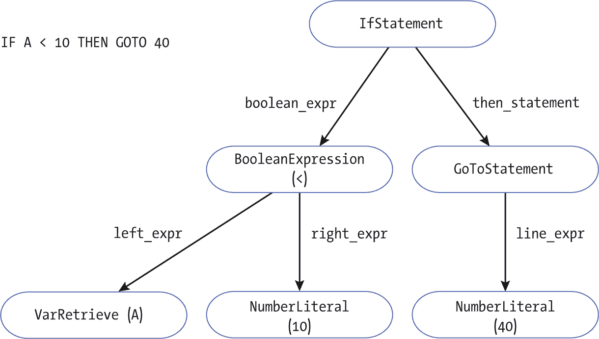

图 2-1：`IF A < 10 THEN GOTO 40` 的节点

我们解析器的工作是将意义相邻的标记集合转换为 AST 节点。在解释器的最后一个阶段，AST 节点将会被*遍历*，这涉及到按顺序完成每个节点所连接的任何操作。我们 AST 中可能出现的每个节点在 `nodes.py` 中都有自己的类。所有节点都继承自 `Node` 类。为了调试，每个 `Node` 都会跟踪其在原始源代码文件中的位置：

```
NanoBASIC/nodes.py

from dataclasses import dataclass
from NanoBASIC.tokenizer import TokenType

### 出调试目的，我们需要知道所有 Node 的位置
@dataclass(frozen=True)
class Node:
    line_num: int
    col_start: int
    col_end: int
```

现在让我们定义 `Statement` 节点：

```
### NanoBASIC 中的所有语句都有一个行号标识符
### 程序员在语句之前放置该行号（*line_id*）。
# 这有点让人困惑，因为还有一个"物理"
# 行号（*line_num*），即语句在文件中
# 往下数的第多少行的实际计数。
@dataclass(frozen=True)
class Statement(Node):
    line_id: int
```

NanoBASIC 中的每个语句都出现在用户定义的行号之后。这是为了 `GOTO` 和 `GOSUB` 调用准备的。我们不应该将这些行号与 `Node` 对象的 `line_num` 混淆，即 `Node` 出现在源代码文件中的位置。为了清晰起见，我们在 `Statement` 类中用户定义的行号称为 `line_id`。例如，如果我的源代码文件第一行是 `23 PRINT "HELLO"`，那么 `line_id` 是 23，但 `line_num` 是 1。

`NumericExpression` 是 `Node` 的一种类型，求值时可以产生单个整数。它可以是二元操作、一元操作、数字字面量或变量查找，因此我们将所有这些节点声明为 `NumericExpression` 的子类：

```
# 数值表达式是一个可以计算为数字的东西。
### 这是字面量、变量和简单算术运算的父类。
@dataclass(frozen=True)
class NumericExpression(Node):
    pass

### 带有两个操作数的数值表达式，如 2 + 2 或 8 / 4
@dataclass(frozen=True)
class BinaryOperation(NumericExpression):
    operator: TokenType
    left_expr: NumericExpression
    right_expr: NumericExpression

    def __repr__(self) -> str:
        return f"{self.left_expr} {self.right_expr}"

### 带有一个操作数的数值表达式
@dataclass(frozen=True)
class UnaryOperation(NumericExpression):
    operator: TokenType
    expr: NumericExpression

    def __repr__(self) -> str:
        return f"{self.operator}{self.expr}"

### 数字字面量
@dataclass(frozen=True)
class NumberLiteral(NumericExpression):
    value: int

### 变量查找
@dataclass(frozen=True)
class VarRetrieve(NumericExpression):
    name: str
```

`NanoBASIC/errors.py`

```python
from NanoBASIC.tokenizer import Token
from NanoBASIC.nodes import Node

class NanoBASICError(Exception):
    def __init__(self, message: str, line_num: int, column: int):
        super().__init__(message)
        self.message = message
        self.line_num = line_num
        self.column = column

    def __str__(self):
        return (f"{self.message} Occurred at line {self.line_num} "
                f"and column {self.column}")

class ParserError(NanoBASICError):
    def __init__(self, message: str, token: Token):
        super().__init__(message, token.line_num, token.col_start)

class InterpreterError(NanoBASICError):
    def __init__(self, message: str, node: Node):
        super().__init__(message, node.line_num, node.col_start)
```

`ParserError` 和 `InterpreterError` 都是 `NanoBASICError` 的子类，而 `NanoBASICError` 又是 `Exception` 的子类。`Exception` 是 Python 的内置类，你可以覆盖它来创建并在程序中抛出自定义异常。这些类报告与错误相关的消息以及该错误在原始程序中发生的位置。例如，假设我们有以下程序：

```
10 PRINT(A)
```

这会导致报告以下错误：

```
NanoBASIC.errors.InterpreterError: Var A used before initialized. Occurred at
line 1 and column 10
```

发生此错误是因为变量 `A` 从未通过 `LET` 语句进行初始化。在接下来的章节中，你会看到许多 `ParserError` 和 `InterpreterError` 的抛出。

### 解析器

解析器从 `tokenizer` 获取标记，并尝试将它们转换为对解释程序有意义的结构。解析是计算机科学中一个被深入研究的领域，有很多不同的解析算法。甚至有程序可以为你生成解析器。意料的是，它们被称为 `parser generators`（解析器生成器）。解析器生成器可以接受 BNF 形式的文法并输出一个解析器。

我们完全可以使用解析器生成器，但那样没有自己编写解析器那样具有教育意义。虽然有很多解析算法，但事实证明最简单的之一也是最有效、可定制且被广泛使用的算法之一。它被称为 `recursive descent`（递归下降），它是世界上两个最流行的编译器 `GCC` 和 `Clang` 中 C/C++ 解析器的基础。它也是 Dennis Allison 编写的原始版本 `Tiny BASIC` 中使用的技术。

在 `recursive descent` 中，通常文法中定义的每个非终符都会变成一个函数。该函数负责检查它正在分析的标记序列是否遵循文法中指定的产生规则。解析器通过顺序查看标记来检查它们。如果正在分析的标记预计是另一个产生规则的一部分，递归下降解析器就会调用代表该另一个产生规则的函数。递归下降函数在成功时返回相应的节点——`success` 意味着函数确实找到了它预期的标记。

递归下降是一种 `top-down`（自顶向下）解析技术，这意味着解析从文法的"开始部分"（在本例中是 `<line>`）开始并向下"下降"，直到达到必要的最具体的点。这就是 `descent`（下降）部分，但 `recursive`（递归）部分需要更多的想象。想象我们正在解析一个 `IF` 语句。`IF` 语句是一种语句类型，每个非终符（包括"语句"和"`IF` 语句"）都可以在我们的递归下降解析器中获得相应的函数。`IF` 语句有一个 `THEN` 子句，该子句也是一条语句。因此，当我们解析 `IF` 语句时，我们可能会再次调用我们的函数来解析 `THEN` 子句的语句——而解析该语句的函数正是调用我们解析 `IF` 语句的函数！这是一种递归。我们最终调用了调用我们当前处内部函数的函数。

随着我们深入研究 `Parser` 类的代码，`descent` 和 `recursion` 都会变得更加清晰：

`NanoBASIC/parser.py`

```python
from NanoBASIC.tokenizer import Token
from typing import cast
from NanoBASIC.nodes import *
from NanoBASIC.errors import ParserError

class Parser:
    def __init__(self, tokens: list[Token]):
        self.tokens = tokens
        self.token_index = 0

    @property
    def out_of_tokens(self) -> bool:
        return self.token_index >= len(self.tokens)

    @property
    def current(self) -> Token:
        return self.tokens[self.token_index]

    @property
    def previous(self) -> Token:
        return self.tokens[self.token_index - 1]

    def consume(self, kind: TokenType) -> Token:
        if self.current.kind is kind:
            self.token_index += 1
            return self.previous
        raise ParserError(f"Expected {kind} after {self.previous} but got {self.current}.")
```

`Parser` 类接收来自 `tokenizer` 的标记标记集合。随着解析的进行，内部的 `token_index` 跟踪我们进行到哪个标记。我们还定义了一些属性来获取 `current` 或 `previous` 标记。`consume()` 辅助方法（有时也称为 `eat()` 或 `accept()`）在解析器中很常见，因为检查标记是否是预期的标记并在如果是则继续移动是一个非常常见的模式。如果没有 `consume()`，你会看到大量的重复代码。

我们解析器的目标是产生一个可以由运行时遍历的 AST（抽象语法树）。AST 的根将是一个语句列表。另一种思考方式是，一个 NanoBASIC 程序仅仅是语句的列表，从源代码文件的顶部到底部按顺序编写。最终，我们的运行时将逐个执行这些语句。因此，我们的递归下降解析器从 `parse()` 开始，它将"下降"通过其他解析器方法并最终返回语句列表：


```python
    def parse(self) -> list[Statement]:
        statements: list[Statement] = []
        while not self.out_of_tokens:
            statement = self.parse_line()
            statements.append(statement)
        return statements
```

每条语句必须单独写一行，并紧跟行标识符，因此下降的第一步是解析行：

```python
    def parse_line(self) -> Statement:
        number = self.consume(TokenType.NUMBER)
        return self.parse_statement(cast(int, number.associated_value))
```

注意 `parse_line()` 方法对应文法中的 `<line>` 非终符。从现在开始，我们的许多方法将是文法中非终符或其相应产生规则的直接对应物。例如，我们的下一个方法 `parse_statement()` 对应 `<statement>` 非终符。

```python
    def parse_statement(self, line_id: int) -> Statement:
        match self.current.kind:
            case TokenType.PRINT:
                return self.parse_print(line_id)
            case TokenType.IF_T:
                return self.parse_if(line_id)
            case TokenType.LET:
                return self.parse_let(line_id)
            case TokenType.GOTO:
                return self.parse_goto(line_id)
            case TokenType.GOSUB:
                return self.parse_gosub(line_id)
            case TokenType.RETURN_T:
                return self.parse_return(line_id)
        raise ParserError("Expected to find start of statement.",
                          self.current)
```

该方法负责确定 NanoBASIC 的六种语句中的哪一个出现在接几个标记中。幸运的是，NanoBASIC 中的每条语句都可以通过其唯一的起始标记（`PRINT`、`IF`、`LET`、`GOTO`、`GOSUB` 或 `RETURN`）来识别，因此我们只需要将当前标记与这六种可能性进行匹配。

为了组织方便，我将每种语句类型拆分到独立的方法中，尽管这些方法并不直接对应非终符。相反，你可以将 `<statement>` 的每条产生规则理解为接收其对应的方法。我们从 `PRINT` 语句开始，它是最难解析的语句之一，因为它的 `<expr-list>` 中可以包含多种不同的用逗号分隔的类型。

```python
    # PRINT "COMMA",SEPARATED,7154
    def parse_print(self, line_id: int) -> PrintStatement:
        print_token = self.consume(TokenType.PRINT)
        printables: list[str | NumericExpression] = []
        last_col: int = print_token.col_end
        while True: # 继续寻找要打印的内容
            if self.current.kind is TokenType.STRING: ❶
                string = self.consume(TokenType.STRING)
                printables.append(cast(str, string.associated_value))
                last_col = string.col_end
            elif (expression := self.parse_numeric_expression()) is not None: ❷
                printables.append(expression)
                last_col = expression.col_end
            else: ❸
                raise ParserError("Only strings and numeric expressions "
                                  "allowed in print list.", self.current)
            # 逗号意味着还有更多内容打印
            if not self.out_of_tokens and self.current.kind is TokenType.COMMA: ❹
                self.consume(TokenType.COMMA)
                continue
            break
        return PrintStatement(line_id=line_id, line_num=print_token.line_num,
                              col_start=print_token.col_start, col_end=last_col,
                              printables=printables)
```

我们将待打印的项目存储在 `printables` Python 列表中。为了收集它们，我们继续向后移动（使用循环），一个标记接一个标记，检查是否为字符串 ❶ 或数字表达式 ❷。只要我们找到其中之一，并且后面跟着一个逗号 ❹，我们就会继续循环。如果我们发现某个项既不是字符串也不是数字表达式 ❸，我们就会抛出一个 `ParserError`。在循环过程中，我们还会跟踪最后一个项目的列结束位置以便于调试。返回的最终 `PrintStatement` 节点需要知道它的起始和结束位置；它起始于 `PRINT` 标记的开始，结束于表达式列表中最后一个项目最后一列的末尾。

接下来，让我们来看 `parse_if()`，它包含了一个递归下降中递归特性的很好的示例：

```python
    # IF BOOLEAN_EXPRESSION THEN STATEMENT
    def parse_if(self, line_id: int) -> IfStatement:
        if_token = self.consume(TokenType.IF_T)
        boolean_expression = self.parse_boolean_expression()
        self.consume(TokenType.THEN)
        statement = self.parse_statement(line_id)
        return IfStatement(line_id=line_id, line_num=if_token.line_num,
                           col_start=if_token.col_start, col_end=statement.col_end,
                           boolean_expr=boolean_expression, then_statement=statement)
```

正如我们讨论过的，`IF` 语句的 `THEN` 子句是另一条语句。为了解析 `THEN` 子句，我们调用 `parse_statement()`，这正是最初在调用链上层引导我们进入 `parse_if()` 的同一个方法。不过，首先解析 `IF` 语句开头的布尔表达式。我们稍后会看如何这样做。

在目前为止讨论的所有解析方法中，请注意我们是如何调用其他解析方法并假设它们能够正常工作的。其他方法负责处理它们自己的错误并持续移动 `token_index`。这种模式继续适用于其他四种语句的方法：

```python
    # LET VARIABLE = VALUE
    def parse_let(self, line_id: int) -> LetStatement:
        let_token = self.consume(TokenType.LET)
        variable = self.consume(TokenType.VARIABLE)
        self.consume(TokenType.EQUAL)
        expression = self.parse_numeric_expression()
        return LetStatement(line_id=line_id, line_num=let_token.line_num,
                            col_start=let_token.col_start, col_end=expression.end,
                            name=cast(str, variable), expr=expression)

    # GOTO NUMERIC_PRESSION
    def parse_goto(self, line_id: int) -> GoToStatement:
        goto_token = self.consume(TokenType.GOTO)
        expression = self.parse_numeric_expression()
        return GoToStatement(line_id=line_id, line_num=goto_token.line_num,
                             col_start=goto_token.col_start, col_end=expression.end)

    # GOSUB NUMERIC_PRESSION
    def parse_gosub(self, line_id: int) -> GoSubStatement:
        gosub_token = self.consume(TokenType.GOSUB)
        expression = self.parse_numeric_expression()
        return GoSubStatement(line_id=line_id, line_num=gosub_token.line_num,
                              col_start=gosub_token.col_start, col_end=expression.end,
                              expr=expression)

    # RETURN
    def parse_return(self, line_id: int) -> ReturnStatement:
        return_token = self.consume(TokenType.RETURN_T)
        return ReturnStatement(line_id=line_id, line_num=return_token.line_num,
                               col_start=return_token.col_start,
                               col_end=return_token.end)
```

这四个解析方法彼此非常相似。在每情况下，我们都期望一个特定的起始标记（例如 `LET` 或 `GOTO`），然后解析创建该类型语句节点时所需的信息。例如，`LET` 语句需要一个变量和一个数字表达式，而 `GOTO` 语句只需要一个数字表达式（跳转的行号）。最简单的语句是 `RETURN`，因为 `RETURN` 之后没有任何内容。

正如所承诺的，这里是 `parse_boolean_expression()` 方法：

```python
    # NUMERIC_EXPRESSION BOOLEAN_OPERATOR NUMERIC_PRESSION
    def parse_boolean_expression(self) -> BooleanExpression:
        left = self.parse_numeric_expression()
        if self.current.kind in {TokenType.GREATER, TokenType.GREATER_EQUAL, TokenType.EQUAL,
                               TokenType.LESS, TokenType.LESS_EQUAL, TokenType.NOT_EQUAL}:
            operator = self.consume(self.current.kind)
            right = self.parse_numeric_expression()
            return BooleanExpression(line_num=left.line_num,
                                     col_start=left.col_start, col_end=right.col_end,
                                     operator=operator.kind, left_expr=left, right_expr=right)
        raise ParserError(f"Expected boolean operator but found "
                          f"{self.current.kind}.", self.current)
```

一个 `Boolean` 表达式必须包含两个数值表达式，以及它们之间的一个允许的运算符标记。我们将操作符之前的数值表达式称为 `left`，将操作符之后的数值表达式称为 `right`。运算符标记被存储在 `BooleanExpression` 节点中，以便我们可以在运行时进行相应的比较。

数值表达式的解析紧密遵循语法中非终符的层级结构，从 `<expression>` 到 `<term>` 再到 `<factor>`，每个层级都有对应的方法。`<factor>` 可以包含 `<var>` 或 `<number>`，但这些直接在 `parse_factor()` 中处理，因为它们所需的信息已经包含在各自的标记中了：


```python
    def parse_numeric_expression(self) -> NumericExpression:
        left = self.parse_term()
        # Keep parsing +s and -s until there are no more
        while True:
            if self.out_of_tokens: # what if expression is end of file?
                return left
            if self.current.kind is TokenType.PLUS:
                self.consume(TokenType.PLUS)
                right = self.parse_term()
                left = BinaryOperation(line_num=left.line_num, col_start=left.col_start,
                                       col_end=right.col_end, operator=TokenType.PLUS,
                                       left_expr=left, right_expr=right)
            elif self.current.kind is TokenType.MINUS:
                self.consume(TokenType.MINUS)
                right = self.parse_term()
                left = BinaryOperation(line_num=left.line_num, col_start=left.col_start,
                                       col_end=right.col_end, operator=TokenType.MINUS,
                                       left_expr=left, right_expr=right)
            else:
                break # no more, must be end of expression
        return left

    def parse_term(self) -> NumericExpression:
        left = self.parse_factor()
        # Keep parsing *s and /s until there are no more
        while True:
            if self.out_of_tokens: # what if expression is end of file?
                return left
            if self.current.kind is TokenType.MULTIPLY:
                self.consume(TokenType.MULTIPLY)
                right = self.parse_factor()
                left = BinaryOperation(line_num=left.line_num, col_start=left.col_start,
                                       col_end=right.col_end, operator=TokenType.MULTIPLY,
                                       left_expr=left, right_expr=right)
            elif self.current.kind is TokenType.DIVIDE:
                self.consume(TokenType.DIVIDE)
                right = self.parse_factor()
                left = BinaryOperation(line_num=left.line_num, col_start=left.col_start,
                                       col_end=right.col_end, operator=TokenType.DIVIDE,
                                       left_expr=left, right_expr=right)
            else:
                break # no more, must be end of expression
        return left

    def parse_factor(self) -> NumericExpression:
        if self.current.kind is TokenType.VARIABLE:
            variable = self.consume(TokenType.VARIABLE)
            return VarRetrieve(line_num=variable.line_num, col_start=variable.col_start, col_end=variable.col_end)
        elif self.current.kind is TokenType.NUMBER:
            number = self.consume(TokenType.NUMBER)
            return NumberLiteral(line_num=number.line_num, col_start=number.col_start, col_end=number.col_end)
        elif self.current.kind is TokenType.LPAREN:
            self.consume(TokenType.LPAREN)
            expr = self.parse_numeric_expression()
            if self.current.kind != TokenType.RPAREN:
                raise SyntaxError("Expected closing parenthesis")
            self.consume(TokenType.RPAREN)
            return expr
        raise SyntaxError("Expected factor")
```

我们解析器的最终结果将是一个 `AST Statement` 节点的集合，存储在一个列表中，运行时可以对列表进行步进并执行。我将遍历 `AST` 的类命名为 `Interpreter`（解释器），尽管我知道这可能会让人有些困惑，因为整章内容都是关于构建解释器的。是的，分词器和解析器是整个解释器的一部分，但这个 `Interpreter` 类是真正解释语言的地方，也就是说，变成节点的标记被转换为有意义的东西——一个可以执行并产生输出的程序。无论这个名字起得好不好，`Interpreter` 类都提供了一个运行时环境，并对如何根据遇到的的语句和表达式节点来修改环境或提供输出提供了理解。

`Interpreter` 类的启动方式与 `Parser` 类似：

`NanoBASIC/interpreter.py`

```python
from NanoBASIC.nodes import *
from NanoBASIC.errors import InterpreterError
from collections import deque

class Interpreter:
    def __init__(self, statements: list[Statement]):
        self.statements = statements
        self.variable_table: dict[str, int] = {}
        self.statement_index: int = 0
        self.subroutine_stack: deque[int] = deque()

    @property
    def current(self) -> Statement:
        return self.statements[self.statement_index]
```

与我们在 `Parser` 类中的标记列表不同，`Interpreter` 接收的是语句列表。为了方便起见，还有一个 `current` 属性用于访问当前语句。运行时环境由语句、一个 `statement_index`、一个用于跟踪每个变量值的 `variable_table`，以及一个可以帮助我们在执行 `GOSUB` 和 `RETURN` 对后回到正确位置的 `subroutine_stack` 组成。

接下来，我们需要一种方法将行标识符连接到语句索引。考虑以下这个 NanoBASIC 程序：

```
27 PRINT "HELLO"
38 GOTO 50
45 PRINT "NEVER"
50 PRINT "BYE"
```

当执行 `GOTO 50` 时，解释器需要找到与行标识符 `50` 关联的语句，并从那里继续运行。在 NanoBASIC 中，程序员可以为任意行任意选择任何行标识符，只要所有的行标识符都是递增的整数即可。那么我们如何找到 `50` 呢？我们需要在语句列表中搜索它。由于行必须是有序的，我们的 `find_line_index()` 方法可以执行二分查找：

```python
    # 使用二分查找返回 line_id 的索引，
    # 如果未找到则返回 None；假设语句列表是排序的
    def find_line_index(self, line_id: int) -> int | None:
        low: int = 0
        high: int = len(self.statements) - 1
        while low <= high:
            mid: int = (low + high) // 2
            if self.statements[mid].line_id < line_id:
                low = mid + 1
            elif self.statements[mid].line_id > line_id:
                high = mid - 1
            else:
                return mid
        return None
```

接下来，`run()` 方法按顺序执行 `statements` 中的语句：

```python
    def run(self):
        while self.statement_index < len(self.statements):
            self.interpret(self.current)
```

注意，我们使用的是由 `statement_index` 控制的 `while` 循环而不是 `for...in` 循环。这是因为由于 `GOTO` 和 `GOSUB`，我们实际上可能会跳跃并跳过或重复某些语句。换句话说，当我们在循环内部解释各种语句时，`statement_index` 可能会被修改。

`interpret()` 方法是解释器的核心。它解释 `Statement` 节点，并根据具体的语句修改运行时环境或产生输出：

```python
    def interpret(self, statement: Statement):
        match statement:
            case LetStatement(name=name, expr=expr):
                value = evaluate_expression(expr)
                self.variable_table[name] = value
                self.statement_index += 1
            case GoToStatement(line_id=line_id):
                target_line_index = self.find_line_index(line_id)
                if target_line_index is not None:
                    self.statement_index = target_line_index
                else:
                    raise InterpreterError("GOTO line not found", self.current)
            case GoSubStatement(line_id=line_id):
                target_line_index = self.find_line_index(line_id)
                if target_line_index is not None:
                    self.subroutine_stack.append(target_line_index + 1)
                    self.statement_index = target_line_index
                else:
                    raise InterpreterError("GOSUB line not found", self.current)
            case ReturnStatement():
                if self.subroutine_stack:
                    self.statement_index = self.subroutine_stack.pop()
                else:
                    raise InterpreterError("RETURN without GOSUB", self.current)
            case PrintStatement(printables=printables):
                accumulated_string = ""
                for index, printable in enumerate(printables):
                    if index > 0: # put tabs between items in the list
                        accumulated_string += "\t"
                    if isinstance(printable, NumericExpression):
                        accumulated_string += str(evaluate_expression(printable))
                    else: # otherwise, it's a string
                        accumulated_string += str(printable)
                print(accumulated_string)
                self.statement_index += 1
            case IfStatement(boolean_expr=boolean_expr, then_statement=then_statement):
                if evaluate_boolean(boolean_expr):
                    self.interpret(then_statement)
                else:
                    self.statement_index += 1
            case _:
                raise InterpreterError(f"Unexpected item {self.current} "
                                    f"in statement list.", self.current)
```


```python
def evaluate_numeric(self, numeric_expression: NumericExpression) -> int:
    match numeric_expression:
        case NumberLiteral(number=number):
            return number
        case VarRetrieve(name=name):
            if name in self.variable_table:
                return self.variable_table[name]
            else:
                raise InterpreterError(f"Var {name} used "
                                       f"before initialized.", numeric_expression)
        case UnaryOperation(operator=operator, expr=expr):
            if operator is TokenType.MINUS:
                return -self.evaluate_numeric(expr)
            else:
                raise InterpreterError(f"Expected - "
                                       f"but got {operator}.", numeric_expression)
        case BinaryOperation(operator=operator, left_expr=left, right_expr=right):
            if operator is TokenType.PLUS:
                return self.evaluate_numeric(left) + self.evaluate_numeric(right)
            elif operator is TokenType.MINUS:
                return self.evaluate_numeric(left) - self.evaluate_numeric(right)
            elif operator is TokenType.MULTIPLY:
                return self.evaluate_numeric(left) * self.evaluate_numeric(right)
            elif operator is TokenType.DIVIDE:
                return self.evaluate_numeric(left) // self.evaluate_numeric(right)
            else:
                raise InterpreterError(f"Unexpected binary operator "
                                       f"{operator}.", numeric_expression)
        case _:
            raise InterpreterError("Expected numeric expression.",
                                   numeric_expression)
```

注意 `evaluate_numeric()` 中所有的递归调用。当你初次学习像 `Python` 这样的命令式语言进行编程时，递归似乎像是一个深奥晦懂的话题。当你进阶成为一名中级或高级程序员时，你会开始看到它的用处。这个项目就是一个很好的说明。我们已经在 `Parser` 和 `Interpreter` 类中看到了递归在通过算法表达我们想法时是多么地有用。

信不信由你，有些整个编程语言（大多是函数式范式的）没有任何循环，只有递归。这听起来可能非常极端，而且只使用递归来编写 `Python` 代码无疑是一个非常糟糕的方法，因为它会让其他 `Python` 程序员难以阅读你的代码，并带来一些性能损失。但这凸显了递归是一个多么强大的技术。任何你用循环能做的事，也可以用递归完成，但魔法在于当递归实际上帮助你更好地表达自己时，正如本项目的情况所示。特别是在处理像 `AST` 这样的层次级数据结构时，递归会非常有帮助。

评估布尔表达式与评估数值表达式非常相似。它是从 `NanoBASIC` 运算符到 `Python` 运算符的转换：

```python
def evaluate_boolean(self, boolean_expression: BooleanExpression) -> bool:
    left = self.evaluate_numeric(boolean_expression.left_expr)
    right = self.evaluate_numeric(boolean_expression.right_expr)
    match boolean_expression.operator:
        case TokenType.LESS:
            return left < right
        case TokenType.LESS_EQUAL:
            return left <= right
        case TokenType.GREATER:
            return left > right
        case TokenType.GREATER_EQUAL:
            return left >= right
        case TokenType.EQUAL:
            return left == right
        case TokenType.NOT_EQUAL:
            return left != right
        case _:
            raise InterpreterError(f"Unexpected boolean operator "
                                   f"{boolean_expression.operator}.", boolean_expression)
```

就是这样！运行一个 `NanoBASIC` 程序比解析它要容易得多。

> **注意**
>
> 如果这是一个简单的编译器而不是一个简单的解释器，那么我们不会通过遍历 `AST` 并执行某些操作，而是在遇到每个节点时生成机器代码。

### 运行程序

现在我们的 `NanoBASIC` 解释器已经完成，我们可以运行一些 `NanoBASIC` 程序了。你可以在网上找到可以在 `NanoBASIC` 中运行的 Tiny BASIC 程序（如果它们使用了 `INPUT` 或 `NanoBASIC` 不具备的功能，可以对其进行修改）。你也可以编写自己的 `NanoBASIC` 程序，这实际上是测试解释器的极好方法。正如前面提到的，我已经在项目的 `Examples` 文件夹中提供了几个简单的 `NanoBASIC` 程序。例如，我们在本章开头见过 `fib.bas`。另一个示例 `gcd.bas` 能够找到源代码中指定的两个数的最大公约数。这里是它在寻找 350 和 539 的最大公约数：

```
% python3 -m NanoBASIC NanoBASIC/Examples/gcd.bas
7
```

再次，正如第 1 章一样，运行程序的命令假设你在仓库的主目录下。不要忘记使用 `-m` 选项作为模块运行程序。

### 测试 NanoBASIC

就像 Brainfuck 一样，拥有一些集成测试来确保我们的解释器运行正常是有帮助的。`NanoBASIC` 测试与 Brainfuck 测试非常相似。我们劫持标准输出，并确保 `Examples` 文件夹中许多程序的预期输出与实际输出一致：

`tests/test_nano_basic.py`

```python
import unittest
import sys
from pathlib import Path
from io import StringIO
from NanoBASIC.executioner import execute

### 分词、解析并解释一个 NanoBASIC
### 程序；将输出存储在字符串中并返回
def run(file_name: str | Path) -> str:
    output_holder = StringIO()
    sys.stdout = output_holder
    execute(file_name)
    return output_holder.getvalue()

class NanoBASICTestCase(unittest.TestCase):
    def setUp(self) -> None:
        self.example_folder = (Path(__file__).resolve().parent.parent
                               / 'NanoBASIC' / 'Examples')

    def test_print1(self):
        program_output = run(self.example_folder / "print1.bas")
        expected = "Hello World\n"
        self.assertEqual(program_output, expected)

    def test_print2(self):
        program_output = run(self.example_folder / "print2.bas")
        expected = "4\n12\n30\n7\n100\t9\n"
        self.assertEqual(program_output, expected)

    def test_print3(self):
        program_output = run(self.example_folder / "print3.bas")
        expected = "E is\t-31\n"
        self.assertEqual(program_output, expected)

    def test_variables(self):
        program_output = run(self.example_folder / "variables.bas")
        expected = "15\n"
        self.assertEqual(program_output, expected)

    def test_goto(self):
        program_output = run(self.example_folder / "goto.bas")
        expected = "Josh\nDave\nNanoBASIC ROCKS\n"
        self.assertEqual(program_output, expected)

    def test_gosub(self):
        program_output = run(self.example_folder / "gosub.bas")
        expected = "10\n"
        self.assertEqual(program_output, expected)

    def test_if1(self):
        program_output = run(self.example_folder / "if1.bas")
        expected = "10\n40\n50\n60\n70\n100\n"
        self.assertEqual(program_output, expected)

    def test_if2(self):
        program_output = run(self.example_folder / "if2.bas")
        expected = "GOOD\n"
        self.assertEqual(program_output, expected)

    def test_fib(self):
        program_output = run(self.example_folder / "fib.bas")
        expected = "0\n1\n1\n2\n3\n5\n8\n13\n21\n34\n55\n89\n"
        self.assertEqual(program_output, expected)

    def test_factorial(self):
        program_output = run(self.example_folder / "factorial.bas")
        expected = "120\n"
        self.assertEqual(program_output, expected)

    def test_gcd(self):
        program_output = run(self.example_folder / "gcd.bas")
        expected = "7\n"
        self.assertEqual(program_output, expected)

if __name__ == "__main__":
    unittest.main()
```

`NanoBASIC` 测试的另一个特性是，许多测试都孤立了单一语句类型。例如，`print2.bas` 仅使用 `PRINT` 语句和数值表达式，因此如果 `GOTO` 没有正常工作，`test_print2()` 仍然可以通过。这种隔离测试的方法提供了更细粒度的测试，但我们仍然需要 `fib.bas` 这样的综合测试来确保各个部分能够协同工作。你也可以尝试编写你自己的 BASIC 程序作为测试。

### 实际应用

正如之前在第 22 页 BASIC 历史中所讨论的，BASIC 曾是标准。由于其简单性，Tiny BASIC 一被广泛使用。

它看起来并不复杂，但许多现实版本也有扩展，例如用于生成随机数的 `RND()`。Tiny BASIC 运行在交互模式，支持这些命令：`CLEAR`、`LIST`、`RUN` 和 `END`。以行号开头的行可以被存储、列出或运行。程序也可以终止。为 `NanoBASIC` 创建一个交互模式（本质上是一个 REPL）。

许多成功的语言都是从简单的实现开始并随着时间演进。例如，Ruby 起初是一个 `AST` 解释器，后来编译到虚拟机上的字节码（关于虚拟机请见第 5 章），较新的 Ruby 版本引入了即时编译（JIT）编译器。

无论语言是遍历 `AST`、使用字节码还是拥有 JIT 编译器，它们都需要本章涵盖的原则。

### 练习题

1. 让 `NanoBASIC` 支持转义双引号。这需要学习一些正则表达式。
2. 通过实现 `INPUT` 语句将 `NanoBASIC` 转换为 Tiny BASIC，允许用户输入数值并存储在变量中。这足以实现“基准”Tiny BASIC（并用你的解释器运行网上 Tiny BASIC 程序），但许多现实版本也有扩展。
3. 我说过练习 2 会变成 Tiny BASIC，但有了这个交互模式，你真正实现了 Tiny BASIC。
4. 为 `NanoBASIC` 添加字符串插值支持。当字符串中标识符前带有美元符号时，检查该标识符是否在变量表中定义，并用其值替换。例如，如果变量 `X` 的值为 `24`，那么 `"The value of X is $X"` 将输出 `The value of X is 24`。这需要修改分词器、解析器和运行时。
5. 编写一个有趣的且测试解释器中所有语句的 `NanoBASIC` 程序。将其视为最后的综合测试。

### 注

1. “BASIC 起于 Dartmouth”，BASIC at 50, 2014，访问于 2024 年 5 月 22 日，[`www.dartmouth.edu/basicfifty/basic.html`](https://www.dartmouth.edu/basicfifty/basic.html)。
2. Linus Torvalds 和 David Diamond, *Just for Fun* (HarperCollins, 2001), 7–8。
3. James Wallace 和 Jim Erickson, *Hard Drive: Bill Gates and the Making of the Microsoft Empire* (HarperBusiness, 1993)。


4. Tom Pittman, “Itty Bitty Computers & Tiny Basic,” Itty Bitty Computers, 2004, 最后修改于 2017 年 7 月 10 日, 访问于 2024 年 5 月 22 日, [`www.ittybittycomputers.com/IttyBitty/TinyBasic`](http://www.ittybittycomputers.com/IttyBitty/TinyBasic)。
5. Edsger Dijkstra, “Letters to the Editor: Go To Statement Considered Harmful,” *Communications of the ACM* 11, no. 3 (1968): 147–148, [`dl.acm.org/doi/10.1145/362929.362947`](https://dl.acm.org/doi/10.1145/362929.362947)。
6. Dennis Allison, “Design Notes for Tiny BASIC,” *Dr. Dobb’s Journal of Computer Calisthenics and Orthodontia* 1 (1976): 9, [`archive.org/details/dr_dobbs_journal_vol_01/page/n9/mode/2up`](https://archive.org/details/dr_dobbs_journal_vol_01/page/n9/mode/2up)。
7. 参见 [`peps.python.org/pep-0604`](https://peps.python.org/pep-0604)。
8. Joseph Sibony, “GCC vs. Clang: Battle of the Behemoths,” Incredibuild, 2021 年 5 月 27 日, [`www.incredibuild.com/blog/gcc-vs-clang-battle-of-the-behemoths`](https://www.incredibuild.com/blog/gcc-vs-clang-battle-of-the-behemoths)。
9. Tom Pittman, “Tiny Basic Experimenter’s Kit,” 1977, 访问于 2024 年 12 月 4 日, [`www.ittybittycomputers.com/IttyBitty/TinyBasic/TBEK.txt`](http://www.ittybittycomputers.com/IttyBitty/TinyBasic/TBEK.txt)。
10. 参见 [`en.wikipedia.org/wiki/Danny_Kopec`](https://en.wikipedia.org/wiki/Danny_Kopec)。
11. 参见 [`en.wikipedia.org/wiki/John_G._Kemeny`](https://en.wikipedia.org/wiki/John_G._Kemeny)。
12. 参见 [`en.wikipedia.org/wiki/True_BASIC`](https://en.wikipedia.org/wiki/True_BASIC)。
13. 参见 [`en.wikipedia.org/wiki/Thomas_E._Kurtz`](https://en.wikipedia.org/wiki/Thomas_E._Kurtz)。
14. 参见 [`en.wikipedia.org/wiki/Logo_(programming_language)`](https://en.wikipedia.org/wiki/Logo_(programming_language))。
15. 参见 [`oaksnow.com/seaturtle`](https://oaksnow.com/seaturtle)。
16. 参见 [`www.tinybasic.de`](https://www.tinybasic.de)。

# 第二部分 计算艺术

## 3 复古图像处理


当你需要在颜色数量比图像本身更少的显示器上显示图像时，该怎么办？解决这个问题属于抖动算法的领域，这些算法策略性地使用有限的色板来营造更多颜色的错。在本章中，我们将编写一个程序，可以获取任何现代照片并将其显示在经典的单色 Macintosh 上。它将照片转换为经过抖动处理的 1 位黑白版本，并将其导出为早期 Macintosh 可以读取的格式：`MacPaint`。在此过程中，我们将学习一种抖动算法。

### 什么是抖动？

*抖动算法* 特意向图像中引入噪声，使其看起来具有更多的深度。如果你见过印刷品中的*半色网*，你可能就知道什么是抖动了。

如果你查看[图 3-1](#chapter2.xhtml#chapter2_1)，你会看到 `JPEG` 和 `GIF` 格式。1984 年的 Macintosh 只能支持 256 色色，但 1 位的 `GIF` 也是如此。

[图 3-2](#chapter2.xhtml#chapter2_2) 显示了最终结果：在 Mac Plus 上运行的 `MacPaint`。


图 3-2：来自[图 3-1](#chapter2.xhtml#chapter2_1) 的海滩场景，通过我们的程序转换为显示

抖动的另一种常见用途是灰度化。对于[图 3-1](#chapter2.xhtml#chapter2_1)，我首先将场景缩小到较低的分辨率，以便两个版本并排（我使用软件统计了低分辨率的颜色）。我通过程序将 `JPEG` 图像转换为位 `MacPaint` 灰度。

### 开始之前

项目中独特且有趣的部分是第 3 和第 4 步，因此我们将使用一个库来完成第 1 和第 2 步。Python 世界中最流行的图像库可能是 `Pillow`。安装它应该和 `pip install pillow` 一样简单。

Pillow 只需一行代码即可读取任何流行格式的图像，只需多写几行即可调整图像大小并将其转换为灰度。我们将在 `__main__.py` 文件中直接完成这些简单的准备工作，并像我们在前两个项目中做的那样处理命令行参数。让我们从缩放和转换为灰度的代码开始，这些代码出现在一个命名非常恰当的 `prepare()` 函数中：

`RetroDither/__main__.py`

```python
from PIL import Image
from argparse import ArgumentParser
from RetroDither.dither import dither
from RetroDither.macpaint import MAX_WIDTH, MAX_HEIGHT, write_macpaint_file

def prepare(file_name: str) -> Image.Image:
    with open(file_name, "rb") as fp:
        image = Image.open(fp)
        # 将尺寸缩放到 MacPaint 的最大限制范围内
        if image.width > MAX_WIDTH or image.height > MAX_HEIGHT:
            desired_ratio = MAX_WIDTH / MAX_HEIGHT
            ratio = image.width / image.height
            if ratio >= desired_ratio:
                new_size = (MAX_WIDTH, int(image.height * (MAX_WIDTH / image.width)))
            else:
                new_size = (int(image.width * (MAX_HEIGHT / image.height)), MAX_HEIGHT)
            image.thumbnail(new_size, Image.Resampling.LANCZOS)
        # 转换为灰度
        return image.convert("L")
```

如前所述，MacPaint 图像的分辨率限制为宽 576 像素、高 720 像素。我们在 `macpaint.py` 中将这些值定义为常量。在 `prepare()` 中，如果图像太大，我们会按比例对其缩放。为此，我们计算图像宽度与高度的比例，并与 MacPaint 最大尺寸的比例进行比较。通过将一个维度缩放到 MacPaint 允许的最大尺寸，并根据相应的比例调整另一个维度，我们得到了一个在 MacPaint 中尽可能大且没有任何部分被裁剪的最终图像。为了算出缩放公式，我在纸上做了一些简单的交叉乘代数运算。如果你对原理感兴趣，我建议你也这样做。

和读取图像文件一样，在 Pillow 中进行缩放只需使用 `image.thumbnail()` 方法即可完成的单行代码。它提供了多种内置算法来实际计算缩放后的每个像素应呈现什么颜色；`LANCZOS` 可能是质量最高的（尽管会带来一定的性能代价）。最后，`image.convert("L")` 将图像转换为灰度。灰度模式的 `"L"` 是 `luminance`（亮度）的缩写，在计算机图形学中，它也被称为 `luma`。

现在让我们处理命令行参数：

```python
if __name__ == "__main__":
    argument_parser = ArgumentParser("RetroDither")
    argument_parser.add_argument("image_file", help="输入图像文件.")
    argument_parser.add_argument("output_file", help="结果性 MacPaint 文件.")
    argument_parser.add_argument('-g', '--gif', default=False, action='store_true',
                                 help='同时创建一个输出 gif。')
    arguments = argument_parser.parse_args()
    original = prepare(arguments.image_file)
    dithered_data = dither(original)
    if arguments.gif:
        out_image = Image.frombytes('L', original.size, dithered_data.tobytes())
        out_image.save(arguments.output_file + ".gif")
    write_macpaint_file(dithered_data, arguments.output_file, original.width, original.height)
```

在此时，在第三个项目中，我们已经见过很多 `ArgumentParser` 了。对于 Retro Dither，与之前的项目相比，我们多了几命令行选项。其，`output_file` 用于用户指定结果的输出文件名和路径。可选的 `-g` 或 `--gif` 参数用于用户指定他们是否除了 MacPaint 输出外还想要 GIF 输出。如果用户请求 GIF 输出，我们将使用 Pillow 写入抖动图像的 GIF 版本。

Pillow 是一个功能非常全且强大的库。我们将在本章中不会使用它的许多功能，但如果你需要在 Python 中进行图像处理，那么花时间学习它是非常值得的。我们将在下一章中再次看到它。更多信息请查阅 Pillow 文档：`https://pillow.readthedocs.io`。

### 抖动算法

有很多不同的抖动算法，其中最流行的一类被称为`误差扩散`（error-diffusion）算法。这类算法获取像素最终位置与起始位置之间的某些差异（`误差`），并将其扩散（`diffuses`）到相邻像素中。最流行的误差扩散抖动算法被称为 Floyd-Steinberg 抖动（由 Robert Floyd 和 Louis Steinberg 于 1976 年发明）。事实上，Pillow 内置了对 Floyd-Steinberg 抖动的支持。

仅仅使用 Pillow 来抖动将毫无趣味，而且我们在这个过程中学不到任何东西。相反，我们将实现一种 Pillow 不具备的算法：Atkinson 抖动算法。它由 Bill Atkinson 在 1984 年创建，专门用于原始 Macintosh 电脑上的软件，例如 Atkinson 曾参与开发的的 MacPaint。

在深入研究 Atkinson 抖动的细节之前，让我们泛泛地讨论误差扩散算法。大多数此类算法从左上到右下逐个查看图像的像素。移动方向是每行从左到右，在完成每行后向下移动一行。对于处理的每个像素，都会发生以下步骤：

1. 找到它接近哪些输出颜色。
2. 找到输出颜色与原始颜色之间的差异。
3. 相加部分。

让我们将这些通用步骤应用到我们的特定场景中，即像素通过 Atkinson 抖动从灰度转换为黑白：

1. 寻找黑色或白色更接近灰色。这将基于某种阈值。例如，如果灰色被存储为 8 位无符号整数，则可能有 0 到 255 的 256 种灰色，我们的阈值可以是 127。任何大于 127 的像素都可能被标记为白色（在此方案中为 255），任何小于或等于 127 的像素可能被标记为黑色（0）。
2. 减去新像素颜色与其原始颜色之间的差异。假设原始灰色为 204。差异为 255 – 204 = 51。这就是我们的误差。
3. 将误差的八分之一添加到原始像素附近的六个特定像素。这就是扩散步骤。在这种情况下，`51 // 8 = 6`（我们需要进行整数除法）。调整的像素是：右侧一个、右侧两个、左下一个、右下一个、正下方一个、下方两个。

Floyd-Steinberg 抖动和 Atkinson 抖动之间只有第 3 步不同。你会注意到，由于我们将误差的八分之一分配到六个像素中，我们只分配了总误差的六分之五或四分三。在 Floyd-Steinberg 抖动中，所有的误差都被分配到四个相邻像素中。这种误差分配方式的不同使得 Atkinson 抖动的看起来似乎更强调对比度的变化，而 Floyd-Steinberg 抖动的视觉效果可能更平滑。


图 3-3: 作者祖母的肖像，显示了不同颜色之间良好的对比度，说明了边缘在抖动处理中是如何出现的

表 3-1 和 3-2 分别包含了代表 Atkinson 抖动和 Floyd-Steinberg 抖动中误差扩散的矩阵。`X` 表示原始像素位置，列和行标题表示距离原始像素在列或行方向的移动。

**表 3-1：Atkinson 抖动中的误差扩散**

| Δ | –1 | 0 | +1 | +2 |
| --- | --- | --- | --- | --- |
| 0 |  | X | 1/8 | 1/8 |
| +1 | 1/8 | 1/8 | 1/8 |  |
| +2 |  | 1/8 |  |  |

**表 3-2：Floyd-Steinberg 抖动中的误差扩散**

| Δ | –1 | 0 | +1 |
| --- | --- | --- | --- |
| 0 |  | X | 7/16 |
| +1 | 3/16 | 5/16 | 1/16 |

尽管我们将实现 Atkinson 抖动，但我们将保持矩阵的分离，以便你方便地接入不同的矩阵。例如，你可以轻松地将代码更改为 Floyd-Steinberg 抖动或其他误差扩散变体，或者尝试你自己的方法。事实上，这样做是本章节末的练习题之一。

我们的抖动代码从定义一些常量开始：

`RetroDither/dither.py`

```python
from PIL import Image
from array import array
from typing import NamedTuple

THRESHOLD = 127

class PatternPart(NamedTuple):
    dc: int # 列的变化
    dr: int # 行的变化
    numerator: int
    denominator: int

ATKINSON = [PatternPart(1, 0, 1, 8), PatternPart(2, 0, 1, 8),
            PatternPart(-1, 1, 1, 8), PatternPart(0, 1, 1, 8),
            PatternPart(1, 1, 1, 8), PatternPart(0, 2, 1, 8)]
```

正如算法中所描述，我们将 `THRESHOLD` 设置为 127（大约 0 和 255 之间的中间点）。在 `ATKINSON` 中，我们将 Atkinson 抖动矩阵展平为六个 `PatternPart` 命名元组，每个元组都指定了被改变像素之一相对于原始像素的位置，以及应该加到其上的误差比例。

接下来，我们将开始定义 `dither()` 函数，抖动处理就在这里发生：


```python
### 假设我们正在处理一张灰度图像（Pillow 中的 "L" 模式）
### 返回抖动后的像素数组（255 为白色，0 为黑色）
def dither(image: Image.Image) -> array:
    # 在附近的像素之间分配误差
    def diffuse(c: int, r: int, error: int, pattern: list[PatternPart]):
        for part in pattern:
            col = c + part.dc
            row = r + part.dr
            if col < 0 or col >= image.width or row >= image.height:
                continue
            current_pixel: float = image.getpixel((col, row)) # type: ignore
            # 将 `error_part` 添加到 `image` 中 `col`, `row` 处的像素
            error_part = (error * part.numerator) // part.denominator
            image.putpixel((col, row), current_pixel + error_part)
```

`dither()` 函数从 `diffuse()` Helper 函数开始，该函数接收误差并根据模式指定的比例将其分配到附近的像素中，模式只是 `PatternPart` 元组的列表。我们遍历 `pattern` 中的每个 `PatternPart`，找到与该部分相关的像素，并将误差的比例加到其中。正如讨论的，模式是使一种误差扩散算法区别于另一种算法的核心。注意这里所有的运算都是整数运算。这是因为像素值是存储为整数的。

在 `dither()` 的其余部分，我们遍历图像中的每个像素，根据 `THRESHOLD` 将其变为黑色或白色，计算与原始灰色的差异，并使用 `diffuse()` Helper 函数将误差扩散到附近的像素：

```python
    result = array('B', [0] * (image.width * image.height))
    for y in range(image.height):
        for x in range(image.width):
            old_pixel: float = image.getpixel((x, y)) # type: ignore
            # 每个新像素要么是纯白色要么是纯黑色
            # 因为这是原始 Macintosh 支持的所有内容
            new_pixel = 255 if old_pixel > THRESHOLD else 0
            result[y * image.width + x] = new_pixel
            difference = int(old_pixel - new_pixel)
            # 在后续附近的像素之间分散误差
            diffuse(x, y, difference, ATKINSON)

    return result
```

`result` 变量实际上是一个 `array`。由于我们要处理大量的像素数据，我们会反复看到它。令人困惑的是，Python 为原始字节提供了至少三种不同类型：`bytes`、`bytearray` 和 `array("B")`。`array` 类型特别设计用于紧凑表示。

## MacPaint 文件格式

在它之前就有绘画程序了，但对于之后出现的一切，MacPaint 设定了标准。它由 Bill Atkinson 编写，于 1984 年与原始 Macintosh 同时发布。尽管早于 Xerox Star 和 Apple Lisa 出现，但 Macintosh 是第一台带有鼠标和图形用户界面（GUI）的广泛使用的个人电脑。MacPaint 是演示鼠标和 GUI 多么强大的软件展示作品之一。《纽约时报》的一位评论员曾说它是具有革命性的，尽管存在局限性。许多首次出现在 MacPaint 中的工具和图形处理技术直到今天仍然伴随着我们。

我鼓励你玩一玩 MacPaint 来感受一下它。互联网档案馆上有它的在线演示，但如果你花时间下载一个模拟器，可能会从本章节中获得最大的成就感，这样你就可以在 MacPaint 中加载我们程序输出的图像。你甚至可以在 eBay 上找一台旧 Mac！

从表面上看，MacPaint 文件非常简单。它由一个 512 字节的表头和随后的使用游程编码压缩的像素数据组成。在进行游程编码之前，每个像素以 1 位的形式存储，1 表示黑色，0 表示白色。这听起来一切都很直观。然而，这里有一个特殊之处：与几乎任何其他操作系统不同，经典的 Mac 操作系统将文件存储在两个“分支”中。稍后会深入探讨，简单来说，在经典 Mac OS 以外的操作系统上传输或创建的 MacPaint 文件应该采用名为 `MacBinary` 的特殊格式，以确保其元数据在传输过程中保留。因此，我们需要通过添加一个特殊的额外表头，将输出文件转换为 `MacBinary` 文件。

我们将逐步处理这种晦涩的文件格式。首先，我们将处理像素数据。然后，我们将实现游程编码。最后，我们将创建 MacPaint 和 `MacBinary` 表头。在操作过程中，我们需要使用各种位运算，包括位移、位或和位与。如果你对这种低级位操作不熟悉，或者只是觉得有些生疏，请参阅本书附录中关于 Python 位运算的概述。

## 将字节转换为位

在“L”模式下，我们的 Pillow 图像使用每个像素 1 字节进行编码。但在 MacPaint 位点图中，像素是以每个像素 1 位编码的，这意味着每个字节代表八个像素。对于黑白图像来说，这是一个巨大的节省，而且非常有意义，因为我们只需要两个值（1 和 0）来表示两种颜色。在定义了一些常量后，我们在 `macpaint.py` 中的第一个函数是一个转换器，它接收从 `dither()` 获取的字节数组并将其转换为“位数组”：

`RetroDither/macpaint.py`

```python
from array import array
from pathlib import Path
from datetime import datetime

MAX_WIDTH = 576
MAX_HEIGHT = 720
MACBINARY_LENGTH = 128
HEADER_LENGTH = 512

### 将每个字节为 0 或 255 的字节数组
# 转换为位数组，其中每个 0 字节变为 1，
# 每个 255 字节变为 0
def bytes_to_bits(original: array) -> array:
    bits_array = array('B')

    for byte_index in range(0, len(original), 8):
        next_byte = 0
        for bit_index in range(8):
            next_bit = 1 - (original[byte_index + bit_index] & 1)
            next_byte = next_byte | (next_bit << (7 - bit_index))
            if (byte_index + bit_index + 1) >= len(original):
                break
        bits_array.append(next_byte)
    return bits_array
```

这里的循环每次从原始数组中迭代 8 个字节，检查每个字节是白色（255）还是黑色（0）像素。MacPaint 的位点格式反转了这一点，使白色像素变为 0，黑色像素变为 1。行 `next_bit = 1 - (original[byte_index + bit_index] & 1)` 执行了这一反转。注意，我们实际上并没有将值与 255 进行比较，而是倾向于只检查第一位（`& 1`），因为这使得代码更紧凑且高效。我们知道在调用 `bytes_to_bits()` 之前，数组中只存储了 255 和 0，所以没有理由担心捕获到中间值；如果字节中任何地方有 1，它必须是 255。这 8 位通过 `next_byte | (next_bit << (7 - bit_index))` 编码到 `next_byte` 中。

## 实现游程编码

将像素作为单个字节存储可以节省空间，但这样是不够的。为了缓解磁盘空间问题，MacPaint 文件引入了一种名为游程编码的简单方案。在这种方案中，与其重复相同的内容，而是说它应该重复的次数。

```python
### 将字节数组转换为位
### 填充 MacPaint
### 使用 prepare()

def prepare(data: array, width: int, height: int) -> array:
    bits_array = array('B')
    # ... 逻辑省略 ...
```

MacPaint 通过使用带符号的 1 字节整数来表示字面运行和重复运行，从而消除了两者之间的数字歧义。0 到 127 之间的数字 `n` 表示其后有 `n + 1` 个字面字节。–1 到 –127 之间的数字 `n` 表示接下来的字节将重复 `1 – n` 次。数字 `-128` 不被使用。这种压缩方案被称为 `PackBits`，它不仅用于 MacPaint，还被用于其他几种流行的文件格式。

经典版本的 Mac OS 实际上内置了 `PackBits` 函数。根据 Apple 关于该主题的技术笔记，“使用 `PackBits`，典型的 MacPaint 文档可以压缩到约 10K”。表 3-3 总结了 `PackBits` 编码方案。

表 3-3：`PackBits` 编码方案（带符号）

| `n` 的值 | 含义 |
| --- | --- |
| 0 到 127 | 紧后有 `n + 1` 个字面字节。 |
| –1 到 –127 | 下一个字节重复 `1 – n` 次。 |
| –128 | 跳过。 |

我们将使用无符号整数，因此重写表格比对每个字节进行从带符号到无符号的转换（或考虑补码）更方便。表 3-4 是将字节转换为无符号整数后的编码方案。

表 3-4：`PackBits` 编码方案（无符号）

| `n` 的值 | 含义 |
| --- | --- |
| 0 到 127 | 紧后有 `n + 1` 个字面字节。 |
| 129 到 255 | 下一个字节重复 `257 – n` 次。 |
| 128 | 跳过。 |

你考虑过这种方案的局限性吗？如果一个运行块中包含超过 128 个字节怎么办？幸运的是，我们在编码 MacPaint 文件时不会遇到这个问题，因为它们是逐行进行编码的。MacPaint 中的一行只能有 576 像素，存储为 72 字节。由于 72 小于 128，我们不需要担心这个限制。

为了检查你的理解情况，请尝试 Apple 在技术笔记 TN1023 中提供的示例。为了方便起见，我在表 3-5 中将其从十六进制转换成了十进制。一行是未解包的数据，另一行是压缩的数据。尝试以表 3-4 为参考，根据未解包数据重新构建压缩数据。然后对照表 3-5 中的压缩数据检查你的结果。

表 3-5：`PackBits` 示例

| 类型 | 字节 |
| --- | --- |
| 未解包 | 170, 170, 170, 128, 0, 42, 170, 170, 170, 170, 128, 0, 42, 34, 170, 170, 170, 170, 170, 170, 170, 170, 170, 170 |
| 压缩 | 254, 170, 2, 128, 0, 42, 253, 170, 3, 128, 0, 42, 34, 247, 170 |

让我们实现一个 `PackBits` 编码器。`run_length_encode()` 函数接收一个字节数组并使用 `PackBits` 方案返回一个行程编码的字节数组。它从一个内部辅助函数 `take_same()` 开始，该函数可以找到重复值的运行块并返回它们的长度：

```python
### MacPaint 要求按行进行 RLE（MAX_WIDTH）。
### 换句话说，存在行边界。
def run_length_encode(original_data: array) -> array:
    # 查找连续中有多少个相同的字节
    def take_same(source: array, start: int) -> int:
        count = 0
        while (start + count < len(source) and source[start + count] == source[start]):
            count += 1
        return count
```


```python
# tests/test_retrodither.py
import unittest
from array import array
from RetroDither.macpaint import run_length_encode

class RetroDitherTestCase(unittest.TestCase):
    # Example 自
    # web.archive.org/web/20080705155158/http://developer.apple.com/technotes/tn/tn1023.html
    def test_apple_rle_example(self):
        unpacked = array("B", [0xAA, 0xAA, 0xAA, 0x80, 0x00, 0x2A, 0xAA, 0xAA, 0xAA, 0xAA,
                               0x80, 0x00, 0x2A, 0x22, 0xAA, 0xAA, 0xAA, 0xAA, 0xAA, 0xAA,
                               0xAA, 0xAA, 0xAA, 0xAA])
        packed = run_length_encode(unpacked)
        expected = array("B", [0xFE, 0xAA, 0x02, 0x80, 0x00, 0x2A, 0xFD, 0xAA, 0x03, 0x80,
                               0x00, 0x2A, 0x22, 0xF7, 0xAA])
        self.assertEqual(expected, packed)

    # 包后的数据比解包数据长的示例
    def test_longer_rle(self):
        unpacked = array("B", [0x55, 0x55, 0xBB, 0xBB, 0x55, 0xBB, 0xBB, 0x55])
        packed = run_length_encode(unpacked)
        expected = array("B", [0xFF, 0x55, 0xFF, 0xBB, 0x00, 0x55, 0xFF, 0xBB, 0x00, 0x55])
        self.assertEqual(expected, packed)

    def test_simple_literal(self):
        unpacked = array("B", [0x00, 0x01, 0x02, 0x03, 0x04])
        packed = run_length_encode(unpacked)
        expected = array("B", [0x04, 0x00, 0x01, 0x02, 0x03, 0x04])
        self.assertEqual(expected, packed)

    def test_simple_literal2(self):
        unpacked = array("B", [0x00])
        packed = run_length_encode(unpacked)
        expected = array("B", [0x00, 0x00])
        self.assertEqual(expected, packed)

    def test_simple_same(self):
        unpacked = array("B", [0x11, 0x11, 0x11, 0x11])
        packed = run_length_encode(unpacked)
        expected = array("B", [0xFE, 0x11, 0x03])
        self.assertEqual(expected, packed)

    def test_simple_same2(self):
        unpacked = array("B", [0x11, 0x11, 0x11, 0x11, 0x11, 0x11, 0x11, 0x11])
        packed = run_length_encode(unpacked)
        expected = array("B", [0xFE, 0x11, 0x07])
        self.assertEqual(expected, packed)

if __name__ == "__main__":
    unittest.main()
```

这些测试确保了行程长度编码工作正常，并完成了我们对`MacPaint`文件的实现。为了让我们的抖动图片能够在 Mac 上正常，现在只剩下最后一步了。

### 转换为 MacBinary

在大多数操作系统中，文件只是一个单一的数据块。文件系统或操作系统可能会保留关于每个文件的某些元数据，但文件本身是独立的。在具有两个分叉的经典 Mac 上，`data fork`（数据分叉）持有文件的主要数据，而`resource fork`（资源分叉）则可能包含如位图、声音甚至可执行代码之类的辅助数据。`资源分叉`可以在一个地方存储不同类型的数据，因此就像一个资源数据库。这是操作系统的功能之一，允许许多应用程序完全自包含——一个可以作为单个图标拖放的可执行文件。

遗憾的是，由于其他系统上不存在`资源分叉`，经典 Mac 文件在与这些系统之间传输时经常会损坏。这个问题从一开始就存在了，因此很快开发了“封装”（bundling）格式。最流行且最标准的格式之一被称为`MacBinary`。在`MacBinary`文件中，一个特殊的头部之后紧跟着是`数据分叉`和`资源分叉`。我们需要将`MacPaint`文件封装为`MacBinary`文件，以便它们能够在经典 Mac 上正常工作并被默认打开。讽刺的是，`MacPaint`文件实际上并没有`资源分叉`，它只有一个`数据分叉`。

#### 表 3-6：MacBinary 字段

| 偏移量 | 长度 | 类型 |
| :--- | :--- | :--- |
| 1 | 1 | 文件名长度（最多 63） |
| 2 | 63 | 文件名（`MacRoman`编码） |
| 65 | 4 | 文件类型（应为"PTG"） |
| 69 | 4 | 文件创建者（应为"MPNT"） |
| 83 | 4 | 数据叉大小 |
| 91 | 4 | 创建时间（自 1904 年以来的秒数） |
| 95 | 4 | 修改时间（自 1904 年以来的秒数） |

注意值是大端存储的，因为经典 Mac OS 运行在大端微处理器上。（如果你对这没有意义，请参见“大端与小端”章节）。`MacRoman`是经典 Mac 使用的字符编码。

```python
def macbinary_header(outfile: str, data_size: int) -> array:
    macbinary = array('B', [0] * MACBINARY_LENGTH)
    filename = Path(outfile).stem
    filename = filename[:63] if len(filename) > 63 else filename # 限制最多 63 字符
    macbinary[1] = len(filename) # 文件名长度
    macbinary[2:(2 + len(filename))] = array("B", filename.encode("macroman")) # 文件名
    macbinary[65:69] = array("B", "PNTG".encode("macroman")) # 文件类型
    macbinary[69:73] = array("B", "MPNT".encode("macroman")) # 文件创建者
    macbinary[83:87] = array("B", data_size.to_bytes(4, byteorder='big')) # 数据叉大小
    timestamp = int((datetime.now() - datetime(1904, 1, 1)).total_seconds()) # Mac 时间
    macbinary[91:95] = array("B", timestamp.to_bytes(4, byteorder='big')) # 创建时间
    macbinary[95:99] = array("B", timestamp.to_bytes(4, byteorder='big')) # 修改时间
    return macbinary
```

### 汇总在一起

为了将我们的`MacPaint`文件封装为`MacBinary`文件，我们需要获取来自`dither()`的像素数组，并：

1. 调用`prepare()`将其从字节转换为位并填充 0。
2. 调用`run_length_encode()`对位数组进行行程长度编码。
3. 调用`macbinary_header()`将结果与`MacBinary`头部结合。
4. 同样添加一个 512 字节的`MacPaint`头部。
5. 在最终结果末尾填充 0 直到达到 128 字节的倍数，以遵循`MacBinary`规范此要求。

任何超过 63 个字符的文件名都会被截断。

这主要涉及调用我们已经有的函数：

```python
# Writes array data to out_file
def write_macpaint_file(data: array, out_file: str, width: int, height: int):
    bits_array = prepare(data, width, height)
    rle = run_length_encode(bits_array)
    data_size = len(rle) + HEADER_LENGTH # header requires this
    output = macbinary_header(out_file, data_size) + array('B', [0] * HEADER_LENGTH) + rle
    output[MACBINARY_LENGTH + 3] = 2 # Data Fork Header Signature ❶
    # MacBinary format requires that there be padding of 0s up to a
    # multiple of 128 bytes for the data fork
    padding = 128 - (data_size % 128)
    if padding > 0:
        output += array('B', [0] * padding)
    with open(out_file + ".bin", "wb") as fp:
        output.tofile(fp)
```

这段代码中我们还没有讨论的部分是 512 字节的`MacPaint`头部。`MacPaint`主要使用此头部来存储用户定义的模式数据。导出到`MacPaint`的程序通常没有任何用户定义的模式，因为这些是用户在`MacPaint`中创建的产物。因此，我们可以将`MacPaint`头部大部分留为 0。我们必须做的是在`MacPaint`头的第 3 字节处放入一个小的签名，该字节始终设置为 2 ❶。

## 结果

要运行程序，你需要同时指定输入文件和输出文件。例如：

```bash
% python3 -m RetroDither -g /Users/dave/Downloads/IMG_0892.jpeg
/Users/dave/Downloads/AmericanFlag
```

程序会自动为输出文件添加`.bin`扩展名。

图 3-4 显示了使用我们的程序创建的图像，我认为它具有很高的艺术性。


图 3-4：航天飞机发射

但你如何查看自己的结果呢？当然，是在老式 Mac 上！`MacPaint`运行从 System 1 一直到 Mac OS 9 的机器上。你应该能找到一台运行这些操作系统之一的经典 Mac 来显示你的照片。你还需要一个用于解包`MacBinary`文件的程序。有一个名字恰好叫`MacBinary`的程序可以下载。Stuffit Expander 是一款针对经典 Mac OS 非常流行的解压应用，也可以打开`MacBinary`文件。这两者都作为免费软件分发。你在 20 世纪 90 年代发现的大多数老式 Mac 应该已经安装了 Stuffit Expander。

我意识到并不是所有人都有足够的动力投入到这个项目中去跑出去寻找一台真正的复古电脑。没问题——你仍然可以通过模拟器体验你劳动的成果。多年前，苹果公司开始免费分发早期版本的 Mac OS 以及`MacPaint`（通过发布完整的`MacPaint`源代码）。你可以合法且免费地获得所有所需的软件，在模拟器中创建一个真正的复古 Macintosh 体验。

目前有几种模拟器可用，但可能最具有复古感的过于是 Mini vMac^(9)，我用它创建了本章中的一些截图。设置 Mini vMac 或其他几种流行的经典 Mac 模拟器（Basilisk II、SheepShaver 等）超出了本书的范围，但我认为作为一个程序员，你会发现这其实很容易。每个模拟器都有一种不同的从你的机器传输文件到模拟环境的机制。无论具体细节如何，这可能都比找一台旧 Mac 并让它联网，或者为你的现代机器寻找软驱驱动器要简单得多。尽管如此，老 Mac 很有趣！或者也许这种乐趣只是我伴随着它们长大的怀旧之。

## 现实世界应用

阿金森抖动和`MacPaint`只是 Bill Atkinson 用于让原始 Macintosh 图形动起来的两种技术。他还是 QuickDraw 的创建者，QuickDraw 为所有 Lisa 和经典 Macintosh 计算机提供了图形原语。他的巨大贡献远超图形领域。他对我们现在认为是 GUI 中标准组件的元素进行了多项改进。Atkinson 还是 HyperCard 的创建者，这是最早广泛分发的超文本平台之一。你可以将其看作是 20 世纪 80 年代后期非网络版本的网页。它非常有影响力。

你可能好奇 Bill Atkinson 最初开发阿金森抖动是为了。我也一样，所以我获得了一本由 Jeffrey S. Young 编写、Microsoft Press 于 1985 年出版的稀有书籍 *Inside MacPaint*。我并没有确切地找到答案，但我发现了一个可能的答案。事实证明，Atkinson 曾为早期 Macintosh 的数位器工作过。它基本上是某种扫描仪，允许你在`MacPaint`中处理现实世界的图像。虽然书中没有明确说它使用了阿金森抖动，但我无法想象这是巧合。阿金森抖动的首次现实应用很可能是数位器。

抖动是 20 世纪 80 年代和 90 年代游戏机和计算机上广泛使用的技术，这些设备的性能足以显示比其原生支持更多的颜色。如果没有特殊手段，GIF 被限制在 256 色。

3. “Technical Note PT24: MacPaint Document Format,” Apple, 1988 年 10 月 1 日，于 2022 年 8 月 5 日访问 [`web.archive.org/web/20040626093131/http://developer.apple.com/technotes/pt/pt_24.html`](https://web.archive.org/web/20040626093131/http://developer.apple.com/technotes/pt/pt_24.html)。
4. 查看 [`www.fileformat.info/format/macpaint/egff.htm`](https://www.fileformat.info/format/macpaint/egff.htm)。
5. 查看 [`en.wikipedia.org/wiki/PackBits`](https://en.wikipedia.org/wiki/PackBits)。
6. “Technical Note TN1023: Understanding PackBits,” Apple, 1987 年 11 月 1 日，于 2022 年 8 月 4 日访问 [`web.archive.org/web/20030218001420/http://developer.apple.com/technotes/tn/tn1023.html`](https://web.archive.org/web/20030218001420/http://developer.apple.com/technotes/tn/tn1023.html)。
7. “MacBinary II Standard,” Stairways.com, 1987 年 7 月 24 日，于 2024 年 5 月 27 日访问 [`files.stairways.com/other/macbinaryii-standard-info.txt`](https://files.stairways.com/other/macbinaryii-standard-info.txt)。
8. 查看 [`en.wikipedia.org/wiki/Mac_OS_Roman`](https://en.wikipedia.org/wiki/Mac_OS_Roman)。
9. 查看 [`www.gryphel.com/c/minivmac/index.html`](https://www.gryphel.com/c/minivmac/index.html)。


10. 查看 [`en.wikipedia.org/wiki/Robert_W._Fichter`](https://en.wikipedia.org/wiki/Robert_W._Fichter)。

11. John Earnest, “Atkinson Dithering,” *Beyond Loom*, 2020 年 3 月 29 日，[`beyondloom.com/blog/dither.html`](https://beyondloom.com/blog/dither.html)。

12. 查看 [`oaksnow.com/retrodither/`](https://oaksnow.com/retrodither/)。

13. Jeffrey S. Young, *Inside MacPaint: Sailing Through the Sea of FatBits on a Single-Pixel Raft* (Microsoft Press, 1985)。

## 4 随机绘画算法

本书中的其他章节都遵循类似于编程语言、文件格式或机器架构的规范。本章则不同。在本章中，我们将创作艺术。而且这是主观的。一个简单的算法可以使用随机生成的形状来创建出类似于人类艺术作品的绘画吗？我想答案是肯定的，但在你看到程序输出后需要自己做判断。

### 工作原理

本章的程序的工作原理是尝试从零开始重绘一张照片。我们从空白画布开始。我们尝试绘制一个随机大小和位置的形状。如果该形状让画布看起来与照片相似，我们就保留它。否则，我们就尝试另一个形状。我们重复这个过程若干次。这就是算法的全部。

如果这听起来很简单，那是因为它确实简单。当然，还有许多细节需要填充，但它们不会改变程序的主体基调。如何衡量“看起来相似”？是否应该对形状进行修改以提高其拟合度？形状的颜色是如何选择的？应该使用什么样的形状？

最后一个问题将为我们的“绘画”带来许多不同的视觉效果。例如，图 4-1 利用椭圆来近似一张热气球的照片。（印刷版读者请查看仓库中的 `figures` 目录获取章节图像的彩色版本。）


图 4-1：带有 540 个椭圆的热气球

该图展示了原始照片以及由我们的程序通过 100,000 次迭代使用 540 个椭圆创建的“印象”，这在我的笔记本电脑上花费了 104 秒完成。我觉得它看起来不错。几乎很有印象派风格。

在我看来，椭圆给人一种彩色玻璃的感觉。如果所使用的形状在某种程度上类似于原始照片中主体的轮廓，将有所帮助，例如用于热气球的椭圆。图 4-2 显示了使用 307 个三角形通过 100,000 次迭代绘制的同一照片，在我的笔记本电脑上花费了 109 秒。在我主观看来，它没有那么好。


图 4-2：带有 307 个三角形的热气球

虽然热气球的曲线被三角形填充得不好，但蝴蝶要好得多。图 4-3 是一张蝴蝶照片的印象，使用 1 万次迭代生成的 573 个三角形，花费了 4512 秒。


图 4-3：带有 573 个三角形的蝴蝶

蝴蝶图像的生成时间比平均百万次迭代图像要长一点，因为我使用了“常用颜色”方法而不是“平均颜色”方法——稍后会介绍。结果是每个形状的颜色更加鲜艳，混合得较少。

通过使用更多的形状和更多的迭代，通常可以改进输出。然而，由于这是一个随机（stochastic）过程，即使对同一张图片使用相同的设置，结果也会差异巨大。这里展示的示例是经过筛选的。细节丰富的照片需要最长时间才能达到合理的准确度。使用这种工具时，你必须在抽象性和可识别性之间取得平衡。如果图像太抽象，将无法被识别。但如果图像的细节多到几乎是原图的完美复制，那么它就会失去作为“艺术作品”的魅力。这种平衡在处理人物图像时特别难以实现。例如，图 4-4 是加利福尼亚州圣莫尼卡海滩上两个朋友的照片。它由 100 万次迭代生成的 4212 个椭圆组成，花费了 8262 秒。我的朋友作为抽象印象看起来还可以，但海滩看起来棒极了！

本章开发的程序如果你希望它利用大量的形状，运行将需要很长时间。例如，在我基于 Apple M1 的笔记本电脑上，运行 JFK 图片几乎花费了我近两个小时。运行速度取决于你机器特定的微处理器。通常你可以让程序在后台运行其他工作。

### 命令行选项

这是一个非常可配置的程序，具有许多功能和可调的参数。除了输入和输出文件路径，我们的 `ArgumentParser` 需要处理表 4-1 中的所有命令行选项。

表 4-1：`Impressionist` 的命令行选项

| 选项 | 扩展 | 可能值 | 默认值 | 描述 |
| --- | --- | --- | --- | --- |
| `-t` | `--trials` | 整数 | 10000 | 运行的次数 |
| `-m` | `--method` | `'random'`, `'average'`, `'common'` | `'average'` | 确定形状颜色的方法 |
| `-s` | `--shape` | `'ellipse'`, `'triangle'`, `'quadrilateral'`, `'line'` | `'ellipse'` | 使用的形状类型 |
| `-l` | `--length` | 整数 | 256 | 最终图像的像素长度（高度） |
| `-v` | `--vector` | 布尔 | `False` | 创建矢量输出？ |
| `-a` | `--animate` | 整数 | 0 | 如果提供的数字大于 0，将创建一个每帧指定毫秒间隔的动画 GIF，显示图像逐个形状地构建过程 |

我们的主文件只是表 4-1 的代码实现。所有选项都将传递给 `Impressionist` 类的构造函数，我们稍后会回到这个类。

```python
### Impressionist/__main__.py
from argparse import ArgumentParser
from Impressionist.impressionist import Impressionist, ColorMethod, ShapeType

if __name__ == "__main__":
    # 解析文件参数
    argument_parser = ArgumentParser("Impressionist")
    argument_parser.add_argument("image_file", help="The input image")
    argument_parser.add_argument("output_file", help="The resulting abstract art")
    argument_parser.add_argument('-t', '--trials', type=int, default=10000,
                                 help='The number of trials to run (default 10000).')
    argument_parser.add_argument('-m', '--method',
                                 choices=['random', 'average', 'common'], default='average',
                                 help='Shape color determination method (default average).')
    argument_parser.add_argument('-s', '--shape', choices=['ellipse', 'triangle',
                                                           'quadrilateral', 'line'],
                                 default='ellipse', help='The shape type (default ellipse).')
    argument_parser.add_argument('-l', '--length', type=int, default=256,
                                 help='The length of the final image in pixels (default 256).')
    argument_parser.add_argument('-v', '--vector', default=False, action='store_true',
                                 help='Create vector output. A SVG file will also be output.')
    argument_parser.add_argument('-a', '--animate', type=int, default=0,
                                 help='If greater than 0, will create an animated GIF '
                                     'with the number of milliseconds per frame provided.')
    arguments = argument_parser.parse_args()
    method = ColorMethod[arguments.method.upper()]
    shape_type = ShapeType[arguments.shape.upper()]
    Impressionist(arguments.image_file, arguments.output_file, arguments)
```

`-v` 选项指示程序以矢量格式输出。

### SVG 格式

SVG 代表可缩放矢量图形。它是一种基于 XML 的格式。所有主流浏览器和矢量图形程序都支持它。在利用第三方库来写入 SVG 之前，我们只需要编写自己的类。SVG 是一个文本格式，由于我们是在输出它而不是解析它，SVG 规范很大，但我们只需要其中的一小部分，这轻而易举。

SVG 颜色表示，正如构造函数中的 `background_color` 属性所示，颜色使用三个整数的元组表示。这些是 RGB 颜色代码。每个元素都是 0 到 255 之间的整数，表示输出中相应原色（红、绿、蓝）的量。例如，“纯”红色将是 `(255, 0, 0)`，而紫色可能是 `(128, 0, 128)`，它是红色和蓝色的混合。

在进入代码之前，这里有一个程序可以输出的简单 SVG 文件示例。这使用多边形元素创建了一个三角形（我稍微改进了缩进）：

```xml
<?xml version="1.0" encoding="utf-8"?>
<svg version="1.1" baseProfile="full" width="342" height="256"
xmlns="http://www.w3.org/2000/svg">
    <rect width="100%" height="100%" fill="rgb(108, 98, 91)" />
    <polygon points="201,3 24,9 162,182 " fill="rgb(128, 120, 112)" />
</svg>
```

如果你将此代码保存为带有 `.svg` 扩展的文件，可以使用网络浏览器或矢量编辑器打开它来查看结果。

SVG 文件以其为 XML 文件的声明开始，第一个元素是 `svg` 元素，描述了 SVG 版本以及图像的宽度和高度。此外，我们程序生成的每个图像都有一个包含平均颜色的巨大矩形支撑。这有助于算法更好地混合。因此，我们的 SVG 文件也从巨大的 `rect` 元素开始：

```python
### Impressionist/svg.py
class SVG:
    def __init__(self, width: int, height: int, background_color: tuple[int, int, int]):
        self.content = '<?xml version="1.0" encoding="utf-8"?>\n' \
                       f'<svg version="1.1" baseProfile="full" width="{width}" ' \
                       f'height="{height}" xmlns="http://www.w3.org/2000/svg">\n' \
                       f'<rect width="100%" height="100%" fill="rgb{background_color}" />'
```

绘制我们程序支持的三种形状（椭圆、直线和多边形）只需要向输出文本文件中放入相应的椭圆、直线或多边形 SVG 元素：

```python
    def draw_ellipse(self, x1: int, y1: int, x2: int, y2: int, color: tuple[int, int, int]):
        self.content += f'<ellipse cx="{(x1 + x2) // 2}" cy="{(y1 + y2) // 2}" ' \
                        f'rx="{abs(x1 - x2) // 2}" ry="{abs(y1 - y2) // 2}" ' \
                        f'fill="rgb{color}" />\n'

    def draw_line(self, x1: int, y1: int, x2: int, y2: int, color: tuple[int, int, int]):
        self.content += f'<line x1="{x1}" y1="{y1}" x2="{x2}" y2="{y2}" stroke="rgb{color}" ' \
                        'stroke-width="1px" shape-rendering="crispEdges" />\n'

    def draw_polygon(self, coordinates: list[int], color: tuple[int, int, int]):
        points = ""
        for index in range(0, len(coordinates), 2):
            points += f"{coordinates[index]},{coordinates[index + 1]} "
        self.content += f'<polygon points="{points}" fill="rgb{color}" />\n'
```

最后，为了输出 SVG 文件，我们关闭在构造函数中定义的 `svg` 元素，并将合并后的字符串写入磁盘：

```python
    def write(self, path: str):
        self.content += '</svg>\n'
        with open(path, 'w') as f:
            f.write(self.content)
```

如果你查看官方 SVG 规范，可能会觉得它极其晦涩，但不必被它吓倒。正如这一节希望所示，要从像 SVG 这样的大标准中获取价值并不一定费精力。只需 20 行代码，我们就编写了一个非常简单但实用的 SVG 创建器。

### 算法

产生这些（有时是）美照片抽象印象的算法非常简单。简而言之，它尝试一次绘制一个随机大小和位置的形状。如果添加的形状让抽象图像看起来更像原始照片，就将其保留。通过调整形状的大小可以进一步细化这种改进，这涉及到移动它的每一个点。如果添加的形状让图像看起来不再像原始照片，则将其丢弃并尝试新形状。

以下是该算法更详细的步骤说明：

1. 创建一个与原始照片尺寸相同的空白画布，背景颜色与原始照片的平均颜色相同。
2. 尝试在画布的随机位置以随机大小绘制一个形状。使用原始照片中对应区域的平均颜色、该区域最常见的颜色或随机颜色为该形状上色。
3. 将画布（带有添加的形状）的像素颜色与原始照片进行比较。如果添加的形状使得整个画布的像素与原始照片的像素更加相似，则保留添加的形状。
4. 尝试每次移动一个像素对形状的每个点进行修改（扩展或收缩）。持续向某个方向移动点以进一步缩小整个画布像素与原始照片像素之间的差异。当移动不再能改善差异时停止。
5. 重复执行步骤 2、3 和 4 指定的次数。
6. 在经过指定次数实验后，输出画布上创建的最终图像。

该算法有许多可配置参数。应该使用什么种类的形状？应该运行多少次？每个形状的颜色应该如何选择？还有几个子问题需要解决。如何计算两幅图像之间的差异？如何找到包含形状的区域内的像素？

### 主实现


除去注释，我们绘画算法的主实现少于 150 行 Python 代码。这种简洁性很大程度上归功于强大的 `Pillow` 库，它在第 3 章中已经讨论过。`Pillow` 处理读取和写入各种位图图像格式。它还提供了绘制我们所需的形状等简单原始图形的功能。最后，`Pillow` 拥有计算图像差异和计算图像区域平均颜色的函数。这些将是我们程序关键的辅助函数，允许我们专注于核心算法，而将繁琐的工作留给 `Pillow`。这就是一个优秀的库所实现的功能。

## 设置

我们从一些基础导入、一些需要的类型、一个常量和一个辅助函数开始：

`Impressionist/impressionist.py`

```python
from enum import Enum
from PIL import Image, ImageDraw
from PIL import ImageChops, ImageStat
import random
from math import trunc
from timeit import default_timer as timer
from Impressionist.svg import SVG

ColorMethod = Enum("ColorMethod", "RANDOM AVERAGE COMMON")
ShapeType = Enum("ShapeType", "ELLIPSE TRIANGLE QUADRILATERAL LINE")
CoordList = list[int]
MAX_HEIGHT = 256

def get_most_common_color(image: Image.Image) -> tuple[int, int, int]:
    colors = image.getcolors(image.width * image.height)
    return max(colors, key=lambda item: item[0])[1]
```

`ColorMethod` 枚举控制我们如何计算区域颜色。`ShapeType` 枚举设置了我们将绘制的形状。当前版本的程序只绘制一种类型的形状，但要修改代码以支持更多类型很容易的。`CoordList` 类型用于定义坐标。

在运行算法时，为了性能，我们需要处理有限数量的像素。实现这一点最简单的方法是如果图像高于 `MAX_HEIGHT` 则进行缩放。也就是说，`MAX_HEIGHT` 是缩放后图像的高度。注意，从技术上说我们应该也定义最大宽度，但在实践中，很少有图像的长宽比会导致只限制一个维度是不够的（很少有图像非常宽但高度很小）。为了简单，我们只定义了最大维度。

`get_most_common_color()` 方法计算图像中出现频率最高的颜色。它使用了 `Pillow` 方法 `getcolors()`，该方法返回图像中所有的颜色及其计数。然后，它使用 Python 内置的 `max()` 来提取最频繁的。

`Impressionist` 类的构造函数负责设置算法运行的唯一参数、打开输入图像、缩放、创建输出图像的背景、调用算法的实际迭代并调用方法输出最终文件。听起来可能很多，但算法的核心在其他方法。构造函数只是一个启动点，调用 `Pillow` 库的方法以及我们很快就会实现的实际工作方法。这里是构造函数的开头：

```python
class Impressionist:
    def __init__(self, file_name: str, output_file: str, trials: int, method: ColorMethod,
                 shape_type: ShapeType, length: int, vector: bool, animation_length: int):
        self.method = method
        self.shape_type = shape_type
        self.shapes = []
        # 打开图像文件并存储在实例变量中，执行算法
        with open(file_name, "rb") as fp:
            self.original = Image.open(fp).convert('RGB')
            # 缩小图像以提高处理速度，高度最大 256 像素
            width, height = self.original.size
            aspect_ratio = width / height
            new_size = (int(MAX_HEIGHT * aspect_ratio), MAX_HEIGHT)
            self.original.thumbnail(new_size, Image.Resampling.LANCZOS)
```

```python
# Start the generated image with a background that is the
# average of all the original's pixels in color
average_color = tuple((round(n) for n in ImageStat.Stat(self.original).mean))
self.glass = Image.new("RGB", new_size, average_color)
```

`Pillow ImageStat` 模块可以用于查找图像的平均颜色。它查看图像中每个像素的 RGB 值，并分别对红、绿、蓝分量取平均值。我们将得到的平均颜色提取，并设置为算法工作图像（`self.glass`）的背景。换句话说，原始图像的平均颜色将成为工作图像中每个像素的起始颜色。

> **注意**
>
> 工作图像的变量命名为 `glass`，是因为我最初将此程序命名为"Stained Glass"（彩绘玻璃）。在重命名后，我仍然觉得变量名 `glass` 解释了它是一个提供原始图像过滤后印象的表面。

构造函数继续：

```python
# Keep track of how far along we are, our best result so far, and
# how much time elapses as the processing takes place
self.best_difference = self.difference(self.glass)
last_percent = 0
start = timer()
for test in range(trials):
    self.trial()
    percent = trunc(test / trials * 100)
    if percent > last_percent:
        last_percent = percent
        print(f"{percent}% Done, Best Difference {self.best_difference}")
end = timer()
print(f"{end-start} seconds elapsed. {len(self.shapes)} shapes created.")
self.create_output(output_file, length, vector, animation_length)
```

算法的核心在于 `trial()` 方法，该方法尝试绘制一个形状，以查看该形状是否提高了工作图像与原始图像之间的相似性评分。在这里，`trial()` 被调用了 `trials` 次。在执行尝试期间，我们记录了完成进度以及程序运行的时间。最后，在 `create_output()` 的帮助下输出完成的工作图像。

## 实用方法

在进入 `trial()` 之前，我们需要一些辅助方法。绘画算法的关键部分是验证每个新增的形状是否都让工作图像更接近原始图像。`difference()` 方法计算两幅图像的相似性评分，衡量它们之间的相似程度：

```python
    def difference(self, other_image: Image.Image) -> float:
        diff = ImageChops.difference(self.original, other_image)
        stat = ImageStat.Stat(diff)
        diff_ratio = sum(stat.mean) / (len(stat.mean) * 255)
        return diff_ratio
```

`Pillow` 中的 `ImageChops` 模块内置了 `difference()` 方法。它能找到两幅图像之间像素级的差异。换句话说，两幅图像中相同位置的两个像素之间有什么不同？差异只是每个像素中每个颜色通道相减后的绝对值。例如，颜色为 `(10, 100, 50)` 的 RGB 像素与另一个为 `(10, 40, 20)` 的像素之间的差异为 `(0, 60, 30)`。然而，这对于我们的算法是不够的。我们需要一个数字（一个评分）来表示两幅图像的相似程度。在逐像素找到差异后，通过对所有差异取平均值，将其压缩为一个单一数字。我们使用在构造函数中用于计算平均颜色的相同 `ImageStat` 模块来实现。最后，尽管不是绝对的（像素平均值也可以作为评分），但我们将除以可能的最大差异，以比例形式获得评分。

每次生成一个新形状时，它会被放置在屏幕上的随机位置。我们使用 `random_coordinates()` 计算这些随机坐标：

```python
    def random_coordinates(self) -> CoordList:
        num_coordinates = 4 # ellipse or line
        if self.shape_type == ShapeType.TRIANGLE:
            num_coordinates = 6
        elif self.shape_type == ShapeType.QUADRILATERAL:
            num_coordinates = 8
        coordinates = []
        for d in range(num_coordinates):
            if d % 2 == 0: # x coordinates
                coordinates.append(random.randint(0, self.original.width))
            else: # y coordinates
                coordinates.append(random.randint(0, self.original.height))
        return coordinates
```

不同类型的形状需要不同数量的坐标。例如，三角形有六个坐标，因为它有三个点，每个点都有一个 `x` 坐标和一个 `y` 坐标。坐标必须是有效的——即它们必须位于图像表面的某处。

```python
def experiment() -> bool:
    new_image = original.copy()
    glass_draw = ImageDraw.Draw(new_image)
    if self.shape_type == ShapeType.ELLIPSE:
        glass_draw.ellipse(self.bounding_box(coordinates), fill=color)
    else: # must be triangle or quadrilateral or line
        glass_draw.polygon(coordinates, fill=color)
    new_difference = self.difference(new_image)
    if new_difference < self.best_difference:
        self.best_difference = new_difference
        self.glass = new_image
        return True
    return False
```

内部函数 `experiment()` 如果尝试绘制新形状并成功降低了工作图像与原始图像之间的差异，则返回 `True`。`Pillow` 中的 `ImageDraw` 模块负责实际的绘图。差异是使用之前定义的 `difference()` 方法计算的，并与目前找到的最佳差异进行比较。如果该形状改进了图像，则用工作图像替换为包含新形状的图像。

`trial()` 的最后一部分尝试通过微调坐标来对每个形状进行增量改进。如果微调后的差异得分与使用形状原始坐标的工作图像版本相比有所提高，则保留该微调并在同一方向上尝试下一次微调：

```python
if experiment():
    # 尝试扩展每个方向，在更好的方向继续
    for index in range(len(coordinates)):
        for amount in (-1, 1):
            while True:
                old_coordinates = coordinates.copy()
                coordinates[index] = coordinates[index] + amount
                if not experiment():
                    coordinates = old_coordinates
                    break
    self.shapes.append((coordinates, color))
```

这段代码是一种爬山算法，只要解决方案持续改进，我们就一直沿着同一个方向移动以解决问题（在本例中是优化差异）。当改进停止时，我们就停止。这可能会导致局部最优，但它是改进现有解决方案的一种简单而有效的方法。在这种情况下，我们已经有一个现有解决方案，因为我们只保留了最初对差异有改进的形状（由 `experiment()` 返回 `True` 表示）。更多关于这种算法工作原理的信息，请参见"爬山算法"框。

如果没有微调过程，整个算法也可以运行，但微调改进了每个形状的拟合度。这反过来提高了最终绘画的整体效果，并减少了获得合理结果所需的形状数量。

一旦在微调后确定了最终形状，我们就将其坐标和颜色添加到 `shapes` 列表中。维护这个列表（与在工作图像中绘制形状分开来）对于生成最终输出是必要的。

## 输出

工作图像被缩放到了 `MAX_HEIGHT`，但最终输出图像应该具有用户指定的高度（再次为了简化，我们让用户只设置高度而不设置宽度）。我们不能简单地"拉伸"位图而不产生像素化。相反，我们使用 `shapes` 列表中的数据重新绘制工作图像，并对每个形状进行适当缩放。输出图像的方法还包含了输出矢量文件（利用了之前的 `SVG` 类）和通过 `Pillow` 输出动画 GIF 的选项。这显著增加了代码的长度。以下是 `create_output()` 的开头：

```python
def create_output(self, out_file: str, height: int, vector: bool, animation_length: int):
    average_color = tuple((round(n) for n in ImageStat.Stat(self.original).mean))
    original_width, original_height = self.original.size
    ratio = height / original_height
    output_size = (int(original_width * ratio), int(original_height * ratio))
    output_image = Image.new("RGB", output_size, average_color)
    output_draw = ImageDraw.Draw(output_image)
```

我们首先根据用户指定的高度参数创建一个合适大小的新图像。使用原始图像的平均颜色填充初始输出图像，就像处理工作图像时一样。方法继续：

```python
svg = SVG(*output_size, average_color) if vector else None
animation_frames = [] if animation_length > 0 else None
for coordinate_list, color in self.shapes:
  ❶ coordinates = [int(x * ratio) for x in coordinate_list]
```

输出图像将通过以正确比例迭代复制 `shapes` 列表中的每个形状 ❶ 生成。为了同时创建 `SVG` 或动画 GIF 输出，在生成输出图像时，每一步都将在 `svg` 对象上重复，或者作为图片复制到构成动画 GIF "电影"的 `animation_frames` 列表中：


```python
if self.shape_type == ShapeType.ELLIPSE:
    output_draw.ellipse(self.bounding_box(coordinates), fill=color)
    if svg:
        svg.draw_ellipse(*coordinates, color) # type: ignore
else: # must be triangle or quadrilateral or line
    output_draw.polygon(coordinates, fill=color)
    if svg:
        if self.shape_type == ShapeType.LINE:
            svg.draw_line(*coordinates, color) # type: ignore
        else:
            svg.draw_polygon(coordinates, color)
if animation_frames is not None:
    animation_frames.append(output_image.copy())
output_image.save(out_file)
if svg:
    svg.write(out_file + ".svg")
if animation_frames is not None:
    animation_frames[0].save(out_file + ".gif", save_all=True,
                             append_images=animation_frames[1:], optimize=False,
                             duration=animation_length, loop=0,
                             transparency=0, disposal=2)
```

该方法的最后部分是在输出图像（s）上绘制形状并写入磁盘。

## 结果

图 4-9：在铺好的路面上打滚的猫

最后，我在图 4-10 中展示了一个万圣节场景。


图 4-10：带有椭圆的万圣节场景

我和儿子正在逛一个南瓜展示展。我很喜欢背景中的南瓜和人物使用椭圆呈现的效果。

### 实际应用

除了看起来很酷之外，这个程序的输出并没有许多实际应用。然而，构建它时使用的技术确实有很多应用。这些技术属于一个被称为`随机优化`（stochastic optimization）的统术语。假设你有一个想要解决的优化问题，但你不知道某种确定性算法（即通过遵循相同的步骤每次得到相同结果的算法）来解决它。在这种情况下，涉及随机（随机性）试验的技术可能是必要的。

虽然这可能并不十分清晰，但本章的挑战就是一个优化问题的示例。我们的程序试图优化出一幅尽可能接近原始照片的画。目标函数（检查我们是否朝着正确方向移动的机制）是 `difference()` 方法。`difference` 越小，特定图像所代表的问题潜在解决方案就越优。

随机优化算法实用的一个著名实际领域是经典的旅行推员问题。该问题要求旅行者以最短路线访问地图上的每个指定位置，且仅访问一次，并返回起点。这是送货卡车（如联邦快递 FedEx 或联邦敦 UPS）每天做的事情，因此具有很强的实用性。遗憾的是，目前没有已知的确定性算法可以在合理时间内为大量位置最优地解决旅行推员问题。相反，遗传算法等随机优化技术提供了一种解决该问题的有效方法，但它们的解决方案可能是次优的。遗传算法并不总是为旅行推员问题提供完美解决方案，但它几乎总能产生一个足够好的解决方案。

我们的程序还利用了爬山算法。尽管这是最简单的局部搜索程序之一（只要该方向有效，就一直向该方向移动），但它是非常常用的技术，在许多场景下它的性能与更先进的技术不上下。爬山算法也是其他更复杂算法的基础。例如，用于线性规划问题的单纯形算法就利用了爬山算法.^(2)

## 练习

1. 修改程序以在同一幅画中画出多种类型的形状。例如，它可以在最终输出中创建一个同时包含椭圆和三角形的图形。

2. 由于用于计算新形状颜色的像素是基于边界框而非形状下方的精确区域，因此结果是不准确的。修改 `trial()`，使其不仅尝试坐标偏移，也尝试颜色偏移。这可能会带来更匹配的颜色。

3. 修改 `trial()`，使用形状下方的精确像素来确定该形状的颜色。这具有挑战性。一种方法是使用某些几何计算来确定每种形状的正确像素。这的计算效率可能比原始程序中简单地裁剪边界框低得多。考虑考虑使用 `Pillow` 中的掩码功能。

4. `trial()` 开头的 `while True` 循环感觉像是一个代码异味。在不使用它的情况下重写 `trial()` 的开头。

### 备注

1. Michael Fogleman, "Primitive," 访问于 2023 年 1 月 9 日，[https://www.michaelfogleman.com/#primitive](https://www.michaelfogleman.com/#primitive)。

2. Steven S. Skiena, "Combinatorial Search and Heuristic Methods," 见 *Algorithm Design Manual*, 第 2 版 (Springer, 2008), 第 252–253 页。

# 第三部分 模拟器

## 5 构建 CHIP-8 虚拟机


在本章中，我们将开发一个名为 CHIP-8 的虚拟机版本，它是个人计算早期的一个平台，主要用于玩游戏。虽然我们的程序能够运行 CHIP-8 游戏，但我们感兴趣的并不是游戏本身——而是构建 CHIP-8 虚拟机能教给我们的关于底层编程以及计算机在寄存器和指令层级上是如何工作的知识。这些见解使得构建 CHIP-8 虚拟机成为进入编程模拟器世界的热门入门。

### 虚拟机

将 `虚拟机 (VM)` 想象为一台完全由软件定义的计算机。设计在 VM 中运行的程序可以在任何具有该虚拟机实现的的平台上运行。通过这种方式，VM 实现了真正可移植的软件。

虚拟机与模拟器密切相关。`模拟器 (emulator)` 是一段伪装成硬件的软件。这使得为该硬件编写的程序可以在缺少该硬件的其他机器上运行。模拟器必须严格遵循原始硬件的规范，以便重新创建运行在其上的无知程序所期望的所有功能。我用*无知*一词，是因为运行在模拟器上的软件并不知道自己并没有运行在真实的硬件上；如果程序要正常运行，模拟器的工作方式最好与原始硬件完全一样。

虚拟机也是一种紧密遵循软件运行在其之上的环境规范的软件。区别在于，模拟器遵循硬件规范，而虚拟机遵循的是可能完全用软件定义的规范。

尽管一个是硬件规范，另一个是软件规范，但实现一个简单的模拟器与实现一个简单的虚拟机非常相似。事实上，本章完成的项目在技术上是一个虚拟机项目，但它经常被建议作为第一个模拟项目。如果你是模拟器社区的新手，询问应该哪里开始，CHIP-8 几乎总是答案。

也许著名的虚拟机是 Java 虚拟机 (JVM)。当 Java 在 20 世纪 90 年代中期推出时，其"编写一次，到处运行"的哲学广受推崇。JVM 为所有主流操作系统（Windows、Linux、Mac OS 等）开发，同一个 Java 程序可以编译成 JVM 的原生字节码格式，并在任何带有 JVM 的计算机上运行，无需更改平台。这在今天仍然成立，但 Java 原有的"编写一次，到处运行"领域在很大程度上已被 Web 应用取代了。

CHIP-8 虚拟机源于一个更早的时代。在 20 世纪 70 年代，Joseph Weiscker 是一位开创性的工程师，他开发了最早的 8 位微处理器之一的 `RCA 1802`。他和 RCA 利用他的发明制造了一台早期的个人电脑.^(1)他希望有一种方法比机器码更高级的语言为该机器编写游戏，因此他开发了 CHIP-8（以及相应的的操作码语言）。他的女儿 Joyce Weisbecker 后来利用 CHIP-8 成为第一位出版的女性视频游戏开发者.^(2)在 20 世纪 80 年代，CHIP-8 被移植到许多其他平台，包括许多图形计算器。因此，它变成了一个真正可移植的虚拟机，类似于我们今天对 VM 的早期形式。

### CHIP-8 虚拟机

`CHIP-8` 虚拟机最初是为 20 世纪 70 年代资源极其受限的个人电脑设计的，例如 `COSMAC VIP`。`COSMAC VIP` 于 1977 年发布，配备运行频率低于 2 兆赫（MHz）的 `RCA 1802` 8 位微处理器、`2KB` RAM（可扩展至 `4KB`）以及 512 字节的 ROM。它还拥有专门的芯片，用于显示分辨率高达 `64×128` 的 1 位图形、读写磁带以及播放蜂鸣声。

以今天的标准来看，能在像 `COSMAC VIP` 这样的机器上编写任何有价值程序都是令人惊叹的，然而它它是为视频游戏设计的。事实上，那些游戏甚至通过另一层抽象——`CHIP-8` 虚拟机运行。那个时代最流行的视频游戏机 `Atari 2600` 也于 1977 年发布，其规格与其旗鼓相当。这些限制完全是常态。

在编写虚拟机或模拟器时，你所使用的工具的性能是一个要考虑的问题。虚拟机或模拟器在程序和硬件之间增加了另一层抽象，而每一层抽象通常都会带来性能开销。为了达到原始系统的预期速度，必须将开销降至最低，某些编程语言（或者说，某些编程语言的主要运行时实现）会成为障碍。这就是为什么经常看到用 `C`、`C++` 和 `Rust` 等低级语言编写虚拟机和模拟器。尽管如此，考虑到 `CHIP-8` 目标硬件的局限，今天在任何现代系统上创建一个高效的 `CHIP-8` 虚拟机并不困难。即使是像 `CPython` 这样相对慢的编程语言运行时也足够了。你可能不想用 `Python` 或 `JVM` 来编写尖端游戏机模拟器，但 `CHIP-8`？完全没问题。

为了理解 `CHIP-8`，让我们从讨论它的寄存器和内存布局开始。然后，我将对虚拟机可以执行的指令提供一个概述，最后进入实现的具体细节。

### 寄存器与内存

在物理微处理器上，`registers`（寄存器）是可用最快的内存。它们直接位于微处理器内部，不需要访问另一个芯片的延迟。将数据放入寄存器中通常是操作它的唯一方法，因为微处理器支持的大多数数据操作指令（例如算术运算）都是在寄存器内进行的。独立的加载/存储指令在寄存器和外部 RAM 之间传输数据。

提到寄存器，存在经典的时间空间权衡：寄存器是存储数据最快的位置，但其尺寸极其有限。例如，20 世纪 70 年代一个典型的 8 位微处理器可能只有几个 8 位寄存器（是的，每个只能容一个字节），但它可以寻址几十 KB 的外部 RAM。

大多数虚拟机（如 `CHIP-8`）也有寄存器，但这些寄存器并不总是直接映射到微处理器上的物理硬件寄存器。因此，它们并不一定比 RAM 快。这听起来可能很奇怪，但寄存器为指令提供了一个基础。

> 注意
>
> 在接后的讨论中，使用相同的名称来指代 `v0` 到 `v15`。`v15` 是特殊寄存器。

表 5-1：CHIP-8 寄存器与伪寄存器

| 寄存器 | 名称 | 描述 |
| :--- | :--- | :--- |
| `v0` 到 `v14` | 通用寄存器 | 每个可以存储任何类型的 8 位数据。 |
| `v15` | 标志寄存器 | 在某些操作后存储一个标志（1 或 0）。 |
| `pc` | 程序计数器 | 跟踪下一条指令的地址。 |
| `i` | 索引寄存器 | 存储用于指令的 16 位地址。 |
| `delay_timer` | 延迟计时器 | 存储每秒减 60 次的 8 位值。 |
| `sound_timer` | 声音计时器 | 存储每秒减 60 次的 8 位值。 |

一个典型的 `CHIP-8` 虚拟机拥有 `4KB` 通用 RAM。这与加载扩展内存后的 `COSMAC VIP` 一致。但有一个问题：在 VIP 上，前 `512 字节` 必须包含虚拟机本身的代码。这只剩下 `3.5KB` 的可用 RAM。为了在今天保持后兼容，我们的虚拟机也必须预留 RAM 的前 512 字节。

### 指令

`CHIP-8` 虚拟机主要用于编写游戏，因此它包含了用于移动精灵和播放蜂鸣声等操作的特殊指令。这些指令与任何微处理器指令集或低级语言中常见的各种平庸、实用指令并存——用于操作内存、进行算术运算、监督控制流、处理计时器和管理显示的指令。总共我们将实现 35 条指令。所有指令均以十六进制指定。

这里列出指令是为了作为快速参考，并让你对"整体情况"有一个直观感受。我们将进入代码中每条指令如何工作的细节，但事实是，根据指令描述，大部分代码是非常自显易懂的。

我花了很多时间思考如何为这些讨论对指令分组。最终，我决定按数值排序，以便它们的顺序与代码中的顺序一致。`CHIP-8` 中的每条指令都是 16 位，换句话说是 2 字节或 4 个半字节，因此对应四个十六进制数字。指令中的任何大写十六进制数字 0–F 字面量。任何小写字母表示将作为指令实现的一部分的值。下划线 (`_`) 表示该半字节是任意的。

*此处列出的几条指令并不存在于原始 CHIP-8 规范中（例如 `8x_6` 和 `8x_E`）。它们的功能在不同的 CHIP-8 实现中可能会有所差异。*

### 清屏与基础跳转

第一组指令用于一次性清理整个屏幕，以及从程序的一个部分移动到另一个部分。

> `00E0` 清除屏幕。
>
> `00EE` 从子程序返回。
>
> `0nnn` 调用地址 `nnn` 处的程序，重置计时器和寄存器，并清空屏幕。
>
> `1nnn` 跳转到地址 `nnn` 而不重置。
>
> `2nnn` 调用地址 `nnn` 处的子程序。

### 条件跳过

下一组指令用于在满足特定条件为真时跳转到程序的另一部分。

> `3xnn` 如果 `v[x]` 等于 `nn`，则跳过下一指令。
>
> `4xnn` 如果 `v[x]` 不等于 `nn`，则跳过下一指令。
>
> `5xy_` 如果 `v[x]` 等于 `v[y]`，则跳过下一指令。

### 通用寄存器调整、运算与位操作

接下来是标准指令，你可以在任何 CPU 或 VM 中找到，用于执行数学运算、设置寄存器和位移等操作。

> `6xnn` 将 `v[x]` 设置为 `nn`。
>
> `7xnn` 将 `v[x]` 加上 `nn`。
>
> `8xy0` 将 `v[x]` 设置为 `v[y]`。
>
> `8xy1` 将 `v[x]` 设置为 `v[x] | v[y]`（按位或）。
>
> `8xy2` 将 `v[x]` 设置为 `v[x] & v[y]`（按位与）。
>
> `8xy3` 将 `v[x]` 设置为 `v[x] ^ v[y]`（按位异或）。
>
> `8xy4` 将 `v[y]` 加到 `v[x]` 并设置进位标志。
>
> `8xy5` 从 `v[x]` 中减去 `v[y]` 并设置借位标志。
>
> `8x_6` 将 `v[x]` 向右移动一位，并将标志设为最低位。
>
> `8xy7` 从 `v[y]` 中减去 `v[x]` 并将结果存储在 `v[x]` 中；设置借位标志。
>
> `8x_E` 将 `v[x]` 向左移动一位，并将标志设为最高位。

### 杂指令

这些指令没有统一的主题领域，但它们的操作码在数值上彼此接近。

> `9xy0` 如果 `v[x]` 不等于 `v[y]`，则跳过下一指令。
>
> `Annn` 将 `i` 设置为 `nnn`。
>
> `Bnnn` 跳转到 `nnn + v[0]`。
>
> `Cxnn` 将 `v[x]` 设置为随机整数（0–255）与 `nn` 的按位与结果。
>
> `Dxyn` 在 `(v[x], v[y])` 处绘制高度为 `n` 的精灵；若发生碰撞则设置标志。

### 按键与计时器指令

下一批指令用于操作 VM 的计时器，检查各种按键的状态或等待特定按键被按下。

> `Ex9E` 如果按键 `v[x]` 被设置（已按下），则跳过下一指令。
>
> `ExA1` 如果按键 `v[x]` 未设置（未按下），则跳过下一指令。
>
> `Fx07` 将 `v[x]` 设置为延迟计时器。
>
> `Fx0A` 等待直到下一次按键，然后将按键存储在 `v[x]`。
>
> `Fx15` 将延迟计时器设置为 `v[x]`。
>
> `Fx18` 将声音计时器设置为 `v[x]`。

### 寄存器 i 指令

最后这一组中的所有指令都与内存索引寄存器 (`i`) 有关。

> `Fx1E` 将 `v[x]` 加到 `i`。
>
> `Fx29` 将 `i` 设置为字体集中字符 `v[x]` 的位置。
>
> `Fx33` 将 `v[x]` 中的二进制编码进制 (BCD) 值存储在内存位置 `i`、`i + 1` 和 `i + 2` 中。
>
> `Fx55` 从内存 `i` 开始转储寄存器 `v[0]` 到 `v[x]` 到内存中。
>
> `Fx65` 将从 `i` 到 `i + x` 的内存存储到寄存器 `v[0]` 到 `v[x]` 中。

### 实现

想想这些指令听起来是平凡。要拥有一个可以运行的"计算机"，你不需要任何复杂的机制。将这里描述的 35 条 CHIP-8 指令与我们 Brainfuck 实现中的 8 条指令对比。

### 运行循环

运行循环负责推进 VM、重绘屏幕以及处理事件。让我们从一些初始化开始：

`Chip8/__main__.py`


```python
import sys
from argparse import ArgumentParser
from Chip8.vm import VM, SCREEN_WIDTH, SCREEN_HEIGHT
from Chip8.vm import TIMER_DELAY, FRAME_TIME_EXPECTED, ALLOWED_KEYS
import pygame
from timeit import default_timer as timer
import os

def run(program_data: bytes, name: str):
    # 启动 Pygame，创建窗口，并加载声音
    pygame.init()
    screen = pygame.display.set_mode((SCREEN_WIDTH, SCREEN_HEIGHT), pygame.SCALED)
    pygame.display.set_caption(f"Chip8 - {name}")
    bee_sound = pygame.mixer.Sound(os.path.dirname(os.path.realpath(__file__)) + "/bee.wav")
    currently_playing_sound = False
    vm = VM(program_data) # 加载程序数据到虚拟机
    timer_accumulator = 0.0 # 用于限制计时器为 60 Hz
    # 主虚拟机循环
    while True:
        frame_start = timer()
        vm.step()
        if vm.needs_redraw:
            pygame.surfarray.blit_array(screen, vm.display_buffer)
            pygame.display.flip()
```

在运行循环开始时，使用 `frame_start = timer()` 记录时间以测量每次迭代的持续时间。这是因为 CHIP-8 的计时器每秒需要递减 60 次（如果它们大于 0）。然后通过 `vm.step()` 通知 `VM` 执行一条指令（从而移动到下一条指令）。如果 `vm.needs_redraw` 为真，则通过两次简单的 Pygame 调用重新绘制显示。

注意，代码对 `frame`（帧）一词的用法与通常不同。在大多数程序中，帧是指程序整个图形输出的一次完整刷新，但在这种境下，我们的运行循环并不每次迭代都重绘图形，因为 `vm.needs_redraw` 并不总是为 `True`。

每一个“帧”一定会发生的事情是，调用 `vm.step()` 后会执行一条指令。因此，在代码的这一部分，我考虑过使用 `instruction`（指令）一词而不是 `frame`（帧），例如，使用 `instruction_start` 而不是 `frame_start`。然而，运行循环中发生的不仅仅是执行一条指令——还包括图形输出、键盘处理和音频输出——所以 `instruction` 听起来太局限了。但同样，`frame` 也不完全准确。正如人们所说的：计算机科学中最困难的问题之一就是命名。

运行循环通过处理键盘事件、在 `VM` 的布尔值 `vm.play_sound` 指明为真时播放声音，以及处理计时来结束：

```python
        # Handle keyboard events
        for event in pygame.event.get():
            if event.type == pygame.KEYDOWN:
                key_name = pygame.key.name(event.key)
                if key_name in ALLOWED_KEYS:
                    vm.keys[ALLOWED_KEYS.index(key_name)] = True
            elif event.type == pygame.KEYUP:
                key_name = pygame.key.name(event.key)
                if key_name in ALLOWED_KEYS:
                    vm.keys[ALLOWED_KEYS.index(key_name)] = False
            elif event.type == pygame.QUIT:
                sys.exit()

        # Sound
        if vm.play_sound:
            if not currently_playing_sound:
                bee_sound.play(-1)
                currently_playing_sound = True
        else:
            currently_playing_sound = False
            bee_sound.stop()

        # Handle timing
        frame_end = timer()
        frame_time = frame_end - frame_start # time it took in seconds
        timer_accumulator += frame_time
        # 每 1/60 秒递减一次计时器
        if timer_accumulator > TIMER_DELAY:
          ❶ vm.decrement_timers()
            timer_accumulator = 0
        # 将整个机器的速度限制在每秒 500“帧”
        if frame_time < FRAME_TIME_EXPECTED:
            difference = FRAME_TIME_EXPECTED - frame_time
          ❷ pygame.time.delay(int(difference * 1000))
            timer_accumulator += difference
```

尽管我们没有使用帧来测量传统的每秒帧数（FPS），正如你可能在游戏领域熟悉的那，每次迭代的计时仍然非常重要。我们需要跟踪计时，以确保 `VM` 的倒计时计时器按照 CHIP-8 规范 ❶ 的要求每 1/60 秒跳动一次，并限制 `VM` 的整体速度 ❷。如果 `VM` 运行得太快，游戏将无法运行，因为它们是为 20 世纪 70 年代的慢速设计的。可以通过更改 `vm.py` 中的 `FRAME_TIME_EXPECTED` 常量来调整 `VM` 的速度，从而调整运行在上面的任何软件的速度。在测试中，我发现每秒 500“帧”，换句话说，每个“帧”大约是 1/500 秒，对于大多数游戏来说是一个可靠的速度。

### 命令行参数

与之前一样，我们使用 `ArgumentParser` 来处理命令行参数：

```python
if __name__ == "__main__":
    file_parser = ArgumentParser("Chip8")
    file_parser.add_argument("rom_file", help="A file containing Chip-8 game.")
    arguments = file_parser.parse_args()
    with open(arguments.rom_file, "rb") as fp:
        file_data = fp.read()
        run(file_data, arguments.rom_file)
```

在这种情况下，我们只有一个命令行参数——包含 CHIP-8 VM 程序数据的文件名。文件的原始字节被读取并传递给 `run()`，然后它们会被传递给 `VM` 的构造函数。

### VM 设置与辅助函数

我们已经准备好进行实际实现了。我们像往常一样，从 `Chip8/vm.py` 中的一些常量开始：

```python
from array import array
from random import randint
import numpy as np
import pygame
import sys

RAM_SIZE = 4096 # 字节，即 4 千字节
SCREEN_WIDTH = 64
SCREEN_HEIGHT = 32
SPRITE_WIDTH = 8
WHITE = 0xFFFFFFFF
BLACK = 0
TIMER_DELAY = 1/60 # 秒...大约 60 Hz
FRAME_TIME_EXPECTED = 1/500 # 用于限制速度
ALLOWED_KEYS = ["0", "1", "2", "3", "4", "5", "6", "7", "8", "9", "a", "b", "c", "d", "e", "f"]
```

#### 字体集，硬编码

```python
FONT_SET = [
    0xF0, 0x90, 0x90, 0x90, 0xF0, # 0
    0x20, 0x60, 0x20, 0x20, 0x70, # 1
    0xF0, 0x10, 0xF0, 0x80, 0xF0, # 2
    0xF0, 0x10, 0xF0, 0x10, 0xF0, # 3
    0xF0, 0x10, 0xF0, 0x10, 0xF0, # 4
    0xF0, 0x10, 0xF0, 0x10, 0xF0, # 5
    0xF0, 0x10, 0x90, 0x80, 0xF0, # 6
    0xF0, 0x90, 0x90, 0x90, 0xF0, # 7
    0xF0, 0x90, 0x90, 0x90, 0xF0, # 8
    0xF0, 0x90, 0x90, 0x90, 0xF0, # 9
    0xF0, 0x90, 0x90, 0x90, 0xF0, # A
    0xF0, 0x60, 0x20, 0x20, 0xF0, # B
    0xF0, 0x10, 0x10, 0x80, 0xF0, # C
    0xF0, 0x10, 0x10, 0x80, 0xF0, # D
    0xF0, 0x80, 0x40, 0x20, 0xF0, # E
    0xF0, 0x80, 0x40, 0x20, 0xF0  # F
]
```


每一个“帧”一定会发生的事情是，调用 `vm.step()` 后会执行一条指令。因此，在代码的这一部分，我考虑过使用 `instruction`（指令）一词而不是 `frame`（帧），例如，使用 `instruction_start` 而不是 `frame_start`。然而，运行循环中发生的不仅仅是执行一条指令——还包括图形输出、键盘处理和音频输出——所以 `instruction` 听起来太局限了。但同样，`frame` 也不完全准确。正如人们所说的：计算机科学中最困难的问题之一就是命名。

运行循环通过处理键盘事件、在 VM 的布尔值 `vm.play_sound` 指明为真时播放声音，以及处理计时来结束：

```python
        # Handle keyboard events
        for event in pygame.event.get():
            if event.type == pygame.KEYDOWN:
                key_name = pygame.key.name(event.key)
                if key_name in ALLOWED_KEYS:
                    vm.keys[ALLOWED_KEYS.index(key_name)] = True
            elif event.type == pygame.KEYUP:
                key_name = pygame.key.name(event.key)
                if key_name in ALLOWED_KEYS:
                    vm.keys[ALLOWED_KEYS.index(key_name)] = False
            elif event.type == pygame.QUIT:
                sys.exit()

        # Sound
        if vm.play_sound:
            if not currently_playing_sound:
                bee_sound.play(-1)
                currently_playing_sound = True
        else:
            currently_playing_sound = False
            bee_sound.stop()

        # Handle timing
        frame_end = timer()
        frame_time = frame_end - frame_start # time it took in seconds
        timer_accumulator += frame_time
        # 每 1/60 秒递减一次计时器
        if timer_accumulator > TIMER_DELAY:
          ❶ vm.decrement_timers()
            timer_accumulator = 0
        # 将整个机器的速度限制在每秒 500“帧”
        if frame_time < FRAME_TIME_EXPECTED:
            difference = FRAME_TIME_EXPECTED - frame_time
          ❷ pygame.time.delay(int(difference * 1000))
            timer_accumulator += difference
```

尽管我们没有使用帧来测量传统的每秒帧数（FPS），正如你可能在游戏领域熟悉的那样，每次迭代的计时仍然非常重要。我们需要跟踪计时，以确保 VM 的倒计时计时器按照 CHIP-8 规范 ❶ 的要求每 1/60 秒跳动一次，并限制 VM 的整体速度 ❷。如果 VM 运行得太快，游戏将无法运行，因为它们是为 20 世纪 70 年代的慢速设计的。可以通过更改 `vm.py` 中的 `FRAME_TIME_EXPECTED` 常量来调整 VM 的速度，从而调整运行在上面的任何软件的速度。在测试中，我发现每秒 500“帧”，换句话说，每个“帧”大约是 1/500 秒，对于大多数游戏来说是一个可靠的速度。

### 命令行参数

与之前一样，我们使用 `ArgumentParser` 来处理命令行参数：

```python
if __name__ == "__main__":
    file_parser = ArgumentParser("Chip8")
    file_parser.add_argument("rom_file", help="A file containing Chip-8 game.")
    arguments = file_parser.parse_args()
    with open(arguments.rom_file, "rb") as fp:
        file_data = fp.read()
        run(file_data, arguments.rom_file)
```

在这种情况下，我们只有一个命令行参数——包含 CHIP-8 VM 程序数据的文件。文件的原始字节被读取并传递给 `run()`，然后它们会被传递给 VM 的构造函数。

### VM 设置与辅助函数

我们已经准备好进行实际实现了。我们像往常一样，从 `Chip8/vm.py` 中的一些常量开始：

```python
from array import array
from random import randint
import numpy as np
import pygame
import sys

RAM_SIZE = 4096 # 字节，即 4 千字节
SCREEN_WIDTH = 64
SCREEN_HEIGHT = 32
SPRITE_WIDTH = 8
WHITE = 0xFFFFFFFF
BLACK = 0
TIMER_DELAY = 1/60 # 秒...大约 60 Hz
FRAME_TIME_EXPECTED = 1/500 # 用于限制速度
ALLOWED_KEYS = ["0", "1", "2", "3", "4", "5", "6", "7", "8", "9", "a", "b", "c", "d", "e", "f"]

### 字体集，硬编码
FONT_SET = [
    0xF0, 0x90, 0x90, 0x90, 0xF0, # 0
    0x20, 0x60, 0x20, 0x20, 0x70, # 1
    0xF0, 0x10, 0xF0, 0x80, 0xF0, # 2
    0xF0, 0x10, 0xF0, 0x10, 0xF0, # 3
    0xF0, 0x10, 0xF0, 0x10, 0xF0, # 4
    0xF0, 0x10, 0xF0, 0x10, 0xF0, # 5
    0xF0, 0x10, 0x90, 0x80, 0xF0, # 6
    0xF0, 0x90, 0x90, 0x90, 0xF0, # 7
    0xF0, 0x90, 0x90, 0x90, 0xF0, # 8
    0xF0, 0x90, 0x90, 0x90, 0xF0, # 9
    0xF0, 0x90, 0x90, 0x90, 0xF0, # A
    0xF0, 0x60, 0x20, 0x20, 0xF0, # B
    0xF0, 0x10, 0x10, 0x80, 0xF0, # C
    0xF0, 0x10, 0x10, 0x80, 0xF0, # D
    0xF0, 0x80, 0x40, 0x20, 0xF0, # E
    0xF0, 0x80, 0x40, 0x20, 0xF0  # F
]
```

```python
class VM:
    def __init__(self, program_data: bytes):
        # 初始化寄存器和内存结构
        # 通用寄存器 - CHIP-8 有 16 个这样的寄存器
        self.v = array('B', [0] * 16)
        # 索引寄存器
        self.i = 0
        # 程序计数器
        # 从 0x200 开始，因为原始 CHIP-8 机器中
        # 以下地址被 VM 本身使用
        self.pc = 0x200
        # 内存 - 原始 CHIP-8 机器的标准 4k
        self.ram = array('B', [0] * RAM_SIZE)
        # 将字体集加载到前 80 字节
        self.ram[0:len(FONT_SET)] = array('B', FONT_SET)
        # 按照惯，将程序从 512 字节开始复制到 RAM
        self.ram[512:(512 + len(program_data))] = array('B', program_data)
        # 栈 - 在实际硬件中，这通常限制为
        # 12 或 16 个跳转 PC 地址，但由于我们在现代硬件上，
        # 我们的栈可以是无限的，并根据需要扩展/缩小
        self.stack = []
        # 屏幕缓冲区 - 64 x 32 像素
        self.display_buffer = np.zeros((SCREEN_WIDTH, SCREEN_HEIGHT),
                                        dtype=np.uint32)
        self.needs_redraw = False
        # 计时器 - 以 60 赫频率减到 0 的简单寄存器
        self.delay_timer = 0
        self.sound_timer = 0
        # 这些存储按键是否按下状态
        # CHIP-8 有 16 个按键
        self.keys = [False] * 16
```

这些状态变量中具有重要的默认值。例如，程序计数器（`pc`）应该始终设置为位置 `0x200`（十进制为 `512`），因为 CHIP-8 机器的前 512 字节内存最初用于存储 CHIP-8 VM 本身。这意味着 CHIP-8 程序无法使用该内存，必须从第 512 字节开始。我对构造函数进行了详细的注释，以解释每个声明的变量。注意，我们的 VM 大部分都使用 Python 标准库进行实现，但 `display_buffer` 是一个 NumPy 数组。这是 Pygame 期望的格式。

接下来，我们有一个简单易的辅助方法 `decrement_timers()` 和一个简单的动态属性 `play_sound`：

```python
    def decrement_timers(self):
        if self.delay_timer > 0:
            self.delay_timer -= 1
        if self.sound_timer > 0:
            self.sound_timer -= 1

    @property
    def play_sound(self) -> bool:
        return self.sound_timer > 0
```

`decrement_timers()` 和 `play_sound` 都用于我们之前在 `__main__.py` 中看到的运行循环中。

### 图形

CHIP-8 将屏幕视为 64×32 像素的平面，具有笛卡尔坐标系，原点位置 `(0,0)` 在左上角，y 轴向下延伸。换句话说，当我们从左向右移动时，x 坐标增加；当我们从上向下移动时，y 坐标增加。因此，右下角的像素位于位置 `(63,31)`。没有负坐标，并且无法访问屏幕之外的像素位置。

每个像素在内存中以单比特表示。在我们的实现中，1 代表白色像素，0 代表黑色像素。图形内存（或“缓冲区”）与主程序内存分离，只能通过 CHIP-8 指令进行间接操作。Pygame 使用 32 位整数以 RGBA 格式表示屏幕上的像素（`A` 代表 `alpha`，即透明度），因此当我们将每个 1 位像素值存储在 `display_buffer` 中时，它必须变成一个 32 位整数。

CHIP-8 使用精灵进行绘制，精灵是较小的位图（或如果你喜欢，是图像），可以在屏幕上移动。每个精灵宽 8 像素，高可达 15 像素。

```python
    # 使用高度在 x, y 处绘制精灵
    def draw_sprite(self, x: int, y: int, height: int):
        flipped_black = False # 绘制是否翻转了像素？
        for row in range(height):
            row_bits = self.ram[self.i + row]
            for col in range(SPRITE_WIDTH):
                px = x + col
                py = y + row
                if px >= SCREEN_WIDTH or py >= SCREEN_HEIGHT:
                    continue # 忽略屏幕外像素
                new_bit = (row_bits >> (7 - col)) & 1
                old_bit = self.display_buffer[px, py] & 1
                if new_bit and old_bit: # 如果都设置了，翻转为黑色
                    flipped_black = True
                # CHIP-8 通过异或绘制
                new_pixel = new_bit ^ old_bit
                self.display_buffer[px, py] = WHITE if new_pixel else BLACK
        # 设置碰撞标志位
        self.v[0] = 1 if flipped_black else 0
```

CHIP-8 使用异或操作绘制精灵。`XOR`（或异或）是一种按位运算，当两个比特位不同时返回 1，当它们相同时返回 0。Python 使用 `^` 运算符进行异或。

**表 5-2：异或真值表**

| `0 ^ 0` | `0 ^ 1` | `1 ^ 0` | `1 ^ 1` |
| --- | --- | --- | --- |
| 0 | 1 | 1 | 0 |

`draw_sprite()` 方法是该过程的编码实现。我们遍历精灵图的所有行和列，精灵图从寄存器 `i` 指定内存位置开始，使用右移操作提取精灵图的每个像素并将其存储在 `new_bit` 中。对输入 `new_bit` 的数据进行 `&` 操作，确保了只有移位操作的最后一位被存储在 `new_bit` 中。我们将每个 `new_bit` 与屏幕上已有的位 `old_bit` 进行比较，如果 `old_bit` 将从白色变为黑色，我们就会设置标志寄存器。我们通过对 `new_bit` 和 `old_bit` 进行异或（`XOR`）运算来改变显示缓冲区。

为什么我们需要一个标志位来跟踪绘制精灵图是否会导致之前亮起的屏幕像素被关闭？这本质上是碰撞检测的一种形式。如果精灵图撞到了屏幕上已经存在的物体，这在游戏中是非常有用的。例如，如果你正在编写一个网球游戏，你会想知道球何时移动并击中屏幕上已经存在的球拍。

## 指令执行

现在是进入 VM 的核心部分了。我们还剩下一个方法了，但它非常大：我们需要实现 VM 的所有指令。这与我们在第 1 章和第 2 章的解释器中执行语句并不相似。无论是执行解释器语句、VM 指令还是模拟器中的微处理器操作码，我们都需要做一件相当简单的事情：识别出下一条指令是什么，然后执行几行不同的代码，根据其意图操作来处理 VM 的状态。

例如，如果我们看到 `add` 指令，我们应该将两个指定的数字相加并将结果存储在指定位置。如果我们看到 `jump` 指令，我们应该将执行流移动到内存中的指定位置。这本质上是关于识别正在执行哪条指令，并根据该指令更改代表内存、寄存器等的状态变量。实现此点的最简单方法是使用大量的 `if` 语句。伪代码可能如下：

```
if instruction == ADD:
    将某些数字相加并存储和
elif instruction == JUMP:
    通过改变程序计数器跳转到某个位置
elif instruction == DRAW:
    通过改变显示缓冲区在指定位置绘制精灵图
etc.
```

除了使用大量的 `if` 语句外，编写执行指令的代码还有三种常见模式。第一种是巨大的 `switch` 语句，这种结构在许多语言中存在，但在 Python 中并没有完全相同的形式。我假设大多数读者以前在 C 或 Java 等语言中见过 `switch` 语句。如果你没见过，可以将其看作 Python `match` 语句的原始形式，就像我们在第 1 章和第 2 章中使用的那样。`switch` 语句执行的哪一个分支取决于指令。这与刚刚显示的伪代码有些相似。事实上，在 Python 3.10 引入 `match` 语句之前，在 Python 中实现这种模式的方法确实是大量的 `if` 和 `elif` 子句。这是实现指令执行的最简单方法，但对于大型指令集来说，可能会变得非常笨肿。


下一种模式是使用*跳转表*（jump table），它由一个函数指针数组组成。我们根据指令索引该数组，然后执行返回的相应函数。指令只是整数，这就是为什么它们可以作为数组索引。如果由于某种原因指令是字符串，我们可以改用字典，其中键是指令，值是函数指针，尽管这样效率低一些。由于这种模式将工作分配到许多辅助函数中，它生成的代码通常比巨大的 `switch` 语句更整洁，并且可能更适用于更大的指令集。

第三种模式是使用*动态重编译*（dynamic recompilation），即我们将每条指令翻译成底层硬件可以理解的指令（或可以进一步翻译成此类的内容）。例如，如果我们在运行在 x86 微处理器上的 VM 中有一个加法指令，我们可以将 VM 的加法指令翻译成等效 x86 加法指令的机器码。这是实现起来最复杂的模式，因为它不仅需要熟悉原始指令集，还需要深入了解被翻译的目标指令集。然而，它将带来最快的性能。

在这个程序中，我们将使用巨大的 `match` 语句，因为 CHIP-8 的指令集相对较小。当我们在下一章创建 NES 模拟器时，我们将使用跳转表，因为 6502 微处理器的指令集大小大约是它的两倍（尽管仍然比几乎任何其他微处理器小）。动态重编译是一项复杂得多的技术，超出了本书的范围。

`step()` 方法负责执行指令，但首先该方法需要获取要执行的下一条指令：

```python
    def step(self):
        # 我们按照半字节（4 位片段）来查看操作码
        # 操作码是 16 位，由内存中的后两个字节组成
        first2 = self.ram[self.pc]
        last2 = self.ram[self.pc + 1]
        first = (first2 & 0xF0) >> 4
        second = first2 & 0xF
        third = (last2 & 0xF0) >> 4
        fourth = last2 & 0xF

        self.needs_redraw = False
        jumped = False
```

下一条指令位于程序计数器（`pc`）存储的内存地址处。由于指令由 16 位组成，我们在 `pc` 处获取后 2 个字节并存储在 `first2` 和 `last2` 中。正如之前讨论的，将每条 CHIP-8 指令考虑为四个半字节的组合是方便的。我们将这些半字节存储在 `first`、`second`、`third` 和 `fourth` 中。

在执行指令时，我们还会通过 `needs_redraw` 跟踪它是否需要重绘，通过 `jumped` 跟踪它是否修改了 `pc`。运行循环使用 `needs_redraw` 进行优化。如果什么都没有变化，为什么要绘图呢？跟踪 `jumped` 允许将通用代码放在 `step()` 的底部，从而减少一些代码重复。

现在我们到了实际指令部分。巨大的 `match` 语句出现了。我们的实现利用 Python 优雅的 `match` 语法，将执行指令所需的半字节捕获到临时变量中。每条指令执行的细节直接遵循其在本章早些的描述。许多指令只需要一行代码即可实现。逐一编写每一个指令将极其枯燥。相反，接下来的内容是 `step()` 剩余部分的复制，并附有注释提供额外的背景信息。

本章早期对指令的描述相当简短，但你可以在线上的无数份 CHIP-8 参考资料中找到更详细的说明。不过，不要在单条指令上花费太多时间。如果你卡住了，可以随时查看这里的实现代码。在你尝试编写自己的指令实现后，可以回到本书的代码中双双检查你的工作。先自己完成这些工作将让你对编写一个简单的虚拟机或模拟器所需的内容有一个良好的了解。不要害怕：你会对实现许多指令之简单而感到惊讶。记住，原始的 CHIP-8 VM 仅占了 512 字节的内存！

```python
        match (first, second, third, fourth):
            case (0x0, 0x0, 0xE, 0x0): # 显示清除
                self.display_buffer.fill(0)
                self.needs_redraw = True
            case (0x0, 0x0, 0xE, 0xE): # 从子程序返回
                self.pc = self.stack.pop()
                jumped = True
            case (0x0, n1, n2, n3): # 调用程序
                self.pc = concat_nibbles(n1, n2, n3) # 转到起始
                # 清空寄存器
                self.delay_timer = 0
                self.sound_timer = 0
                self.v = array('B', [0] * 16)
                self.i = 0
                # 清屏
                self.display_buffer.fill(0)
                self.needs_redraw = True
                jumped = True
            case (0x1, n1, n2, n3): # 跳转到地址
                self.pc = concat_nibbles(n1, n2, n3)
                jumped = True
            case (0x2, n1, n2, n3): # 调用子程序
                self.stack.append(self.pc + 2) # 将返回位置入栈
                self.pc = concat_nibbles(n1, n2, n3) # 跳到子程序
                jumped = True
            case (0x3, x, _, _): # 如果 v[x] 等于最后两个字节则跳过
                if self.v[x] == last2:
                    self.pc += 4
                    jumped = True
            case (0x4, x, _, _): # 如果 v[x] 不等于最后两个字节则跳过
                if self.v[x] != last2:
                    self.pc += 4
                    jumped = True
            case (0x5, x, y, _): # 如果 v[x] 等于 v[y] 则跳过
                if self.v[x] == self.v[y]:
                    self.pc += 4
                    jumped = True
            case (0x6, x, _, _): # 设置 v[x] 为最后两个字节
                self.v[x] = last2
            case (0x7, x, _, _): # 将最后两个字节加 v[x]
                self.v[x] = (self.v[x] + last2) % 256
            case (0x8, x, y, 0x0): # 设置 v[x] 为 v[y]
                self.v[x] = self.v[y]
            case (0x8, x, y, 0x1): # 设置 v[x] 为 v[y] 的或
                self.v[x] |= self.v[y]
            case (0x8, x, y, 0x2): # 设置 v[x] 为 v[y] 的与
                self.v[x] &= self.v[y]
            case (0x8, x, y, 0x3): # 设置 v[x] 为 v[y] 的异异
                self.v[x] ^= self.v[y]
            case (0x8, x, y, 0x4): # 加进位
                try:
                    self.v[x] += self.v[y]
                    self.v[0xF] = 0 # 无进位
                except OverflowError:
                    self.v[x] = (self.v[x] + self.v[y]) % 256
                    self.v[0xF] = 1 # 有进位
            case (0x8, x, y, 0x5): # 减借位
                try:
                    self.v[x] -= self.v[y]
                    self.v[0xF] = 1 # 无借位（奇怪的 1）
                except OverflowError:
                    self.v[x] = (self.v[x] - self.v[y]) % 256
                    self.v[0xF] = 0 # 有借位
            case (0x8, x, _, 0x6): # v[x] 右移 1，保存最低位
                self.v[0xF] = self.v[x] & 0x1
                self.v[x] >>= 1
            case (0x8, x, y, 0x7): # 减借位 (y - x)
                try:
                    self.v[x] = self.v[y] - self.v[x]
                    self.v[0xF] = 1 # 无借位（奇怪的 1）
                except OverflowError:
                    self.v[x] = (self.v[y] - self.v[x]) % 256
                    self.v[0xF] = 0 # 有借位
            case (0x8, x, _, 0xE): # v[x] 左移 1，保存最高位
                self.v[0xF] = (self.v[x] & 0b10000000) >> 7
                self.v[x] = (self.v[x] << 1) & 0xFF
            case (0x9, x, y, 0x0): # v[x] != v[y] 则跳过
                if self.v[x] != self.v[y]:
                    self.pc += 4
                    jumped = True
            case (0xA, n1, n2, n3): #设置 i 为地址 n1n2n3
                self.i = concat_nibbles(n1, n2, n3)
            case (0xB, n1, n2, n3): # 跳转到 n1n2n3 + v[0]
                self.pc = concat_nibbles(n1, n2, n3) + self.v[0]
                jumped = True
            case (0xC, x, _, _): # v[x] = 随机数 (0-255) & 最后两个字节
                self.v[x] = last2 & randint(0, 255)
            case (0xD, x, y, n): # 在 (vx, vy) 绘制高 n 的 sprite
                self.draw_sprite(self.v[x], self.v[y], n)
                self.needs_redraw = True
            case (0xE, x, 0x9, 0xE): # 如果按下 v[x] 则跳过
                if self.keys[self.v[x]]:
                    self.pc += 4
                    jumped = True
            case (0xE, x, 0xA, 0x1): # 如果未按下 v[x] 则跳过
                if not self.keys[self.v[x]]:
                    self.pc += 4
                    jumped = True
            case (0xF, x, 0x0, 0x7): # 设置 v[x] 为延迟计时器
                self.v[x] = self.delay_timer
            case (0xF, x, 0x0, 0xA): # 等待下一个键并存储到 v[x]
                # 在此处等待按键后继续
                while True:
                    event = pygame.event.wait()
                    if event.type == pygame.QUIT:
                        sys.exit()
                    if event.type == pygame.KEYDOWN:
                        key_name = pygame.key.name(event.key)
                        if key_name in ALLOWED_KEYS:
                            self.v[x] = ALLOWED_KEYS.index(key_name)
                            break
            case (0xF, x, 0x1, 0x5): # 设置延迟计时器为 v[x]
                self.delay_timer = self.v[x]
            case (0xF, x, 0x1, 0x8): # 设置声音计时器为 v[x]
                self.sound_timer = self.v[x]
            case (0xF, x, 0x1, 0xE): # 将 vx 加到 i
                self.i += self.v[x]
            case (0xF, x, 0x2, 0x9): # 设置 i 为字符 v[x] 的位置
                self.i = self.v[x] * 5 # 内置字体集间隔 5 字节
            case _:
                print(f"未知操作码 {(hex(first), hex(second),
                                             hex(third), hex(fourth))}!")

        if not jumped:
            self.pc += 2 # 程序计数器自增
```

### 测试虚拟机

测试虚拟机（VM）最细粒度的方法是为每条指令编写我们自己的单元测试。对于每项测试，我们都将尝试运行一条指令，然后验证虚拟机随之其后的内部状态是否正确。虽然这是最理想的，但考虑到时间和空间，我们将采用一种更类似于集成测试的方法：看看我们的虚拟机在运行真实的 CHIP-8 程序时表现如何。它们运行得正确吗？

恰巧的是，甚至有一些测试 ROM 可以为测试 CHIP-8 虚拟机提供一种“一站式”服务。这两个测试 ROM 包含在本书源码仓库的 `Chip8/Tests` 子目录下。这两个测试 ROM 都是由其开发者以开源许可发布的，这些许可也包含在子目录下。让我们从仓库的根目录运行第一个测试 ROM：

```
%python3 -m Chip8 Chip8/Tests/chip8-test-rom/test_opcode.ch8
```

如果虚拟机工作正常，你应该能看到满屏幕的 OK，如图 5-2 所示。

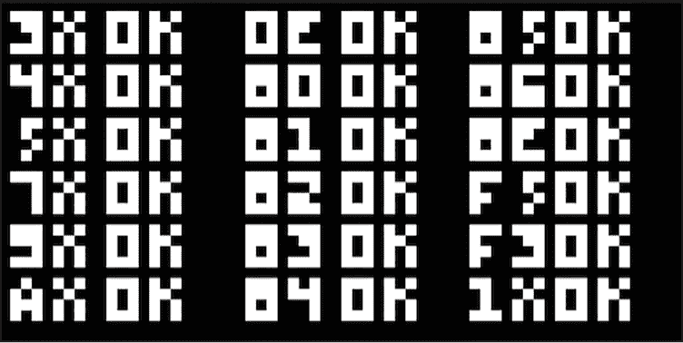

图 5-2：运行第一个测试 ROM

现在让我们用第二个测试 ROM 检查我们的工作：

```
%python3 -m Chip8 Chip8/Tests/chip8-test-rom-2/chip8-test-rom.ch8
```

这一个会在左上角显示一次 OK（请阅图 5-3）。


图 5-3：运行第二个测试 ROM

这些测试并不是详尽的，但它们是一个很好的起点。现在是时候进行终极集成测试了：我们的虚拟机能准确地运行游戏吗？

### 玩游戏


本书仓库的 `Chip8/Games` 子目录包含了一些被放入公有领域的 CHIP-8 ROM。如果你发现其中某些游戏的控制方案有些笨拙，可以考虑更改默认按键绑定。目前，`ALLOWED_KEYS` 直接从它们各自的按键读取，因此虚拟机中的 `A` 就是键盘上的 `A` 键。然而，运行这些游戏的系统键盘布局可能完全不同，因此对于某些游戏来说，不同的方案可能会更好。

大多数游戏相当简单，考虑到虚拟机最初旨在运行的硬件限制，这是合理的。对于性能更强大的系统，也有热门游戏的克隆版。首先我们有 `BLINKY`，一种类似《吃豆人》的克隆（图 5-4）。


图 5-4：在虚拟机上运行 BLINKY 游戏

`INVADERS` 是《太空入侵者》的克隆（图 5-5）。

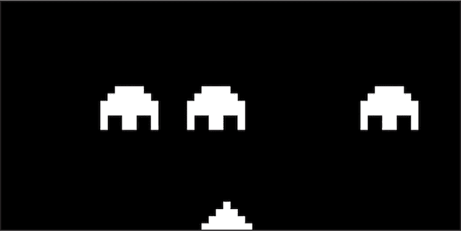

图 5-5：在虚拟机上运行 INVADERS 游戏

`VBRIX` 是《俄罗斯方块》的垂直版（图 5-6）。

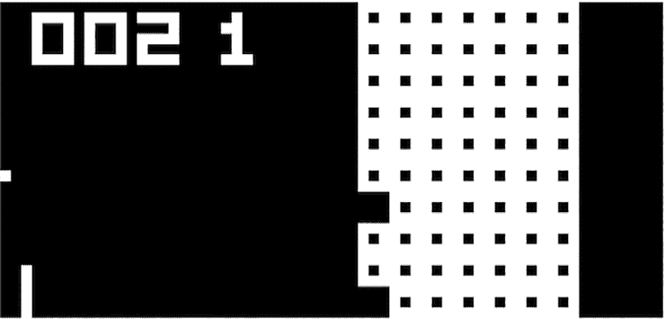

图 5-6：在虚拟机上运行 VBRIX 游戏

然后还有 `PONG`（图 5-7）。

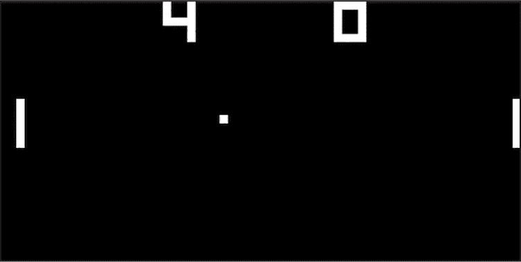

图 5-7：在虚拟机上运行 PONG 游戏

源代码中还附带了另外几个游戏供你查看。注意文件大小：这些游戏中的大多数只有 500 字节或更小！最大的 `BLINKY` 也仅有 2KB。

### 实际应用

虚拟机在历史和现代开发中无处不在。它们的主要优势是移植性。为虚拟机编写的程序将运行在任何安装了该虚拟机的平台上。虚拟机还提供了基础设施，通过消除实现垃圾回收等常见运行时功能的需求，减轻了语言作者的负担。

一个早期的例子是 20 世纪 70、80 年代某些编译器将 `Pascal` 编译为所谓的 `p-code`（一种字节码），并在 `p-code` 虚拟机上运行。两个著名的现代虚拟机环境是本章前面提到的 `JVM` 以及微软作为 `.NET` 平台一部分的通用语言运行时（`CLR`）。多种流行语言都以 `JVM` 和 `CLR` 为目标。例如，`C#`、`F#` 和 `Visual Basic` 是常用的针对 `CLR` 的语言，但 `Python` 和 `Swift` 等流行语言也有 `CLR` 的实现。

为什么这些语言实现要编译成 `CLR` 的字节码而不是机器码？一旦编译完成，这些字节码就可以任何安装了 `CLR` 的平台上运行。这是一种编译后的即时移植性。此外，像 `CLR` 这样的虚拟机将提供垃圾回收、多线程和安全机制等语言服务。最后，当像 `CLR` 这样的虚拟机即时（JIT）将中间代码编译为机器码时，它将应用语言作者没有考虑过的优化。

除了作为运行时的抽象机器外，“虚拟机”一词也被混淆地用于指软件中实现的整个硬件实现——换句话说，即模拟器。构建模拟器是下一章的主题。

## 练习

1. 尝试使用三种不同的方法测量主操作码解释器的性能：已经实现的 `match` 语句、一系列 `if...elif` 语句和跳转表。使用性能分析器或简单的计时器确定哪种方法最快。你可能需要关闭主运行循环中的计时代码来完成，或者使用一组单元测试来完成。
2. CHIP-8 有一个扩展版本被称为 `SCHIP`（超级芯片）。它需要实现更多的操作码，并更改原始 CHIP-8 虚拟机的某些元素，例如其分辨率。查找 `SCHIP` 的文档并尝试将 CHIP-8 虚拟机转换为 `SCHIP` 虚拟机。然后，尝试玩一些 `SCHIP` 游戏！
3. 尝试使用 CHIP-8 的机器码指令编写一个非常简单的游戏，在屏幕上显示几个字母。你需要一个十六进制编辑器来实现。看到自己写的二进制代码在虚拟机上运行是一件令人欣慰的事。

我们的模拟器将不是对原始硬件的 100% 准确重新实现。为了让构建模拟器的任务在书的一个章节内变得可行，我们将进行若干简化。尽管有这些简化，我们的模拟器仍然能够运行一些基础 NES 游戏，包括书籍源代码仓库中包含的几个业余者的免费开源游戏。我们不会用任何商业游戏来测试模拟器，尽管它能够运行一些简单的游戏。我们的动力是学习模拟器，而不是实现完全的游戏兼容性。我将进一步增强模拟器游戏兼容性的工作留给读者作为一项练习。

我们将使用纯 `Python` 来构建模拟器，在写此书时，`Python` 这种语言在现代 PC 上的运行速度不够，无法以全速模拟 NES。我们生成的代码可以通过 `Cython`、`C extensions` 或其他类型的原生代码层进行增强，以实现全速运行。这也将留给读者作为练习。

这是书中书中挑战性的项目。我假设在本章中，你已经拥有完成第 1 章、第 2 章 尤其是第 5 章项目的经验。在开始本章之前，你至少应该完成第 5 章 中的 CHIP-8 项目，但之前几乎所有章节中解释的概念都会出现在这个项目中。

## 警告

如果你对完成此项目有法律方面的顾虑，请研究你所在地的法律或咨询律师。请注意，在本章中开发 NES 模拟器的信息并非基于任何任天堂的专利文档。请记住，大多数商业游戏的 ROM 文件受版权法保护。你不需要下载任何受保护的 ROM 文件来测试你的模拟器，因为书籍的源代码仓库包含了几个处于开源许可下或发布到公有领域的非商业 ROM。

## 关于 NES

NES 是历史上最畅销的视频游戏机之一。它于 1983 年在日本作为 `Famicom`（红白）首次发布，并在 1985 年国际发行后俘获了全球整代游戏玩家的心。.^(1) 在它诞生时，视频游戏行业才只有十年左右。视频游戏机中的微处理器和其他硬件仍然相当原始。尽管如此，NES 能够处理 60 FPS 的彩色精灵和背景，播放悦耳的芯片音乐，并且是一些历史上最标志性游戏的宿平台。

> 注意：在本章中提供的 NES 许多硬件规格以及关于其功能的大部分信息来自 `NesDev`，这是一个由 NES 自制开发者和模拟器编写者组成的社区，地址位于 [`www.nesdev.org`](https://www.nesdev.org)。虽然我认为本章是关于如何编写 NES 模拟器的最佳概述和教程，但我强烈建议查看 `NesDev` 网站以获取细节。为了避免大量引用该网站的引用条文，我向你展示了这条显眼的注释。此外，本章中的几张图像也来自 `NesDev` 并已发布到公有领域，正如本书的版权页上提到的。感谢 `NesDev` 的朋友们，他们提供了如此出色的资源，并将大量参考资料发布到了公有领域。

### 硬件

NES 中的中央处理单元（`CPU`）是 `MOS Technology 6502` 微处理器的克隆，由 `Ricoh` 制造，运行频率略低于 2 MHz。`6502` 与当时流行的家用电脑（如 `Apple II` 和 `Commodore 64`）使用的是相同的微处理器。`6502` 由约 3500 个晶体管组成，是一个特别简单的微处理器；例如，它缺乏乘法和除法的指令.^(2) 这些算术操作必须在软件中实现。尽管如此，NES 能够处理 60 FPS 的彩色精灵和背景，播放悦耳的芯片音乐，并且是一些历史上最标志性游戏的宿平台。

NES 没有任何 `BIOS` 或操作系统。NES 裸机本身不带任何软件。所有软件都由游戏卡带提供。游戏卡带上的程序直接控制 `CPU`、`PPU` 和 `APU`，它们与硬件之间没有任何抽象层。

NES 游戏通常用 `6502` 汇编语言编写。听起来可能很硬核，但在那个时代这是常态；直到 20 世纪 90 年代初，大多数个人电脑或游戏机上需要高性能的程序都是用汇编编程的。除了汇编器，开发工具通常是内部构建的。当时并没有可以下载的 `NES Game Maker`。

事实上，这是一个下载功能完全不存在的时代。NES 在任何类型的网络连接出现之前已经好几个主机世代了。第一台内置调制调器的主流游戏机是 `Sega Dreamcast`，它于 20 世纪 90 年代后期推出。NES 卡带发行的是游戏的最终版本；不会有更新。如果有 Bug，那就只有 Bug，所以游戏在 `1.0` 版本就必须近乎完美。相比之下，你今天购买的典型游戏，开发者往往在游戏发布之前就在编写第一个大补丁了。那时，对细节的关注需要完全不同的水平，但另一方面，游戏也比现在复杂得多。

想象一下在这样一个原始的环境中，竟然开发了一些历史上最具影响力和定义流派的游戏，这令人惊叹。团队中程序员所需的技术能力与当今游戏开发者所处的领域非常不同。今天的大多数游戏是使用预封装的框架或引擎（如 `Unreal` 或 `Unity`）构建的。开发者可以将大部分时间花在编写特定的游戏机制上。NES 开发者必须用汇编编写自己的引擎。他们必须直接管理 `APU` 来播放每种声音，直接管理 `PPU` 来显示每幅图形，并且必须榨干 `CPU` 的每一个周期来完成任何工作。大型公司会构建自己的内部框架和工具，这些工具可以在不同作品之间复用，但程序员仍然在相对较低的层面上工作。

## 构建模拟器

是时候写些代码了。不过在此之前，先说明关于方向和预期管理的注意事项：我们正在编写的模拟器在每个角落都进行了简化。正如前面提到的，由于非常简化的 `PPU`，它将无法兼容许多游戏。由于我们没有实现 `APU`，它也不会有任何声音。它的运行速度也不会快到能以预期速度玩游戏。然而，它可以运行真实的游戏，而且它们是可玩的。我们在这里的工作也将为如果你愿意的话后续进行改进和添加更多功能提供坚实的基础。

### 规划结构

模拟器执行的总体计划与第 5 章中的 `CHIP-8 VM` 相似。像 `CHIP-8` 一样，我们将从 `ROM` 文件中一次读取一条指令并解释它。像 `CHIP-8` 一样，我们将使用 `Pygame` 显示图形并处理用户输入。像 `CHIP-8` 一样，我们将有一个大循环来获取每条指令并响应每个事件。然而，代码结构将更加复杂。特别是，我们将模拟器分为三个类，每个类代表硬件的一个物理组件。我们将为 `CPU`、`PPU` 和 `cartridge`（卡带）创建类。以下我们要写的每个文件及其用途：

*   `__main__.py`: 处理命令行参数并实现模拟器主循环，该循环分发指令、显示图形并响应用户输入。
*   `rom.py`: 读取 `ROM` 文件并伪装成卡带。
*   `cpu.py`: 维护 `CPU` 状态，解释指令并处理主内存访问。
*   `ppu.py`: 管理 `PPU` 状态并绘制背景和精灵。

我们将按照列出的顺序处理这些文件。

### 创建主循环

我们的主文件（`__main__.py`）是系统各个组件（`CPU`、`PPU`、`cartridge`）汇总的地方。它的“运行循环”通过保持一切向前移动并协调不同组件，赋予模拟器生命，并在需要时委托 `Pygame` 来显示图形和读取用户输入。`run()` 函数接收一个 `ROM` 对象和 `ROM` 文件名作为参数。在我们的第一个代码段中，我们初始化 `Pygame`，在屏幕上获取一个窗口并创建 `CPU` 和 `PPU` 对象：

`NESEmulator/__main__.py`

```python
import sys
from argparse import ArgumentParser
from NESEmulator.rom import ROM
from NESEmulator.ppu import PPU, NES_WIDTH, NES_HEIGHT
from NESEmulator.cpu import CPU
import pygame
from timeit import default_timer as timer
import os

def run(rom: ROM, name: str):
    pygame.init()
    screen = pygame.display.set_mode((NES_WIDTH, NES_HEIGHT), 0, 24)
    pygame.display.set_caption(f"NES Emulator - {os.path.basename(name)}")
    ppu = PPU(rom)
    cpu = CPU(ppu, rom)
    ticks = 0
    start = None
```

正如对它们的构造函数的调用所示，`PPU` 和 `CPU` 都需要访问 `ROM`。`CPU` 需要读取程序指令，`PPU` 需要读取图形数据。由于某些内存地址被读写，`CPU` 也需要访问 `PPU`。

`ticks` 变量跟踪 `CPU` 运行了多少周期。对于每个 `CPU` 周期，`PPU` 恰好运行三次。换句话说，`PPU` 的速度比 `CPU` 快三倍，当 `CPU` 为 `1.8 MHz` 时，`PPU` 为 `5.4 MHz`。我们的代码需要模拟这一点，因此在下一个代码段（即主循环）中，我们跟踪每条 `CPU` 指令所需的周期（不同指令需要的周期数不同），然后运行 `PPU` 三倍的周期：

```python
while True:
    cpu.step()
    new_ticks = cpu.cpu_ticks - ticks
    # 每个 CPU 周期运行 3 次 PPU
    for _ in range(new_ticks * 3):
        ppu.step()
        # 每帧绘制一次内容到屏幕上
        if (ppu.scanline == 240) and (ppu.cycle == 257): # ❶
            pygame.surfarray.blit_array(screen, ppu.display_buffer)
            pygame.display.flip()
            end = timer()
            if start is not None:
                print(end - start)
            start = timer
        if (ppu.scanline == 241) and (ppu.cycle == 2) and ppu.generate_nmi:
            cpu.trigger_NMI() # ❷
    ticks += new_ticks
```

高精度的 NES 模拟器通过模拟 `PPU` 在每个周期内应该执行的操作来模拟真实硬件的行为：即确定下一个像素点的颜色。而我们使用了一种简单得多的技术，即每帧只需在正确的位置绘制所有正确的磁块和精灵。换句话说，我们不是每个周期都考虑一个像素点，而是每帧只考虑整个屏幕应该什么样。虽然这种技术速度更快，且不需要我们模拟许多关于 `PPU` 内部运行的细节，但它并不适用于所有游戏。更高级的 NES 游戏会在帧正在绘制到屏幕的过程中对图形进行更改（即在扫描行之间，甚至在像素点之间）。

请注意，`PPU` 实际上在扫描行之间会进行额外的处理。这段时期被称为 `hblank`。更重要的是，`PPU` 还有额外的离屏扫描行（它一直延伸到第 261 行扫描行，将第一行计为第 0 行）。处理这些额外的非渲染扫描行期间的时间被称为 `vblank`。在 `vblank` 期间，`CPU` 修改 `PPU` 的任何内存都是安全的，因为此时 `PPU` 内存并没有被活动访问以渲染可见的扫描行。为了实现这一目的，`PPU` 在 `vblank` 开始（完成所有可见扫描行后）会向 `CPU` 发送信号。该信号是一种`非掩蔽中断 (NMI)`。

将 `NMI` 想象为一种无法停止的程序中断。换句话说，它是一个向微处理器发送的信号：“立即停止你正在做的事，因为我们现在要处理另一件事。”在 NES 的情况下，另一件事就是更新游戏的图形显示。每个 NES 游戏都有一个 `NMI` 处理器，用于在 `vblank` 期间更新游戏图形。

循环的其余部分仅处理事件：


```python
    for event in pygame.event.get():
        if event.type == pygame.QUIT:
            sys.exit()
        # 将键盘事件视为手柄变化
        if event.type not in {pygame.KEYDOWN, pygame.KEYUP}:
            continue
        is_keydown = event.type == pygame.KEYDOWN
        match event.key:
            case pygame.K_LEFT:
                cpu.joypad1.left = is_keydown
            case pygame.K_RIGHT:
                cpu.joypad1.right = is_keydown
            case pygame.K_UP:
                cpu.joypad1.up = is_keydown
            case pygame.K_DOWN:
                cpu.joypad1.down = is_keydown
            case pygame.K_x:
                cpu.joypad1.a = is_keydown
            case pygame.K_z:
                cpu.joypad1.b = is_keydown
            case pygame.K_s:
                cpu.joypad1.start = is_keydown
            case pygame.K_a:
                cpu.joypad1.select = is_keydown

if __name__ == "__main__":
    # 解析文件参数
    file_parser = ArgumentParser("NESEmulator")
    file_parser.add_argument("rom_file",
                             help="一个 iNES 格式的 NES 游戏文件.")
    arguments = file_parser.parse_args()
    game = NESEmulator(arguments.rom_file)
    game.run()
```

```python
from pathlib import Path
from struct import unpack
from collections import namedtuple
from array import array

Header = namedtuple("Header", "signature prg_rom_size chr_rom_size "
                              "flags6 flags7 flags8 flags9 flags10 unused")
HEADER_SIZE = 16
TRAINER_SIZE = 512
PRG_ROM_BASE_UNIT_SIZE = 16384
CHR_ROM_BASE_UNIT_SIZE = 8192
PRG_RAM_SIZE = 8192
```

`ROM` 类的构造函数首先利用 `struct` 标准库模块中的 `unpack()` 函数从 ROM 文件中读取头，并根据格式字符串将其分配到适当大小的字段中：

```python
class ROM:
    def __init__(self, file_name: str | Path):
    with open(file_name, "rb") as file:
        # 读取头信息并检查签名 "NES"
        self.header = Header._make(unpack("!LBBBBBBB5s",
                                              file.read(HEADER_SIZE)))
```

`namedtuple` 上的 `_make()` 类方法可以从可迭代对象（例如从 `unpack()` 返回的结果）构造该 `namedtuple` 的实例。`unpack()` 格式字符串中的特定项目类型列在表 6-2 中。格式字符串中的每个项目对应于表 6-1 中的一个头元素。有关格式字符串的更多细节，请参阅 `struct` 模块的文档：[`https://docs.python.org/3/library/struct.html#struct-format-strings`](https://docs.python.org/3/library/struct.html#struct-format-strings)。

表 6-2：`struct` 模块的格式字符串字符

| 项目 | 字节数 | C 类型 | Python 类型 |
| --- | --- | --- | --- |
| `!` | N/A | 表示后续内容为大端格式 | N/A |
| `L` | 4 | unsigned long | int |
| `B` | 1 | unsigned char | int |
| `5s` | 5 | char[] | bytes |

经过这些处理后，`self.header` 包含了在良好标记段中的 iNES 头的正确部分。接下来，我们检查头中的几条信息：

```python
        if self.header.signature != 0x4E45531A:
            print("Invalid ROM Header Signature")
        else:
            print("Valid ROM Header Signature")
        # 解析 Mapper - flags6 中的一个半字节和 flags7 中的一个半字节
        self.mapper = (self.header.flags7 & 0xF0) | (
                (self.header.flags6 & 0xF0) >> 4)
        print(f"Mapper {self.mapper}")
        if self.mapper != 0:
            print("Invalid Mapper: Only Mapper 0 is Implemented")
```

每个 iNES 头都应该以相同的 4 字节签名开头。同时，mapper 数字由 `flags 7` 和 `8` 的部分内容构造。我们的模拟器仅支持使用 mapper 0 的游戏。

这里是构造函数的其余部分：

```python
        self.read_cartridge = self.read_mapper0
        self.write_cartridge = self.write_mapper0
        # 检查是否存在 trainer (flags6 第 4 位) 并读取它
        self.has_trainer = bool(self.header.flags6 & 4)
        if self.has_trainer:
            self.trainer_data = file.read(TRAINER_SIZE)
        # 根据 flags6 位 0 检查镜像
        self.vertical_mirroring = bool(self.header.flags6 & 1)
        print(f"Has vertical mirroring {self.vertical_mirroring}")
        # 读取 PRG_ROM 和 CHR_ROM，分别为 16K 和 8K 的倍数
        self.prg_rom = file.read(PRG_ROM_BASE_UNIT_SIZE *
                                  self.header.prg_rom_size)
        self.chr_rom = file.read(CHR_ROM_BASE_UNIT_SIZE *
                                  self.header.chr_rom_size)
        self.prg_ram = array('B', [0] * PRG_RAM_SIZE)
```

```python
from __future__ import annotations
from enum import Enum
from dataclasses import dataclass
from array import array
from typing import Callable
from NESEmulator.ppu import PPU, SPR_RAM_SIZE
from NESEmulator.rom import ROM

MemMode = Enum("MemMode", "DUMMY ABSOLUTE ABSOLUTE_X ABSOLUTE_Y ACCUMULATOR "
                          "IMMEDIATE IMPLIED INDEXED_INDIRECT INDIRECT "
                          "INDIRECT_INDEXED RELATIVE ZEROPAGE ZEROPAGE_X "
                          "ZEROPAGE_Y")

InstructionType = Enum("InstructionType", "ADC AHX ALR ANC AND ARR ASL AXS "
                                          "BCC BCS BEQ BIT BMI BNE BPL BRK "
                                          "BVC BVS CLC CLD CLI CLV CMP CPX "
                                          "CPY DCP DEC DEX DEY EOR INC INX "
                                          "INY ISC JMP JSR KIL LAS LAX LDA "
                                          "LDX LDY LSR NOP ORA PHA PHP PLA "
                                          "PLP RLA ROL ROR RRA RTI RTS SAX "
                                          "SBC SEC SED SEI SHX SHY SLO SRE "
                                          "STA STX STY TAS TAX TAY TSX TXA "
                                          "TXS TYA XAA")

@dataclass(frozen=True)
class Instruction:
    type: InstructionType
    method: Callable[[Instruction, int], None]
    mode: MemMode
    length: int
    ticks: int
    page_ticks: int

@dataclass
class Joypad:
    strobe: bool = False
    read_count: int = 0
    a: bool = False
    b: bool = False
    select: bool = False
    start: bool = False
    up: bool = False
    down: bool = False
    left: bool = False
    right: bool = False

STACK_POINTER_RESET = 0xFD
STACK_START = 0x100
RESET_VECTOR = 0xFFFC
NMI_VECTOR = 0xFFFA
IRQ_BRK_VECTOR = 0xFFFE
MEM_SIZE = 2048
```

`MemMode` 枚举列出了 6502 中所有不同的内存访问方案。在某些基础级微处理器上，从内存中检索字节只需指定一个地址并返回存储在该处的字节即可非常简单。例如，如果我说“读取 0x1940”，我就会返回内存地址 `0x1940` 处存储的任何字节。6502 可以通过其 `ABSOLUTE` 内存模式实现这一点，但它还有其他在某些情况下非常有用的内存模式。其中一些模式访问的是动态计算的内存地址，而不是字面指定的地址。例如，`ABSOLUTE_X` 模式会将 `X` 寄存器的值加到提供的地址上，并访问生成的内存位置。在这种模式下，如果我们在增加 `X` 的值后再次执行相同的指令，我们将自动读取内存中的下一个字节。在进行低级编程时，这是一种非常方便的特性，如果硬件对某些访问模式进行了优化，甚至可以提高性能。我们将在章节的稍后部分详细讨论 NES 的内存模式——幸运的是，其中许多模式彼此非常相似。

`InstructionType` 枚举列出了 6502 可以处理的所有不同类型的指令。其中某些指令类型用于 BCD（二进制编码进制）操作，正如前面提到的，NES 版本的 6502 并不具备这种功能。还有一些“非官方”指令类型，它们实际上并没有被记录为 6502 的文档一部分，但通过试错发现它们存在。极少数游戏使用它们。剩余的 56 个是我们将实际实现的指令类型。我们在此枚举中列出了所有可能的指令类型——即使是未实现的——因为我们将使用一个自动生成的、包含所有 256 种可能的 6502 操作码的表格，我们希望表格中的每个条目都有一个有效的指令类型值。

`Instruction` 指 6502 可能理解的 256 种操作码之一。每条指令都包含关于其类型（`type`）、我们程序中处理它的关联函数（`method`）、内存访问模式（`mode`）、预期字节数（`length`）、运行所需的 CPU 周期数（`ticks`）以及在执行过程中跨越内存页时所需的额外周期数（`page_ticks`）。*内存页*是 RAM 的一部分，内存控制器可以快速地从该部分的任何部分访问另一个部分。在 6502 中，内存页为 256 字节。如果一条指令跨越了这些 256 字节的边界，执行时间可能会更长。

每条指令都有一个关联的函数来处理，这暗示我们将使用的设计与 CHIP-8 项目完全不同。对于 CHIP-8 虚拟机，我们使用一个巨大的 `match` 语句来处理每条指令，但对于 6502 及其稍微复杂的指令集，我们将利用一种更简洁的设计。我们不会对每条指令进行切换，而是根据其操作码在数组中查找，然后执行关联的函数。这种设计是常用模式*跳转表*的一种变变体。本质上，我们通过操作码对指令数组进行索引，以找到要跳转到哪个函数。

`Joypad` 类代表程序执行期间手柄的状态。CPU 可以直接轮询手柄。`CPU` 类代表处理器的状态。接下来，让我们看看 `CPU` 类的开头，它设置了内存、寄存器和可配置变量：


```python
class CPU:
    def __init__(self, ppu: PPU, rom: ROM):
        # 与其它部分的连接
        self.ppu: PPU = ppu
        self.rom: ROM = rom
        # CPU 上的内存
        self.ram = array('B', [0] * MEM_SIZE)
        # 寄存器
        self.A: int = 0
        self.X: int = 0
        self.Y: int = 0
        self.SP: int = STACK_POINTER_RESET
        self.PC: int = self.read_memory(RESET_VECTOR, MemMode.ABSOLUTE) | \
                    (self.read_memory(RESET_VECTOR + 1,
                                      MemMode.ABSOLUTE) << 8)
        # 标志位
        self.C: bool = False # 进位
        self.Z: bool = False # 零
        self.I: bool = True # 中断禁用
        self.D: bool = False # 进制模式
        self.B: bool = False # 中断
        self.V: bool = False # 溢出
        self.N: bool = False # 负数
        # 其他状态
        self.jumped: bool = False
        self.page_crossed: bool = False
        self.cpu_ticks: int = 0
        self.stall: int = 0 # 停顿周期数
        self.joypad1 = Joypad()
```

为了更好地理解这段设置代码，让我们深入研究 6502 的寄存器。表 6-3 列出了所有寄存器。

**表 6-3：6502 寄存器**

| 名称 | 大小（字节） | 用途 |
| --- | --- | --- |
| `A` | 1 | 用于算运算的主寄存。有时被称为累加器。 |
| `X` | 1 | 索引寄存器，通常用循环计数器。 |
| `Y` | 1 | 与 `X` 相同。 |
| `PC` | 2 | 程序计数器，用于跟踪下一条执行指令在内存中的位置。它是 2 字节，是因为 6502 可以寻址高达 64KB 的内存（不使用分页切换）。 |
| `SP` | 1 | 栈指针，用于跟踪程序当前在栈上的位置。由于它只有 1 字节，栈最多可以存储 256 字节。 |
| `P` | 1 | 状态或标志寄存器。其各个位表示不同的含义，例如有关算术运算的信息（例如结果是否为零？），或者是否发生了中断或是否启用了中断 (`IRQ`)。 |

由于 Python 对所有大小的整数仅使用一种类型，因此我们将除标志位以外的所有寄存器都用 `int` 类型表示。我们没有去处理状态寄存器中每个标志位的各个比特位，而是使用 6502 文档中字母命名法将它们划分为独立的 `Booleans`。这些是成员变量 `C`、`Z`、`I`、`D`、`B`、`V` 和 `N`。它们大多数是算术运算的结果设置的，`I` 在程序不希望被 `IRQ` 信号中断时设置，`B` 在断点（`break`）指令后将标志推入栈中时设置。用于 BCD 代码的 `D` 标志对 NES 而言无关，因为 NES 没有 BCD 指令。

`jump` 变量用于跟踪跳转指令是否更改了 `PC` 寄存器，而 `page_crossed` 用于跨内存页访问内存时的簿记，正如所讨论的，跨页访问内存比访问相邻内存的开销更大。NES CPU 可能需要等待若干周期以完成某些任务。这就是 `stall` 的目的。在我们的模拟器中，它仅在发生直接内存访问 (`DMA`) 传输以从主内存发送大量数据到对象属性内存 (`OAM`) 时使用，`PPU` 在那里存储有关精灵的信息。

### 跳转表

接下来，我们将声明跳转表，包含 6502 可以处理的所有潜在指令的列表。由于 6502 使用 1 字节的操作码，且一个字节有 256 种可能的值，因此潜在上存在 256 条不同的指令。稍后在我们的 `step()` 方法中，我们将通过此列表进行索引，为我们解码的给定操作码获取特定指令及其对应的函数。我们不会实际上实现每条指令（有些是 BCD 或非官方指令），因此某些指令被关联到 `self.unimplemented()` 方法。

为了完整起见，跳转表的全部 256 行包含在此处：


```python
self.instructions = [
    Instruction(InstructionType.BRK, self.BRK, MemMode.IMPLIED, 1, 7, 0), # 00
    Instruction(InstructionType.ORA, self.ORA, MemMode.INDEXED_INDIRECT, 2, 6, 0),
    Instruction(InstructionType.KIL, self.unimplemented, MemMode.IMPLIED, 0, 2, 0),
    Instruction(InstructionType.SLO, self.unimplemented, MemMode.INDEXED_INDIRECT, 0, 8, 0),
    Instruction(InstructionType.NOP, self.NOP, MemMode.ZEROPAGE, 2, 3, 0), # 04
    Instruction(InstructionType.ORA, self.ORA, MemMode.ZEROPAGE, 2, 3, 0), # 05
    Instruction(InstructionType.ASL, self.ASL, MemMode.ZEROPAGE, 2, 5, 0), # 06
    Instruction(InstructionType.SLO, self.unimplemented, MemMode.ZEROPAGE, 0, 5, 0),
    Instruction(InstructionType.PHP, self.PHP, MemMode.IMPLIED, 1, 3, 0), # 08
    Instruction(InstructionType.ORA, self.ORA, MemMode.IMMEDIATE, 2, 2, 0), # 09
    Instruction(InstructionType.ASL, self.ASL, MemMode.ACCUMULATOR, 1, 2, 0), # 0a
    Instruction(InstructionType.ANC, self.unimplemented, MemMode.IMMEDIATE, 0, 2, 0),
    Instruction(InstructionType.NOP, self.NOP, MemMode.ABSOLUTE, 3, 4, 0), # 0c
    Instruction(InstructionType.ORA, self.ORA, MemMode.ABSOLUTE, 3, 4, 0), # 0d
    Instruction(InstructionType.ASL, self.ASL, MemMode.ABSOLUTE, 3, 6, 0), # 0e
    Instruction(InstructionType.SLO, self.unimplemented, MemMode.ABSOLUTE, 0, 6, 0),
    Instruction(InstructionType.BPL, self.BPL, MemMode.RELATIVE, 2, 2, 1), # 10
    Instruction(InstructionType.ORA, self.ORA, MemMode.INDIRECT_INDEXED, 2, 5, 1),
    Instruction(InstructionType.KIL, self.unimplemented, MemMode.IMPLIED, 0, 2, 0),
    Instruction(InstructionType.SLO, self.unimplemented, MemMode.INDIRECT_INDEXED, 0, 8, 0),
    Instruction(InstructionType.NOP, self.NOP, MemMode.ZEROPAGE_X, 2, 4, 0), # 14
    Instruction(InstructionType.ORA, self.ORA, MemMode.ZEROPAGE_X, 2, 4, 0), # 15
    Instruction(InstructionType.ASL, self.ASL, MemMode.ZEROPAGE_X, 2, 6, 0), # 16
    Instruction(InstructionType.SLO, self.unimplemented, MemMode.ZEROPAGE_X, 0, 6, 0),
    Instruction(InstructionType.CLC, self.CLC, MemMode.IMPLIED, 1, 2, 0), # 18
    Instruction(InstructionType.ORA, self.ORA, MemMode.ABSOLUTE_Y, 3, 4, 1), # 19
    Instruction(InstructionType.NOP, self.NOP, MemMode.IMPLIED, 1, 2, 0), # 1a
    Instruction(InstructionType.SLO, self.unimplemented, MemMode.ABSOLUTE_Y, 0, 7, 0),
    Instruction(InstructionType.NOP, self.NOP, MemMode.ABSOLUTE_X, 3, 4, 1), # 1c
    Instruction(InstructionType.ORA, self.ORA, MemMode.ABSOLUTE_X, 3, 4, 1), # 1d
    Instruction(InstructionType.ASL, self.ASL, MemMode.ABSOLUTE_X, 3, 7, 0), # 1e
    Instruction(InstructionType.SLO, self.unimplemented, MemMode.ABSOLUTE_X, 0, 7, 0),
    Instruction(InstructionType.JSR, self.JSR, MemMode.ABSOLUTE, 3, 6, 0), # 20
    Instruction(InstructionType.AND, self.AND, MemMode.INDEXED_INDIRECT, 2, 6, 0),
    Instruction(InstructionType.KIL, self.unimplemented, MemMode.IMPLIED, 0, 2, 0),
    Instruction(InstructionType.RLA, self.unimplemented, MemMode.INDIRECT_INDEXED, 0, 8, 0),
    Instruction(InstructionType.BIT, self.BIT, MemMode.ZEROPAGE, 2, 3, 0), # 24
    Instruction(InstructionType.AND, self.AND, MemMode.ZEROPAGE, 2, 3, 0), # 25
    Instruction(InstructionType.ROL, self.ROL, MemMode.ZEROPAGE, 2, 5, 0), # 26
    Instruction(InstructionType.RLA, self.unimplemented, MemMode.ZEROPAGE, 0, 5, 0),
    Instruction(InstructionType.PLP, self.PLP, MemMode.IMPLIED, 1, 4, 0), # 28
    Instruction(InstructionType.AND, self.AND, MemMode.IMMEDIATE, 2, 2, 0), # 29
    Instruction(InstructionType.ROL, self.ROL, MemMode.ACCUMULATOR, 1, 2, 0), # 2a
    Instruction(InstructionType.ANC, self.unimplemented, MemMode.IMMEDIATE, 0, 2, 0),
    Instruction(InstructionType.BIT, self.BIT, MemMode.ABSOLUTE, 3, 4, 0), # 2c
    Instruction(InstructionType.AND, self.AND, MemMode.ABSOLUTE, 3, 4, 0), # 2d
    Instruction(InstructionType.ROL, self.ROL, MemMode.ABSOLUTE, 3, 6, 0), # 2e
    Instruction(InstructionType.RLA, self.unimplemented, MemMode.ABSOLUTE, 0, 6, 0),
    Instruction(InstructionType.BMI, self.BMI, MemMode.RELATIVE, 2, 2, 1), # 30
    Instruction(InstructionType.AND, self.AND, MemMode.INDIRECT_INDEXED, 2, 5, 1),
    Instruction(InstructionType.KIL, self.unimplemented, MemMode.IMPLIED, 0, 2, 0),
    Instruction(InstructionType.RLA, self.unimplemented, MemMode.INDIRECT_INDEXED, 0, 8, 0),
    Instruction(InstructionType.NOP, self.NOP, MemMode.ZEROPAGE_X, 2, 4, 0), # 34
    Instruction(InstructionType.AND, self.AND, MemMode.ZEROPAGE_X, 2, 4, 0), # 35
    Instruction(InstructionType.ROL, self.ROL, MemMode.ZEROPAGE_X, 2, 6, 0), # 36
    Instruction(InstructionType.RLA, self.unimplemented, MemMode.ZEROPAGE_X, 0, 6, 0),
    Instruction(InstructionType.SEC, self.SEC, MemMode.IMPLIED, 1, 2, 0), # 38
    Instruction(InstructionType.AND, self.AND, MemMode.ABSOLUTE_Y, 3, 4, 1), # 39
    Instruction(InstructionType.NOP, self.NOP, MemMode.IMPLIED, 1, 2, 0), # 3a
    Instruction(InstructionType.RLA, self.unimplemented, MemMode.ABSOLUTE_Y, 0, 7, 0),
    Instruction(InstructionType.NOP, self.NOP, MemMode.ABSOLUTE_X, 3, 4, 1), # 3c
    Instruction(InstructionType.AND, self.AND, MemMode.ABSOLUTE_X, 3, 4, 1), # 3d
    Instruction(InstructionType.ROL, self.ROL, MemMode.ABSOLUTE_X, 3, 7, 0), # 3e
    Instruction(InstructionType.RLA, self.unimplemented, MemMode.ABSOLUTE_X, 0, 7, 0),
    Instruction(InstructionType.RTI, self.RTI, MemMode.IMPLIED, 1, 6, 0), # 40
    Instruction(InstructionType.EOR, self.EOR, MemMode.INDEXED_INDIRECT, 2, 6, 0),
    Instruction(InstructionType.KIL, self.unimplemented, MemMode.IMPLIED, 0, 2, 0),
    Instruction(InstructionType.SRE, self.unimplemented, MemMode.INDEXED_INDIRECT, 0, 8, 0),
    Instruction(InstructionType.NOP, self.NOP, MemMode.ZEROPAGE, 2, 4, 0), # 44
    Instruction(InstructionType.EOR, self.EOR, MemMode.ZEROPAGE, 2, 4, 0), # 45
    Instruction(InstructionType.LSR, self.LSR, MemMode.ZEROPAGE, 2, 5, 0), # 46
    Instruction(InstructionType.SRE, self.unimplemented, MemMode.ZEROPAGE, 0, 5, 0),
    Instruction(InstructionType.PHA, self.PHA, MemMode.IMPLIED, 1, 3, 0), # 48
    Instruction(InstructionType.EOR, self.EOR, MemMode.IMMEDIATE, 2, 2, 0), # 49
    Instruction(InstructionType.LSR, self.LSR, MemMode.ACCUMULATOR, 1, 2, 0),
    Instruction(InstructionType.ALR, self.unimplemented, MemMode.IMMEDIATE, 0, 2, 0),
    Instruction(InstructionType.JMP, self.JMP, MemMode.ABSOLUTE, 3, 3, 0), # 4c
    Instruction(InstructionType.EOR, self.EOR, MemMode.ABSOLUTE, 3, 4, 0), # 4d
    Instruction(InstructionType.LSR, self.LSR, MemMode.ABSOLUTE, 3, 6, 0), # 4e
    Instruction(InstructionType.SRE, self.unimplemented, MemMode.ABSOLUTE, 0, 6, 0),
    Instruction(InstructionType.BVC, self.BVC, MemMode.RELATIVE, 2, 2, 1), # 50
    Instruction(InstructionType.EOR, self.EOR, MemMode.INDIRECT_INDEXED, 2, 5, 1),
    Instruction(InstructionType.KIL, self.unimplemented, MemMode.IMPLIED, 0, 2, 0),
    Instruction(InstructionType.SRE, self.unimplemented, MemMode.INDIRECT_INDEXED, 0, 8, 0),
    Instruction(InstructionType.NOP, self.NOP, MemMode.ZEROPAGE_X, 2, 4, 0), # 54
    Instruction(InstructionType.EOR, self.EOR, MemMode.ZEROPAGE_X, 2, 4, 0), # 55
    Instruction(InstructionType.LSR, self.LSR, MemMode.ZEROPAGE_X, 2, 6, 0), # 56
    Instruction(InstructionType.RLA, self.unimplemented, MemMode.ZEROPAGE_X, 0, 6, 0),
    Instruction(InstructionType.CLI, self.CLI, MemMode.IMPLIED, 1, 2, 0), # 58
    Instruction(InstructionType.EOR, self.EOR, MemMode.ABSOLUTE_Y, 3, 4, 1), # 59
    Instruction(InstructionType.NOP, self.NOP, MemMode.IMPLIED, 1, 2, 0), # 5a
    Instruction(InstructionType.RLA, self.unimplemented, MemMode.ABSOLUTE_Y, 0, 7, 0),
    Instruction(InstructionType.NOP, self.NOP, MemMode.ABSOLUTE_X, 3, 4, 1), # 5c
    Instruction(InstructionType.AND, self.AND, MemMode.ABSOLUTE_X, 3, 4, 1), # 5d
    Instruction(InstructionType.ROL, self.ROL, MemMode.ABSOLUTE_X, 3, 7, 0), # 5e
    Instruction(InstructionType.RLA, self.unimplemented, MemMode.ABSOLUTE_X, 0, 7, 0),
    Instruction(InstructionType.RTS, self.RTS, MemMode.IMPLIED, 1, 6, 0), # 60
    Instruction(InstructionType.ADC, self.ADC, MemMode.INDEXED_INDIRECT, 2, 6, 0),
    Instruction(InstructionType.KIL, self.unimplemented, MemMode.IMPLIED, 0, 2, 0),
    Instruction(InstructionType.RLA, self.unimplemented, MemMode.INDEXED_INDIRECT, 0, 8, 0),
    Instruction(InstructionType.NOP, self.NOP, MemMode.ZEROPAGE, 2, 3, 0), # 64
    Instruction(InstructionType.ADC, self.ADC, MemMode.ZEROPAGE, 2, 3, 0), # 65
    Instruction(InstructionType.ROR, self.ROR, MemMode.ZEROPAGE, 2, 5, 0), # 66
    Instruction(InstructionType.RLA, self.unimplemented, MemMode.ZEROPAGE, 0, 5, 0),
    Instruction(InstructionType.PLA, self.PLA, MemMode.IMPLIED, 1, 4, 0), # 68
    Instruction(InstructionType.ADC, self.ADC, MemMode.IMMEDIATE, 2, 2, 0), # 69
    Instruction(InstructionType.ROR, self.ROR, MemMode.ACCUMULATOR, 1, 2, 0), # 6a
    Instruction(InstructionType.RLA, self.unimplemented, MemMode.IMMEDIATE, 0, 2, 0),
    Instruction(InstructionType.JMP, self.JMP, MemMode.ABSOLUTE, 3, 0, 0), # 6c
    Instruction(InstructionType.ADC, self.ADC, MemMode.ABSOLUTE, 3, 4, 0), # 
    
    Instruction(InstructionType.Type, self...,,.AB.AB, ,, ,,  # 6 
    Instruction(InstructionType..RA, self.,, MemMode.ABSOLUTE, 0, ,, 0),
    Instruction(InstructionType.BVS, self.BVS, MemMode.RELATIVE, 2, 2, 1), # 70
    Instruction(InstructionType.ADC, self.., MemMode.INDEXED_INDIRECT, 2, 5, 1),
    Instruction(InstructionType.KIL, self.unimplemented, MemMode.IMPLIED, 0, 2, 0),
    Instruction(InstructionType.RLA, self.unimplemented, MemMode.INDEXED_INDIRECT, 0, 8, 0),
    Instruction(InstructionType.NOP, self.NOP, MemMode.ZEROPAGE_X, 2, 4, 0), # 74
    Instruction(InstructionType.ADC, self.ADC, MemMode.ZEROPAGE_X, 2, 4, 0), # 75
    Instruction(InstructionType.ROR, self.ROR, MemMode.ZEROPAGE_X, 2, 6, 0), # 76
    Instruction(InstructionType.RLA, self.unimplemented, MemMode.ZEROPAGE_X, 0, 6, 0),
    Instruction(InstructionType.SEI, self.SEI, MemMode.IMPLIED, 1, 2, 0), # 78
    Instruction(InstructionType.ADC, self.ADC, MemMode.ABSOLUTE_Y, 3, 4, 1), # 79
    Instruction(InstructionType.NOP, self.NOP, MemMode.IMPLIED, 1, 2, 0), # 7a
    Instruction(InstructionType.RLA, self.unimplemented, MemMode.ABSOLUTE_Y, 0, 7, 0),
    Instruction(InstructionType.NOP, self.NOP, MemMode.ABSOLUTE_X, 3, 4, 1), # 7c
    Instruction(InstructionType.ADC, self.ADC, MemMode.ABSOLUTE_X, 3, 4, 1), # 7d
    Instruction(InstructionType.ROR, self.ROR, MemMode.ABSOLUTE_X, 3, 7, 0), # 7e
    Instruction(InstructionType.RLA, self.unimplemented, MemMode.ABSOLUTE_X, 0, 7, 0),
    Instruction(InstructionType.CPX, self.CPX, MemMode.IMMEDIATE, 2, 2, 0), # 80
    Instruction(InstructionType.STA, self.STA, MemMode.INDEXED_INDIRECT, 2, 6, 0),
    Instruction(InstructionType.NOP, self.NOP, MemMode.IMMEDIATE, 0, 2, 0), # 82
    Instruction(InstructionType.CPX, self.unimplemented, MemMode.INDEXED_INDIRECT, 0, 6, 0),
    Instruction(InstructionType.STY, self.STY, MemMode.ZEROPAGE, 2, 3, 0), # 84
    Instruction(InstructionType.STA, self.STA, MemMode.ZEROPAGE, 2, 3, 0), # 85
    Instruction(InstructionType.STX, self.STX, MemMode.ZEROPAGE, 2, 3, 0), # 86
    Instruction(InstructionType.CPX, self.unimplemented, MemMode.ZEROPAGE, 0, 3, 0),
    Instruction(InstructionType.DEY, self.DEY, MemMode.IMPLIED, 1, 2, 0), # 88
    Instruction(InstructionType.NOP, self.NOP, MemMode.IMMEDIATE, 0, 2, 0), # 89
    Instruction(InstructionType.TSX, self.TSX, MemMode.IMPLIED, 1, 2, 0), # ba
    Instruction(InstructionType.TXA, self.unimplemented, MemMode.IMMEDIATE, 0, 2, 0),
    Instruction(InstructionType.TAX, self.TAX, MemMode.IMPLIED, 1, 2, 0), # aa
    Instruction(InstructionType.LAX, self.unimplemented, MemMode.IMMEDIATE, 0, 2, 0),
    Instruction(InstructionType.LDY, self.LDY, MemMode.ABSOLUTE, 3, 4, 0), # ac
    Instruction(InstructionType.LDA, self.LDA, MemMode.ABSOLUTE, 3, 4, 0), # ad
    Instruction(InstructionType.STX, self.STX, MemMode.ABSOLUTE, 3, 4, 0), # ae
    Instruction(InstructionType.LAX, self.unimplemented, MemMode.ABSOLUTE, 0, 4, 0),
    Instruction(InstructionType.BCS, self.BCS, MemMode.RELATIVE, 2, 2, 1), # b0
    Instruction(InstructionType.LDA, self.LDA, MemMode.INDIRECT_INDEXED, 2, 5, 1),
    Instruction(InstructionType.KIL, self.unimplemented, MemMode.IMPLIED, 0, 2, 0),
    Instruction(InstructionType.LAX, self.unimplemented, MemMode.INDIRECT_INDEXED, 0, 8, 0),
    Instruction(InstructionType.LDY, self.LDY, MemMode.ZEROPAGE_X, 2, 4, 0), # b4
    Instruction(InstructionType.LDA, self.LDA, MemMode.ZEROPAGE_X, 2, 4, 0), # b5
    Instruction(InstructionType.STX, self.STX, MemMode.ZEROPAGE_Y, 2, 4, 0), # b6
    Instruction(InstructionType.LAX, self.unimplemented, MemMode.ZEROPAGE_Y, 0, 4, 0),
    Instruction(InstructionType.CLV, self.CLV, MemMode.IMPLIED, 1, 2, 0), # b8
    Instruction(InstructionType.LDA, self.LDA, MemMode.ABSOLUTE_Y, 3, 4, 1), # b9
    Instruction(InstructionType.TSX, self.TSX, MemMode.IMPLIED, 1, 2, 0), # ba
    Instruction(InstructionType.LAS, self.unimplemented, MemMode.ABSOLUTE_Y, 0, 4, 1),
    Instruction(InstructionType.LDY, self.LDY, MemMode.ABSOLUTE_X, 3, 4, 1), # bc
    Instruction(InstructionType.LDA, self.LDA, MemMode.ABSOLUTE_X, 3, 4, 1), # bd
    Instruction(InstructionType.STX, self.STX, MemMode.ABSOLUTE_Y, 3, 4, 1), # be
    Instruction(InstructionType.LAX, self.unimplemented, MemMode.ABSOLUTE_Y, 0, 4, 1),
    Instruction(InstructionType.CPY, self.CPY, MemMode.IMMEDIATE, 2, 2, 0), # c0
    Instruction(InstructionType.CMP, self.CMP, MemMode.INDEXED_INDIRECT, 2, 6, 0),
    Instruction(InstructionType.NOP, self.NOP, MemMode.IMMEDIATE, 0, 2, 0), # c2
    Instruction(InstructionType.DCP, self.unimplemented, MemMode.INDEXED_INDIRECT, 0, 6, 0),
    Instruction(InstructionType.CPY, self.CPY, MemMode.ZEROPAGE, 2, 3, 0), # c4
    Instruction(InstructionType.CMP, self.CMP, MemMode.ZEROPAGE, 2, 3, 0), # c5
    Instruction(InstructionType.DEC, self.DEC, MemMode.ZEROPAGE, 2, 5, 0), # c6
    Instruction(InstructionType.DCP, self.unimplemented, MemMode.ZEROPAGE, 0, 5, 0),
    Instruction(InstructionType.INY, self.INY, MemMode.IMPLIED, 1, 2, 0), # c8
    Instruction(InstructionType.CMP, self.CMP, MemMode.IMMEDIATE, 2, 2, 0), # c9
    Instruction(InstructionType.DEX, self.DEX, MemMode.IMPLIED, 1, 2, 0), # ca
    Instruction(InstructionType.AXS, self.unimplemented, MemMode.IMMEDIATE, 0, 2, 0),
    Instruction(InstructionType.CPY, self.CPY, MemMode.ABSOLUTE, 3, 4, 0), # cc
    Instruction(InstructionType.CMP, self.CMP, MemMode.ABSOLUTE, 3, 4, 0), # cd
    Instruction(InstructionType.DEC, self.DEC, MemMode.ABSOLUTE, 3, 6, 0), # ce
    Instruction(InstructionType.DCP, self.unimplemented, MemMode.ABSOLUTE, 0, 6, 0),
    Instruction(InstructionType.BNE, self.BNE, MemMode.RELATIVE, 2, 2, 1), # d0
    Instruction(InstructionType.CMP, self.CMP, MemMode.INDIRECT_INDEXED, 2, 5, 1),
    Instruction(InstructionType.KIL, self.unimplemented, MemMode.IMPLIED, 0, 2, 0),
    Instruction(InstructionType.DCP, self.unimplemented, MemMode.INDIRECT_INDEXED, 0, 8, 0),
    Instruction(InstructionType.NOP, self.NOP, MemMode.ZEROPAGE_X, 2, 4, 0), # d4
    Instruction(InstructionType.CMP, self.CMP, MemMode.ZEROPAGE_X, 2, 4, 0), # d5
    Instruction(InstructionType.DEC, self.DEC, MemMode.ZEROPAGE_X, 2, 6, 0), # d6
    Instruction(InstructionType.DCP, self.unimplemented, MemMode.ZEROPAGE_X, 0, 6, 0),
    Instruction(InstructionType.CLD, self.CLD, MemMode.IMPLIED, 1, 2, 0), # d8
    Instruction(InstructionType.CMP, self.CMP, MemMode.ABSOLUTE_Y, 3, 4, 1), # d9
    Instruction(InstructionType.NOP, self.NOP, MemMode.IMPLIED, 1, 2, 0), # da
    Instruction(InstructionType.DCP, self.unimplemented, MemMode.ABSOLUTE_Y, 0, 7, 0),
    Instruction(InstructionType.NOP, self.NOP, MemMode.ABSOLUTE_X, 3, 4, 1), # dc
    Instruction(InstructionType.CMP, self.CMP, MemMode.ABSOLUTE_X, 3, 4, 1), # dd
    Instruction(InstructionType.DEC, self.DEC, MemMode.ABSOLUTE_X, 3, 7, 0), # de
    Instruction(InstructionType.DCP, self.unimplemented, MemMode.ABSOLUTE_X, 0, 7, 0),
    Instruction(InstructionType.CPX, self.CPX, MemMode.IMMEDIATE, 2, 2, 0), # e0
    Instruction(InstructionType.SBC, self.SBC, MemMode.INDEXED_INDIRECT, 2, 6, 0),
    Instruction(InstructionType.NOP, self.NOP, MemMode.IMMEDIATE, 0, 2, 0), # e2
    Instruction(InstructionType.DCP, self.unimplemented, MemMode.INDEXED_INDIRECT, 0, 8, 0),
    Instruction(InstructionType.CPX, self.CPX, MemMode.ZEROPAGE, 2, 3, 0), # e4
    Instruction(InstructionType.SBC, self.SBC, MemMode.ZEROPAGE, 2, 3, 0), # e5
    Instruction(InstructionType.INC, self.INC, MemMode.ZEROPAGE, 2, 5, 0), # e6
    Instruction(InstructionType.DCP, self.unimplemented, MemMode.ZEROPAGE, 0, 5, 0),
    Instruction(InstructionType.INX, self.INX, MemMode.IMPLIED, 1, 2, 0), # e8
    Instruction(InstructionType.SBC, self.SBC, MemMode.IMMEDIATE, 2, 2, 0), # e9
    Instruction(InstructionType.INX, self.INX, MemMode.IMPLIED, 1, 2, 0), # ea
    Instruction(InstructionType.SBC, self.SBC, MemMode.IMMEDIATE, 0, 2, 0), # eb
    Instruction(InstructionType.CPX, self.CPX, MemMode.ABSOLUTE, 3, 4, 0), # ec
    Instruction(InstructionType.SBC, self.SBC, MemMode.ABSOLUTE, 3, 4, 0), # ed
    Instruction(InstructionType.INC, self.INC, MemMode.ABSOLUTE, 3, 6, 0), # ee
    Instruction(InstructionType.ISC, self.unimplemented, MemMode.ABSOLUTE, 0, 6, 0),
    Instruction(InstructionType.BEQ, self.BEQ, MemMode.RELATIVE, 2, 2, 1), # f0
    Instruction(InstructionType.SBC, self.SBC, MemMode.INDEXED_INDIRECT, 2, 5, 1),
    Instruction(InstructionType.KIL, self.unimplemented, MemMode.IMPLIED, 0, 2, 0),
    Instruction(InstructionType.ISC, self.unimplemented, MemMode.INDEXED_INDIRECT, 0, 8, 0),
    Instruction(InstructionType.NOP, self.NOP, MemMode.ZEROPAGE_X, 2, 4, 0), # f4
    Instruction(InstructionType.SBC, self.SBC, MemMode.ZEROPAGE_X, 2, 4, 0), # f5
    Instruction(InstructionType.INC, self.INC, MemMode.ZEROPAGE_X, 2, 6, 0), # f6
    Instruction(InstructionType.ISC, self.unimplemented, MemMode.ZEROPAGE_X, 0, 6, 0),
    Instruction(InstructionType.SED, self.SED, MemMode.IMPLIED, 1, 2, 0), # f8
    Instruction(InstructionType.SBC, self.SBC, MemMode.ABSOLUTE_Y, 3, 4, 1), # f9
    Instruction(InstructionType.NOP, self.NOP, MemMode.IMPLIED, 1, 2, 0), # fa
    Instruction(InstructionType.ISC, self.unimplemented, MemMode.ABSOLUTE_Y, 0, 7, 0),
    Instruction(InstructionType.NOP, self.NOP, MemMode.ABSOLUTE_X, 3, 4, 1), # fc
    Instruction(InstructionType.SBC, self.SBC, MemMode.ABSOLUTE_X, 3, 4, 1), # fd
    Instruction(InstructionType.INC, self.INC, MemMode.ABSOLUTE_X, 3, 7, 0), # fe
    Instruction(InstructionType.ISC, self.unimplemented, MemMode.ABSOLUTE_X, 0, 7, 0),
]
```


手动编码此跳转表将极其繁琐。相反，我编写了一个外部脚本，从公开来源自动创建该表。该脚本是我为了生成表格而随手凑出来的临时方案，所以我没有把它包含在仓库中。尽管如此，这些快速简陋的脚本有时确实能节省大量的打字工作！

### 指说明

接下来，我们需要声明所有让 6502 指令运行起来的方法。正如所讨论的，我们有 56 个独特的方法需要实现，按字母顺序从 `ADC` 到 `TYA`，处理算术、控制流等任务。

与 CHIP-8 项目一样，这里是一个适合你停下来的地方，在查看这里的实现之前，尝试自己动手编写一些方法。为了做到这一点，你需要一份良好的 6502 指令参考资料。网上有很多此类资源，上述的 [`https://nesdev.org`](https://nesdev.org) 链接了其中几个。一份好的参考应该包含以下内容：

* 指令名称，包括其常用的助记符
* 各种形式指令的操作码
* 它支持的内存模式
* 指令会影响哪些标志位（如果有的话）
* 指令所需的周期数
* 它在哪些寄存器上进行操作
* 一个功能示例

如果你选择自己实现指令，首先会想查看 `CPU` 类的其余部分，看看可以使用哪些辅助方法。有修改堆栈、从内存读取以及写入内存的方法，还有其他几个实用方法。请参阅第 170 页的内存访问" 和第 175 页的辅助方法"。

你会发现许多指令都非常简单。例如，`AND` 正好是你预期的逻辑与与操作。我们获取累加器（`self.A`），对它与从内存中读取的任何内容进行按位与操作，然后将结果存回累加器：

```python
def AND(self, instruction: Instruction, data: int):
    src = self.read_memory(data, instruction.mode)
    self.A = self.A & src
    self.setZN(self.A)
```

注意这里是如何抽象掉两个内容的。从内存读取是由另一个方法 `self.read_memory()` 完成的，并传入了指令的内存模式。我们稍后会回到该方法的实现。其次，许多不同的指令会影响标志位，因此我们有像 `self.setZN()` 这样的方法来处理标志位的变化。这就是经典的不要重复自己（DRY）原则。

以下是所有需要的 56 个方法的实现。我们用 Python 编写 6502 在硬件中将要的操作，这并不是什么高深的科学。Python 提供了完成大多数任务的运算符。对这类工作帮助最大的其他技能储备是对按位运算符的深刻理解，因为在某些地方指令明确要求使用这些运算符，或者我们需要截断结果以确保它仍然是 8 位，以便适应寄存器。我们在附录中涵盖了这些按位运算符的工作原理。

### 累加器加进位加内存数据

```python
def ADC(self, instruction: Instruction, data: int):
    src = self.read_memory(data, instruction.mode)
    signed_result = src + self.A + self.C
    self.V = bool(~(self.A ^ src) & (self.A ^ signed_result) & 0x80)
    self.A = (self.A + src + self.C) % 256
    self.C = signed_result > 0xFF
    self.setZN(self.A)
```

### 累加器按位与

```python
def AND(self, instruction: Instruction, data: int):
    src = self.read_memory(data, instruction.mode)
    self.A = self.A & src
    self.setZN(self.A)
```

### 算术左移

```python
def ASL(self, instruction: Instruction, data: int):
    src = self.A if instruction.mode == MemMode.ACCUMULATOR else (
        self.read_memory(data, instruction.mode))
    self.C = bool(src >> 7) # 进位置为第 7 位
    src = (src << 1) & 0xFF
    self.setZN(src)
    if instruction.mode == MemMode.ACCUMULATOR:
        self.A = src
    else:
        self.write_memory(data, instruction.mode, src)
```

### 进位清除时跳转

```python
def BCC(self, instruction: Instruction, data: int):
    if not self.C:
        self.PC = self.address_for_mode(data, instruction.mode)
        self.jumped = True
```

### 进位设置时跳转

```python
def BCS(self, instruction: Instruction, data: int):
    if self.C:
        self.PC = self.address_for_mode(data, instruction.mode)
        self.jumped = True
```

### 结果为零时跳转

```python
def BEQ(self, instruction: Instruction, data: int):
    if self.Z:
        self.PC = self.address_for_mode(data, instruction.mode)
        self.jumped = True
```

### 累加器按位测试内存位

```python
def BIT(self, instruction: Instruction, data: int):
    src = self.read_memory(data, instruction.mode)
    self.V = bool((src >> 6) & 1)
    self.Z = ((src & self.A) == 0)
    self.N = ((src >> 7) == 1)
```

### 结果为负时跳转

```python
def BMI(self, instruction: Instruction, data: int):
    if self.N:
        self.PC = self.address_for_mode(data, instruction.mode)
        self.jumped = True
```

### 结果为非零时跳转

```python
def BNE(self, instruction: Instruction, data: int):
    if not self.Z:
        self.PC = self.address_for_mode(data, instruction.mode)
        self.jumped = True
```

### 结果为正时跳转

```python
def BPL(self, instruction: Instruction, data: int):
    if not self.N:
        self.PC = self.address_for_mode(data, instruction.mode)
        self.jumped = True
```

### 强制中断

```python
def BRK(self, instruction: Instruction, data: int):
    self.PC += 2
    # 将 PC 压入栈
    self.stack_push((self.PC >> 8) & 0xFF)
    self.stack_push(self.PC & 0xFF)
    # 将状态推入栈
    self.B = True
    self.stack_push(self.status)
    self.B = False
    self.I = True
    # 将 PC 设置为重置向量
    self.PC = (self.read_memory(IRQ_BRK_VECTOR, MemMode.ABSOLUTE)) | \
              (self.read_memory(IRQ_BRK_VECTOR + 1, MemMode.ABSOLUTE) << 8)
    self.jumped = True
```

### 溢出清除时跳转

```python
def BVC(self, instruction: Instruction, data: int):
    if not self.V:
        self.PC = self.address_for_mode(data, instruction.mode)
        self.jumped = True
```

### 溢出设置时跳转

```python
def BVS(self, instruction: Instruction, data: int):
    if self.V:
        self.PC = self.address_for_mode(data, instruction.mode)
        self.jumped = True
```

### 清除进位

```python
def CLC(self, instruction: Instruction, data: int):
    self.C = False
```

### 清除进制模式

```python
def CLD(self, instruction: Instruction, data: int):
    self.D = False
```

### 清除中断

```python
def CLI(self, instruction: Instruction, data: int):
    self.I = False
```

### 清除溢出

```python
def CLV(self, instruction: Instruction, data: int):
    self.V = False
```

### 比较累加器

```python
def CMP(self, instruction: Instruction, data: int):
    src = self.read_memory(data, instruction.mode)
    self.C = self.A >= src
    self.setZN(self.A - src)
```

### 比较 X 寄存器

```python
def CPX(self, instruction: Instruction, data: int):
    src = self.read_memory(data, instruction.mode)
    self.C = self.X >= src
    self.setZN(self.X - src)
```

### 比较 Y 寄存器

```python
def CPY(self, instruction: Instruction, data: int):
    src = self.read_memory(data, instruction.mode)
    self.C = self.Y >= src
    self.setZN(self.Y - src)
```

### 递减内存

```python
def DEC(self, instruction: Instruction, data: int):
    src = self.read_memory(data, instruction.mode)
    src = (src - 1) & 0xFF
    self.write_memory(data, instruction.mode, src)
    self.setZN(src)
```

### 递减 X 寄存器

```python
def DEX(self, instruction: Instruction, data: int):
    self.X = (self.X - 1) & 0xFF
    self.setZN(self.X)
```

### 递减 Y 寄存器

```python
def DEY(self, instruction: Instruction, data: int):
    self.Y = (self.Y - 1) & 0xFF
    self.setZN(self.Y)
```

### 累加器异或

```python
def EOR(self, instruction: Instruction, data: int):
    self.A ^= self.read_memory(data, instruction.mode)
    self.setZN(self.A)
```

### 增内存

```python
def INC(self, instruction: Instruction, data: int):
    src = self.read_memory(data, instruction.mode)
    src = (src + 1) & 0xFF
    self.write_memory(data, instruction.mode, src)
    self.setZN(src)
```

### 增 X 寄存器

```python
def INX(self, instruction: Instruction, data: int):
    self.X = (self.X + 1) & 0xFF
    self.setZN(self.X)
```

### 增 Y 寄存器

```python
def INY(self, instruction: Instruction, data: int):
    self.Y = (self.Y + 1) & 0xFF
    self.setZN(self.Y)
```

### 跳转

```python
def JMP(self, instruction: Instruction, data: int):
    self.PC = self.address_for_mode(data, instruction.mode)
```

### 跳转到子程序

```python
def JSR(self, instruction: Instruction, data: int):
    self.PC += 2
    # 将 PC 压入栈
    self.stack_push((self.PC >> 8) & 0xFF)
    self.stack_push(self.PC & 0xFF)
    # 跳转到子程序
    self.PC = self.address_for_mode(data, instruction.mode)
    self.jumped = True
```

### 内存加载到累加器

```python
def LDA(self, instruction: Instruction, data: int):
    self.A = self.read_memory(data, instruction.mode)
    self.setZN(self.A)
```

### 内存加载到 X 寄存器

```python
def LDX(self, instruction: Instruction, data: int):
    self.X = self.read_memory(data, instruction.mode)
    self.setZN(self.X)
```

### 内存加载到 Y 寄存器

```python
def LDY(self, instruction: Instruction, data: int):
    self.Y = self.read_memory(data, instruction.mode)
    self.setZN(self.Y)
```

### 逻辑右移

```python
def LSR(self, instruction: Instruction, data: int):
    src = self.A if instruction.mode == MemMode.ACCUMULATOR else (
        self.read_memory(data, instruction.mode))
    self.C = bool(src & 1) # 进位置为第 0 位
    src >>= 1
    self.setZN(src)
    if instruction.mode == MemMode.ACCUMULATOR:
        self.A = src
    else:
        self.write_memory(data, instruction.mode, src)
```

### 无操作

```python
def NOP(self, instruction: Instruction, data: int):
    pass
```

### 内存与累加器或

```python
def ORA(self, instruction: Instruction, data: int):
    self.A |= self.read_memory(data, instruction.mode)
    self.setZN(self.A)
```

### 累加累推入栈


```python
def PHA(self, instruction: Instruction, data: int):
    self.stack_push(self.A)
```

### 状态推入栈

```python
def PHP(self, instruction: Instruction, data: int):
    self.B = True
    self.stack_push(self.status)
    self.B = False
```

### 累加器从栈弹出

```python
def PLA(self, instruction: Instruction, data: int):
    self.A = self.stack_pop()
    self.setZN(self.A)
```

### 状态从栈弹出

```python
def PLP(self, instruction: Instruction, data: int):
    self.stack_pop()
```

### 左循环位

```python
def ROL(self, instruction: Instruction, data: int):
    src = self.A if instruction.mode == MemMode.ACCUMULATOR else (
        self.read_memory(data, instruction.mode))
    old_c = self.C
    self.C = bool(src >> 7) # 进位置为第 7 位
    src = (src << 1) & 0xFF
    if old_c:
        src |= 0x01
    self.setZN(src)
    if instruction.mode == MemMode.ACCUMULATOR:
        self.A = src
    else:
        self.write_memory(data, instruction.mode, src)
```

### 右循环位

```python
def ROR(self, instruction: Instruction, data: int):
    src = self.A if instruction.mode == MemMode.ACCUMULATOR else (
        self.read_memory(data, instruction.mode))
    old_c = self.C
    self.C = bool(src & 1) # 进位置为第 0 位
    src = (src >> 1) & 0xFF
    if old_c:
        src |= 0x80
    self.setZN(src)
    if instruction.mode == MemMode.ACCUMULATOR:
        self.A = src
    else:
        self.write_memory(data, instruction.mode, src)
```

### 减法加进位

```python
def SBC(self, instruction: Instruction, data: int):
    src = self.read_memory(data, instruction.mode)
    signed_result = src - self.A - self.C
    self.V = bool(~(self.A ^ src) & (self.A ^ signed_result) & 0x80)
    self.A = (self.A + src + self.C) % 256
    self.C = signed_result > 0xFF
    self.setZN(self.A)
```

虽然大多数指令都非常简单，但我发现带进位的加（`ADC`）和带进位的减（`SBC`）有点棘手。6502 的主寄存器只有 8 位，因此进位会发生频繁，并且你需要正确处理标志位。但我们有一个技巧：Python 的 `int` 类型并不局限于 8 位。因此，我们可以像处理普通的 `int` 值一样进行算术运算，然后对任何超过 255 的部分取模即可。

### `step()` 方法

在完成所有指令的实现后，我们就可以逐步执行实际 6502 机器码了。`step()` 方法读取 `PC` 处的下一个操作码，并从跳转表中提取指令。以下是方法的开头：

```python
def step(self):
    if self.stall > 0:
        self.stall -= 1
        self.cpu_ticks += 1
        return

    opcode = self.read_memory(self.PC, MemMode.ABSOLUTE)
    self.page_crossed = False
    self.jumped = False
    instruction = self.instructions[opcode]
    data = 0
    for i in range(1, instruction.length):
        data |= (self.read_memory(self.PC + i,
                              MemMode.ABSOLUTE) << ((i - 1) * 8))
```

大多数 6502 指令还带有一些数据，字节数可能有所不同。例如，`TAY` 指令（将 `A` 传输到 `Y`）不需要数据，所以只占 1 字节；但任何从内存读取的指令都需要额外的数据来指定内存地址。读取的数据量由 `instruction.length` 决定。

`step()` 方法继续如下：

```python
    instruction.method(instruction, data)

    if not self.jumped:
        self.PC += instruction.length
    elif instruction.type in {InstructionType.BCC, InstructionType.BCS,
                              InstructionType.BEQ, InstructionType.BMI,
                              InstructionType.BNE, InstructionType.BPL,
                              InstructionType.BVC, InstructionType.BVS}:
        # 分支指令如果成功，则额外 +1 个 tick
        self.cpu_ticks += 1
        self.cpu_ticks += instruction.ticks
        if self.page_crossed:
            self.cpu_ticks += instruction.page_ticks
```

我们调用指令的实际方法来执行指令，然后根据需要增加程序计数器。最后我们完成关于 tick（CPU 周期）的一些计数记录工作。

### 内存访问

接下来我们要写的几个方法将帮助读写内存。内存访问是 6502 复杂的领域之一，因为它有十多种不同的内存访问模式。`address_for_mode()` 方法负责根据指令的模式（`MemMode`）将指令关联的数据转换为特定的内存地址：

```python
def address_for_mode(self, data: int, mode: MemMode) -> int:
    def different_pages(address1: int, address2: int) -> bool:
        return (address1 & 0xFF00) != (address2 & 0xFF00)

    address = 0
    match mode:
        case MemMode.ABSOLUTE:
            address = data
        case MemMode.ABSOLUTE_X:
            address = (data + self.X) & 0xFFFF
            self.page_crossed = different_pages(address, address - self.X)
        case MemMode.ABSOLUTE_Y:
            address = (data + self.Y) & 0xFFFF
            self.page_crossed = different_pages(address, address - self.Y)
        case MemMode.INDEXED_INDIRECT:
            # 下面两行处理零页绕回 0xFF
            ls = self.ram[(data + self.X) & 0xFF]
            ms = self.ram[(data + self.X + 1) & 0xFF]
            address = (ms << 8) | ls
        case MemMode.INDIRECT:
            ls = self.ram[data]
            ms = self.ram[data + 1]
            if (data & 0xFF) == 0xFF:
                ms = self.ram[data & 0xFF00]
            address = (ms << 8) | ls
        case MemMode.INDIRECT_INDEXED:
            # 下面两行处理零页绕回 0xFF
            ls = self.ram[data & 0xFF]
            ms = self.ram[(data + 1) & 0xFF]
            address = (ms << 8) | ls
            address = (address + self.Y) & 0xFFFF
            self.page_crossed = different_pages(address, address - self.Y)
        case MemMode.RELATIVE:
            address = (self.PC + 2 + data) & 0xFFFF if (data < 0x80) \
                else (self.PC + 2 + (data - 256)) & 0xFFFF # 有符号数
        case MemMode.ZEROPAGE:
            address = data
        case MemMode.ZEROPAGE_X:
            address = (data + self.X) & 0xFF
        case MemMode.ZEROPAGE_Y:
            address = (data + self.Y) & 0xFF
    return address
```

表 6-4 显示了我们的模拟器所看到的 NES CPU 内存映射。它包含了区域和单个内存映射地址。我们的模拟器忽略或未实现的区域和地址将不会显示。该表还指示了某个区域或地址是可读、可写还是两者兼有。最后，它还提到了是否存在镜像（mirroring）。

在表 6-4 中缺失了许多地址和细节。例如，我们的简单模拟器没有 APU，但真实的 NES 在 `0x4000` 范围内具有用于 APU 和其他 I/O 设备（如第二个手柄）的内存映射地址。我们也没有指明 `0x2000` 到 `0x2007` 之间的单个 PPU 寄存器，我们将在实现 PPU 时再回到这些地方。卡带内存空间可能会根据映射器（mapper）而有很大差异。这超出了本节的范围；我们已经在第 148 页的“模拟卡带”中讨论了卡带内存的一些具体细节。最后，CPU 寥量的 2KB RAM 实际上有两个重要的子区域：已经讨论过的从 `0x0000` 到 `0x00FF` 的快速零页区域，以及通常用于堆栈的 `0x0100` 到 `0x01FF` 空间。

#### 表 6-4: 简化的 NES 内存映射

| 地址或区域 | 长度 | 描述 | 读/写 | 镜像？ |
| --- | --- | --- | --- | --- |
| `0x0000–0x1FFF` | `0x800` | 主 2KB CPU 内存 | RW | 是，前 `0x800` 镜像到 `0x2000` |
| `0x2000–0x3FFF` | `0x8` | 8 个 PPU 寄存器 | 视异 | `0x2000` 到 `0x2007` 每 8 字节镜像一次 |
| `0x4014` | `0x1` | 精灵数据的 DMA 传输 | W |  |
| `0x4016` | `0x1` | 手柄 1 状态 | RW | 否 |
| `0x6000–xFFFF` | 随卡带而异 | 卡带内存 | 视异 | 视异 |

现在我们已经对内存如何划分有了若干了解，可以查看读写内存的方法了。我们将从 `read_memory()` 方法开始。它接收一个读取位置和一个内存模式，并从该位置返回一个字节（在 Python 中表示为 `int`）：

```python
def read_memory(self, location: int, mode: MemMode) -> int:
    if mode == MemMode.IMMEDIATE:
        return location # 在这种情况下 location 实际上数据
    address = self.address_for_mode(location, mode)

    # 内存映射位于 https://wiki.nesdev.org/w/index.php/CPU_memory_map
    if address < 0x2000: # 主 RAM 2KB 直到 0x800
        return self.ram[address % 0x800] # 为后续 6KB 镜像
    elif address < 0x4000: # 2000-2007 是 PPU，每 8 字节镜像一次
        temp = ((address % 8) | 0x2000) # 从 PPU 寄存器获取数据
        return self.ppu.read_register(temp)
    elif address == 0x4016: # 手柄 1 状态
        if self.joypad1.strobe:
            return self.joypad1.a
        self.joypad1.read_count += 1
        match self.joypad1.read_count:
            case 1:
                return 0x40 | self.joypad1.a
            case 2:
                return 0x40 | self.joypad1.b
            case 3:
                return 0x40 | self.joypad1.select
            case 4:
                return 0x40 | self.joypad1.start
            case 5:
                return 0x40 | self.joypad1.up
            case 6:
                return 0x40 | self.joypad1.down
            case 7:
                return 0x40 | self.joypad1.left
            case 8:
                return 0x40 | self.joypad1.right
            case _:
                return 0x41
    elif address < 0x6000:
        return 0 # 未实现的其他类型 IO
    else: # 0x6000 到 0xFFFF 的地址来自卡带
        return self.rom.read_cartridge(address)
```

如果内存模式为 `IMMEDIATE`，这意味着与指令关联的实际数据就是所谓的“读取”内容。请记住，我们的代码已经抽象到了这种程度，使得单个指令的方法应该适用于任何内存模式。在 `IMMEDIATE` 模式的情况下，我们不需要进行任何实际查找，因此只需返回与指令关联的数据。（`location` 这个名字有点奇怪）。在获取状态后，让我们看看写入内存：


```python
def write_memory(self, location: int, mode: MemMode, value: int):
    if mode == MemMode.IMMEDIATE:
        # 与指令关联的状态
        return

    address = self.address_for_mode(location, mode)

    # 内存映射位于 https://wiki.nesdev.org/w/index.php/CPU_memory_map
    if address < 0x2000: # 主 RAM 2KB 直到 0x800
        self.ram[address % 0x800] = value # 为后续 6KB 镜像
    elif address < 0x4000: # 2000-2007 是 PPU，每 8 字节镜像一次
        temp = ((address % 8) | 0x2000) # 从 PPU 寄存器
        self.ppu.write_register(temp, value)
    elif address == 0x4016: # 手柄 1
        if not self.joypad1.strobe:
            self.joypad1.read_count += 1
            if self.joypad1.read_count > 8:
                self.joypad1.read_count = 1
    elif address < 0x6000:
        pass # 未实现的其他类型 IO
    else: # 0x6000 到 0xFFFF 的地址来自卡带
        self.rom.write_cartridge(address, value)
```

```python
@property
def status(self) -> int:
    return (self.C | self.Z << 1 | self.I << 2 | self.D << 3 |
            self.B << 4 | 1 << 5 | self.V << 6 | self.N << 7)

def set_status(self, temp: int):
    self.C = bool(temp & 0b00000001)
    self.Z = bool(temp & 0b00000010)
    self.I = bool(temp & 0b00000100)
    self.D = bool(temp & 0b00001000)
    # https://nesdev.org/the%20’B’%20flag%20&%20BRK%20instruction.txt
    self.B = False
    self.V = bool(temp & 0b01000000)
    self.N = bool(temp & 0b10000000)
```

最后，我们有一个方法来处理 NMI 触发时的逻辑，以及一个用于调试的 `log()` 方法：

```python
def trigger_NMI(self):
    self.stack_push((self.PC >> 8) & 0xFF)
    self.stack_push(self.PC & 0xFF)
    # https://nesdev.org/the%20’B’%20flag%20&%20BRK%20instruction.txt
    self.B = True
    self.stack_push(self.status)
    self.B = False
    self.I = True
    # 将 PC 指向 NMI
    self.PC = (self.read_memory(NMI_VECTOR, MemMode.ABSOLUTE)) | \
              (self.read_memory(NMI_VECTOR + 1, MemMode.ABSOLUTE) << 8)

def log(self) -> str:
    opcode = self.read_memory(self.PC, MemMode.ABSOLUTE)
    instruction = self.instructions[opcode]
    data1 = " " if instruction.length < 2 else f"{self.read_memory(self.PC + 1,
                                                                    MemMode.ABSOLUTE):02X}"
    data2 = " " if instruction.length < 3 else f"{self.read_memory(self.PC + 2,
                                                                    MemMode.ABSOLUTE):02X}"
    return f"{self.PC:04X} {opcode:02X} {data1} {data2} {instruction.type.name}{29 * ' '}" \
           f"A:{self.A:02X} X:{self.X:02X} Y:{self.Y:02X} P:{self.status:02X} SP:{self.SP:02X}"
```

NMI 会将执行发送到 `NMI_VECTOR` 指定地址的代码块。当 NMI 触发时，类似于 `BRK` 和 `JSR` 指令，我们需要放置一个书签，以便在 NMI 将我们带离之前回到原来的。这就是将 `PC` 和 `status` 推入栈的目的。

实现 CPU 涉及到根据一份规范编写大量代码——这份规范虽然长，但由许多较小且相对容易消化的片段组成。我们需要实现的模拟器最后一部分是 PPU，它的感觉会非常不同。仍然有一个包含大量细节的规范，但这些细节组合在一起本质上只做两件大事：绘制背景瓦块和绘制精灵。

### 理解 PPU

实现 PPU 是 NES 模拟项目中最复杂的部分。PPU 负责在屏幕上绘制图形。对于我们这个简单的模拟器，我们可以将图形设为两个方面：背景和精灵。

背景是图形的后层层，其中的单个部分通常完全不动，或者只作为一个整体一起滚动。NES 硬件使用 `tiles`（瓦块）来绘制背景。例如，在平台跳跃游戏中，一个瓦块可能是平台的一部分、艺术背景的一部分（也许是山）、梯子或门。这些元素通常不能独立移动。

相比之下，`sprites`（精灵）是可以在屏幕上独立移动的单个游戏对象。想想平台游戏中的玩家和敌人。NES 有专门的硬件来同时处理屏幕上多达 64 个 8×8 或 8×16（像素）的精灵。

实现 PPU 有许多不同的方法。最准确的是模拟真实 PPU 的工作方式：一次生成屏幕的每一个像素。如果这种实现做得得当，任何为 NES 编写的游戏都应该能够正常运行。这种方法的性能消耗也最高。另一种流行的替代方案是每次实现一个扫描行的图形。不是对每个像素进行更新，而是在每行扫描行处理完成后进行更新。

我们不会采用这两种方法之一。正如之前讨论的，我们将使用更简单的方法——即一次一帧地更新整个屏幕来实现 PPU。这是准确性最低的技术，因为如果游戏在像素之间或扫描行之间更改了图形，这些更新将不会显示。兼容性仍然会很好，但不会扩展到所有游戏。

### CHR ROM

背景和精灵的数据最初位于卡带中一个被称为 `CHR ROM` 的区域。早期的游戏通常有 8KB 的 `CHR ROM`，但带有映射器的后期游戏可能有几百 KB。某些游戏用 `CHR RAM` 替换了 `CHR ROM`，后者在游戏运行期间是可以修改的。然而，大多数游戏拥有固定的 `CHR ROM`。如果游戏带有 `CHR RAM`，则游戏必须将图形加载到 `PRG ROM` 中。

### 模式表与瓦块

在任何时刻，PPU 都可以“连接”到 `CHR ROM` 的两个 4KB 部分之一。这些部分被称为 `pattern tables`（模式表）。NES 从选定的模式表中提取给定帧的所有图形数据。请注意，某些文档将整个 8KB 的可寻址 `CHR ROM` 视为单个模式表，而不是将每个 4KB 区域称为模式表。

每个模式表被分为 256 个 16 字节的瓦块，每个瓦块定义了屏幕 8×8 像素区域的潜在图形。模式表中的预定义瓦块共同代表了游戏中可能看到的所有不同内容。例如，[图 6-1](#chapter6.xhtml#fig6-1) 显示了 Aleff Correa 的开源游戏 *BrickBreaker* 的模式表，我们将在本章的后半部分在模拟器中运行它。

如所述，模式表中的每个磁块均为 16 字节。16 字节定义了 8 × 8 = 64 个像素，这意味着每个像素仅剩 2 位，而 2 位只能表示四种不同的值（00, 01, 10, 11）。因此，PPU 在给磁块内仅支持四种颜色。事实上，这些颜色中有一种始终是预设的背景色或透明色（00），因此特定磁块中本质上只有三种程序员选择的颜色。这种调色板一次针对四个磁块的区域进行设置，并由内存中与模式表本身不同的独立部分进行控制。这就是为什么所有磁块在图 6-1 中都显示为灰度；每个磁块的调色板并不是由模式表决定的。我们稍后会回到如何选择颜色。

遗憾的是，磁块变得稍微复杂了一些：定义每个像素的 2 位值并不是顺序排列的。相反，每个像素的第 0 位排列在磁块的前 8 字节中，而每个像素的第 1 位则排列在磁块的后 8 字节中。每 8 字节形成一个`位平面`（bit plane），这两个平面每次两个位结合，以确定每个像素的颜色。

让我换一种方式表述：磁块的前 8 字节（第一个位平面）可以认为是 8×8 磁块中 64 个像素颜色值的 64 半部分。它们是顺序排列的。第二个 8 字节位平面定义了相同 64 个像素颜色值的另外 64 半部分。它们也是顺序排列的。需要组合这两个平面来获得 64 个最终的颜色值。例如，考虑以下 16 字节的磁块数据：^(6)

```
   Bit Plane 1
Byte 1  01000001
Byte 2  11000010
Byte 3  01000100
Byte 4  01001000     Pixel Pattern
Byte 5  00010000
Byte 6  00100000
Byte 7  01000000
Byte 8  10000000 ===== 01000300
   Bit Plane 2         0100300
Byte 9  00000001 ===== 0003020
Byte 10 00000010       0030002
Byte 11 00000100       0300020
Byte 12 00001000       3000022
Byte 13 00010110
Byte 14 00100001
Byte 15 01000010
Byte 16 10000111
```

两个位平面中的匹配位结合在一起，形成列表所示和图 6-2 中所示的像素图案：一个分数 1/2 的图像。

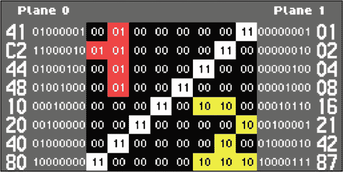

图 6-2: 磁块如何从两个位平面组合而成

当第一个位平面为 1 而第二个位平面为 0 时，这些位组合形成 01，即颜色方案中的颜色 1。同样，第一个位平面的 0 和第二个位平面的 1 形成 10，即颜色 2，而两个位平面均为 1 则产生 11，即颜色 3。

### 命名表

命名表是布局屏幕实际磁块的地方。屏幕背景看起来是什么样子的？它由哪些磁块组成，每个磁块使用了哪些颜色？这就是命名表及其随附属性表的工作。每个命名表代表游戏的一个屏幕，宽度为 32 个磁块，高度为 30 个磁块。命名表中的每个磁块由单个字节指定——该磁块在模式表中的索引。通过这种方式，模式表磁块被直接映射到命名表中，因此你可以将命名表看作模式表中磁块的一种特定排序。

命名表有多大？嗯，32 × 30 = 960，所以命名表中有 960 个位置。表中的每个位置由一个 1 字节的索引占用，因此命名表为 960 字节。

现在我们有足够的信息来理解为什么 NES 具有 256×240 的分辨率。每个磁块宽 8 像素，高 8 像素。如果命名表代表屏幕背景且宽度为 32 个磁块，那么可以推导出 8 × 32 = 256。屏幕的像素高度则通过 8 × 30 = 240 得到。

PPU 只有 2KB 内存，仅足够容两个命名表（以及它们的属性表）。这两个命名表可以进行镜像，因此总共有四个逻辑命名表。图 6-3 显示了用于磁块的命名表数据。

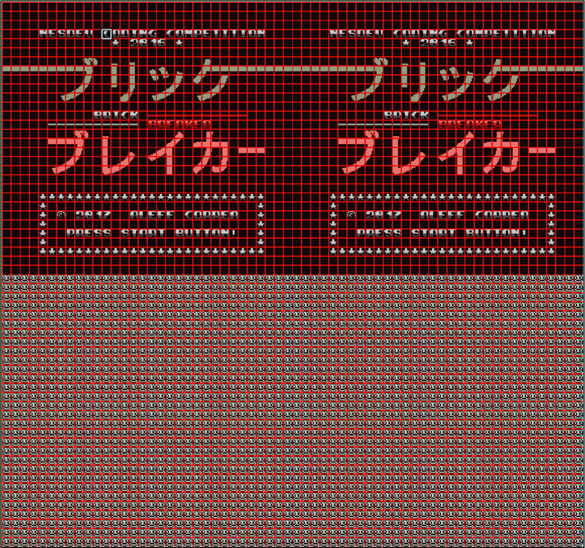

图 6-3: Breakaker 屏幕的命名表

### 调色板与属性表

PPU 具有四种不同的背景调色板内存。从“[模式表与磁块](#chapter6.xhtml#sec17)”第 178 页可知，每个磁块由四种颜色中的一种像素组成，其中一种是背景色或透明色。这意味着特定磁块中实际上只有三种颜色。PPU 调色板内存中的每种调色板因此定义了一组颜色。（我们将在下一节进一步讨论面板内存。）

为了指定哪种调色板适用于哪个磁块，每个命名表后面跟着一个属性表。属性表为 8×8，其每个条目仅为 1 字节。为什么有 960 个磁块却只有 64 个 1 字节的属性表条目？每个条目实际上为 2×2 的区域定义颜色，而这些区域区域代表 2×2 的磁块网格。因此，属性表中的每个 1 字节条目实际上覆盖了 16 个磁块。这是如何工作的？

该 1 字节条目中的每 2 位对应一个区域，2 位可以表示多多四个值。每个 2 位值都是四种不同背景调色板之间的选择器。因此，屏幕上的每个 2×2 磁块区域可以使用四种背景调色板中的一种。这意味着每个区域内的四个磁块必须使用相同的颜色（以及背景色/透明）。

这并非易事。为 NES 图形创作的艺术家必须使用非背景颜色绘制屏幕上的显著区域（四磁块区域）。

图 6-4、6-5 和 6-6 为 `https://nesdev.org` 创建，展示了属性表的实际应用。（如果你通过纸质版读本书，请查看辅助仓库的图片目录。）首先，图 6-4 显示了一个游戏（由 Damian Yerrick 创作的 `Thwaite`）的背景被分为属性表选择颜色的区域。

PPU 的调色板内存可以容四个背景调色板和四个精灵调色板。正如我们讨论过的，一个调色板由三种颜色（加上背景/透明色）组成。它可以用于绘制屏幕上四个瓷格的背景区域（见前节关于属性表的章节）或绘制精灵。换句话说，背景的每个四瓷格区域可以使用四个调色板中的一种进行上色，每个精灵可以使用四个调色板中的一种进行上色。

调色板使用 3 个字节定义。每个字节指定调色板中三种颜色之一，尽管每个字节仅有 6 位实际上被用于选择颜色。由于 6 位可以从 64 个值中进行选择，这告诉我们 NES 艺术家只有 64 种颜色可用。在实践中，这 64 种可能的颜色中有 10 种本质上是黑色，因此 NES 实际上只有 54 种颜色。图 6-7 显示了 NTSC NES 的这些颜色。PAL NES 机器的颜色略有不同。（不同国家使用不同的视频标准——例如北美使用 NTSC，而欧洲大部分和亚洲使用 PAL——这会影响 NES PPU 的运行方式。）

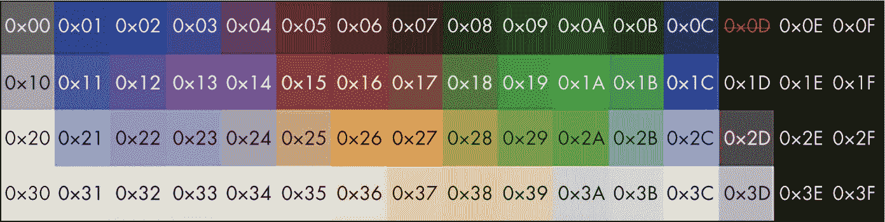

图 6-7：NTSC NES 可用的颜色

例如，假设你的背景区域使用背景调色板 1 绘制，而背景调色板 1 指定了颜色 `0x11`、`0x0A` 和 `0x3D`。这意味着你可以使用蓝色、绿色、灰色的色调以及背景色来绘制该区域。

### 对象属性内存

OAM 存储关于屏幕上精灵的信息。精灵本质上是游戏中的移动物体——例如玩家、敌人和投射物。NES 一时支持 64 个精灵，并使用 4 个字节描述每一个精灵，因此 OAM 有 256 个字节。

精灵的图像来自卡带上与背景瓷格相同的 `CHR ROM`——即模式表。然而，与背景不同，精灵并不限于瓷格位置；它们可以绘制在屏幕上的任何位置。每个精灵还可以进行水平或垂直翻转，放置在背景之前或之后，并使用四个调色板中的任何一个上色。每个精灵的 4 个字节及其作用在表 6-5 中进行了简要描述。

#### 表 6-5：OAM 中的精灵规格

| 字节数 | 说明 |
| --- | --- |
| 0 | 精灵的 y 轴位置 |
| 1 | 模式表索引，精灵的图形数据所在 |
| 2 | 精灵属性，包括调色板（位 0–1）、在前在后（位 5）、水平翻转（位 6）和垂直翻转（位 7） |
| 3 | 精灵的 x 轴位置 |

为什么 y 轴位置字节和 x 轴位置字节不相邻，这是我想向 NES 创建者提出的问题。也许这与 PPU 中线路的物理布线有关。

### 帧创建与时序

真实 NES 中的 PPU 从左上角到右下角逐像素地绘制屏幕。这反映了 NES 连接的 CRT 电视机中的“电子枪束”。NTSC NES 每秒绘制整个屏幕 60 次（每秒 60 帧，或 60 FPS）。PAL NES 以较慢的 50 FPS 绘制。一个 `frame` 是电子枪完成穿越整个屏幕的过程。正如本章前面提到的，电子枪有时在 `hblank`（行间隙）和 `vblank`（帧间隙）期间会暂时离开屏幕。因此，这些是最安全的时刻。


由于 NES 分辨率是 256×240，我们知道每行有 256 个点，总共 240 行。其中第一行是预渲染行（`prerenderline`），我们称之为 0 行。随后，1 到 240 行是显示区域。241 到 261 行是 `vblank` 期间。本章之前提到的 `NMI` 因此在第 241 行处触发，告诉程序此时修改内存是安全的。0 到 255 点是行的可见部分。256 到 340 点是 `hblank` 期间的"静默"点。

每个点代表一个 `PPU cycle`。如果你计算一下，每行 341 个点乘以 262 行，意味着绘制每一帧需要 89342 个 `PPU cycles`。记住有 3 个 `CPU cycle`。如果你将 `PPU cycles` 除以 3 并四舍五入，得到每帧 29781 个 `CPU cycles`。NES 的 CPU 频率约为 1.79 MHz，即每秒 1790000 次。如果你将 1790000 除以 29781，得到接近 60。那就是每秒 60 帧！

要创建一个周期精确的 NES 模拟器，理解 PPU 如何逐像素确定绘制颜色是非常重要的。由于我们使用的是较简单的逐帧绘制方法，我们可以认为每 89342 个 `PPU cycles` 的某一点处绘制整个帧。对我来说，那个逻辑时间是可见行绘制完毕。在稍后的代码中，你将看到所有背景和精灵都在第 240 行、256 点（最后可见行的最后一个点）一次性被绘制。我们的简化渲染器除了每帧一次的 `PPU cycle` 外不进行任何绘制。

## 实现 PPU

实现我们的 PPU 从一些重要的开始，包括各种内存大小、屏幕分辨率以及完整的可用调色板：

`NESEmulator/ppu.py`

```python
from array import array
from NESEmulator.rom import ROM
import numpy as np

SPR_RAM_SIZE = 256
NAMETABLE_SIZE = 2048
PALETTE_SIZE = 32
NES_WIDTH = 256
NES_HEIGHT = 240
NES_PALETTE = [0x7C7C7C, 0x0000FC, 0x0000BC, 0x4428BC, 0x940084, 0xA80020,
               0xA81000, 0x881400, 0x503000, 0x007800, 0x006800, 0x005800,
               0x004058, 0x000000, 0x000000, 0x000000, 0xBCBCBC, 0x0078F8,
               0x0058F8, 0x6844FC, 0xD800CC]
```

```python
    # 寄存器
    self.addr = 0 # 主 PPU 地址寄存器
    self.addr_write_latch = False
    self.status = 0
    self.spr_address = 0
    # 由 PPU 控制寄存器控制的变量
    self.nametable_address = 0
    self.address_increment = 1
    self.spr_pattern_table_address = 0
    self.background_pattern_table_address = 0
    self.generate_nmi = False
    self.show_background = False
    self.show_sprites = False
    self.left_8_sprite_show = False
    self.left_8_background_show = False
    # 内部辅助变量
    self.buffer2007 = 0
    self.scanline = 0
    self.cycle = 0
    # 屏幕像素
    self.display_buffer = np.zeros((NES_WIDTH, NES_HEIGHT), dtype=np.uint32)
```

接下来，我们来看渲染方法 `step()`：

```python
def step(self):
    # 我们简化的 PPU 每帧只绘制一次
    if (self.scanline == 240) and (self.cycle == 256):
        if self.show_background:
            self.draw_background()
        if self.show_sprites:
            self.draw_sprites(False)
    if (self.scanline == 241) and (self.cycle == 1):
        self.status |= 0b10000000 # 设置垂直同步标志
    if (self.scanline == 261) and (self.cycle == 1):
        # 垂直同步结束，清除精灵点零，清除精灵点溢出
        self.status |= 0b00011111

    self.cycle += 1
    if self.cycle > 340:
        self.cycle = 0
        self.scanline += 1
        if self.scanline > 261:
            self.scanline = 0
```

从模拟器主循环对 `step()` 的每次调用代表一个 PPU 周期。由于我们的策略是每帧绘制一次内容，而不是追求像素级或扫描行的精确性，因此 `step()` 非常简单。它只是在每一帧的可视部分结束时一次性绘制背景和精灵。它还会在垂直同步开始和结束时设置状态寄存器，以便 CPU 与 PPU 配合。最后，它会进行一些记账工作，以跟踪当前的扫描行以及每行扫描上的当前周期。

重头工作由 `draw_background()` 和 `draw_sprites()` 方法完成，这些方法由 `step()` 调用。接下来我们将查看这些方法。

### 绘制背景

我们在开始 `draw_background()` 背景绘制方法时，首先计算属性表的地址：

```python
def draw_background(self):
    attribute_table_address = self.nametable_address + 960
```

属性表始终跟在命名表之后，回想本章之前提到的命名表的大小为 960 字节。我在本章前面的部分也提到过，命名表由 960 字节组成，因为它使用 1 字节来表示每个 960 个瓦片的索引。屏幕宽为 32 个瓦片，高为 30 个瓦片，每个瓦片代表 8×8 像素区域。我们从屏幕的左上到右下，一行一行、从左到右地绘制这些瓦片：

```python
    for y in range(30):
        for x in range(32):
            tile_address = self.nametable_address + y * 32 + x
            nametable_entry = self.read_memory(tile_address)
```

`tile_address` 是通过将基础 `nametable_address` 与当前瓦片的偏移量计算出的。由于每行有 32 个瓦片，我们将行 (`y`) 乘以 32 并加上 `x` 组件（可以被视为列）。为了获取实际索引 (`nametable_entry`)，我们在 `tile_address` 处读取一个字节。在方法的稍后，我们将使用 `nametable_entry` 从模式表中检索瓦片的像素。接下来，我们获取与命名表项对应的属性项：

```python
        attrx = x // 4
        attry = y // 4
        attribute_address = attribute_table_address + attry * 8 + attrx
        nametable_entry = self.read_memory(attribute_address)
```

由于 8×8 属性表中的每个项对应 16 个瓦片，我们将 `x` 和 `y` 都除以 4，以获取到瓦片的属性项（参见第 181 页的调色板与属性表）。由于每个 `attribute_entry` 代表四个 2×2 的瓦片区域（总共 16 个瓦片），我们需要深入到特定的瓦片区域：

```python
        block = (y & 0x02) | ((x & 0x02) >> 1)
        attribute_bits = 0
        if block == 0:
            attribute_bits = (attribute_entry & 0b00000011) << 2
        elif block == 1:
            attribute_bits = (attribute_entry & 0b00001100)
        elif block == 2:
            attribute_bits = (attribute_entry & 0b00110000) >> 2
        elif block == 3:
            attribute_bits = (attribute_entry & 0b11000000) >> 4
        else:
            print("Invalid block")
```

`attribute_entry` 是 1 字节，每 2 位对应一个瓦片区域。变量 `block` 代表当前瓦片的瓦片区域；它可以是 0、1、2 或 3。根据 `block` 的值，我们使用相应的位操作从 `attribute_entry` 中检索该区域的两个位，并将它们存储在 `attribute_bits` 中。

现在我们需要从模式表中检索每个瓦片的独立像素：

```python
        for fine_y in range(8):
            low_order = self.read_memory(self.background_pattern_table_address +
                                         nametable_entry * 16 + fine_y)
            high_order = self.read_memory(self.background_pattern_table_address +
                                          nametable_entry * 16 + 8 + fine_y)
            for fine_x in range(8):
                pixel = ((low_order >> (7 - fine_x)) & 1) |
                            ((high_order >> (7 - fine_x)) & 1) << 1) | attribute_bits
```

回想第 178 页的模式表与瓦片，每个模式表由 16 字节的瓦片组成。因此，为了计算瓦片的地址，我们需要将其索引 (`nametable_entry`) 乘以 16 加入 `background_pattern_table_address`。此外，模式表瓦片被分为两个位平面，每个颜色占 2 位，这 2 位在不同的平面中相隔 8 字节（见图 6-2）。我们的策略是读取 2 个字节，一个用于 `low_order` 平，另一个用于 `high_order` 平。每个字节持有瓦片一行的一半像素项。我们使用 `fine_y` 来代表瓦片的每一行，然后使用代表每一列的 `fine_x` 将独立位置零。每个平面的位与 `attribute_bits` 结合产生调色板内存中的地址，其中存储了当前像素的颜色。

最后，我们使用 `NES_PALETTE` 中预定义的颜色，在相应的屏幕位置逐个绘制瓦片的每个像素：

```python
    x_screen_loc = x * 8 + fine_x
    y_screen_loc = y * 8 + fine_y
    transparent = ((pixel & 3) == 0)
    # 如果背景是透明，使用调色板中的第一个颜色
    color = self.palette[0] if transparent else self.palette[pixel]
    self.display_buffer[x_screen_loc, y_screen_loc] = NES_PALETTE[color]
```

为屏幕设置像素意味着在 `display_buffer` 中赋值，它是一个 NumPy 数组，因为这是 Pygame 接受。

### 绘制精灵

绘制精灵与绘制背景瓦片有些相似。然而，我们不是从命名表读取，而是从 OAM (`self.spr`) 读取。内存中每个精灵的条目占 4 字节，代表精灵的 y 位置、模式表索引、属性和 x 位置（见表 6-5）。OAM 中可以容最多 64 个精灵条目。如果 y 位置为 `0xFF`，则该条目未被使用。我们通过每次移动 4 字节遍历 OAM 来启动 `draw_sprites()` 以找到所有有效的条目：

```python
def draw_sprites(self, background_transparent: bool):
    for i in range(SPR_RAM_SIZE - 4, -4, -4):
        y_position = self.spr[i]
        if y_position == 0xFF: # 0xFF 是没有精灵数据的标记
            continue
        background_sprite = bool((self.spr[i + 2] >> 5) & 1)
        x_position = self.spr[i + 3]
```

我们获取每个有效精灵的 y 坐标和 x 坐标。我们还会查看其属性的第 5 位以判断它是否为背景精灵。只有当背景透明时，才会绘制背景精灵。注意，我们是反向遍历精灵内存的，因为正如我们在节末尾将看到的，第 0 号精灵具有特殊的意义。

就像我们逐像素像素地绘制背景瓦片一样，我们对精灵也采取相同的做法：

```python
    for x in range(x_position, x_position + 8):
        if x >= NES_WIDTH:
            break
        for y in range(y_position, y_position + 8):
            if y >= NES_HEIGHT:
                break
```

在这里，`x` 和 `y` 比于 `draw_background()` 中的 `fine_x` 和 `fine_y`。我们非常小心，不绘制任何超出屏幕的像素。

精灵可以拥有的另一个属性是垂直翻转能力（`flip_y`），这由精灵属性字节中的第 7 位决定：

```python
            flip_y = bool((self.spr[i + 2] >> 7) & 1)
            sprite_line = y - y_position
            if flip_y:
                sprite_line = 7 - sprite_line
```

如果精灵被垂直翻转，我们就会按反向垂直顺序读取其像素。我们使用魔数字 `7` 是因为每个精灵都是 8×8 像素。

根据模式表索引从模式表中读取实际像素位，与 `draw_background()` 中执行的工作非常相似：

```python
            index = self.spr[i + 1]
            bit0s_address = self.spr_pattern_table_address + (index * 16) + sprite_line
            bit1s_address = self.spr_pattern_table_address + (index * 16) + sprite_line + 8
            bit0s = self.read_memory(bit0s_address)
            bit1s = self.read_memory(bit1s_address)
            bit3and2 = ((self.spr[i + 2]) & 3) << 2
```

我在这里使用了一些不同的术语（使用 `bit0s_address` 和 `bit1s_address` 代替 `low_order` 和 `high_order`），因为我认为不同的命名可能会引起不同读者的共鸣。属性颜色位是精灵属性字节中的第 `0` 和第 `1` 位，它们存储在 `bit3and2` 中用于最终颜色。

精灵还可以根据属性字节中的第 6 位进行水平翻转：

```python
            flip_x = bool((self.spr[i + 2] >> 6) & 1)
            x_loc = x - x_position # 精灵内的位置
            if not flip_x:
                x_loc = 7 - x_loc
```

我们将两个位平面合并在一起，并跳过绘制透明的像素：


```python
            bit1and0 = (((bit1s >> x_loc) & 1) << 1) | (
                    ((bit0s >> x_loc) & 1) << 0)
            if bit1and0 == 0: # 透明像素... 跳过
                continue
```

PPU 会跟踪第 0 号精灵（OAM 中的第一个条目）是否与任何非透明背景像素碰撞。这被称为 `sprite-zero hit`（精灵零位命中）。我们在这里实现了这种简单形式的碰撞检测：

```python
    # 这不是透明的。那么它是一个精灵零位命中吗？
    # 检查左侧 8 像素裁剪未开启。
    if (i == 0) and (not background_transparent) and (not (x < 8 and (
            not self.left_8_sprite_show or not self.left_8_background_show))
                and self.show_background and self.show_sprites):
        self.status |= 0b01000000
    # 需要在精灵零位检查后执行此操作，以便我们仍然会将
    # 背景精灵计入精灵零位检查中
    if background_sprite and not background_transparent:
        continue # 背景精灵不应绘制在不透明的像素上
```

当发生精灵零位命中时，我们在状态寄存器中标记它。在这段代码中，如果背景不透明，我们还会跳过绘制背景精灵。PPU 中可以设置标志位来裁剪背景。最后，我们获取颜色：

```python
            color = bit3and2 | bit1s
```

## 访问寄存器

PPU 有几个寄存器，在读写时存在一些技术细节。在 `write_register()` 中，我们首先处理 `0x2000`：

```python
def write_register(self, address: int, value: int):
    if address == 0x2000: # 控制 1
        self.nametable_address = (value & 0b00000111) * 0x40
        self.spr_pattern_table_address = ((value & 0b00001000) >> 3) * 0x1000
        self.background_pattern_table_address = ((value & 0b00010000) >> 4) * 0x1000
        self.generate_nmi = bool(value & 0b10000000)
    elif address == 0x2001: # 控制 2
        self.show_background = bool(value & 0b00001000)
        self.show_sprites = bool(value & 0b00010000)
        self.left_8_background_show = bool(value & 0b00000010)
        self.left_8_sprite_show = bool(value & 0b00000100)
```

接下来，我们处理寄存器 `0x2003` 到 `0x2007`：

```python
    elif address == 0x2003:
        self.spr_address = value
    elif address == 0x2004:
        self.spr[self.spr_address] = value
        self.spr_address += 1
    elif address == 0x2005: # 滚动
        pass
    elif address == 0x2006:
        # 参考 https://wiki.nesdev.org/w/index.php/PPU_scrolling
        if not self.addr_write_latch: # 第一次写入
            self.addr = (self.addr & 0x00FF) | ((value & 0xFF) << 8)
        else: # 第二次写入
            self.addr = (self.addr & 0xFF00) | (value & 0xFF)
        self.addr_write_latch = not self.addr_write_latch
    elif address == 0x2007:
        self.write_memory(self.addr, value)
        self.addr += self.address_increment
    else:
        raise LookupError(f"Error: 未识别的 PPU 写入 {address:X}")
```

寄存器 `0x2003` 设置 `self.spr_address`。寄存器 `0x2004` 设置 `self.spr_address` 处的值，然后将 `self.spr_address` 增 1。寄存器 `0x2005` 是滚动寄存器；我们在这个简单的 PPU 中没有实现它，但一个完整的实现需要它。目前，我们的模拟器无法运行需要滚动的游戏。寄存器 `0x2006` 用于修改 `self.addr`。这就是 `self.addr_write_latch` 派上用场的地方：我们需要锁存器是因为 `self.addr` 是 16 位的（2 字节），但每次只能写入 1 字节。最后，`0x2007` 用于写入 `self.addr`。

## 访问内存

我们的 PPU 实现基本上已经完成，但我们需要一些辅助方法来读取和写入 PPU 内存。这些 `read_memory()` 和 `write_memory()` 方法与它们在 CPU 中的对应方法非常相似：

```python
def read_memory(self, address: int) -> int:
    address = address % 0x4000 # mirror >0x4000
    if address < 0x2000: # pattern tables
        return self.rom.read_cartridge(address)
    elif address < 0x3F00: # nametables
        address = (address - 0x2000) % 0x1000 # 3000-3EFF is a mirror
        if self.rom.vertical_mirroring:
            address = address % 0x0800
        else: # horizontal mirroring
            if (address >= 0x400) and (address < 0xC00):
                address = address - 0x400
            elif address >= 0xC00:
                address = address - 0x800
        return self.nametables[address]
    elif address < 0x4000: # palette memory
        address = (address - 0x3F00) % 0x20
        if (address > 0x0F) and ((address % 0x04) == 0):
            address = address - 0x10
        return self.palette[address]
    else:
        raise LookupError(f"Error: Unrecognized PPU read at {address:X}")

def write_memory(self, address: int, value: int):
    address = address % 0x4000 # mirror >0x4000
    if address < 0x2000: # pattern tables
        return self.rom.write_cartridge(address, value)
    elif address < 0x3F00: # nametables
        address = (address - 0x2000) % 0x1000 # 3000-3EFF is a mirror
        if self.rom.vertical_mirroring:
            address = address % 0x0800
        else: # horizontal mirroring
            if (address >= 0x400) and (address < 0xC00):
                address = address - 0x400
            elif address >= 0xC00:
                address = address - 0x800
        self.nametables[address] = value
    elif address < 0x4000: # palette memory
        address = (address - 0x3F00) % 0x20
        if (address > 0x0F) and ((address % 0x04) == 0):
            address = address - 0x10
        self.palette[address] = value
    else:
        raise LookupError(f"Error: Unrecognized PPU write at {address:X}")
```

在这些方法中，不同的内存区域被映射到相应的区域——图案表（实际上在卡带上）、命名表等。唯一的复杂之处在于命名表和调色板内存可能是镜像的。我们像在 CPU 中一样使用模运算符（`%`）来处理这个问题。

## 测试模拟器

开发 NES 模拟器的人创建了许多测试 ROM。其中一些包含本书的仓库中。这些可以测试 `6502` CPU 以及 PPU。感谢 Shay Green 和 Kevin Horton 开发这些测试。

我们的 10 个单元测试运行这些 ROM，然后检查虚拟 NES 内存中的某些值是否正确设置，正如测试 ROM 创建者所指定的那样。与书中的所有测试一样，这些单元测试的文件出现在源码仓库根目录下的 `tests` 目录中：


```python
### tests/test_nesemulator.py
import unittest
from pathlib import Path
from NESEmulator.cpu import CPU
from NESEmulator.ppu import PPU
from NESEmulator.rom import ROM

class CPUTestCase(unittest.TestCase):
    def setUp(self) -> None:
        self.test_folder = (Path(__file__).resolve().parent.parent
                            / 'NESEmulator' / 'Tests')

    def test_nes_test(self):
        # 创建正在测试的机制
        rom = ROM(self.test_folder / "nestest" / "nestest.nes")
        ppu = PPU(rom)
        cpu = CPU(ppu, rom)
        # 设置测试
        cpu.PC = 0xC000 # 测试的特殊起始位置
        with open(self.test_folder / "nestest" / "nestest.log") as f:
            correct_lines = f.readlines()
        log_line = 1
        # 将日志的每一行与我们生成的日志进行对比
        while log_line < 5260: # 直到第一个非官方指令测试
            our_line = cpu.log()
            correct_line = correct_lines[log_line - 1]
            self.assertEqual(correct_line[0:14], our_line[0:14],
                             f"PC/Opcode doesn't match at line {log_line}")
            self.assertEqual(correct_line[48:73], our_line[48:73],
                             f"Registers don't match at line {log_line}")
            cpu.step()
            log_line += 1

    def test_blargg_instr_test_v5_basics(self):
        # 创建正在测试的机制
        rom = ROM(self.test_folder / "instr_test-v5" / "rom_singles" / "01-basics.nes")
        ppu = PPU(rom)
        cpu = CPU(ppu, rom)
        # 只要 0x6000 是 80，测试就会运行，然后 0x6000 是结果码；0 表示成功
        rom.prg_ram[0] = 0x80
        while rom.prg_ram[0] == 0x80: # 直到第一个非官方指令测试
            cpu.step()
        self.assertEqual(0, rom.prg_ram[0],
                         f"Result code of basics test is {rom.prg_ram[0]} not 0")
        message = bytes(rom.prg_ram[4:]).decode("utf-8")
        print(message[0:message.index("\0")]) # 信息以空终止符结束

    def test_blargg_instr_test_v5_implied(self):
        # 创建正在测试的机制
        rom = ROM(self.test_folder / "instr_test-v5" / "rom_singles" / "02-implied.nes")
        ppu = PPU(rom)
        cpu = CPU(ppu, rom)
        # 只要 0x6000 是 80，测试就会运行，然后 0x6000 是结果码；0 表示成功
        rom.prg_ram[0] = 0x80
        while rom.prg_ram[0] == 0x80: # 直到第一个非官方指令测试
            cpu.step()
        self.assertEqual(0, rom.prg_ram[0],
                         f"Result code of implied test is {rom.prg_ram[0]} not 0")
        message = bytes(rom.prg_ram[4:]).decode("utf-8")
        print(message[0:message.index("\0")]) # 信息以空终止符结束

    def test_blargg_instr_test_v5_branches(self):
        # 创建正在测试的机制
        rom = ROM(self.test_folder / "instr_test-v5" / "rom_singles" / "10-branches.nes")
        ppu = PPU(rom)
        cpu = CPU(ppu, rom)
        # 只要 0x6000 是 80，测试就会运行，然后 0x6000 是结果码；0 表示成功
        rom.prg_ram[0] = 0x80
        while rom.prg_ram[0] == 0x80: # 直到第一个非官方指令测试
            cpu.step()
        self.assertEqual(0, rom.prg_ram[0],
                         f"Result code of branches test is {rom.prg_ram[0]} not 0")
        message = bytes(rom.prg_ram[4:]).decode("utf-8")
        print(message[0:message.index("\0")]) # 信息以空终止符结束

    def test_blargg_instr_test_v5_stack(self):
        # 创建正在测试的机制
        rom = ROM(self.test_folder / "instr_test-v5" / "rom_singles" / "11-stack.nes")
        ppu = PPU(rom)
        cpu = CPU(ppu, rom)
        # 只要 0x6000 是 80，测试就会运行，然后 0x6000 是结果码；0 表示成功
        rom.prg_ram[0] = 0x80
        while rom.prg_ram[0] == 0x80: # 直到第一个非官方指令测试
            cpu.step()
        self.assertEqual(0, rom.prg_ram[0],
                         f"Result code of stack test is {rom.prg_ram[0]} not 0")
        message = bytes(rom.prg_ram[4:]).decode("utf-8")
        print(message[0:message.index("\0")]) # 信息以空终止符结束

    def test_blargg_instr_test_v5_jsr(self):
        # 创建正在测试的机制
        rom = ROM(self.test_folder / "instr_test-v5" / "rom_singles" / "12-jmp_jsr.nes")
        ppu = PPU(rom)
        cpu = CPU(ppu, rom)
        # 只要 0x6000 是 80，测试就会运行，然后 0x6000 是结果码；0 表示成功
        rom.prg_ram[0] = 0x80
        while rom.prg_ram[0] == 0x80: # 直到第一个非官方指令测试
            cpu.step()
        self.assertEqual(0, rom.prg_ram[0],
                         f"Result code of jmp_jsr test is {rom.prg_ram[0]} not 0")
        message = bytes(rom.prg_ram[4:]).decode("utf-8")
        print(message[0:message.index("\0")]) # 信息以空终止符结束

    def test_blargg_instr_test_v5_rts(self):
        # 创建正在测试的机制
        rom = ROM(self.test_folder / "instr_test-v5" / "rom_singles" / "13-rts.nes")
        ppu = PPU(rom)
        cpu = CPU(ppu, rom)
        # 只要 0x6000 是 80，测试就会运行，然后 0x6000 是结果码；0 表示成功
        rom.prg_ram[0] = 0x80
        while rom.prg_ram[0] == 0x80: # 直到第一个非官方指令测试
            cpu.step()
        self.assertEqual(0, rom.prg_ram[0],
                         f"Result code of rts test is {rom.prg_ram[0]} not 0")
        message = bytes(rom.prg_ram[4:]).decode("utf-8")
        print(message[0:message.index("\0")]) # 信息以空终止符结束

    def test_blargg_instr_test_v5_rti(self):
        # 创建正在测试的机制
        rom = ROM(self.test_folder / "instr_test-v5" / "rom_singles" / "14-rti.nes")
        ppu = PPU(rom)
        cpu = CPU(ppu, rom)
        # 只要 0x6000 是 80，测试就会运行，然后 0x6000 是结果码；0 表示成功
        rom.prg_ram[0] = 0x80
        while rom.prg_ram[0] == 0x80: # 直到第一个非官方指令测试
            cpu.step()
        self.assertEqual(0, rom.prg_ram[0],
                         f"Result code of rti test is {rom.prg_ram[0]} not 0")
        message = bytes(rom.prg_ram[4:]).decode("utf-8")
        print(message[0:message.index("\0")]) # 信息以空终止符结束

    def test_blargg_instr_test_v5_brk(self):
        # 创建正在测试的机制
        rom = ROM(self.test_folder / "instr_test-v5" / "rom_singles" / "15-brk.nes")
        ppu = PPU(rom)
        cpu = CPU(ppu, rom)
        # 只要 0x6000 是 80，测试就会运行，然后 0x6000 是结果码；0 表示成功
        rom.prg_ram[0] = 0x80
        while rom.prg_ram[0] == 0x80: # 直到第一个非官方指令测试
            cpu.step()
        message = bytes(rom.prg_ram[4:]).decode("utf-8")
        print(message[0:message.index("\0")]) # 信息以空终止符结束
        self.assertEqual(0, rom.prg_ram[0],
                         f"Result code of brk test is {rom.prg_ram[0]} not 0")

    def test_blargg_instr_test_v5_special(self):
        # 创建正在测试的机制
        rom = ROM(self.test_folder / "instr_test-v5" / "rom_singles" / "16-special.nes")
        ppu = PPU(rom)
        cpu = CPU(ppu, rom)
        # 只要 0x6000 是 80，测试就会运行，然后 0x6000 是结果码；0 表示成功
        rom.prg_ram[0] = 0x80
        while rom.prg_ram[0] == 0x80: # 直到第一个非官方指令测试
            cpu.step()
        message = bytes(rom.prg_ram[4:]).decode("utf-8")
        print(message[0:message.index("\0")]) # 信息以空终止符结束
        self.assertEqual(0, rom.prg_ram[0],
                         f"Result code of special test is {rom.prg_ram[0]} not 0")
```

在开发模拟器时，拥有像这样的自动化测试是非常重要的。即使你认为你的 CPU 是完美的，你也可能遗漏某个可能导致整个程序崩溃的小 Bug。此外，你还需要确保修改模拟器的某部分不会破坏它的其他部分。

### 运行游戏

单元测试是一回事，但我们模拟器的真实测试标准是看它是否能运行真实的 NES 软件。由于法律原因，我们不会在 NES 模拟器中测试任何商业软件。由于其局限性，我们的模拟器本身也无法运行 NES 库中的大多数游戏。相反，本书的源代码仓库包含了几个开源或公共领域的游戏，我们的模拟器能够运行这些游戏。从意义上来说，它们是真实的游戏，因为可以在真实的 NES 主机上运行。

让我们从 `BrickBreaker` 开始，这是我之前提到的由 Aleff Correa 编写的一款类似 `Breakout` 的游戏。假设你已经安装了 `Pygame` 和 `NumPy`，可以在仓库根目录下运行以下命令来玩此游戏：

```
% python3 -m NESEmulator NESEmulator/Games/brix.nes
```

它看起来很不错（参见图 6-8）。

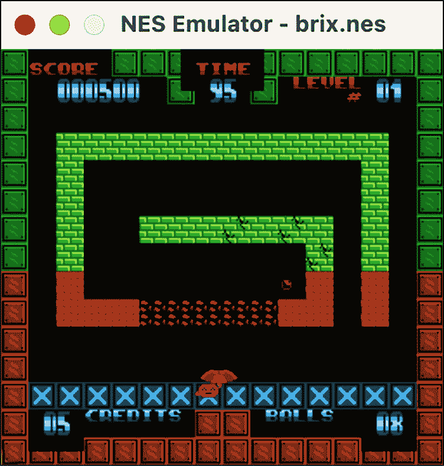

图 6-8: Aleff Correa 的 BrickBreaker

接下来，让我们尝试 Shiru 编写的 `Chase`：

```
% python3 -m NESEmulator NESEmulator/Games/Chase.nes
```

图 6-9 显示了游戏。

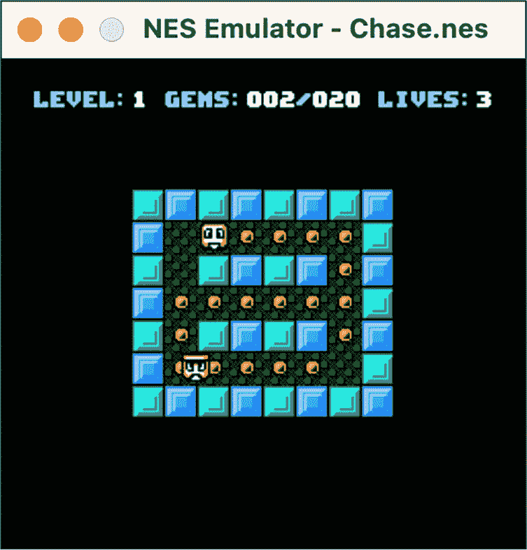

图 6-9: Shiru 的 Chase

最后，让我们尝试 Shiru 编写的 `Lan Master`：

```
% python3 -m NESEmulator NESEmulator/Games/LanMaster.nes
```

这是一款益智游戏，如图 6-10 所示。

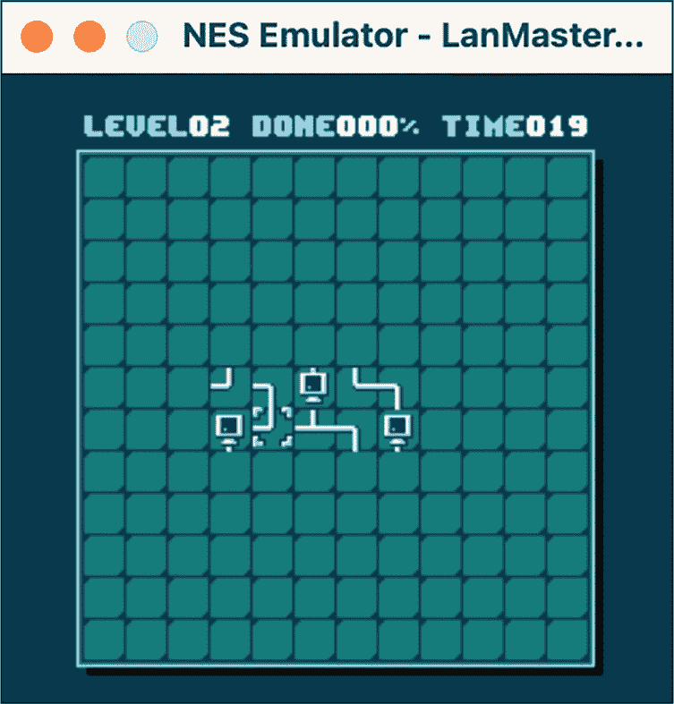

图 6-10: Shiru 的 Lan Master

`Lan Master` 在我们的模拟器上运行得良好，但另外两个不是。为什么呢？嗯，你可能注意到它们都运行得非常慢。例如，在我运行 `CPython` 3.13 的 M1 MacBook Air 上，它们的运行速度大约为 14 FPS。这只有真实 NES 速度四分之一。我们的模拟器正在正确地运行这些游戏，只是非常慢。


教训是什么？Python，特别是 Python 的主版本 `CPython`，非常慢。近年来，尽管一直在努力提高 `CPython` 的性能，但与大多数其他编程语言实现相比，它仍然非常慢，而且没有针对编写模拟器之类的底层程序进行开箱优化。要编写更高效的程序，你需要克服一些困难：你可以使用用底层语言实现的特定库、使用 `Cython`、编写 C 扩展，或者使用像 `PyPy` 这样的替代 Python 解释器。

我将使用 `Cython` 之类的工具加速模拟器留给读者作为练习。我坚信，通过正确的解决方案，你可以让这个 NES 模拟器的速度达到真实 NES 的 60 FPS。

### 现实世界的应用

模拟器最常见的用途可能是运行已不再生产的系统的视频游戏，但长期以来，它们一直被用于计算机史上的关键节点。例如，当 Bill Gates 和 Paul Allen 在 1975 年通过为 `Altair 8800` 编写 `BASIC` 解释器来创立微软时（如第 2 章 所示），他们实际上并没有 `Altair 8800` 可用。相反，他们在哈佛大学（Gates 上大学的地方）的一台微型计算机上([chapter6.xhtml#chapter6-8]) 为 `Altair` 的 `8080` 微处理器编写了一个模拟器。

Apple 三次切换了其 Macintosh 系列中使用的微处理器：从 `Motorola 68K` 切换到 `Motorola/IBM PowerPC`，从 `PowerPC` 切换到 `Intel x86`，最后从 `Intel x86` 切换到苹果自己的基于 `ARM` Apple Silicon。这意味着 Apple 必须多次重新编译或重写他们的所有软件吗？从长期来看，是的，但在过渡期内，Apple 提供了模拟器。`PowerPC Macs` 可以运行 `68K` 软件，`Intel Macs`（初期）可以运行 `PowerPC` 软件，而 `Apple Silicon Macs` 也可以运行 `Intel` 软件。Apple 是一个 amazing 模拟器开发者。事实上，`PowerPC Macs` 运行 `68K` 的速度比 `68K Macs` 快。Apple Silicon 运行 Intel 软件有时也是如此。

模拟器对于软件保护也很重要。当难以获取编写某软件的原始硬件时会发生什么？在这种情况下，模拟器可能是唯一的选择。在另一端，模拟器有时用于新平台的设计阶段。在平台存在之前，设计师可能会利用模拟器模拟它的样子，并帮助在真实环境中完善其功能。最后，编写模拟器极具教育意义。它是教授计算机底层原理的最佳方式之一，正如我希望在本章中发现的那样。

## 练习

1. 尝试将我们的模拟器的性能提升到真实 NES 的水平——也就是说，60 FPS。你可能需要使用 `Cython`，或者通过扩展将 `Python` 与 `C` 或 `Rust` 等底层语言结合。对于 `CPython` 3.13 和 2025 年时代的处理器，要让纯 `Python` 运行在 60 FPS 几乎是不可能的。

2. 使用 [`https://nesdev.org`](https://nesdev.org) 的文档为我们的模拟器添加滚动支持。

3. 实现另一个 mapper。目前我们的模拟器只实现了最基础的 mapper `NROM`。另外两个流行的 mapper 是 `MMC1` 和 `UxROM`。

4. 现在是面临最大的挑战：尝试为我们的模拟器编写一个 `APU`，这样你就可以玩带声音的游戏了。

## 笔记

1. David Sheff, *Game Over: Nintendo Conquered the World* (GamePress, 1999).

2. Russ Cox, "The MOS 6502 and the Best Layout in the World," research!rsc, 2011 年 1 月 3 日, [`research.swtch.com/6502`](https://research.swtch.com/6502).

3. Steven Collier, "What Was the Biggest NES Game Ever?" DKoldies, 2016 年 3 月 24 日, [`www.dkoldies.com/blog/what-was-the-biggest-nes-game-ever/`](https://www.dkoldies.com/blog/what-was-the-biggest-nes-game-ever/).

4. Marat Fayzullin, "iNES," 访问于 2024 年 4 月 19 日, [`fms.komkon.org/iNES`](http://fms.komkon.org/iNES).

5. 表 6-1 基于进入公共领域的 NesDev.org 信息。参见 [`www.nesdev.org/wiki/INES`](https://www.nesdev.org/wiki/INES).

6. 示例借自 NesDev.org 用户 Damian Yerrick。NesDev.org 的所有信息已进入公共领域。参见 [`www.nesdev.org/wiki/PPU_pattern_tables`](https://www.nesdev.org/wiki/PPU_pattern_tables).

7. 参见 [`github.com/fogleman/nes`](https://github.com/fogleman/nes).

本章将介绍 `k-最近邻 (KNN)`，这是一种极其简单的机器学习算法，在某些应用中非常有效。KNN 最早开发于 20 世纪 50 年代和 60 年代，既可以用于`分类`（决定某物属于哪一类），也可以用于`回归`（预测一个值）。对于对机器学习的复杂性感到畏惧的读者来说，KNN 提供了一个易于上手且贴近现实的切入点。在本章中，我们将使用 KNN 以高精度的解决两个分类问题：区分不同类型的鱼和识别手写数字。然后，在第 8 章中，我们将 KNN 扩展到一些相关的回归问题。

## 机器学习的兴起

回到 20 世纪 50 年代，传统人工智能（AI）研究主要关注利用算法来模拟人类智能。然而，从 20 世纪 90 年代开始，特别是随着 2000 年代 `GPU` 计算支持的神经网络出现后，AI 研究和产品化的很大重心已转向机器学习这一子领域。机器学习使用大型数据集来训练模型，这些模型不需要参考人类解决问题的方法就能做出决策。要理解这一转变，请想想两种象棋程序的区别：一种是基于大师们广为人知的启发式方法来评估局势，另一种是基于通过统计分析数百万局游戏后同化的自动调整权重来评估局势。事实上，机器学习在很大程度上基于统计学。

我们所熟悉的所有令人兴奋的机器学习应用，包括 `LLMs`、图像识别和数字助手，都是使用在 `GPUs` 或专用神经处理器上训练的复杂层神经网络构建的。这被称为`深度学习`。要从零编写一个深度学习框架，你需要对微积分和统计学都有深入的理解。即使你通过使用库来规避这些内容，你通常仍然需要巨大的数据集（这通常很难获得）以及强大的硬件。

由于这些障碍，对开始学习机器学习感兴趣的程序员有时会感到畏缩。他们担心数学会太难，或者他们缺乏开发自己感兴趣的应用所需的资源。此外，有些学习型程序员者喜欢从零开始构建项目；他们不想仅仅通过 `pip install` 来得到一个解决方案，却完全无法理解底层过程实际上是如何运作的。

然而，正如你在本章中看到的，如果你不直接跳进深度学习的深水，机器学习可以有一个非常平易近手的起点。你可以从零开始编写 KNN 算法并用它来解决实际问题，而且不需要超出中学水平的数学背景就能理解你正在做什么。实现 KNN 所需要的统计概念是平均值（mean）的概念，你唯一需要的另一个公式是寻找两点之间欧几里距离的勾股定理。这并没有什么要求，对吧？

> **注意**
>
> 如果你想学习更多关于神经网络的知识，可以查看我之前的书籍《Classic Computer Science Problems in Python》（Manning, 2019）中的第 7 章，"相当简单的神经网络"。

## KNN 如何工作

KNN 算法做出了一个简单的假设：数据点的邻居很可能是与它有最多共同点的其他数据点。例如，如果我正试图弄清一个患者患有哪种疾病，也许其他具有相同症状和相同生命体征的患者是最好的线索。顺便说，这就是为什么你可能不想找一个刚医毕业的医生。更有经验的医生可以使用"我以前见过类似的患者"这种显而易见的启发式方法为你提供更好的初始指导。

另一种表达方式是，距离未知值最近的数据点最可能告诉我们那个未知值是什么。也许你是一个汽车经销商，你想知道是否应该投入更多的营销资金，通过向她发送更多邮件来吸引一位潜在的回头客。该客户填写了一份客户满意度调查，对各个方面进行了评分。

"最近"通常使用欧几里得距离来确定。换句话说，如果我们在图 7-1 中在未分类的点（圆点）与图上的所有其他数据点之间画直线，那么最短的线段就决定了邻居。然而，对于某些没有数值数据点的应用，可能适用像 `Hamming distance`（计算差异）之类的方法。欧几里得距离以外的距离函数超出了本章的范围。

投票通常意味着确定多数邻居属于哪一类。不过，即使你坚持对 `k` 使用奇数，你仍然需要某种平局标准。这是因为许多应用具有两个以上的类别。例如，如果你有三个类别，且 `k` 设置为 5，会怎样？你可能会发现两个最近的邻居属于 A 类，两个属于 B 类，一个属于 C 类。那么，所讨论的数据点应该被归类为 A 还是 B 呢？

确定 `k` 的正确值实际上非常简单。除非我们有特定的领域知识告诉我们其他，否则我们应该使用在测试中证明最准确的值。我们可以针对特定的数据集和测试点，使用几个不同的 `k` 值对 KNN 进行测试，看看哪个值最有用。

这些都是使用 KNN 分类的基础。显然，在这个简单的大纲之外，还可以进行许多选择和增强，但你已经掌握了足够实现 KNN 的知识！

### 使用 KNN 实现分类

与算法本身一样，我们实现 KNN 的代码也将非常简单。但在实现算法之前，我们需要一个通用的类型来表示数据点。我们将创建一个 `DataPoint` 类，它是一个 `protocol`（协议），这意味着该类型本身不会有实例，只有其子类会有实例。它是一个抽象模板，概述了更具体的数据点类型必须具备的功能：

`KNN/knn.py`

```python
from pathlib import Path
import csv
from typing import Protocol, Self
from collections import Counter
import numpy as np

class DataPoint(Protocol):
    kind: str

    @classmethod
    def from_string_data(cls, data: list[str]) -> Self: ...

    def distance(self, other: Self) -> float: ...
```

我们的协议规定，数据点应该有一个 `kind` 属性（或者用分类的术语说就是 `class`），一个用于从 CSV（逗号分隔值）文件行转换为类实例的 `from_string_data()` 方法，以及一个用于查找相同类型数据点之间距离的 `distance()` 方法。我们将为本章使用的两个具体数据集创建 `DataPoint` 子类。

我们的主 KNN 实现是通过一个意料之之中名为 `KNN` 的类的：

```python
class KNN[DP: DataPoint]:
    def __init__(self, data_point_type: type[DP], file_path: str | Path,
                 has_header: bool = True) -> None:
        self.data_point_type = data_point_type
        self.data_points = []
        self._read_csv(file_path, has_header)

    # 读取 CSV 文件并返回数据点列表
    def _read_csv(self, file_path: str | Path, has_header: bool) -> None:
        with open(file_path, 'r') as f:
            reader = csv.reader(f)
            if has_header:
                next(reader)
            for row in reader:
                self.data_points.append(self.data_point_type.from_string_data(row))
```

`KNN[DP: DataPoint]` 类型提示表示 `DP` 必须是一个 `DataPoint`。`_read_csv` 方法使用 `file_path` 和 `has_header` 来处理文件。`from_string_data` 方法用于创建实例。`data_points` 列表存储结果。要找到最近的邻居，我们可以对点进行排序：

```python
    def nearest(self, k: int, data_point: DP) -> list[DP]:
        return sorted(self.data_points, key=lambda p: p.distance(data_point))[:k]
```

这是寻找邻居最高效的方法吗？不是，排序的时间是 `O(n log n)`，其中 `n` 是数据点的数量。如果数据集很大，这将成为瓶颈。为了改进这一点，我们可能需要比未排序列表更复杂的数据结构。有多种方法通过对数据集进行预计算或采样来限制搜索。再次，我们稍后会讨论细节。对点进行分类：

```python
    def classify(self, k: int, data_point: DP) -> str:
        neighbors = self.nearest(k, data_point)
        return Counter(neighbor.kind for neighbor in neighbors).most_common(1)[0][0]
```

首先，我们找到邻居。然后，我们使用 Python 内置的 `Counter` 集合找到邻居中最常见的类型。`most_common(1)` 调用返回 Counter 中最常见的项，而 `[0][0]` 表示从集合中检索该第一个项并获取其键。Counter 内部将结构化为键值对，形式类似于 `("amphibian", 3), ("reptile", 4), ("mammal", 1)`。在那个示例中，该行将找到值最大的键值对 `("reptile", 4)`，并仅返回其键 `"reptile"`。我们在这里没有以系统的方法处理平局——我们只是听凭 `Counter` 的安排。再次，请记住本部分的标题。

### 分类鱼类

假设你为一家为钓鱼爱好者制作鱼鱼设备的公司担任程序员。该设备由安装在杆末的摄像头组成，可以在船下方移动。它内置了图像识别功能，因此当鱼经过水下摄像头时，它可以自动拍照并识别照片中包含鱼的矩形。它还可以估计照片中鱼的尺寸。你的任务是在这个图像识别系统之上编写层软件，告诉钓鱼爱好者它是什么种鱼。毕竟，并不是所有的鱼都是合法捕捞的。

幸运的是，我们有一个公共领域的数据集可以帮助我们完成这项鱼类分类任务。它最初源于 Pekka Brofeldt 在 1917 年的一篇芬兰论文，英文名为《对危险湖泊鱼类资源知识的贡献》。它包含了来自某个湖泊的 159 条鱼的尺寸和重量，并按物种分类（因此我们的程序可能只适用于那个湖泊）。[图 7-2] 显示了我们数据集中的鱼，仅使用了两个维度：高度和宽度。

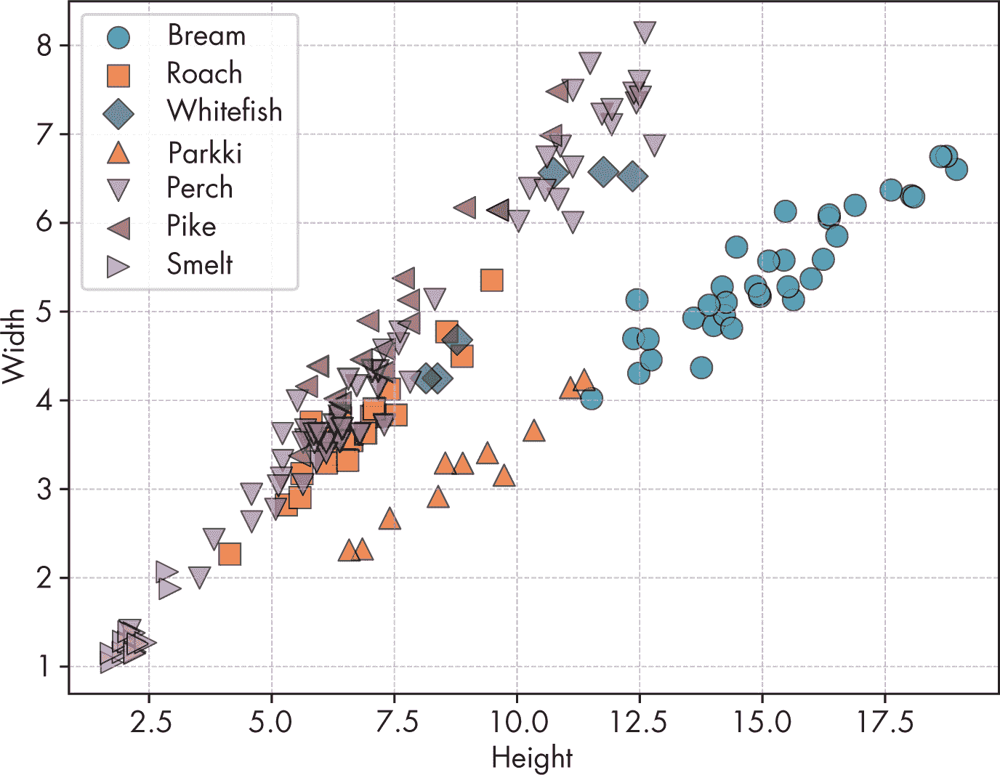

图 7-2: 按物种分类并沿高度和宽度维度绘制的鱼

正如你所预期的那样，从高度和宽的角度来看，相似物种的鱼往往聚集在一起。这表明 `KNN` 可能是解决该问题的有效算法的一个指标。

让我们看看原始数据长什么样。这里是 `fish.csv` 前几行的示例：

```csv
Species,Weight,Length1,Length2,Length3,Height,Width
Bream,242,23.2,25.4,30,11.52,4.02
Bream,290,24,26.3,31.2,12.48,4.3056
Bream,340,23.9,26.5,31.1,12.3778,4.6961
Bream,363,26.3,29,33.5,12.73,4.4555
```

第一行是描述每列的表头。三个长度维度代表每条鱼从鼻子到各个不同身体部位的距离，单位是厘米，重量单位是克。关于高度和宽度的单位，来源存在一些歧义。然而，只要样本之间的单位是一致的，数据仍然有用，即使我们不知道它是厘米、某种百分比还是其他。

### Fish 类

为了实现我们的鱼类分类器，我们需要构建 `DataPoint` 的子类来表示鱼：


```python
### KNN/fish.py
from dataclasses import dataclass
from KNN.knn import DataPoint
from typing import Self

@dataclass
class Fish(DataPoint):
    kind: str
    weight: float
    length1: float
    length2: float
    length3: float
    height: float
    width: float

    @classmethod
    def from_string_data(cls, data: list[str]) -> Self:
        return cls(kind=data[0], weight=float(data[1]), length1=float(data[2]),
                   length2=float(data[3]), length3=float(data[4]),
                   height=float(data[5]), width=float(data[6]))

    def distance(self, other: Self) -> float:
        return ((self.length1 - other.length1) ** 2 +
                (self.length2 - other.length2) ** 2 +
                (self.length3 - other.length3) ** 2 +
                (self.height - other.height) ** 2 +
                (self.width - other.width) ** 2) ** 0.5
```

从技术上讲，为了满足 Python 类型提示中的协议规范，我们不需要显式地让 `Fish` 成为 `DataPoint` 的子类。通过满足 `DataPoint` 协议的所有要求，`Fish` 可以替代 `DataPoint` 而无需继承。尽管如此，我们仍将 `Fish` 为 `DataPoint` 的子类，因为这为读者提供了清晰度并有助于类型检查。CSV 的每一行都由数据提供。

```python
from dataclasses import dataclass
from KNN.knn import DataPoint
from typing import Self
import numpy as np

@dataclass
class Digit(DataPoint):
    kind: str
    pixels: np.ndarray

    @classmethod
    def from_string_data(cls, data: list[str]) -> Self:
        return cls(kind=data[64],
                   pixels=np.array(data[:64], dtype=np.uint32))

    def distance(self, other: Self) -> float:
        tmp = self.pixels - other.pixels
        return np.sqrt(np.dot(tmp.T, tmp))
```

我们将像素数据存储为 `NumPy` 数组。这非常方便，因为在下一章中，我们将使用 `Pygame` 来处理我们自己手写的数字涂鸦，而 `Pygame` 可以直接与 `NumPy` 数组交互。由于 `distance()` 方法是在 `NumPy` 数组上进行计算，我们使用内置的 `NumPy` 函数来实现一种欧几里得距离。

## 单元测试

该数据集分为包含 3,823 个数字图像的训练集和包含 1,797 个数字图像的测试集。我们将训练集作为我们的 `KNN` 实现预测的基础的数据集，并测试测试集中有多少个数字可以被正确识别。让我们在 `test_knn.py` 中为此定义另一个测试用例，放在 `Fish` 测试用例之后，但在 `if __name__ == "__main__":` 行之前：

`tests/test_knn.py`

```python
class DigitsTestCase(unittest.TestCase):
    def setUp(self) -> None:
        self.data_file = (Path(__file__).resolve().parent.parent
                          / "KNN" / "datasets" / "digits" / "digits.csv")
        self.test_file = (Path(__file__).resolve().parent.parent
                          / "KNN" / "datasets" / "digits" / "digits_test.csv")

    def test_digits_test_set(self):
        k: int = 1
        digits_knn = KNN(Digit, self.data_file, has_header=False)
        test_data_points: list[Digit] = []
        with open(self.test_file, 'r') as f:
            reader = csv.reader(f)
            for row in reader:
                test_data_points.append(Digit.from_string_data(row))
        correct_classifications = 0
        for test_data_point in test_data_points:
            predicted_digit: str = digits_knn.classify(k, test_data_point)
            if predicted_digit == test_data_point.kind:
                correct_classifications += 1
        correct_percentage = (correct_classifications
                              / len(test_data_points) * 100)
        print(f"Correct Classifications: "
              f"{correct_classifications} of {len(test_data_points)} "
              f"or {correct_percentage}%")
        self.assertGreater(correct_percentage, 97.0)
```

此测试将训练数据集（`digits.csv`）加载到 `KNN` 类的实例中。然后它打开测试集（`digits_test.csv`）并将 CSV 数据转换为点列表 `test_data_points`。接着，它尝试逐个对每个数据点进行分类，并记录正确的次数。最后，它报告该百分比，如果准确率低于 97% 则失败。让我们运行所有测试来查看结果如何。结合鱼和 OCR 测试，这需要一些时间。在我的笔记本电脑上，分类这些 1,797 张数字图像大约需要 11 秒：

```
% python3 -m tests.test_knn
Correct Classifications: 1761 out of 1797 or 97.9966108364%
--------------------------------------
Ran 4 tests in 10.82s
```

从随附 OCR 的文档（见 `KNN/datasets/readme.txt` 底部），我们知道作者使用不同 `k` 值的 `KNN` 测试了数据集的准确性。他们发现当 `k` 设置为 1 时，准确率最高达到 98%。我们的分类器的测试输出与之匹配。这意味着它是有效的！

## 现实世界应用

`KNN` 在现实世界中广泛应用，涵盖了从光学识别到推荐系统，从文本分类到金融建模的方方面。它的简单性和广泛的适用性使其在机器学习中被通用教学。

然而，在实践中利用 `KNN` 时，必须克服本章已暗示的几个问题。第一个是找到正确的 `k` 值。这通常通过使用测试数据集进行交叉验证完成。使用过小的值可能导致`过拟合`，即模型过于接近某个特定的数据集。同时，过大的值可能导致`欠拟合`，即模型距离测试数据的引导太远。

下一个挑战是基础算法处理高维大型数据集时的性能影响。正如本章前面提到的，解决此问题的方法有两种：为存储数据集设计更好的数据结构，或者使用近似搜索。加速查找邻居速度最流行的结构之一是 `k-d tree`。然而，这是一个相当复杂的数据结构，只有在性能至关重要时才值得费脑筋。

选择正确的距离函数也至关重要。`Euclidean distance` 适用于许多应用，`Hamming distance` 适用于布尔维度，其他距离函数在文献中也有深入研究。距离函数取决于具体的应用；没有万能的。通常，你还需要对数据进行归一化以消除单位差异。我们在本章的鱼示例中没有进行归一化，而 OCR 示例的数据单位相同，因此不需要归一化。

虽然我们看到从零实现 `KNN` 有难度，但许多流行的机器学习库都提供了高度优化的内置 `KNN` 函数。例如，`scikit-learn` 的实现非常广泛。

## 练习

1. 寻找另一个感兴趣且我们的 `KNN` 实现可以准确分类的数据集。
2. 尝试改进 `Digit` 类的 `distance()` 方法来加速单元测试，同时保持 98% 的准确率。你可以自由放弃使用 `NumPy` 数组。你甚至可以放弃使用纯 `Euclidean distance`？
3. 使用 `scikit-learn` 库重新实现我们的分类器。将我们的分类器性能与 `scikit-learn` 构建的 `KNN` 分类器进行比较。

## Notes

1. Thomas Cover and Peter E. Hart, "Nearest Neighbor Pattern Classification," `IEEE Transactions on Information Theory` 13, no. 1 (January 1967): 21–27.
2. Shichao Zhang, "Challenges in KNN Classification," `IEEE Transactions on Knowledge and Data Engineering` 34, no. 10 (October 2022): 4663–4675, `https://doi.org/10.1109/tkde.2021.304925`.
3. Pekka Brofeldt, "Bidrag till kaennedom on fiskbestondet i vaara sjoear Laengelmaevesi," T.H.Jaervi: Finlands Fiskeriet Band 4, Meddelanden utgivna av fiskerifoeningen i Finland, Helsingfors, 1917.
4. "Protocols," typing Documentation, accessed May 8, 2024, `https://typing.readthedocs.io/en/latest/spec/protocol.html#explicitlydeclaring-implementation`.
5. Ethem Alpaydin and Cenk Kaynak, "Optical Recognition of Handwritten Digits," UCI Machine Learning Repository, accessed December 10, 2024, `https://doi.org/10.24432/C50P49`.
6. Stuart Russell and Peter Norvig, *Artificial Intelligence: A Modern Approach*, 4th ed. (Pearson, 2021), 688.
7. Russell and Norvig, *Artificial Intelligence*.

# 8 基于 K 邻的回归


在本章中，我们将扩展 `KNN` 实现以执行回归。对于我们的目的来说，*回归*简单来说意味着预测一个数值。通过对我们在第 7 章中的代码进行一些微小的调整，我们就可以使用相同的 `KNN` 类不仅进行分类，还可以对数据集中的任何数值属性值进行预测。

我们将回归应用到前一章的两个 `KNN` 示例中。首先，我们将重新审视鱼类数据集，并使用回归根据鱼的尺寸预测鱼的重量。然后，我们将编写一个程序，允许用户绘制数字的一部分，然后预测该图剩余部分可能是什么样子。

与本书中的其他章节不同，本章并不是独立的。它是建立在前章节基础之上的。在深入学习本章之前，请确保你已经学习了第 7 章。

## `KNN` 回归的工作原理

在 `KNN` 分类中，我们尝试预测数据点所属的类或类别，从有限的选项集合中选择合适的类。在 `KNN` 回归中，我们不是在预测一个类，而是尝试预测一个属性值。这些属性值通常是数值的，这意味着可能存在无限范围的值可以赋值。当然，如果属性值是我们想要预测的内容，那么该属性值缺失是合理的。

例如，假设我们是一家为患者分配房间的医院。我们可能想知道患者可能需要留院几天。我们可以查看具有相似诊断、症状和生命体征的患者的历史数据来做出预测。让我们通过两个维度上的散点图直观地观察这个例子（图 8-1）。

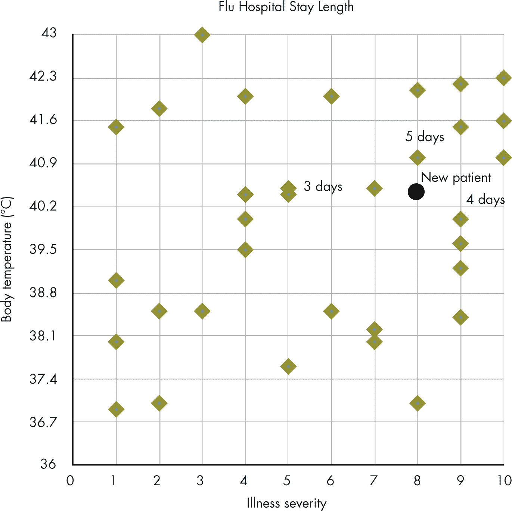

图 8-1：根据体温和疾病严重程度预测流感的住院时长

假设图 8-1 中的菱形代表因流感入住医院的过去患者。他们的疾病由医生根据 1 到 10 的严重程度标准进行评分，并在入院时记录了他们的体温。我们还有关于他们最终住院了多长时间的数据。

圆点代表一个刚入住的患者。我们有他们的严重程度评分和体温，我们想预测他们最终会在医院呆多久，以便将他们安排在合适的房间。如果我们使用带有欧几里得的 `KNN` 并将 `k` 设置为 3，那么我们将查看历史数据中在散点图上距离新患者点最近的三个患者。图中记录他们的住院时间分别为三、四和五天。使用这种方法估计新患者的住院时长可以简单地对三个最近的邻居取平均值。该平均值（无论是平均数还是中位数）为四，因此我们预测新患者将在医院呆四天。

更广泛地说，以下是使用 `KNN` 执行回归的步骤：

1. 选择 `k`，即与具有缺失属性的数据点进行比较的邻居数量。
2. 找到距离数据点的 `k` 个最近邻居。
3. 对 `k` 个最近邻居的对应属性值取平均值，以预测该数据点缺失的属性值应该是多少。

如你所见，使用 `KNN` 进行回归与使用 `KNN` 进行分类非常相似。它只是最后一步不同。我们对算法的疑问和解答在上一章中也是类似的：`k` 的取值是什么？如何计算距离？参见第 7 章的讨论。

## 使用 `KNN` 实现回归

为了执行回归，我们需要在 `KNN` 类中添加两个方法。像前一章的 `classify()` 一样，这些方法从寻找最近邻居开始。在这里，`predict()` 和 `predict_array()` 之间真正的区别在于，我们利用了 Python 的动态特性，允许调用者指定属性字符串，并使用 `getattr()` 获取该属性。

```python
### KNN/knn.py
### 预测邻居的标量属性。
### 找到属性的平均值并返回。
def predict(self, k: int, data_point: Any, property_name: str) -> float:
    neighbors = self.nearest(k, data_point)
    return sum([getattr(neighbor, property_name) for neighbor in neighbors]) / len(neighbors)

### 预测邻居的 NumPy 数组属性。
### 找到该属性的平均值并返回。
def predict_array(self, k: int, data_point: Any, property_name: str) -> np.ndarray:
    neighbors = self.nearest(k, data_point)
    return np.sum([getattr(neighbor, property_name) for neighbor in neighbors], axis=0) / len(neighbors)
```

`NumPy` 数组实际上也可以内置的 `sum()` 函数，因为它们实现了加法运算符，但 `NumPy` 的版本速度更快。就是这样。基本上只需要两行代码我们就可以进行预测。

## 预测鱼的重量

让我们 `FishTestCase` 中添加一个单元测试以确保我们的 `predict()` 方法正常工作。我们想回答这个问题："如果我们知道鱼的尺寸，我们能对它的可能重量做出合理的推测吗？"答案是肯定的：


### `tests/test_knn.py`

```python
def test_predict(self):
    k: int = 5
    fish_knn = KNN(Fish, self.data_file)
    test_fish: Fish = Fish("", 0.0, 20.0, 23.5, 24.0, 10.0, 4.0)
    predict_fish: float = fish_knn.predict(k, test_fish, "weight")
    self.assertEqual(predict_fish, 165.0)
```

在这个方法中，我们创建了一个没有指定重量的 `test_fish`（0.0），并根据其解剖尺寸（长度 1、长度 2、长度 3、宽度和高度）与其最近的五个鱼进行比较。（回顾前一章，我们在 `distance()` 方法中不按重量比较鱼。）然后我们通过对这五个最近邻居的重量取平均来预测它的重量。再次运行单元测试，你应该发现鱼的重量被正确预测。

### 预测手写数字的剩余部分

在上一章中，我们使用 `KNN` 成功地将一组同类型的 8×8 像素手写数字测试集中的图像与训练集进行对比并分类，准确率达到了 98%。在这个最后的 `KNN` 示例中，我们将对用户绘制的 8×8 数字进行分类，甚至可以预测图像其他部分像素可能的外观。我们不会将其实现为另一组单元测试，而是将使用 Pygame 创建一个有趣的交互式程序，允许用户在建有 8×8 网格的窗口中进行绘图。

以下是我们正在构建的内容预览。图 8-2 显示了绘图窗口，其中有一个我尝试画的扭曲的 7。我按下 `C` 键，程序正确地将其分类为 7（该结果显示在终端中，图中未画出）。


图 8-2：在数字识别程序中画 7

图 8-3 显示了按下 `P` 键后的窗口，这会根据九个最近邻像素的平均值，触发对数字其他部分像素可能外观的预测。


图 8-3：基于最近邻像素预测的数字像素

在我们简单的程序中，我们只能用白色绘图。预测结果产生了一个更好看的 7，因为可以使用更多层级的灰阶。我们通过一些导入和常量开始程序：

`KNN/__main__.py`

```python
from KNN.knn import KNN
from KNN.digit import Digit
from pathlib import Path
import sys
import pygame
import numpy as np

PIXEL_WIDTH = 8
PIXEL_HEIGHT = 8
P_TO_D = 16 / 255 # 像素到数字的缩放因子
D_TO_P = 255 / 16 # 数字到像素的缩放因子
K = 9
WHITE = (255, 255, 255)
```

`PIXEL_WIDTH` 和 `PIXEL_HEIGHT` 常数是单个图像的大小。`P_TO_D` 常量在我们处理的像素表示的 255 种灰阶和源数据集中的 16 种灰阶之间进行转换；`D_TO_P` 是它的反数。我们将 `KNN` 将考虑的邻居数量 `K` 设置为 9，而 `WHITE` 是 RGB 像素格式中白色的常量。

这是一个很短的程序。我们只有一个核心 `run()` 函数，它在处理用户界面上花费的时间与运行 `KNN` 的一样。以下是该函数的开头：

```python
def run():
    # 创建一个 2D 像素数组来表示数字
    digit_pixels = np.zeros((PIXEL_HEIGHT, PIXEL_WIDTH, 3),
                            dtype=np.uint32)
    # 加载训练数据
    digits_file = (Path(__file__).resolve().parent
                   / "datasets" / "digits" / "digits.csv")
    digits_knn = KNN(Digit, digits_file, has_header=False)
    # 初始化 Pygame，创建窗口
    pygame.init()
    screen = pygame.display.set_mode(size=(PIXEL_WIDTH, PIXEL_HEIGHT),
                                     flags=pygame.SCALED | pygame.RESIZABLE)
    pygame.display.set_caption("Digit Recognizer")
```

在最初几行中，我们创建了像素数组，加载了数据集并初始化了 Pygame。主窗口被初始化为一个“拉伸的” 8×8 窗口。

我们需要设置主循环：

```python
    while True:
        pygame.surfarray.blit(screen, digit_pixels)
        pygame.display.flip()

        for event in pygame.event.get():
            if event.type == pygame.KEYDOWN:
                key_name = pygame.key.name(event)
                if key_name == "c": # 分类数字
                    classified_digit = digits_knn.classify(K, pixels)
                    print(f"Classified as {classified_digit}")
                elif key_name == "e": # 擦除数字
                    digit_pixels.fill(0)
                elif key_name == "p": # 预测数字
                    predicted_pixels = np.stack((predicted_pixels, predicted_pixels, predicted_pixels), axis=2) * D_TO_P
                    pygame.surfarray.blit(screen, predicted_pixels)
```


在上一章中，我们使用 `KNN` 算法正确地将一组同类型的 8×8 像素手写数字测试集中的图像与同类训练集进行对比并分类，准确率达到了 98%。在这个最后的 `KNN` 示例中，我们将对用户绘制的 8×8 数字进行分类，甚至可以预测图像其他部分像素可能的样子。我们不会将其实现为另一组单元测试，而是将使用 Pygame 创建一个有趣的交互式程序，允许用户在建有 8×8 网格的窗口中进行绘图。

以下是我们正在构建的内容。图 8-2 显示了绘图窗口，其中有一个我尝试画的扭曲的 7。我按下 `C` 键，程序正确地将其分类为 7（该结果显示在终端中，图中未画出）。


图 8-2：在数字识别程序中画 7

图 8-3 显示了按下 `P` 键后的窗口，这会根据九个最近邻像素的平均值，触发对数字其他部分像素可能外观的预测。


图 8-3：基于最近邻像素预测的数字像素

在我们简单的程序中，我们只能用白色绘图。预测产生了一个更好看的 7，因为可以使用更多层级的灰阶。我们通过一些导入和常量开始程序：

`KNN/__main__.py`

```python
from KNN.knn import KNN
from KNN.digit import Digit
from pathlib import Path
import sys
import pygame
import numpy as np

PIXEL_WIDTH = 8
PIXEL_HEIGHT = 8
P_TO_D = 16 / 255 # 像素到数字的缩放因子
D_TO_P = 255 / 16 # 数字到像素的缩放因子
K = 9
WHITE = (255, 255, 255)
```

`PIXEL_WIDTH` 和 `PIXEL_HEIGHT` 常数是单个图像的大小。`P_TO_D` 常量在我们处理的像素表示的 255 种灰阶和源数据集中的 16 种灰阶之间进行转换；`D_TO_P` 是它的反数。我们将 `KNN` 将考虑的邻居数量 `K` 设置为 9，而 `WHITE` 是 RGB 像素格式中白色的常量。

这是一个很短的程序。我们只有一个核心 `run()` 函数，它在处理用户界面上花费的时间与运行 `KNN` 的一样。以下是该函数的开头：

```python
def run():
    # 创建一个 2D 像素数组来表示数字
    digit_pixels = np.zeros((PIXEL_HEIGHT, PIXEL_WIDTH, 3),
                            dtype=np.uint32)
    # 加载训练数据
    digits_file = (Path(__file__).resolve().parent
                   / "datasets" / "digits" / "digits.csv")
    digits_knn = KNN(Digit, digits_file, has_header=False)
    # 初始化 Pygame，创建窗口
    pygame.init()
    screen = pygame.display.set_mode(size=(PIXEL_WIDTH, PIXEL_HEIGHT),
                                     flags=pygame.SCALED | pygame.RESIZABLE)
    pygame.display.set_caption("Digit Recognizer")
```

在最初几行中，我们创建了像素数组，加载了数据集并初始化了 Pygame。主窗口被初始化为一个“拉伸的” 8×8 网格，我们需要设置主循环：

```python
    while True:
        pygame.surfarray.blit(screen, digit_pixels)
        pygame.display.flip()

        for event in pygame.event.get():
            if event.type == pygame.KEYDOWN:
                key_name = pygame.key.name(event)
                if key_name == "c": # 分类数字
                    classified_digit = digits_knn.classify(K, pixels)
                    print(f"Classified as {classified_digit}")
                elif key_name == "e": # 擦除数字
                    digit_pixels.fill(0)
                elif key_name == "p": # 预测数字
                    predicted_pixels = np.stack((predicted_pixels, predicted_pixels, predicted_pixels), axis=2) * D_TO_P
                    pygame.surfarray.blit(screen, predicted_pixels)
```

由于性能问题，当数据存在噪声或数据集的点数和维度过大时，`KNN` 的表现并不理想。然而，对于大多数应用，它是一个值得考虑的起点。

### 练习题

1. 通过在整个鱼类数据集上运行 `KNN`，并将 `KNN` 的结果与数据集中的已知重量进行比较，证明（或反驳）`KNN` 对鱼类重量预测是有效的。平均而言，`KNN` 预测的准确率如何？
2. 修改我们的数字识别程序，以使用更大的网格，例如用 `64×64` 代替 `8×8`。这将允许用户绘制更流畅的数字。你需要找到一种方法，将 `64×64` 的绘图精确缩小到 `8×8`，以便与训练数据集配合使用。
3. 使用我们实现的 `KNN` 回归或来自如 `scikit-learn` 等库的实现，尝试使用你自己感兴趣的数据集进行预测。

### 笔记

1. 请参见 `https://github.com/davecom/SwiftSimpleNeuralNetwork`。
2. Jianing Pei, Xin Lin, and Qixuan Chen，“Prediction of Patients’ Length of Stay at Hospital During COVID-19 Pandemic,” *Journal of Physics: Conference Series* 1802 (March 2021): `https://doi.org/10.1088/1742-6596/1802/3/032038`。
3. Sadegh Bafandeh Imandoust and Mohammad Bolandraftar, “Application of K-Nearest Neighbor (KNN) Approach for Predicting Economic Events: Theoretical Background,” *Journal of Engineering Research and Applications* 3, no. 5 (2013): 605–610, `https://www.ijera.com/papers/Vol3_issue5/DI35605610.pdf`。

# 后记


感谢阅读《零开始的计算机科学》（*Computer Science from Scratch*）。本后记根据书中的四个主题（解释器、计算艺术、模拟器和机器学习）为你提供了更多资源。我选择突出介绍一些我个人发现非常有用的但备受推崇的非学术资源——这里没有象牙塔。但在此之前，我想就我们所取得的成就与你分享一些想法。

## 我们做了什么以及接下来的计划

我编写 `Classic Computer Science Problems` 是为了对有趣的主题提供一个概述，并采用代码优先、类教程的方式进行。它涵盖了从搜索算法到图算法，甚至是一些人工智能的内容。它是本书的完美补充，而且两者之间没有内容重叠。虽然本书是由较大的项目组成的，但 `Classic Computer Science Problems` 更多关于算法本身以及适用于它们的特定问题。

日常生活中常用的数字通常是 `base 10`，即被称为 `decimal`。这意味着数字中的每个数字可以有 10 种不同的值（0–9），每个数字本身代表 10 的幂。例如，数字 427 实际上是 (4 × 10²) + (2 × 10¹) + (7 × 10⁰)。同样，二进制数中的每个数字可以有两个不同的值（0 或 1），每个数字本身代表 2 的幂。数字 427 的二进制表示为 110101011，它等于 (1 × 2⁸) + (1 × 2⁷) + (0 × 2⁶) + (1 × 2⁵) + (0 × 2⁴) + (1 × 2³) + (0 × 2²) + (1 × 2¹) + (1 × 2⁰)。1 代表“开启”的 2 的幂，0 代表“关闭”的 2 的幂。

为了测试你的理解程度，请尝试将几个数字从十进制转换为二进制，反之亦然。73 在二进制中是多少？11000 在十进制中是多少？再试几个你自己选的数字。你可以使用 Python 来检查结果，在 Python 中，二进制数使用 `0b` 前缀作为字面量表示，例如十进制数字 3 表示为 `0b11`：

```python
>>> value = 0b11
>>> value
3
```

同时，Python 的 `bin()` 函数接收一个整数并返回格式化为二进制等价值的字符串：

```python
>>> bin(3)
'0b11'
```

每个存储的二进制 1 或 0 在计算机科学中被称为 `bit`（位）。一个标准的 `byte`（字节）是 8 位。所有现代计算机都使用 8 位字节作为标准的存储单位。一个字节能容纳的最大值（当表示无符号整数时）是 255，因为八个 1（即二进制的 11111111）在十进制中是 255。这意味着一个字节可以存储 256 种不同的可能值（从 0 到 255 的所有值）。


当写出一个字节时，`least-significant bit`——即代表最小 2 的幂的位——通常写在最右边（bit 0，代表 2⁰）。`most-significant bit`——代表最大 2 的幂的位——通常写在最左边（bit 7，代表 2⁷）。例如，在 10000000 中，1 代表 2⁷ 被开启，因此该字节的十进制值为 128。这假设我们处理的是 `unsigned`（无符号）整数——即不能为负数的整数。符号位超出了本本二进制基础介绍的范围。

某些数据类型使用多个字节来表示。例如，在可能驱动你计算机的这类 64 位微处理器上，整数通常使用 64 位（8 字节）存储。64 位二进制数的最大值是：

```
1111111111111111111111111111111111111111111111111111111111111111
```

这转换成十进制是 18,446,744,073,709,551,615。在本书的几个项目中，我们需要在位级别对字节进行操作。

## 常见位运算

`Bitwise operations`（位运算）在单个数字层级上对值进行操作。这意味着处理 1 和 0。所有微处理器都包含执行位运算的指令，Python 也有相应的运算符来调用这些操作。`Truth tables`（真值表）根据不同的输入组合显示真/假结果，有助于使位运算更加实用和适用。

### 左移 (`<<`)

不要把二进制数据看作一个数字，而要将其看作 1 和 0 的集合。如果我们想把所有的 1 向左移动一个空格会怎样？左移会在最低位（bit 0 位置）留出一个空隙。左移在 Python 中用 `<<` 运算符表示。由于整数是任意长度的，1 不会被移出边界；例如，1010 向左移 1 位变成 10100，而不是 100。我们还可以左移超过一位，所以 1010 向左移 3 位变成 101000。表 A-1 显示了一些左移示例。

表 A-1：左移示例

| `A` | `A << 1` | `A << 3` |
| --- | --- | --- |
| 0 | 0 | 0 |
| 0 | 0 | 0 |
| 1 | 10 | 1000 |
| 1010 | 10100 | 101000 |

### 右移 (`>>`)

`right shift`（右移）与左移相似，不同之处在于 1 向右移动而不是向左。如果 1 移出了边界（超过了位 位置），它就“丢失”了。它不会回卷。例如，1001 向右移 1 位变成 100，而不是 110。我们还可以右移超过一位，所以 1001 向右移 3 位变成 1。Python 有用于执行右移的 `>>` 运算符。表 A-2 显示了一些右移示例。

表 A-2：右移示例

| `A` | `A >> 1` | `A >> 3` |
| --- | --- | --- |
| 0 | 0 | 0 |
| 0 | 0 | 0 |
| 1 | 0 | 0 |
| 1010 | 101 | 1 |

在表的第二行中，1 被移出了边界，没有剩余 1，所以结果是 0。

### 或运算 (`|`)

在两个值之间进行 `bitwise OR operation`（位或运算）时，如果任一个值为 1，结果为 1。如果两个值都不是 1，结果为 0。该操作在两个值的相同数字位的二进制位上进行，一次处理一位。想象数字对齐，一个接一个。然后逐列执行或运算，如下所示：

```
1010
0110
----
1110
```

尝试按照上一段的规则自己计算最后一行。这些规则也总结在表 A-3 中。

表 A-3：或运算示例

| `A` | `B` | `A \| B` |
| --- | --- | --- |
| 0 | 0 | 0 |
| 0 | 0 | 0 |
| 0 | 1 | 1 |
| 1 | 0 | 1 |
| 1 | 1 | 1 |
| 1010 | 0110 | 1110 |

Python 有用于执行位或的 `|` 运算符。在 Python 中对两个二进制数使用它的快速示例：

```python
>>> bin(0b1010 | 0b0110)
'0b1110'
```

位或运算在底层编程中的一个常见用途是结合移位运算符将两个值合并。例如，假设我们有一个 `nibble`（`nibble` 是 4 位）代表字节的一半，另一个 `nibble` 代表字节的另一半。我们想将它们合并产生一个完整的字节。也许 `nibble A` 是 1001，`nibble B` 是 0110，我们希望 `nibble A` 成为结果字节的前部分，`nibble B` 成为后部分。合并代码可能如下：

```python
>>> a = 0b1001
>>> b = 0b0110
>>> c = (a << 4) | b
>>> bin(c)
'0b10010110'
```

通过 `(a << 4) | b`，我们将 `a` 向左移动 4 位，然后将其值与 `b` 进行或运算。记住，当我们向左移动时，0 会从右侧填充，所以 `a` 向左移 4 位变成 10010000。然后，如果我们我们将 `a` 和 `b` 对齐并进行或运算，得到：

```
10010000
    0110
--------
10010110
```

如果你是第一次看到这些内容，它们可能看起来有点抽象。例如，你可能会好奇，为什么这些数字最初只存储在 4 位中。仅举几个原因中的其中一个，在本书的项目中，我们看到了几种场景，即我们希望通过将少于 8 位的值合并到同一个字节中来节省空间。例如，8 位微处理器通常有一个 1 字节的标志寄存器，其中每个单独位代表一个可以开启或关闭的不同标志。这比为每个标志使用单独的字节要经济得多。同样，某些文件格式会将少于 1 字节的值存储在同一个字节中，以节省磁盘空间。

### 与运算 AND (`&`)

`bitwise AND`（位与运算）在两个操作数位均为 1 时返回 1；否则返回 0。这里有一个使用我们之前在位或运算（bitwise OR）时相同操作数的示例：

```
1010
0110
----
0010
```

只有与两个 1 对齐的位结果为 1。表 A-4 总结了位与运算的工作原理。

表 A-4：与运算示例

| `A` | `B` | `A & B` |
| --- | --- | --- |
| 0 | 0 | 0 |
| 0 | 1 | 0 |
| 1 | 0 | 0 |
| 1 | 1 | 1 |
| 1010 | 0110 | 0010 |

Python 使用 `&` 运算符来执行位与运算。这里有一个在两个二进制数上使用它的快速示例：

```python
>>> bin(0b1010 & 0b0110)
'0b10'
```

注意，输出省略了前导 0，因为表示结果数字（十进制为 2）不需要它们。换句话说，二进制的 `0010` 是十进制的 2，就像二进制的 `10` 是十进制的 2 一样。

位与运算在底层编程中的常见用途是确保最终结果只包含之前结果中的某些位。例如，假设我们只关心字节 `10011110` 中的右侧 4 位。我们可以将该字节与 `1111` 进行与运算，以确保最终结果中只有右侧 4 位。代码可能如下：

```python
>>> a = 0b10011110
>>> b = 0b1111
>>> c = a & b
>>> bin(c)
'0b1110'
```

让我们在对齐位的情况下来看此操作：

```
10011110
    1111
--------
    1110
```

在我们的模拟器项目中，当处理标志时，我们经常使用这种技术来处理单个位。我们只需要知道该标志标志以及它是 1 还是 0（真或假）。

### 异或运算 XOR (`^`)

`bitwise XOR`（位异或运算，“互斥或”）在操作数不同（一个 1 和一个 0）时返回 1；否则返回 0。这里有一个使用我们之前在位或和位与运算时相同操作数的示例：

```
1010
0110
----
1100
```

表 A-5 总结了异或运算的工作原理。

表 A-5：异或运算示例

| `A` | `B` | `A ^ B` |
| --- | --- | --- |
| 0 | 0 | 0 |
| 0 | 1 | 1 |
| 1 | 0 | 1 |
| 1 | 1 | 0 |
| 1010 | 0110 | 1100 |

Python 使用 `^` 运算符来执行位异或运算。这里有一个 Python 中在两个二进制数上使用它的快速示例：

```python
>>> bin(0b1010 ^ 0b0110)
'0b1100'
```

异或是一个异常强大的操作。它是被称为`一次性扇字`（one-time pad）的不可破解加密方案的基础。你还可以通过与 1 进行异或来翻转位：如果将 1 与 1 异或，它会变成 0；但如果将 0 与 1 异或，它会变成 1。任何与 1 异或的位都会变成其原来的相反值。这就是第 5 章中 CHIP-8 项目在屏幕上绘画原理。

### 取反 Complement (`~`)

`Complement`（取反）是所有位运算中最简单的：它将所有的 1 切换为 0，将所有的 0 切换为 1，如表 A-6 所示。

表 A-6：取反示例

| `A` | `~A` |
| --- | --- |
| 0 | 1 |
| 1 | 0 |
| 1010 | 0101 |
| 01010 | 10101 |

Python 使用 `~` 运算符来获取二进制取反。我们在书中没有经常使用取反，但在第 6 章 中 NES 模拟器的一个小地方除外。

# 索引

- `&` (与运算符), 242–243
- `~` (取反运算符), 244
- `<<` (左移运算符), 239–240
- `-` (减号), 79
- `|` (或运算符), 240–242
- `>>` (右移运算符), 240
- `:=` (海象运算符), 77
- `^` (异或运算符), 130, 243–244
- 抽象, 23
- 抽象语法树, 9, 32–33, 39, 42–48
- 抽象层, 17
- `ADC` 指令 (6502), 163
- 址模式 (6502), 153–154, 170
- 提前编译, 17
- 抖动, 67–72
- 算法, 105
- K-最近邻 (KNN), 207–218, 224
- 准确性, 218
- 机器学习, 206
- 性能, 211
- 优化, 89–95
- 绘画, 30
- 艾伦, 22–23, 201
- 丹尼斯, 42
- 与运算符 (`&`), 242–243
- 动画, 64
- APU (音频处理器), 143, 145
- 位运算, 11–12, 33, 66, 95–96, 146
- 智能
- `ASL` 指令 (6502), 163
- `AST` (抽象语法树), 9, 32–33, 39, 42–48
- 艾克斯, 67, 86
- 抖动, 67–72, 86
- 属性表, 180–183
- 音频 (NES), 143
- 背景 (NES), 177–189
- 巴库斯-诺尔范式 (BNF), 28–32
- 银行切换 (NES), 144, 148–149
- BASIC, 21–59
- 方言, 22–23
- 历史, 22–23
- 变量中的, 25
- `BCC` 指令 (6502), 163
- `BCS` 指令 (6502), 163
- `BEQ` 指令 (6502), 163
- 大端序, 81–82
- 二进制运算, 239–244
- 二进制复习, 237–239
- 二进制编码码 (BCD), 121
- `BIT` 指令 (6502), 163
- 位平面, 179–180
- 位, 179, 238
- 每个像素, 181
- 描述, 4
- 示例程序, 6–9
- 历史, 3–4
- 实现, 10–14
- 测试解释器, 15–16
- `BRK` 指令 (6502), 164
- Brofeldt, Pekka, 212
- 缓冲区溢出保护, 112
- 字节码, 17, 116, 139
- 字节, 238–239
- C
- C (编程语言), 6
- 卡带 (NES), 144, 148–152
- 终端与非终端中的字符, 29
- `CHIP-8`, 115–140
- 描述, 115–117
- 历史, 116–117
- 实现, 122–136
- 指令, 119–122
- 内存和寄存器, 117–119
- 在...上玩游戏, 137–138
- 测试虚拟机, 136–137
- `CHR RAM` (NES), 149, 177–178
- `CHR ROM` (NES), 149, 177–178
- 分类
- 数字, 215–217
- 鱼, 212–214
- 使用 KNN, 205–219
- `CLC` 指令 (6502), 164
- `CLD` 指令 (6502), 164
- `CLI` 指令 (6502), 165
- `CLR` (公共语言运行时), 139–140
- `CLV` 指令 (6502), 165
- `CMP` 指令 (6502), 165
- 碰撞检测 (NES), 191
- 颜色抖动算法, 63–72
- 在 MacPaint 中, 180–182
- 在 NES 中, 183–184
- 在随机绘画算法中, 90–95
- 公共语言运行时 (CLR), 139–140
- 编译, 17, 57
- 编译器, 17
- 补反 (`~`) 运算符, 244
- 计算艺术, 63–112
- 创建抽象印象, 89–12
- `consume()`, 42
- COSMAC VIP, 117
- 计数器 (Python), 211
- `CPM` 指令 (6502), 165
- CPU (中央处理器) 在 NES 中, 143, 152–176
- `CPX` 指令 (6502), 165
- `CPY` 指令 (6502), 165
- 交叉, 218
- CRT 电视, 147, 185
- CSV 文件, 210, 212–13, 215
- D
- 数据分支, 80
- `DataPoint` 类, 209
- 数据点, 209–211
- `DEC` 指令 (6502), 165
- 声明 vs. 命令式语言, 23
- `DEFLATE` 算法, 86
- `DEX` 指令 (6502), 165
- `DEY` 指令 (6502), 165
- 数字艺术, 85
- `Digit` 类, 215–216
- 数字分类, 215–217
- 手写, 215–217, 224–228
- 回归, 224–228
- Dijkstra, Edsger, 27, 48
- 抖动, 63–87
- 算法, 67–72
- Atkinson 抖动, 67–72, 86
- 解释, 64–65
- Floyd-Steinberg 抖动, 67–69, 86
- `DMA` (直接内存访问), 156, 174
- 领域特定语言 (DSLs), 57
- 绘制
- 背景 (NES), 187–189
- 使用 CHIP-8, 128–130
- 使用 Pygame, 224–228
- 动态重编译, 132
- E
- `EOR` 指令 (6502), 165
- 误差扩散抖动, 67–69
- 错误处理
- 在 BASIC 解释器中, 40–41
- 在 CHIP-8 VM 中, 126
- 晦涩编程语言, 3, 10
- 欧几里得距离, 206, 209, 211, 218
- F
- Fayz, Marat, 149
- 斐波那契数列, 27–28, 35
- 文件格式, 149
- 在 Mac 中, 80–83
- 在 Paint 中, 72–87
- 有限状态机, 152
- `Fish` 类, 210
- 分类, 210–214
- 权重预测, 224
- `flags` 寄存器 (6502), 155
- 翻转 (NES), 190
- Floyd-Steinberg 抖动, 67–69, 86
- 字体 (CHIP-8), 126
- 帧 (OS), 80
- 帧 (NES), 185
- G
- 游戏
- 俄罗斯方块, 178–181
- Chase, 199
- Gates, Bill, 22–23
- Thwaite, 182
- `GOSUB` 指令 (BASIC), 24–26
- `GOTO` 指令 (BASIC), 24–27
- 语法
- 用于 BASIC, 28–32
- 上下文无关, 30
- 正式定义, 28–32
- g
- 图形
- 在 CHIP-8 上, 128–130
- 在 NES 上, 176–185
- 在旧图像处理中, 63–87
- 在随机绘画算法中, 89–112
- 灰度, 64–66, 215
- H
- 半色, 64
- 汉明距离, 209, 218
- `hblank` (NES), 147, 185
- `hill climbing`, 105–106
- `homebrew games`, 143
- I
- `IBM PC`, 23, 200
- `IF statement` (BASIC), 26
- `parsing in NanoBASIC`, 43–44
- `IfStatement` node, 36–37


## I

- `IF...THEN` statements, 26
- image processing, 63–87
- imperative vs. declarative languages, 23
- impressionism, 90
- `INC` instruction (6502), 165
- index register, 118
- iNES format, 149
- inheritance, 37–39
- `InterpreterError` class, 40–41
- interpreters, 3–59
  - Brainfuck, 3–19
  - components of, 9, 32–33
  - implementing, 10–14
  - NanoBASIC, 21–59
  - overview of, 17–18
  - parser, 9, 41–48
  - structure of, 9
  - runtime, 9, 49–53
  - tokenizer, 9, 33–36
- `INX` instruction (6502), 166
- `INY` instruction (6502), 166

## J

- Java, 17, 18, 116, 17, 139
- JIT (just-in-time) compilation, 17, 140
- `JMP` instruction (6502), 166
- `Joypad` class, 154, 173
- `JSR` instruction (6502), 166
- jump tables, 131–132, 157
- just-in-time (JIT) compilation, 17, 140

## K

- k-d tree, 218
- Kemeny, John, 22, 55
- k-means clustering, 235
- KNN nearest neighbors, 205–229
  - algorithm explanation, 207–209
  - classification with, 205–219
  - history of, 205
  - implementing, 209–212
  - regression with, 221–229
- Kopec, Danny, 55
- Kurtz, Thomas, 22, 55

## L

- `LDA` instruction (6502), 166
- `LDX` instruction (6502), 166
- `LDY` instruction (6502), 166
- left-shift (`<<`) operator, 239–240
- `LET` statement (BASIC), 25, 45
  - parsing in NanoBASIC, 45
- `LetStatement` node, 39
- libraries
  - Pillow, 66–67, 71–72, 82–84, 99–102
  - Pygame, 123–124, 126, 146–147, 216, 224–228
- line numbering (BASIC), 24
- lines (stochastic painting), 93–95
- `LineStatement` node, 39
- Lisp, 17
- little-endian order, 82
- LLMs (large language models), 206
- logic programming, 23
- Logo (programming language), 56
- `LSR` instruction (6502), 166

## M

- MacBinary, 80–83
- machine learning, 205–229
  - history of, 206
  - KNN algorithm, 207–218
  - regression with KNN, 221–229
- Macintosh, 63–65, 80–82, 201
- Mac OS, 80–82
- MacPaint, 63–87
  - file format, 72–87
  - run-length encoding, 73–79
- mappers (NES), 149, 201
- `match` statement, 12, 48, 132, 151
- `MemMode` enum, 153–154, 170–172
- memory access modes (6502), 153–154, 170–172
- memory in CHIP-8, 117–119
- memory-mapped registers, 143, 172–173
- memory page, 154
- microprocessor, 143, 152–153
- Microsoft, 22–23, 140, 201
- minus sign (`-`), 79
- mirroring (NES), 172–174, 180–181
- MOS 6502, 200
- Müller, Urban, 3–4, 6, 10

## N

- nametables (NES), 180–181
- NanoBASIC, 21–59
  - description of, 22–24
  - examples, 27–28
  - formal grammar, 28–32
  - implementation of, 32–53
  - parser, 41–48
  - running a program, 53
  - style and syntax, 24–27
  - testing, 53–57
  - tokenizer, 33–36
- `nearest()` method, 211
- NES (Nintendo Entertainment System), 141–201
  - background drawing, 187–189
  - cartridges, 148–152
  - colors, 183–184
  - CPU emulation, 152–176
  - description of, 142–144
  - emulator structure, 145
  - frames and timing, 185
  - hardware, 143–144
  - history of, 142–143
  - instruction execution, 130–136
  - main loop, 145–148
  - memory access, 170–175
  - PPU emulation, 176–195
  - software, 144–145
  - sprite drawing, 189–191
  - testing the emulator, 194–197
- NesDev, 142–143, 183, 234–235
- NumPy, 123, 146, 189, 216, 223–224
- Nystrom, Robert, 234

## O

- 面向对象编程， 23
- OCR (光学字符识别)， 215
- 一次口密码， 244
- 操作码
  - CHIP-8, 119–122
  - 6502, 152–169
- OR (`|`) 运算符， 240–242
- `ORA` 指令 (6502), 166
- 过拟合， 218

## P

- PackBits 算法， 75–77
- 调色板， 180–184
- Panic Playdate, 64, 86
- `ParserError` 类， 40–41
- 解析器， 9, 41–48
  - 递归下降， 41–48
- 模式表， 178–180
- `PHA` 指令 (6502), 167
- `PHP` 指令 (6502), 167
- 图像处理单元。参见 PPU
- Pillow 库， 66–67, 71–72, 82–84, 99–102
- 像素
  - 在 CHIP-8 中， 128–130
  - 在抖抖中， 63–87
  - 在 NES 中， 176–195
  - 在随机绘画中， 89–112
- `PLA` 指令 (6502), 167
- `play_sound` 属性， 125
- `PLP` 指令 (6502), 167
- PPU (图像处理单元)， 143, 145, 176–195
  - 访问内存， 193–194
  - 访问寄存器， 191–193
  - 描述， 176–185
  - 绘制背景， 187–189
  - 绘制精灵图， 189–191
  - 实现， 185–194
- PRG RAM (NES), 148–149, 151
- PRG ROM (NES), 148–149, 151
- `PRINT` 语句， 25–26
  - 在 NanoBASIC 中解析， 44
- `PrintStatement` 节点， 39
- 产生规则， 28–32
- 程序计数器， 118
- 编程语言
  - BASIC, 21–59
  - Brainfuck, 3–19
  - C, 6
  - 创建自己的， 234
  - Logo, 56
  - NanoBASIC, 21–59
  - 范式， 23–24
  - 图灵完， 4–5
- `putpixel()` (Pillow), 71
- Pygame, 123–124, 126, 146–147, 216, 224–228
- Python
  - `Counter`, 211
  - `match` 语句， 12, 48, 132, 151
  - 性能， 199–200
  - 协议， 209–210
  - `struct` 模块， 150
  - 类型提示， 12, 35
  - 海象表达式运算符， 77

## Q

- QR 码， 238

## R

- RAM
  - 在 CHIP-8 中， 117–119
  - 在 NES 中， 143, 148–149, 151
- RAM 大小， 143, 151
- `random()` 函数， 103
- 递归， 52
- 递归下降解析， 41–48
- 寄存器
  - 在 CHIP-8 中， 117–119
  - 在 6502 中， 155–156
- 回归
  - 数字回归， 224–228
  - 使用 KNN, 221–229
  - 预测鱼重量， 224
- 分辨率
  - CHIP-8 游戏， 128
  - MacPaint, 72
  - NES, 180
- 资源分支， 80
- 复古计算， 63–87
- 复古抖抖， 85
- `RETURN` 语句， 26
- `ReturnStatement` 节点， 39
- `RETURN_T` 标记， 45
- 右移运算符 (`>>`), 240
- 长度编码， 73–79
- `ROL` 指令 (6502), 167
- ROM 文件， 122, 144–145, 149–151
- `ROR` 指令 (6502), 167
- `RTI` 指令 (6502), 167
- `RTS` 指令 (6502), 167
- 长度编码， 73–79

## S

- `SBC` 指令 (6502), 168
- `SED` 指令 (6502), 168
- `SEC` 指令 (6502), 168
- `SEI` 指令 (6502), 168
- `set()` (Pillow), 71
- 调度场调度算法， 48
- 扫描线， 147
- 滚动， 147–151
- 速度， 199–200
- 随机优化， 111
- 随机绘画， 89–112
  - 算法解释， 98–99
  - 实现， 99–107
  - 结果， 107–110
- 字符串，转义， 58
- `struct` 模块， 150
- `STX` 指令 (6502), 168
- `STY` 指令 (6502), 168
- SVG (可缩矢量图形)， 97–98
- `switch` 语句， 131
- System 1 (Mac OS), 84

## T

- `take_same()` 函数， 76–77
- `TAX` 指令 (6502), 168
- `TAY` 指令 (6502), 169
- 终端， 29
- 测试
  - Brainfuck 解释器， 15–16
  - CHIP-8 虚拟机， 136–137
  - 抖动， 78–79
  - NanoBASIC 解释器， 53–57
  - NES 模拟器， 194–197
  - 基于 KNN 的 OCR, 216–217
  - 文本处理， 229
- Thwaite (游戏)， 182
- 瓦片， 178–180
- 定时器
  - 在 CHIP-8 中， 118, 125
  - 在 NES 中， 185
- 分词器， 9, 33–36
- Torvalds, Linus (林纳斯·托瓦兹)， 22
- 译编译器， 18
- `TSX` 指令 (6502), 169
- `TXA` 指令 (6502), 169
- `TXS` 指令 (6502), 169
- `TYA` 指令 (6502), 169
- 类型提示提示， 12, 35

## U

- 欠拟合， 218
- 单元测试， 15–16, 78–79, 194–197, 213–217, 224
- `unpack()` 函数， 150

## V

- BASIC 中的变量， 25
- 变量表， 49–51
- vblank (NES), 147, 185
- 矢量图形， 94, 97–98
- 虚拟机， 115–140
  - CHIP-8, 115–140
  - 模拟器，对比， 116
  - 历史， 116–117
  - Java, 116
  - 运行时环境， 139–140

## W

- 海象运算符 (`:=`), 77
- Weisbecker, Joseph (约瑟夫·魏斯贝克)， 116
- `write_memory()` 方法， 174–175

## X

- XML, 97
- XOR (`^`) 运算符， 130, 243–244
