# 计算机安全基础，第四版

## 2. 关于本电子书

## 5. 致谢

## 8. 作者简介

## 9. 技术审查员简介

## 10. 奉献

## 11. 致谢

## 12. 我们想听取您的意见！

## 14. 引言

### 1. 引言
### 2. 网络安全威胁有多严重？
### 3. 识别威胁类型
### 4. 评估网络攻击的可能性
### 5. 基本安全术语
### 6. 概念与方法
### 7. 法律问题如何影响网络安全？
### 8. 在线安全资源
### 9. 总结
### 10. 检验您的技能

## 2. 网络基础

## 3. 互联网的工作原理

## 4. 互联网的历史

## 5. 基本网络实用工具

## 6. 其他网络设备

## 7. 高级网络通信主题

## 2. 互联网欺诈的运作方式

## 3. 身份盗窃

## 4. 网络跟踪

## 5. 保护自己免受网络犯罪侵害

## 3. 网络武器

## 4. 经济攻击

## 5. 军事行动攻击

## 6. 一般攻击

## 7. 监控控制与数据采集 (SCADA)

## 8. 信息战

## 9. 实际案例

## 10. 未来趋势

## 11. 防御网络恐怖主义

## 12. 恐怖主义招募与通信

## 13. TOR 和暗网

## 14. 总结

## 15. 技能测试

## 27. 第 13 章. 网络侦探

### 1. 介绍
### 2. 一般搜索
### 3. 法院记录和犯罪背景调查
### 4. Usenet
### 5. 总结
### 6. 技能测试

## 28. 第 14 章. 取证入门

### 1. 介绍
### 2. 一般指南
### 3. 在电脑上查找证据
### 4. 在系统日志中查找证据
### 5. 恢复已删除文件
### 6. 操作系统实用工具
### 7. Windows 注册表
### 8. 移动取证: 手机概念
### 9. 取证认证的必要性
### 10. 专家证人
### 11. 其他类型的取证
### 12. 总结
### 13. 技能测试

## 29. 第 15 章. 网络安全工程

### 1. 介绍
### 2. 定义网络安全工程
### 3. SecML
### 4. 总结
### 5. 技能测试

## 30. 词汇表

## 31. 附录 A. 资源

### 1. 一般计算机犯罪和网络恐怖主义
### 2. 一般知识
### 3. 网络跟踪
### 4. 身份盗用
### 5. 端口扫描仪和窃听器
### 6. 密码破解工具
### 7. 对策
### 8. 网络调查工具
### 9. 一般工具
### 10. 病毒研究

## 32. 附录 B. 多项选择题答案

### 1. 第 1 章
### 2. 第 2 章
### 3. 第 3 章
### 4. 第 4 章
### 5. 第 5 章
### 6. 第 6 章
### 7. 第 7 章
### 8. 第 8 章
### 9. 第 9 章
### 10. 第 10 章
### 11. 第 11 章
### 12. 第 12 章
### 13. 第 13 章
### 14. 第 14 章
### 15. 第 15 章

## 33. 索引

## 34. 代码片段

1. i
2. ii
3. iii
4. iv
5. v
6. vi
7. vii
8. viii
9. ix
10. x
11. xi
12. xii
13. xiii
14. xiv
15. xv
16. xvi
17. xvii
18. xviii
19. xix
20. xx
21. xxi
22. xxii
23. xxiii
24. xxiv
25. xxv
26. xxvi
27. 2
28. 3
29. 4
30. 5
31. 6
32. 7
33. 8
34. 9
35. 10
36. 11
37. 12
38. 13
39. 14
40. 15
41. 16
42. 17
43. 18
44. 19
45. 20
46. 21
47. 22
48. 23
49. 24
50. 25
51. 26
52. 27
53. 28
54. 29
55. 30
56. 31
57. 32
58. 33
59. 34
60. 35
61. 36
62. 37
63. 38
64. 39
65. 40
66. 41
67. 42
68. 43
69. 44
70. 45
71. 46
72. 47
73. 48
74. 49
75. 50
76. 51
77. 52
78. 53
79. 54
80. 55
81. 56
82. 57
83. 58
84. 59
85. 60
86. 61
87. 62
88. 63
89. 64
90. 65
91. 66
92. 67
93. 68
94. 69
95. 70
96. 71
97. 72
98. 73
99. 74
100. 75
101. 76
102. 77
103. 78
104. 79
105. 80
106. 81
107. 82
108. 83
109. 84
110. 85
111. 86
112. 87
113. 88
114. 89
115. 90
116. 91
117. 92
118. 93
119. 94
120. 95
121. 96
122. 97
291. 266
292. 267
293. 268
294. 269
295. 270
296. 271
297. 272
298. 273
299. 274
300. 275
301. 276
302. 277
303. 278
304. 279
305. 280
306. 281
307. 282
308. 283
309. 284
310. 285
311. 286
312. 287
313. 288
314. 289
315. 290
316. 291
317. 292
318. 293
319. 294
320. 295
321. 296
322. 297
323. 298
324. 299
325. 300
326. 301
327. 302
328. 303
329. 304
330. 305
331. 306
332. 307
333. 308
334. 309
335. 310
336. 311
337. 312
338. 313
339. 314
340. 315
341. 316
342. 317
343. 318
344. 319
345. 320
346. 321
347. 322
348. 323
349. 324
350. 325

## 351. 326
## 352. 327
## 353. 328
## 354. 329
## 355. 330
## 356. 331
## 357. 332
## 358. 333
## 359. 334
## 360. 335
## 362. 336
## 362. 337
## 363. 338
## 364. 339
## 365. 340
## 366. 341
## 367. 342
## 368. 343
## 369. 344
## 370. 345
## 371. 346
## 372. 347
## 373. 348
## 374. 349
## 375. 350
## 376. 351
## 377. 352
## 379. 353
## 380. 354
## 380. 355
## 381. 356
## 382. 357
## 383. 358
## 384. 359
## 385. 360
## 386. 361
## 387. 362
## 388. 363
## 389. 364

- 326
- 327
- 328
- 329. [365
## 392. 367
## 393. 368
## 394. 369
## 395. 370
## 396. 371
- 372
## 399. 374
## 400. 375
## 401. 376
## 403. 378
## 405. 379
## 406. 381
## 407. 382
## 408. 383
## 409. 384
## 410. 385
## 411. 386
## 412. 387
## 413. 388
## 414. 389
## 415. 390
## 416. 391
## 417. 392
## 418. 393
## 419. 394
## 420. 395
## 421. 396
## 422. 397
## 423. 398
## 424. 399
## 425. 400
## 426. 401
## 428. 403
## 429. 404
## 430. 405
## 431. 406
## 432. 407
## 433. 408
## 434. 409
## 435. 410
## 436. 411
## 438. 412
## 438. 413
## 439. 414
## 440. 415
## 441. 416
## 442. 417
## 443. 418
## 444. 419
## 445. 420
## 446. 421
## 447. 422
## 448. 423
## 449. 424
## 450. 425
## 451. 426
## 452. 427
## 453. 428
## 454. 429
## 455. 430
## 456. 431
## 458. 432
## 459. 433
## 459. 434
## 460. 435
## 461. 436
## 462. 437
## 463. 438
## 464. 439
## 465. 440
## 466. 441
## 467. 442
## 468. 443
## 469. 444
## 470. 445
## 471. 446
## 472. 447
## 473. 448
## 474. 449
## 475. 450
## 476. 451
## 477. 452
## 478. 453
## 479. 454
## 480. 455
## 481. 456
## 482. 457
## 483. 458
## 484. 459
## 485. 460
## 486. 461
## 487. 462
## 488. 463
## 489. 464
## 490. 465
## 491. 466
## 492. 467
## 493. 468
## 494. 469
## 495. 470
## 496. 471
## 497. 472
## 498. 473
## 499. 474
## 500. 475
## 501. 476
## 502. 477
## 503. 478
## 504. 479
## 505. 480
## 506. 481
## 507. 482
## 508. 483
## 509. 484
## 510. 485
## 511. 486

## About This eBook

`ePUB` is an open, industry-standard format for eBooks. However, support of `ePUB` and its many features varies across reading devices and applications. Use your device or app settings to customize the presentation to your liking. Settings that you can customize often include font, font size, single or double column, landscape or portrait mode, and figures that you can click or tap to enlarge. For additional information about the settings and features on your reading device or app, visit the device manufacturer’s Web site.

Many titles include programming code or configuration examples. To optimize the presentation of these elements, view the eBook in single-column, landscape mode and adjust the font size to the smallest setting. In addition to presenting code and configurations in the reflowable text format, we have included images of the code that mimic the presentation found in the print book; therefore, where the reflowable format may compromise the presentation of the code listing, you will see a “Click here to view code image” link. Click the link to view the print-fidelity code image. To return to the previous page viewed, click the Back button on your device or app.

## Fourth Edition

## Dr. Chuck Easttom


## Computer Security Fundamentals, Fourth Edition

Copyright © 2020 by Pearson Education, Inc.

All rights reserved. No part of this book shall be reproduced, stored in a retrieval system, or transmitted by any means, electronic, mechanical, photocopying, recording, or otherwise, without written permission from the publisher. No patent liability is assumed with respect to the use of the information contained herein. Although every precaution has been taken in the preparation of this book, the publisher and author assume no responsibility for errors or omissions. Nor is any liability assumed for damages resulting from the use of the information contained herein.

## ISBN-13: 978-0-13-577477-9

## ISBN-10: 0-13-577477-2

## Library of Congress control number: 2019908181

**ScoutAutomatedPrintCode**

## Trademarks

所有在本书中提及且已知为商标或服务标志的术语均已适当大写。Pearson 不能保证这些信息的准确性。本书中使用的术语不应被视为影响任何商标或服务标志的有效性。

Microsoft` Windows` 和 Microsoft Office` 是 Microsoft Corporation 在美国及其他国家注册的商标。本书未经 Microsoft Corporation 赞助、背书或关联。

Warning and Disclaimer

本着尽最大努力使本书尽可能完整、准确，但未明示任何担保或适销性。所提供的信息仅供参考，按“原样”基础提供。作者和出版商不对因本书所含信息而导致的任何损失或损害承担责任。


Microsoft 和/或其各自供应商不对文档及相关图形的适用性作出任何声明。所有文档和相关图形均按原样提供，不附带任何种类的担保。Microsoft 和/或其各自供应商特此声明放弃所有关于此信息的担保和条件，包括但不限于对适销性、特定目的适用性、所有权及非侵权的任何明示、暗示或法定担保。在任何情况下，Microsoft 和/或其各自供应商均不对因使用或依赖本服务所提供的信息而产生的任何特殊、间接或后果性损失、数据或利润损失负责，无论是基于合同、疏忽或其他侵权行为引起或与之相关。

文档及相关图形可能包含技术不准确或排版错误。本信息会定期更新。Microsoft 和/或其各自供应商可随时对文档中描述的产品或程序进行改进和/或修改。部分截图可在指定软件版本的软件中查看完整内容。

Special Sales

如需了解批量购买此书的信息，或有关特殊销售机会（可能包括电子版、定制封面设计及针对您业务、培训目标、营销重点或品牌兴趣的内容），请联系我们的企业销售部门 corpsales@pearsoned.com 或致电 (800) 382-3419。

政府销售咨询，请联系 governmentsales@pearsoned.com。

美国以外销售问题，请联系 intlcs@pearson.com。

Editor-in-Chief

Mark Taub

Product Line Manager

Brett Bartow

Senior Editor

James Manly

Development Editor

Christopher Cleveland

Managing Editor

Sandra Schroeder

Project Editor

Mandie Frank

Indexer

Erika Millen

Proofreader

Abigail Manheim

Technical Editor

Akhil Behl

Publishing Coordinator

Cindy Teeters

Designer

Chuti Prasertsith

Compositor

codeMantra

## Credits

| Figure Number | Attribution/Credit Line |
| --- | --- |
| Figure 2-1 | Screenshot of Command prompt `©` Microsoft 2019 |
| Figure 2-2 | Screenshot of Command prompt `©` Microsoft 2019 |
| Figure 2-3 | Screenshot of Command prompt `©` Microsoft 2019 |
| Figure 2-4 | Screenshot of Command prompt `©` Microsoft 2019 |
| Figure 2-5 | Screenshot of Command prompt `©` Microsoft 2019 |
| Figure 2-6 | Screenshot of Command prompt `©` Microsoft 2019 |
| Figure 2-7 | Screenshot of Command prompt `©` Microsoft 2019 |
| Figure 2-8 | Screenshot of Command prompt `©` Microsoft 2019 |
| Figure 2-9 | Screenshot of Command prompt `©` Microsoft 2019 |
| Figure 3-1 | Screenshot of windows `©` Microsoft 2019 |
| Figure 3-2 | Screenshot of windows `©` Microsoft 2019 |
| Figure 3-3 | Screenshot of windows `©` Microsoft 2019 |
| Figure 3-4 | Screenshot of windows `©` Microsoft 2019 |
| Figure 3-5 | Screenshot of windows `©` Microsoft 2019 |
| Figure 4-1 | Screenshot of Command prompt `©` Microsoft 2019 |
| Figure 4-2 | Screenshot of LOIC `©` Praetox Technologies |
| Figure 4-3 | Screenshot of XOIC `©` Praetox Technologies |
| Figure 5-1 | Screenshot of Command prompt `©` Microsoft 2019 |
| Figure 5-2 | Screenshot of Counterexploitation `©` CEXX.ORG |
| Figure 5-3 | Screenshot of SpywareGuide `©` 2003-2011, Actiance, Inc. |
| Figure 5-4 | Screenshot of SpywareGuide `©` 2003-2011, Actiance, Inc. |
| Figure 5-5 | Screenshot of SpywareGuide `©` 2003-2011, Actiance, Inc. |
| Figure 5-6 | Screenshot of Norton Security `©` 1995 - 2019 Symantec Corporation |
| Figure 5-7 | Screenshot of McAfee AntiVirus `©` 2019 McAfee, LLC |
| Figure 5-8 | Screenshot of Avast `©` 1988-2019 Copyright Avast Software s.r.o |
| Figure 5-9 | Screenshot of AVG `©` 1988-2019 Copyright Avast Software s.r.o |
| Figure 5-10 | Screenshot of Malwarebytes `©` 2019 Malwarebytes |
| Figure 5-11 | Screenshot of Windows `©` Microsoft 2019 |
| Figure 6-1 | Screenshot of Netcraft `©` 1995-2019 Netcraft Ltd |
| Figure 6-2 | Screenshot of WayBackMachine BETA `©` Internet Archive |
| Figure 6-3 | Screenshot of Zenmap `©` NMAP.ORG |
| Figure 6-4 | Screenshot of Cain `©` Cain and Abel |
| Figure 6-5 | Screenshot of Shodan `©` 2013-2019 Shodan |
| Figure 6-6 | Screenshot of Shodan `©` 2013-2019 Shodan |
| Figure 6-8 | Screenshot of OphCrack `©` 2019 Slashdot Media |
| Figure 6-9 | Screenshot of TeraBIT Virus Maker `©` TeraBIT Virus Maker |
| Figure 6-11 | Screenshot of Yahoo `©` 2019 Verizon Media |
| Figure 6-12 | Screenshot of Peoples Drug Store `©` 2019 Digital Pharmacist Inc. |
| Figure 7-2 | New Africa/Shutterstock |
| Figure 7-4 | Reed Kaestner/Getty Images |
| Figure 7-5 | Screenshot of VeraCrypt `©` IDRIX |
| Figure 7-6 | Screenshot of windows `©` Microsoft 2019 |
| Figure 8-2 | Chuck Easttom |
| Figure 9-1 | Screenshot of Windows 10 Firewall `©` Microsoft 2019 |
| Figure 9-2 | Screenshot of Snort Installation `©` 2019 Cisco |
| Figure 9-7 | Screenshot of Windows-style library `©` Microsoft 2019 |
| Figure 11-1 | Screenshot of Shutting Down a Service in Windows `©` Microsoft 2019 |
| Figure 11-2 | Screenshot of Disabled services `©` Microsoft 2019 |
| Figure 11-4 | Screenshot of Microsoft Baseline Security Analyzer `©` Microsoft 2019 |
| Figure 11-5 | Screenshot of Microsoft Baseline Security Analyzer `©` Microsoft 2019 |
| Figure 11-6 | Screenshot of Microsoft Baseline Security Analyzer `©` Microsoft 2019 |
| Figure 11-7 | 截图 of Nessus © 2019 Tenable |
| Figure 11-8 | 截图 of Nessus © 2019 Tenable |
| Figure 11-9 | 截图 of Nessus © 2019 Tenable |
| Figure 11-10 | 截图 of Nessus © 2019 Tenable |
| Figure 11-11 | 截图 of Nessus © 2019 Tenable |
| Figure 11-12 | 截图 of OWASP ZAP © OWASP |
| Figure 11-13 | 截图 of OWASP ZAP © OWASP |
| Figure 11-14 | 截图 of shodan © 2013-2019 Shodan® |
| Figure 11-15 | 截图 of shodan © 2013-2019 Shodan® |
| Figure 12-1 | Dan Grytsku/123RF |
| Figure 12-2 | 截图 of Sinn Féin © Sinn Féin |
| Figure 12-3 | 截图 of BBC News © 2019 BBC |
| Figure 12-4 | 截图 of Cyberterrorism Preparedness Act |
| Figure 12-5 | 截图 of Cyberterrorism Preparedness Act |
| Figure 12-6 | 截图 of Tech Law Journal |
| Figure 12-7 | 截图 of The Peoples drug store |
| Figure 12-8 | 截图 of ccPal Store |
| Figure 13-1 | 截图 of Yahoo © 2019 Verizon Media |
| Figure 13-2 | 截图 of Yahoo © 2019 Verizon Media |
| Figure 13-3 | 截图 of Yahoo © 2019 Verizon Media |
| Figure 13-4 | 截图 of Infobel © 1995 - 2019 Kapitol |
| Figure 13-6 | 截图 of Federal Bureau of Investigation |
| Figure 13-7 | 截图 of Texas Department of Public Safety © 2000- 2019 Texas Department of Public Safety. |
| Figure 13-8 | 截图 of Oklahoma |
| Figure 13-9 | 截图 of Google access ©2019 Google |
| Figure 14-1 | 截图 of FTK Imager © Copyright 2019 AccessData |
| Figure 14-2 | 截图 of FTK Imager © Copyright 2019 AccessData |
| Figure 14-3 | 截图 of FTK Imager © Copyright 2019 AccessData |
| Figure 14-4 | 截图 of FTK Imager © Copyright 2019 AccessData |
| Figure 14-5 | 截图 of FTK Imager © Copyright 2019 AccessData |
| Figure 14-6 | 截图 of OSForensics Copyright © 2019 PassMark® Software |
| Figure 14-7 | 截图 of OSForensics Copyright © 2019 PassMark® Software |
| Figure 14-8 | 截图 of DiskDigger Copyright © 2010-2019 Defiant Technologies, LLC |
| Figure 14-9 | 截图 of DiskDigger Copyright © 2010-2019 Defiant Technologies, LLC |
| Figure 14-10 | pio3/Shutterstock |
| Figure 14-11 | 截图 of OSForensics Copyright © 2019 PassMark® Software |
| Figure 14-12 | 截图 of Command Prompt © Microsoft 2019 |
| Figure 14-13 | 截图 of Command Prompt © Microsoft 2019 |
| Figure 14-14 | 截图 of Command Prompt © Microsoft 2019 |
| Figure 14-15 | 截图 of Command Prompt © Microsoft 2019 |
| Figure 14-16 | 截图 of Windows registry © Microsoft 2019 |
| Figure 14-17 | 截图 of Windows registry © Microsoft 2019 |
| Figure 15-10 | 截图 of Microsoft Excel © Microsoft 2019 |
| Cover | gintas77/Shutterstock |

# 第 4 章：拒绝服务攻击

## 介绍

## DoS 攻击

## 展示攻击

## 分布式反射拒绝服务攻击

## 用于 DoS 攻击的常见工具

## 低轨道炮 (Low Orbit Ion Cannon)

## XOIC

## TFN 及 TFN2K

## Stacheldraht

## DoS 弱点

## 特定 DoS 攻击

## TCP SYN 洪水攻击

## Smurf IP 攻击

## UDP 洪水攻击

## ICMP 洪水攻击

## 死亡之 Ping

## 碎片攻击 (Teardrop Attacks)

## DHCP 耗尽

## HTTP POST DoS 攻击

## PDoS 攻击

## 注册 DoS 攻击

## 登录 DoS 攻击

## Land 攻击

## DDoS 攻击

## DoS 攻击的真实案例

## 《波士顿全球报》攻击

## Memcache 攻击

## MyDoom

## DDoS 黑 mail

## Mirai

## 防范 DoS 攻击的方法

## 总结

## 自我测试

# 第 5 章：恶意软件

## 介绍

## 病毒

## 病毒传播方式

## 病毒类型

## 病毒示例

## 病毒的影响

## 避免病毒的规则

## 特洛伊木马

## 缓冲区溢出攻击

## Sasser 病毒/缓冲区溢出

## 间谍软件

## 合法使用的间谍软件

## 间谍软件如何传送到目标系统？

## 获取间谍软件

## 其他恶意软件形式

## Rootkits

## 恶意网页代码

## 逻辑炸弹

## 垃圾邮件

## 高级持续性威胁 (APT)

## 检测和消除病毒与间谍软件

## 防病毒软件

## 修复步骤

## 总结

## 自我测试

# 第 6 章：黑客使用的技术

## 介绍

## 基本术语

## 侦察阶段

## 被动扫描技术

## 主动扫描技术

## 实际攻击

## SQL 脚本注入

## 跨站脚本 (XSS)

## 跨站请求伪造 (CSRF)

## 目录遍历

## Cookie 中毒

## URL 劫持

## 无线攻击

## 手机攻击

## 密码破解

## 恶意软件制作

## Windows 黑客技术

## 渗透测试

## NIST 800-115

## NSA 信息评估方法

## PCI 渗透测试标准

## 深网 (Dark Web)

## 总结

## 自我测试


## 第 7 章：网络间谍

### 介绍

### 什么是间谍？

### 信息作为资产

### 间谍的真实案例

#### 例子 1：休斯顿太空人

#### 例子 2：大学机密

#### 例子 3：核密码

#### 例子 4：Uber

#### 例子 5：外国政府与经济间谍

### 间谍趋势

### 间谍与你

### 间谍如何发生

#### 低技术间谍

#### 用于间谍的间谍软件

#### 用于间谍的隐写术

#### 电话窃听与窃听器

### 防范间谍

#### 间谍法案

#### 靶向钓鱼 (Spear Phishing)

### 总结

### 自我测试

## 第 8 章：加密

### 介绍

### 加密基础

### 加密历史

#### 凯撒密码

#### Atbash

#### 多字母替换

#### 铁丝网 (Rail Fence)

#### Enigma

#### 二进制操作

### 现代加密方法

#### 单密钥 (对称) 加密

#### 对称方法的修改

#### 公钥 (非对称) 加密

#### PGP

#### 合法与欺诈的加密方法

#### 数字签名

#### 哈希

##### MD5

##### SHA

##### RIPEMD

##### MAC 与 HMAC

##### 虹彩表 (Rainbow Tables)

### 隐写术

#### 历史隐写术

#### 隐写术方法与工具

### 加密分析

#### 频率分析

#### 现代加密分析方法

### 互联网上的加密

### 量子计算与加密

### 总结

### 自我测试

## 第 9 章：计算机安全技术

### 介绍

### 防病毒扫描工具

## 第十章：安全策略

### 介绍

### 什么是策略？

### ISO 17999

#### 定义用户策略

##### 密码

##### 互联网使用

##### 电子邮件使用

##### 安装/卸载软件

##### 即时通讯

##### 桌面配置

##### 自带设备

##### 用户策略的最终思考

#### 定义系统管理策略

##### 新员工

##### 离职员工

##### 变更请求

##### 安全漏洞

##### 病毒感染

##### 拒绝服务攻击

##### 黑客入侵

### 定义访问控制

### 开发策略

### 标准、指南和程序

### 数据分类

#### 国防清除级别

### 灾难恢复

#### 灾难恢复计划

#### 业务连续性计划

#### 影响分析

### 灾难恢复和业务连续性标准

### 容错

### 重要法律

#### 医疗保险可携性和责任法案 (HIPAA)

#### 萨班斯-奥克斯利法案

#### 支付卡行业数据安全标准

### 总结

### 测试你的技能

## 第十一章：网络扫描和漏洞扫描

### 介绍

### 评估系统的基础

#### 补丁

#### 端口

#### 保护

#### 政策

#### 探测

#### 物理

### 保护计算机系统

#### 保护个人工作站

#### 保护服务器

#### 保护网络

### 扫描你的网络

#### Microsoft Baseline Security Analyzer (MBSA)

#### NESSUS

#### OWASP Zap

#### Shodan

### 获得专业帮助

### 总结

### 测试你的技能

## 第十二章：网络恐怖主义和信息战

### 介绍

### 网络恐怖主义的实际案例

#### 中国雄鹰联盟

#### 中国高级持续性威胁

#### 印度和巴基斯坦

#### 俄罗斯黑客

### 网络战争武器

#### Stuxnet

#### Flame

#### StopGeorgia.ru 恶意软件

#### FinFisher

#### BlackEnergy

#### NSA ANT 目录

### 经济攻击

### 军事行动攻击

### 一般攻击

### 监控控制和数据采集 (SCADA)

### 信息战

#### 宣传

#### 信息控制

#### 误信息

### 实际案例

### 未来趋势

#### 积极趋势

#### 消极趋势

### 对网络恐怖主义的防御

#### 恐怖分子招募和通信

#### TOR 和暗网

### 总结

### 测试你的技能

## 第十三章：网络侦探

### 介绍

### 一般搜索

#### Facebook

#### 法院记录和刑事背景调查

#### 性犯罪者登记册

#### 民事法院记录

#### 其他资源

#### Usenet

### 总结

### 测试你的技能

## 第十四章：取证入门

### 介绍

### 一般指南

#### 别触碰可疑驱动器

#### 使用取证工具包映像化驱动器

#### 你能在活动系统上进行取证吗？

#### 记录链

#### 保护证据

#### 证据链管理

#### FBI 取证指南

#### 美国秘密服务取证指南

#### 欧盟取证收集

#### 数字取证科学工作组

#### 根据转移原则 (Locard's Principle)

### 工具

#### 在 PC 上查找证据

#### 在浏览器中查找证据

#### 在系统日志中查找证据

#### Windows 日志

#### Linux 日志

#### 找回已删除文件

#### 操作系统实用程序

##### `net sessions`

##### `openfiles`

##### `fc`

##### `netstat`

#### Windows 注册表

#### 特定条目

### 移动取证：手机概念

#### 手机概念模块

#### 移动网络

#### iOS

#### Android

#### Windows

#### 你应该寻找的内容

### 取证认证的需求

### 专家证人

#### 联邦规则 702

#### Daubert

### 其他类型的取证

#### 网络取证

#### 虚拟取证

### 摘要

### 测试你的技能

## 第 15 章：网络安全工程

### 介绍

### 定义网络安全工程

### 网络安全与系统工程

### 将工程应用于网络安全

### SecML

### SecML 概念

#### 恶意用例图

#### 安全序列图

#### 数据接口图

#### 安全块图

### 摘要

### 测试你的技能

## 术语表

## 附录 A：资源

## 附录 B：多项选择题答案

## 索引

## 作者简介

**Dr. Chuck Easttom** 是 26 本书的作者，其中包括若干本关于计算机安全、取证和密码学的书籍。他还撰写了关于数字取证、网络战、密码学和应用数学的科学论文。他是拥有 16 项计算机科学专利的发明家。他拥有网络安全博士学位（论文题目：后量子密码学中基于格的算法研究）以及三个硕士学位（一个是应用计算机科学，一个是教育，一个是系统工程）。他还持有 44 项行业认证（包括 CISSP、CEH 等）。他是 ACM 的杰出演讲者，也是 IEEE 和 ACM 的高级会员。Dr. Easttom 也是五本科学期刊的评审员，以及 *American Journal of Science and Engineering* 的总编辑。你可以在 [www.ChuckEasttom.com](http://www.ChuckEasttom.com) 了解更多关于 Dr. Easttom 和他的研究。

## 技术审查员简介

**Akhil Behl**，CCIE No. 19564，是一位热衷于 IT 的执行官，主要关注云计算和安全。他在 IT 行业拥有超过 16 年的经验，担任过多个领导、咨询、顾问和业务发展职位，在不同组织中工作。他的技术和业务专长包括云计算、安全、基础设施、数据中心和业务通信技术。

Akhil 是出版作者。在过去的几年里，他撰写了多本关于安全和业务通信技术的著作。他曾担任十余本关于安全、网络和信息技术的书籍的技术编辑。他还在包括 IEEE Xplore 在内的国内外期刊上发表了多篇研究论文，并曾在多个 IEEE 会议以及其他重要 ICT、安全和电信活动中作报告。写作和指导是他的热情所在，也是他生活的一部分。

他持有 CCIE（协作和安全）、CCSK、CHFI、PMP、ITIL、VCP、TOGAF、CEH、ISM、CCDP 以及其他许多行业认证。他拥有技术学士学位和工商管理硕士学位。

## 致谢

本书致力于我的妻子特蕾莎，她帮助我成为现在的自己。

## 致谢

本书的创作并非易事，需要许多人的才能和奉献才能完成。基于此，我想感谢珍珠出版社对本项目的承诺。编辑们在使本书取得成功方面发挥了关键作用。

## 我们想听到你的声音！

作为本书的读者，*你* 是我们最重要的批评者和评论员。我们重视你的意见，想了解我们做得好、可以改进的地方，以及你希望我们在未来出版的内容，以及你愿意分享的任何智慧。

我们欢迎你的评论。你可以通过电子邮件或写信告诉我们你对本书的看法——无论是喜欢还是不喜欢的地方，以及我们如何让我们的书更好。

*请注意，我们无法帮助你解决本书主题相关的技术问题。*

当你写信时，请务必包含本书的标题和作者，以及你的姓名和电子邮件地址。我们会仔细审阅你的评论，并与本书的作者和编辑分享。

电子邮件：feedback@community@informit.com

## 读者服务

在 [www.pearsonitcertification.com](http://www.pearsonitcertification.com) 注册你的 *Computer Security Fundamentals* 书籍，以便方便地获取下载、更新和修正内容。要开始注册流程，访问 [www.pearsonitcertification.com/register](http://www.pearsonitcertification.com/register) 并登录或创建账户。完成注册后，你将在“已注册产品”下找到任何可用的额外内容。

\* 请务必勾选表示希望收到我们关于未来产品独家折扣的通知。

## 介绍

距离这本书原版第一版出版已超过 14 年。自那时起，计算机安全领域发生了巨大的变化。本版更新了更新的信息、问题和内容。

关键问题是：这本书是给谁看的？本书是面向任何对计算机感兴趣的人的指南。这意味着那些不是安全专家但对计算机有基本了解的系统管理员，以及希望了解网络犯罪和恐怖主义的任何具备计算机基础知识的人都能从本书中受益。然而，核心受众是希望修读入门安全课程但可能没有扎实计算机网络背景的学生。本书采用教材形式，非常适合作为入门计算机安全课程，这些课程没有特定的先决条件。这种缺乏先决条件的特点使得计算机科学和信息系统专业以外的读者也可以利用本书开设相关课程。这可能特别吸引执法人员、刑事司法专业学生以及对计算机安全感兴趣的商科专业学生。

如前所述，本书是一本入门计算机安全书籍。除了大量的脚注，附录将引导你到大量额外资源。每章还有复习问题和练习题。Appendix B 提供多项选择题的答案供你复习。练习和项目旨在鼓励读者探索，因此答案会有所不同。

这本书假设你是一名熟练的电脑用户。这意味着你在工作和家庭中使用过电脑，熟悉电子邮件和网页浏览器，并知道像`RAM`和`USB`这样的术语的含义。对于考虑将本书作为教材的教师来说，学生应具备对个人电脑的基本了解，但不需要完成正式的计算机课程。基于此，本书包含一章关于基础网络概念的内容，以帮助这些学生快速上手。对于拥有更多知识的读者，例如系统管理员，会发现书中某些章节更有用。因此，你可以随意浏览任何你觉得过于基础的章节。

## 第 1 章. 计算机安全入门

### 章节目标

在阅读本章并完成练习后，你将能够：

*   识别网络面临的顶级威胁：安全漏洞、拒绝服务攻击和恶意软件

*   评估你网络遭受攻击的可能性

*   定义以下关键术语：`cracker`、`penetration tester`、`firewall` 和 `authentication`

*   比较和对比边界和分层网络安全方法

*   使用在线资源保护你的网络

### 引言

自本书第一版出版以来，在线交易的普及程度有了巨大增长。2004 年我们通过网站进行电子商务；2019 年，我们拥有智能手机应用、物联网、能够无线通信的医疗设备，以及电子商务网站的使用范围扩大。我们还拥有 Wi-Fi enabled 汽车和智能家居。互联网流量远不止是搞笑的 YouTube 视频或关于假期的 Facebook 更新。如今，它是国内外商业的核心，也是国际贸易的基石。互联网通信在军事行动和外交关系中也发挥着核心作用。除了智能手机，我们现在还有智能手表，甚至配备 Wi-Fi 热点和智能技术的车辆。我们的生活与在线世界紧密相连。我们在线报税、在线购买房屋、在线预订假期，甚至在线寻找伴侣。

由于大量业务在线进行，大量个人信息存储在计算机中。医疗记录、税务记录、学校记录等都存储在计算机数据库中。个人信息通常被称为 personally identifiable information (PII)，而与健康相关的数据则称为 personal health information (PHI)。这引发了一些重要问题：

*   信息如何被保护？

*   这些系统存在哪些漏洞？

*   采取了哪些措施确保这些系统和数据的安全？

*   谁可以访问我的信息？

**FYI: Where Is the Internet Going?**

显然，互联网已经扩展，正如前文所述。我们现在拥有智能手机、智能手表，甚至智能汽车。我们拥有物联网 (IoT)，即设备通过互联网进行通信。智能家居和医疗设备（包括可植入医疗设备）是当前的趋势。你觉得接下来的十年会带来什么？

不幸的是，与本书最初出版以来一样，技术和互联网接入的扩展也带来了新的危险。问题有多严重？根据 2018 年`Center for Strategic and International Studies`的一篇文章，网络犯罪每年造成的损失超过 6000 亿美元，且即将超过 1 万亿美元。网络犯罪已成为经济和战略问题，甚至影响国家安全。^(1)

1. [`www.csis.org/analysis/economic-impact-cybercrime`](https://www.csis.org/analysis/economic-impact-cybercrime)

*Forbes*杂志报道，在截至 2018 年 3 月的 12 个月内，发生了 2,216 次数据泄露和超过 53,000 起事件。^(2) 具体数字因研究而异，但核心观点一致：网络犯罪在增加。这部分原因是连接设备数量的增加。每个连接设备都是潜在的攻击目标。此外，互联网上网络犯罪工具和武器的获取变得容易。这些因素共同增加了网络犯罪的机会。

2. [`www.forbes.com/sites/gilpress/2018/12/03/60-cybersecurity-predictions-for-2019/#4b352a144352`](https://www.forbes.com/sites/gilpress/2018/12/03/60-cybersecurity-predictions-for-2019/#4b352a144352)

尽管每日新闻充斥惊悚故事，但许多人（包括一些执法人员和受过专业训练的计算机专业人员）对这些威胁的现实缺乏足够理解。显然，媒体会关注最戏剧性的计算机安全漏洞，未必能准确反映最可能的威胁场景。遇到知识有限的系统管理员并不罕见。

本章概述了当前的危险，描述了针对个人电脑和网络的最常见攻击类型，教会你如何理解黑客和安全专业人员的术语，并概述了保护你的电脑和网络所需的广泛措施。

在这本书中，你将学习如何保护单个计算机和整个网络。你还将了解如何保护数据传输，并完成一个练习，以了解你所在地区关于计算机安全的法律。也许本章最重要的讨论是常见攻击类型及其实施方式。本章通过阐述具体的危害并介绍网络安全专业人员和黑客使用的术语，为后续章节奠定了基础。这些主题将在后续章节中得到更深入的探讨。

### 如何看待网络安全威胁？

理解计算机和网络安全的第一步是对系统面临的威胁进行真实评估。你需要清晰的危害图景，以便有效制定防御措施。目前，关于电脑安全存在两种极端态度。第一类人认为没有真正的威胁。他们认为计算机系统面临的风险很小，大部分负面新闻只是不 warranted 的恐慌。他们通常认为只需采取最小的安全措施即可确保系统安全。主流观点是，如果我们的组织迄今未遭受攻击，我们就必须安全。如果决策者持这种观点，他们倾向于采取被动的安全态度。他们会等待直到发生事件才处理安全问题——即“关上马厩门，之后马已经跑掉了”。如果你运气好，事件的影响仅有轻微影响，并能起到及时警示的作用。如果运气不好，你的组织可能面临严重甚至灾难性的后果。本书的一个主要目标是鼓励采取主动的安全态度。

持相反观点的人往往高估威胁。他们倾向于认为数名高技能的黑客是对其系统的即时威胁。他们可能认为，任何带着笔记本电脑的青少年都能随意入侵高度安全的系统。这种世界观虽适合电影情节，但与现实完全不符。事实上，自称黑客的许多人比他们想象的更不了解相关知识。这些人成功入侵系统的可能性很低，尤其是当系统已实施适度的安全措施时。

-   当然，熟练的黑客当然是存在的。但是，他们必须在成本（财务、时间）和收益（意识形态、金钱）之间取得平衡。“良好”的黑客倾向于攻击能带来最高收益的系统。如果黑客不认为你的系统能帮助实现这些目标，他就不太可能花费资源去入侵你的系统。同时也要明白，真正的网络入侵需要时间和努力。黑客并不是电影里那种戏剧化的过程。我经常在黑客和渗透测试方面教学，学生们通常会惊讶地发现，这个过程实际上有点枯燥，需要耐心。

-   关于对计算机系统危害的态度有两种极端，都是不准确的。当然，确实存在一些人理解计算机系统并具备破坏安全的技能，能够 compromise 许多甚至大多数系统。但那些自称“黑客”的人中，并非都像他们声称的那样有技能。他们可能掌握了一些网络热词，并可能认为自己在数字世界很厉害，但实际上他们无法对即使是中等安全的系统造成任何真正的破坏。

-   真正的高技能黑客并不比真正的高技能钢琴演奏家更常见。想想看，有多少人曾经学过钢琴。再想想，这些人里有多少人真正成为了大师。黑客也是同样的道理。虽然有很多技能一般的黑客，但真正高超的黑客并不多。要记住，即使拥有所需技能的人，也需要有动力去投入时间和精力去攻击你的系统。

-   评估你系统受到的威胁水平的更好方法是衡量你的系统对潜在入侵者的吸引力与现有安全措施之间的比例。这正是威胁分析的核心。你需要审查你的风险、漏洞和威胁，以决定在网络安全方面应投入最多精力的位置。

-   同时也要记住，对任何系统最大的外部威胁并不是黑客，而是恶意软件（malware）和拒绝服务（DoS）攻击。恶意软件包括病毒、蠕虫、特洛伊木马和逻辑炸弹。此外，内部问题也可能导致系统出现故障，包括恶意行为或单纯的无知。


安全审计总是从风险评估开始，而这里正是我们所描述的内容。首先，你需要识别你的资产。显然，构成你网络的实际计算机、路由器、交换机和其他设备是资产。但更有可能的是，你最重要的资产在于网络上的信息。识别资产的第一步是评估网络所存储的信息及其价值。你的网络是否包含银行账户的个人信息？也许包含医疗信息或健康记录？在其他情况下，你的网络可能包含知识产权、商业机密，甚至机密的军事数据。

一旦你识别出了资产，就需要对针对这些资产的威胁进行清点。虽然任何威胁都可能发生，但有些威胁的可能性更高。这就像选择家庭保险一样。如果你住在洪水平原，那么洪水保险就至关重要。如果你住在高海拔的沙漠地区，那可能就不那么重要。我们对数据也做类似的判断。如果你为一家国防承包商工作，那么外国国家支持的黑客构成了重大威胁。但如果你是学校区的网络管理员，那么你最大的威胁可能是青少年试图入侵网络。始终要意识到你的网络面临的具体威胁。

在识别出资产并清点威胁之后，你需要找出系统中的漏洞。每个系统都有漏洞。识别你的网络特定的漏洞是风险评估的重要部分。

了解你的资产、威胁和漏洞，你才能决定为你的网络选择适当的安全措施。你始终会受到预算限制，因此需要在选择安全控制时做出明智的决策。运用良好的风险评估，你才能做出明智的安全决策。

**接受 (Acceptance)**：这意味着你认为风险的影响小于应对它的成本，或者概率极低，因此不采取任何行动。这不是最常见的做法，但在某些场景中是合适的。

**避免 (Avoidance)**：这意味着确保风险根本不会发生。例如，如果你担心通过 USB 将病毒引入你的网络，并且关闭了所有 USB 端口，你就已经避免了该风险。

**转移 (Transference)**：这涉及在风险实际发生时转移损失责任。这通常通过网络安全保险来实现。

**缓解 (Mitigation)**：这是最常见的方法，即采取措施降低事件发生的可能性或其影响。例如，如果你担心计算机病毒，可以通过安装防病毒软件以及制定关于附件和链接的策略来进行缓解。

[基本风险评估](https://example.org) 在花费资源应对威胁之前，必须进行此类基本的威胁评估。威胁实现的可能性有多大？如果实现，它会给你造成多大损害？例如，我个人的网站上没有任何安全措施。是的，有人可能会对它进行黑客攻击，但如果发生，影响将微乎其微。该网站上根本没有数据——没有数据库后端、没有文件、没有登录等。网站上唯一的信息是我自由提供给任何人且从未记录谁获取该信息的内容。因此，对于该网站，泄露的影响仅为微不足道，因而投入资源进行安全防护是不必要的。相反，大型电商网站则投入大量资源进行安全防护，因为一旦该网站遭到入侵，将立即导致巨额费用并长期损害组织声誉。

### 识别威胁类型

如前所述，识别威胁是风险评估的关键部分。一些威胁是所有网络都会面对的，另一些则更倾向于特定类型的网络。不同来源根据特定标准将威胁划分为不同类别。本节我们将探讨根据攻击本质进行分类的威胁。大多数攻击可归入以下七大类别之一：

*   `Malware`：这是一个泛指，指具有恶意目的的软件。它包括病毒、蠕虫、广告软件、特洛伊木马、间谍软件等。这是对系统最普遍的危险。之所以 `Malware` 这个相对宽泛的术语现在被广泛使用，是因为许多恶意软件并不恰当地归类到上述细分类别中。
*   `Security breaches`：这一组攻击包括任何试图未经授权访问系统的行为。包括破解密码、提升权限、入侵服务器等，这些都是你通常认为的“黑客”行为。
*   `DoS attacks`：这些攻击旨在阻止合法访问系统。正如后文所述，这也包括分布式拒绝服务（DDoS）攻击。
*   `Web attacks`：任何试图攻击你网站的行为都属于此类。其中最常见的两种攻击是 SQL 注入和跨站脚本（XSS）。
*   `Session hijacking`：这类攻击相对高级，攻击者试图接管用户会话。
*   `Insider threats`：这些是由拥有网络访问权限的人滥用其权限窃取数据或破坏安全的行为。
*   `DNS poisoning`：这种攻击企图 compromise DNS 服务器，使用户被重定向到恶意网站，包括钓鱼网站。

除上述攻击外，还有社会工程等其他攻击方式。前面的列表仅是对攻击类型的粗略分类。本节提供对每种攻击类型的概述。后续章节将更深入地介绍每种具体攻击的实现方式以及如何防范。

#### Malware

`Malware` 是具有恶意目的的软件的统称。本节讨论四种恶意软件：病毒、特洛伊木马、间谍软件和逻辑炸弹。病毒和特洛伊木马是最常见的。你也可以把根套（rootkits）归入恶意软件范畴，但它们通常作为病毒传播，因而被视为一种特定的病毒类型。

根据 Malwarebytes：

`Malware`，即“恶意软件”，是一个涵盖性术语，描述任何有害系统的恶意程序或代码。它具有敌意、侵入性和故意恶毒，旨在侵入、损坏或禁用计算机、系统、网络、平板和移动设备，往往通过部分控制设备的运作实现。正如人类流感会干扰正常运作一样，它也会干扰正常运作。”^(3)

3. [`www.malwarebytes.com/malware/`](https://www.malwarebytes.com/malware/)

我们仍然主要把电脑病毒联想到恶意软件。电脑病毒的关键特征是自我复制。电脑病毒类似于生物病毒，两者都设计用于复制和传播。病毒最常用的传播方式是利用受害者的电子邮件账户将病毒发送给其通讯录中的所有人。有些病毒本身并不直接损害系统，但 *几乎所有* 它们会因病毒复制产生的大量网络流量而导致网络变慢。

`Trojan horse`（特洛伊木马）得名于古代传说。特洛伊城围困期间，攻击者无法直接进入，于是构造了一个巨大的木马并假装在城门外放置。第二天，特洛伊居民看到木马并认为它是礼物，于是将其推入城内。未知他们，木马内部隐藏着几名士兵。那天晚上，士兵们离开木马，打开城门，让同伙攻击者进入城内。电子特洛伊木马的工作方式相似，表面看似无害的软件实则在背后下载病毒或其他恶意软件到受害者的计算机。

另一类正在快速兴起的恶意软件是 `spyware`（间谍软件）。间谍软件就是字面意义上的“监视你在电脑上做什么”。它可以是简单的 `cookie`——浏览器在你的硬盘上创建并存储的文本文件，网站在你访问后下载到你的机器，用于在你再次访问时识别你。但该文件随后可以被网站或其他网站读取，从而获取你的全部浏览历史。该文件中保存的任何数据都可能被任何网站检索，导致你的整个上网活动被追踪。间谍软件还可能包括定期截图并将其发送给攻击者的软件。

另一种间谍软件形式是 `key logger`（键盘记录器），它记录你的所有按键。部分键盘记录器还会定期截图你的电脑。数据要么存储以便后续由安装者检索，要么通过电子邮件立即发送回去。我们将在本书后续章节详细讨论特定类型的键盘记录器。

`logic bomb`（逻辑炸弹）是一种在满足特定条件时才保持潜伏的软件，通常条件是日期和时间。条件满足后，软件执行恶意操作，如删除文件、修改系统配置或释放病毒。在第 5 章“Malware”中，我们将详细探讨逻辑炸弹及其他恶意软件。

#### 破坏系统安全

接下来我们将探讨破坏系统安全的攻击。这类活动通常被称为 `hacking`，但黑客本人并不使用这个词。我们稍后会介绍正确的术语；不过在此需指出，`cracking` 是指未经授权进入系统、通常带有恶意意图的行为。任何设计用于突破你的安全防护、利用操作系统漏洞或其他手段的攻击，都可以归类为 cracking。

基本上，任何用于绕过安全、破解密码、破解 Wi‑Fi 或以其他方式获得目标网络访问权限的技术，都属于这一类别。因此，这一类别范围非常广泛。

然而，并非所有的入侵都涉及技术漏洞。事实上，最成功的入侵中很多是完全非技术性的。Social engineering 是一种通过利用人性而非技术手段来突破系统安全的技术，这正是著名黑客凯文·米特尼克最常使用的路径。Social engineering 使用标准的诱骗技术，诱使用户提供获取目标系统访问权限所需的信息。该方法的运作方式相对简单：攻击者首先获取目标组织的初步信息，然后利用这些信息从系统用户那里获取更多信息。

下面是一个社交工程的实际例子。如果你掌握了系统管理员的姓名，你可以给企业会计部的某个人打电话，并冒充公司技术支持人员。提及系统管理员的姓名可以帮助验证你的主张，从而让你能够提问以获取更多关于系统规格的细节。一个有经验的入侵者甚至可能让会计人员说出用户名和密码。正如你所见，该方法的成功在于是否能够操纵他人，而实际上与计算机技能关系不大。

无线网络的日益普及催生了新型的攻击方式。其中一种活动是 war-driving。这种攻击是 war-dialing 的一个分支。在 war-dialing 中，黑客会设置电脑自动拨打电话号码序列，直到另一台电脑应答，然后尝试入侵其系统。而 war-driving 则是将这一概念应用于寻找弱点的无线网络。在这种情况下，黑客只需驾车在周围寻找弱点的无线网络。很多人忘记了，他们的无线网络信号往往能覆盖多达 100 英尺（因此，信号会穿透墙体）。在 2004 年黑客 DEF CON 会议上，曾举办过 war-driving 竞赛，参赛者驾车在城市中寻找尽可能多的弱点无线网络。这类竞赛如今已在各类黑客会议中常见。（DEF CON 是全球规模最大、历史最悠久的黑客会议。）

近年来，技术创新催生了 war-driving/dialing 的新变种——war flying。攻击者使用装有 Wi‑Fi 默 sniffing 和 cracking 软件的小型私人无人机在目标区域飞行，并尝试入侵无线网络。

当然，Wi‑Fi 黑客只是一种泄漏的形式。密码破解工具现在已普遍可在 Internet 上下载。我们稍后会在本书中探讨其中一些。此外，还有利用软件漏洞的攻击，使得对手能够访问目标计算机。

### DoS 攻击

在 DoS 攻击中，攻击者并不直接访问系统，而是简单地阻止合法用户的访问。一种常见的做法是向目标系统发送大量伪造的连接请求，导致系统无法响应合法请求。DoS 攻击之所以如此普遍，是因为它操作简单。

近年来，Internet 上出现了大量 DoS 工具。其中最常见的工具之一是 Low Orbit Ion Cannon（LOIC）。由于这些工具可以免费从 Internet 下载，任何人都可以执行 DoS 攻击，甚至不具备技术背景。

还有变体，如 DDoS 攻击。DDoS 攻击利用多台机器同时攻击目标。鉴于许多现代网站托管在网络集群或云端，单台攻击机很难产生足够的流量将服务器宕机。但几百甚至几千台电脑组成的网络却可以轻松完成。我们将在 第 4 章 “Denial of Service Attacks” 中更详细探讨 DoS 和 DDoS 攻击。

### Web 攻击

由于服务器本质上必须允许通信，网站通常会让用户与之交互。任何允许用户交互的网站部分，都可能成为 Web 攻击的潜在目标。SQL 注入是一种通过在登录表单（用户名和密码文本框）中输入 SQL（结构化查询语言）命令，诱使服务器执行这些命令的技术。其最常见的目的之一是强制服务器在没有合法用户名和密码的情况下登录。虽然 SQL 注入只是一种 Web 攻击类型，但它是最为常见的。

#### SQL 注入

SQL 注入至今仍相当常见，尽管该技术已知多年。遗憾的是，仍有不少 Web 开发者未采取适当措施来修复使此类攻击成为可能的漏洞。鉴于此类攻击的普遍性，本文将对其进行更详细的描述。

考虑最简单的 SQL 注入形式——用于绕过登录界面的技巧。网站可能使用 PHP、ASP.NET 等编程语言开发，数据库通常是像 Oracle、SQL Server、MySQL 或 PostgreSQL 这样的关系型数据库，用于与数据库通信，需要在编写的 Web 页面中嵌入 SQL 语句，从而查询数据库以验证用户名和密码的有效性。

SQL 语言相对易懂，其语法类似于英语。常见命令包括 `SELECT`（获取数据）、`INSERT`（写入数据）和 `UPDATE`（修改数据）。要登录网站，Web 页面必须查询数据库表以确认用户名和密码是否正确。SQL 的基本结构如下：

```
select column1, column2 from tablename
```

或：

```
select * from tablename;
Conditions:
select columns from tablename where condition;
```

例如：

```
SELECT * FROM tblUsers WHERE USERNAME = 'jsmith'
```

该语句从名为 `tblUsers` 的表中检索所有列，条件是用户名为 `jsmith`。

当我们尝试在 Web 页面中嵌入 SQL 语句时，问题会出现。Web 页面的代码是用 PHP 或 ASP.NET 等语言编写的，如果直接把 SQL 语句放进去，会产生错误。SQL 语句必须使用引号将其与程序代码区分。典型的 SQL 语句可能如下：

```
"SELECT * FROM tblUsers WHERE USERNAME = '" + txtUsername.Text +' AND PASSWORD = '" +
txtPassword.Text +"'" .
```

如果输入用户名 `'jdoe'`、密码 `'password'`，上述代码会生成如下 SQL 命令：

```
SELECT * FROM tblUsers WHERE USERNAME = 'jdoe' AND PASSWORD = 'password'
```

这对非程序员也很易理解，并且有效。如果数据库中存在匹配记录，则用户名和密码匹配；若返回空结果，则登录无效。

最基础的 SQL 注入方式是构造一个永远为真（True）的语句。例如，攻击者在用户名和密码框中输入 `'` 或 `'1' = '1`，这将导致程序生成如下查询：

-   [费曼学习法](https://wiki.example.org/feynmans_learning_method)的灵感源于诺贝尔物理奖获得者**Richard Feynman**。

1.  运用费曼技巧，你只需花上`20 min`就能深入理解知识点，而且记忆深刻，*难以遗忘*。

```
if (condVar > someVal) {console.log("xxx")}
```

在表达式`cvar = avar + bvar`中，加法运算符（`+`）将`avar`与`bvar`相加，得到它们的和`cvar`

在`List.of(arg0, arg1, arg2)`中，`List`接口的工厂方法`of()`接受一系列的元素，返回包含它们的只读列表。

之后我们这样调用`cmd`命令：`cmd arg0 arg1 arg2`。

```
if (condVar > someVal) {console.log("xxx")}
```

Note

Before I describe this particular crime, I would point out that the major online retailers such as eBay and Amazon.com are not susceptible to this attack; they do filter user input.

To better understand this process, let’s look at a hypothetical scenario. Let’s assume that ABC Online Book Sales has a website. In addition to shopping, users can have accounts with credit cards stored, post reviews, and more. The attacker first sets up an alternate web page that looks as close to the real one as possible. Then the attacker goes to the real ABC Online Book Sales website and finds a rather popular book. He goes to the review section, but instead of typing in a review, he types in this:

```
<script> window.location = "http://www.fakesite.com"; </script>
```

Now when users go to that book, this script will redirect them to the fake site, which looks a great deal like the real one. The attacker then can have the website tell the user that his session has timed out and to please log in again. That would allow the attacker to gather a lot of account and password information. That is only one scenario, but it illustrates the attack.

#### Session Hijacking


Performing session hijacking can be rather complex. For that reason, it is not a very common form of attack. Simply put, the attacker monitors an authenticated session between the client machine and the server and takes over that session. We will explore specific methods of how this is done later in this book.

A 1985 paper written by Robert T. Morris, titled “A Weakness in the 4.2BSD Unix TCP/IP Software,” defined the original session hijacking. By predicting the initial sequence number, Morris was able to spoof the identity of a trusted client to a server. This is much harder to do today.

In addition to flags (syn, ack, syn-ack), the packet header will contain the sequence number that is intended to be used by the client to reconstitute the data sent over the stream in the correct order. (We will explore network packet flags in Chapter 2, “Networks and the Internet.”)

The Morris attack and several other session hijacking attacks require the attacker to be connected to the network and to simultaneously knock the legitimate user offline and then pretend to be that user. As you can probably imagine, it is a complex attack.

## Insider Threats

Insider threats are a type of security breach. However, they present such a significant issue that we will deal with them separately. An insider threat occurs when someone inside your organization either misuses his access to data or accesses data he is not authorized to access.

The most obvious case is that of Edward Snowden. For our purposes, we can ignore the political issues connected with his case and instead focus solely on the issue of insiders accessing information and using it in a way other than what was authorized.

In 2009 Edward Snowden was working as a contractor for Dell, which manages computer systems for several U.S. government agencies. In March 2012 he was assigned to an NSA location in Hawaii. While there he convinced several people at that location to provide him with their login and password information, under the pretense of performing network administrative duties. Some sources dispute whether or not this is the specific method he used, but it is the one most widely reported. Whatever method he used, he accessed and downloaded thousands of documents that he was not authorized to access.

Again, ignoring the political issues and the content of the documents, our focus is on the security issues. Clearly, there were inadequate security controls in place to detect Edward Snowden’s activities and to prevent him from disclosing the content of confidential documents. While your organization may not have the high profile that the NSA has, any organization is susceptible to insider threats. Theft of trade secrets by insiders is a common business concern and has been the focus of many lawsuits against former employees. In both Chapter 7, “Industrial Espionage in Cyberspace,” and Chapter 9, “Computer Security Technology,” we will see some countermeasures to mitigate this threat.

While Edward Snowden is an obvious example of insider threats, that is only one example. A common scenario is when someone who has legitimate access to some particular source of data chooses either to access data he is not authorized to access or to use the data in a manner other than how he has been authorized to use it. Here are a few examples:

* A hospital employee who accesses patient records to use the data to steal a patient’s identity, or someone with no access at all who accesses records

* A salesperson who takes a list of contacts with him when he leaves the company

这是一个比许多人的看法要严重得多的问题。在组织中，信息安全往往比应有的更松散。大多数人更关注外部安全，而忽视内部安全，因此访问组织内部数据往往相当容易。在我作为安全顾问的职业生涯中，我看到过敏感数据仅仅放置在共享驱动器上且没有限制访问权限的网络。这意味着网络上的任何人都可以访问这些数据。在这种情况下，当信息被窃取时，并没有发生犯罪。但其他情况下，员工有意绕过安全措施以访问未授权的数据。最常见的方法是直接使用他人的密码登录。这使攻击者能够访问该人员被授权访问的资源和数据。遗憾的是，许多人使用弱密码，或者更糟的是，他们在书桌上写下密码。甚至有些用户会共享密码。例如，假设一名销售经理因病休假，但想查看客户是否给她发送了邮件。她给助理打电话并把登录信息给他，让他查看她的邮箱。这种行为严格违反公司安全政策，但仍然时有发生。问题在于，现在有两个人拥有销售经理的登录信息。其中任何一人都可能使用它，或者故意或无意地向他人透露该登录信息。因此，使用该经理登录信息访问未授权数据的可能性更大。

## DNS 劫持

您在互联网上的大部分通信都会涉及 DNS（域名系统）。DNS 将我们理解的域名（如 `www.ChuckEasttom.com`）转换为计算机和路由器理解的 IP 地址。DNS 劫持使用几种技术之一来破坏该过程并将流量重定向到恶意站点，通常是为了窃取个人信息。

下面是一个攻击者可能执行 DNS 劫持攻击的场景：首先，攻击者创建一个钓鱼网站，冒充我们称之为 ABC 银行的银行。攻击者想诱骗用户访问该网站以窃取他们的密码，然后在真实银行网站上使用这些密码。由于许多用户过于聪明，不会轻易点击链接，他便利用 DNS 劫持欺骗用户。

攻击者创建自己的 DNS 服务器。（实际上，这一步相对容易。）然后他在该 DNS 服务器中添加两条记录。第一条是针对 ABC 银行网站的记录，指向他的假站点而非真实银行站点。第二条是针对一个不存在的域名的记录。攻击者可以查询域名注册机构，直到找到一个不存在的域名。为了说明目的，我们称其为 `XYZ` 域。

随后，攻击者向目标网络中的 DNS 服务器发送请求。该请求冒充来自目标网络内的任何 IP 地址，并请求 DNS 服务器解析 `XYZ` 域。

显然，DNS 服务器没有 `XYZ` 域的记录，因为该域名不存在。因此，它会在其指挥链中向上传播请求，最终到达其服务提供商的 DNS 服务器。在该过程中，攻击者会发送大量伪造响应，声称自己是目标服务器正在请求记录的 DNS 服务器，并提供 `XYZ` 域的 IP 地址。此时，攻击者的 DNS 服务器声称可以执行区域传输（zone transfer），交换所有信息，其中包括针对 ABC 银行的伪像地址。此时，目标 DNS 服务器已有一条指向攻击者网站的记录，而非真实的 ABC 银行网站。如果该网络中的用户输入 ABC 银行的 URL，他们的 DNS 服务器会将其引导至攻击者的网站。

这种攻击，像许多其他攻击一样，依赖于目标系统的漏洞。一个正确配置的 DNS 服务器永远不会向未经认证的 DNS 服务器执行区域传输。然而，遗憾的是，仍有大量 DNS 服务器配置不当。

## 新型攻击

前三版本书中讨论的许多威胁仍在困扰网络安全。恶意软件、DoS（拒绝服务）和其他此类攻击如今的频率与 5 年前或甚至 10 年前一样高。

一个新兴现象是 *doxing*，即通过互联网查找并公开个人的个人信息的过程。这可能涉及任何个人的任何信息，但最常用于针对公众人物。甚至有前 CIA 总监曾是 doxing 的目标。^(4)

4. [`gawker.com/wikileaks-just-doxxed-the-head-of-the-cia-1737871619`](https://gawker.com/wikileaks-just-doxxed-the-head-of-the-cia-1737871619)

黑客 Barnaby Jack 首先揭示了胰岛素泵中的漏洞，攻击者可以控制泵并导致其全部胰岛素储备在一次给药中泄漏，从而杀死患者。截至目前，尚无确认此类事件实际发生，但这仍然令人不安。类似的安全缺陷也发现于起搏器中。2018 年，美国食品药品管理局（FDA）发布了一份不安全医疗设备的列表。因此，这一问题似乎在恶化。

2015 年 7 月，有人揭露 Jeep 车辆在正常行驶时可能被劫持并停机。这意味着黑客可以在高速、繁忙的交通中使 Jeep 停下，可能导致严重的汽车事故。车辆劫持已成为更普遍的现象。2016 年的 DEF CON 会议设有车辆劫持专区。

更近期，物联网（IoT）创造了攻击者的新目标。智能家居和办公室，拥有集成的 Internet 设备，成为吸引攻击者的有力目标。例如，已有针对智能恒温器的勒索软件。

这些攻击都体现出一个共同主题：随着我们的生活与技术变得更加紧密相连，新的漏洞不断出现。这些漏洞不仅威胁数据和计算机系统，甚至可能危及生命。

## 评估您网络遭受攻击的可能性

这些攻击有多可能发生？作为个人或组织，您面临的真实危险是什么？最可能的攻击有哪些，您的哪些弱点会使您或您的组织面临风险？让我们来看看当前出现的威胁以及哪些最有可能给您或您的组织带来麻烦。

在过去，针对个人和大型组织的最可能威胁是计算机病毒。而且每个月都会记录数个新病毒爆发。新病毒时刻不时被创建，旧病毒依然存在。然而，病毒并非唯一的常见攻击，间谍软件（spyware）同样普遍，且正在迅速成为比病毒更大的问题。

- 黑客一词在电影和新闻中常被用来形容任何破解电脑系统的人。但在黑客社区中，黑客是指对特定系统或多个系统极其熟悉、希望进一步学习该系统的人，他们认为审视系统的弱点是了解系统的最佳方式。例如，一位精通 Linux 操作系统、致力于发现其弱点和缺陷的人就是黑客。

- 这种过程常常涉及检查缺陷是否可以被利用以获取系统访问权限。利用这一过程的“利用”部分，将黑客划分为三类：

    - 白帽黑客，在发现系统中的缺陷后，会向该系统的供应商报告。例如，白帽黑客若发现 Red Hat Linux 的某个缺陷，会（可能匿名）给 Red Hat 公司写信，详细说明缺陷及其利用方法。白帽黑客经常被公司雇佣进行渗透测试，EC Council 甚至为白帽黑客提供认证——认证伦理黑客 考试。

    - 黑帽黑客 是媒体常描绘的形象。她在获得系统访问权限后，目标是造成某种损害，例如窃取数据、删除文件或篡改网站。黑帽黑客有时被称为 *crackers*。

    - 灰帽黑客 通常是遵守法律的公民，但在某些情况下会涉足非法活动。

无论黑客如何自我定位，入侵任何系统都是非法的。这意味着，技术上说，所有黑客，不管其隐喻帽子的颜色如何，都在违法。不过，许多人认为白帽黑客实际上提供了一项服务：在恶意人士利用这些漏洞之前，他们会先发现漏洞并通知供应商。

### Script Kiddies

- 黑客是系统专家。和任何职业一样，也包含欺诈者。那么，缺乏专业能力却自称黑客的人称作 *script kiddy*。是的，这是一个较旧的资源，但该词的含义仍然相同。该名称来源于互联网上充斥大量可下载的工具和脚本，用于执行黑客任务。许多工具拥有易用的图形用户界面，让几乎没有任何技能的人也能操作。典型例子是用于发起拒绝服务攻击的 `Low Orbit Ion Cannon` 工具。下载此类工具但不真正理解目标系统的人被视为 script kiddy。你很可能遇到的自称黑客的人，实际上大多只是 script kiddy。

### Ethical Hacking: Penetration Testers

- 什么时候以及为何要授权他人对自己的系统进行黑客攻击？最常见的答案是为了评估系统漏洞。过去这类人被称为 *sneaker*，但如今更广泛使用的称呼是 *penetration tester*。无论称呼如何，该人士在法律允许的范围内非法进入系统，以评估安全弱点，正如 1992 年电影 *Sneakers*（主演 Robert Redford、Dan Aykroyd、Sidney Poitier）中所描绘。越来越多的公司正在寻求此类个人或公司的服务来评估其漏洞。

- 任何被聘请评估系统漏洞的人都应技术娴熟且道德规范。进行刑事背景调查，避免有问题的背景者。市面上有大量的合法安全专业人员，他们了解黑客技巧却从未犯下安全犯罪。若把“雇佣已定罪黑客即意味着雇佣有才华的人”这一论点推至逻辑结论，则可以推断这些人实际上并不如他们自以为的那么擅长黑客技术，因为他们已经被捕。

- 给予有犯罪记录的人系统访问权限，等同于雇佣多次酒驾（DWI）前科者做司机——在两种情况下，你都在招致麻烦，并可能承担重大的民事责任。

- 对其资质进行审查也很有必要。正如有些人声称极其擅长黑客却并非如此，也有那些声称是熟练渗透测试人员却缺乏真正所需技能的人。你不想不小心雇佣一个 script kiddy，误以为她是渗透测试专家。这类人可能会错误地宣称你的系统安全，实际上只是因为其技能不足未能成功突破防护。稍后在本书第 第 11 章 “网络扫描与漏洞扫描” 中会讨论评估目标系统的基本方法。第 11 章 也会讨论在雇佣顾问时应关注的资质。

### Phreaking

一种黑客攻击的特殊类型涉及入侵电话系统。这种黑客攻击的子类别被称为`phreaking`。`New Hacker’s Dictionary` 实际上将 phreaking 定义为“为了不支付某种电信账单、订单、传输或其他服务而使用恶意且大多非法的方式的行为”。phreaking 需要相当深入的电信知识，许多 phreaker 都有在电话公司或其他电信企业工作的专业经验。这种活动通常取决于破坏电话系统所需的特定技术，而不仅仅是掌握某些技术。

## 专业术语

您可能已经注意到，大多数黑客术语关注的是活动（phreaking）或执行该活动的人（penetration tester）。相反，安全专业术语描述的是防御屏障设备、程序和政策。这很有道理，因为黑客是以攻击者和攻击方法为中心的进攻性活动，而安全是以防御屏障和程序为中心的防御性活动。

### 安全设备


最基础的安全设备是`firewall`（防火墙）。防火墙是网络与外部世界之间的屏障。有时防火墙以独立服务器的形式存在，有时是路由器，有时是运行在机器上的软件。无论其物理形式如何，防火墙都会过滤进入和离开网络的流量。`proxy server`（反向代理服务器）通常与防火墙一起使用，以隐藏内部网络的 IP 地址，并向外部世界展示一个单一的 IP 地址（即其自身）。

防火墙和反向代理服务器通过分析流量（至少是入站流量，通常也包括出站流量）来保护网络边界，并阻止管理员禁止的流量。这两种防护措施通常会通过`intrusion detection system`（IDS，入侵检测系统）来增强。IDS 仅监控流量，寻找可疑活动，这可能表明一次入侵尝试正在进行。我们将在第 9 章中详细探讨这些技术及其他技术。

### 安全活动

除了设备，还有安全活动。`Authentication`（身份验证）是最基础的安全活动。它仅仅是确定用户或其他系统（如用户名和密码）提供的凭证是否被授权访问相关网络资源的过程。当你使用用户名和密码登录时，系统会尝试验证这些凭证。如果验证通过，你将获得访问权限。

另一个至关重要的防护措施是`auditing`（审计），即审查日志、记录和程序，以确定这些项目是否符合标准。该活动将在本书的许多章节中被提及，并在几个章节中成为重点。

我们刚刚介绍的安全与黑客术语仅是计算机安全术语的入门，但它们为进一步学习提供了很好的起点。随着阅读的深入，更多术语会在文中适时出现，并在书末的术语表中汇总。

## 概念与方法

你对安全的态度会影响随后的所有安全决策，并为整个组织的网络安全基础设施定下基调。在深入探讨各种网络安全范式之前，让我们先花点时间审视一些应贯穿于你安全思维的概念。

第一个概念是`CIA triangle`。它并不指涉及中央情报局（CIA）的秘密行动，而是指安全的三大支柱：保密性、完整性和可用性。当你思考安全时，思维应始终围绕这三大原则展开：首先，你是否保护了数据的保密性？其次，你的做法是否保证了数据的完整性？最后，你的做法是否仍能让授权用户轻松访问数据？

虽然 CIA 三角形是所有安全课程和认证的基石，但已有更为复杂的模型被提出。McCumber 块（McCumber cube）是一种多维度描述安全的方法。McCumber 块是一个三维立方体，考虑网络安全的所有方面。它在 2004 年的著作 *Assessing and Managing Security Risk in IT Systems: A Structured Methodology* 中详细阐述。该模型以三个维度来看待安全：目标、信息状态和防护措施。McCumber 块的优势在于它自然将 CIA 三角形扩展为三维空间。这有利于利用已为人知且易于理解的 CIA 三角形，从而更顺畅地过渡到 McCumber 块，进而构建基于 McCumber 块的分类体系。任何分类体系都必须易于学习和应用，才能在安全专业人员中有效。你可以在图 1.1 中看到 McCumber 块：


**Figure 1.1** The McCumber cube. ¶ 

另一个需要牢记的重要概念是`least privileges`（最小权限）。这意味着网络中每个用户或服务应仅拥有完成工作所需的最少权限/访问权。除非绝对必要，否则不应授予任何人访问权限。

网络安全范式可以根据安全措施的范围（边界、分层）或系统的主动性进行分类。

在`边界安全`（perimeter security）方法中，大部分安全努力集中在网络的边界上。这种做法可能包括防火墙、反向代理服务器、密码策略或任何旨在使未经授权访问网络变得更困难的技术或程序。在这种方法中，几乎没有努力保护网络内部的系统。虽然边界被保护，但网络内部的各个系统往往仍然容易受到攻击。

关于边界安全还有若干物理安全问题，包括围栏、闭路电视、保安、锁具等，具体取决于组织的安全需求。

边界方法显然存在缺陷，那么为何仍有公司采用它？预算有限或网络管理员经验不足的小型组织可能会采用边界方法。对于不存储敏感数据的小型组织，边界方法可能足够，但在大型企业环境中很少奏效。

`分层安全`（layered security）方法是指不仅保护网络边界，还保护网络内的每个系统。服务器、工作站、路由器和集线器等所有网络组件都受到保护。实现方式之一是将网络划分为多个段，并像对待独立网络一样保护每个段，这样如果边界防护被突破，内部系统不会受到连锁影响。这是首选方法，应在可能的情况下使用。

- [费曼学习法](https://wiki.example.org/feynmans_learning_method)的灵感源于诺贝尔物理奖获得者**Richard Feynman**。

1. 运用费曼技巧，你只需花上`20 min`就能深入理解知识点，而且记忆深刻，*难以遗忘*。

```
if (condVar > someVal) {console.log("xxx")}
```

网络安全是一个复杂且不断发展的领域。实践者必须紧跟新出现的威胁和解决方案，并主动评估风险并保护他们的网络。理解网络安全的第一步是了解网络面临的实际威胁。如果没有对系统可能受到的威胁的真实认识，您将无法有效保护它们。同时，您也必须获得安全专业人士和试图破坏您安全的对手所使用的术语的基本理解。

## 测试您的技能

### 选择题

**1.** 当您向非技术经理解释安全时，她对计算机安全持有极端观点。下列哪项是本章讨论的关于计算机安全的极端观点之一？

**A.** 政府将负责安全。

**B.** Microsoft 将负责安全。

**C.** 对您系统没有迫在眉睫的危险。

**D.** 如果您使用 Linux，则没有危险。

**2.** 您刚刚接手一所小型社区学院的网络安全管理员职务。在制定网络防御措施之前，您需要做什么？

**A.** 取得相应的安全认证

**B.** 了解需要防御的危害

**C.** 完成这本教材

**D.** 获得外部顾问的帮助

**3.** Mary 正在向大一新生讲授入门级网络安全课程，她正在向他们解释主要威胁。下列哪项不是三大主要威胁类别之一？

**A.** 试图入侵系统的行为

**B.** 在线拍卖欺诈

**C.** 拒绝服务攻击

**D.** 计算机病毒

**4.** 能够定义攻击术语是网络安全专业人员的重要技能。什么是计算机病毒？

**A.** 未经您授权而下载到您系统的任何程序

**B.** 任何自我复制的程序

**C.** 任何对您系统造成损害的程序

**D.** 任何可以修改您的 Windows 注册表的程序

**5.** 能够定义攻击术语是网络安全专业人员的重要技能。什么是间谍软件（spyware）？

**A.** 任何监控您系统的软件

**B.** 仅指记录键盘的软件

**C.** 任何用于收集情报的软件

**D.** 仅指监控您浏览的网站的软件

**6.** 什么是渗透测试员（penetration tester）？

**A.** 未被发现的黑客

**B.** 通过假装合法密码来入侵系统的人

**C.** 用于测试系统漏洞的黑客

**D.** 业余黑客

**7.** 伊丽莎白正在向课堂解释各种黑客术语，她正在讨论电话系统的黑客历史。什么是电话系统黑客行为的术语？

**A.** 电信黑客行为

**B.** 黑客行为

**C.** 破解

**D.** 窃听（Phreaking）

**8.** 什么是恶意软件（malware）？

**A.** 具有恶意目的的软件

**B.** 功能不正常的软件

**C.** 损害您系统的软件

**D.** 未为您系统正确配置的软件

**9.** 什么是战争驱动（war-driving）？

**A.** 驾车寻找计算机工作

**B.** 驾车使用无线连接进行黑客攻击

**C.** 驾车寻找无线网络进行黑客攻击

**D.** 驾车寻找对手黑客

**10.** 涉及利用说服和欺骗让人提供信息以帮助 compromising security 的黑客技术名称是什么？

**A.** 社会工程

**B.** 欺骗

**C.** 人类情报

**D.** 软黑客

**11.** 互联网上有许多威胁。哪一种目前是最常见的（虽然后期可能变化，但某些威胁始终更为常见）？

**A.** 拍卖欺诈

**B.** 窃听（Phreaking）

**C.** 计算机病毒

**D.** 非法软件

**12.** 安全的三种方法是什么？

**A.** 边界、分层、混合

**B.** 高安全、中安全、低安全

**C.** 内部、外部和混合

**D.** 边界、完整、无

**13.** 定义安全策略是保障网络安全的重要步骤。您正在根据它们的安全方法对设备进行分类。入侵检测系统（IDS）属于以下哪种类型？

**A.** 主动安全

**B.** 边界安全

**C.** 混合安全

**D.** 良好安全实践

**14.** 下列哪项是最基础的安全活动？

**A.** 身份验证

**B.** 防火墙

**C.** 密码保护

**D.** 审计

**15.** 最理想的安全方法是以下哪种组合？

**A.** 边界和动态

**B.** 分层和动态

**C.** 边界和静态

**D.** 分层和静态

**16.** 根据计算机安全学院（Computer Security Institute）对 223 名计算机专业人员的调查，以下哪项最常被受访者提及为问题？

**A.** 内部系统

**B.** 员工滥用

**C.** 路由器

**D.** 互联网连接

**17.** 哪种隐私法对计算机安全有影响？

**A.** 任何州隐私法

**B.** 适用于您组织的任何隐私法

**C.** 任何隐私法

**D.** 任何联邦隐私法

**18.** 第一个计算机应急响应团队隶属于哪所大学？

**A.** 马萨诸塞科技学院（MIT）

**B.** 卡内基梅隆大学

**C.** 哈佛大学

**D.** 加州技术大学

**19.** 对 *sensitive information*（敏感信息）的最佳定义是什么？

**A.** 任何对国家安全产生影响的信息

**B.** 任何价值超过 1,000 美元的信息

**C.** 任何信息若被未授权人员获取可能以任何方式损害您的组织

**D.** 任何受隐私法保护的信息

**20.** 哪项是获取计算机病毒详细信息的主要资源？

**A.** MIT 病毒库

**B.** Microsoft 病毒库

**C.** F-Secure 病毒库

**D.** 国家病毒库

### 练习

**Exercise 1.1:** 这个月发生了多少次病毒攻击？

1. 使用诸如 [www.f-secure.com](http://www.f-secure.com) 等网站查找近期计算机病毒爆发情况。

2. 过去 7 天内发生了多少次病毒爆发？

3. 过去 30 天、90 天和 1 年内发生了多少次爆发？

4. 病毒攻击的频率是否在增加？

**Exercise 1.2:** 学习作为间谍软件的 Cookie

1. 了解 Cookie 存储的信息类型，以下网站可能有帮助：

[www.allaboutcookies.org](http://www.allaboutcookies.org)

[www.howstuffworks.com/cookie1.htm](http://www.howstuffworks.com/cookie1.htm)

2. 简要写一篇文章，说明 Cookie 如何侵犯隐私。

**Exercise 1.3:** 黑客术语

1. 使用 *Hacker’s Dictionary*（[`www.outpost9.com/reference/jargon/jargon_toc.html`](http://www.outpost9.com/reference/jargon/jargon_toc.html)）定义以下黑客术语：

1. Alpha geek  
2. Grok  
3. Red Book  
4. Wank  

**Exercise 1.4:** 使用安全资源  

1. 使用本章中列出的首选网络资源，在该资源中找到三份政策或程序文档。

2. 列出您选择的文档。

3. 写一篇简短的文章，说明这些文档对贵组织的安全为何重要。

**Exercise 1.5:** Learning About the Law

1. 使用网络、期刊、书籍或其他资源，查找您所在州或领地是否有专门牌计算机安全的法律。以下网站可能有帮助：

[www.pbs.org/wgbh/pages/frontline/shows/hackers/blame/crimelaws.html](http://www.pbs.org/wgbh/pages/frontline/shows/hackers/blame/crimelaws.html)

[www.cybercrime.gov](http://www.cybercrime.gov)

2. 列出您找到的三条法律，并为每条法律提供一段简短的描述（一句或两句）。

### Projects

**Project 1.1:** Learning About a Virus

1. 使用附录 A 中的网络资源以及 [www.f-secure.com](http://www.f-secure.com) 等网站，找到过去 6 个月内发布的病毒。

2. 研究该病毒的传播方式及其造成的损害。

3. 撰写一篇简短（半页到一页）的论文，说明该病毒的工作原理、传播方式以及其他重要信息。

**Project 1.2:** Considering the Law (a Group Project)

撰写一份您希望通过的计算机法律描述，并包含其实施、执行以及正当性的具体细节。

**Project 1.3:** Recommending Security

1. 使用网络、期刊或书籍，查找来自任何可信来源（如 SANS Institute）的安全建议。本章“Online Security Resources”章节中提到的网站也是不错的选择。

2. 列出五条安全建议。

3. 说明您对这五条建议的赞同或不同意见。

### Case Study

在本案例研究中，我们将考虑一位负责小型、面向家庭的视频店网络管理员。该店不属于连锁店，安全预算非常有限。它有五台供员工使用以查看电影的机器，以及一台用于存储集中记录的服务器。该服务器位于经理的办公室。管理员采取了以下安全措施：

* 每台机器都升级到 Windows 10，并开启了个人防火墙。

* 在所有机器上安装了防病毒软件。

* 在服务器上添加了磁带备份，磁带存放在经理办公室的文件柜中。

* 已取消员工机器的 Internet 接入。

现在考虑以下问题：

1. 这些行动实现了什么效果？

2. 你可能会推荐哪些额外的措施？

# Chapter 2. Networks and the Internet

Chapter Objectives

After reading this chapter and completing the exercises, you will be able to do the following:

* Identify each of the major protocols used in network communication (for example, `FTP` and `Telnet`) and what use you can make of each of them

* Understand the various connection methods and speeds used on networks

* Compare and contrast a hub and a switch

* Identify what a router is and what it’s used for

* Understand how data is transmitted over a network

* Explain how the Internet works and the use of IP addresses and URLs

* Recount a brief history of the Internet

* Use network utilities such as `ping`, `IPConfig`, and `tracert`

* Describe the OSI model of network communication and the use of MAC addresses

## Introduction


To be able to manage network security, you will need knowledge about how computer networks operate. Those readers who already have a strong working knowledge of network operations may choose to skim this chapter or perhaps give it a quick read as a review. For other readers new to computer networking, studying this chapter will give you a basic introduction to how networks and the Internet work, including a history of the Internet. This understanding of networks and the Internet will be crucial to your comprehension of later topics presented in this book.

In this chapter we will begin by examining the basic technologies, protocols, and methods used for networks and the Internet to communicate. Then we will take a look at the history of the Internet. This information forms the background knowledge you will need to understand various cyber attacks and how they are defended against. In the exercises at the end of the chapter, you will be able to practice using some protective methods, such as `IPConfig`, `tracert`, and `ping`.

# Network Basics

Getting two or more computers to communicate and transmit data is a process that is simple in concept but complex in application. Consider all the factors involved. First you will need to physically connect the computers. This connection usually requires either a cable that plugs into your computer or wireless connection. The cable then is plugged either directly to another computer or into a device that will, in turn, connect to several other computers.

Of course, wireless communication is being used with more frequency, and wireless connection, obviously, doesn’t require a cable. However, even wireless communication relies on a physical device to transmit the data. There is a card in most modern computers called a *network interface card,* or NIC. If the connection is through a cable, the part of the NIC that is external to the computer has a connection slot that looks like a telephone jack, only slightly bigger. Wireless networks also use a NIC; but rather than having a slot for a cable to connect to, the wireless network uses radio signals to transmit to a nearby wireless router or hub. A wireless router, hub, or NIC must have an antenna to transmit and receive signals. These devices are connective devices that will be explained in detail later in this chapter.

## The Physical Connection: Local Networks

As mentioned, using cables is one of the ways that computers are connected to each other. The cable connection used with traditional NICs (meaning not wireless) is an RJ-45 connection. (*RJ* is short for Registered Jack, which is an international industry standard.) In contrast to the computer’s RJ-45 jacks, standard telephone lines use RJ-11 jacks. The biggest difference between jacks involves the number of wires in the connector, also called the *terminator*. Phone lines have four wires (though some have six wires), whereas RJ-45 connectors have eight wires.

If you look on the back of most computers or the connection area of a laptop, you will probably find two ports that, at first glance, look like phone jacks. One of the two ports is probably for a traditional modem and accepts a standard RJ-11 jack. The other port is larger and accepts an RJ-45 jack. It would be extremely rare to find a modern computer that did not have a NIC.

This standard connector jack must be on the end of the cable. The cable used in most networks today is a Category 5 or Category 6 cable, abbreviated as Cat 5 cable or Cat 6 cable. The specifications for cable are laid out in ISO/IEC 11801. Table 2.1 summarizes the various categories of cable and their uses.

**Table 2.1** Cable Types and Uses

| Category | Specifications | Uses |
| --- | --- | --- |
| 1 | Low-speed analog (less than 1MHz) | Telephone, doorbell |
| 2 | Analog line (less than 10MHz) | Telephone |
| 3 | Up to 16MHz or 100Mbps (megabits per second) | Voice transmissions |
| 4 | Up to 20MHz/100Mbps | Data lines, Ethernet networks |
| 5 | 100MHz/100Mbps | Most common a few years ago; still widely used |
| 6 | 1000Mbps (some get 10Gbps) | Most common type of network cable |
| 6a | 10Gbps | High-speed networks |
| 7 | 10Gbps | Very high-speed networks |
| 8 | 40Gbps | Not yet commonly found |

- 用于连接计算机的电缆类型也常被称为无屏蔽双绞线（UTP）电缆。在 UTP 中，电缆中的线是成对、扭绞在一起的，不需要额外的屏蔽。如 `Table 2.1` 所示，每一类后续的电缆类型都比前一类稍快且更耐用。需要注意的是，尽管 Cat 4 可以用于网络，但它几乎从未被用于此目的，因为它仅速度更慢、可靠性更低，属于老旧技术。你通常会看到 Cat 5 电缆，以及越来越多的 Cat 6 电缆。需要注意的是，我们关注 UTP 是因为它是最常见的类型。还有其他类型的电缆，例如屏蔽双绞线（STP），但它们的使用频率远不及 UTP。

**FYI: Cable Speed**

Cat 6 电缆用于千兆以太网，并且已经相当普及。事实上，一些网络现在正在使用 Cat 7。Cat 5 电缆的速度最高可达 100Mbps，而 Cat 6 的速度可达 1000Mbps。Cat 6 多年来一直广泛可用。然而，Cat 6 要能够正常工作，你需要使用能够以千兆速度传输的集线器/交换机和网卡；因此，千兆以太网的普及速度要比许多分析人员预期的要慢。我们将在本章后续部分详细讨论集线器、交换机、网卡和其他硬件。

如 `Table 2.1` 所示，一个关键的规格是速度，以 Mbps（兆比特每秒）衡量，尽管千兆位每秒（Gbps）速度正变得更为常见。你可能已经知道，计算机中的所有数据最终都以二进制形式存储，即以 1 或 0 的形式存在。这些单位称为 `bits`。8 个 bits 等于 1 byte，足以表示一个字符（如字母、数字或换行符）。请记住，每根电缆的数据规格指的是该电缆能处理的最大速度。Cat 5 电缆最高可传输 100 兆比特每秒。这被称为电缆的 `带宽`。如果网络中有多个用户同时发送数据，带宽会被迅速占用。任何传输的图片也消耗大量带宽。简单扫描的照片很容易达到 2 兆字节（2 百万字节，或 1600 万比特）甚至更大。而流媒体（如视频）则在带宽需求上可能是最苛刻的。

如果你只需要连接两台计算机，可以将电缆直接从一台计算机连接到另一台。你需要使用交叉线（crossover cable），但可以直接连接两台计算机。但如果你需要连接超过两台计算机呢？比如你有 100 台计算机需要在网络中连接，有三种设备可以帮助你完成这项任务：集线器（hub）、交换机（switch）和路由器（router）。这些设备都使用 Cat 5 或 Cat 6 电缆配合 RJ-45 接头，并在下文中详细说明。

### The Hub

最简单的连接设备是 `hub`。Hub 是一个小型盒状电子设备，你可以将网络电缆插入其中。它通常有 4 个或更多（常见可达 24 个）RJ-45 插孔，每个插孔称为 `port`。Hub 可以连接它拥有的端口数量的计算机。（例如，8 端口的 Hub 可以连接八台计算机。）你也可以将一个 Hub 连接到另一个 Hub，这种做法称为“堆叠”（stacking）Hub。Hub 价格便宜且易于设置：只需插入电缆即可。然而，Hub 存在缺陷。当你从一台计算机向另一台发送数据包（数据传输单元）时，Hub 实际上会将该数据包的复制品从每个端口发送出去。所有这些复制品会导致大量不必要的网络流量。这是因为 Hub 是一个非常简单的设备，它无法知道数据包应去往何处。因此，它会简单地通过所有端口广播数据包的复制品。虽然你可能在电子商店购买所谓的“Hub”，但真正的 Hub 已经不存在了。你实际购买的是交换机，我们将在本节后续部分详细讨论。

### The Repeater

`repeater` 是用于增强信号的设备。基本上，如果你的电缆长度超过 UTP 的最大长度（100 米），则需要使用 repeater。有两种类型的 repeater：放大器和信号。放大器 repeater 会放大它接收到的整个信号，包括任何噪声。信号 repeater 会再生信号，因此不会重新广播噪声。

### The Switch

`switch` 本质上是智能的 Hub；它的工作方式和外观与 Hub 完全相同，但有一个重要区别。当 switch 接收到数据包时，它仅将该数据包发送到需要的计算机所对应的端口。换句话说，switch 是一个能够确定数据包去向的 Hub。它依据数据包以太网头中的 MAC（Media Access Control）地址来确定数据包的目标。关于 MAC 地址和数据包头的更多细节将在本章后续部分中提供。

### The Router

最后，如果你希望连接两个或更多网络，则使用 `router`。Router 的概念类似于 Hub 或 Switch，因为它也负责转发数据包；但它功能更为高级。首先，路由器会根据数据包 IP 头中的 IP 地址来路由流量。你可以对大多数路由器进行编程并控制其转发数据包的方式。大多数路由器都有接口，允许你进行配置。更高级的路由器还提供更多的编程可能性。编程路由器的具体方法因厂商而异，甚至有专门的书籍专门讲解路由器编程。本书无法涵盖具体的路由器编程技术；但你应该知道，大多数路由器都是可编程的，这使你可以改变其路由流量的方式。此外，与使用 Hub 或 Switch 时不同，路由器连接的两个网络仍然是独立的网络。

## Faster Connection Speeds

到目前为止，我们主要探讨了计算机在本地网络中的连接，但存在更快的连接方式。事实上，你的互联网服务提供商或你所工作的公司很可能拥有比你目前的连接更快的 Internet 连接。`Table 2.2` 总结了最常见的高速连接类型及其速度。

**Table 2.2** Internet Connection Types

| Connection Type | Speed | Details |
| --- | --- | --- |
| DS0 | 64Kbps | Standard phone line. |
| ISDN | 128Kbps | 2 DS0 lines working together to provide a high-speed data connection. |
| T1 | 1.54Mbps | 24 DS0 lines working as one, where 23 of the lines carry data, and 1 carries information about the other lines. This type of connection has become common for schools and businesses. |
| T3 | 43.2Mbps | 672 DS0 lines working together; the equivalent of 28 T1 lines. |
| OC3 | 155Mbps | All OC lines are optical and do not use traditional phone lines. OC3 lines are quite fast and very expensive. They are often found at telecommunications companies. |
| OC12 | 622Mbps | The equivalent of 336 T1 lines, or 8064 phone lines. |
| OC48 | 2.5Gbps | The equivalent of 4 OC12 lines. |

T1 连接线在许多地点都很常见。有些电缆调制解调器（cable modem）的速度可能与 T1 线相当。需要注意的是，`Table 2.2` 中不包括电缆连接，因为实际速度因多种情况而异，例如附近使用同一服务提供商的用户数量。除非你在电信行业工作，否则你不太可能遇到 OC 线路。

## Wireless

- [无线网络或 Wi‑Fi](https://example.org) 是我们大多数人今天使用的主要方式。电气和电子工程师协会（IEEE）的 802.11 标准提供了无线网络的指南。不同的字母标识用于表示不同的无线速度。从最旧到最新的无线速度列表如下：

`802.11a`: 这是最早被广泛使用的 Wi‑Fi，工作在 5GHz，相对较慢。

`802.11b`: 该标准工作在 2.4GHz，室内覆盖范围为 125 英尺，带宽为 11Mbps。


## Wi‑Fi 标准与安全

`802.11g`: 仍有大量这些无线网络在运行，但你已无法购买新的使用`802.11g`的 Wi‑Fi 接入点。该标准具备向`802.11b`的向后兼容性。`802.11g`的室内覆盖范围为 125 英尺，带宽为 54Mbps。

`802.11n`: 该标准在前代无线网络之上提供了巨大的提升，带宽为 100Mbps 至 140Mbps，工作在 2.4GHz 或 5.0GHz，室内覆盖范围最高可达 230 英尺。

`IEEE 802.11n-2009`: 该技术通过使用四个空间流在 40MHz 信道宽度下实现最高 600Mpbs 带宽。它采用多输入多输出（MIMO），多个天线协同解析比单个天线更多的信息。

`IEEE 802.11ac`: 该标准于 2014 年 1 月批准，最高可达 1Gbps 的吞吐量，且至少 500Mbps。它支持最多 8 个 MIMO。

`IEEE 802.11ad Wireless Gigabyte Alliance`: 支持最高 7Gbps 的数据传输速率，速度比`802.11n`的最高速率快超过 10 倍。

`IEEE 802.11af`: 也称为 “White‑Fi” 或 “Super Wi‑Fi”，该标准于 2014 年 2 月批准，允许在 VHF 与 UHF 频段 54MHz 至 790MHz 的电视空白频谱中进行 WLAN 操作。

`802.11aj`: `IEEE 802.11aj`是对`802.11ad`的重新命名，用于在某些地区（特别是中国）的 45GHz 非授权频段。

保护 Wi‑Fi 的方法多年来不断演进。首先是有线等效隐私（WEP），随后是 Wi‑Fi 保护访问（WPA），再然后是 WPA2，最新是 WPA3。

WEP 使用 RC4 流加密来保护数据，并使用 CRC‑32 校验和进行错误检测。标准 WEP（即 WEP‑40）使用 40 位密钥和 24 位初始化向量（IV），有效形成 64 位加密。128 位 WEP 使用 104 位密钥和 24 位 IV。

由于 RC4 是流加密，流加密密钥绝不能重复使用。IV 的作用是通过明文传输来防止重复，但 24 位 IV 不足以在繁忙网络上确保这一点。其 IV 的使用方式也使 WEP 易受相关钥匙攻击。对于 24 位 IV，5000 包后有 50% 的概率出现相同 IV。

WPA 使用 Temporal Key Integrity Protocol（TKIP），每个数据包使用 128 位密钥，意味着为每个数据包动态生成新密钥。

WPA2 基于`IEEE 802.11i`标准，采用高级加密标准（AES）结合计数模式‑密码块链接（CBC）‑消息验证码（MAC）协议（CCMP），为无线帧提供数据保密性、数据来源验证和数据完整性。

WPA3 要求攻击者在每次密码猜测时都必须与你的 Wi‑Fi 进行交互，使得破解变得更加困难且耗时。WPA3 的 “Wi‑Fi Easy Connect” 让你只需扫描手机上的二维码即可连接设备。WPA3 的重要新安全特性之一是，即使是开放网络也会加密个人流量。

## Bluetooth

蓝牙是使用 2.4GHz 到 2.485GHz 频段的短距离无线电。IEEE 将蓝牙标准化为`IEEE 802.15.1`，但不再维护该标准。该标准使设备能够在范围内发现其他蓝牙设备。其名称来源于十世纪丹麦国王哈拉尔 “`Bluetooth`” 古尔松森，他统一了丹麦的各个部落。蓝牙技术的思想是统一通信协议。（国王的昵称有多种解释，一种说法是他有一颗蓝色的牙齿，另一种说法是他常穿蓝色衣服。）蓝牙的速度和范围取决于版本，如表 2.3 所示。

**Table 2.3** Bluetooth Bandwidth and Range

| Version | Bandwidth | Range |
| --- | --- | --- |
| 3.0 | 25Mbps | 10 meters (33 feet) |
| 4.0 | 25Mbps | 60 meters (200 feet) |
| 5.0 | 50Mbps | 240 meters (800 feet) |

## 其他无线协议

还有多种其他无线通信协议，包括：

`ANT+`: 该无线协议常用于传感器数据，如生物传感器或运动应用。

`ZigBee`: 该标准由电子制造商联盟开发，主要用于住宅中的无线设备，如家用电器和安防设备。它基于`802.15.4`标准。令人困惑的是，标准的名称是 “ZigBee” 而非数字。术语 `ZigBee` 的使用方式类似于 “Wi‑Fi”。

`Z-Wave`: 该无线通信协议主要用于家庭自动化。它使用低能耗无线电在设备之间通过网格网络进行 appliance‑to‑appliance 通信。

## 数据传输

我们简要了解了物理连接方式，但数据实际是如何传输的呢？传输数据时会发送一个数据包。电缆的基本功能是将数据包从一台机器传送到另一台机器。无论数据包是文档、视频、图片，还是计算机内部的信号，都不重要。那么，什么是数据包呢？如前所述，计算机中的所有内容最终都以 1 和 0 表示，称为 `bit`，它们被分组成每八位组成的 `byte`。数据包是由若干字节组成的，分为头部和负载（body）。头部在数据包开头的 20 字节，用于指示数据包的来源、目的地及其他信息。负载包含你希望发送的实际二进制数据。如前所述，路由器和交换机通过读取它们收到的任何数据包的头部信息来工作，这正是它们决定数据包应去往何处的方式。

### 协议

不同目的的网络通信使用不同的类型通信，这些类型统称为协议。协议本质上是一种约定的通信方法，这一定义在非计算机语境中同样适用。每个协议都有特定目的，通常在特定端口上运行。（端口稍后会有更详细说明。）下面列出了一些最重要且最常用的协议：

**Table 2.4** `TCP/IP` Protocols

| Protocol | Purpose | Port(s) |
| --- | --- | --- |
| FTP (File Transfer Protocol) | 用于在电脑之间传输文件。 | 20 and 21 |
| TFTP (Trivial File Transfer Protocol) | 更快但可靠性较低的 FTP 形式。 | 69 |
| SSH (Secure Shell) | 用于安全地连接到远程系统。 | 22 |
| Telnet | 用于远程登录系统，随后可以使用命令行或 shell 执行命令，常被网络管理员使用。 | 23 |
| SMTP (Simple Mail Transfer Protocol) | 发送电子邮件。 | 25 |
| Whois | 查询目标 IP 地址的信息的命令。 | 43 |
| DNS (Domain Name System) | 将 URL 转换为网页地址。 | 53 |
| HTTP (Hypertext Transfer Protocol) | 显示网页。 | 80 |
| POP3 (Post Office Protocol version 3) | 获取邮件。 | 110 |
| NNTP (Network News Transfer Protocol) | 用于网络新 sgroups（Usenet 新 sgroups）。你可以通过 Web 访问这些组，选择“Groups”标签，并通过 [www.google.com](http://www.google.com) 进行访问。 | 119 |
| NetBIOS | 一个较旧的 Microsoft 协议，用于本地网络上的命名系统。 | 137, 138, 或 139 |
| IMAP (Internet Message Access Protocol) | 更高级的邮件接收协议，正在取代 POP3。 | 143 |
| IRC (Internet Relay Chat) | 用于聊天室。 | 194 |
| SMB (Server Message Block) | 用于 Windows Active Directory。 | 445 |
| HTTPS | 加密的 HTTP；用于安全网站。 | 443 |
| SMTPS (Simple Mail Transfer Protocol Secure) | 加密的 SMTP。 | 465 |
| POP3S (Post Office Protocol version 3 Secure) | 加密的 POP3。 | 995 |
| IMAPS (Internet Message Access Protocol Secure) | 加密的 IMAP。 | 993 |

这些协议将在后续章节中根据需要详细说明。你也应该注意，这份列表并不完整，因为还有数十种其他协议；但这些是本书讨论的基础协议。所有这些协议都是 `TCP/IP`（传输控制协议/互联网协议）协议族的一部分。但无论使用哪种特定协议，所有网络通信都通过数据包进行，这些数据包遵循特定的协议，取决于通信类型。

## 端口

你可能在想什么是端口，尤其是我们之前已经讨论过计算机背面的端口，如串行端口、并行端口、RJ-45 和 RJ-11 端口。在网络术语中，一个 `port` 是一个句柄或连接点。它是通信特定路径的数值标识。你可以把端口看作电视的频道号。你可能只有一根线缆连接到你的电视，但你可以调到多个频道。你的计算机上有 65,535 个网络通信端口。这与计算机类型或操作系统无关。你的计算机的 IP 地址和端口号的组合被称为 `socket`。无论使用哪种端口，所有网络通信都通过你的 NIC 的连接进入你的计算机。

因此，到目前为止我们对网络的描述是：机器通过电缆相互连接，并可能连接到集线器、交换机或路由器。这些网络使用特定的协议和端口通过数据包传输二进制信息。

## 互联网的工作原理

现在你已经对计算机如何在网络上相互通信有了基本了解，接下来讨论互联网的工作原理。互联网本质上是一大批相互连接的网络。因此，互联网的工作方式与你的本地网络完全相同：它传输相同的数据包，使用相同的协议。这些网络仅仅通过所谓的 `backbone`（主传输线）相互连接。`backbone` 的连接点被称为 `network access points` (`NAPs`)。当你登录互联网时，你通常使用 `Internet service provider` (`ISP`)。该 ISP 的连接要么直接连接到互联网骨干，要么连接到另一个拥有骨干的提供商。登录互联网的过程是将你的计算机连接到你的 ISP 网络，而该 ISP 网络又连接到互联网骨干之一。

### IP 地址

由于数万个网络和数百万台个人电脑进行通信和发送数据，一个可预见的问题是确保数据包发送到正确的计算机。这个任务的实现方式与传统的“快递”信件通过地址送达正确的人类类似：通过地址。在网络通信中，这个地址是一个特殊的“IP”地址。IP 地址可以是 IPv4 或 IPv6。

#### IPv4

一个 `IP address` 是由四个值组成的序列，用点号分隔。（例如 `107.22.98.198`。）每个三位数必须在 0 到 255 之间；因此，`107.22.98.466` 是无效的地址。这些地址实际上是四个二进制数；我们以十进制形式查看它们。由于每个数值是 8 位（1 位和 0 位）的十进制表示，它们通常被称为 `octets`。因此，一个 IPv4 地址包含四个 `octet`。回顾一个字节是 8 位（1s 和 0s），8 位二进制数转换为十进制后范围在 0 到 255 之间。因此，不必自己计算，我会告诉你，这个规则意味着总共有超过 42 亿种可能的 IP 地址。你不必担心很快会用完新的 IP 地址，因为已经有方法可以延长地址的使用（稍后会讨论）。

##### FYI：二进制数转换

对于不熟悉将十进制转换为二进制的读者，有几种方法，其中一种如下所示。要记住，计算机在 IP 地址的情况下会完成转换，但这里有一种方法——也许是最简单的——这样做：

反复除以 2，使用“余数”而非小数部分，直到得到 1。例如，将十进制 31 转换为二进制：

*   `31/2` = 15 余 1
*   `15/2` = 7 余 1
*   `7/2` = 3 余 1
*   `3/2` = 1 余 1
*   `1/2` = 0 余 1

现在从下往上读取余数：二进制等价是 `11111`。

IP 地址分为两类：公共和私有。公共 IP 地址用于连接到互联网的计算机。没有两个相同的公共 IP 地址。然而，私有 IP 地址（例如私人公司网络上的地址）只需在该网络内唯一即可；它不关心全球其他计算机是否使用相同的 IP 地址，因为该计算机从未连接到那些全球计算机。网络管理员经常使用以 10 开头的私有 IP 地址，例如 `10.102.230.17`。

还应指出，经常 ISP 会购买一批公共 IP 地址并在我们登录时分配给我们。ISP 可能拥有 1000 个公共 IP 地址，却为 10,000 个客户提供服务。由于这 10,000 个客户不会同时在线，ISP 会在客户登录时分配 IP 地址，并在客户登出时释放该地址。

一个计算机的地址告诉你很多关于该计算机的信息。地址的第一字节（即第一个十进制数）告诉你该机器所属的网络类别。表 2.5 总结了五种网络类别。

**Table 2.5** 网络类别

| 类别 | IP 首字节范围 | 用途 |
| --- | --- | --- |
| A | 0–126 | 极大型网络。已无剩余 Class A 网络 IP 地址，全部已使用。 |
| B | 128–191 | 大型企业和政府网络。所有 Class B IP 地址均已使用。 |
| C | 192–223 | 最常见的 IP 地址组。你的 ISP 可能拥有 Class C 地址。 |
| D | 224–247 | 这些地址保留用于多播（在同一信道上传输不同数据）。 |
| E | 248–255 | 保留用于实验性用途。 |

这些网络类别在本书后期将变得更为重要（或者如果你决定更深入研究网络）。请仔细观察 Table 2.4，你可能会发现 127 的 IP 范围未被列出。这一省略是因为该范围保留用于测试。`127.0.0.1` 的 IP 地址指代你正在使用的机器，无论该机器的实际 IP 地址是什么。该地址常被称为 `loopback address`。我们将在本章稍后的“Basic Network Utilities”节中进一步探讨其用途。

这些类别告知你地址中哪部分代表网络，哪部分代表节点。例如，在 Class A 地址中，第一个字节代表网络，剩余三个字节代表节点；在 Class B 地址中，前两个字节代表网络，后两个字节代表节点；在 Class C 地址中，前三个字节代表网络，最后一个字节代表节点。

此外，还有若干特定的 IP 地址和 IP 地址范围需要注意。首先，如前所述，`127.0.0.1`（即 `loopback address`）是指代你所在机器的网络接口卡。

私有 IP 地址是另一类需要关注的内容。某些 IP 地址范围被指定用于内部网络，不能作为公共 IP 地址，但可用于内部工作站和服务器。这些私有 IP 地址包括：

*   `10.0.0.10` 到 `10.255.255.255`
*   `172.16.0.0` 到 `172.31.255.255`
*   `192.168.0.0` 到 `192.168.255.255`

新手在理解公共 IP 地址和私有 IP 地址时常有困难。一个好的类比是办公楼：在同一栋大楼内，每个办公室编号必须唯一，例如只能有一个办公室`305`。在同一栋大楼内提到办公室`305`，即可明确指代。但其他大楼也可能有办公室`305`。你可以把私有 IP 地址视为办公室编号，它们必须在各自网络内唯一，但不同网络之间可能共享相同的私有 IP 地址。

公共 IP 地址则类似于传统的邮寄地址：它们必须在全球范围内唯一。在同一网络内部通信可以使用私有 IP 地址，但要与网络外的任何计算机通信，必须使用公共 IP 地址。

网关路由器的一个重要角色是执行网络地址转换（NAT），它会在发出的数据包上将私有 IP 地址替换为网关路由器的公共 IP 地址，以便该数据包能够通过互联网路由。

## Subnetting

我们已经讨论了 IPv4 网络地址，现在转向子网划分（subnetting）。如果你已经熟悉此主题，可以跳过本节。由于某种原因，该主题常让网络学生感到困扰，因此我们从概念性理解开始。`Subnetting` 简单来说就是将一个网络划分为更小的部分。例如，如果你有一个使用`192.168.1.x`（其中 `x` 是特定计算机地址）的网络，那么你已分配了 255 个可能的 IP 地址。如果你想将其分为两个独立的子网络，子网划分就是实现这一点的方法。

更技术地说，子网掩码是一个 32 位的数值，为每个主机分配，用于通过二进制 AND 运算将 32 位二进制 IP 地址划分为网络和节点两部分。你不能随意输入任何数值。子网掩码的第一个值必须是 255；其余三个值可以是 255、254、252、248、240 或 224。你的计算机会使用网络 IP 地址和子网掩码进行二进制 AND 运算，从而组合它们。

你可能会惊讶地发现，即使你没有进行子网划分，也已经拥有一个子网掩码。如果你拥有 Class C IP 地址，那么你的网络子网掩码是`255.255.255.0`；如果是 Class B IP 地址，子网掩码是`255.255.0.0`；如果是 Class A，子网掩码是`255.0.0.0`。

现在请思考这些数值与二进制数的关系。十进制值 255 转换为二进制是`11111111`。因此，你实际上是在“掩码”用于定义网络的 IP 地址部分，而剩余部分用于定义单个节点。如果你希望子网中节点数少于 255，则需要像`255.255.255.240`这样的子网掩码。将 240 转换为二进制是`11110000`，这意味着前三个字节以及最后一个字节的前 4 位定义网络，最后 4 位定义节点。这意味着该子网络最多可容纳`1111`（二进制）或 15（十进制）个节点。这就是子网划分的基本原理。

## CIDR

子网划分只允许使用特定的、有限的子网。另一种方法是 CIDR（Classless Inter-Domain Routing）。与其定义子网掩码不同，CIDR 在 IP 地址后跟一个斜杠和一个数字，该数字可为 0 到 32 之间的任意值，例如：


`192.168.1.10/24`（基本上是一个 Class C IP 地址）

`192.168.1.10/31`（类似于 Class C IP 地址但子网掩码不同）

使用 CIDR 时，而不是使用类与子网的概念，我们使用可变长度子网掩码（VLSM）来提供无类别的 IP 地址。这已是当今定义网络 IP 地址的最常见方式。

### IPv6

你可能已经听说过 IP 版本 6（IPv6），它是 IPv4 的扩展。本质上，IPv4 的地址空间被限制在 42 亿个地址。即使使用私有 IP 地址，我们也将耗尽可用地址。想象一下所有连接互联网的计算机、打印机、路由器、服务器、智能手机、平板电脑等。IPv6 设计的目的正是为了解决这个问题。如果你查看上一节描述的网络设置，很可能看到可以启用 IPv6 的选项。IPv6 使用 128 位地址（而非 32 位），因此在可预见的未来不会出现地址耗尽的情况。IPv6 还采用十六进制编号方式，以避免诸如`132.64.34.26.64.156.143.57.1.3.7.44.122.111.201.5`这样冗长的地址。一个 IPv6 十六进制地址示例是`3FFE:B00:800:2::C`。

IPv6 不像 IPv4 那样进行子网划分，但它使用 CIDR。网络部分通过斜杠后跟地址中分配给网络部分的位数表示，例如：

`/48`

`/64`

IPv6 的循环地址为`::/128`。IPv4 与 IPv6 的其他区别包括：

*   **Link/machine-local address:** 这是 IPv6 版本的 IPv4 的 APIPA（Automatic Private IP Addressing）地址。如果机器配置为自动获取地址且无法与 DHCP 服务器通信，它会为自己分配一个通用 IP 地址。DHCP（Dynamic Host Configuration Protocol）用于在网络内动态分配 IP 地址。IPv6 的 link/machine-local 地址均以`fe80::`开头。如果你的计算机拥有此地址，意味着它无法获取 DHCP 服务器分配的地址，因此自行生成了一个通用地址。

# 互联网的历史

在此，你应该已经对网络和互联网的工作原理有一个基本的了解，并且对 IP 地址、协议和数据包有一定的熟悉。了解互联网的历史也是有帮助的，因为许多人发现，这一概述能够帮助他们将迄今为止学习的所有材料置于历史视角中。

The Internet's roots trace back to the Cold War. One positive thing that can be said about the Cold War is that it was a time of significant investment in science and technology. In 1957, after the Soviet Union launched the Sputnik satellite, the U.S. government formed the Advanced Research Projects Agency (ARPA) within the Defense Department. ARPA’s sole purpose was to fund and facilitate research into technology. Obviously, this aim would include weapons technology, but the total focus would also include communications technology.

In 1962, a study by the Rand Corporation proposed devising a communication method wherein data was sent in packets between locations. If a packet was lost, the originator of the message would automatically re-send the message. This idea was a precursor to the Internet communication methodologies that would eventually arise.

In 1968, ARPA commissioned the construction of ARPANET, a simple Internet web of four points (called *nodes*): UCLA, Stanford, UC Berkeley, and the University of Utah. Although no one knew it at the time, this small web was the birth of what would become the Internet. At this point, ARPANET had only these four nodes connected.

The year 1972 was a milestone for the development of the Internet in more than one sense. That year ARPA was renamed DARPA, the Defense Advanced Research Projects Agency. Also that year, Ray Tomlinson invented the first email program. At this point, four years after the birth of ARPANET, there were 23 hosts on the network. (A *host* is a machine with data on it, to which you can connect; for example, a web server is a host.)

The following year, 1973, would mark the birth of TCP/IP, the protocol that allowed the various computers to communicate in a uniform fashion, regardless of their hardware or operating system.

In 1974, Vince Cerf published a paper on TCP, and for the first time in computer history used the term *Internet*. In 1976, Ethernet cable was developed (the same cabling we use today), and DARPA began to require the use of TCP/IP on its network. That year also marked the beginning of widespread distribution of the UNIX operating system. The development of UNIX and the Internet would go hand in hand for many years to come. By this time, 8 years after the birth of ARPANET, there were 111 hosts on the network.

In 1979, a major development occurred: the birth of Usenet newsgroups. These groups are essentially bulletin boards open to the entire world. (Today you can access these groups via newsgroup reader software or via the Web by navigating to [www.google.com](http://www.google.com) and selecting Groups. There are thousands of newsgroups devoted to every topic imaginable.) Just 2 years later, the National Science Foundation (NSF) created CSNET for universities and research centers that were not part of ARPANET. That same year, Cerf proposed connecting CSNET and ARPANET. By 1981, the University of Wisconsin had created DNS (Domain Name System) so that people could find nodes on the network via a name rather than by using the actual IP address. At this point, there were 562 hosts on the network.

The early 1980s saw enormous growth in the early Internet. DARPA divided its ARPANET into military and nonmilitary segments and allowed more people to use the nonmilitary segment. And the NSF introduced the T1 line (a very fast connection). In 1986, the Internet Engineering Task Force (IETF) was formed to oversee the creation of standards for the Internet and Internet protocols. By this time, the Internet consisted of 2308 hosts.

A pivotal year for Internet development turned out to be 1990. That year, Tim Berners-Lee, working at CERN laboratories in Europe, developed *Hypertext Transfer Protocol* (*HTTP*) and gave the world its very first web pages. Via HTTP and *Hypertext Markup Language* (*HTML*), people could publish ideas on the Internet for anyone (with a connection) to view. By 1990, there were more than 300,000 hosts on the Internet. (Fast-forward to 2004: Tim Berners-Lee receives the first Millennium Prize for contributions to technology. He is widely regarded as the father of the *World Wide Web* \[*WWW*\].)

Internet growth and activity exploded in the 1990s. In 1992, CERN released the invention of web pages to the world at large. In 1993, the first graphical web browser, named Mosaic, was invented. By 1994, Pizza Hut began taking orders via web pages. The Internet has continued to grow; today, there are millions of websites around the world. Every organization has a site, from university departments, government agencies, corporations, schools, and religious groups to nearly any other group you can imagine. Many individuals have personal websites as well. You likely use the Web for banking, shopping, information, and entertainment, and you likely use email on a daily basis. (By the way, I primarily use email for communication, so that is the best way to contact me if you wish: chuck@chuckeasttom.com.) The Internet has become a virtual “living level” of interaction in our society. What company does not have a website? What movie release does not have a website? What political candidate does not have a website? In just over three decades, the Internet has become an integral part of our society.

### Basic Network Utilities

Later in this book, you will use information and techniques that are based, in part, on certain techniques anyone can perform on her own machine. There are network utilities that you can execute from a command prompt (Windows) or from a shell (UNIX/Linux). Many readers are already familiar with Windows, so the text’s discussion will execute the commands and discuss them from the Windows command prompt perspective. However, it must be stressed that these utilities are available in all operating systems. In this section, you will read about `IPConfig`, `ping`, and `tracert` utilities.

#### `IPConfig`

The first step in studying networks is to get information about your own system. To accomplish this fact-finding mission, you will need to get to a command prompt. In Windows XP, go to the Start menu, select All Programs (in Windows Vista or 7), and then choose Accessories. You will then see an option called Command Prompt. In Windows 10 just type `cmd` at the search bar. (For Windows 2000 users, the process is identical, except the first option is simply called Programs rather than All Programs.) Next, type in `ipconfig`. (You could use the same command in UNIX or Linux by typing it once you’re inside the shell.) After typing `ipconfig` and pressing the Enter key, you should see something much like what is shown in Figure 2.1.

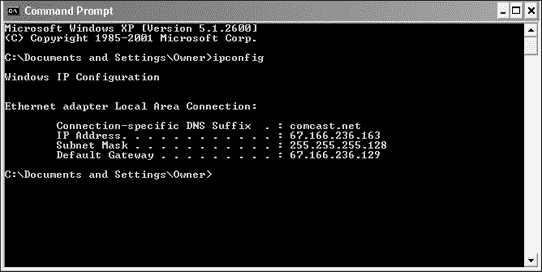

**Figure 2.1** `IPConfig`.


This command gives you some information about your connection to a network (or to the Internet). Most importantly, you find out your own IP address. The command also has the IP address for your default gateway, which is your connection to the outside world. Running the `IPConfig` command is a first step in determining your system’s network configuration. Most commands that this book will mention, including `IPConfig`, have a number of parameters, or flags, that can be passed to the commands to make the computer behave in a certain way. You can find out what these commands are by typing in the command, followed by a space, and then typing in a hyphen and a question mark: `-?`. Figure 2.2 shows the results of using this method for the `IPConfig` command.


Figure 2.2 `IPConfig` help.

如图 2.2 所示，下面列出了用于查询计算机配置详细信息的多种选项。最常用的方法可能是 `IPConfig /all`，如 图 2.3 所示。你可以看到，该选项提供了更多信息。例如，`IPConfig /all` 会显示你的计算机名称、IP 地址获取时间以及更多内容。


Figure 2.3 `IPConfig /all`.

### `Ping`

另一个常用的命令是 `ping`。`ping` 用于向机器发送测试数据包（回显包），以判断机器是否可达以及数据包到达所需时间。这种有用的诊断工具可用于基础黑客技术。在 图 2.4 中，你可以看到在 [www.yahoo.com](http://www.yahoo.com) 上执行的 `ping` 命令。

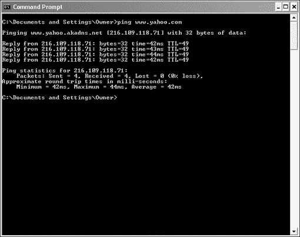

Figure 2.4 `Ping`.

该图表明，向目标发送了 32 字节的回显数据包并收到响应。TTL（Time to Live）项显示数据包在放弃之前应经过的中继跳数。请记住，互联网是由众多相互连接的网络组成的庞大集合。你的数据包很可能不会直接到达目的地，而是经过多个跳跃才能到达。与 `IPConfig` 类似，你可以输入 `ping -?` 查看如何优化 `ping`。

### `Tracert`

下一个命令是 `tracert`。该命令基本上是 `ping` 的高级版本。`tracert` 不仅告诉你数据包是否到达目的地以及耗时，还会显示它经过的所有中继跳跃。该实用工具在本书后期将非常有用。图 2.5 展示了向 [www.yahoo.com](http://www.yahoo.com) 的 `tracert`。 (在 Linux 或 UNIX 系统中，该命令称为 `traceroute` 而非 `tracert`。)

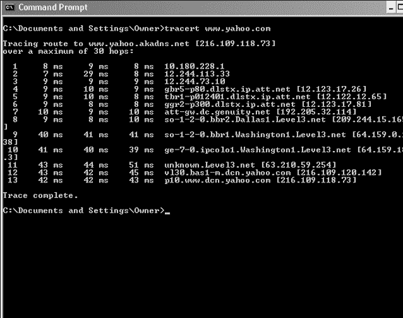

Figure 2.5 `Tracert`.

使用 `tracert`，你可以以毫秒为单位看到每个中继跳跃的 IP 地址以及到达该步骤所需的时间。知道到达目标所需的步骤很重要，后文将进一步说明。

当然，还有其他网络通信工具可以帮助你。但我们刚刚考察的三个核心工具——`IPConfig`、`ping` 和 `tracert`——是网络管理员的基础，也是必备知识，务必牢记于心。

### `Netstat`

`Netstat` 是另一个有趣的命令，全称 *network status*。它基本上显示你电脑当前的网络连接。如果看到多个连接，并不意味着黑客已入侵你的电脑。你会看到许多私有 IP 地址，这说明本地网络内部存在通信。如 图 2.6 所示。

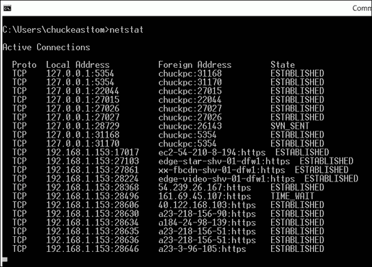

Figure 2.6 `Netstat`.

### `NSLookup`

`nslookup`（全称 *name server lookup*）用于与你的网络 DNS 服务器进行交互。它常用于验证 DNS 服务器是否正常运行，也可用于执行命令。请回顾 第 1 章 “Introduction to Computer Security”，我们讨论了 DNS 劫持。DNS 劫持的第一步是查看目标 DNS 服务器是否会执行区域传输（zone transfer），且除非是经过认证的另一 DNS 服务器，否则不应这样做。可以使用 `nslookup` 实现，如下所示：

Click here to view code image

```
run: nslookup
type: ls -d domain_name <enter>
```

你可以在 图 2.7 中看到基本的 `nslookup` 命令。

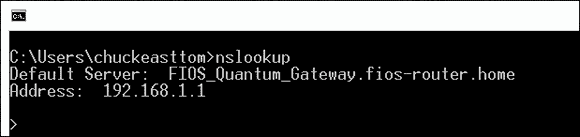

Figure 2.7 `nslookup`.

### ARP

地址解析协议（ARP）用于将 IP 地址映射到 MAC 地址。`arp` 命令显示你当前知道的 IP 到 MAC 的映射。图 2.8 展示了 `arp -a` 命令的使用。

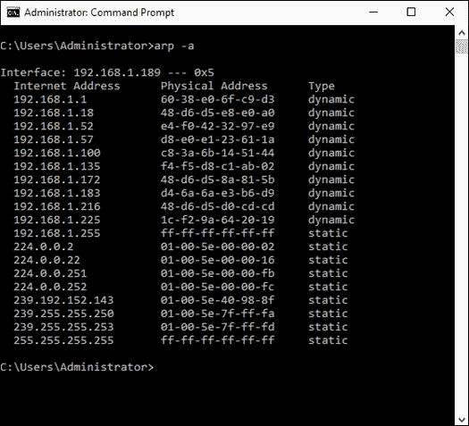

Figure 2.8 `arp -a`.

与其他命令一样，ARP 也有多种参数。以下是常见的几种：

* `-a` 显示当前的 ARP 缓存表。
* `/g` 的作用同 `/a`。
* `/d` 从 ARP 缓存表中删除特定条目。
* `/s` 向 ARP 缓存表中添加静态条目。

### `Route`

`route` 命令用于查看 IP 路由表。图 2.9 展示了 `route - print 4` 命令的样本输出。

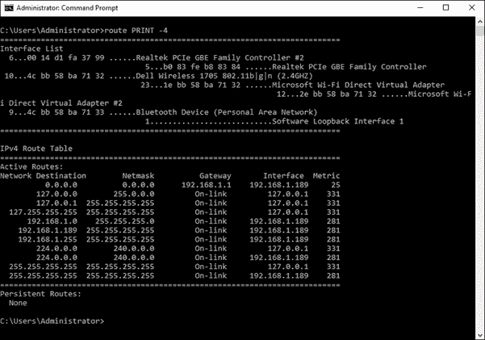

Figure 2.9 `route print -4`.

与大多数命令一样，`route` 也有多种参数。以下是常用参数的总结：

* `print` 打印特定路由；例如，`print -4` 显示 IPv4 路由表。
* `add` 添加路由。
* `delete` 删除路由。
* `change` 修改路由。
* `destination` 向特定主机发送命令。

### 其他网络设备

在 第 1 章 中简要提到的网络设备中，还有许多其他设备用于保护你的电脑免受外部威胁。下面我们将对其中两种进行更详细的介绍：防火墙（firewall）和代理服务器（proxy server）。

*防火墙* 本质上是你的网络与互联网其余部分之间的屏障。个人电脑（PC）可以充当防火墙；在许多情况下，专用路由器也可以充当防火墙。防火墙使用多种技术保护网络，但最常用的策略是包过滤。在包过滤防火墙中，每个入站数据包都会被检查，只有符合你设定的条件的数据包才会被允许通过（通常仅允许特定类型的协议）。

第二种常见的防御设备是 *代理服务器*。代理服务器几乎总是一个独立的计算机。你可能会看到同一台机器同时充当代理服务器和防火墙。代理服务器的作用很简单：它将你的整个网络隐藏在外部世界之外。外部试图探查你的网络时，只能看到代理服务器，看不到实际的机器。当数据包离开你的网络时，它们的头部会被修改，使返回地址显示为代理服务器。相反，你只能通过代理服务器访问外部世界。代理服务器和防火墙提供基本的网络安全，若没有这两者，运行网络将是一大疏忽。我们将在 第 9 章 “Computer Security Technology” 中更详细地探讨防火墙。

### 高级网络通信主题

本节讨论的主题并非理解本书的必要条件，但能够让你更全面地认识网络。如果你有志于在专业层面深入网络安全，则这部分知识是必备的，并且还需要更多内容。

# The OSI Model

Let’s begin with the `OSI model`, or Open Systems Interconnection model, which describes how networks communicate. It outlines the various protocols and activities, and it tells how the protocols and activities relate to each other. This model is divided into seven layers, as shown in Table 2.6, and was originally developed by the International Organization for Standardization (abbreviated ISO) in the 1980s.

## Table 2.6 The OSI Model

| Layer Number | Layer Name | Description | Protocols |
|---|---|---|---|
| 7 | Application | This layer interfaces directly to the application and performs common application services for the application processes. | POP, SMTP, DNS, FTP, and so on |
| 6 | Presentation | The presentation layer relieves the application layer of concern regarding syntactical differences in data representation within the end-user systems. |  |
| 5 | Session | The session layer provides the mechanism for managing the dialogue between end-user application processes. | NetBIOS |
| 4 | Transport | This layer provides end-to-end communication control. | TCP, UDP |
| 3 | Network | This layer routes the information in the network. | IP, Address Resolution Protocol, Internet Control Message Protocol |
| 2 | Data link | This layer describes the logical organization of data bits transmitted on a particular medium. The data link layer is divided into two sublayers: the Media Access Control (MAC) layer and the Logical Link Control (LLC) layer. | Serial Line Internet Protocol, Point-to-Point Protocol |
| 1 | Physical | This layer describes the physical properties of the various communications media as well as the electrical properties and interpretation of the exchanged signals. In other words, the physical layer is the actual NIC, Ethernet cable, and so forth. This layer is where bits are translated into voltages and vice versa. | None |

Many networking students memorize this model. It’s good to at least memorize the names of the seven layers and to understand basically what each one does. From a security perspective, the more you understand about network communications, the more sophisticated your defense can be. The most important thing for you to understand is that the OSI model describes a hierarchy of communication. One layer will only communicate with the layer directly above it or below it.

## Media Access Control (MAC) Addresses

A `MAC address` is a unique address for a NIC. (MAC is also a sublayer of the data link layer of the OSI model.) Every NIC in the world has a unique address that is represented by a 6-byte hexadecimal number, and ARP is used to convert IP addresses to MAC addresses. When you type in a web address, DNS is used to translate that into an IP address; then ARP translates that IP address into a specific MAC address of an individual NIC.

How is DNS is accomplished; that is, how does a URL get translated into an IP address? How does a computer know what IP goes with what URL? There are servers known as DNS servers that are set up just to do this task. If you are on a corporate network, you probably have a DNS server on your network. If you are not, then your ISP has one. These servers maintain a table of IP-to-URL entries. From time to time there are transfers of DNS data, called `zone transfers`, that allow one DNS server to send its changes to another. Across the Internet, there are root DNS servers that are maintained with centralized data for all registered URLs/IP addresses.


## Summary

This chapter cannot make you a networking expert. However, you should now have a basic understanding of how networks and the Internet work. Before you move on to subsequent chapters, you should make certain you completely understand basic hardware such as switches, NICs, routers, and hubs. You should also be familiar with the basic protocols presented in this chapter. It is important that you be comfortable with the utilities presented. It is strongly suggested that you experiment with these utilities extensively. It is also important that you be comfortable with the basics of the OSI model. Many students struggle with it at first, but at least make sure you have a general understanding of it before you move on to Chapter 3, “Cyber Stalking, Fraud, and Abuse.”

The material in this chapter will be critical in later chapters. If you are new to this material, you should thoroughly study this chapter before continuing. In the exercises at the end of this chapter, you will be able to practice using `IPConfig`, `tracert`, and `ping`.

## Test Your Skills

### Multiple Choice Questions

**1.** Malek is purchasing cable to use in setting up small office networks. He wants to stock up on commonly used cable. What type of cable do most networks use?

**A.** Net cable

**B.** STP

**C.** Phone cable

**D.** UTP

**2.** You are assigned with attaching connectors to segments of cable. What type of connector is used with network cables?

**A.** RJ-11

**B.** RJ-85

**C.** RJ-12

**D.** RJ-45

**3.** What type of cable is used in most networks?

**A.** Unshielded twisted-pair

**B.** Shielded twisted-pair

**C.** Unshielded untwisted-pair

**D.** Shielded untwisted-pair

**4.** John is trying to simply connect three computers in a small network. He does not need any sort of routing capability and is not concerned about network traffic. What is the simplest device for connecting computers?

**A.** NIC

**B.** Interface

**C.** Hub

**D.** Router

**5.** Sharice is trying to teach a new technician basic networking terms. What should she tell this new technician NIC stands for?

**A.** Network interface card

**B.** Network interaction card

**C.** Network interface connector

**D.** Network interaction connector

**6.** Which of the following is a device used to connect two or more networks?

**A.** Switch

**B.** Router

**C.** Hub

**D.** NIC

**7.** Juan has just installed a new T1 line in a medical office. The front desk receptionist has asked what speed they can expect. A T1 line sends data at what speed?

**A.** 100Mbps

**B.** 1.54Mbps

**C.** 155Mbps

**D.** 56.6Kbps

**8.** How big is a TCP packet header?

**A.** The size depends on the data being sent.

**B.** The size is always 20 bytes.

**C.** The size depends on the protocol being used.

**D.** The size is always 40 bytes.

**9.** What protocol translates web addresses into IP addresses?

**A.** DNS

**B.** TFTP

**C.** DHCP

**D.** SMTP

**10.** What protocol is used to send email, and on what port does it work?

**A.** SMTP, port 110

**B.** POP3, port 25

**C.** SMTP, port 25

**D.** POP3, port 110

**11.** Gunther is setting up encrypted remote communications so that the server administrators can remotely access servers. What protocol is used for remotely logging on to a computer in a secure manner?

**A.** SSH

**B.** HTTP

**C.** Telnet

**D.** SMTP

**12.** Mohammed needs to open a firewall port so that web traffic can be passed through the firewall. What protocol is used for web pages, and on which port does it work?

**A.** HTTP, port 21

**B.** HTTP, port 80

**C.** DHCP, port 80

**D.** DHCP, port 21

**13.** What is the name for the point where the backbones of the Internet connect?

**A.** Connectors

**B.** Routers

**C.** Network access points

**D.** Switches

**14.** You are examining a list of IP addresses. Some are internal, some are external, and some are not valid. Which of the following is not a valid IP address?

A. `127.0.0.1`

B. `295.253.254.01`

C. `131.156.5.2`

D. `245.200.11.1`

15. 193.44.34.12 这个 IP 地址属于什么类型的地址？

A. `A`

B. `B`

C. `C`

D. `D`

16. 127.0.0.1 始终指向你的什么？

A. 最近的路由器

B. ISP

C. 自己

D. 最近的 NAP

17. 形式为 [www.chuckeasttom.com](http://www.chuckeasttom.com) 的 Internet 地址称为什么？

A. 用户友好的网页地址

B. 统一资源定位符

C. 用户可访问的网页地址

D. 统一地址标识符

18. 哪个美国政府机构创建了构成互联网基础的分布式网络？

A. 高级研究项目署

B. 中央情报局

C. NASA

D. 能源部

19. 原始分布式网络的三所参与大学中，哪一所在下列选项中被提及？

A. 加州大学伯克利分校

B. 哈佛大学

C. 麻省理工学院

D. 普林斯顿大学

20. 向一群一年级学生解释网络历史时，Vince Cerf 发明了什么？

A. 万维网

B. 电子邮件

C. TCP

D. 第一个计算机病毒

21. 向一群一年级学生解释网络历史时，Tim Berners-Lee 发明了什么？

A. 万维网

B. 电子邮件

C. TCP

D. 第一个计算机病毒

22. John 使用命令行工具收集诊断信息，针对无法连接网络的计算机，哪个工具提供机器的网络配置信息？

A. `Ping`

B. `IPConfig`

C. `Tracert`

D. `MyConfig`

23. Sheryl 向新技术人员解释 OSI 模型，问 TCP 在 OSI 模型的哪一层运行？

A. 传输层

B. 应用层

C. 网络层

D. 数据链路层

24. OSI 模型的哪一层被分为两个子层？

A. 数据链路层

B. 网络层

C. 表示层

D. 会话层

25. 下列哪个是唯一的十六进制数，用于标识你的网卡？

A. NIC 地址

B. MAC 地址

C. NIC ID

D. MAC ID

### Exercises

**Exercise 2.1:** 使用 `IPConfig`

1. 打开命令提示符或在 Windows 10 的搜索栏中输入 `cmd`。

2. 输入 `ipconfig`。

3. 使用 `IPConfig` 命令的输出查找计算机的信息。

4. 记录你的计算机的 IP 地址、默认网关和子网掩码。

**Exercise 2.2:** 使用 `Tracert`

1. 打开命令提示符或 DOS 提示符。

2. 输入 `tracert www.chuckeasttom.com`。

3. 记录你的计算机到 [www.chuckeasttom.com](http://www.chuckeasttom.com) 的路由跳数。

4. 重复步骤 2 和 3，分别对 [www.whitehouse.gov](http://www.whitehouse.gov) 和 [`home.pearsonhighered.com/`](http://home.pearsonhighered.com/) 进行操作。

5. 观察前几个跳数相同的情况，记录每个目标的跳数以及相同的跳数，然后简要说明为何部分中间步骤在不同目标之间相同。

**Exercise 2.3:** `NSLOOKUP`

1. 打开命令提示符。

2. 输入 `nslookup www.chuckeasttom.com`。

3. 记录该命令返回的实际服务器名称（依据托管公司的命名规范）、IP 地址以及该服务器的别名。

**Exercise 2.4:** 更多关于 `IPConfig`

1. 打开命令提示符或 DOS 提示符。

2. 使用 `ipconfig -?` 命令查看 `IPConfig` 的其他选项，例如 `/all`、`/renew` 等。

3. 执行 `ipconfig /all`，记录此时比仅使用 `ipconfig`（Exercise 2.1）时多出的信息。

**Exercise 2.5:** 更多关于 `Ping`

1. 打开命令提示符或 DOS 提示符。

2. 使用 `ping -?` 查看 `ping` 的其他选项，如 `-w`、`-t`、`-n`、`-i` 等。

3. 执行 `ping www.chuckeasttom.com`。

4. 尝试 `ping -n 2 www.chuckeasttom.com`，然后执行 `ping -n 7 www.chuckeasttom.com`，观察差异。

### Projects

**Project 2.1:** 学习 DNS 协议

1. 使用网络资源查找 DNS 协议，可参考：[www.freesoft.org/CIE/Topics/75.htm](http://www.freesoft.org/CIE/Topics/75.htm)。

2. 查找以下信息：谁发明了 DNS 协议？它的用途是什么？它是如何工作的？

3. 写一篇简短的论文，描述该协议的功能，并简要说明其发明者、发明时间以及工作原理。

**Project 2.2:** 学习你的系统

1. 查找你的组织（例如学校或企业）是否使用交换机、集线器或两者。原因是什么？可以向网络管理员或帮助台询问，并说明这是为课程项目而进行的。

2. 写一篇简短的论文，阐述你的发现，并说明如果可以进行改动，你会如何改进。例如，如果组织仅使用集线器，你会否改为使用交换机，理由是什么？

**Project 2.3:** 学习 `NetStat`

1. 在命令提示符中输入 `netstat`，观察它提供的信息，包括当前连接到你电脑的服务器的 IP 地址或名称。若使用的是家用电脑，需要登录互联网服务提供商（ISP）后才能看到相关内容。

Caution

停止 `NetStat`

注意：在许多 Windows 版本中，需要使用 `Ctrl+Break` 组合键停止 `netstat`，然后再次使用新选项启动。

2. 输入 `netstat -?` 查看可用的选项，如 `-a`、`-e` 等。

3. 执行 `netstat -a`，记录你看到的信息。

4. 最后，尝试 `netstat -e`，观察其输出内容。

在每个新前沿，犯罪分子必然会出现。在过去的时代，高 seas 孕育了海盗，美国的 Wild West 产生了出法者的帮派。Internet 与其他前沿不同寻常：它也有它的出法者。除了 Chapter 1 “Introduction to Computer Security”，提到的 Chapter 1 “Introduction to Computer Security”，还有其他危险。欺诈是互联网最常见的危险之一。随着越来越多的人将 Internet 作为商业的通道，欺诈机会随之增大。欺诈自文明存续以来就一直是生活的一部分；在过去的世纪里，“蛇油”推销员四处游荡，兜售面部治疗和药剂。Internet 让这种欺诈变得更加容易。事实上，许多专家会认为欺诈是互联网上最普遍的危险。诈骗者喜欢 Internet 欺诈的多种原因。首先，进行 Internet 欺诈不需要像黑客和病毒创建那样的技术专长。其次，在线各种形式的商业活动人数众多，这种大量的商业活动为欺诈提供了大量机会。

互联网上有许多欺诈途径。本章我们将探讨欺诈的主要类型、法律的规定以及你可以采取的自我保护措施。好消息是，对于某些读者而言，这一章并不特别技术性，因为大多数 Internet 欺诈并不依赖于深入的技术专长。Internet 欺诈仅仅把电脑作为实施多种历史上已有的欺诈手段的场所。

### How Internet Fraud Works

欺诈可以通过 Internet 以多种方式进行。美国证券交易委员会（SEC）在其网站上列出了若干 Internet 欺诈类型；^(1) 我们将简要讨论其中的每一种以及其他类型，但不可能全面覆盖每一种欺诈方案的所有变体。这将填满一整本书，甚至可能需要多卷。我们可以做的是介绍最常见的诈骗，并尝试总结出一些通用原则，供你应对任何潜在的欺诈。如果你用这些具体案例来总结通用原则，你就应该能够避免大多数欺诈方案。

1. [`www.sec.gov/reportspubs/investor-publications/investorpubscyberfraudhtm.html`](https://www.sec.gov/reportspubs/investor-publications/investorpubscyberfraudhtm.html)

#### Investment Offers


投资提供并非新事物。即使是某些合法的股票经纪人也通过冷 calling（即直接从电话簿中拨打电话）谋生，即试图说服人们投资特定的股票。这种做法既被合法机构使用，也深受欺诈 perpetrators 喜爱。Internet 使得真实和欺诈的投资提供能够更轻松地向公众传播。读者可能每天都收到大量此类电子邮件。一些邮件试图诱使你直接参与特定的投资计划；其他邮件则提供看似来自投资者的无偿信息。（遗憾的是，这类建议往往并不像表面上那样中立。）虽然合法的在线新闻稿件可以帮助投资者获取有价值的信息，但请记住，部分在线新闻稿件是欺诈性的。

## Common Schemes

其中一种常见的诈骗方式是发送邮件，声称你可以通过极小的投资获得惊人的金额。最著名的这种诈骗是尼日利亚欺诈。在这种情况下，邮件被发送到大量随机邮箱，每封邮件声称来自某已故尼日利亚医生或政府官员的亲属。该人物通常是你所熟知的社会地位显赫的人物，从而增加你对该提议的接受可能性。提议内容如下：此人希望将一笔资金转出其国家，但出于安全考虑无法使用常规渠道。他希望你将资金暂时存入你的银行账户。如果你允许他使用你的账户，你将获得一笔丰厚的费用。如果你同意此安排，你将通过普通邮件收到一系列看似正式的文件，足以让大多数普通观察者相信该安排是合法的。随后你会被要求预先支付税费和电汇费用等项目。一旦你发送任何资金，你将失去它，并且再也无法联系到这些人。^(2)

2. [`www.lbl.gov/IT/CIS/CITG/email/419-Fraud.html`](http://www.lbl.gov/IT/CIS/CITG/email/419-Fraud.html)

现在考虑这一投资诈骗及其变体的逻辑视角。如果你拥有大量资金并需要转移，你会把钱发给一位你从未谋面的外国人吗？你会担心对方会把钱取出并乘机飞往里约热内卢吗？如果需要跨国转账，为什么不直接把钱转到巴哈马的账户，或者取出现金并通过 FedEx 或 UPS 寄送到美国的仓储设施？事实是，有许多途径可以在不信任陌生人的情况下将资金转出国家。这一事实本身就表明该提议并不合法。这是你应当首先得出的通用原则：在任何提议中，考虑提供方的立场。提议是否听起来像是他人承担了不成比例的巨大风险？交易是否对你极度有利？把自己置于他方的位置思考：如果你是他，会愿意参与这个交易吗？如果不会，那么这表明交易可能不是表面所见。

## Investment Advice

像前面讨论的尼日利亚诈骗这类明显的欺诈方案并非 Internet 上唯一的投资陷阱。有些公司会支付撰写在线新闻稿件的人推荐其股票。虽然这种活动本身并不违法，美国联邦证券法要求新闻稿件披露作者是否收到了报酬。这类法规的存在是因为，当作者在推荐产品时，其观点可能因收受报酬而产生偏见。许多在线投资新闻稿件未披露这一点，意味着你所获得的“中立”股票建议可能实际上是偏向的。你可能得到的不是中立专家的建议，而是付费广告。这是在线投资建议中最为常见的陷阱，比明显的欺诈行为更为普遍。

有时这些在线股票公告可能是更大方案的一部分，通常被称为`pump and dump`。经典的`pump and dump`其实很简单。诈骗者购买大量几乎毫无价值的股票，然后通过多种方式人为推高其价值。常见做法是在这些网络公告板和聊天室里散布谣言，称该股票即将大幅上涨，常常暗示公司即将推出几周内的创新产品。另一种做法是广泛推广该股票，让更多人争相购买，从而推高价格。如果两种方法结合，几乎可以使毫无价值的股票短暂翻倍甚至三倍。实施该诈骗的 perpetrator 在以极低价购入大量股票后，当股价达到她认为的最高点时抛售，短时间内（尤其是在公司下一季度财报发布前）股价便回到真实价值。这种诈骗在过去数十年里极为流行，因此应始终警惕此类“内幕”信息。若有人知道公司 X 即将发布创新产品从而推高股价，为何还要向全体陌生人泄露？

SEC 为避免`pump and dump`诈骗提供了若干建议：^(3)

3. [`www.sec.gov/investor/pubs/pump.htm`](http://www.sec.gov/investor/pubs/pump.htm)

*   考虑来源。尤其是你对市场不熟悉时，确保只接受知名且可信的股票分析师的建议。
*   独立验证主张。不要盲目接受他人的言论。
*   研究。阅读公司、相关主张、股票历史等信息。
*   警惕高压销售策略。正规交易商不会强迫客户购买，他们会帮助客户挑选感兴趣的股票。若受到压力，则可能预示潜在问题。
*   保持怀疑。适度的怀疑能为你省下不少金钱。正如谚语所言，“如果听起来太好以致难以置信，那很可能是假的”。
*   对任何投资机会进行彻底研究。

真相是，这类诈骗依赖于受害者的贪婪。我并非要指责受害者，但必须认识到，如果你让贪婪代替理性思考，你就是诈骗的理想目标。你的 `401(k)`或 `IRA` 可能无法让你瞬间致富，但它是稳健且相对安全的（没有任何投资是完全安全的）。如果你追求在极短时间内、极小努力下赚取巨额金钱，那么你正是诈骗者的理想目标。

### 在实践中

实践上建议，仅在你主动与可信赖的经纪商讨论后才参与在线投资。这意味着你永不响应或参与通过电子邮件、在线广告等途径发送的投资邀请。你只应参与你主动发起、且与知名经纪商的投资。通常这类经纪商是拥有悠久声誉的传统投资机构，现在仅提供线上服务。同时，务必通过 SEC 检查经纪商的资质。

### 竞标欺诈

像 `eBay` 这类在线竞价网站可以让你以极具性价比的价格购得商品。我常利用此类竞价购买商品。但任何竞价网站都可能隐藏风险：你真的会收到所购商品吗？它会是“如描述”吗？大多数在线竞价是合法的，竞价网站也会采取措施防止交易欺诈。不过问题仍会发生。事实上，美国联邦贸易委员会（FTC）将在线竞价欺诈分为以下四类：^(4)

4. [`www.onguardonline.gov/articles/0020-shopping-online`](https://www.onguardonline.gov/articles/0020-shopping-online)

*   未发货
*   发货价值低于广告
*   逾期未送达
*   未披露商品或交易条款的全部相关信息

第一类——未发货——是最明确的欺诈形式，也最为常见。付款后商品从未到达，卖家仅保留你的金钱。在有组织的欺诈中，卖家会同时发布多个待售商品，收取所有竞价款后消失。通常整个过程使用假身份、租用信箱和匿名邮件服务进行，最终骗子逃之夭夭，带走诈骗所得。

第二类——发货价值低于广告——可能属于灰色地带。在某些情况下是 outright 诈骗：卖家宣称的产品描述根本不真实。例如，卖家宣传“已签名的首次印刷名著”，实际却发送的是第四次印刷且无签名或签名真伪存疑的书籍。但在其他情况下，这可能只是卖家过于热情或确实错误：他可能声称自家棒球由著名运动员签名，却并不自知签名是伪造的。

第二类与 FTC 列表中的第四项——未披露全部相关信息——紧密相关。例如，一本真实首次印刷且签名的书籍若因状况极差而价值连城，卖家可能在发布前或之后未披露此事实。未披露关键事实可能源于欺诈，也可能仅是卖家的无知。FTC 还将逾期送达视为一种欺诈形式，但具体是否属于欺诈尚不明确，可能只是客户服务不力。

FTC 还列出了三类日益流行的竞价欺诈：^(4)

*   **垫价竞标（Shill bidding）**：欺诈性卖家（或其“托售”）在竞价时自行出价，人为推高价格。
*   **出价挡位（Bid shielding）**：欺诈性买家提交极高出价，阻止其他竞拍者参与；随后 retract 这些出价，以便其熟人以更低价格获得商品。
*   **出价吞并（Bid siphoning）**：诈骗者诱骗竞拍者离开正规竞价平台，以更低价格承诺“同等”商品，意在骗取金钱而不提供商品。离平台后，买家失去平台提供的保障（如保险、反馈表或担保）。

#### 垫价竞标

垫价竞标可能是这三种竞价欺诈中最为常见的。其实现并不复杂：若 perpetrator 在竞价平台出售商品，她会创建多个假身份，利用这些假身份进行竞价，从而推高价格。若要检测此类行为，只需在出价前确定自己的最高价格上限，并且绝不超过该上限，哪怕只多一分钱。

#### 出价挡位

-   [shill 竞价]可能很难对抗，但拍卖网站的所有者可以相对容易应对`bid shielding`（出价掩护）。许多主要拍卖网站（如`eBay`）已采取措施防止`bid shielding`。最明显的做法是撤销在竞价结束后退出的竞价者的出价权限。因此，如果某人在竞价时投出非常高的出价以阻止其他人参与，然后在最后时刻撤回，他可能会失去该拍卖网站的出价资格。

### `Bid Siphoning`

`Bid siphoning`（出价转移）是一种较为少见的拍卖欺诈形式。在这种方案中，欺骗者在拍卖网站上放置一个合法的标的物供竞价。随后，她在该物品的广告中提供指向非拍卖网站的链接。不慎跟随这些链接的买家可能会被带到一个“预设”的替代网站，在那里被用于实施某种欺诈。

所有这些手段的共同目标是扰乱正常的拍卖流程。正常的拍卖流程是资本主义与民主的完美结合。只要愿意超越其他购物者的出价，每个人都有平等获得产品的机会。买家自己根据对产品价值的感知来决定价格。在我看来，拍卖是商业的极佳载体。然而，不法分子总会试图颠覆流程以实现自身目的。

### `Identity Theft`

`Identity theft`（身份盗用）是一个日益严重且令人担忧的问题。概念本身很简单，但过程可能复杂，受害者的后果可能很严重。基本思想是一个人冒用另一个人的身份。这通常是为了进行购物；但`identity theft`也可用于其他目的，例如获取信用卡或以受害者的名义申请驾驶执照。如果犯罪者在别人的名下申请信用卡，他可以购买商品，而受害者则会发现自己背负着未经授权的债务。

在使用受害者的名义获取驾驶执照的情况下，欺诈可能是为了掩盖犯罪者自身糟糕的驾驶记录。例如，某人可能获取你的驾驶信息并制作一张带有其照片的假驾照。在这种情况下，犯罪者可能有非常糟糕的驾驶记录，甚至有立即被捕的逮捕令。如果在被警察拦停时，她出示假驾照，警察检查后发现该驾照看似合法且没有未办理的逮捕令。但该罚单会记在你的驾驶记录上，因为它使用的是你的信息。而且，犯罪者不太可能支付这张罚单，所以你——身份被盗的当事人——最终会收到通知，称你的驾照因未支付罚单而被吊销。除非你能够提供证人证明你当时不在该罚单所对应的地点，否则你可能只能支付罚单以恢复驾驶资格。

美国司法部（`U.S.` Department of Justice）对`identity theft`的定义如下：

5. [`www.justice.gov/criminal-fraud/identity-theft/identity-theft-and-identity-fraud`](https://www.justice.gov/criminal-fraud/identity-theft/identity-theft-and-identity-fraud)

*`Identity theft`* 和 *`identity fraud`* 是指任何一种犯罪，其中某人非法获取并使用他人个人数据，通常涉及欺诈或欺骗，往往为了经济利益。

`Internet`（互联网）使得窃取他人身份的过程比以前更加容易。许多州现在已将法院记录和机动车记录放在线上。在一些州，个人的`Social Security number`（社会安全号码）被用作驾驶执照号码。因此，如果犯罪者获得某人的`Social Security number`，他可以查询该人的驾驶记录，获取驾照复印件，查找该人的法院记录，甚至在某些网站上查看其信用报告。稍后本书将探讨如何利用`Internet`作为调查工具。和任何工具一样，它既可以用于善意，也可以用于恶意目的。你可以用同样的工具对潜在雇员进行背景调查，也可以利用这些信息伪造他人的身份。

FYI：身份盗用的替代手段

犯罪者可以在不使用`Internet`的情况下进行`identity theft`。在`Dallas–Fort Worth metroplex`（达拉斯-福特沃斯大都会区）的犯罪团伙与餐厅服务员合作。当服务员取你的信用卡或借记卡支付账单时，他会用隐藏在口袋里的小型手持设备扫描你的卡片信息，然后将此信息交给`identity theft`团伙。团伙可以利用这些信息进行在线购物，或使用 stolen 信息制作以你名义的假信用卡。避免此类危险的唯一方法是：除非在你面前立即处理卡片，否则绝不让任何人将你的卡片带离视线。

### `Phishing`

`Phishing`（网络钓鱼）是实施`identity theft`的更常见手段之一，指通过诱导目标提供个人信息的过程。例如，攻击者可能发送一封冒充银行的电子邮件，称其账户有问题，并指示收件人点击链接至银行网站以登录并验证账户。然而，该链接实际指向攻击者设置的假网站。当目标在该网站输入信息时，便把用户名和密码直接提供给攻击者。

如今许多终端用户已熟悉此类手段并避免点击电子邮件链接，但并非所有人都如此谨慎，该攻击仍然有效。此外，攻击者不断开发新的钓鱼方式。其中一种是所谓的 *cross-site scripting*（跨站脚本）。如果网站允许用户发布内容且其他用户可见（如产品评论），攻击者可在评论中插入脚本（JavaScript 等）。当其他用户访问该页面时，浏览器会加载攻击者的脚本，而不是正常的评论。该脚本常用于将用户重定向到钓鱼网站。如果攻击者操作得当，假网站与真实网站完全相同，用户往往未察觉被重定向。跨站脚本可以通过让网页开发者过滤所有用户输入来防止。更多细节请参见第 6 章 “黑客使用的技术”。

-   [网络钓鱼邮件多年来变得更加高级。一个在 2018 年开始的特定钓鱼诈骗利用了被暴露的密码以及受害者可能产生的尴尬。该诈骗的运作方式如下：攻击者从类似 [`https://haveibeenpwned.com`](https://haveibeenpwned.com) 的网站获取被暴露的密码列表，然后向该列表中的人发送邮件。邮件声称攻击者在受害者的电脑上安装了恶意软件，并通过透露受害者的密码来验证该主张。随后，邮件声称在电脑上安装了间谍软件，该间谍软件观察到受害者观看色情内容并在此过程中自我满足。攻击者声称已控制了网络摄像头并拥有视频证据。如果在 24 小时内不将一定金额的比特币存入指定的比特币钱包，他将把视频发送给受害者的同事和家人。这是一个相当高级的钓鱼诈骗案例。首先，攻击者通过使用真实密码来建立可信度。然后，该攻击者利用如果发送足够多的邮件，必然会有部分人落 for the allegation（即访问色情内容并以尴尬方式行为）的事实。这一方案表明攻击者在攻击方法上正变得越来越熟练。（更高级的网络钓鱼形式，如 spear phishing 和 whaling，将在 `Chapter 7`，“Industrial Espionage in Cyberspace” 中讨论。）

### 网络跟踪

跟踪行为，这往往是暴力行为（包括性侵和谋杀）的前奏，在过去几年引起了极大关注。许多州已通过了各种反跟踪法律。然而，跟踪行为已扩展到 cyberspace。 *Cyber stalking* 利用互联网骚扰另一个人；或者，正如美国司法部所说：^(6)

6. [`https://www.justice.gov/ovw/stalking`](https://www.justice.gov/ovw/stalking)

尽管 *cyber stalking* 没有 universally accepted 的定义，但本报告中使用该术语指使用互联网、电子邮件或其他电子通信设备对另一个人进行跟踪。跟踪行为通常涉及反复进行的骚扰或威胁行为，例如跟踪某人、在某人家中或工作场所出现、打电话给某人并留下骚扰信息、留下书面信息或物品、或破坏某人财产。大多数跟踪法律要求施害者对受害者提出可信的暴力威胁；其他法律则包括对受害者近亲的威胁；还有的仅要求所谓的跟踪者的行为模式构成隐含威胁。虽然某些让人感到烦扰或威胁的行为可能不足以构成非法跟踪，但这类行为可能是跟踪和暴力的前兆，应被认真对待。

如果某人利用互联网骚扰、威胁或恐吓他人，那么该人就是 guilty of cyber stalking。最明显的例子是发送威胁性邮件。关于“threatening” 的定义因司法管辖区而异。但一个简便的原则是：如果邮件内容在正常言语中会被视为威胁，那么在电子形式中发送它很可能也会被视为威胁。其他网络跟踪的例子则不那么明确。如果你要求某人停止给你发邮件，但她仍继续发送，这是否构成犯罪？遗憾的是，这个问题上没有明确答案。事实是，这取决于多种因素，如邮件内容、频率、收件人与发件人之间的先前关系以及司法管辖区。

#### 真实网络跟踪案例

以下案例来自司法部网站，展示了网络跟踪的案例。仔细查看这些案例中的事实，可能帮助你理解何为法律上的网络跟踪。虽然这里讨论的许多案例都是近期的，但也包括一些较老的案例，以便你全面了解此问题：

*   这第一个案例虽旧，但它是网络跟踪历史上的关键案件。在加利福尼亚州网络跟踪法律的首次成功起诉中，洛杉矶县检察官办公室的检察官获得了 50 岁前安全岗位员工的有罪认罪，该员工利用互联网诱导一名拒绝其爱情进展的女性被强奸。该被告通过在各种 Internet 聊天室和在线公告板上冒充该女性，发布包含她电话号码和地址的信息，称她幻想被强奸。至少六次，有时在深夜，男子敲门称想强奸她。前安全岗位员工在 1999 年 4 月认罪，包括一项跟踪罪和三项性骚扰罪，面临最高 6 年监禁。
*   2016 年，Kassandra Cruz 被判处 22 个月监禁，罪名为网络跟踪。Cruz 讽刺地是一名刑事司法专业学生，她因在色情网站上发现一名女性的照片而成为痴迷者。Cruz 开始了一系列电子邮件、社交媒体消息，并发送了超过 900 次电话和短信。
*   2017 年，FBI 和马萨诸塞州沃尔瑟姆市警察局调查了新顿市的 Ryan Lin，他被指控实施了一年多的电脑入侵和在线骚扰。虽然他的攻击未升级为现实世界的肢体攻击，但他仍构成了严重罪行。Lin 还被指控发送儿童色情制品，最终被判处 17 年监禁。
*   2017 年 10 月，Heriberto Latigo 被判处 5 年监禁，罪名为网络跟踪。该问题始于 2013 年，当时他与一名女性建立了浪漫关系。Latigo 强迫该女性发送自己裸体的照片，并在网络上骚扰她，并威胁她。关系结束后，他继续对受害者进行勒索以换取性行为，并发送了带有暴力图像的威胁。


*   2018 年 9 月，Joel Kurzynski 认罪于网络跟踪罪名。Kurzynski 是一名前信息技术专业人员。自 2017 年起，他发起了一项包括死亡威胁和仇恨言论的行动，针对两名他认识的人。他创建了受害者在社交媒体上的假账号，并利用这些账号寻找 sadomasochistic 或未成年关系。Kurzynski 被判处 30 个月监禁，并在随后 3 年监督释放。

*   Robert James Murphy 是首位因联邦法律被指控网络跟踪的人。他被指控违反《美国法典》第 47 卷第 223 条，该条款禁止利用电信设备骚扰、威胁、恐吓或骚扰任何人。Murphy 被指控向前女友发送色情信息和照片，此行为持续了多年。他被控并最终认罪两项网络跟踪罪。

*   James Allen 在 2015 年因涉嫌儿童色情制品和网络跟踪罪被定罪。他被指控在线骚扰了 18 名纽约女孩，并利用骚扰手段勒索非法图片。

*   显然，利用互联网骚扰他人与现实中骚扰他人一样严重，并且可能导致现实中的犯罪。这一问题甚至扩展到了工作场所。例如，法院曾认定不请自来的电子邮件色情内容可以被视为性骚扰。如果雇员抱怨不请自来的电子邮件，雇主有义务至少尝试缓解局面。这种尝试可以很简单，比如安装一个非常廉价的垃圾邮件拦截器（试图限制或消除不请自来的电子邮件）。然而，如果雇主完全不采取任何措施来纠正问题，这种沉默可能会被法院视为助长敌对工作环境。如前所述，如果在现实中进行跟踪行为会被视为骚扰，那么在 cyberspace 中也会被视为骚扰。Black’s Law Dictionary 定义了 harassment 如下：^([7)

7. Black’s Law Dictionary, 1999, West Publishing Company, 7th edition

*   一种针对特定个人的行为模式，该行为导致该人产生重大情绪 distress 且没有合法目的。

*   言语、手势和行为，倾向于烦扰、惊吓并（语言上）虐待另一个人。

*   通常，执法人员需要某种可信的伤害威胁才能处理骚扰投诉。简单来说，这意味着如果你在匿名聊天室中，有人说一些脏话，那通常不会被视为骚扰。然而，如果你通过电子邮件收到具体的威胁，这些威胁很可能会被视为骚扰。

*   许多州明确禁止网络跟踪；总体而言，现有的反跟踪法律可以适用于互联网。2001 年，在加利福尼亚州，一名男子因现有反跟踪法律被定罪网络跟踪。^(8) 其他国家也有现有的反跟踪法律可以适用于网络跟踪。加拿大自 1993 年起就拥有全面的反跟踪法律。不幸的是，有很多类似的案例。以下是其中一些：

8. Identity Theft and Assumption Deterrence Act of 1998, U.S.C. 1028

*   这个案例稍微旧一些，但它说明了这些犯罪如何升级。从 2010 年起，70 岁的 Joseph Medico 在教堂上认识一名 16 岁的女孩。Medico 跟随女孩到她的车旁，试图说服她去约会，然后再回他家。当她拒绝他的 advances 时，他开始多次给她打电话和发短信。他的行为升级后，女孩报告了这些活动，Medico 被捕并因跟踪被捕。

*   2018 年 3 月，Juan R. McCullum 被判处联邦监狱 1 年 361 天，罪名包括阴谋和网络跟踪。McCullum 是前维吉尼亚州代表 Stacey Plaskett 的助理。他承认了在试图阻止 Mrs. Plasketts 连任时，散布国会议员及其丈夫的裸体图片和视频。

*   2018 年 12 月，Joel Kurzynski 被判处 30 个月监禁和 3 年缓刑，罪名是针对多位受害者的网络跟踪。Kurzynski 还被裁定支付超过 37,000 美元的赔偿金。根据法院文件，Kurzynski 策划了垃圾电话、创建假约会资料（将受害者描绘为寻求未成年关系）以及发出死亡威胁。

*   2018 年夏季，Jeron Ramos allegedly 在马里兰州一家报纸办公室开枪杀害了五人。根据法院记录，这次暴力袭击之前是一段长期的骚扰运动，包括愤怒的 Twitter 帖子和电子邮件。

*   2009 年 2 月，在英国，Edward Richardson 因妻子在 Facebook 页面上将婚姻状态从“已婚”改为“单身”而将妻子刺死。

*   2018 年，Ho Ka Terence Yung 被定罪网络跟踪。在这一案件中，犯罪者没有试图直接物理攻击受害者，而是煽动对受害者的暴力。根据法院记录，Yung 对被拒之于法学院的失望，开始对一名录取官员进行网络跟踪，包括编造他受害者强奸 8 岁女孩的故事。Yung 还在 Craigslist 上发布广告，假装是网络跟踪的受害者，并表示对悲剧和暴力性行为感兴趣。

*   2012 年，在 McKinney 小镇（离我家很近），一名男子利用 Craigslist 公寓广告诱骗女性前往某处强奸她。他被捕、定罪，并被判处 20 年监禁。

*   2015 年带来了网络跟踪的新转折。David Matusiewicz、他的姐妹 Amy Gonzalez 和母亲 Lenore Matusiewicz 是美国首例被指控网络跟踪致人死亡的被告。这三人因阴谋和网络跟踪导致 Mr. Matusiewicz 前妻死亡而被定罪。受害者被 Mr. Matusiewicz 的父亲杀害，随后犯罪者在特拉华州法院出席子女抚养费听证会时自杀。

*   一个可以填满几卷书的类似案例。除最后一个案例外，所有案例的共同点是计算机被用作实现真实暴力犯罪的工具或催化剂。这些案例应清晰表明，计算机犯罪不只是关于黑客、欺诈和财产犯罪。警方在传统犯罪中越来越常见地发现计算机/互联网元素。我相信大多数读者都听说过 Craigslist 的“成人服务”广告，实际上这些广告是卖淫广告。最后一个案例表明，虽然计算机不一定是犯罪的一部分，但它可能是犯罪证据的来源。还有大量其他案例显示，罪犯在 Facebook 消息、推特和 YouTube 视频中发布包含指控性的证据，甚至完整的供词。

*   另一个日益频繁出现的现象被称为 swatting。这发生在某人拨打 911，声称正在发生暴力犯罪并提供目标受害者的地址。目标是引来警方以激进的战术响应（即 SWAT 部队）并至少显著惊吓受害者。2018 年 5 月，Tyler Barriss 承认了类似事件。他拨打 swatting 电话，声称受害者射杀了自己的父亲，并持有亲属在家中为 hostage。当警方因 swatting 电话前往受害者家中时，受害者伸手摸向腰带，警方误以为他拿着枪并开枪射杀。

## 如何评估网络跟踪

不幸的是，很难判断一条特定的通信是否构成网络跟踪。网络跟踪的一个明显例子是发送威胁性电子邮件。但“骚扰”、“威胁”和“威胁”的定义也有些模糊。显然，如果某人向另一名人士发送电子邮件，威胁要杀死该人，并提供该收件人的照片以证明发送者熟悉目标的外貌和住址，那无疑属于网络跟踪。但如果一个人对某产品不满，向该产品制造商的高管发送一封用词尖锐的邮件呢？如果邮件中的威胁模糊，比如“你会得到你应得的”，这是否属于网络跟踪？这不是一个容易回答的问题，也没有一个适用于所有司法管辖区和所有情境的单一答案。什么是具有威胁性、骚扰性或恐吓性的行为因司法管辖区而异很大。但一般准则是：如果邮件（或即时消息、新闻组帖子等）的内容在正常语言中会被视为威胁，那么在电子方式下也可能被视为威胁。

威胁的另一个要素是可行性。威胁是否可信？在互联网上，人们往往比在其他场合更直言不讳，也更具 hostility。这意味着执法人员必须在一定程度上区分某人只是发泄或情绪化，与某人做出真正的、严重的威胁。如何判断是否应认真对待威胁？关键在于关注四个因素：

*   **可信度：** 要使威胁具有可信度，必须存在合理的期望，即它可能会被实施。例如，假设一位在内布拉斯加的女性在网络讨论板上收到来自曼谷另一位用户的一般威胁，在激烈辩论中。在这种情况下，发送者很可能不知道收件人的居住地。事实上，由于许多人在网络上使用昵称，发送者可能甚至不知道收件人的真实姓名、性别、年龄或外貌。因此，这种威胁的可信度极低。如果内布拉斯加的女性收到来自曼谷用户的威胁，并且该威胁伴随个人信息（如她的地址、工作地点或她的照片），则该威胁可信度极高。

*   **频率：** 人们在网络上经常做出不恰当的评论。然而，单条敌意评论往往只是某人情绪激动、冲动上网的表现。因此，这类评论的关注程度低于在一段时间内持续的威胁模式。经常，跟踪者会随着时间的推移逐步升级他们的评论和威胁，直至达到实施暴力的程度。虽然确实存在单条威胁就需要调查的情况，但总体而言，孤立的威胁比持续的骚扰和威胁更令人关注。

*   **具体性：** 具体性指的是施害者对威胁的性质、目标以及实施方式的具体程度。当然，执法人员必须认识到，真实的威胁有时是模糊的。真实威胁不一定具体，但具体的威胁通常是真实的。例如，一封写着“你会付出代价”的邮件关注度较低，而一封明确写着“我将在下班后等你，用我的 9mm 手枪射中你的头”，并附带收件人下班照片的邮件则非常具体，应引起执法人员的警惕。（照片也使威胁具有极高的可信度。）

*   **强度：** 强度指的是通信的整体语气、语言的性质以及威胁的程度。带有图形和特别暴力的威胁应始终被执法人员视为极其严重。经常，当某人只是在发泄或情绪化时，他可能会说出被视为威胁的言论。但在这些情况下，大多数人表达的只是低强度的威胁，比如威胁要打人。这类威胁的关注度低于，比如说，威胁要将某人分成碎片。因为正常、非暴力的人可能失去控制，想要拳打别人。但正常、非暴力的人通常不会失控到想用链锯将某人切碎。只要威胁超出了合理人在敌对情境下可能说的话的程度，该威胁就变得更为关注。

这四个标准并不一定全部需要满足，网络威胁才被视为可行。执法人员必须始终依赖自身判断，并保持谨慎。某位警官可能觉得某个威胁非常严重，即使其中几个标准未达标。该警官应将该威胁视为严重问题。如果其中一个或多个标准 *是* 存在的，警官应始终认真对待此事，无论其个人倾向如何。可信、频繁、具体且强度高的威胁通常是现实暴力的前兆。

这与传统执法部门审视手段、动机和机会的原则类似。该人是否有实施犯罪的手段？是否有动机？是否有实施犯罪的机会？这些问题不仅适用于现实世界，也适用于 cyberspace，在 cyberspace 中，手段和机会显著扩大。

## Crimes Against Children

特别令人担忧的是涉及未成年人的网络跟踪案件。Pedophiles（色情猎手）现在广泛使用互联网与未成年人互动，并在许多情况下安排与儿童的面对面会面。这必须是所有父母、执法人员和计算机安全专业人士的重大关注点。色情猎手经常使用聊天室、在线讨论板和各种其他互联网媒体与儿童交流。讨论往往转向性暗示，最终导致尝试与受害者见面。幸运的是，此类活动相对容易调查。色情猎手通常希望继续与受害者沟通，并逐步升级沟通。与受害者建立关系的过程称为 grooming，通常包括向受害者赠送礼物。常见的礼物是一部手机，使色情猎手和受害者可以通过父母不熟悉的渠道进行交流。虽然存在变体，但常见流程如下：

1.  初始对话很可能是关于对未成年人感兴趣的平凡话题。在此期间，猎手通常寻找表明该儿童可能是目标的关键迹象。例如，感到不被理解、从父母那里得不到足够关注，或正经历重大生活变故（如父母离婚）的孩子，往往是目标。

2.  一旦猎手识别出潜在目标，他便开始尝试将对话从聊天室或社交页面延伸到私人聊天或电子邮件。他也会表现出对孩子问题的极大同情。猎手常使用赞美来诱惑其目标。感到不被认同或自尊心低的孩子极易受到这种策略的影响。

3. 下一步是开始在对话中引入性内容。猎人的意图是逐步让孩子习惯讨论性话题。通常他会小心处理这一阶段，以免让目标儿童产生恐慌。如果这个过程进展得足够远，猎人会建议面对面见面。在某些情况下，面对面见面的目的是性行为；在其他情况下，猎人以承诺一些看似无害的活动（如视频游戏或电影）来诱骗孩子前往某处。

当然，有时会出现偏离此模式的情况。一些猎人行动速度更快，直接与孩子见面。猎人也可能完全回避性对话，只试图诱骗孩子离开家，意图对其进行强奸。猎人是选择先诱骗孩子再强迫进行性行为，还是直接诱骗孩子，这取决于猎人对该行为的看法。这可能会让一些读者惊讶地发现，有些恋童癖者实际上并不把自己视为儿童性侵者，而是认为自己与孩子处于一种关系中。他们真的认为自己的行为是可以接受的，认为社会根本不理解。

这类恋童癖者更有可能采用逐步增加在线对话的性内容和明确程度的方法。他们的目标是诱惑孩子。

近年来，多个高调的网络猎人“猎捕行动”旨在抓捕在线猎人。在这些行动中，成年人（有时是执法人员，有时不是）假装未成年人在线，等待恋童癖者接近并尝试进行性暗示的对话。这些行动引发了争议。鉴于这些活动的性质，很难想象非恋童癖的成年人会意外或错误地参与与未成年人进行的性暗示对话。更不可能的是，非恋童癖的成年人会前往现实世界与他们认为是未成年人的对象会面。如果这些项目能够正确开展，它们无疑将在遏制在线性掠夺方面发挥重要作用。

需要注意的是，美国政府和许多州拥有在线性犯罪者数据库，可用于查询可能名列性犯罪者名单的人。许多数据库提供照片和出生日期，以防止因姓名相似导致的误认。以下是部分此类目录：

*   **Texas:** [https://records.txdps.state.tx.us/SexOffenderRegistry](https://records.txdps.state.tx.us/SexOffenderRegistry)

*   **U.S. Department of Justice:** [https://www.nsopw.gov/?AspxAutoDetectCookieSupport=1](https://www.nsopw.gov/?AspxAutoDetectCookieSupport=1)

*   **Alabama:** [https://app.alea.gov/Community/wfSexOffenderSearch.aspx](https://app.alea.gov/Community/wfSexOffenderSearch.aspx)

*   **New York:** [http://www.criminaljustice.ny.gov/SomsSUBDirectory/search_index.jsp](http://www.criminaljustice.ny.gov/SomsSUBDirectory/search_index.jsp)

*   **California:** [https://oag.ca.gov/sex-offender-reg](https://oag.ca.gov/sex-offender-reg)

遗憾的是，儿童掠夺者问题遍布全球——在每个州、每个城市、每个国家都存在。许多国家已成立专门小组来应对此类犯罪。在美国，每个州都设有 Internet Crimes Against Children (ICAC) 专责小组（见 [https://www.icactaskforce.org](https://www.icactaskforce.org)）。在 ICAC 计划中，州、地方和联邦机构合作打击危害儿童的犯罪。其他国家也有类似的专责小组。

## 关于互联网欺诈的法律

过去几年，美国及其他国家的立法机构相继通过法律，定义了*互联网欺诈*，并规定相应的惩罚措施。在许多情况下，现有的欺诈和骚扰相关法律同样适用于互联网；然而，一些立法者认为网络犯罪应单独立法。

身份盗用已成为州和联邦层面多部法律的关注对象。目前大多数州都有针对身份盗用的法律，该犯罪也受联邦法律管辖。1998 年，联邦政府通过了 18 U.S.C. 1028，即《Identity Theft and Assumption Deterrence Act of 1998》（《身份盗用与假设威慑法》），该法将身份盗用定为联邦犯罪。美国境内，联邦法律已覆盖身份盗用。许多州的法律也对身份盗用进行规定。

罗马尼亚是一个决定严厉打击网络犯罪的国家。一些专家将其网络犯罪法律描述为全球最严格的法律之一。特别值得注意的是，该法律对所有术语进行了高度具体的定义。立法者花费大量精力对法律中的每个术语进行精确界定，这对于防止被告利用法律漏洞至关重要。遗憾的是，罗马尼亚政府是在全球媒体将该国称为“网络犯罪之都”之后才采取这些措施。该国对网络犯罪的被动应对方式可能不是最佳方案。

犹他大学法学院（University of Dayton School of Law）拥有一个专门研究网络犯罪的网站，上面提供了大量关于网络犯罪、网络跟踪及其他互联网相关犯罪的链接。随着我们进入二十一世纪，可以预期会有更多法学院开设专门的网络犯罪课程。

近年来出现了一个有趣的现象：律师开始专攻网络犯罪案件。律师专攻此类案件的事实表明，现代社会中的互联网犯罪正日益严重。

## 保护自己免受网络犯罪侵害

现在你知道了互联网上普遍存在的各种欺诈类型，并了解了相关法律，你可能会想知道如何保护自己。你可以采取几个具体措施来降低成为互联网犯罪受害者的风险，也有明确的指导方针说明在你成为受害者后应如何处理。

### 保护免受投资欺诈

保护自己免受投资欺诈的方法如下：

*   只与知名、信誉良好的经纪商合作投资。

*   如果某个投资机会听起来“好得令人难以置信”，则应避免。

*   问问自己，为什么这位陌生人会向你分享这个“太棒的投资机会”。一个完全陌生的人为什么要把如此惊人的投资机会告诉你？

*   记住，即使是合法的投资也伴随风险；切勿投入你无法承受损失的资金。

### 保护免受身份盗用

当涉及身份盗用时，预防措施非常明确：

*   除非绝对必要，否则不要向任何人提供个人信息。在通过互联网与你不认识的人交流时，切勿透露任何关于自己的信息——包括年龄、职业、真实姓名或其他任何信息。

*   销毁包含个人信息的文件。如果仅仅把银行对账单和信用卡账单扔进垃圾筒，捡垃圾的人就能获取大量个人数据。你可以在办公用品店或许多零售商店购买一台纸板粉碎机，价格通常低于 20 美元。在丢弃文件前先将其粉碎。这一规则看似与计算机安全无关，但实际上通过非技术手段获取的信息可以配合互联网用于身份盗用。

*   定期检查你的信用记录。许多网站允许你查询信用报告，甚至可以支付小额费用获取信用评分。（我每年检查两次信用记录。）如果发现有任何未经授权的项目，你可能是身份盗用的受害者。


如果您的州有在线驾驶记录，那么每年至少检查一次。如果您发现一些您并未犯下的驾驶违规行为，这表明您的身份可能被他人冒用。在第 13 章的“网络侦探”中，我们将详细探讨如何在线获取这些记录，通常费用低于 5 美元。

总结来说，防止身份盗用的第一步是限制您公开的个人信息数量。下一步是监控您的信用和驾驶记录，以便及时发现有人试图冒用您的身份。

保护您的身份还包括保护您的隐私。这意味着防止他人获取您未明确提供给他们的信息。该预防措施包括阻止网站在您不知情的情况下收集关于您的信息。许多网站会在小文件（即`cookies`）中存储关于您及您访问其站点的信息。这些 cookie 文件存储在您的机器上。cookie 的问题在于，任何网站都可以读取您机器上的任何 cookie——即使是您当前访问的网站没有创建的 cookie。例如，如果您访问一个网站并它存储您的姓名、访问的站点以及您在该站点的停留时间，那么另一个网站可能读取该 cookie 并知道您在互联网上的活动去向。阻止不想要的 cookie 的最佳方法之一是安装反间谍软件。我们将在后续章节中详细讨论此类软件。目前，让我们看看如何修改您的 Internet 设置以帮助降低隐私威胁。

### Secure Browser Settings

如果您使用 Microsoft Edge，可以进入工具并通过下拉菜单选择选项。之后，您会看到如图 3.1 所示的界面。


**Figure 3.1** Microsoft Edge options. ¶

选择“高级设置”，您将看到图 3.2 所示的界面。在设置中，您可以选择不同程度的对 cookie 的一般保护。建议选择“中等偏上”为保护级别。

请注意屏幕底部的“高级”按钮。该按钮允许您阻止或允许个别网站在您电脑的硬盘上创建 cookie。修改机器上的 cookie 设置只是保护隐私的一部分，但也是一个重要部分。

您可能还希望确保已启用“InPrivate 浏览”选项，如图 3.2 所示。


**Figure 3.2** Microsoft Edge advanced settings. ¶

如果您使用 Firefox，流程类似。如果在下拉菜单中选择“工具”然后选择“选项”，您将看到图 3.3 所示的界面。


**Figure 3.3** Firefox options. ¶

在屏幕左侧选择“隐私与安全”，您将看到图 3.4 所示的界面。


**Figure 3.4** Firefox privacy. ¶

如图 3.4 所示，这里有多个隐私设置可供选择，且均易于理解。

如果您使用 Google Chrome，请选择设置，如图 3.5 所示。点击页面底部的“高级”以找到安全设置。


**Figure 3.5** Chrome settings. ¶

对于任何浏览器，如果安全设置过于严格，您可能无法查看许多网页。您需要对设置进行一些实验，以找到最适合您的设置。

### 防范拍卖欺诈

处理拍卖欺诈需要一套独特的预防措施；以下是四个良好建议：

* 仅使用信誉卓著的拍卖网站。最知名的网站是 eBay，但任何知名且信誉良好的网站都比不知名或晦涩的网站更安全。此类拍卖网站通常会采取措施防止欺诈和滥用。

* 如果听起来太好以致不真实，则不要出价。

* 部分网站允许您查看其他买家对特定卖家的反馈。阅读反馈，仅与信誉良好的卖家交易。

* 可能时，使用一张限额较低的独立信用卡进行在线拍卖。这样，如果信用卡被盗，您的责任将受到限制。使用借记卡则只会招致麻烦。

使用在线拍卖可以是以低价获得有价值商品的很好方式。然而，在使用这些服务时必须保持一定的谨慎。

### 防范在线骚扰

以下是保护自己免受在线骚扰的指南：

* 如果您使用聊天室、讨论板等，请不要使用真实姓名。通过 Yahoo!、Gmail 或 Hotmail 等匿名服务设置一个独立的电子邮件账户，然后使用该账户和假名在线。这将使在线追踪者很难将您与真实身份联系起来。

* 如果您成为在线骚扰的受害者，请保留所有电子邮件的数字和打印版本。利用本书后文将探讨的调查技术尝试识别 perpetrator（ perpetrator）。如果成功，您可以将电子邮件及 perpetrator 的信息提供给执法机构。

* 无论如何，不要忽视网络跟踪。根据 Working to Halt Online Abuse 网站的数据，19%的网络跟踪案件会升级为现实世界的跟踪。

本章或本书的意图并非让您因使用 Internet 而感到害怕。我常用 Internet 进行娱乐、商业和信息获取。只需在使用 Internet 时保持一定的谨慎即可。

### Summary

显然，欺诈和身份盗窃是非常真实且日益严重的问题。在信息瞬时获取和在线购物的现代社会，采取保护自己的措施至关重要。你必须遵循本章中列出的步骤来保护隐私。同时，执法人员也必须获得调查和解决此类网络犯罪所需的技能。

网络跟踪是一个经常对公民和执法人员都是新的领域。两个群体都必须清楚了解什么是网络跟踪，什么不是，因为不幸的是，网络跟踪案件可能升级为现实暴力。

### 测试你的技能

#### 多项选择题

**1.** Candice 正在与同事讨论互联网欺诈，她想解释最常见的欺诈类型。以下术语指的是互联网投资欺诈中最常见的类型？

**A.** 尼日利亚欺诈  

**B.** 曼哈顿欺诈  

**C.** 涨价抛售  

**D.** 饵和 switch  

**2.** 你在在线投资中活跃，想寻求建议但担心建议的真实性。以下哪项最可能是未经请求的投资建议的问题？

**A.** 你可能赚不到宣称的金额。  

**B.** 建议可能并非真正中立。  

**C.** 建议可能不是来自合法机构。  

**D.** 你可能会亏损。  


**3.** Juan 是一家投资公司的安全员，他正在向经纪人解释各种诈骗。以下术语指的是人为地人为地人为地人为地人为地人为地人为地人为地人为地人为地人为地人为地人为地人为地人为地人为地人为地人为地人为地人为地人为地人为地人为地人为地人为地人为地人为地人为地人为地人为地人为地人为地人为地人为地人为地人为地人为地人为地人为地人为地人为地人为地人为地人为地人为地人为地人为地人为地人为地人为地人为地人为地人为地人为地人为地人为地人为地人为地人为地人为地人为地人为地人为地人为地人为地人为地人为地人为地人为地人为地人为地人为地人为地人为地人为地人为地人为地人为地人为地人为地人为地人为地人为地人为地人为地人为地人为地人为地人为地人为地人为地人为地人为地人为地人为地人为地人为地人为地人为地人为地人为地人为地人为地人为地人为地人为地人为地人为地人为地人为地人为地人为地人为地人为地人为地人为地人为地人为地人为地人为地人为地人为地人为地人为地人为地人为地人为地人为地人为地人为地人为地人为地人为地人为地人为地人为地人为地人为地人为地人为地人为地人为地人为地人为地人为地人为地人为地人为地人为地人为地人为地人为地人为地人为地人为地人为地人为地人为地人为地人为地人为地人为地人为地人为地人为地人为地人为地人为地人为地人为地人为地人为地人为地人为地人为地人为地人为地人为地人为地人为地人为地人为地人为地人为地人为地人为地人为地人为地人为地人为地人为地人为地人为地人为地人为地人为地人为地人为地人为地人为地人为地人为地人为地人为地人为地人为地人为地人为地人为地人为地人为地人为地人为地人为地人为地人为地人为地人为地人为地人为地人为地人为地人为地人为地人为地人为地人为地人为地人为地人为地人为地人为地人为地人为地人为地人为地人为地人为地人为地人为地人为地人为地人为地人为地人为地人为地人为地人为地人为地人为地人为地人为地人为地人为地人为地人为地人为地人为地人为地人为地人为地人为地人为地人为地人为地人为地人为地人为地人为地人为地人为地人为地人为地人为地人为地人为地人为地人为地人为地人为地人为地人为地人为地人为地人为地人为地人为地人为地人为地人为地人为地人为地人为地人为地人为地人为地人为地人为地人为地人为地人为地人为地人为地人为地人为地人为地人为地人为地人为地人为地人为地人为地人为地人为地人为地人为地人为地人为地人为地人为地人为地人为地人为地人为地人为地人为地人为地人为地人为地人为地人为地人为地人为地人为地人为地人为地人为地人为地人为地人为地人为地人为地人为地人为地人为地人为地人为地人为地人为地人为地人为地人为地人为地人为地人为地人为地人为地人为地人为地人为地人为地人为地人为地人为地人为地人为地人为地人为地人为地人为地人为地人为地人为地人为地人为地人为地人为地人为地人为地人为地人为地人为地人为地人为地人为地人为地人为地人为地人为地人为地人为地人为地人为地人为地人为地人为地人为地人为地人为地人为地人为地人为地人为地人为地人为地人为地人为地人为地人为地人为地人为地人为地人为地人为地人为地人为地人为地人为地人为地人为地人为地人为地人为地人为地人为地人为地人为地人为地人为地人为地人为地人为地人为地人为地人为地人为地人为地人为地人为地人为地人为地人为地人为地人为地人为地人为地人为地人为地人为地人为地人为地人为地人为地人为地人为地人为地人为地人为地人为地人为地人为地人为地人为地人为地人为地人为地人为地人为地人为地人为地人为地人为地人为地人为地人为地人为地人为地人为地人为地人为地人为地人为地人为地人为地人为地人为地人为地人为地人为地人为地人为地人为地人为地人为地人为地人为地人为地人为地人为地人为地人为地人为地人为地人为地人为地人为地人为地人为地人为地人为地人为地人为地人为地人为地人为地人为地人为地人为地人为地人为地人为地人为地人为地人为地人为地人为地人为地人为地人为地人为地人为地人为地人为地人为地人为地人为地人为地人为地人为地人为地人为地人为地人为地人为地人为地人为地人为地人为地人为地人为地人为地人为地人为地人为地人为地人为地人为地人为地人为地人为地人为地人为地人为地人为地人为地人为地人为地人为地人为地人为地人为地人为地人为地人为地人为地人为地人为地人为地人为地人为地人为地人为地人为地人为地人为地人为地人为地人为地人为地人为地人为地人为地人为地人为地人为地人为地人为地人为地人为地人为地人为地人为地人为地人为地人为地人为地人为地人为地人为地人为地人为地人为地人为地人为地人为地人为地人为地人为地人为地人为地人为地人为地人为地人为地人为地人为地人为地人为地人为地人为地人为地人为地人为地人为地人为地人为地人为地人为地人为地人为地人为地人为地人为地人为地人为地人为地人为地人为地人为地人为地人为地人为地人为地人为地人为地人为地人为地人为地人为地人为地人为地人为地人为地人为地人为地人为地人为地人为地人为地人为地人为地人为地人为地人为地人为地人为地人为地人为地人为地人为地人为地人为地人为地人为地人为地人为地人为地人为地人为地人为地人为地人为地人为地人为地人为地人为地人为地人为地人为地人为地人为地人为地人为地人为地人为地人为地人为地人为地人为地人为地人为地人为地人为地人为地人为地人为地人为地人为地人为地人为地人为地人为地人为地人为地人为地人为地人为地人为地人为地人为地人为地人为地人为地人为地人为地人为地人为地人为地人为地人为地人为地人为地人为地人为地人为地人为地人为地人为地人为地人为地人为地人为地人为地人为地人为地人为地人为地人为地人为地人为地人为地人为地人为地人为地人为地人为地人为地人为地人为地人为地人为地人为地人为地人为地人为地人为地人为地人为地人为地人为地人为地人为地人为地人为地人为地人为地人为地人为地人为地人为地人为地人为地人为地人为地人为地人为地人为地人为地人为地人为地人为地人为地人为地人为地人为地人为地人为地人为地人为地人为地人为地人为地人为地人为地人为地人为地人为地人为地人为地人为地人为地人为地人为地人为地人为地人为地人为地人为地人为地人为地人为地人为地人为地人为地人为地人为地人为地人为地人为地人为地人为地人为地人为地人为地人为地人为地人为地人为地人为地人为地人为地人为地人为地人为地人为地人为地人为地人为地人为地人为地人为地人为地人为地人为地人为地人为地人为地人为地人为地人为地人为地人为地人为地人为地人为地人为地人为地人为地人为地人为地人为地人为地人为地人为地人为地人为地人为地人为地人为地人为地人为地人为地人为地人为地人为地人为地人为地人为地人为地人为地人为地人为地人为地人为地人为地人为地人为地人为地人为地人为地人为地人为地人为地人为地人为地人为地人为地人为地人为地人为地人为地人为地人为地人为地人为地人为地人为地人为地人为地人为地人为地人为地人为地人为地人为地人为地人为地人为地人为地人为地人为地人为地人为地人为地人为地人为地人为地人为地人为地人为地人为地人为地人为地人为地人为地人为地人为地人为地人为地人为地人为地人为地人为地人为地人为地人为地人为地人为地人为地人为地人为地人为地人为地人为地人为地人为地人为地人为地人为地人为地人为地人为地人为地人为地人为地人为地人为地人为地人为地人为地人为地人为地人为地人为地人为地人为地人为地人为地人为地人为地人为地人为地人为地人为地人为地人为地人为地人为地人为地人为地人为地人为地人为地人为地人为地人为地人为地人为地人为地人为地人为地人为地人为地人为地人为地人为地人为地人为地人为地人为地人为地人为地人为地人为地人为地人为地人为地人为地人为地人为地人为地人为地人为地人为地人为地人为地人为地人为地人为地人为地人为地人为地人为地人为地人为地人为地人为地人为地人为地人为地人为地人为地人为地人为地人为地人为地人为地人为地人为地人为地人为地人为地人为地人为地人为地人为地人为地人为地人为地人为地人为地人为地人为地人为地人为地人为地人为地人为地人为地人为地人为地人为地人为地人为地人为地人为地人为地人为地人为地人为地人为地人为地人为地人为地人为地人为地人为地人为地人为地人为地人为地人为地人为地人为地人为地人为地人为地人为地人为地人为地人为地人为地人为地人为地人为地人为地人为地人为地人为地人为地人为地人为地人为地人为地人为地人为地人为地人为地人为地人为地人为地人为地人为地人为地人为地人为地人为地人为地人为地人为地人为地人为地人为地人为地人为地人为地人为地人为地人为地人为地人为地人为地人为地人为地人为地人为地人为地人为地人为地人为地人为地人为地人为地人为地人为地人为地人为地人为地人为地人为地人为地人为地人为地人为地人为地人为地人为地人为地人为地人为地人为地人为地人为地人为地人为地人为地人为地人为地人为地人为地人为地人为地人为地人为地人为地人为地人为地人为地人为地人为地人为地人为地人为地人为地人为地人为地人为地人为地人为地人为地人为地人为地人为地人为地人为地人为地人为地人为地人为地人为地人为地人为地人为地人为地人为地人为地人为地人为地人为地人为地人为地人为地人为地人为地人为地人为地人为地人为地人为地人为地人为地人为地人为地人为地人为地人为地人为地人为地人为地人为地人为地人为地人为地人为地人为地人为地人为地人为地人为地人为地人为地人为地人为地人为地人为地人为地人为地人为地人为地人为地人为地人为地人为地人为地人为地人为地人为地人为地人为地人为地人为地人为地人为地人为地人为地人为地人为地人为地人为地人为地人为地人为地人为地人为地人为地人为地人为地人为地人为地人为地人为地人为地人为地人为地人为地人为地人为地人为地人为地人为地人为地人为地人为地人为地人为地人为地人为地人为地人为地人为地人为地人为地人为地人为地人为地人为地人为地人为地人为地人为地人为地人为地人为地人为地人为地人为地人为地人为地人为地人为地人为地人为地人为地人为地人为地人为地人为地人为地人为地人为地人为地人为地人为地人为地人为地人为地人为地人为地人为地人为地人为地人为地人为地人为地人为地人为地人为地人为地人为地人为地人为地人为地人为地人为地人为地人为地人为地人为地人为地人为地人为地人为地人为地人为地人为地人为地人为地人为地人为地人为地人为地人为地人为地人为地人为地人为地人为地人为地人为地人为地人为地人为地人为地人为地人为地人为地人为地人为地人为地人为地人为地人为地人为地人为地人为地人为地人为地人为地人为地人为地人为地人为地人为地人为地人为地人为地人为地人为地人为地人为地人为地人为地人为地人为地人为地人为地人为地人为地人为地人为地人为地人为地人为地人为地人为地人为地人为地人为地人为地人为地人为地人为地人为地人为地人为地人为地人为地人为地人为地人为地人为地人为地人为地人为地人为地人为地人为地人为地人为地人为地人为地人为地人为地人为地人为地人为地人为地人为地人为地人为地人为地人为地人为地人为地人为地人为地人为地人为地人为地人为地人为地人为地人为地人为地人为地人为地人为地人为地人为地人为地人为地人为地人为地人为地人为地人为地人为地人为地人为地人为地人为地人为地人为地人为地人为地人为地人为地人为地人为地人为地人为地人为地人为地人为地人为地人为地人为地人为地人为地人为地人为地人为地人为地人为地人为地人为地人为地人为地人为地人为地人为地人为地人为地人为地人为地人为地人为地人为地人为地人为地人为地人为地人为地人为地人为地人为地人为地人为地人为地人为地人为地人为地人为地人为地人为地人为地人为地人为地人为地人为地人为地人为地人为地人为地人为地人为地人为地人为地人为地人为地人为地人为地人为地人为地人为地人为地人为地人为地人为地人为地人为地人为地人为地人为地人为地人为地人为地人为地人为地人为地人为地人为地人为地人为地人为地人为地人为地人为地人为地人为地人为地人为地人为地人为地人为地人为地人为地人为地人为地人为地人为地人为地人为地人为地人为地人为地人为地人为地人为地人为地人为地人为地人为地人为地人为地人为地人为地人为地人为地人为地人为地人为地人为地人为地人为地人为地人为地人为地人为地人为地人为地人为地人为地人为地人为地人为地人为地人为地人为地人为地人为地人为地人为地人为地人为地人为地人为地人为地人为地人为地人为地人为地人为地人为地人为地人为地人为地人为地人为地人为地人为地人为地人为地人为地人为地人为地人为地人为地人为地人为地人为地人为地人为地人为地人为地人为地人为地人为地人为地人为地人为地人为地人为地人为地人为地人为地人为地人为地人为地人为地人为地人为地人为地人为地人为地人为地人为地人为地人为地人为地人为地人为地人为地人为地人为地人为地人为地人为地人为地人为地人为地人为地人为地人为地人为地人为地人为地人为地人为地人为地人为地人为地人为地人为地人为地人为地人为地人为地人为地人为地人为地人为地人为地人为地人为地人为地人为地人为地人为地人为地人为地人为地人为地人为地人为地人为地人为地人为地人为地人为地人为地人为地人为地人为地人为地人为地人为地人为地人为地人为地人为地人为地人为地人为地人为地人为地人为地人为地人为地人为地人为地人为地人为地人为地人为地人为地人为地人为地人为地人为地人为地人为地人为地人为地人为地人为地人为地人为地人为地人为地人为地人为地人为地人为地人为地人为地人为地人为地人为地人为地人为地人为地人为地人为地人为地人为地人为地人为地人为地人为地人为地人为地人为地人为地人为地人为地人为地人为地人为地人为地人为地人为地人为地人为地人为地人为地人为地人为地人为地人为地人为地人为地人为地人为地人为地人为地人为地人为地人为地人为地人为地人为地人为地人为地人为地人为地人为地人为地人为地人为地人为地人为地人为地人为地人为地人为地人为地人为地人为地人为地人为地人为地人为地人为地人为地人为地人为地人为地人为地人为地人为地人为地人为地人为地人为地人为地人为地人为地人为地人为地人为地人为地人为地人为地人为地人为地人为地人为地人为地人为地人为地人为地人为地人为地人为地人为地人为地人为地人为地人为地人为地人为地人为地人为地人为地人为地人为地人为地人为地人为地人为地人为地人为地人为地人为地人为地人为地人为地人为地人为地人为地人为地人为地人为地人为地人为地人为地人为地人为地人为地人为地人为地人为地人为地人为地人为地人为地人为地人为地人为地人为地人为地人为地人为地人为地人为地人为地人为地人为地人为地人为地人为地人为地人为地人为地人为地人为地人为地人为地人为地人为地人为地人为地人为地人为地人为地人为地人为地人为地人为地人为地人为地人为地人为地人为地人为地人为地人为地人为地人为地人为地人为地人为地人为地人为地人为地人为地人为地人为地人为地人为地人为地人为地人为地人为地人为地人为地人为地人为地人为地人为地人为地人为地人为地人为地人为地人为地人为地人为地人为地人为地人为地人为地人为地人为地人为地人为地人为地人为地人为地人为地人为地人为地人为地人为地人为地人为地人为地人为地人为地人为地人为地人为地人为地人为地人为地人为地人为地人为地人为地人为地人为地人为地人为地人为地人为地人为地人为地人为地人为地人为地人为地人为地人为地人为地人为地人为地人为地人为地人为地人为地人为地人为地人为地人为地人为地人为地人为地人为地人为地人为地人为地人为地人为地人为地人为地人为地人为地人为地人为地人为地人为地人为地人为地人为地人为地人为地人为地人为地人为地人为地人为地人为地人为地人为地人为地人为地人为地人为地人为地人为地人为地人为地人为地人为地人为地人为地人为地人为地人为地人为地人为地人为地人为地人为地人为地人为地人为地人为地人为地人为地人为地人为地人为地人为地人为地人为地人为地人为地人为地人为地人为地人为地人为地人为地人为地人为地人为地人为地人为地人为地人为地人为地人为地人为地人为地人为地人为地人为地人为地人为地人为地人为地人为地人为地人为地人为地人为地人为地人为地人为地人为地人为地人为地人为地人为地人为地人为地人为地人为地人为地人为地人为地人为地人为地人为地人为地人为地人为地人为地人为地人为地人为地人为地人为地人为地人为地人为地人为地人为地人为地人为地人为地人为地人为地人为地人为地人为地人为地人为地人为地人为地人为地人为地人为地人为地人为地人为地人为地人为地人为地人为地人为地人为地人为地人为地人为地人为地人为地人为地人为地人为地人为地人为地人为地人为地人为地人为地人为地人为地人为地人为地人为地人为地人为地人为地人为地人为地人为地人为地人为地人为地人为地人为地人为地人为地人为地人为地人为地人为地人为地人为地人为地人为地人为地人为地人为地人为地人为地人为地人为地人为地人为地人为地人为地人为地人为地人为地人为地人为地人为地人为地人为地人为地人为地人为地人为地人为地人为地人为地人为地人为地人为地人为地人为地人为地人为地人为地人为地人为地人为地人为地人为地人为地人为地人为地人为地人为地人为地人为地人为地人为地人为地人为地人为地人为地人为地人为地人为地人为地人为地人为地人为地人为地人为地人为地人为地人为地人为地人为地人为地人为地人为地人为地人为地人为地人为地人为地人为地人为地人为地人为地人为地人为地人为地人为地人为地人为地人为地人为地人为地人为地人为地人为地人为地人为地人为地人为地人为地人为地人为地人为地人为地人为地人为地人为地人为地人为地人为地人为地人为地人为地人为地人为地人为地人为地人为地人为地人为地人为地人为地人为地人为地人为地人为地人为地人为地人为地人为地人为地人为地人为地人为地人为地人为地人为地人为地人为地人为地人为地人为地人为地人为地人为地人为地人为地人为地人为地人为地人为地人为地人为地人为地人为地人为地人为地人为地人为地人为地人为地人为地人为地人为地人为地人为地人为地人为地人为地人为地人为地人为地人为地人为地人为地人为地人为地人为地人为地人为地人为地人为地人为地人为地人为地人为地人为地人为地人为地人为地人为地人为地人为地人为地人为地人为地人为地人为地人为地人为地人为地人为地人为地人为地人为地人为地人为地人为地人为地人为地人为地人为地人为地人为地人为地人为地人为地人为地人为地人为地人为地人为地人为地人为地人为地人为地人为地人为地人为地人为地人为地人为地人为地人为地人为地人为地人为地人为地人为地人为地人为地人为地人为地人为地人为地人为地人为地人为地人为地人为地人为地人为地人为地人为地人为地人为地人为地人为地人为地人为地人为地人为地人为地人为地人为地人为地人为地人为地人为地人为地人为地人为地人为地人为地人为地人为地人为地人为地人为地人为地人为地人为地人为地人为地人为地人为地人为地人为地人为地人为地人为地人为地人为地人为地人为地人为地人为地人为地人为地人为地人为地人为地人为地人为地人为地人为地人为地人为地人为地人为地人为地人为地人为地人为地人为地人为地为人地加<unk><unk><unk><unk><unk><unk><unk><unk><unk><unk><unk><unk><unk><unk><unk><unk><unk><unk><unk><unk><unk><unk><unk><unk><unk><unk><unk><unk><unk><unk><unk><unk><unk><unk><unk><unk><unk><unk><unk><unk><unk><unk><unk><unk><unk><unk><unk><unk><unk><unk><unk><unk><unk><unk><unk><unk><unk><unk><unk><unk><unk><unk><unk><unk><unk><unk><unk><unk><unk><unk><unk><unk><unk><unk><unk><unk><unk><unk><unk><unk><unk><unk><unk><unk><unk><unk><unk><unk><unk><unk><unk>


# 第 4 章. 拒绝服务攻击

## 章节目标

阅读本章并完成练习后，你将能够：

* 了解拒绝服务攻击的实施方式
* 了解某些拒绝服务攻击的工作原理，例如 SYN 洪水、Smurf 攻击以及分布式拒绝服务攻击
* 采取具体措施保护免受拒绝服务攻击的侵害
* 知道如何防御特定的拒绝服务攻击

## 引言

你现在已经大致了解了互联网的危害，并且探索了一些基本的网络保护规则。在 第 3 章 “网络钓鱼、欺诈和滥用” 中，你被介绍了欺诈、跟踪以及相关犯罪行为。现在，是时候更具体地了解系统攻击的具体方式。本章将深入探讨一种可能对目标计算机系统造成损害的攻击类别。本章将详细阐述 *拒绝服务*（*DoS*）攻击的工作原理。这种威胁是互联网上最常见的攻击之一，因此了解它的工作原理及如何防范它是明智之举。此外，在本书末尾的练习中，你将练习阻止 DoS 攻击。在信息安全领域，“知识就是力量”这句话不仅是好建议，也是构建整个安全观的基石。

## DoS 攻击

正如引言中所述，系统上最常见且最简单的攻击形式是 DoS。此类攻击甚至不试图侵入你的系统或获取敏感信息；它的唯一目标是阻止合法用户访问系统。此类攻击执行简单，几乎不需要技术背景。它的基本思想是任何设备都有操作限制。例如，卡车只能携带有限的载重或行驶有限的距离。计算机与其他机器一样，也有其限制。任何计算机系统、网页服务器或网络都只能处理有限的负载。计算机系统的负载可以由同时在线的用户数量、文件大小、数据传输速度或存储的数据量来定义。如果超过这些限制中的任何一个，过载会导致系统无法响应。例如，如果你向网页服务器发送的请求数量超过其处理能力，服务器将被过载，无法再响应进一步的请求。这些攻击比许多其他攻击要简单得多，因而极为普遍。每种技术都有其限制，只要超过这些限制，就可以将系统拉 offline。这正是 DoS 攻击的根本所在——通过大量请求使系统过载，使其无法响应合法用户的访问。

## 举例说明攻击

在课堂环境中，最简单的说明此类攻击的方法是使用本章 2 中讨论的 `ping` 命令（见 第 2 章 “网络和互联网”）：

1. 在一台机器上启动一个 Web 服务（可以使用 `Apache`、`IIS` 或任何其他 Web 服务器）。
2. 让几个人打开浏览器，在地址栏中输入该机器的 IP 地址，然后即可看到该 Web 服务器的默认页面。
3. 你可以对系统进行原始的拒绝服务（DoS）攻击。请回顾第 2 章，在终端中输入 `ping /?` 可以查看 `ping` 命令的所有选项。`-l` 选项用于修改你可以发送的数据包大小。请记住，TCP 数据包的大小是有限制的。因此，你需要将这些数据包的大小设置为尽可能大的值。`-w` 选项决定 `ping` 实用程序等待目标机器响应的毫秒数。你需要使用 `-0` 选项，使 `ping` 实用程序不等待任何响应。`ping` 实用程序的 `-t` 选项指示其持续发送数据包，直到被明确告知停止。
4. 打开 Windows 7/8/8.1/10 的命令提示符。（即 UNIX/Linux 中的 shell。）
5. 输入 `ping <目标机器地址> -l 65000 -w 0 -t`。你将看到类似图 4.1 所示的内容。注意，在图中我正在对自己的机器发送回显请求。你需要将地址替换为你正在运行 Web 服务器的机器地址。

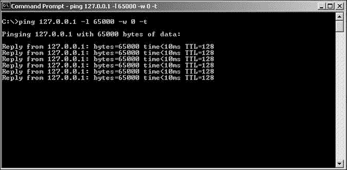

**Figure 4.1** `ping` from the command prompt.

此时，这台单独的机器在持续向目标机器发送 ping 请求。当然，单台机器在教室或实验室中仅仅向你的 Web 服务器发送 ping 请求不会对 Web 服务器产生不良影响。然而，你现在可以逐台向其他教室或实验室的机器发起同样的攻击。每增加三到四台机器的批次后，访问 Web 服务器的默认网页。在达到一定阈值（即一定数量的机器向服务器发送 ping 请求）后，Web 服务器将无法响应请求，你将无法再看到网页。

导致服务被拒绝的机器数量取决于你所使用的 Web 服务器。为了在尽可能少的机器参与下观察到这种拒绝现象，你可以使用资源非常有限的 PC 作为 Web 服务器（即 CPU 和内存最少的情况）。例如，在运行 Windows 7 Home Edition 的普通笔记本电脑上运行 Apache Web 服务器，大约需要 15 台机器，每台机器同时打开约 10 个命令行窗口并发送 ping 请求，才能使 Web 服务器停止响应合法请求。这种策略显然与通常为 Web 服务器选择的配置相悖；真正的 Web 服务器不会运行在资源受限的笔记本电脑上（无论是 Windows 7 Home Edition 还是 Windows 10）。同样，实际的 DoS 攻击使用更为高级的方法。这个简单的练习展示了 DoS 攻击的基本原理：向目标机器发送大量数据包，使其无法响应合法请求。需要注意的是，这仅是一个示例。在现代服务器上，以及许多服务器实际上以集群或服务器农场的形式托管的情况下，这种示例无法对现代目标产生效果。

总体而言，DoS 攻击的方法比本例要更加高级。例如，黑客可能开发一个小型病毒，其唯一目的就是感染尽可能多的计算机，然后让每台被感染的计算机对目标发起 DoS 攻击。病毒传播后，被感染的各台机器开始向目标系统发起洪水攻击。这种 DoS 攻击既容易发起，也难以阻止。从多台机器发起的 DoS 攻击被称为分布式拒绝服务（DDoS）攻击。

无论使用何种方法或工具（本章将介绍其中许多），DoS 和 DDoS 攻击正变得越来越普遍。根据 Calyptix Security 的数据，2018 年第一季度创下了 DoS 和 DDoS 攻击的记录。^(1) 2018 年 2 月 28 日，GitHub 网站遭遇了历史上最大规模的 DDoS 攻击，峰值达到 1.3Tbps。该记录在 5 天后被打破。

1. [`www.calyptix.com/top-threats/ddos-attacks-2018-new-records-and-trends/`](https://www.calyptix.com/top-threats/ddos-attacks-2018-new-records-and-trends/)

### Distributed Reflection Denial of Service Attacks

如前所述，DDoS 攻击正变得越来越普遍。大多数此类攻击依赖于让各种机器（服务器或工作站）攻击目标。分布式反射拒绝服务攻击是一种特殊类型的 DoS 攻击。与所有此类攻击一样，它是黑客让若干机器攻击选定的目标。然而，此攻击的工作方式与其他 DoS 攻击不同。与其直接让计算机攻击目标，该方法利用 Internet 路由器发起对目标的攻击。

Internet 骨干上的许多路由器使用端口 179 进行通信。该攻击利用该通信通道，诱使路由器攻击目标系统。这种攻击特别恶劣的原因是它不需要路由器本身受到任何 compromise。攻击者不需要在路由器上安装任何软件来让其参与攻击。相反，黑客向各个路由器发送数据包流，请求建立连接。这些数据包被伪造，使其看起来像来自目标系统的 IP 地址。路由器响应时会尝试与目标系统建立连接。来自多个路由器的大量连接同时冲击同一目标系统，使其无法到达。

### 使用 DoS 攻击的常见工具

正如本书讨论的安全问题所料，黑客拥有 vast array of tools（大量工具）。DoS 领域也不例外。虽然本书的范围远远不足以分类或讨论所有这些工具，但简要介绍几种工具将很有用。

#### Low Orbit Ion Cannon

Low Orbit Ion Cannon (`LOIC`) 是最广为人知的 DoS 工具之一。它拥有非常易用的图形用户界面，如图 4.2 所示。

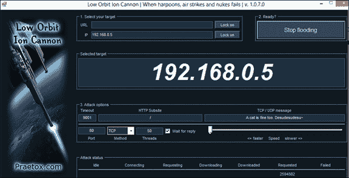

**Figure 4.2** `LOIC`.

该工具使用非常简单。如图 4.2 所示，你只需输入目标 URL 或 IP 地址，然后开始攻击。好在该工具不会隐藏攻击者的地址，因此很容易追踪攻击来源。它是一个较旧的工具，但至今仍被广泛使用。还有一个类似的工具叫 High Orbit Ion Cannon (`HOIC`)。

#### XOIC

`XOIC` 与 `LOIC` 类似。它有三种模式，如图 4.3 所示：你可以发送消息、执行简短测试或开始 DoS 攻击。

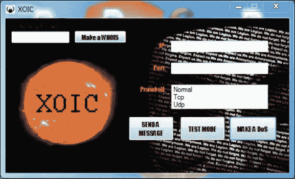

**Figure 4.3** `XOIC`.

与 `LOIC` 类似，`XOIC` 也非常易用。它是一个点击即用的图形用户界面。即使是技能最小的攻击者也能使用它发起 DoS 攻击。

#### TFN and TFN2K

Tribal Flood Network (`TFN`) 和 `TFN2K` 是最古老的 DoS 工具之一，如今使用不多，仅作历史参考。`TFN` 和 `TFN2K` 使用了多年，至今仍在使用，但使用范围有限。`TFN2K` 是 `TFN` 的更新版本，支持 Windows Server 和 UNIX 平台（并且可以轻松移植到其他平台）。它包含一些功能，使其比前身更难被检测，例如发送伪装信息以避免被追踪。精通使用 `TFN2K` 的专家可以利用多个代理机器协调对一个或多个目标的攻击。此外，`TFN` 和 `TFN2K` 还能够执行多种攻击，包括 UDP 洪水攻击、ICMP 洪水攻击和 TCP SYN 洪水攻击（后文将详细讨论）。

`TFN2K` 在两个方面工作。首先，主系统上有一个基于命令的客户端。其次，有一个守护进程在代理系统上运行。攻击过程如下：

1. 主系统指示其代理去攻击指定的目标列表。
2. 代理则通过向目标倾泼大量数据包来做出响应。

使用该工具，由主系统协调的多个代理可以在攻击期间协同工作，以阻断目标的访问。此外，针对 `TFN2K` 的攻击者安全特性大大增加了开发有效且高效的防御措施的难度：

* 主系统与代理之间的通信是加密的，并且可以与任意数量的伪包混合。
* 主系统与代理之间的通信以及攻击本身都可以通过随机的 TCP、UDP 和 ICMP 数据包传输。
* 主系统可以伪造（欺骗）其 IP 地址。

#### Stacheldraht

`Stacheldraht` 不像前面提到的 DoS 工具那样广为人知。`Stacheldraht`（德语意为“带刺线圈”）是一种 DDoS 攻击工具，结合了 Trinoo DDoS 工具（另一种常见工具）的特性以及 `TFN` DDoS 攻击工具的源代码。与 `TFN2K` 类似，它还为攻击者与 `Stacheldraht` 主机之间的通信提供了加密功能，并实现了代理的自动更新。

`Stacheldraht` 可以执行多种攻击，包括 UDP 洪水、ICMP 洪水、TCP SYN 洪水和 Smurf 攻击。它还能够检测并自动启用源地址伪造。

### DoS 弱点

从攻击者的角度来看，任何 DoS 攻击的弱点在于数据包的洪水必须持续发送。一旦数据包停止发送，目标系统就会恢复。DoS/DDoS 攻击通常会与其他形式的攻击一起使用，例如在 TCP 劫持中关闭连接的一侧，或阻止服务器之间的身份验证或日志记录。

如果黑客使用的是分布式攻击，一旦受害机器的管理员或所有者发现其机器被感染，他们会采取措施清除病毒，从而停止攻击。如果黑客尝试从自己的机器发起攻击，她必须意识到每个数据包都可能被追溯到其来源。这意味着单个黑客进行 DoS 攻击几乎必然会被当局发现。因此，DDoS 攻击正迅速成为最常见的 DoS 攻击类型。本章后面将详细讨论 DDoS 攻击的具体细节。

### 具体的 DoS 攻击

DoS 攻击的基本概念并不复杂。攻击者的真正挑战是不被发现地执行攻击。本章接下来的几个小节将介绍一些具体的 DoS 攻击类型，并提供具体的案例研究。这些信息将帮助你更深入地理解这一特定的 Internet 威胁。

#### TCP SYN 洪水攻击

SYN 洪水是 DoS 攻击的一种流行形式，也是 DoS 攻击历史中的经典。该攻击依赖于黑客对服务器连接建立过程的了解。当客户端与服务器之间建立 TCP 会话时，会发送一个带有 1 位于 SYN（同步）标志的数据包，请求服务器同步通信。服务器随后会分配相应的资源并返回一个同时设置 SYN（同步）和 ACK（确认）标志的数据包。客户端随后应答设置 ACK 标志。这个过程称为三次握手，概括如下：

1. 客户端发送带有 SYN 标志的数据包。
2. 服务器为客户端分配资源，然后返回带有 SYN 和 ACK 标志的数据包。
3. 客户端回复带有 ACK 标志的数据包。

在 Web 服务器上已经发生了多次著名的 SYN 洪水攻击。之所以该攻击类型如此流行，是因为任何进行 TCP 通信的机器都可能受到影响——而所有连接到 Internet 的机器都会进行 TCP 通信。这正是 Web 服务器的全部目的。阻止 DoS 攻击最简便的方法是通过防火墙规则实现。（我们将在 第 9 章 “计算机安全技术” 中详细讨论防火墙。）配置得当的防火墙可以阻止 SYN 洪水攻击。然而，你可以在单个服务器上实施多种方法和技术来防护这些攻击。基本的防御技术如下：

* 微块（Micro blocks）
* SYN Cookies
* RST Cookies
* 栈调优（Stack tweaking）

这些方法的技术难度各不相同。这里我们对这些方法作一般性的介绍。当你被委托为系统提供防御时，你可以根据网络环境和自身经验选择最合适的方法，并在需要时进一步研究系统。如何实现这些方法的具体细节取决于你的 Web 服务器所使用的操作系统。你需要查阅操作系统的文档或相关网站，以获取明确的实现指导。

##### 微块（Micro Blocks）

微块的工作方式是为 SYN 对象分配一个微记录，而不是为完整的连接对象（整个缓冲区段）分配空间。通过这种方式，入站的 SYN 对象可以只分配 16 字节的空间，从而大幅降低洪水对系统的影响，使其更难以被大规模发起。该方法相对不常见，今天的使用频率不如过去。它并不能真正防止 DoS 攻击，只是减轻了其影响。

> **Note**
>
> 许多网络管理员仅依赖防火墙来阻止 DoS 攻击，而不在单个服务器上采取任何修复措施。我建议你考虑将两者结合起来。是的，你应该拥有一个配置良好的防火墙来阻止许多 DoS 攻击，但也应考虑在单个服务器上采取缓解措施。

##### SYN Cookies

顾名思义，SYN Cookies 使用“Cookie”，类似于许多网站上使用的普通 Cookie。使用该方法时，系统在收到 SYN 包后不会立即在内存中为握手过程分配缓冲区。相反，它会先发送一个 *SYN+ACK*（开始握手的 ACK 信号），其中包含一个精心构造的 Cookie。该 Cookie 是基于客户端 IP 地址、端口号以及其他信息生成的散列值。当客户端返回正常的 ACK 时，服务器会从 Cookie 中提取信息并进行验证。因此，系统在第三阶段握手之前不会真正分配任何内存，从而使系统能够正常运行；通常唯一的可见效果是大窗口被禁用。然而，SYN Cookies 使用的加密散列运算相对资源密集，因此在预计会有大量 incoming connections 时，系统管理员可能会选择不启用此防御手段。

> **FYI: Hashing**
>
> A hash value is a number generated from a string of text. The hash is significantly smaller than the text itself and is generated by a formula in such a way that it is extremely unlikely that some other text will produce the same hash value. Hashing plays a role in security when it is used to ensure that transmitted messages have not been tampered with. The sender generates a hash of the message, encrypts it, and sends it with the message itself. The recipient then decrypts both the message and the hash, produces another hash from the received message, and compares the two hashes. If they are the same, there is a very high probability that the message was transmitted intact. We will discuss hashing in more detail in 第 8 章, “加密.”

##### RST Cookies

Another cookie method that is easier to implement than SYN cookies is the *RST cookie*. In this method, the server sends an incorrect SYN+ACK back to the client. The client then generates an RST packet, telling the server that something is wrong. Because the client sends back a packet notifying the server of the error, the server now knows the client request is legitimate and can now accept incoming connections from that client in the normal fashion. This method has the disadvantage of potentially causing problems with older Windows machines and with machines that are communicating from behind firewalls.

##### Stack Tweaking


*Stack tweaking* involves altering the TCP stack on the server so that it will take less time to time out when a SYN connection is left incomplete. Unfortunately, this protective method will just make executing a SYN flood against that target more difficult; to a determined hacker, the attack is still possible.

## In Practice

### Stack Tweaking

The process of stack tweaking is often quite complicated, depending on the operating system. Some operating systems’ documentation provides no help on this subject. For these reasons, this method is usually used only by very advanced network administrators and is not recommended unless you have a very solid knowledge of the operating system with which you are working.

### SPI Firewalls

Today, most firewalls use stateful packet inspection. These types of firewalls not only apply rules to each packet, but they maintain the state of communication between the client and the server. They therefore realize that multiple SYN packets are coming from the same IP address, and they therefore block them. This is one major reason SYN floods are not seen much today. In addition, next-generation firewalls (NGFWs) combine traditional firewall and other functions, such as those of an application firewall or an intrusion detection system/prevention system (IDS/IPS).

### Smurf IP Attacks

The Smurf attack is a very popular version of the DoS attack. An ICMP (Internet Control Message Protocol) packet is sent out to the broadcast address of the network. Since it is broadcast, it responds by echoing the packet out to the network hosts, which then send it to the spoofed source address. Also, the spoofed source address can be anywhere on the Internet, not just on the local subnet. If the hacker can continually send such packets, she will cause the network itself to perform a DoS attack on one or more of its member servers. This attack is clever and rather simple. The only problem for the hacker is getting the packets started on the target network. This task can be accomplished via some software, such as a virus or Trojan horse, that will begin sending the packets.

In a Smurf attack, there are three people/systems involved: the attacker, the victim, and the intermediary (who can also be a victim). The attacker first sends an ICMP echo request packet to the intermediary’s IP broadcast addresses. Since this is sent to the IP broadcast address, many of the machines on the intermediary’s network will receive this request packet and will send back an ICMP echo reply packet. If all the machines on a network are responding to this request, the network becomes congested, and there may be outages.

The attacker impacts the third party—the intended victim—by creating forged packets that contain the spoofed source address of the victim. Therefore, when all the machines on a network start replying to the echo request, those replies will flood the victim’s network. Thus, another network becomes congested and could become unusable. Figure 4.4 illustrates this attack.

![Figure 4.4 Smurf attack. A diagram explains a smurf attack. An attacker's machine and gateway router for the victim network are present at a small distance between each other. Four other computers on the victim network are connected to a single target machine with ip address 192.168.1.43. The attack is explained in three steps. Step 1: The broadcast packets spoofing 192.168.1.43 (target) as the source from the attacker's machine to the gateway router. Step 2: Router forwards broadcast to all machines on the network. Step 3: All machines respond to the target from the computer on the victim network towards the target machine.](img/04fig04.jpg)

**Figure 4.4** Smurf attack.

The Smurf attack is an example of the creativity that some malicious parties can employ. It is sometimes viewed as the digital equivalent of the biological process in an auto-immune disorder. With such disorders, the immune system attacks the patient’s own body. In a Smurf attack, the network performs a DoS attack on one of its own systems. This method’s cleverness illustrates why it is important that you attempt to work creatively and in a forward-thinking manner if you are responsible for system security in a network. The perpetrators of computer attacks are inventive and always coming up with new techniques. If your defense is less creative and clever than the attackers’ offense, then it is simply a matter of time before your system is compromised.

There are several ways to protect your system against this problem. One is to guard against Trojan horses. More will be said about the Trojan horse attack in later chapters; however, having policies prohibiting employees from downloading applications will help. Also, having adequate virus scanners can go a long way in protecting your system from a Trojan horse and, thus, a Smurf attack. It is also imperative that you use a proxy server, as discussed in 第 2 章. If the internal IP addresses of your network are not known, then it is more difficult to target one in a Smurf attack. And, of course, the most obvious mitigation step you can take is to block all inbound broadcast packets at the firewall. Probably the best way to protect your system is to combine these defenses and also prohibit directed broadcasts.

There is a variation of Smurf named Fraggle. Fraggle operates very much like Smurf with the exception of specifically using ports 7 (echo) and 19 (chargen) to a Broadcast Address, spoofing the intended victim’s source IP address.

### UDP Flood Attacks

UDP, as you will recall from 第 2 章, is a connectionless protocol that does not require a connection setup procedure prior to transferring data. In a *UDP flood attack*, the attacker sends a UDP packet to a random port on a target system. When the target system receives a UDP packet, it automatically determines what application is waiting on the destination port. In this case, since there is no application waiting on the port, the target system will generate an ICMP packet of “destination unreachable” and attempt to send it back to the forged source address. If enough UDP packets are delivered to ports on the target, the system will become overloaded trying to determine awaiting applications (which do not exist) and then generating and sending packets back.

## ICMP 洪水攻击

存在两种基本类型的 `ICMP 洪水攻击`：洪水和核弹。`ICMP 洪水` 通常通过广播大量 `ping` 或 `UDP` 数据包来实现。与其他洪水攻击一样，目的是向目标系统发送大量数据，使其变慢。如果能够让其减速到足够程度，目标将超时（即无法及时发送回复）并与 Internet 断开连接。`ICMP 核弹` 利用特定操作系统的已知漏洞。攻击者发送一段他知道目标系统上的操作系统无法处理的信息包。在很多情况下，这会导致目标系统完全冻结。

这种攻击方式相较于现代计算机，在过去的旧机器上要有效得多。即使是一台低端台式机现在也拥有 4GB（或更多）的 RAM 和双核处理器，这使得生成足够的 `ping` 来使机器离线变得困难。不过，在当时，这却是一种非常常见的拒绝服务攻击形式。

### Ping of Death（Ping of Death）

请回顾第 2 章（<a href="#ch02.xhtml#ch02">`ch02.xhtml#ch02`</a>）的内容，TCP 包的大小是有限制的。在某些情况下，仅仅发送一个过大的包就能使目标机器关闭。这种行为被称为 `ping of death`（`PoD`）。它的工作原理很简单：通过过载目标系统来实现。黑客发送一个 `ping`，但该 `ping` 包非常大，从而可能使某些机器瘫痪。

这种攻击方式与本章节前面讨论的课堂示例非常相似。两者的目标都是过载目标系统，导致其停止响应。`PoD` 用于攻击那些无法处理极大包大小的系统。如果攻击成功，服务器会彻底关闭。当然，它可以重新启动。

针对 `PoD` 的唯一真正防护措施是确保所有操作系统和软件定期补丁更新。该攻击依赖于特定操作系统（或应用程序）处理异常大的 TCP 包的方式存在的漏洞。当此类漏洞被发现时，供应商通常会发布补丁。`PoD` 的可能性之一，使得必须在所有系统上保持补丁更新。

大多数拒绝服务攻击可以通过适当的防火墙配合 IDS/IPS 或下一代防火墙来有效缓解。<sup>第 9 章</sup> 详细讨论了安全设备和软件。

### Teardrop 攻击

在 `teardrop attack` 中，攻击者发送一个被碎片化的消息。两个碎片在重组时会以导致无法正确组装的方式重叠，从而破坏单个数据包的头部。因此，当受害者尝试重构消息时，消息会被破坏，导致目标系统停止或崩溃。基本的 `teardrop attack` 有多种变体，如 `TearDrop2`、`Boink`、`targa`、`Nestea Boink`、`NewTear` 和 `SYNdrop`。

### DHCP 耗尽（DHCP Starvation）

如果在网络中发送大量请求，攻击者可以耗尽 DHCP 服务器分配的地址空间，并持续一段时间。这种拒绝服务攻击称为 `DHCP 耗尽`。攻击者可以使用诸如 `The Gobbler` 之类的工具轻松发起此类攻击。

### HTTP POST 拒绝服务攻击

`HTTP POST DoS attack` 涉及发送合法的 HTTP POST 消息。POST 消息的一部分是 `content length`，指示后续消息的大小。在该攻击中，攻击者以极慢的速率发送实际的消息体。服务器会在等待消息完成的同时被阻塞。对于更强大的服务器，攻击者需要同时发送多条 HTTP POST 消息。

### PDoS 攻击

永久拒绝服务（PDoS）攻击会损坏系统到如此程度，以至于受害机器需要重新安装操作系统，甚至更换新硬件。这种攻击有时被称为 `phlashing`，通常涉及对设备固件进行拒绝服务攻击。

### 注册耗尽攻击

攻击者可以编写程序，反复提交注册表单，向应用中添加大量虚假用户。这也是为何许多注册网站使用 CAPTCHA。

### 登录耗尽攻击


攻击者可能通过持续发送需要登录模块访问身份验证机制的登录请求来使登录过程过载，从而使其不可用或响应异常缓慢。许多网站使用 `CAPTCHA` 防止自动登录尝试。

## Land 攻击

`Land attack` 可能是概念上最简单的攻击。攻击者发送一个伪造数据包，其源 IP 地址和目的 IP 地址相同（即目标的 IP 地址）。其目的是让目标系统“疯狂”，让它尝试向自己发送和接收消息。受害系统通常会困惑并崩溃或重启。更现代的计算机对这种攻击不敏感，但这里仅作历史参考。

## DDoS 攻击

或许当今最常见的 DoS 攻击形式是 `DDoS attack`。它通过让多台机器攻击目标来实现。典型做法是发送木马程序，使受感染的计算机在特定日期和时间攻击指定目标。这是一种非常有效的方式，可以对任何目标发起 DDoS 攻击。在这种形式的攻击中，攻击者没有对参与攻击的各台机器的直接控制。这些机器仅仅被恶意软件感染，在特定时间发起攻击。

另一种方法是使用 `botnet` 来协调攻击。`Botnet` 是被攻击者控制的受感染计算机网络，攻击者可以直接控制这些机器。通常通过木马程序实现，但与前面提到的 DDoS 形式不同，`botnet` 攻击的发起者对攻击机器有直接控制权。

### 真实世界中的 DoS 攻击示例

我们已经讨论了各种 DoS 攻击的基本原理。到此为止，你应该对 DoS 攻击是什么以及它是如何工作的有了基本了解。现在是时候讨论具体的、现实中的攻击案例。本节将把你已有的理论知识转化为实际应用的例子。

#### *Boston Globe* 攻击

2017 年 11 月 8 日，`Boston Globe` 遭受了针对 `bostonglobe.com` 及公司拥有的其他网站的大规模 DDoS 攻击。此次攻击还中断了公司的电话服务。攻击仅通过公司的互联网服务提供商实施抗 DDoS 措施（如带宽限制）而得以停止。

#### Memcache 攻击

2017 年 2 月，出现了新的 DDoS 攻击向量。攻击者利用 `memcache`（一种数据库缓存系统）放大流量。通过该方法，单个请求可以放大数千倍的流量。上述 `GitHub` 攻击涉及 `memcaching`。

#### MyDoom

这是一个旧的攻击，但它是 DDoS 历史上经典的攻击之一，因此值得提及。最著名的 DoS 攻击之一是 `MyDoom` 攻击。虽然这个攻击已经几年历史，但它仍然是一个极佳的研究对象，因为它是病毒用于传播 DDoS 攻击的典型例子。该威胁是一种经典的分布式 DoS 攻击。病毒/蠕虫会将自身发送到某人的通讯录中的每个人，并以此方式进一步复制，然后在预定时间，所有受感染的机器发起协同攻击，针对 Santa Cruz Operations（`SCO`）网站 `www.sco.com`（`Network World`, 2004）。估计受感染的机器数量在 50 万到 100 万台之间。这次攻击取得了成功，迅速将 `SCO` 网站关闭。应当注意的是，在 DoS 攻击实际执行的那一天之前，网络管理员和家庭用户早已清楚知道 `MyDoom` 会做什么。此外，互联网上还提供了多种免费工具，用于清除该病毒/蠕虫。然而，似乎许多用户并未采取必要的步骤来清除他们的机器上的病毒/蠕虫。

有趣的是，`MyDoom` 在发现多年后仍在继续造成问题。截至 2009 年 7 月，攻击者仍利用 `MyDoom` 作为后门，对韩国和美国的 Web 服务器发起 DoS 攻击。

FYI: Virus or Worm?

关于病毒和蠕虫的定义，专家们一直存在广泛争论。具体到定义的不同，有人称某些东西为病毒，有人称其为蠕虫。一个被广泛接受的一般区分是：蠕虫不需要直接的人为交互作用即可传播，而病毒需要。如果你接受这个定义，那么 `MyDoom` 和 `Slammer` 都属于蠕虫。为了避免混淆，本文在此使用 *virus/worm* 这一术语。

使这起攻击特别有趣的一点是，它明显是一次国内网络恐怖主义行为（尽管 `MyDoom` 的创建者可能持不同看法）。（网络恐怖主义将在第 12 章，“网络恐怖主义与信息战。”）对于不熟悉此事的读者，这里简要说明：`SCO` 提供其 UNIX 操作系统的版本。与大多数其他 UNIX 版本一样，`SCO` 版本受版权保护。在本次攻击发生数月之前，`SCO` 开始指控某些 `Linux` 发行版包含 `SCO` UNIX 代码片段。`SCO` 向许多 `Linux` 用户发送信件，要求支付许可费。`Linux` 社区中的许多人认为这是一种阻碍 `Linux`（开源操作系统）发展的手段。`SCO` 更进一步，起诉了多家分发 `Linux` 的大型公司。`SCO` 的这一主张对许多法律和技术分析人员来说显得毫无依据。此外，由于 `SCO` 与微软关系密切，微软一直在竭力遏制 `Linux` 的普及，这也使得 `SCO` 的指控显得尤其可疑。

许多分析人员认为，`MyDoom` 病毒/蠕虫是由一名个人（或一群个人）创作的，他们认为 `SCO` 的做法是不可接受的。黑客们希望给 `SCO` 造成经济损失并损害其公众形象。这种可能的动机使得此案成为典型的国内经济恐怖主义行为：一组人因意识形态差异，攻击另一组人的技术资产。在 `MyDoom` 之前，已经有许多网站被篡改以及其他小规模攻击，这些攻击都是意识形态冲突的一部分。然而，这次病毒/蠕虫攻击是首次如此广泛且成功的。这一事件开启了信息战新趋势。随着技术成本降低、手段更易获取，未来我们可以预期此类攻击将有所增加。

#### DDoS Blackmail

2015 年 11 月，澳大利亚公司 `FastMail` 成为 DDoS 攻击的受害者。首先系统遭到攻击并被取 offline。在第二次攻击后，受害者收到勒索要求。攻击者要求支付 20 枚比特币以终止攻击。此前，`Protonmail` 也曾遭遇类似攻击，并被要求支付赎金以停止攻击。

#### Mirai

`Mirai` 是一种恶意软件，它将基于 `Linux` 的机器转化为僵尸网络，用于发起 DDoS 攻击。该恶意软件首次出现在 2016 年 8 月。`Mirai` 针对物联网（`IoT`）设备，作为 DDoS 攻击的基础。

### 如何防御 DoS 攻击

没有保证能够防止所有 DoS 攻击的方法，也没有绝对可靠的办法来防止黑客攻击。但你可以采取一些措施来降低风险。正如前文提到的，`SYN cookies` 和 `RST cookies` 等方法已经被讨论。本节将介绍几种可采取的措施，使你的系统更不易受到 DoS 攻击。

首先，你需要考虑这些攻击是如何实施的。它们可能通过发送 `ICMP` 包（用于在 Internet 上发送错误消息）或由 `ping` 和 `traceroute` 工具发送来实施。如果你有一个防火墙（而且你绝对应该有一个），只需将其配置为拒绝外部网络的 `ICMP` 包，这将是保护网络免受 DoS 攻击的重要一步。由于 DoS/DDoS 攻击可以通过多种协议执行，你也可以配置防火墙拒绝所有 incoming traffic，无论其协议或端口如何。这一步骤看似激进，但确实是安全的。

在实践中

**阻止 ICMP 包**

阻止外部网络的 `ICMP` 包有非常少的合法理由（一些人甚至认为没有良好理由）。因此，阻止此类包通常被用作防御 DoS 攻击的策略之一。顺便提一下，这也会使攻击者更难扫描你的网络（如我们将在第 12 章看到）。

此外，可以通过使用 `NetStat` 等信息工具，检测某些 DoS 工具（如 `TFN2K`）的威胁。许多这些工具可以配置为查找 `SYN_RECEIVED` 状态，这可能表明 SYN 洪水攻击。

如果你的网络足够大，拥有内部路由器，那么可以配置这些路由器拒绝任何不源自你的网络的流量。这样，即使攻击包通过防火墙，也不会在网络内部传播。你还应考虑在所有路由器上禁用 directed IP broadcasts。此策略可防止路由器向网络内的所有机器发送广播包，从而阻止许多 DoS 攻击。此外，你可以在路由器上安装过滤器，验证外部包确实拥有外部 IP 地址，而内部包拥有内部 IP 地址。

由于许多分布式 DoS 攻击依赖于“無辜”计算机作为发起点，保护你的电脑免受病毒和木马攻击是减少此类攻击的一种方式。这将在后续章节中详细讨论，但目前请记住以下三点：

* 始终使用病毒扫描软件并保持更新。
* 始终保持操作系统和软件补丁的更新。
* 建立组织政策，规定员工除非 IT 部门批准，否则不能下载任何内容到其机器上。

`Blackholing` 和 `sinkholing` 是常用于缓解 DoS 和 DDoS 攻击的技术。如果判断流量为 DoS 攻击，则该流量会被发送到 `black hole`——即不存在的服务器/接口。这通常由互联网服务提供商执行。`Sinkholes` 是用于分析流量并丢弃坏包的 IP 地址。将流量发送到 `sinkhole` 可以进行分析。

此外，入侵防御系统（`IPS`）也常被用来检查流量并阻止拒绝服务攻击。

如前所述，这些步骤并不能使你的网络完全免受 DoS 攻击的受害或成为 DoS 攻击的发射点，但它们能够降低这种情况发生的可能性。在 ISP 与网络上的 `IPS` 结合使用黑洞和 `sinkholing` 时，可提供合理的保护。关于此主题的良好资源是 `SANS Institute` 网站，网址为 [`www.sans.org/dosstep/`](http://www.sans.org/dosstep/)。该站点提供一些防止 DoS 攻击的实用技巧。

### Summary

DoS 攻击是互联网上最常见的攻击之一。它们易于执行，对攻击者来说不需要高超的技术，并且可能对目标系统产生毁灭性影响。只有病毒攻击更为常见。（在某些情况下，病毒本身也可以是 DoS 攻击的来源。）在练习中，你将练习阻止 DoS 攻击。

### Test Your Skills

#### Multiple Choice Questions

**1.** 当考虑可以针对你系统执行的各种攻击时，了解哪些攻击最为常见非常重要。在以下选项中，哪一个是系统上最常见且最简单的攻击？

**A.** `Denial of service attack`

**B.** Buffer overflow

**C.** Session hacking

**D.** Password cracking

**2.** 所有 DoS 攻击都基于向系统发送过大的工作负载。因此，测量系统的工作负载至关重要。下列哪项不是有效定义计算机工作负载的方式？

**A.** 同时用户数量

**B.** 存储容量

**C.** 最大电压

**D.** 网络连接速度

**3.** 你称一次从多台机器同时发起的 DoS 攻击为？

**A.** Wide-area attack

**B.** Smurf attack

**C.** SYN flood

**D.** DDoS attack

**4.** 了解不同类型的 DoS 攻击及其症状很重要。让连接保持半开是哪种攻击的症状？

**A.** Smurf attack

**B.** Partial attack

**C.** SYN flood attack

**D.** DDoS attack

**5.** 虽然有多种执行 DoS 攻击的方式，但它们都基于同一理念。DoS 攻击的基本概念是什么？

**A.** 计算机不善于处理 TCP 包。

**B.** 计算机只能处理有限的负载。

**C.** 计算机无法处理大量的 TCP 流量。

**D.** 计算机无法处理大量负载。

**6.** 从攻击者的角度来看，DoS 攻击的最显著弱点是什么？

**A.** 攻击往往不成功。

**B.** 攻击难以执行。

**C.** 攻击容易阻止。

**D.** 攻击必须持续进行。

**7.** DoS 攻击最常见的类别是什么？

**A.** Distributed denial of service

**B.** Smurf attacks

**C.** SYN floods

**D.** Ping of death

**8.** 针对 SYN flood 攻击的三种保护方法是什么？

**A.** SYN cookies、RST cookies、以及栈微调

**B.** SYN cookies、DoS cookies、以及栈微调

**C.** DoS cookies、RST cookies、以及栈删除

**D.** DoS cookies、SYN cookies、以及栈删除

**9.** Juan 向公司安全运营人员解释各种 DoS 攻击。本章提到的哪种攻击会导致网络对其自身服务器发起 DoS 攻击？

**A.** SYN flood

**B.** Ping of death

**C.** Smurf attack

**D.** DDoS

**10.** 以下哪种防御依赖于向请求客户端发送哈希值？

**A.** Stack tweaking

**B.** RST cookies

**C.** SYN cookies

**D.** Hash tweaking

**11.** 哪种防御依赖于向客户端发送错误的 SYN/ACK？

**A.** Stack tweaking

**B.** RST cookies

**C.** SYN cookies

**D.** Hash tweaking

**12.** 你正在向新来的安全技术员解释各种 DoS 攻击，想让她能够区分这些攻击并识别特定攻击的迹象。哪种防御依赖于修改服务器，使得未完成的握手超时时间更短？

**A.** Stack tweaking

**B.** RST cookies

**C.** SYN cookies

**D.** Hash tweaking

**13.** 哪种攻击依赖于发送体积过大的数据包，导致服务器无法处理？

**A.** Ping of death

**B.** Smurf attack

**C.** Slammer attack

**D.** DDoS

**14.** 你希望团队能够识别各种 DoS 攻击向量。哪种攻击利用受害者的自身网络路由器来对目标发起 DoS 攻击？

**A.** Ping of death

**B.** Smurf attack

**C.** Slammer attack

**D.** DDoS

**15.** 多年来出现了许多不同类型的攻击。下列哪项是 DDoS 攻击的例子？

**A.** MyDoom virus

**B.** Bagle virus

**C.** DoS virus

**D.** Smurf virus

**16.** 保护内部路由器如何有助于防御 DoS 攻击？

**A.** 如果内部路由器已受保护，攻击就无法发生。

**B.** 由于攻击来源于网络外部，保护内部路由器无法帮助防御 DoS。

**C.** 保护路由器仅能阻止基于路由器的 DoS 攻击。

**D.** 它将防止攻击在网络段之间传播。

**17.** 你可以对内部网络路由器做什么来帮助防御 DoS 攻击？

**A.** 禁止所有非加密流量

**B.** 禁止所有来自网络外部的流量

**C.** 禁止所有来自网络内部的流量

**D.** 禁止所有来自不可信来源的流量

**18.** 虽然这些经典攻击已经存在多年，但因其在网络安全史中的重要性而值得研究。以下哪项在当时被许多专家评为互联网上最快速增长的病毒？

**A.** MyDoom virus

**B.** Bagle virus

**C.** Slammer virus

**D.** Smurf virus

**19.** 没有任何防御策略是完美的，你需要允许至少一些流量进入和离开网络，否则网络毫无用处。你可以对防火墙做什么来防御至少一些 DoS 攻击？

**A.** 阻止所有入站流量

**B.** 阻止所有入站 TCP 包

**C.** 阻止所有入站端口 80 的流量

**D.** 阻止所有入站 ICMP 包

**20.** 你正在寻找所有可能的 DoS 攻击向量，以便为每个向量提供缓解措施。为什么防范 Trojan horse 攻击可以减少 DoS 攻击？

**A.** 许多拒绝服务攻击是通过使用 Trojan horse 让不 suspect 的机器执行 DoS 攻击来实施的。

**B.** 如果你能阻止 Trojan horse 攻击，也就能阻止 DoS 攻击。

**C.** Trojan horse 通常会打开端口，从而允许 DoS 攻击。

**D.** Trojan horse 的效果与 DoS 攻击非常相似。

#### Exercises

# Exercise 4.1: 执行拒绝服务攻击

请注意，该练习最好在有多台可用机器的实验室环境中完成。

1. 设置一台机器（最好是容量非常有限的机器）来运行一个小型 Web 服务器。（你可以从[`www.apache.org`](http://www.apache.org)免费下载适用于 Windows 或 Linux 的 Apache。）
2. 使用 `ping` 实用程序，在多台其他计算机上尝试对该 Web 服务器进行简单的拒绝服务攻击。具体实现方法是让其他机器连续发送 `ping -l 65000 -w0 -t` *<目标地址>* 的请求。
3. 在“攻击”过程中，请仅添加一到三台实验室机器。（先从一台开始，再逐步添加几台，然后继续添加。）
4. 随着机器数量增加，记录其他机器上传入目标服务器主页所需的时间。同时记录阈值（即服务器完全停止响应的时刻）。

# Exercise 4.2: 防御 SYN 洪水攻击

请注意，该练习属于高级内容。有些学生可能希望以小组形式作业。

1. 在 Web 上搜索或查阅操作系统文档，找到实现 RST Cookie 或 SYN Cookie 的相关说明。
2. 按照上述说明在自己的机器或教师指定的机器上进行实现。下面的网站可能会对你有帮助：
    * `Linux`: [`www.linuxjournal.com/article.php?sid=3554`](http://www.linuxjournal.com/article.php?sid=3554)
    * `Windows`: [`http://cr.yp.to/syncookies.html`](http://cr.yp.to/syncookies.html) 和 [`www.securityfocus.com/infocus/1729`](http://www.securityfocus.com/infocus/1729)


*   `Linux 和 Windows 都适用`: [`www.securiteam.com/tools/6D00K0K01O.html`](http://www.securiteam.com/tools/6D00K0K01O.html)

# Exercise 4.3: 使用防火墙设置

此练习仅适用于拥有实验室防火墙访问权限的学生。

1. 使用防火墙的文档，查看如何阻止 ICMP 包。
2. 在防火墙上设置阻止这些包的规则。

# Exercise 4.4: 使用路由器设置

此练习仅适用于拥有实验室路由器访问权限的学生。

1. 使用路由器的文档，查看如何阻止所有非本地网络发起的流量。
2. 在路由器上设置阻止该流量的规则。

## 项目

### 项目 4.1：采用替代防护措施

1. 使用 Web 或其他研究工具，搜索针对一般拒绝服务攻击或特定类型拒绝服务攻击的替代防御措施。（本章已提及的防御手段除外。）
2. 撰写一份关于该防御技术的简短论文。

### 项目 4.2：防御特定拒绝服务攻击

1. 使用 Web 或其他工具，查找过去 6 个月内发生的拒绝服务攻击。你可以参考[`www.f-secure.com`](http://www.f-secure.com) 等资源。
2. 记录该攻击的实施方式。
3. 写一段简短说明，说明你可能如何防御该特定攻击。

### 项目 4.3：加固 TCP 堆栈以防范 DoS

请注意，本项目需要实验室机器的访问权限，并且是一个耗时较长的项目，需要学生进行一定的研究时间。

1. 使用手册、厂商文档和其他资源，找到一种修改 TCP 通信的方法，以帮助防止 DoS 攻击。
2. 根据此信息，在实验室计算机上实现其中一种方法。

## 案例研究

Runa Singh 是一家中型公司的网络管理员，负责网络安全。公司已部署防火墙，网络被路由器分割为多个段，并且所有机器上都已安装更新的防病毒软件。Runa 想采取额外措施防止 DoS 攻击。她采取了以下行动：

*   她将防火墙配置为不允许任何入站的 ICMP 包。
*   她将 Web 服务器改为使用 SYN Cookies。

请思考以下问题：

1. 她的这些措施是否存在任何问题？如果有，具体是什么？
2. 你会向 Runa 推荐哪些额外的步骤？

# 第五章：恶意软件

## 章节目标

阅读本章并完成练习后，你将能够：

*   理解病毒（蠕虫）及其传播方式，包括著名的 WannaCry、Rombertik 和 Petya 等病毒
*   具备几种具体病毒爆发的工作知识
*   理解防病毒扫描仪的工作原理
*   理解特洛伊木马是什么以及它的工作原理
*   具备几种具体特洛伊木马攻击的工作知识
*   掌握缓冲区溢出攻击的概念
*   更好地理解间谍软件及其进入系统的方式
*   通过安全实践、防病毒软件和反间谍软件来防御这些攻击

## 介绍

在第 4 章 “拒绝服务攻击” 中，我们已经探讨了拒绝服务（DoS）攻击，这是一种非常常见且容易发起的攻击。本章将继续审视安全威胁，首先介绍病毒爆发。我们的讨论将聚焦于病毒攻击的工作原理和传播方式，包括通过特洛伊木马进行的部署。本章并非“如何自行制作病毒”的教程，而是对这些攻击概念的入门介绍以及一些具体案例的探讨。

本章还将探讨病毒、蠕虫、缓冲区溢出攻击、间谍软件以及其他多种恶意软件形式。每种恶意软件都有其独特的攻击方式，在防御系统时都需要考虑。通过深入了解它们的工作原理，你的防御能力将得到增强。章节末尾的练习将让你有机会研究防病毒措施，并尝试 McAfee、Norton、AVG、Bitdefender、Kaspersky、Malwarebytes 等防病毒厂商的防护工具。

在继续之前，请记住两点重要事实。第一，本章所描述的恶意软件类别在现实中并不总是清晰划分。例如，一段恶意软件可能同时具备病毒功能和间谍软件能力，也可能被用于发起拒绝服务攻击。尽管了解恶意软件的类别仍然重要，但要意识到现实中的恶意软件往往跨越多个类别。第二，恶意软件领域变化迅速，事物发展很快。我们会研究历史上具有代表性的、值得深入研究的具体案例，但也建议你保持关注最新的恶意软件动态，定期审查最新的恶意软件爆发。

## 病毒

按定义，计算机病毒是一个能够自我复制的程序。一些来源将病毒定义为必须附加到另一个文件（如可执行文件）才能运行的文件。但这并不准确。通常，病毒还会执行一些有害功能，而自我复制和快速传播是病毒的标志性特征。很多时候，仅仅这种快速扩散本身就已经构成问题。快速扩散的病毒可以降低网络的功能性和响应速度。只要流量超过网络设计承载的上限，网络可能会被暂时 rendered 无法使用。著名的 ILOVEYOU 病毒虽然没有负面负载，但其产生的大量邮件严重拥堵了许多网络。

### 病毒的传播方式

-   病毒通常主要通过以下几种方式传播。第一种是直接将自己发送到你电子邮箱通讯录中的所有人。另一种方法是扫描你的计算机，查找它可以访问的网络连接，然后将自己复制到这些网络上的其他机器上。病毒也可以存在于便携式介质，如 USB 设备、光盘或 DVD 上。也可以将病毒伪装成合法文件，这种情况称为木马。有时网站会被病毒感染，当有人访问该网站时，该人的电脑会被感染。
-   电子邮件方式是病毒传播中最为常见的方式，Microsoft Outlook 可能是遭受此类病毒攻击的最常用的电子邮件程序。原因并非 Outlook 本身存在安全漏洞，而是其使用的便捷性。所有 Microsoft Office 产品均设计得让正规程序员能够访问应用程序的内部对象，从而轻松创建能够与 Microsoft Office 应用程序集成的应用程序。例如，程序员可以编写一个程序，读取 Word 文档，导入 Excel 电子表格，然后通过 Outlook 自动将生成的文档通过电子邮件发送给感兴趣的各方。Microsoft 在这方面做得很好，通常只需极少量的编程即可完成这些任务。使用 Outlook，只需不到五行代码即可引用 Outlook 并发送电子邮件。这意味着程序可以让 Outlook 自行发送邮件，而用户却毫不知情。网络上有大量示例代码，展示了如何实现此操作，完全免费获取。因此，无需是高技能程序员，就能访问你的 Outlook 通讯录并自动发送邮件。因此，Outlook 的编程便捷性正是导致大量针对 Outlook 的病毒攻击的原因。
-   虽然绝大多数病毒攻击通过利用受害者现有的电子邮件软件来传播，但一些病毒爆发仍使用了其他传播方式，例如其内部的电子邮件引擎。另一种传播方式是病毒直接在网络中复制自己。通过多种途径传播的病毒爆发正在变得更加普遍。
-   传递载荷的方法可能非常简化，更多依赖于用户的疏忽而非病毒编写者的技巧。诱导用户访问不该访问的网站或打开不该打开的文件是常见的传递病毒的方法，且不需要任何编程技能。无论病毒如何到达你的系统，一旦它进入系统，就会尝试传播，并在许多情况下尝试对系统造成损害。一旦病毒进入你的系统，它可以执行任何合法程序可以做的事——因此它可能删除文件、修改系统设置或造成其他损害。
*   **`Macro`**: `Macro` 病毒感染办公文档中的宏。许多办公产品，包括 `Microsoft Office`，允许用户编写称为宏的微型程序。这些宏也可以作为病毒编写。`Macro` 病毒写入到某些业务应用程序的宏中。例如，`Microsoft Office` 允许用户编写宏以自动化某些任务。`Microsoft Outlook` 设计为让程序员可以使用一种称为 Visual Basic for Applications (`VBA`) 的受限 Visual Basic 子集编写脚本。该脚本语言实际上已内置于所有 `Microsoft Office` 产品中。程序员也可以使用 closely related `VBScript` 语言。两者都易于学习。如果此类脚本附加到电子邮件且收件人使用 `Outlook`，则脚本可以执行。执行过程可以执行多种操作，包括扫描通讯录、查找地址、发送邮件、删除邮件等。
*   **`Multi-partite`**: `Multi-partite` 病毒通过多种方式攻击计算机，例如感染硬盘引导区以及一个或多个文件。
*   **`Memory resident`**: `Memory resident` 病毒安装自身后，会一直驻留在 RAM 中，从电脑启动到关机为止。
*   **`Armored`**: `Armored` 病毒使用使其难以分析的技术。代码混乱是一种方法。代码被编写成如果病毒被反汇编，代码将难以追踪。压缩代码也是一种为病毒护盾的方法。
*   **`Sparse infector`**: `Sparse infector` 病毒通过间歇性执行恶意活动来规避检测。`Sparse infector` 病毒的用户会看到短暂的症状，然后一段时间无症状。在某些情况下，`Sparse infector` 会锁定特定程序，但病毒仅在该程序每 10 次或 20 次执行时运行。或者，`Sparse infector` 可能出现一次活动 burst，然后在一段时间内处于休眠状态。虽然有多种变体，但基本原理相同：降低攻击频率，从而降低被检测的机会。
*   **`Polymorphic`**: `Polymorphic` 病毒会在时间推移时改变形式，以规避防病毒软件的检测。
*   **`Metamorphic`**: `Metamorphic` 病毒是 polymorphic 病毒的特殊情况，它会定期完全重写自身。这类病毒极为罕见。
*   **`Boot sector`**: 顾名思义，此类病毒感染驱动器的引导区。由于大多数防病毒软件在操作系统内运行而非在引导区，因此此类病毒对防病毒软件来说较难被发现。
-   威胁于病毒攻击的影响不可低估。虽然网上有大量关于病毒的信息页面，但在我看来，只有少数网站能够持续提供最新、最可靠、最详细的病毒爆发信息。任何安全专业人士都应定期查阅这些网站。你可以在以下网站阅读关于任何过去或当前的病毒的更多信息：
*   [`https://www.technewsworld.com/perl/section/viruses-malware/`](https://www.technewsworld.com/perl/section/viruses-malware/)
*   [`https://us.norton.com/internetsecurity-malware-virus-faq.html?`](https://us.norton.com/internetsecurity-malware-virus-faq.html?)
*   [`https://www.us-cert.gov/publications/virus-basics`](https://www.us-cert.gov/publications/virus-basics)
*   [`http://www.techrepublic.com/pictures/the-18-scariest-computer-viruses-of-all-time/`](http://www.techrepublic.com/pictures/the-18-scariest-computer-viruses-of-all-time/)
-   接下来的章节将探讨一些真实病毒爆发。我们将研究非常近期的病毒，以及十多年前的一些经典案例。这将为你提供关于病毒在现实世界中行为的全面概览。

#### WannaCry

-   这在 2017 年是头条新闻。2017 年 3 月，WannaCry 席卷全球，引发巨大活动风暴。然而，该病毒将被研究多年。原因有几个。第一个原因是，针对其利用的漏洞已有一个补丁，且该补丁已在数周前发布。这凸显了补丁管理在网络安全中的重要性。
-   [WannaCry 病毒](https://wiki.example.org/feynmans_learning_method)有一个奇怪的特征：它内置了一个关闭开关。如果注册了特定的 URL，WannaCry 就会被关闭。一名名叫 Marcus Hutchins 的人意外发现了关闭开关，并阻止了 WannaCry。Hutchins 最初被赞为英雄，但后来因开发和销售银行木马恶意软件而被 FBI（与 WannaCry 无关）逮捕。

#### Petya

Petya 首次在 2016 年被发现，但持续传播直到 2018 年。它针对 Windows 机器，感染引导区并加密硬盘文件系统。随后要求以比特币支付赎金。这是一个结合多种特征的病毒的优秀示例。该病毒的名称来源于 1995 年詹姆斯·邦德电影《金眼》中，Petya 是一种苏联武器卫星。

#### Shamoon

Shamoon 病毒首次在 2012 年被发现，2017 年出现了一个变体。Shamoon 作为间谍软件运行，但在上传文件到攻击者后会删除文件。该病毒攻击了 Saudi Aramco 的工作站，声称责任的群体名为 Cutting Sword of Justice。

#### Rombertik

Rombertik 在 2015 年肆虐。该恶意软件利用浏览器读取用户对网站的凭证。它通常作为电子邮件附件发送。也许更糟糕的是，在某些情况下 Rombertik 会覆盖硬盘的主引导记录，使机器无法启动，或者开始加密用户主目录中的文件。

#### Gameover ZeuS

Gameover ZeuS 是一种创建点对点 botnet 的病毒。它基本上建立了感染电脑与命令与控制计算机之间的加密通信，使攻击者能够控制各个被感染的电脑。（命令与控制计算机是 botnet 用于控制其他电脑的机器，即 botnet 的中心节点。）2014 年美国司法部暂时切断了与命令与控制计算机的通信；2015 年 FBI 宣布为捕获 Evgeniy Bogachev（涉嫌与 Gameover ZeuS 有关）提供最高 300 万美元的奖励。

#### CryptoLocker and CryptoWall

勒索软件最广为人知的例子之一是臭名昭著的 CryptoLocker，最早于 2013 年被发现。CryptoLocker 使用非对称加密锁定用户的文件。已检测到 CryptoLocker 的多种变体。

CryptoWall 是 CryptoLocker 的一个变体，最早在 2014 年 8 月被发现。它的外观和行为与 CryptoLocker 非常相似。除了加密敏感文件外，它还会与命令与控制服务器通信，甚至拍摄被感染机器的屏幕。到 2015 年 3 月，一个 CryptoWall 变体被发现，并与间谍软件 TSPY\_FAREIT.YOI 捆绑，该变体除了劫持文件外，还会窃取被感染系统的凭证。

#### Atlanta 的勒索软件攻击

佐治亚州亚特兰大在 2018 年 3 月遭受勒索软件攻击。该市的许多系统受到影响，包括公用事业、法院和其他关键系统。两名伊朗黑客 Faramarz Savandi 和 Mohammed Mansouri 因该攻击被起诉。此次攻击之所以值得注意，有几个原因。第一，它使用了 SamSam 勒索软件，该软件通过暴力猜解密码获取系统访问权限，而非通过钓鱼。第二，亚特兰大之前因安全经费不足受到批评。攻击前两个月的审计发现了 1500 到 2000 个漏洞。

#### FakeAV

虽然 FakeAV 病毒已经存在多年，但仍值得研究。该病毒最早在 2012 年 7 月出现，影响了从 Windows 95 到 Windows 10 以及 Windows Server 2016 的 Windows 系统。它是一个假冒防病毒软件（因此得名 FakeAV），会弹出假的病毒警报。这并非第一种此类假冒防病毒恶意软件，但它是该类型的成功示例。

#### MacDefender

MacDefender 病毒在多方面很有趣。首先，它专门针对 Mac 电脑。长期以来，许多专家认为 Apple 产品因市场份额不足而相对安全，不易吸引病毒编写者的关注。人们猜测，如果 Apple 市场份额增加，病毒攻击也会随之增加，这已被证明属实。

MacDefender 病毒最早在 2011 年早期出现，至今仍有变体出现。它嵌入在某些网页中，当用户访问这些页面时，会弹出假的病毒扫描，告诉用户有病毒并需要修复。所谓的“修复”实际上是下载病毒。该病毒的目的是诱导终端用户购买 MacDefender“防病毒”产品。这是该案值得注意的第二个原因。假冒防病毒攻击（也称为*scareware*）正在日益普及。

#### Kedi RAT

2017 年 9 月，Kedi RAT（远程访问木马）病毒通过钓鱼邮件传播。一旦感染系统，它会窃取数据，然后通过 Gmail 账户以邮件形式将数据外传。它专门针对个人和/或财务数据，以便出售。

#### The Sobig Virus

Sobig 最早在 2003 年被发现，虽然不是新病毒，但因获得大量媒体关注并造成严重危害，是一个值得研究的病毒。该病毒采用多模式传播方式，即使用多种机制传播和感染新机器。它会将自身复制到网络中共享的驱动器，并通过电邮将自身发送给通讯录中的所有人。因此 Sobig 极具毒性，这也是它重要的研究对象。

FYI: Virulent Virus

术语*virulent*在计算机病毒与生物病毒的语境中基本含义相同：它衡量病毒传播的快速程度和感染新目标的容易程度。

在 Sobig 的例子中，如果一个人在网络中不幸打开了包含病毒的电子邮件，不仅他的机器会被感染，所有他有权限访问的网络共享驱动器也会被感染。然而，Sobig 像大多数通过电邮传播的病毒一样，电子邮件主题或标题中会有明显的特征，可以用来识别该邮件是否被病毒感染。电邮会带有诱人的标题，如“这里是样本”或“文档”，诱使你好奇心打开附件。随后病毒会将自身复制到 Windows 系统目录中。

该病毒传播得如此广泛，感染了如此多的网络，仅仅通过多次复制病毒就足以使某些网络瘫痪。该病毒本身并不破坏文件或损坏系统，但它产生大量流量，导致感染网络的带宽被消耗。病毒本身的技术水平属于中等。一旦释放，许多变体相继出现，进一步复杂化局面。一些 Sobig 变体的效果包括下载一个文件，导致打印问题；部分网络打印机会开始打印垃圾内容。Sobig.E 变体甚至会写入 Windows 注册表，使其在系统启动时运行。这些复杂的特征表明创建者了解如何访问 Windows 注册表、访问共享驱动器、修改 Windows 启动项以及访问 Outlook。


这引发了病毒变种及其产生方式的问题。在生物病毒的情况下，基因代码中的突变会导致新的病毒株出现，自然选择的压力使得这些株能够进化成全新的病毒种类。显然，生物方法并不适用于计算机病毒。对于计算机病毒，有恶意的程序员会获取病毒拷贝（可能是其自身机器被感染），然后进行逆向工程。由于许多病毒攻击以附在电子邮件中的脚本形式出现，与传统编译程序不同，这些攻击的源代码易于阅读和修改。该程序员只需将原始病毒代码稍作修改后重新发布变种。经常被捕获的病毒创作者实际上是缺乏原始病毒作者技能的变种开发者，因而容易被发现。

### The Mimail Virus

Mimail 是另一个历史悠久但仍值得研究的病毒。它的媒体关注度不如 Sobig，但具有有趣的特征。该病毒不仅从你的通讯录中收集电子邮件地址，还从机器上的其他文档中获取。因此，如果你在硬盘上有一个 Word 文档，且该文档中包含电子邮件地址，Mimail 就会找到它。这种策略使得 Mimail 的传播范围比许多其他病毒更广。Mimail 自带电子邮件引擎，无需依赖你的电子邮件客户端，能够在任何邮件软件上传播。

这两点使得 Mimail 对研究计算机病毒的人特别有趣。虽然有多种技术可以用于程序化打开和处理计算机文件，但大多数病毒攻击并不使用这些技术。扫描文档以查找电子邮件地址表明病毒作者具备一定的技巧和创造力。依此作者的观点，Mimail 并非业余爱好者的作品，而是由具备专业级编程能力的人所创作。

### The Bagle Virus

Bagle 是另一个历史病毒。它如今不再是问题，但在恶意软件发展史中具有重要意义，因为它将电子邮件附件与假病毒警报相结合。Bagle 病毒始于 2003 年第四季度迅速传播。它发送的邮件声称来自你的系统管理员，称你的电子邮件账户被病毒感染，并要求你打开附件以获取指示。打开附件后，系统即被感染。该病毒之所以特别有趣，有几个原因。首先，它通过电子邮件和复制到共享文件夹两种方式传播。其次，它会扫描 PC 中的文件以查找电子邮件地址。最后，它会禁用杀毒扫描进程，在生物学意义上“关闭”了计算机的“免疫系统”。禁用病毒扫描是一个新的变化，表明病毒创作者至少具备中等水平的编程技能。

### A Nonvirus Virus

近年来，“非病毒病毒”或称“骗局”逐渐流行。与真正编写病毒不同，骗局的黑客会向他拥有的所有地址发送邮件，声称来自知名杀毒中心，警告一款新病毒正在流通。邮件指示人们删除某个文件以除去病毒，但该文件实际上并非病毒，而是系统必需文件。著名的 `jdbgmgr.exe` 骗局就是此类案例，它敦促用户删除系统需要的文件。令人惊讶的是，不少人照此 advice 行事，不仅删除了文件，还立即给朋友和同事写信提醒他们也要删除该文件。

FYI: The Morris Internet Worm

Morris 蠕虫是最早通过互联网传播的计算机蠕虫之一，也是最早引起大量媒体关注的蠕虫。

Robert Tappan Morris, Jr.，当时是康奈尔大学的学生，于 1988 年 11 月 2 日从 MIT 系统上启动了该蠕虫。Morris 本人并不打算让蠕虫造成损害，而是希望它能揭示被利用的程序缺陷以便传播。然而，代码中的缺陷导致单台计算机可以被多次感染，蠕虫因此成为祸害。每一次额外的“感染”都会在受感染的机器上产生新进程。当进程数量过多时，计算机会变得缓慢甚至无法使用。至少有 6000 台 UNIX 机器被这颗蠕虫感染。

Morris 因违反 1986 年《计算机欺诈与滥用法》而被定罪，判处 1 万美元罚款、3 年缓刑以及 400 小时社区服务。也许这颗蠕虫产生的最大影响是促使了计算机应急响应团队（CERT）的成立。CERT（`www.cert.org`）是宿主于卡内基梅隆大学的组织，充当安全公告、信息和指南的库。任何安全专业人士都应熟悉 CERT。

### Flame

在讨论现代病毒时，无法不提及 Flame。该病毒最早出现在 2012 年，针对 Windows 操作系统。使其尤为著名的一点是，它是由美国政府专门为间谍活动设计的。2012 年 5 月，Flame 在包括伊朗政府在内的多个地点被发现。Flame 是一种间谍软件，能够监控网络流量并捕获受感染系统的截图。

### The Earliest Viruses

考虑最早发现的病毒是有启发意义的。1971 年，Bob Thomas 创建了被普遍认为是第一个电脑病毒的 Creeper，它通过 ARPANET（Internet 的前身）传播，并显示信息 “I’m the creeper, catch me if you can!” 另一个程序 Reaper 被创建用于删除 Creeper。

1974 年发现的 Wabbit 会复制自身多次，从而降低 infected computer 的性能。

Apple Viruses 1、2、3 是最早在“野外”或公共领域发现的病毒。它们于 1981 年在 Apple II 系统中被发现，并通过德州 A&M 利用 pirated computer games 传播。

### The Impact of Viruses

2018 年初，台湾台积电（TSMC），全球最大芯片制造商及 Apple 供应商，表示其系统和制造工具已遭到计算机病毒攻击，造成损失超过 1.7 亿美元。具体病毒未在新闻中描述，但单一公司受单一病毒影响如此严重，凸显了计算机病毒的危害。

### Rules for Avoiding Viruses

你会发现所有病毒攻击（除骗局外）都有一个共同主题：它们希望你打开某类附件。病毒最常见的传播方式是作为电子邮件附件。了解这一点，你可以遵循几条简单规则，大幅降低感染风险：

使用病毒扫描器。McAfee 和 Norton（本章末尾的练习中提到）是目前最广泛接受和使用的病毒扫描器。不过，Kaspersky 和 AVG 也是不错的、可靠的选择。每个都需要每年约 30 美元来保持病毒扫描器的更新。请执行此操作。每种防病毒产品都有支持者和反对者，我不会深入探讨哪个更好。对于大多数用户，四大主要防病毒程序中的任何一种都能有效工作。我会不定期更换使用的防病毒软件，以便熟悉所有它们。

如果你对附件不确定，请不要打开它。

你甚至可以和朋友、同事约定一个代码词。告诉他们，如果想发送附件，应该在信件标题中加入该代码词。没有看到代码词，你就不会打开任何附件。

不要相信“安全警报”直接发送给你的消息。微软不会以这种方式发出警报。定期查看微软官网，以及前面提到的防病毒网站。

这些规则不会让你的系统 100% 免受病毒侵害，但它们能在很大程度上保护你的系统。

### 特洛伊木马

回顾前面的章节，`Trojan horse` 是指看似无害但实际上具有恶意目的的程序。我们已经看到通过特洛伊木马传播的病毒。你可能会收到或下载一个看似无害的商业工具或游戏程序。更有可能的是，特洛伊木马只是附在看似无害的电子邮件中。当你运行该程序或打开附件时，它会做与你原本预期之外的事，或在原有功能之外执行其他操作。它可能会做以下任何一件：

*   从网站下载有害软件。
*   在你的机器上安装键盘记录器或其他间谍软件。
*   删除文件。
*   为黑客开辟后门以供其使用。

在许多情况下，病毒和特洛伊木马会结合使用。在这种情况下，特洛伊木马会像病毒一样传播。MyDoom 病毒打开了机器端口，随后 doomjuice 病毒利用该端口，使得 MyDoom 成为病毒与特洛伊木马的结合体。

特洛伊木马也可以专门针对某个人编写。如果黑客想监视某位特定个人（例如公司会计），他可以编写一款专门吸引该人的程序。例如，如果他知道会计爱好高尔夫，他可以编写一个计算高尔夫 handicap 并列出最佳高尔夫球场的程序。然后他在免费的 Web 服务器上发布该程序，并通过电子邮件向包括会计在内的多个人发送消息，告诉他们这款免费软件。程序安装后，它可以检查当前登录用户的名称。如果登录名与会计的姓名匹配，程序可以在用户不知情的情况下下载键盘记录器或其他监控应用。如果该程序既不破坏文件也不自我复制，它很可能会在很长时间内不被发现。多年来有许多特洛伊木马出现，其中最早且最著名的之一是 Back Orifice。

FYI：病毒或蠕虫？

如第 4 章所述，专家们对病毒与蠕虫的区别存在争议。有些专家会把 MyDoom（以及稍后将讨论的 Sasser）称为蠕虫，因为它在没有人工干预的情况下传播。然而，我将病毒定义为任何能够自我复制的文件，将蠕虫定义为能够在没有人工干预的情况下传播的程序。这也是安全专家中最常见的定义。

这样的程序几乎任何中等水平的程序员都能掌握。这也是许多组织禁止在公司机器上下载 *任何* 软件的原因。我不知晓有任何真实案例显示特洛伊木马被如此精准地定制。但需要记住的是，制造病毒攻击的人往往是创新型的人。

值得注意的是，制作特洛伊木马并不需要编程技能。网络上有免费工具（如 `EliteWrapper`），可以将两个程序——一个隐藏的、一个不隐藏的——合并在一起。例如，可以把病毒与扑克游戏合并。最终用户只会看到扑克游戏，但运行时会在后台启动病毒。

另一个值得考虑的场景是一场极其 devastating 的攻击。下面简要说明其基本思路（不透露具体编程细节），以示特洛伊木马的严重危害。想象一个小程序，用来显示一系列不讨喜的奥萨马·本·拉登照片。该程序可能在美利坚合众国乃至军事、情报或国防行业人员中很受欢迎。假设该程序在机器上停留一段时间，保持沉默。它不必像病毒那样自我复制，因为用户很可能会将其转发给许多同事。在特定日期和时间，软件会尝试访问所有可用的驱动器，包括网络驱动器，并开始删除所有文件。如果此类特洛伊木马在“野外”释放，30 天内极有可能传播到数千甚至数百万的人群中。这些数千或数百万台电脑随后会开始删除文件和文件夹。想象一下这种破坏的规模。

此情景专门用来吓唬你。计算机用户——包括那些本应更谨慎的专业人士——经常从互联网下载各种内容，如搞笑的 Flash 视频和可爱游戏。每一次员工下载此类内容时，都有可能下载到特洛伊木马。无需统计学知识，只要这种下载行为持续下去，终将在公司机器上下载到特洛伊木马。如果发生，理想情况下病毒不会像上面假设的那么恶毒。

由于特洛伊木马通常由用户自行安装，针对这种攻击的安全对策是防止终端用户下载和安装软件。从执法角度看，调查涉及特洛伊木马的犯罪行为时，会对电脑硬盘进行取证扫描，寻找特洛伊木马本身。

目前有若干工具（部分免费下载）可帮助个人制作特洛伊木马。我在渗透测试课程中使用的一个工具是 `eLiTeWrap`。它使用非常简便。基本原理是将任意两个程序合并在一起。利用此类工具，任何人都可以把病毒或间谍软件隐藏在看似无害的程序（如免费扑克游戏）中，导致大量用户下载并不知情地安装恶意软件。

`eLiTeWrap` 是一个命令行工具，但使用非常简单。请按照以下步骤操作：

1.  输入你想运行且可见的文件。
2.  输入操作：
    *   1—仅打包
    *   2—打包并执行，可见，异步
    *   3—打包并执行，隐藏，异步
    *   4—打包并执行，可见，同步
    *   5—打包并执行，隐藏，同步
    *   6—仅执行，可见，异步
    *   7—仅执行，隐藏，异步
    *   8—仅执行，可见，同步
    *   9—仅执行，隐藏，同步
3.  输入命令行。
4.  输入第二个文件（即你在暗中安装的项目）。
5.  再次输入操作。
6.  完成文件输入后，按 Enter 键。

在图 5.1 中，你可以看到一套适合课堂实验室的演示。在本例中，两个无害的程序被组合成一个特洛伊木马。所选的程序是简单的 Windows 公用工具，不会对计算机造成损害。然而，它展示了将合法程序与恶意软件组合的极易程度，用于向目标计算机传递。

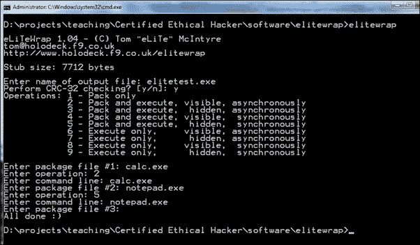

**Figure 5.1** eLiTeWrap.

此插图旨在说明创建特洛伊木马的极易程度，而非鼓励你去做。了解这种过程的简单程度至关重要，以便你理解恶意软件的普遍性。任何附件或下载都应受到显著的怀疑。

### 缓冲区溢出攻击

你已经了解了多种攻击目标系统的方法：拒绝服务、病毒和特洛伊木马。虽然这些攻击可能是最常见的，但它们并非唯一的方法。另一种攻击方式称为缓冲区溢出（或缓冲区溢出）攻击。缓冲区溢出攻击发生在有人尝试向缓冲区填充超过其设计容量的数据时发生。任何与互联网或私有网络通信的程序都需要接收一些数据，这些数据至少暂时存储在内存中的一个称为 `buffer` 的空间中。如果编写该应用程序的程序员谨慎，当你尝试向缓冲区填入过多信息时，该信息要么被截断，要么直接被拒绝。鉴于目标系统上可能运行的应用程序数量以及每个应用程序中的缓冲区数量，至少有一个缓冲区未正确编写的可能性足以让任何谨慎的人感到担忧。

一个 moderately skilled（中等技能）的程序员可以编写一个有意向缓冲区写入超过其容量数据的程序。例如，如果缓冲区能容纳 1024 字节的数据，而你尝试用 2048 字节来填充它，计算机会简单地将额外的 1024 字节加载到内存中。如果这些额外的数据实际上是恶意程序，那么它就被加载到了内存中，从而现在在目标系统上运行。或者，攻击者可能只是想淹没目标机器的内存，从而覆盖掉当前内存中的其他项目并导致它们崩溃。无论哪种情况，缓冲区溢出都是一项非常严重的攻击。

幸运的是，缓冲区溢出攻击比 DoS 攻击或简单的 Microsoft Outlook 脚本病毒更难执行。要创建缓冲区溢出攻击，你需要对某种编程语言（通常选择 C 或 C++）有良好的实际知识，并且足够熟悉目标操作系统/应用程序，以判断其是否存在缓冲区溢出弱点以及该弱点如何被利用。

必须指出的是，现代操作系统和 Web 服务器通常不易受到常见的缓冲区溢出攻击。Windows 95 很容易受到影响，但距离上一次 Windows 操作系统受到此类攻击已过去许多年。显然，Windows 7、8 或 10 不能通过此类攻击被入侵。然而，对于在各种系统上运行的所有自定义应用程序来说，情况可能并非如此。Internet 启用的应用程序，包括但不限于 Web 应用，同样可能受到此类攻击的威胁。

本质上，这种漏洞仅在程序员未能正确编程时才存在。如果所有程序都截断多余数据，则在该系统上无法执行缓冲区溢出攻击。然而，如果程序未检查变量和数组的边界，并允许 excess data（超出数据）加载，那么该系统就容易受到缓冲区溢出攻击。

#### Sasser 病毒/缓冲区溢出

Sasser 是一项较旧的攻击，但它展示了缓冲区溢出攻击的使用。Sasser 是一种组合攻击，因为病毒（或蠕虫）通过利用缓冲区溢出来传播。

Sasser 通过利用 Windows 系统程序中已知的缺陷进行传播。Sasser 将自身复制到 Windows 目录下的 `avserve.exe`，并创建一个注册表键以在启动时加载自身。因此，一旦你的机器被感染，每次启动机器时都会启动该病毒。该病毒会扫描随机的 IP 地址，并从 1068 端口开始依次监听 TCP 端口，寻找未打补丁的可被利用的系统——即那些未修复该缺陷的系统。当找到一个时，蠕虫通过溢出 `LSASS.EXE` 中的缓冲区来利用该脆弱系统。`LSASS.EXE` 是 Windows 操作系统的一部分，是一个内置系统文件。Sasser 还作为 FTP 服务器在 TCP 端口 5554 上运行，并通过 TCP 端口 9996 创建远程 shell。随后，Sasser 在远程主机上创建一个名为 `cmd.ftp` 的 FTP 脚本并执行它。该 FTP 脚本指示目标受害者下载并执行蠕虫。感染主机通过 TCP 端口 5554 接收此 FTP 流量。计算机还创建一个名为 `win.log` 的文件在 C: 驱动器上。该文件包含本地主机的 IP 地址。病毒的副本会在 Windows 系统目录下以 `#\_up.exe` 的名称创建，例如：

*   `c:\WINDOWS\system32\12553_up.exe`
*   `c:\WINDOWS\system32\17923_up.exe`
*   `c:\WINDOWS\system32\29679_up.exe`

该病毒的一个副作用是导致机器重启。如果机器不断重启且没有其他已知原因，那么很可能已感染 Sasser 病毒。

这是另一种可以通过多种手段轻易防范的感染情况。首先，如果你定期更新系统，这些系统就不应受到该缺陷的影响。其次，如果你确保网络的路由器或防火墙阻止涉及的端口（9996 和 5554）的流量，你将阻止大部分 Sasser 的损害。防火墙应仅允许指定的端口流量，其余所有端口均应关闭。简而言之，如果你作为网络管理员了解安全问题并采取谨慎的保护措施，你的网络将安全。许多网络受到此病毒的影响，表明管理员在计算机安全方面的培训不足。

### 间谍软件

在第 1 章的“计算机安全入门”中，提到了间谍软件作为计算机安全威胁之一。使用间谍软件需要比其他一些恶意软件更高的技术知识。 perpetrator（实施者）必须能够为特定情境开发间谍软件，或根据需求定制现有的间谍软件。他必须能够将间谍软件安装到目标机器上。

-   `[间谍软件]`可能是一个简单的 cookie，网站使用它记录关于您访问该网站的几条简短信息，或者它可能是一种更隐蔽的类型，例如键盘记录器。请回顾第 1 章的内容，键盘记录器是一个程序，用于记录您在键盘上输入的每一次按键；这种间谍软件随后会将您的按键记录到间谍的文件中。键盘记录器最常见的用途是捕获用户名和密码。然而，这种方法可以捕获您输入的所有用户名和密码，以及您输入的每一份文档，以及您可能输入的其他任何内容。这些数据可以存储在机器上一个隐藏的小文件中以便后续提取，或者以 TCP 数据包的形式发送到预定义的地址。在某些情况下，软件会在工作时间之外上传这些数据到某些服务器，或使用您自己的电子邮件软件将数据发送到匿名邮箱。此外，还有一些键盘记录器会定期从您的机器中截取屏幕截图，揭示您电脑上打开的任何内容。无论具体的操作模式如何，间谍软件就是一种在特定计算机上实时监视您活动的软件。

#### 合法的间谍软件用途

间谍软件也有完全合法的用途。一些雇主已将间谍软件作为监控员工使用公司技术的手段来接受。许多公司选择监控组织内的电话、电子邮件或网络流量。请记住，计算机、网络和电话系统属于公司或组织，而不是员工。这些技术通常仅限于工作用途；因此，公司的监控可能不构成隐私侵犯。虽然法院已支持这种监控是公司的权利，但在启动此类员工监控之前，务必咨询律师，并考虑对员工士气可能产生的负面影响。


父母也可以在家庭电脑上使用此类软件来监控孩子的上网活动。目标通常是一个值得称赞的目的——保护孩子免受在线捕食者的侵害。然而，与公司中的员工一样，这种做法可能会引起被监视者（即他们的孩子）强烈的负面反应。父母必须权衡对孩子的风险与可能被视为背叛信任的风险。

### 间谍软件如何向目标系统传送

显然，间谍软件程序可以跟踪计算机上的所有活动，而这些信息可以通过多种不同的方式被另一方检索。真正的问题是：间谍软件最初是如何上到计算机系统上的呢？最常见的方法是通过`特洛伊木马`。当然，也有可能当您浏览某个网站时，间谍软件会在后台下载，而您只是浏览该网站。如果雇主（或父母）在安装间谍软件，那么它可以像组织安装其他应用程序一样公开安装。

### 获取间谍软件

鉴于互联网上已经提及了许多其他实用工具和软件，您可能不会感到惊讶，可以在网络上免费或以非常低廉的价格获得大量间谍软件产品。您可以查看 Counterexploitation 网站（`www.cexx.org`），如图 5.2 所示，获取已知在互联网上流通的大量间谍软件产品的详尽列表以及有关您可以用来将它们清除的方法的信息。SpywareGuide 网站（`www.spywareguide.com`）列出了您可以直接从互联网获取的间谍软件，如果您觉得有充分理由监视他人的电脑活动，这将非常有用。图 5.3 展示了该网站提供的恶意软件类别。该网站列出了多个键盘记录器应用程序，如图 5.4 所示，包括知名的键盘记录器如 Absolute Keylogger、Tiny Keylogger 和 TypO。大多数可以免费下载或以象征性费用购买。


**Figure 5.2** Counterexploitation website. ¶ 

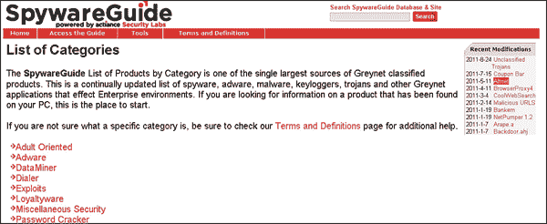

**Figure 5.3** Malware categories at the SpywareGuide website.

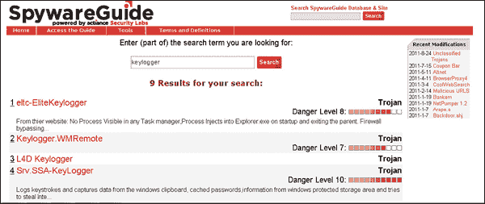

**Figure 5.4** List of key loggers available through the SpywareGuide website.

一些知名的特洛伊木马也列在该网站上（如图 5.5 所示），例如 2nd Thought 应用，它会下载到个人电脑上，然后充斥广告。这种间谍软件在您访问特定网站时下载到您的电脑。它在直接方面对系统或文件无害，也不收集敏感信息。但它会让您的机器充斥烦人的广告。这类软件通常被称为`广告软件`（adware）。广告经常无法通过常规的弹窗阻止器停止，因为弹窗并非由您访问的网站生成，而是由机器上运行的恶意软件生成。弹窗阻止器只能阻止您访问的网站打开新窗口，而恶意软件利用浏览器已知的脚本技术来触发窗口，弹窗阻止器能够识别这些技术并阻止弹窗弹出。然而，广告软件会启动新的浏览器实例，从而绕过弹窗阻止器的功能。

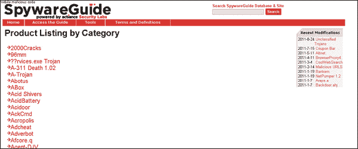

**Figure 5.5** Trojan horses available at the SpywareGuide website.

## 其他形式的恶意软件

在本章及前文中，讨论了最显著的恶意软件形式。然而，还有许多其他攻击形式。本书的范围超出了对所有形式的探讨，但您应当知道存在一些其他形式的恶意软件。仅仅知道这些就能 greatly 帮助您有效防御系统。本节将仅涉及几种其他恶意软件形式。您应当经常参考本章末尾的练习和项目中提到的网站，以便及时了解当前所有攻击形式和防护措施。

### Rootkits

A `rootkit` is a collection of tools that a hacker uses to mask her intrusion and obtain administrator-level access to a computer or computer network. The intruder installs a rootkit on a computer after first obtaining user-level access, either by exploiting a known vulnerability or cracking a password. The rootkit then collects user IDs and passwords to other machines on the network, thus giving the hacker root or privileged access.

A rootkit may consist of utilities that also do the following:

* Monitor traffic and keystrokes
* Create a backdoor into the system for the hacker’s use
* Alter log files
* Attack other machines on the network
* Alter existing system tools to circumvent detection

The presence of a rootkit on a network was first documented in the early 1990s. At that time, the Sun and Linux operating systems were the primary targets for hackers looking to install rootkits. Today, rootkits are available for a number of operating systems and are increasingly difficult to detect on any network.

### Malicious Web-Based Code

`Malicious web-based code`，也称为`web-based mobile code`，仅指可在所有操作系统或平台上运行的代码，例如 HTTP、Java 等。其“恶意”属性意味着它是病毒、蠕虫、木马或其他形式的恶意软件。简单来说，恶意代码不在乎操作系统或所用浏览器是什么，它会盲目感染它们。

这段代码从哪里来，以及如何传播？第一代互联网主要是索引的文本文件。然而，随着互联网演变为图形化、多媒体用户体验，程序员创建了脚本语言和新的应用技术，以实现更具交互性的体验。使用脚本语言编写的程序从有用到 poorly crafted 再到 outright dangerous 都有可能。

Java 和 ActiveX 等技术使缺陷或不可信任的程序能够在用户工作站上移动并执行。（其他可能导致恶意代码的技术包括可执行文件、JavaScript、VBScript 和插件。）Web 使代码的移动性提升，但并未区分程序的质量、完整性或可靠性。利用现有工具，只需“拖拽”代码放入文档中，随后上传到 Web 服务器，供企业内部员工或全球 Internet 用户使用。如果这段代码被恶意编程或仅仅测试不足，就可能造成严重损害。

不足为奇的是，黑客利用这些极其有用的工具窃取、篡改或删除数据文件，并未经授权访问企业网络。恶意代码攻击可以通过多种入口渗透企业网络和系统，包括网站、电子邮件中的 HTML 内容或企业内部网。

如今，数十亿的 Internet 用户使得恶意代码攻击能够在企业内部几乎瞬间传播。恶意代码造成的大多数损害在首次攻击后的头几小时内发生——此时还没有时间部署防御措施。网络宕机或知识产权被盗的成本使恶意代码成为首要关注点。

### Logic Bombs

A `logic bomb` 是一种在满足特定条件时才执行恶意行为的恶意软件。最常见的触发因素是日期/时间。例如，逻辑炸弹可能在特定日期/时间删除文件。例如，2006 年 6 月，UBS 系统管理员罗杰·杜里诺（Roger Duronio）被指控使用逻辑炸弹破坏公司计算机网络。其计划通过逻辑炸弹导致公司股价下跌，因而被指控证券欺诈。杜里诺随后被定罪并判处 8 年又 1 个月监禁，并被要求向 UBS 支付 310 万美元赔偿。此案例说明该问题并非新鲜事。

2017 年，来自亚特兰大乔治亚州的 Mittesh Das 被判罪，罪名是故意传播恶意代码以损害美国陆军计算机。达斯创建了一个逻辑炸弹，计划在其公司失去合同后，触发 U.S. Army Reserve 养老金系统的文件删除。该事件实际发生在 2014 年。他被判处 2 年监禁，随后 3 年缓刑。

Nimesh Patel 被指控在 2016 年创建逻辑炸弹，攻击前雇主的服务器。他 allegedly 在离职后登录网络并上传恶意软件。该软件设计用于删除 Oracle 数据库中的财务数据。

另一个案例发生在抵押公司 Fannie Mae。2008 年 10 月 29 日，公司系统中发现了一个逻辑炸弹。虽然这是较旧的案例，但它在逻辑炸弹历史中具有重要意义。该炸弹由已被解除合同的前承包商 Rajendrainh Makwana 所植入。炸弹设定在 2009 年 1 月 31 日激活，彻底擦除公司所有服务器。Makwana 于 2009 年 1 月 27 日因未经授权访问计算机而在马里兰州法院被起诉。2010 年 12 月 17 日，他被定罪并判处 41 个月监禁，随后 3 年缓刑。Makwana 在解除雇佣关系后、网络管理员撤销其网络访问权限之前植入了逻辑炸弹，这凸显了在员工离职后立即停用其账户的重要性——无论是强制离职、退休还是自愿辞职。

### Spam

`Spam`，大多数人都很熟悉，指的是发送给多位收件人的、不受欢迎且未经请求的电子邮件。它常用于营销目的，但也可用于更恶劣的目标。例如，垃圾邮件是传播病毒和蠕虫的常见渠道。它也被用来发送诱导收件人访问钓鱼网站的邮件，以窃取身份信息。最坏的情况是，垃圾邮件是一种骚扰，最糟的情况则是它是间谍软件、病毒、蠕虫和钓鱼攻击的载体。

### Advanced Persistent Threats

`Advanced persistent threats` (`APTs`) 是一个相对新的术语，指持续的攻击过程。它可能涉及黑客入侵、社会工程学、恶意软件，或攻击的组合。问题在于攻击必须相对高超，因此使用 `advanced` 这一词，并且必须持续进行，因此使用 `persistent` 这一词。

安全公司 Mandiant 在 7 年的时间里追踪了多个 APT，全部源自中国——具体为上海及浦东地区。这些 APT 简单命名为 APT1、APT2 等。

这些攻击与中国军队的 UNIT 61398 部门有关。中国政府将该部门的活动视为机密，但很明显，其任务之一是进行网络战。仅一个来自该组的 APT 在 2014 年就侵入了 141 家、20 行业的公司。APT1 能够保持对受害网络的访问平均 365 天，个别案例长达 1764 天。APT1 在 10 个月内窃取了单个组织 6.5TB 的信息。我们将在 第 12 章 “网络恐怖主义与信息战” 中进一步讨论中国的攻击。

## Detecting and Eliminating Viruses and Spyware

一旦你了解恶意软件的本质以及它可能造成的毁灭性影响，接下来的合理话题就是检测并清除恶意软件。

### Antivirus Software

本章及全书一直强调运行病毒扫描软件的必要性。本节提供病毒扫描器的工作原理细节以及主要病毒扫描软件包的信息，帮助你更好地理解病毒扫描器如何保护系统，并做出明智的购买和部署决策。

病毒扫描器的工作方式有两种。第一种是查找签名（或模式），匹配已知病毒。因此，保持病毒软件更新至关重要，以便拥有最新的签名列表。

另一种方式是检查给定 PC 的可执行文件行为。如果程序的行为符合病毒活动特征，病毒扫描器可能将其标记为病毒。此类行为可能包括：

* 尝试复制自身
* 尝试访问系统电子邮件程序的地址簿
* 尝试修改 Windows 注册表设置

Figure 5.6 展示了 Norton Security 防病毒软件的运行界面。可以看到病毒定义已更新，病毒扫描已启用，实时保护已启用，以及 Internet 蠕虫保护也已启用。其他流行的病毒扫描器具有许多相同的功能。

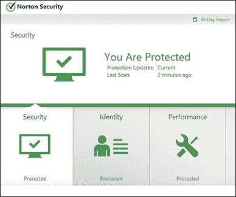

**Figure 5.6** Norton Security 界面。

大多数当今的防病毒软件还提供额外功能，例如能够警告用户已知的网络钓鱼网站、检测间谍软件以及病毒，甚至能够检测可能的网络钓鱼尝试。任何现代防病毒产品都应是一个综合套装，能够防范多种攻击，而不仅仅是阻止病毒。

如前所述，防病毒供应商众多。McAfee、Bitdefender、Kaspersky、AVG 和 Malwarebytes 是一些最广为人知的品牌。

McAfee 为家庭用户和大型组织提供解决方案。McAfee 的所有产品都包含一些共同功能，包括电子邮件扫描和文件扫描，同时也会扫描即时通讯流量。Figure 5.7 显示了 McAfee 的一个截图。

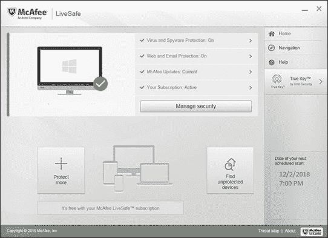

**Figure 5.7** McAfee 防病毒界面。

Avast（参见 Figure 5.8）是另一种广受欢迎的防病毒产品。该产品为家庭、非商业用途提供免费版本。您可以从供应商网站下载该产品：`www.avast.com`。您也可以找到专业版、针对 UNIX 或 Linux 的版本，以及专为服务器设计的版本。此外，Avast 还提供多种语言版本，包括英文、荷兰语、芬兰语、法语、德语、西班牙语、意大利语和匈牙利语。

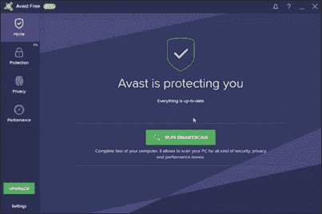

**Figure 5.8** Avast 防病毒界面。

AVG 防病毒软件（参见 Figure 5.9），已相当流行，提供免费版和商业版。

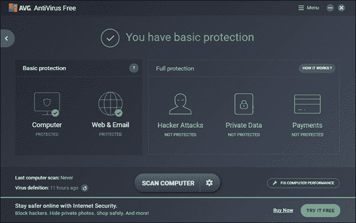

**Figure 5.9** AVG AntiVirus 界面。

Malwarebytes 是另一种广受欢迎的防病毒产品。该产品可从 `www.malwarebytes.com` 获得，提供免费版和付费高级版。Figure 5.10 展示了 Malwarebytes 的界面。

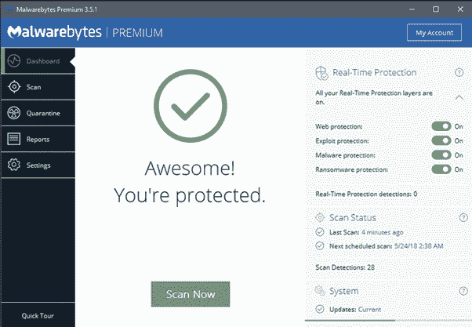

**Figure 5.10** Malwarebytes 防病毒界面。

Windows Defender 首次作为 Windows Vista 和 Windows 7 的一部分发布。它随每个 Windows 版本的更新而增长并增加功能。它是 Windows 操作系统的免费组成部分。Figure 5.11 展示了 Windows 10 上 Windows Defender 的主界面。

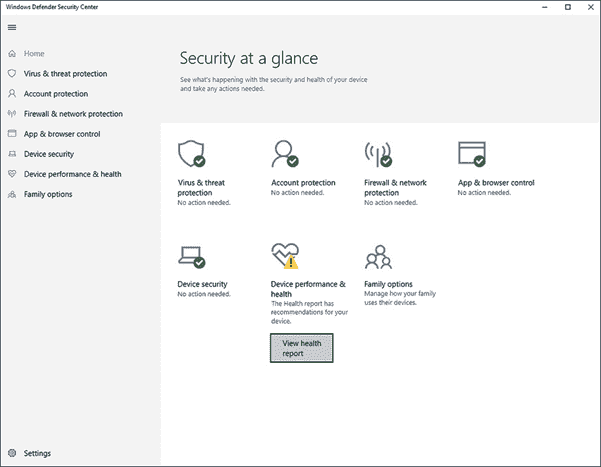

**Figure 5.11** Windows Defender 主界面。¶

### Remediation Steps

显然，降低恶意软件风险的关键步骤是运行已更新的防病毒软件。我不推荐任何特定的防病毒程序。McAfee、Norton、AVG、Kaspersky 和 Malwarebytes 都是值得信赖的产品。不过，我建议如果您同时使用基于主机的防病毒软件和网络防病毒软件，应选择两家不同供应商的产品。这样，一个供应商可能漏掉的威胁，另一个供应商更有可能捕获。

除了运行防恶意软件外，安全专业人员还可以采取具体措施来降低恶意软件的风险。请注意，目标是降低恶意软件的威胁，而完全消除此类威胁是不可能的，但您可以减少攻击的频率和损害的严重程度。

教育终端用户至关重要。终端用户必须了解恶意软件的普遍性。目标是让您的网络上所有用户对附件和下载保持警惕。当然，业务需求有时需要使用附件文档。但您可以在用户打开任何附件前，让他们思考以下几个简单问题：

* 该附件是否被预期？来自您不认识或未曾期待的附件必须始终被视为潜在的恶意软件。
* 邮件是否具体，例如“我们昨天会议中讨论的第三季度销售报告”。这种具体性倾向于表明是真实邮件并附带真实文档。但听起来笼统的邮件如“这是您的文档”，或试图说服用户必须立即打开附件的邮件应被怀疑为恶意软件。
* 您对邮件附件的真实性有重大疑虑吗？如有疑问，请向技术支持部门咨询。

采取这些简单措施即可消除许多恶意软件爆发。


如果您想走更复杂的路线，使您的计算机几乎免受恶意软件侵害，可以先在电脑上建立一个虚拟机。有多种虚拟机应用程序，如 `VMware` 和 `Oracle Box`（免费）。然后在该虚拟机（`VM`）中安装与主机不同的操作系统。例如，如果主机是 `Windows 10`，则 `VM` 可以运行 `Linux`；如果主机是 `Mac`，则 `VM` 可以运行 `Windows`。在 `VM` 中浏览 Internet，几乎不可能在主机上感染病毒。截至目前，还没有病毒跨越 `VM/主机` 边界，也没有病毒能够感染多种操作系统。需要注意的是，`Java` 病毒和某些网页恶意软件可以感染不同系统的浏览器。不过，一般规则是：为 `Windows` 编写的病毒不会影响 `Mac` 计算机，反之亦然。

## Summary

显然，攻击目标系统的方式有很多：通过拒绝服务（`DoS`）攻击、病毒/蠕虫、特洛伊木马、缓冲区溢出攻击和间谍软件。每种攻击都有许多细分变体。黑客攻击系统的方式如此之多，使得系统安全成为一项相当复杂的任务。但在此点已很明显：保护系统是至关重要的。在即将到来的练习中，您将尝试使用 `Norton` 和 `McAfee` 的防病毒程序。

本章的另一主题是，许多，甚至大多数，攻击都是可以预防的。后续的练习将让您练习如何防止 `Sasser` 和 `Sobig` 病毒。通常，及时且定期的系统补丁、使用防病毒工具以及阻止不必要的端口即可防止此类攻击。许多系统仍然被感染，说明网络专业人员在计算机安全方面缺乏足够技能。

## Test Your Skills

### Multiple Choice Questions

**1.** John is a network security administrator for a midsized college. He is trying to explain to a new hire what a virus is. Which of the following is the best definition of virus?

**A.** A program that causes harm on your computer

**B.** A program used in a DoS attack

**C.** A program that slows down networks

**D.** A program that self-replicates

**2.** Isabelle is responsible for cybersecurity at her company. She is concerned that a virus would cause damage to the IT systems. What is the most common damage caused by virus attacks?

**A.** Slowing down networks by the virus traffic

**B.** Deleting files

**C.** Changing the Windows Registry

**D.** Corrupting the operating system

**3.** You are trying to form policies for your organization to mitigate the threat of viruses. You want to ensure that you address the most common way for a virus to spread. What is the most common way for a virus to spread?

**A.** By copying to shared folders

**B.** By email attachment

**C.** By FTP

**D.** By download from a website

## 5.1 使用 Norton Antivirus

1. 访问 Norton AntiVirus 网站（[`www.symantec.com/downloads`](http://www.symantec.com/downloads)），下载试用版。

2. 安装并运行软件。

3. 仔细研究应用，记录喜欢和不喜欢的功能。

## 5.2 使用 McAfee Antivirus

1. 访问 McAfee 防病毒网站（[`www.mcafeee.com`](http://www.mcafeee.com)），下载试用版。

2. 安装并运行软件。

3. 仔细研究应用，记录喜欢和不喜欢的功能。

## 5.3 防止 Sasser

1. 使用网络或期刊资源仔细研究 `Sasser` 病毒。可以参考 [`www.f-secure.com`](http://www.f-secure.com) 和 Symantec Security Center（[`www.symantec.com/security-center`](https://www.symantec.com/security-center)）。

2. 撰写一篇简短的论文，阐述 `Sasser` 病毒的传播方式、造成的损害以及可以采取的预防措施。

## 5.4 防止 Sobig

1. 使用网络或期刊资源仔细研究 `Sobig` 病毒。可以参考 [`www.f-secure.com`](http://www.f-secure.com) 和 Symantec Security Center（[`www.symantec.com/security-center`](https://www.symantec.com/security-center)）。

2. 撰写一篇简短的论文，阐述 `Sobig` 病毒的传播方式、造成的损害以及可以采取的预防措施。

## 5.5 学习当前病毒攻击

1. 使用网络或期刊资源找到过去 90 天内正在蔓延的病毒。可以参考 [`www.f-secure.com`](http://www.f-secure.com) 和 Symantec Security Center（[`www.symantec.com/security-center`](https://www.symantec.com/security-center)）。

2. 撰写一篇简短的论文，阐述该病毒的传播方式、造成的损害以及可以采取的预防措施。

## Projects

**Project 5.1:** Antivirus Policies

This activity can also work as a group project.

Considering what you have learned in this chapter and in previous chapters, as well as using outside resources, write an antivirus policy for a small business or school. Your policy should include technical recommendations as well as procedural guidelines. You may choose to consult existing antivirus policy guidelines that you find on the Web to get some ideas. However, you should not simply copy these antivirus policies. Rather, you should come up with your own.

**Project 5.2:** The Worst Virus Attacks

Using resources on the Web, books, or journals, find a virus outbreak that you consider to have been the worst in history. Write a brief paper describing this attack and explain why you think it is the worst. Was it widely spread? How quickly did it spread? What damage did it do?

**Project 5.3:** Why Write a Virus?

-   [关于病毒编写动机的若干假设](https://example.org) 这些假设从荒唐的阴谋论到学术心理学不等。不论你持何种最可能的观点，请撰写一篇论文阐述你认为人们为何费时费力地编写病毒。

**案例研究**

小李负责学校的 IT 安全。由于学校电脑的使用者范围广泛，小李很难防止病毒攻击。小李拥有相当的预算，并在每台机器上安装了防病毒软件。他还设置了防火墙，阻止所有不必要的端口，并且学校政策禁止从网络下载任何软件。请考虑以下问题：

1.  你认为小李的网络在病毒攻击方面有多安全？

2.  小李未能保护哪些方面？

3.  你会向小李提出哪些建议？

# 第 6 章. 黑客使用的技术

## 章节目标

阅读本章并完成练习后，你将能够：

*   理解黑客使用的基本方法论

*   熟悉一些基础黑客工具

*   理解黑客的思维方式

### 引言

在前五章中，我们探讨了计算机安全及各种安全漏洞。本章将探讨黑客用于实施电脑犯罪的技术。在继续之前，重要的是认识到许多黑客并非罪犯。黑客是想要了解系统的人，通常通过探查其弱点来实现。甚至有黑客为组织工作，测试组织的系统安全。这称为 `penetration testing`，也常被称为 `white hat hacking`。渗透测试有若干认证：

*   **Offensive Security:** `https://www.offensive-security.com/information-security-certifications/`

*   **SANS Institute:** `http://pen-testing.sans.org/certification`

*   **EC-Council’s Certified Ethical Hacker:** `www.eccouncil.org`

此外，有一本面向白帽黑客的杂志 `2600` (`http://www.2600.com`)。许多安全专业人员尝试学习黑客技术，要么是为了提升自身的安全能力，要么是出于好奇。这些技术本身并不犯罪。然而，有些人利用黑客技术入侵系统、窃取数据、破坏系统或实施其他网络犯罪。这类人通常被称为 `black hat hackers` 或 `crackers`。

本章所呈现的技术不仅是为了让你了解黑帽黑客的工作方式，也是为了展示你如何对自己的网络进行渗透测试。通过在自己的网络上尝试这些技术，你可以评估自身的脆弱性。（应指出，你只应在对本章技术非常熟悉且已获得高层管理层许可的前提下才进行这些操作。）

### 基本术语

在深入黑客世界之前，我们需要了解该社区使用的基本术语。我们已经介绍了术语 `white hat hacker`，用来描述使用黑客技术进行合法/伦理目的的人。我们也讨论了术语 `black hat hacker` 和 `cracker`，用来描述使用黑客技术进行非法行为的人。

还有几个术语需要你熟悉。`gray hat hacker` 是指曾经是 `black hat hacker`，后来转为 `white hat hacker` 的人（即前罪犯现在变得伦理）。随着 Internet 上工具的大量普及，也有很多人下载一些工具（本章将对其中一些进行探讨）并进行网络攻击，但并不真正理解它们。这些人被称为 `script kiddies`（有时也拼写为 kiddys）。另一个重要术语 `phreaking` 指的是入侵电话系统（这比入侵计算机系统早得多）。

渗透测试常常是为了模拟特定的对手或对手类型。这被称为 `red team`。例如，如果组织主要担心国家级攻击，那么 `red team` 可以使用与国家级攻击常用的技术进行渗透测试。与 `red team` 相对的是 `blue team`，即防御团队，负责阻止 `red team` 的攻击。

### 侦察阶段

任何聪明或经验丰富的黑客在实际发动攻击之前，都会尝试收集目标的信息。就像银行抢劫者想了解银行的警报系统、警卫数量、警察响应时间等，黑帽黑客也想了解你的系统的安全状况。让你 sorprised 的是，你可以在 Internet 上轻松获取大量信息，而无需直接连接到目标系统。

#### 被动扫描技术

黑客可以做的最简单的事是检查目标组织的网站。企业通常会在网站上发布对攻击者非常有用的信息。例如，假设公司 XYZ 将 John Doe 列为其 IT 经理。一个有进取心的黑客可以在公告板和讨论组中搜索关于 John Doe 的提及。攻击者可能会发现有用于定向钓鱼攻击（即针对特定个人或个人群体的钓鱼）的信息，或发现有用于社会工程的信息。例如，许多前员工在网上抱怨 John Doe 要求苛刻且迅速解雇员工。有进取心的黑客可以冒充 John Doe 的同事给某人打电话，声称要远程登录该人的电脑以更新系统。几分钟后，黑客说忘记了 John Doe 给他的密码，担心会被解雇，于是要求对方提供密码。黑客从网络上获取的信息足以让这次社会工程攻击显得可信。

攻击者也可以在公告板、聊天室、讨论组等地方搜寻 IT staff 的提问。例如，如果管理员在讨论组中发帖询问特定服务器问题，这可以为攻击者提供有价值的目标网络信息。

另一种利用 Web 获取目标信息的方式是通过招聘广告。例如，如果一家公司经常发布 ASP.NET 开发人员的招聘广告，而从不发布 PHP 或 Perl 的招聘，那么可以推断该公司的 Web 应用很可能是使用 ASP.NET 在 Windows 服务器（Internet Information Services）上开发的。这使攻击者能够专注于有限的攻击范围——即针对 ASP.NET/Windows 的攻击。

从招聘广告中也可以获取信息。例如，如果一家员工少于 200 人的小公司每年发布两次网络管理员招聘广告，这很可能意味着公司最近失去了老管理员，因为小公司通常不需要多位管理员。如果当前管理员是新人，说明她可能不如前任熟悉自己的系统。如果这种招聘新管理员的趋势持续两年以上，黑客可以推断公司存在高人员流动，可能存在可以利用的漏洞。

-   存在一些特定的网站，攻击者可以从中获取有用信息。例如，`netcraft.com`，如在 Figure 6.1 中所示，提供关于网站的信息。例如，你可以查找一个站点运行的是什么类型的服务器，在某些情况下还能知道服务器距离最后一次重启的时间。


**Figure 6.1** `www.netcraft.com`. ¶ 

另一个对攻击者有用的网站是 [`https://archive.org`](https://archive.org)。该网站，如在 Figure 6.2 中所示，存档了网站的旧版本。服务器会遍历网络，存档站点。存档频率取决于站点的受欢迎程度。


**Figure 6.2** `www.archive.org`. ¶ 

#### 主动扫描技术

前面提到的技术都是被动的，因为攻击者不需要连接到目标系统。由于攻击者实际上并未连接到目标系统，入侵检测系统（IDS）无法检测到扫描。主动扫描更可靠，但可能会被目标系统检测到。有几种主动扫描类型。

##### 端口扫描

`Port scanning` 是尝试向目标系统的每个网络端口发送请求并查看哪些端口是打开的过程。通常有 1024 个众所周知的端口，它们与特定服务相关联。例如，`port 161` 与简单网络管理协议（SNMP）相关联。如果攻击者在目标系统上检测到 `port 161` 打开，他可能会尝试进行 SNMP 相关攻击。即使如此，端口扫描还能提供更多信息。例如，`ports 137, 138, and 139` 都与 NetBIOS 相关联，这是一种老旧的 Windows 网络通信方式，已不再在 Windows 中使用。但 NetBIOS 常用于 Windows 机器需要与 Linux 机器通信的环境，因此发现这些端口打开揭示了目标网络的一些信息。


通过简单的 Google 搜索 *port scanner*，可以发现许多知名、广泛使用且通常免费的端口扫描工具。然而，黑客和安全社区中最流行的端口扫描工具是免费工具 Nmap（[`nmap.org`](https://nmap.org)）。它有一个 Windows 版本，名为 Zenmap，如在 Figure 6.3 所示。


**Figure 6.3** Zenmap GUI.

Nmap 允许你自定义扫描，使其更隐蔽或更精准地针对特定系统。最常见的扫描类型如下：

* **Ping scan:** 该扫描仅向目标端口发送 ping。许多网络管理员会阻止入站的 ICMP 包，以阻止 ping 扫描。

* **Connect scan:** 这是最可靠的扫描方式，但也最容易被检测到。使用此类扫描时，会建立完整的连接到目标系统。

* **SYN scan:** 该扫描非常隐蔽。大多数系统接受 SYN（同步）请求。该扫描类似于 Chapter 4 “Denial of Service Attacks” 中描述的 SYN flood DoS 攻击。在该类扫描中，你发送 SYN 包但不在系统返回 SYN/ACK 时回复。与 DoS SYN flood 不同，你每个端口仅发送一个包。这也称为 *half-open scan*。

* **FIN scan:** 该扫描将 FIN（连接结束）标志置位。该标志在系统中并不罕见，因此被视为隐蔽。

这些扫描会在目标机器上产生不同的响应，从而为端口扫描者提供不同的信息：

* 使用 FIN 扫描或 XMAS 扫描时，如果目标端口关闭，系统会返回 RST（重置）标志包；如果端口打开，则没有响应。

* 使用 SYN 扫描时，如果端口关闭，响应是 RST；如果端口打开，响应是 SYN/ACK。

* ACK 扫描和 NULL 扫描仅在 UNIX 系统上有效。

Nmap 还允许你通过 Nmap 的命令行版本或 Windows 版本设置多个标志来自定义扫描。允许的标志列表如下：

`-O` 检测操作系统

`-sP` 执行 ping 扫描

`-sT` 执行 TCP 连接扫描

`-sS` 执行 SYN 扫描

`-sF` 执行 FIN 扫描

`-sX` 执行 Xmas tree 扫描

`-sN` 执行 NULL 扫描

`-sU` 执行 UDP 扫描

`-sO` 执行协议扫描

`-sA` 执行 ACK 扫描

`-sW` 执行 Windows 扫描

`-sR` 执行 RPC 扫描

`-sL` 执行列表/DNS 扫描

`-sI` 执行空闲扫描

`-Po` 不执行 ping

`-PT` 执行 TCP ping

`-PS` 执行 SYN ping

`-PI` 执行 ICMP ping

`-PB` 执行 TCP 和 ICMP ping

`-PM` 执行 ICMP netmask

`-oN` 正常输出

`-oX` XML 输出

`-oG` 可 grep 输出

`-oA` 所有输出

`-T` 调整时间

`-T0` 隐蔽

`-T1` 偷偷

`-T2` 礼貌

`-T3` 正常

`-T4` 积极

`-T5` 疯狂

如你所见，攻击者使用 Nmap 时有许多选项可供选择。花费大量时间仅学习 Nmap 是可以的。当然，还有其他端口扫描工具。我们专注于 Nmap，因为它免费且广泛使用，并且在 EC-Council Certified Ethical Hacker 认证、GPEN（来自 SANS）以及专业渗透测试师认证中具有重要地位。

Nmap 设置大部分是自解释的。也许关于时间（timing）的讨论需要更多阐述。时间涉及如何快速发送扫描包。基本上，发送包越快，扫描被检测到的可能性就越大。

以下是最基础的 Nmap 扫描：

```
nmap 192.168.1.1
```

以下是扫描 IP 地址范围的命令：

```
nmap 192.168.1.1-20
```

下面的命令用于检测操作系统、使用 TCP 扫描并使用隐蔽速度：

```
nmap -O -PT -T1 192.168.1.1
```

## 漏洞评估

漏洞评估包括检查系统是否易受特定攻击的影响。虽然黑客可以使用漏洞评估工具来评估你的系统，但这些工具是设计用来让你自行评估系统的。这些工具并不特别隐蔽，因此很可能会被入侵检测系统（IDS）检测到。事实上，网络管理员经常使用漏洞评估工具来测试自己的网络。这些工具将在 Chapter 11 “Network Scanning and Vulnerability Scanning” 中介绍。

## 列举

- [枚举](https://wiki.example.org/feynmans_learning_method)是攻击者在实际攻击前常用的一种技术。`Enumeration` 仅仅是查找目标系统上有什么的过程。如果目标是整个网络，攻击者希望找出该网络上的服务器、计算机和打印机。如果目标是特定的计算机，攻击者希望找出该系统上的用户和共享文件夹。

    简单的 Google 搜索将帮助你找到大量的枚举工具。最易使用的是 `Cain and Abel`，如 `Figure 6.4` 所示。

    

    **Figure 6.4** `Cain and Abel`.

    虽然这里我们专注于枚举，`Cain and Abel` 还能做比枚举更多的事情。要使用 `Cain and Abel` 进行枚举，只需点击 `Network` 标签，即可看到你正在使用的网络上所有机器。（在枚举目标网络之前，你显然需要一定的访问权限。）

    下面是一些其他受黑客欢迎且可以在 Internet 上轻松找到的枚举工具：

    * `Sid2User`

    * `Cheops`（仅限 Linux）

    * `UserInfo`

    * `UserDump`

    * `DumpSec`

    * `Netcat`

    * `NBTDump`

    这不是一份完整的列表，但包括了部分最常用的枚举工具。

    为了防御扫描，你可以采用以下技术：

    * 小心在 Internet 上公布关于你的组织及其网络的信息。

    * 建立公司政策，要求技术人员在论坛、聊天室等技术平台上使用真实姓名或透露公司名称时，不要使用真实姓名或泄露公司名称。

    * 使用能够检测到大量扫描的 IDS。

    * 阻止入站的 Internet Control Message Protocol (ICMP) 包。

    这些技术不会让系统上的扫描和侦察变得不可能，但会显著降低攻击者能够获取的信息量。

### Shodan

`Shodan`（见 `Figure 6.5`）是攻击者和渗透测试人员都会使用的工具。网站 [`https://www.shodan.io`](https://www.shodan.io) 本质上是一个漏洞搜索引擎。你需要注册免费账户才能使用它，但对渗透测试人员来说它可以非常有价值，帮助识别漏洞。当然，该站点对攻击者同样有价值。


**Figure 6.5** `Shodan`.

在使用 `Shodan.io` 进行搜索时，你可以使用以下一些选项：

* 查找默认密码，使用如下搜索词：

    * `default password country:US`

    * `default password hostname:chuckeasttom.com`

    * `default password city:Chicago`

* 查找 Apache 服务器

    * `apache city:"San Francisco"`

* 查找 Webcam

    * `webcamxp city:Chicago`

* `OLD IIS`

* “`iis/5.0`”

上面的列表仅为示例搜索词；可用的过滤器包括

* `city:` 查找特定城市的设备

* `country:` 查找特定国家的设备

* `geo:` 传入坐标（纬度和经度）

* `hostname:` 查找匹配特定主机名的值

* `net:` 基于 IP 或 CIDR 搜索

* `os:` 基于操作系统搜索

* `port:` 查找特定开放端口

* `before/after:` 在时间范围内查找结果

例如，`Figure 6.6` 展示了搜索 `default passwords city:dallas` 的结果。

![Figure 6.6 Shodan search results.  Shodan search results page is displayed. The search tab at the top consist of the text, default passwords city: Dallas. Five other options are present below the search option. They are `exploits`, `maps`, `share search`, `download results`, and `create a report`. The option `share search` is selected. The left pane displays the number of total results, top countries, and top organizations. The right pane displays other search information of the search option given like the date, time, region, number, and the important banner message. ](img/06fig06.jpg)

**Figure 6.6** `Shodan search results`.

在进行渗透测试时，搜索目标公司域名并在 `Shodan` 上查找你能找到的所有信息是个好主意。这可以指导你的渗透测试工作，并且可以确保潜在攻击者也会使用该工具。你可以将搜索范围限制在客户的主机名或域名上。使用 `Shodan` 查找默认密码、旧网页服务器、未保护的网络摄像头以及目标网络中的其他漏洞。

## 实际攻击

现在我们已经讨论了攻击者如何扫描目标系统，让我们来看几种常见的攻击手段。虽然这不是 exhaustive（穷尽）列表，但它能让你了解常用的攻击方法和使用的技术与工具。

### SQL Script Injection

SQL script injection 可能是网站上最流行的攻击类型。近年来，越来越多的网站采取措施缓解这类攻击的危害，但不幸的是，许多网站仍然容易受到攻击。SQL script injection 攻击是指向 Web 应用传递结构化查询语言（SQL）命令，并让网站执行这些命令。

在进一步讨论 SQL 注入之前，我们需要了解 SQL 和关系数据库。关系数据库基于各种表之间的关系，结构包括表、主键和外键：

* 每一行代表一个单一实体。

* 每一列代表一个单一属性。

* 每条记录通过唯一的 *primary key* 识别。

* 表通过外键与其他表关联；*外键* 是另一表的主键。

你可以在 `Figure 6.7` 中看到这些关系的示例。

![Figure 6.7 Database relations.  Two tables depict the database relation between them. The first table displays the details like PK, Lname, Fname, Jobcode, and hire date. The information given in the table row wise are as follows. 1, Smith, Jane, 2, 1/10/2010; 2, Perez, Juan, 2, 1/14/2011; 3, Kent, Clark, 1, 3/2/2005; 4, Euler, Leonard, 3, 3/5/2009; and 5, Plank, Max, 3, 4/2/2012. The second table displays the details like PK, Job name, Minimum education, Minimum salary, and maximum salary. The information given in the table row-wise are as follows. 1, super hero, none, 100,000, 1000000; 2, Programmer, BA/BS, 70000, 95000; 3, Math/Scientist, Ph.D., 80000, 110000; and 4, Manager, BA/BS, 140000, 220000. The job code in the first table is inter-related with PK values, 1, 2, and 3 in the second table. That is, job code 2 for Jane Smith is related with PK value 2; job code 1 for Clark Kent is related with PK value 1; and job code 3 for Max Plank is related with PK value 3. ](img/06fig07.jpg)

**Figure 6.7** `Database relations`.

- 所有关系型数据库都使用 SQL，其中包括 `SELECT`、`UPDATE`、`DELETE`、`INSERT` 和 `WHERE` 等命令。至少基本查询非常容易理解和解释。

  大多数基本的 SQL 注入操作方式如下：许多网站或应用程序有一个页面，用户在该页面输入用户名和密码。该用户名和密码需要与数据库中的某些记录进行比对，以判断其有效性。无论数据库类型如何（Oracle、SQL Server、MySQL），所有数据库都使用 SQL。SQL 的外观和功能在很大程度上类似于英语。例如，要检查用户名和密码，你可能需要查询数据库，看看 `users` 表中是否存在匹配用户名和密码的记录。如果存在这种记录，则表示匹配。用于查询的 SQL 语句可能如下所示：

  [Click here to view code image


进入`/path/to/xxx`目录，找到`xxx.json`。

在表达式`cvar = avar + bvar`中，加法运算符（`+`）将`avar`与`bvar`相加，得到它们的和`cvar`

在`List.of(arg0, arg1, arg2)`中，`List`接口的工厂方法`of()`接受一系列的元素，返回包含它们的只读列表。

之后我们这样调用`cmd`命令：`cmd arg0 arg1 arg2`。

```
if (condVar > someVal) {console.log("xxx")}
```


尽管该方法仅包含四个阶段，但这些阶段范围较广，包含众多子步骤。我们在此不需要深入探讨 NIST 800-115 的所有细节。不过，这些宽泛的步骤为渗透测试提供了框架。请注意，在攻击阶段之前有两个步骤：规划和发现，它们在其他渗透测试标准中也同样重要。

### NSA 信息评估方法论

国家安全局（NSA）负责美国联邦政府的信息安全。NSA 制定了一套方法论，可应用于任何包含安全审计、漏洞测试和渗透测试的信息系统评估。该方法论简要描述如下：

* **前评估**
  * 确定并管理客户的期望。
  * 了解组织信息的重要性。
  * 确定客户的目标和目的。
  * 确定系统边界。
  * 与客户协调。
  * 请求文档。
* **现场评估**
  * 召开启动会议。
  * 通过面谈、系统演示和文档审查收集并验证系统信息。
  * 分析评估信息。
  * 制定初步建议。
  * 进行出站简报。
* **后评估**
  * 对文档进行再次审查。
  * 获取对所学内容的帮助理解。
  * 协调并编写报告。

这一步骤总结的特点很有趣。管理客户期望是关键步骤。确保客户了解渗透测试的可行范围和局限性非常重要。前评估阶段的核心是决定将执行什么操作以及客户的预期。

[渗透测试包括检查系统的过程，并通过出站简报让客户了解发现的核心内容。然后在第三阶段以书面形式交付报告。同时要注意，在最终阶段有一个子步骤是获取额外专业知识。如果你的渗透测试或安全审计发现的项目超出了你的专业范围，那么请咨询该领域的专家。]

### PCI Penetration Testing Standard

Payment Card Industry Data Security Standard (PCI DSS) 是用于处理信用卡的公司使用的一组标准。我们将在第 10 章，“安全策略”中总体介绍 PCI 标准。本节简要介绍这些标准中的渗透测试部分。PCI DSS 要求 11.3.4 强制要求进行渗透测试，以验证分段控制和方法是否可操作且有效，并确保它们将卡 holder 数据环境之外的系统与系统隔离开来。

PCI 标准建议在正常工作时间内，对独立的测试环境而非生产环境进行测试。

建议渗透测试包含社会工程学测试。

根据 PCI DSS 要求 11.3.1 和 11.3.2，渗透测试至少每年进行一次，并在发生重大变更（例如基础设施或应用升级或修改、新系统组件安装）后进行。正如我们之前审查的模型，PCI DSS 也有特定的步骤：

* **Pre-engagement:** 定义范围、文档、参与规则、成功标准，并审查以往问题
* **实际渗透测试:** 应用黑客技术
* **Post-engagement:** 报告并推荐补救措施

不必记忆这些标准的每一个细节，关键在于了解黑客技术在渗透测试中被使用，而渗透测试本身不只是对目标网络的随意尝试，而是一种系统化的验证目标网络安全的方法，同时包括真实的黑客技术。

本书旨在介绍计算机安全，不对渗透测试作深入阐述。如需更详细信息，可参考 *Penetration Testing Fundamentals: A Hands-On Guide to Reliable Security Audits*，该书也由 Pearson 出版。

### The Dark Web

Dark Web 是仅通过洋葱路由（onion routing）才能访问的 Internet 区域。`Onion routing` 本质上是将数据包在全球范围内路由，经过多个代理服务器 bounce。每个数据包被多层加密，每个代理只能解密一层并将数据包发送给下一个代理。若在两个代理之间的传输中截获数据包，你只能确定前一个代理和下一个代理，而无法确定实际的来源或目的地。如图 Figure 6.10 所示。


**Figure 6.10** TOR. ¶ 

这导致用户位置难以确定的情况。例如，如图 Figure 6.11 所示，雅虎认为我来自瑞典，并以瑞典语呈现页面。

![Figure 6.11 Yahoo through TOR. ¶  ¶ The user is intended to visit the official home page of yahoo while being in the city of Texas. But the TOR browser opens the yahoo page in Swedish language by considering the native of the user as Sweden. At the top, the page displays the list of options available from the shortcut menu. In that, "check for TOR browser update" is clicked. It displays the following information: Tor circuit for this site, this browser, Germany (188.138.102.98), united states (216.218.222.10), Sweden (62.102.148.67), and internet. The page displays the other information in Swedish. ¶ ](img/06fig11.jpg)

**Figure 6.11** Yahoo through TOR. ¶ 

TOR 提供的匿名性本身并不意味着不道德或错误。许多人仅希望在上网时不被监控。然而，这种高度匿名性也为犯罪活动提供了便利，暗网市场交易非法商品和服务。

近年来，执法机构已关闭 Silk Road、Silk Road 2、HANSA 和 Alpha Bay 等多个暗网犯罪市场，但其他市场随即出现。只需在暗网搜索，即可在几分钟内找到毒品、枪支、儿童色情制品以及其他非法商品和服务。还可找到圣战训练网站、爆炸制作说明、黑客服务、购买和出售恶意软件的场所，甚至专门从事极端性变态的网站。下图 Figure 6.12 为人民药店（The People’s Drug Store）[`newpdsuslmzqazvr.onion`](http://newpdsuslmzqazvr.onion) 的示例。


**Figure 6.12** The People’s Drug Store. ¶ 

浏览暗网可能有些危险，许多站点充斥恶意软件。因此，必须为暗网活动建立专用环境——一个完全与宿主操作系统隔离的虚拟机（意味着不共享剪贴板或文件夹）。最好使用与宿主操作系统不同的操作系统，以增加跨 VM/host 障碍。最后，该虚拟机应仅用于暗网活动，且不得用于其他目的。许多暗网研究人员喜欢使用 The Amnesiac Incognito Live System (TAILS) 进行暗网浏览，它可从 [`tails.boum.org`](https://tails.boum.org) 免费下载。

### Summary

本章我们审查了黑客常用的若干技术。这些技术和工具展示了为何需要多种安全措施。扫描技术表明需要在防火墙上阻止特定流量，并运行入侵检测系统（IDS）。SQL 注入攻击说明应用开发中必须将安全纳入其中。OphCrack 工具则表明物理安全的重要性以及最小权限原则的重要性。将技术支持人员加入域管理员组违背了最小权限概念，并使特权提升脚本成为可能。如果你想更深入了解黑客和渗透测试，可阅读 *Penetration Testing Fundamentals: A Hands-On Guide to Reliable Security Audits*，该书同样由 Pearson 出版，并由本书作者撰写。

### Test Your Skills

#### Multiple Choice Questions

**1.** Elizabeth is describing web-based attacks to a group of students in a computer security course. What does an SQL injection attack require?

**A.** Having database admin privileges

**B.** Creating an SQL statement that is always true

**C.** Creating an SQL statement that will force access

**D.** Understanding web programming

## 第 7 章. 网络空间中的工业间谍

### 第 7 章 目标

读完本章并完成练习后，你将能够：

* 理解所谓的工业间谍的含义
* 理解用于尝试工业间谍的低技术手段
* 了解间谍软件在间谍活动中的使用方式
* 知道如何保护系统免受间谍活动的侵害

### 引言

当你听到单词 `espionage` 时，也许你会联想到一系列令人兴奋且华丽的想象。也许你会看到一位穿着体面的男子，举杯干杯，摇晃但未搅拌，前往华丽的地点并与同样华丽的旅伴同行。或者，你可能会想象一些令人兴奋的隐蔽行动，伴随高速车追和远方异国之地的枪林弹雨。间谍活动通常比这些流行媒体的形象要无聊得多。间谍的终极目标是获取原本不易获得的信息。通常，间谍活动最好以尽可能少的喧哗进行。相反，信息才是目标，枪战和华丽地点不太可能出现，而且如果出现也会引起警觉。如果可能，最好在目标组织甚至未意识到其信息已被泄露的情况下获取该信息。

许多人认为这种间谍活动仅由政府、情报机构（如美国中央情报局、国家安全局、英国军情六处、俄罗斯联邦安全局等）以及可疑的国际组织（如基地组织或伊斯兰国）进行。虽然这些实体确实参与间谍活动，但它们显然不是唯一进行间谍活动的组织。上述组织希望获取信息以实现政治和军事目标。然而，经济目标也依赖于准确且常常敏感的数据。在数十亿美元的利益面前，私人公司可能会参与工业间谍，无论是作为目标还是实施者。有哪个公司不想了解其竞争对手的具体做法？事实上，企业或经济间谍正在上升。

工业间谍与情报机构活动的界限正变得模糊。已有许多针对西方国家的工业间谍案件，这些案件至少表面上似乎得到了外国情报服务的支持。科技公司经常成为此类攻击的目标。

企业或经济间谍是一个日益严重的问题，但准确评估其规模仍然困难。实施企业间谍的公司出于显而易见的原因不会透露自己实施了间谍行为。成为间谍受害者的公司通常也不愿公开这一事实，因为揭示其安全已被侵犯可能会对其股价产生不利影响。在某些情况下，安全漏洞可能导致客户因数据泄露而向公司提出索赔。基于这些原因，公司往往不愿披露任何工业间谍活动。为了保护自己和公司，学习间谍手段及防护措施至关重要。在本章末尾的练习中，你将使用已学习的工具——`antispyware`、`keyloggers` 和 `screen-capture software`——来了解它们的工作原理，从而认识到它们带来的风险。

期刊 `CSO Online` 在 2018 年发表了一篇关于工业间谍的文章。^(1) 文章提到了 1996 年《经济间谍法》，该法是美国联邦法律， criminalized（ criminalized 译为“ criminalized ” 保持原文）了商业秘密的窃取。

1. [`www.csoonline.com/article/3285726/what-is-corporate-espionage-inside-the-murky-world-of-private-spying.html`](https://www.csoonline.com/article/3285726/what-is-corporate-espionage-inside-the-murky-world-of-private-spying.html)

2019 年， `Forbes` 发表了一篇关于苹果公司间谍事件的文章。^(2) 文章中考察的案例显示，企业间谍与国家支持间谍之间的界限模糊。其中一个案例中，苹果员工季志中（Jizhong Chen）被指控窃取自动驾驶汽车相关的商业机密并提供给中国政府。同一篇文章估计，企业间谍每年给经济带来$1.1 万亿美元的损失。

2. [`www.forbes.com/sites/betsyatkins/2019/02/12/learning-from-apples-spying-incidents-how-to-protect-yourcompany-from-corporate-espionage/#54d18f7d6fb4`](https://www.forbes.com/sites/betsyatkins/2019/02/12/learning-from-apples-spying-incidents-how-to-protect-yourcompany-from-corporate-espionage/#54d18f7d6fb4)

### 什么是工业间谍？

`Industrial espionage` 是利用间谍技术获取具有经济价值的关键信息的行为。此类数据可能包括竞争对手新项目的细节、竞争对手客户名单、研究数据，或任何能够为间谍组织提供经济优势的信息。虽然企业间谍的动机与军事间谍不同，但它往往使用情报机构常用的手段，如监控、复印文件或渗透目标组织的成员。而且，经济间谍不仅使用与情报机构相同的手段，还常使用相同的人员。曾有多起前情报人员被发现参与企业间谍的案例。当这些人将其技能和训练带入企业间谍领域时，计算机安全专家将面临更大挑战。

### 实践中

#### 带走敏感数据

尽管计算机专家和政府机构试图估计企业间谍的影响和范围，但其本质使得精确估计变得不可能。不僅是实施者不愿透露犯罪事实，受害者往往也不愿披露事件。然而，轶事证据表明，最常见的间谍形式是员工离职，加入竞争对手公司，并带走敏感数据。许多情况下，这些员工选择公司内部已有的、其保密性被视为“灰色地带”的数据。例如，销售人员可能带走打印的联系人和客户名单，以便在新雇主处开发业务。

必须与所有员工签订非常明确的保密和非竞争协议。最好聘请就业律师起草该协议。此外，你可能需要在解除员工雇佣关系前限制其对数据的访问。你也应进行离职面谈，并考虑没收公司电话簿等看似微不足道但可能包含对其他公司有用的数据的物品。`thumb drives`、`smart phones` 以及其他技术提供了将数据带出公司的途径，因此部分公司限制这些设备的使用。

### 信息作为资产

许多人习惯于将具体物品视为资产，但难以接受信息也是一种资产。公司每年在研发上花费数十亿美元。发现的信息至少等于用于获取该信息的资源成本加上该信息所产生的经济收益。例如，如果一家公司在研发一项过程上投入$200,000，而该过程最终为公司带来$1,000,000 的收入，那么该数据至少价值$1.2 million。你可以将这种经济收益表示为如下公式：

VI（信息价值）= C（生产成本）+ VG（获得的价值）

- 数据是一种宝贵的资产，即使有些人尚未完全理解这一概念。当我们谈论“信息时代”或“信息经济”时，需要意识到这些术语并非空洞的流行语。信息本身就是一种真实的商品，它与公司所持有的其他任何资产一样具有经济价值。事实上，往往是公司电脑上存储的数据比整个计算机系统的硬件和软件本身更有价值。数据肯定比计算机硬件和软件更难以替代。

要真正领会信息作为商品的概念，请考虑获得大学学位的过程。你需要在各种教室里度过 4 年，为此支付巨额费用以获得坐在这些课堂里、聆听他人长篇大论的特权。4 年后，你得到的唯一有形产出是一张纸。显然，你可以用更少的金钱和更少的努力获得一张纸。实际上，你支付的钱是获得的信息。许多职业的价值也是如此——医生、律师、工程师、顾问、经理等都因其专业知识而受聘。信息本身就是有价值的商品。

计算机系统中存储的数据有两个重要原因使其价值高。首先，创建和分析数据需要大量的时间和精力。如果你与 5 人的团队一起花费 6 个月时间收集和分析信息，那么这些信息的价值至少相当于这些人在那段时间的工资和福利总额。其次，数据本身具有内在价值，超出了收集这些事实的时间和努力。如果这些事实涉及专有流程、发明或算法，其价值显而易见。然而，任何能够提供竞争优势的数据本身就具有内在价值。例如，保险公司经常雇佣统计学家和精算师团队，利用最新技术预测任何潜在投保人群的风险。得到的统计信息对竞争对手保险公司可能极具价值。即使是客户联系名单也具有一定内在价值。


因此，在计算机安全领域工作时，请始终牢记，任何可能具有经济价值的数据都是贵公司的资产，而此类数据会成为缺乏伦理顾虑的竞争对门进行间谍活动的有吸引力的目标。如果公司管理层认为这一威胁并不真实，那他们就大错特错。任何公司都可能成为企业间谍的目标。你应该采取措施保护贵公司的重要信息——而这一过程的第一步关键步骤是资产识别。

*资产识别*是列出贵组织所依赖资产的过程。此列表应包括直接影响日常运营的项目，以及与公司服务或产品相关的项目。CERT 网站提供了一个非常有用的工作表，你可以用它来清点组织中的资产。^(3) 本工作簿还包含若干其他有用的工作表，可帮助你在组织内确保信息安全。正如图 7.1 的目录所示，该工作簿也是一个教程，引导你逐步考虑信息安全的各种因素。

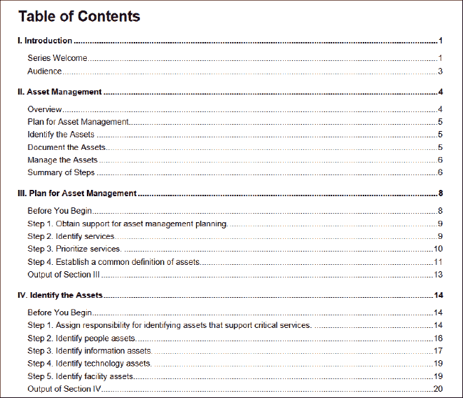

**Figure 7.1** Table of contents from the CERT Supplemental Resource Guide.

3. [`www.us-cert.gov/sites/default/files/c3vp/crr_resources_guides/CRR_Resource_Guide-AM.pdf`](https://www.us-cert.gov/sites/default/files/c3vp/crr_resources_guides/CRR_Resource_Guide-AM.pdf)

Table 7.1 是 CERT 提供的工作表的变体。凭借此表格以及你对公司的了解和经验，你可以按照以下步骤完成资产识别：

**Table 7.1** Asset Identification Worksheet 

| Information || Systems || Services and Applications || Other Assets ||  |
| --- | --- | --- | --- | --- |
|  |  |  |  |  |
|  |  |  |  |  |
|  |  |  |  |  |
|  |  |  |  |  |
|  |  |  |  |  |
|  |  |  |  |  |
|  |  |  |  |  |
|  |  |  |  |  |
|  |  |  |  |  |
|  |  |  |  |  |
|  |  |  |  |  |

1. 在表格的第一列中，列出信息资产。应列出公司中人们用于完成工作的信息类型——即人们完成工作所需的信息。例如：产品设计、软件程序、系统设计、文档、客户订单和人员数据。
2. 对于第一列的每一项，在第二列填写存储该信息的系统名称。此时应思考：哪些系统是人们完成工作所必需的。
3. 对于第一列的每一项，在第三列填写相关的应用程序和服务名称。确定哪些应用或服务是个人完成工作所必需的。
4. 在最后一列，列出可能与其他三列不直接相关的其他资产。例如：包含客户信息的数据库、生产用系统、用于制作文档的文字处理程序、程序员使用的编译器以及人力资源系统。

完成 Table 7.1 的填写后，你将对组织的关键资产有清晰的认识。有了这些信息，你就能更好地决定如何分配防御努力。后续章节将探讨一些具体的保护措施。

### 实际案例：工业间谍

现在你已了解企业间谍的概念，让我们来看五个真实案例。这些案例均来源于真实新闻报道，展示了工业间谍的实际形式。请注意，虽然部分案例较旧，但它们能说明间谍活动的典型做法。而且，工业间谍事件的细节往往要等待多年才会浮出水面，甚至永远不会被揭露。

#### 案例 1：休斯顿太空人队

2015 年，休斯顿太空人队的 scouting 和团队信息数据库被盗，据称是由圣路易斯红雀队的成员实施的。休斯顿太空人队拥有名为 Ground Control 的专有内部计算机系统，其中包含球员记录和潜在交易的备注。

太空人队总经理 Jeff Luhnow 此前曾在红雀队工作，离职时他带走了部分员工。最初的报告指出，Jeff Luhnow 本人或其员工使用与在红雀队时相同的密码，这使得与红雀队有关的人能够猜到密码并访问休斯顿太空人队数据库。

#### 案例 2：大学机密

2015 年 5 月，清华大学的张浩教授及其五名同伙被捕并指控窃取用于中国政府控制的大学的商业机密。被盗的机密包括薄膜 bulk acoustic resonator (FBAR) 技术的研发。

- FBAR 技术的细节对我们讨论此工业间谍案例并不重要，但我将为您提供简要描述：它本质上是一种将材料夹在两个电极之间且与其所在介质声学隔离的装置。这通常用作手机中的射频滤波器。

#### Example 3: Nuclear Secrets

2017 年 8 月，台湾裔美国工程师 Allen Ho 因向中国国有 China General Nuclear Power Company（CGNPC）提供核能技术信息而被判处 2 年监禁。根据起诉书，Ho 是美国籍自然化公民，他利用位于特拉华州威尔明顿市他自家的 Energy Technology International 公司，收集美国核电开发商（包括田纳西河谷管理局）的核材料生产信息，并将其转交 CGNPC。Ho 于 1997 年至 2016 年间，通过自身努力及其雇佣的无名顾问，进行了这些活动。

#### Example 4: Uber

2017 年，公开报道称 Uber Technologies Inc. 支付了 700 万美元，以隐瞒一个所谓的企业间谍计划。该计划据称包括窃听、黑客入侵、贿赂以及雇佣前情报官员，Uber 的工业间谍团队名为“Threat Operations Unit”。前 Uber 员工 Richard Jacob 的律师在法庭上透露了这一信息。

此信息是在一场诉讼中披露的，Uber 竞争对手 Waymo 指控前 Uber 员工 Anthony Levandowsky 窃取了 14,000 份机密文件并将其用于支持 Uber 的自动驾驶项目。虽然该案例的所有细节尚未得到确认，但该案例展示了工业间谍可能达到何种极端程度。

#### Example 5: Foreign Governments and Economic Espionage

美国国家情报与安全中心（NCSC）于 2018 年发布了一份标题为“外国经济间谍在网络空间中的表现”的报告，详细描述了多种外国政府对美国本土公司进行经济/工业间谍活动的方式。

报告重点强调了软件供应链的渗透。某些软件中的后门允许访问企业资源。报告还指出，一些国家（如中国）有法律要求在华经营的公司必须将其技术提交给中国政府进行安全审查。报告称，在某些情况下，这些审查是借口，旨在让中国公司获得西方公司的技术。

#### 趋势在工业间谍

虽然前面讨论的案例跨越多年，但问题并未减缓。事实上，根据 CNN 报道，2015 年工业间谍案件增加了 53%。FBI 对 165 家公司进行调查后发现，其中一半的公司曾是某种形式工业间谍的受害者。许多工业间谍案件涉及内部威胁。

#### 工业间谍与您

尽管存在这些案例，大多数公司会否认任何暗示间谍活动的行为。然而，并非所有公司都如此保守。Oracle Corporation CEO Larry Ellison 公开捍卫他雇佣私人调查员翻查 Microsoft 垃圾以获取信息的决定。显然，间谍活动不再仅是政府和国防承包商的问题，它已成为现代商业世界的真实关注。睿智的计算机安全专业人员会意识到这一顾虑，并采取相应的主动措施。

### 间谍活动如何发生？

间谍活动主要有两种方式。一种是低技术途径：现任或前任员工直接窃取数据，或利用社交工程手段（见 [第 3 章，“网络跟踪、欺诈与滥用”）从不设防的公司员工处提取数据。另一种更具技术性的方式是使用间谍软件，包括使用 Cookie 和键盘记录器等。我们还将讨论其他技术方法。

#### 低技术工业间谍

企业间谍可以在没有计算机或互联网的情况下发生。不满的前（或现任）员工可能复制敏感文件、泄露公司策略和计划，或披露敏感信息。事实上，无论使用的方法是技术性的还是非技术性的，不满员工都是任何组织面临的最大安全风险。企业间谍无需入侵系统即可获取敏感信息，只要员工愿意直接提供。正如军事和政治间谍活动一样，员工透露信息的动机各异。有些人出于明显的经济利益行事；其他人则因真实或 imagined 不公而愤怒，选择揭露公司秘密。无论动机如何，任何组织都必须认识到，它拥有大量可能对某些情况不满并有意泄露机密信息的员工。

当然，信息可以在没有现代技术的情况下获取；但计算机技术（及相关战术）无疑能辅助企业间谍，哪怕只是边缘性地协助。正如图 7.2（Figures 7.2）和图 7.3（7.3）所示，间谍活动有时使用几乎不需要专业技能的技术。这类技术包括使用通用串行总线（USB）闪存驱动器、光盘（CDs）或其他便携媒体窃取信息。即使是想要破坏公司或谋取私利的不满员工，也会发现将大量数据烧录到 CD 上并随身携带比尝试复印数千份文件并走私更为容易。如今的 USB 闪存驱动器小巧如钥匙扣，是企业间谍的梦想工具——它们可插入任何 USB 接口并存储巨量数据。截至本文撰写时，可轻松购买小型便携设备，容量可达 2TB 或更多。


**Figure 7.2** Low-tech espionage is easy.


**Figure 7.3** Low-tech espionage is portable.

虽然信息可以在不进行系统入侵的情况下从贵公司获取，但请记住，如果系统未受保护，外部势力完全有可能在没有员工共谋的情况下入侵系统并窃取信息。除了上述方法，还有其他低技术甚至“几乎无技术”手段可用于提取信息。*社交工程*（在第 3 章中详细讨论）是通过话术促使他人透露他们本不愿透露的信息，这种技术可用于工业间谍的多种方式。

- 社交工程在工业间谍中的首要且最明显的用途是直接对话，攻击者试图让目标员工泄露敏感信息。如图 7.4 所示，员工常常在未意识到信息重要性或未意识到信息可能被任何人获取的情况下，不经思考地向供应商、供应商或销售人员透露信息。攻击者只需诱使目标员工多说话即可。2009 年，一起广为报道的俄罗斯间谍集团在美国的案例中，其战术之一是结交目标组织的关键员工，并通过持续对话逐步获取关键数据。

![Figure 7.4 Social engineering can be used as low-tech espionage.

**Figure 7.4** 社交工程可以作为低技术间谍活动使用。

另一种使用社交工程的有趣方式是通过电子邮件。在非常大的组织中，不可能了解每个成员，聪明的工业间谍可以发送声称来自其他部门的电子邮件，甚至只是询问敏感数据。公司间谍可能伪造电子邮件，假装来自目标公司的法律部门，请求某项研究项目的执行摘要。

计算机安全专家 Andrew Briney 表示，人是电脑安全的头号问题。

#### 工业间谍中使用的间谍软件

显然，任何能够监控计算机活动的软件都可以用于工业间谍。2003 年 10 月的 *Security IT World* 在线杂志刊登了一篇文章，指出在 21 世纪监控计算机非常容易，问题至今仍然存在，许多安全专家认为间谍软件的普及程度至少与病毒相当。实现监控的一种方法是使用间谍软件，我们在 第 5 章 “恶意软件” 中详细讨论过。显然，能够记录键盘或截图的软件或硬件对工业间谍非常有利。

将此类软件应用于间谍活动是显而易见的：间谍可以获取敏感文档的截图、捕获数据库登录信息，或在文档被输入时捕获敏感文件。这些方法都能让间谍获得机器上所有数据的无限制访问。

#### 用于工业间谍的隐写术

隐写术是一种隐藏信息的方式。它不像加密那样隐藏信息，而是通过使信息难以辨认来保护通信。信息被隐藏在图像中，有时甚至是图像内的其他图像。单词 *steganography* 源自希腊语 *steganos*，意为“掩盖”或“秘密”，以及 *graphy*，意为“书写”或“绘图”。虽然有多种技术手段可以实现这一点，但最常见的是在图像文件的最低有效位中隐藏数据。不过，数据也可以隐藏在任何数字文件中。

还需注意，历史上曾有非技术性的隐藏信息手段。以下是一些值得注意的例子：

* 古代中国将纸条包在蜡中，吞下后运输。
* 古代希腊，信使的头部会被剃光，写信息在头皮上，然后让头发再长，以此隐藏信息。
* 1518 年，Johannes Trithemius 写了一本关于密码学的书，描述了一种技术：将每个字母作为特定列的一个词来隐藏信息。

你可能会认为实现隐写术需要大量的技术知识；然而，市面上有许多软件包可以帮助你完成隐写。QuickStego 和 Invisible Secrets 是两款极易使用的工具，能够为你完成隐写。MP3Stego 是一个免费工具，能在 MP4 文件中隐藏数据。这些只是网络上可用的众多工具中的一些。廉价或免费且易用的工具的普及使得隐写术成为任何组织的潜在威胁。

#### 电话窃听和植入装置

当然，还有一种可能是使用电话窃听。电话窃听是指在某处窃听电话线路并拦截通话。通常在希望窃听的建筑内部的某个公用设施位置进行。这类攻击显然需要攻击者进入或接近现场， compromise 电话设备，并具备窃听电话线路的技能。

### 防范工业间谍

到此为止，你已经知道组织宝贵的信息资产可以通过多种方式被 compromise。你可以采取哪些措施来降低风险？请注意，我说的是 *降低* 风险。绝对安全是不可实现的，任何系统、任何信息、任何人都无法做到完全安全。最好的做法是努力使获取信息的成本超过信息的价值。

一个显而易见的防护措施是使用防间谍软件。如前文所述，许多防病毒程序也具备防间谍功能。该软件配合其他安全措施，如防火墙和入侵检测软件（在第 9 章 “计算机安全技术” 中讨论），能够大幅降低外部攻击者 compromise 组织数据的可能性。此外，实施组织政策（也在第 9 章讨论），指导员工安全使用计算机和 Internet 资源，也能使系统相对安全。如果在防护组合中加入加密所有传输的策略，系统将达到你能合理实现的最高安全水平（第 8 章 “加密” 专门讨论加密）。然而，上述所有技术（防火墙、公司政策、防间谍软件、加密等）仅在员工并非间谍的情况下才有效。针对员工有意窃取或 compromising 信息的情况，组织可以采取哪些措施来减轻风险？实际上，任何组织都可以采取多种措施来降低内部间谍带来的风险。下面是 12 条可行的措施：

* 始终使用所有合理的网络安全措施：防火墙、入侵检测软件、防间谍软件、操作系统补丁和更新、以及适当的使用政策。
* 仅给予员工完成工作所需的最小数据访问权限，这称为 *最小权限*。员工仅获得完成任务所需的最低权限。采用“需知即行”原则。虽然不应 stifle 讨论或思想交流，但敏感数据必须受到高度注意。
* 如可能，为访问最敏感数据的员工建立轮换或职责分离系统。这样，任何一名员工都不会同时拥有并控制所有关键数据。
* 限制组织中便携式存储介质的数量（如光盘烧录器、U 盘），并控制这些介质的使用。记录每次使用此类介质以及存储的内容。一些组织甚至禁止使用手机，因为大多数手机允许用户拍照并电子发送图片。
* 不允许员工将文档或介质带回家。将材料带回家可能表明员工非常致力于在非工作时间完成任务，或暗示公司间谍在复制重要文件和信息。
* Shred documents and melt old disks/tape backups/CDs. A resourceful spy can often find a great deal of information in the garbage. If any storage media is disposed of, it should be completely wiped. Degaussing is a good technique for hard drives and USB drives.
* Do employee background checks. You must be able to trust your employees, and you can only do this with a thorough background check. Do not rely on “gut feelings.” Give particular attention to information technology (IT) personnel who will, by the nature of their jobs, have access to a wide variety of data. This scrutiny is most important with positions such as database administrators, network administrators, and network security specialists.
* When any employee leaves the company, scan the employee’s PC carefully. Look for signs that inappropriate data was kept on that machine. If you have any reason to suspect inappropriate usage, then store the machine for evidence in subsequent legal proceedings.
* Keep all tape backups, sensitive documents, and other media under lock and key and allow limited access to them.


* If portable computers are used, then encrypt the hard drives. Encryption prevents a thief from extracting usable data from a stolen laptop. A number of products on the market can accomplish this encryption, including the following:

    * `VeraCrypt` (see Figure 7.5) is one example of a free tool for encrypting drives, folders, or partitions. The tool is remarkably easy to use and can be found at [`https://www.veracrypt.fr`](https://www.veracrypt.fr). There are several other similar tools, most of which are low cost or free.

        

        **Figure 7.5** `VeraCrypt`.

    * `Microsoft Windows` includes two types of encryption. `Windows 7 Enterprise` or `Ultimate` editions included `BitLocker` for encrypting entire hard drives. `BitLocker` is also available on later versions of `Windows` (`8`, `8.1`, `10`). And all versions of `Windows` since `Windows 2000` have included `Encrypted File System` for encrypting specific files or folders (see Figure 7.6).

        

        **Figure 7.6** `Windows EFS`.

    * This list is not exhaustive; therefore, it is highly recommended that you carefully review a variety of encryption products before making a selection.

    * Have all employees with access to any sensitive information sign nondisclosure agreements. Such agreements give an employer recourse in the event that an ex-employee divulges sensitive data. It is amazing how many employers do not bother with this rather simple protection.

* Conduct security awareness sessions. Clearly, employee education is one of the most important things you can do. An organization should have some method for routinely advising employees about security issues. An excellent way to do that is to have an intranet site with bulletins posted to it. It is also a good idea to hold periodic training sessions for employees. These need not be lengthy or in depth. Most nontechnical employees only need an introduction to security concepts.

Unfortunately, taking these simple measures will not make you totally immune to corporate espionage. However, using these strategies will make any such attempts much more difficult for any perpetrator; thus, you will improve your organization’s data security.

### The Industrial Espionage Act

The Industrial Espionage Act of 1996 was the first U.S. law to criminalize theft of commercial trade secrets. This law provides for significant penalties for violators. The following wording is quoted from the law:

> (a) Whoever, with intent to convert a trade secret, that is related to or included in a product that is produced for or placed in interstate or foreign commerce, to the economic benefit of anyone other than the owner thereof, and intending or knowing that the offense will injure any owner of that trade secret, knowingly—
>
> (1) steals, or without authorization appropriates, takes, carries away, or conceals, or by fraud, artifice, or deception obtains such information;
>
> (2) without authorization copies, duplicates, sketches, draws, photographs, downloads, uploads, alters, destroys, photocopies, replicates, transmits, delivers, sends, mails, communicates, or conveys such information;
>
> (3) receives, buys, or possesses such information, knowing the same to have been stolen or appropriated, obtained, or converted without authorization;
>
> (4) attempts to commit any offense described in paragraphs (1) through (3); or
>
> (5) conspires with one or more other persons to commit any offense described in paragraphs (1) through (3), and one or more of such persons do any act to effect the object of the conspiracy, shall, except as provided in subsection (b), be fined under this title or imprisoned not more than 10 years, or both.

### Spear Phishing

*Phishing*, as you know, is the process of attempting to get personal information from a target in order to steal the target’s identity or compromise the target’s system. A common technique is to send out a mass email that is designed to entice recipients to click on a link that purports to be some financial institution’s website but is actually a phishing website.

*Spear phishing* uses the same technology as phishing but in a targeted manner. For example, if an attacker wanted to get into the servers at a defense contractor, he might craft email and phishing websites specifically to target software and network engineers at that company. The emails might be made to appeal to that specific subgroup of people. Or the attacker might even take the time to learn personal details of a few of these individuals and target them specifically. This technique has been used against executives at various companies. In 2010 and 2011, this problem began to grow significantly.

*Whaling* is a form of phishing in which an attacker attempts to compromise information regarding a specific highly valuable employee. It involves the same techniques as phishing but is highly customized to increase the chances that the single individual target will be fooled and actually respond to the phishing attempt.

### Summary

A number of conclusions can be drawn from this chapter’s examination of industrial espionage. The first conclusion: It does indeed occur. The case studies clearly demonstrate that industrial espionage is not some exotic fantasy dreamed up by paranoid security experts. It is an unfortunate, but quite real, aspect of modern business. If your firm’s management chooses to ignore these dangers, then they do so at their own peril.

进入`/path/to/xxx`目录，找到`xxx.json`。

在表达式`cvar = avar + bvar`中，加法运算符（`+`）将`avar`与`bvar`相加，得到它们的和`cvar`

在`List.of(arg0, arg1, arg2)`中，`List`接口的工厂方法`of()`接受一系列的元素，返回包含它们的只读列表。

之后我们这样调用`cmd`命令：`cmd arg0 arg1 arg2`。

```
if (condVar > someVal) {console.log("xxx")}
```

4. 运行你在练习 7.2 中下载的反间谍软件。反间谍软件能否检测到键盘记录器？

### Exercise 7.4: 屏幕截图间谍软件

1. 使用网络查找并下载一个屏幕截图间谍软件应用。以下网站可能会帮助你选择合适的产品：[`en.softonic.com/s/screen-capture-spy-software`](http://en.softonic.com/s/screen-capture-spy-software)。警告：由于你正在下载间谍软件，你的系统防病毒/反间谍软件很可能会给出警告。

2. 在你的电脑上安装并配置该应用。

3. 运行该应用并记录它检测到的内容。

4. 运行练习 7.2 中的反间谍软件，看它是否能检测到你的间谍软件程序。

### Exercise 7.5: 学习硬件键盘记录器

在本章节以及第 5 章中，我们讨论了软件键盘记录器。然而，也有硬件键盘记录器。

1. 使用互联网了解更多关于硬件键盘记录器的信息。（你可以从“Keykatcher”开始搜索。）

2. 撰写一篇论文，阐述这些键盘记录器的工作方式以及它们如何被用于安全目的或工业间谍活动。

### 项目

#### Project 7.1: 防止企业间谍活动

利用本书中列出的网站之一（你也可以从第 1 章的推荐资源中选择）或其他资源，找到一套通用计算机安全指南。撰写一篇简短的论文，对比这些指南与本章给出的指南。请记住，本章的指南专门针对企业间谍活动，而不涵盖通用计算机安全。

#### Project 7.2: 处理员工

撰写一篇简短的论文，描述处理员工的步骤。包括你认为组织应采取的所有步骤，以防止企业间谍活动。务必用来源和理由支持你的观点。

如果可能，亲自访问一家公司，与该公司的 IT 部门或人事部门的某人交流，了解该公司如何处理员工解雇、职责轮换、数据访问控制等问题。将你在论文中提出的措施与你访问的公司所采用的措施进行对比和对照。

#### Project 7.3: 组织资产识别

使用表 7.1 或你自己设计的类似资产识别表，找出你所在组织（学校或企业）中最有价值的数据，以及最可能希望获取该数据的各方。然后撰写一份简要指南，说明你如何保护该数据。在此项目中，你的安全建议应针对特定数据类型以及最可能的工业间谍行为者进行定制。

### Case Study

David Doe 是 ABC 公司的网络管理员。他因三次被晋升而失望，公开表达对公司的不满。随后他辞职，创办自己的咨询业务。六个月后，发现 ABC 公司的大量研究成果被竞争对手复制。公司高管怀疑 David Doe 可能为竞争对手提供咨询服务，并泄露了敏感数据。然而，自 David 离职以来，他的电脑已被格式化并重新分配给其他人。ABC 公司没有证据表明 David Doe 犯了任何错误。请考虑以下问题：

1. 可能采取哪些措施来检测 David 的所谓工业间谍行为？

2. 可能采取哪些措施来防止他实施此类犯罪？

## 第 8 章. 加密

### 章节目标

阅读本章并完成练习后，你将能够：

* 解释加密的基本原理

* 讨论现代密码学方法

* 为你的组织选择合适的密码学方法

### 引言


计算机和信息安全涉及许多方面。*加密*（加密）是指将信息或消息混淆，使得拦截该信息的人难以阅读的过程，是安全体系中最关键的部分之一。如果你拥有最佳防火墙、严格的安全策略、硬化的操作系统、病毒扫描工具、入侵检测软件、反间谍软件以及其他所有安全措施，但仍以纯文本发送数据，那么你显然是不安全的。

在本章中，你将获得一种“经理层面的”对*密码学*的理解——即编写或破译秘密代码的艺术。需要理解的是，本章不会让你成为密码学家。事实上，阅读几本关于加密的专著也无法实现这一目标。相反，本章旨在为你提供加密的基本概述、工作原理的概念，以及足够的信息，让你能够就在组织中采用哪种加密方式做出明智的决策。你将学习加密的基本历史、核心概念，并在章节末尾的练习中获得足够的知识，以便能够提出正确的问题。现在，这并不意味着我们不会涉及一些技术细节。我们会。但本章的目标是提供对相关概念的广泛理解。

同时要注意，密码学中的一些概念对大多数读者来说可能较难理解。虽然一般思想大多数人能够理解，但你可能会在某些概念上遇到困难，这很正常，也不必担心。你可能需要重读章节中的某些部分才能完全掌握某些概念。

我们将深入探讨本章所介绍的部分密码算法的实际工作流程。例如，我们将展示 DES 和 RSA 的处理过程。本书的范围超出了对所有可用密码算法的深入探讨，但了解几种算法的详细描述对你是有益的。

对于安全从业者或有志成为从业者来说，深入理解密码算法并非必需。本章的某些概念，特别是非对称密码学方面，在初次阅读时可能难以完全掌握。如果你在第一次阅读时无法 100% 理解这些概念（尤其是与数学相关的概念），这是可以接受的。本章的某些主题可能需要比书中其他内容更多的学习和努力。在第 9 章 “计算机安全技术”中，你将看到密码学的实际应用，如 SSL/TLS、数字证书和虚拟私人网络。

### 密码学基础

密码学的目标不是隐藏消息的存在，而是隐藏其含义——即所谓的*加密*过程。要使消息 unintelligible（难以理解），需要根据事先约定的算法对其进行混淆，该算法由发送者和预期接收者共同确定。因此，接收者可以逆转混淆过程，使消息可读。这种逆向过程称为*解密*。使用加密/解密的优势在于，对于不了解混淆协议的人来说，重新创建消息非常困难。

- 有两种当今广泛使用的密码学类型：对称和非对称。对称意味着使用相同的密钥来加密和解密消息。使用非对称密码学时，用于加密消息的密钥与用于解密消息的密钥不同。这可能听起来有点奇怪，你可能会想知道这有何可能。本章后面将详细探讨它的工作原理。目前的重要点是理解对称和非对称密码学的基本概念。

### 加密历史

加密的概念可能与书面通信的出现一样古老。基本概念其实很简单：消息必须以一种方式被修改，使得敌人难以轻易阅读，但却能被预期的接收者轻松解码。本节我们将探讨几种历史上的加密方法。需要注意的是，这些方法非常古老，在当今无法用于安全通信。本节讨论的方法即使由业余爱好者也能轻易破解。然而，研究它们有助于在不引入大量数学（更复杂加密方法所需）的情况下传达密码学概念。

FYI: 加密者

加密是一个非常广泛且复杂的领域。即使是业余加密者通常也有数学背景，并且已经学习了多年的加密方法。

如果你想了解超出本文范围的密码学历史，你可以阅读专门撰写的许多书籍。简要的密码学历史在 Table 8.1 中提供。

**Table 8.1** 加密历史

| 年份 | 加密方法 |
| --- | --- |
| 公元前 500 到 600 年 | Atbash |
| < 10 BC | Polybius Square |
| 公元前 45 到公元 45 年 | Caesar Cipher |
| 公元 50-120 年 | Scytale |
| 公元 1553 年 | Vigenere’ Cipher |
| 1910 到 1940 年 | Enigma |
| 1976 年 | DES and Diffie-Hellman |
| 1977 年 | RSA |
| 1985 年 | Elliptic Curve Cryptography |
| 1993 年 | Blowfish Cipher |
| 1998 年 | Rijndael Published |
| 2001 年 | Rijndael selected as AES |

* **斯坦福大学密码学历史网站:** [`cs.stanford.edu/people/eroberts/courses/soco/projects/public-key-cryptography/history.html`](http://cs.stanford.edu/people/eroberts/courses/soco/projects/public-key-cryptography/history.html)

* **Cryptography.org:** [`cryptography.org`](http://cryptography.org)

* **SANS 加密历史:** [`www.sans.org/reading-room/whitepapers/vpns/paper/730`](https://www.sans.org/reading-room/whitepapers/vpns/paper/730)

理解本文中描述的简单方法以及上述网站上列出的其他方法，应该能让你对密码学的工作原理以及加密消息的处理有初步认识。无论你是否继续深入研究现代、复杂的加密方法，了解加密在概念层面的工作原理都很重要。对加密的基本理解将帮助你更好地理解你在现实世界中遇到的任何加密方法。Khan Academy 提供一个适合初学者的在线密码学课程。

#### 卡埃萨尔密码

最古老的加密方法之一是 *Caesar cipher*。该方法据称曾被古代罗马皇帝使用，因此得名。它的操作非常简单：你选择一个字母偏移量，然后将文本中的每个字母相应偏移。例如，如果文本是：

```
A cat
```

且你选择偏移两个字母，那么消息变为：

```
C ecv
```

或者，如果你选择偏移三个字母，则变为：

```
D fdw
```

朱利叶斯·凯撒据说使用了向右偏移三个字母。然而，你可以选择任何偏移模式。你可以向右或向左移动任意数量的空格。由于这种方法非常易于理解，它是研究加密的良好起点。然而，它极易被破解。原因在于，任何语言都有特定的字母和词频，即某些字母使用频率更高。在英语中，最常见的单字词是 *A*。最常见的三字词是 *the*。仅凭这两条规则，你就可以轻易破解卡埃萨尔密码。例如，如果你看到一串看似毫无意义的字母，并且发现一个三字词经常重复出现，你很可能推断这词是 *the*——这极有可能是正确的。此外，如果你经常看到一个单字词，那它极有可能是字母 *A*。你现在已经找到了 *A, T, H*, 和 *E* 的替换方案。你可以将这些字母在消息中全部替换，然后尝试推断其余部分，或者直接分析 *A, T, H*, 和 *E* 的替换字母，从而推导出该消息所使用的替换密码。这种类型的消息破解甚至不需要电脑，只需用笔和纸，任何没有密码学背景的人都可以在 10 分钟内完成。还有其他规则能帮助更轻松地破解此密码。例如，在英语中，最常见的两个字母组合是 *ee* 和 *oo*。这为你提供了更多破解线索。

另一个导致该算法易被破解的原因是所谓的 *key space*——可用的密钥数量。在应用于英文字母表时，只有 26 种可能的密钥，因为英文字母表只有 26 个字母。这意味着你可以尝试每种可能的密钥（+1, +2, +3,…+26）直到找到一种有效的。尝试所有可能的密钥的过程称为 *暴力攻击*。

你选择的替换方案（例如 +2, +1）被称为 *替换字母表*（例如 *B* 替换 *A*，*U* 替换 *T*）。因此，卡埃萨尔密码也被称为 *单字母替换* 方法，即它使用单一的字母替换进行加密。虽然还有其他单字母算法，但卡埃萨尔密码是最广为人知的。

#### Atbash

在古代，希伯来文书写者使用 Atbash 替换密码来加密像《耶利米书》这样的宗教文献。使用这种密码非常简单：只需将字母表的顺序颠倒即可。从现代标准来看，这既原始又容易破解。

Atbash 密码是一种希伯来代码，它将字母表的第一个字母与最后一个字母互换，第二个字母与倒数第二个字母互换，以此类推。它简单地反转字母表。例如，在英语中，*A* 变成 *Z*，*B* 变成 *Y*，*C* 变成 *X*，以此类推。当然，希伯来人使用的是不同的字母表，其中 *aleph* 是第一个字母，*tav* 是最后一个字母。不过，我将使用英文示例来说明：

```
Attack at dawn
```

变为：

```
Zggzxp zg wzdm
```

如你所见，*A* 作为字母表的第一个字母被替换为 *Z*，即字母表的最后一个字母。然后，*T* 作为第 19 个字母（从末尾数起为第 7 位）被替换为 *G*，即从开头数第 7 位的字母。这个过程一直持续，直到整条消息全部被编码。

要解密信息，你只需逆向操作，`Z` 变成 `A`，`B` 变成 `Y`，以此类推。这显然是一个相当简单的密码，在现代并未使用。不过，它展示了密码学的基本概念：对明文进行某种排列，使得没有密钥的人难以阅读密文。阿特巴什密码（Atbash cipher）与凯撒密码类似，是一种单字母替换密码，明文中的每个字母与密文中的对应字母存在一对一的直接关系。这意味着与凯撒密码一样，可以利用相同的字母和词频问题来破解阿特巴什密码。

#### 多字母替换

最终，凯撒密码的一种稍微改进的方案——多字母替换（multi-alphabet substitution）被发展出来。在这种方案中，你选择多个用于移动字母的数值（即多个替换字母表）。例如，如果你选择三个替换字母表（12、22、13），则：

```
A CAT
```

变成：

```
C ADV
```

注意第四个字母重新从 +2 开始，第一个 `A` 变成了 `C`，第二个 `A` 变成了 `D`。这使得解读底层文本变得更加困难。虽然它比凯撒密码更难解密，但并不困难。可以用笔和纸以及一点耐心完成。事实上，它可以用电脑非常快速地破解。事实上，今天没有人会使用这种方法发送任何真正安全的信息，因为这种加密方式被认为非常弱。

多字母替换曾被认为相当安全。事实上，一种特殊的变体——维纳尔密码（Vigenère cipher），在 1800 年代和 1900 年代初期被使用。维纳尔密码由乔万·巴蒂斯塔·贝拉索在 1553 年发明。它通过使用关键字的字母对应的一系列不同凯撒密码来加密字母文本。Figure 8.1 展示了维纳尔密码。


**Figure 8.1** Vigenère cipher. ¶

将关键字的字母与明文的字母对应，在上方匹配后找到密文。例如，使用 Figure 8.1 中的图表，若加密单词 *cat* 且关键字为 *horse*，则密文为 *jok*。

#### 铁丝网

我们迄今为止研究的所有密码都是替换密码。经典密码学的另一种方法是转位密码。铁丝网（rail fence）密码可能是最广为人知的转位密码。你只需取想要加密的信息，并把每个字母写在不同的行上。例如，“attack at dawn” 写作：

```
A t c a d w
t a k t a n
```

随后，你按从左到右的正常阅读顺序写出文本，得到：

```
atcadwtaktan
```

要解密信息，接收者必须把它写在行上：

```
A t c a d w
t a k t a n
```

然后接收者重新构造原始信息。大多数文本使用两行作为示例；但你可以使用任意行数。

#### Enigma

如果没有谈论 Enigma，就无法讨论密码学。 contrary to popular misconceptions，Enigma 并非单一机器，而是一系列机器。第一个版本由德国工程师阿瑟·舍布希于第一次世界大战末期发明。它被多个军队使用，而不仅仅是纳粹德国。

一些军事文本使用 Enigma 的某种版本，被波兰密码分析家 Marian Rejewski、Jerzy Rozycki 和 Henryk Zygalski 破解。他们基本上逆向工程出一个可工作的 Enigma 机器，并据此开发了破解 Enigma 密码的工具，包括一个名为 `cryptologic bomb` 的工具。

Enigma 机器的核心是转子（rotors），即每个圆盘上有 26 个字母的磁盘。转子被排列成圆形。基本上，每个转子代表一种单字母替换 cipher。你可以把 Enigma 看作一种机械多字母 cipher。Enigma 的操作员会得到明文消息，然后在 Enigma 上输入该消息。对于每输入的字母，Enigma 会根据不同的替换字母表提供相应的密文。接收者输入密文后，只要两台 Enigma 机器的转子设置相同，接收者的机器就会输出正确的明文。Figure 8.2 是一张 Enigma 机器的图片。


**Figure 8.2** An Enigma machine.

实际上，Enigma 机器有多种变体。海军 Enigma 机器最终被在著名的布莱切利公园（Bletchley Park）工作的英国密码分析师破解。阿兰·图灵及其分析师团队最终破解了海军 Enigma 机器。许多历史学家声称，这缩短了二战多达两年。这一故事是 2014 年电影 *The Imitation Game* 的基础。

#### 二进制运算

大多数对称密码使用一种称为 `exclusive or`（XOR）的二进制运算。在研究现代对称密码之前，我们先回顾基本的二进制数学。各种二进制数的运算对程序员和计算机科学学生而言很熟悉。但对于不熟悉它们的人，下面给出简要说明。在二进制数的运算中，有三种不存在于普通数学的运算：`AND`、`OR` 和 `XOR`。下面分别说明。

##### AND

执行 `AND` 运算时，你逐位比较两个二进制数。如果两位数的对应位置都是 1，则结果位为 1；否则结果位为 0，如下所示：

```
1 1 0 1
1 0 0 1
________
1 0 0 1
```

##### OR

`OR` 运算检查在给定位置是否至少有一个 1。如果有，则结果位为 1；否则为 0，如下所示：

```
1 1 0 1
1 0 0 1
________
1 1 0 1
```

##### XOR

`XOR` 运算在加密中影响最大。它检查在给定位置是否有一个 1 但**不**同时出现在两个数中。如果只有一个数包含 1，则结果位为 1；否则为 0，如下所示：

```
1 1 0 1
1 0 0 1
________
0 1 0 0
```

`XOR` 具有很有趣的可逆性：将结果再与第二个数 `XOR`，可得到第一个数；将结果再与第一个数 `XOR`，可得到第二个数：

```
0 1 0 0
1 0 0 1
________
1 1 0 1
```

二进制加密使用异或（`XOR`）操作打开了一些简单的加密方式。将任何信息转换为二进制数，然后将其与一些键（key）进行异或运算，其中键是由若干数字（1s 和 0s）组成的字符串，应该是随机的（或者至少尽可能随机）。将消息转换为二进制数的过程其实很简单，分两步完成。首先，将消息转换为其 ASCII 码，然后将这些码转换为二进制数。每个字母/数字会生成一个 8 位二进制数。随后，你可以使用任意长度的随机二进制字符串作为键。只需将消息与键异或，得到加密文本，再将其与键再次异或，即可恢复原始消息。该方法易于使用，非常适合计算机科学学生；然而，由于底层的字母和单词频率问题仍然存在，它并不适合真正安全的通信。这些频率问题为即使是业余密码学家也能利用的线索提供了可能，从而帮助破解消息。不过，该方法仍然能够为 `单键加密`（single-key encryption）的概念提供有价值的入门，后续章节将更详细讨论该概念。虽然单纯的异或操作并不是通常使用的方法，但单键加密方法在当今仍被广泛使用，且二进制运算往往是其中一部分过程。

对称密钥密码学通常采用两种过程：替换（substitution）和转置（transposition）。`替换` 通过将明文消息与键异或实现；`转置` 则通过交换文本块来完成。

### 现代密码学方法

现代密码学方法以及计算机本身，使密码学成为一种相当高级的科学。你目前看到的关于密码学的内容仅供教育参考。正如本文多次指出的，如果实现前文提到的任何加密方案，你将无法获得真正安全的系统。你可能会觉得这里的描述夸大了。然而，准确了解加密方法的适用范围和局限性至关重要。现在是时候讨论几种真正在使用的方法。

在深入探讨之前，先给出一些你必须了解的基本定义：

* **Key（密钥）**：与明文结合以进行加密的比特。在某些情况下是随机数，在其他情况下是某些数学运算的结果。

* **Plain text（明文）**：未加密的文本。

* **Cipher text（密文）**：加密后的文本。

* **Algorithm（算法）**：执行某项操作的数学过程。

#### 单键（对称）加密

`单键加密`（single-key encryption）指的是相同的密钥既用于加密也用于解密消息，这也称为 `对称密钥加密`。对称算法（或称密码）分为两类：流加密（stream）和区块加密（block）。区块密码会将数据分块（常见为 64 位块，新算法有时使用 128 位块）并逐块加密；流加密则是将数据视为比特流，逐位进行加密。

##### 数据加密标准（DES）


# Data Encryption Standard

*Data Encryption Standard*，即 `DES`，由 IBM 在 1970 年代初开发并于 1976 年发表。它已很老，已不被认为安全；但有两个值得研究的原因。第一，DES 是第一个现代对称密码；第二，其结构——常被称为 `费 istel 函数`（Feistel function）或 `费 istel 密码`（Feistel cipher）——至今仍在许多现代算法中使用。DES 是区块密码，将明文划分为 64 位块并逐块加密。基本概念如下：

> FYI: 区块密码和流加密
>
> 在对明文应用密钥进行加密并生成密文时，还需要决定如何应用密钥和算法。在区块密码中，密钥是按块（通常 64 位）的方式应用的；而在流加密中，则是按位（1 位）逐次加密。

1. 将数据分成 64 位块。
2. 将每个块分为两个 32 位半块。
3. 其中一个半块通过置换和异或操作在 **圆函数**（round function）中进行处理。
4. 两个 32 位半块互换。
5. 重复上述步骤 16 次（共 16 轮）。

当时 DES 推出时是一次惊艳的发明。即便到今天，该算法的结构仍然稳健。然而，其密钥长度仅 56 位，已不足以抵御现代计算机的暴力破解攻击。许多教材和大学课程把 DES 作为研究所有区块密码的基础模板，我们也将对其给予比章节中大多数算法更多的关注。

对于初学者而言，前文列出的简要事实已经足够。但如果你想更深入了解，下面我们来探讨 DES 算法的细节。DES 使用 56 位密钥作用于 64 位块。实际上有 64 位密钥，但每字节的第 1 位用于错误校正，实际用于密钥运算的只有 56 位。

DES 是一种费 istel 密码，包含 16 轮，每轮使用 48 位子密钥。它以 Horst Feistel 之名命名，他是该概念的发明者以及 DES 的主要设计者。所有费 istel 密码的工作方式相同：将块分为两半，对其中一半应用 **圆函数**，然后交换两半。每轮均如此。不同费 istel 密码的主要区别在于圆函数内部具体实现的细节。

首要关注的是 **密钥调度**（key schedule）。密钥调度是所有区块密码都使用的简单算法，它以两方派生的初始密钥为输入，生成每轮稍有不同的子密钥。DES 通过对原始 56 位密钥进行轻微置换，使每轮使用略有不同但仍基于原始密钥的子密钥。生成子密钥的过程（即 **密钥调度**）如下：将 56 位密钥拆分为两个 28 位半段，并在每轮对这两段进行循环左移 1 或 2 位，从而为每轮提供不同的子密钥。每轮在密钥调度阶段，两个原始密钥半段（即两方在加密/解密时交换的 56 位密钥）会按特定量度左移，结果是 16 轮中每一轮的密钥略有不同。所有现代对称密码都采用类似机制以提升安全性。

子密钥生成完成后，接下来要处理将参与圆函数的那一半块。回顾，原始块被分为两个 32 位半块，而子密钥为 48 位。这意味着子密钥的长度与要 XOR 的半块长度不匹配，不能直接异或。若直接忽略子密钥的 16 位，则相当于把子密钥变短，安全性下降，这显然不合适。于是需要先将 32 位半块 **扩展** 为 48 位，再与子密钥异或。扩展过程相当简单：把 32 位拆分为 4 位一组，共 8 组；每组的首尾位 duplicate（复制），这样在原有 32 位基础上增加 16 位，得到 48 位。

它也是要记住，它是每端的比特被重复的。这在轮函数的后期将是一个关键项目。也许这个例子能帮助你理解这一点目前发生了什么。让我们假设有 32 位，如下所示：

```
11110011010111111111000101011001
```

现在将其分为 8 个每个 4 位的部分，如下所示：

```
1111 0011 0101 1111 1111 0001 0101 1001
```

现在，你可以看到每个部分的末位被重复了：

```
1111 变成 111111
0011 变成 000111
0101 变成 001011
1111 变成 111111
1111 变成 111111
0001 变成 000011
0101 变成 001011
1001 变成 110011
```

得到的 48 位字符串现在与 48 位轮密钥进行异或运算。现在，轮密钥的工作已经完成。它的唯一目的是与 32 位半块异或。现在它被丢弃，下一轮将从 56 位密钥的两个 28 位半块派生出另一个 48 位轮密钥，使用我们之前描述的密钥调度。

现在，异或操作的 48 位输出已经得到。但这仍然看起来不太对。我们不需要 48 位，而是需要 32 位，对吗？这 48 位现在被分为 8 个每个 6 位的部分。每个 6 位部分将作为输入传入 S 盒（子 stitution 盒），并且只输出 4 位。

6 位部分作为 *S 盒* 的输入，S 盒是一个表，它根据输入值生成输出。换句话说，它是一个子 stitution 盒，用于替换新的值。DES 中有八个不同的 S 盒，下面你可以看到其中一个：

| Outer Bits | 0000 | 0001 | 0010 | 0011 | 0100 | 0101 | 0110 | 0111 | 1000 | 1001 | 1010 | 1011 | 1100 | 1101 | 1110 | 1111 |
| --- | --- | --- | --- | --- | --- | --- | --- | --- | --- | --- | --- | --- | --- | --- | --- | --- |
| 00 | 0010 | 1100 | 0100 | 0001 | 0111 | 1010 | 1011 | 0110 | 1000 | 0101 | 0011 | 1111 | 1101 | 0000 | 1110 | 1001 |
| 01 | 1110 | 1011 | 0010 | 1100 | 0100 | 0111 | 1101 | 0001 | 0101 | 0000 | 1111 | 1010 | 0011 | 1001 | 1000 | 0110 |
| 10 | 0100 | 0010 | 0001 | 1011 | 1010 | 1101 | 0111 | 1000 | 1111 | 1001 | 1100 | 0101 | 0110 | 0011 | 0000 | 1110 |
| 11 | 1011 | 1000 | 1100 | 0111 | 0001 | 1110 | 0010 | 1101 | 0110 | 1111 | 0000 | 1001 | 1010 | 0100 | 0101 | 0011 |

S 盒本质上是一个硬编码的查找表。左侧列显示了两端的 2 位，中间的 4 位显示在顶行。它们匹配，得到的结果就是 S 盒的输出。例如，使用之前的示例数字，我们的第一个块是 `111111`。因此，你在左侧找到 `1xxxx1`，在顶部找到 `x1111x`，得到的结果是十进制的 3，或者二进制的 `0011`。

回顾在扩展阶段，我们只是复制最外层的比特，所以当我们进入 S 盒阶段并丢弃最外层比特时，不会丢失任何数据。

每个 S 盒输出 4 位，而有 8 个 S 盒，因此结果是 32 位。这 32 位现在被独占与原始块的另一半进行异或。回顾一下，我们最初对另一半什么都没做。现在两半被交换。

如果你对密码学不熟悉，这可能看起来有点混乱，即使有提供的解释。许多读者可能需要阅读这一节几次才能完全理解。

## 3DES

*Triple DES* (*3DES*) 是作为 DES 的替代而创建的。当时，密码学社区正在寻找一个可行的替代方案。在该工作仍在进行中时，3DES 被创建为一种停 gap 措施。它本质上是用三个不同的密钥三次应用 DES，因此得名 3DES。

3DES 有变体使用只有两个密钥。原文首先用密钥`A`加密。然后，该操作产生的密文再用密钥`B`加密。接着，该操作产生的密文再次使用密钥`A`加密。之所以重用密钥`A`，是因为创建良好的密码学密钥在计算上是密集的。

## AES

*Advanced Encryption Standard* (*AES*) 是最终被选中以替代 DES 的算法。它是一个块密码，工作在 128 位块上。它可以有三种密钥大小：128、192 或 256 位。美国政府选择 AES 为 DES 的替代，并且它已成为最广泛使用的对称密钥算法。

AES，也称为 *Rijndael block cipher*，在 2001 年正式被选为 DES 的替代，经过 5 年的竞争，涉及 15 个竞争算法。AES 被指定为 FIPS 197。其他未获胜的算法包括著名的 Twofish。AES 的重要性不容小觑。它在全球广泛使用，可能是最广泛使用的对称密码。在本章的所有算法中，AES 是你应该给予最多关注的。

如前所述，AES 可以有三种不同的密钥大小：128、192 和 256 位。AES 的三种实现分别称为 AES 128、AES 192 和 AES 256。块大小也可以是 128、192 或 256 位。需要注意的是，原始的 Rijndael 密码允许以 32 位为单位的可变块和密钥大小。然而，美国政府使用这三种密钥大小，并以 128 位块为标准。

该算法由两位比利时密码学家，John Daemen 和 Vincent Rijmen 开发。John Daeman 是一位比利时密码学家，他在块密码、流密码和密码散列函数的密码分析方面工作广泛。对于新手来说，以上简要描述已经足够。但我们将更深入地探讨 AES 算法。正如 DES 的细节，这对初学者来说可能一开始就显得有些混乱，可能需要多次阅读。

Rijndael 使用一个 substitution-permutation 矩阵而不是 Feistel 网络。Rijndael 密码首先将 128 位明文块放入一个 4 字节乘 4 字节的矩阵，称为 `state`，在算法执行过程中，这个 `state` 会发生变化。第一步是将明文块转换为二进制，然后放入矩阵，如 Figure 8.3 所示。

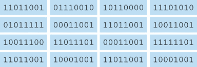

**Figure 8.3** The Rijndael matrix.

一旦你将原始明文块转换为二进制并放入 4 字节乘 4 字节的矩阵中，算法由几个相对简单的过程组成，这些过程在不同的轮次中被使用。这些过程如下：

- `AddRoundKey`：在这一过程，状态的每个字节都与轮密钥进行独占或运算。与 DES 类似，存在一个密钥调度算法，它在每轮中略微改变密钥。
- `SubBytes`：这涉及对输入字节（即 `AddRoundKey` 阶段的输出）进行替换。这是矩阵内容通过 S 盒进行处理的地方。每个 S 盒是 8 位的。
- `ShiftRows`：这是一个转置步骤，其中状态的每一行以循环方式向左移动一定数量的字节。在这个过程中，第一行保持不变。第二行的每个字节向左移动 1 字节（最左边的字节环绕到最右边）。第三行的每个字节向左移动 2 字节，第四行的每个字节向左移动 3 字节（同样，最左边的字节环绕到最右边）。如 Figure 8.4 所示。请注意，在这张图中，字节仅用行和字母标记，例如 `1a`、`1b`、`1c`、`1d`。

  ![Figure 8.4 ShiftRows. The transformation in shift rows technique is depicted. It comprises two states, initial state and after shift rows state. The initial state contains 4 cross 4 bytes. The bytes are 1a, 1b, 1c, 1d; 2a, 2b, 2c, 2d; 3a, 3b, 3c, 3d; 4a, 4b, 4c, 4d. During transformation, the first row is left unaltered. In the second row, the bytes are moved 1 position to the left. In the third row, the bytes are moved 2 positions to the left. In the fourth row, the bytes are transferred three positions to the left. After shifting, the bytes are positioned in the following order: 1a, 1b, 1c, 1d; 2b, 2c, 2a, 2a; 3c, 3d, 3a, 3b; 4d, 4a, 4b, 4c.](img/08fig04.jpg)

  **Figure 8.4** ShiftRows.

- `MixColumns`：这是一个作用于状态列的混合操作，将每列的 4 字节组合在一起。在 `MixColumns` 过程中，每列的状态被视为在 Galois 域 (2⁸) 中的多项式，并与固定多项式 `c(x) = 3x^3 + x^2 + x + 2` 相乘，结果再对 `x^4 + 1` 取模。

这些过程在 Rijndael 密码中会多次执行。128 位密钥对应 10 轮，192 位密钥对应 12 轮，256 位密钥对应 14 轮。

如果你对数论没有背景，这些最后几步可能会让你感到困惑。你可能会问：“什么是 Galois 域？” “什么是固定多项式？” 下一节会提供一个关于所需数学的概述。

### AES Math

一个 *group* 是由一组元素、一个身份元素、一个运算以及其逆运算组成的代数结构。基本上，群用于限制数学运算（如加法）到特定的数值集合。群有多种专门类型，简要描述如下：

- 一个 *abelian group*，或 *commutative group*，满足 `a + b = b + a`（如果运算是加法）或 `ab = ba`（如果运算是乘法）。
- 一个 *cyclic group* 是指其所有元素都是某一元素的幂。
- 一个 *ring* 是由一组元素、一个身份元素、两个运算以及第一个运算的逆运算组成的代数结构。
- 一个 *field* 是由一组元素、每个运算的身份元素、两个运算以及它们各自的逆运算组成的代数结构。

这引出了 Galois 群，即 Galois 域。`GF(p)` 对于任何质数 `p`，该域包含 `p` 个元素，这些元素是整数 modulo `p` 的余数类。质数 `p` 是该域的定义元素。下面是对 Galois 域的简要描述，未深入展开。要深入了解群论，需要进行更深入的研究。

## Blowfish

Blowfish 是一种对称块密码。它使用可变长密钥，范围从 32 到 448 位。Blowfish 于 1993 年由 Bruce Schneier 设计。它经过了密码学社区的广泛分析，并获得了广泛接受。它也是免费的非商业产品，这使得预算有限的组织更倾向于使用它。

## RC4

我们讨论的其他所有对称算法都是块密码。RC4 是由 Ron Rivest 开发的流密码。RC 是 Ron’s Cipher 或 Rivest’s Cipher 的缩写。还有其他 RC 版本，如 RC5 和 RC6。

## Serpent

Serpent 的块大小为 128 位，密钥长度可以是 128、192 或 256 位，与 AES 类似。该算法也是一种 substitution-permutation network（类似于 AES）。它使用 32 轮，每轮对四个 32 位单词的块进行操作，并同时 32 次应用八个 4 位到 4 位的 S-box。Serpent 设计为所有操作都可以并行执行。这也是它当时未被选为 DES 替代品的原因——当时许多计算机难以进行并行处理。但现代计算机处理并行无压力，因此 Serpent 再次成为一个有吸引力的选择。

## Skipjack

Skipjack 最初被分类，由国家安全局（NSA）为 Clipper 芯片开发。Clipper 芯片是一个内置加密功能的芯片，但解密密钥会保存在一个密钥托管中，以便在执法部门需要时能够在没有所有者授权的情况下解密数据。这一特性使得该算法极具争议。Skipjack 使用 80 位密钥加密或解密 64 位数据块。它是一个不平衡的 Feistel 网络，包含 32 轮。不平衡 Feistel 表示 Feistel 密码中，每个块的明文两半大小不相等。例如，64 位块可能被分为 48 位和 16 位两半，而不是两个 32 位半。

## Modification of Symmetric Methods

理解对称密码的实现方式与理解密码本身同样重要。

### Electronic Codebook

最基础的加密模式是电子代码本（ECB）模式。在 ECB 模式下，消息被分块，每个块独立加密。问题在于，如果同一明文多次提交，总会得到相同的密文，这为攻击者提供了分析依据，从而尝试推导密钥。换句话说，ECB 就是直接使用密码，而不进行任何改进。

### Cipher Block Chaining

使用密码块链（CBC）模式时，每个明文块在加密前会与前一个密文块进行异或（`XOR`）操作。这大大增加了最终密文的随机性，使其比 ECB 模式更安全。它是最常用的模式。

如果通信双方都能支持 CBC，基本上没有理由使用 ECB。CBC 能有效抵抗已知明文攻击（known plaintext attacks），这是本章后将要讨论的密码分析方法。


CBC 的唯一问题是第一个块没有前一个密文块可供异或。通常会使用初始化向量（IV）作为第一个块的异或来源。IV 本质上是一个伪随机数，类似于密钥。通常 IV 只使用一次，因此也称为 *nonce*（number used only once）。CBC 模式相当古老，最早在 1976 年由 IBM 引入。

### Public Key (Asymmetric) Encryption

*Public key encryption* 本质上是单键加密的相反概念。在任何公钥加密算法中，一个称为公钥的密钥用于加密消息，另一个称为私钥的密钥用于解密。你可以自由分发公钥，让任何人都能用它加密并发送给你，但只有拥有私钥的你才能解密。生成和应用密钥的具体数学过程因算法而异。我们稍后会在 RSA 部分深入探讨其数学原理。需要指出的是，许多公钥算法在一定程度上依赖于大质数、因数分解以及数论。

它已成为密码学中使用虚构的 Alice 和 Bob 来演示非对称加密的标准做法。如果 Alice 想向 Bob 发送消息，她会使用 Bob 的公钥对该消息进行加密。即使地球上每个人都拥有 Bob 的公钥，这也无关紧要，因为该公钥无法解密消息。只有 Bob 的私钥才能解密。如图 8.5 所示。


**Figure 8.5** Public key cryptography.

公钥加密之所以重要，是因为不需要处理密钥分发的问题。使用对称密钥加密时，你必须向每个想接收你加密消息的人提供密钥的副本。如果该密钥丢失或被复制，其他人可能会解密你的所有消息。而使用公钥加密，你可以自由地将你的公钥分发给全世界，而只有你能解密使用该公钥加密的消息。

#### RSA

如果不讨论 RSA，就无法讨论密码学，而 RSA 是一种被广泛使用的加密算法。该公钥方法于 1977 年由三位数学家开发：Ron Rivest、Adi Shamir 和 Len Adleman。RSA 名称来源于这三位数学家姓氏的首字母。让我们来看看 RSA 涉及的数学。

（应该指出，了解任何算法的数学（包括 RSA）对于大多数安全专业人员来说并非必备。但有些读者希望深入密码学，这将是一个很好的起点。）

要理解 RSA，你需要掌握一些基本的数学概念。以下内容可能对你有帮助，甚至可能是回顾：

* **质数：** 质数只能被自身和 1 整除。因此 2、3、5、7、11、13、17 和 23 都是质数。（注：1 本身是特殊情况，不被视为质数。）

* **互质：** 这个词并不等同于质数，而是指两个数没有公因数。例如，8（除去 1）的因数是 2 和 4，9 的因数是 3。8 和 9 没有公因数，因此它们是互质的。

* **欧拉的 φ 函数：** 读作 “oilers” totient，或简称为 *the totient*，它表示小于 `n` 且与 `n` 互质的整数个数。例如，考虑数字 10。由于 2 是 10 的因数，它与 10 不互质。但 3 与 10 互质。4 与 10 也不互质，因为 4 和 10 都有因子 2。5 与 10 不互质，因为它是 10 的因数。6 与 10 也不互质，因为它们都有因子 2。7 是质数，因此与 10 互质。8 与 10 也不互质，因为它们都有因子 2。9 与 10 互质。因此，与 10 互质的数有 3、7、9，加上特殊情况 1，欧拉 `φ(10) = 4`。Leonhard Euler 还证明，如果数 `n` 是质数，则它的 φ 值总是 `n − 1`。因此 `φ(7) = 6`，`φ(13) = 12`。

* **乘法与互质：** 现在我们可以轻松计算任意数的 φ 值。对于质数 `n`，`φ(n) = n − 1`。但如果我们将两个质数相乘呢？例如，5 × 7 = 35。我们可以遍历 35 以内的所有数，统计与 35 互质的数。但随着数字变大，手动计算变得繁琐。比如，若有一个 20 位数，手动计算 φ 几乎是不可能的。幸运的是，Euler 还证明，如果一个数是两个质数（记为 `p` 和 `q`）的乘积（例如 5 和 7），则该乘积的 φ 值等于 `(p − 1) × (q − 1)`（例如 `5 − 1 × 7 − 1 = 4 × 6 = 24`）。

* **模运算（Modulus）：** 这是 RSA 最后需要的概念。我们将使用两种解释方式。第一种是从程序员的角度：模运算是对两个数相除后得到的余数。程序员常用 `%` 符号表示模运算。例如，`10 % 3` 的结果是 1，即 10 除以 3 的余数为 1。这并不是数学上对模运算的严谨解释。

基本上，模运算限制了加法和减法的结果，使其在某个特定范围内循环。你一生中已经在不知情的情况下使用过它。比如时钟的概念：当你说 “2 p.m.”，实际上是指 `14 mod 12`（即 14 除以 12 后的余数）。如果现在是 2 p.m.（即 14 点），而你告诉我你将在 36 小时后联系我，我会计算 `14 + 36 mod 12`，即 `50 mod 12`，结果是 2 a.m.（虽然电话时间有点早，但这能说明问题）。

如果你已经理解了这些基本运算，那么你就可以开始学习 RSA 了。如有需要，可以重新阅读前文（甚至多次阅读）再继续。

生成密钥的第一步是生成两个大小相近的随机大质数 `p` 和 `q`。你需要选择两个数，使它们相乘得到的乘积达到你想要的位数（如 2048 位、4096 位等）。

随后计算 `n = p × q`。

下一步是计算每个质数的欧拉 φ 值，即 `φ(p) = p − 1`，`φ(q) = q − 1`。将它们相乘得到 `m = (p − 1)(q − 1)`。

现在我们需要选择一个数 `e`，使其与 `m` 互质。通常选择一个小的、与 `m` 互质的 `e`。

我们几乎完成了密钥生成。现在只需找到一个数 `d`，使得 `d × e % m = 1`。（记住：模运算是对两个数相除后得到的余数，例如 `8 mod 3 = 2`。）

找到 `d`，使得 `d × e % m = 1`。

随后，你会公开发布 `e` 和 `n` 作为公钥，保持 `d` 为私钥。加密时，只需将消息的 `e` 次方取模 `n`：

`= m^e % n`

解密时，则是将密文的 `d` 次方取模 `n`：

`P = c^d % n`

字母 `e` 代表 *encrypt*（加密），`d` 代表 *decrypt*（解密）。即使你对 RSA（或任何加密算法）的实际实现不熟悉，也不要紧，因为许多网络安全从业者并不需要深入理解算法细节。但如果你想更深入密码学，这将是一个很好的起点，它涉及基本的数论，尤其是质数。还有其他非对称加密算法，例如椭圆曲线密码学（ECC）。

下面是一个例子，帮助你理解。当然，RSA 实际会使用非常大的整数。为了便于阅读，这里使用小整数进行演示。

选择两个不同的质数，例如 `p = 61` 和 `q = 53`，计算 `n = p × q`：

`n = 61 × 53 = 3233`

计算乘积的欧拉 φ 值 `φ(n) = (p − 1)(q − 1)`：

`φ(3233) = (61 − 1)(53 − 1) = 3120`

选择任意一个满足 `1 < e < 3120` 的数，该数必须与 3120 互质。选择一个质数作为 `e` 后，我们只需检查 `e` 不是 3120 的因数。设 `e = 17`，计算 `d`，即 17 的模数乘法逆元，得到 `d = 2753`。

公钥是 `(n = 3233, e = 17)`。对于加密的明文消息 `m`，加密函数为：

`m^17 (mod 3233)`

私钥是：

`(n = 3233, d = 2753)`

对于加密的密文 `c`，解密函数为：

`c^2753 (mod 3233)`

对于初次接触 RSA 或密码学的读者，可能会发现以下更小规模的示例更有帮助：

选择质数：`p = 17` 与 `q = 11`。

计算 `n = pq = 17 × 11 = 187`。

计算 `φ(n) = (p − 1)(q − 1) = 16 × 10 = 160`。

选择 `e`：`gcd(e, 160) = 1`；选择 `e = 7`。

计算 `d`：`d × e = 1 mod 160` 且 `d < 160`。值为 `d = 23`，因为 `23 × 7 = 161 = 10 × 160 + 1`。

发布公钥：(7 和 187)。

保持私钥秘密：23。

##### Diffie-Hellman

Diffie-Hellman 是第一个公开描述的非对称算法。该密码协议允许两方在受保护的通道中建立共享密钥。换句话说，Diffie-Hellman 通常用于让双方通过某些不安全的通道（如互联网）交换对称密钥。它由 Whitfield Diffie 和 Martin Hellman 在 1976 年开发。

在密码学领域有一个问题：许多工作都是机密的。你可能会花费多年时间创造出美妙的东西……但你无法向任何人展示。更糟的是，多年后其他人可能会开发出类似的方法，发布它，并获得全部信用。这正是 Diffie-Hellman 的情况。事实证明，类似的方法早在几年前就被英国情报机构的 Malcolm J. Williamson 开发，但被分类了。

Diffie-Hellman 经历了多种修改和改进。其中最著名的包括 Elgamal 和 MQV。Elgamal 以其发明者 Taher Elgamal 命名。MQV 首次提出于 1995 年，以其发明者 Alfred Menezes、Minghua Qu 和 Scott Vanstone 命名。MQV 已被纳入公钥标准 IEEE P1363 和 NIST 的 SP800-56A 标准中。

##### 椭圆曲线密码学

椭圆曲线算法最初由 Victor Miller 和 Neal Koblitz 在 1985 年描述。椭圆曲线密码学 (ECC) 的基础在于，找到相对于公开已知基点的随机椭圆曲线元素的离散对数是极其困难的，以至于实际上难以实现。该算法背后的数学对于入门级安全书籍来说有点复杂。不过，如果你感兴趣，应该阅读这篇优秀的入门教程：[arstechnica.com/security/2013/10/a-relatively-easy-to-understand-primer-on-elliptic-curve-cryptography/](http://arstechnica.com/security/2013/10/a-relatively-easy-to-understand-primer-on-elliptic-curve-cryptography/)。

有许多变体，如 ECC-DH (ECC Diffie-Hellman) 和 ECC-DSA (ECC Digital Signature Algorithm)。ECC 密码系统的真正优势在于，你可以用更小的密钥获得与 RSA 等其他系统相同的安全级别。例如，384 位的 ECC 密钥的安全程度相当于 2048 位 RSA。

### PGP

*PGP*，即 *Pretty Good Privacy*，是一种公钥系统。它是被大多数专家认为非常安全的广泛使用的系统。有多种免费软件实现，可在大多数桌面操作系统上使用。PGP 插件可用于 MSN Messenger 和许多其他流行的通信软件。只需在 Yahoo! 或 Google 中搜索 *PGP*，即可找到许多此类软件产品。

FYI: “Old” Encryption

PGP 相当老旧，你可能会想知道它是否因此过时。密码学与其他技术领域不同：旧的更好。通常不应使用“最新的”加密方法，因为它是未经验证的。一个经过多年考验且尚未被破解的旧加密方法通常是一个强有力的选择，因为它已经经受住了专家的多年审查以及专业和非专业人士的破解尝试。这对于计算机专业人员来说可能难以理解，因为计算机行业通常偏好最新技术。

PGP 由 Phil Zimmermann 发明。在创建 PGP 之前，Zimmermann 已经作为软件工程师工作了 20 年，并拥有现有加密方式的经验。PGP 的诞生引发了争议，因为它缺乏政府介入的便利途径，且其加密强度被认为过大，无法出口。这导致 Zimmermann 成为为期 3 年的政府调查的目标。然而，这些法律问题已得到解决，PGP 成为目前可用的最广泛使用的加密方法之一。

关于 PGP 的重要事项包括：

* 公钥加密
* 被认为相当安全
* 免费提供

这些事实使得 PGP 成为您组织加密需求的可能解决方案值得进一步考虑。

### 合法与欺诈加密方法

本章 earlier 讨论的加密方法只是现代最广泛使用的几种。每年都有数十种其他方法免费公开或专利并出售。但要意识到，这个计算机行业充斥着欺诈者和骗子。只需在搜索引擎中搜索 *encryption*，就会发现大量关于“最新、最强、不可破解”加密的广告。如果你不熟悉加密，如何区分合法的加密方法和欺诈？

市面上有许多欺诈性的加密声明。你不需要是密码学专家就能避免许多这些欺诈性主张。以下是一些警示信号：

* **不可破解：** 任何有经验的密码学家都知道，不存在完全不可破解的密码。有些密码尚未被破解，有些非常难破解。但当有人声称一种方法是“完全不可破解”时，你应该保持警惕。

* **认证：** 猜猜看？加密方法没有公认的认证流程。因此，任何公司声称的“认证”都完全无价值。

* **经验不足的人：** 一家公司正在推广一种新的加密方法。他们工作人员有什么经验？加密学家是否有数学、加密或算法方面的背景？如果没有，是否在同行评审期刊上提交过他的方法？或者，他至少愿意公开他的方法，以便公平评判？请记住，PGP 的发明者拥有数十年的软件工程和加密经验。

Auguste Kerckhoffs 在 1800 年代首先提出了如今称为 Kerckhoffs’s principle 的原则。他指出，密码的安全性仅取决于密钥的保密性，而不取决于算法的保密性。Claude Shannon 重新表述了这一点，说：“应假设敌人最终会完全熟悉这些系统。”这一思想，即 Shannon’s maxim，与 Kerckhoffs’s principle 的含义基本相同。

我在此基础上添加了一个我自称的 Easttom’s corollary：“你应该非常警惕任何未经过发布和彻底审查的密码算法。只有在经过广泛同行评审后，你才应考虑使用任何密码算法。”我最初在书 *Modern Cryptography: Applied Mathematics for Encryption and Information Security* 中提出了这一推论。

### 数字签名

数字签名并非用于确保消息的机密性，而是用于保证消息的发送者是谁。这被称为 `nonrepudiation`。基本上，`nonrepudiation` 意味着证明发送者是谁。数字签名实际上相当简单，但它们是巧妙的。它们只是逆向了非对称加密的过程。请回顾，在非对称加密中，公钥（任何人都可以获取）用于加密消息以发送给接收方，而私钥（保持安全和私密）用于解密。对于数字签名，发送者使用自己的私钥对某些内容进行加密。如果接收方能够使用发送者的公钥解密，那么消息必定是由声称发送该消息的人所发送。此过程如下图 Figure 8.6 所示。

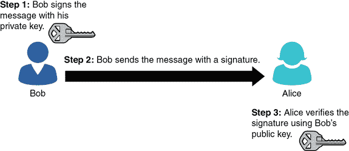

**Figure 8.6** Digital signatures.

### Hashing

`hashing` 是一种加密算法，具有特定的特征。首先，它是单向的，即你无法“反向”解密（unhash）某事物。其次，无论输入是什么，输出都是固定长度的。第三，不存在碰撞（collisions）。碰撞是指两个不同的输入在同一个哈希算法下产生相同的输出（称为 `hash` 或 `digest`）。理想情况下我们希望没有碰撞。但现实是，由于固定长度输出，碰撞是可能的。因此，目标是让碰撞的可能性变得极低，几乎不需要考虑。

哈希正是 Windows 存储密码的方式。例如，如果你的密码是 `password`，Windows 会先对其进行哈希，生成类似下面的结果：

`0BD181063899C9239016320B50D3E896693A96DF`

Windows 随后将该哈希值存储在 SAM（Security Accounts Manager）文件中，该文件位于 Windows 系统目录。当你登录时，Windows 无法反向解密你的密码（因为它是单向的）。因此，Windows 的做法是：当你输入密码时，它会对输入的密码进行哈希，然后与 SAM 文件中的哈希值进行比较。如果完全匹配，则允许登录。

存储 Windows 密码只是哈希的一个应用场景。还有其他用途。例如，在计算机取证中，通常会在开始取证检查之前对磁盘进行哈希。随后可以再次哈希以查看是否有任何更改（无论是意外还是故意）。如果第二次哈希与第一次匹配，则表示没有任何更改。

有多种哈希算法。其中最常见的两种是 MD5 和 SHA。（最初是 SHA-1，但此后更常见的版本，如 SHA-256，已取代其地位。）

#### MD5

MD5 是一种 128 位的哈希，指定于 RFC 1321。它由 Ron Rivest 于 1991 年设计，用于取代早期的哈希函数 MD4。MD5 生成 128 位的哈希或消息摘要（digest）。它的抗碰撞能力不如 SHA。

#### SHA


`Secure Hash Algorithm`（`SHA`）可能是当今最广泛使用的哈希算法。目前有多个 SHA 版本，所有版本都被认为是安全且抗碰撞的：

*   `SHA-1`：这是一个 160 位的哈希函数，类似于早期的 MD5 算法。它由 NSA 设计，用于数字签名算法（DSA）。
*   `SHA-2`：这实际上是两个相似的哈希函数，具有不同的块大小，分别称为 `SHA-256` 和 `SHA-512`。它们的区别在于字长；`SHA-256` 使用 32 字节（256 位）字，而 `SHA-512` 使用 64 字节（512 位）字。此外，还存在每个标准化版本的截断形式，即 `SHA-224` 和 `SHA-384`。这些也由 NSA 设计。
*   `SHA-3`：这是 SHA 的最新版本，于 2012 年 10 月被采用。

### RIPEMD

`RACE Integrity Primitives Evaluation Message Digest`（`RIPEMD`）是一种 160 位的哈希算法，由 Hans Dobbertin、Antoon Bosselaers 和 Bart Preneel 开发。该算法有 128 位、256 位和 320 位的变体，分别称为 `RIPEMD-128`、`RIPEMD-256` 和 `RIPEMD-320`。这些变体都取代了原始的 `RIPEMD`，因为原始版本被发现存在碰撞问题。

### MAC and HMAC

哈希用于多种安全相关功能。其中之一是存储密码，我们在此已经讨论过（本章后面还会看到更多）。

消息的哈希可以在传输过程中用于检测意外的篡改。如果消息在传输过程中被篡改，接收方可以将接收到的哈希与发送方计算的哈希进行比较，从而检测传输错误。但如果是恶意的篡改呢？如果有人故意修改消息，删除原始哈希，并重新计算一个新的哈希，普通哈希算法无法应对这种情况。

使用`消息认证码`（`MAC`）是一种检测消息意图篡改的方法。`MAC` 也常被称为`keyed cryptographic hash function`（有密钥的密码散列函数）。这个名字应该能让你理解其工作原理。一种实现方式是`消息认证码`（HMAC）。假设你使用 MD5 来验证消息完整性。为了检测恶意方意图篡改消息，发送方和接收方必须事先共享一个适当大小的密钥（在此例中为 128 位）。发送方会对消息进行哈希，然后将该哈希与密钥进行异或（XOR）运算。接收方会对接收到的内容进行哈希，然后将计算出的哈希与密钥进行异或。随后两者交换。如果拦截方仅仅重新计算哈希，他将没有密钥来与之异或（并且可能甚至不知道需要异或），因此他生成的哈希与接收方计算的不一致，篡改行为将被检测到。

概念还有其他变体。一些方法使用对称密码在 CBC（密码块链接模式）中，然后仅使用最后一个块作为 MAC。这些变体被称为 CBC-MAC。

#### Rainbow Tables

由于 Windows 和许多其他系统将密码存储为哈希值，许多人对如何破解哈希感兴趣。正如我们所提到的，由于哈希不可逆，无法“反向”解密任何内容。1980 年，Martin Hellman 描述了一种利用预计算数据存储在内存中的技术，以减少密码分析的时间。在 1982 年之前，Rivest 对该技术进行了改进。基本上，这类密码破解工具使用预计算的所有可能密码（在特定字符集范围内，如 a–z 或 a–zA–z 或 a–zA–Z0–9 等）的哈希值，这称为`rainbow table`。如果你在 `rainbow table` 中查找某个哈希，找到的明文即为输入该哈希算法的原始文本。

显然，这样的 `rainbow table` 会非常大且增长迅速。假设密码必须限制在键盘字符上，那么就有 52 个字母（26 大写+26 小写），10 个数字，以及大约 10 个符号，总共约 72 个字符。正如你所想象，即使是 6 位密码也有极大的组合数。这意味着 `rainbow table` 的规模也有限，因此更长的密码比更短的密码更安全。

自 `rainbow table` 的出现以来，已有许多方法设计用于防御此类攻击。最常见的是`salting`，即在哈希前添加随机位，以进一步增强安全性。这在防止 `rainbow table` 攻击时最常见。

基本上，`salt` 是与要哈希的消息混合的随机位。考虑一个例子。假设你有一个密码：

`pass001`

其二进制表示为：

```
01110000 01100001 01110011 01110011 00110000 00110000 00110001
0111100001 0110100011 0111100111 0111100111 0011100001 0011100001 0011100011
```

If you convert that to text, you would get:

xZ7#

All this is transparent to the end user, who doesn’t even know that salting is happening or what it is. However, an attacker using a rainbow table to get passwords would get the wrong password.

### Steganography

*Steganography* is the art and science of writing hidden messages in such a way that no one, apart from the sender and intended recipient, suspects the existence of the message. It is a form of security through obscurity. Often the message is hidden in some other file, such as a digital picture or an audio file, to defy detection.

The advantage of steganography over cryptography alone is that messages do not attract attention to themselves. If someone is aware that a message is even there, she won’t try to decipher it. In many cases, messages are encrypted and hidden via steganography.

The most common implementation of steganography utilizes the least significant bits in a file in order to store data. By altering the least significant bit, you can hide additional data without altering the original file in any noticeable way.

There are some basic steganography terms you should know:

*   *Payload* is the data to be covertly communicated. In other words, it is the message you wish to hide.
*   The *carrier* is the signal, stream, or data file into which the payload is hidden.
*   The *channel* is the medium used. This may be still photos, video, or sound files.

The most common way steganography is accomplished today is via least significant bits. Every file has a certain number of bits per unit of the file. For example, an image file in Windows is 24 bits per pixel. If you change the least significant of those bits, then the change is not noticeable with the naked eye. And you can hide information in the least significant bits of an image file. With least significant bit (lsb) replacement, certain bits in the carrier file are replaced.

#### Historical Steganography

In modern times, steganography involves digital manipulation of files to hide messages. However, the concept of hiding messages is not new. There have been many methods used throughout history.

*   The ancient Chinese wrapped notes in wax and swallowed them for transport. This was a crude but effective method of hiding messages.
*   In ancient Greece, a messenger’s head would be shaved, a message was written on his head, and then his hair was allowed to grow back. Obviously, this method required some time.
*   In 1518 Johannes Trithemius wrote a book on cryptography and described a technique in which a message was hidden by having each letter taken as a word from a specific column.
*   During World War II the French Resistance sent messages written on the backs of couriers using invisible ink.
*   Microdots are images/undeveloped film the size of a typewriter period that are embedded in innocuous documents. These were said to be used by spies during the Cold War.
*   Also during the Cold War, the U.S. Central Intelligence Agency used various devices to hide messages. For example, they developed a tobacco pipe that had a small space to hide microfilm but could still be smoked.

In more recent times, but before the advent of computers, other methods were used to hide messages.

#### Steganography Methods and Tools

There are a number of tools available for implementing steganography. Many are free or at least have free trial versions. A few of these tools are listed here:

*   `QuickStego`: Easy to use but very limited
*   `Invisible Secrets`: Much more robust, with both a free version and a commercial version available
*   `MP3Stego`: Specifically for hiding payload in MP3 files
*   `Stealth Files 4`: Works with sound files, video files, and image files
*   `Snow`: Hides data in whitespace
*   `StegVideo`: Hides data in a video sequence
*   `Invisible Secrets`: A very versatile steganography tool that has several options

### Cryptanalysis

Cryptanalysis is a daunting task. It essentially involves searching for some means to break through encryption of some sort. And, unlike what you see in the movies, it is a very time-consuming task that frequently leads to only partial success. Cryptanalysis involves using any method to decrypt the message that is more efficient than simple brute-force attempts. (Remember that brute forcing means simply trying every possible key.)

A cryptanalysis success is not necessarily breaking the target cipher. In fact, finding any information about the target cipher or key is considered a success. There are several types of cryptographic success:

*   **Total break:** The attacker deduces the secret key.
*   **Global deduction:** The attacker discovers a functionally equivalent algorithm for encryption and decryption but without learning the key.
*   **Instance (local) deduction:** The attacker discovers additional plain texts (or cipher texts) not previously known.
*   **Information deduction:** The attacker gains some Shannon information about plain texts (or cipher texts) not previously known.
*   **Distinguishing algorithm:** The attacker can distinguish the cipher from a random permutation.

Entire books have been written on cryptanalysis. The purpose of this section is just to give you some basic concepts from the field so that you have a basic understanding. There are certainly other methods not discussed in this section.

#### Known Plain Text Attack


The known plain text attack method is based on having a sample of known plain texts and their resulting cipher texts and then using this information to try to ascertain something about the key used. It is easier to obtain known plain text samples than you might think. Consider email. Many people, myself included, use a standard signature block. If you have ever received an email from me, you know what my signature block is. Then if you intercept encrypted emails I send, you can compare the known signature block to the end of the encrypted email. You would then have a known plain text and the matching cipher text to work with. Success with this method requires many thousands of known plain text samples.

### Chosen Plain Text Attack

- [选定明文攻击](https://example.org)与已知明文攻击密切相关，但使用选定明文攻击时，攻击者找到了让目标按攻击者选择的消息进行加密的方法。这可以让攻击者尝试推导所使用的密钥，从而解密该密钥下加密的其他消息。该方法虽难但并非不可能，成功需要数千条选定明文样本来实现。

### Cipher Text Only

在 `Cipher Text Only` 攻击中，攻击者仅拥有密文集合。这种情况比已知明文攻击更可能发生，但也是最困难的攻击类型。若能够推导出对应的明文，或更好地推导出密钥，则该攻击完全成功。即便仅能获取关于底层明文的任何信息，也算作成功。

### Related-Key Attack

`Related-Key Attack` 与选定明文攻击类似，但攻击者可以获得两种不同密钥下加密的密文。如果能够获得明文和对应的密文，这种攻击非常有用。

## Cryptography Used on the Internet

在银行网站和电子商务中使用的是哪种加密？总体而言，对称算法更快，且能用更短的密钥长度达到与非对称算法相同的安全性。然而，如何安全交换密钥是一个问题。因此，大多数电子商务方案先使用非对称算法交换对称密钥，然后使用该对称密钥加密实际数据。

访问以 `HTTPS` 开头的网站（而非 HTTP）时，`S` 表示 `Secure`，意味着浏览器与服务器之间的流量已加密，通常使用 `SSL`（Secure Sockets Layer）或 `TLS`（Transport Layer Security）。`SSL` 是较老的技术，由 Netscape 开发。`SSL` 与 `TLS` 均为非对称系统。

## Quantum Computing Cryptography

近年来量子计算是最令人感兴趣的密码学话题之一。下面先简要说明量子计算，再探讨其对密码学的影响。

量子计算的核心问题是能够表示超过两个状态。当前的计算技术使用 `classical bits`，只能表示二进制值。 `Qubit`（量子比特）通过单个光子的极化来存储数据，其两个基本状态为水平极化和垂直极化；但量子力学允许这两个状态同时处于叠加态——这是经典比特所不可能实现的。一个量子比特的两个状态用量子符号 |0> 与 |1> 表示，分别对应水平极化和垂直极化。量子比特由这两个基态的叠加构成，叠加状态表示为 |ψ> = α|0> + β|1>。经典比特只能表示 1 或 0，而量子比特可以表示 1、0，或任意两者的量子叠加，从而提供更强大的计算能力。

尽管你可能听说过量子计算已经足以在实际应用中发挥作用，但当前的量子计算技术并未达到可实用的阶段。现代最先进的系统只有 `20 到 50` 个量子比特，且只能在极短时间内保持数据完整。这虽有利于科研，却不适合实际计算应用。然而，许多专家相信，未来 `10 年` 内将出现可用的实用量子计算机。这对密码学意味着什么？1995 年，Peter Shor 发表了 `Shor’s algorithm`，证明量子计算机能在多项式时间内分解大整数；实际时间为 log N。这比目前最有效的经典分解算法（通用数域筛选，subexponential time）快得多。RSA 基于分解大数的困难，量子计算机也能高效解决离散对数问题，因而 Diffie-Hellman、MQV、Elgamal、ECC 等都依赖于此困难。

由此可见，当量子计算机成为现实时，现有的非对称（公钥）算法将失效。届时，电子商务、VPN 以及众多其他应用的安全性将不再可靠。美国国家标准技术研究院（NIST）正在着手制定 `量子抗性密码学` 标准。^(1) 该研究预计在约 `2022` 年完成。

## Summary

计算机安全的基本要素是加密。发送未加密的敏感数据是愚蠢的。本章介绍了加密的基本原理。最重要的是，最终被威胁的并非你的计算机或网络，而是你的数据。在传输数据时加密是任何安全计划的组成部分。

本章末尾的练习将让你使用多种密码方法，并进一步了解各种加密技术。

## Test Your Skills

### MULTIPLE CHOICE QUESTIONS

**1.** 理解密码学概念及其应用的重要性。下列哪项最准确地定义了加密？

**A.** 改变消息，使其只能被预期的接收者轻松阅读

**B.** 使用复杂数学隐藏消息

**C.** 使用复杂数学改变消息

**D.** 将密钥应用于消息以隐藏它

**2.** 文中讨论的最古老的加密方法是哪一个？

**A.** PGP

**B.** 多字母加密

**C.** 凯撒密码

**D.** 神秘密码

**3.** 许多经典密码易于理解但不安全。简单替换的主要问题是什么？

**A.** 它不使用复杂数学。

**B.** 它可以被现代计算机轻易破解。

**C.** 它过于简单。

**D.** 它保留了字母和词频。

**4.** 经典密码通过添加多次移位（多字母替换）得到改进。下列哪种方法使用两种或多种不同的移位？

**A.** 凯撒密码

**B.** 多字母加密

**C.** DES

**D.** PGP

**5.** 哪种二进制数学运算可用于简单（但不安全）的加密方法，并且是现代对称密码的一部分？

**A.** 比特移位

**B.** OR

**C.** XOR

**D.** 比特交换

**6.** 为什么二进制数学加密不安全？

**A.** 它不改变字母或词频。

**B.** 它保留了消息的完整性。

**C.** 它过于简单。

**D.** 其数学本身有缺陷。

**7.** 下列关于二进制运算和加密的描述，哪项最为真实？

**A.** 它们完全无用。

**B.** 它们可以构成可行的加密方法。

**C.** 它们仅用于教学目的。

**D.** 它们可以提供安全的加密。

**8.** PGP 是什么？

**A.** Pretty Good Privacy，一种公钥加密方法

**B.** Pretty Good Protection，一种公钥加密方法

**C.** Pretty Good Privacy，一种对称密钥加密方法

**D.** Pretty Good Protection，一种对称密钥加密方法

**9.** 哪种方法可作为大多数电子邮件客户端的附加组件？

**A.** DES

**B.** RSA

**C.** 凯撒密码

**D.** PGP

**10.** 哪种对称密钥系统使用 64 位块？

**A.** RSA

**B.** DES

**C.** PGP

**D.** Blowfish

# 第 9 章. 计算机安全技术

## 章节目标

阅读本章并完成练习后，您将能够：

* 根据其工作原理评估扫描器的有效性
* 为给定组织选择最佳的防火墙类型
* 理解防病毒软件的方法
* 使用入侵检测系统（IDS）检测系统上的问题
* 理解蜜罐

## 引言

在本书的整个过程中，已经讨论了计算机安全的各个方面。此时在您的学习中，您应该已经对真实的危害以及适当的安全措施包括什么有一个良好的认识，并且对各种计算机攻击形式有一个基本的理解。然而，如果您正在努力保护网络，您将需要更多的技术细节，关于您可能选择使用的各种安全设备和软件。本章回顾了这些项目，并提供足够的细节，使您能够做出关于将使用哪种类型产品的明智决定。

本章中描述的大多数设备在前面的章节中已经提及并简要描述过。本章的意图是更深入地探讨这些设备的工作原理。这些信息对于计划最终进入计算机安全领域的人来说尤为重要。仅有理论知识是不够的。您必须具备一些实践技能。本章将为您提供一个良好的起点，帮助您获得这些技能，而本章末尾的练习将让您有机会练习设置和评估各种防火墙、入侵检测系统（IDS）以及防病毒软件的使用。

## 病毒扫描器

一个 `病毒扫描器` 实质上是一种软件，旨在防止病毒感染系统。这点对于大多数读者来说可能已经触手可及。了解病毒扫描器的工作原理，却是另一回事。该主题在我们之前关于病毒的讨论中简要提及，但本章将对其进行更详细的阐述。

总体而言，病毒扫描器有两种工作方式。首先，病毒扫描器可能包含所有已知病毒的定义列表——也就是说，文件列出已知病毒及其文件大小、属性和行为。通常，病毒扫描器供应商会定期更新这些文件。病毒定义列表通常是一个小文件，常被称为 `*.dat*` 文件（即 data 的缩写）。当您更新病毒定义时，实际发生的情况是将当前文件替换为供应商提供的更最新的文件。防病毒程序随后可以扫描您的个人电脑、网络和 incoming email，查找已知病毒文件。您的电脑上或作为电子邮件附件的任何文件都会与病毒定义文件进行比对，看是否有匹配。对于电子邮件，这可以通过查找特定的主题行和内容来实现。病毒定义通常还包括关于文件、文件大小等的详细信息。这为病毒提供了完整的签名。

第二种病毒扫描方式是查找病毒样似的行为。基本上，扫描器会检查该文件是否执行病毒通常会做的操作——比如修改注册表或查看你的通讯录。显然，这种第二种技术本质上是一种最佳猜测。

## 病毒扫描仪是如何工作的？

让我们更详细地看一下防病毒软件的工作原理。2004 年 7 月《Scientific American》杂志的一篇文章标题为“如何工作病毒扫描仪?”，指出病毒扫描仪本质上是一款会搜索已知病毒签名或模式的软件。请记住，只有保持扫描仪更新，它才会工作。而且，它只能检测已知的病毒。虽然这篇文章现在看起来有点旧，但它仍然是准确的。

请记住，第二种病毒扫描方式是监视病毒典型行为的某些类型。这可能包括任何尝试写入硬盘引导扇区、修改系统文件、自动化你的电子邮件软件或自我复制的程序。试图修改系统注册表（对于 Windows 系统）或更改任何系统设置的程序也可能表明系统被感染。

另一个病毒扫描仪会寻找的特征是：文件在执行后仍会驻留在内存中。这类程序称为 `terminate and stay resident`（`TSR`）程序。虽然合法程序也会这样做，但此类活动常常是病毒的迹象。此外，某些病毒扫描仪会使用更高级的方法，例如扫描系统文件并监控试图修改这些文件的程序。

无论具体行为如何，防病毒软件会使用特定的算法来评估给定文件被判定为病毒的可能性。需要注意的是，现代病毒扫描仪会扫描所有形式的恶意软件，包括特洛伊木马、间谍软件和病毒。

还有一种方法，称为 `启发式扫描`（`heuristic scanning`），它基本上是对文件进行检查，与签名扫描类似。然而，启发式扫描中，文件不必完全匹配签名。`启发式`（heuristics）指的是在算法中通过分支步骤对各种备选方案进行排名的功能。因此，启发式扫描会根据文件特征而非行为，判断给定文件是否可能是病毒。

区分 `on-demand` 病毒扫描和 `ongoing` 病毒扫描很重要。 `ongoing virus scanner` 会在后台运行，并持续检查 PC 是否有病毒迹象。 `on-demand virus scanners` 则仅在你手动启动时运行。许多现代防病毒扫描仪同时提供这两种选项。

请记住，任何防病毒程序都会产生一些误报和误报（即漏报）。误报（false positive）是指病毒扫描仪错误地将某文件判定为病毒，而实际上它并非病毒。例如，合法程序可能修改注册表或访问你的通讯录。误报（false negative）是指病毒被错误地认为是合法程序。

由于误报，建议你不要让防病毒程序自动删除疑似病毒。相反，应该将其隔离并通知用户。

## 病毒扫描技术

总体而言，病毒扫描仪可能使用六种方式来查找病毒感染。前一部分已经提及其中一些，但在此处进行了概述和定义：

* **电子邮件和附件扫描**：由于病毒的主要传播方式是电子邮件，电子邮件和附件扫描是任何病毒扫描仪最重要的功能。一些病毒扫描仪会在下载到你的机器之前，先在电子邮件服务器上检查你的电子邮件。其他病毒扫描仪则在你的电脑上扫描电子邮件和附件，然后再传递给你的电子邮件程序。无论哪种方式，电子邮件和附件在用户有机会打开它们之前都应被扫描。
* **下载扫描**：每当你从互联网下载任何内容（通过网页链接或 FTP 程序），都有可能下载到受感染的文件。下载扫描的工作方式类似于电子邮件和附件扫描，但针对的是你选择下载的文件。
* **文件扫描**：在文件扫描中，系统中的文件会被检查是否匹配已知病毒。此类扫描通常是按需进行的，而非持续进行。建议你定期安排病毒扫描对整个系统进行完整扫描。我建议每周进行一次扫描，最好在不太可能有人使用电脑的时段。
* **启发式扫描**：如前一部分简要提到，启发式扫描可能是最先进的病毒扫描方式。它利用规则来判断文件或程序是否像病毒一样行为，是发现尚未被知晓的病毒的最佳手段之一。新病毒不会出现在病毒签名列表中，因此必须通过观察其行为来判断是否为病毒。不过，这一过程并非万无一失，可能会漏掉真实的病毒感染，也可能会误判非病毒文件为病毒。
* **沙箱（Sandbox）**：沙箱方法基本上是将下载或附件在与操作系统隔离的独立区域中运行。如果该文件被感染，它就不会感染操作系统。
* **机器学习**：大多数防病毒供应商现在正在努力在其防病毒软件中实现基本的机器学习算法。这使得防病毒软件能够适应不断变化的攻击方式。机器学习仍处于起步阶段，尚未得到充分发展。

实现沙箱的一种方式是让操作系统为可疑文件预留受保护的内存区域进行打开，并监控其行为。这并非 100% 有效，但比直接在系统上打开文件并希望没有感染要安全得多。

相关的概念是所谓的 “羊群冲”（sheep dip）机器。这种机制在企业网络中很有用。你可以搭建一个配置与普通工作站完全相同的系统，但该 “羊群冲” 机器不在网络中。首先在该系统上打开可疑文件，然后监控一段时间以观察是否有感染迹象。文件通过此检查后，才能在正常工作站上打开。

在家庭或小型办公室中，简单实现此方法的办法是：在你的电脑上建立一个虚拟机，并在虚拟机中先打开可疑的附件或下载内容。该虚拟机上可以运行病毒扫描器。你还可以在虚拟机中修改时间，以检测逻辑炸弹。让可疑文件在虚拟机中停留一段时间，然后再将其移动到主机电脑。

FYI：大多数商业扫描仪的工作方式

大多数商业病毒扫描仪使用多种方法，包括这里列出的大部分甚至全部方法。任何只使用单一扫描模式的扫描仪在实际病毒防御方面几乎是毫无价值的。这些模式是扫描仪的工作方式，无论它是采用启发式扫描、下载扫描、电子邮件扫描等。

* **主动代码扫描**：现代网站经常嵌入活动代码，如 Java 小程序和 ActiveX。这些技术可以为网站带来惊艳的视觉效果，但也可能成为恶意代码的载体。在下载到计算机之前对这些对象进行扫描是任何高质量病毒扫描仪的必备功能。

```if (condVar > someVal) {console.log("xxx")}
```

# False positives and false negatives

无论病毒扫描器的类型如何，任何防病毒软件都会偶尔出现错误。你需要关注的有两种错误类型。防病毒软件可能会将合法程序误判为病毒。例如，你可能有一个程序，它的功能是修改 Windows 注册表或扫描电子邮件通讯录。将合法程序误判为病毒称为 `false positive`（假阳性）。防病毒软件也可能未能识别病毒，这称为 `false negative`（假阴性）。降低假阴性的最佳方法是保持防病毒软件更新。对于假阳性，建议你将可疑病毒隔离，而不要自动删除。

## Commercial Antivirus Software

当前防病毒市场几乎由四个品牌的防病毒软件垄断，公司提供商业版扫描仪通常也会提供功能较少的免费版。例如，AVG AntiVirus 可在 [www.avg.com](http://www.avg.com) 获得，它是商业产品，但公司也提供 AVG AntiVirus Free Edition。McAfee、Norton 和 Kaspersky 是另外三个知名防病毒厂商。这四个产品均为优秀选择，并提供诸如垃圾邮件过滤器和个人防火墙等多种选项。任何一款产品均可为家用机器购买，价格约为 30 至 60 美元（取决于所包含的选项）。该购买价格包含 1 年的病毒库更新订阅，使防病毒软件能够识别所有已知病毒攻击，包括新出现的威胁。组织授权也可用于覆盖整个网络。Malwarebytes 是另一家知名厂商，提供免费版和商业版。

当然，还有其他防病毒解决方案。网络上可以轻松找到多种免费病毒扫描工具。这里提到的 McAfee、Norton、AVG、Malwarebytes 和 Kaspersky 之所以被提及，是因为它们使用非常普遍，你很可能会频繁遇到它们。但我并不劝阻你使用其他系统；相反，我强烈建议你选择使用广泛使用、得到良好支持的防病毒产品。


## Firewalls

防火墙本质上是两台电脑或电脑系统之间的屏障。你最常见的防火墙出现在网络与外部世界之间，但个人电脑上的防火墙以及网络段之间的防火墙也相当常见。最基本的防火墙会根据某些参数（如包大小、源 IP 地址、协议、目的端口）过滤 incoming packets。Linux 和 Windows（从 Windows XP 开始，包括后续所有 Windows 版本）自带简单防火墙。Windows 的防火墙在 Windows 7 中扩展，能够同时过滤入站和出站流量。Windows 8 和 Windows 10 对防火墙功能的改动不大。除了 perimeter firewalls，你还应启用并配置好个人电脑的防火墙。

在组织环境中，你至少需要一台专门的防火墙连接你的网络与外部世界。这可能是一款具备内置防火墙功能的路由器（Cisco Systems 是一家以高质量路由器和防火墙闻名的公司），也可能是一台专门运行防火墙软件的服务器。选择防火墙是一个重要决策。如果你缺乏相关 expertise，建议请顾问协助你完成此项工作。

## Benefits and Limitations of Firewalls

无论你选择哪种类型的防火墙（类型在下一节中描述），它本质上是一种阻止特定流量的工具。规则集决定了哪些流量被允许进入，哪些被阻止。显然，防火墙是安全策略的关键组成部分，我甚至无法想象没有它的系统。但防火墙并非万能，它无法阻止所有攻击。例如，防火墙无法阻止你下载木马程序，也不能阻止内部攻击。不过，防火墙可以有效阻止拒绝服务（DoS）攻击，或防止黑客扫描你网络的内部细节。

## Firewall Types and Components

防火墙种类繁多，变体也很多，但大多数防火墙可归入以下三大类：

*   Packet inspection（包检查）
*   Stateful packet inspection（有状态包检查）
*   Application（应用层）

下面的章节分别讨论这三类，并评估它们的优缺点。

### Packet Filtering

基本的包过滤是防火墙的最简形式，它查看每个包并检查是否符合防火墙规则。例如，包过滤防火墙通常会提出三个问题：

*   该包是否使用了防火墙允许的协议？
*   该包是否发往防火墙允许的端口？
*   该包是否来自防火墙已阻止的 IP 地址？

这三条是最基础的规则。有些包过滤防火墙会检查额外规则，但它们不会参考该源地址的前序包。也就是说，每个包都被视为独立事件，与之前的对话无关。这使得包过滤防火墙对某些 DoS 攻击（如 SYN flood）极为敏感。

### Stateful Packet Inspection

有状态包检查（SPI）防火墙会检查每个包，并根据当前包以及从之前的包中获取的上下文信息来决定是否允许访问。因此，它能够感知特定包的传输上下文。这使得有状态防火墙对 ping flood、SYN flood 以及 IP 欺骗等攻击的抗性更强。例如，如果防火墙检测到当前包是 ICMP 包，并且同一源 IP 连续发送了数千个包，它会判定为 DoS 攻击并阻止这些包。

有状态包检查防火墙还能查看包的实际内容，从而实现更高级的过滤能力。大多数高端防火墙采用有状态包检查方法；可能时，这是推荐的防火墙类型。

### Application Gateways

`application gateway`（也称 `application proxy` 或 `application-level proxy`）是运行在防火墙上的程序。当客户端程序（如浏览器）要连接到目标服务（如 web 服务器）时，它会先连接到应用网关（proxy）。客户端随后与 proxy 服务器协商，以获取访问目标服务的权限。实际上，proxy 在防火墙后建立与目标的连接，并代表客户端工作，隐藏并保护网络中隐藏的个人电脑。此过程实际上创建了两条连接：一条是客户端到 proxy 服务器的连接，另一条是 proxy 服务器到目标的连接。

连接建立后，应用网关负责决定转发哪些包。由于所有通信都通过 proxy 服务器，位于防火墙后的电脑得到保护。

-   [应用程序防火墙](https://wiki.example.org/feynmans_learning_method)专门用于特定类型的应用程序，例如数据库或 Web 服务器应用程序。它能够检查所使用的协议（如 HTTP）是否存在异常行为，并阻止可能绕过其他类型防火墙的流量。通常，应用程序防火墙还包含状态包检查功能。

# Firewall Configurations

除了防火墙的各种类型外，还有多种配置选项。防火墙的类型告诉你它如何评估流量，从而决定允许或不允许什么。配置则让你了解该防火墙在保护的网络中的设置方式。防火墙的主要配置/实现方式包括以下几种：

*   网络主机防火墙
*   双 homed 主机
*   路由器防火墙
*   筛选主机

这些内容将在以下章节中详细讨论。

## 网络主机防火墙

A `network host-based firewall` 是一种在现有机器上、已有操作系统的基础上安装的软件解决方案。使用此类防火墙的主要顾虑是，无论防火墙方案多么优秀，它都依赖于底层操作系统。在这种情况下，托管防火墙的机器必须拥有硬化的操作系统。

## 双 homed 主机

A `dual-homed host` 是运行在至少有两个网络接<unk><unk><unk><unk><unk><unk><unk><unk><unk><unk><unk><unk><unk><unk><unk><unk><unk><unk><unk><unk><unk><unk><unk><unk><unk><unk><unk><unk><unk><unk><unk><unk><unk><unk><unk><unk><unk><unk><unk><unk><unk><unk><unk><unk><unk><unk><unk><unk><unk><unk><unk><unk><unk><unk><unk><unk><unk><unk><unk><unk><unk><unk><unk><unk><unk><unk><unk><unk><unk><unk><unk><unk><unk><unk><unk><unk><unk><unk><unk><unk><unk><unk><unk><unk><unk><unk><unk><unk><unk><unk><unk>

-   [防病毒软件](https://www.snort.org)在前文中已讨论，会扫描您的计算机以查看是否有恶意软件在运行。这是计算机安全软件的重要组成部分，当时大多被忽视。即使现在，也不足够多人认真对待恶意软件或防范它。大多数防病毒软件通过检查系统中已知的恶意软件文件来实现。每个应用程序只需与已知恶意软件列表进行比对即可。这意味着您需要维护某种订阅服务，以便定期更新恶意软件定义列表。大多数防病毒解决方案现在也会检查恶意软件。

在当前的互联网环境中，运行防病毒软件与运行防病毒软件一样重要。如果不这样做，可能会导致严重后果。个人数据，甚至可能是敏感的业务数据，可能会在您不知情的情况下从您的组织中泄露出去。正如本书前文所指出的，恶意软件完全可能成为有目的的工业间谍行为的载体。

除非使用防病毒软件，或者在与该软件一起使用时，您还可以通过浏览器的安全设置来保护自己，如本书前一章所讨论。此外，本书多次提醒您在处理附件和 Internet 下载时要谨慎。您也应当避免下载各类 Internet“增强”功能，例如皮肤和工具栏。如果您在组织中，禁止此类下载应成为公司政策。遗憾的是，许多网站今天要求某种插件（如 Flash）才能正常工作。针对这种情况，最佳建议是仅在可信赖且知名的站点上允许插件。

#### IDSs

IDSs 在过去几年中使用范围显著扩大。基本上，IDS 会检查机器/防火墙/系统的所有入站和出站端口活动，寻找可能表明入侵尝试的模式。例如，如果 IDS 检测到一系列 ICMP 包按顺序发送到每个端口，这通常表示网络扫描软件（如 Cerberus）正在对系统进行扫描。这种扫描通常是 breaching system security（突破系统安全）的前奏，因此知道有人正在执行入侵系统的准备步骤非常重要。

关于 IDS 的工作原理，已编写了大量专门的书籍。本章无法涵盖如此大量信息，但您需要对这些系统的基本工作原理有一定了解。

下面的章节将首先探讨 IDSs 通常被归类的大类，然后介绍一些具体的 IDS 方法。虽然信息并非全部涵盖，但以下章节涉及了最常用的术语。

##### IDS Categorization

IDSs 可以按多种方式分类。最常见的分类方式如下：

*   Passive IDSs
*   Active IDSs（也称为入侵防御系统，或 IPS）

##### Passive IDSs

被动 IDS 仅监控可疑活动并记录日志。在某些情况下，IDS 可能会向相关管理员通知该活动。这是 IDS 的最基础类型。任何现代系统至少应配备被动 IDS，并与防火墙、防病毒和其他基础安全措施一起使用。

##### Active IDSs

主动 IDS（也称为 IPS）会额外采取停止可疑通信的措施。是否使用 IDS 或 IPS 需在进行彻底风险分析后决定。

与防病毒软件一样，IDS 也可能出现误报。它可能怀疑某事物是攻击，但实际上是合法流量。想象一个主动 IDS 通过阈值监控来判断是否正在发生攻击。某位用户通常工作时间为 8 a.m. 到 5 p.m.，并使用相对较少的带宽。如果 IDS 检测到该用户在 10 p.m. 使用了 10 倍的正常带宽，它可能认为这是攻击并关闭该流量。但后来可能发现，该用户在深夜为即将于次日交付的客户项目工作，这是合法的，而 IPS 阻止了这件事。这便是误报。

这是考虑风险分析的好机会。您需要权衡误报的危害与允许攻击未被发现的风险，从而决定被动 IDS 还是 IPS 是否适合贵组织。不同网络段的风险特征可能不同。您可能会发现，大部分网络段使用被动 IDS 即可，但对最敏感的网络段则需要 IPS。

#### Identifying an Intrusion

识别入侵主要有两种方式。第一种是基于签名的方法，这与防病毒软件使用的签名类似。但 IDS 签名涵盖的范围超出恶意软件，例如某些拒绝服务（DoS）攻击具有特定签名可以被识别。

第二种是统计异常方法。基本上，任何看起来超出正常范围且足够远离给定参数以被视为可能攻击的活动，都被视为可能的攻击。诸如带宽利用率突然上升或用户访问前所未有的资源等行为均可触发此类警报。

大多数 IDS 同时使用这两种攻击识别方式。选择 IDS 的两个关键因素是易用性和签名数据库。虽然还有其他考量因素（如价格），但易用性和签名数据库是决定性因素。

#### IDS Elements

无论是主动 IDS 还是被动 IDS，无论是商业产品还是开源软件，IDSs 都包含以下共同元素/术语：

*   一个 `sensor` 是收集数据并将其传递给分析器进行分析的 IDS 组件。
*   一个 `analyzer` 是分析传感器收集的数据的组件或过程。
*   一个 `manager` 是用于管理 IDS 的接口，它是 IDS 的软件组成部分。
*   一个 `operator` 是主要负责 IDS 的人。
*   `Notification` 是 IDS manager 向 operator 发出警报的过程或方法。
*   一个 `activity` 是数据源中对 operator 兴趣的元素，可能是攻击，也可能不是。
*   一个 `event` 是被认为可疑且可能为攻击的任何 activity。
*   一个 `alert` 是 analyzer 发出的消息，指示已发生一个 event。
*   一个 `data source` 是 IDS 正在分析的原始信息，用于判断是否发生 event。

上述所有元素共同构成 IDS，协同工作以捕获流量、分析流量，并向 IDS 操作者报告异常活动。IPS 在此基础上额外包含能够关闭 offending traffic（即引发问题的流量）的元素。

#### Snort

多家供应商提供 IDSs，每个都有独特的优势和劣势。最适合您环境的系统取决于多种因素，包括网络环境、所需安全级别、预算限制以及直接操作 IDS 的人员的技能水平。一个流行的开源 IDS 是 Snort，可免费下载自 [www.snort.org](http://www.snort.org)。

本节将简要介绍 Snort。虽然它并非唯一的 IDS，但其免费特性使其成为许多人的有吸引力选项。我们将在本节中演示 Snort 在 Windows 上的基本配置。

-   首先，你必须访问 `www.snort.org` 并注册（免费）。然后下载 Snort 安装程序和最新规则。确保下载的安装程序具有 `.exe` 扩展名。`.rpm` 扩展名用于 Linux。此外，我发现某些版本的 Microsoft Internet Explorer 与 Snort 网站兼容性较差，因此建议使用替代浏览器，如 Mozilla Firefox。
-   一旦你下载了规则和安装程序，请开始安装。大部分过程相当简单。会出现一个询问是否支持数据库连接的界面。对于大多数实际场景，你希望将 Snort 记录导出到数据库中。但为了演示目的，请选择 **I Do Not Plan to Log to a Database**。Figure 9.2 显示了安装选项。

![Figure 9.2 Snort installation options. ¶  ¶ The dialog box of snort 2.9.12 setup is displayed for choosing the components. It contains three sections for descriptions, select component to install, space requirement. The description section reads, "check the components you want to install and uncheck the components you don't want to install, click next to continue." The list of components is displayed under the description section as checkboxes that are selected by default. The estimated space requirement is displayed below the second section. After the changes are performed, the next button is clicked. ¶ ](img/09fig02.jpg)

**Figure 9.2** Snort installation options. ¶ 

-   除此之外，直接使用所有默认设置。安装程序在结束时还会尝试安装 WinPCAP。如果出现此情况，你需要单独下载并安装它。WinPCAP 是一个开源工具，用于捕获数据包，所有 IDS 都依赖于数据包捕获。
-   将下载的规则复制到 `C:\\snort\\rules`，然后将配置文件从 `C:\\snort\\rules\\etc\\snort.conf` 复制到 `C:\\snort\\etc`。使用 WordPad 打开该配置文件，而不是记事本。（记事本不支持自动换行，且在记事本中阅读配置文件会很困难。）
-   你需要将 `HOME_NET *any` 修改为你的机器 IP 地址，如 Figure 9.3 所示。在实际场景中，你还需要设置其他 IP 地址（如 Web 服务器、SQL 服务器、DNS 服务器等）。

![Figure 9.3 HOME_NET address. ¶  ¶ A figure displays the snort configuration file. The syntax reads as follows: step 1: Set the network variables. For more information, see README. variables; Setup the network addresses you are protecting var HOME NET any; Set up the external network addresses. A good start maybe 11 any" var EXTERNAL NET any; List of DNS servers on your network var DNS SERVERS dollar HOMENET; List of SMTP servers on your network var SMTP SERVERS dollar HOMENET; List of web servers on your network var HTTP SERVERS dollar HOME NET; List of SQL servers on your network var SQL SERVERS dollar HOMENET. ¶ ](img/09fig03.jpg)

**Figure 9.3** HOME_NET address. ¶ 

-   你需要找到并修改规则路径，这些路径采用 Linux 样式，如 Figure 9.4 所示。

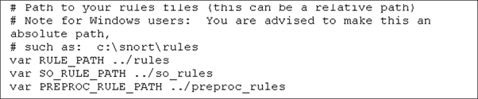

**Figure 9.4** Linux-style paths.

-   将它们改为 Windows 样式路径，如 Figure 9.5 所示。

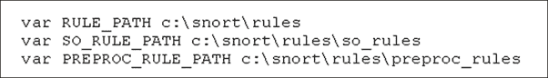

**Figure 9.5** Windows-style paths.

-   接下来，你需要查找并修改库路径。由于 Windows 与 Linux 在路径和文件名称上的差异，这有点困难。Linux 样式的库路径如 Figure 9.6 所示。

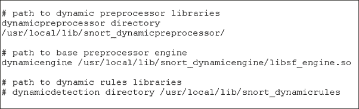

**Figure 9.6** Linux-style library paths.


- 你可以在 Figure 9.7 所示的文件夹中查找 Windows 路径和文件名。

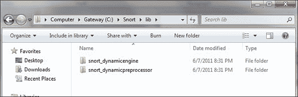

**Figure 9.7** Windows-style library paths.

> **Note**  
> 如果你发现系统中缺少特定的文件或路径，请确保在配置文件中将其注释掉。

- 你必须将引用的数据从 Linux 样式路径改为 Windows 样式路径，如 Figure 9.8 所示。

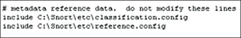

**Figure 9.8** Reference paths.

- 你几乎完成了。现在搜索以下内容：

```
#output log_tcp dump
```

- 在其后添加一行：

```
output alert_fast: alert.ids
```

> **Note**  
> 井号（`#`）表示注释。

- 现在，你需要使用命令行启动 Snort。只需导航到 `C:\\snort\\bin`。启动 Snort 有多种方式，常用的方法在 Table 9.1 中列出。我建议你先尝试最简单的一种。

**Table 9.1** Snort Commands 

| Command || Purpose |
| --- | --- |
| `snort -v` || Start Snort as just a packet sniffer. |
| `snort -vd` || Start Snort as a packet sniffer but have it sniff packet data rather than just the headers. |
| `snort -dev -l ./log` || Start Snort in logging mode so it logs packets. |
| `snort -dev -l ./log -h 192.168.1.1/24 -c snort.conf` (replacing `192.168.1.1/24` with your IP address) || Start Snort in IDS mode. |

Snort 是免费且开源的，但初学者常因配置文件或命令行启动时的细微错误导致运行不正常。本节旨在仅介绍 Snort。更多信息请参阅以下网站：

* **Snort Manual:** [`manual-snort-org.s3-website-us-east-1.amazonaws.com/`](http://manual-snort-org.s3-website-us-east-1.amazonaws.com/)

* **Writing Snort Rules:** [`paginas.fe.up.pt/~mgi98020/pgr/writing_snort_rules.htm`](http://paginas.fe.up.pt/~mgi98020/pgr/writing_snort_rules.htm)

### Honey Pots

A *honey pot* is an interesting technology. Essentially, it assumes that an attacker is able to breach your network security, and it would be best to distract that attacker away from your valuable data. Therefore, a honey pot involves creating a server that has fake data—perhaps an SQL server or Oracle server loaded with fake data, and just a little less secure than your real servers. Then, since none of your actual users ever access this server, monitoring software is installed to alert you when someone does access this server.

A honey pot achieves two goals. First, it takes the attacker’s attention away from the data you wish to protect. Second, it provides what appears to be interesting and valuable data, thus leading the attacker to stay connected to the fake server, giving you time to try to track the attacker. Commercial solutions, such as Specter ([www.specter.com](http://www.specter.com)), are available. These solutions are usually quite easy to set up and include monitoring/tracking software. You may also find it useful to check out [www.honeypots.org](http://www.honeypots.org) for more information on honey pots in general and on specific implementations.

### Database Activity Monitoring

Database activity monitoring (DAM) involves monitoring and analyzing database activity that operates independently of the database management system (DBMS). It is separate from the DBMS auditing, logging, and monitoring. Database activity monitoring and prevention (DAMP) is an extension to DAM that goes beyond monitoring and alerting to also blocking unauthorized activities.

### Other Preemptive Techniques

Besides IDS, antivirus, firewalls, and honey pots, there are a variety of preemptive techniques an administrator can use to attempt to reduce the chances of a successful attack being executed against a network.

# 入侵防御

`入侵防御` 在注重安全的管理员中正变得越来越流行。其核心其实很简单：尝试通过建立一个用于观察入侵者的子系统来吸引入侵者。这通过欺骗入侵者，让他误以为自己成功访问了系统资源，实际上则将其引导至一个专门设计的环境。能够在入侵者实施攻击时进行观察，将产生有价值的线索，并可能导致其被捕。

入侵防御通常通过使用**蜜罐**来实现。基本上，你会设置一个假系统，可能是一个看起来像整个子网的服务器。你会通过让它看起来像包含敏感数据（如人员档案）或有价值数据（如账户号码或研究数据）来使该系统更具吸引力。该系统中实际存储的数据是虚假的。该系统的真实目的在于仔细监控任何访问该系统的人的活动。由于没有合法用户会访问此系统，因此任何访问该系统的人必然是入侵者。

# 入侵威慑

`入侵威慑` 简单地说就是尝试让系统看起来不那么有吸引力。简而言之，尝试让任何成功入侵的潜在回报显得不值得努力。这种方法包括诸如通过伪装来降低系统价值的感知（即努力隐藏系统中最有价值的方面），以及提高潜在入侵者被捕获的感知风险。这可以通过显眼地展示警告并警告正在进行监控等方式实现。系统的安全感知可以显著提升，即使实际系统安全性未作改进。

## 身份验证

当用户登录系统时，系统需要验证用户（有时用户需要验证系统）。有许多身份验证协议。以下是其中一些最常见的协议的简要描述：

* **PAP:** `Password Authentication Protocol` 是最简单的身份验证形式，也是最不安全的。用户名和密码以明文形式、未加密地发送。这显然是一个非常古老的方法，已不再使用。然而，在计算机早期，并没有广泛可用的数据包嗅探器，安全问题也不那么重要。

* **SPAP:** `Shiva Password Authentication Protocol` 是对 PAP 的扩展，它会加密通过 Internet 发送的用户名和密码。

* **CHAP:** `Challenge Handshake Authentication Protocol` 在用户登录后计算哈希值，然后将该哈希值与客户端系统共享。服务器会定期要求客户端提供该哈希值。（这是挑战部分。）如果客户端无法提供，则说明通信已被 compromised。`MS-CHAP` 是 Microsoft 特定的 CHAP 扩展。这些是基本步骤：

    1. 手握完成后，验证方（通常是服务器）向对端发送“挑战”消息。
    2. 对端使用“一致性哈希”函数计算出一个值进行响应。
    3. 验证方将响应与其自身计算的预期哈希值进行比较。如果两者匹配，则认证成功；否则，连接应终止。
    4. 在随机间隔中，验证方会向对端发送新的挑战，并重复步骤 1 到 3。

    CHAP 的目标不仅是进行身份验证，而且要定期重新验证，从而防止会话劫持攻击。

* **EAP:** `Extensible Authentication Protocol` 是一个经常用于无线网络和点对点连接的框架。它最初在 RFC 3748 中定义，之后有更新。它负责传输密钥及相关参数。EAP 有多个版本，并且拥有许多变体，包括：

    * **LEAP:** `Lightweight Extensible Authentication Protocol` 是 Cisco 开发的，广泛用于无线通信。LEAP 受到许多 Microsoft 操作系统的支持，包括 `Windows 7` 及更高版本。LEAP 使用修改后的 `MS-CHAP`。
    * **EAP-TLS:** `Extensible Authentication Protocol–Transport Layer Security` 使用 TLS 保护身份验证过程。大多数 EAP-TLS 实现使用 X.509 数字证书来验证用户。
    * **PEAP:** `Protected Extensible Authentication Protocol` 通过已验证的 TLS 隧道加密身份验证过程。PEAP 由包括 Cisco、Microsoft 和 RSA Security 在内的联盟开发，首次在 `Microsoft Windows XP` 中引入。

* **Kerberos:** `Kerberos` 被广泛使用，尤其是在 Microsoft 操作系统中。它由 MIT 发明，其名称来源于希腊神话中守护冥门的三头犬。系统本身较为复杂，但基本过程如下：当用户登录时，验证服务器验证用户身份，然后联系票据授予服务器。（这些服务器通常在同一台机器上。）票据授予服务器向用户机器发送一个加密的票据，该票据标识用户已登录。稍后，当用户需要访问网络上的某些资源时，用户机器会使用该授予票据获取访问目标机器的权限。票据会进行大量验证，且这些票据的有效期相对较短。

### 关于 Kerberos 的更多内容

由于 `Kerberos` 使用广泛，因此值得更深入地审视。本节我们将更深入地探讨 `Kerberos`。如果你第一次接触 `Kerberos`，可能需要阅读本节多次才能真正理解。虽然存在变体，但本节的基本过程如下图 9.9 所示。（注意，图 9.9 是 Kerberos 的一个非常简化的概述，后面部分会讨论被省略的步骤。）


**图 9.9** `Kerberos`。 ¶ 

`Kerberos` 的元素如下：

* **Principal:** `Kerberos` 可以为其分配票据的服务器或客户端。
* **认证服务器 (AS):** 一个授权 principal 并将其连接到票据授予服务器的服务器。
* **票据授予服务 (TGS):** 一个提供票据的服务器。
* **密钥分发中心 (KDC):** 一个提供初始票据并处理 TGS 请求的服务器。它通常同时运行 AS 和 TGS。需要注意的是，`Kerberos` 是使用最广泛的认证协议之一。欧洲通常使用另一种方案，即 `SESAME`（安全多供应商环境中的安全系统）。

### Kerberos 的更多细节

本节提供了对 Kerberos 的更详细理解。大部分流程由表示为字母的消息组成，这些消息在客户端和密钥分发中心（KDC）之间传递。首先，AS 生成一个秘密键，通过对用户密码进行哈希运算，然后向客户端发送两条消息：

* **消息 A**：这是客户端/TGS 会话密钥，使用客户端的秘密键进行加密。
* **消息 B**：TGT 包含客户端 ID、客户端网络地址以及有效期。

这些消息使用 AS 生成的密钥进行加密。随后用户尝试使用客户端根据用户输入密码生成的秘密键对消息 A 进行解密。如果输入的密码与 AS 在数据库中找到的密码不匹配，则哈希值不一致，解密失败。若匹配成功，则消息 A 中包含的客户端/TGS 会话密钥即可用于与 TGS 进行通信。消息 B 使用 TGS 秘密键加密，客户端无法解密。（注意密码从未真正在网络上传输。）

当请求服务时，客户端向 TGS 发送以下消息：

* **消息 C**：由消息 B 中的 TGT 以及请求的服务 ID 组成。
* **消息 D**：这是一个验证器（由客户端 ID 和时间戳组成），使用客户端/TGS 会话密钥进行加密。

收到消息 C 和 D 后，TGS 从消息 C 中提取消息 B，并使用 TGS 秘密键对其进行解密，从而获得客户端/TGS 会话密钥。利用该密钥解密消息 D（验证器），并向客户端发送以下两条消息：

* **消息 E**：这是客户端到服务器的票据（包含客户端 ID、客户端网络地址、有效期以及客户端/服务器会话密钥），使用服务器的秘密键进行加密。
* **消息 F**：由客户端/服务器会话密钥使用客户端/TGS 会话密钥加密而成。

收到消息 E 和 F 后，客户端拥有足够信息来向服务器（SS）证明自己的身份。客户端连接到 SS 并发送以下消息：

* **消息 G**：这是一个新的验证器，包含客户端 ID 和时间戳，使用客户端/服务器会话密钥进行加密。

SS 使用自身的秘密键解密消息 E 以获取客户端/服务器会话密钥，然后使用该会话密钥解密消息 G，并向客户端发送以下消息以确认其真实身份和提供服务的意愿：

* **消息 H**：这是客户端验证器中的时间戳。

客户端使用客户端/服务器会话密钥解密确认（消息 H），并检查时间戳是否正确。如果正确，客户端可以信任服务器并开始向服务器发出服务请求。服务器随后为客户端提供所需的服务。

是的，这个过程相当繁复——但正是出于此目的。然而，你很可能已经多次使用过这种认证方法，只是未曾察觉。它非常常见。

### 数字证书

你很可能之前听说过“数字证书”这个术语。你首先想到的是它有什么作用吗？回顾我们关于非对称加密的讨论（第 8 章，“加密”），我们提到公钥可以广泛传播，因为它只能用于加密发送给我们的消息。那么，如何向他人提供公钥呢？最常用的方法是通过数字证书。数字证书包含用户的公钥，以及其他信息。但数字证书还能提供更多功能：它可以用于验证持有证书的一方是否为其声称的身份。

X.509 是数字证书格式和内容的国际标准。X.509 是全球最常见的数字证书类型。它是一份数字文档，包含由受信第三方——证书颁发机构（CA）签名的公钥。

X.509 证书的基本项包括（虽然还有其他可选信息）：

* **版本**：该证书符合的 X.509 版本。
* **证书持有者的公钥**：这是从持有者的 X.509 证书中获取公钥的主要方式。
* **序列号**：这是该证书的唯一标识符。
* **证书持有者的 distinguished name**：通常是与证书关联的域名或电子邮件地址。
* **证书的有效期**：一年是最常见的有效期。
* **证书颁发者的唯一名称**：发出该证书的证书颁发机构。
* **颁发者的数字签名**：该字段及下一字段用于验证证书。
* **签名算法标识**：标识使用的数字签名算法。

让我们通过一个常见场景来看这如何工作。假设你访问银行的网站。为了获取银行的公钥，你的浏览器会下载该银行的数字证书。但这里存在一个问题：有人是否可能设置一个假站点，冒充你的银行？该人是否可能生成一个假证书，声称是银行？是的，这完全可能。数字证书正是用于防止这种情况的。


你的浏览器会查看证书上列出的颁发机构，并首先询问该机构是否是浏览器信任的 CA。如果是，浏览器会与该 CA 沟通以获取该 CA 的公钥。（回顾第 8 章可知，数字签名是用私钥创建，并用公钥进行验证。）浏览器使用该 CA 公钥验证证书上的 CA 签名。如果是假证书，数字签名将无法被识别。这意味着证书不仅提供持有者的公钥，还提供通过受信第三方验证该实体的方法。

需要注意的是，与 X.509 证书不同，PGP（Pretty Good Privacy）证书不由 CA 发行，也没有第三方验证机制。它们主要用于电子邮件通信，因为假设你已知你正在邮件交流的对象，因此无需验证对方身份。

关于数字证书的其他术语和概念，下面开始介绍。首先是 CA，即发行数字证书的实体。Comodo、Symantec、DigiCert、GoDaddy、Verisign、Thawte 都是知名的证书颁发机构。当你从这些供应商处购买证书时，它会先验证你的身份。（这可以是简单的将信用卡号与你要购买证书的域名匹配，也可以是更复杂的过程。）

由于验证证书持有者身份可能耗时较长，许多 CA 将此过程外包给注册机构（RA），RA 会向 CA 通报是否应发行证书。

CRL（证书撤销列表）是由 CA 发行但不再有效的证书列表。CRL 的分发方式主要有两种：推送模式，CA 会定期自动发送 CRL；拉取模式，持有者主动从 CA 下载 CRL 以验证证书。问题是 CRL 不支持实时检查。因此，较新的解决方案是“在线证书状态检查协议”（OCSP），其目标是制定一个实时检查证书是否仍然有效的协议。

### SSL/TLS

- VPN（或虚拟专用网络）本质上是利用互联网为远程用户或站点与中央位置之间创建虚拟连接的方式。在这条连接上传输的数据包会被加密，从而实现隐私性。VPN 必须模拟直接网络连接。
- 创建 VPN 的三种协议分别是：
  - Point-to-Point Tunneling Protocol（PPTP）
  - Layer 2 Tunneling Protocol（L2TP）
  - Internet Protocol Security（IPsec）
- 这些协议的详细内容将在后续章节中进一步说明。

#### Point-to-Point Tunneling Protocol

- *Point-to-Point Tunneling Protocol*（PPTP）是三种用于 VPN 的协议中最老的一个。它最初是作为对 Point-to-Point Protocol（PPP）的安全扩展而设计的。PPTP 最初于 1996 年由 PPTP Forum（包括 Ascend Communications、ECI Telematics、Microsoft、3Com 和 U.S. Robotics 等公司）提出，作为一种标准。它在 PPP 协议基础上增加了对数据包加密和用户认证的功能。PPTP 在 OSI 模型的数据链路层工作（详见 第 2 章 “网络与互联网”）。
- PPTP 提供两种用于用户认证的协议：Extensible Authentication Protocol（EAP）和 Challenge Handshake Authentication Protocol（CHAP）。EAP 专为 PPTP 设计，并非专有协议。CHAP 是一种三步握手过程：客户端向服务器发送代码，服务器对其进行认证，随后服务器向客户端发送响应。CHAP 还会在连接建立后，定期对远程客户端进行重新认证。
- PPTP 使用 Microsoft Point-to-Point Encryption（MPPE）对数据包进行加密。MPPE 实际上是一种 DES（数据加密标准）。虽然 DES 在许多场景下仍然有用，但新版本的 DES（如 DES 3）更受青睐。

#### Layer 2 Tunneling Protocol

- *Layer 2 Tunneling Protocol*（L2TP）是专门为增强 PPTP 而设计的。与 PPTP 相比，它同样在 OSI 模型的数据链路层工作。L2TP 在以下方面提供了多项改进：
  - 认证方式更多且更丰富：PPTP 仅提供两种认证方法（CHAP 和 EAP），而 L2TP 提供五种（CHAP、EAP、PAP、SPAP 和 MS-CHAP）。
  - 协议适用范围更广：PPTP 仅能在标准 IP 网络上运行，而 L2TP 还能在 X.25 网络（电话系统中常用的协议）和 ATM（异步传输模式，高速传输技术）系统上工作。L2TP 利用 IPsec 进行加密。

#### IPsec

*Internet Protocol Security*（IPsec）是三种 VPN 协议中最新的。IPsec 与其他两种方法的一个区别在于它不仅加密数据包（回顾第 2 章中关于数据包的讨论 Chapter 2），还加密报头信息。它还具有防止未经授权的数据包重传的保护。这是因为黑客的一种手段是直接抓取传输中的第一个数据包，然后使用该数据包让自己的传输通过。第一个数据包（或数据包）必须包含登录信息。如果仅仅重新发送该数据包（即使你无法破解其加密），你实际上就是在发送有效的登录和密码，随后可以通过后续数据包进行跟踪。防止未经授权的数据包重传可以阻止这种情况的发生。

IPsec 以两种模式运行：传输模式，仅加密负载；隧道模式，同时加密数据和 IP 头。以下是一些基本的 IPsec 术语：

- *Authentication headers*（AHs）为 IP 数据包提供无连接的完整性和数据来源验证。
- *Encapsulating Security Payload*（ESP）为数据包提供来源真实性、完整性和保密性保护。它支持仅加密和仅验证的配置。
- *Security associations*（SAs）提供 AH 或 ESP 操作所需的参数。SAs 通过 Internet Security Association and Key Management Protocol（ISAKMP）建立。
- *Internet Security Association and Key Management Protocol*（ISAKMP）为认证和密钥交换提供框架。
- *Internet Key Exchange*（IKE 和 IKEv2）用于通过协议和算法的协商以及生成用于加密和验证的密钥来设置 SA。

在 IPsec 隧道的初始建立过程中，SAs 会形成。这些 SAs 包含所使用的加密算法和哈希算法等信息（回顾我们在第 8 章 Chapter 8 中深入讨论了加密）。IKE 主要负责建立这些 SAs，ISAKMP 允许 IPsec 隧道两端相互认证并交换密钥。

### Wi-Fi Security

无线网络如今被广泛使用，因此考虑无线网络安全至关重要。这里有三种 Wi‑Fi 安全协议，从最老且最不安全的 WEP 到最新且最安全的 WPA3。它们分别简要说明如下。

#### Wired Equivalent Privacy

*Wired Equivalent Privacy*（WEP）使用流加密算法 RC4 保护数据，并使用 CRC‑32 进行误差检查。标准 WEP 采用 40 位密钥（即 WEP‑40）以及 24 位初始化向量（IV），从而形成 64 位加密；128 位 WEP 则使用 104 位密钥配合 24 位 IV。

由于 RC4 是流加密，同一流密钥绝不能重复使用。WEP 的问题在于其设计委员会由几位经验丰富的计算机专业人员组成，他们认为自己足够了解密码学，但实际上并未。他们重复使用 IV，这彻底破坏了 IV 的作用，使协议易受攻击。只需在 YouTube 上搜索 “how to crack WEP” 即可看到大量破解 WEP 的技术视频。

#### Wi-Fi Protected Access

*Wi-Fi Protected Access*（WPA）明显优于 WEP。首先，WPA 采用 AES，这是一种非常优秀的加密算法。此外，WPA 使用 Temporal Key Integrity Protocol (TKIP)，为每个数据包动态生成新密钥。即使你破解了 WPA 密钥，下一包的密钥也会不同。

#### WPA2

WPA2 是当今使用最广泛的 Wi‑Fi 安全协议，若可能，建议使用它。WPA2 基于 IEEE 802.11i 标准，采用高级加密标准（AES）结合计数器块链接消息验证码（CCMP）协议，提供数据保密性、数据来源验证和数据完整性。CCMP 通过 CBC 模式防止已知明文攻击。

MAC 保护消息完整性，确保数据在传输过程中（无论是意外还是故意）不会被篡改。因此 WPA2 同时使用强加密和报文完整性保护。

#### WPA3

WPA3 于 2018 年发布，拥有许多有趣的特性。其中最引人注目的是所有流量（无论是从无线接入点（WAP）到终端，还是从终端到 WAP）均被加密。WPA3 还要求攻击者在每次密码猜测时都必须与你的 Wi‑Fi 进行交互，从而使暴力破解攻击的成功概率大幅降低。

### Summary

每个网络必须在内部与外部之间部署防火墙和代理服务器。所有网络中的机器（服务器和工作站）都应保持病毒防护程序的更新。此外，考虑部署入侵检测系统（IDS）和防间谍软件也是明智之举。在即将到来的练习中，你将有机会练习配置各种防火墙和 IDS。

### Test Your Skills

#### Multiple Choice Questions

**1.** 哪种方式是病毒扫描器最常用的识别病毒的方法？

- **A.** 对文件进行已知病毒特征的比对
- **B.** 使用复杂规则寻找病毒式行为
- **C.** 仅查找 TSR 程序
- **D.** 仅查找 TSR 程序或修改注册表的程序

**2.** 检查电子邮件是否存在病毒感染的一种方法是：

- **A.** 阻止所有带附件的邮件
- **B.** 阻止所有活动附件（如 ActiveX、脚本）
- **C.** 查找主题行来自已知病毒攻击
- **D.** 查找来自已知病毒来源的邮件

**3.** TSR 程序是什么？

- **A.** 终止信号注册程序，会修改系统注册表
- **B.** 终止并系统删除程序，完成后会自我删除
- **C.** 终止并扫描远程程序，先扫描远程系统后终止
- **D.** 终止并驻留程序，完成后仍驻留于内存

**4.** 哪种扫描方式依赖复杂规则来定义什么是病毒？

- **A.** 基于规则的扫描（RBS）
- **B.** 启发式扫描
- **C.** TSR 扫描
- **D.** 逻辑基于扫描（LBS）

**5.** 下列哪项不是基本类型的防火墙？

- **A.** 筛选防火墙
- **B.** 应用层网关
- **C.** 启发式防火墙
- **D.** 电路级网关

**6.** 哪项是最基础类型的防火墙？

- **A.** 筛选防火墙
- **B.** 应用层网关
- **C.** 启发式防火墙
- **D.** 电路级网关

**7.** 使用应用层网关防火墙的一个缺点是：

- **A.** 安全性不高
- **B.** 消耗大量资源
- **C.** 配置困难
- **D.** 只能在路由器防火墙上工作

**8.** SPI 代表什么？

- **A.** 状态包检查
- **B.** 系统包检查
- **C.** 状态包拦截
- **D.** 系统包拦截

**9.** 下列哪项是安装在现有服务器上的软件防火墙的术语？

- **A.** 网络主机防火墙
- **B.** 双栖防火墙
- **C.** 路由器防火墙
- **D.** 屏蔽主机

**10.** 网络主机防火墙的主要弱点是什么？

# 第 10 章. 安全策略

## 章节目标

阅读本章并完成练习后，您将能够：

- 认识到安全策略的重要性。
- 理解各种策略及其背后的原因。
- 了解构成良好策略的要素。
- 为网络管理创建策略。
- 评估并改进现有策略。

## 引言

迄今为止，我们在本书中探讨了网络面临的各种威胁。在第 9 章，“计算机安全技术”中，我们考察了针对这类攻击的各种技术防御措施。然而，事实是技术本身无法解决所有网络安全问题。存在一些技术无法阻止的问题。例如：

- 防病毒软件无法阻止用户手动打开附件并释放病毒。
- 即使网络在技术上受到保护，如果前员工（可能对公司不满）仍持有有效密码，或密码被随意贴在显示器上，网络仍然极易受到攻击。
- 如果服务器所在的房间几乎所有公司员工都能进入，那么该服务器就不安全。
- 如果终端用户易受社会工程攻击，网络也不安全。

另一个技术单独不足以解决问题的原因是：技术必须被恰当地应用。策略用于指导您如何实施和管理安全，包括安全技术。本章将探讨计算机安全策略，包括创建良好安全策略的要素以及建立网络安全策略的示例。

## 什么是策略？

安全策略是一份文档，定义了组织如何处理安全的某些方面。可以有关于终端用户行为、应对事件的 IT 响应，或特定问题和事件的策略。

安全策略也可以用于处理合规性要求。这类策略指示组织成员如何遵守特定法规。一个良好的例子是，向医疗工作者说明在使用电子病历软件时如何遵守 HIPAA 法规。

策略也可以仅仅是建议性的，建议员工如何处理某些事项，但不强制要求遵守。例如，策略可能建议用户在使用智能手机通过 Wi‑Fi 热点发送邮件时可能不安全，但不禁止这样做。

### ISO 17999

ISO 17799 是一项关于如何制定策略的标准。虽然策略通常不被视为令人兴奋的安全话题，但它们是您安全态势的核心。因此，正确制定策略至关重要。

ISO/IEC 17799:2005 在以下信息安全管理领域描述了控制目标和控制的最佳实践：

- 安全策略
- 信息安全组织
- 资产管理
- 人力资源安全
- 物理和环境安全
- 通信和运营管理
- 访问控制
- 信息系统获取、开发和维护
- 信息安全事件管理
- 业务连续性管理
- 合规性

熟悉该标准并至少考虑其建议是一个好主意。

## 定义用户策略

当讨论用户策略时，需要牢记的一条规则是：你必须为每一种可预见的情况制定策略。如果没有针对特定问题的策略，通常会导致该问题被放大。对你来说可能是常识的事物，对于没有计算机网络或网络安全训练或经验的人来说可能并不明显。

系统的误用是许多组织面临的主要问题。很大一部分问题源于难以明确界定何为误用。一些行为显而易见属于误用，例如利用公司时间和电脑搜索另一份工作或浏览非法网站。然而，其他领域则不那么清晰，例如员工利用午休时间查找自己正考虑购买的汽车信息。通常，良好的用户策略会明确说明人们应如何使用系统以及应如何不得使用。为使策略有效，它必须非常清晰且具体。模糊的表述，如“计算机和 Internet 仅用于业务用途”，是不够的。我建议采用更明确、更具可执行性的表述，例如：“计算机和 Internet 仅用于业务目的的工作时间内。但员工可在非工作时间（如休息、午休、下班前）使用计算机/Internet 进行个人使用，前提是遵守 Internet 使用策略。” 此 wording 清晰、直接且可执行。

用户策略还涵盖其他潜在误用领域，包括密码共享、数据复制、员工离开工作站时留下已登录账户等。这些问题最终会对网络安全产生重大影响，必须在用户策略中明确列出。下面我们将探讨有效用户策略必须涵盖的几个方面：

- 密码
- Internet 使用
- 电子邮件使用
- 安装/卸载软件
- 即时通讯
- 桌面配置
- 自带设备 (BYOD)

### 密码

保持密码安全至关重要。第 8 章，“加密”章节在操作系统硬化时讨论了适当的密码。大多数来源指出，良好的密码至少八个字符长，包含数字和特殊字符，且与终端用户无明显关联。例如，达拉斯牛仔队的粉丝不应使用 *cowboys* 或 *godallas* 这类密码，但使用 *%trEe987* 或 *123DoG$$* 则更合适，因为这些密码不反映个人兴趣，难以被猜测。关于最小密码长度、密码历史记录和密码复杂度的要求属于管理策略，而非用户策略。用户策略规定终端用户的行为。为确保安全，我建议使用经过修改的口语短语作为密码，加入数字和特殊字符。这可以是易记的内容，但经过变形后不易被猜测或暴力破解。例如，将短语“I like double cheeseburgers”修改为“IliK3double3ch33$eburg3r$”。可以看到，字母 e 被替换为 3，字母 s 被替换为 $，且两个随机字母大写。现在你拥有 25 个字符的复杂密码，既易记又难破。

然而，无论密码多长或多么复杂，如果它写在贴在用户电脑显示器上的便签上，它就毫无安全可言。这看似显而易见，但并非罕见——走进办公室，常常能在显示器上或书桌抽屉里找到密码。每个清洁工人或随意经过的同事都可能获取该密码。

员工共享密码的情况也并不少见。例如，Bob 下周要出差，他把密码给 Juan，让 Juan 登录系统查看邮件等。问题是，此时已有两人持有该密码。若 Bob 离开期间 Juan 生病，Juan 又把密码分享给 Shelly，以便她在 Juan 休假期间继续访问系统。密码很快会传到太多人手中，从安全角度来看已毫无意义。

管理策略需要处理密码长度、有效期和历史记录等问题。系统管理员可以强制这些要求，但如果用户未能妥善管理密码，这些措施也无济于事。

因此，你需要明确的用户密码管理策略。该策略应明确以下内容：

- 密码绝不能写在可随意获取的地方。最佳做法是不写在纸上，若必须书写，也应存放在安全位置，如家中锁盒（不在办公室电脑旁）。
- 密码不得以任何原因分享给他人。
- 如员工怀疑密码被泄露，应立即联系 IT 部门，以便更改密码并监控使用旧密码的登录尝试。

### Internet 使用

大多数组织为用户提供某种程度的 Internet 接入。原因有多种。最明显的是电子邮件，但这绝非唯一理由在商业或学术环境中使用 Internet。还有万维网（Web）以及聊天室（相信与你无缘，聊天室确实被用于业务沟通）。Internet 可用于合法目的，但也可能带来严重安全问题。必须制定适当的策略来规范 Internet 技术的使用。


## 用户策略

万维网是获取海量数据的绝佳资源。本书中，我们多次引用安全数据和实用工具的网站。Internet 还充斥大量关于各类技术的实用教程。此外，非技术类业务兴趣也可通过网页得到满足。以下是合法商业用途的示例：

* 销售人员查看竞争对手网站，了解其产品或服务、涉及领域，甚至获取价格
* 债权人查看 AM Best 或 Standard & Poor’s 评级，评估企业财务状况
* 业务差旅员查看天气情况并获取差旅价格
* 在线培训，如网络研讨会
* 在线会议
* 在线缴费，或在某些情况下提交监管和政府文件

当然，网页活动中也有明显不适合在公司网络中进行的行为：

* 使用 Web 搜索新工作
* 任何色情内容
* 违反地方、州或联邦法律的行为
* 使用 Web 进行除公司业务外的其他企业活动（如拥有另一家企业）

此外，还有灰色地带。某些活动在不同组织中接受度不同。例如：

* 员工在午休或休息时间在线购物
* 午休或休息时在线阅读新闻文章
* 浏览幽默网站
* 某人可能认为显而易见的东西对另一个人来说可能并非如此。因此，组织必须制定非常清晰的政策，明确规定在工作场所使用 Web 的什么是可接受的，什么是不可接受的。同时，还应提供明确的可接受使用和不可接受使用的示例。你还需要记住，大多数代理服务器和防火墙都可以阻止某些网站，这有助于防止员工滥用公司的 Web 连接。

### 电子邮件使用

大多数商业和甚至学术活动现在都通过电子邮件进行。正如我们在之前的几章中讨论过的，电子邮件也是病毒传播的主要渠道。这意味着电子邮件安全对任何网络管理员来说都是一个重要问题。

显然，你不能简单地禁止所有电子邮件附件。但是，你可以制定一些处理电子邮件附件的指南。用户应仅在满足以下条件时才打开附件：

* 它是预期的。（有人向同事或客户请求了文档。）
* 如果它不是预期的，它来自一个已知的来源。如果是，先给这个人发封电子邮件（或给她打电话），询问她是否发送了附件。如果是，则打开它。
* 它看起来像是一个合法的商业文档（如电子表格、文档、演示文稿等）。

需要注意的是，有些人可能会认为这些标准不切实际。毫无疑问，它们是不便的。然而，鉴于病毒（通常附在电子邮件上）的普遍性，这些措施是谨慎的。许多人选择不采取如此严格的措施来避免病毒，这可能也是你的选择。请记住，每年都有数百万台电脑感染某种病毒。

任何人都不应该打开满足以下任何一项标准的附件：

* 它来自一个未知的来源。
* 它是某种活动代码或可执行文件。
* 它是动画/电影。
* 电子邮件本身看起来不合法。（它看起来旨在诱使你打开附件，而不是作为一条合法的商业通信，其中包含附件。）

如果用户有任何疑问，她就不应该打开电子邮件。相反，她应该联系已被指定处理安全的 IT 部门的人员。该人员可以将电子邮件主题行与已知病毒进行比对，或者亲自检查该电子邮件。如果看起来是合法的，用户才可以打开附件。

**FYI：关于附件**

我经常遵循“宁可安全起见”的原则来打开附件。当我收到一些在 Internet 上流传的玩笑、图片、Flash 动画等时，我直接删除它们。这可能意味着我会错过许多有趣的图片和故事，但也意味着我会错过许多病毒。你应该考虑效仿这种做法。

### 安装/卸载软件

当涉及到安装和卸载软件时，有一个绝对的答案：终端用户不应该被允许在他们的机器上安装任何东西。这包括壁纸、屏幕保护程序、实用程序——任何东西。最佳做法是限制终端用户的登录权限，使其无法安装任何东西。然而，这应该与一个强有力的政策声明相结合，禁止在其个人电脑上安装任何东西。如果他们希望安装某个软件，则应首先由 IT 部门扫描并批准。这个过程可能繁琐，但它是必要的。一些组织甚至会删除或至少禁用终端用户电脑上的媒体驱动器（CD、USB 等），以便安装仅能从 IT 部门在网络驱动器上放置的文件进行。这通常是大多数组织所需的更极端的措施，但它是你应该了解的选项。事实上，Windows 允许管理员禁用新增 USB 设备的功能。因此，管理员可以安装一些经批准用于企业使用的 USB 设备，然后禁止任何额外的设备被添加。

### 即时通信

即时通信被组织中的员工广泛使用并被滥用。在一些情况下，即时通信可以用于合法的商业目的。然而，它仍然构成了重大的安全风险。一些病毒专门通过即时通信传播。在一个事件中，病毒会复制用户的所有联系人列表，并将所有对话的内容发送给他们。因此，如果你受到该病毒的影响，你认为是私密的对话可能会被广播给你认识的所有人以及你曾经聊天的对象。

即时通信从纯粹的信息安全角度也是一个威胁。nothing 阻止终端用户通过即时通信发送商业机密或敏感信息，而不受电子邮件通过公司邮件服务器的可追踪性的限制。建议禁止在所有公司电脑上使用即时通信。如果你发现你必须使用它，则必须建立非常严格的使用指南，包括以下内容：

* 即时通信仅可用于商业通信，不能用于个人对话。这可能有点难以执行。这类规则往往很难执行。更常见的规则，例如禁止个人上网，也同样难以执行。不过，仍然是个好主意制定这些规则。如果你发现有人违反这些规则，你可以引用公司政策中禁止此类行为的规定。但你应该知道，极有可能的是，你无法发现大多数违反此规则的情况。
* 不应通过即时通信发送任何机密或私人商业信息。

### 桌面配置

许多用户喜欢重新配置他们的桌面，更改背景、屏幕保护程序、字体大小和分辨率。理论上说，这不是一个安全隐患。仅仅更改电脑的背景图片不可能威胁电脑的安全。然而，还有其他问题。

第一个问题是背景图片的来源。经常，终端用户从 Internet 下载图片。这意味着有可能下载到病毒或木马，特别是那些使用隐藏扩展名的（例如，它可能看起来像`mypic.jpg`，但实际上是`mypic.jpg.exe`）。此外，如果员工使用一个冒犯其他员工的背景或屏幕保护程序，也涉及人力资源/骚扰问题。一些组织简单地决定禁止对系统配置进行任何更改。

第二个问题是技术性的。为了给用户提供更改屏幕保护程序、背景图片和分辨率的权限，你必须给予他们权限，这也会让他们能够更改其他系统设置——你可能不希望他们更改的设置。图形显示选项并不与其他配置选项分离。这意味着允许用户更改屏幕保护程序可能打开门，让他们修改其他设置（例如网络卡配置或 Windows Internet Connection Firewall），从而威胁安全。

### 自带设备

自带设备（BYOD）已成为大多数组织的重要问题。几乎所有的员工都会携带自己的智能手机、平板电脑、智能手表和活动监测器进入工作场所。将这些设备连接到你的无线网络会带来一系列新的安全 concerns。你不知道每个设备之前连接过什么网络，安装了什么软件，或者这些个人设备是否会窃取数据。

在高度安全的环境中，可能需要禁止个人所有的设备。然而，在许多组织中，此类政策在实际操作中不切实际。一种可行的办法是设立一个专门用于 BYOD 的 Wi‑Fi 网络，且该网络不与公司的主网络相连。另一种方法，虽然技术上更为复杂，是检测设备在连接时的身份，若设备不是公司发放的，则显著限制其访问。

无论采用何种办法，你都必须制定关于个人设备的策略。这些设备已经无处不在。几年前，智能手机横行，但智能手表尚未普及。预测未来可能出现的新型智能设备十分困难。

在组织网络上处理用户设备的方法多种多样，各有自己的缩写：

* **CYOD:** 公司列出符合安全要求的可接受设备（即满足公司安全标准的设备），并允许每位员工自行选择设备。
* **COPE:** 公司拥有并提供设备。这在安全性上提供了最高保障，但也伴随最高成本。CYOD 可指 company‑owned and provided equipment 或 company‑owned and personally enabled。

### Final Thoughts on User Policies

本节提供了适当且有效的用户策略概览。任何组织都必须实施稳固的用户政策。但这些政策只有在明确定义违规的后果时才能发挥作用。许多组织会列出随每次违规而递增的具体后果，例如：

* 第一次违反任何政策将导致口头警告。
* 第二次违规将导致书面警告。
* 第三次违规将导致停职或解雇。（在学术环境中，则是停职或开除。）

必须明确列出后果，所有用户在入职时应签署一份用户政策的副本，以防止员工声称不知情。

> Caution
>
> **Termination or Expulsion**
>
> 任何可能导致学生开除或员工解雇（甚至降职）的政策，在执行前必须先经法律顾问审查。错误的解雇或开除可能引发重大法律后果。我并非律师，也不是法律专家，无法提供法律建议。务必咨询律师处理此类事宜。

还需注意，滥用公司内部网络的另一隐形成本是生产力的损失。平均每位员工在工作时间内阅读个人邮件、访问非业务网站或即时通讯聊天花费了多少时间？难以精确界定。但可以参考 [www.yahoo.com](http://www.yahoo.com) 在普通工作日工作时间内点击新闻故事底部的讨论区，查看帖子的日期和时间，观察业务时间内的活跃度。显然并非所有这些人都在上班，退休或因病休假。

请务必明确：**互联网是人类历史上最强大的沟通工具**，它能对任何企业产生巨大的正面影响。我几乎所有的业务活动都通过万维网完成。然而，许多员工滥用上网特权，导致自律性不足的员工生产力下降。下面列出几项支持这一观点的研究：

* 2008 年的一项研究显示，员工每周平均浪费 5.3 小时在闲逛网络上。虽然该研究已有一段时间，但问题至今仍然存在。常常，广泛的互联网接入反而抑制而非提升生产力。
* 俄亥俄州立大学的研究发现，经常使用 Facebook 的用户 GPA 低于非用户。
* 多项研究表明，工作场所的 Facebook 会对生产力产生负面影响。大多数研究已有几年历史，因为社交媒体在工作场所的负面影响已被广泛认可。
    * [`www.cnbc.com/2016/02/04/facebook-turns-12--trillions-in-time-wasted.html`](http://www.cnbc.com/2016/02/04/facebook-turns-12--trillions-in-time-wasted.html)
    * [`www.riskmanagementmonitor.com/the-risks-of-social-media-decreased-worker-productivity/`](http://www.riskmanagementmonitor.com/the-risks-of-social-media-decreased-worker-productivity/)
    * [`www.shellypalmer.com/2011/05/social-media-use-drastically-reduces-work-productivity/`](http://www.shellypalmer.com/2011/05/social-media-use-drastically-reduces-work-productivity/)

## Defining System Administration Policies

除了制定用户策略外，你还必须明确制定系统管理员的政策。必须有添加用户、删除用户、处理安全问题、变更系统等的流程，并且对偏离这些流程的处理也有明确标准。

### New Employees

当新员工被雇佣时，系统管理政策必须明确具体步骤以保障公司安全。新员工应获得其职务所需的资源和应用访问权限，且该授权过程必须记录（可在日志中体现）。同时，新员工必须收到公司的计算机安全与可接受使用政策，并签署确认收到的文件。

在新员工正式上班前，IT 部门（具体为网络管理）应收到业务部门的书面请求，请求中应明确该用户将需要的资源以及开始使用的时间，并由拥有批准权的业务单位代表签署。随后，网络管理或网络安全负责人应批准并签署该请求。完成新用户的系统配置并授予相应权限后，可将请求的副本存档。

### Departing Employees

员工离职时，必须立即终止其所有登录账号并取消对所有系统的访问。遗憾的是，许多组织在这一安全环节上付出不足的关注。你无法确定哪些离职员工会怀恨在心，哪些则不会。因此，必须在其最后工作日确保前员工的全部访问权限被彻底关闭，这包括物理进入建筑的权限。

* 禁用该员工在任何服务器、VPN、网络或其他资源上的登录账号。
* 收回所有进入设施的钥匙。
* 关闭电子邮件、Internet、无线 Internet、移动电话等账号。
* 取消主帐户（mainframe）资源的访问。
* 检查前员工的工作站硬盘。

最后一项可能看似奇怪，但如果员工在离职前收集公司机密数据或从事其他不当活动，及时发现并妥善保存工作站至关重要。若发现任何此类证据，需立即隔离该工作站并保存作为民事或刑事诉讼的证据。

任何读者可能会觉得这些内容有点夸张。确实，在大多数离职员工面前，你不会有什么需要担心的问题。但如果你不养成在员工离职时保障其访问权限的习惯，你最终会面临一个本可以轻松避免的不幸情况。

### 变更请求

信息技术的本质是变更。不仅用户会不断来去，需求也频繁变动。业务部门请求访问不同资源，服务器管理员升级软件和硬件，应用开发人员安装新软件，网页开发人员修改网站。变更时刻在进行。因此，建立变更控制流程至关重要。该流程不仅能让变更顺利进行，还能让 IT 安全人员在实施前检查变更是否存在潜在安全问题。变更控制请求应经历以下步骤：

* 业务单元内合适的管理者签署请求，表示批准。换句话说，如果请求者的直接上级未批准，则无需继续变更流程。
* 相应的 IT 部门（数据库管理、网络管理、邮件管理、云管理）确认请求在技术上可行、符合预算限制且不违反 IT 政策。
* IT 安全部门确认该变更不会导致安全问题。这在现代已变得日益重要。
* 相应的 IT 部门制定实施变更的计划以及在发生故障时回滚变更的计划。后者非常关键，却常被忽视。必须有机制在变更出现问题时进行回滚。
* 确定变更的日期和时间，并通知所有相关方。

你的变更控制流程可能与此不同，事实上可能更加具体。但请记住，要让你的网络安全，就不能让变更在没有事先评估影响的情况下随意进行。

变更管理活动通常通过变更控制委员会（CCB）或称变更批准委员会（CAB）来管理。变更流程在本节前文中已有详细说明，但基本流程可总结为：

* 通过 RFC（请求评论或请求变更）文档发起流程
* 将 RFC 发送批准
* 设定流程的优先级
* 将流程分配给执行变更的人员
* 记录决策
* 由 CAB 评估变更
* 确定 RFC 的实施时间
* 变更所有者和请求者确认变更已成功实施
* 审查 RFC

此过程可能包含 CAB 正式会议和大量文档，也可能简化为通过电子邮件与相关方协作的非正式方式。

### 实践中

#### 变更控制的极端情况

任何有几年 IT 经验的人都能告诉你，变更控制存在各种不同的做法。真正的问题是 IT 团队实施不合理的极端做法。我见过两种极端。下面不提及具体公司名称，举例说明各自的极端情况。

软件顾问公司 X 是一家规模较小的公司，专注于为各类企业定制财务应用。员工人数不足 20 人，经常奔波于全国各地的客户现场。它的特点包括：

* 所有应用缺乏文档，甚至连几条笔记都没有。
* 没有变更控制流程。当有人不满服务器设置或网络配置时，直接随意修改。
* 没有处理前员工访问权限的机制。例如，一名员工离职 6 个月，仍保有有效登录账户。

这从多个角度来看令人担忧，而不只是安全方面。这正是一种极端——导致环境混乱且极不安全。安全意识强的网络管理员倾向于走相反的极端，但这也会对生产力产生负面影响。

公司 B 员工超过 2000 人，IT staff 约有 100 人。该公司的官僚体系已严重拖慢 IT 部门的效率，导致生产力大幅下降。例如，一名网页服务器管理员被要求同时获得单个数据库服务器的数据库管理员权限。然而，整个流程耗时 3 个月，包括经理与 CIO 的一次面对面会议、两次电话会议以及数据库组管理者与经理之间的十余封邮件。

公司复杂的变更控制流程严重影响了生产力。非正式估算显示，即使是基层 IT 监督员，也有 40% 的时间花在会议、会议汇报或准备会议上。随着职级上升，时间被行政化活动占据得更多。

这两个案例旨在说明变更控制管理的两种极端，你应当避免。实施变更控制的目标是提供有序且安全的变更管理方式，而非成为生产力的障碍。

### 安全漏洞

遗憾的是，你的网络在某个时刻很可能会发生安全漏洞。你可能成为拒绝服务（DoS）攻击的目标，系统可能被病毒感染，或黑客入侵并破坏或窃取敏感数据。你必须制定应对任何此类事件的预案。本书无法针对每一种可能发生的事件提供具体处理方案，但可以讨论在一般情况下应对不同类型安全漏洞的通用指南。我们将逐一分析主要类型的安全漏洞及应对措施。

#### 病毒感染

当病毒袭击你的系统时，立即对受感染的机器进行隔离。具体做法是将机器从网络中物理拔掉。如果是子网，则拔掉其交换机或断开无线连接。隔离受感染的机器（除非整个网络已被感染，此时只需关闭路由器/ISP 连接，以切断对外界的访问并防止漏洞扩散）。隔离后，可安全执行以下步骤：

* 逐台扫描并清理每台受感染的机器。由于机器已离网，此操作需手动完成。
* 记录事件、清理所耗费的时间和资源，以及受影响的系统。
* 确认系统清洁后，分阶段将其接入网络（一次几台）。每个阶段结束后，检查所有机器是否已补丁、更新且杀毒软件配置正确、运行正常。
* 向相关组织领导层通报事件及已采取的措施。
* 处理完病毒并通知相关人员后，组织一次会议，与相关 IT 人员讨论本次漏洞的教训，以及如何在未来防止类似情况再次发生。

#### DoS 攻击

如果您已按照本书前面的步骤操作（例如正确配置路由器和防火墙以降低 DoS 攻击的影响），那么您已经在减轻 DoS 攻击的损害。此外，请考虑采取以下措施：

* 使用防火墙日志或 IDS 找出发起攻击的 IP 地址（或地址）。记录这些 IP 地址，然后（如果您的防火墙支持此功能——大多数都支持）阻止该 IP 地址访问您的网络。
* 使用在线资源（如 interNIC.net）查找该地址所属的组织。
* 联系该组织并告知其正在发生的情况。
* 记录所有这些活动，并通知相应的组织领导。
* 在处理完 DoS 攻击并通知相关人员后，召集相应的 IT 人员召开会议，讨论本次攻击可以学到的经验以及未来如何防止类似情况再次发生。

### 入侵事件


如果恶意黑客已经入侵您的网络，您该怎么办？换句话说，发生入侵事件时的基本应急响应措施是什么？请考虑采取以下措施：

- 立即复制所有受影响系统（防火墙、被攻击服务器等）的日志，以备作为证据。
- 立即对所有系统进行扫描，查找木马程序、防火墙设置修改、端口过滤变更、新服务的运行等情况。简而言之，您需要进行紧急审计，以评估已造成的损害。
- 记录所有操作。在所有文档中，这一步骤必须最为详尽。您必须明确哪位 IT 人员在何时执行了哪些操作。部分数据可能作为日后法庭程序的一部分，因此必须绝对准确。建议在此期间记录所有操作，并让至少两名人员核对并签署日志。
- 更改所有受影响的密码，并修复已造成的损害。
- 向相应的业务领导说明已发生的情况。
- 在处理完泄漏并通知相关人员后，应再次与相应的 IT 人员召开会议，讨论本次泄漏可以学到的经验以及未来如何防止类似事件再次发生。

这些只是一般性指南，某些组织在发生安全泄漏时可能会采取更为具体的行动。您还应注意到，在本书整体讨论各类网络安全威胁时，我们已经提及了特定的步骤和政策。本章的政策是在此基础上额外补充的。遗憾的是，有些组织根本没有应急预案。您需要至少拥有一些通用的应急程序，以便在紧急情况下实施。

# 定义访问控制

访问控制是安全策略中常常引发争议的重要领域。用户希望对网络中的任何数据或资源进行不受限制的访问，而安全管理员则希望保护这些数据和资源。这意味着策略的极端化是不切实际的。您不能把每个资源都锁得尽可能完全，因为这样会阻碍用户对这些资源的访问；同样，您也不能让任何人都拥有对所有资源的完全访问权限。访问控制的核心是“最小权限”概念，该概念在第 1 章 “计算机安全入门” 中介绍。根据该概念，每个人仅被赋予完成工作所必需的最小权限——不多也不少。

“最小权限”的思想很简单：每个用户（包括 IT 人员）都应获得完成工作所需的最小访问权限。与其问“为何不给此人访问`X`”，不如问“为何要给此人访问`X`”。如果没有非常好的理由，则不要授予访问权限。这是计算机安全的基本原则之一。越多人能够访问某资源，安全泄露的可能性就越大。

与“最小权限”相关且并存的是“默认拒绝”概念。默认拒绝意味着在管理员显式授予访问权限之前，所有用户均默认被拒绝对网络资源的访问。

“职责分离、轮岗和强制休假”也是重要且相关的概念。职责分离意味着没有任何单个人能够完成关键任务；至少需要两名个人参与。这可以防止单个人因误操作或蓄意滥用关键功能而导致安全泄露。轮岗和强制休假则用于确保在一定期间内，执行特定工作的人员会发生变化，从而使得单个人难以利用职务之机进行安全违规。

显然，访问权限与安全之间必须进行权衡。例子层出不穷。一个常见的例子是销售联系信息。显然，营销部门需要访问这些数据。但如果竞争对手获取公司全部的联系信息，他们可能会针对您现有的客户列表进行攻击。这需要在安全与访问之间进行权衡。此类情况下，您可能只给销售人员访问其负责的地区的联系人，只有销售经理才应拥有对全部营销数据的完整访问权限。

# 开发政策

许多 IT 部门包含程序员和 Web 开发人员。遗憾的是，许多安全策略并未涉及安全编程。无论防火墙、代理服务器、病毒扫描以及策略多么完善，如果开发人员编写有缺陷的代码，仍会导致安全漏洞。显然，安全编程的主题可以单独成书。不过，我们可以提供一个简要的安全开发政策检查清单。如果贵公司目前没有安全编程计划，使用本检查清单优于毫无头绪地开发。它也可以作为起点，促使您思考并讨论安全编程。

- 所有代码，尤其是外部人员（承包商、顾问等）编写的代码，必须检查是否存在后门或木马。
- 所有缓冲区必须实现错误处理，以防止缓冲区溢出。
- 所有通信（例如通过 TCP 套接字发送消息）必须遵循贵组织的安全通信指南。
- 任何打开端口或进行通信的代码必须得到彻底文档化，并且必须向 IT 安全团队说明代码的功能、用途以及使用方式。
- 所有输入都应进行过滤，以防止诸如 SQL 注入等可能助长攻击的行为。
- 每个供应商应提供一份签字的确认文件，证明其代码中不存在安全缺陷。

遵循这些指南并不能保证不会出现缺陷代码，但能够显著降低风险。遗憾的是，这些简单的步骤本身就已经比大多数组织所做的要多得多。查看安全策略的良好去处是 SANS 研究所（[www.sans.org/security-resources/policies/](http://www.sans.org/security-resources/policies/)）。

# 标准、指南和程序

相关的政策包括标准、指南和程序。所有这些文档都与安全政策相关，实际上是对该政策的支持。一个 `standard` 是对期望操作水平的一般性陈述。例如，要求 99.5% 的网络可用性就是一个标准。一个 `guideline` 是关于如何实现某个标准的一般性建议。指南范围广泛，有时是可选的（不强制）。`Procedures` 是针对特定问题的具体操作指南。

## Data Classification

在组织内对信息进行分类至关重要。这一过程在国防部相关机构和组织中很常见，而在民用部门中则较少见。对信息的分类为员工提供如何处理数据的指导。分类可以简单到使用两个类别：

- `Public information` 是可以向公众任何人公开传播的信息，没有任何查看限制。
- `Private information` 仅供组织内部使用。此类信息可能会损害公司形象、泄露商业机密、揭露公司战略、公开员工或客户的私人数据，或以其他方式泄露组织不希望公开的信息。

这种两层级的数据分类属于基础做法。大多数组织会有多个层级。每个层级根据信息泄露可能造成的损害来定义。我们将查看美国国防部的安全级别。这些级别能为不同的安全分类提供一些参考。即使你在完全民用的环境中工作，了解国防部的做法也能为你提供数据分类的参考，以及如何正确评估哪些人员应获准访问。

## DoD Clearances

术语 `secret` 和 `top secret` 具有特定含义。美国拥有特定的分类层级。最低层级是 `confidential`，即如果泄露可能会损害国家安全的信息。`Secret` 信息是如果泄露可能会对国家安全造成严重损害的数据。`Top secret` 信息是如果泄露可能会被预期对国家安全造成特别严重损害的数据。还有一个指定：`top secret SCI`（sensitive compartmented information）。

每种这些安全级别都需要不同程度的调查。`Secret` 清除需要完整的背景调查，包括过去 7 年的刑事记录、工作经历、信用调查，以及与多个国家机构（国土安全部、移民局、国务院等）的检查。这种背景调查被称为 `NACLC`，即 `National Agency Check with Law and Credit`。秘密清除可能包括多次调查，也可能不包括多次调查。

`Top secret` 清除更为严格，正如你所想象的那样。它包括完整的单一范围背景调查（SSBI），对主体及其配偶的背景调查至少回溯 10 年。还包括由受过训练的调查员对主体进行面谈。还需要直接验证就业、教育、出生和国籍信息。至少需要四个推荐人，其中至少有两个会被调查员进行面谈。同时也会使用多次调查。单一范围背景调查（SSBI）每 5 年重复一次。

一个 `SCI` 仅在完整的 SSBI 完成后才会被指派。`SCI` 可能有自己独立的访问评估流程，因此无法提供标准的、统一的评估内容描述。

# Disaster Recovery

在讨论灾难恢复之前，我们必须定义什么是灾难。一个 `disaster` 是任何显著扰乱组织运营的事件。例如，关键服务器上的硬盘崩溃是灾难。其他例子包括火灾、地震、电信提供商停运、劳资纠纷影响业务运输，以及黑客删除关键文件。任何能够显著扰乱组织运营的事件都是灾难。

## Disaster Recovery Plan

灾难恢复计划（DRP）是为在灾难发生后恢复业务正常运营而制定的计划。DRP 必须包含若干项目，并必须涵盖人员问题，包括在需要时能够找到临时人员，以及能够联系已雇佣的员工。它还包括指定特定人员负责特定任务。你的 DRP 需要说明组织中以下人员的任务：

- 寻找备用设施
- 将设备运送到备用设施
- 安装和配置软件
- 在新设施中搭建网络
- 联系员工、供应商和客户

这些只是灾难恢复计划必须涵盖的若干方面。

## Business Continuity Plan

业务连续性计划（BCP）与灾难恢复计划（DRP）相似，但侧重点不同。DRP 的目标是尽快使组织恢复全功能。BCP 的目标是让最小的业务功能至少在某个层面上恢复运行，以便继续开展业务。例如，一家零售店的信用卡处理系统出现故障。灾难恢复关注的是恢复系统，而业务连续性则关注提供临时解决方案，如手动处理信用卡。

要成功制定 BCP，必须考虑对业务最关键的系统，并为这些系统制定备选方案，以防这些系统宕机。备选方案不需要完美，只需能够运作即可。

## Impact Analysis

在制定真实的 DRP 或 BCP 之前，必须进行影响分析，以评估特定灾难可能对组织造成的损害。这称为 `business impact analysis`（BIA）或 `business impact assessment`（BIA）。例如，若你的组织是电子商务业务，那么服务器宕机是一场严重灾难；但若你的业务是会计公司，且网站仅用于让新客户找到你，那么服务器宕机的影响较小，你仍可在宕机期间继续营业并产生收入。你应编制一份可能或合理的灾难清单，并为每个灾难进行基本的 BIA。

在 BIA 中需要考虑的一个项目是最大可容忍停机时间（MTD）。该系统在被关闭多长时间后，其影响会变得灾难性，业务难以恢复。另一个项目是平均修复时间（MTTR），即系统宕机后预计需要多长时间才能修复。这两个因素帮助你判断特定灾难的业务影响。

## Disaster Recovery and Business Continuity Standards

下面列出的标准可能对你制定 BCP 和 DRP 有帮助。熟悉现有标准有助于你自行构建 DRP 和 BCP：

- `ISO 27035`：该标准涉及事件响应，要求建立结构、制定检测和报告事件的计划，以及响应措施。
- `NIST 800-61`：该标准关注建立事件响应政策，提供关于事件响应团队、响应流程以及相关事项的指导。

这两项标准都是通用的灾难恢复标准，任何一项都可以作为你自己灾难恢复计划的基础。

## Fault Tolerance

事实是，所有设备终将出现故障。因此，容错性（fault tolerance）至关重要。在最基本的层面上，服务器的容错意味着备份。如果服务器故障，你是否已备份数据以便恢复？虽然数据库管理员可能使用多种不同类型的数据备份，但从安全角度来看，主要有三种备份类型需要关注：

- `Full`：完整备份，涵盖所有更改。
- `差异`：与上次完整备份以来的所有更改
- `增量`：与上次任何类型的备份以来的所有更改

考虑一种情况，即你每天清晨 2 点进行完整备份。但你担心在下一次完整备份之前服务器可能会崩溃，因此你想每 2 小时进行一次备份。好吧，你选择的备份类型将决定这些频繁备份的效率以及恢复所需的时间。让我们分别考虑每种情况，看看如果系统在上午 10:05 崩溃会发生什么：

- `完整`：假设你在 4 点、6 点……10 点进行完整备份，然后系统崩溃。恢复时，你只需恢复最后一次完整备份，该备份在 10 点完成。这样恢复会更简单。然而，每 2 小时进行一次完整备份非常耗时且消耗大量资源，会对服务器性能产生显著负面影响。
- `差异`：假设你在 4 点、6 点……10 点进行差异备份，然后系统崩溃。恢复时，你需要恢复 2 点的最后一次完整备份，以及 10 点的最新差异备份。这比完整备份策略稍微复杂一些。然而，差异备份每次都会变得更大，因此恢复时间更长且消耗更多资源。它们不会像完整备份那样严重影响服务器，但仍会使网络变慢。
- `增量`：假设你在 4 点、6 点……10 点进行增量备份，然后系统崩溃。恢复时，你需要恢复 2 点的最后一次完整备份，然后按顺序恢复之后的每个增量备份。这种恢复过程更为复杂，但每个增量备份都很小，恢复时间短，资源消耗少。

没有“最佳”备份策略。你选择哪一种取决于你组织的需求。无论你选择哪种策略，都必须定期测试它。测试备份策略的唯一有效方法是实际将备份数据恢复到测试机器上。

容错的另一个基本方面是 RAID，即冗余磁盘阵列。RAID 允许你的服务器拥有多个硬盘，因此如果主硬盘失败，系统仍能继续运行。主要的 RAID 级别如下：

- **RAID 0 (条带化磁盘)**：RAID 0 将数据在多个磁盘之间分布，以提高任何时刻的速度。它没有容错能力。
- **RAID 1 (镜像)**：RAID 1 镜像磁盘的内容，实现 1:1 实时备份的形式。
- **RAID 3 或 4 (条带化磁盘带专用校验)**：RAID 3 或 4 将三个或更多磁盘组合在一起，以保护数据免受任何单个磁盘丢失的影响。容错是通过添加一个额外磁盘并将其用于存储校验信息来实现的。阵列的存储容量会因一个磁盘而减少。
- **RAID 5 (条带化磁盘带分布式校验)**：RAID 5 将三个或更多磁盘组合在一起，以保护数据免受任何单个磁盘丢失的影响。它类似于 RAID 3，但校验信息不是存储在专用磁盘上，而是分布在磁盘阵列中。阵列的存储容量取决于磁盘数量减去存储校验所需的空间。
- **RAID 6 (条带化磁盘带双校验)**：RAID 6 将四个或更多磁盘组合在一起，以保护数据免受任何两个磁盘丢失的影响。
- **RAID 1+0 (或 10)**：RAID 1+0 是镜像数据集（RAID 1）然后条带（RAID 0），因此得名“1+0”。RAID 1+0 需要至少四个驱动器：两个镜像驱动器用于保存一部分条带数据，另外两个镜像驱动器用于保存另一部分数据。

没有至少 RAID 1 的服务器是网络管理员的严重疏忽。RAID 5 实际上在服务器中非常流行。

虽然 RAID 和备份策略是容错的基本问题，但任何备份系统都提供了额外的容错能力。这可能包括不间断电源、备用发电机和冗余互联网连接。

# 重要法律

各个国家、州和省份都有各种计算机法律。熟悉与你所在司法管辖区相关的法律很重要。然而，有几条法律在美利坚合众国是最关键的。我们将在此讨论它们。

## HIPAA

`Health Insurance Portability and Accountability Act` (`HIPAA`) 是一项规定，要求国家标准和程序用于存储、使用和传输个人医疗信息。该法案于 1996 年通过，对医疗记录保存造成了巨大变化。

HIPAA 涵盖三个领域——患者记录的保密性、隐私性和安全性——并分阶段实施以便于过渡。保密性和隐私性必须在设定日期前实施，随后才是安全性。医疗记录传输的事务代码标准也必须在给定日期前完成。

HIPAA 违规的处罚非常严厉：根据具体情况，最高可达 250,000 美元。医疗实践必须指定一名安全官员。所有相关方，如计费机构和医疗记录存储设施，都必须遵守这些规定。

## Sarbanes-Oxley

`Sarbanes-Oxley Act` 是 2002 年生效的立法，对金融实践和公司治理的监管提出了重大变更。它以参议员保罗·萨尔巴恩斯和代表迈克尔·奥利所命名，旨在使公开上市公司更具问责性。

该立法主要关注财务问题，但也影响负责存储公司电子记录的 IT 部门。萨班斯-奥利法案规定，所有业务记录，包括电子记录和电子消息，必须保存“不少于五年”。不遵守该法案的后果是罚款、监禁，或两者兼有。

## 支付卡行业数据安全标准

虽然不是法律，但`Payment Card Industry Data Security Standards` (`PCI DSS`) 是任何处理信用卡和借记卡的 IT 安全专业人员都应该熟悉的内容。`PCI DSS` 是一项专有的信息安全标准，适用于处理主要公司品牌信用卡（包括 Visa、MasterCard、American Express 和 Discover）的组织。

# 总结

在本章中，你了解到单靠技术无法确保网络安全。你必须制定清晰具体的网络策略，详细说明网络上的操作流程。这些策略必须涵盖员工对公司资源的使用、新员工、离职员工、访问权限、应急响应以及应用程序和网站代码的安全等方面。

用户策略必须涵盖公司技术使用的所有方面。在某些情况下，如即时通讯和网页使用，策略可能难以执行，但仍必须制定。如果用户策略未覆盖特定技术使用区域，你将难以对员工的特定滥用行为采取行动。

我们还了解到，不仅是最终用户需要策略，IT 人员也需要明确的策略，以指导如何处理各种情况。特别关注的包括如何处理新用户或离职用户的策略，以及一个经过深思熟虑的变更管理策略。

# 测试你的技能

## 多项选择题

# 10.1 用户政策

用户政策规定了所有人员的可接受和不可接受的使用行为，需要为管理人员、教职员工和学生分别制定政策。

## 1. 介绍

## 2. 可接受使用

- 用户必须遵守所有适用的法律和法规。
- 仅限合法的商业或教育目的，才能访问授权资源。
- 密码必须强有力、独特，并保持机密。
- 用户必须及时报告安全事件。

## 3. 不可接受使用

- **恶意软件**：下载、分发或执行受感染文件是被禁止的。
- **未经授权的访问**：共享密码或未经许可访问系统是被禁止的。
- **数据滥用**：未经授权存储、传输或访问机密或敏感数据是不允许的。
- **软件安装**：用户不得在未获得 IT 批准的情况下安装软件。
- **电子邮件附件**：闪光动画等可能有害的文件类型作为电子邮件附件是被禁止的。
- **即时通讯**：通过即时通讯发送机密信息或骚扰消息是被禁止的。
- **密码策略**：密码长度必须至少为八个字符，且不得与任何员工共享。

## 4. 政策执行

- 所有政策必须明确说明违规的后果。
- 政策必须得到正确归档和维护。
- 建议由律师定期审查，以确保法律合规。

## 5. 政策审查与维护

- 政策应定期审查，以确保其相关性和合规性。
- 更新必须通知所有人员。

## 6. 结论

遵守这些政策对于维护校园网络的安全和完整性至关重要。

你需要考虑专门的学生场景，例如作为教员的助理或作为计算机实验室的实验室助理，这类学生可能会获得其他学生无法使用的资源。


# Exercise 10.4: New Faculty/Staff Policy

根据本章提供的指南（以及其他所需资源），为教员或员工创建一个新用户账户的逐步 IT 安全政策。

该政策应定义教员或员工可以访问的资源、不可以访问的资源以及任何限制。（提示：与学生政策不同，这里不需要定义时间期限，因为它应该是无限期的。）

# Exercise 10.5: Leaving Faculty/Staff Policy

编写处理教员离职（辞职、解雇、退休等）的政策。使用本章的指南和任何其他资源来开始。

确保你不仅考虑关闭访问权限，还要考虑可能存在于教员/员工工作站上的专有研究材料的可能性。

# Exercise 10.6: Student Lab Use Policy

基于本章的内容，制定计算机实验室计算机可接受使用的政策。

确保明确规定可接受的网页使用、电子邮件使用以及其他可接受用途。

仔细列出不可接受的用途。（例如，游戏玩耍是否可接受？）

# Projects

## Project 10.1: Examining Policies

1. 查看以下讨论安全政策的网页资源：

    * **EarthLink 可接受使用政策:** [www.earthlink.net/about/policies/use/](http://www.earthlink.net/about/policies/use/)
    * **SANS Institute 政策:** [www.sans.org/resources/policies/](http://www.sans.org/resources/policies/)
    * **信息安全政策世界：信息安全政策的关键要素**

2. 总结这些政策建议的主要主题。特别注意这些建议与本章建议有何不同或超出本章建议的地方。

3. 选择你认为最安全的政策建议，并说明选择的原因。

## Project 10.2: Real-World Security Policies

要求当地企业或你的学院让你查看其安全政策。仔细研究这些政策。

1. 总结这些政策建议的主要主题。特别注意这些建议与本章建议有何不同或超出本章建议的地方。

2. 选择你认为最安全的政策建议，并说明选择的原因。

## Project 10.3: Creating Security Policies

注意：这个项目适合作为小组项目。

在本书的当前阶段，你已经学习了安全，包括政策。在本章以及之前的练习和项目中，你已经审查了来自不同网页资源的多个政策以及一些实际组织的政策。

现在，扩展你在练习中创建的简要政策，为你的学院创建一份完整的可操作安全政策。你需要添加行政政策、开发政策等。

# 案例研究

Hector 是一家国防承包商的安全管理员。该企业经常处理高度敏感的机密材料。Hector 已制定了离职员工的政策，该政策涵盖了本章中提到的所有内容：

* 禁用所有服务器、VPN、网络或其他资源的登录账户。
* 归还设施的所有钥匙。
* 关闭电子邮件、Internet 访问、无线 Internet、手机等账户。
* 取消主帧资源的账户。
* 搜索员工工作站的硬盘。

鉴于该公司工作的高度敏感性，你可能会在该政策中添加哪些其他措施？

# Chapter 11. Network Scanning and Vulnerability Scanning

## Chapter Objectives

阅读本章并完成练习后，你将能够：

* 理解如何保护系统
* 探查系统以发现漏洞
* 使用漏洞扫描工具
* 评估潜在的安全顾问

## Introduction

此时，应该已经很明显，定期评估任何系统的漏洞是必要的。本章的第一部分讨论了在评估系统漏洞时应遵循的必要步骤。本章的目的在于让计算机安全初学者开始思考这些问题。本章并非对该主题的全面治疗，也不是专家顾问的替代。事实上，灾难恢复、密码学和政策等安全话题已经有专门的卷册撰写。本章应提供一个基本框架，你可以根据自己的环境、预算、技能和安全需求进行应用。本章的第二部分讨论了用于扫描网络漏洞的各种工具。

在本书的前面部分，你已经审查了许多针对单个计算机和网络的威胁，并学习了针对每种危险的具体防御措施。然而，你尚未审视过整体的安全方法。本章的第二部分，你将学习实施许多安全程序，以提供更安全的计算环境。注意，本章关注的是整体安全程序，而不是针对特定系统的详细技术步骤。

## Basics of Assessing a System

对于初学者来说，了解如何开始系统安全可能令人望而却步。为了简化并便于记忆，系统安全评估的阶段可以分为六个 *P*：

* Patch（补丁）
* Ports（端口）
* Protect（保护）
* Policies（政策）
* Probe（探测）
* Physical（物理）

### Patch

计算机安全的第一条规则是检查补丁。这适用于网络、家用电脑、笔记本电脑、平板电脑、智能手机……几乎任何计算机。操作系统、数据库管理系统、开发工具、Internet 浏览器等都需要检查补丁。在 Microsoft 环境中，这很容易，因为 Microsoft 网站提供一个实用程序，可以扫描你的系统，查找浏览器、操作系统或 Office 产品所需的任何补丁。这是安全的基本原则，确保所有补丁都是最新的。在评估系统时，这应该是第一项任务。

同时，还要考虑补丁的类型。最重要的补丁标记为 *important* 或 *critical*（Microsoft 将其标记为 critical，但其他供应商可能使用其他术语）。这些补丁必须应用；如果不应用它们，系统根本不安全。建议的补丁应在没有令人信服的理由时应用。最后，可选补丁通常用于增强或修正系统的某些小功能，但不是安全所必需的。如果没有这些可选补丁，系统不会变得脆弱。这些可选补丁通常用于增强或修正系统的某些小功能，但不是安全所必需的。

虽然家庭用户可能从自动修补中受益，但自动修补不适合网络管理员。补丁可能会干扰某些自定义软件或系统配置。因此，补丁需要先在测试系统上部署，以确保它们不会干扰其他软件或配置。测试完成后，即可将补丁推送到生产网络。即使如此，补丁也应分阶段部署，以防出现问题。这并不意味着补丁不会及时应用。如果是关键补丁，必须及时测试，以便尽快推送到生产网络。

**FYI: Patching and Applications**

每当操作系统或应用程序有补丁时，都会有文档（有时在 Read Me 文件中，有时在下载站点）说明补丁修复的内容，并列出与其他应用程序可能产生的不良交互。在安装补丁前，务必阅读此文档。大多数情况下，问题很小，往往涉及不常见的情况。但始终确保依赖的服务或应用程序不会受到不良影响是好的做法。

**FYI: Ports on Routers**

在安全意识强的组织中，一个常见的安全漏洞是未关闭路由器的端口。这对拥有广域网（WAN）且跨多地点的大型组织尤为严重。这些地点之间的路由器应进行过滤，但往往未被过滤。

在确认所有补丁均为最新后，下一步是建立系统，确保补丁持续更新。一种简单方法是定期进行补丁审查，在约定时间检查所有机器是否有补丁。还有自动化解决方案可在组织内为所有系统打补丁。必须确保所有机器都被打补丁，而不仅仅是服务器。

一个重要问题是何时进行补丁。对于家庭用户，通常建议开启自动修补，以便系统在补丁发布后尽快得到更新。但这不适合网络管理员。某个补丁可能与网络中的某些软件不兼容。例如，2010 年，McAfee 防病毒企业版的一次更新导致运行 Windows XP Service Pack 3 的计算机意外关机，给拥有 Windows XP 工作站的网络造成了大量问题。建议在与网络工作站配置相同的测试机上安装补丁，待验证通过后再推送到网络。

### Ports

正如你在第 2 章中学到的，“网络和互联网”，所有通信都通过某些端口实现。任何你不需要的端口都应关闭。服务器和个人工作站上未使用的服务也应关闭。Windows（XP、Vista、7、8、10）和 Linux 均内置端口过滤功能。Windows 2000 Professional 是首个在 Windows 系统中加入端口过滤功能的版本。Windows XP 将其扩展为完整的防火墙。Windows 7 进一步增加了防火墙功能，能够阻止入站和出站流量。关闭服务和端口过滤的细节在第 9 章“计算机安全技术”中有更详细说明。

你也应关闭网络中任何未使用的路由器端口。如果你的网络属于更大的广域网，那么你很可能通过一台连接到该 WAN 的路由器与其通信。每个开放端口都是恶意软件或入侵者的潜在入口。因此，关闭每个不必要的端口就消除了攻击影响系统的机会。

#### 在实践中

**关闭不需要的服务（Windows）**

对于不运行防火墙软件的单台机器，你不直接关闭端口，而是关闭使用该端口的服务。例如，如果你不使用 FTP 服务但发现 FTP 端口正在使用，则很可能有 FTP 服务在运行。在 Windows 7 或更高版本（或 Windows Server 2008 及更高版本），如果拥有管理员权限，可采取以下两步关闭不需要的服务：

1. 打开“控制面板”，双击“管理工具”。（在 Windows 7 和 8 中，需先进入“控制面板”，点击“系统和安全”，再双击“管理工具”。）

2. 双击“服务”。你会看到类似 图 11.1 所示的窗口。

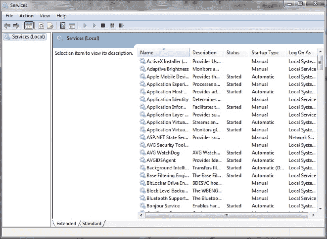

**图 11.1** 服务。

图 11.1 中的窗口显示该机器上安装的所有服务，无论其是否正在运行。窗口还显示服务是否自动启动等信息。在 Windows XP 中，选择单个服务可查看更多信息。双击任何版本的 Windows（从 Windows XP 到 Windows 10，从 Server 2003 到 Server 2016）的单个服务，会弹出类似 图 11.2 的对话框，提供该服务的详细信息。

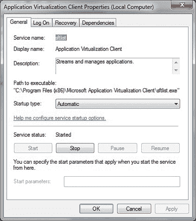

**图 11.2** 禁用的服务。

如图 11.1 所示，你在机器上看到一个不需要的服务。在图 11.2 中，你可以看到如何禁用该服务。为了演示，这里将对该服务进行禁用。（在关闭任何服务之前，请先检查是否有其他服务依赖于它；如果有依赖关系且强行关闭会导致其他服务失败。）关闭服务的步骤如下：

1. 点击“依赖关系”标签。在此示例中，该服务没有任何依赖。

2. 点击“常规”标签。

3. 将“启动类型”改为“禁用”。

4. 如有必要，在“服务状态”区域点击“停止”按钮。此时对话框应类似于 图 11.2。防火墙服务已关闭。

5. 单击“确定”以保存修改并关闭属性对话框，然后关闭“服务”窗口和“管理工具”窗口。

关闭不必要的端口和服务是计算机安全的基础且重要的一环。正如前文所述，每个开放端口（以及每个运行的服务）都可能成为黑客或病毒进入系统的途径。因此，请牢记这一重要规则：**如果不需要它，就关闭它并阻止它。**

建议制定一个已运行软件列表，然后查找该软件所需的端口和协议，仅允许这些端口。需要注意的是，这些端口用于入站流量。如果你的机器不是数据库服务器、Web 服务器或其他类型的服务器，且是独立工作站，则可以（也应该）关闭所有端口。网络工作站可能需要为网络实用程序保留某些端口。本章后面将介绍一些有趣的实用工具。

### Protect

下一阶段的系统安全评估是确保使用所有合理的防护软件和设备。这意味着至少要在你的网络和外部世界之间设置一个防火墙（参见第 2 章）。你还应该考虑在该防火墙和任何 Web 服务器上使用入侵检测系统（IDS）。（我们在第 9 章中讨论了 Snort IDS）。一些安全专家认为 IDS 是非必要的；你当然可以在没有 IDS 的情况下构建一个安全的网络。然而，使用 IDS 是唯一知道即将到来的攻击的方法，而且有免费的开源 IDS 可供选择，我强烈推荐使用它们。防火墙和 IDS 将为你的网络边缘提供基本安全，但你还需要病毒扫描。每一台机器，包括服务器，都必须定期更新病毒扫描器。已经指出，病毒感染是大多数网络的最大威胁。如前所述，考虑在所有系统上安装防间谍软件以防止网络用户不慎运行间谍软件也是明智的。

### 在实践中

#### 选择防火墙

在选择防火墙时，你有多种选择：你可以购买一款针对高速 Internet 连接的低价路由器防火墙，也可以购买与你的 DSL 或有线路由器分离的路由器，或购买一款包含防火墙功能的有线或 DSL 路由器。下面的网站可以帮助你获取更多信息并确定最适合你需求的选项：

* **Linksys:** [http://www.linksys.com/us/](http://www.linksys.com/us/)（注：Linksys 已被 Cisco 收购。）
* **Home PC Firewall Guide:** [www.firewallguide.com](http://www.firewallguide.com)
* **Broadband Guide:** [www.firewallguide.com/broadband.htm](http://www.firewallguide.com/broadband.htm)

除了防火墙选项的信息外，你还可以在 Internet 上找到许多免费或非常廉价的防火墙软件包。下面是两款在 Internet 上可用的流行防火墙列表：

* **Norton Personal Firewall:** 该产品价格低廉，支持多种操作系统，并提供免费试用下载，可从 [www.symantec.com](http://www.symantec.com) 获得。
* **McAfee Personal Firewall:** 该产品在价格和基本功能上与 Norton Personal Firewall 相似。更多信息可在 [http://us.mcafee.com](http://us.mcafee.com) 查询。

对于中等规模或更大网络且预算更灵活的情况，Citrix 提供专门针对 Web 服务器的应用网关。该方案相对廉价，非常适合以提供网站或 Web 服务为主要业务的公司。相关信息可在 [https://www.citrix.com/products/netscaler-application-delivery-controller/tech-info.html](https://www.citrix.com/products/netscaler-application-delivery-controller/tech-info.html) 查看。

最后，Linux 自带防火墙 `iptables`。它是任何使用 Linux 的系统的极佳解决方案。最早为 Linux 提供的防火墙是 `ipchains`，它虽功能完备但存在局限性。`ipchains` 首次在 Linux 内核 2.2 版中引入，随后被 `ipfwadm` 取代。`iptables` 服务（如今是 Linux 的主要防火墙）首次在 Linux 内核 2.4 版中引入。在大多数 Linux 系统中，`iptables` 的默认安装路径为 `/usr/sbin/iptables`；如果安装时未包含，你可以稍后添加它。

### 政策

虽然第 10 章对政策进行了详细阐述，但这里简要回顾一些政策方面。任何组织都必须制定清晰的计算机安全政策，并且由管理层强制执行。这些政策应涵盖组织计算机、Internet、电子邮件以及系统其他任何方面的可接受使用。政策必须禁止在系统上安装任何软件，只有 IT 人员才能安装软件，并且必须先验证其安全性。

政策还应警告用户不要打开未知或意外的附件。我建议组织内部或部门使用一个代码词。如果邮件正文（或主题行）中不包含该代码词，则不应打开附件。大多数病毒通过电子邮件附件传播，其主题行和正文都是由病毒自动生成的。所有合法的附件都可以在主题行中加入代码词；病毒发送的邮件中不太可能出现该词。仅此措施就能防止用户 inadvertent 打开病毒。

政策还应明确规定谁可以访问哪些数据，备份如何执行，以及在灾难（通常称为 *灾难恢复计划*）导致服务器及其数据被毁时如何恢复数据。数据访问应仅限于真正需要访问的人员。例如，人力资源部的所有人不必访问所有员工的纪律文件。你的组织是否有应对服务器因火灾被毁且所有数据丢失的计划？如何获取新机器？谁负责？是否有离站数据备份副本？这些问题必须在灾难恢复计划中得到解答。

还应制定密码政策：可接受的最小长度、密码生命周期、密码历史记录以及应避免的密码（如与用户直接相关的词）。例如，大力支持达拉斯牛仔队的用户不应使用与该球队有任何关联的密码。此外，与个人数据相关的密码（如配偶的生日、子女的名字或宠物名称）也是不佳选择。密码政策可以包括对密码的建议或限制。

> **FYI：良好密码**
>
> 许多来源声称良好密码至少 8（最好 15）个字符，包含字母、数字和符号，并混合大小写字母。了解了彩虹表后，你可能会意识到即使更长的密码也可能不够。我通常推荐使用 **passphrase**。以 “cheese burgers from Burger King” 为起点，将其合并为一个词，使用大小写变化并将部分字母替换为数字，你可能得到类似 `!l!k3ch33s3burg3rsfrombuRG3rk1ng` 的密码。你可以轻松 memorize 这样的密码，而且它对猜测或彩虹表攻击都很难破解。

- 密码不应长时间保留。90 天或 180 天的密码更换周期对大多数情况都很好。更安全的环境可能需要 30 天或更短的更换周期。Microsoft 建议 42 天（6 周）。这称为 `password age`。（必须将此与用户对敏感信息或数据的访问权衡考虑，例如公司财务人员可能每周更改密码，核子武器工程师可能每天更改密码，而邮件文员可能需要更长时间更改密码。）您可以设置许多系统（包括 Windows）在一定时间后强制用户更改密码。您还应确保用户不会仅仅重用旧密码，这称为 `password history`，在某些操作系统中也称为 `uniqueness`。一个好的经验法则是五个历史记录的深度——即用户不能重用她最近的五个密码。此外，您可能需要实施最小密码年龄，以防止用户立即更改密码五次以返回当前密码。通常，建议最小为 1 天。

**FYI: How Extensive Should Policies Be?**


这个问题经常出现：政策应该有多广泛？应该是几页简短的文档还是冗长的手册？不同的计算机安全专家有不同的看法。我的意见是，政策应足够长以覆盖组织的需求，但不应如此冗长以至于难以管理。简而言之，过长的政策手册往往会被员工忽略，从而无法遵守。如果您必须拥有长篇政策手册，那么为特定员工群体创建几个简短的子手册是个好主意，以增加政策被阅读和遵守的机会。新员工最好由 IT 安全部门的人员进行安全政策介绍。

FYI: Checklists and Policies

为了方便您并帮助您开始保护系统并建立良好的政策，SANS Institute 网站提供了策略和检查表的示例（`http://www.sans.org/security-resources/policies/`）。这些示例也可以通过本书的配套网站以电子形式获取。

最后，政策应包括在员工离职时应采取的具体操作指南。必须立即停用该人员的所有登录账户，并立即取消其对系统任何部分的物理访问。遗憾的是，许多组织未能妥善处理此问题，导致不满的前员工有机会对前雇主进行报复。

### Probe

评估任何网络的重要一步是对网络进行探测。本章后面会介绍几种探测方法。关键是要定期对您自己的网络进行探测，以查找安全漏洞。这应该是一个定期安排的事件——也许每季度一次。至少，完整的安全审计应每年至少进行一次。这当然包括对端口进行探测。但是，真正的安全审计还应包括对安全策略、补丁系统、您维护的安全日志、担任安全职务的人员档案，以及其他方面的审查。

### Physical

最后，您不能忽视物理安全。最安全的计算机，如果放置在未上锁的房间里，也并不安全。您必须制定某种政策或程序，规范对带有计算机的房间的上锁以及笔记本电脑、PDA 和其他移动设备的处理。服务器必须放置在上锁且尽可能少人访问的安全房间。备份磁带应存放在防火安全箱中。在处置文档和旧备份磁带时，应在处理前将其销毁（例如，通过熔化磁带、磁化硬盘或破碎光盘）。

对路由器和集线器的物理访问也应受到严格控制。拥有全球最先进的专业信息安全技术，但将服务器放置在任何人都能进入的未上锁房间中，是灾难的根源。物理安全领域最常见的错误之一是将路由器或交换机放置在清洁员工的储物间。这意味着除了您自己的安全人员和网络管理员外，整个清洁人员都能访问您的路由器或交换机，而其中任何一个人可能会长时间留下门未上锁。

关于物理安全的基本规则如下：

*   `Server rooms`：服务器存放的房间应是建筑中最耐火的房间。它应配备强门和强锁（如死 bolt）。只有真正需要进入该房间的人员才应拥有钥匙。您也可以考虑使用服务器房间日志，记录每个人何时进入或离开。实际上，电子锁可以记录谁何时进入房间以及何时离开。对于关键区域（如服务器房间），您也可以考虑使用生物识别锁。请咨询当地安全供应商，获取更多关于价格和可用性的详细信息。

*   `Workstations`：每个工作站应带有刻有标识的标记。您还应定期进行库存清点。虽然通常很难像服务器那样安全地保护工作站，但您可以采取一些措施提高其安全性。一些公司选择用缆绳将工作站固定在桌面上，这既有效又经济。

*   `Miscellaneous equipment`：投影仪、光盘刻录机、笔记本电脑等应放在上锁的柜子或保险箱中。任何想使用这些设备的员工都必须签字办理借用，并且在归还时检查设备是否正常工作以及所有部件是否齐全。

### Securing Computer Systems

在本节中，您将了解针对个人工作站、服务器和网络的各种安全细节。但请注意，您不需要重新发明轮子。许多很有名的组织已经制作了逐步指南或安全模板，您可以在网络环境中使用。这些模板可以根据您组织的具体需求进行修改，或者作为您制定自己的安全策略的起点。

*   国家安全局（NSA）的网站提供了多个具体的网络安全指南：[`https://nsacyber.github.io/publications.html`]

*   中心（CIS）提供了多个安全指南和基准：[`https://www.cisecurity.org`]

*   SANS Institute 提供了可下载并使用或修改的示例策略：[`www.sans.org/resources/policies/`]

此外，还有一些模板可用于多种操作系统和应用程序（如 Microsoft Windows 和 Microsoft Exchange），这些模板会实施特定的安全措施。您可以在许多产品中找到这些模板，然后在相应的机器上安装即可。有些安全专业人员偏好自行处理安全细节，但许多管理员发现这些模板很有用——对初学者来说，它们可能是 invaluable（不可估量的）资源。

*   Windows 安全模板：[`https://support.microsoft.com/en-us/kb/816585`]

*   Microsoft Exchange 模板：[`https://technet.microsoft.com/en-us/library/bb676692\(v=exchg.80\).aspx`]

-   [`www.windowsecurity.com/articles-tutorials/misc_network_security/Understanding-Windows-Security-Templates.html`](http://www.windowsecurity.com/articles-tutorials/misc_network_security/Understanding-Windows-Security-Templates.html)的一个集合，包含 Windows 模板。

-   使用这些模板至少能为应用它们的应用程序提供一个安全基线。

### 保护单个工作站

任何谨慎的个人都可以采取若干步骤来确保自己的计算机安全。这些步骤既适用于家用计算机，也适用于网络中的工作站。前者，保护个人计算机是唯一可用的安全选项。后者，保护个人计算机以及边界防护可实现分层安全模型。虽然一些网络管理员仅通过防火墙和/或代理服务器保护边界，但普遍认为应当保护组织中的每台机器。这对于防范病毒攻击以及分布式拒绝服务攻击（如`第 4 章`，“拒绝服务攻击”）至关重要。

FYI：系统硬化

保护计算机系统免受黑客、恶意软件和其他入侵者的侵害的过程有时被称为系统硬化。你可能会常见地看到*服务器硬化*或*路由器硬化*等术语。

对单个计算机的第一步是确保所有补丁已正确应用。Microsoft 网站提供实用程序，可扫描你的机器，查找 Windows 及 Microsoft Office 需要的补丁。至少每季度进行一次此操作非常重要。你还应检查其他软件供应商，看他们是否提供类似的更新机制来更新其产品的补丁。令人惊讶的是，许多病毒爆发仍然发生，尽管已有补丁可修复被攻击的漏洞。太多人没有定期应用补丁。对于家用计算机，这是安全策略中最关键的一步，能够防止利用安全漏洞的多种攻击。对于网络工作站，这一步仍是整体安全策略的重要组成部分，不可忽视。

保护单个计算机的第二步是限制安装程序或修改机器配置的能力。在网络环境中，这意味着大多数用户无权安装软件或更改系统设置。只有网络管理员和指定的支持人员应拥有此权限。在家庭环境中，则意味着只有负责任的一方（如父母）才能安装软件。

这一预防措施的一个重要原因是防止用户 unintentionally（不小心）安装特洛伊木马或其他恶意软件。如果用户被禁止安装任何软件，那么就不可能不小心安装不当的软件，如特洛伊木马、广告软件或其他恶意程序。阻止用户修改机器配置也能防止他们更改系统安全设置。新手用户可能听说如何更改某些设置，于是去做，却不意识到所暴露的安全风险。

一个典型例子是 Windows 通讯服务（Windows Messenger）。许多人错误地认为它用于聊天室或即时通讯。实际上，它用于网络管理员向网络上所有人发送广播消息。一些广告软件也利用该服务绕过弹窗阻止程序，向你灌输广告。因此，安全意识强的人可能会禁用该服务。你不希望一个 inexperienced（ inexperienced）的人因误以为需要它用于即时通讯而重新开启它。

在任何网络环境中，必须对普通用户对机器配置的操作设置限制。没有这些限制，即使是心怀善意的员工最终也可能损害安全。这一步骤常常会遭到组织的抵制。如果你负责系统安全，你的工作是向决策者解释为何这一步骤至关重要。

如前文所述，每台计算机都必须安装防病毒和防间谍软件，并设置其自动更新病毒定义的功能。已更新并运行的防病毒软件是任何安全解决方案的组成部分。防间谍软件与防病毒软件的双重防御应成为个人计算机安全策略的主要组成部分。一些分析人士认为防间谍软件是可有可无的附加项，而非关键组件。其他人则认为间谍软件是快速增长的问题，未来可能与病毒攻击的危害相当甚至超过。

当然，如果你的操作系统自带防火墙，配置它并开启它是个好主意。Windows（7、8、10）和 Linux 都自带防火墙功能。开启并正确配置它们。实施此步骤时可能遇到的主要问题是，大多数网络需要在关键服务器（如 DNS 服务器）与单个计算机之间进行一定程度的流量传输。配置防火墙时，请确保允许适当的流量通过。如果你在家，可以直接阻止所有入站流量。如果你在网络中，则必须确定需要允许的流量。

如前文所述，密码和物理安全是计算机安全的关键部分。你必须确保所有用户使用至少八位字符的密码，并由字母、数字和特殊字符组合而成。总体而言，确保密码策略完整且所有员工均遵守，可保证物理安全系统的可靠性。

遵循这些指南不会使你的计算机完全免受危害侵害，但能使工作站在合理范围内达到最高安全水平。记住，即使在网络环境中，也必须保护每台计算机以及边界。

### 保护服务器

网络的核心是服务器。这包括数据库服务器、Web 服务器、DNS 服务器、文件和打印服务器等。这些计算机为网络的其余部分提供资源。通常，最关键的数据存储在这些机器上，这使它们成为入侵者特别青睐的目标，因而保护它们至关重要。

基本上，保护服务器的方法与保护工作站相同，然后再加入额外步骤。由于服务器上通常不会有用户经常输入文档或使用电子表格，过于严格的限制对终端用户的影响不像工作站那样明显。

首先，你必须遵循与工作站相同的步骤。每台服务器都应定期打补丁，并安装病毒扫描软件，可能还需要防间谍软件。限制对这些机器的访问（无论是登录还是物理访问）仅限于有明确需求的人员。然而，与标准工作站相比，服务器还需要采取一些额外的安全措施。

-   [操作系统](https://example.org)可以记录各种活动，包括失败的登录尝试、软件安装和其他活动。确保日志功能已开启，并且所有可能构成安全风险的操作均被记录。随后需定期检查这些日志。

-   服务器上的数据比实际机器更有价值，因此数据应定期备份。通常推荐每日备份，但在某些情况下，每周备份可能就足够了。备份磁带应存放在安全的离站位置（如银行保险箱）或防火安全柜中。必须限制对这些备份磁带的访问权限，就像限制对服务器本身的访问一样。

-   对于任何计算机，应关闭不需要的服务。但在服务器上，可能需要进一步删除不必要的软件或操作系统组件，即在服务器正常运行所必需的范围内，其余部分应被移除。在这样做之前请仔细考虑。显然，游戏和办公套件不适用于服务器。但浏览器可能是必要的，用于更新补丁。

-   服务器还有另一项与工作站不同的步骤：大多数服务器操作系统自带账户。例如，Windows 自带管理员、客户、权限用户等账户。任何想要猜破密码的黑客首先会尝试这些标准用户对应的密码。事实上，网络上存在工具可以自动完成此类尝试。首先，你应创建自己的账户，且名称应不反映其权限级别。例如，禁用管理员账户并创建名为 `basic_user` 的账户。将 `basic_user` 设为管理员账户，并分配适当权限。（当然，只向需要管理员权限的人员提供该用户名和密码。）这样，黑客就不会立即猜到该账户是目标。

-   请注意：处理旧备份媒体时，许多网络管理员直接将旧媒体丢入垃圾桶。恶意人员若获取这些废弃媒体，可能将其恢复到自己的机器上，从而获取旧数据或获得当前安全实践的线索，具体取决于媒体上包含的内容。旧媒体（磁带、光盘、硬盘）应彻底销毁。光盘需物理折断；磁带需部分或全部熔化；硬盘需用强磁体进行磁化。

-   Windows 的任何版本都包含可供修改的注册表设置，以提升安全性。若使用如 Cerberus 等扫描工具，它会返回注册表设置中的弱点报告。可能导致安全问题的注册表项包括：

  *   **登录**：如果注册表设置为登录屏幕显示最近登录用户的名称，你已为黑客完成了一半工作。她只需知道用户名即可猜测密码。

  *   **默认共享**：某些驱动器/文件夹默认共享。保持此类共享会带来安全隐患。

-   这些仅为 Windows 注册表中可能出现的几个安全问题示例。诸如 Cerberus 之类的工具不仅会指出问题，还会提供修正建议。要启动注册表编辑器，进入“开始”，选择“运行”，输入 `regedit` 即可编辑注册表。

-   网络的安全首先是保障参与网络的所有计算机（包括工作站和服务器）的安全。但这只是网络安全的一部分。防火墙和代理服务器也是至关重要的安全组件。第 12 章“网络恐怖主义与信息战”将提供更多细节。目前重要的是认识到需要使用它们。大多数专家还建议使用入侵检测系统（IDS）。目前有多种此类系统可选，甚至有免费版本。这些系统能够检测诸如端口扫描等行为，这可能暗示有人准备突破你的安全边界。

-   如果网络规模较大，可考虑通过带防火墙的路由器将其划分为若干较小的段，以便在单个段被 compromise 时，整个网络不致受影响。可以将最重要的服务器（数据库、文件服务器）放置在受保护的独立段中。

-   由于 Web 服务器必须暴露于外部并是攻击的常见目标，理应将其与其余网络隔离。许多网络管理员在 Web 服务器与网络其余部分之间再放置一个防火墙。这样，若黑客利用 Web 服务器漏洞并获取访问权限，则不会直接获得对整个网络的控制。这引出了 Web 服务器上应放置什么内容的问题：仅保留发布网页所必需的内容，不应存放数据、文档或其他信息，也不应安装多余软件。操作系统和 Web 服务器软件是唯一必需的组件；如有需要，可额外添加 IDS 等项目。该服务器上运行的任何其他软件均可能构成安全风险。

-   还需考虑 DMZ（Demilitarized Zone，非军事区）概念。DMZ 通过部署两道防火墙实现：外围防火墙较宽容，内部防火墙高度限制。面向外部的资源位于这两道防火墙之间。外围防火墙相对宽松，内部防火墙则严格限制。即使是部分功能的路由器也可整合此功能。通过插入特定端口，可将设备放在防火墙内部或 DMZ 区域，如图 11.3 所示。

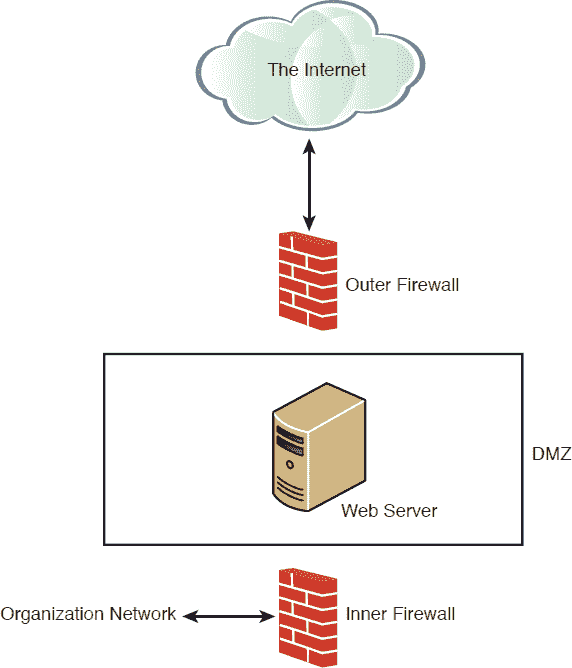

**Figure 11.3** DMZ.

-   还必须制定指导用户如何使用系统的策略，正如本章前文所讨论。最强的安全措施若因用户的疏忽而被轻易破坏，也毫无意义。必须制定并执行明确的用户使用政策，规定何为适当使用以及何为不当使用。

-   正如你对服务器进行硬化（如补丁操作系统、关闭不必要服务）所做的那样，也应对路由器进行硬化。具体操作取决于路由器厂商和型号，但应遵循以下几条通用规则：

  *   **使用强密码**：所有路由器均可配置和编程，因此必须遵循与服务器相同的密码策略，包括最小长度、复杂度、密码年龄及历史记录。若路由器支持加密密码（Cisco 等厂商提供），请启用该功能。

### 使用日志

大多数路由器允许**日志**。你应该**打开**它并像监控服务器日志一样**监控**日志。

#### 安全规则

一些基本的路由器安全规则也应该遵循：

- 不要响应**地址解析协议 (ARP)** 请求，针对那些不在用户**本地网络 (LAN)** 中的主机。

- 如果网络中没有任何应用程序使用某个端口，则该端口也应该在路由器上**关闭**。

- 那些**不**来自本地网络的数据包**不**应被转发。

这些规则仅是**起点**。你需要**咨询**供应商的文档以获取**额外**的**建议**。你必须**将**保护路由器的安全**与**保护服务器的安全**同等**重视**。下面的链接可能会**有**帮助：

- **路由器安全**: [www.mavetju.org/networking/security.php](http://www.mavetju.org/networking/security.php)

- **Cisco 路由器硬化**: [www.sans.org/rr/whitepapers/firewalls/794.php](http://www.sans.org/rr/whitepapers/firewalls/794.php)

#### 扫描你的网络

唯一确定你的网络安全的方法是**实际**检查**漏洞**和**缺陷**。在这一节中，我们将**查看**一些**常**用的**漏洞扫描**工具。**这**些**工**具**可**以**对**任何**网络**管理员**都**是**一个**不可**估**量的**资**产**。

##### MBSA

**Microsoft Baseline Security Analyzer** 是**微软**提供的**免费**工具。 (只需**搜索**该名称即可**获取**最**新**版本)。它**也**非常**简**单**易**用。批评者指出它**不**如**其**他**工**具**那样**强**大，这是一个**准**确的**评**估。**我**并**不**声称这是**最**佳**漏洞**评**估**工**具**；**它**显然**不是**。然而，它**易**于**使**用、**免**费，且**适**合**于**可能**不**熟**悉**安全**的**Windows**管理员。

MBSA (**版本 2.3** 截至**本**文**写**作时) 会**检查**一个或**多**个**Windows**机器，看**是**否**有**最**新**的**补丁**、**密**码**策**略**良**好**以及**基**本**安全**措**施**。**现**在**微软**已**停**止**该**工**具**的**开**发，但你**可**以**在**互**联**网**上**获**取**它，并且**它**仍**然**可**能**工**作。

**运**行**程**序**后**，你**可**以**选择**扫描**单**个**计**算**机**或**多**个计**算**机**，如**图 11.4**所示。

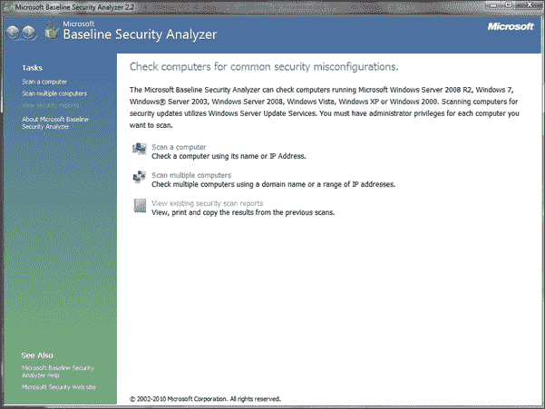

**Figure 11.4** Starting MBSA.


为演示目的，我们将扫描单个计算机。当你选择该选项时，你将看到一个屏幕，允许你指定要扫描的计算机（默认为你当前的计算机）以及要执行哪些扫描。这在图 11.5中显示。

![Figure 11.5 Scanning a single computer. ¶  ¶ The Microsoft baseline security analyzer 2.2 window is shown. The window displays the details of the computer to be scanned. They are computer name, IP address, and security report name. It lists various options as checkboxes in which the following are selected: check for windows administrative vulnerabilities, check for weak passwords, check for IIS administrative vulnerabilities, check for SQL administrative vulnerabilities, and check for security updates. ¶ ](img/11fig05.jpg)

Figure 11.5 Scanning a single computer. ¶ 

然后只需启动扫描。对于单个计算机，它不会耗时长，但对多个计算机则可能耗时较长。当它完成后，你将收到一份详细说明了检查了什么以及是否正常的报告；它还包含链接，以便你获取更深入的解释。这在图 11.6中显示。

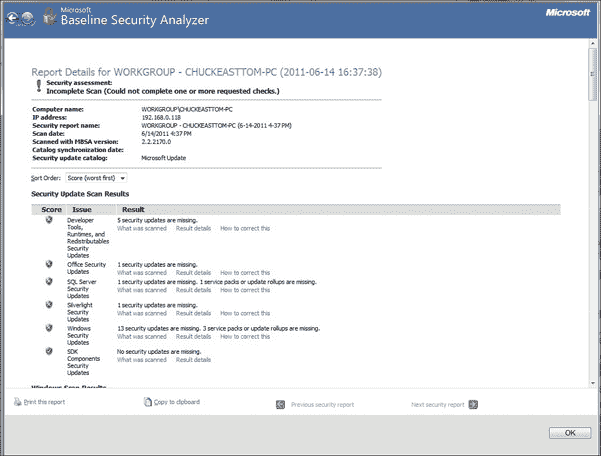

Figure 11.6 MBSA report.

我认为批评者的观点是有道理的，但我认为这一特定工具是对于安全新手的优秀选择。它易于使用，并可以快速提供可操作的信息。

### NESSUS

Nessus ([www.Nessus.org](http://www.Nessus.org)) 是首屈一的网络漏洞扫描工具。先前有一个免费版本供个人使用，并有商业版。现在它只可以付费。这可能是现在最广泛使用的漏洞扫描工具。它并不像MBSA那样简单易用，但具有更多能力。我们将探讨基本功能。如果你有兴趣进一步学习Nessus，建议你参考Nessus网站的文档。

Nessus 是一个知名漏洞扫描工具，它已经被使用多年。现在，它不是免费的。许可证的价格超过每年2100美元，可以从 [`www.tenable.com`](https://www.tenable.com) 获取。价格是许多渗透测试人员的障碍。Nessus的首要优势是供应商不断更新它能够扫描的漏洞。Nessus还有一个简单易用的网页界面，如图 11.7所示。

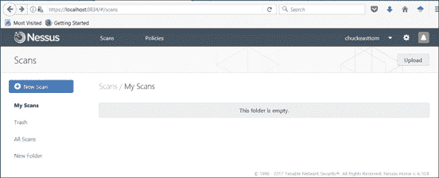

Figure 11.7 Nessus main screen.

如果你选择 **New Scan**，你会得到一个数个选项，如图 11.8所示。


Figure 11.8 Nessus scan options. ¶ 

你可以选择 **Basic Network Scan** 来看一个直观的基本设置。你需要为你的扫描命名并选择一个IP地址范围，如图 11.9所示。

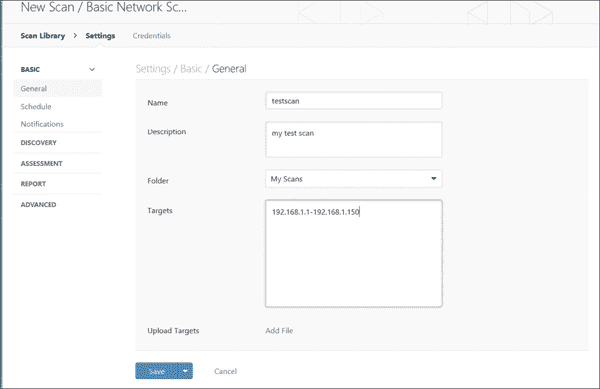

Figure 11.9 Nessus basic network scan options.

然后你可以安排扫描在稍后运行或立即启动它。Nessus 扫描可能耗时较长因为它很彻底。结果在一个组织良好的屏幕上显示，如图 11.10所示。


Figure 11.10 Nessus results. ¶ 

然后你可以对任何感兴趣的项目进行深入探讨。如果你双击某个特定IP地址，你可以看到该IP的详细信息，如图 11.11所示。

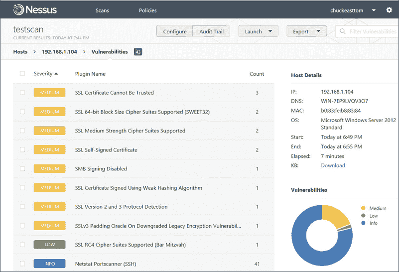

Figure 11.11 Drilling down into Nessus results.

然后你可以对任何个项目进行深入探讨。如果你双击任何个项目，你可以获取关于该项目的详细信息以及如何修正它们。

### OWASP Zap

开放网站安全项目 (OWASP)是Web应用安全的标准。OWASP提供一个免费漏洞扫描工具——Zed Attack Proxy，通常称为OWASP ZAP。你可以从 [`github.com/zaproxy/zaproxy/wiki/Downloads`](https://github.com/zaproxy/zaproxy/wiki/Downloads) 下载它。界面如图 11.12所示很简单易用。

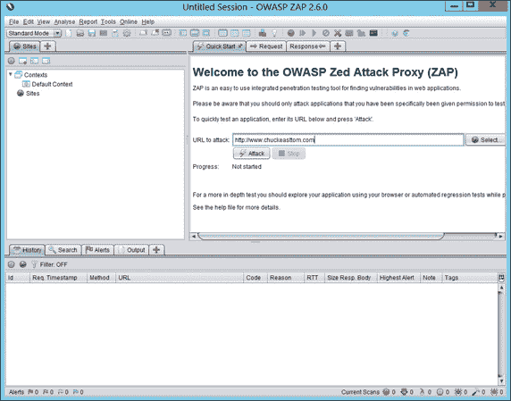

Figure 11.12 OWASP ZAP main screen.

只需在你想要扫描的网站的URL中输入并点击 **Attack**。几秒后，结果将在屏幕底部显示。然后你可以扩展任何项目。如果你点击特定项目，详细信息会加载如图 11.13所示。

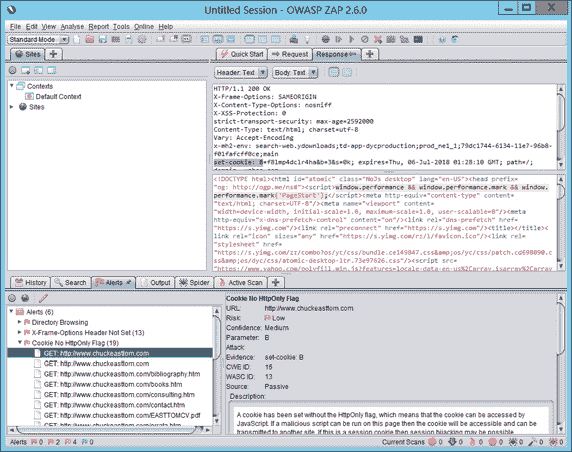

图 11.13 OWASP ZAP 结果。

OWASP ZAP 是一个非常易用的工具。基础功能可以在几分钟内掌握。而且，鉴于 OWASP 是跟踪 Web 应用程序漏洞的组织，它是测试网站漏洞的非常好的来源。

## Shodan

该工具被黑帽黑客和安全专业人士所广泛使用。网站 [`www.shodan.io`](https://www.shodan.io) 实质上是一个漏洞搜索引擎。你需要注册免费账号才能使用它，但随后它对渗透测试人员来说可以是无价的，帮助他们识别漏洞。当然，该站点对攻击者同样有价值。你可以在 图 11.14 查看该网站。

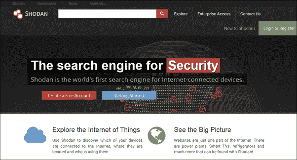

图 11.14 Shodan.io.

Shodan 允许你使用多种选项进行搜索，包括以下内容：

*   搜索默认密码，使用如下搜索词：

    *   default password country:US

    *   default password hostname:chuckeasttom.com

    *   default password city:Chicago

*   查找 Apache 服务器，使用如下搜索词：

    *   apache city: “San Francisco”

*   查找网络摄像头，使用如下搜索词：

    *   webcamxp city:Chicago

*   查找旧 IIS，使用如下搜索词：

    *   “iis/5.0”

通过 Shodan，你可以使用多种过滤器，包括以下内容：

*   `city:` 查找特定城市的设备。

*   `country:` 查找特定国家的设备。

*   `geo:` 指定坐标（如纬度和经度）。

*   `hostname:` 查找匹配特定主机名的值。

*   `net:` 基于 IP 地址或 /x CIDR 地址进行搜索。

*   `os:` 基于操作系统进行搜索。

*   `port:` 查找特定开放端口。

*   `before/after:` 在指定时间范围内查找结果。

例如，图 11.15 展示了搜索 **default password city:Miami** 的结果。

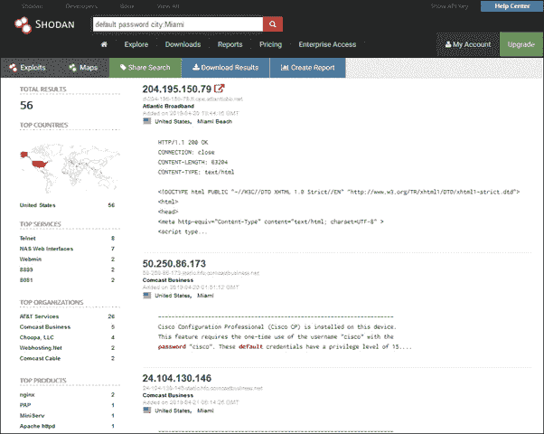

图 11.15 Shodan 搜索结果。

在进行渗透测试时，建议在 Shodan 上搜索你的公司域名，以获取指导渗透测试的信息。当然，潜在攻击者也可以使用 Shodan 获取相同信息。你可以将搜索限制在已聘请你进行渗透测试的客户的主机名或域名。你可以使用 Shodan 寻找目标网络中的默认密码、旧网络服务器、未受保护的网络摄像头以及其他漏洞。

如图 11.15 所示的搜索是使用 Shodan 的免费版本进行的。最近，Shodan 开始提供付费版本，价格为 49 美元，并提供额外工具。此外，还有企业会员，价格更高。

### 获得专业帮助

你可能会决定需要外部帮助来设置和测试系统的安全性。这一选项是安全专业人士强烈推荐的，尤其是如果你对安全一无所知的话。请聘请专业顾问协助你制定初始安全策略和政策，并可能定期审计你的安全。正如在 第 1 章 “计算机安全入门”中提到的，有许多人声称自己是黑客，但实际上并非如此。坦率地说，也有许多自称安全专家的人并没有必要的技能。关键问题是：如何判断一个人是否具备资质？以下是一些需要考虑的指南。

经验是寻找安全专业人士时最重要的因素。你希望找到至少有 5 年 IT 经验，其中 2 年与安全相关的经验。通常，这可能是一名网络管理员或程序员，他们转向安全领域。请注意，这只是最低经验要求。经验越多越好。当然，经验较少的人可能具备所需技能，但这种情况较少见。每个人都需要一个起点，但你不希望你的系统成为别人学习的场所。

经验的质量与长度同样重要。询问此人的经验细节。例如，她在计算机安全方面具体担任了什么角色？她是仅仅设置政策，还是实际进行动手安全工作？结果如何？她的系统是否免受病毒感染和黑客入侵？你能联系她的推荐人吗？简而言之，仅凭简历上声称她负责信息安全是不够的。你需要了解她具体做了什么以及取得了什么结果。

安全专业人士的素质也是重要考量因素。记住，计算机安全是一个非常广泛的领域。你需要了解网络、协议、编程等方面的知识。虽然没有正式教育也可能具备这些技能，但拥有正式教育的可能性更大。通常，这些技能更可能在拥有经验且在计算机或数学相关领域拥有学位的人身上发现。这听起来可能有些学术上高高在上，但这是事实。IT 行业有许多自学成才的人，例如拥有历史学位的网络管理员或心理学专业人员转行为程序员。然而，一个人越专注于多个领域，越难获得精通。这并不意味着没有计算机科学、数学或工程学位的人不能成为安全专业人士。重点是，这是一个需要考虑的因素。如果某人拥有无关学位但满足或超过其他所有资质，你仍可能考虑他。一些学院开始提供安全专业课程，甚至提供安全学位。显然，具体的计算机安全培训是最理想的安全背景。

认证在 IT 职业中备受争议。有些人坚信它们。你可以轻易在许多招聘广告中看到要求特定认证的要求，例如 CNE（Certified Novell Engineer）或 MCITP（Microsoft Certified Information Technology Professional）。Cisco 认证也很常见（Cisco Certified Network Associate 到 Cisco Certified Internetworking Engineer）。另一方面，你会发现一些 IT 专业人士批评认证，认为它们完全无用。这种立场的来源是有些持有认证的人并没有你期望的技能。但这适用于任何证书。例如，有些医学博士可能能力不足。但如果你需要医疗帮助，你的机会会大幅提高，如果你咨询一位拥有医学学位的人。雇主通常采取类似的招聘方式。如果他们只面试拥有特定学位或认证的人，那么他们更有可能面试到合格的候选人。

一种更合理的位置介于两个极端之间。认证可以是候选人对特定产品知识的良好指示。例如，如果您希望有人保障您的 Microsoft 网络安全，查看持有 Microsoft 认证的人员并不是一个坏主意。然而，您需要平衡这一点，记住完全有可能凭借良好的记忆使用互联网上提供的各种学习指南来通过他们并不真正理解的考试。而这正是经验的作用所在。认证加上适当的经验是技能的良好指示。换句话说，认证本身是不够的。但一个或多个认证与经验以及相关学位的组合可以是技术技能的强有力指示。

除了网络管理员的认证外，还有许多与安全相关的认证。有些比其他更有可信度。CompTIA 的 Security+ 考试和 CIW Security Analyst 都是概念性考试。这意味着它们考察候选人的安全概念知识，而不是他们实际实施安全解决方案的能力。单凭这些认证可能不足以表明您需要的技能水平。但例如，如果您正在使用 Novell 进行网络安全，那么一个拥有 CNE 认证且具备 CIW Security Analyst 或 Security+ 认证的候选人可能是值得考虑的人选。需要注意的是，CompTIA 最近新增了 Certified Advanced Security Practitioner (CASP)，该认证面向拥有 10 年安全经验的从业者。


最受尊敬的安全认证是 CISSP (Certified Information Systems Security Professional)。该考试时长 6 小时，并且如果您拥有学位，需要 4 年的安全相关经验；如果没有学位，则需要 5 年的经验。CISSP 持有者还必须从另一位 CISSP 持有者或其公司的高管那里获得推荐，并完成继续教育以维持认证。这可能是最受尊敬的安全相关认证。负责 CISSP 的供应商 (ISC2) 还提供高级、后 CISSP 认证，如 Information Systems Security Architecture Professional (ISSAP)、Information Systems Security Engineering Professional (ISSEP) 和 Information Systems Security Management Professional (ISSMP)。

Certified Ethical Hacker 认证由 EC-Council ([www.eccouncil.org](http://www.eccouncil.org)) 赞助。该考试也曾引发一些争议。请记住，它考察的是基础黑客技能，而非黑客技能的掌握。它适合作为入门黑客/渗透测试。

Offensive Security ([`www.offensive-security.com`](https://www.offensive-security.com)) 专注于渗透测试认证。使他们的认证测试最有趣的地方在于所有测试都包含动手环节。您必须实际入侵他们的测试系统。您并不是简单地参加考试。

CompTIA 还提供多种安全考试，包括 Security+、CompTIA Advanced Security Practitioner (CASP) 和 Pentest+。

还有若干通用取证认证。EC-Council 有 Certified Hacking Investigator，此外还有针对特定取证工具的专门认证。对基本取证知识的熟悉对安全专业人员很有帮助。

GIAC ([www.giac.org](http://www.giac.org)) 拥有多种安全相关认证，它们在安全行业享有极佳声誉。不过，相较于其他考试，这些认证更为昂贵，因此持有者数量较少。GIAC 提供安全认证 (GSEC)、渗透测试认证 (GPEN) 和取证认证 (GCFA 和 GCFE)。

所有认证都会受到批评。事实是，有些人会参加快速训练营，只背诵足够的信息来通过认证。但这同样适用于任何资格认证。显然，存在医学博士不具备能力的情况，但我确信，如果您生病或受伤，您会寻求医学博士的帮助。原因是，相较于随意挑选一个陌生人，您更有可能从合格的医生那里获得帮助。认证的作用亦是如此。请记住，认证反映的是最低技能水平，而非完全掌握。我建议至少拥有一个通用安全认证（Security+、CASP、CISSP 等），一个渗透测试认证（GPEN、CEH、Offensive Security 等），以及一个取证认证（CCFP、GCFA、CHFI 等）。

您绝不能仅凭认证就招聘人员。这些认证仅应作为您考虑的因素之一。

最后，您还应考虑个人背景。安全顾问或全职员工，按定义，将能够接触到机密信息。任何正规的安全专业人员都不会介意向您提供以下任一项：

* References
* 允许查看其信用报告的许可
* 允许查看其刑事背景的许可

任何看起来对提供这些项目有所保留的人都应避免。因此，理想的安全顾问可能是拥有 5 年以上经验、计算机相关学位、具备贵组织操作系统认证以及一项主要安全认证、且背景完全清白、有推荐信的人。在招聘安全顾问时，您只能三思而后行。

除非您在职员中拥有高度训练有素的安全专家，否则建议至少一次聘请安全顾问对您的系统进行评估。在当前法律环境下，关于安全漏洞责任仍然受到激烈争论。公司因未履行计算机安全尽职而被起诉的情况屡见不鲜。出于计算机行业和法律两方面的考量，采取一切合理措施确保系统安全是明智之举。

### Summary

本章概述了在任何安全评估中应关注的基本事项。您应定期评估网络/系统的安全漏洞。一般建议对非关键/低安全性站点进行季度评估，对高安全性站点则可能需要每周评估。无论如何，本章所列内容是网络安全评估的基础，应该为您提供开始保障自身网络的起点。

安全运行是保障您的电脑、网络以及服务器的安全，并在网络上运用常识。必须严格将安全实践和标准应用于所有计算机，无论是家用电脑还是组织网络的一部分。

### Test Your Skills

#### Multiple Choice Questions

**1.** What are the six *P*s of security?

**A.** Patch, ports, personnel, privacy, protect, policies

**B.** Ports, patch, protect, probe, policies, physical

**C.** Physical, privacy, patch, ports, probe, protect

**D.** Ports, patch, probe, physical, privacy, policies

**2.** John is now responsible for system security at a small bookkeeping firm. He wants to ensure that he implements good fundamental security. What is the most basic rule of computer security?

**A.** Keep systems patched.

**B.** Always use an IDS.

**C.** Install a firewall.

**D.** Always use antispyware.

**3.** You work in the network security department of a large bank. One of your jobs is to keep all systems patched. How might you ensure that system patches are kept up to date?

**A.** Use an automated patching system.

**B.** Patch any time you receive a vendor notification of a new patch.

**C.** Patch whenever a new threat is announced.

#### 补丁系统

1. 使用实验室系统，查找并应用所有操作系统补丁。

2. 检查该机器上已安装的所有软件供应商，并尽可能应用这些应用的补丁（如果有的话）。

3. 记录完全为一台机器打补丁所需的时间。考虑为 100 台机器的网络打补丁需要多长时间。

4. 撰写一篇文章，回答以下问题：有哪些方法可以加快 100 台机器网络的打补丁过程？你将如何处理这项任务？

#### 学习策略

1. 使用给定的资源或其他资源，找到至少一个示例安全策略文档。

2. 分析该文档。

3. 撰写一篇简短的文章，表达你对该策略的看法。它是否遗漏了项目？是否包含了你以前未曾考虑的项目？

#### 学习灾难恢复

1. 使用给定的资源或其他资源，找到至少一个示例灾难恢复计划。

2. 分析该文档。

3. 撰写一篇简短的文章，表达你对该灾难恢复计划的看法。同时，指出你对该策略的建议修改。

#### 学习审计

1. 使用给定的资源或其他资源，找到至少一个示例安全审计计划。

2. 分析该文档。

3. 撰写一篇简短的文章，表达你对该计划的看法。你认为审计计划是否足够？你可能会建议哪些修改？

#### 练习 11.1：补丁系统

1. 使用实验室系统，查找并应用所有操作系统补丁。

2. 检查该机器上已安装的所有软件供应商，并尽可能应用这些应用的补丁（如果有的话）。

3. 记录完全为一台机器打补丁所需的时间。考虑为 100 台机器的网络打补丁需要多长时间。

4. 撰写一篇文章，回答以下问题：有哪些方法可以加快 100 台机器网络的打补丁过程？你将如何处理这项任务？

#### 练习 11.2：学习策略

1. 使用给定的资源或其他资源，找到至少一个示例安全策略文档。

2. 分析该文档。

3. 撰写一篇简短的文章，表达你对该策略的看法。它是否遗漏了项目？是否包含了你以前未曾考虑的项目？

#### 练习 11.3：学习灾难恢复

1. 使用给定的资源或其他资源，找到至少一个示例灾难恢复计划。

2. 分析该文档。

3. 撰写一篇简短的文章，表达你对该灾难恢复计划的看法。同时，指出你对该策略的建议修改。

#### 练习 11.4：学习审计

1. 使用给定的资源或其他资源，找到至少一个示例安全审计计划。

2. 分析该文档。

3. 撰写一篇简短的文章，表达你对该计划的看法。你认为审计计划是否足够？你可能会建议哪些修改？

#### 练习 11.5：保护你的电脑

使用你的家用电脑或实验室电脑，按照本章提供的指南保护该电脑。这些步骤应包括以下内容：

1. 扫描所有补丁并安装它们。

2. 关闭所有不需要的服务。

3. 安装防病毒软件。（本练习可以使用演示版软件。）

4. 安装 `antispyware` 软件。（本练习可以使用演示版。）

5. 设置适当的 `password` 权限。

#### Exercise 11.6: Secure Passwords

1. 利用 Web 或其他资源，找出为什么更长的密码更难以破解。

2. 同时找出除了密码长度之外，还有哪些措施可以让密码更难以被破解。

3. 写一篇简短的文章，描述什么是完美的密码。

#### Exercise 11.7: Securing a Server

本练习适用于拥有实验室服务器访问权限的学生。根据本章讨论的指南，安全化实验室服务器。所采取的步骤应包括以下内容：

1. 扫描所有补丁并安装它们。

2. 关闭所有不需要的服务。

3. 删除不需要的软件。

4. 安装防病毒软件。（本练习可以使用演示版。）

5. 安装 `antispyware` 软件。（本练习可以使用演示版。）

6. 设置适当的 `password` 权限。

7. 启用记录任何安全违规行为的日志。（参考操作系统文档获取说明。）

#### Exercise 11.8: Backups

根据 Web 及其他资源的指南，为 Web 服务器制定备份计划。该计划应说明备份的频率以及备份介质的存储位置。

#### Exercise 11.9: User Accounts

本练习最好在实验室计算机上完成，而不是在正在使用的机器上。

1. 找到用户账户。（在 Windows 8 或 Windows 10 中，可以通过开始 > 控制面板 > 管理工具 > 计算机管理，然后查找组和用户来完成。）

2. 禁用所有默认账户（Guest、Administrator）。

#### Projects

##### Project 11.1: Writing and Executing an Audit Plan

在学习了本书六个章节的知识并查看前面练习中的安全策略后，现在是制定自己的审计计划的时机。该计划应详细列出审计的所有步骤。

*注：本项目的第二部分依赖于获得某个组织的授权，以便你对其安全进行审计。它也非常适合小组项目。*

基于你编写的审计计划，对网络进行审计。审计可以针对任何类型的组织，但你的第一次审计应当是一个规模较小的网络（用户数少于 100 人）。

##### Project 11.2: Forming a Disaster Recovery Plan

利用你在此까지获得的知识，为组织制定 IT 灾难恢复计划。你可以使用虚构的组织，但真实组织会更好。

##### Project 11.3: Writing a Security Policy Document

*注：本项目设计为小组项目。*

现在是将你此까지所学的内容整合起来，编写组织的完整安全政策文档。你可以使用虚构的公司，但真实组织更佳。该文档必须涵盖用户访问、密码策略、内部和外部审计频率、最低安全要求、上网指南等内容。

##### Project 11.4: Secure Web Servers

结合本章的信息以及其他资源，提出专门保护 Web 服务器的策略。该策略应包括服务器本身的安全以及服务器所在网络的安全。

##### Project 11.5: Adding Your Own Guidelines

*注：本项目理想为小组项目。*

本章已经列出了一些通用的安全程序。撰写一篇详细说明你额外指南的文章，这些指南可以适用于个人电脑、服务器、网络，或它们的任何组合。

### Case Study

Juan Garcia 是一家小公司的网络管理员，同时该公司还维护自己的 Web 服务器。他已采取以下预防措施：

* 所有电脑均已打补丁，安装了防病毒软件，并关闭了不需要的服务。
* 网络配备了带有代理服务器和入侵检测系统（IDS）的防火墙。
* 组织有一项密码政策，要求密码长度为十个字符，并且每 90 天更换一次。

考虑以下问题：

1. Juan 已经做了足够的工作来保障网络安全吗？

2. 你会建议他采取哪些其他措施？

# Chapter 12. Cyber Terrorism and Information Warfare

## Chapter Objectives

阅读本章并完成练习后，你将能够：

* 解释什么是网络恐怖主义（cyber terrorism）以及它在实际案例中的使用方式
* 理解信息战（information warfare）的基本概念
* 具备一些合理的网络恐怖主义情景的知识
* 对网络恐怖主义所带来的危害有充分的认识

### Introduction

在这本书中，我们一直在探讨人们如何利用计算机犯罪。同时，书中也介绍了让系统更安全的具体方法。一个尚未涉及的问题是网络恐怖主义。全球各国的人们已经习惯了恐怖袭击的持续威胁，这种袭击可能以炸弹、劫机、生物武器释放等形式出现。大多数人并未多加思考网络恐怖主义的可能性。

第一个问题可能是：什么是网络恐怖主义？根据 FBI 的定义，*网络恐怖主义* 是一种预谋、政治动机的攻击，针对信息、计算机系统、计算机程序和数据，导致对非战斗目标的暴力行为，由非国家组织或隐蔽行动者实施。网络恐怖主义仅仅是利用计算机和它们之间的 Internet 连接来发动恐怖袭击。简而言之，网络恐怖主义就像其他形式的恐怖活动，只是攻击的场域发生了变化。显然，由于网络攻击造成的死亡人数远低于炸弹袭击，实际上很可能根本没有生命损失。然而，经济损失、通信中断、供应链受阻以及国家基础设施整体退化等均可能通过 Internet 造成。

第二个问题可能是：网络间谍活动（cyber espionage）与网络恐怖主义有何区别？首先，间谍活动的目标仅是获取信息，最好不让任何人察觉到任何行为。这适用于企业间谍和国际间谍。而网络恐怖主义则旨在造成破坏，并且需要公开进行，目的是在人们中引发恐惧。虽然两者看似相关，但本质上差异很大。

有很大可能性，未来某人或某个组织会利用计算机方法发动军事或恐怖袭击。一些专家认为，MyDoom 病毒（见 第 4 章 “拒绝服务攻击”）是国内经济恐怖主义的例子。但这种攻击可能仅是冰山一角。不久的将来，我们国家可能会成为严重网络恐怖主义攻击的目标。本章将探讨一些可能的网络恐怖主义情景，旨在提供对该威胁严肃性的真实评估。章节末尾的练习将让你有机会审视当前的网络恐怖主义行为、潜在威胁以及可以采取的预防措施。

第一版此书讨论了网络恐怖主义。那是在 2004 年。当时，一些人可能认为该主题的报道几乎是虚构的，认为网络恐怖主义并没有真实威胁。事实证明，情况并非如此。网络恐怖主义的最初迹象之一是 2006 年 11 月，美国空军部长宣布成立空军网络司令部（AFCC），其主要职能是监控并保护美国在网络空间的利益。AFCC 将利用第 67 网络作战中队的人员资源以及其他资源。这表明美国空军认真对待网络恐怖主义和网络战争，并创建了一个专门的司令部来应对这一威胁。

### 实际的网络恐怖主义案例

由于部分读者可能怀疑这只是恐吓行为，让我们在深入探讨其各个方面之前，先看一些实际的网络恐怖主义案例。真正的网络恐怖袭击有多大可能性呢？让我们看看一些真实案例。本章后面，我们将审视一些历史案例，以便更好地把握局面。

2007 年 5 月，爱沙尼亚政府的官网遭受了大规模拒绝服务（DoS）攻击。这次攻击是因为有人反对政府拆除俄罗斯二战纪念碑。虽然这起攻击规模相对较小，但其动机政治化，因此符合网络恐怖主义的定义。

CENTCOM，即中央司令部，是负责中东和东亚地区军事行动的美国军事司令部。2008 年，CENTCOM 遭到间谍软件感染。在中东一处国防设施的停车场留下了一个 U 盘，一名士兵捡起它并将其插入工作站，从而将间谍软件引入 CENTCOM 网络。该蠕虫名为 Agent.btz，是 SillyFDC 蠕虫的变种。这是一次重要的安全泄露，我们可能永远无法知道损失了多少数据或造成了多大破坏。

2009 年带来了针对美国政府网站的一系列互联网攻击，包括五角大楼和白宫（美国）网站，以及韩国多个政府机构。这些攻击与朝鲜半岛紧张局势加剧同步发生。显然，这些属于网络恐怖主义的例子，尽管规模相对较小。

2009 年 12 月，一则更令人不安的新闻浮出水面。黑客入侵计算机系统并窃取了美国和韩国的秘密国防计划。当局推测责任在朝鲜。被盗信息包括韩国和美国军队在战争爆发时的作战计划概述，且攻击来源为中国 IP 地址。此案例显然属于网络间谍行为，且极其严重。

2010 年 12 月，自称“巴基斯坦网络军”（Pakistan Cyber Army）的团体入侵印度最高调查机构——中央调查局（CBI）的网站。这种网络间谍行为比公开披露的更为常见。

#### 中国雄鹰联盟

任何关于网络恐怖主义的讨论都无法回避对“中国雄鹰联盟”（China Eagle Union）的论述。该组织由数千名中国黑客组成，其明确目标是渗透西方计算机系统。关于该组织的网络资源如下：

* [`https://news.hitb.org/content/inside-china-eagle-union-hacker-group`](https://news.hitb.org/content/inside-china-eagle-union-hacker-group)


[`https://news.hitb.org/node/6164`](https://news.hitb.org/node/6164)

该组织的成员和领导人坚称，不仅中国政府不参与他们的活动，他们也在违反中国法律，且时刻面临被捕和入狱的风险。许多分析人士认为这一说法存疑。无论中国政府是否参与这些攻击，一些专家认为中美之间目前已处于一种网络战争状态。

### 中国的高级持续性威胁

顾名思义，高级持续性威胁（APT）是一系列在较长时间内持续进行的高级网络攻击，因此具有“持续性”。安全公司 `Mandiant` 追踪了多个 APT，这些威胁均源自中国，具体为上海和浦东地区，并被命名为 `APT1`、`APT2` 等。

这些攻击与中国军事部门第 61398 部队的活动相关联。中国政府将该部队的活动视为机密，但很明显，进攻性网络作战是其任务之一。仅这一小组的一个 APT 就于 2010 年入侵了 141 家、20 个行业的企业。`APT1` 平均能够保持对受害网络的访问 365 天，个别案例长达 1764 天。`APT1` 在 10 个月内窃取了单个组织 6.5TB 的信息。

### 印度与巴基斯坦

这两国长期存在深厚的敌意。因此，近年来的网络行动并不令人惊讶。

*One India*于 2015 年 8 月发表一篇题为“巴基斯坦希望发动网络战争对印度”的文章。文章称：“情报局的网络部门警告称，在印度持续的代理战争中，巴基斯坦网络军可能会攻击政府网站。”根据最新警报，巴基斯坦的 ISI 已指示其网络军对印度宣战。

### 俄罗斯黑客

据 `ISight Partners`，一家网络情报公司，2014 年俄罗斯黑客利用微软 Windows 中的漏洞在 NATO 和欧盟使用的计算机上进行间谍活动。该间谍活动还被报告称针对乌克兰的网站进行间谍。

## 网络战争的武器

在网络战争和网络恐怖主义中，恶意软件仍是主要武器。无论是间谍软件、病毒、特洛伊木马、逻辑炸弹或其他类型的恶意软件，它们都是进行网络冲突的关键载体。本节将介绍一些在冲突中被使用的著名恶意软件。

### Stuxnet

`Stuxnet` 是武器化恶意软件的经典案例。`Stuxnet` 最初通过感染 U 盘传播；但一旦感染机器，它便会在整个网络乃至互联网中扩散。`Stuxnet` 病毒随后寻找并连接到特定类型的可编程逻辑控制器（PLC），即西门子 `Step7` 软件。一旦发现该 PLC，`Stuxnet` 便加载其自身的特定 DLL 到 PLC 中，以监控并修改 PLC 的功能。

`Stuxnet` 设计用于针对伊朗铀浓缩设施中的离心机控制器。但该病毒传播范围超出原定目标，因此被公众所知晓。虽然许多用户报告称从 `Stuxnet` 中未感受到显著损害，但除伊朗反应堆外，该病毒在大量机器上被检测到。

`Stuxnet` 采用了经典的病毒设计。`Stuxnet` 包含三个模块：执行攻击相关例程的蠕虫；用于传播蠕虫副本的链接文件；以及负责隐藏文件和进程的根包，旨在使检测 `Stuxnet` 的存在更加困难。本讨论并非旨在深入探讨 `Stuxnet` 的细节，而是将其作为国家赞助恶意软件攻击的典型例子，以及至少是针对此类攻击的尝试。

### Flame

讨论网络战争和间谍活动时，无法避免地要提到“`Flame`”。该病毒于 2012 年首次出现，针对 Windows 操作系统。`Flame` 最显著的特点是它是专门为间谍活动而设计的。它于 2012 年 5 月首次在多个地点被发现，包括伊朗政府网站。`Flame` 是一种间谍软件，能够监控网络流量并截图受感染系统的屏幕。

它是一种间谍软件，能够记录键盘活动和网络流量，拍摄截图，甚至据说能够记录 Skype 对话。它还会将受感染的电脑转变为蓝牙信标，试图从附近的蓝牙设备中下载信息。

`Kaspersky` 实验室报告称，`Flame` 文件包含的 MD5 哈希值仅出现在中东地区的机器上。这表明病毒作者可能意图将恶意软件攻击限定在特定的地理区域。`Flame` 病毒似乎还具备“自毁”功能，允许其控制者发送信号指令其删除所有自身痕迹。这两点表明存在针对恶意软件的定向，但该定向的结果似乎是失败的，否则我们就不会知道它的存在。

### StopGeorgia.ru 恶意软件

在俄羅斯與格魯西亞之間的衝突期間，發生了多起黑客事件。`StopGeorgia.ru` 論壇是一個線上論壇，旨在協助對格魯西亞關鍵網路目標進行攻擊。該論壇會宣傳具體目標，提供教程（在某些情況下提供工具）以幫助即使技術能力較低的攻擊者參與目標攻擊，並提供代理服務器鏈接，以隱藏攻擊者的真實 IP 地址和位置。

作為 `StopGeorgia.ru` 網站提供的範例，有一個名為 `DoSHTTP` 的工具，它自動化了 DoS 攻擊，並列出了格魯西亞內的若干網站和 IP 地址，作為潛在目標。這鼓勵了任何同情俄羅斯在該衝突中立場、具備最低計算機技能的人士，參與對格魯西亞的網絡攻擊。

### FinFisher

`FinFisher` 間諜軟體是為了獲得法庭授權的執法機關而設計的，用於收集嫌疑人的證據。然而，該軟體由維基解密發佈。現在它已在互聯網上公開，任何願意使用它的人都可以獲取。

### BlackEnergy

`BlackEnergy` 理論上會操控水和電力系統，包括導致停電和水供應中斷。`BlackEnergy` 軟體被追溯到俄羅斯組織 `SandWorm`。2016 年 1 月，基輔機場的停電事件被歸因於 `BlackEnergy` 惡意軟體。

`BlackEnergy` 惡意軟體專門影響電力廠。該惡意軟體是一個 32 位 Windows 可執行文件。`BlackEnergy` 是多功能惡意軟體，能夠啟動多種攻擊模式。它可以發起分佈式阻斷服務（DDoS）攻擊。它還可以提供 `KillDisk` 功能，使系統無法使用。

### NSA ANT Catalog

這被報告為美國政府內部擁有安全授權的機構所獲得的 NSA 目錄。這是國家安全局（NSA）量身定制攻擊操作（Tailored Access Operations）小組開發的惡意軟件目錄，包括間諜軟體。多個來源聲稱擁有目錄中的項目列表以及目錄的截圖。鑑於該目錄的機密性，如果它真實存在，任何宣稱擁有目錄詳細信息的網站都應保持懷疑態度。

### 經濟攻擊

網絡攻擊可以通過多種方式造成經濟損失。丟失文件和記錄是其中一種方式。[第 9 章，“電腦安全技術”討論了網絡間諜活動並提到了數據的固有價值。除了竊取數據外，數據還可能被毀滅，這樣數據就消失了，用於收集和分析數據的資源也被浪費。可以用一個類比來說明：壞人可以選擇直接毀滅你的汽車而非竊盜它。無論哪種情況，你都將失去汽車，並需要額外的資源來獲取交通工具。

除了直接毀滅具有經濟價值的數據外，還有其他造成經濟混亂的方式。這些方式包括竊取信用卡、轉移銀行賬戶資金和實施欺詐。但事實是，只要 IT 人員需要處理病毒而非開發應用程序或管理網絡和數據庫，就會產生經濟損失。僅僅因為公司現在需要購買防毒軟件和入侵偵測軟件，並聘請電腦安全專業人員，就已經表明電腦犯罪對全球公司和政府造成了經濟損失。然而，隨機病毒爆發、單獨黑客攻擊和在線欺詐所造成的一般損害並非本章關注的重點。本章關注的是針對特定目標或目標群體的有計劃且有目的的攻擊，旨在直接造成損害。

了解這類攻擊的影響力的一個好方法是走過一個情境。假設 Group X（可能是一個激進國家、恐怖組織、活動組織，或者任何有動機損害特定國家的群體）決定對我們的國家發動協調攻擊。Group X 找到了六名在計算機安全、網絡和程式設計方面經驗豐富的個人（這六人可能因意識形態或金錢需求而有動機）。這些人被組織起來，為在特定日期同時啟動攻擊而制定了分工。他們可能採取多種執行情境，造成重大經濟損害。下面列出的例子是其中一種可能的攻擊模式。在這種情況下，每個成員都有指派任務，且所有任務都設計為在同一特定日期激活：

* 第一名團隊成員建立多個假電商網站。每個網站僅運行 72 小時，並假裝是主要股票經紀公司。在這段時間內，網站的真正目的是收集信用卡號、銀行賬戶號等信息。在預定日期，這些信用卡和銀行賬戶號將自動、匿名且同時被張貼到各種論壇/網站和新 sgroups，讓任何不肖之人都能使用它們。
* 第二名團隊成員創建一個被封裝在木馬中的病毒。其功能是在預定日期刪除關鍵系統文件。在同時，它會顯示一系列商業建議或激勵標語，使其成為商界人士的熱門下載項。
* 第三名團隊成員創建另一個病毒。該病毒設計用於對關鍵經濟網站（如股票交易所或經紀公司）發起分佈式阻斷服務（DDoS）攻擊。該病毒無害地傳播，並設定在預定日期啟動 DDoS 攻擊。
* 第四名和第五名團隊成員開始對主要銀行系統進行足跡掃描（footprinting），為在預定日期入侵做準備。足跡掃描是從公共來源獲取信息，或通過掃描目標系統/網絡來獲取信息的過程。
* 第六名團隊成員準備在預定日期向互聯網發送一系列虛假的股票建議，以淹沒網絡。

如果这些个人在各自的任务中取得成功，在预定日期，几家主要经纪商和或许政府经济网站会被关闭，病毒会充斥网络，数千名商人、经济学家和股票经纪人的机器文件会被删除。数千张信用卡和银行账号会在互联网上公开，保证会有很多被滥用。四、五号破解小组的成员也极有可能取得一定成功——意味着可能有一个或多个银行系统被入侵。不需要经济学家就能意识到，这可能会花费数亿美元，甚至数十亿美元。这种协同攻击极有可能导致比大多数传统恐怖袭击（炸弹袭击）造成的经济损失更严重。这一点在`Figure 12.1`中说明。


**`Figure 12.1`** 小组 X 的一名成员？

你可以在此基础上推测，这不仅仅是一个由六名网络恐怖分子组成的团体的情景，而是五个团体，每个团体六人，每个团体拥有不同的任务，且每个任务大约间隔两周执行。在这种情况下，国家经济将持续受到两个半月的封锁。

当你考虑到过去数十年，核科学家曾被各国和恐怖组织寻求，更近期，生物武器专家也被这些组织寻求，这表明这些组织极有可能看到这种形式的恐怖主义的可能性，并寻找计算机安全/黑客专家。鉴于数千人具备相应技能，一个有动机的组织极有可能找到几十人愿意实施这些行为。

## 军事行动袭击

当计算机安全与国家防御同时被提及时，显而易见的想法是黑客可能入侵国防部、中央情报局（CIA）或国家安全局（NSA）的超级安全系统。然而，入侵这些世界上最安全的系统是非常不太可能的——虽然不可能，但极不太可能。这种攻击最可能的结果是攻击者会被迅速捕获。这些系统极其安全，入侵它们并不像一些电影所描述的那样容易。然而，存在若干情形，入侵较不安全的系统可能危及国家防御或使军事计划面临风险。

考虑一下较不敏感的军事系统——负责基本后勤作业（如食物、邮件、燃料）的系统。如果有人破解其中一个或多个系统，他或许能获取信息：多架 C-141 飞机（常用于部队运输和降落作业）正在被调往一个距离某个政治紧张城市较近的基地。同一黑客（或黑客团伙）还发现，大量弹药和食物供应，足以维持约 5000 名部队两周，同时被调往该基地。在另一个低安全系统上，黑客（或黑客团伙）发现某个部队（例如 82nd 空降师的两个旅）的所有军事假期已被取消。无需军事天才就能得出结论：这两个旅正准备在该城市投放并夺取目标。因此，部署的事实、部署规模以及预计部署时间，都已经在不入侵高安全系统的情况下被推断出来。

将上述情景提升到更高层次，假设黑客深入低安全后勤系统。假设他不修改部队或运输机的调度路线——这可能会引起注意。但他篡改了物资运输记录，使物资延迟两天并送到错误的基地。因此，两个旅可能面临风险，且在运输过程中缺乏弹药和食物补给。当然，情况可以被修正，但这些部队可能会在一段时间内缺乏补给——这段时间可能足以导致它们无法成功完成任务。

这些只是两个例子，说明破坏低安全/低优先级系统可能导致非常重大的军事问题。这进一步凸显了所有系统都需要高安全性的必要性。鉴于商业与军事计算机系统的高度互联性，不存在真正“低优先级”的安全系统。

## 一般攻击

前面描述的情景针对特定目标和特定策略。然而，一旦特定目标被攻击，防禦措施便能相应准备。许多安全专业人员一直在不断努力防范这些特定攻击。更具威胁性的或许是一种一般性、无特定目标的攻击。考虑 2003 年底至 2004 年初的各类病毒攻击。除 MyDoom 外，这些攻击明显针对特定目标（如 Santa Cruz Organization），其余攻击并未针对特定目标。但病毒攻击的庞大数量和网络流量确实造成了显著的经济损失。全球 IT 人员被迫停止常规项目，清理受感染系统并加固系统防护。虽然这些攻击已是几年历史，但它们是典型的，值得研究。

这引出另一种可能情景：各种网络恐怖分子持续释放新型、多样化的病毒，实施拒绝服务攻击，并致力于使互联网整体（尤其是电子商务）在一段时间内几乎无法使用。这种情景实际上更难以应对，因为没有特定目标可防御，也没有明确的意识形态动机可以作为线索来识别 perpetrators（实施者）。

## 监控与数据采集系统（SCADA）

这些是用于操作和监控大规模设备的工业系统，例如发电机、民防警报、水处理厂。这些系统极具吸引力，成为网络恐怖主义的目标。2009 年，*60 Minutes*曾对电力系统的脆弱性进行报道，显示能源部门的渗透测试人员能够接管发电机，可能导致过载、永久损坏并使其脱离电网。著名的 `Stuxnet` 病毒正是利用 SCADA 系统中的漏洞入侵伊朗核设施。

这些系统的特别关注点在于，对它们的损害不仅是经济攻击。通过网络攻击 SCADA 系统，完全有可能导致人员伤亡。

SCADA 系统的组件包括：

* 远程终端单元（RTUs）连接传感器以发送和接收数据，通常具备嵌入式控制能力
* 可编程逻辑控制器（PLCs）
* telemetry 系统，通常用于将 PLCs 和 RTUs 与控制中心相连
* 数据采集服务器——使用工业协议的软件服务，通过 telemetry 将软件服务与 RTUs 和 PLCs 等现场设备连接
* 人机界面（HMI），用于向人工操作员展示处理后的数据
* 历史数据库，用于积累时间戳数据、布尔事件和布尔警报
* 监控（计算机）系统

- [SCADA 安全标准存在。特殊出版物 800-82，修订版 2，即《工业控制系统（ICS）安全指南》，专门针对工业控制系统。工业系统包括 SCADA（监控与数据采集）系统和 PLC（可编程逻辑控制器）。本文档首先深入探讨这些系统面临的威胁。随后，标准讨论了如何为此类系统制定全面的安全计划。]

### 信息战

*信息战* 的确早于现代计算机的出现，甚至可能和传统战争一样古老。简言之，信息战是任何为实现军事或政治目标而试图操纵信息的行为。当你利用任何手段收集对手的信息，或使用宣传来影响冲突中的舆论时，这些都是信息战的例子。第 7 章，“网络空间中的工业间谍” 讨论了计算机在企业间谍活动中的作用。同样的技术可以用于军事冲突，其中计算机可作为间谍工具。虽然本章节不会重新审视信息收集，但它只是信息战的一部分。宣传也是信息战的另一重要方面。信息流动会影响部队士气、公众对冲突的看法、对冲突的政治支持以及外围国家和国际组织的参与。

#### 宣传

计算机和互联网是传播宣传的极其有效的工具。如今，许多人将互联网作为次要新闻来源，甚至将其作为主要新闻来源。这意味着政府、恐怖组织、政党或任何活动团体都可以利用看似的新闻网站作为阵营，对冲突进行自己的政治解读。该网站不需要直接与传播观点的政治组织关联；事实上，最好它不直接关联。例如，爱尔兰共和军（IRA）始终保持两个独立且分离的部门：一支负责准军事/恐怖行动，另一支纯政治。这使得政治/信息部门——即 Sinn Féin——能够独立于任何军事或恐怖活动而开展工作。事实上，Sinn Féin 现已拥有自己的网站，如 Figure 12.2 所示，网站为 [`www.sinnfein.org`](http://www.sinnfein.org) 发布带有自身立场的新闻。但在这种情况下，读者很容易看出其内容偏向于发起该站点的组织的立场。更理想的情形是：存在一家对该政治团体立场持友好态度的新闻来源，且与该组织没有任何实际关联。这使得团体更容易传播信息，而不必担心被指控偏见。相关的政治团体（无论是国家、叛军还是恐怖组织）随后可以向这家新闻机构“泄露”故事。

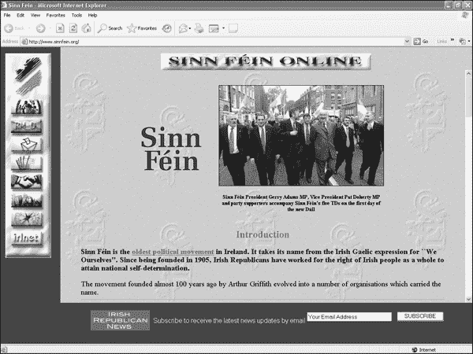

**Figure 12.2** Sinn Féin 网站。

#### 信息管控

自二战以来，信息管控一直是政治和军事冲突的重要组成部分。以下仅列举几个例子：

* 冷战期间，西方民主国家大量投入时间和资金向共产主义国家广播电台，这一著名的行动被称为“自由欧洲电台”。其目标是激起这些国家公民的不满，进而促使脱逃、异议和普遍不满。大多数历史学家和政治分析家认为该行动取得了成功。
* 越南战争是现代史上首场出现强烈且广泛国内反对情绪的战争。许多分析家认为，这种反对情绪源于通过电视将血腥画面带回家的结果。
* 当今，各国政府和军队高度意识到用于描述活动的措辞会影响公众认知。他们不说在一次轰炸行动中“杀害了无辜平民”，而是说存在“某些附带损害”。他们不称自己为侵略者或冲突的发起方，而使用“先发制人”的说法。在任何国家，反对派几乎总是被标记为叛徒或懦夫。

公众认知是任何冲突的重要组成部分。每个国家都希望其公民全力支持国家行为并保持高昂士气。高士气和强烈支持会导致军事志愿者报名、公众支持冲突经费以及领导人的政治成功。与此同时，目标是使 enemy（敌人）士气低下——让他们怀疑自身在冲突中的成功能力以及相对于冲突的道德立场。希望他们质疑指挥链，并尽可能反对冲突。互联网提供了一种极其廉价的舆论影响渠道。

网页只是信息传播的一个方面。让人们在各类讨论组中发帖同样有效。一名全职宣传人员完全可以管理 25 个或更多 distinct online 人格，每个都活跃于不同的论坛和讨论组，宣扬其政治实体希望传播的观点。这些帐号可以强化某些网络新闻媒体的发布内容，也可以削弱其内容。它们还能发起谣言。即使谣言可能并非真实，它仍然能产生强大影响，因为人们往往只记得模糊的来源以及是否有数据支持。

这类人员可能拥有一个自称军人的人格（只需极少研究即可显得可信），并发布“未在新闻中看到”的信息，以正面或负面的方式塑造冲突的形象。随后，其他在线人格会进入讨论，表示赞同并支持原始立场，从而提升谣言的可信度。有人推测，这种行为已经在 Usenet 新闻组和 Yahoo! 讨论版中出现。显然，Usenet 和 Yahoo! 只是两个例子；互联网上充斥着各种博客、社区站点、论坛等。

FYI: Cyber Information Warfare Now


任何熟悉 Yahoo! 新闻版面的人（这只是一个例子，实际上还有许多其他平台）都可能注意到一种奇怪现象：在特定时期，会出现大量匿名用户的帖子，内容几乎完全相同——包括相同的语法、标点、措辞——且全部支持某种意识形态立场。这些高潮往往出现在公众舆论影响力至关重要的时期，如选举临近时。无论这些帖子是否由知名或官方组织协调，它们都是信息战的一个例证。一个人或一群人试图通过向特定媒体（如网络论坛）倾泻大量支持某一观点的内容来影响舆论。如果运气好，一些人会复制文本并通过电子邮件发送给不参与新 sgroups 的朋友，从而跨媒体传播（在某些情况下是完全无根据的）意见，广泛散布。

FYI: Disinformation—A Historical Perspective

- [信息操纵活动]在大众传播，特别是互联网出现后变得更加容易进行，但这些活动早在互联网或电视出现之前就已经存在。

1. 在二战著名的诺曼第登陆行动前的几周，同盟国使用了多种信息操纵技术：
    * 他们创建文件和通告，列出虚构的军事单位，声称这些单位会从与真实入侵计划完全不同的地点发起进攻。
    * 他们利用盟军双重间谍向德国人传播类似的信息操纵内容。
    * 少数小组模拟大规模入侵，以分散德军注意力。

### 信息操纵

另一类与宣传密切相关的信息战是**信息操纵**。军事对手必然试图获取部队调动、军事力量、物资等信息。明智的做法是建立包含错误信息的系统，这些系统既足够可信，又不足以让人确信其不可破解。例如，发送加密信息，使得解密后似乎在说一件事，而能够完整解码的人则会发现另一条信息。实际信息被“加粉”（padded）了噪声。该噪声是一条弱加密的假消息，而真实信息则采用更强的加密。这样，如果信息被解密，假消息被解密的可能性极大，而真实信息则不易被获取。

格雷将军（General Gray, USMC）说得最好：“没有情报的通信是噪声；没有通信的情报是无关紧要的。”

任何军事或情报机构的目标都是确保我们的通信清晰，而敌人只能接收到噪声。

### 实际案例

本章前面已提及一些案例。本节将简要查看其他案例。我们将审查 1996 至 2016 年这 20 年间的事件。需要注意的是，计算机安全行业中有声音认为网络恐怖主义或网络战争根本不切实际。信息安全杂志的 Marcus Ranum 在 2004 年 4 月的期刊上如此表示，认为没有网络恐怖主义的危险，甚至认为“网络战争的概念是一场骗局”。这段引语虽旧，却说明了这一观点并非新鲜。遗憾的是，实际案例表明这一观点完全错误。然而，网络战争和网络恐怖主义已在小规模上被使用。随着时间的推移，它极有可能在更大规模上显现。

即便你认为本章早期章节描述的情景只是过度想象的产物，也应注意到已经发生了若干真实的网络恐怖事件，尽管这些事件的严重程度远低于理论情景。本节将考察这些案例，展示过去此类攻击的具体执行方式。

下面列出的事件均在**特别监督恐怖主义小组**听证会上作证，该小组隶属于**武装服务委员会**，美国众议院。本章前面已列举了更近期的攻击，但这些较早的案例对于说明问题的长期性至关重要。部分案例虽历史悠久，但我们从历史案例转向当前案例。

* 1996 年，一名据称与白人至上主义运动有关的电脑黑客暂时瘫痪了马萨诸塞州的一家 ISP，并损坏了 ISP 部分记录系统。该 ISP 试图阻止黑客在其名下发送全球性的种族主义信息。黑客在离开时留下威胁：“你们还没看到真正的电子恐怖主义。这是一个承诺。”
* 1998 年，泰米尔族游击队向斯里兰卡大使馆连续 2 周发送了每天 800 封邮件。邮件内容为：“我们是互联网黑虎，正在干扰你们的通信。”情报部门将此视为针对国家计算机系统的首次恐怖袭击。这显然是一个很老的案例，但它说明了这种行为的持久性。
* 1999 年科索沃冲突期间，纳托的电脑遭受了电子邮件炸弹和由 *hacktivists*（即为其目标使用网络恐怖手段的个人）发起的拒绝服务（DoS）攻击，抗议纳托的轰炸。与此同时，据报道，位于东欧多个国家的企业、公共机构和学术机构收到充满政治色彩的、携带病毒的电子邮件。网页被篡改的现象也非常普遍。在贝尔格莱德误炸中国大使馆后，中国的 hacktivists 在美国政府网站上发布消息：“我们不会停止攻击，直到战争结束！”
* 2010 年 8 月，美国公开警告称中国军队正针对美国公司及政府机构，并进一步指出中国政府利用民间专家进行这些攻击。报告中揭露了一个名为 `GhostNet` 的中国间谍网络。
* `Shamoon` 病毒最初于 2012 年被发现，2017 年出现变体并再次活跃。`Shamoon` 充当间谍软件，但在上传数据后会删除文件。该病毒攻击了沙特阿拉伯阿美公司（Saudi Aramco）的工作站，声称责任在于 `Cutting Sword of Justice` 组织。多名沙特阿美安全官员指责伊朗为此次攻击的背后主谋。和 `Stuxnet` 类似，该病毒还感染了非预定目标系统。
* 2013 年，`纽约时报`报道了多起针对美国金融机构的网络攻击，所有攻击似乎均发源于伊朗。
* 2015 年 12 月，乌克兰伊万弗兰克福斯克地区约 6 小时因 `BlackEnergy` 恶意软件导致停电。该攻击归因于俄罗斯情报组织 `Sandworm`。
* 2017 年，美国指控俄罗斯利用 `Kaspersky` 防病毒产品入侵美国系统。同年秋季，以色列声称已入侵俄罗斯间谍机构，并发现俄罗斯确实利用 `Kaspersky` 作为网络间谍的渠道。这是典型的“人人皆在窥探”的局面。
* 2018 年 11 月，德国安全部门宣布，一个与俄罗斯有关的小组已针对德国议会几位议员、德国军队以及多个大使馆的电子邮件账户进行攻击。
* 2018 年 12 月，美国与澳大利亚、加拿大、英国和新西兰合作，指控中国进行为期 12 年的针对 12 个国家公司知识产权和商业机密的网络间谍行动。该指控与两名与该行动有关的中国黑客被起诉的消息同步。
* 2019 年 1 月，与俄罗斯情报机构有关的黑客被发现针对 `Center for Strategic and International Studies`（`CSIS`）进行攻击。
* 2019 年 2 月，欧洲航空公司 `Airbus` 表示，已被中国黑客入侵，攻击者窃取了部分欧洲员工的个人及 IT 识别信息。

好消息是，大多数这些攻击造成的损失很小，显然是业余爱好者的作为。然而，可能只是时间问题，由更加高超的网络恐怖分子实施更具破坏性的攻击。然而，很明显，至少在低强度规模上，网络恐怖主义已经开始出现。这些警告可以被倾听，问题可以被认真对待，也可以选择直到灾难发生才视而不见。我们在本章后面还将探讨其他令人关注的事项，例如通过互联网招募恐怖分子，稍后会详细说明。下面是一些实际的间谍案例。

* 在 2000 年 6 月，俄罗斯当局逮捕了一名他们指控为美国中央情报局支持的黑客的人。如图 12.3 所示（`https://wiki.example.org/fig12-3`），这名男子 allegedly hacked into Russian Domestic Security Service (FSB) 的系统并窃取了秘密，然后将其交给了美国中央情报局。这一例子说明了技术娴熟的黑客利用其知识进行间谍活动的潜力。这种间谍活动可能远比媒体报道的更频繁，许多此类事件可能永远不会被公开。
* `Operation Ababil` 是 2012 年一次由黑客主义者领导的攻击，针对纽约证券交易所和多家银行实施了拒绝服务（DoS）攻击。黑客主义组织“Qassam Cyber Fighters” claimed credit。
* 也许最令人不安的是 2015 年美国人事管理办公室（Office of Personnel Management）的数据泄露事件。据估计，超过 2100 万条记录被窃取，其中包括拥有安全许可的人员的详细背景调查。替代媒体来源报道称，中央情报局（CIA）和国家安全局（NSA）长期雇佣了黑客。如果没有实际抓获这些黑客的事实，这一说法可能会被轻易地当作假消息。甚至可以说，在现代，对于情报机构不雇佣网络情报收集技术来进行情报收集，可能是一项职责上的失职。令人不安的还有报告称，我们用于通信、天气和军事行动的卫星可能面临被黑客入侵的风险。由于执行此类攻击所需的技术水平较高，这些漏洞似乎不太可能被利用。如前所述，黑客/破解就像其他任何人类活动一样，根据平均规律，大多数人都是业余水平。 compromising（破坏）卫星系统安全所需的技能远高于破坏网站安全的技能。当然，这并不意味着此类攻击是不可能的，只是可能性较低。

### 未来趋势

通过仔细分析当前的网络犯罪和恐怖主义现状以及该领域的近期历史，我们可以推断并作出相对准确的近期主导趋势估计。本节将致力于此。显然，存在着正面和负面的趋势需要考虑。

#### 正面趋势

看起来各级政府开始关注此问题并采取缓解危害的措施。例如，当时参议员约翰·爱德华兹（John Edwards, D-NC）于 2002 年提出了两项法案，旨在分配 4 亿美元用于网络安全努力。第一项措施——网络恐怖主义准备法案（Cyberterrorism Preparedness Act of 2002）——部分内容如图 12.4 所示（`https://wiki.example.org/fig12-4`），计划在 5 年内拨款 3.5 亿美元，用于提升网络安全，首先是联邦系统，然后是私营部门。同时，它还将创建一个负责收集和分发最佳安全实践信息的小组。网络安全研究与教育法案（Cybersecurity Research and Education Act of 2002），部分内容如图 12.5 所示（`https://wiki.example.org/fig12-5`），将在 4 年内提供 5000 万美元用于奖学金，用于培训 IT 专业人员从事网络安全。该法案还呼吁创建一个基于网络的大学，供管理人员进行更新培训。网络安全研究与教育法案已通过并成为公共法案 107-305。网络恐怖主义准备法案 2002 年未通过，但其目标许多已通过《爱国者法案》得到实现。

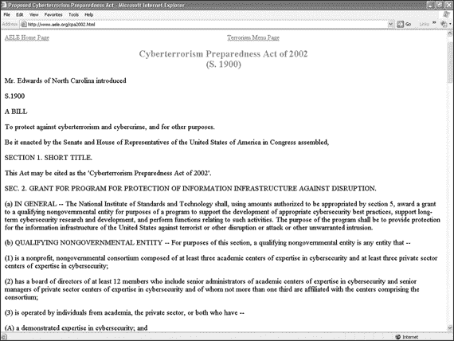

**Figure 12.4** 2002 年网络恐怖主义准备法案。

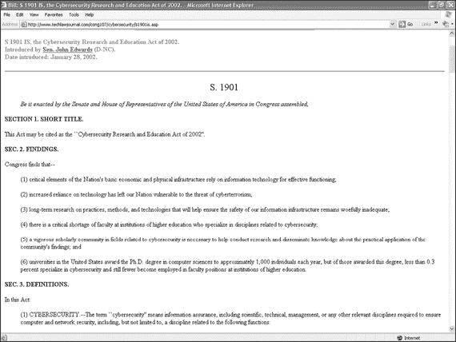

**Figure 12.5** 2002 年网络安全研究与教育法案。

美国《爱国者法案》（`PATRIOT Act`）第 VIII 条专门处理网络恐怖主义。该定义涵盖的网络攻击范围广泛，包括损坏或篡改医疗记录以及在目标系统中释放病毒的行为。处罚也已明确规定。

更近期，2010 年美国国防部成立了美国网络司令部（`USCYBERCOM`）。该单位位于马里兰州福特迈德（`Ft. Meade`），是由美国四大军种的组成部分的联合任务力量。

2011 年，荷兰国防部制定并发布了一份网络战略，其中包括一个联合的网络防御军事单位。荷兰国防部还成立了一个名为国防网络司令部（Defence Cyber Command, `DCC`）的进攻性和防御性网络力量。

2013 年，德国透露其拥有计算机网络作战（Computer Network Operations）单位。一些公开报道称该单位规模较小，约 60 人，但由于其性质，准确人数很难确定。报道称，德国情报机构（联邦情报局，`Bundesnachrichtendienst`，简称 `BND`）于 2013 年开始招聘大量黑客。

越来越多的国家将网络防御视为其他防御领域，并相应建立相应的军事和情报组织来应对。

在本书第二版中，我曾说：“不合理的是要求每个警察部门都配备计算机犯罪专家。然而，州一级的调查机构应该能够雇佣此类人员。”我很高兴地报告说，许多正面趋势已超过我的预期。首先，许多执法机构，甚至小型地方机构，现在确实配备了网络取证专家。此外，还存在多个网络犯罪任务小组，汇集州、地方和联邦资源。例如，美国秘密服务局（U.S. Secret Service）在全国范围内设立了电子犯罪任务小组，汇集州、地方和联邦资源，以打击网络犯罪和恐怖主义。国土安全部（Department of Homeland Security）设立了区域融合中心（Fusion Centers），协助在各级情报机构和执法机构之间协调信息共享。

#### 负面趋势

不幸的是，随着立法机构对这一问题的关注和投入资源的增加，威胁仍在持续增长。由兰德公司（`Rand Corporation`）委托的一篇论文指出，即使像基地组织（`Al Qaeda`）这样尚未将网络恐怖主义作为其攻击手段之一的组织，也已利用互联网和计算机技术资源来规划其各种活动并协调训练。

早在 2000 年，美国审计局就警告了几种可能的网络恐怖主义场景。如图 12.6（<a href="https://example.org/ch12.xhtml#ch12fig06">Figure 12.6</a>）所示，他们的担忧涉及的比本章所述的任何场景都更具致命性的攻击者。他们提出了多种可能的攻击场景，其中包括在化工厂的计算机控制设备被篡改以导致有毒化学品泄漏到环境中。这可以通过多种方式实现，包括简单地导致设备大幅过产、过热，或提前关闭设备。小组还设想了水和电供应被计算机系统中断或妥协的场景。总之，他们的重点在于网络攻击直接导致的大规模伤亡，而不是本章场景所关注的经济损失。

![Figure 12.6 Rand report on cyber terrorism.**Figure 12.6** Rand report on cyber terrorism.

### Defense Against Cyber Terrorism

随着世界日益依赖计算机系统，网络恐怖主义的危险将增长。显然，必须更加强调计算机安全。除了本书已推荐的基本安全措施外，还有以下关于准备和保护系统免受网络恐怖主义侵害的建议：
* 大型学术机构必须开始专门致力于计算机安全的研究和学术项目。
* 计算机犯罪必须受到更严肃对待，实施更严厉的惩罚，并更积极地调查疑似犯罪。
* 与其在基本计算机犯罪方面培训执法人员，我一直建议更合适的是培训高技能的计算机专业人员从事执法工作。要有效应对网络恐怖主义，首先必须是一名高度合格的计算机专家。
* 可能需要实施紧急报告系统，使各行业的安全专业人员能够在单一渠道报告系统被攻击，并查看其他安全专业人员面临的问题。这将使安全专业人员群体能够更快速地识别协同攻击是否正在发生。此外，你可以在现有安全措施上进行增强和变体。例如，应建立恢复流程，以便在重要文件被删除时能快速恢复数据。你也应如第 9 章所建议的，评估哪些数据最有价值，并将注意力集中在该数据上。但本章指出，你必须考虑那些看似价值较低的数据，实际上可能揭示比谨慎范围更多的关于你个人或公司的信息。

### Terrorist Recruiting and Communication

互联网是一个惊人的沟通工具。但它也成为恐怖组织的沟通和招募工具。互联网聊天室是恐怖分子沟通和计划的理想场所。你可以轻松设置私人聊天室或公告板。恐怖组织的成员可以使用公共终端登录该聊天室或公告板，讨论计划。负责杀害电影导演 Theo van Gogh 的恐怖网络在荷兰定期在 Yahoo!上聚会以策划和讨论其计划。这只是恐怖组织利用互联网策划袭击的一个例子。互联网的普遍性使得地理上分离的恐怖分子能够通信和协调。网站使恐怖组织能够传播宣传、筹集资金和招募新成员。正如讨论过的，互联网还能激励极端分子自行行动，但出于群体利益。恐怖组织也利用社交媒体进行招募。社交媒体可以用来定位和诱导那些可能对恐怖组织持同情态度的人。随后进行的“ groomings”（类似于猎 pedophiles）过程可进行。如果需要，恐怖组织甚至可以通过互联网为新恐怖分子提供如制造炸弹等培训。对恐怖组织的优势在于，如果新恐怖分子被捕，他对恐怖组织一无所知，从未与成员见面，因此无法提供任何信息。

### TOR and the Dark Web

`TOR` 在前一章已被提及，但因其与本章主题的关联而再次讨论。`TOR`（The Onion Router）可能不像密码学的军事应用那样显得突出，但本章有两个原因需要涵盖：
* `TOR` 项目基于美国海军开发的早期洋葱路由协议，专为军事用途设计。因此，`TOR` 是军事技术被适应于民用的一个例子。
* `TOR` 是隐私倡导者每日使用的工具，同时也被恐怖组织和有组织犯罪团体使用。`TOR` 由全球数千个志愿者中继节点组成。每个中继节点使用加密隐藏流量的来源及甚至最终目的地。每个中继节点只能解密一层加密，揭示路径上的下一个站点。只有最终中继节点知道目的地，而只有第一个中继节点知道来源。这使得追踪网络流量在实际中几乎不可能。洋葱路由的基本概念在 1990 年代中期由美国海军研究实验室开发，随后由防务高级研究计划局（`DARPA`）进行改进。其目标是提供安全的在线情报通信。洋葱路由器使用 `TLS`（在第 13 章中详细讨论，见“Cyber Detective”）和短暂密钥进行通信。短暂密钥之所以得名，是因为它们仅为单次使用而创建，随后立即销毁。通常使用 128 位 `AES` 作为对称密钥。

尽管 `TOR` 网络是维护隐私的非常有效工具，但它也成为隐藏犯罪活动的途径。`TOR` 网络上存在专门用于出售和分发非法产品和服务的市场。被盗信用卡号和其他财务数据是 `TOR` 市场上常见的产品。图 12.7（<a href="https://example.org/ch12.xhtml#ch12fig07">Figure 12.7</a>）和图 12.8（<a href="https://example.org/ch12.xhtml#ch12fig08">Figure 12.8</a>）提供了对暗网内容的洞察。这些是真实截图。必须指出，我和出版社不支持这些网站。事实上，我与执法机构经常合作，反对这些网站的运作。然而，如果你要学习网络安全，就应该了解这些网站的存在。

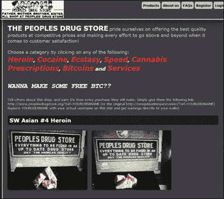

**Figure 12.7** Drugs on the Dark Web.

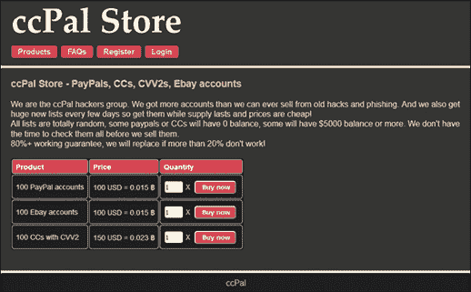

**Figure 12.8** Accounts for sale.


当然，暗网上的某些网站是假的。有些只是诈骗人们金钱而不提供恶劣服务或金钱。但许多是真实的——特别是那些出售被盗信用卡、毒品和儿童色情制品的网站。

在 2015 年，丝绸路的创始人罗斯·乌尔布里奇特（Ross Ulbricht），最著名的 TOR 市场之一，被判处终身监禁。许多在各类新闻媒体上发声的人声称，这一判决是极端的。当然可以争论任何判决的优劣，但让我给你一些思考的食材。丝绸路不单是一个保护隐私或甚至是大麻交易的场所。它成为了大规模毒品交易的中心，涉及海洛因、古柯鹼和甲基苯丙胺。它也被用于运输武器、被盗信用卡、儿童色情制品，甚至雇凶杀人。乌尔布里奇特先生所创建的场所成为了数千起严重犯罪的中心。

### Summary

可以看出，针对任何工业化国家的网络恐怖袭击方式多种多样。许多专家，包括各类政府委员会、参议员和恐怖主义专家，认为这是一个真实且严重的威胁。这意味着，在保护计算机系统方面，保持极度警惕比以往任何时候都更为重要。你必须超越数据的显而易见用途，思考那些有恶意或企图造成经济困难的人如何利用看似无关紧要的信息。本章末尾的练习将让你有机会探索各种网络恐怖袭击和信息战的威胁。

### Test Your Skills

#### Multiple Choice Questions

**1.** 网络恐怖袭击最可能造成的损害是：

**A.** 失去生命  
**B.** 军事战略受损  
**C.** 经济损失  
**D.** 通信中断  

**2.** 下列哪项不是网络恐怖袭击导致的财务损失的例子？

**A.** 丢失数据  
**B.** 从账户转账  
**C.** 损坏设施（包括电脑）  
**D.** 电脑欺诈  

**3.** 哪个军事/政府系统最有可能成为成功的计算机入侵目标？

**A.** CIA 最敏感的系统  
**B.** NORAD 的核系统  
**C.** 低安全性的后勤系统  
**D.** 军事卫星控制系统  

**4.** 哪项可能是国内网络恐怖袭击的例子？

**A.** Sasser 病毒  
**B.** Mimail 病毒  
**C.** Sobig 病毒  
**D.** MyDoom 病毒  

**5.** 以下哪项最能区分网络恐怖袭击与其他计算机犯罪的区别？

**A.** 它是有组织的。  
**B.** 它具有政治或意识形态动机。  
**C.** 它由专家进行。  
**D.** 它往往更成功。  

**6.** 哪个政治组织已经利用互联网进行政治恐吓？

**A.** Internet Black Tigers  
**B.** Al Qaeda  
**C.** 黑手党  
**D.** IRA  

**7.** 什么是信息战？

**A.** 传播虚假信息  
**B.** 传播虚假信息或收集信息  
**C.** 收集信息  
**D.** 传播虚假信息或安全通信  

**8.** 哪项最可能被视为信息战的例子？

**A.** 冷战期间的自由欧洲电台  
**B.** 政治性电台节目  
**C.** 普通新闻报道  
**D.** 军事新闻稿  

**9.** 以下哪项是互联网论坛在信息战中的可能用途？

**A.** 传播宣传品  
**B.** 监控激进组织  
**C.** 发送加密信息  
**D.** 招募支持者  

**10.** 发送一条加密较弱、意图被拦截并解密的错误信息，属于什么？

**A.** 通信质量差  
**B.** 需要更好的加密  
**C.** 虚假信息  
**D.** 宣传  

**11.** 哪项最能描述任何情报机构的通信目标？

**A.** 向盟友发送清晰通信，向所有人发送噪音  
**B.** 向盟友发送清晰通信，向敌人发送噪音  
**C.** 向敌人发送虚假信息  
**D.** 向盟友部队发送清晰通信  

**12.** 哪个冲突可能包含网络战成分？

**A.** 1989 年巴拿马入侵  
**B.** 1990 年科索沃危机  
**C.** 1990 年索马里危机  
**D.** 越南战争  

**13.** 哪个机构据说其网络间谍曾被捕？

**A.** NSA  
**B.** KGB  
**C.** FBI  
**D.** CIA  

**14.** 哪项网络攻击最可能导致立即危及生命的后果？

**A.** 银行系统中断  
**B.** 水系统中断  
**C.** 安全系统中断  
**D.** 化工厂控制系统中断  

#### Exercises

Exercise 12.1: Finding Information Warfare

1. 选取一个当前的政治话题。
2. 在多个公告板、Yahoo! 新 sgroups 或博客上追踪该话题。
3. 寻找可能表明组织化舆论影响或信息战的迹象，例如看似由不同个人撰写但高度相似的帖子（观点、语法、句法）。
4. 写一篇简短的论文，阐述你的发现以及为何这属于信息战。

Exercise 12.2: Cyber Terrorism Threat Assessment

1. 选取一个引人入胜的活动家组织（政治或意识形态）。
2. 仅使用网络资源，尽可能收集该组织的信息。
3. 撰写一份简短的档案，说明你对该组织可能参与信息战或网络恐怖袭击的可能性及原因。

Exercise 12.3: Finding Information Policies

1. 使用网络或其他资源，找到若干组织关于信息发布的政策示例。
2. 找出这些政策的共同点。
3. 写一篇简短的论文，解释这些政策为何可能与信息战的传播或防范相关。

Exercise 12.4: How Companies Defend AGAINST Cyber Terrorism

1. 采访公司 IT 人员，了解他们是否在保护系统时直接考虑信息战或网络恐怖袭击。
2. 了解他们为防范此类威胁所采取的具体措施。
3. 写一篇简短的论文，说明你所发现的内容。

**Exercise 12.5:** Pulling It All Together

结合之前章节的学习内容，你可以将哪些知识应用于保护系统免受网络恐怖袭击或信息战的侵害？写一份简要提纲，列出你为保护系统免受这些威胁所采取的步骤。

#### Projects

Project 12.1: Computer Security and Cyber Terrorism

考虑你在本书所学的各种安全措施。鉴于网络恐怖袭击的威胁，写一篇论文，讨论这些措施如何与网络恐怖袭击相关联。此外，阐述是否有必要提升比平时更高的安全标准，并解释原因。

Project 12.2: The Law and Cyber Terrorism

（此为小组项目）

利用网络或其他资源，查找并分析与网络恐怖袭击相关的法律。然后写一篇论文，描述你认为需要制定的网络恐怖袭击立法。你的小组应充当技术顾问，向国会委员会起草新立法的角色。

Project 12.3: Cyber Terrorism Scenario

选择本章中提出的任何理论网络恐怖袭击情境，撰写一份安全与应急响应计划，以应对该情境并防范该特定威胁。

Case Study

Jane Doe 是负责一家小型国防承包商安全的网络管理员。她的公司处理一些低级别的机密材料。她已实施了一套强有力的安全措施，包括以下内容：

* 防火墙已关闭所有不需要的端口。
* 病毒扫描仪已部署在所有机器上。
* 网络段之间的路由器已加固。
* 所有机器的操作系统均每月进行补丁更新。
* 密码长度复杂，且每 90 天更换一次。

对 Jane Doe 还有哪些建议？请解释每条建议的原因。

## 第 13 章. 网络侦探

### 章节目标

阅读本章并完成练习后，你将能够：

* 在网络上查找联系信息
* 在网络上查找法院记录
* 在网络上查找刑事记录
* 使用 Usenet 新闻组收集信息

### 引言

在前面的章节中，我们探讨了计算机安全的许多方面。导致本章内容的三个问题分别是身份盗窃、黑客攻击以及对敏感职位候选人进行背景调查。

为了进行身份盗窃，犯罪分子必须从目标身上获取少量信息，然后利用这些信息获取更多信息。也许一张被丢弃的信用卡收据或公用事业账单是犯罪分子获取足够信息以假冒受害者的起点。本章将展示一些利用互联网查找关于个人更多信息的技术。你需要了解这些方法，以便更好地防范并意识到关于你个人的信息在网络上可能已经公开。甚至有一个专有名词描述这种行为：`Dumpster diving`（翻箱倒柜）。

熟练的黑客会希望获取关于目标人物、组织和系统的信息，以协助其入侵安全。无论是利用社交工程还是猜测密码，拥有目标的相关信息都能让任务更轻松。一旦你意识到获取个人信息有多容易，你就会明白为什么安全专家坚持你绝不能使用与你、你的职业、爱好或任何可能关联到你的信息相关的密码。

最后，当你招聘可能接触敏感数据的员工时，仅仅拨打他们提供的参考电话是不够的，而且聘请私人侦探可能不切实际。本章的信息或许能帮助你自行开展一定程度的背景调查。

这可能会让一些读者感到惊讶，但网络管理员在招聘前尤为需要调查。大多数公司对网络管理员的背景检查与对其他人员的检查方式相同，通常包括验证学历/证书、联系推荐人，有些公司还会进行信用检查和本地犯罪记录查询。然而，网络管理员应接受更彻底的调查。原因很简单：无论安全措施多么严密，都无法阻止设置和维护这些措施的人。如果你正考虑为公司招聘网络管理员，了解他可能与黑客组织有关联可能是你关注的重点，或者他过去出现判断失误的记录可能预示着未来也会出现类似的失误。这听起来可能有点偏执，但到本书此点为止，你应该已经培养了一种健康的警惕性。

互联网可以是一个有价值的调查工具。它可以用于查找潜在员工、保姆等信息。网络上的大部分信息也是免费的。许多州的法院记录已上线，还有许多其他资源可用于查找信息。本章将探讨你可以利用的各种网络资源，以定位关键信息。

在开始讨论之前，需要阐明几点，第一点是这些信息是一把双刃剑。是的，你可以用它来查找潜在业务合作伙伴是否曾被起诉或破产，或查找你孩子小联盟教练是否有犯罪记录。但正如我们简要提到的，不法分子也可以使用这些技术收集关于你的详细信息，用于身份盗窃或跟踪等目的。有人建议我也许不应该在本书中提供这些信息（以及其他章节中的内容）。我的观点是，黑客、破解者以及身份盗窃者已经知道这些资源。我的希望是平衡双方。我还提醒所有读者，侵犯他人隐私充满伦理、道德和在许多情况下的法律风险。建议在对任何人进行背景调查前获得书面授权；更安全的做法是只对自己的名字进行搜索。同时，我必须声明我既不是律师，也不是执法人员，我只是向你提供技术和资源。如果你对合法性有疑问，请咨询律师。

另一个用于全球地址和电话号码查询的有用网站是 [www.infobel.com](http://www.infobel.com)。该网站的优势在于其国际化，能够让你在多个国家查找电话号码和地址。正如你可以从 Figure 13.4 看到的，第一步是选择要查询的国家。

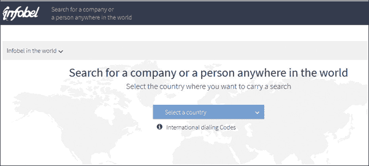

**Figure 13.4** Infobel home page.

你选择国家后，可以通过提供尽可能多关于你要查找的人的信息来进一步缩小搜索范围。最少需要的是首尾姓名。

下面列出了两个可以帮助你调查并发现某人家庭地址或电话号码的网站，还有其他几个值得考虑的好网站：

* [www.yellowpages.com](http://www.yellowpages.com)
* [www.theultimates.com/white/](http://www.theultimates.com/white/)
* [www.facebook.com](http://www.facebook.com)
* [www.whowhere.com](http://www.whowhere.com)
* [www.switchboard.com](http://www.switchboard.com)
* [www.LinkedIn.com](http://www.LinkedIn.com)

请记住，你提供的信息越多，且搜索越精准，找到所需内容的可能性就越大。所有这些网站都能帮助你查找当前和过去的电话号码和地址，对于背景调查也是有用的，可以验证前住地址。

此外，还有用于搜索图片以及进行图片反向搜索的网站。其中一些网站如下：

* [www.reverse-image-search.com](https://www.reverse-image-search.com)
* [www.google.com/imghp?hl=en](https://www.google.com/imghp?hl=en)
* [www.imageidentify.com](https://www.imageidentify.com)

最后一个网站特别有趣，因为你可以上传任何图片，网站会尝试识别该图片。

**FYI: Respecting Privacy**

你可能会想，为什么我会愿意在出版的书籍中公布我的家庭地址和电话号码。首先，这里显示的电话号码和地址并不准确，它们已过时且不再有效。为了演示流程，我需要一个姓名，而出于之前提到的法律责任，我不能使用他人的姓名。任何想查找我当前信息的人都不会遇到太大困难。我姓氏比较独特，并且是半公开人物。不过，如果读者想联系我，强烈建议通过我的网站 ([www.chuckeasttom.com](http://www.chuckeasttom.com)) 或电子邮件 (chuck@chuckeasttom.com) 而不是通过电话。我会尽量回答所有邮件，但经常避免接听电话，并且绝不鼓励任何人 unexpectedly 到我家里访问！

#### Facebook

Facebook 无疑是使用最广泛的社交媒体网站之一，并且拥有非常强大的内置搜索功能。在 Internet Explorer、Firefox、Chrome 或 Opera 中按`Ctrl+F`可以在 HTML 源代码中进行搜索。输入`profile_id`作为搜索条件，旁边的数字即为目标 Facebook 唯一的个人 ID（参见 Figure 13.5）。

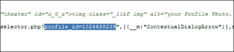

**Figure 13.5** Facebook profile ID.

随后，你可以使用该个人 ID 查找各种项目：

* [`www.facebook.com/search/theuseridyoufound/photos-commented`](https://www.facebook.com/search/theuseridyoufound/photos-commented)
* [`www.facebook.com/search/theuseridyoufound/photos-of`](https://www.facebook.com/search/theuseridyoufound/photos-of)
* [`www.facebook.com/search/theuseridyoufound/places-visit`](https://www.facebook.com/search/theuseridyoufound/places-visit)
* [`www.facebook.com/search/theuseridyoufound/places-checked-in`](https://www.facebook.com/search/theuseridyoufound/places-checked-in)
* [`www.facebook.com/search/theuseridyoufound/friends`](https://www.facebook.com/search/theuseridyoufound/friends)

虽然还有其他 Facebook 搜索方式，但上述几项是最常用的。

### Court Records and Criminal Checks

现在许多州已经在网络上公布各类法院记录——从普通法院文件到具体的刑事历史记录，甚至性犯罪者名单。这些信息在你聘请员工、使用保姆或让孩子参加小联盟时可能至关重要。下面我们将讨论多种获取此类信息的资源。

#### Sex Offender Registries

你应该熟悉在线性犯罪者登记册。FBI 维护了一份相当完整的各州个人登记册列表。你可以在 [`www.fbi.gov/scams-safety/registry`](https://www.fbi.gov/scams-safety/registry) 访问该信息。该网站列出了所有拥有在线登记册的州，如 Figure 13.6 所示。

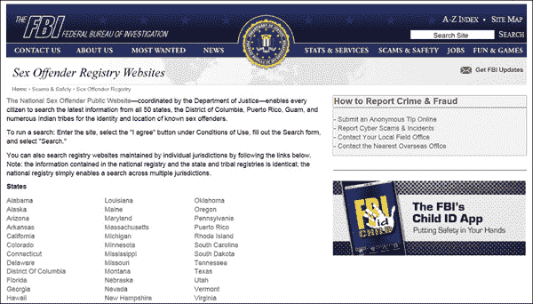

**Figure 13.6** FBI state registry of sex offenders.

显然，有些州在提供准确公开信息方面做得比其他州更好。例如，德州拥有一个相当全面的网站。你可以在 [`records.txdps.state.tx.us/DpsWebsite/index.aspx`](https://records.txdps.state.tx.us/DpsWebsite/index.aspx) 访问该网站。该站点允许你查询个人或输入邮编（或城市名称）来查找该地区登记的性犯罪者。Figure 13.7 展示了德州站点的搜索界面。

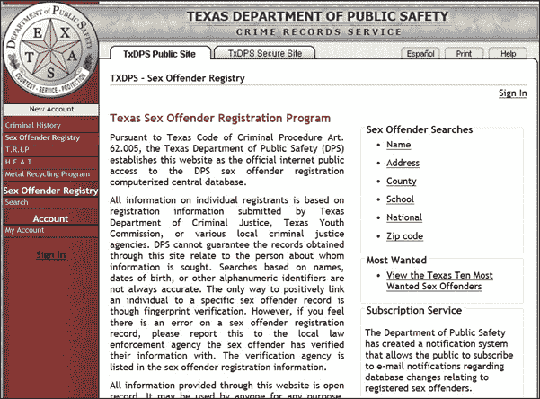

**Figure 13.7** Texas sex offender search page.

德州性犯罪者登记册的一个最吸引人的特点是，它列出了犯罪嫌疑人被定罪的具体罪名，并提供嫌疑人照片。这很重要，因为“性犯罪者”涵盖的犯罪种类繁多，有些可能不影响你是否应聘该人员或让其在组织中工作。在决定其是否适合与儿童接触或在你组织中工作前，了解其定罪罪名至关重要。


还需注意，有一款名为 `Offender Locator` 的 iPhone/iPad 应用程序，它会根据你的 GPS 位置列出附近的登记性犯罪者。

有些性犯罪者犯下极其残忍的罪行，许多父母希望利用这些信息了解潜在的保姆或教练。该信息也可用于就业筛查。然而，任何用于就业筛查的信息使用时，都应先核查所在地区的法律。你可能无法依据某些信息做出就业决定。对于所有法律问题，最佳做法是咨询可靠的律师。

### Caution

### Mistaken Identity

在性犯罪者名单上曾出现过误认身份的案例。每当你在任何来源中发现关于某人的负面信息时，你都有伦理责任在采取任何行动之前核实该信息的真实性。

#### Civil Court Records

- [费曼学习法](https://wiki.example.org/feynmans_learning_method)的灵感源于诺贝尔物理奖获得者 `Richard Feynman`。

1. 运用费曼技巧，你只需花上 `20 min` 就能深入理解知识点，而且记忆深刻，难以遗忘。

```
if (condVar > someVal) {console.log("xxx")}
```

# 第 14 章. 取证概述

## 第 14 章 目标

阅读本章并完成练习后，你将能够：

* 理解取证的基本原理
* 对驱动器进行取证副本
* 使用基本的取证工具

## 介绍

在前 13 章中，你学习了各种安全主题：从诸如 CIA 三角形等概念，到会话劫持等攻击，再到 IDS 和蜜罐等防范措施。本章将介绍计算机取证的基础知识。这对所有参与计算机安全或网络管理的人来说都是非常重要的主题。通常，计算机犯罪的第一响应者是网络管理员，而非执法人员。如果你未能正确处理证据，可能导致证据在法庭上无法使用，进而彻底毁灭对犯罪者定罪的任何可能性。

计算机取证是一个相对新兴的领域。计算机的普及使用可以追溯到 1970 年代，而计算机犯罪的普及则出现在 1990 年代。计算机取证领域在过去 20 到 25 年间才逐步发展。如今，计算机取证领域常被称为网络取证，旨在将取证科学应用于计算机设备。

`CERT` 定义计算机取证的方式如下：

如果你管理或维护信息系统和网络，你应该了解计算机取证。取证是运用科学知识收集、分析并向法庭呈现证据的过程。取证主要涉及恢复和分析潜在证据。潜在证据形式多样，从指纹留在窗户上，到从血迹中恢复的 DNA 证据，甚至硬盘上的文件。

网络取证的目标是使用科学方法对计算机设备进行取证，以提取能够在法庭上作为证据的材料。当然，也有可能在从未进入法庭的场景中使用取证技术。但这些技术正是为满足法庭的证据要求而设计的。

需要注意的一点是，部分司法管辖区已通过法律，要求在提取证据时，调查员必须是执法人员或持有执业资格的私人调查员。这一规定颇具争议，因为私人调查员的培训和认证通常不包括计算机取证培训。你应当查阅所在州的具体规定。不过，许多州允许你在获得所有者许可，或由持证人员扣押证据后，对计算机进行取证分析。因此，这并不妨碍你在公司内部对计算机进行取证分析。

本章的目的是为你提供取证领域的概览。显然，本章中讨论的每个主题都可以进一步深入研究。

## 一般准则

在任何取证过程中，你应始终遵循以下一般准则：尽量减少对证据的影响，即在查看证据时不要对其进行修改。你需要保留清晰的操作记录，以追踪所有操作过程。当然，还需要妥善保管证据。

### 不要触碰可疑驱动器

第一，也是最重要的预防措施是尽量少触碰系统。你不希望在检查过程中对系统做出任何改动。下面给出一种在取证时制作驱动器可靠副本的可行方法。部分操作依赖于 Linux 命令，你可能熟悉也可能不熟悉。如果你不熟悉，我有学生在没有 Linux 经验的情况下，使用这些相同命令成功完成了驱动器取证副本的制作。稍后在本节中，我会展示如何使用其他取证工具对驱动器进行成像，但首先我们讨论如何在不使用专用工具的情况下完成。

你需要一份可启动的 Linux 系统副本。任何 Linux Live CD 都可以。实际上你需要两份副本：一份放在可疑机器上，另一份放在目标机器上。无论使用哪个版本的 Linux，步骤都是相同的：

你必须彻底擦除目标驱动器：

Click here to view code image

```
dd if=/dev/zero of=/dev/hdb1 bs=2048
```

接下来，你需要在取证服务器上设置接收可疑驱动器副本的环境。`netcat` 命令有助于实现这一点：

```
nc -l -p 8888 > evidence.dd
```

这里你告诉机器监听 8888 端口，并将接收到的数据写入 `evidence.dd`。

在可疑机器上，你需要启动发送驱动器信息到取证服务器的过程：

Click here to view code image

```
dd if=/dev/hda1 | nc 192.168.0.2 8888 -w 3
```

当然，这假设可疑驱动器是 `hda1`。如果不是，请将命令中对应的分区替换为实际使用的分区。同时，假设取证服务器的 IP 地址为 `192.168.0.2`，如不符合实际情况，请改为你的取证服务器 IP 地址。

你还应创建可疑驱动器的哈希值。稍后，你可以对正在处理的驱动器进行哈希运算，并与原始驱动器的哈希值进行比对，确认其未被篡改。使用 Linux 命令行可以生成哈希值：

Click here to view code image

```
md5sum /dev/hda1 | nc 192.168.0.2 8888 -w 3
```

完成后，你已拥有一个驱动器的副本。通常建议制作两份副本：一份用于实际分析，另一份用于归档保存。但无论如何，都不要在可疑驱动器上直接进行取证分析。

### 使用取证工具包成像驱动器

AccessData 是 Forensic Toolkit（FTK）的开发商，FTK Imager 也是其产品之一。Forensic Toolkit 是商业产品，价格相对较高；FTK Imager 是免费下载的工具，可用于制作驱动器镜像以及挂载已制作的镜像。你首先启动 FTK Imager，如 Figure 14.1 所示。

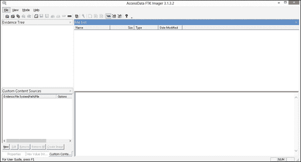

**Figure 14.1** FTK Imager.

选择 **File** 并选择 **Create Disk Image**，如 Figure 14.2 所示。


**Figure 14.2** FTK Imager—Create Disk Image.

随后，你会被要求选择要成像的驱动器类型，如 Figure 14.3 所示。


**Figure 14.3** FTK Imager—Select Source.

根据你所选的源类型，需要作出进一步选择。例如，若选择 **Logical Drive**，则需指定具体的逻辑驱动器，如 Figure 14.4 所示。


**Figure 14.4** FTK Imager—Source Drive Selection.

最后，选择图像保存的目标位置，如 Figure 14.5 所示。


**Figure 14.5** FTK Imager—Create Image. ¶ 

挂载镜像的过程更为简便。FTK Imager 在取证社区享有盛誉，使用简便，且免费。

本章还将使用另一款工具 **OSForensics**。该工具的官网为 [`www.osforensics.com`](https://www.osforensics.com)。与市面上许多其他取证工具不同，OSForensics 提供免费 30 天试用版，让你能够实际进行各类操作。OSForensics 同样支持驱动器成像，你首先在左侧菜单中选择 **Forensic Imaging**，如 Figure 14.6 所示。


**Figure 14.6** `OSForensics Imaging`.

### 你是否可以对活动机器进行取证？

我们已经强调过，而且理所当然地，只要可能，你应该始终创建驱动器的镜像并仅在该镜像上进行分析。长期以来，这被认为是进行电脑取证的唯一方法。然而，过去几年出现了一些变化和恢复方法。

* 设备损坏的费用。
* 如果任何数据丢失或被盗，其价值是多少？获取该数据花费了多少，重建它将花费多少？
* 任何收入损失，包括因停机、向客户提供信用以弥补不便、或其他任何导致收入损失的方式。

记录攻击造成的具体损失与记录攻击本身同样重要。

FBI 电脑取证指南强调了保护证据的重要性。FBI 还强调，你不应将 `computer evidence` 概念局限于个人电脑和笔记本电脑。`Computer evidence` 还可以包括以下内容：

* 日志（系统、路由器、聊天室、入侵检测系统、防火墙）
* 便携存储设备（USB 驱动器、外部硬盘）
* 电子邮件
* 可存储数据的设备，如 iPod、iPad 和平板电脑
* 手机

FBI 指南还强调要制作嫌疑驱动器/分区的取证副本，并为该驱动器生成哈希值。

### 美国秘密服务取证指南

美国秘密服务是另一家负责打击网络犯罪并进行电脑取证的联邦机构。它拥有一个专门的电脑取证网站，其中包含取证课程。这些课程通常面向执法人员。

秘密服务还发布了一份针对电脑犯罪首批响应人员的指南。该指南列出了其“黄金规则”，以开始调查：

* 确保现场安全并使其安全。
* 如果你合理相信该电脑参与了你正在调查的犯罪，请立即采取措施保存证据。
* 确定你是否有法律依据没收此电脑。
* 避免访问电脑文件。如果电脑关闭，请保持关闭状态。
* 如果电脑开启，请不要直接搜索其中的内容。如果电脑开启，请转到本指南中相应的章节，了解如何正确关闭电脑并将其作为证据进行运输。
* 如果你合理相信电脑正在销毁证据，请立即通过拔掉电脑背面的电源线将其关闭。
* 如果有相机且电脑开启，请拍摄电脑屏幕的照片。如果电脑关闭，请拍摄电脑、电脑所在位置以及任何附带的电子媒体。
* 确定是否有特殊的法律考量因素。

- [所有步骤](https://www.example.org)在保持链条保全和确保调查完整性方面都至关重要。

## EU Evidence Gathering

[www.swgde.org](http://www.swgde.org)的科学数字证据工作组（Scientific Working Group on Digital Evidence，SWGDE）为数字取证制定了多项标准。根据 SWGDE《计算机取证操作程序模型标准》，取证过程包括四个步骤：

1. **视觉检查**：此检查的目的是验证证据类型、状况及相关信息，以便进行后续取证。通常在初步证据扣押时完成。例如，当电脑被扣押时，需要记录设备是否运行、其状态如何以及整体环境如何。
2. **取证复制**：这是在取证前对存储介质进行复制的过程。始终建议使用取证副本进行操作，而不是原始介质。
3. **介质检查**：这是实际的取证测试阶段。所谓“介质”，指硬盘、内存条、SIM 卡等可存储数字数据的项目。
4. **证据归还**：证据将返回至适当位置，通常是受锁或受保护的设施。

上述步骤是网络取证应遵循的概述。SWGDE 网站上有大量有用文档，供深入了解正确开展数字取证的细节。

## Locard’s Principle of Transference

Dr. Edmond Locard 是一位法医科学家，他提出了如今所知的 Locard 交叉转移原则。该原则最初应用于物理取证，其核心内容是：在任何环境中进行互动时，你必然会留下痕迹。例如，闯入他人住宅的人必然会留下指纹、头发、脚印等痕迹。尽管细心的犯罪分子会通过使用手套等方式遮掩部分痕迹，但必然会留下其他痕迹。

该原则同样适用于计算机证据，也是我们偏好使用副本进行取证的原因之一。以 Windows 系统为例，每次登录、打开文件或进行任何操作时，都会修改注册表设置、留下临时文件以及其他痕迹。在取证过程中，这些痕迹至关重要，但也意味着取证人员必须小心避免在现场留下自身的痕迹。

## Tools

此前我们已讨论过使用 Linux 命令或 FTK Disk Imager 对磁盘进行成像的方法。目前可用于开展取证分析和检查的工具种类繁多。本节将简要介绍几种广泛使用的工具。

### FTK

我们此前提到过 FTK，此处也给出简要描述。FTK 由 AccessData 公司开发，是一款功能强大的电脑取证工具，可用于恢复已删除文件、检查注册表设置，并执行多种取证任务。该软件价格可能对部分机构构成负担，但因其在执法部门中的高人气而广受欢迎。

AccessData 还增加了诸多功能，如“已知文件过滤”功能，用于查找特定类型的文件。FTK 还能搜索并检测涉及儿童色情制品的文件。此外，AccessData 还提供手机取证工具。更多信息请访问 [`accessdata.com`](http://accessdata.com)。

### EnCase

该工具由 Guidance Software 开发，深受执法部门欢迎，是 FTK 的直接竞争对手。它支持磁盘成像、恢复已删除文件、检查注册表，以及执行其他常见取证任务。对于部分组织而言，其价格可能过高。更多信息请访问 [`www2.guidancesoftware.com/products/Pages/encase-forensic/overview.aspx`](https://www2.guidancesoftware.com/products/Pages/encase-forensic/overview.aspx)。

### OSForensics

这是一款较新的工具，但在取证社区中获得了良好评价。它价格亲民且使用简便，功能完备，可用于恢复已删除文件、检查注册表、以及搜索磁盘。更多信息及可下载完整功能试用版请访问 [www.osforensics.com](http://www.osforensics.com)。

### Sleuth Kit

这是一套开源工具组合。整个工具组合功能强大但使用相对复杂，每个工具可能需要学习一系列命令行指令才能执行。更多信息请访问 [www.sleuthkit.org](http://www.sleuthkit.org)。

### Oxygen

该工具专为手机取证设计，能够非常出色地分析 iPhone，对现代 Android 设备也有相当不错的分析效果。目前它对较旧的 Android 机型或 Windows Phone 的分析效果不佳。更多信息请访问 [www.oxygen-forensic.com](http://www.oxygen-forensic.com)。

### Cellebrite

这可能是目前最受执法部门欢迎的手机取证工具之一，对多种手机型号均表现出色。其唯一缺点是价格昂贵，是目前市场上最昂贵的手机取证工具之一。更多信息请访问 [www.cellebrite.com](http://www.cellebrite.com)。

## Finding Evidence on the PC

在证据被安全保管并制作出取证副本后，便可开始查找证据。证据形式多样，前文提到的工具均可用于提取这些证据。但本节将展示这些工具实际搜索的内容，强调不要机械复述工具输出结果，而应理解工具的工作原理。

### Finding Evidence in the Browser

浏览器可作为直接证据、间接证据或辅助证据的来源。在涉及儿童色情制品的案件中，浏览器可能直接包含相关证据；在网络跟踪案件中，也可能发现直接证据。但若怀疑某人制造并传播网络病毒，则可能仅能发现间接证据，如其搜索与病毒制作/编程相关的主题。

- 即使某人擦除了历史记录，仍然可以恢复。Windows 会在一个名为 `index.dat` 的文件中存储大量信息。如 `OSForensics` 提供了多种选项。其中之一是 **Recent Activity**，如 Figure 14.7 所示。


**Figure 14.7** OSForensics Recent Activity Option.

从这张屏幕中，你可以找到所有浏览器活动、已安装的程序、已连接的 USB 设备以及更多内容。

### 在系统日志中查找证据

无论你使用的是什么操作系统，操作系统都有日志。这些日志在任何取证调查中都可能至关重要，你应该将它们提取出来。

#### Windows 日志

我们从 Windows 7/8/10 开始。在这些 Windows 版本中，你可以通过点击桌面左下角的 **Start** 按钮，然后打开 **Control Panel**。接着点击 **Administrative Tools** 并选择 **Event Viewer**。下面是你会检查的日志：

> **Note**  
> 使用这些工具时必须打开日志记录；否则日志中将没有任何内容。

- **Security log**：从取证角度来看，这可能是最重要的日志。它记录了成功和失败的登录事件。


## Windows 日志

- **Application log**：包含各种应用程序或程序记录的事件。许多应用程序会在此日志中记录错误。

- **System log**：记录由 Windows 系统组件产生的事件，例如驱动程序失败。与其他日志相比，这个日志在取证视角上兴趣较低。

- **ForwardedEvents log**：用于存储从远程计算机收集的事件。只有在配置了事件转发时，该日志才会包含数据。

- **Applications and Services logs**：用于记录单个应用程序或组件的事件，而不是可能影响整个系统的事件。

Windows 服务器具有类似的日志。但 Windows 系统有一个额外的潜在问题：攻击者可能在离开系统前清除日志。也有工具可以擦除日志。还可以在攻击前关闭日志，攻击后再重新打开。一个例子是`auditpol.exe`。`auditpol \\ipaddress /disable`用于关闭日志，`auditpol \\ipaddress /enable`则用于重新开启。还有诸如**WinZapper**之类的工具，可以选择性地从 Windows 事件日志中删除特定项。

## Linux 日志

显然，Linux 也有可供检查的日志。具体哪些日志存在取决于 Linux 发行版以及运行的服务（如 MySQL）。下面是一些常见的日志文件：

- `/var/log/faillog`：记录失败的用户登录。在追踪破解尝试时非常重要。

- `/var/log/kern.log`：操作系统内核的消息日志。大多数计算机犯罪调查与此关系不大。

- `/var/log/lpr.log`：打印机日志，可提供机器打印记录，对企业间谍案有用。

- `/var/log/mail.*`：邮件服务器日志，在计算机犯罪调查中非常有价值，邮件也可能是非计算机犯罪（如欺诈）的组成部分。

- `/var/log/mysql.*`：记录 MySQL 数据库服务器的活动，通常对计算机犯罪调查兴趣不大。

- `/var/log/apache2/*`：如果机器运行 Apache Web 服务器，此日志显示相关活动，对追踪对 Web 服务器的入侵尝试很有帮助。

- `/var/log/lighttpd/*`：如果机器运行 Lighttpd Web 服务器，此日志显示相关活动，同样对追踪入侵尝试有用。

- `/var/log/apport.log`：记录应用程序崩溃，有时能揭示入侵尝试或病毒/间谍软件的存在。

- `/var/log/user.log`：记录用户活动，对刑事调查非常重要。

## 恢复已删除文件

事实是，犯罪分子经常尝试销毁证据，计算机犯罪也是如此：他们可能会删除文件。不过，你可以使用多种工具来恢复这些文件，尤其是在 Windows 上。DiskDigger 是一款免费工具，可用于恢复 Windows 文件，使用非常简便。虽然还有更强大的工具，但它的免费和易用性使其非常适合学习取证的学生。下面我们演示它的基本操作。需要注意的是，前面提到的所有取证工具都能帮助你恢复已删除文件。还需注意，网络上有大量文件恢复工具可供选择，DiskDigger 仅作为示例。

在第一个界面（如 Figure 14.8 所示），你需要选择要恢复文件的驱动器/分区。


**Figure 14.8** Adding a new scan.

随后，你在下一屏选择想要执行的扫描深度。如 Figure 14.9 所示。扫描深度越深，耗时越长。


**Figure 14.9** Selecting the depth of scan.

然后，你会得到已恢复文件的列表，如 Figure 14.10 所示。


**Figure 14.10** Recovered files.

你可以看到文件名以及文件头。如果需要，还可以选择恢复文件。显然，DiskDigger 可能只恢复文件的碎片，但这在取证中已经足够。

> **Note**
>
> 除了已删除文件外，还必须检查**slack space**（空闲空间）。文件保存时，即使只使用了部分集群，整个集群仍被分配。例如，若集群大小为 10 个扇区，而文件仅占 3 个扇区，操作系统仍视全部 10 个扇区为已用。剩余的 7 个扇区即为 slack space，可能被用来隐藏数据。

OSForensics 也支持搜索并恢复已删除文件，如 Figure 14.11 所示。


**Figure 14.11** OSForensics Deleted File Search Option.

## 操作系统实用程序

操作系统内置了许多实用程序，可用于获取取证数据。鉴于 Windows 是使用最广泛的操作系统，我们将重点放在 Windows 命令行下的实用程序上。但值得注意的是，进行取证工作的关键是熟悉目标操作系统。你也应注意，许多命令在系统正常运行时最有用，以便在攻击进行中捕获攻击痕迹。

### `net sessions`

`net sessions`命令列出当前连接到该计算机的活动会话。如果你怀疑攻击正在进行，这将非常重要。如果没有活动会话，工具会报告如 Figure 14.12 所示。


**Figure 14.12** `net sessions`.

### `openfiles`

`openfiles`是另一个用于查找正在进行的活动攻击的有用命令。此命令会列出当前正在共享的文件。你可以在 Figure 14.13 中看到此实用程序。


**Figure 14.13** `openfiles`.

### `fc`

`fc`是一个你可以用于机器副本的命令。它会比较两个文件并显示差异。如果你认为配置文件已被修改，你可以将其与已知的良好备份进行比较。你可以在 Figure 14.14 中看到此实用程序。


**Figure 14.14** `fc`.

### `netstat`

`netstat`命令也用于检测正在进行的攻击。它列出所有当前的网络连接——不仅仅是入站，还包括出站。你可以在 Figure 14.15 中看到此实用程序。


**Figure 14.15** `netstat`.

### Windows Registry

Windows 注册表是一个潜在的重要取证信息存储库。它是 Windows 机器的核心。你可以在这里找到一些有趣的数据。本章的范围超出了让你成为 Windows 注册表专家的范围，但希望你能继续深入学习。Microsoft 描述注册表如下：

一个在 Microsoft Windows 家庭操作系统中用于配置系统以供一个或多个用户、应用程序和硬件设备使用的中央层次结构数据库。

注册表包含 Windows 在运行时不断引用的信息，例如为每个用户、计算机上安装的应用程序以及每种文档类型创建的文件夹和图标的属性设置、系统中存在的硬件以及正在使用的端口。

注册表分为五个称为*hives*的部分。每个部分包含对你有用的特定信息。这五个 hives 如下：

- `HKEY_CLASSES_ROOT (HKCR)`：此 hive 存储拖放规则、程序快捷方式、用户界面以及相关项目的信息。

- `HKEY_CURRENT_USER (HKCU)`：此 hive 对任何取证调查都非常重要。它存储当前登录用户的信息，包括桌面设置和用户文件夹。

- `HKEY_LOCAL_MACHINE (HKLM)`：此 hive 对取证调查也可能很重要。它包含对整个机器的设置，与个别用户无关。

- `HKEY_USERS (HKU)`：此 hive 对取证调查非常关键。它包含所有用户的配置文件，包括他们的设置。

- `HKEY_CURRENT_CONFIG (HCU)`：此 hive 包含当前的系统配置。这在取证调查中可能也很有用。

你可以在 Figure 14.16 中看到注册表及这五个 hives。


**Figure 14.16** Windows Registry.

大多数人使用`regedit`工具与注册表交互。在 Windows 7 和 Server 2008 中，你选择开始，运行，然后输入`regedit`。在 Windows 8 和 10 中，你需要进入应用程序列表，选择“所有应用”，然后找到`Regedit`或使用 Windows+R 键并输入`regedit`。大多数取证工具也提供查看注册表的方式。

每个注册表键都包含一个称为`LastWriteTime`的值，该值指示该注册表值最后修改的时间。与标准日期/时间不同，此值以`FILETIME`结构存储。`FILETIME`结构表示自 1601 年 1 月 1 日以来的 100 纳秒间隔数。显然，这在取证上很重要。

此外，值得注意的是，Microsoft 很少使用强加密来隐藏注册表中的项目。如果一个项目被加密，它很可能是使用简单的算法（如 ROT 13）加密的。

大多数内部文本字符串都以 16 位 Unicode 字符存储和处理。Unicode 是一个国际字符集标准，定义了大多数已知字符集的唯一 2 字节值（最大 65,536 个字符）。

你可以通过以下方式从命令行导出特定键：

```
reg export HKEY_LOCAL_MACHINE\System\ControlSet\Enum\UBSTOR
```

或在`regedit`中，你可以右键单击键并选择导出。

#### 特定条目

现在你已经对注册表有了基本的工作知识，重要的是查看你可能会发现的一些特定注册表信息。

##### USB 信息

取证分析师首先学习的 Windows 注册表信息之一是如何在嫌疑机器上查找已连接的 USB 设备。注册表键`HKEY_LOCAL_MACHINE\System\ControlSet\Enum\USBSTOR`列出已连接到该机器的 USB 设备。通常，罪犯会将证据移动到外部设备并随身带走。这可能表明你需要查找并检查这些设备。此注册表设置将告诉你系统上已连接的外部驱动器。

你可以在 Figure 14.17 中看到此内容。


**Figure 14.17** Windows Registry—USBSTOR.

然而，这并不能提供完整的图景。一些相关的键非常有用。例如，`SYSTEM\MountedDevices`允许调查人员将序列号与插入 USB 设备时挂载的驱动器字母或卷匹配。顺便提一下，这个注册表键不限于 USB 设备。

使用 USB 设备的用户可以在这里找到：

```
\Software\Microsoft\Windows\CurrentVersion\Explorer\MountPoints2
```

供应商和产品 ID 可以在这里找到：

```
SYSTEM\CurrentControlSet\Enum\USB
```

所有这些相关的 USB 注册表键都应当进行检查，以获得关于特定 USB 设备发生了什么的完整准确的图景。

##### Autostart Locations

此键经常被恶意软件用于在目标系统上保持持久性。它显示在 Windows 启动时配置为自动启动的程序。以下是一个示例：

```
HKEY_CURRENT_USER\Software\Microsoft\Windows\CurrentVersion\Run
```

显然，你应该期望在此注册表键中看到合法程序。但是，如果有任何你无法解释的内容，它可能表明恶意软件。

##### Last Visited

```
HKCU\Software\Microsoft\Windows\CurrentVersion\Explorer\ComDlg32\LastVisitedMRU
```

此键将显示最近访问的站点。数据以十六进制格式存储，但使用`regedit`时可以看到文本翻译，你很可能只需查看`regedit`即可辨认出访问的站点。

##### Recent Documents

最近文档可以在以下键中找到：

```
HKCU\Software\Microsoft\Windows\CurrentVersion\Explorer\RecentDocs
```

这在涉及财务数据或知识产权的案件中可能具有重要的取证意义。此键允许你确定在该计算机上访问了哪些文档。

如你所见，此键首先按文档类型进行分组，然后，一旦你选择类型，就可以查看该类型的最近文档。

##### Uninstalled Software

```
HKLM\SOFTWARE\Microsoft\Windows\CurrentVersion\Uninstall
```

这是任何法医学检查中都非常重要的注册表键。入侵者可能会在计算机上安装软件以实现多种目的，例如恢复已删除文件或创建后门。随后，他大概率会删除所使用的软件。员工窃取数据时，也可能安装隐写软件以隐藏数据，然后再卸载该软件。此键让你可以查看该机器上已卸载的所有软件。

当然，还有其他值得关注的键。如前所述的法医工具会为你检索这些信息（以及更多）。如果你将从事法医学工作，特别是针对 Windows 机器，学习 Windows 注册表是至关重要的。

## Mobile Forensics: Cell Phone Concepts

在深入手机之前，你需要了解一些基本的设备和术语。其中一些，如 SIM 卡，可能对你已经有所了解。

### Cell Concepts Module

以下章节是手机的组成部分。

#### Subscriber Identity Module

Subscriber Identity Module（SIM）是手机的核心，通常是一块可移除的芯片。SIM 用于标识手机，并存储国际移动用户标识符（IMSI）。IMSI 将在稍后详细讨论，它唯一标识手机。因此，更换 SIM 卡相当于更改 IMSI，从而更改手机的身份。此 SIM 卡通常还包含网络信息、用户可访问的服务以及两个密码：个人识别码（PIN）和个人解锁码（PUK）。PUK 用于重置忘记的 PIN。然而，使用 PUK 会擦除手机并将其恢复到出厂状态，从而销毁所有法医学证据。如果连续 10 次错误输入该代码，设备将永久锁定且无法恢复。

#### International Mobile Subscriber Identity

国际移动用户标识符（IMSI）通常是 15 位数字，但在某些情况下可能更短。（部分国家使用更短的号码。）它用于唯一标识手机。前 3 位是移动国家代码（MCC），后续数字代表移动网络代码。在北美地区是三位数字；在欧洲是两位数字。剩余的数字是移动订阅标识号（MSIN），用于在特定网络中标识手机。为防止追踪和克隆，IMSI 仅偶尔发送，取而代之的是临时值（TMSI）。

#### Integrated Circuit Card Identification

虽然 IMSI 用于标识手机，SIM 卡本身则通过 ICCID 进行标识。ICCID 在制造时刻刻在 SIM 卡上，无法被移除。前七位标识国家和发行商，称为发行商标识号（IIN）。随后是可变长度的数字，标识该芯片/SIM，最后是校验码。

#### International Mobile Equipment Identity

国际移动设备身份（IMEI）号码是用于唯一标识 GSM、UMTS、LTE 和卫星电话的唯一标识符。它通常打印在手机上，常见于电池仓内。你可以通过在拨号盘输入`#06#`来查看该号码。使用此号码，手机可以被拉入黑名单或阻止连接网络，即使用户更换了 SIM 卡。

### Cellular Networks

除了了解手机本身，还需了解网络。所有手机网络都基于无线电塔。无线电信号的强度被有意调节以限制其覆盖范围。每个基站由天线和无线电设备组成。以下是不同网络类型的简要描述。

#### Global System for Mobile Communications

Global System for Mobile Communications（GSM），俗称 2G，是由欧洲电信标准化研究院（ETSI）开发的较老技术。最初 GSM 仅用于数字语音，后扩展至数据。GSM 在多个频段运行，最常见的是 900MHz 和 1800MHz。在欧洲，大多数 3G 网络使用 2100MHz 频段。

#### Enhanced Data Rates for GSM Evolution

普遍认为 Enhanced Data Rates for GSM Evolution（EDGE）介于 2G 和 3G 之间。技术上属于 3G 前的阶段，但它是对 GSM（2G）的改进，专为传输电视等媒体而设计。

#### Universal Mobile Telecommunications Systems


# 计算机取证基础

## 移动网络技术

### Universal Mobile Telecommunications Systems（UMTS）

UMTS 是 3G 技术，本质上是对 GSM（2G）的升级。它支持文本、语音、视频和多媒体，数据速率最高可达 2 兆比特每秒甚至更高。

### Long Term Evolution

LTE 常被称为 4G，提供宽带 Internet、多媒体和语音。LTE 基于 GSM/EDGE 技术，理论上可支持最高 300Mbps 的速度。与 GSM 及其衍生网络不同，LTE 基于 IP，类似于普通计算机网络。

### Integrated Digitally Enhanced Network

iDEN 是一种基于 GSM 的架构，将手机、双向无线电、寻呼器和调制解调器整合到同一网络中。它在 800MHz、900MHz 或 1.5GHz 频段工作，由 Motorola 研发。

了解手机运行的网络对于理解手机法医学至关重要。如今，你最可能遇到的是 LTE，尽管 3G 网络和手机仍然存在。

## 移动操作系统

记住，现代智能手机或平板电脑实际上是一台电脑。几年前这尚未是事实，但现代移动设备在各方面均为完整的计算机。这意味着它们拥有硬件、操作系统和应用程序（通常称为 apps）。要成功进行法医学分析，至少需要对移动设备使用的操作系统有一个基本的了解。

### iOS

Apple 的 iPhone、iPod 和 iPad 非常普遍，它们都基于同一操作系统 iOS。iOS 最初于 2007 年为 iPhone 和 iPod 发布，随后扩展到 iPad。它基于触控界面，用户通过屏幕上的滑动、拖动、捏合和点击等手势进行交互。iOS 基于 OS X（Macintosh）但经过大幅修改。

iOS 使用 HFS+ 文件系统。HFS+ 是 Apple 为取代层次文件系统（HFS）而创建的，既用于 iOS 也用于 OSX。iOS 在与 Windows 机器通信时（如通过 iTunes 同步 iPhone）可使用 FAT32。

iOS 将数据分区如下：

- 日历条目
- 联系人条目
- 笔记条目
- `iPod_control` 目录（隐藏）
- iTunes 配置
- iTunes 音乐

显然，日历和联系人条目在任何法医调查中都可能具有重要意义。但 `iPod_control` 目录中隐藏的数据同样重要。对于法医调查尤为关注的是 `iPod_control\device\sysinfo` 文件夹，该文件夹包含两个关键信息：

- iPod 型号
- iPod 序列号

### Android

Android 是唯一最大的 iOS 替代方案。它基于 Linux；事实上，它是一个经过修改的 Linux 发行版，并且是开源的。这意味着，如果你具备编程和操作系统知识，就可以自行下载并阅读 Android 源代码（参见 [`http://source.android.com`](http://source.android.com)）。需要注意的是，专有 Android 手机通常会对开源 Android 源代码进行自己的修改或添加。

Android 系统首次于 2003 年发布，由 Rich Miner、Andy Rubin 和 Nick Sears 创建；然而，Google 在 2005 年收购了 Android。Android 版本的命名来源于甜点/糖果：

- 版本 1.5：Cupcake，于 2009 年 4 月发布
- 版本 1.6：Donut，于 2009 年 9 月发布
- 版本 2.0–2.1：Eclair，于 2009 年 10 月发布
- 版本 2.2：Froyo，于 2010 年 5 月发布
- 版本 2.3：Gingerbread，于 2010 年 12 月发布
- 版本 3.1–3.2：Honeycomb，于 2011 年 2 月发布
- 版本 4.0：Ice Cream Sandwich，于 2011 年 10 月发布
- 版本 4.1–4.2：Jelly Bean，于 2012 年 6 月发布
- 版本 4.4：KitKat，于 2013 年 9 月发布
- 版本 5.0：Lollipop，于 2014 年 11 月发布
- 版本 6.0：Marshmallow，于 2015 年 10 月发布
- 版本 7.0：Nougat，于 2016 年 8 月发布
- 版本 8.0：Oreo，于 2017 年 8 月发布
- 版本 9.0：Pie，于 2018 年 8 月发布

从版本到版本的差异通常涉及新功能，而非对操作系统本身的根本改变。它们都是基于 Linux 的，即使从 Cupcake 到 KitKat，核心功能也惊人相似。这意味着，如果你对 Android 的任何版本感到舒适，你应该能够使用所有 Android 版本进行取证分析。

### Windows

微软为移动市场推出了多种 Windows 变体。公司首次涉足移动操作系统市场是 Windows CE。该操作系统也作为 Pocket PC 2000 发布，基于 Windows CE 版本 3。2008 年，Windows Phone 问世。它的一个主要缺点是不兼容许多旧的 Windows Mobile 应用。2010 年，微软发布了 Windows Phone 7。

随着 Windows 8 的出现，微软开始将所有设备统一到同一操作系统上。这意味着 PC、手机和平板电脑都将使用同一 Windows——即 Windows 8（现在称为 Windows 10）。这简化了取证分析。Windows 10 遵循相同的流程，即在手机、平板和 PC 上使用相同的操作系统。

## 你应该寻找什么

在移动设备（如手机）或其他移动设备中，帮助你确定应查找的内容的一般原则包括以下几点：

- 手机本身的详细信息
- 通话记录
- 照片和视频
- GPS 信息
- 网络信息

手机的相关信息应是你在调查中首先记录的内容。正如你会记录被检查的 PC（型号、操作系统等）的具体细节，你也应该记录手机或平板的具体信息。这包括型号、SIM 卡序列号、操作系统等。你能记录的越详细，越好。

通话记录可以显示用户拨打或接听了谁以及持续时间。显然，单凭通话记录无法证明大多数犯罪。除非涉及跟踪或违反禁令，仅仅证明一个人给另一个人打电话并不足以证明犯罪。但它可以为构建间接证据案件奠定基础。

照片和视频可以提供直接的犯罪证据。在涉及儿童色情制品的案件中，其相关性显而易见。然而，你可能会惊讶地发现，犯罪分子有时会自己拍照或录像来记录严重犯罪，尤其是年轻罪犯实施未计划的犯罪或在药物或酒精影响下实施犯罪。有大量案例显示，肇事者会拍摄或录制自己实施从涂鸦到抢劫再到强奸等各种犯罪行为。

GPS 信息在各种案件中日益重要。许多个人的设备已开启 GPS，因此对取证分析师来说，获取这些信息并不令人忽视。GPS 无法直接确认嫌疑人是否实施了犯罪，但可以表明嫌疑人在犯罪发生地点的位置。当然，GPS 也可以帮助为无辜者辩护。如果嫌疑人被指控犯罪，但其车辆和手机 GPS 显示在犯罪时间点距离现场数英里，这可以帮助建立辩护理由。

网络信息同样重要。手机识别的 Wi-Fi 网络有哪些？这可能指示手机的使用地点。如果手机连接了靠近犯罪现场的咖啡店，至少说明嫌疑人在案发区域。此外，传统的计算机犯罪（如拒绝服务攻击 DoS 和 SQL 注入）可能追溯到公共 Wi-Fi 点，嫌疑人可能巧妙地掩盖其计算机身份。如果你能证明其手机 GPS 与该 Wi-Fi 相连，则能证明他有机会实施犯罪。

### 取证认证的必要性

为什么需要认证？这个问题在信息技术领域已经讨论了多年。各种评论家对此持两极立场。一些人宣称认证不可估价，另一些则认为认证毫无价值。此外，IT 细分领域对认证的态度各不相同。在思科（Cisco）领域，认证是王道；而在 Linux 社区，认证的价值几乎可以忽略不计。那么，取证领域的认证到底有何价值？

首先，你需要审视认证的目的。所谓“认证”，通常是指持有者已达到一定的最低标准。它并不意味着该人是该领域的专家，而是具备基础能力。同样，医学学位并不保证持有者是出色的医生，只是表明其已获得医学最低 competency。然而，也有可能通过考试获得认证却在实际操作中表现不佳。这种情况在任何领域、任何教育途径中都可能发生。虽然有些医学博士（幸运的是很少）可能不胜其职，但在突发胸痛时，你更倾向于让一名医学博士协助，而不是让一名管道工处理。医学博士的胜任概率远高于管道工。IT 认证亦是如此。虽然有人可能取得认证却缺乏实际能力，但认证持有者在实际操作中的可能性更高。因此，雇主常常要求或偏好认证，以便更轻松地筛选申请人。这简化了招聘流程。

- 任何 IT 认证都可以是求职申请人技能的一个有价值的指标。它并非唯一的指标，也绝不应是唯一考虑的因素，但它是一个因素。这引出了法医认证的问题。是否需要另一个？首先看目前有哪些网络法医认证。所有法医认证都分为两种类型。第一种是供应商认证。这些认证通常只针对供应商销售的产品（或产品）。第二种是概念认证。这些考试不是针对特定工具，而是针对法医概念。

AccessData，Forensic Toolkit 的创建者，为其产品提供多种认证。Guidance Software，EnCase 的创建者，也提供多种认证。这两家供应商的认证都相当不错。然而，它们都是供应商认证。侧重点在于特定的专有工具套件，而不是对整个网络法医领域的全面覆盖。如果你计划使用其中任一工具，强烈建议获得相应的供应商认证，但这并不等同于参加面向整体网络法医的课程或考试。

EC-Council 提供 Certified Hacking Forensics Investigator（CHFI）考试，该证书相对流行。但从名称来看，它更侧重于黑客攻击和反黑客攻击。EC-Council 的核心始终是黑客攻击。

SANS Institute 提供多种认证，包括 Certified Forensics Analyst（GCFA）和 Certified Forensics Examiner（GCFE）。这两项认证在行业内备受尊敬。唯一的问题是它们的费用。SANS 课程及其认证考试是行业中费用最高的之一。

### Expert Witnesses

在某个时点，任何法医鉴证师都可能被传唤到法庭作证。作为专家证人与事实证人有着本质不同。首先，专家证人可以作出他/她未目睹或未听见的事情的证词。其次，专家证人可以进行推断并构建理论。

然而，专家证词也有明确的限制和要求。你不能简单站上讲台，说：“我是专家，因此这事实是真的，因为我说了算。”有一些规则需要遵守。下面的章节简要概述了一些这些规则。

#### Federal Rule 702

Federal Rule 702 定义了专家证人以及其何时以及何种内容可以作证。基本内容如下：

- 具备知识、技能、经验、培训或教育资格的证人，可以以意见形式或其他方式作证，前提是：

  1. 该专家的科学、技术或其他专业知识能够帮助事实审查者理解证据或认定争议事实；

  2. 证词基于充分的事实或数据；

  3. 证词是基于可靠的原理和方法；

  4. 专家可靠地将所依据的原理和方法应用于案件事实。

这意味着，首要的是专家必须在特定领域或主题上具备专业知识。其证词必须对法官或陪审团在理解技术或专业事实方面具有帮助作用。同样重要的，专家必须基于可靠的科学方法来支撑其意见。

#### Daubert

Daubert 标准用于美国联邦法院判断专家的科学证词是否基于合理且科学有效的推理或方法，并能适用于案件事实。在该标准下，判断方法有效性的因素包括：

1. 该理论或技术是否可以测试并已被测试；

2. 是否接受同行评审和发表；

3. 已知或潜在的误差率；

4. 是否存在并维护控制其操作的标准；

5. 是否在相关科学社区中获得广泛接受。

Daubert 标准是联邦法院及部分州法院目前使用的测试方法，与 Federal Rule 702 非常相似。

### 其他类型的法医学

数字法医学是一个快速增长的领域。计算机和手机法医学是最常见的数字法医学类型，但并非唯一的子领域。本节将简要介绍其他数字法医学的子学科。

#### 网络法医学

网络法医学的第一项、最基本的学习内容是数据包分析。在继续之前，你可以回顾第 2 章“网络与互联网”，确保熟悉基本网络概念。

基本上，网络法医学涉及捕获网络中传输的数据包并对其进行检查以寻找证据。通过网络法医学可以确定数据包的来源、所使用的协议、端口以及是否加密等信息。

下面列出了一些常用的网络分析工具：

- **Wireshark:** [www.wireshark.org](http://www.wireshark.org)
- **CommView:** [www.tamos.com/products/commview/](http://www.tamos.com/products/commview/)
- **SoftPerfect Network Protocol Analyzer:** [www.softperfect.com](http://www.softperfect.com)
- **EffeTech HTTP Sniffer:** [www.effetech.com/sniffer/](http://www.effetech.com/sniffer/)
- `ngrep`: [`sourceforge.net/projects/ngrep/`](http://sourceforge.net/projects/ngrep/)

这些工具均可用于网络分析。

#### 虚拟法医学

*Virtualization*（虚拟化）是一个广泛的概念，涵盖多种技术。它是一种提供与用户物理硬件独立的 IT 资源的方式，使逻辑资源能够独立于用户的操作系统和硬件运行。在法医学中，最基本的情形是嫌疑机器上运行一个虚拟机。此外，从云端服务器获取数据也是一个挑战。

##### 虚拟机

虚拟机是一个概念，它是更广泛的虚拟系统的前身。虚拟机基本上会为计算机的硬盘和内存（运行时）预留一部分空间，与其余操作系统完全隔离。它就像是在运行一个完全独立的计算机，只是共享宿主机的资源。简言之，它是“虚拟计算机”，因此得名虚拟机。

不同厂商存储数据的方式略有差异。下面列出了三家最常用虚拟机供应商在法医学上最具兴趣的文件：

- **VMware Workstation：**

  - `.log` 文件：记录虚拟机的活动日志。
  - `.vmdk` 文件：虚拟硬盘，对应虚拟客户机操作系统的实际磁盘。虚拟硬盘可为固定大小或动态增长。固定虚拟硬盘大小保持不变，动态虚拟硬盘会根据需求扩展。
  - `.vmem` 文件：虚拟机的交换文件（页文件）备份，对取证非常重要。
  - `.vmsn` 文件：snapshot 文件，记录虚拟机在快照时的状态，文件名基于快照名称。
  - `.vmsd` 文件：包含快照的元数据信息。

- **Oracle VirtualBox：**

  - `.vdi` 文件：虚拟磁盘镜像文件。
  - `/.config/VirtualBox`：隐藏的配置文件，存放 VirtualBox 的设置信息。

- `.vbox`：这是机器设置文件的扩展名。在 4.0 版本之前，它是 `.xml`。

- 虚拟 PC：

  - `.vhx`：这些是实际的虚拟硬盘。它们对取证调查来说显而易见非常重要。
  - `.bin` 文件：这些文件包含虚拟机的内存，因此必须对这些文件进行检查。
  - `.xml` 文件：这些文件包含虚拟机的配置详情。每个虚拟机及其快照都有一个这样的文件。这些文件总是以用于内部标识虚拟机的 GUID 命名。

##### Cloud

云被定义为“虚拟化计算机资源的池”。

人们常常把云当作只有一个云，或者至少是一种云的类型。这种印象是不准确的。有多个云以及多种云的类型。任何拥有适当资源的组织都可以建立云，并且可能出于多种原因建立云，从而导致不同类型的云。

公有云是 NIST 定义的，指那些向公众或至少向大型行业集团提供基础设施或服务的云。

私有云是专门供单个组织使用且不向外部提供服务的云。当然，混合云结合了私有云和公有云的元素。这些本质上是带有一定公共访问权限的私有云。

社区云是介于私有云和公有云之间的中间点。这些是为特定社区需求而多个组织共享云的系统。例如，几家计算机公司可能会合作创建一个专注于共同安全问题的云。

云系统依赖于多个部分。这些部分中的每一个都可能是证据的存放地：

- **虚拟存储：** 虚拟服务器托管在一个或多个实际/物理服务器上。这些物理服务器的硬盘空间和内存被划分用于不同虚拟服务器的使用。
- **审计监视器：** 通常会有一个审计监视器来监控资源池的使用情况。该监视器还会确保一个虚拟服务器无法/不能访问另一个虚拟服务器的数据。
- **超级用户（Hypervisor）：** 超级用户机制是提供虚拟服务器访问资源的过程。
- **逻辑网络边界：** 由于云由虚拟服务器而非物理服务器组成，因此需要逻辑网络和逻辑网络边界。该边界用于将资源池相互隔离。

单个云实现可能包含额外的实用程序，例如管理控制台，允许网络管理员监控、配置和管理云。

云取证有两个问题。第一个是管辖权。云数据通常会在不同国家的服务器上复制，每个国家都有自己的法律。然后是技术问题——获取数据。很可能无法对整个云进行镜像。因此，你可能需要对相关数据进行逻辑复制，甚至进行实时分析。

## Summary

在这一章中，你了解了计算机取证的基础知识。你学到的最重要的事情是制作取证副本以供操作，并记录所有过程。你无法过度记录。你还学会了如何检索浏览器信息和恢复已删除文件，并学习了一些可能对取证有用的命令。你还探索了 Windows 注册表的取证价值，甚至包括云取证。

## Test Your Skills

### Multiple Choice Questions

**1.** 在计算机取证调查中，描述证据在你发现它直到案件结案或进入法院期间所走的路径的是什么？

**A.** 证据规则

**B.** 概率法则

**C.** 证据链

**D.** 分离政策


**2.** Ian 正在对 Linux 服务器进行取证调查，他试图恢复电子邮件。Linux 存储电子邮件服务器日志的位置是什么？

**A.** `/var/log/mail.*`

**B.** `/etc/log/mail.*`

**C.** `/mail/log/mail.*`

**D.** `/server/log/mail.*`

**3.** 为什么在你想要作为证据扣押的电脑上记录所有的电缆连接？

**A.** 了解外部连接的情况

**B.** 以防其他设备被连接

**C.** 了解外设设备的情况

**D.** 了解硬件的情况

**4.** Pedro 正在检查一台 Windows 7 电脑，他提取了 `index.dat` 文件并正在检查该文件。`Index.dat` 文件中包含什么？

**A.** Internet Explorer 信息

**B.** Windows 机器的通用 Internet 历史、文件浏览历史等

**C.** Firefox 的所有网页历史

**D.** Linux 机器的通用 Internet 历史、文件浏览历史等

**5.** 哪个标准 Linux 命令也作为 Windows 应用程序可用，可用于创建位流图像并进行取证副本？

**A.** `mcopy`

**B.** `image`

**C.** `MD5`

**D.** `dd`

**6.** 在 cataloging（目录化）数字证据时，主要目标是什么？

**A.** 对所有硬盘制作位流图像。

**B.** 保持证据的完整性。

**C.** 避免从现场移除证据。

**D.** 禁止计算机关机。

**7.** Mahmoud 使用一系列 Windows 实用程序从正在排查的电脑中提取信息。他刚刚使用了 `Openfiles` 命令。`Openfiles` 命令显示什么？

**A.** 任何已打开的文件

**B.** 任何已打开的共享文件

**C.** 任何系统文件已打开

**D.** 任何带有 ADS（隔离存储）的已打开文件

**8.** “Interesting data”（有趣的数据）是什么？

**A.** 与你调查相关的数据

**B.** 色情内容

**C.** 文档、电子表格和数据库

**D.** 图纸或其他基于经济的信息

**9.** 在对数字证据进行目录化时，以下哪项对调查员来说很重要？

**A.** 记录方法

**B.** 日志保留期限

**C.** 存储日志的位置

**D.** 以上全部

#### Exercises

**Exercise 14.1:** DiskDigger

下载 DiskDigger 并搜索你的电脑以查找已删除文件。尝试恢复你选择的一个文件。

**Exercise 14.2:** Making a Forensic Copy

此练习需要两台电脑。你必须下载要么 Kali Linux 要么 Knoppix（两者均为免费）。然后尝试通过将计算机 A 的数据发送到计算机 B 来对计算机 A 进行取证副本的制作。

**Exercise 14.3:** OSForensics

下载 OSForensics 的试用版（https://www.osforensics.com/osforensics.html）。

使用 https://www.osforensics.com/faqs-and-tutorials/video_demonstrations.html 上的教程，在你自己的电脑上使用 OSForensics 进行基本取证。

## Chapter 15. Cybersecurity Engineering

### Chapter Objectives

After reading this chapter and completing the exercises, you will be able to do the following:

*   Understand basic systems engineering concepts

*   Understand how to integrate systems engineering into cybersecurity

### Introduction

网络安全领域发展迅速。虽然这种快速扩张对网络安全从业者的职业前景有益，但它也给定义该职业带来了挑战，包括其中的角色和要求。甚至可以确定网络安全在大学中具体位置仍然不清楚。网络安全及其教育采用了广泛的方法。在某些情况下，网络安全被视为业务管理学科进行教学和实践，重点在于政策和程序。在其他情况下，它被视为计算机科学的一个子学科。这种在定义网络安全方面的差异对实践者和学术界都是重大问题。

这一缺乏连贯定义的结果是，网络安全从业者的技术背景和技能设置范围非常广泛。一些从业者拥有计算机科学或工程方面的强背景，而另一些则几乎没有技术背景。这种模糊性导致很难明确定义网络安全是什么。一些人将其视为管理问题，主要集中在制定和实施适当的安全标准与政策上。在这种方法中，技术技能是次要（甚至是第三）考虑因素，仅与安全标准与政策的实施相关。

另一种对网络安全的看法是将其视为高度技术化的学科。在这种观点下，政策和程序仍是网络安全的一部分，但次于技术技能。这种方法关注网络安全的技术方面及从业者的技术技能。在这种观点下，网络安全从业者可能拥有强大的计算机科学背景，可能包括计算机科学或相关领域的学位。本章采用技术视角，但对该定义进行了更具体和精确的阐述。本章中阐述的方法是将网络安全视为工程学科——事实上，作为系统工程的一个子学科。

### 定义网络安全工程

为了将网络安全工程定义为一门学科，首先需要定义工程。工程和技术认证委员会（Accreditation Board for Engineering and Technology）将*工程*定义如下：

工程是一门职业，其基于学习、经验和实践获得的数学与自然科学知识，运用判断力，以经济的方式开发利用自然界的物质和力量以造福人类。

这一定义表明，任何工程学科都必须基于数学和自然科学知识。如果考虑传统工程学科（如航空航天、电气、机械和土木工程），你会发现工程高度重视规划与测试。必须从需求收集到测试和投入使用进行全面规划。建模也是核心概念。这些在网络安全领域中并不常见。


需求工程活动始于需求获取。这是一个利益相关者和工程师聚会讨论需求的过程。顾名思义，工程师从利益相关者那里获取需求。最初收集的需求随后进行分析。在需求分析阶段，可使用 `UML` 图、`SysML` 图（本章稍后将探讨）、用户故事和其他技术来澄清需求。通常，需求分析随后会进行系统建模。建模可以使用 `UML` 或 `SysML` 进行，也可以使用 `MATLAB` 等工具。目的是探索已收集的需求。随后，需求将被指定并验证。

在需求工程中，系统工程师使用技术从客户或其他利益相关者处获取需求。这一过程可以轻松地适应网络安全工程。例如，这可以应用于渗透测试，网络安全的一个子集。对于渗透测试，需求工程可能涉及以下技术：

* 审查客户组织曾经发生的事件以及同行业发生的事件。从这些具体要求出发，并获得客户对这些要求的同意。
* 用例图在系统工程中很常见。它们提供了一个极其易于理解的模型，即使是非常非技术背景的利益相关者也能理解。渗透测试人员可以使用误用案例来建模客户系统的潜在误用。这些误用案例可能包括内部威胁、外部攻击者，甚至是意外的安全漏洞。误用案例在本章后面的“`SecML`”章节中详细描述。
* 审查相关监管机构和行业标准的具体要求。许多标准，如支付卡行业数据安全标准（`PCI-DSS`），都定义了具体的渗透测试要求。

一旦需求被收集并经利益相关者批准，这些需求应成为渗透测试的基础。在系统工程中，双向需求矩阵是常用的工具，用于追踪需求。对于渗透测试，这将把每个要求与至少一个已进行的测试对应起来，且每一个测试都应对应至少一个具体的要求。这确保了渗透测试覆盖了所有要求，且所有进行的测试都由一个或多个特定的要求驱动。`Figure 15.1` 显示了一个简化的渗透测试要求双向追踪矩阵。

![Figure 15.1 Requirements bidirectional traceability matrix. ¶  ¶ The requirements bidirectional traceability matrix that compares two parameters are shown. The parameters compared are pen-testing activity and requirements. The requirements listed are as follows: SQL injection, SMB flow, Malware delivery, and Wireless security. These requirements are compared against five pen-testing activities and the matching requirements are indicated by a cross sign. The data inferred in the matrix are as follows: For the activity 1, "All web login screens will be tested for SQL injection manually" matches with the requirement "SQL injection"; the second activity "All web login screens will be tested for SQL injection using at least one automated tool" matches with the requirement "SQL injection"; the third activity "Each server will be probed using at least three separate Metasploit attacks on SMB" matches with the second requirement "SMB flow"; the fourth activity "An inoccuous msvenom payload will be sent to at least one machine per sub-net" matches with the fourth requirement "Malware Delivery"; the fifth requirement "An inoccuous script virus will be sent to at least one machine per subnet" matches with the fourth requirement "Malware delivery"; None of the above said pen-testing activities matches with the fifth requirement "Wireless Security." ¶ ](img/15fig01.jpg)

**Figure 15.1** Requirements bidirectional traceability matrix.

显然，实际的渗透测试会有更多的活动和要求。但这个图展示了将双向追踪矩阵应用于渗透测试的有用性。这里的主要问题是将需求工程整合到渗透测试中。具体的要求会因特定的渗透测试需求而异。当前的问题是，现有的网络安全课程并不包含任何系统工程，因此网络安全专业人员中常见缺乏系统工程的正式培训。

一旦需求确定，就需要规划实际的渗透测试。系统工程提供了多种有效工具来辅助规划。其中一种工具是工作分解结构（`WBS`）。`WBS` 是一个图表，它将大型过程分解为更小、更易管理的片段。这有助于确保所有任务都已规划。它还将项目分解为更小的任务，以便于调度和预算。一个简化的单个服务器的工作分解结构在 `Figure 15.2` 中所示。

![Figure 15.2 Work Breakdown Structure. ¶  ¶ The work breakdown structure for a single server is shown. The test windows 2016 file server is divided into three categories namely SMB, passwords, and unneeded services. The two functions under SMB are performing SMB scans and attempt Metasploit SMB attacks. Passwords division attempts to try password crackers guessers and are further linked to unneeded services. The scanning of all ports and an attempt to breach all services (Telnet, SSH, etc.) are included under unneeded services. ¶ ](img/15fig02.jpg)

**Figure 15.2** Work Breakdown Structure.

仅通过应用需求工程和工作分解结构对渗透测试进行，就能实现更系统化、一致的测试。这可以提高渗透测试的效能，并简化效率。但如果渗透测试人员不熟悉系统工程的这些基本概念，则无法实现。

除了针对渗透测试的具体规划与执行之外，更广泛的问题是如何设计任何安全系统。这些设计原则适用于任何安全实现，如部署新的入侵检测系统（`IDS`）、实施新的网络策略，或开发蜜罐（诱饵系统）。当前网络安全领域的趋势是尽量减少或根本不进行规划。这是系统工程可以提升网络安全的另一个领域。

如前所述，可将可靠性工程的元素应用于网络安全工程。通过整合已建立的可靠性测量方法，网络安全工程拥有现成的指标集。可靠性工程的核心是风险管理，而这也是网络安全的终极目标。

将系统工程与网络安全相结合，必须整合特定的标准。`IEEE 15288` 标准定义了系统开发生命周期。该生命周期应用于任何环境的安全开发。因此，在实施新的入侵检测系统，或在实施新的网络策略时，应遵循 `IEEE 15288` 系统开发生命周期。该标准包括以下条款：

* `Clause 6.4.1`—Stakeholder Requirements Definition Process
* `Clause 6.4.2`—Requirements Analysis Process
* `Clause 6.4.3`—Architectural Design Process
* `Clause 6.4.4`—Implementation Process
* `Clause 6.4.5`—Integration Process
* `Clause 6.4.6`—Verification Process
* `Clause 6.4.7`—Transition Process

### 第 6.4.8 节—验证过程

### 第 6.4.9 节—操作过程

### 第 6.4.10 节—维护过程

### 第 6.4.11 节—处置过程

本文定义了从制定需求开始，开发或获取任何系统的过程。该过程常在入门系统工程课程中教授，但可能对许多网络安全从业者来说很陌生。理解系统生命周期对于开发任何系统（包括网络安全系统）至关重要。

任何网络安全系统都必须从要求工程过程开始。要求工程的一个显著特征是要求获取。这是一种工程师从利益相关者处获取需求的过程。核心思想是利益相关者可能不清楚能做什么或应该做什么。工程师的专业知识用于获取一套需求。这在网络安全领域尤为适用。利益相关者很可能不熟悉网络安全，若没有工程师的帮助，很难得出完整的需求列表。

系统工程中的另一个有价值的工具是用例图。它最初是 `UML` 的一部分，现已被纳入 `SysML`。用例图展示了包括其他系统在内的各类用户以及它们与所关注系统的交互方式。后续章节“`SecML`”将详细阐述用例的具体内容。不过，仅仅建模用户如何与系统交互这一概念本身就能在定义系统功能时发挥重要作用，也是在要求获取过程中与利益相关者沟通的有效工具。

统一建模语言（`UML`）是用于建模软件的一组图表。这些图表包括展示软件使用方式的用例图。`UML` 还包括描述软件部署方式的部署图。总计有 14 种不同的 `UML` 图。`SysML`（系统建模语言）类似于 `UML`，但适用于任何系统，共有 9 种 `SysML` 图。

本节讨论的工具仅是系统工程所使用的一部分技术，这些技术可以有效应用于一般网络安全和渗透测试领域。对于任何渗透测试人员来说，参加系统工程课程可能很有价值。教育机构可考虑在现有网络安全课程中加入系统工程课程。至少，网络安全工程师应当至少熟悉 `INCOSE` 手册。

本节所展示的工具仅是系统工程中常用工具的样本。工具固然重要，但系统工程的概念更为关键。例如，系统建模与仿真在系统工程中普遍，但在网络安全领域并不常见。将网络安全工程定义为系统工程的一个子学科，要求必须包含建模与仿真。

建模与仿真为在多种场景下测试系统提供了有效的手段。例如，若开发用于防御拒绝服务（`DoS`）攻击的系统，则模拟 `DoS` 攻击有助于判断系统的响应方式。`MATLAB` 已被广泛用于建模网络流量，因此使用 `MATLAB` 来建模基于网络流量的攻击是合理的。然而，这种建模在网络安全领域并不常见，这正是将建模与仿真应用于网络安全工程的一个例子。

`MATLAB` 是系统工程以及其他工程学科中常用的工具，已被应用于包括航天工程和生物工程在内的多个工程领域。网络安全工程也应当纳入其使用范围。该建模方法的多功能性使其成为众多不同工程学科中的有效工具。

可靠性分析是系统工程的另一重要组成部分，同样适用于网络安全工程。可靠性工程与分析是确定给定系统可靠性的过程。在网络安全领域，系统往往在未明确其可靠性的前提下被实施。可靠性工程包含多种技术和用于计算可靠性的公式。

工程学所有领域的一个共同特征是可量化的数据。必须拥有客观指标，以便作出明智的决策。可靠性工程提供了若干公式，可帮助获取这些指标，而且许多公式无需高深的数学知识即可使用。

均方差公式相对简单，能够洞察系统如何偏离预期。该公式在 `Figure 15.3` 中给出。


**Figure 15.3** 均方差公式。

在该公式中，`y[i]` 表示实际值（即系统应如何表现），`T` 为目标值。

调节可控输入的设置可改变均方差（`MSD`）。这是可靠性工程中相对简单的公式，可用于评估任何网络安全系统的可靠性。它对于评估入侵检测系统（`IDS`）和防病毒软件的效能特别有用。将 `MSD` 公式与建模与仿真结合，可在系统投入运行前精确调优网络安全系统。

`MSD` 公式自然引出 `MPE` 公式。平均百分比误差（`MPE`）是模型错误的平均值，即模型预测值与实际值之间的平均误差。模型的有效性评估依赖于此指标。`Figure 15.4` 展示了 `MPE` 公式。


**Figure 15.4** 平均百分比误差公式。

在该公式中，`n` 为预测变量的不同时间点数量，`a[t]` 为被预测量的实际值，`f,[t]` 为预测值。

除了对网络安全工程有用的公式外，可靠性工程还包含可直接应用于网络安全的概念。例如，平均故障间隔（`MTBF`）估计组件发生故障前的平均时间。对于防病毒软件解决方案，这可能指某文件被误判为病毒或未被识别为病毒的平均时间。`MTBF` 可按 `Figure 15.5` 所示的方式计算。


**Figure 15.5** `MTBF` 公式 1。

该公式在部分网络安全教材（包括本文）以及某些认证课程中出现，且被讨论过。更准确的 `MTBF` 公式定义为可靠函数 `R(t)` 的算术平均值，也可以表示为时间至故障的密度函数 `f(t)` 的期值。这需要积分计算，如 `Figure 15.6` 所示。


**Figure 15.6** `MTBF` 公式 2。

不要慌，如果这对你来说是新数学。那个符号是定积分。我相信积分通常在许多大学的第二学期微积分中教授。显然，`MTBF` 公式在网络安全中有着明确的应用。了解设备预计何时发生故障是有用的信息。这可以首先作为评估某个网络安全设备或组件有效性的度量。它也可以用于评估整个系统或子系统的故障是否预期。此外，意外故障可能表明一次攻击。然而，这也表明网络安全课程至少需要包含基础微积分。

另一个可靠性工程的概念是平均修复时间（`MTTR`）。这是一个指标，目前已在许多网络安全书籍和认证课程中得到覆盖。继续以防病毒软件套件为例，当病毒未被拦截时，系统从病毒感染中恢复所需的平均时间是多少。这些数据将使网络安全工程师能够客观评估所讨论的网络安全系统。

如前所述，网络安全工程被恰当地视为系统工程的一个子学科。通过将系统工程的其他领域元素整合到网络安全中，网络安全可以升华为真正的工程学科。这需要将可靠性工程和需求工程整合到网络安全中，并且实施稳健有效的建模技术。这些努力的最终结果是一门正式的网络安全工程学科。该工程学科结构清晰，专业要求比当前网络安全职业更明确。

## SecML

本章节的内容改编自本书作者所写的一篇论文。该论文首先定义了安全建模语言（`SecML`）为一种新的建模语言。

系统工程采用多种方法对系统和子系统进行建模。建模是设计和测试的组成部分。事实上，有一整个领域叫模型驱动系统工程。系统工程中主要使用的建模方法之一是系统建模语言 `SysML`。`SysML` 是早期统一建模语言（`UML`）的扩展。`UML` 是由对象管理集团（`OMG`）创建的，用于设计软件。`SysML` 将其扩展到能够建模广泛系统的范畴。`SysML` 包含 9 种图表，其中一些直接来源于 `UML`，另一些是专为 `SysML` 设计的。

软件工程也包含多种其他建模语言。例如，有域特定建模语言，如框架特定建模语言（`FSML`）。`FSML` 用于面向对象编程。还有多种针对广泛软件工程应用的专用建模语言。

系统建模语言（`SysML`）是用于建模系统及系统的系统的建模语言。`SysML` 是系统工程的主要建模工具。它最初是作为开源规范开发的，用于扩展 `UML`。2001 年 `INCOSE` 发起了 `SysML` 计划。随后 `INCOSE` 与对象管理集团（`OMG`）合作制定 `SysML`。`SysML v1.0` 于 2007 年发布。当前的 `SysML` 版本是 1.5，于 2017 年引入。它在 `ISO` 标准 `19514:2017` “信息技术：对象管理集团系统建模语言（`OMG SysML`）”中规定。

如前所述，特定工程学科有特定的建模技术和语言。如果网络安全工程要被真正视为独立的工程学科，它也将从自身的建模语言中受益。这将使网络安全领域的建模更符合其特定需求。

系统工程的一个重要部分是建模。事实上，系统工程有一个专门的子学科专注于建模。其概念是帮助在系统开发生命周期的任何阶段更好地理解系统。能够模拟和建模系统行为，甚至可以在需求收集阶段使用。这一事实支持网络安全工程必须包含建模语言的需求。

很明显，建模是工程的组成部分，尤其是系统工程。此外，建模在某些网络安全方面也已被有限度地使用。这些事实进一步支持需要一种专门的网络安全建模语言。

本章节提出的内容是对 `SysML` 的修改，以便便于安全建模。这种建模被称为 `SecML`，用于建模安全需求。`SecML` 的定义借用了一些 `SysML` 和 `UML` 图表，并添加了几种新的图表。其概念是提供一种专门用于网络安全的建模语言。软件工程使用 `UML`，系统工程使用 `SysML`；因此，网络安全工程理所当然应拥有专属的建模语言。

### SecML 概念

`Security Modeling Language`（`SecML`）的总体概念是提供一个工具，用于有效地建模网络攻击场景和防御姿态。鉴于网络安全涉及系统的系统，适当以 `SysML` 作为基础并对其进行修改以形成 `SecML` 是合理的。


一些图表类型与 SysML 图表非常相似，仅作细微修改。其他图表则专门为网络安全应用而创建。与 UML 相比，SecML 中的图表并未被划分为结构、行为或交互等类别。不过，有些图表显然偏向行为或结构。虽然直观上将图表划分为攻击导向或防御导向可能更有优势，但这被有意避免。显然，滥用案例图（misuse-case diagram）适合用于攻击建模。同样，安全块图（SBD）可以视为防御导向的图表类型。然而，安全序列图（security sequence diagram）既适用于攻击也适用于防御。因此，图表并未被划分为攻击和防御类别。

## 滥用案例图

SecML 的第一种图表，也是最易理解的，是滥用案例图（MCD）。SysML 和 UML 都使用用例图来理解用户如何与给定系统交互。用户还包括可能使用该系统的其他系统。为了安全目的，最大的关注点是攻击者如何滥用系统。因此，绘制滥用案例是合理的。攻击的本质就是滥用系统。[Figure 15.7 展示了一个典型的用例图。

![Figure 15.7 Typical use-case diagram. ¶  ¶ The typical use-case diagram of restaurant scenario that involves food ordering, delivery, and payment is shown. Four actors are involved: Client, Waiter, Cashier, and Chef. Ten use-cases are present within the system boundary. They are as follows: Order food, Order wine, Serve food, Cook food, Serve wine, Eat food, Drink wine, Pay for food, and Pay for wine. An example of food ordering has the following workflow: the client places the order which is received by the waiter. The order confirmation is done by the Chef for the placed order. The food order is extended to include wine.](img/15fig07.jpg)

**Figure 15.7** Typical use-case diagram. ¶ 

在传统用例图中，一些相对简单的元素被使用。看起来像是一根笔直的小人图像用于表示系统的任何用户。这当然可以是人类用户。然而，另一个系统实际上也可以是用户，并且仍然会用笔直的小人图像来表示。

在系统中执行的活动用椭圆形标记。用户与系统动作之间的连接通过一条线表示。此外，当一个活动延伸另一个活动时，该关系通过虚线和<<extends>>标签来展示。

UML 用例图已被广泛用于模型化感兴趣的系统的具体用例。其实用性来源于其易于理解。图形元素显而易见，易于理解。这也是为什么这种特定的 UML 图对与非技术性利益相关者沟通特别有用的原因。

误用案例的概念已经存在。然而，这里的修改是为误用提供正式符号。逻辑起点是 UML 用例图，然后对其进行修改以展示误用。这涉及添加/修改一些符号。对于 SecML 误用案例图，如 Figure 15.8 所示，已添加了相应的符号。

![Figure 15.8 Misuse-case notation. ¶  ¶ A table shows the various misuse-case notation. The first misuse-case notation is the abuser (that is attacker, misuser, etc.). It is represented by a typical user diagram enclosed in an oval. The second notation is the misuse upload activity and is represented by an arrow from the abuser to the upload target. The base of the arrow is a circle. The third notation is the misuse download activity and is represented by an arrow from the abuser to the upload target. The base of the arrow is a circle. The fourth notation is a counter measure and is represented by an "X" mark enclosed in a circle. ¶ ](img/15fig08.jpg)

**Figure 15.8** Misuse-case notation. ¶ 

Figure 15.9 显示了一个示例用例图。图中展示了正常用户和误用者（即攻击者）对系统的误用。还显示了哪些活动已经提供缓解措施来应对误用，哪些尚未有任何缓解措施。

![Figure 15.9 Misuse-case diagram example. ¶  ¶ A figure shows an example of the misuse-case diagram. The diagram shows a normal user and an abuser misusing the system. There are four activities present enclosed by a system boundary. The fourth activity extends to activity 2. The normal user authorizes activities 1, 2, and 3. The abuser uploads a malware attachment into activity 2 and activity 3. A counter measure is present in between the abuser and activity 3 and is indicated by an X symbol enclosed within a circle. ¶ ](img/15fig09.jpg)

**Figure 15.9** Misuse-case diagram example. ¶ 

图可以通过添加更多符号来增强。例如，对缓解措施的指示可以进一步描述，说明缓解措施具体是什么。还会标注一个数字，表示有多个缓解措施。在 Figure 15.10 中所示，带有 X 符号的圆圈内的整数表示缓解因素的数量。

Figure 15.9 将通过对缓解措施的说明性注释得到增强。例如，缓解措施可以是（1）禁止下载附件的策略，（2）防病毒软件，用于抵御攻击者/入侵者向受害者发送的病毒。

误用案例图使网络安全工程师能够建模攻击者如何误用系统，以及当前已有的缓解措施。更重要的是，通过建模所有误用案例，可以明显看出哪些攻击向量已经有足够的缓解措施，哪些没有。

![Figure 15.10 Another misuse-case example. ¶  ¶ A figure shows an example of the misuse-case diagram. The diagram shows a normal user and an abuser misusing the system. There are four activities present enclosed by a system boundary. The second activity extends to activity 3. The normal user authorizes activities 1, 2, and 3. The abuser uploads a malware attachment into activity 3 and activity 4. There are two counter measure present between the abuser and activity 4 and is indicated by an X symbol enclosed within a circle. ¶ ](img/15fig10.jpg)

**Figure 15.10** Another misuse-case example. ¶ 

Figure 15.11 提供了一个具体的误用案例示例。该图展示了正常、获授权用户登录系统的过程，同时也展示了误用者（即攻击者）发送带有恶意软件附件的电子邮件。可以清楚地看到误用者是如何利用正常的电子邮件发送流程进行攻击。此例中，误用者的远程登录被两个缓解因素阻止，但对发送带有恶意软件的电子邮件并没有缓解因素。


**Figure 15.11** Specific misuse-case example. ¶ 

显然，Figure 15.11 展示了一个相对简化的例子；然而，它说明了该图的实用性。它立即明确了攻击者可能使用的攻击向量。此外，很明显现有的缓解措施对远程连接是足够的，但对发送恶意邮件缺乏缓解措施。这种缺失将 facilitat 促进钓鱼攻击。概念是，误用案例图（MCDs）应为所有攻击向量创建，这有助于建模和理解这些攻击，并选择和应用缓解措施。

## 安全序列图

在 SysML 中，序列图展示了对象随时间变化的交互方式。具体来说，序列图展示了对象之间如何关联动作。在安全上下文中，这具有重要意义。在任何攻击场景中，数据从一个对象流向另一个对象的顺序对于分析至关重要。这同样适用于防御和缓解策略。理解入侵检测系统如何与安全信息事件管理（SIEM）交互，对于模型任何感兴趣系统的安全性都是相关的。可以使用现有的 SysML 序列图而无需任何修改即可用于安全目的。

虽然序列图可以用于安全目的而无需任何修改，但进行轻微修改可以提升其实用性。因此，SecML 定义了一项小修改，称为安全序列图（SSD）。在 SecML 中，序列图的使用方式与在 SysML 中几乎相同。Figure 15.12 展示了当前的 UML/SysML 序列图。

![Figure 15.12 UML/SysML sequence diagram. ¶  ¶ A figure shows a UML/SysML sequence diagram. The diagram shows how an object interacts over time and the actions that are related between objects. The diagram shows a computer and a server. An e-mail to be checked is sent to the computer. The computer now sends the unsent e-mail to the server and there is no response from the server. So the computer again sends a new mail to the server and the response is received from the server. The computer now sends a request to the server to download the new e-mail and delete the old e-mail. ¶ ](img/15fig12.jpg)

**Figure 15.12** UML/SysML sequence diagram. ¶ 

- 序列图展示了一系列操作；然而，这些模型原本是用来展示预期的活动，而非攻击。修改序列图需要添加或修改一些符号。对于 SecML，图 15.13（链接）所示的符号被添加到安全序列图中。

![Figure 15.13 网络安全添加到序列图。**Figure 15.13** 网络安全添加到序列图。传统的序列图无法区分授权和非授权操作。事实上，SysML 甚至不考虑非授权活动。然而，在网络安全领域，非授权操作至关重要。图 15.14（链接）展示了一个典型的修改后的序列图。

**Figure 15.14** 修改后的序列图。¶ 

与传统的 SysML 序列图一样，消息仍然以消息名称置于上方，并且消息的方向性仍然保持。然而，针对 SecML 的修改允许区分正常操作和非授权操作。将非授权操作和授权操作视为它们在系统中实际发生的样子，能够提供对系统运作的非常有效的理解。

修改后的序列图提供了任何网络攻击事件序列的概览。这使得网络安全工程师能够建模各种攻击。将安全序列图与滥用案例图相结合，能够有效地展示所关注的攻击向量。

## 数据接口图

这种图表类型是专门为 SecML 创建的。数据接口图（DID）用于让网络安全工程师了解系统中感兴趣的数据流。它建模了数据流入和流出任何系统的过程。概念是：观察任何系统或子系统，并绘制所有数据流入和流出该系统的接口。任何数据可以流动的地方都是安全关注的区域。数据向外流可能导致数据外泄。数据向内流可能导致恶意软件被引入系统。这在图 15.15（链接）中展示。


**Figure 15.15** 数据接口图。

图 15.16（链接）展示了数据接口图的具体元素。


**Figure 15.16** 数据接口图元素。¶ 

该图故意简化。目标是让网络安全工程师能够以最小培训成本高效使用该过程。概念是确保已识别所有数据流点，并已识别相应的缓解措施。该图用于检查所关注的系统，并确定每个数据接口是否已实施了某种缓解策略。这本质上是一个受限的接口图。

## 安全块图

统一建模语言（UML），即 SysML 的基础，拥有组件图。在 UML 中，组件图用于识别软件中的组件并建模它们的连接方式。例如，UML 包含组装连接器，用于表示当一个组件需要另一个组件时建立的连接。委派连接器用于链接外部组件。

本节描述了 SecML 的基础，它基于已有的 SysML。也许进一步研究会导致对这些模型的增强，并在 SecML 中添加新的模型。与所有建模语言一样，预计 SecML 将被修订和扩展。

### 总结

在本章中，您已看到系统工程在网络安全中的应用。目标是让您开始采用系统、有条理的方法来处理网络安全。渗透测试作为一个例子，不应仅仅是一系列随机的黑客尝试。相反，它应是一种精心工程化、映射到特定测试要求的过程。同时，建模网络安全场景有助于更好地理解系统安全需求。本章简要介绍的 SecML 建模语言提供了这种方法论。

### 测试您的技能

#### 选择题

**1.** 哪种图表用于展示任何实体如何与系统交互？

**A.** 用例图

**B.** 序列图

**C.** 数据接口图

**D.** 需求图

**2.** 哪种工具最适合捕获任何安全过程或系统的需求？

**A.** 用例图

**B.** 序列图

**C.** SysML

**D.** 可追溯矩阵

**3.** 哪项网络安全活动最能被描述为工程活动？

**A.** 实现复杂的 IPS 规则

**B.** 实现非对称加密

**C.** 创建需求可追溯矩阵

**D.** 进行取证调查

**4.** 哪种建模语言是系统工程师使用的？

**A.** SecML

**B.** SysML

**C.** UML

**D.** DML

**5.** 图 15.17 中的符号表示什么？


**A.** 禁令操作

**B.** 被阻止的系统

**C.** 防护措施

**D.** 攻击

**6.** 图 15.18 中的符号表示什么？


**A.** 攻击受害者

**B.** 系统滥用者

**C.** 系统用户

**D.** 隔离用户

**7.** 图 15.19 中的系统表示什么？


**A.** 被阻止的活动

**B.** 外部攻击

**C.** 未授权活动

**D.** 内部攻击

#### 练习

**Exercise 15.1:** 滥用案例图

为一种特定的攻击创建滥用案例图。您可以选择本书中描述的任何攻击类型。

**Exercise 15.2:** 需求收集

考虑校园的网络安全需求，为校园计算机网络渗透测试创建需求可追溯矩阵。

- [黑客和安全专业人士的术语](https://example.org) 要真正理解计算机安全，你必须熟悉这两个世界。 这份词汇表中也包括了通用的网络术语。

`admin`: 系统管理员的缩写。

`adware`: 用于显示广告的软件。

`AES`: 高级加密标准；一种使用 128、192 或 256 位密钥的对称密码。

`APT`: 高级持续性威胁；一种利用多种高级技术在长时间内进行的攻击。

`audit`: 对系统安全的检查。 这类检查通常包括对文档、程序和系统配置的审查。

`authentication`: 证明某人就是他声称的本人的过程。

`backdoor`: 创建系统时故意留下的安全系统漏洞。

`bid shielding`: 通过在上面投放一个看似很高但假的出价，隐藏某项物品不让其他竞标者看到，从而劝阻他们竞标。

`bid siphoning`: 诱导竞标者从合法网站转到可能用于恶意目的的网站（如钓鱼网站）。

`black hat hacker`: 利用黑客技能进行恶意和非法活动的人。

`BlowFish`: 由 Bruce Schneier 发明的著名对称密钥加密算法，支持可变长密钥。

`blue team`: 渗透测试中的防御团队。

`braindump`: 向某人倾诉自己全部知识的行为。

`breach`: 成功入侵系统；突破安全防护。

`brute force`: 通过尝试所有可能的组合来破解密码。

`bug`: 系统中的缺陷。

`Caesar cipher`: 最古老的加密算法之一，使用基本的单字母替换。

`CHAP`: 挑战握手认证协议；常用的认证协议。

`CIA triangle`: 安全领域常用的保密性、完整性和可用性三要素缩写。

`cipher`: 密码学算法的同义词。

`cipher text`: 加密文本。

`code`: 程序的源代码；或编程的行为，如“to code an algorithm”（编写算法）。

`codegrinder`: 对在公司里从事无创意编程工作的人的不讨好的称呼。

`cookie`: 由浏览器存储的小块数据，通常为纯文本。

`cracker`: 为了进行恶意、非法或有害行为而入侵系统的人，与黑帽黑客同义。

`cracking`: 入侵系统或代码的行为。

`crash`: 突然且意外的失败，例如“My computer crashed.”

`cryptography`: 加密与解密的研究。

`cyber fraud`: 利用互联网欺诈他人。

`cyber stalking`: 利用互联网骚扰他人。

`DDoS`: 分布式拒绝服务；一种从多个来源发起的拒绝服务攻击。

`demigod`: 经验丰富且在国家或国际享有声誉的黑客。

`DES`: 数据加密标准；1970 年代开发的块密码，使用 56 位密钥处理 64 位块，现已不再安全。

`Diffie-Hellman`: 用于密钥交换的非对称协议。

`DoS`: 拒绝服务；一种通过向目标系统施加过大工作负载阻止合法用户访问资源的攻击。

`elliptic curve`: 提供非对称加密的算法类。

`Encrypting File System`: 又称 EFS，微软文件系统，允许用户加密单个文件，最早在 Windows 2000 版本中引入。

`encryption`: 加密消息的行为。加密通常通过密钥和解密算法使消息无法阅读。

`espionage`: 非法获取信息，通常来自政府或企业来源。

`ethical hacker`: 为了实现他认为具有伦理价值的目标而入侵系统的人，常被称为渗透测试员。

`firewall`: 为你的机器或网络与世界其他部分提供屏障的设备或软件。

`gray hat hacker`: 通常遵守法律，但在某些情况下会涉足黑帽黑客行为的黑客。

`hacker`: 通过深入研究系统、逆向工程来尝试了解系统的人。

`hash`: 将可变长输入映射到固定长输出且不可逆的算法。

`honey pot`: 设计得极具吸引力的系统或服务器，实际上是陷阱，用来捕获黑客。

`hub`: 连接计算机的设备。

`IKE`: 互联网关键交换；管理加密密钥交换的方法。

`information warfare`: 通过信息操纵影响政治或军事结果的尝试。

`intrusion detection system (IDS)`: 用于检测入侵尝试的系统。

`IP`: 互联网协议；网络中主要使用的协议之一。

`IPsec`: 互联网协议安全；用于保护 VPN 的方法。

`IP spoofing`: 使数据包看起来像来自不同于实际来源的 IP 地址。

`key logger`: 记录计算机键盘输入的软件。

`MAC address`: 网络卡的物理地址，6 字节十六进制数，前 3 字节标识供应商。

`malware`: 任何具有恶意目的的软件，如病毒或木马。

`MD5`: 消息摘要 5；一种加密散列算法。

`MS-CHAP`: 对 CHAP 的微软扩展。

`multi-alphabet substitutions`: 使用多于一个替换字母表的加密方法。

`NIC`: 网络接口卡。

`packet filter firewall`: 扫描 incoming packets 并决定允许或拒绝的防火墙，仅检查报文头部，不检查数据内容，也不考虑数据通信的上下文。

`penetration testing`: 通过尝试入侵系统来评估其安全性的过程，是渗透测试人员的主要活动。

`phreaker`: 入侵电话系统的人。

`port scan`: 依次 ping 各端口以查看哪些是活跃的。

`PPP`: 点对点协议；一种较老的连接协议。

`PPTP`: 点对点隧道协议；是 PPP 的扩展，用于 VPN。

`proxy server`: 隐藏内部 IP 地址，向外部世界提供单一 IP 地址的设备。

`red team`: 模拟特定攻击者类型的渗透测试团队。

`router`: 连接两个网络的设备。

`RSA`: 由 Ron Rivest、Adi Shamir 和 Leonard Adleman 于 1977 年发明的公钥加密方法，名称取自三位发明者姓氏首字母。

`RST cookie`: 缓解某些 DoS 攻击危害的简单方法。

`script kiddy (or kiddie)`: 一个不具备技能却自称高手的黑客俚语。

`SHA`: 安全哈希算法；包括 SHA1、SHA2（多种变体）和 SHA3 等多个版本。

`smurf`: 一种特定的分布式拒绝服务攻击类型。

`sneaker`: 试图入侵系统以评估其漏洞的个人，旧称，现今多称为渗透测试员。

`sniffer`: 捕获网络中数据的程序，也称为包嗅探器。

`snort`: 广泛使用的开源入侵检测系统。

`social engineering`: 利用说服技巧从人类用户处获取访问系统所需信息。

`SPAP`: 由 Shiva 开发的密码认证协议，基本上在 PAP 基础上增加了加密。

`spoofing`: 假装成其他事物，例如数据包可能会假装另一个返回 IP 地址（如 smurf 攻击），或网站会假装一个知名的电子商务网站。

`spyware`: 监控计算机使用的软件。

`stack tweaking`: 一种复杂的系统防范 DoS 攻击的方法。该方法涉及重新配置操作系统，以便以不同的方式处理连接。

`stateful packet inspection`: 一种防火墙类型，它不仅检查数据包，还知道数据包发送的上下文。

`symmetric key system`: 一种加密方法，其中相同的密钥用于加密和解密消息。

`SYN cookie`: 缓解 SYN 洪水危害的方法。

`SYN flood`: 发送大量 SYN 包（连接请求）然后不回应，从而使连接保持半开放。

`tribal flood network`: 用于执行 DDoS 攻击的工具。

`Trin00`: 用于执行 DDoS 攻击的工具。

`Trojan horse`: 看似具有合法和无害目的的软件，但实际上具有另一种恶意目的。

`virus`: 自我复制的软件，传播方式如同生物病毒。

`war-dialing`: 拨打电话等待计算机接听，通常通过自动化系统完成。

`war-driving`: 驾驶并扫描无线网络以进行潜在的入侵。

`white hat hacker`: 不触犯法律的黑客，常与伦理黑客相提并论。

`worm`: 无需人工干预即可传播的病毒。

## Appendix A. Resources

Note: Links are valid as of March 2016.

### General Computer Crime and Cyber Terrorism

Cyber crime: [www.justice.gov/criminal-ccips/](http://www.justice.gov/criminal-ccips/)

Computer security: [www.cert.org](http://www.cert.org)

Symantec’s antivirus site: [www.symantec.com/security_response/](http://www.symantec.com/security_response/)

FBI Cyber Crime: [www.fbi.gov/about-us/investigate/cyber](http://www.fbi.gov/about-us/investigate/cyber)

### General Knowledge

Hellbound Hackers: [www.hellboundhackers.org/](http://www.hellboundhackers.org/)

Dark Reading: [www.darkreading.com/](http://www.darkreading.com/)

### Cyber Stalking

[`us.norton.com/cyberstalking/article/`](http://us.norton.com/cyberstalking/article/)

[www.cyber-stalking.net/](http://www.cyber-stalking.net/)

### Identity Theft

[www.consumer.ftc.gov/features/feature-0014-identity-theft](http://www.consumer.ftc.gov/features/feature-0014-identity-theft)

[www.idtheftcenter.org/](http://www.idtheftcenter.org/)

### Port Scanners and Sniffers

NMap: [www.nmap.org](http://www.nmap.org)

SecTools: [`sectools.org/tag/port-scanners/`](http://sectools.org/tag/port-scanners/)

### Password Crackers

Ophcrack: [`ophcrack.org/`](http://ophcrack.org/)

Password crackers: [`resources.infosecinstitute.com/10-popular-password-cracking-tools/`](http://resources.infosecinstitute.com/10-popular-password-cracking-tools/)

### Countermeasures

Various security and hacking tools: insecure.org

Snort, an open source IDS system: [www.snort.org/](http://www.snort.org/)

The SANS Institute IDS FAQ: [www.sans.org/resources/idfaq/](http://www.sans.org/resources/idfaq/)

The Association of Computing Machinery IDS page: [`xrds.acm.org/`](http://xrds.acm.org/)

### Cyber Investigation Tools

WhoIs tool: [`whois.domaintools.com/`](http://whois.domaintools.com/)

Various search tools: [www.virtualgumshoe.com/](http://www.virtualgumshoe.com/)

Viewing previous versions of websites: [www.Archive.org](http://www.Archive.org)

### General Tools

[www.all-internet-security.com/security_scanners.html](http://www.all-internet-security.com/security_scanners.html)

Scanning tool: [www.rawlogic.com/netbrute/](http://www.rawlogic.com/netbrute/)

### Virus Research

CNET Virus Center: [www.cnet.com/topics/security/](http://www.cnet.com/topics/security/)

F-Secure: [www.fsecure.com](http://www.fsecure.com)

Symantec virus encyclopedia: [www.symantec.com/security_response/](http://www.symantec.com/security_response/)

vxHeaven: [vxheaven.org/](http://vxheaven.org/)

## Appendix B. Answers to the Multiple Choice Questions

### Chapter 1

1. C

2. B

3. B

4. B

5. A

6. C

7. D

8. A

9. C

10. A

11. C

12. A

13. A

14. A

15. B

16. B

17. B

18. B

19. C

20. C

### Chapter 2

1. D

2. D

3. A

4. C

5. A

6. B

7. B

8. B

9. A

10. C

11. A

12. B

13. C

14. B

15. C

16. C

17. B

18. A

19. A

20. C

21. A

22. B

23. A

24. A

25. B

### Chapter 3

1. A

2. B

3. C

4. A

5. A

6. B

7. C

8. B

9. A

10. C

11. B

12. B

13. D

14. B

15. C

16. A

17. C

18. B

19. A

20. B

21. A

22. D

23. C

24. A

### Chapter 4

1. A

2. C

3. D

4. C

5. B

6. D

7. A

8. A

9. C

10. D

11. C

12. A

13. A

14. D

15. A

16. D

17. D

18. A

19. D

20. A

### Chapter 5

1. D

2. A

3. B

4. C

5. B, C

6. A

7. A

8. A

9. B

10. D

11. A

12. B

13. A

14. D

15. C

16. B

17. D

18. D

19. A

20. D

### Chapter 6

1. B

2. D

3. A

4. B

5. A

6. D

7. D

8. B

9. D

10. C

11. A

12. B

13. D

14. A

15. C

### Chapter 7

1. D

2. A

3. C

4. D

5. C

6. A

7. A

8. B

9. A

10. A

11. B

12. A

13. A

14. B

15. D

### Chapter 8

1. A

2. C

3. D

4. B

5. C

6. A

7. B

8. A

9. D

10. B

11. A

12. C

13. B

14. A

15. D

16. C

17. D

### Chapter 9

1. A

2. C

3. D

4. B

5. C

6. A

7. B

8. A

9. D


10. A
11. A
12. A
13. A
14. A
15. B

## Chapter 10

1. C
2. C
3. C
4. B
5. A
6. B
7. A
8. B
9. A
10. B
11. B
12. D
13. B
14. C
15. B

## Chapter 11

1. B
2. A
3. A
4. C
5. B
6. A
7. D
8. C
9. A
10. B
11. C
12. D
13. D
14. B
15. A
16. B
17. C
18. C
19. A
20. D

## Chapter 12

1. C
2. C
3. C
4. D
5. B
6. A
7. B
8. A
9. A
10. C
11. B
12. B
13. D
14. C

## Chapter 13

1. A
2. B
3. B
4. D
5. D
6. B
7. B
8. C
9. A
10. D
11. C
12. B
13. A
14. D
15. A

## Chapter 14

1. C
2. A
3. B
4. B
5. D
6. B
7. B
8. A
9. D

## Chapter 15

1. A
2. D
3. C
4. B
5. C
6. B
7. C

## Index

### Symbols

- \# (pound sign), 260
- 2G, 409
- 2nd Thought, 137
- 3DES (Triple DES), 219
- 3G, 409
- 4G, 409
- 56-bit cipher key (DES), 217
- *60 Minutes*, 351
- 802.11 standard, 36–37

### A

- abelian groups, 221
- Absolute Keylogger, 135
- Abvast, 142
- acceptance of risk, 6
- access control, 292–293
- AccessData Forensic Toolkit, 388–391, 396
- active IDSs (intrusion detection systems), 255
- active scanning
    - active code scanning, 247
    - enumeration, 159–160
    - MBSA (Microsoft Baseline Security Analyzer), 321–323
    - Nessus, 324–326
    - OWASP (Open Web Application Security Project), 326–327
    - port scanning, 155–158
    - Shodan, 160–162, 328–329
    - vulnerability assessment, 158–159
- activities, IDS, 256
- Address Resolution Protocol (ARP), 54–55
- addresses
    - IPv4
        - CIDR (classless interdomain routing), 44
        - loopback addresses, 42
        - network classes, 41–43
        - public versus private, 43
        - subnetting, 43–44
    - IPv6, 44–45
    - MAC (Media Access Control), 35, 57
- AddRoundKey step (AES), 220
- Adleman, Len, 224
- Advanced Encryption Standard (AES), 38, 220–222
- advanced persistent threats (APTs), 139–140, 344–345
- Advanced Research Projects Agency (ARPA), 48
- adware, 137
- AES (Advanced Encryption Standard), 38, 220–222
- AFCC (Air Force Cyber Command), 343
- Agent.btz, 344
- AHs (authentication headers), 270
- Air Force Cyber Command (AFCC), 343
- Airbus, 357
- ALE (Annualized Loss Expectancy), 6
- alerts, IDS, 256
- algorithms
    - Diffie-Hellman, 227
    - ElGamal, 227
    - Elliptic Curve, 228
    - HMAC, 231–232
    - MAC, 231–232
    - MD5, 231
    - MQV, 227
    - RIPEMD, 231
    - RSA, 224–227
    - SHA, 231
- Allen, James, 76
- Amazon, 12
- The Amnesiac Incognito Live System (TAILS), 175
- amplifiers, 35
- analyzers, IDS, 256
- AND operation, 214
- Android, forensics fr, 410–411
- Annualized Loss Expectancy (ALE), 6
- ANT+38
- antispyware software, 194, 253–254
- antivirus software, 140–143, 248
- Apple Inc., industrial espionage at, 183
- Apple Viruses, 128
- application gateways, 250
- Application log, 398
- application proxies, 250
- `apport.log` file, 399
- APTs (advanced persistent threats), 139–140, 344–345
- armored viruses, 122
- ARP (Address Resolution Protocol), 54–55
- ARPA (Advanced Research Projects Agency), 48
- ARPANET, 48
- ASs (authentication servers), 264
- assessment, system security
    - patches, 307–308
    - physical security, 314–315
    - policies, 312–314
    - ports, 308–311
    - probes, 314
    - protective software and devices, 311–312
- asset identification, 184–187
- asymmetric algorithms
    - Diffie-Hellman, 227
    - ElGamal, 227
    - Elliptic Curve, 228
    - MQV, 227
    - RSA, 224–227
- asymmetric encryption. ***See*** `public key encryption`
- Asynchronous Transfer Mode (ATM), 269
- Atbash cipher, 211
- Atlanta, ransomware attack in, 125
- ATM (Asynchronous Transfer Mode), 269
- attachments, security policies for, 283–284
- attacks. ***See*** `threats`
- auction fraud
    - protecting against, 87–88
    - types of, 70–72
- audit trails, 394
- auditing, 19
- `auditpol`, 398
- authentication, 19, 262–265
- authentication headers (AHs), 270
- authentication servers (ASs), 264
- autostart locations, 407
- AVG, 129
- AVG AntiVirus, 248
- AVG antivirus, 142
- avoidance of risk, 6

### B

- backups, 296–297
- bandwidth, 34–35
- Barriss, Tyler, 78
- BCPs (business continuity plans), 295–296
- Bellaso, Giovan Battista, 212
- Berners-Lee, Tim, 49
- BIA (business impact assessment), 296
- bid shielding, 71
- bid siphoning, 71–72
- `.bin` files, 416
- binary numbers, converting, 41
- binary operations, 214
- BitLocker, 195
- bits, 34–35, 38–39
- black hat hackers, 17, 152–153
- black holes, 112
- BlackEnergy, 347, 357
- blackmail, DoS (denial of service) attacks, 111
- block ciphers
    - Blowfish, 222
    - defined, 217
    - Serpent, 222
    - Skipjack, 222
    - Twofish, 220
- Blowfish, 222
- blue jacking, 166
- blue teams, 153
- bluebugging, 166
- bluesnarfing, 166
- Bluetooth, 38
- boot sector viruses, 123
- Bosselaers, Antoon, 231
- ***Boston Globe*** attack, 109
- botnets, 109
- breaches, defined, 7
- Bring Your Own Device (BYOD), 285
- Broadband Guide, 311
- browser forensics, 397–398
- browser security, 84–87
- brute force, 210
- brute force techniques, 235
- Budapest Convention on Cybercrime, 394–395
- buffer-overflow attacks
    - explained, 132–133
    - Sasser, 133–134
- buffers, 132–133
- Bureau of Federal Prisons, 378
- business continuity
    - BCPs (business continuity plans), 295–296
    - standards, 296
- business continuity plans (BCPs), 295–296
- business continuity standards, 296
- business impact assessment (BIA), 296
- BYOD (Bring Your Own Device), 285
- bytes, 38–39

### C

- CAB (change approval board) process, 289
- cables, 33–35
- Caesar cipher, 209–210
- Cain and Abel, 159
- CAPTCHA, 108
- carriers, 233
- CAs (certificate authorities), 265–266
- CASP (CompTIA Advanced Security Practitioner), 6, 331
- CBC (cipher block chaining) mode, 223
- CBI (Central Bureau of Investigation), 344
- CCB (change control board) process, 289
- CCMP (Cipher Block Chaining Message Authentication Code Protocol), 38, 271
- cell phones
    - Android, 410–411
    - attacks on, 166
    - cellular networks, 409
    - general principles, 412
    - ICCID (Integrated Circuit Card Identification), 408
    - IMSI (International Mobile Subscriber Identity), 408
    - iOS, 410
    - SIM (Subscriber Identity Module), 408
    - Windows, 411
- Cellebrite, 397
- cellular networks, 409
- CENTCOM, 344
- Center for Internet Security, 315
- Center for Strategic and International Studies, 3, 357
- Central Bureau of Investigation (CBI), 344
- Cerf, Vince, 48
- CERT (Computer Emergency Response Team), 23, 128
- 证书颁发机构 (CAs), [265](#ch09.xhtml#page_265)–266
- 证书撤销列表 (CRLs), [266](#ch09.xhtml#page_266)
- 数字证书, [265](#ch09.xhtml#page_265)–266
- 认证, [6](#ch01.xhtml#page_6), [152](#ch06.xhtml#page_152), [330](#ch11.xhtml#page_330)–332, [413](#ch14.xhtml#page_413)–414
- 认证高级安全专业人员 (CASP), [331](#ch11.xhtml#page_331)
- 认证伦理黑客, [331](#ch11.xhtml#page_331)
- 认证取证计算机调查员 (CFCE), [413](#ch14.xhtml#page_413)
- 认证信息系统审计师 (CISA), [6](#ch01.xhtml#page_6)
- 认证信息系统安全专业人员 (CISSP), [6](#ch01.xhtml#page_6), [331](#ch11.xhtml#page_331)
- CGNPC (中国核能发电公司), [188](#ch07.xhtml#page_188)
- 保密链, [392](#ch14.xhtml#page_392)
- 挑战握手认证协议 (CHAP), [262](#ch09.xhtml#page_262), [269](#ch09.xhtml#page_269)
- 变更批准委员会 (CAB) 流程, [289](#ch10.xhtml#page_289)
- 变更控制委员会 (CCB) 流程, [289](#ch10.xhtml#page_289)
- 变更请求, [288](#ch10.xhtml#page_288)–290
- 通道, [233](#ch08.xhtml#page_233)
- CHAP (挑战握手认证协议), [262](#ch09.xhtml#page_262), [269](#ch09.xhtml#page_269)
- Chen, Jizhong, [183](#ch07.xhtml#page_183)
- CHFI (计算机取证调查员), [413](#ch14.xhtml#page_413)
- 儿童, 与犯罪相关, [80](#ch03.xhtml#page_80)–81
- 中国
    - APT (高级持续性威胁), [344](#ch12.xhtml#page_344)–345
    - 中国核能发电公司 (CGNPC), [188](#ch07.xhtml#page_188)
    - 中国雄鹰联盟, [344](#ch12.xhtml#page_344)
- 自选设备 (CYOD), [285](#ch10.xhtml#page_285)
- 明文文本, [236](#ch08.xhtml#page_236)
- Chrome 安全设置, [87](#ch03.xhtml#page_87)


## C

- CIA 三角形, [20](#ch01.xhtml#page_20)
- CIDR (无类间域路由), [44](#ch02.xhtml#page_44)
- 密码块链 (CBC) 模式, [223](#ch08.xhtml#page_223)
- Cipher Block Chaining Message Authentication Code Protocol (CCMP), [38](#ch02.xhtml#page_38), [271](#ch09.xhtml#page_271)
- 密码
  - Atbash, [211](#ch08.xhtml#page_211)
  - Blowfish, [222](#ch08.xhtml#page_222)
  - Caesar, [209](#ch08.xhtml#page_209)–210
  - 仅文本密码文本攻击, [236](#ch08.xhtml#page_236)
  - Enigma, [213](#ch08.xhtml#page_213)–214
  - Feistel, [216](#ch08.xhtml#page_216)–217
  - 多字母替换, [211](#ch08.xhtml#page_211)–212
  - 铁丝网, [212](#ch08.xhtml#page_212)–213
  - Rijndael, [220](#ch08.xhtml#page_220)
  - Serpent, [222](#ch08.xhtml#page_222)
  - Skipjack, [222](#ch08.xhtml#page_222)
  - Twofish, [220](#ch08.xhtml#page_220)
  - Vigenère, [212](#ch08.xhtml#page_212)
- CISA (认证信息系统审计师), [6](#ch01.xhtml#page_6)
- CISSP (认证信息系统安全专业人员), [6](#ch01.xhtml#page_6), [331](#ch11.xhtml#page_331)
- Citrix, [312](#ch11.xhtml#page_312)
- CIW 安全分析师, [331](#ch11.xhtml#page_331)
- 分类, 数据, [294](#ch10.xhtml#page_294)–295
- 无类间域路由 (CIDR), [44](#ch02.xhtml#page_44)
- 净地带 (DoD), [294](#ch10.xhtml#page_294)–295
- 客户端错误, [46](#ch02.xhtml#page_46)
- 云取证, [416](#ch14.xhtml#page_416)–417
- 命令
  - `arp`, [54](#ch02.xhtml#page_54)–55
  - `fc`, [403](#ch14.xhtml#page_403)
  - `ipconfig`, [49](#ch02.xhtml#page_49)–51
  - `net sessions`, [402](#ch14.xhtml#page_402)
  - `netstat`, [53](#ch02.xhtml#page_53), [404](#ch14.xhtml#page_404)
  - `nslookup`, [53](#ch02.xhtml#page_53)
  - `openfiles`, [403](#ch14.xhtml#page_403)
  - `ping`, [51](#ch02.xhtml#page_51)–52
- DoS (拒绝服务) 攻击, [97](#ch04.xhtml#page_97)–99, [107](#ch04.xhtml#page_107)–108
  - ping of death (PoD), [107](#ch04.xhtml#page_107)–108
  - ping 扫描, [156](#ch06.xhtml#page_156)
- 路由, [54](#ch02.xhtml#page_54)–55
- `snort`, [260](#ch09.xhtml#page_260)
- `tracert`, [52](#ch02.xhtml#page_52)
- 交换组, [221](#ch08.xhtml#page_221)
- CommView, [415](#ch14.xhtml#page_415)
- Comodo, [266](#ch09.xhtml#page_266)
- 公司拥有并提供设备 (COPE), [285](#ch10.xhtml#page_285)
- CompTIA, [6](#ch01.xhtml#page_6), [331](#ch11.xhtml#page_331)
- 计算机犯罪法, [23](#ch01.xhtml#page_23)
- 计算机应急响应团队 (CERT), [23](#ch01.xhtml#page_23), [128](#ch05.xhtml#page_128)
- 计算机欺诈和滥用法 (1986), [128](#ch05.xhtml#page_128)
- 计算机取证调查员 (CHFI), [413](#ch14.xhtml#page_413)
- 计算机安全法, [22](#ch01.xhtml#page_22)
- 机密信息, [294](#ch10.xhtml#page_294)
- 配置, 台式机, [285](#ch10.xhtml#page_285)
- `/.config/VirtualBox 文件`, [416](#ch14.xhtml#page_416)
- 连接扫描, [156](#ch06.xhtml#page_156)
- 内容长度, POST 消息, [108](#ch04.xhtml#page_108)
- 连续性, 业务
  - BCPs (业务连续性计划), [295](#ch10.xhtml#page_295)–296
  - 标准, [296](#ch10.xhtml#page_296)
- Cookie, [83](#ch03.xhtml#page_83)
- Cookie 中毒, [165](#ch06.xhtml#page_165)–166
- RST, [104](#ch04.xhtml#page_104)
- SYN, [103](#ch04.xhtml#page_103)–104
- COPE (公司拥有并提供设备), [285](#ch10.xhtml#page_285)
- 互质数, [224](#ch08.xhtml#page_224)
- 复制驱动器, [387](#ch14.xhtml#page_387)–391
- 欧洲委员会网络犯罪公约, [394](#ch14.xhtml#page_394)–395
- 欧洲委员会电子证据指南, [394](#ch14.xhtml#page_394)–395
- 反滥用网站, [135](#ch05.xhtml#page_135)
- 破解, [9](#ch01.xhtml#page_9), [152](#ch06.xhtml#page_152)–153
- 可信度, 在线威胁, [78](#ch03.xhtml#page_78)
- Creeper, [128](#ch05.xhtml#page_128)
- CRLs (证书撤销列表), [266](#ch09.xhtml#page_266)
- 跨站请求伪造, [165](#ch06.xhtml#page_165)
- 跨站脚本, [12](#ch01.xhtml#page_12)–13, [73](#ch03.xhtml#page_73), [165](#ch06.xhtml#page_165)
- Cruz, Kassandra, [75](#ch03.xhtml#page_75)
- 密码分析
  - 生日攻击
  - 差分密码分析, [236](#ch08.xhtml#page_236)
  - 线性密码分析, [236](#ch08.xhtml#page_236)
  - 暴力破解, [235](#ch08.xhtml#page_235)
  - 明文文本, [236](#ch08.xhtml#page_236)
  - 仅文本密码, [236](#ch08.xhtml#page_236)
  - 频率分析, [235](#ch08.xhtml#page_235)
  - 目标, [235](#ch08.xhtml#page_235)
  - 已知明文, [236](#ch08.xhtml#page_236)
  - 相关密钥攻击, [236](#ch08.xhtml#page_236)
- CryptoLocker, [124](#ch05.xhtml#page_124)–125
- 密码学炸弹, [213](#ch08.xhtml#page_213)
- CryptoWall, [124](#ch05.xhtml#page_124)–125
- 保管, 链条, [392](#ch14.xhtml#page_392)
- 网络间谍活动. ***See*** `espionage`
- 网络调查. ***See*** `investigation techniques`
- 网络跟踪
  - 评估, [78](#ch03.xhtml#page_78)–79
  - 针对儿童的犯罪, [80](#ch03.xhtml#page_80)–81
  - 定义, [74](#ch03.xhtml#page_74)
  - 保护, [88](#ch03.xhtml#page_88)
  - 现实案例, [75](#ch03.xhtml#page_75)–78
  - swatting, [78](#ch03.xhtml#page_78)
- 网络恐怖主义与网络战争
  - APT (高级持续性威胁), [139](#ch05.xhtml#page_139)–140, [344](#ch12.xhtml#page_344)–345
  - 防御, [362](#ch12.xhtml#page_362)
  - 误导信息, 355
  - 经济攻击, 347–349
  - 未来趋势, 359–361
  - 一般攻击, 350–351
  - 黄帽活动人士, 356
  - 信息控制, 353–355
  - 信息战争, 352
  - 恶意软件
    - BlackEnergy, 347
    - FinFisher, 347
    - Flame, 346
    - NSA ANT catalog, 347
    - StopGeorgia.ru, 346
    - Stuxnet, 345–346
  - 军事行动攻击, 350
  - 宣传, 352–353
  - 现实案例, 343–344, 355–359
    - 中国雄鹰联盟, 344
    - 印度/巴基斯坦, 345
    - 俄罗斯黑客, 345
  - SCADA (监控控制与数据采集), 351–352
  - 问题范围, 342–343
  - 恐怖主义招募和通信, 362–363
  - TOR 和暗网, 363–364
- 网络犯罪. ***See*** `Internet fraud`; `threats`
- 网络安全工程. ***See*** `systems engineering`
- Cybersecurity Research and Education Act (2002), 359
- Cyberterrorism Preparedness Act (2002), 359
- 循环群, 221
- CYOD (Choose Your Own Device), 285

## D

- Daemen, John, 220
- DAM (数据库活动监控), 261
- DAMP (数据库活动监控和防范), 261
- Dark Web, 173–175, 363–364
- DARPA (国防先进研究项目署), 363
- Das, Mittesh, 139
- 数据分类, 294–295
- Data Encryption Standard (DES), 216–219
- 数据完整性, 394
- 数据接口图, 438–439
- 数据源, IDS, 256
- 数据传输
  - 概述, 38–39
  - 端口, 40
  - TCP/IP 协议, 39–40
- 数据库活动监控和防范 (DAMP), 261
- 数据库活动监控 (DAM), 261
- Daubert 标准, 414
- DCC (防御网络司令部), 360
- DDoS (分布式拒绝服务) 攻击, 10, 99, 109
- 解密, 207
- 密码分析
  - 暴力攻击, 235
  - 选定明文, 236
  - 密文仅, 236
  - 差分密码分析, 236
  - 频率分析, 235
  - 目标, 235
  - 知明文, 236
  - 线性密码分析, 236
  - 相关密钥攻击, 236
  - 隐写术, 234
- 专用校验位, 条纹磁盘, 297
- Defence Cyber Command (DCC), 360
- Defense Advanced Research Projects Agency (DARPA), 363
- 删除文件, 恢复, 399–402
- 去军事化区 (DMZ), 320
- 服务拒绝。***See*** `DoS (denial of service) attacks`
- 离职员工, 安全策略, 287–288
- 国防部准入级别, 294–295
- DES (Data Encryption Standard), 216–219
- 桌面配置, 安全策略, 285
- 侦探调查。***See*** `investigation techniques`
- 发展性政策, 293
- DHCP (动态主机控制协议) 饥饿, 108
- 图表
  - 数据接口, 438–439
  - 误用案例, 432–436
  - 安全模块, 439
  - 安全序列, 436–438
  - 使用案例, 428
- DIDs (数据接口图), 438–439
- 差分备份, 296–297
- 差分密码分析, 236
- Diffie, Whitfield, 227
- Diffie-Hellman, 227
- DigiCert, 266
- 数字证书, 265–266
- Digital Signature Algorithm (DSA), 228
- 数字签名, 230
- 目录遍历, 165
- 禁用服务, 309–310
- 灾难, 定义, 295
- 灾难恢复
  - BCPs (业务连续性计划), 295–296
  - 业务连续性标准, 296
  - DRPs (灾难恢复计划), 295, 312
  - 影响分析, 296
- 误导信息, 355
- DiskDigger, 399–402
- 分布式拒绝服务 (DDoS) 攻击, 10, 99, 109
- 分布式校验位, 条纹磁盘, 298
- DMZ (去军事化区), 320
- DNS (域名系统), 39
- DNS (域名系统) 中毒, 8, 14–15
- Dobbertin, Hans, 231
- 文档, 取证, 391–393
- 域名系统 (DNS), 39
- DoS (服务拒绝) 攻击
  - DDoS (分布式服务拒绝), 10, 99, 109
  - 防御, 111–112
  - 定义, 7, 10
  - DHCP 饥饿, 108
  - Fraggle 攻击, 106
  - HTTP POST DoS 攻击, 108
  - ICMP (Internet Control Message Protocol) 洪水攻击, 107
  - 示例, 97–99
  - 陆基攻击, 109
  - 登录 DoS 攻击, 108
  - PDoS (永久服务拒绝), 108
  - PoD (ping of death), 107–108
  - 现实案例, 109–111
  - 注册 DoS 攻击, 108
  - 问题范围, 97
  - 安全策略, 291
  - Smurf IP 攻击, 105–106
  - TCP (传输控制协议) SYN 洪水攻击
    - micro blocks, 103
    - overview of, 102–103
    - RST cookies, 104
    - SPI firewalls, 105
    - stack tweaking, 104
    - SYN cookies, 103–104
    - teardrop attacks, 108
  - tools for
    - HOIC (High Orbit Ion Cannon), 100
    - LOIC (Low Orbit Ion Cannon), 99–100
    - Stacheldraht, 101
    - TFN (Tribal Flood Network), 101
    - TFN2K, 101
    - Trinoo DDoS tool, 101
    - XOIC, 100
  - UDP (用户数据报协议) 洪水攻击, 107
- DoSHTTP, 346
- download scanning, 246


### D

- doxxing, 15
- drive imaging, 387–391
- DRPs (disaster recovery plans), 295, 312
- DS0 connection lines, 36
- DSA (数字签名算法), 228
- dual parity, striped disks with, 298
- dual-homed hosts, 251
- dumpster diving, 370
- Duronio, Roger, 139
- Dynamic Host Control Protocol (DHCP) starvation, 108

### E

- EAP (可扩展认证协议), 262, 269
- EAP-TLS (可扩展认证协议-传输层安全), 262
- eBay, 12
- ECB (electronic codebook) 模式, 223
- ECC (椭圆曲线密码学), 228
- EC-Council Certified Ethical Hacker, 152, 331
- economic attacks, 347–349
- economic espionage, 188–189
- Economic Espionage Act (1996), 183
- EDGE (Enhanced Data Rates for GSM Evolution), 409
- Edge browser, 84
- Edwards, John, 359
- EffeTech HTTP Sniffer, 415
- EFS (Encrypted File System), 195–196
- electronic codebook (ECB) mode, 223
- Electronic Evidence Guide, 394–395
- Elgamal, Taher, 227
- eLiTeWrap, 131–132
- Elliptic Curve, 228
- Ellison, Larry, 189
- email
  - attachments, security policies for, 283–284
  - phishing, 73–74, 139, 198
  - scanning, 246
  - spam, 139
- employees, security policies for
  - departing employees, 287–288
  - new employees, 287
  - nondisclosure and noncompete agreements, 184
- Encapsulating Security Payload (ESP), 270
- EnCase, 396
- Encrypted File System, 195–196
- encryption, 194
  - binary operations, 214
  - decryption, 207
  - cryptanalysis, 235
  - steganography, 234
  - defined, 206–207
  - digital certificates, 265–266
  - digital signatures, 230
  - Encrypted File System, 195–196
  - fraudulent encryption claims, identifying, 229–230
  - history of
    - Atbash cipher, 211
    - Caesar cipher, 209–210
    - Enigma, 213–214
    - multi-alphabet substitution, 211–212
    - online resources, 207–209
    - rail fence, 212–213
    - Vigenère, 212
  - legitimate versus fraudulent encryption methods, 229–230
  - PGP (Pretty Good Privacy), 228–229
  - public key
    - defined, 223–224
    - Diffie-Hellman, 227
    - ElGamal, 227
    - Elliptic Curve, 228
    - MQV (Menezes-Qu-Vanstone), 227
    - PGP (Pretty Good Privacy), 228–229
    - RSA method, 224–227
  - quantum cryptography, 237
  - single-key (symmetric), 207
    - 3DES (Triple DES), 219
    - AES (Advanced Encryption Standard), 220–222
    - Blowfish, 222
    - defined, 216
    - DES (Data Encryption Standard), 216–219
    - modification of, 223
    - Serpent, 222
    - Skipjack, 222
    - Twofish, 220
- Energy Technology International, 188
- engineering. ***See*** systems engineering
- Enhanced Data Rates for GSM Evolution (EDGE), 409
- Enigma, 213–214
- enumeration, 159–160
- errors, client/server, 46
- ESP (Encapsulating Security Payload), 270
- espionage. ***See*** industrial espionage
- ethical hacking, 18
- ETSI (European Telecommunications Standards Institute), 409
- Euler’s totient, 225
- events, IDS, 256
- evidence
  - Android, 410–411
  - browser, 397–398
  - cell phone, 408
  - cellular networks, 409
  - ICCID (Integrated Circuit Card Identification), 408
  - IMSI (International Mobile Subscriber Identity), 408
  - SIM (Subscriber Identity Module), 408
  - chain of custody, 392
  - deleted files, recovering, 399–402
  - iOS, 410
  - operating system utilities, 402–404
    - `fc`, 403
    - `net sessions`, 402
    - `netstat`, 404
    - `openfiles`, 403
  - system log
    - Linux logs, 399
    - Windows logs, 398
  - Windows, 398, 404–407, 411
- evil twin attack, 166
- expert witnesses, 414
- expulsion, 286
- Extensible Authentication Protocol (EAP), 262, 269
- Extensible Authentication Protocol-Transport Layer Security (EAP-TLS), 262

### F

- [Facebook](https://wiki.example.org/feynmans_learning_method) – 375 – 374
- `faillog` file – 399
- FakeAV – 125
- false positives/negatives – 247
- Fannie Mae – 139
- FastMail – 111
- fault tolerance – 296 – 298
- FBAR (thin-film bulk acoustic resonator) technology – 188
- FBI (Federal Bureau of Investigation) forensics guidelines – 392 – 393
- `fc` command – 403
- `FDISK` utility – 170
- federal prison records – 378
- Feistel cipher – 216 – 217
- fields, AES (Advanced Encryption Standard) – 222
- file recovery – 399 – 402
- file scanning – 246
- File Transfer Protocol (FTP) – 39
- filtering, packet – 249
- FinFisher – 347
- Firefox security settings – 85 – 87
- firewalls
  - benefits and limitations of – 248 – 249
  - configurations – 250 – 251
  - defined – 19, 55 – 56, 248
  - firewall logs – 253
  - selection of – 311 – 312
  - SPI – 105
  - types of – 249 – 250
  - Windows 10 Windows Defender – 252 – 253
  - ZoneAlarm – 252
- Flame – 128, 345 – 346
- flooding
  - TCP (Transmission Control Protocol) SYN flood attacks
    - micro blocks – 103
    - overview of – 102 – 103
    - RST cookies – 104
    - SPI firewalls – 105
    - stack tweaking – 104
    - SYN cookies – 103 – 104
  - UDP (User Datagram Protocol) flood attacks – 107
- footprinting – 348
- foreign economic espionage – 188 – 189
- Forensic Toolkit – 388 – 391, 396
- forensics. ***See also*** evidence
  - certifications – 332, 413 – 414
  - expert witnesses – 414
  - goal of – 386 – 387
  - Locard’s principle of transference – 395
  - mobile devices
    - Android – 410 – 411
    - cell phone components – 408
    - cellular networks – 409
    - general principles – 412
    - iOS – 410
    - Windows – 411
  - network – 415
  - principles for
    - chain of custody – 392
    - Council of Europe’s Electronic Evidence Guide – 394 – 395
    - documentation – 391 – 392
    - drive imaging – 387 – 391
    - FBI (Federal Bureau of Investigation) forensics guidelines – 392 – 393
    - SWGDE (Scientific Working Group on Digital Evidence) guidelines – 395
    - U.S. Secret Service guidelines – 393 – 394
  - tools
    - AccessData Forensic Toolkit – 388 – 391, 396
    - cell phone components – 408
    - Cellebrite – 397
    - EnCase – 396
    - FTK Imager – 388 – 391
    - OSForensics – 390 – 391, 396
    - Oxygen – 396
    - Sleuth Kit – 396
  - virtual
    - cloud – 416 – 417
    - VMs (virtual machines) – 415 – 416
- Forwarded Events log – 398
- Fraggle attacks – 106
- framework-specific modeling languages (FSMLs) – 431
- fraud. ***See*** Internet fraud
- frequency, online threats – 79
- frequency analysis – 235
- F-Secure – 24
- FSMLs (framework-specific modeling languages) – 431
- FTK Imager – 388 – 391
- FTP (File Transfer Protocol) – 39
- full backups – 296 – 297
- functions, hash – 230 – 231
  - HMAC – 231 – 232
  - MAC – 231 – 232
  - MD5 – 231
  - rainbow tables – 232 – 233
  - RIPEMD (RACE Integrity Primitives Evaluation Message Digest) – 231
  - SHA (Secure Hash Algorithm) – 231

### G

- Gameover ZeuS – 124
- gateways – 250
- GCFA (GIAC Certified Forensic Analyst) – 332, 414
- GCFE (GIAC Certified Forensic Examiner) – 332, 414
- general cyber attacks – 350 – 351
- general searches – 371 – 374
- GhostNet – 356
- GIAC certifications – 332, 414
- Gigabit Ethernet – 34
- GitHub, DoS (denial of service) attacks against – 99, 109
- Global System for Mobile Communications (GSM) – 409
- The Gobbler – 108
- GoDaddy – 266
- Gonzalez, Amy – 77
- Google Chrome security settings – 87
- GPEN certification – 332
- gray hat hackers – 17, 153
- grooming – 80
- groups, AES (Advanced Encryption Standard) – 221
- GSEC certification – 332
- GSM (Global System for Mobile Communications) – 409
- Guidance Software, EnCase – 396
- guidelines, defined – 294

### H

- hacking. ***See also*** malware
  - active scanning
    - enumeration – 159 – 160
    - MBSA (Microsoft Baseline Security Analyzer) – 321 – 323
    - Nessus – 324 – 326
    - OWASP (Open Web Application Security Project) – 326 – 327
    - port scanning – 155 – 158
    - Shodan – 160 – 162, 328 – 329
    - vulnerability assessment – 158 – 159
  - black hat hackers – 17, 152 – 153
  - cell phone attacks – 166
  - cookie poisoning – 165 – 166
  - cross-site request forgery, 165
  - cross-site scripting, 12 – 13, 73, 165
  - Dark Web, 173 – 175
  - defined, 9
  - directory traversal, 165
  - gray hat hackers, 17, 153
  - hacker intrusions, 291 – 292
  - hacktivists, 356
  - of medical devices, 15
  - new vulnerabilities, 15 – 16
  - passive scanning, 153 – 155
  - password cracking, 166 – 168
  - penetration testing
    - defined, 171
    - NIST 800–115, 171
    - NSA information assessment methodology, 171 – 172
    - overview of, 18, 152
    - PCI DSS (Payment Card Industry Data Security Standard), 172 – 173
    - red/blue teams, 153
  - phreaking, 18, 153
  - reconnaissance phase, 153
  - Russian hackers, 345
  - script kiddies, 17 – 18, 153


security policies SANS Institute, 291–292

SQL injection, 11–12, 162–164

URL hijacking, 166

white hat hackers, 17, 152–153

Windows hacking techniques

login as system, 170

net user script, 169–170

pass the hash, 169–170

wireless attacks, 166

hacktivists, 356

harassment. ***See*** cyber stalking

hash functions

HMAC, 231–232

MAC, 231–232

MD5, 231

overview of, 104, 230–231

rainbow tables, 232–233

RIPEMD, 231

SHA, 231

hashing message authentication code (HMAC), 231–232

Health Insurance Portability and Accountability Act (HIPAA), 23, 298

Hellman, Martin, 227, 232

heuristic scanning, 245–246

heuristics, 245–246

High Orbit Ion Cannon (HOIC), 100

high-speed connections, 36

hijacking

session, 7, 13

URL, 166

HIPAA (Health Insurance Portability and Accountability Act), 23, 298

HMAC (hashing message authentication code), 231–232

HMI (human-machine interface), 351

Ho, Allen, 188

hoax viruses, 127–128

HOIC (High Orbit Ion Cannon), 100

Home PC Firewall Guide, 311

honey pots, 260–261

hosts, 251

Houston Astros, 187

HTML (Hypertext Markup Language), 49

HTTP (Hypertext Transfer Protocol), 39

development of, 49

HTTPS, 40

POST DoS attacks, 108

hubs, 35

human-machine interface (HMI), 351

Hutchins, Marcus, 124

hybrid security approach, 21

Hypertext Markup Language (HTML), 49

Hypertext Transfer Protocol. ***See*** HTTP (Hypertext Transfer Protocol)

### I

IBM DES (Data Encryption Standard), 216–219

ICCID (Integrated Circuit Card Identification), 408

ICMP (Internet Control Message Protocol)

ICMP flood attacks, 107

ICMP packets, blocking, 112

Smurf IP attacks, 105–106

iDEN (Integrated Digitally Enhanced Network), 405–409

identity theft

cross-site scripting, 73

phishing, 73–74

protecting against, 83–87

scope of problem, 72–73

Identity Theft and Assumption Deterrence Act (1998), 81

IDSs (intrusion detection systems), 19, 155, 261

active, 255

attack identification methods, 255

defined, 254

elements of, 256

passive, 255

Snort, 256–260

IEEE (Institute of Electrical and Electronics Engineers), 36–37

IETF (Internet Engineering Task Force), 48–49

IIN (Issuer Identification Number), 408

IKE (Internet Key Exchange), 270

IM (instant messaging), security policies for, 284

image searches, 374

imaging drives, 387–391

IMAP (Internet Message Access Protocol), 39

IMAPS (Internet Message Access Protocol Secure), 40

***The Imitation Game,*** 214

impact analysis, 296

IMSI (International Mobile Subscriber Identity), 408

incremental backups, 296–297

India, cyber terrorism in, 345

industrial espionage

asset identification, 184–187

defined, 183–184

employee nondisclosure and noncompete agreements, 184

Industrial Espionage Act (1996), 197

low-tech, 189–192

phishing, 198

protecting against, 194–197

real-world examples, 187–189

scope of problem, 182–183, 189

spyware used in, 193–194

trends in, 189

Industrial Espionage Act (1996), 197

Infobel searches, 373–374

information control, 353–355

Information Systems Security Architecture Professional (ISSAP), 331

Information Systems Security Engineering Professional (ISSEP), 331

Information Systems Security Management Professional (ISSMP), 331

信息安全管理专业人员 (ISSMP), 331

信息战, 352

初始化向量 (IV), 37, 271

InPrivate 浏览选项 (Microsoft Edge), 84–85

输入验证, 164

内部威胁, 8, 13–14

安装, 安全策略, 284

安装, 安全策略 (针对), 284

即时通信 (IM), 安全策略, 284

电工电子工程师协会 (IEEE), 36–37

集成电路卡标识 (ICCID), 408

集成数字增强网络 (iDEN), 405–409

强度, 在线威胁, 79

国际系统工程委员会 (INCOSE), 424

国际移动订阅者身份 (IMSI), 408

Internet. ***See also*** Internet fraud

基本通信, 47

连接, 36

Dark Web, 173–175, 363–364

历史, 47–49

Internet 交易, 增长, 2–4

IoT (Internet of Things), 2–3, 16

IP 地址

IPv4, 41–45

IPv6, 44–45

ISP (Internet service providers), 40–41

数据包

定义, 46–47

过滤, 249

结构, 40–41

URL (uniform resource locators), 46

使用策略, 282–283

Internet Black Tigers, 356

Internet Control Message Protocol (ICMP)

ICMP 洪水攻击, 107

ICMP 数据包, 阻塞, 112

Smurf IP 攻击, 105–106

Internet Engineering Task Force (IETF), 48–49

Internet 诈骗

拍卖诈骗

保护, 87–88

类型, 70–72

网络跟踪

评估, 78–79

针对儿童的犯罪, 80–81

定义, 74

保护, 88

现实案例, 75–78

Swatting, 78

欺诈加密, 229–230

工作原理, 67

身份盗窃

网络钓鱼, 73–74

保护, 83–87

问题范围, 72–73

投资诈骗

常见方案, 67–68

保护, 82

泵送并丢弃诈骗, 68–69

相关法律, 81–82

保护, 82–88

问题范围, 66–67

Internet Key Exchange (IKE), 270

Internet Message Access Protocol (IMAP), 39

Internet Message Access Protocol Secure (IMAPS), 40

Internet of Things (IoT), 2–3

Internet Protocol. ***See*** IP (Internet Protocol)

Internet Protocol Security (IPsec), 270

Internet Relay Chat (IRC), 39

Internet Security Association and Key Management Protocol (ISAKMP), 270

入侵检测系统. ***See*** IDSs (intrusion detection systems)

入侵威慑, 261

入侵防御系统 (IPSs), 112

调查技术, 370–371

Facebook, 374–375

一般搜索, 371–374

误认, 377

在线资源, 378

性犯罪者登记册, 375–377

Usenet, 379

投资诈骗

常见方案, 67–68

保护, 82

泵送并丢弃诈骗, 68–69

Invisible Secrets, 193, 234

iOS 取证, 410

IoT (Internet of Things), 2–3, 16

IP (Internet Protocol)

IPsec (Internet Protocol Security), 270

IPv4 地址

CIDR (classless interdomain routing), 44

回环地址, 42

网络类, 41–43

公共与私有, 43

子网划分, 43–44

IPv6 地址, 44–45

Smurf IP 攻击, 105–106

ipchains, 312

`ipconfig` 命令, 49–51

IPsec (Internet Protocol Security), 270

IPSs (intrusion prevention systems), 112

iptables, 312

IRC (Internet Relay Chat), 39

Irish Republican Army (IRA), 352

ISAKMP (Internet Security Association and Key Management Protocol), 270

ISDN 连接线路, 36

ISO 17799 标准, 279–280

ISP (Internet service providers), 40–41

ISSAP (Information Systems Security Architecture Professional), 331

ISSEP (Information Systems Security Engineering Professional), 331

ISSMP (Information Systems Security Management Professional), 331

Issuer Identification Number (IIN), 408

IV (initialization vector), 37, 271

KillDisk, 347

known plain text, 236

Koblitz, Neal, 228

Kosovo conflict, 356

Kurzynski, Joel, 75, 77

### L

L2TP (Layer 2 Tunneling Protocol), 269

land attacks, 109

last visited sites, viewing, 407

Latigo, Heriberto, 75

Layer 2 Tunneling Protocol (L2TP), 269

layered security approach, 21

LEAP (Lightweight Extensible Authentication Protocol), 262

least privileges, 21, 170, 194

least significant bit (lsb), 233

legislation, 22–23

Computer Fraud and Abuse Act (1986), 128

Computer Security Act, 22

Cybersecurity Research and Education Act (2002), 359

Cyberterrorism Preparedness Act (2002), 359

Economic Espionage Act (1996), 183

HIPAA (Health Insurance Portability and Accountability Act), 298

Identity Theft and Assumption Deterrence Act (1998), 81

Industrial Espionage Act (1996), 197

Internet fraud laws, 81–82

PATRIOT Act, 359–360

SOX (Sarbanes-Oxley), 299

Levandowsky, Anthony, 188

life cycle, system development, 427

Lightweight Extensible Authentication Protocol (LEAP), 262

Lin, Ryan, 75

linear cryptanalysis, 236

Linksys, 311

Linux

firewalls, 312

system logs, 399

local network connections

cables, 33–35

hubs, 35

repeaters, 35

routers, 35–36

switches, 35

Locard, Edmond, 395

Locard’s principle of transference, 395

log files, 416

Linux logs, 399

Windows logs, 398

logic bombs, 9, 139

login as system attacks, 170

login DoS (denial of service) attacks, 108

logs, 398

firewall, 253

Linux logs, 399

Windows logs, 398

LOIC (Low Orbit Ion Cannon), 10, 99–100

Long Term Evolution (LTE), 409

loopback addresses, 42

Low Orbit Ion Cannon (LOIC), 10, 99–100

low-tech industrial espionage, 189–192

lpr.log file, 399

LSASS.EXE, 133–134

lsb (least significant bit), 233

LTE (Long Term Evolution), 409

Luhnow, Jeff, 187

### M

MAC (Media Access Control) addresses, 35, 57

MAC (message authentication code), 231–232

MacDefender, 125

machine learning, 247

macro viruses, 122

mail.* file, 399

Makwana, Rajendrainh, 139

malicious web-based code, 138

malware

Agent.btz, 344

antivirus software, 140–143

APTs (advanced persistent threats), 139–140

BlackEnergy, 347

buffer-overflow attacks

explained, 132–133

Sasser, 133–134

creating, 168–169

defined, 7


dynamic nature of, 121

FinFisher, 347

Flame, 346

key loggers, 9

logic bombs, 9, 139

malicious web-based code, 138

NSA ANT catalog, 347

remediation steps, 144

rootkits, 137–138

spam, 139

spyware
antispyware software, 194, 253–254
defined, 9
delivery of, 135
explained, 134–135
legal uses of, 135
obtaining, 135–137

StopGeorgia.ru, 346

Stuxnet, 345–346

Trojan horses, 8, 129–132

viruses, 110. *See also* virus scanners
antivirus software, 140–143
avoiding, 129
defined, 8, 121
impact of, 129
MyDoom, 110–111
real-world examples, 123–128
security policies for, 290–291
spread of, 121–122

- 变形病毒
- 428–430
- 103
- 321–323
- 84
- 121–122
- 269
- 24
- 350
- 228
- 127
- 37
- 80–81
- 111
- 297
- 377
- 432–436
- 7
- 221
- 408
- 410–411
- 408
- 408
- 410
- 408
- 411
- 408
- 431
- 428
- 438–439
- 432–436
- 428, 430–432
- 439
- 436–438
- 428, 439
- ***Modern Cryptography*** (Easttom), 230
- 225
- 210
- 12813, 13
- 234
- 429
- 269
- 227
- 429
- 408
- 429–430
- 296
- 296, 430
- 211–212
- 122
- 37
- 76
- 110–111, 350–351
- 399
- 294
- 40–41
- 43
- 294
- 378
- 188
- 171, 237
- 171–172, 315, 347
- 188
- 247
- 324–326
- 402
- 169–170
- 39
- 53, 404
- 43
- 250
- 33
- 39
- 40–41. ***See also*** firewalls
- 330–332
- 33
- data transmission
- 38–39
- 40
- 39–40
- 415
- 36
- Internet
- 47
- 173–175
- 363–364
- 47–49
- 41–45
- 44–45
- 46–47
- 40–41
- 46
- 35, 57
- 33
- 56–57
- 33–36
- 33–35
- 35
- 35
- 35–36
- 35
- 330–332
- 321–323
- 324–326
- 326–327
- 328–329
- 319–321
- 21
- 194–197
- 21
- 21
- 21
- 54–55
- 170
- 49–51
- 53
- 53
- 51–52
- 54–55
- 52
- 268–270
- 270

802.11 标准，36–38
ANT+38
Bluetooth，38
security，37–38
Wi‑Fi security，270–271
ZigBee，38
Z‑Wave，38
新员工，安全策略，287
纽约证券交易所，DoS 攻击，358
NGFWs（下一代防火墙），105
ngrep，415
NICs（网络接口卡），33
尼日利亚欺诈，67–68
NIST（国家标准技术局），171，237
Nmap，156–158
NNTP（网络新闻传输协议），39
nonce，223
noncompete 协议，184
nondisclosure 协议，184
nonrepudiation，230
nondisclosure 协议，184
nonrepudiation，230
nonvirus 病毒，127–128
Norton，129
个人防火墙，312
安全，140–141，248
通知，IDS，256
NSA（国家安全局），171–172，315，347
nslookup 命令，53
核密码，工业间谍事件，188
数字，二进制，41

### O

对象管理组（OMG），430–431
OC3 连接线，36
OC12 连接线，36
OC48 连接线，36
八位组（octets），41
攻击者定位器，377
进攻安全，152，331
OMB 循环 A-130，23
OMG（对象管理组），430–431
按需病毒扫描器，246
持续病毒扫描器，246
洋葱路由器（TOR）项目，363–364
洋葱路由，173，363
在线骚扰。***见*** 网络跟踪
OSI 模型（开放系统互连模型），56–57
OWASP（开放式应用安全项目），326–327
openfiles 命令，403
Operation Ababil，358
IDS 操作员，256
OphCrack，167–168
Oracle 盒子，144
Oracle 公司，189
OR 操作，215
OSForensics，390–391，396
OSI（开放系统互连）模型，56–57
Outlook，病毒在其中传播，121–122
OWASP（开放式应用安全项目），326–327
Oxley，Michael，299
氧气，396

### P

Pacer，378
包（packets）
定义，46–47
过滤，46–47，249
巴基斯坦，网络恐怖主义，345
PAP（密码验证协议），262
pass the hash 攻击，169–170
被动 IDS（入侵检测系统），255
被动扫描，153–155
PassMark Software OSForensics，396
密码验证协议（PAP），262
密码
破解，166–168
策略，313
安全策略，281
补丁，307–308
Patel，Nimesh，139
PATRIOT 法案，359–360
载荷，233
PCI DSS（支付卡行业数据安全标准），172–173，299
PDoS（永久拒绝服务），108
PEAP（受保护可扩展验证协议），263
渗透测试，18，152，153
定义，171
NIST 800–115，171
NSA 信息评估方法论，171–172
PCI DSS（支付卡行业数据安全标准），172–173
红/蓝队，153
***渗透测试基础***（Easttom），173，176
人民药店，175
边界安全模型，21
永久拒绝服务（PDoS）攻击，108
个人健康信息（PHI），2–3
个人识别号（PIN），408
个人解锁码（PUK），408
个人可识别信息（PII），2–3
Petya，124
PGP（Pretty Good Privacy），228–229，266
PHI（个人健康信息），2–3
网络钓鱼，73–74，198
网络钓鱼（phlashing），108
电话窃听和植入，194
网络钓鱼（phreaking），18，153
物理安全，314–315
PII（个人可识别信息），2–3
PIN（个人识别号），408
ping 命令，51–52
DoS（拒绝服务）攻击，97–99，107–108
ping of death（PoD），107–108
ping 扫描，156
明文攻击，236
计划
BCPs（业务连续性计划），295–296
DRPs（灾难恢复计划），295，312
Plaskett，Stacey，77
PLC（可编程逻辑控制器），345
PoD（ping of death），107–108
pod 滥用，166
点对点协议（PPP），269
点对点隧道协议（PPTP），269
策略
评估，312–314
数据分类，294–295
灾难恢复
BCPs（业务连续性计划），295–296
- business continuity standards, 296
- DRPs (disaster recovery plans), 295
- impact analysis, 296
- fault tolerance, 296–298
- guidelines, 294
- ISO 17799 standard, 279–280
- laws governing, 298–299
- procedures, 294
- purpose of, 279
- standards, 294
- system administration policies
- access control, 292–293
- change requests, 288–290
- departing employees, 287–288
- developmental policies, 293
- need for, 287
- new employees, 287
- security breaches, 290–293
- user policies
- BYOD (Bring Your Own Device), 285
- consequences for violating, 286–287
- CYOD (Choose Your Own Device), 285
- defining, 280
- desktop configuration, 285
- e-mail attachments, 283–284
- instant messaging, 284
- Internet use, 282–283
- passwords, 281
- software installation and removal, 284
- termination or expulsion and, 286
- polymorphic viruses, 123
- POP3 (Post Office Protocol version 3), 39
- POP3S (Post Office Protocol version 3 Secure), 40
- ports, 35, 40
- assessment of, 308–311
- port scanning, 155–158
- positives, false, 247
- POST DoS attacks, 108
- Post Office Protocol version 3 (POP3), 39
- Post Office Protocol version 3 Secure (POP3S), 40
- pound sign (#), 260
- PPP (Point-to-Point Protocol), 269
- PPTP (Point-to-Point Tunneling Protocol), 269
- Preneel, Bart, 231
- Pretty Good Privacy (PGP), 228–229, 266
- prime numbers, 224
- principals, Kerberos, 264
- prison searches, 378
- privacy
- browser settings, 84–88
- Privacy Act, 22
- private information, 294
- private IP addresses, 43
- Privacy Act, 22
- private keys, 223


- probes, assessment of, 314
- procedures, defined, 294
- professional consultants, 330–332
- programmable logic controller (PLC), 345
- propaganda, 352–353
- Protected Extensible Authentication Protocol (PEAP), 263
- protective software and devices, assessment of, 311–312
- proxies
  - application proxies, 250
  - proxy servers, 19, 56
- public information, 294
- public IP addresses, 43
- public key encryption, 207
  - defined, 223–224
  - Diffie-Hellman, 227
  - ElGamal, 227
  - Elliptic Curve, 228
  - MQV (Menezes-Qu-Vanstone), 227
  - PGP (Pretty Good Privacy), 228–229
  - RSA method, 224–227
- public keys, 223
- public records, 378
- PUK (personal unblocking code), 408
- pump and dump scams, 68–69
- quantum computing, 237
- quantum cryptography, 237
- qubits, 237
- QuickStego, 193, 234
- RACE Integrity Primitives Evaluation Message Digest (RIPEMD), 231
- RAID (redundant array of independent disks), 297–298
- rail fence, 212–213
- rainbow tables, 232–233
- Ramos, Jeron, 77
- Ranum, Marcus, 355
- RAs (registration authorities), 266
- readability analysis, 428
- Reaper, 128
- recent documents, viewing, 407
- reconnaissance, 153
- recovery. *See* disaster recovery
- red teams, 153
- redundant array of independent disks (RAID), 297–298
- registration authorities (RAs), 266
- registration DoS (denial of service) attacks, 108
- Rejewski, Marian, 213
- related-key attacks, 236
- remediation steps (malware), 144
- remote terminal units (RTUs), 351
- removing software
  - security policies for, 284
  - uninstalled software, finding, 407
- repeaters, 35
- requests, change, 288–290
- requirements engineering, 424–426
- Richardson, Edward, 77
- Rijmen, Vincent, 220
- Rijndael cipher, 220
- rings, AES (Advanced Encryption Standard), 222
- RIPEMD (RACE Integrity Primitives Evaluation Message Digest), 231
- risk assessment, 4–7, 16
- Rivest, Ron, 224, 231
- RJ-11 jacks, 33
- RJ-45 jacks, 33
- Romanian cybercrime law, 82
- Rombertik, 124
- rootkits, 137–138
- `route` command, 54–55
- router-based firewalls, 251
- routers, 35–36
- Rozycki, Jerzy, 213
- RSA method, 224–227
- RTUs (remote terminal units), 351
- Rule 702, 414
- Russian hackers, 345
- sandboxes, 247
- Sandworm, 357
- SANS Institute, 24, 112, 152, 293, 315, 414
- Santa Cruz Operations (SCO), 110
- Sarbanes, Paul, 299
- Sarbanes-Oxley (SOX), 299
- SAs (security associations), 270
- Sasser, 133–134
- SCADA (Supervisory Control and Data Acquisitions) <sup>351–352</sup>
- scanning
  - active
    - active code scanning <sup>247</sup>
    - enumeration <sup>159–160</sup>
    - MBSA (Microsoft Baseline Security Analyzer) <sup>321–323</sup>
    - Nessus <sup>324–326</sup>
    - OWASP (Open Web Application Security Project) <sup>326–327</sup>
    - port scanning <sup>155–158</sup>
    - Shodan <sup>160–162, 328–329</sup>
    - vulnerability assessment <sup>158–159</sup>
  - passive <sup>153–155</sup>
- Scherbius, Arthur <sup>213</sup>
- Schneier, Bruce <sup>222</sup>
- SCI (sensitive compartmented information) <sup>294</sup>
- Scientific Working Group on Digital Evidence (SWGDE) <sup>395</sup>
- SCO (Santa Cruz Operations) <sup>110</sup>
- screened hosts <sup>251</sup>
- script kiddies <sup>17–18, 153</sup>
- scripting, cross-site <sup>12–13</sup>
- searches
  - Facebook <sup>374–375</sup>
  - general <sup>371–374</sup>
  - mistaken identity <sup>377</sup>
  - online resources <sup>378</sup>
  - sex offender registries <sup>375–377</sup>
  - Usenet <sup>379</sup>
- SEC (Securities and Exchange Commission) 672
- SecML (Security Modeling Language)
  - data interface diagrams <sup>438–439</sup>
  - misuse case diagrams <sup>432–436</sup>
  - overview of <sup>428, 430–432</sup>
  - security block diagrams <sup>439</sup>
  - security sequence diagrams <sup>436–438</sup>
- secret information <sup>294</sup>
- Secret Service forensics guidelines <sup>393–394</sup>
- Secure Hash Algorithm (SHA) <sup>231</sup>
- Secure Shell (SSH) <sup>39</sup>
- Secure Sockets Layer (SSL) <sup>266–268</sup>
- Securities and Exchange Commission (SEC) 672
- security activities <sup>19</sup>
- security associations (SAs) <sup>270</sup>
- security audits <sup>394</sup>
- security block diagrams <sup>439</sup>
- security breaches
  - *See also* hacking; industrial espionage; threats
  - cracking <sup>9</sup>
  - defined <sup>7</sup>
  - insider threats <sup>13–14</sup>
  - social engineering <sup>9, 191</sup>
  - war-dialing <sup>10</sup>
  - war-driving <sup>10</sup>
  - war-flying <sup>10</sup>
- security devices <sup>19</sup>
- security information event management (SIEM) <sup>436</sup>
- Security log <sup>398</sup>
- Security Modeling Language. *See* SecML (Security Modeling Language)
- security policies
  - data classification <sup>294–295</sup>
  - disaster recovery
    - BCPs (business continuity plans) <sup>295–296</sup>
    - business continuity standards <sup>296</sup>
    - DRPs (disaster recovery plans) <sup>295</sup>
    - impact analysis <sup>296</sup>
  - fault tolerance <sup>296–298</sup>
  - guidelines <sup>294</sup>
  - ISO 17799 standard <sup>279–280</sup>
  - laws governing <sup>298–299</sup>
  - procedures <sup>294</sup>
  - purpose of <sup>279</sup>
  - standards <sup>294</sup>
  - system administration policies
    - access control <sup>292–293</sup>
    - change requests <sup>288–290</sup>
    - departing employees <sup>287–288</sup>
    - developmental policies <sup>293</sup>
    - need for <sup>287</sup>
    - new employees <sup>287</sup>
    - security breaches <sup>290–293</sup>
  - user policies
    - BYOD (Bring Your Own Device) <sup>285</sup>
    - consequences for violating <sup>286–287</sup>
    - CYOD (Choose Your Own Device) <sup>285</sup>
    - defining <sup>280</sup>
    - desktop configuration <sup>285</sup>
    - e-mail attachments <sup>283–284</sup>
    - instant messaging <sup>284</sup>
    - Internet use <sup>282–283</sup>
    - passwords <sup>281</sup>
    - software installation and removal <sup>284</sup>
    - termination or expulsion and <sup>286</sup>
- security resources <sup>23–24</sup>
- security sequence diagrams <sup>436–438</sup>
- security technology
  - antispyware software <sup>194, 253–254</sup>
  - antivirus software <sup>140–143, 248</sup>
  - authentication <sup>262–265</sup>
  - DAM (database activity monitoring) <sup>261</sup>
  - DAMP (database activity monitoring and prevention) <sup>261</sup>
  - digital certificates <sup>265–266</sup>
  - firewalls
    - benefits and limitations of <sup>248–249</sup>
    - configurations <sup>250–251</sup>
    - defined <sup>19, 55–56, 248</sup>
    - firewall logs <sup>253</sup>
    - selection of <sup>311–312</sup>
    - SPI <sup>105</sup>
    - types of <sup>249–250</sup>
    - Windows 10 Windows Defender <sup>252–253</sup>
    - ZoneAlarm <sup>252</sup>
  - honey pots <sup>260–261</sup>
  - IDSs (intrusion detection systems)
    - active <sup>255</sup>
    - attack identification methods <sup>255</sup>
    - defined <sup>254</sup>
    - elements of <sup>256</sup>
    - passive <sup>255</sup>
    - Snort <sup>256–260</sup>
  - intrusion deflection <sup>261</sup>
  - intrusion deterrence <sup>261</sup>
  - SSL (Secure Sockets Layer) <sup>266–268</sup>
  - TLS (Transport Layer Security) <sup>266–268</sup>
  - virus scanners
    - defined <sup>245</sup>
    - how they work <sup>245–246, 247</sup>
    - scanning techniques <sup>246–247</sup>
  - VPNs (virtual private networks) <sup>268–270</sup>
  - Wi-Fi security <sup>270–271</sup>
- Security+ certification <sup>331</sup>
- sensitive compartmented information (SCI) <sup>294</sup>
- sensors, IDS, [256](#ch09.xhtml#page_256)
- Serpent, [222](#ch08.xhtml#page_222)
- Server Message Block (SMB), [40](#ch02.xhtml#page_40)
- servers
  - ASs (authentication servers), [264](#ch09.xhtml#page_264)
  - errors, [46](#ch02.xhtml#page_46)
  - proxy, [19](#ch01.xhtml#page_19), [56](#ch02.xhtml#page_56)


securing, [317](#ch11.xhtml#page_317)–319

TGSs (`ticket-granting servers`), [264](#ch09.xhtml#page_264)

services, shutting down, [309](#ch11.xhtml#page_309)–310

Services log, [398](#ch14.xhtml#page_398)

session hijacking, [7](#ch01.xhtml#page_7), [13](#ch01.xhtml#page_13)

sex offender registries, [81](#ch03.xhtml#page_81), [375](#ch13.xhtml#page_375)–377

sexual predators, [80](#ch03.xhtml#page_80)–81

SHA (`Secure Hash Algorithm`), [231](#ch08.xhtml#page_231)

Shamir, Adi, [224](#ch08.xhtml#page_224)

Shamoon, [124](#ch05.xhtml#page_124), [356](#ch12.xhtml#page_356)

Shannon, Claude, [229](#ch08.xhtml#page_229)

Shannon’s maxim, [229](#ch08.xhtml#page_229)

“sheep dip” machines, [247](#ch09.xhtml#page_247)

shielded twisted-pair (STP) cable, [34](#ch02.xhtml#page_34)

ShiftRows step (`AES`), [221](#ch08.xhtml#page_221)

shill bidding, [71](#ch03.xhtml#page_71)

Shiva Password Authentication Protocol (`SPAP`), [262](#ch09.xhtml#page_262)

Shodan, [160](#ch06.xhtml#page_160)–162, [328](#ch11.xhtml#page_328)–329

SIEM (`security information event management`), [436](#ch15.xhtml#page_436)

Siemens Step7 software, [345](#ch12.xhtml#page_345)

signals, [35](#ch02.xhtml#page_35)

signatures, digital, [230](#ch08.xhtml#page_230)

Silk Road, [364](#ch12.xhtml#page_364)

SillyFDC worm, [344](#ch12.xhtml#page_344)

SIM (`Subscriber Identity Module`), [408](#ch14.xhtml#page_408)

Simple Mail Transfer Protocol Secure (`SMTPS`), [40](#ch02.xhtml#page_40)

Simple Mail Transfer Protocol (`SMTP`), [39](#ch02.xhtml#page_39)

Simple Network Management Protocol (`SNMP`), [156](#ch06.xhtml#page_156)

Single Loss Expectancy (`SLE`), [6](#ch01.xhtml#page_6)

Single Scope Background Investigation (`SSBI`), [295](#ch10.xhtml#page_295)

single-key (`symmetric`) encryption, [207](#ch08.xhtml#page_207)

3DES (`Triple DES`), [219](#ch08.xhtml#page_219)

AES (`Advanced Encryption Standard`), [220](#ch08.xhtml#page_220)–222

Blowfish, [222](#ch08.xhtml#page_222)

defined, [216](#ch08.xhtml#page_216)

DES (`Data Encryption Standard`), [216](#ch08.xhtml#page_216)–219

modification of, [223](#ch08.xhtml#page_223)

Skipjack, [222](#ch08.xhtml#page_222)

Twofish, [220](#ch08.xhtml#page_220)

sinkholes, [112](#ch04.xhtml#page_112)

Sinn Féin, [352](#ch12.xhtml#page_352)

Skipjack, [222](#ch08.xhtml#page_222)

SLE (`Single Loss Expectancy`), [6](#ch01.xhtml#page_6)

Sleuth Kit, [396](#ch14.xhtml#page_396)

SMB (`Server Message Block`), [40](#ch02.xhtml#page_40)

SMTP (`Simple Mail Transfer Protocol`), [39](#ch02.xhtml#page_39)

SMTPS (`Simple Mail Transfer Protocol Secure`), [40](#ch02.xhtml#page_40)

Smurf IP attacks, [105](#ch04.xhtml#page_105)–106

***Sneakers***, [18](#ch01.xhtml#page_18)

SNMP (`Simple Network Management Protocol`), [156](#ch06.xhtml#page_156)

Snort, [256](#ch09.xhtml#page_256)–260

Snow, [234](#ch08.xhtml#page_234)

Snowden, Edward, [14](#ch01.xhtml#page_14)

Sobig virus, [126](#ch05.xhtml#page_126)

social engineering, [9](#ch01.xhtml#page_9), [191](#ch07.xhtml#page_191)

social media, [374](#ch13.xhtml#page_374)–375

sockets, [40](#ch02.xhtml#page_40)

SoftPerfect Network Protocol Analyzer, [415](#ch14.xhtml#page_415)

software installation, security policies for, [284](#ch10.xhtml#page_284)

SOX (`Sarbanes-Oxley`), [299](#ch10.xhtml#page_299)

spam, [139](#ch05.xhtml#page_139)

SPAP (`Shiva Password Authentication Protocol`), [262](#ch09.xhtml#page_262)

sparse infector viruses, [123](#ch05.xhtml#page_123)

spear phishing, [198](#ch07.xhtml#page_198)

specialist support, [394](#ch14.xhtml#page_394)

specificity, online threats, [79](#ch03.xhtml#page_79)

Specter, [260](#ch09.xhtml#page_260)–261

spywares

antispyware software, [194](#ch07.xhtml#page_194), [253](#ch09.xhtml#page_253)–254

defined, [9](#ch01.xhtml#page_9)

delivery of, [135](#ch05.xhtml#page_135)

explained, [134](#ch05.xhtml#page_134)–135

FinFisher, [347](#ch12.xhtml#page_347)

in industrial espionage, [193](#ch07.xhtml#page_193)–194

legal uses of, [135](#ch05.xhtml#page_135)

obtaining, [135](#ch05.xhtml#page_135)–137

SpywareGuide website, [135](#ch05.xhtml#page_135)–136

SQL (`Structured Query Language`) injection, [11](#ch01.xhtml#page_11)–12, [162](#ch06.xhtml#page_162)–164

SSBI (`Single Scope Background Investigation`), [295](#ch10.xhtml#page_295)

SSDs (`security sequence diagrams`), [436](#ch15.xhtml#page_436)–438

SSH (`Secure Shell`), [39](#ch02.xhtml#page_39)

SSL (`Secure Sockets Layer`), [266](#ch09.xhtml#page_266)–268

Stacheldraht, [101](#ch04.xhtml#page_101)

stack tweaking, [104](#ch04.xhtml#page_104)

standards, defined, [294](#ch10.xhtml#page_294)

stateful packet inspection (`SPI`), [105](#ch04.xhtml#page_105), [249](#ch09.xhtml#page_249)

Stealth Files `4`, [234](#ch08.xhtml#page_234)

steganography, [193](#ch07.xhtml#page_193), [234](#ch08.xhtml#page_234)

StegVideo, [234](#ch08.xhtml#page_234)

StopGeorgia.ru, [346](#ch12.xhtml#page_346)

STP (`shielded twisted-pair`) cable, [34](#ch02.xhtml#page_34)

stream ciphers, [217](#ch08.xhtml#page_217)

striped disks, [297](#ch10.xhtml#page_297)

striped disks with dedicated parity, [297](#ch10.xhtml#page_297)

striped disks with distributed parity, [298](#ch10.xhtml#page_298)

striped disks with dual parity, [298](#ch10.xhtml#page_298)

Structured Query Language (`SQL`) injection, [11](#ch01.xhtml#page_11)–12

Stuxnet, [345](#ch12.xhtml#page_345)–346

SubBytpes step (`AES`), [221](#ch08.xhtml#page_221)

subnetting, [43](#ch02.xhtml#page_43)–44

Subscriber Identity Module (`SIM`), [408](#ch14.xhtml#page_408)

substitution alphabet, [210](#ch08.xhtml#page_210)

substitution ciphers

Caesar cipher, [209](#ch08.xhtml#page_209)–210

multi-alphabet substitution, [211](#ch08.xhtml#page_211)–212

rail fence, [212](#ch08.xhtml#page_212)–213

Vigenère, [212](#ch08.xhtml#page_212)

Super Wi‑Fi, [37](#ch02.xhtml#page_37)

Supervisory Control and Data Acquisitions (`SCADA`), [351](#ch12.xhtml#page_351)–352

swatting, [78](#ch03.xhtml#page_78)

SWGDE (`Scientific Working Group on Digital Evidence`), [395](#ch14.xhtml#page_395)

***SWGDE Model Standard Operation Procedures for Computer Forensics***, [395](#ch14.xhtml#page_395)

switches, [35](#ch02.xhtml#page_35)

Symantec, [266](#ch09.xhtml#page_266)

symmetric encryption. ***See*** `single-key (symmetric) encryption`

SYN (`synchronize`) requests

SYN flood attacks

micro blocks, [103](#ch04.xhtml#page_103)

overview of, [102](#ch04.xhtml#page_102)–103

RST cookies, [104](#ch04.xhtml#page_104)

SPI firewalls, [105](#ch04.xhtml#page_105)

stack tweaking, [104](#ch04.xhtml#page_104)

SYN cookies, [103](#ch04.xhtml#page_103)–104

SYN scans, [156](#ch06.xhtml#page_156)

SYN_RECEIVED state, [112](#ch04.xhtml#page_112)

SysML (`Systems Modeling Language`) SysML (`Systems Modeling Language`), [428](#ch15.xhtml#page_428)

system administration policies

access control, [292](#ch10.xhtml#page_292)–293

change requests, 288–290

departing employees, 287–288

developmental policies, 293

need for, 287

new employees, 287

security breaches, 290

DoS (denial of service), 291

hacker intrusions, 291–292

viruses, 290–291

system assessment

patches, 307–308

physical security, 314–315

policies, 312–314

ports, 308–311

probes, 314

protective software and devices, 311–312

system development life cycle, 427

system logs, 398

firewall, 253

Linux logs, 399

Windows logs, 398

system security

networks, 319–321

servers, 317–319

templates, 315

workstations, 316–317

systems engineering

cybersecurity and, 424

defined, 423–424

metrics, 428–430

need for, 422–423

readability analysis, 428

requirements engineering, 424–426

SecML (Security Modeling Language)


data interface diagrams, 438–439

misuse case diagrams, 432–436

overview of, 428, 430–432

security block diagrams, 439

security sequence diagrams, 436–438

system development life cycle, 427

use-case diagrams, 428

WBS (Work Breakdown Structure), 426–427

Systems Modeling Language (SysML), 428

### T

T1 connection lines, 36

T3 connection lines, 36

tables, rainbow, 232–233

TAILS (The Amnesiac Incognito Live System), 175

Taiwan Semiconductor Manufacturing Company, 129

TCP (Transmission Control Protocol) SYN flood attacks

micro blocks, 103

overview of, 102–103

RST cookies, 104

SPI firewalls, 105

stack tweaking, 104

SYN cookies, 103–104

TCP/IP protocols, 39–40

teardrop attacks, 108

Telnet, 39

templates, system security, 315

Temporal Key Integrity Protocol (TKIP), 37, 271

TeraBIT Virus Maker, 168–169

terminate and stay resident (TSR), 245

termination, security policies and, 286

terminators, 33

terrorism. ***See*** cyber terrorism and cyber warfare

TFN (Tribal Flood Network), 101

TFN2K, 101

TFTP (Trivial File Transfer Protocol), 39

TGSs (ticket-granting servers), 264

Thawte, 266

thin-film bulk acoustic resonator (FBAR) technology, 188

Thomas, Bob, 128

threats. ***See also*** hacking; industrial espionage; security policies; security technology

cyber stalking

assessment of, 78–79

crimes against children, 80–81

defined, 74

real-world examples, 75–78

cyber terrorism

disinformation, 355

economic attacks, 347–349

future trends, 359–361

general attacks, 350–351

information control, 353–355

information warfare, 352

military operations attacks, 350

propaganda, 352–353

real-world examples, 343–347, 355–359

SCADA (Supervisory Control and Data Acquisitions), 351–352

scope of problem, 342–343

DNS poisoning, 8, 14–15

DoS (denial of service) attacks, 291

DDoS (distributed denial of service) attacks, 10, 99, 109

defending against, 111–112

defined, 7, 10

DHCP starvation, 108

Fraggle attacks, 106

HTTP POST DoS attacks, 108

ICMP (Internet Control Message Protocol) flood attacks, 107

illustration of, 97–99

land attacks, 109

login DoS attacks, 108

PDoS (permanent denial of service), 108

PoD (ping of death), 107–108

real-world examples, 109–111

registration DoS attacks, 108

scope of problem, 97

security policies for, 291

Smurf IP attacks, 105–106

TCP (Transmission Control Protocol) SYN flood attacks, 102–105

teardrop attacks, 108

tools for, 99–101

UDP (User Datagram Protocol) flood attacks, 107

doxxing, 15

dumpster diving, 370

identity theft

cross-site scripting, 73

phishing, 73–74

scope of problem, 72–73

insider, 8, 13–14

Internet fraud

auction fraud, 70–72

how it works, 67

investment fraud, 67–69

scope of problem, 66–67

key loggers, 9

logic bombs, 9

malware

Agent.btz, 344

antivirus software, 140–143

APTs (高级持续性威胁), `[139`](#ch05.xhtml#page_139)`–140`

`BlackEnergy`, `347`

`buffer-overflow attacks`, `132`–133

`creating`, `168`–169

`defined`, `7`

`dynamic nature of`, `121`

`FinFisher`, `347`

`Flame`, `346`

`logic bombs`, `139`

`malicious web-based code`, `138`

`NSA ANT catalog`, `347`

`remediation steps`, `144`

`rootkits`, `137`–138

`spam`, `139`

`spyware`, `9`, `134`–137, `253`–254`

`StopGeorgia.ru`, `346`

`Stuxnet`, `345`–346

`Trojan horses`, `8`, `129`–132

`viruses`, `8`, `110`, `121`–129, `290`–291. *See also* `virus scanners`

`worms`, `110`

risk assessment, `4`–7, `16`

scope of problem, `3`

security activities, `19`

security breaches. *See also* hacking

cracking, `9`

defined, `7`

insider threats, `13`–14

social engineering, `9`, `191`

war-dialing, `10`

war-driving, `10`

war-flying, `10`

security devices, `19`

security policies for, `290`

session hijacking, `7`, `13`

web attacks

cell phone attacks, `166`

cookie poisoning, `165`–166`

cross-site request forgery, `165`

cross-site scripting, `12`–13, `165`

defined, `7`

directory traversal, `165`

password cracking, `166`–168`

SQL injection, `11`–12, `162`–164`

URL hijacking, `166`

wireless, `166`

Tiajin University, `188`

ticket-granting servers (TGSs), `264`

Tiny Keylogger, `135`

TKIP (Temporal Key Integrity Protocol), `37`, `271`

TLS (Transport Layer Security), `266`–268`

tool certifications, `413`

top secret information, `294`

top secret SCI (sensitive compartmented information), `294`

TOR network, `173`–175, `363`–364`

totient, `225`

traceability matrix, `426`

`tracert` command, `52`

transference

`= risk`, `6`

Locard’s principle of, `395`

Transmission Control Protocol. ***See*** `TCP (Transmission Control Protocol) SYN flood attacks`

Transport Layer Security (TLS), `266`–268`

Tribal Flood Network (TFN), `101`

Trinoo DDoS tool, `101`

Triple DES (3DES), `219`

Trithemius, Johannes, `234`

Trivial File Transfer Protocol (TFTP), `39`

Trojan horses, `8`, `129`–132`

Turing, Alan, `214`

Twofish, `220`

TypO, `135`

### U

Uber Technologies Inc.188

UDP (User Datagram Protocol) flood attacks, `107`

Ulbricht, Ross, `364`

UML (Unified Modeling Language), `428`, `431`, `439`

UMTS (Universal Mobile Telecommunications System), `409`

Unified Modeling Language (UML), `428`, `431`, `439`

uniform resource locators (URLs), `46`, `166`

uninstalled software, finding, `407`

UNIT 61398 (China), `140`, `345`

Universal Mobile Telecommunications System (UMTS), `409`

University of Dayton School of Law, `82`

university trade secrets, industrial espionage incidents involving, `188`

unshielded twisted-pair (UTP) cable, `34`

URLs (uniform resource locators), `46`, `166`

U.S. Cyber Command (USCYBERCOM), `360`

U.S. Department of Defense clearance levels, `294`–295`

U.S. Office of Personnel Management, breach of, `358`

U.S. Secret Service forensics guidelines, `393`–394`

USB information, `406`–407`

USBSTOR key, `406`

use-case diagrams, `428`

Usenet, `379`

User Datagram Protocol (UDP) flood attacks, `107`

user policies

BYOD (Bring Your Own Device), `285`

consequences for violating, `286`–287`

CYOD (Choose Your Own Device), `285`

defining, `280`

desktop configuration, `285`

e-mail attachments, `283`–284`

instant messaging, `284`

Internet use, `282`–283`

ISO 17799 standard, `279`–280`

passwords, `281`

purpose of, `279`

software installation and removal, `284`

termination or expulsion and, `286`

user.log file, `399`

utilities, network

`arp`, `54`–55

`FDISK`, `170`

`ipconfig`, `49`–51`

`netstat`, `53`

`nslookup`, `53`

`ping`, `51`–52, `156`

DoS (denial of service) attacks, `97`–99, `107`–108`

ping of death (PoD), `107`–108`

ping scans, `156`

`route`, `54`–55`

`tracert`, `52`

UTP (unshielded twisted-pair) cable, `34`

### V

`/var/log/apache2/*399`

`/var/log/apport.log`, `399`

`/var/log/faillog`, `399`

`/var/log/kern.log`, `399`

`/var/log/lighttpd/*399`

`/var/log/lpr.log`, `399`

`/var/log/mail.*399`

`/var/log/mysql.*399`

`/var/log/user.log`, `399`

VBA (Visual Basic for Applications), `VBA (Visual Basic for Applications)`

`.vbox` file, `vbox` file

`.vdi` file, `vdi` file

vehicles, attacks targeting, vehicles, attacks targeting

VeraCrypt, VeraCrypt–VeraCrypt

Verisign, Verisign

`.vhx` file, `vhx` file

Vigenère, Blaise de, Vigenère, Blaise de

virtual forensics

cloud, cloud–cloud

VMs (virtual machines), VMs (virtual machines)–VMs (virtual machines)

virtual machines (VMs), virtual machines (VMs), virtual machines (VMs)–virtual machines (VMs)

virtual private networks (VPNs), virtual private networks (VPNs)–virtual private networks (VPNs)

virtualization, virtualization

virus scanners

defined, defined

how they work, how they work–how they work, how they work

scanning techniques, scanning techniques–scanning techniques

viruses, viruses. ***See also*** virus scanners


`antivirus software`, `antivirus software`–`antivirus software`

`avoiding`, `avoiding`

`defined`, `defined`, `defined`

`hoaxes`, `hoaxes`–`hoaxes`

`impact of`, `impact of`

`MyDoom`, `MyDoom`–`MyDoom`

`real-world examples`, `real-world examples`–`real-world examples`

`Atlanta’s ransomware attack`, `Atlanta’s ransomware attack`

`Bagle`, `Bagle`

`CryptoLocker`, `CryptoLocker`–`CryptoLocker`

`CryptoWall`, `CryptoWall`–`CryptoWall`

`earliest viruses`, `earliest viruses`

`FakeAV`, `FakeAV`

`Flame`, `Flame`

`Gameover ZeuS`, `Gameover ZeuS`

`hoaxes`, [...] ``.

- **Bold and italic:** Translate the content inside the symbols and keep the symbols.
- Inline code (e.g., `code`) and code blocks should remain unchanged.
- Links need their text translated but the URL stays the same.
- Lists, tables, and quote blocks keep their structure; only translate the text.
- The original text may have multiple lines; do not skip any line and do not output the original text.
- Wrap the entire translation in `[content]...`

# Yahoo! People Search {#ch13.xhtml#page_372}

## Yung, Ho Ka Terence {#ch03.xhtml#page_77}

## Zenmap {#ch06.xhtml#page_156}

## Zhang, Hao {#ch07.xhtml#page_188}

## ZigBee {#ch02.xhtml#page_38}

## Zimmermann, Phil {#ch08.xhtml#page_228}

## zone transfers {#ch02.xhtml#page_57}

## ZoneAlarm {#ch09.xhtml#page_252}

## Z-Wave {#ch02.xhtml#page_38}

## Zygalski, Henryk {#ch08.xhtml#page_213}

## 代码片段

许多标题包含编程代码或配置示例。为了优化这些元素的展示，请在单列、横向模式下查看电子书，并将字体大小调整至最小设置。除了以可流式文本格式呈现代码和配置外，我们还在文档中加入了模仿印刷版呈现方式的代码图片；因此，当可流式格式可能影响代码列表的展示时，您会看到“点击此处查看代码图片”链接。点击该链接查看印刷品质的代码图片。要返回到之前查看的页面，请在设备或应用中点击“后退”按钮。
