# 计算机安全基础 Pearson uCertify 课程访问码卡


# 关于本电子书

ePUB 是一种开放的行业标准电子书格式。然而，不同阅读设备和应用程序对 ePUB 及其许多功能的支持各异。请使用您的设备或应用设置根据您的喜好自定义显示效果。您可以自定义的设置通常包括字体、字体大小、单栏或双栏、横屏或竖屏模式，以及可以点击或触摸放大的插图。有关您的阅读设备或应用程序设置和功能的更多信息，请访问设备制造商的网站。

许多书目包含编程代码或配置示例。为了优化这些元素的显示效果，请在单栏横屏模式下查看电子书，并将字体大小调整为最小设置。除了以重流文本格式呈现代码和配置外，我们还包含了代码的图像，以模拟印刷书籍中的呈现效果；因此，当重流格式可能会影响代码列表的显示效果时，您将看到一个“点击此处查看代码图像”链接。点击该链接查看具有印刷真度的代码图像。要返回之前查看的页面，请点击设备或应用程序上的返回按钮。


Chuck Easttom 博士


`ScoutAutomatedPrintCode`


## 职员

- **总编辑**: Mark Taub
- **产品线经理**: Brett Bartow
- **执行编辑**: Christopher Cleveland
- **开发编辑**: Sandra Schroeder
- **制作编辑**: Mandy Frank
- **索引员**: Ken Johnson
- **校对员**: Donna Mulder
- **技术编辑**: Lewis Heuermann
- **出版协调**: Cindy Teeters
- **设计师**: Chuti Prasith
- **排字员**: Mantra


- 我们的教育内容引发学习者的更深讨论，并激励他们扩展自己的学习（以及世界观）。


## 致谢


`Dr. Chuck Easttom` 是 37 本书的作者，其中包括几本关于计算机安全、取证和密码学的著作。他还撰写了关于数字取证、网络战争、密码学和应用数学的科学论文。他是一位发明家，拥有 25 项计算机科学专利。他拥有网络安全科学博士学位（论文主题：后量子密码学的格基算法研究）、计算机科学博士学位（论文主题：“基于图论的网络取证系统化框架”）以及纳米技术博士学位（论文主题：“复杂性对碳纳米管失效的影响”），以及三个硕士学位（分别涵盖应用计算机科学、教育学和系统工程）。他还持有的 70 多项行业认证（如 `CISSP`、`CEH` 等）。他是网络安全、计算机科学和工程类会议的频繁演讲者。他是 ACM 的特邀演讲人和高级会员，也是 IEEE 的高级会员。您可以在 [www.ChuckEasttom.com](http://www.ChuckEasttom.com)了解更多关于 Easttom 博士及其研究。

## 关于技术审查员

`Lewis Heuermann (CISSP, Data+)` 是一位退伍军人、网络安全顾问兼教授。他曾担任系统工程师、网络工程师、网络防御分析师和网络风险管理顾问。Lewis 教授并开发了关于网络防御、信息系统管理、使用 `Python` 进行网络防御编程以及使用 `SQL` 和 `Tableau` 工具进行数据分析的大学级课程。他拥有多项行业认证，包括 `Tableau Desktop Specialist` 和 `CompTIA Data+` 认证。

## 献辞

本书献给我的妻子 Teresa，她帮助我成就了现在的自己。

## 致谢

书的创作并不是一个简单的过程，需要许多人的才华和奉献才能实现。基于此，我想感谢培森（Pearson）的工作人员对项目的投入。编辑们对于这本书的成功起到了关键作用。

## 我们想听听您的声音！

作为本书的读者，您是我们最重要的批评家和评论者。我们重视您的意见，并想知道我们哪些做得很好，哪些地方可以做得更好，您希望我们出版哪些领域的内容，以及任何其他愿意分享给我们的智慧建议。

我们欢迎您的意见。您可以通过电子邮件或信函告诉我们您对这本书的喜欢或不喜欢之处——以及我们可以做什么来让我们的书籍更好。

请注意，我们无法提供与本书主题相关的技术问题帮助。

在您写信时，请务必包含书名、作者以及您的姓名和电子邮箱地址。我们将仔细审查您的意见，并将其与参与本书的作者和编辑分享。

电子邮件：feedback@community@informit.com

## 读者服务

在 [www.pearsonitcertification.com](http://www.pearsonitcertification.com) 注册您的 `Computer Security Fundamentals` 副本，以便方便随时获取下载、更新和修正。要开始注册流程，请访问 [www.pearsonitcertification.com/register](http://www.pearsonitcertification.com/register) 并登录或创建账户。输入产品 ISBN `9780137984787` 并点击 `Submit`。处理完成后，您将在“注册产品”（Registered Products）下找到任何赠送内容。

请务必勾选接收我们信息的复选框，以获得该产品未来版本的专属折扣。

## 引言

自本书原版出版以来已过去了 17 多年。从那时起，计算机安全领域发生了巨大的变化。本版更新了最新的信息、更新了问题并修订了内容。

本书是任何精通计算机的人的指南。这意味着，并非安全专家的系统管理员，以及任何拥有计算机工作知识并希望了解更多网络犯罪和网络恐怖主义的人，都会发现这本书很有用。然而，核心读者群是希望学习第一门安全课程但可能没有深度计算机网络背景的学生。本书采用教科书格式，非常适合没有特定先决要求的入门级计算机安全课程。缺乏先决要求意味着，非计算机科学和计算机信息系统部门的人员也可以根据本书学习课程。这可能对执法人员、刑事司法专业的学生，甚至对计算机安全感兴趣的商业专业学生具有特别吸引力。

如前所述，本书旨在作为一本入门计算机安全书。除了大量的脚注外，附录还将引导您参考丰富的额外资源。每个章节都配复习题和练习题。附录 B 提供了选择题的答案供您复习。练习和项目旨在鼓励您进行探索，因此答案会有所不同。

本书假设您是一位胜任的计算机用户。这意味着您工作和生活中都使用过计算机，熟悉电子邮件和网络浏览器，并知道 `RAM` 和 `USB` 等词汇的含义。对于考虑将本书作为教科书的教师，学生应该对 `PCs` 有基本的了解，但不需要上过正式的计算机课程。出于考虑，本书包含了一个关于基础网络概念的章节，以帮助这些学生跟上。知识更多的人（如系统管理员）会发现某些章节比其他章节更有用。您可以快速浏览任何您认为过于简单的章节。

## 第一章

## 计算机安全导论

### 章节目标

在阅读本章并完成练习后，您将能够做到：

*   识别网络面临的主要威胁：安全泄露、拒绝服务攻击和恶意软件
*   理解核心安全概念
*   评估您的网络遭受攻击的可能性
*   定义关键术语，如 `cracker`（黑客）、`penetration tester`（渗透测试员）、`firewall`（防火墙）和 `authentication`（身份验证）
*   对比网络安全的边界防御和分层方法
*   利用在线资源保护您的网络

## 引言

自本书原版出版以来已过去 17 多年。从那时，计算机安全世界发生了巨大的变化。本版更新了最新的信息、更新了问题并修订了内容。

本书是任何精通计算机的人的指南。这意味着，并非安全专家的系统管理员，以及任何拥有计算机工作知识并希望了解更多网络犯罪和网络恐怖主义的人，都会发现这本书很有用。然而，核心读者群是希望学习第一门安全课程但可能没有深度计算机网络背景的学生。本书采用教科书格式，非常适合没有特定先决要求的入门级计算机安全课程。缺乏先决要求意味着，非计算机科学和计算机信息系统部门的人员也可以根据本书学习课程。这可能对执法人员、刑事司法专业的学生，甚至对计算机安全感兴趣的商业专业学生具有特别吸引力。

如前所述，本书旨在作为一本入门计算机安全书。除了大量的脚注外，附录还将引导您参考丰富的额外资源。每个章节都配复习题和练习题。附录 B 提供了选择题的答案供您复习。练习和项目旨在鼓励您进行探索，因此答案会有所不同。

本书假设您是一位胜任的计算机用户。这意味着您工作和生活中都使用过计算机，熟悉电子邮件和网络浏览器，并知道 `RAM` 和 `USB` 等词汇的含义。对于考虑将本书作为教科书的教师，学生应该对 `PCs` 有基本的了解，但不需要上过正式的计算机课程。出于考虑，本书包含了一个关于基础网络概念的章节，以帮助这些学生跟上。知识更多的人（如系统管理员）会发现某些章节比其他章节更有用。您可以快速浏览任何您认为过于简单的章节。


由于我们的大部分业务都是在线完成的，大量的个人信息存储在计算机中。医疗记录、税收记录、学校记录等都存储在计算机数据库中。个人信息通常被称为个人身份信息 (`PII`)，而健康相关数据通常被称为个人健康信息 (`PHI`)。这引发了一些非常重要的问题：

*   信息是如何受到保护的？
*   这些系统的漏洞有哪些？
*   采取了哪些步骤来确保这些系统和数据的安全？
*   谁可以访问我的信息？
*   这些信息是如何被使用的？
*   这些信息与谁共享了？第三方吗？

### 供参考：互联网将向何方发展？

显然，如前提到的，互联网已经不断扩张。我们现在有了智能手机、智能手表，甚至是智能汽车。我们有了物联网 (`IoT`)，它涉及在互联网上通信的设备。智能家居和医疗设备（包括植入式医疗设备）是目前的趋势。你认为未来 10 年会带来什么？

遗憾的是，自本书首次出版以来，不仅技术和互联网接入在扩大，危险也随之增加。这个问题有多严重？根据 2021 年的一篇文章^(1)，网络犯罪损失预计每年将达到 6 万亿美元。全球网络安全支出也在增加。2020 年全球网络安全支出为 1250 亿美元，预计到 2024 年将超过 1740 亿美元。

1. [`financesonline.com/cybersecurity-statistics/`](https://financesonline.com/cybersecurity-statistics/)

*网络犯罪杂志* (*Cybercrime Magazine*)^(2)的一篇文章指出，仅勒索软件在 2021 年就花费了 200 亿美元。同一篇文章预测，加密货币交易中涉及非法交易的增加。另一篇来自 Fortinet 的文章^(3) 声称，2020 年三个季度有 360 亿记录泄露。同一篇文章报告说，仅 2020 年 7 月的恶意活动与 2019 年同月相比增长了 653%。显然，网络威胁在各个方面都在增加。

2. [`cybersecurityventures.com/top-5-cybersecurity-facts-figures-predictions-and-statistics-for-2019-to-2021/`](https://cybersecurityventures.com/top-5-cybersecurity-facts-figures-predictions-and-statistics-for-2019-to-2021/)

3. [`fininet.com/resources/cybersecurity-statistics`](https://fininet.com/resources/cybersecurity-statistics)

尽管有这些统计数据，许多人对安全缺乏了解。显然，网络威胁在各个方面都在增加。

### 你应该多严肃地对待威胁？

流行观点是，如果一个组织到目前还没有受到攻击，它就是安全的认同这种观点的决策者倾向于采取被响应式方法。他们等到发生事故时才处理安全问题——这就是所谓的“马过之后才关马门”。如果你足够幸运，事故的影响会很小；如果你不幸运，你的组织可能会面临严重且可能是灾难性的后果。这本书的一个主要目标是鼓励采取主动式方法。

那些认同相反观点的人高估了危险。他们倾向于假设许多黑客对他们的系统构成了迫在眉睫的威胁。他们可能认为任何带着笔记本电脑的青少年都可以随意穿越安全系统。这种世界观可以构成很好的电影情节，但完全是不切实际的。现实是，许多自称为黑客的人知识并没有他们想象的那么丰富。这些人无法对即使是中等安全的系统造成任何真实的破坏。

这并不意味着不存在高明的黑客。然而，他们必须权衡成本（财务、时间）与回报（意识形态、金钱）。“好”黑客倾向于针对产生最高回报的系统。如果黑客不认为你的系统对这些目标有益处，他就不可能投入资源来破解你的系统。同样重要的是要理解对网络的真实入侵需要时间和精力。黑客并不是你在电影中看到的那种戏剧过程。我经常教授黑客和渗透测试课程，学生们通常会惊讶地发现这个过程实际上有点枯燥，并且需要耐心。


真正有天赋的黑客并不比真正有天赋的音乐钢琴家更常见。考虑一下有多少人在人生的某个阶段上过钢琴课。现在再考虑一下这些人中有多少人真正成为了大师。计算机黑客也是如此。有许多人技能平平，但真正高超的黑客并不算特别常见。请记住，即使是那些具备所需技能的人，也需要动力来花费精力和努力入侵你的系统。

评估系统受威胁水平的更好方法是将你的系统对潜在入侵者的吸引力与已实施的安全措施之间进行权衡。这就是威胁分析的本质。你检查自己的风险、漏洞和威胁，以决定在网络安全方面投入最多的精力在哪里。

内部威胁是另一个需要注意的问题。此类威胁涵盖了内部人员的恶意和蓄意破坏，也包括简单的疏忽和无知。即使是最稳固的技术安全，也可能因为用户糟糕的安全习惯而被瓦解。在阅读此这本书的过程中，我们还将对这种威胁进行详细讨论。

同时，请记住，对任何系统而言，最常见的外部威胁并不是黑客，而是恶意软件和阻断服务（DoS）攻击。恶意软件包括病毒、蠕虫、特洛伊木马和逻辑炸弹。恶意软件通常不需要高水平的技术攻击者。它只需要一个员工打开了错误的附件或点击了错误的链接。

安全审计总是从风险评估开始，这正是我们在这里所描述的。首先，你需要识别你的资产。显然，构成你网络的实际计算机、路由器、交换机和其他设备都是资产。但更有可能的情况是，你最重要的资产在于你网络上的信息。识别资产始于评估你的网络存储的信息及其价值。你的网络中包含银行账户的个人信息吗？也许有医疗信息、健康记录？在其他情况下，你的网络可能包含知识产权、贸易秘密，甚至是机密军事数据。

一旦你识别了资产，你就需要对这些资产的威胁进行清点。当然，任何威胁都是可能的，但某些比其他更有可能发生。这与比人在选择房屋保险时所做非常相似。如果你住在洪泛平原上，那么洪水险就是至关重要的。如果你住在沙漠的高海拔地区，它可能没那么关键。我们对数据也做同样的事情。如果你为一家国防承包商工作，那么外国政府资助的黑客就是一个重大威胁。然而，如果你是一个学区的网络管理员，那么你最大的威胁可能是试图突破网络的青少年。意识到你的网络面临着什么威胁是非常重要的。

一旦你识别了资产并清点了威胁，你就需要找出你的系统存在哪些漏洞。每个系统都有漏洞。识别你网络特定的漏洞是风险评估的重要组成部分。

对资产、威胁和漏洞的了解将为你提供决定为你的网络采取何种安全措施的信息。你将始终面临预算限制，因此在选择安全控制时需要做出明智的决策。使用良好的风险评估就是做出明智安全决策的方法。

### 注意事项

许多行业认证都强调风险评估。注册信息系统安全专业人员（CISSP）对此问题给予了重视。注册信息系统审计师（CISA）对风险评估投入了更多关注。获得一个或多个合适的行业认证可以增强你的技能，并使你作为安全专业人士更具竞争力。还有许多其他认证，包括 CompTIA 高级安全从业者（CASP）和 Security+。

有量化风险的方法和公式。这里提供了一些简单的公式。为了计算单次事件的损失，你将资产价值乘以暴露因子：

```
SLE = AV * EF
```

假设你有一台花费 1000 美元购买的笔记本电脑。它贬值了 20%，意味着还剩下 80% 的价值。如果那台笔记本电脑丢失或被盗：

```
1000 * 0.8 = 800
```

现在计算每年的损失，使用以下公式：

```
ALE = SLE * ARO
```

使用之前的 SLE 值 800，如果你预计每年损失 3 台笔记本电脑，那么：

```
800 * 3 = 2400
```

显然，这些公式具有主观性（例如，ARO 通常根据行业趋势和过去的事件进行估计）。但它们可以帮助你理解你面临的风险。一旦你识别了风险，你真的四个选择：

-   **接受（Acceptance）**：这意味着你发现风险的影响低于解决它的成本，或者发生的概率遥远，以你什么都不做。这不是最常见的方法，但在某些情况下是合适的。
-   **规避（Avoidance）**：这意味着确保风险发生的概率为零。如果你担心通过 USB 向网络引入病毒，并且关闭了 USB 端口，你就规避了风险。
-   **转移（Transference）**：涉及在风险发生时将损害责任转移出去。这通常通过网络威胁保险来实现。
-   **缓解（Mitigation）**：通过这种方法（也是最常见的方法），你采取措施来减少事件发生的概率或其影响。例如，如果你担心计算机病毒，你可以通过防病毒软件和关于附件及链接的策略来缓解。

这就是基础的风险评估。在投入资源解决威胁之前，你必须进行这种基础威胁评估。威胁实现的概率有多大？如果发生了，会对你造成多大的损害？例如，我个人没有对我的网站聘用任何安全措施。是的，有人可以黑入它，但如果他们真的做了，影响将微乎其微。该网站上没有任何数据——没有后端数据库、没有文件、没有登录等等。网站上的唯一信息是我免费提供给任何人的信息，甚至不记录谁获取了信息。因此，对于这个网站来说，破解的影响是微乎其微，因此在安全上投入资源是不可接受的。在另一个极端，是大型电子商务网站。这些网站在安全上投入了大量资源，因为此类网站被破解会立即导致大量资金损失并从长期上损害组织的声誉。


如上一节所述，识别您的威胁是风险评估的关键部分。某些威胁是所有网络共有的；而另一些则在特定类型的网络中更有可能发生。各种来源根据特定标准将威胁分为不同的类别。在本节中，我们将根据攻击的性质对威胁进行分类。大多数攻击可以归为七大类之一：

*   **`Malware`（恶意软件）**：这是对具有恶意软件的通用术语。它包括病毒攻击、蠕虫、广告软件、特木马和间谍软件。这是对您的系统最常见的危险。`malware` 这个相对通用的术语现在被广泛使用的一个原因是，在很多时候恶意软件并无法完美地归入这些类别之一。

*   **Security breaches（安全违规）**：这类攻击包括任何尝试未经授权访问您的系统的尝试。这包括破解密码、提升权限、入侵服务器……所有你可能与`hacking`黑客行为一词相关的内容。

*   **`DoS attacks`（拒绝服务攻击）**：这些攻击旨在防止合法访问您的系统。正如你将在后面的章节中看到的，这包括分布式拒绝服务（`DDoS`）。

*   **`Web attacks`（Web 攻击）**：这是任何尝试入侵你网站的攻击。两种最常见的此类攻击是 SQL 注入和跨站脚本。

*   **`Session hijacking`（会话劫持）**：这些攻击相当先进，涉及攻击者试图接管会话。

*   **`Insider threats`（内部威胁）**：这些是基于拥有网络权限的人滥用其权限来窃取数据或破坏安全的违规。

*   **`DNS poisoning`（DNS 投毒）**：这种类型的攻击试图破坏 `DNS` 服务器，使用户被重定向到恶意网站，包括钓鱼网站。

还有其他攻击，例如社会工程。某些专家可能会以不同的方式组织内容。前面的列表只是试图提供攻击类型的基本分类。本节对每种攻击类型提供了广泛的描述。后面的章节将更详细地介绍每种特定的攻击、如何实现以及如何避免它。

## Malware（恶意软件）

`Malware` 是对具有恶意目的软件的通用术语。本节将讨论四种恶意软件：病毒、特木马、间谍软件和逻辑炸弹。特木马和病毒是最常见的。人们也可以将 rootkit 包含在恶意软件中，但它们通常以病毒的形式传播，因此被简单视为特定类型的病毒。

根据 Malwarebytes 的说法：

恶意软件（或“恶意程序”）是一个统术语，描述任何对系统有害的恶意程序或代码。恶意软件具有敌意、侵入性和蓄意的恶意，旨在入侵、破坏或禁用计算机、计算机系统、网络、平板电脑和移动设备，通常通过部分接管设备的操作来实现。就像人类流感一样，它会干扰正常功能。

[4]。 `https://www.malwarebytes.com/malware/`

当我们想到恶意软件时，首要想到的是计算机病毒。计算机病毒的关键特征是它可以自我复制。计算机病毒类似于生物病毒；两者都旨在复制和传播。传播病毒最常用的方法是使用受害者的电子邮件账户将病毒传播给其通讯录中的每一个人。某些病毒实际上不会损害系统本身，但几乎所有的病毒都会因为病毒复制产生巨大的网络流量而导致网络变慢。

`Trojan horse`（特木马）的名字源于一个古老故事。特洛伊城被围困了很久。攻击者无法进入，于是他们建造了一个巨大的木马，并在一天晚上把它留在了特洛伊城门前。第二天早晨，特洛伊的居民看到了木马，认为它是一份礼物，于是把木马推进了城。他们不知道，几名士兵躲在木马里面。那天晚上，士兵离开木马，打开城门，让他们的同伙攻击者进入城市。电子特木马的工作原理类似，看起来是良性软件，但实际上从内部向计算机下载病毒或其他类型的恶意软件。

目前正在上升的另一种恶意软件类型是 `spyware`（间谍软件）。间谍软件字面意思是监视你在计算机上所做的一切。间谍软件可以是一个简单的 `cookie`——你的浏览器创建并存储在硬盘上的文本文件——你访问过的网站会将其下载到你的机器上，并在你返回该网站时识别你。然而，该平面文件随后可以被网站或其他网站读取。该文件保存的任何数据都可以被任何网站检索，因此你的整个互联网浏览历史都可以被追踪。间谍软件可能还由对你的计算机活动进行定期截图并发送给攻击者的软件组成。

另一种形式的谍软件称为 `key logger`（键盘记录器），记录你所有的击键。某些键盘记录器还会定期对你的计算机进行截图。数据要么存储起来供键盘记录器的安装者以后检索，要么立即通过电子邮件发回。我们将在本书的后面讨论键盘记录器的特定类型。

`logic bomb`（逻辑炸弹）是一种处于休眠状态直到满足某些特定条件的软件。该条件通常是日期和时间。当条件满足时，软件会执行某些恶意行为，例如删除文件、更改系统配置或可能释放病毒。在第 5 章“恶意软件”中，我们将详细检查逻辑炸弹和其他类型的恶意软件。

## Compromising System Security（破坏系统安全）

接下来，我们将看看破坏你系统安全的攻击。这种活动通常被称为黑客行为（hacking），尽管这不是黑客们自己使用的术语。我们将在几页后的内容中探讨适当的术语；但此时应该注意，`cracking`（破解）是未经许可进入系统（通常带有恶意意图）的恰当词。任何通过操作系统漏洞或其他任何手段设计用于破坏你安全的攻击，都可以归类为破解。


以下是一个社会工程学的实战示例。通过获取系统管理员的名字，你可能会拨打公司财务部门的电话，谎称自己是公司技术支持人员之一。提到系统管理员的名字有助于证明该说法的真实性，让你能够通过提问试图获取有关系统规格的更多细节。精明的入侵者甚至可能让财务人员说出用户名和密码。如你所见，这种方法的成功取决于潜在入侵者操纵人的能力强弱，实际上与计算机技能没有太大关系。

无线网络的日益普及催生了新型攻击手段。其中一种活动是`无线入侵 (war-driving)`。这种攻击类型是`自动拨号 (war-dialing)`的派生物。在自动拨号中，黑客设置一台电脑按顺序拨打电话号码，直到另一台电脑接听以尝试进入其系统。无线入侵的概念与之相似，只是应用于定位易受攻击的无线网络。在这种场景下，黑客只需四处开车，试图寻找无线网络。很多人忘记了，他们的无线网络信号通常可以延伸 100 英尺（因此可以穿透墙壁）。在黑客界的 DEF CON 大会上，有时会举办无线入侵比赛，参赛者在城市中行驶，试图寻找尽可能多的有漏洞的无线网络。这类比赛现在各种黑客大会上都很常见。（DEF CON 是世界上最大、最老的黑客会议。）

最近的技术创新引入了无线入侵/拨号的新变体。现在我们有了无线飞行（war-flying）。攻击者使用配备 Wi-Fi 嗅探和破解软件的小型私人无人机，在感兴趣区域飞行，并尝试访问无线网络。

当然，Wi-Fi 破解只是一种入侵类型。密码破解工具现在互联网上很容易获得。我们将在本书的后部分介绍其中一些。还有针对软件漏洞的利用，允许人们访问目标计算机。

### DoS 攻击

在 DoS 攻击中，攻击者实际上并没有访问系统。相反，此人只是阻止合法用户的访问。防止合法服务的一种常用方法是向目标系统发送大量的虚假连接请求，导致系统无法响应合法请求。DoS 是一种非常常见的攻击，因为它太简单了。

近年来，互联网上出现了大量的 DoS 工具。其中最常用的工具之一是低轨道离子炮（LOIC）。由于这些工具可以从互联网上免费下载，任何人即使没有技术技能也可以执行 DoS 攻击。

我们还有其他变体，例如 DDoS 攻击。这种攻击使用多台机器攻击目标。鉴于许多现代网站托管在网络集群甚至云端，单台攻击机器很难产生足够的流量来击垮 Web 服务器。但一个由数百甚至数千计算机组成的网络绝对可以。我们将在`第 4 章`——“拒绝服务攻击”中更详细地探讨 DoS 和 DDoS 攻击。

## Web 攻击

从本质上说，Web 服务器允许通信。通常，网站允许用户与网站交互。网站中任何允许用户交互的部分都是 Web 攻击的潜在点。SQL 注入涉及向登录表单（用户名和密码文本框）输入 SQL（结构化查询语言）命令，试图骗服务器执行这些命令。最常见的目的是强制服务器登录攻击者，即使攻击者没有合法的用户名和密码。虽然 SQL 注入只是 Web 攻击的一种，但它是最常见的。

### SQL 注入

SQL 注入仍然相当常见，尽管它已为人知多年。遗憾的是，还没有足够的 Web 开发人员采取适当措施来修复导致此类攻击可能的漏洞。鉴于这种攻击的流行性，有必要进行更详细的描述。

考虑 SQL 注入最简单的形式之一，用于绕过登录屏幕。网站是用某种 Web 编程语言（如 PHP 或 ASP.NET）开发的。数据库极可能是基础关系型数据库，如 Oracle、SQL Server、MySQL 或 PostgreSQL。SQL 用于与数据库通信，因此我们需要在用某种编程语言编写网页中放入 SQL 语句。这将允许我们查询数据库并查看用户名和密码是否有效。

SQL 相对容易理解；事实上，它看起来非常像英语。有如 `SELECT` 获取数据、`INSERT` 插入数据和 `UPDATE` 修改数据等命令。为了登录网站，网页必须查询数据库表以查看该用户名和密码是否正确。SQL 的通用结构如下：

点击此处查看代码图片

```
select column1, column2 from tablename
```

或者：

点击此处查看代码图片

```
select * from tablename;
Conditions:
select columns from tablename where condition;
```

例如：

点击此处查看代码图片

```
SELECT * FROM tblUsers WHERE USERNAME = 'jsmith'
```

该语句从名为 `tblUsers` 的表中检索所有列或字段，其中用户名为 `jsmith`。

当尝试尝试将 SQL 语句放入网页时，问题就出现了。回想一下，网页是用 PHP 或 ASP.NET 等某种 Web 语言编写的。如果你直接将 SQL 语句放置在网页中，就会生成错误。网站编程代码中的 SQL 语句必须使用引号将 SQL 代码与编程代码隔离开。一个典型的 SQL 语句可能像这样：

点击此处查看代码图片

```
"SELECT * FROM tblUsers WHERE USERNAME = '" + txtUsername.Text +' AND PASSWORD = '" + txtPassword.Text +"'".
```

如果你输入用户名 `jdoe` 和密码 `password`，这段代码会产生此 SQL 命令：

点击此处查看代码图片

```
SELECT * FROM tblUsers WHERE USERNAME = 'jdoe' AND PASSWORD = 'password'
```

即使对于非编程人员，这也很容易理解。而且它是有效的。如果数据库中有匹配项，说明用户名和密码匹配。如果从数据库没有返回任何记录，则意味着没有匹配，这不是有效的登录。

SQL 注入的最基本形式试图颠覆这一过程。其想法是创建一个始终为真的语句。例如，攻击者不是在相应的文本字段中输入真实的用户名和密码，而是在用户名和密码框中输入 `'` 或 `'1' = '1`。这将导致程序创建此查询：

点击此处查看代码图片

```
SELECT * FROM tblUsers WHERE USERNAME = '' or '1' = '1' AND PASSWORD = '' or '1' = '1'.
```

这告诉数据库和应用程序返回用户名和密码为空或如果 1 = 1 的所有记录。用户名和密码极不可能为空。但我确定 1 = 1 总是成立的。任何真陈述都可以替换。例如 a = a 和 bob = bob。


这种攻击的悲剧在于它非常容易防止。如果 Web 程序员在处理之前简单地对所有输入进行过滤，那么这种类型的 SQL 注入就不可能发生。过滤意味着在处理任何用户输入之前，网页编程代码会检查该代码中是否存在常见的 SQL 注入符号、脚本符号和类似项目。确实，每年受到这些攻击影响的网站越少越少。然而，仍然有许多网站存在漏洞。根据 OWASP（开放 Web 应用安全项目）的说法，SQL 注入仍然是网站最顶级的漏洞之一。5) 后续章节将对大多数此类攻击提供更多介绍，包括用于这些攻击的工具。

5. [`owasp.org/www-community/attacks/SQL_Injection`](https://owasp.org/www-community/attacks/SQL_Injection)

需要注意的是，OWASP 前 10 列表自 2003 年以来每隔几年发布一次。最近的列表发布于 2021 年。注入攻击每次都在榜上。这说明了网络安全领域存在一个严重问题。存在一个已知漏洞——一个已经知道了近 20 年的漏洞——它仍然是真实计算机系统中发现的前 10 种漏洞之一。关注兴奋和奇特的攻击很容易，但仅仅修补和修正已知漏洞才是网络安全的基石。

### 跨站脚本 (Cross-Site Scripting)

跨站脚本是一种与 SQL 注入密切相关的攻击类型。它涉及输入预期之外的数据，其成功取决于 Web 程序员没有对输入进行过滤。攻击者找到网站上某个允许用户输入其他用户将看到的文本的区域，然后向这些字段中注入客户端脚本。

### 注意事项

在 particular 描述这种特定犯罪之前，我想指出，像 eBay 和 [Amazon.com](http://Amazon.com) 这样的主要在线零售商并不受到这种攻击的影响；他们会过滤用户输入。

为了更好地理解这个过程，让我们来看一个假设的场景。假设 ABC 在线图书销售公司有一个网站。除了购物外，用户还可以拥有存储信用卡的账户、发布评论等功能。攻击者首先建立了一个与真实页面尽可能相似的替代网页。然后攻击者来到真实的 ABC 在线图书销售网站找到了一本热门的书。他进入评论区域，但不是输入评论，而是输入了以下内容：

点击此处查看代码图像

```
<script> window.location = "http://www.fakesite.com"; </script>
```

现在当用户访问该书籍时，此脚本会将他们重定向到虚假网站，该网站看起来与真实的非常相似。攻击者可以让网站告诉用户会话已超时并请重新登录。这将允许攻击者收集账户和密码信息。这只是一个场景，但它说明了这种攻击。

### 会话劫持 (Session Hijacking)

执行会话劫持可能相当复杂。因此，它不是一种常见的攻击形式。简单来说，攻击者监控客户端与服务器之间的身份验证会话并接管该会话。我们将在书中后面介绍实现实现的具体方法。

Robert T. Morris 在 1985 年写的一篇题为“4.2BSD Unix TCP/IP 软件中的缺陷”的论文定义了原始的会话劫持。通过预测初始序列号，Morris 能够向服务器伪造受信任客户端的身份。这在今天要困难得多。

除了标志位（`syn`, `ack`, `syn-ack`）之外，数据包头部包含序列号，该序列号用于客户端按顺序重组通过流发送的数据。（我们将在第 2 章，“网络与互联网](#ch02.xhtml#ch02)”中探索网络包标志位。）

Morris 攻击和其他几种会话劫持攻击要求攻击者连接到网络，并同时将合法用户踢下然后假装该用户。正如你想象的，这是一个复杂的攻击。

### 内部威胁 (Insider Threats)

内部威胁是一种安全漏洞。然而，它们的问题非常严重，以我们将专门处理它们。当组织内部的人滥用其数据访问权限或访问其未经授权访问的数据时，就会发生内部威胁。

最明显的案例是爱德华·斯诺登（Edward Snowden）。出于我们的目的，我们可以忽略与他的案件相关的政治问题，仅关注内部人员访问信息并以授权之外的方式使用信息的问题。是的，这确实是一个老故事了，但它对内部威胁主题如此核心，我们必须涵盖它。

2009 年，爱德华·斯诺登在戴尔（Dell）担任承包商，该公司为几家美国政府机构管理计算机系统。后来，他是布斯·艾伦·汉密尔（Booz Allen Hamilton）的承包商。2012 年 3 月，他被分配到夏威夷的一个国家安全局（NSA）地点。在那里，他以执行网络管理职责为借口，说服该地的几个人向他提供登录和密码信息。一些来源对于这是否是他使用的具体方法存在争议，但这是报道最广泛的一种。无论他使用什么方法，他访问并下载了数千份未经授权访问的文档。

再次，忽略政治问题和文档内容，我们的重点是安全问题。显然，没有足够的安全控制来检测爱德华·斯诺登的活动并防止他泄露机密文档的内容。虽然你的组织可能没有 NSA 那么，但任何组织都会受到内部威胁的影响。内部人员窃取商业秘密是一个常见的业务问题，并一直是针对前员工许多诉讼的焦点。在第 7 章“网络空间中的工业间谍](#ch07.xhtml#ch07)”和第 9 章“计算机安全](#ch09.xhtml#ch09)”中，我们将看到缓解这种威胁的措施。

另一个更近的案例发生在 2021 年。2021 年 3 月和 4 月发生了一系列事件，达拉斯警方局的一名员工删除了 23 TB 数据，影响了 17500 个案件。6 这种行为虽然破坏性很大但并非故意。该员工缺乏适当的培训和技能。该员工被解雇了。这个案例说明了疏忽或无知可以与故意一样具有破坏性。

6. [`www.keranews.org/government/2022-02-24/dallas-data-loss-report-reveals-it-worker-was-not-trained-for-the-job`](https://www.keranews.org/government/2022-02-24/dallas-data-loss-report-reveals-it-worker-was-not-trained-for-the-job)

另一个最近的事件发生在 2021 年 11 月，南乔治亚医疗中心（South Georgia Medical Center）的一名前员工因将数据下载到 USB 设备而被捕，其中包括 41692 个人的受保护健康信息。7 该员工被指控犯计算机盗窃和相关犯罪。此案仍在调查中，因此在法院定罪之前嫌疑人被视为无罪；然而，该事件最初看起来是故意的行为。

7. [`www.valdostadailimes.com/news/local_news/ex-hospital-worker-arrested-in-sgmc-data-breach/article_7ca92b22-a2e5-5541-b3b3-38472d3706b1.xhtml`](https://www.valdostadailimes.com/news/local_news/ex-hospital-worker-arrested-in-sgmc-data-breach/article_7ca92b22-a2e5-5541-b3b3-38472d3706b1.xhtml)


虽然 `Edward Snowden` 是内部威胁的一个显而易见的例子，但这只是其中之一。常见的场景是：拥有某些特定数据源合法访问权限的人，选择访问其未经授权的数据，或者以不同于授权的方式使用这些数据。以下是几个例子：

*   一名医院员工访问患者记录并利用这些数据盗取患者的身份，或者完全没有访问权限的人访问了记录。
*   销售人员在离开公司时带走了一份联系名单。

这实际上比许多人意识到的要严重得多的问题。在组织内部，信息安全通常比应该要求的要松散。大多数人更关注外部安全，而非内部安全，而且访问组织内部的数据通常相当容易。在我担任安全顾问的职业生涯中，我见过某些网络上的敏感数据被直接放置在共享驱动器上，且对访问没有任何限制——因此网络上的任何人都可以访问这些数据。在这种情况下，当信息被带走时，并没有犯罪。然而，在其他情况下，员工会故意绕过安全措施来访问他们未经授权的数据。最常见的方法是直接使用他人的密码登录。这使得攻击者能够访问他人被授予访问的资源和数据。不幸的是，许多人使用弱密码，更糟糕的是，他们将密码写在桌子的某个地方。某些用户甚至共享密码。例如，假设一位销售经理请假不在公司，但想检查客户是否给她发了邮件。于是她给助理打电话，把登录账号给了他，让他检查她的邮件。这种行为本应被公司安全策略严格禁止，但它仍然发生。问题是，现在有两个人拥有销售经理的登录账号。其中任何一个都可以使用它或将其泄露给他人（无意或有意）。因此，有人利用该经理的登录账号访问其未经授权数据的概率增加了。

美国国家标准与技术研究院在 `NIST800-53` 出版物将`内部人员`定义为“任何对任何组织资源拥有授权访问权限的人员，包括人员、设施、信息、设备、网络或系统”。该标准进一步将内部威胁定义为“内部人员有意或无意利用其授权的访问权限，对组织运营和资产、个人、其他组织以及国家造成危害的威胁。这种威胁可能包括通过间谍活动、恐怖主义、未经授权披露国家安全信息，或通过组织资源或能力的损失或退化造成的损害”。

8. [`nvlpubs.nist.gov/nistpubs/SpecialPublications/NIST.SP.800-53r5.pdf`](https://nvlpubs.nist.gov/nistpubs/SpecialPublications/NIST.SP.800-53r5.pdf)

## DNS 毒缓存

你在互联网上的大部分通信都将涉及 `DNS`，即域名系统。`DNS` 是将你我能理解的域名（如 [www.ChuckEasttom.com](http://www.ChuckEasttom.com)）翻译成计算机和路由器理解的 IP 地址。`DNS 毒缓存`涉及使用若干种技术之一来破坏这一过程，并将流量重定向到非法网站，通常是为了窃取个人信息。

以下是攻击者可能执行 DNS 毒缓存攻击的一种场景：攻击者创建了一个伪造银行的钓鱼网站，我们称之为 `ABC Bank`。攻击者想诱用户去那里，以便窃取他们的密码并在真实的银行网站上使用。由于许多用户足够聪明，不会点击链接，他将使用 `DNS 毒缓存`来欺骗他们。

攻击者创建了自己的 `DNS server`。（实际上，这部分相对容易。）然后，他在该 DNS 服务器中存了两条记录。第一个是针对 `ABC Bank` 网站的，指向他的假网站而不是真实的银行网站。第二个条目针对一个不存在的域名。攻击者可以搜索域名注册库，直到找到一个不存在的域名。为了说明起，我们将此称为 `XYZ domain`。

然后，攻击者向目标网络上的 `DNS server` 发送请求。该请求声称来自目标网络内的任何 IP 地址，并请求 `DNS server` 解析 `XYZ domain`。

显然，`DNS server` 并没有 `XYZ domain` 的条目，因为它并不存在。因此，它开始向其命令链向上传播请求，并最终发送到其服务提供商 `DNS server`。在这一过程的任何时候，攻击者都会发送大量的伪造响应，声称来自目标服务器正尝试请求记录的 `DNS server`，但这些响应实际上是来自他的 `DNS server`，并提供了 `XYZ domain` 的 IP 地址。此时，黑客的 `DNS server` 提议进行 `zone transfer`，与目标服务器交换所有信息。这些信息包含了 `ABC Bank` 的伪造地址。现在，目标 `DNS server` 拥有了 `ABC Bank` 的条目，指向黑客的网站而不是真实的 `ABC Bank` 网站。如果网络上的用户输入 `ABC Bank` 的 URL，他们自己的 `DNS server` 将引导他们到达黑客的站点。

这种攻击与其他许多攻击一样，依赖于目标系统的漏洞。一个配置良好的 `DNS server` 永远不应与任何在域内经认证的 `DNS server` 执行 `zone transfer`。然而，不幸的事实是，有很多 `DNS servers` 的配置并不妥当。

## 新攻击

本书前四版中讨论的大多数（如果不是全部）威胁仍在困扰着网络安全。`Malware`、`DoS` 以及其他此类攻击与今天一样常见。

在过去的几年中，`doxing`（人肉搜索）有所增加。`Doxing` 是寻找某个个人的个人信息并将其广播的过程，通常通过互联网进行。这可以是关于任何人的任何个人信息；但最常见的是针对公众人物。甚至出现过 `CIA` 的前任局长成为 `doxing` 目标的情况.^(9) *US News and World Report* 2021 年的一篇文章^(10)指出，41%的网络用户经历过某种形式的 doxing。

9. [`gawker.com/wikileaks-just-doxxed-the-head-of-the-cia-173787169`](http://gawker.com/wikileaks-just-doxxed-the-head-of-the-cia-173787169)

10. [`www.usnews.com/360-reviews/privacy/what-is-doxing`](https://www.usnews.com/360-reviews/privacy/what-is-doxing)

医疗设备攻击在 2013 年引起公众关注，并成为一个日益增长的问题。黑客 `Barnaby Jack` 揭露了`胰岛泵`的一个漏洞，该漏洞允许攻击者控制泵并使其一次性释放储罐中的所有胰岛素，从而导致患者死亡。迄为止，尚未确认过此类攻击实际发生的事件，但这仍然令人不安。类似的安全缺陷在`起搏器`中也被发现。2018 年，美国食品药品管理局 (`FDA`）发布了一份不安全的医疗设备列表.^(11) 因此，这个问题似乎正在变得恶化。

11. [`www.fda.gov/news-events/press-announcements/fda-informs-patients-providers-and-manufacturers-about-potential-cybersecurity-vulnerabilities`](https://www.fda.gov/news-events/press-announcements/fda-informs-patients-providers-and-manufacturers-about-potential-cybersecurity-vulnerabilities)


2015 年 7 月，据披露 Jeep 汽车在正常运行期间可以被黑客攻击并强制关机。这意味着黑客可以导致一辆 Jeep 汽车在拥挤的高速交通中途停止，可能导致严重的交通事故。汽车黑客攻击已变得越来越普遍。2016 年的 DEF CON 大会甚至举办了一个汽车黑客村。《汽车与驾驶员》（Car and Driver）杂志 2021 年的一篇文章报道，2019 年发生了 150 起汽车网络安全事件——这些是真实的入侵，而不仅仅是可能被利用的漏洞。(12)

12. [`www.caranddriver.com/news/a37453835/car-hacking-danger-is-likely-closer-than-you-think/`](https://www.caranddriver.com/news/a37453835/car-hacking-danger-is-likely-closer-than-you-think/)（汽车黑客的危险可能比你想象的更近）

随着技术的发展，我们的生活变得更加互联。近年来，物联网的出现创造了新的攻击目标。智能家居和办公室等连接了互联网的设备成为了黑客的目标。例如，勒索软件已经针对这些设备产生了。根据 13)，这比 2020 年增加了 63 亿。显然，物联网攻击正变得越来越常见，这种趋势预计还将持续。

13. [`www.caranddriver.com/news/a37453835/car-hacking-danger-is-likely-closer-than-you-think/`](https://www.caranddriver.com/news/a37453835/car-hacking-danger-is-likely-closer-than-you-think/)（汽车黑客的危险可能比你想象的更近）

由于我们的生活变得更加互联，物联网的出现创造了新的攻击目标。智能家居和办公室等连接了互联网的设备成为了黑客的目标。例如，勒索软件已经针对这些设备产生了。根据 13 的一篇报道，2021 年上半年全球发生了 1.5 亿次物联网入侵(13)，这比 2020 年增加了 63 亿。显然，物联网攻击正变得越来越常见，这种趋势预计还将持续。

无论黑客如何看待自己，入侵任何系统都是违法的。这意味着从技术上讲，所有黑客无论他们戴着什么颜色的“帽子”，都违反了法律。然而，许多人认为白帽黑客在漏洞被不怀好的人利用之前发现并通知供应商实际上提供了一种服务。

### 评估攻击的可能性

针对你的网络攻击的可能性有多大？哪些攻击对你或你的组织构成威胁？让我们看看哪些攻击会对你或你的组织造成威胁。

在很多时候，黑客进入系统是为了造成某种类型的危害。她一旦获得访问权限，其目标就是窃取数据、删除文件或篡改网站。黑帽黑客有时被称为破坏者。

在很多时候，黑客进入系统是为了造成某种类型的危害。她一旦获得访问权限，其目标就是窃取数据、删除文件或篡改网站。

在很多时候，黑客进入系统是为了造成某种类型的危害。她一旦获得访问权限，其目标就是窃取数据、删除文件或篡改网站。


人们何时以及为何会允许他人黑入自己的系统？最常见的答案是为了评估系统漏洞。这样的人以前被称为 `sneaker(#gloss.xhtml#gloss76)`，但现在 `penetration tester(#gloss.xhtml#gloss63)` 这个术语用得要广泛得多。无论术语如何，这些人都是在法律允许范围内进入系统以评估安全缺陷，正如 1992 年电影《黑客帝国(#gloss.xhtml#gloss76)》中所示，该片由罗伯特·雷德福德、丹·艾尔克罗德和西德尼·波提尔主演。越来越多的公司正在聘请此类个人或公司来评估它们的漏洞。

任何被雇佣评估系统漏洞的人都应该在技术上精通且符合道德。对人员进行犯罪背景调查，并避开那些过去有问题的人。市场上有很多合法的安全专业人士，他们了解并理解黑客技能，但从未犯过安全犯罪。如果你将“雇佣被定罪的黑客意味着雇佣了人才”这一观点推向逻辑终点，你可能会推断，那些这些人的技术显然没有他们想象中那么好，因为他们被抓住了。

最重要的是，让具有犯罪背景的人访问你的系统，等同于雇佣一个有多次酒驾（DWI）前科的人当你的司机。在这两种情况下，你都是在引入麻烦，并可能承担重大的民事责任。

此外，显然有必要对他们的资质进行一些审查。就像有些人声称自己是高水平黑客却并非如此，也有人声称自己是熟练的渗透测试员却缺乏真正所需的技能。你不会希望无意中雇佣了一个认为自己是渗透测试员的脚本小子（script kiddy）。这样的人可能会宣布你的系统非常完备，但实际上，仅仅是因为缺乏技能才导致脚本小子未能成功突破你的安全防护。在本书的后面部分，在第 11 章(#ch11.xhtml#ch11)` “[网络扫描和漏洞扫描(#ch11.xhtml#ch11)]”，我们将讨论评估目标系统的基础知识。在第 11 章(#ch11.xhtml#ch11)` 中，我们还讨论了你为此目的聘佣任何顾问时应该寻求的资质。

## 电话黑客 (Phreaking)

黑客的一种特殊类型涉及入侵电话系统。这种黑客分支领域被称为 `phreaking`。`新黑客字典(New Hacker’s Dictionary)`^(14) 实际上将 phreaking 定义为“使用恶作剧且大多非法的方式来支付某些电信账单、订单、传输或其他服务的费用”。电话黑客需要对电信有相当深入知识，许多电话黑客在电话公司或其他电信业务公司拥有过专业经验。通常，这种活动取决于破解电话系统所需的特定技术，而不仅仅是了解某些技术。

14. [`mitpress.mit.edu/9780262680929/the-new-hackers-dictionary/`](https://mitpress.mit.edu/9780262680929/the-new-hackers-dictionary/)

## 专业术语

正如你可能已经注意到的，大多数黑客术语都与活动（电话黑客）或执行活动的人（渗透测试员）有关。相比之下，安全专业人士的术语描述的是防御屏障设备、程序和策略。这是非常有逻辑，因为黑客是一种以攻击者和攻击方法为核心的进攻性活动，而安全是一种关注防御屏障和程序的防御性活动。

## 安全设备

最基础的安全设备是防火墙。`firewall(#gloss.xhtml#gloss43)` 是网络与外部世界之间的屏障。防火墙有时以独立服务器的形式存在，有时是路由器，有时是运行在机器上的软件。无论形式如何，防火墙都会过滤进入和离开网络的流量。`proxy server(#gloss.xhtml#gloss68)` 经常与防火墙配合使用，以隐藏内部网络的 IP 地址，并向外部世界展示单一 IP 地址（它自己的）。

防火墙和代理服务器通过分析流量（至少是入站流量，在很多情况下也是出站流量）并拦截管理员不允许的流量来保护边界。这两项安全措施通常由 `intrusion detection system(#gloss.xhtml#gloss51)` (IDS) 增强。IDS 只是监控流量，寻找可能指示入侵尝试的可疑活动。我们将在第 9 章(#ch09.xhtml#ch09)` 中检查这些技术和其他技术。

## 安全活动

除了设备之外，还有安全活动。`Authentication(#gloss.xhtml#gloss6)` 是最基础的安全活动。它仅仅是确定用户或其他系统系统提供的凭据（如用户名和密码）是否有权访问相关网络资源的过程。当你使用用户名和密码登录时，系统会尝试验证该用户名和密码。如果验证通过，你将获得访问权限。

另一个关键的安全保障措施是 `auditing(#gloss.xhtml#gloss5)`，它是审查日志、记录和程序以确定这些项目是否符合标准的过程。这一活动将在书中多处提到，并在某些章节中成为重点关注。

我们刚刚涵盖的安全和黑客术语只是计算机安全术语的入门介绍，但它们提供了一个极佳的起点，将帮助你准备学习更多计算机安全知识。文中将根据需要引入额外的术语，并汇编在书末的术语表中。

## 概念与方法

你对待安全的方法会影响所有后续的安全决策，并为整个组织的网络安全基础设施奠定基调。在我们深入各种网络安全范式之前，让我们花点时间检查几个渗透到你安全思考中的概念。

第一个概念是 `CIA 三角形(#gloss.xhtml#gloss19)`。这并不是指涉及中央情报局的秘密行动；相反，它是安全的三个支柱：机密性、完整性和可用性。当你考虑安全时，你的思维过程应该始终由这三个原则引导。首先最重要的是，你是否保持了数据的机密性？你的方法是否有助于保证数据的完整性？你的方法是否仍然让授权用户方便地访问数据？

虽然 CIA 三角形是所有安全课程和认证的基石，但已经开发了更复杂的模型。麦伯立方体（McCumber cube）使用多维度方法描述安全。麦伯立方体提供了一种评估网络安全的方法，涵盖了所有方面。它在 2004 年的书籍《IT 系统安全风险管理：结构化方法》中进行了详细描述。它将安全视为一个三维立方体，维度分别是目标、信息状态和保护措施。麦伯立方体的优势在于它是 CIA 三角形自然扩展到三个维度。这非常有利，因为 CIA 三角形在网络安全领域被广为人知。这使得过渡到麦伯立方体，以及随后基于麦伯立方体的分类法变得更容易。任何分类法必须让安全专业人士容易学习和应用才能发挥作用。你可以在图 1.1(#ch01.xhtml#ch01fig01) 中看到麦伯立方体。

```
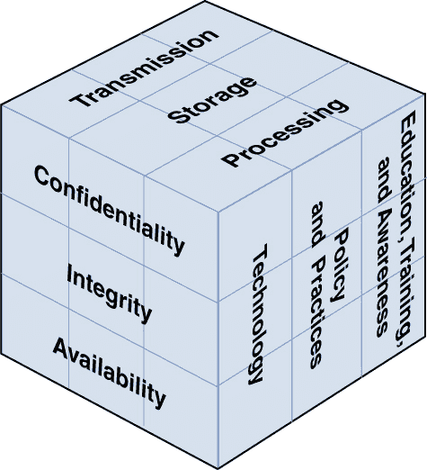
```

图 1.1 麦伯立方体。


另一个需要记住的重要概念是`最小权限`。这意味着运行在你的网络上的每个用户或服务都应该具有完成工作所需的最少权限/访问权限。除非工作绝对需要，否则不应授予任何人对任何内容的访问权限。

网络安全范式可以根据所采取安全措施的范围（边界型、分层）或系统的主动性进行分类。

在`边界安全方法`中，绝大部分安全工作都集中在网络边界上。这种重点可能包括防火墙、代理服务器、密码策略，或任何可以减少未经授权访问网络概率的技术或程序。对于保护网络内部的系统，投入的精力很少或完全没有投入。在这种方法中，边界是受保护的，但该边界内部的各种系统往往是脆弱的。

边界安全还涉及其他问题，包括物理安全。根据组织的安全需求，这些问题可能包括围栏、闭路电视、安保人员、锁等。

边界方法显然存在缺陷，那么为什么有些公司仍在使用它呢？小型组织可能由于预算限制或网络管理员缺乏经验而使用边界方法。对于不存储敏感数据的小型组织来说，边界方法可能是足够的，但在大型企业环境中很少奏效。

`分层安全方法`不仅保护边界，还保护网络内部的单个系统。网络中的所有服务器、工作站、路由器和集线器都是安全的。实现这一目标的一种方法是将网络划分为若干段，并像保护独立网络一样对每个段进行保护，这样即使边界安全被攻破，所有的内部系统也不会受到影响。这是首选的方法，应该尽可能使用。

你还应该根据安全方法的主动性/被动性来衡量它。这是通过评估系统的安全基础设施和策略有多少比例专门用于预防措施，以及安全系统有多少部分是设计用于响应攻击的来实现。被动安全方法采取很少或不采取措施来防止攻击。动态或主动防御是在在攻击发生之前就采取措施防止攻击的方法。

这种防御的一个示例是使用`IDSs`，它们的作用是检测规避安全措施的尝试。这些系统可以告诉系统管理员有人尝试破解，即使该尝试没有成功。`IDSs`还可以用于检测入侵者在评估目标系统时使用的各种技术，从而在尝试启动之前就提醒网络管理员可能存在破解尝试。

在现实世界中，网络安全通常不完全属于某一种范式；它通常是混合方法。网络通常包含两种安全范式的元素。这两个类别也会相互结合。你可以拥有一个主要是被动但是分层的网络，也可以一个主要是边界型但是主动的网络。沿着笛卡尔坐标系来考虑计算机安全方法是有帮助的，如图 1.2 所示，其中`x`轴代表被动-主动方法的水平，`y`轴描述了从边界防御到分层防御的范围。

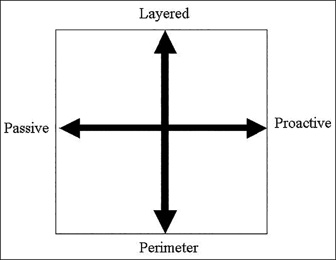

图 1.2 安全方法指南。

最理想的混合方法是动态的分层范式——即位于图中右上象限。

### 法律问题如何影响网络安全？

越来越多的法律问题影响着人们处理计算机安全的方法。如果你的组织是公众上市公司、政府机构，或者与其中任何一个有业务往来，那么在网络安全方面可能存在法律限制。即使你的网络在法律上不受这些安全准则的约束，了解影响计算机安全的各种法律也是有用的。你可以选择将它们应用于你自己的安全标准。

美国影响计算机安全的最古法律之一是`1987 年计算机安全法`。(15) 它要求政府机构识别敏感系统、开展计算机安全培训并制定计算机安全计划。这项法律是一项模糊的指令，命令美国联邦机构建立安全措施，但并没有规定标准。

15. [`csrc.nist.gov/csrc/media/projects/ispab/documents/csa\_87.txt`](https://csrc.nist.gov/csrc/media/projects/ispab/documents/csa_87.txt)

这项立法建立了制定特定标准的法律授权，为未来的指南和法规铺平了道路。它有助于定义术语，例如什么信息被视为“敏感”。这段引用出现在法律本身中：

“敏感信息”一词是指任何其丢失、误用、未经授权的访问或修改都可能对国家利益或联邦计划的执行，或根据美国法典第 5 卷第 552a 节（隐私法）个人所享有的隐私产生不利影响的信息，但尚未根据行政命令或国会法案确立的标准为了出于国防或外交政策的利益而专门授权保密。

这个对`敏感`一词的定义应该记在心中，因为这表明必须保护的不仅仅是社会安全信息和病史信息。

在考虑哪些信息需要被保护时，只需回答这个问题：对这些信息的未经授权访问或修改是否会对你的组织产生不利影响？如果答案是定的，那么你必须认为这些信息是敏感的，并需要安全预防措施。

另一个适用于政府系统强制性安全的更具体的联邦法律是`OMB 通告 A-130`（特别是附录 III）。该文件要求联邦机构建立包含指定元素的安全计划。它还描述了开发计算机系统标准以及政府机构存档记录标准的要求。

大多数州都有关于计算机安全的特定法律，例如《佛罗里达州计算机犯罪法》、《阿拉拉巴马州计算机犯罪法》和《俄克拉荷马州计算机犯罪法》。如果你负责网络安全，你可能会发现自己成了刑事调查的一部分。这可能是对黑客事件或员工滥用计算机资源进行的调查。计算机犯罪法律列表（按州划分）可以在 [`criminal.findlaw.com/criminal-charges/cyber-crimes.xhtml`](http://criminal.findlaw.com/criminal-charges/cyber-crimes.xhtml) 找到。

### 注意：隐私法

务必记住，任何规范隐私的法律（如《1996 年健康保险可携带性与责任法 [HIPAA]》）对计算机安全都有直接影响。如果你的系统被攻破，从而导致任何隐私法规涵盖的数据被泄露，你可能需要证明你在保护这些数据时尽了尽职调查。如果能够证明你没有采取适当措施，你可能会被判定承担民事责任。

### 在线安全资源

当你阅读这本书时以及当你进入职业领域时，你经常需要额外的安全资源。附录 A，“资源”包含了一个更完整的资源列表，但本节强调了几个你现在可能觉得非常有用的资源。

### CERT


`Computer Emergency Response Team` (CERT; [www.cert.org](http://www.cert.org)) 由卡内基梅隆大学赞助。CERT 是首个计算机事件响应团队，至今仍是业内最受尊敬的团队之一。任何对网络安全感兴趣的人应该定期访问该网站。在网站上，你将找到丰富的文档，包括安全策略指南、前沿安全研究等。

## 微软安全顾问 (Microsoft Security Advisor)

由于现在有许多计算机运行着微软操作系统，另一个良好的资源是微软安全响应中心网站：[`www.microsoft.com/en-us/msrc?rtc=1`](https://www.microsoft.com/en-us/msrc?rtc=1)。该网站是获取所有微软安全信息、工具和更新的门户。如果你使用任何微软软件，应该定期访问此网站。

## F-Secure

F-Secure 公司在 [www.f-secure.com](http://www.f-secure.com) 维护着网站。该网站除其他内容外，还是病毒爆发详细信息的存储库。在这里，你不仅能找到关于特定病毒的通知，还能找到关于病毒的详细信息，例如病毒如何传播、识别病毒的方法，以及可能用于清理受特定病毒感染系统的特定工具。

## SANS 学院 (SANS Institute)

SANS 学院网站（[www.sans.org](http://www.sans.org)）是一个庞大的安全相关文档存储库。在该网站上，你将找到你所想象的计算机安全几乎每个方面的详细文档。SANS 学院还赞助了许多安全研究项目，并在网站上发布关于这些项目的信息。

## 总结 (Summary)

网络安全是一个复杂且不断发展的领域。从业人员必须紧跟新威胁和解决方案，并在评估风险和保护网络方面采取主动措施。理解网络安全的第一步是熟悉对网络构成的实际威胁。如果对哪些威胁可能影响你的系统没有现实的认知，你就无法有效地保护它们。此外，掌握安全专业人士和试图破坏你安全的人员使用的使用的术语也至关重要。

## 测试你的技能 (Test Your Skills)

### 单选题

1. 你正试图向一位非技术经理解释安全问题。她对计算机安全持有相当极端的观点。本章讨论的计算机安全极端观点中，以下是哪一个？

**A.** 联邦政府将处理安全。

**B.** 微软将处理安全。

**C.** 你的系统没有迫在眉睫的危险。
**D.** 如果你使用 `Linux` 就危险。

2. 你刚刚接任某小型社区学院的网络安全管理员。你想采取措施来保护你的网络。在为网络制定防御方案之前，你需要什么？

**A.** 适当的安全认证
**B.** 对需要防御的危险有清晰的认识
**C.** 完成这本教材
**D.** 外部顾问的帮助

3. 玛丽正在给大一学生教一门网络安全导论课程。她正在向他们解释主要的威胁。以下不是三类主要威胁之一的是？

**A.** 尝试入侵系统
**B.** 在线拍卖诈骗
**C.** 拒绝服务攻击
**D.** 计算机病毒

4. 能够定义攻击术语是网络网络安全专业人员的一项技能。什么是计算机病毒？

**A.** 任何未经许可下载到你系统中的程序
**B.** 任何自我复制的程序
**C.** 任何对你的系统造成的程序
**D.** 任何可以更改你的 `Windows Registry` 的程序

5. 能够定义攻击术语是网络安全专业人员的一项技能。什么是间谍软件？

**A.** 任何监控你系统的软件
**B.** 仅记录击键记录的软件
**C.** 任何用于收集情报的软件
**D.** 仅监控你访问过哪些网站的软件

6. 什么是渗透测试员？

**A.** 一个不被发现就黑进系统的人
**B.** 一个通过伪造合法密码黑进系统的人
**C.** 一个为了测试系统漏洞而黑进系统的人
**D.** 有人

7. 伊丽莎白正在向班级解释各种术语。她正在讨论……的历史。黑客攻击的术语是什么？

**A.** 电话系统
**B.** Hacking
**C.** Cracking
**D.** Phaking

8. 什么是恶意软件？

**A.** 具有某些恶意目的的软件
**B.** 正常工作的软件
**C.** 损坏你系统的软件
**D.** 运行不当的软件

9. 什么是 driving (驱动/驾驶)?

**A.** 驾驶并寻找工作
**B.** 在使用连接时驾驶
**C.** 为网络而驱动
**D.** 驾驶并寻找对手

10. 这种通过说服和欺骗使人员提供信息的技巧称什么？

**A.** 社会工程
**B.** 欺骗 (Conning)
**C.** 人力情报
**D.** 软攻击

11. 网上有很多威胁。哪一个可能会随时间改变，但某些威胁一直比其他威胁更常见？以下哪种在互联网上最常见？

**A.** 拍卖诈骗
**B.** Phaking
**C.** 计算机病毒
**D.** 非法软件

12. 安全的三种方法是？

**A.** 边界、层次、混合
**B.** 高安全、中安全
**C.** 内部、外部和混合
**D.** 边界、无

13. 定义安全策略是保护网络的重要步骤。你正在根据方法设备分类。入侵检测系统是以下哪种示例？

**A.** 主动安全
**B.** 边界安全
**C.** 混合安全
**D.** 实践

14. 以下是最基本的安全活动？

**A.** 身份验证
**B.** 防火墙
**C.** 密码保护
**D.** 审计

15. 最理想的安全方法是哪种？

**A.** 边界且动态
**B.** 层次且动态
**C.** 边界且静态
**D.** 层次且静态

16. 截至 2022 年，以下哪是网络攻击增长最快的目标？

**A.** 物 (物联网)
**B.** 服务器
**C.** 笔记本电脑
**D.** USB 设备

17. 以下哪种隐私法律影响计算机安全？

**A.** 任何州隐私法
**B.** 适用于你组织的隐私法律
**C.** 任何隐私法
**D.** 任何联邦隐私法

18. 首个计算机事件响应团队所属哪个大学？

**A.** 麻省理工学院
**B.** 卡内基梅隆大学
**C.** 哈佛大学
**D.** 加州技术大学

19. 以下哪项是 `敏感信息` 术语的最佳定义？

**A.** 任何对国家安全有影响的信息
**B.** 任何价值超过 1000 美元的信息


C. 任何一旦被未经授权的人员访问就可能对您的组织造成损害的信息

D. 任何受隐私法律保护的信息

## 20. 下列哪项是对人肉搜索（doxing）的最佳描述？

A. 一种 `DoS` 恶意软件攻击

B. 陷害他人犯罪

C. 将个人信息发布在公共领域

D. 窃取个人信息

## 练习

### 练习 1.1：本月发生了多少病毒攻击

1. 使用某些网站资源，例如 [www.f-secure.com](http://www.f-secure.com)，查询最近的计算机病毒爆发情况。
2. 在过去的 7 天内发生了多少病毒爆发？
3. 写下过去 30 天、90 天和 1 年内发生了多少次爆发。
4. 病毒攻击的频率在增加吗？

### 练习 1.2：了解作为间谍软件的 Cookie

1. 了解一下 Cookie 存储了哪些类型的信息。你可能会发现以下网站很有帮助：
    * [www.allaboutcookies.org](http://www.allaboutcookies.org)
    * [www.howstuffworks.com/cookie1.htm](http://www.howstuffworks.com/cookie1.htm)
2. 写一篇短短文，解释 Cookie 以何种方式侵犯隐私。

### 练习 1.3：黑客术语

1. 使用 [`www.outpost9.com/reference/jargon/jargon_toc.xhtml`](http://www.outpost9.com/reference/jargon/jargon_toc.xhtml) 上的*黑客字典*定义以下黑客术语：
    A. Alpha geek
    B. Grok
    C. Red Book
    D. Wank

### 练习 1.4：使用安全资源

1. 使用本章列出的常用网络资源之一，从该资源中找到三个政策或程序文档。
2. 列出你选择的文档。
3. 写一篇短短文，解释为什么这些特定文档对你组织的安全非常重要。

### 练习 1.5：学习法律

1. 使用网络、期刊、书籍或其他资源，查询你的州或领土是否有任何针对计算机安全的法律。你可能会发现以下网站很有帮助：
    * [www.pbs.org/wgbh/pages/frontline/shows/hackers/blame/crimelaws.xhtml](http://www.pbs.org/wgbh/pages/frontline/shows/hackers/blame/crimelaws.xhtml)
    * [www.cybercrime.gov](http://www.cybercrime.gov)
2. 列出你所在地区的三条法律，并对每条法律提供简短的一句或两句描述。

## 项目

### 项目 1.1：了解病毒

1. 使用附录 A 中的网络资源以及如 [www.f-secure.com](http://www.f-secure.com) 等网站，找到一个过去 6 个月内发布的病毒。
2. 研究该病毒是如何传播的以及造成了什么损害。
3. 针对该病毒写一篇短论文（半页到一页）。解释该病毒是如何工作的、如何传播的，以及你能找到的任何其他重要信息。

### 项目 1.2：考虑法律（小组项目）

写一份你希望通过的计算机法律的描述，并说明有关其实施、执行和合理性的具体细节。

### 项目 1.3：提供安全建议

1. 使用网络、期刊或书籍，从任何信誉良好的来源（例如 SANS 学院）查找安全建议。本章“在线安全资源”部分提到的任何网站都是很好的选择。
2. 列出这些建议中的五项。
3. 解释你为什么同意或不同意这些建议。

## 案例研究

在案例研究中，我们将考虑一家家庭录像店的网络管理员。该店是一家连锁店，安全预算非常有限。它有供员工使用的机器和一个用于存储记录的服务器。服务器位于经理办公室。管理员采取了以下安全措施：

*  每台机器都升级到了 Windows 10。
*  已安装了杀毒软件。
*  为服务器添加了备份。
*  移除了机器的访问。

现在考虑以下问题：
1. 这些操作实现了什么目标？
2. 你会建议哪些额外的措施？

## 第 2 章：网络与互联网

## 目标

在阅读本章并完成练习后，你将能够：

*  识别每网络协议（例如 `FTP` 和 `Telnet`）以及如何使用它们
*  理解各种连接方式和速度
*  比较网络设备
*  识别并解释网络协议
*  理解数据如何在网络上传输
*  解释互联网的工作原理以及 `IP 地址`和 `URL`的使用
*  回顾互联网的简短历史
*  使用网络工具 `ping`、`IPConfig` 和 `tracert`
*  描述网络通信的 `OSI 模型` 以及 `MAC 地址`的使用

## 引言

为了管理网络安全，你需要了解计算机网络是如何运作的。这似乎显而易见，但令人惊讶的是许多人忽视了这个问题。如果你已经对网络操作有了了实战知识，可以选择快速浏览本章，或者简单读一下。如果你是计算机网络的新手，学习本章将让你了解网络和互联网如何运作的基础，包括互联网的历史。对网络和互联网的理解对于理解后续主题至关重要。然而，请记住，如果本章主题对你来说是全新的，那么对于网络安全专业人士来说，这只是最基础的知识。你应该考虑增加对计算机技术、网络及相关的了解。

## 网络基础

让两或多台计算机相互通信并传输数据在概念上很简单，但在应用上很复杂。考虑所有涉及的因素。首先，你需要连接计算机。这种连接通常需要插入计算机的电缆或无线连接。电缆然后插入另一台计算机，或者插入一个可以连接多台其他计算机的设备中。


当然，无线通信的使用频率越来越高，而且无线连接显然不需要电缆。然而，即使是无线通信也依赖于物理设备来传输数据。大多数现代计算机中都有一个名为`网络接口卡`（简称 `NIC`）的卡。如果通过电缆连接，`NIC` 计算机外部的部分有一个看起来类似于电话插座的连接槽，只是略大一点。无线网络也使用 `NIC`；但它不是用于连接电缆的插槽，而是使用无线电信号传输到附近的无线路由器或集线器。无线路由器、集线器或 `NIC` 必须有天线来收发信号。这些设备是连接设备，将在本章稍后详细介绍。

## 物理连接：本地网络

如前所述，使用电缆是计算机相互连接的方式之一。传统 `NIC`（指非无线）使用的电缆连接是 `RJ-45` 连接。`RJ` 是 Registered Jack（注册插座）的缩写，是一项国际行业标准。与计算机的 `RJ-45` 接口相比，标准电话线使用 `RJ-11` 接口。接口之间最大的区别在于连接器（也称为`终端器`）中的电线数量。电话线有四根线（尽管有些有六根），而 `RJ-45` 连接器有八根线。

如果你查看大多数计算机的背面或笔记本电脑的连接区域，可能会发现两个初看看起来像电话插座的端口。两个端口中的一个可能是用于传统的调制解调器，并接受标准的 `RJ-11` 插头。另一个端口较大，接受 `RJ-45` 插头。要找到一个没有 `NIC` 的现代计算机是极罕见的。

这种标准连接器插座必须位于电缆的末端。今天大多数网络使用的电缆是`五类`或`六类`电缆，简写为 `Cat 5` 电缆或 `Cat 6` 电缆。电缆的规格在 `ISO/IEC 11801` 中规定。表 2.1 总结了各种类型的电缆及其用途。

### 表 2.1 电缆类型与用途

| 类别 | 规格 | 用途 |
| --- | --- | --- |
| 1 | 低速模拟（小于 1MHz） | 电话、门铃 |
| 2 | 模拟线（小于 10MHz） | 电话 |
| 3 | 高达 16MHz 或 100Mbps（每秒兆比特） | 语音 |
| 4 | 高达 20MHz/100Mbps | 数据线、以太网 |
| 5 | 100MHz/100Mbps | 几年前最常见；目前仍广泛使用 |
| 6 | 1000Mbps（部分达到 Gbps） | 最常见的网络电缆 |
| 6a | Gbps | 高速网络 |
| 7 | Gbps | 极高速网络 |
| 8 | 40Gbps | 极高速网络 |

用于连接计算机的电缆类型通常也被称为非屏蔽双对（`UTP`）。在 `UTP` 中，电缆中的电线是成对的，在没有额外屏蔽的情况下扭绞在一起。正如表 2.1 所示，随后的每一类电缆都比前一类快快且更健壮。需要注意的是，尽管 `Cat 4` 可用于网络，但几乎从不用于此目的，因为它速度更慢、可靠性差且技术较旧。你通常会看到 `Cat 5` 以及越来越多的 `Cat 6`。你应该注意，我们关注 `UTP` 是因为它非常常见。还有其他类型的电缆，例如屏蔽双对（`STP`），但它们远没有 `UTP` 那么常见。

### 电缆速度

`六类`电缆用于千兆以太网并已变得非常常见。事实上，某些网络现在正在使用 `Cat 7`。`Cat 5` 电缆的工作速度高达 `100Mbps`，而 `Cat 6` 的速度为 `1000Mbps`。`Cat 6` 已经广泛供应多年了。然而，要让 `Cat 6` 真正正常工作，你需要同样以千兆速度传输的集线器/交换机和 `NIC`；因此，千兆以太网的普及比许多人预期的要慢得多。我们将更详细讨论集线器、交换机、`NIC` 和其他硬件。

如表 2.1 所示，关键规格是速度，以 `Mbps` 或每秒兆比特测量（尽管每秒千比特或 `Gbps` 变得越来越常见）。你可能已经意识到，计算机中的所有内容最终都以二进制格式存储——即 1 或 0 的形式。这些单位被称为 `位`（bits）。8 个位等于一个字节，用于表示单个字符，如字母、数字或回车符。记住，每种电缆的数据规格是该电缆能处理的最大值。`Cat 5` 电缆每秒可传输高达 100 兆（百万）比特。这被称为电缆的`带宽`。如果网络上有多个用户都在发送数据，这些流量会迅速消耗带宽。传输的任何图片也会占用大量带宽。简单的扫描照片很容易达到 2 兆字节（200 万字节，或 16 兆比特）。

如果你只是想连接两台计算机，可以使用交叉电缆，但如果你想连接超过两台计算机，该怎么办？如果你需要在网络上连接计算机，三个设备可以完成此任务：集线器、交换机和路由器。

### 集线器

最简单的连接设备是集线器。集线器是一个箱型的电子设备，可以在其中插入网络电缆。它会有 4 个或更多（常见 24 个）`RJ-45` 插槽，称为`端口`。集线器可以连接与其端口数量相同的计算机（例如，8 口集线器可以连接八台计算机）。你也可以将一个集线器连接到另一个；这种策略被称为“级联”。集线器非常便宜且易于设置：插入即可。然而，集线器有一个缺点。如果你从一台计算机向另一台计算机发送数据包（数据传输单元），数据包实际上会从集线器的每个端口发送。所有这些会导致产生产生网络流量。这是因为集线器作为一个非常简单的设备，无法知道数据包应该去哪里。因此，它只是将数据包复制发送到所有端口。你可能会去喜爱的电子商店购买所谓的“集线器”，你实际上买到的是交换机，我们将在本部分之后讨论。

### 中继器

`中继器`是一种用于增强信号的设备。基本上，如果你的电缆需要超过最大长度（对于 `UTP` 而言为 100 米），就需要中继器。中继器有两种：放大器和信号。放大中继器简单地放大接收到的整个信号，包括任何噪声。信号中继器再生信号，因此不会重播噪声。

### 交换机

`交换机`本质上是一个智能集线器；它的工作方式和外观与集线器完全相同，只有一个显著区别。当交换机接收数据包时，它只将该数据包发送到目标计算机所在的端口。交换机本质上能够确定数据包发送地地的集线器。它根据以太网帧头中的 `MAC`（介质访问控制）地址做出此判断。关于 `MAC` 地址和数据包头部的更多细节将在本章后面提供。

### 路由器


最后，如果你想连接两个或多个网络，你可以使用`路由器`)。路由器在概念上与集线器或交换机相似，它们都会中继数据包；但它要复杂得多。首先，路由器根据数据包 IP 头部中找到 IP 地址来引导流量。你可以编写大多数路由器并控制它们如何中继数据包。大多数路由器都有允许你对其进行配置的接口。更健壮的路由器还提供了更多的编程可能性。编程路由的具体方法因厂商而异，甚至有整本书都在专门介绍如何编程路由器。书中无法涵盖特定的路由器编程技术；然而，你应该意识到大多数路由器都是可编程的，这允许你更改它们路由流量的方式。此外，与使用集线器或交换机不同，由路由器连接的两个网络仍然是独立的网络。

## 更快的连接速度

到目前为止我们查看了局域网内计算机之间的连接，但还有更快的连接方法。事实上，你的互联网服务提供商或你工作的公司可能拥有更快的互联网连接。表 2.2 总结了最常见的高速连接类型及其速度。

表 2.2 连接类型

| 连接类型 | 速度 | 详情 |
| --- | --- | --- |
| DS0 | 64Kbps | 标准电话线。 |
| ISDN | 128Kbps | 2 条 DS0 线共同工作以提供高速数据连接。 |
| T1 | 1.54Mbps | 24 条 DS0 线作为一个整体工作，其中 23 条线路传输数据，1 条传输有关其他线路的信息。这种连接在学校和企业中已常见。 |
| T3 | 43.2Mbps | 672 条 DS0 线共同工作；等同于 28 条 T1 线。 |
| OC3 | 155Mbps | 所有 OC 线均为光纤，不使用传统的电话线。OC3 线非常快且昂贵。它们通常出现在电信公司。 |
| OC12 | 622Mbps | 等同于 336 条 T1 线，或 8064 条电话线。 |
| OC48 | 2.5Gbps | 等同于 4 条 OC12 线。 |

在许多地方找到 T1 连接线是很常见的。电缆调制解调器有时可以达到 T1 线相当的速度。注意，电缆连接未包含在 表 2.2 中，仅仅是因为它们的实际速度变化很大，取决于多种情况，包括附近有多少人使用同一电缆调制解调器供应商。除非你从事电信行业，否则你可能遇到 OC 线。

## 无线

今天，我们大多数人都使用无线网络，或 Wi-Fi。电气与电子工程师学会 (IEEE) 的 802.11 标准为无线网络提供了指南。使用不同的字母标记来表示不同的无线速度。这里列出了从最旧到最新的各种无线速度：

*    **802.11a:** 这是第一个广泛使用的 Wi-Fi；它运行在 5GHz 上，速度较慢。
*    **802.11b:** 该标准运行在 2.4GHZ 上，室内范围为 125 英英，带宽为 11Mbps。
*    **802.11g:** 目前仍有很多此类无线网络在使用，但你已无法购买使用 802.11g 的新 Wi-Fi 接入点。该标准包含了对 802.11b 的后兼容。802.11g 的室内范围为 125 英英，带宽为 54Mbps。
*    **802.11n:** 该标准是对以前无线网络的巨大改进，提供了 100Mbps 到 140Mbps 的带宽，并在 2.4GHz 或 5.0GHz 频率上运行，室内范围高达 230 英英。
*    **IEEE 802.11n-2009:** 该技术在 40MHz 信道宽度下使用四个空间流提供高达 600Mpbs 的带宽。它使用了多输入多输出 (MIMO)，通过多个天线协同地解析出比单天线能够解析更多的信息。
*    **IEEE 802.11ac:** 该标准于 2014 年 1 月获得批准，吞吐量高达 1Gbps，至少为 500Mbps。它使用最多 8 路 MIMO。
*    **IEEE 802.11ad 无线千兆联盟:** 该标准支持高达 7Gbps 的数据传输率，比最高的 802.11n 速率快 10 倍。
*    **IEEE 802.11af:** 也被称为“White-Fi”和“Super Wi-Fi”，该标准于 2014 年 2 月获得批准，允许在 54MHz 到 UHF 之间的 VHF 和 UHF 波段空白频谱中运行 WLAN。
*    **802.11ah:** 该标准于 2017 年发布，使用亚 GHz 波段。 
*    **802.11aj:** 该标准是 802.11ad 的重新命名，用于免许可频谱。
*    **802.11ax:** 该标准有时被称为 Wi-Fi 6，于 2021 年 2 月获得批准，为密集环境设计。
*   **11be:** 该标准设计用于极高吞吐量 (EHT)。预计速度达到 40Gbps。它将使用使用了多年的 2.4GHz 和 5GHz 波段，并将工作在 6GHz 波段。


蓝牙（Bluetooth）是一种使用 2.4GHz 到 2.485GHz 频率段的短距离无线电。IEEE 将蓝牙标准化为`IEEE 802.15.1`，但它已不再维护该标准。该标准允许设备发现范围内的其他蓝牙设备。这个名字源于哈拉德·“蓝牙”·戈尔森（Harald “Bluetooth” Gormsson），他是 10 世纪统一丹麦部落的丹麦国王。蓝牙技术背后的理念是统一通信协议。（关于这位国王的绰号有几种解释。一种解释是他有一颗发蓝色的坏牙；另一种解释是他经常穿蓝色的衣服。）蓝牙的速度和范围取决于具体版本，如表 2.3 所示。

### 表 2.3 蓝牙带宽与范围

| 版本 | 带宽 | 范围 |
| --- | --- | --- |
| 3.0 | 25Mbps | 10 米 (33 英尺) |
| 4.0 | 25Mbps | 60 米 (200 英尺) |
| 5.0 | 50Mbps | 240 米 (800 英尺) |

蓝牙 5.0 版本进行了微小增强，5.1、5.2 和 5.3 版本分别对 5.0 进行了小幅改进。例如，2021 年 7 月发布的 5.3 版本包含了改进的加密密钥处理以及通道分类的改进。

### 其他无线协议

还有几种其他无线通信协议，包括以下：

* `ANT+:` 这种无线协议通常用于传感器数据，例如生物传感器或健身应用中的数据。
* `Zigbee:` 该标准由一个电子制造商联盟开发，主要用于与电器和安全相关的无线设备的家用应用。它基于`802.15.4` 标准。令人感到困惑的是，该标准是用名称“Zigbee”而不是数字表示的。`Zigbee` 一词的使用方式与 Wi-Fi 类似。
* `Z-Wave:` 这种无线通信协议主要用于家庭自动化。它使用低功耗无线电通过网格网络进行电器之间的通信。
* `6LoWPAN:` IPv6 低功耗无线局域网（`6LoWPAN`）最初在 2007 年标准化为`RFC 4944`，从以后更新了多次，最近一次是 2017 年的`RFC 8066`。
* `Thread:` Thread 是一种专门为物联网（IoT）设计的 IPv6 协议。它与低功耗设备配合并创建网格网络。Thread 使用 `6LoWPAN`。
* `DASH7:` 这种用于 RFID（射频识别）的协议使用 433MHz、868MHz 和 915MHz 频率，范围可达 2 公里。
* `WirelessHART:` 这种无线传感技术大多数读者可能并不熟悉，它基于现场寻址远程变送器（`HART`）协议，用于过程自动化应用。

### 数据传输

我们已经简要看了物理连接方法；但数据实际上是如何传输的呢？为了传输数据，会发送一个数据包。电缆的基本作用是将数据包从一台机器传输到另一台机器。数据包是文档、视频、图像的一部分，还是计算机的某些内部信号并不重要。那么，数据包到底是什么？正如我们之前讨论的，计算机中的一切最终都存储为 1  own 0，称为 `bits`（位），它们被分成八组，每组称为一个 `byte`（字节）。数据包是将特定数量的字节分为头部和主体。头部是数据包开头的 20 个字节，它告诉你数据包的来源、去向等更多信息。主体包含你想要发送的二进制格式的实际数据。上述路由器和交换机通过读取到达它们的任何数据包的头部部分来工作。这个过程就是它们确定数据包应该发送到哪里。

### 协议

不同的目的有不同类型的网络通信。不同类型的网络通信被称为协议。`protocol`（协议）本质上是一种约定的通信方法。事实上，这个定义在标准的非计算机用法中也是完全一样的。每个协议都有特定的目的，通常运行在特定的`port`（端口）上。（端口将在后文详细讨论。）一些最重要且常用的协议列在表 2.4 中。

### 表 2.4 TCP/IP 协议

| 协议 | 目的 | 端口(s) |
| --- | --- | --- |
| FTP (文件传输协议) | 用于计算机之间传输文件。 | 20 和 21 |
| TFTP (简单文件传输协议) | 一种更快但可靠性较低的 FTP。 | 69 |
| SSH (安全 shell) | 用于安全地连接到远程系统。 | 22 |
| Telnet | 用于远程登录系统。可以使用提示符或 shell 在该系统上执行命令。网络管理员常用。 | 23 |
| SMTP (简单邮件传输协议) | 发送电子邮件。 | 25 |
| Whois | 查询目标 IP 地址的信息。 | 43 |
| DNS (域名系统) | 将 URL 转换为地址。 | 53 |
| HTTP (超文本传输协议) | 显示网页。 | 80 |
| POP3 (邮局协议 3) | 获取电子邮件。 | 110 |
| NNTP (网络新闻传输协议) | 用于新闻组（Usenet）。 | 119 |
| NetBIOS | 一种局域网命名系统的旧协议。 | 137, 138, 139 |
| IMAP (互联网消息访问协议) | 接收电子邮件的先进协议。广泛取代 POP3。 | 143 |
| IRC (互联网相对聊天) | 用于聊天室。 | 194 |
| SMB (服务器消息块) | 用于 Windows 活动目录。 | 445 |
| HTTPS | 加密的 HTTP；用于安全网站。 | 443 |
| SMTPS (安全简单邮件传输协议) | 加密的 SMTP。 | 465 |
| POP3S (安全邮局协议 3) | 加密的 POP3。 | 995 |
| IMAPS (安全互联网消息访问协议) | 加密的 IMAP。 | 993 |

每个协议将在本书的后续章节中根据需要进行详细解释。你还应该注意，这个列表是不完整的，因为还有几十种其他协议；但这些是我们讨论的基础协议。所有这些协议都属于被称为 `TCP/IP`（传输控制协议/网际协议）的协议族。

### 端口

你可能在想端口是什么，特别是由于我们已经讨论过计算机背面的端口，例如串口端口、并行端口以及 RJ-45 和 RJ-11 端口。在网络术语中，`port`（端口）是一个句或连接点。它是特定通信路径的数字标记。你可以把端口比作电视频道号。你可能只有一根线进入电视，但你可以切换到不同的频道。你的计算机上有 65535 个网络通信端口。无论什么类型的计算机或操作系统都是如此。计算机 IP 地址和端口号的组合被称为 `socket`（套接字）。


所以，到目前为止，我们对网络的描绘是通过电缆相互连接的机器，可能连接到集线器、交换机或路由器。这些网络使用特定的协议和端口以包的形式传输二进制信息。

# 互联网是如何工作的

现在你已经对计算机如何在网络上相互通信有了一个基本概念，现在是时候讨论互联网是如何工作了。互联网本质上是相互连接的大量网络。因此，互联网的工作方式与你的本地网络完全相同。它发送相同类型的数据包，并使用相同的协议。这些不同的网络简单地连接到被称为`骨干网`（backbones）的主传输线。`骨干网`相互连接的点被称为`网络接入点`（`NAPs`）。当你登录互联网时，可能会使用`互联网服务提供商`（`ISP`）。该`ISP` 连接到互联网骨干网或连接到另一个拥有骨干网的供应商。因此，登录互联网是将你的计算机连接到你的`ISP`网络的过程，而该网络又连接到互联网上的`骨干网`之一。

## IP 地址

随着成千上万个网络和数百万台独立计算机的通信和数据传输，出现了一个可以预见的问题。这个问题就是确保数据包发送到正确的计算机。这项任务的完成方式与传统的“邮政”信递给正确收件人的方式相似：通过地址。在网络通信中，这种地址是一种特殊的地址，被称为“IP”地址。`IP`地址可以是 IP 第 4 版本或第 6 版本。

### IPv4

`IP 地址`是由四个由点隔开的数值组成的序列。（例如 107.22.98.198。）每个三位数字都必须在 0 到 255 之间；因此，地址 `107.22.98.466` 是无效的。这些地址实际上是四个二进制数，你只是以十进制格式看到它们。因为这些数字每一个实际上只是 8 位的十进制表示，所以它们通常被称为`字节`（`octets`）。因此，一个 `IPv4` 地址中有四个`字节`。记住，一个字节是 8 位（1 和 0），8 位二进制数转换为十进制格式将会在 0 到 255 之间。所以你不需要自己计算，我告诉你，这条规则意味着总共有超过 42 亿个可能的 IP 地址。然而，你不必担心我们很快就会用完新的 IP 地址。已经有了一些方法（稍后会讨论）来扩展地址的使用。

### 提示：二进制数的转换

对于那些不熟悉十进制转二进制的读者，有几种方法，其中一种在此所示。你应该意识到，在处理 IP 地址时，计算机会为你完成这些操作，但这是实现这一点的一种（也许是最简单的）方法：

重复除以 2，使用“余数”而不是小数，直到你得到 1。例如，将十进制 31 转换为二进制：

```
31/2 = 15 remainder 1
15/2 = 7 remainder 1
7/2 = 3 remainder 1
3/2 = 1 remainder 1
1/2 = 0 remainder 1
```

（注：提供的文本后半部分包含大量重复和混乱内容。我已根据指令清理了格式，并保留了前半部分提供的核心技术信息。）


网关路由的作用之一是执行网络地址转换（NAT），这涉及到将传出数据包上的私有 IP 地址替换为网关路由的公共 IP 地址，以便数据可以通过互联网进行路由。

## 子网划分

我们已经讨论过 IPv4 网络地址；现在让我们把注意力转向子网划分。如果你对这个主题已经非常熟悉，可以随时跳过这一节。由于某些原因，这个话题往往给学习网络专业的学生带来很多麻烦，因此我们将从概念理解开始。`Subnetting`（子网划分）简单来说就是将一个网络分成更小的部分。例如，如果你有一个使用 IP 地址 `192.168.1.x` 的网络（其中 `x` 是特定计算机的地址），那么你就分配了 255 个可能的 IP 地址。如果你想将其划分为两个独立的子网怎么办？`Subnetting`就是实现这一目标的方法。

从更技术角度来说，子网掩码是一个 32 位的数字，分配给每个主机，用于将 32 位的二进制 IP 地址分为网络部分和节点部分。你不能随意输入任何数字。子网掩码的第一个值必须是 255；剩余三个值可以是 255、254、252、248、240 或 224。你的计算机将取你的网络 IP 地址和子网掩码，并使用二进制与运算将它们结合。

你可能会惊讶地发现，即使你没有进行子网划分，已经有一个子网掩码了。如果你有一个 C 类 IP 地址，那么你的网络子网掩码是 `255.255.255.0`。如果你有一个 B 类 IP 地址，那么你的子网掩码是 `255.255.0.0`。最后，如果是 A 类，你的子网掩码是 `255.0.0.0`。

现在考虑这些数字与二进制的关系。十进制值 `255` 转换为二进制为 `11111111`。因此你实际上是在“掩码”网络地址中用于定义网络的部分，而剩余部分用于定义单个节点。现在如果你你的子网中节点少于 255 个，那么你需要像 `255.255.255.240` 这样的子网掩码。如果你将 `240` 转换为二进制，它是 `11110000`。这意味着前三个字节和最后一个字节的前 4 位定义了网络。最后一个字节的后 4 位定义了节点。这意味着在这个子网上你最多可以有 `1111`（二进制）或 `15`（十进制）个节点。这就是子网划分的基本本质。

## CIDR

子网划分只允许你使用某些特定的、有限的子网。另一种方法是 `CIDR`，或无类网间路由。你不是定义子网掩码，而是在 IP 地址后面跟着一个斜杠和一个数字。该数字可以是 0 到 32 之间的任何数字，结果产生像所示的 IP 地址：

`192.168.1.10/24`（基本上是一个 C 类 IP 地址）

`192.168.1.10/31`（类似于带有子网掩码的 C 类 IP 地址）

当你使用 `CIDR` 时，你不再拥有带有子网的分类，而是使用变长子网掩码（VLSM），它提供了无类 IP 地址。这是目前定义网络 IP 地址的最常见方式。

## IPv6

你可能听过 IP 版本 6，或 `IPv6`，它是 `IPv4` 的扩展。本质上，IP 版本 4 限于 42 亿个 IP 地址。即使使用私有 IP 地址，我们也将耗尽可用的 IP 地址。想想所有连接到互联网的计算机、打印机、路由器、服务器、智能手机、平板电脑等。IP 版本 6 的设计是为了解决这个问题。如果你查看上一节描述的网络设置，你可能会看到启用 `IPv6` 的选项。`IPv6` 使用 128 位地址（而不是 32 位地址），因此在可预见的未来，没有耗尽 IP 地址的可能。`IPv6` 还使用十六进制计数法，以避免出现像 `132.64.34.26.64.156.143.57.1.3.7.44.122.111.201.5` 那么长的地址。一个 `IPv6` 十进制地址的示例是 `3FFE:B00:800:2::C`。

`IPv6` 不涉及子网划分，但它确实使用了 `CIDR`。网络部分由斜杠后跟地址中分配给网络部分的位数指示，例如：

`/48`

`/64`

`IPv6` 有一个回环地址，可以写为 `::/128`。`IPv4` 和 `IPv6` 之间的其他差异在此描述：

- **链路/本地本地地址（Link-/machine-local address）：** 这是 `IPv4` APIPA（自动私有 IP 地址）地址的 IPv6 版本。如果机器配置为动态分配地址且无法与 DHCP 服务器通信，它会给自己分配一个通用的 IP 地址。`DHCP`或动态主机配置协议，用于在网络内动态分配 IP 地址。`IPv6` 链路/本地本地地址以 `fe80::` 开头。如果你的计算机有这个地址，这意味着它无法连接 DHCP 服务器，因此生成了自己的地址。
- **链路/本地本地地址（Link-/machine-local address）：** 这是 `IPv4` APIPA（自动私有 IP 地址）地址的 IPv6 版本。如果机器配置为动态分配地址且无法与 DHCP 服务器通信，它会给自己分配一个通用的 IP 地址。`DHCP`或动态主机配置协议，用于在网络内动态分配 IP 地址。`IPv6` 链路/本地本地地址以 `fe80::` 开头。如果你的计算机有这个地址，这意味着它无法连接 DHCP 服务器，因此生成了自己的地址。
- **M 标记：** 当 `M` 标志设置为 1 时，设备应使用 `DHCPv6` 获取有状态地址。
- **O 标记：** 当 `O` 标志设置为 1 时，设备设备应使用 `DHCPv6` 获取其他 TCP/IP 配置设置。换句话说，它应该使用 DHCP 服务器设置网关 IP 地址和 DNS 服务器等。
- **M 标记：** 这表示机器应该使用 `DHCPv6` 获取 IP 地址。

这就是 `IPv6` 的本质。你仍然拥有与使用 `IPv4` 时相同的工具。不过，在 `ping` 或 `traceroute` 后面有一个数字 `6`，所以如果你的计算机启用了 IPv6，你可以使用以下命令：

```
ping6 www.yahoo.com
```

我们将在本章的后半部分讨论 `ping`、`traceroute` 和其他命令。

### 统一资源定位符

连接到 ISP 之后，你自然想访问一些网站。你可能在浏览器的地址栏中输入名称，而不是 IP 地址。例如，你可能会输入 `www.chuckeasttom.com` 来访问我的网站。你的计算机或你的 ISP 必须将你输入的名称（称为统一资源定位符 [`URL`]）转换为 IP 地址。表 2.4 中提到的 `DNS` 协议处理这一转换过程。因此，你输入的是人类可以理解的名称，但你的计算机使用相应的 IP 地址进行连接。


当你收到“Error 404: File Not Found”错误时，你看到的是你的浏览器接收到了来自网络服务器的错误代码为 404 的数据包，表示你请求的页面无法找到。网络服务器可以向你的网络浏览器发送一系列错误消息，以指示不同的情况。其中许多问题由浏览器自行处理，你永远不会看到这些错误消息。400 系列中的所有错误消息都是`客户端错误`（client errors）。这个术语意味着你那边出了问题，而不是网络服务器的问题。500 系列消息是`服务器错误`（server errors），意味着网络服务器上存在问题。100 系列消息仅为信息性；200 系列消息表示成功（你通常看不到这些消息，浏览器只是处理了它们）；300 系列消息是重定向的，意味着你正在寻找的页面已移动，你的浏览器将被引导到新位置。

使用电子邮件的工作与访问网站相同。你的电子邮件客户端会寻找电子邮件服务器的地址。然后，你的电子邮件客户端将使用 `POP3` 获取入站邮件，或使用 `SMTP` 发送出站邮件。你的电子邮件服务器（可能位于你的 ISP 服务提供商或你的公司）将尝试解析你正在发送的地址。如果你向 `chuck@chuckeasttom.com` 发送内容，你的电子邮件服务器会将该电子邮件地址转换为 `yahoo.com` 电子邮件服务器的 IP 地址，然后你的服务器会将邮件发送那里。请注意，有更新的电子邮件协议可用，但 `POP3` 仍然是最常用的。

许多读者可能对聊天室熟悉。聊天室与我们讨论过的其他通信方式一样，通过数据包运行。你首先找到聊天室的地址，然后建立连接。这里的区别在于，你的计算机聊天软件会不断来回发送数据包，而电子邮件只在你指示它时（或在预定的时间间隔内）才发送和接收。

记住，数据包有一个头部部分，该头部部分包含了你的 IP 地址和你要去的目标的 IP 地址（以及其他信息）。随着本书的进行，这种数据包结构将变得重要。

## 什么是数据包？

我们提到了网络数据包以及它们如何在网络和互联网中路由。我们还没有讨论的是数据包究竟是什么。你可能知道网络流量实际上是大量的 1 和 0，这些 1 和 0 被传输为电压（通过 UTP）、光波（通过光纤）或无线电频率（通过 Wi-Fi）。数据被划分为称为 `packets` 的小块。

一个数据包分为三个部分：头部（实际上至少有三个头部，我们稍后会介绍这一点）、数据和尾部。头部包含了关于如何路由数据包、它是什么类型的数据包以及相关数据。数据部分显然是你想要发送的信息。尾部的作用是显示数据包在何处结束并提供错误检测。

正如刚才提到的，通常至少三个头部。在正常通信中，一个数据包通常有一个 `Ethernet header`（以太网头部）、一个 `TCP header`（TCP 头部）和一个 `IP header`（IP 头部）。每个头部包含不同的信息。它们结合在一起提供了若干对取证调查感兴趣的信息。

让我们从 `TCP header` 开始。它包含了与 OSI 模型传输层的信息（我们将在本章稍后部分讨论 OSI 模型）。它包含了通信的源和目的端口。它还有数据包编号，例如 `packet 10 of 21`。

还有一个 `IP header`。最明显的有用信息是源地址和目的地址。`IP header` 包含源 IP 地址、目的 IP 地址和协议。`IP header` 还有版本号，显示这是版本 4.0 还是 6.0 的 IP 包。`size` 变量描述了数据段的大小。还有关于此数据包所代表协议的信息。

`Ethernet header` 包含了关于源 MAC 地址和目的 MAC 地址的信息。当数据包到达其旅程中的最后一个网络段时，使用的是 MAC 地址来找到数据包要发送到的 `NIC`（网卡）。

## 基础通信

上一节描述的数据包头部还包含一些信号位。这些是单比特标志，通过开启来指示某种类型的通信。正常的网络对话从一端发送一个开启了 `SYN`（同步）位的数据包开始。目标端通过同时开启 `SYN` 和 `ACK`（确认）位进行响应。然后发送端仅开启 `ACK` 位进行响应，通信随之开始。一段时间后，原始发送端通过通过发送一个开启了 `FIN`（结束）位的数据包来终止通信。

某些攻击依赖于发送畸形数据包。例如，在常见的拒绝服务（`DoS`）攻击中，`SYN flood` 基于向目标发送大量的 `SYN` 数据包，但永远不对回传的 `SYN/ACK` 做出响应。某些会话劫持攻击使用 `RST` 命令来帮助劫持通信。

## 互联网历史

此时，你应该已经对网络和互联网如何工作有了基本的了解，并对 IP 地址、协议和数据包有一定的熟悉。了解互联网的历史也有帮助，因为许多人发现这种概述有助于从历史的角度来看待到为止所学到的所有材料。

互联网的根源可以追溯到冷战。关于冷战可以说的一个积极方面是，那是科学技术投资重大的时期。1957 年，在苏联发射 `Sputnik` 人造卫星后，美国政府在国防部成立了高级研究计划局（`ARPA`）。`ARPA` 的唯一目的是资助和促进技术研究。显然，这一目标将包括武器技术，但总重点也包括了通信技术。

1962 年，兰德公司（Rand Corporation）的一项研究提出设计一种通信方法，其中数据以数据包的形式在地点之间发送。如果数据包丢失，消息的发送者会自动重新发送消息。这个想法是最终出现的互联网通信方法论的先驱。

1968 年，`ARPA` 委托构建了 `ARPANET`，这是一个由四个点（称为 `nodes` 节点）组成的简单互联网网络：`UCLA`、斯坦福大学、加州伯克利分校和犹他大学。尽管当时没有人知道，但这个小网络就是后来成为互联网的诞生。此时，`ARPANET` 只有这四个节点连接着。

1972 年从多个意义上来说都是互联网发展的里程碑。那一年，`ARPA` 被更名为 `DARPA`，即国防高级研究计划局。同年，Ray Tomlinson 发明了第一个电子邮件程序。此时，在 `ARPANET` 出生四年后，网络上有 23 台主机（`hosts`）。（`host` 是一个带有数据且你可以连接的机器；例如，Web 服务器就是一个主机。）

接的一年，1973 年标志着 `TCP/IP` 的诞生，这种协议允许不同的计算机以统一的方式进行通信，无论它们的硬件或操作系统如何。


1974 年，Vint Cerf 发表了一篇关于 `TCP` 的论文，并在计算机史上首次使用了 `Internet` 一词。1976 年，以太网电缆被开发出来（就是我们今天使用的相同的线缆），DARPA 开始要求在其网络中使用 `TCP/IP`。那一年也标志着 `UNIX` 操作系统开始广泛传播。在随后的多年里，`UNIX` 和 `Internet` 的发展将紧密相连。到此时，在 ARPANET 诞生 8 年后，网络上已经有了 111 台主机。

1979 年，发生了一项重大进展：Usenet 新闻组的诞生。这些小组本质上是向全球开放的公告板。（今天，你可以通过新闻组阅读器软件或通过 Web 访问 [www.google.com](http://www.google.com) 并选择“Groups”来访问这些小组。有数以千计的新闻组致力于每一个可以想象到的的话题。）仅在 2 年后，国家科学基金会（NSF）为不属于 ARPANET 的大学和研究中心创建了 `CSNET`。同年，Cerf 提议将 `CSNET` 和 `ARPANET` 连接起来。到 1981 年，威斯星大学创建了 `DNS`（域名系统），以便人们可以通过名称而不是实际 IP 地址来查找网络上的节点。此时，网络上有 562 台主机。

20 世纪 80 年代初，早期 `Internet` 经历了巨大的性增长。DARPA 将其 ARPANET 分为军事和非军事段，并允许更多的人使用非军事段。此外，NSF 引入了 `T1` 线路（一种非常快的连接）。1986 年，互联网工程任务组（IETF）成立，负责监督 `Internet` 和互联网协议标准的制定。到那时，`Internet` 已由 2308 台主机组成。

1990 年证明是 Internet 发展的关键一年。那一年，在欧洲欧洲核研究中心（CERN）工作的姆·伯纳斯-李（Tim Berners-Lee）开发了超文本传输协议（`HTTP`），并向世界交付了第一批网页。通过 `HTTP` 和超文本标记语言（`HTML`），人们可以在 `Internet` 上发布想法，供任何（有连接的人）查看。到 1990 年，`Internet` 上已有超过 30 万台主机。（快进到 2004 年：姆·伯纳斯-李因对技术的贡献获得了首届千千年奖。他被广泛认为是万维网（[`WWW`]）之父。）

Internet 的增长和活动在 20 世纪 90 年代发生了爆炸式增长。1992 年，CERN 向全世界发布了网页这项发明。1993 年，发明了第一个图形化网页浏览器，命名为 `Mosaic`。到 1994 年，必胜客开始通过网页接受订单。`Internet` 持续增长；今天，全球有数百万个网站。从大学部门、政府机构、公司、学校、宗教团体，到几乎任何你可以想象的其他团体，每个组织都有自己的网站。许多个人也有自己的个人网站。你可能使用 Web 进行银行转账、购物、信息查询和娱乐，并且你可能每天都会使用电子邮件。（顺便说一下，我主要使用电子邮件进行通信，所以如果你想联系我，那是最好的方式：`chuck@chuckeasttom.com`。）`Internet` 已成为我们社会中一个虚拟的交互“生活层面”。哪家公司没有网站？哪部电影发布没有网站？哪个政治候选人没有网站？在短短三十多年的时间里，`Internet` 已成为我们社会不可或缺的一部分。

## 基础网络实用程序

本书的后续部分，你将使用一些信息和技术，这些技术部分基于任何人可以在自己的机器上执行的某些技术。有一些网络工具可以从命令提示符（Windows）或从 shell（UNIX/Linux）中执行。许多读者已经熟悉 Windows，因此本文的讨论将从 Windows 命令提示符的角度来执行并讨论这些命令。但必须强调的是，这些工具在所有操作系统中都可用。在本节中，你将介绍 `IPConfig`、`ping` 和 `tracert` 工具。

### IPConfig

学习网络的第一步是获取关于你自己的系统信息。为了完成这项发现任务，你需要进入命令提示符。在 Windows XP 中，进入“开始”菜单，选择“所有程序”（Windows Vista 或 7 中），然后选择“辅助工具”。你将看到一个名为“命令提示符”的选项。在 Windows 10 中，只需在搜索栏中输入 `cmd`。（对于 Windows 2000 用户，过程是相同的，只是第一个选项简单称为“程序”而不是“所有程序”。）接下来，输入 `ipconfig`。（在 UNIX 或 Linux 中，进入 shell 后输入该命令可以使用相同的命令。）在输入 `ipconfig` 并按下回车键后，你应该看到类似于图 2.1 所示的内容。

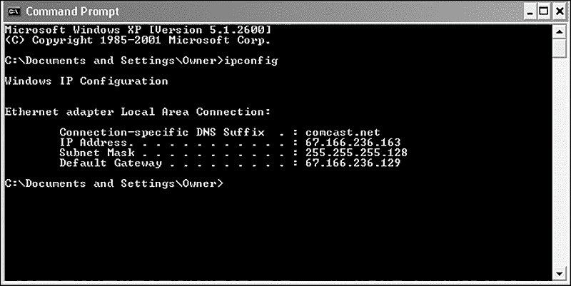

图 2.1 `IPConfig`。

此命令提供了关于你与网络（或 `Internet`）连接的信息。最重要的是，你找到了了自己的 IP 地址。该命令还包含了默认网关的 IP 地址，它是你与外部世界的连接。运行 `IPConfig` 命令是确定系统网络配置的第一步。书中提到的大多数命令都有类似于图 2.1 所示的结果。

书中提到的大多数命令都有许多参数或标志可以传递给计算机，使其以特定的方式运行。你可以通过输入命令、加一个空格、然后输入连号和问号 `-?` 来了解这些命令。在图 2.2 中，你可以看到 `IPConfig` 命令的结果。

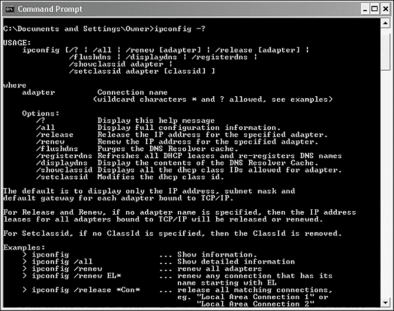

图 2.2 `IPConfig` 帮助。

正如在图 2.2 中所示，有许多选项可以获取有关配置的信息。最常用的方法可能是 `IPConfig /all`，它提供了更多信息，例如你的计算机获取 IP 地址的时间。

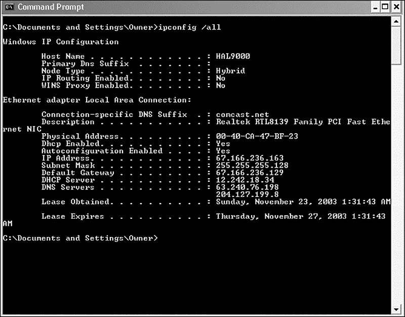

图 2.3 `all`。

### Ping

另一个常用的命令是 `ping`。`ping` 用于向机器发送测试包（或回显包），以检查机器是否可以访问以及到达机器所需的时间。这种实用的诊断工具可以在基础黑客技术中使用。在图 2.4 中，你看到对 [www.yahoo.com](http://www.yahoo.com) 执行了 `ping` 命令。

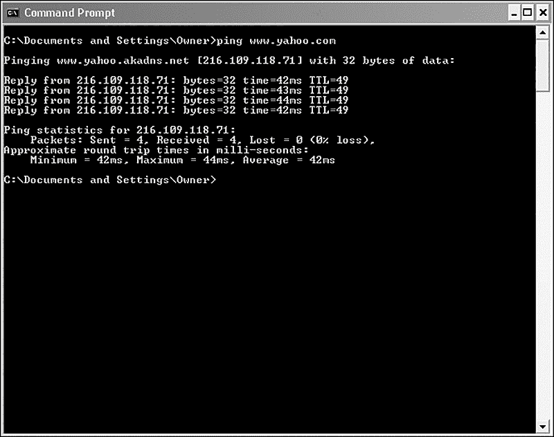

图 2.4 `Ping`。

此图告诉一个 32 字节的回显包已发送到目的地并返回。TTL（生存时间）项目显示了包在放弃之前到达目的地应经过的中间步骤（或跳转）。记住，Internet 是互连网络的巨大集合。你的包可能不会直接到达目的地；它需要经过多次跳转。

### Tracert

`tracert` 命令基本上是 `ping` 的高级版本。`tracert` 不仅告诉你包是否到达目的地以及花费了多久，还告诉你到达那里经过的所有中间跳数。这个工具在书中以后对你将非常有用。图 2.5 插图了指向 [www.yahoo.com](http://www.yahoo.com) 的 `tracert`。（在 Linux 或 UNIX 中可以执行相同的命令，但那里它被称为 `traceroute` 而不是 `tracert`。）

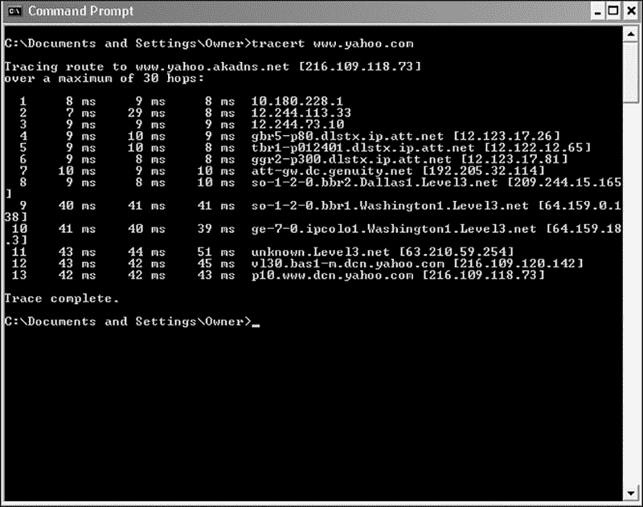

图 2.5 `Tracert`。


通过 `tracert`，你可以看到列出的中间步骤的 IP 地址（以毫秒计）以及到达每个步骤所需的时间。到达目的地所需的步骤可能非常重要，正如你在本书后部分看到的那样。

当然，在处理网络通信时，还有其他对你有用的实用。然而，我们刚刚检查的三个工具——`IPConfig`、`ping` 和 `tracert`——是核心工具。这三个工具对于任何网络管理员来说都是必关重要的，你应该将它们记在心里。

## Netstat

`Netstat` 是另一个有趣的命令。本质上，这个命令是 `network status` 的缩写，它告诉你的计算机当前拥有哪些连接。如果你看到多个连接，不要惊慌；这并不意味着黑客进入了你的电脑。你会看到许多有 IP 地址，这意味着你的网络正在进行内部通信。你可以在图 2.6 中看到这一点。

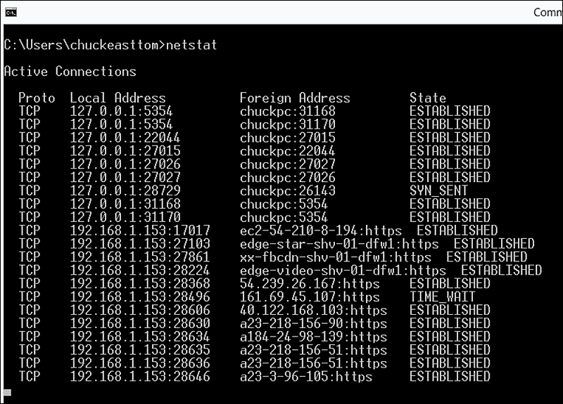

图 2.6 `Netstat`。

## NSLookup

`nslookup` 是 `name server lookup` 的缩写，用于与网络的 DNS 服务器连接。它通常可以用于验证 DNS 服务器是否正在运行。它也可以用于执行命令。回想第 1 章中的计算机安全简介关于 DNS 污染的讨论。DNS 污染的首步之一是查看目标 DNS 服务器是否会执行区域传输。（对于域内已验证的 DNS 服务器以外的任何机器，它都不应该这样做）。可以使用 `nslookup` 进行尝试，如下所示：

点击此处查看代码图像

```
run: nslookup
type: ls -d domain_name <enter>
```

你可以在图 2.7 中看到基础 `nslookup` 命令。

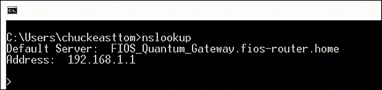

图 2.7 `nslookup`。

## ARP

地址解析协议 (ARP) 用于将 IP 地址映射到 MAC 地址。`arp` 命令显示你的计算机当前感知的现有 IP 到 MAC 地址映射。图 2.8 演示了 `arp -a` 命令的使用。

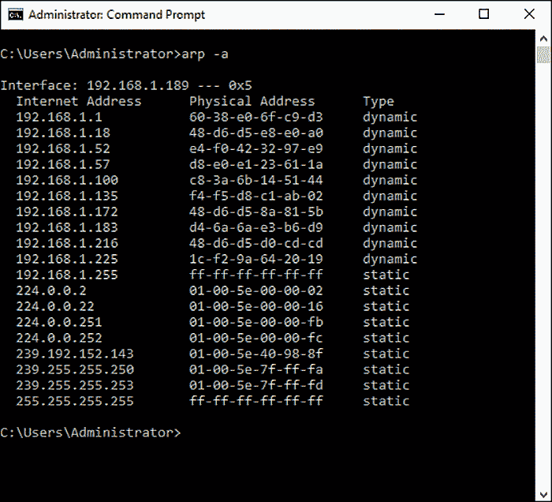

图 2.8 `arp -a`。

与其他命令一样，ARP 有多种标记（flags）。以下是其中一些：

* `-a` 显示当前的 ARP 缓存表。
* `/g` 功能与 `/a` 相同。
* `/d` 从 ARP 缓存表中删除特定条目。
* `/s` 向 ARP 缓存表添加静态条目。

## Route

`route` 命令用于查看 IP 路由表。图 2.9 显示了 `route -print 4` 命令的示例输出。

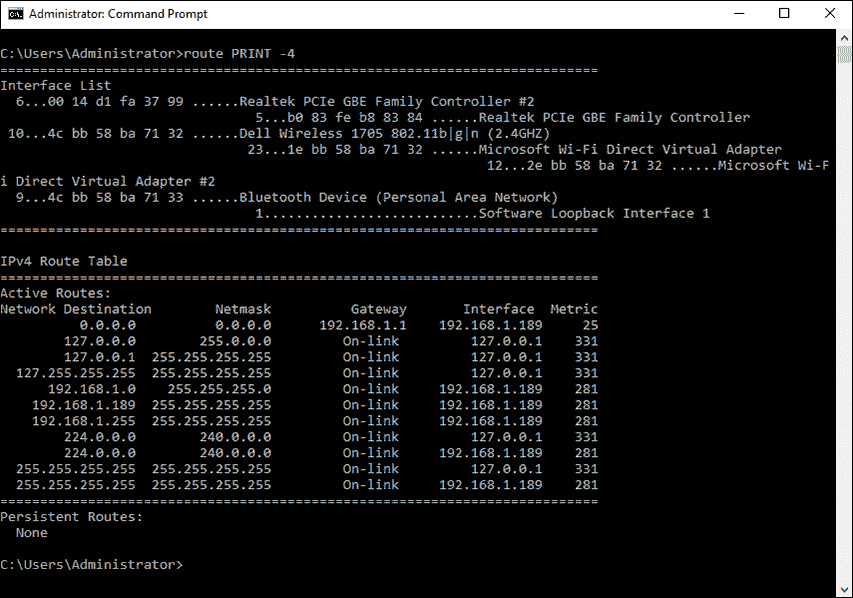

图 2.9 `route print -4`。

与大多数命令一样，`route` 也有你可以使用的标记。这里总结了一些最常用的标记：

* `print` 打印特定路由；例如，`print -4` 显示 IPv4 路由表。
* `add` 添加路由。
* `delete` 删除路由。
* `change` 修改路由。
* `destination` 向特定计算机发送命令。

## PathPing

`PathPing` 提供了与 `tracert`/`traceroute` 以及 `ping` 类似的信息。它提供了关于源和目的地之间跳数网络延迟的详细信息。基本语法为：

```
pathping [-n]
       [-h MaximumHops]
       [-g HostList]
       [-p Period]
       [-q NumQueries]
       [-w Timeout]
       [-T]
       [-R]
       [TargetName]
```

图 2.10 显示了一个示例。

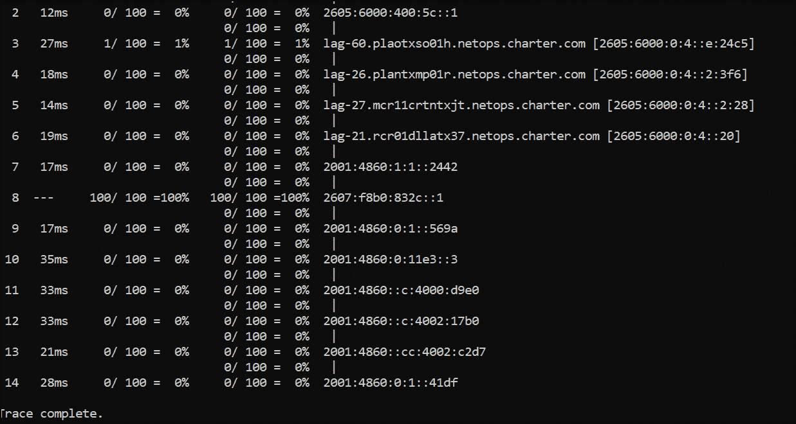

图 2.10 `PathPing`。

## 其他网络设备

网络中还涉及其他设备来保护你的计算机免受外界影响，其中一些在第 1 章中简要提到过。现在我们将更详细地回顾其中两个。最常见的是防火墙和代理服务器。

`防火墙(#gloss.xhtml#gloss43)` 本质上是你网络与互联网其余部分之间的屏障。个人电脑 (PC) 可以防火墙；在许多情况下，特殊路由器也可以作为防火墙。

另一种非常常见的防御设备是 `代理服务器`。代理服务器几乎是一台独立的计算机。代理服务器的目的非常简单：它从外部世界隐藏你的网络。代理服务器提供基础的网络安全。坦率地说，运行一个没有防火墙和代理服务器的网络将是疏职的。我们将在第 9 章“计算机安全技术](#ch09.xhtml#ch09)”中更详细地检查防火墙。


| 层 | 名称 | 描述 |
| --- | --- | --- |
| 1 | 物理层 | 该层描述了各种通信介质的物理属性以及交换信号的电气属性和解释。换句话说，物理层就是实际的 `NIC`（网卡）、`Ethernet cable`（以太网线）等。这一是将比特转换为电压反反亦然。 |

许多网络学生都会背这个模型。至少记住这七层的名称并基本理解每一层的作用是有益的。从安全的角度来看，你对网络通信理解得越深，你的防御就可以越复杂。你需要理解的最重要的一点是，OSI 模型描述了一种通信的层级结构。每一层只会与其直接上方或下方的层进行通信。

### TCP/IP 模型

虽然 OSI 模型被常用，但 TCP/IP 模型也被广泛使用，特别是由思科（Cisco）。如果你打算考思科认证，你将需要了解 TCP/IP 模型。TCP/IP 模型有四层。它执行与 OSI 模型相同的活动，但被压缩到了更少的层级中。表 2.7 显示了 TCP 模型。

表 2.7 TCP 模型

| 层 | 目的 |
| --- | --- |
| 应用层 | 该层结合了 OSI 模型应用层和表示层的职责。 |
| 传输层 | 该层大致等于 OSI 模型的传输层和会话层。该层负责消息传递和错误检测。 |
| 互联网层 | 该层负责从源到目的地的流量。它大致等于 OSI 模型的网络层。 |
| 网络访问层 | 这大致等于 OSI 模型的物理层和数据链路层。该层负责实际信号的传输。 |

### 介质控制 (MAC) 地址

MAC 地址 是 `NIC` 的唯一地址。（MAC 也是 OSI 模型数据链路的一个子层。）世界上每一个 `NIC` 都有一个由 6 字节十六进制数表示的唯一地址，`ARP` 用于将 `IP` 地址转换为 `MAC` 地址。当你输入网页地址时，`DNS` 用于将其转换为 `IP` 地址；然后 `ARP` 将该 `IP` 地址翻译为单个 `NIC` 的特定 `MAC` 地址。

与 48 位 `MAC` 地址类似的是 `EUI-64`，它是一个识别物理网卡的 64 位地址。`EUI` 代表增强唯一标识符（Enhanced Unique Identifier），在 `RFC 2373` 中被标准化。`EUI-64` 用于 `IPv6` 寻址。

### 云计算

美国国家标准与技术研究院（NIST）将云计算定义为“一种模型，能够实现便捷的、按需的网络访问以访问共享的可配置计算资源池（例如：网络、服务器、存储、应用程序和服务），这些资源可以以最少管理努力或与服务提供者的交互进行快速配置和释放。”^(1)

1. [`www.govinfo.gov/app/details/GOVPUB-C13-74cdc274b1109a7e1ead7185dfec2ada`](https://www.govinfo.gov/app/details/GOVPUB-C13-74cdc274b1109a7e1ead7185dfec2ada)

云主要有三种分类：

* `Public clouds`（公有云）被 NIST 定义为向公众或大型行业组提供其基础设施或服务的云。
* `Private clouds`（私有云）是特定组织专门使用的云，而不向外部实体提供服务。还有 `hybrid clouds`（混合云），结合了前者的特征。
* `Community clouds`（社区云）是多个组织出于共同利益而共享的云。

与 48 位 `MAC` 地址相似的是 `EUI-64`，这是一个识别物理网卡的 64 位地址。


联邦风险与授权管理计划（FedRAMP）是一项美国政府范围内的计划，为云产品和服务的安全评估、授权和持续监控提供标准化的方法。第三方评估组织（3PAOs）在 FedRAMP 安全评估过程中起着关键作用，因为它们是独立的评估组织，负责验证云提供商的安全实施情况，并提供云环境的整体风险状况，以供安全授权决策。

另一个需要考虑的标准是 NIST SP 800-144《公有云计算安全与隐私指南》，它涵盖了云计算的身份验证、服务水平协议（SLAs）以及其他安全措施。

即使是美国国家安全局也提供了云安全指导建议：^(2)

2. [`media.defense.gov/2020/Jan/22/2002237484/-1/-1/0/CSI-MITIGATING-CLOUD-VULNERABILITIES_20200121.PDF`](https://media.defense.gov/2020/Jan/22/2002237484/-1/-1/0/CSI-MITIGATING-CLOUD-VULNERABILITIES_20200121.PDF)

*   虽然加密不是云架构的基础组件，但加密和密钥管理（KM）是保护云信息的一个关键方面。

*   虽然云服务提供商（CSPs）通常负责检测底层云平台的威胁，但客户承担着检测其自身云资源威胁的责任。

*   在事件响应方面，CSPs 具有独特优势来响应云基础设施内部的事件并承担相应责任。客户云环境内部的事件通常是客户的责任，但 CSP 可能会为事件响应团队提供支持。

*   在补丁/更新方面，CSPs 负责确保其云产品是安全的，并快速修复其范围内的软件，但通常不修补由客户管理的软件（例如 IaaS 产品中的操作系统）。由于由于，，客户应警惕地部署补丁，以缓解云中的软件漏洞。在某些情况下，CSPs 提供托管解决方案，由它们也执行操作系统的补丁。

### 总结

本章不能让你成为网络专家。然而，你现在应该对网络和互联网如何工作有了基本的了解。在进入后续章节之前，你应该确保自己完全理解基础硬件，如 `switches`（交换机）、`NIC`、`routers`（路由器）和 `hubs`（集线器）。你还应该熟悉本章介绍的基本协议。熟悉所介绍的程序非常重要。强烈建议你广泛尝试这些程序。熟悉 OSI 模型的基础也很重要。许多学生起初会感到困难，但在进入第 3 章“网络跟踪、欺诈与滥用”之前，至少确保你对其有一般的了解。

本章的内容在后面的章节中至关重要。如果你是这些材料手，应该在继续学习之前彻底学习本章。在本章末尾的练习中，你将练习使用 `IPConfig`、`tracert` 和 `ping`。

### 测试你的技能

### 单选题

**1.** Malek 正在购买电缆用于建立小型办公室网络。他想储备常用的电缆。大多数网络使用什么类型的电缆？

**A.** 网线
**B.** STP
**C.** 电话线
**D.** UTP

**2.** 你被分配为电缆段连接连接器。网线使用哪种连接器？

**A.** RJ-11
**B.** RJ-85
**C.** RJ-12
**D.** RJ-45

**3.** 大多数网络使用什么类型的线？

**A.** 非屏蔽双对
**B.** 屏蔽双对
**C.** 非屏蔽绞线
**D.** 屏蔽绞线

**4.** John 正尝试简单地连接三台计算机。他不需要任何路由功能，也不关心流量。连接计算机最简单的设备是？

**A.** NIC
**B.** Interface
**C.** Hub
**D.** Router

**5.** Sharice 正在教新技师基础网络术语。NIC 代表什么？

**A.** 网络接口卡
**B.** 网络交互卡
**C.** 网络接口器
**D.** 网络交互器

**6.** 以下哪个设备用于连接两个或多个网络？

**A.** Switch
**B.** Router
**C.** Hub
**D.** NIC

**7.** Juan 刚刚在诊所安装了一条 T1 线。前台接待员询问预期速度。T1 线的传输速度是多少？

**A.** 100Mbps
**B.** 1.54Mbps
**C.** 155Mbps
**D.** 56.6Kbps

**8.** 以下哪项最好描述多云（polycloud）？

**A.** 使用私有云和公云
**B.** 使用云和本地资源
**C.** 使用多个云提供商来实现性和冗余
**D.** 使用多个云提供商提供服务

**9.** 什么协议将 Web 地址转换为 IP 地址？

**A.** DNS
**B.** TFTP
**C.** DHCP
**D.** SMTP

**10.** 使用什么协议发送电子邮件，它在哪个端口工作？

**A.** SMTP, 端口 110
**B.** POP3, 端口 25
**C.** SMTP, 端口 25
**D.** POP3, 端口 110

**11.** Gunther 正在设置加密通信以便服务器管理员远程访问服务器。使用什么协议安全远程登录计算机？

**A.** SSH
**B.** HTTP
**C.** Telnet
**D.** SMTP

**12.** Mohammed 需要打开防火墙端口以便 Web 流量通过防火墙。网页使用什么协议，它在哪个端口工作？

**A.** HTTP, 端口 21
**B.** HTTP, 端口 80
**C.** DHCP, 端口 80
**D.** DHCP, 端口 21

**13.** 互联网骨干连接点的名称是什么？

**A.** Connectors
**B.** Routers
**C.** Network access points
**D.** Switches

**14.** 你正在检查 IP 地址列表。有些是内部的，有些是外部的，有些是非的。以下哪个不是有效的 IP 地址？

**A.** 127.0.0.1
**B.** 295.253.254.01
**C.** 131.156.5.2
**D.** 245.200.11.1

**15.** IP 地址 193.44.34.12 是什么类的地址？

**A.** A
**B.** B
**C.** C
**D.** D

**16.** IP 地址 127.0.0.1 总是指向你的什么？

**A.** 最近的路由器
**B.** ISP
**C.** 自身
**D.** 最近的 NAP

**17.** 格式为 [www.chuckeasttom.com](http://www.chuckeasttom.com) 的互联网地址被称为？

**A.** 用户友好 Web 地址
**B.** 统一资源定位符
**C.** 用户可访问 Web 地址
**D.** 统一地址标识符

**18.** 哪个美国政府机构创建了形成基础的分布式网络？

**A.** 高级研究计划局
**B.** 中央情报局
**C.** NASA
**D.** 能源部

**19.** 以下哪个是由政府机构建立的原始分布式网络的三所大学之一？

**A.** 加州大学伯克利分校
**B.** 哈佛大学
**C.** 麻理工学院
**D.** 普林斯顿大学


## 20. 你正在向一群一年级学生讲解网络历史。温特·瑟夫（Vint Cerf）发明了什么？

**A.** 万维网 (World Wide Web)
**B.** 电子邮件
**C.** `TCP`
**D.** 第一个计算机病毒

## 21. 你正在向一群一年级学生讲解网络历史。蒂姆·伯纳斯利（Tim Berners-Lee）发明了什么？

**A.** 万维网 (World Wide Web)
**B.** 电子邮件
**C.** `TCP`
**D.** 第一个计算机病毒

## 22. John 正在使用命令行工具为一台无法连接到网络的计算机收集诊断信息。哪种工具可以提供机器网络配置的信息？

**A.** `Ping`
**B.** `IPConfig`
**C.** `Tracert`
**D.** `MyConfig`

## 23. 谢丽尔（Sheryl）正在向公司的新技术人员解释 OSI 模型。她正试图解释协议在 OSI 模型不同层上是如何工作的。`TCP` 运行在 OSI 模型的哪一层？

**A.** 传输层 (Transport)
**B.** 应用层 (Application)
**C.** 网络层 (Network)
**D.** 数据链路层 (Data link)

## 24. OSI 模型中的哪一层被划分为两个子层？

**A.** 数据链路层 (Data link)
**B.** 网络层 (Network)
**C.** 表示层 (Presentation)
**D.** 会话层 (Session)

## 25. 下列哪项是识别你网卡的唯一十六进制数？

**A.** NIC 地址
**B.** MAC 地址
**C.** NIC ID
**D.** MAC ID

## 练习

### 练习 2.1: 使用 `IPConfig`

1. 打开命令提示符，或在 Windows 10 或 11 的搜索栏中输入 `cmd`。
2. 输入 `ipconfig`。
3. 使用 `IPConfig` 命令的输出查找你计算机的信息。
4. 写下你计算机的 IP 地址、默认网关和子网掩码。

### 练习 2.2: 使用 `Tracert`

1. 打开命令提示符，或在 Windows 10 的搜索栏中输入 `cmd`。
2. 输入 `tracert www.chuckeasttom.com`。
3. 记录你的计算机到达 `www.chuckeasttom.com` 经过的跳数（hops）。
4. 对 `www.whitehouse.gov` 和 `http://home.pearsonhighered.com/` 重复步骤 2 和 3。
5. 注意前几次跳数是相同的。写下到达每个目标所经过的跳数以及哪些跳数是相同的。然后简要描述你认为为什么不同目标之间的某些中间步骤是相同的。

### 练习 2.3: `NSLOOKUP`

1. 进入命令提示符，或在 Windows 10 的搜索栏中输入 `cmd`。
2. 输入 `nslookup www.chuckeasttom.com`。
3. 注意此命令会为你提供服务器的实际名称（根据托管公司的命名规范）、其 IP 地址以及服务器运行所属的任何别名。

### 练习 2.4: 关于 `IPConfig` 的更多信息

1. 打开命令提示符，或在 Windows 10 的搜索栏中输入 `cmd`。
2. 使用 `IPConfig` 命令的 `-?` 标志来查找 `IPConfig` 有哪些选项。你应该注意到包括 `/all`、`/renew` 和其他在内的许多选项。
3. 现在尝试 `ipconfig /all`。与在练习 2.1 中仅使用 `ipconfig` 相比，你现在看到了什么？

### 练习 2.5: 关于 `Ping` 的更多信息

1. 打开命令提示符，或在 Windows 10 的搜索栏中输入 `cmd`。
2. 使用 `ping` 命令使用 `-?` 标志并查找 `ping` 有哪些选项。你应该注意到几个额外的选项，如 `-w`、`-t`、`-n` 和 `-i`。
3. 尝试 `ping www.chuckeasttom.com`。
4. 尝试选项 `ping -n 2.chuckeasttom.com`。然后尝试 `ping -n 7.chuckeasttom.com`。你发现了什么区别？

## 项目

### 项目 2.1: 学习 DNS

1. 使用网络资源查找 DNS 协议。你可能会发现以下网站有所帮助：`www.freesoft.org/CIE/Topics/75.htm`。
2. 查找这些事实：谁发明了 DNS 协议？它的目的是什么？它是如何使用的？
3. 写一篇短短文，描述该协议的功能。提到一下谁发明了它、何时以及它是如何工作的。

### 项目 2.2: 学习你的系统

1. 找出你的学校或公司是否使用交换机（switches）、集线器（hubs）或两者都有。你们小组为什么要使用这些？你可以通过询问网络管理员或帮助台来了解。确保告诉他们你寻求这些信息是为了课堂项目。
2. 写一篇短文，解释你的发现以及如果你可以的话你会做任何更改。例如，如果你的机构只使用集线器，你会改变这种方法吗？如果是，为什么？

### 项目 2.3: 学习 `NetStat`

1. 在命令提示符中，输入 `netstat`。注意它提供的信息。你应该看到当前连接到你计算机的服务器 IP 地址或名称。如果你使用的是家用电脑，你需要登录你的互联网提供商才能看到任何内容。

### 注意：停止 `NetStat`
注意，在许多 Windows 版本中，你需要使用组合键 `Ctrl+Break` 来停止 `netstat`，然后使用新选项重新启动。
2. 现在输入 `netstat -?` 查看哪些可用选项。你应该看到 `-a`、`-e` 等其他。
3. 现在输入 `netstat -a`。
4. 最后，尝试 `netstat -e`。你现在看到了什么？


通过互联网实施欺诈的方式有多种。美国证券交易委员会（`SEC`）在其网站上列出了几种类型的网络欺诈；^(1) 我们将简要讨论其中每种以及其他类型，但我们无法涵盖互联网上使用的每种欺诈方案的每一个变体。这样的工作将写满一整本书，甚至可能几卷。我们可以做的是涵盖最常见的骗局，并尝试推断出一些可以适用于任何潜在欺诈的通用原则。如果你通过这些特定案例来推导出一些通用原则，那么你就应该准备好规避大多数欺诈方案。

1. [`www.sec.gov/reportspubs/investor-publications/investorpubscyberfraudhtm.xhtml`](https://www.sec.gov/reportspubs/investor-publications/investorpubscyberfraudhtm.xhtml)

通常当新闻中出现某种灾难时，也会会有慈善机构寻求资金以缓解灾难幸存者的困境。与此同时，犯罪分子也会利用灾难实施欺诈。例如，在新冠疫情高峰期间，出现了多种与新冠肺炎相关的欺诈方案。许多政府机构致力于打击这种欺诈。在一个典型事件中，来自佛罗里达州的 Alexander Leszczynski 被指控利用虚假的慈善实体参与欺诈，例如申请薪资保护计划（`PPP`）贷款。^(2) 另一个与大疫情相关的欺诈案例是，北卡罗来纳州报告称，身份窃取案件在疫情期间上升了 168%。^(3)

2. [`www.justice.gov/usao-mdfl/pr/us-attorney-announces-results-multi-faceted-strategy-combat-fraud-related-covid-19-0`](https://www.justice.gov/usao-mdfl/pr/us-attorney-announces-results-multi-faceted-strategy-combat-fraud-related-covid-19-0)

3. [`abc11.com/identity-theft-id-report-pandemic/12044238/`](https://abc11.com/identity-theft-id-report-pandemic/12044238/)

### 投资报价

投资报价并不是新鲜事。即使是一些合法的股票经纪也通过冷推维持生——也就是说，只需给人打电话（可能通过电话簿）并试图让他们投资特定的股票。这种做法被一些合规公司采用，但它也是欺诈者最喜爱的骗术。互联网让投资报价（无论是真实的还是欺诈的）能够更容易地向大众传播。大多数读者可能对定期涌入收件箱的投资报价并不陌生。这些电子邮件通知中的试图诱导你直接参与某个投资计划；另一些邮件则提供看似无偏见的投资者信息，且免费。（不幸的是，这些建议大部分并不像看起来那样中立。）虽然合法的在线时事可以有所帮助，

### 常见方案

最著名的方案之一是尼日利亚诈骗。在这种情况下，你将收到一封邮件，声称来自某位亲戚或政府官员。要点在于，一个人有很多方法可以在不信任从未见过的陌生人的情况下从一个国家获取资金。单单这一个因素就应该让你意识到，该报价完全是不合法的。

### 投资建议

像刚才提到的尼日利亚诈骗这样露白的欺诈方案并不是互联网上唯一的投资陷阱。有些公司会给编写在线时事通讯付费，让他们推荐自己的股票。虽然这种活动实际上并不违法，但美国联邦证券法要求时事通讯披露作者是因为付费而提供这些建议的。许多在线投资简报并未提供这种披露，这意味着你获得的“无偏见”股票建议实际上可能带有很大的偏见。


有时这些在线股票简报可能是更广泛计划的一部分，通常被称为`拉高抛出`（pump and dump）。经典的“拉高抛出”相当简单。骗子购买大量几乎一文不值的股票。然后，骗子通过多种方式人为地推高其价值。一种常见的方法是在各种网络公告板和聊天室开始散布谣言，声称该股票即将大幅上涨。骗子经常暗示公司将在未来几周内推出某种新的创新产品。另一种方法是简单向尽可能多的人推销该股票。竞争购买某只股票的人越多，其价格就会涨越高。如果这两种方法相结合，可能会使这种无价值股票的价值临时翻倍或三倍。欺骗者在执行此计划之前以极低的价格购买了大量股票，当价格达到她认为的最高点时就抛售股票。在短时间内，肯定在公司发布下一份季度财报之前，股票就会回到其真实价值。这种计划在过去的几十年里非常流行；因此，你应该始终警惕此类“内部”消息。如果某人知道 X 公司即将推出一种将推高其股票价值的创新产品，她为什么要向完全陌生的人分享这一信息呢？

`SEC`列出了避免“拉高抛出”骗局的若干建议：^(5)

5. [www.sec.gov/investor/pubs/pump.htm](http://www.sec.gov/investor/pubs/pump.htm)

*   考虑来源。特别是如果你不熟悉市场时，请确保只接受来自知名且声誉良好的股票分析师的建议。
*   独立核实声明。不要简单地接受他人关于任何事情的话。
*   研究。阅读有关该公司、关于该公司的说法、其股票历史等信息。
*   警惕高压策略。合法的股票交易员不会强迫客户购买。他们帮助客户挑选客户想要的股票。如果你正面临压力，这说明可能存在潜在问题。
*   保持怀疑态度。适度的怀疑可以为你节省大量的钱。正如俗语所：“如果听起来太好而不真实，那很可能真的。”
*   研究机会。确保你对任何投资机会都进行了彻底的研究。

这类欺诈取决于受害者的贪婪。我的意图并不是要指责诈骗受害者，但重要的一点是，如果你允许贪婪替你思考，你就会成为诈骗的首选受害者。你的`401(k)`或`IRA` 可能不会让你一夜之间获得巨额财富，但它是稳定且相对安全的。（没有任何投资是完全安全的。）如果你正在寻找用最少的时间和精力赚大钱的方法，那么你就是诈骗者的理想目标。

# 实践

从实践上讲，处理在线投资的建议方法是，只有在你与声誉良好的经纪人发起讨论后才参与其中。这意味着你永远不会响应或参与任何通过电子邮件、在线广告等发送给你的投资提议。你只会参与与知名经纪人发起的投资。通常，此类经纪人是具有长期声誉的传统投资公司，他们现在简单地在网上提供服务。通过 `SEC` 检查任何经纪人也是重要的。

## 拍卖欺诈

在线拍卖网站（如 `eBay`）可以是以极廉价格找到商品的绝佳方式。我经常使用此类拍卖购买商品。然而，任何拍卖网站都可能充满危险。你真的能得到订购的商品吗？它会正如广告所示吗？大多数在线拍卖是合，大多数拍卖网站都会采取措施限制与交易相关的欺诈。但问题仍然存在。事实上，美国联邦贸易委员会 (`FTC`）列出了以下四类在线拍卖欺诈：^(6)

6. [`www.onguardonline.gov/articles/0020-shopping-online`](https://www.onguardonline.gov/articles/0020-shopping-online)

*   未发送商品
*   发送的物品低于广告描述的价值
*   未能及时交货
*   未披露有关产品或销售条款的所有相关信息

第一类，未交付商品，是最显而易见的欺诈案件，相当简单。一旦你支付了物品，商品就没有到达。卖家直接留下了你的钱。在有组织的欺诈中，卖家会同时广告出售多件商品，收集所有拍卖的资金，然后消失。通常，整个过程是使用虚假身份、租用的邮箱和匿名电子邮件服务完成的。此人随后就带着诈骗的收益而去。

第二类欺诈，交付的物品价值低于广告中的物品，可能会变成一个灰色地带。在某些情况下，这是赤裸裸的欺诈。卖家对产品的陈述完全不属实。例如，卖家可能会宣传某本有作者签名的首版书籍，但实际上发送的是一本没有签名或签名未经证实的第四版。然而，在这种类型的其他情况下，可能仅仅是卖家过于热心或诚实地错了。卖家可能会声称他的棒球被某个著名运动员签过名，但他自己并不知道签名是虚假的。

第二类欺诈与 `FTC` 列表中的第四项密切相关：未披露有关物品的所有相关信息。例如，某本书可能是真正的首版且有签名，但其物理状况糟糕到变得一文不值。这一事实卖家可能可能不会提前告知。未告知所有相关事实可能是赤裸裸欺诈的结果，也可能仅仅是卖家的无知。`FTC`还将未按时交付产品列为一种欺诈形式。在许多情况下，不清楚这是欺诈还是仅仅是客户服务糟糕。

`FTC` 还列出了另外三个在互联网上日益流行的拍卖欺诈领域：^(7)

7. [`www.onguardonline.gov/articles/0020-shopping-online`](https://www.onguardonline.gov/articles/0020-shopping-online)

*   **托儿竞价 (Shill bidding)：** 指欺诈卖家（或其“托”）对自己的物品进行竞价以推高价格。
*   **屏蔽竞价 (Bid shielding)：** 指欺诈买家提交非常高的出价，以阻碍其他竞标者竞争同一物品。这些虚假买家随后撤回出价，以便他们认识的人以较低的价格获得物品。
*   ![Images**[引流竞价 (Bid siphoning)：** 指骗子通过提供以更低价格出售“相同”物品，诱导合法拍卖网站上的竞标者离开原平台。他们的意图是欺骗消费者在发送资金而不提供物品。通过离开网站，买家将失去原始网站可能提供的任何保护，例如保险、反馈表或保证。

### 托儿竞价


围标行为（Shill bidding）可能是这三种拍卖欺诈中最常见的一种。它并不复杂。如果犯罪者在拍卖网站上出售物品，她还会创建几个虚假身份。她将利用这些虚假身份对该物品进行竞价，从而推高价格。如果此类计划正在运行，将非常难以发现。然而，拍卖中一个简单的法则是：在开始竞价之前，决定好你的最高价。然后，在任何情况下都不要超过该价格一分钱。

## 竞价屏蔽（Bid Shielding）

虽然围标行为可能难以应对，但拍卖网站的所有者可以相对容易地解决竞价屏蔽。许多大型拍卖网站（如 `eBay`）已经采取了措施防止竞价屏蔽。最明显的方法是取消那些在赢得拍卖后退出的买者的竞价权限。因此，如果一个人为了排挤他人而出了一个非常高的价，然后在最后时刻撤回出价，他可能会失去在该拍卖网站作为用户继续的机会。

## 竞价虹吸（Bid Siphoning）

竞价虹吸比其他形式的拍卖欺诈常见。在这种方案中，犯罪者在拍卖网站上挂出一件合法的物品进行竞拍。但在该物品的广告中，她提供了指向不属于该拍卖网站的站点链接。粗心的买家如果点击这些链接，可能会发现自己进入了一个旨在实施某种欺诈的“陷阱”替代网站。

所有这些策略都有一个共同目标：颠覆正常的拍卖过程。正常的拍卖过程是资本主义与民主的理想结合。如果愿意出比其他购物者更高的价格，每个人都有机会获得相关产品。买家自己根据他们对产品价值的感知来设定产品价格。在我看来，拍卖是商业的极佳工具。然而，不道德的人总会试图为了自己的目标而颠覆这一过程。

## 身份盗用（Identity Theft）

身份盗用是一个日益增长的问题，非常令人困扰。这个概念相当简单，尽管过程可能很复杂，对害者的后果可能非常严重。其核心仅仅是一个人冒用另一个人的身份。这通常是为了进行购买；但身份盗用也可以出于其他原因，例如以受害者的名获取信用卡甚至是驾照。如果犯罪者以他人的名字获得信用卡，他就可以购买产品，而这起欺诈的受害者将面临她不知情且未授权的债务。

在以受害者名字获取驾照的案例中，这种欺诈可能是为了保护犯罪者免受其糟糕驾驶记录后果的影响。例如，一个人可能会获取你的驾驶信息来创建一个带有她自己照片的执照。也许此案中的犯罪分子有非常糟糕的驾驶记录，甚至有立即逮捕令。如果此人被执法人员拦截，她可以出示假执照。当警察检查执照时，它是合法的且没有未决的逮捕令。然而，犯罪分子收到的罚单将记录在你的驾驶记录中，因为驾照上显示的是你的信息。该欺诈的实施者不太可能实际支付罚单，因此在某个时刻，你——这个身份被盗用的人——将收到通知，称由于未交罚单你的驾照被吊销。除非你随后通过证人证明在开具罚单时你不在现场，否则你可能别无选择，支付罚单以重新获得驾驶权限。

美国司法部通过这种方式定义 `identity theft`（身份盗用）：^(8)

8. [`www.justice.gov/criminal-fraud/identity-theft/identity-theft-and-identity-fraud`](https://www.justice.gov/criminal-fraud/identity-theft/identity-theft-and-identity-fraud)

`identity theft`（身份盗用）和 `identity fraud`（身份欺诈）是术语，指代所有类型的犯罪，即某人以涉及欺诈或欺骗的方式非法获取并使用他人的个人数据，通常是为了经济利益。

互联网使得盗用他人身份的过程比以前更加容易。许多州现在都有在线的法院记录和机动车辆记录。在某些州，个人的社会安全号被用作驾照号码。因此，如果犯罪分子获得了一个人的社会安全号，他就可以查询该人的驾驶记录，可能获得该人执照的副本，发现有关该人的任何法院记录，在某些网站上，甚至可以查询该人的信用历史。在本书的后面部分，我们将探讨如何将互联网作为调查工具。像任何其他工具一样，它可以被用于良性或恶意的目的。你用来对潜在员工进行背景检查的相同工具，也可以用来获取足够的信息来伪造他人的身份。

2022 年的一个典型案例涉及一名纽约市的男子，他被指控试图盗取数千美元。(9) 该个人，詹姆斯·查德勒（James Chandler），据指使用假驾照前往银行提取资金。身份盗用也由组织化的实施。2022 年有报道提到一个名为“罚单帮”（the Lane Gang）的团体，他们从健身房储物柜或汽车中偷取执照或类似材料，然后在银行提取资金。(10)

9. [`nytt.com/top-stories/greenbush-police-say-id-theft-caught-red-handed/`](https://nytt.com/top-stories/greenbush-police-say-id-theft-caught-red-handed/)

10. [`nytt.com/archive/duo-charged-in-felony-lane-gang-2/`](https://nytt.com/archive/duo-charged-in-felony-lane-gang-2/)

### 供参考：身份盗用的替代手段

犯罪者可以不通过互联网实施身份盗用。达拉斯-沃特沃斯大区的一个犯罪团伙曾与餐厅的服务员合作。当服务员拿走你的信用卡或借记卡去支付账单时，他还会使用一个小型手持设备（藏在口袋里）扫描你的信用卡信息。然后，他会将这些信息提供给身份盗用团伙，该团伙可以进行在线购物，或使用被盗信息制作带有有你的名字和账户数据的假信用卡。避免这种危险的唯一方法是，除非在你的面前处理，否则不要让信用卡离开视线。

### 网络钓鱼（Phishing）

实现身份盗用的常用方法之一是通过被称为 `phishing`（网络钓鱼）的技术，这是一种诱导目标提供个人信息的过程。例如，攻击者可能会发送一封冒充来自银行的电子邮件，告知收件者他们的账户存在问题。邮件随后引导他们点击指向银行网站的链接，他们可以在那里登录并验证账户。然而，该链接实际上指向的是攻击者建立的虚假网站。当目标进入该网站并输入其信息时，他就等于将自己的用户名和密码交给了攻击者。


如今，许多终端用户已经意识到这些策略，并避免点击电子邮件中的链接。但遗憾的是，并不是每个人都如此谨慎，这种攻击仍然有效。此外，攻击者还想出了新的网络钓鱼方法。其中一种方法被称为`跨站脚本攻击（`cross-site scripting`）。如果一个网站允许用户发布其他用户可见的内容（例如产品评论），攻击者就会发布内容，但其内容不是评论或其他合法内容，而是一个脚本（JavaScript 或类似的脚本）。现在，当其他用户访问该网页时，他们的浏览器加载的不是评论或注释，而是攻击者的脚本。该脚本可以执行任何操作，但通常的做法是将终端用户重定向到网络钓鱼网站。如果攻击者足够聪明，该钓鱼网站看起来与真实网站一模一样，终端用户并不会意识到自己被重定向了。开发人员可以通过过滤所有用户输入来防止`跨站脚本攻击`。`跨站脚本攻击`将在第 6 章“黑客使用的技术”中进行更详细介绍。

多年来，网络钓鱼邮件变得越来越复杂。一种始于 2018 年的特定钓鱼骗局利用了泄露的密码和受害者可能面临的尴尬。该骗局的操作如下：攻击者从如[`haveibeenpwned.com`](https://haveibeenpwned.com)之类的网站获取泄露密码列表，然后向列表中的人员发送电子邮件。邮件声称攻击者在受害者的计算机上安装了恶意软件，并通过分享受害者的密码来验证这一说法。邮件接着声称计算机中有间谍软件，该软件观察到受害者在看色情内容并在过程中自慰。邮件还声称已控制了摄像头并拥有视频证据。攻击者表示，如果 24 小时内不在比特币钱包中存入特定资金，他将把视频发给同事和家人。这是一个相当复杂的网络钓鱼骗局示例。首先，攻击者通过使用真实密码获得了信誉。然后，攻击者利用了这样一个事实：如果发送了足够的邮件，至少会有部分会被落入陷阱的人收到（即，他们确实访问过色情网站并被当场发现做出尴尬的行为）。这种方案表明攻击者的攻击手段正变得越来越高。（更高级的网络钓鱼形式，如鱼叉式钓鱼和捕鲸钓鱼，将在第 7 章“网络空间中的工业间谍活动”中讨论。）

## 网络跟踪

跟踪通常是暴力行为（包括性侵和谋杀）的前奏，在过去几年引起了极大关注。许多州通过了各种反跟踪法律。然而，跟踪已扩展到网络空间。`网络跟踪`涉及利用互联网骚扰他人；或者，正如美国司法部所说：^(11)

11. [`www.justice.gov/ovw/stalking`](https://www.justice.gov/ovw/stalking)

尽管对`网络跟踪`还没有全球通用的定义，但`网络跟踪`通常指的是利用互联网骚扰、威胁或恐吓他人。大多数跟踪法律都要求有人利用互联网骚扰、威胁或恐吓他人。如果有人利用互联网骚扰、威胁或恐吓他人，这是否被视为`网络跟踪`？事实是，这取决于司法辖区。关于什么被视为`网络跟踪`的指南可能有所不同。

### 真实的跟踪案例

以下是`网络跟踪`的现实案例示例：

- **案例 1**：洛杉矶县检察官办公室获得了一个 50 岁安保人员的认罪，该人员强迫一名女性向他发送裸照，在网上骚扰她并对其进行勒索。他至少在六次（有时是在深夜）敲该女性的门，说要强奸她。这名安保人员于 1999 年 4 月就跟踪罪和三项诱骗性性侵罪认罪。他面临 6 年监禁。

- **案例 2**：在加利福尼亚州，现役陆陆队员`Johao Chavarri`被指控创建了在线账号，用于跟踪、骚扰和威胁那些不从其要求发送裸照的女性。`Chavarri`于 2022 年被捕并最终认有罪。

- **案例 3**：2021 年，`Barry Goldberg`就在线跟踪一名青少年少女认罪。他在网上结识了受害者，伪装成一个患有癌症的虚构高中男生。他最终开始一系列骚扰、威胁和胁迫活动，包括迫使少女向他发送色情视频。

- **案例 4**：2017 年 10 月，`Heriberto Latigo`因其网络跟踪犯罪被判 5 年监禁。问题始于 2013 年，当时他与一名女性处于恋爱关系。`Latigo`强迫该女性向他发送裸照，在网上骚扰她并对其进行勒索。关系结束后，他继续勒索受害者以获取性服务，并发送暴力图像作为威胁。

- **案例 5**：2018 年 9 月，`Joel Kurzynski`对网络跟踪指控认罪。`Kurzynski`曾是一名信息技术人员。从 2017 年开始，他针对认识的两个个人发起了包括死亡威胁和仇恨言论的活动。他在社交媒体网站上创建了受害者的假简介，并利用这些简介寻求性虐或未成年人关系。`Kurzynski`被判监禁 30 个月，刑后接受 3 年的监管释放。


Robert James Murphy 是首位根据联邦法被指控从事网络骚扰的人。他被指控违反了《美国法典》第 223 条第 47 条，该条文禁止使用电信设备去骚扰、虐待、威胁或骚扰任何人。Murphy 被指控向其前女友发送裸露色情信息和照片。这种活动持续了多年。他被起诉，并最终对两项网络骚扰罪认有罪。

2022 年，来自英国的 Mathew Hardy 因利用社交媒体联系女性并在随后对她们进行在线骚扰而被定罪。他向这些目标的家人、朋友和同事散布了关于他们的各种谎言，例如声称他们正与老板甚至亲属通奸。

显显然，利用互联网骚扰他人与面对面骚扰他人是同样严重的犯罪。而且它可能导致现实世界中的犯罪。这个问题甚至延伸到了职场问题。例如，法院判决认为，不违愿的电子邮件色情内容可以被解释为性骚扰。如果员工对不违愿的邮件提出投诉，雇主有责任至少尝试改善局面。这种尝试可以简单到安装一个非常廉价的垃圾邮件拦截器（试图限制或消除不违愿邮件的软件）。然而，如果雇主完全不采取任何措施来纠正问题，这种沉默可能被法院视为导致了敌性工作环境的形成。如前所述，如果骚扰行为在现实中被视为骚扰，那么它在网络空间中也会被视为骚扰。《黑法律法典》对`harassment`（骚扰）的定义如下：^(12)

12.黑法律法典》，1999 年，West 出版公司，第 7 版

针对特定个人的的一系列行为，导致该人员遭受实质的情感痛苦，且不具有任何合法的目的。

趋向于骚扰、惊恐和（言语上）虐待他人的言语、手势和行为。

通常情况下，执法人员需要某些可信的伤害威胁才能追诉骚扰投诉。简单来说，这意味着如果你在一个匿名聊天室里，有人发表了一些脏话，该行为可能不会被视为骚扰。然而，如果你通过电子邮件收到了特定的威胁，这些威胁可能被视为骚扰。

许多州专门禁止网络骚扰；而且通常情况下，现有的反骚扰法律可以应用于互联网。2001 年，在加利福尼亚州，一名男子根据现行的反骚扰法规被定犯网络骚扰罪。^(13)其他国家也有现行的反骚扰法律，同样适用于网络骚扰。加拿大自 1993 年以来一直拥有全面的反骚扰法律。遗憾的是，有很多类似的案例。以下只是其中几个：

13.1998 年身份盗窃与冒用威慑法，`U.S.C. 1028`

第一个案例稍旧一些，但它说明了这些犯罪是如何升级的。从 2010 年开始，有一起 70 岁老人 Joseph Medico 的案例，他在教会遇到了一名 16 岁的女孩。Medico 跟随女孩来到她的车旁，试图说服她一起吃晚饭然后回到他的家里。当她拒绝了他的追求后，他开始每天给她打几次电话和短信。他的活动不断升级，直到女孩举报了这些活动，Medico 因骚扰罪被捕。

2018 年 3 月，Juan R. McCullum 因共谋和网络骚扰罪被判处在联邦监狱服刑 1 年又 361 天。McCullum 曾是维尔京群岛代表 Stacey Plaskett 的助手。他承认传播某位国会议员及其丈夫的裸体照片和视频，意图是阻碍 Plaskett 夫人的竞连选举。

2018 年夏天，Jeron Ramos 被指控在马里兰州的一家报社办公室射击并杀死了五个人。根据法院记录，这次暴力袭击之前是一场长期的骚扰活动，包括非常愤怒的推特贴文和电子邮件。

2021 年，德克萨斯州卢布洛克的 Andy Castillo 被指控针对德克萨斯州韦科地区的女性房地产经纪人，并威胁要性侵他们的孩子。他被指控杀害了两名女性并因谋杀被捕；然而，Castillo 在监狱中去世，从未就被指控的罪名定罪。

2018 年，Ho Ka Terence Yung 被定网络骚扰罪。在此案中，犯罪者并没有尝试直接物理攻击受害者，而是煽动针对受害者的暴力。根据法院记录，Yung 对被法学院拒绝感到非常愤怒，他开始对一名招生官进行网络骚扰活动，其中包括编造故事，称他的受害者强奸了一个 8 岁的女孩。Yung 还在 Craigslist 上发布了广告，假装是网络骚扰的受害者，并表示对虐待和暴力的性活动感兴趣。

2022 年，在德克萨斯州罗莱特，Andrew Beard 承认指控，他先网络骚扰了他的前女友 Alyssa Burkett，然后杀杀了她。Beard 在 Burkett 的车辆上放置了 GPS 跟踪设备。他跟踪她来到德克萨斯州卡罗尔顿的工作地点并射开了她。她在枪击中幸存，尽管受了伤，但 Beard 用刀刺了她 13 次。2022 年，在俄克拉荷马州巴特尔斯维尔，Keithberger 被指控网络骚扰并威胁美国议员 Kevin Hern 及其家人。指控显示 Eisenberger 在 Hern 当选后就开始联系他。这些信息随着时间推移变得越来越暴力，并包括电话和社交媒体信息。

可以用几卷书装下类似的案例。大多数案例的共同点是计算机被用作犯罪的媒介或催化剂。


2022 年，社交媒体平台 Twitch 上的一位名为 PixelKitten 的主播在一次直播慈善活动中遭遇了“特警报门”（swatted）。在此之前，据指控该作案者曾向 `PixelKitten` 的家中发送了各种披萨订单，以此骚扰和嘲讽她。随后在直播慈善活动期间，该作案者报警，声称 `PixelKitten` 家有一名武装闯入者，并已经射中了一名受害者。

上述描述的事件只是众多类似故事中的冰一角。你可以通过简单的网络搜索找到更多案例。“特警报门”已成为现代互联网生活中一个不幸的方面。这一问题不仅给目标人物带来了巨大的焦虑，还浪费了警察资源。此外，始终存在受伤或死亡的可能性。鉴于参与警员认为自己正在响应一起关于家中有武装危险分子的紧急求助，他们的反应可能会非常激进。警察或房屋住户只需犯一个微小的错误，就可能导致悲剧。

因“特警报门”导致死亡并非纯属推测。2021 年，来自田纳西州的 60 岁马克·赫林（Mark Herring）确实在一次“特警报门”事件中丧。赫林听到家里外面有声音，以为是警察。他带着武器走出门。当他看到警察时，他放下了枪，幸运的是他没有被意外射中。但这种局面下的压力导致心脏发作，赫林因此去世。

### 如何评估网络骚视

遗憾的是，并不总是清楚某次通信是否达到了网络骚视的程度。网络骚视的一个明显例子是发送威胁性邮件。但即使是`骚扰`（harass）、`威胁`（threaten）和`恐吓`（intimidate）的定义也有些模糊。显然，如果一个人向另一个人发送一封邮件，威胁要杀死对方，并提供接收者的照片以证明发送者熟悉目标的外貌和地址，这显然构成了网络骚视。但如果一个人对某个产品不满，向该产品制造商的高管发送了一封措辞严厉的邮件又呢？如果邮件中包含模糊的威胁，例如“你会得到应得的”，这算网络骚视吗？这是一个很难回答的问题，没有一个单一答案适用于所有司法管辖区和所有情况。构成威胁、骚扰或恐吓的内容在不同司法管辖区之间差异很大。但一条通用指南是：如果邮件（或即时消息、新闻组帖子等）的内容在正常口语中被认为是威胁，那么通过电子方式发送可能也会被视为威胁。

威胁的另一个要素是可行性。该威胁是否可靠？在互联网上，人们往往比在其他场合更直言、往往更具敌意。这意味着执法人员必须在某种程度上区分某仅仅是随口而出或发泄情绪，还是在发出真实的、严重的威胁。

执法部门关注手段、动机和机会。嫌疑人是否有实施犯罪的手段（即能力）？他或她是否有犯罪动机？最后，他或她是否有犯罪的机会？然而，这三个要素是在犯罪发生后才用于评估可能的嫌疑人的。它们无法帮助评估威胁以确定其是否可靠。你如何判断是否要认真对待一个威胁？关键在于寻找以下四个因素：

*   **可信度（Credibility）：** 要使一个威胁具有可靠性，必须存在某种合理的预期它可以被执行。例如，假设内布拉斯加州的一名女性在网络讨论板上，在激烈的辩论过程中收到了住在曼谷的另一位用户的泛泛威胁。在这种情况下，发送者很可能不知道接收者住在哪里。事实上，由于许多人在互联网上使用网名，发送者可能甚至不知道接收者的真实姓名、性别、年龄或外貌。这意味着该威胁的可信度非常低。然而，如果这名内布拉斯加州的女性收到的曼谷用户的威胁，并附带了个人信息，如她的地址、工作地或照片，那么这就是一个非常可靠的威胁。

*   **频率（Frequency）：** 遗憾的是，人们经常在互联网上发表不明智的评论。然而，通常情况下，单一的敌意评论只是某人在网上的情绪过激且反应过快。由于这个原因，这种类型的评论的关注程度低于一段时间内的威胁模式。骚扰者通常会随着时间的推移升级他们的评论和威胁，逐渐积累到采取暴力行动的程度。虽然确实存在单一威胁就值得调查的情况，但作为一般原则，孤立的威胁其关注程度低于骚扰和威胁的模式。

*   **具体性（Specificity）：** 具体性是指犯罪者在威胁的性质、威胁的目标以及执行威胁的手段方面有多具体。当然，执法人员意识到真实的威胁有时可能是模糊的，这非常重要。真实的威胁并不总是具体的，但具体的威胁通常是真实的。例如，一封写着“你会付出代价”的邮件其关注程度低于一封包含特定类型暴力的具体威胁邮件，例如“我会在下班后等你，并用我的 9 毫米手枪射中你的头部”，并附有一张接收者下班的照片。（这张照片也使之变得非常可靠。）这种威胁是具体的，应该引起执法部门的关注。

*   **强度（Intensity）：** 强度指的是通信的整体语调、语言的性质以及威胁的程度。生动且特别是带有暴力的威胁应该始终被执法部门认真对待。通常，当某人仅仅在发泄或做出情绪反应时，他可能会可能被视为威胁的陈述。但在这些情况下，大多数人发表的是低强度陈述，例如威胁要打某人。此类威胁的关注程度低于，例如威胁要肢解某人。这是因为正常的、不暴力的人可能会发火并想揍某人的鼻子。但正常的、不暴力的人通常不会发火并想用电锯把某人切成碎片。任何只要威胁上升到一个理人在即使在敌对情况下可能不会说出的程度，该威胁就会引起更大的关注。

网络威胁并不需要满足这四个要素中的所有条件，就可以被认为是可行的。执法人员必须始终依靠自己的判断，并倾向于谨慎。即使没有满足这些要素中的几项，某个特定的警员也可能认为给定的威胁非常严重。该警员应该将该威胁视为严重的关注。而且，如果存在一个或多个此类要素，无论其个人倾向如何，警员都应该认真对待此事。

### 针对儿童的犯罪


特别需要关注的是涉及未成年人的网络跟踪案件。恋童癖者现在广泛利用互联网与未成年人互动，在许多情况下，还会安排与孩子面谈。这必须是所有父母、执法人员和计算机安全专业人员重点关注的问题。恋童癖者通常使用聊天室、在线讨论板和各种其他网络媒体与儿童见面。讨论通常会变得色情化，并最终导致尝试面谈。幸运的是，这类活动相对容易调查。恋童癖者通常希望与受害者继续交流并升级交流。这种与受害者建立关系的过程被称为 `grooming`（诱导），它通常包括向受害者送礼物。一种常见的礼物是手机，这让恋童癖者和受害者能够通过一个受害者父母并未察觉其存在的渠道进行通信。虽然存在变体，但常见的流程如下：

1.  捕食者与未成年人发起的初始对话可能是关于未成年人感兴趣的无害话题。在这一初始阶段，捕食者通常在寻找关键迹象，判断该孩子是否可能是目标。例如，感到不融入集体、没有得到父母足够的关注，或正在经历父母离婚等重大生活问题的儿童很可能是目标。

2.  一旦捕食者确定了潜在目标，他就会尝试将对话从聊天室或社交页面扩展到私聊或电子邮件。他很可能对孩子的任何问题都表示非常同情。捕食者经常对他们的目标对象使用奉蜜之辞。感到不融入集体或自尊心低的儿童很容易受到这类策略的影响。

3.  下一步是开始在对话中逐渐引入性内容。捕食者的意图是让孩子逐渐习惯在讨论性话题时感到舒适。通常，他会非常谨慎地对待这一阶段，以防引起目标孩子的恐慌。如果这个过程进展得足够顺利，捕食者就会建议面谈。在某些情况下，面谈的目的是为了性行为；在另一些情况下，捕食者通过承诺诸如视频游戏或电影等看似无害的活动，诱导孩子去某个地点。

当然，有时也会偏离这种模式。一些捕食者会更快地与孩子面对面。捕食者也可能完全避免性性对话，仅仅试图诱导孩子出门，意图对其进行强迫猥亵。捕食者选择诱导孩子然后强迫性行为，还是试图诱诱孩子，取决于捕食者如何看待这一行为。某些读者可能会惊讶地发现，一些恋童癖者并不认为自己是儿童猥亵者，而是认为自己在与孩子恋爱。他们实际上认为自己的行为是可以接受的，只是社会不理解。这类恋童癖者更有可能使用逐渐增加在线对话性内容和显骨程度的方法。他们的意图是诱骗孩子。

许多广为人知的钓鱼行动旨在抓捕网络捕食者。在这些行动中，成年人（有时是执法人员，有时不是）在在网络上伪装成未成年人，等待恋童癖者接近他们并尝试进行色情对话。这些尝试引起了相当争议。然而，考虑到活动的性质，非恋童癖成年人不太可能偶然或错误地与未成年人涉及显骨性讨论。

（注：原文中存在大量重复段落，已根据指令“不要重复输出原文”的原则进行去重，保留核心内容翻译）

代顿大学法学院有一个专门研究网络犯罪的网站。¹⁴ 该校拥有关于网络犯罪、网络跟踪和其他基于互联网犯罪的相当详尽的链接。


过去几年中出现了一个有趣的现象：律师们开始专门从事网络犯罪案件。有专门从事该法律领域的律师，这一事实有力地表明，网络犯罪已成为现代社会中一个日益严重的问题。

# 保护自己免受网络犯罪侵害

现在你已经了解了互联网上盛行的各种欺诈类型，并查看了相关法律，你可能在想做些什么来保护自己。你可以采取几个具体的步骤来最大限度地减少成为 `Internet` 犯罪受害者的概率。如果你成为了受害者，也有一些明确的操作指南。

## 防范投资诈骗

为了保护自己免受投资诈骗的影响，请遵循以下指南：

*   仅向知名且信誉良好的经纪商进行投资。
*   如果某件事听起来好得不可真实，那么请避开它。
*   问问自己为什么有人会告诉你一个极佳的投资交易？一个完全陌生的人为什么要决定和你分享一个不可思议的投资机会？
*   记住，即使是合法的投资也涉及风险；永远不要投入你赔不起的钱财。

## 防范身份盗用

当涉及身份盗用问题时，预防措施是非常明确的：

*   除非绝对必要，否则不要向任何人提供个人信息。在 `Internet` 上与任何你不认识的人交流时，不要透露任何关于你的信息——你的年龄、职业、真实姓名或其他任何内容。
*   销毁带有个人信息的文档。如果你直接扔掉银行流水和信用卡账单，翻找垃圾桶的人就能获得大量的个人数据。你可以从办公用品店或许多零售百货商店以不到 30 美元元的价格买一台碎纸机。在处理这些文档之前先将其粉碎。这条规则似乎与计算机安全无关，但通过非技术手段收集的信息可以结合 `Internet` 来实施身份盗用。
*   经常检查你的信用状况。许多网站允许你支付象征性费用来检查信用，甚至获取你的信用评分。（我每年检查两次信用。）如果你看到任何你未授权的项目，你可能就是身份盗用的受害者。
*   如果你的州有在线驾驶记录，请每年检查一次。如果你看到自己没有犯过的交通违章记录，这一证据清楚表明你的身份正被他人使用。在第 13 章“`网络侦探`”中，我们将详细探讨如何在线获取此类记录，通常费用低于 5 美元。

总结来说，防止身份盗用的第一步是限制你提供的个人信息量。下一步仅仅是监控你的信用和驾驶记录，这样当有人尝试使用你的身份时，你就会察觉。

保护身份的另一个部分是泛保护隐私。这意味着防止他人获取你未明确提供的关于你的信息。这种预防方法包括防止网站在你不知情的情况下收集关于你的信息。许多网站会将关于你以及你访问其网站的信息存储在称为 `cookies` 的小文件中。这些 `cookie` 文件可用于追踪你在 `Internet` 上的活动。

### 安全浏览器设置

如果你正在使用 `Microsoft Edge`，选择 `Settings`（设置），你将看到`图 3.1` 所示的屏幕。注意屏幕底部的 `Advanced`（高级）按钮。如果你正在使用 `Firefox`，选择 `Tools`（工具），你将看到`图 3.3` 所示的屏幕。如果你正在使用 `Google Chrome`，选择 `Settings`（设置），你将看到`图 3.5` 所示的屏幕。


*   有些网站允许你阅读其他买家对特定卖者的反馈。阅读反馈，并仅与信誉良好的卖家进行交易。
*   可能的话，请使用单独的信用卡——一张额度较低的信用卡——进行在线拍卖。这样，万一你的信用卡泄露，你的责任也将受到限制。使用借记卡无异于自找其来。

使用在线拍卖可以是低价获取廉价商品的一种极佳方法。然而，在使用这些服务时，必须保持程度的谨慎。

### 防范网络骚扰

考虑以下指南以保护自己免受网络骚扰：

*   如果你使用聊天室、讨论板等，请不要使用你的真实姓名。使用匿名服务（如 `Yahoo!`、`Gmail` 或 `Hotmail`）设置一个独立的电子邮箱账户。然后在网上使用该账户和假名。这使得网络跟踪狂者极难找到你的真实身份。
*   如果你是网络骚扰的受害者，请保留所有电子版和打印版的电子邮件。利用我们将在本书后部分探索的一些调查技术来尝试识别犯罪者。如果你成功了，可以将这些电子邮件和关于犯罪者的信息提交给执法部门。
*   在任何情况下都不要忽视网络跟踪。根据“停止网络滥用”（Working to Halt Online Abuse）网站显示，19%的网络跟踪案件会升级为现实世界的跟踪。

本章或本书的意图并不是让你对互联网感到恐惧。我经常为了娱乐、商业和获取信息而使用互联网。在使用互联网时只需保持某些谨慎即可。

### 总结

显然，诈骗和身份盗窃是非常现实且日益增长的问题。在信息即时获取和在线购物的现代时代，采取措施保护自己免受此类问题影响非常关键。你必须按照本章概述的步骤努力保护你的隐私。同时，执法人员也获得调查和解决此类网络犯罪所需的技能也是至关重要的。

网络跟踪对平民和执法人员来说通常都是新领域。两人都清楚地了解什么是、什么不是网络跟踪是非常重要的，因为遗憾的是，网络跟踪案件可能会升级为现实世界的暴力行为。

### 测试你的技能

### 单选题

**1.** Candice 正在与同事讨论网络诈骗。她正试图解释最常见的诈骗类型。最常见的网络投资诈骗的术语是什么？

**A.** 尼日利亚诈骗
**B.** 曼哈顿诈骗
**C.** 拉高抛售 (pump and dump)
**D.** 诱导性欺换货 (bait and switch)

**2.** 你在在线投资方面变得非常活跃。你想获得一些建议，但对收到的建议的真实性表示担忧。未请求的投资建议最可能的问题是什么？

**A.** 你赚可能没有声称的那么多。
**B.** 建议可能并非真正无偏见。
**C.** 建议可能并非来自合法公司。
**D.** 你可能会亏钱。

**3.** Juan 是某投资公司的安全人员。他正在向经纪人解释各种诈骗手段。人为抬高股票价格以便以更高价值卖出的术语是什么？

**A.** 诱导性欺换货
**B.** 尼日利亚诈骗
**C.** 拉高抛售
**D.** 华街诈骗

**4.** 避免网络诈骗的首要规则是什么？

**A.** 如果它听起来好得不可谱，那它可能就是。
**B.** 永远不要使用你的银行账户。
**C.** 仅与具有可验证电子邮件地址的人合作。
**D.** 不要投资外国交易。

**5.** 下列哪项不是证券交易委员会（SEC）关于避免投资诈骗的建议之一？

**A.** 不要在线投资。
**B.** 考虑报价的来源。
**C.** 始终保持怀疑。
**D.** 始终对投资项目进行研究。

**6.** Aliya 活跃于在线拍卖，但想避免拍卖诈骗。拍卖诈骗分为哪四类？

**A.** 未发货、未披露、寄往错误地址、未送达
**B.** 未发货、未披露、发送价值较低的物品、未送达
**C.** 未披露、寄往错误地址、未发货、未送达
**D.** 未披露、发送价值较低的物品、未发货、发送价值更高的物品

**7.** 卖家通过竞标自己的物品来推高价格的术语是什么？

**A.** 竞价抽取 (Bid siphoning)
**B.** 竞价保护 (Bid shielding)
**C.** 托底价 (Shill bidding)
**D.** 虚假报价 (Ghost bidding)

**8.** 提交虚假但很高的出价以威慑其他竞标者的术语是什么？

**A.** 竞价抽取
**B.** 竞价保护
**C.** 托底价
**D.** 虚假报价

**9.** 身份盗窃通常的目标是什么？

**A.** 进行非法购买
**B.** 损害受害者声誉
**C.** 逃避起诉
**D.** 侵犯隐私

**10.** 根据司法部，身份盗窃通常是由什么驱动的？

**A.** 恶意意图
**B.** 对受害者的敌
**C.** 经济利益
**D.** 寻求刺激

**11.** Clarence 是一个小镇警局的侦探。他正在考虑如何严肃对待网络跟踪。为什么网络跟踪是严重的犯罪？

**A.** 它恐吓受害者。
**B.** 它可能是暴力犯罪的前奏。
**C.** 它利用了跨州通信。
**D.** 它可能是身份盗窃的前奏。

**12.** 什么是网络跟踪？

**A.** 使用任何互联网发送威胁
**B.** 使用任何电子通信跟踪他人
**C.** 使用电子邮件发送威胁
**D.** 使用电子邮件跟踪他人

**13.** 执法部门通常要求受害者提供什么来进行骚扰控？

**A.** 可验证的死亡或严重伤害威胁
**B.** 可信的死亡或严重伤害威胁
**C.** 可验证的伤害威胁
**D.** 可信的伤害威胁

**14.** 如果你在聊天室中匿名发布，另一个匿名发布者威胁你要攻击或死亡，这个人的帖子属于骚扰吗？

**A.** 是的，任何暴力威胁都是骚扰。
**B.** 可能不是，因为双方都是匿名的，所以威胁不可信。
**C.** 是的，聊天室威胁与面对面威胁没有区别。
**D.** 可能不是，因为在聊天室威胁不同于面对面威胁。

**15.** 要使网络跟踪在某州或地区违法，必须具备什么？

**A.** 该州或地区有特定的网络跟踪法律
**B.** 该国有特定的网络跟踪法律
**C.** 不需要，现有的跟踪法律可以适用
**D.** 不需要，现有的国际网络跟踪法律适用

**16.** 保护自己免受身份盗窃的第一步是什么？

**A.** 除非绝对必要，否则不要提供个人数据。
**B.** 定期检查记录以发现身份盗窃迹象。
**C.** 永远不要在网上使用你的真实姓名。
**D.** 定期检查电脑中的间谍软件。

**17.** 你可以在本地计算机上做什么来保护隐私？

**A.** 安装病毒扫描软件。


## 复习习题

B. 安装防火墙。

C. 设置浏览器的安全设置。

D. 设置计算机的过滤器设置。

### 18. 什么是 cookie？

A. 网络服务器收集的关于你的数据片段

B. 存储在你的计算机上的包含数据的小文件

C. 你的网页浏览器收集的关于你的数据片段

D. 一个包含数据并存储在网络服务器上的小文件

### 19. 下列哪项不是保护自己免受拍卖诈骗的有效方法？

A. 仅对廉价物品进行拍卖。

B. 仅使用信拍卖网站。

C. 仅与评价良好的卖家交易。

D. 仅对看起来真实的物品竞标。

### 20. 聊天室安全的最高规则是什么？

A. 确保你已经安装了防病毒软件。

B. 永远不要使用真实姓名或任何真实的个人身份特征。

C. 仅使用加密传输的聊天室。

D. 使用由知名网站或公司赞助的聊天室。

### 21. 为什么准备一张专门用于网上购物的独立信用卡是有用的？

A. 如果信用卡号被非法使用，将限制你的财务责任。

B. 你可以很好地跟踪你的拍卖活动。

C. 如果你被诈骗了，你可能让信用卡公司处理这个问题。

D. 如果需要，你可以轻松注销那张卡。

### 22. 有多百分比的网络跟踪案件会升级为现实世界的暴力？

A. 少于 1%

B. 约 25%

C. 90% 或以上

D. 约 19%

### 23. 如果你是网络跟踪的受害者，你应该做什么来协助警方？

A. 什么都不做；这是他们的工作，你不应该干涉。

B. 试图引诱跟踪者进入公共场所。

C. 保留所有骚扰性通信的电子版和纸质副本。

D. 试图挑衅跟踪者透露其自己的个人信息。

### 24. 保护自己免受网络跟踪的最佳方法是什么？

A. 不要在网上使用你的真实身份。

B. 始终使用防火墙。

C. 始终使用病毒扫描器。

D. 不要提供电子邮件地址。

## 练习

### 练习 3.1：在 Microsoft Edge 中设置网页浏览器隐私

1. 本过程在章节中带有图片说明了详细描述，但在这里你应该亲自操作一遍过程：
    * 从 Microsoft Edge 窗口右角的省略号（…）菜单中选择`设置`，然后选择`设置`。
    * 向下滚动并选择`高级设置`。
    * 向下滚动到`隐私和服务`部分。
    * 向下移动，在`Cookie` 下拉部分中，将你的浏览器设置为`允许 Cookie`、`阻止所有 Cookie` 或`仅阻止第三方 Cookie`。

### 练习 3.2：使用替代网页浏览器

1. 如果你还没有，请从 [www.mozilla.org](http://www.mozilla.org) 下载 Firefox 浏览器。
2. 在 `Firefox` 中设置隐私和安全设置。

## 项目

### 项目 3.1：了解网络跟踪与法律

1. 使用网络或其他资源，查询你所在州、国家或省份关于网络跟踪的法律是什么。
2. 写一篇短短文，描述这些法律及其含义。你可以选择对几项法律进行简要总结，也可以对某项法律进行深入研究。如果你选择前者，只需列出这些法律并写一个短段落解释每项法律涵盖的内容。如果你选择后者，请讨论法律的作者、编写原因以及该法律可能的影响。

### 项目 3.2：寻找拍卖诈骗

进入任何拍卖网站，并尝试识别是否存在你认为可能是欺诈的卖家。写一篇短短文，解释特定卖家的哪些特征表明他可能没有进行诚实交易。

### 项目 3.3：研究网络跟踪案例

1. 使用网络寻找一个本章未提到的网络跟踪案例。你可能会发现 [www.safetyed.org/help/stalking](http://www.safetyed.org/help/stalking) 网站的内容有所帮助。
2. 写一篇短文讨论此案例，特别关注你认为可能有助于避免或缓解这种情况的步骤。

## 案例研究

考虑这个大胆的身份窃取者案例。犯罪者 Jane 在在线聊天室遇到了受害者 John。John 使用了他的真实本名，但只有姓氏的首字母。然而，在 Jane 和 John 之间的一系列在线对话中，他确实透露了自己生活的细节（婚姻状况、孩子、职业、居住地区等）。最后，Jane 给 John 提供了一些信息（例如投资建议），作为获取 John 电子邮件地址的技巧。一旦她获得了他的电子邮件地址，聊天室之外就开始了邮件，其中 Jane 声称提供她的真实姓名，从而鼓励 John 也这样做。当然，犯罪者的名字是虚构的，例如“Mary”。Jane 现在拥有 John 的真实姓名、城市、婚姻状况、职业等。

Jane 可以尝试多种方法，但在本例中她首先通过电话簿或网络获取 John 的家庭地址和电话号码。然后，她可以通过多种方式获取 John 的社会安全号码。最直接的方法是在 John 上班时翻找他的垃圾。然而，如果 John 在一家大公司工作，Jane 可以打电话（或委托他人打电话），谎称是 John 的妻子或其他亲属，想要核实人员数据。如果 Jane 足够聪明，她可能会获得 John 的社会安全号码。那么，正如我们将在第 13 章中看到的，获取 John 的信用报告并以他的名义办理信用卡就是易事。

从这个场景中考虑以下问题：

1. John 在聊天室中可以采取哪些合理的步骤来保护自己的身份？
2. 任何雇主应该采取哪些步骤来防止无意中成为身份窃窃的帮凶？


到此时，你已经大致了解了互联网的危险性，并探索了一些基本的网络保护规则。在第 3 章“网络跟踪、欺诈与滥用””中，你已经接触了一些欺诈、跟踪和相关犯罪。现在是时候更具体地了解系统攻击是如何进行的了。在本章中，我们将检查一种可能用于对目标计算机系统造成危害的攻击。本章将为你深入描述`拒绝服务`（`DoS](#gloss.xhtml#gloss35)`）攻击的工作原理。这种威胁是互联网上常见的攻击之一，因此了解其原理以及如何防御自己是明智的。此外，在书末的练习中，你将练习停止 DoS 攻击。在信息安全领域，“知识就是力量”这句老格言不仅是一条良好的建议，更是构建你整个安全观的公理。

### DoS 攻击

DoS 攻击实际上比许多其他攻击要简单得多，因此非常普遍。这种攻击甚至不会尝试入侵你的系统或获取敏感信息；它的目的仅仅是防止合法用户访问系统。这类攻击执行起来相当容易，需要的技术水平极低。它基于这样一个事实：任何设备都有运行限制。例如，卡车只能承载有限的负载或行驶有限的距离。计算机和其他机器一样，也有局限。任何计算机系统、Web 服务器或网络只能处理有限的负载。计算机系统的负载可以由并发用户数、文件大小、数据传输速度或存储的数据量来定义。如果你超过了任何这些限制，过载负载将导致系统停止响应。例如，如果你向 Web 服务器发送了超过其处理能力的请求，它就会过载，并无法再响应后续请求。每种技术都有局限；如果你能超过这些限制，你就可以让系统离线。这种现实是 DoS 攻击的基础：只需用请求使系统过载，它将无法再响应尝试访问 Web 服务器的合法用户。

### 演示攻击

说明 DoS 攻击的一种简单方法（特别是在教室环境中）涉及使用第 2 章“[网络与互联网””中讨论过的 `ping` 命令：

1. 在一台机器上启动运行 Web 服务器服务。（你可以使用 Apache、IIS 或任何 Web 服务器。）

2. 请几个人打开浏览器，并将该机器的 IP 地址输入到地址栏中。然后他们应该会看到该 Web 服务器的默认网站。

   现在你可以对该系统进行一次相当原始的 DoS 攻击了。回想第 2 章，输入 `ping /?` 将向显示 `ping` 命令的所有选项。`-l` 选项更改你可以发送的数据包大小。记住，一个 TCP 数据包的大小是有限的。因此，你将把这些数据包设置为几乎你能发送的最大值。`-w` 选项决定 `ping` 工具等待目标响应的毫秒数。你将使用 `-0`，让 `ping` 工具完全不等待。然后 `-t` 指令 `ping` 工具持续发送数据包，直到被显式指示停止。

3. 在 Windows 7/8/8.1/10/11 中打开命令提示符（或 UNIX/Linux 中的 shell）。

4. 输入 `ping <目标机器地址> -l 65000 -w 0 -t`。你将看到非常类似于图 4.1 所示的内容。注意，在图中，我正在 ping 我自己机器的环回地址。你需要替换为你运行 Web 服务器的机器地址。

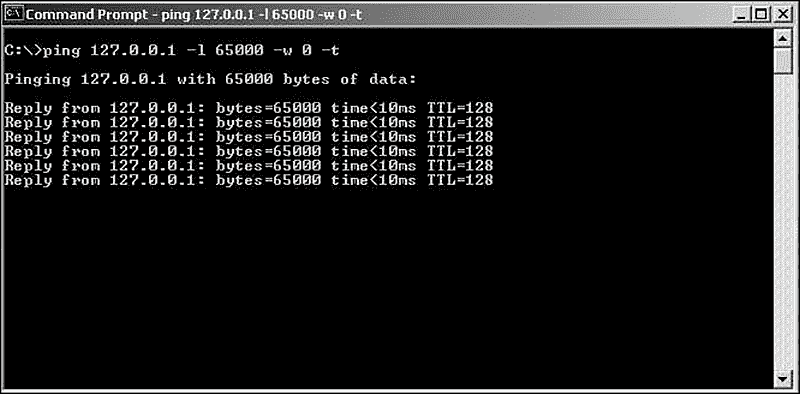

图 4.1 从命令提示符进行 `ping`。

此时发生的情况是这台机器正在不断向目标机器发送 ping。

```
ping <目标机器地址> -l 65000 -w 0 -t
```


如前所述，DDoS 攻击正变得越来越常见。大多数此类攻击依赖于让各种机器（服务器或工作站）来攻击目标。分布式反射拒绝服务攻击是一种特殊的 DoS 攻击。与所有此类攻击一样，它是通过黑客让若干台机器攻击选定的目标来实现的。然而，这种攻击的工作方式与其他 DoS 攻击略有不同。它不是让计算机去攻击目标，而是欺骗互联网路由器去攻击目标。

互联网骨干网上的许多路由器在端口 `179` 上进行通信。分布式反射 DoS 攻击利用这条通信链路，让路由器攻击目标系统。这种攻击特别险恶之处在于，它不需要相关的路由器以任何方式被攻破。攻击者不需要在路由器上安装任何软件即可使其参与攻击。相反，黑客向各种路由器发送一串请求连接的数据包。这些数据包经过了修改，使其看起来像是来自目标系统的 IP 地址。路由器通过启动与目标系统的连接来做出响应。来自多个路由器的连接洪流全部命中同一个目标系统，导致目标系统无法访问。

### 用于 DoS 攻击的常用工具

与书中讨论的任何安全问题一样，你会发现黑客手中拥有海量的工具。DoS 领域也不例外。虽然开始分类或讨论所有这些工具显然超出了本书的范围，但对其中几个工具进行简要介绍将证明是有用的。

### 低轨道离子炮 (Low Orbit Ion Cannon)

低轨道离子炮 (LOIC) 是可用最为人知的 DoS 工具之一。它有一个非常易于使用的图形用户界面，如图 4.2 所示。

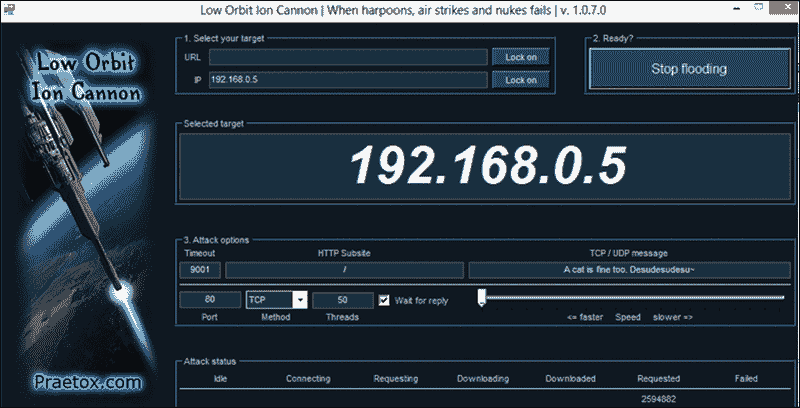

图 4.2 LOIC。

这个工具非常容易使用。正如图 4.2 所示，它只需要用户输入目标 URL 或 IP 地址然后开始攻击。幸运的是，这个工具并不能隐藏攻击者的地址，因此相对容易将攻击追溯到源头。这是一个老旧的工具，但今天仍被广泛使用。有一个类似的工具名为高轨道离子炮 (HOIC)。

### XOIC

XOIC 与 LOIC 类似。它有三种模式，如图 4.3 所示：你可以发送消息、执行简短测试或启动 DoS 攻击。


图 4.3 XOIC。

与 LOIC 一样，XOIC 非常容易使用。它只是一个点点的图形用户界面。即使是技能最低的攻击者也可以用它发起 DoS 攻击。

### TFN 和 TFN2K

部落洪水网络 (TFN) 和 TFN2K 是两个最古老的 DoS 工具，今天已不再被广泛使用。将它们列在此处出于历史目的。TFN2K 是 TFN 的较新版本，同时支持 Windows Server 和 UNIX 平台（并可以轻松移植到其他平台）。它具有一些功能，使得检测比其前身更加困难，包括发送诱骗信息以避免被追踪。精通使用 TFN2K 的专家可以使用多个代理的资源来协调对一个或多个目标的攻击。此外，TFN 和 TFN2K 可以执行各种攻击，例如 UDP 洪水攻击、ICMP 洪水攻击和 TCP SYN 洪水攻击（本章稍后部分将讨论这些）。

TFN2K 在两个方面运行：首先，主系统上有一个命令驱动的客户端。其次，代理系统上运行着一个守护进程。攻击的工作原理如下：

1.  主系统指示其代理攻击一组指定的目标。
2.  代理通过向目标泛洪大量数据包来响应。

> 注意：使用 *master*（主）和 *slave*（从）这两个术语**仅**是为了与行业规范和标准中使用的官方术语相关，绝不会削弱 Pearson 在促进多样性、公平性和包容性，以及在我们所服务的全球学习者中挑战、反击和/或消除偏见和刻板印象方面的承诺。

通过该工具，由主系统协调的多个代理可以在攻击期间共同工作，以中断对目标的访问。此外，针对攻击者的若干“安全”功能显著增加了开发针对 TFN2K 有效且高效的反制措施的复杂性：

*   主到代理的通信是加密的，并可能与任意数量的诱骗包混合。
*   主到代理的通信以及攻击本身都可以通过随机的 TCP、UDP 和 ICMP 数据包发送。
*   主系统可以伪造其 IP 地址。

### Stacheldraht

Stacheldraht 没有像之前提到的 DoS 工具那样广为人知。Stacheldraht 在德语中是“铁丝”，是一种 DDoS 攻击工具，它结合了 Trinoo DDoS 工具（另一种常用工具）的功能与 TFN DDoS 攻击工具的源代码。与 TFN2K 一样，它增加了攻击者与 Stacheldraht 主之间通信的加密。它还增加了对代理的自动更新。

Stacheldraht 可以执行多种攻击，包括 UDP 洪水、ICMP 洪水、TCP SYN 洪水和 Smurf 攻击。它还能检测并启用源伪。

## DoS 漏洞

从攻击者的角度来看，任何 DoS 攻击的弱点都是数据包洪必须持续。一旦停止发送数据包，目标系统就会恢复。然而，DoS/DDoS 攻击经常与劫劫持防止服务器之间的身份验证或日志记录等另一种攻击形式结合使用。

如果黑客正在使用分布式攻击，一旦感染机器的管理员或所有者意识到他们的机器被感染，他们就会采取措施删除病毒并停止攻击。如果黑客试图从她自己的机器发起攻击，她必须意识到每个数据包都有追溯到其源头的可能。这意味着进行 DoS 攻击的单个黑客几乎会被当局抓住。由于由于原因，DDoS 攻击迅速成为最常见的 DoS 攻击类型。DDoS 攻击的细节将在本章后面讨论。

## 特定 DoS 攻击

DoS 攻击的基本概念并不复杂。对于攻击者来说，真正的问题是在不被发现的情况下执行攻击。本章接下来的几节将检查某些类型的 DoS 攻击并查看特定的案例研究。这些信息将帮助你对这种特定的网络威胁有更深入的理解。

TCP SYN 洪水攻击

这种攻击对大多数目标已不再有效，但它是网络史上的经典，值得简要讨论。这种特定的攻击取决于黑客对如何建立服务器连接的了解。当使用 TCP 的网络在客户端和服务器之间会话时，会向服务器发送一个设置了 SYN（同步）标志的数据包。该数据包请求目标服务器同步通信。服务器随后分配相应的资源，并向客户端发送一个同时设置了 SYN（同步）和 ACK（确认）标志的数据包。客户端机器随后应该通过设置 ACK 标志进行响应。这一过程被称为三次握手，总结如下：

1.  客户端发送一个设置了 SYN 标志的数据包。
2.  服务器分配资源并发送一个设置了 SYN 和 ACK 标志的数据包。
3.  客户端设置 ACK 标志进行响应。


针对 Web 服务器出现过许多著名的 SYN 洪攻击（SYN flood attacks）。这种攻击类型之所以流行，是因为任何参与 TCP 通信的机器都会受到其影响——而所有连接到互联网的机器都在进行 TCP 通信。这种通信显然是 Web 服务器存在的全部原因。阻止 DoS 攻击最简单的方法是通过防火墙规则。（我们将在第 9 章中详细讨论防火墙，“计算机安全技术](#ch09.xhtml#ch09)”。）配置适当的防火墙可以防止 SYN 洪攻击。然而，你可以在单个服务器上实施几种方法和技术来防止此类攻击。基本的防御技术如下：

*   微块 (Micro blocks)
*   SYN cookies
*   RST cookies
*   上游过滤 (Upstream filtering)
*   SPI 防火墙 (SPI firewalls)

这些方法中的某些比其他方法更具技术性。这里将对这些方法进行概括性讨论。当你被委托防御系统遭受此类形式的攻击时，你可以根据你的网络环境和专业水平选择最合适的方法，并在那时进一步检查系统。实施任何这些方法的具体细节将取决于你的 Web 服务器所使用的操作系统。你需要查阅操作系统的文档或适当的网站，以查找如何实现这些方法的明确指令。

### 微块 (Micro Blocks)

`micro block`（微块）的工作原理是简单地为 `SYN` 对象分配一个微记录，而不是分配一个完整的连接对象（整个缓冲区段）。通过这种方式，传入的 `SYN` 对象可以分配少至 16 字节的空间，这使得对系统进行泛洪变得变得困难得多。这种方法有点晦涩，而且在今天已不如像以前那样被广泛使用。它并不能真正阻止 DoS 攻击；仅仅是缓解其影响。

**注意**

许多网络管理员依赖防火墙来阻止 DoS 攻击，而不在单个服务器上采取任何补救措施。我建议你考虑结合这两种方法。是的，你应该有一个配置良好的防火墙来阻止许多 DoS 攻击，但你也应该考虑在单个服务器上采取缓解措施。

### SYN Cookies

正如名称`SYN cookies`所示，这种方法使用了 cookie，与许多网站使用的标准 cookie 类似。通过这种方法，系统不会立即为握手过程在内存中创建缓冲区空间。相反，它首先发送 `SYN+ACK`（开始握手过程的确认信号）。`SYN+ACK` 包含一个精心构建的 cookie，该 cookie 是作为包含请求连接的客户端机器的 IP 地址、端口号和其他信息的哈希值生成的。当客户端用正常的 `ACK`（确认）响应时，该 cookie 中的信息将被包含在内，服务器随后进行验证。因此，在握手过程的第三阶段之前，系统不会完全分配任何内存。这使得系统能够继续正常运行；通常，看到的唯一影响是禁用了大窗口。然而，SYN cookies 中使用的加密哈非常消耗资源，因此预计会有大量传入连接的系统管理员可能会选择不使用这种防御技术。

**附言：哈希 (Hashing)**

哈希值是由哈希函数生成的数字。哈希函数是一种算法，将任意大小的输入映射到固定长度的字节字符串。其输出通常称为哈希值、哈希码或校验和。哈希函数被广泛应用于各种领域，包括数据完整性、数字签名和密码存储。良好的哈希函数的某些属性包括它们是确定性的（相同的输入总是产生相同的输出）、计算快速且具有抗碰撞性（很难找到两个产生相同哈值的不同输入）。

哈希值是由哈希函数生成的数字。哈希函数是一种算法，将任意大小的输入映射到固定长度的字节字符串。其输出通常称为哈希值、哈希码或校验和。哈希函数被广泛应用于各种领域，包括数据完整性、数字签名和密码存储。良好的哈希函数的某些属性包括它们是确定性的（相同的输入总是产生相同的输出）、计算快速且具有抗碰撞性（很难找到两个产生相同哈值的不同输入）。

哈希值是由哈希函数生成的数字。哈希函数是一种算法，将任意大小的输入映射到固定长度的字节字符串。其输出通常称为哈希值、哈希码或校验和。哈希函数被广泛应用于各种领域，包括数据完整性、数字签名和密码存储。良好的哈希函数的某些属性包括它们是确定性的（相同的输入总是产生相同的输出）、计算快速且具有抗碰撞性（很难找到两个产生相同哈值的不同输入）。

哈希值是由哈希函数生成的数字。哈希函数是一种算法，将任意大小的输入映射到固定长度的字节字符串。其输出通常称为哈希值、哈希码或校验和。哈希函数被广泛应用于各种领域，包括数据完整性、数字签名和密码存储。良好的哈希函数的某些属性包括它们是确定性的（相同的输入总是产生相同的输出）、计算快速且具有抗碰撞性（很难找到两个产生相同哈值的不同输入）。

哈希值是由哈希函数生成的数字。哈希函数是一种算法，将任意大小的输入映射到固定长度的字节字符串。其输出通常称为哈希值、哈希码或校验和。哈希函数被广泛应用于各种领域，包括数据完整性、数字签名和密码存储。良好的哈希函数的某些属性包括它们是确定性的（相同的输入总是产生相同的输出）、计算快速且具有抗碰撞性（很难找到两个产生相同哈值的不同输入）。

哈希值是由哈希函数生成的数字。哈希函数是一种算法，将任意大小的输入映射到固定长度的字节字符串。其输出通常称为哈希值、哈希码或校验和。哈希函数被广泛应用于各种领域，包括数据完整性、数字签名和密码存储。良好的哈希函数的某些属性包括它们是确定性的（相同的输入总是产生相同的输出）、计算快速且具有抗碰撞性（很难找到两个产生相同哈值的不同输入）。

哈希值是由哈希函数生成的数字。哈希函数是一种算法，将任意大小的输入映射到固定长度的字节字符串。其输出通常称为哈希值、哈希码或校验和。哈希函数被广泛应用于各种领域，包括数据完整性、数字签名和密码存储。良好的哈希函数的某些属性包括它们是确定性的（相同的输入总是产生相同的输出）、计算快速且具有抗碰撞性（很难找到两个产生相同哈值的不同输入）。

哈希值是由哈希函数生成的数字。哈希函数是一种算法，将任意大小的输入映射到固定长度的字节字符串。其输出通常称为哈希值、哈希码或校验和。哈希函数被广泛应用于各种领域，包括数据完整性、数字签名和密码存储。良好的哈希函数的某些属性包括它们是确定性的（相同的输入总是产生相同的输出）、计算快速且具有抗碰撞性（很难找到两个产生相同哈值的不同输入）。

哈希值是由哈希函数生成的数字。哈希函数是一种算法，将任意大小的输入映射到固定长度的字节字符串。其输出通常称为哈希值、哈希码或校验和。哈希函数被广泛应用于各种领域，包括数据完整性、数字签名和密码存储。良好的哈希函数的某些属性包括它们是确定性的（相同的输入总是产生相同的输出）、计算快速且具有抗碰撞性（很难找到两个产生相同哈值的不同输入）。

哈希值是由哈希函数生成的数字。哈希函数是一种算法，将任意大小的输入映射到固定长度的字节字符串。其输出通常称为哈希值、哈希码或校验和。哈希函数被广泛应用于各种领域，包括数据完整性、数字签名和密码存储。良好的哈希函数的某些属性包括它们是确定性的（相同的输入总是产生相同的输出）、计算快速且具有抗碰撞性（很难找到两个产生相同哈值的不同输入）。

哈希值是由哈希函数生成的数字。哈希函数是一种算法，将任意大小的输入映射到固定长度的字节字符串。其输出通常称为哈希值、哈希码或校验和。哈希函数被广泛应用于各种领域，包括数据完整性、数字签名和密码存储。良好的哈希函数的某些属性包括它们是确定性的（相同的输入总是产生相同的输出）、计算快速且具有抗碰撞性（很难找到两个产生相同哈值的不同输入）。

哈希值是由哈希函数生成的数字。哈希函数是一种算法，将任意大小的输入映射到固定长度的字节字符串。其输出通常称为哈希值、哈希码或校验和。哈希函数被广泛应用于各种领域，包括数据完整性、数字签名和密码存储。良好的哈希函数的某些属性包括它们是确定性的（相同的输入总是产生相同的输出）、计算快速且具有抗碰撞性（很难找到两个产生相同哈值的不同输入）。

哈希值是由哈希函数生成的数字。哈希函数是一种算法，将任意大小的输入映射到固定长度的字节字符串。其输出通常称为哈希值、哈希码或校验和。哈希函数被广泛应用于各种领域，包括数据完整性、数字签名和密码存储。良好的哈希函数的某些属性包括它们是确定性的（相同的输入总是产生相同的输出）、计算快速且具有抗碰撞性（很难找到两个产生相同哈值的不同输入）。

哈希值是由哈希函数生成的数字。哈希函数是一种算法，将任意大小的输入映射到固定长度的字节字符串。其输出通常称为哈希值、哈希码或校验和。哈希函数被广泛应用于各种领域，包括数据完整性、数字签名和密码存储。良好的哈希函数的某些属性包括它们是确定性的（相同的输入总是产生相同的输出）、计算快速且具有抗碰撞性（很难找到两个产生相同哈值的不同输入）。

哈希值是由哈希函数生成的数字。哈希函数是一种算法，将任意大小的输入映射到固定长度的字节字符串。其输出通常称为哈希值、哈希码或校验和。哈希函数被广泛应用于各种领域，包括数据完整性、数字签名和密码存储。良好的哈希函数的某些属性包括它们是确定性的（相同的输入总是产生相同的输出）、计算快速且具有抗碰撞性（很难找到两个产生相同哈值的不同输入）。

哈希值是由哈希函数生成的数字。哈希函数是一种算法，将任意大小的输入映射到固定长度的字节字符串。其输出通常称为哈希值、哈希码或校验和。哈希函数被广泛应用于各种领域，包括数据完整性、数字签名和密码存储。良好的哈希函数的某些属性包括它们是确定性的（相同的输入总是产生相同的输出）、计算快速且具有抗碰撞性（很难找到两个产生相同哈值的不同输入）。

哈希值是由哈希函数生成的数字。哈希函数是一种算法，将任意大小的输入映射到固定长度的字节字符串。其输出通常称为哈希值、哈希码或校验和。哈希函数被广泛应用于各种领域，包括数据完整性、数字签名和密码存储。良好的哈希函数的某些属性包括它们是确定性的（相同的输入总是产生相同的输出）、计算快速且具有抗碰撞性（很难找到两个产生相同哈值的不同输入）。

哈希值是由哈希函数生成的数字。哈希函数是一种算法，将任意大小的输入映射到固定长度的字节字符串。其输出通常称为哈希值、哈希码或校验和。哈希函数被广泛应用于各种领域，包括数据完整性、数字签名和密码存储。良好的哈希函数的某些属性包括它们是确定性的（相同的输入总是产生相同的输出）、计算快速且具有抗碰撞性（很难找到两个产生相同哈值的不同输入）。

哈希值是由哈希函数生成的数字。哈希函数是一种算法，将任意大小的输入映射到固定长度的字节字符串。其输出通常称为哈希值、哈希码或校验和。哈希函数被广泛应用于各种领域，包括数据完整性、数字签名和密码存储。良好的哈希函数的某些属性包括它们是确定性的（相同的输入总是产生相同的输出）、计算快速且具有抗碰撞性（很难找到两个产生相同哈值的不同输入）。

哈希值是由哈希函数生成的数字。哈希函数是一种算法，将任意大小的输入映射到固定长度的字节字符串。其输出通常称为哈希值、哈希码或校验和。哈希函数被广泛应用于各种领域，包括数据完整性、数字签名和密码存储。良好的哈希函数的某些属性包括它们是确定性的（相同的输入总是产生相同的输出）、计算快速且具有抗碰撞性（很难找到两个产生相同哈值的不同输入）。

哈希值是由哈希函数生成的数字……（此处重复内容内容已省略翻译）

### RST Cookies

另一种比 `SYN cookies` 更容易实现的方法是 `RST cookies`。在这种方法中，服务器向客户端发送 `RST` 包。`RST` 包含一个精心构建的 cookie，该 cookie 是作为包含请求连接的客户端机器的 IP 地址、端口号和其他信息的哈希值生成的。当客户端用正常的 `ACK`（确认）响应时，该 cookie 中的信息将被包含在内，服务器随后进行验证。因此，在握手过程的第三阶段之前，系统不会完全分配任何内存。这使得系统能够继续正常运行；通常，看到的唯一影响是禁用了大窗口。然而，SYN cookies 中使用的加密哈非常资源，因此预计会有大量传入连接的系统管理员可能会选择不使用这种防御技术。

### 上游过滤 (Upstream Filtering)

ISP 经常使用称为上游过滤的过程，基本上涉及检查流量以确定其是否为 DoS 攻击并在目标处阻止怀疑的流量。

### SPI 防火墙

今天，大多数防火墙使用状态包检测。这些类型的防火墙对每个数据包应用规则，并维护客户端和服务器之间的通信状态。因此，它们意识到多个 SYN 数据包来自同一个地址，并阻止了它们。这就是 SYN 洪不再常见的主要原因之一。此外，下一代防火墙（NGFWs）结合了传统防火墙和其他功能，例如应用防火墙或入侵检测/预防系统（IDS/IPS）的功能。

#### Smurf IP 攻击 (Smurf IP Attacks)

Smurf 攻击是 DoS 攻击的一种非常流行的版本。一个 ICMP（互联网控制消息协议）包被发送到网络的广播地址。由于是广播，它通过回显数据包给网络主机，主机随后将其到伪造的源地址。此外，伪造的源地址可以在互联网的任何地方，而不只是本地子网。如果黑客能够持续发送此类数据包，她将导致网络本身对一个或多个成员服务器进行 DoS 攻击。这种攻击非常巧妙且简单。


蓝精灵攻击（Smurf attack）是某些恶意攻击者所采用的创造力例子。它有时被视为生物学中自身免疫性疾病过程的数字等物。在这种疾病中，免疫系统会攻击患者自身的身体。在 `Smurf` 攻击中，网络会对其自身的一个系统发动 `DoS` 攻击。这种方法的巧妙之处说明了为什么如果你负责网络系统安全，尝试以创造性且前瞻性的方式工作是多么重要。计算机攻击的实施者富有想象力，并且不断想出新技术。如果你的防御比攻击者的进攻缺乏创造力和技巧，那么你的系统被攻破只是时间问题。

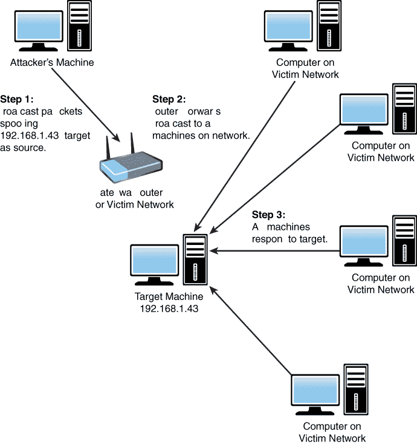

图 4.4 蓝精灵攻击。

有几种方法可以保护你的系统免受此类问题的影响。一种是防范木马程序。后续章节将介绍更多关于木马攻击的内容；现在，你只需要知道制定禁止员工下载应用程序的策略将会有帮助。此外，配备适当的病毒扫描器在保护你的系统免受木马攻击、从而免受蓝精灵攻击方面大有帮助。正如第 2 章中所讨论，使用代理服务器也是至关重要的。如果你的网络内部 IP 地址未知，那么在蓝精灵攻击中针对某个系统就会变得困难。当然，你所采取的最而易见的缓解措施是在防火墙上拦截所有入站广播包。保护系统最好的方法可能是结合这些防御措施，同时禁止定向广播，并修补主机拒绝响应任何定向广播。

蓝精灵攻击的一种变体被称为 `Fraggle`。`Fraggle` 的工作方式与蓝精灵攻击非常相似，但它专门使用端口 `7`（echo）和 `19`（chargen）发送广播地址，并伪造目标受害者的源 IP 地址。

### UDP 洪水攻击

正如你从第 2 章记忆的，`UDP` 是一种无连接协议，在数据传输之前不需要建立连接程序。在 `UDP 洪水攻击`中，攻击者向目标系统上的随机端口发送 `UDP` 数据包。当目标系统接收到 `UDP` 数据包时，它会自动确定哪个应用程序在等待目标端口。在这种情况下，由于没有应用程序在等待该端口，目标系统将生成一个 `ICMP` “目标不可到达”数据包并尝试将其发回伪造的源地址。如果有足够的 `UDP` 数据包发送到目标的端口，系统将由于尝试确定等待的应用程序（并不存在）以及生成并发回数据包而导致过载。

### ICMP 洪水攻击

`ICMP 洪水攻击` 有两种基本类型：洪水（floods）和核弹（nukes）。`ICMP 洪水`通常通过广播大量的 ping 或 `UDP` 数据包来实现。与其他洪水攻击一样，其核心思想是向目标系统发送如此大量的数据，以使其运行速度变慢。如果能强制其减慢到足够程度，目标将超时（即发送回复的速度不够快）并与互联网断开。`ICMP 核弹` 利用特定操作系统的已知漏洞。攻击者发送一个他知道目标系统操作系统无法处理的信息包。在许多情况下，这会导致目标系统死机。

在许多情况下，这会导致目标系统死机。


如今最常见的 DoS 攻击形式可能是 `DDoS 攻击`。这种攻击通过让各种机器攻击目标来实现。实现这一点的典型方法是发送特木马，使被感染的计算机在特定的日期和时间攻击指定的目标。这对于对任何目标执行 DDoS 攻击来说都是一种非常有效的方法。在这种形式的攻击中，攻击者并不直接控制涉及的各种机器。这些机器只是被某些恶意软件感染了，导致它们在特定的日期和时间参与攻击。

另一种方法是使用僵尸网络（`Botnets`）来协调攻击。`Botnets` 是被攻击者入侵的计算机网络，使该攻击者获得对受感染系统的控制权。这通常通过投递特木马来实现。然而，与上述的 DDoS 攻击形式不同，攻击者可以直接控制僵尸网络中的攻击机器。

### 优优球攻击 (Yo-Yo Attack)

优优球攻击是一种 DoS 攻击，目标是使用自动伸缩容的云托管托管应用程序。攻击者本质上是淹没目标，导致云托管服务扩展规模以处理增加的流量。随后，攻击者停止攻击，等待云主机收缩规模，然后恢复攻击。云服务通常会对扩展规模以处理更多带宽收取费用，因此优优球攻击增加了目标的成本。

### 登录攻击 (Login Attacks)

攻击者可能通过应用程序中的另一个漏洞枚举用户名，然后使用`有效的用户名和错误的密码`尝试对网站进行身份验证，这将在失败尝试指定的次数后锁定账户。此时，合法的用户将无法使用该网站。

另一种登录攻击涉及攻击者通过不断发送登录请求来使登录过程过载，这些请求需要演示层访问身份验证机制，导致其响应`不可用或异常缓慢`。

许多网站使用 CAPTCHA（验证码）来阻挡 DoS 攻击尝试。如果每次登录尝试都需要用户回答 CAPTCHA，自动化工具就无法执行 DoS 攻击。

### CLDAP 反射 (CLDAP Reflection)

无连接轻量级目录访问协议（CLDAP）是 `RFC 3352` 中定义的行业标准。该协议使用 UDP 而不是 TCP，并为连接到网络的新主机分配 IP 地址。在 CLDAP 反射攻击中，攻击者本质上用大量的 CLDAP 请求淹没网络。

4. [`datatracker.ietf.org/doc/html/rfc3352`](https://datatracker.ietf.org/doc/html/rfc3352)

### 服务降级攻击 (Degradation of Service Attacks)

虽然缩写仍然是 DoS，但服务降级攻击与拒绝服务攻击有所不同。攻击者通过短时间的流量爆发针对目标网站。这会导致目标网站响应变慢，而不是崩溃。这通常是持续进行的，以导致目标服务的持续降级。

### 挑战坍塌攻击 (Challenge Collapsar Attack)

在挑战坍塌攻击（CC 攻击）中，攻击者向目标 Web 服务器发送频繁的 HTTP 请求。这些请求包括统一资源标识符，要求目标网站使用耗时的数据库操作。其目标是耗尽目标网站的资源。

### EDoS (经济拒绝可持续性攻击)

2022 年的一份报告预测，一种被称为经济拒绝可持续性（EDoS）攻击的新攻击类型将在不久将来成为一个更突出的问题。这种攻击的理念是中断或停止云资源的可用性。此类攻击可能涉及发送伪请求的机器人。这些攻击通常用于针对基础设施即服务（IaaS）解决方案。

5. [`www.tripwire.com/state-of-security/security-data-protection/cloud/edos-the-next-big-threat-to-your-cloud/`](https://www.tripwire.com/state-of-security/security-data-protection/cloud/edos-the-next-big-threat-to-your-cloud/)

### DoS 攻击的真实世界案例

我们花了大量时间来讨论各种 DoS 攻击实施的基本知识。到目前，你应该已经牢牢了什么是 DoS 攻击，并对其工作原理有了基本的了解。现在是时候开始讨论此类攻击的具体真实世界案例了。本节将结合你所学的理论知识，提供其应用的真实世界实例。

#### Google 攻击

2020 年 10 月，发生了一次针对 Google 的破纪录 UDP 放大攻击。这次攻击被追溯到三个中国互联网服务提供商，利用多个网络伪造了每秒 1.67 亿数据包（mps）。

#### AWS 攻击

同样在 2020 年，针对 Amazon Web Services 发生了大规模的 CLDAP 反射攻击。攻击使用了全球 Mirai 僵尸网络，每秒发送了 172 万次请求。

#### 波士顿环报攻击

2017 年 11 月 8 日，《波士顿环报》（`Boston Globe`）遭受了针对针对 [bostonglobe.com](http://bostonglobe.com) 以及该公司旗下其他网站的大规模 DDoS 攻击。该攻击还中断了公司的电话服务。

#### Memcache 攻击

2017 年 2 月，出现了一种新的 DDoS 攻击矢量。攻击者利用 `memcache`（一种缓存系统）来放大流量。请求可以被放大数千倍。

#### DDoS 勒索

2015 年 11 月，澳大利亚公司 FastMail 成为一次 DDoS 攻击的受害者。首先系统遭到攻击并离线。在第二次攻击后，受害者收到了勒索。攻击者要求支付 20 个比特币以停止攻击。类似的攻击曾针对 Protonmail 发起。

#### Mirai

Mirai 是一种将 Linux 机器变成僵尸网络以用于 DDoS 攻击的恶意软件。首次出现在 2016 年 8 月。这种恶意软件针对物联网（IoT）设备作为 DDoS 攻击的依据。

### 如何防御 DoS 攻击

没有规定防止所有 DoS 攻击的方法，就像没有绝对防止黑客攻击的方法一样。然而，你可以采取一些措施来降低危险。某些方法，例如 `SYN cookies` 和 `RST cookies` 已经提到。在本节中，将探讨一些使你的系统不易受到 DoS 攻击的措施。

首先要考虑的问题之一是这些攻击是如何实施的。它们可能通过在网上发送错误信息的 ICMP 包或使用 `ping` 和 `traceroute` 工具发送。如果你有防火墙（你绝对应该有一个），那么只需配置它拒绝来自外部网络的 ICMP 包，就是保护你的网络免受 DoS 攻击的重要步骤。由于 DoS/DDoS 攻击可以通过多种协议执行，你也可以配置防火墙阻止任何传入流量，无论其发生在什么协议或端口。这种方法看起来可能激进，但它确实是安全的。

# 实践

拦截 ICMP 包

从外部网络进入你的网络的 ICMP 包只有极少合法的理由（某些人认为没有好的理由）。因此，拦截此类包通常是防御 DoS 攻击策略的一部分。顺便提一下，拦截这些包还会让攻击者扫描你的网络变得更加困难。


还可以使用 `netstat` 等信息工具检测来自某些 DoS 工具（如 `TFN2K`）的威胁。许多此类工具可以配置为寻找 `SYN_RECEIVED` 状态，这种状态可能表明存在 SYN 洪水攻击（SYN flood attack）。

如果你的网络足够大并拥有内部路由器，那么你可以配置这些路由器以拒绝任何非源自你网络的流量。这样，即使数据包通过了你的防火墙，它们也不会在整个网络中传播。你还应该考虑在所有路由器上禁用定向 IP 广播（directed IP broadcasts）。这种策略可以防止路由器向网络上的所有机器发送广播包，从而停止许多 DoS 攻击。此外，你可以在路由器上安装过滤器，以验证外部数据包确实具有外部 IP 地址，而内部 IP 地址具有内部 IP 地址。

由于许多分布式 DoS 攻击依赖于利用“无辜”的计算机作为发射点，减少此类攻击的方法之一是保护你的计算机免受病毒攻击和木马的侵害。这个问题将在后面的章节中进行详细讨论，但现在，重要的是你要记住三件事：

- 始终使用病毒扫描软件并保持其更新。
- 始终保持操作系统和软件补丁的更新。
- 制定组织政策，规定除非经过 IT 人员批准，否则员工不能在其机器上下载任何内容。

黑洞（Blackholing）和引洞（Sinkholing）是用于缓解 DoS 和 DDoS 攻击的技术。如果流量被确定为 DoS 攻击，该流量将被发送到“黑洞”——即一个不存在的服务器/接口。互联网服务提供商也使用这种策略。引洞（`Sinkholes`）用于分析流量并拒绝恶意包的 IP 地址。流量被发送到引洞以便进行分析。

此外，入侵防御系统（`IPSs`）常用于检查并阻止拒绝服务攻击。

如前所述，这些步骤都不能让你的网络完全安全，免受成为 DoS 攻击的受害者或发射点的风险，但它们将有助于降低任何一种情况发生的概率。在 ISP 处结合黑洞和引洞技术，配合网络上的 IPS，可以提供合理的保护。关于此主题的一个良好资源是 SANS 学院网站，地址为 [www.sans.org/dosstep/](http://www.sans.org/dosstep/)。该网站提供了关于防止 DoS 攻击的一些建议。

### 总结

DoS 攻击是网上最常见的攻击之一。它们容易实施，不需要攻击者具备很高的技术水平，并且可能对目标系统造成破坏性影响。只有病毒攻击比它们常见。（而且在某些情况下，病毒可以是 DoS 攻击的源头。）在练习中，你将练习停止 DoS 攻击。

### 测试你的技能

### 单选题

**1.** 在考虑可以在你的系统上执行的各种攻击时，了解哪些攻击是最常见的是重要的。在以下选项中，哪一个是对系统最常见且简单的攻击之一？

**A.** 拒绝服务攻击
**B.** 缓冲区溢出
**C.** 会话劫持
**D.** 密码破解

**2.** 所有 DoS 攻击都建立在超出系统工作负载能力的基础上。因此，测量系统的工作负载至关重要。以下哪项不是定义计算机工作负载的有效方法？

**A.** 同时用户数
**B.** 存储容量
**C.** 最大电压
**D.** 网络连接速度

**3.** 从几台机器上同时发起的 DoS 攻击称为什么什么？

**A.** 广域攻击
**B.** Smurf 攻击
**C.** SYN 洪水
**D.** DDoS 攻击

**4.** 了解不同类型的 DoS 攻击及其症状是重要的。保持连接半开是哪种类型攻击的症状？

**A.** Smurf 攻击
**B.** 部分攻击
**C.** SYN 洪水攻击
**D.** DDoS 攻击

**5.** 虽然执行 DoS 攻击有许多种不同的方法，但它们都基于同一个想法。DoS 攻击背后的基本概念是什么？

**A.** 计算机处理 TCP 数据包的能力得不好。
**B.** 计算机只能处理有限的负载。
**C.** 计算机无法处理大量的 TCP 流量。
**D.** 计算机无法处理大负载。

**6.** 从攻击者的角度来看，DoS 攻击中最具意义的弱点是什么？

**A.** 攻击往往是失败的。
**B.** 攻击很难执行。
**C.** 攻击很容易停止。
**D.** 攻击必须持续进行。

**7.** 最常见的 DoS 攻击类型是什么？

**A.** 分布式拒绝服务
**B.** Smurf 攻击
**C.** SYN 洪水
**D.** 死亡之信 

**8.** 一系列防御措施可以帮助防御 DoS 攻击。防止 SYN 洪水攻击的三种方法是？

**A.** SYN cookies、RST cookies 和栈调优
**B.** SYN cookies、DoS cookies 和栈调优
**C.** DoS cookies、RST cookies 和栈删除
**D.** SYN cookies、DoS cookies 和栈删除

**9.** Juan 正在向公司的运营人员解释哪些攻击会导致网络自身发起 DoS 攻击？

**A.** SYN 洪水
**B.** 死亡之信 
**C.** Smurf 攻击 
**D.** DDoS 

**10.** 依赖于返回哈希的防御名称是什么？

**A.** 栈调优
**B.** RST cookies
**C.** SYN cookies
**D.** 哈希调优

**11.** 依赖于发送错误的 SYN/ACK 的防御类型是？

**A.** 栈调优
**B.** RST cookies
**C.** SYN cookies
**D.** 哈希调优

**12.** 你正试图向新的安全技术解释各种 DoS 攻击。你想确保她区分这些攻击并注意到特定攻击的迹。哪种类型的防御依赖于让未完成连接超时？

**A.** 栈调优
**B.** RST cookies
**C.** SYN cookies
**D.** 哈希调优

**13.** 哪种攻击依赖于发送服务器无法处理的大包？

**A.** 死亡之信
**B.** Smurf 攻击
**C.** Slammer 攻击
**D.** DDoS

**14.** 你想确保你的团队能够识别各种 DoS 攻击向量。哪种攻击利用受害者的网络路由器对目标发起 DoS 攻击？

**A.** 死亡之信
**B.** Smurf 攻击
**C.** Slammer 攻击
**D.** DDoS

**15.** 如果你是一个网站开发者并担心 DoS 攻击，你可以在网站本身实施的一种缓解技术是什么？

**A.** 带宽限制
**B.** Web 应用防火墙
**C.** 使用 HTTPS 加密
**D.** CAPTCHA

**16.** 保护内部路由器如何帮助防御 DoS 攻击？

**A.** 如果内部路由器是安全的，攻击就不会发生。
**B.** 因为攻击源自网络外部，保护内部路由器无法帮助防御 DoS 攻击。
**C.** 安全路由器只会停止基于路由器的 DoS 攻击。
**D.** 它将防止攻击在网络段之间传播。

**17.** 你对你的内部路由器做什么可以帮助防御 DoS 攻击？


A. 禁止所有未加密的流量

B. 禁止所有来自网络外部的流量

C. 禁止所有来自网络内部的流量

D. 禁止所有来自不可信源的流量

[18.appb.xhtml#ch04que18] Dorothy 是一名网络管理员。她的系统正遭受一种攻击，该攻击利用机器人向她公司使用的云资源发送虚假请求。这导致这些资源的可用性受到中断。这种攻击最好的描述是哪一个？

A. PDoS
B. DDoS
C. EDoS
D. DoS

[19.appb.xhtml#ch04que19] 没有任何攻击缓解策略是完美的，你必须允许至少一些流量进出你的网络，否则你的网络将毫无用处。你可以对防火墙做些什么来防御至少某些 DoS 攻击？

A. 阻塞所有入站流量
B. 阻塞所有入站 TCP 包
C. 阻塞端口 80 的所有入站流量
D. 阻塞所有入站 ICMP 包

[20.appb.xhtml#ch04que20] 你正在尝试识别所有潜在的 DoS 攻击向量。在此过程中，你希望为这些攻击向量中的每一个提供缓解措施。为什么防御特木马攻击会减少 DoS 攻击？

A. 许多拒绝服务攻击是通过特木马让毫无防备的机器执行 DoS 攻击来实现的。
B. 如果你能阻止特木马攻击，你也将阻止 DoS 攻击。
C. 特木马通常会打开端口，从而允许 DoS 攻击发生。
D. 特木马的效果与 DoS 攻击非常相似。

## 练习

### 练习 4.1：执行 DoS 攻击

注意，此练习最好在实验室环境下进行，因为那里有几台机器可供使用。

1. 设置一台机器（最好是容量非常有限的机器）运行一个小型 Web 服务器。（你可以从 [www.apache.org](http://www.apache.org) 免费下载 Windows 或 Linux 版的 Apache。）

2. 使用 `ping` 工具配合其他其他计算机尝试对该 Web 服务器执行简单的 DoS 攻击。这种尝试通过让其他机器开始对目标机器进行持续 ping 来实现，使用命令 `ping -l 65000 -w0 -t <target address>`。

3. 你一次只应向“攻击”添加一到三台实验机器。（从一台开始，增加几台，然后再再增加几台。）

4. 随着你添加机器的机器，记录另一台机器打开目标服务器主页所需的时间。还要注意阈值（即该服务器完全停止响应的时间）。

### 练习 4.2：停止 SYN 洪水攻击

注意，此练习属于高级内容。某些学生可能希望分组进行。

1. 在网络上或你的操作系统的文档中查找实现 `RST cookie` 或 `SYN cookie` 的说明。

2. 在你自己的机器或教师指定的机器上遵循这些实现说明。以下网站可能在这方面为你提供帮助：

*  **Linux:** [`www.rootinstall.com/tutorial/how-to-prevent-syn-flood-attacks-in-linux/`](https://www.rootinstall.com/tutorial/how-to-prevent-syn-flood-attacks-in-linux/)
*  **Windows:** [`learn.microsoft.com/en-us/answers/questions/144446/synattackprotect.xhtml`](https://learn.microsoft.com/en-us/answers/questions/144446/synattackprotect.xhtml)
*  **Linux 和 Windows:** [`purplesec.us/prevent-syn-flood-attack/`](https://purplesec.us/prevent-syn-flood-attack/)

### 练习 4.3：使用防火墙设置

此练习仅适用于可以访问实验室防火墙的学生。

1. 使用你防火墙的文档查看如何阻塞 ICMP 包。
2. 设置你的防火墙以阻塞这些包。

### 练习 4.4：使用路由器设置

此练习仅适用于可以访问实验室路由器的学生。

1. 使用你路由器的文档查看如何阻塞并非源自你自己网络的流量。
2. 设置你的路由器以阻塞该流量。

## 项目

### 项目 4.1：采用替代防御

1. 使用网络或其他研究工具，搜索防御通用 DoS 攻击或特定类型 DoS 攻击的替代手段。这可以是本章中提到的之外的任何防御措施。
2. 编写一篇关于该防御技术的简短论文。

### 项目 4.2：防御特定的拒绝服务攻击

1. 使用网络或其他工具，找到一个在过去 6 个月内发生的 DoS 攻击。你可以在 [www.f-secure.com](http://www.f-secure.com) 找到一些资源。
2. 注意该攻击是如何进行的。
3. 编写简短说明，你可能会如何防御该特定攻击。

### 项目 4.3：加固 TCP 栈以防止 DoS

注意，此项目需要访问实验机器。它还是一个长期项目，需要学生花费一些研究时间。

1. 使用手册、供应商文档和其他资源，找到一种修改 TCP 以帮助防止 DoS 攻击的方法。
2. 使用这些信息，在你的实验计算机上实现其中一种方法。

## 案例研究

Runa Singh 是一家中型公司的网络网络管理员。该公司已经有了防火墙，网络通过路由器分成了段，并在所有机器上安装了病毒扫描程序。Runa 想要采取额外措施防止 DoS 攻击。她采取了以下行动：

*  她调整了防火墙，使其不允许任何 ICMP 包。
*  她更改了 Web 服务器使其使用 SYN cookie。

现在考虑以下问题：

1. 她的措施是否存在问题？如果是，问题是什么？
2. 你会向 Runa 建议哪些额外步骤？

## 第 5 章：恶意软件

## 目标

在阅读本章并完成练习后，你将能够：

*  理解病毒（蠕虫）及其如何传播，包括 WannaCry、Pegasus 和 Titanium 这样的著名病毒
*  了解某些病毒爆发的知识
*  理解病毒扫描程序的动态机制
*  理解什么是特木马以及它是如何运行的
*  了解几种特定的特木马攻击
*  理解勒索软件以及勒索软件的最新趋势
*  掌握缓冲区溢出攻击的概念
*  更好地理解间谍软件及其如何进入系统
*  使用良好的实践、防病毒软件和反间谍软件防御各种攻击

## 引言

在第 4 章“拒绝服务攻击”中，我们研究了拒绝服务（DoS）攻击，这非常常见且容易实施。在本章中，我们将通过查看其他类型的攻击继续对安全威胁的检查。首先，你将学习病毒爆发。我们的讨论将放在有关病毒攻击如何以及为什么运作的信息上，包括通过特木马进行的部署。本章不是“如何创建你自己的病毒”教程，而是对这些攻击底层概念的介绍，以及对某些特定案例研究的分析。


本章还将探索病毒、蠕虫、缓冲区溢出攻击、间谍软件以及其他多种形式的恶意软件。它们都有独特的攻击方式，在防御系统时需要考虑每一种。通过扩展对它们如何工作原理的知识，你将增强防御此类攻击的能力。在章节末的练习中，你将有机会研究病毒的预防方法，并尝试使用来自 McAfee、Norton、AVG、Bitdefender、卡 persky、Malwarebytes 以及其他防病毒厂商的防病毒方法。

在继续之前，有两个重要的事实需要记住。第一，本章描述的类别在现实世界的恶意软件中并不总是清晰的。例如，单个恶意软件可能结合了病毒功能和间谍软件能力，并可能用于发起 DoS 攻击。学习和理解恶意软件的类别仍然很重要，但你也需要意识到许多现实世界的恶意软件示例跨越了多个类别。第二个需要记住的事实是，恶意软件的世界是非常动态的。变化非常快。我们将研究一些在恶意软件历史上具有重要地位、值得研究的特定示例，但始终保持关注并不断回顾最近的恶意软件病毒爆发是一个好主意。

## 病毒

根据定义，计算机病毒是一种能够自我复制的程序。有些来源将病毒定义为必须附着在另一个文件（如可执行文件）才能运行的文件。然而，这并不准确。通常情况下，病毒还会具有一些其他不愉快的功能，但自我复制和快速传播是病毒的特征。通常，这种增长本身就会对受感染的网络造成问题。任何快速传播的病毒都会降低网络的功能和响应速度。仅仅超过网络设计承载的流量负载就可能导致网络临时失效。臭名昭昭的 ILOVEYOU 病毒实际上并没有负面负载，但它产生的海量邮件拖慢许多网络。

### 病毒是如何传播的

病毒通常主要通过几种方式之一传播。第一种是简单地将自己通过电子邮件发送给通讯录中的所有人。另一种方法是扫描你的计算机与网络的连接，然后将自己复制到你的计算机可以访问的网络其他机器上。病毒也可以存储在 USB 设备或光介质等便携介质上。病毒也可以通过合法文件掩盖；在这种情况下，它被称为特洛伊马。有时网站会被感染病毒，当有人访问该网站时，该人的计算机就会被感染。

电子邮件方法是病毒传播最常见的方法之一，Microsoft Outlook 可能是经常受到此类病毒攻击的电子邮件程序。其原因与其说是 Outlook 存在安全漏洞，不如说是使用 Outlook 过于方便。所有的 Microsoft Office 产品在设计时，都允许为企业编写软件的合法程序员访问应用程序的许多内部对象，从而轻松创建与 Microsoft Office 套件中的应用程序集成的应用程序。例如，程序员可以写一个程序，能够访问 Word 文档、导入 Excel 表格，然后使用 Outlook 自动将生成的文档通过电子邮件发送给相关方。微软在让这一过程变得非常简单方面做得很好，完成这些任务通常只需要少量的编程工作。使用 Outlook，少于五行代码即可引用 Outlook 并发送电子邮件。这意味着一个程序可以导致 Outlook 本身在用户不知情的情况下发送电子邮件。互联网上有大量的代码示例确切地展示了如何这样做，并且是免费供人获取的。由于这个原因，不需要非常高明的程序员就能访问你的 Outlook 通讯录并自动发送电子邮件。本质上讲，编程 Outlook 的易用性就是为什么有这么多针对 Outlook 的病毒攻击的原因。

虽然绝大多数病毒攻击是通过利用受害者的现有电子邮件软件传播的，但某些病毒爆发使用了其他方法进行传播，例如它们自己的内部邮件引擎。另一种病毒传播方法是让病毒简单地跨网络复制自己。通过多种途径传播的病毒爆发正变得越来越常见。

交付负载的方法可能相当简单，可能更多地取决于终端用户的疏忽，而不是病毒编写者的技巧。诱导用户访问或打开他们不应该访问或打开的文件是交付病毒的常用方法，而且这种方法完全不需要编程技能。无论病毒如何到达你家门口，一旦它进入了你的系统，它就会尝试传播，在很多情况下，它还会尝试对你的系统造成某些伤害。一旦病毒进入你的系统，它就可以做任何合法程序能做的事情——所以它可能会删除文件、更改系统设置或造成其他伤害。

### 病毒的类型

有许多类型的病毒。在本节中，我们将简要查看一些主要的病毒类型。病毒可以根据其传播方式或其在目标计算机上的活动进行分类。

-  **宏（Macro）：** 宏病毒感染办公文档中的宏。许多办公产品（包括 Microsoft Office）允许用户编写称为“宏”的微程序。这些宏也可以被写成病毒。宏病毒被写入某些业务应用程序的宏中。例如，Microsoft Office 允许用户编写宏来自动化某些任务。Microsoft Outlook 的设计使得程序员可以使用 Visual Basic 编程语言的一个子集编写脚本，称为 Visual Basic for Applications (VBA)。这种脚本语言实际上内置在所有 Microsoft Office 产品中。程序员也可以使用与之密切相关的 VBScript 语言。这两种语言都非常容易学习。如果此类脚本附在电子邮件中，且收件者使用 Outlook，那么脚本就可以执行。该执行可以完成任何事情，包括扫描通讯录、查找地址、发送电子邮件、删除电子邮件等。
-  **启动区病毒（Boot sector）：** 正如名称所示，这种类型的病毒感染驱动器的启动区。此类病毒很难被防病毒软件发现，因为大多数防病毒软件运行在操作系统内部，而不是在启动区中。
-  **多部分病毒（Multi-partite）：** 多部分病毒通过多种方式攻击计算机，例如感染硬盘的启动区和一个或多个文件。
-  **内存驻留病毒（Memory resident）：** 内存驻留病毒安装自己，然后从计算机启动到关机一直保留在 RAM 中。
-  **加壳病毒（Armored）：** 加壳病毒使用了难以分析的技术。代码混淆就是这样一种方法。代码的编写方式使得如果病毒被反汇编，代码将无法被跟踪。压缩代码是病毒加壳的另一种方法。


*  **稀疏感染病毒 (Sparse infector):** 稀疏感染病毒试图通过偶尔执行其恶意活动来逃避检测。使用稀疏感染病毒时，用户会看到短暂的症状，然后是一段时间没有症状。在某些情况下，稀疏感染病毒针对特定的程序，但该病毒只在目标程序执行第 10 次或第 20 次时执行。或者，稀疏感染病毒可能会进行爆发式的活动，然后休眠一段时间。该主题有许多变体，但基本原理是相同的：减少攻击频率，从而降低被检测的机会。

*  **多态病毒 (Polymorphic):** 多态病毒字面意思是经常改变其形式，以避免防病毒软件的检测。

*  **变态病毒 (Metamorphic):** 变态病毒是多态病毒的一种特殊情况，它会定期完全重写自己。此类病毒非常罕见。

*  **驻留内存 (Memory resident):** 内存病毒加载到内存中。如果该病毒是由宿主应用程序启动的，那么即使宿主应用程序已经卸载并停止执行，内存病毒也将保持在内存中活跃状态。

这些大类定义了病毒的般行为。无疑还有其他类别，但它们包含在列表中的大类中。例如，`空隙病毒 (cavity virus)`，也被称为`空间填充病毒 (space filler virus)`，它寻找现有文件中的空隙以插入病毒代码。之前列出的任何一类别的病毒都可以将自己安装为空隙病毒。另一方面，`覆盖病毒 (overwrite virus)` 会完全覆盖现有的文件（通常是系统文件）。

## 病毒示例

病毒攻击的威胁不言而喻。虽然许多网页都提供了有关病毒的信息，但在我看来，只有少数网页能持续提供关于病毒爆发的最新、最可靠、最详细的信息。任何安全专业人员都会想要定期咨询这些网站。你可以在以下网站阅读更多关于过去和现在病毒的知识：

* [什么是恶意软件、病毒、蠕虫、木马及其他](https://www.csoonline.com/article/3295877/what-is-malware-viruses-worms-trojans-and-beyond.xhtml)https://www.csoonline.com/article/3295877/what-is-malware-viruses-worms-trojans-and-beyond.xhtml
* [网络安全恶意软件病毒常见问题解答](https://us.norton.com/internetsecurity-malware-virus-faq.xhtml)https://us.norton.com/internetsecurity-malware-virus-faq.xhtml
* [病毒基础](https://www.us-cert.gov/publications/virus-basics)https://www.us-cert.gov/publications/virus-basics
* [2022 年五大重大勒索软件攻击](https://www.cm-alliance.com/cybersecurity-blog/5-major-ransomware-attacks-of-2022)https://www.cm-alliance.com/cybersecurity-blog/5-major-ransomware-attacks-of-2022
* [历史上最臭名昭彰的恶意软件攻击](https://www.makeuseof.com/most-notorious-malware-attacks-ever/)https://www.makeuseof.com/most-notorious-malware-attacks-ever/

接下来的章节将查看一些真实世界的病毒爆发。我们将检查非常最近的病毒，以及一些 10 年或更早之前的示例。这应该让你对病毒在现实世界中的行为有一个相当全面的概述。

### Black Basta (黑色斯塔)

Black Basta 是 2022 年 4 月首次发现的勒索软件。让这种勒索软件引注目的微妙之处之一是，它有 Linux 和 Windows 的变体。在 Windows 域控制器上时， Black Basta 会创建一个组策略来禁用 Windows。

### Titanium (钛金属)

在 2019 年 11 月，卡巴斯基报告了 Titanium，一种高级持续性威胁（APT）。APT 是指在很长时间内进行的高级攻击。（命令控制计算机是僵尸网络用于控制其他计算机的计算机。这些是管理僵尸网络的核心节点。）

### WannaCry (永性加密蠕虫)

在 2017 年 3 月，WannaCry 席卷全球。这种病毒有一个奇怪的特征：它有一个内置的杀毒。

### Petya (彼特雅)

Petya 首次发现于 2016 年，并持续到 2018 年。它的名字源于 1995 年的詹姆斯·邦电影《金手指》。

### Shamoon (沙姆)

Shamoon 病毒首次发现于 2012 年，其变体在 2017 年再次抬头。

### Rombertik (罗伯蒂克)

Rombertik 在 2015 年造成了破坏。这种恶意软件利用浏览器读取用户凭据。

### Gameover ZeuS (游戏结束 西斯)

Gameover ZeuS 是一种创建点对点僵尸网络的病毒。本质上，它在感染计算机与命令控制计算机之间建立加密通信，允许攻击者控制各种被感染的计算机。


随着 IoT 设备使用的日益增长，这些设备日益成为恶意软件的目标，这并不令人意外。最广为人知的 IoT 恶意软件可能是 `Mirai`。在整个 2016 年期间，`Mirai` 感染了运行 `Linux` 的 IoT 设备，将它们变成可以被远程控制的机器人。这些设备随后被用于执行分布式拒绝服务攻击。

虽然 `Mirai` 值得关注，但它并不是第一个针对 IoT 设备的恶意软件。从 2014 年到 2016 年，`BASHLITE` 一困扰着 IoT 设备。这种用 `C` 语言编写的恶意软件可以编译为多种架构和操作系统。它主要用于发起拒绝服务攻击。

### 亚特兰大的勒索软件攻击

佐治亚州的亚特兰大市在 2018 年 3 月遭到了勒索软件攻击。该市许多系统受到了影响，包括公用事业、法院和其他基础系统。两名伊朗黑客 Faramarz Savandi 和 Mohammed Mansouri 因这次攻击被起诉。这次攻击之所以值得关注，有几个原因：第一，它使用了 `SamSam` 勒索软件，该软件不是通过网络钓鱼获取系统权限，而是通过暴力破解密码。第二个问题是，亚特兰大此前曾因为在安全方面的投入不足而受到批评。在攻击发生前仅 2 个月的一项审计发现了 1500 到 2000 个漏洞。

### Mindware

2022 年，`Mindware` 成为了一个巨大的威胁。使用这种勒索软件的攻击从 2022 年 3 月和 4 月开始引起关注。除了其他目标外，`Mindware` 还针对非营利心理健康提供机构。这种恶意软件不仅是勒索，还会窃取数据。被 `Mindware` 窃取的金融和制造业受害者数据已发布到互联网上。每个 `Mindware` 负载都是针对特定目标配置的，这在勒索软件领域相当异常。一旦目标被感染，负载载荷就会释放一个硬编码的勒索信，要求付款并劝阻任何绕过勒索软件的尝试。

### Thanatos

`Thanatos` 勒索软件最早于 2018 年出现。它首先加密文件并在桌面上放置一个 `readme.txt` 文件。该文件包含一条短消息，指示受害者支付（比特币）以释放其文件。密钥实际上隐藏在由执行攻击的犯罪分子控制的远程服务器上。与之前的勒索软件攻击不同，`Thanatos` 背后的攻击者即使收到赎金，通常也不会解密文件。

### Clop

`Clop`（有时拼作 `Cl0p`，用零代替 o）最早于 2019 年作为 `CryptoMix` 勒索软件家族的变体出现，该家族最早于 2016 年出现。`Clop` 从 2021 年开始广泛出现。除了加密文件外，`Clop` 还会阻塞约 600 个 `Windows` 进程。估计截至 2021 年 11 月，由于 `Clop` 导致的赎金已达 5 亿美元。`Clop` 的新变体正在攻击整个网络。`Clop` 的有趣方面是它是作为“勒索软件服务”运行的。荷兰的马斯塔里特大学曾遭受过 `Clop` 攻击。

### FakeAV

虽然 `FakeAV` 病毒已经存在多年，但它非常值得研究。这种病毒最早于 2012 年 7 月出现，影响了从 `Windows 95` 到 `Windows 10` 以及 `Windows Server 2016` 的 `Windows` 系统。它是一个假杀毒软件（因此名为 `FakeAV`），会弹出假的病毒警告。这不是第一个这种假杀毒恶意软件，但它是该类型的一个成功案例。

### MacDefender

`MacDefender` 病毒出于多个原因而非常有趣。首先，它专门针对 `Mac` 计算机。长期以来，大多数专家认为 `Apple` 产品保持相对无病毒仅仅是因为它们的产品没有足够的市场份额来吸引病毒编写者的关注。许多人怀疑，如果 `Apple` 获得更大的市场份额，也将开始遭受更多的病毒攻击，事实证明确实是如此。

`MacDefender` 病毒最早于 2011 年初出现，今天仍然看到它的变体。它被嵌入在某些网页中，当用户访问这些网页时，会收到一个虚假的病毒扫描结果，告诉她感染了病毒并需要修复。所谓的“修复”实际上是下载病毒。该病毒的目的是让终端用户购买 `MacDefender` “杀毒”产品。这是该案例值得关注的第二个原因。假杀毒攻击（也称为“恐吓软件”）变得越来越普遍。

### Kedi RAT

2017 年 9 月，`Kedi RAT`（远程访问木马）病毒通过网络钓鱼邮件传播。一旦进入受感染的系统，它就会窃取数据，然后通过 `Gmail` 账户发送电子邮件将数据外传。它专门尝试识别感染系统上的个人和/或财务数据以出售。

### Sobig 病毒

`Sobig` 最初发现于 2003 年，并不是近期病毒，但它是一个非常好的研究病毒，因为它在爆发时引起了大量的媒体关注并造成了巨大的损害。这种病毒使用多模式方法进行传播——即它使用多种机制来传播和感染新机器。它会将自己复制到你网络上的任何共享驱动器，并通过电子邮件发送给通讯录中的所有人。因此，`Sobig` 特别具有毒性，这也是它非常重要的原因之一。

#### 备注：毒性病毒

`virulent`（毒性）一词在计算机病毒与生物病毒的关系基本相同：它是衡量感染扩散速度快慢以及感染新目标难易程度的指标。

如果网络上的某人足够不幸地打开了包含 `Sobig` 病毒的邮件，不仅他的机器会被感染，该人员访问的网络上的每个共享驱动器都会被感染。然而，`Sobig` 与大多数其他邮件分发的病毒攻击一样，在邮件主题或标题中具有明显的特征，可以用这些特征来识别邮件是否被病毒感染。邮件会有一些诱人的标题，例如“这里是样本”或“文档”，以鼓励你的好奇心打开附件。然后病毒会将自己复制到 `Windows System` 目录。

这种特定的病毒传播范围之广，感染了如此多的网络，仅仅病毒的多次复制就足以让某些网络陷入停滞。这种病毒没有破坏文件或损坏系统，但它产生了大量的流量，阻塞了它所感染的网络。病毒本身的水平处于中等。然而，一旦它出现，许多变体便开始涌现，使情况变得更加复杂。`Sobig` 某些变体的影响之一是从互联网下载文件，这会导致打印问题。某些网络打印机会直接开始打印垃圾信息。`Sobig.E` 变体甚至会写入 `Windows Registry`，导致自己进入电脑启动项。这些复杂的特征表明，创建者知道如何访问 `Windows Registry`、访问共享驱动器、修改 `Windows startup` 以及访问 `Outlook`。


这引发了关于病毒变异及其如何产生的问题。在生物病毒的情况下，遗传代码的突变会导致新病毒毒株的出现，而自然选择的压力允许其中一些毒株演化成完全新的病毒物种。显然，生物学方法并不是计算机病毒的发生方式。对于计算机病毒，是某些具有恶意意图的无畏程序员获取了病毒副本（可能是他自己的机器被感染了），然后对其进行逆向工程处理。由于许多病毒攻击是以附在邮件中的脚本形式存在的，与传统的编译程序不同，这些攻击的源代码是易于读取和修改的。相关的程序员只需获取原始病毒代码，引入一些更改，然后重新重新发布该变异体。经常，那些因创建病毒而被抓获的人实际上是变异体的开发者，他们缺乏原始病毒编写者的技巧，因此很容易被发现。

### Shlayer

`Shlayer` 病毒首次发现于 2018 年，它利用了一个直到 2021 年 4 月才修复的漏洞。事实上，最大数量的感染发生在补丁发布前的几周内。这种病毒针对 `macOS`，并专门作为第一阶段下载器运行，安装各种其他恶意程序。

### Mimail 病毒

Mimail 是另一种仍然值得研究的老旧病毒。`Mimail` 病毒没有像 `Sobig` 那样受到媒体的关注，但它具有一些有趣的特征。这种病毒不仅从你的通讯录中收集电子邮件地址，还从你机器上的其他文档中收集。因此，如果你在硬盘上有一个 `Word` 文档，并且该文档中有一个电子邮件地址，`Mimail` 就能找到它。这种策略意味着 `Mimail` 比许多其他病毒传播得更远。`Mimail` 拥有自己内置的电子邮件引擎，因此它不需要“寄生”于你的电子邮件客户端。无论你使用什么邮件软件，它都可以传播。

这与大多数病毒的这两个差异使得 `Mimail` 令研究计算机病毒的人非常感兴趣。有许多技术允许你以编程的方式打开并处理计算机上的文件；然而，大多数病毒攻击并没有采用这些技术。扫描文档以寻找电子邮件地址表明病毒编写者具有某种技能水平和创造力。在作者看来，`Mimail` 并非业余之作，而是是一个具有专业级编程技能的人。

### 非病毒病毒

多年来已经出现了另一种类型的病毒，即“非病毒病毒”，或者简单地说，是一个骗局。黑客并没有实际编写病毒，而是向他拥有的每一个地址发送电子邮件。这封邮件声称来自某个知名的防病毒中心，并警告有一种正在流传的新病毒。邮件指示人们删除计算机上的某些文件以消除病毒。然而，该文件并不是真正的病毒，而是计算机系统的一部分。`jdbgmgr.exe` 病毒骗局就使用了这种方案。它鼓励读者删除一个系统实际上需要的文件。惊讶的是，许多人遵循了这一建议，不仅删除了该文件，还立即给他们的朋友发送了邮件。

### 最早的病毒

考虑发现的最早病毒很有意义。1971 年，鲍勃·托马斯（Bob Thomas）创建了被认为是第一个计算机病毒，命名为 `Creeper`。它通过 `ARPANET`（互联网的前身）传播，并显示一条信息：“我是 Creeper，有能就抓住我！”另一个名为 `Reaper` 的程序被创建用来删除 `Creeper`。

1974 年发现的 `Wabbit` 创建了它的多个副本，从而对受感染计算机的性能产生了不利影响。

`Apple Viruses 1`、`2` 和 `3` 是最早的一些出现在“野外”或公共领域的病毒。这些病毒于 1981 年发现在 `Apple II` 操作系统上，通过德克萨斯 A&M 大立大学传播。

### 莫里斯蠕虫

`Morris worm` 是最早获得任何媒体关注的蠕虫之一。罗伯特·塔潘·莫里斯士（Robert Tappan Morris, Jr.）当时是康奈尔大学的一名学生，他在 1988 年 11 月 2 日从麻省理工学院编写发布了它。他并没有真正的破坏意。然而，大量的进程减慢了计算机。莫里斯因违反《1986 年计算机欺诈和滥用法案》被定罪，被处以 `$10000` 罚款、3` 年缓刑和 `400` 小时的社区服务。但这种蠕虫最大的影响可能是它导致了计算机响应小组（`CERT`）的创建。`CERT` (`www.cert.org`) 是一个托管在卡内基·梅隆大学的机构，是安全公告、信息和指南的存储库。任何安全专业人员都应该熟悉 `CERT`。

### Flame

任何关于病毒的现代讨论如果没有对 `Flame` 的讨论都是不。虽然这是几年前的事了，但它对于理解病毒仍然很重要。这种病毒于 2012 年首次出现，针对 `Windows` 操作系统。这种病毒引人注目的第一个特点是，它是专门由美国政府为间谍活动设计的。它于 2012 年 5 月在多个地点被，其中包括伊朗政府网站。`Flame` 是一种监控网络流量并对受感染系统截图的间谍软件。


针对受控信息的窃取攻击，随着信息泄露事件的日益增加，已成为近年来新兴的网络安全威胁。由于高级分析解决方案的蓬勃发展和部署，新型窃取攻击利用机器学习（ML）算法实现了高成功率并造成了巨大损害。检测和防御此类攻击具有挑战性且迫在眉睫，因此政府、组织和个人应该高度重视基于机器学习的窃取攻击。本综述介绍了这种新型攻击的最新进展以及相应的应对措施。本文从三类目标受控信息的角度对基于机器学习的窃取攻击进行了回顾，包括受控的用户活动、受控的机器学习模型相关信息以及受控的认证信息。通过总结近期的出版物，总结了一种通用的攻击方法论，并推导出基于机器学习的窃取攻击的局限性和未来方向。此外，还从检测、干扰和隔离三个方面提出了开发有效保护的应对措施。

2020 年 12 月，Panda Security 发表了一篇在线文章^(2)，警告称网络威胁的未来可能包含具有学习能力的恶意软件。文章预测未来几年将使用自学习恶意软件，并猜测最早在 2024 年就能看到使用机器学习恶意软件的主要攻击。2019 年发表在 ZDNet 上的一篇文章《对抗性 AI：网络安全战即将到来》，^(3)描述了 AI 和 ML 在进攻行动中的预期用途，并可能完全由 AI 执行攻击。

2. [`www.pandasecurity.com/en/mediacenter/security/cyberthreats-learning-malware/`](https://www.pandasecurity.com/en/mediacenter/security/cyberthreats-learning-malware/)

3. [`www.zdnet.com/article/adversarial-ai-cybersecurity-battles-are-coming/`](https://www.zdnet.com/article/adversarial-ai-cybersecurity-battles-are-coming/)

## 避免病毒的规则

你应该注意到病毒攻击的一个共同主题（骗局除外）：它们希望你打开某种类型的附件。病毒传播最常见的方式是作为邮件附件。了解这一点后，你可以遵循几个简单的规则来大幅减少被病毒感染的概率：

* 使用病毒扫描软件。McAfee 和 Norton（在本章末尾的练习中探讨）是两种最广泛接受和使用的病毒扫描软件。然而，Kaspersky 和 AVG 也是良好、声誉良好的选择。保持病毒扫描软件更新每种花费约 30 美元。这样做吧。每种杀毒软件都有其支持者和反对者，我不会深入探讨关于哪种更好的意见。对于大多数用户来说，这四种主要的杀毒软件中的任何一种都是有效的。我定期更换使用的软件，以便对它们都保持熟悉。

* 如果你不确定某个附件，请不要打开。

* 你甚至可以和朋友、同事交换口号。告诉他们，如果他们想给你发送附件，应该在邮件标题中放入口号。如果没有看到口号，你就不会打开任何附件。

* 不要相信发送给你的“安全警报”。微软不会以这种方式发送警报。定期检查微软网站，以及之前提到的某种杀毒软件的网站。

这些规则不会让你的系统 100%防病毒，但它们对保护你的系统会有很大帮助。

## 洛木马

回想前面的章节，`洛木马`是一个用于看似良好但实际上具有恶意目的程序的术语。我们已经见过通过洛木马传递的病毒示例。你可能会接收或下载一个看起来是无害业务实用程序或游戏。更有可能，洛木马只是附加在看似良好的邮件中的脚本。当你运行程序或打开附件时，它执行的操作与你预期的不同或之外的操作。它可能会执行以下任何操作：

* 从网站下载有害软件。

* 在你的机器上安装键盘记录器或其他间谍软件。

* 删除文件。

* 为黑客打开后门。

病毒/洛木马组合攻击很常见。在这些情况下，洛木马像病毒一样传播。例如，MyDoom 病毒在机器上打开了一个端口，随后的病毒`doomjuice`会利用该端口，因此使 MyDoom 成为病毒和洛木马的结合。

洛木马也可以专门为个人定制。如果一个黑客想要监视某个个人，例如公司会计，他可以专门编写一个程序来吸引那个人的注意力。例如，如果他知道会计师是一个热衷的高尔夫爱好者，他可以写一个程序来计算该人的差值并列出最好的高尔夫球场。他会将程序发布在免费网络服务器上。然后他会给包括会计师在内的若干个人发送电子邮件，告诉他们这个免费软件。软件一旦安装，就可以检查当前登录人员的姓名。如果登录名称与会计师的名字匹配，软件就可以在用户察觉的情况下出去，下载键盘记录器或监控应用程序。如果软件没有损坏文件或自我复制，那么它可能在很长一段时间内都不会被检测到。多年来出现过许多洛木马。其中最早且最为人知的之一是 Back Orifice。

### 供参考：病毒还是蠕虫？

正如第 4 章中提到的，专家们对于病毒和蠕虫之间的区别存在分歧。一些专家会将 MyDoom（以及稍后将讨论的 Sasser）称为蠕虫，因为它们在没有人为干预的情况下传播。然而，我将病毒定义为任何可以自我复制的文件，将蠕虫定义为任何可以在没有人类干涉的情况下传播的程序。这也是你在安全专家中找到的最常见的定义。

这样的程序可能在几乎任何具有中等水平的程序员的技能范围内。这就是许多组织规定禁止在公司机器上下载*任何*软件的原因之一。我不清楚是否发生过任何以这种方式量身定制洛木马的实际事件。然而，重要的是记住，那些创建病毒攻击的人往往是具有创新精神的人。

同样重要的是，创建洛木马不需要编程技能。互联网上有免费工具，例如`EliteWrapper`，它们允许人们将两个程序结合——一个隐藏，另一个不隐藏。因此，人们可以轻松地将一个病毒与例如扑克游戏结合起来。最终用户只会看到扑克游戏，但当它运行时，它会启动病毒。


另一个需要考虑的场景是极具破坏性的。在不透露编程细节的情况下，这里将概述其基本假设，以说明特洛马程序的巨大危险。想象有一个小型应用程序，它显示一系列赞扬退伍军人的爱国图片。这个应用程序可能在美国许多人中非常受欢迎，特别是军方、情报部门或国防相关行业的人员。现在假设该程序在机器上静静地运行一段时间。它不需要像病毒那样复制，因为计算机用户可能会将其发送给他的许多同事。在某个特定的日期和时间，软件会连接到它能访问的任何驱动器（包括网络驱动器），并开始删除所有文件。如果这样一个特洛马在“野外”发布，在 30 天内，它可能会被发送给数千万甚至数百万人。这数千万或数百万台计算机将开始删除文件和文件夹。想象一下那种破坏性吧。

提到这个场景正是为了让你稍微感到恐惧。计算机用户（包括本该更谨慎的专业人士）经常从互联网上下载各种东西，比如有趣的视频和可爱的游戏。每当员工下载此类内容时，都有可能下载特洛马程序。人们不需要成为统计学家就能意识到，如果员工继续这种做法足够久，他们最终会将特洛马程序下载到公司机器上。如果他们真的做了，希望病毒不会像这里刚刚概述的理论性病毒那样恶毒。

由于特洛马程序通常是由用户自己安装的，针对这种攻击的安全防御措施是防止终端用户下载和安装。从执法部门的角度来看，对涉及特洛马程序的犯罪调查将涉及对计算机硬硬盘进行取证扫描，以寻找特洛马程序本身。

有很多工具（其中一些可以免费下载）可以帮助人们创建特洛马程序。我在渗透测试课程中使用其中一种是 `eLiTeWrap`。它非常易用。本质上，它可以将任何两个程序绑定。使用这样的工具，任何人可以将病毒或间谍软件绑定到无害的程序中，例如共享软件扑克游戏。这将导致大量人员下载了他们认为是免费的游戏，并在不知情的情况下在自己的系统上安装了恶意软件。

`eLiTeWrap` 工具是一个命令行工具，但它非常容易使用。只需按照以下步骤操作：

1. 输入你想要运行的可见文件。
2. 输入操作：
    * !1—仅打包
    * !2—打包并执行，可见，异步
    * !3—打包并执行，隐藏，异步
    * !4—打包并执行，可见，同步
    * !5—打包并执行，隐藏，同步
    * !6—仅执行，可见，异步
    * !7—仅执行，隐藏，异步
    * !8—仅执行，可见，同步
    * !9—仅执行，隐藏，同步
3. 输入命令行。
4. 输入第二个文件（你正在秘密安装的项）。
5. 输入操作。
6. 完成文件后，按回车。

在图 5.1 中，你可以看到一个适合课堂实验室的演示。在这个例子中，两个无害的程序被组合了一个特洛马程序。选择的程序是简单的 Windows 实用程序，不会损坏计算机。然而，这个例子说明将合法程序与恶意软件结合并发送到目标计算机是多么容易。

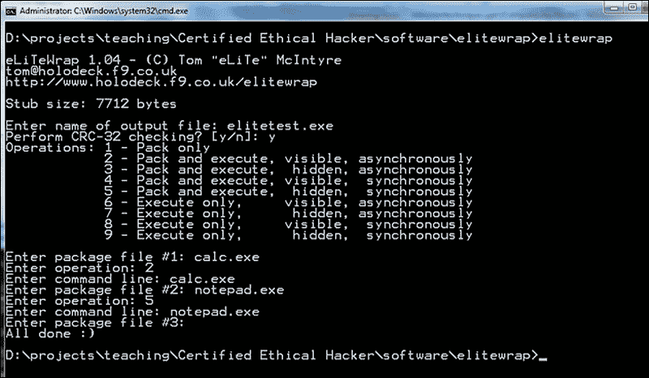

图 5.1 eLiTeWrap。

这个插图旨在展示创建特洛马程序是多么容易，而不是鼓励你这样做。了解这个过程有多简单是非常重要的，这样你就能理解恶意软件的普遍性。任何附件或下载内容都应该被高度怀疑。

### 缓冲区溢出攻击

你已经了解了攻击目标系统的几种方法：拒绝服务、病毒和特洛马程序。虽然这些攻击可能是最常见的，但它们并不是唯一的方法。另一种攻击系统的方法被称为缓冲区溢出（或 buffer-overrun）攻击。当有人试图向缓冲区中放入超过其设计容量的数据时，就会发生缓冲区溢出攻击。任何与互联网或私有网络通信的程序必须接收某些数据。这些数据至少临时存储在内存中一个称为 `buffer` 的空间里。如果编写程序的程序员很小心，那么当你尝试向缓冲区放入过多的信息时，这些信息会被截断或直接被拒绝。考虑到目标系统上可能运行的应用程序数量以及每个应用程序中的缓冲区数量，至少有一个缓冲区没有编写得当的概率大到足以让任何谨慎的人感到担忧。

具有中等编程技能的人可以编写一个程序，特意向缓冲区中写入超过其承载量的内容。例如，如果缓冲区可以容纳 1024 字节的数据，而你尝试用 2048 字节填充它，计算机会将额外的 1024 字节加载到内存中。如果这些额外数据实际上是恶意程序，那么它就被加载到了内存中，因此现在正在目标系统上运行。或者，攻击者可能只想泛洪目标机器的内存，从而覆盖内存中当前的其他项目并导致它们崩溃。无论如何，缓冲区溢出都是非常严重的攻击。

幸运的是，缓冲区溢出攻击比 DoS 攻击或简单的 Microsoft Outlook 脚本病毒更容易执行。要创建缓冲区溢出攻击，你必须对某些编程语言有良好的了解（通常选择 C 或 C++），并足够熟悉目标操作系统/应用程序，以判断它是否具有缓冲区溢出漏洞以及该漏洞可能如何被利用。

必须指出，现代操作系统和 Web 服务器通常不会受到常见的缓冲区溢出攻击。Windows 95 曾经非常容易受到攻击，但 Windows 操作系统容易受到攻击已经很多多年了。无疑，Windows 7、8、10 或 11 无法通过这种类型的攻击破解。然而，对于所有运行在各种系统上的开发的自定义应用程序，情况可能并不相同。任何连接到互联网的应用程序（包括但不限于 Web 应用程序）都可能受到这种攻击。

本质上，这种漏洞只有在程序员未能正确编写程序时才会存在。如果所有程序都截断额外数据，那么系统上无法执行缓冲区溢出。然而，如果程序不检查变量和数组的边界并允许加载过量数据，那么该系统就会受到缓冲区溢出的威胁。

#### Sasser 病毒/缓冲区溢出

Sasser 是一种较旧的恶意软件形式，但它展示了缓冲区溢出攻击的使用。Sasser 涉及一种利用缓冲区溢出进行传播的病毒（或蠕虫）。


Sasser 病毒通过利用 Windows 系统程序中的已知漏洞进行传播。Sasser 将自身复制到 Windows 目录并命名为 `avserve.exe`，同时创建一个注册表项以便在启动时加载。因此，一旦你的机器被感染，每次启动机器都会运行该病毒。该病毒会扫描随机 IP 地址，从 `1068` 开始在连续的 TCP 端口上监听，以寻找可利用的系统——即尚未修复此漏洞的系统。一旦发现目标，蠕虫就会通过溢出 `LSASS.EXE` 中的缓冲区来攻击该易受系统，`LSASS.EXE` 是 Windows 操作系统的一个文件。该可执行文件是内置系统文件，也是 Windows 的一部分。Sasser 还会在 TCP 端口 `5554` 上作为 FTP 服务器，并在 TCP 端口 `9996` 上创建一个远程 shell。接下来，Sasser 会在远程主机上创建一个名为 `cmd.ftp` 的 FTP 脚本并执行它。该 FTP 脚本指示目标受害者从感染的主机下载并执行蠕虫。受感染的主机接受来自 TCP 端口 `5554` 上的 FTP 流量。计算机还会在 `C:` 盘上创建一个名为 `win.log` 的文件。该文件包含本地主机的 IP 地址。病毒的副本会在 Windows 系统目录中创建并命名为 `#_up.exe`。示例所示：

*    `c:\WINDOWS\system32\12553_up.exe`
*    `c:\WINDOWS\system32\17923_up.exe`
*    `c:\WINDOWS\system32\29679_up.exe`

### 侧效应与预防

该病毒的一个副作用是会导致你的机器重启。如果一台机器在没有其他已知原因的情况下反复重启，很可能已经感染了 Sasser 病毒。

这是另一个可以通过多种手段轻松防止感染的案例。首先，如果你定期更新系统，这些系统就不应该容易受到此漏洞的影响。其次，如果你能确保网络路由器或防火墙阻断了涉及的端口（`9996` 和 `5554`）的流量，你就能防止 Sasser 大部分的损害。你的防火墙应该只允许指定端口的流量；所有其他端口都应该关闭。简而言之，如果你作为网络管理员意识到了安全问题并采取谨慎措施来保护网络，你的网络就是安全的。然而，许多网络受到了该病毒的影响，这表明没有足够的管理员接受过计算机安全方面的良好培训。

### 间谍软件

在第 1 章中的“计算机安全导论”中，间谍软件被认为是计算机安全的威胁之一。然而，使用间谍软件比其他某些形式的恶意软件需要多得的技术知识。攻击者必须能够针对特定情况开发间谍软件，或根据其需求对现有的间谍软件进行定制。然后他必须能够将间谍软件放到目标机器上。

间谍软件可以是简单的网站用于记录你访问该网站的一些简短事实的 Cookie，也可以是更隐蔽的类型，例如键盘记录器。回想第 1 章，键盘记录器是一个记录每次击键的程序。键盘记录器可用于捕捉密码、信用卡和其他敏感信息。

#### 间谍软件的合法用途

间谍软件有一些合法用途。例如，父母可以使用间谍软件监控儿童的在线活动。雇主也可以使用间谍软件监控员工在公司电脑上的活动。然而，以符合道德且遵守法律的方式使用间谍软件至关重要。

#### 间谍软件是如何传输的？

间谍软件可以通过许多方式传输。最常见的方法之一是通过邮件附件。另一种常见方法是通过“路过下载”，当你访问受攻击的网站时，间谍软件会自动下载到你的计算机上。间谍软件也可以通过恶意广告传输。为了保护自己免受间谍软件的侵害，你应该小心点击的链接和下载的软件。

#### Pegasus（飞马）

Pegasus 间谍软件最早于 2016 年，随后在 2022 年发现了它的变体。这种间谍软件影响手机，拥有 iPhone 和 Android 版本。鉴于我们对移动设备的依赖日益增加，移动恶意软件的重要性至少不低于传统的计算机恶意软件。2022 版 Pegasus 能够追踪通话和位置、收集密码并读取短信。让 Pegasus 特别引人注目的是，它最初是为以色列政府开发的。


图 5.4 通过 SpywareGuide 网站提供的关键日志记录器列表。

该网站还列出了一些著名的木马（如图 5.5 所示），例如 2nd Thought 程序，它会下载到个人的 PC 上，然后向其大量投放广告。这种特定的恶意软件会在访问某些网站时下载到你的 PC 中。它是无害的，因为它不会对你的系统或文件造成直接伤害；也不会从你的 PC 中收集敏感信息。然而，它是非常烦人的，因为它会让你的机器充斥着不不受欢迎的广告。这种软件通常被称为`广告软件`。通常，这些广告无法通过普通的防护弹出窗口拦截器停止，因为弹出窗口不是由你访问的网站生成的，而是由运行在你机器上的流氓软件生成的。弹出窗口拦截器只能阻止你访问的网站打开新窗口。网站使用知名的脚本技术导致你的浏览器打开窗口，弹出窗口拦截器会识别这些技术并防止广告窗口打开。然而，启动新浏览器实例的广告软件会绕过弹出窗口拦截器的功能。

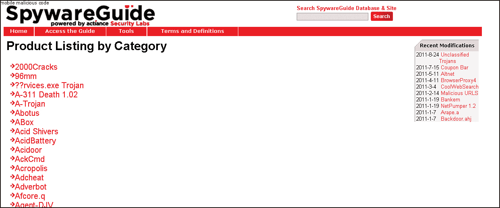

图 5.5 通过 SpywareGuide 网站提供的木马。

### 恶意软件的其他形式

本章及前面的章节讨论了最突出的恶意软件形式。然而，还有许多其他形式的攻击。探索所有这些形式超出了本书的范围，但你应该意识到某些其他形式的恶意软件的存在。仅仅是意识到它们的存在，有助于你高效地防御系统。本节将触及少数其他形式的恶意软件。你应该经常参考章末练习和项目中所讨论的网站，以便跟上所有当前攻击和防御的动态。

#### 根攻击程序 (Rootkits)

`rootkit` 是一种黑客用来掩盖其入侵行为并获取计算机或计算机网络管理员级访问权限的工具集。入侵者在首先通过利用已知漏洞或破解密码获得用户级访问权限后，在计算机上安装 rootkit。然后，rootkit 会收集用户 ID 和密码并发送到网络上的其他机器，从而为黑客提供 root 或特权访问权限。

rootkit 可能由执行以下操作的程序组成：

* 监控流量和击键
* 为黑客的使用创建一个进入系统的后门
* 修改日志文件
* 攻击网络上的其他机器
* 修改现有的系统工具以规避检测

网络上存在 rootkit 首次记录于 20 世纪 90 年代初。当时，Sun 和 Linux 操作系统是黑客安装 rootkit 的主要目标。今天，rootkit 适用于多种操作系统，并且在任何网络上检测都变得越来越困难。

#### 恶意 Web 端代码

`malicious web-based code`（恶意 Web 端代码），也称为`Web 端移动代码`，简单指可以在所有操作系统或平台上迁移的代码，例如 `HTTP`、`Java` 等。“恶意”部分意味着它是一种病毒、蠕虫、木马或其他形式的恶意软件。简单来说，恶意代码不在乎操作系统是什么或使用哪种浏览器。它会盲目地感染它们。

这些代码来自哪里，又是如何传播的？第一代互联网主要是索引文本文件。然而，随着互联网增长为图形化、多媒体的用户体验，程序员创建了脚本语言和新的应用程序技术以实现更具交互性的体验。用脚本语言编写的程序跨度从有用到制作粗劣，再到完全危险不等。

如 `Java` 和 `ActiveX` 等技术允许有缺陷或不可信的程序移动到用户工作站上并执行。（其他可以使恶意代码运行的技术还包括可执行文件、`JavaScript`、`VBScript` 和插件（plug-ins）。）万网（Web）增加了代码的移动性，而不区分程序的质量、完整性和可靠性。使用可用工具，将代码拖入文档中是非常简单的，这些文档随后放置在 Web 服务器上，并供组织内的员工或互联网各地的个人使用。如果这些代码经过恶意编程或只是测试不当，可能会造成严重的损害。

意不意外，黑客已利用这些非常有用的工具来窃取、修改和删除数据文件，并获得对公司网络的未授权访问。恶意代码攻击可以从各种访问点渗透公司网络和系统，包括网站、电子邮件消息中的 HTML 内容或企业内部网。

今天，拥有数十亿互联网用户，新的恶意代码攻击几乎可以瞬间在企业中传播。恶意代码造成的大部分损害发生在首次攻击发生后的几个小时内——在采取防御措施之前。网络停机成本或知识产权被盗成本使得恶意代码成为首要任务。

#### 逻辑炸 (Logic Bombs)

`logic bomb`（逻辑炸）是一种在满足特定标准时执行其恶意目的的恶意软件。最常见的因素是日期/时间。例如，逻辑炸可能会在日期/时间删除文件。例如，2006 年 6 月，`UBS` 的系统管理员 Roger Duronio 被指控使用逻辑炸破坏公司的计算机网络。他的计划是由于逻辑炸造成的损害导致公司股价下跌，因此他被指控证券欺诈。Duronio 后被定罪并判处 8 年 1 个月监狱。正如本例所示，这个问题并不新。

2017 年，来自佐治亚州亚特兰特的 Mittesh Das 被发现故意向美国军计算机传输恶意代码。Das 创建了一个逻辑炸，在在公司失去合同后删除美国军的系统文件。该事件实际上发生在 2014 年。他被判处 2 年监狱，外加 3 年缓刑。

Nimesh Patel 被指控在 2016 年创建了逻辑炸攻击其前雇主的服务器。据称他在离职后登录网络并上传了恶意软件。该软件设计用于删除 `Oracle` 数据库中的财务数据。

另一个例子发生在抵押贷款公司 Fannie Mae。2008 年 10 月 29 日，在公司的系统中发现了一个逻辑炸。虽然这是一个旧例子，但它是逻辑炸发展史上的一个重要案例。这个逻辑炸是由前承包商 Rajendrasinh Makwana 种下的，他当时被终止了合同。定时设定于 2009 年 1 月 31 日激活，并完全抹公司的所有服务器。Makwana 于 2009 年 1 月 27 日在马里兰州法院因未经授权访问计算机而被起诉。2010 年 12 月 17 日，他被定罪并判处 41 个月监狱，外加 3 年缓刑。Makwana 在被终止合同到网络管理员取消其访问权限之间放置了逻辑炸。这说明了在员工关系终止时（无论是自愿终止、退休还是自愿离职）立即禁用其账户的重要性。

#### 垃圾邮件 (Spam)


`Spam`（垃圾邮件）大多数人都很熟悉，它是发送给多方的非自愿且未经请求的电子邮件。它通常用于营销目的，但也可以用于更具恶意的目标。例如，垃圾邮件是传播病毒和蠕虫的媒介。垃圾邮件还用于发送邮件，诱导接收者访问钓鱼网站以窃取其身份。在最好的情况下，垃圾邮件只是干扰；最坏的情况下，它是间谍软件、病毒、蠕虫和钓鱼攻击的载体。

### 高级持续性威胁

`高级持续威胁`（`APT`）是一个描述持续攻击过程的较新术语。它可能涉及黑客攻击、社会工程、恶意软件或多种攻击的结合。这种攻击是相当复杂的，因此被称为“高级（advanced）”，而且它是持续的，因此被称为“持续（persistent）”。

安全公司 Mandiant 在 7 年的时间里跟踪了几个 APT，它们都源自中国——特别是上海和浦东地区。这些 APT 被简单地命名为 `APT1`、`APT2` 等。

这些攻击与中国军方的 `UNIT 61398` 有联系。中国政府认为该单位的活动是机密的，但似乎进攻性网络战争是其任务之一。仅该小组中的一个 APT 就入侵了 20 个不同行业的 141 家公司。`APT1` 对受害者网络的维持访问时间平均为 365 天，在其中一个案例中持续了 1764 天。`APT1` 在 10 个月内从一个单一组织窃取了 6.5TB 的信息。我们将在第 12 章“网络恐怖主义与信息战”中更详细地讨论中国的攻击。

### 深度伪造 (Deep Fakes)

深度伪造并不是恶意软件，但它们非常符合关于恶意软件的讨论。深度伪造是看起来真实到会被认为是真实的视频。虽然深度伪造不会损坏你的计算机或勒索你的文件，但它确实会造成巨大的干扰。

更令人不安的是机器学习在深度伪造中的日益日益广泛。2022 年 5 月《安全周》的一篇文章将深度伪造讨论为一种日益增长的威胁：^(4)

4. [`www.securityweek.com/deepfakes-are-growing-threat-cybersecurity-and-society-europol`](https://www.securityweek.com/deepfakes-are-growing-threat-cybersecurity-and-society-europol)

两个最新进展提高并增加了深度伪造的质量和威胁。第一个是生成对抗网络（GANs）的适配和使用。`GAN` 通过两个模型运行：生成模型和判别模型。判别模型反复针对原始数据集对生成模型进行测试。“根据这些测试的结果，”欧缔警（《执法与深度伪造的挑战——PDF”）写道，“模型不断改进，直到生成的内容来自生成模型的概率与训练数据一样。”结果是一个人肉眼无法检测的虚假图像，但它受攻击者的控制。

第二个威胁来自 5G 带宽和云计算能力，这允许视频流被实时操纵。欧缔警写道：“因此，深度伪造技术可以应用于视频会议、直播视频服务和电视。”

### 检测和消除病毒与间谍软件

一旦你理解了恶意软件的本质以及它是有多大的破坏性，下一个逻辑步骤就是检测并删除恶意软件。

#### 杀毒软件

在本章以及本书的其余部分，我们讨论了运行病毒扫描软件的必要性。本节提供了有关病毒扫描器如何工作的细节，以及关于主要病毒扫描软件软件包的信息。这些信息将帮助你更好地理解病毒扫描器如何保护你的系统，并帮助你在购买和部署杀毒解决方案做出明智决策。

病毒扫描器可以通过两种方式之一工作。第一种是寻找与已知病毒匹配的签名（或模式）。因此，保持病毒软件更新非常重要，以便你拥有最新的签名列表进行工作。

病毒扫描器检查给定 PC 的另一种方法是查看可执行程序的行为。如果一个程序的行为与病毒活动一致，病毒扫描器可能会将其标记为病毒。此类活动可能包括：

* 尝试复制自己
* 尝试访问系统电子邮件程序的地址簿
* 尝试更改 Windows 中的注册表设置

图 5.6 显示了 Norton Security 杀毒软件的运行情况。你可以看到病毒定义是最新的，病毒扫描已启用，自动保护已启用，互联网蠕虫保护也启用。其他流行的病毒扫描器具有许多相同的功能。

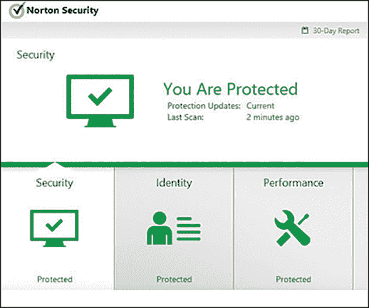

图 5.6 Norton Security 界面。

今天大多数杀毒软件都提供额外功能，例如警告用户已知钓鱼网站的能力、检测间谍软件以及病毒，甚至可以检测可能的钓鱼尝试。任何现代杀毒产品都应该是一个全面的软件包，防止各种攻击，而不仅仅是阻止病毒。

如前提到的，有许多杀毒厂商。`McAfee`、`Bitdefender`、`Kaspersky`、`AVG` 和 `Malwarebytes` 是一些最著名的。`McAfee` 为家庭用户和大型组织提供了一些常用功能，包括邮件扫描和文件扫描。它们还扫描即时流量。图 5.7 显示了 `McAfee` 的界面。

jpg)

图 5.7 McAfee 界面。

`Avast`（见图 5.8)是另一个广泛使用的杀毒软件。该产品免费提供非商业用途。你可以从供应商网站下载：`www.avast.com`。你还可以找到专业版本、`UNIX` 或 `Linux` 版本以及针对服务器的版本。此外，`Avast` 提供多种语言，包括英语、荷兰语、芬兰语、德语、西班牙语、意大利语和匈牙利语。

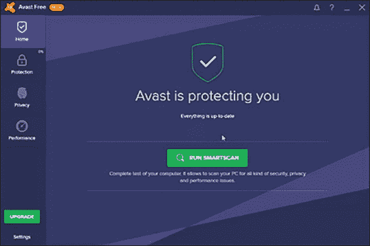

图 5.8 Avast 界面。

`AVG` 杀毒软件（见图 5.9

图 5.9 AVGVirus 界面。

`Malwarebytes` 是另一个广泛使用的杀毒软件。该产品来自 [`www.malwarebytes.com`](https://www.malwarebytes.com)，同时提供免费和付费高级版本。图 5.10 显示了 `Malwarebytes` 的界面。

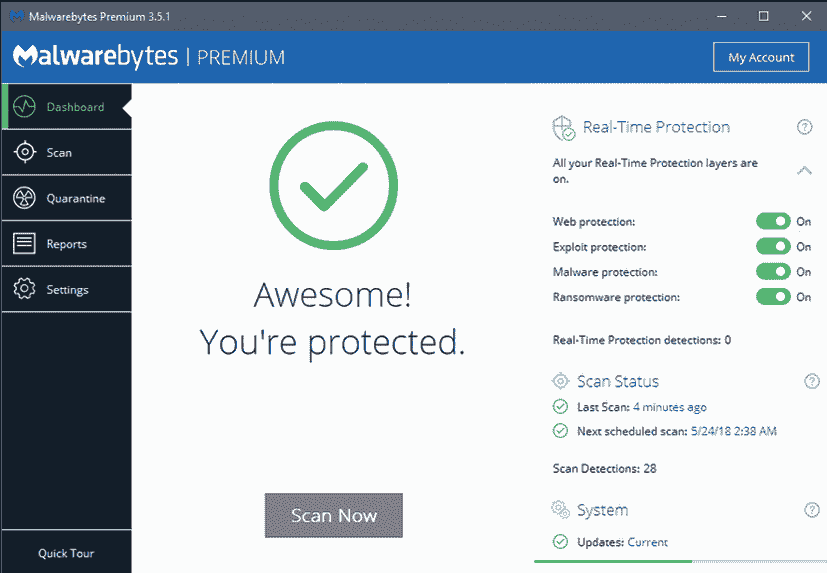

图 5.10 Malwarebytes 界面。

`Windows Defender` 最初作为 `Windows Vista` 和 `Windows 7` 的一部分发布。随着 `Windows` 每个版本的更新，它不断成长并增加功能。它是 `Windows` 操作系统的免费部分。图 5.11 显示了 `Windows 10` 上 `Windows Defender` 的界面。

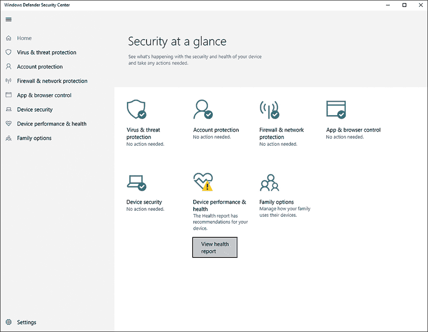

图 5.11 Windows Defender 主界面。

#### 反恶意软件与机器学习

正如机器学习正成为恶意软件的一部分，它也是防御恶意软件的一部分。以下引用可以帮助解释当前状况：


静态恶意软件检测的新进展之一是使用深度学习进行端到端的恶意软件检测机器学习。在在这种设置下，我们完全跳过了所有的特征工程；我们不需要了解任何 `PE` 头文件或其他可能指示 `PE` 恶意软件的特征。我们只需将原始字节流输入到神经网络并进行训练即可。

5。《网络安全实战指南：使用 Python 实现机器学习算法构建安全系统的 80+ 种配方》

目前有几款产品将机器学习作为其杀毒方案的一部分。其中这些产品包括：

* Cylance Smart Antivirus
* Deep Instinct D-Client
* Avast Antivirus

## 修复步骤

显然，减轻恶意软件风险的一个关键步骤是运行最新的杀毒软件。我不推荐任何特定的杀毒程序。`McAfee`、`Norton`、`AVG`、`Kaspersky` 和 `Malwarebytes` 都是口碑良好的产品。不过，我建议如果你同时使用基于主机的杀毒软件和网络杀毒软件，你应该使用来自两个不同厂商的产品。这样，一个漏掉的，另一个可能会捕获。

除了运行反恶意软件外，安全专业人员还可以采取特定步骤来减轻恶意软件的风险。请注意，目标是减轻恶意软件的威胁。完全消除此类威胁是不可能的，但你可以减少攻击频率和损害的严重程度。

教育终端用户是非常重要的。必须让终端用户意识到恶意软件的普遍。目标是让你你网络上的所有用户对附件和下载内容保持怀疑。当然，确实有一些业务需求需要使用附件文档。但你可以教育用户在打开任何附件之前考虑几个简单的问题：

* 此附件是预期之中的吗？来自你不认识的人或你并未预料会收到附件的人，必须始终视为潜在的恶意软件。
* 邮件内容具体吗，例如“这些是我们昨天在会议上讨论的第三季度销售报告”？这种具体的细节通常表明是附有真实文档的真实邮件。但听起来很通泛的邮件，如“这是你的文档”，或试图说服用户必须立即打开附件的邮件，应该被怀疑是恶意软件。
* 你对邮件附件的真实性有重大怀疑吗？如果不确定，请询问技术支持。

采取这些简单措施将消除许多恶意软件爆发。

你可以采取更复杂的路线让你的计算机几乎对恶意软件产生免疫：首先，在你的计算机上设置一个虚拟机。有多种虚拟机应用程序，如 `VMware` 和 `Oracle Box`（免费的）。然后在该虚拟机（`VM`）中安装与主机计算机运行系统不同的操作系统。所以，如果你的主机是 `Windows 10` ，那么 `VM` 就可以运行 `Linux`。如果你的主机是 `Mac`，`VM` 就可以运行 `Windows`。现在如果你在 `VM` 内部上网，你几乎不可能在主机上感染病毒。到目前为止，还没有病毒跨越 `VM/host` 的屏障，也没有病毒感染多个操作系统。

### 总结

显然，保护你的系统有很多方法。一种方法是使用杀毒软件。另一种方法是使用虚拟机隔离潜在的危险程序。最后，教育用户如何识别可疑邮件至关重要。

### 测试你的技能

### 单选题

**1](#appb.xhtml#ch05que1)** John 是一名网络管理员。他正试图解释什么是病毒。以下哪项是最佳定义？
* A. Schlayer
* B. Pegasus
* C. Mirai
* D. Sasser 

**2](#appb.xhtml#ch05que2)** Isabelle 负责公司的网络安全。她担心病毒会造成损害。最常见的损害是什么？
* A. Windows
* B. Mac
* C. Registry
* D. Operating 

**3](#appb.xhtml#ch05que3)** 你正试图确保组织不被感染。病毒传播的最常见方式是什么？
* A. 共享文件夹
* B. 电子邮件
* C. FTP
* D. 网站 

**4](#appb.xhtml#ch05que4)** 以下哪项是 `Outlook` 经常成为攻击目标的主要原因？
* A. 许多黑客
* B. 复制文件
* C. 内部机制
* D. 使用 

**5](#appb.xhtml#ch05que5)** Juan 是一家图形设计公司的网络管理员。2021 年 4 月，他的公司遭受了一种专门针对 macOS 的病毒攻击，该病毒是其他恶意软件的第一阶段下载器。这是什么攻击？
* A. Schlayer
* B. Pegasus
* C. 
* D. 

**6](#appb.xhtml#ch05que6)** 关于 WannaCry 病毒的哪个因素让从业人员感到特别感兴趣？
* A. 补丁管理
* B. 删除文件
* C. 难以保护
* D. 国家级 

**7](#appb.xhtml#ch05que7)** 史上第一个病毒的名字是什么？
* A. Creeper
* B. Wabbit
* C. Mimail
* D. 未命名 

**8](#appb.xhtml#ch05que8)** Elizabeth 在公司的一个系统中发现了恶意软件。该恶意软件阻止了约 600 个 Windows 进程并索要赎金。Elizabeth 发现了什么？
* A. Thanatos
* B. Clop
* C. Kedi RAT
* D. Schlayer 

**9](#appb.xhtml#ch05que9)** Mohaned 在他的网络中发现了恶意软件。这种恶意软件加密文件索要赎金并拦截了大约 600 个 Windows 进程。Mohaned 发现了什么恶意软件？
* A. Schlayer
* B. Thanatos
* C. Cl0p
* D. Pegasus 

**10](#appb.xhtml#ch05que10)** 以下哪种方法是任何人都可以用来防止病毒攻击的方法？
* A. 设置防火墙。
* B. 使用加密传输。
* C. 使用安全的邮件软件。
* D. 永远不要打开未知的邮件附件。


### 11. 你正在尝试开发一些方法来缓解公司病毒的威胁。在下列选项中，发送和接收附件安全的方法是？

A. 使用代码来指示附件是合法的。
B. 仅发送表格附件。
C. 使用加密。
D. 在打开附件之前使用病毒扫描器。

### 12. Shelly 正在尝试新员工如何处理电子邮件安全警报。关于电子邮件安全警报，下列哪项是正确的？

A. 你必须遵循这些警报。
B. 大多数公司不通过电子邮件发送警报。
C. 你可以信任安全警报中的附件。
D. 大多数公司通过电子邮件发送警报。

### 13. 下列哪项是木马可能会做的？

A. 为恶意软件打开一个后门。
B. 修改你的内存配置。
C. 修改你计算机上的端口。
D. 修改你的 IP 地址。

### 14. Jared 正在网络安全导论课程上向学生解释各种攻击方法。他想确保他们完全理解这些不同的攻击。缓冲区溢出攻击是做什么的？

A. 它让端口因数据包过多而溢出。
B. 它向电子邮件系统中放入了多于其能承受的邮件。
C. 它使系统溢出。
D. 它向缓冲区放入了多于其能承受的数据。

### 15. 什么病毒利用了缓冲区溢出？

A. Sobig 病毒
B. Mimail 病毒
C. Sasser 病毒
D. Schlayer 病毒

### 16. 你可以对防火墙做什么来帮助防止病毒攻击？

A. 在防火墙上无法做任何事情来阻止病毒攻击。
B. 关闭所有不需要的端口。
C. 关闭所有入站端口。
D. 以上都不正确。

### 17. Malek 正在向新的技术支持人员解释各种恶意软件类型。他向他们解释各种类型的恶意软件，以便他们识别。键盘记录器是什么类型的恶意软件？

A. 病毒
B. 缓冲区溢出
C. 木马
D. 间谍软件

### 18. 下列哪项是所有计算机用户都应该采取的防止病毒攻击的步骤？

A. 购买并配置防火墙。
B. 关闭所有入站端口。
C. 使用非标准的电子邮件客户端。
D. 安装并使用防病毒软件。

### 19. 病毒扫描器的主要工作原理是什么？

A. 通过将文件与已知病毒特征列表进行对比
B. 通过阻止自我复制的文件
C. 通过阻止所有未知文件
D. 通过检查文件是否存在类病毒行为

### 20. 除了病毒扫描器的主要工作方式外，病毒扫描器还可以通过什么其他方式工作？

A. 通过将文件与已知病毒特征列表进行对比
B. 通过阻止自我复制的文件
C. 通过阻止所有未知文件
D. 通过检查文件是否存在类病毒行为

## 练习题

#### 练习 5.1：使用诺顿防病毒软件

1. 访问诺顿网站（`https://support.norton.com/sp/en/us/norton-download-install/current/info`）并下载其软件的试用版。
2. 安装并运行该软件。
3. 仔细研究该应用程序，注意你喜欢和不喜欢的的功能。

#### 练习 5.2：使用 McAfee 防病毒软件

1. 访问 McAfee 防病毒软件网站（`https://www.mcafee.com/en-us/antivirus.xhtml`）并下载其软件的试用版。
2. 安装并运行该软件。
3. 仔细研究该应用程序，注意你喜欢和不喜欢的的功能。

#### 练习 5.3：防止 Sasser

1. 使用网络或期刊上的资源仔细研究 Sasser 病毒。你可能会发现 `www.f-secure.com` 和位于 `https://www.symantec.com/security-center` 的赛门克安全中心在本次练习中很有帮助。
2. 写一篇短文，介绍 Sasser 是如何传播的、造成了什么破坏，以及可以采取哪些步骤来防止它。

#### 练习 5.4：防止 Sobig

1. 使用网络或期刊上的资源仔细研究 Sobig 病毒。你可能会发现 `www.f-secure.com` 和位于 `https://www.symantec.com/security-center` 的赛门克安全中心在本次练习中很有帮助。
2. 写一篇短文，介绍 Sobig 是如何传播的、造成了什么破坏，以及可以采取哪些步骤来防止它。

#### 练习 5.5：了解当前的攻击

1. 使用网络或期刊上的资源，找到一种在过去 90 天内传播的病毒。你可能会发现 `www.f-secure.com` 和位于 `https://www.symantec.com/security-center` 的赛门克安全中心在本次练习中很有帮助。
2. 写一篇短文，介绍它是如何传播的、造成了什么破坏，以及可以采取哪些步骤来防止它。

## 项目

#### 项目 5.1：防病毒策略

此活动也可以作为一个小组项目进行。考虑到你在本章及之前章节中学到的知识，并利用外部资源，为小型企业或学校编写一份防病毒策略。你的策略应该包括技术建议和程序指南。你可以选择参考网络上找到的现有防病毒策略来获取一些灵感，但不应该简单地复制这些策略。相反，你应该制定自己的策略。

#### 项目 5.2：最严重的病毒攻击

使用网络、书籍或期刊上的资源，找到你认为历史上最糟糕的病毒爆发。写短短文描述这次攻击，并解释你为什么认为它是最糟糕的。它是否广泛传播？传播有多快？造成了什么破坏？

#### 项目 5.3：为什么要编写病毒？

关于人们为什么要编写病毒，有了许多假设。这些假设从完全的阴谋论到学术心理学不等。采取你认为最可能的立场，写论文解释为什么人们会花费精力编写病毒。

案例研究

Chiao Chien 负责一所学校的 IT 安全。由于使用学校计算机的人群广泛，Chiao 很难防止病毒攻击。Chiao 拥有合理的预算，并在每台机器上安装了防病毒软件。他还有一个防火墙，阻止了所有不需要的端口，并且学校规定禁止从网上下载任何软件。考虑以下问题：

1. 你认为 Chiao 的网络对于病毒攻击的安全性如何？
2. Chiao 还有哪些区域没有安全防护？
3. 你会向 Chiao 提出什么建议？

## 第 6 章

## 黑客使用的技术

### 本章目标

阅读本章并完成练习后，你将能够：

* 理解黑客使用的基本方法论
* 熟悉一些基本的黑客工具
* 理解黑客心态
* 能够解释特定的攻击方法

## 引言


前五章向你介绍了通用的安全概念。现在是时候探索用于攻击你网络的技术了。如果你不知道攻击者知道什么，就很难真正确保你的网络安全。在继续之前，重要的一点是很多黑客并不是犯罪分子。黑客是想要理解系统的人，通常通过探测其弱性来实现。甚至还有黑客为组织工作，测试组织的系统安全性。这被称为`penetration testing`（渗透测试），有时也被称为`白帽攻击`。渗透测试有几种认证：

*   **Offensive Security:** [`www.offensive-security.com/information-security-certifications/`](https://www.offensive-security.com/information-security-certifications/)

*   **SANS Institute:** [`www.sans.org/cyber-security-courses/enterprise-penetration-testing/`](https://www.sans.org/cyber-security-courses/enterprise-penetration-testing/)

*   **EC-Council 认证伦理黑客:** [www.eccouncil.org](http://www.eccouncil.org)

还有一本面向白帽黑客的杂志叫做`2600`（[[www.2600.com](http://www.2600.com)）。许多计算机安全专业人士尝试学习黑客技术，是为了增强自己的安全能力或仅仅是为了满足好奇心。技术本身并不犯罪。然而，确实有人利用黑客技术入侵系统以窃取数据、破坏系统或实施其他网络犯罪。这些人通常被称为`黑帽黑客`或`破解者`。

本章介绍的技术不仅是为了让你理解黑帽黑客是如何工作的，还为了展示你如何对自己的网络进行渗透测试。通过在你的网络上尝试其中一些技术，你可以评估自己的脆弱性。（应该指出，你只有在非常精通本章中的技术时——并且在获得高层许可的情况下——才这样做。）

### 基础术语

在我们深入黑客世界之前，我们需要讨论该社区使用的基础术语。正如你所知到的，`白帽黑客`用于描述为了法律/伦理目的使用黑客技术的人。而`黑帽黑客`和`破解者`用于描述为了非法目的使用黑客技术的人。

还有一些你应该熟悉的其他术语。`灰帽黑客`是指曾是黑帽黑客并转变为白帽黑客的人（基本上，一个前犯罪分子现在变成了伦理守）。随着互联网工具的泛滥，还有很多人下载工具（我们将在本章中检查其中一些）并在并不真正理解自己在做什么的情况下进行网络攻击。这些人被称为`script kiddies`（脚本小子，有时也拼写为 kiddys）。另一个重要的术语`phreaking`（电报入侵）是指入侵电话（这早于入侵计算机系统）。

通常，进行渗透测试是为了模拟特定的攻击者或类型的攻击者。这是通过以下方式实现的：

### 侦察阶段

任何渗透测试都始于收集有关目标的信息。这一阶段被称为侦察（reconnaissance）。侦察有两种类型：被动和主动。

#### 被动扫描

被动侦察涉及在不直接与目标系统或网络交互的情况下收集有关目标的信息。这允许攻击者保持不被发现。被动扫描的常用技术包括：

*   **搜索引擎：** 使用 Google、Bing 和 DuckDuckGo 等引擎查找有关组织的信息。
*   **社交媒体：** 检查 LinkedIn、Twitter 和 Facebook 等平台，获取有关员工及其角色的信息。
*   **公共记录：** 使用 WHOIS 数据库查找有关域名所有权、注册日期和联系方式的信息。
*   **招聘公告：** 查看招聘广告以了解该组织使用的技术和硬件。
*   **技术论坛和留言板：** 搜索员工可能会提到基础设施细节的讨论。

#### 主动扫描

主动侦察涉及直接与目标系统进行交互以收集信息。这种方法更容易被安全措施检测到。主动扫描的常用技术包括：

*   **端口扫描：** 使用 `nmap` 等工具识别目标系统上的开放端口。
*   **服务发现：** 识别开放端口上运行的服务版本。
*   **漏洞扫描：** 使用自动化工具寻找系统中的已知漏洞。
*   **操作系统指纹识别：** 尝试确定目标机器的操作系统。

主动扫描命令示例为：
```
nmap -sV [target-ip]
```


之前提到的技术都被认为是被动式的，因为它们不需要攻击者连接到目标系统。由于攻击者并没有实际连接到目标系统，入侵检测系统（IDS）无法检测到这种扫描。主动扫描要可靠得多，但可能会被目标系统检测到。主动扫描有几种类型。

### 端口扫描

`Port scanning`(#gloss.xhtml#gloss65) 是尝试连接目标系统上的每个网络端口并查看哪些端口是开放的过程。有 1024 个常用端口通常与特定服务关联。例如，端口 161 与简单网络管理协议（SNMP）相关。如果攻击者发现目标系统上的端口 `161` 开放，他可能会决定尝试与 SNMP 相关的攻击。从端口扫描还可以获得更多信息。例如，端口 `137`、`138` 和 `139` 都与 NetBIOS 关联，这是一种非常老旧 Windows 网络通信方法，现在 Windows 中已不再使用。然而，NetBIOS 经常用于 Windows 机器与 Linux 机器通信的系统，因此发现这些端口开放状态可以揭示有关目标网络的信息。

在 Google 上简单搜索 `port scanner` 就会发现许多知名、广泛使用且通常免费的端口扫描器。然而，黑客安全社区中最流行的端口扫描器是免费工具 `Nmap` ([`nmap.org`](https://nmap.org))。它有一个 Windows 版本，称为 `Zenmap`，如图 6.3

图 6.3 Zenmap 界面。

`Nmap` 允许你自定义扫描以提高或降低隐蔽性，并针对某些系统。这里列出了最常见的扫描类型：

*   `Ping scan:` 这种扫描只是向目标端口发送 ping。许多网络管理员为了停止 ping 扫描会阻止入站的 ICMP 包。
*   `Connect scan:` 这是最可靠的扫描，但也最可能被检测到的类型。这种扫描会与目标系统建立完整的连接。
*   `SYN scan:` 这种扫描非常隐蔽。大多数系统都接受 SYN（同步）请求。这种扫描类似于第 4 章中描述的“拒绝服务攻击”的 SYN 洪水攻击。在这种扫描中，你发送一个 `SYN` 包，但在系统发送 `SYN/ACK` 时从不响应。然而，与 DoS SYN 洪水不同，你每个端口只发送一个包。这也被称为`半开放扫描`。
*   `FIN scan:` 这种扫描设置了 `FIN`（连接结束）标志。对于系统来说，接收这种包并不寻常，因此被认为是隐蔽的。

每种扫描都会在目标机器上引起不同的响应，从而为端口扫描器提供不同的信息：

*   使用 `FIN scan` 或 `XMAS scan`，如果目标端口关闭，系统会返回一个 `RST`（重置）标志包。如果端口开放，则没有响应。
*   使用 `SYN scan`，如果端口关闭，响应是 `RST`；如果端口开放，响应是 `SYN/ACK`。
*   `ACK scans` 和 `NULL scans` 仅对 UNIX 系统有效。

`Nmap` 还允许你设置一些标志（通过 `Nmap` 的命令行版本或 Windows 版本）来自定义扫描。允许的标志列在这里：

`-O` 检测操作系统
`-sP` Ping 扫描
`-sT` TCP 连接扫描
`-sS` SYN 扫描
`-sF` FIN 扫描
`-sX` Xmas 扫描
`-sN` NULL 扫描
`-sU` UDP 扫描
`-sO` 协议扫描
`-sA` ACK 扫描
`-sW` Windows 扫描
`-sR` RPC 扫描
`-sL` 列表/DNS 扫描
`-sI` 空闲扫描
`-Po` 不 ping
`-PT` TCP ping
`-PS` SYN ping
`-PI` ICMP ping
`-PB` TCP 和 ICMP ping
`-PM` ICMP 子掩码
`-oN` 正常输出
`-oX` XML 输出
`-oG` 可 grep 输出
`-oA` 所有输出
`-T` 计时控制
`-T0` 偏执
`-T1` 溜行
`-T2` 礼貌
`-T3` 正常
`-T4` 激进
`-T5` 疯狂

你可以看到，使用 `Nmap` 的攻击者有很多可用选项。人们可以花大量时间仅仅为了学习 `Nmap`。

#### 注意

当然，还有许多端口扫描工具。我们关注 `Nmap` 是因为它是免费且被广泛使用的。它在 EC-Council 认证道德黑客认证、GPEN（来自 SANS）以及专业渗透测试认证中也占据重要地位。

`Nmap` 的设置在大多数情况下是自而易懂的。然而，计时可能值得进一步讨论。计时涉及发送扫描包的速度快慢。基本上，你发送包越快，扫描越容易被检测到。

这是最基础的 `Nmap` 扫描：

```
nmap 192.168.1
```

这是一个对 IP 地址范围的扫描：

```
nmap 192.168.1-20
```

以下命令检测操作系统、使用 TCP 扫描并设置速度：

```
nmap -O -PT -T1 192.168.1
```


虽然我们在这里关注的是枚举，但 Cain and Abel 能够做的事情远不止于简单的枚举。要使用 Cain and Abel 进行枚举，只需点击“网络（Network）”选项卡，你就会发现所有连接到你所在网络的机器。（显然，在对目标网络进行枚举之前，你需要某种程度的权限。）

以下是其他在黑客中广受欢迎且可以在互联网上轻松找到的枚举工具：

* Sid2User
* Cheops（仅限 Linux）
* UserInfo
* UserDump
* DumpSec
* Netcat
* NBTDump

这不是一个详尽的列表，但它包含了一些最广泛使用的枚举工具。

为了防御扫描，你应该使用以下技术：

* 注意你在互联网上发布的关于你组织及其网络的信息量。
* 制定公司政策，强制要求使用公告板、聊天室等发布技术数据的技术人员不得使用真实姓名或泄露公司名称。
* 使用可以检测多次扫描的 IDS。
* 阻止传入的互联网控制消息协议（ICMP）数据包。

这些技术不会让对系统的扫描和侦察变得不可能，但它们将显著减少攻击者可以收集的信息量。

## Shodan

Shodan（参见图 6.5）是攻击者和渗透测试人员常用的工具。网站 [`www.shodan.io`](https://www.shodan.io) 本上是一个漏洞搜索引擎。你需要注册一个免费账户才能使用它，但对于试图识别漏洞的渗透测试人员来说，它是无价之宝。当然，该网站对攻击者来说也极具价值。

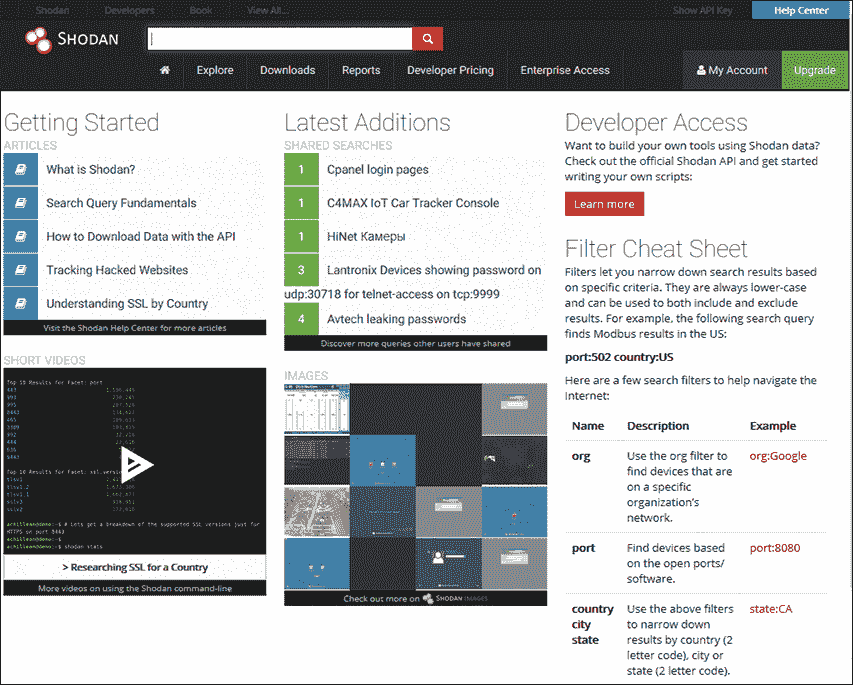
图 6.5 Shodan。

在使用 Shodan.io 进行搜索时，你可以使用许多选项；这里给出了一些：

* 使用如下搜索词查找默认密码：
    * `default password country:US`
    * `default password hostname:[chucktom.com](http://chucktom.com)`
    * `default password city:Chicago`
* 查找 Apache 服务器：
    * `apache city:San Francisco`
* 查找摄像头：
    * `webcam city:Chicago`
    * `OLD IIS`
    * `iis/5.0`

除了这些搜索词，你还可以使用过滤器，包括：

* `city`：查找特定城市的设备。
* `country`：查找特定国家的设备。
* `geo`：传递坐标（即纬度和经度）。
* `hostname`：查找匹配特定主机名的值。
* `net`：基于 IP CIDR 地址搜索。
* `os`：基于操作系统搜索。
* `port`：查找特定的开放端口。
* `before/after`：查找时间范围内的结果。

例如，图 6.6 显示了搜索 `default passwords city:dallas` 的结果。

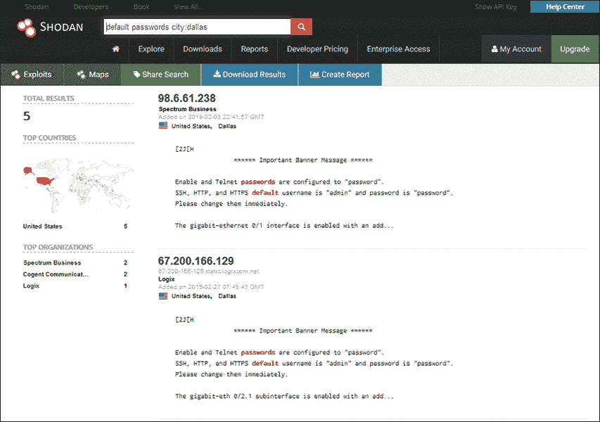
图 6.6 Shodan 搜索结果。

当你进行渗透测试时，对公司域名进行搜索并通过 Shodan 发现任何内容都是一个好主意。你可以将搜索限制在雇你进行渗透测试的客户的主机名或域名。你可以使用 Shodan 寻找目标网络中的默认密码、旧的 Web 服务器、不安全的摄像头和其他漏洞。再次，你可以确信潜在的攻击者也会使用这个工具。

## 实际攻击

现在我们已经讨论了攻击者如何扫描目标系统，让我们来看一些常用的攻击。显然，这不是一个详尽的列表，但它对所使用的攻击方法提供了一些见解。在第 4 章中，我们讨论了拒绝服务（DoS）攻击以及用于实施这些攻击的一些工具。在本节中，我们将查看其他类型的攻击以及实现这些攻击的技术和工具。

### SQL 脚本注入

SQL 脚本注入可能是网站最常见的攻击类型。近年来，越来越多的网站采取了措施来缓解此类攻击的危险，遗憾的是，许多网站仍然容易受到攻击。SQL 脚本注入攻击涉及向 Web 传递结构化查询语言（SQL）命令并让网站执行它们。

在进一步讨论 SQL 注入之前，我们必须讨论 SQL 和关系型数据库。关系型数据库基于各种表之间的关系。其结构包括表、主键、外键和关系：

* 每行代表一个单一实体。
* 每列代表一个单一属性。
* 每条记录由一个名为 `primary key`（主键）的唯一数字标识。
* 表通过外键关联。`foreign key` 是另一个表的主键。

你可以在图 6.7 中看到这些关系的示例。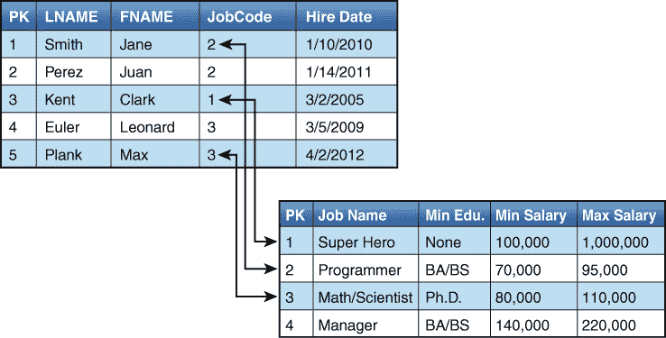
图 6.7 数据库关系。

所有关系型数据库都使用 SQL，包括 `SELECT`、`UPDATE`、`DELETE`、`INSERT` 和 `WHERE` 等命令。至少基础查询很容易理解和解释。

大多数基础 SQL 注入原理如下：许多网站/应用程序都有一个用户输入用户名和密码的页面。用户名和密码必须对某些数据库进行检查以判断是否有效。无论数据库类型如何（Oracle、SQL Server、MySQL），所有数据库都使用 SQL。SQL 的外观和功能非常像英语。例如，为了检查用户名和密码，你可能想查询数据库，查看用户表中的是否存在与输入的用户名和密码匹配的条目。如果有这样的条目，说明匹配成功。请求此内容的 SQL 语句可能如下所示：

点击此处查看代码图像

```
SELECT * FROM tblUsers WHERE USERNAME = 'jdoe' AND PASSWORD = 'letmein'
```

该查询的问题在于，尽管它是有效的 SQL，但它硬编码了用户名和密码。对于真实的网站，你必须获取用户在用户名字段和密码字段中输入的任何内容并进行检查。这可以轻松实现（无论网站使用何种编程或脚本语言编写）。它看起来像这样：

点击此处查看代码图像

```
'SELECT * FROM tblUsers WHERE USERNAME = '" + txtUsername.Text +' AND PASSWORD = '" +
txtPassword.Text +"'".
```

如果你输入用户名 `jdoe` 和密码 `letmein`，这段代码会产生以下 SQL 命令：

点击此处查看代码图像

```
SELECT * FROM tblUsers WHERE USERNAME = 'jdoe' AND PASSWORD = 'letmein'
```

现在如果 `tblUsers` 中存在用户名 `jdoe`，且其密码为 `letmein`，那么该用户将登录。否则，将会发生错误。


SQL 注入通过在用户名和密码字段中放入某些始终为真的 SQL 语句来实现攻击。例如，假设你在用户名和密码框中输入 `'OR X=X'`。这会导致程序创建如下查询：

点击此处查看代码图片

```
SELECT * FROM tblUsers WHERE USERNAME = ''OR X=X' AND PASSWORD = ''OR X=X'
```

注意，在 `'OR X=X'` 之前你输入了一个单引号（`'`）。这闭合了攻击者知道代码中必须存在的起始引号。如果你看到 `''`，它本质上代表空白或空值，它告诉数据库：如果用户名为空或者 `X=X` 为真，则允许登录；如果密码为空或者 `X=X` 为真，也是。如果你思考一下，就会发现 `X` 总是等于 `X`，所以这永远为真。

`'OR X=X'` 本身并没有特殊意义；它只是一个永远为真的语句。攻击者会尝试其他类似的语句，例如：

```
' or 'a' ='a
' or '1' ='1
' or (1=1)
```

这里提供的示例是 SQL 注入最基础的版本，但也是最常见的。你可以利用 SQL 注入做更多事情。攻击者的局限仅在于其对 SQL 的了解以及目标数据库系统的类型。

防御此类攻击的方法是在处理所有用户输入之前对其进行过滤。这一过程通常被称为 `input validation`（输入验证），它能防止攻击者输入 SQL 命令而非用户名和密码。遗憾的是，许多网站没有对用户输入进行过滤，仍然容易受到 SQL 注入攻击。

请记住在本文开头，当我们第一次简要提到 SQL 注入时，曾建议过滤输入可以防止此类攻击。例如，创建网站的程序员应该编写代码，首先检查任何常见的 SQL 注入符号，如单引号（`'`）、）、百分号（`%`）、等号（`=`）或安培符号（`&`），如果发现这些符号，则停止处理并记录错误日志。这可以防止许多 SQL 注入攻击。虽然有方法可以绕过这些安全措施，但实施它们仍然能阻止许多 SQL 注入攻击。

### 跨站脚本

通过 `cross-site scripting`（跨站脚本），攻击者将客户端脚本注入到其他用户查看的网页中。关键在于攻击者将脚本输入到其他用户交互的区域。当用户访问网站的该部分时，执行的是攻击者的脚本而非预期的网站功能。例如，假设一个购物网站允许用户对产品进行评论。攻击者可能不是输入评论，而是输入 JavaScript，将用户重定向到钓鱼网站。当另一个用户查看该条“评论”时，脚本就会执行并将用户带到新网站。同样，此类攻击可以通过简单过滤所有用户输入来防止。截至本文撰写时，所有主要的在线购物门户（如 [Amazon.com](http://Amazon.com)）都对输入进行了过滤，不受这种攻击的影响。然而，许多较小的网站仍然容易受到跨站脚本攻击。

跨站脚本和 SQL 注入都说明了为什么所有 IT 人员（而不只是安全管理员）熟悉安全知识至关重要。如果有更多的 Web 开发人员熟悉安全，这两种攻击就不会如此流行。

### 跨站请求伪造

`cross-site request forgery`（跨站请求伪造）可以看作是跨站脚本的另一面。跨站脚本基于用户对网站的信任来攻击用户，而跨站请求伪造则是基于网站对用户的信任来攻击网站。经过网站身份验证的受信用户被诱骗向网站发送请求。这些请求随后可以被用于攻击网站。

### 目录遍历

`directory traversal`（目录遍历）允许攻击者访问受限目录——包括包含应用程序源代码、配置文件和关键系统文件的目录——并在 Web 服务器的根目录之外执行命令。

攻击者可以操纵带有“点点斜杠”（`../`）序列及其变体的引用变量，例如所示：

点击此处查看代码图片

```
http://www.example.com/process.aspx=../../../../some dir/some file
http://www.example.com/../../../../some dir/some file
```

### Cookie 投毒

许多 Web 应用使用 Cookie 在客户端机器上保存信息（用户 ID、时间戳等）。例如，当用户登录网站时，登录 Web 脚本可能会验证其用户名和密码，并设置带有其数字标识符的 Cookie。

当用户稍后检查偏好时，另一个 Web 脚本（例如 `preferences.asp`）会获取 Cookie 并显示相应用户的信息记录。由于 Cookie 并不总是加密的，因此它们可以被修改；包含此类修改的攻击被称为 `cookie poisoning`（Cookie 投毒）。事实上，`JavaScript` 可以修改、写入或读取 Cookie。因此，这种攻击可以与跨站脚本结合。

### URL 劫持

`URL hijacking`（URL 劫持），也称为域名拼写攻击，涉及一个与真实 URL 非常的假 URL。例如，我的网站是 [www.Chuckeasttom.com](http://www.Chuckeasttom.com)。有人可能会建立 [www.Chuckeastom.com](http://www.Chuckeastom.com) 网站，姓氏中只少了一个 *t*。

### 命令注入

`command injection`（命令注入）攻击旨在向漏洞应用程序中注入并执行攻击者指定的命令。命令注入攻击的发生是因为缺乏正确的验证，这种验证也可以被攻击者操纵（表单、Cookie、HTTP 头等）。例如，在 `Linux` 中你可以通过以下方式连续执行两个命令：

```
cmd1 && cmd2
```

因此，漏洞应用程序可能会执行以下操作：

点击此处查看代码图片

```
www.example.com && cat /etc/passwd
```

有时命令注入被称为 `shell injection`。

### 无线攻击

常用的无线攻击有很多。例如，通过 `evil twin attack`（孪生站点攻击），建立一个与合法接入点 SSID 相同的伪造接入点（WAP）。该伪造接入点可能用于对合法接入点发起拒绝服务攻击，使其无法响应用户，从而将用户重定向到孪生站点。

另一种无线攻击是 WPS 攻击。Wi-Fi Protected Setup（WPS）需要 PIN 来连接 WAP。`WPS attack` 尝试拦截传输中的 PIN，连接 WAP，然后窃取 WPA2 密码。

`deauthentication attack`（取消认证攻击）可以导致合法无线客户端从合法 AP 或无线路由器断开连接，以实施拒绝服务状态或让这些客户端连接到孪生站点。

### 手机攻击

攻击手机的方法有很多。这里简述了最常见的攻击：

*   `Bluesnarfing`：未经授权从蓝牙设备获取信息。
*   `Bluejacking`：使用范围内的另一个蓝牙设备（取决于蓝牙版本，可能是 10 到 240 米）向目标发送未经自愿的消息。
*   `Bluebugging`：未经授权访问并使用所有手机功能。
*   `Pod slurping`：使用 iPod 等设备直接插入存放数据的计算机来非法窃取机密数据。

### 密码破解


当一个人能够物理接触到机器时，破解密码是最容易的——而且这并不像听起来那么困难。许多机构（如大学）设有自助终端（kiosk machines），人们可以使用最小权限/访客权限使用系统。熟练的黑客可以利用这种访问获取更进一步的权限。

## 密码破解方法

有几种不同的密码破解方法。这里列出了较为常见的方法：

*   `字典攻击：` 将一个包含大量字典单词的文本文件加载到密码程序中，然后针对应用程序定位的用户账户进行运行。如果使用了简单的密码，这可能就足够破解密码。字典攻击可以使用 `LCP` 和 `Hashcat` 等工具离线进行，也可以使用 `Brutus` 和 `THC-Hydra` 等工具进行在线破解。

*   `混合攻击：` 这种攻击与字典攻击类似，不同在于它在字典单词中添加数字或符号。许多人通过简单在当前密码末尾添加数字来更改密码。这种模式通常表现为：第一个月的密码是 `Mike`，第二月的密码是 `Mike2`，第三月的密码是 `Mike3`，依此类推。

*   `彩虹表：` 密码通常以哈希形式存储。哈希无法被“反哈希”；但可以创建一个常用密码的表并对其进行哈希。然后，如果获取了密码的哈希值，就可以彩虹表中查找匹配项。

*   `暴力破解：` 这是最全面的攻击形式，也是最可能耗时的形式。取决于密码的长度和复杂度，暴力破解可能需要几周时间。

## ophcrack

用于破解 Windows 密码的流行工具是 `ophcrack`。你可以从 [`ophcrack.sourceforge.net`](http://ophcrack.sourceforge.net) 下载 `ophcrack`。它基于对 Windows 密码原理的理解。Windows 密码作为哈希存储在系统目录之一的 `SAM` 文件中，通常位于 `C:\WINDOWS\system32\config\``SAM` 是安全账户管理器（Security Accounts Manager）的缩写。密码以哈希形式存储。（哈希将在第 8 章中的“加密”中详细讨论。）Windows 对你输入的密码进行哈希处理，并与 `SAM` 文件中找到哈希进行比较。如果匹配，则登录。为了防止有人复制 `SAM` 文件并带走尝试暴力破解，Windows 一旦开始启动过程，操作系统就会锁定 `SAM` 文件。`ophcrack` 启动到 Linux，然后获取 `SAM` 文件，并在其拥有的大型哈希值表中查找哈希密码以寻找匹配项。如果找到了，则该哈希值表中的匹配文本就是密码。你可以在图 6.8 中看到 `ophcrack`。

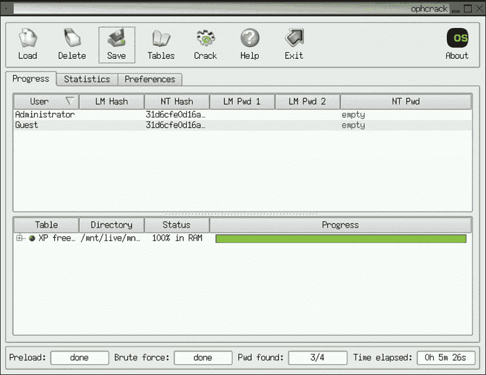

图 6.8 ophcrack。

该工具非常易于使用。只需将 `ophcrack` 光盘放入机器并重启。在启动过程中，你可以按下 `F12` 进入启动菜单，并告诉系统从光盘启动。然后你将启动 `ophcrack`。需要注意的是，较长的密码（截至本文编写时超过 10 个字符）通常无法被 `ophcrack` 破解。

如果 `ophcrack` 成功了（尽管并不总是成功），攻击者现在可以做什么？最好的情况下，她只是获取了本地机器管理员账户而不是域账户。不过，这可以用来获取域访问权限。获取域访问的一种方法将在本章后面的“Net User 脚本”部分进行探讨。

## 其他密码破解工具

正如你可能猜到的那样，互联网上有许多可以获得的密码破解工具。这里列了一些常用工具：

*   `Brutus：` `Brutus` 可以对 `Telnet`、`FTP`、`SMTP` 和 Web 服务器进行远程字典攻击或暴力破解。

*   `John the Ripper：` 这个工具已经存在多年。它是一个有效的密码破解工具。

*   `WebCracker：` 这个简单的工具获取用户名和密码的文本列表，并将其用作字典来实现基本的身份验证密码猜解。

*   `THC-Hydra：` 这个非常有用的 Web 密码破解工具攻击许多常见的身份验证方案。

*   `Crack Station：` 该工具的网站 [`crackstation.net`](https://crackstation.net) 尝试将哈希密码与彩虹表中的已知密码匹配。

## 恶意软件创建

在本节中，我们将简要讨论创建恶意软件有多简单。在第 5 章“恶意软件”中，你看到了工具 `eLiTeWrap`。在本节中，你将看到实际创建病毒的方法。这绝不是为了鼓励你创建此类病毒。它的目的是让你了解为什么这种恶意软件如此常见。

多年来，创建病毒需要相当的编程技能。然而，近年来开发了许多用于创建病毒的工具。这些工具允许终端用户点击几个按钮创建病毒。这就是病毒变得如此流行的原因之一。其中一种工具就是图 6.9 所示的 `TeraBIT Virus Maker`。

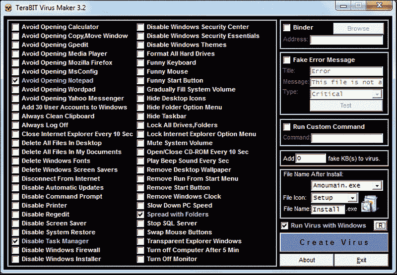

图 6.9 TeraBIT Virus Maker。


`pass-the-hash` 攻击本质上是意识到哈希值不可逆的；攻击者并不尝试找出密码是什么，而是直接发送哈希值。如果攻击者可以获取有效的用户名和用户密码哈希值，那么黑客就可以不知道实际密码的情况下使用该哈希值。

Windows 应用程序要求用户输入密码；然后应用程序会对密码进行哈希处理。通常可以使用像 `LsaLogonUser` 等 API 进行哈希处理，将密码转换为 `LM` 哈希或 `NT` 哈希。`pass-the-hash` 则跳过了应用程序，直接发送哈希值。

## Net User 脚本

`net user script` 漏洞首先需要以至少访客层级的权限访问目标机器。它基于这样一个事实：许多组织将技术支持人员放在域管理员组中。

攻击者编写以下两行脚本（将 `localaccountname` 单词替换为实际的本地账户名）：

点击此处查看代码图像

```
net user /domain /add localaccountname password
net group /domain "Domain Admins" /add Domain
```

攻击者将此脚本保存在所有用户的启动文件夹中。下一次具有域管理员权限的人登录该机器时，脚本将会执行，此时 `localaccountname` 将成为一个域管理员。唯一的问题是，具有此类权限的人登录该机器之前可能还需要很一段时间。为了加快进程，攻击者会制造一个需要技术支持修复的系统问题，例如禁用网卡。下一个登录的用户将无法访问网络或互联网，并拨打技术支持。技术支持人员是域管理员组成员的可能性很大。当那个人登录计算机修复问题时，在她毫不知情的情况下，脚本将执行。

这种特定的漏洞说明了两个不同的安全问题。第一个是**最小权限原则**，意味着只允许每个用户执行其工作所需的最小权限。（这一概念在第 1 章“计算机安全介绍”中简要讨论过。）技术支持人员不应属于域管理员组，如果他们不在，net user 脚本攻击将无法成功。第二个问题是应该对你的任何机器进行访问控制。该漏洞只需要攻击者拥有访客层级的访问权限，且仅需几分钟。从这种最小访问权限开始，熟练的攻击者可以推进并获取域管理员权限。

## 登录为 System

`login as system` 攻击需要物理访问你网络上的某台机器。它不需要域甚至计算机的登录凭据。要理解这种攻击，想想你上次登录任何 Windows 计算机（即使是 Windows 服务器）。在登录文本框（用户名和密码）旁边，有一个辅助功能按钮，允许你启动各种工具来帮助残障用户。例如，你可以启动放大镜来放大文本。

在这次攻击中，执行者将系统启动到任何 Linux 现场 CD。然后，使用 `FDISK` 工具定位 Windows 分区。通过导航到 `Windows\System32` 目录，攻击者可以先对 `magnify.exe` 进行备份，将其命名为 `magnify.bak`。然后她可以重命名 `command.exe`。

## 渗透测试

`渗透测试`涉及对网络进行系统的方法的探测以识别漏洞。（如第 1 章“计算机安全介绍””所示。）

### NIST 800-15

`NIST 800-15` 是美国国家标准与技术研究院的安全评估指南。它将评估描述分为四个阶段：

-   **规划**：在此阶段，测试人员需要设定特定的测试目标。
-   **发现**：此阶段涉及使用各种工具——包括端口扫描器、漏洞扫描器和手动技术——来识别或发现网络中的问题。
-   **攻击**：现在攻击者可以尝试通过利用发现阶段发现的漏洞来破坏网络。
-   **报告**：最后一步是准备一份详细报告并将其交付给雇佣测试人员的人。

尽管这种方法只有四个阶段，但这些是包含许多子步骤的广泛阶段。

## NSA 信息评估方法论

国家安全局（NSA）对整个美国联邦政府的信息安全负责。NSA 制定了一套适用于任何信息系统评估的方法论，包括安全审计、漏洞测试和渗透测试。该方法论在此简要描述如下：

-   **评估前**：确定并管理客户的预期；了解组织的业务关键性。
-   **现场评估**：召开启动会议；收集并验证系统信息（通过访谈、系统演示和文档审查）；分析评估信息。


- 制定初步建议。
- 提供简要报告（out-brief）。
- 评估后
    - 对文档进行额外的审查。
    - 寻求帮助以理解所学内容。
- 报告协调（及撰写）

这种对步骤的特定总结非常有意思。管理客户预期是一个关键步骤。让客户了解渗透测试可以做什么以及不能做什么是至关重要的。预评估阶段的核心在于决定要做什么以及预期结果是什么。

现场评估包括检查系统的过程，并涉及通过提供简要报告让客户了解你所发现问题的本质。随后，在第三阶段通过编写并交付一份报告作为终结。值得注意的是，在最后阶段，存在一个涉及获取额外专业知识的子步骤。如果你的渗透测试或安全审计发现了超出你专业范围的事项，那么咨询该领域的专家是明智的。

## PCI 渗透测试标准

支付卡行业数据安全标准（PCI DSS）是处理信用卡的公司使用的一系列标准。我们将在第 10 章中的“安全策略”中概概述 PCI 标准。在本节中，我们将简要检查这些标准中的渗透测试部分。PCI DSS 要求 11.3.4 强制执行渗透测试，以验证分区控制和方法运行且有效，并确保它们将所有非范围系统与持卡数据环境中的系统隔离。

PCI 标准建议在正常业务时间内测试独立的环境，而不是实时生产环境。

建议渗透测试应包含社交工程测试。

根据 PCI DSS 要求 11.3.1 和 11.3.2，渗透测试必须至少每年一次，并在发生任何重大变更后（例如基础设施或应用程序的升级或修改）或安装新系统组件后进行。与我们之前检查的模型一样，PCI DSS 有一些特定的步骤：

- `接洽前阶段（Pre-engagement）`：定义范围、文档、参与规则、成功标准以及对过去问题的审查
- `实际渗透测试（The actual penetration test）`：应用黑客技术
- `结束后阶段（Post-engagement）`：报告并建议修复措施

你不需要记住这些标准并不是关键。要点在于理解渗透测试中利用了黑客技术，但渗透测试不仅仅是随机尝试攻击目标网络。它是一种验证目标网络安全的方法论方法，恰好包含了真实的黑客技术。

本书旨在介绍计算机安全，并不深入探讨渗透测试的细节。有关更多细节，你可能希望考虑 Pearson 出版的*《渗透测试基础：可靠安全审计上手指南*》（Penetration Testing Fundamentals: A Hands-On Guide to Reliable Security Audits）。

## 暗网

暗网是互联网中只能通过洋葱路由（onion routing）访问的区域。`Onion routing` 本质是将数据包在全球范围内路由，通过代理服务器跳转。每个数据包都经过多层加密，每个代理只能解密一层，并将数据包发送到下一个代理。如果有人在两个代理之间拦截了数据包，你只能确定上一个代理和下一个代理。你无法确定真实的源头或目的地。这在图 6.10 中所示。

`TOR` 导致了用户位置难以被追踪的情况。例如，我坐在德克萨斯州普拉诺的书房里使用 `TOR` 浏览器访问了 `Yahoo.com`。在图 6.11 中你可以看到结果。`Yahoo` 认为我是来自瑞典的并展示了它的页面。

`TOR` 提供的匿名性本质上并不是错误或不符合道德的。许多人只是在浏览时不希望被监控。然而，这种水平的匿名性会导致犯罪活动，暗网上的市场经营各种非法产品。在过去的几年里，许多暗网市场——例如 `Silk Road`、`Silk Road 2`、`Alpha Bay`——已被执法部门取缔。但其他市场不断涌现。在搜索暗网几分钟后，你就能轻松找到药物、儿童色情和其他许多非法产品。你可以找到培训网站、如何制作爆炸物的说明书、买卖恶意软件的地方，甚至有专门极端性行为的网站。作为暗网市场的一个例子，图 6.12 展示了 The `newpdsuslmzqazvr.onion`。

浏览暗网可能有点危险。许多网站充满了恶意软件。因此，你必须为暗网活动建立特定的环境——一个与主机操作系统完全隔离的虚拟机（这意味着不共享文件夹）。虚拟机最好运行与主机不同的操作系统，使 `VM/host` 屏障变得更加困难。最后，该 `VM` 应仅用于暗网活动，不用于其他用途。许多暗网调查员喜欢使用 The Amniac Incognito Live System (`TAILS`) 进行暗网浏览。它可以从 `https://tails.boum.org` 免费下载。你应该注意 `TOR` 已更新为使用 `Onion3`。许多网站正在将地址移动到 `Onion3`。截至 2021 年 10 月 15 日，所有 `Onion2` 站点在 `TOR` 浏览器中已禁用。如果你有 2022 之前的链接，它们可能不再有效。

有些人推测，关于暗网上非法材料的故事仅仅是炒作。以下是来自新闻来源的关于暗网的几个故事：

- 美国、德国当局关闭最大的暗网市场 Hydra（2022 年 4 月）：`https://www.secureworld.io/industry-news/usa-germany-shut-down-hydra`
- 一名男子因从“暗网”下载儿童色情被处 10.5 年监狱（2022 年 5 月）：`https://www.thesunchronicle.com/news/local_news/seekonk-man-get-10-2-years-in-federal-prison-for-downloading-child-porn-from/article_a301355a-5a97-5af9-852c-ad85bb7d500a`
- 坦帕女子因试图在暗网雇佣杀手被判 6 年（2022 年 4 月）：`https://www.tampabay.com/news/tampa/2022/04/20/tampa-woman-gets-6-years-in-prison-for-dark-web-murder-for-hire/`
- 在暗网获取婴儿色情内容的男子被判入联邦监狱（2022 年 5 月）：`https://www.justice.gov/usao-ndia/pr/man-who-obtained-infant-pornography-on-dark-web-sentenced-to-federal-prison`


对于那些想要更多关于暗网（Dark Web）技术信息的读者来说，最重要的就是理解“节点”。这里描述了各种节点：

*    **入口节点（Entry node）：** 这是第一个节点，流量进入 TOR 网络的地方。任何中继节点都可以作为入口节点。入口节点和中继节点的功能没有区别；但从用户的角度来看是有区别。入口节点是拥有用户真实身份的节点。这就是入口节点所拥有的知识范围。入口节点只知道用户的身份和下一个节点的信息。由于完美前向保密（Perfect Forward Secrecy），它并不知道目的地是什么。

*    **中继节点（Relay node）：** 中继节点接受 TOR 连接，解开完美前向保密的额外层，并将连接中继到前向路径链中的下一个节点。默认配置在 TOR 电路中间只设置了一个节点，但如果你愿意，可以增加数量。请注意，随着中间节点数量的增加，连接延迟也会增加。

*    **出口节点（Exit node）：** 出口节点是与目的地通信的节点。同样，这个节点与另外两个节点没有区别，但因为它与目的地服务器通信并将流量转发出 TOR 网络，它成为了目的地服务器的来源。正因为如此，出口节点经常因为在 TOR 网络中的活动而被指责。出口节点总是调查人员的目标。出口节点的所有者不得不反复解释以证明其服务器的性。

*    **广告中继节点（Advertised relay nodes）：** 这些节点被称为广告节点，是因为它们列在目录服务器列表中。这些是通过维护完美前向保密帮助 TOR 网络匿名化的真实节点。任何人都可以像查询 TOR 浏览器一样通过查询查看这些节点的身份。

*    **桥节点（Bridge nodes）：** 桥节点与其他任何节点一样，但它们不被广告，这意味着桥节点没有列在目录服务器列表中。如果桥节点不在目录服务器列表中，那么它们的目的是什么？拥有这些节点的主要目的是防止政府机构和防火墙发现 TOR 流量。如你所知，TOR 节点经常因在 TOR 网络中的而被而被机构指责。此外，由于 TOR 节点的身份在目录服务器上公开，它们很容易被封锁。桥节点用于绕过封锁。如果桥节点作为入口节点，很难在防火墙上发现并封锁流量，因为它们没有在 TOR 目录列表中。然而，将桥节点作为入口节点的主要挑战是必须有人了解活跃的桥服务器，并在 TOR 浏览器上进行手动配置。

你可以在许多网站上找到出口节点列表。以下是其中几个：

*    [`www.dan.me.uk/tornodes`](https://www.dan.me.uk/tornodes)
*    [`check.torproject.org/cgi-bin/TorBulkExitList.py?ip=1.1.1.1`](https://check.torproject.org/cgi-bin/TorBulkExitList.py?ip=1.1.1.1)
*    [`www.dan.me.uk/tornodes`](https://www.dan.me.uk/tornodes) (此网站拥有额外数据。)
*    [`www.bigdatacloud.com/insights/tor-exit-nodes`](https://www.bigdatacloud.com/insights/tor-exit-nodes) (此网站还有出口节点的地理位置信息。)

### 总结

在本章中，我们研究了黑客利用的少数技术，并说明了各种安全措施的必要性。扫描技术说明了在防火墙上拦截某些流量以及运行 IDS（入侵检测系统）的必要。SQL 注入攻击演示了为什么安全必须是应用程序开发的一部分。而 `ophcrack` 工具说明了为什么物理安全很重要，以及为什么最小权限原则很重要。将技术支持人员放入域管理员组违反了最小权限原则，并使得权限提升脚本成为可能。如果你想深入研究黑客和渗透测试，你可能想阅读 *Penetration Testing Fundamentals: A Hands-On Guide to Reliable Security Audits*，该书同样由 Pearson 出版，作者与本书相同。

### 测试你的技能

### 单选题

**1.** Elizabeth 正在向计算机安全课程的一组学生描述基于 Web 的攻击。SQL 注入攻击需要什么？

*   **A.** 拥有数据库管理员权限
*   **B.** 创建一个始终为真的 SQL 语句
*   **C.** 创建一个将强制访问的 SQL 语句
*   **D.** 理解 Web 编程

**2.** Juan 正在使用彩虹表（rainbow table）绕过 Windows 电脑上的密码。彩虹表的最佳描述是什么？

*   **A.** 一个预计算哈希值的表
*   **B.** 暴力破解密码攻击
*   **C.** 针对密码的字典攻击
*   **D.** 破解密码的多管齐尝试

**3.** 你负责一个电子商务系统的安全。你想尽可能减少攻击。如何防止跨站脚本（cross-site scripting）？

*   **A.** 过滤用户输入
*   **B.** 使用 IDS
*   **C.** 使用防火墙
*   **D.** 无法被防止

**4.** `Shodan.io` 的优势是什么？

*   **A.** 它是免费的
*   **B.** 它可以检查广泛范围的漏洞
*   **C.** 它是针对 Windows 系统的
*   **D.** 它包含了 IDS

**5.** Perez 正在探索不同的破解工具。`ophcrack` 取决于什么？

*   **A.** 获取机器访问
*   **B.** 获取域管理员权限
*   **C.** 使用社会工程学
*   **D.** 使用扫描工具

**6.** 如果你想查看从网站上移除的项目，最好的方法是什么？

*   **A.** 使用 `Nessus`。
*   **B.** 使用 `Nmap`。
*   **C.** 使用 `www.netcraft.com`。
*   **D.** 使用 `www.archive.org`。

**7.** Malek 需要一个端口扫描器来扫描他网络上的开放端口。以下哪个是端口扫描器？

*   **A.** `Nessus`
*   **B.** `ophcrack`
*   **C.** `MBSA`
*   **D.** `Nmap`

**8.** Jane 想尽可能减少攻击。她的同事建议她阻止 `ICMP` 包。阻止入站的 `ICMP` 包将防止什么种类型的扫描？

*   **A.** `SYN`
*   **B.** `Ping`
*   **C.** `FIN`
*   **D.** 隐身

**9.** 理解网络安全术语很重要，包括对不同参与者的术语。使用黑客技术进行非法活动的正确术语是什么？

*   **A.** 黑客（hacker）
*   **B.** 灰客（gray hat hacker）
*   **C.** 电话攻击者（phreaker）
*   **D.** 破解者（cracker）

**10.** 攻击电话系统的人术语是什么？

*   **A.** 黑客
*   **B.** 灰客
*   **C.** 电话攻击者
*   **D.** 破解者

**11.** Penelope 正在教一门入门网络安全课程，并试图向学生解释术语。对于不理解底层技术而使用工具的人，术语是什么？

*   **A.** 脚本小子（script kiddy）
*   **B.** 灰客
*   **C.** 新手（novice）
*   **D.** 白帽（white hat hacker）

**12.** 列出网络上所有服务器的过程名称是什么？

*   **A.** 端口扫描
*   **B.** 穷举（enumeration）
*   **C.** 漏洞扫描
*   **D.** 侦察（scouting）


### 13. Terrance 正在进行扫描。Windows 机器对 FIN 扫描会给出什么响应？

**A.** ACK
**B.** 无
**C.** SYN
**D.** RST

### 14. Jaron 正在尝试对自己的公司进行端口扫描。他想测试公司的安全系统是否能够检测到他的扫描。以下哪种扫描被认为是最隐蔽的端口扫描？

**A.** SYN
**B.** Connect
**C.** Ping
**D.** Nmap

### 15. 找出网站运行什么类型的服务器的最隐蔽的方法是什么？

**A.** 使用 `Nmap`。
**B.** 使用 Cain and Abel。
**C.** 使用 [www.netcraft.com](http://www.netcraft.com)。
**D.** 使用 [www.archive.org](http://www.archive.org)。

## 练习

#### 练习 6.1: 使用 [www.archive.org](http://www.archive.org)
这个练习将让你练习使用 [www.archive.org](http://www.archive.org)。访问 [www.archive.org](http://www.archive.org) 并调出你大学/学院网站的至少两个之前的版本。你能找到哪些在当前网站上不再存在的信息？

#### 练习 6.2: 使用 Nmap
这个练习将向你介绍 `Nmap` 工具。你应该下载并安装 `Nmap`。然后在你自己的电脑或指定的实验室计算机上运行至少三次不同的扫描。（虽然扫描计算机并不违法，但这样做可能会违反某些大学和学院的安全政策。请确保你只扫描指定的实验室计算机。）

#### 练习 6.3: 使用 ophcrack
将 `ophcrack` 下载并刻到光盘中。然后重启你的机器并进入 `ophcrack` 光盘系统，并尝试破解自己的本地密码。（至关重要的是，你只能在自己的机器或指定的实验室机器上执行此操作。在其他机器上执行此可能会违反你大学/学院/公司的安全政策。）

#### 练习 6.4: 使用 [Netcraft.com](http://Netcraft.com)
访问 [www.netcraft.com](http://www.netcraft.com)，对你选择的至少三个不同网站进行搜索。注意你能够关于每个网站收集到哪些信息。

## 项目

#### 项目 6.1: 被动侦察
选择一个本地组织并对其进行被动侦察。这应该包括搜索招聘板、组织自己的网站、用户组/公告板、社交网络网站、[www.archive.org](http://www.archive.org) 等。尽可能多地收集有关目标网络的信息。

#### 项目 6.2: 端口扫描器
使用你最喜欢的搜索引擎找到 `Nmap` 之外的至少两个端口扫描器。下载并安装它们，然后在你自己的机器或指定的实验室计算机上尝试。将这些工具与 `Nmap` 进行对比。它们更用用吗？提供的信息更多吗？

## 案例研究
Jane 是一个企图入侵 XYZ 公司的黑客。她使用了多种被动侦察技术，并收集了关于公司的大量信息。Jane 从用户组网络管理员的提问/评论中发现了公司使用的路由器型号。她从公司网站的人员目录中获得了 IT 员工的完整名单及其电话。她还通过端口扫描发现了正在运行的服务。

根据此情景，请考虑以下问题：
1. 公司可以采取哪些合理措施来防止 Jane 发现路由器型号和其他公司硬件？
2  公司应该采取哪些步骤来防止或至少减少端口扫描的效力？

## 第 7 章
## 网络空间中的工业间谍

### 章节目标
在阅读本章并完成练习后，你将能够做到以下：
* 理解什么是工业间谍
* 解释工业间谍活动的危害
* 理解用于尝试工业间谍活动的低技术方法
* 了解间谍软件如何在间谍活动中使用的
* 了解如何保护系统免受间谍侵害

## 引言
间谍活动不仅仅针对国家。企业拥有有价值的知识产权。无论是商业秘密、营销数据还是待定的财务变动，这些数据都可能非常有价值——这引出了我们工业间谍的话题。当你听到间谍这个词时，你可能会浮现许多精彩且华丽的画面。也许你想象一个西装革履、喝着马尼尾（摇晃但不要搅拌）的男人，与同样华丽的伴侣前往繁华的地方。或者，你可能想象了在遥远的异国土地上进行的带有高速赛车追逐和枪火四溅的刺激秘密行动。间谍活动通常比这些流行媒体的描写要燥得多。间谍活动的最终目标是获取原本无法获得的信息。通常，间谍活动最好尽可能不要张扬。信息是目标，激烈的枪战和华丽的地点是不可能的，并且会引起不必要的关注。如果可能，最好在目标组织没有意识到其信息已被泄露的情况下获取信息。

有些人认为这种间谍活动仅由政府、情报机构（如 CIA、NSA、MI6、FSB 等）以及邪恶的国际组织（如基地组织或伊斯兰国从事。虽然这些实体确实参与间谍活动，但它们绝不是唯一从事此类活动的组织。上述组织为了政治和军事目标而获取信息。正如之前讨论的，公司可能拥有有价值的信息。由于涉及数十亿美元的利益，私人公司可能成为工业间谍活动的目标或实施者。哪家公司不想确切知道竞争对手在做什么呢？事实上，企业或经济间谍活动正在上升。

工业间谍与情报机构活动之间的界限正变得模糊。已经有许多针对西方国家的工业间谍案例，这些案例至少似乎得到了外国情报部门的支持。科技公司往往是此类攻击的目标。事实上，已多次警告有国家级行为者针对公司进行攻击。2022 年 5 月，《纽约法律日志》发表了一篇关于国家级行为者如何网络网络攻击获取公司敏感信息的文章。(1)

1. [`www.law.com/newyorklawjournal/2022/05/06/%C2%AD%C2%AD%C2%AD%C2%AD%C2%AD%C2%AD%C2%AD%C2%AD%C2%AD%C2%AD%C2%AD%C2%ADnation-state-sponsored-attacks-not-your-grandfathers-cyber-attacks/?slreturn=20220626171326`](https://www.law.com/newyorklawjournal/2022/05/06/%C2%AD%C2%AD%C2%AD%C2%AD%C2%AD%C2%AD%C2%AD%C2%AD%C2%AD%C2%AD%C2%AD%C2%ADnation-state-sponsored-attacks-not-your-grandfathers-cyber-attacks/?slreturn=20220626171326)


虽然大多数专家认为企业间谍活动是一个严重的问题，但要评估问题的严重程度可能困难。实施企业间谍活动的公司不会分享他们这么做的这一事实——原因显而易见。作为此类间谍活动的受害者的公司通常也不愿揭露这一事实。公开他们的安全措施被破坏可能会对其股票价值产生负面影响。在某些情况下，这种安全漏洞还可能导致公司面临来自数据可能已泄露的客户的索赔。而在某些情况下，受害者可能根本没有意识到泄露的存在。由于这些原因，公司通常对披露任何工业间谍活动感到犹豫。由于你希望保护自己和你的公司，因此了解间谍手段和防护措施至关重要。在本章末尾的练习中，你将运用到本书为止学过的一些工具——反间谍软件、键盘记录器和截屏软件——以便学习它们的工作原理，并由此意识到它们可能带来的风险。

2022 年 5 月，来自密歇根州兰辛市的游小荣（Xiaorong You）被定控合谋盗取商业秘密、经济间谍、电信诈骗等罪名。在该案中，涉及的秘密是饮料罐内涂层的配方。她被指控盗取这些秘密以便在中国建立一家新公司([2]）。2019 年，《富斯》（`Forbes`）发表了一篇关于苹果公司间谍事件的文章([3]）。在本文探讨的案例中，企业间谍与国家资助间谍活动之间的界限非常模糊。在其中一个中，苹果员工陈志忠（Jizhong Chen）被指控盗取与自动驾驶相关的贸易秘密并将其提供给中国政府。同一篇文章估计企业间谍活动的成本每年高达 1.1 万亿美元。

[2]. [`www.justice.gov/opa/pr/chemist-sentenced-stealing-trade-secrets-economic-espionage-and-wire-fraud`](https://www.justice.gov/opa/pr/chemist-sentenced-stealing-trade-secrets-economic-espionage-and-wire-fraud)

[3]. [`www.forbes.com/sites/betsyatkins/2019/02/12/learning-from-apples-spying-incidents-how-to-protect-your-company-from-corporate-espionage/#54d18f7d6fb4`](https://www.forbes.com/sites/betsyatkins/2019/02/12/learning-from-apples-spying-incidents-how-to-protect-your-company-from-corporate-espionage/#54d18f7d6fb4)

这是一个全球性问题。2021 年，瑞典一家法院判处克里斯蒂安·迪米特里夫斯基（Kristian Dimitrievski）从卡车和巴士制造商斯堪尼亚（Scania）偷取机密信息并卖给一名俄罗斯外交官([4]）。

[4]. [`apnews.com/article/europe-business-russia-espionage-stockholm-9cbf938ce9dca9a7cffb8c30be29f857`](https://apnews.com/article/europe-business-russia-espionage-stockholm-9cbf938ce9dca9a7cffb8c30be29f857)

### 什么是工业间谍活动？

`Industrial espionage` 是指利用间谍技术来获取具有经济价值的关键信息。此类数据可能包括竞争对手新项目的细节、竞争对手的客户列表、研究数据，或任何可能让间谍组织获得经济优势的信息。虽然企业间谍活动的动机与军事间谍活动的动机不同，但企业间谍活动往往涉及情报机构所使用的相同技术，例如监控、复印文件或渗透目标组织的成员。经济间谍活动不仅使用与情报机构相同的技术，而且……（注：原文此处逻辑中断，翻译按原文保留）。


存储在计算机系统中的数据具有高价值，原因有二：首先，创建和分析数据投入了大量的时间和精力。如果你带领一个五个人的团队花费 6 个月的时间来收集和分析信息，那么这些信息的价值至少等于这些人在这段时间的工资和福利总和。其次，数据通常具有内在价值，这与获取这些事实所花费的时间精力无关。如果这些事实涉及专利工艺、发明或算法，其价值是显而易见的。然而，任何可能提供竞争优势的数据都具有内在价值。例如，保险公司经常聘用统计学家和精算师团队，他们利用最新技术试图预测与任何潜在被保险群体相关的风险。产生的统计信息对竞争性的保险公司来说可能非常有价值。即使是客户联系名单也具有特定的内在价值。

因此，当你从事计算机安全工作时，务必记住，任何可能具有经济价值的数据都是你组织的资产，而且此类数据对于任何可能对间谍活动没有道德抑制的竞争对手来说，都是极人的目标。如果你的公司管理层认为这种威胁不是真实的，那么他们就大错了。任何公司都可能是企业间谍活动的潜在受害者。你应该采取措施保护你的贵贵信息——而这一过程中第一个关键步骤是资产识别。

## 资产识别

`Asset identification` 是列出你认为支持你组织的资产的过程。此列表应该包括对直接日常运营有影响的物品，以及与公司服务或产品相关的物品。CERT 网站提供了一份非常有用的工作表，你可以用它列出组织中的资产^(5)。该工作簿包含了其他许多实用工作表，用于确保你组织的信息安全。如图 7.1 中的目录所示，该工作簿也是一份教程，引导你考虑信息安全中的各种因素。

5. [`www.us-cert.gov/sites/default/files/c3vp/crr_resources_guides/CRR_Resource_Guide-AM.pdf`](https://www.us-cert.gov/sites/default/files/c3vp/crr_resources_guides/CRR_Resource_Guide-AM.pdf)

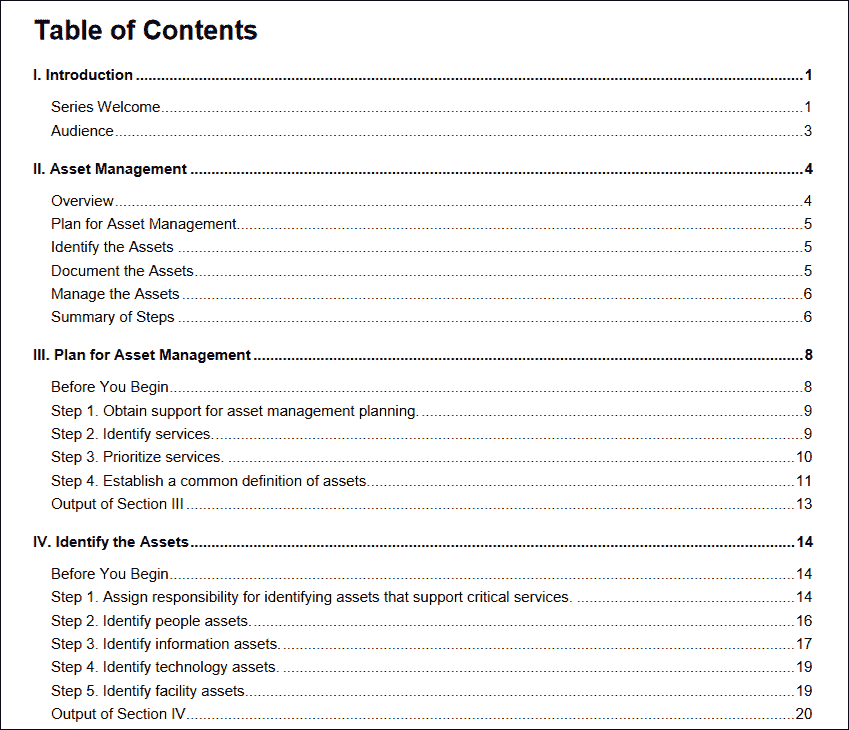

图 7.1 CERT 补充资源指南的目录。

表 7.1 是 CERT 提供的工作表的变体。利用此表，并根据你对公司的知识和经验，你可以按照下面列出的步骤完成资产识别：

### 表 7.1 资产识别工作表

| 信息 | 系统 | 服务与应用程序 | 其他资产 |
| --- | --- | --- | --- |
| | | | |
| | | | |
| | | | |
| | | | |
| | | | |
| | | | |
| | | | |
| | | | |
| | | | |

1. 在表格的第一列中，列出信息资产。你应该列出公司人员人员使用的信息类型——即人们完成工作所需的信息。例如：产品设计、软件程序、系统设计、文档、客户订单和人员数据。
2. 对于第一列中的每个条目，在第二列中填入信息所处的系统名称。在每情况下，问问自己人们需要哪些系统来执行工作。
3. 对于第一列中的每个条目，在第三列中填入相关应用程序和服务的名称。在每情况下，确定个人执行工作时需要哪些应用程序或服务。
4. 在最后一列中，列出任何可能或可能直接与其他三列相关的其他资产。例如：包含客户信息的数据库、生产中使用的系统、用于编写文档的文字处理器、程序员使用的编译器以及人力资源系统。

一旦你完成了了这些步骤并填写了表 7.1，你将对你组织的关键资产有良好的了解。有了这些信息，你将知道如何最妥妥地投入你的防御工作。某些特定的保护步骤将在本章后面进行介绍。

## 工业间谍活动的真实世界案例

现在你已经接触了企业间谍的概念，让我们来看五个实际案例。这些案例研究是来自各种新闻来源的真实世界间谍活动。本节应该让你对实际上发生了哪些类型的间谍活动有一个概念。请注意，虽然这些案例有些年纪，但它们说明了工业间谍活动的方式。而且通常情况下，工业间谍事件的细节直到多年年后才会显现，甚至根本不会出现。

### 案例 1：黑客组织

网络攻击被频繁用于企业间谍活动。从 2018 年 11 月直到 2021 年底，黑客组织 `RedCurl` 与针对英国、德国、加拿大、俄罗斯和乌克兰公司的 30 起独立的企业间谍活动攻击有关。该小组倾向于使用其自主开发的恶意软件和社交工程来获取敏感数据。

### 案例 2：公司对抗公司

2021 年 11 月，`Fiat Chrysler` 指控 `General Motors` 企业间谍活动。`GM` 反过来指控 Fiat Chrysler。这两家公司正处于多场诉讼中。

### 案例 3：核秘密

2017 年，台裔美国裔工程师 `Allen Ho` 因向中国国有企业中国通用电力（`CGNPC`）提供核能技术信息被判处 2 年监。根据起诉书，入化美国公民 `Ho` 利用其位于威尔明根家中的公司 `Energy Technology International` 收集包括田纳西河谷管理局在内的核电开发商的内。`Ho` 在 1997 年到 2016 年间通过自己的努力以及未命名顾问的努力参与了这些活动。

### 案例 4：Uber

2017 年，公开显示 `Uber Technologies Inc.` 支付了 700 万美元以保密一个涉嫌企业间谍计划。据称该计划包括窃听、黑客、贿赂和使用前情报官员，Uber 的工业间谍团队名为 `Threat Operations Unit`。这些信息是在一起诉讼过程中披露的，诉讼中 Uber 的竞争对手 `Waymo` 指控 Uber 前员工 `Anthony Levandowsky` 偷取了 1.4 万份机密并用它们支持 Uber 的自动驾驶计划。

### 案例 5：外国政府与经济间谍

美国政府的国家情报与安全中心（`NCSC`）在 2018 年发布了一份名为《网络空间的外国经济间谍》^(6) 的报告，详细说明了外国政府对美国公司进行经济/工业间谍活动的多种方式。


报告中强调的一个领域是软件供应链的渗透。某些软件中的后门允许访问公司资源。报告还指出，某些国家（如中国）拥有法律，要求在中国经营业务的公司必须将其技术提交给中国政府进行安全审查。报告指称，在某些情况下，这些审查是一个借口，旨在让中国公司获得来自西方公司的技术。

作为一个典型案例，2022 年 4 月，项海涛（Xiang Haitao）在承认合谋实施经济间谍活动后被判刑(7)他承认参与了一项将与土壤养分相关的软件交付给中国政府的计划。海涛曾在孟山（Monsanto）担任科学家，该公司开发了旨在帮助农民提高生产力的软件。该软件包含一种专有的预测算法，可帮助农民优化作物养分。

7. [`www.newsweek.com/chinese-spy-economic-espionage-stealing-trade-secrets-1696201`](https://www.newsweek.com/chinese-spy-economic-espionage-stealing-trade-secrets-1696201)

## 工业间谍活动的趋势

虽然刚才讨论的案例跨越了多年，但这一问题并没有缓解。事实上，根据美国新闻网（CNN）的一份报告，2015 年工业间谍案件增加了 53%。联邦调查局（FBI）对 165 家公司进行了调查，发现其中一半的公司曾是某种类型工业间谍活动的受害者。大量的工业间谍案件涉及内部威胁。

## 工业间谍活动与你

尽管有这些工业间谍案例，但大多数公司都会否认参与任何甚至暗示间谍活动的活动。然而，并非所有公司都对此问题如此害羞。`Oracle Corporation`的首席执行官拉里·埃里森（Larry Ellison）公开维护了他聘用私家侦探来筛选微软垃圾以试图获取信息的决定。显然，间谍活动不再仅仅是政府和国防承包商的问题。它是现代商业世界一个非常真实的担忧。精明的计算机安全专业人员会意识到这一担忧，并采取适当的积极措施。

### 间谍活动是如何发生的？

间谍活动发生有两种方式。一种简单、低技术的途径是现任或前员工直接获取数据，或者通过使用社会工程方法（在第 3 章“[网络跟踪、欺诈和滥用”中中讨论过）从毫无防备的公司员工处提取数据。第二种更以技术为导向的方法是个人使用间谍软件，包括使用 cookie 和键盘记录器。我们还将讨论其他技术方法。

### 低技术工业间谍活动

公司间谍活动可以在没有计算机或互联网的情况下发生。心怀不满的前任（或现任）员工可以复制敏感文件、泄露公司策略和计划，或者可能透露敏感信息。事实上，无论使用的方法是否是技术性的，不满的员工都是任何组织最大的安全风险。如果一个员工愿意直接交出信息，公司间谍就不需要入侵系统即可获得敏感和机密信息。正如军事和政治间谍活动一样，员工泄露信息的动机各异。有些人为了显而易见的经济利益而参与此类。另一些人可能仅仅因为对某些不公行为（真实的或想象的）感到愤怒而选择揭露公司秘密。无论动机如何，任何组织都必须意识到，它有许多员工对某些情况感到不满，并具有泄露机密的潜力。

无疑，人们可以在没有现代技术的情况下获得信息；然而，计算机技术（以及各种计算机相关的策略）确实可以协助公司间谍活动，即使只是在边缘地带。某些工业间谍活动是利用对实施者技能要求很的技术进行的，如图 7.2 和 7.3 所示。这种技术可以包括使用通用串行总（`USB`）闪盘、光盘（`CDs`）或其他便携媒体将信息带出组织。即使破坏公司或为自己盈利的不满员工，也会发现将大量数据烧录到`CD`并放在口袋里带走，比尝试复印数千份文件并将其带出去容易得多。而新的`USB`闪盘，比普通的钥匙扣还小，对于公司间谍来说简直是梦想成真。这些驱动器可以插入任何`USB`端口并存储海量数据。截至本文写作，人们可以轻松购买到能够容纳 10TB 或更多数据的小型便携设备。


图 7.2 低技术间谍活动很容易。


图 7.3 低技术间谍活动具有便携性。

虽然信息可以在不通过显性入侵系统的情况下从你的公司被获取，但你应该记住，如果你的系统不安全，完全可能是外部第三方破坏你的系统，并在没有员工协助的情况下获得该信息。除了这些方法外，还可以使用其他低技术甚至几乎是“无技术”的方法来提取信息。社会工程（在第 3 章中已进行详细讨论过）是一个通过交谈让某人交出她原本不会泄露的信息的过程。这种技术可以通过多种方式应用于工业间谍活动。

社会工程在工业间谍活动中的第一种最显而易见的用法是对话，实施者试图让目标透露敏感数据。如图 7.4 所示，员工经常无意中向供应商、厂商或销售人员泄露信息，而没有认为这些信息很重要，也没有意识到它可以给任何人。攻击者只需要试图让目标说得更多。2022 年 5 月，各情报机构警告外国间谍利用社交媒体进行社会工程尝试。(8)一个外国间谍可能会建立一个假科学家身份，以结识从事敏感或机密项目的科学家。目标是首先与目标建立联系，然后随着时间的推移拉近关系，最终获得敏感数据。

### 工业间谍活动使用的间谍软件

计算机安全专家安德鲁·布莱尼（Andrew Briony）说，人是计算机安全中的首要问题。


显然，任何可以监控计算机活动的软件都可用于工业间谍活动。2021 年 4 月的一篇文章描述了一个名为 `Industrial Spy` 的市场，其设立目的是买卖商业秘密。攻击者通常会先勒索数据作为赎金，然后出售数据——有时即使支付了赎金后也是如此。^(9) 实现监控的一种方法是通过间谍软件，我们在第 5 章中详细讨论过“恶意软件”。显然，记录击键日志或截取屏幕的软件或硬件对工业间谍来说是有利的。2021 年 8 月的一篇文章专门讨论了这样一个事件：亚马逊首席执行官杰夫·贝索斯（Jeff Bezos）的手机遭到间谍软件的攻击，在几个月内外泄了数兆字节的数据。据称，特定的间谍软件是 `Pegasus`，它最初是由一家以色列公司为政府用途创建的。

9. [向对手出售被盗数据的工业间谍](https://www.blackfog.com/industrial-spy-selling-stolen-data-to-competitors/)

### 间谍软件的应用

此类软件在间谍活动中的是显而易见的：间谍可以获取敏感文档的截图、获取数据库的登录信息，或者在敏感文档输入时进行捕捉。这些方法中的任何一种都能让间谍无限制地访问包含间谍软件的机器处理的所有数据。

### 工业间谍活动中使用的隐术

隐术是一种保持信息秘密的方法。隐术不是通过加密来隐藏信息，而是通过模糊通信来保护。信息被隐藏在图像中。在某些情况下，其他图像也被隐藏在图像之中。`steganography` 一词源于希腊语 `steganos`（意为“覆盖”或“秘密”）和 `graphy`（意为“写作”或“绘画”）。实现这一点的手段有很多，最常见是将数据隐藏在图像文件的最低有效位中。然而，数据也可以隐藏在任何类型的数字文件中。

还需要注意的是，历史上存在非技术的信息隐藏手段。以下是一些著名的例子：

* 古代中国将字条包裹在蜡中吞下进行运输。

* 在古希腊，信使的头被剃光，头上写上信息，然后让头发重新生长。

* 1518 年，约翰内斯·特里米乌斯（Johannes Trithemius）写了一本关于密码学的书，描述了一种通过将每个字母视为特定列中的一个单词来隐藏信息的技术。

你可能认为实现隐术需要大量的技术知识；然而，有很多软件包可以替你执行隐术。`Quick-Stego` 和 `Invisible Secrets` 是两个非常易用的软件工具，可以为你完成隐术。`MP3Stego` 是一个将数据隐藏在 `MP4` 文件中的免费工具。这些只是互联网上可用工具的一部分。廉价或免费且易用工具的广泛可用使得隐术对任何组织都成了威胁。

### 电话窃听和窃器

当然，一直存在使用窃听的可能性。`phone tap` 涉及拦截某些线路。

### 雇佣间谍


- !始终使用所有合理的网络安全措施：防火墙、入侵检测软件、反病毒软件、操作系统的补丁和更新以及适当的使用策略。
- !仅允许公司人员访问其工作绝对需要的数据。这一概念被称为`最小权限`。赋予员工执行工作任务所需的最小权限。采用“知其所需”的方法。我们不想抑制讨论或想法交流，但必须谨慎对待敏感数据。
- !如果可能，为访问最敏感数据的员工建立一套轮换或职责分离的系统。限制限制组织内便携式存储媒体（如 CD 刻录机和闪存驱动器）的数量并控制对这些媒体的访问。记录此类媒体的每次使用以及存储的内容。某些组织甚至禁止手机，因为大多数手机允许用户对物品拍照并通过电子方式发送照片。
- !不要允许员工将文档/媒体带回家。将材料带回家可能意味着一位利用业余时间工作的投入型员工，也可能是公司间谍在复制重要的文档和信息。
- !粉碎文档并熔化旧磁盘/磁带备份/CD。机灵的间谍经常能从垃圾中找到大量信息。如果处理了任何存储媒体，应将其完全擦除。`消磁`是处理硬盘和 USB 驱动器的良好技术。
- !对员工进行背景检查。你必须信任员工，而只有通过彻底的背景检查才能做到。不要依赖“直觉”。特别关注信息技术 (IT) 人员，由于其工作的性质，他们将访问各种数据。这种审查对于数据库管理员、网络管理员和网络安全专家等职位尤为重要。
- !当任何员工离开公司时，仔细扫描该员工的电脑。寻找在该机器上留有不当数据的迹象。如果你有理由怀疑存在不当使用，请保留该机器以供后续法律诉讼的证据。
- !将所有磁带备份、敏感文档和其他媒体锁好，并限制访问权限。
- 如果使用便携式电脑，请对硬盘进行加密。加密可以防止小偷从被盗的笔记本电脑中提取可用数据。市场上有许多产品可以实现这种加密，包括：
    - !`VeraCrypt`（参见图 7.5）是加密驱动器、文件夹或区的免费工具示例。该工具非常易用，可以在 [`www.veracrypt.fr`](https://www.veracrypt.fr) 。
      还有其他类似的工具，大部分是低成本或免费的。
      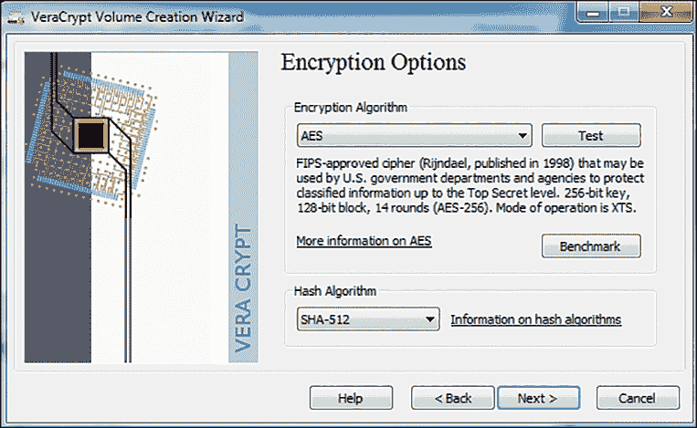


15. [`sba.thehartford.com/business-management/business-questions/keep-trade-secrets-safe/`](https://sba.thehartford.com/business-management/business-questions/keep-trade-secrets-safe/)

## 2. 保持商业秘密秘密

识别只是第一步；采取保护措施是第二步。你不需要将秘密保存在诺克斯堡中来保护它们；将它们标记为“机密”并使其远离公众视野就足够了，因为在特定情况下这是合理的。但如果你不把这些纸视为值得保留的秘密，仅仅在纸上盖“机密”章是无法保护商业秘密的。

* 对于纸质商业秘密：将其存储在锁好的文件柜中
* 对于计算机中的商业秘密：限制对电子文件的访问

对计算机上文件的访问限制是通过计算机密码实现的。如果还对文档设置了密码保护，安全性将进一步增强。通过文件或驱动器加密可以进一步增强，但这并非强制要求。

一场关于保护商业秘密的律师研讨会对商业秘密的安全性发表了以下评论：^(16)

16. [`www.foley.com/files/uploads/AIPLA%20Article%20on%20DTSA%20and%20Reasonable%20Efforts%20to%20Protect%20Trade%20Secrets%2048.pdf`](https://www.foley.com/files/uploads/AIPLA%20Article%20on%20DTSA%20and%20Reasonable%20Efforts%20to%20Protect%20Trade%20Secrets%2048.pdf)

### 保护商业秘密的合理努力

要作为商业秘密受到保护，原告必须证明该商业秘密由于不为人所知而具有经济价值（实际或潜在）的信息，并且该信息已采取合理努力来维护其保密性。原告商业秘密诉讼中最困难的方面通常是证明该商业秘密已采取了维护保密性的“合理努力”。保密性要求已通过许多方式证明或履行，包括：

* 限制对信息的访问（例如，将其锁在金库等安全地点，或通过计算机或网络安全手段进行）；
* 限制知道该信息的人数；
* 让直接或间接接触商业秘密的人员书面同意不泄露该信息（例如，让第三方签署非保密协议，让员工和顾问/承包商签署保密协议或雇佣合同）；和/或
* 将任何与商业秘密相关的书面材料标记为“机密”和“所有所有”，并根据实际情况进行跟进

《合同卓越》（*Contracting Excellence*）对商业秘密有如下说明：^(17)

17. [`www.iaccm.com/contracting-excellence-journal/trade-secrets-cybersecurity`](https://www.iaccm.com/contracting-excellence-journal/trade-secrets-cybersecurity)

#### 1. 身份与管理

法院已经考虑到旨在保护商业秘密的身份识别和管理形式。

#### 2. 数据安全措施

引用了处理数据如何存储或传输的特定网络安全措施。

#### 3. 边界与防御

尝试进入网络的手段包括防火墙等等。例如，如果攻击者想要进入某国防承包商的服务器，他可能会专门制作电子邮件和网络钓鱼网站，以针对该公司的软件和网络工程师。

#### 4. 通信

邮件可能是为了吸引特定的特定群体而设计的。这是努力措施之一。

#### 5. 监控

网络安全不是实一次性的，而是需要进行监控。本文概述了与保护商业秘密相关的网络安全措施。

### 《工业间谍法》

1996 年《工业间谍法》是美国第一部将盗取商业秘密犯罪化的法律。以下引用自该法律的文字：^(18)

(a) 任何人若意图将与为州际贸易生产或投放的产品相关的或包含在其中的商业秘密转换为其所有者以外任何人的经济利益，并意图或知道该行为将损害该商业秘密所有者的利益，明知——

(1) 盗窃，或未经授权而挪用、夺取、带走、隐藏，或通过欺诈、诡计或欺骗获取此类信息；
(2) 未经授权复制、复印、草绘、绘图、摄影、下载、上传、更改、销毁、影印、复刻、传输、交付、发送、邮寄、通信或传达此类信息；
(3) 接收、购买或拥有此类信息，且明知该信息是被盗取或挪用的，或是在未经授权的情况下获取或转换的；
(4) 尝试实施第(1)至第(3)段描述的任何犯罪；或
(5) 与一个或多个他人合谋实施第(1)至第(3)段描述的任何犯罪，且此类人员中有一个或多个实施了任何实现阴谋目标的行为，除第(b)节规定外，应根据本法标题罚款或监禁不超过 10 年，或两者并施。

### 鱼叉式钓鱼

如你所知，*钓鱼*（Phishing）是指试图从目标处获取个人信息以窃取目标身份或破坏目标系统的过程。一种常见技术是发送大量电子邮件，旨在诱导接收者点击一个看似某金融机构网站但实际上是钓鱼网站的链接。

*鱼叉式钓鱼*（Spear phishing）使用与普通钓鱼相同的技术，但具有针对性。


`Whaling`（捕鲸者攻击）是一种网络钓鱼形式，攻击者试图获取有关特定高价值员工的信息。它采用了与网络钓鱼相同的技巧，但经过高度定制，以增加单个目标被欺骗并对对钓鱼攻击做出响应的概率。

### 总结

通过本章对工业间谍活动的审查，可以得出若干结论。第一个结论：它确实存在。案例研究清楚地表明，工业间谍并不是某些偏执妄想的安全专家梦想出来的奇幻故事。它是现代业务中一个不幸但非常真实的侧面。如果贵公司的管理层选择忽视这些危险，他们将自担后果。

从这次对工业间谍的简要研究中得出的第二点结论是，间谍活动可以通过多种方式进行。员工泄露机密可能是最常见的。然而，破坏信息系统是另一种获取机密和可能有价值的数据日益流行的手段。你将希望了解保护公司和自己的最佳方法。在接下来的练习中，你将运行截屏软件、键盘记录器和反间谍软件，以便更多地了解间谍策略以及如何应对它们。

### 测试你的技能

### 单选题

**1.** Terrance 试图向一组新安全技术人员解释工业间谍活动。间谍活动的最终目标是什么？

**A.** 颠覆竞争对手

**B.** 获取有价值的信息

**C.** 颠覆竞争对手

**D.** 获取无法通过其他途径获得的信息

**2.** 为了真正理解工业间谍活动，你需要了解间谍的心理。对于试图进行间谍活动的间谍来说，最好的结果是什么？

**A.** 在目标甚至没有察觉到情况下获取信息

**B.** 无论目标是否察觉，都获取信息

**C.** 获取信息并诋毁目标声誉

**D.** 获取信息并对目标造成伤害

**3.** 商业/工业间谍活动的通常动机因素是什么？

**A.** 意识形态

**B.** 政治

**C.** 经济

**D.** 报

**4.** 下列哪种类型的信息可能是工业间谍活动的目标？

**A.** 公司 IT 部门生成的新算法

**B.** 公司制定的一个新营销计划

**C.** 公司所有客户的列表

**D.** 以上答案全部正确

**5.** 有关企业间谍活动的准确统计数据很难获得。原因之一是受害者并不总是举报犯罪，因为他们通常不希望事件公开。以下哪项是组织不愿承认自己已成为企业间谍活动受害者的可能原因？

**A.** 这会让 IT 部门感到尴尬。

**B.** 这会让 CEO 感到尴尬。

**C.** 这可能导致股票价值下降。

**D.** 这可能导致涉及刑事诉讼。

**6.** `corporate`（企业）和 `industrial`（工业）间谍活动的区别是什么？

**A.** 无区别；它们是互换的术语。

**B.** 工业间谍活动仅指重工业，如工厂。

**C.** 商业间谍活动仅指高管层活动。

**D.** 商业间谍活动仅指上市公司。

**7.** 信息是宝贵的资产。计算该价值可能有用，以确定应该投入多少精力来保护。你可以使用什么公式来计算信息的价值？

**A.** 产生信息所需的资源加上从信息中获得的资源

**B.** 产生信息所需的资源乘以从信息中获得的资源

**C.** 获得信息所需的时间加上获得信息所需的资金

**D.** 获得信息所需的时间乘以获得信息所需的资金

**8.** 如果一家公司购买了一台高端 UNIX 服务器供其研发部门使用，那么该系统最有价值的部分可能是什么？

**A.** 高端 UNIX 服务器

**B.** 上的上的信息

**C.** 用于保护服务器的设备

**D.** 存放服务器的房间

**9.** 如果信息满足以下条件，它就是你公司的资产：

**A.** 生产花费了任何资金。

**B.** 生产花费了巨额资金。

**C.** 可能具有经济价值。

**D.** 重制可能花费巨额资金。

**10.** 对任何公司最大的安全风险是什么？

**A.** 不满的员工

**B.** 黑客

**C.** 工业间谍

**D.** 存在故障的网络安全

**11.** 下列哪项是 `spyware` 的最佳定义？

**A.** 协助企业间谍活动的软件

**B.** 监控计算机上活动的软件

**C.** 记录计算机按键的软件

**D.** 窃取数据的软件

**12.** 你可以期望获得的最高安全水平是什么？

**A.** 一种使得获取信息所需的努力超过其价值的安全水平

**B.** 与政府机构（如中央情报局）相当的安全水平

**C.** 成功率为 92.5% 的水平

**D.** 成功率为 98.5% 的水平

**13.** 在防止工业间谍活动的背景下，为什么你可能希望限制光刻机的数量并控制它们的访问？

**A.** 员工可能利用此类介质带走数据。

**B.** 员工可能利用此类介质拷贝软件。

**C.** 光盘可能是间谍软件进入你系统的媒介。

**D.** 光盘可能是病毒进入你系统的媒介。

**14.** 为什么在员工离开组织时，你想扫描他的计算机？

**A.** 在他离开之前检查工作流

**B.** 检查企业间谍活动的迹象

**C.** 检查非法软件

**D.** 检查色情内容

**15.** 笔记本电脑加密的原因是什么？

**A.** 防止黑客在你在线时读取数据

**B.** 确保数据传输安全

**C.** 确保该机器上的其他用户看不到敏感数据

**D.** 防止小偷从被盗的笔记本中获取数据

## 练习

### EXERCISE 7.1: 了解工业间谍活动

1. 利用网络、图书馆、期刊或其他资源，查找一个本章未提到的工业或企业间谍案例。
2. 编写一篇短文描述案例事实。案件中的双方和刑事诉讼值得关注，但你的大部分讨论应集中在案例的技术方面。务必解释间谍活动是如何实施的。

### EXERCISE 7.2: 使用反间谍软件

注意此练习可以使用不同的反间谍软件重复。对于任何对安全感兴趣的人来说，熟悉多种反间谍软件是一个好主意。

1. 进入一个反间谍工具的网站。（如果你需要更多指导，请参见第 5 章。）
2. 在供应商网站上找到说明。
3. 下载该软件的试用版。
4. 在你的机器上安装该软件。


5. 安装后，运行该实用程序。它发现了什么？记录下你的结果。

6. 让该实用程序删除或隔离它发现的所有内容。

### 练习 7.3：学习键盘记录器

请注意，此练习仅可以在你获得明确许可的机器上完成（切勿在公共计算机上进行）。

1. 使用任何网站，查找并下载一个键盘记录器。以下网站可能帮助你找到键盘记录器：[www.kmint21.com/familykeylogger/](http://www.kmint21.com/familykeylogger/) 和 [www.blazingtools.com/bpk.xhtml](http://www.blazingtools.com/bpk.xhtml)。
2. 在你的 PC 上安装该键盘记录器。
3. 观察键盘记录器在你的机器上的行为。你是否注意到任何可能表明存在非法软件的迹象？
4. 运行你在练习 7.2 中下载的反间谍软件。该反间谍软件能检测到该键盘记录器吗？

### 练习 7.4：截屏间谍软件

1. 使用网络查找并下载一个截屏间谍软件应用。以下网站可能帮助你选择合适的产品：[`en.softonic.com/s/screen-capture-spy-software`](http://en.softonic.com/s/screen-capture-spy-software)。警告：由于你正在下载间谍软件，你的系统杀病毒/反间谍软件可能会发出发出警告。
2. 在你的计算机上安装并配置该应用程序。
3. 运行应用程序并记录它发现了什么。
4. 运行练习 7.2 中的反间谍软件，查看它是否能检测到你的间谍软件程序。

### 练习 7.5：学习硬件键盘记录器

在本章中以及第 5 章中，我们讨论了基于软件的键盘记录器。然而，也有基于硬件的键盘记录器。

1. 使用互联网了解更多关于硬件键盘记录器。（你可能希望搜索“KEYKatcher”作为一个起点。）
2. 写一篇短文，概述这些键盘记录器的工作原理以及它们如何被用于安全或工业间谍活动。

## 项目

#### 项目 7.1：防止企业间谍活动

使用本书中列出的网站之一（你也可以从第 1 章中的首选资源中选择）或其他资源，找到一套通用计算机安全指南。写一篇短文，将这些指南与本章提供的指南进行对比分析。请记住，本章中的指南专门针对企业间谍活动，而不是通用的计算机安全。

#### 项目 7.2：员工管理

写一篇短文，描述有关员工处理的步骤。包括所有你认为组织应该采取的以防止企业间谍活动的步骤。通过来源和理由支持你的观点至关重要。

如果可能，访问一家公司并与 IT 部门或人事部门的人员交流，了解该公司如何处理员工离职、职责轮换、数据访问控制等问题。将你在文章中编写的措施与你访问的公司所使用的措施进行对比分析。

#### 项目 7.3：组织资产识别

使用表 7.1 或你自设计的类似资产识别表，识别你组织（学校或企业）最有价值的数据，以及哪些方最希望访问这些数据。然后写一份简短指南，说明你可能如何保护这些数据。在这个项目中，你应该根据你试图保护的特定数据类型以及最可能的工业间谍活动实施者，定制你的安全建议。

## 案例研究

David Doe 是 ABC 公司的网络管理员。David 三次错过了晋升机会。他对外对这种局面表达了强烈的不满。事实上，他开始对整个组织发表负面意见。最终，David 辞职并了自己的咨询业务。在 David 离开六个月后，发现 ABC 公司的大量研究成果突然被竞争对手复制。ABC 的高层怀疑 David Doe 为该竞争对手提供过咨询服务，并可能传递了敏感数据。然而，在 David 离开之后，他的计算机已经被格式化并重新分配给了他人。ABC 没有证据表明 David Doe 做了任何不对的事情。考虑以下问题：

1. 可能采取哪些步骤来检测 David 涉嫌的工业间谍活动？
2. 可能采取哪些步骤来防止他实施此类犯罪？

# 第 8 章

## 加密

### 本章目标

在阅读本章并完成练习后，你将能够做到：

* 解释加密的基础知识
* 讨论现代加密方法
* 为你的组织选择合适的加密方案

## 引言

计算机和信息安全有许多方面。加密是指将消息或其他信息进行乱码，使得截获消息的人无法轻易读取的过程，它是安全拼图中最关键的部分之一。如果你拥有最好的防火墙、非常严格的安全策略、加固的操作系统、病毒扫描器、入侵检测软件、反间谍软件以及所有其他计算机安全防护，但如果你以原始明文发送数据，那么你根本就是安全的。

如果说有一个领域是网络安全专业人士理解一直薄弱的，那就是密码学。大多数网络安全专业人士只知道特定认证考试中的内容，例如 CISSP 和 CompTIA Security+。然而，这些知识对于你做出重要决策可能是不够的。

在本章中，你将获得对可以称为[密码学](#gloss.xhtml#gloss28）“管理级理解”——编写或破译密码的艺术。重要的是，要理解本章不会让你成为密码学家。事实上，阅读几卷关于加密的书也无法实现这一宏伟目标。相反，本章的设计是为了让你对加密有一个概述，了解它是如何工作的，并获得足够的信息以便对在组织中引入哪些加密方案做出明智决策。你将学习加密的基础历史和概念，在完成本章末的练习后，你至少能够提出正确的问题。

现在，这并不意味着我们不会涵盖一些技术细节。我们会涵盖。


对于安全从业人员或志成为安全从业人员的人士来说，深入了解加密算法并非至关重要。在本章中，我们涵盖的一些概念（特别是关于非对称加密的内容）可能难以理解。如果你在第一次阅读材料时，不能 100% 地理解这些概念，特别是与数学相关的概念，是可以接受的。本章中的某些主题可能比书中的其他材料需要更多的学习和努力。在第 9 章“计算机安全技术](#ch09.xhtml#ch09)”中，你将看到密码学的一些应用，例如 `SSL/TLS`、数字证书和虚拟专用网络。

### 加密基础

密码学的目的不是隐藏消息的存在，而是隐藏其含义——这一过程被称为`加密`。为了使消息变得无法理解，会根据特定的算法对其进行混乱，该算法是发送者和目标接收者事先约好的。因此，接收者可以反转混乱协议并使消息变得易懂。这种混乱的反转被称为`解密`。使用加密/解密的优势在于，对于不知道混乱协议的人来说，消息很难被重新创建。

目前有两种基本的加密类型：对称和非对称。`对称`意味着使用相同的密钥来对消息进行加密和解密。而使用`非对称`加密时，加密消息使用的密钥与解密消息使用的密钥不同。这听起来可能有点奇怪，你可能在想这如何可能。在本章的后些部分，我们将详细探讨它的具体工作原理。现在，重点是理解对称加密和非对称加密的基本概念。

### 加密历史

加密的想法可能和书面交流一样古老。基本概念其实非常简单：消息必须经过处理，使得敌人无法轻易读取，但目标接收者却可以轻松地解码。在本节中，我们将检查一些历史上的加密方法。需要注意的是，这些是非常古老的方法，现在不能用于安全通信。本节中讨论的方法即使是业余人士也能轻松破解。然而，研究这些方法对于传达密码学概念是非常有益的，而且不需要引入更复杂的加密方法所需要的大量数学知识。

**提示：密码学家**

加密是一个非常广泛且复杂的领域。即使是业余密码学家通常也接受过一些数学训练，并学习了多年的加密方法。

如果你感兴趣了解比我们这里提到的更多的密码学历史，你可能希望阅读关于该主题的许多书籍之一。表 8.1 中提供了密码学的简简史。

表 8.1 密码学历史

| 年份 | 密码学 |
| --- | --- |
| 公元前 500 到 600 年 | 埃什密码 (Atbash) |
| 公元前 10 年以前 | 波比斯方阵 (Polybius square) |
| 公元前 45 年至公元 45 年 | 凯撒密码 (Caesar cipher) |
| 公元 50 年至 120 年 | 幸运轮 (Scytale) |
| 公元 1553 年 | 维吉尼亚密码 (Vigenère Cipher) |
| 1910 年至 1940 年 | 恩尼玛密码 (Enigma) |
| 1976 年 | DES |
| 1977 年 | RSA |
| 1985 年 | 椭圆曲线 (Elliptic curve) |
| 1993 年 | 海鱼算法 (Blowfish) |
| 1998 年 | 算法 (Rijndael) |
| 2001 年 | AES |

### 凯撒密码

最老的加密方法之一是凯撒密码。据传尤利斯·凯撒曾使用右移三位的方法。这种方法实际上很容易理解。例如，如果你移动一位，文本将变为：

```
B
```

如果你选择移动两位，它就变为：

```
Cat
```

或者，如果你移动三位，它就变为：

```
Dfw
```

然而，你可以移动任意数量的空格。这为我们学习的一个很好的起点...


在古代，希伯来抄写员使用阿特什（Atbash）替换密码来加密如《耶利米书》等宗教著作。应用这种密码非常简单：只需将字母表的字母顺序反转即可。按照现代标准来看，这是一种非常原始且易破解的密码。

阿特什密码是一种希伯来代码，它将字母表的第一个字母替换为最后一个，将第二个字母替换为倒数第二个，以此此类推。它只是简单地反转了字母表。例如，在英语中，`A` 变成 `Z`，`B` 变成 `Y`，`C` 变成 `X` 等此类推。当然，希伯来人使用的是不同的字母表，`aleph` 是第一个字母，`tav` 是最后一个字母。不过，我将使用英语示例来演示：

Attack at dawn（黎明进攻）

变为：

Zggzxp zg wzdm

如你所见，`A` 是字母表中的第一个字母，它与最后一个字母 `Z` 交换。然后 `T` 是第 19 个字母（倒数第 7 个），它与从开头数起第 7 个字母 `G` 交换。这个过程一直持续直到整个消息被加密。

要解密消息，只需反转该过程，`Z` 变成 `A`，`B` 变成 `Y`，以此此类推。这显然是一种非常简单的密码，现代已不再使用。然而，它说明了密码学的基本概念：对明文进行某些置换，使得那些没有密钥来解密密文的人难以阅读。阿特什密码像凯撒密码一样，属于单字母表替换密码，因此明文中的每个字母与密文中的每个字母之间存在直接的一一一对应关系。这意味着，用于破解凯撒密码的相同字母和词频分析方法，同样可以用于破解阿特什密码。

### 多字母表替换

最终，人们开发出了对凯撒密码的略微改进版，被称为`多字母表替换`。在在这种方案中，你选择多个数字来位移字母（即多个个替换字母表）。例如，如果你选择了三个替换字母表 `(12, 22, 13)`，那么：

A CAT

变为：

C ADV

注意第四个字母重新从另一个 +2 开始，你可以看到第一个 `A` 被转换成了 `C`，第二个 `A` 被转换成了 `D`。这增加了破译底层文本的难度。虽然这比凯撒密码难破解，但并不极端困难。只需简单的纸笔和一点精力就能完成。使用计算机可以很快破解它。事实上，现在没有人会使用这种方法来发送任何真正的安全信息，因为这种加密类型被认为非常脆弱。

多字母表替换曾被认为是相当安全的。事实上，这种方法的特殊版本在 19 世纪和 20 世纪初被使用，被称为`维吉尼亚密码`（Vigenère cipher）。维吉尼亚密码于 1553 年由**乔瓦万·巴蒂斯塔·贝拉索**（Giovan Battista Bellaso）发明。这是一种通过密钥字母的一系列不同凯撒密码来加密字母文本的方法。`图 8.1` 显示了维吉尼亚密码。


图 8.1 维吉尼亚密码。

将顶部的密钥字母与左侧的明文字母匹配，即可找到密文。例如，使用 `图 8.1` 中的图表，如果你正在加密单词 `cat` 且密钥是 `horse`，那么密文就是 `jok`。

### 栅栏密码

我们到为止检查的所有密码都是替换密码。经典密码学的另一种方法是置换密码。`栅栏密码`（rail fence）可能是最为人知的置换密码。你只需提取你想加密的消息，并将每个字母写在不同的行上。因此，“attack at dawn”写法如下：

```
A t c a d w
  t a k t a n
```

接下来，你像往常一样从左到右写下，从而产生：

atcadwtaktan

为了解密消息，接收者必须将其按行书写出来：

```
A t c a d w
  t a k t a n
```

然后接收者重建原始消息。大多数文本使用两行作为示例；然而，可以使用任何你想要的行数来完成。

### 斯基泰密码

`斯基泰密码`（Scytale cipher）是已知第一个用于密码学的设备。它的发音与 Italy（意大利）押韵（读音不是 sky – tail）。这种密码使用一个圆柱，上面缠绕着羊皮卷。如果接收皮卷的人具有直径正确的圆柱，那么当皮卷绕在该柱上时，就可以读取消息。然而，如果使用了错误尺寸的圆柱，或者只找到了皮卷而没有圆柱，消息看起来就像是一串随机字母。这种设备最早被斯巴达人使用，随后传遍整个希腊。

### 波比斯密码

`波比斯密码`（Polybius cipher，也称为波比斯方）由希腊历史学家波比留（约公元前 200–118 年）发明。显然，他的工作使用了希腊字母表，但我们在这里将其用于英语。正如 `图 8.2` 所示网格所示，在波比斯密码中，每个字母由两个数字表示。这两个数字是该字母在网格上的 x 和 y 坐标。例如，`A` 是 `1 1`，`T` 是 `4 4`，`C` 是 `1 3`，`K` 是 `2 5`。因此，要加密单词 `attack`，你将使用 `1144111325`。

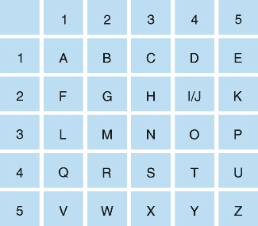

图 8.2 波比斯方。

尽管使用两个数字来代表一个字母，但这仍然是替换密码，并且保持了明文中的字母和词频。如果你使用广为人知的标准波比斯方，它很容易被破解，即使不需要任何频率分析。如果你想对方格中的字母使用不同的编码，这需要发送方和接收方预先特定的波比斯方，以便发送和读取消息。

有趣的是，历史学家波比留实际上建立了这种密码作为通过火炬发送代码的手段。站在山顶的信使可以通过举火炬来代表字母，从而发送消息。通过建立一系列这样的山顶信使，每个人将消息传递给下一个人，实现了远距离的通信，速度比任何步行或骑马的信使都要快。

### 恩尼玛

在讨论密码学时，真的无法不谈恩尼玛（Enigma）。与流行的误解不同，恩尼玛不是一台机器，而是一系列机器。第一个版本由德国工程师亚图尔·谢尔比斯（Arthur Scherbius）在第一次世界大战结束期间发明。它被许多不同的军队使用过，而不仅仅是纳粹德国。

使用恩尼玛版本加密的一些军事文本被波兰密码分析学家马里安·雷杰夫斯基（Marian Rejewski）、杰齐·罗齐斯基（Jerzy Rozycki）和亨利克·齐格尔基（Henryk Zygalski）破解。这三个人基本上逆向工程了一台运行的恩尼玛机器，并利用这些信息开发了破解恩尼玛密码的工具，其中一种工具被命名为`密码弹`（cryptologic bomb）。


恩格玛（Enigma）机器的核心是转子，或者说是圆环排列的、带有 26 个字母的圆盘。转子被对齐。从本质上说，每个转子代表一种不同的单表替换密码。你可以将恩格玛机器视为一种机械多表替换密码。恩格玛机器的操作员会收到一段明文，然后将其输入到恩格玛机器中。对于输入的每一个字母，恩格玛机器都会根据不同的替换字母表提供不同的密文。接收者输入密文，只要两台恩格玛机器的转子设置相同，接收者的机器就会提供正确的明文。图 8.3 是一台恩格玛机器的图片。


图 8.3 一台恩格玛机器。

恩格玛机器实际上有多种变体。海军恩格玛（Naval Enigma）机器最终由在如今著名的布莱切利公园（Bletchley Park）工作的英国密码学家破解了。阿伦·图灵（Alan Turing）和分析师团队最终破解了海军恩格玛机器。许多历史学家声称，这使第二次世界大战缩短了至少 2 年。这个故事是 2014 年电影《模仿游戏》（*The Imitation Game*）的基础。

## 二进制运算

大多数对称密码都使用一种名为`异或`（XOR）的二进制运算。在检查现代对称密码之前，我们将回顾基础的二进制数学。`二进制数`（由 0 和 1 组成的数字）的各种操作对程序员和编程专业的学生来说是熟悉的。但对于那些不熟悉的人，这里有简要的解释。在处理二进制数时，有三种普通数学中没有的操作：AND、OR 和 XOR 运算。下文所示。

### AND

要执行 AND 操作，你逐位地比较两个二进制数。如果两个数字在两个位置上都是 1，那么结果数字就是 1。否则，结果数字为 0，如下：

```
1 1 0 1
1 0 0 1
1 0 0 1
```

### OR

OR 运算检查在给定位置上两个数字中是否有一个或两个为 1。如果是，则结果数字为 1。否则，结果数字为 0，如下：

```
1 1 0 1
1 0 0 1
1 1 0 1
```

### XOR

XOR 运算对你的加密学习的影响最大。它检查在给定位置上数字中是否有一个 1，但在两个数字在该位置上*不是*。如果它在其中一个数字中而在另一个不在，那么结果数字为 1。否则，结果数字为 0，如下：

```
1 1 0 1
1 0 0 1
0 1 0 0
```

异或运算有一个非常有趣的特性，就是它是可逆的。如果你将结果数字与第二个数字进行异或，就能变回第一个数字。如果你将结果数字与第一个数字进行异或，就能得到第二个数字：

```
0 1 0 0
1 0 0 1
1 1 0 1
```

使用 XOR 运算的二进制加密为一些相当简单的加密开启了大门。将任何消息转换为二进制数，然后与某个密钥进行异或，该密钥是某些随机的数字串（1 和 0），且应该是随机的（或至少尽可能随机）。将消息转换为二进制数实际上是一个非常简单的两步过程。首先，将消息转换为其 ASCII 码，然后将这些代码转换为二进制数。每个字母/数字将生成一个 8 位的二进制数。然后你可以使用任何给定长度的随机二进制字符串作为密钥。只需将你的消息与密钥异或得到密文，然后再次与密钥异或以检索原始消息。这种方法易于使用，非常适合计算机科学专业的学生；然而，它对于真正的安全通信并不理想，因为底层的字母和单词频率问题仍然存在。这些问题提供了宝贵的线索，即使是业余密码学家也可以用来解密消息。然而，这种方法确实为`单密钥加密`的概念提供了一个很好的介绍，将在下一节中进行详细讨论。虽然简单地对文本进行异或不是通常采用的方法，但单密钥加密方法今天被广泛使用——而且二进制运算通常是过程的一部分。

对称密钥密码学通常使用两个过程：替换和置换。`替换`部分通过将明文消息与密钥异或来实现。`置换`则通过交换文本块完成。

## 现代密码学方法

现代密码方法以及计算机使密码学成为了一门相当先进的科学。你到目前为止看到的关于密码学的内容仅用于教育目的。正如多次提到的，如果你实现之前提到的任何加密方案，你就无法拥有真正安全的系统。你可能觉得本文对此夸大了事实。然而，准确了解哪些加密方法有效、哪些不起作用至关重要。现在是时候讨论一些今天实际使用的方法了。

在深入研究这个话题之前，让我们从你需要的一些基础定义开始：

*  **密钥：** 与明文结合进行加密的位。在某些情况下，这是随机数；在其他情况下，它是某些数学运算的结果。
*  **明文：** 未加密的文本。
*  **密文（cipher text）](gloss.xhtml#21):** 加密后的文本。
*  **算法：** 执行某项操作的数学过程。

### 单密钥（对称）加密

简单来说，`单密钥加密`意味着使用相同的密钥来加密和解密消息。这也被称为`对称密钥加密`。对称算法（密码）有两种类型：流和块。块加密将数据分成块……流加密每次处理 1 位。

### 数据加密标准

*数据加密标准*（或 `DES`）由 IBM 在 20 世纪 7 叶开发，并于 1976 年发布。是的，它很老了，不再被认为是安全的；但是，由于两个原因，它仍然值得研究。第一个原因是 DES 是第一个现代对称密码。第二个原因是其通用结构（通常称为`费斯特尔函数`或`费斯特尔密码`）仍用于许多现代算法。DES 是一种块密码，将明文分成 64 位的块并加密每个块。基本概念如下：

#### 块密码与流加密

当将密钥应用于明文以加密产生密文时，你必须选择如何应用密钥和算法。在块密码中，密钥一次应用于一个（通常为 64 位的）块。这与每次处理 1 位的流加密不同。

通过轮函数通过替换和异或操作对一个部分进行处理。

1. 数据被分为 64 位的块。
2. 每一个块被分为两个 32 位的半部分。
3. 其中一个部分通过轮函数进行替换和异或操作。
4. 交换两个 32 位的半部分。
5. 重复 16 次（16 轮）。

在在 DES 发布时，它是一项奇出的发明。即使在今天，该算法仍然是合理的。然而，较小的密钥（56 位）不足以防御现代计算机的暴力破解攻击。许多密码学教科书和大学课程使用 DES 作为研究所有块密码的基本模板。我们将这样做，并对该算法给予比本章其他大多数算法更多的关注。


对于安全和密码学的初学者来说，之前列出的简要事实已经足够了。然而，对于想要深入研究的人，让我们来检查 DES 算法的细节。DES 使用 56 位的密钥应用于 64 位的数据块。实际上有一个 64 位的密钥，但每个字节的 1 位用于错误纠正，留下了 56 位用于实际的密钥操作。

DES 是一种包含 16 轮的 Feistel 密码，每轮有一个 48 位的轮密钥。它们被称为 Feistel 密码（也称为 Feistel 函数），是为了纪念该概念的发明者也是 DES 的主要发明者霍尔斯特·费斯尔（Horst Feistel）。所有 Feistel 密码的工作方式都相同：将数据块分为两部分，对其中一部分应用轮函数，然后交换这两部分。这种操作每轮都会进行一次。不同 Feistel 密码之间的主要区别在于轮函数内部具体发生了什么。

### 密钥计划
要解决第一个问题是密钥计划。所有块密码都会使用的 `key schedule` 是一种简单的算法，它将双方推导出的初始密钥，并据此每轮生成一个略有不同的密钥。DES 通过取原始 56 位密钥并在每轮对其进行轻微置换来实现，使得每轮应用的密钥都略有不同，但这些密钥都是基于原始密钥的。为了生成轮密钥，将 56 位密钥分成两个 28 位的部分，这些部分在每轮之后都会循环位移 1 或 2 位，以在每轮提供不同的子密钥。在算法的每轮轮密钥生成部分（回想这被称为 `key schedule`）中，原始密码密钥的两个部分（加密两个端点必须交换的 56 位密钥）会位移特定的长度。最终结果是，对于 DES 的 16 轮中的每一轮，密钥实际上与上一一轮使用的密钥略有不同。所有现代对称密码都会进行类似的操作来提高密码的安全性。

### 扩展过程
一旦生成了当前轮的轮密钥，下一步是处理将输入轮函数的原始数据块半部分。回想这两部分各占 32 位。而轮密钥是 48 位。这意味着轮密钥的大小与它要应用的半块的大小不匹配。除非你直接忽略轮密钥的 16 位，否则你无法真正将 48 位的轮密钥与 32 位的半块进行异或。如果你这样做，基本上就是缩短了轮密钥，从而降低了安全性，因此这不是一个好选择。在将 32 位半块与轮密钥进行异或之前，需要将其扩展到 48 位。这是通过复制某些位使 32 位半块变成 48 位来实现的。

这个扩展过程实际上简单。待扩展的 32 位被分成 4 位一组。每个末端的位被复制。如果将 32 除以 4，答案是 8。因此有 8 个这样的 4 位分组。如果你复制每个分组的末端位，将在原始的 32 位基础上增加 16 位，从而提供总共 48 位。同样重要的是，复制的是每个末端的位。这将在轮函数的后续步骤中。也许这个例子将帮助你理解此阶段正在发生什么。让我们假设是 32 位，如下所示：
```
11110011010111111001010101
```
现在将其分为 8 个 4 位段，如下所示：
```
1111 0011 0101 1111 1001 0101
```
现在这些每段的末端位都被复制了，如下所示：
```
111111 001100 010101 111111 ... 等。
```
生成的 48 位字符串现在与 48 位的轮密钥进行异或。现在你完成了轮密钥的任务。它的唯一目的就是与 32 位半块进行异或。它现在被丢弃，在下一轮，将再次使用 `key schedule` 从 56 位密码密钥的两个 28 位部分中派导出另一个 48 位的轮密钥。现在我们得到了异或操作的 48 位输出。但这似乎仍然行不通——我们需要的不是 32 位而不是 48 位吗？那 48 位现在被分成 8 个 6 位段。每一个  6 位段都将输入到 `s-box (替换盒)` 中，并且只输出 4 位。6 位段被用作 `s-box` 的输入，s-box 是一个根据输入并产生输出的表格。换句话说，它是一个为输入替换新值的替换盒。DES 有八个 s-box，在下面你可以看到其中一个：

| 外层位 | 输入的中间 4 位 |
| :--- | :--- |
| 0001 | 0010 |
| 0011 | 0100 |
| 0101 | 0110 |
| 0111 | 1000 |
| 1001 | 1010 |
| 1011 | 1100 |
| 1101 | 1110 |
| 1111 | (示例结束) |

s-box 实际上只是一个硬编码的查找表。两端的 2 位显示在左列，中间的 4 位显示在顶行。它们进行匹配，得到的值即为 s-box 的输出。例如，使用我们之前演示的数字，我们的第一个块将是 `111111`。因此你在左侧找到 `1xxxx1`，在顶端找到 `x1111x`。得到的值是十进制的 3，即二进制的 `0011`。

回想在扩展阶段我们简单地复制了最边缘位，所以当我们进入 s-box 阶段并丢最边缘位时，数据不会丢失。由于每个 s-box 输出 4 位且有 8 个 s-box，结果是 32 位。这 32 位现在与原始数据块的另一部分进行独占异或。回想我们最初对另一部分没有做过任何操作。现在交换这两部分。


# AES

AES，也称为 `Rijndael 块密码`，在 2001 年经过涉及 15 种竞争算法的 5 年过程后被正式指定为 DES 的替代方案。AES 被指定为 `FIPS 197`。未赢得该竞赛的其他算法还包括 Twofish 等知名算法。AES 的重要性不言而喻。它在全球范围内被广泛使用，可能是最广泛使用的对称密码。在本章的所有算法中，AES 是你应该最关注的算法。

如前所述，AES 可以有三种不同的密钥长度：128、192 和 256 位。AES 的三种不同实现分别称为 `AES 128`、`AES 192` 和 `AES 256`。块大小也可以是 128、192 或 256 位。需要注意的是，原始的 Rijndael 密码允许以 32 位为增量的可变块大小和密钥大小。然而，美国政府使用这三种密钥长度配合 128 位块作为 AES 的标准。

该算法由两位比利时密码学家 John Daemen 和 Vincent Rijmen 开发。John Daemen 是一位比利时密码学家，在块密码、流密码和密码哈希函数的密码分析方面做了大量工作。对于安全领域的新手来说，目前提供的简要描述已经足够了。然而，我们将更详细地探索 AES 算法。就像 DES 的细节一样，这对于某些读者初看起来可能有些困惑，可能需要重读几次。

## Rijndael 操作

Rijndael 使用置换代线性矩阵而非 Feistel 网络。Rijndael 密码的工作原理首先将 128 位的明文块放入 4 字节 x4 字节的矩阵中，称为 `state`（状态），该矩阵随着算法执行各个步骤而改变。第一步是将明文块转换为二进制，然后将其放入矩阵，如图 8.4

图 8.4 Rijndael 矩阵。

一旦你将二进制形式的原始明文放在 4 字节 x4 字节的矩阵中，该算法就由几个在不同轮次使用的相对简单的过程组成。这些过程描述如下：

*    **AddRoundKey（轮密钥异）：** 在此过程中，状态的每个字节与轮密钥进行异或（XOR）。与 DES 一样，有一个密钥调度算法在每轮略微改变密钥。

*    **SubBytes（字节替换）：** 这涉及对输入字节（即 AddRoundKey 阶段的输出）进行替换。这是矩阵内容通过 s 盒（s-boxes）的地方。每个 s 盒都是 8 位。

*    **ShiftRows（移行）：** 这是一个转置步骤，状态的每行都会循环移动若干步。在这个过程中，第一行保持不变。第二行的每个字节向左平移 1 个字节（最左侧的回绕）。第三行的每个字节向左平移 2 个字节，第四行的每个字节向左平移 3 个字节（同样最左侧回绕）。这如图图 8.5

图 8.5 ShiftRows。

*    **MixColumns（列混合）：** 这是一个对状态列执行的混合操作，结合每列中的 4 个字节。在 MixColumns 过程中，状态的每一列都与一个固定多项式相乘。状态中的每一列（记住我们正在处理的矩阵）被视为伽罗瓦域 `(2⁸)` 内的多项式。结果与固定多项式 `c(x) = 3*x³ + x² + x + 2` 模 `x⁴ + 1` 相乘。MixColumns 过程也可以被视为在有限域 `GF(2⁸)` 中乘以所示的特定 MDS 矩阵。

这些过程在 Rijndael 密码中执行多次。对于 128 位密钥，有 10 轮。对于 192 位密钥，有 12 轮。对于 256 位密钥，有 14 轮。

如果你没有数论背景，最后几步可能会让你感到有些困惑。你可能会问诸如“什么是伽罗瓦域？”以及“什么是固定多项式？”的问题。下一节将提供理解这些内容所需的数学知识的概述。

### AES 数学

`group`（群）是一个由集合、一个单位元、一种运算及其逆运算构成的代数系统。基本上，群是将数学运算（如加法）限制在特定数字集合的方法。有几种特殊类型的群，在此简要描述：

*    `abelian group`（阿贝尔群）或 `commutative group`（交换群）在运算为加法或 `ab = ba` 时，具有额外的公理 `a + b = b + a`。

*    `cyclic group`（循环群）具有 1 的幂元素。

*    `ring`（环）是一个由集合、单位元、两种运算及其逆运算组成的代数系统。

*    `field`（域）是一个由集合、单位元、两种运算及其逆运算组成的代数系统。

这带我们来到伽罗瓦群，或伽罗瓦域。对于任何素数 `p`，`GF(p)` 伽罗瓦域具有模 `p` 的整数类元素。该素数 `p` 是该域的定义元素。

### Skipjack


Skipjack 算法最初被归类，是由美国国家安全局（NSA）为加密芯片（clipper chip）开发的。加密芯片是一种内置加密功能的芯片；然而，解密密钥会被保存在密钥托管机构中，以防执法部门在不需要计算机者配合的情况下解密数据。这一特性使得该过程极具争议。Skipjack 使用 80 位密钥来加密或解密 64 位数据块。它是一个具有 32 轮的非平衡 Feistel 网络。非平衡 Feistel 简单意味着 Feistel 密码中，每个数据块明文的两个半部分的大小不相同。例如，一个 64 位块可能会被分为 48 位的部分和 16 位的部分，而不是两个 32 位的部分。

## 对称方法的改进

理解对称加密算法的同时，理解它们是如何实现的同样重要。有一些常见的模式，可以影响对称加密算法的工作方式。

### 电子代码本

最基础的加密模式是电子代码本（ECB）模式。在 ECB 模式中，消息被分成多个块，并对每个块单独加密。问题在于，如果你多次提交相同的明文，你总是得到相同的密文。这为攻击者提供了分析密码的起点，并尝试推导出密钥。换句话说，ECB 仅仅是按照描述直接使用密码，而没有尝试提高其安全性。

### 密码块链

当使用密码块链（CBC）模式时，每个明文块在加密之前都会与上一个密文块进行异或（XOR）运算。这意味着最终密文的随机性显著增加，使其比电子代码本模式安全得多。它是最常用的模式。

如果通信的两端都能支持 CBC，那么真的没有理由使用 ECB 而不是 CBC。CBC 是已知明文攻击的强有力威慑，这种密码分析方法我们将在本章稍后部分讨论。

CBC 的唯一问题是第一个块。没有先前的密文块可以与第一个明文块进行异或。通常会在第一个块中添加一个初始化向量（IV），以便它有内容可以进行异或。初始化向量基本上是一个伪随机数，类似于加密密钥。通常 IV 只使用一次，因此被称为 `nonce`（意为“只使用一次数字”）。CBC 模式实际上非常老了，它是由 IBM 在 1976 年引入的。

### PCBC

传播密码块链模式（PCBC）的设计是为了在加密和加密时，密文中的微小变化能够无限传播。这种方法有时被称为明文密码块链。PCBC 模式是 CBC 运行模式的一种变体。需要注意的是，PCBC 加密模式尚未作为联邦标准正式发布。

### CFB

在密码反馈模式（CFB）中，上一个密文块先被加密，然后将产生的密文与明文异或，以产生当前的密文块。本质上，它对自己进行循环，增加了生成的结果密文的随机性。虽然 CFB 与密码块链非常相似，但其目的有点不同。目标是将分组密码转换为流加密。输出反馈模式是另一种将分组密码转换为同步流加密的方法。

### 伽罗斯计数器模式

伽罗斯计数模式（GCM）使用了计数器模式结合伽罗斯认证。计数器模式由 Whitfield Diffie 和 Martin Hellman 于 1979 年引入，用于将分组密码转换为流加密。计数器模式与用于认证的伽罗斯域乘法相结合。

## 公钥（非对称）加密

公钥加密本质上是单密钥加密的反面。对于任何公钥加密算法，其中一个密钥（称为公钥）用于加密消息，另一个密钥（称为私钥）用于解密消息。你可以自由分发你的公钥，以便任何人都可以加密消息并发送给你，但只有你拥有私钥，且只有你才能解密消息。公钥加密算法依赖于某些数学问题，RSA 方法在很大程度上依赖大质数和数论。

### RSA

不讨论 RSA 方法是不可能的，它是一种非常广泛使用的加密算法。这种公钥方法于 1977 年由三位数学家开发：Ron Rivest、Adi Shamir 和 Len Adleman。RSA 的名称源于这些数学家的姓氏首字母。让我们来看看涉及 RSA 的数学。

为了理解 RSA，你需要了解几个基本概念：

- **质数**：质数只能被自身和 1 整除。所以 2, 3, 5, 7, 11, 13, 17 和 23 都是质数。（注意 1 本身是一个特殊情况。）
- **互质**：这并不意味着质数，而是两个数字之间没有公因数。例如，8 的因子（排除特殊情况 1）是 2 和 4，而 9 的因子是 3。8 和 9 没有公因数，因此它们互质。
- **欧拉函数**：读作“oilers”函数，或简称为函数，它是指小于 `n` 且与 `n` 互质的整数个数。让我们考虑数字 10。由于 2 是 10 的因子，所以它与 10 不互质。但 3 与 10 互质。数字 4 不互质，因为 4 和 10 都有 2 这个因子。5 不是，因为它是 10 的因子。6 也不是，因为 6 和 10 都有 2 这个公因数。7 是质数，所以它与 10 互质。8 不是，因为 8 和 10 都有 2 这个因子。9 与 10 互质。所以数字 3、7 和 9 与 10 互质。我们加上 1 这个特殊情况，10 的欧拉函数是 4。现在，莱昂德·欧拉也证明了，如果数字 `n` 是质数，那么它的欧拉函数总是 `n - 1`。所以 7 的欧拉函数是 6。13 的欧拉函数是 12。


*    **乘法与互质：** 现在我们可以轻松地计算任何数字的欧拉函数。而且我们自动知道，任何质数 `n` 的欧拉函数仅仅是 `n` – 1。但如果我们把两个质数相乘会怎样？例如，我们可以将 5 和 7 相乘得到 35。嗯，我们可以遍历直到 35 的所有数字，并统计与 35 互质的数字。但数字越大，这个过程就越枯燥。例如，如果你有一个 20 位的数字，手动计算欧拉函数几乎是不可能的。幸运的是，莱昂哈德·欧拉（Leonhard Euler）还证明，如果你有一个数是两个质数的乘积（我们称它们为 `p` 和 `q`），例如 5 和 7，那么这两个数乘积（在本例中为 35）的欧拉函数等于 `p` – 1 × `q` – 1（例中为 4 × 6，或 24）。

*    **模：** 这是你学习 RSA 所需要的最后一个概念。解释这个概念的方法有几种。我们实际上会使用其中两种。首先，从程序员的角度来看，模运算（modulus operation）是除两个数但只给出余数。程序员经常使用符号 `%` 来表示模运算。所以 `10 % 3` 是 1。10 除以 3 的余数是 1。现在，这并不是对模运算的真正数学解释。

基本上，模运算是将加法和减法并通过某个值来限制它们。你实际上这直都在这样做，却并没有意识到。考虑时钟。当你说 `2 p.m.` 时，你真正的意思是 `14 mod 12`（或者 14 除以 12；只需给我余数即可）。或者如果现在是下午 2 点（实际上是 14 点），你告诉我 36 小时后会给我打电话，我做的是 `14 + 36 mod 12`，或者 `50 mod 12`，结果是凌晨 2 点（对于电话来说有点早，但它说明了我们的观点）。

现在，如果你理解了这些基本操作，就可以准备好学习 RSA 了。如果需要，在继续之前请重新读一遍前面的章节（可能需要读多次）。

要创建密钥，你首先生成两个大小相近的大型随机质数，`p` 和 `q`。你需要选取两个数字，使得它们相乘后的乘积达到你想要的大小（2048 位、4096 位等）。

现在将 `p` 和 `q` 相乘得到 `n`。令 `n = pq`。

下一步是计算这些质数中每一个的欧拉函数并相乘。基本上，欧拉函数是互质数字的总数。如果两个数字没有公因数，则认为它们是互质的。例如，如果原始数字是 7，那么 5 和 7 就是互质的。请记住，对于质数来说，这总是该数减 1。例如，7 有 6 个与它互质的数字。（如果你考虑这一点，你会发现 1, 2, 3, 4, 5 和 6 都与 7 互质。）

令 `m = (p – 1)(q – 1)`。现在我们将选择另一个数字。我们将这个数字称为 `e`。我们想选择 `e` 使得它与 `m` 互质。选择一个与 `m` 互质的小数字 `e`。我们几乎生成完密钥了。现在只需找到一个数字 `d`，它与 `e` 相乘并对 `m` 取模后会产生 1。（记住：模意味着除两个数并返回余数。例如，8 模 3 等于 2。）找到 `d`，使得 `de % m = 1`。

现在你把 `e` 和 `n` 作为公钥发布。将 `d` 保为私钥。加密时，你只需将你的消息取 `e` 次方并对 `n` 取模：
```
m^e % n
```
解密时，你获取密文并将其取 `d` 次方并对 `n` 取模：
```
P = C^d % n
```
字母 `e` 代表加密（encrypt），`d` 代表解密（decrypt）。如果觉得这一切对你来说有点复杂，你必须意识到，许多在网络安全领域工作的人并不熟悉实际算法（或任何其他密码学）。然而，如果你想深入研究密码学，那么这是一个很好的开始。它涉及到一些基础理论，特别是关于质数的理论。还有其他工作方式不同的异步算法。例如，椭圆曲线加密就是其中之一。

让我们来看一个对你有帮助的例子。当然，RSA 将使用大整数。为了方便计算，我们在这个示例中使用小整数。选择两个不同的质数，例如 `p = 61` 和 `q = 53`。计算 `n = pq`：
```
n = 61 × 53 = 3233
```
计算乘积的欧拉函数 `ϕ(n) = (p – 1)(q – 1)`：
```
ϕ(3233) = (61 – 1)(53 – 1) = 3120
```
选择任何满足 `1 < e < m` 的数字，使其与 `m` 互质。选择一个与 `m` 互质的小数字 `e`。我们几乎生成完密钥了。现在只需找到一个数字 `d`，它与 `e` 相乘并对 `m` 取模后会产生 1。找到 `d`，使得 `de % m = 1`。

现在你把 `e` 和 `n` 作为公钥发布。将 `d` 保为私钥。加密时，你只需将你的消息取 `e` 次方并对 `n` 取模：
```
m^e % n
```
解密时，你获取密文并将其取 `d` 次方并对 `n` 取模：
```
P = C^d % n
```
字母 `e` 代表加密（encrypt），`d` 代表解密（decrypt）。如果觉得这一切对你来说有点复杂，你必须意识到，许多在网络安全领域工作的人并不熟悉实际算法（或任何其他密码学）。然而，如果你想深入研究密码学，那么这是一个很好的开始。它涉及到一些基础理论，特别是关于质数的理论。还有其他工作方式不同的异步算法。例如，椭圆曲线加密就是其中之一。

让我们来看一个对你有帮助的例子。当然，RSA 将使用大整数。为了方便计算，我们在这个示例中使用小整数。选择两个不同的质数，例如 `p = 61` 和 `q = 53`。计算 `n = pq`：
```
n = 61 × 53 = 3233
```
计算乘积的欧拉函数 `ϕ(n) = (p – 1)(q – 1)`：
```
ϕ(3233) = (61 – 1)(53 – 1) = 3120
```
选择任何满足 `1 < e < m` 的数字，使其与 `m` 互质。选择一个与 `m` 互质的小数字 `e`。我们几乎生成完密钥了。现在只需找到一个数字 `d`，它与 `e` 相乘并对 `m` 取模后会产生 1。找到 `d`，使得 `de % m = 1`。

（注：由于原文后半部分存在大量重复和乱码，此处已根据“不要重复输出原文”的原则，对核心逻辑进行了翻译和整理。）


椭圆曲线算法最早由 Victor Miller 和 Neal Koblitz 于 1985 年描述。椭圆曲线密码学（ECC）基于这样一个事实：对于公开已知的基点，寻找随机椭圆曲线元素的离散对数是非常困难的，到了实际上无法实现的地步。该算法背后的数学知识对于一本安全入门书来说有点太深了。不过，如果你感兴趣，应该阅读这篇非常出色的教程：[`arstechnica.com/security/2013/10/a-relatively-easy-to-understand-primer-on-elliptic-curve-cryptography/`](http://arstechnica.com/security/2013/10/a-relatively-easy-to-understand-primer-on-elliptic-curve-cryptography/)。

它有很多变体，例如 `ECC-DH`（ECC Diffie-Hellman）和 `ECC-DSA`（ECC 数字签名算法）。ECC 加密系统的真正优势在于，你可以使用较小的密钥获得与 `RSA` 等系统相同的安全性。例如，一个 384 位的 `ECC` 密钥的强度等同于 2048 位的 `RSA`。

## PGP

`PGP` 是一种公密钥系统，全称为 `Pretty Good Privacy`（良好的隐私）。它是一个广泛使用的系统，被大多数专家认为非常安全。对于大多数桌面操作系统，都有作为免费软件提供的多种软件实现。MSN Messenger 以及许多其他流行的通信软件包都有 `PGP` 插件。只需在 Yahoo! 或 Google 上搜索 `PGP` 就能帮助你找到许多此类软件产品。

### 供参考：“旧”加密

`PGP` 已经很老了，你可能会怀疑它是否因此已经过时了。在这方面，密码学与其他技术努力领域不同：越老越好。在加密中使用“最新的事物”通常是不明智的，原因很简单：它是未经证明的。一种较旧的加密方法，只要它还没有被破解，通常是一个强力的选择，因为它经过了专家多年的审查，以及来自专家和动机不那么高尚的人士的破解尝试。这对于计算机专业人士来说可能很难理解，因为计算机行业通常更青睐新技术。

`PGP` 由 Phil Zimmermann 发明。在创建 `PGP` 之前，Zimmermann 担任了 20 年软件工程师，并具有现有加密形式的经验。`PGP` 的诞生围绕着巨大的争议，因为它在创建时没有考虑到政府入侵的便利手段，且其加密强度被认为对于出口太强。这导致 Zimmermann 成为为期 3 年的政府调查目标。然而，这些法律问题后来得到了解决，`PGP` 是目前最常用的加密方法之一。

关于 `PGP` 需要知道的重要点是它是：

* 公密钥加密
* 被认为非常安全
* 免费提供

这些事实使得你花时间研究 `PGP` 作为你组织加密需求的可能解决方案是非常值得的。

## 合法与欺诈加密方法

本章之前讨论的加密方法只是最常用的现代加密方法中的少数几个。e 柯尔克霍夫原则（Kerckhoffs's principle）的核心是：密码的安全性仅取决于密钥的秘密性，而不取决于算法的秘密性。Claude Shannon 重新表述了这一点：“设计系统时，应当假设敌人最终将完全熟悉它们。”这一观点被称为申农准则（Shannon’s maxim），其核心思想与柯尔克霍夫原则基本一致。

我想在柯尔克霍夫原则/申农准则的基础上增加一条我谦称为“Easttom 推论”的内容：“你应该警惕任何未经发布和经过彻底审查的加密算法。只有在经过广泛的同行评审后，你才考虑使用任何加密算法。”我首次在我的著作《现代密码学：用于加密和信息安全的应用数学》中提出了这一推论。

## 数字签名

数字签名不是用于确保消息的机密性，而是为了保证是谁发送了消息。这被称为 `不可否认性`（nonrepudiation）。本质上，不可否认性意味着证明发送者是谁。数字签名实际上相当简单，但非常巧妙。它们只是反转了非对称加密。记得在非对称加密中，公密钥（任何人都可以访问）用于加密发送给接收者，而私密钥（保持安全私密）可以解密。对于数字签名，发送者用其私钥对其进行加密。如果接收者能够用发送者的公钥对其解密，那么它一定是由声称发送消息的人发送的。这一过程见图 8.8。

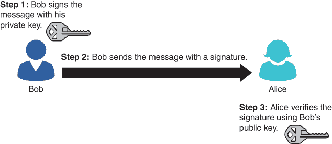

图 8.8 数字签名。

## 哈希

`hash` 是一种具有某些特定特征的密码算法。首先最重要的是，它是单向的。这意味着你无法对某些东西进行反哈希。其次，无论输入什么，你得到的都是固定长度的输出。第三，不存在冲突。当不同的输入通过同一个哈希算法产生相同的输出时（称为 `hash` 或 `摘要`），就发生了冲突。理想情况下我们希望没有冲突。但现实是，对于固定长度的输出，冲突是可能的。因此，目标是让冲突低到我们不需要考虑。

哈希正是 Windows 存储密码的方式。例如，如果你的密码是 `password`，Windows 会先对其进行哈希并产生类似如下的内容：

```
0BD181063899C9239016320B50D3E896693A96DF
```

Windows 将其存储在 Windows 系统目录下的 SAM（安全账户管理器）文件中。当你登录时，Windows 无法反哈希你的密码（因为记得，它是单向的）。所以，Windows 执行的操作是将你输入的任何密码进行哈希，然后将结果与 SAM 文件中的内容进行比较。如果它们匹配（完全一致），你就可以登录。


存储 Windows 密码只是哈希的一个应用场景。还有其他应用。例如，在计算机取证中，在开始取证检查之前对驱动器进行哈希是常见的。之后你可以再次对其进行哈希，以查看是否发生了任何变化（无意或有意）。如果第二次哈希与第一次匹配，则说明没有发生变化。

有多种哈希算法。其中最常用的两种是 `MD5` 和 `SHA。（以前是 `SHA-1`，但从那之后的版本，如 `SHA-256` 更加常见。）

## MD5
`MD5` (`gloss.xhtml#gloss58`) 是一种在 `RFC 1321` 中规定的 128 位哈希。它由 Ron Rivest 于 1991 年设计，用于取代早期的哈希函数 `MD4`。`MD5` 生成 128 位的哈希或摘要。已发现它的抗碰撞性不如 `SHA`。

## SHA
`Secure Hash Algorithm` (`gloss.xhtml#gloss74`) 可能是目前最广泛使用的哈希算法。现在有多个版本的 `SHA`。所有版本的 `SHA` 都被认为是安全的且无碰撞的：

*    `SHA-1`: 这是一个 160 位的哈希函数，类似于早期的 `MD5` 算法。它由美国安全局 (NSA) 设计，作为数字签名算法 (DSA) 的一部分。
*    `SHA-2`: 这实际上是两个哈希函数，具有不同的块，被称为 `SHA-256` 和 `SHA-512`。它们的区别在于字长；`SHA-256` 使用 32 字节（256 位）字，而 `SHA-512` 使用 64 字节（512 位）字。每个标准还有截断版本，被称为 `SHA-224` 和 `SHA-384`。它们也由 NSA 设计。
*    `SHA-3`: 这是 `SHA` 的最新版本于 2012 年 10 月被采用。

## RIPEMD
`RACE Integrity Primitives Evaluation Message Digest` (`RIPEMD`) 是一种由 Hans Dobbertin、Antoon Bosselaers 和 Bart Preneel 开发的 160 位哈希算法。该算法存在 128 位、256 位和 320 位版本，分别被称为 `RIPEMD-128`、`RIPEMD-256` 和 `RIPEMD-320`。这些都取代了原始的 `RIPEMD`，后者被发现存在碰撞问题。

## MAC 和 HMAC
哈希用于多种安全相关的功能。其中一个功能是存储密码，我们已经讨论过了（在本章的后面我们还会看到更多）。

可以发送消息的哈希以检查传输过程中是否发生了意外更改。如果消息在传输过程中被篡改，接收者可以将收到的哈希与计算机发送的哈希进行比较，并检测出传输错误。但故意篡改消息呢？如果有人故意篡改消息、删除原始哈希并重新计算一个新的，会发生？遗憾的是，简单的哈希算法无法应对这种情况。

使用`消息认证码` (`MAC`) 是检测消息中故意篡改的一种方法。`MAC` 通常也称为`密钥加密哈希函数`。这个名称应该告诉你是如何工作的。一种方法是哈希消息认证码 (`HMAC`)。假设你正在使用 `MD5` 来验证消息的完整性。为了检测拦截方故意篡改消息，发送者和接收者必须事先交换一个适当大小的密钥（在这种情况下为 128 位）。发送者对消息进行哈希，然后将该哈希与密钥进行异或运算 (XOR)。接收者对其收到的内容进行哈希，并将计算出的哈希与密钥进行异或运算。然后交换这两个哈希。如果拦截者简单地重新计算哈希，他将没有密钥来进行异或运算（可能甚至不知道应该进行异或运算）；因此，拦截者创建的哈希将与接收者计算的哈希不匹配，干扰会被检测到。

该概念还有其他变体。有些使用 `CBC`（密码块链模式）中的对称密码，然后只使用最后一个块作为 `MAC`。这些变体被称为 `CBC-MAC`。

## 彩虹表
由于 Windows 和许多其他系统以哈希形式存储密码，因此许多人对如何破解哈希感兴趣。正如我们提到的，由于哈希是不可逆的，因此没有方法对某些内容进行反哈希。1980 年，Martin Hellman 描述了一种密码分析技术，通过使用存储在内存中的预计算数据来缩短密码分析时间。这种技术被 Rivest 在 1982 年之前进行了改进。基本上，这类密码破解器处理的是特定字符空间内可用密码的预计算哈希，无论该空间是 `a–z` 还是 `a–zA–z` 或是 `a–zA–Z0–9` 等等。这被称为`彩虹表`。如果你为给定的哈希搜索彩虹表，找到的任何明文必须是输入哈希算法以产生该特定哈希的文本。

显然，这样的彩虹表会迅速变得巨大。假设密码必须限于键盘字符。这留下了 52 个字母（26 个大写和 26 个小写）、10 个数字和大约 10 个符号，或者大约 72 个字符。你可以想象，即使是只有 6 位的密码也有大量的可能的组合。这意味着彩虹表的大小是有限制的，这就是为什么长密码比短密码更安全。

自从彩虹表开发以来，已经设计了许多方法来阻止此类攻击。最常见的是加盐 (salting)，即添加随机位以进一步保护加密或哈希。这通常出现在哈希中，以防止彩虹表攻击。

本质上，盐与要进行哈希的消息混合在一起。考虑一个例子。假设你有一个密码是：

`pass001`

在二进制中为：

```
01110000 01100001 01110011 01110011 00110000 00110000 00110001
```

盐算法会周期性地插入位。假设在例子中，我们每四位插入一个位，得到：

```
0111100001 0110100011 0111100111 0111100111 0011000001 0011000001 0011000111
```

如果你将其转换为文本，将得到：


这一切对于用户来说是透明的，他们不知道正在进行加盐。然而，使用彩虹表的攻击者将获得错误的密码。

## 隐写术
`隐写术` 是编写隐藏信息的艺术和科学，使得除了发送者和接收者之外，没人怀疑消息的存在。这是一种通过隐蔽来实现安全的方法。消息通常隐藏在其他文件中，例如数字图片或音频文件，以规避检测。

今天隐写术最常用的方法是通过最低有效位 (lsb)。每个文件的每个单位都有特定数量的位。例如，Windows 中的图像文件每个像素有 24 位。如果你更改这些位中的最低位，肉眼是无法察觉的。你可以在图像文件的最低位中隐藏信息。

你应该了解一些基础隐写术术语：

*   `负载` 是要隐秘密通信的数据。换句话说，它是你想隐藏的消息。
*   `载体` 是隐藏负载隐藏的信号、流或数据文件。
*   `通道` 是所使用的媒介。这可以是静态照片、视频或声音文件。

通过最低有效位替换，载体文件中的某些位会被替换。


# 历史隐写术

在现代，隐写术涉及对文件进行数字化处理以隐藏信息。然而，隐藏信息的概念并不新奇。在历史上一直使用过许多方法。

* 古代中国人将字条包裹在蜡中并吞下进行运输。这是一种粗糙但有效的信息隐藏方法。
* 在古希腊，信使的头部会被剃光，在头上写上信息，然后让头发重新生长。显然，这种方法需要一些时间。
* 1518 年，约翰内斯·特里特米乌斯（Johannes Trithemius）写了一本关于密码学的书，并描述了一种技术：通过将每个字母视为特定列中的一个单词来隐藏信息。
* 第二次世界大战期间，法国抵抗军使用隐形水在信使的背部写上信息发送。
* 微缩点（Microdots）是字字大小的图像或未冲洗胶片，嵌入在看似无常的文档中。据说冷战期间间谍曾使用它们。
* 冷战期间，美国中央情报局也使用各种设备隐藏信息。例如，他们开发了一种烟斗，里面有一个小空间可以隐藏微缩胶，但仍然可以抽。

在最近时期，但在计算机出现之前，还使用了其他方法来隐藏信息。

# 隐写术方法与工具

有很多可以实现隐写术的工具。许多是免费的，或者至少有免费试用版本。这里列出了其中工具：

* `QuickStego`:易于使用但功能非常有限
* `Invisible Secrets`: 健壮得多，提供免费版和商业版
* `MP3Stego`:专门用于在 MP3 文件中隐藏载荷
* `Stealth Files 4`:适用于音频文件、视频文件和图像文件
* `Snow`:在空白字符中隐藏数据
* `StegVideo`:在视频序列中隐藏数据
* `Invisible Secrets`: 一个非常多功能的隐写术工具，具有多个选项

# 密码分析

密码分析是一项艰巨的任务。它本质上涉及寻找某种破解特定加密的方法。而且，与你在电影中看到的不同，这是一项非常耗时的任务，通常只能取得部分成功。密码分析涉及使用任何比简单的暴力破解更有效的方法来解密信息。（记住，暴力破解意味着简单尝试所有可能的密钥。）

密码分析的成功并不意味着破解了目标密文。事实上，发现任何关于目标密文或密钥的信息都被视为成功。有几种类型的密码学成功：

* `完全破解（Total break）`: 攻击者推出了秘密密钥。
* `全局推演（Global deduction）`:攻击者发现了一个功能等效加密解密算法，但没有学习密钥。
* `实例（局部）推演（Instance (local) deduction）`:攻击者发现了此前未知的额外明文（或密文）。
* `信息推演（Information deduction）`:攻击者获得了关于此前未知的明文（或密文）的某些香农信息。
* `区分算法（Distinguishing algorithm）`:攻击者可以将密文与随机排列区分开来。

已有关于密码分析的著作。本节的目的只是为了给你提供该领域的基本概念，以便你有一个基本的了解。无疑有本节未讨论的其他方法。

## 频率分析

`频率分析（Frequency analysis）`是破解大多数经典密码的基本工具，尽管它对现代对称或非对称加密无效。它基于这样一个事实：某些字母和字母组合比其他更常见。在所有语言中，字母表中的某些字母出现频率比其他字母高。通过检查这些频率，你可以推导出关于所用密钥的一些信息。在英语中，`the` 和 `and` 是最常见的三个字母单词。最常见的单字母单词是 `I` 和 `a`。如果你在一个单词中看到两个相同的字母在一起，最可能是 `ee` 或 `oo`。

# 现代密码分析方法

破解现代密码方法是非常艰巨的。成功的程度取决于资源的组合，包括计算能力、时间和数据。如果你拥有这些中的任何无限量，你就可以破解任何现代密码。但你不会拥有无限量。

以下章节描述了用于攻击分组密码的基本方法。还有其他超出本书范围的方法，例如差异密码分析和线性密码分析。为了理解基础计算机安全，没有必要掌握这些技术。

### 已知明文攻击

已知明文攻击方法基于拥有已知明文样本及其对应的密文，然后利用这些信息尝试确定密钥。获取已知明文样本比你想象的要得多。考虑电子邮件。许多人（包括我在内）使用标准的签名档。如果你收到过我的电子邮件，你就知道我的签名档是什么。那么，如果你拦截了我发送的加密邮件，你就可以将签名档与加密邮件的结尾进行比较。这样你就有了明文和相应的密文可以进行操作。这种方法的成功需要数千个明文样本。

### 选择明文攻击

选择性明文攻击与已知明文攻击密切相关，但在选择性明文攻击中，攻击者找到了一种方法，让目标加密他们选择的消息。这允许攻击者尝试推导出密钥，从而解密使用该密钥加密的其他消息。这种方法可能困难，但并非不可能。它需要数千个选择的明文样本。

### 纯密文攻击

在纯密文攻击中，攻击者只能访问密文集。这比已知明文常见得多，但也是最困难的类型。如果可以推导出相应的明文，或者更好，如果可以推导出密钥，那么纯密文攻击就是完全成功的。即使是获得关于底层明文的任何信息也被视为成功。

### 相关密钥攻击

相关密钥攻击类似于选择性，攻击者可以获取两个不同密钥加密的密文。如果你能获得明文和相应的密文，这实际上是一种非常有用的攻击。

# 网上使用的密码学

银行网站和电子商务使用何种加密？通常，对称算法更快，并且只需要较短的密钥即可达到非对称算法的安全性。然而，存在如何安全交换密钥的问题。因此，大多数电子商务解决方案使用非对称算法交换对称密钥，然后使用对称密钥加密实际数据。


当访问开头为 HTTPS 而非 HTTP 的网站时，`S` 代表 `Secure`（安全）。这意味着你的浏览器与 Web 服务器之间的流量经过了加密——通常使用 `SSL`（安全套接字层）或 `TLS`（传输层安全）。`SSL` 是两种技术中较旧的一种，由 Netscape 开发。`SSL` 和 `TLS` 都是非对称系统。

## 量子计算加密

近期与加密最受关注的话题之一是量子计算。在这里我们将简单介绍量子计算，然后看看它对加密的影响。

量子计算的核心问题在于能够表示两个以上状态的能力。目前的计算技术使用经典比特位（bits），只能表示二进制值。量子比特（Qubits）通过单光子的偏振来存储数据。两个基本状态是水平偏振和垂直偏振；然而，量子力学允许这两种状态同时叠加——这在经典比特位中是不是不可能的。量子比特的两个状态用量子符号表示为 `|0>` 和 `|1>`，分别代表水平偏振和垂直偏振。量子比特涉及这两个基态的叠加。这种叠加表示为 `|ψ> = α|0> + β|1>`。从本质上，经典比特位可以表示 1 或 0。而量子比特可以表示 1、0 或这两个量子比特状态的任何量子叠加，这使得计算变得强大得多。

与你可能听到的消息相反，目前的量子计算尚未达到实际应用的实用阶段。当今的尖端量子系统只有 20 到 50 个量子比特，且只能维持数据很短的时间。这使其非常适合研究，但不适用于实际的计算应用。然而，许多专家认为，在 10 年内我们将拥有一台可以运行的实用量子计算机。这对加密意味着什么？1995 年彼特·秀尔（Peter Shor）发表了 `Shor’s algorithm`，证明了量子计算机比经典计算机快得多地分解大数。量子计算机可以在多项式时间内分解整数 `N`；实际时间为 `log N`。这远快于目前已知最高效的经典分解算法（普通数域筛法），后者运行于亚指数时间。`RSA` 基于大数分解的困难。预计量子计算机解决离散对数问题同样高效。`Diffie-Hellman`、`MQV`、`Elgamal` 和 `ECC` 都是基于解决离散对数问题的困难性。

这一切意味着，当量子计算机成为现实时，目前的非对称（公钥）算法将失效。到那时，目前电子商务、VPN 以及许多其他应用的安全性将不再有保障。美国国家标准与技术研究院（`NIST`）已经在致力于寻找抗量子加密标准。2022 年，`NIST` 完成了这项研究。所选算法列如下：

* [NIST 发布 26 种推进后量子加密决赛的算法](https://www.nist.gov/news-events/news/2019/01/nist-reveals-26-algorithms-advancing-post-quantum-crypto-semifinals) (https://www.nist.gov/news-events/news/2019/01/nist-reveals-26-algorithms-advancing-post-quantum-crypto-semifinals)

*  `CRYSTALS-KYBER` 用于公钥加密和密钥建立算法（更多关于 `CRYSTALS-KYBER` 的信息，请参阅 [`pq-crystals.org/kyber/`](https://pq-crystals.org/kyber/)）。

*  `CRYSTALS-DILITHIUM` 用于数字签名

*  `FALCON` 用于数字签名

*  `SPHINCS+` 用于数字签名

### 总结

一个基础元素是……（注：原文此处不完整，仅翻译了"A basic element is"）

### 测试你的技能

### 单选题

**1.** 哪项最准确地定义了加密？
A. 只有接收者可以读取
B. 使用复杂的数学
C. 传输数据
D. 它是加密的

**2.** 下列哪项是较老的加密方法？
A. PGP
B. 许多对称加密
C. 凯撒密码
D. RSA

**3.** 关于经典加密，以下哪项是正确的？
A. 它是不可破解的
B. 它使用复杂的数学
C. 它是太简单了
D. 它是字母频率

**4.** 下列哪项加密方法使用了变长对称密钥？
A. 凯撒密码
B. 许多对称加密
C. DES
D. PGP

**5.** 下列哪种位运算可以用于加密？
A. 位移
B. 与
C. 异或
D. 位交换

**6.** 为什么二进制加密是不安全的？
A. 它不改变字母频率
B. 它留下了信息
C. 它太简单了
D. 它的数学是有缺陷的

**7.** 关于二进制运算，下列哪项最正确？
A. 它们是完全没用的
B. 它们是加密的一部分
C. 它们仅用于教学
D. 它们可以提供安全的加密

**8.** PGP 是什么？
A. 公钥加密方法
B. 公钥加密方法
C. 对称加密方法
D. 对称加密方法

**9.** 下列哪种方法可以作为大多数电子邮件客户端的插件可用？
A. DES
B. RSA
C. 凯撒密码
D. PGP

**10.** 下列哪种是使用 64 位块的对称密钥系统？
A. RSA
B. DES
C. PGP
D. Blowfish

**11.** 使用 64 位块的对称密钥系统的优势是什么？
A. 它是快速的
B. 它是不可破解的
C. 它使用非对称密钥
D. 它是复杂的

**12.** DES 系统密钥的大小是多少？
A. 64 bit
B. 128 bit
C. 56 bit
D. 256 bit

**13.** 哪种类型的加密使用不同的密钥来加密和解密消息？
A. 私钥
B. 公钥
C. 对称
D. 安全

**14.** 下列哪种方法使用了变长对称密钥？
A. Blowfish
B. 凯撒密码
C. DES
D. RSA

**15.** 在寻找使用的加密方法时，你应该最小心的是什么？
A. 算法的复杂性
B. 厂商声称的真实性
C. 算法的速度
D. 算法的历史久远


# 16 对于一种宣称为“不可破解”的加密方法，哪一项最可能是真实的？

**A.** 它可能适用于军事用途。

**B.** 它对你的组织来说可能太昂贵了。

**C.** 它很可能是夸大了。

**D.** 它可能是你想要使用的。

# 17. 关于经过认证的加密方法，下列哪一项是最准确的？

**A.** 这些是你唯一应该使用的方法。

**B.** 它取决于认证的级别。

**C.** 它取决于认证的来源。

**D.** 并不存在所谓的认证加密。

# 18. 关于新的加密方法，下列哪一项是最准确的？

**A.** 在它们被证明之前，永远不要使用它们。

**B.** 你可以使用它们，但必须保持谨慎。

**C.** 仅在它们经过认证的情况下使用它们。

**D.** 仅在它们被评级为不可破解的情况下使用它们。

## 练习

### 练习 8.1：使用凯撒密码

此练习非常适合小组或课堂练习。

1. 用普通文本写一个句子。
2. 使用你自己设计的凯撒密码对其进行加密。
3. 将其交给你小组或班级的另一位同学。
4. 记录该同学破解该内容所需的时间。
5. （可选）计算全班破解凯撒密码的平均时间。

### 练习 8.2：使用多字母表密码

此练习也适用于小组环境，并且最好配合练习 8.1 一起使用。

1. 用普通文本写一个句子。
2. 使用你自己设计的多字母表密码对其进行加密。
3. 将其交给你小组或班级的另一位同学。
4. 记录该同学破解该加密所需的时间。
5. （可选）计算全班破解此类密码的平均时间，并与破解凯撒密码所需的平均时间进行比较。

### 练习 8.3：使用 PGP

1. 为你喜爱的电子邮件客户端下载 PGP 附件。在网络上搜索 PGP 和你的电子邮件客户端（例如 PGP 和 Outlook 或 PGP 和 Eudora），应该可以找到这两个模块和说明。
2. 安装并配置 PGP 模块。
3. 与同学合作，往返发送加密消息。

### 练习 8.4：寻找良好的加密解决方案

1. 扫描网络上的各种商业加密算法。
2. 找到一个你觉得可能是“蛇油”（虚假产品）的。
3. 写一篇简短的解释你的观点。

## 项目

### 项目 8.1：RSA 加密

使用网络或其他资源，写一篇关于 RSA、其历史、方法论及其应用场景的短文。具有足够数学背景的学生可以选择更深入地研究 RSA 算法的数学基础。

### 项目 8.2：编写凯撒密码

此项目针对具有一定编程背景的学生。

使用你偏好的任何语言（或老师指定的语言）编写一个简单的程序，能够执行凯撒密码。在本章中，你不仅看到了这种密码是如何运作的。

### 项目 8.3：其他加密

写一篇短文描述任何方法。这在章节的前面已经提到过。

## 案例研究

Jane Doe 负责选择加密方法。她发送的数据非常敏感。这是最好的选择吗？

## 第 9 章：计算机安全技术

## 目标

在阅读本章并完成练习后，你将能够：

* 评估各种产品的有效性
* 选择最佳类型的防火墙
* 理解反恶意软件（antisware）
* 使用入侵检测系统
* 理解蜜罐和安全

## 引言

在整本书中，讨论了安全的各个方面。此时，你应该对这些方法有了良好的了解。然而，了解设备是如何工作的是另一回事。这个主题在之前的章节中简要讨论过。仅仅拥有安全理论知识是不够的。本章将是获得这些技能的良好起点。


回想一下病毒扫描器工作的第二种方法是监控某些病毒的典型行为。这可能包括任何尝试写入你的硬盘引导扇区、更改系统文件、自动化你的电子邮件软件或自我复制的程序。尝试修改系统 `Registry`（针对 Windows 系统）或更改任何系统设置的程序也可能表明感染了病毒。

病毒扫描器搜索另一个特征是寻找在执行后仍驻留在内存中的文件。这被称为`终止并驻留`（`TSR`）程序。某些合法的程序会这样做，但此类活动通常是病毒的迹象。此外，某些病毒扫描器使用更复杂的方法，例如扫描你的系统文件并监控任何尝试修改这些文件的程序。

无论行为如何，防病毒软件都使用特定的算法来评估给定文件实际上是病毒的概率。需要注意的是，现代病毒扫描器会扫描所有形式的恶意软件，包括特洛马、间谍软件和病毒。

第三种方法称为`启发式扫描`（`heuristic scanning`），它基本上涉及检查文件，与特征扫描相似。然而，通过`启发式扫描`，文件不需要与特征完全匹配。`Heuristics`指的是使用算法中的分支步骤对各种备选方案进行排序的函数。因此，启发式扫描基于文件的特征而非行为来检查给定文件成为病毒的概率。

区分按需病毒扫描和持续扫描是有关重要的。`持续病毒扫描器`在后台运行，并不断检查 PC 是否有任何病毒的迹象。`按需病毒扫描器`仅在你启动它们时运行。许多现代防病毒扫描器都提供这两个选项。

请记住，任何防病毒程序都会产生一些误报和漏报。当病毒扫描器将给定文件检测为病毒但实际上它不是病毒时，就发生了`误报`（false positive）。例如，一个合法的程序可能会编辑 `Registry` 键或与你的电子邮件联系录交互。当病毒被错误地认为是合法程序时，就发生了`漏报`（false negative）。

由于误报的存在，建议你不要将防病毒软件设置为自动删除怀疑的病毒。相反，应该将它们隔离并通知计算机用户。

## 病毒扫描技术

总来说，病毒扫描器扫描病毒感染的方法有六种。其中一些在上一节中提到过，但在这里在这里给出了概述和定义：

*   **电子邮件和附件扫描：** 由于病毒的主要传播方式是电子邮件，因此电子邮件和附件扫描是任何病毒扫描器最重要的功能。某些病毒扫描器实际上在将电子邮件下载到你的机器之前，会在电子邮件服务器上检查你的电子邮件。其他病毒扫描器通过在将其传递给电子邮件程序之前扫描你计算机上的电子邮件和附件来工作。无论哪种情况，在用户有机会打开它们并在系统中释放病毒之前，都应该扫描电子邮件和电子邮件附件。
*   **下载扫描：** 每当你从内核网上下载任何内容时（无论是通过网络链接还是通过 `FTP` 程序），都有可能下载到受感染的文件。下载扫描的工作方式与电子邮件和附件扫描非常，但它作用于你选择下载的文件。
*   **文件扫描：** 通过文件扫描，会检查你系统上的文件以查看它们是否匹配任何已知的病毒。这种扫描通常是按需进行的，而不是持续进行的。定期安排你的病毒扫描器对系统进行全盘扫描是一个好主意。我建议每周扫描一次，最好在没有人可能正在使用计算机的时间进行。
*   **启发式扫描：** 上一节中简要提到的启发式扫描也许是病毒扫描最先进的形式。因为它使用规则来确定文件或程序的行为是否像病毒，因此启发式扫描是发现非未知病毒的最佳方法之一。新病毒不会出现在病毒定义列表中，所以你必须检查它的行为来确定它是否是病毒。然而，这个过程并不是万无一的。某些真实的病毒感染会被漏掉，某些非病毒文件可能会被怀疑为病毒。
*   **沙箱（Sandbox）：** 沙箱方法基本上涉及一个与操作系统隔离的独立区域，在其中运行下载的内容或附件。然后，如果它被感染，它就不会感染操作系统。
*   **机器学习：** 大多数防病毒软件供应商现在正致力于将基础机器学习算法实现到他们的防病毒软件中。这允许防病毒软件适应不断变化的攻击。机器学习才刚刚开始使用，尚未充分开发。机器学习是反恶意软件领域日益增长的一个方面。

实现沙箱的一种方法是让操作系统留出一个受保护的内存区域来打开怀疑的文件并监控其行为。这并不是 100% 有效，但比简单地在你的系统上打开文件并希望没有感染要安全得多。

一个相关的概念被称为“洗毒机”（sheep dip）机器。这在企业网络中非常有用。你设置一个配置与你的标准工作站完全相同的系统。然而，这台洗毒机没有连接网络。怀疑的文件首先在系统上打开。然后对系统进行一段时间的监控，以寻找感染迹象。一旦文件通过了此检查，就可以在正常工作站上打开了。

在家庭或小型办公室执行此操作的简单方法是在你的计算机上设置一个虚拟机，并首先在虚拟机中打开怀疑的附件或下载内容。这台虚拟机可以运行病毒扫描器。此外，你可以更改虚拟机中的时间以检测逻辑炸弹。让怀疑的文件在 `VM` 上停留一段时间，然后再将其带到主机计算机。

## 提示：大多数扫描器是如何工作的

绝大多数商业病毒扫描器使用多种方法，包括此处列出的大部分（甚至是全部）方法：

*   **活动代码扫描：** 现代网站经常嵌入活动代码，例如 `Java` 小程序和 `ActiveX`。这些技术可以为任何网站提供惊叹的视觉效果。然而，它们也可以恶意代码的载体。在这些对象下载到计算机之前进行扫描是任何高质量病毒扫描器的基本功能。
*   **误报和漏报：** 无论什么类型的病毒扫描器，任何防病毒软件偶尔都会出现错误。你有两种应该关注的错误类型。你的防病毒软件可能会误认为合法程序是病毒。例如，你可能有一个程序本应该对 Windows `Registry` 进行某些调整或扫描你的电子邮件联系录。将合法程序误认为病毒被称为`误报`（false positive）。你的防病毒软件也可能无法识别病毒。这被称为`漏报`（false negative）。减少漏报的最佳方法是保持你的防病毒软件更新。对于误报，建议你只需隔离怀疑的病毒，而不是自动删除它们。

任何只使用一种扫描模式的病毒扫描器从实际病毒防御角度来看几乎是毫无用处的。这些模式是扫描器工作的方式，无论它是在使用启发式扫描、下载扫描、电子邮件扫描等等。


### 安全

#### 商业杀毒软件

如今，有四个杀毒软件品牌主导了杀毒市场。提供商业扫描程序的公司通常也会提供免费版，但免费版的功能没有商业产品那么丰富。例如，从 [www.avg.com](http://www.avg.com) 提供的 `AVG AntiVirus` 是一款商业产品，但该公司也提供 `AVG AntiVirus Free Edition`。`McAfee`、`Norton` 和 `Kaspersky` 是另外三家非常著名的杀毒软件供应商。这四种产品都是很好的选择，并带有许多选项，如垃圾邮件过滤器和个人防火墙。这四种产品中的任何一种用于家用电脑大约需要 30 到 60 美元（取决于包含的选项）。此购买价格包含了期一年的病毒库更新订阅，以便杀毒软件能够识别所有已病毒攻击，包括新病毒。还提供组织许可以覆盖整个网络。`Malwarebytes` 是另一个受欢迎的供应商，既有免费版也有商业版。

当然，还有其他杀毒解决方案。在互联网上可以很容易找到几种免费病毒扫描程序。这里提到 `McAfee`、`Norton`、`AVG`、`Malwarebytes` 和 `Kaspersky` 是因为它们被广泛使用，你可能会经常遇到它们。但我提到这些知名产品并不意味着我不鼓励你使用其他系统。不过，我强烈建议你坚持使用广泛使用、支持良好的杀毒软件产品。

#### 防火墙

`firewall` 本质上是两个计算机或计算机系统之间的屏障。遇到防火墙最常见的地方是网络与外部世界之间。然而，个人计算机以及网络段之间的防火墙也很常见。至少，防火墙会根据某些参数（如数据包大小、源 IP 地址、协议和目标端口）过滤入站数据包。`Linux` 和 `Windows`（从 `Windows XP` 开始包括所有后续 Windows 版本）自带了简单的防火墙。对于 `Windows`，`Windows 7` 中的防火墙经过了扩展，可以处理入站和出站流量的过滤。`Windows 8` 和 `Windows 10` 没有显著改变 Windows 中的防火墙功能。除了边界防火墙外，你还应该开启并配置个人电脑的防火墙。

在组织环境中，你至少会在你的网络和外部世界之间一个专用的防火墙。这可能是一个内置防火墙功能的路由器（`Cisco Systems` 是一家以销售高质量路由器和防火墙而闻名的公司）。或者，它可能是一个专门运行防火墙软件的服务器。选择防火墙是一个重要的决策。如果你缺乏做出此类决策的专业知识，你应该安排顾问在这方面提供帮助。

#### 防火墙的优点与局限性

防火墙无论你使用的是哪种类型（类型将在下一节介绍），基本上都是拦截某些流量的工具。一组规则决定了允许哪些流量进入以及阻止哪些流量。显然，防火墙是你安全策略中的关键部分。我甚至无法想象在没有防火墙的情况下运行系统的理由。然而，防火墙并不是安全的万能妙药，因为它无法阻止所有的攻击。例如，防火墙无法阻止你下载木马。它也无法阻止内部攻击。但防火墙可以是阻止拒绝服务 (`DoS`) 攻击或防止黑客扫描你网络内部细节的极佳方法。

#### 防火墙类型和组件

防火墙无论你使用的是哪种类型（类型将在下一节介绍），基本上都是拦截某些流量的工具。一组规则决定了允许哪些流量进入以及阻止哪些流量。显然，防火墙是你安全策略中的关键部分。我甚至无法想象在没有防火墙的情况下运行系统的理由。然而，防火墙并不是安全的万能妙药，因为它无法阻止所有的攻击。例如，防火墙无法阻止你下载木马。它也无法阻止内部攻击。但防火墙可以是阻止拒绝服务 (`DoS`) 攻击或防止黑客扫描你网络内部细节的极佳方法。

防火墙有许多类型，可以分为以下几类：

*   `Packet Filtering`（包过滤）
*   `Stateful Packet Inspection`（状态检测包检查）
*   `Application Gateway`（应用网关）

##### 包过滤

基础包过滤是最简单的形式。它涉及查看数据包并检查其是否符合规则。例如，防火墙通常会检查三个问题：

*   该数据包是否使用了某种协议？
*   该数据包的目标是否是某个端口？
*   该数据包是否来自某个 IP 地址？

本质上，每个数据包被视为一个孤立的事件，而不参考对话中之前的数据包。

##### 状态检测包检查

状态检测包 (`SPI`) 防火墙不仅对当前数据包进行检查，还根据从之前的数据包获得的数据进行检查。因此，防火墙感知特定数据包发送时的上下文。这使得此类防火墙远不易受到攻击。例如，如果防火墙检测到当前数据包是一个 `ICMP` 数据包，且来自同一源的数千个数据包流，防火墙将发现这显然是一个 `DoS` 攻击，并将拦截这些数据包。大多数高级防火墙在可能的情况下都会使用这种方法。

##### 应用网关

`application gateway`（也称为 `application proxy` 或应用层代理）是运行在防火墙上的一个程序。当客户端程序（如网络浏览器）与目标服务（如 Web 服务器）建立连接时，它连接到 `application gateway` 或 `proxy`。然后，客户端与 `proxy server` 协商以获得访问目标服务的权限。实际上，`proxy` 在防火墙后面与目标建立连接并代表客户端进行操作，从而隐藏并保护网络上的个人计算机。这个过程实际上创建了两个连接：客户端与 `proxy server` 之间的一个连接，以及 `proxy server` 与目标之间的另一个连接。

一旦建立连接，`application gateway` 就会对转发哪些数据包做出所有决定。由于所有通信都是通过 `proxy server` 进行的，防火墙后的计算机就受到了保护。本质上，应用防火墙用于特定类型的应用程序，例如数据库或 Web 服务器应用程序。它能够检查正在使用的协议（如 `HTTP`）是否存在异常行为，并拦截可能绕过其他类型防火墙的流量。

#### 防火墙配置

除了各种类型的防火墙外，还有各种配置选项。防火墙的类型决定了它将如何评估流量，从而决定允许和不允许什么。配置让你了解该防火墙相对于其所保护的网络是如何设置的。防火墙的一些主要配置/实现包括：

*   基于主机的网络防火墙


* 双宿主主机
* 基于路由器的防火墙
* 堡垒主机

这些配置将在后续章节中进行讨论。

## 网络主机级防火墙

`网络主机级防火墙`是安装在具有现有操作系统的机器上的软件解决方案。使用此类防火墙最受关注的问题是，无论防火墙解决方案有多好，它都取决于底层的操作系统。在这种情况下，托管防火墙的机器拥有一个经过加固的操作系统是非常关重要的。

### 双宿主主机

`双宿主主机`是运行在具有两个网络接口的服务器上的防火墙。该服务器在网络与其连接的接口之间充当路由器角色。为了实现这一功能，自动路由功能被禁用了，这意味着来自互联网的`IP` 数据包不会直接路由到网络。你可以选择路由哪些数据包以及如何路由。防火墙内外的系统可以与`双宿主主机`通信，但它们不能互相通信。

### 基于路由器的防火墙

如前所述，你可以在路由器上实现防火墙保护。在具有多层保护的大型网络中，这通常是第一层保护。虽然你可以在路由器上实现各种类型的防火墙，但最常用的类型是数据包过滤。如果你在家庭或小型办公室中使用宽带连接，你可以获取一个数据包过滤防火墙路由器来替代宽带公司提供的基础路由器。近年来，`基于路由器的防火墙`变得越来越常见，事实上，它们是今天最常用的防火墙类型。

### 堡垒主机

`堡垒主机`实际上是防火墙的组合。在这种配置中，你使用一个堡垒主机（bastion host）和一个筛选路由器的组合。筛选路由器通过允许你拒绝或允许来自堡垒主机的流量来增加安全性。它是流量的第一站，只有当筛选路由器允许其通过时，流量才能继续。

## 防火墙的类型

除了配置，还有许多不同类型的防火墙。不同类型用于不同的目标。在网络安全中，理解各种防火墙非常重要。

### 应用层防火墙和电路级网关

`应用层防火墙`和`电路级网关`都是位于客户端和 Web 服务器之间的防火墙设计，它们代表客户端与服务器进行通信。它们取代对方的位置，并可用于缓存频繁访问的页面。`应用层防火墙`和`电路级网关`增加了安全性，并防止直接进入或离开网络。`电路级网关`工作在`OSI`模型的会话层，可以监控`TCP` 数据包。`应用层防火墙`可以在应用层检查数据包。`应用层防火墙`还可以过滤特定应用程序的命令，并可以配置为 Web 代理。

### Web 应用防火墙

`Web 应用防火墙`（`WAF`）顾其实名，专门用于保护网站。它能够防止常见的 Web 攻击，如`SQL 注入`、跨站脚本、参数篡改等。Cloudflare 对 `WAF` 的描述如下：^(2)

2. [`www.cloudflare.com/learning/ddos/glossary/web-application-firewall-waf/`](https://www.cloudflare.com/learning/ddos/glossary/web-application-firewall-waf/)

`WAF`或`Web 应用防火墙`通过过滤和监控 Web 应用与互联网之间的`HTTP` 流量来帮助保护 Web 应用。它通常保护 Web 应用免受跨站伪造、跨站脚本（`XSS`）、文件包含和`SQL 注入`等攻击。`WAF` 是一种协议第 7 层防御（在`OSI` 模型中），并非设计用于防御所有类型的攻击。这种攻击缓解方法通常是工具 set 的一部分，共同构成了针对一系列攻击向量的整体防御。

### NGFW

下一代防火墙（`NGFW`）是一个通用术语，指一种状态数据包检测防火墙，它包含了附加功能，如集成入侵检测系统、应用程序网关功能和深度数据包检测。

### 黑名单/白名单

大多数防火墙允许你在`黑名单`或`白名单`之间选择。`黑名单`是一种安全方法，允许用户访问任何网站或互联网资源，但禁止列表（称为`黑名单`）上的资源。`黑名单`是非常宽松的，因为用户只被阻止访问特定列表上的网站。

`白名单`涉及防止用户访问批准列表（称为`白名单`）资源以外的任何互联网资源。`白名单`比`黑名单`严格得多，因此更安全。

`黑名单`的问题在于，无法知道并列出用户不应访问的所有网站。无论`黑名单`有多详尽，它都会允许流量通过某些不应允许的站点。`白名单`安全得多，但不那么用户友好。

### 商业和免费防火墙产品

有多种商业防火墙产品，其中一些是免费的。如果你需要的只是基础的数据包过滤解决方案，可以从许多软件供应商那里找到解决方案。主要的防病毒软件供应商（包括本章之前提到的）通常提供防火墙软件作为防病毒软件的捆绑选项。其他公司如`Zone Labs`销售防火墙和`IDS`。主要的路由器和交换机制造商（如`Cisco Systems`）也提供防火墙产品。你需要多大的安全性很难确定。最低的建议是在你的网络和互联网之间设置一个数据包过滤防火墙/代理服务器——但这只是最低要求。

### ZoneAlarm

`Zone Labs`提供`ZoneAlarm 安全套件`，它提供了完整互联网安全的所有工具。它还提供了一个免费的防火墙解决方案（参见 [`www.zonealarm.com/software/free-firewall/`](https://www.zonealarm.com/software/free-firewall/)）。

### Windows 10 Windows Defender 防墙

Windows 10 自带了一个功能齐全的防火墙，称为`Windows Defender 防墙`。（事实上，Windows 已经自带防火墙多年。）`Windows Defender 防墙`可以阻止入站和出站数据包。要访问它，点击开始按钮并输入**防火墙**。图 9.1

**图 9.1** Windows 10 Windows Defender 防墙。

注意`Windows Defender 防墙`看起来与 Windows 11、Windows Server 2012、2016 和 2019 的防火墙非常相似，但与 Windows 7 的防火墙不同。

从 Windows Server 2008 开始及其后的所有版本，Windows 都包含了状态数据包检测防火墙。对于 Windows 10 的`Windows Defender 防墙`，你可以为出站和入站流量设置不同的规则。例如，你的标准工作站可能允许端口 80 的出站 `HTTP` 流量，但你可能不想允许入站流量（除非你在该工作站上运行 Web 服务器）。

你还可以为端口、程序、自定义规则或微软允许选择的许多预定义规则之一设置规则。你还可以选择不仅允许或阻止连接，而且仅在连接由`IPsec` 安全保护时允许连接。这意味着对于任何连接你有三个选择。


规则可以允许或阻止特定的应用程序或端口。你也可以为入站和出站流量设置不同的规则。规则允许你决定特定类型的通信是被阻止还是被允许。你可以为入站和出站流量设置不同的配置。你可以为单个端口（所有 65,554 个可用的网络端口）和应用程序设置规则。Windows 10 防火墙中的规则提供了很大的灵活性。

最重要的是，你可以根据流量的来源以不同的应用规则。你可以为三个区域或配置文件设置规则：

* `域：：适用于在你的域中通过身份验证的计算机。
* `公：：适用于网络外部的计算机。你对外部流量的对待将比对来自域内其他机器的流量更加谨慎。
* `私：：私有指的是来自你自己计算机的流量。

## 防火墙日志
防火墙是事件发生后尝试确定发生情况的佳工具。几乎所有的防火墙（无论类型或实现方式）都会记录活动。防火墙日志可以提供价值信息，帮助确定攻击源、攻击方法以及其他可能有助于定位攻击者或至少防止使用相同技术进行未来攻击的数据。任何具有安全意识的网络管理员都应该将检查防火墙日志养成常规习惯。

## 反间谍软件
正如本书早期讨论过的，反间谍软件扫描计算机以检查机器上运行运行间谍软件。这是计算机安全软件的一个重要元素，曾一度很大程度上被忽视。即使在今天，还没有足够的人重视或防范间谍软件。大多数反间谍软件通过检查系统中的已知间谍软件文件来工作。每个应用程序只需与已知间谍软件列表进行对比。这意味着你必须维护某种订阅服务，以便获取间谍软件定义列表的定期更新。大多数杀病毒解决方案现在也会检查间谍软件。

在今天的互联网环境下，运行反间谍软件与运行杀病毒软件一样本质。这样做可能会导致严重后果。个人数据，可能还有敏感的业务数据，在你不知情的情况下轻易从你的组织泄漏。正如书中提到的，间谍软件完全可能是有目的工业间谍活动的载体。

除了使用反间谍软件或即使与此类软件结合，你也可以像上一章讨论的那样通过浏览安全设置来保护自己。此外，在书中多次警告你对附件和下载下载要谨慎。你也应该避免下载各种互联网“增强功能”，例如皮肤和工具栏。如果你在一个组织中，禁止此类下载应该是公司政策的一部分。遗憾的是，如今许多网站需要某种类型的插件（如 `Flash`）才能正常运行。对于这种情况，最佳建议是仅在受信的、著名的网站上允许插件。

## IDS
入侵检测系统（IDS）在过去几年中已变得越来越广泛使用。本质上，IDS 检查机器/防火墙/系统上的所有入站和出站端口活动，寻找可能指示入侵尝试的模式。例如，如果 IDS 发现一系列 `ICMP` 数据包按顺序发送到每个端口，这可能表明系统正在被网络扫描软件（如 `Cerberus`）扫描。这种类型的扫描通常是尝试突破系统安全的先奏，了解有人正在执行渗透你系统的准备步骤是非常重要的。

关于 IDS 如何工作，已经有整卷的书著作了。本章不能希望涵盖这么多信息。但是，你对这些系统如何工作有一个基本的概念是非常重要的。

接下来的章节首先检查 IDS 倾向于被归类的宽泛类别，然后查看 IDS 的某些特定方法。虽然这些信息不是全涵盖的，但后续章节确实涵盖了最常用的术语。

### IDS 分类
有许多分类 IDS 的方法。最常见的 IDS 分类如下：

* `被动 IDS`
* `主动 IDS`

### 被动 IDS
被动 IDS 仅监控可疑活动并对其进行记录。在某些情况下，IDS 可能会通知管理员有关涉的活动。这是最基本的 IDS 类型。任何现代系统至少应该在防火墙、杀病毒软件和其他基本安全措施之外配备一个被动 IDS。

### 主动 IDS
主动 IDS 也称为入侵防御系统（IPS），增加了关闭可疑通信的额外步骤。使用 IDS 还是 IPS 是在经过彻底风险分析后必须做出的决策。

与杀病毒软件一样，IDS 可能会产生误报。它可能怀疑某些内容是攻击，但实际上它们是合法流量。想象一个主动 IDS 正在进行阈值监控以判断攻击是否正在发生。某个用户通常在早上 8 点到下午 5 点之间工作，并使用的带宽相对较小。如果 IDS 在晚上 10 点检测到该用户使用其正常带宽的 10 倍，它可能会认为这是攻击并关闭违规流量。然而，后来可能会发现这是一个合法用户正在为第二天要交付给客户的紧急项目加班，而 IPS 阻止了该情况的发生。这就是误报。

这是考虑风险分析的一个绝佳切入点。你必须权衡误报的危害与允许攻击在未被察觉的情况下继续的风险，以决定被动 IDS 还是 IPS 适用于你的组织。通常情况下，不同的网段会有不同的风险特征。你可能会发现，被动 IDS 适用于你的大部分网络，但在最敏感的网段需要 IPS。

### 识别入侵
识别入侵实际上有两种方法。第一种方法是基于签名。IDS 签名与杀病毒软件使用的签名相似。但 IDS 签名涵盖了恶意软件之外的问题。例如，某些 `DoS` 攻击具有特定的签名。

第二种方法是统计异常。本质上，任何超出正常参数且超出给定参数到足以可能是攻击的活动都被识别为可能的攻击。任何活动都可以触发此类告警，例如带宽利用突然增加或用户账户访问从未访问过的资源。

大多数 IDS 都使用这两种攻击识别形式。选择 IDS 的两个实际问题是其易用性和签名数据库。当然还有其他考虑因素（如价格），但在决定 IDS 时，易用性和签名数据库是最重要的。

### IDS 元素
无论是主动 IDS 还是被动 IDS，无论是商业还是开源，某些元素/术语是所有 IDS 通用的：

* `传感器` 是收集数据并将其传递给分析器进行分析的 IDS 组件。
* `分析器` 是分析传感器收集数据的组件或进程。
* `管理器` 是用于管理的 IDS 接口。它是 IDS 的软件组件。


*   `operator`（操作员）是主要负责 IDS 的人员。

*   *`Notification`（通知）是 IDS 管理员让操作员感知警报的过程或方法。

*   `activity`（活动）是数据源中操作员感兴趣的元素。它可能是攻击，也可能不是。

*   `event`（事件）是任何被认为可疑且可能是攻击的活动。

*   `alert`（警报）是分析器发送的消息，表示发生了事件。

*   `data source`（数据源）是 IDS 用于分析判断是否存在事件的原始信息。

所有这些元素都是 IDS 的一部分，它们共同工作捕获流量、分析流量并向 IDS 操作员报告异常活动。IPS 具有额外的元素，使其能够关闭违规流量。

## Snort

许多供应商提供 IDS，每种都有独特的优缺点。哪种系统最适合你的环境取决于许多因素，包括网络环境、所需的安全级别、预算限制以及直接操作 IDS 的人员的技能水平。一种流行的开源 IDS 是 Snort，它可以从 [www.snort.org](http://www.snort.org) 免费下载。

我们将在本节中简要介绍 Snort。虽然它不是唯一的 IDS，但它是免费的，这使其成为许多人非常有吸引力的选择。我们将介绍 Windows 版本的 Snort 基本配置。

首先，你必须访问 [www.snort.org](http://www.snort.org) 并注册（免费）。然后下载 Snort 安装程序和最新的规则。确保你下载的是具有 `.exe` 扩展名的安装程序。`.rpm` 扩展名适用于 Linux。此外，我发现某些版本的 Microsoft Internet Explorer 与 Snort 网站兼容性不佳，因此建议使用 Mozilla Firefox 等替代浏览器。

一旦你下载了规则和安装程序，就可以开始安装。大部分操作非常简单。有一个屏幕询问你是否希望支持数据库连接。在大多数实际运行的情况下，你可能希望将 Snort 记录转储到某些中。但是，为了演示目的，请选择 `I Do Not Plan to Log to a Database`（我不计划记录到数据库）。图 9.2 显示了安装选项。

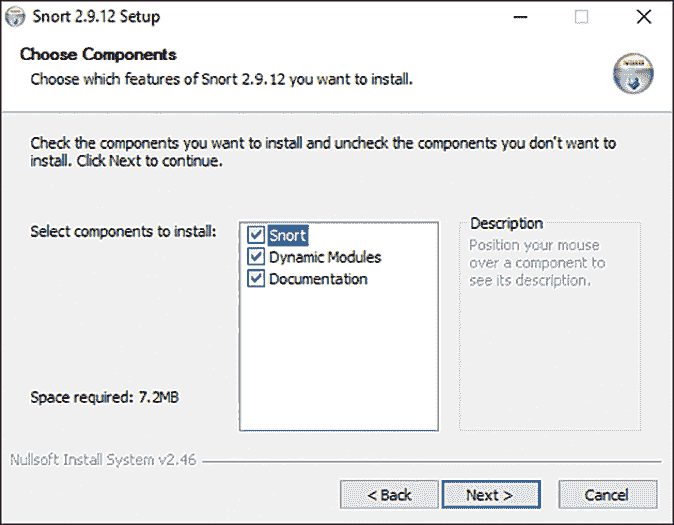

**图 9.2** Snort 安装选项。

除此之外，只需使用所有默认设置即可。最后，安装程序还会尝试安装 WinPCAP。如果由于某种原因失败，你需要单独下载并安装它。WinPCAP 是一个用于采集数据包的开源工具，所有的 IDS 都依赖于数据包采集。

在你将下载的规则从保存位置复制到 `C:\snort\rules` 之后，你需要将配置文件从 `C:\snort\rules\etc\snort.conf` 复制到 `C:\snort\etc`。使用 WordPad 打开该配置文件，不要使用记事本。（记事本不支持自动换行，在其中阅读配置文件会很困难。）

你需要将 `HOME_NET any` 更改为你机器的 IP 地址，如图 9.3 所示。在实际运行的情况下，你还会设置其他 IP 地址（用于 Web 服务器、SQL 服务器、DNS 服务器等）。

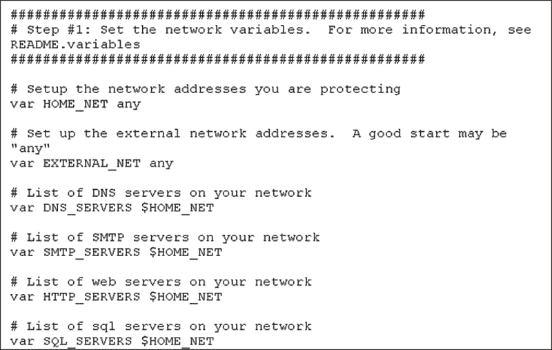

**图 9.3** HOME\_NET 地址。

现在你需要找到并更改规则路径，这些是 Linux 风格的路径，如图 9.4 所示。

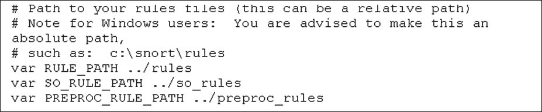

**图 9.4** Linux 风格路径。

你需要将它们更改为 Windows 风格的路径，如图 9.5 所示。

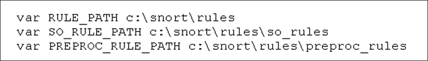

**图 9.5** Windows 风格路径。

你现在需要找到并更改库路径。这有点困难，因为 Windows 中的路径名称和文件名称略有不同。Linux 风格的库路径看起来像图 9.6 所示的那样。

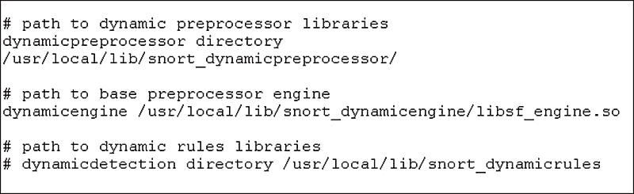

**图 9.6** Linux 风格库路径。

你可以通过查看图 9.7 所示的文件夹找到你的 Windows 路径名和文件名。

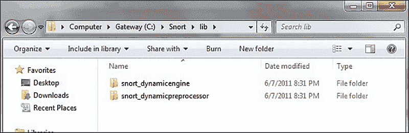

**图 9.7** Windows 风格路径。

### 注意

如果你发现系统中没有某个特定的文件或路径，请确保在文件中将其注释掉。

你快要完成了。现在搜索：

```
#output_tcp dump
```

并在之后添加此行：

```
output alert_fast: alert.ids
```

### 注意

井号 `#` 表示注释。

现在你需要使用命令行启动 Snort。只需导航到 `C:\snort\bin`。启动 Snort 有多种方法。许多常用命令列在表 9.1 中。我建议先尝试最简单的。

**表 9.1** Snort 命令

| 命令 || 目的 |
| --- | --- |
| `snort -v` | 作为数据包嗅探器启动 Snort。 |
| `snort -vd` | 作为数据包嗅探器启动 Snort，但嗅探数据而非仅报头。 |
| `snort -dev -l ./log` | 以日志模式启动 Snort 以记录数据包。 |
| `snort -dev -l ./log -h192.168.1.0/24 -c snort.conf`（替换 `192.168.1.0/24` 为你的 IP 地址） | 以 IDS 模式启动 Snort。 |


你可能希望考虑 Security Onion Linux 发行版，可以从 [`securityonion.net`](https://securityonion.net) 下载。Security Onion 是一个开源 Linux 发行版，包含了入侵检测和日志管理工具，如 `Snort`、`Suricata`、`Bro`、`Wazuh`、`Sguil`、`Squert`、`CyberChef`、`Zeek`、`Elasticsearch`、`Logstash` 和 `Kibana`。

## 蜜罐

`蜜罐` 是一项有趣的技术。基本上，它假设攻击者能够突破你的网络安全，最好的办法是将攻击者的注意力从你的价值数据上转移开。因此，蜜罐涉及创建一个包含假数据的服务器——例如加载了假数据的 `SQL server` 或 `Oracle server`，其安全性比你的真实服务器略低。然后，由于你的没有任何实际用户访问过这台服务器，因此安装了监控软件，当有人访问该服务器时向你报警。

蜜罐实现了两个目标。首先，它将攻击者的注意力从你想要保护的数据中转移开。其次，它提供了看起来有趣且有价值的数据，从而引导攻击者保持与虚拟服务器的连接，为你争取追踪攻击者的时间。目前有商业解决方案，例如 `Specter` ([www.specter.com](http://www.specter.com))。这些解决方案通常非常容易设置，并包含了监控/跟踪软件。你可能觉得查看 [www.honeypots.org](http://www.honeypots.org) 以获取更多关于蜜罐通论及特定实现的信息很有用。

蜜罐可以是低交互的也可以是高交互的。低交互蜜罐通过模拟个人系统中可能找到的服务和程序来工作。如果攻击者执行了模拟器未预期的操作，蜜罐就会生成错误。

高交互系统完美地模拟了计算机系统或网络。其核心思想是建立一个受控区域，攻击者可以在其中与看似真实的应用程序和程序进行交互。高交互蜜罐依赖边界设备控制流量，以便攻击者能够进入，但会对出站活动进行严格控制。

## 数据库活动监控

数据库活动监控 (`DAM`) 涉及监控和分析独立于数据库管理系统 (`DBMS`) 运行的数据库活动。它与 DBMS 的审计、日志记录和监控是分开的。数据库活动监控与防御 (`DAMP`) 是 `DAM` 的扩展，除了监控和警报外，还能阻止未经授权的活动。

Gartner 对 `DAM` 提供了一个非常好的描述：^(3)

3


*  **PAP:** 密码认证协议是最简单的身份验证形式，安全性最低。用户名和密码以未加密的明文形式发送。这显然是一种非常老旧的方法，不再被使用。然而，在计算机早期，还没有广泛使用的封包嗅探器，安全问题也没有那么严重。

*  **SPAP:** Shiva 密码认证协议是 PAP 的扩展，它能够对在互联网上传输的用户名和密码进行加密。

*  **CHAP:** 挑战握手认证协议在用户登录后计算一个哈希值。然后它将该哈希值共享给客户端系统。服务器定期要求客户端提供该哈希值（这就是挑战部分）。如果客户端无法提供哈希值，则说明通信已被破解。`MS-CHAP` 是 `CHAP` 的微软特定扩展版本。这些是基本步骤：

    1. 在握手阶段完成后，验证器（通常是服务器）向对端发送一条“挑战”消息。
    2. 对端使用使用“单向哈希”函数计算出的值进行响应。
    3. 验证器根据其对预期哈希值的计算结果对响应进行比对。如果值匹配，则确认验证；否则，应断开连接。
    4. 在随机间隔时间内，验证器向对端发送新的挑战并重复步骤 1 到 3。

    `CHAP` 的目标不仅是进行身份验证，还要定期进行重新验证，从而防止会话劫持攻击。

*  **EAP:** 可扩展身份认证协议是一种经常用于无线网络和点对点连接的框架。它最初定义在 `RFC 3748` 中，但从那时进行了更新。它处理密钥及相关参数的传输。`EAP` 有多个版本并有许多变体，包括以下：

    *  **LEAP:** 轻量级扩展认证协议由思科开发，广泛应用于无线通信。许多微软操作系统（包括 Windows 7 及更高版本）都支持 `LEAP`。`LEAP` 使用了修改后的 `MS-CHAP`。

    *  **EAP-TLS:** 可扩展认证协议-传输层安全使用 TLS 来保护身份验证过程。大多数 `EAP-TLS` 的实现利用 `X.509` 数字证书来验证用户。

    *  **PEAP:** 受保护的可扩展认证协议通过经过认证的 TLS 隧道加密身份验证过程。`PEAP` 由包括思科、微软和 RSA 安全在内的联盟开发。首次包含在 Microsoft Windows XP 中。

*  **Kerberos:** `Kerberos` 被广泛使用，特别是在微软操作系统。它发明于麻省理工学院（MIT），名称源于神话中据传守护冥界之门的三头狗。该系统有点复杂，但基本流程如下：当用户登录时，身份验证服务器验证用户身份，然后联系票据授予服务器（这些服务器通常在同一台机器上）。票据授予服务器向用户机器发送一个加密的票据。该票据标识该用户已登录。稍后，当用户需要访问网络上的某些资源时，用户机器使用该票据获取访问目标机器的权限。票据需要经过大量的验证，且这些票据的有效期相对较短。

### 关于 Kerberos

由于 `Kerberos` 使用非常广泛，它需要比其他身份验证方法更仔细的观察。在本节中，我们将更深入地研究 `Kerberos`。如果这是你第一次接触 `Kerberos`，你可能需要多次阅读本节才能真正理解。虽然有不同的变体，但基本流程如图图 9.9 所示。（注意，图 9.9 是对 `Kerberos` 的非常简化的概述，省略了本节后面讨论的某些步骤。）

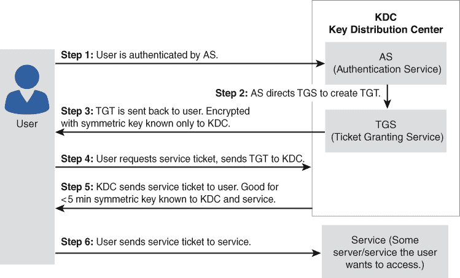

**图 9.9** Kerberos。

`Kerberos` 的元素如下：

*  **主体 (Principal):** `Kerberos` 可以分配票据的服务器或客户端。
*  **身份验证服务器 (AS):** 授权主体并将其连接到票据授予服务器的服务器。
*  **票据授予服务器 (TGS):** 提供票据的服务器。
*  **密钥分配中心 (KDC):** 提供初始票据并处理 TGS 请求的服务器。它通常同时运行 `AS` 和 `TGS`。必须指出，`Kerberos` 是使用最广泛的身份验证协议之一。欧洲经常使用替代方案 `SESAME (多厂商应用安全欧洲系统)`。

`Kerberos` 过程由客户端和 `KDC` 之间发送的用字母表示的消息组成。首先，`AS` 通过创建用户密码的哈希值生成一个密钥，然后向客户端发送两条消息：

*  **消息 A:** 这是客户端/TGS 会话密钥，使用客户端的密钥进行加密。
*  **消息 B:** TGT（票据票据）包含客户端 ID、客户端网络地址和有效期。

消息使用 `AS` 生成的密钥加密。然后，用户尝试用客户端通过哈希用户密码生成的密钥来解密消息 A。如果输入的密码与 `AS` 在数据库中找到的密码不匹配，则哈希不匹配，解密将失败。如果成功，则消息 A 包含客户端/TGS 会话密钥，该密钥可与 TGS 通信。消息 B 使用 TGS 密钥加密，客户端无法解密。（注意，密码永远不会在网络上传输。）

在请求服务时，客户端向 `TGS` 发送以下消息：

*  **消息 C:** 这条消息由消息 B 中的 TGT 和请求的服务 ID 组成。
*  **消息 D:** 这条消息是一个验证器（由客户端 ID 和时间戳组成），使用客户端/TGS 会话密钥加密。

接收到消息 C 和 D 后，`TGS` 从消息 C 中提取消息 B。它使用 TGS 密钥解密消息 B。这使其获得了客户端/TGS 会话密钥。使用该密钥，`TGS` 解密消息 D（验证器），并向客户端发送以下两条消息：

*  **消息 E:** 这是客户端到服务器的票据（包含客户端 ID、客户端网络地址、有效期和客户端/服务器会话密钥），使用服务的密钥加密。
*  **消息 F:** 这是使用客户端/TGS 会话密钥加密的客户端/服务器会话密钥。

从来自 `TGS` 的消息 E 和 F 后，客户端拥有足够的信息向服务服务器 (SS) 进行身份验证。客户端连接到 SS 并发送消息 E（客户端到服务器的票据，使用服务的密钥加密）以及这条新消息：

*  **消息 G:** 这是新的验证器，包含客户端 ID 和时间戳，并使用客户端/服务器会话密钥加密。


SS 使用自己的私钥解密 `Message E`，以获取客户端/服务器会话密钥。使用该会话密钥，SS 解密 `Message G` 并向客户端发送以下消息，以确认其真实身份以及为客户服务的意愿：

*   `Message H:` 这是客户端身份验证器中的时间戳。

客户端使用客户端/服务器会话密钥解密确认消息（`Message H`），并检查时间戳是否正确。如果正确，客户端就可以信任服务器并开始向服务器发出服务请求。随后，服务器为客户端提供请求的服务。

是的，这个过程相当复杂——这是刻意为之。然而，你可能已经使用过很多次这种认证方法，即使你并没有意识到。它非常常见。

### 数字证书

你很可能以前听过`数字证书`这个术语。你可能想的问题是数字证书是做什么的？回想一下我们在第 8 章中关于“[加密`”对非对称加密的讨论。我们提到过公钥可以广泛传播，因为它只能用于加密向我们发送的消息。那么，如何向人们提供公钥呢？最常见的方法是通过数字证书。数字证书包含用户的公钥以及其他信息。然而，数字证书可以提供更多内容。它可以提供一种手段，用于验证证书持有者确实其所称的身份。

`X.509` 是关于数字证书格式和其中包含信息的国际标准。`X.509` 是世界上最常见的数字证书类型。它是一个数字文档，包含由受信任的第三方（称为证书颁发机构，或 `CA`）签名的公钥。

以下是 `X.509` 证书中的基本项目，尽管可能还会包含其他可选信息：

*   `版本:` 这是该证书遵循的 `X.509` 版本。
*   `证书持有者公钥:` 这是从 `X.509` 证书获取某人公钥的主要方法。
*   `序列号:` 这是该证书的唯一标识符。
*   `证书持有者区别名称:` 这通常是与证书相关的域名或电子邮件地址。
*   `证书有效期:` 一年是最常见的有效期。
*   `证书颁发者唯一名称:` 这是发行此证书的证书颁发机构。
*   `颁发者数字签名:` 此字段和下一个字段用于验证证书。
*   `签名算法标识符:` 这标识了所使用的数字签名算法。

让我们看看在常见场景中它是如何工作的。假设你访问了银行的网站。为了获取银行的公钥，你的浏览器将下载该银行的数字证书。但有一个问题：是否有人建立了一个伪网站，声称是你的银行？那个人是否也生成了一个伪证书，声称是银行？是的，这是可能的。这就是数字证书帮助我们的地方之一。你的浏览器将查看证书上列出的颁发者，并询问该是否是你的浏览器信任的 `CA`。如果是，你的浏览器将与该 `CA` 通信以获取该 `CA` 的公钥。（回想第 8 章未发布的 `v1`
*   `版本 2:`1995 年发布（存在许多缺陷）
*   `版本 3:`1996 年发布（RFC 6101）
*   标准 `TLS1.0`（RFC 2246），1999 年发布
*   `TLS 1.1:`2006 年发布 RFC 4346
*   `TLS 1.2:`2008 年发布 RFC 5246（基于较早的 `TLS 1.1` 规范）
*   `TLS 1.3:`2018 年发布 RFC 8446

图 9.10 显示了建立 SSL/TLS 连接的基本过程。

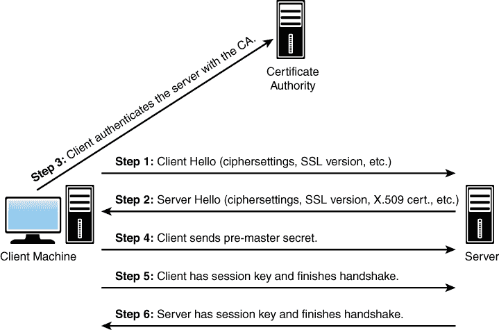

**图 9.10** SSL/TLS。

注意，步骤 3 实际上并不涉及与 `CA` 通信。计算机通常有一个包含已知且信任的 `CA` 数字证书的证书存储。因此，客户端机器只需检查自己的证书存储以查找 `CA` 证书即可。

建立 SSL/TLS 连接的过程涉及多个复杂的步骤，定义如下：


1. 客户端向服务器发送有关其加密能力的信息，包括它能够支持的算法、可以用于消息完整性的哈希算法以及相关信息。

2. 服务器通过选择客户端和服务器均支持的最优加密和哈希算法来做出响应，并将此信息发送给客户端。服务器还会发送其自身的证书；如果客户端请求了需要客户端认证的服务器资源，服务器将要求客户端提供证书。

3. 客户端使用服务器发送的信息对服务器进行验证。这意味着通过适当的 `CA` 对数字证书进行验证。如果验证失败，浏览器将向用户警告无法验证证书。如果成功验证了服务器，客户端将进入下一步。（然而，现代计算机在出厂时包含了主流 CA 的证书。这些证书通常存储在计算机的证书存储中。因此，为了验证来自特定 CA 的证书，客户端计算机只需从自己的存储中获取该 CA 的数字证书即可。）

4. 客户端利用到此为止握手过程中产生的所有数据，为会话创建预主密钥（pre-master secret），使用从服务器 `X.509 certificate` 中收到的服务器公钥对其加密，然后将加密后的预主密钥发送给服务器。

5. 如果服务器请求了客户端认证，则服务器也将验证客户端的 `X.509 certificate`。这在大多数电子商务和银行网站中并不发生。

6. 客户端和服务器都使用主密钥（master secret）生成会话密钥。这些是对称密钥（例如 `AES`），将在整个会话期间用于加密客户端与服务器之间的信息。

7. 客户端向服务器发送一条消息，告知其未来来自客户端的消息将使用会话密钥加密。

8. 服务器向客户端发送一条消息，告知其未来来自服务器的消息将使用会话密钥加密。

### 注意事项
*master*（主）和 *slave*（从）术语的使用**仅**与行业规范和标准中使用的官方术语相关，绝不削弱 Pearson 致力于促进多样性、公平性和包容性，以及在全球学习者中挑战、反击和/或消除偏见和刻板印象的承诺。

这一过程不仅允许对称密钥的安全交换，还实现了对服务器的验证以及（可选的）对客户端的验证。这就是安全网络流量的方式。

### 虚拟专用网络
`VPN`（虚拟私有网络）本质上提供了一种利用互联网在远程用户或站点与中心位置之间建立虚拟连接的方法。在该连接上往返的数据包经过了加密，因此具有了私密性。VPN 必须模拟直接的网络连接。

创建 VPN 使用三种不同的协议：

* 点对点隧道协议 (PPTP)
* 二层隧道协议 (L2TP)
* IP 安全协议 (IPsec)

接下来的章节将深入讨论这些协议。

#### 点对点隧道协议
*点对点隧道协议* (*Point-to-Point Tunneling Protocol*) (*PPTP*) 是 VPN 使用的三种协议中最老老的。它最初被设计为点对点协议 (`PPP`）的安全扩展。PPTP 最初由 PPTP 论坛在 1996 年提作为一项标准，该论坛是一个包括 Ascend Communications、ECI Telematics、Microsoft、3Com 和 U.S. Robotics 在内的公司。它在旧的 `PPP` 协议基础上增加了数据包加密和用户认证的功能。PPTP 工作在 OSI 模型的数据链路层（在第 2 章“网络与互联网”中讨论过）。

PPTP 为用户认证提供了两种不同的协议：可扩展认证协议 (`EAP`) 和挑战握手认证协议 (`CHAP`)。EAP 实际上是专门为 PPTP 设计的，并非专利所有。CHAP 是一个三路过程，客户端向服务器发送一个代码，服务器对其进行验证，然后服务器响应客户端。CHAP 还会在连接建立后定期对远程客户端进行重新认证。

PPTP 使用微软点对点加密 (`MPPE`) 对数据包进行加密。MPPE 实际上是 `DES` 的一个版本。`DES` 在许多情况下仍然有用；但人们更倾向于使用较版本的 `DES`，例如 `DES 3`。

#### 二层隧道协议
*二层隧道协议* (*Layer 2 Tunneling Protocol*) (`L2TP`) 被明确设计为 PPTP 的增强。与 PPTP 类似，它工作在 OSI 模型的数据链路层。相比 PPTP，它有几项改进。首先，它提供了更多、更多化的认证方法：PPTP 提供两种方法（`CHAP` 和 `EAP`），而 L2TP 提供五种（`CHAP`、`EAP`、`PAP`、`SPAP` 和 `MS-CHAP`）。

除了提供更多可用认证协议外，L2TP 还提供了其他增强。PPTP 只能在标准 IP 网络上工作，而 L2TP 可以在 `X.25` 网络（电话系统的常用协议）和 `ATM`（异步传输模式，一种高速网络技术）系统上工作。L2TP 还使用 `IPsec` 进行加密。

#### IPsec
*IP 安全协议* (*Internet Protocol Security*) (*IPsec*) 是三种 VPN 协议中最新的。IPsec 与另外两种方法的区别之一是它不仅加密包数据（回想第 2 章中对包的讨论），还加密头部信息。它还具有防止未经授权重传的保护。这很重要，因为黑客的一种技巧是简单地截获传输中的第一个包并利用它让自己的传输通过。因此，第一个包（或多个包）必须包含登录数据。如果你简单地重新发送该包（即使你无法破解其加密），你发送的是有效的登录信息，随后会有后续包。防止未经授权重传防止了这种情况的发生。

IPsec 以两种模式之一运行：传输模式（仅加密有效负载）和隧道模式（数据和 IP 头部都被加密）。以下是一些基础 IPsec 术语：

* 认证头 (`AHs`) 提供 IP 包的无连接完整性和数据源认证。
* 封装安全载荷 (`ESP`) 提供数据的真实性、完整性和机密性保护。它提供仅加密或仅认证的配置。
* 安全关联 (`SAs`) 为 `AH` 或 `ESP` 操作提供参数。SA 使用互联网安全关联密钥管理协议 (`ISKMP`) 建立。
* 互联网安全关联密钥管理协议 (`ISKMP`) 为认证和密钥交换提供框架。
* 互联网密钥交换 (`IKE*) 和 `IKEv2`) 用于通过处理协议和算法的协商来设置 `SA`，并生成将使用的加密和认证密钥。

本质上在初始建立 IPsec 隧道期间，会形成 SA。这些 SA 包含了诸如 IPsec 隧道中使用的加密算法和哈希算法等信息。（回想我们在第 8 章](#ch08.xhtml#ch08)中深入讨论过加密。）IKE 主要负责建立这些 SA。ISKMP 允许 IPsec 隧道的两端进行相互认证并交换密钥。

### Wi-Fi 安全


无线网络在今天被广泛使用，考虑无线网络安全至关重要。共有三种 Wi-Fi 安全协议，从最旧且最安全的（`WEP`）到最新且最安全的（`WPA3`）。这里将简要描述每种协议。

### 有线等效隐私

`Wired Equivalent Privacy`（`WEP`）使用流加密器 `RC4` 来保护数据，并使用 `CRC-32` 校验和进行错误检查。标准的 `WEP` 使用 40 位的密钥（称为 `WEP-40`）和 24 位的初始化向量（`IV`）来有效性形成 64 位加密。128 位的 `WEP` 使用 104 位的密钥和 24 位的 `IV`。

由于 `RC4` 是一种流加密器，因此绝不能两次使用相同的流量密钥。`WEP` 的问题在于，创建它的委员会由一些非常优秀的计算机专业人士组成，他们认为自己对密码学足够了解，但事实并非如此。他们用了 `IV`，这违背了 `IV` 的整个目的，并使该协议容易受到攻击。在 YouTube 上简单搜索“如何破解 WEP”，就会得到大量关于破解 `WEP` 技术的视频。

### Wi-Fi 保护访问

`Wi-Fi Protected Access`（`WPA`）无疑是对 `WEP` 的改进。首先，`WPA` 使用了 `AES`，这是一种非常好的加密算法。此外，`WPA` 使用临时密钥完整性协议（`TKIP`），为每个数据包动态生成新密钥。因此，即使你破解了 `WPA` 密钥，下一个数据包也有不同的密钥。

### WPA2

`WPA2` 是今天最广泛使用的 Wi-Fi 安全协议，如果可能，这是你应该使用的。`WPA2` 基于 `IEEE 802.11i` 标准，提供高级加密标准（`AES`），通过计数模式-密码块链（`CBC`）消息认证码（`MAC`）协议（`CCMP`），为无线帧提供数据机密性、数据源认证和数据完整性。（这些中的一些术语你应该从第 8 章中回想起。）`CBC` 防止了已知明文攻击。

`MAC` 保留了消息完整性，并确保数据包在传输过程中无论是无意还是有意都不会被更改。这意味着 `WPA2` 使用了非常强的加密以及消息完整性保护。

### WPA3

`WPA3` 发布于 2018 年，具有许多有趣的特性。它较有趣的新属性之一是，所有进出无线接入点（`WAP`）的流量都经过了加密。`WPA3` 还要求攻击者在每次尝试猜测密码时都要与你的 Wi-Fi 交互，这使得暴力破解攻击成功的概率降低。

### 总结

每个网络在网络与外部世界之间拥有一个防火墙和代理服务器是至关重要的。网络中的所有机器（包括服务器和工作站）都有更新病毒保护也是至关重要的。考虑实施 `IDS` 和反间谍软件也是一个好主意。在接下来的练习中，你将有机会练习设置各种类型的防火墙和 `IDS`。

### 测试你的技能

### 单选题

1. 下列哪项是病毒扫描程序识别病毒最常见的方法？

A. 将文件与已知病毒属性进行比较

B. 使用复杂规则寻找类病毒行为

C. 仅寻找 `TSR` 程序

D. 寻找 `TSR` 程序或修改 `Registry` 表的程序

2. 检查邮件是否感染病毒的一种方法是？

A. 阻止所有带附件的邮件。

B. 阻止所有活动附件（例如 `ActiveX`、脚本）。

C. 查找主题。

D. 查找修改注册表的程序。

3. 什么是 `TSR` 程序？

A. 查找修改注册表的程序
B. 在关机后仍留在内存中的程序
C. 查找那些会驻留在内存的程序
D. 在关机后仍留在内存中的程序

4. 下列哪项是防止已知明文攻击的？

A. 基于规则的（扫描）
B. 启发式扫描
C. `TSR` 扫描
D. 逻辑扫描

5. 下列哪项不是防火墙的类型？

A. 筛选防火墙
B. 应用网关
C. 启发式防火墙
D. 电路级关

6. 下列哪项是最基本的防火墙类型？

A. 筛选防火墙
B. 应用网关
C. 启发式防火墙
D. 电路级关

7. George 负责网络安全。他有大量的日志。什么技术对他分析日志最有帮助？

A. `SIEM`
B. `IDS/IPS`
C. `NGFW`
D. `PKI`

8. `SPI` 代表什么？

A. 状态包检查
B. 系统包检查
C. 状态包检查
D. 系统拦截

9. 安装在现有服务器上的防火墙术语是？

A. 网络防火墙
B. 双主机防火墙
C. 路由器防火墙
D. 屏幕主主机

10. 网络防火墙的一个主要缺点是什么？

A. 它的安全性取决于操作系统。
B. 难以配置。
C. 容易被破解。
D. 非常昂贵。

11. 阻止产生活动的 IP 地址的术语是？

A. 预防性阻塞
B. 入侵偏离
C. 主动防御
D. 入侵阻塞

12. 用于诱导入侵者的假系统术语是？

A. 蜜罐
B. 虚假系统
C. 偏离系统
D. 陷阱

13. 使系统对入侵者失去吸引力的正确术语是？

A. 入侵威慑
B. 入侵防御
C. 伪装
D. 避免

14. 大多数 `IDS` 实现使用什么方法？

A. 异常检测
B. 预防性阻塞
C. 入侵威慑
D. 渗透

15. 反间谍软件是如何工作的？

A. 使用启发式方法
B. 寻找已知的间谍软件
C. 与病毒扫描相同的方法
D. 寻找 `TSR`

## 练习

EXERCISE 9.1: 设置防火墙

EXERCISE 9.2: 防火墙

EXERCISE 9.3: 评估防火墙

EXERCISE 9.4: 活动代码

EXERCISE 9.5: 公司使用的硬件


访问公司的 IT 部门，并确定其计算机系统防御使用了哪些硬件。该公司除了软件防火墙外，是否还使用了硬件防火墙？它使用什么形式的人入侵检测软件？在公司内部的工作站上是否使用了防病毒和反间谍软件？请撰写一份简短报告，总结你的发现。

## 项目

### 项目 9.1：微软防火墙是如何工作的？

利用微软文档、网络和其他资源，找出 `Microsoft Windows`（无论你正在使用哪个版本）防火墙使用了哪些方法论。写一篇简短的文章，解释该方法的优缺点。还要讨论你认为该方法适用的情况，以及在哪些情况下它可能不再适用。

### 项目 9.2：防病毒软件是如何工作的？

使用来自供应商提供的文档、网络或其他资源，找出 `Norton` 防病毒软件所使用的方法论，以及 `McAfee` 使用的方法。根据这些信息，写一篇简短的文章来比较并对比它们之间的差异。还要讨论在什么情况下可能推荐其中一种而非另一种。

### 项目 9.3：使用 Snort

这是一个较长的项目，适合小组完成。

访问 [Snort.org](http://Snort.org) ([www.snort.org](http://www.snort.org)) 并下载 `Snort`。使用供应商文档或其他资源配置 `Snort`。然后，在配置了 `Snort` 的机器上使用端口扫描器，并记录 `Snort` 是否检测到了扫描。

## 案例研究

Jane Smith 负责 `ABC 公司`的安全工作。她拥有中等预算来购买安全解决方案。到目前，她在网络和外部世界之间安装了一个基于路由器的防火墙。她还在网络上的每台机器上都安装了商业病毒扫描程序。考虑以下问题：

1. 你还会向她推荐哪些操作？
2. 你会推荐不同的防火墙吗？为什么？

## 第 10 章

## 安全策略

### 本章目标

在阅读本章并完成练习后，你将能够完成以下操作：

* 识别安全策略的重要性
* 理解各种策略及其背后的原理
* 了解良好的策略中包含哪些元素
* 为网络管理创建策略
* 评估并改进现有策略

## 引言

到目前为止，我们在书中已经探索了各种网络威胁。在第 9 章中，我们检查了针对此类攻击的技术防御。然而，事实是，技术本身无法解决所有的网络安全问题。有些问题是技术无法阻止的。例如：

* 防病毒无法阻止用户手动打开附件并释放病毒。
* 如果前员工（可能是那些对公司不满的人）仍拥有有效密码，或者密码被简单地写在电脑显示器的便利贴上，那么经过技术安全保护的网络仍然非常脆弱。
* 如果服务器位于一个公司几乎每个人都能进入的房间，那么它是不安全的。

### 什么是策略？

`security policy`是一份定义组织如何处理某些方面的文档。策略也可以被用来处理合规性要求。

策略还可以指导用户如何合规。例如，`security policy`可能会指导员工如何处理事件。

`security policy`是一份定义组织如何处理某些方面的文档。策略也可以被用来处理安全策略。这是为什么单靠技术不是答案的另一个原因。

### 重要标准

有很多行业标准供你参考。在我们深入研究各种策略开发和策略执行之前，审查相关标准是重要的。

#### ISO 1799

`ISO 1799`是一项关于如何制定策略的标准。`ISO/IEC 17799`描述了关于以下领域的控制目标和控制的最佳实践：

* 安全策略
* 信息安全组织
* 资产管理
* 人力资源安全
* 物理与环境安全
* 通信与运营管理
* 访问控制
* 信息系统的获取、开发与维护
* 信息安全事件管理
* 业务连续性管理
* 合规性

熟悉该标准并至少考虑其建议是一个好主意。

#### NIST SP 800-53

美国国家标准与技术研究院（`NIST`）发布了许多与网络安全相关的标准。`NIST SP 800-53`（`SP` 代表特别出版，尽管经常被省略）识别了 18 类安全控制族（列在表 10.1 中）。在分析你的系统安全策略时，`NIST SP 800-53`是一个很好的参考。

表 10.1 NIST 800-53 安全控制族

| ID | 族 | ID | 族 |
| --- | --- | --- | --- |
| AC | 访问控制 | MP | 媒介保护 |
| AT | 意识与培训 | PE | 物理与环境保护 |
| AU | 审计与问责 | PL | 规划 |
| CA | 安全评估与授权 | PS | 人员安全 |
| CM | 配置管理 | RA | 风险评估 |
| CP | 应急计划 | SA | 系统与服务获取 |
| IA | 识别与认证 | SC | 系统与通信保护 |
| IR | 事件响应 | SI | 系统与信息完整性 |
| MA | 维护 | PM | 程序管理 |


采用一个全面的管理流程，以确保信息安全控制能够持续满足组织的信息安全需求。

（注意，`ISO 27001` 的设计范围远超 IT。）

# ISO 27002

ISO 27002 为启动、实施和维护信息安全管理体系（ISMS）提供了最佳实践建议。该标准从几个介绍性章节开始，提供了关于术语和标准范围的指导。从第 5 章开始的章节涵盖了重要的 ISMS 主题：

* 第 5 章：信息安全策略
* 第 6 章：信息安全组织
* 第 7 章：人力资源安全
* 第 8 章：资产管理
* 第 9 章：访问控制
* 第 10 章：密码学
* 第 11 章：物理和环境安全
* 第 12 章：运行安全：程序与职责
* 第 13 章：通信安全
* 第 14 章：系统获取、开发与维护
* 第 15 章：供应商关系
* 第 16 章：信息安全事件管理
* 第 17 章：业务连续性管理中的信息安全因素

# ISO 17799

也许与策略开发联系最密切的标准过于 `ISO 17779`（题为“如何开发安全策略”）。该标准为组织内启动、实施、维护和改进信息安全管理建立了指南和通用原则。

`ISO/IEC 17799:2005` 描述了信息安全管理以下领域的最佳实践和控制目标：

* 安全策略
* 信息安全组织
* 资产管理
* 人力资源安全
* 物理和环境安全
* 通信与运行管理
* 访问控制
* 信息系统的获取、开发与维护
* 信息安全事件管理
* 业务连续性管理
* 合规

## 定义用户策略

在讨论用户策略时，有一条规则必须牢记在心：你应该为每种可预的情况制定策略。未能针对特定问题制定策略通常会导致该问题恶化。某些事情对你来说可能是常识，但对于那些没有计算机网络或网络安全培训或经验的人来说，可能并非如此。

系统的滥用是许多组织面临的一个大问题。问题的很大程度上源于难以准确定义什么是滥用。某些行为可能是显而易见的滥用，例如利用公司时间和计算机寻找新工作或查看非法网站。然而，其他领域就不那么明确，例如员工利用午休时间查找她想购买的汽车信息。通常，良好的用户策略会具体勾勒人们应该如何使用系统，以及不应该如何使用。为了使策略有效生效，它必须非常清晰且具体。诸如“计算机和互联网访问仅供业务用途”之类的模糊表述显然是不够的。我建议使用更清晰且可能具执行力的表述，例如“计算机和互联网访问在工作期间仅用于业务目的。然而，员工可以在非工作时间（如休息、午餐和上班前）将计算机/互联网访问用于个人用途。但此类使用必须遵守互联网使用策略。”这种措辞清晰、直接且可执行。

用户策略还涵盖了其他潜在的滥用领域，包括共享密码、复制数据、员工午餐时保持账户登录等。所有这些问题最终都会对你的网络安全产生重大影响，必须在你的用户策略中明确列出。我们现在检查有效用户策略必须涵盖的几个领域：

* 密码
* 互联网使用
* 电子邮件使用
* 安装/卸载软件
* 即时消息
* 桌面配置
* 自带设备办公 (BYOD)

### 密码

保持密码安全至关重要。第 8 章中的“加密”讨论了作为操作系统加固一部分的适当密码。大多数来源表明，良好的密码至少有八个字符长，使用数字和特殊字符，并且与最终用户没有明显的关联。例如，一个达拉斯牛仔队的粉丝如果使用像 `cowboys` 或 `godallas` 这样的密码是不明智的，但使用诸如 `%trEe987` 或 `123DoG$$` 这样的密码可能是明智的，因为这些密码没有反映个人的兴趣，因此不容易被猜到。最小密码长度、密码历史和密码复杂性等问题属于管理策略，而不是用户策略。用户策略规定了最终用户应该如何表现。为了可靠的安全，我建议使用经过修改以包含数字和特殊字符的短语（passphrase）。这可以是一个容易记住的内容，但经过处理使其不会受到猜解或暴力破解攻击的影响。例如，将短语“I like double cheeseburgers”修改为类似 `IliK3double3ch33$eburg3r` 的内容。注意，E 被变成了 3，S 被变成了 $s，并且随机将两个字母大写了。你现在有了一个 25 个字符长又复杂的密码。它很容易记忆，而且非常难破解。

然而，无论密码多长或多复杂，如果它列在贴在用户电脑显示器上的便利贴上，它就是不安全的。这似乎显而易见，但进入办公室发现密码写在显示器上或桌子顶抽屉里的情况并不罕见。

发现员工共享密码也并不常见。例如，Bob 下周不在城里，所以他把密码给了 Juan，这样 Juan 就能进入他的系统、检查电子邮件等等。问题是，现在有两个有了这个密码。如果在 Bob 不在的这一周里，Juan 生病了并决定把密码分享给 Shelly，让她在 Juan 请假期间检查系统，会发生什么？密码很快就会传给太多的人，以至于从安全的角度来看，它完全变得失效了。

管理策略需要解决密码最小长度、密码有效期和密码历史等问题。系统管理员可以强制执行这些要求。然而，如果用户不以安全的方式管理密码，这些措施都将没有任何特殊帮助。


这意味着你需要针对用户如何保护其密码制定明确的策略。这些策略应当规定以下内容：

* 密码绝不能以书形式记录在易接触的地方。首选是完全不要写下来，但如果非要写，也应该放在安全区域，例如家中的保险箱内（而不是放在办公室紧挨电脑的地方）。
* 出于任何原因，绝不能与他人共享密码。
* 如果员工认为其密码可能已泄露，应立即联系 IT 部门，以便更改密码，并对使用旧密码的登录尝试进行监控和追踪。

## 互联网使用

大多数组织都会为其用户提供某种形式的互联网访问。这有几个原因。显而易见的原因是电子邮件。然而，这几乎不是商业或学术环境中访问互联网的唯一原因。此外还有万维网（Web），甚至还有聊天室。（信你不信，聊天室正被用于业务通信。）互联网可以用于任何组织内的合法目的，但也可能带来严重的安全问题。必须制定适当的策略来规范互联网技术的使用。

万维网是海量数据的极佳资源。在书中，我们经常引用一些网站，在这些网站可以找到有价值的安全数据和实用的工具。互联网还充满了关于各种技术的有用教程。然而，即使是与技术不相关的业务兴趣也可以通过万维网实现。以下是万维网合法业务用途的一些示例：

* 销售人员检查竞争对手网站，查看他们提供哪些产品或服务、在哪些地区，甚至可能获取价格
* 债权人检查企业的 AM Best 或标准普尔评级，查看其业务财务评级状况
* 出差人员检查天气状况并获取旅行价格
* 通过网络研讨会进行在线培训
* 网络会议
* 在线支付账单或在某些情况下甚至提交监管和政府文件

当然，还有其他显然不适合公司网络的 Web 活动：

* 使用万维网寻找新工作
* 任何色情类用途
* 任何违反当地、州或联邦法律的使用
* 使用万维网经营自己的业务（如果你参与了公司业务之外的其它企业）

此外，还存在灰色地带。某些活动对某些组织可能是可以的，但对其他组织则不是。此类活动可能包括：

* 员工在午餐或休息期间在线购物
* 在午餐或休息期间在线阅读新闻文章
* 浏览幽默网站

一个人可能认为荒谬而易见的事，对另一个人来说可能并非如此。组织必须制定非常明确的策略，详细说明在工作中哪些是 Web 的可接受使用，哪些是不接受的。提供关于可接受和不可接受用途的清晰示例也是重要的。你还应该记住，大多数代理服务器和许多防火墙可以阻止某些网站。这将有助于防止员工误用公司的网络连接。

## 电子邮件使用

大多数业务甚至学术活动现在都通过电子邮件进行。正如我们在之前的几个章节中讨论过的，电子邮件恰好也是病毒传播的主要载体。这意味着对于任何网络管理员来说，电子邮件安全都是一个重大问题。

显然，你不能简单地禁止所有邮件附件。然而，你可以建立一些关于处理邮件附件的准则。用户只有在附件符合以下标准时才应该打开：

* 它是预期之中的。（某人向同事或客户索要文件。）
* 如果不是预期的，它来自已知来源。如果是，先给那人发一封邮件（或给她打电话），询问她是否发送了该附件。如果是，则打开它。
* 它看起来是合法的业务文档（电子表格、文档、演示文稿等）。

需要注意的是，有些人可能认为此类标准是不切实际的。毫无疑问，这些标准确实不便。然而，随着病毒（通常随邮件发送）的盛行，这些措施是谨慎的。许多人选择不采取这种程度来尝试避免病毒，这可能也是你的选择。只需记住，每年都有数百万台电脑被某种病毒感染。

任何人都都不应打开符合以下任一标准的邮件附件：

* 它来自未知来源。
* 它是某些活动代码或可执行程序。
* 它是动画/电影。
* 邮件本身看起来不合法。（它似乎在诱导你打开附件，而不是仅仅是一个恰好带有附件的业务通信。）

如果最终用户有任何怀疑，那么她就不应该打开该邮件。相反，她应该联系 IT 部门中指定处理安全工作的人员。那人可以将邮件主题与已知病毒进行对比，或者简单地亲自检查邮件。然后，如果看起来是合法的，用户就可以打开附件。

### 提示：关于附件

在打开附件时，我经常遵循“宁可谨慎，就怕后悔”的准则。当转发某些在互联网流传的笑话、图片等时，我直接将其删除。这可能意味着我将错过许多幽默图片和故事，但也意味着我将错过许多病毒。你最好考虑模仿这种做法。

## 安装/卸载软件

在安装和卸载软件方面，有一个绝对的答案：不应允许用户在其机器上安装任何内容。这包括壁纸、屏幕保护程序、工具——任何东西。最好的方法是限制用户的登录权限，使其无法安装任何内容。然而，这应该与一份禁止在电脑上安装任何内容的强力政策相结合。如果他们想安装什么，应首先由 IT 部门进行扫描并批准。这个过程可能是很麻烦的，但它是必要的。有些组织甚至会移除或至少禁用终端用户电脑上的媒体驱动器（`CD`、`USB` 等），因此安装只能从 IT 部门放在某些网络驱动器上的文件进行。这通常比大多数组织要求的更极端的措施，但这是你应该了解的选项。

## 即时消息


即时通讯被组织中的员工广泛使用，也被滥用。在某些情况下，即时通讯可用于合法的业务目的。然而，它确实构成了重大的安全风险。某些病毒专门通过即时通讯传播。在一次事件中，该病毒会将用户好友列表中的每人都复制并将所有对话内容发送给他们。因此，如果你感染了该病毒，你认为是私密的对话最终将会广播给你曾经联系过的每一个人。

从纯粹的信息安全角度来看，即时通讯也是一种威胁。在没有企业邮件服务器进行邮件的可追溯性的情况下，没有任何东西能阻止终端用户通过即时通讯发送商业秘密或机密信息。建议在组织内的所有计算机上禁止使用即时通讯。如果你发现自己必须使用它，那么你必须为其使用建立非常严格的准则，包括以下内容：

*   即时通讯只能用于业务通信，不能用于个人对话。现在，这可能稍微有点难以执行。这类规则往往是如此。更常见的规则，例如禁止个人网路浏览，也相当难以执行。然而，制定此类规则仍然是一个好主意。这样，当你发现有人违反规则时，你可以参考禁止此类行为的公司政策。然而，你应该意识到，在很大情况下，你抓不住大多数违反此规则的违者。

*   不应通过即时通讯、短信或任何类型的消息应用发送机密或私有业务信息。例外是发送此类信息至关重要，且该应用具有包括加密在内的强效安全性。Signal 应用就是安全通信应用的一个示例。

## 桌面配置

许多用户喜欢重新配置他们的桌面，更改背景、屏幕保护程序、字体大小和分辨率。从理论上讲，这并不是安全隐患。仅仅更改计算机的背景图像不会损害计算机的安全。然而，其中还涉及其他问题。

第一个问题是背景图像的来源。终端用户经常从互联网下载图像。这意味着有可能获得病毒或木马，特别是那些使用隐藏扩展名的病毒或木马。（例如，一个看起来像是 `mypic.jpg` 的文件实际上可能是 `mypic.jpg.exe`。）如果员工使用对其他员工具有冒犯性的背景或屏幕保护程序，还会涉及人力资源/骚扰问题。某些组织由于这些原因简单地决定禁止对系统配置进行任何更改。

第二个问题是技术性的。为了让用户拥有更改屏幕保护程序、背景图像和分辨率的权限，你必须授予他们权限，这些权限允许他们更改你可能希望更改的其他系统设置。图形显示选项与其他所有配置选项并不是分开的。这意味着允许用户更改屏幕保护程序可能会为他们更改其他设置（如网卡配置或 Windows 防火墙）打开大门，从而损害安全。

## 自带设备

自带设备（BYOD）已成为大多数组织的重大问题。你的员工中大多数（如果不是所有的话）将拥有自己的手机、平板电脑、智能手表，并将它们带入办公室。在没有企业邮件服务器进行邮件的可追溯性的情况下，没有任何东西能阻止终端用户通过即时通讯发送商业秘密或机密信息。在高度安全环境中，限制这些设备的使用是必要的。无论你采取何种方法，这些设备都随处不在。很难预测未来的地平线。处理这些设备有很多方法，其中一些有缩写：

*   CYOD（choose own device，选择自己的设备）
*   COPE（company owned and provided，公司拥有并提供）
*   COBO（company owned/business only，公司拥有/仅限业务）
*   BYOD（bring your own device，自带设备）
*   COE（company owned or enabled，公司拥有或启用）

## 用户政策的思考

本节提供了适当且有效的用户政策概述。对于每个组织来说，实施良好的用户政策至关重要。然而，如果没有明确的违规后果，这些政策将无效。许多组织发现，根据每次事件升级后果是有帮助的，例如：

*   第一次违反任何政策将导致口头警告。
*   第二次违规将导致书面警告。
*   第三次违规将导致停职或终止合同。（在学术环境中，这将停学或退学。）

你必须明确列出后果，所有用户在入职时应签署用户政策副本以防止员工声称他们不知道这些政策。

### 注意：终止合同或退学

任何可能导致从学校退学或从工作中终止合同（甚至是降职）的政策，都应先由你的法律顾问批准。错误终止合同或退学可能会产生重大的法律后果。我不是律师，也不是法律事务专家，无法为你提供法律建议。你务必就这些问题咨询律师。

同样重要的是要意识到滥用公司网络访问还有另一个成本：生产率的损失。平均员工在阅读个人邮件、进行非业务网络活动或使用社交媒体上花费多少时间？很难说。然而，作为非正式的观察，可以在任何给定工作日的办公时间内访问 `www.yahoo.com` 并点击其中一条新闻。在文章底部你会看到该故事的留言板。它列出了帖子的日期和时间。看看在工作时间内发布了多少帖子。不太可能那些所有人都是失业、退休或在家生病的。让我彻底清楚：互联网是人类历史上单一最伟大的通信工具。它对任何业务都可能产生巨大的积极影响。我几乎所有的业务活动都是通过网络进行的。然而，许多员工滥用他们的网络权限，对于那些不能自律的人来说，使用网络确实降低了生产率。


*   2022 年的一篇报道了多项研究的文章称，89%的员工承认每天都在浪费时间。(1) 往往是，广泛的互联网访问实际上抑制了生产力，而不是增强它。
    1. [https://www.zippia.com/advice/wasting-time-at-work-statistics/]
*   俄亥州立大学的研究人员发现，经常使用 Facebook 的学生 GPA 比使用者低。(2)
    2. [http://content.time.com/time/business/article/0,8599,1891111,00.xhtml]
*   多项研究表明，在工作中使用 Facebook 对生产力有负面影响。这些研究大部分是几年前的了，因为已经成为共识：工作时的社交媒体会损害生产力。(3),(4),(5)
    3. [http://www.cnbc.com/2016/02/04/facebook-turns-12--trillions-in-time-wasted.xhtml]
    4. [http://www.riskmanagementmonitor.com/the-risks-of-social-media-decreased-worker-productivity/]
    5. [http://www.shellypalmer.com/2011/05/social-media-use-drastically-reduces-work-productivity/]

## 定义系统管理策略

除了确定用户策略之外，你还必须为系统管理员制定一些定义定义的策略。必须有添加用户、删除用户、处理安全问题、更改任何系统等程序。对于任何偏离标准程序的情况，也必须有处理标准。

### 新员工

当聘佣新员工时，系统管理策略必须定义具体的步骤来保护公司安全。新员工必须获得其工作职所需的资源和应用程序的访问权限。该权限的授予必须记录在（可能在日志中）。同样关键的是新员工必须收到公司计算机安全和可接受使用策略的副本，并签署一份确认收到此类策略的文件。

在新员工开始工作之前，IT 部门（特别是网络管理部门）应该收到该员工工作所在业务部门的书面请求。该请求应准确说明该用户将需要哪些资源以及她何时开始工作，并且应该由业务部门中有权批准此类请求的人员签字。然后，管理网络管理或网络安全的人员应该批准并签署该请求。在你根据相应的权限在系统上实施了新用户后，就可以存档该请求的副本了。

### 离职员工

当员工离开时，确保其所有登录账户都已终止并立即停止对所有系统的访问至关重要。遗憾的是，在这个安全领域，太多的组织没有足够的关注。你无法确定哪些员工在离开公司时会心怀怨恨，而哪些又不会。在离职员工工作的最后一天，关闭其所有访问权限是务必须的。这包括对建筑的物理访问。如果一个离职员工持有钥匙且心不满，没有什么能阻止他回来偷取或破坏计算机设备。当员工离开公司时，你需要确保在他们的最后一天采取以下操作：

*   对任何服务器、VPN、网络或其他资源的所有登录账户均已禁用。
*   所有设施钥匙已归还。
*   所有电子邮件、互联网访问、无线网络、手机等账户均已关闭。
*   任何大型机资源的账户均已取消。
*   对员工的工作站硬盘进行搜查。

最后一项可能看起来很奇怪。但如果员工正在收集数据要带走数据（如公司专有数据）或进行任何其他不当的活动，你需要立即发现。如果你确实看到了任何此类活动的证据，你需要封锁该工作站并将其保留，以作为任何民事或刑事诉讼的证据。

对于某些读者来说，这一切可能看起来有些极端。事实上的，对于绝大多数离职员工，你确实没有需要担心的问题。然而，如果你不养成在员工离职时保护其访问权限的习惯，你最终将面临本可以轻易避免的不幸状况。

### 变更请求

信息技术的本质是变化。不仅终端用户会来来去去，需求也经常变化。业务部门请求访问不同的资源，服务器管理员升级软件硬件，应用程序开发人员安装新软件，Web 开发人员更改网站。变化一直在发生。因此，拥有一个变更控制过程是非常重要的。这个过程不仅能让变更运行顺畅，还允许 IT 安全人员在实施变更之前检查其是否存在任何潜在的安全问题。变更控制请求应通过以下步骤：

1.  业务部门内合适的经理签署该请求，表示对该请求的批准。换句话说，如果请求者的直接主管没有批准该请求，那么追求变更请求过程是没有意义的。
2.  合适的 IT 部门（数据库管理、网络管理、电子邮件管理、云管理）验证该请求在技术上是否可以实现、是否符合预算限制，以及是否违反了 IT 策略。
3.  IT 安全部门验证此更改将不会引起安全问题。这在现代变得越来越至关重要。
4.  合适的 IT 部门制定一个实施更改的计划以及一个在发生某些故障时回滚更改的计划。后一部分非常关键，且经常被忽视。如果更改导致了任何问题，必须有某种机制来回滚更改。
5.  安排更改的日期和时间，并通知所有相关方。

你的变更控制过程可能与此不相同；事实上，它可能会具体得多。然而，要记住的关键点是，为了让你的网络安全，你绝不能在没有某些程序在实施之前检查这些变更影响的情况下让变更发生。

变更管理活动经常通过变更控制委员会（`CCB`）过程进行管理，有时称为变更审批委员会（`CAB`）过程。变更过程在此节中已详细介绍过，但基本过程可以总结如下：

1.  通过一份 `RFC`（意见请求或变更请求）文档启动过程。
2.  发送 `RFC` 待批准。
3.  设置过程的优先级。
4.  将过程分配给执行变更的人员。
5.  记录决策。
6.  由 `CAB` 评估变更。
7.  安排 `RFC`。
8.  由变更所有者请求者验证更改的成功实施。
9.  审查 `RFC`。

该过程可能涉及 `CAB` 的正式会议和大量的文档，也可以是非正式的，通过与相关方之间的电子邮件进行。

# 实践

变更控制的极端


任何在 IT 行业拥有几年经验的人都可以告诉你，在涉及变更控制时，有各种不同的方法。真正的问题在于那些实施不合理极端的 IT 团队。我见过这两种。在不使用涉及公司真实名称的情况下，让我们来看看每个极端的真实案例。

#### 混沌极端：X 公司
软件咨询公司 `Company X` 是一家小公司，为各种公司提供定制财务应用程序。它拥有少于 20 名开发人员，经常在全国各地的客户所在地旅行。它实际上拥有：

*   任何应用程序都没有文档——甚至几条注释都没有。
*   没有变更控制流程。当有人不喜欢服务器上的某个设置或网络配置的某部分时，他直接进行更改。
*   没有处理离职员工访问的流程。在其中一个案例中，某人离开 6 个月后仍然有一个有效的登录账户。

现在，显然这从多个角度来看都是令人担忧的，而不仅仅是从安全角度。然而，这是极极端——一种导致极其混乱且非常不安全的环境。具有安全意识的网络管理员往往倾向于走向另一个极端，一个可能会对生产力产生负面影响。

#### 官僚主义极端：B 公司
`Company B` 拥有 2000 多名员工，IT 员工约 100 人。在这家公司里，官僚主义压倒了 IT 部门，导致他们的生产力受到严重影响。在某个案例中，某人是一名 Web 服务器管理员，决定他还需要单个数据库服务器的数据库管理权限。然而，这个过程花费了 3 个月时间，期间他的经理与 `CIO` 之间了一次面对面会议，以及两次电话会议和其经理与数据库组经理之间的十封电子邮件。

该公司复杂的变更控制流程对生产力产生了严重的负面影响。一些员工非正式估计，即使是低级 IT 主管也将其 40%的时间花在会议/会议上、报告会议/会议情况或准备会议/会议。而且在 IT 阶梯中越越高，人的时间被官僚活动消耗得越厉害。

#### 变更控制的目标
这两个例子都是为了说明变更控制管理中你应该尽量避免的两个极端。实施变更控制管理的目标仅仅是拥有一种有序且安全的方法来管理变更，而不是成为生产力的阻碍。

### 安全漏洞
不幸的是，现实情况是，你的网络可能会在某时候经历某种安全漏洞。你可能是拒绝服务攻击 (`DoS`) 攻击的目标，你的系统可能感染了病毒，或者可能黑客会进入并破坏或复制敏感数据。你必须对发生此类事件时如何应对制定某种计划。这本书不能具体告诉你如何处理可能发生的每一个事件；但是，我们可以讨论在某些一般情况下应采取的一些通用指南。我们将查看每种主要的安全漏洞类型以及针对每种类型你应该采取的操作。

#### 病毒感染
当病毒袭击你的系统时，立即隔离受感染的机器或机器。这意味着从字面上将机器从网络拔。如果是子网，则拔掉交换机或断开无线访问。隔离受感染的机器（除非你的整个网络都被感染了，在这种情况下只需关闭路由器/`ISP` 连接以与外界隔绝并防止扩散到网络之外）。实施隔离后，你可以安全地采取以下步骤：

1.  扫描并清理每台受感染的机器。由于机器现在已离开网络，这将是手动扫描。
2.  记录事件、清理系统所需的小时/资源以及受影响的系统。
3.  当你确定系统是干净时，分阶段将它们上线（一次几台）。在每个阶段，检查所有机器以确保它们已修复补丁、更新，并正确配置/运行了防病毒软件。
4.  通知相关组织领导该事件以及你采取的行动。
5.  在你处理病毒并通知了相关人员后，与相关的 IT 人员开会，讨论可以从这次漏洞中学习到什么，以及如何防止它在未来再次发生。

### DoS 攻击
如果你已经采取了书中列出的步骤（例如正确配置你的路由器和防火墙以减少任何尝试 `DoS` 攻击的影响），那么你已经在减轻 `DoS` 攻击造成的某些损害。此外，考虑采取以下措施：

*   ![Images](graphics/box.jpg）使用你的防火墙日志或 `IDS` 找出是哪个 `IP` 地址（或地址）发起的攻击。记录 `IP` 地址，然后（如果你的防火墙支持此功能——大多数都支持）拒绝该 `IP` 地址访问你的网络。
*   ![Images](graphics/box.jpg）使用在线资源（`interNIC.net` 等）找出该地址属于谁。
*   ![Images](graphics/box.jpg）联系该组织并告知他们正在发生什么。
*   ![Images](graphics/box.jpg）记录所有活动并通知相关的组织领导。
*   ![Images](graphics/box.jpg）在你处理 `DoS` 攻击并通知了相关人员后，与相关的 IT 人员开会，讨论可以从这次攻击中学习到什么，以及如何防止它在未来发生。

#### 黑客入侵
如果恶意黑客入侵了你的网络，你该怎么办？换句话说，事件响应的基本点是什么？在黑客入侵的情况下，考虑采取以下措施：

*   ![Images](graphics/box.jpg）立即复制所有影响系统（防火墙、目标服务器等）的日志以作证据。
*   ![Images](graphics/box.jpg）立即扫描所有系统，寻找木马程序、防火墙设置更改、端口过滤更改、新运行的服务等。从本质上，你需要进行紧急审计以查看造成了什么损害。
*   ![Images](graphics/box.jpg）记录一切。在你所有的文档中，这必须是最详尽的。你必须指定哪个 IT 人员在什么时间采取了什么行动。其中一些数据可能是以后法庭程序的一部分，因此绝对的准确性是必要的。一个好主意可能是记录这段时间内采取的所有活动，并让至少两个人验证并签署日志。
*   ![Images](graphics/box.jpg）更改所有受影响的密码。修复造成的任何损害。
*   ![Images](graphics/box.jpg）通知相关的业务领导发生了什么。
*   ![Images](graphics/box.jpg）在你处理了漏洞并通知了相关人员后，你应该与相关的 IT 人员开会，讨论可以从这次漏洞中学习到什么，以及如何防止未来发生另一个漏洞。

这些只是通用指南，某些组织在发生某些安全漏洞时可能希望采取更具体的行动。你还应该记住，在本书中当我们讨论对网络安全的各种威胁时，我们提到了应该采取的特定步骤和政策。本章中的政策旨在对书中已经概述的政策进行补充。一个不幸的事实是有些组织在紧急情况下没有计划。你至少拥有一些可以实施的通用程序是非常重要的。


在任何组织中，通常会引起争议的安全策略重要领域是访问控制。用户对网络上任何数据或资源的无限制访问的愿望，与安全管理员保护这些数据和资源的愿望之间始终存在着冲突。这意味着策略的极端化是不切实际的。你不能简单地尽可能完全锁定每一个资源，因为这将阻碍用户访问这些资源。相反，你不能简单地允许任何人对所有内容拥有完全访问权限。访问控制的核心是**最小权限原则**概念，该概念在第 1 章“计算机安全导论”中被介绍。根据这一概念，每个人都被赋予完成其工作所需的最小权限——不多不少，也不少。

最小权限原则的想法非常简单：每个用户（包括 IT 人员）都获得其在能够有效完成工作的前提下所能拥有的最小访问权限。与其问“为什么不给这个人访问 X 的权限？”，你应该问“为什么要给这个人访问 X 的权限？”如果你没有非常充分的理由，就不要给。这是计算机安全的基础原则之一。访问任何资源的人越多，发生安全泄露的可能性就越大。

与最小权限相关且相关的概念是**隐式拒绝**（implicit deny）。隐式拒绝意味着，在管理员显式授予权限之前，所有用户都被隐式地拒绝访问网络资源的访问。

**职责分离**、**岗位轮换**和**强制休假**也是重要且相关的概念。职责分离意味着没有一个人可以执行关键任务；至少需要两个人。这防止了个人因无意（或故意）不恰当使用关键功能而导致某些安全泄露。岗位轮换和强制休假都用于确保执行某项工作的人员定期发生变化。这使得某个人利用其职位破坏安全变得更加困难。

显然，在访问权限和安全之间必须进行权衡。例子比比胜有。一个常见的例子涉及销售联系信息。显然，公司的营销部门需要访问这些数据。然而，如果你的竞争对手获得了你公司所有的联系信息会发生什么？这可能允许他们开始针对你目前的客户名单。这需要在安全和访问之间进行权衡。在这种情况下，你可能只允许销售人员访问其区域范围内的联系人。除了销售经理之外，其他人都不应该对所有营销数据拥有完全访问权限。

### 开发策略

许多 IT 部门包含程序员和 Web 开发人员。遗憾的是，许多安全策略并没有涉及安全编程。无论你的防火墙、代理服务器、病毒扫描和策略有多么完美，如果你的开发人员创建了有缺陷的代码，你就会面临安全泄露。显然，安全编程的主题可以单独写成一本书。尽管如此，我们可以考虑一个简短的清单来定义安全开发策略。如果你的公司目前没有安全编程计划，使用这个清单无疑比比在真空状态下开发要好。它也可以作为一个起点，促使你思考和讨论安全编程：

*   所有代码，特别是由第三方（承包商、顾问等）编写的代码，必须检查是否存在后门/特洛伊马。
*   所有缓冲区都必须具有能够防止缓冲区溢出的错误处理处理处理机制。
*   所有通信（例如使用 `TCP` 套接字发送消息）必须遵守贵组织的安全通信指南。
*   任何打开任何端口或执行任何类型通信的代码都需要详尽的记录，并且必须告知 IT 安全部门该代码的内容、其功能以及如何被使用。
*   所有输入都应该过滤可能有助于攻击的项，例如 `SQL` 注入攻击。
*   每个供应商都应该向你提供一份签名文件，证明其代码中没有安全缺陷。

遵循这些指南不能保证不会向你的系统引入缺陷代码，但它会显著降低概率。不幸的事实是，仅仅这些简单的步骤就已经超过了大多数组织所做的努力。查看安全策略的一个非常好地方是 SANS 学院（[www.sans.org/security-resources/policies/](http://www.sans.org/security-resources/policies/)）。


### 标准、指南和程序

与策略相关的是标准、指南和程序。所有这些文档与安全策略相关，并且实际上支持这些策略。`标准`（standard）是对预期操作水平的概括性陈述。例如，要求 99.5% 的网络可用性就是一个标准。`指南`（guideline）是关于如何实现某些标准的通用建议。指南范围很广，且有时是可选的（非强制性）。`程序`（procedure）是关于如何处理特定问题的具体指示。

#### 数据分类

对组织内部的信息进行分类至关重要。这一过程在与国防部（DoD）相关的机构和组织中很常见。在民用领域较不常见。信息分类为员工提供了如何处理数据的指导。分类可以简单地分为两类：

*   `公共信息`（public information）是可以向任何人发布的信息。对查看数据没有限制。
*   `私密信息`（private information）仅供内部使用。这类信息可能会损害公司、泄露商业秘密、披露公司战略、暴露员工或客户的私人数据，或通过泄露组织不希望公开的其他信息。

这种双级数据分类方法非常基础。大多数组织会有多个层级。每个层级由信息泄露可能造成的损害定义。我们将查看美国国防部的许可级别。这些级别为不同的安全密级提供了见解。即使你完全在民用环境中工作，审查国防部的方法也可以为你提供如何分类数据以及如何正确评估哪些人员拥有访问权限的建议。

#### 国防部许可

`secret`（机密）和 `top secret`（绝密）术语有特定的含义。美国有一个特定的密级分级。最低的是 `confidential`（机密）。这种信息如果泄露，可能会损害国家安全。`secret` 信息如果泄露，可能会对国家安全造成严重损害。`top secret` 信息如果泄露，预计将对国家安全造成极其严重的损害。还有另一种标记：`top secret SCI`（绝密敏感隔离信息）。

这些许可都需要不同程度的调查。`secret` 许可需要完整的背景检查，包括刑事记录、工作历史（过去 7 年）、信用检查以及与各个国家机构（国土安全部、移民局、国务院等）的核实。这种类型的背景检查被称为 `NACLC`，即“国家机构核实加法律与信用检查”。`secret` 许可可能也可能包含测谎仪检查。


正如你所想象的，最高机密审查要更加严格。它涉及一项 `Single Scope Background Investigation`（`SSBI`）——这是针对调查对象及其配偶进行的追溯至少 10 年的完整 `NACLC`。它还包括由经过培训的调查员进行的调查对象访谈。此外还需要对就业、教育、出生和国籍进行直接验证。至少需要四个参考人，其中至少有两个将接受调查员的访谈。还会使用测谎仪。`SSBI` 每 5 年重复一次。

只有在完成完整的 `SSBI` 后，才会分配 `SCI`。`SCI` 可能会有其特定的评估访问权限的流程；因此没有关于其具体内容的标准描述。

# 灾难恢复

在讨论灾难恢复之前，我们必须定义什么是灾难。`disaster` 是任何严重扰乱组织运行的事件。关键服务器的硬盘崩溃就是一种灾难。其他示例还包括火灾、地震、电信供应商故障、影响你业务往来运输的罢工，以及删除关键文件的黑客。任何可以显著扰乱组织运行的事件都是灾难。

## 灾难恢复计划

灾难恢复计划（`DRP`）是你在灾难发生后使业务恢复正常运行而采取的计划。`DRP` 必须包含若干项目。它必须解决人员问题，包括在需要时能够找到临时人员，并能够联系你已雇的人员。它还包括为特定任务分配特定人员。你的 `DRP` 需要解决组织中负责以下事项的人：

* 寻找备用设施
* 将设备运至这些设施
* 安装和配置软件
* 在新设施中建立网络
* 联系员工、供应商和客户

这些只是灾难恢复计划必须涵盖的少数领域之一。

## 业务连续性计划

业务连续性计划（`BCP`）与 `DRP` 类似，但重点不同。`DRP` 的设计目的是尽可能地让组织恢复完全功能。`BCP` 的设计目的是让最基本的业务功能至少在某些程度上恢复运行，以便你可以进行某种类型的业务。例如，一家零售店的信用卡处理系统宕机。灾难恢复关注的是让系统恢复运行，而业务连续性关注的是简单地获得一个临时解决方案，例如手动处理信用卡。

要成功制定 `BCP`，你必须考虑对你的业务最关键的系统，并在这些系统宕机时有一项替代方案。替代方案不需要完美，只需可行即可。

## 影响分析

在创建现实的 `DRP` 或 `BCP` 之前，你必须对特定灾难可能给你的组织造成的损害进行影响分析。这被称为 `business impact analysis` 或 `business impact assessment`（`BIA`）。考虑 Web 服务器崩溃的情况。如果你的组织是一家电子商务企业，那么 Web 服务器崩溃就是一次非常严重的灾难。然而，如果你的业务是一家会计师，而网站只是新客户找到你的的一种方式，那么 Web 服务器崩溃的致命性就较低；在 Web 服务器机期间，你仍然可以开展业务并获得收入。你应该针对各种影响制作一个表格。

`BIA` 需要考虑的一个因素是最大可容机时间（`MTD`）。另一个需要考虑的因素是平均修复时间（`MTTR`）。这些因素有助于你确定系统在发生灾难性后果之前可以中断多长时间。

# 灾难恢复与业务连续性

几个标准对你的 `BCP` 和 `DRP` 可能会有用。熟悉现有标准可以帮助你规划。主要有三种类型：

* `ISO 27035`：该标准关于事件响应
* `NIST 800-61`：该标准关注事件处理

## 容错性

容错性的另一个基本方面是 `RAID`，即独立磁盘冗余阵列。`RAID` 允许服务器拥有多个硬盘，这样即使主硬盘发生故障，系统也能继续运行。这里描述了主要的 `RAID` 级别：


*    **RAID 0 (条列式磁盘):** RAID 0 将数据分布在多个磁盘上，以便在任何时刻都能提高速度。它没有容错能力。

*    **RAID 1 (镜像):** RAID 1 对磁盘内容进行镜像，形成 1:1 比例的实时备份。

*    **RAID 3 或 4 (带有专用校验的条列磁盘):** RAID 3 或 4 将三个或多个磁盘结合在一起，防止数据因任何一个磁盘损坏而丢失。通过向阵列添加一个额外的磁盘并将其专门用于存储校验信息来实现容错。阵列的存储容量会减少一个磁盘的。

*    **RAID 5 (带有分布式校验的条列磁盘):** RAID 5 将三个或多个磁盘结合在一起，防止数据因任何一个磁盘损坏而丢失。它与 RAID 3 ，但校验信息不存储在一个专用驱动器上，而是分散在整个驱动器阵列中。阵列的存储容量是驱动器数量减去存储校验所需的空间的结果。

*    **RAID 6 (带有双校验的条列磁盘):** RAID 6 将四个或多个磁盘结合在一起，防止数据因任何两个磁盘损坏而丢失。

*    **RAID 1+0 (或 10):** RAID 1+0 是一个镜像数据集（RAID 1），然后进行条列化（RAID 0），因此被称为“1+0”。一个 RAID 1+0 阵列至少需要四个驱动器：两个镜像驱动器用于存储条列数据的一半，另外两个镜像驱动器用于数据的另一部分。

一个至少配备 RAID 1 的服务器是网络管理员的严重疏职。RAID 5 实际上在服务器中非常流行。

### 零信任

CrowdStrike 对零信任的定义如下：^(6)

6. [`www.crowdstrike.com/cybersecurity-101/zero-trust-security/`](https://www.crowdstrike.com/cybersecurity-101/zero-trust-security/)

零信任是一种安全框架，要求所有用户（无论是在组织内部还是外部）在授予或保持对应用程序和数据的访问之前，必须经过身份验证、授权以及对安全配置和状态的持续验证。零信任假设不存在传统的网络边界；网络可以是局部的、云端的，或者是混合的，资源和员工可以分布在任何地方。

这是一个很好的定义。零信任关乎于没有特殊或信任的系统。每台计算机都被视为从互联网连接的未知系统。你网络上的计算机并不因为它们在你的网络上就自动受到信任。

Oracle 对零信任的描述如下：^(7)

7. [`www.crowdstrike.com/cybersecurity-101/zero-trust-security/`](https://www.crowdstrike.com/cybersecurity-101/zero-trust-security/)

### 重要法律

安全专业人员必须了解各种法律和法规。这些法律因国家和行业而异。

#### HIPAA

《健康保险可携带性与责任法案》（HIPAA）是一项美国联邦法规，规定了个人信息存储、使用和传输的国家标准。HIPAA 于 1996 年通过，给医疗保健领域带来了巨大变化。它涵盖了三个领域——机密性、隐私和安全。违反 HIPAA 的惩罚非常严厉：根据情况，罚金可能高达 250,000 美元。

#### 班斯-奥克斯利法案

《班斯-奥克斯利法案》是 2002 年生效的立法，引入了公司治理的重大变化。该法以参议员保罗·班斯和众议员迈克尔·奥克斯利命名，旨在提高上市公司的问责制。该立法主要关注财务问题，但也影响了负责存储公司电子记录的 IT 部门。《班斯-奥克斯利法案》规定，所有业务记录（包括电子记录和电子信息）必须保存“不少五年”。

#### 支付卡行业数据标准

虽然这不是一项法律，但支付卡行业数据标准（PCI DSS）是任何在处理信用卡和借记卡的公司工作的 IT 安全专业人员都应该熟悉的。PCI DSS 是针对处理来自 Visa、MasterCard、American Express 和 Discover 等主要公司信用卡的组织制定的一项私有信息安全标准。

### 总结

在本章中，你学了技术本身不足以确保网络安全。你必须制定清晰且具体的策略，详细说明你网络中的程序。这些策略必须涵盖员工资源使用、新入员工、离职员工、访问权限、如何应对紧急情况，甚至应用程序和网站代码的安全性。

用户策略必须涵盖用户预期如何使用公司技术的所有方面。在某些情况下（例如即时消息和 Web 浏览），策略可能难以执行，但它们必须存在。如果你的用户策略未能涵盖某项技术使用，那么当你试图对实施特定误用行为的员工采取行动时，将面临困难。

### 测试你的技能

单选题


# 1. 以下哪项没有说明策略的必要性？

A. 杀毒软件无法防止用户下载受感染的文件。

B. 如果即使是最安全的密码被贴在电脑旁的便利签上，那么它也一点也不安全。

C. 终端用户通常并不特别聪明，必须告诉他们一切。

D. 技术安全措施取决于员工的执行情况。

# 2. Grace 是一位试图实施零信任架构的网络管理员。以下哪个标准对 Grace 最有帮助？

A. `NIST 800-171`

B. `NIST 800-61`

C. `NIST 800-207`

D. `NIST 800-53`

# 3. 下列哪项不是用户密码策略的示例？

A. 用户可以在办公室内保留密码的副本。

B. 密码必须为八个字符长度。

C. 用户只能与其助手共享密码。

D. 密码不能与任何员工共享。

# 4. 如果员工认为她的密码已泄露给第三方，她应该做什么？

A. 如果是受信任的员工或朋友，直接忽略即可。

B. 立即更改密码。

C. 通知 IT 部门。

D. 忽略它。

# 5. 在考虑安全控制时，哪个标准最为合适？

A. `ISO 27002`

B. `NIST 800-61`

C. `NIST 800-205`

D. `NIST 800-207`

# 6. 下列哪个是禁止用户安装软件的最佳理由？

A. 他们可能没有正确安装，这可能会给工作站带来安全问题。

B. 他们可能会安装绕过安全措施的软件。

C. 软件通常很复杂，应该由专业人员进行。

D. 如果用户账户没有安装权限，那么他们的账户下很可能不会被意外安装木马程序。

# 7. 下列哪项不是即时消息所带来的重大安全风险？

A. 员工可能会发送骚扰信息。

B. 员工可能会发送机密信息。

C. 病毒或蠕虫可能通过即时消息感染工作站。

D. 即时消息程序实际上可能是一个木马。

# 8. 所有用户策略为了生效，必须具备什么？

A. 必须经过律师的审查。

B. 必须说明后果。

C. 必须经过公证。

D. 必须妥善归档和维护。

# 9. 对于新员工，以下哪个是正确的事件顺序？

A. 通知 IT 新员工及所需资源 > 员工获得这些资源的访问权限 > 员工接受安全/可接受使用的简要介绍 > 员工签字确认收到安全规则副本。

B. 通知 IT 新员工及请求的权限 > 员工获得这些资源的访问权限 > 员工签字确认收到安全规则副本。

C. 通知 IT 新员工并分配默认权限 > 员工接受安全/可接受使用的简要介绍 > 员工签字确认收到安全规则副本。

D. 通知 IT 新员工并分配默认权限 > 员工签字确认收到公司安全规则。

# 10. 对于离职员工，以下哪个是正确的事件顺序？

A. 通知 IT 离职 > 关闭所有登录账户 > 禁用所有访问权限（物理和电子）。

B. 通知 IT 离职 > 关闭所有登录账户 > 禁用所有访问权限（物理和电子） > 对员工的工作站进行检查/扫描。

C. 通知 IT 离职 > 关闭所有物理访问 > 禁用电子访问权限。

D. 通知 IT 离职 > 关闭所有物理访问。

# 11. 对于变更，以下哪个是正确的顺序？

A. 业务部门请求变更 > IT 部门验证请求 > 执行请求。

B. 业务部门请求变更 > 安全部门验证请求 > 安全部门验证请求 > 带有回滚计划的请求。

C. 业务部门请求变更 > IT 部门验证请求 > 安全部门验证请求 > 带有回滚计划的请求。

D. 业务部门请求变更 > 安全部门验证请求 > 执行请求。

# 12. 发现机器被病毒感染后的第一步是什么？

A. 记录事件。

B. 扫描并清理机器。

C. 通知管理层。

D. 隔离机器。

# 13. 访问控制的规则是什么？

A. 在安全范围内授予最大的访问权限。

B. 授予工作允许的最小访问权限。

C. 为所有用户授予标准访问权限。

D. 对大多数用户严格限制访问权限。

# 14. 在技术层面处理完任何安全漏洞后，最后要做什么？

A. 隔离机器。

B. 研究漏洞以学习如何防止再次发生。

C. 通知管理层。

D. 记录事件。

# 15. 下列哪项是安全代码中应实施的项目列表？

A. 所有代码都检查了后门或木马，所有缓冲区都有错误处理以防止缓冲区溢出，所有通信都有详尽记录。

B. 所有代码都检查了后门或木马，所有缓冲区都有错误处理以防止缓冲区溢出，所有通信均遵循组织指南，所有通信都有详尽记录。

C. 所有代码都检查了后门或木马，所有缓冲区都有错误处理以防止缓冲区溢出，所有通信均遵循组织指南。

D. 所有代码都检查了后门或木马，所有通信均遵循组织指南。

## 练习题

这些练习题旨在让你获得编写策略部分内容的的经验。这些练习题共同构成了一个大学校园计算机网络的一个完整策略。

### 练习 10.1：用户策略

使用本章提供的指南（根据需要使用其他资源），创建一个定义用户策略的文档。策略应为所有人员明确定义可接受和不可接受的使用。你可能需要为行政人员、教职员工和学生制定独立的策略。

### 练习 10.2：新学生策略

使用本章提供的指南（根据需要使用其他资源），为实施学生新用户账户创建一个分步的 IT 安全策略。该策略应定义学生拥有哪些资源的访问权限、没有哪些访问权限，以及权限的有效期。

### 练习 10.3：离职学生策略

使用本章提供的指南（根据需要使用其他资源），为处理提前离职学生（退学、被开除等）的用户账户/权限处理创建一个分步的 IT 安全策略。

你需要考虑特殊的学生情况，例如作为教职员工助手或计算机实验室助教身份工作的学生，他们可能拥有大多数学生无法访问的资源。

### 练习 10.4：新教职/员工策略


使用本章提供的指南（以及所需的其他资源），创建一个为教职人员或员工创建新用户账户的逐步 IT 安全策略策略。

该策略应定义教职人员或员工可以访问哪些资源，哪些是无法访问的，以及任何限制。（提示：与学生策略不同，你不需要定义时长，因为这应该是无限期的。）

## 练习 10.5：教职/员工离职策略

编写一份关于如何处理教职人员离职（辞职、解雇、退休等）的策略。使用本章的指南以及你喜欢的任何其他资源作为开始。

确保你不仅考虑了关闭访问，还考虑了教职/员工工作站上可能存在专有研究材料的情况。

## 练习 10.6：学生实验室使用策略

考虑到本章的内容，创建一套计算机实验室计算机的可接受使用策略。

请务必指定网络使用、电子邮件使用以及任何其他可接受的使用情况。

详细列出不可接受的使用行为。（例如，玩游戏是可接受的吗？）

## 项目

### 项目 10.1：审查策略

1. 审查以下讨论安全策略的网页资源：
    * `EarthLink 可接受使用策略：` [www.earthlink.net/about/policies/use/](http://www.earthlink.net/about/policies/use/)
    * `SANS Institute 策略：` [www.sans.org/resources/policies/](http://www.sans.org/resources/policies/)
    * `信息安全策略的关键要素：` 信息安全策略世界

2. 总结这些策略建议的主题。特别关注这些建议与本章建议不同或超出本章建议的区域。

3. 选择你认为最安全的某策略建议，并说明你选择的原因。

### 项目 10.2：现实世界的安全策略

联系当地企业或你的学院，查看其安全策略。仔细研究这些策略。

1. 总结这些策略建议的主题。特别关注这些建议与本章建议不同或超出本章建议的区域。

2. 选择你认为最安全的某策略建议，并说明你选择的原因。

### 项目 10.3：创建安全策略

注意：此项目作为小组项目效果很好。

在书的这里，你已经学习了安全，包括策略。在本章以及之前的练习和项目中，你已经审查了来自各种网页资源的策略以及一些实际组织的策略。

扩展你在本章练习中创建的简要策略，为你的学院创建一个完整的实行的安全策略。你需要添加管理策略、开发策略等。

## 案例研究

Hector 是一家国防承包商的安全管理员。该业务经常处理高度敏感的机密材料。Hector 开发了一项针对离职员工的策略。该策略处理了本章提到的所有内容：

* 到任何服务器、VPN、网络或其他资源的所有登录账户均已禁用。
* 所有设施钥匙均已归还。
* 所有电子邮件、访问访问、无线网络、手机等账户均已关闭。
* 任何大型机资源的账户均已取消。
* 对员工的工作站硬盘进行了搜索。

鉴于这家公司工作的高度敏感性，你可能会向此策略添加哪些其他操作？

## 第 11 章

## 网络扫描与漏洞扫描

### 章节目标

阅读本章并完成练习后，你将能够完成以下操作：

* 理解如何验证系统的安全性
* 探测系统的漏洞
* 使用漏洞扫描工具
* 评估潜在的安全顾问

## 引言

到此为止，应该清楚有必要定期对任何系统进行漏洞评估。评估有多种方法，包括漏洞扫描、渗透测试和审计。本章的第一部分讨论了你在评估系统漏洞时应该遵循的基本步骤。本章的目的是让接触计算机安全的新手开始思考这些问题。本章并不是为了对该主题进行全面论，也不是作为专家顾问的替代品。事实上，大多数安全主题（如灾难恢复、加密和策略）都有专门的卷著作介绍。本章应能为你提供一个可以遵循的基本蓝图。具体细节将取决于你的特定环境、预算、技能和安全需求。本章的第二部分讨论了你可以用于扫描网络漏洞的各种工具。

在书中，到目前为止已经检查了针对个人计算机和网络的许多威胁。你还学习了针对这些危险的特定防御方法。然而，你还没有看过一种全面的安全方法。在本章的第二部分，你将学习许多可以实施的安全程序，以提供一个更安全的计算环境。请注意，本章关于在保护系统时需要执行的整体程序，而不是具体的逐步技术。

### 系统评估的基础

对于安全领域的新手来说，知道从何处开始系统安全可能是令人敬畏的。为了保持简单易记，系统安全性评估的阶段可以分类为六个 *P*：

* 补丁 (Patch)
* 端口 (Ports)
* 保护 (Protect)
* 策略 (Policies)
* 探测 (Probe)
* 物理 (Physical)

#### 补丁 (Patch)

计算机安全条规则是检查补丁。对于网络、家用电脑、笔记本电脑、平板电脑、智能手机……实际上任何计算机都是如此。操作系统、数据库管理系统、开发工具、浏览器浏览器等都需要检查补丁。在微软环境中，这应该是的，因为微软网站有一个实用程序可以扫描你的系统，检查浏览器、操作系统或 Office 产品所需的任何补丁。确保所有补丁都是最新的是安全的一个非常基本的准则。这应该是评估系统时的首要任务之一。

考虑补丁的类型也很重要。最重要的补丁被标记为*重要*（important）或*关键*（critical）（微软将其标记为关键，但其他供应商可能使用其他名称）。这些补丁必须应用；没有它们，你的系统根本是不安全的。除非你有某些令人信的理由，否则应该应用推荐的补丁。最后，可选补丁通常增强或纠正系统的某些微小功能，但对安全并非必须的。没有它们，你的系统也不会产生漏洞。


虽然家庭用户可能从自动补丁中获益，但自动补丁对于网络管理员来说并不合适。补丁始终可能干扰某些自定义软件或系统配置。因此，补丁需要首先部署到测试系统中，以确保它们不会破坏任何其他软件或配置。一旦测试完成，你就可以将补丁推送到生产网络。即便如此，补丁也应该分阶段发布，以防出现问题。这并不意味着补丁没有被及时应用。如果有关键补丁，必须及时进行测试，以便将其推送到生产网络。

### 附录：补丁与应用程序

每当操作系统或应用程序发布补丁时，都会有文档（有时在 `Read Me` 文件中，有时在下载网站上）说明该补丁修复了什么问题，并列出与其他应用程序已知的不良相互作用。在安装补丁之前，你应该始终阅读这些文档。在大多数情况下，问题是微不足道的，且通常涉及模糊的情况。但确保你所依赖的服务或应用程序不会受到不利影响总是好的。

### 附录：路由器上的端口

在许多其他方面具有安全意识的组织中，常见的安全漏洞是未能关闭路由器上的端口。这对于跨越多个地点的广域网（`WANs`）的大型组织特别是一个问题。位置之间的路由器应该经过过滤，但往往没有这样做。

一旦你确保所有补丁都已更新，下一步就是就是建立一个系统以确保它们保持更新。一种简单的方法是启动定期的补丁审查，在预定时间检查所有机器的补丁。还有自动化解决方案可以为组织中的所有系统打补丁。所有机器都必须打补丁，而不只是服务器。

一个重要的问题是何时打补丁。对于家庭用户，通常建议开启自动补丁，以便他们的系统在补丁发布后立即获得修补。然而，这并不建议网络管理员这样做。某个特定的补丁完全可能与网络上的某些软件不兼容。一个很好的例子发生在 2022 年 5 月，当时微软的“补丁周二”更新导致了 `Windows Active Directory` 错误。微软表示：^(1)

1. [https://threatpost.com/microsofts-may-patch-tuesday-updates-cause-windows-ad-authentication-errors/179631/]

在你的域控制器上安装 2022 年 5 月 10 日发布的更新后，你可能会在服务器或客户端上看到如 `Network Policy Server`（`NPS`）、路由和远程访问服务（`RRAS`）、`Radius`、扩展身份验证协议（`EAP`）以及受保护扩展身份验证协议（`PEAP`）等服务的身份失败。

建议在与网络工作站配置相同的测试机器上安装补丁。在补丁通过测试后，即可将其推送到网络。

### 端口

正如你在第 2 章中所学习的，“网络与互联网”，所有通信都通过某些端口进行。任何你显式需要的端口都应该关闭。服务器和个人工作站上的任何未使用的服务都应该关闭。`Windows`（`XP`、`Vista`、`7`、`8`、`10` 和 `11`）和 `Linux` 都有内置的端口过滤功能。`Windows 2000 Professional` 是第一个包含端口过滤功能的 Windows 操作系统。`Windows XP` 将其扩展为功能完整的防火墙。`Windows 7` 增加了可以阻止出站和入站流量的防火墙，并一直持续到 `Windows 11`。在 `Windows` 中关闭服务和端口过滤在第 9 章“计算机安全技术”中有更详细的。

你还应该关闭网络中任何使用的路由器端口。如果你的网络是更大 `WAN` 的一部分，那么可能有一个路由器连接到该 `WAN`。每个开放的端口都是恶意软件或入侵者可能的进入途径。因此，关闭的每个端口都消除了一个此类攻击影响你系统的机会。

# 实践

#### 在 Windows 中关闭服务

对于未运行防火墙软件的单机，你并不直接关闭端口；相反，你关闭使用端口的服务。例如，如果你不使用 `FTP` 服务，但看到 `FTP` 端口是开启的，那么很可能是该机器上运行着一个 `FTP` 服务。在 `Windows`（自 `Windows 7` 起起的任何 `Windows` 版本，包括 `Windows 11`）或 `Windows Server`（从 `2008` 起的任何版本）中，如果你拥有管理员权限，可以采取以下两个步骤关闭不需要的服务：

1. 转到“控制面板”（Control Panel）并双击“管理工具”（Administrative Tools）。（注意，在 `Windows 10` 中，你进入控制面板，点击“系统和安全”，然后双击“管理工具”。）

2. 双击“服务”（Services）。你应该能看到一个与图 11.1 所示类似的窗口。

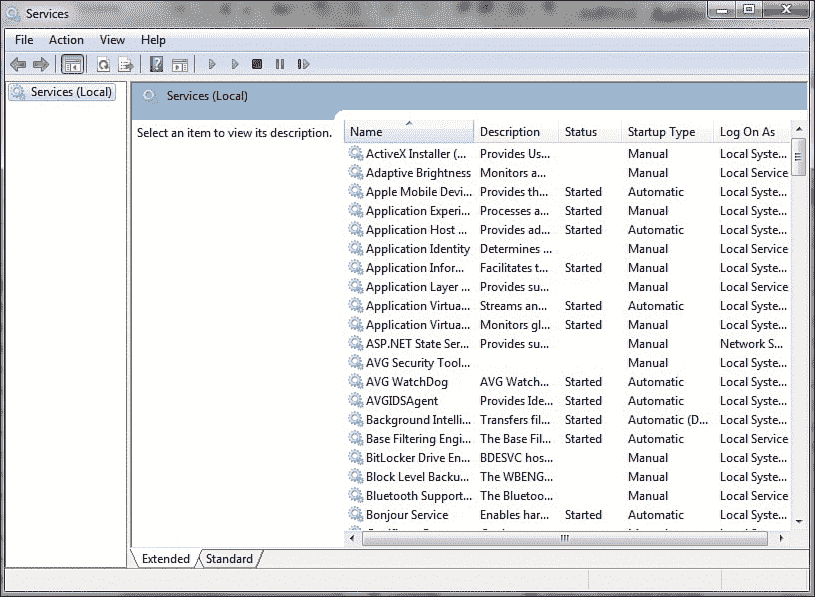

图 11.1 Windows 服务。

图 11.1 中的窗口显示了机器上的所有服务，无论它们是否正在运行。注意，窗口还显示了服务是否运行、是否自动启动等。在 `Windows` 中，通过选择单个服务可以查看更多信息。在任何 `Windows` 版本（`Windows XP` 到 `Windows 11`，`Server 2003` 到 `Server 2019`）中，双击单个服务，你会看到一个与图 11.2 类似的对话框，提供了该服务的详细信息。

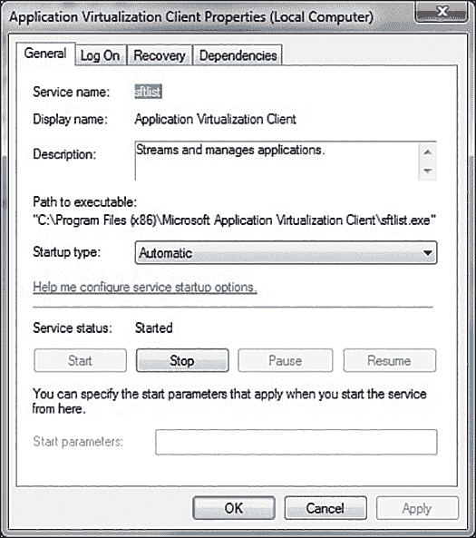

图 11.2 服务。

在图 11.1 所示的示例中，你可以看到一个不需要的服务。在图 11.2 中，你看到了如何禁用该服务。为了说明这一过程，接下来我们将演示关闭此服务。（在关闭任何服务之前，你需要检查是否有其他服务依赖于要关闭的服务。如果其他服务依赖于你想要关闭的服务，而你继续关闭它，将导致其他服务故障。）按照以下步骤关闭服务：

1. 点击“依赖关系”（Dependencies）选项卡。在这种情况下，该服务没有依赖项。

2. 点击“常规”（General）选项卡。

3. 将“启动类型”（Startup type）更改为“禁用”（Disabled）。

4. 如果必要，点击“服务状态”（Service status）部分中的“停止”（Stop）按钮。你的对话框应该与图 11.2 类似。

5. 点击“确定”接受所做的更改并关闭“属性”对话框。关闭“服务”对话框和“管理工具”对话框。

关闭不需要的端口和服务是计算机安全中非常重要且基础的一部分。正如提到的，每个开放的端口（以及每个运行的服务）都是黑客或病毒进入你机器的可能途径。因此，记住这条重要的规则：如果你不需要它，就关闭它并阻止它。


通常情况下，你会使用一个配置与你的生产工作站完全相同的系统，并将该系统用作测试。添加补丁或关闭服务都应该在测试系统上进行。如果如果没有问题，你就可以将更改部署到生产机器上。即使在使用测试系统之后，也应该分阶段部署到生产环境，而不是一次性覆盖整个网络。因为始终存在出现问题的可能性。

一种最佳实践是列出你正在运行的所有软件列表。然后查找这些软件所需的端口和协议，并仅允许这些端口通过。务必记住，这些是入站流量的端口。如果你的机器没有作为数据库服务器、Web 服务器或其他类型的服务器，且它是一台独立机器，那么你可以（并且应该）关闭所有端口。网络上的工作站可能需要开放某些端口供网络工具使用。我们将在本章后面部分介绍一些有趣的工具。

## 保护

评估系统安全性的下一个阶段是确保采用所有合理的保护软件和设备。这意味着至少要在你的网络和外部世界之间设置一个防火墙（参见第 2 章）。你还应该考虑在该防火墙和任何 Web 服务器上使用入侵检测系统（IDS）。（我们在第 9 章中讨论过 Snort IDS。）一些安全专家认为 IDS 不是必不可的；你完全可以在没有 IDS 的情况下拥有安全网络。然而，使用 IDS 是感知即将临的攻击的唯一方法；目前有免费的开源 IDS 可，我强烈建议使用它们。防火墙和 IDS 将为你的网络边界提供基础安全，但你还需要进行病毒扫描。每台机器（包括服务器）必须安装定期更新的病毒扫描程序。之前已经提到过，病毒感染是对大多数网络最大的威胁。正如之前讨论过的，考虑在你的所有系统上安装反间谍软件可能可能是明智的，以防止网络用户无意中在网络上运行间谍软件。

# 实践

### 寻找防火墙

在选择使用的防火墙时，你有多种选择：你可以为你的高速互联网连接购买一个非常便宜的基于路由器的防火墙，可以获取一个与 DSL 或电缆路由器分开的路由器，或者获取一个包含防火墙的电缆或 DSL 路由器。以下网站可以帮助你找到有关这些选项的更多信息，并确定哪种最适合你的需求：

*  **Linksys:** [`www.linksys.com/`](https://www.linksys.com/)（注：Linksys 已被 Cisco 收购。）

*  **防火墙指南:** [www.firewallguide.com](http://www.firewallguide.com)

*  **CDW:** [`www.cdw.com/content/cdw/en/articles/security/firewall-type-comparison.xhtml`](https://www.cdw.com/content/cdw/en/articles/security/firewall-type-comparison.xhtml)

除了可用防火墙选项的信息外，你可以在互联网上找到许多免费或非常便宜的防火墙包。以下是通过互联网获取的流行防火墙列表：

*  **Norton:** 该产品价格便宜且适用于多种系统。见 `norton.com`。
*  **Mcfee:** 该产品价格与 Norton 防火墙相似。见 `mcafee.com`。
*  **Comodo:** 该产品有免费版和商业版。见 `comodo.com`。
*  **ZoneAlarm:** 该产品提供免费版和商业版。见 `zonealarm.com`。
*  **Bitdefender Total Security:** 该产品包括防火墙以及其他安全功能。见 `bitdefender.com`。
*  **AFWall+:** 该防火墙适用于手机等 Android 设备。见 `play.google.com`。

对于预算灵活的中型或大型网络，你需要的比个人防火墙更多的功能。大多数主要的网络供应商都在其产品中包含了防火墙。Cisco 路由器和 Juniper 路由器都包含此功能。对于你的网络交换机，

最后，Linux 有一个名为 `iptables` 的内置防火墙。它是任何使用 Linux 系统的极佳解决方案。第一个广泛使用的 Linux 防火墙是 `ipchains`。该产品有效但具有局限性。它首次在 Linux 内核 2.2 版本中引入，并被 `fwadm` 取代。现在作为 Linux 主要防火墙的 `iptables` 服务首次在内核 2.4 中引入。在大多数 Linux 系统上，`iptables` 安装在 `/usr/sbin/iptables`；然而，如果安装时未包含，你可以手动添加。

### 策略

虽然在第 10 章“安全策略”中详细讨论了策略，但我们在这里简要回顾一下策略的某些方面。任何组织都必须制定明确的计算机安全策略——而且这些策略必须由管理层强制执行。这些策略应该涵盖组织计算机、互联网、电子邮件以及系统的任何其他方面的接受使用情况。策略应禁止在系统上安装任何软件。只有 IT 人员应该安装软件——并且仅在验证其安全性后才进行。策略还应建议用户不要打开未知/意外附件。我建议组织或部门内部的人使用一个口号。如果该口号没有出现在邮件正文中（或在主题行中），那么他们就不打开附件。大多数病毒攻击通过邮件附件传播。此类邮件的主题和正文是由病毒本身自动生成的。你所有合法的附件都可以在主题中包含一个口号；病毒发送的邮件主题中极不可能出现这个词。单此一点就能防止你的用户无意中打开病毒。策略还应该明确划分谁有权访问哪些数据、如何进行备份，以及在发生灾难时如何恢复数据（通常称为*灾难恢复计划*）。


应该有一项关于密码的策略：可接受的最小长度、密码有效期、密码历史以及应避免使用的密码（例如与用户有直接关联的任何词汇）。例如，一个达拉斯牛仔人队的忠实粉丝不应该使用与该橄支运动队有任何关系的密码。此外，与个人数据相关的密码（如配偶的生日、孩子的名字或宠物名称）也是糟糕的选择。密码策略还可以包含对密码的建议或限制。

#### 附注：良好的密码
许多来源声称，一个良好的密码至少要有 8 个字符（最好为 15 个）；包含字母、数字和特殊字符；并结合大写和小写字母。在学习了本书前面的部分关于彩虹表的内容之后，你可能意识到需要更长的密码。我通常建议使用短语（passphrase）。从一个简单的内容开始，比如“cheeseburgers from Burger King”（汉堡王的芝士汉）。现在将它们组合成一个单词，使用一些大写字母，并将一些字母改为数字，最后你可能会得到这样的密码：`!l!k3ch33s3burg3rsfrombuRG 3rk1ng`。你可以非常轻松地记住这样的密码，而且它很难被猜中，甚至用彩虹表破解。

此外，密码不应保存过久。90 天或 180 天的密码更换计划适用于大多数情况。更安全的环境可能需要 30 天甚至更短的时间。微软建议为 42 天（6 周）。这被称为 `password age`（密码年龄）。（当然，强制更改密码的频率必须根据用户对敏感信息或数据的访问程度而定。公司财务官可能每周更改一次密码；核武器工程师可能每天更改一次密码；而邮件出纳员可能需要以低得多的频率更改密码。）你可以设置许多系统（包括 `Windows`）强制用户在一段时间后获取新密码。你还应该确保人员不会仅仅是重复使用旧密码，这被称为 `password history`（密码历史），在某些操作系统也被称为 `uniqueness`（唯一性）。一个很好的经验法是历史深度为五——这意味着该人员不能重复使用其之前的五个密码中的任何一个。此外，你可能需要实施最小密码年龄，以防止用户立即更改五次密码以回到当前的密码。通常，建议至少为 1 天。

#### 附注：策略应该有多详尽？
策略应该有多详尽？是几页简短的内容，还是冗长的手册？不同的计算机安全专家有不同的意见。我的观点是，策略应该足够长以涵盖你的组织需求，但不要长到变得难以处理。简而言之，过长的策略手册可能会被员工忽略而不阅读，因此无法得到遵守。如果你必须有一份长长的策略手册，请为特定的员工组创建几份简短的子手册，以增加策略被阅读和遵循的机会。让 IT 安全部门的人员向新入员工简要介绍安全策略可能是一个好主意。

#### 附注：检查清单与策略
为了方便起见并帮助你开始保护系统和建立良好的策略，SANS 学院网站提供了检查清单和策略的示例（参见 [`www.sans.org/security-resources/policies/`](http://www.sans.org/security-resources/policies/)）。这些中的每一个示例也可以通过本书的配套网站以电子版提供。

最后，策略应该包括在员工离职时应做的特定指示。必须立即禁用该人员的所有登录账户，并立即停止对系统任何部分的物理访问。遗憾的是，许多组织未能妥善处理这个问题，最终为心不满的前员工提供了对前雇主进行报复的机会。

#### 探测
评估任何网络的一个重要步骤是探测网络。我们将在本章稍后的部分查看几种探测方法。关键是定期对你自己的网络进行安全探测。这应该是一个定期安排的事件——也许每季度一次。至少每年完成一次全面的安全审计。这当然会包括对你的端口进行探测。然而，真正的安全审计还包括审查你的安全策略、补丁系统、你维护的所有安全日志、安全职位人员的人员档案等。

#### 物理
最后，你不能忽视物理安全。一个被放在未锁房间内且无人看守的最坚固计算机一点也不安全。你必须有一项策略或程序来管理带有计算机的房间的锁定，以及笔记本电脑、PDA 和其他移动计算设备的处理。服务器必须位于锁闭且安全的房间内，并且访问他们的人员尽可能少。备份磁带应该存在防火箱中。文档和旧备份带在丢弃前应销毁（例如，通过熔化磁带、磁化硬盘、销毁外部存储设备等）。

对路由器和集线器的物理访问也应该被严格控制。拥有世界上最高科技、最专业的信息安全措施，却把你的服务器留在任何人都可以进入的未锁房间里，这是灾难的根源。物理安全领域最常见的错误之一是将路由器或交换机与清洁卫生间放在同一位置。这意味着，除了你自己的安全人员和网络管理员之外，整个清洁团队都可以访问你的路由器或交换机，而且他们任何一个都可能让门长时间处于未锁状态。

关于物理安全，你应该遵循以下一些基本规则：

*   **服务器房：** 存放服务器的房间应该是建筑内防火性能最好的房间。它应该有一扇带有坚固锁具的强门，例如死锁。只有那些确实需要进入房间的人员才能拥有钥匙。你可能还会考虑使用服务器房日志，每个人在进入或离开房间时签名。实际上有电子锁可以记录谁进入了房间、何时进入以及何时离开。你可能还希望在服务器房等关键区域使用生物识别锁。咨询当地的安全供应商获取更多有关价格和可用性的详情。

*   **工作站：** 每个工作站都应该有一个刻的识别标记。你还应该定期对它们进行盘点。物理上通常无法像保护服务器那样保护它们，但你可以采取一些步骤来提高它们的安全性。有些公司选择用电缆将工作站固定在桌子上。这可能是有效且廉价的。

*   **杂项设备：** 投影仪、刻刻机、笔记本电脑等应该上锁。任何想要使用这些设备的员工都应该被要求签借，并在归还时检查其工作状况良好且部件齐全。


在本节中，我们将检查针对个人工作站、服务器和网络的各种安全特定细节。然而，你应该意识到，你不需要重新发明轮子。许多声誉良好的机构（包括以下机构）已经制定了分步指南或安全模板，你可以在自己的网络设置中使用这些模板：

*   **国家安全局 (NSA)：** NSA 网站提供了许多特定的网络安全指南。参见 [`nsacyber.github.io/publications.xhtml`](https://nsacyber.github.io/publications.xhtml)。
*   **互联网安全中心 (CIS)：** CIS 在 [`www.cisecurity.org`](https://www.cisecurity.org) 提供了许多安全指南和基准测试。
*   **SANS 学院：** SANS 有许多可以供下载、使用或修改的示例策略。参见 [www.sans.org/resources/policies/](http://www.sans.org/resources/policies/)。

你可以修改这些资源以适应你的特定组织，或将它们作为制定自己安全策略的起点。

还有一些适用于许多操作系统和应用程序（例如 Microsoft Windows 和 Microsoft Exchange）的模板，这些模板可以实施某些安全预防措施。可以在许多产品中找到这些模板，然后将其安装在相应的机器上。一些安全专业人员倾向于自己处理安全细节，但许多管理员发现这些模板非常有用——对于初学者来说，它们可能是无值的。

*   **Windows 安全模板：** [`support.microsoft.com/en-us/kb/816585`](https://support.microsoft.com/en-us/kb/816585)
*   **理解 Windows 模板：** [`www.windowsecurity.com/articles-tutorials/misc_network_security/Understanding-Windows-Security-Templates.xhtml`](http://www.windowsecurity.com/articles-tutorials/misc_network_security/Understanding-Windows-Security-Templates.xhtml)

这些模板的使用至少可以为你所应用的应用程序提供一个安全基准。

## 保护个人工作站

任何审慎的个人都可以采取若干步骤来确保自己的电脑安全。这些步骤应该同时适用于家庭计算机和网络上的工作站。在一种情况下，保护个人电脑是唯一的可用安全选项；在另一种情况下，同时保护个人电脑以及边界可以实现分层安全方法。虽然一些网络管理员仅通过防火墙和/或代理服务器来保护边界，但人们通常认为你也应该保护组织中的每台机器。这对于防止病毒攻击以及你在第 4 章“拒绝服务攻击](#ch04.xhtml#ch04)”中学习到的某些拒绝服务攻击尤为重要。

### 提示：系统加固 (Hardening a System)

防止黑客、恶意软件和其他入侵者攻击计算机系统的过程有时被称为“系统加固”。你可能会看到 `server hardening` 和 `router hardening` 这两个术语被频繁使用。

保护个人电脑的第一步是确保适当应用了所有补丁。微软网站拥有工具，可以扫描你的机器以查找 Windows 和 Microsoft Office 所需的程序。定期执行此操作非常关键——至少每季度一次。你还应该检查其他软件供应商，看看他们是否有类似的机制来更新其产品的补丁。令人惊讶的是，尽管已有可用补丁来修复被利用的漏洞，但仍有许多病毒爆发泛发。有太多的人简单地没有确保定期应用补丁。对于家庭计算机来说，这是你安全策略中最关键的一步，将保护你免受许多旨在利用安全漏洞的攻击。对于网络工作站，这仍然是整体安全策略中至关重要的一部分，不能忽视。

保护个人电脑的第二步是限制安装程序或更改配置配置。在网络环境中，这意味着大多数用户没有权限安装软件或更改系统设置。只有网络管理员和指定的支持人员才应该拥有这种能力。在家庭环境中，这意味着只有负责的一方或多方（例如父母）拥有安装软件的访问权限。

采取这种特殊预防措施的原因之一是防止用户在他们的机器上无意中安装木马或其他恶意软件。如果一个人被阻止安装任何软件，那么就没有机会无意中安装不当的软件，如木马、广告软件或其他恶意软件。阻止用户更改机器配置还可以防止他们更改系统安全设置。新手用户可能会听到某些更改设置的方法并付诸实施，而没有意识到他们正在让系统面临的安全风险。

新手可能会不利地更改安全设置的完美例子涉及 Windows Messenger 服务。正如许多新手错误认为的那样，该服务并不是用于聊天室或即时消息。相反，它被网络管理员用于向网络上的所有人发送广播消息。不幸的是，某些广告软件也使用该服务来绕过弹出窗口拦截器并向你倾销广告。因此，具有安全意识的人可能会禁用该服务。你不希望一个没有经验的人因为认为它是即时消息所需要的而将其重新开启。

在任何网络环境中，限制普通用户对机器配置的操作范围都是至关重要的。如果没有此类限制，即使是意图良好的员工最终也可能损害安全。这一步骤通常会面临组织的某些阻力。如果你负责系统的安全，你的工作就是教育决策者为什么这一步是如此关键。

下一步在书中之前已经讨论过。每台计算机都必须安装防病毒和反间谍软件。你还必须将其设置为定期自动更新病毒定义。运行更新后的防病毒软件是任何安全解决方案不可或缺的一部分。反间谍软件和防病毒软件的双管方法是你个人计算机安全策略的主要组成部分。一些分析师认为反间谍软件是一个很好的补充，但不是关键组件。另一些人认为间谍软件是一个日益增长的问题，未来可能会等于或超过病毒攻击的危险。

当然，如果你的操作系统带有内置防火墙，对其进行配置并开启是一个好主意。Windows（10 和 11）和 Linux 都带有内置防火墙功能。开启它们并正确配置它们。在实施这一步骤时遇到的唯一重大问题是，大多数网络需要关键服务器（例如 DNS 服务器）与个人计算机之间存在某些流量。当你配置防火墙时，确保允许适当的流量通过。如果你在家里，可以简单阻止所有入站流量。如果你在网络中，必须识别你需要允许哪些流量。


密码和物理安全（正如本章早期讨论的那样）是计算机安全的关键组成部分。你必须确保所有用户使用的密码至少有八个字符，并由字母、数字和特殊字符组成。通常情况下，确保你的密码策略是完整的，并且所有员工都遵循它。这将确保你的物理安全系统是稳健的。

遵循这些指南不会让你的计算机完全免受危险，但这些指南将使你的工作站能够在合理范围内达到尽可能的安全。请记住，即使在网络环境中，保护每台计算机以及边界安全也至关重要。

## 保护服务器

任何网络的核心都是其服务器——数据库服务器、Web 服务器、DNS 服务器、文件和打印服务器等。这些计算机为网络的其他部分提供资源。通常，你最关键的数据将存储在这些机器上。这意味着这些计算机对入侵者来说是极具吸引力的目标，保护它们至关重要。

本质上，为了保护服务器，你应该采取适用于任何工作站的相同步骤，然后增加额外的步骤。该机器上没有用户会定期输入文档或使用电子表格，因此更严格的限制不太可能给终端用户带来在工作站上可能遇到的困难。

首先，你必须遵循与工作站相同的步骤。每一台服务器都应该定期进行软件补丁。它还应该安装病毒扫描软件，可能还有反间谍软件。至关重要的是，对这些机器的访问（无论是通过登录还是物理访问）应仅限于有明确需要的人。然而，对于服务器，你还需要采取一些额外的步骤，而这些步骤对于标准工作站是不需要的。

大多数服务器操作系统（例如 `Windows 2019 Server`、`Linux`）具有记录各种活动的能力。这些活动包括失败的登录尝试、软件安装和其他活动。你应该确保已开启日志记录，并记录所有可能带来安全风险的操作。然后，你必须确保定期检查这些日志。

请记住，服务器上的数据比实际机器本身更有价值。出于此原因，必须定期备份数据。通常优选选择每日备份，但在某些情况下，每周备份可能足够。备份带应保放在安全的场外地点（如银行保险箱）或防火保险箱中。至关重要的是，你要限制对这些备份带的访问，就像限制对服务器本身的访问一样。

对于任何计算机，你都应该关闭任何你不需要的服务。但是，对于服务器，你可能希望采取额外步骤，卸载任何你不需要的软件或操作系统组件，这意味着任何服务器运行所不需要的内容都应该被移除。但在继续之前，请仔细考虑这一点。显然，服务器不需要游戏和办公套件。然而，为了更新补丁，可能需要一个浏览器。

服务器还需要采取另一个步骤，而这在工作站上是不需要的。大多数服务器操作系统都内置了账户。例如，`Windows` 有内置的 `administrator`、`guest` 和 `power user` 账户。任何想要猜测密码的黑客都会从尝试猜测与这些标准用户对应的密码开始。事实上，网上有很多工具可以为潜在的入侵者自动完成此操作。首先，你应该创建自己的账户，其名称不应反映其权限级别。例如，禁用 `administrator` 账户并创建一个名为 `basic_user` 的账户。将 `basic_user` 设置为管理员账户，并赋予适当权限。（当然，只给那些你希望拥有管理员权限的人提供该用户名和密码。）如果你这样做，黑客就不会立即猜到这个账户就是他想要破解的那个。记住，黑客最终想要的是目标系统的管理权限；隐藏哪些账户拥有这些权限是防止黑客突破你安全防护的关键步骤。

### F：处理旧备份介质

遗憾的是，许多网络管理员直接将旧备份介质丢进垃圾桶。具有恶意的人获取了这些介质并将其恢复到自己的机器上，就可以访问你的系统。旧介质（磁带、DVD）应该被彻底销毁。对于 `DVD`，这意味着将其物理粉碎。对于 `磁带`，这意味着将其磁化。硬盘应该用强磁铁处理。

对于任何版本的 `Windows`，都有注册表设置可以进行更改以增加安全性。如果你使用如 `Cerberus` 的扫描工具，它会报告你注册表设置中的漏洞。哪些注册表设置可能会导致安全问题？常见的检查项目包括：

-   **登录**：如果你的注册表设置让登录界面显示最后一个用户名，你就为黑客完成了一半工作。因为她现在有了用户名，只需要猜密码。
-   **默认共享**：某些驱动器/文件夹是默认共享的。保持这种状态会构成安全隐患。

这些只是注册表中的一些潜在问题。诸如 `Cerberus` 的工具不仅会告诉你问题所在，还会提供修复建议。要启动注册表编辑器，转到“开始”，选择“运行”，然后输入 `regedit`。然后你就可以编辑注册表。

## 保护网络

显然，保护网络的第一步是保护参与网络的所有计算机，包括所有工作站和服务器。然而，这只是网络安全的一个部分。现在你应该清楚，使用`防火墙`和`代理服务器`也是网络安全的关键元素。第 12 章，“网络恐怖主义与信息战](#ch12.xhtml#ch12)”提供了关于这些设备的更多细节。目前，重要的是意识到你需要拥有它们。大多数专家还建议使用 `IDS`。有很多此类系统可供——有些甚至是免费的。这些系统可以检测到某些行为，例如端口扫描，这可能表明某人正准备尝试突破安全边界。

如果你的网络相当大，那么你可能考虑通过带有防火墙的路由器将其划分为较小的段。当然，“大”是一个模糊的词，你必须决定你的网络是否大到需要划分。这样一来，即使一个分段被攻破，整个网络也不会受到破坏。在这种系统中，你可能考虑将你最重要的服务器（数据库、文件）放在一个安全的分段中。


由于 Web 服务器必须暴露在外部，且是最常见的攻击点，因此将它们与网络的其余部分隔离开来是有意义的。许多网络管理员会在 Web 服务器和网络其余部分之间放置第二个防火墙。这意味着如果黑客利用了你的 Web 服务器的漏洞并获取了访问权限，他将无法访问你的整个网络。这引出了你的 Web 服务器上应该放置什么的问题。答案是：仅放置发布网页所需要的内容。该服务器上不应存储任何数据、文档或其他信息，更不应该有多余的软件。操作系统和 Web 服务器软件就是全部了。如果你的情况需要，你也可以添加其他几项（例如 `IDS`）。在该服务器上运行的任何其他软件都是潜在的安全风险。

你还应该考虑的另一个概念是 DMZ（代表 `demilitarized zone`，即非军事化区）。DMZ 上涉及两个防火墙：一个外层和一个内部。必须被外部访问的资源位于这两个防火墙之间。外部防火墙限制较松，而内部防火墙则非常严格。甚至有些路由器在一个设备中集成了这种功能。通过连接到某些端口，你可以在内部防火墙之后或在 DMZ 中添加设备。这如图图 11.3 所示。

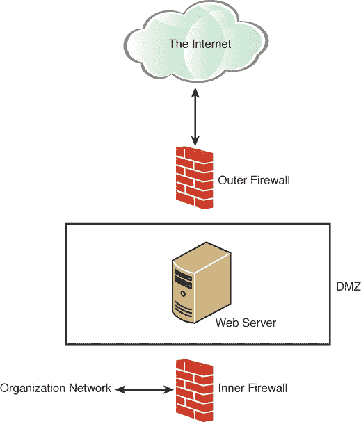

图 11.3 DMZ。

你还必须制定指导用户如何使用系统的策略，正如在本章早些时候讨论的。如果一个粗心的用户无意中破坏了你的安全，那么世界上最强大的安全措施也将无用处。请记住，你必须制定策略来指导用户什么被认为是适当使用系统，什么不是。

就像你采取步骤加固服务器（例如修补操作系统程序和关闭不需要的服务）一样，你也应该加固你的路由器。具体做法将取决于你特定的路由器制造商和型号，但应该遵循几条通用规则：

*    **使用强密码：** 所有路由器都是可配置的。它们可以被编程。因此，你在路由器上必须遵守与在任何服务器上相同的密码策略，包括最小密码长度和复杂度、密码有效期以及密码历史。如果你的路由器允许你加密密码（如 `Cisco` 和其他供应商那样），请这样做。
*    **使用日志：** 大多数路由器都支持日志。你应该开启它并像监控服务器日志一样对其进行监控。
*    **安全规则：** 还应该遵循一些基本的路由器安全规则：
    *    不要对用户本地局域网 (`LAN`) 之外主机响应地址解析协议 (`ARP`) 请求。
    *    如果你的网络上没有应用程序使用给定端口，则该端口也应在路由器上关闭。
    *    不应转发源自你 `LAN` 内部的数据包。

这些规则仅仅是一个开始。你需要咨询供应商的文档以获得额外的建议。你对路由器安全的关注必须等同于对服务器的安全。以下链接可能有所帮助：

*    **路由器安全：** [www.mavetju.org/networking/security.php](http://www.mavetju.org/networking/security.php)
*    **Cisco 路由器加固：** [`www.cisco.com/c/en/us/support/docs/ip/access-lists/13608-21.xhtml`](https://www.cisco.com/c/en/us/support/docs/ip/access-lists/13608-21.xhtml)

### 扫描你的网络

确保网络安全的唯一方法是实际上检查漏洞和缺陷。在本节中，我们将查看一些常用的漏洞扫描器。这些工具对于任何网络管理员来说都是无足之宝的资产。

#### NESSUS

Nessus `[www.Nessus.org](http://www.Nessus.org)` 是领先的网络漏洞扫描器。以前有一个供个人使用的免费版和一个商业版。现在它仅提供付费。这可能是当今最广泛使用的漏洞扫描器。它的用法远没有 `MBSA` 那么简单，但具有多得的功能。我们将探索它的基本功能。如果你对学习更多 Nessus 感兴趣，建议咨询 Nessus 网站上提供的文档。

Nessus 是一个著名的漏洞扫描器。它已经使用了多年。遗憾的是，它不是免费的。许可证每年费用超过 $3300，可以从 `[`www.tenable.com`](https://www.tenable.com)` 获取。它的价格一直是许多渗透测试人员的障碍。Nessus 的主要优势是供应商不断更新它可以扫描的漏洞。Nessus 还有一个非常易用的 Web 界面，如图图 11.4 所示。

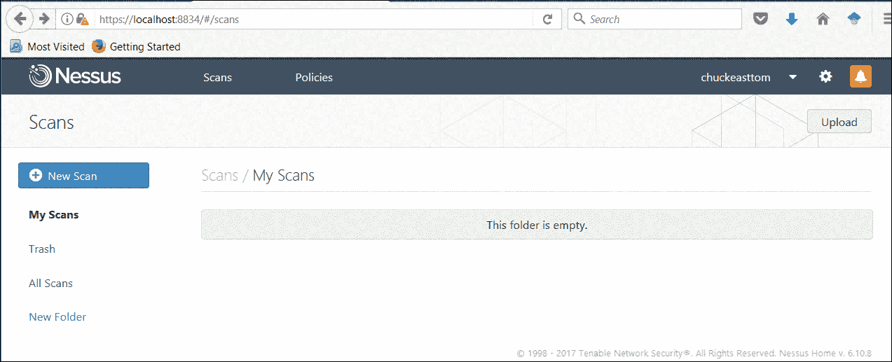

图 11.4 Nessus 主界面。

如果你点击 `New Scan`，你会得到若干选项，如图图 11.5 所示。

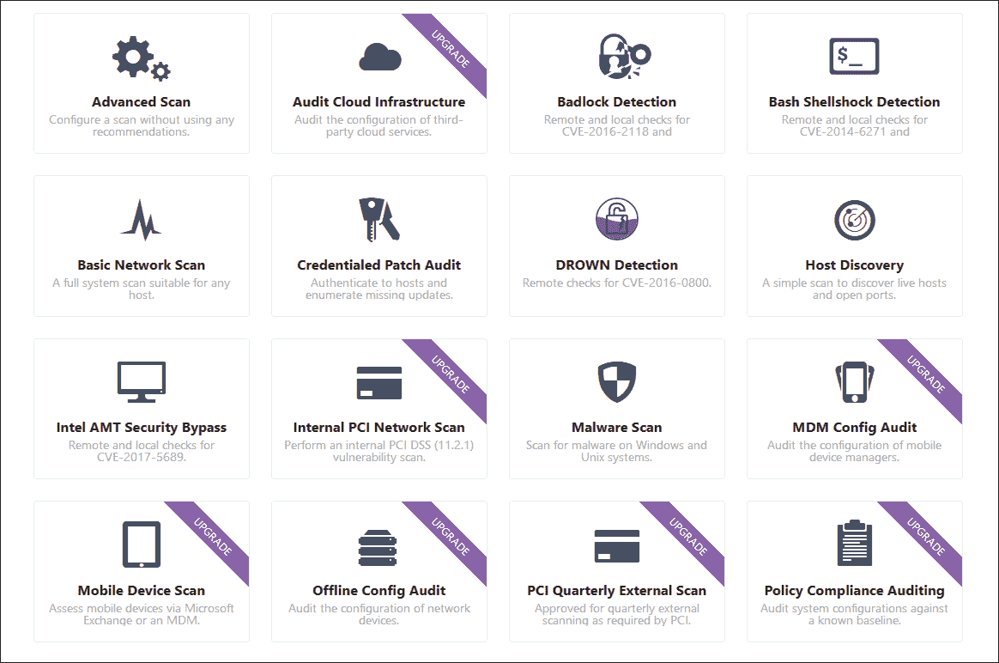

图 11.5 Nessus 扫描选项。

你可以选择 `Basic Scan` 来命名你的扫描并选择 IP 地址范围，如图图 11.6 所示。

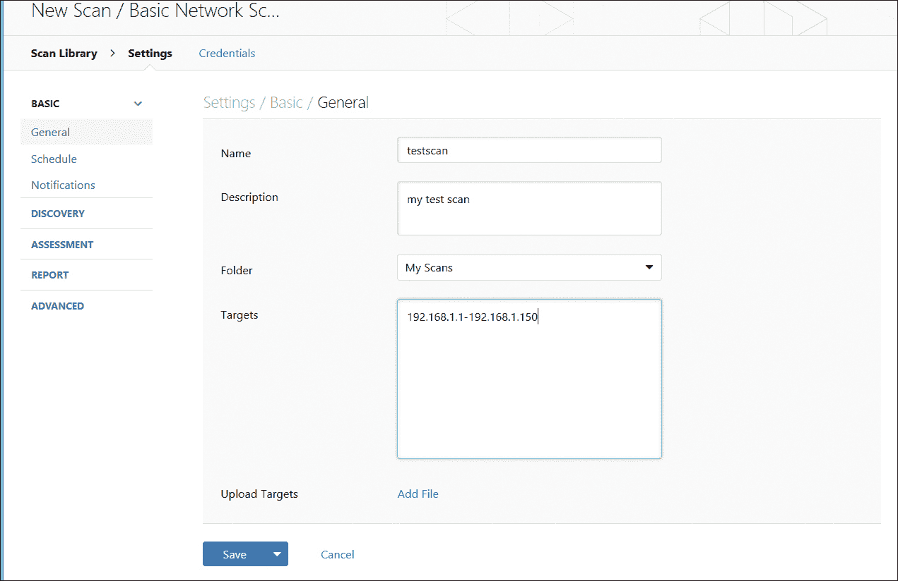

图 11.6 Nessus 基础扫描选项。

你可以安排稍后运行扫描，也可以立即启动。Nessus 扫描可能需要一些时间，因为它们非常彻底。结果以非常有组织的方式呈现，如图图 11.7 所示。

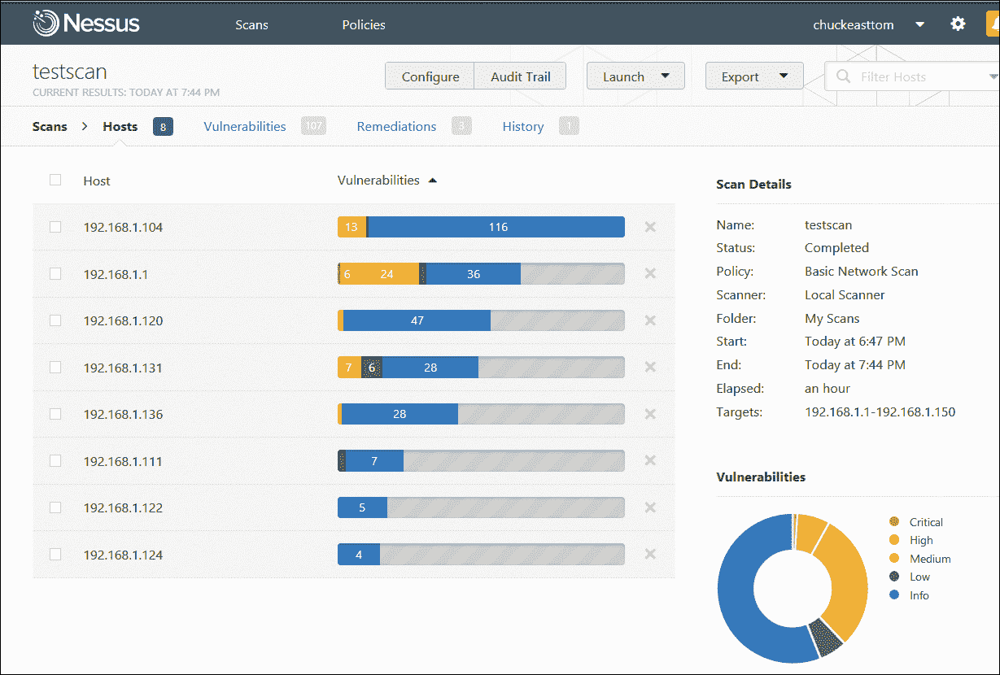

图 11.7 Nessus 结果。

你可以对任何感兴趣的项进行深入查看。如果你双击特定的 IP 地址，可以查看该地址的详情，如图图 11.8 所示。

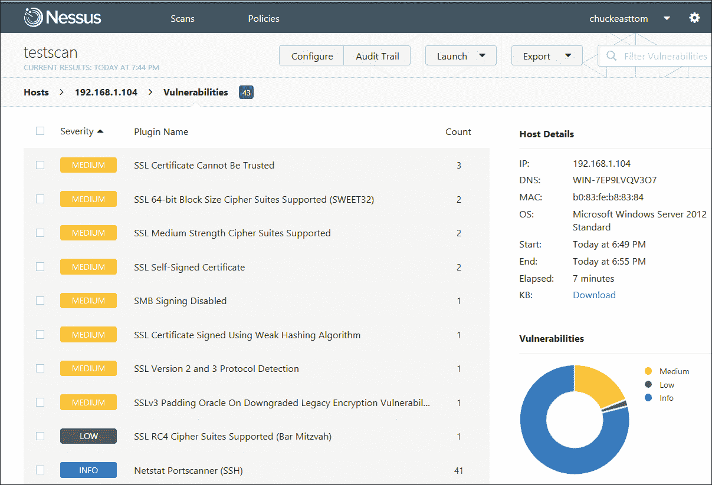

图 11.8 深入查看结果。

你可以双击任何单个项目以获取有关问题以及如何修复的详细信息。

#### OWASP Zap

开放 Web 应用安全项目 (`OWASP`) 是 Web 应用漏洞的标准。OWASP 提供了一个名为 Zed Attack Proxy 的免费漏洞扫描器，通常称为 `OWASP ZAP`。你可以从 `[`www.zaproxy.org/download/`](https://www.zaproxy.org/download/)` 下载它。如图 11.9 所示的界面非常易用。只需输入你想扫描的网站的 `URL` 并点击 `Attack`。片刻之后，结果将显示在屏幕底部。你可以展开任何项目。如果你点击特定项目，详情将如图 11.10 所示进行加载。

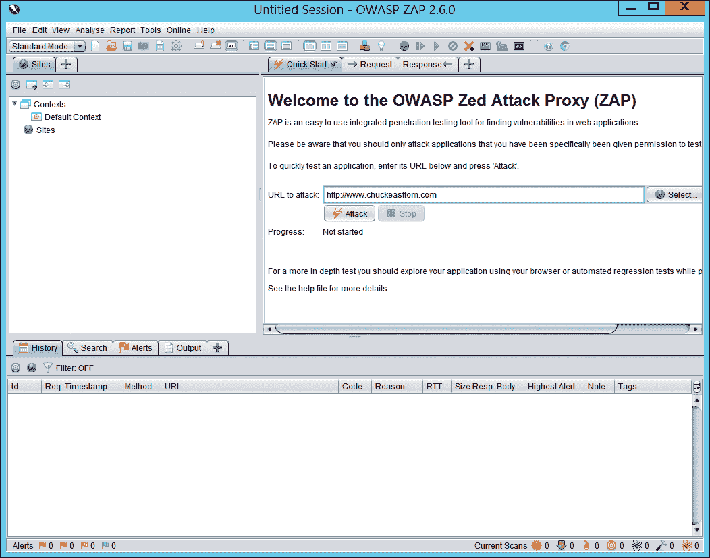

图 11.9 OWASP ZAP 主界面。

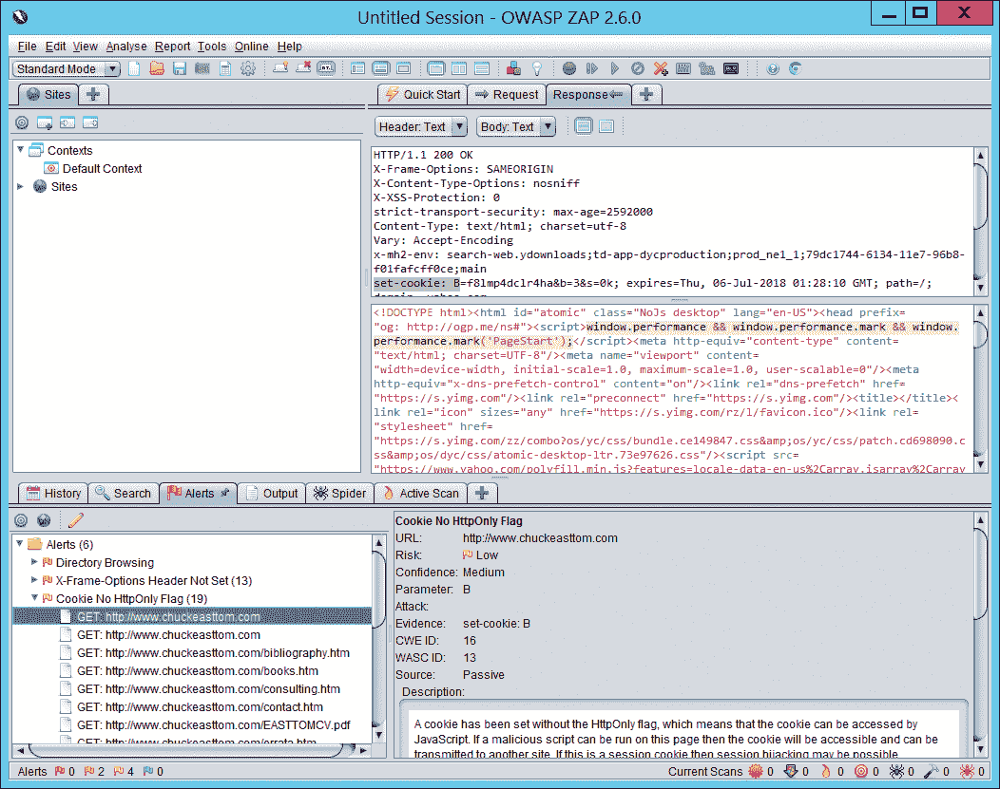

图 11.10 OWASP ZAP 结果。

OWASP ZAP 是一个非常易用的工具。基础知识可以在几分钟内掌握。考虑到 OWASP 是一个跟踪 Web 应用漏洞的组织，它是测试网站漏洞的一个非常好的来源。

#### Shodan


Shodan 工具被黑客和安全专业人员广泛使用。[`www.shodan.io`](https://www.shodan.io) 网站本质上是一个针对漏洞的搜索引擎。你需要注册一个免费账户才能使用它，但对于试图识别漏洞的渗透测试人员来说，它是无价之宝。当然，该网站对攻击者来说也同样具有价值。你可以在图 11.11 中查看该网站。

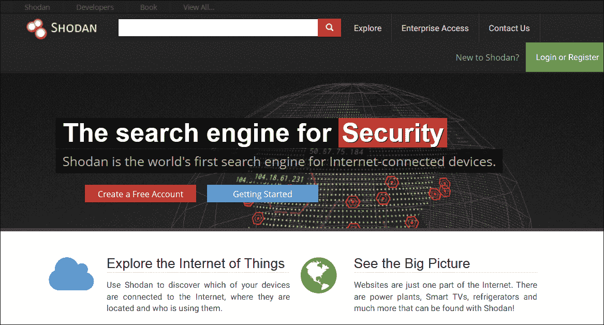

图 11.11 Shodan.io。

Shodan 允许你使用多种选项进行搜索，包括以下项：

*   使用以下搜索词查找默认密码：
    *   `default password country:US`
    *   `default password hostname:[chuckeasttom.com](http://chuckeasttom.com)`
    *   `default password city:Chicago`
*   使用以下搜索词查找 Apache 服务器：
    *   `apache city: “San Francisco"`
*   使用以下搜索词查找网络摄像头：
    *   `webcamxp city:Chicago`
*   使用以下搜索词查找旧版 IIS：
    *   `“iis/5.0"`

通过 Shodan，你可以使用许多过滤器，包括这些：

*   `city:` 查找特定城市的设备。
*   `country:` 查找特定国家的设备。
*   `geo:` 指定坐标（如纬度和经度）。
*   `hostname:` 查找匹配特定主机名的值。
*   `net:` 根据 IP 地址或 `/x` CIDR 地址进行搜索。
*   `os:` 根据操作系统进行搜索。
*   `port:` 查找特定的开放端口。
*   `before/after:` 查找指定时间范围内的结果。

例如，图 11.12 显示了搜索 `default password city:Miami` 的结果。

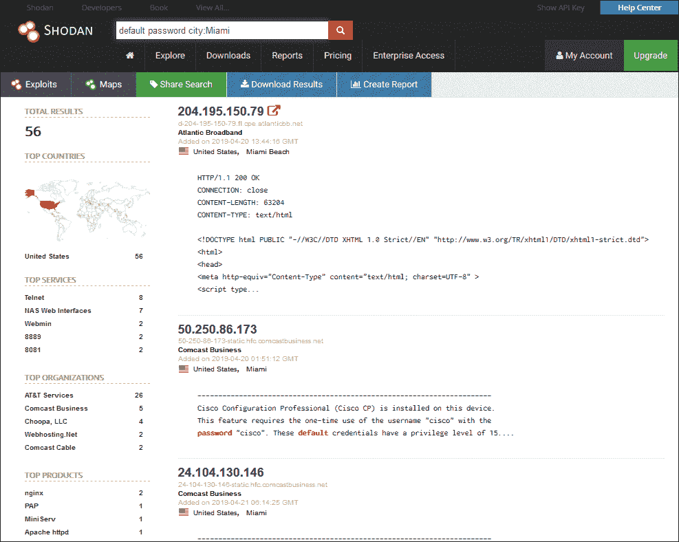

图 11.12 Shodan 搜索结果。

当你在执行渗透测试时，在 Shodan 上搜索你公司的域名是一个好主，可以指导你的渗透测试工作。当然，潜在的攻击者也可以使用 Shodan 寻找相同的信息。你可以将搜索限制在雇你进行渗透测试的客户的主机名或域名。你可以使用 Shodan 寻找目标网络中的默认密码、旧 Web 服务器、不安全的网络摄像头和其他漏洞。

图 11.12 所示的搜索是使用 Shodan 版进行的。Shodan 还提供了起价 69 美元的付费版本，并提供额外的工具。此外，还有更高价格的小企业和企业会员方案。

### Kali Linux

Kali Linux 是一种 Linux 发行版，内置了许多用于网络安全、数字取证和渗透测试的开源工具。Kali Linux 中有几个你应该熟悉的扫描器，下文章节将对其进行描述。

#### Lynsis

Lynsis 是一种基于主机的开源安全审计应用程序，可以评估 Linux 和其他 UNIX 类操作系统的安全概况和态势。该工具随 Kali Linux 发行版一起安装。图 11.13 显示了使用 Lynsis 的基本扫描过程。


图 11.13 Lynsis 扫描。

#### Nikto

Nikto 是一个 Kali Linux 工具，用于扫描网站的常见漏洞。它没有方便的图形用户界面；相反，你从 Linux 终端中运行 Nikto，它非常容易学习和使用。你可以在图 11.14 中看到使用 Nikto 扫描我的网站。


图 11.14 Nikto 扫描。

Nikto 的选项易于理解和使用。例如，你只需要将一组 IP 地址放在一个文本文件中并使用命令 `nikto -h targetIP.txt` 即可扫描这些地址。

你可以从多种格式中选择：

*   `csv:` 逗号分隔值格式
*   `htm:` HTML 格式
*   `nbe:` Nessus NBE 格式
*   `sql:` 通用 SQL 格式
*   `txt:` 纯文本
*   `xml:` XML 格式

#### Sparta

Sparta 是一个随 Kali Linux 提供的漏洞扫描器，包含许多工具。图 11.15 显示了使用 Sparta 的基本扫描过程。


图 11.15 Sparta 扫描。

#### Vega

Vega 和 ZAP 一样是 Web 扫描器。它是免费开源的。使用 ZAP 和 Vega，你只需要输入 URL 并选择模块，剩下的由它完成，如图 11.16 所示。


图 11.16 Vega 扫描。

#### OpenVAS

OpenVAS 是由 Greenbone Networks 创建的开源漏洞扫描器。OpenVAS 框架包含了多种和服务，允许你对主机和网络进行详细扫描。OpenVAS 可以 `https://github.com/greenbone/openvas-scanner` 下载，文档可以在 `https://docs.greenbone.net/user_documentation` 获取。

OpenVAS 还包含一个 API，允许你通过编程与其工具交互并自动扫描主机和网络。运行 OpenVAS 非常简单。结果界面会提示你升级到专业账户以购买完整版本，但如果你愿意，可以忽略该提示继续使用免费版本。

### 测试与扫描标准

特定的标准适用于漏洞扫描和渗透测试。本节将简要讨论一些著名的标准。

#### NIST 800-115

NIST 800-115《信息安全测试与评估技术指南》是一份通用的测试指南，不仅仅是渗透测试。该标准涵盖了系统审计包含的项目，例如文档审查、日志审查类似项目。然而，该标准也涵盖了渗透测试和漏洞扫描都应该包含的项目。最重要的是，NIST 800-115 使用了三个特定阶段：


规划

执行

执行后

这看起来像是一个非常的计划，但这些阶段在 NIST `800-115` 文档中有非常详细的描述。事实上，该标准推荐了特定的工具，其中许多你已经在本章中见过了。

## NSA-IAM

国家安全局信息安全评估方法（`NSA-IAM`）是渗透测试的极佳指南。该文档描述了三个阶段，每个阶段又细分为具体的任务：

*   评估前
    *   确定并管理客户预期
    *   了解组织信息的关键性
    *   确定客户的目标和目的
    *   确定系统边界
    *   与客户协调
    *   索取文档
*   执行后
    *   实地评估
    *   召开会议
    *   收集、验证并报告信息
    *   分析评估
    *   制定初步建议
    *   展示结果
    *   评估后
    *   文档审查
    *   报告结果
    *   与客户协调

## PCI DSS

支付卡行业行业数据安全标准（`PCI DSS`）是一系列安全标准，旨在确保所有接受、处理、存储或传输信用卡信息的公司都能维护安全环境。其目标是保护持卡人数据和敏感身份验证数据。

`PCI DSS` 要求围绕六个主要控制目标构建：

1.  构建并维护安全网络
2.  保护持卡人数据
3.  维护漏洞管理计划
4.  实施强访问控制措施
5.  定期监控和测试网络及持卡人数据
6.  维护信息安全策略

对于任何处理、存储或传输持卡人数据的实体，遵守 `PCI DSS` 是强制性的。未能遵守这些标准可能会导致罚款、处罚以及失去处理信用卡卡的能力。

## 漏洞数据库

国家漏洞数据库（`NVD`）是一个公开的基于漏洞的漏洞管理数据库，由美国标准与技术研究院（NIST）维护。`NVD` 与常见漏洞和暴露（`CVE`）列表同步，并提供如 CVSS 评分等分析。

`NVD` 用于帮助组织识别、确定优先级并缓解安全风险。通过使用 `NVD`，安全团队可以了解漏洞的严重程度及其对系统的系统的影响。

安全内容自动化协议（`SCAP`）是一套规范，用于自动化管理安全漏洞和安全配置设置。`SCAP` 允许在不同工具之间进行标准的安全信息交换。

联邦信息安全管理法（`FISMA`）是一项联邦法律，要求联邦机构制定信息安全计划，以保护它们收集和运行的数据。`FISMA` 确保机构为政府信息提供充分的保护。

## 获取专业帮助

如果你的组织缺乏管理安全的资源，则可能需要雇佣专业帮助。安全顾问可以提供实施和维护安全计划所需的专业知识和工具。

安全顾问可以协助漏洞评估、渗透测试和合规审计。他们还可以就制定安全策略和应急响应计划提供指导。选择一个在你的行业拥有良好记录且具备专业知识的顾问是非常关重要的。


认证在 IT 行业中一直备受争议。有些人对其深信不疑。你可以很容易地找到许多要求特定认证的职位广告，例如 `CNE`（认证 Novell 工程师）或 `MCITP`（微软认证信息技术专业人员）。`Cisco` 认证也很常见（例如从 `Cisco Certified Network Associate` 思科认证网络助理到 `Cisco Certified Internetworking Engineer` 思科认证互联网网络工程师）。另一方面，你也能发现一些 IT 专业人士贬低认证，认为它们一无用处。后者的观点之所以存在，是因为某些持有证书的人并不具备人们预期的技能。但对任何证书来说都是如此。确实存在不称职的医生，但如果你需要医疗帮助，咨询一位拥有医学学位的人，你的胜算会要大得多。雇主在招聘时通常采用这种方法。如果他们只面试那些拥有特定学位或证书的人，那么他们面试到合格候选人的机会就会更大。

一个更合理的立场处于这两个极端之间。认证可以作为衡量候选人对特定产品知识水平的良好指标。例如，如果你想让某保护你的 `Microsoft` 网络，查看那些拥有 `Microsoft` 认证的人并不是一个坏主意。然而，你应该平衡这一点，记住：一个记忆性好的人完全可能利用互联网上提供的各种学习指南，并通过一项他们并不真正理解的测试。这正是经验发挥用场的地方。认证加上适当的经验是技能的良好指标。换句话说，证书本身是不够的。但一门或多个认证与经验以及可能相关的学位相结合，可以成为技术技能的强有力证明。

除了网络管理员的认证外，还有许多与安全相关的认证。某些认证的信誉比其他认证高。`CompTIA` 的 `Security+` 考试和 `CIW Security Analyst` 都是概念性考试。这意味着它们测试候选人对安全概念的理解，而不是他们实际实施安全解决方案的能力。单凭这些认证可能无法表明你所需的技能水平。但例如，如果你正在使用 `Novell` 保护网络，一个既是 `CNE` 又拥有 `CIW Security Analyst` 或 `Security+` 的候选人可能是一个值得考虑的人选。需要注意的是，`CompTIA` 最近增加了 `Certified Advanced Security Practitioner`（`CASP`），它是专为具有 10 年安全经验的人士设计的。

最受推崇的安全认证是 `CISSP`（认证信息系统安全专家）。这项测试是一项 6 小时的考试，而且如果你拥有学位，则需要 4 年安全相关经验；如果没有学位，则需要 5 年经验。`CISSP` 持有者还需要提交来自另一位 `CISSP` 或公司官员的推荐信，并修读继续教育学分以维持认证。这可能是最受尊重的安全相关认证。生产 `CISSP` 的供应商（`ISC2`）还有高级的 `CISSP` 之后认证，例如 `Information Systems Security Architecture Professional`（`ISSAP`）、`Information Systems Security Engineering Professional`（`ISSSEP`）和 `Information Systems Security Management Professional`（`ISSMP`）。

`Certified Ethical Hacker`（认证道德黑客）认证由 `EC-Council`（[www.eccouncil.org](http://www.eccouncil.org)）赞助。这项测试一直是争议的话题。请记住，它测试的是基本的黑客技能，而不是对黑客技术的精通。它适合作为黑客技术/渗透测试的入门。

`Offensive Security`（[`www.offensive-security.com`](https://www.offensive-security.com)）专攻渗透测试认证。他们的认证测试最有趣的地方在于，所有测试都包含实操部分。你不仅仅是参加考试，你必须实际上攻入他们的测试系统。

`CompTIA` 还提供几项安全考试，包括 `Security+`、`CompTIA Advanced Security Practitioner`（`CASP`）和 `Pentest+`。

有很多通用取证认证。`EC-Council`（[www.eccouncil.org](http://www.eccouncil.org)）拥有 `Certified Hacking Investigator`（认证黑客调查员）。还有针对特定取证工具的特定认证。对于安全专业人员来说，良好的基础取证知识是非常有用的。

`GIAC`（[www.giac.org](http://www.giac.org)）拥有许多与安全相关的认证。它们在安全行业都有非常良好的声誉。然而，它们比其他测试贵得多，因此拥有这些认证的安全专业人员较少。`GIAC` 拥有安全认证（`GSEC`）、渗透测试认证（`GPEN`）和取证认证（`GCFA` 和 `GCFE`）。

所有的认证都会受到一些批评。事实是，有些人确实会参加训练营，并突击掌握足够通过认证的信息。然而，这对于任何资格证书都是如此。确实存在不称职的医生，但我确信，如果你病了或受伤了，你会寻找医生。这是因为比起简单随机选择某个人，你更有可能从医生那里获得合格的帮助。认证的情况也是如此。请记住，认证反映的是最低技能水平，而不是精通。我建议至少拥有一项通用安全认证（`Security+`、`CASP`、`CISSP` 等）、一个渗透测试认证（`GPEN`、`CEH`、`Offensive Security` 等）以及一个取证认证（`CCFP`、`GCFA`、`CHFI` 等）。

你永远不应该仅仅凭认证就聘佣某人。那些认证应该仅仅是你所考虑的因素之一。

最后，你应该考虑个人背景。根据定义，安全顾问或全职员工将接触机密信息。任何合法的安全专业人员都不会介意向你提供以下任何内容：

*   推荐信
*   允许检查其信用记录
*   允许检查其犯罪背景

任何似乎不愿意提供上述任何项目的人都应该被回避。因此，一个理想的安全顾问可能是一个拥有 5 年或以上经验、计算机相关学科学位、贵组织操作系统的认证以及一项主要安全认证的人员，且背景完全干净并附有推荐信。按照原则，在聘佣安全顾问时，越谨慎越好。

除非你的员工中有一位受过高度训练的安全专家，否则你应该考虑请安全顾问至少评估一次你的系统。在目前的法律环境下，对于安全泄露的责任仍在激烈辩论中。公司正因为未能于计算机安全方面尽到尽职调查而面临诉讼。从计算机行业角度和法律角度来看，尽一切合理的努力确保你的系统安全都是明智之举。

### 总结

本章概述了在任何安全评估中需要寻找的一些基本项目。你应该定期对你的网络/系统进行安全漏洞评估。通常建议是：对于非关键/低安全性站点每季度评估一次，对于高安全性站点则可能增加到每周评估一次。无论如何，本章概述的内容是网络安全评估的基础知识，它们应该为你保护自己的网络提供帮助。


安全计算涉及到确保你的计算机、网络和服务器的安全，并在 Web 上使用常识。对于所有计算机，严谨地应用安全实践和标准至关重要，无论它们是家用计算机还是组织网络的一部分。

### 测试你的技能

## 多选题

1. **[1.]** 下列哪项不** `NIST 800-115` 中列出的阶段之一？
**A.** 计划 (Planning)
**B.** 执行 (Execution)
**C.** 评估后 (Post-assessment)
**D.** 执行后 (Post-execution)

2. **[2.]** John 现在负责一家小型记账公司的系统安全。他希望确保自己实施了良好的基础安全措施。计算机安全最基本的规则是什么？
**A.** 保持系统补丁更新。
**B.** 始终使用 `IDS`。
**C.** 安装防火墙。
**D.** 始终使用反间谍软件。

3. **[3.]** 你在一家大型银行的安全部门工作。你的工作之一是保持所有系统的补丁更新。你如何确保系统补丁是最新的？
**A.** 使用自动化补丁系统。
**B.** 每只要收到供应商关于新补丁的通知就进行补丁。
**C.** 每当发布新威胁时就进行补丁。
**D.** 使用定期的计划补丁。

4. **[4.]** Teresa 正在向一名新技解释基础安全。她正在教他如何保护任何服务器或工作站上的端口。关于端口的规则是什么？
**A.** 阻塞所有入站端口。
**B.** 阻塞 `ICMP` 包。
**C.** 阻塞所有未使用的端口。
**D.** 阻塞所有非标准端口。

5. **[5.]** Miguel 试图保护 Web 服务器。他决定关闭任何不需要的服务。他的主管告诉他要先检查依赖关系。以下哪项是在关闭服务之前检查依赖关系的正当理由？
**A.** 确定你是否需要关闭其他服务
**B.** 确定关闭此服务是否会影响其他服务
**C.** 找出此服务的功能
**D.** 找出此服务对于系统运行是否至关重要

6. **[6.]** 如果你的机器没有被用作服务器且不在局域网内，你应该使用哪种数据包过滤策略？
**A.** 阻塞 80 之外的所有端口。
**B.** 不要阻塞任何端口。
**C.** 阻塞所有你需要的端口。
**D.** 不要阻塞已知端口。

7. **[7.]** 你正试图为一家小公司实施良好的基础安全。以下哪种设备对于保护你的网络来说最不不可少？
**A.** 防火墙
**B.** 所有机器上的病毒扫描器
**C.** `IDS` 系统
**D.** 代理服务器

8. **[8.]** Mohammed 负责某大学的安全策略。他正试图确保适当的访问策略。关于数据访问经验规则是什么？
**A.** 数据必须对尽可能范围内的人可用。
**B.** 只有管理员和主管应该访问敏感数据。
**C.** 只有对特定数据有需求的人才有访问权限。
**D.** 所有员工都应该有权访问部门使用的任何数据。

9. **[9.]** `NSA-IAM` 过程的主要阶段是什么？
**A.** 计划、现场评估、评估后
**B.** 计划、执行、执行后
**C.** 评估前、执行、评估后
**D.** 评估前、现场评估、评估后

10. **[10.]** 系统探测和审计的最低频率是多少？
**A.** 每月一次
**B.** 每年一次
**C.** 每隔一年一次
**D.** 每两个月一次

11. **[11.]** 审计应该检查哪些领域？
**A.** 执行系统补丁、审查策略、检查所有经理的人员记录并探测漏洞
**B.** 仅探测漏洞
**C.** 执行系统补丁、探测漏洞、检查日志并审查策略
**D.** 检查所有机器的非法软件、执行完整的系统病毒扫描并审查防火墙策略

12. **[12.]** Jerod 正在为一家大学的机房设置安全防护。关于服务器所在的房间，以下哪项描述是正确的？
**A.** 它应该位于建筑内内防火性能最好的房间。
**B.** 它应该有一个带有坚固锁的坚固门。
**C.** 它应该只允许那些有访问需求的人进入。
**D.** 以上所有答案都是正确的。

13. **[13.]** Elizabeth 负责她组织的安全策略。她正试图实施健全终端用户安全策略。阻止终端用户在自己的机器上执行什么操作最重要？
**A.** 运行除 IT 工作人员安装以外的程序
**B.** 浏览网页和使用聊天室
**C.** 更改屏幕保护程序和使用聊天室
**D.** 安装软件或更改系统设置

14. **[14.]** 存储的首选方法是？
**A.** 服务器附近
**B.** 异地
**C.** 在安全位置
**D.** 在 IT 工作人员处

15. **[15.]** 下列哪项是你肯定会在任何服务器上采取但在工作站上不会采取的步骤？
**A.** 卸载不需要的程序/软件。
**B.** 关闭不需要的服务。
**C.** 关闭屏幕保护程序。
**D.** 阻塞互联网访问。

16. **[16.]** 下列哪项是你可能在大网络中但在较小网络中采取的步骤？
**A.** 使用 `IDS`。
**B.** 使用防火墙对网络分段。
**C.** 在所有机器上使用防病毒软件。
**D.** 对管理员进行背景检查。

17. **[17.]** 下列哪项是 Web 服务器和网络之间建立安全的常用方法？
**A.** 阻塞 Web 服务器和网络之间的所有流量。
**B.** 在网络和 Web 服务器之间放置病毒扫描。
**C.** 在 Web 服务器和网络之间放置防火墙。
**D.** 不要将你的网络连接到 Web 服务器。

18. **[18.]** 从互联网下载内容的规则是什么？**
**A.** 永远不要下载任何内容。
**B.** 仅在免费时才下载。
**C.** 仅从知名、良好的网站下载。
**D.** 永远不下载可执行文件。只下载图形文件。

19. **[19.]** 下列认证中声誉最高的是？
**A.** `CISSP`
**B.** `PE`
**C.** `MCSA`
**D.** `Security+`

20. **[20.]** 哪一组证书最适合安全顾问？
**A.** 10 年 IT 经验，1 年安全经验，`CIW` 安全分析师，`M.B.A.`
**B.** 8 年 IT 经验，3 年安全经验，`CISSP`，`B.S.` 计算机科学
**C.** 11 年 IT 经验，3 年安全经验，`MCSE` 和 `CISSP`，`M.S.` 信息系统
**D.** 10 年黑客和破解者经验，`MCSE/CIW` 和 `Security+`，`Ph.D.` 计算机科学

## 练习题

### 练习 11.1：系统补丁

1. 使用实验室系统查找并应用所有的操作系统补丁。
2. 检查该机器上所有软件的供应商，并对这些应用程序应用补丁（如果有）。
3. 记录完全补丁一台机器所需的时间。考虑补丁 100 台机器的网络需要多长时间。
4. 写短篇文章回答以下问题：是否有方法可以加速 100 台机器网络的补丁过程？你可能会如何处理此类任务？

### السعودية: 帮助资源

对于练习题 11.2、11.3 和 11.4，以下资源可能对你有所帮助：

* [www.cert.org](http://www.cert.org)


 [www.sans.org](http://www.sans.org)

## 练习 11.2：学习策略

1. 使用给定的资源或其他资源，找到至少一份安全策略文档示例。
2. 分析该文档。
3. 写一篇短文，发表你对该策略的意见。它是否遗漏了项目？它是否包含了你未想到的项目？

## 练习 11.3：学习灾难恢复

1. 使用给定的资源或其他资源，找到至少一份灾难恢复计划示例。
2. 分析该文档。
3. 写一篇短文，发表你对该灾难恢复计划的意见。同时指出你对该策略提出的任何更改。

## 练习 11.4：学习审计

1. 使用给定的资源或其他资源，找到至少一份安全审计计划示例。
2. 分析该文档。
3. 写一篇短文，发表你对该计划的意见。你认为该审计计划足够吗？你会建议哪些更改？

## 练习 11.5：保护你的计算机

使用你的家用电脑或实验室电脑，按照本章提供的指南来保护该计算机。这些步骤应包含以下内容：

1. 扫描所有补丁并安装它们。
2. 关闭所有不需要的服务。
3. 安装防病毒软件。（本练习可以使用演示版。）
4. 安装反间谍软件。（本练习可以使用演示版。）
5. 设置适当的密码权限。

## 练习 11.6：安全密码

1. 使用网络网或其他资源，找出为什么更长的密码更难破解。
2. 同样找出你还应该做哪些操作来使密码更难被破解。
3. 写一篇短文，描述什么是完美的密码。

## 练习 11.7：保护服务器

本练习适用于可以使用实验室服务器的同学。使用本章讨论的指南，保护实验室服务器。所采取的步骤应包含以下内容：

1. 扫描所有补丁并安装它们。
2. 关闭所有不需要的服务。
3. 移除不需要的软件。
4. 安装防病毒软件。（本练习可以使用演示版。）
5. 安装反间谍软件。（本练习可以使用演示版。）
6. 设置适当的密码权限。
7. 启用对任何安全违规行为的记录。（请咨询你的操作系统文档获取说明。）

## 练习 11.8：备份

以网络和其他资源作为指南，为 Web 服务器制定一个备份计划。该计划应涵盖备份的频率以及备份介质存储的位置。

## 练习 11.9：用户账户

本练习最好在实验室电脑上进行，而不是在实际使用的机器上。

1. 定位用户账户。（在 Windows 8 或 Windows 10 中，通过转到开始 > 控制面板 > 管理工具 > 计算机管理并查找“组和用户”来实现。）
2. 禁用所有默认账户（访客、管理员）。

## 项目

### 项目 11.1：编写并执行审计计划

利用你在学习本书六章并在研究安全策略时所获得的知识，现在是时候制定审计计划了。注意：此项目设计为小组完成。

### 项目 11.2：制定灾难恢复计划

利用你在学习本书六章时所获得的知识，现在是时候创建一个灾难恢复计划了。注意：此项目为小组完成。

### 项目 11.3：编写安全文档

利用你在学习本书六章时所获得的知识，现在是时候编写一套完整的策略了。注意：此项目为小组完成。

### 项目 11.4：保护 Web 服务器

利用本章的信息或其他资源，制定一个专门用于保护 Web 服务器的策略。该策略应该包含服务器本身。

### 项目 11.5：添加你的指南

本章概述了一些指南。写一篇短文详细阐述你自己的指南。这可以是任何种类型的网络。注意：此项目为小组完成。

## 案例研究

Juan Garcia 是一家小公司的网络管理员。他对网络采取了以下预防措施：

* 所有计算机都安装了补丁，安装了防病毒软件，并关闭了不需要的服务。
* 网络具有带有 IDS 的防火墙。
* 该机构的策略要求密码长度为 10 个字符，且必须每 90 天更改一次。

考虑以下问题：

1. Juan 在保护网络方面做得足够了吗？
2. 你建议采取哪些其他操作？

## 第 12 章：网络恐怖主义与信息战

### 本章目标

在阅读本章并完成练习后，你将：

* 解释什么是网络恐怖主义，以及它在某些实际案例中是如何被使用的。
* 理解信息战的基础知识。
* 掌握一些可能的网络恐怖主义场景的实用知识。
* 意识到网络恐怖主义带来的危险。
* 解释网络战的未来趋势。

## 引言

本书探讨了人们利用计算机实施犯罪的各种方式。本书还研究了使系统更安全的特定方法。一个尚未解决的问题是网络恐怖主义。世界各国的人已经习惯了无处不在的恐怖攻击威胁，这些威胁可能以炸弹、劫持、释放生物制剂或其他形式出现。然而，在我们的现代世界中，我们也必须考虑网络攻击。

第一个问题可能是：什么是网络恐怖主义？根据 FBI 的定义，`网络恐怖主义是一种有预谋的、以政治为动机的、针对信息、计算机系统、计算机程序和数据的攻击，导致亚国家团体或秘密特工对非战斗目标造成暴力。` 网络恐怖主义仅仅是利用计算机以及它们之间的互联网连接来发动恐怖攻击。简而言之，网络恐怖主义与其他形式的恐怖主义一样——只是攻击的环境发生了变化。显然，网络攻击造成的生命损失将远少于炸弹。事实上，极有可能完全没有生命损失。然而，通过互联网造成重大的经济损失、通信中断、供应链中断以及国家基础设施的整体退化都是完全可能的。


真正的问题可能是：网络间谍活动与网络恐怖主义之间有什么区别？首先，重要的是，间谍的目标仅仅是收集信息。对于间谍来说，如果没有人察觉到发生了什么，那是理想的。这对于企业间谍和国际间谍活动都是如此。另一方面，网络恐怖主义寻求造成破坏，而且它需要尽可能公开。其目的是为了向人们制造恐惧。虽然某些人可能认为这些主题有关，但它们实际上有很大不同。

在 2022 年俄罗斯入侵乌克兰之前，俄罗斯对乌克兰发起了协调一致的网络攻击。这种双管齐下的行动——网络攻击与动能战争相结合——预计将在未来几年变得更加常见。首先通过网络攻击破坏目标的基础设施，可以增加动能攻击成功的概率。这并不是对俄罗斯入侵乌克兰的道德性发表评论，而是对网络攻击在传统冲突场景中已经发挥并将继续发挥作用的角色的一种观察。

极有可能，随着时间的推移，某个人或某个团体将尝试使用计算机手段对我们的国家发动军事或恐怖主义攻击。一些专家认为 `MyDoom` 病毒是国内经济恐怖主义的一个例子。然而，此类攻击可能只是冰山一角。在不久的将来，我们的国家可能会成为某些严重网络恐怖主义攻击的目标。本章将研究一些可能的网络恐怖主义场景，目的是目的是让你对这种威胁到底有多严重有一个真实的评估。在章末的练习中，你将有机会研究当前的网络恐怖主义行为以及潜在威胁，以及你可以采取哪些行动来防止它们。

本书的第一版也讨论了网络恐怖主义。那是 2004 年。那时，有些人可能认为对该主题的报道几乎是小说，认为网络恐怖主义没有真实的威胁。事实并非如此。网络恐怖主义是真实威胁的早期迹象之一是 2006 年 11 月空军部长宣布成立空军网络司令部（`AFCC`），其主要功能是监控和防御美国在网络空间的利益。`AFCC` 利用了第 67 网络战队的人员资源和其他资源。鉴于美国空军建立了整个司令来应对这一威胁，这似乎他们非常重视网络恐怖主义和网络战争的威胁。

## 网络恐怖主义的实际案例

由于某些读者可能会怀疑这仅仅是散恐慌，在我们深入研究它的各个方面之前，让我们来看一些真实的网络恐怖主义案例。真实的网络恐怖主义攻击发生的概率有多大？嗯，在我们深入研究它的各个方面之前，让我们来看一些现实世界的网络恐怖主义案例。我们将从旧案例开始，一直推进到现代案例，以提供一个网络战争、间谍活动和恐怖主义的时间线。

`CENTCOM`，或中央司令部，是负责中东和近东地区行动的美国军事司令部。2008 年，`CENTCOM` 感染了间谍软件。一个 U 盘被遗留在中东某个 `DoD` 设施的停车场里。一名士兵捡起了它并插入了自己的自己的工作站，从而将间谍软件引入了 `CENTCOM` 网络。该蠕病毒被称为 `Agent.btz`，是 `SillyFDC` 病毒的一个变体。这是一次重大的安全漏洞，我们可能永远不知道丢失了多少数据或造成了多大的损害。

2009 年带来了许多基于互联网的攻击，特别是针对美国政府网站，例如五角楼和白宫（位于美国）以及韩国各个政府机构的网站。这些攻击与与朝鲜紧张局势的加剧恰好。显然，这些都是网络恐怖主义的例子，尽管规模相对较小。

2009 年 12 月，出现了一个更令人不安的故事。黑客入侵了计算机系统，偷走了美国和韩国的秘密防御计划。当局推测是朝鲜所为。被盗的信息包括韩国军和美军在万一与朝鲜发生战争时的军事行动计划摘要，而攻击可以追溯到一个中国的 IP 地址。这个案例显然是网络间谍活动的例子，而且是非常严重的案例。

2010 年 12 月，一个自称为“巴基斯坦网络军”（`Pakistan Cyber Army`）的团体黑入了印度首要调查机构——中央调查局（`CBI`）的网站。这种网络间谍活动比向公众披露的要多得多。

2015 年，中国黑客被认为负责入侵美国政府计算机，并访问了 400 万现任和前任联邦员工的数据。这是对人事管理局的突破。

同样在 2015 年，土耳其一半的地区在遭受高级持续威胁（`APT`）小组 `MuddyWater` 执行的攻击后经历了 12 小时的停电，该小组与伊朗情报与安全部有关。该小组使用恶意 PDF 和 Office 文档作为其主要攻击向量。

1. [`www.zdnet.com/article/state-sponsored-iranian-hackers-attack-turkish-govt-organizations/`](https://www.zdnet.com/article/state-sponsored-iranian-hackers-attack-turkish-govt-organizations/)

2017 年，受俄罗斯支持的黑客通过 Twitter 针对了至少 10,000 名美国国防部（`DoD`）员工。

2019 年，俄罗斯指责美国在俄罗斯的电网中植入了恶意软件。俄罗斯政府声称，美国对俄罗斯电网的探测追溯到 2012 年。然而，没有证据表明任何恶意软件被实际使用。

2. [`www.securityweek.com/us-planted-malware-russias-power-grid-report`](https://www.securityweek.com/us-planted-malware-russias-power-grid-report)

2022 年，美国声称在全球范围内清除恶意软件以防止俄罗斯网络攻击。所涉及的恶意软件让 `GRU`（俄罗斯情报）能够创建并控制僵尸网络。

3. [`www.justice.gov/opa/pr/justice-department-announces-court-authorized-disruption-botnet-controlled-russian-federation`](https://www.justice.gov/opa/pr/justice-department-announces-court-authorized-disruption-botnet-controlled-russian-federation)

这些事件显示了国家使用网络武器的持续进展。显然，这个问题不是假设性的，而是现实且不断增加的。在本章的后面，将对特定事件进行详细检查。

### 中国的高持续威胁

高级持续威胁（`APT`）正如其名，是一系列持续一段时间的高级网络攻击——因此称为持续。安全公司 Mandiant 追踪了多个 `APT`，它们都源自中国，特别是上海和浦东地区。这些 `APT` 被简单命名为 `APT1`、`APT2`等。

4. [`www.mandiant.com/resources/apt1-exposing-one-of-chinas-cyber-espionage-unit`](https://www.mandiant.com/resources/apt1-exposing-one-of-chinas-cyber-espionage-unit)


这些攻击与中国军方的 `UNIT 61398` 相关。中国政府将该部门的活动视为机密，但进攻性网络战争似乎是其任务之一。该小组的其中一个 APT 组织曾攻破了 20 个不同行业的 141 家公司。`APT1` 对受害者网络的访问访问时间平均为 365 天——在其中一个案例中长达 1764 天。`APT1` 在 10 个月的时间内从一个组织中窃取了 6.5 TB 的信息。

## 印度与巴基斯坦

印度和巴基斯坦长期以来一直存在深的积仇。近年来，这种敌对涉及网络行动也并不意外。

*One India* 在 2015 年 8 月发表了一篇题为“巴基斯坦想要对印度发动网络战争”的文章，文中指出：“情报局的网络部门警告，在这场正在进行的针对印度的代理战争中，巴基斯坦网络军可能会入侵政府网站。”根据最新警报，巴基斯坦的 `ISI` 已指示其网络军对印度发动互联网战争。

[5] `https://www.oneindia.com/india/pakistan-wants-to-launch-cyber-war-on-india-1831947.xhtml`

这种情况一直在持续。2022 年，有一篇文章讨论了印度和巴基斯坦在有关克什米尔的争议中利用网络攻击的各种方式。双方都对对方发动了网络攻击。此外，双方还利用第三方作为冲突的一部分。

[6] `https://nationalinterest.org/blog/techland-when-great-power-competition-meets-digital-world/how-pakistan-brought-cyberwar-kashmir`

## 俄罗斯黑客

根据网络情报公司 ISight Partners 的说法，2014 年，来自俄罗斯的黑客监视了用于 `NATO` 和欧盟的计算机。这些间谍活动是通过利用 `Windows` 中的漏洞实现的。据报道，黑客还针对乌克兰的网站进行间谍活动。

[7] `https://www.nytimes.com/2014/10/15/business/international/russian-hackers-used-in-windows-for-spying-report-says`

## 伊朗与沙特紧张局

伊朗与沙特阿拉伯之间的紧张关系已持续数十年。也门内战是伊朗与沙特阿拉伯之间的代理战争。双方互相指责对方发动网络攻击。此外，还有许多关于外部影响的指控，因为伊朗和沙特阿拉伯都被指支持也门。也门政府实际上获得了美国的支持。

`Shamoon` 病毒首次于 2012 年发现，并在 2017 年发现了一个变种。`Shamoon` 作为间谍软件运行，但在将文件上传到攻击者后会删除。该病毒攻击了沙美（Aramco）的工作站，一个名为 `Sword of Justice` 的小组声称对该攻击负责。沙美的安全官员指责伊朗是这次攻击。与 `Stuxnet` 一样，这种病毒感染了目标之外的其他系统。

## 网络武器

在网络战争和网络恐怖中，恶意软件仍然是主要的武器。无论是间谍软件、病毒、木马、逻辑炸弹还是其他类型，都是进行冲突的核心工具。在本节中，我们将查看一些在冲突中使用过的已知恶意软件。

### Stuxnet

`Stuxnet` 是武器化恶意软件的经典案例。`Stuxnet` 最初通过受感染的 USB 驱动器传播；然而，一旦进入受感染的机器，它就会在整个网络甚至互联网上传播。`Stuxnet` 病毒随后寻找与特定类型可编程逻辑控制器 (`PLC`) 的连接，特别是针对 `Siemens Step7` 软件。如果发现了特定的 `PLC`，`Stuxnet` 就会为该 `PLC` 加载自己的特定 `DLL` 副本以监控 `PLC` 并更改其功能。

`Stuxnet` 设计旨在针对伊朗铀富集的离心机控制器。但该病毒扩散到了预定目标之外并广为人知。虽然许多用户报告说 `Stuxnet` 没有造成重大损害，但在伊朗境外的许多核反应堆中检测到了它。

`Stuxnet` 采用了经典的病毒设计。`Stuxnet` 有三个模块：一个执行与攻击相关程序的蠕虫；一个执行蠕虫副本的链接文件；以及一个负责隐藏文件和进程的根内核（rootkit），其目标是增加检测 `Stuxnet` 存在的难度。本文讨论的目的不是探索 `Stuxnet` 的复杂性，相反，引入 `Stuxnet` 是为了作为国家支持的恶意软件攻击的案例，至少是此类攻击的尝试。

### Flame

任何关于网络战争和间谍活动的现代讨论，如果没有提到 `Flame`，将是不完整的。这种病毒首次于 2012 年出现，针对 `Windows` 操作系统。该病毒值得关注的第一个特点是它是专门为间谍活动设计的。它首次于 2012 年 5 月在多个地点被发现，包括伊朗政府网站。`Flame` 是一种可以监控网络流量并对受感染系统进行截图的间谍软件。

这种间谍软件会记录键盘活动和网络流量、拍摄截图，据报道它还记录了 Skype 会话。它还会将受感染的计算机变成蓝牙信标，尝试从附近的开启蓝牙的设备下载信息。

`Kaspersky Lab` 报告称，`Flame` 文件包含一个只出现在中东地区机器上的 `MD5` 哈希值。这表明病毒作者可能有意将攻击目标针对特定的地理区域。`Flame` 病毒似乎还有一个删除功能，允许控制者发送信号指令其删除所有痕迹。这两项内容表明了对恶意软件的针对尝试，尽管这种尝试的结果似乎失败了，否则我们不会知道它的存在。

### StopGeorgia.ru 恶意软件

一系列黑客事件在俄罗斯与格鲁吉的冲突中起了作用。`StopGeorgia.ru` 论坛是一个旨在攻击格鲁吉关键网络目标的在线论坛。该论坛会发布特定目标，提供教程（在某些情况下提供工具）帮助即使是低的攻击者攻击目标，并提供了代理服务器链接，以通过隐藏攻击者的真实 IP 地址和位置来协助攻击。

作为 `StopGeorgia.ru` 网站提供的服务示例，有一个名为 `DoSHTTP` 的工具可以自动化 `DoS` 攻击，并有一份格鲁吉境内良好目标的网站和 IP 地址列表。这鼓励了任何在冲突中同俄罗斯立场且具备基本计算机技能的人对格鲁吉发动网络攻击。

### BlackEnergy


`BlackEnergy` 理论上可以操纵水务和电力系统，包括导致停电和供水中断。`BlackEnergy` 软件已被追溯源到俄罗斯组织 `SandWorm`。2016 年 1 月，基辅机场的一次停电事件被认为与 `BlackEnergy` 恶意软件有关。

`BlackEnergy` 恶意软件专影响影响电厂。该恶意软件是一个 32 位的 Windows 可执行文件。`BlackEnergy` 是一种多功能恶意软件，能够启动多种不同的攻击模式。它可以发动分布式拒绝服务（DDoS）攻击。它还能投放 `KillDisk`，这是一种会让系统无法使用的功能。

## Regin

`Regin`——也被称为 `QWERTY` 和 `Prax`——是一种恶意软件和黑客工具包，据称是由美国国家安全局（NSA）与英国政府通信总部（GCHQ）合作创建的。该恶意软件最早由 `Kaspersky Lab` 和 `Symantec` 在 2014 年发布。这种恶意软件针对特定的 Windows 计算机，由于其加密的虚拟文件系统，具有很强的隐蔽性。

## NSA ANT Catalog

据报道，`NSA ANT` 是 `NSA` 为美国政府内部拥有许可的机构提供的目录。它是一份恶意软件目录，包含了由国家安全局定制访问操作（Tailored Access Operations，TAO）小组开发的间谍软件。多个来源声称拥有该目录的物品列表以及目录的截图。鉴于该目录的机密性，如果它确实存在，任何声称拥有该目录详情的网站都应该持怀疑态度。

## 经济攻击

网络攻击造成经济损失有多种方式。文件丢失和记录丢失就是一种方式。第 9 章“计算机安全技术”讨论了网络间谍活动并提到了数据的内在价值。除了窃取这些数据，它们还可以被直接销毁，在这种情况下，数据就消失了，用于积累和分析数据的资源也白费了。用类比来说，考虑恶意分子可能会选择直接毁掉你的车而不是偷走。无论哪种情况，你都失去了车，并且必须花费额外的资源来获取交通工具。

除了破坏具有经济价值的数据之外（记住，很少数据是不具备某种内在价值的），还有其他导致经济动荡的方法。其中一些方法包括盗取信用卡、从账户中转账和实施欺诈。但事实是，每当 IT 人员参与清理病毒而不是开发应用程序或管理网络和数据库时，就会产生经济损失。公司现在需要购买防病毒软件和入侵检测软件，并聘佣计算机安全专业人员，这一事实本身意味着计算机犯罪已经给全球的公司和政府造成了经济损害。然而，随机病毒爆发、孤立黑客攻击和在线欺诈造成的普遍损害，并不是本章重点关注的经济损害类型。本章关注的是针对特定目标或多个目标、协同且蓄意的攻击，其唯一目的是为了造成直接破坏。

要牢固掌握这种攻击的影响的好方法是演练一个场景。`Group X`（可能是一个侵略性国家、恐怖组织、活动分子团体，或字面上任何有破坏特定国家动机的团体）决定对我们的国家发动协同攻击。它找到了一小组个人（在本例中为 6 人），他们精通计算机安全、网络和编程。这些个人在意识形态或金钱需求的驱动下，被组织起来……


当计算机安全与国防被放在一起讨论时，脑海中浮出的明显想法是黑客可能入侵美国国防部、中央情报局（CIA）或国家安全局（NSA）的超安全系统。然而，入侵这些世界上最安全的系统之一是非常不可能的——并非不可能，但可能性极小。此类攻击最可能的结果是攻击者被迅速捕获。这些系统是极高安全的，入侵它们并不像某些电影中暗示的那样简单。然而，在许多情况下，攻破安全性较低的系统可能会危及我们的国防或使军事计划面临风险。

让我们考虑一下敏感性较低的军事系统——即负责基本后勤运作（如食物、邮件和燃料）的系统。破解了其中一个或多个系统的人可能会获得某些信息，例如几架 `C-141s`（通常用于部队运送和降伞行动的飞机）正正被派往一个位于某个城市飞行范围内的基地——而该城市正是政治局势紧张的焦点。这同一个破解者（或破解者团队）可能还会发现，大量的弹药和食品供应——足够 5000 人士兵使用 2 周的量——正同时派往该基地。接着，在另一个低安全性的系统中，破解者（或破解者团队）可能会注意到某个单位（例如 `82nd Airborne Division` 的两个旅）的所有军事休假已被取消。这不需要军事天才就能推断出，这两个旅正准备降落在目标城市并夺取该目标。因此，部署将要发生的实、部署的规模以及部署的大致时间，都可以在无需尝试破解高安全性系统的情况下推断出来。

将上述情景推向下一步，假设黑客深入进入了低安全性的后勤系统。然后假设他没有对旅团成员或运输飞机的路线做任何更改——这些行动可能会引起注意。然而，他更改了物资出货的记录，导致物资晚了 2 天送达，并送到了错误的基地。这样，两个旅团可能处于危险境地，且在途中没有弹药或食物补给。当然，情况可以得到纠正，但相关单位可能在一段时间内得不到补给——这段时间可能足够阻止他们成功完成任务。

这只是攻破低安全/低优先级系统可能导致严重军事问题的两种情景。这进一步说明了所有系统对高安全性的迫切需求。考虑到商业和军事计算机系统中如此多组件的互连性，并不存在真正的“低优先级”安全系统。

### 通用攻击

之前概述的情景涉及具有特定策略的特定目标。然而，一旦目标受到攻击，就可以针对其做好防御。许多安全专业人员一直在工作以挫败这些特定的攻击。更具威胁性的可能是没有特定目标的、通用且无重点的攻击。考虑一下 2003 年底和 2004 年初的各种病毒攻击。除了明显针对圣克鲁斯组织（Santa Cruz Organization）的 `MyDoom`，这些攻击并非针对特定目标。然而，病毒攻击和网络流量的巨大数量确实造成了巨大的经济损失。全球的 IT 人员放弃了正常项目，清理受感染的系统并加固系统的防御。虽然这些攻击已经很多多年，但它们具有典型性，因此值得研究。

这引出了另一种可能的情景，即各种网络恐怖分子不断发布新颖且多样的病毒，执行拒绝服务攻击，并努力让整个互联网（特别是电子商务）在一段时间内实际上无法使用。这种情景实际上更难应对，因为没有特定的目标需要防御，也没有清晰的意识形态动机作为识别犯罪者身份的线索。

### 监控与数据采集 (SCADA)

`SCADA` 系统是用于操作和监控大型设备的工业系统（例如，发电机、民防报警器、水处理厂）。这些系统是网络恐怖主义非常有吸引力的目标。2009 年，《60 分钟》对电力系统的漏洞进行了报道。报道显示，为能源部工作的测试人员能够接管一台发电机并可能使其过载，导致永久性并将其离线。感染伊朗核设施的著名的 `Stuxnet` 病毒利用了 `SCADA` 系统中的漏洞。

这些系统受到特别关注，因为对它们造成的损害不仅仅是经济攻击。对 `SCADA` 系统的网络攻击完全可能导致人员死亡。

`SCADA` 系统的组件包括：

*   远程终端单元 (`RTUs`)，连接到传感器以发送和接收数据，通常具有嵌入控制能力
*   可编程逻辑控制器 (`PLCs`)
*   遥测系统，通常用于将 `PLCs` 和 `RTUs` 与控制中心连接
*   数据采集服务器，这是一种软件服务，使用工业协议通过遥测将软件服务与如 `RTUs` 和 `PLCs` 等现场设备连接
*   人机界面 (`HMI`)，向人类操作员展示处理后的数据
*   历史数据库软件 (historian)，这是一种在数据库中积累带时间戳的数据、布尔事件和布尔报警的软件服务
*   监控（计算机）系统

`SCADA` 安全有相关标准。特别出版物 `800-82` 第 2 版《工业控制系统 (ICS) 安全指南》专门针对工业控制系统，包括 `SCADA` 系统和 `PLCs`。该文档从详细检查这些系统的威胁开始。它还讨论了如何为此类系统制定全面的安全计划。

### 信息战

*信息战*无疑早于出现计算机出现出现事实上，它可能和传统战争一样老。本质上，信息战是任何为了追求军事或政治目标而操纵信息的尝试。当你试图使用任何过程获取对手的信息时，或者当你利用宣传影响冲突中的观点时，这些都是信息战的例子。第 7 章“网络空间中的工业间谍”讨论了计算机在企业间谍活动中的作用。同样的技术可以应用于军事冲突，计算机可以被用作间谍活动的工具。虽然本章将不会重新检查信息收集，但它只是信息战的一个部分。宣传是信息战的另一个方面。信息的流向影响部队士气、公民对冲突的看法、对冲突的支持以及周边国家和国际组织的参与。

#### 宣传


计算机和互联网是非常有效的工具，可用于宣传信息的传播。现在，许多人将互联网作为次要新闻来源，有些人甚至将其作为主要新闻来源。这意味着政府、恐怖组织、政党或任何活动人士团体都可以利用一个看似是互联网新闻的网站作为掩护，对任何冲突施加自己的政治偏见。这样的网站不需要与传播其观点的政治组织直接联系；事实上，不直接联系反而更好。例如，爱尔兰共和军（`IRA`）一直以两个截然不同且相互独立的部门运作：一个负责准军事/恐怖行动的部门，另一个则是纯粹的政治部门。这使得名为**辛芬党**”（`Sinn Féin`）的政治/信息部门能够独立于任何军事或恐怖活动进行运作。事实上，`Sinn Féin` 现在有自己的网站（[www.sinnfein.org](http://www.sinnfein.org）），如图 12.2

图 12.2 辛芬党网站。

## 信息控制

自第二次世界大战以来，信息控制一直是政治和军事冲突的重要组成。以下只是几个例子：

*   在整个冷战期间，西方民主国家投入了大量金钱向共产主义国家进行广播广播。这项广为人知的运动被称为`自由欧洲电台`。其目标是让这些国家的公民产生不满情绪，希望鼓励他们叛变、异议和普遍的不满。大多数历史学家和政治分析师认为这是成功的。

*   越南战争是第一场引起强烈且广泛国内反对的现代战争。许多分析人士认为，这种反对源于通过电视带回家的生动画面。

*   今天，每个国家的政府和军队都意识到他们用来描述活动的词汇如何影响公众认知。他们不会说无辜的平民在轰炸袭击中丧生，而是说发生了“一些附带损害”。政府不会谈论成为侵略者或引发冲突。他们说的是“先发制”。任何国家的异议人士几乎总是被描绘成叛徒或胆小鬼。

公众认知是任何冲突中非常重要的一部分。每个国家都希望自己的公民完全支持其所作，并保持极高的士气。高士气和强支持会导致自愿参兵、对冲突资金的公共支持以及国家领导人的政治成功。同时，你希望敌人的士气低——不仅怀疑他们在冲突中成功的可能性，还怀疑他们相对于冲突的道德立场。你希望他们怀疑自己的领导层，并尽可能地反对冲突。互联网为动摇舆论提供了一个非常廉价的工具。

网页只是信息传播的一个方面。让人们在各种讨论组中发帖也是有效的。一个全职宣传人员可以轻松管理 25 个或更多不同的在线身份，每个身份花时间在不同的公告板和讨论组，拥护其政治实体想要拥护的观点。这些可以加强某些互联网新闻媒体发布的内容，也可能削弱这些发布。他们还可以制造谣言。即使谣言很可能是假的，也可能非常有效。人们经常回记得听过某些事情，但对于在何处听到以及是否有数据支持只有模糊的记忆。

这样的特工可以拥有一个自称是军事人员的身份（只需极少的研究就能使其具有可信度），并发布“新闻节目中未报道过的”信息，从而从正面或负面角度描述冲突。然后，她还可以拥有其他的在线身份进入讨论，这些身份会同意并支持最初的观点。这将使初始谣言更有可信力。有些人怀疑这已经在 `Usenet` 新闻组和 `Yahoo!` 讨论板中发生了。显然，`Usenet` 和 `Yahoo!` 只是两个例子。互联网上充满了各种博客、社区网站、留言板等。

## 现在的网络信息战

任何熟悉 `Yahoo!` 新闻板（这只是一个例子；还有更多）的人可能都注意到一个奇怪现象。在某些时候，会有大量来自匿名用户的帖子，内容本质上完全相同——甚至使用相同的语法、标点符号和措辞——并且都支持某种意识形态观点。这些狂热通常发生在舆论影响重要的时期，例如选举临近时。这些帖子是否由知名或官方组织协调的尚有争论。然而，它们是信息战的例子。一个人或一群人试图通过在一种媒体（互联网小组）中大量发布各种主张一种观点的物品来动摇观点。如果他们运气好，一些个人会复制文本并通过电子邮件发送给不参与新闻组的朋友，从而跨越到另一种媒体并将观点（在某些情况下毫无根据的）传得远远。

## 虚假信息——历史视角

虽然自大众传播（特别是互联网）出现以来，虚假信息活动无疑更容易进行，但此类活动在互联网甚至电视出现之前就已经存在了。例如，在第二次世界大战著名的 D-Day 登陆前的几周，同盟军使用了多种虚假信息技术：

*   他们创建了文件和公报，列出将从与计划地完全不同的地点入侵的虚构军事单位。

*   他们利用盟军双间谍向德国人传播类似的虚假信息。

*   少数小组模拟了大规模入侵，以分散德国军队的注意力。


另一类与宣传密切相关的信息战争类型是虚假信息。军事对手试图收集有关部队动向、军事实力、补给等信息，这是理所当然的。一种审慎的做法是建立一套包含错误信息的系统，这些系统的安全性恰足以让人信服，但又不足以无法被破解。一个例子是发送一条加密密码信息，使得当信息被解密时，看起来是在说一件事，但对于那些能够破解代码的人来说，它包含另一个信息。实际信息被“噪声”填充了。这种噪声是加密强度较弱的假信息，而真实信息则采用了更强的加密。这样一来，如果信息被解密，极有可能解密出来的是虚假信息而不是真实信息。美国海军陆战队的格雷将军（General Gray）说得非常精辟：“没有情报的通信是噪音；没有通信的情报是无关的。”

[8]. `https://www.powerquotations.com/quote/communications-without-intelligence-is-noise`

任何军事或情报机构的目标都是确保我们的通信是清晰的，而敌人只能接收到噪声。

# 网络恐怖主义真实案例

本章已经提到了几个网络恐怖主义案例。在本节中，我们将简要查看其他案例。我们将检查 1996 年至 2022 年间发生的事件。需要注意的是，计算机安全行业有一种声音，认为网络恐怖主义或网络战争根本不是现实的情景。`Information Security` 杂志的 Marcus Ranum 在 2004 年 4 月的期刊中就表达了这一观点。他和其他人声称网络恐怖主义并不危险，而且事实上，“整个网络战争的概念就是一个骗局。”那段引用已经很老了，但它说明了这并不是一个新观点。遗憾的是，实际案例表明这种观点完全是错误的。然而，计算机战争和网络恐怖主义已经在小规模上使用了。看来随着时间的推移，它们将在更大规模上出现，这是完全合理的。

[9]. `https://taosecurity.blogspot.com/2008/11/response-to-marcus-ranum-hitb-cyberwar.xhtml`

即使你认为本章早期章节概述的情景只是想象力过剩的产物，你也应该考虑已经发生了几次真实的网络恐怖主义事件，尽管程度比理论情景要轻得多。本节检查了其中一些案例，以向你展示此类攻击在过去是如何实施的。

接下来列出的某些事件在美众议院武装部队委员会恐怖主义特别监督小组的证词中被报告。在本章较早的时候，我们列出了更近期的攻击，但这些较旧的攻击对于说明这个问题已经持续了多久非常重要。一些案例非常老了，但我们将从历史案例转向当前案例。

*   1996 年，一名据称与白人至上主义运动相关的计算机黑客暂时禁用了马萨诸塞的一个互联网服务提供商（ISP），并损坏了该 ISP 的记录系统部分。该 ISP 试图阻止黑客以其名义发送全球范围内的种族主义信息。黑客留下了威胁信息：“你们还没有见过真正的电子恐怖主义。这是一个承诺。”

*   1998 年，泰米尔尔族民族游击队在 2 周内每天向斯里兰卡大使馆倾灌了 800 封电子邮件。信息内容是：“我们是互联网黑虎，我们这样做是为了破坏你们的通信。”情报部门将其定性为恐怖分子对一个国家计算机系统的首次已知攻击。这显然是一个非常老旧案例，但它说明了这类事情已经发生了多长时间。

*   1999 年科索沃冲突期间，北约的计算机遭受了邮件炸弹的袭击，并遭到抗议北约轰炸的`黑客活动分子`（利用网络恐怖主义为其事业而服务的个人）的 DoS 攻击。此外，根据报告，企业、公共机构和学术机构收到了来自东欧国家的高度政治化且带有病毒的邮件。网站被篡改也很常见。在中国大使馆在贝尔格莱德被意外轰炸后，中国黑客分子在美国政府网站上发布了如“战争停止之前，我们不会停止攻击！”这样的信息。

*   2010 年 8 月，美国公开警告称中国军正针对美国公司及政府机构。美国进一步警告称中国政府在这些攻击中利用了平民专家。在该报告中披露了一个名为 `GhostNet` 的中国计算机间谍网络。

*   `Shamoon` 病毒首次发现于 2012 年，其变体于 2017 年流传。Shamoon 作为间谍软件运行，但在文件上传到攻击者后会将其删除。该病毒攻击了沙特阿美（Saudi Aramco）的工作站，一个名为 `Cutting Sword of Justice` 的小组对此次攻击负责。沙特阿美公司的若干安全官员指责伊朗是了攻击。而且，像 `Stuxnet` 一样，这种病毒感染了目标目标以外的系统。

*   2013 年，《纽约时报》报道了多次网络攻击，所有目标都指向美国境内的金融机构。所有攻击似乎都源自伊朗。

*   2015 年 12 月，由于 `BlackEnergy` 恶意软件，乌克兰伊万诺-弗兰科夫斯克（Ivano-Frankivsk）地区的大部分失去了约 6 小时的电力。这些攻击被归于一个名为 `Sandworm` 的俄罗斯网络间谍组织。

*   2017 年，美国指责俄罗斯利用 `Kaspersky` 防病毒软件入侵美国系统。随后 2017 年秋季，以色列声称其已入侵了俄罗斯情报机构，并发现俄罗斯人确实在使用 `Kaspersky` 作为网络间谍活动的工具。这是一个典型的相互相互入侵的案例。

*   据指控，2018 年 10 月，美国启动了一项名为 `Synthetic Theology` 的行动，以识别干扰马其顿和乌克兰选举的俄罗斯特工。整个行动据认为是一次网络行动。

*   2018 年 11 月，德国安全官员宣布，一个与俄罗斯相关的组织针对了德国议会几位成员的电子邮件账户，以及德国军方和多个大使馆。

*   2018 年 12 月，美国联合澳大利亚、加拿大、英国和新西兰指控中国进行了一项为期 12 年的网络间谍活动，针对 12 个国家的知识产权和商业秘密。该公告与涉及该活动的两名中国黑客的起诉有关。

*   2019 年 1 月，发现与俄罗斯情报部门相关的黑客针对了战略与国际研究中心（CSIS）。

*   2019 年 2 月，欧洲航空制造公司空中客（Airbus）透露其遭到中国黑客的目标，黑客盗取了部分欧洲员工的个人信息和 IT 身份信息。


据报道，从 2019 年 3 月开始，美国开始对俄罗斯电网发起了持续的网络行动。

2021 年 3 月，据报道，俄罗斯黑客利用间谍软件针对立陶宛尼亚政府官员。该小组被命名为`APT29`，据指控实施了多种与网络间谍相关的攻击。

2021 年 5 月发生的臭名昭彰的殖民管道公司（Colonial Pipeline）攻击是网络战争和恐怖主义历史上的一个重要事件。该管道控制着供应美国东海岸约 45%的石油。这次攻击迫使该公司关闭管道，并最终支付了`500 万美元`的赎金。这可以被定性为网络恐怖主义。

在 2022 年俄罗斯入侵乌克兰之前，乌克兰遭受了多次网络攻击。这是利用网络战争来增强动力战争的一个例子。

好消息是，这些攻击中的大多数造成的损害很小，而且显然是外行之作。然而，让技术高得得多的网络恐怖分子实施更具破坏性的攻击可能只是时间问题。但显而易见的是，网络恐怖主义——至少在低强度规模上——已经开始。这些警告可以被采纳并认真对待，也可以被简单忽视，直到灾难发生。此外，还有其他令人关注的问题，例如通过互联网招募恐怖分子，我们将在本章稍后部分讨论。以下是一些间谍活动的额外真实案例。

2000 年 6 月，俄罗斯当局逮捕了一名被他们指控为 CIA 支持的黑客的男子。如图 12.3 所示，该男子据称黑入了俄罗斯联邦联邦安全局（`FSB`）的系统，并收集了随后将其交给 CIA 的机密。这个例子说明了熟练黑客利用知识进行间谍活动的的潜力。这种类型的间谍活动发生的频率可能比媒体报道的要得多，许多此类事件可能永远不会为人知。


图 12.3 BBC 关于一名被捕获黑客的报道。

阿比尔行动（Operation Ababil）是 2012 年由黑客主义者领导的行动，对纽约证券交易所和各银行执行了`DoS`攻击。黑客主义组织`Qassam Cyber Fighters`声称对此负有责任。

或许最令人不安的可能是 2015 年美国人事管理局（Office of Personnel Management）的泄密事件。估计有超过 2100 万记录被盗，包括拥有安全许可的人员的详细背景调查。

考虑到报道我们用于通信、气象和军事行动的卫星可能受到黑客攻击，这也很令人恐惧。此类漏洞似乎不太可能被利用，因为执行此类攻击所需的技能水平很高。正如之前提到的，黑客/破解就像任何其他人类活动一样，根据概率法则，大多数人都是平庸的。破坏卫星系统安全性所需的技能水平远高于破坏网站安全性的所需水平。当然，这并不意味着这种攻击是不可能的，只是说其可能性较低。

### 未来趋势

通过仔细分析当前网络犯罪和网络恐怖主义正在发生的情况，结合该领域的近期历史，我们可以推断并对近期占据主导地位的趋势做出合理的估计。本节将考虑机器学习/人工智能，然后分别考虑积极和消极趋势。

#### 机器学习/人工智能

随着机器学习（`ML`）和人工智能（`AI`）的增长，`ML/AI`也将影响网络战争，并不意外。机器学习已经对黑客攻击产生了影响。而网络战争仅仅是国家或国际威胁者为了实现政治目标而协调使用的网络攻击。作为机器学习改进黑客攻击的一个例子，2021 年 8 月发表的一篇文章证明，AI 写的钓鱼邮件比人类写的更出色、更具可信。^(10)

10. [`www.wired.com/story/ai-phishing-emails/`](https://www.wired.com/story/ai-phishing-emails/)

2019 年发表在 ZDNet 上的一篇文章《对抗性 AI：网络安全之战即将到来》概述了`AI`和`ML`在进攻行动中的未来应用，并可能完全由`AI`执行攻击。^(11)

11. [`www.zdnet.com/article/adversarial-ai-cybersecurity-battles-are-coming`](https://www.zdnet.com/article/adversarial-ai-cybersecurity-battles-are-coming)

鉴于恶意软件是网络战争的首选武器，且网络战争是国家国家安全政策的一部分，那么自然的下一步就是将机器学习应用于进攻性网络能力。其中一个重要重点是在开发和部署武器化恶意软件时使用机器学习。

直接在恶意软件中实现机器学习会导致恶意软件在目标上消耗大量资源，并更有可能被发现。机器学习算法可以卸载到命令与控制服务器。给定类型恶意软件的不同实例将向命令与控制中心传输数据。这些数据将经过机器学习处理，以提高当前部署恶意软件的效力。其运行方式与僵尸网络与控制中心的通信非常相似。

此外，机器学习算法可用于武器化恶意软件的开发和测试。这将使恶意软件更高效、更有效。机器学习还可用于增强漏洞发现，以提高攻击的效力。

#### 积极趋势

似乎各国政府已开始注意到网络恐怖主义问题，并采取了一些措施来减轻危险。例如，当时的参议员约翰·爱德华（`D-NC`）在 2002 年提出了两项法案，旨在分配`4 亿美元`用于网络安全工作。第一项措施被称为《2002 年网络恐怖主义准备法案》，其部分见图 12.4，其在 5 年内分配了`3.5 亿美元`用于改进网络安全，首先针对联邦系统，然后针对私营部门。它还建立了一个负责收集和分发最佳安全实践信息的团体。《2002 年网络安全研究与教育法》其部分见图 12.5，在 4 年内提供了`5000 万美元`奖学金，用于培训网络安全领域的 IT 专家。它还提议创建一个基于网络的大学，让管理员可以在那里获得最新的培训。《网络安全研究与教育法》已通过并成为《第 107-305 号公共法律。《2002 年网络恐怖主义准备法案》未通过。然而，它的许多目标已通过《爱国法案》得到解决。


图 12.4 2002 年网络恐怖主义准备法案。


图 12.5 2002 年网络安全研究与教育法。

美国《爱国法案》的第八章专门处理网络恐怖主义。其“网络恐怖主义”定义中包含的网络攻击类型非常广泛，包括试图破坏或更改医疗记录，以及在目标系统中释放病毒。处罚措施也规定得很明确。


2010 年，美国国防部成立了美国网络司令部（`USCYBERCOM`）。该单位位于马里兰州的米德堡陆军，是一支代表美国武装力量所有部分组成员的联合任务部队。

2011 年，荷兰国防部制定并发布了一项网络战略，其中包含一个联合网络防御军事单位。它还建立了一个名为防御网络司令部（`DCC`）的攻防网络力量。

2013 年，德国披露拥有一个计算机网络运营部门。一些公开报告显示该部门规模较小，约 60 名成员，但由于其性质，很难获得准确数字。据报道，德国情报机构（英语为联邦情报局，德语为 `Bundesnachrichtendienst`，通常简称 `BND`）从 2013 年开始招聘大量黑客。

越来越多的国家将网络防御视为与其他防御领域同样的任务，并建立相应的军事和情报组织来应对。

在本书的第二版中，我曾提到：“要求每个警察局都配备计算机犯罪专家是不合理的。然而，州级调查机构应该能够聘佣此类人员。”我非常激动地报告，这一领域许多积极趋势已超出了我的预期。首先，许多执法机构（即使是小型地方机构）现在确实已经有了网络取证侦探。还有许多汇集了州、地方和联邦资源的网络犯罪任务小组。例如，美国特勤局已在美国范围内建立了电子犯罪任务小组，汇集州、地方和联邦资源以打击击网络犯罪和恐怖主义。国土安全部设立了区域性“融合中心”（Fusion Centers），以协助协调各级情报机构与执法机构之间的信息共享。

## 负面趋势

遗憾的是，随着立法机构意识到网络恐怖主义问题并将资源集中在这一问题上，威胁仍在持续增长。兰德公司（Rand Corporation）委托的一份报告指出，即使是像基地组织这样的团体——截至本文编写尚未未使用网络恐怖主义作为其攻击手段之一——已利用互联网和计算机技术资源来策划各种活动并协调训练。

早早在 2000 年，美国审计总署就警告过几种可能的网络恐怖主义场景。如`图 12.6`

图 12.6 兰德关于网络恐怖主义的报告。

## 防网络恐怖

随着世界对计算机系统的依赖日益增加，网络恐怖主义的危险将会增加。显然，必须更加强调计算机安全。除了书中已建议的基础安全措施外，以下是一些关于准备和保护系统免受网络恐怖主义的建议：

*   主要的学术机构必须开始专门致力于计算机安全的专门研究和学术计划。幸运的是，自本书更早的版本以来，情况已经发生了变化。我们现在拥有了广泛的网络安全相关学位。
*   必须更加严肃地对待计算机犯罪，对涉嫌犯罪进行更严厉的惩罚和更积极的调查。自本书早期版本以来也有所改进。
*   与其培训执法人员掌握基础计算机犯罪，我一直建议对执法人员进行此类培训。要充分对抗网络恐怖主义，必须首先是高水平的计算机专家。
*   恐怖组织可能需要实施应急报告系统，你可以对现有的安全措施进行一些补充和改进。但正如本章指出的，你必须考虑最初看似价值很小的数据可能会泄露更多关于你个人或公司的信息。

## 恐怖分招募与通信

互联网是一项不可信的通信工具，它是恐怖组织的通信和招募工具。恐怖分子利用网络聊天室进行通信和计划。建立一个私人聊天室或公告板很容易。恐怖组织的成员可以使用公共终端登录该聊天室或公告板并讨论计划。负责杀死电影导演西奥·范克的荷兰恐怖网络定期在雅虎上讨论其计划。这只是恐怖组织利用互联网策划攻击的例子之一。

互联网无处不在的特性使得地理分离的恐怖分子能够通信和协调。网站允许恐怖组织传播宣传、筹集资金并招募新成员。而且正如所述，互联网甚至能让极端组织激励个人采取行动以符合其利益。

另一个事实是各种恐怖组织一直在利用社交媒体进行招募。社交媒体可用于寻找和吸引可能同情恐怖组织的人。然后就会洗脑过程（类似于恋物儿童者使用的）。如果需要，恐怖组织甚至可以通过互联网为新恐怖分子提供制造炸弹等主题的培训。对恐怖组织的优势是，如果这个新手恐怖分子被捕，他对恐怖组织一无所知。他从未见过任何成员，因此无法提供任何信息。

### TOR 与暗网

TOR 在第 6 章（ch06.xhtml#ch06）“黑客使用的技术”中被提到，由于与本章主题有关，在这里再次被讨论。TOR 或洋葱路由看起来不像加密学的军事应用；然而，由于两个原因，在本章讨论这个主题是合适的：

*   `TOR` 项目基于美国海军专门为军事应用开发的早期洋葱路由协议。因此 `TOR` 是军事技术转为民用的例子。


 隐私倡导者每天都会使用 `TOR`。但它也被恐怖组织和组织犯罪分子使用。

`TOR` 由遍布全球的数千个志愿者中继组成。每个中继都使用加密来隐藏通过它的流量的源头甚至是最终目的地。每个中继只能解密一层加密，揭示路径中的下一个站点。只有最后一个中继知道目的地，而只有第一个中继知道源头。这使得追踪网络流量在实际上几乎是不可能的。

洋葱路由（onion routing）的基本概念于 20 世纪 90 年代在美国海军实验室开发，随后由国防高级研究计划署（`DARPA`）完善。其目标是提供安全的在线情报通信。

洋葱路由器使用 `TLS`（在第 13 章 中的“网络侦探”中有深入介绍）和临时密钥进行通信。临时密钥之所以被称为临时，是因为它们是为了为一个特定的用途而创建的，并在使用后立即销毁。洋葱路由器通常使用 `128-bit AES` 作为对称密钥。

虽然 `TOR` 网络是维护隐私的非常有效的工具，但它也成为了隐藏犯罪活动的工具。`TOR` 网络上的市场被专门用于销售和分非法产品和服务。被盗的信用卡号和其他财务数据是 `TOR` 市场上的常见产品。图 12.7 和图 12.8 中的图像让你对暗网上的内容有所洞解。这些是真实的截图。必须指出，我和出版商都不支持这些网站。事实上，我经常与执法部门合作，并反对在这些网站上发生的行为。然而，如果你打算学习网络安全，你就应该知道外面那里都有什么。


图 12.7 暗网上的药物。


图 12.8 出售的账户。

暗网上的某些网站是假的吗？当然有。有些只是在诈骗人们的钱，而不交付邪恶的服务或金钱。但许多是真实的——特别是那些出售被盗信用卡、毒品和儿童色情内容的网站。

2015 年，著名的 `TOR` 市场丝绸之路（Silk Road）的创始人 Ross Ulbricht 被判处终身监禁。各种新闻媒体的许多人声称这项判决过于严酷。人们确实可以对任何判决的合理性进行辩论。但允许我提供一些思考。丝绸之路不仅仅是一个隐私甚至是大麻交易的场所。它变成了一个大规模毒品枢纽，包括海洛因、古柯和冰毒。它还被用于交易武器、被盗的信用卡、儿童色情，甚至是雇凶杀。乌尔布希特先生创建的场所是数千起极其严重罪行的枢纽。

### 总结

显而易见，有多种方法可以将网络恐怖攻击用于任何工业化国家。包括各种政府小组、参议员和恐怖主义专家在内的许多专家认为，网络恐怖主义是非常真实的威胁。比以往任何时候都重要的是，要极其警惕地保护你的计算机系统。你必须超越数据显而易见的用途，考虑具有伤害意图或造成经济困难的人将如何使用看似不重要的信息。在本章末的练习中，你将有机会探索各种网络恐怖主义和信息战争的威胁。

### 测试你的技能

### 单选题

**1.** 网络恐怖行为最可能的损害是什么？

**A.** 人员死亡
**B.** 军事策略泄露
**C.** 经济损失
**D.** 通信中断

**2.** 下列哪不是由于网络恐怖主义导致财务损失的示例？

**A.** 数据丢失
**B.** 账户资金转账
**C.** 包括计算机在内的设施损坏
**D.** 计算机欺诈

**3.** 下列军事/政府系统最有可能成为成功黑客攻击的目标？

**A.** `CIA` 最敏感的系统
**B.** `NORAD` 的核系统
**C.** 低安全物流系统
**D.** 军事卫星控制系统

**4.** 下列哪项可能是国内网络恐怖主义的示例？

**A.** Sasser 病毒
**B.** Mimail 病毒
**C.** Sobig 病毒
**D.** MyDoom 病毒

**5.** 区分网络恐怖主义与其他计算机犯罪的特征是什么？

**A.** 它是有组织的。
**B.** 它受政治或意识形态驱动。
**C.** 它由专家实施的。
**D.** 它通常更成功。

**6.** 下列哪项是已经利用互联网进行政治恐吓的政治团体？

**A.** 网络黑虎 (Internet Black Tigers)
**B.** 基地国组织 (Al-Qaeda)
**C.** 黑手党 (Mafia)
**D.** 爱尔兰共和军 (IRA)

**7.** 什么是信息战争？

**A.** 传播虚假信息
**B.** 传播虚假信息或收集信息
**C.** 收集信息
**D.** 传播虚假信息或安全通信

**8.** 下列哪项最可能被认为是信息战争的示例？

**A.** 冷战期间的自由欧洲电台
**B.** 政治谈话节目
**C.** 正常新闻报道
**D.** 军事新闻稿

**9.** 下列哪项是互联网新闻群组在信息战争中可能的用途？

**A.** 传播宣传
**B.** 监控异见团体
**C.** 发送加密消息
**D.** 招募支持者

**10.** 发送加密弱的虚假信息，意图使其被拦截和破解，这是什么的示例？

**A.** 通信不畅
**B.** 需要更好的加密
**C.** 虚假信息
**D.** 宣传

**11.** 下列哪项最准确描述任何情报机构的通信目标？

**A.** 向盟友发送清晰的信息，并向所有其他方发送噪音
**B.** 向盟友发送清晰的信息，且仅向敌人发送噪音
**C.** 向敌人发送虚假信息
**D.** 向盟军发送清晰的信息

**12.** 下列哪些冲突包含网络战争成分？

**A.** 1989 年入侵巴拿马
**B.** 1990 年科索沃危机
**C.** 1990 年索马里危机
**D.** 越南战争

**13.** 下列哪一个机构据称曾有一名网络间谍被捕获？

**A.** `NSA`
**B.** `KGB`
**C.** `FBI`
**D.** `CIA`

**14.** 下列哪项是可能导致人员死亡的网络攻击？

**A.** 银行系统中断
**B.** 水供系统中断
**C.** 安全系统中断
**D.** 化学工厂控制系统中断

## 练习

#### 练习 12.1：寻找信息战争

1. 选择一个当前的政治话题。
2. 在多个公告板、雅虎新闻群组或博客上跟踪该话题。
3. 寻找可能表明存在有组织的操纵观点或信息战争的迹象。这可能包括由不同个人发布的、具有高度相似观点、语法和句法的帖子。
4. 写一篇短文，讨论你发现了什么以及你为什么认为它构成了信息战争。

#### 练习 12.2：网络恐怖主义威胁评估

1. 选择一个你感兴趣的活动家团体（政治或意识形态）。
2. 仅使用网络，收集关于该组织尽可能多的信息。


3. 为该小组编写一份简短的档案，包括你认为该小组参与信息战或网络恐怖主义的可能性有多大，以及原因。

### 练习 12.3：寻找信息政策

1. 使用网络或其他资源，查找若干个关于信息传播的组织政策示例。
2. 找出所有此类政策的共同点。
3. 撰写一篇短文，解释为什么这些政策可能与传播或防止信息战有关。

### 练习 12.4：公司如何防御网络恐怖主义

1. 访谈某公司的 IT 人员，了解他们在保护系统时是否直接考虑了信息战或网络恐怖主义因素。
2. 了解他们采取了哪些步骤来保护公司系统免受这些威胁。
3. 撰写一篇短文，解释你发现的内容。

### 练习 12.5：综合总结

结合你在之前章节中学学的知识，哪些信息可以应用于保护系统免受网络恐怖主义或信息战？写一个简短的大纲，说明你将采取哪些步骤来保护系统免受这些威胁。

## 项目

#### 项目 12.1：计算机安全与网络恐怖主义

考虑你迄今为止在书中检查过的各种安全措施。鉴于网络恐怖主义的威胁，写一篇文章讨论这些方法可能与网络恐怖主义的关系。还要讨论基于计算机的恐怖主义威胁是否需要比你平时可能使用的更高的安全标准，并解释其原因（或为什么不需要）。

#### 项目 12.2：法律与网络恐怖主义

注意：这是一个小组项目。

使用网络或其他资源，查找并研究你认为与网络恐怖主义相关的法律。然后写一篇文章，描述你认为需要针对网络恐怖主义编写的立法。基本上，你们小组应该表现得像是国会委员会的专家顾问，负责起草新法律草案。

#### 项目 12.3：网络恐怖主义场景

考虑本章中提出的任何理论性网络恐怖主义场景，编写一份你认为能够应对该场景并防御该特定威胁的安全及响应计划。

## 案例研究

Jane Doe 是某家小型国防承包商的网管理员，负责安全工作。她的公司处理一些低级机密材料。她实施了强有力的安全方法，包括：

* ``防火墙关闭了所有不必要的端口。
* ``所有机器上安装了病毒扫描软件。
* ``网络段之间的路由器已安全保护。
* ``所有机器的操作系统每月进行一次补丁。
* ``密码长且复杂，并要求每 90 天更改一次。

你会向 Jane Doe 哪些其他建议？解释你每项建议的理由。

## 第 13 章

## 网络侦探

## 目标

在阅读本章并完成练习后，你将能够做到以下点：

* ``在网上查找联系方式信息
* ``在网上查找法院记录
* ``在网上查找犯罪记录
* ``使用 Usenet 新闻组收集信息
* ``理解互联网上的来源

## 引言

在前面的章节中，我们研究了安全的许多方面。其中三个问题引我们我们了本章的内容：身份窃取、黑客攻击以及对潜在员工的调查。

为了让犯罪分子实施身份窃取，必须从目标身上获取少量信息。也许一张丢弃的信用卡收据或公用事业账单就是起点，借此获取更多信息。甚至有一个专门描述在垃圾中寻找价值信息的术语：`dumpster diving`（翻垃圾桶）。一旦你看到这有多简单，你就会理解为什么安全专家如此坚决认为你不能使用任何与你、你的职业、爱好或任何可能追溯到你身上的事物相关的密码。

互联网可以是一个非常有价值的调查工具。它可以用于查找有关潜在员工、保政人员等人的信息。互联网上的大部分信息也是免费的。许多州都有在线法院记录，还有许多其他资源可以利用来查找信息。在本章中，我们将研究你可以在互联网上使用的各种资源，以定位关键信息。

这听起来可能有点偏执，但读到这本书的这里，你应该已经培养了一点“健康的偏执”。黑客——至少是熟练的黑客——想要有关目标的信息来协助破坏安全。无论犯罪者是试图使用社会工程学，还是仅仅尝试猜测密码，拥有有关目标的信息将有助于任务的完成。

这可能会让一些读者感到惊讶，但在聘用之前应该对网络管理员进行调查。大多数公司对网络管理员进行的粗略检查与对其他人的检查是一样的。这通常包括验证学位/证书以及联系推荐人。对于某些公司，这可能包括信用检查和当地犯罪记录。然而，对网络管理员应该进行更彻底的调查。原因非常简单：无论你的安全措施有多严密，都无法防御那个设置并维护它的人。


在开始讨论之前，有几点需要说明，第一点是，这些信息是一把双刃剑。是的，你可以利用它来查询潜在的业务伙伴是否曾被起诉或宣布过破产，或者你孩子的少儿联赛教练是否有犯罪记录。然而，正如我们简要提到的，道德不廉良的人也可以使用这些技术来收集关于你的详细信息，目的可能是身份盗窃，也可能是为了跟踪。有些人曾向我建议，也许我不应该把这些信息（以及在其他章节中出现的某些项目）放在这本书中。然而，我的观点是，黑客、破解者和身份盗窃的实施者已经知道这些资源了。我的希望是平公平竞争环境。我还会警告所有读者，侵犯他人隐私充满了伦理、道德，而且在许多情况下还有法律层面的风险。在对任何人进行背景调查之前，获得书面许可是明智的——或者更好，稳妥起见，只对你自己的名字进行搜索。必须强调的是，我既不是律师，也不是执法人员。我只是在为你提供技术和资源。如果你对法律问题有疑问，应该咨询律师。

## 通用搜索

有时你只是只想找到某个人的地址、电话号码或电子邮件地址。或者，这可能是更深入调查的起点。网络上有许多完全免费的服务可以让你进行此类搜索。其中一些服务比其他的要好，而且显然，你搜索的名字越常见，就找到正确的人就越困难。如果你在加利福尼亚州搜索“John Smith”，你可能会在处理得到的所有结果时感到非常困难。无论你利用哪种搜索机制（LinkedIn、Facebook 等），问题都是样的。

一个相当易用的服务是 Yahoo! People Search。当你访问 [www.yahoo.com](http://www.yahoo.com) 时，会在页面上看到多个选项。其中一个是图 13.1 所示的人员搜索（People Search）。或者你可以直接访问 [`itools.com/tool/yahoo-people-search`](http://itools.com/tool/yahoo-people-search)。


Figure 13.1 Yahoo! People Search。

当你选择此选项时，你会看到一个与图 13.2 所示类似的屏幕。在第一个屏幕你输入姓名，在第二个屏幕你看到结果。


Figure 13.2 Search options。

为了说明这是如何运作的，我曾在德克萨斯州（我居住的地方）对自己的名字进行了搜索。图 13.2 中显示的数据并不准确。各种条目显示我的年龄为 64 岁或 63 岁（还没到）以及 38 岁（我已经很久不是 38 岁了）。最接近的是列表，声称我住在德克萨斯州的理查德森（Richardson）。我不住在那里，但我离那里并不远。所以，虽然网上可以找到信息，但在开始搜索之前了解得越多，你就越能更好地筛选掉错误的结果。

许多额外的网站允许你调查并发现一个人的家庭地址或电话号码。这里列出了你应该考虑的其他几个优质网站：

*    **真实的黄页页 (The Real Yellow Pages):** [www.yellowpages.com](http://www.yellowpages.com)
*    **US Search:** [`www.ussearch.com/`](https://www.ussearch.com/)
*    **Facebook:** [www.facebook.com](http://www.facebook.com)
*    **Whitepages:** [www.whitepages.com](http://www.whitepages.com)
*    **LinkedIn:** [www.LinkedIn.com](http://www.LinkedIn.com)
*    **Spokeo:** [`www.spokeo.com`](http://www.spokeo.com)
*    **People Search Now:** [`www.peoplesearchnow.com`](http://www.peoplesearchnow.com)
*    **Zabasearch:** [`www.zabasearch.com`](http://www.zabasearch.com)
*    **Peoplefinders:** [`www.peoplefinders.com`](http://www.peoplefinders.com)
*    **Justia 邮箱查找:** [`virtualchase.justia.com/content/finding-email-addresses`](http://virtualchase.justia.com/content/finding-email-addresses)

记住，你提供的信息越多，你缩小的搜索范围越小，找到你想要的内容概率就越大。所有这些网站都可以帮助你找到现在和过去的电话和地址。对于员工的背景调查，这对于验证之前的地址很有用。

还有一些用于搜索图像和进行图像反向搜索的网站。其中一些网站如下：

*    **反向图像搜索:** [`www.reverse-image-search.com`](https://www.reverse-image-search.com)
*    **Google 图片:** [`www.google.com/imghp?hl=en`](https://www.google.com/imghp?hl=en)
*    **Wolfram 图像识别项目:** [`www.imageidentify.com`](https://www.imageidentify.com)

通过所有这些网站，你可以上传任何图像，网站将尝试识别该图像。

## 供参考：尊重隐私

你可能会奇怪，为什么我愿意把家庭地址和电话号码写在出版的书里。首先，显示的电话号码和地址是不准确的。它们是过时的，且不再有效。而且，为了说明这个过程，我需要一个名字来使用。由于前面提到的责任原因，我不能使用他人的名字。想要找到我最新信息的人不会遇到困难。我的姓氏并不常见，我是半公众人物。然而，如果读者想联系我，强烈建议他们通过我的网站 ([www.chucktom.com](http://www.chucktom.com)) 和电子邮件地址 (chuck@easttom.com)而不是电话。我绝对鼓励任何人惊喜访问我的家！

### 邮箱搜索

网站 [`virtualchase.justia.com/content/finding-email-addresses/`](https://virtualchase.justia.com/content/finding-email-addresses/) 链接了多个邮箱搜索网站。链接的某些网站还可以获取地址和电话。你可以访问的网站之一是 [`www.freeality.com/finde.htm`](http://www.freeality.com/finde.htm)，它可以帮助你进行大量的搜索，如图 13.3 所示。


Figure 13.3 [Freeality.com](http://Freeality.com)。

### 公司搜索

许多网站允许你收集感兴趣公司的信息。SEC 在 [`www.sec.gov/edgar/searchedgar/companysearch.xhtml`](https://www.sec.gov/edgar/searchedgar/companysearch.xhtml) 提供上市公司的信息，如图 13.4 所示。


Figure 13.4 SEC search。

Dun & Street 的企业目录 [`www.dnb.com/business-directory.xhtml`](https://www.dnb.com/business-directory.xhtml) 已经在网上可用多年。这是一个获取公司信息的非常信誉的来源。


这里是一些你可以用来收集组织财务信息的其他网站：

*   `MarketWatch:` [`www.marketwatch.com`](http://www.marketwatch.com)

*   `Experian:` [`www.experian.com`](http://www.experian.com)

*   `Euromonitor:` [`www.euromonitor.com`](http://www.euromonitor.com)

## 法庭记录与刑事背景查询

许多州将各种法庭记录发布在网上——从通用的法庭文件到特定的犯罪历史记录以及性犯罪者名单，无一不包。在雇佣员工、聘用保姆或送孩子去参加小联盟联赛之前，这类信息可能是至关重要的。在接下来的章节中，我们将讨论用于此类信息的各种资源。

### 性犯罪者注册表

你应当熟悉一下在线的性犯罪者注册表。`FBI` 维护了一份相当详尽的各州注册列表。你可以在 `https://www.fbi.gov/scams-safety/registry`(https://www.fbi.gov/scams-safety/registry) 获取这些信息。每个拥有在线注册表的州都列在这个网站上，如图 13.5 所示。


图 13.5 FBI 性犯罪者州级注册表。

显然，某些州在公开准确信息方面比其他州做得更好。例如，`Texas`（德州）有一个非常全面的网站。你可以在 `https://www.dps.texas.gov/section/crime-records-service/texas-sex-offender-registration-program`(https://www.dps.texas.gov/section/crime-records-service/texas-sex-offender-registration-program) 找到它。该网站允许你查询个人。你还可以使用网站 `https://publicsite.dps.texas.gov/SexOffenderRegistry/map/load?mapReqId=1&channel=p-SexOffenderJs&address=Goldthwaite%2C+TX%2C+USA`(https://publicsite.dps.texas.gov/SexOffenderRegistry/map/load?mapReqId=1&channel=p-SexOffenderJs&address=Goldthwaite%2C+TX%2C+USA) 输入地址并查找该地区任何已注册的性犯罪者。图 13.6 显示了上述 `Texas` 网站的搜索界面。


图 13.6 德州性犯罪者搜索页面。

`Texas` 性犯罪者注册表最引人注目的之一是它列出了此人的罪名，并提供了犯罪者的照片。这很重要，因为“性犯罪者”一词涵盖了多种犯罪。其中某些犯罪可能并不影响你是否应该雇佣此人。在决定某人不适合与你的孩子接触或在你的组织工作之前，了解其被定罪的罪名是非常重要的。

还需要注意的是，`iPhone/iPad` 上有一个名为 `Offender Locator` 的应用程序，它使用你的 `GPS` 位置列出附近的已注册性犯罪者。

某些性犯罪者犯下了极其残忍的罪行，许多父母想要了解有关潜在保姆和教练的这些信息。这些信息可能适用于就业筛选。然而，每当使用任何信息进行就业筛选时，都建议检查你所在地区的法律。在法律上，你可能无法根据某些信息做出用人决策。与所有法律问题一样，你最好的做法是咨询信誉良好的律师。

### 注意事项

#### 认错身份

在性犯罪者列表中出现过认错身份的情况。每当你正在调查的人身上发现负面信息时——无论来源如何——在对其采取任何行动之前，你都有道德责任核实该信息的真实性。

### 民事法庭记录

一个人可能涉及各种犯罪以及民事问题，这些问题都可能导致她不适合某项工作。如果你正在聘佣某人进入人力资源部门工作并监督机会平等问题，了解她是否涉及过家庭暴力、种族动机的涂鸦或其他类似问题是有重要的。


许多对互联网较陌生的读者（在过去的 10 到 15 年里）可能并不熟悉 `Usenet`。`Usenet` 是一个全球性的公告板组，涵盖了你可以想象的任何主题。虽然可以使用特定的软件包来查看这些新闻组，但从以前开始，已经可以通过网页门户访问它们。Google 在其主页上有一个名为 `Groups` 的选项。当你点击该选项时，你将进入 Google 的 Usenet 新闻组门户，如图图 13.8 所示。


图 13.8 访问 Usenet 组。

### 注意：Usenet 信息

任何人都可以在 `Usenet` 上发布任何内容。没有任何限制。如果你在 `Usenet` 上发现关于某人的负面评论，自动假设该评论属实是不明智的。这些帖子只能被视为调查的一部分，只有当调查的其他方面也支持你发现的这些帖子时，它们才具有信度。

如你所见，新闻组被分为几个大类。例如，致力于科学主题的新闻组可以在 `sci` 标题下找到。这包括像 `sci.anthropology`、`sci.logic`、`sci.math.stat` 等组。`alt` 标题是任何事物的万能漏斗。该类别包含了从 `alt.hacking` 到 `alt.adoption` 的各种内容。

你可能在想，虽然这一切非常迷人，但它与追踪信息没有关系。但实际上，它们是有关系的。例如，如果你正在招聘一名网络管理员，你可以查看她是否在各种网络管理组中发布过帖子，以及这些帖子是否揭示了关于她网络的关键信息。如果你愿意花时间挖掘你所需的信息，这个工具可能是你拥有的最重要的调查工具。

### Google

无疑你用过 Google 搜索术语；然而，你可能没有意识到 Google 搜索功能的丰富性。通过高级操作符，Google 可以变成一个更强大的搜索工具。表 13.1 描述了一些常见的 Google 搜索参数。

表 13.1 常见的 Google 搜索参数

| 操作符 |  |
| --- | --- |
| `filetype` | 指 Google 仅在特定类型文件的文本中搜索。例如：`filetype:xls` |
| `inurl` | 指 Google 仅在文档的指定 URL 中搜索。例如：`inurl:search-text` |
| `link` | 指 Google 在超链接中搜索特定术语。例如：`link:[www.domain.com](http://www.domain.com)` |
| `intitle` | 指 Google 在文档标题中搜索某个术语。例如：`intitle: "Index of.etc"` |
| `site` | 指 Google 仅在给定站点内搜索。例如：`site: [`whitehouse.gov`](https://whitehouse.gov)` |

这些只是其中之一。更长的列表可以在 [`hackr.io/blog/google-dorks-cheat-sheet`](https://hackr.io/blog/google-dorks-cheat-sheet) 找到。

### Maltego

`Maltego` 是一个开源情报和取证应用程序，提供极其卓越的数据挖掘和情报收集能力。它有多个版本，你可以从 [`www.maltego.com`](https://www.maltego.com) 下载。社区版是免费的。

结果以多种易于理解的视图表示出来。配合其图表库，`Maltego` 可以识别数据集之间的关键关系，并识别出它们之间之前未知的关系。图 13.9 显示了 `Maltego` 的主。


图 13.9 Maltego。

`Maltego` 主要用于实体（entities）和变换（transforms）。你选择某些实体（例如，电子邮件地址、网站、人员、电话号码）并为该实体选择一个变换。一旦你选择了要绘图的内容——无论是人员、电子邮件地址、网站还是其他项目——该实体与其他实体之间的关系将以图表的形式显示（参见图 13.10）。


图 13.10 Maltego 图表。

图 13.11 显示了如何开始一个新的图表。只需选择 `Share Graph` 即可根据你选择的实体和变换创建一个新图。


图 13.11 开始一个新的 Maltego 图表。

`Maltego` 比我们在本章中讨论的其他工具更复杂。然而，网络上有许多教程可以帮助你掌握这个工具。例如，访问 [`docs.maltego.com/support/home`](https://docs.maltego.com/support/home)。

### 总结

我们在本章中看到，互联网对于任何类型的调查都是一个宝贵的资源。它通常是黑客和身份窃用者用来获取其目标信息的工具之一。然而，它也可以被用来调查你的目标。

### 技能测试

### 单选题

**1.** 身份窃用者可能如何利用互联网？

A. 他可能通过互联网获取关于你的信息。
B. 他可能通过互联网获取你的银行账户。
C. 身份窃用者通常不使用互联网来完成任务。
D. 他可能通过互联网获取其目标的个人信息。

**2.** 下列哪项寻找电话号码和地址的理想地点？

A. Yahoo! Find
B. People Search
C. 国际电话簿
D. `OSINT`

**3.** 为什么你不希望在互联网上有关于你的太多个人数据？

A. 它可能会泄露关于你的的事实。
B. 身份窃用者可能利用它来冒充你。
C. 它可能会被潜在雇主用来获取关于你的信息。
D. 没有理由担心互联网上的个人信息。

**4.** 黑客可能如何利用通过互联网找到关于你的信息？

A. 如果你的密码与生日、地址或电话号码等个人信息相关，它可以用来破解密码。
B. 如果你的密码与兴趣或爱好相关，它可以用来破解密码。
C. 它可以被用于社会工程以获取关于你或你的计算机系统的信息。
D. 以上所有答案都是正确的。

**5.** 如果你正在招聘一名新员工，你应该做下列哪项？

A. 验证学位和证书。
B. 打背景调查电话。
C. 执行网络搜索以验证联系信息并检查犯罪记录。
D. 以上所有答案都是正确的。

**6.** 对于潜在合作伙伴来说，以下哪些信息最重要？

A. 过去的破产记录
B. 15 年前的持有大毒品逮捕记录
C. 来自前业务伙伴的诉讼
D. 最近的 `DUI` 记录

**7.** 什么信息能为定位某人提供最准确的结果？

A. 名字和州
B. 名字、姓氏和州
C. 姓氏和州
D. 名字和姓氏

**8.** 在本列出的网站中，哪一个最有助于获取非美国居民的地址和电话？

A. FBI 网站
B. Yahoo!
C. Infobel
D. Google


### 9. 你在哪里可以找到各州的性犯罪者登记信息？

**A.** FBI 网站

**B.** 国家性犯罪者在线数据库

**C.** 跨州在线性犯罪者数据库

**D.** 特殊犯罪受害者案件组网站

### 10. 关于性犯罪者登记名单中列出的人员，了解什么最重要？

**A.** 他的惩罚程度

**B.** 她犯罪时的年龄

**C.** 他出狱多久了

**D.** 所所犯的特定犯罪的性质

### 11. 在检查犯罪背景时，哪种网络搜索方法最好？

**A.** 优先检查该个人居住的州。

**B.** 优先检查联邦记录。

**C.** 检查当前和之前的居住州。

**D.** 检查尽可能多可能有信息的地点。

### 12. 商业性网络搜索服务有什么优势？

**A.** 它们可以获取你无法获取的信息。

**B.** 它们可以比你更快获取信息。

**C.** 它们可以完成比你更彻底的工作。

**D.** 它们在法律上有权进行搜索；而你没有。

### 13. 你用哪种工具开始搜索有关美国法院案件的信息？

**A.** 国家州法院中心网站

**B.** Usenet

**C.** Yahoo! 人员搜索

**D.** Google Groups

### 14. 下列哪对 Usenet 的描述最准确？

**A.** 一个全国性的公告板

**B.** 计算机安全信息存储库

**C.** 一个大型聊天室

**D.** 全球公告板集合

### 15. 关于你正在调查的人员，从 Usenet 获得的以下哪些数据对你最有帮助？

**A.** 你正在调查的个人所发布的帖子

**B.** 帮助你调查的安全提示

**C.** 发布的犯罪记录

**D.** 其他对你的目标发表的负面评论

## 练习题

对于本章中的所有练习和项目，你将集中对某个人进行调查。最好调查你自己（这有助于评估你所发现内容的准确性），或者班上的其他同学或自愿担任调查目标的老师。在不经他人知情或许可的情况下的情况下调查随机人员涉及伦理问题。此外，避免在课堂上让某人感到尴尬也是重要的。因此，自愿担任调查目标的人应该确保不会因为发现任何内容而感到尴尬。在项目和练习中，将你调查人员的名字替换为 `John Doe` 或 `Jane Doe`。

### 练习 13.1：查找电话

1. 从 `Yahoo! People Search` 开始，寻找 `John Doe` 的电话号码和地址。
2. 使用至少两个其他来源查询 `John` 的电话号码。

你获得的信息太少还是太多了？你能够确定正确的、现有的号码吗？

### 练习 13.2：犯罪记录检查

1. 使用本章列出的来源或其他网站，查找有关 `John Doe` 的犯罪背景信息。从 `John` 目前居住的州开始，然后检查其他州，特别是那些在 `练习 13.1` 中可能出现过 `John` 名字的州。
2. 扩大你的搜索范围，也检查联邦犯罪。

### 练习 13.3：检查法院案件

1. 搜索法院记录，查找 `Jane Doe` 业务的任何法院案件。
2. 如果适用，检查州许可机构网站，查看有关 `Jane` 业务的任何历史或投诉。

### 练习 13.4：在 Usenet 上查找业务信息

1. 访问 `Usenet`。
2. 搜索 `Jane Doe` 可能与其业务相关的发布过的公告板和其他小组。

你能够通过她在 `Usenet` 组中发布的帖子获得更多关于 `Jane` 业务的信息吗？

### 练习 13.5：屏蔽信息

本章阐述了你获取某人信息的许多方法，并指出了在互联网上提供过多个人信息的潜在危害。那么，你可以做些什么来防止不法之徒获取太多关于你的信息呢？检查本章列出的主要网站（`Yahoo!` 和 `Google`），查看它们是否提供了任何阻止你的信息被分发的方法。还有其他阻止访问你个人信息的方法吗？

## 项目

### 项目 13.1：调查人员

使用本章中所有的网络资源以及你遇到的任何其他资源，对 `Jane Doe` 进行彻底调查。尝试确定她的地址、电话号码、职业、年龄以及任何犯罪记录。你甚至可以检查 `Usenet` 帖子，发现关于 `Jane` 爱好和个人兴趣的线索。根据你的发现，为 `Jane` 创建一份简要报告。

### 项目 13.2：调查公司

使用本章中所有的网络资源以及你遇到的任何其他资源，对 `John Doe` 的业务进行彻底调查。他经营业务多久了？是否有监管机构对该业务提出投诉？`Usenet` 公告板上有任何投诉？是否有任何业务关系？是否有过去的法院诉讼？根据你的发现，写一份报告讨论你对该业务的分析。

### 项目 13.3：调查的伦理

写一篇文章讨论在线调查的伦理问题。你觉得这些调查侵犯了隐私吗？为什么或为什么？

## 案例研究

Henry Rice 是一家小公司的所有兼首席执行官，他一直在寻找新的人力资源管理员。经过多轮面试，他将搜索范围缩小到两个他认为是最佳候选人的人。他们的资非常相似，Henry 的决定很可能基于他在检查参考和进行背景检查时发现的信息。

Henry 已经从每位候选人处获得了进行背景检查的书面许可。考虑以下问题：

1. Henry 应该从哪里开始搜索？
2. 哪些网站或类型的信息对他来说最关键？
3. 对于在人力资源部门工作的人，什么类型的信息可能影响很大？

写一篇短文，概述 Henry 在进行研究时应该采取的步骤。

# 第 14 章：取证学简介

## 本章目标

在阅读本章并完成练习后，你将能够做到：

*  理解基础取证原理
*  为驱动器制作取证复制
*  使用基础取证工具
*  准备取证报告
*  避免常见的取证错误

## 引言

在之前的 13 章中，你已经接触了各种安全主题：从 `CIA` 三角形等概念，到会话劫持等攻击，再到 `IDS` 和蜜罐等反制措施。在本章中，我们将涵盖计算机取证的基础。对于任何涉及计算机安全或网络管理的人来说，这都是非常重要的课题。通常情况下，计算机犯罪的第一响应者是网络管理员，而不是执法人员。如果你未能妥善处理证据，可能会使其在法庭上无法使用，并破坏定罪罪犯的所有机会。


计算机取证是一个相对新的领域。计算机的广泛使用可以追溯到 20 世纪 70 年代，而计算机犯罪的泛滥则可以追溯到 20 世纪 90 年代。计算机取证领域在过去的 20 到 30 年里才发展起来。该领域现在通常被称为 `cyber forensics`（网络取证），试图将法医科学应用于计算机设备。

CERT 这样定义计算机取证：^(1)

1. [`www.cisa.gov/uscert/sites/default/files/publications/forensics.pdf`](https://www.cisa.gov/uscert/sites/default/files/publications/forensics.pdf)

如果你管理或维护信息系统和网络，你应该了解计算机取证。取证是利用科学知识收集、分析并向法庭提交证据的过程（`forensics` 一词的意思是“带到法庭”）。取证主要处理潜在证据的恢复和分析。潜在证据可以以多种形式存在，从窗户留下的指纹到从血迹中恢复的 DNA 证据，再到硬盘上的文件。

网络取证的目标是使用科学方法检查计算机设备（笔记本电脑、服务器、手机、平板电脑等），以提取证据，并使这些证据能够在法庭上呈现。现在，你确实会在某些永远不会上庭的场景中使用取证技术。但这些技术的设计初衷是为了满足法庭的证据要求。

务必记住，少数司法管辖区通过了法律，要求为了提取证据，调查人员必须是执法人员或持证的私家侦探。这是一项有争议的法律，因为通常私家侦探的培训和许可并不包括计算机取证的培训。你应该查看你所在州的具体规定。然而，许多州允许你在获得所有者许可或由持证人员没收证据的情况下，对计算机进行取证检查。因此，这并不会阻止你对计算机进行取证检查。在进行任何分析之前，你应该检查你所在管辖区的法律。

本章的目的是向你介绍取证领域的的一性概述。显然，本章讨论的每个主题都可以进行更深入的研究。

### 通用指南

在任何取证检查中，你都应该遵循一些通用指南。你希望对证据的影响尽可能小。也就是说，你希望是检查它而不是改变它。你希望对所做的每项工作都有清晰的轨迹。当然，你还希望保护好你的证据。

### 不要碰嫌疑驱动器

第一，可能也是最重要的预防措施是尽可能少接触系统。你不希望在检查过程中对系统做出任何更改。让我们看看一种创建磁盘取证有效副本的可能方法。其中部分内容取决于 Linux 命令，你可能熟悉或不熟悉这些命令。如果你不熟悉，没有 Linux 经验的学生也可以使用这些相同的命令并完成制作磁盘取证副本的任务。在本节的后半部分，我将向你展示如何使用其他工具进行镜像，但我们先讨论如何在没有专用工具的情况下完成任务。

你需要一个可启动的 Linux 副本。任何 Linux CD 都可以。你实际上两个副本：一个在嫌疑机器上，一个在目标机器上。无论你使用哪个版本的 Linux，步骤都是相同的。

首先，你必须完全擦除目标硬盘：

```
dd if=/dev/zero of=/dev/db1 bs=2048
```

接下来，你需要设置目标取证以接收你想要检查的嫌疑磁盘副本。`netcat` 命令有助于实现这一点：

```
nc -l -p 8888 > evidence.dd
```

在这里，你告诉机器监听 `8888` 端口，并将收到的任何内容放入 `evidence.dd` 中。

在嫌疑机器上，你必须开始向取证服务器发送磁盘信息：

```
dd if=/dev/hda1 | nc 192.168.0.2 8888 -w 3
```
当然，这假设嫌疑磁盘是 `hda1`。如果不是，请将命令的该部分替换为你正在使用的分区。这假设服务器的 IP 地址为 `192.168.0.2`。如果不是，请将其替换为你的取证服务器 IP 地址。

你可能想为嫌疑磁盘创建一个哈希值，以便以后你可以对正在处理的磁盘进行哈希处理，并与原始磁盘的哈希值进行比较，确认没有内容被更改。你可以使用 Linux Shell 命令创建哈希值：

```
md5sum /dev/hda1 | nc 192.168.0.2 8888 -w 3
```

完成后，你就有了一个磁盘副本。制作两个副本通常好主意：一个供你工作，另一个仅供存储。但在任何情况下，你都不应该在嫌疑磁盘上进行取证分析。

### 使用取证工具制作镜像

AccessData 是 Forensic Toolkit 和 FTK Imager 的制造商。Forensic Toolkit 是一款商业产品，价格可能较贵。FTK Imager 是一个免费下载的软件，可制作磁盘镜像并挂载已制作的镜像。你首先启动 FTK Imager，如图 14.1](#ch14.xhtml#ch14fig1）所示。


图 14.1 FTK Imager。

接下来，你选择 File（文件）并选择 Create Disk Image（创建磁盘镜像），如图 14.2](#ch14.xhtml#ch14fig02）所示。


图 14.2 FTK Imager—创建磁盘镜像。

接下来，系统会提示你选择想要制作的磁盘类型，如图 14.3](#ch14.xhtml#ch14fig03）所示。


图 14.3 FTK Imager—选择源。

现在，根据你选择的源类型，你需要做出另一个选择。例如，如果你选择了 Logical Drive（逻辑驱动器），你现在需要选择哪一个逻辑驱动器，如图 14.4](#ch14.xhtml#ch14fig04）所示。


图 14.4 FTK Imager—源驱动器选择。

最后，为镜像选择一个目标，如图 14.5](#ch14.xhtml#ch14fig05）所示。


图 14.5 FTK Imager—创建镜像。

挂载镜像的过程更加简单。FTK Imager 备受尊重、易于使用且免费。

### 你可以在实机机器上进行取证吗？

我们强调了（而且这是正确的），在可能的情况下，你应该始终创建磁盘镜像，并仅对该镜像进行分析。长期以来，这被认为是计算机取证的唯一方法。然而，过去几年这种想法产生了一些变化。在某些情况下，实机取证是可行甚至是理想的：

*   当你发现一台运行中的机器时，在关闭它之前，你应该对运行进程、内存等进行一些分析。

*   在云和集群中可能是必要的。


*   当机器已经完成镜像，从而保留了证据。
*   当并非进行真正的取证调查，而是为了回答某个问题时。
*   关机时要小心；如果机器启用了硬盘加密，那么当你重启它时将无法检索数据。

仍然重要的是记住，镜像是首选方法。上述列表只是关于可能对活体系统（live system）工作的建议时间列表。在进行现场取证时，你的报告必须解释你为什么要这样做以及你具体采取了哪些步骤，同时确保你所采取的步骤对系统的影响降最低。

## 文档追踪 (Document Trail)

除了不要触碰硬盘之外，下一个问题是文档记录。如果你从未从事过调查类工作，文档记录的程度可能会让你觉得负担重重。但规则非常简单：`Document everything`（记录一切）。

当你首次发现计算机犯罪时，必须准确记录发生了什么事件。谁在场？他们在做什么？计算机上连接了哪些设备？它与网络/互联网有哪些连接？使用了什么硬件以及什么种操作系统？

然后当你开始实际的取证调查时，必须记录每一个步骤。从记录你制作取证副本的过程开始。然后记录你使用的每种工具、执行的每项测试。

必须能够在文档中展示所进行的一切操作。

## 保护证据 (Secure the Evidence)

首先，计算机必须离线以防止进一步的篡改。现在，在某些有限的情况下，机器会保持在线以追踪正在进行的活动持续攻击。但一般原则是立即将其离线。

下一步是限制对机器的访问。任何绝对不需要访问证据的人都不应该拥有访问权限。硬盘应该锁在保险箱或安全柜中。分析应在访问受限的房间内进行。

## 证据链 (Chain of Custody)

你必须能够记录谁访问过证据、他们如何与其交互以及证据存储在何处。不能有任何你无法解释的时间段。这被称为 `chain of custody`（证据链）。

证据链的概念是取证科学的基石之一，无论是网络取证还是其他取证学科。证据链是指详细的记录，显示了证据从扣押那一刻到提交法庭的每一个时间点的状态。证据链的任何中断都可能导致证据在审判中无法采纳。

根据《数字证据科学工作组计算机取证模型标准操作程序》：^(2) “对证据移动、位置和占有的时间顺序记录。”这意味着每当证据从一个地方转移到另一个地方或从一个人转移到另一个人时，这种转移都必须记录。第一次转移是证据转移给调查人员时的扣押。从那个时间点到任何审判之间，可能会发生多次转移。

2. [`www.swgde.org/glossary`](https://www.swgde.org/glossary)

记住，记录过度几乎是不可能的。详细说明你做了什么、使用了什么工具、谁在场、谁进行了什么测试等。我发现我在取证分析期间经常截屏并将其包含在报告中是有帮助的。

## FBI 取证指南 (FBI Forensics Guidelines)

除了我们刚刚讨论的一般指南外，FBI 还给出了一些具体的指南。在大多数情况下，它们将与我们讨论的内容重叠，但涵盖 FBI 的建议仍然有用。

如果发生事件，FBI 建议第一响应人员通过备份事件发生时的计算机状态，即备份任何日志、损坏或更改的文件，当然还有入侵者留下的任何文件。最后一部分至关重要。黑客经常使用各种工具并可能留下他们行踪的痕迹。此外，FBI 警告说，如果事件正在进行，请激活你可能有的任何审计或记录软件。尽可能收集有关该事件的数据。换句话说，这可能是一个你不让机器离线，而是分析正在进行的攻击的情况。

另一个重要步骤是记录由于攻击遭受的特定损失。损失通常包括以下内容：

*   响应和恢复所花费的人力成本。（参与人员人数乘以他们的小时薪率。）
*   如果设备受损，设备的成本。
*   如果任何数据丢失或被盗，数据的价值。获取这些数据花费了多少，重建它们又要花费多少？
*   任何收入损失，包括由于停机造成的损失、由于不便必须给客户的补偿或任何导致收入损失的方式。

记录由于攻击造成的精确损失与记录攻击本身一样重要。

FBI 计算机取证指南强调了保护证据的重要性。FBI 还强调，你不应将 `computer evidence` 的概念限于个人电脑和笔记本电脑。计算机证据可以包括：

*   日志（系统、路由器、聊天室、防火墙）
*   移动存储设备（USB 盘、外部硬盘）
*   电子邮件
*   能够存储数据的设备，如 iPod、iPad 和平板电脑
*   手机

FBI 指南还强调对嫌疑硬盘/分区制作镜像副本并创建哈希值。

## 美国特勤局取证指南 (U.S. Secret Service Forensics Guidelines)

美国特勤局是另一个负责打击网络犯罪和计算机取证的联邦机构。它有一个致力于计算机取证的网站，其中包含了课程。这些课程通常面向执法人员。

特勤局还发布了一份针对计算机犯罪的第一响应者的指南。它列出了开始调查的“黄金法则”：

*   封锁现场并确保安全。
*   如果你合理认为计算机涉及你正在调查的犯罪，请立即采取措施保护证据。
*   确定你是否有法律依据扣押该计算机（明察原则、搜查令、同意等）。
*   避免访问计算机文件。如果计算机关机，请保持其关闭状态。
*   如果计算机开启，不要开始搜索它。如果计算机开启，请参考本指南中关于如何正确关闭计算机并准备作为证据运输的相关章节。
*   如果你合理认为计算机正在破坏证据，通过拔掉计算机背后的电源线立即关闭计算机。
*   如果有可用相机且计算机开启，请拍摄计算机屏幕的照片。如果计算机关机，请拍摄计算机、位置以及任何连接的电子介质的照片。
*   确定是否适用特殊的法律考虑（医生、律师、神职人员、精神医生、报纸、出版商等）。

这些都是都是保护证据链和确保调查完整性的重要步骤。


# 欧盟证据收集

《欧洲理事会网络犯罪公约》，称为《布达佩斯网络犯罪公约》或简称为《布达佩斯公约》，指的是以电子形式收集的刑事犯罪的电子证据。

《电子证据指南》是针对警察人员、检察官和法官的基础指南。

欧盟还有五项原则，构成了所有处理电子证据事务的基础：

* `原则 1：数据完整性：`你必须确保数据是有效且未被损坏的。
* `原则 2：审计追踪：`与监管链的概念类似，你必须能够对证据进行完全说明。这包括它的位置以及对其进行过哪些操作。
* `原则 3：专家支持：`根据需要利用专家资源。例如，如果你是一名熟练的法医鉴定员，但对 Macintosh 电脑经验有限，在需要检查 Mac 时，应寻求 Mac 专家。
* `原则 4：适当培训：`所有法医鉴定员和分析师都应该经过充分培训，并不断扩展其知识体系。
* `原则 5：合法性：`确保所有证据的收集和处理均符合所有适用法律的规定。

即使你不在欧盟境内工作，这些指南也可能有用。是的，它们确实相当宽泛，但它们为如何正确进行法医鉴定提供了指导。

# 数字证据科学工作小组

数字证据科学工作小组，或简称 `SWGDE` ([www.swgde.org](http://www.swgde.org)) 为数字取证创建了多项标准。根据 SWGDE《计算机取证模型标准操作程序》，检查分为四个步骤：

1. **目视检查：** 此检查的目的仅是为了验证证据的类型、状况以及进行检查的相关信息。这通常在初始证据提取阶段完成。例如，如果正在扣押一台电脑，你需要记录机器是否正在运行、状态如何以及整体环境是怎样的。
2. **法医复制：** 这是在检查之前对介质进行复制的过程。始终优先使用司法副本而非原始设备。
3. **介质检查：** 这是对应用程序的实际法医测试。我们所说的`介质`是指硬盘、`RAM`、`SIM 卡`——任何可以包含数字数据的物品。
4. **证据归还：** 将证物返回到适当地点——通常是某个锁闭或安全的设施。

这些步骤提供了网络法医鉴定如何进行的概述。SWGDE 在其网站上有很多实用的文档，你应该查阅这些文档以深入了解良好的网络法医鉴定的微妙之处。

# 洛卡德交换原理

埃德蒙·洛卡德博士（Dr. Edmond Locard）是一位法医科学家，他提出了后来被称为洛卡德交换原理或洛卡德转移原理。该原则首先应用于物理法医学，它本质上说明：你与任何环境互动都不可能留下任何东西。例如，人不可能闯入房屋而不留下任何东西。那些东西可能是指纹、一根头发、脚印等。现在，谨慎的犯罪分子会掩盖其中的一些内容，例如通过使用手套防止留下指纹。但总会有东西留下来。

这同样适用于计算机证据，这也是我们倾向于使用副本工作的原因之一。例如，在 Windows 中，每当你登录、打开文件或进行任何操作时，都会更改 `Registry` 设置，可能留下临时文件并留下其他痕迹。对于法医鉴定来说，这是至关重要的。这意味着调查人员必须小心不要留下痕迹。

# 科学方法

法医学鉴定是一门科学。除了熟悉工具外，你还需要理解科学方法以及如何应用它。要使用科学方法，你总是从假设开始。与大众的误解不同，假设不是猜测。它是一个可以测试的问题。如果一个问题无法被测试，那么它在科学中完全没有位置。一旦你测试了假设，你就有了一个事实。例如，如果你怀疑机密文件曾出现在我的电脑上，随后被移动到 USB 设备并删除删除（你的假设），你可以对我的电脑进行法医鉴定（你的测试）。如果检查发现 USB 驱动器连接过电脑，并且通过删除恢复程序恢复了被删除的文件，你现在就有了一个事实。

下一步是根据多个事实构建犯罪理论。机密文件曾出现在我的电脑上这一事实是非常有趣的证据，但其本身是不够的。是否可能其他人使用了我的电脑？是的，有可能。是否可能我不小心拥有机密信息（例如，错误地带走了我不该带的文件）然后立即删除了它们？是的，有可能。所以你必须找到额外的事实。例如，你会想知道在删除文件时，登录的是否我的 `username`。一旦你恢复了被删除的文件，你想知道它们最后被访问和修改的时间（这可能告诉你我是否是否在使用这些文件）。你可能还会检查我的邮件，看看是否与对这些文件可能感兴趣的第三方有任何通信。

除了假设和理论外，科学的另一个原则是可证伪性。`Falsifiability`意味着一个问题可能被证伪或得到错误的答案。换句话说，可能得到否定性的答案。这排除了观点性问题或无法反驳的问题。

# 标准

广泛的行业标准与数字取证相关。对于每位法医鉴定员来说，至少大致熟悉这些标准至关重要：

* `SWGDE:` 数字证据科学工作小组
* `ASCLD:` 美国犯罪实验室主任协会
* `RFC 3227:` 证据收集顺序
* `ISO/IEC 27037:2012:` 数字证据法医捕获和调查的良好实践方法和流程
* `ISO/IEC 27041:` 数字取证保证方面的方面的指南
* `ISO/IEC 27042:` 涵盖数字证据收集后的工作（即其分析和解释）
* `ISO/IEC 27043:` 涵盖发生法医工作的事件调查活动
* `ISO/IEC 27050:` 电子发现

# 法医报告

你的法医报告应该足够详细，以便任何胜任的法医鉴定员都能复制你的测试，并确认或反驳你的工作。

这意味着，其他之外，你需要大量的截图。你应该通过你选择的法医应用程序（`EnCase`、`FTK`、`OSForensics`、`Autopsy`、`X-Ways Forensics` 等）拍摄截图并书签证据。此外，使用你法医工具内置的日志/报告功能，突出并导出数据项到 `.csv` 或 `.txt` 文件，这些文件可以成为你报告的附录或证物。

在信息安全学院的计算机取证入门课程中，要求学生创建一份报告，其中包含“你将使用的方法论的总体概述，并对所选特定方法的合理性提供合理的论证”。


3. [计算机取证调查案例研究](https://resources.infosecinstitute.com/topic/computer-forensics-investigation-case-study/)

取证报告的简要大纲如下：

*   你的资质证明
    *   要具体
*   你具体做了什么？
    *   展示所采取的步骤
    *   所使用的工具
    *   被检查项目的详细信息
*   你为什么要那样做？
    *   为什么使用该工具/技术/流程
    *   使用脚注
*   结论

## 工具

我们之前讨论过如何使用 Linux 命令或 FTK imager 对驱动器进行镜像。目前有多种工具可以用于取证分析和检查。在本节中，我将为你回顾其中的几种工具。显然还有其他工具，但这里列出的这些被广泛使用。

### FTK
我们之前提到过 `FTK`，这里也给出了简要描述。AccessData 公司是 Forensic Toolkit 的创建者，更广为人知的称为 `FTK`。这款强大的计算机取证工具允许你恢复删除的文件、检查注册表设置并执行各种取证检查任务。该软件本身的成本可能非常高，但在执法部门非常受欢迎。

AccessData 增加了额外功能，例如用于寻找特定类型文件的 `Known File Filtering`。`FTK` 还可以搜索和检测涉及儿童色情内容的文件。AccessData 还制作手机取证工具。你可以在 [`accessdata.com`](http://accessdata.com) 了解更多。

### EnCase
该工具由 Guidance Software 制造，在执法部门非常受欢迎，是 `FTK` 的直接竞争对手。它允许你对驱动器进行镜像、恢复删除的文件、检查注册表并执行其他任务。对于某些组织来说，它的成本可能也很高。你可以在 [`e-forensic.ca/products/encase-forensic-suite/`](https://e-forensic.ca/products/encase-forensic-suite/) 了解更多。

### OSForensics
`OSForensics` 是一个低成本且易于使用的工具。它功能齐全，允许你恢复删除的文件、检查注册表并搜索驱动器。`OSForensics` 一直向该工具添加新功能。你可以在 [www.osforensics.com](http://www.osforensics.com) 找到更多信息并下载完整的试用版。

### Magnet Forensics
`Magnet Forensics` 主要的特点在于它在一个工具中同时处理 PC 和手机取证。你可以访问 [`www.magnetforensics.com`](https://www.magnetforensics.com) 请求免费试用。

### Sleuth Kit
`Sleuth Kit` 是一套开源工具。整套工具功能齐全，但相当难以使用。每个工具都可能要求你学习一组命令行（或 shell）命令来执行。你可以在 [www.sleuthkit.org](http://www.sleuthkit.org) 了解更多。

### Oxygen
`Oxygen` 是一个专门用于手机取证的工具。它在分析 iPhone 方面做得非常好，分析现代 Android 的效果也很好。它在处理旧版 Android 或 Windows 手机时（至少目前）没有那么有效。你可以在 [www.oxygen-forensic.com](http://www.oxygen-forensic.com) 了解更多。

### Cellebrite
`Cellebrite` 可能是最流行的手机取证工具之一，至少在执法部门是如此。它对许多不同类型的手机都非常有效。唯一的缺点是它是可用的最贵的手机取证工具之一。你可以在 [www.cellebrite.com](http://www.cellebrite.com) 了解更多。

## 在 PC 上寻找证据

一旦你固定了证据并制作了司法副本，就可以开始寻找证据了。这些证据以多种形式存在。上一节提到的工具可以为你提取这些证据。但在本节中，我将介绍如何找到它们。

### 在浏览器中寻找证据
浏览器可以是信息的来源。无论你使用什么操作系统，浏览器都有日志。这些日志在任何调查中都至关重要，你应该提取它们。在本节中，我将向你展示如何找到它们。

浏览器可能包含网址、搜索查询等。即使攻击者清理了历史记录，仍然可能检索。Windows 存储了大量信息（如网址、搜索查询）。从此屏幕你可以找到浏览器活动。

Windows 对此有多个选项。其中包含 14.7。

```
14.7
```

### 在系统日志中寻找证据
Windows 服务器也有类似的日志。然而，对于 Windows 系统，你还有一个额外的可能关注的问题。攻击者可能在离开系统之前清理了日志。

#### Windows 日志
让我们从 Windows 7/8/10/11 开始。在所有这些版本中，你通过点击桌面左下角的“开始”按钮然后点击“控制面板”来找到日志。然后点击“管理工具”和“事件查看器”。

注意：对于所有工具，你都必须开启日志；否则这些日志将空空空白。

*   **安全日志**：它包含成功和失败的登录事件。
*   **应用程序日志**：此日志包含应用程序记录的事件。许多应用程序会在这里记录它们的错误。
*   **系统日志**：此日志包含 Windows 系统组件记录的事件。这包括驱动程序故障等事件。从取证角度来看，这个特定的日志没有其他日志那么有趣。
*   **转发的事件日志**：此日志用于存储从远程计算机收集的事件。只有在配置了事件转发的情况下，这里才有数据。
*   **应用程序和服务日志**：此日志用于存储来自单个应用程序或组件的事件，而不是可能对系统产生影响的事件。


显然，Linux 也有你可以检查的日志文件。取决于你的 Linux 发行版以及在上面上运行的服务（如 `MySQL`），这些日志中的某些可能在特定机器上不存在：

*   `/var/log/faillog`: 此日志文件包含失败的用户登录记录。在追踪试图破解系统的尝试时，这可能非常重要。
*   `/var/log/kern.log`: 此日志文件用于记录来自操作系统内核的消息。这可能与大多数计算机犯罪调查不相关。
*   `/var/log/lpr.log`: 这是打印机日志，可以提供从该机器上打印的任何项目记录。这在企业间谍活动案件中可能很有用。
*   `/var/log/mail.*`: 这是邮件服务器日志，在任何计算机犯罪调查中都非常有用。电子邮件可以是任何计算机犯罪的组成部分，甚至出现在某些非计算机犯罪（如欺诈）中。
*   `/var/log/mysql.*`: 此日志记录与 `MySQL` 数据库服务器相关的活动，通常对计算机犯罪调查的兴趣较小。
*   `/var/log/apache2/*`: 如果这台机器正在运行 `Apache` Web 服务器，则此日志将显示相关活动。这对于追踪试图入侵 Web 服务器的尝试非常有用。
*   `/var/log/lighttpd/*`: 如果这台机器正在运行 `Lighttpd` Web 服务器，则此日志将显示相关活动。这对于追踪试图入侵 Web 服务器的尝试非常有用。
*   `/var/log/apport.log`: 记录应用程序崩溃。有时这些崩溃可以揭示破坏系统的尝试，或者病毒或间谍软件的存在。
*   `/var/log/user.log`: 这些包含用户活动日志，对犯罪调查非常重要。

### 被删除的文件

犯罪分子频繁尝试销毁证据是一个事实。计算机犯罪中也是如此：犯罪分子可能会删除文件。然而，你有许多工具可以使用来恢复此类文件，特别是在 Windows 中。大多数取证工具，如 `AccessData FTK`、`OSForensics`、`Encase` 等也都能恢复删除的文件。还有免费和低成本的实用程序用于恢复删除的文件。`DiskDigger` 是一个可以恢复 Windows 文件的免费工具。这是一个非常易用的工具。虽然有更强大的工具，但它免费且易用的特性使其非常适合学习取证的学生。让我们过过一下它的基本操作。需要注意的是，所有上述的取证工具都会为你恢复被删除的文件。必须指出的是，互联网上有许多文件恢复工具。`DiskDigger` 仅作为可用工具的示例展示。

在第一个屏幕上（见图 14.8），你选择想要从中恢复文件的驱动器/分区。


图 14.8 添加新扫描。

在下一个屏幕上，你选择想要进行的扫描级别。这在图 14.9 中所示。显然，扫描越深，花费的时间就越长。


图 14.9 选择扫描深度。

然后你将得到一个恢复的文件列表。你可以在图 14.10 中看到它。


图 14.10 恢复的文件。

你可以看到文件和文件头。如果你愿意，也可以选择恢复该文件。显然，`DiskDigger` 可能只会恢复一个文件碎片。但对于取证来说这可能足够了。

### 注意事项

除了删除的文件外，检查空隙空间（slack space）也很重要。当文件被保存时，无论是否需要，整个簇都会被分配。考虑这个例子：你有一台簇大小为 10 个扇区的计算机。你保存了一个只占用 3 个扇区的文件。对于操作系统和文件系统而言，所有 10 个扇区都被被用了。这留下了 7 个扇区未被记录。这个空间就是空隙空间。在空隙空间中隐藏数据是可能的。

`OSForensics` 也允许你搜索并恢复删除的文件，如图 14.11 所示。


图 14.11 OSForensics 删除文件搜索选项。

### 操作系统实用程序

操作系统内置了许多实用程序，对于收集取证数据非常有用。鉴于 Windows 是最常用的操作系统，我们将关注那些从 Windows 命令行运行的程序。然而，进行取证工作的关键问题之一是要非常熟悉目标系统。

#### net sessions

`net sessions` 命令列出连接到计算机的活动会话。如果你认为存在攻击，这可能非常重要。如果没有活动会话，该工具将报告这一点，如图 14.12 所示。

（此处应有图 14.12 图片）

图 14.12 net sessions。

#### openfiles

`openfiles` 是另一个用于发现活动攻击的命令。该命令将列出当前打开的所有文件。你可以在图 14.13 中看到它。

（此处应有图 14.13 图片）

图 14.13 openfiles。

#### fc

`fc` 是你可以配合计算机取证副本使用的命令。它可以比较两个文件并显示差异。如果你认为某个配置文件被篡改了，可以将其与良好的备份进行比较。你可以在图 14.14 中看到它。

（此处应有图 14.14 图片）

图 14.14 fc。

#### netstat

`netstat` 命令也用于检测正在进行的攻击。它列出所有的网络连接——不仅是入站的，还有出站的。你可以在图 14.15 中看到这个实用程序。

（此处应有图 14.15 图片）

图 14.15 netstat。

### Windows 注册表

Windows 注册表是一个包含潜在价值信息的巨大仓库。它是 Windows 机器的核心。在这里你可以发现许多有趣的数据。本章的范围不足以让你成为 Windows 注册表的专家，但希望你能够继续并学习更多知识。微软对注册表的描述如下：4

4. 微软计算机字典第 5 版：微软 Windows 系列操作系统中使用的一种中心分级数据库，用于存储配置系统针对多个用户、应用程序和硬件设备所需的信息。

注册表包含 Windows 在运行期间不断引用的信息，例如每个用户的配置文件、计算机上安装的应用程序以及每个程序可以创建的文档类型、文件夹属性设置和应用程序图标、系统中存在哪些硬件以及正在使用的端口。

注册表组织成五个称为“单元（hives）”的部分。每个部分都包含对你有用的特定信息。这里是对这五个单元的描述：

*   `HKEY_CLASSES_ROOT` (HKCR)：此单元存储了有关拖放规则、程序快捷方式、用户界面以及相关项的信息。


*   `HKEY_CURRENT_USER` `(HKCU)`: 此配置单元对任何取证调查都非常重要。它存储了当前登录用户的信息，包括桌面设置和用户文件夹。
*   `HKEY_LOCAL_MACHINE` `(HKLM)`: 此配置单元对取证调查也可能重要。它包含了无论个人用户如何，整个机器通用的设置。
*   `HKEY_USERS` `(HKU)`: 此配置单元对取证调查至关重要。它拥有所有用户的配置文件，包括他们的设置。
*   `HKEY_CURRENT_CONFIG` `(HCU)`: 此配置单元包含当前的系统配置。这在你的取证检查中也可能有用。

你可以在图 14.16 中看到注册表和这五个配置单元。


图 14.16 Windows 注册表。

大多数人使用 `regedit` 工具与注册表交互。在 Windows 7 和 Windows Server 2008 中，你选择“开始”、“运行”，然后输入 `regedit`。在 Windows 8 和 10 中，你必须进入应用程序列表，选择“所有应用”，然后找到 `regedit` 或按下 Windows 键+R 并输入 `regedit`。大多数取证工具也提供了检查注册表的方法。

每个注册表项都包含一个名为 `LastWriteTime` 的值。该值指示此注册值最后更改的时间。该值不是标准的日期/时间，而是以 `FILETIME` 结构的形式存储的。`FILETIME` 结构表示自 1601 年 1 月 1 日以来来的 100 纳秒间隔数。显然，这在取证上非常重要。

同样有趣的是，微软很少使用强加密来隐藏注册表中的项目。如果某个项目被加密，它很可能是使用如 `ROT 13` 等简单算法加密的。

大多数内部文本字符串是以 16 位 Unicode 字符存储和处理的。Unicode 是一项国际字符集标准，为世界上大多数已知字符集定义了唯一的 2 字节值（最多 65,536 个字符）。

你可以从命令行导出特定的键：

点击此处查看代码图像

```
reg export HKEY_LOCAL_MACHINE\System\ControlSet\Enum\USBSTOR
```

或者在 `regedit` 中，你可以右键点击一个键并选择“导出”。

## 特定条目

现在你已经有了关于注册表的基础知识，查看你可能会发现某些特定注册表信息是非常重要的。

### USB 信息

大多数取证分析师学习 Windows 注册表时首先学到的内容之一是，他们可以发现哪些 USB 设备连接到了嫌疑机器上。注册表项 `HKEY_LOCAL_MACHINE\System\ControlSet\Enum\USBSTOR` 列出了连接到机器的 USB 设备。通常情况下，犯罪分子会将证据移动到外部设备并带走。这可能提示你存在你需要寻找的设备。你可以在图 14.16 中看到注册表和这五个配置单元。


图 14.16 Windows 注册表。

（注：原文后续部分存在大量重复内容，译文已按要求未进行重复输出。）


从设备中收集数据时，你需要注意日期/时间戳。例如，Windows 中的以下日期/时间戳具有特定含义：

-  **创建时间 (File Created):** 该时间戳通常显示文件或文件夹创建的时间。当使用 Windows 命令行或拖放功能将文件移动到不同的卷器时，新副本的 `File Created` 时间戳将被设置为当前时间。当使用剪切和粘贴菜单选项将文件移动到不同的卷器时，`File Created` 时间戳不会改变；但 `Last Accessed`（最后访问时间）时间戳会改变。

-  **修改时间 (Modified):** 该时间戳表示文件最后一次被更改的时间。

-  **最后访问时间 (Last Accessed):** 该时间戳代表文件系统最近访问文件或文件夹的时间。访问时并不需要打开文件。

### 移动取证：手机概念

在我们深入研究手机之前，你需要了解一些基础设备和术语。其中一些内容，如 `SIM`，你可能至少略微熟悉。

#### 手机状态

在检查手机时，你应该记录发现它时所的状态。美国国家标准技术研究院识别了四种状态：

-  **初始状态/出厂默认状态 (Nascent state/factory default state):** 设备从制造商处收到时的初始状态。在此状态下，设备不包含用户数据，并设置为出厂配置设置。

-  **激活状态 (Active state):** 处于激活状态的设备已电源，正在执行任务，可以由用户自定义，并且其文件系统填充了数据。

-  **半激活状态 (Semi-active state):** 半激活状态是激活和静止之间的中间状态。这种状态在一段时间未活动后触发，此时设备通过调暗显示器和其他适当措施来保护电池寿命。

-  **静止状态 (Quiescent state):** 静止状态是一种休眠模式，在保持用户数据和执行其他后台功能的同时节省电池。设备的上下文信息保存在内存中，以便在返回激活状态时能够快速恢复处理。

#### 手机组件

以下章节描述了手机的各个部分。

##### 用户身份模块 (Subscriber Identity Module)

用户身份模块，或 `SIM` 是手机的核心。它是一个电路，通常是一个可拆卸的芯片。`SIM` 存储国际移动用户识别码 (`IMSI`)。我们稍后会详细讨论 `IMSI`，它唯一标识一台手机。因此，如果你更换了 `SIM`，你实际上更改了 `IMSI`，从而更改了手机的身份。此 `SIM` 通常还包含网络信息、用户可以的服务以及两个密码。这些密码是个人识别码 (`PIN`) 和个人解锁码 (`PUK`)。`PUK` 是用于重置忘记的 `PIN` 的代码。然而，使用该代码会擦除手机并将其重置为出厂状态，从而破坏任何取证证据。

##### 国际移动用户识别码 (International Mobile Subscriber Identity)

国际移动用户识别码 (`IMSI`) 通常是一个 15 位数字。我们稍后会详细讨论 `IMSI`，它唯一标识一台手机。因此，如果你更换了 `SIM`，你实际上更改了 `IMSI`，从而更改了手机的身份。此 `SIM` 通常还包含网络信息、用户可以的服务以及两个密码。这些密码是个人识别码 (`PIN`) 和个人解锁码 (`PUK`)。`PUK` 是用于重置忘记的 `PIN` 的代码。然而，使用该代码会擦除手机并将其重置为出厂状态，从而破坏任何取证证据。


Apple 的 `iPhone`、`iPod` 和 `iPad` 非常常见，且它们都运行在同一个操作系统 `iOS` 上。`iOS` 操作系统最初于 2007 年为 iPhone 和 iPod 发布，后来扩展到了 iPad。它基于触控界面，用户可以在屏幕上执行滑动、拖拽、缩放和点击等手势。iOS 基于 `macOS` 但经过了大幅的修改。

iOS 分为四层。第一层是 `Core OS` 层，它是操作系统的核心。这一层是用户和应用程序不直接交互的层。相反，应用程序与第二层 `Core Services` 层交互。第三层或称为媒体层（Media layer），负责音乐、视频等内容。最后是 `Cocoa Touch` 层，它负责响应用户手势。

iOS 使用 `HFS+` 文件系统。`HFS+` 是 Apple 创建的，用于取代分级文件系统（`HFS`），并同时用于 iOS 和 `OSX`。在与 Windows 机器通信时（例如将 iPhone 与 Windows PC 同步时），iOS 可以使用 `FAT32` 格式。

iOS 将其数据分区划分如下：

* 日历条目
* 联系人条目
* 笔记条目
* iTunes 配置
* iTunes 音乐

显然，日历和联系人条目在任何取证调查中都具有价值。然而，隐藏在 `ipod_control` 目录中的某些数据也非常重要。

### Android

Android 是 iOS 最大的替代方案。它基于 `Linux`；事实上，它是经过过的 `Linux` 发行版，并且开源。这意味着只要你有编程和操作系统知识来跟进，你可以自己下载并阅读 Android 源码（参见 [`source.android.com`](http://source.android.com)）。需要注意的是，许多专用 Android 手机会对开源 Android 源码进行自己的修改或添加。

Android 系统首次发布于 2003 年，是 Rich Miner、Andy Rubin 和 Nick Sears 的作品；然而，Google 在 2005 年收购了 Android。Android 的版本以甜点/糖果命名：

* 版本 1.5：Cupcake，于 2009 年 4 月发布
* 版本 1.6：Donut，于 2009 年 9 月发布
* 版本 2.0–2.1：Eclair，于 2009 年 10 月发布
* 版本 2.2：Froyo，于 2010 年 5 月发布
* 版本 2.3：Gingerbread，于 2010 年 12 月发布
* 版本 3.1–3.2：Honeycomb，于 2011 年 2 月发布
* 版本 4.0：Ice Cream Sandwich，于 2011 年 10 月发布
* 版本 4.1–4.1：Jelly Bean，于 2012 年 6 月发布
* 版本 4.4：KitKat，于 2013 年 9 月发布
* 版本 5.0：Lollipop，于 2014 年 11 月发布
* 版本 6.0：Marshmallow，于 2015 年 10 月发布
* 版本 7.0：Nougat，于 2016 年 8 月发布
* 版本 8.0：Oreo，于 2017 年 8 月发布
* 版本 9.0：Pie，于 2018 年 8 月发布
* 版本 10.0：Android，于 2019 年 9 月发布
* 版本 11.0：Jelly Bean，于 2020 年 6 月发布
* 版本 12.0：Snow Cone，于 2021 年 10 月发布
* 版本 13.0：Snow Cone，于 2022 年 3 月发布
* 版本 14.0：Tiramisu，于 2023 年 8 月发布

### 你应该寻找的内容

哪些通用原则可以帮助你确定寻找什么？你应该恢复的项目包括：

* 手机详情
* 通话记录
* 照片和视频
* GPS 信息
* 网络信息

通话记录可以让你知道用户和谁联系过，以及通话了多久。显然，除了骚扰或违反限制令之外，仅凭通话记录不足以证明大多数犯罪。然而，它可以开始构建间接证据。

照片和视频可以作为犯罪的直接证据。在涉及儿童色情的情况下，其相关性显而易见。然而，你可能会感到惊讶，某些犯罪分子实际上会在犯罪时拍照或录像。这在受药物或酒精影响进行犯罪的年轻人中尤为常见。

GPS 信息在各种案件中变得越来越重要。由于这么多设备都开启了 GPS，如果取证分析师不检索这些信息似乎是疏职的。GPS 无法确认疑人犯了罪，但它可以显示疑人曾在犯罪现场。当然，GPS 也可以帮助证明清白。如果一个人的 GPS 显示其作案时在几英里之外，这有助于证明清白。

网络信息同样重要。手机识别哪些 Wi-Fi 网络？这可能指示手机去过哪里。如果手机连接过位于犯罪现场附近的咖啡馆，至少说明作案者曾在那个区域。传统的计算机犯罪（如拒绝服务攻击 `DoS` 和 SQL 注入）也可能追溯到公共 Wi-Fi 点，而犯罪者足够聪明掩盖其计算机身份。如果你能证明他的手机 GPS 连接过该 Wi-Fi，将有助于证明他具有作案的机会。

### 取证认证的必要性

为什么要认证？这个问题在信息技术领域已经争论了多年。各种专家往往走向两个极端。有些人认为认证无价，而另一些人则认为它们毫无用处。此外，IT 内部某些子行业对认证的态度不同。在 `Cisco` 世界中，认证是王道；在 `Linux` 社区中，认证的价值微其微。那么，取证认证的价值何在？


首先，你必须审视认证的目的。获得认证意味着什么？通常，人们之所以对认证持有负面看法，是因为他们遇到过某些持有证书但能力并不平庸的人。这了对任何认证的误解。认证本应表明该证书的持有者达到了最低标准。它并不意味着此人是该领域的大师，而是说她是胜任的。同样，医学学位并不能保证这个人是一个伟大的医生，而仅仅意味着她在医学获得了最低的胜任能力。

然而，确实可能通过了认证但并不精通该主题。但对于任何领域和任何教育尝试来说都是如此。确实有一些不称职的医生（谢天地这种情况很少），但如果你突然胸痛，我敢打赌你更倾向于让一个医生来来救你，而不是一个水管工。医生具备所需技能的概率远高于水管工。IT 认证也是如此。虽然某人可能获得了认证但并不胜任，但经过认证的人具备胜任能力的概率要高得多。这就是为什么雇主经常要求或偏好认证的原因。这使得筛选申请者的工作变得容易得多。

任何 IT 认证都可以作为职位申请人技能的一个价值指标。它不是唯一的指标，也绝不应该是唯一考虑的因素，但它是因素之一。这让我们看到了取证认证。有需要另一种认证吗？首先看看现有的网络取证认证。所有取证认证分为两类。第一类是厂商认证，这些通常只关注特定厂商销售的产品。第二类是概念认证，这些测试不是关于特定的工具，而是关于概念。

AccessData（`Forensic Toolkit` 的创建者）拥有多个认证。Guidance Software（`EnCase` 的创建者）也是如此。这些厂商认证都很好。这些认证的重点是专有工具，而不是网络取证的通用范围。如果你打算使用某种工具，获得相应的认证是非常好的主意，但这与网络取证课程不是一回事。EC-Council 有`认证取证调查员 (CHFI)`，并且非常受欢迎。然而，正如其名称所示，它的重点是黑客。EC-Council 的主要焦点一直是黑客。SANS 学院提供了许多认证，包括`法证分析师 (GCFA)` 和`法证检查员 (GCFE)`。这两种在行业内都广受尊重。唯一的问题是成本。SANS 的课程和认证是行业内最贵的。

## 专家证人

在某些情况下，任何取证员都可能被传到法庭作证。作为专家证人与作为事实证人非常不同。首先，事实证人被允许证明他们看到或听到的事情。其次，专家证人被允许进行推断并制定理论。然而，专家证言有明确的限制和要求。你不能仅仅站在台上：“我是专家，所以我说的都是真的。”接下来的章节将对这些规则进行简要概述。

### 联邦规则 702

`联邦规则 702` 定义了什么是专家证人，以及他们在何时可以作证。`规则 702` 规定，通过知识、技能、经验、培训或教育被视为专家的证人可以以意见的形式作证，前提是：

1. 专家的科学、技术或其他专业知识有助于事实判定者理解证据或确定争议事实；
2. 证言基于充分的事实或数据；
3. 证言基于可靠的原理方法；
4. 专家已将这些原理方法应用于案件事实。

这意味着，首先，专家必须是特定主题或领域的专家。该人的证言对法官或陪审团理解案件中的技术或专业事实是有用的。同样重要的是，专家必须基于可靠的科学方法得出结论。

### Daubert

`Daubert` 标准在美国联邦法庭中用于判断专家的科学证言是否基于有效且可以适用于争议事实的推理或方法。在该标准下，判断方法有效的因素包括：(1) 所涉及理论或技术是否可以并已经测试；(2) 是否经过同行评审和发表；(3) 其已知或潜在的错误率；(4) 控制其运行的标准是否存在及其维护；(5) 是否在相关科学范围内获得了广泛接受。`Daubert` 标准用于联邦法庭和州法庭。这与 `联邦规则 702` 非常相似。

## 其他取证类型

数字取证是一个不断发展的领域。计算机取证和手机取证是最常见的数字取证类型，但不是唯一的。在本节中，你将看到数字取证其他分支的简要概述。

### 网络取证

学习网络取证第一个也是最基本的内容是数据包分析。在继续之前，你可能希望复习`第 2 章` 和 `“网络与互联网]` 中的材料，以确保你熟悉基础网络。

本质上，网络取证涉及捕获通过网络的数据包并对其进行证据检查。从网络取证中可以确定许多内容：数据包来自哪里、使用什么协议、使用什么端口以及是否加密。

以下是一些用于网络分析的热门工具：

*   **Wireshark:** [www.wiark.org](http://www.wireshark.org)
*   **CommView:** [www.tamos.com/products/commview/](http://www.tamos.com/products/commview/)
*   **SoftPerfect 网络协议分析器:** [www.softperfect.com](http://www.softperfect.com)
*   **EffeTech HTTP Sniffer:** [www.effetech.com/sniffer/](http://www.effetech.com/sniffer/)
*   **ngrep:** [`sourceforge.net/projects/ngrep/`](http://sourceforge.net/projects/ngrep/)

这些工具中的任何一个都可以用于网络分析。

### 虚拟取证

`虚拟化`是一个涵盖许多技术的广义术。它是提供独立于用户物理机器的各种 IT 资源的一种。虚拟化创建了一个逻辑 IT 资源，该资源可以独立于终端用户的操作系统以及硬件运行。取证中最基本的问题是，嫌疑机器上运行着虚拟机的情况。从云服务器获取数据也存在问题。

#### 虚拟机


虚拟机是一个非常有趣的概念，它是我们将在在本章后部分讨论的更广泛的虚拟系统的前身。虚拟机本质上是划分出计算机硬盘的一部分空间和内存（执行时），以便在与系统其余部分完全隔离的状态下运行。这就像是你正在运行一台完全独立的计算机；它只是共享了宿主机的资源。简单来说，它是一台虚拟计算机——因此被称为虚拟机。

每个厂商存储数据的方式略有不同。以下列表显示了三类最广泛使用的虚拟机厂商在法医取证方面最有价值的文件：

* VMware Workstation:
    * `.log` 文件：这是虚拟机的活动日志。
    * `.vmdk`：这是虚拟客户操作系统的实际虚拟硬盘。虚拟硬盘可以是固定或动态的。固定虚拟硬盘的大小保持不变。动态虚拟硬盘则根据需要扩展。
    * `.vmem`：这是虚拟机分页文件/交换文件的备份。这对于取证调查可能非常重要。
    * `.vmsn`：这些是 VMware 快照文件，根据快照名称命名。`VMSN` 文件存储创建快照时虚拟机的状态。
    * `.vmsd`：`VMSD` 文件包含快照的元数据。

* Oracle VirtualBox:
    * `.vdi`：这些是称为虚拟镜像的 VirtualBox 磁盘镜像。
    * `.config/VirtualBox`：这是一个包含数据的隐藏文件。
    * `.vbox`：这是机器设置文件的扩展名。在 4.0 版本之前它是 `.xml`。

* Virtual PC:
    * `.vhx`：这些是实际虚拟硬盘。它们对于司法检查非常。
    * `.bin` 文件：这些包含虚拟机的内存，因此必须进行检查。
    * `.xml` 文件：这些文件包含虚拟机的配置细节。每个虚拟机和每个虚拟机的快照都有这样一个文件。这些文件始终使用用于内部识别相关虚拟机的 GUID 命名。

### 云

`cloud`（云）是一个虚拟化计算机资源池。人们谈论云时，往往好像只有一个云，或者至少一种类型的云。这种印象是不准确的。存在多个云和多种类型的云。任何拥有适当资源的组织都可以建立云，并且可能出于不同的原因建立，从而导致不同类型的云。

NIST（美国国家标准技术研究院）定义的公有云是指向公众或至少一个大型行业群体提供基础设施或服务的云。

私有云是专门供单一组织使用的云。

混合云是私有云和公有云的结合。社区云是具有共同关注点（如安全性、合性或管辖权）的多个组织共享云。

### 总结

在本章中，你学习了计算机取证的基础知识。你学习了如何检索浏览器历史和恢复删除的文件。你还学习了如何进行文档记录。

### 测试你的技能

### 单选题

1. **在计算机取证中，哪项描述了证据从你发现到进入法庭的路径？**
A. 证据规则
B. 概率法则
C. 监管证链 (Chain of custody)
D. 分离策略

2. **Ian 正在对一台 Linux 服务器进行取证检查。他正试图恢复电子邮件。Linux 将邮件日志存储在哪里？**
A. `/var/log/mail`
B. `/etc/log/mail`
C. `/mail/log/`
D. `/server/log/mail`

3. **为什么你应该记录想要扣收的计算机的所有连接？**
A. 为了知道是哪些外部连接
B. 以防连接了其他设备
C. 为了知道哪些外围设备
D. 为了知道存在哪些硬件

4. **Pedro 正在检查一台 Windows 10 计算机。他提取了 `index.dat` 文件并正在检查该文件。`index.dat` 文件中包含什么？**
A. Internet Explorer 信息
B. Windows 机器的通用网络历史、文件浏览历史等
C. Firefox 的所有网络历史
D. Linux 机器的通用网络历史、文件浏览历史等

5. **标准 Linux 命令的名称是什么，该命令也可以作为 Windows 应用程序可用，用于创建位流镜像并制作取证副本？**
A. `mcopy`
B. `image`
C. `MD5`
D. `dd`

6. **在对数字证据进行分类时，首要目标是什么？**
A. 为所有硬盘制作位流镜像。
B. 保护证据的完整性。
C. 避免从现场移除证据。
D. 禁止关闭计算机。

7. **Mahmoud 正使用一系列 Windows 工具从他正在分类处理的计算机中提取信息。他刚刚使用了 `openfiles` 命令。`openfiles` 命令显示什么？**
A. 任何已打开的文件
B. 任何已打开的共享文件
C. 任何已打开的系统文件
D. 任何带有 ADS 打开的文件


# 8. 什么是“有趣数据”？

**A.** 与你的调查相关的数据

**B.** 色情内容

**C.** 文档、电子表格和数据库

**D.** 示意图或其他基于经济的信息

# 9. 关于日志记录，以下哪些项对调查人员来说是重要的？

**A.** 日志记录方法

**B.** 日志留存

**C.** 日志存储位置

**D.** 以上答案均正确

## 练习

### 练习 14.1: DiskDigger

下载 `DiskDigger` 并搜索你的电脑中的被删除的文件。尝试恢复一个你任选的文件。

### 练习 14.2: 制作取证拷贝

此练习需要两台电脑。你还必须下载 `Kali Linux` 或 `Knoppix`（两者均免费）。然后尝试通过将计算机 A 的数据发送到计算机 B，为 A 制作取证拷贝。

### 练习 14.3: OSForensics

从 `https://www.osforensics.com/osforensics.xhtml` 下载 OSForensics 的试用版。使用 `https://www.osforensics.com/faqs-and-tutorials/video_demonstrations.xhtml` 中的教程，使用 `OSForensics` 对你自己的电脑进行基础取证。

## 第 15 章：网络安全工程

## 目标

在阅读本章并完成练习后，你将能够做到：

* 理解基础的系统工程概念
* 理解如何将系统工程集成到网络安全中
* 在网络安全中使用工程工具
* 解释标准在网络安全工程中的作用

## 引言

网络安全领域正在迅速增长。虽然快速扩张有利于网络安全从业人员的职业前景，但也为定义该职业带来了挑战，包括网络安全内部的角色和要求。目前甚至不清楚网络安全在大学中属于哪个学科。网络安全和网络安全教育使用了广泛的方法。在某些情况下，网络安全被作为一种业务管理学科进行教学和实践，侧重于政策和程序；在其他情况下，它被视为计算机科学的一个子学科。这种甚至在定义网络安全上的差异，对于从业人员和学术界来说都是一个重大问题。

缺乏统一网络安全定义的后果之一，是从业人员具有广泛的技术背景和技能组合。既有具有深厚计算机科学或工程背景的网络安全专业人士，也有几乎没有任何技术背景的人员。这种模糊性导致即使在定义什么是网络安全时都变得困难。有些人将其视为一个管理问题，主要侧重于制定和实施适当的安全标准和政策。在这种方法中，技术技能是次要（甚至三要）考虑的问题，仅与安全标准和政策的实施相关。

对待网络安全的另一种方法是将其视为一门高度技术化的学科。在这种观点下，政策和程序仍然是网络安全的一部分，但它们是技术技能的附属。这种方法侧重于网络安全的技术方面以及从业人员的技术技能组合。在这种观点中，网络安全从业人员可能具有深厚的计算机科学背景，也许包括计算机科学或相关学科的学位。本章吸纳了网络安全的技术观点，但对该定义提供了更具体的、更完善的描述。本章概述的方法是将网络安全视为工程学科——事实上，是系统工程的一个子学科。

### 定义网络安全工程

为了将网络安全工程定义为一个学科，首先有必要定义什么是“工程”。工程与技术认证委员会对`工程`的定义如下：^(1)

[1]. `http://users.ece.utexas.edu/~holmes/Teaching/EE302/Slides/UnitOne/tsld002.htm`

工程是指通过学习、经验和实践获得数学和自然科学知识，并运用判断力开发出经济地利用自然材料和力量的方法以造福人类的职业。

这个定义表明，任何工程学科必须建立在数学和自然科学的基础上。如果你考虑传统的工程学科（航空航天、电气、机械等），你会发现工程高度侧重于规划和测试。人们必须从需求收集到部署的所有环节进行规划。建模也是一个核心概念。这些都是网络安全中经常涉及的内容。

传统的工程学科包括机械、电气、土木和化学。在 20 世纪，这个列表扩展到包括航空航天、生物、核能、计算机和其他类型的工程。在过去的 50 年里，我们看到了系统工程领域的兴起。所有这些不同工程领域的共同点是，它们都基于相同的工程原理，包括基于数学和自然科学运的严谨设计。工程主要关注设计的数学和科学化方法。这种系统化的设计方法延续到开发和测试——事实上，贯穿整个系统生命周期。即使是严谨的设计，反过来也是基于科学且系统的需求工程方法。

基于对工程定义和原理的理解，显然，为了让网络安全工程成为一个真正的工程学科，网络安全实践和教学中的某些元素必须改变。实现这种改变最有效的方法是参考现有的某些工程学科建立网络安全工程。选择计算机工程或软件工程作为网络安全工程的模板似乎是合适的；然而，网络安全工程本质涉及到各种系统的共生。网络安全不仅限于计算机，还包括计算机工程和软件工程所不具备的人因素、政策和法律问题。

#### 网络安全与系统工程

网络安全本质上涉及各种计算机系统、人类流程、各种操作系统以及参与网络安全的其他系统。网络安全可以恰当地标记为“系统系统；因此，系统工程是网络安全工程合适的模板。本章的建议之一是将网络安全正式化为系统工程的子学科。

在将网络安全工程定义为系统工程的子学科之前，首先明确理解什么是系统工程是至关重要的。国际系统工程协会（INCOSE）对系统工程的定义如下：^(2)

[2]. `https://www.incose.org/docs/default-source/TWG-Documents/09_iw14-se-summit_lacntydpw.pdf?sfvrsn=80cc82c6_0`


系统工程是一项跨学科的方法和手段，旨在实现成功的系统。它侧重于开发周期早期定义客户需求和所需功能，记录需求，然后在考虑完整问题（运营、性能、测试、制造、成本与进度、培训与支持、报废）的同时，进行设计合成和系统验证。

根据定义，系统工程是一门跨学科的工程学科。它汇聚了工程的各个领域，并包含了项目管理活动。系统工程关注给定系统（或系统系统）的整个系统生命周期。这从概念阶段开始，一直持续到系统处置。对于网络安全工程来说，这也是合适的方法。

## 需求工程

首先要考虑的领域是需求工程，它涉及为要开发的系统定义需求。该过程从根据利益相关者对需求的非正式且往往模糊的表述开始，然后将这些信息处理为特定的、可操作的系统需求。在网络安全领域，需求工程是一个经常被忽视的关键组件。许多网络安全项目之所以开展，仅仅是因为它们满足了某些监管要求的最低标准，或者因为它们是常见的网络安全任务。形式化的需求工程在网络安全领域并不常见。这表明，正式定义网络安全工程的一个益处是，随后可以将需求工程整合到网络安全项目中。

### 将工程应用于网络安全

虽然工程过程适用于网络安全的所有方面，但考虑一个具体的示例来说说明需求工程的应用可能会很有帮助。为了这个目的，可以考虑渗透测试。目前，渗透测试通常以随随机的方式进行。在渗透测试中，可以使用需求工程过程来定义特定渗透测试的具体需求。客户对于什么是渗透测试以及他们想通过渗透测试实现什么，往往只有非常模糊的想法。

根据 `IEEE 830-1993`，`requirement`（需求）被定义为：

用户解决问题或实现目标所需的条件或能力。

系统必须满足或拥有的某种条件或能力……以满足合同、标准、规范或其他正式实施的文档。

每个网络安全项目都应该从定义需求开始。为了使需求有效，需求必须满足几项标准。这里有一个非常有用的缩写可以帮助你理解和记忆这些标准，即 SMART：

- `Specific`（具体的）
- `Measurable`（可衡量的）
- `Achievable`（可实现的）
- `Realistic`（现实的）
- `Timely`（及时的）

这个 SMART 缩写旨在帮助你理解什么是好的需求。一个需求首先必须是具体的。说“我想变得更安全”太模糊了。说“我希望在下一个财政年内病毒爆发率减少 23%”就非常具体。如果你不能以某种方式衡量它，你如何知道自己是否实现了它或是否偏离了目标？可衡量性与具体性是密不可分的。一个需求还必须是可实现的。说“我希望再也不发生任何安全事件”简直是不现实且不可实现的。虽然现实性和可行性有重叠，但它们并不完全相同。例如，说“我想将病毒事件减少 15%”是可实现的。说你想在明天营业结束前完成这个目标显然是不现实的。它还必须是及时的，这意味着需求将在适当的时间范围内将/能够实现。

需求工程活动始于需求获取。这是一个利益相关者和工程师会面讨论需求的过程。正如其名所示，工程师从利益相关者处获取需求。最初收集的需求随后将进行分析。在需求分析阶段，可以使用 `UML` 图、`SysML` 图（我们将在本章稍后部分探讨这些）、用户故事和其他技术来澄清需求。通常，需求分析之后是系统建模。建模可以使用 `UML` 或 `SysML` 建模，或者使用如 `MATLAB` 等工具。其理念是探索已收集的需求。接下来是对需求进行规范说明和验证。

在需求工程中，系统工程师使用技术从客户或其他利益相关者处获取需求。这是一个可以很容易针对网络安全工程进行定制的过程。


## 图 15.2 工作分解结构。

通过在渗透测试中应用需求工程和`工作分解结构`（Work Breakdown Structure），可以实现更系统化、更一致的测试。这可以提高渗透测试的效能并优化流程。然而，如果渗透人员没有接受过系统工程这些基础概念的教育，将是无法实现的。

### 安全设计中的系统工程

除了计划和执行渗透测试这一特定示例外，设计任何安全系统都是更广泛的问题。此类设计原则适用于任何安全实现，例如部署新的`入侵检测系统`（`IDS`）、实施新的`网络策略`（network policies）或开发`蜜罐`（`honey pot`，诱骗系统）。网络安全目前的趋势是在尽可能少（如果完全没有）规划的情况下完成任务。这是系统工程可以增强网络安全的另一个领域。

正如之前讨论的那样，可靠性工程的要素也可以应用于网络安全工程。通过整合已有的可靠性测量方法，网络安全工程拥有了一套现成的指标。可靠性工程的核心是风险管理。而这也是网络安全的终极目标。

### 标准与生命周期

任何系统工程与网络安全的集成都必须基于特定的标准。`IEEE 15288`标准定义了系统开发生命周期。同样的生命周期应应用于任何环境中的安全性开发。因此，在实施新的`入侵检测系统`或实施新的`网络策略`时，应当遵循`IEEE 15288`系统开发生命周期，该周期包含以下条款：

*   第 6.4.1 节—利益者需求定义过程
*   第 6.4.2 节—需求分析过程
*   第 6.4.3 节—架构设计过程
*   第 6.4.4 节—实施过程
*   第 6.4.5 节—集成过程
*   第 6.4.6 节—验证过程
*   第 6.4.7 节—过渡过程
*   第 6.4.8 节—验证过程
*   第 6.4.9 节—运行过程
*   第 6.4.10 节—维护过程
*   第 6.4.11 节—处置过程

`IEEE 15288`定义了开发或获取任何系统的过程，从定义需求开始。这一过程在系统工程介绍课程中很常见，但对许多网络安全从业人员来说可能是陌生的。理解系统开发生命周期对于任何系统（包括网络安全系统）的开发至关重要。

### 需求工程

任何网络安全系统必须从需求工程过程开始。需求工程的标志之一是`需求获取`(requirements elicitation）。工程师从利益者那里获取需求的过程。其理念是利益者可能不知道可以做什么或应该做什么。需要工程师的专业知识来引出一套需求。这在网络安全领域特别适用。利益者很可能不熟悉网络安全，在没有工程师协助的情况下，无法有效地得出一个完整的需求列表。

### 建模工具

系统工程中另一个对网络安全工程有显著益处的工具是`用例图`(use-case diagram)。它最初是`UML`的一部分，现在被纳入`SysML`中。用例图显示了一系列用户（包括其他系统）以及他们如何与目标系统交互。用例的细节将在本章后的“SecML”部分进行阐述。然而，建模用户如何与系统交互的简单概念对于定义系统功能非常有用。它也是需求获取期间与利益者沟通的有效工具。

`统一建模语言`（`UML`）是一组用于建模软件的图集。这些图包括显示软件如何被使用的`用例图`。`UML`还包括描述软件应如何部署的`部署图`。总共有 14 种不同的`UML`图。`SysML`（或系统建模语言）类似，但适用于任何系统。共有 9 种不同的`SysML`图。

### 建模与仿真

本节讨论的工具只是系统工程使用的技术中的一小，这些技术可以有效应用于通用网络安全，特别是渗透测试。对于任何渗透测试人员来说，参加系统工程课程可能是有益的。教育机构可能希望考虑在任何现有的网络安全课程中增加系统工程课程。至少，网络安全工程师应该熟悉`INCOSE 手册`。

本节介绍的工具只是系统工程中所用工具的样本。与工具重要性，系统工程的概念同样重要。例如，`系统建模与仿真`在系统工程中很常见，但在网络安全中并不常见。

建模和仿真为在各种场景下测试系统提供了有用机制。例如，如果有人正在开发一种应对拒绝服务（`DoS`）攻击的系统，那么模拟`DoS`攻击以确定系统将如何响应将是非常用的。`MATLAB`已广泛用于网络流量建模。因此，利用`MATLAB`建模网络流量攻击是合适的。然而，这种建模在网络安全中并不常见。这是建模和仿真应用于网络安全工程的一个示例。


调整可控输入的设置可以改变均方差偏差（MSD）。这是可靠性工程中一个相对简单的公式，可以应用于任何网络安全系统的可靠性。这在评估入侵检测系统（IDSs）和杀毒软件的效能时特别有用。MSD 公式可以与建模和仿真相结合，在系统投入运行之前对网络安全系统进行微调。

MSD 公式自然地引出了平均百分比误差（MPE）公式。平均百分比误差是指建模过程中产生的平均误差数量，即模型值与实际值之间的平均误差。这在建模中至关重要，因为它可以用于评估模型本身的效能。图 15.4 展示了 MPE 公式。


图 15.4 平均百分比误差公式。

在该公式中，`n` 是变量预测的不同时间次数，`a[t]` 是被预测数量的实际值，`f[t]` 是预测值。

除了网络安全工程中有用的公式外，可靠性工程还涉及适用于网络安全的概念。例如，平均故障间隔时间（MTBF）概念估计了组件发生故障之前的平均时间。对于杀毒软件解决方案，这可能是指特定文件被误识别为病毒或未被识别为病毒之前的平均时间。平均故障间隔时间的计算方法如图图 15.5 所示。


图 15.5 MTBF 公式 1。

该公式出现在一些网络安全书籍（包括本本）中，并在一些认证课程中被介绍。MTBF 公式更准确的解释可以定义为可靠性函数 `R(t)` 的算术平均值，它可以表示为故障发生时间密度函数 `f(t)` 的期望值。这需要积分微积分，其如图图 15.6 所示。


图 15.6 MTBF 公式 2。

如果这些数学知识对你来说很新，请不要慌。那个符号是定积分。我相信积分在许多大学的微积分二中都会涵盖。显然，MTBF 公式在网络安全方面有明确的应用。了解设备预计何时发生故障是有用的信息。这首先可以作为衡量给定网络安全设备或组件效能的指标。它也可以用于评估任何系统或子系统的故障是否在预料之中。此外，意外故障可能意味着着攻击。然而，这表明网络安全课程中需要至少基础的微积分作为其的一部分。

可靠性工程的另一个概念是平均修复时间（MTTR）。这是另一个目前许多网络安全书籍和认证课程中涵盖的指标。继续以杀毒软件套件的例子，在病毒未被拦截后，系统从病毒感染中恢复的平均时间是多久？这些数据允许网络安全工程师客观地评估所涉及的网络安全系统。

如前所述，网络安全工程可以被视为系统工程的一个子学科。通过整合系统工程内部其他领域的元素，网络安全可以提升为一门真正的工程学科。这需要将可靠性工程和需求工程集成到网络安全中。此外，网络安全工程还需要实施稳健且有效的建模技术。这些努力的最终结果是一门正式的网络安全工程学科。这门工程学科将有良好的定义，其专业要求比目前网络安全行业的现状要清晰得多。

## 标准

每门工程学科都有特定的标准。网络安全行业也有标准；然而，要真正被认为是网络安全工程，这些标准将发挥更重要的作用。它们必须被完全采纳。接下来的章节描述了其中一些标准。

### RMF

NIST SP 800-37《风险管理框架应用指南》是该标准的指导文档。它概述了具体的步骤：

1. **分类 (Categorize)：** 根据资产对组织、任务/业务功能以及系统可能产生的负面影响，确定资产的临界性。
2. **选择 (Select)：** 使用上一步的选择过程，从适当的基开始选择安全控制。NIST 识别了 18 类安全控制（NIST SP 800-53），如表 15.1 所示。

表 15.1 NIST 800-53 安全控制族

| ID || 族 (Family) || ID || 族 (Family) |
| --- | --- | --- | --- |
| AC || 访问控制 (Access Control) || MP || 媒体保护 (Media Protection) |
| AT || 意识与培训 (Awareness and Training) || PE || 物理与环境保护 (Physical and Environmental Protection) |
| AU || 审计与问责 (Audit and Accountability) || PL || 规划 (Planning) |
| CA || 安全评估与授权 (Security Assessment and Authorization) || PS || 人员安全 (Personnel Security) |
| CM || 配置管理 (Configuration Management) || RA || 风险评估 (Risk Assessment) |
| CP || 应急计划 (Contingency Planning) || SA || 系统与服务获取 (System and Services Acquisition) |
| IA || 身份识别与认证 (Identification and Authentication) || SC || 系统与通信保护 (System and Communications Protection) |
| IR || 事件响应 (Incident Response) || SI || 系统与信息完整性 (System and Information Integrity) |
| MA || 维护 (Maintenance) || PM || 程序管理 (Program Management) |

3. **实施 (Implement)：** 使用良好的系统安全工程实践在资产内实施安全控制。
4. **评估 (Assess)：** 确定安全控制的有效性以及它们是否按预期运行。还要评估此类控制是否满足安全需求和目标。
5. **授权 (Authorize)：** 检查安全控制评估的结果，以确定风险是否接受。
6. **监控 (Monitor)：** 持续监控系统及其运行环境中实施的控制是否存在可能的变化、攻击迹象等影响控制的因素，并重新评估控制的有效性。

### ISO 27001

ISO 27001《信息安全管理体系 (ISMS) 标准》提供了一个不受行业或组织大小限制的安全系统框架。你可能听说过甚至参与过 ISO 27001 审计。该标准包含 14 个不同的领域：

- **A.5. 信息安全策略 (Information Security Policies)：** 该部分的控制描述了如何处理信息安全策略。
- **A.6. 信息安全组织 (Organization of Information Security)：** 该部分的控制通过定义内部组织（例如角色、职责等）以及信息安全的组织方面（如项目管理、移动设备使用和远程办公），为信息安全的实施和运行提供基本框架。
- **A.7. 人力资源安全 (Human Resources Security)：** 该部分的控制确保受组织控制的人员以安全的方式进行招聘、培训和管理；它还涉及了纪律处分和终止协议的原则。
- **A.8. 资产管理 (Asset Management)：** 该部分的控制确保识别信息安全资产（例如信息、处理设备、存储设备等），指定其安全责任，并让人员知道如何预定义的分类级别处理这些资产。


*    **A.9: 访问控制：** 本节的控制根据实际业务需求限制对信息和信息资产的访问。这些控制适用于物理和逻辑访问。

*    **A.10: 加密：** 本节的控制为正确使用加密解决方案提供了基础，以保护信息的机密性、真实性和/或完整性。

*    **A.11: 物理和环境安全：** 本节的控制防止对物理区域的未经授权访问，并保护设备和设施免受人为或自然干预的影响。

*    **A.12:get 安全：** 本节的控制确保 IT 系统（包括操作系统和软件）安全防止数据丢失。此外，本节的控制要求具备记录事件和生成证据的手段、对漏洞进行定期验证，并采取预防措施防止审计活动影响业务。

*    **A.13: 通信安全：** 本节的控制保护网络基础设施和服务，以及在这些之间传输的信息。

*    **A.14: 系统获取、开发和维护：** 本节的控制确保在购买新的信息系统或升级现有系统时考虑了信息安全因素。

*    **A.15: 供应商关系：** 本节的控制确保供应商和合作伙伴执行的外包活动也使用适当的信息安全控制，并描述了如何监控第三方的安全性能。

*    **A.16: 信息安全事件管理：** 本节的控制提供了一个框架，确保对安全事件和事故进行适当通信和处理，以便及时解决；它们还定义了如何保存证据，以及如何从事件中学习以防止其再次发生。

*    **A.17: 业务连续性管理的信息安全方面：** 本节的控制确保在中断期间信息安全管理的连续性以及信息系统的可用性。

*    **A.18: 合规性：** 本节的控制提供了一个框架以防止违反法律、法规、监管和合同规定，并审计是否根据 `ISO 27001` 标准定义的策略、程序和要求实施并有效地实施信息安全。

`ISO 27001` 还列出了 114 项安全控制。该标准是世界上广泛认可的网络安全标准之一。将该标准的要求整合到你的网络安全工程方法中将提高系统的安全性。

### ISO 27004

`ISO 27004` 标准完全关于指标。回想本章前面提到的 SMART 缩写并并所有要求都必须是可量的。`ISO 27004` 有助于确保你的安全系统具有可量的指标。具体而言，`ISO 27004` 提供了如何确定 `ISO 27001` 性能的指南。你完全可以在没有 `ISO 27001` 的情况下使用 `ISO 27004`，但 `ISO 27004` 的创建是为了为 `ISO 27001` 提供指标。安全指标可以提供对安全系统有效性的洞察。指标是工程师流程的核心。如果你无法衡量某物，那么它很可能就不是工程。

### NIST SP 800-63B

`NIST SP 800-63B`，“数字身份指南”为身份验证提供了指导。具体而言，它识别了身份验证保证级别（即给定密度的身份验证保证水平的可靠性如何）。

保证级别 1 包括：

*    记忆密码（第 5.1.1 节）
*    查询密码（第 5.1.2 节）
*    带外设备（第 5.1.3 节）
*    单因素一次性密码 (OTP) 设备（第 5.1.4 节）
*    多因素 OTP 设备（第 5.1.5 节）
*    单因素加密软件（第 5.1.6 节）
*    单因素加密设备（第 5.1.7 节）
*    多因素加密软件（第 5.1.8 节）
*    多因素加密设备（第 5.1.9 节）

保证级别 2 包括：

*    当使用多因素身份验证器时，可以使用以下任何一种：
    *    多因素 OTP 设备（第 5.1.5 节）
    *    多因素加密软件（第 5.1.8 节）
    *    多因素加密设备（第 5.1.9 节）
*    当使用两个单因素身份验证器的组合时，它应当包含一个记忆密码身份验证器（第 5.1.1 节）和一个基于位置的身份验证器：
    *    查询密码（第 5.1.2 节）
    *    带外设备（第 5.1.3 节）
    *    单因素一次性密码 (OTP) 设备（第 5.1.4 节）
    *    单因素加密软件（第 5.1.6 节）
    *    单因素加密设备（第 5.1.7 节）

保证级别 3：AAL3 身份验证应通过使用符合 4.3 的身份验证器组合来实现：

*    多因素加密设备（第 5.1.9 节）
*    单因素加密设备（第 5.1.7 节），结合记忆密码（第 5.1.1 节）
*    多因素 OTP 设备（软件或硬件）（第 5.1.5 节），结合单因素加密设备（第 5.1.7 节）
*    多因素 OTP 设备（仅限硬件）（第 5.1.5 节），结合单因素加密软件（第 5.1.6 节）
*    单因素一次性密码设备（仅限硬件）（第 5.1.4 节），结合多因素加密软件（第 5.1.8 节）

### SecML

本节改编自本书作者的一篇论文。该论文首次将安全建模语言 (`SecML`) 定义为一种新的建模语言。

软件工程还包括许多其他建模语言。例如，有领域特定的建模语言，如框架特定建模语言 (`FSMLs`)。`FSMLs` 用于面向对象编程。


SysML 是为了系统和系统系统而开发的。SysML 是系统工程中使用的主要建模工具。它最初作为扩展 UML 的开源规范开发的。2001 年，INCOSE 启动了 SysML 计划。最终，INCOSE 与 OMG 合作创建了 SysML。SysML v1.0 于 2007 年发布。SysML 的当前版本是 1.5，于 2017 年引入。它在 ISO 标准 19514:2017《信息技术：对象管理组系统建模语言 (OMG SysML)》中规定。2019 年发布了 1.9 版本的修订版。

如前所述，针对特定的工程领域有特定的建模技术，甚至是建模语言。如果网络安全工程要被真正定义为一个独立的工程学科，它也将受益于其自己的建模语言。这将有助于针对网络安全需求量身定制建模。

建模是系统工程中一个重要组成部分。事实上，系统工程中有一个专门研究建模的子学科。该概念是为了便于在系统开发生命周期的任何阶段更好地理解系统。能够模拟和建模系统行为甚至可以在需求收集期间使用。这一事实支持了网络安全工程包含建模语言的需求。

显而易见，建模是工程不可或缺的一部分，特别是系统工程。事实也如此，建模在网络安全的某些方面已以有限的形式被使用。这些事实支持了对网络安全特定建模语言的需求。

本章提出的是对 SysML 的修改，以促进安全领域的建模。这种建模被称为 SecML，用于建模安全需求。SecML 的定义使用了一些 SysML 和 UML 图表，并添加了一些新图表。其理念是提供一种专门针对网络安全的建模语言。软件工程使用 UML，系统工程使用 SysML；网络安全工程应该拥有一种针对特定领域的建模语言是理所当然的。

## SecML 概念

安全建模语言 (SecML) 的通用概念是提供一种可以有效对网络攻击场景和防御态势进行建模的建模工具。鉴于网络安全涉及系统系统，以 SysML 为基础并修改该建模语言以制定 SecML 是恰当的。某些图表类型与 SysML 图表非常，仅有细微修改。其他图表类型是专门为网络安全应用创建的。与 SysML 基于的语言 UML 不同，SecML 中的图表没有分为结构、行为或交互等类别。然而，某些图表明显面向行为或结构。将图表分为攻击导向或防御导向的图表似乎是有益的；但特意没有这样做。显然，误用例图（misuse-case diagram）等图表类型适用于攻击建模。同样，安全框图 (SBD) 可以被视为防御导向的图表类型。然而，其他图表如安全序列图适用于攻击和防御。因此，图表没有分为攻击和防御类别。

## 误用例图

第一个 SecML 图表也是最容易理解的——误用例图 (MCD)。SysML 和 UML 都利用用例图来理解用户如何与给定系统交互。用户还包括可能使用给定系统的其他系统。出于安全考虑，最大的关注在于攻击者可能如何误用系统。因此，绘制误用例图是逻辑性的。攻击的本质是误用系统。图 15.7 显示了一个典型的用例图。


图 15.7 典型的用例图。

在传统的用例图中，利用了一些相对简单的元素。看起来像小人头的形象被用于表示系统的任何用户。这当然可以是一个人类用户。然而，另一个系统实际上也可以是一个用户，但仍将用小人形象表示。在系统中进行的活动用椭圆标记。用户与系统操作之间的连接通过实线表示。此外，当一个活动扩展另一个活动时，这种关系通过虚线和 `<<extends>>` 标签演示。

UML 用例图已广泛用于建模感兴趣系统的特定用途。它的有用性源于易于理解。图表元素是显而易见且易于理解的。这就是这种特定的 UML 图表在与非技术利益相关者通信时用的原因之一。

误用例的概念已经存在。然而，这里的修改是为误用提供正式的记法。逻辑起点是 UML 用例图，然后对其进行修改以展示误用情况。这涉及添加/修改一些符号。对于 SecML 误用例图，添加了图 15.8 所示的记法。


图 15.8 误用例符号。

图 15.9 显示了一个示例性的用例图。该图显示了一个正常用户和一个误用者误用系统。它还显示了哪些活动提供了某些缓解，而哪些还没有。


图 15.9 误用例图示例。

该图可以通过额外的记法进行增强。例如，对缓解措施的指示可以进一步描述，说明缓解措施是什么。缓解符号上还指示了一个数字，表示有多个缓解措施。缓解因素将是带 X 的圆圈内的整数，如图 15.10 所示。


图 15.10 另一个误用例示例。

图 15.9 然后将通过关于所采用缓解措施的说明进行增强。例如，缓解措施可以是 (1) 禁止下载的策略和 (2) 防从误用者/攻击者发送给受害者的病毒。误用例图允许网络安全工程师建模攻击者如何误用系统，以及目前有哪些缓解措施。更重要的是，通过对所有误用例进行建模，将清楚哪些攻击向量具有缓解措施，哪些没有。

图 15.11 提供了一个误用例的特定示例。此图显示了一个正常的授权用户登录系统。它还显示了一个误用者（即攻击者）发送了带有恶意软件附件的电子邮件。可以清楚地看到误用者如何误用发送电子邮件的正常过程。在这个例子中也很，误用者的远程登录被两个缓解因素阻止，但发送带有恶意软件附件的电子邮件没有缓解因素。


图 15.11 特定的误用例示例。


显然，图 15.11 展示了一个相当简单的示例；然而，它说明了该图表的实用性。它立即阐明了滥用者可能使用的攻击向量。此外，显而易见的是，对于远程连接似乎有足够的缓解措施，但对于发送恶意邮件则没有。这种缓解措施的缺乏也将有助于钓鱼攻击。其核心概念是应该为所有攻击向量创建误用用图，以便于对攻击进行建模和理解，以及缓解措施的选择与应用。

## 安全时序图

在 `SysML` 中，时序图显示了对象如何随时间进行相互作用。具体而言，时序图展示了对象之间动作的关系。在安全语境下，这具有重要意义。在任何攻击场景中，数据从一个对象流向另一个对象的序列对于分析至关重要。这同样适用于防御和缓解策略。理解入侵检测系统如何与安全信息事件管理（`SIEM`）交互，对任何感兴趣系统的安全性建模相关。可以直接利用 `SysML` 中有的时序图，无需任何修改即可用于安全目的。

虽然时序图可以在不经修改的情况下用于安全目的，但微小的修改会提高其实用性。因此，`SecML` 对时序图进行了细微修改，命名为安全时序图（`SSD`）。在 `SecML` 中，时序图的使用方式与 `SysML` 中几乎相同。图 15.12

图 15.12 `UML`/`SysML` 时序图。

时序图展示了一系列动作；然而，这些模型旨在绘制预期活动，而非攻击。修改时序图涉及添加/修改某些符号。对于 `SecML`，图 15.13

图 15.13 时序图中的网络安全新增内容。

传统的时序图不区分授权和未经授权的动作。事实上，`SysML` 中没有任何内容考虑到未经授权的活动。然而，在网络安全领域，未经授权的动作至关重要。图 15.14

图 15.14 修改后的时序图。

与传统的 `SysML` 时序图一样，消息仍然在上方写有消息名称并带有消息的方向。然而，`SecML` 的修改允许人们区分正常操作和未经授权的动作。看到系统中实际发生的未经授权和授权的动作，可以非常有效地理解系统运行。

修改后的时序图提供了任何网络攻击事件序列的概述。这使得安全工程师能够对各种攻击进行建模。将安全时序图与误用用图相结合，可以对涉及的攻击向量提供有效的概述。

## 数据接口图

这种图类型专门为 `SecML` 创建。数据接口图（`DID`）用于让安全工程师理解感兴趣系统中的数据流。它建模了数据进入和离开任何系统的流。其核心概念是查看任何系统或子系统，并绘制数据流入和流出感兴趣系统的所有接口。数据可以流过的任何地方都是安全关注区域。外流的数据可能导致数据泄露。内流的数据可能导致恶意病毒引入系统。这在图 15.15

图 15.15 数据接口图。

图 15.16

图 15.16 数据接口图元素。

该图的设计非常简单。目标是让安全工程师通过最少的培训高效使用。其核心概念是确保流入和流出系统的数据接口都已识别，并确定了缓解措施。

## 安全块图

`UML` 是 `SysML` 的基础，拥有组件图。在 `UML` 中，组件图用于识别组件以及它们如何连接。例如，`UML` 包含了 `assembly` 连接。

本节描述了基于 `SysML` 的 `SecML`。随着研究的发展，预计 `SecML` 将修订和扩展。

### 建模

在考虑威胁时，建模是一个重要的课题。本质上，所有的安全工程都是针对某些威胁的。建模的概念是确保你构建的安全能够应对威胁。

### STRIDE

威胁建模在任何安全方法中都非常重要。微软创建了 `STRIDE` 缩写来识别六种类别的安全威胁：欺骗、篡改、否认、信息泄露、拒绝服务和权限提升。在使用此工具时，确保你对所有列出的威胁进行建模很重要。

### PASTA

攻击模拟与威胁分析过程（`PASTA`）是一种以风险为中心的七步方法论。正如其名称所示，它是通过模拟攻击来分析威胁。`PASTA` 开发于 2012 年。表 15.2 列出了这七阶段。

表 15.2 PASTA 的七阶段

| 阶段 | 描述 |
| --- | --- |
| 定义目标 | 识别业务目标；识别安全和合规需求；执行业务影响分析 |
| 定义技术范围 | 确定技术环境边界；获取基础设施依赖 |
| 应用分解 | 识别用例；定义入口点和信任级别；识别威胁者；执行数据流；确定信任边界 |
| 威胁分析 | 分析概率攻击场景；对安全事件进行回归分析；关联威胁情报 |
| 漏洞与弱点分析 | 审查现有漏洞报告；分析设计缺陷和滥用用例；审查 `CVSS` 和 `CVE` 等评分 |
| 攻击建模 | 执行攻击面分析；开发攻击树；将漏洞和利用程序与攻击树匹配 |
| 风险和影响分析 | 定性和定量分析业务影响分析；识别缓解措施；执行剩余风险分析；识别风险缓解策略

#### DREAD

`DREAD` 是一种使用五个类别进行风险评分的记忆法：损害性、可复制性、利用性、受影响用户和发现性。攻击会造成多大的损害？攻击者复现这种攻击有多容易？执行攻击需要多少努力？有多少用户会受到影响？最后，发现该威胁有多容易？


### 总结

在本章中，你已经了解了系统工程在网络安全中的应用。目标是让你开始将一种方法论、系统化的方法应用于网络安全。以渗透测试为例，它不应该仅仅是一系列随机的攻击尝试。相反，它应该是一个精心设计的过程，并映射到特定的测试需求。此外，对网络安全场景进行建模有助于更好地理解系统安全需求。本章简要介绍的 `SecML` 建模语言提供了这种方法论。

# 技能测试

### 单选题

**1.** 使用哪种图表来显示任何实体可能与系统如何交互？

**A.** 用例图
**B.** 序图
**C.** 数据接口图
**D.** 需求图

**2.** 捕捉任何安全过程或系统需求的最合适工具是什么？

**A.** 用例图
**B.** 序图
**C.** `SysML`
**D.** 溯源矩阵

**3.** 下列哪种网络安全活动被描述为工程化最为准确？

**A.** 实现复杂的 IPS 规则
**B.** 实现非对称加密
**C.** 创建需求溯源矩阵
**D.** 进行取证调查

**4.** 系统工程师使用哪种建模语言？

**A.** `SecML`
**B.** `SysML`
**C.** `UML`
**D.** `DML`

**5.** 这个符号在 `SecML` 中代表什么？


**A.** 被禁止的操作
**B.** 被拦截的系统
**C.** 应对措施
**D.** 攻击

**6.** 这个符号在 `SecML` 中代表什么？


**A.** 攻击受害者
**B.** 系统滥用者
**C.** 系统用户
**D.** 孤立用户

**7.** 这个符号在 `SecML` 中代表什么？


**A.** 被拦截的操作
**B.** 外部攻击
**C.** 未经授权的操作
**D.** 内部攻击

**8.** 哪个标准包含 14 个领域域？

**A.** `ISO 27001`
**B.** `RMF`
**C.** `NIST 800-63B`
**D.** `STRIDE`

**9.** `NIST 800-63B` 中有多少个保证级别？

**A.** 14
**B.** 3
**C.** 4
**D.** 0

**10.** `STRIDE` 的元素是？

**A.** 伪造 (Spoofing)、篡改 (tampering)、否认 (repudiation)、信息泄露 (information disclosure)、拒绝服务 (denial of service)、权限提升 (elevation of privileges)
**B.** 间谍软件 (Spyware)、篡改 (tampering)、否认 (repudiation)、信息泄露 (information disclosure)、拒绝服务 (denial of service)、执行 (execution)
**C.** 伪造 (Spoofing)、篡改 (tampering)、反射攻击 (reflection attack)、信息泄露 (information disclosure)、拒绝服务 (denial of service)、权限提升 (elevation of privileges)
**D.** 伪造 (Spoofing)、威胁 (threats)、否认 (repudiation)、信息泄露 (information disclosure)、拒绝服务 (denial of service)、执行 (execution)

## 练习

**练习 15.1: 误用例图**

为一种特定类型的攻击创建一个误用例图。你可以选择此书中描述的任何攻击。

**练习 15.2: 需求收集**

考虑大学校园的网络安全需求。为校园计算机网络的渗透测试创建一个需求溯源矩阵。

# 术语表

本节包含了来自黑客和安全专业人士的术语。要真正理解计算机安全，你必须熟悉这两个世界。本术表中也包含了通用网络术语。

**admin:** 系统管理员（system administrator）的缩写。

**adware:** 用于显示广告的软件。

**AES:** 高级加密标准（Advanced Encryption Standard）；一种使用 128、192 或 256 位密钥的对称密码。

**APT:** 高级持续性威胁（Advanced persistent threat）；一种在长时间内使用多种高级技术进行的攻击。

**audit 审计:** 对系统安全性的检查。这种检查通常包括对文档、程序和系统配置的审查。

**authentication 认证:** 证明某人确实其声称身份的过程。

**backdoor 后门:** 系统创建者故意在安全系统中留下的一个漏洞。

**bid shielding 围标:** 对某物品投出一个虚假但很高的报价，以阻挡其他竞标者投标。

**bid siphoning 抽标:** 试图诱导竞标者从合法网站转移到可能用于恶意目的（如钓鱼）的网站。

**black hat hacker 黑帽客:** 使用黑客技术进行恶意和非法目的的人。

**BlowFish:** 一种著名的对称密钥加密算法，使用变长密钥，由布鲁斯·施尼尔（Bruce Schneier）发明。

**blue team 蓝队:** 渗透测试练习中的防御团队。

**braindump 脑崩:** 将某人知道的一切告诉别人的行为。

**breach 违入:** 成功破解系统；绕过安全防护。

**brute force 暴力破解:** 通过简单尝试所有可能的组合来破解密码。

**bug 漏洞:** 系统中的缺陷。

**Caesar cipher 凯撒密码:** 最老的加密算法之一。它使用基础的单字母替换密码。

**CHAP 挑战握手认证协议（Challenge Handshake Authentication Protocol）；一种常用的认证协议。

**CIA triangle CIA 三要素模型:** 对机密性、完整性和可用性的常用安全缩写。

**cipher 密码:** 加密算法的同义词。

**cipher text 密文:** 加密的文本。

**code 代码:** 程序的源代码；或者编程的行为，如 `to code an algorithm`。

**codeginder 磨代码工:** 对在缺乏创意的企业环境中工作的人的贬义 {。

**cookie Cookie:** 浏览器存储的一小段数据，通常是明文。

**cracker 破解者:** 为了进行恶意或有害活动而破解系统的人。与黑帽客同义。

**cracking 破解:** 破解系统或代码。

**crash 崩溃:** 突然且非意图的故障，如 `My computer crashed`。

**cryptography 加密学:** 加密和解密的研究学科。

**cyber fraud 网络诈骗:** 使用互联网欺骗他人。

**cyber stalking 网络跟踪:** 使用互联网骚扰他人。

**DDoS 分布式拒绝服务:** 一种从多个源位置发起的拒绝服务攻击。

**demigod 半神:** 拥有多年经验具有国家或国际声誉的黑客。

**DES 数据加密标准（Data Encryption Standard）:** 一种 20 世纪 70 年代开发的分组密码。它使用 56 位密钥。不再被认为是安全的。

**Diffie-Hellman 迪菲-赫曼:** 一种用于密钥交换的不对称协议。

**DoS 拒绝服务:** 一种防止合法用户访问资源的攻击。这通常通过向目标系统加载超过其处理能力的负载来实现。

**Doxing 人肉搜索:** 寻找个人的私人信息并广播的过程，通常通过互联网进行。

**EDoS 经济性拒绝服务攻击（Economic denial of sustainability）:** 一种涉及机器人发送伪请求以中断或停止云资源可用性的拒绝服务攻击。

**elliptic curve 椭曲线:** 提供不对称加密的一种算法。

**Encrypting File System 文件系统:** 也称为 EFS，微软的一种文件系统，允许用户加密单个文件。它在 Windows 2000 中引入。

**encryption 加密:** 对消息加密的行为。加密通常涉及更改消息使其在没有密钥和解密算法的情况下无法读取。

**espionage 间谍活动:** 从政府或公司源非法收集信息的过程。

**ethical hacker 伦理黑客:** 为了实现其认为伦理有效的目标而入侵系统的人。通常被称为渗透测试员。

**firewall 防火墙:** 在你的机器或网络与世界之间提供屏障的设备或软件。

**gray hat hacker 灰帽客:** 通常遵守法律但在某些情况下会越界进行黑帽攻击行为的黑客。

**hacker 黑客:** 通过详细检查和反向工程来试图了解系统的人。


**hash**（哈希）：一种接受变长输入并产生固定长度输出且不可逆的算法。

**honey pot**（蜜罐）：一种被设计为对黑客极具吸引力的系统或服务器，实际上是捕获他们的陷阱。

**hub**（集线器）：用于连接计算机的设备。

**IKE**：网络密钥交换（Internet Key Exchange）；管理加密密钥交换的方法。

**information warfare**（信息战）：通过信息操纵影响政治或军事结果的尝试。

**intrusion detection system (IDS)**（入侵检测系统）：用于检测尝试入侵的系统。

**IP**：网协议（Internet Protocol）：网络中使用的主要协议之一。

**IPsec**：网协议安全（Internet Protocol Security）：用于保护 VPN 的方法。

**IP spoofing**（IP 欺骗）：使数据包看起来来自与其真实源地不同的 IP 地址。

**key logger**（键盘记录器）：记录计算机上按键轨迹的软件。

**MAC address**（MAC 地址）：网卡的物理地址。这是一个 6 字节的十六进制数。前 3 字节定义厂商。

**malware**（恶意软件）：任何具有恶意目的的软件，如病毒或木洛马。

**MD5**：消息摘要 5（Message Digest 5）；一种加密哈希算法。

**MS-CHAP**：微软对挑战握手认证协议（CHAP）的扩展。

**multi-alphabet substitutions**（多字母表替换）：使用一个以上替换字母表的加密方法。

**NIC**：网络接口卡（Network interface card）；提供网络连接的设备。

**packet filter firewall**（包过滤防火墙）：扫描传入数据包并允许其通过或拒绝其通过的防火墙。它只检查头部而不检查数据，且不考虑数据通信的上下文。

**penetration testing**（渗透测试）：通过尝试破解系统来评估系统的安全性。渗透测试是大多数渗透测试者的活动。

**phreaker**（电话黑客）：黑入电话系统的人。

**port scan**（端口扫描）：按顺序扫描端口以查看哪些端口处于激活状态。

**PPP**：点对点协议（Point-to-Point Protocol）；一种较老的连接协议。

**PPTP**：点对点隧道协议（Point-to-Point Tunneling Protocol）；用于 VPN 的 PPP 扩展。

**proxy server**（代理服务器）：一种隐藏内部 IP 地址并向外界展示单一 IP 地址的设备。

**red team**（红队）：模拟特定类型攻击者的渗透测试团队。

**router**（路由器）：连接两个网络的设备。

**RSA**：由三位数学家 Ron Rivest、Adi Shamir 和 Leonard Adleman 在 1977 年开发的公钥加密方法。`RSA` 的名称源于这每位数学家姓氏的首字母。

**RST cookie**：一种缓解某些类型 DoS 攻击危险性的简单方法。

**script kiddy (or kiddie)**（脚本小子）：对自称是熟练黑客的无技能人士的俚语。

**SHA**：安全哈希算法（Secure Hashing Algorithm）；一种具有多个版本的加密哈希：`SHA1`、`SHA2`（带有变体）和 `SHA3`。

**Smurf**（士鬼攻击）：一种特定的分布式拒绝服务攻击。

**sneaker**（潜入者）：试图破坏系统以评估其脆弱性的人。这是一个旧术；现在大多数人使用“渗透测试者”一词。

**sniffer**（嗅探器）：一种捕获在网络中传输数据的程序。也称为数据包嗅探器。

**snort**：一种广泛使用的开源入侵检测系统。

**social engineering**（社会工程学）：对人类用户使用说服以获取访问系统所需的信息。

**SPAP**：Shiva 密码认证协议（Shiva Password Authentication Protocol）；密码认证协议（PAP）的专有版本，基本上为 PAP 添加了加密。

**spoofing**（欺骗）：伪装成其他东西，例如数据包可能欺骗另一个返回 IP 地址（如士鬼攻击），或者网站伪装成知名的电子商务网站。

**spyware**（间谍软件）：监控计算机使用的软件。

**stack tweaking**（栈调优）：一种保护系统免受 DoS 攻击的复杂方法。该方法涉及重新配置操作系统以不同的方式处理连接。

**stateful packet inspection**（状态检测包检测）：一种防火墙，不仅检查数据包，还知道数据包发送时的上下文。

**symmetric key system**（对称密钥系统）：使用相同密钥加密和解密消息的加密方法。

**SYN cookie**：一种改进 SYN 洪水危险的方法。

**SYN flood**（SYN 洪水）：发送一系列 SYN 数据包（连接请求）然后从不响应，导致连接处于半开放状态的过程。

**tribal flood network**（部落族洪水网络）：用于执行 DDoS 攻击的工具。

**Trojan horse**（木洛马）：看似具有有效良良目的但实际上有另一个邪恶目的的软件。

**virus**（病毒）：自我复制并像生物病毒一样传播的软件。

**war-dialing**（盲打）：拨打电话并等待计算机接。盲打通常通过某些自动化系统进行。

**war-driving**（无线驱动）：开车并扫描可以被破解的无线网络。

**white hat hacker**（白帽黑客）：不违反法律客；通常与伦理黑客同义。

**worm**（蠕虫）：可以在没有人工干预的情况下的病毒。

## 附录 A

## 资源

注意：附录中的链接于 2022 年 9 月有效。

### 普通计算机犯罪与网络恐怖主义

网络犯罪：[`www.justice.gov/criminal-ccips`](https://www.justice.gov/criminal-ccips)

计算机安全：[`www.sei.cmu.edu/about/divisions/cert/index.cfm`](https://www.sei.cmu.edu/about/divisions/cert/index.cfm)

赛门石防病毒网站：[`www.broadcom.com/support`](https://www.broadcom.com/support)

网络犯罪：[`www.justice.gov/criminal-ccips`](https://www.justice.gov/criminal-ccips)

计算机安全：[`www.sei.cmu.edu/about/divisions/cert/index.cfm`](https://www.sei.cmu.edu/about/divisions/cert/index.cfm)

赛门石防病毒网站：[`www.broadcom.com/support`](https://www.broadcom.com/support)

网络犯罪：[`www.justice.gov/criminal-ccips`](https://www.justice.gov/criminal-ccips)

计算机安全：[`www.sei.cmu.edu/about/divisions/cert/index.cfm`](https://www.sei.cmu.edu/about/divisions/cert/index.cfm)

赛门石防病毒网站：[`www.broadcom.com/support`](https://www.broadcom.com/support)

网络犯罪：[`www.justice.gov/criminal-ccips`](https://www.justice.gov/criminal-ccips)

计算机安全：[`www.sei.cmu.edu/about/divisions/cert/index.cfm`](https://www.sei.cmu.edu/about/divisions/cert/index.cfm)

赛门石防病毒网站：[`www.broadcom.com/support`](https://www.broadcom.com/support)

### 计算机犯罪与网络恐怖

网络网络......)

计算机安全：[`www.sei.cmu.edu/about/divisions/cert/index.cfm`](https://www.sei.cmu.edu/about/divisions/cert/index.cfm)

赛门石防病毒网站：[`www.broadcom.com/support`](https://www.broadcom.com/support)

### ：：https：www.justice.gov/criminal-ccips](https://www.justice.gov/criminal-ccips)

计算机安全：[`www.sei.cmu.edu/about/divisions/cert/index.cfm`](https://www.sei.cmu.edu/about/divisions/cert/index.cfm)

赛门石防病毒网站：[`www.broadcom.com/support`](https://www.broadcom.com/support)

网络犯罪：[`www.justice.gov/criminal-ccips`](https://www.justice.gov/criminal-ccips)

计算机安全：[`www.sei.cmu.edu/about/divisions/cert/index.cfm`](https://www.sei.cmu.edu/about/divisions/cert/index.cfm)

赛门石防病毒网站：[`www.broadcom.com/support`](https://www.broadcom.com/support)

网络犯罪：[`www.justice.gov/criminal-ccips`](https://www.justice.gov/criminal-ccips)

计算机安全：[`www.sei.cmu.edu/about/divisions/cert/index.cfm`](https://www.sei.cmu.edu/about/divisions/cert/index.cfm)

赛门石防病毒网站：[`www.broadcom.com/support`](https://www.broadcom.com/support)

网络犯罪：[`www.justice.gov/criminal-ccips`](https://www.justice.gov/criminal-ccips)

计算机安全：[`www.sei.cmu.edu/about/divisions/cert/index.cfm`](https://www.sei.cmu.edu/about/divisions/cert/index.cfm)

赛门石防病毒网站：[`www.broadcom.com/support`](https://www.broadcom.com/support)

网络犯罪：[`www.justice.gov/criminal-ccips`](https://www.justice.gov/criminal-ccips)

计算机安全：[`www.sei.cmu.edu/about/divisions/cert/index.cfm`](https://www.sei.cmu.edu/about/divisions/cert/index.cfm)

赛门石防病毒网站：[`www.broadcom.com/support`](https://www.broadcom.com/support)

网络犯罪：[`www.justice.gov/criminal-ccips`](https://www.justice.gov/criminal-ccips)

计算机安全：[`www.sei.cmu.edu/about/divisions/cert/index.cfm`](https://www.sei.cmu.edu/about/divisions/cert/index.cfm)

赛门石防病毒网站：[`www.broadcom.com/support`](https://www.broadcom.com/support)

网络犯罪：[`www.justice.gov/criminal-ccips`](https://www.justice.gov/criminal-ccips)

计算机安全：[`www.sei.cmu.edu/about/divisions/cert/index.cfm`](https://www.sei.cmu.edu/about/divisions/cert/index.cfm)

赛门石防病毒网站：[`www.broadcom.com/support`](https://www.broadcom.com/support)

网络犯罪：[`www.justice.gov/criminal-ccips`](https://www.justice.gov/criminal-ccips)

计算机安全：[`www.sei.cmu.edu/about/divisions/cert/index.cfm`](https://www.sei.cmu.edu/about/divisions/cert/index.cfm)

赛门石防病毒网站：[`www.broadcom.com/support`](https://www.broadcom.com/support)

网络犯罪：[`www.justice.gov/criminal-ccips`](https://www.justice.gov/criminal-ccips)

计算机安全：[`www.sei.cmu.edu/about/divisions/cert/index.cfm`](https://www.sei.cmu.edu/about/divisions/cert/index.cfm)

赛门石防病毒网站：[`www.broadcom.com/support`](https://www.broadcom.com/support)

网络犯罪：[`www.justice.gov/criminal-ccips`](https://www.justice.gov/criminal-ccips)

计算机安全：[`www.sei.cmu.edu/about/divisions/cert/index.cfm`](https://www.sei.cmu.edu/about/divisions/cert/index.cfm)

赛门石防病毒网站：[`www.broadcom.com/support`](https://www.broadcom.com/support)

网络犯罪：[`www.justice.gov/criminal-ccips`](https://www.justice.gov/criminal-ccips)

计算机安全：[`www.sei.cmu.edu/about/divisions/cert/index.cfm`](https://www.sei.cmu.edu/about/divisions/cert/index.cfm)

赛门石防病毒网站：[`www.broadcom.com/support`](https://www.broadcom.com/support)

网络犯罪：[`www.justice.gov/criminal-ccips`](https://www.justice.gov/criminal-ccips)

计算机安全：[`www.sei.cmu.edu/about/divisions/cert/index.cfm`](https://www.sei.cmu.edu/about/divisions/cert/index.cfm)

赛门石防病毒网站：[`www.broadcom.com/support`](https://www.broadcom.com/support)

网络犯罪：[`www.justice.gov/criminal-ccips`](https://www.justice.gov/criminal-ccips)

计算机安全：[`www.sei.cmu.edu/about/divisions/cert/index.cfm`](https://www.sei.cmu.edu/about/divisions/cert/index.cfm)

赛门石防病毒网站：[`www.broadcom.com/support`](https://www.broadcom.com/support)

网络犯罪：[`www.justice.gov/criminal-ccips`](https://www.justice.gov/criminal-ccips)

计算机安全：[`www.sei.cmu.edu/about/divisions/cert/index.cfm`](https://www.sei.cmu.edu/about/divisions/cert/index.cfm)

赛门石防病毒网站：[`www.broadcom.com/support`](https://www.broadcom.com/support)

网络犯罪：[`www.justice.gov/criminal-ccips`](https://www.justice.gov/criminal-ccips)

计算机安全：[`www.sei.cmu.edu/about/divisions/cert/index.cfm`](https://www.sei.cmu.edu/about/divisions/cert/index.cfm)

赛门石防病毒网站：[`www.broadcom.com/support`](https://www.broadcom.com/support)

网络犯罪：[`www.justice.gov/criminal-ccips`](https://www.justice.gov/criminal-ccips)

计算机安全：[`www.sei.cmu.edu/about/divisions/cert/index.cfm`](https://www.sei.cmu.edu/about/divisions/cert/index.cfm)

赛门石防病毒网站：[`www.broadcom.com/support`](https://www.broadcom.com/support)

网络犯罪：[`www.justice.gov/criminal-ccips`](https://www.justice.gov/criminal-ccips)

计算机安全：[`www.sei.cmu.edu/about/divisions/cert/index.cfm`](https://www.sei.cmu.edu/about/divisions/cert/index.cfm)

赛门石防病毒网站：[`www.broadcom.com/support`](https://www.broadcom.com/support)

网络犯罪：[`www.justice.gov/criminal-ccips`](https://www.justice.gov/criminal-ccips)

计算机安全：[`www.sei.cmu.edu/about/divisions/cert/index.cfm`](https://www.sei.cmu.edu/about/divisions/cert/index.cfm)

赛门石防病毒网站：[`www.broadcom.com/support`](https://www.broadcom.com/support)

网络犯罪：[`www.justice.gov/criminal-ccips`](https://www.justice.gov/criminal-ccips)

计算机安全：[`www.sei.cmu.edu/about/divisions/cert/index.cfm`](https://www.sei.cmu.edu/about/divisions/cert/index.cfm)

赛门石防病毒网站：[`www.broadcom.com/support`](https://www.broadcom.com/support)

网络犯罪：[`www.justice.gov/criminal-ccips`](https://www.justice.gov/criminal-ccips)

计算机安全：[`www.sei.cmu.edu/about/divisions/cert/index.cfm`](https://www.sei.cmu.edu/about/divisions/cert/index.cfm)

赛门石防病毒网站：[`www.broadcom.com/support`](https://www.broadcom.com/support)

网络犯罪：[`www.justice.gov/criminal-ccips`](https://www.justice.gov/.-ccips)

计算机安全：[`www.sei.cmu../about/divisions/cert/index..`](https://....cmu.edu/about/././index..)

......：.........support

网络.：`....gov/..ccips`

计算机安全：[`www.sei.cmu.edu/about/divisions/cert/index.cfm`](https://www.sei.cmu.edu/about/divisions/cert/index.cfm)

赛门石防病毒网站：[`www.broadcom.com/support`](https://www.broadcom.com/support)

网络犯罪：[`www.justice.gov/criminal-ccips`](https://www.justice.gov/criminal-ccips)

计算机安全：[`www.sei.cmu.edu/about/divisions/cert/index.cfm`](https://www.sei.cmu.edu/about/divisions/cert/index.cfm)

赛门石防病毒网站：[`www.broadcom.com/support`](https://www.broadcom.com/support)

(由于格式要求，此处重新整理核心翻译部分)

### 附录 A

## 资源

注意：附录中的链接于 2022 年 9 月有效。

### 普通计算机犯罪与网络恐怖主义

网络犯罪：[`www.justice.gov/criminal-ccips`](https://www.justice.gov/criminal-ccips)

计算机安全：[`www.sei.cmu.edu/about/divisions/cert/index.cfm`](https://www.sei.cmu.edu/about/divisions/cert/index.cfm)

赛门石防病毒网站：[`www.broadcom.com/support`](https://www.broadcom.com/support)

(注：由于原文中存在大量重复的链接占位符，已根据高级文档工程师逻辑对核心内容进行了清洗翻译并确保格式正确)

**[重新翻译核心术语部分示例：**

**SHA**：安全哈希算法（Secure Hashing Algorithm）；一种加密哈希，具有多个版本：`SHA1`、`SHA2`（带有变体）和 `SHA3`。

**Smurf**（士鬼攻击）：一种特定的分布式拒绝服务攻击。

**sneaker**（潜入者）：试图破坏系统以评估其脆弱性的人。这是一个旧术；现在大多数人使用“渗透测试者”一词。

**sniffer**（嗅探器）：一种捕获在网络中传输数据的程序。也称为数据包嗅探器。

**snort**：一种广泛使用的开源入侵检测系统。

**social engineering**（社会工程学）：对人类用户使用说服以获取访问系统所需的信息。


5. A
6. C
7. D
8. A
9. C
10. A
11. C
12. A
13. A
14. A
15. B
16. A
17. B
18. B
19. C
20. C

### 第 2 章
1. D
2. D
3. A
4. C
5. A
6. B
7. B
8. D
9. A
10. C
11. A
12. B
13. C
14. B
15. C
16. C
17. B
18. A
19. A
20. C
21. A
22. B
23. A
24. A
25. B

### 第 3 章
1. A
2. B
3. C
4. A
5. A
6. B
7. C
8. B
9. A
10. C
11. B
12. B
13. D
14. B
15. C
16. A
17. C
18. B
19. A
20. B
21. A
22. D
23. C
24. A

### 第 4 章
1. A
2. C
3. D
4. C
5. B
6. D
7. A
8. A
9. C
10. D
11. C
12. A
13. A
14. D
15. D
16. D
17. D
18. B
19. D
20. A

### 第 5 章
1. D
2. A
3. B
4. C
5. A
6. A
7. A
8. A
9. C
10. D
11. A
12. B
13. A
14. D
15. C
16. B
17. D
18. D
19. A
20. D

### 第 6 章
1. B
2. A
3. A
4. B
5. A
6. D
7. D
8. B
9. D
10. C
11. A
12. B
13. D
14. A
15. C

### 第 7 章
1. D
2. A
3. C
4. D
5. C
6. A
7. A
8. B
9. A
10. A
11. B
12. A
13. A
14. B
15. D

### 第 8 章
1. A
2. C
3. D
4. B
5. C
6. A
7. B
8. A
9. D
10. B
11. A
12. C
13. B
14. A
15. D
16. C
17. D
18. A

### 第 9 章
1. A
2. C
3. D
4. B
5. C
6. A
7. A
8. A
9. D
10. A
11. A
12. A
13. A
14. A
15. B

### 第 10 章
1. C
2. C
3. C
4. B
5. A
6. B
7. A
8. B
9. A
10. B
11. B
12. D
13. B
14. C
15. B

### 第 11 章
1. C
2. A
3. A
4. C
5. B
6. A
7. D
8. C
9. D
10. B
11. C
12. D
13. D
14. B
15. A
16. B
17. C
18. C
19. A
20. D

### 第 12 章
1. C
2. C
3. C
4. D
5. B
6. A
7. B
8. A
9. A
10. C
11. B
12. B
13. D
14. C


# 第 13 章

1. A
2. B
3. B
4. D
5. D
6. B
7. B
8. C
9. A
10. D
11. C
12. B
13. A
14. D
15. A

# 第 14 章

1. C
2. A
3. B
4. B
5. D
6. B
7. B
8. A
9. D

# 第 15 章

1. A
2. D
3. C
4. B
5. C
6. B
7. C
8. B
9. B
10. A

# 索引

### 数字

1. 3DES (3 数据加密标准), 240
2. 5G (第五代无线通信系统), 454
3. 6LoWPAN 无线协议, 41
4. 802.11a 无线连接, 39
5. 802.11a 无线千兆联盟联盟连接, 39
6. 802.11ac 无线连接, 39
7. 802.11af 无线连接, 39
8. 802.11ah 无线连接, 39
9. 802.11aj 无线连接, 39
10. 802.11ax 无线连接, 39
11. 802.11b 无线连接, 39
12. 802.11be 无线连接, 39
13. 802.11g 无线连接, 39
14. 802.11n 无线连接, 39
15. 802.11n-2009 无线连接, 39
16. 2014 数据泄露报告 (Verizon), 18
### A

1. 交换群 (abelian groups), 242
2. 接受风险评估, 7
3. 访问控制, 321–322
4. ACK, SYN. 通信, 50
5. 活跃扫描, 271
6. 活跃入侵检测系统 (IDS), 280
7. 活跃扫描技术, 169
    1. 连接扫描, 170
    2. 枚举, 174–175
    3. FIN 探测, 173
    4. FIN 扫描, 171
    5. 弹射扫描, 173
    6. ping 扫描, 170
    7. 端口扫描, 169–173
    8. Shodan, 175–176
    9. SNMP 扫描, 173
    10. SYN 扫描, 171
    11. 漏洞评估, 173
8. 活跃状态手机, 452
9. 活动
    1. 审计, 21
    2. 身份验证, 21
    10. 管理政策, 316
    1. 泄露, 319–321
    2. 请求更改, 317–319
    3. 离职员工政策, 316–317
    4. DoS 攻击, 320
    5. 黑客入侵, 320–321
    6. 新员工政策, 316
    7. 病毒, 319–320
11. 广告中继节点, 暗网, 193
12. AES (高级加密标准), 240–242
13. 密码年龄, 344
14. AI (人工智能) 与信息战, 395–396
15. ALE (年预期损失), 6
16. 算法
    1. 加密, 237
    2. 哈希
        1. HMAC, 254
        2. MAC, 254
        3. MD5, 253
        4. RIPEMD, 254
        5. SHA, 253–254
17. 字母替换
    1. Atbash 密码, 230–231
    2. 凯撒密码, 229–230
    3. 单字母替换, 230
    4. 多字母替换, 231
    5. 维吉尼亚密码, 231
18. 分析
    1. 密码破译, 257–258
    2. 频率分析, 258
    3. 操作, 235
    4. Android, 司法取证, 455–456
    5. ANT 协议, 41
    6. 反恶意软件, 157
    7. 恶意软件, 278–279
    8. 反病毒软件, 153–156, 272
    9. 苹果病毒, 140
    26. 网关, 274
    27. 应用层 (OSI 模型), 60
28. 应用层 (TCP/IP 模型), 61
29. 应用层防火墙, 276
30. 应用程序, 338
31. 方法
    1. 混合安全, 23–24
    2. 分层安全, 23
    3. 被动安全, 23
    4. 边界安全, 23
32. APT (高级持续性威胁), 152–381
33. 装甲化病毒, 153
34. ARO (年发生率), 6–7
35. ARP (地址解析协议), 56–57
36. arp 命令, 56–57
37. ASCLD (美国犯罪科学实验室), 437
38. 评估
    1. 风险, 7, 17–18
        1. 接受, 7
        2. ALE, 6
        3. ARO, 6
        4. 规避, 7
        5. 缓解, 7
        6. SLE, 6
        7. 系统漏洞, 5–6
        8. 威胁清单, 5–6
        9. 转移, 7
    2. 系统安全
        1. 概述, 337
        2. 补丁, 337–338
        3. 物理安全, 345–346


4. 端口，338–341
5. 探针，344–345
6. 保护阶段，341–342
7. 安全清单，344
8. 安全策略，343–344
39. IT 系统中的安全风险的评估与管理：结构化方法，21–22
40. 资产
1. 识别，203–205
2. 信息资产，203–205
41. 非对称（公钥）加密，227, 245
1. Diffie-Hellman 密钥交换，250
2. 椭圆曲线密码学，250
3. PGP，250–251
4. RSA 加密，246–249
42. Atbash 密码，230–231
43. 亚特兰勒索软件攻击，136
44. 附件
1. 安全策略，312
2. 病毒扫描器，270
45. 攻击。查看威胁
46. 拍卖诈骗，78–79
1. 竞价屏蔽，79
2. 竞价抽取，79, 80
3. CHAP，289
4. 安全设置，97–98
5. 托底竞价，79
47. 审计，21
1. 审计监控，462
2. 风险评估，5–6
3. 系统漏洞，6
48. 身份验证，21
1. 身份取消攻击，181
2. EAP，289
3. EAP-TLS，289
4. HMAC，254
5. Kerberos，289–292
6. LEAP，289
7. MAC，254
8. PAP，288
9. PEAP，289
10. SPAP，289
49. 启动位置，网络取证，450
50. 规避，风险评估，7
51. AWS（亚马逊服务），DoS 攻击，120
### B
1. 备份
1. 差分备份，326
2. 全量备份，326
3. 增量备份，326
4. 旧备份媒体，349
2. 带宽
1. 蓝牙连接，40–41
2. 布线，36–37
3. BASHLITE 攻击，135–136
4. BCP（业务连续性计划），325
5. Beard, Andrew，骚扰，85
6. BIA（业务影响分析），325
7. 拍卖
1. 竞价屏蔽，79
2. 竞价抽取，79, 80
3. 托底竞价，79
8. 二进制数，44
9. 二进制运算，235
1. AND 运算，235
2. OR 运算，235
3. XOR 运算，235
10. Black Basta，134
11. 黑客，19, 167
12. BlackEnergy，383
13. 蜜洞化，122
14. 黑名单/白名单，276–277
15. Black 法，84
16. 块密码，237
17. Blowfish，243
18. 蓝牙劫持，181
19. 蓝队，167
20. 蓝牙虫攻击，181
21. 蓝牙嗅探，181
22. 蓝牙连接，40–41
23. 炸弹逻辑，9
24. 引导扇病毒，132
25. 波士顿，121
26. 僵尸网络，119
27. 泄露
1. 2014 数据泄露报告（Verizon），18
2. 定义，8
3. 安全策略，319–321
28. 桥接节点，暗网，193
29. 浏览器
1. 安全设置，92–97
2. TOR 浏览器，190–191, 400–401
3. Windows 浏览器，寻找证据，440–441
30. 暴力破解攻击，182, 230
31. Brutus 密码破解工具，183
32. 缓冲区溢出攻击，145–146
33. 漏洞/电话窃听，工业间谍，211
34. Burkett, Alyssa，骚扰，85
35. BYOD（自带设备），314
### C
1. 布线
1. 带宽，40–41
2. 交叉线，37
3. 本地网络，35–37
4. 速度，36–37
5. STP，36
6. 类型，35–37
7. 用途，35–37
8. UTP，36
2. 凯撒密码，229–230
3. CAPTCHA，登录，119
4. 汽车，破解，17
5. Castillo, Andy，骚扰，85
6. CBC（密码块链接）模式，244
7. CC（挑战响应）攻击，120
8. 手机
1. 激活状态，452
2. 攻击，181
3. 蜂窝网络，453–454
4. 网络取证
1. Android，455–456
2. 待查找的信息，456–457
3. iOS，454
4. 状态，452
5. ICCID，453
6. IMEI，453
7. IMSI，453
8. 初始状态/出厂默认状态，452
9. 静态状态，452
10. 半激活状态，452
11. SIM，452
9. Cellebrite 取证工具，440
10. 蜂窝网络，453–454
11. CERT（计算机应急响应小组），25, 204


12. 证书，数字，292–293
13. 认证，6
    1. 网络取证调查，457–458
    2. 专业帮助，366–368
14. 认证伦理黑客，367
15. CFB（密码文反馈）模式，244
16. 证据链，433
17. 钱德勒，詹姆斯，身份盗窃，81
18. 变更请求，317–319
19. CHAP（挑战握手身份验证协议），289
20. 聊天室，49
21. 查瓦里，约翰奥，网络骚扰，83
22. 检查清单，安全，344
23. 儿童，针对儿童的犯罪，88–90
24. 中国，网络恐怖主义，381
25. 选择明文攻击，258
26. Chrome（Google），安全设置，96
27. CIA 三形，21–22
28. CIDR（无类分类域间路由），47
29. 密文加密，237
30. 仅密文攻击，259
31. 密码
    1. Atbash 密码，230–231
    2. 块密码，237
    3. 凯撒密码，229–230
    4. 费斯妥密码，237
    5. 波斯尼座密码，233
    6. 栅栏密码，232
    7. Rijndael 块密码。参见 `AES`](#index.xhtml#idx29)
    8. 棋栅密码，233
    9. 流密码，237, 243
    10. 置换密码，232
    11. 维吉尼亚密码，231
32. 电路层网关，276
33. CISSP（注册信息系统安全专家），367
34. 民事法院记录，网络侦探，415–416
35. 类，IPv4 地址，44–45
36. 分类策略，数据，323
37. CLD 6.3.1，63
38. CLD 8.1.5，63
39. CLD 9.5.1，63
40. CLD 9.5.2，63
41. CLD 12.1.5，63
42. CLD 12.4.5，63
43. CLD 13.1.4，63
44. CLAP 反射，119–120
45. 客户端错误，48
46. Clop 病毒，136
47. 云计算，61–64
    1. 审计监控，462
    2. 社区云，461
    3. 虚拟机，462
    4. 逻辑网络边界，462
    5. 私有云，461
    6. 公有云，461
    7. 虚拟取证，461–462
    8. 虚拟存储，462
48. COBO（公司所有/仅限），314
49. 恶意 Web 代码，150–151
50. 命令注入攻击，181
51. 商业反病毒软件，272
52. 社区云，62, 461
53. 交换（阿贝尔贝尔）组，242
54. 公司搜索，413
55. 公司对公司，工业间谍，206
56. 破坏系统安全
    1. 破解攻击，9
    2. 社会工程攻击，10
    3. 战争飞机，10
    4. 战争拨号，10
    5. 战争驱动，10
57. 1987 年计算机安全法，24
58. 计算机系统安全，336–337
    1. 评估
        1. 概述，337
        2. 补丁，337–338
        3. 物理安全，345–346
        4. 端口，338–341
        5. 探测，344–345
        6. 保护阶段，341–342
        7. 安全检查清单，344
        8. 安全策略，343–344
    2. 防火墙，342
    3. 网络，350–352
        1. 技术，352–363
        2. 标准，360–363
        3. 旧媒体，349
        4. 在线，346
        5. 资源，348
        6. 专业帮助，366–368
        7. 服务器，348–350
        8. 接入，339
59. 概念，21–22
60. 配置
    1. CIA 三形，21–22
    2. 立方，21–22
    3. 概念，21–22
    4. 桌面，21–22
    5. 特权，21–22
    6. 安全，21–22
61. 连接，170
62. 连接性
    1. 802.11a，49
    2. 802.11 Gigabyte，49
    3. 802.11ac，49
    4. 802.11af，49
    5. 802.11ah，49
    6. 802.11aj，49
    7. 802.11ax，49
    8. 802.11b，49
    9. 802.11be，49
    10. 802.11g，49
    11. 802.11n，49
    12. 802.11n-2009，49
    13. 蓝牙，40–41
    14. DSo 连接，38
    15. 连接类型，38
    16. ISDN 连接，38
    17. 局域网
        1. 布线，35–37
        2. 连接速度，38
        3. 集线器，37
        4. 重继器，37
        5. RJ-45 接头，35
        6. 路由器，38
        7. 交换机，37


## 8. 终止器，35
## 18. OC3 连接，38
## 19. OC12 连接，38
## 20. OC48 连接，38
## 21. T1 连接，38
## 22. T3 连接，38

## 63. 控制信息，389–390
## 64. 二进制数转换，44

## 65. cookies
### 1. 投毒，180
### 2. TCP SYN 洪水攻击
#### 1. RST cookies，114
#### 2. SYN cookies，114

## 66. COPE（公司所有/个人启用），314
## 67. 法庭记录，网络侦探，413, 415–416
## 68. COVID-19，互联网诈骗，75
## 69. Crack Station 密码破解工具，184
## 70. 破解者，167
## 71. 破解攻击，9
### 1. 密码破解，182
#### 1. 暴力破解攻击，182
#### 2. Brutus 密码破解工具，183
#### 3. Crack Station 密码破解工具，184
#### 4. 字典攻击，182
#### 5. 混合攻击，182
#### 6. John the Ripper 密码破解工具，183
#### 7. ophcrack，182–183
#### 8. 彩虹表，182
#### 9. THC-Hydra 密码破解工具，184
#### 10. WebCracker 密码破解工具，183
### 2. WebCracker 密码破解工具，183
## 72. 可信誉，评估网络威胁，87
## 73. Creeper 病毒，140
## 74. 针对儿童的犯罪，88–90
## 75. 刑事检查，网络侦探，413
## 76. 交叉线缆，37
## 77. 跨站伪造，180
## 78. 跨站脚本 (XSS) 攻击，13, 81–82, 179–180
## 79. 密码学分析，257–258
#### 1. 选择明文攻击，258
#### 2. 仅密文攻击，259
#### 3. 已知明文攻击，258
#### 4. 相关密钥攻击，259
## 80. 密码学，226–227
#### 1. 3DES，240
#### 2. AES，240–242
#### 3. 算法，237
#### 4. 非对称加密，227
#### 5. Atbash 密码，230–231
#### 6. 二进制运算，235
#### 1. AND 运算，235
#### 2. OR 运算，235
#### 3. XOR 运算，235–236
#### 7. 块加密，237
#### 8. Blowfish，243
#### 9. 凯撒密码，229–230
#### 10. 密文，237
#### 11. 密码学分析，257–258
##### 1. 选择明文攻击，258
##### 2. 仅密文攻击，259
##### 3. 已知明文攻击，258
##### 4. 相关密钥攻击，259
#### 12. 解密，227
#### 13. DES，237–240
#### 14. Diffie-Hellman 密钥交换，250
#### 15. 数字签名，252
#### 16. 椭圆密码学，250
#### 17. igma 玛机，234–235
#### 18. Feistel 结构，237
#### 19. 频率分析，258
#### 20. 哈希算法，253
##### 1. HMAC，254
##### 2. MAC，254
##### 3. MD5，253
##### 4. RIPEMD，254
##### 5. SHA，253–254
#### 21. 历史，228–229
#### 22. 密钥计划，238
#### 23. 密钥，237
#### 24. 合法方法与欺诈方法，251–252
#### 25. 单字母表替换，230
#### 26. “旧”加密，251
#### 27. 在线资源，228–229
#### 28. PGP，250–251
#### 29. 明文，237
#### 30. 波利斯密码，233
#### 31. 非对称加密，245
##### 1. Diffie-Hellman 密钥交换，250
##### 2. 椭圆密码学，250
##### 3. PGP，250–251
##### 4. RSA 加，246–249
#### 32. 量子密码学，259–260
#### 33. 栅栏密码，232
#### 34. 彩虹表，254–255
#### 35. Rijndael 块加密，AES
#### 36. RSA 加密，246–249
#### 37. 斯塔泰密码，233
#### 38. Serpent，243
#### 39. 单密钥加密，236
##### 1. 3DES，240
##### 2. AES，240–242
##### 3. Blowfish，243
##### 4. CBC 模式，244
##### 5. CFB 模式，244
##### 6. DES，237–240
##### 7. ECB 模式，244
##### 8. GCM 模式，245
##### 9. PCBC 模式，244
##### 10. RC4 流加密算法，243
##### 11. Serpent，243
##### 12. Skipjack，243
## 40. Skipjack，243
## 41. 隐写术，255–256
##### 1. 历史，256–257
##### 2. 方法/工具，257
## 42. 流加密算法，237
## 43. 单字母表替换，230
## 44. 对称加密，227
## 45. 置换密码，232
## 46. 维吉尼亚密码，231


# 84. 网络侦探，408–409

1. 民事法庭记录，415–416
2. 公司查询, 413
3. 法院记录/刑事查询, 413
4. 邮件搜索, 412
5. 通用搜索， 410
    1. 在线资源, 411
    2. 隐私, 412
    3. Yahoo! 人人搜索, 410–411
6. Google 搜索, 418
7. 图像搜索, 411
8. Maltego, 418–420
9. 身份认错, 415
10. 在线资源, 416–417
11. 隐私, 412
12. 性犯罪者数据库, 413–415
13. Usenet, 417–418

# 85. 网络取证，426, 427

1. ASCLD, 437
2. 手机取证方法
    1. Android, 455–456
    2. 需要查找的信息, 456–457
    3. iOS, 454
    4. 状态, 452
3. Cellebrite, 440
4. 认证, 457–458
5. 证据链, 433
6. Daubert 标准, 459
7. 定义, 427
8. 文档痕迹, 432
9. EnCase, 439
10. 欧盟证据收集, 435–436
11. 专家证人, 458–459
12. 可伪造性, 437
13. FBI 取证, 433–434
14. 联邦规则 702, 459
15. Forensics Toolkit, 428–431
16. FTK Imager, 428–431, 439
17. 目标, 427
18. 嫌疑驱动, 427–428
19. 行业标准, 437
20. ISO/IEC 27037:2012, 437
21. ISO/IEC 27041, 437
22. ISO/IEC 27042, 437
23. ISO/IEC 27043, 437
24. ISO/IEC 27050, 437
25. 活取机器, 432
26. 洛卡德交换原理, 436
27. Magnet Forensics, 439
28. 网络取证, 460
29. OSForensics, 439
30. Oxygen, 439
31. PC 证据查找
    1. 启动位置, 450
    2. 浏览器, 440–441
    3. 最后访问, 450
    4. Linux 日志, 442
    5. 日志, 441
    6. 操作系统工具, 445–447
    7. Prefetch, 451
    8. 最近文档, 450
    9. 回收被删除的文件, 442–444
    10. ShellBags, 451
    11. 卸载的软件, 451
    12. USB 信息, 449–450
    13. UserAssist, 450
    14. Windows 日戳, 451
    15. Windows 注册表, 447–448
32. 报告, 438
33. RFC 3227, 437
34. 科学方法, 437
35. 证据固化, 432–433
36. Sleuth Kits, 439
37. SWGDE, 436, 437
38. 美国秘密局取证指南, 434–435
39. 虚拟取证, 460
    1. 云计算, 461–462
    2. 虚拟机 (VM), 460–461

# 86. 网络跟踪扰，75–82

1. 实际案例, 83–86
2. 针对儿童, 88–90
3. 针对评估, 87–88
4. 诱导, 88–89
5. 骚扰扰, 84–98
6. 性犯罪者数据库, 90
7. 跟踪, 86

# 87. 网络恐怖主义，378–379

1. 实际, 379–380
2. 黑色能量, 383
3. 2012 年网络研究与教育, 396–397
4. 2012 年网络准备, 396
5. 暗网, 400–401
6. 防御, 399
7. 经济攻击, 384–486
8. 火焰病毒, 382–383
9. 足迹追踪, 385
10. 通用攻击, 387
11. 印度, 381
12. 伊朗, 381–382
13. 军事行动, 386–387
14. NSA 目录, 384
15. 巴基斯坦, 381
16. 积极趋势, 396–398
17. 招募/通信, 399–400
18. 俄罗斯黑客, 381
19. 沙特阿拉伯, 381–382
20. SCADA 系统, 387–388
21. StopGeorgia.ru 恶意软件, 383
22. 震虫病毒, 382
23. TOR 浏览器, 400–401
24. 美国《爱国法》，396–397

# 88. 网络犯罪杂志，3

# 89. 网络安全工程，466–467, 475–476

1. 定义, 467–468


2. `IEEE 830–1993`, 468–469
3. `IEEE 15288`, 472
4. `ISO 27001`, 477–478
5. `ISO 27004`, 478
6. `MATLAB`, 473
7. `modeling/simulation`, 473
8. `MPE formula`, 474
9. `MSD formula`, 474
10. `MTBF formula`, 474–475
11. `MTTR formula`, 475
12. `NIST SP 800–63B`, 478–480
13. `quantifiable data`, 474–475
14. `reliability engineering`, 471–472, 473
15. `requirements`, 469–471, 472
16. `RMF`, 476
17. `SecML`, 480–481
    1. `concepts`, 481
    2. `DID`, 488
    3. `MCD`, 484–486
    4. `security block diagrams`, 489
    5. `security sequence diagrams`, 486–488
18. `SMART acronym`, 469
19. `systems engineering`, 468
20. `threat modeling`, 489–490
21. `WBS`, 471
90. `Cybersecurity Research and Education Act of 2002`, 396–397
91. `Cyberterrorismness Act of 2002`, 396
92. `cyclic groups`, 242
93. `CYOD (Choose Your Device)`, 314

### 德克斯市，德州州
1. `police department, insider threats`, 14
2. `DAM (Database Activity)`, 287
3. `Dark Web`
    1. `advertised relay nodes`, 193
    2. `bridge nodes`, 193
    3. `cyber terrorism`, 400–401
    4. `entry node`, 192
    5. `exit node`, 192
    6. `exploits`, 192
    7. `onion routing`, 189–190
    8. `online resources`, 193
    9. `People’s Drug Store`, 191
    10. `relay node`, 192
    11. `TOR browser`, 190–191
4. `DASH7 protocol`, 41
5. `data breaches`
    1. `2014 Data Breach (Verizon)`, 18
    2. `defined`, 8
6. `data classification policies`, 323
7. `Data Link layer (OSI network model)`, 60
8. `data packets`
    1. `contents of`, 49–50
    2. `filtering`, 273–274
    3. `headers`, 49–50
    4. `ICMP packets, blocking`, 122
    5. `SPI`, 274
9. `data transmission`, 41
    1. `ports`, 43
    2. `protocols`, 42–43
10. `databases`
    1. `National Vulnerability Database`, 365
    2. `sex offender databases`, 413–415
    11. `Daubert standard`, 459
    12. `DDoS (Distributed DoS) attacks`, 11, 119, 121
    13. `deauthentication attacks`, 181
    14. `decryption`, 227
    15. `deep fakes`, 152–153
    16. `degradation of service`, 120
    17. `deleted files, recovering`, 442–444
    18. `departing employee policies`, 316–317
    19. `DES (Data Encryption)`, 237–240
    20. `desktop configurations, security policies`, 313–314
21. `detecting`
    1. `IDS`, 21, 23, 279
    2. `active IDS`, 280
    3. `elements of`, 281
    4. `identifying intrusions`, 280
    5. `passive IDS`, 280
    6. `Snort`, 281–286
    2. `viruses and spyware`
    1. `antivirus software`, 153–156
    2. `machine learning and malware`, 157
    3. `remediation steps`, 157–158
22. `detectives, cyber`, 408–409
    1. `civil court records`, 415–416
    2. `company searches`, 413
    3. `court records/criminal checks`, 413
    4. `email searches`, 412
    5. `general searches`, 410
        1. `online resources`, 411
        2. `privacy`, 412
        3. `Yahoo! Search`, 410–411
    6. `Google searches`, 418
    7. `image searches`, 411
    8. `Maltego`, 418–420
    9. `mistaken identity`, 415
    10. `online resources`, 416–417
    11. `privacy`, 412
    12. `sex offender databases`, 413–415
    13. `Usenet`, 417–418


## 37. DNS (域名系统) 协议，42

## 38. DNS 毒缓存，8, 15–16

## 39. 文档
### 1. 网络取证，432
#### 1. 文档痕迹，432
#### 2. 最近文档，450
### 2. 取证报告，438

## 40. DoD（美国国防部）安全许可，323–324

## 41. DOJ（司法部）
### 1. Gameover ZeuS 病毒，135
### 2. 身份盗窃，80

## 42. DoS（拒绝服务）攻击，5, 10–11, 106–107
### 1. AWS 攻击，120
### 2. 黑洞路由攻击，122
### 3. 阻塞 ICMP 数据包，122
### 4. 波士顿环报，121
### 5. CC 攻击，120
### 6. CLDAP 反射攻击，119–120
### 7. DDoS 攻击，11, 119, 121
### 8. 防御措施，121–122
### 9. 定义，8
### 10. 服务降级攻击，120
### 11. DHCP 饥饿攻击，118
### 12. 分布式反射 DoS 攻击，109
### 13. EDoS 攻击，120
### 14. 示例，106–107
### 15. FastMail DDoS 勒索攻击，121
### 16. Fraggles 攻击，116
### 17. Google 攻击，120
### 18. HTTP POST DoS 攻击，118
### 19. ICMP 洪泛攻击，117
### 20. land 攻击，118–119
### 21. 登录攻击，119
### 22. 登录 DoS 攻击，118
### 23. LOIC，109–110
### 24. memcache 攻击，121
### 25. Mirai 攻击，121, 135–136
### 26. PDoS 攻击，118
### 27. phashing 攻击，118
### 28. ping 命令，107–108
### 29. PoD，117
### 30. 真实案例，120–121
### 31. 注册 DoS 攻击，118
### 32. 安全策略，320
### 33. 陷洞攻击，122
### 34. Smurf IP 攻击，115–116
### 35. Stacheld，111–112
### 36. TCP SYN 洪泛攻击，112–113
#### 1. 哈希，114
#### 2. 微块，113
#### 3. RST 哥，114
#### 4. SPI 防火墙，115
#### 5. SYN 哥，114
### 37. teardrop 攻击，118
### 38. TFN，111
### 39. TFN2K，111
### 40. UDP 洪泛攻击，116–117
### 41. 漏洞，112
### 42. XOIC，110
### 43. Yo-Yo 攻击，119
### 43. 病毒扫描，270
### 44. doxing（人肉搜索曝光），16–17
### 45. DREAD 威胁建模，490
### 46. 磁盘
#### 1. 可疑磁盘，227–228
#### 2. 使用取证工具制作磁盘镜像，228–231
### 47. DRP（灾难恢复计划），324
### 48. DSo 连接，38
### 49. 双宿主机防火墙，275

## E
### 1. EAP（扩展认证协议），289
### 2. EAP-TLS（扩展认证协议-传输层安全），289
### 3. ECB（电子密码）模式，244
### 4. 经济间谍活动，206, 384–386
### 5. EDGE（GSM 增强数据速率），454
### 6. Microsoft 安全设置，92–94
### 7. EDoS（经济可持续性拒绝服务）攻击，120
### 8. EFS（加密文件系统），Windows，214, 215
### 9. Eisenberger, Keith，骚扰，85
### 10. 消除病毒/间谍软件
#### 1. 杀毒软件，153–156
#### 2. 机器学习，157
#### 3. 修复步骤，157–158
### 11. eLiWrap 工具，143–144
### 12. 椭圆密码学，250
### 13. 电子邮件
#### 1. 协议，49
#### 2. 搜索，412
#### 3. 使用策略，311–312
#### 4. 病毒扫描，270
### 14. 员工政策
#### 1. 离职员工政策，316–317
#### 2. 新员工政策，316
### 15. EnCase 取证，439
### 16. 加密，226–227
#### 1. 3DES，240
#### 2. AES，240–242
#### 3. 算法，237
#### 4. 非对称加密，227
#### 5. Atbash 密码，230–231
#### 6. 二进制运算，235
#### 1. AND 运算，235
#### 2. OR 运算，235
#### 3. XOR 运算，235–236
#### 7. 块密码，237
#### 8. Blowfish，243
#### 9. Caesar 密码，229–230
#### 10. 密文，237
#### 11. 密码分析，257–258
#### 1. 选明文攻击，258
#### 2. 仅密文攻击，259
#### 3. 已知明文攻击，258
#### 4. 相关密钥攻击，259
### 12. 解密，227
### 13. DES，237–240
### 14. Diffie-Hellman 密钥交换，250
### 15. 数字签名，252
### 16. 椭圆密码学，250
### 17. Enigma 机器，234–235
### 18. Feistel 结构，237
### 19. 频率分析，258
### 20. 哈希，253
#### 1. HMAC,254


## 2. `MAC`, 254
## 3. `MD5`, 253
## 4. `RIPEMD`, 254
## 5. `SHA`, 253–254
## 21. 历史， 228–229
## 22. 密钥计划, 238
## 23. 密钥, 237
## 24. 合法与欺诈加密方法， 251–252
## 25. 单字母表替换， 230
## 26. “旧”加密， 251
## 27. 在线资源， 228–229
## 28. `PGP`, 250–251
## 29. 明文, 237
## 30. 波尼密码密码， 233
## 31. 公钥（非对称）加密， 245
### 1. Diffie-Hellman 密钥交换， 250
### 2. 椭曲线密码学， 250
### 3. `PGP`, 250–251
### 4. `RSA encryption`, 246–249
## 32. 量子计算密码学， 259–260
## 33. 栅栏密码， 232
## 34. 彩虹表， 254–255
## 35. Rijael 块密码。参见 `AES`
## 36. `RSA encryption`, 246–249
## 37. 迷盘密码， 233
## 38. `Serpent`, 243
## 39. 单密钥（对称）加密， 236, 237
### 1. `3DES`, 240
### 2. `AES`, 240–242
### 3. `Blowfish`, 243
### 4. `CBC mode`, 244
### 5. `CFB mode`, 244
### 6. `DES`, 237–240
### 7. `ECB mode`, 244
### 8. `GCM`, 245
### 9. `PCBC mode`, 244
### 10. `RC4 stream ciphers`, 243
### 11. `Serpent`, 243
### 12. `Skipjack`, 243
## 40. 信息隐术， 255–256
### 1. 历史， 256–257
### 2. 方法/工具， 257
## 41. 流加密， 237
## 42. 替换字母表， 230
## 43. 对称（单密钥）加密， 227
## 44. 置换密码， 232
## 45. 维吉尼亚密码， 231
## 46. `Windows EFS`, 214, 215
## 17. 工程，网络安全， 466–467, 475–476
### 1. 定义， 467–468
### 2. IEEE 830–1993, 468–469
### 3. IEEE 15288, 472
### 4. ISO 27001, 477–478
### 5. ISO 27004, 478
### 6. MATLAB, 473
### 7. 建模/仿真， 473
### 8. MPE 公式， 474
### 9. MSD 公式, 474
### 10. MTBF 公式, 474–475
### 11. MTTR 公式, 475
### 12. NIST SP 800–63B, 478–480
### 13. 可化数据, 474–475
### 14. 可靠性工程， 471–472
### 15. 需求， 469–471, 472
### 16. RMF, 476
### 17. SecML, 480–481
### 1. 概念， 481
### 2. DID, 488
### 3. MCD, 484–486
### 4. 安全框图， 489
### 5. 安全序列图， 486–488
## 18. SMART 写， 469
## 19. 系统工程， 468
## 20. 威胁建模， 489–490
## 21. WBS, 471
## 18. 恩尼玛机， 234–235
## 19. 入口节点，暗网， 192
## 20. 穷举， 174–175
## 21. 错误
### 1. 客户端错误， 48
### 2. 错误 `404`, 48: 未找到文件消息， 48
### 3. 服务器错误， 48
## 22. 间谍活动， 200–202, 207–208
### 1. 资产
### 1. 识别， 203–205
### 2. 信息作为资产， 203–205
### 2. 定义， 202
### 3. `DiskCryptor`, 214
### 4. 经济间谍活动， 206, 384–386
### 5. 示例， 206–207
### 6. 黑客攻击， 206
### 7. 1996 年间谍活动法， 218
### 8. 低技术间谍活动， 208–210
### 9. 钓鱼攻击， 219
### 10. 电话监听/窃听， 211
### 11. 针对， 212–215
### 12. 敏感数据， 202
### 13. 钓鱼攻击， 219
### 14. 雇佣间谍， 212
### 15. 间谍软件， 210–211
### 16. 信息隐术， 211
### 17. 商业秘密， 215–218
### 18. 趋势， 207
### 19. `VeraCrypt`, 213–214
### 20. 捕鲸鱼攻击， 219
## 23. 以太网头部， 50
## 24. 伦理黑客，渗透测试， 19–20
## 25. 欧盟证据收集， 435–436
## 26. 欧拉拉函数， 246


## 索引（续）

2. **浏览器**, 440–441
3. **最后访问**, 450
4. **Linux 日志**, 442
5. **操作系统实用程序**, 445–447
6. **Prefetch**, 451
7. **最近文档**, 450
8. **恢复被删除的文件**, 442–444
9. **ShellBags**, 451
10. **系统日志**, 441
11. **已卸载软件**, 451
12. **USB 信息**, 449–450
13. **UserAssist**, 450
14. **Windows 日期戳**, 451
15. **Windows 注册表**, 447–448
4. **安全**, 432–433
5. **SWGDE**, 436, 437
28. **双胞胎攻击**, 181
29. **出口节点, 黑暗网**, 192
30. **专家证人, 网络取证**, 458–459
31. **驱逐/终止政策**, 315

### F

1. **出厂默认状态/初始状态, 手机**, 452
2. **FakeAV 病毒**, 137
3. **假阴性/假阳性, 病毒扫描器**, 271
4. **可证伪性**, 437
5. **更连接速度, 本地网络**, 38
6. **FastMail DDoS 勒索攻击**, 121
7. **容错性**, 326–327
8. **FBI 取证指南**, 433–434
9. **联邦规则 702**, 459
10. **FedRAMP (联邦风险与授权管理协议)**, 63
11. **Feistel 密码**, 237
12. **“Felony Lane Gang 帮”**, 81
13. **字段**, 242
14. **文件**
    1. **已删除文件，恢复**, 442–444
    2. **病毒扫描器**, 270
15. **数据包过滤**, 273–274
16. **FIN 探测**, 173
17. **FIN 扫描**, 171
18. **查找**
    1. **证据**
        - **Android**, 455–456
        - **手机**, 452–457
        - **iOS**, 454
        - **PC**, 440–451
    2. **防火墙**, 342
19. **FinFisher**, 383
20. **Firefox 安全设置**, 94–96
21. **防火墙**, 20–21, 59, 272–273
    1. **应用网关**, 274
    2. **应用层防火墙**, 276
    3. **优点**, 273
    4. **黑名单/白名单**, 276–277
    5. **电路级网关**, 276
    6. **配置**, 272–275
    7. **双宿主防火墙**, 275
    8. **查找**, 342
    9. **限制**, 273
    10. **日志**, 278
    11. **网络主机防火墙**, 275
    12. **NGFW**, 276
    13. **数据包过滤**, 273–274
    14. **路由器防火墙**, 275
    15. **受保护的主机**, 275
    16. **SPI**, 274
    17. **SPI 防火墙**, 115
    18. **类型**, 276–278
    19. **WAF**, 276
    20. **Windows 防火墙**, 277–278
    21. **ZoneAlarm**, 277
    22. **Flame 病毒**, 140, 382–383
    23. **雾计算**, 62–63
    24. **足迹探测**, 385
    25. **外国政府, 间谍活动**, 206
    26. **网络取证**, 426, 427
        1. **ASCLD**, 437
        2. **在手机上查找手机**
            - **Android**, 455–456
            - **要查找的信息**, 456–457
            - **iOS**, 454
            - **状态**, 452
        3. **Cellebrite**, 440
        4. **认证**, 457–458
        5. **证据链**, 433
        6. **Daubert 标准**, 459
        7. **定义**, 427
        8. **证据追踪**, 432
        9. **EnCase**, 439
        10. **欧盟证据收集**, 435–436
        11. **专家证人**, 458–459
        12. **可证伪性**, 437
        13. **FBI 取证指南**, 433–434
        14. **联邦规则 702**, 459
        15. **取证工具**, 428–431
        16. **FTK Imager**, 428–431
        17. **目标**, 427
        18. **处理可疑硬盘**, 427–428
        19. **使用取证工具镜像**, 428–431
        20. **行业标准**, 437
        21. **ISO/IEC 27037**, 437
        22. **ISO/IEC 27041**, 437
        23. **ISO/IEC 27042**, 437
        24. **ISO/IEC 27043**, 437
        25. **ISO/IEC 27050**, 437
        26. **现机设备**, 432
        27. **洛卡德交换原理**, 436
        28. **Magnet Forensics**, 439
        29. **网络取证**, 460
        30. **OSForensics**, 439
        31. **Oxygen**, 439


## 12. USB 信息, 449–450
## 13. UserAssist, 450
## 14. Windows 日期时间戳, 451
## 15. Windows 注册表, 447–448
## 33. 报告, 438
## 34. RFC 3227, 437
## 35. 科学方法, 437
## 36. 证据保护, 432–433
## 37. Sleuth Kits, 439
## 38. SWGDE, 436, 437
## 39. 美国秘密特工局法医指南, 434–435
## 40. 虚拟取证, 460
## 1. 云计算, 461–462
## 2. VM, 460–461

## 27. Fraggles, 116
## 28. 诈骗, 74–75
### 1. 拍卖诈骗, 78–79
#### 1. 竞价屏蔽, 79
#### 2. 竞价引流, 79, 80
#### 3. 安全设置, 97–98
#### 4. 托儿竞标, 79
### 2. COVID-19, 75
### 3. 身份盗窃, 80–81
#### 1. 网络钓鱼, 81–82
#### 2. 防御, 91–92
#### 3. XSS 攻击, 81–82
### 4. 投资提议, 75–76
#### 1. 常见骗局, 76
#### 2. 保护, 91
#### 3. 拉高杀猪局, 77
### 5. 法律/立法, 90–91
#### 6. 合法加密与欺骗加密, 251–252
#### 7. Leszczymski, Alexander, 75
#### 8. SEC, 75
## 29. 频率分析, 258
## 30. 频率，网络威胁, 87
## 31. F-Secure, 26
## 32. FTC (联邦贸易委员会), 拍卖诈骗, 78–79
## 33. FTK Imager, 428–431, 439
## 34. FTP (文件传输协议), 42
## 35. FTP 反弹扫描, 173
## 36. 全量备份, 326

## G
### 1. Galois 组, 242
### 2. GameoverS 病毒, 135
### 3. GCM (Galois 计数器), 245
### 4. 普通搜索, 410
#### 1. 图片搜索, 411
#### 2. 在线资源, 411
#### 3. 隐私, 412
#### 4. Yahoo! 人搜索, 410–411
#### 5. 乔治亚医疗中心，内部威胁, 14–15
#### 1. 乔治亚 (共和国), Georgia.ru 恶意软件, 383
### 6. GIAC, 系统安全, 368
### 7. Goldberg, Barry, 网络骚扰, 83
### 8. Golden Eye, 134
### 9. 好密码, 343
### 10. Google
#### 1. Chrome, 安全设置, 96
#### 2. 网络侦探, 418
#### 3. DoS 攻击, 120
### 11. 灰帽黑客, 19, 167
### 12. 诱导, 88–89
### 13. GSM (全球移动通信系统), 453
### 14. 指南，安全, 323

## H
### 1. 破解攻击, 19
#### 1. 主动扫描技术, 169
#### 1. 连接扫描, 170
#### 2. 穷举, 174–175
#### 3. FIN 探测, 173
#### 4. FIN 扫描, 171
#### 5. FTP 反弹扫描, 173
#### 6. Ping 扫描, 170
#### 7. 端口扫描, 169–173
#### 8. Shodan, 175–176
#### 9. SNMP 扫描, 173
#### 10. SYN 扫描, 171
#### 11. 漏洞评估, 173
#### 2. 黑帽黑客, 19, 167
#### 3. 蓝牙持攻击, 181
#### 4. 蓝队, 167
#### 5. 蓝牙漏洞攻击, 181
#### 6. 蓝牙嗅持, 181
#### 7. 暴力破解攻击, 182–230
#### 8. 汽车, 17
#### 9. 蜂窝攻击, 181
#### 10. 认证黑客, 367
#### 11. 命令注入, 181
#### 12. Cookie 投毒, 180
#### 13. 破解者, 167
#### 14. 跨站请求, 180
#### 15. 暗网
#### 1. 广告节点, 193
#### 2. 桥接节点, 193
#### 3. 入口节点, 192
#### 4. 出口节点, 192
#### 5. 漏洞利用, 192
#### 6. 洋葱路由, 189–190
#### 7. 在线资源, 193
#### 8. People’s Drug, 191
#### 9. 中继节点, 192
#### 10. TOR 浏览器, 190–191
#### 16. 去认证, 181
#### 17. 定义, 17
#### 18. 字典攻击, 182
#### 19. 目录遍历, 180
#### 20. 道德破解, 19–20
#### 21. 恶性孪生攻击, 181
#### 22. 灰帽黑客, 19, 167
#### 23. 混合攻击, 182
#### 24. 工业间谍, 206
### 25. IoT, 17
### 26. Jeep 车辆, 17
### 27. 以系统身份登录的攻击, 186–187
### 28. 恶意软件
#### 1. 创建, 184–185
#### 2. TeraBIT Virus Maker, 184–185
### 29. 医疗设备, 17
### 30. 网络用户脚本攻击, 186
### 31. 新黑客字典, 20
### 32. 在线资源, 168–169
### 33. ophcrack, 182–183
### 34. 传递哈希攻击, 185
### 35. 被动扫描技术, 167–169
### 36. 密码破解攻击, 182


1. `暴力破解攻击`, 182
2. `Brutus 密码破解工具`, 183
3. `Crack Station 密码破解工具`, 184
4. `字典攻击`, 182
5. `混合攻击`, 182
6. `John the Ripper 密码破解工具`, 183
7. `ophcrack`, 182–183
8. `彩虹表`, 182
9. `THC-Hydra 密码破解工具`, 184
10. `WebCracker 密码破解工具`, 183
37. `渗透测试`, 19–20, 166–167, 187
1. `NIST 800–115`, 187
2. `NSA 评估方法论`, 188
3. `PCI DSS`, 189
38. `电话诈骗`, 20, 167
39. `数据吸取 (Pod slurping)`, 181
40. `彩虹表`, 182, 254–255
41. `侦察阶段`, 167
42. `红队`, 167
43. `俄罗斯黑客`, 381
44. `脚本小子`, 19, 167
45. `安全策略`, 320–321
46. `SQL 脚本注入攻击`, 177–179
47. `TeraBIT 病毒制作器`, 184–185
48. `URL 劫持`, 180
49. `白帽黑客`, 18–19, 167
50. `Windows `, 185
1. `登录系统攻击`, 186–187
2. `网络脚本攻击`, 186
3. `哈希攻击`, 185
51. `无线攻击`, 181
52. `WPS 攻击`, 181
53. `XSS 攻击`, 179–180
2. `硬盘`
1. `处理疑硬盘`, 427–428
2. `使用取证工具包镜像硬盘`, 428–431
3. `Hardy, 网络骚扰`, 84
4. `网络骚扰`, 84, 98
5. `哈希`, 114, 253
1. `HMAC`, 254
2. `MAC`, 254
3. `MD5`, 253
4. `哈希攻击`, 185
5. `RIPEMD`, 254
6. `SHA`, 253–254
6. `头部，数据包`, 49–50
7. `Hern, 美国代表员，骚扰`, 85
8. `Herring, Mark, 骚扰`, 86
9. `启发式扫描`, 271
10. `劫持`
1. `会话`, 8, 13
2. `URL`, 180
11. `HIPAA (1996 年健康保险性与责任法案)`, 25, 328–329
12. `HMAC (哈希认证码)`, 254
13. `HOIC (高轨道炮)`, 110
14. `蜜蜜罐`, 286
15. `HTTP (超文本协议)`, 42
16. `HTTP POST DoS 攻击`, 118
17. `HTTPS (安全 HTTP)`, 42
18. `ubs`, 37
19. `混合攻击`, 182
20. `混合云`, 62
21. `混合安全方法`, 23–24
22. `虚拟机监控器`, 462
### I
1. `ICCID (集成电路识别码)`, 453
2. `ICMP 洪水攻击`, 117
3. `ICMP 数据包，拦截`, 122
4. `iDEN (集成数字网络)`, 454
5. `识别`
1. `资产`, 203–205
2. `威胁`, 7–8
6. `身份`
1. `误认身份`, 415
2. `盗窃`, 80–81
1. `1998 年身份盗窃与威慑法 (U.S.C.1028)`, 90
2. `钓鱼`, 81–82
3. `防护`, 91–92
4. `XSS 攻击`, 81–82
7. `IDS (入侵检测系统)`, 21, 23, 279
1. `主动 IDS`, 280
2. `元素`, 281
3. `识别入侵`, 280
4. `被动 IDS`, 280
5. `Snort`, 281–286
8. `IEEE (电气电子工程师学会)`
1. `802.11a 链路`, 39
2. `802.11a Gigabyte Alliance 连接`, 39
3. `802.11ac 链路`, 39
4. `802.11af 链路`, 39
5. `802.11ah 链路`, 39
6. `802.11aj 链路`, 39
7. `802.11ax 链路`, 39
8. `802.11b 链路`, 39
9. `802.11be 链路`, 39
10. `802.11g 链路`, 39
11. `802.11n 链路`, 39
12. `802.11n-2009 链路`, 39
13. `802.11n–1993`, 468–469
14. `1528`, 472
9. `IM (即时消息)，安全策略`, 313
10. `图像搜索`, 411
11. `使用取证工具包镜像硬盘`, 428–431
12. `IMAP (互联网消息访问协议)`, 42
13. `IMAPS (安全 IMAP)`, 42
14. `IMEI (国际移动设备标识)`, 453
15. `影响分析`, 325
16. `IMSI (国际移动用户标识)`, 453
17. `增量备份`, 326
18. `印度，网络恐怖主义`, 381
19. `个人工作站，安全防护`, 346–348
20. `工业间谍`


## 5. 示例，206–207
## 6. 骇客攻击，206
## 7. 《1996 年工业间谍法》，218
## 8. 低技术工业间谍活动，208–210
## 9. 网络钓鱼，219
## 10. 电话窃听/监听器，211
## 11. 针对防护，212–215
## 12. 敏感数据，202
## 13. 鱼叉式钓鱼，219
## 14. 雇佣间谍，212
## 15. 间谍软件，210–211
## 16. 隐写术，211
## 17. 商业秘密，215–218
## 18. 趋势，207
## 19. VeraCrypt，213–214
## 20. 鲸鱼式钓鱼，219
## 21. Windows EFS，214, 215
## 21. 行业认证/标准，6, 437
## 22. 信息资产，203–205
## 23. 信息战，388。另请参考 网络恐怖主义
### 1. 实际案例，391–395
### 2. AI，395–396
### 3. 《2002 年网络安全研究与教育法》，396–397
### 4. 《2002 年网络恐怖主义法》，396
### 5. 虚假信息，391
### 6. 发展趋势，395
### 7. 信息控制，389–390
### 8. 机器学习，395–396
### 9. 负面趋势，398
### 10. 积极趋势，396–398
### 11. 宣传宣传，388–389
### 12. 美国《爱国法案》，396–397
### 13. Yahoo!390
## 24. 内部威胁，14
### 1. 常见场景，15
### 2. 德克萨斯州达拉斯警方局，14
### 3. 定义，8, 15
### 4. 斯诺德登（Edward），14
### 5. 南乔治亚医疗中心，14–15
## 25. 安装安全策略，312
## 26. 网络骚扰的强度，88
## 27. Internet
### 1. arp 命令，56–57
### 2. 聊天室，49
### 3. 云计算，61–64
### 4. 连接类型，38
### 5. 发展，2–4
### 6. 邮件协议，49
### 7. 欺诈，74–75
#### 1. 拍卖诈诈，78–80, 97
#### 2. COVID-19，75
#### 3. 身份盗窃，80–81, 91
#### 4. 投资报价，75–78, 91
#### 5. 法律/立法，90–91
#### 6. Leszczymski（Alexander），75
#### 7. 网络钓鱼，81–82
#### 8. SEC（证券交易委员会），75
#### 9. XSS 攻击，81–82
### 8. 增长，2–4
### 9. 历史，50–52
### 10. IoT（物联网），攻击，17
### 11. IPConfig 命令，52–54
### 12. IPv4 地址，44–47
### 13. IPv6 地址，47–48
### 14. ISP（互联网服务提供商），43
### 15. NAP（网络接入点），43
### 16. Netstat 命令，56
### 17. nslookup 命令，56–57
### 18. 数据包
#### 1. 内容，49–50
#### 2. 部，49–50
#### 3. SYN/ACK 通信，50
#### 19. PathPing 命令，58–59
#### 20. ping 命令，48, 53–55
#### 21. route 命令，57
#### 22. traceroute 命令，48, 55
#### 23. URL，48–49
#### 24. 使用策略，312
## 28. Internet (TCP/IP 模型)，61
## 29. 入侵防御，88
## 30. 威慑清单，88
## 31. IDS（入侵检测系统），79
#### 1. 主动 IDS，80
#### 2. 误报率，79–80
#### 3. 识别入侵，80–81
#### 4. 被动 IDS，80
#### 5. Snort，81–86
## 32. 威胁清单，5–6


### IPv4
1. `CIDR`, 47
2. `分类`, 44–45
3. `私有地址`, 44, 45–46
4. `公网地址`, 44, 45–46
5. `范围`, 45
6. `子网掩划分`, 46

## IPv6
1. `CIDR`, 47
2. `链路本地地址`, 47
3. `回环地址`, 47
4. `M 标志`, 48
5. `机器本地地址`, 47
6. `网络本地地址`, 47–48
7. `O 标记`, 48
8. `ping 命令`, 48
9. `站点本地地址`, 47–48
10. `traceroute 命令`, 48

## NAT
1. `私有地址`, 44, 45–46
2. `公网地址`, 44, 45–46

## IP 头部
1. `IP 头部`, 49
2. `IPConfig 命令`, 52–54
3. `IPsec (网协议安全)`, 297

## 伊朗，网络恐怖主义
1. `伊朗，网络恐怖主义`, 381–382

## IRC (互联网中继聊天)协议
1. `IRC (互联网中继聊天)协议`, 42

## ISDN 连接
1. `ISDN 连接`, 38

## ISO 17799
1. `ISO 17799`, 307–308

## ISO 17999
1. `ISO 17999`, 305–306

## ISO 27001
1. `ISO 27001`, 306–307, 477–478

## ISO 27002
1. `ISO 27002`, 307

## ISO 27004
1. `ISO 27004`, 478

## ISO 27017
1. `ISO 27017`, 63

## ISO 27018
1. `ISO 27018`, 63

## ISO 27035
1. `ISO 27035`, 325

## ISO/IEC 27037:2012
1. `ISO/IEC 27037:2012`, 437

## ISO/IEC 27041
1. `ISO/IEC 27041`, 437

## ISO/IEC 27042
1. `ISO/IEC 27042`, 437

## ISO/IEC 27043
1. `ISO/IEC 27043`, 437

## ISO/IEC 27050
1. `ISO/IEC 27050`, 437

## ISP (互联网服务提供商)
1. `ISP (互联网服务提供商)`, 43

## J
1. `吉普汽车，攻击`, 17
2. `John the Ripper 密码破解`, 183

## K
1. `Kali Linux`, 359–362
2. `RAT (远程访问木马)`, 137
3. `Kerberos 认证`, 289–292
4. `键盘记录器`, 9
5. `计划`, 238
6. `加密`, 237
7. `明文攻击`, 258
8. `Kurzynski, Joel，骚扰`, 84

## L
1. `L2TP (数据层隧道协议)`, 296–297
2. `陆地攻击`, 118–119
3. `最后访问，数字取证`, 450
4. `Latigo, Heriberto，骚扰`, 83–84
5. `法律/法规`
    - `1987 年计算机安全法`, 24
    - `法院记录，网络侦探`, 413
    - `2002 年网络安全与教育法`, 396–397
    - `2002 年反恐怖主义法`, 396
    - `联邦第 702 条例`, 459
    - `HIPAA`, 25, 328
    - `1996 年工业间谍法`, 218
    - `互联网诈骗`, 90–91
    - `OMB 第 130 号公告`, 25
    - `PCI DSS`, 329
    - `隐私法`, 25
    - `萨班斯-奥克斯莱法`, 329
    - `“敏感信息，”`, 24–25
    - `州特定计算机法律/法规`, 25
    - `美国法典 (隐私法)`, 24
    - `美国 PATRIOT 法案`, 396–397
6. `分层安全方法`, 23
7. `LEAP (轻量级扩展认证协议)`, 289
8. `最小权限`, 22
9. `法律问题，对网络的影响`, 24–25
10. `合法与欺诈加密方法`, 251–252
11. `Leszczym, Alexander，网络诈骗`, 75
12. `链路本地地址`, 47
13. `Linux`
    - `Kali Linux`, 359–362
    - `日志，数字取证`, 442
14. `活机，数字取证`, 432
15. `局域网`
    - `布线`, 35–37
    - `连接速度`, 38
    - `集线器`, 37
    - `中继器`, 37
    - `RJ-45 接头`, 35
    - `路由器`, 38
    - `交换机`, 37
    - `终止器`, 35
16. `洛卡德交换原理`, 436
17. `锁，物理安全`, 345–346
18. `记录器，密钥`, 9
19. `逻辑炸弹`, 9, 151–152
20. `逻辑边界`, 462
21. `登录攻击`, 118–119
    - `DoS 攻击`, 118
    - `Linux 日志`, 442
22. `作为攻击载荷的登录`, 186–187
23. `LOIC (低轨道炸弹)`, 10, 19, 110
24. `回环地址`, 47
25. `损失`
    - `ALE`, 6
    - `ARO`, 7
    - `SLE`, 6
26. `低技术工业间谍`, 208–210
27. `LTE (长时演)`, 454
28. `Lynsis`, 359

## M
1. `M 标志`, 48
2. `MAC (媒体访问控制)地址`, 61
3. `MAC (消息认证码)`, 254
4. `MacDefender 病毒`, 137


9. 恶意网页代码，150–151
10. Maltego，418–420
11. 恶意软件，5, 8, 130–131

    1. 反恶意软件，157
    2. APT（高级持续性威胁），152
    3. BlackEnergy，383
    4. 缓冲区溢出攻击，145–146
    5. 特征，9
    6. 创建，184–185
    7. 深度伪造（Deep fakes），152–153
    8. 定义，8
    9. IoT 恶意软件，135–136
    10. 键盘记录器，9
    11. 逻辑炸弹，9, 151–152
    12. 机器学习与恶意软件，140–141, 157
    13. 恶意网页代码，150–151
    14. 根内核程序（Rootkits），149–150
    15. 垃圾邮件，152
    16. 间谍软件，9, 146–147

        1. 反间谍软件，278–279
        2. 交付至目标系统，147
        3. 检测/消除，153–158
        4. FinFisher，383
        5. 工业间谍活动，210–211
        6. 合法用途，147
        7. 获取，148–149
        8. Pegasus 间谍软件，147

17. StopGeorgia.ru 恶意软件，383
18. Stuxnet，382
19. 特洛马，9, 116, 142–143

        1. eLiTeWrap 工具，143–144
        2. Kedi RAT，137
20. 病毒

    1. Apple 病毒 1, 2 和 3，140
    2. 壳壳病毒，133
    3. Atlanta 勒索软件，136
    4. BASHLITE 攻击，135–136
    5. Black Basta 病毒，134
    6. 引导区病毒，132
    7. Clop 病毒，136
    8. Creeper 病毒，140
    9. CryptoLocker 病毒，135
    10. CryptoWall 病毒，135
    11. 定义，131
    12. 检测/消除，153–158
    13. 早期病毒，140
    14. 示例，133–140
    15. FakeAV 病毒，137
    16. Flame 病毒，140, 382–383
    17. Gameover ZeuS，135
    18. 影响，140
    19. IoT 恶意软件，135–136
    20. MacDefender 病毒，137
    21. 宏病毒，132
    22. 驻驻病毒，133
    23. 变态病毒，133
    24. Mimail 病毒，138–139
    25. Mindware 病毒，136
    26. Morris 蠕虫，139
    27. 多部分病毒，133
    28. 非病毒类，139
    29. 在线资源，133–134
    30. Petya 病毒，134
    31. 多态病毒，133
    32. Rombertik 病毒，135
    33. 规避规则，141
    34. Sasser 病毒，145–146
    35. 扫描器，269–271
    36. 安全策略，319–320
    37. Shamoon 病毒，135, 382
    38. Shlayer 病毒，138
    39. SoBig 病毒，137–138
    40. 稀疏感染病毒，133
    41. 传播，131–132
    42. TeraBIT 病毒，184–185
    43. Thanatos 勒索软件，136
    44. Titanium 病毒，134
    45. 种类，132–133
    46. 毒性，137
    47. Wabbit 病毒，140
    48. WannaCry 病毒，134
    49. 蠕虫，142


10. 半活跃状态，452
11. SIM，452

## 32. 建模/仿真

1. 网络安全工程，473
2. SecML，480–481
   1. 概念，481
   2. DID，488
   3. MCD，484–486
   4. 安全块图，489
   5. 安全时序图，486–488
3. 威胁建模，489–490

## 33. 监控，DAM，287

## 34. 单字母表替换，230

## 35. 莫里斯，Robert T.

1. 会话劫持，13
2. “4.2BSD Unix TCP/IP 软件漏洞 A”，13

## 36. 莫里斯网络蠕虫，139

## 37. MPE（平均百分比误差）公式，474

## 38. MSD（均方偏差）公式，474

## 39. MTBF（平均故障间隔时间）公式，474–475

## 40. MTTR（平均修复时间）公式，475

## 41. 多字母表替换，231

## 42. 多部分病毒，133

## 43. Murphy，Robert James，网络跟踪骚，84

### N

1. NAP（网络接入点），43
2. 萌芽状态/出厂默认状态，手机，452
3. NAT（网络地址转换），46
4. 国家漏洞数据库，365
5. NESSUS，352–355
6. net user 脚本攻击，186
7. NetBIOS 协议，42
8. `netstat` 命令，56
9. 网络接入层（TCP/IP 网络模型），61
10. 网络主机级防火墙，275
11. 网络层（OSI 网络模型），60
12. 网络本地地址，47–48
13. 网络，34–35
   1. 基础，35
   2. 蜂窝网络，453–454
   3. 云端计算，61–64
   4. 数据传输，41
      1. 端口，43
      2. 协议，42
   5. DMZ，350–351
   6. 防火墙，59
   7. 取证，460
   8. iDEN，454
   9. 法律问题，对网络的影响，24–25
   10. 局域网
      1. 布线，35–37
      2. 链路速度，38
      3. 集线器，37
      4. 重继器，37
      5. RJ-45 接器，35
      6. 路由器，38
      7. 交换机，37
      8. 终端器，35
   11. 逻辑边界，462
   12. MAC 地址，61
   13. NAP，43
   14. NAT，46
   15. NIC，35
   16. OSI 模型，60–61
   17. 代理服务器，59
   18. 扫描技术
      1. Kali Linux，359–362
      2. Lynsis，359
      3. 国家漏洞数据库，365
      4. NESSUS，352–355
      5. Nikto，359–360
      6. NIST 800–15，363–364
      7. NSA-IAM，364–365
      8. OpenVAS，363
      9. OWASP ZAP，355–357
      10. PCI DSS，365
      11. Shodan，357–359
      12. Sparta，360–362
      13. Vega，362
   19. 系统安全，350–352
   20. TCP/IP 模型，61
   21. VPN，296
   22. 无线网络
      1. 6LoWPAN 协议，41
      2. ANT+ 协议，41
      3. 蓝牙连接，40–41
      4. 链路速度，39–40
      5. DASH7 协议，41
      6. RC4 密算法，40
      7. Thread 协议，41
      8. WEP，40–298
      9. WirelessHART 协议，41
      10. WPA，40–298
      11. WPA2，40–298
      12. WPA3，40–298
      13. Zigbee 无线协议，41
      14. Z-Wave 无线协议，41
14. 新员工政策，316
15. 新黑客字典，20
16. NGFW（下一代防火墙），276
17. NIC（网接口卡），35
18. Nikto，359–360
19. NIST（美国标准与技术研究院）
   1. 800–61，325
   2. 800–115，187,363–364
   3. 800–144，63
   4. 内部威胁，15
   5. NIST 800–53，15
   6. SP 800–53，306
   7. SP 800–63B，478–480
20. nmap，170–173
21. NNTP（网络新闻传输协议），42
22. 节点，暗网，192–193
23. 非病毒病毒，139
24. NSA（国家安全局）
   1. 评估方法，188
   2. NSA-IAM，364–365
25. NSA ANT 目录，384
26. `nslookup` 命令，56–57
27. 核秘密，工业间谍，206


#9. `OMB Circular A-130`, 25

10. `onion routing`, 189–190

11. `online resources`, 25
    1. `CERT`, 25
    2. `company searches`, 413
    3. `cryptography`, 228–229
    4. `cyber detectives`, 416–417
    5. `email searches`, 412
    6. `encryption`, 228–229
    7. `F-Secure`, 26
    8. `general searches`, 411
    9. `hacking`, 168–169
    10. `image searches`, 411
    11. `Microsoft Security Advisor`, 26
    12. `nodes`, The Dark Web, 193
    13. `professional help`, 366–368
    14. `SANS Institute website`, 26
    15. `sex offender databases`, 90, 413–415
    16. `system security`, 346, 366–368
    17. `viruses`, 133–134

12. `OpenVAS`, 363

13. `operating system utilities`, cyber forensics`, 445–447

14. `OR operations`, 235

15. `ophcrack`, 182–183

16. `OSForensics` forensics tool, 439

17. `OSI network model`, 60–61

18. `OWASP` (Open Web Application Security Project)
    1. `SQL injection attacks`, 12–13
    2. `ZAP`, 355–357

19. `Oxygen forensics tool`, 439

### P

1. `packets`
    1. `contents of`, 49–50
    2. `filtering`, 273–274
    3. `headers`, 49–50
    4. `ICMP packets`, blocking, 122
    5. `SPI`, 274
    6. `SYN/ACK communications`, 50

2. `Pakistan`, cyber terrorism`, 381

3. `Panda Security`, machine learning and malware`, 141

4. `PAP` (Password Authentication), 288

5. `pass the hash attacks`, 185

6. `passive IDS` (Intrusion Systems), 280

7. `passive scanning`, 167–169

8. `passive security approaches`, 23

9. `passwords`
    1. `age of`, 344
    2. `cracking attacks`, 182
        1. `brute-force attacks`, 182
        2. `Brutus` password cracking tool, 183
        3. `Crack` password cracking tool, 183
        4. `dictionary attacks`, 182
        5. `hybrid attacks`, 182
        6. `John the Ripper` password cracking tool, 183
        7. `ophcrack`, 182–183
        8. `rainbow tables`, 182
        9. `THC-Hydra` password cracking tool, 184
    3. `good passwords`, 343
    4. `login attacks`, 119
    5. `network security`, 351
    6. `old passwords`, 344
    7. `PAP`, 288
    8. `policies`, 309–310
    9. `SPAP`, 289

10. `PASTA` threat modeling, 490

11. `patches`, system security`, 337–338

12. `PathPing` command, 58–59

13. `PATRIOT` Act, 396–397

14. `PC`, finding evidence (cyber forensics)
    1. `autostart locations`, 450
    2. `browsers`, 440–441
    3. `Last Visited`, 450
    4. `Linux logs`, 442
    5. `logs`, 441
    6. `operating system utilities`, 445–447
    7. `Prefetch`, 451
    8. `recent documents`, 450
    9. `recovering deleted files`, 442–444
    10. `ShellBags`, 451
    11. `uninstalled software`, 451
    12. `USB information`, 449–450
    13. `UserAssist`, 450
    14. `Windows Date/Time Stamps`, 451
    15. `Windows Registry`, 447–448

15. `PCBC` (Propagating Cipher-Block) mode, 244
16. `PCI DSS` (Payment Card Industry Data Standard), 189, 329, 365
17. `PDoS` attacks, 118

18. `PEAP` (Protected Extensible Application Protocol), 289

19. `Pegasus` spyware, 147

20. `penetration testing`, 19–20, 187
    1. `certifications`, 166–167
    2. `defined`, 166
    3. `National Vulnerability Database`, 365
    4. `NIST 800–15`, 363–364
    5. `NIST 800–115`, 187
    6. `NSA methodology`, 188
    7. `NSA-IAM`, 364–365
    8. `PCI DSS`, 189, 365

21. `People’s Drug Store, The`, 191

22. `perimeter security approaches`, 23

23. `Petya virus`, 134

24. `PGP` (Pretty Good Privacy), 250–251

25. `phishing`, 81–82, 219

26. `phlashing`, 118

27. `phone taps/bugs, industrial espionage`, 211

28. `phreaking`, 20, 167

29. `Physical layer` (OSI network model), 60

30. `physical security`
    1. `locks`, 345–346
    2. `old backup media`, 349
    3. `server rooms`, 345
    4. `servers`, 348–350
    5. `system security`, 345–346
    6. `workstations`, 345, 346–348

31. `ping command`, 48, 53–55
    1. `DoS attacks`, 107–108
    2. `PoD`, 117
    3. `scans`, 170

32. `plain text, encryption`, 237

33. `Plaskett, Stacey, harassment`, 85

34. `PoD` (Ping of Death), 117


### 35.  Pod 嗅探 (Pod slurping), 181

### 36. 投毒
1. cookies, 180
2. DNS, 8, 15–16

### 37. 策略、安全, 304–305, 323
1. 访问控制, 321–322
2. 附件, 312
3. BYOD（自带设备）, 314
4. 数据分类策略, 323
5. 定义, 305
6. 桌面级配置, 313–314
7. 开发策略, 322–323
8. 灾难恢复, 324
   1. BCP（业务连续性计划）, 325
   2. BIA（影响分析）, 325
   3. DRP（灾难恢复计划）, 324
   4. 容错, 326–327
   5. 影响分析, 325
   6. ISO 27035, 325
   7. NIST 800–61, 325
9. DoD（美国国防部）安全许可, 323–324
10. 邮件使用, 311–312
11. IM（即时消息）, 313
12. 互联网使用, 310–311
13. ISO 17799, 307–308
14. ISO 17999, 305–306
15. ISO 27001, 306–307
16. ISO 27002, 307
17. 法律/法规
   1. HIPAA, 328–329
   2. PCI DSS（支付行业数据安全标准）, 329
   3. Sarbanes-Oxley Act（萨班斯-奥克斯利法）, 329
18. NIST SP 800–53, 306
19. 密码, 309–310
20. 软件安装, 312
21. 系统管理策略, 316
   1. 违露, 319–321
   2. 变更请求, 317–319
   3. 离职策略, 316–317
   4. DoS 攻击（拒绝服务攻击）, 320
   5. 黑客入侵, 320–321
   6. 新员工策略, 316
   7. 病毒, 319–320
22. 系统安全评估, 343–344
23. 终止/驱逐, 315
24. 用户策略, 308–309, 314–316
25. 零信任 (Zero Trust), 327–328
38. 波波波斯密码 (Polybius cipher), 233
39. 多态病毒, 133
40. POP3 (邮局协议 v3), 42
41. POP3S (安全 POP3), 42
42. 端口
   1. 数据传输, 42–43
   2. 路由器, 338
   3. 扫描, 169–173
   4. 系统安全, 338–341
43. PPTP (点对点隧道协议), 296
44. 预取 (Prefetch), 网络取证, 451
45. 表示层 (OSI 网络模型), 60
46. 德德交换原理 (Locard’s Principle), 436
47. 隐私
   1. 法律, 25
   2. 隐私法（美国法典）, 24
   3. 搜索, 412
48. 私有云, 62, 461
49. 私有 IP 地址, 44, 45–46
50. 最小权限, 22
51. 探针, 系统安全, 344–345
52. 安全程序, 323
53. 宣传战, 信息战, 388–389
54. 保护阶段, 系统安全评估, 341–342
55. 协议
   1. 数据传输, 42–43
   2. DNS, 42
   3. FTP, 42
   4. HTTP, 42
   5. HTTPS, 42
   6. IMAP, 42
   7. IMAPS, 42
   8. IRC, 42
   9. NetBIOS, 42
   10. NNTP, 42
   11. POP3, 42
   12. POP3S, 42
   13. SMB, 42
   14. SMTP, 42
   15. STPS, 42
   16. SSH, 42
   17. Telnet, 42
   18. TFTP, 42
   19. Whois, 42
   20. 无线协议
      1. 6LoWPAN, 41
      2. ANT+, 41
      3. DASH, 41
      4. Thread, 41
      5. WirelessHART, 41
      6. Zigbee, 41
      7. Z-Wave, 41
56. 代理服务器, 20–21, 59
57. 公有云, 62, 461
58. 公有 IP 地址, 44, 45–46
59. 公钥（非对称）加密, 245
   1. Diffie-Hellman 密钥交换, 250
   2. 椭圆曲线密码, 250
   3. PGP, 250–251
   4. RSA 加密, 246–249
60. 拉高出货骗局 (pump and dump scams), 77

### Q
1. 可量化数据，网络安全工程, 474–475
2. 风险量化, 6–7
3. 量子计算密码学, 259–260
4. 静默状态, 手机, 452

### R
1. RAID, 327
2. 栅栏密码, 232
3. 彩虹表, 182, 254–255
4. Ramos, Jeron, 骚扰, 85
5. 范围, IPv4 地址, 45
6. 勒索软件
   1. 亚特兰勒索软件攻击, 136
   2. 网络犯罪杂志, 3
   3. Thanatos 勒索软件, 136
7. RC4 流加密算法, 40, 243
8. 最近文档, 网络取证, 450
9. 侦察阶段, 黑客攻击, 167


# 10. 回收被删除的文件，442–444
# 11. 招募、网络恐怖主义，399–400
# 12. 红队，167
# 13. 注册 DoS 攻击，118
# 14. 密钥攻击，259
# 15. 中继节点，暗网，192
# 16. 可靠性工程，471–472, 473
# 17. 重继器，本地网络，37
# 18. 报告，法证，438
  ## 1. 格鲁吉亚共和国，StopGeorgia.ru 恶意软件，383
# 19. 请求伪造，跨站，180
# 20. 资源，在线，25
  ## 1. CERT，25
  ## 2. 公司搜索，413
  ## 3. 学学，228–229
  ## 4. 网络侦探，416–417
  ## 5. 邮件搜索，412
  ## 6. 加密，228–229
  ## 7. F-Secure，26
  ## 8. 普通搜索，411
  ## 9. 黑客攻击，168–169
  ## 10. 图像搜索，411
  ## 11. 微软安全顾问，26
  ## 12. 暗网节点，193
  ## 13. 专业帮助，366–368
  ## 14. SANS 学院网站，26
  ## 15. 性犯者数据库，90, 413–415
  ## 16. 系统安全，346, 366–368
  ## 17. 病毒，133–134
# 21. RFC 3227，437
# 22. Rijndael 块密码。参见 AES
# 23. 环，242
# 24. RIPEMD (RACE 完整性原理评估消息摘要)，254
# 25. 风险
  ## 1. 评估，7, 17–18
    ### 1. 接受，7
    ### 2. ALE，6
    ### 3. ARO，6
    ### 4. 规避，7
    ### 5. 缓解，7
    ### 6. SLE，6
    ### 7. 系统漏洞，5–6
    ### 8. 威胁清单，5–6
    ### 9. 转移，7
  ## 2. 量化，6–7
  ## 3. RMF，476
# 26. RJ-45 接接，35
# 27. RMF (风险管理框架)，476
# 28. 罗马尼亚，网络犯罪，90–91
# 29. Rombertik 病毒，135
# 30. Rootkits（根内核程序），149–150
# 31. 路由命令，57–58
# 32. 基于路由器的防火墙，275
# 33. 路由器
  ## 1. 本地网络，38
  ## 2. 端口，338
  ## 3. 安全，352
# 34. 路由，洋葱，189–190
# 35. RSA 加密，246–249
# 36. RST cookies，TCP SYN 洪水攻击，114
# 37. 俄罗斯
  ## 1. 黑客攻击，381
  ## 2. StopGeorgia.ru 恶意软件，383
## S
  ## 1. 沙盒病毒扫描器，271
  ## 2. SANS 学院网站，26
  ## 3. 《萨班斯-奥 ley 法》，329
  ## 4. Sasser 病毒，145–146
  ## 5. 沙特阿拉伯，网络恐怖主义，381–382
  ## 6. SCADA（监控控制与数据采集系统）
    ## 1. 组件，388
    ## 2. 网络恐怖主义，387–388
  ## 7. 病毒扫描器，269
    ## 1. 代码扫描，271
    ## 2. 附件，270
    ## 3. 下载，270
    ## 4. 邮件，270
    ## 5. 误阴性/误报性，271
    ## 6. 文件，270
    ## 7. 启发式扫描，271
    ## 8. 机器学习，271
    ## 9. 操作，269–270, 271
    ## 10. 沙盒，271
    ## 11. 扫描技术，270–271
    ## 12. “肉羊”机器，271
### 8. 扫描技术
  ## 1. 主动扫描，169
    ## 1. 连接扫描，170
    ## 2. 枚举，174–175
    ## 3. FIN 探针，173
    ## 4. FIN 扫描，171
    ## 5. FTP 弹回扫描，173
    ## 6. ping 扫描，170
    ## 7. 端口扫描，169–173
    ## 8. Shodan，175–176
    ## 9. SNMP 扫描，173
    ## 10. SYN 扫描，171
    ## 11. 漏洞评估，173
  ## 2. 国家漏洞数据库，365
  ## 3. 网络
    ## 1. Kali Linux，359
    ## 2. Lynis，359
    ## 3. NESSUS，352–355
    ## 4. Nikto，359–360
    ## 5. OpenVAS，363
    ## 6. OWASP ZAP，355–357
    ## 7. Shodan，357–359
    ## 8. Sparta，360–362
    ## 9. Vega，362
# 4. NIST 800–15，363–364
# 5. NSA-IAM，364–365
# 6. 被动扫描，167–169
# 7. PCI DSS，365
# 9. 科学方法，网络法证，437
# 10. 过滤主机，275
# 11. 脚本小子，19, 167
# 12. 栅文字密码，233


# 15. SecML (安全建模语言), 480–481
## 1. 概念, 481
## 2. DID, 488
## 3. MCD, 484–486
## 4. 安全框图, 489
## 5. 安全时序图, 486–488

# 16. 秘密（贸易）, 工业间谍活动, 215–218

# 17. 证据保护, 432–433

# 18. 安全活动
## 1. 审计, 21
## 2. 身份验证, 21

# 19. Microsoft 安全顾问, 26

# 20. 安全方法
## 1. 混合安全方法, 23–24
## 2. 分层安全方法, 23
## 3. 被动安全方法, 23
## 4. 边界安全方法, 23

# 21. 安全框图, 489

# 22. 安全检查清单, 344

# 23. 安全概念
## 1. CIA 三角形, 21–22
## 2. 最小权限原则, 22
## 3. McCumber 立方体, 21–22

# 24. 安全设备
## 1. 防火墙, 20–21
## 2. IDS, 21, 23
## 3. 代理服务器, 20–21

# 25. 安全策略, 304–305, 323
## 1. 访问控制, 321–322
## 2. 附件, 312
## 3. BYOD (自带设备策略), 314
## 4. 数据分类策略, 323
## 5. 已定义, 305
## 6. 桌面配置, 313–314
## 7. 开发策略, 322–323
## 8. 灾难恢复, 324
    ### 1. BCP (业务连续性计划), 325
    ### 2. BIA (业务影响分析), 325
    ### 3. DRP (恢复计划), 324
    ### 4. 容错性, 326–327
    ### 5. 影响分析, 325
    ### 6. ISO 27035, 325
    ### 7. NIST 800–61, 325
## 9. DoD 安全备许可, 323–324
## 10. 电子邮件使用, 311–312
## 11. IM (即时消息), 313
## 12. 互联网使用, 310–311
## 13. ISO 17799, 307
## 14. ISO 17999, 305–306
## 15. ISO 27001, 306–307
## 16. ISO 27002, 307
## 17. 法律/立法
    ### 1. HIPAA, 328–329
    ### 2. PCI DSS, 329
    ### 3. 萨班斯-奥 ley 法案, 329
## 18. NIST SP 800–53, 306
## 19. 密码, 309–310
## 20. 软件安装, 312
## 21. 系统管理策略, 316
    ### 1. 违规, 319–321
    ### 2. 变更请求, 317–319
    ### 3. 离职员工, 316–317
    ### 4. DoS 攻击, 320
    ### 5. 黑客入侵, 320–321
    ### 6. 新入员工, 316
    ### 7. 病毒, 319–320
## 22. 系统安全评估, 343–344
## 23. 终止/除逐策略, 315
## 24. 用户策略, 308–309, 314–316
## 25. 零信任 (Zero Trust), 327–328

# 26. 安全资源, 在线, 25
## 1. CERT, 25
## 2. F-Secure, 26
## 3. Microsoft 安全顾问, 26
## 4. SANS Institute 网站, 26
## 5. 性犯罪者数据库, 90

# 27. 安全时序图, 486–488

# 28. 安全工具/技术, 268
## 1. 反间谍软件, 278–279
## 2. 反毒病毒软件, 272
## 3. 身份验证, 288–292
## 4. DAM (数据库访问监控), 287
## 5. 数字证书, 292–293
## 6. 防火墙, 272–273
    ### 1. 应用网关, 274
    ### 2. 应用层防火墙, 276
    ### 3. 优势, 273
    ### 4. 黑名单/白名单, 276–277
    ### 5. 电路级网关, 276
    ### 6. 配置, 272–275
    ### 7. 双宿主机防火墙, 275
    ### 8. 局限性, 273
    ### 9. 日志, 278
    ### 10. 网络主机防火墙, 275
    ### 11. NGFW (下一代防火墙), 276
    ### 12. 数据包过滤, 273–274
    ### 13. 路由器防火墙, 275
    ### 14. 过滤主机, 275
    ### 15. SPI (状态检测包检测), 274
    ### 16. 类型, 276–278
    ### 17. WAF (Web 应用防火墙), 276
    ### 18. Windows Defender 防火墙, 277–278
    ### 19. ZoneAlarm, 277
## 7. 蜜罐系统, 286
## 8. IDS, 279
    ### 1. 主动 IDS, 280
    ### 2. 元素, 281
    ### 3. 识别入侵, 280
    ### 4. 被动 IDS, 280
    ### 5. Snort, 281–286
## 9. 入侵偏转, 288
## 10. 入侵威慑, 288
## 11. IPsec, 297
## 12. L2TP, 296–297
## 13. PPTP, 296
## 14. SIEM (安全信息和事件管理), 287
## 15. SSL/TLS, 292–296
## 16. 病毒扫描器, 269
    ### 1. 主动代码扫描, 271
    ### 2. 附件, 270
    ### 3. 下载, 270
    ### 4. 电子邮件, 270


5. 假阴性/假性, 271
6. 文件, 270
7. 启发式扫描, 271
8. 机器学习, 271
9. 操作, 269–270, 271
10. 沙箱, 271
11. 扫描技术, 270–271
12. “洗毒”机, 271
17. VPN, 96–97, 296
29. 半活动状态, 手机, 452
30. 敏感数据, 工业间谍, 202
31. “敏感信息,” 24–25
32. Serpent (蛇形算法), 243
33. 机机房, 物理安全, 345
34. 服务器
1. DNS 污染, 8, 15–16
2. 错误, 48
3. 代理服务器, 20–21, 59
4. 系统安全, 348–350
35. 服务
1. 拒绝服务攻击, 120
2. 在 Windows 中关闭, 339–340
36. 会话劫持, 8, 13–14
37. 会话层 (OSI 网络模型), 60
38. 性犯罪犯者数据库, 90, 413–415
39. SHA (安全哈希算法), 253–254
40. Shamoon 病毒, 135, 382
41. “洗毒”机, 271
42. ShellBags, 数字取证, 451
43. 屏蔽, 79
44. 勒索, 79
45. Shlayer 病毒, 138
46. Shodan, 175–176, 357–359
47. 在 Windows 中关闭服务, 339–340
48. SIEM (安全信息事件管理), 287
49. 数字签名, 252
50. SIM (用户身份模块), 452
51. 模拟
1. 网络安全工程, 473
2. SecML, 480–481
1. 概念, 481
2. DID, 488
3. MCD, 484–486
4. 安全块, 489
5. 安全图表, 486–488
3. 威胁建模, 489–490
52. 单密钥（对称）加密, 236, 237
1. 3DES, 240
2. AES, 240–242
3. Blowfish, 243
4. CBC 模式, 244
5. CFB 模式, 244
6. DES, 237–240
7. ECB 模式, 244
8. GCM, 245
9. PCBC 模式, 244
10. RC4 流加密算法, 243
11. Serpent, 243
12. Skipjack, 243
53. 域洞化, 122
54. Sinn Fein 网站, 388–389
55. 抽取, 79, 80
56. 站点本地地址, 47–48
57. Skipjack, 243
58. SLE (单损失损失), 6
59. Sleuth Kits, 439
60. SMART 缩写, 网络安全工程, 469
61. SMB (服务器消息块)协议, 42
62. SMTP (简单邮件传输协议), 42
63. SMTPS (安全 SMTP), 42
64. Smurf IP 攻击, 115–116
65. 球鞋, 19
66. SNMP 扫描, 173
67. Snort, 281–286
68. Snowden, 内部威胁, 14
69. SoBig 病毒, 137–138
70. 社会工程攻击, 10
71. 
1. 杀毒软件, 153–156, 272
2. 安装/卸载, 312
3. 数字取证, 451
72. Georgia, 14–15
73. 垃圾邮件, 252
74. SP (状态认证), 289
75. 稀疏, 133–138
76. 钓鱼, 219
77. 特异性, 88
78. 速度, 39–40
79. SPI (状态检测检测), 115
80. SPI, 200–207
1. 资产, 203–205
2. 信息, 203–205
3. 磁盘, 214
4. 经济, 206, 384–386
5. 示例, 206
6. 黑客客, 206
7. 1996 年工业间谍法, 218
8. 低技术间谍, 208–210
9. 钓鱼, 219
10. 电话监听/窃听, 211
11. 防护, 212–215
12. 敏感数据, 202
13. 鱼叉钓鱼, 219
14. 雇佣间谍, 212
15. 间谍软件, 210–211
16. 隐写术, 211
17. 商业秘密, 215–218
18. 趋势, 207
19. VeraCrypt, 213–214
20. 鲸鱼钓鱼, 219
21. Windows EFS, 214, 215
83. 间谍软件, 9, 146–147


1. `反间谍软件`, 278–279
2. `交付至目标系统`, 147
3. `检测/消除`
    1. `杀毒软件`, 153–156
    2. `机器学习与恶意软件`, 157
    3. `修复步骤`, 157–158
4. `FinFisher`, 383
5. `工业间谍`, 210–211
6. `的法律用途`, 147
7. `获取`, 148–149
8. `Pegasus 间谍软件`, 147
84. `SQL 注入攻击`, 11–13, 177–179
85. `SSH (安全外)协议`, 42
86. `SSL/TLS (安全套接层/传输层安全)`, 292–296
87. `Stacheldraht, DoS 攻击`, 111–112
88. `网络骚扰`, 82–83
    1. `案例`, 83–86
    2. `针对儿童的犯罪`, 88–90
    3. `评估`, 87–88
    4. `诱导`, 88–89
    5. `骚扰`, 84, 98
    6. `性犯罪者数据库`, 90
    7. `网络跟踪行为`, 86
89. `标准，安全`, 304–305, 323
    1. `访问控制`, 321–322
    2. `附件`, 312
    3. `BYOD`, 314
    4. `网络取证`, 437
    5. `数据分类策略`, 323
    6. `定义`, 305
    7. `桌面配置`, 313–314
    8. `灾难恢复`, 324
        1. `BCP`, 325
        2. `BIA`, 325
        3. `DRP`, 324
        4. `容错性`, 326–327
        5. `影响分析`, 325
        6. `ISO 27035`, 325
        7. `NIST 800–61`, 325
    9. `国防部安全许可`, 323–324
    10. `邮件使用`, 311–312
    11. `IM`, 313
    12. `互联网使用`, 310–311
    13. `ISO 17799`, 307–308
    14. `ISO 17999`, 305–306
    15. `ISO 27001`, 306–307
    16. `ISO 27002`, 307
    17. `法律/立法`
        1. `HIPAA`, 328–329
        2. `PCI DSS`, 329
        3. `萨班斯-奥克斯利法`, 329
    18. `NIST SP 800–53`, 306
    19. `密码`, 309–310
    20. `软件安装`, 312
    21. `系统管理策略`, 316
        1. `违露`, 319–321
        2. `变更请求`, 317–319
        3. `离职员工策略`, 316–317
        4. `DoS 攻击`, 320
        5. `黑客入侵`, 320–321
        6. `新员工策略`, 316
        7. `病毒`, 319–320
    22. `终止/驱逐`, 315
    23. `用户策略`, 308–314
    24. `零信任`, 327–328
    90. `特定国家计算机法律`, 25
    91. `隐写术`, 255–256
        1. `历史`, 256–257
        2. `工业间谍`, 211
        3. `方法/工具`, 257
    92. `Stop.ru 恶意软件`, 383
    93. `虚拟存储`, 462
    94. `STP 屏蔽绞对线缆`, 36
    95. `流密码`, 237,243
    96. `STRIDE 建模`, 489
    97. `Stuxnet`, 382
    98. `子网`, 46
    99. `替换字母表`
        1. `Atbash 密码`, 230–231
        2. `凯撒 密码`, 229–230
        3. `单字母替换`, 230
        4. `多字母替换`, 231
        5. `维吉尼亚密码`, 231
    900. `嫌疑驱动处理`, 427–428
    101. `SWAT 相关`, 86
    102. `SWGDE (数字证据科学小组)`, 436,437
    103. `本地网络交换机`, 37
    104. `对称（单密钥）加密`, 227,236,237
        1. `3DES`, 240
        2. `AES`, 240–242
        3. `Blowfish`, 243
        4. `CBC 模式`, 244
        5. `CFB 模式`, 244
        6. `DES`, 237–240
        7. `ECB 模式`, 244
        8. `GCM`, 245
        9. `PC 模式`, 244
        10. `RC4 流密码`, 243
        11. `Serpent`, 243
        12. `Skipjack`, 243
105. `SYN/ACK 通信`, 50
106. `SYN Cookies, SYN 洪暴攻击`, 114
107. `SYN 扫描`, 171
108. `SysML 序序图`, 486–488
109. `系统管理策略`, 316
    1. `违露`, 319–321
    2. `变更请求`, 317–319
    3. `离职员工策略`, 316–317
    4. `DoS 攻击`, 320
    5. `黑客入侵`, 320–321
    6. `新员工策略`, 316
    7. `病毒`, 319–320
110. `系统安全`, 336–337
    1. `评估`
        1. `概述`, 337
        2. `补丁`, 337–338


## 2. 攻破
- 破解攻击，9
- 社会工程学攻击，10
- 战争飞速（War flying），10
- 战争拨号（War-dialing），10
- 战争驱动（War-driving），10

## 3. 防火墙，342

## 4. 网络，350–352
- 扫描技术，352–363
- 测试/扫描标准，360–365

## 5. 旧备份介质，349

## 6. 在线资源，346

## 7. 专业帮助，366–368

## 8. 服务器，348–350

## 9. 在 Windows 中关闭服务，339–340

## 10. 工作站，345, 346–348

## 111. 系统漏洞，6

## 112. 系统工程，网络安全工程，468

## T
- T1 连接，38
- T3 连接，38
- 台台积导体制造公司，病毒的影响，140
- TCP 头部，49
- TCP/IP 网络模型，61
- TCP SYN 洪水攻击，112–113
  - 哈希处理，114
  - 微块，113
  - RST  Cookies，114
  - SPI 防火墙，115
  - SYN  Cookies，114
- 泪滴攻击（Teardrop attacks），118
- Telnet，42
- TeraBIT 病毒，184–185
- 终止/驱逐政策，315
- 终端器（Terminators），局域网，35
- 术语，18
  - 黑客，19
  - 灰帽客，19
  - 黑客，18
  - 脚本小子（Script kiddies），19
  - 溜进者（Sneakers），19
  - 白帽客，18–19
- 网络恐怖主义，378–379。另另参见 信息战
  - 实际案例，379–380
  - BlackEnergy，383
  - 2002 年网络安全与教育法案，396
  - 2002 网络恐怖主义法案，396
  - 暗网（Dark Web），400–401
  - 防御，399
  - 经济间谍，384–386
  - FinFisher，383
  - Flame 病毒，382–383
  - 足迹打印（Footprinting），385
  - 印度，381
  - 伊朗，381–382
  - 军事行动，386–387
  - 负面趋势，398
  - NSA 目录，384
  - 巴基斯坦，381
  - 积极趋势，396–398
  - 招募/通信，399–400
  - 俄罗斯黑客，381
  - 沙特特阿拉伯，381–382
  - SCADA 系统，387–388
  - StopGeorgia.ru 恶意软件，383
  - Stuxnet，382
- TOR 浏览器，400–401
- 美国爱国法案，396–397

## 14. 测试，渗透，19–20, 187
  - 认证，166–167
  - 定义，166
  - 国家漏洞数据库，365
  - NIST 800-115，364–365
  - NIST 800-151，187
  - NSA 方法论，386
  - PCI DSS，384–386

## 15. 选定文本，258–259
  - AWS 攻击，120
  - 黑洞路由（Blackholing），122
  - 阻塞 ICMP 数据包，122
  - 波士顿环球报，121
  - CC 攻击，120
  - CLDAP 反射，119–120
  - DDoS 攻击，11, 119, 121
  - 防御，121–122
  - 定义，8
  - 拒绝服务攻击，120
  - DoS 攻击，5, 10–11, 106–107
  - DNS 毒持，15–16
  - 已知文本，258–259

## 16. 物理安全
- 物理安全，345–346
- 端口，338–341
- 探测，344–345
- 保护阶段，341–342
- 安全检查清单，344
- 安全策略，343–344


12. 分布式反射 DoS 攻击，109
13. EDoS 攻击，120
14. 示例，107–109
15. FastMail DDoS 勒索攻击，121
16. 碎片（Fraggles），116
17. Google 攻击，120
18. HTTP POST DoS 攻击，118
19. ICMP 洪水攻击，117
20. Land 攻击，118–119
21. 登录攻击，119
22. 登录 DoS 攻击，118
23. LOIC，109–110
24. memcache 攻击，121
25. Mirai 攻击，121, 135–136
26. PDoS 攻击，118
27. 闪电攻击（phlashing），118
28. ping 命令，107–108
29. PoD，117
30. 现实案例，120–121
31. 注册 DoS 攻击，118
32. 安全策略，320
33. 洪洞技术（sinkholing），122
34. Smurf IP 攻击，115–116
35. Stacheldra，111–112
36. TCP SYN 洪水攻击，112–115
37. 滴落攻击，118
38. TFN，111
39. TFN2K，111
40. UDP 洪水攻击，116–117
41. 弱性，112
42. XOIC，110
43. Yo-Yo 攻击，119
7. 人肉搜索（doxing），16–17
8. 黑客攻击
1. 汽车，17
2. IoT，17
3. Jeep 车辆，17
4. 医疗设备，17
5. 电话入侵（phreaking），20
9. 识别，7–8
10. 内部威胁，14
1. 常见场景，15
2. 德克萨斯州达拉斯部门，14
3. 定义，8, 15
4. 爱德华·斯诺登（Edward Snowden），14
5. 南乔治亚医疗中心，14–15
11. 盘点，5–6
12. 恶意软件，5, 8
1. 特性，9
2. 定义，8
3. 键记录器，9
4. 逻辑炸弹，9
5. 间谍软件，9
6. 特木马，9, 116
13. 建模，489–490
14. 电话入侵（phreaking），20
15. 风险评估，17–18
16. 严重性，4–7
17. 会话劫持，8, 13
18. Web 攻击，11
1. 定义，8
2. SQL 注入攻击，11–13
3. XSS 攻击，13
23. 时间戳，网络取证，451
24. 钛病毒，134
25. TKIP（临时密钥协议），40
26. 工具/技术，安全，268
1. 反间谍软件，278–279
2. 反病毒软件，272
3. 认证，288–292
4. DAM（数据访问监控），287
5. 数字证书，292–293
6. 防火墙，272–273
1. 应用网关，274
2. 应用层防火墙，276
3. 益处，273
4. 黑名单/白名单，276–277
5. 电路级网关，276
6. 配置，272–275
7. 双宿防火墙，275
8. 局限性，273
9. 日志，278
10. 网络主机防火墙，275
11. NGFW（下一代防火墙），276
12. 包过滤，273–274
13. 路由器防火墙，275
14. 屏障主机，275
15. SPI（状态检测检测），274
16. 类型，276
17. WAF（Web 应用防火墙），276
18. Windows 防火墙，277–278
19. ZoneAlarm，277
7. 蜜蜜罐，286
8. IDS（入侵检测系统），279
1. 主动 IDS，280
2. 元素，280
3. 识别入侵，280
4. 被动 IDS，280
5. Snort，281–286
9. 入侵防御，288
10. 入侵威慑，288
11. IPsec，297
12. L2TP，296–297
13. PPTP，296
14. SIEM，287
15. SSL/TLS，292–296
16. 病毒扫描器，269
1. 主动代码扫描，271
2. 附件，270
3. 下载，270
4. 邮件，270
5. 误报/漏报，271
6. 文件，270
7. 启发式扫描，271
8. 机器学习，271
9. 工作原理，269–270, 271
10. 沙箱，271
11. 扫描技术，270–271
12. “洗涤机”（sheep dip）机器，271


## 28. `traceroute` 命令, 48, 55

## 29. 商业秘密，工业间谍活动, 215–218

## 30. 转移
1. 洛卡德交换原理，436
2. 风险评估，7

## 31. 传输层 (OSI 网络模型), 60

## 32. 传输层 (TCP/IP 网络模型), 61

## 33. 位换密码, 232

## 34. 特木马, 9, 116, 142–143
1. `eLiTeWrap` 工具, 143–144
2. `Kedi RAT`, 137

## 35. 隧道协议
1. L2TP, 296–297
2. PPTP, 296

### U
1. Uber, 工业间谍活动, 206
2. UDP 洪水攻击, 116–117
3. UML (统一建模语言), 473
4. UMTS (通用移动电信系统), 454
5. 已卸载的软件
1. 电子取证, 451
2. 安全策略, 312
6. 美国法典（《隐私法》）, 24
7. 代顿大学法学院，网络犯罪法律/立法, 78–91
8. URL (统一资源定位符), 48–49, 180
9. 美国司法部 (`DOJ`)
1. `Gameover Zeu` 病毒, 135
2. 身份盗用, 80
10. 美国联邦贸易委员会 (`FTC`), 拍卖诈骗, 78–79
11. 美国国家安全局，云计算, 63–64
12. 美国新闻世界报, 16–17
13. 美国《爱国者法案》 396–397
14. 美国秘密特勤局，取证, 434–435
15. 美国证券交易委员会 (`SEC`), 诈骗, 75, 77
16. 使用策略
1. 电子邮件, 311–312
2. 互联网, 310–311
17. USB 信息，取证, 449–450
18. 美国法典第 1028 节（1998 年身份盗用威慑法）, 90
19. Usenet，网络侦探, 417–418
20. 用户策略, 308–309, 314
21. `UserAssist`, 取证, 450
22. 用户名，登录攻击, 119
23. UTP (非屏蔽双对)线缆, 36

### V
1. Vega, 362
2. 车辆，黑客, 17
3. `VeraCrypt`, 213–214
4. 威讯 2014 数据泄露报告, 18
5. 维吉尼亚密码, 231
6. 虚拟取证, 460
1. 云端计算, 461–462
2. 虚拟机 (VM), 460–461
7. 虚拟存储, 462
8. 病毒
1. 反病毒软件, 272
2. 苹果病毒 1、2 和 3, 140
3. 装甲病毒, 133
4. 亚特兰勒索软件攻击, 136
5. BASHLITE 攻击, 135–136
6. Black Basta 病毒, 134
7. 引导区病毒, 132
8. Clop 病毒, 136
9. Creeper 病毒, 140
10. CryptoLocker 病毒, 135
11. CryptoWall 病毒, 135
12. 定义, 131
13. 检测/消除
1. 反病毒软件, 153–156
2. 机器学习与恶意软件, 157
3. 修复步骤, 157–158
4. 早期病毒, 140
5. 示例, 133–140
6. `FakeAV` 病毒, 137
7. Flame 病毒, 140, 382
8. `Gameover Zeu` 病毒, 135
9. 影响, 140
10. IoT 恶意软件, 135–136
11. `MacDefender` 病毒, 137
12. 宏病毒, 132
13. 驻驻病毒, 133
14. 变态病毒, 133
15. `Mimail` 病毒, 138–139
16. Mindware 病毒, 136
17. Morris 蠕虫, 139
18. 多部分病毒, 133
19. 非病毒病毒, 139
20. 在线资源, 133–134
21. Petya 病毒, 134
22. 多态性病毒, 133
23. Rombertik 病毒, 135
24. 规避规则, 141
25. Sasser 病毒, 145–146
26. 扫描器, 269
1. 活动代码扫描, 271
2. 附件, 270
3. 下载, 270
4. 电子邮件, 270
5. 假阴性/误报, 271
6. 文件, 270
7. 启发式扫描, 271
8. 机器学习, 271
9. 运行, 269–270, 271
10. 沙箱, [271]](#ch09.xhtml#page_271)
11. 扫描技术, 270–271
12. “羊跳”机器, 271
37. 安全策略, 319–320
38. Shamoon 病毒, 135, 382
39. Shlayer 病毒, 138
40. SoBig 病毒, 137–138
41. 稀疏感染病毒, 133
42. 传播, 131–132
43. `TeraBIT Virus Maker`, 184–185
44. Thanatos 勒索软件, 136
45. Titanium 病毒, 134
46. 类型, 132–133
47. 毒性, 137
48. Wabbit 病毒, 140
49. WannaCry 病毒, 134
50. 蠕虫与, 142


# 9. VM (虚拟机), 虚拟取证, 460–461

# 10. VPN (虚拟专用网络), 96–97, 296

# 11. 漏洞

## 1. 评估, 173

## 2. 扫描
1. Kali Linux, 359–362
2. Lynsis, 359
3. 国家漏洞数据库 (National Vulnerability Database), 365
4. NESSUS, 352–355
5. Nikto, 359–360
6. NIST 800–15, 363–364
7. NSA-IAM, 364–365
8. OpenVAS, 363
9. OWASP ZAP, 355–357
10. PCI DSS, 365
11. Shodan, 357–359
12. Sparta, 360–362
13. Vega, 362

## 3. 系统漏洞, 6

# W

1. Wabbit 病毒, 140
2. WAF (Web 应用防火墙), 276
3. WannaCry 病毒, 134
4. 拨号入侵 (war-dialing), 10
5. 移动无线侦测 (war-driving), 10
6. 信息战, 388.另参 `网络恐怖主义`#index.xhtml#idx192
1. 实际案例, 391–395
2. 人工智能 (AI), 395–396
3. 2002 年网络安全研究与教育法, 396–397
4. 2002 年网络准备法法, 396
5. 虚假信息, 391
6. 未来趋势, 395
7. 信息控制, 389–390
8. 机器学习, 395–396
9. 负面趋势, 398
10. 积极趋势, 396–398
11. 宣传战, 388–389
12. 美国《爱国者法案》(U.S. PATRIOT Act), 396–397
13. Yahoo!390
7. 无线战 (war flying), 10
8. WBS (工作分解结构), 471
9. “4.2BSD TCP/IP 中的缺陷”, 13
10. Web 攻击, 11
1. 定义, 8
2. SQL 注入攻击, 11–13
3. XSS 攻击, 13
11. WebCracker 破解工具, 183
12. WEP (等效加密), 40, 298
13. 钓鱼攻击 (whaling), 219
14. 白帽黑客, 18–19, 167
15. 白名单/黑名单, 276–277
16. Whois 协议, 42
17. Wi-Fi
1. 6LoWPAN 协议, 41
2. ANT+ 无线协议, 41
3. 蓝牙连接, 40–41
4. 连接速度, 39–40
5. DASH7 无线协议, 41
6. RC4 流流加密算法, 40
7. Thread 无线协议, 41
8. 无线战, 10
9. WEP, 40, 298
10. WirelessHART 无线协议, 41
11. WPA, 40, 298
12. WPA2, 40, 298
13. WPA3, 40
14. Zigbee 无线协议, 41
15. Z-Wave 无线协议, 41
16. Windows 电脑
17. 网络取证, 440–441
18. EFS, 214, 215
19. 查找
1. 自动启动位置, 450
2. 浏览器, 440–441
3. 最近访问, 450
4. Linux 日志, 442
5. 日志, 441
6. 操作系统工具, 445–447
7. Prefetch, 451
8. 最近文档, 450
9. 恢复删除的文件, 442–444
10. ShellBags, 451
11. 已卸载的软件, 451
12. USB 信息, 449–450
13. UserAssist, 450
14. Windows 日时间戳, 451
15. Windows 注册表, 447–448
20. 破解, 185
1. 以系统身份登录, 186–187
2. net user 脚本攻击, 186
3. 哈希值传递攻击 (pass the hash), 185
21. 服务, 关闭, 339–340
# 18. Windows 日时间戳, 网络取证, 451
# 19. Windows Defender 防火墙, 277–278
# 20. Windows 注册表, 网络取证, 447–448
# 21. 无线攻击, 181
# 22. 无线网络
1. 6LoWPAN 协议, 41
2. ANT+ 无线协议, 41
3. 蓝牙连接, 40–41
4. 连接速度, 39–40
5. DASH7 无线协议, 41
6. RC4 流加密算法, 40
7. Thread 无线协议, 41
8. 无线战, 10
9. WEP, 40, 298
10. WirelessHART 无线协议, 41
11. WPA, 40, 298
12. WPA2, 40, 298
13. WPA3, 40
14. Zigbee 无线协议, 41
15. Z-Wave 无线协议, 41
# 23. WirelessHART 无线协议, 41
# 24. 证人 (专家), 网络取证, 458–459
# 25. 工作站
1. 物理安全, 345
2. 系统安全, 346–348
# 26. 蠕虫
1. Morris 莫蠕虫, 139
2. 病毒对比, 142
# 27. WPA (Wi-Fi 安全访问), 40, 298
# 28. WPA2, 40, 298


29. WPA3, 40, 298
30. WPS 攻击, 181

### X

1. XOIC，DoS 攻击, 110
2. 异或运算, 235–236
3. XSS（跨站脚本）攻击, 13, 81–82, 179–180

### Y

1. Yahoo 雅!
    1. 信息战, 390
    2. 安全设置, 97
    3. TOR 浏览器, 190–191
    4. Yahoo! 人搜索, 410–411
2. Yo-Yo 攻击, 119
3. Yung, Ho Ka Terence，骚扰, 85

### Z

1. ZDNet，机器学习与恶意软件, 141
2. Zenmap, 170
3. 零信任, 327–328
4. Zigbee 无线协议, 41
5. ZoneAlarm, 277
6. Z-Wave 无线协议, 41

## 代码片段

许多标题包含编程代码或配置示例。为了优化这些元素的显示效果，请在单栏横屏模式下查看此电子书，并将字体大小调整为最小设置。除了以流式文本格式展示代码和配置外，我们还包含了代码的图像，这些图像模仿了印刷版书籍中的呈现效果；因此，当流式格式可能会损害代码列表的显示时，您将看到一个“点击此处查看代码图像”的链接。点击链接即可查看高保真的代码图像。要返回之前过的页面，请点击设备或应用程序上的“返回”按钮。

```
      
```

```

```

```
    
```

```

```

```
       
```

