# 计算机安全手册：计算机安全手册：第2卷


## 前言

计算机是我们经济、社会、专业、政府和军事基础设施不可或缺的一部分。它们已成为现代生活几乎每个领域的必需品，但其脆弱性日益令人担忧。基于计算机的系统不断面临非故意错误和自然行为的威胁，以及归因于不道德、非正义和犯罪活动的威胁。《计算机安全手册》的目的是提供指导，帮助识别这些威胁，在可能的情况下消除它们，如果不能消除，则减少由此造成的损失。

该手册对直接负责计算机、网络或信息安全的人员，以及必须设计、安装和维护安全系统的人员最有价值。它对那些运营职能可能受安全漏洞影响的管理人员，以及负责保护已托付给他们的资产的高管同样重要。

随着台式机、笔记本电脑和手持电脑的出现，以及将它们互联的庞大国际网络，计算机安全威胁的性质和程度已增长到几乎无法衡量。为了涵盖这一前所未有的扩展，《计算机安全手册》也与时俱进地发展。

当手册第一版出版时，其全部重点放在大型机上，当时这是唯一广泛使用的类型。第二版认识到小型计算机的出现，而第三版则更加强调个人电脑和网络。

| 版本 | 出版日期 | 章节数 | 正文页数 |
|---|---|---|---|
| 第一版 | 1973 | 12 | 162 |
| 第二版 | 1988 | 19 | 383 |
| 第三版 | 1995 | 23 | 571 |
| 第四版 | 2002 | 54 | 1,184 |
| 第五版 | 2009 | 77 | 2,040 |
| 第六版 | 2014 | 75 | 2,224 |

《计算机安全手册》第四版几乎同等重视大型机和微型计算机，其章节和页数超过第三版的两倍以上。

第五版与第四版一样是巨大的进步。凭借 77 章和 86 位作者的工作，我们在广度和深度上都扩大了覆盖范围。在本第六版中，我们更新了所有章节，同时继续涵盖国际信息系统安全认证联盟（ISC）² 定义的共同知识体系的全部 10 个领域。

- 1. 安全管理实践：章节 10, 12, 13, 14, 15, 19, 20, 31, 43, 44, 45, 46, 47, 48, 49, 50, 51, 54, 55, 62, 63, 64, 65, 66, 67, 68, 74, 75
- 2. 安全架构与模型：章节 1, 2, 3, 8, 9, 24, 26, 27, 51
- 3. 访问控制系统与方法：章节 15, 19, 28, 29, 32
- 4. 应用开发安全：章节 13, 19, 21, 30, 38, 39, 52, 53
- 5. 运行安全：章节 13, 14, 15, 19, 21, 24, 36, 40, 47, 53, 57
- 6. 物理安全：章节 4, 13, 15, 19, 22, 23, 28, 29
- 7. 密码学：章节 7, 32, 37, 42
- 8. 电信、网络和互联网安全：章节 4, 5, 6, 13, 14, 15, 16, 17, 18, 20, 21, 24, 25, 26, 27, 30, 31, 32, 33, 34, 35, 41, 48
- 9. 业务连续性规划：章节 22, 23, 56, 57, 58, 59, 60
- 10. 法律、调查与伦理：章节 11, 12, 13, 31, 42, 61

我们延续了第四版和第五版的做法，邀请一位安全领域的[content]


## 前言

计算机是我们经济、社会、专业、政府和军事基础设施不可或缺的一部分。它们已成为现代生活几乎每个领域的必需品，但其脆弱性日益令人担忧。基于计算机的系统不断面临非故意错误和自然行为的威胁，以及归因于不道德、非正义和犯罪活动的威胁。《计算机安全手册》的目的是提供指导，帮助识别这些威胁，在可能的情况下消除它们，如果不能消除，则减少由此造成的损失。

该手册对直接负责计算机、网络或信息安全的人员，以及必须设计、安装和维护安全系统的人员最有价值。它对那些运营职能可能受安全漏洞影响的管理人员，以及负责保护已托付给他们的资产的高管同样重要。

随着台式机、笔记本电脑和手持电脑的出现，以及将它们互联的庞大国际网络，计算机安全威胁的性质和程度已增长到几乎无法衡量。为了涵盖这一前所未有的扩展，《计算机安全手册》也与时俱进地发展。

当手册第一版出版时，其全部重点放在大型机上，当时这是唯一广泛使用的类型。第二版认识到小型计算机的出现，而第三版则更加强调个人电脑和网络。

| 版本 | 出版日期 | 章节数 | 正文页数 |
|---|---|---|---|
| 第一版 | 1973 | 12 | 162 |
| 第二版 | 1988 | 19 | 383 |
| 第三版 | 1995 | 23 | 571 |
| 第四版 | 2002 | 54 | 1,184 |
| 第五版 | 2009 | 77 | 2,040 |
| 第六版 | 2014 | 75 | 2,224 |

《计算机安全手册》第四版几乎同等重视大型机和微型计算机，其章节和页数超过第三版的两倍以上。

第五版与第四版一样是巨大的进步。凭借 77 章和 86 位作者的工作，我们在广度和深度上都扩大了覆盖范围。在本第六版中，我们更新了所有章节，同时继续涵盖国际信息系统安全认证联盟（ISC）² 定义的共同知识体系的全部 10 个领域。

- 1. 安全管理实践：章节 10, 12, 13, 14, 15, 19, 20, 31, 43, 44, 45, 46, 47, 48, 49, 50, 51, 54, 55, 62, 63, 64, 65, 66, 67, 68, 74, 75
- 2. 安全架构与模型：章节 1, 2, 3, 8, 9, 24, 26, 27, 51
- 3. 访问控制系统与方法：章节 15, 19, 28, 29, 32
- 4. 应用开发安全：章节 13, 19, 21, 30, 38, 39, 52, 53
- 5. 运行安全：章节 13, 14, 15, 19, 21, 24, 36, 40, 47, 53, 57
- 6. 物理安全：章节 4, 13, 15, 19, 22, 23, 28, 29
- 7. 密码学：章节 7, 32, 37, 42
- 8. 电信、网络和互联网安全：章节 4, 5, 6, 13, 14, 15, 16, 17, 18, 20, 21, 24, 25, 26, 27, 30, 31, 32, 33, 34, 35, 41, 48
- 9. 业务连续性规划：章节 22, 23, 56, 57, 58, 59, 60
- 10. 法律、调查与伦理：章节 11, 12, 13, 31, 42, 61

我们延续了第四版和第五版的做法，邀请一位安全领域的权威撰写最后一章“信息保证的未来”。我们很高兴收录 Jeremy A. Hansen 的这一精彩贡献。

Seymour Bosworth  
总编辑  
2014年2月


## 致谢

Seymour Bosworth，主编。我谨对本手册第一、二、三版的共同编辑 Arthur Hutt 和 Douglas Hoyt 表示衷心的感谢。虽然 Art 和 Doug 都已去世，但他们的承诺和能力始终提醒我们，任何低于卓越的标准都是不可接受的。第四、五版的共同编辑 Mich Kabay，以及第五版及现第六版的同事编辑 Eric Whyne，延续了这一传统。没有他们，我绝不会想承担这个项目。

感谢也应归于我们在 John Wiley & Sons 的同事：前收购编辑 Tim Burgard，编辑项目协调员 Helen Cho，执行编辑 Sheck Ho，生产编辑 Kimberly Kappmeyer，高级生产编辑 Natasha Andrews，以及校对编辑 Darice Moore。他们都以 exemplary 的方式履行了职责，并始终保持着无可挑剔的善良、礼貌和专业精神。

M. E. Kabay，技术编辑。我要感谢我深爱的妻子 Deborah Black，我生命之光，多年来这个项目占用了我们相处的时间，她给予我的支持和理解。我还要感谢那些无私地为更新本书所呈现的材料贡献了大量工作的作者。

Eric Whyne，行政编辑。像整理这本手册这样庞大的工作，如果没有我的妻子 Lindsay 以及她给予我和我们儿子 Colton 的爱与支持，是不可能完成的。我还要感谢在职业生涯中帮助我最多的朋友和导师：Mich 和 Sy，Tom Aldrich，Tom Payne，Frank Vanecek，以及我的父母 Len 和 Terri。我所取得的任何成功，包括这本书，都源于倾听他们给出的建议并努力内化他们所体现的美德。为本书做出贡献的作者也应得到许多感谢，他们分享了自己的经验和智慧。这是我本人、读者都极其感激的事情。

## 关于编辑

Seymour Bosworth, M.S., CDP (email: sybosworth55@gmail.com) 是纽约州 Plainview 的 S. Bosworth & Associates 的总裁，该公司是一家专门从事银行、商业和工业计算应用的管理咨询公司。自 1972 年以来，他一直是《计算机安全手册》全部六版的撰稿编辑，并在多版中担任主编。他撰写了大量关于计算机安全及其他技术和管理主题的文章，并在这些领域进行了广泛的讲学。他负责数字和模拟计算机的设计与制造、系统分析、编程和运营。凭借其技术贡献，包括误差计算校准器、编程辅助工具和模数转换器，他获得了多项专利，并正在申请其他专利。

Bosworth 曾任 Computer Corporation of America 的前总裁兼首席执行官，该公司生产用于科学和工程应用的计算机；Abbey Electronics Corporation 的总裁，该公司生产精密电子仪器和数字设备；以及 Alpha Data Processing Corporation 的总裁，该公司是一家通用计算机服务局。作为 Bankers Trust Company 的副总裁，他全面负责计算机运营，包括安全问题。

Bosworth 在 20 多年里担任纽约大学信息技术研究所的管理学兼职副教授，在那里讲授计算机安全及相关学科。他为 Battelle Institute、纽约大学、谈判学院、美国管理协会和其他知名组织举办了许多研讨会和培训课程。多年来，他担任美国仲裁协会的仲裁员、首席仲裁员和委员。他拥有哥伦比亚大学商学院研究生院的硕士学位，并拥有数据处理管理协会的数据处理证书。

M. E. Kabay, Ph.D., CISSP-ISSMP (email: mekabay@gmail.com) 自 1966 年起从事编程。1976 年，他在达特茅斯学院获得应用统计学和无脊椎动物学博士学位。在 1979 年加入编译器和关系数据库团队后，他于 1980 年至 1983 年在 Hewlett-Packard (Canada) Ltd. 担任 HP3000 操作系统性能专家，随后在 20 世纪 80 年代中期在一家大型服务局负责运营，然后创办了自己的运营管理咨询公司。1986 年至 1996 年，他在 John Abbott College 的专业编程和技术支持课程中担任兼职讲师。他于 1991 年至 1999 年底担任国家计算机安全协会的教育总监，并于 2000 年 1 月至 2001 年 6 月担任 Atomic Tangerine, Inc. 的 INFOSEC 组的 security leader。2001 年 7 月，他加入 Norwich University 商学院和工商管理学院担任计算机信息系统副教授。2002 年 1 月，他在 Norwich 的研究生和继续教育学院担任信息保障研究生项目主任，同时在那里担任了数年的首席技术官。他于 2009 年重返商学院全职教学，并于 2011 年晋升为计算机信息系统教授。他担任 Norwich University 高级计算与数字取证中心副主任。

Kabay 于 2004 年入选信息系统安全协会名人堂。自 1986 年以来，他在多家行业期刊上发表了 1500 多篇关于运营管理和安全的文章。2000 年至 2011 年间，他每周为 Network World Security Strategies 撰写两篇专栏；档案位于 www.mekabay.com/nwss。在最近三版中，Kabay 担任《计算机安全手册》的技术编辑。他还在 www.mekabay.com 上维护一个网站，提供免费的教学材料和论文。

Eric Whyne (email: ericwhyne@gmail.com)，《计算机安全手册》的行政编辑，现任 Data Tactics Corporation 的技术经理和工程师，在那里开发有利于国家安全的解决方案，目前负责并参与多个由 DARPA 资助的大数据和数据科学项目。在此职位之前，他受雇于 Exelis Corp. 并管理联合简易爆炸装置击败组织 (JIEDDO) 反 IED 作战整合中心 (COIC) 系统整合实验室 (SIL)，该实验室由工程师和分析师组成，负责开发、部署和维护全球软件和系统，以提供情报帮助预测和防止伊拉克和阿富汗的爆炸装置。此前，他在宾夕法尼亚州立大学应用研究实验室 (PSU ARL) 担任工程师，研究沉浸式可视化系统、地理空间信息系统、可视数据挖掘以及在作战环境中部署触摸界面的工作。

在进入行业之前，Whyne 在美国海军陆战队 (USMC) 陆战部队服役九年，现役期间从列兵起步，晋升至上尉。他在海军陆战队的成就包括两次嘉奖晋升和因战斗行动获得的带勇气表彰的海军嘉奖勋章。在服役期间，他从事信号情报和通信领域的工作，并担任伊拉克军队的顾问。自 2005 年以来，他担任《计算机安全手册》第五版和第六版的协调编辑。他为多个开源项目做出贡献，担任 W3C HTML5 工作组的特邀技术专家，并是 AFCEA 技术委员会的成员。

Whyne 就读于 Norwich University，以优等成绩毕业，获得计算机科学学士学位，并辅修数学、信息保障和工程。


## 关于贡献者

### Wendy Adams Carr
现任美国陆军工程兵团计算机事件响应团队（CIRT）成员。此前，她在博思艾伦咨询公司（Booz Allen & Hamilton）担任信息安全保障工程师，为一位国防部客户提供支持，协助其开发和维护基于 DITSCAP 和 DIACAP 的复杂大型信息系统的认证与认可。她已从美国陆军退役，同时也是 InfraGard 的活跃成员。

### Mani Akella
作为技术总监，他一直积极与 Consulting Gurus 及其客户合作，致力于信息安全架构和身份保护。作为拥有20年从业经验的行业专家，他涉足硬件、软件、网络以及所有以各种形式服务信息的相关技术。多年来，他对国际数据法律以及理解人们及其行为（或不行为）的原因产生了特别浓厚的兴趣。他坚信，最好的法律和政策应当理解并考虑跨文化差异，并在理解文化和社会影响的基础上制定。为此，他一直积极与所有客户和商业伙伴合作，改进安全政策并使其更加人性化：他的经验表明，最好的政策是与最终用户合作，而不是与之对立。

### Rebecca Gurley Bace
她是 Infidel, Inc. 的总裁兼首席执行官，这是一家总部位于加利福尼亚州斯科茨谷的战略咨询公司。同时，她还是总部位于帕洛阿尔托的 Trident Capital 的风险投资顾问，并因构建 Trident 在安全产品和服务公司的投资组合而受到认可。她的专业领域包括入侵检测与防御、漏洞分析与缓解，以及将信息安全研究成果技术转化为商业产品。在转入商业领域之前，她曾在公共部门工作，先是在国家安全局（NSA）领导入侵检测研究项目，随后在洛斯阿拉莫斯国家实验室计算分部担任副安全官。她的出版成果包括两本书、一份关于入侵检测与防御的 NIST 特别出版物，以及大量关于信息安全技术主题的文章。

### Susan Baumes, MS, CISSP
是金融服务行业的一名信息安全专业人士。在现任职位中，她在全企业范围内开展信息安全意识建设，并负责应用程序安全。她的职责还延伸至政策制定、合规与审计。她在应用程序开发、系统与网络管理、数据库管理和信息安全方面拥有11年经验。此前，她曾在多个不同行业工作，包括政府（联邦和州）、学术界和零售业。

### Kurt Baumgarten, CISA
是 Peritus Security Partners, LLC 的信息安全副总裁兼合伙人，该公司是提供合规驱动型信息安全解决方案的领导者。他还是一名讲师、顾问，以及 DDIPS 入侵防御技术的开发者，并且是利用最佳实践框架改进信息技术安全计划和管理系统的先驱。他撰写了多篇关于健全信息技术和信息保障实践带来商业利益的文章，并协助企业和政府机构制定战略计划，将 IT 和 IA 作为积极的价值链改进因素。他拥有信息保障理学硕士学位和电子商务方向的工商管理硕士（M.B.A.）学位，并担任信息保障兼职教授。他在 IT 基础设施和信息安全领域拥有超过 20 年经验，是 ISSA、ISACA、ISSSP 和 MIT 企业论坛的活跃成员。他定期担任外部组织的临时总监，以促进 IT 和信息安全方面的战略运营变革。

### Kevin Beets
在 McAfee 担任研究科学家已超过九年。他的工作重点是为 Foundstone 和 McAfee Labs 团队进行漏洞、利用和恶意软件分析，并编写相关文档。在加入 McAfee 之前，他设计了私有局域网，并构建、监控和支持 CheckPoint 和 PIX 防火墙以及 RealSecure IDS 系统。

### Matt Bishop
是加州大学戴维斯分校计算机科学系教授，并担任计算机安全实验室联合主任。他的主要研究领域是计算机系统漏洞分析，尤其是漏洞的起源、检测与修复。他还研究网络安全、策略建模和电子投票。他的教科书《*计算机安全：艺术与科学*》被广泛用于高级本科和研究生课程。他于1984年在普渡大学获得计算机科学博士学位，专攻计算机安全。

### Kip Boyle
是 PEMCO 保险公司的首席信息安全官。该公司是一家服务美国太平洋西北地区、资产达 3.5 亿美元的财产、伤亡和人寿保险公司。在加入 PEMCO 保险之前，他曾担任一家资产达 5000 万美元的全国性信用卡交易处理商和技术服务提供商的首席安全官；Cable & Wireless America 的认证与加密产品经理；Digital Island, Inc. 的高级安全架构师；以及斯坦福研究所（SRI）咨询公司信息安全集团的高级顾问。他还曾在美国空军担任信息系统和网络安全的主任级职位。他持有认证信息系统安全专家（CISSP）和认证信息安全经理（CISM）证书。他拥有坦帕大学的计算机信息系统理学学士学位（期间曾获空军后备军官训练团杰出毕业生称号）和特洛伊州立大学的管理学理学硕士学位。

### Jennifer Bradley
是诺威奇大学首届信息保障理学硕士班的毕业生。她是印第安纳州拉斐特市 Indiana Networking 公司的首席系统与安全顾问，并曾在高等教育和私人咨询领域担任网络和系统管理员。她拥有近 15 年的程序员和 Web 技术讲师经验，并对数据备份、虚拟化、认证/身份识别、监控、桌面和服务器部署以及事件响应有额外兴趣。目前，她是一名独立顾问。她曾在 Google, Inc. 担任质量和性能项目的测试人员，并担任过大学计算机技术的兼职讲师。她拥有普渡大学工业和计算机技术理学学士学位。

### Timothy Braithwaite
Timothy Braithwaite 在自动化信息处理和通信的各个方面拥有超过 30 年的实践经验。他目前是 Titan 公司信息保障中心战略项目副主任。在加入 Titan 之前，他管理信息技术的多个方面，包括数据和通信中心、软件开发项目、战略规划和预算组织、系统安全计划以及质量改进举措。他在国防部期间对计算机系统和通信安全的开创性工作，使他在 1980 年被选为社会安全管理局（SSA）首任系统安全官。在制定安全政策并建立覆盖全国的区域安全官网络后，他负责指导该机构所有支付系统的风险评估。1982 年，他出任 SSA 系统规划与控制副主任，负责对系统助理专员的重大采购进行实质性审查，并通过协调流程，亲自领导制定了该局第一个战略系统计划。1984 年，他成为财政部烟酒枪炮及爆炸物管理局（Bureau of Alcohol, Tobacco, and Firearms）的信息与通信服务主任。在私营部门，他曾担任 SAGE Federal Systems（一家软件开发公司）、Validity Corporation（一家测试和独立验证与确认公司）以及 J.G. Van Dyke & Associates（任 Y2K 测试服务总监）的高级技术和业务发展职位。他于 1999 年 12 月受邀加入 Titan 公司，协助建立和发展公司的信息保障业务。

### Dr. Paul Brusil
Paul Brusil 博士创立了 Strategic Management Directions，这是一家位于马萨诸塞州贝弗利的安全和企业管理咨询公司。他一直与多个行业和政府领域合作，包括医疗保健、电信和中间件，以改进可信、高质量、安全相关产品和系统的规范、实施和使用。他支持了促成国家信息保障伙伴关系（National Information Assurance Partnership）和其他行业论坛的战略规划，这些论坛旨在理解、推广和运用通用标准（Common Criteria）来制定安全和保障要求并评估产品。他组织、召集并主持了多个与管理和安全相关的国家研讨会、会议和国际研讨会。通过这些以及旨在促进竞争性市场力量之间意识和合作的其他努力，他率先推动了行业对初始开放、安全、融合、基于标准的网络和企业管理解决方案的开发。在 MITRE 公司任职期间，他领导了对全球首个局域网解决方案商业化至关重要的研发工作。更早之前，他在哈佛大学开创了导致心肺功能障碍无创诊断的研究。他是 IEEE 高级会员，担任《网络与系统管理杂志》（JNSM）编辑顾问委员会成员，曾任 JNSM 高级技术编辑，并担任 JNSM 所有安全与管理特刊的客座编辑，


## 关于贡献者

且是诺威奇大学信息保障理学硕士学位项目兼职教职支持的首席讲师。他已撰写超过100篇论文和书籍章节。他毕业于哈佛大学，获得工程与医学联合学位。

**Michael Buglewicz** 受雇于国家安全技术公司担任部门经理，其团队为各政府机构提供技术和通信解决方案。他在微软工作了17年，担任服务和业务管理等多个岗位。在微软之前，他在First Data Corporation期间参与构建了部分首批互联网电子商务和银行解决方案；他还在执法部门工作了十年。除了对《计算机安全手册》的贡献外，他还是《信息保障百科全书》的撰稿作者，最近还为Tobias Hollwarth所著的书籍《云迁移》做出了贡献。

**Dr. Joseph R. Bumblis** 目前是电气和电子工程师学会（IEEE）双城（TC）分会凤凰项目的科研专家，在该项目中从事传感器、信号处理和嵌入式系统设计领域的研究和工程项目。他的专业领域包括计算机网络、具有FPGA和SoC协同设计的嵌入式系统、IT系统安全以及软件工程方法论。作为威斯康星州立大学斯图特分校（UW-Stout）计算机工程副教授，他开发了计算机工程课程体系，并教授数字设计、固态器件、嵌入式系统设计和Verilog编程课程。在加入UW-Stout之前，他曾在BAE Systems担任IT系统架构师，并担任多个兼职教授职位，教授软件工程和计算机网络课程。

**Q. Campbell** 在信息安全领域工作超过六年。他专攻信息安全威胁分析和教育。

**Santosh Chokhani** 是CygnaCom Solutions, Inc.的创始人兼总裁，该公司是Entrust旗下专注于PKI的公司。他对PKI技术及相关标准做出了大量贡献，包括信任模型、安全、策略和撤销处理。他是PKI证书策略和认证实践声明框架的发明者。他在该领域的开创性工作促成了互联网RFC的制定，该RFC被世界各国政府和行业用作CP和CPS的标准。在创立CygnaCom之前，他于1978年至1994年在MITRE公司工作。在MITRE期间，他担任高级技术经理，管理了PKI、计算机安全、专家系统、图像处理和计算机图形学等领域的多项技术研究、开发和工程项目。Chokhani于1971年获得硕士学位和1975年获得电气工程/计算机科学博士学位，均毕业于罗格斯大学，在那里他于1971年至1973年担任Louis Bevier Fellow。

**Christopher Christian** 是美国陆军的一名中尉和飞行员。他于2005年毕业于诺威奇大学，获得计算机信息系统学士学位。他的主要学习重点是信息保障与安全。他曾在工程咨询公司实习三年。他开发了成本/分析工作表和平面布局，以最大化各行业公司的办公空间效率。他在阿拉巴马州的Fort Rucker毕业于飞行学校，在那里接受了H-60黑鹰直升机的训练。他担任飞行

**Tim Crothers** 是3M IT的IT经理。

**Rob Cryan** 是MAPFRE USA的首席信息安全官，该公司由美国七家财产和责任保险公司组成。他对信息安全和业务连续性的所有方面负有企业责任。他曾在企业和咨询领域工作，负责管理和提供安全解决方案。他目前的关注领域包括管理云计算风险，以及提供具有成本效益的风险管理，该管理源自更大、通常繁琐的模型，以在多个合规领域应用统一控制。他在缅因大学获得工商管理学士学位。他目前正在攻读信息系统与技术管理理学硕士学位，专业方向为信息保障与安全。

**Christopher Dantos** 是计算机科学公司全球安全解决方案组的资深架构专家。他的专业领域包括802.11、VoIP和Web应用程序安全。在加入CSC之前，他在摩托罗拉公司担任安全架构师10年，其中五年在摩托罗拉实验室无线接入卓越研究中心工作。他拥有诺威奇大学信息保障理学硕士学位和缅因州海事学院海洋工程理学学士学位。

**Scott L. David** 是华盛顿大学法学院法律、技术与艺术组的执行主任。

**Chris Davis, MBA, CISA, CISSP, CCNP,** 发现他在VCE担任云安全与合规产品经理的角色使他能够将过去的经验应用于数据中心计算的最新技术。他在信息安全、审计、取证分析、硬件安全设计、审计和系统工程方面为政府、企业和大学需求提供培训和演讲。他撰写或参与撰写了九本涵盖多个安全学科的书籍，并在南方卫理公会大学担任兼职教授，讲授信息安全与风险管理（EMIS7380）和IT控制（EMIS7382）研究生课程。他的职业生涯始于德州仪器，随后担任多家初创公司和咨询公司的职务。他拥有托马斯·爱迪生州立学院核工程技术学士学位和奥斯汀德克萨斯大学麦考姆斯商学院工商管理硕士学位。他在美国海军潜艇部队服役八年，曾在特种项目潜艇NR-1和弹道导弹潜艇USS Nebraska号上服役。

**Seth Finkelstein** 是一名专业程序员，拥有麻省理工学院的数学和物理学位。他共同创立了Censorware Project，这是一个反审查软件倡导组织。1998年，他对弗吉尼亚州劳登县图书馆互联网政策所屏蔽网站的评估工作，帮助美国公民自由联盟赢得了挑战该政策的联邦诉讼。2001年，他因在内容屏蔽软件分析方面的开创性工作而获得电子前沿基金会颁发的电子前沿先锋奖。2003年，他主要负责争取《数字千年版权法》中允许分析审查软件的临时豁免。

**Eric Fisher** 是宾夕法尼亚州立大学应用研究实验室的系统架构和网络安全工程师，目前是信息安全与取证领域的研究生候选人。Eric在为国防部和整个情报界设计和实施高性能和冗余计算系统方面拥有丰富的经验。他的专业领域是设计和实施安全、可扩展的信息系统以及连接它们的网络。在加入宾夕法尼亚州立大学之前，他在雷神公司担任 *nix/Windows/Network 管理员，负责管理大规模高可用性集群。

**Robert Gezelter, CDP**, 在计算领域拥有超过33年的经验，最初从事科学/技术问题的编程工作。不久之后，他的重点转向操作系统、网络、安全及相关领域，在系统架构、编程和管理方面拥有32年的经验。他在系统架构、安全、内部结构和网络方面工作广泛，范围从高层战略问题到设备协议和嵌入式固件的低层规范、设计和实现。他是IEEE计算机学会北美杰出访问者计划的校友，于2004年被任命为三年任期。他的任命包括在北美各地的计算机学会分会进行多次演讲。他发表了大量文章，刊登在 *Hardcopy*、*Computer Purchasing Update*、*Network Computing*、*Open Systems Today*、*Digital Systems Journal* 和 *Network World* 上。他经常在地方、区域、国家和国际会议上就操作系统、语言、安全、网络及相关主题的会议环节发表演讲，为DECUS、Encompass、IEEE、ISSA、ISACA等组织演讲。他曾撰写本《手册》第四版（2002年）的移动代码和互联网相关章节，以及第三版（1995年）及其增补版（1997年）的“Internet Security”章节。他毕业于纽约大学，拥有计算机科学学士（1981年）和硕士（1983年）学位。他于1978年创立了自己的咨询业务，为本地和国际客户提供服务。他的办公室设在纽约州弗拉盛。他可通过其公司的网站 www.rlgcsc.com 联系。

**Dr. Anup K. Ghosh** 是Secure Command, LLC的总裁兼首席执行官，该公司是一家安全软件初创企业，致力于为企业网络开发下一代互联网安全产品。他还在乔治梅森大学担任研究教授。他曾在国防高级研究计划局（DARPA）先进技术办公室担任高级科学家和项目经理，负责管理广泛的信息保障和信息作战项目组合。他曾在Cigital, Inc.担任研究副总裁，负责执行管理。他曾担任DARPA、NSA和NIST先进技术计划合同的主要研究员，并撰写了40多篇同行评审的会议和期刊文章。他还是计算机网络防御三本书的作者，担任 *IEEE Security and Privacy Magazine* 的编委会成员，并担任过 *IEEE Software* 和 *IEEE Journal on Selected Areas in Communications* 的客座编辑。他是IEEE高级会员。凭借其对国防部信息保障的贡献，他于2005年11月获得国家安全局颁发的Frank B. Rowlett个人贡献奖，该奖项为联邦政府范围内的奖项。他还因在DARPA期间的贡献而获得国防部部长办公室颁发的杰出公共服务奖章。2005年，伍斯特理工学院授予他Hobart Newell奖，以表彰其对电气和计算机工程专业的杰出贡献。他曾获得IEEE千年奖章，以表彰其对电子商务安全的杰出贡献。他完成了他的Ph.D.和

弗吉尼亚大学电气工程理学硕士，伍斯特理工学院电气工程理学学士。

### 唐纳德·格拉斯，CISA，CISSP
在IT审计和信息安全领域拥有超过15年的经验。他目前担任柯兹纳国际的IT审计总监。作为多篇信息安全与IT审计文章的作者，他被公认为IT审计领域和信息安全领域的领军人物。

### 罗伯特·盖斯，CISSP，NSA-IAM，NSA-IEM
是一家财富500强组织的高级安全工程师，同时也是信息系统技术的副教授。他拥有信息保障专业的硕士学位，并持有十余项行业认证，包括注册信息系统安全专家（CISSP）、国家安全局INFOSEC评估方法学家（NSA-IAM）以及国家安全局INFOSEC评估方法学家（NSA-IEM）。除了学术经验外，他的专业经验还包括在航空、航天和国防领域的工作，曾担任美国国家科学基金会网络安全资助项目的首席主题专家，参与制定了信息保障专业人员的工作力认证标准（DOD 8570.01-m），并定期担任编辑和作者（例如《计算机安全手册》第5版和第6版等）。他近年来的工作重点是渗透测试、事件响应、数字证据的取证分析、虚拟化和云计算。

### 大卫·古尔斯基，CISA，CISM，CISSP
是雷神综合防御系统公司的信息保障经理和研究员，工作地点位于弗吉尼亚州水晶城。他是基于行为的入侵检测系统、基于属性的访问控制以及资源高效的认证技术的主要研究者。他曾作为国防部承包商担任多个高级职位，支持信息保障项目，并在信息技术和信息安全领域拥有超过30年的经验。他曾为普华永道执行过多次安全审计。他拥有南新罕布什尔大学的商业管理学士学位、诺威奇大学的理学硕士学位以及东北大学的工商管理硕士学位。此外，他还持有CISA、CISM和CISSP认证。他居住在北弗吉尼亚州，是(ISC)²和ISACA的活跃成员。

### 詹妮弗·哈德利
是诺威奇大学首届信息保障理学硕士班的毕业生。她是印第安纳州拉斐特市印第安纳网络公司的主要系统和安全顾问，并曾在高等教育和私人咨询领域担任网络和系统管理员。她拥有近10年的程序员和Web技术讲师经验，同时对数椬备份、虚拟化、认证/识别、监控、桌面和服务器部署以及事件响应等领域也有浓厚兴趣。目前，她担任Axcell Technologies公司的技术顾问。此前，她曾担任谷歌公司的质量和性能项目测试员，以及大学计算机技术的兼职讲师。她拥有普渡大学工业与计算机技术专业的理学学士学位。

### 卡尔·哈尔伯格，CISSP
曾担任UNIX系统管理员多年，同时也是信息安全顾问。他还编写过包括防火墙、VPN和家庭网络安全等主题的培训课程。他拥有心理学学士学位。目前，他是美国一家大型金融机构事件响应团队的高级成员。

### 杰里米·A·汉森
是一位信息安全和密码学教育工作者及研究者。

### 大卫·哈利，CITP，FBCS，CISSP
是Small Blue-Green World的首席执行官、AVIEN的首席运营官以及ESET的高级研究员，专注于反恶意软件研究以及多个领域的安全/技术写作和编辑。他的著作包括《病毒揭秘》和《AVIEN恶意软件防御指南》。此前，他曾管理英国国家医疗服务体系的威胁评估中心，在此之前，他曾担任帝国癌症研究基金（现为英国癌症研究）的安全分析师。他的学术背景涵盖社会科学和计算机科学，他是英国计算机协会（原英国计算机学会）的会士。

### 本杰明·S·海斯
是Travis Software公司的IT专家。

### 凯文·亨利
自1976年起便涉足计算机领域，当时他是加拿大最大小型计算机系统的操作员。此后，他在信息技术的多个领域工作过，包括计算机编程、系统分析和信息技术审计。基于他的审计工作以及推动安全IT运营的贡献，他被邀请担任安全总监。在电信领域工作20年后，他转任俄勒冈州的高级审计师，并成为州长IT安全小组委员会的成员，负责对法院及法院相关的IT系统进行审计。他在风险管理、业务连续性以及灾难恢复规划方面拥有丰富的经验。他频繁在行业活动和会议上发表论文，并且几乎每个主要安全会议的优先演讲者名单上都有他的名字。自2002年作为(ISC)²首位全职项目总监加入以来，他一直负责新认证的研发、课件开发以及教育项目和讲师的培养。同时，他还为需要进行深入风险分析并寻求特定安全相关挑战解决方案的组织提供支持服务和咨询。这促成了他在中东和亚洲为大型电信公司、政府部门和商业企业提供了众多咨询项目。

### 唐·霍尔登，CISSP，ISSMP
是Concordant公司专门从事信息安全的首席顾问。他在信息系统、安全、加密、业务连续性和灾难恢复规划方面拥有超过20年的行业和政府管理经验。此前，他曾是RedSiren Technologies（原SRI Consulting）的技术负责人。他的成就包括领导一个网络保险合资项目、为大型金融机构制定隐私和加密政策，以及为联邦金融监管机构推荐基于标准的信息技术安全政策。霍尔登是诺威奇大学信息保障理学硕士项目的兼职教授。他拥有沃顿商学院的工商管理硕士学位，并且是注册信息系统安全专家和信息系统安全管理专家。

### 约翰·D·霍华德博士
曾任空军工程师和试飞员，目前就职于加利福尼亚州利弗莫尔的桑迪亚国家实验室安全与网络研究组。他的项目包括开发用于网络连接自动加密的SecureLink软件。他在系统开发方面拥有丰富的经验，包括一项他持有专利的飞机-地面防撞系统。他毕业于空军学院，拥有航空工程和政治学两个硕士学位，并拥有卡内基梅隆大学的工程与公共政策博士学位。

### 阿瑟·E·赫特，CCEP。
已故的阿瑟·E·赫特是一位信息系统顾问，在银行业、工业和政府领域拥有丰富的经验。他曾担任《计算机安全手册》第1、2、3版的特约编辑。他是PAGE Assured Systems公司的负责人，这是一家专门从事信息系统安全与控制以及应急/灾难恢复规划的咨询集团。他曾是多家活跃于国内和国际银行业务的大型银行的高级信息系统主管。他对在线银行系统的创新和开拓性开发获得了国际认可。他还因对计算机安全以及市政政府信息系统规划的贡献而闻名。他曾任教于纽约城市大学，并担任该校课程和数据处理的咨询顾问。他还曾担任纽约市市长的技术咨询小组成员。他通过ANSI和ISO积极参与制定银行业的国内和国际技术标准。

### 约翰·B·伊波利托，CISSP，PMP，
是Allied Technology Group公司的信息保障服务总监。他拥有超过35年的IT经验，包括对传统大型机、个人电脑和虚拟系统的“实操”经验。他曾支持政府范围的标准制定工作，并合著了NIST的IT安全培训指南。他拥有广泛的IT经验，目前正在支持联邦机构制定信息保障和隐私计划，以及将基于云的系统、“自带设备”等新技术安全地引入商业环境。

### 罗伯特·V·雅各布森，CPP，CISSP。
已故的罗伯特·V·雅各布森是国际安全技术公司总裁，这是一家总部位于纽约市的风险管理咨询公司。他于1978年创立IST，旨在开发和应用卓越的风险管理系统。现任及历任政府和行业客户遍布美国、欧洲、非洲、亚洲和中东。他开创了许多如今普遍使用的基本计算机安全概念。他曾任化学银行（现为摩根大通）的首位信息系统安全官。他经常演讲，并撰写了大量技术文章。他拥有耶鲁大学的学士和硕士学位，并且是注册信息系统安全专家。他还是美国工业安全协会的注册保护专家。他是美国国家消防协会和信息系统安全协会的成员。1991年，他获得了ISSA纽约分会颁发的菲茨杰拉德卓越安全纪念奖。

### 大卫·J·约翰逊
是一家财富500强金融服务公司的信息安全架构师，负责就云计算安全、数据保护技术和生物特征认证等主题提供企业级指导与解决方案。他之前的经验包括信息安全分析、为业务和IT管理层及员工提供安全风险方面的建议，以及政策制定和


为一家财富1000强公司制定程序。他还拥有为一家全国性金融服务公司设计、开发和维护电子商务（EC/EDI）基础设施和数据传输的经验。他拥有俄勒冈州立大学的工商管理学士学位、诺威奇大学的信息保障硕士学位，以及来自 (ISC)²、ISACA 和云安全联盟的多项信息安全认证。

### Henry L. Judy
Henry L. Judy 是 Kirkpatrick & Lockhart 国家级美国律师事务所的顾问律师。他就广泛的公司和金融法律事务以及联邦和州证券、立法和监管事务为客户提供咨询，特别侧重于金融机构、住房金融和技术法律。他因在电子商务的管辖权和争议解决问题方面的工作而备受认可。他是乔治城大学（J.D. 和 A.B.）的毕业生。

### Sean Kelley
Sean Kelley 是弗吉尼亚州赫恩登 Evolvent Technologies 的技术服务副总裁。他是一名退役海军军官，拥有超过15年的信息保障经验。Sean Kelley 获得了韦伯斯特大学的计算机资源与信息管理文学硕士学位，以及加州蒙特雷海军研究生院的信息技术管理硕士学位（信息保障核心能力）。他通过海军研究生院信息安全研究中心（NPS CISR）修读课程，专注于计算机和网络安全研究，NPS CISR 是信息保障、防御性信息战以及计算机和网络安全军事研究和教育领域的世界领先中心。在其在海军研究生院任职期间，他获得了由国家安全局下属的国家安全系统委员会（CNSS）颁发的多个认证。他是注册信息系统安全专业人员（CISSP），也是项目管理专业人士（PMP）。他在华盛顿特区多个高级办公室以及作战环境中负责信息系统。

### David M. Kennedy, CISSP
David M. Kennedy, CISSP，是 TruSecure Corporation 的研究主管。他领导研究组为 TruSecure Corporation 的成员、客户和员工提供专家服务。他监督信息安全侦察（IS/R）团队，该团队在 TruSecure Corporation 的 IS/R 数据收集活动中收集安全相关信息，既包括公开信息也包括地下信息。IS/R 向订阅者提供双周和专题报告。他是一名退役美国陆军军事警察军官。在其最后一次服役期间，他负责拥有互联网接入的五个局域网以及超过3,000台个人电脑和工作站的企业安全。他拥有法医科学学士学位。

### Dr. Gary C. Kessler, CISSP, CCE
Dr. Gary C. Kessler, CISSP, CCE，是佛罗里达州代托纳海滩 Embry-Riddle Aeronautical University 国家安全学院的副教授，专攻网络安全。他是北佛罗里达反儿童互联网犯罪（ICAC）特别工作组成员，也是澳大利亚珀斯 Edith Cowan University 的兼职教员。2011年至2012年，他担任佛蒙特州诺斯菲尔德诺威奇大学信息保障硕士项目的项目主任；2000年至2010年，他担任佛蒙特州伯灵顿 Champlain College 的副教授，在那里他设计并指导了与信息安全和数字取证相关的本科和研究生项目。他是注册信息系统安全专业人员（CISSP）、认证计算机检查员（CCE），并担任数字取证专家联盟（CDFS）董事会成员。他拥有数学学士学位、计算机科学硕士学位和教育计算技术博士学位。他是两本专业著作的合著者，发表了70多篇论文和文章，是行业活动的常客演讲者，并曾担任《数字取证、安全与法律杂志》的前任主编。有关他的更多信息可在 www.garykessler.net 找到。

### Dr. Minjeong Kim
Dr. Minjeong Kim 是科罗拉多州立大学新闻与技术传播副教授。她的专业领域包括传播法律与政策、版权法和数字媒体。她的研究发表于学术期刊，包括《传播法律与政策》、《美国版权学会期刊》、《计算机中介传播期刊》和《电信政策》。她在北卡罗来纳大学教堂山分校新闻与大众传播学院完成了文学硕士和博士学位。在2008年秋季加入科罗拉多州立大学教职之前，她曾在檀香山夏威夷太平洋大学担任助理教授。

### David A. Land
David A. Land 曾在美国陆军担任反情报特工。与 David Christie 一起，他开发并主持了首届国防部计算机犯罪会议。此后他为陆军和能源部调查间谍案件。他担任阿拉巴马州安尼斯顿市学校的信息技术协调员，并担任其母校诺威奇大学的兼职教授。

### David T. Lang
David T. Lang 于2011年8月15日加入美国公务员系统。他在私营企业和军队中拥有超过30年的技术项目管理、反间谍、反恐、安全、培训、风险管理和执法经验。在担任 DCIN-TS PMO 主任的现任职位之前，他曾担任 DCIN-TS PMO 的企业架构和安全主管。他的行业职位包括联邦安全总监、信息保障与取证总监、数字取证总监和外部培训总监。他的军事任职包括近十年担任空军特别调查办公室（AFOSI）特工，以及十多年从事特种武器工作。

### Dr. David R. Lease
Dr. David R. Lease 是 Computer Sciences Corporation 的首席解决方案架构师。他在信息技术、安全、电信和咨询行业拥有超过30年的技术和管理经验。他的近期项目包括为一家联邦执法机构进行20亿美元的安全架构重新设计，以及为在85个国家运营的组织设计和实施安全财务管理系统。他是作家，并在情报界、国防部、民用联邦机构以及商业和学术组织的会议上频繁演讲。他也是 IEEE Computer Society 技术研究的同行评审员。此外，他还是诺威奇大学和费尔法克斯大学的教员，在那里他教授研究生级别的信息保障课程并指导博士级研究。

### Corinne Lefrançois
Corinne Lefrançois 是国家安全局的信息保障分析师。她于2004年毕业于诺威奇大学，获得工商管理与会计理学学士学位，目前正在攻读诺威奇大学信息保障理学硕士学位。

### Dr. Diane E. Levine, DBA, CISSP, CFE, FBCI, CPS
Dr. Diane E. Levine, DBA, CISSP, CFE, FBCI, CPS，是 Strategic Systems Management Ltd 的国际知名安全专家，该公司在计算机安全领域领先25年。她是注册信息系统专业人员认证（CISSP）的最初开发者之一，为该项目和书面考试的创建、接受和扩展做出了贡献。除了多年来作为兼职教授教授 CISSP 和 CISA 复习课程外，她还创建了纽约大学备受欢迎的计算机安全研究生项目，该项目成为全球计算机安全大学项目的典范。作为杰出的顾问、作者和教师，她在全球的企业、非营利和政府机构及组织中从事风险管理、业务连续性和企业安全系统的开发和实施方面有着显著的职业生涯。她在贸易和学术出版物中广泛发表，并为《计算机安全手册》第3、4和第5版贡献了大量章节。作为备受追捧的公众演讲者和技术小组委员会成员，她曾担任多个专业教育和认证组织的董事会成员（即信息系统安全专业人员 [ISSP]、注册舞弊审查师协会 [ACFE]、业务连续性协会 [BCI]、应急计划交流 [CPE] 和信息安全、审计与控制协会 [ISACA]）。她定期在印刷和在线媒体上发表文章，包括 Information Week、Information Security、Executive Security、Internet Week、The TechWriter、EarthWeb、Planet IT、Security, Technology & Design、internet.com、Smart Computing、Labmice.techtarget.net、Auerbach Publications、《EDP 审计员期刊》以及许多其他知名出版物。通过教学和出版，她的职业生涯很大程度上致力于计算机安全专业的发展和扩展以及指导他人。截至2011年，她因在计算机安全和业务连续性领域的卓越贡献而获得多项奖项。作为前高级企业高管，她目前与全球各地的公司、组织和政府合作，并积极参与执法机构在追捕和定罪计算机安全犯罪分子以及实施计算机安全立法方面的工作。John Wiley & Sons 之前出版的讣告从未得到更正，仍在印刷中，尽管它们完全不真实且具有误导性。

### Dr. James Landon Linderman
Dr. James Landon Linderman 是马萨诸塞州沃尔瑟姆 Bentley College 计算机信息系统系的副教授，在那里他已任教30年。他是 Bentley 商务伦理中心的科研研究员，曾任教务长副主席。居住在新罕布什尔州菲茨威廉的他是马萨诸塞州伍斯特罗马天主教教区永久执事，也是计算机辅助学术排课和时间表编制领域的顾问。

### Steven Lovaas, MSIA, CISSP
Steven Lovaas, MSIA, CISSP，是科罗拉多州立大学的信息技术安全经理，目前正在攻读公共传播与技术博士学位。他的专业领域包括 IT 安全政策与架构；复杂技术概念的传播与教学；以及 K-12 和高等教育中的安全问题。他曾为诺威奇大学信息保障硕士项目授课，并创立了 OMBRA Research Associates，为社会科学研究提供技术和安全咨询。作为其对培养下一代科学家和工程师的教育承诺的一部分，他担任科罗拉多科学奥林匹克竞赛的主席。


## 关于贡献者

### Allysa Myers
是 West Coast Labs 的研究总监。她的核心职责是研究和分析技术与安全威胁趋势，以及审查和制定测试方法。在加入 West Coast Labs 之前，她在 McAfee Security, Inc. 的 Avert 部门工作了 10 年。在此期间，她为 Avert 博客和 Sage 杂志以及多家外部出版物撰稿。她还为 McAfee 的新研究人员提供培训演示，同时也为国防部以及 McAfee 技术支持和反间谍软件团队等其他机构提供培训。她曾是多个安全行业组织的成员，例如 Wildlist 和 Drone Armies 邮件列表。

### John Mason
是 PacTrust Bank 的副总裁兼审计经理、SSAE 16 Professionals 的兼职董事，以及 Norwich 大学 MSIA 项目的兼职教授。他在内部审计、监管合规、信息安全、SSAE 16s/SAS 70s、企业风险管理、调查/损失预防和流程再造方面拥有超过 20 年的综合经验。他曾在多家公司担任高级职位，例如首席内部审计师和审计与合规副总裁。在两家数十亿美元的机构中，他担任过首席信息安全官（CISO），并帮助建立了信息风险管理计划，同时在《萨班斯-奥克斯利法案》出台数年前就设计了基于风险的审计计划。他经常撰写、审查和研究财务控制政策和程序；为政府机构执行审计；并管理全面的财务、运营、SOX 合规和数据处理审计。他拥有工商管理硕士学位、经济学学士学位，以及多个证书，包括 CISM、CISA、CGEIT 和 CFE。目前，他居住在南加州。除了努力帮助学生最大化其价值外，John 最推崇的格言是“向他人的错误学习，因为你活得不够长，无法亲身犯下所有错误。”

### Peter Mell
是美国国家标准与技术研究院计算机安全部的高级计算机科学家。他是国家漏洞数据库以及安全内容自动化协议验证计划的项目经理。这些计划在美国政府内部得到广泛采用，用于标准化并自动化漏洞和配置管理、度量以及政策合规性检查。他撰写了 NIST 关于补丁、恶意软件、入侵检测、通用漏洞评分系统以及通用漏洞和暴露标准的出版物。他的研究经验包括入侵检测系统、漏洞评分和漏洞数据库等领域。

### Michael Miora
在过去 30 年里，他为工业界和政府设计和评估了安全、可靠且高度稳健的系统。他是 1990 年代获得 CISSP 的首批专业人士之一，并在 2004 年获得 ISSMP，并在 2005 年被 Business Continuity Institute（BCI）接受为 Fellow。他创立了 ContingenZ Corporation（www.contingenZ.com）并目前担任总裁。他在加州大学洛杉矶分校和加州大学伯克利分校接受教育，获得数学学士和硕士学位。他是 Norwich 大学的兼职教授，并在信息保证领域经常担任演讲者和顾问。

### Richard O. Moore III
拥有超过 20 年的信息安全经验，其中包括在海军陆战队情报部门的 15 年。离开海军陆战队担任团级情报主管后，他担任 Investor’s Bank and Trust 的安全顾问，帮助其为《萨班斯-奥克斯利法案》做准备并对其环境进行安全审查。合同结束后，他加入 KPMG 的安全咨询业务，执行安全审查、审计和渗透测试活动。他离开 KPMG 时担任信息安全集团的副总监，负责全球渗透测试团队，随后转至苏格兰皇家银行公民银行，担任高级审计经理，创建了安全审计职能。他继续在该银行工作，现任高级信息安全经理，负责技术服务部门，该部门包括取证、渗透测试、风险评估、网络情报和信息安全咨询服务。他曾担任多个行业委员会职务，例如马萨诸塞州 InfraGard 董事会、Norwich 编辑委员会和 ISACA 学术分委员会，并是《*计算机安全手册*》第 5 版和第 6 版的合著者。

### Scott J. Nathan, Esq.
是一名律师，其执业范围包括涉及知识产权和技术事项、计算机欺诈和滥用，以及涉及数百万页文件交换的环境和保险覆盖诉讼。此外，他就互联网相关风险和风险规避、专有和开源软件许可、服务水平协议和保险覆盖等事项为客户提供咨询。他广泛撰写和演讲关于在线隐私、网络空间管辖权以及开源软件使用相关法律问题等议题。他被准许在美国最高法院、美国第一巡回上诉法院、马萨诸塞州地区联邦地区法院以及马萨诸塞州联邦法院执业。他是美国律师协会诉讼委员会和计算机诉讼委员会的成员。

### Carl Ness, CISSP
是爱荷华大学的高级安全分析师。他在信息技术和信息安全领域拥有超过 10 年的经验，主要在学术和医疗保健领域。他是信息保证方面的演讲者、作者和教育者，包括学术环境中的安全、消息安全、灾难恢复和业务连续性、安全家庭计算以及信息技术运营。他曾担任系统管理员、网络管理员、信息技术总监和信息安全官。他持有理学硕士学位，并为多家安全软件开发组织提供咨询。

### Lester E. Nichols III
在信息技术方面拥有超过 15 年的经验，包括：技术计算、网络安全、信息保证以及企业和安全架构。他的经验涵盖医疗、非营利、金融以及地方和联邦政府部门的多个角色，包括：应用开发人员、网络工程、安全运营经理和信息安全架构师。他是出版作者，为主要安全出版物做出贡献，例如《*计算机安全手册*》第五版和第六版，并经常为 (ISC)² 博客和其他安全相关社区和讲座做出贡献。他还教授大学水平的计算课程，并在中学提供计算讲座。在加入 ApplyLogic 之前，他在联邦和商业客户的各种技术、咨询和领导角色中任职，例如美国法院行政办公室、KCG、Prolific Solutions、加州大学欧文分校，

加利福尼亚，他在计算机领域的 50 年中专门从事信息安全和计算机犯罪研究长达 40 年。他是国际信息完整性研究所（I-4）的创始人，该研究所为 75 家最大国际企业之间的安全信息交流提供论坛。他根据对 200 多名计算机罪犯的访谈以及对许多大型企业安全性的审查，撰写了大量书籍、论文、文章和报告，涉及其专业领域。他获得了 ISSA 1992 年个人杰出成就奖、美国 NIST 和 NSA 颁发的 1994 年国家计算机系统安全奖、航天计算机安全协会 1994 年杰出讲师奖以及 MIS 培训学院 Infosecurity News 1996 年终身成就奖。他获得了 ISSA 名人堂奖，并于 1999 年被选为五位先驱之一，并在《*信息安全杂志*》中进行了专题报道。

### Padgett Peterson, P.E., CISSP
从事计算机安全和加密工作超过 40 年。自 1979 年以来，他一直在某大型航空航天承包商的不同部门工作。他还是 Norwich 大学信息保证理学硕士项目的兼职教授。

### Franklin Platt
是 Office Planning Services 的创始人兼总裁，自 1990 年起在新罕布什尔州 Stark 设有总部，是一家在华尔街运营 20 年的咨询公司。他在私营和公共部门的安保规划、管理与准备方面拥有丰富的经验。他的学术背景包括工商管理和电气工程。他接受过政府在应急管理方面的广泛培训，包括恐怖主义和大规模杀伤性武器，其中许多内容不向公众开放。他持有许多安全认证，目前已通过 FBI 和多个州的审查。他的专业领域包括：安全风险管理；遵守最新的国土安全程序和其他影响私营部门的联邦法规；风险识别与评估；漏洞分析；成本价值研究；响应计划；现场安全调查和合规审计；简报和培训；第二意见；以及尽职调查。

### N. Todd Pritsky
是 Hill Associates 的电子学习课程ware 总监，Hill Associates 是位于佛蒙特州 Colchester 的电信培训公司。他是技术部门的高级成员，也是在线、讲座和动手课程的讲师。他的教学和写作专长包括电子商务、网络安全、TCP/IP 和互联网，他还主讲快速分组和网络接入技术课程。他喜欢撰写网络安全文章，并是《*电信：初学者指南*》（McGraw-Hill/Osborne）的合著者。此前，他管理过计算机中心并创建了多媒体培训项目。他拥有 Colby College 的哲学和俄罗斯/苏联研究学士学位。

### Karthik Raman, CISSP
是 Adobe 安全软件工程团队（ASSET）的安全研究员，专注于漏洞分析和与行业合作伙伴的技术协作。在加入 Adobe 之前，他是 McAfee Labs 的研究科学家，从事威胁分析、构建自动化系统、恶意软件分析和开发先进反恶意软件技术。他拥有加州大学欧文分校计算机科学理学硕士学位和 Norwich 大学计算机科学和计算机安全理学学士学位。Karthik 在 Infosec Southwest、SOURCE Boston、SOURCE Seattle、LayerOne 和卡巴斯基安全分析师峰会上发表过演讲，并提供过 Black Hat 网络研讨会。


### Bridgitt Robertson
从事商业和技术课程教学已有十余年。她对安全意识的多学科方法分析全球企业中的威胁，并研究受过教育的员工如何减轻风险并提升企业竞争力。教学之前，她曾在全球公司从事项目管理、业务分析和咨询方面的工作。她是 InfraGard 的成员。

### Russell D. Rosco
目前担任 Ivy Tech Community College–NorthEast 的计算机信息网络技术项目的项目主任/教授。他也是普渡大学的研究生，正在撰写跨学科信息保证博士学位的论文；结合了他对计算机、商业和心理学的兴趣。他拥有诺威奇大学的信息保证理学硕士学位、华盛顿州立大学的心理学理学学士学位和工商管理文学学士学位。Rosco 先生在从事十年 IT 课程教学之前拥有数年的 IT 工作经验，课程范围从个人电脑入门到 Active Directory 设计。

### Marc Rotenberg
是华盛顿特区电子隐私信息中心的执行主任。他在乔治城大学法学院教授信息隐私法。他在法律和科学期刊上发表了大量文章。他是多部书籍的合著者，包括 *信息隐私法*、*隐私与人权*、*隐私法资料来源* 和 *根据联邦政府信息公开法提起诉讼*。他经常就新兴的隐私问题向美国国会和欧洲议会作证。他是美国律师基金会的院士，并获得多项奖项，包括法律领域的世界技术奖。

### K. Rudolph
是 Native Intelligence, Inc. 的总裁兼首席灵感官。她是认证信息系统安全专业人员（CISSP）、联邦 IT 安全专业人员（FITSP-M），并拥有约翰霍普金斯大学的学位。她的兴趣包括与学习和行为相关的安全意识和影响的心理学、讲故事以及安全意识指标。她的出版物包括 *系统取证、调查与响应*（2010 年）和 *计算机取证入门* 第二版（2011 年）。她还是 Michael Solomon 书籍 *Windows 平台和应用程序的安全策略* 的技术编辑。她是创建 *NIST 特别出版物 800-16，信息技术安全培训要求：基于角色和绩效的模型* 的小组的署名贡献者和参与者。2006 年，她被联邦信息系统安全教育者协会（FISSEA）评为年度安全教育者。她目前是 (ISC)² Safe and Secure Online 项目的志愿者。

### Ravi Sandhu
是弗吉尼亚州雷斯顿 SingleSignOn.Net 的联合创始人兼首席科学家，也是弗吉尼亚州费尔法克斯乔治梅森大学的信息技术与工程教授。ACM 和 IEEE 院士，他是 *ACM 信息与系统安全学报* 的创始主编、ACM 安全、审计和控制特别兴趣小组的主席，以及 *IEEE 互联网计算* 的安全编辑。他在信息安全领域发表了 140 多篇技术论文。他是一位受欢迎的教师，并在世界各地讲学。他为众多私营和政府组织提供过高层咨询服务。

### Eric Salveggio
是一名信息技术安全专业人士，喜欢为自由大学教授 CMIS 在线课程并为诺威奇大学进行审计。

他担任阿拉巴马州亨茨维尔 Dynetics Corporation 的 IT 安全和审计方面的受训 ISO 17799、NSTISSI 4011 和 4013 顾问，并在网络、网络设计以及安全（有线和无线）方面担任私人顾问，拥有 10 年经验。他曾担任阿拉巴马州伯明翰弗吉尼亚学院分校的 IT 总监，在那里开设了两个初创校区——线下和线上——并在州和联邦层面创建了三个获得认证的项目（两个本科，一个研究生）在网络和网络安全领域。在此职位期间，他被选为 2006 年信息安全主管奖的提名者，并成为唯一获认可的教育机构而感到自豪。Stonesoft Corporation 也为此亲自授予他一枚认可奖牌。他是一位出版作者和摄影师，有时也喜欢担任 Pearson Education 和 Thomson Publishing 关于网络取证、网络安全和操作系统的技术编辑。

### Karen Scarfone
是 Scarfone Cybersecurity 的首席顾问。她为联邦机构提供网络安全出版物咨询服务，专长于安全自动化标准和网络与系统安全指南。Karen 曾是国家标准与技术研究院（NIST）的资深计算机科学家，并合著了 50 多份 NIST 特别出版物和机构间报告。她拥有计算机科学的学士和硕士学位，并在 IT 领域拥有 20 年的专业经验。她的安全领域包括通用安全工程和行政管理、有线和无线网络安全、主机安全、事件响应、入侵检测、日志管理、漏洞测量和安全自动化。

### Sondra Schneider
是 Security University（SU） 的首席执行官兼创始人，这是一家信息安全和信息保证培训与认证公司。她和 SU 在过去 10 年里挑战安全专业人士，在全球范围内提供动手战术安全课程和认证。自 2008 年起，SU 设立了考试服务器以满足战术安全认证的需求。2005 年，SU 将现有的 AIS 安全培训项目更新为新的“SU 合格项目”，该项目满足并超越安全专业人士对动手战术安全“技能”培训的要求。SU 提供合格/信息安全专业人员和合格/信息保证专业人员认证，这是首批衡量候选人战术动手安全技能的认证。2004 年，她获得康涅狄格技术委员会首届创新女性奖年度企业家奖。2007 年，她担任热门的 2007 CEH V5 学习指南的技术编辑，并担任 2007 CHFI 学习指南的多章节作者。她担任三家计算机安全（初创）技术公司的顾问委员会成员，并经常在计算机安全和无线行业活动中演讲。她是纽约市 HTCIA 和 IETF 分会的创始成员，与 (ISC)²、ISSA 和 ISACA 分会以及安全和无线供应商社区密切合作。她专长于信息安全、入侵检测、信息保证（PKI）、无线安全和安全意识培训。

### Jason Sinchak, CISSP
是 Emerging Defense, LLC 的信息安全顾问，也是专门从事风险评估和渗透测试的独立研究员。他拥有广泛的经验，从应用程序开发和系统管理开始，到运营安全监控、企业安全项目咨询、事件响应和渗透测试。他的安全经验主要来自行业职位和咨询工作，在此期间他有幸为多家财富 500 强客户服务，并深入专注于在众多行业和环境中执行技术安全评估。

### William Stallings
对理解计算机网络和计算机架构的技术发展全貌做出了独特贡献。他撰写了 17 部作品，计入修订版，共出版了超过 40 本关于这些主题各方面的书籍。在超过 20 年的从业经历中，他曾担任多家高科技公司的技术贡献者、技术经理和主管。目前，他是一名独立顾问，其客户包括计算机和网络制造商及客户、软件开发公司以及领先的政府研究机构。他创建并维护着 Computer Science Student Resource Site，网址为 www.computersciencestudent.com。他是 *Cryptologia* 编辑委员会的成员，这是一本致力于密码学各个方面的学术期刊。

### Dr. Peter Stephenson
是信息保证与风险、信息战与反恐以及大规模计算机网络数字调查与取证方面的作家、研究员和讲师。他在数字调查和安全方面进行了广泛的讲学，并撰写或参与撰写了 14 本书籍和数百篇发表在主要国家和国际贸易、技术和科学出版物上的文章。他是诺威奇大学研究生院信息保证理学硕士项目的副项目主任，在那里他在研究生和本科生层面教授信息保证、网络犯罪与网络法以及数字调查。他是诺威奇大学应用研究学院的高级研究科学家、计算系主任以及大学首席信息安全官。过去 23 年里，他在 11 个国家加上美国进行了讲学或咨询项目，并拥有超过 40 年的技术工作经验。他经营了超过 20 年的成功咨询业务，曾为西门子、泰克和 QinetiQ（英国）等公司工作。他在英国牛津布鲁克斯大学牛津分校获得计算机科学博士学位，其研究集中于复杂计算环境中数字事件的结构化调查。他拥有诺威奇大学外交硕士学位，专攻恐怖主义。他是 *国际数字证据期刊* 和诺威奇大学 *信息保证期刊* 等多家期刊的编辑顾问委员会成员，并担任 *SC Magazine* 的技术编辑和诺威奇大学出版社的主编。他是英国通信、仲裁和取证研究所的院士，也是密歇根 InfraGard 和国际信息处理联合会技术委员会 11 工作组 11.9 数字取证的成员。他担任密歇根电子犯罪工作组的指导委员会成员。他的研究重点是信息冲突。

### Gary L. Tagg, CISSP
是一位经验丰富的资深信息安全专业人士，在金融和政府部门工作超过 20 年。他合作过的组织包括德意志银行、PA 咨询集团、Clearstream、Pearl Assurance 和 Lloyds TSB。他曾担任广泛的安全角色，包括风险管理、咨询、安全架构、政策与标准、项目管理、开发、测试和审计。他目前是德意志银行 IT 安全治理组的风险顾问。


**Nicholas Takacs** 是一名信息安全专业人士，也是长期护理保险公司的业务系统总监。他也是诺威奇大学信息保证的兼职教授。他在安全策略管理、安全意识、业务连续性规划和执行等方面具有专业知识。在进入保险行业之前，他在公用事业行业工作了数年，专注于监管合规、灾难恢复和身份管理领域。

**James Thomas, CISSP,** 是 Norwich Security Associates 的高级合伙人，该公司是一家总部位于苏格兰的全方位信息保证咨询公司。Thomas 将大部分专业时间用于为英国和欧洲的大型银行和金融机构提供政策、流程和治理方面的建议。他是 2004 年诺威奇大学信息保证理学硕士项目的毕业生。在专注于安全领域之前，他在信息技术和广播工程方面拥有悠久的职业生涯，涵盖英国和美国东部。

**Lee Tien, Esq.,** 是加利福尼亚州旧金山电子前沿基金会的高级员工律师。他专攻言论自由和监控法律，并撰写了多篇法学评论文章。他在斯坦福大学获得心理学学士学位，并在加州大学伯克利分校的博尔特霍尔法学院获得法学学位。他也曾是前报纸记者。

**Timothy Virtue, CISSP, CISA, CCE, CFE, CIPP/G,** 是一位成就卓著的信息保证领导者，专注于战略企业技术风险管理、信息安全、数据隐私和监管合规。他在上市公司、私人控股企业、政府机构以及各种规模的非营利组织方面拥有丰富的经验。

**Myles Walsh** 是新泽西州三所学院的兼职教授：拉马波学院、莫里斯郡学院和帕塞伊克郡社区学院。过去 12 年来，他教授 Microsoft Office 和网页设计课程。他还实施小型 Office 应用程序和网站。从 1966 年到 1989 年，他在 CBS、CBS Records 和 CBS News 的多个职位上从程序员晋升为总监。他的正式教育包括巴鲁克商学院的工商管理硕士学位和圣约翰大学的工商管理学士学位。

**Karen F. Worstell, CISM,** 是 W Risk Group 的联合创始人兼负责人，该咨询公司为跨多个行业的客户提供服务，以确定信息保护的可辩护的尽职调查标准。她的专业领域包括事件检测与管理、合规、治理、安全数据管理和风险管理。她是 *《评估外部律师事务所电子取证能力：信息请求与分析模型》*（BNA，2006 年）的合著者，并在国际风险管理与信息安全论坛中经常发表演讲并撰稿。她参与 ISACA、IIA 以及美国律师协会科学与技术部信息安全委员会，并担任 ISSA 普吉特海湾分会的会长。

**Noel Zakin** 是 RANCO Consulting LLC 的总裁。他在信息技术/电信行业担任高管已有 45 多年。他曾在 Gartner Group、AT&T、美国注册会计师协会和 Unisys 担任管理职位。这些职位涉及战略规划、市场研究、竞争分析、业务分析和教育培训。他的咨询任务范围从财富 500 强企业到小型初创公司，涉及数据安全、战略规划、会议管理、市场研究和企业运营管理。他曾积极参与 ACM、IFIP 和 AFIPS，目前参与 ISSA。他拥有沃顿商学院的工商管理硕士学位。

**William A. Zucker, Esq.** 是 McCarter & English LLP 波士顿办公室的合伙人。他担任 Cutter Consortium 关于信息技术、外包和风险管理法律问题的资深顾问，并是美国仲裁协会国家技术小组的成员，也是 CPR Institute 技术商业联盟与冲突管理工作组的成员。他还曾在诺威奇大学任教，教授计算机安全的知识产权方面内容。他是一名审判律师，其执业重点是商业交易谈判/诉讼、外包/电子商务以及技术/知识产权。他的出版物包括：“《计算和计算机软件领域知识产权保护的法律框架》”，为 *《计算机安全手册》* 第 4 版撰写，与 Scott Nathan 合著；以及“《知识产权与开源：社区用户的版权、Copyleft 及其他问题》”。

## 第一部分导论

## 计算机安全的基石

计算机安全的基石包括对看似简单的问题“这到底是怎么回事？”的回答。我们第一部分为信息保证建立了技术和历史背景，以便读者广泛了解信息保证在现实世界中为何重要。各章侧重于贯穿全文的原则：对本领域发展的历史视角；如何在井然有序的框架中概念化信息保证的目标，使其可普遍应用于所有信息系统；支撑技术安全的计算机硬件和网络要素；密码学的历史和现代发展；以及如何使用共同的技术语言讨论信息安全漏洞，以便信息可以被共享、积累和分析。

读者还将学习或复习信息安全概念中常用的数学模型的基础知识，以及如何解读调查数据，特别是关于犯罪抽样中自我选择偏差的陷阱。最后，文本的第一部分介绍了适用于信息保证的法律要素（美国和国际）。这种从外行角度出发的法律框架为理解后续章节提供了基础；特别是当审视隐私法和管理层的受托责任时。

第一部分中的章节标题和主题包括：

- 1. **信息系统安全简史与使命。** 主要关注二十世纪下半叶和二十一世纪第一个十年的发展概述
- 2. **计算机犯罪史。** 对 1970 年代至 2000 年代中期主要计算机犯罪和臭名昭著的计算机犯罪分子的回顾
- 3. **迈向信息安全的新框架。** 一个系统且全面的概念框架和术语，用于讨论保护信息各方面的本质和目标，而不仅仅是保密性、完整性和可用性的经典三要素
- 4. **安全硬件要素。** 对支撑计算机和网络安全讨论的计算机和网络硬件的回顾
- 5. **数据通信与信息安全。** 数据通信的基本原理和术语，以及它们对信息保证的影响
- 6. **局域网拓扑、协议与设计。** 通信基础设施的信息保证
- 7. **加密。** 从古代到今天的密码学和隐写学的历史视角，作为保护信息的基本工具
- 8. **使用通用语言描述计算机安全事件信息。** 通过使用定义良好的术语的通用语言来理解、描述和讨论安全漏洞的分析框架
- 9. **计算机安全的数学模型。** 对描述信息安全功能最常引用的数学模型的回顾
- 10. **理解计算机犯罪的研究与调查。** 理解计算机犯罪研究与调查的科学和统计原理
- 11. **知识产权法基础。** 网络法的入门回顾：规范计算机相关犯罪的法律，包括合同和知识产权（商业秘密、版权、专利、开源模式）。还包括侵权行为（盗版、技术防御规避）、计算机入侵以及法律合作的国际框架


因火灾。火灾保险公司和市政当局开始要求遵守旨在降低类似1666年伦敦大火这类灾难风险的标准。一年后，保险协会在伦敦成立。随着公司以有限责任股份公司的形式出现，公司董事被要求以审慎和尽职的态度保护股东资产。安全风险是对公司资产的威胁之一，董事有义务应对这些威胁。

复式记账法，另一项文艺复兴时期的发明，被证明是衡量和控制公司资产的绝佳工具。其目标之一是使内部欺诈更难掩盖。职责分离的概念应运而生，要求采用需要不止一人才能完成一笔交易的处理程序。随着账簿变得越来越重要，会计准则得以制定，并延续至今不断发展。这些标准使账簿具有可比性，并向外部人士保证一个组织的账簿能准确反映其状况和资产。这些发展进而又要求外部审计师对账簿和操作程序进行独立审查。

向自动化会计系统的过渡引入了额外的安全要求。一些早期的保护措施，例如禁止涂改或更改账簿的规则，已不再适用。一些计算机化的会计系统缺乏审计追踪，另一些系统的审计追踪则可能与实际条目一样容易被篡改。

最后，随着信息时代的到来，知识产权已成为公司和政府资产中日益重要的一部分。在知识产权重要性增长的同时，由于信息系统（IS）技术本身，对知识产权的威胁也变得更加危险。当敏感信息存储在纸张和其他有形文件上，且快速复制仅限于摄影时，保护相对直接。然而，文件控制系统、信息分类程序和按需知悉访问控制并非万无一失，信息泄露事件以令人沮丧的频率反复发生。信息系统技术的发展使信息控制的复杂性增加了数个数量级。控制技术的演进——更重要的是其具体实施——并未跟上步伐。

本章其余部分将描述信息系统的演进如何导致信息系统安全同步演进，同时提高了预测未来技术变革影响的重要性。这一概述将阐明导致当今信息系统安全风险环境的因素及缓解技术，并作为警示，提醒人们警惕技术创新出现时带来的影响。本手册其余章节将相当详细地讨论信息系统安全风险、威胁和漏洞及其预防和补救措施，以及许多相关主题。

## 1.2 信息系统的演进。

19世纪末，赫尔曼·霍勒里斯（Herman Hollerith）开发的第一个用于数据处理的机电式穿孔卡片系统，在1890年被用来为美国人口普查局编制和汇总人口普查实地报告。20世纪40年代开发的首批数字存储程序计算机用于军事目的，主要用于密码分析以及火炮射表的计算和打印。与此同时，穿孔卡片系统已被用于会计应用，并成为新型电子计算机数据输入的明显选择。

## 1.4 信息系统安全简史与使命

### 1.2.1 20世纪50年代：穿孔卡片系统。

在20世纪50年代，穿孔卡片设备主导了商用计算机市场。² 这些机电设备能够执行全部会计和报告功能。由于它们通过带有大量插件电缆的复杂插接板进行编程，而且处理和存放穿孔卡片必须格外小心，因此只有经验丰富的人才能靠近这些设备。虽然这些人中的任何一个都可能设置设备用于欺诈，甚至进行蓄意破坏，但显然几乎没有人真正这样做过。

穿孔卡片会计系统通常使用四个处理步骤。首先，操作员会收到一批文档，通常附带一张加法机纸带，显示一个或多个“控制总计”。操作员将每个文档上的数据键入一张穿孔卡片，然后添加一张额外的卡片——批次控制卡，用于存储批次总计。每张卡片由80列组成，每列最多包含一个字符。例如，一条完整的库存项目记录将包含在一张卡片上。这种卡片被称为单元记录，处理这些卡片的机器被称为单元记录机或穿孔卡片机。正是由于需要尽可能多地将数据塞进一张80字符的卡片，后来才出现了“千年虫”问题。将年份压缩为两个字符是一种普遍使用的节省空间的方法；其四十年后的后果在当时并未被预见。

一组穿孔卡片（也称为一批）通常放在金属托盘中。有时，一批卡片会由第二个操作员使用“验证模式”重新键入，而不是在卡片上实际打孔，以便在卡片组处理之前检测穿孔错误。每批卡片都将单独处理，因此这些过程被称为“批作业”。

第一步是将整批卡片通过一个简单的程序运行，该程序计算控制总计，并与批次控制卡上的总计进行比较。如果批次总计不一致，则将该批卡片送回打孔区重新键入。如果总计一致，则将该卡片组与同一交易类型的其他批次进行排序合并，例如当期工资单。此步骤完成后，新批次包含按员工编号顺序排列的每位员工的一张穿孔卡片。工资程序接收这个输入数据卡片组，并逐一处理这些卡片。每张卡片都与工资主卡片组中的相应员工卡片进行匹配，以计算当期净工资和逐项扣除额，并打出一张新的工资主卡片，包括年初至今的累计数字。最后一步是使用这些卡片组打印工资支票和管理报告。这些步骤与早期小规模电子计算机使用的步骤完全相同。唯一的区别在于实际计算的速度。整个处理过程仍被称为批作业。

在这种流程中，滥用可能性很大。机器操作员可以控制操作的每一个步骤。尽管数据是由其他人穿孔到卡片上并经过验证的，但操作员附近总有一台打孔机可供使用。理论上，该人员可以在打印支票之前打出一张新的工资卡片和一张新的批次总计卡片来匹配更改，之后也可以再次这样做。据报告的恶意利用事件发生率很低，原因是控制措施抑制了此类滥用，也可能是因为机器操作员对自身工作的自豪感。

### 1.2.2 大型计算机。

在这些机电式穿孔卡片机大量销售的同时，研究实验室和大学正在努力设计对整个领域产生革命性影响的大型计算机。这些围绕真空管构建的计算机被称为第一代计算机。1951年3月，第一台通用自动计算机（UNIVAC）被美国人口普查局接收。在此之前，每台计算机都是单独设计，但UNIVAC是第一台大规模量产的计算机，共制造了46台。其名称中的“通用”表明UNIVAC也是第一台同时为科学和商业应用设计的计算机。³

UNIVAC装有5,200个真空管，重达29,000磅，消耗125千瓦电力。它摒弃了穿孔卡片，通过从键盘录制的半英寸宽金属带接收输入，输出则传送到类似的金属带或打印机。尽管它并非未来设计的样板，但其存储器由1,000个72位字组成，采用汞延迟线制成。在一个约六英尺高、两英尺宽、两英尺深的机柜中，一根充满汞的线圈从上到下贯穿。顶部的换能器将缓慢移动的能量波沿线圈向下传播，到达底部的接收换能器。在那里，能量被重新转换为电能，并传递到相应电路；如果需要更长时间的存储，则会再循环。

1956年，IBM推出了随机存取会计与控制（RAMAC）磁盘系统。它由50个涂有磁层的金属盘组成，每个盘直径24英寸，安装在一个公共主轴上。在伺服控制下，两个联动的读/写磁头移动到目标磁盘的两面，然后向内移动到100条磁道中的任意一条。磁盘旋转一周内，这两条磁道上的任何或全部信息都可以被读出或记录。整个系统几乎有一辆紧凑型汽车那么大，并且存储了在当时堪称海量的数据——5兆字节。成本为每兆字节10,000美元，或每年35,000美元租用。这与当今的一些磁性硬盘驱动器相比，后者宽约3½英寸，高1英寸，可存储多达1,000吉字节，成本不到400美元，即每兆字节约0.0004美元。

那些早期的大型计算机被放置在大型温控机房中。在机房内，少数知识渊博的专家穿着白色实验室外套，看起来极具专业素养，负责操作和维护他们价值百万美元的设备。当时并不存在“用户”这个概念——即机房外的人可以直接与实际机器交互。

服务中断、软件错误和硬件错误通常并不严重。如果其中任何一个导致程序失败或中止，重新开始是相对简单的事情。因此，主要的安全关注点是稀缺且昂贵的硬件设备的物理防护，以及提高其可靠性的措施。另一个问题，当时和现在一样，是人的易错性。由于最早的计算机使用极其困难的机器语言编程，完全由1和0组成，人为错误的几率很高，纠正错误的时间也异常漫长。直到后来才开发出汇编语言和编译器语言，以增加能够为机器编程的人数，并减少错误发生率及纠正错误所需的时间。

当时，大型计算机的信息系统安全并非重大问题，原因有两个。第一，只有少数编程专家能够使用和操纵计算机。第二，当时在用的计算机数量很少，每一台都极其宝贵，对所有者非常重要，因此受到严密保护。

### 1.2.3 中型计算机。

20世纪50年代，人们开发了配置非常简单的较小计算机系统；穿孔卡片主文件被穿孔纸带取代，后来又为磁带和磁盘存储系统所取代。这些


## 1.6 信息系统安全的简史与使命

带有接线板的机电式计算器被中央处理器（CPU）取代，这种CPU拥有很小的主存储器，有时只有8千字节，⁴ 而且处理速度和能力有限。一台或两台读卡器可以读取存储在该介质上的数据和指令。后来，程序和文件存储在磁带上。输出数据被发送到打卡机，用于在单元记录设备上打印，后来又发送到磁带。当时仍然没有与外界的有线连接，也没有在线用户，因为除了机房内的电子数据处理（EDP）人员外，没有人能直接与系统交互。这些系统的操作系统非常简单，且不使用多道处理：它们一次只能运行一个程序。

以IBM 650型为例，它于1954年推出，尺寸约为5英尺×3英尺×6英尺，重近2,000磅。其电源安装在一个大小类似的机柜中，重近3,000磅。它拥有2,000个（10位）字的磁鼓主存储器，总价为50万美元，或每月3,200美元的租赁费。每月再加1,500美元，可以增加一个速度快得多的、60字的磁芯存储器。输入和输出都使用读/写打卡机。典型的20世纪50年代信息系统硬件安装在单独的房间里，通常有一扇观察窗，让参观者可以欣赏这台计算机。在早期的一次安全尝试中，进入计算机房的参观者常常会看到一张打印的标牌，上面写着：

> 注意！所有围观者！
> 这台计算机可不是用来乱摸乱碰的。
> 很容易弄断弹簧、烧断保险丝，还会火花四溅地弹出瓶塞。
> 笨脑袋可别乱搞。
> 爱凑热闹的观光者务必把手插在口袋里。放松一下，看看闪烁的灯光吧。

由于当时仍然没有在线用户，因此也没有用户ID和密码。程序以批处理方式处理数据，按定期安排的时间运行——每天一次、每周一次等，具体取决于功能。如果某个程序的数据在预定运行时间不可用，操作员可能会先运行其他作业，并等待缺失的数据。当打印出的输出报告准备好后，由人工分发给最终用户。最终用户并不期望从信息处理系统获得连续的数据流，即使延误一天或更长时间也无关紧要，也许工资单生成除外。

信息系统安全当时几乎没有被这样看待。重点放在单个程序的批处理控制、物理访问控制以及为硬件可靠运行维护适当的环境上。

### 1.2.4 20世纪60年代：小型计算机

在20世纪60年代，在小型计算机问世之前，哑⁵终端为用户提供了一个键盘，用于向计算机发送字符流，以及一个视频屏幕，用于显示计算机传输给它的字符。最初，这些终端用于帮助计算机操作员控制和监控作业流，同时取代了控制台上成排的开关和指示灯。然而，人们很快意识到这些终端也可以取代读卡器和打卡机。现在，用户通过用户ID识别，并用密码验证，可以通过CRT终端将输入数据输入到编辑程序中，该程序会验证输入，然后将其存储在硬盘上，直到需要处理时为止。后来人们意识到，用户还可以直接访问存储在线主文件中的数据。

### 1.2.5 晶体管与磁芯存储器

1960年推出的IBM 1401计算机拥有4,096个字符的磁芯存储器，是第一款全晶体管计算机，标志着第二代计算机的问世。1401安装在一个5英尺×3英尺的机柜中，增加12千字节的主存还需要一个类似的机柜。仅仅一年后，第一块集成电路被用于计算机，这为今后小型计算机的小型化以及大幅缩小大型机尺寸方面的所有进步提供了可能。

### 1.2.6 分时系统

1961年，为IBM 7090/7094开发了兼容分时系统（CTSS）。该操作系统软件及其相关硬件是第一个通过多道程序设计⁶为一批在线用户提供同时远程访问的系统。“多道程序设计”意味着多个程序可以看起来同时执行。一个主控制程序（通常称为操作系统（OS））管理功能应用程序的执行。例如，在操作员的命令下，操作系统会加载并启动应用程序#1。50毫秒后，操作系统会中断应用程序#1的执行，并将其当前状态存储在内存中。然后操作系统启动应用程序#2，让它运行50毫秒，依此类推。通常，在用户输入键盘数据后的一秒内，操作系统会为其应用程序提供一个时间片来处理输入。在每个时间片内，计算机可能执行数百条指令。这些技术使计算机看起来像是专门为每个用户的程序服务。只有当同时用户数量相当少时，情况才是如此。之后，随着数量增长，对每个用户的响应会变慢。

### 1.2.7 实时在线系统

由于多道程序设计以及能够在线存储记录并随机访问，向最终用户提供直接数据访问变得可行。例如，航空订票系统存储未来12个月内每个航班每个座位的记录。预订员在终端前工作，可以接听电话询问，搜索特定航班上的可用座位，报价，向打电话的人出售机票，并预订座位。同样，银行职员可以核实账户余额并进行转账。在这两种情况下，每条数据记录都可以立即访问和修改，而不必等待批处理运行。如今，预订员和银行职员都可以被客户自己取代，客户直接与在线计算机交互。

虽然这一进步大大增加了可用的计算能力，但也大大增加了计算机安全漏洞的可能性。随着操作系统越来越复杂，许多用户在线访问敏感程序，并且数据库和其他文件对他们可用，必须提供保护以防止无意错误和故意滥用。

### 1.2.8 一个计算机家族

1964年，IBM发布了S/360系列计算机，涵盖从非常小型到非常大型的型号。这六种型号全部使用集成电路，标志着第三代计算机的开始。晶体管化结构每立方英尺可容纳多达6,000个晶体管，而同样的体积可以容纳30,000个集成电路。这大大降低了成本，公司可以以负担得起的价格购买该系列的产品。由于该系列中的所有计算机都使用相同的编程语言和相同的外设，公司可以在必要时轻松升级。360系列

电子表格程序。但很快，Lotus 1-2-3的销量超过了VisiCalc。开放架构不仅使许多开发人员能够生产可在PC上运行的软件，而且使任何人都可以把购买的组件组装成一台能与IBM PC竞争的计算机。兼容应用程序的快速增长，加上兼容硬件的随时可用，很快使销量超过100万台。原始硬件和软件的许多后续版本至今仍每年带来数百万的销量。

苹果公司对其Macintosh计算机采取了截然不同的方法。IBM的系统完全开放，而苹果对任何为Macintosh设计的硬件或软件都保持严格控制，以确保兼容性和安装简便。苹果最重要的创新是图形用户界面（GUI）和鼠标，这两者共同促进了易用性，并且都源自20世纪60年代和70年代斯坦福研究所和施乐帕洛阿尔托研究所的研发。微软在1985年曾尝试将这些功能构建到Windows操作系统中，但早期版本通常因速度慢、笨拙和不可靠而被拒绝。直到1990年，Windows 3.0才克服了其中的许多问题，并为后来几乎被普遍接受的版本奠定了基础。

### 1.2.16 局域网

在20世纪80年代，独立的台式计算机开始进行文字处理、财务分析和图形处理。虽然这种安排对最终用户来说比集中式设施方便得多，但与他人共享数据却更加困难。

随着功能更强大的PC被开发出来，将它们互联变得切实可行，这样用户就可以轻松共享数据。这些安排通常被称为局域网（LAN），因为硬件单元在物理上很近，通常在同一栋楼或同一办公区域。局域网至今仍然很重要。通常，一台存储容量更高的高性能PC（带有高容量固定⁹磁盘）被指定为文件服务器。其他PC（称为工作站）通过安装在工作站中的网络接口卡连接到文件服务器，这些网卡与文件服务器之间用电缆连接。安装在文件服务器和工作站上的专用网络软件使工作站能够访问文件服务器固定磁盘的指定部分，就像这些部分安装在工作站上一样。此外，这些共享文件可以在文件服务器上进行备份，而不必依赖单个用户。到1997年，据估计全球有超过1.5亿台PC作为局域网工作站运行。最常见的网络操作系统（NOS）是Novell NetWare，后来是微软IE（Internet Explorer）。

大多数局域网使用以太网（IEEE 802.3）协议¹⁰实现。服务器和工作站可以配备连接到专用电话线的调制解调器（modulator/demodulator）。调制解调器使远程用户可以使用匹配的调制解调器拨入局域网并登录。这对出差或不在办公室工作的局域网用户来说非常方便，但这种远程访问也带来了另一个新的安全问题。计算机系统首次大规模地暴露于外部世界。从那时起，几乎在任何地方、在不受计算机本身物理控制的场所，都可以与计算机进行交互。

典型的NOS逻辑访问控制软件提供用户ID和密码，以及对文件服务器数据和程序文件的访问权选择性授权。工作站用户通过执行驻留在文件服务器上的登录程序登录局域网。


程序提示用户输入ID和密码。如果登录程序判定ID和密码有效，它会查阅访问控制表，以确定用户可以访问哪些数据和程序。访问模式定义为只读、仅执行、创建、修改（写入或追加）、锁定和删除，针对单个文件和文件组。局域网管理员使用实用程序维护访问控制表。控制的有效性取决于管理员所付出的谨慎程度，因此在某些情况下，控制可能很薄弱。必须保护局域网管理员的ID和密码，因为一旦它们被泄露，整个访问控制系统就会变得脆弱。警觉的信息系统安全官员指出，对局域网服务器的物理访问控制对于维护逻辑访问控制至关重要。能够物理访问局域网服务器的入侵者可以轻松使用他们自己版本的网络操作系统（NOS）重启服务器，从而完全绕过已安装的逻辑访问控制。

从表面上看，局域网似乎与20世纪70年代带有远程哑终端的大型机相同。技术上的区别在于，每个局域网工作站用户在工作站上执行程序，而不是在中央文件服务器上执行；而大型机则使用专用软件和硬件并发运行多个程序，每个终端对应一个程序。对于工作站或远程终端的用户而言，这两种情况看似相同，但从安全角度来看，存在显著差异。大型机程序软件保留在大型机上，在正常情况下，执行期间不能被更改。局域网工作站的程序在实际执行时可能会被更改，例如被计算机病毒修改。通常，大型机远程终端无法下载和保存文件，而工作站通常至少有一个可移动磁盘驱动器。此外，恶意的工作站用户很容易安装可重写光盘设备，这使得复制和带走大量数据变得更加容易。

另一个重要区别是计算机与终端之间连接的特性。每个哑终端都有到其大型机的专用连接，并且只接收发送给它的数据。局域网更像一组共享公共频率的无线电发射机，文件服务器和工作站轮流“广播”消息。每条消息包含一个标识预期接收者的“报头”块，但局域网上的每个节点（文件服务器和工作站）都会收到所有消息。在正常情况下，每个节点会忽略不是发往它的消息。然而，工作站运行一个修改版的NOS来捕获所有消息在技术上是可行的。通过这种方式，工作站可以识别所有登录消息，并记录局域网上所有其他用户的用户ID和密码，从而获得对局域网所有数据和设施的完全访问权限。

大型机和局域网在运行环境方面也有很大不同。如前所述，典型的大型机安装在单独的房间内，由技术娴熟的技术人员团队管理。另一方面，典型的局域网文件服务器安装在普通办公区域，由兼职、远程的局域网管理员管理，该管理员可能未受过充分培训。因此，典型的局域网更容易遭受篡改、蓄意破坏和盗窃。然而，如果典型的大型机因事故、火灾、蓄意破坏或任何其他安全事件而瘫痪，许多业务功能将中断，而局域网文件服务器的丢失通常只会中断单一功能。

### 1.2.17 20世纪90年代：互联。
Usenet在20世纪80年代初发展起来，是一个免费的系统，供参与者发布和获取新闻与评论——这是去中介化的早期形式，因为没有控制机构来限制言论。新闻组在每一个可以想到的主题上发展起来，几年之内就达到了数万个讨论区。计算机爱好者和犯罪黑客将Usenet视为交换代码（包括黑客技术细节）的理想渠道。

Usenet的商业等价物是增值网络（VAN），如美国在线（AOL）、CompuServe和Prodigy。这些服务提供了用于电话接入的调制解调器、电子邮件以及定义讨论小组的功能。收费从按小时到按月不等。

### 1.2.18 20世纪90年代：全面互联。
随着局域网的日益普及，互联技术应运而生。这些物理互连的局域网网络被称为广域网（WAN）。局域网上的任何节点都可以访问任何其他互连局域网上的每个节点，并且在某些配置中，这些节点还可能被授予对大型机和小型机文件以及处理能力的访问权限。

### 1.2.19 远程办公。
一旦广域网技术就位，通过电信电路将局域网连接起来就变得可行了。在20世纪70年代的低速在线系统上这样做成本很高，因为所有数据都必须通过网络传输。现在，由于工作站使用的处理能力和大多数数据都在本地局域网上，广域网网络变得便宜得多。低流量的局域网使用拨号接入进行连接，以最小化成本，而主要的局域网则使用高速专用电路连接以获得更好的性能。除拨号接入外，所有网络流量通常都通过非交换的专用网络传输。在这两种方法中，拨号通信更容易受到安全违规的影响，并且至今仍然如此。

### 1.2.20 互联网与万维网。
互联网于1969年诞生时是高级研究计划局网络（ARPANET），在20世纪80年代逐渐进入通用计算领域。最初，互联网的访问仅限于美国政府机构及其承包商。ARPANET用户引入了电子邮件作为便捷通信和交换文档方式的概念。然后，在1989–1990年，蒂姆·伯纳斯-李爵士构思了万维网和网页浏览器。这一概念给互联网带来了深刻的变化，极大地扩展了其用途，并产生了不可抗拒的访问需求。在20世纪90年代，美国政府放弃了控制，互联网变成了今天这个巨大的、无人管理的网络之网络。全球互联网参与度的爆炸性增长通常被认为始于1993年.COM顶级域名向普通用户开放。

互联网提供了几个重要优势：成本相对较低，大多数工业化国家本地都有连接可用，并且通过采用互联网协议TCP/IP，任何计算机都能立即与所有其他互联网用户兼容。

万维网技术使任何人都能轻松访问远程数据。几乎一夜之间，互联网就成了全球网络化的关键。互联网服务提供商（ISP）运营着兼容互联网的计算机，提供拨号和专用接入两种方式。计算机可以直接作为独立ISP客户端访问ISP，或通过局域网或广域网的网关访问ISP。大型ISP可能在许多地点提供拨号接入，这些地点有时称为存在点（POP），并通过其自身网络互联。ISP通过最初由美国国家科学基金会设立的国家接入点（NAP）相互建立连接。有了这个“骨干网”，任何有访问权限的节点都可以与地球另一端连接不同ISP的另一个节点通信，而无需事先安排。

互联网提供的无限制访问为组织与客户沟通创造了新的机会。公司可以部署一台全天候连接ISP的Web服务器，并将该Web服务器及其托管的万维网页面向公众开放。潜在客户可以访问网站、下载产品信息和软件更新、提问甚至订购产品。商业网站从静态的“宣传册式软件”演变为在线购物中心、股票经纪和旅行社（仅举几例），它们被称为电子商务。

### 1.2.21 虚拟化与云计算。
早在20世纪60年代末，就有软件可以在大型机上创建操作系统的封装版本。用户与看似属于自己的私有大型机环境进行交互。到20世纪80年代末，供应商创建了可在不同操作系统下运行的操作环境模拟（例如，可以在UNIX机器上运行DOS程序）。这一趋势在随后的几年中持续发展，以至于现在在共享硬件上的虚拟机监控程序（hypervisor）下运行程序已是司空见惯，这些虚拟机监控程序模拟所需操作系统的完整或功能受限版本。

如今，可以在共享硬件上（通常是远程）为用户提供操作系统环境的实例，这样可以通过适度的成本满足需求的增量增长，而不必购买硬件基础设施的大规模升级。这种情况类似于大型机分时流行时期服务局所提供的服务。

过去十年中的另一个发展是云计算的可用性，它指的是计算机服务，包括存储（参见第36章和第68章）、软件即服务（SAAS）以及基础设施或平台即服务（IAAS和PAAS）。有关管理和保护云计算的更多详细信息，请参见第68章。

### 1.2.22 监控与数据采集。
自本手册于1973年首次出版以来的四十年里，通过监控与数据采集（SCADA）软件和硬件使用计算机来控制商品和服务的生产一直在增长。关键基础设施的SCADA系统一直备受关注，因为与最初的设计规范相反，其中许多系统已连接到公共互联网，使其所管理的系统面临被颠覆的风险。有关SCADA在信息战中的更多信息，请参见本手册第14章。

## 1.3 政府对信息保障的认可。
信息保障（IA）历史上的某些重大事件以政府倡议为中心。特别是，IA受到20世纪80年代开始的安全标准制定、1991年里程碑式出版物《计算机与风险》的出版，以及20世纪90年代末为保护美国关键基础设施而建立的InfraGard计划的强烈影响。

### 1.3.1 信息保障标准。
20世纪70年代末，美国国防部“制定了一项计算机安全计划，以促进可信（trusted）的广泛可用性”

计算机系统。”12 后来成为《可信计算机系统评估准则》（TCSEC）、国防部标准5200.28的初始报告的作者写道，

> 可信计算机系统是能够防止用户访问超出其授权范围信息的操作系统。随着更多处理被委托给计算机，而系统用户之间应共享的信息却越来越少，这类系统需求很大。随着这种需求的出现，需要确定市场上计算机系统的完整性……

TCSEC 以亮橙色封面发行，被称为“橙皮书”。在国家计算机安全中心（NCSC）主任 Patrick Gallagher 等人的领导下，国家安全局（NSA）发布了一系列“彩虹系列”书籍，深刻影响了美国乃至全球信息保证（IA）的发展方向。13

彩虹系列在其他国家引发了类似的努力，最终形成了通用准则评估与验证计划（CCEVS），它已成为定义系统和软件安全级别的国际标准，并用于确定测试和认证系统是否符合此类标准的认可方法。14

有关安全标准演进的详细情况，请参阅本手册第51章。

### 1.3.2 计算机处于风险之中。15

1988年，国防高级研究计划局（DARPA）要求计算机科学与技术委员会（1990年更名为国家研究委员会的计算机科学与电信委员会）对影响美国政府和工业界的计算机和通信安全问题进行研究。国家研究委员会的系统安全研究委员会将研究成果发表在一本可读且内容丰富的书籍中，《计算机处于风险之中：信息时代的安全计算》。16

该委员会包括具有无可挑剔资历的专家，包括来自惠普、DEC 和 IBM 等主要计算机厂商的高管；来自谢尔森·雷曼·哈顿公司和洛克威尔国际等高科技公司；哈佛大学和麻省理工学院等大学；以及兰德公司等智库。

公众的一个误解是军方和商业关注点的 supposed 分歧：军方通常被描述为关注外部威胁和泄露问题，而企业则被认为更担心内部人员对数据完整性的威胁。相反，军方和商业需要以类似的方式保护数据。差异主要源于：（1）试图破解外国军事系统的政府所拥有的精密程度和资源；（2）与商业上需要可用于法律程序的证据相比，军方对预防的相对强烈强调；以及（3）军方对人员进行深入背景调查的可用性，与商业部门中对隐私侵犯所施加的限制形成对比。

国家研究委员会委员会提出的更有趣的观点之一断言：

- 由于计算机领域创新迅速且不连续，“就计算机安全而言，过去并不是未来很好的预测指标”；
- 嵌入式系统（微处理器无法由用户重新编程的系统；例如医疗成像系统）使我们面临因质量保证不足而带来的更大风险（例如，Therac 25 直线加速器中的软件错误导致三名患者接受了超过预期剂量100倍的辐射而死亡）；

网络使伤害更多系统成为可能：“互联使安全具有近乎生态学的特征；它创造了既可伤害社区也可使社区受益的依赖关系……”

委员会提出了主要建议，总结如下：

- 1. 推动实施普遍接受的系统安全原则，包括：
  - 质量保证标准，涵盖安全考虑；
  - 对操作和数据的访问控制（例如，任何阻止访问操作系统的菜单系统）；
  - 不含歧义的用户识别（ID）和身份验证（例如个人资料和手持密码生成器）
  - 可执行代码的保护（例如，标记显示某些目标模块为“生产”或“已安装”，从而应用严格的访问控制以防止未经授权的修改——如在配置控制系统中所见）；
  - 安全日志记录（例如，记录文件打开失败尝试和登录密码违规）；
  - 为每个企业指定一名安全管理员；
  - 数据加密；
  - 用于验证安全措施状态和有效性的操作支持工具（例如审计工具）；
  - 由未直接参与被审计系统编程或系统管理的人员进行的系统安全独立审计；
  - 危险分析，评估不同故障和安全漏洞对安全的威胁（例如，医院篡改患者数据的后果）。

- 2. 立即采取具体的短期行动：
  - 在出现问题之前为组织制定安全政策；
  - 在危机发生前组建并培训计算机应急响应团队，以应对安全违规或攻击；
  - 使用《橙皮书》（TCSEC，来自国家计算机安全中心的彩虹系列）的 C2 和 B1 标准来定义安全指南；
  - 通过应用更好的质量保证方法改进软件系统开发；
  - 为开发现代安全标准的自愿性行业团体做出贡献，并在商业软件中实施这些标准；
  - 使有效的安全成为软件和硬件的默认设置（让用户明确禁用安全，而不是必须启用它）。

- 3. 学习并教授安全知识：
  - 建立事件数据存储库；
  - 促进安全系统工程教育，既鼓励大学提供安全方面的研究生培训，也敦促行业将安全培训纳入软件工程项目；
  - 登录时禁止嵌入密码，输入时使密码不可见，强制最小长度（6），以加密方式存储密码，扫描拟议密码以消除简单词汇；
  - 允许对文件访问进行严格控制；
  - 检测和拦截病毒，认证软件无病毒，提供数据加密，覆盖已删除文件以防止恢复，强制生产数据与生产程序紧密绑定；
  - 非活动会话的自动超时，登录期间终端和工作站的唯一标识；
  - 网络安全监控，调制解调器锁定，回叫，传输期间自动数据加密；
  - 审计跟踪，包括安全违规；
  - 可普遍适用的安全标准，可供供应商和用户评估特定环境下的不同设备和软件。

二十年后，信息保证专家的关注焦点已从技术层面转向强调组织控制。例如，2003年对信息系统安全协会成员的调查显示，受访者中包括以下信息安全职能实践：

- 访问控制：73%
- 书面信息安全政策：72%
- 遵守现有法律法规：66%
- 创建组织和流程以实施政策：59%
- 意识和培训计划：57%
- 定期监控、审查和审计：57%
- 业务连续性规划：57%
- 风险评估和风险管理：56%

2007年，Gary S. Miliefsky 提出了以下企业信息安全的七项优先事项：

- 1. 政策
- 2. 意识和培训
- 3. 信息安全自我评估
- 4. 合规性自我评估
- 5. 企业范围加密
- 6. 管理所有企业资产
- 7. 测试业务连续性规划（BCP）和灾难恢复规划（DRP）¹⁷

国家标准与技术研究所信息技术实验室计算机安全部发布了一项草案参考模型，该

包括以下“通常属于信息安全计划一部分的规划、集成和系统安全活动”：

- 计划安全活动
  - 信息安全计划的年度和季度审查与报告
  - 资产清单
  - 意识培养与专业安全培训
  - 业务连续性
  - 事件响应
  - 定期测试与评估
  - 行动计划和里程碑
  - 政策与程序
  - 风险管理
- 集成活动
  - 业务风险
  - 资本规划与投资控制 (CPIC)
  - 配置管理
  - 企业架构 (EA)
  - 环境保护
  - 人力资源
  - 人员安全
  - 物理安全
  - 隐私
  - 记录管理
  - 战略规划
  - 系统开发生命周期 (SDLC)
- 系统安全活动
  - 对信息系统进行分类
  - 选择安全控制
  - 补充安全控制
  - 记录安全控制
  - 实施安全控制
  - 评估安全控制
  - 授权信息系统
  - 监控安全控制

### 1.3.3 InfraGard.¹⁸

InfraGard 是美国的一个全国性计划，汇集了来自工业界和学术界的信息技术部门的代表，进行信息共享和分析，尤其旨在帮助保护关键基础设施免受网络攻击，并支持联邦调查局（FBI）的网络犯罪调查和教育项目。¹⁹

该组织于1996年在联邦调查局克利夫兰外勤办公室成立，并迅速扩展，目前已有超过40个分会、11,000多名成员。加入 InfraGard 对美国境内的美国公民来说简单且免费。通过其网站（www.infragard.org），您可以找到附近的地方分会（“查找分会”）并联系所在分会的负责人。您可以在线获取申请表，然后将其提交给该分会的联邦调查局联络官进行审核以获准加入。联邦调查局会进行背景调查，以确保所有成员都值得信赖，能够参与有关威胁和漏洞的保密讨论。分会通常定期举行地方会议，并组织邮件列表服务器供成员交换信息。许多分会还出版通讯。

## 1.4 近期发展

近年来，一个关键的发展是廉价便携式数据存储设备的供应量急剧增加。在撰写本文时（2013年），与口红甚至抗酸药丸大小相当的闪存驱动器，只需几美元即可买到，容量可达几十吉字节（GB）。此类设备有多种易于隐藏的形态，如钢笔、音乐播放器、手表以及（没开玩笑）寿司。口袋大小的硬盘和固态硬盘，容量从数百吉字节到太字节（TB）不等，售价不到100美元。数码相机使用的存储卡可用于数据传输；手机内置摄像头和录音功能。一张64 GB的手机微型SD卡售价约50美元，可以存储6000首iTunes歌曲——或者被心怀不满、即将被解雇的员工窃取的整个客户数据库。通过未授权连接此类设备来控制数据泄露，已成为安全管理人员面临的一大难题。用于限制设备连接和控制向此类存储介质传输数据的系统（数据丢失防护，简称DLP）正在政府和企业环境中普及（有关DLP的详细讨论，请参见本手册第13章）。

另一个日益引起安全管理人员关注的问题是保护客户或数据主体的个人身份信息（PII）。包括政府机构、银行和大学在内的许多组织，因PII失控以及此类敏感数据泄露导致的身份盗窃风险而遭受严重损害。立法者正通过提高对PII保护的法律要求来回应公众关切。在移动数据系统上使用加密已成为必要，例如笔记本电脑、个人数字助理（PDA）、手机以及集成多种功能的系统（如黑莓）。有关PII保护的详细讨论，请参见本手册第69章。

存储和通信设备日益互联的一个后果是，企业网络不再与安全性较低的系统隔绝。用户将保护不善的笔记本电脑（或其他设备）连接到公共网络（如酒店提供的互联网服务或咖啡店的无线接入点）后，可能带着被恶意软件感染的系统返回自己的办公室，从而污染整个网络。安全管理人员日益转向采用集成系统，通过虚拟专用网络和监控软件来控制连接，这些软件能够监控并限制未经授权的连接、软件安装和下载。

另一个日益严重的问题是，由国家支持的组织和从事工业间谍与欺诈的犯罪组织对系统和网络发起的攻击速度更快、持续更久。有关当今信息系统不断变化的威胁态势的进一步讨论，请参见本手册中的第2、14、15和46章等多章内容。

## 1.5 信息系统安全的持续使命

互联网节点的持续激增、应用程序的多样化、在线交易数量和价值增长，以及计算机迅速融入我们生活的几乎方方面面，这些都看不到尽头。也不会受到时间或地点的限制。随着全年无休、全天候运行以及全球扩张甚至延伸到相对不发达的地区，可以预期，积极效应和安全违规行为都将同步快速增长。

融合（即计算机、电视、手机和其他通信方式集成于一体）加上信息技术的持续发展，将带来意想不到的安全风险。分布式拒绝服务（DDoS）攻击、版权侵权、儿童色情、欺诈、身份盗用和工业间谍活动都是持续存在的安全威胁。迄今为止，尚未开发出完美的防御措施。

当前（2013年）的形势正在从识别漏洞和防止渗透，转变为识别失陷并最大限度减少保护机制被长期破坏所造成的损害。态势感知和快速响应正成为我们信息长期防御中日益重要的环节。

本手册为理解和削弱现有漏洞以及未来必然出现的新威胁奠定了基础。当然，除了肇事者之外，没有人能预见到利用由人引导的导弹来袭击世界贸易中心。除了象征意义外，世贸中心内资源的高度集中也使其更具目标吸引力。9/11事件之后，人员的人身安全已成为首要安全问题，灾难恢复则是次要但仍备受关注的议题。本手册无法预见所有可能发生的未来紧急情况，但它确实提出了一些预防措施，并推荐了用于缓解和补救的程序与资源。

## 1.6 注释

1. 许多技术专家倾向于使用术语“安全”来指代逻辑访问控制。浏览本书的目录即可看出信息系统安全的范围要广泛得多。
2. 有关更多详细信息，请参阅例如 www.cs.uiowa.edu/~jones/cards。
3. 请参见 http://ei.cs.uiowa.edu/~history/UNIVAC.Weston.html 和 inventors.about.com/library/weekly/aa062398.htm
4. 值得注意的是，IBM 1401 计算机之所以如此命名，是因为最初的型号拥有 1,400 字节的主内存。不久之后，内存容量增加到 8 千字节，后来又增加到多达 32 千字节。1980 年，惠普公司的 Series III 小型计算机将其最大内存从 1 兆字节翻倍到 2 兆字节，成本为 64,000 美元（约相当于 2008 年的 200,000 美元）。这与当今的个人计算机相比，后者通常配备不少于 512 兆字节，通常为 1 吉字节或更多。
5. 术语“哑”的使用是因为终端没有内部存储或处理能力。它只能接收和显示字符，并接受和传输按键操作。接收到的字符和发送的字符都显示在阴极射线管（CRT）上，很像彩电出现前的电视屏幕。因此，这些终端也被称为“玻璃”终端。


## 计算机犯罪历史

M.E. Kabay

| Section | Title | Page |
|---|---|---|
| 2.1 | 为什么研究历史记录？ | 2-2 |
| 2.2 | 概述 | 2-2 |
| 2.3 | 1960 年代和 1970 年代：破坏 | 2-3 |
| 2.3.1 | 对计算机中心的直接破坏 | 2-3 |
| 2.3.2 | 1970–1972：破坏者阿尔伯特 | 2-4 |
| 2.4 | 冒充 | 2-5 |
| 2.4.1 | 1970 年：杰里·尼尔·施耐德 | 2-5 |
| 2.4.2 | 1980–2003：凯文·米特尼克 | 2-5 |
| 2.4.3 | 信用卡欺诈 | 2-6 |
| 2.4.4 | 身份盗窃抬头 | 2-7 |
| 2.5 | 电话诈骗 | 2-8 |
| 2.5.1 | 2600 Hz | 2-8 |
| 2.5.2 | 1982–1991：凯文·波尔森 | 2-8 |
| 2.6 | 数据篡改 | 2-9 |
| 2.6.1 | 股权融资欺诈（1964–1973） | 2-9 |
| 2.6.2 | 1994 年：弗拉基米尔·列文与花旗银行劫案 | 2-10 |
| 2.7 | 香肠欺诈 | 2-10 |
| 2.8 | 逻辑炸弹 | 2-11 |
| 2.9 | 勒索 | 2-12 |
| 2.10 | 特洛伊木马 | 2-12 |
| 2.10.1 | 1988 年流感疫苗骗局 | 2-12 |
| 2.10.2 | Scrambler、12-Tricks 和 PC Cyborg | 2-12 |
| 2.10.3 | 1994 年：Datacomp 硬件特洛伊木马 | 2-13 |
| 2.10.4 | 键盘记录器特洛伊木马 | 2-13 |
| 2.10.5 | Haephrati 特洛伊木马 | 2-14 |
| 2.10.6 | 硬件特洛伊木马与信息战 | 2-14 |
| 2.11 | 臭名昭著的蠕虫和病毒 | 2-15 |
| 2.11.1 | 1970–1990：早期恶意软件爆发 | 2-15 |
| 2.11.2 | 1987 年 12 月：圣诞树蠕虫 | 2-16 |
| 2.11.3 | 1988 年 11 月 2 日：莫里斯蠕虫 | 2-16 |
| 2.11.4 | 1990 年代的恶意软件 | 2-17 |
| 2.11.5 | 1999 年 3 月：Melissa | 2-18 |
| 2.11.6 | 2000 年 5 月：我爱你 | 2-20 |
| 2.11.7 | 2010 年 7 月 Stuxnet | 2-20 |
| 2.12 | 垃圾邮件 | 2-20 |
| 2.12.1 | 1994 年：绿卡彩票垃圾邮件 | 2-20 |
| 2.12.2 | 垃圾邮件走向全球 | 2-21 |
| 2.13 | 拒绝服务 | 2-21 |
| 2.13.1 | 1996 年：Unamailer | 2-21 |
| 2.13.2 | 2000 年：MafiaBoy | 2-22 |
| 2.14 | 黑客地下世界 | 2-22 |
| 2.14.1 | 1981 年：混沌计算机俱乐部 | 2-23 |

## 2.2 计算机犯罪历史

2.14.2 1982 年：The 414s 2-23 2.14.11 2004 年：Shadowcrew 2-27
2.14.3 1984 年：Cult of the Dead Cow 2-23 2.14.12 Late 2000s：Russian Business Network (RBN) 2-27
2.14.4 1984 年：2600: The Hacker Quarterly 2-24 2.14.13 Anonymous 2-28
2.14.5 1984 年：Legion of Doom 2-24 2.14.14 2013 年：Unlimited Operations 2-28
2.14.6 1985 年：Phrack 2-25
2.14.7 1989 年：Masters of Deception 2-25 2.15 工业间谍 2-29
2.14.8 1990 年：Operation Sundevil 2-26 2.16 结论性 remarks 2-31
2.14.9 1990 年：Steve Jackson Games 2-26 2.17 进一步阅读 2-32
2.14.10 1992 年：L0pht Heavy Industries 2-27 2.18 注释 2-33

## 2.1 为什么研究历史记录？

每一个研究领域和专业知识都会形成一个共同的知识体系，用以区分专业人士和业余者。该知识体系的一个要素是共同的历史，即塑造该领域发展的重大事件。进入该领域的新人通过学习与其领域相关的名称和重要事件受益，以便他们能够理解专业中资深人士的引用，并能够将新事件和模式置于适当的视角。本章简要概述了过去四十年中一些较为著名（或臭名昭著）的计算机犯罪案例（包括针对计算机的犯罪和通过计算机中介的犯罪）。¹

## 2.2 概述.

本章说明了从 1960 年代到 2013 年中期的几个总体趋势：

- 在现代信息技术（IT）早期的几十年里，计算机犯罪大多由不满的和不诚实的个人员工实施。
- 直到 1980 年代，计算机系统的物理损坏一直是一个突出的威胁。
- 犯罪分子经常利用授权访问来规避安全系统，以便为谋取经济利益而修改数据，或为报复而销毁数据。
- 1960 年代对电信系统的早期攻击导致长途电话系统被用于娱乐和盗用服务。
- 随着电信技术在 IT 世界的普及，倾向于犯罪的爱好者学会了渗透系统和网络。
- 1980 年代的程序员开始编写恶意软件，包括自我复制程序，以干扰个人计算机。
- 随着互联网增加对全球日益增多系统的访问，犯罪分子利用对保护不力的系统的未经授权访问进行破坏、政治行动和谋取经济利益。
- 随着 1990 年代的推进，利用渗透和破坏计算机系统进行的金融犯罪增加。
- 1990 年代恶意软件的类型发生了变化，利用新的漏洞并随着操作系统加强而消亡，只为屈服于新的攻击向量。
- 从 1990 年代中期开始，电子邮件的非法应用迅速增长，产生了大量未经请求的商业和欺诈性电子邮件。
- 有组织犯罪越来越多地参与对金融系统的系统性渗透和针对性欺诈。
- 受中国政府支持的平民和军事特工越来越多地使用基于计算机的工业间谍活动，以在北美和欧洲的工业和商业方面获得重大的经济优势。

## 2.3 1960 年代和 1970 年代：破坏.

早期计算机犯罪通常涉及对计算机系统的物理破坏和对长途电话网络的破坏。

### 2.3.1 对计算机中心的直接破坏.

1969 年 2 月，当警察被叫来制止学生占领大楼大厅几层的行为时，加拿大最大规模的学生骚乱被引发。学生们一直在抗议一名被指控种族主义的教授，当警察进入时，发生了火灾，计算机数据和大学财产被毁。损失总额达 200 万美元，97 人被逮捕。²

托马斯·怀特塞德编目了 1960 年代和 1970 年代早期对计算机系统的身体攻击清单³：

- 1968 年 奥林匹亚，华盛顿州：州内一台 IBM 1401 被持枪入侵者射击两次
- 1970 年 威斯康星大学：炸弹杀死一人、伤三人并摧毁了现场存储的价值 1600 万美元的计算机数据
- 1970 年 弗雷斯诺州立学院：莫洛托夫鸡尾酒造成计算机系统 100 万美元损失
- 1970 年 纽约大学：激进学生将燃烧弹放置在原子能委员会计算机顶部，试图释放被监禁的黑豹党成员
- 1972 年 约翰内斯堡，南非：市政计算机被从窗户射入的四颗子弹击凹
- 1972 年 纽约：有人用尖锐工具攻击霍尼韦尔计算机的磁芯，造成 58.9 万美元损失
- 1973 年 墨尔本，澳大利亚：反战抗议者用双管猎枪射击美国公司的计算机
- 1974 年 夏洛特，北卡罗来纳州：夏洛特自由互助人寿保险公司计算机被一名沮丧的操作员射击
- 1974 年 代顿，俄亥俄州：赖特·帕特森空军基地：有人四次试图破坏计算机，包括使用磁铁、松动的电线和设备划痕
- 1977 年 罗马，意大利：四名恐怖分子向大学计算机浇汽油并将其烧成灰烬
- 1978 年 洛姆波克，加利福尼亚州：范登堡空军基地：一名和平活动人士使用锤子、撬棍、螺栓剪和无绳电钻破坏一台未使用的 IBM 3031，以抗议 NAVSTAR 卫星导航系统，声称它赋予美国先发制人能力

物理滥用计算机系统的事件并未随着其他形式的计算机犯罪增加而停止。例如，在 2001 年，NewsScan 编辑⁴ 总结了 Wired Magazine 的一份报告：

> 英国 PC 制造商 Novatech 进行的一项调查，原本旨在轻松地审视技术故障，却反而揭示了计算的黑暗面。据 4,200 名受访者称，每四台计算机中就有一台曾被其主人实施过身体攻击。⁵

2003 年 4 月，国家信息保护中心和国土安全部报告：

> 没有什么比物理损坏更能迅速且容易地使网络停滞。然而，随着数据传输成为美国企业的生命线，大多数大公司并未尽职调查以确定其数据生命线究竟有多抗损。MatrixNetSystems 网络优化公司（总部位于奥斯汀，德克萨斯州）的彼得·萨卢斯表示，只有 20% 的中型和大型公司认真弄清了数据连接在超出公司防火墙后会发生什么。⁶

到 2000 年代中期，关于电子投票系统物理安全的担忧已上升到公众意识。例如：

> 今天，一辆装有 Diebold 电子投票机的手推车被送到这家位于加利福尼亚州伯克利的寄宿公寓的公共房间，该公寓将在周二的初选当天成为投票站。这些机器放在一辆用塑料薄膜（与我们厨房里使用的相同）包裹的手推车上。几把电缆锁（看起来像是自行车锁）提供了物理安全的表象，但它们并未穿过每台机器。此外，有人摆弄电缆锁，据我所知，在摆弄不到一分钟后，他宣布发现三位数字的组合是同一个小整数重复三次。⁷

### 2.3.2 1970–1972：破坏者阿尔伯特.

最具启发性的早期计算机破坏案例之一发生在丹佛的全国农民联盟服务公司，那里的一台 Burroughs B3500 计算机在 1970 年至 1972 年的两年间遭受了 56 次磁盘磁头崩溃。每次崩溃的停机时间长达 24 小时，平均每次事故为 8 小时。Burroughs 的专家从美国各地被请来，并得出结论认为崩溃一定是由于电力波动造成的。

等到所有设备都已修复，并在计算机房安装了新的布线、电机发电机、断路器和电力线监视器后，硬件和建筑的总支出超过 50 万美元（按 1970 年美元计算）。因延误向管理层提供及时信息而导致的停机时间和丧失的商业机会的相关费用未计入此数字。无论如何，在花费了所有这些费用后，崩溃仍像以前一样时断时续地继续。

到这个时候，专家们开始怀疑他们的分析。首先，所有崩溃都发生在夜间。会是破坏吗？绝不可能！老阿尔伯特，这位夜班操作员，多年来一直如此乐于助人：他毫不犹豫地立即报告崩溃，为维修人员买咖啡和甜甜圈，并细致地记录每次崩溃的确切时间和条件。然而，所有崩溃实际上都发生在他的班次。

管理层在计算机房安装了闭路电视（CCTV）摄像机——未告知阿尔伯特。几天内，什么也没发生。然后一个晚上又发生了另一次崩溃。在 CCTV 监视器上，保安人员看到老阿尔伯特打开磁盘柜，用他的车钥匙戳进读写磁头电磁铁，使其短路并导致第 57 次磁头崩溃。

第二天早上，管理层拿着他行动的录像质问阿尔伯特并要求解释。阿尔伯特在羞愧和如释重负的交织情绪中崩溃了。他承认自己有一种压倒性的冲动想要关闭计算机。心理调查确定，阿尔伯特长期被允许在没有变动的情况下工作夜班，仅仅是变得孤独了。他到岗时正好是其他人离开的时候：他下班时正好是其他人到岗的时候。小时和日子会过去而没有任何人类

互动。他从未上过课程，从未参加过委员会，从未感到与公司里的其他人有联系。当第一次磁头崩溃发生时——自发地——他对维修人员的到来感到惊讶和兴奋。他感到自己很有用，忙前忙后，告诉他们发生了什么。当崩溃变得不那么频繁时，他不由自主地、几乎是下意识地重新制造了危机团队的友好氛围。他毁坏磁盘驱动器是因为他需要陪伴。⁸

## 2.4 冒充。

利用官员的徽章和专业语言作为社会工程学的一部分，在犯罪中有着悠久的历史；这些技术在著名电影《猫鼠游戏》（Catch Me If You Can）⁹ 中有所戏剧化呈现，该片讲述了弗兰克·威廉·阿巴内尔（Frank William Abagnale Jr.）的故事。这位少年骗子兼伪造者曾冒充飞行员、医生和检察官，最终成为美国政府打击伪造工作的主要贡献者，并创办了一家大型安全公司。¹⁰

一些涉及计算机媒介或计算机犯罪的人员因使用冒充手段而变得臭名昭著。

### 2.4.1 1970年：杰里·尼尔·施奈德。

一起臭名昭著的计算机相关犯罪始于1970年，当时少年杰里·尼尔·施奈德利用Dumpster®垃圾桶潜水的方式，从洛杉矶的太平洋电话电报公司（PT&T）取回了打印输出。经过多年的收集，他对流程有了足够的了解，能够在电话上冒充公司人员。他收集了更多关于流程的详细信息。他假装成自由杂志撰稿人，甚至参观了计算机化仓库，并获取了关于订购流程的信息。1971年6月，他订购了价值3万美元的设备，送往PT&T的一个常规交货点，然后迅速偷走并出售。他最终拥有一个6000平方英尺的仓库和10名员工。他偷走了超过100万美元的设备，并将其中一部分卖回给PT&T。最后，他被自己一名心怀不满的员工告发，刑满释放后成为计算机安全顾问。¹¹

### 2.4.2 1980–2003年：凯文·米特尼克。

凯文·米特尼克生于1963年，早年便涉足犯罪。他在十几岁时就用一种特殊的打孔器制作公交转乘票，在加州圣费尔南多谷免费乘车。他自己的自传性评论显示，他曾参与电话飞客、恶意恶作剧，并利用社会工程学入侵数字设备公司（DEC）的计算机。¹²

1981年，他与朋友路易斯·德·佩恩利用社会工程学未经授权进入了太平洋贝尔的一个运营中心；“少年法庭下令对米特尼克进行诊断性心理研究，并判处他一年缓刑。”¹³ 1987年，他因入侵SCO UNIX的生产商圣克鲁兹运营公司（Santa Cruz Operation）的计算机而被捕，并被判处三年缓刑。

1988年夏天，米特尼克和他的同伙兼朋友莱尼·迪西科再次入侵南加州大学的计算机，并挪用了数百兆字节的磁盘空间（当时相当大），用于存放从数字设备公司（DEC）窃取的VAX VMS源文件。米特尼克因窃取VAX VMS源代码而被联邦调查局（FBI）逮捕。在审判期间，他被描述为患有冲动控制障碍。1989年7月，他被判处一年监禁和六个月改造。后来，他试图成为私家侦探和安全专家。但既有的信息安全界普遍对他充满敌意。

1992年11月，联邦调查局以米特尼克从一家电话公司窃取计算机时间为由获得逮捕令，他再次转入地下。两年后，他在物理学家兼互联网安全专家下村勤（Tsutomu Shimomura）的计算机和语音信箱系统上留下了侮辱性信息，这一错误让他被找到。下村勤大为恼火，于是协助执法部门追踪这名逃犯至北卡罗来纳州，米特尼克于1995年2月在那里被捕并被监禁候审。

1999年8月9日，米特尼克在加州中区联邦法院被定罪，因“四项电信欺诈、两项计算机欺诈和一项非法截取有线通信”被判处46个月监禁。¹⁴ 此前，法官普法尔策（Pfaelzer）已判处米特尼克额外22个月监禁，原因是他1995年在北卡罗来纳州被捕时持有克隆手机，以及违反1989年因一项无关计算机欺诈被判刑后所获监督释放的条款。他承认通过入侵太平洋贝尔语音信箱和其他系统违反了监督释放条款，并承认与已知计算机黑客交往，此案中的同案被告为路易斯·德·佩恩。2000年9月出狱后，米特尼克须接受三年假释，其间他的计算机使用受到限制¹⁵，他通过写作或演讲描述其犯罪生涯所获的利润也需上缴以赔偿受害者。¹⁶

米特尼克靠巡回演讲谋生，最终创办了自己的安全咨询公司。出狱后的这些年里，他参与撰写了几本关于社会工程学的书。¹⁶

也许他在计算机犯罪史上最重要的地位，是他成为了犯罪地下世界的偶像。“释放凯文”（FREE KEVIN）多年来一直是网络破坏行为中常见的元素。长期担任黑客犯罪刊物《2600：黑客季刊》主编的埃里克·科利（Eric Corley）甚至拍摄了电影《自由停机》（Freedom Downtime），讲述犯罪地下世界所描述的联邦政府与新闻媒体对米特尼克极其不公的待遇。¹⁷

### 2.4.3 信用卡欺诈。

本地商户的赊购可以追溯到无记录记载的过去。¹⁸ 在美国，信用卡出现于20世纪20年代中期，当时汽油公司开始发行在全国各地的加油站均可使用的卡。¹⁹ 1950年，弗兰克·X·麦克纳马拉创办了大来俱乐部（Diners Club），这是首家服务于多种类型商户的信用卡公司：该公司开始对每笔交易收取一定比例的费用，并向客户收取会员费。²⁰ VISA卡由1951年美国银行发行的BankAmericard演变而来，此后不久，加州多家银行组成的财团成立了万事达卡（MasterCard）。美国运通于1958年推出了自己的信用卡计划。

信用卡使用量上升，毫不奇怪，信用卡欺诈也猖獗起来。邮件盗窃也变得普遍，因为不道德的人发现，装有信用卡的信封就像装满现金的信封一样。而且，几乎没有什么能阻止信用卡公司向客户发送他们从未要求、没有预料到、也不可能知道已被盗用的卡，直到发卡公司开始要求为这些已经产生的费用付款。这些犯罪以及其他由银行无休止推销信用卡引发的问题，直接促成了1974年《公平信用账单法》²¹ 以及许多其他旨在保护消费者的法律的通过。²³

到20世纪90年代中期，信用卡欺诈成为消费者和执法部门面临的迅速恶化的问题。1997年联邦调查局的一份报告指出：

> 在全球范围内，仅Visa和MasterCard的银行卡欺诈损失就从1980年的1.1亿美元增加到1995年估计的16.3亿美元……美国承受了这些损失的大部分——仅1995年就约为8.75亿美元。这并不奇怪，因为全球流通的循环信用卡中有71%是在美国发行的……执法部门不断面临针对金融机构和银行卡公司的新颖复杂信用卡欺诈方案。犯罪者涵盖范围广泛，从能够轻易接触信用卡信息的个人——如信用机构官员、航空公司行李搬运工、公共和私营邮递员——到通常来自相似族裔背景、参与大规模盗卡、篡改和伪造活动的有组织集团。尽管目前的银行卡欺诈活动数量众多且形式多样，但少数几种方案占据了行业损失的大部分，它们利用了过时的技术、客户的疏忽以及该行业特有的法律。²⁴

### 2.4.4 身份盗窃日益增多。

到20世纪90年代末及2000年之后的十年中，信用卡欺诈被归入更广泛的身份盗窃类别。小偷们不再只限于在偷来或伪造的信用卡账户上疯狂消费，而是通常以有组织团伙的形式，创建整套虚假的平行身份，进行未偿还的银行贷款，用他人的信用购买汽车，并对无辜受害者的信用评级、财务状况甚至日常生活造成严重破坏。极端案件的受害者失去了获得抵押贷款、购买新房和接受新工作的能力。更糟糕的是，证明清白的举证责任落到了受害者身上，这是对英国普通法及其在英联邦和美国分支中无罪推定原则的痛苦颠倒。

2008年8月，美国司法部宣布²⁵了美国有史以来提起指控的最大、最复杂的身份盗窃案。该案涉及来自五个不同国家的11人，其中两人来自美国，两人来自中华人民共和国，他们从美国一家大型零售商处窃取了超过4000万条信用卡记录。他们驾车经过或徘徊在设有无线网络的建筑物附近，并安装嗅探器，记录密码、卡号和账户数据。如果不迅速安装充分的预防措施，更多此类可怕事件必将发生。有关无线网络安全的更多信息，请参阅本手册第33章。

美国司法统计局2011年发布的报告《2005–2010年家庭报告的身份盗窃》提供了更多细节。其摘要包括以下要点：

- 2010年，美国7.0%的家庭（约860万户）中至少有一名12岁或以上的成员遭遇过一种或多种类型的身份盗窃侵害。
- 在至少有一名成员遭遇一种或多种类型身份盗窃的家庭中，64.1%在2010年经历了现有信用卡账户被滥用或试图滥用。
- 从2005年到2010年，遭遇一种或多种类型身份盗窃但未遭受直接经济损失的家庭比例从18.5%上升至23.7%。²⁶


Javelin Strategy & Research 关于 2012 年身份欺诈的报告在概述中包含了以下观察：“身份欺诈发生率在 2012 年连续第二年上升，影响了 5.26% 的美国成年人。这一增长是由两种最严重的欺诈类型——新账户欺诈（NAF）和账户接管欺诈（ATF）——的急剧上升所驱动的。”27

## 2.5 电话窃听。

即使在电话技术的最初时期，青少年男孩也玩弄新技术以制造混乱。1870 年代末，美国新的 AT&T 系统不得不停止使用青少年作为交换机操作员：

> 这些男孩对客户公开无礼。他们顶撞订阅者，嘲弄，发表轻浮的言论，总体上不尊重人。这些家伙未经许可就放假过圣帕特里克节。最糟糕的是他们用交换机插头玩聪明的把戏：断开通话，将线路交叉使客户发现自己正在与陌生人通话，等等。
> 
> 这种权力、技术掌握和有效匿名性的结合似乎对青少年男孩有致命吸引力。28

### 2.5.1 2600 Hz.

20 世纪 50 年代末，AT&T 开始将其电话网络切换为直拨长途，使用特定频率音调在其交换机之间通信。约在 1957 年，一位名叫 Josef Engressia 的盲眼七岁儿童，他拥有绝对音感并对电话有情感上的执着，学会了吹出 2600 Hz 的音调，该音调会中断长途电话通话，使他能够免费拨打全球任何地方的长途电话。29 这位情绪失常的人最终改名为“Joybubbles”，通常被描述为电话窃听的创始人——操纵电话系统以未经授权访问服务。

John Draper 在 1964 年服役于美国空军时开始帮助同事拨打免费电话。在 Joybubbles 的建议下，他使用 Cap’n Crunch 麦片盒中的哨子产生 2600 Hz 音调，然后自称 Captain Crunch，继续制造名为蓝盒的电子音调合成器。30 在 1970 年代，苹果创始人 Steve Wozniak 和 Steve Jobs 制造了蓝盒，并利用这些设备进行恶作剧，例如假装成 Henry Kissinger 给梵蒂冈打电话。31

1970 年代窃听增长的一个重要推动因素是 1971 年《Esquire》杂志上发表的一篇关于窃听的文章，这吸引了许多年轻技术爱好者的注意。32

### 2.5.2 1982-1991: Kevin Poulsen.

随着电话系统越来越多地依赖计算机，窃听与黑客之间的界限开始模糊。1980 年代对一切与电话相关事物着迷时期的重要人物之一是 Kevin Poulsen。

Kevin Poulsen 的自传式草图如下所示。

> Kevin Poulsen 于 1982 年首次引起关注，当时洛杉矶县地区检察官办公室突袭了他，指控他未经授权访问了 ARPANET 上的十几台计算机，ARPANET 是现代互联网的前身。当时十七岁的他未被起诉，随后在加州门洛帕克的 SRI International 担任程序员和计算机安全主管，然后在 Sun Microsystems 担任网络管理员。
> 
> 1987 年，Pacific Bell 安全人员发现 Poulsen 和他的朋友们一直在渗透电话公司计算机和建筑物。在得知 Poulsen 还曾为一家持有 SECRET 级别安全许可的国防承包商工作后，FBI 开始针对这位黑客建立间谍案件。

面临被无保释拘留的前景，Poulsen 成了逃犯。在逃亡期间，他获得了 FBI 电子监控方法的信息，并通过黑入 Pacific Bell 计算机在电台电话竞赛中作弊来维持生计，赢得了一次去夏威夷的假期和一辆 Porsche 944-S2 Cabriolet。

在 NBC 的 *Unsolved Mysteries* 上两次露面后幸存下来，Poulsen 最终于 1991 年 4 月 10 日在 Van Nuys 的一家杂货店被一名根据线人线索行动的 Pacific Bell 安全人员抓获。1992 年 12 月 4 日，Poulsen 成为首位根据美国间谍法被起诉的黑客，当时司法部指控他窃取机密信息。（18 U.S.C. 793）。

Poulsen 在激烈抗争间谍指控期间被无保释拘留。该指控于 1996 年 3 月 18 日被驳回。

Poulsen 因其作为逃犯所犯的罪行以及导致案件开始的电话黑客行为，被判处 71 个月的刑期，服刑五年零两个月。他于 1996 年 6 月 4 日获释，并开始为期三年的监管释放，首年禁止拥有计算机，随后一年半禁止上网。

获释后，Poulsen 曾出现在 MSNBC 和 ABC 的 Nightline 上，他也是 Jon Littman 有缺陷的书籍 'The Watchman—the Twisted Life and Crimes of Serial Hacker Kevin Poulsen.' 的主题。他的案件在几部计算机安全和信息战著作中被提及——其中大多数仍报道他入侵了军事计算机并窃取了机密文件。³³

出狱后，Kevin Poulsen 转向新闻业。他成为 *SecurityFocus* 的编辑，随后被聘为 *Wired News* 的高级编辑。他是一名严肃的调查记者（例如，他揭露了 MySpace 中的性捕食者故事）³⁴，也是 'Threat Level' 博客的常客。³⁵

## 2.6 数据篡改。

自电子数据处理开始以来，最常见的计算机犯罪形式之一是 *data diddling*——非法或未经授权的数据篡改。这些更改可能发生在数据输入之前和期间，或输出之前。数据篡改案例包括银行记录、工资单、库存数据、信用记录、学校成绩单、电话交换机配置以及数据处理的几乎所有其他应用。

### 2.6.1 Equity Funding Fraud (1964-1973).

一个经典的早期数据篡改欺诈案是 Equity Funding 案，该案始于美国上市公司 Equity Funding Corporation of America 的计算机问题，该公司有一个好主意。想法是投资者可以同时从公司购买保险单并投资共同基金，利润将重新分配给客户和股东。20 世纪 60 年代末，Equity 的股价飞涨，新闻杂志上也有关于洛杉矶商界这一神童的报道。

计算机问题发生在 1964 年财政年度结束前夕。一份年度报告即将印刷，但最终数字根本无法从大型机中提取。绝望之下，数据处理主管将坏消息告诉了总裁；报告必须延期。胡说， 总裁慷慨地说（至少在电影里是这样）；只需编造底线，显示约 1000 万美元的利润，并计算其他数字使其如此。数据处理主管战战兢兢地照办。他似乎用“这只是暂时的权宜之计，可以在真正的财务账簿中稍后纠正”的想法为自己辩解。

预期的利润并未实现，几个月后，Equity 的高管们意识到他们可以通过制造虚假保险单来保持股价高企，使公司在投资者眼中看起来良好。因此，他们开始在用于计算 Equity 财务状况的计算机化记录中插入关于不存在投保人的虚假信息。

随着时间的推移，Equity 的公司员工变得更加贪婪。他们不仅满足于抬高自己的股价，还决定通过称为再保险的再分配系统将保单出售给其他保险公司。再保险公司为购买的保单支付资金，并通过将部分责任出售给其他保险公司来分散风险。第一年结束时，承保保险公司必须向再保险公司支付投保人支付的部分保费。因此，第一年，向再保险公司出售虚构保单带来了大量真实现金。然而，当保费到期时，Equity 团队用心脏病、车祸以及在一个令人难忘的案例中，用子宫癌——在一位男性虚构投保人身上——“杀死”了虚构投保人。

到 1972 年底，数据处理主管计算出，按此速度，到本世纪末，Equity Funding 将为全世界的人口提供保险。其资产将超过地球的国民生产总值。总裁只是坚持认为这表明公司运作良好。

该计划在一位因加班而愤怒的操作员向当局透露 Equity 的不当行为后破产。谣言在华尔街和保险业蔓延。几天之内，美国证券交易委员会已通知加州保险部，他们收到了关于数据篡改的终极形式的信息：磁带正在被擦除。该公司官员被逮捕、审判并被判处监禁。36

### 2.6.2 1994: Vladimir Levin and the Citibank Heist.

1998 年 2 月，Vladimir Levin 被纽约市法院判处三年监禁。Levin 在 1994 年策划了一起重大阴谋，团伙非法从 Citibank 转移了 1200 万美元资产到多个国际银行账户。该犯罪在 1994 年 7 月首次被发现窃取了 40 万美元后被发现，Citibank 与 FBI 和国际刑警组织合作追踪罪犯。Levin 被命令偿还 24 万美元，即他在被捕前实际成功提取的金额。37 这一事件导致 Citibank 聘请 Stephen R. Katz 担任银行业首位首席信息安全官（CISO）。

## 2.7 香肠欺诈。

在香肠技术中，罪犯一次偷一点钱或资源。关于该术语起源的两种不同词源正在流传。一派安全专家声称它指的是像香肠一样把数据切得很薄。其他人则认为它意味着像香肠一样从细小的碎片中建立起一个重要对象或数量。

在 1970 年代和 1980 年代有香肠欺诈的记录案例，但一个更引人注目的事件于 1993 年 1 月曝光，当时佛罗里达州一家 Value Rent-a-Car 分店的四名高管被指控使用香肠技术欺诈至少 47,000 名客户。劳德代尔堡联邦大陪审团声称，被告修改了计算机计费程序，将其车辆的实际油箱容量增加了五加仑。从 1988 年到 1991 年，每位未加满油就归还汽车的客户最终都为虚高的费率支付了虚高的

total of gasoline. 盗窃金额从每位顾客 2 美元到 15 美元不等——相当厚的一片萨拉米，但对受害者来说却难以察觉。

不幸的是，萨拉米攻击被设计成难以被检测到。唯一的希望是随机审计，尤其是财务数据的审计，能够发现差异模式并导致发现问题。正如任何会计师都会警告的那样，即使是微小的错误也必须追查，因为它可能表明存在更大的问题。例如，克里夫·斯托尔追踪互联网间谍的著名冒险始于劳伦斯伯克利实验室的凯克天文台上两台 UNIX 计算机的不同资源记账系统之间无法解释的 0.75 美元差异。斯托尔决心弄清问题是如何发生的，发现了一个未知用户；调查导致发现资源记账记录被修改以消除系统使用证据。其余的故事在克里福德·斯托尔的书《布谷鸟蛋》中讲述。

## 2.8 逻辑炸弹。

逻辑炸弹是一种程序，它被故意编写或修改，在满足某些条件时会产生合法用户或软件所有者未预期且未授权的结果。逻辑炸弹可能存在于独立程序中，也可能成为蠕虫（隐藏自身存在并在计算机系统内及通过网络传播自身副本的程序）或病毒（隐藏在其他程序中并传播自身副本的程序或代码段）的一部分。

定时炸弹是逻辑炸弹的一个子类，它们会在特定时间“爆炸”。

据国家安全委员会一名雇员称，美国政府授权在控制西伯利亚天然气管道的软件中植入定时炸弹，他们知道该管道会被苏联政府从美国来源窃取。“结果是迄今为止从太空看到的最大规模的非核爆炸和火灾，”托马斯·C·里德说。38

臭名昭著的耶路撒冷病毒（也称为 13 号星期五病毒）于 1988 年出现，是一种定时炸弹。它每周五和每月十三号都会自我复制，导致系统变慢；在 1988 年 5 月 13 日之后每一次星期五十三号，它还会损坏受感染系统上的所有可用磁盘。

其他臭名昭著的定时炸弹示例包括：

- 1980 年代一种常见的 PC 病毒 Cascade，会使所有字符在每年的最后三个月内掉到显示器的最后一行。
- 1992 年的米开朗基罗病毒被设计为每年 3 月 6 日损坏硬盘目录。
- 1992 年，计算机程序员迈克尔·劳芬伯格因在通用动力公司留下逻辑炸弹而被罚款 5,000 美元。他的意图是在程序擦除关键数据后回来并获得报酬来修复问题。39

近年来最著名的定时炸弹是 Y2K（2000 年）问题。简而言之，旧程序使用基于它们适用于二十世纪的假设的两位数年份代码。随着二十一世纪的临近，分析人士警告称，如果程序未被纠正以使用四位数年份或以其他方式适应世纪变更，将会产生灾难性后果。40 事实上，纠正措施奏效，没有发生灾难。后续分析显示，Y2K 补救投资与后期盈利能力之间存在正相关关系。41

## 2.9 勒索。

计算机数据可能被扣为人质。例如，据怀特塞德称，1971 年，美国银行一个分支机构的两盘磁带在洛杉矶国际机场被盗。窃贼要求付钱归还。业主因拥有足够的备份副本而忽视了销毁的威胁。

涉及计算机的其他早期勒索案件：

- 1973 年，一名西德计算机操作员偷走了 22 盘磁带，并为其归还收到了 20 万美元。受害者没有足够的备份。
- 1977 年，帝国化学工业有限公司（ICI）在鹿特丹办公室的一名程序员偷走了他雇主所有的磁带，包括备份。幸运的是，ICI 向国际刑警组织通报了勒索企图。由于公司的坦率，窃贼及其同伙被苏格兰场警官在伦敦逮捕。

在 1990 年代，最臭名昭著的勒索案件之一是 1999 年 19 岁的俄罗斯人“Maxus”从 CD Universe 网站窃取 30 万条客户信用卡记录。他发送了一封勒索信，内容为：“付给我 10 万美元，我会修复你的漏洞并永远忘记你的商店……否则我会出售你的卡片[客户信用数据]并在新闻中报道此事。” CD Universe 所有者拒绝后，他立即通过一个网站发布了 25,000 个信用卡号码，该网站因罪犯的欢迎而变得如此受欢迎，以至于 Maxus 必须将每次访问的访问限制为一个被盗号码。

## 2.10 特洛伊木马。

特洛伊木马是伪装成有用的程序，但也包含有害代码或纯粹有害。

### 2.10.1 1988 年流感疫苗骗局。

对早期微型计算机用户震惊的世界所玩的最恶劣的把戏之一是 1988 年 3 月的 FLU-SHOT-4 事件。随着通过电子公告板系统（BBS）传播的破坏性自我复制病毒程序造成的损害而获得的宣传，似乎很自然地，热心公益的程序员会迎接挑战并提供保护性筛查。

Flu-Shot-3 是一款用于检测病毒的有用程序。Flu-Shot-4 出现在 BBS 上，看起来与版本 3 完全一样；然而，它实际上在程序运行时会破坏硬盘的关键区域和任何存在的软盘。导致损坏的指令在程序运行时之前并不存在于程序文件中；这种自我修改代码技术使得仅通过检查汇编级代码就识别特洛伊木马变得尤其困难。

### 2.10.2 Scrambler、12-Tricks 和 PC Cyborg。

行业中仍被记住的其他早期且臭名昭著的 1980 年代末 PC 特洛伊木马包括：

- Scrambler（也称为 KEYBGR 特洛伊木马），伪装成键盘驱动程序（KEYBGR.COM），但实际上会使笑脸在屏幕上随机移动
- 12-Tricks 特洛伊木马，伪装成 CORETEST.COM，一种用于测试硬盘速度的程序，但实际上造成了 12 种不同的损害（例如，损坏打印机输出、减慢屏幕显示和格式化硬盘）。
- PC Cyborg 特洛伊木马（或“AIDS 特洛伊木马”），声称是艾滋病信息程序，但实际上加密了所有目录条目，填满了整个 C 盘，并模拟了 COMMAND.COM，但对几乎所有命令都产生错误消息。

### 2.10.3 1994 年：Datacomp 硬件特洛伊木马。

1994 年 11 月 8 日，一位通讯员向 RISKS 论坛摘要报告称，他受害于一种奇特的特洛伊木马：

> 我最近在一家“电脑超级商店”购买了一台 Apple Macintosh 电脑，作为单独的组件——Apple CPU、Apple 显示器和由一家名为 Sicon 的公司提供的第三方键盘。
> 
> 这个周末过去了，当我试图做一些文本编辑工作时，我不得不把电脑一个人放了一会儿。回来后，我惊恐地发现文本“welcome datacomp”已被插入到我正在编辑的文本中。我确信我没有输入它，我的妻子也证实她没有。快速调查显示，“剪贴板”（通过剪切/粘贴操作处理的信息存储库）不是违规文本的来源。
> 
> 像往常一样，初步反应是怀疑病毒。Disinfectant 是一款领先的 Macintosh 防病毒应用程序，它给系统出具了健康证明；此外，其对已知病毒的描述（截至 Disinfectant 版本 3.5，即最新版本）未提及任何与我的经历相似的症状。
> 
> 我在完全最小化配置下重新启动系统，启动编辑器并等待。果然，在（相当长）等待后，文本“welcome datacomp”再次出现，一次性自行出现。

进一步调查显示，有人将未经授权的代码放入了几种品牌键盘使用的 ROM 芯片中。唯一的解决方案是更换键盘。读者会理解键盘插入未经授权文本到源代码等中的可能后果。著名的计算机安全专家温·施瓦尔陶创造了“chipping”一词来指代此类固件的未经授权修改。

### 2.10.4 记录键盘按键的特洛伊木马。

到 2000 年代中期，旨在捕获按键日志并有时通过隐蔽的互联网连接传输这些日志的软件和硬件特洛伊木马已成为工业间谍的知名工具。美国国土安全部于 2005 年 12 月发布了一份警告，其中包括以下概述：

> 根据行业安全专家的说法，计算机用户和网络面临的最大安全漏洞是带有隐藏特洛伊木马软件的电子邮件——破坏性程序伪装成良性应用程序以及嵌入到表面上无害的网站的链接，从而下载恶意代码。虽然防火墙架构阻止直接攻击，但电子邮件为攻击者提供了一条进入组织内部网络的脆弱途径，通过该途径攻击者可以破坏或窃取信息。
> 
> 攻击者试图通过使用社会工程学来规避恶意代码安装的技术障碍——让计算机用户在不知情的情况下采取允许代码安装并使组织数据受损的行动。


攻击者通过电子邮件安装特洛伊木马程序所使用的技术已广泛可得，其中包括伪造发送者身份、使用欺骗性主题行以及在电子邮件附件中嵌入恶意代码。

拇指大小便携式存储设备的进步以及先进的键盘记录软件和设备的出现，使得攻击者能够轻松地秘密发现并窃取大量信息。45

### 2.10.5 Haephrati 特洛伊木马。

2000 年代中期引起关注的一起案件始于以色列作家 Amon Jackson 发现自己正在撰写的稿件部分被发布在互联网上感到愤怒。然后有人试图从他的银行账户窃取资金。怀疑指向他继女的前夫 Michael Haephrati。警方在他电脑上发现了键盘记录器。事实证明 Haephrati 还向客户出售间谍软件；特洛伊木马隐藏在看似机密的电子邮件中。一旦安装在受害者电脑上，该软件就会将监视数据发送到英格兰伦敦的一台服务器。

Haephrati 被英国警方拘留，调查在德国和以色列展开。以色列有十二人被拘留；另有八人被软禁。嫌疑人包括私人侦探和工业企业的顶级高管。受害者包括惠普、Ace 五金店和一家有线通信公司。

Michael 和 Ruth Haephrati 于 2006 年 1 月 31 日从英国被引渡到以色列受审。他们被指控安装了可激活具有远程报告功能的键盘记录器的特洛伊木马程序。45

2006 年 3 月，这对夫妇在特拉维夫因企业间谍罪被起诉。44 他们对指控认罪45，并分别被判处四年和两年监禁，同时被处以罚款。46

然而，故事并未就此结束。两年后，“以色列 Modi'in Ezrahi 私人调查公司的四名成员于周一被判刑，因其被认定有罪，使用特洛伊木马恶意软件窃取客户竞争对手的商业敏感信息。”47 报道继续：

> Modi'in Ezrahi 侦探公司经理 Asaf Zionovsky 被判监禁 14 个月。另两名员工 Haim Fassman 和 Ron Barhoun 分别被判入狱 18 个月和九个月。该公司前首席执行官 Yithak Rott，因在 2005 年警方问讯间隙坠楼摔下楼梯的明显事故受害，根据认罪协商协议逃脱了监禁。Rott 因参与该骗局被罚款 25 万以色列谢克尔（$...）并被判处十个月缓刑。

然而，2008 年 4 月的一篇文章报道称 Michael Haephrati “声称没有监禁时间，并且他完全自由。事实上他打算继续提供他的特洛伊木马服务，但这次他只会与‘执法机构’合作。”48

### 2.10.6 硬件特洛伊木马与信息战。

2000 年代后期，一系列新闻报道讨论了日益依赖中国制造计算组件所带来的危险。

> 美国国防部消息人士私下表示，中国网络攻击的程度迫使他们在所有保密系统以及在财政上可行的尽可能多的非保密系统中避免使用中国原产的硬件和软件。随着五角大楼日益失去“可信且保密”微芯片的国内来源，中国网络行动对美国国防网络的高度威胁将会被放大。49

发现假冒 Cisco 路由器加剧了人们对中国制造网络设备可靠性的担忧。50 联邦调查局、移民和海关执法局（ICE）、海关和边境保护局（CBP）以及加拿大皇家骑警（RCMP）合作追踪包括 Cisco 路由器在内的大量假冒网络硬件的模式；这些调查和查获引发了对这类设备的可靠性和可信度的质疑，其中大部分是在中华人民共和国制造的。尽管 Cisco 科学家检查了一些假冒设备并未发现后门，但担忧严重到足以让政府机构创建测试芯片，以挑战军事承包商的质量保证流程：

> 2008 年 4 月，国防部下属的国防高级研究计划局开始向参与该机构“可信集成电路”计划的军事承包商分发带有隐藏特洛伊木马电路的芯片。其目标是测试寻找隐藏电子陷阱门的取证技术，这些陷阱门可能难以捉摸。该机构发言人 Jan Walker 表示，该机构尚未准备好公布测试结果。51

关于进口软件和硬件中特洛伊木马后门问题的美国众议院监督和政府改革委员会听证会的 2011 年报告中包含了以下断言，并为每个主题提供了参考：

> ... [E]消费者技术中潜伏的嵌入式恶意软件并不是新现象。由于这已经发生多年，而且几乎不是国家安全秘密，因此尚不清楚 Schaffer 为何在回答前犹豫了这么久。曾有多起恶意软件感染产品运送给消费者的事件，从硬件到软件，甚至受污染的外围设备。恶意软件已预装在 USB、微芯片、相机、电池充电器、数码相框、网络摄像头、打印机、手机、主板或系统板以及硬盘等产品中。52

## 2.11 著名的蠕虫和病毒。

下几节简要描述了一些在恶意软件历史讨论中经常提及的突出事件。53

### 2.11.1 1970–1990：早期恶意软件爆发。

ARPANET 是互联网的前身。54 根据多份报告：

> 1970 年代初某时，Creeper 病毒在 ARPANET 上被检测到，ARPANET 是美国军事计算机网络，是现代互联网的前身。该程序为当时流行的 Tenex 操作系统编写，能够通过调制解调器独立获得访问权限并复制到远程系统。受感染的系统会显示信息，“I’M THE CREEPER: CATCH ME IF YOU CAN。”不久之后，Reaper 程序被匿名创建以删除 Creeper。Reaper 是一种病毒：它传播到联网机器，如果它找到 Creeper 病毒，Reaper 就会删除它。甚至参与者也无法确定 Reaper 是否是对 Creeper 的回应，还是由创建 Creeper 的同一人或人员创建以纠正他们的错误。55

到 1981 年，Apple II 电脑在业余爱好者中很受欢迎：Elk Cloner 病毒通过感染软盘传播，被认为是“历史上首次大规模计算机病毒爆发”。56

1986 年，Brain 启动扇区病毒是首个在全球传播的 IBM-PC 恶意软件。它由巴基斯坦拉合尔的两兄弟创建，并包含以下文本：

> Welcome to the Dungeon (c) 1986 Brain & Amjads (pvt) Ltd VIRUS_SHOE RECORD V9.0
> Dedicated to the dynamic memories of millions of viruses who are no longer with us today -
> Thanks GOODNESS!! BEWARE OF THE er...VIRUS: this program is catching program follows after these messages....$#@%@!!

Lehigh 病毒于 1987 年出现在宾夕法尼亚州的 Lehigh 大学，并损坏了几位教授和学生的文件。这种早期的程序感染者仅针对 command.com，因此传播范围极其有限。

1988 年，耶路撒冷病毒，一种通过将其代码插入 EXE 和 COM 文件来复制的文件感染者，造成了全球 PC 疫情。

1988 年的另一个值得注意的感染来自 1988 年的自加密 Cascade 病毒，它让许多天真的用户感到困惑，他们将屏幕上掉落的符号误认为是意外屏幕保护程序的一部分。这种病毒是针对基于特征码的防病毒产品进行对抗尝试的最早例子之一。

### 2.11.2 1987 年 12 月：圣诞树蠕虫。

1987 年 12 月，连接到欧洲学术研究网络（EARN）、BITNET 和 IBM 公司 VNET 的 IBM 大型机计算机用户被带有字符表示的圣诞树的电子邮件淹没。德国 Clausthal 理工大学的一名学生编写了“一个蠕虫，使用 IBM 特定语言 REXX 编写。”该蠕虫使用受害者的通信人列表向列表上的每个人发送自己的副本。

### 2.11.3 1988 年 11 月 2 日：莫里斯蠕虫。

1988 年 11 月 2 日，互联网因全球各系统上未经授权的代码爆炸性出现而震动。1988 年 11 月 2 日 17:00 EST，康奈尔大学伊萨卡、纽约的学生 Robert T. Morris 向互联网释放了一个蠕虫。到午夜时分，它已攻击了全美运行 4 BSD UNIX 的 VAX 计算机和 SUN Microsystems Sun 3 计算机。蠕虫在互联网上传播过程中最有趣的方面之一是其路径几乎完全独立于正常的地理限制。它有时从海岸跳到海岸的速度比到达物理上邻近的计算机系统更快。蠕虫形象地证明了网络空间拥有自己的地理。

该蠕虫经常对主机进行超级感染，导致整体处理速度变慢。第一条互联网警告（“我们正受到攻击”）于 11 月 3 日 02:38 由加州大学伯克利分校的一名科学家发布到 TCP-IP 列表。03:34，哈佛大学 Morris 的朋友 Andy Sudduth 匿名发布了一条警告信息（“互联网上可能有病毒在传播”）并附上了一些关于如何阻止蠕虫的评论。不幸的是，Spafford 写道，互联网因蠕虫而严重受阻，这条信息在 24 小时以上未得到广泛传播。

到 11 月 3 日早上 6:00，关于蠕虫工作原理的详细信息开始在互联网上传播。新闻通过 TCP-IP 列表、Usenix 4bsd-ucb-fixes 和 Usenet news.announce.important 组等新闻组传播。Spafford 及其互联网上的朋友和同事热烈合作提供针对蠕虫的补丁。


与此同时，随着攻击消息的传开，一些系统管理员开始将他们的网络从互联网上断开。国防通信局于11月3日11:30左右将MILNET和ARPANET网络彼此隔离。中午，斯坦福研究所科技中心的机器被关闭。

到11月4日晚，互联网上发布了一整套补丁，用以保护系统免受蠕虫攻击。当晚，《纽约时报》记者告诉Spafford，蠕虫的作者已经被找到。

到11月8日，互联网似乎恢复正常。一群忧心忡忡的计算机科学家在国家计算机安全中心会面，研究这一事件并思考如何防止此类攻击再次发生。Spafford客观地看待此事，评论说受影响系统不超过互联网主机总数的5%。将莫里斯的电子破坏行为轻视为恶作剧，或声称该蠕虫使管理者注意到了其系统的安全薄弱之处，都是愚蠢的。尽管如此，这一事件确实促成了卡内基梅隆大学软件工程研究所计算机应急响应小组的建立。然而，对于这些幸事，我们并不亏欠罗伯特·T·莫里斯任何感激。

1990年，莫里斯被判犯有违反1986年《计算机欺诈与滥用法》的罪行。最高刑罚包括五年监禁、25万美元罚款以及赔偿费用。莫里斯被责令完成400小时社区服务，判处三年缓刑，并须支付1万美元罚款。他被康奈尔大学开除。

他的律师向美国最高法院提起上诉。他们的论据包括缺乏恶意意图（他并非故意造成伤害，真的——尽管他的蠕虫采取了非同寻常的预防措施来隐藏自己），并谴责康奈尔大学当局的可耻行为：他们竟敢搜索自己的电子邮件信息系统以寻找指证莫里斯的证据。律师还辩称，如果莫里斯的定罪被维持，那么发送一封邮件也可能成为犯罪。

最高法院拒绝审理上诉，因此维持了原判。<sup>60</sup> 罗伯特·T·莫里斯最终成为麻省理工学院电气工程与计算机科学系的副教授，也是计算机科学与人工智能实验室的成员。<sup>61</sup>

### 2.11.4 20世纪90年代的恶意软件

20世纪90年代最重要的恶意软件发展是1995年7月发布的世界上第一个被广泛传播的宏语言病毒。Macro.Concept病毒出现在MS-Word for Windows文档中。它演示了如何利用许多微软产品通用的宏编程语言来生成自我复制的宏，从而在文档间传播。几个月之内，这个演示病毒便出现了明显具有破坏性的版本。

宏病毒是一种危险的新发展。正如最近一部病毒和反病毒历史中所解释的：

-   将自我复制代码放入容易且频繁交换的文件（如文档）中，大大增强了病毒的传染性。
-   病毒编写者将注意力转向了一种比汇编语言容易得多的编程语言。
-   通过电子邮件交换受感染文档比交换受感染程序或磁盘是一种有效得多的病毒传播机制。
-   “[宏]病毒既不是平台特定的，也不是操作系统特定的；它们是基于应用程序的。”<sup>62</sup>

在20世纪90年代后半期，宏病毒取代引导区病毒和文件感染型病毒，成为主要的恶意自复制恶意软件类型；在此期间，其他基于脚本的蠕虫和网络蠕虫也在增加。

图表2.1使用WildList档案中的数据，展示了宏病毒从被发现到消亡的十年间流行程度的起落。WildList列出了至少两名病毒研究人员在用户系统上识别出的恶意软件。<sup>63</sup>

### 图表2.1 WildList中宏病毒的兴衰，1996-2008

| 年份 | 宏病毒数 | 总条目数 | 宏病毒百分比 |
|------|----------|----------|--------------|
| 1996ᵃ | 1 | 183 | 0.6% |
| 1997ᵇ | 27 | 239 | 11% |
| 1998ᶜ | 77 | 258 | 30% |
| 1999ᵈ | 46 | 129 | 36% |
| 2000ᵉ | 108 | 175 | 62% |
| 2001ᶠ | 145 | 228 | 64% |
| 2002ᵍ | 103 | 198 | 52% |
| 2003ʰ | 68 | 205 | 33% |
| 2004ⁱ | 51 | 261 | 20% |
| 2005ʲ | 22 | 399 | 6% |
| 2006ᵏ | 19 | 804 | 2% |
| 2007ˡ | 5 | 797 | 0.6% |
| 2008ᵐ | 0 | 590 | 0.0% |

ᵃWildList Organization International，《PC病毒在野外——1996年1月10日》，www.wildlist.org/WildList199601.htm。  
ᵇWildList Organization International，《PC病毒在野外——1997年2月》，www.wildlist.org/WildList199702.htm。  
ᶜWildList Organization International，《PC病毒在野外——1998年1月》，www.wildlist.org/WildList199801.htm。  
ᵈWildList Organization International，《PC病毒在野外——1999年1月》，www.wildlist.org/WildList199901.htm。  
ᵉWildList Organization International，《PC病毒在野外——2000年1月》，www.wildlist.org/WildList200001.htm。  
ᶠWildList Organization International，《PC病毒在野外——2001年1月》，www.wildlist.org/WildList200101.htm。  
ᵍWildList Organization International，《PC病毒在野外——2002年1月》，www.wildlist.org/WildList200201.htm。  
ʰWildList Organization International，《PC病毒在野外——2003年1月》，www.wildlist.org/WildList200301.htm。  
ⁱWildList Organization International，《PC病毒在野外——2004年1月》，www.wildlist.org/WildList200401.htm。  
ʲWildList Organization International，《PC病毒在野外——2005年1月》，www.wildlist.org/WildList200501.htm。  
ᵏWildList Organization International，《PC病毒在野外——2006年1月》，www.wildlist.org/WildList200601.htm。  
ˡWildList Organization International，《PC病毒在野外——2007年1月》，www.wildlist.org/WildList200701.htm。  
ᵐWildList Organization International，《PC病毒在野外——2008年1月》，www.wildlist.org/WildList200801.htm。  

Roger Thompson这样总结20世纪90年代恶意软件的发展：

> 大约到2000年，宏病毒不再是个问题，因为新版MS-Office 2000包含了阻止宏病毒的功能。恶意软件演变的下一步是群发邮件蠕虫，如ILOVEYOU蠕虫，然后是网络蠕虫。这些蠕虫很容易编写，也很容易通过改变文本内容来混淆，从而击败特征码扫描器。这些蠕虫传播得非常快，直到Windows XP Service Pack 2发布，它强制Windows防火墙默认开启。在那次“灭绝级事件”之后，犯罪分子转向创建群发邮件程序和僵尸网络，它们可以传播恶意软件和垃圾邮件，或者通过浏览器访问可信网站（在防火墙中打开通道）进行通信，从而发起分布式拒绝服务攻击。<sup>64</sup>

### 2.11.5 1999年3月：梅利莎（Melissa）

1999年3月26日，星期五，CERT/CC收到了最初关于一种快速传播的新型MS-Word宏病毒的报告。“梅利莎”被编写来感染此类文档；一旦加载，它会使用受害者的MAPI标准电子邮件地址簿，将自身副本发送给列表中的前50个人。该病毒将受感染的文档附加到电子邮件中，主题行为“Subject: Important Message From <name>”，其中<name>是疏忽发件人的姓名。邮件正文写道：“这就是你要的文档……别给其他人看:-)”并附上一个受感染的MS-Word文件。最初的受感染文档“list.doc”是一个色情网站URL的汇编。然而，随着病毒传播，它能够发送受害者创建的任何其他受感染文档。

由于这种高复制率，该病毒的传播速度超过了历史上任何以前的病毒。在许多企业系统上，快速的内部复制以出站自动垃圾邮件使电子邮件服务器饱和。最初估计有10万台系统瘫痪。反病毒公司立即行动，在CERT/CC发出首批通知后的几个小时内，所有标准产品的更新就已可用。

对梅利莎电子邮件计算机病毒/蠕虫的始作俑者的搜索在爆发后立即开始。初步调查将病毒追溯到佛罗里达州的互联网服务提供商（ISP）Access Orlando，其服务器被联邦调查局下令关闭以进行取证检查；随后系统被没收。这一事件又被追溯到Source of Kaos，一个言论自由网站，该病毒可能已在其一个关闭但未删除的病毒分发者页面中潜伏了数月。调查人员在用MS-Word编写的载体文档中发现了一个序列号；这个未公开的序列号在调查人员将其发布到网上以帮助追踪肇事者时，为执法部门提供了帮助。

到4月2日，联邦调查局逮捕了新泽西州阿伯丁的David L. Smith（30岁）。Smith显然在听说联邦调查局正在追查梅利莎滋生者时慌了神，他把自己的电脑扔掉了——愚蠢地扔在了自己公寓楼的垃圾里。

Smith被控二级中断公共通信罪、共谋实施该罪和企图实施该罪、三级盗窃计算机服务罪，以及三级损坏或非法访问计算机系统罪。如果被定罪，Smith将面临最高48万美元罚款和40年监禁。1999年12月10日，Smith对所有联邦指控认罪，并同意起诉书中的所有细节，包括国际计算机安全协会对梅利莎感染造成的至少8000万美元间接损失的估计。<sup>65</sup>


### 2.11.6 2000年5月：“我爱你”病毒。

大约从2000年5月4日开始，电子邮件用户收到了来自熟悉联系人的邮件，主题为“我爱你”；许多人随后打开了附件“LOVE-LETTER-FOR-YOU.txt.vbs”，该附件感染了用户的电子邮件地址簿，并向所有联系人批量发送自身副本。“爱虫”是当时传播最快的蠕虫病毒，从亚洲开始感染全球计算机，随后蔓延至欧洲。⁶⁶

5月11日，菲律宾马尼拉AMA计算机学院的计算机科学学生Onel de Guzman向当局承认，他可能“出于年轻气盛而意外启动了破坏性的爱虫病毒”。他并未承认自己编写了该恶意软件；然而，病毒代码中出现了“GRAMMERSoft”这一名称，而这正是23岁的de Guzman所属计算机小组的名字。⁶⁷

2000年9月，de Guzman参加了CNN.com主办的在线聊天；他极力为编写病毒辩护，并指责那些发布设计拙劣软件的漏洞系统创造者。他拒绝承担编写蠕虫的责任。⁶⁸

菲律宾当局试图起诉de Guzman，但由于证据不足，于2000年8月放弃了起诉尝试。由于当时缺乏计算机犯罪法律，美国等其他国家无法引渡该嫌疑人：国际双重犯罪原则要求在引渡之前，两个司法管辖区必须具有等效的法律。

到2000年10月，de Guzman仍拒绝为编写蠕虫承担责任，并公开表示：“我承认我制造病毒，但我不知道这是否是我制造的……如果源代码给我，我可以查看并确认。也许这是别人的，也许是被盗用了。”⁶⁹

“我爱你”事件给国际社会敲响了警钟，促使各国思考在全球范围内统一计算机犯罪法律。⁷⁰

### 2.11.7 2010年7月：震网病毒。

2010年7月，有报道称针对使用西门子公司Simatic WinCC和PCS 7软件的SCADA系统出现了零日威胁。分析人员发现，震网蠕虫是为工业间谍活动设计的；然而，同样的技术也可能用于破坏。专家担心，该蠕虫使用了台湾公司的有效数字证书进行签名，并且其复杂代码意味着对SCADA软件有相当深入的了解。⁷¹ 对恶意代码的进一步分析表明，该软件由美国和以色列开发，至少从2007年11月起就已投入使用。⁷²

## 2.12 垃圾邮件。

本手册第20章详细介绍了未经请求的商业电子邮件的历史及其被称为“垃圾邮件”的原因。本节仅探讨1994年针对USENET的一次重大滥用以及此后十年的垃圾邮件趋势。

### 2.12.1 1994年：绿卡抽签垃圾邮件。

1994年4月2日，Laurence A. Canter和Martha S. Siegel在超过6,000个USENET新闻组中发布了与美国政府绿卡抽签相关的法律服务广告。他们没有采用交叉发布的方式，而是使用脚本将消息副本分别发布到每个新闻组。前一种方法只会向USENET用户展示一次消息；而Canter和Siegel对USENET的滥用使得他们的广告出现在用户订阅的每个受影响的新闻组中。⁷³

全球反应巨大。自动取消机器人遍布USENET删除这些 unwanted 消息；这两位律师的ISP因电子邮件投诉过多而导致服务器崩溃。Canter和Siegel在帖子及报纸文章中遭到谴责。⁷⁴ 他们的不光彩背景被张贴在讨论组中，包括佛罗里达州律师协会纪律听证会的细节以及不诚实和不专业行为的指控。⁷⁵

这对夫妇毫不在意，出版了一本关于如何利用垃圾邮件滥用互联网的书，并在采访中辩护称其行为是言论自由的表现；他们将批评者斥为“狂热的极端分子”或企图为了自身利益控制互联网的商业利益集团。⁷⁶

Canter最终在田纳西州被取消律师资格，部分原因正是其垃圾邮件行为。⁷⁷ 他仍不悔改；2002年，他向50,000名K-12教师发送垃圾邮件，推荐一本他喜欢的书，以便从亚马逊的推荐中赚取款项。⁷⁸

### 2.12.2 垃圾邮件全球化。

在接下来的十年中，垃圾邮件的发生率急剧增长。到2007年，垃圾邮件监测机构和反垃圾邮件公司报告称，互联网上约88%的电子邮件流量是垃圾邮件。垃圾邮件发送者引起的公愤促使公司开发了按内容过滤电子邮件的软件和硬件解决方案。垃圾邮件发送者的回应是增加垃圾邮件中的图片数量，使内容过滤变得更加困难。在某个时期，垃圾邮件数量在一天之间增长了17%，因为垃圾邮件发送者开始将PDF文件投入垃圾邮件管道。⁷⁹

通过受感染僵尸机器产生的僵尸网络利用无辜（且不知情）的个人电脑用户的计算机和持续的高速互联网连接建立了流氓SMTP节点。⁸⁰ 目前，垃圾邮件为通过欺骗实施的欺诈提供了主要载体，尤其是419预付费用欺诈和网络钓鱼攻击。⁸¹ 预付费用欺诈通常以诱骗参与窃取不正当所得（如属于死者或从贫穷国家窃取的银行存款）为手段；同意参与这种非法活动的受骗者被承诺数百万美元——结果却被告知他们突然需要为意外的贿赂或费用支付现金。如果他们照做，就会被要求支付更多……更多……更多。网络钓鱼则是发送看似来自银行和其他机构的官方警告（通常令人惊恐）的电子邮件；受害者点击看起来像某物的链接，但实际上却进入犯罪分子的网站。在那里，受害者欣然输入他们的用户标识、密码、银行账号以及各种其他可用于身份盗窃的机密信息。⁸² 预付费用欺诈和网络钓鱼在本手册第20章中讨论。

## 2.13 拒绝服务。

拒绝服务是由于必要资源的耗尽或破坏而造成的，在第18章中有详细讨论。然而，在过去二十年中，有两位拒绝服务攻击者在众多攻击者中格外突出：Unamailer和Mafiaboy。

### 2.13.1 1996年：Unamailer。

1996年8月，使用化名“johnny [x]chaotic”的人声称对一次大规模邮件轰炸负责，该攻击通过欺诈性地将数十名受害者订阅到数百个邮件列表实现。拒绝服务部分是由于列表管理员的天真，他们接受了任何电子邮件地址对其他任何电子邮件地址的订阅。在一封发布在网上的杂乱无章且语无伦次的信中，此人（性别不详）对知名和不太知名的人士发表了粗鲁评论，这些人的正常邮件接收能力随后被每天多达数千条的 unwanted 消息摧毁。⁸³ “第一次攻击发生在8月，针对包括比尔·克林顿和纽特·金里奇在内的40多人，并引发了大量抱怨，因为人们发现自己的名字被作为订阅者发送到约3,000个电子邮件列表。”⁸⁴

自称是同一个“Unamailer”（新闻媒体参照“UNA炸弹客”给他/她起的绰号）的人在12月下旬发动了类似的大规模订阅邮件轰炸攻击。

据估计，这次攻击涉及10,139个listserv组，比夏天那次（也是在xchaotic的煽动下）多出3倍。如果这次攻击中的每个邮件列表只向目标个人的计算机发送适量10封信件，那么这些个人将收到超过100,000条消息。如果每个列表系统发送100条消息——而许多系统确实如此——那么消息总数可能达到1,000,000条。⁸⁵

12月，攻击者嘲笑列表管理员在允许订阅之前未使用身份验证，并写道除非改变做法，否则将继续攻击。⁸⁶

部分由于Unamailer的破坏行为，列表管理员确实改变了他们的做法——尽管没有人感谢Johnny [x]chaotic的劝说方式。

### 2.13.2 2000年：MafiaBoy。

2000年2月8日，Yahoo.com遭受了持续三小时的分布式拒绝服务（DDoS）攻击洪水，失去了向访客提供网页的能力。第二天，同样的技术被扩展到Amazon.com、eBay.com、Buy.com和CNN.com。⁸⁷ 后来的信息还显示，在线股票经纪公司Charles Schwab因DDoS攻击而严重阻碍了为客户提供服务。Buy.com的管理者尤其感到不安，因为攻击发生在他们的首次公开募股当天。由于这些攻击，许多公司组成了一个联盟来对抗DDoS攻击。⁸⁸

加拿大皇家骑警（RCMP）和FBI的调查在蒙特利尔西区找到了一名15岁的少年，他在DDoS行动中使用调制解调器控制僵尸计算机：

2000年4月15日，RCMP逮捕了一名加拿大青少年，称为Mafiaboy，罪名是2月8日对佐治亚州亚特兰大CNN的DDoS攻击。2000年8月3日，Mafiaboy被追加了64项指控。2001年1月18日，Mafiaboy在加拿大蒙特利尔少年法庭出庭，并对56项指控认罪。这些指控包括对包括CNN.com在内的互联网网站造成超过5,000美元的财产损失，涉及2000年2月的攻击。其余指控涉及未经授权访问其他几个互联网网站，包括美国几所大学的网站。2001年9月12日，Mafiaboy在加拿大蒙特利尔少年法庭出庭，被判处八个月“开放式拘留”，一年缓刑，以及限制使用互联网。⁸⁹

由于加拿大法律保护青少年，加拿大当局没有公布Mafiaboy的姓名，尽管几名美国记者在出版物中披露了他的身份。他对计算机犯罪历史的主要贡献在于展示了网络空间中的不对称战争。⁹⁰ 他的行为表明，即使是一个对计算机知之甚少的无知孩子，也能使用任何人都能在互联网上获得的低技术硬件和工具来瘫痪主要组织。

## 2.14 黑客地下世界。

信息保障领域的新手会在文本、文章和


讨论。以下各节提供了对黑客阴暗世界中一些关键团体和事件的缩影，其中包括刑事黑客（被称为黑帽，与之相对的是白帽，即执法人员和体制内安全专家），以及使用非常规手段挑战企业和政府对其所认为的安全缺陷的善意叛逆者的中间范围（这些人通常被称为灰帽）。

### 2.14.1 1981：混沌计算机俱乐部

具有强烈激进政治取向的德国计算机爱好者在汉堡成立了混沌计算机俱乐部（CCC）。91 他们最早的成就之一是在 1984 年，服务宣布不久后，就演示了德国邮政（Bundespost，德国邮政）的全新 Bildschirmtext（BTX）交互式视文本服务的严重问题。92 CCC 利用 BTX 中的安全漏洞，通过一个通宵运行的脚本将大量资金转入自己的银行账户，作为向媒体的演示（随后公开归还了资金）。

在地下军团（Legion of Underground，LoU）于 1999 年 1 月 1 日宣布将攻击并瘫痪中华人民共和国和伊拉克的计算机系统后，包括 CCC 在内的黑客组织联盟宣布反对这一举动。“我们强烈反对任何企图利用黑客技术以任何理由威胁或破坏一个国家信息基础设施的行为，”该联盟表示。“宣布对一个国家宣战是黑客团体可能做出的最不负责任的事情。这与黑客行动主义或黑客伦理无关，也不是黑客可以引以为傲的事情，”该联盟在声明中表示。

总体而言，CCC 挑战了“黑客”必然意味着“刑事黑客”的普遍观点。93 他们年度的混沌传播大会已成为技术交流和信息安全问题严肃讨论的场所。他们持续致力于法治（除其自身活动外），以及在必要时愿意与当局在法庭上交涉，这使他们在信息安全界获得了不同寻常的信誉和接受度，被视为相对的浅灰帽。94

### 2.14.2 1982：414帮

1982 年 6 月的一个早晨，曼哈顿纪念斯隆-凯特琳癌症中心一台 DEC VAX 11/780 小型机的系统管理员发现系统宕机。调查发现，他和全国数十个其他系统正被密尔沃基地区青少年和其他 15 至 22 岁的年轻人入侵。这些年轻人自称 414s，取自密尔沃基区号。

他们使用连接普通电话线的家用计算机入侵美国和加拿大的计算机，包括洛杉矶一家银行的计算机、蒙特利尔一家水泥公司的计算机，以及令人不安的是，新墨西哥州洛斯阿拉莫斯一个未分类的核武器实验室的计算机。95

1984 年 3 月，“密尔沃基 414 帮的两名成员……因拨打淫秽或骚扰电话的轻罪指控认罪。每项指控最高刑罚：六个月监禁和 500 美元罚款。”96

### 2.14.3 1984：死牛崇拜

另一个有影响力的刑事黑客团体是死牛崇拜（Cult of the Dead Cow，cDc），该团体曾使用有趣的（尽管对某些人来说故意冒犯）卡通，例如被钉十字架的牛。97 cDc 以持续使用幽默和戏仿而闻名；例如，“Swamp Rat”1985 年关于建造“臭名昭著的……仓鼠饲料炸弹”的文章包含了诸如“如果你放进去就点燃引信。如果你往里面丢了一根火柴，那就去最近的电话，拨打‘911’，告诉好心人你下半身嵌入了大量玻璃碎片。救护车很快就会到。”98 之类的说明。

在 1990 年代，cDc 成为黑客行动主义的重要倡导者——即出于政治目的使用刑事黑客技术。他们还发布了许多黑客工具，其中 Back Orifice（BO）尤其是 Back Orifice 2000（BO2K）臭名昭著。BO2K 名义上是远程管理工具，但实际上是一种在隐身模式下运行并允许远程控制受感染机器的特洛伊木马。99

一些观察者认为将 BO2K 呈现为合法工具是 cDc 讽刺倾向的又一例证：任何人会认为由刑事黑客编写的软件是值得信赖的管理工具的想法让他们觉得荒谬。

### 2.14.4 1984：2600：黑客季刊

Eric Corley 于 1984 年创办了 2600：黑客季刊。该出版物已成为刑事黑客支持者的旗帜。该杂志发表了大量关于如何在各种操作系统和应用环境中利用特定漏洞的解释。此外，编辑的政治哲学影响了不止一代黑帽和灰帽黑客：

> 在 2600 的世界观中，少数的技术官僚兄弟（很少是姐妹）是真正自由和诚实的人被围困的前卫。大多数世界是一个企业犯罪和高层政府腐败的漩涡，偶尔会被善意的无知所缓和。连续阅读几期就像进入了一个类似索尔仁尼琴的噩梦，只是 2600 通常非常有趣而已。100

### 2.14.5 1984：末日军团

DC Comics 帝国于 1973 年创建了名为 Super Friends 的动画系列；它主演了各种 DC Comics 英雄，如超人、海王、神奇女侠和蝙蝠侠。101 在 1978 年至 1979 年播出的续集 Challenge of the Super Friends 中，这些英雄的宿敌是一个名为末日军团的团体，其中包括超人的宿敌 Lex Luthor。102 一群后来转向刑事黑客的电话窃听者自称末日军团（Legion of Doom，LOD）；他们的创始人自称“Lex Luthor”。另一位主要成员是 Loyd Blankenship（“The Mentor”）。Bruce Sterling 描述 LOD 为 1980 年代有影响力的黑客地下团体，也是最早利用定期发布他们在电话系统然后在计算机网络中发现的漏洞和利用的团体之一：

> LOD 成员似乎本能地理解，在地下获得真正权力的途径是通过隐蔽的宣传。LOD 十分张扬。不仅是早期团体之一，成员们还费心将他们的非法知识广泛传播。一些 LOD 成员，如“The Mentor”，几乎是宣教式的。Legion of Doom Technical Journal 开始出现在地下各大板上。LOD Technical Journal 以嘲弄古老而受人尊敬的 AT&T Technical Journal 的名字命名。这两份出版物的材料相当相似——其中许多来自公共期刊和电信社区的讨论。然而，LOD 的掠夺性态度使得即使是最无害的数据也显得极其险恶；是一种暴行；一种明显的现实危险。103

在 1980 年代后期，LOD 偶尔通过遏制恶意黑客来帮助执法部门。

其中一位最著名的成员是 Chris Goggans，其代号为“Erik Bloodaxe”；他也是 Phrack 的编辑，后来成为 Masters of Deception（MOD）的一员，该组织在 1990 年和 1991 年与 LOD 发生了黑客圈中被称为“大黑客战争”的冲突。¹⁰⁴

另一位从 LOD 起家并转入 MOD 的知名黑客是 Mark Abene（“Phiber Optik”），他在联邦法院承认共谋和未经授权访问联邦利益计算机（违反 1986 年《计算机欺诈和滥用法》18 USC 1030(a)）后被判入狱一年。¹⁰⁵ Abene 的惩罚在黑客社区和其他地方引起了大量抗议。¹⁰⁶

### 2.14.6 1985：Phrack

Phrack 于 1985 年 11 月开始出版。起初每隔一两个月发行一期，该电子杂志持续不间断地分发技术信息和牢骚。未经审查的评论提供了对其撰稿人和编辑的一些个性和世界观的有趣一瞥，包括 Taran King 和 Craig Neidorf（后来以“Knight Lightning”闻名，并因涉及 Bell-South 文件的流产起诉而闻名）。例如，Phrack 发表了后来被称为“黑客宣言”的文章——被刑事黑客奉为国家之光（“这篇几乎在 15 年前由 The Mentor 撰写，应该贴在每个人的显示器旁边以提醒他们我们是谁，这与黑客产生了共鸣，但现在它对互联网一代产生了真理。”¹⁰⁷），但被安全专业人士持怀疑态度。其部分内容如下：

> 这是我们的世界……电子和开关的世界，波特率的美。我们利用已存在的服务而不为其付费，如果不是由贪婪的投机者经营本可便宜得多，而你们称我们为罪犯。我们探索……而你们称我们为罪犯。我们寻求知识……而你们称我们为罪犯。我们存在而不分肤色、没有国籍、没有宗教偏见……而你们称我们为罪犯。你们制造原子弹，你们发动战争，你们谋杀、欺骗、欺骗我们并试图让我们相信这是为了我们自己的利益，然而我们是罪犯。
> 
> 是的，我是一个罪犯。我的罪行是好奇。我的罪行是按人们所说所想来评判他们，而不是按他们看起来如何。我的罪行是智胜你们，这是你们永远不会原谅我的。
> 
> 我是一个黑客，这是我的宣言。你们可以制止这个个体，但你们不能制止我们所有人……毕竟，我们都一样。¹⁰⁸

在 1990 年代，出版频率减弱，从每三个月到六个月一次，直到编辑宣布 2005 年 8 月的最终期号 #63。然而，出版在 2007 年 5 月在新编辑领导下以第 64 期恢复；鉴于第 65 期直到 2008 年 4 月才出版，该杂志的鼎盛时期可能已经过去。

### 2.14.7 1989：欺骗大师

欺骗大师（Masters of Deception，MOD）是约 1989 年至 1992 年活跃的纽约黑客团体。¹⁰⁹ 该团体中最臭名昭著的刑事黑客之一是“Phiber Optik”（Mark Abene，1972 年出生），他在媒体中异常活跃：

Phiber Optik 尤其在 1990 年占据了这一天。作为 2600 圈的信徒和纽约黑客团体“Masters of Deception”的中坚力量，Phiber Optik 是计算机入侵者作为坚定异见者的典范。这位 18 岁的 Optik 是高中辍学生兼兼职电脑修理工，年轻、聪明、冷酷而执着，是一位衣着讲究、言辞犀利的数字青年，对任何人的规则都彻底而轻蔑地蔑视

而是他自己的。到1991年底，Phiber Optik已经出现在《哈泼斯》、《绅士》、《纽约时报》上，出现在无数公开辩论和会议中，甚至出现在杰拉尔多·里维拉主持的电视节目中。¹¹⁰

### 2.14.8 1990年：桑德维行动。

经过两年的调查，1990年5月7日、8日和9日，150名联邦调查局特工在州和地方当局的协助下，突击搜查了涉嫌参与信用卡滥用和盗用电话服务的疑似犯罪黑客组织。他们从14个城市的多个地点缴获了42台计算机和23,000张磁盘。目标主要是运行讨论板的站点，其中一些被归类为“黑客板”。然而，突袭两年后，只有三项起诉（导致三项认罪）。证据开始积累，表明突袭中缴获的许多证据毫无用处。¹¹¹ 布鲁斯·斯特林花了一年半时间研究这次行动，得出结论认为这主要是一场宣传行动：

> ……这是一次规模宏大、野心勃勃的前所未有的行动，桑德维行动的动机只能被描述为政治性的。这是一场公共关系活动，旨在传递某些信息，旨在让某些情况变得清晰：既在公众心目中，也在电子社区各个群体的心目中。
> 
> 首先——这一动机至关重要——执法部门要向数字地下世界发出一个“信息”。美国特勤局助理局长加里·M·詹金斯在1990年5月9日突袭后立即于凤凰城举行的桑德维新闻发布会上，原原本本地复述了这一信息。简而言之，黑客们错误地愚蠢地相信他们可以躲在“计算机终端的相对匿名性”后面。相反，他们应该充分认识到，州和联邦警察正在网络空间积极巡逻——他们无处不在，甚至在这些肮脏而隐秘的网络罪恶巢穴，即地下论坛中，也处于监视之下。¹¹²

### 2.14.9 1990年：史蒂夫·杰克逊游戏公司。

在桑德维行动突袭前两个月，但（与人们通常将两者混为一谈相反）在一次完全独立的行动中，一家名为史蒂夫·杰克逊游戏公司的角色扮演游戏公司于1990年3月1日在得克萨斯州奥斯汀遭到突袭。特勤局在该公司办公室以及其一名员工洛伊德·布兰肯希普（“导师”，前LOD成员）的家中缴获了计算机和磁盘。布兰肯希普当时正在编写一款名为《GURPS赛博朋克》的角色扮演游戏，特工们将其解读为“计算机犯罪手册”。突袭中缴获的部分设备在四周后归还；大部分但并非全部设备在四个月后归还。由于关键资源被扣押，该公司几乎破产。¹¹³

计算社区中的愤怒蔓延到了地下世界之外。米奇·卡普尔、约翰·巴洛和约翰·吉尔莫创立了电子前沿基金会，部分原因正是他们对史蒂夫·杰克逊游戏公司遭遇的愤怒：

> ……我们让律师介入，然后请他们调查各种政府调查和起诉的情况。我们发现了几个特殊的法律案件，比如芝加哥的克雷格·奈多夫和史蒂夫·杰克逊游戏公司，在我们看来，政府在这些案件中明显越界，侵犯了言论自由和新闻自由的权利。我们正在决定如何干预时，也清楚地意识到我们不想成为一个法律辩护基金，因为那太狭隘了。真正需要的是以某种方式改善关于社会将如何使用技术的讨论：我们需要在公共教育和政策制定领域采取行动。¹¹⁴

史蒂夫·杰克逊游戏公司起诉特勤局要求损害赔偿，最终获得50,000美元赔偿金和超过25,000美元的律师费。¹¹⁵ 该案对执法官员如何进行计算机犯罪调查和电子证据扣押产生了持久影响。

### 2.14.10 1992年：L0pht重工业。

1992年，一群计算机爱好者安排在波士顿租用的一些空间存放他们的备用设备。他们合作分析漏洞，尤其是微软产品漏洞，并因对该领域贡献严肃研究以及出席安全会议而声名鹊起。他们的“L0phtCrack”程序被许多系统管理员采用，用于测试密码文件以找出易猜的密码；成员们甚至在1998年参议院政府网络安全小组委员会上作证（称他们可以在半小时内让互联网瘫痪）。116 该组织的著名代号包括“Brian Oblivion”、“Kingpin”、“Mudge”、“Space Rogue”、“Stefan von Neumann”、“Tan”和“Weld Pond”。117

当他们的公司L0pht重工业于2000年被安全服务公司@stake, Inc.收购时，该组织在地下和地上安全社区都引起了波澜。@stake最终在1994年被赛门铁克收购。118

### 2.14.11 2004年：Shadowcrew。

窃取实体信用卡和制作假卡是被称为“信用卡欺诈”的犯罪技术的一部分。2000年代十年间，对国际信用卡诈骗团伙的一次重大成功调查和起诉始于2004年底美国特勤局的“防火墙行动”。调查人员发现了一个由4000多名成员组成的网络，他们通过互联网交流，密谋使用网络钓鱼、垃圾邮件、伪造身份证件（如假驾照）、制作假塑料信用卡、转售用假信用卡购买的礼品卡、通过eBay销赃，以及使用E-Gold和Web Money等电子货币进行州际或国际资金转移。

2004年10月，美国司法部起诉了Shadowcrew的19名头目。119 到2005年11月，其中12人已经对共谋和贩卖被盗信用卡号码的指控认罪，损失超过400万美元。120

2006年2月，俄亥俄州克利夫兰41岁的Shadowcrew头目肯尼斯·J·弗卢里被判处32个月监禁，三年监督释放，并向花旗银行支付30万美元赔偿金。121 2006年6月，亚利桑那州斯科茨代尔24岁的联合创始人安德鲁·曼托瓦尼被罚款5,000美元，同样被判处32个月监禁和三年监督释放。另有五名被起诉的Shadowcrew罪犯与他一同被判刑。到那时，28名被起诉嫌疑人中已有18人认罪。122

### 2.14.12 2000年代末：俄罗斯商业网络（RBN）。

俄罗斯商业网络（RBN）可能起源于2006年的一家合法网络托管公司：

> 据互联网安全公司威瑞信（Verisign）称，RBN于2006年注册为一个互联网站点。威瑞信在6月发布了对这家俄罗斯机构的广泛调查（tinyurl.com/ywvgpg）。
> 
> 最初，其大部分活动是合法的。但显然创始人很快发现，托管非法活动更有利可图，于是开始向犯罪分子出租其服务。威瑞信简单地说，它现在“完全非法”。此后，其活动受到多个组织的监控，包括总部位于伦敦的反垃圾邮件组织Spamhaus。“RBN是世界上最大的垃圾邮件、儿童色情、恶意软件、网络钓鱼和网络犯罪托管网络之一，”一位发言人说。“它提供‘防弹’托管，但很可能也参与了犯罪。”123

互联网风暴中心的研究员“戴维·比泽尔”花了三个月时间研究俄罗斯商业网络（RBN）。RBN是俄罗斯犯罪分子的虚拟安全屋，这些犯罪分子负责恶意代码攻击、网络钓鱼攻击、儿童色情和其他非法活动……”比泽尔的研究是一份70页的报告，其中包含大量关于RBN犯罪活动的记录。124 该组织支持恶意软件传播、垃圾邮件、网络钓鱼、拒绝服务、网络攻击工具分发、色情和儿童色情。

戴维·戈德曼在2011年的一份报告中包含了以下有用的见解：

> “这不像黑手党，这就是黑手党在运营这些行动，”僵尸网络监控公司Unveillance的首席执行官卡里姆·希贾齐说。“俄罗斯黑手党是世界上最多产的网络罪犯。”

有组织的网络犯罪确实是一项国际事务，但最先进的攻击往往源自俄罗斯。俄罗斯黑手党之所以才华横溢，是有原因的：20世纪90年代铁幕落下后，许多前克格勃网络间谍意识到，他们可以利用自己的专业技能和训练，利用以前为政府间谍目的而获取的黑客信息来赚钱。

前间谍们聚集在一起，组成了俄罗斯商业网络，这是一个能够发动一些真正可怕攻击的犯罪企业。它只是众多有组织的网络犯罪组织之一，但也是最古老、最大的组织之一。

> “在技术能力方面，俄罗斯人让所有人都望尘莫及，”网络安全公司HBGary的首席执行官格雷格·霍格伦德说。“俄罗斯犯罪分子的工具包非常离谱。他们在很多情况下针对的是终端用户，所以他们必须很老练。”125

### 2.14.13 匿名者。

2003年，一群偏爱计算机技能的政治活动家组成了一个松散的组织，自称“匿名者”，合作对其成员不喜欢的目标进行一系列网络攻击。该组织的理念明确拒绝任何集中控制：任何人都可以声称自己是匿名者的成员。

2008年，自称该运动成员的人将其行动标记为“Chanology”126，攻击了山达基教会（有兴趣查阅尾注中提供的参考资料的读者应注意，该网站充斥着色情网站的色情广告）。成员们还骚扰试图加强知识产权法律和执法或反盗版限制的组织。这个非组织的其他目标包括癫痫基金会、嘻哈网站、莎拉·佩林的政治竞选活动、伊朗政府、澳大利亚政府以及俄勒冈州的茶党分会。

其中最广为人知的行动之一是支持维基解密基金会领导人朱利安·阿桑奇，他的组织公开了超过一百万份被美国和其他政府列为限制级或机密的文件，揭露了几场战争和外交官内部通讯的尴尬细节。

### 2.14.14 2013年：无限行动。


利用复杂的入侵技术入侵全球金融机构的系统，窃取预付借记卡数据并消除取款限制。被窃取的卡数据随后在全球范围内传播，并被用于大规模的欺诈性 ATM 取款……

在第一阶段，犯罪分子入侵了阿拉伯联合酋长国的拉斯海马国家银行 PSC（RAKBANK）。利用这些被泄露的数据，犯罪网络在 20 小时内完成了超过 4,500 笔 ATM 交易，窃取了超过 500 万美元。

第二阶段开始于“……2 月 19 日下午，并持续到 2013 年 2 月 20 日凌晨。这次行动再次入侵了一家信用卡处理商的网络，该处理商为万事达预付借记卡提供服务，这次卡由位于阿曼的马斯喀特银行发行。”24 个国家 36,000 笔交易的总额损失为 4,000 万美元现金从 ATM 中取出。¹²⁸

## 2.15 工业间谍活动。

为什么要花钱开发竞争性产品，而你可以在它准备应用时偷走成果呢？许多在法治薄弱或不存在的国家里的公司利用安全措施薄弱、外包和宽松的移民政策来窃取知识产权，并以折扣价与创意原创者竞争。

- 2001 年，Bell Imaging Technologies 的 Junsheng Wang 因违反 18 U.S.C. §1832(a)(2) 而认罪，该罪名是窃取 Acuson Corporation 的商业秘密。对抗情报新闻与发展（CIND）报告指出，“在认罪时，Wang 承认在 2000 年 8 月 24 日之前，他未经授权取走并为 Bell Imaging 复制了一份文件，该文件提供了包含 Acuson Corporation 商业秘密的 Sequoia 超声波机的架构。根据 Wang 的认罪协议，他之所以能够获得 Acuson 商业秘密材料的访问权限，是因为他的妻子在该公司担任工程师，并且她曾将该文件带回家中。在复制该文件后，他在 2000 年期间将其带在出差前往中华人民共和国的途中，转交给 Bell Imaging。”¹²⁹
- 2001 年 5 月，联邦当局于 5 月 4 日逮捕了两名 Lucent 科学家和一名被描述为其商业伙伴的第三名男子，指控他们窃取与 Lucent PathStar 接入服务器相关的软件源代码，并将其分享给北京一家由中国政府控股的 Datang Telecom Technology Co. 该软件被认为是公司的“皇冠上的宝石”。中国公民 Hai Lin 和 Kai Xu 在被捕前被视为 Lucent 员工中的“杰出成员”。根据法庭文件，盗窃的动机是建立一个类似“中国思科”的网络巨头。这些男子面临共谋实施电汇欺诈的指控，最高可判处五年监禁和 25 万美元罚款。¹³⁰ 2002 年 4 月，这两人还被指控窃取除 Lucent 外另外四家公司的秘密：Telenetworks、NetPlane Systems、Hughes Software Systems 和 Ziatech。另一名中国公民 Yong-Qing Cheng 也被起诉。他们与北京 Datang Telecom Technology Company 合作成立合资企业，向中国互联网服务提供商销售 Lucent Path Star 数据和语音传输系统的克隆版。¹³¹
- 2002 年 9 月，加州 Mountain View 的 3DGeo 公司指控中国石油天然气集团公司借调至该公司的员工 Shan Yanming 涉嫌工业间谍，因其试图窃取用于利用地震数据绘制石油储量图的软件。他被发现试图将公司数据下载到个人电脑上，并被 FBI 特工逮捕。¹³²
- 2003 年 4 月，加州北部地区美国检察官办公室宣布 Tse Thow Sun 于 2003 年 4 月 9 日承认窃取商业秘密的罪行。他承认在 2002 年初，在一家语言翻译公司工作期间，他向竞争对手交付了一台笔记本电脑和一台包含商业秘密和机密专有信息的硬盘，并要求支付 300 万美元报酬。32 岁的 Mr. Sun 是新加坡公民，于 2002 年 4 月 9 日被联邦大陪审团起诉。他被指控违反 18 U.S.C. §1832(a)(3) 窃取商业秘密；违反 18 U.S.C. §1832(a)(4) 企图窃取商业秘密；以及违反 18 U.S.C. §2314 跨州运输被盗货物。根据认罪协议，Mr. Sun 对窃取商业秘密认罪。¹³³
- 2003 年 5 月，LM Ericsson 的三名瑞典员工被控间谍罪，指控他们涉嫌窃取知识产权并将其发送给俄罗斯间谍。“[Afshin] Bavand 于 2002 年 11 月 5 日在斯德哥尔摩郊区与一名俄罗斯情报人员交谈时被捕。警方搜查了未被指认的俄罗斯人，发现了 4,000 美元现金和 Ericsson 文件。”¹³⁴
- 代号为 Titan Rain 的一系列攻击于 2003 年底由 Shawn Carpenter 发现。Carpenter 注意到大量专家黑客活动集中于从“该国最敏感的军事基地、国防承包商和航空航天公司”窃取数据。Carpenter 发现“这些攻击源自仅有的三个中国路由器，它们充当了从本地网络到互联网的第一连接点”。Carpenter 与美国陆军和 FBI 调查人员合作，以了解更多关于攻击和攻击者的信息。根据 Thornburgh 的说法，各类分析人士认为“Titan Rain 被认为是有史以来美国计算机网络面临的最普遍的网络间谍威胁之一”。¹³⁵
- 2004 年 7 月，一名受雇于美国公司在印度软件开发中心的印度软件工程师被指控将用于打印身份证件的专有软件源代码“压缩”并上传到她的个人电子邮件账户。Jolly Technologies 因安全漏洞关闭了其孟买业务。¹³⁶
- 2005 年和 2006 年，EMC 对多名涉嫌窃取商业秘密的员工提起诉讼。¹³⁷
- 2006 年 12 月，两名中国公民 Fei Ye 和 Ming Zhong 于 2006 年 12 月承认代表中华人民共和国从事经济间谍活动的指控。他们于 2001 年 11 月被捕时行李中携带被盗商业秘密：这些信息取自 Sun Microsystems 和 Transmeta Corporation。特工计划利用被盗设计设计竞争性微处理器：利润将与杭州和浙江省分享。特工的公司部分由中国国家高技术研究发展计划资助。¹³⁸
- 2008 年 4 月，潜伏特工 Chi Mak，一名在洛杉矶和平生活了 20 年的归化美国公民，因工业间谍罪被判处联邦监狱 24.5 年。他窃取了美国海军设备的详细计划，包括潜艇推进系统，并试图通过其兄弟和弟媳将其发送到中国。¹³⁹
- 2009 年，Siobhan Gorman 在《华尔街日报》撰文报道如下：

> 网络间谍已渗透美国电网，并在其中留下可用于破坏系统的软件程序，据现任和前任国家安全官员称。间谍来自中国、俄罗斯和其他国家，这些官员表示，他们被认为正在执行绘制美国电力系统及其控制系统的任务。入侵者尚未试图破坏电网或其他关键基础设施，但官员警告称，他们可能在危机或战争期间尝试这样做。“中国人试图绘制我们的基础设施，例如电网，”一名高级情报官员说。“俄罗斯人也是如此。”一名前国土安全部官员表示，间谍活动在美国范围内似乎普遍存在，并不针对特定公司或地区。“存在入侵，而且正在增加，”该前官员说，指的是电力系统。“去年有很多。”¹⁴⁰
- 国家反间谍执行办公室（ONCIX）发布了其致国会的《2009–2011 年外国经济收集和工业间谍活动报告》，标题为“外国间谍在网络空间窃取美国经济秘密”。执行摘要中包含以下评论：

> 敏感的美国经济信息和技术正受到数十个国家的情报机构、私营企业、学术和研究机构以及公民的针对。
- 中国行为体是全球最活跃、最持续的经济间谍活动实施者。美国私营企业和网络安全专家报告称发生了大量源自中国的计算机网络入侵，但情报界无法确认责任方。
- 俄罗斯情报机构正在开展一系列活动，以从美国目标收集经济信息和技术。
- 一些美国盟友和伙伴利用其对美国机构的广泛接触来获取敏感的美国经济和技术信息，主要通过积极的诱导和其他人力情报（HUMINT）手段。一些这些国家拥有先进的网络能力。¹⁴¹
- 一份 2012 年 3 月的报告详细说明了成功的监控与数据采集（SCADA）软件公司 American Superconductor Corporation（AMSC）如何被其主要客户中国 Sinovel 公司几乎在经济上摧毁，后者窃取了其专有的风力涡轮机软件，随后停止支付任何进一步的软件服务费用。¹⁴²
- 到 2013 年初，赛门铁克 2012 年《互联网安全威胁报告》第 18 卷报告称，小型企业日益成为网络攻击和工业间谍活动的目标：“2012 年，50% 的所有定向攻击针对的是员工少于 2,500 人的企业。事实上，2012 年定向攻击的最大增长领域是员工少于 250 人的企业；31% 的所有攻击都针对它们。”¹⁴³

## 2.16 结语。

在某个时刻，历史变成了当前事件。在撰写时（2013 年 5 月），我们在本作品第五版出版时隐约看到的趋势变得更加清晰。随着第二个十年

随着21世纪进入中点，有组织犯罪已成为计算机犯罪场景不可分割的一部分——反之亦然。俄罗斯犯罪地下世界越来越多地投资于高技术形式的欺诈，并依赖高科技通信来营销犯罪活动，例如毒品、军火和奴隶的国际贩运。随着中国通过窃取工业机密并利用研发节省的资金在技术上取得进步，信息战已成为一个现实问题——并寻求日益增长的全球权力。恐怖组织无法忽视不对称战争的力量，必须假定它们正在计划对全球关键基础设施发动攻击。随着全球通信网络遍及世界各地，政府、企业和个人将不得不加强合作和警惕，以击败各种类型的日益壮大的计算机罪犯大军。

## 2.17 延伸阅读

- Anderson, N. *互联网警察：犯罪如何走向线上，以及警察的跟进。* W. W. Norton & Company, 2013.
- Banks, M. A. *网络心理变态者、跟踪者和恶作剧者：如何在网络空间保护自己。* Coriolis Group Books, 1997.
- Bequai, A. *技术犯罪：犯罪与恐怖主义的计算机化。* Lexington Books, 1987.
- Freedman, D. H., and C. C. Mann. *@Large: 世界最大互联网入侵的奇特案例。* Simon & Schuster, 1997.
- Goodell, J. *网络窃贼与武士：凯文·米特尼克的真实故事——以及追捕他的那个人。* Dell, 1996.
- Hafner, K., and J. Markoff. *赛博朋克：计算机前沿的亡命徒与黑客。* Simon & Schuster, 1991.
- Hitchcock, J. A. *网络真实犯罪：诈骗、跟踪、谋杀和混乱的震惊故事。* Information Today, 2012.
- Johnson, M. *网络犯罪、安全与数字情报。* Gower Publishing, 2013.
- Levy, S. *黑客：计算机革命的英雄。* Doubleday, 1984.
- Littman, J. *守望者：连环黑客凯文·波尔森扭曲的生活与罪行。* Little, Brown, 1997.
- Menn, J. *致命系统错误：追捕那些正在摧毁互联网的新犯罪头目。* Public Affairs, 2010.
- Mitnick, K. *电线中的幽灵：我作为全球最受通缉黑客的冒险经历。* Little, Brown, 2011.
- Mungo, P. *接近零：黑客、电话窃听者、病毒编写者和键盘罪犯的非凡地下世界。* Random House, 1993.
- Parker, D. B. *打击计算机犯罪：保护信息的全新框架。* John Wiley & Sons, 1998.
- Poulson, K. *黑帮老大：一个黑客如何接管价值十亿美元的网络犯罪地下世界。* Crown, 2011.
- Power, R. *错综复杂的网络：来自网络空间阴影的数字犯罪故事。* Indianapolis: Que, 2000.
- Shackelford, S. J. *在国际法、商业和关系中管理网络攻击：寻求网络和平。* Cambridge University Press, 2013.
- Shimomura, T., and J. Markoff. *抓捕：凯文·米特尼克的追捕与抓获，美国最受通缉的计算机亡命徒——由亲手抓捕他的人所著。* Hyperion, 1996.
- Slatalla, M., and J. Quittner. *欺骗大师：统治网络空间的帮派。* HarperCollins, 1995.
- Sterling, B. *黑客镇压：电子前沿的法律与混乱。* Bantam Doubleday Dell, 1992.
- Stoll, C. *布谷鸟蛋：通过计算机间谍活动的迷宫追踪一名间谍。* Simon & Schuster, 1989.
- Taylor, R. W., E. J. Fritsch, J. R. Liederbach, and T. J. Holt. *数字犯罪与数字恐怖主义，第二版。* Prentice-Hall, 2010.
- Webb, W. *你已被黑客入侵：15 个你希望电脑永远不会遇到的黑客。* CreateSpace Independent Publishing Platform, 2013.
- Wells, J. T. *计算机欺诈案例集：会咬人的字节。* Wiley, 2009.

## 2.18 注释

+ 1. 本章中的一些材料使用了作者先前出版物的文本，其版权归作者所有。然而，在这种情况下，通常会避免具体的署名或引号，因为改动[content]
随着21世纪进入中点，有组织犯罪已成为计算机犯罪场景不可分割的一部分——反之亦然。俄罗斯犯罪地下世界越来越多地投资于高技术形式的欺诈，并依赖高科技通信来营销犯罪活动，例如毒品、军火和奴隶的国际贩运。随着中国通过窃取工业机密并利用研发节省的资金在技术上取得进步，信息战已成为一个现实问题——并寻求日益增长的全球权力。恐怖组织无法忽视不对称战争的力量，必须假定它们正在计划对全球关键基础设施发动攻击。随着全球通信网络遍及世界各地，政府、企业和个人将不得不加强合作和警惕，以击败各种类型的日益壮大的计算机罪犯大军。

## 2.17 延伸阅读

- Anderson, N. *互联网警察：犯罪如何走向线上，以及警察的跟进。* W. W. Norton & Company, 2013.
- Banks, M. A. *网络心理变态者、跟踪者和恶作剧者：如何在网络空间保护自己。* Coriolis Group Books, 1997.
- Bequai, A. *技术犯罪：犯罪与恐怖主义的计算机化。* Lexington Books, 1987.
- Freedman, D. H., and C. C. Mann. *@Large: 世界最大互联网入侵的奇特案例。* Simon & Schuster, 1997.
- Goodell, J. *网络窃贼与武士：凯文·米特尼克的真实故事——以及追捕他的那个人。* Dell, 1996.
- Hafner, K., and J. Markoff. *赛博朋克：计算机前沿的亡命徒与黑客。* Simon & Schuster, 1991.
- Hitchcock, J. A. *网络真实犯罪：诈骗、跟踪、谋杀和混乱的震惊故事。* Information Today, 2012.
- Johnson, M. *网络犯罪、安全与数字情报。* Gower Publishing, 2013.
- Levy, S. *黑客：计算机革命的英雄。* Doubleday, 1984.
- Littman, J. *守望者：连环黑客凯文·波尔森扭曲的生活与罪行。* Little, Brown, 1997.
- Menn, J. *致命系统错误：追捕那些正在摧毁互联网的新犯罪头目。* Public Affairs, 2010.
- Mitnick, K. *电线中的幽灵：我作为全球最受通缉黑客的冒险经历。* Little, Brown, 2011.
- Mungo, P. *接近零：黑客、电话窃听者、病毒编写者和键盘罪犯的非凡地下世界。* Random House, 1993.
- Parker, D. B. *打击计算机犯罪：保护信息的全新框架。* John Wiley & Sons, 1998.
- Poulson, K. *黑帮老大：一个黑客如何接管价值十亿美元的网络犯罪地下世界。* Crown, 2011.
- Power, R. *错综复杂的网络：来自网络空间阴影的数字犯罪故事。* Indianapolis: Que, 2000.
- Shackelford, S. J. *在国际法、商业和关系中管理网络攻击：寻求网络和平。* Cambridge University Press, 2013.
- Shimomura, T., and J. Markoff. *抓捕：凯文·米特尼克的追捕与抓获，美国最受通缉的计算机亡命徒——由亲手抓捕他的人所著。* Hyperion, 1996.
- Slatalla, M., and J. Quittner. *欺骗大师：统治网络空间的帮派。* HarperCollins, 1995.
- Sterling, B. *黑客镇压：电子前沿的法律与混乱。* Bantam Doubleday Dell, 1992.
- Stoll, C. *布谷鸟蛋：通过计算机间谍活动的迷宫追踪一名间谍。* Simon & Schuster, 1989.
- Taylor, R. W., E. J. Fritsch, J. R. Liederbach, and T. J. Holt. *数字犯罪与数字恐怖主义，第二版。* Prentice-Hall, 2010.
- Webb, W. *你已被黑客入侵：15 个你希望电脑永远不会遇到的黑客。* CreateSpace Independent Publishing Platform, 2013.
- Wells, J. T. *计算机欺诈案例集：会咬人的字节。* Wiley, 2009.

## 2.18 注释

+ 1. 本章中的一些材料使用了作者先前出版物的文本，其版权归作者所有。然而，在这种情况下，通常会避免具体的署名或引号，因为改动广泛，而标示改动的排版符号会具有侵入性和干扰性。
+ 2. Concordia University, “Who We Are: History,” 2008, www.concordia.ca/about/whoweare/ourhistory/sgw.php
+ 3. T. Whiteside, *计算机冒险：电子盗窃、挪用公款和欺诈的故事* (New York: New American Library, 1978).
+ 4. J. Gehl and S. Douglas, “调查揭示被殴打的个人电脑流行,” *NewsScan*, June 5, 2001.
+ 5. M. Delio, “被殴打的电脑：流行病,” *Wired*, June 5, 2001, www.wired.com/culture/lifestyle/news/2001/06/44284
+ 6. NIPC/DHS, “物理攻击仍是最大威胁,” *Daily Open-Source Threat Report*, April 11, 2003.
+ 7. T. Fricke, “电子投票终端的物理安全,” *RISKS 23*, No. 20 (2004), http://catless.ncl.ac.uk/Risks/23.30.html
+ 8. Whiteside, *计算机冒险*.
+ 9. S. Spielberg, director, *Catch Me If You Can*, 2002. www.imdb.com/title/tt0264464/
+ 10. R. Bell, *Skywayman: The Story of Frank W. Abagnale, Jr.* (Crime Library: Criminal Minds and Methods, 2008), www.trutv.com/library/crime/criminal_mind/scams/frank_abagnale/index.html
+ 11. Whiteside, *计算机冒险*.
+ 12. T. C. Greene. “第一章：凯文·米特尼克的故事。” *The Register*, January 13, 2003, www.theregister.co.uk/2003/01/13/chapter_one_kevin_mitnicks_story/
+ 13. J. Littman, *The Fugitive Game: Online with Kevin Mitnick—The Inside Story of the Great Cyberchase* (Boston: Little, Brown, 1996), p. 30.
+ 14. A. N. Mayorkas and T. Mrozek, “Kevin Mitnick 被判近四年监禁；计算机黑客被命令向系统受损的受害公司支付赔偿,” Press Release, U.S. Department of Justice, United States Attorney’s Office, Central District of California, August 9, 1999, www.usdoj.gov/criminal/cybercrime/mitnick.htm
+ 15. P. Jacobus, “Mitnick 出狱,” *CNET News*, September 21, 2000, http://news.cnet.com/Mitnick-released-from-prison/2100-1023_3-235933.html
+ 16. K. D. Mitnick and W. L. Simon, *入侵的艺术：黑客、入侵者和欺骗者的真实故事* (New York: John Wiley & Sons, 1995). K. D. Mitnick and W. L. Simon, *欺骗的艺术：控制安全的人为因素* (Hoboken, NJ: John Wiley & Sons, 2003). J. Long, J. Wiles, and K. D. Mitnick, *无技术黑客：社会工程、垃圾箱翻找和肩上窥视指南* (Syngress, 2008).
+ 17. E. Corley, director (as “Emmanuel Goldstein”), *Freedom Downtime* (2002), www.imdb.com/title/tt0309614/
+ 18. R. Davies, “Origins of Money and of Banking,” 2005, www.projects.ex.ac.uk/RDavies/arian/origins.html
+ 19. “Origin and History of Credit Cards,” *Financial Web: Credit Cards*, 2008. www.finweb.com/banking-credit/origin-and-history-of-credit-cards.html or http://tinyurl.com/5c2yhj
+ 20. J. Rosenberg, “The First Credit Card,” *About.com: 20th-Century History*, 2008. http://history1900s.about.com/od/1950s/a/firstcreditcard.htm or tinyurl.com/6en9kg
+ 21. B. Hutchins, “Notes on the Fair Credit Billing Act (FCBA),” 2002. www.ftc.gov/os/comments/dncpapercomments/04/lsap7.pdf
+ 22. L. S. Fox, ed., *The Federal Reserve System: Purposes & Functions*, 9th ed. (Washington, DC: Board of Governors of the Federal Reserve System. 2005), www.federalreserve.gov/pf/pdf/pdf_pf_1.pdf; Chapter 2, “Consumer and Community Affairs,” p. 78 (p. 4 of PDF file). www.federalreserve.gov/pf/pdf/pf_6.pdf
+ 23. “Origin and History of Credit Cards.”
+ 24. K. Shorter, “Plastic Payments: Trends in Credit Card Fraud.” *FBI Law Enforcement Bulletin* (June 1997), www.fbi.gov/publications/leb/1997/june971.htm
+ 25. www.usdoj.gov, news release of August 5, 2008.
+ 26. Lynn Langton, “Identity Theft Reported by Households, 2005–2010.” Bureau of Justice Statistics. November 30, 2011, www.bjs.gov/index.cfm?ty=pbdetail&iid=2207
+ 27. Javelin Strategy & Research, “2013 IDENTITY FRAUD REPORT: Data Breaches Becoming a Treasure Trove for Fraudsters.” Javelin. 2013. www.javelinstrategy.com/brochure/276
+ 28. B. Sterling, *黑客镇压：电子前沿的法律与混乱* (New York: Bantam, 1992). Available free online: www.mit.edu/hacker/hacker.html
+ 29. E. McCracken, “Dial-Tone Phreak,” *New York Times*, December 30, 2007. www.nytimes.com/2007/12/30/magazine/30joybubbles-t.html?ex=1356584400&en=8d26486125a53d83&ei=5124&partner=permalink&exprod=permalink or http://tinyurl.com/5s49cu
+ 30. John T. Draper home page, www.webcrunchers.com
+ 31. S. Wozniak and G. Smith, *iWoz: Computer Geek to Cult Icon: How I Invented the Personal Computer, Co-Founded Apple, and Had Fun Doing It* (New York: Norton, 2006).
+ 32. R. Rosenbaum, “Secrets of the Little Blue Box,” *Esquire Magazine* (October 1971). Reprinted at www.slate.com/articles/technology/the_spectator/2011/10/the_article_that_inspired_steve_jobs_secrets_of_the_little_blue_.html


- 33. 根据互联网档案馆的存档，该文本一直显示在Poulsen的网站上，直到至少2001年4月5日。在该日期之后的某个时间，传记被缩短，然后在2002年12月4日或之前的某个时间，它完全消失，取而代之的是一个重定向到在Google中搜索字符串“By Kevin Poulsen”的页面。
- 34. K. Poulsen，《MySpace捕食者被代码抓获》，《连线》杂志，2006年10月16日，www.wired.com/science/discoveries/news/2006/10/71948
- 35. 《连线》杂志，“威胁等级”博客，www.wired.com/threatlevel
- 36. B. Trumbore，《Ray Dirks与权益基金丑闻》，《华尔街历史》，2004年2月6日，www.stocksandnews.com/wall-street-history.php?aid=MTU3M19XUw==
- 37. M. Kabay，《计算机在犯罪中的使用》。载于H. Bidgoli主编，《信息系统百科全书》，第1卷（纽约：学术出版社，2003年），www2.norwich.edu/mkabay/overviews/crime_use_of_computers_in.pdf 或 http://tinyurl.com/3wqfxc
- 38. D. E. Hoffman，《中情局向苏联人安插窃听器：回忆录详述冷战技术破坏》，《华盛顿邮报》，2004年2月27日，www.msnbc.msn.com/id/4394002
- 39. E. D. Shaw、K. G. Ruby和J. M. Post，《对信息系统的内部威胁》，《安全意识公告》第2-98号，国防部安全研究所（1998年9月），www.ntc.doe.gov/cita/CI_Awareness_Guide/Treason/Infosys.htm
- 40. CNN.com，Y2K档案馆，《审视Y2K千年虫问题》，2000年，www.cnn.com/TECH/specials/y2k/（链接已失效）
- 41. García-Feijóo, L.和J. R. Wingender，《Y2K：神话还是现实》，《商业与经济学季刊》（2007年夏季），http://findarticles.com/p/articles/mi_qa5466/is_200707/ai_n21295780/pg_1 或 http://tinyurl.com/64w5jm（链接已失效）
- 42. 美国国土安全部，《点击前先看清楚：特洛伊木马及其他危害网络的企图》，联合信息公告，2005年12月21日，www.us-cert.gov/reading_room/JIB-Trojan122105.pdf 或 http://tinyurl.com/6zwmes（链接已失效）
- 43. D. Izenberg，《特洛伊木马主谋被引渡至以色列》，《耶路撒冷邮报》，2006年1月18日。可在线阅读购买：http://pqasb.pqarchiver.com/jpost/access/972012371.html?dids=972012371:972012371&FMT=ABS&FMTS=ABS:FT&type=current&date=Jan+18%2C+2006&author=DAN+IZENBERG&pub=Jerusalem+Post&edition=&startpage=04&desc=%27Trojan+horse%27+heads+extradited+to+Israel 或 http://tinyurl.com/5wls gz（链接已失效）
- 44. W. K. Haskins，《已婚夫妇因企业间谍罪被起诉》，《今日科技》网站，2006年3月7日，www.sci-tech-today.com/story.xhtml?story_id=12100DICT7FG&page=1 或 http://tinyurl.com/3qantt（链接已失效）
- 45. L. Leyden，《雇佣间谍软件夫妇认罪：以色列监狱笼罩Haephratis》，《注册报》，2006年3月15日，www.theregister.co.uk/2006/03/15/spyware_trojan_guilty_plea/
- 46. 《法院对以色列间谍软件夫妇处以重罚和监禁。Sophos报道》，Sophos公司，2006年3月27日，www.sophos.com/pressoffice/news/articles/2006/03/israelspyduo.html 或 http://tinyurl.com/4gx38p
- 47. J. Leyden，《以色列雇佣间谍软件侦探被判入狱》，《注册报》，2008年4月29日，www.theregister.co.uk/2008/04/29/spyware-for-hire/
- 48. R. Stiennon，《以色列特洛伊木马事件中的四名私人侦探终于被判刑》，《网络世界》，“Stiennon谈安全”，2008年4月30日，www.networkworld.com/community/node/27387
- 49. J. L. Tkacik，《特洛伊龙：中国的网络威胁》，传统基金会背景资料第2106号，2008年2月8日，www.heritage.org/Research/asiaandthepacific/bg2106.cfm
- 50. T. Claburn，《“思科捕手”行动查获价值$76的假冒设备：多年努力遏制假冒网络硬件流入美国和加拿大，反映出知识产权犯罪打击力度的稳步升级》，《信息周刊》，2008年2月29日，www.informationweek.com/operation-cisco-raider-nets-76-million-i/206901053
- 51. J. Markoff，《采购假冒硬件后特洛伊木马威胁笼罩五角大楼》，《今日CIO》，2008年5月12日。www.cio-today.com/story.xhtml?story_id=103006ROXFYH 或 http://tinyurl.com/5tvz32（链接已失效）
- 52. “Ms Smith”，《国土安全部：进口技术被后门攻击工具污染》，《网络世界》|《隐私与安全狂热者》，2011年7月12日，www.networkworld.com/community/blog/dhs-imported-tech-tainted-backdoor-attack-tools
- 53. 关于恶意软件历史的详细个人观点，请参阅病毒专家Roger Thompson的《恶意代码》，载于S. Bosworth和M. E. Kabay主编，《计算机安全手册》第4版（新泽西州霍博肯：约翰·威利父子出版公司，2002年）第2章。另见本书第16章。
- 54. R. H. Zakon，《霍布斯的互联网时间线 v8.2》，1996年，www.zakon.org/robert/internet/timeline/
- 55. 《病毒百科全书：恶意软件的历史》，Viruslist.com，2008年，www.viruslist.com/en/viruses/encyclopedia?chapter=153310937
- 56. 《病毒百科全书：恶意软件的历史》
- 57. 克劳斯塔尔工业大学主页（英文）。www.tu-clausthal.de/Welcome.php.en（链接已失效）
- 58. Thompson，《恶意代码》
- 59. R. Patterson，《回复：IBM圣诞病毒》，《风险论坛文摘》第5卷，第80期（1987年12月21日）：1.1，catless.ncl.ac.uk/Risks/5.80.html~subj1.1
- 60. C. Schmidt和T. Darby，《1988年互联网蠕虫：是什么、为什么、如何发生的》，1995年，snowplow.org/tom/worm/worm.html
- 61. 罗伯特·莫里斯（Robert Morris）麻省理工学院教员简介，www.csail.mit.edu/user/972
- 62. D. Emm，《不断变化的威胁，不断变化的解决方案：病毒与反病毒的历史》，Viruslist.com（现为Securelist.com），2008年4月14日，www.securelist.com/en/analysis?pubid=204791996
- 63. 《国际WildList组织：常见问题解答》，国际WildList组织，2008年，www.wildlist.org/faq.htm
- 64. R. Thompson，个人通信，2008年5月25日。
- 65. M. E. Kabay，《1999年信息安全年度回顾》，1999年，www2.norwich.edu/mkabay/iyir/1999.PDF（链接已失效）
- 66. CERT咨询公告 CA-2000-04《情书蠕虫》。CERT/CC，2000年5月9日，www.cert.org/advisories/CA-2000-04.html
- 67. D. I. Hopper，《“我爱你”病毒调查焦点转向公寓业主》，CNN.com，2000年5月10日，http://archives.cnn.com/2000/TECH/computing/05/10/i.love.you.03/index.html 或 http://tinyurl.com/4elq2l
- 68. 《“我爱你”病毒疑似作者在线聊天》，CNN.com聊天记录，2000年9月26日，http://archives.cnn.com/2000/TECH/computing/09/26/guzman.chat/
- 69. M. Landler，《一名与“爱虫”病毒有关的菲律宾人谈论他的黑客许可》，《纽约时报》，2000年10月21日，http://query.nytimes.com/gst/fullpage.html?res=990DE5D8113EF932A15753C1A9669C8B63 或 http://tinyurl.com/4b826p
- 70. R. G. Smith，《跨国高科技犯罪成功调查的障碍》，《犯罪与刑事司法趋势与问题》第285期（2004年12月13日），www.crime-research.org/articles/trends-and-issues-in-criminal-justice/ 或 http://tinyurl.com/44pn4s
- 71. Jaikumar Vijayan，《震网病毒再次引发电网安全担忧：首个已知针对控制系统的SCADA恶意软件引发对美国电网安全的新疑问》，《网络世界》，2010年7月26日，www.networkworld.com/news/2010/072610-stuxnet-renews-power-grid-security.html
- 72. Jim Finkle，《研究人员称震网病毒于2007年针对伊朗部署》，路透社，2013年2月26日，www.reuters.com/article/2013/02/26/us-cyberwar-stuxnet-idUSBRE91POPP20130226
- 73. A. Lawrence，《互联网成长的烦恼——坎特与西格尔的故事》，《计算机商业评论》（1994年6月），www.coin.org.uk/roadshow/presentation/canter.html
- 74. K. K. Campbell，《一个如此巨大的网络阴谋……与互联网臭名昭著的坎特与西格尔公司的玛莎·西格尔聊天》，1994年，http://lcs.www.media.mit.edu/people/foner/Essays/Civil-Liberties/Project/green-card-lawyers.html 或 http://tinyurl.com/45f3fe（链接已失效）
- 75. D. R. Hilton，《绿卡抽签——最后的呼唤》，1994年，http://groups.google.com/group/misc.legal/msg/3416cd3d6cfcdebe（链接已失效）
- 76. L. Flynn，《互联网上的“垃圾邮件”》，《纽约时报》，1994年10月16日，www.nytimes.com/1994/10/16/business/sound-bytes-spamming-on-the-internet.html
- 77. A. Craddock，《发垃圾邮件的律师被取消执业资格》，《连线》杂志，1997年7月10日，www.wired.com/politics/law/news/1997/07/5060
- 78. N. Swidey，《垃圾邮件终结者：各路网络战士已加入对抗垃圾邮件的战斗。但敌人狡猾、难以捉摸——而且不断增多》，《波士顿环球报》，2003年10月5日，www.boston.com/news/globe/magazine/articles/2003/10/05/spambusters/?mode=PF 或 http://tinyurl.com/4y3chj
- 79. C. Garretson，《垃圾邮件的夏天：创纪录的增长，创纪录的烦恼》，《网络世界》，2007年8月16日，www.networkworld.com/news/2007/081607-spam-summer.html 或 http://tinyurl.com/6xoda3（链接已失效）
- 80. J. Leyden，《大多数垃圾邮件来自仅六个僵尸网络》，《注册报》，2008年2月29日，www.theregister.co.uk/2008/02/29/botnet_spam_deluge/
- 81. 参见《网络世界》的“安全研究中心”以获取关于垃圾邮件和网络钓鱼的最新新闻：www.networkworld.com/topics/security.html


- 82. T. Espiner. “警察与网络自警团保持紧张关系。” CNET News. 2007年1月17日。 http://news.cnet.com/Police-maintain-uneasy-relations-with-cybervigilantes/2100-7348_3-6150817.html or http://tinyurl.com/8fjykr
- 83. “网络头号通缉犯。” CNET News. 1996年8月10日, http://news.cnet.com/2100-1023-221580.html
- 84. L. Z. Koch. “从‘圣诞袜里的垃圾邮件’端口接入：Unamailer 带来圣诞悲剧。” CyberWire Dispatch, 1996年12月20日。 www.petting-zoo.net/~deadbeef/archive/2122.html
- 85. Koch, “从‘圣诞袜里的垃圾邮件’端口接入。”
- 86. “Unamailer 解释轰炸。” CNET News. 1996年12月30日, http://news.cnet.com/Unamailer-explains-bombings/2100-1017_3-258247.html or http://tinyurl.com/422kgc
- 87. M. Richtel and S. Robinson. “雅虎被攻击关闭后一天，多家网站遭到攻击。” New York Times. 2000年2月9日。 www.nytimes.com/library/tech/00/02/biztech/articles/09hack.html
- 88. E. Messmer. “网站联合起来对抗拒绝服务战。” Network World. 2000年9月25日。 www.networkworld.com/news/2000/09/25/userdefense.html?nf&ref=858966935 or http://tinyurl.com/4cuvsf
- 89. “今日 FBI：事实与数据。” 2003。 www.fbi.gov/libref/factsfigures/factsfiguresapril2003.htm
- 90. 参见“The RMA Debate”获取关于“The Revolution in Military Affairs”的资源。 www.comw.org/rma/fulltext/asymmetric.html (URL 不活跃)
- 91. 对于德语使用者或使用自动翻译程序的人，请参阅“FAQ—关于混沌计算机俱乐部”。 2004年5月27日。 www.ccc.de/de/faq
- 92. T. von Randow. “Bildschirmtext：对系统的打击。” 译自 Die Zeit。 1984年11月30日。 www.textfiles.com/news/boh-208.txt
- 93. H. Nissenbaum. “黑客与网络空间之战。” Dissent (2002年秋季)。 www.dissentmagazine.org/article/hackers-and-the-battle-for-cyberspace
- 94. Chaos Computer Club 新闻稿。 “混沌计算机俱乐部对黑森州投票电脑提起法律诉讼。” 2008年1月7日。 www.ccc.de/updates/2008/wahlcomputer-hessen
- 95. P. Elmer-Dewitt. “414帮再次出击：恶作剧者扰乱医院，无人发笑。” Time (1983年8月29日)。 www.time.com/time/magazine/article/0,9171,949797.00.html
- 96. P. Elmer-Dewitt. “严厉打击：黑客面临严厉新法。” Time (1984年5月14日)。 www.time.com/time/magazine/article/0,9171,955290.00.html
- 97. 写作时（2008年5月），该组织的网站（www.cultdeadcow.com）仅显示文字“BE BACK REAL SOON! /-xXx- cDc loves you with the fervor of a THOUSAND SUNS!! -xXx-”以及一个链接到一个青少年弹尤克里里并唱歌的 YouTube 视频。请查阅互联网档案馆获取该网站的历史快照：web.archive.org/web/*www.cultdeadcow.com (URL 不活跃)
- 98. S. Rat. “臭名昭著的...仓鼠饲料炸弹：让每个模范公民都闻风丧胆...” cDc communications, 1985。 http://web.archive.org/web/20050212092311/www.cultdeadcow.com/cDc_files/cDc-0001.html or http://tinyurl.com/44yyth
- 99. E. Messmer, “Back Orifice 2000 的坏名声？” CNN.com, 1999年7月21日, www.cnn.com/TECH/computing/9907/21/badrap.idg/
- 100. Sterling, 《黑客围剿》。
- 101. Hanna-Barbera, 《超级朋友》, 1973, Internet Movie Database, www.imdb.com/title/tt0069641/
- 102. Hanna-Barbera, 《超级朋友的挑战》, 1978, Internet Movie Database, www.imdb.com/title/tt0076994/
- 103. Sterling, 《黑客围剿》。
- 104. M. Slatalla and J. Quittner, “网络空间的帮派战争,” Wired, 2.12 (1994年12月), www.wired.com/wired/archive/2.12/hacker.html
- 105. Datastream Cowboy, “MOD 被起诉,” Phrack 4, No. 40 (1992年7月8日): 13, www.phrack.com/issues.html?issue=40&id=13
- 106. J. Dibbell, “囚犯：Phiber Optik 直接入狱,” Village Voice (1994年1月12日), www.juliandibbell.com/texts/phiber.html
- 107. J. Barone, “宣言。” TechnoZen.com, 2000, www.technozen.com/manifesto.htm
- 108. The Mentor, “黑客的良知,” Phrack 1, No. 7 (1986): 3: www.phrack.com/issues.html?issue=7&id=3#article
- 109. M. Slatalla and J. Quittner, 《欺骗大师：统治网络空间的帮派》 (New York: HarperCollins, 1995)。
- 110. Sterling, 《黑客围剿》。
- 111. D. Charles, “‘无辜’黑客想要取回他们的电脑,” New Scientist, No. 1820, 1992年5月9日, p. 9; www.newscientist.com/article/mg13418201.400-innocent-hackers-want-their-computers-back-.html or http://tinyurl.com/3vw26e
- 112. Sterling, 《黑客围剿》。
- 113. S. Jackson, “SJ Games vs. the Secret Service,” 2008, www.sjgames.com/SS/
- 114. D. Gans and K. Goffman, “Mitch Kapor & John Barlow 访谈,” Electronic Frontier Foundation, 1990年8月5日, http://w2.eff.org/Misc/Publications/John_Perry_Barlow/HTML/barlow_and_kapor_in_wired_interview.html or http://tinyurl.com/4pgskr
- 115. S. Sparks, “Steve Jackson Games v. United States Secret Service 案的法官裁决,” 1993年3月12日, www.sjgames.com/SS/decision-text.html
- 116. D. Fisher, “L0pht 的漫长而奇异之旅,” SearchSecurity.com, 2008年3月17日, http://searchsecurity.techtarget.com/news/1305880/The-long-strange-trip-of-the-L0pht
- 117. M. Fitzgerald, “L0pht 转型中,” CSO, 2007年4月17日, www.csoonline.com/article/print/221192
- 118. Symantec 新闻稿, “Symantec 收购 @stake,” 2004年9月16日, www.symantec.com/press/2004/n040916b.html
- 119. United States Department of Justice, Computer Crime & Intellectual Property Section, “Shadowcrew 组织被称作‘身份盗窃一站式在线市场’：十九人因互联网‘卡交易’阴谋被起诉,” 2004年10月28日, www.usdoj.gov/criminal/cybercrime/mantovaniIndict.htm (URL 不活跃)
- 120. United States Department of Justice, Computer Crime & Intellectual Property Section, “六名被告在互联网身份盗窃和信用卡诈骗阴谋中认罪,” 2005年11月17日, www.usdoj.gov/criminal/cybercrime/mantovaniPlea.htm (URL 不活跃)
- 121. G. A. White and R. W. Kern, “俄亥俄州克利夫兰男子因银行欺诈和共谋被判入狱,” U.S. Department of Justice, Eastern District of Pennsylvania, 2006年2月28日, www.usdoj.gov/criminal/cybercrime/flurySent.htm
- 122. United States Attorney’s Office, District of New Jersey, “‘Shadowcrew’ 身份盗窃头目被判入狱 32 个月,” 2006年6月29日, www.usdoj.gov/usao/nj/press/files/mant0629.r.htm (URL 不活跃)
- 123. Peter Warren, “追捕俄罗斯网络罪犯：俄罗斯商业网络——有人称其占所有互联网犯罪的60%——似乎已销声匿迹。但彼得·沃伦问道，它真的消失了吗？” The Guardian, 2007年11月15日, www.guardian.co.uk/technology/2007/nov/15/news.crime
- 124. Bizuel, David. “Russian Business Network 研究,” bizeul.org, 2007年11月20日, www.bizeul.org/files/RBN_study.pdf
- 125. David Goldman, “网络黑手党已经入侵了你,” CNNMoney, 2011年7月7日, http://money.cnn.com/2011/07/27/technology/organized_cybercrime/index.htm
- 126. Anonymous, “Portal: Anonymous/Chanology,” Encyclopedia Dramatica, 2012年10月29日, https://encyclopediadramatica.se/Portal:Anonymous/Chanology
- 127. Gregory Ferenstein, “匿名者威胁进行大规模维基解密式曝光，公告发布在被黑的政府网站上,” TechCrunch, 2013年1月26日, http://techcrunch.com/2013/01/26/anonymous-threatens-massive-wikileaks-style-exposure-announced-on-hacked-gov-site/
- 128. U.S. Department of Justice, “纽约网络犯罪组织分部的八名成员因 4500 万美元网络犯罪行动被起诉,” U.S. Department of Justice | Eastern District of New York, 2013年5月9日, www.justice.gov/usao/nyc/pr/2013/2013may09.html
- 129. “商业机密案件中认罪,” San Francisco Business Times, 2001年4月27日, www.bizjournals.com/eastbay/stories/2001/04/23/daily42.html
- 130. Andrew Backover, “联邦调查局：三人窃取朗讯商业机密,” USA Today, 2001年5月3日, http://usatoday30.usatoday.com/life/cyber/tech/2001-05-03-lucent-scientists-china.htm
- 131. “商业机密案件扩大,” New York Times, 2002年4月12日, www.nytimes.com/2002/04/12/technology/12LUCE.html
- 132. John Markoff, “硅谷机构称挫败软件盗窃,” New York Times, 2002年9月20日, www.nytimes.com/2002/09/20/technology/20SOFT.html
- 133. U.S. Department of Justice, “伊利诺伊州芝加哥男子承认窃取商业机密并提议出售在线翻译信息,” U.S. Department of Justice | Northern District of California, 2003年4月11日, www.justice.gov/criminal/cybercrime/press-releases/2003/sunPlea.htm
- 134. “瑞典爱立信间谍调查中三人被控,” USA Today, 2003年5月8日, http://usatoday30.usatoday.com/tech/news/2003-05-08-ericsson_x.htm


- 135. 纳森·索恩伯格，《中国黑客攻击内幕》，《时代》，2005年8月25日，www.time.com/time/nation/article/085991098371,00.html
- 136. 约翰·里贝罗，《源代码被盗自美国软件公司在印度：Jolly Technologies 指控内部人员盗窃》，《计算机世界》，2004年8月5日，www.computerworld.com/s/article/95045/Source_code_stolen_from_U.S._software_company_in_India?taxonomyId=082
- 137. 托德·沃拉克，《EMC 起诉前员工以保护商业秘密》，《波士顿商业杂志》，2006年10月9日，www.bizjournals.com/boston/stories/2006/10/09/story4.html?page=all
- 138. 美国司法部，《两名男子承认窃取硅谷公司的商业秘密以惠及中国》，美国司法部 | 加州北部地区，2006年12月14日，www.justice.gov/criminal/cybercrime/press-releases/2006/yePlea.htm
- 139. 乔比·沃里克和凯莉·约翰逊，《中国间谍在美国“潜伏”20年：间谍网络据称正在扩大》，《华盛顿邮报》，2008年4月3日，www.washingtonpost.com/wp-dyn/content/story/2008/04/02/ST20080402040450.html
- 140. 西奥班·戈尔曼，《美国电网遭间谍渗透》，《华尔街日报》，2009年4月8日，http://online.wsj.com/article/SB123914805204099085.html
- 141. 国家反情报执行办公室 (ONCIX)，《外国间谍在网络空间窃取美国经济机密：关于外国经济收集和工业间谍活动的致国会报告，2009–2011》，国家反情报执行办公室，2011年11月3日，www.ncix.gov/publications/reports/fecie.all/Foreign_Economic_Collection_2011.pdf
- 142. 迈克尔·赖利和阿什莉·范斯，《中国企业间谍活动热潮内幕》，《彭博商业周刊》，2012年3月15日，www.businessweek.com/articles/2012-03-14/inside-the-chinese-boom-in-corporate-espionage
- 143. Symantec，《2013年互联网安全威胁报告》，Symantec，2013年4月15日，www.symantec.com/content/en/us/enterprise/other_resources/b-istr_main_report_v18.2012_21291018.en-us.pdf

## 迈向信息安全的新框架*

唐恩·B·帕克，CISSP

- 3.1 新信息安全框架的提案 3·1
- 3.2 六大基本安全要素 3·3
  - 3.2.1 损失场景 1：可用性 3·4
  - 3.2.2 损失场景 2：效用 3·4
  - 3.2.3 损失场景 3：完整性 3·5
  - 3.2.4 损失场景 4：真实性 3·5
  - 3.2.5 损失场景 5：保密性 3·6
  - 3.2.6 损失场景 6：占有 3·7
  - 3.2.7 关于六大要素的结论 3·8
- 3.3 词典对我们使用的词语的解释 3·9
- 3.4 导致信息损失的来源和行为的全面清单 3·10
  - 3.4.1 信息损失行为的完整清单 3·11
  - 3.4.2 行为示例和建议控制措施 3·14
  - 3.4.3 物理信息和系统损失 3·17
  - 3.4.4 完整清单的挑战 3·18
- 3.5 信息安全的功能 3·19
- 3.6 使用尽职调查标准选择安全保障措施 3·20
- 3.7 威胁、资产、漏洞模型 3·20
- 3.8 结论 3·20
- 3.9 进一步阅读 3·23

### 3.1 提出新的信息安全框架。

信息安全在历史上一直受到缺乏全面、完整且分析上可靠的分析与改进框架的限制。经典的 CIA 三元组（保密性、完整性、可用性）的持续存在不足以描述安全从业者在工作中所包含和实施的内容。我们需要一个完整、正确且一致的新信息安全框架，用实用语言表达信息所有者保护其信息免受任何对手和漏洞侵害的手段。

当前对计算机系统安全的关注归因于计算机技术人员可以理解的倾向，即保护他们最熟悉的东西——计算机和网络系统，而非这些系统的应用。手握技术之锤，一切都像钉子。主要的安全挑战来自人们对信息的误用或滥用，并且经常——但不一定——使用计算机和网络。然而，目前主导信息安全民间艺术的个人既不是犯罪学家，也不是计算机应用专家。

本章提出了一个全面的新信息安全框架，解决了现有模型的缺陷。本章证明了需要六个安全要素——可用性、效用、完整性、真实性、保密性和占有——来取代新的安全框架中不完整的 CIA 安全（甚至似乎不包括对非保密信息的安全）。该新框架用于列出安全的所有基本方面。该框架还以另一种形式呈现，即威胁、资产、漏洞模型，其中包含模型中每个主题的详细描述符。该模型支持新的安全框架，展示了其将信息安全从当前的技术阶段以及作为民间艺术推进到网络空间工程和商业艺术基础的贡献。

新信息安全框架模型包含六个基本部分：

- 1. **信息安全要素**需要保护的是：
  - 可用性
  - 效用
  - 完整性
  - 真实性
  - 保密性
  - 占有
- 2. **来源**这些信息安全要素的损失：
  - 滥用者和误用者
  - 意外事件
  - 自然物理力量
- 3. **行为**导致损失：
  - 毁坏
  - 干扰使用
  - 使用虚假数据
  - 修改或替换
  - 歪曲或否认
  - 误用或未使用
  - 定位
  - 披露
  - 观察
  - 复制
  - 拿取
  - 危害
- 4. **安全保障功能**保护信息免受这些行为侵害：
  - 审计
  - 规避
  - 威慑
  - 检测
  - 预防
  - 缓解
  - 转移
  - 调查
  - 制裁和奖励
  - 恢复
- 5. **安全保障选择方法**：
  - 使用尽职调查
  - 遵守法规和标准
  - 促进业务
  - 满足特殊需求
- 6. **信息安全应实现的目标**：
  - 避免疏忽
  - 满足法律法规要求
  - 开展成功商业活动
  - 遵守道德行为
  - 保护隐私
  - 最小化安全对性能的影响
  - 促进有序且受保护的社会

总之，该模型基于满足所有者需求的目标，即通过应用经认可方法选择的安全保障功能，保护其信息所需的安全要素免受参与有害行为和事件的损失来源的侵害，以实现预期目标。模型的各部分接下来将进行解释。需要注意的是，基于未知未来损失以及敌人及其意图的安全风险、安全投资回报率（ROSI）和净现值（NPV）在本模型中未被识别，因为它们不可衡量，因此不可管理。

### 3.2 六大基本安全要素。

拟议框架模型中的六个安全要素对信息安全至关重要。如果遗漏其中任何一个，信息安全在保护信息所有者方面就会不足。六个信息损失场景，均源自真实案例，用于证明这一论点。我们展示了每个场景如何涉及违反一个且仅一个信息安全要素。因此，如果我们从信息安全中省略该要素，我们也将该场景从信息安全的关注范围中移除，这将是不可接受的。信息安全专业人员很可能会同意，所有这些场景都完全在我们需要防范的滥用和误用范围内。

### 3.2.1 损失场景 1：可用性。

一名被解雇的合同程序员，意图破坏，从信用合作社计算机的文件目录中删除了数据文件的名称。计算机和数据文件的使用者不再能够使用该文件，因为计算机操作系统仅在文件目录中命名时才识别用户可用的信息存在。信用合作社关闭了两周，同时另请一名程序员来查找并纠正问题，以便文件可用。肇事者最终因计算机犯罪被定罪。

除可用性外，其他信息安全要素——效用、完整性、真实性、保密性和占有——均未涉及此损失，且其状态在场景中未发生变化。计算机所有者（信用合作社）保留了数据文件的占有。只有信息的可用性丢失，但这显然是信息安全本应防止的损失。因此，保持可用性必须被接受为信息安全的目的。

确实，良好的安全实践本可以防止不满的程序员使用信用合作社应用系统，并且信用合作社管理层本可以更仔细地监控他的工作。他们不应仅依赖一个人的技术能力和知识，并且应采用多种控制措施来保护或恢复计算机中数据文件的可用性，例如通过维护一个包含已删除文件名称及其物理位置指针的备份目录。通过良好的备份实践、对计算机和特定数据文件的良好使用控制、使用多个名称来识别和查找文件，以及提供按内容搜索文件或镜像文件存储的实用程序的可用性，可以防止或最小化损失。这些安全保障措施至少会使攻击更困难，并会让程序员面对其行为的恶意。

可用性损失的严重程度可能有很大差异。肇事者可能以消除任何恢复机会的方式销毁数据文件的副本。在其他情况下，数据文件可能部分可用，恢复可能以适度成本实现，或者用户可能在一段时间内不便或延迟使用文件，随后完全恢复。

### 3.2.2 损失场景 2：效用。

在此案例中，一名员工例行加密其组织计算机中存储的唯一一份有价值信息副本，然后意外删除了加密密钥。信息的可用性丢失，只能通过困难的密码分析恢复。尽管此场景可描述为加密密钥的可用性或真实性损失，但损失集中在信息的可用性而非密钥上，因为密钥的唯一目的是促进加密。此场景中的信息可用，但形式无用。其完整性、真实性和占有未受影响，而其保密性不幸地大大提高。

为在此案例中保持信息的效用，管理层应要求所有关键信息的强制备份副本，并应控制诸如密码学等强大保护机制的使用。管理层应在应用开发期间要求进行安全演练测试，以限制信息不可用的形式。它应最大程度减少安全对信息使用的不利影响，并且应

控制那些使未经授权人员能够降低信息效用的活动类型。

效用的损失严重程度各不相同。最坏的情况是信息完全丧失效用，且无法恢复。不太严重的情况可能包括部分有用状态，并有可能以中等成本完全恢复效用。

### 3.2.3 损失场景 3：完整性

在这一场景中，一家软件分销商从一家不知名的出版商处购买了一份电脑游戏程序的副本（DVD 光盘）。该分销商复制了 DVD，并去除了 DVD 副本上出版商的名称。然后，在未通知出版商或支付任何版税的情况下，分销商在外国销售这些 DVD 副本。不幸的是，DVD 或产品宣传材料上未标明出版商，并未影响该程序的销售成功。

由于游戏 DVD 副本未标明创建该程序的出版商，这些副本缺乏完整性。（“完整性”是指完整、完全和健全的状态，或遵守道德价值观准则。）但是，这些副本并未缺乏真实性，因为它们包含真正的游戏程序，只是缺少出版商的标识，而这对于产品的成功使用并非必需。DVD 的信息效用得以保持，机密性和可用性也不是问题。占有性也不是问题，因为分销商购买了原始 DVD。但因完整性的缺失以及对原本真实的程序进行未经授权的复制，版权保护受到了侵犯。

可以应用多种控制措施来防止信息完整性的丧失，包括使用和检查序列号、校验和和/或哈希总计，以确保一系列项目的完整性和完全性。其他控制措施包括进行手动和自动文本检查，以确保所需的记录、子程序、段落或标题存在，以及进行测试以检测对指定控制措施的违反。

信息完整性丧失的严重程度也不同。信息的重大部分可能缺失或排序错误（但仍可用），且无法恢复。或者，缺失或排序错误的信息可以在延迟和中等成本下恢复。在最不严重的情况下，所有者可以以低成本及时恢复少量排序错误或位置错误的信息。

### 3.2.4 损失场景 4：真实性

在上一场景的一个变体中，另一家软件分销商从一家不知名的出版商处获得了电脑游戏程序（DVD 版）。该分销商将 DVD 和标题画面上的出版商名称更改为一家知名出版商的名称，然后复制了 DVD。在未告知任何一位出版商的情况下，该分销商继续在外国分发这些 DVD 副本。在这种情况下，DVD 和宣传材料上知名出版商的标识极大地促进了产品的成功销售。

由于分销商虚假陈述了游戏的出版商，该程序不符合现实：它并非来自知名出版商的真实游戏。在这个案例中，可用性和效用不是问题。该游戏具有完整性，因为它标识了一个出版商，并且完整且完好。（当然，分销商缺乏个人诚信，因为他的行为不符合道德实践，但这并不是本场景的主题。）实际出版商并未失去对游戏的占有，尽管副本被欺骗性地表示为来自不同的出版商。

而且，尽管分销商无疑试图对两位出版商保密其行为，但游戏内容的机密性并不是问题。

如果有人通过声称你的信息属于他而对其进行虚假陈述，该怎么办？违反 CIA 并不包括这种行为。佛罗里达州的一名股票经纪人在庞氏（金字塔销售）骗局中欺骗了他的投资者。他通过虚假声称使用其大型计算机上的一个绝密计算机程序，通过套利（一种投资者利用同一股票在不同市场中的微小价格差异进行交易的方法）每天赚取 60% 的利润，从而骗取了 5000 万美元。他向投资者展示了华尔街一家经纪公司的大型计算机，并虚假声称这台计算机及其中存储的信息是他的，从而使其成功交易的声明更具可信度。

这位股票经纪人的骗局当然是一种计算机犯罪，但 CIA 要素并未将其视为此类犯罪，因为其对完整性的定义并不包括信息的虚假陈述。“完整性”仅指信息是完整或完全的；它不涉及信息的有效性。显然，机密性和可用性也不涵盖虚假陈述。将 CIA 扩展为包含虚假陈述的最佳方式，是使用更通用的术语“真实性”。这样我们就能为“信息的完整性”这一短语赋予正确的英语含义：完全、完整和良好状态。SRI International 的 Peter Neumann 博士说得对，他说具有完整性的信息意味着信息是你所期望的样子。然而，这并不一定意味着信息是有效的（你可能期望它无效）。“真实性”才是符合现实的含义。

可以应用多种控制措施来确保信息的真实性。这些措施包括确认交易、名称、交付和地址；验证产品；检查超出范围或不正确的信息；以及使用数字签名和水印来验证文档。

真实性丧失的严重程度可以表现为几种形式，包括不符合现实且无法恢复；中等程度的虚假或欺骗性信息，以中等成本延迟恢复；或者事实正确但只有恼人的差异。如果 CIA 要素包含真实性，并将信息的虚假陈述作为一个重要的相关威胁，那么 Kevin Mitnick（这位臭名昭著的犯罪黑客，以欺骗作为其突破安全屏障的主要工具）在实施其犯罪时可能会面临更加困难的挑战。计算机行业可能已经认识到需要证明计算机操作系统更新和网站的真实性，以避免在客户将仿冒品用于其计算机之前，假冒产品造成虚假陈述。

### 3.2.5 损失场景 5：机密性

一名窃贼通过欺骗手段从银行的技术维护人员那里获取了信息。他用一把偷来的钥匙打开了自动取款机（ATM）的维护门，并秘密插入了一个他从 Radio Shack 商店购买的无线电发射器。该无线电设备接收来自 ATM 触摸屏显示器的信号，客户使用该触摸屏输入个人识别码（PIN）并接收账户余额信息。该无线电设备将信息广播到窃贼停在附近的汽车中的无线电接收器，接收器将 PIN 和账户余额记录在改装过的录像机磁带上。窃贼利用这些信息从其他 ATM 机上盗取了客户的账户资金。警方和联邦调查局在精心侦探和监控后抓获了该窃贼。他被判处十年联邦监禁。

窃贼侵犯了客户 PIN 和账户余额的机密性，并侵犯了他们的隐私。在此次机密性侵犯中，可用性、效用、完整性和真实性均未受影响。客户和银行对 PIN 和账户余额信息的独占占有权丧失了，但占有性本身并未丧失，因为他们仍然持有并拥有该信息。因此，这主要是机密性丧失的案例。

根据大多数安全专家的说法，机密性涉及泄露，但机密性也可能因观察而丧失，无论这种观察是自愿还是非自愿的，也无论信息是否被披露。例如，如果你将敏感信息留在无人值守的计算机显示器屏幕上，你就已经泄露了它，它可能会或可能不会失去机密性。如果你关闭显示器，留下空白屏幕，你就没有泄露敏感信息，但如果有人未经许可打开显示器并阅读其内容，那么机密性就会因观察而丧失。为了保护机密性，我们必须同时防止泄露和观察。

维护机密性的控制措施包括使用密码学、培训员工抵制旨在获取其技术知识的欺骗性社会工程攻击，以及控制计算机和计算机设备的使用。良好的安全性还要求保护资源的花费不超过可能损失的价值，尤其是在发生率较低的情况下。例如，考虑到屏蔽的成本以及此类高科技攻击的稀少性，在 ATM 中防范射频发射（如本场景所述）可能并不可取。

机密性丧失的严重程度各不相同。最坏的情况是，有意图且有能力造成伤害的一方观察到受害者的敏感信息。在这种情况下，可能会造成无法挽回的损害。但信息也可能被几个中等危害的各方知晓，产生中等损失影响，或者被一个无害的未经授权方知晓，产生短期可恢复的影响。

### 3.2.6 损失场景 6：占有性

一伙入室盗贼在一名心怀不满、最近被解雇的运营主管的帮助下，闯入一个计算机中心，偷走了包含公司主文件的磁带和磁盘。他们还袭击了备份设施，偷走了所有文件备份副本。然后，他们将这些材料扣留以进行赎金勒索。这起入室盗窃导致公司失去了所有主文件副本及其存储介质的占有。公司无法继续业务运营。警方最终在支付赎金时借助公司的帮助抓获了敲诈勒索者，并追回了被盗材料。盗贼们被定罪并服长期监禁。

在本案例中，占有性发生了丧失。犯罪者延迟了可用性，但公司本可以通过支付赎金随时取回文件。或者，公司可以从纸质文档重新创建主文件，但成本高昂。在这种情况下，效用、完整性和真实性都不是问题。机密性未受到侵犯，因为盗贼没有理由阅读或披露这些文件。如果犯罪者从未归还材料，或者公司停止了追回努力，那么所有权的丧失和占有性的永久丧失将会发生。

安全模型必须包括保护信息的占有性以防止盗窃，无论信息是否机密。机密性，根据定义，仅涉及人们可能拥有的秘密信息。我们越来越多地使用计算机放大了这种差异：大量信息被占有用于自动化使用，而不一定是为了仅供指定人员知晓而保密持有。计算机目标程序是专有但非机密的例子

我们通过出售、购买、交换、赠予、接收和交易等方式而拥有的信息，即使我们不知道其内容，也属于我们所拥有的信息，直到我们最终控制、运输并使用它们。如果我们仅将保密材料的保护措施纳入其中，就错误地定义了占有。

我们通过防止人们未经授权取走信息、复制信息以及持有或控制信息来保护信息的占有——无论是否涉及保密性。信息占有的丧失也包括对其控制权的丧失，并可能使新的占有者随意违反其保密性。因此，保密性的丧失可能伴随占有的丧失。但我们必须将保密性和占有性分开处理，以确定罪犯可能采取何种行动以及我们需要应用何种控制措施来防止其行动。否则，我们可能会忽视某种特定威胁或有效的控制措施。未能预见威胁和漏洞是我们安全领域面临的最大危险之一。

可以保护信息占有的控制措施包括使用版权法、实施物理和逻辑使用限制、保存并检查计算机审计日志以寻找盗窃证据、盘点有形和无形资产、在介质容器上使用独特的颜色和标签，以及指定所有权以强制执行组织信息资产的责任。

占有丧失的严重程度因违法性质而异。在最坏的情况下，罪犯可能会窃取信息以及其所有副本，并且可能无法从行为人或其他来源（如纸质文件）恢复。在危害较小的情况下，罪犯可能会在一段时间内窃取信息，但仍留下以中等成本恢复的机会。在危害最小的情况下，拥有者可能拥有信息的一个以上副本，从而在合理时间内从其他来源（如备份文件）恢复的可能性仍然存在。

### 3.2.7 关于六要素的结论。

我们需要理解完整性与真实性之间的一些重要区别。首先，完整性涉及信息的内在状况，而真实性涉及相对于外部来源和用途的外部价值或意义。完整性不涉及信息相对于外部来源的含义，即信息是否及时且未过时。相比之下，真实性关注的是信息是否真实、有效且相对于其潜在用途未过时。用户将虚假信息输入计算机可能违反了真实性，但只要信息保持不变，就具有完整性。设计计算机操作系统安全性的信息安全技术人员只关心应用信息完整性，因为设计者无法知道任何用户是否输入了虚假信息。在这种情况下，安全技术人员的任务是确保真实和虚假信息都保持完整和完整。确保信息符合现实——换句话说，具有真实性——的责任在于信息所有者，在信息安全顾问的指导下。

信息安全必须处理的某些类型的损失需要使用框架模型的全部六个要素来确定应应用的适当安全措施。六个要素中的每一个都可以独立于其他要素而被违反，有一个重要的例外：保密性被违反总是至少导致专有占有权的丧失。然而，占有权的丧失——即使是专有占有——也不一定导致保密性的丧失。

除此例外外，六个要素是独特且独立的，通常需要不同的安全控制。维护信息可用性并不一定维护其效用；信息可能可用但对其预期用途毫无用处，反之亦然。维护信息的完整性并不一定意味着信息是有效的，只是它保持不变或至少完整和完整。信息可能无效，因此缺乏真实性，但它可能存在且与原始版本相同，因此具有完整性。最后，谁被允许查看和了解信息以及谁占有它通常是两个非常不同的问题。

不幸的是，许多组织的书面信息安全政策并未承认需要处理多种信息损失。这是因为其政策仅限于实现 CIA。要完整定义信息安全，政策必须涉及所提出的全部六个要素。此外，为了充分消除（或至少减少）安全威胁，必须考虑全部六个要素，以确保在应用适当控制时不会遗漏任何内容。这些要素也有助于在对手采取此类行动之前识别和预测对手可能采取的滥用行为类型。

为简化并便于参考，我们可以将六个要素配对为三个双要素，应用于识别威胁和选择适当控制，并可为其关联同义词以便于回忆和理解：

- 可用性和效用 → 可用性和有用性
- 完整性和真实性 → 完整性和有效性
- 保密性和占有 → 秘密性和控制

可用性和效用作为第一个双要素相契合。适用于这些要素的常见控制包括安全位置、适合安全使用的适当形式以及备份副本的可用性。完整性和真实性也相契合；一个关注内部结构，另一个关注与外部事实或现实的一致性。适用于两者的控制包括双重录入、合理性检查、使用序列号和校验和或哈希总值以及比较测试。变更控制也适用于两者。最后，保密性和占有性相契合，因为正如所讨论的，它们相互关联。适用于两者的常用控制包括版权保护、密码学、数字签名、托管和安全存储。

这里要素的顺序是合乎逻辑的，因为可用性和效用是完整性和真实性具有价值所必需的，而这前四个要素又是保密性和占有性具有实质意义所必需的。

## 3.3 词典中对我们所用词汇的解释。

如果将保密性的违反定义为对信息所做的任何事情，将完整性定义为对信息所做的任何事情，并且将可用性包括效用，那么 CIA 对于安全目的就足够了，但这些定义是不正确且不为许多人所理解的。信息专业人员已经在错误地定义“完整性”一词，我们不想使情况更糟。以下安全性和要素的定义是从韦氏第三版新国际词典和韦氏大学词典第10版的相关抽象中摘录的。

安全—免于危险、恐惧、焦虑、关切、不确定、怀疑；信心的基础；为防止突然袭击、间谍活动、观察、破坏而采取的措施；密码本抵抗密码分析的能力，通常以破解所需的时间和精力来衡量。

可用性—现成或可立即使用。

**效用**—有用，适合某种目的。
**完整性**—未受损害或未受玷污的状态：健全性：与原始状态完全对应；遵守道德、艺术或其他价值观规范；完整或未分割的质量或状态：物质完整性。
**真实性**—权威性、有效性、真实性、现实性、真实性、因符合事实和现实而值得接受或相信的品质。
**保密性**—私密或秘密的品质或状态：仅为少数人所知，包含未经授权披露可能对国家利益造成损害的信息。
**占有**—拥有或将某物置于自己控制之下或可支配范围内的行为或状态；由持有者为自己持有而对财产的实际物理控制，与保管不同：被拥有或控制的东西。

如果我们不精确且一致地使用词语，我们就会失去信誉并使信息所有者感到困惑。当正确定义时，六个词是独立的（除信息占有在保密性被违反时总是被违反这一例外外）。它们也是一致的、全面和完整的。换句话说，六个要素本身具有完整性和真实性，因此具有极大的效用。这并不意味着随着我们洞察力的发展和技术的进步，我们不会发现新的要素或替换其中一些要素。（我于1991年在巴尔的摩举行的第14届美国国家安全局/国家标准与技术研究所国家计算机安全会议上首次提出了对六个要素需求的这一演示。）

我对六个要素的定义比词典定义短得多、更简单，但适用于信息安全。

**可用性**—信息对某一目的的可使用性
**效用**—信息对某一目的的有用性
**完整性**—信息的完整性、完整性和可读性以及质量自先前状态未改变
**真实性**—信息的有效性、一致性和真实性
**保密性**—知识的有限观察和披露
**占有**—持有、控制信息并具有使用信息的能力

## 3.4 导致信息损失的来源和行为的全面清单。

我们在信息安全中关注的损失来自于对信息、通信和系统进行未经授权和有害行为的人，例如挪用公款者、欺诈者、窃贼、破坏者和刑事黑客。他们从事有害的使用、取走、歪曲、观察以及其他各种可想象的人类不当行为。自然物理力量，如空气和地球运动、热和冷、电磁能量、生物体、重力和投射物、水和气体，也是对信息的威胁，不慎的人为错误也是如此。

信息安全中经常列出的广泛损失包括欺诈、盗窃、破坏和间谍活动，以及披露、使用、否认和复制。此列表中的前四项损失是刑事司法术语，其抽象层级不同于后四项，需要了解刑法，而许多信息所有者和安全专家缺乏这种了解。例如，欺诈仅在

使用欺骗手段实施，且盗窃包括闯入和从受害者场所窃取。在电子网络环境中何为“场所”？这是一个法律问题。

许多重要的信息相关行为，例如虚假数据录入、未履行、替换、欺骗、歪曲陈述、使用延长、使用延迟，甚至明显的信息复制行为，经常被排除在不利事件清单之外。这些损失中的每一个都可能需要不同的预防和检测控制。如果我们的潜在行为清单不完整，就很容易被忽视——即使我们通常省略的行为在实际损失经验中是最常见的报告行为之一。造成损失的人通常意识到信息所有者没有提供充分的安全保障，也没有考虑可能行为的全部范围。因此，至关重要的是，我们的清单中要包括所有类型的潜在有害行为，尤其是在有独特保护措施适用的情况下。否则，我们就有被视为疏忽的危险，当损失发生时，对我们负责的人会认为信息安全不完整或设计和实施不佳。

下一节中的信息损失行为完整清单是我从 35 年关于计算机犯罪和安全的<|message|>研究中汇编的、全面且非法律性的潜在行为清单，这些行为会导致信息损失或与信息相关的损失。我将其简化为单一的低抽象层级，以便信息所有者理解并能够选择有效的控制措施。该清单不对损失的原因做任何区分；因此，它同样适用于意外和故意行为。在此安全分析层面上，原因在很大程度上无关紧要，潜在的意图或缺乏意图也是如此。（在另一层面的安全分析中，确定原因很重要。我们需要确定威胁的来源和动机，以便识别适当的规避、威慑、纠正和恢复控制。）此外，该清单不对损失的电子和物理原因做区分，也不区分口头、印刷或电子记录的信息。

清单中的行为被分组以对应之前概述的信息安全的六个要素，例如可用性和效用等。某一要素分组中的某些行为类型也可能在另一分组中产生相关影响。例如，如果没有其他信息副本，销毁信息（在可用性下）也可能导致占有损失，而拿取（在占有下）可能导致可用性损失。然而，占有损失和可用性损失是截然不同的，可能需要不同的控制措施。我已将行为放在最明显类别中，损失预防分析师最有可能首先查找的地方。

以下是信息安全框架模型中方便使用的完整损失清单的简略版本：

- 销毁
- 干扰使用
- 引入虚假数据
- 修改或替换
- 歪曲或否认

### 3.4.1 信息损失行为完整清单

### 可用性和效用损失

- 毁坏、损坏或污染
- 使用或获取的拒绝、延长、加速或延迟
- 移动或错放
- 转换或遮蔽

### 完整性和真实性损失

- 插入、使用或产生虚假或不可接受的数据
- 修改、替换、移除、追加、聚合、分离或重新排序
- 歪曲陈述
- 否认（拒绝承认其真实性）
- 误用或未按要求使用

### 保密性和占有损失

- 定位
- 披露
- 观察、监控和获取
- 复制
- 拿取或控制
- 主张所有权或保管权
- 推断
- 使之暴露于所有其他损失
- 通过暴露于其他任何损失而使其处于危险之中
- 在被指示这样做时，未实施或未允许任何其他损失发生

用户可能对行为清单中的某些词语不熟悉，至少在安全语境中如此。例如，“repudiation”是一个我们在法律或安全语境之外很少听到或使用的词。根据词典，其含义是拒绝接受行为或信息为真实、公正或具有正当权威或义务。信息安全技术人员在麻省理工学院为内部使用开发安全网络操作系统时对否认产生了兴趣。该系统名为 Kerberos，取自希腊神话中守护冥界的三头犬的名字。Kerberos 提供了一种在用户与其服务的计算机之间形成安全链路和路径的手段。不幸的是，在早期版本中，它允许用户虚假否认使用这些链路。这在学术环境中并没有造成特别问题，但它使 Kerberos 不适合商业用途，即使其其他安全方面很有吸引力。随着 Kerberos 在商业中的使用扩展，否认成为一个问题，非否认控制变得重要。

否认在电子交易中是一个重要问题，例如许多人用来自动化其采购功能和互联网商务的电子银行、购买和拍卖，这些都需要数字签名、托管、时间戳和其他身份验证控制。例如，我可以虚假声称我从未订购商品，并且商家所拥有的订单表格或电子传输的订购信息是虚假的。否认也是一个日益严重的问题，因为证明电子信息来源或作者身份的难度。以及否认的逆向——声称未发生的事件确实发生，或声称虚假信息为真——对安全也很重要，尽管它经常被忽视。否认及其逆向都是歪曲陈述的类型，但我同时在清单中列出“否认”和“歪曲陈述”，因为它们可能需要不同类型的控制。

清单中的其他行为词可能显得有些晦涩。例如，我们很少认为延长或延迟使用是可用性损失或使用拒绝，但它们是计算机病毒攻击经常造成的损失。

我使用“locate”一词而不是“access”，因为就信息安全而言，access 可能令人困惑。虽然它在计算机术语中常用，但其使用经常导致混淆，就像在 1988 年 11 月 2 日释放互联网蠕虫的 Robert T. Morris 审判中以及计算机犯罪法律中那样。例如，access 可能仅意味着敲门或开门但不进入。你必须“进入”计算机多远才算“access”它？ perpetrator 仅通过定位信息就可以造成损失，因为所有者可能不愿透露拥有此类信息。 在这种情况下，没有涉及 access。出于这些原因，我更喜欢使用“entry”、“intrusion”和“usage”——以及“locate”——来指代计算机作为行为的对象。我对“disclosure”一词的使用以及忽略观察也有类似问题，正如我之前指出的。“Disclose”是一个动词，意思是透露、揭露、使他人知晓或报告知识。我们可以通过以下方式披露知识：

- 广播
- 讲话
- 显示
- 展示
- 放在他人面前和视线范围内
- 放在可能被他人看到的地方
- 交给或发送给他人

披露是所有者或潜在受害者可能无意或故意做的事情，而不是 perpetrator 所做的事情，除非是在窃取之后的第二个行为，例如将被盗的知识产权出售给他人。 如果有权知晓信息的人将其披露给未经授权的人，或未经授权的人未经许可向他人披露知识，则披露可能是一种滥用。无论如何，保密性会丢失或可能丢失，披露信息的人可能被指控疏忽、侵犯隐私、共谋或间谍活动。

保密性损失也可能通过观察发生，无论受害者或所有者是否披露了知识、抵制披露，还是既未保护也未披露。观察是窃听、通过窃听进行间谍活动、肩上窥视（从他人肩上看或偷听）、查看或收听被盗信息副本的窃听，甚至通过触觉感觉，如阅读盲文。我们应将保密性损失视为由受害者无意披露、 perpetrator 观察以及 perpetrator 将信息传递给第三方而导致的披露造成的损失。如果认知发生，披露和观察非知识的信息会将其转化为知识。披露总是导致保密性损失，因为它使信息处于不再保密的状态，但观察只有在认知或对所有者不利的使用发生时才会导致保密性损失。隐私是一项完全不同的权利，我在此不涉及。（该问题在第 69 章中讨论。）


信息（包括知识）的占有丧失，是指因非故意或令人遗憾的信息给予或获取而造成的损失。在更高级别的犯罪描述中，我们称之为盗窃罪（偷窃或入室盗窃）或欺诈（当涉及欺骗时）。占有似乎与机密性关系最为密切。这两者被放在一起，是因为它们共同存在因获取和复制而造成的损失（独占占有的丧失）。我本可以使用“信息所有权”一词，因为它是占有的同义词，但“所有权”似乎范围不够广，因为某人可能合法或非法地占有本该由他人拥有的信息。信息的所有者或占有者，以及信息的使用者、提供者或保管者等概念，在安全领域中对分配资产责任而言是重要的区分。这为将占有列入清单提供了另一个理由。

危害行为与其他损失截然不同，但又适用于其他损失。它意味着将信息置于危险之中，或者某人因未对信息施加充分保护而懈怠（甚至可能构成过失），例如将敏感或贵重文件留在未上锁的办公室或敞开的垃圾桶中。让计算机不必要地连接到互联网则是另一个例子。信息危害可能导致过失或刑事疏忽的指控，以及民事赔偿责任，这些可能比直接损失事件代价更高。我在框架模型中的安全目标要求履行尽职调查标准来应对这种暴露。

清单中的最后一个行为——在被指示时未能实施或允许实施其他任何行为——乍看之下可能有些奇怪。它意味着信息所有者可能要求实施一项导致其他任何行为发生的行为。或者所有者可能希望允许某项行为发生，或者希望信息被置于损失危险之中。有些情况下，信息应被置于危险之中用于测试目的或实现更大的利益。例如，计算机程序员和审计员经常创建故意无效的信息文件，作为计算机输入，以确保检测或减轻损失的控制措施正常工作。而一个心怀犯罪企图的程序员可能会删除测试输入文件中的无效数据，以避免测试某个已被其中和或出于邪恶目的而故意不实施的控制措施。如果缺少这种损失类型，清单肯定不完整，但我从未在任何其他信息安全文本中看到过将其纳入或讨论。

清单中的行为是在适合推导和识别适当安全控制措施的层次上描述的。在下一个更低的抽象层次（例如读、写和执行），损失不会如此明显，也不一定能提示重要的控制措施。在我选择的层次上，不去区分不改变信息的操作和改变信息的操作，因为这些差异对于识别直接适用的控制措施或进行威胁分析并不重要。例如，修改行为会改变信息，而观察行为不会，但加密很可能作为强大的主要控制措施来对抗这两种行为。

### 3.4.2 行为示例和建议的控制措施

接下来的示例说明了威胁分析中行为与控制措施之间的关系。每组行为之后都附有损失示例和适用的控制措施。

#### 3.4.2.1 销毁、损坏或污染

作恶者或有害力量可以通过电子擦除信息、在其上写入其他数据、施加高能无线电波以损坏敏感电子电路，或物理损坏包含信息的介质（如纸张、闪存或磁盘）来损坏、销毁或污染信息。

控制措施包括灾难预防防护措施，如上锁的设施、备份副本的安全存放，以及写入使用授权要求。

#### 3.4.2.2 拒绝、延长或延迟使用或获取

作恶者可以通过隐藏信息、通过加密拒绝其使用且不透露恢复手段，或通过让关键处理单元忙于其他工作（如在拒绝服务攻击中）来使信息不可用。此类行为不一定会销毁信息。同样，作恶者可能通过更改程序来减慢计算机处理速度，或通过减慢屏幕上的信息显示来延长信息的使用时间。此类行为可能导致无法接受的时间问题，从而影响信息的有效使用。信息获取可能因要求过多密码来检索或检索速度缓慢而被延迟。这些行为可能使信息在可用时已过时。

控制措施包括从不同来源提供多个副本、通过选择性允许输入来防止处理过载，或通过使用防病毒实用程序来防止计算机病毒等有害机制的激活。

#### 3.4.2.3 录入、使用或生成虚假数据

“数据篡改”是我对虚假数据录入和使用的说法，是一种常见的计算机犯罪形式，占财务和库存欺诈的很大比例。损失可能是有意的，例如使用特洛伊木马（包括计算机病毒）导致的损失，也可能是无意的，例如输入错误造成的损失。

大多数内部控制措施，如范围检查、审计跟踪、职责分离、重复数据录入检测、程序验证以及数据项的散列总计，都能抵御这些威胁。

#### 3.4.2.4 修改、替换或重排

这些行为通常是有意的更改，而不是损坏或销毁。重排实际上是一种修改形式，之所以单独列出，是因为它可能需要特定的控制措施，而这些措施否则可能被忽视。同样，替换被列出，是因为用户在考虑修改时可能不会想到替换整个数据文件的想法。任何这些行为都可能产生录入和修改信息威胁中固有的损失，但将所有行为都包含进来，可以覆盖在录入前和录入后修改数据的情况，因为每种情况都需要不同的控制措施。

密码学、数字签名、使用授权和消息排序是对抗这些行为的控制措施示例，识别异常情况的检测控制措施也是如此。

#### 3.4.2.5 歪曲

声称信息与其真实情况不同或含义与预期不同，这种情况出现在伪造、赝品、欺诈、冒充（授权用户）以及许多其他欺骗性活动中。黑客在社交工程中使用歪曲手段来欺骗人们泄露攻击系统所需的信息。将旧数据歪曲为新信息是此类行为的另一形式。

控制措施包括用户和文档认证方法，如密码、数字签名和数据有效性测试。通过提醒和培训使可信人员更能抵抗欺骗，是另一种控制措施。

#### 3.4.2.6 抵赖

在这种损失类型中，作恶者通常否认进行过交易，这在电子数据交换（EDI）和互联网商务中非常普遍。奥利弗·诺思否认其电子邮件内容是一个著名的抵赖例子，但正如我之前提到的，抵赖的反面也代表潜在损失。

抵赖可以通过使用数字签名和公钥密码学最有效地加以控制。受信任的第三方，例如拥有安全计算机服务器的证书颁发机构，提供了公证人的独立性，只要他们能够为自己的失误承担责任，就能抵抗对真实信息的否认。

#### 3.4.2.7 滥用或未能按要求使用

信息滥用显然是一种导致许多信息损失的行为。因未能履行职责（如更新文件或备份信息）而造成的滥用则不那么明显，需要明确识别。通过完全遵从不当或不正确的指令而进行的隐性滥用，无疑是破坏系统的必然方式。

信息使用控制和约束可信软件修改或使用的内部应用程序控制措施有助于避免这些问题。维护常规活动的安全日志有助于发现操作漏洞。

#### 3.4.2.8 定位

未经授权使用他人的计算机或数据网络来定位和识别信息，在大多数计算机犯罪法规下都是犯罪——即使没有明显的伤害意图。此类使用侵犯了隐私，而非法侵入以进行此类使用在其他法律下也是犯罪。

登录和使用控制是许多操作系统（如Microsoft Windows和某些版本的UNIX）以及附加安全实用程序（如用于大型IBM计算机的RACF和ACF2，以及许多个人计算机安全产品）中的主要功能。

#### 3.4.2.9 披露

防止信息泄露给未经授权知晓的人，是商业、个人和政府保密的目的。披露可以通过口头、邮件，或通过电子方式、磁盘、闪存或磁带传输消息或文件来实现。披露可能导致隐私和商业秘密的丧失。

军事组织已将对信息机密性的保护发展成一种精妙的艺术形式。

#### 3.4.2.10 观察或监视

观察需要作恶者采取行动，是披露的反面，后者是占有者行为的结果。工作站显示屏、通信线路以及记录器和审计日志等监控设备是观察和监视的常见目标。观察打印机输出是另一个可能的来源，肩窥——注视其他计算机用户屏幕的技术——也是如此。

对输入和输出设备的物理进入防护是防止此类损失的主要控制措施。防止窃听和偷听也很重要。

#### 3.4.2.11 复制

复印机和软件复制命令是未经授权复制的主要来源。复制被用于侵犯独占占有和隐私。复制可以破坏真实性，例如用于伪造货币或其他商业票据时。

定位和使用控制措施对防止复制很有效，独特标记也是如此，例如美国货币上使用的标记以及纸张和计算机文件中的水印。


#### 3.4.2.12 窃取

在计算机或网络中传输数据文件即构成窃取。同样，为了获取其中存储的信息的价值而拿走小型计算机、DVD 或文档，也构成窃取。作案者可以轻松获取信息的副本，而不会剥夺所有者的占有权或保密性。

针对这些损失，可应用广泛的物理和逻辑位置控制；其中大多数基于常识和合理的注意义务。

#### 3.4.2.13 危及

将信息置于他人可能以先前描述的任何方式造成损失的地点或条件下，显然会危及信息，至少作案者可能被指控为疏忽。

防止信息陷入危险的物理和逻辑手段非常重要。培训人员保持谨慎，并要求他们对保护信息负责，可能是防止危及行为的最有效方法。

### 3.4.3 信息与系统的物理损失

信息也可能遭受物理损失，例如由洪水、地震、辐射和火灾造成的损失。虽然这些损失可能不会直接影响信息本身（例如，操作员脑海中保存的操作程序知识），但会损坏或销毁承载信息表示的介质和环境。例如，水可以毁坏打印页面并损坏磁盘；物理震动或射频辐射可能导致电子电路短路；火灾可以摧毁所有类型的介质。总的来说，物理损失可能通过以下七种自然方式发生：

- 1. 极端温度
- 2. 气体
- 3. 液体
- 4. 生物体
- 5. 抛射物
- 6. 运动
- 7. 能量异常

当然，每一种方式都来自特定的损失来源（例如烟雾或水）。这些方式还可以进一步细分，以识别损失来源的根本原因。例如，破坏信息的液体可能是由于冰冻天气导致计算机工作台上方水管破裂而流出的水。下面的列表给出了七种主要物理损失来源各自的示例。

- 1. **极端温度。** 热或冷。示例：阳光、火灾、冰冻、炎热天气以及空调设备故障。
- 2. **气体。** 战争毒气、商业蒸气、潮湿或干燥空气、悬浮颗粒。示例：沙林神经毒气、变压器爆炸产生的多氯联苯（PCBs）、空调释放的氟利昂、烟雾和雾霾、清洁液以及燃料蒸气。
- 3. **液体。** 水、化学品。示例：洪水、水管故障、降水、燃料泄漏、泼洒的饮料、用于清洁的酸和碱化学品，以及计算机打印机液体。
- 4. **生物体。** 病毒、细菌、真菌、植物、动物和人类。示例：关键工作人员患病、霉菌、皮肤油脂和头发造成的污染、排泄物和体液释放造成的污染及电路短路、对纸张等信息介质或电缆绝缘层的啃食，以及蜘蛛网导致的微电路短路。
- 5. **抛射物。** 运动中的有形物体、动力物体。示例：陨石、坠落的物体、汽车和卡车、飞机、子弹和火箭、爆炸以及风载物体。
- 6. **运动。** 坍塌、剪切、震动、振动、液化、流动、波浪、分离、滑动。示例：摔落或震动易碎设备、地震、滑坡、熔岩流、海浪以及粘合失效。
- 7. **能量异常。** 电涌或电力故障、磁力、静电、电路老化；辐射、声音、光、无线电、微波、电磁、原子。示例：电力设施故障、磁铁和电磁铁的近距离接触、地毯静电、核爆炸产生的电磁脉冲（EMP）、激光、扬声器、高能射频（HERF）枪、雷达系统、宇宙辐射和爆炸。

例如，虽然陨石显然对计算机几乎不构成危险，但在对潜在威胁进行彻底分析时，仍必须包括所有此类不可能的事件。一般来说，应将每一种可能的行为都纳入威胁分析。然后仔细考虑；如果可能性太低，则记录这一考虑并舍弃该项。想到一个损失来源并将其舍弃，总好过忽略一个重要来源。无一例外地，当你向他人展示威胁分析时，总会有人试图用另一个被忽略的损失来源来给开发者一个“惊喜”。

不敏感的从业者从信息安全诞生之初就将不充分的损失清单根植于知识体系中。时至今日提出重大改变是一项大胆之举，可能需要相当长的时间才能完成。然而，我们绝不能通过使用当前公认的破坏、披露、使用和修改（DDUM）作为完整的损失清单，来延续过去的不足。我们绝不能以误导信息所有者为代价，低估或简化我们主题的复杂性。我们的对手总在寻找信息安全中的弱点，但我们的优势在于预见威胁来源，并制定计划以防止它们可能造成的损失。

要收集一份真正完整的、可能由人们故意或意外行为造成的信息损失来源清单是不可能的。我们真的不知道人们现在或将来可能会做什么。我们的清单基于经验，但是除非我们能想象到一种行为，或者直到威胁实际显现或发生，否则我们无法将其列入清单。而不知道威胁意味着我们无法制定保护计划。这也是信息安全仍是一门“民间技艺”而非科学的原因之一。

### 3.4.4 完整清单的挑战

我相信我列出的物理损失来源清单和信息损失清单是完整的，但我一直乐于扩展它们，加入我可能忽略的新损失来源。

例如，当我在澳大利亚讲学时，一位与会者指出我遗漏了一个重要类别。他的计算机中心曾遭受过一场田鼠入侵，这些田鼠偏爱电线绝缘层。入侵者咬穿了计算机电缆，导致电缆损坏。因此，我不得不在损失来源清单中加入啮齿动物。后来我又听说旧金山发生的一起事件：计算机操作部门整个夜班的工作人员一起在公司食堂用餐庆祝生日，结果全部食物中毒，导致公司整整两周没有足够的运维人员。我将这两件事的结果合并为一个名为“生物体”的类别。

## 3.5 信息安全的职能

我提出的信息安全模型包含12项安全职能，而不是先前模型中的3项（预防、检测和恢复）。这些职能描述了信息安全从业者和信息所有者为保护信息而开展的活动，以及他们使用的安全控制的目标。每项控制都服务于其中一个或多个职能。

尽管一些安全专家会在此列表中添加其他职能，例如质量保证和可靠性，但我认为这些属于信息安全范围之外；它们由其他专业领域处理。可靠性很难与安全联系起来，除非是作案者破坏了信息和系统的可靠性，这属于危及行为，是对安全的违反。因此，安全必须保持一种可靠性状态，但不一定需要去改进它。安全必须保护信息和系统的可审计性，与此同时，安全本身也必须是可靠和可审计的。我相信，从高度抽象的意义上讲，我的安全定义包含了信息可靠性和可审计性的破坏。例如，当信息从正确的事实表征被更改，使其真实性受到质疑时，可靠性就会降低。

类似地，我没有在我的列表中包含用户认证和验证等职能，因为我认为这些是为实现信息安全12项职能而设的控制目标。

我的列表呈现这12项职能的顺序具有明确的逻辑。一个有条理的信息安全从业者在解决安全漏洞时很可能会按此顺序应用这些职能。

- 1. 信息安全必须首先以对抗性方式接受独立审计，以记录其状态并识别其弱点与优势。
- 2. 从业者必须确定安全问题是否可以完全避免。
- 3. 如果问题无法避免，从业者需要尝试阻止潜在的滥用者或力量不当行为。
- 4. 如果威胁无法避免或阻止，从业者应尝试检测其是否被激活。
- 5. 如果检测无法得到保证，则从业者要设法阻止行为发生。
- 6. 如果预防失败且行为已经发生，从业者需要阻止它，或通过缓解措施将其有害影响降至最低。
- 7. 从业者需要确定将责任转移给另一个个人或部门是否在解决攻击造成的局面时更为有效，或者是否应由另一方（例如保险公司）承担损失成本。
- 8. 损失发生后，从业者需要调查并搜寻导致或促成事件的人或力量，以及在其中发挥作用（无论正面还是负面）的任何当事方。
- 9. 一旦查明，所有当事方都应酌情受到制裁或奖励。


- 10. 事件结束后，受害者需要恢复或协助恢复。11. 相关方应采取纠正措施，防止同类事件再次发生。12. 相关方必须从经验中学习，以提升其信息安全知识并教育他人。

## 3.6 使用尽职标准选择保障措施。

信息安全从业人员通常将选择保障措施的过程称为风险评估、风险分析或风险管理。基于风险计算选择保障措施可能是一个徒劳且昂贵的过程。尽管许多安全专家和协会提倡使用风险评估方法，但许多组织最终发现，使用尽职（或谨慎）标准远为优越且更实用。通常一次使用安全风险评估的不愉快经历就足以让信息安全部门和企业管理层认识到其局限性。安全风险是罕见损失事件发生概率或频率及其影响的函数，而两者都不足以可衡量或可预测以用于安全投资。请注意，风险仅适用于罕见事件。诸如计算机病毒攻击或信用卡欺诈等事件持续不断发生，并非风险：它们是必然性，可以被衡量、控制和管理。

尽职标准方法简单明了：它是本作者推荐的默认流程，也是今天普遍使用的方法，取代了更复杂的“科学”方法。尽职标准方法已被许多法律文件和组织认可和接受，并在众多商业指南中有记载。例如，1996年美国保护商业秘密的联邦法规（18 USC §1831）在(3)(a)中规定，信息所有者必须采取“合理措施保持此类信息保密”，信息才可被定义为商业秘密。（参见第45章。）

## 3.7 威胁、资产、漏洞模型。

将所有方面集中在一起是一种有用的方法，可用于分析安全威胁和漏洞，并创建有效的场景来测试真实的信息系统和组织。图3.1所示的模型旨在帮助读者实现此目的。用户可以通过在模型的每一列中圈出并连接适当的描述符来概述一个场景或分析一个真实案例。

在此版本的模型中，控制列仅列出控制类型的主题标题；完整的模型将包含数百项控制措施。如果模型用于进行审查，我建议将模型的漏洞部分更名为推荐控制措施。

## 3.8 结论。

本章提出的安全框架代表了一种尝试，通过更广泛地关注安全的各个方面来克服以技术人员为主导的信息安全观点，包括我们试图保护的信息、潜在的损失来源、损失类型、我们可以应用以避免损失的控制措施、选择这些控制措施的方法，以及我们在保护信息方面的总体目标。这种广泛的关注应产生两种有益效果：将信息安全从狭隘的民间技艺推进为广泛的基础学科——最重要的是——帮助减少与信息相关的许多损失，无论信息存在于何处。

| 攻击者拥有/获取 | 滥用/误用 | 方法 | 损失 | 资产损失 | 控制目标 | 控制措施（类型） | 控制指南 |
|---|---|---|---|---|---|---|---|
| 技能 | 错误 | 外部 | 可用性和效用 | 信息 | 规避 | 组织 | 成本有效 |
| 学习 | 遗漏 | 热、冷 | 销毁 | 口头 | 威慑 | 物理 | 尽职 |
| 技术 | 疏忽 | 气体、空气 | 损坏 | 印刷 | 预防 | 开发 | 完整 |
| 人 | 鲁莽 | 水 | 污染 | 磁性 | 检测 | 自动化 | 一致 |
| 知识 | 违法 | 化学 | 拒绝 | 电子 | 缓解 | 运行 | 性能 |
| 直接 | 民事 | 细菌 | 延长 | 光学 | 维持 | 语音 | 维持 |
| 间接 | 纠纷 | 病毒 | 加速 | 无线电 | 转移 | 网络 | 自动 |
| 资源 | 串谋 | 人 | 延迟 | 生物 | 调查 | 访问 | 可容忍 |
| 计算机 | 自然 | 动物 | 移动 | 计算机 | 恢复 | 培训 | 后果 |
| 服务 | 中断 | 昆虫 | 错放 | 通讯 | 纠正 | 动机 | 覆盖 |
| 运输 | 破坏 | 碰撞 | 转换 | 网络 |  | 管理 | 失效安全 |
| 财务 | 盗窃 | 坍塌 | 模糊 | 设施 |  | 应用 | 默认 |
| 权限 | 隐私 | 剪切 | 完整性和真实性 | 建筑物 |  | 打印 | 仪器 |
| 雇佣 | 侵入 | 震动 | 插入 | 运输 |  | 审计 | 可审计 |
| 合同所有权 | 破门 | 振动 | 使用 | 人 |  | 灾难 | 不可否认 |
| 占有 | 窃取 | 液化 | 生产 |  |  | 恢复 | 保密 |
| 监护人 | 伪造 | 流动 | 修改 |  |  |  | 通用 |
| 权利 | 伪造 | 波 | 替换 |  |  |  | 独立 |
| 其他 | 走私 | 分离 | 移除 |  |  |  | 不可预测 |
|  | 欺诈 | 滑动 |  |  |  |  | 防篡改 |
|  | 诈骗 | 电 |  |  |  |  | 隔区 |
|  |  | 磁铁 |  |  |  |  |  |
|  |  | 老化 |  |  |  |  |  |
|  |  | 辐射 |  |  |  |  |  |
|  |  | 声音 |  |  |  |  |  |
|  |  | 光 |  |  |  |  |  |

## 图3.1 威胁、资产和漏洞模型（续）

| 类别 | 项目 |
|---|---|
| 漏洞（缺失和不足的控制措施） |  |
| 控制指南 | 深度<br>隔离<br>最小<br>问责<br>信任<br>多功能<br>欺骗<br>位置<br>透明 |
| 控制措施（类型） |  |
| 控制目标 |  |
| 资产 |  |
| 资产损失 |  |
| 损失 | 追加<br>重新排序<br>歪曲<br>否认<br>未使用<br>机密和占有<br>定位<br>披露<br>观察<br>监控<br>获取<br>复制<br>接管<br>拥有<br>推断<br>暴露于损失<br>危及<br>执行失败 |
| 方法 | 无线电<br>原子<br>伪装<br>冒充<br>欺骗<br>程序化<br>特洛伊木马<br>病毒<br>炸弹<br>绕过<br>后门<br>权限<br>违规<br>主动<br>拒绝服务<br>虚假数据输入<br>被动<br>浏览<br>观察<br>故障<br>未履行职责<br>间接<br>犯罪使用 |
| 滥用/误用 | 挪用公款<br>贿赂<br>勒索<br>敲诈勒索<br>侵权<br>剽窃<br>盗版<br>间谍活动<br>反垄断<br>合同<br>证券<br>雇佣<br>回扣<br>洗钱<br>诽谤<br>毒品<br>色情<br>骚扰<br>袭击<br>性攻击<br>绑架<br>谋杀<br>自杀 |
| 动机 | 无意图<br>疏忽<br>错误和遗漏<br>故意<br>解决问题<br>获得更高道德<br>极端<br>倡导<br>社会<br>政治<br>宗教 |
| 拥有/获取 |  |
| 攻击者 |  |

## 安全的硬件要素

Sy Bosworth and Stephen Cobb

- 4.1 引言 4.2
- 4.2 二进制设计 4.2
- 4.2.1 脉冲特性 4.2
- 4.2.2 电路 4.2
- 4.2.3 编码 4.3
- 4.3 奇偶校验 4.4
- 4.3.1 垂直冗余校验 4.4
- 4.3.2 纵向冗余校验 4.4
- 4.3.3 循环冗余校验 4.5
- 4.3.4 自检码 4.5
- 4.4 硬件操作 4.6
- 4.5 中断 4.7
- 4.5.1 中断类型 4.7
- 4.5.2 捕获 4.8
- 4.6 内存和数据存储 4.8
- 4.6.1 主存储器 4.8
- 4.6.2 只读存储器 4.8
- 4.6.3 辅助存储 4.9
- 4.7 时间 4.10
- 4.7.1 同步 4.10
- 4.7.2 异步 4.11
- 4.8 自然危险 4.11
- 4.8.1 断电 4.11
- 4.8.2 热 4.11
- 4.8.3 湿度 4.11
- 4.8.4 水 4.12
- 4.8.5 污垢和灰尘 4.12
- 4.8.6 辐射 4.12
- 4.8.7 停机 4.12
- 4.9 数据通信 4.13
- 4.9.1 终端 4.13
- 4.9.2 有线设施 4.14
- 4.9.3 无线通信 4.16
- 4.10 密码学 4.16
- 4.11 备份 4.17
- 4.11.1 人员 4.18
- 4.11.2 硬件 4.18
- 4.11.3 电源 4.19
- 4.11.4 测试 4.20
- 4.12 恢复程序 4.20
- 4.13 微型计算机考虑 4.20
- 4.13.1 可访问性 4.20
- 4.13.2 知识 4.21
- 4.13.3 动机 4.21
- 4.13.4 机会 4.21
- 4.13.5 对微型计算机的威胁 4.21
- 4.13.6 维护和维修 4.24
- 4.14 结论 4.25
- 4.15 硬件安全检查表 4.25
- 4.16 进一步阅读 4.27


## 4.1 引言

计算机硬件在计算机安全中一直发挥着重要作用。多年来，这一作用急剧增加，这既归因于处理能力、存储容量和通信能力的提升，也归因于组件成本和尺寸的降低。廉价、功能强大且高度互联的计算设备的无处不在给计算机安全带来了重大挑战。与此同时，大型集中式计算系统带来的挑战并未减弱。因此，对计算硬件要素的理解是全面理解计算机安全不可或缺的。

本《手册》第1章提供了信息技术演进的额外历史。

## 4.2 二进制设计

尽管计算机体系结构和硬件设计之间存在很大差异，但它们至少有一个共同点：它们都利用一系列唯一编码的电脉冲来表示其范围内的任何字符。就像莫尔斯电码中的点和划一样，计算机脉冲码可以链接在一起以传达字母或数字信息。然而，与莫尔斯电码不同，计算机脉冲串也可以在数学运算或数据处理中组合使用。

1946年，普林斯顿大学高级研究所的约翰·冯·诺依曼博士在正式报告中首次描述了如何将二进制数字系统用于计算机实现。二进制系统只需要两种数字0和1的组合即可表示任何数字、字母或符号，并由此扩展到任何数字、字母或符号的组合。相比之下，传统的十进制系统需要0到9的10个不同数字的组合、a到z的字母以及大量符号来传达相同的信息。冯·诺依曼认识到电气和电子元件可以被视为只有两种状态，即开和关，并且这两种状态可以对应于二进制系统的0和1。如果计算机元件的开关速度很快，其产生的电压或电流输出最好被描述为脉冲。尽管计算机硬件经历了60年的密集创新，并且引入了一些基于光学的数据表示方法，但这些电脉冲的性质以及处理它们的方法仍然是衡量计算机准确性和可靠性的最终标准。

### 4.2.1 脉冲特性

理想情况下，单个脉冲的波形应为直边、平顶，并且持续时间、幅度和与系列中其他脉冲的相位关系都精确指定。数字计算机的特殊优点在于，即使脉冲特性出现明显退化，它们仍可设计为以原始精度运行。然而，当超过某些限制时就会出现错误，从而损害数据完整性。由于这些错误难以检测，因此必须建立预防性维护计划并严格遵守。只有这样，操作员才能在性能下降严重到影响可靠性之前检测到性能下降。

### 4.2.2 电路

要产生具有理想特性的脉冲并正确操作它们，需要质量和可靠性均匀的组件。为了降低制造成本，使维修和更换更容易，并总体上提高可靠性，计算机设计人员试图尽可能使用尽可能少的组件类型，并在任何一台机器中纳入大量每种类型。

第一代计算机使用了多达30,000个真空管，主要用于约半打类型的逻辑元件。基本电路是触发器或门，只要存在一组给定的输入脉冲就会产生输出脉冲。然而，真空管即使在待机状态下也会产生强烈热量。因此，故障之间的可用运行时间相对较短。

随着固态二极管和晶体管的发展，计算机比其真空管前辈小得多，也凉爽得多。随着逻辑设计的进步，单一类型的门，例如与非（NAND）电路，可以取代所有其他逻辑元件。使用单片集成电路加速了成本和可靠性的提高。它们的操作速度大幅提高也非常重要。由于电子计算机电路的平均故障间隔时间通常与执行的运算次数无关，因此吞吐量会随着速度的提高而直接增加；速度定义为计算机访问、移动和处理数据的速率。计算机速度的最终限制是信号从一个物理元件移动到另一个物理元件所需的时间。在真空中以每秒299,792,458米（每秒186,282英里）的速度，电信号在10纳秒（0.00000001秒）内传播3.0米或9.84英尺。如果组件像最初那样大，因而相隔也远，今天的纳秒计算机速度显然是不可能的，现在常见的更高吞吐量和可靠性也不可能实现。

### 4.2.3 编码

在典型应用中，数据可能每秒自动翻译和重新翻译成约半打不同的代码数千次。其中许多代码仅出于向后兼容和经济原因而保留的早期技术。在任何给定代码中，每个字符都表现为一组特定的脉冲。在每组中，每个脉冲位置称为一位，因为它代表两个二进制数字0或1之一。展图4.1说明了数据在单台计算机内移动时可能连续执行的某些转换。

**展图 4.1 数字 5 的常用代码**

| 代码 | 位 | 典型用途 | "5" 的位模式 |
|---|---|---|---|
| 十六进制 | 4 | 控制台开关 | 0101 |
| Baudot | 5 | 纸带 | 00001 |
| 二进制编码十进制 (BCD) | 6 | 控制台指示器 | 000101 |
| Transcode | 6 | 数据传输 | 110101 |
| USASCII | 7 | 数据传输 | 0110101 |
| EBCDIC | 8 | 缓冲区 | 11110101 |
| EBCDIC, 区域十进制 | 8 | 主存储器 | 11000101 |
| EBCDIC, 压缩十进制 | 8 | 算术逻辑单元 | 01011100 |
| USASCII-8 | 8 | 数据传输 | 01010101 |
| Hollerith | 12 | 卡片阅读器/打孔机 | 000000010000 |
| 二进制，半字 | 16 | 算术逻辑单元 | 0000000000000101 |

字节这一名称最初应用于可作为一个单元读取和写入（访问或寻址）的最小一组位。今天，根据惯例，字节始终被认为有8位。在现代系统中，字节被视为单个美国信息交换标准代码（ASCII）字符的存储单元，尽管像 Unicode 这样处理国际带音字符的新系统

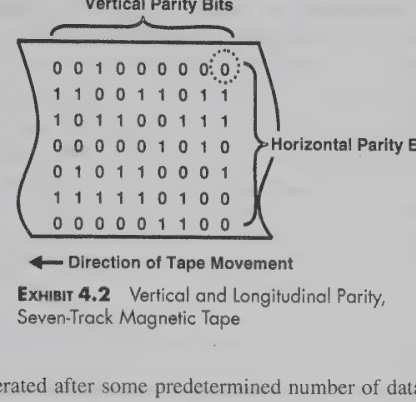

**展图 4.2 垂直和纵向奇偶校验，七轨磁带**

在预定数量的数据字符之后会生成一个字符。额外字符中的每一位为其对应的行提供奇偶校验，就像垂直奇偶校验位为其对应的列提供奇偶校验一样。展图4.2表示这两种类型在七轨磁带上的记录方式。有一位被圈出以显示其模糊性。该位出现在奇偶校验行和奇偶校验列的交点处，必须预先确定其对其中一个是正确的，因为它可能对两者都不是正确。在插图中，模糊位对于 VRC 字符列的奇校验要求是正确的；对于 LRC 位行的偶校验则是错误的。

实际上，垂直校验位将如图所示附加到每个字符列，但纵向位将跟随可能包含80到数百个字符的数据块。在可以使用 LRC 和 VRC 的情况下，数据块中的任何单个数据错误都将位于行和列奇偶校验位均不正确的位置的交点处。指示的位随后可以自动纠正。该方法的局限性如下：

- 多个错误无法纠正。
- 模糊位置的错误无法纠正。
- 未同时产生 VRC 和 LRC 指示的错误无法纠正。

### 4.3.3 循环冗余校验

当数据错误成本可能很高时，采用循环冗余校验（CRC）的额外费用是合理的。在这种技术中，使用了相对大量的冗余位。例如，每个4位字符需要3个奇偶校验位，而32位计算机字需要6个奇偶校验位。主存储器和辅助存储器需要额外的存储空间，并且在没有此类检查的情况下传输时间更长。然而，其优点是任何单个错误都可以被检测到，无论是数据位还是奇偶校验位，并且可以准确识别其位置。通过简单的电子补码过程，不正确的0转换为1，反之亦然。

### 4.3.4 自检码

有几种代码在使用，其固有的检查能力类似于奇偶校验系统。其中典型的是2-of-5码，其中每个十进制数字都由恰好包含两个1和三个0的位配置表示。奇偶校验测试将包括计数1的数量以查看其数量是奇数还是偶数，而2-of-5测试只要1的数量多于或少于2就会指示错误。


## 4.4 硬件操作。

输入、输出和处理是任何计算机的三大基本功能。为了在这些操作期间保护数据完整性，可提供多种硬件特性。

- **写后读**。在磁盘和磁带驱动器中，常见做法是在数据记录后立即读取数据并将其与原始值进行比较。任何不一致都表示需要重写的错误。

- **回显**。发送到外围设备、远程终端（参见第4.9.1节）或另一台计算机的数据可以使其产生返回信号。此回显与原始信号进行比较以验证正确接收。然而，始终存在返回信号发生错误而错误地指示原始传输出现错误的風險。

- **溢出**。任何计算机能够容纳的数值最大范围由其设计决定。如果程序缩放不当，或要求执行除以零等不可能的操作，则算术运算的结果可能超出允许范围，从而产生溢出错误。早期的计算机需要编程指令来检测溢出，但此功能现在通常由机器级硬件元件执行。应用程序内的溢出仍必须在软件中处理。（事实上，未能处理可能使软件易受恶意方的滥用。）

- **验证**。在任何一种计算机编码系统中，一些位模式可能未分配，其他则可能非法。例如，在 IBM System/360 扩展二进制编码十进制交换码（EBCDIC）中，数字 9 表示为 11111001，但 11111010 未分配。奇偶校验不会将第二组检测为错误，因为两者具有相同数量的 1 位。然而，有效性检查会将第二个位配置拒绝为无效。

同样，某些位模式表示已分配的指令代码，而其他则不表示。在一台计算机中，将压缩十进制数转换为分区分十进制数的指令为 11110011，或十六进制表示法中的 F3；11110101，或 F5，未分配，并且有效性检查会在测试该指令时导致处理停止。

- **复制**。在高度敏感的应用中，提供现场备份设备以便在主计算机故障时立即切换是良好的做法。因此，有时保留两台相同的较小型计算机比用一台等效甚至更强大的单元替换它们更为明智。容错或失效安全计算机使用两个或多个同时运行的处理器，共享负载并交换有关并行运行的重复进程当前状态的信息。如果其中一个处理器失败，另一个将继续处理而不间断。

许多敏感应用，例如航空公司预订系统，具有广泛的数据通信设施。重要的是，所有这些设备以及计算机本身都应被复制。（如果航空公司预订系统的故障被允许超过相对较少的时间，可能会导致航空公司本身的失败。）

外围设备的替换也应立即可用。在某些操作系统中，有必要通知系统设备已停机并将其功能重新分配给另一单元。在更复杂的系统中，发生故障的设备会自动切除并替换。例如，纽约证券交易所运营并维护两套相同的交易系统，以便主系统故障不会导致交易中断。

## 4.5 中断。

计算机系统执行的指令序列由一组指令决定：程序。然而，操作期间发生的许多事件需要偏离程序序列。中断是由检测到条件变化并启动适当操作的硬件元件生成的信号。第一步是立即将各种元件的状态存储在预先分配的存储位置中。特定存储的位模式，通常称为程序状态字，包含计算机识别中断原因、采取行动处理它，然后在中断清除后返回到程序序列中正确指令所需的信息。

### 4.5.1 中断类型。

五种中断类型通常使用。它们在建立和维护数据处理完整性方面都很重要。

### 4.5.1.1 输入/输出中断。

输入/输出（I/O）中断在设备或通道忙碌后变得可用时生成。这种能力对于实现缓冲、重叠处理和多道程序设计提供的增加吞吐量的无错误使用是必要的。

每次 I/O 中断后，都会进行检查以确定数据是否已无错误地读取或写入。如果是，则可以启动下一个 I/O 操作；如果不是，则启动错误恢复程序。应记录错误发生的次数，以便检测和纠正性能下降。

### 4.5.1.2 监督程序调用。

监督程序或监视器是操作系统软件的一部分，控制所有硬件和软件元素之间的交互。

每次读取或写入数据的请求都会由监督程序在被调用时进行调度。I/O 中断也由监督程序调用处理，这些调用将其与读/写请求协调。加载、执行和终止程序是监督程序调用启动的其他重要功能。

### 4.5.1.3 程序检查中断。

指令或数据的不当使用可能导致终止程序的中断。例如，除以零的尝试和导致算术溢出的操作将被取消。未分配的指令代码、尝试访问受保护存储以及无效数据地址是导致程序检查中断的其他异常类型。

### 4.5.1.4 机器检查中断。

导致机器检查中断的异常条件包括奇偶校验错误、损坏的磁盘扇区、使用中的外围设备断开以及缺陷电路模块。必须遵循适当的程序清除机器检查，而不会丢失数据或处理错误。

### 4.5.1.5 外部中断。

外部中断由计时器动作、按下中断键或来自另一台计算机的信号生成。当两个中央处理单元相互连接时，它们之间传递的信号会启动外部中断。这样，在程序、数据和外围设备可以共享和协调的同时，控制和同步会持续保持。

在大型机中，电子时钟通常包含在中央处理器单元中，用于作业日志中的时间记录和经过时间测量。作为间隔计时器，时钟可以设置为在给定时间后生成中断。此功能应作为安全措施使用，防止敏感作业在计算机上停留足够长的时间以允许未经授权的数据或指令操作。

## 4.8 安全的硬件要素

### 4.5.2 陷阱。

陷阱是一种对中断的硬件响应。在检测到异常时，会无条件分支到某个预定位置。那里的指令将控制权转移到监督程序例程，该例程启动适当的操作。

## 4.6 内存和数据存储。

正如人类思想会受到异常影响一样，计算机内存也会受到影响。为了数据安全和完整性，针对多种存储类型开发了各种措施。

### 4.6.1 主存储器。

随机存取存储器（RAM）及其衍生产品，例如动态 RAM（DRAM）、同步 DRAM（SDRAM，1996 年推出，运行频率为 133 兆赫 [MHz]）和 DDR-3（双倍数据速率 3 SDRAM，2005 年宣布，运行频率为 800 MHz），都具有易于快速访问以读取和写入数据的必要特性。不幸的是，这一必要特性同时也是在不受欢迎的读/写操作下保持数据完整性困难的潜在来源。在多道程序环境中，尤其是在动态内存分配的情况下，问题会大大加剧，其中一个程序可能会错误地覆盖另一个程序在内存中的数据。对这种错误的保护必须由操作系统提供。本手册第 24 章更详细地讨论了操作系统安全。

一种保护形式要求主存储器被划分为块或页；例如，每个 2,048 个八位字节。当页包含常量、表或供多个用户共享的程序时，可以将其指定为只读。此外，仅对指定用户可访问的页可以通过适当的程序指令分配锁。如果用户的程序中不包含匹配的密钥，则将拒绝访问该页。保护可以仅针对写入提供，也可以针对读写提供。

### 4.6.2 只读存储器。

主存储器的一个显著特征是数据可以进入或读出的极高速度。完成此和其他功能的顺序程序集合是程序，程序员可以完全自由地以有意义的方式组合任何有效指令。然而，某些操作，例如系统启动或引导，通常经常需要，并且可以由预编程的存储器元件组自动执行。这些元件应免受意外或未经授权的更改。

为此目的，已开发出一类存储器元件，一旦编程后就无法更改，或需要相对较长时间才能更改。这些元件称为只读存储器，或 ROM：将顺序指令设置到这些元件中的过程称为微编程。该技术可以在消除程序员错误可能性从而保障数据完整性的地方发挥优势。

该原理的变体包括可编程只读存储器（PROM）和可擦除可编程只读存储器（EPROM），它们都将微编程与比只读存储器本身更大的灵活性结合在一起。这些芯片上的数据可以通过一种特殊操作更改，通常称为闪存（字面上是指暴露于强紫外线；这与今天用于存储数字音乐文件和数字照片等数据的闪存不同——我们将在下一节中回到闪存的主题），


### 4.6.3 辅助存储器

传统上，“辅助存储器”一词用于描述磁盘、软盘、磁带和磁带盒等存储介质。尽管 1.44 兆字节（MB）的磁性软盘已经过时，但容量高达数 TB 的磁性硬盘驱动器仍然是几乎所有计算机的基本组件，而容量达 TB 级、大小与平装书相当的外置硬盘驱动器如今只需几百美元即可现货购得。

较新的发展是光驱，例如可移动式只读光盘存储器（CD-ROM），最初于 20 世纪 80 年代初问世，每张光盘可存储约 700 MB，适用于长期归档存储。这类光盘还存在混合形式，例如可一次性写入的 CD-R，以及支持多次读写的 CD-RW。数字视频光盘（DVD），后更名为数字通用光盘，于 1997 年推出，容量从每张光盘 4.7 千兆字节（GB）到用于数据归档的 30 GB 不等。更高容量的光盘采用 2002 年推出的蓝光技术，每面可存储 25 GB；它们通常用于分发电影，但 BD-R（一次性使用）和 BD-RE（可重写）光盘在通用数据存储方面潜力巨大。

辅助存储领域的最新成员是模拟硬盘的 RAM，即闪存。这种存储器源自电可擦除可编程只读存储器（EEPROM），由东芝于 20 世纪 80 年代推出，如今以多种格式存在，包括相对廉价、存储容量已达 GB 级别的通用串行总线（USB）闪存盘。将这些设备插入即插即用的个人计算机时，它们会显示为外部磁盘驱动器。另一种闪存格式是小型存储卡，许多只有邮票大小，可插入手机、相机、打印机以及计算机等其他设备。

前面描述的硬件保护措施，如冗余性、有效性、奇偶校验和写后读，对于保持辅助存储器的完整性很有价值。这些保护措施内置于设备中，除非被禁用或发生故障，否则始终有效。其他预防措施是可选的，例如对驱动器、磁带和磁盘采用标准的内部标签程序。标准的内部标签可以包含标识号、记录数以及创建和到期日期。尽管可写介质上的外部塑料或纸质标签有所帮助，但不足以替代计算机生成的标签，这些标签以磁性方式刻写在介质本身上，并由程序指令自动检查。

另一项有时会被破坏的安全措施是可移动介质的写保护。硬件联锁可防止向介质写入数据。当介质从系统中移除时，应立即启用这些锁。否则，如果同一介质在另一场合被不当使用，数据将被破坏。

硬盘驱动器、光盘和闪存卡属于直接存取存储设备（DASD）。与只能顺序处理的磁带不同，DASD 既可以顺序处理数据，也可以随机处理数据。这种能力对于在线操作至关重要，因为在线操作无法在处理前对事务进行排序。直接存取的缺点是，与顺序批处理相比，对输入的控制可能更少，系统性能下降的机会更多。

DASD 错误的一个可能来源是记录介质的高速旋转，以及（每道一头设备除外）磁头的移动。为了尽量减少这种可能性，记录表面区域的地址以磁性方式写入。当计算机指示从某个特定位置读取数据或将数据写入该位置时，主存储器中的地址会与从 DASD 读取的地址进行比较。只有两者一致，操作才会执行。

### 4.6.10 安全的硬件要素

通过适当的编程，可以进一步保证数据的完整性。除地址检查外，还可以对标识号或每条记录中的关键字段进行比较。虽然额外处理时间通常可以忽略不计，但可以大大改善事务的正确过账。

DASD 通常还包含其他几种安全措施。其中之一类似于主存储器中的保护功能，依赖于确定每个数据集的“范围”。如果超出这些范围——即数据文件地址的上限和下限——作业将终止。

另一项安全措施之所以必要，是因为磁盘表面的缺陷区域可能导致正常操作中无法检测到的错误。为了尽量减少这种可能性，磁盘在使用前及之后应定期进行测试和认证。操作系统会记录遇到的磁盘错误数量，从而提供进一步的信息。当错误超过预定水平时，必须进行重新格式化或更换。

许多个人计算机硬盘驱动器现在都具备某种形式的自我监测、分析和报告技术（SMART）。SMART 由早期技术发展而来，如 IBM 的预测性故障分析（PFA）、计算机制造商康柏的 Intellisafe，以及磁盘驱动器制造商希捷、昆腾和康纳的技术。SMART 可以提醒操作员注意潜在的驱动器问题。遗憾的是，SMART 的实现尚未标准化，其在预防性维护和故障预测方面的潜力常常被忽视。

请注意，SMART 不同于用于保护硬盘驱动器免受磁头碰撞的一系列技术。当从磁盘读取数据的部件实际接触磁盘表面时，就会发生磁头碰撞，可能损坏磁盘及其存储的数据。许多硬盘驱动器都有相应的系统，在这种接触发生之前将磁头从磁盘上移开。这些保护措施已达到相当高的水平，使得工作中的硬盘驱动器可以作为音乐和视频播放器（如 Apple iPod 或 Microsoft Zune）的一部分相对安全地随身携带。

## 4.7 时间

在计算机机房和许多办公室中，挂钟通常是显著的特征。毫无疑问，这种实时指示器对于安排和调节人员与机器的功能非常重要，但计算机的内部时序对安全更为重要。

### 4.7.1 同步

许多计算机操作与一天中的时间无关，但必须与某个共同时间以及彼此之间保持准确的关系。这种同步性的例子包括门电路、触发器和寄存器的操作，以及高速数据传输。同步可以通过多种方式实现。对于门电路和其他电路元件，电子时钟以高频速率提供精确间隔的脉冲，而磁盘和磁带驱动器则由基于电源频率的伺服电机控制保持在额定速度。

在所有计算机错误中，最难检测和纠正的可能是由时序不一致引起的错误。计算机开机时，内部时钟每秒可能产生 10 亿个脉冲（即 1 千兆赫 [GHz]）或更多。即使丢失一个脉冲，或脉冲随机变形或延迟，都可能导致未被检测到的错误。更麻烦的是，即使检测到错误，除非随机时序故障变得频繁或持续，否则可能无法确定其原因。

时序故障隐蔽性的一个例子是电压降至标准值以下时电源波动造成的后果。在这些电源瞬变期间，磁盘驱动器可能会减速；如果正在记录扇区，其物理尺寸将相应变小。然后，当电压恢复正常时，错误的扇区尺寸可能导致数据错误或丢失。

### 4.7.2 异步

某些操作不以固定的时间间隔发生，因此被称为“异步”。在这种模式下，一个动作结束时产生的信号会触发下一个动作。例如，使用普通调制解调器进行的低速数据传输通常是异步的。随机敲击键盘键所产生的编码信号与任何时钟脉冲无关。

## 4.8 自然危险

为了保持计算机输出的准确性和及时性，必须保护计算机免受环境危害。本手册第 22 章和第 23 章详细讨论了这些威胁。

### 4.8.1 电源故障

计算机停机最常见的原因可能是电源故障。电压不足和完全停电是明显的故障迹象；未被检测到的电压尖峰则更为常见，但破坏性几乎不低于前者。

闪电可在通信线路和电力线路上产生幅度足够大的电压尖峰，足以摧毁设备，或至少随机改变数据。突如其来的暴风雨和酷热或严寒会给发电机带来过重负载。由此导致的线路电压下降可能造成计算机或外设故障。即使没有发生故障，每当额外的发电机切入以承担更高负载时，也可能产生有害的电压尖峰。

在需要的情况下，可以使用记录指示器来检测电源线路波动。当计算机系统出现无法解释的、不稳定的错误时，通常建议进行此类监测。一旦发出超出容差条件的信号，就应仔细检查计算机输出，以确保数据完整性未受到损害。如果此类情况频繁发生，或者应用较为敏感，则应考虑使用辅助电源管理设备。这些设备从简单的稳压器和线路调节器到不间断电源（UPS）不等。

### 4.8.2 高温

持续高温可能导致电子元件故障或完全失效。因此，空调（AC）至关重要，所有空调设备都必须充足、可靠且安装得当。如果为计算机提供了备用电源，那么空调也必须同样具备备用电源。例如，在 1989 年旧金山地震之后，至少一家公司总部的台式计算机和网络服务器因空调与供电之间缺乏同步而受损。地震导致空调停止工作，大楼被疏散，但计算机仍处于开启状态。在接下来的几天里，许多计算机在芯片和主板层面发生故障，因为未冷却的办公室内温度过高。一个经常被忽视的过热原因是通风格栅被堵塞。打印输出、磁带、书籍和其他物品不得放在机柜上，以免阻碍空气自由流通。对于任何使用计算机的房间来说，数字温度计都是一项不错的投资。如今，许多电子设备都包含恒温器，当内部温度超过危险极限时会切断电源。

### 4.8.3 湿度

湿度的任何一种极端都可能造成损害。低湿度——低于约 20%——会导致静电荷积聚，这些电荷


可能会影响数据脉冲。由于这种现象会被地毯加剧，计算机机房的地面应保持无地毯，或铺设防静电地毯。

高湿度——约高于80%——可能导致冷凝，从而在电气电路中造成短路或腐蚀金属触点。为确保在可接受的范围内运行，应安装湿度控制装置并持续记录测量值。

### 4.8.4 水。
雨水、洪水、管道破裂和 overhead 洒水器引入的水可能比火灾或任何其他单一因素造成更多实际的计算机损坏。在计算机设施选址、布设水管以及选择灭火剂方面所采取的谨慎措施将最大限度地降低这一重大危险。

水源的不可用——例如主管道破裂后——将导致水冷主机几乎立即停机。关键任务型数据中心应为此种情况做好准备。例如，1993年德斯莫因斯河泛滥时，导致容纳 Principal Financial Group 总部的摩天大楼被疏散，但并非因为建筑物内有水。建筑物保持高处干燥，但洪水迫使城市水厂停运，使建筑物无法获得必要的冷却用水。洪水过后，该公司在地下室安装了一个40,000加仑的水箱，以防止此类问题再次发生。

### 4.8.5 污垢与灰尘。
异物颗粒会干扰磁带和磁盘驱动器、打印机以及其他机电设备的正常运行。所有进气口必须进行过滤，且所有过滤器必须保持清洁。咖啡杯似乎在计算机环境中变得特别不稳定：连同任何其他食物或饮料，都应完全禁止。在使用计算机设备的所有区域，应严格执行良好的卫生管理原则。

### 4.8.6 辐射。
关于磁场对磁带或磁盘文件破坏作用的论述很多。然而，由于磁场强度随距离迅速减弱，除非将大磁铁紧贴在记录表面，否则实际上不太可能造成损坏。例如，用磁铁将 CD 或 DVD 贴在文件柜上存放是不明智的，但手持 CD 或 DVD 从贴有磁铁的冰箱旁走过不太可能造成任何损坏。

无线信号的激增可能使数据暴露于错误脉冲。办公室应警惕来自无绳电话、手机、无线互联网接入点和外设以及微波炉之间或之间的可能干扰。

放射性可能对人员构成巨大威胁，但对计算机或其记录介质则不然。

### 4.8.7 停机时间。
数据中心正常运行至关重要，必须定期进行预防性维护，并准确记录计算机任何部件不可操作的时间和原因。计算机停机次数越多，操作员赶上计划工作量的压力就越大。在这种情况下，控制措施会被绕过，捷径会被采用，人为错误会增多。

应研究停机记录以检测不利趋势，并确定必须在停机时间变得过度之前进行大修或更换的设备。

如果非计划停机时间增加，应扩大或改进预防性维护，直到趋势逆转。

## 4.9 数据通信。
当前计算机使用中最具动态性的因素之一是数据传输设备和系统的激增。这些设备从电话调制解调器到有线网络，从可接入互联网的手机到802.11无线以太网，包括蓝牙、红外、个人数字助理（PDA）、音乐播放器以及几乎每月出现的全新技术。至少部分时间不处于连接模式下运行的计算机可能已十分罕见。有关数据通信的基础知识，请参阅本手册第5章。

随着经济实体的规模和地理分散程度的增加，加速信息在远距离传输的必要性也随之增加；维护数据完整性和安全性的必要性以及实现这一目标的难度增长得更快。需要防范的主要威胁包括人为和机器错误、未经授权的访问、篡改和破坏。术语“accession”指的是读取计算机系统中存储或传输的数据的能力；它可能是偶然的也可能是故意的。“Alteration”是指故意输入未经授权或不正确的 数据。“Sabotage”是指故意破坏或损坏系统或其中数据的行为。对于每一种威胁，风险和对策将取决于所涉及的设备和设施。

### 4.9.1 终端。
在这些讨论中，终端是指任何包含接收、显示、编写和发送数据功能的输入/输出设备。示例包括个人计算机和专用设备，如信用卡验证单元。

数据通信在计算机之间、终端之间或计算机与终端之间进行。终端本身可分为哑终端和智能终端。哑终端几乎没有处理或存储能力，在这些功能上很大程度上依赖主机计算机。智能终端通常包括磁盘存储和大致相当于个人计算机的功能。此外，它们具有大幅改进的通信能力，并能够独立运行。

在最简单的终端中，抵御传输错误的唯一保护在于无法识别不在有效集合中的字符，并在出现时显示问号或其他符号。几乎任何终端都可以配备检测垂直奇偶校验错误的功能。更复杂的终端能够通过纵向和循环冗余字符以及垂直奇偶校验和有效性检查来检测额外错误。当然，错误检测只是维护数据完整性的第一步。错误校正是更重要的部分，而重传是最广泛使用的校正技术。

智能终端和个人计算机能够进行高速传输和接收。它们可以在请求重传之前对数据执行复杂的测试，甚至可以被编程为在内部纠正错误。自校正技术需要前向作用码，例如 Hamming 循环码。这些与错误检测循环冗余码类似，只是需要更多的冗余位。虽然错误校正比检测加重传更昂贵且通常更慢，但在某些情况下很有用。例如单工电路，其中无法返回信号，以及半双工电路，其中线路从传输转为接收所需的时间过长。当错误数量众多，重传会阻塞电路且几乎没有有用的信息吞吐量时，也需要前向校正。

智能终端和个人计算机更有效的用途是通过加密来保持数据完整性，如本章和第7章所述。此外，它们可用于压缩或紧凑化。减少消息中的字符数可降低错误概率并减少传输所需时间。一种技术是用特殊字符和数字计数替换长串空格或零；接收数据时程序会反向进行。

最后，当安全级别需要密码学时，智能终端或微处理器可用于编码或解密数据。

所有类型的终端，包括台式机和笔记本个人计算机（PC），至少有一个共同点：需要防止破坏或未经授权的使用。虽然确定适当物理位置的原则和限制访问的程序本质上与中央计算机设施适用者相同，但远程终端的实际问题甚至更困难。孤立的位置、监督不足以及更多人更容易访问都会增加安全受损的可能性。

### 4.9.2 有线设施。
四种有线设施被广泛使用：拨号接入、专线、数字用户线路（DSL）和电缆运营商。公共运营商和独立系统都可能采用各种介质进行数据传输。对更高速度和更好质量数据传输日益增长的需求促使同轴电缆和光纤电缆得到应用，而微波站和通信卫星通常作为有线系统内的无线链路。

通常，选择服务的决定基于待处理的数据量和相关成本，但安全考虑可能更为重要。

### 4.9.2.1 拨号线路。
拨号线路仍广泛用于信用卡和借记卡终端，但对于许多其他应用已被专线、DSL线路和承载互联网流量的电缆所取代（使用本手册第5章讨论的TCP/IP协议）。拨号连接在通过普通语音线路运行的调制解调器之间建立，有时称为普通老式电话服务（POTS）。

在仍存在对硬件的拨号访问的情况下，例如为维护某些设备，适当的控制是必不可少的，以保护设备本身以及它可能连接到的其他系统的完整性。拨号端口可由任何拥有电话的人在地球上的任何地方访问，而用于检测调制解调器的战时拨号实践仍被那些寻求未经授权访问组织网络的人使用。（战时拨号涉及拨打号码块以查找哪些号码作为调制解调器或传真机响应。这些号码被记录下来，稍后可能会拨打以尝试未经授权访问系统或服务。）建议：
-   编制未经授权进入尝试的日志，并利用它来阻止进一步的尝试。
-   编制对敏感数据所有访问的日志，并核实其适当性。
-   为所有终端配备内部识别生成器或应答单元，以便即使是正确的密码，如果从未经授权

终端。此技术可能需要在主单元发生故障时提供授权的备用终端可用性。

- 如果安全级别要求，提供用户除密码外的个人身份识别。额外的保护措施可以是插入专用读卡器中的磁条或计算机化塑料卡。此类卡片的价值有限，因为它们可以被任何人使用，无论是否授权。对于高安全要求，应考虑其他硬件依赖的生物识别标识，例如手印和声纹。
- 在适当的情况下，使用防止远程站点直接进入计算机的回叫设备。相反，设备会从内部批准的电话号码列表中拨打呼叫者以建立实际连接。

在适当的密码管理下，访问、篡改和数据破坏的问题可以降到最低。然而，传输的质量差异很大。公共电话系统内置了自动路由查找机制，将信号引导通过不可控的路径。所经过的距离和交换点数量，以及串扰、瞬态和其他噪声产物偶然存在的情况，会对错误发生率产生不可预测的影响。前面描述的奇偶校验系统是减少此类错误的有效手段。

## 4.9.2.2 租用线路。

从公共承运商租用供单一用户专用的线路称为专用线路。由于它们在预定点之间直接连接，通常无法通过拨号网络访问。传统上，租用线路是铜线，但点对点光纤和同轴电缆线路也可以租用。

窃听是访问租用线路在技术上可行的手段，但其成本更高、更困难、也比通过交换网络拨号不方便。租用线路通常比可以轻易进行战地拨号的线路更安全。

租用线路的这一更高安全级别还增加了更高质量接收的保证。不确定的传输路径和交换瞬态问题被消除，尽管其他错误来源仍然存在。因此，奇偶校验仍然是最低要求。

## 4.9.2.3 数字用户线路。

介于租用线路和POTS之间，数字用户线路提供通过普通电话线路的本地数字传输，同时可用于语音传输。这是因为普通铜制电话线路至少在短距离内可以承载频率远高于人声的信号。计算机使用DSL调制解调器到达最近的电话公司交换机，此时数据传输进入互联网骨干网。通过DSL连接到互联网的计算机使用TCP/IP通信，被称为主机而非终端。它们容易通过各种利用手段被入侵。然而，其中很少甚至没有威胁是由DSL本身促成的。与租用线路一样，窃听是可能的，但其他攻击，例如利用主机上TCP/IP实现中的弱点，则更容易。

## 4.9.2.4 有线载波。

无论何处提供有线电视（TV），承载电视信号的同一光纤或同轴电缆也可以用于提供高速数据通信。该技术的优点包括下载速度，在同轴电缆的情况下可超过每秒50兆比特，或在光纤电缆的情况下可超过每秒100千兆比特。

缺点源于载波连接可能被同一地区其他用户共享。除非服务提供商限制访问，也许根据服务质量协议，多名用户可以同时在线，从而降低传输速度。更严重的是安全漏洞的可能性，因为邻域内的多台计算机可能共享虚拟局域网的一部分，因此每个计算机都可能被该网络上的每个其他节点访问。仅出于这个原因，有线连接应设置防火墙。有关防火墙及其用途的详细信息，请参阅本手册第26章。另一个使用防火墙的原因是，有线连接始终处于开启状态，为黑客访问无人看管的计算机提供了最大机会。

## 4.9.3 无线通信。

跨国公司之间的数据传输增长非常迅速，而跨洋无线电和电话线路被证明成本太高、速度太慢、太拥挤且错误率太高，无法提供足够的服务。一个重要的替代方案是通信卫星。卫星在地球上空运行，反射超高频无线电信号，可以以同等的速度和便利传输电视节目或计算机数据。

对于较短距离的通信，公共承运商有线服务的成本高到足以鼓励竞争性技术。其中之一是微波无线电链路，被许多网络使用。此类传输的一个特点是只能在从发射或中继天线的直接视线路径上接收。对于这种点对点地面站，有时很难将无线电波束定位在无法被截获的位置；对于卫星和无线广播通信，则是不可能的。这是基于IEEE 802.11标准并通常称为Wi-Fi（Wi-Fi联盟拥有的品牌名称；该词是无线保真的缩写）的无线局域网技术的一个重要问题。因此安全性需求更大，对于敏感数据传输，扰频器或加密编码器是必不可少的。

由于微波频率的宽带宽，极快的数据传输速率是可能的。借助垂直、纵向和循环冗余校验字符，几乎所有错误都可以被检测到，而吞吐量仍然很高。

## 4.10 密码学。

商业、政治和国际事务中的竞争压力不断创造出道德、隐私和法律似乎都屈服于强烈的获利欲望的情况。信息无论为其本身还是其带来的价格，都是急切寻求的商品。我们习惯于看到装甲车和武装警卫运输货币的景象，然而往往无价的数据却在很少的预防措施下被转移。当计算机和熟练技术人员数量较少时，粗心处理数据资源的风险也许不大。然而，现在存在着大量知识渊博的计算机人员，其中有些人愿意并能够将他们的知识用于非法目的。其他人则在认为击败计算机安全措施的智力挑战中获得刺激和满足感。

在数据在不同地点之间通信时，以未经授权的方式获取信息相对容易。一种阻止这种做法或使其成本过高而不值得的方法是在传输前对数据进行加密编码。该技术也有助于保护数据存储设备中文件的完整性。如果所有重要文件仅以加密密码形式存储在磁性或光学介质上，盗窃和转售的发生率无疑会更低。

可以使用多种类型的密码，具体取决于其成本和所需的安全程度。理论上，只要有足够的时间和设备，任何代码都可以被破解。实际上，如果密码不能在相当短的时间内被破解，被编码的数据很可能会变得毫无价值。然而，由于密钥本身可用于解密后续消息，因此有必要经常更改代码或密钥。

有关密码学的更多信息，请参阅本手册第7章。

## 4.11 备份。

与大多数问题一样，计算机安全的首要关注点应放在预防而非补救上。然而，无论努力多大，完全成功永远无法保证。有四个原因导致如此：

- 1. 并非每个问题都能预见。
- 2. 当避免特定损失的成本超过恢复成本时，预防措施可能不合理。
- 3. 极端的预防措施可能对操作的效率和生产力施加不可能的限制。因此，可能有必要避免针对发生统计概率很小的事件而采取的此类措施。
- 4. 即使在最佳条件下，精心制定的计划也可能出错。在充满不确定性和人类易错性的现实世界中，存在主动或无意的干扰，几乎可以肯定的是，在某个时候，最好的预防措施会被证明无效。

认识到无法防止所有不期望的行为和事件，有必要计划适当的恢复手段。此类计划必须包括人员、硬件、电力、物理设施、数据和软件的备份。数据备份在本手册第57章中有更详细的讨论。应急响应在本手册第56章中描述，而业务连续性规划和灾难恢复则在第58和59章中讨论。备份计划应根据以下方面进行评估：

- 为每个应用程序建立的优先级，以确保它们被正确分配并实际遵守。
- 将高优先级应用程序恢复到完全功能状态所需的时间。
- 计划在需要时实际能够执行的保证程度。对于重要应用程序，如果主要计划无法实施，应提供替代计划。
- 如果备份计划实际实施，将存在的安全性和数据完整性程度。
- 内部或外部条件变化被注意到的程度，以及计划反映此类变化的速度。

在实际紧急情况发生前分配优先级是一个基本且至关重要的过程。在大多数组织中，新应用程序不断增加，而旧应用程序很少被丢弃。如果备份计划试图涵盖所有工作，

它们很可能一事无成。合理利用优先级将使现实的排程成为可能，确保重要工作按时完成且成本可接受。

## 4.11.1 人员

日常计算机运行的问题要求为那些性能决定硬件运行的人员制定应急计划。疾病、休假、解雇、晋升、辞职、加班和额外轮班都是审慎的管理者持续关注人员备份问题的原因。适用于日常问题的相同做法可以为紧急备份计划提供指导。本主题在本手册第45章中有更全面的论述。

## 4.11.2 硬件

数据中心硬件备份可以采取多种形式：

- 同一站点部署多台处理器，以防止一台设备故障导致服务中断
- 同公司附近设施的重复安装
- 在兼容的服务局以测试或待命方式维护程序
- 与专门用于灾难恢复的设施签订备份合同
- 与另一家公司的类似安装达成互惠协议

两台现场处理器因内部故障同时停机的概率极小。因此，大多数多重安装很少会在关键任务应用上落后。然而，这种类型的备份无法抵御停电、火灾、破坏或任何可能同时影响两台或更多处理器的灾难。2001年9月11日的灾难证明，即使是极不可能发生的事件也确实可能发生。在不同但共同拥有的站点部署重复处理器，两者同时受同一因素影响的可能性很小。虽然安全系数随两者之间的距离增加而提高，但人员和数据的运输难度也会加大。备选站点必须在这些相互冲突的目标之间取得平衡。此外，必须保持硬件和软件的完全兼容，即使这样做会给其中一个安装带来过度的运营负担。9月11日后不久，纽约的几家金融机构已在其位于哈德逊河对岸的替代计算机站点恢复运营。

服务局提供的备份可以非常有效，特别是如果设施的选择经过仔细考虑。虽然先进的服务局经常改进硬件和软件，但它们几乎从不以会导致现有客户兼容性问题的方式进行改进。一旦程序经过测试，它们就可以以极低的成本离线存储在磁带或磁盘上。更新的主版本可以在服务局图书馆中轮换，提供异地数据备份以及能够立即完全投入运行的能力。

专门为此目的而设立的独立设施也提供有效的硬件备份。在一种类型的设施中，有足够的空间、电力、空调和通信线路来容纳非常大的系统。当灾难袭击重要客户时，大多数制造商能够在短时间内提供几乎任何配置。这种基础待命设施的成本由多名用户分摊，因此在实际需求出现之前费用最小。然而，如果两个或多个共享者地理位置接近，他们的设施可能会因同一场火灾、洪水或停电而无法运行。在签订此类设施的合同之前，

## 4.13.2 知识

知识及其缺乏同样危险。一方面，随着个人电脑渗透到办公环境，技术知识得到广泛传播。曾经这种知识仅限于相对少数可以相对容易控制的计算机专家，其日益普及现在使控制变得极其困难，如果不是不可能的话。另一方面，当计算机由知识和技能有限的人操作时，通过错误和疏忽导致安全漏洞的概率会大大增加。

## 4.13.3 动机

动机存在多种形式。它存在于任何可以为个人牟利而转移有价值资产的地方；它在真实或臆想的不公正引发复仇欲望时产生；它也可以仅仅是一种自我表达的形式。

公司资产的未经授权转移历来为盗窃提供了机会；现在，随着许多员工在家拥有电脑，被盗设备、程序和数据的价值可以在没有第三方参与的情况下实现。当第三方加入方程式并考虑到被盗个人数据蓬勃发展的市场时，数据盗窃这种低风险/高回报犯罪的潜力大大增加。

计算机和网络也是破坏以及数据盗窃的目标。政府、军队、大公司和其他被视为社会或经济弊病传播者的依赖此类系统意味着犯罪行为可能继续。由于个人电脑现在是这些系统的一部分，它们也是任何一群或多群人不赞成的政策或实践的链接。破坏个人电脑的动机在短期内更可能增加而不是消失。

破坏计算机安全的第三种动机是这样做的挑战和刺激。无论是试图克服技术障碍、逍遥法外地违法，还是仅仅闯入禁地，一些黑客发现这些挑战难以抗拒，并成为犯罪黑客。用调侃的宽容甚至轻微的不赞同来看待此类行为，与潜在损害的严重程度和所跨越的信任屏障的神圣性完全不一致。由于技术存在可以阻止除最坚定和技术最精湛的犯罪黑客之外的所有人，未能保护敏感系统越来越多地被视为疏忽。

## 4.13.4 机会

几乎每个办公室都有大量个人电脑，工作时间几乎无人监管，其他时间更无监管，安全漏洞的机会很多：由具有技术知识者故意造成，以及由缺乏知识者无意造成。

## 4.13.5 微型计算机的威胁

对微型计算机最重大的威胁包括：

- 物理损坏
- 盗窃
- 电力
- 静电
- 数据通信
- 维护和维修

### 4.13.5.1 物理损坏

微型计算机及其外围设备并非坚不可摧。磁盘驱动器极易因撞击而故障；键盘无法忍受灰尘或粗暴处理。必须将计算机视为精密仪器并相应对待。

即使在受控的数据中心，官方禁止食物和饮料，也并不少见将咖啡杯放在运行设备上或附近而导致洒出。在不受控制的办公环境中，很少能看到个人电脑不面临被可能造成损害的液体泼洒的危险。问题因常见做法而加剧，即将未受保护的媒体如CD和DVD随意放在同一表面，而食物和饮料很容易接触到它们。虽然可能无法完全消除这些做法，但更大的纪律将保护数据媒体和设备免受污染。

如热部分所述，损坏也可能因阻挡必要的散热通风口而导致。通风口可能因设备放置过靠近墙壁而失效，或在笔记本电脑的情况下，放在地毯等软表面上而阻挡机器底部的通风口。计算机外壳顶部和阴极射线管式显示器的通风口经常被纸张或书籍覆盖，阻止冷却空气自由流动。因此，设备内部温度升高，导致性能边缘的组件失灵、间歇性接触中断、引入错误，最终系统故障或停止。

### 4.13.5.2 盗窃

个人电脑及其数据媒体被盗的机会远大于其大型对应物。包含专有信息或昂贵程序的文件很容易复制到小如邮票的移动媒体上并带离现场而不留痕迹。外部磁盘驱动器小到可以装进手提包或公文包里，而新型拇指大小的USB驱动器对不熟悉的人来说看起来像钥匙扣。（有关可移动、微型化文件存储的更多信息，请参阅本手册第1章。）将便携式电脑带回家用于晚间或周末工作的普遍做法最终会使即使是最尽责的警卫也变得麻木。在没有警卫的办公室，问题更难解决。除了建立永久监视的警察国家，还有什么可以做来遏制盗窃？设备可以链条或螺栓固定在桌子上，或锁在为此目的建造的柜子里。更勤奋地记录和追踪序列号、更频繁的盘点以及持续的教育计划可以提供帮助。最重要的是，必须在足够高的管理层认识到问题的严重性，以便将足够的资源应用于其解决方案。否则，将会有日益增大的持续流失，损害公司盈利能力。

### 4.13.5.3 电源

即使在受控的数据中心，电压下降、停电、电压尖峰、跌落和浪涌以及其他电气电源干扰也构成威胁。在典型的办公室，个人电脑插入现有插座，很少或根本不考虑不良电力的后果，情况要糟糕得多。

应采取的一些基本预防措施是：

- 消除或至少控制使用延长线、立方体插座和多插座排插。同一电力线路上的每个单元都可能降低所有其他单元可用的电压，并且每个单元都可能在线路上引入噪声。


- 在必要时提供线路电压调节器和线路调理器，以使电源保持在要求的限值内。
- 禁止使用吸尘器或其他电气设备接入与计算机或外围设备相同的电源线路。这些设备会产生高水平的电气噪声，同时还会产生电压下降和浪涌。
- 正确连接所有地线。这在配备需要适配器插头的两孔插座的老旧办公室中尤为重要。插头的第三根线必须连接到坚实的接地，以确保人员安全，同时减少电气噪声。

此外，强烈建议为所有计算机和辅助设备使用不间断电源。这些设备的容量从约 200 瓦的 PC 到主机几乎无限的尺寸不等。在电源线路运行时，UPS 能够通过去除电气噪声、电压下降、尖峰和浪涌来调节线路。当线路电压降至预设值以下，或电源完全中断时，UPS 将内部电池的直流电转换为为相关设备供电所需的交流电。

根据其额定值和负载，UPS 可提供数分钟至数小时的备用电源。这足以正常关闭计算机，或在大型安装中启动电机发电机。

只要有可能出现电力问题，就应聘请合格的电工提供服务。

### 4.13.5.4 静电

在干燥的日子里走过地毯后，从指尖跳向电脑的火花对人来说可能只是轻微的电击，但对电脑来说可能导致严重的记忆丢失、数据损坏，甚至元件损坏。当人们在没有适当接地的情况下触摸计算机内部组件时，这些影响更可能发生。

为防止这种情况，有几种措施可用：

- 使用加湿器使相对湿度保持在 20% 以上。
- 去除普通地毯。如需更换，可换成防静电类型。
- 在椅子和桌子下方使用防静电垫。
- 在每个键盘附近使用接地条。
- 安装或维修任何电子设备组件时佩戴接地腕带。

操作计算机前触摸接地条会通过附带的接地线释放任何静电荷，定期用防静电喷雾喷洒设备也会产生同样效果。

这些措施的某种组合将保护人员、设备和数据免受静电有时难以察觉但始终真实存在的危险。

### 4.13.5.5 数据通信

虽然个人电脑在独立模式下执行重要功能，但通过电话线或互联网远程与大型机、信息服务和其他小型电脑通信，或通过局域网通信，其实用性大大增强。所有围绕大型机通信的安全问题同样适用于个人电脑，且复杂性增加。

在个人电脑出现之前，与大型机通信的几乎所有终端都是“哑终端”。也就是说，它们的功能类似于电传打字机，只能逐个输入或打印字符。因此，故意或意外地突破大型机安全性的难度远大于今天的全智能个人电脑。

数千名专门的黑客拨打轻易可得的计算机访问号码或探测互联网地址，以进行非法娱乐或非法获利的景象，其令人不安程度不亚于其真实性。可用的对策包括：

- 双向加密（见第 7 章）
- 频繁更改密码（见第 28 章）
- 登录前自动回拨
- 调查不成功的登录
- 监控黑客公告板（见第 12 章和第 15 章）
- 防火墙限制进出计算机的流量（见第 26 章）
- 防病毒软件（见第 41 章）

使董事和高层管理人员对本可避免的任何公司损失承担个人责任的立法应能显著克服当前惰性。审慎的做法要求在损失发生前采取预防措施，而非事后采取纠正措施。

### 4.13.6 维护与维修

每个个人电脑系统的每个组成部分都应执行定期的预防性维护计划。这应包括磁盘驱动器及其磁头、键盘和打印机的定期清洁。任何预防性维护计划的重要组成部分是频繁更换每台设备的空气滤清器。如果不这样做，清凉洁净的空气流动将被阻碍，故障几乎肯定会发生。个人电脑的维护选项，按及时性递减顺序排列，包括：

- 由正式员工现场管理
- 根据年度协议由第三方现场维护
- 按需维修，有协议或无协议
- 送修服务
- 邮寄维修服务

随着个人电脑越来越多地应用于影响企业生存的关键功能，其维护和维修将需要管理层更多关注。冗余设备和现场备份始终有效，但异地维修的延长时间将不再可接受。对于大多数业务应用，应立即提供“备用机”或“替换机”，以使停机时间降至最低。管理层必须评估每台运行个人电脑的重要性并选择适当的维护和维修政策。

可访问性、知识、动机和机会是威胁每台个人电脑安装的特殊因素。在未解决这些因素中的每一个之前，任何系统都不能被视为安全。

## 4.14 结论

本章主要讨论硬件元素如何影响数据处理系统的安全性和操作完整性。许多安全措施是设备本身的组成部分；其他措施需要有意识的努力、决心和承诺。

有效的安全计划——即降低计算机灾难发生的可能性并减轻损害后果的计划——无法在不投入大量时间和金钱的情况下设计或实施。与其他类型的损失规避一样，保费应与预期成本进行评估。然而，一旦做出决定，这种相当于保险单的措施不应被允许失效。保费必须以定期测试、持续更新和持续警惕的形式继续支付。

有关风险管理的更详细信息，请参阅本手册第 62 章。有关各种信息系统灾难保险政策的讨论，请参阅第 60 章。

## 4.15 硬件安全检查清单

### 大型机

- 在选择新设备时是否考虑了安全性和完整性要求？
- 是否执行预防性维护计划？
- 是否记录所有计算机故障和非计划停机？
- 是否有负责审查日志并采取行动的人员？
- 是否在可能的情况下使用奇偶校验？
- 是否有记录奇偶校验错误并从中恢复的既定程序？
- 在经济上合理时是否使用前向纠错或纠错码？
- 操作员在读错误或其他机器检查停止后是否遵循规定的程序？
- 所有操作员干预是否都被记录并解释？
- 是否维护作业日志，并且是否定期与授权运行清单进行比较？
- 是否使用间隔计时器防止运行时间过长？
- 是否使用数据锁和只读分页等存储保护功能？
- 软件数据锁的密钥是否得到充分保护？
- 是否采取预防措施防止在断电期间易失性内存数据丢失？
- 是否执行标准的内部和外部磁带和磁盘标记程序？
- 使用后是否总是立即从磁带盘上取下写保护环？
- 是否有规定新磁带和磁盘在使用前必须经过测试或认证？此后是否定期进行？


-   磁带和磁盘是否在性能下降之前进行翻新或更换？
-   空调是否足以应对峰值热负荷？空调是否有备份？
-   是否有频繁更换滤网的计划？
-   所有静电发生器是否已被禁用？
-   所有水损来源是否已被消除？
-   整个设施是否强制执行良好的卫生管理？
-   对数据终端的访问是否受到限制？
-   是否经常检查终端及其周围区域以发现随意遗留的密码？
-   是否记录了通过终端未成功进入计算机的尝试？
-   是否利用该日志防止进一步尝试？
-   是否记录了所有对敏感数据的成功访问？
-   是否利用该日志验证授权？
-   终端是否配备了自动识别生成器？
-   测试程序是否足以确保高质量的数据传输？
-   是否使用密码学或扰码来保护敏感数据？
-   是否已制定完整的备份计划？是否经常更新？
-   备份计划是否包括人员的培训、再培训和交叉培训？
-   中央处理单元是否有现场备份？外设呢？
-   您的备份站点是否会通知您其硬件配置和操作系统的所有更改？
-   您的备份站点是否有足够的空闲时间来满足您的紧急需求？
-   您是否监控电力线路的电压和频率？
-   欠压、电压降低和停电的影响是否已知？
-   是否有提前预警，如果有，是否有待采取行动的清单？
-   是否使用电力校正器？电压调节器？线路调节器？避雷火花间隙？
-   是否有备用电源？双变电站供电？电机发电机？不间断电源？
-   您的设备在停电后是否提供自动重启和恢复？
-   备份计划是否在现实情况下进行测试？是否在频繁的时间间隔进行？

## 微型计算机

除上述适当项目外：

-   可移动磁盘在未实际安装在磁盘驱动器中时是否始终存放在封闭容器中？
-   是否禁止在计算机设备上或附近放置食物或饮料？
-   个人计算机是否牢固固定以防止掉落或被盗？
-   通风口是否保持畅通？
-   是否保持准确的库存？
-   电力是否正确布线？
-   是否配备了不间断电源？
-   静电是否已被消除？
-   数据通信是否安全？
-   是否有有效的维护计划？

## 4.16 延伸阅读

Ayers, J. E. *数字集成电路：分析与设计。* Boca Raton, FL: CRC Press, 2003. (第二版计划于2009年出版。)
Clements, A. *计算机硬件原理*, 4th ed. New York: Oxford University Press, 2006.
Horak, R. *电信与数据通信手册。* Hoboken, NJ: Wiley-Interscience, 2007.
Kerns, D. V. *电气与计算机工程基础*, 2nd ed. Upper Saddle River, NJ: Prentice-Hall, 2004.
Patterson, D. A., and J. L. Hennessy. *计算机组成与设计：硬件软件接口*, 3rd ed. Los Angeles: Morgan Kaufmann, 2007.
Stallings, W. *计算机组织与结构：性能设计*, 7th ed. Upper Saddle River, NJ: Prentice-Hall, 2005.

## 第5章

## 数据通信与信息安全

Raymond Panko and Eric Fisher

-   5.1 引言 5.2
-   5.2 网络采样 5.2
-   5.2.1 简单家庭网络 5.2
-   5.2.2 建筑局域网 5.4
-   5.2.3 企业广域网（WANs） 5.5
-   5.2.4 互联网 5.7
-   5.2.5 应用 5.9
-   5.3 网络协议与漏洞 5.9
-   5.4 标准 5.9
-   5.4.1 核心层 5.10
-   5.4.2 分层标准架构 5.10
-   5.4.3 单一网络标准 5.11
-   5.4.4 互联网络标准 5.13
-   5.5 互联网协议（IP） 5.14
-   5.5.1 IP 版本 4 数据包 5.14
-   5.5.2 IP 版本 6 5.16
-   5.5.3 IPsec 5.17
-   5.6 传输控制协议（TCP） 5.18
-   5.6.1 面向连接的可靠协议 5.18
-   5.6.2 可靠性 5.20
-   5.6.3 标志字段 5.20
-   5.6.4 字节与序列号 5.21
-   5.6.5 确认号 5.21
-   5.6.6 窗口字段 5.21
-   5.6.7 选项 5.21
-   5.6.8 端口号 5.22
-   5.6.9 TCP 安全 5.23
-   5.7 用户数据报协议 5.23
-   5.8 TCP/IP 监督标准 5.24
-   5.8.1 互联网控制报文协议（ICMP） 5.24
-   5.8.2 域名系统（DNS） 5.25
-   5.8.3 动态主机配置协议（DHCP） 5.26
-   5.8.4 动态路由协议 5.27
-   5.8.5 简单网络管理协议（SNMP） 5.27
-   5.9 应用标准 5.28
-   5.9.1 HTTP 和 HTML 5.28
-   5.9.2 电子邮件 5.28
-   5.9.3 Telnet、FTP 和 SSH 5.28
-   5.9.4 其他应用标准 5.29
-   5.10 结语 5.29
-   5.11 延伸阅读 5.29
-   5.12 注释 5.29

## 5.2 数据通信与信息安全

### 5.1 引言。

有时，攻击者可以直接走到目标计算机前。然而，在大多数情况下，攻击者必须使用网络才能到达目标。一些攻击甚至针对网络本身，试图瘫痪局域网、广域网，甚至全球互联网。本章提供了网络概述，以帮助《手册》的读者在其他章节或其他上下文中遇到网络概念时理解。本章涵盖有限的网络概念。具体而言，它侧重于与安全最相关的网络方面。

在开始之前，读者应注意贯穿全章的三个重要术语。

-   1. 本章经常使用术语 octet，即字节——由八位组成。网络源于电气工程，在电气工程中 octet 是首选术语；它在国际技术界也被广泛使用。
-   2. 第二个术语是 host。任何连接到全球互联网的设备都称为主机。这包括从大型服务器主机到客户端 PC、个人数字助理、移动电话，甚至可通过互联网访问的咖啡壶等一切设备。
-   3. 我们将区分术语 internet 和 Internet：后者指全球互联网。然而，小写的 internet 要么指 TCP 架构中的 Internet 层（参见第 5.6 节），要么指不属于全球互联网的网络集合。

### 5.2 网络采样。

本节简要介绍一系列日益复杂的网络，为读者提供网络在现实世界中外观的高层次概述。

### 5.2.1 简单家庭网络。

图 5.1 显示了一个简单的家庭 PC 网络。该家庭有两台个人电脑。网络允许两台 PC 共享文件和家庭的单台激光打印机。网络还将两台计算机连接到互联网。

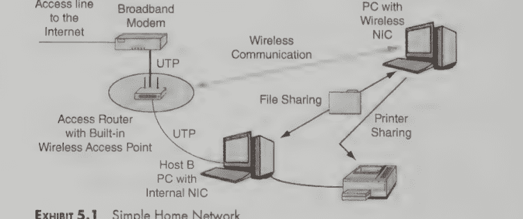

图 5.1 简单家庭网络

### 5.2.1.1 访问路由器。

该网络的核心是其访问路由器。此小型设备执行多种功能，最重要的是以下五项：

-   1. 它作为交换机工作。当家庭中的一台 PC 向其他主机发送消息（称为数据包）时，交换机在它们之间传输数据包。
-   2. 访问路由器是一个无线接入点（WAP），允许无线计算机连接到它。主机 A 通过无线方式连接到访问路由器。
-   3. 路由器将一个网络连接到另一个网络——在本例中，它将内部网络连接到全球互联网。
-   4. 要使用互联网，每台计算机都需要一个互联网协议（IP）地址。我们稍后会看到，IP 是管理互联网通信的主要协议。访问路由器内置了动态主机配置协议（DHCP）服务器，为每台家庭 PC 分配 IP 地址。
-   5. 路由器提供网络地址转换（NAT），可将内部 IP 地址隐藏在潜在攻击者之外。大多数路由器还具有防火墙以增加安全性。如果未配置适当的身份验证安全，WAP 很容易被利用。无线信号在特殊设备下可传输 800 英尺或更远的距离。如果没有持续监控以抵御入侵，攻击者可以在用户不知情的情况下连接到接入点并拦截所有经过的流量。使用 NAT 对于保持家庭网络安全至关重要。用户应始终启用此功能，以防止其主机直接可被公共互联网访问，而在公共互联网上直接扫描和攻击十分普遍。

### 5.2.1.2 个人计算机。

两台 PC 各自都需要电路通过网络进行通信。传统上，这些电路以印刷电路板的形式出现，因此该电路被称为计算机的网络接口卡（NIC）。在今天的大多数计算机中，电路已集成到计算机内部；没有单独的印刷电路板。然而，该电路仍被称为计算机的 NIC。

在这个小型网络中，两台计算机共享其文件。鉴于网络的无线访问能力，路过黑客也可能读取共享文件。没有强无线安全的文件共享是危险的。重要的是在访问路由器/接入点和每台客户端 PC 上均设置预共享密钥（PSK）模式下的 Wi-Fi 受保护访问（WPA 或 WPA2）或 802.11i 安全。

配置 PC 以实现安全非常重要。虽然 NAT 本身很强大，并且大多数路由器还提供状态检测防火墙（参见本手册第 26 章），但一些攻击不可避免地会进入内部网络。主机必须具有强大的防火墙、防病毒程序和反间谍软件程序（参见第 41 章）；并且当操作系统供应商和应用程序供应商发布安全补丁时，必须自动更新（参见第 40 章）。

### 5.2.1.3 UTP 布线。

在图 5.1 中，主机 B 通过称为 UTP 电缆、Ethernet（IEEE 802.3）电缆或通常称为 Cat5 的铜线连接到访问路由器（Cat5 代表第 5 类布线，定义于标准 ANSI/TIA/EIA-568-A）。它在电缆护套内部使用四对非屏蔽双绞线（UTP）布线。如图 5.2 所示，UTP 电缆包含八根铜线，组织为四对。每对的两根线相互缠绕。UTP 电缆两端的 RJ-45 连接器看起来像 RJ-11 家用电话连接器，但略宽一些。（RJ 表示

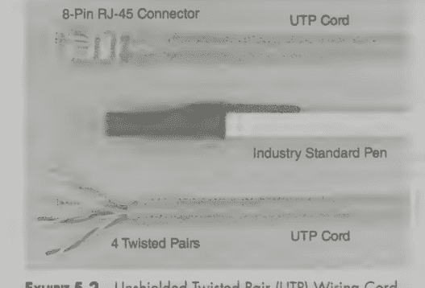

## 图示 5.2 无屏蔽双绞线 (UTP) 布线电缆

(注册插孔，最初被称为贝尔系统订购代码：现由终端连接行政委员会 ACTA 定义。)

### 5.2.1.4 互联网接入线路。

家庭网络需要一条互联网接入线路来将家庭连接到互联网。在图示 5.1 中，该接入线路是数字用户线 DSL 高速接入线路，家庭通过一个名为 DSL 调制解调器的小盒子连接到该接入线路。 （DSL 调制解调器通过 UTP 电缆连接到接入路由器：它通过普通电话线连接到墙上插孔。）其他互联网接入技术包括慢速电话调制解调器、快速有线调制解调器、地球静止卫星连接，甚至无线接入系统。这些技术大多数被称为宽带接入线路。一般来说，宽带仅意味着非常快，尽管在无线电传输中它描述的是宽频率范围。

### 5.2.2 建筑局域网。

图示 5.1 中显示的家庭网络是一个局域网 LAN。LAN 在客户的场所上运行——即 LAN 用户拥有的财产。 （出于历史原因，premises 一直以复数形式拼写。）在家庭网络的情况下，场所包括用户的住宅或公寓。图示 5.3 显示了一个大得多的 LAN。这里，场所由一座企业多层办公楼组成。

在每层楼，计算机通过 UTP 电缆或无线接入点连接到该楼层的办公组交换机。每层楼的办公组交换机连接到地下室设备室的核心交换机。地下室的路由器将建筑局域网连接到外部世界。

假设 1 楼的客户端 A 向 2 楼的服务器 X 发送一个数据包。客户端 A 将数据包发送到一楼的办公组交换机 1。该办公组交换机将数据包向下发送到地下室的核心交换机。核心交换机随后将数据包向上发送到办公组交换机 2，后者将数据包传递给服务器 X。

UTP 很容易被窃听，使攻击者能够读取流经电缆的所有数据包。电信机柜应始终保持上锁，并且在可能的情况下，电缆应尽可能通过厚重的金属布线管道布设 （有关物理和设施安全的更多细节，请参阅本手册的第 22 章和第 23 章）。UTP 在流量流经时也会产生微弱的无线电信号。使用高度专业化的设备可以从相当远的距离读取这些信号。更新的

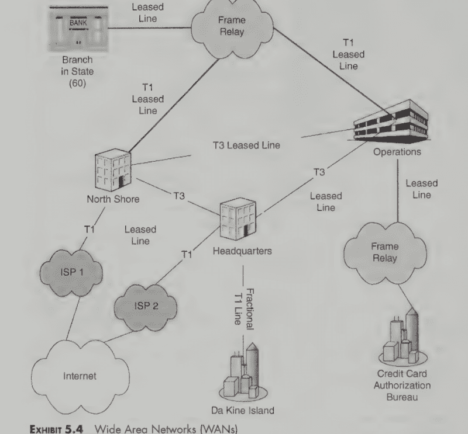

## 图示 5.4 广域网 (WANs)

由于其封闭式访问性质，运营商技术通常被安全专业人员认为更安全。与允许任何人连接的互联网不同，只有商业公司才能连接到运营商 WAN，这使得攻击者访问变得非常困难。然而，攻击者访问并非不可能。例如，如果攻击者入侵了运营商拥有的计算机 （甚至是客户的计算机），此次入侵可能会允许访问。

此外，只有运营商才知道其如何通过网络路由流量。即使攻击者以某种方式获得网络访问权限，这也应阻止攻击者。然而，这种通过 obscurity 实现的安全性被安全专业人员认为是一种糟糕的做法，因为入侵运营商计算机的攻击者可以获得路由信息。 （攻击者通常有更简单的攻击向量：有关更多细节，请参阅本手册的第 15 章和第 19 章。）

尽管运营商技术更安全，但它也极其昂贵。随着虚拟专用网络 VPN 的发展，公司可以通过公共互联网在虚拟上连接地理上分散的计算机群组。这提供了 WAN 的大部分安全优势，同时大幅降低了实施成本。有关 VPN 安全的更多信息，请参阅第 32 章。

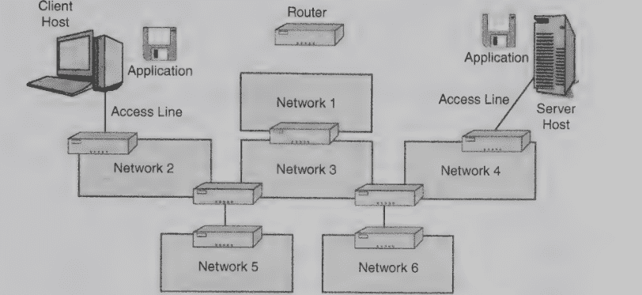

## 图示 5.5 互联网

### 5.2.4 互联网。

到 20 世纪 70 年代末，世界上存在许多 LAN 和 WAN。许多 WAN 是连接大学和研究机构的非营利网络。不幸的是，一个网络上的计算机无法与另一个网络上的计算机通信。为了解决这个问题，美国国防高级研究计划局 DARPA 于 1969 年创建了 ARPANET，即今天互联网的起源，其基于 J. C. R. Licklider 在 1963 年一篇论文中提出的对星际计算机网络的开创性概念设计。按定义，互联网将各个网络连接在一起。后来，商业网络被允许加入 ARPANET 的后续版本，并成为我们今天所知的互联网。

图示 5.5 显示，称为路由器的设备将各个网络连接在一起。最初，这些设备被称为网关。在某些早期标准中，术语网关被用来代替“路由器”，但大多数厂商现在已采用“路由器”这一名称。有两个例外，其一是微软，它仍然倾向于将路由器称为“网关”。第二个是直接可访问网络的路由器，因此在退出网络时第一个跳数通常被称为默认网关。

互联网上任何网络上的任何计算机都可以向互联网上任何其他网络上的任何计算机发送消息。穿越互联网从一台计算机到另一台计算机的消息称为数据包。

图示 5.6 显示数据包从源主机一直传输到目标主机。一路上，它通过不同的网络路由，直到到达目的地。

全球互联网使用一套称为传输控制协议/互联网协议 TCP/IP 的通信协议。此外，许多公司为自己的通信构建单独的内部 TCP/IP 网络。这些内部网络被称为内联网，以区别于互联网。

最初，内部网络的安全性相对较轻，因为人们认为外部攻击者很难进入企业内联网。然而，如果黑客接管了连接到内联网的内部计算机，轻度安全就会成为严重问题。因此，大多数公司一直在逐步加强其内联网安全。

图示 5.7 显示，个人家庭和公司通过称为互联网服务提供商 ISP 的运营商连接到互联网。互联网有许多 ISP，但

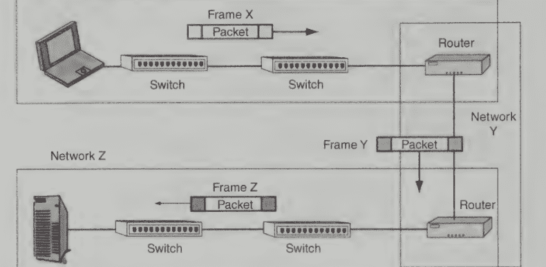

## 图示 5.6 帧和数据包

它们都连接在通常称为 *网络接入点* NAPs 的中心。这些连接允许所有连接主机的全球通信。

大多数 ISP 是为家庭用户提供互联网接入而运营的盈利性商业组织。互联网没有中央访问控制；然而，有控制域名系统 DNSs 的中央机构称为 *注册机构*。

当互联网在 20 世纪 70 年代末设计时，有意识地决定促进开放性而不增加安全负担。由于缺乏安全技术和几乎任何人都可以开放访问，互联网成为安全噩梦。公司在互联网上传输敏感信息时需要考虑加密保护。 （有关加密和其他实现网络安全的方法的更多细节，请参阅本 *手册* 的第 7 章、第 32 章、第 33 章、第 34 章、第 35 章和第 37 章。）

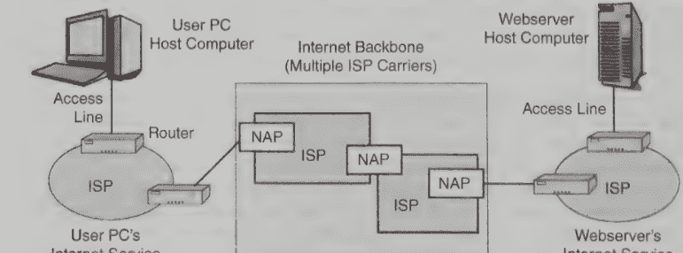

## 图示 5.7 互联网服务提供商 (ISPs)

### 5.2.5 应用。

尽管互联网的内部运作依赖于网络，但大多数用户只知道在网络之上运行的他们常用的应用程序。熟悉的个人应用程序包括万维网、电子邮件和即时消息等。公司使用一些这些应用程序，但它们也使用许多业务特定应用程序，例如会计、工资、计费和库存管理。通常，业务应用程序是事务处理应用程序，其特点是大量简单重复的交易。事务处理和其他业务导向应用程序产生的流量通常远远超过公司内个人应用程序的流量。 （有关电子商务安全的细节，请参阅本手册第 30 章。）

所有程序都有错误，包括安全漏洞。应用程序很多，跟踪应用程序漏洞并不断修补许多应用程序是一项巨大的任务，很容易被推迟或只部分完成。 （请参阅第 40 章，了解补丁管理的概述。）此外，每个应用程序都必须使用具有高安全性的选项进行配置，并且必须在每个应用程序上管理安全 （例如，电子邮件中的防病毒和垃圾邮件阻止）。 （请参阅第 20 章，了解垃圾邮件和反垃圾邮件措施的回顾。）

## 5.3 网络协议与漏洞。

不同网络厂商的产品必须能够协同工作 （互操作）。只有在有强有力的通信标准来规范硬件和软件进程如何交互时，这才有可能。有了这样的标准，两个或多个程序可以有效地互操作。

标准引发了三个安全问题。一个是标准本身。例如，本章后面讨论的 TCP 标准很难攻击，因为攻击者无法发送虚假消息，除非他或她能猜出下一条消息的序列号。这通常非常困难。然而，如果攻击者发送 RST （重置） 消息，该消息终止连接，则这种保护大大降低。事实上，很容易发送 RST 消息来关闭合法的开放连接。

第二个问题是标准内置的安全性。大多数标准是在没有安全性的情况下创建的，安全性只在后来的版本中添加，有时方式笨拙。例如，IP 是在互联网上传递数据包的主要协议，最初没有安全性。IP 安全 IPsec （发音为 eye-pea-sek） 标准被创建来解决这一弱点，但 IPsec 负担沉重且未被广泛使用。

早期版本的 IP 的另一个安全弱点，包括被广泛使用的 IPv4，是由于 IPv4 数据包中 32 位地址字段导致的地址空间限制 （产生约 4 × 10^9 的地址空间）；随着本手册这一版付印，IPv4 地址耗尽问题正在通过迁移到具有 128 位地址的 IPv6 来解决 （地址空间约为 3 × 10^38）。

另一个问题是厂商产品中标准实现的<|message|>


### 图示 5.8 三个标准核心层

| 超层 | 描述 |
|---|---|
| 应用 | 在互联网上连接不同网络的不同主机上的应用程序之间的通信。 |
| 互联网络 | 在路由互联网上传输数据包。数据包包含应用层消息。 |
| 单一网络 | 在单一交换网络上传输数据包。 |

## 5.4.1 核心层

标准很复杂，当人们处理复杂问题时，通常会将这些问题分解成更小的部分，并让不同的专家负责不同的部分。图示 5.8 显示标准被划分为三个核心层，这些层共同具有所需的功能，使互联网中一个网络上的应用程序能够与另一个网络上另一台计算机上的另一个程序互操作。

在应用核心层，两个应用程序必须能够有效交互。例如，在万维网访问中，两个应用程序分别是客户端 PC 上的浏览器和 Web 服务器上的 Web 服务器程序。Web 交互的标准是超文本传输协议（HTTP）。浏览器和 Web 服务器应用程序都必须发送符合 HTTP 标准的消息。

中间层是互联网核心层。该层上的标准规定数据包如何在路由互联网上传递。互联网核心层的主要标准之一是互联网协议（IP）。我们稍后会看到其他互联网络标准。

最低的核心层是单网络核心层。该层上的标准规定数据包在单一交换网络（局域网或广域网）中的交换机和传输线路之间的传输。

## 5.4.2 分层标准架构

标准由标准化机构创建。这些标准化机构首先为创建标准制定详细的分层计划。这些特定的分层计划称为分层标准架构。此后，标准化机构在各个层中创建标准。图示 5.9 显示了两种流行的分层标准架构，并将这些标准架构与我们之前看到的三个核心层联系起来。

互联网工程任务组（IETF）是互联网的标准化机构。其标准架构称为 TCP/IP——该名称取自其最重要的两个标准 TCP 和 IP。

### 图示 5.9 分层标准架构

| 超层 | TCP/IP | OSI | 混合 TCP/IP–OSI |
|---|---|---|---|
| 应用 | 应用 | 应用<br>表示<br>会话 | 应用 |
| 互联网络 | 传输<br>互联网 | 传输<br>网络 | 传输<br>互联网 |
| 单一网络 | 子网访问 | 数据链路<br>物理 | 数据链路<br>物理 |

图示 5.9 显示 TCP/IP 有四层。底层，即子网访问层，对应于单网络核心层。顶层则是应用层，对应于应用核心层。两个中间层——互联网层和传输层——对应于互联网核心层。TCP/IP 主要关注互联网络。将该核心层分为两个 TCP/IP 层允许在标准开发中实现更大程度的分工。

图中显示的另一个标准架构是 OSI，其全称开放系统互连参考模型很少被拼写出来。OSI 由两个标准化机构管理。其中一个是 ISO，国际标准化组织。另一个是 ITU-T，国际电信联盟——电信标准化部门。（官方名称和官方缩写不匹配，因为它们起源于不同的语言。）

图示 5.9 显示 OSI 将三个核心层划分为总共七层。OSI 单一网络在两个层使用标准——物理层和数据链路层。OSI 在物理层和数据链路层的市场主导地位如此之强，以至于 IETF 很少在这些层开发标准。TCP/IP 框架中的子网访问指示基本上意味着“在此使用 OSI 标准”。

这两种标准架构都不占主导地位。今天几乎所有公司使用的是混合 TCP/IP–OSI 标准架构，图示 5.9 对其进行了说明。该混合架构在物理层和数据链路层使用 OSI 标准，在互联网层和传输层使用 TCP/IP 标准。企业也在互联网层和传输层使用一些其他标准架构的标准，但 TCP/IP 标准占主导地位。

在应用核心层，情况很复杂。OSI 和 TCP/IP 标准都被使用，通常是组合使用。事实上，OSI 标准经常引用 TCP/IP 标准，反之亦然。尽管 OSI 和 TCP/IP 常常被视为竞争对手，但事实并非如此。还有几个其他标准化机构也创建应用层标准，使情况更加复杂。

## 5.4.3 单网络标准

正如刚才所述，OSI 标准在两个单网络层——物理层和数据链路层——占主导地位。图示 5.10 显示了物理层和数据链路层如何相关。

### 图示 5.10 物理层和数据链路层

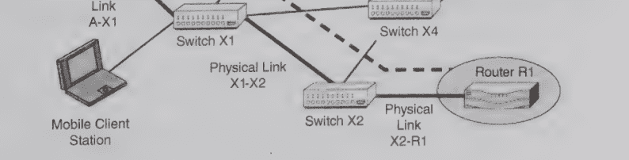

### 5.4.3.1 数据链路层

帧在单一网络中经过的路径称为帧的数据链路。在图示 5.10 中，数据链路在主机 A 和路由器 R1 之间运行。该数据链路经过交换机 X1 和交换机 X2。

源计算机将帧发送到第一个交换机，后者将帧转发到数据链路上的下一个交换机，后者进一步转发帧。数据链路上的最后一个交换机将帧传递给目标计算机（如果帧中的数据包目的地是另一个网络上的计算机，则为路由器）。

### 5.4.3.2 物理层

物理层标准规定数据链路上连续设备之间的物理连接。在图示 5.10 中，这些物理链路为 A–X1、X1–X2 和 X2–R1。之前，我们看到了一种流行的传输介质，即 Cat5 电缆中的非屏蔽双绞线。UTP 在计算机和工作组交换机之间的链路中占主导地位（参见图示 5.3）。UTP 信号通常涉及电压变化。例如，高电压可能表示 1，而低电压可能表示 0。（实际电压模式通常复杂得多。）

对于更长的距离和非常高的速度，另一种流行的传输介质是光纤，它通过细玻璃管发送光信号。光纤信号实际上非常简单。在一个时钟周期内，光在 1 时打开，在 0 时关闭。

UTP 电缆当承载信号时就像无线电天线一样工作。一部分信号总是辐射出去，使人们可以通过将设备放置在电线附近（但不接触）来拦截传输信号。拦截和解释计算设备产生的电磁辐射被称为 van Eck phreaking（也由 NSA 著名代号为 “TEMPEST”），得名于荷兰科学家 Wim van Eck 于 1985 年发表的论文，演示了如何监控和重构阴极射线终端（CRT）泄漏的信号。相比之下，光纤需要物理接入光纤电缆。UTP 也可进行物理窃听，但通常有更容易的方法拦截或窃取流量，而不是试图物理窃听线路。

无线传输使用无线电波。这使得移动设备能够以前所未有的方式得到服务。无线传输用于局域网和广域网传输。

无线电信号会广泛传播，即使使用碟形天线也是如此。因此，窃听者很容易窃听无线电传输并进行其他恶作剧。无线电信号必须进行强加密，并且各方必须进行强身份验证，以防止冒充者发送无线电传输。

无线电信号非常复杂。大多数无线电信号使用扩频传输，其中信息通过宽频率范围发送。扩频传输用于提高传播可靠性。无线电传输有许多传播问题，例如来自其他源的干扰。许多传播问题只在某些频率下发生。通过将信号分散到宽频率谱中并冗余地进行，即使在某些频率存在严重问题，信号仍然可以被理解。

Prabakar Prabakaran 总结了扩频通信的好处如下：

> 扩频系统为设计人员提供了一些明确的优势……[H]以下是设计人员在使用基于扩频的无线系统时可以期望的九大好处。

- 1. 降低串扰干扰：在扩频系统中，串扰干扰由于扩频系统的处理增益而大大衰减，如前所述……
- 2. 更好的语音质量/数据完整性以及更少的静态噪声……


- 3. 对多径衰落的敏感度降低…
- 4. 内在安全性：在扩频系统中，使用 PN [伪随机数] 序列用于在时域调制信号（直接序列系统）或选择载波频率（跳频系统）。由于 PN 序列的伪随机特性，空中信号已被“随机化”。只有具有完全相同伪随机序列和同步定时接收机才能解扩并检索原始信号。因此，扩频系统提供了传统模拟无线系统所不具备的信号安全性。
- 5. 共存：扩频系统比其他非扩频系统更不易受干扰。此外，通过适当设计伪随机序列，多个扩频系统可以共存，而不会对其他系统造成严重干扰。这进一步提高了扩频系统或设备的系统容量。
- 6. 更长的操作距离…
- 7. 难以检测：扩频信号比传统窄带传输宽得多（约为窄带传输带宽的 20 到 254 倍）。由于通信频带被扩展，它可以以较低功率传输，而不会因背景噪声而受到不利影响…
- 8. 难以截获或解调：扩频技术的根本基础是用于扩频的编码…
- 9. 更难干扰：扩频最重要的特性是其抗干扰能力….¹

军方使用跳频扩频（FHSS）传输以确保安全。军用扩频传输的工作方式使得截获传输非常困难。相比之下，民用扩频传输旨在使连接变得简单，因此提供的安全性相对较少。

交换机几乎所有时间都在转发帧。然而，交换机花费部分时间相互交换监督信息包以保持网络高效运行。例如，在以太网（IEEE 802.3）中，它主导了局域网标准，如果交换机之间存在环路，网络将出现故障。如果交换机检测到环路，它会向其他交换机发送监督包。网络中的交换机随后进行通信，直到确定最合适的路径并禁用其他端口以防止内部环路。此过程由生成树协议（STP，IEEE 802.1 的一部分）或更新的快速生成树协议（RSTP，定义于 IEEE 802.1w，现为 IEEE 802.1D-2004 的一部分）控制。

攻击者可以通过冒充交换机并向网络的真实交换机发送大量虚假消息，指示存在环路，从而对网络中的交换机发动拒绝服务（DoS）攻击。交换机可能花费大量时间重新组织网络，以至于无法为合法流量提供服务。它们还可以攻击其他多个监督协议，使交换机无法处理正常数据包。802.1AE 标准旨在将交换机之间的通信限制为经过身份验证的交换机。

## 5.4.4 互联网络标准。

如前所述，IETF 将互联网络核心层分为两个层——互联网层和传输层。图 5.11 显示了这两个层之间的关系。

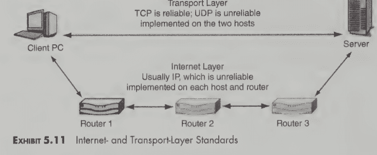

## 图 5.11 互联网层和传输层标准

TCP/IP 的设计者意识到他们无法预测连接路由器的单个网络将提供什么服务。IP 被设计为简单的尽力而为协议，以便在途中的单个网络中假设最小功能。没有保证数据包会到达，或者如果到达，会按顺序到达。

为弥补 IP 的局限性，增加了传输层。为该层设计的主要标准，传输控制协议（TCP），被创建为一种高能力协议，可修复途中出现的任何错误，确保数据包按顺序到达，网络过载时减慢传输，并执行其他几项任务。对于不需要这种可靠性级别的应用，创建了一个更简单的标准，用户数据报协议（UDP）。

## 5.5 互联网协议（IP）。

互联网协议（IP）主要做两件事。首先，它规定数据包如何组织。其次，它决定途中路由器如何将数据包移动到目标主机。（类比地，数据链路层标准规定包含数据包的帧如何组织以及途中交换机如何将帧跨单个交换网络移动。）

### 5.5.1 IP 版本 4 数据包。

互联网协议的主要版本是版本 4（IPv4）。（没有版本 0、1、2 或 3。）该版本自 1981 年定义以来一直在使用，并将在未来许多年继续使用，尽管 IPv6 旨在取代它。图 5.12 显示了 IPv4 数据包的组织结构。

数据包是一长串 1 和 0。IP 头通常显示在几行上，每行 32 位。第一行是位 0 到 31；下一行显示位 32 到 63，以此类推。

头被划分为称为字段的更小单元。字段由其在数据包中的位位置定义。例如，前四位组成版本号字段。这些是位 0 到 3。在 IPv4 中，该字段保存 0100，即二进制的 4。头长度字段包含接下来的四位（位 4 到 7）。

### 5.5.1.1 第一行。

如上所述，第一个字段（位 0 到 3）是版本号字段。在 IPv4 中，值为 0100（4）。在更新的互联网协议版本 IP 版本 6（IPv6）中，值为 0110。

下一个字段是头长度字段。它以 32 位为单位给出头的长度。如图 5.12 所示，没有选项的头有五条 32 位行，因此该字段的值为 0101（二进制的 5）。

位 0                                                                 位 31
版本（4 位）值为 4（0100）| 头长度（4 位）| Diff-Serv（8 位）| 总长度（16 位）长度以八位字节计
标识（16 位）在每个原始 IP 数据包中唯一的值 | 标志（3 位）| 片偏移（13 位）原始 IP 片段数据字段起始处的八位字节数
生存时间（8 位）| 协议（8 位）1 = ICMP，6 = TCP，17 = UDP | 头校验和（16 位）
源 IP 地址（32 位）
目的 IP 地址（32 位）
选项（如有）| 填充
数据字段

## 图 5.12 互联网协议（IP）数据包

实际上，选项的使用并不常见。事实上，选项往往表示攻击。因此，头长度字段中大于 5 的值表示数据包头具有选项，因此可疑。

1 八位字节的 dif-serv（差分服务）字段被创建以允许为此数据包提供不同的服务（优先级等）。然而，该字段通常不使用。

总长度字段给出整个 IP 数据包的长度（以八位字节/字节计）。鉴于该字段的 16 位长度，IP 数据包中八位字节的最大数量为 65,536（2^16）。然而，大多数 IP 数据包要小得多。数据字段的长度是该总长度减去头长度（以八位字节计）。

### 5.5.1.2 第二行。

如果 IP 数据包对于途中某个网络来说太长，将数据包发送到该网络的路由器会将数据包分片，将其内容分成若干个较小的包。为了在目标主机上组装，所有分片数据包都赋予与原始数据包相同的标识字段值。原始数据包中的数据八位字节被编号，数据包中第一个数据八位字节的编号被赋予一个片偏移值（13 位长）。有三个标志字段（1 位字段）。其中一个，更多片段，在除最后一个数据包之外的所有数据包中设置为 1，在最后一个数据包中设为 0。这些三个字段中的信息使目标主机能够按顺序放置数据包并知道是否还有更多数据包到达。路由器分片通常很少见，攻击者可以使用分片来隐藏攻击信息。即使防火墙丢弃了第一个分片数据包，没有第一个头中签名信息的其他数据包仍可能通过。因此，IP 分片是可疑的。

### 5.5.1.3 第三行。

第三行以令人不安的生存时间（TTL）字段开始，其值在 0 到 255 之间。发送主机设置初始值（大多数操作系统中为 64 或 128）。途中每个路由器都会减少该


该值减1。如果路由器将该值减到0，则丢弃该数据包。这一机制旨在防止地址错误的数据包在互联网上无休止地循环。

为了识别主机，攻击者会使用互联网控制消息协议（ICMP）向大量IP地址发送ping请求（见5.8.1节）。收到回复即表明该IP地址处存在一台主机。此外，通过猜测初始TTL值并观察到达数据包中的TTL值，攻击者可以推测出攻击者主机与受害主机之间相隔多少路由器跳数。向不同IP地址发送大量ping请求，有助于攻击者绘制目标网络中的路由器拓扑。通常情况下，管理员会关闭内部网络之外的ICMP流量，以防止未经授权的用户测绘内部活跃主机。

IP数据包的数据字段可能包含TCP报文段、UDP数据报消息或其他内容，例如我们将在5.8.1节讨论的ICMP消息。该字段中的值1表示数据字段为ICMP消息；值6表示TCP报文段；值17表示数据字段包含UDP报头。

报头校验和字段包含发送方填入的一个值。该数值是根据其他字段的值计算得出的。接收方的互联网进程会重新执行计算。如果两个数值不同，则说明传输过程中必然出现了错误。在这种情况下，收到数据包的路由器或目的主机会直接丢弃该数据包。由于没有重传机制，IP本身并不可靠；不过，TCP的功能之一就是监控序列号并启动丢失数据包的重传。参见5.6.2节。

## 5.5.1.4 源IP地址与目的IP地址

当你寄出一封信时，信封上会有收件人地址和寄件人地址。IP报头中对应的地址就是源IP地址和目的IP地址。注意，IP地址长度为32位。为便于人类阅读，这32位被分成四个8位段，每段转换为0到255之间的十进制数，然后将四段数字用点分隔。例如：128.171.17.13。注意，这种点分十进制记法只是为较劣等的生物实体（人类）提供的记忆和书写辅助手段。计算机和路由器直接使用32位IP地址工作。

许多防火墙过滤方式都基于IP地址。此外，许多攻击者会伪造其数据包的源IP地址（即，用虚假IP地址替换真实IP地址）。

## 5.5.2 IP版本6

虽然IP版本4被广泛使用，但其32位IP地址长度存在问题：它只能为4,294,967,296（约10^9）个设备编址。这个相对较小的规模限制了可用IP地址的数量。此外，在IP地址分配时，由于互联网诞生于美国，大多数地址都分配给了美国。事实上，美国一些大学获得的IP地址数量比中国整个国家还多。

为了解决32位IP地址长度的局限性，人们创建了新版本的互联网协议，即IP版本6（IPv6）。（曾定义了版本5，但从未被使用。）图表5.13展示了IPv6数据包的组成。

一个明显的变化是IP地址大大增加——达到128位。因此，每个IP地址需要四行32位来表示，其数量相当于约10^38。这将提供足够的IP地址，使几乎每台设备都能成为互联网上的主机——包括烤面包机和咖啡壶。为了感受这个巨大数字的规模，它足以给一个边长超过2公里的立方体水中的每一个水分子单独编址。另一个常用描述IPv4和IPv6地址空间大小差异的说法是：如果IPv4的地址空间表示为边长约4厘米的正方形，

| 版本（4位） 值为6（0110） | 区分服务（8位） 可用于优先级等 | 流标签（20位） 将数据包标记为特定数据包流的一部分；在路由中可替代目的IP地址使用 |
| 负载长度（16位） | 下一个报头（8位） 下一个报头的名称 | 跳数限制（8位） |
| 源IP地址（128位） |  |  |
| 目的IP地址（128位） |  |  |
| 下一个报头或负载（数据字段） |  |  |

## 图表5.13 IP版本6数据包

那么IPv6地址空间的对应面积将覆盖到冥王星轨道的整个太阳系。

版本号字段长4位，其值为6（0110）。还有区分服务字段和一个20位长的流标签字段。这些字段允许数据包被归类到具有相似需求的类别中。该类别中的所有数据包都会被分配相同的流标签，并由路由器以相同方式处理。不过，这一能力并未被广泛使用。

有一个跳数限制字段，其功能与IPv4中的生存时间（TTL）字段相同。负载长度字段则以八位组为单位给出数据字段的长度。

IPv6的一个重大创新是下一个报头字段。在图表5.13所示的首个报头之后可以存在多个报头。例如，IPsec安全通过一个安全报头实现。虽然选项在IPv4中不常见，但IPv6广泛使用附加报头。下一个报头字段指示下一个报头是什么。每个附加报头都有一个下一个报头字段，用于标识下一个报头或指示没有下一个报头。

## 5.5.3 IPsec

IP协议创建于20世纪80年代初期，最初没有任何安全性。最终，在20世纪90年代，互联网工程任务组开发了一种保护IP传输的通用方法，即IP安全，通常简称为IPsec。IPsec通过保护一个数据包或数据包的大部分内容，并将被保护的数据包封装在另一个数据包中来发挥作用。IPsec是一种通用安全解决方案，因为被保护数据包数据字段内的所有内容都被安全加密，包括传输层和应用层信息。这包括传输消息以及传输消息中包含的应用消息。IPsec最初是为IPv6开发的，后来也扩展到IPv4，成为一种完全通用的解决方案。关于IPsec的进一步讨论，参见本手册第32章。

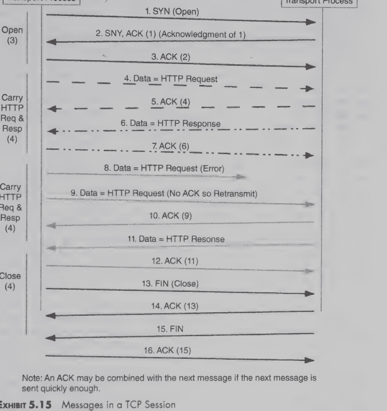

注意：如果下一个消息发送得足够快，ACK可能与下一个消息合并。

## 图表5.15 TCP会话中的消息

攻击者可以利用TCP连接建立发起拒绝服务攻击，使服务器无法响应合法流量。攻击者发送一个SYN报文段来向受害服务器打开连接。受害服务器以一个SYN/ACK消息作为响应，同时为连接预留资源。攻击者从不回复ACK，因此这被称为半开SYN攻击。如果攻击者向服务器主机洪泛发送SYN报文段，受害服务器将预留大量资源，以致过载而无法为合法的连接建立尝试提供服务。服务器甚至可能崩溃。关于拒绝服务攻击的讨论参见第18章。

相反，结束一次对话通常需要四条消息。一方发送FIN报文段，另一方予以确认。然后另一方发送FIN报文段，另一方再予以确认。在第一方发送最初的FIN报文段之后，它将不再发送任何新信息，但仍会为对方发送的报文段发送确认。

还有另一种结束会话甚至拒绝打开会话的方式。在任何时刻，任何一方都可以发送RST（重置）消息。RST消息会突然结束对话，甚至没有确认。就像在电话通话中挂断电话。

攻击者在发起攻击前，常常会试图识别正在运行主机的IP地址——就像窃贼在踩点一样。一种方法是向主机发送TCP SYN报文段。如果主机拒绝该SYN报文段，通常会回送一个RST消息。如前所述，TCP报文段承载于IP数据包的数据字段中。传递TCP RST报文段的数据包中的源IP地址将是内部主机的地址。每当攻击者收到RST报文段，就验证了该数据包IP地址处有一台正在工作的主机存在。防火墙通常会阻止RST报文段离开站点，以防止它们到达攻击者手中。

## 5.6.2 可靠性

除了面向无连接或面向连接之外，协议要么是可靠的，要么是不可靠的。不可靠协议不会检测和纠正错误。有些不可靠协议甚至不检查错误。另一些协议会检查错误，但一旦发现消息中含有错误，只是将其丢弃。

TCP是可靠协议。它确实会纠正错误。TCP校验和字段是使用其他字段的值计算得出的。发送方将计算结果填入校验和字段。接收方重新计算，并将结果与传输来的值进行比较。如果接收方的传输层进程发现消息正确（两者相同），它就会发送一条确认消息。然而，如果接收方检测到收到的TCP报文段中有错误（两者不同），它会丢弃该报文段，不做其他任何操作。

接收方如何知道消息中存在错误？发送方根据TCP报文段中的其他位（不仅仅是报头）计算出一个值。接收方重新执行计算。如果两个值匹配，接收方发送确认。如果不匹配，接收方只是丢弃该报文段，不发送确认。

如果报文段正确到达，原始发送方会收到确认。然而，如果报文段从未到达或因损坏而被丢弃，则不会发送任何回复。如果原始发送方在指定时间内未收到确认，它将重新发送原始报文段，甚至仍使用原来的序列号。

## 5.6.3 标志字段

标志字段是对逻辑型（真或假）单比特字段的通用称谓。说某个标志字段被置位，意味着其值为1。说某个标志字段未被置位，意味着其值为0。

TCP报头包含多个标志字段。其中之一是SYN。为了请求打开连接，发送方设置SYN位。另一方发送SYN/ACK报文段，其中SYN位和ACK位都被置位。其他常用标志还有FIN、RST、URG和PSH。

URG标志指示存在紧急数据，应优先于之前的数据八位组进行处理。紧急指针字段指示紧急数据的位置。如果应用消息很大，TCP会将应用消息分成多个TCP报文段，并分别发送各报文段。为了帮助接收方的TCP进程，发送方的传输进程可能会在应用消息的最后一个报文段中设置PSH（推送）位。这告诉接收方的传输进程立即将数据推送给应用程序，而无需缓冲和延迟。


## 5.6.4 八位组与序列号

序列号字段值允许接收方将到达的 TCP 报文段按顺序排列，即使承载这些报文段的数据包乱序到达（包括报文段被重传的情况）。序列号也用于确认，尽管是间接的。在 TCP 传输中，从第一个八位组开始，发送的每一个八位组都会被计数。这种八位组计数用于选择每个报文段的序列号。

-   对于第一个报文段，在序列号字段中放置一个随机的初始序列号（ISN）。
-   如果报文段包含数据，则使用数据字段中包含的第一个八位组的编号作为该报文段的序列号。
-   对于不携带数据的纯粹监督消息，例如 ACK、SYN、SYN/ACK、FIN 或 RST 报文段，序列号比前一条消息增加 1。

一种危险的攻击是 TCP 会话劫持，攻击者在此攻击中接管一方的角色。这使得劫持者能够读取消息并向另一方发送虚假消息。要完成会话劫持，攻击者必须能够预测序列号，因为如果报文段到达时带有不合适的序列号，接收方将拒绝它。只有在初始序列号可预测的情况下，TCP 会话劫持才可能成功。如今，很少有操作系统以可预测的方式选择初始序列号，但在早期的操作系统中，可预测的序列号很常见，其中一些仍在使用。

## 5.6.5 确认号

当接收方发送确认时，它会设置 ACK 位。它还会在确认号字段中放入一个值，以指示正在确认哪个报文段。这个过程是必要的，因为发送方会发送许多报文段，而且确认可能会延迟。你可能会认为确认号是被确认报文段的序列号。实际上，它是数据字段中最后一个八位组的编号加 1。换句话说，确认号给出了下一个要发送的报文段中第一个八位组的八位组编号。这看起来有点奇怪，但它使接收方更容易进行某些计算。

## 5.6.6 窗口字段

流量控制限制了一方发送 TCP 报文段的速率。TCP 窗口字段允许限制另一方在获得下一次确认之前还可以发送多少八位组。这个过程有点复杂，并且在撰写本文时（2013 年 6 月）没有已知的安全影响。在确认中，ACK 位被设置，并且确认字段和窗口大小字段都会被填充。

## 5.6.7 选项

与 IPv4 报头一样，TCP 报头可以包含选项。然而，IP 选项很少见且会引发怀疑，而 TCP 则广泛使用选项。一个常见的选项是最大报文段大小（MSS）选项，通常与初始 SYN 或 SYN/ACK 报文段一起发送。这为另一方提供了 TCP 报文段数据字段最大大小的限制（而不是整个报文段的大小）。因此，TCP 选项本身并不值得怀疑。

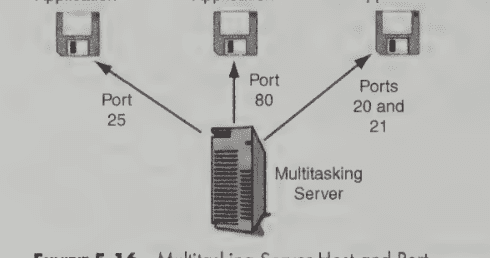

## 图 5.16 多任务服务器主机和端口号

## 5.6.8 端口号

我们现在已经查看了 TCP 报头中的大部分字段。前两个字段值得特别提及。

### 5.6.8.1 服务器上的端口号

端口号字段对于客户端和服务器意味着不同的东西。对于服务器，它代表运行在该服务器上的特定应用程序，如图 5.16 所示。服务器是多任务计算机，这意味着它们可以同时运行多个应用程序。每个应用程序由不同的端口号标识。

例如，在服务器上，Web 服务器应用程序可能运行在 TCP 端口 80 上。目标端口号为 80 的传入 TCP 报文段被传递给 Web 服务器应用程序。实际上，TCP 端口 80 是 Web 服务器程序的知名端口，这意味着它是该应用程序的常用端口号。虽然可以为 Web 服务器指定其他 TCP 端口号，但除非用户知道或能猜到非标准的 TCP 端口号，否则他们将无法建立连接。

TCP 端口范围 0 到 1023 被保留用于主要应用程序的知名端口号，例如 HTTP 和电子邮件。例如，简单邮件传输协议（SMTP）邮件服务器程序通常运行在 TCP 端口 25 上，而文件传输协议（FTP）需要两个知名端口号——TCP 端口 21 用于监督控制，TCP 端口 20 用于实际的文件传输。

### 5.6.8.2 客户端上的端口号

客户端主机使用 TCP 端口号的方式不同。每当客户端连接到服务器上的应用程序时，它都会生成一个随机的临时端口号，并且仅在该连接中使用该端口号。在 Windows 机器上，临时 TCP 端口号的范围是 1024 到 4999。

Microsoft 的临时端口号范围可能与 IETF 官方范围不同，后者为 5000–65534。Windows 和其他一些操作系统使用非标准临时端口号会给防火墙过滤带来问题。

### 5.6.8.3 套接字

图 5.17 显示，互联网络的目标是将应用程序消息从一台机器上的一个应用程序传递到另一台机器上的另一个应用程序。在每台机器上，都有一个 TCP 端口号来指定应用程序（或连接），以及一个 IP 地址来指定计算机。套接字是 IP 地址和 TCP 端口号的组合。它写成 IP 地址、

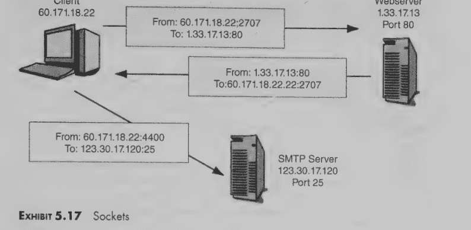

## 图 5.17 套接字

冒号和 TCP 端口号。那么，一个典型的套接字类似于 128.171.17.13:80。

攻击者经常进行套接字欺骗——包括 IP 地址欺骗和端口欺骗。例如，在 TCP 会话劫持中，如果攻击者希望接管客户端的身份，它必须知道客户端的 IP 地址和临时端口号。当然，这些字段在 TCP 中以明文（未加密）传输，因此使用嗅探器捕获并读取客户端和服务器之间流量的攻击者可以轻松获取此信息。

## 5.6.9 TCP 安全性

与 IP 一样，TCP 在创建时也没有安全性。然而，尽管 IPsec 已经使 IP 变得安全，但 IETF 尚未创建类似的方法来保护 TCP。原因之一是 IPsec 能够透明地保护所有传输层流量，而无需修改传输层协议。IETF 已将 IPsec 作为其安全保护的核心，并将其作为处理上层安全的单一方法。需要 TCP 安全性的通信伙伴应该实施 IPsec。

然而，很少有 TCP 会话受到 IPsec 的保护。因此，一些成对的用户会采用 TCP 中的一个选项，该选项为每个 TCP 会话添加电子签名。该签名证明了发送方的身份。这个选项在 RFC 2385 中描述，要求双方共享一个秘密值。这个选项很笨拙，因为它没有提供自动共享密钥的方法，也不提供加密或其他保护。该选项主要用于边界网关协议（BGP）。BGP 用于在管理系统之间交换路由信息——例如企业系统和互联网服务提供商。BGP 始终使用一对一连接，通信双方通常非常了解对方，并且双方具有长期关系，这使得密钥交换的负担和风险较小。然而，在 BGP 之外，RFC 2385 电子签名选项似乎并未被大量使用。即使在 BGP 中，它也被广泛视为非常弱的安全性。

## 5.7 用户数据报协议

如前所述，TCP 是一种弥补 IP 局限性的协议。TCP 增加了纠错、IP 数据包排序、流量控制以及其他我们尚未讨论的功能。


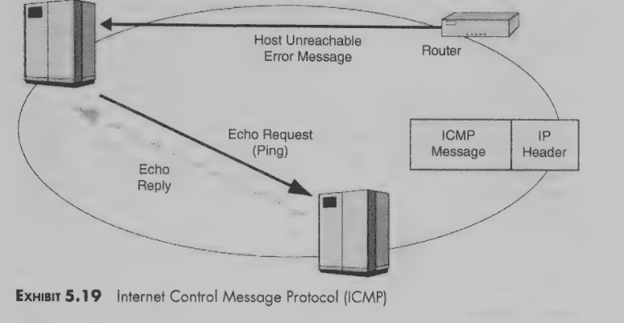

**图5.19 互联网控制消息协议（ICMP）**

该过程通常被称为“ping”，因为发送ICMP回送消息最流行的程序叫做Ping。回送消息是网络管理非常重要的工具。如果网络管理员怀疑出现问题，他会ping大量主机地址，以查看哪些地址可达。响应的模式可以揭示网络中存在的问题所在。

攻击者也喜欢ping大量主机IP地址。这可以为他们提供一份可用于攻击的可达主机列表。另一个流行的网络管理和攻击工具是traceroute（在Windows PC上为tracert）。traceroute与ping类似，但traceroute还会列出发送主机与traceroute命令目标主机之间的路由器。这使攻击者能够描绘网络地图。边界防火墙通常会丢弃离开公司发往外部的回送应答消息。

许多ICMP消息是错误消息。例如，如果路由器无法传送数据包，它可能会向源主机发送回一个ICMP错误消息。该错误消息将尽可能提供有关所发生错误类型的信息。

如果攻击者因为防火墙阻止而无法ping目标主机，他们通常会发送格式错误因而会被拒绝的IP数据包。ICMP错误消息在IP数据包中传递，该数据包中的源IP地址将揭示发送路由器的IP地址。通过分析错误消息，攻击者可以了解路由器在网络中的组织方式。这些信息对攻击者非常有用。

### 5.8.2 域名系统（DNS）

要发送数据包到另一台主机，源主机必须将目的主机的IP地址放入数据包的目的地址字段。然而，用户通常只输入目的主机的主机名，例如cnn.com。

不幸的是，主机名只是昵称。如果用户输入主机名，计算机必须学习对应的IP地址。如图5.20所示，希望向目标主机发送数据包的主机会向DNS服务器发送一条域名系统（DNS）请求消息。该消息包含目标主机的主机名。DNS响应消息返回目标主机的IP地址。打个比方，如果你知道某人的名字，想打电话给他，就必须在电话簿中查找他们的电话号码。在DNS中，人的名字对应于主机名，电话号码对应于IP地址，DNS服务器对应于电话簿。

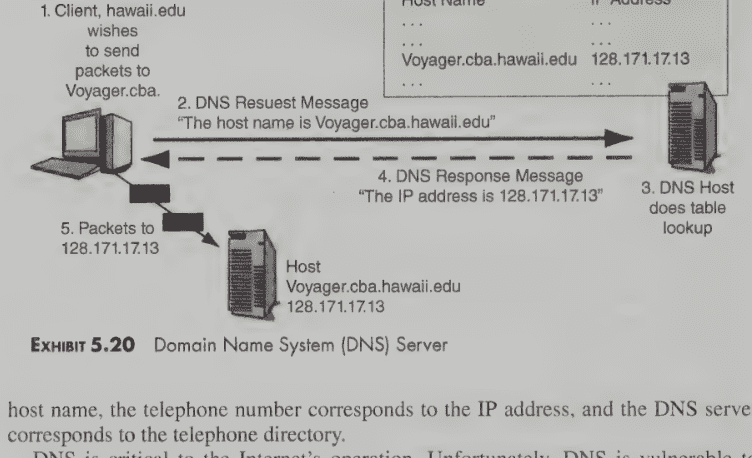

| 主机名 | IP地址 |
|---|---|
| ... | ... |
| ... | ... |
| Voyager.cba.hawaii.edu | 128.171.17.13 |
| ... | ... |

**图5.20 域名系统（DNS）服务器**

DNS对互联网的运行至关重要。不幸的是，DNS容易受到多种攻击。例如，在DNS缓存投毒中，攻击者用另一个IP地址替换某个主机名的IP地址。缓存投毒后，合法用户联系DNS服务器查找该主机名时，将得到错误的IP地址，从而将用户引导到攻击者选择的站点。拒绝服务攻击也太过容易实现。RFC 3833列出了许多DNS安全问题。²

在域名系统安全扩展（DNSSEC）的总框架下，已经开发了多种加强DNS安全性的尝试，特别是RFC 2535。³ 然而，最初的DNSSEC规范和较新的DNSSEC bis规范（RFC 4033-4035⁴）都被证明是不充分的。制定一个能够充分向后兼容、适合互联网规模实施的安全标准已被证明极其困难。

如果DNS服务器不知道该主机名，它会联系另一台DNS服务器。DNS系统包含许多按层次结构组织的DNS服务器。层次结构的顶端是13个DNS根服务器。在它们之下是顶级域名的DNS服务器，如.com、.edu、.ie、.uk、.nl和.ca。每个顶级域名都有两个或更多该域名的顶级DNS服务器。二级域名分配给组织（例如Hawaii.edu和Microsoft.com）。组织必须为其域内的计算机维护DNS服务器。

如果攻击者能够摧毁这13个根服务器，他们就能使互联网瘫痪。这种广泛瘫痪不会立即发生，但几天内，互联网将开始出现严重的故障。

### 5.8.3 动态主机配置协议（DHCP）

服务器主机被分配静态（永久）IP地址。然而，客户端PC在每次使用互联网时会被分配动态（临时）IP地址。本章前面介绍过的动态主机配置协议（DHCP）标准使这成为可能。DHCP服务器有一个可用IP地址的数据库。当客户端请求IP地址时，DHCP服务器从数据库中选择一个并发送给客户端。下次客户端使用互联网时，DHCP服务器可能会分配给它一个不同的IP地址。

客户端每次上网时可能获得不同IP地址这一事实，给对等（P2P）应用带来了问题。必须使用在线状态服务器或某种其他机制来查找对方的IP地址。在P2P应用广泛普及的今天，缺乏公认的在线状态标准（包括在线状态安全）是一个严重问题。实际上，P2P在线状态服务器中的大多数安全考虑已用于P2P盗版应用中，其目的是避免被合法当局发现。

### 5.8.4 动态路由协议

互联网上的路由器如何知道如何处理发往各个IP地址的数据包？它们经常相互通信，交换有关互联网组织的信息。这些交换必须频繁进行，因为随着路由器的添加或删除，互联网的结构也在频繁变化。用于交换组织信息的协议称为动态路由协议。有许多动态路由协议，包括路由信息协议（RIP）、开放最短路径优先（OSPF）、边界网关协议（BGP）和思科系统的专有增强内部网关路由协议（EIGRP）。每种协议都在不同情况下使用。这些协议的安全特性差异很大，而且每个协议的不同版本具有不同的功能水平。

能够冒充路由器的攻击者可以向其他路由器发送虚假的动态路由协议消息。这些虚假消息可能导致路由器无法传递数据包。攻击者甚至可以使数据包经过攻击者的计算机（称为中间人攻击或MIMA），以读取其内容。

刚才列出的协议具有差异很大的安全特性，而且每个协议的不同版本具有不同级别的安全功能。

### 5.8.5 简单网络管理协议（SNMP）

网络通常有许多要素——路由器、交换机和主机计算机。管理几十、几百或几千台设备几乎是不可能的。为了简化管理，IETF开发了简单网络管理协议（SNMP）。如图5.21所示，管理器程序可以向被管理设备发送SNMP消息以确定其状况。管理器程序甚至可以发送配置消息来改变远程设备的运行方式。这使管理器可以远程解决许多问题。

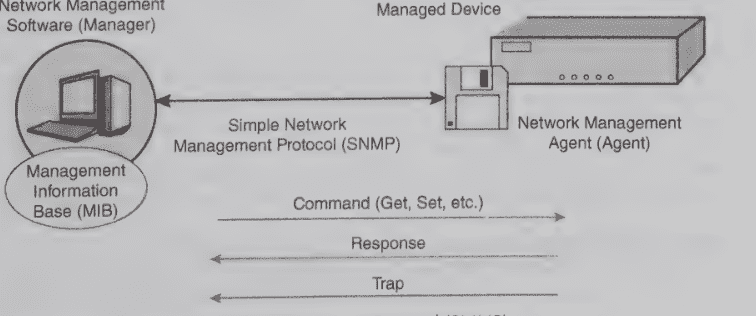

**图5.21 简单网络管理协议（SNMP）**

许多公司禁用远程配置，因为攻击者可能利用它造成破坏。他们可以简单地关闭交换机和路由器上的所有端口，或者进行更隐蔽的破坏。

## 5.9 应用标准

大多数应用都有自己的应用层标准。事实上，鉴于世界上应用数量庞大，应用层标准确实有数百种之多。

随着企业越来越擅长防御较低层的攻击，攻击者已开始将注意力转向应用漏洞。如果攻击者能够接管一个以高特权运行的应用，他或她就获得了这些特权。许多应用以最高特权运行，攻击者一旦攻破它们，就控制了整个系统。

### 5.9.1 HTTP和HTML

许多应用有两类标准。传输标准在不同机器上的应用之间传输应用层消息；对于万维网，这就是超文本传输协议（HTTP）。另一类是文档结构标准。万维网的主要文档结构标准是超文本标记语言（HTML）。

Netscape创造了第一个广泛使用的浏览器，也创建了保护HTTP通信的安全标准，即安全套接层（SSL）。后来，互联网工程任务组接管了SSL，并将该标准更名为传输层安全（TLS）。

### 5.9.2 电子邮件

流行的电子邮件传输标准有简单邮件传输协议（SMTP）、邮局协议（POP）和互联网消息访问协议（IMAP），用于将邮件从服务器上的邮箱下载到客户端。流行的文档正文标准包括RFC 2822（用于纯文本消息）、HTML和多用途互联网邮件扩展（MIME）。S/MIME（安全MIME）为MIME增加了公钥加密（见第7章），并在RFC 2634、3850和3851中定义。

电子邮件中一个明显的安全问题是内容过滤。病毒、垃圾邮件、钓鱼消息和其他不良内容应在到达用户并造成损害之前被过滤掉。（有关垃圾邮件和其他低技术攻击的更多信息，见本手册第20章；有关恶意软件和垃圾邮件对策，见第26、27、31和41章。）

电子邮件中的另一个安全问题是保护从发送客户端到发件人的邮件服务器、再到收件人的邮件服务器、最后到收件客户端的消息流。幸运的是，部分或全部消息流都有安全标准，包括SSL/TLS和S/MIME等。不幸的是，IETF一直未能就统一的安全标准达成一致。

当使用Web邮件（使用HTTP和HTML进行电子邮件通信）时，SSL/TLS可以在发件人和发件人的邮件服务器之间，以及收件人的邮件服务器和收件人之间起作用。电子邮件服务器之间的传输则是另一个问题。当然，发件人可以直接向收件人发送加密的消息正文。然而，这会阻止防火墙进行过滤。用户应特别小心通过无线连接使用Web邮件。（见第32和33章。）

### 5.9.3 Telnet、FTP和SSH

互联网上最早的两个应用是文件传输协议（FTP）和Telnet。FTP提供主机之间的大批量文件传输。Telnet允许用户在其他计算机上启动命令外壳（用户界面）。这两个标准都没有任何安全性。特别令人担忧的是


两者都在登录期间以明文（无加密）发送密码。较新的安全外壳（SSH）标准可以用作 FTP 和 Telnet 的替代，同时通过加密主机之间传输的所有流量提供高度安全性。

## 5.9.4 其他应用标准。

还有许多其他应用，因此也有相应的应用标准。其中包括语音 over IP（VoIP；请参阅本手册第 34 章）、点对点应用（P2P；请参阅第 35 章），以及面向服务的架构（SOA）和 Web 服务应用（请参阅第 21、30 和 31 章），等等。大多数应用存在严重的安全问题。应用安全已成为网络安全中最复杂方面的也许之一（请参阅第 38、39 和 40 章）。

## 5.10 结论性说明。

如果没有扎实的网络知识，就不可能理解信息安全。本章旨在为您提供网络工作的概览。如果在阅读本手册其他章节时遇到基础网络问题，这可能已足够。然而，要从事安全工作，您需要更强的网络知识。第 5.11 节中引用的书籍和其他资源是朝着该方向迈出的良好开端。

## 5.11 进一步阅读

- Comer, D. E. *使用 TCP/IP 进行互联网络 第 1 卷：原理、协议与体系结构*, 第 6 版. Addison-Wesley, 2013.
- Ferrero, A. *永恒的以太网*, 第 2 版. Boston: Addison-Wesley, 1999.
- FitzGerald, J. *企业数据通信与网络*, 第 11 版. Wiley, 2011.
- Freedman, A. *计算机桌面百科全书*. Point Pleasant, PA: Computer Language Company, 2013. 可在线获取自 www.computerlanguage.com
- Gibson, D. *Microsoft Windows 网络基础*. Sybex, 2011
- Hallberg, B. *网络：初学者指南*, 第 5 版. McGraw-Hill Osborne Media, 2009.
- Hummel, S. L. *网络设计基础*. CreateSpace Independent Publishing Platform, 2013.
- Kurose, J. F., and K. W. Ross. *计算机网络：自顶向下方法*, 第 6 版. Pearson, 2012.
- Panko, R. R. *企业数据网络与电信*, 第 8 版. Prentice-Hall, 2010.
- Panko, R. R. *企业计算机与网络安全*, 第 2 版. Prentice-Hall, 2009.
- Panko, R. R., and J. Panko. *企业数据网络与安全*, 第 9 版. Prentice-Hall, 2012.
- Palmer, M. *动手网络基础*, 第 2 版. Cengage Learning, 2012.
- Roberts, R. M. *网络基础*, 第 2 版. Goodheart-Willcox, 2011.
- Spurgeon, C. *以太网：权威指南*. O'Reilly Media, 2000.
- Stevens, W. R. *TCP/IP 详解 卷 1：协议*, 第 2 版. Addison-Wesley Professional, 2011.

## 5.12 注释

- 1. P. Prabakaran, “扩频技术教程,” *EE Times | Design*, 2003 年 5 月 6 日. www.eetimes.com/design/communications-design/4008962/Tutorial-on-Spread-Spectrum-Technology
- 2. www.faqs.org/rfcs/rfc3833.html
- 3. www.faqs.org/rfcs/rfc2535.html
- 4. www.dnssec.net/

## 6.2 局域网拓扑、协议和设计

概览该主题时，读者可参考通用 LAN 文本，例如第 6.10 节中列出的那些。

## 6.1 概述。

描述 LAN 有多种方式，每种方式都会提供有关实现和产品差异以及安全暴露点的概览。本节介绍各种术语和视角，作为以下各节讨论的基础。¹

## 6.1.1 LAN 特征。

描述 LAN 的一种方式是描述区分本地网络与其他类型网络的特征。最常见的特征有：

- 小地理范围（两个最远的站点可能相距约 5 公里 [km] 或更远）
- 快速速度（数据速率远超每秒 100 万 [兆] 位 [Mbps]，最高可达每秒 10 亿 [吉] 位 [Gbps]）
- 专用介质（常用同轴电缆和光纤，以及双绞线）
- 私有所有权

这种类型的网络，与 Internet 或其他公共或私有广域网（WANs）相比，其外观和感觉截然不同。比几乎任何 WAN 的基础设施，有更多的人可以访问 LAN 基础设施。LAN 用户可以通过嗅探数据包轻松“监视”彼此，而这在 Internet 上通常非常困难。单个用户就能使 LAN 陷入停滞。

企业 LAN 通常是用户访问 Internet 的主要途径。LAN 上的用户位于企业防火墙和路由器之后：一些研究表明，他们应对 80% 的安全事件负责。

其他 LAN 包括酒店网络，罪犯经常将其用作方便的机密信息来源，这些信息可在临时连接到这些 Internet 访问服务的未受保护系统上获得。

这些攻击的成功往往归因于用户缺乏教育和意识，例如选择糟糕的密码、不维护最新的病毒特征码文件，或将未安装防火墙的计算机连接到 LAN。有时攻击更为复杂，例如使用数据包嗅探器来获取另一用户的密码或采取措施降低网络性能。

## 6.1.2 LAN 组件。

一般而言，构建 LAN 需要四个基本组件，从安全角度来看，它们各自存在漏洞和暴露：

- 计算机。这些是连接到网络上的基本设备。对“计算机”一词要广义理解；该术语可包括个人计算机（PCs）、小型计算机、大型机、文件服务器、打印机、绘图仪、移动设备（例如智能手机和平板电脑）、通信服务器和网络互连设备。它还可包括协议分析仪。
- 介质。这些是计算机相互连接的物理手段。LAN 介质包括非屏蔽双绞线（UTP）、同轴电缆（coax）、光纤和无线（无线电）设备。无线介质在整个区域内都有连接点，设备可以在这些点连接到网络，而在无线环境中每个地方都是潜在的连接点。
- 网络接口卡（NIC）。这是计算机到 LAN 介质的物理连接。较旧的 NIC 是内部卡；实际看到的唯一项目是到 LAN 的物理连接，通常是 RJ-45 插孔。越来越多的适配器使用现代计算机上的通用串行总线（USB）插槽。尽管 NIC 的价格因其功能、预期用途和厂商而差异很大，但在 2013 年 1 月撰写时，台式个人计算机（PC）内部的 1 Gbps 以太网 NIC 可在 7 美元以下购买，USB 以太网适配器约 14 美元，无线 USB 适配器不到 13 美元。
- 软件。上述三个组件提供物理连接。软件——通常称为网络操作系统（NOS）——对于设备实际利用 LAN 提供的资源共享是必要的。NOS 可支持多种服务，如文件共享、打印共享、客户端/服务器操作、通信服务等。

虽然 LAN 需要整体审视，但每个连接节点上的每个组件也可能需要检查。

## 6.1.3 LAN 技术参数。

讨论 LAN 具体操作的一种最后方式是描述技术：

- **物理拓扑**。介质的物理布局。
- **逻辑拓扑**。LAN 节点之间的逻辑关系。
- **媒体访问控制 (MAC) 标准**。描述每个节点遵循的规则以确定其在介质上传输时机的规范。
- **使用逻辑链路控制 (LLC) 协议**。定义 MAC 层之上使用的帧格式，以及附加服务。
- **使用高层协议**。定义节点到节点通信协议和附加高层应用。

## 6.1.4 摘要。

LAN 如何分类或描述并不重要。然而，要能够应用网络安全检查，必须从多种角度理解 LAN。

## 6.2 LAN 拓扑。

WAN 通常使用某种交换技术，例如传统的电路交换、分组交换（例如 X.25）或快速分组交换（例如帧中继或异步传输模式 [ATM]）。事实上，点对点线路通常连接网络交换机，以便线路上一次只有一个数据传输。

历史上，LAN 一直是广播网络，这意味着每个 LAN 站点都能听到介质上的每次传输。因此，LAN 拓扑必须支持网络的广播特性并在所有站点之间提供完全连接。

网络拓扑用于描述两个问题。物理拓扑描述 LAN 站点如何物理连接以便相互通信。逻辑拓扑描述 LAN 的广播特性实际如何受影响，因此描述站点如何参与获取过程


## 6.4 局域网拓扑、协议和设计

在介质上传输的许可。有三种常见的局域网拓扑：星型、环型和总线型。

### 6.2.1 网络控制。

由于局域网是广播网络，因此必须在任何时候只允许单个节点进行传输。所有局域网都使用分布式访问控制方案，这意味着所有节点都遵循相同的规则来访问网络介质，并且没有任何一个局域网节点控制其他节点的访问。这样，局域网节点可以在不使网络瘫痪的情况下上线和下线。

此描述并非意味着局域网中没有关键元素。事实上，如果中央集线器、交换机或发射器发生故障，局域网将会崩溃。然而，分布式控制确实表明所有节点（用户站）遵循相同的访问规则，并且单个节点的故障不会导致局域网瘫痪。访问控制方案由 MAC 协议定义。

### 6.2.2 星型拓扑。

在星型拓扑中（见图 6.1），局域网上所有设备都通过某个中央设备互连。由于局域网使用分布式访问控制方案，所有通信都是从一个节点到另一个节点，中央设备仅在设备对之间提供通路。

物理星型拓扑相比其他拓扑具有巨大的优势，因为它们极大地简化了网络管理、维护、重新配置和错误恢复。缺点包括单点故障。

### 6.2.3 环型拓扑。

在环型拓扑中，节点由一组点对点链路连接，这些链路组织成一个圆圈（见图 6.2）。站点连接到

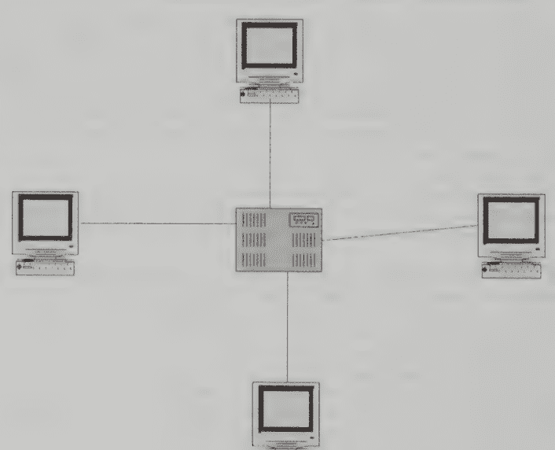

图 6.1 星型拓扑

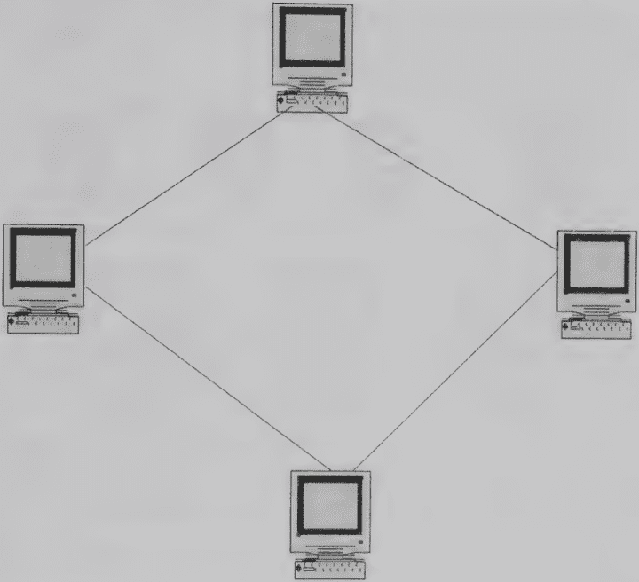

**图 6.2** 环型拓扑

使用 *活动分接头* 连接到介质，这些分接头实际上是位中继器；一位从输入线读取，保留一个位时间，然后传输到输出线。

站点通过在其出站链路上发送位流在网络上传输消息；因此，环本质上是单向的。由于所有其他站点一次只看到一位，预期接收方对传入消息没有任何事先警告。出于这个原因，发射器负责在位绕回时从环中移除消息。MAC 方案确保多个站点不会同时传输。

此外，环是一种 *串行广播* 网络。因为站点一次发送一位消息，所以当消息通过时每个其他站点都会看到消息，但在任何时间点每个站点接收到的都是消息的不同部分。

环是一种常见的物理局域网拓扑。然而，与星型不同，它们有多点故障：如果一条链路或一个活动分接头发生故障，环的完整性将被破坏。如果单个元素的故障概率为 *p* 且有 *n* 个元素，则局域网的故障概率 P{F} 为

$$P\{F\} = 1 - (1-p)^n$$

随着元素数量的增加，网络故障的概率呈指数增长。这个问题非常关键，以至于几乎所有环产品都使用星型布线方案或为此 eventuality 构建了某种冗余。

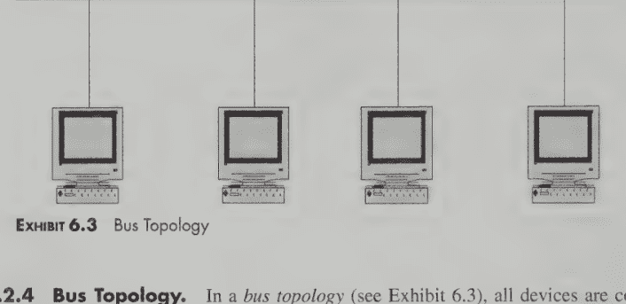

图 6.3 总线拓扑

### 6.2.4 总线拓扑。

在 *总线拓扑* 中（见图 6.3），所有设备都连接到单一的电连续介质；出于这个原因，这种拓扑也称为公共电缆或共享介质网络。节点使用 *无源分接头* 连接到介质，它在不改变其的情况下监视位流。这类似于电压表的操作；它测量电力线上的电压而不改变可用电压。

总线网络类似于家用电器连接到交流电（AC）电源线的方式。所有设备都从同一源取电，即使它们位于建筑物内电力分配网络的不同物理段上。此外，设备的操作相互独立；如果咖啡壶坏了，烤面包机仍然可以工作。

总线是一种 *同时广播* 网络，这意味着所有站点基本上在同一时间接收到传输的消息（忽略介质中的传播延迟）。大多数家庭和企业局域网采用 *基带总线*，其中发射器直接将直流电（DC）信号施加到总线上而没有任何修改。此外，基带总线上的传输是双向广播的，并且不能被接收方更改。总线局域网技术用于有线电视系统。例如，它们采用 *宽带总线*，其中信号被调制（即频率偏移）到特定频率以在一个方向或另一个方向上传输。

总线是最古老的局域网拓扑，通常在可用的介质类型方面受到限制。它们通常不会遭受单点故障问题。

### 6.2.5 物理与逻辑拓扑。

上面对局域网的 *物理* 和 *逻辑* 拓扑进行了区分。*物理* 拓扑描述站点如何物理定位并相互连接，而 *逻辑* 拓扑描述信号如何传播以及网络的逻辑操作。

在今天所有常用的局域网中，逻辑拓扑与物理拓扑不同。今天最常见的局域网配置是 *星型布线总线*（见图 6.4）。这种网络具有星型拓扑，所有站点都通过点对点链路物理连接到中央设备。该中央设备包含一个总线，以这样的方式互连所有 I/O 端口，即当一个站点传输消息时，所有站点都会接收到它。由于这与同时广播或总线网络完全相同，我们将此配置归类为物理星型，逻辑总线。

另一种常见配置是 *星型布线环*（见图 6.5）。在此配置中，位将按逻辑顺序从站点 A 传输到 B、C、A，等等，

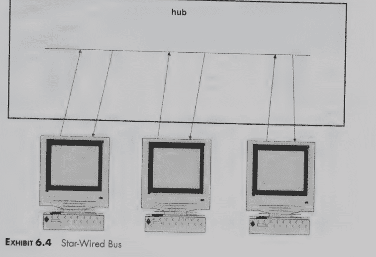

图 6.4 星型布线总线

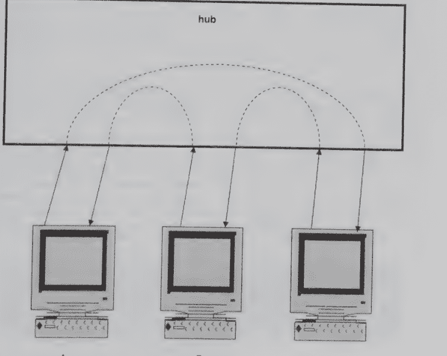

图 6.5 星型布线环

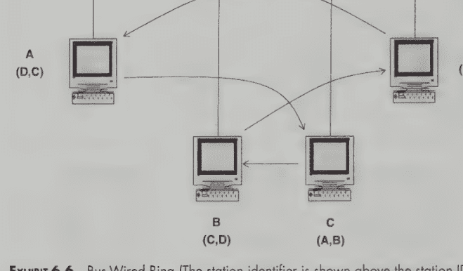

图 6.6 总线布线环（站点标识显示在逻辑环中前驱和后继站点的站点 ID 上方。）

这与环的串行广播操作相匹配。我们称之为物理星型，逻辑环。

虽然今天并不常见，但另一种混合技术是总线布线环（见图 6.6）。在此配置中，节点被动连接到单根电缆，形成物理总线。每个站点维护一个表，指定前驱和后继站点的地址，从而形成逻辑环。

## 6.3 介质。

接下来的段落讨论当前使用的三种主要局域网介质类型。由于其相对较高的速度、小地理范围和受保护的环境，多种介质类型可用于局域网。

### 6.3.1 同轴电缆。

同轴电缆（coax）是最原始的局域网介质。它的名称来自电缆本身的物理组成（见图 6.7）。电缆中心是一个导体，通常由铜制成，其周围环绕着绝缘体，进而环绕着另一个作为电气屏蔽的导体。由于屏蔽完全包围中心导体并且两者具有共同轴线，屏蔽可防止外部电气噪声影响信号


外绝缘
外导体
内绝缘
中心导体

图 6.7 同轴电缆

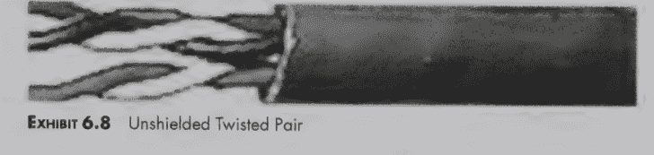

图 6.8 无屏蔽双绞线

在导体上，并防止导体上的信号产生影响其他电缆的噪声。

同轴电缆的尺寸从 1/4–1 英寸（6.35–25.4 毫米）不等，具体取决于导体、屏蔽和绝缘的厚度。同轴电缆的应用范围从有线电视到局域网。在数百到数千米的距离上可实现数百 Mbps 以上的速度。同轴电缆还具有很高的电磁和射频干扰免疫力。然而，它很容易被窃听。

同轴电缆仅见于物理总线局域网，如以太网。事实上，原始以太网规范要求使用细同轴电缆；后来采用细（CATV）同轴电缆的版本被称为 CheaperNet。同轴电缆通常不会出现在星型或环型网络中。

同轴电缆很容易被窃听。²

### 6.3.2 双绞线。

今天在局域网应用中享有最大普及度的介质是双绞线。双绞线电缆由两根绝缘铜导体相互缠绕而成（见图 6.8）。这通常是 22 至 26 号（即 0.025"/0.644 毫米至 0.016"/0.405 毫米）线材，与电话布线所用相同。将导体相互缠绕可最大限度地减少外部电气辐射对导线上传输信号的影响；如果外部电压施加到一对中的一根线上，它将同样施加到另一根线上。因此，缠绕有效地消除了外部噪声的影响。随着每英寸缠绕次数的增加，降噪特性会改善；不幸的是，电缆的总体数量和成本也会增加。大多数用于电话应用的双绞线每英尺有 10 到 15 次缠绕。

图 6.8 所示的双绞线类型称为无屏蔽双绞线（UTP），因为线对本身没有屏蔽。UTP 的数据承载能力通常由其类别表示：

- 等级 1（有时称为类别 1，或 Cat 1）电缆是较旧的 0.4 MHz 电缆，用于某些电话和调制解调器应用，但通常不适合数据应用。
- 等级 2（有时称为类别 2，或 Cat 2）电缆是 4 MHz 电缆，用于旧式数据终端系统，例如 IBM 3270 BISYNC。
- 类别 3（Cat 3）电缆的最大带宽为 16 MHz，额定速率为 100 m 线段上的 10 Mbps（尽管通常可以实现 100 Mbps 的速度）。Cat 3 电缆额定值高达 16 Mbps，今天主要用于电话。
- 类别 4（Cat 4）电缆，最大带宽为 20 MHz，曾用于 IBM 的 16 Mbps Token Ring 网络。今天很少见。


第5类（Cat 5）电缆的最大带宽为100 MHz，额定语音或数据传输速度在100米线段上最高可达100 Mbps。Cat 5e 额定为全双工和1千兆（Gbps）以太网。这些是目前使用最常见的局域网电缆。

第6类（Cat 6）电缆在长度介于15至100米的线段上额定为250 MHz。Cat 6 适用于数据速率最高达10 Gbps的超高速宽带应用。Cat 6a 电缆是 Cat 6 的一种变体，额定为500 MHz 和10 Gbps。

第7类（Cat 7）电缆额定最高达600 MHz 并使用四对线。电缆护套内的每对线以及护套本身都经过屏蔽，以防止在数据速率最高达10 Gbps时发生电磁干扰。Cat 7a 额定最高达1,000 MHz 和10 Gbps数据速率。

UTP 通常出现在物理星型布线总线和环形局域网中；它从未用于物理总线，且很少用于物理环。与同轴电缆一样，它很容易被窃听。此外，许多使用 UTP 的局域网也通过配线面板进行连接，这些面板经常得不到保护，因为安装连接的技术人员不了解为数十或数百个连接提供集中访问的安全问题。

另一种双绞线变体是屏蔽双绞线（STP），其中每对电缆都由金属屏蔽层包围，提供与同轴电缆中外部导体相同的功能。STP 仅用于 IBM Token Ring，即星型环。

### 6.3.3 光纤。

光纤是一种薄而柔性的介质，可作为10^14-至10^15-Hz范围信号的波导，其中包括可见光谱和部分红外光谱。光纤是数字通信的理想介质：它基本上不受任何无线电或磁干扰的影响，并且非常难以（使用高度专业化的设备）秘密窃听。理论上能够达到每秒万亿比特量级的数据速率，光纤已显示出在4,350英里（7,000公里）的光纤上达到100 Gbps的数据速率；实际限制通常是由于执行光电转换的电子设备造成的。

在广域网应用中，这一速度限制以两种方式之一被超过。

- 1. 光开关可以在不进行电光转换的情况下终止光纤。
- 2. 密集波分复用（DWDM）允许100个或更多10 Gbps比特流同时承载在单根光纤上。这些技术最终很可能会进入局域网。

电子设备是任何光纤系统的关键部分。要在光纤上传输的 incoming 电信号由发射机转换为光信号。常见的光源是发光二极管（LED）或注入激光二极管（ILD）。LED 比 ILD 更便宜，但限于较低速度。光信号由一种称为光电二极管的设备接收，它基本上计数光子并将计数转换为电信号。常见的光电二极管包括正-本征-负（PIN）光电二极管和雪崩光电二极管（APD）。PIN 比 APD 更便宜，但限于较低速度。

光纤的物理和传输特性在展图6.9中显示。光纤电缆的中心是纤芯，一种能够承载光信号的薄而柔性的介质。纤芯通常在2至125微米之间

## 6.12 局域网拓扑、协议和设计

- 布线权难以获得（例如，跨越道路的校园环境）。
- 需要临时网络（例如，在会议或会面时）。
- 住宅区没有其他网络设施。
- 会议中心、酒店以及学院和大学需要宽泛且易于访问的网络。

无线局域网通常采用红外、扩频或微波通信技术。红外（IR）用于各种通信、监控和控制应用。它也用于诸如家庭娱乐遥控器、建筑安全入侵和运动探测器、医疗诊断设备以及导弹制导系统等非局域网应用。对于无线局域网，最常见的 IR 通信频段使用波长在800至1,000纳米（nm，或10⁻⁹ m）范围内的信号。扩散红外在距离最远200英尺时的数据速率为1至4 Mbps，可用于固定或移动局域网节点。定向光束红外需要视线，数据速率为1至10 Mbps，距离最远80英尺。IR系统限于单个房间，因为信号无法穿过墙壁。

扩频是一种无线通信技术，工作在2.4或5千兆赫（GHz，或十亿次/秒）区域，其中传输信号的实际频率在传输过程中被故意改变。最初，频率偏移是为了安全目的，以防止通信信道的监控。LAN中使用了两种扩频技术：

- 1. 在频率跳变扩频（FHSS）³中，发射机在无线电频率集合上发送信号，以看似随机序列在分秒间隔内从一个频率跳到另一个频率。然而该序列并非随机，接收机与发射机同步改变频率。FHSS可支持数据速率1至3 Mbps，距离最远330英尺（100 m）。
- 2. 在直接序列扩频（DSSS）中，原始数据流中的每个比特由传输信号中的多个比特表示，使信号扩展到宽频率范围。DSSS的一个结果是系统可以实现比原始信号更大的带宽。DSSS可支持数据速率超过20 Mbps，距离最远1,000英尺（300 m）。

无线局域网中使用的另一种调制方案是正交频分复用（OFDM）。OFDM是频分复用的变体，使用前向纠错方案和正交子载波以最小化频率串扰和比特错误。

无线接入点可以以低于100美元的价格购买，使其在许多场景中成为即使是基于UTP的局域网的极具吸引力的替代方案。

微波局域网指的是在1、5和19 GHz范围内的通信。频率高于1 GHz且数据速率最高达20 Mbps的电磁能量可在最远130英尺的距离内维持。微波的一个主要缺点是许多这些频率需要联邦通信委员会（FCC）的许可。

### 6.3.5 摘要。

在20世纪80年代初期，同轴电缆是最常用的局域网介质。用于电话应用的双绞线因无法实现高速而未在局域网中使用。光纤技术仍处于起步阶段且非常昂贵。所有这些在20世纪90年代初期发生了变化，当时驱动双绞线的电子设备已大幅改进，光纤技术也大大成熟。如今在局域网中看到同轴电缆使用的情况很少；取而代之的是更常使用UTP（比同轴电缆成本更低）或光纤（比同轴电缆速度更高）。无线局域网是基于有线网络的可行替代方案，但更难保护。⁴ 然而，到2000年代末，无线网络接入互联网的增长超过了固定宽带订阅；在2011年，无线订阅的增长率是固定订阅增长率的200至300％。⁵

## 6.4 媒体访问控制。

如前所述，局域网是连接对等设备的广播网络，所有设备对介质都有同等访问权。这些特性对控制网络访问的协议提出了两项要求：

- 1. 任何给定时间只能有一个站点进行传输，因为多个发射机会导致信息混乱。
- 2. 所有站点必须遵循相同的网络访问规则，因为没有主站点。

控制网络介质访问的方案称为媒体访问控制（MAC）协议。虽然在工作产品中引入了许多不同的局域网MAC方案，但最常见的是本质上是两种方法的变体：争用和分布式轮询。这些方案将在下面讨论，并参考适当的电气和电子工程师学会（IEEE）局域网标准。

### 6.4.1 争用。

争用网络可以与一群人围坐在没有主席的会议桌旁进行比较。当某人想发言时，首先需要确定是否有人正在发言；如果有人正在发言，则在该人停止之前其他人不得开始。当某人检测到桌子上的沉默时，他或她开始说话。如果两个人同时开始说话，则发生了碰撞，必须解决。在人类类比中，碰撞以两种方式解决：要么双方发言者都停止并相互礼让（“礼貌退避”），要么双方继续大声说话直到一方放弃（“粗鲁算法”）。

LAN中使用的争用方案类似于礼貌退避情况，称为载波侦听多路访问/冲突检测（CSMA/CD）。CSMA/CD是今天使用最古老的局域网MAC方案之一，最初用于以太网并成为IEEE 802.3标准的基础（将描述）。虽然LAN上曾使用过其他争用方案，但CSMA/CD是幸存并在市场上蓬勃发展的方案。

CSMA/CD在逻辑总线网络上工作。当站点准备传输时，它首先监听网络介质（“载波侦听”）。如果站点检测到线路上的传输，它将继续监控信道直到空闲。一旦检测到沉默，具有要发送消息的站点将开始传输。站点在传输期间继续监控信道，以便如果检测到碰撞，所有发射机停止传输。


## 图示 6.10 IEEE 与 LAN 协议模型对比

| OSI 模型 | IEEE LAN 协议模型 |
|---|---|
| 应用、表示、会话、传输、网络 | 802.1 – 高层接口 (HILI)<br>802.10 – 局域网互操作安全标准 (SILS) |
| 数据链路 | 802.2 – 逻辑链路控制 (LLC) |
|  | 802.3、.4、.5、.6、.9、.11、.12、.15、.16 媒体访问控制 (MAC) |
| 物理 | 802.3、.4、.5、.6、.9、.11、.12、.15、.16 物理层 (PHY) |

网络介质。MAC 负责在 PHY 上实现无差错通信，并规定诸如以下内容：

- 帧定界
- 地址
- 比特差错检测
- MAC 协议的控制和维护
- 介质访问规则

上层子层称为逻辑链路控制 (LLC)。LLC 协议负责在两个通信的 LAN 站点之间维护逻辑连接。LLC 规定如下规则：

- 帧排序
- 差错控制
- 逻辑连接的建立和终止
- 高层服务的寻址

回顾网络层的主要功能是路由和拥塞控制，没有 LAN 协议层严格像 OSI 网络层那样工作的有两个原因：

- 在广播网络中不需要路由算法，因为所有站点都会接收所有传输：预期接收者的地址包含在传输本身中。
- 拥塞控制在广播网络中也不是问题：广播网络必须一次只允许一个发送方传输，而这由 MAC 层实现。

LAN 没有对应于 OSI 模型上四层的标准。即使在组织较松散的 1980 年代，在 LAN 环境中也不需要此类端到端协议，因为端到端通信仅限于 LAN 上的节点，而对于这种情况，MAC 保证了无差错通信。

只有当通过 WAN 和 LAN 访问互联网的 LAN 互连变得流行时，其他端到端协议才变得必要。IP（以及其他网络层协议）的需求也随之增长。这些协议与网络操作系统 (NOS) 的一部分通信软件相关联，将在后面讨论。

## 6.5.2 IEEE 802 标准。

虽然它们与安全没有直接关系，但熟悉描述 LAN 的标准是有用的，其中最常见的是 IEEE 802 标准。IEEE 计算机学会于 1980 年 2 月成立了 802 项目委员会，以创建 LAN 标准，作为其对微处理器标准更广泛工作的一个部分；没有其他组织进行类似的标准化工作。最初，计划有一个单一的 LAN 标准，运行速度在 1 到 20 Mbps 之间。该标准分为三个部分：PHY、MAC 和高层接口 (HILI)，以允许其他协议套件与 LAN 具有共同的协议边界。原始 MAC 基于以太网标准，但其他 MAC 方案很快被添加，并且多年来，802 委员会处理了许多 LAN 方案。它们都有一个共同点，即与单个 LLC 协议的接口，该协议在 HILI 和任何 MAC 之间提供通用接口。

以下是截至 2012 年 10 月的 802 项目工作组 (WG) 的描述及其状态。⁸

- **802.1—高层 LAN 协议工作组。** 为高层问题提供框架，包括协议架构、安全、端到端协议、桥接、互连、网络管理和性能测量。
- **802.2—逻辑链路控制工作组。** 在任何 LAN MAC 和高层协议之间提供一致的接口。根据所采用的选项，LLC 可以提供差错检测和纠正、顺序交付以及多协议封装。802.2 标准在第 6.5.6 节中有更详细的描述。该工作组已解散。⁹
- **802.3—以太网工作组。** 定义 CSMA/CD 总线网络的 MAC 和 PHY 规范。该规范在第 6.5.3 节中有更详细的讨论。（802.3 CSMA/CD 标准基于以太网，见第 6.5.4 节。）
- **802.4—令牌总线工作组。** 定义令牌传递总线的 MAC 和 PHY 规范，该总线基于通用汽车公司在制造自动化协议 (MAP) 框架下最初开展的工作。MAP 非常适合工厂车间和装配线，但从未实现广泛应用。该工作组已解散。
- **802.5—令牌环工作组。** 定义令牌传递环的 MAC 和 PHY 规范。尽管该工作组目前已解散，但该规范在第 6.5.5 节中为历史目的进行了更详细的讨论。
- **802.6—城域网 (MAN) 工作组。** 定义 MAN 的 MAC 和 PHY 规范。特别是，802.6 标准定义了一种称为分布式队列双总线 (DQDB) 的 MAC 和 PHY，它是与交换兆比特数据业务 (SMDS) 和无连接宽带数据业务 (CBDS) 配合使用的 MAC 之一。于 1990 年代初推出，这两种服务今天均不再使用。该工作组已解散。
- **802.7—宽带技术咨询组 (BBTAG)。** 就宽带技术变化及其对 802 标准的影响为其他 802 子委员会提供建议。该工作组已解散。
- **802.8—光纤技术咨询组 (FOTAG)。** 就光纤技术变化及其对 802 标准的影响为其他 802 子委员会提供建议。该工作组已解散。
- **802.9—综合业务局域网 (ISLAN) 工作组。** 定义综合语音/数据终端接入综合业务网络的 MAC 和 PHY 规范，包括 ISLAN 和 MAN，以及综合业务数字网 (ISDN)。唯一的实用实现部署在 IsoEthernet 产品中，见 IEEE 802.9a 标准。该工作组已解散。
- **802.10—安全工作组。** 定义在互连 LAN 上提供安全机制的程序，包括密码学和证书。该工作组已解散。
- **802.11—无线局域网 (WLAN) 工作组。** 定义“通过空中”介质的 MAC 和 PHY 规范。原始 802.11 标准使用 2.4 GHz 频段和 DSSS 或 FHSS 扩频技术定义了 1 或 2 Mbps 的操作；标称最大距离为 330 英尺（100 m）。今天最常见的变体是：
  - 802.11b—数据速率最高达 11 Mbps，标称最大距离最高达 460 英尺（140 m），频率为 2.4 GHz，使用 DSSS。
  - 802.11g—数据速率最高达 54 Mbps，标称最大距离最高达 460 英尺（140 m），频率为 2.4 GHz，使用 DSSS 或 OFDM。
  - 802.11n—数据速率最高达 150 Mbps，标称最大距离最高达 820 英尺（250 m），频率为 2.4 或 5 GHz，使用 OFDM。
预计未来的 802.11 标准将提供最高达 866.7 Mbps 的数据速率，频率为 5 GHz，使用 OFDM。
- **802.12—需求优先级工作组。** 描述了最初为 100 Mbps LAN 速度提出的一种 MAC 和 PHY 规范之一，被称为 100BASE-VG/AnyLAN。几乎未被使用，且工作组已解散。
- **802.13。** （该编号从未分配给工作组，因为人们认为 13 会阻碍市场上的产品。）
- **802.14—电缆调制解调器工作组。** 最初旨在描述有线电视系统的 LAN。该工作组已解散。
- **802.15—无线个人局域网 (WPAN) 工作组。** 定义便携式和移动设备之间短距离无线网络的 MAC 和 PHY，例如 PC、个人数字助理 (PDA)、手机、寻呼机和其他通信设备。
- **802.16—宽带无线接入 (BBWA) 工作组。** 定义相对短距离高速无线网络接入的 MAC 和 PHY。BBWA 标准解决了无线城域网中的“第一英里/最后一英里”连接，扩展了住宅宽带服务（如电缆调制解调器或数字用户线路 (DSL)）的覆盖范围。
- **802.17—弹性分组环 (RPR) 工作组。** 定义标准以支持 RPR 局域、城域和广域

区域网络用于以可扩展至每秒数十 Gb 的速率进行弹性高效的数据包传输。该工作组目前处于休眠状态。¹⁰

### 802.18—无线电监管技术咨询组（RR-TAG）。

代表使用基于无线电通信的其他 802 工作组，该 TAG 监控并积极参与正在进行的国家和国际无线电监管活动。

### 802.19—无线共存工作组。

制定并维护政策，定义 802 标准开发者为解决与现有标准以及正在开发中的其他标准共存问题而承担的责任。

### 802.20—移动宽带无线接入（MBWA）工作组。

定义面向基于 IP 服务优化的分组无线接口规范。目标是实现价格低廉、无处不在、始终在线且多厂商互操作的移动宽带无线接入网络在全球范围内的部署，以满足企业和住宅终端用户市场的需求。该工作组目前处于休眠状态。

### 802.21—媒体无关切换服务工作组。

制定标准以实现异构网络类型之间的切换和互操作性，包括 802 和非 802 网络。

### 802.22—无线区域网（WRAN）工作组。

制定一种基于无线电的 PHY、MAC 和空中接口的标准，供免许可设备在广播电视分配的频谱中以非干扰方式使用。

### 802.23—应急服务工作组。

该工作组成立的目的是为局域网定义一个 IEEE 802 框架，以符合通信系统适用的民政当局要求。该工作组已被解散。

### 802.24—智能电网技术咨询组。

该 TAG 成立的目的是在 802 委员会与智能电网行业和监管机构之间提供联络，并在与智能电网相关的 802 工作组之间提供协调与协作。

## 6.5.3 IEEE 802.3 CSMA/CD 标准。

最初的 IEEE 802.3 标准于 1985 年首次发布，描述了在粗同轴电缆上运行的 CSMA/CD 总线网络的 PHY 和 MAC。今天，802.3 网络实现可以使用多种介质类型，包括 UTP 和光纤。毫无疑问，星型布线的 UTP 实现是最受欢迎的。

802.3 委员会预见了可能使用的不同介质类型，并制定了一种命名法来标识实际的物理实现，使用以下格式：

```
[speed (Mbps)]|[signaling type]|[segment length (m) or media type]
```

例如，最初的 802.3 规范运行在 10 Mbps，使用基带（数字）信号，并将单个同轴电缆段的长度限制为 500 m（1,640 英尺）；该电缆被指定为 10BASE5。事实上，两台 802.3 站之间的最大距离可达 2.8 km（9,200 英尺），因此中继器可用于互连多个 500 m 同轴电缆段。

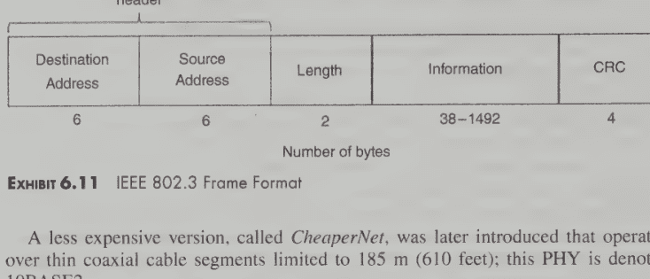

### 图 6.11 IEEE 802.3 帧格式

后来引入了一种更便宜的版本，称为 CheaperNet，它在长度限制为 185 m（610 英尺）的细同轴电缆段上运行；该 PHY 被记为 10BASE2。

20 世纪 80 年代中期，AT&T 推出了一款名为 StarLAN 的产品，它在 UTP 上以 1 Mbps 运行。尽管该产品早已被 relegated to 默默无闻，但它是第一个在 UTP 上突破 1 Mbps 障碍的产品。随后采用 UTP 的 802.3 版本都使用星型拓扑，其中每个网络节点直接连接到中央集线器。第一个 10 Mbps 的 802.3 版本被记为 10BASE-T，T 表示使用 UTP 介质（结构化布线标准规定其距离限制为 100 m，或 330 英尺）。802.3 的 10 Mbps 光纤版本是 10BASE-F。今天，当然，100 Mbps 和 1 Gbps 版本（即 100BASE-T 和 1000BASE-T）也已可用。全双工以太网利用星型配置中的点对点链路，通过允许两台站同时传输有效地将线路速度翻倍。

图 6.11 显示了 IEEE 802.3 MAC 帧的格式，主要用于参考目的。其字段及其功能如下：

- **Preamble.** 用于时钟同步：采用 8 位模式 10101010 的 7 次重复。（8 个二进制位 = 1 字节 = 1 八位组）
- **Start frame delimiter (SFD).** 位模式 10101011 表示帧的实际开始。1 八位组。
- **Destination address (DA).** 应接收此帧的站点的 48 位 MAC 地址。48 位二进制全 1 地址（十六进制为 ff-ff-ff-ff-ff-ff）为广播地址，表示所有站都应接收此消息。
- **Source address (SA).** 发送此帧的站点的 48 位 MAC 地址。
- **Length.** LLC 数据字段中的八位组数，值为 0 到 1500 之间。2 八位组。
- **LLC Data.** 来自 LLC（及更高层）的数据。该字段包含 3 八位组的 LLC 头、5 八位组的 802.2 子网访问协议（SNAP）头以及 38 到 1492 八位组的高层数据。
- **PAD.** 额外的八位组以确保帧长度至少为 64 八位组；该最小值是 CSMA/CD 网络碰撞检测机制的一部分所要求的。
- **Frame check sequence (FCS).** 用于位错误检测的 CRC-32 计算的余数。4 八位组。

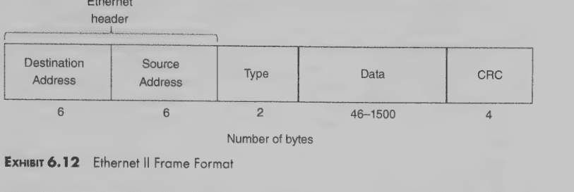

### 图 6.12 Ethernet II 帧格式

## 6.5.4 Ethernet II。

IEEE 的 CSMA/CD 标准基于 20 世纪 70 年代中期在施乐帕洛阿尔托研究中心（PARC）开发的以太网规范。当施乐首次决定将以太网推向市场时，还没有 OSI 模型或任何局域网标准或产品。在这种环境下，施乐寻求行业对该新规范的支持。以太网规范由数字设备公司（DEC，现为康柏）、英特尔和施乐联合分发（并营销）（因此有时被称为 DIX 以太网）。虽然 802.3 标准基于 Ethernet II，但两者并不完全相同。

图 6.12 显示了以太网 MAC 帧的格式，主要用于与 IEEE 帧进行比较。其字段及其功能如下：

- **Preamble**. 用于时钟同步；采用位模式 10101010 ... 10101011。8 八位组。
- **Destination address (DA)**. 应接收此帧的站点的 48 位 MAC 地址。全 1 地址（ff-ff-ff-ff-ff-ff）是 *广播地址*，表示所有站都应接收此消息。
- **Source address (SA)**. 发送此帧的站点的 48 位 MAC 地址。
- **Protocol identifier (PID)**. 指示在信息字段中传输的协议信息。示例值包括 2048 和 2054，分别表示互联网协议（IP）和地址解析协议（ARP）。2 八位组。
- **Information**. 由 PID 字段标识的协议的协议数据单元。46 到 1,500 八位组。（确保帧中至少有 46 八位组数据是高层的责任。）
- **Frame check sequence (FCS)**. 用于位错误检测的 CRC-32 计算的余数。4 八位组。

比较以太网和 802.3 帧格式的意义主要在于历史原因，因为今天的实现是 802.3 而不是以太网。话虽如此，有趣的是，这两个规范实际上是不同的。这也许只是一个小问题，业界曾普遍误称 IEEE 802.3 以太网（甚至 IEEE 802.3 委员会现在被称为以太网工作组），但这对网络管理员和安全专业人员来说是一个重要区别。

特别是在过去，如果一台局域网设备仅理解以太网封装，它将无法成功地与仅理解 IEEE 802.3 封装的另一台局域网设备通信。然而，这两台设备都可以共享相同的

互联网。多种此类设备用于局域网互连，包括集线器、交换机、网桥和路由器。这些设备之间的主要区别在于它们工作的 OSI 层，所有设备将在接下来的章节中讨论。

### 6.6.1 集线器。

集线器用于构建物理上星型布线的局域网，使用的介质基本上是点对点性质的（如 UTP 和光纤）。请注意，决定其逻辑性质的是集线器的内部布线，因此逻辑上的总线型或环型局域网可以在物理上采用星型布线。

所谓的以太网集线器支持 10、100 和/或 1,000 Mbps 的以太网或 802.3 网络。不同的集线器具有不同数量的端口，通常从 4 到 32 个不等。集线器仅提供物理连接；当一帧到达某个端口时，集线器会将该帧广播到所有其他端口，从而模拟广播总线环境。多个集线器可以互连以形成相当大的网络。

令牌环集线器，通常称为多站访问单元（MAU），外观与以太网集线器相似，但内部布线不同。当 MAU 在一个端口上接收到传输时，它只是将传输逐位转发到 MAU 上的下一个端口。通过这种方式，它模拟了环型环境。

### 6.6.2 交换机。

交换机通常用于 CSMA/CD 环境，并扩展了集线器的功能。交换机在 PHY 和 MAC 层的组合上运行。除了像集线器一样提供物理连接外，交换机还会学习连接到它的所有工作站的 MAC 地址。当帧到达交换机端口时，交换机会查看目的 MAC 地址，并将帧放到与该地址关联的端口上（该端口可能通向另一台交换机）。

交换机主要用于提高性能。鉴于前面描述的场景，多个工作站可以同时传输而不会发生冲突。此外，交换机可以全双工模式运行，这意味着单个工作站可以同时发送和接收数据。例如，一个 10 Mbps 的交换式以太网局域网可以实现与 100 Mbps 集线式以太网局域网类似的性能。（在那些无法升级 10-Mbps 网卡和布线的环境中，这确实是一个福音。）

使用交换机与集线器相比有一个微妙的安全影响。具体而言，如果用户将数据包嗅探器放在集线式局域网上，嗅探器将看到每一帧，因为集线器模拟广播环境。而交换网络上的数据包嗅探器则不会那么有效；它只会捕获那些专门发送到局域网广播地址的帧。话虽如此，许多交换机都带有一个管理端口，可以设置为监视所有端口以进行故障排除。

### 6.6.3 网桥。

网桥在两个局域网之间提供点对点链路，通常是那些采用类似 MAC 方案的局域网。网桥在 MAC 层工作，其操作由 MAC 地址控制。

以太网环境通常使用学习型网桥。在一个非常简单的例子中，考虑一个互连两个局域网 #1 和 #2 的网桥（见图表 6.15）。当任何局域网工作站发送帧时，传输中会包含目的和源 MAC 地址。当帧出现在网络上时，网桥会看到所有源地址，并建立一个将 MAC 地址与某个局域网关联起来的表，最终学习到网络中所有工作站的位置。这个过程有时被称为反向学习，因为网桥学习的是发送工作站的位置。

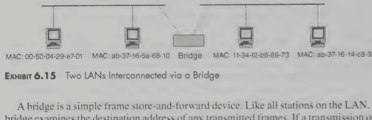

### 图表 6.15 通过网桥互连的两个局域网

网桥是一种简单的帧存储转发设备。与局域网上的所有工作站一样，网桥会检查任何发送帧的目的地址。如果局域网 #1 上的传输包含局域网 #2 上工作站的目的地址，网桥将转发该帧。如果传输包含未知的目的地址，网桥也会转发该帧。

尽管网桥根据 MAC 地址做出决策，但它不是智能设备；也就是说，它知道具有特定 MAC 地址的工作站在一个方向或另一个方向，但并不知道该工作站的确切位置。由于网桥必须建立包含其学习到的所有工作站地址的表，因此网桥不太适合扩展到大型网络。网桥还会扩展广播域（例如，如果在局域网 #1 上传输的帧发送到广播地址，它将被转发到局域网 #2）。

### 6.6.4 路由器。

路由器在概念上类似于网桥，因为它也是一种存储转发设备。然而，路由器在网络层工作，因此是比网桥强大得多的设备。如图表 6.16 所示，每个局域网设备都有 MAC（硬件）地址和网络层（软件）地址（在本例中，IP 是示例网络层地址）。由于网络层地址是分层的，网络本身具有网络标识号（图表 6.16 中的 NET_ID）。网络层地址非常适合中间设备必须在网络之间找到最佳路由的环境。

与网桥一样，路由器被视为其所连接的局域网上的又一个工作站。如果路由器在局域网 #1（NET_ID 为 192.168.16.0）上看到包含另一网络工作站目的地址的传输，它会将数据包路由到正确的目的网络，即使这意味着要经过另一台路由器才能到达那里。

这个例子也展示了网桥和路由器之间的另一个主要区别。在桥接环境中，局域网 #1 上的工作站向某个 MAC 地址发送帧，并且不知道预期目的地是否在同一局域网上；网桥会在必要时转发该帧，但这对发送方


### 图表 6.16 通过路由器互连的两个局域网

和接收方都是透明的。然而，在路由环境中，发送方只需检查目的网络地址，就可以判断接收方是在相同网络还是不同网络上。事实上，只有当数据包必须离开本地网络时，路由器才会参与；这就是为什么例如在 IP 环境中，必须提供默认网关（路由器）的地址。

路由器还限制广播域。如果局域网 #1 上的工作站使用广播 MAC 地址传输帧，则该帧不会超过路由器。

路由器构建路由表的方式与网桥截然不同。网桥通过观察帧的源地址来学习工作站的相对位置，而路由器则通过使用路由协议来学习网络层地址，路由协议允许路由器组交换路由信息。13

### 6.6.5 小结。

集线器、交换机、网桥和路由器都是常用的局域网互连设备。它们是每个从事局域网工作的人员工具包中的工具，是构建从小型和中型本地网络到大型企业网络以及全球互联网的一切事物的基石。

## 6.7 网络操作系统。

正如操作系统管理计算机资源一样，网络操作系统（NOS）提供控制局域网资源的软件。NOS 通常包含至少提供以下功能的软件：

- *硬件驱动程序*是允许 NOS 与 NIC 通信的软件。
- *通信软件*允许在不同局域网节点上运行的应用程序进行通信。
- *服务*是 NOS 的功能方面，也是人们首先使用局域网的原因。示例服务包括文件服务（文件共享）、打印服务（通常共享的打印机）、消息服务（电子邮件）、通信服务（局域网访问互联网）和传真服务（通常共享的传真机）。

NOS 通常分为对等网络或客户端/服务器。对等局域网允许任何局域网节点与任何其他局域网节点通信，并且任何局域网节点都可以向其他节点提供服务。在客户端/服务器（或基于服务器）环境中，每个节点要么是客户端，要么是服务器。在这种情况下，服务器是向其他服务器或客户端提供服务的特殊节点，而客户端是普通的终端用户工作站。客户端只能与服务器通信。

在评估或调查局域网的安全性时，软件是最常见的暴露、漏洞和利用点，尤其是对于远程攻击。

一些具有历史意义的 NOS 示例包括：

**AppleTalk。** Apple Mac 电脑自 1985 年问世以来就集成了局域网功能。AppleTalk 最初使用一种称为 LocalTalk 的方案，是在 10-Mbps CSMA/CD 局域网上运行的对等网络。历史上与 AppleTalk 相关的网络层协议被称为

数据报传递协议 (DDP)。Apple 在 2009 年停止支持 AppleTalk 并支持基于 TCP/IP 的网络。

## Microsoft 网络。

Microsoft 操作系统自 Windows for Workgroups（WfW 或 Windows 3.11）以来就具备 LAN 功能。采用一种不可路由的协议，即网络基本输入/输出系统（NetBIOS）扩展用户接口（NetBEUI），Windows 客户端系统（Windows 3.11 及更高版本）可以轻松用于构建廉价、简单的点对点 LAN 以进行文件和打印共享。NetBEUI 不可路由，因为它不提供寻址机制来允许互连但不同的 NetBEUI 子网；如果以任何方式连接两个 NetBEUI 网络，它们将表现为一个大型网络。（这就是为什么配置不当的 Windows 系统的硬盘驱动器可以从互联网上查看。）Microsoft 在 1980 年代定义了 NetBIOS over TCP/IP（NBT），以支持在 TCP 和 UDP 消息中封装 NetBIOS 消息。如今，大多数 Microsoft 网络更依赖 TCP/IP 而非 NetBEUI。

## Microsoft Windows Server（包括 Windows NT Server、Windows Server 2003、Windows Server 2008 和 Windows Server 2012）。

Windows 网络环境的首选 NOS，Windows Server 是 Microsoft 的客户端/服务器操作系统。客户端系统可以运行几乎任何 Windows 操作系统，从 Windows XP 或 NT Workstation 到 Windows VISTA、Windows 7 或 Windows 8。Windows Server 网络上的客户端本身也可以形成点对点网络。Microsoft 网络依赖于 Active Directory 和 TCP/IP。

## Novell NetWare。

Novell 在 1980 年代初使用专有的基于星型的 LAN 提供了首批 PC 级网络之一。到 1990 年代，NetWare 是最知名的客户端/服务器 NOS，占据了超过 70% 的 NOS 市场。与经典 NetWare 关联的网络层协议是 Internetwork Packet Exchange（IPX）协议。进入新世纪时，Microsoft 大大侵蚀了 NetWare 的流行度，而 TCP/IP 成为首选协议。就在这个时候，Novell 拥抱了 Linux 和 TCP/IP，而 NetWare 已被 Open Enterprise Server 取代。

## UNIX 和 Linux。

自 1984 年以来，TCP/IP 一直是 UNIX 系统的网络通信协议，使基于 UNIX 的主机能够构建客户端/服务器（最终是点对点）网络。自 1991 年诞生以来，TCP/IP 也一直是 Linux 的核心组成部分。有了 TCP/IP，任何系统都可以运行服务器（守护进程）软件为其他系统提供服务，因此任何系统都可以根据应用充当客户端或服务器。

## 6.8 摘要。

图 6.17 显示了一个可能的网络设计，其中包含本章所述的许多元素（以及一些未提及的元素）。该网络的路由器提供对 Internet 的接口，并通过某种专用连接连接，例如点对点 56 Kbps 或 T1（1.544 Mbps）租用线路、帧中继或数字用户线路。

在此场景中，路由器物理位于主站点。从安全角度来看，组织可能会将其网络划分为外部和内部两部分，内部部分由防火墙保护。14 外部网络包括路由器、公共 Web 服务器和防火墙。这三个系统通过集线器互连，每个系统都通过 Cat 5 UTP 电缆连接到该集线器。在此场景中，集线器实际上可以实现 10BASE-T 或 100BASE-T 以太网，甚至令牌环。

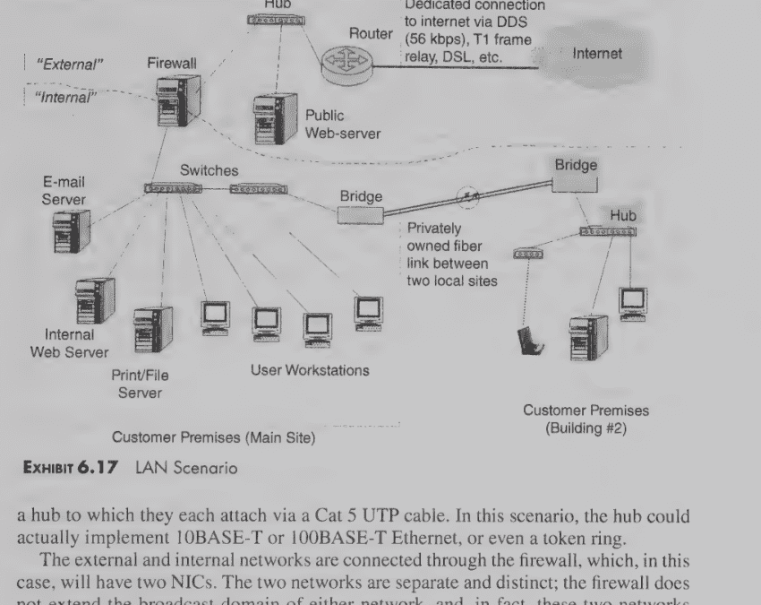

### 图 6.17 LAN 场景

外部和内部网络通过防火墙连接，在本例中防火墙将有两个 NIC。两个网络是分开且不同的；防火墙不会扩展任一网络的广播域，事实上，这两个网络将具有不同的 IP 网络标识符。

主站点的内部网络是一组服务器和用户工作站的集合，它们通过一组交换机互连。在此示例中，这些是 8 端口 100-Mbps 以太网交换机。由于设备数量超过 8 台，因此交换机本身需要互连。有几种选择：
- 可堆叠交换机物理连接在一起，扩展交换机的背板以创建一个更大的交换机（在本例中为 16 端口交换机）。
- 可以使用光纤链路互连交换机，通常在 1+-Gbps 范围内的背板速度。
- 可以使用 UTP 链路通过两个 100-Mbps 端口互连交换机。

要将 #2 建筑中的 LAN 与主站点的 LAN 连接，一对网桥之间的点对点连接就足够了。在本例中，建筑物相距数公里，需要使用光纤。

在 #2 建筑中，还有另一个基于集线器的 LAN，其中一台笔记本电脑使用无线技术，通过接入节点与集线器通信。

本章仅触及了 LAN 概念、标准和技术的表面。然而，对其进行研究对安全专业人员很重要，因为 LAN 是所有网络的基础。作为网络的网络，Internet 由数百万个本地网络组成。本章指出了系统中潜在的漏洞或被破坏的许多点。

## 6.9 延伸阅读

- Cisco Systems. *互联技术手册*. Cisco DocWiki 网站. 2012 年 6 月 20 日. http://docwiki.cisco.com/wiki/Internetworking_Technology-Handbook
- Gast, M. “无线局域网安全：简史。” O’Reilly / 无线开发中心 网站. 2002 年 4 月 19 日. www.oreillynet.com/pub/a/wireless/2002/04/19/security.html
- Mikalsen, A., and P. Borgesen. *局域网管理、设计与安全：实用方法*. Hoboken, NJ: John Wiley & Sons, 2002.
- Riley, S., and R. A. Breyer. *交换式、快速和千兆以太网*, 第 3 版. Indianapolis, IN: New Riders Publishing, 1998.
- Stallings, W., and T. Case. *企业数据通信——基础设施、网络和安全*, 第 7 版. Upper Saddle River, NJ: Prentice-Hall, 2012.

## 6.10 注释

1. 请参阅本 *手册* 第 5 章以获取有关 LAN 和 WAN 的更多背景信息。
2. 请参阅本 *手册* 第 22.4.5 节和第 23.9.1 节以进一步讨论窃听。
3. 有趣的是，原频率跳变扩频技术由好莱坞明星 Hedy Lamarr 于 1940 年发明，并免费提供给美国海军。
4. 请参阅本 *手册* 第 33 章以了解有关无线局域网安全的更多详细信息。
5. M. Kende，“互联网全球增长：未来启示”，Analysis Mason 知识中心（网站），2012 年，www.analysysmason.com/internet-global-growth-lessons-for-the-future（第 14 页）。
6. 由于 CSMA/CD 以概率 1 传输，有时被称为 1-持续。
7. 顺便说一下，尽管站点可能经历 16 次冲突，但传输概率永远不会低于 1/1024，或 2⁻¹⁰，因为以太网和 IEEE 802.3 不允许网络上超过 1,024 台设备。这就是该方案名称中“截断”一词的来源。
8. 有关 802 委员会的最新状态信息，可在 LAN/MAN 标准委员会网站 http://grouper.ieee.org/groups/802/ 上找到。
9. 当认为 IEEE 在该主题领域没有更多工作可做时，工作组将被解散。
10. 当没有新的项目可开展时，工作组将进入休眠状态。此状态表示已达到现状的工作组。
11. 术语“特殊符号”需要解释。令牌环 PHY 标准中使用的信号方案称为 Differential Manchester。在此信号方案中，信号在半个比特时间内处于正电压，在另一半比特时间内处于负电压，这意味着每个比特的总和为 0 伏（有时称为 DC 平衡）。J 和 K 符号是 Differential Manchester 编码违规，其中一个符号在整个比特时间内处于负电压，另一个符号在整个比特时间内处于正电压

time. 这些代码违规具有能够指示特殊事件的优点，可用于同步。J 和 K 符号始终成对使用以保持直流平衡。

12. 源路由在 IP 中是一个非常少用的选项，事实上是一个安全问题；防火墙管理员通常会设置过滤器以阻止带有源路由的 IP 数据包。然而，在 802.5 网络中，源路由是一个正常功能，并且不被视为安全威胁，因为这些信息对广域网没有影响。

13. 在 IP 环境中，常见的路由协议包括边界网关协议（BGP）、开放最短路径优先（OSPF）和路由信息协议（RIP）。

14. 这是一个非常简化的内部和外部网络防火墙设计。然而，该图关注的重点是局域网组件，而非特定的安全架构。

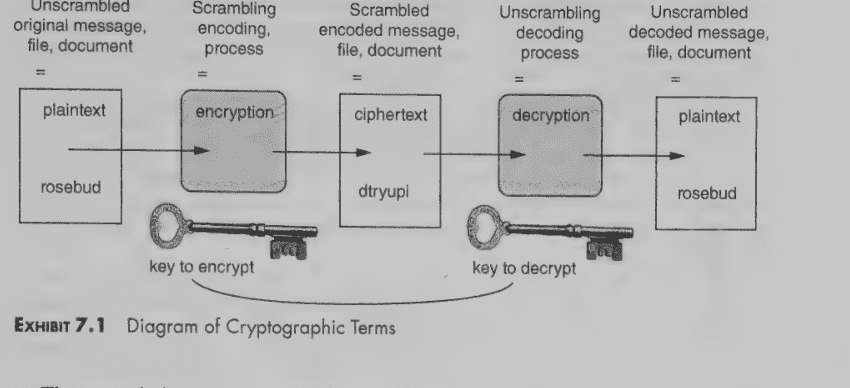

## 图示 7.1 密码学术语图

加密最明显的使用是使用某种共享秘密作为密钥来扰乱文件或消息的内容。没有密钥，扰乱后的数据仍保持隐藏状态，无法解扰或解密。加密算法可能密钥的总数称为密钥空间。密钥空间是密钥长度和密钥每个位置可能取值数量的函数。对于长度为 n 个位置的密钥，每个位置有 v 个可能值，则该密钥的密钥空间为 v^n。例如，对于三个位置、每个位置两个值（例如 0 或 1），可能的密钥为 000、001、010、011、100、101、110 和 111，总密钥空间为 8。

在密码学术语中，加密前文件的內容是明文，而扰乱或编码后的文件称为密文（参见图示 7.1）。作为智力活动领域，密码学可追溯到数千年以前。古埃及、中国和印度使用过它，希腊人讨论过它，罗马人经常使用它。关于该主题的第一部欧洲专著出现在十四世纪。该主题在两次世界大战期间具有巨大的历史重要性。英国在第二次世界大战中破解德国用于保护军事通信的密码的成功，是战争结果和第一台电子计算机系统发展的重要因素。

此后，密码学和计算机科学携手发展。1956 年，美国国家安全局（NSA），负责监控全球信息流动的美国政府部门，开始资助计算机硬件改进，向“闪电计划”投入约 2500 万美元。这项为期五年的开发工作旨在实现千倍的计算能力提升，产生了超过 150 篇技术文章。它还催生了超过 300 项专利申请，并成功推进了硬件设计的边界。位于马里兰州福特米德的 NSA 还参与了 DES 作为过去 20 年大部分时间商业加密标准的创建。今天，NSA 被广泛认为拥有世界上最大的超级计算机集合和最大的密码分析人员队伍。

## 7.1.2 密码学的角色。

密码学在计算机安全中的核心作用是确保数据的保密性。但密码学还可以支持计算机安全的其他支柱，如完整性和真实性。本节探讨密码学的不同作用。

### 7.1.2.1 保密性。

加密在保护保密性方面的作用可以在加密的经典定义中看到：“加密是一种特殊计算，作用于消息，将其转换为除预期接收方之外的所有方都无法理解的表示形式。”54

关于密码学的文献很大程度上以确保消息保密性来讨论该技术，但这在功能上等同于保护数据的保密性。“消息”一词的使用反映了密码学在计算机出现之前和之后所被赋予的传统用途。例如，朱利叶斯·凯撒 2000 年前加密了发给西塞罗的消息，而今天 Web 浏览器与 Web 服务器之间在执行“安全”交易时消息也会被加密。

在将密码学应用于计算机安全时，有时用“文件”一词替代“消息”更为合适。例如，硬盘加密程序保护存储在硬盘上的数据文件。然而，当数据文件从一台计算机传输到另一台计算机、跨网络、互联网或通过电话线传输时，它们会以消息的形式存在。实际上，以这种方式传输的数据会暴露于与办公室计算机中驻留数据所面临的威胁不同的危险之下。因此，使用加密使文件对除授权用户之外的任何人都无法使用，既适用于传输中的文件，也适用于驻留在服务器或独立计算机上的文件，特别是后者为笔记本电脑、记事本或 PDA 时。

### 7.1.2.2 完整性。

在上个世纪下半叶，随着可编程计算机系统的出现，密码学转换数据的能力被应用于许多新颖有趣的方式。正如稍后将看到的，许多密码技术使用大量数学计算。计算机在短时间内执行大量计算的能力极大地扩展了密码学的用途，并激发了更强加密系统的开发。

维护数据的完整性通常与保持其保密性一样重要。写支票时，人们会费心防止收款人或金额被篡改。在某些情况下，完整性比保密性更重要。公司新闻稿在从公司传递到媒体的过程中更改内容可能会产生严重后果。威胁数据完整性的不仅是人为行为；机械故障和逻辑错误也可能改变数据。必须检测此类变化，正如本手册第 4 章所讨论的那样，其中指出“[a]ll 数据移动和转换增加了内部错误的可能性，因此奇偶校验和有效性测试变得不可或缺。”

该章节涵盖了奇偶校验位在错误检测中的作用、冗余检查的功能以及使用校验和提供修改检测能力。一种称为消息认证码（MAC）的密码哈希或校验和类型可以防止故意但未经授权的数据修改，也可防止意外修改。MAC 是通过将密码算法和称为密钥的秘密值应用于数据来计算的。之后通过将密码算法和相同的秘密密钥应用于数据来生成另一个 MAC，从而验证数据；然后将该 MAC 与初始 MAC 进行比较。如果两个 MAC 相等，则数据被视为真实（参见图示 7.2 中的图表，其中使用稍后讨论的公钥密码系统）。否则，假定发生了未经授权的修改（任何试图在不知道密钥的情况下修改数据的一方都不知道如何计算与更改数据相对应的适当 MAC）。

## 7.6 加密

在价值上，证明订单确实源自下单个人非常重要。不可否认性由公钥密码学实现，有助于确保通信各方不能否认参与了全部或部分通信。

## 7.1.3 局限性。

密码学无法承担的一个角色是对抗数据破坏。虽然加密不能保证可用性，但当其与物理安全、系统访问控制和安全通信渠道结合时，它代表了计算机信息非常宝贵的额外防线。事实上，当计算机是移动的，或数据通过不安全渠道通信时，加密可能是主要防线。然而，尽管应用密码学可以为计算机用户提供在没有专业知识和强大计算机的情况下无法克服的安全级别，但不应将数据加密视为系统访问控制的替代或替代品。根据 Seberry 和 Pieprzyk⁵，密码学的作用是保护“非法访问可能且其他保护措施效率低下”的信息。基于加密的文件访问控制应在站点和系统访问控制之后成为第三道屏障，原因之一是仅靠加密系统几乎无法防止人们删除文件。

## 7.2 基础密码学。

密码学的目标是开发能够将明文加密为密文的系统，使其与纯随机数据集合无法区分。这意味着除一种之外，所有可能的解密版本都将完全模糊，没有任何一个比其他更可能正确。创建密文最简单的方法之一是用密文中不同的字符或词表示明文中的每个字符或词，使得同一文本的两个版本之间没有明显的关系。

### 7.2.1 早期密码。

据信，体现密码学基本属性（对文本进行轻微修改）的最早文本出现在约 4000 年前的埃及。一位抄写员使用了许多不寻常的符号来混淆或掩盖贵族 Khnumhotep II 墓穴上象形文字铭文的含义。⁶

也认为密码学的首次有效军事用途是斯巴达人使用的简单换位密码（参见第 7.3.3 节），他们“早在公元前 400 年就使用了一种称为 scytale 的密码装置，用于军事指挥官之间的秘密通信。”⁷ Scytale 是一根圆柱形或锥形的棍子，上面螺旋缠绕着一根薄皮革或羊皮纸条。⁸ 要隐藏的消息纵向书写且无空格。当展开时，羊皮纸似乎只包含随机字母。要阅读羊皮纸，接收方必须有一根与发送方尺寸完全相同的棍子。适当的解码 scytale 的分发在军事指挥官出发前进行。⁹ 例如，一种特定的棍子和条带组合可以允许明文（以小写显示）：

```
atheniantroops withinonedaysmarchofromebereadynow
```


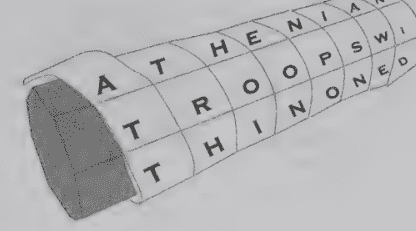

## 图 7.3 斯基塔勒的使用
来源：版权所有 © 2008 M. E. Kabay。经许可使用。

可拆分为最多六行、每行八个字母，写在卷起的条带上，方式如下：

- athenian
- troopswi
- thinoned
- aysmarch
- ofromebe
- readynow

消息在斯基塔勒上可能如 图 7.3 所示示意出现。 若在没有棍子的情况下阅读展开的条带，则会产生此密文（以大写显示）：

```
ATTAORTRHYFEHOISREEONMODNPOAMYISNRENAWECBONIDHEW
```

“The first attested use of [a substitution cipher] in military affairs comes from the Romans.”10 在那个时期， Julius Caesar 只需将每个字母替换为相隔三个位置的字母来编码所有信息。 例如，字母 a 会变成字母 d，字母 b 会变成字母 e，以此类推。 现在被称为凯撒密码，该方案是所有单字母表算法中最为人所知的（参见第 7.2.5 节）。11 考虑使用现代英语字母表说明的凯撒密码，字母表仅简单地向后移了三位。

```
Plaintext: abcdefghijklmnopqrstuvwxyz
Ciphertext: DEFGHIJKLMNOPQRSTUVWXYZABC
```

要加密消息，发送者会在明文字母表中找到消息的每个字母，并使用密文字母表中下方对应的字母。 因此，明文消息为：

```
Plaintext: beware the ides of march
```

被转换为加密消息：

```
Ciphertext: EHZDUH WKH LGHV RI PDUFK
```

拜占庭皇帝。13 1492 年，一位被称为 al-Kalka-shandi 的人 在一部百科全书中描述了这种技术。 他还描述了几种密码技术，包括替换密码和换位密码。14

回到凯撒密码，考虑如何利用密码分析科学破解此代码。 经长时间检查，这种特定代码相当透明。 一旦正确识别出几个字母，其余部分便迎刃而解。 例如，由于 “the” 是英语中最常见的三个字母单词，将 “XLI” 与 “the” 进行测试可揭示明文字母与密文字母之间存在固定关系：向右移动三位。

如果将该差异应用于消息的其余部分，结果就是可理解的明文片段，因此被假定为问题的正确解。 然而，即使在这个简单示例中，也有几种复杂的处理过程和假设在起作用；在查看更复杂的代码之前，它们值得更密切的关注。 首先，将 “the” 与 “XLI” 进行测试假设明文为英语，并且攻击者对该语言有某些详细的了解，例如某些单词的频率。 其次，假设密文在单词分隔方面遵循明文。通常情况并非如此。密文通常以等长字母块书写以进一步掩饰，如下所示：

```
Ciphertext: EHZDU HWKHL GHVRI PDUFK
```

当消息接收者对其进行解密时，结果虽然并不完全易读，但仍然完全可理解：

```
Plaintext: bewar ethei desof march
```

还请注意忽略单个字母大小写的惯例，并将所有明文置于小写，而所有密文则置于大写。

## 7.2.4 穷举密码分析。
关于凯撒密码需要注意的下一件事是，使用英语字母表，有 26 种可能的密钥。 这意味着拦截加密消息的人可以发动一种标准攻击形式，即称为穷举密码分析。 该方法将可能的密钥通过解密算法运行，直到发现解决方案。 从统计学上讲，在测试所有可能密钥的一半后即可找到正确的密钥。 在图 7.5 中，电子表格详细说明了对凯撒密文的穷举攻击。在示例中，明文出现在第 6 行，密钥 #3。

请注意，此攻击需要三项信息，且这三项都与个人计算机上的加密相关：

- 1. 对所用加密算法的了解
- 2. 可能的密钥数量
- 3. 明文的语言

在办公室使用计算机与在战场上发送消息有所不同（至少在好日子里）。 与敌方间谍不同，试图未经授权访问数据的人通常对使用哪种算法已有相当好的了解。（在使用的算法相对较少，并且它们通常直接与特定应用程序相关联）。这解决了第一项。穷举攻击的主要障碍是第二项，即密钥数量。在凯撒的情况下

从功能上讲，穷举攻击取决于知道密文背后的加密算法。 实际上，它们取决于在适当的时间范围内取得成功的可行性。 它们还取决于上述列表中的第三项信息：对明文语言的了解。 图 7.5 中凯撒密码的解法往往会脱颖而出，因为它比其他任何解法都更接近纯英语。 然而，如果不知道什么是明文，穷举攻击在最好的情况下效率低下，在最坏的情况下则会失败。 密码分析的这一部分，即识别积极结果，比其他任何部分都更难以自动化。 这种困难因纯数值结果的加密而加剧，在没有大量额外知识的情况下，正确的明文可能无法确定。

## 7.2.5 单字母表替换密码。
凯撒密码和所示的随机替换密码都是单字母表密码的例子。 这意味着密文的一个字母代表明文的一个字母。 这使得此类代码容易受到与穷举攻击完全不同的攻击。 假设一名海关官员试图发现非法武器运输何时以及如何进入该国。 截获了以下消息：

```
YZYGJ KZORZ OYXZR RKZRK XUXRJ XRZXU YKQQQ
```

编码此文本的人显然用新字母替换了消息的原始字母。 对于经验丰富的破译员或密码分析员来说，破译此消息的任务相当简单。 首先统计文本中每个字母出现的次数。 这会产生如下列表：

```
Ciphertext: R Z X Y K J U O G
Frequency: 6 6 5 4 4 2 2 2 1
```

请注意，最后三个字母被忽略，因为它们只是填充了五字母分组。 接下来参考频率表，该表显示字母表中的字母在特定语言或该语言的方言中出现的相对频率。 这样一个列表显示在图 7.6 中。 该列表是为此示例创建的，并提出英语中最常用的字母按频率降序排列为 e、t、r 等。 实际顺序更可能是 e、t、a、i、o、n、s、h、r、d、l、u，这是十九世纪英语林otype 机的键顺序，尽管频率的精确顺序可能因文本的来源地区或主题而异。

假设原始消息为英语，则可轻松推导出将代码字母与明文字母匹配的列表。

```
Ciphertext: R Z X Y K J U O G
Frequency: 6 6 5 4 4 2 2 2 1
Plaintext: e t r i n o a h s
```

结果是：

```
Ciphertext: YZYGJ KZORZ OYXZR RKZRK XUXRJ XRZXU YKQQQ
Plaintext: itiso nthet hirte enten rareo retra inqqq
```

这可读作 "it is on the thirteen ten rare ore train." 虽然这个例子显然是为了说明一点而 contrived，但它清楚地说明了一个重要的密码学

## 图 7.6 英语频率表

| | 按字母的英语 | | | 按频率的英语 | | | |
|---|---|---|---|---|---|---|---|
| A | 7.25 | N | 7.75 | E | 12.75 | U | 3.00 |
| B | 1.25 | O | 7.50 | T | 9.25 | R | 8.50 |
| C | 3.50 | P | 2.75 | I | 7.75 | N | 7.75 |
| D | 4.25 | Q | 0.50 | I | 7.75 | N | 7.75 |
| E | 12.75 | R | 8.50 | I | 7.75 | N | 7.75 |
| F | 3.00 | S | 6.00 | O | 7.50 | A | 7.25 |
| G | 2.00 | T | 9.25 | A | 7.25 | S | 6.00 |
| H | 3.50 | U | 3.00 | S | 6.00 | D | 4.25 |
| I | 7.75 | V | 1.50 | D | 4.25 | L | 3.75 |
| J | 0.25 | W | 1.50 | L | 3.75 | C | 3.50 |
| K | 0.50 | X | 0.50 | C | 3.50 | H | 3.50 |
| L | 3.75 | Y | 2.25 | H | 3.50 | F | 3.00 |
| M | 2.75 | Z | 0.25 | F | 3.00 | M | 2.75 |

工具，可快速破译乍看之下似乎非常令人望而生畏的东西。 前一个示例中的加密可能基于简单的替换密码。 例如，在使用密码“TRICK”后，后跟明文中密码中字母以外的常规字母表，密文就是反写的字母表：

```
Plaintext:  TRICKABDEFGHJLMNOPQSUVWXYZ
Ciphertext: ZYXWVUTSRQPONMLKJIHGFEDCBA
```

如果替换完全随机，频率分析也有效，如前面所示的示例，其密钥完全随机。 破解代码所需的专用工具，如频率表，指出了一种基本权衡：如果需要基本保护级别，则很容易获得，但也很容易被破解，至少对于专家而言如此。 “对于专家”这一限定很重要，因为加密用户需要对其作用保持客观。 关键问题是：谁可以从解密数据中获益，他们拥有哪些手段？ 如果那些可能试图阅读您文件的人并不特别精通、专注或装备精良，那么投资强大的加密硬件或软件就没有意义。 例如，寄明信片的人知道任何看到它的人都可以阅读它。 信封可用于防止这种情况，这几乎不是机密性的终极保障，但广泛使用且相对成功。

## 7.2.6 多字母表替换密码。
即使明文使用的字母范围比 contrived 示例更广，替换密码仍可通过频率分析破解。 一种强大的技术是集中于双字母组合的频率，称为双字母组，其中英语中最常见的是“TH”。 抵御频率分析的一种方法是为更频繁的字母使用多个替代字母。 这不能用直接的字母编码来完成。 然而，如果使用数字表示字母，则可以为某些字母分配多个数字，例如 E 为 13 17 19 23，这有助于稀释该字母的自然频率。 似乎按每个字母的频率比例提供多个替代，即同音异义词，将会有效地

计数频率分析。然而，明文的某些底层结构仍然保留，尤其是双字母组，密码分析员可以利用它来破解代码。

在中世纪的欧洲，教皇国和意大利城邦为了保护外交信息而在密码学方面取得了进展。随后，在1379年，一位名叫加布里埃莱·德·拉文德的意大利人创作了第一部欧洲密码学手册。“这本手册现存于梵蒂冈档案馆，其中包含24位通信者的密钥集，并采用符号表示字母、空字符，以及若干用于单词和名称的双字符代码等价物。”15 拉文德手册所述的命名法“在接下来450年里主导了整个欧洲和美洲。”16

在拉文德手册的时期，欧洲出现了其他几项值得注意的进展。首先，在1470年，莱昂·巴蒂斯塔·阿尔贝蒂发表了密码盘的首次描述。17 其次，在1563年，贾姆巴蒂斯塔·德拉·波尔塔提供了双字母密码的第一个例子，其中两个字母由一个符号表示。18

减少明文结构在密文中反映程度的一种方法是加密明文的多个字母。例如，“AR”可能被加密为“CM”。这是众所周知的普莱费尔密码背后的理论，该密码由英国科学家查尔斯·惠斯通爵士于1854年发明，但以其朋友为英国外交部争取采用该密码的帕尔菲尔男爵命名。19 尽管普莱费尔密码在两次世界大战期间仍在使用，但它不足以掩饰明文，无法抵御集中的频率分析。

## 7.2.7 维热密码。

多字母表密码演变中一个特别重要的技术根源可追溯至十六世纪。1586年，布莱斯·德·维热纳发表了一张以他命名的加密/解密方格——维热纳方格，以及首个明文和密文自密钥系统的描述。20 维热密码涉及一张字母表，如展图7.7所示，与密钥一起使用，在加密过程中对明文提供不同的单字母表替换。因此，密文的每个字母与明文的关系各不相同，如下所示：

```
Key: doomsdaydoomsdaydoomsdaydoomsday
plaintext: sellentireportfolionowandbuygold
ciphertext: VSZXWQTGJIAZVGYWCMDBFPFBOJIKUKLQ
```

消息的加密方法是查看以密钥第一个字母开头的表格行。然后沿该行移动，直到以明文第一个字母为头的列。密文替换是表格中该交点处的字母。因此，第d行、第s列得到V。然后继续第二个字母，依此类推。注意，字母e第一次被加密时密文为S，但第二次为W。sell中的两个l分别被编码为Z和X，等等。

这种密码是否完全掩盖了明文的结构？斯托林斯指出：“如果两个相同的明文字母序列以关键词长度的整数倍距离出现，它们将产生相同的密文序列。”21 这意味着密码分析员可以确定关键词的长度。一旦确定，密码就可以被视为若干个单字母表替换，其数量等于密钥长度。频率表再次被使用，代码即可被破解。密码学家对这一弱点的回应是使用更长的密钥以减少重复。事实上，一种技术，自密钥，由

### 展图 7.7 — 维热表

|   | a | b | c | d | e | f | g | h | i | j | k | l | m | n | o | p | q | r | s | t | u | v | w | x | y | z |
|---|---|---|---|---|---|---|---|---|---|---|---|---|---|---|---|---|---|---|---|---|---|---|---|---|---|---|
| a | a | b | c | d | e | f | g | h | i | j | k | l | m | n | o | p | q | r | s | t | u | v | w | x | y | z |
| b | b | c | d | e | f | g | h | i | j | k | l | m | n | o | p | q | r | s | t | u | v | w | x | y | z | a |
| c | c | d | e | f | g | h | i | j | k | l | m | n | o | p | q | r | s | t | u | v | w | x | y | z | a | b |
| d | d | e | f | g | h | i | j | k | l | m | n | o | p | q | r | s | t | u | v | w | x | y | z | a | b | c |
| e | e | f | g | h | i | j | k | l | m | n | o | p | q | r | s | t | u | v | w | x | y | z | a | b | c | d |
| f | f | g | h | i | j | k | l | m | n | o | p | q | r | s | t | u | v | w | x | y | z | a | b | c | d | e |
| g | g | h | i | j | k | l | m | n | o | p | q | r | s | t | u | v | w | x | y | z | a | b | c | d | e | f |
| h | h | i | j | k | l | m | n | o | p | q | r | s | t | u | v | w | x | y | z | a | b | c | d | e | f | g |
| i | i | j | k | l | m | n | o | p | q | r | s | t | u | v | w | x | y | z | a | b | c | d | e | f | g | h |
| j | j | k | l | m | n | o | p | q | r | s | t | u | v | w | x | y | z | a | b | c | d | e | f | g | h | i |
| k | k | l | m | n | o | p | q | r | s | t | u | v | w | x | y | z | a | b | c | d | e | f | g | h | i | j |
| l | l | m | n | o | p | q | r | s | t | u | v | w | x | y | z | a | b | c | d | e | f | g | h | i | j | k |
| m | m | n | o | p | q | r | s | t | u | v | w | x | y | z | a | b | c | d | e | f | g | h | i | j | k | l |
| n | n | o | p | q | r | s | t | u | v | w | x | y | z | a | b | c | d | e | f | g | h | i | j | k | l | m |
| o | o | p | q | r | s | t | u | v | w | x | y | z | a | b | c | d | e | f | g | h | i | j | k | l | m | n |
| p | p | q | r | s | t | u | v | w | x | y | z | a | b | c | d | e | f | g | h | i | j | k | l | m | n | o |
| q | q | r | s | t | u | v | w | x | y | z | a | b | c | d | e | f | g | h | i | j | k | l | m | n | o | p |
| r | r | s | t | u | v | w | x | y | z | a | b | c | d | e | f | g | h | i | j | k | l | m | n | o | p | q |
| s | s | t | u | v | w | x | y | z | a | b | c | d | e | f | g | h | i | j | k | l | m | n | o | p | q | r |
| t | t | u | v | w | x | y | z | a | b | c | d | e | f | g | h | i | j | k | l | m | n | o | p | q | r | s |
| u | u | v | w | x | y | z | a | b | c | d | e | f | g | h | i | j | k | l | m | n | o | p | q | r | s | t |
| v | v | w | x | y | z | a | b | c | d | e | f | g | h | i | j | k | l | m | n | o | p | q | r | s | t | u |
| w | w | x | y | z | a | b | c | d | e | f | g | h | i | j | k | l | m | n | o | p | q | r | s | t | u | v |
| x | x | y | z | a | b | c | d | e | f | g | h | i | j | k | l | m | n | o | p | q | r | s | t | u | v | w |
| y | y | z | a | b | c | d | e | f | g | h | i | j | k | l | m | n | o | p | q | r | s | t | u | v | w | x |
| z | z | a | b | c | d | e | f | g | h | i | j | k | l | m | n | o | p | q | r | s | t | u | v | w | x | y |

维热纳发明的，是从明文本身以及一个代码词构成密钥，如下所示

```
Key:        doomsdaysellentireportfolionowan
plaintext:  sellentireportfolionowandbuygold
ciphertext: VSZXWQIGJIAZVGYWCMDBFFBOJILUKLQ
```

该系统非常强大，但仍可通过基于频率的统计分析进行攻击，因为明文和密钥的字母具有大致相同的频率分布。下一级防御是使用与明文一样长的关键词，但与之没有统计关系。这种在密码学上意义重大的方法，直到二十世纪到来，带来二进制代码和全球战争时才被想到。

## 7.2.8 二十世纪早期的密码分析。

现代密码学的兴起始于电磁电报系统的发明与发展以及莫尔斯电码的引入。塞缪尔·莫尔斯带来了一种由点和划组成的系统，实现了近乎实时的远距离通信。他设想该系统作为安全通信的手段。设计加密电报通信系统的任务将由他人完成。安森·斯塔格，主管


标记或空格。例如，字母 a 由标记、标记、空格、空格、空格表示。用二进制术语来说，每个单位构成一个位，要么是 0，要么是 1（a 的五位编码为 11000）。这种脉冲系统使得电传打字机能够通过键盘和打孔纸带输入（打孔表示标记，因为它使读取设备形成电接触并产生脉冲，而空格则通过保持纸张完整来表示）在文本和电报信号之间进行转换。任何拥有合适机器的人都可以截获并读取传输内容。

该编码中的 32 种可能组合（2^5）被分配给 26 个字母，外加六个“分流”指令，用于执行诸如切换到大写或换行等操作。弗纳姆的天才想法是使用一卷随机字符的 Baudot 码带作为密钥，通过机电方式将其与明文相加。卡恩这样描述这种加法方法：

> 如果密钥脉冲和明文脉冲均为标记或均为空格，则密文脉冲为空格。如果密钥脉冲为空格而明文脉冲为标记，或者反过来（换句话说，如果两者不同），则密文为标记。31

如今，这被称为“异或”，有时也称为逐位异或，或简称 XOR（见附注 7.8）。XOR 在计算机化加密方案中广泛使用。考虑使用 B 作为密钥对字母 a 进行编码时会发生什么：

```
Plaintext:  1 1 0 0 0 (=a)
Key:        1 0 0 1 1 (=B)
Ciphertext: 0 1 0 1 1
```

在第一列中，1 + 1 = 0，如附注 7.8 所示。要解密加密字符，只需执行相同操作，但将密文与密钥相加：

```
Ciphertext: 0 1 0 1 1
Key:        1 0 0 1 1 (=B)
Plaintext:  1 1 0 0 0 (=a)
```

在该方法被发现时，其意义在于它的自动化能力。操作员可以将明文带和密钥带送入电传打字机，机器就会在无需进一步人工输入的情况下传输加密消息。无需离线准备。此外，只要接收方拥有密钥带，接收端的电传打字机就会自动打印出明文。这使得弗纳姆系统成为第一个将加密集成到通信过程中的系统，这是当今基于计算机的通信加密系统的一个基本特征。

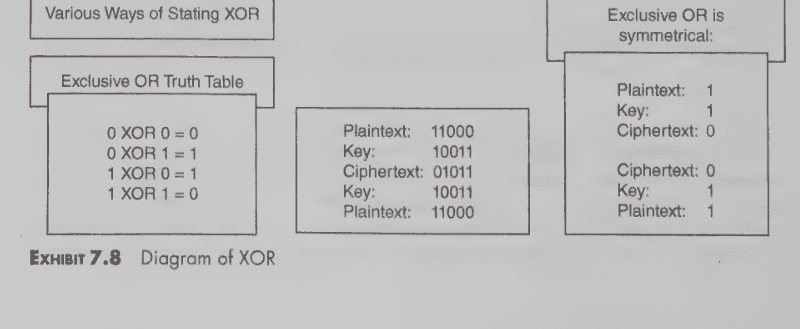

## 7.3 DES 与现代加密

尽管 XOR 的使用早于计算机，但它与二进制编码如此完美的契合确保了它成为现代密码学家工具包中的必备品。因此，本章的重点转向现代密码学以及当今两种最广泛使用的密码系统。第一种是数据加密标准（DES），第二种是 Rivest、Shamir、Adleman（RSA）。

### 7.3.1 现实约束。

正如前面加密演进的概述所表明的，重大进展（很少出现）通常与做出这些进展的个人相关，例如维吉尼亚、普莱费尔和弗纳姆，他们都没有计算机的帮助。当今的计算机化加密方案通常采用多种经典技术，组合起来消除或最小化任何单一方法的缺点。这里将讨论几种技术，包括转置和转子，它们指向了迄今为止最广泛使用的加密方案：DES。然而，首先考虑弗纳姆原本杰出的方案所遇到的实际问题。

弗纳姆提出的密钥是一长串随机字符。这被编码在一条循环纸带上，最终会重复（纸带每英尺约容纳 125 个字符）。密钥的长度使得对被截获消息的密码分析极其困难，但并非不可能，因为最终密钥会重复。在足够的密文量下，该编码将屈服于频率分析。（请记住，在战争期间，甚至军事演习期间，每天可能有数十万单词被加密，为密码分析提供了坚实的基础。）

### 7.3.2 一次一密。

随后提出了几项改进，以避免只是制作越来越长密钥带的不可行性。另一位 AT&T 工程师莱曼·莫尔豪斯建议使用两条约八英尺长、包含约 1000 个字符的密钥带，生成超过 999,000 种字符组合，可在加密过程中作为密钥输入。这在实用性和安全性方面是一个改进，但正如美国陆军通信兵少校约瑟夫·莫博涅指出的，以这种方式加密的大量消息流量仍然可以被解码。正是莫博涅意识到，唯一不可破解的密码将使用如卡恩所说的“无穷无尽且毫无意义的”密钥。因此，他提出了我们所知的一次一密系统，即唯一不可破解的加密方案。

一次一密系统有时被称为一次一密本33，因为这是它在战场上的情报人员中的部署方式。特工获得一个本子，其中排列着完全随机的字符列和行，如附注 7.9 所示。明文的第一个字母使用第 1 行的相应密文字母加密，第二个字母使用第 2 行加密，依此类推。结果是密文与明文之间没有任何统计关系。消息加密后，该密码本被销毁。接收方拥有一份相同的密码本，用它来反向操作并解密消息。

一次一密本质上是一种多表替换密码，但其字母表数量与消息中的字符数相同，从而击败了任何形式的频率分析。暴力攻击也被这样一种事实所击败：每一种可能的结果在统计上与其他结果一样显著。正如卡恩指出的，一个四位字母的密文组可以同样容易地产生 kiss、fast、slow 或任何其他可能的四位字母组合。

以便第一组密文字符位于 1 下方，第二组位于 2 下方，依此类推：

```
Key:      3   7   5   8   1   4   2   6
Plaintext: s   e   l   l   e   n   t   i
          r   e   p   o   r   t   f   o
          l   i   o   n   o   w   a   n
          d   b   u   y   g   o   l   d

Ciphertext: EROGT FALSRLDNTWOLPOUIONDEEIBLONY
```

虽然更复杂，但这种转置仍然可以屈服于密码分析，因为它保留了明文的字母频率特征。分析者还会在尝试不同长度的列和行时寻找双字母组和三字母组。（卡恩描述了第一次世界大战期间法国密码破译员实际将文本剪成纸条并上下滑动以破解德国转置密码的情形。）

转置难以解密的原因在于额外的加密阶段。例如，如果将之前的密文再次通过系统使用相同的密钥，所有图案痕迹似乎都消失了。

```
Key:      3   7   5   8   1   4   2   6
Plaintext: e   r   o   g   t   f   a   l
          s   r   l   d   n   t   w   o
          l   p   o   u   i   o   n   d
          e   e   i   b   l   o   n   y

Ciphertext: TNILAWNNESLEFT...OOOOLOLODYRRPEGDUB
```

越来越复杂的多重转置密码的发展指出了多阶段加密的积极效果，这也适用于替换密码。最典型的例子是德国和日本在第二次世界大战中使用的转子机。在破解德国密码过程中获得的一些见解，例如艾伦·图灵 1940 年关于将信息统计应用于密码分析的工作，被认为如此重要，以至于它们被保密了 50 多年。

尽管它们最终被盟军密码分析员击败，但像恩尼格玛这样的机电系统不仅是最先进的前计算机加密系统，而且破解它们的努力也是计算机系统本身发展的主要催化剂。当人们开始将计算机系统应用于密码生成而不是密码破解时，他们很快想到了将明文切碎成块以便处理的想法。“分组密码”一词用于描述一次加密一块（例如 8 字节数据）、一块接一块的密码。计算机化加密过程的另一个结果是一类称为乘积密码的密码。乘积密码被定义为“一种分组密码，它迭代若干种弱操作，如替换、转置、模加/模乘[如 XOR]和线性变换。”34

乘积密码的数学原理超出了本章的范围，但注意到以下一点是有用的：“没有人知道如何在数学上证明乘积密码是完全安全的……[A] 乘积密码应充当‘混合’函数


它以一种复杂的非线性方式将明文、密钥和密文组合在一起。”35 乘积密码中执行多轮替换的部分称为 S 盒。名为 Lucifer 的乘积密码有两个 S 盒，而 DES 加密有八个 S 盒。乘积密码能否产生真正随机、非线性的密文，取决于这些 S 盒的精心设计。

现代乘积密码的例子包括 Lucifer（由 IBM 开发）、DES（由 IBM/NSA 开发）、LOKI（Brown、Pieprzyk 和 Seberry）和 FEAL（Shimizu 和 Miyaguchi）。一类称为 Feistel 密码的乘积密码在每一轮处理密文的一半，然后在每一轮后交换密文的两半。Feistel 密码的例子包括 Lucifer 和 DES，二者都是商业系统，也是本章下一节的主题。

## 7.3.4 数据加密标准

传统上，密码设备制造商与计算机制造商的主要市场是相同的：政府和银行。第二次世界大战后，计算机被同时用于军事和商业目的。到 20 世纪 60 年代中期，领先的计算机制造商是 IBM，它看到电子通信在商业中日益重要的作用，将为可靠的加密方法创造巨大市场。在数年间，包括纽约约克敦海茨 IBM 研究实验室的 Horst Feistel 在内的数学家和计算机科学家开发了一种名为 Lucifer 的密码，并于 1971 年出售给伦敦劳合社，用于现金发放系统。36

美国国家安全局（NSA）与 Lucifer 项目保持密切联系，定期访问该实验室（NSA、IBM 和美国主要大学数学系之间的人员不断流动，往往能确保该领域的所有新进展都受到密切关注）。大约在同一时期，美国国家标准局（NBS）正在为联邦政府使用的计算机制定标准安全规范。1973 年，NBS 邀请各公司提交加密算法候选方案，供政府采用，用于非机密信息的存储和传输。（政府处理大量敏感信息，但这些信息与国家安全的相关性尚不足以达到需要定密的程度。）

IBM 向 NBS 提交了其 Lucifer 密码的一个变体。经过 NSA 的广泛测试，该密码被采纳为美国的数据加密标准（DES）。这个缩写实际上指的是一份名为《联邦信息处理标准出版物第 46 号》（简称 FIPS PUB 46）的文件。该文件于 1977 年 1 月 15 日发布，DES 由此对所有“联邦部门和机构，任何……非国家安全数据”均成为强制要求。37 联邦授权令还指出，应鼓励商业和私营组织使用 DES。38 结果，DES 得到广泛应用，尤其是在银行业。39 DES 的核心是数据加密算法（DEA），该算法在美国国家标准协会的一份出版物中有描述，标题为《美国国家标准：信息系统——数据加密算法——操作模式》（1983 年），简称 ANSI X3.106-1983。

## 7.3.5 DES 强度

DES 成为商业加密的事实标准，并一直保持这一地位，直到 20 世纪 90 年代末，人们开始怀疑其强度是否能跟上计算机硬件和软件的飞速发展，于是开始寻找最终的替代方案。不过，DES 仍被广泛部署，因此在讨论其替代品之前，有必要更详细地讨论它的使用方式。首先要注意，前面提到的系统都只是私钥系统。这种系统的弱点在于必须将密钥保密。本节将研究这个问题，以及目前可用的“公钥”解决方案。

## 7.4.1 密钥交换问题

当受口令保护的数据通过电子方式或人工方式从一地发送到另一地时，将口令传送给接收方的需要会带来严重障碍。在密码学中，这些问题统称为密钥交换问题。Crypt Cabal 是这样描述的：40

> 如果你希望朋友们能向你发送秘密消息，就必须确保除了他们之外没人能看到密钥……[这]是所有以往密码学中最令人头疼的问题之一：必须建立一条用于交换密钥的安全信道。要建立安全信道，人们会使用密码学，但私钥密码学本身就需要一条安全信道！

因此，即使使用像 DES 这样非常强大的私钥系统，口令或密钥的分发也是一个主要问题。毕竟，首先加密有价值信息，就是因为假设有人试图窃取或篡改它。这意味着存在一个动机明确、技术娴熟的敌手。这样的敌手很可能会利用一切机会找出能够解锁信息的口令。当口令从一个人传递给另一个人时，可能最容易受到这种敌手的攻击。虽然这听起来像邦德电影里的情节，但它实际上是一个非常现实且实际的问题，从企业到公共机构，许多合法组织活动领域都必须面对，即使出现了强大的基于 DEA 的计算机化加密系统也不例外。假设一份含有敏感会计数据的加密文件需要送到总部。接收方如何知道访问该文件所需的口令？发送方可以打个电话。但电话会被窃听吗？如何验证电话另一端的人的身份？可以派一名信使带着密封信封去送。口令也可以加密。但所有这些途径都有问题。如何保证信使可靠，或保证信封完好送达？而且，如果口令被加密，它本身又需要一个口令，而这个口令又必须被传送。文件接收方可以在消息加密之前得到口令，但这并不能保证口令不会被截获。有些办法能让攻击者更难得手，但理想的解决方案是使用一种对攻击者毫无用处的密钥。这种可能性如图表 7.11 所示。

## 7.4.2 公钥系统

公钥加密系统提供的加密方式不依赖解密密钥保密。它还允许密钥和消息的接收方对来源进行验证。关于公钥密码系统的第一篇公开描述出现在 1976 年，作者是斯坦福大学教授 Martin Hellman 和研究员 Whitfield Diffie。Ralph Merkle 也独立得出了类似的系统。

Ralph Merkle 于 1974 年首次提出公钥密码学的设想，而 Martin Hellman 和 Whitfield Diffie 于 1976 年将同一设想公之于众。41 这一设想被视为开创性突破，“因为在漫长的密码学历史中，从未有人想到解密密钥可以不是加密密钥的逆。”42 Diffie-Hellman 系统采用一种称为模运算的数学形式。“模运算是一种将基本数学运算结果限制在一个有上界的整数集合中的方法。”43 考察军用时钟便能找到这一数学原理的绝佳示例：

### 私钥加密

### 公钥加密

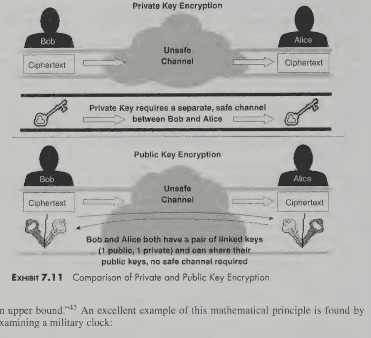

### 图表 7.11 私钥加密与公钥加密的对比

考虑一个使用军用时间的时钟，它的小时只在 0 到 23 之间计量，0 对应午夜，23 对应晚上 11 点。在这个系统中，从 3 点起向前推进 25 小时，不会到 28 点，而是绕一整圈到 4 点（因为 25 + 3 = 28，且 28 − 24 = 4）。在这种情况下，24 这个数（小时计量运算的上界）被称为模数。当涉及时钟小时的计算产生较大的数时，我们不断减去 24，直到得到 0 到 23 之间的整数，这一过程称为模约简。这一思想可以推广到不同大小的模数。44

Diffie-Hellman 协议允许两个用户在不安全的介质上交换对称密钥，而无需事先共享任何秘密。该协议有两个公开已知且广泛分发的系统参数：p 是一个长度为 1024 位的大素数，45；g 是小于 p 的整数。为简单起见，将要通信的两个用户分别称为 Alice 和 Bob。他们按如下步骤进行。

首先，Alice 生成随机私有值 a，Bob 生成随机私有值 b。a 和 b 都 [小于 p]。然后，他们利用参数 p、g 和自己的私有值推导出各自的公开值。Alice 的公开值是 g^a mod p，Bob 的公开值是 g^b mod p。然后他们交换各自公开值。最后，Alice 计算 g^{ab} = (g^b)^a mod p，Bob 计算 g^{ba} = (g^a)^b mod p。由于 g^{ab} = g^{ba} = k，Alice 和 Bob 现在拥有了共享密钥 k。46

该协议向密码学引入了离散对数问题这一概念。“离散对数问题表述如下：给定 g、p 和 g^x mod p，


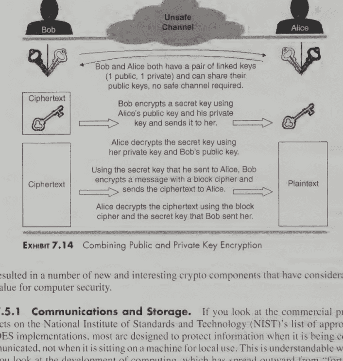

## 图表 7.14 组合使用公钥加密和私钥加密

催生了许多新的且有趣的加密组件，它们对计算机安全具有相当大的价值。

## 7.5.1 通信与存储

如果你查看美国国家标准与技术研究院（NIST）批准的 DES 实现清单中的商业产品，大多数产品旨在保护信息在通信过程中的安全，而不是保护信息在本地机器上使用时的安全。当你回顾计算技术的发展历程——从“堡垒式大型机”向外扩展——这一点就不难理解了。集中式数据存储设施本身就适合物理访问控制。对保存在围墙和上锁的门之后的数据进行加密，在这种场景下可能有些多余，尤其是当这种加密会带来性能损失时。

加密曾只用于保护传输中的数据，即在计算机之间、通过线缆传输的数据。这一理念也延伸到了网络上的文件服务器。服务器上的文件加密当时并未被视为优先事项，因为人们假设服务器会得到妥善保护。独立机器和可移动介质上的数据加密是相对较新的发展，尤其是随着越来越多的机密数据被装入物理体积越来越小的设备中。如今已有很多产品可以实现文件加密。

## 7.5.2 保护传输层安全

当今计算机安全中加密应用最明显的例子之一，就是人们在 Web 浏览器中看到的安全图标；参见图表 7.15 中的 Netscape Navigator 和 Microsoft Internet Explorer 示例。这就是所谓的传输层安全的一个实例，它使用的协议名为 SSL 和 TLS。

### 7.5.2.1 常用协议

SSL 代表安全套接层（Secure Sockets Layer），是由 Netscape 开发并最初在 Netscape 中实现的软件加密协议。它使用公钥密码学（如 RSA）进行身份验证。这种身份验证可以是可选的，但通常至少需要一方进行身份验证（例如，Yahoo! Travel 服务器向用户的浏览器客户端验证自身身份，但用户的客户端并不向 Yahoo! Travel 服务器验证自身身份——这一区别稍后会讨论）。

TLS 握手协议的第二和第三个基本属性是：可以安全地协商出一个共享密钥，即使攻击者能够将自己置于连接中间，也无法窃听该密钥；并且该协议的协商是可靠的。用 RFC 2246 的话来说：“任何攻击者都无法在不被通信双方察觉的情况下修改协商通信。”

TLS 可以使用多种加密算法。对于记录协议中作为组成部分的对称加密，可以使用 DES 或 RC4。这种对称加密的密钥是为每条连接唯一生成的，并基于另一种协议（如 TLS 握手协议）协商出的机密信息。记录协议包含使用带密钥的 MAC 进行的消息完整性检查，并使用诸如 SHA 和 MD5 之类的安全哈希函数进行 MAC 计算。特定连接所使用的加密套件在客户端和服务器之间的初始交换过程中指定，如图表 7.16 所示。

### 7.5.2.3 在现实世界中的检验

TLS/SSL 已被广泛使用并在现实世界中经过充分测试，也经过了真正的密码学家的深入探查。下面列出这些专家及其他专家指出的一些注意事项和局限性。首先，好的标准或好的设计并不能保证好的实现。例如，如果 TLS 使用了较弱的随机数种子，或者随机数生成器不够随机，那么设计的理论强度将无法保护那些可能因此受到危害的数据。（尽管这超出了本章的范围，但伪随机数生成器（PRNG）在许多密码操作中起着至关重要的作用，而且它们出奇地难以创建：除非它们能高度模拟真正的随机性，否则攻击者将能够预测它们生成的数字，从而使任何依赖其“随机”性质的方案失效。）

第二个重要的注意事项是，如果客户端没有数字证书，TLS 会话的客户端一侧就无法进行身份验证。这带来了许多问题。当今大多数“安全”的 Web 交易，从在 Yahoo Travel 预订的机票到大多数在线券商交易的股票，都代表着商家一方承担的计算风险。虽然进行购买的客户端可以通过商家证书确认 www.amazon.com 的商家确实是 Amazon，但商家却无法通过数字方式确认客户端计算机归属于正在购物的人，或由其操作。当然，还有其他保证手段，例如购买者提供的信用卡与其随附的其他个人详细信息（如账单地址）之间的匹配。但商家仍然面临拒付以及可能因欺诈交易而受到其他处罚的风险。

对于更大规模、更敏感的金融交易，对客户端身份进行确认的需求更大。数字证书是朝着正确方向迈出的一步，但许多商家尚未迈出这一步，原因有几个。一是向客户颁发证书的成本，二是将这些证书安装到客户系统中的难度。一些商家认为这些成本和精力是值得的。例如，苏格兰皇家银行早在 1998 年就在其网上银行系统中采用了这种方法。

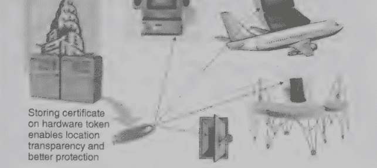

将证书存储在硬件令牌上可以实现位置透明性和更好的保护

## 图表 7.17 使用硬件令牌进行数字签名

还有其他问题。用户需要保护证书，即使是面对诸如硬件故障（用户重新格式化驱动器、丢失证书）或未经授权的使用（家庭成员使用计算机从而可以访问证书）等威胁。此外，用户需要能够移动证书，例如将其移到笔记本电脑上，以便在旅行时访问银行账户。显而易见的解决方案是将证书放在一个坚固的可移动介质上（参见图表 7.17）。这类介质通常被称为硬件令牌。目前尚未出现统一的令牌标准。智能卡是一个显而易见的选择，但需要部署读卡器。也有其他替代方案，例如将证书放在软盘上，或放在插入 USB 端口的小型钥匙扣上。

### 7.5.2.4 安全交易的成本

对于希望进行高安全交易的公司来说，在不进行客户端身份验证的情况下使用 SSL，至少在短期内、对于某些类别的交易而言，被证明是可以接受的。即便如此，无论是在金钱还是在处理能力方面，它都可能是昂贵的。尽管 TLS 是开放标准，并且 Netscape 已免费提供了该技术的关键部分，但仍然存在使用哪些算法的问题。有些算法比其他算法更昂贵，而且并不总是以显而易见的方式体现出来。例如，你必须为 RC4 获得许可，而 DES 是免费的，但 RC4 是为 32 位处理器优化的，而 DES 则不是。

此外，研究表明，当 Web 服务器处理的请求需要 TLS 时，其能处理的“点击量”会急剧下降（而当同时处理客户端身份验证和服务器身份验证时，下降幅度会更大）。这里的解决方案可能是专用硬件。IBM 和 Rainbow Technologies 等几家公司生产加密协处理器卡，可以减轻服务器 CPU 在处理加密所涉及的专门数学运算方面的负担。与增加另一台服务器来应对提供安全 Web 交易这一高要求任务相比，这些卡更便宜。

## 7.5.3 X.509v3 证书格式

> 几乎所有安全服务都依赖于通信双方的身份被可靠地获知，即身份验证。

当今计算机安全中广泛使用的另一个加密实例是 X.509。这不是什么尖端科技，而是一种数字证书标准，本章前面已经介绍过。国际电信联盟电信标准化部门（ITU-T）的 X.509 标准文档指出：“几乎所有安全服务都依赖于通信双方的身份被可靠地获知，即身份验证。”考虑一下这对 Web 交易的影响。前面一节描述了 SSL 如何加密


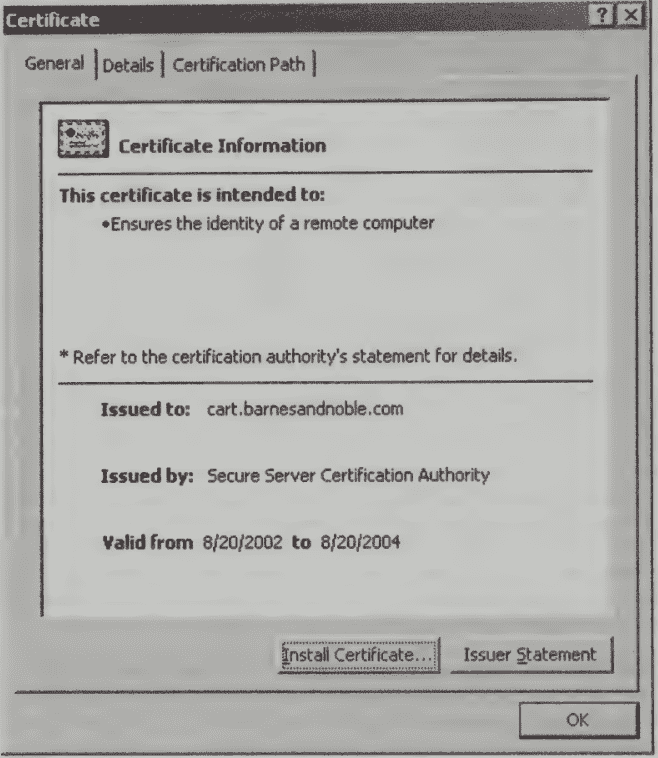

### 图示 7.18 数字证书

网页从 Web 服务器发送到 Web 客户端，反之亦然，但它无法保证相关方的身份。X.509 标准有助于解决此问题，而该问题会负面影响基于 Web 的企业的盈利能力。

当 Web 用户要求保证 bn.com 网站确实是 Barnes & Noble 时，可以通过数字证书提供（参见图示 7.18）。这意味着一个实体，即证书颁发机构（CA），已尽最大努力可靠地识别，并因此认证商户为加密密钥的合法所有者。该密钥是唯一且数学相关的公钥/私钥对的公钥部分，使得使用公钥加密的消息只能用相应的私钥解密。

个人以及商户都可以拥有公钥/私钥对。银行随后可以访问该公钥，并使用它加上银行的私钥来加密其通过 Web 发送给客户的账户详细信息。只有拥有正确私钥的客户才能使用银行的公钥解密此信息。同时，客户知道报表信息只能来自银行（否则银行的公钥将无法解密它）。客户还知道，

### 图示 7.19 X.509 证书格式

| 版本 | 标识证书格式 |
|---|---|
| 证书序列号 | 在颁发 CA 内部唯一的编号 |
| 签名算法标识符 | 标识用于签署证书的算法，以及任何必要的参数 |
| 颁发者 | 颁发 CA 的 X.500 名称 |
| 有效期 | 证书有效的日期对 |
| 主体 | 由证书认证的公钥对应的私钥持有者的 X.500 名称 |
| 主体公钥信息 | 主体的公钥，以及用于该公钥的算法的标识符 |

凭借加密的消息摘要（消息内容的数字指纹），他们从银行获得的数据未被篡改。因此，任何一方声称从未发生过都非常困难。通过这种方式，数字证书可以增强保密性、完整性和不可否认性。

## 7.5.3.1 ISO/IEC/ITU 9594-8 又称 X.509.

公钥的管理是公钥基础设施（PKI）的任务，X.509 标准是其重要组成部分。例如，组织的员工可以使用 PKI 在互联网上进行安全的业务通信，例如合同谈判。为了与某人进行安全交易，有必要找到并访问对方的公钥，反之亦然。解决方法是以数字证书的形式发布公钥，然后使用某种目录来定位它们。为了使不同系统能够互操作，已开发了目录的标准，尤其是 X.500。该标准应用了目录标准化的此类元素，如分层命名约定：

国家、组织、通用名称。
因此 Megabank 的 Fred Jones 可能具有 X.500 名称：
[Country = US, Organization = Megabank, Inc., Common Name = Fred Jones]

验证身份以定位数字证书是一种对标准的逻辑扩展，因此开发了 X.509，正式名称为 ITU-T X.509（前称 CCITT X.509）以及 ISO/IEC/ITU 9594-8。在 X.509 中定义了基本证书格式，由图示 7.19 所示的七个字段组成。

证书格式自 1988 年以来已 considerable 演变。原始格式现在称为 X.509v1。当 X.500 本身于 1993 年修订时，添加了两个字段以支持目录访问控制，从而产生 X.509v2 格式。X.509v2 为颁发者和主体添加了唯一标识符，可选的位串，用于在同一名称后来重新分配给不同实体时使颁发者和主体名称不含歧义。假设 Fred Jones，其分配的 X.500 名称如前所述，是 Megabank 的执行副总裁，但随后被竞争对手聘用。Megabank 取消了他的名称，但如果另一位 Fred Jones，一名程序员，随后加入 Megabank 工作，他实际上被重新分配了相同的 X.500 名称：

[Country = US, Organization = Megabank, Inc., Common Name = Fred Jones]

这给附加到 X.500 数据对象的任何访问控制列表带来了授权问题，因为很难识别授予特定用户名称特权的全部访问控制列表。X.509v2 中添加的唯一标识符字段提供了在名称被重用时放置新值的位置。事实上，更好的解决方案是在 X.500 名称中使用更好的区分符，例如：

[Common Name = Fred Jones, Employee Number = 1000002]

1993 年，当互联网隐私增强邮件（PEM）RFC 发布时，它们包含了基于 X.509v1 证书的公钥基础设施规范。然而，部署 PEM 的尝试揭示了版本 1 和 2 证书格式的缺陷。因此，ISO/IEC/ITU 和 ANSI X9 开发了 X.509v3 格式，通过提供扩展字段和 X.509v3 中更广泛的命名选项，大大扩展了格式的功能。

## 7.5.3.2 扩展标准.

在版本 3 中添加了扩展，以解决在实施版本 1 和 2 证书时发现的问题。这些可以在图示 7.20 的图表中看到。特定的扩展字段类型现在可以在标准中指定，或由任何组织或社区定义和注册。每个扩展字段都通过对象标识符分配类型，以与算法注册相同的方式注册。虽然理论上任何人都可以定义扩展类型，但为了实现实际互操作性，不同实现需要理解常见的扩展类型。因此，最重要的扩展类型是标准化的。但当 X.509v3 在封闭组中使用时——例如，

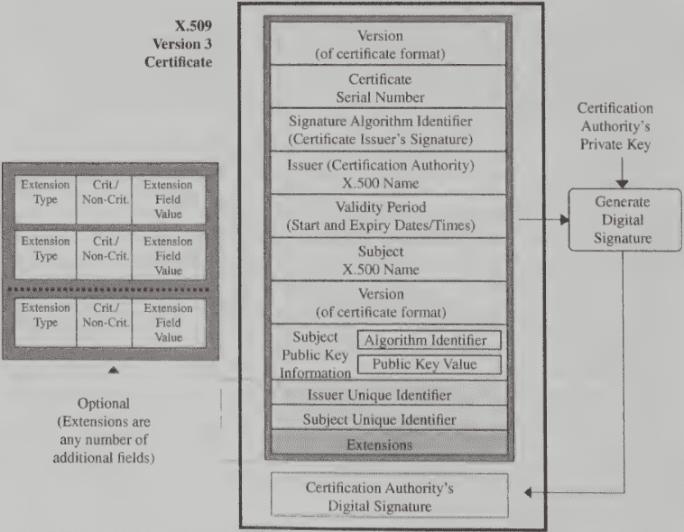

### 图示 7.20 X.509v3 证书

一组商业合作伙伴——可以定义唯一的扩展类型以满足特定需求。

## 7.5.3.3 X.509 来源、问题和 CA.

管理电子商务项目的人不一定需要详细了解 X.509，但至少应阅读 Arsenault 和 Turner 文档（参见本章末尾第 7.8 节“进一步阅读”）；它清楚地描述了不仅 X.509 而且它在 PKI 中扮演的角色（他们将其定义为“创建、管理和存储、分配和撤销基于公钥加密的证书所需的一组硬件、软件、人员、策略和程序”55）。VeriSign 的 Warwick Ford 的演示也非常有帮助，NIST 已将其在线发布在其网站上。对于想要更多细节的电子商务开发人员，下一步是 Ford 的书籍，由 VeriSign 同事执行官 Michael Baum 合著。Secure Electronic Commerce.56 这记录了 X.509 的其他重要方面，例如证书吊销列表，用于在证书过期前吊销证书（例如，如果私钥已被泄露）。一份标准的副本，可在线获得，位于国际电信联盟（ITU）网站（www.itu.int），也很有价值。

X.509v3 证书格式的扩展和改进大大提高了其有用性，但提供超越标准的统一方法确实引发了缺乏标准化的担忧。这是 IETF 的 PKIX 工作组正在解决的问题。而且在评估 X.509 作为安全技术时还有其他问题需要考虑，其中许多问题由 Meta-Certificate Group 的 Ed Gerck 提出。该组织网站上的文章指出，X.509 并未解决“验证证书中信息所需的努力程度”。57 换句话说，一些安全问题超出了 X.509 的范围，但在部署依赖这些证书的系统时仍需考虑。例如，如果为保证证书所有者和使用者身份而采取的措施与依赖证书所涉及的风险不成比例，则依赖数字证书是没有意义的。此外，不在双方都使用证书的交易仍将本质上存在问题。

这些问题指出了 CA 所扮演角色的重要性。如前所述，CA 是签发和签署证书的实体。每个都有一个列在证书中的公钥。CA 负责安排到期日期并在必要时吊销证书。CA 维护并发布证书吊销列表（CRL）。

换句话说，确保证书的有效性需要大量的维护。例如，如果证书被泄露或发现被欺诈性签发，CRL 至关重要。2001 年，VeriSign 的一些证书被发现错误地签发给冒充 Microsoft 的某人。由于一些计算机用户现在依赖证书来保证软件升级和组件的真实性，在下载经认证的代码之前未检查吊销列表可能会导致恶意代码攻击。

证书问题有可能产生广泛影响，因为证书中的权威是分层的，如图示 7.21 所示。当 CA 签发证书时，它用自己的密钥签署。任何依赖该 CA 签发证书的人都需要知道 CA 签发该证书的权威性是什么。为简化，有两种可能的答案。CA 是自认证的，即提供自己的“根”密钥，或它依赖另一个 CA 的根密钥。显然，任何对根密钥的破坏都会破坏所有从其获得权威的证书。

请参阅本手册第 37 章以获取有关 PKI 和 CA 的更广泛讨论。


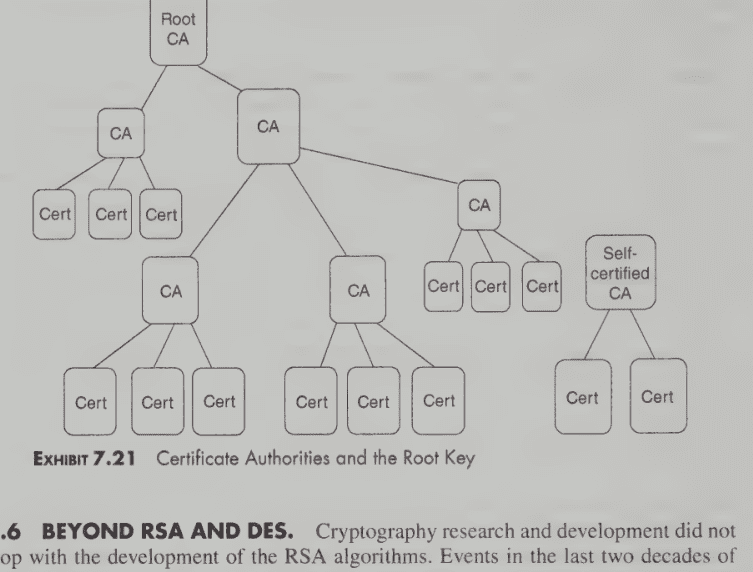

## 展品7.21 证书颁发机构与根密钥

## 7.6 超越RSA与DES

密码学的研究与发展并未止步于RSA算法的问世。本章最后一节将探讨二十世纪最后二十年和二十一世纪头十年发生的事件及其影响，并以关于实施加密的一些告诫作为收尾。

### 7.6.1 椭圆曲线密码学

1985年，华盛顿大学的尼尔·科布利茨和IBM的维克多·米勒各自独立发现了椭圆曲线系统在密码学中的应用。当应用于公钥密码学时，椭圆曲线运算相比第一代公钥技术（如Diffie-Hellman和RSA）具有某些优势。

椭圆曲线算法的安全性与Diffie-Hellman算法一样，都基于离散对数问题，如7.4.2节所述。椭圆曲线算法的优势在于达到特定安全级别所需的密钥长度。随着时间推移，为了应对窃听者和拥有更强计算资源的黑客所带来的不断演变的威胁，人们不断提高安全级别，椭圆曲线相比旧的第一代技术开始带来巨大的节省。58

直到2010年，公钥系统使用的密钥长度为1,024位或2,048位。NIST建议，2010年之后，这些系统应升级为能够提供足够安全性的系统。一种方法是增大使用的密钥长度。然而，现有的系统随着密钥长度的增大而变得越来越笨重。NSA认可椭圆曲线密码学，并在其网站上表示，它已经实施了椭圆曲线公钥密码系统，以保护机密和非机密信息。59 椭圆曲线系统提供了一种在需要更高安全性时适度增加密钥长度的方法。展品7.22显示了NIST推荐的RSA或Diffie-Hellman在保护各种长度的对称密钥时应使用的密钥长度，以及相应的椭圆曲线密钥长度。

## 展品7.22 NIST推荐的密钥长度

| 对称密钥长度（位） | RSA和Diffie-Hellman密钥长度（位） | 椭圆曲线密钥长度（位） |
|---|---|---|
| 80 | 1024 | 160 |
| 112 | 2048 | 224 |
| 128 | 3072 | 256 |
| 192 | 8192 | 384 |
| 256 | 15360 | 521 |

来源：美国国家安全局，“椭圆曲线密码学的理由”，www.nsa.gov/business/programs/elliptic_curve.shtml。

因此，为了使用RSA保护256位的AES密钥，应使用15,360位的密钥，这比目前整个互联网普遍使用的密钥长度大一个数量级。然而，椭圆曲线密钥仅需521位。椭圆曲线算法可以使用更小的密钥，因为随着密钥长度的增加，所涉及的数学使得逆运算（即解密）更加困难。⁶⁰

椭圆曲线的另一个吸引人之处在于，它们比当前的公钥密码学实现更高效；后者往往相对较慢，因此更多被用作密钥分发方法而非数据加密方法。展品7.23显示了展品7.22中列出的每种密钥长度下Diffie-Hellman计算与椭圆曲线计算的比率。⁶¹

### 7.6.2 RSA专利到期

2000年9月6日，RSA Security将RSA公钥加密算法释放到公有领域。这意味着任何人都可以创造包含该算法的产品（前提是自行实现，而非从RSA获得许可）。实际上，RSA Security放弃了在2000年9月6日之后发生的任何包含RSA算法的开发活动中强制执行专利的权利。RSA算法的美国专利实际上于2000年9月20日到期。结果是公钥加密得到了更广泛的应用，且成本更低。

RSA专利一直有些争议，因为它适用于数学概念，而大多数人想到发明时并不认为数学属于发明。专利所有者始终无法将保护范围扩展到美国以外。因此，基于RSA算法替代方案的公钥加密版本在国外被开发和销售，这些公司包括

## 展品7.23 Diffie-Hellman与椭圆曲线的相对计算成本

| 安全级别（位） | DH成本：EC成本之比 |
|---|---|
| 80 | 3:1 |
| 112 | 6:1 |
| 128 | 10:1 |
| 192 | 32:1 |
| 256 | 64:1 |

来源：美国国家安全局，“椭圆曲线密码学的理由”，www.nsa.gov/business/programs/elliptic_curve.shtml。

爱尔兰的Baltimore Technologies、芬兰的F-Secure和以色列的Algorithmic Research等公司。如今，加密公司可以省去维护其公钥产品多个版本（美国版和非美国版）的高昂成本。此外，美国公司可以开发和销售基于RSA的产品。大公司实际上可以基于一种经过验证且免版税的算法，为内部使用“自行研制”公钥加密方案。

### 7.6.3 DES被取代

RSA Security这家试图让RSA算法成为公钥加密代名词的公司，在2000年另一个里程碑式的密码学事件中发挥了主导作用，即为DES（数据加密标准）指定继任者。如前所述，EFF DES破解机等项目表明，一台造价不到25万美元的计算机可以在不到三天内破解DES加密的消息。事实上，这是RSA Security主办的“DES挑战赛”的一部分。DES挑战赛I由科罗拉多州拉夫兰的Rocke Verser赢得，他带领一群互联网用户进行了分布式暴力破解攻击。该项目代号为DESCHALL，始于1997年3月13日，大约90天后成功完成。DES挑战赛II包括两场比赛，分别于1998年1月13日和7月13日发布。第一场比赛由distributed.net协调的分布式计算工作破解，用时39天。第二场比赛则由EFF专门打造的DES破解机解决。

这些项目的作用是让人们关注对更强加密的需求。希望存档敏感数据的公司和政府机构需要这些数据在数十年内保持安全，而不仅仅是数天。然而，正如20世纪70年代所预测的那样，计算机能力的进步使DES——这一广泛使用的、构成DES基础的私钥算法——变得“过时”。当然，“过时”一词在此语境中是相对的。当应用需要在有限时间内加密批量数据以保持机密性时，DES并未过时，而且很多数据属于这一类。如展品7.24所示，时间、技术与任何密码系统提供的保护程度之间存在直接关系。

1997年，美国政府开始制定一种比DES更强大的标准，称为高级加密标准（AES）。这是一份联邦信息处理标准（FIPS）出版物。FIPS 197，规定“一种供美国政府组织用于保护敏感（非机密）信息的加密算法。”政府正确地预测到，AES将“被美国政府之外的组织、机构和个人——在某些情况下也包括美国境外——广泛自愿采用。”

本质上，举办了一场竞赛来寻找最适合该任务的算法，最终于2000年10月选定的获胜者是Rijndael（发音为“Rhine Doll”）。该算法由两位比利时密码学家Joan Daemen博士和Vincent Rijmen博士专门为AES开发。Rijndael是一种块密码，具有可变的分组长度和密钥长度。迄今为止，已经规定了128、192或256位的密钥长度，用于加密128、192或256位的分组。（密钥长度和分组长度的所有九种组合都是可能的。）然而，分组长度和密钥长度都可以很容易地以32位的倍数扩展。Rijndael可以非常高效地在硬件中实现，甚至在智能卡上也能实现。

### 7.6.4 量子密码学

计算的新基础将在未来几十年深刻影响密码学的强度。本节对量子计算和量子密码学的科学进行简要且非技术性的总结。

### 7.6.4.1 历史视角

本章的全部内容都聚焦于密码学的现状。经典计算机一直足以执行AES、RSA以及自密码学出现以来探索的所有密码系统和算法所需的计算和处理。尽管现代计算机与20世纪50年代的计算机基本相同，但我们今天使用的机器要快得多。62 尽管速度提高了，计算机的主要任务仍然不变：“将二进制位的编码操纵和解释为有用的计算结果。”63 为了不断推动计算机性能的边界，计算机科学家的目标一直是“减小现代处理器中使用的晶体管尺寸。”64

早期的计算机由门电路和由成千上万个分子构成的存储“位”组成。今天处理器的部件正朝着数百个分子的方向发展。计算行业一直都知道，小型化将遇到一个障碍，低于该障碍将无法构建电路，因为它们的基本物理行为将发生变化。65

现代计算机的部件正接近这一障碍；如果晶体管变得更小，它们将“最终达到单个元件不超过几个原子的程度。”66 计算机科学家担心这种不断缩小，因为在原子层面，量子力学的定律将支配电路的属性和行为，而不是经典力学的定律。67

科学家们并未完全理解量子力学这门科学；它最初被认为是计算机技术发展的一个主要限制。68 直到1982年，科学界才看到量子力学相关怪异效应带来的任何好处。那一年，理查德·费曼理论上构想了一种新型计算机，它将利用量子力学的效应并发挥这些效应的优势。69 1985年，牛津大学的大卫·多伊奇发表了一篇“开创性的理论论文，描述了任何物理过程如何（在理论上）使用量子计算系统得到完美建模。”70 他进一步论证，量子系统将能够执行任何现代计算机都无法完成的任务，例如真正的随机数生成。71 “此后


## 7.6.4.4 当前状况。

对一个1,000位的数字进行因式分解；量子计算机只需大约20分钟。92 这种量子算法对依赖因式分解难度来保证安全的经典算法（如广泛使用的RSA算法）影响巨大。“破解RSA编码系统的能力将使几乎所有当前通信渠道都不安全。”93

同样来自贝尔实验室的洛夫·格罗弗（Lov Grover）于1996年发明了第二种量子算法。格罗弗算法使量子计算机能够比现有任何能力都快得多地搜索各种数据库。格罗弗指出，当他的算法用于未排序的数据库时，能获得最大收益。94 平均而言，经典计算机在包含n条记录的数据库中查找特定条目需要n/2次搜索。而格罗弗算法只需进行n的平方根次搜索即可完成同样的搜索。例如，在一个包含100万条记录的数据库中，如今的计算机平均需要500,000次搜索才能找到正确答案；而使用格罗弗算法的量子计算机只需1,000次搜索。这可能对DES之类的对称密钥算法产生影响，因为该算法能够相当迅速地穷举搜索所有可能的密钥。95

受量子计算及相关算法对信息安全和密码学影响的鼓舞，世界各国政府正在资助构建实用量子计算系统的努力。美国有许多正在进行中的举措。2001年，国防部高级研究计划局（DARPA）启动了一项为期五年、耗资1亿美元的项目。此外，美国国家科学基金会已拨出800万美元的科研经费用于量子能力研究。DARPA的量子信息科学与技术计划现在将无限期存在；它于2006年成为一项资金充足、永久性的计划。96 其他许多政府，主要在欧洲和亚洲，也参与了量子计算的研究与开发。2000年，欧盟委员会启动了一项综合研究计划，三年预算为2000万美元。在日本，邮政省于2001年开始了一项将持续10年的计划，总预算为4亿美元。还有一些商业企业也参与了量子项目，包括IBM、贝尔实验室，以及日本公司富士通株式会社、日本电气株式会社和日本电报电话公司。97 这个列表绝非详尽无遗，因为世界各地的大学和其他组织都在全力开展研究工作。

由于全球范围内为更深入地理解量子计算所做的努力，已经取得了若干关键进展。1998年，洛斯阿拉莫斯国家实验室和麻省理工学院的研究人员成功地将一个量子比特扩展到某些类型分子的三个核自旋上。实验表明，将信息（量子比特）分散开来使其更难被破坏或退相干。研究人员利用一种称为核磁共振（NMR）的技术完成了这一壮举，该技术允许操纵和控制原子核的自旋。这项技术使研究人员能够利用纠缠特性来间接分析量子信息。98

2000年，IBM的研究人员开发了一台五量子比特计算机，同样使用液体原子核。原子核通过射频脉冲进行编程，然后用核磁共振技术检测。利用这项技术，该团队能够找到特定函数的周期，即其值重复的最短区间长度。这个问题在经典计算机上需要经过多次重复循环才能计算出：而IBM的团队只需一步就完成了。2001年，IBM和斯坦福大学的科学家联合演示了肖尔算法，并成功找到了15的质因数。这台七量子比特计算机正确推断出其质因数为3和5。99

2007年2月，一家名为D-Wave的加拿大公司声称展示了第一台商用量子计算机。它是一个“搭载16量子比特阵列的过冷超导铌芯片”。100 D-Wave在构建这台名为Orion的计算机时，选择不专注于密码学应用。相反，Orion将精力集中在解决模式匹配问题和非确定性多项式问题（NP完全问题）上。NP完全问题是包含搜索和优化问题的决策问题，当人们需要知道某个问题是否存在特定解时使用。此类问题的例子包括数据库搜索、模式匹配、根据症状识别疾病，以及寻找基因材料的匹配。101 该公司的演示是通过远程地点的电视信号进行的，因为这台机器十分敏感，而且运输冷却到略高于绝对零度的设备十分困难。尽管D-Wave进行了演示并提出了声明，科学家们仍怀疑Orion是否真正在执行量子计算。就连D-Wave的首席执行官也表示，尽管所有证据都表明Orion在执行量子计算，但仍存在一些不确定性。尽管如此，D-Wave宣布计划到2008年将Orion的量子比特数提升到1,000。102

2007年7月，来自美国国家标准与技术研究院（NIST）和英国卢瑟福阿普尔顿实验室的科学家联手探索磁性量子效应。该团队报告称，他们将“100个钇钡镍氧化物原子连接成一个量子自旋链，实际上将这个30纳米长的磁性分子变成了一个单一元素。”103 这一发现是向将量子比特置于固态电路上的重要一步。30纳米远超原子长度尺度，在原子水平之外看到量子相干性很不寻常。然而，该团队确实报告了在这种尺寸下存在稳定的相干态，而这个尺寸足以用于制造经典计算机电路板和导体的光刻技术。104

2013年4月，研究人员“成功地将安全量子码通过大气层从一架飞机传输到一个地面站。” 作者继续写道，

> “这表明量子密码学可以作为现有系统的扩展来实施，”LMU的塞巴斯蒂安·瑙尔特（Sebastian Nauert）表示。在实验中，单光子从飞机发送到地面的接收器。挑战在于确保光子能够精确地指向地面上的望远镜，尽管存在机械振动和空气湍流的影响。“借助快速可移动的镜子，在20公里的距离上实现了小于3米的瞄准精度，”德国航空航天中心（DLR）通信与导航研究所的项目负责人弗洛里安·莫尔（Florian Moll）报告说。有了这样的精度，就连威廉·退尔（William Tell）也能在500米的距离上射中儿子头上的苹果。
> 
> 就信号丢失率和空气湍流的影响而言，实验中遇到的条件与通过卫星传输的预期条件相当。飞机角速度的情况也是如此。因此，该实验的成功代表了向基于卫星的安全全球通信迈出的重要一步。105

即使有了上述进展，怀疑论者仍然认为，超越经典计算机的实用量子计算机仍需数年甚至数十年才能实现。在花了大量时间研究量子计算这一主题后，笔者（本文作者）的观点是，量子计算成为现实不是“是否”的问题，而是“何时”的问题。科学家们已经能够证明一些理论上的

仅由少数几个量子比特组成的系统上的量子计算前景十分广阔。然而，科学家们需要克服许多障碍。要执行有用的计算，将需要包含数百或数千个量子比特的系统。此外，需要精确的控制才能在避免退相干的同时完成操作；事实上，退相干或许是创建量子系统最大的障碍。除非科学家能够可靠地测量工作中量子比特产生的信息，否则在不久的将来不太可能建造出实用的量子系统。106

### 7.6.5 骗术因素

当加密供应商和密码学家着手处理新算法的实现和扩展测试时，有必要注意 AES 竞赛要求中的这段话：

> 应包含算法的完整书面规范，包括实现该算法所需的全部必要数学方程、表格、图表和参数。

换句话说，AES 如何实现保密并无秘密可言，正如 DES 的工作原理也并非秘密一样。这常常让密码学新手觉得不合逻辑。为什么不将算法保密呢？这样做肯定会使任何用它加密的消息更难被解密。并非如此。任何对算法保密性的依赖都会在安全链中插入一个薄弱环节。加密数据并不能保证其保持机密。密钥必须保密，而且必须验证请求授权访问的人员身份以确保其真实性，等等。公钥加密和私钥加密都是如此。

这一原则被称为柯克霍夫原则，源自军事密码学家奥古斯特·柯克霍夫于 1883 年发表的著作：

- 1. 该系统必须在实际上（即便不是在数学上）无法破译；
- 2. 它不必要求保密，并且落入敌人手中时不应造成不便；
- 3. 其密钥必须能在无需书面记录的情况下进行传递和保存，并且通信双方可以随意更换或修改；
- 4. 它必须适用于电报通信；
- 5. 它必须便于携带，其使用和功能不应需要多人协同；
- 6. 最后，鉴于使用条件的要求，系统必须易于使用，既不需要费神，也不需要记住一长串需要遵守的规则。107

依赖未经公开审查的算法毫无益处，尤其是在已有强大且经过审查的算法的情况下。要警惕那些声称基于秘密算法而拥有强大安全性的加密供应商，或任何安全产品的生产商。这种声明往往是骗术。（有关加密产品虚假声明的更多信息，请参阅本章末尾 7.8 节“延伸阅读”中柯廷的“Snake Oil FAQ”。）

## 7.7 隐写术

除了通过密码学对数据进行加扰之外，还可以将数据隐蔽地插入其他数据流中。隐写术（在希腊语中字面意思是“遮盖书写”）通常使用数据流（通常是图像）的低阶位来传递明文。在当今高分辨率的彩色图像表示中，修改像素的最低有效位对颜色的改变微不足道，至少对人眼来说是如此。隐写软件可以进行这些修改，然后从修改后的图像中提取信息。108

这类被修改过的图像很难识别，但依靠检测载体图像像素中异常模式的隐写检测工具确实存在。109 例如，Wetstone Technologies 公司的 StegoHunt™ 和 StegoAnalyst 软件可以识别和分析经过隐写修改的数据；StegoBreak 可以从载体文件中提取明文。110

## 7.8 延伸阅读

正如开头所述，本章并非要成为关于密码学的详尽论文，也非加密技术实施的完整指南。有许多资源可帮助读者加深对这一信息安全基础领域的理解。

### 书籍与文章

- Bishop, M. *Computer Security: Art and Science*. Upper Saddle River, NJ: Addison-Wesley/Pearson Education, 2003.
- Hinsley, F. H., and A. Stripp, eds. *Codebreakers: The Inside Story of Bletchley Park*. Oxford, UK: Oxford University Press, 2001.
- Cobb, C. *Cryptography for Dummies*. Hoboken, NJ: John Wiley & Sons, 2003.
- Gilbert, G., Y. S. Weinstein, and M. Hamrick. *Quantum Cryptography*. World Scientific Publications, 2013.
- Goldreich, O. *Foundations of Cryptography: Volume I, Basic Tools*. New York, NY: Cambridge University Press, 2007.
- Juels, Ari. “Encryption Basics.” In H. Bidgoli, ed., *Handbook of Information Security*, Vol. 2. Hoboken, NJ: John Wiley & Sons, 2006.
- Kahn, D. *The Codebreakers: The Comprehensive History of Secret Communication from Ancient Times to the Internet, Revised Edition*. New York: Scribner, 1996.
- Katz, J., and Y. Lindell. *Introduction to Modern Cryptography*, Second Edition. London: Chapman & Hall/CRC, 2014.
- Mao, W. *Modern Cryptography: Theory and Practice*. Upper Saddle River, NJ: Prentice-Hall, 2003.
- Mel, H. X., and D. Baker. *Cryptography Decrypted*. Addison-Wesley, Upper Saddle River, NJ 2000.
- Schneier, B. *Applied Cryptography: Protocols, Algorithms, and Source Code in C*, 2nd ed. New York, NY: John Wiley & Sons, 1996.
- Seberry, J., and J. Pieprzyk. *Cryptography: An Introduction to Computer Security*. Englewood Cliffs, NJ: Prentice-Hall, 1989.
- Spillman, R. J. *Classical and Contemporary Cryptology*. Upper Saddle River, NJ: Prentice-Hall, 2004.
- van Tilborg, H. C. A. & S. Jojodia, eds. *Encyclopedia of Cryptography and Security*, 2nd ed. Springer, 2013.
- Yan, S. Y. *Quantum Attacks on Public-Key Cryptosystems*. Springer, 2013.

### 网络资源

- Arsenault, A., and S. Turner. “Internet X.509 Public Key Infrastructure: PKIX Roadmap.” 2000; www.ietf.org/proceedings/00jul/I-D/pkix-roadmap-05.txt

- 9. Brad Stark, “A Closer Look at Cryptography,” Bucknell University, www.facstaff.bucknell.edu/udaepp/090/w3/brads.htm (URL inactive)
- 10. Kahn, Codebreakers, pp. 83–84.
- 11. “Time Table/Time-Travel through Cryptography and Cryptanalysis,” www.crypt-tool.com/menu_zeittafel.en.html
- 12. Oliver Pell, “Cryptology,” www.ridex.co.uk/cryptology/#_Toc439908853
- 13. “Time Table/Time-Travel.”
- 14. Encyclopaedia Britannica Online Academic Edition, s.v. “cryptology.”
- 15. Encyclopaedia Britannica Online Academic Edition, s.v. “cryptology.”
- 16. Kahn, Codebreakers, p. 107.
- 17. Encyclopedia Britannica Online Academic Edition, s.v. “cryptology.”
- 18. National Security Agency. “The Rare Books Collection: Giovanni Battista Porta,” www.nsa.gov/about/cryptologic_heritage/center_crypt_history/publications/rare_books.shtml#giovanni
- 19. D. Salomon, Coding for Data and Computer Communications (New York: Springer, 2005), p. 218; http://tinyurl.com/2dsmc8
- 20. Encyclopedia Britannica Online Academic Edition, s.v. “cryptology.”
- 21. Stallings, W. Network and Internetwork Security Principles and Practices. Prentice-Hall, January, 1995
- 22. Kevin Romano, “The Stager Ciphers and the US Military’s First Cryptographic System,” www.gordon.army.mil/AC/Wntr02/stager.htm
- 23. Cypher Research Laboratories, “A Brief History of Cryptography,” www.cypher.com.au/crypto_history.htm
- 24. National Archives, “Teaching with Documents: The Zimmermann Telegram,” www.archives.gov/education/lessons/zimmermann
- 25. National Archives, “Teaching with Documents.”
- 26. Jacob Mathai, “History of Cryptography and Secrecy Systems,” Fordham University, www.dsm.fordham.edu/~mathai/crypto.html#ENIGMA
- 27. Judson Knight, “Cryptology, History,” www.espionageinfo.com/Cou-De/Cryptology-History.html
- 28. Knight, “Cryptology, History.”
- 29. Oli Cooper, “Cryptography,” University of Bristol, www.cs.bris.ac.uk/cooper/Cryptography/crypto.html
- 30. Cooper, “Cryptology.”
- 31. Kahn, Codebreakers,
- 32. Kahn, Codebreakers,
- 33. Jacob Mathai, “History of Cryptography and Secrecy Systems,” Fordham University, www.dsm.fordham.edu/~mathai/crypto.html#OneTimePad
- 34. Stallings, “Network and Internetwork Security”
- 35. SCI.CRYPT FAQ §5.2, www.faqs.org/faqs/cryptography-faq/part5
- 36. Kahn, Codebreakers, p. 979.
- 37. Ari Juels, “Encryption Basics,” in Handbook of Information Security, Vol. 2, ed. H. Bidgoli, (Hoboken, NJ: John Wiley & Sons, 2006), p. 980.
- 38. Juels, “Encryption Basics,” p. 981.
- 39. Juels, “Encryption Basics,” p. 471.


- 71. Bone, “搭车客指南。”
- 72. West, “量子计算机。”
- 73. 《美国传统英语词典》® 第四版，s.v. “量子”， http://dictionary.reference.com/browse/quantum
- 74. Genomics and Proteomics, “术语表：量子力学”， www.genpromag.com/Glossary.aspx?LETTER=Q （网址已失效）
- 75. Stephen Jenkins, “关于量子力学的基本概念”，埃克塞特大学， newton.ex.ac.uk/research/qsystems/people/jenkins/mbody/mbody2.html
- 76. West, “量子计算机。”
- 77. Bone and Castro, “简史。”
- 78. Bonsor and Strickland, “量子计算机的工作原理”， computer.howstuffworks.com/quantum-computer3.htm
- 79. Bone and Castro, “简史。”
- 80. Duncan McKimm, “量子纠缠”， www.abc.net.au/science/features/quantum
- 81. West, “量子计算机。”
- 82. Bone and Castro, “简史。”
- 83. Bone and Castro, “简史。”
- 84. Bone and Castro, “简史。”
- 85. Bone and Castro, “简史。”
- 86. Bonsor and Strickland, “量子计算机的工作原理。”
- 87. SearchSMB.com, “纠缠”。 http://searchcio-midmarket.techtarget.com/definition/entanglement
- 88. McKimm, “量子纠缠。”
- 89. SearchSMB.com, “纠缠。”
- 90. Bone and Castro, “简史。”
- 91. Bone and Castro, “简史。”
- 92. Bone and Castro, “简史。”
- 93. Bone, “搭车客指南。”
- 94. Lov Grover, “什么是量子电话簿？” www.bell-labs.com/user/feature/archives/lkgrover
- 95. Bone and Castro, “简史。”
- 96. Confidential Source #3, “量子计算”，内部研究分支网站，2007年8月10日。
- 97. Confidential Source #3, “量子计算。”
- 98. West, “量子计算机。”
- 99. Bonsor and Strickland, “量子计算机的工作原理。”
- 100. R. Colin Johnson, “量子计算机‘Orion’发布”，EETimes， www.eetimes.com/electronics-news/4069654/Quantum-computer-Orion-debuts
- 101. Johnson, “量子计算机‘Orion’发布。”
- 102. Jordan Robertson, “科学家对量子计算机声明表示怀疑”， abcnews.go.com/Technology/wireStory?id=2875656。
- 103. R. Colin Johnson, “观测到电路尺寸的量子效应”，EETimes， www.eetimes.com/electronics-news/4073585/Circuit-sized-quantum-effect-observed
- 104. Johnson, “观测到电路尺寸的量子效应。”
- 105. ScienceDaily. “量子密码学：光之翼上”。 ScienceDaily Science News. 2013年4月13日。 www.sciencedaily.com/releases/2013/04/130403071950.htm （访问于2013年5月16日）。
- 106. Johnson, “观测到电路尺寸的量子效应。”
- 107. Petitcolas, Fabien. 军事密码学。 2012。 www.petitcolas.net/fabien/kerckhoffs/#english （访问于2013年5月21日）。
- 108. Kessler, Gary C. 隐写术：在数据中隐藏数据。 2002。 www.garykessler.net/library/steganography.html （访问于2013年5月21日）。
- 109. National Institute of Justice. 数字证据分析：隐写术检测。 2010年11月5日。 www.nij.gov/topics/forensics/evidence/digital/analysis/steganography.htm （访问于2013年5月21日）。
- 110. Wetstone Technologies. “StegoHunt”。 Wetstone. 2013。 www.wetstonetech.com/product/stegohunt/ （访问于2013年5月21日）。

## 用于计算机安全事件信息的通用语言

John D. Howard

| 章节 | 标题 | 页码 |
|---|---|---|
| 8.1 | 引言 | 8-1 |
| 8.2 | 为什么需要通用语言 | 8-2 |
| 8.3 | 通用语言的开发 | 8-3 |
| 8.4 | 计算机安全事件信息分类法 | 8-4 |
| 8.4.1 | 事件 | 8-4 |
| 8.4.2 | 攻击 | 8-11 |
| 8.4.3 | 完整事件信息分类法 | 8-15 |
| 8.5 | 附加事件信息术语 | 8-16 |
| 8.5.1 | 成功与失败 | 8-17 |
| 8.5.2 | 站点和站点名称 | 8-17 |
| 8.5.3 | 其他事件术语 | 8-17 |
| 8.6 | 如何使用通用语言 | 8-18 |
| 8.7 | 注释 | 8-20 |

### 8.1 引言

计算机安全事件是一组涉及一个或多个站点上的攻击或一系列攻击的事件。 （请参阅第8.4.3节，了解术语“事件”的更正式定义。）处理这些事件对于各个层面的计算机安全个人和组织而言是不可避免的。 处理这些事件的一个主要部分是记录和接收事件信息，这几乎总是以相对非结构化的文本文件的形式出现。 随着时间的推移，这些文件最终可能包含大量非常有价值的信息。 不幸的是，信息的非结构化形式往往使事件信息难以管理和使用。

本章介绍了过去几年中为处理这些非结构化计算机安全事件记录而开发和提出的方法的几项努力的结果。 具体来说，本章介绍了一种工具，旨在帮助个人和组织记录、理解和共享计算机安全事件信息。 我们称该工具为计算机安全事件信息的通用语言。 该通用语言包含两个部分：

- 1. 一套“高层”事件相关术语
- 2. 一种对事件信息进行分类的方法（分类法）

### 8.2 为什么需要通用语言

这种临时术语和收集、组织、评估和交换计算机安全信息的方式已不再足够。 参与的人和组织太多了，而且需要理解和共享的信息也太多了。 如今，计算机安全是一个日益重要、相关且复杂的学习领域。 众多个人和组织现在定期收集和传播计算机安全信息。 这种信息范围从计算机和网络的安全特性和漏洞，到安全事件期间人员和系统的行为——信息太多，无法让每个个人和组织都有自己的独特语言。

在任何探究领域实现系统性进展的关键要素之一是开发该领域中使用的一致的术语和分类法（分类原则）集合。³ 这是一个必要且自然的过程，导致形成日益增长的通用语言，从而能够收集、交换和比较信息。 换句话说，像计算机安全这样的探究领域发展得越多，就越需要通用语言来相互理解和交流。

### 8.3 通用语言的开发

在开发计算机安全事件信息的通用语言的过程中，两个更重要的工作是（1）1997年完成的一项对超过4,300起互联网安全事件进行分类的项目。⁴ 和（2）1997年和1998年举办的一系列名为通用语言项目的研讨会。 研讨会参与者主要来自加利福尼亚州利弗莫尔的桑迪亚国家实验室的安全和网络研究小组，以及宾夕法尼亚州匹兹堡卡内基梅隆大学软件工程研究所的CERT/CC。 美国国防部（DoD）和国家标准与技术研究所（NIST）的人员提供了额外的参与和审查。

这些开发通用语言的努力并不是为了开发一个全面的术语词典。 相反，参与者试图开发一套最小的“高层”术语来描述计算机安全攻击和事件，以及这些术语的结构和分类方案（分类法），可用于对计算机安全攻击和事件信息进行分类、理解、交换和比较。

研讨会参与者希望这种通用语言由于其有用性而获得广泛接受。 已经有证据表明这种接受正在发生，特别是在事件响应团队和国防部中。

为了完整、合乎逻辑且有用，计算机安全事件信息的通用语言最初主要基于理论（即先验或非经验性）。⁵ 然后使用实际互联网安全事件信息的分类来完善和扩展该语言。 更具体地说，通用语言的开发分为六个阶段：

- 1. 检查了CERT/CC从1988年到1995年收到的事件记录，以建立用于描述计算机安全事件的初步术语列表。
- 2. 将此列表中的术语及其定义组合成一个结构（初步分类法）。
- 3. 使用此初步分类法对1988年至1995年的事件记录中的信息进行分类。
- 4. 1997年发表了初步分类法和分类结果。⁶


在一次事件中，攻击者可能会使用在互联网主机计算机上运行的进程，该进程捕获在互联网上传输的明文中的用户名、密码和IP地址组合。攻击者随后可以使用这些捕获的信息对属于其他用户账户进行身份验证（登录）。需要指出的是，正如前面提到的，这一行为仍然被视为身份验证，因为攻击者提供了有效的身份识别和验证配对，即使这些配对已被窃取。

第二种可能用于击败身份验证流程的方法是利用漏洞以绕过身份验证流程并访问目标。绕过是通过使用替代方法访问目标来避免流程所采取的行动。例如，一些操作系统存在漏洞，攻击者可以利用这些漏洞在未实际登录特权账户的情况下获得权限。

正如关于身份验证所讨论的那样，绕过行为并不一定表示该行为未经授权。例如，一些程序员发现拥有进入账户或运行进程的快捷方式（“后门”）方法很有用，尤其是在开发期间。在这种情况下，绕过行为可能被视为已授权。

身份验证和绕过是与用户自我识别相关的行为。在网络通信中，进程也会相互识别。例如，在网络上传输的每个信息数据包都包含标识源和目的地的地址以及其他信息。这些通信中的“正确”信息被认为是理所当然的，因为它是自动生成的。因此，列表中没有包含用于描述这种正常情况的行为。然而，错误信息也可能被输入到这些通信中。提供此类虚假信息通常被称为欺骗行为。示例包括 IP 欺骗、邮件欺骗和域名系统（DNS）欺骗。

> 欺骗是一种主动的安全攻击，其中网络上的某一台机器冒充另一台机器。……[它]会破坏数据的正常流动，并可能涉及向其他机器之间的通信链路注入数据。这种伪装旨在欺骗网络上的其他机器接受冒名者为正品，要么引诱其他机器向其发送数据，要么允许其篡改数据。13

一些行为与计算机或网络上找到的数据密切相关，特别是文件：读取、复制、修改、窃取和删除。这些术语存在一些混淆，因为它们在描述物理世界时的常用用法有时与描述电子世界时的常用用法不同。例如，如果我说攻击者窃取了一台计算机，那么你可以认为我的意思是攻击者占有了目标（计算机），并且没有在该位置留下相同的计算机。然而，如果我说攻击者窃取了一个计算机文件，这实际上意味着什么？通常被理解为攻击者复制了文件并现在拥有了一份副本，但同时也意味着原始文件仍在其原始位置。换句话说，“窃取”在物理世界中的含义有时与在电子世界中的含义不同。

物理世界和电子世界中行为含义存在差异令人困惑。研讨会参与者试图通过仔细定义每个术语（读取、复制、修改、窃取或删除），使其具有非常具体且互斥的含义，并在最大程度上与物理世界的含义相匹配，来调和这些差异。

读取被定义为获取文件或其他数据介质中包含的数据内容的行为。该行为在概念上与读取可能需要的实际物理步骤有所区别。例如，在读取计算机文件的过程中，文件可能从存储位置复制到计算机的主内存中，然后显示在监视器上供用户阅读。这些物理步骤（将文件复制到内存然后复制到监视器）不属于读取的抽象概念的一部分。换句话说，要读取目标（获取其中的内容），复制文件并非必需，并且在概念上也不包含在我们的读取定义中。

同样的概念分离也包含在“复制”一词的定义中。在这种情况下，我们指的是在不删除原稿的情况下获取目标的副本。“复制”一词并不意味着目标中的内容被获取，只是意味着已制作并获取了副本。要获取内容，文件必须被读取。一个例子是从硬盘复制文件到软盘。这种复制是通过复制原始文件同时保持原始文件完整来完成的。用户必须打开文件并查看内容才能读取它。

复制和读取都是与窃取不同的概念，窃取是指攻击者占有目标并且目标对原始所有者或用户变得不可用的行为。该定义与我们关于物理财产的概念一致，特别是只有一个不可复制的对象。例如，如果有人偷了一辆车，那么那个人就剥夺了所有者的占有。当处理电子形式的财产时，例如计算机文件，通常使用“窃取”一词，而实际上指的是复制。“窃取”一词 specifically 意味着原始所有者或用户被拒绝访问或使用目标。另一方面，窃取也可能意味着物理上拿走存储有文件的软盘或窃取整台计算机。

另外两种行为涉及以某种方式改变目标。首先是修改目标的行为。示例包括更改文件的内容、更改账户的密码、发送命令以更改操作进程的特征，或向现有系统添加组件。如果目标被完全消除，则使用“删除”一词来描述该行为。

正如前面所述，物理世界和电子世界之间术语用法的差异是不受欢迎的。因此，我们尝试在用词上具体且一致。所得术语集合是详尽且互斥的，但在电子世界的某些常用用法中与之相悖，特别是关于“窃取”一词。情况似乎不可避免。以下是一些可能澄清术语的示例：

- 用户使用浏览器点击链接并在计算机屏幕上看到网页内容。我们会将此归类为读取。虽然实际发生的情况是网页内容存储在易失性内存中，复制到硬盘缓存中并显示在屏幕上，但从逻辑（即用户）角度来看，网页并未被复制（也未被窃取）。现在，如果用户将网页内容复制到文件或打印出来，那么用户就复制了网页。同样，这也是从用户角度出发对该行为的逻辑分类。

- 用户复制了一个加密的文件。我们会将其归类为复制，而非读取。在这种情况下，文件被复制，但内容未被获取，因此未被读取。

- 用户删除密码或组文件中的数个条目。这一行为应被描述为多次删除操作还是一个修改操作？我们会将此行为描述为修改，目标是数据。这里没有歧义，因为“数据”的定义。数据被定义为静止文件或传输中的文件（见下一节）。如果用户从密码文件中删除一行，则文件已被修改。该行为只有在


整个文件被删除了。如果我们把数据定义为包含文件的一部分，那么确实会产生歧义。

- 用户复制一个文件并删除原件。我们会将其归类为*窃取*。虽然步骤实际上包括*复制*后跟*删除*，但这是窃取文件的电子方式，因此将动作描述为*窃取*更具描述性。

实际上，“窃取”一词很少被（正确地）使用，因为复制文件的攻击者通常不会删除原件。“窃取”一词经常被*错误地*使用，例如“窃取源代码”，而实际上正确的术语是*复制*。

动作列表在纳入通用语言之前，经过多年多次小组讨论的反复推敲。参与这些讨论的大多数人对该列表并不完全满意，但它是我们迄今所见的最佳方案。具体来说，该列表似乎涵盖了所有常见术语及其常见用法（*探测*、*扫描*、*洪泛*、*欺骗*、*复制*、*修改*和*删除*），而其他术语（对参与讨论组的人来说）是合乎逻辑的，并且是使动作类别详尽无遗所必需的（*认证*、*绕过*、*读取*和*窃取*）。

以下是我们对图表8.1中所示动作的定义摘要。

- **探测**——访问目标以确定其一个或多个特征。
- **扫描**——系统地访问一组目标，以识别哪些目标具有一个或多个特定特征。¹⁴
- **洪泛**——重复访问目标以使目标容量过载。
- **认证**——向进程提供身份，并在需要时验证该身份，以便访问目标。¹⁵
- **绕过**——通过使用替代方法访问目标来避开进程。¹⁶
- **欺骗**——在网络通信中通过呈现不同实体的外观来进行伪装。¹⁷
- **读取**——获取存储设备或其他数据介质中数据的内容。¹⁸
- **复制**——复制目标，同时保持原始目标不变。¹⁹
- **窃取**——占有目标而不在原始位置留下副本。
- **修改**——更改目标的内容或特征。²⁰
- **删除**——移除目标或使其无法检索。²¹

## 8.4.1.2 目标。

动作被认为指向七类目标。其中前三类是“逻辑”实体（*账户*、*进程*和*数据*），其余四类是“物理”实体（*组件*、*计算机*、*网络*和*互联网络*）。

在多用户环境中，*账户*是单个用户的域。该域包括用户被授权访问和使用的文件和进程。一个特殊程序记录用户的账户名、密码和使用限制，控制对用户账户的访问。某些账户具有增强或特殊权限，允许访问系统账户、其他用户账户或系统文件和进程，通常被称为*特权*、*超级用户*、*管理员*或*根*账户。

有时动作可能指向*进程*，即在计算机或网络上执行的程序。除了程序本身，进程还包括程序的数据和堆栈；其程序计数器、堆栈指针和其他寄存器；以及执行程序所需的所有其他信息。²² 然后动作可能是向进程提供信息或以某种方式命令进程。

动作的目标可能是计算机或网络上发现的数据。数据是以适合用户或进程使用的形式对事实、概念或指令的表示。数据可能以两种形式存在：文件或传输中的数据。文件是由名称指定并被用户或进程视为一个单元的数据。通常我们认为文件位于存储介质（如存储磁盘）上，但文件也可能位于计算机的易失性或非易失性存储器中。传输中的数据是通过网络传输或以其他方式从某个源发出的数据。后者的示例包括计算机中设备之间传输的数据，以及计算机显示器、存储设备、处理器、网络传输介质等周围的电磁场中发现的数据。

有时我们将动作的目标概念化为不是逻辑实体（账户、进程或数据），而是物理实体。最小的物理实体是组件，它是构成计算机或网络的部分之一。网络是一组互连或相关的计算机，以及适当的交换元件和互连分支。当计算机连接到网络时，有时称为主机。如果网络相互连接，则有时称为互联网络。

以下是我们对图表8.1中所示目标的定义摘要。

- **账户**——计算机或网络上用户访问的域，根据包含用户账户名、密码和使用限制的信息记录进行控制。
- **进程**——正在执行的程序，由可执行程序、程序的数据和堆栈、其程序计数器、堆栈指针和其他寄存器，以及执行程序所需的所有其他信息组成。
- **数据**——以适合人类或自动手段进行通信、解释或处理的方式对事实、概念或指令的表示。数据可以以计算机易失性存储器或非易失性存储器中的文件形式存在，或存储在数据存储设备中，或以传输介质中传输的数据形式存在。
- **组件**——构成计算机或网络的部分之一。
- **计算机**——由多个相关组件（包括处理单元和外围单元）组成的设备，由内部存储的程序控制，并且可以在执行期间无需人工干预的情况下执行大量计算，包括大量算术运算或逻辑运算。注意：可以是独立的，也可以由多个互连单元组成。
- **网络**——主机、交换元件和互连分支的互连或相关组。
- **互联网络**——网络的网络。

## 8.4.2 攻击。

有时，计算机或网络上发生的事件是一系列步骤的一部分，这些步骤旨在导致某些未授权的事情发生。该事件随后被视为攻击的一部分。攻击有三个要素。

1. 它由攻击者采取的一系列步骤组成。在这些步骤中，有一个针对目标的动作（如前一节所述的事件），以及使用某种工具来利用漏洞。
2. 攻击旨在从相关系统的所有者或管理员的视角实现未授权的结果。
3. 攻击是攻击者发起的一系列有意步骤。这将攻击与无意事件区分开来。

我们这样定义攻击：

**攻击**——攻击者为达到未授权结果而采取的一系列步骤。

图表8.3根据我们的经验呈现了可能的攻击矩阵。攻击有五个部分，描绘了攻击者必须采取的逻辑步骤。攻击者使用（1）工具利用（2）漏洞，对（4）目标执行（3）动作，以达到（5）未授权结果。要成功，攻击者必须找到一条或多条可以连接（攻击）的路径，可能是同时或重复的。攻击中的前两个步骤，工具和漏洞，用于在计算机或网络上引起事件（针对目标的动作）。成功攻击的逻辑终点是未授权结果。如果前面步骤的逻辑终点是授权结果，则攻击没有发生。

授权与未授权的概念是理解攻击与正常事件区别的关键。它也是一个依赖于系统的概念，因为在一个系统上可能被授权的内容在另一个系统上可能是未授权的。

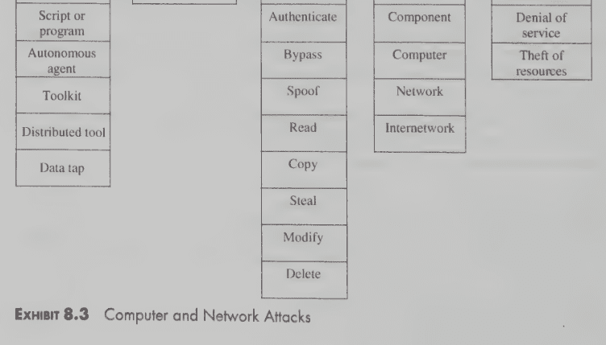


例如，一些服务，例如匿名文件传输协议（FTP），可能在某些系统上启用，而在其他系统上未启用。

即使通常被视为敌对的行为，例如试图绕过访问控制以进入特权账户，在特殊情况下也可能被授权，例如在经批准的系统安全测试期间或在开发期间使用“后门”。

系统所有者或其管理员通过制定安全策略来确定他们认为对其系统授权的行为。29 以下是“授权”和“未授权”的定义。

**Authorized**—经所有者或管理员批准。
**Unauthorized**—未获所有者或管理员批准。

图 8.1 中的步骤 *action* 和 *target* 是第 8.4.1 节中讨论的事件的两个部分。以下各节讨论其他步骤：*tool*、*vulnerability* 和 *unauthorized result*。

### 8.4.2.1 Tool.

导致攻击者获得未授权结果的序列中的第一步是攻击中使用的 *tool*。工具是可用于利用计算机或网络漏洞的某种手段。有时工具很简单，例如用户命令或物理攻击。其他工具可能非常复杂和精细，例如特洛伊木马程序、计算机病毒或分布式工具。我们以这种方式定义 *tool*。

**Tool**—利用计算机或网络漏洞的手段。

由于可用于利用计算机和网络漏洞的方法种类繁多，“tool”一词难以更具体地定义。当作者列出攻击方法时，通常实际上是在列出工具。根据我们的经验，这些工具类别目前是一个详尽的列表。（参见图 8.3）

- **Physical attack**—通过物理方式窃取或损坏计算机、网络、其组件或其支持系统（例如，空调、电力等）的手段。
- **Information exchange**—获取信息的手段，无论是从其他攻击者（例如通过电子公告板）还是从被攻击的人（通常称为社会工程）获取。
- **User command**—通过在进程接口处直接用户输入向进程输入命令来利用漏洞的手段。示例是通过 telnet 连接输入 UNIX 命令或在协议端口输入命令。
- **Script or program**—通过执行命令文件（脚本）或在进程接口处运行程序向进程输入命令来利用漏洞的手段。示例是利用软件漏洞的 shell 脚本、特洛伊木马登录程序或密码破解程序。
- **Autonomous agent**—通过使用独立于用户的程序或程序片段来利用漏洞的手段。示例是计算机病毒或蠕虫。

服务拒绝—故意降低或阻止计算机或网络资源。

资源盗窃—未经授权使用计算机或网络资源。

## 8.4.3 完整事件信息分类法。

通常，针对计算机和网络的攻击会以一种独特的群体出现，我们将其归类为一个事件的一部分。使这些攻击成为独特群体的是三种因素的组合，我们对其中每一种可能只有部分信息。

- 1. 可能只有一个攻击者，也可能有几个以某种方式相关的攻击者。
- 2. 攻击者可能使用类似的攻击，或者他们可能试图实现不同或相似的目标。
- 3. 攻击涉及的站点和攻击的时间可能相同或可能相关。

以下是事件的定义：

Incident—攻击者、攻击、目标、站点和时间上的独特性使其有别于其他攻击的攻击组。

事件的三个部分以简化形式在图 8.4 中显示，其中显示攻击者或一组攻击者通过执行攻击来实现目标。事件可能包含一次攻击或多次攻击，如图中返回循环所示。

图 8.5 显示了完整的事件信息分类法。它显示了事件与攻击以及攻击与事件之间的关系，并表明可通过确保攻击者无法通过所描绘的七个步骤建立任何完整连接来防止攻击者实现目标。例如，可以对涉嫌恐怖主义攻击者进行调查，系统可以定期搜索攻击者工具，系统漏洞可以得到修补，访问控制可以加强以防止攻击者访问目标账户，文件可以加密以避免泄露，并可启动公众教育计划以防止恐怖分子实现政治利益目标。

### 8.4.3.1 攻击者及其目标

人们攻击计算机。他们通过各种方法并出于各种目标进行攻击。区分攻击者类别的是他们是谁以及他们的目标（他们想要实现什么）的组合。

Attacker—试图进行一次或多次攻击以实现目标的个人。

Objective—事件的目的或最终目标。

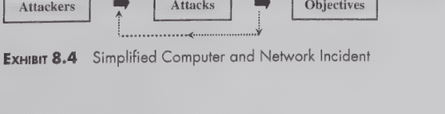

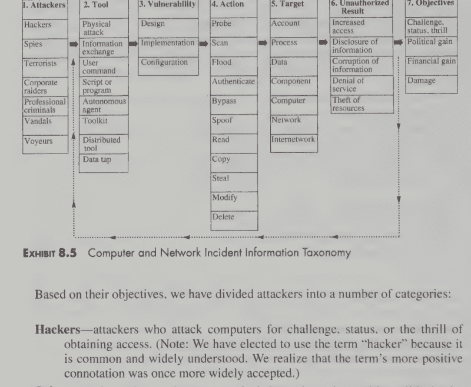

### 图 8.5 计算机和网络事件信息分类法

根据他们的目标，我们将攻击者分为若干类别：

- **Hackers**—出于挑战、地位或获得访问的刺激而攻击计算机的攻击者。（注：我们选择使用“hacker”一词，因为它很常见且被广泛理解。我们意识到该词更积极的含义曾经被更广泛接受。）
- **Spies**—为获取用于政治利益的信息而攻击计算机的攻击者。
- **Terrorists**—为制造恐惧、谋取政治利益而攻击计算机的攻击者。
- **Corporate raiders**—为谋取经济利益而攻击竞争对手计算机的员工（攻击者）。
- **Professional criminals**—为个人经济利益而攻击计算机的攻击者。
- **Vandals**—为造成破坏而攻击计算机的攻击者。
- **Voyeurs**—为获得敏感信息的刺激而攻击计算机的攻击者。

图 8.5 中左块和右块所示的这七类攻击者及其四类目标是事件与攻击之间差异的基础。这种差异可以用“攻击者使用攻击来实现目标”这一短语概括。

## 8.5 其他事件信息术语

上一节的分类法列出了计算机安全通用语言中描述攻击者在事件期间如何实现目标的所有术语。然而，完全描述事件还需要一些其他、更一般的术语。下一节将讨论这些术语。

### 8.5.1 信息发布

例如，可以用数字和顶级域名（如 123.com）替换站点名称，例如虚构的 widgets.com。

响应团队经常使用事件编号来跟踪事件并识别事件信息。

Incident number—用于跟踪事件或识别事件信息的参考编号。

我们发现的最后一个有用术语是纠正措施，指事件发生后采取的行动。这些行动可能包括更改密码、重新加载系统文件、与入侵者交谈，甚至刑事起诉。事件响应团队很难获得事件期间或之后采取的纠正措施的信息，因为响应团队的参与通常仅限于事件的早期阶段。CERT/CC 记录表明纠正措施的种类繁多，建立纠正措施的分类法可能是通用语言未来可取的扩展。

Corrective action—事件期间或之后采取的行动，以防止进一步攻击、修复损害或惩罚违法者。

## 8.6 如何使用通用语言

关于使用计算机安全事件信息的通用语言，有两点很重要。首先，通用语言确实是一组高级术语。因此，它无法解决有关计算机安全事件讨论的所有争议。例如，通用语言包含“autonomous agent”作为一个术语（工具的类别）。自主代理包括计算机病毒、蠕虫等，无论这些特定术语如何定义。换句话说，通用语言并不试图解决什么应或不应被视为计算机病毒的争议，而是处理在更高抽象级别（“autonomous agent”）的问题，希望在那里可以有更多的一致性和标准化。换句话说，通用语言项目研讨会的参与者预计个人和组织将继续使用自己的术语，这些术语在含义和用途上可能更具体。通用语言的设计目的是使这些低级术语能够在通用语言结构中进行分类。

第二点需要强调的是，尽管通用语言提供了一个分类法，但它并不将事件（或单独的攻击）归类为某一种事物。对计算机安全攻击或事件进行分类是困难的，因为攻击和事件是攻击者必须采取的一系列步骤。换句话说，攻击和事件不仅仅是一件事，而是一系列事物。这就是我所说通用语言为计算机安全事件信息提供分类法的原因。

问题的例子可以在人们常用的简单分类法中找到，这些分类法通常用于尝试对事件进行分类。它们表现为单一定义术语的列表。以下来自 Icove、Seger 和 VonStorch 的术语提供了示例。34

- 隐蔽通道
- 服务拒绝
- 过度权限
- 逻辑炸弹
- 萨拉米
- 软件盗版
- 陷阱门
- 未经授权的数据复制
- 数据篡改
- 垃圾箱翻找
- 骚扰
- 冒充
- 扫描
- 时序攻击
- 特洛伊木马
- 病毒和蠕虫
- 服务降级
- 辐射窃听
- IP 欺骗
- 密码嗅探
- 会话劫持
- 流量分析
- 隧道技术
- 电话窃听


密码（一个正确的统计数据^35），分类法已被证明在传达有价值的信息方面很有用。

分类法的应用，事实上，是一个四步过程，可用于确定最大的安全问题。具体而言，该过程是：

- 1. 从事件报告中的零散信息中获取观察结果。
- 2. 对这些观察结果进行分类。
- 3. 对这些数据进行统计研究。
- 4. 利用这些信息确定最佳行动方案。

随着时间的推移，相同的过程可用于确定这些行动的效果。

关于此分类法，还有两点很重要需要强调。首先，攻击是一种过程，在有足够信息的情况下，*总是*被归类到多个类别中。例如：在“工具”类别中，在“漏洞”类别中，在“行为”类别中，在“目标”类别中，以及在“未授权结果”类别中。其次，一个*事件*可能涉及多个，也许数千个攻击。因此，事件中收集的信息理论上可以正确地归类到分类法的*全部*类别中。

在这些准则之内，用于计算机安全事件的通用语言已被证明是一种有用且日益被接受的工具，用于收集、交换和比较计算机安全信息。分类法本身已被证明简单明了，易于使用。

## 8.7 注释

- 1. E. G. Amoroso, *计算机安全技术基础* (Upper Saddle River, NJ: Prentice-Hall PTR, 1994), p. 2.
- 2. Deborah Russell and G. T. Gangemi Sr., *计算机安全基础* (Sebastopol, CA: O’Reilly & Associates, 1991), p. 79.
- 3. Bill McKelvey, *组织系统学：分类学、进化、分类* (Berkeley: University of California Press, 1982), p. 3.
- 4. John D. Howard, “《1989–1995 年互联网安全事件分析》” (PhD diss., Department of Engineering and Public Policy, Carnegie Mellon University, Pittsburgh, PA, April 1997). Also available online at www.cert.org/archive/pdf/JHThesis.pdf.
- 5. Ivan Victor Krsul, “软件漏洞分析” (PhD diss., Computer Sciences Department, Purdue University, Lafayette, IN, May 1998), p. 12.
- 6. Howard, “Analysis of Security Incidents on the Internet.”
- 7. John Radatz, ed., *《电气和电子工程术语 IEEE 标准词典》*, 6th ed. (New York: Institute of Electrical and Electronics Engineers, 1996), p. 1087.
- 8. Amoroso, *计算机安全技术基础*, p. 34.
- 9. Radatz, *IEEE Standard Dictionary*, p. 373.
- 10. Radatz, *IEEE Standard Dictionary*, p. 373.
- 11. Radatz, *IEEE Standard Dictionary*, p. 11.
- 12. Radatz, *IEEE Standard Dictionary*, p. 5.
- 13. Derek Atkins et al., *互联网安全专业参考* (Indianapolis: New Riders Publishing, 1996), p. 258.

## 计算机安全数学模型

Matt Bishop

- 9.1 为什么模型很重要 9.1
- 9.2 模型与安全 9.3
- 9.2.1 访问控制矩阵模型 9.3
- 9.2.2 Harrison、Ruzzo 和 Ullman 及其他结果 9.5
- 9.2.3 类型化访问控制模型 9.6
- 9.3 模型与控制 9.6
- 9.3.1 强制和自主访问控制模型 9.6
- 9.3.2 原始者控制访问控制模型和数字版权管理 9.6
- 9.3.3 基于角色的访问控制模型和组 9.7
- 9.3.4 摘要 9.9
- 9.4 经典模型 9.9
- 9.4.1 Bell-LaPadula 模型 9.9
- 9.4.2 Biba 的严格完整性策略模型 9.12
- 9.4.3 Clark-Wilson 模型 9.14
- 9.4.4 中国墙模型 9.17
- 9.4.5 摘要 9.18
- 9.5 其他模型 9.18
- 9.6 结论 9.19
- 9.7 进一步阅读 9.19
- 9.8 注释 9.21

## 9.1 为什么模型很重要。

当你驾驶一辆新车时，你会寻找特定的项目来帮助你控制汽车：油门、刹车、换挡和方向盘。这些存在于所有汽车上，并执行加速汽车、减速汽车以及向左向右转弯的功能。这构成了汽车的模型。只要这些项目正常工作，你就可以有力地论证该模型正确描述了汽车为了移动和正确转向必须具备的内容。

计算机安全中的模型服务于相同的目的。它对计算机系统（或系统集合）提供一般性描述。模型提供了“保护”的定义（例如，“保持机密”或“防止未经授权的更改”）以及提供该保护的条件。有了数学模型，就可以证明这些条件提供了所述的保护。这提供了数据和程序受保护的高程度保证，前提是模型被正确实现。

这一点至关重要。回到我们的汽车类比，注意短语“这些项目正常工作”。这也意味着普通司机必须能够正确操作它们。在大多数，如果不是所有汽车中，模型以显而易见的方式实现：油门踏板位于刹车踏板右侧，并加速汽车；刹车踏板减速；转动方向盘会使汽车向左或向右移动，具体取决于方向盘转动的方向。普通司机熟悉这种实现方式，因此可以正确使用它。因此，模型和实现共同表明这辆特定汽车可以被驾驶。

现在，假设这些项目以不同的方式实现。所有项目都在那里，但方向盘被锁住，无法转动。即使汽车拥有模型要求的所有部件，它们也不按模型要求的方式工作。实现是错误的，模型提供的论证不适用于这辆汽车，因为模型做出了假设——比如方向盘转动——而这些假设对这辆汽车是不正确的。同样，在本章中我们介绍的所有模型中，读者应牢记模型所做的假设。当将这些模型应用于现有系统，或用它们设计新系统时，必须确保满足假设，才能获得模型提供的保证。

本章介绍了几种数学模型，每种模型服务于不同的目的。我们可以将这些模型分为几种类型。

第一组模型用于确定在什么条件下可以证明系统类型是安全的。访问控制矩阵模型对计算机系统提供了这种类型的模型使用的一般描述，并将给出关于一般安全性和特定系统类别的可判定性的一些结果。

第二种类型的模型描述计算机系统如何应用控制。强制访问控制模型和自主访问控制模型构成了随后模型组件的基础。原始者控制访问控制模型将数据的控制与原始者联系起来而不是所有者，对数字版权管理系统具有明显的用途。基于角色的访问控制模型使用工作职能而不是身份来提供控制，因此可以比许多模型更有效地实现最小特权原则。

接下来的几个模型描述机密性和完整性。Bell-LaPadula 模型描述了一类旨在保护机密性的系统，是计算机安全中最早的、最具影响力的模型之一。Biba 模型的严格完整性策略与 Bell-LaPadula 模型密切相关，今天被广泛使用；它应用于程序以确定其输出何时可以被信任。Clark-Wilson 模型也是一个完整性模型，但它与 Biba 模型有根本不同，因为 Clark-Wilson 模型将完整性描述为进程和进程管理，而不是数据属性。

第四种类型的模型是混合模型。中国墙模型检查利益冲突，是机密性和完整性要求的有趣混合。当许多现实世界问题被抽象为数学表示时，这种类型的模型就会出现，例如在分析医疗记录所需的保护以及房地产记录过程时。¹

本章的主要目标是为读者提供对计算机安全中几个主要模型的理解，这些模型意味着什么，以及何时适合使用。附带的目标是使读者意识到计算机安全中假设的重要性。Dorothy Denning 在 1999 年接受国家计算机系统安全奖时发表演讲时清晰而简洁地说出了这一点：

> > 我学到的教训是，安全模型和形式化方法并不能建立安全性。
> > 它们只是在模型方面建立安全性，而模型本质上是极其


## 9.4 计算机安全的数学模型

|  | 进程 1 | 进程 2 | 文件 1 | 文件 2 |
|---|---|---|---|---|
| **进程 1** | 拥有 | 读取 | 读取, 执行 | 读取, 写入, 拥有 |
| **进程 2** | 写入 | 拥有 | 读取, 写入, 执行, 拥有 | 读取 |

**展览 9.1** 具有两个进程和两个文件的示例访问控制矩阵

访问控制矩阵必须随此演变而改变。也许改变访问控制矩阵的最简单规则集就是这些 *原始操作*⁴：

- **创建主体** *s* 创建一个新行和新列，两者均标记为 *s*
- **创建对象** *o* 创建一个标记为 *o* 的新列
- **输入** *r* **到** *A[s, o]* 将权限 *r* 添加到行 *s* 和列 *o* 中的条目中；它对应于给予主体 *s* 对实体 *o* 的权限 *r*
- **删除** *r* **从** *A[s, o]* 从行 *s* 和列 *o* 中的条目中移除权限 *r*；它对应于删除主体 *s* 对实体 *o* 的权限 *r*
- **销毁主体** *s* 删除标记为 *s* 的行和列
- **销毁对象** *o* 删除标记为 *o* 的列

这些操作可以组合成 *命令*。下一个命令创建一个文件 *f* 并给予进程 *p* 对该文件的读取和拥有权限：

```
command createread(p, f)
        create object f
        enter read into A[p, f]
        enter own into A[p, f]
end.
```

一个 *单操作命令* 由单个原始操作组成。例如，命令

```
command grantwrite(p, f)
        enter write into A[p, f]
end.
```

该命令给予 *p* 对 *f* 的写入权限，是单操作的。

命令可能包含条件。例如，下一个命令如果主体 *p* 对文件 *f* 具有读取权限，则给予其执行权限：

```
command grantexec(p, f)
        if read in A[p, f] then
                enter execute into A[p, f]
end.
```

如果在执行此命令时 *p* 没有对 *f* 的读取权限，则它什么也不做。此命令有一个条件，因此称为 *单条件*。*双条件* 命令有两个由 *and* 连接的条件：

```
command copyread(p, q, f)
        if read in A[p, f] and own in A[p, f] then
                enter read into A[q, f]
end.
```

### 9.2.3 类型化访问控制模型。

访问控制矩阵模型的一个变体为实体添加类型。称为 TAM 的类型化访问控制矩阵模型为每个实体关联一个类型并相应地修改矩阵操作的规则。此概念允许实体被划分为比单纯的主体和对象更精细的类别，并使得比 HRU 结果所建议的略有不同的分析成为可能。

在 TAM 中，如果实体 E 或其任何后代都不能创建与 E 具有相同类型的新的实体，则规则集是无环的。给定该定义：

**定理。** 存在一种算法可以确定无环、单调的类型化矩阵模型是否相对于通用权限 r 安全。

因此，系统既无环又单调足以使安全性问题可判定。但我们仍然不知道使安全性问题可判定的确切必要属性是什么。

我们现在转向具有直接应用于系统和环境的模型，并关注对“安全”的更复杂定义以及实现所需机制的模型。

## 9.3 模型与控制。

计算机安全模型关注控制：谁可以访问文件和资源，以及允许何种类型的访问。下一节对这些控制的表征按使用灵活性和控制访问的实体的角色进行组织。这些对于理解更复杂的模型如何工作至关重要。

### 9.3.1 强制与自主访问控制模型。

一些访问控制方法是基于规则的；也就是说，用户无法控制它们。只有系统或特殊用户（例如）系统安全官 (SSO) 可以更改它们。政府分类系统就是这样工作的。没有许可的人被禁止阅读绝密材料，即使拥有该文件的人希望允许也是如此。此规则称为强制，因为必须无例外地遵循。其他强制规则的例子通常是法律，必须按所写执行，并且不能使另一方免除违反法律的责任；或 Multics 基于环的访问控制机制，其中从低于段访问括号下界访问数据段是被禁止的，而不管访问权限如何。此类访问控制称为强制访问控制，或 MAC。这些规则基于主体和对象（以及可能的其他信息）的属性来决定访问。

其他访问控制方法允许实体的所有者控制访问。例如，一个人保存日记决定谁可以阅读它。她不必向任何人展示，如果朋友要求阅读，她可以说不。这里所有者自行决定是否允许访问日记。此类控制称为自主。自主访问控制，或 DAC，是计算机上最常见的访问控制机制类型。

控制可以（并且通常是）组合的。当强制和自主控制组合以执行单一访问控制策略时，首先应用强制控制。如果它们拒绝访问，系统拒绝访问并且自主控制永远不需要被调用。如果强制规则允许访问，则会咨询自主控制。如果两者都允许访问，则授予访问。

### 9.3.2 原始者控制访问控制模型与 DRM。

其他类型的访问控制包含强制和自主访问的要素

(CONFIDENTIAL, {EUR})，论文 AsiaDoc 可能是 (SECRET, {ASIA})。论文 EurAsiaDoc 包含有关欧洲和亚洲的信息，因此将位于隔间 (SECRET, {EUR, ASIA}) 中。如前所述，我们写 level(Erin) = (SECRET, {EUR})，level(EurDoc) = (CONFIDENTIAL, {EUR})，以及 level(EurAsiaDoc) = (SECRET, {EUR, ASIA})。

接下来，我们必须定义“大于”的类似物。如前所述，安全隔间不再是线性有序的，因为并非每对隔间都可以比较。例如，Don 的隔间不是“大于”Erin 的，Erin 的也不是“大于”Don 的。但 EurAsiaDoc 的分类显然“大于”Don 和 Erin 两者。

我们使用关系 dom 表示“支配”来比较隔间。

定义。设 L 和 L′ 为安全级别，C 和 C′ 为类别集合。则

(L, C) dom (L′, C′) 当且仅当 L ≥ L′ 且 C′ ⊆ C

dom 关系在安全级别上扮演“大于或等于”的角色。继续我们的例子，level(Erin) = (SECRET, {EUR}) dom (CONFIDENTIAL, {EUR}) = level(EurDoc)，并且 level(EurAsiaDoc) = (SECRET, {EUR, ASIA}) dom (SECRET, {EUR}) = level(Erin)。

我们现在用 dom 重新表述简单安全属性和 *-属性：

定义。简单安全属性说明主体 s 可以读取对象 o 当且仅当 level(s) dom level(o)。

定义。*-属性说明主体 s 可以写入对象 o 当且仅当 level(o) dom level(s)。

在我们的例子中，假设自主访问控制设置为允许任何主体所有类型的访问。在这种情况下，由于 level(Erin) dom level(EurDoc)，Erin 可以读取 EurDoc（根据简单安全属性），但不能写入 EurDoc（根据 *-属性）。相反，由于 level(EurAsiaDoc) dom level(Erin)，Erin 不能读取 EurAsiaDoc（根据简单安全属性），但可以写入 EurAsiaDoc（根据 *-属性）。

一个合乎逻辑的问题是如何确定 Erin 和 Don 都可以读取的最高安全隔间以及两者都可以写入的最低隔间。为了做到这一点，我们必须回顾 dom 的一些属性。

首先，注意 level(s) dom level(s)；也就是说，dom 是自反的。该关系也是反对称的，因为如果 level(s) dom level(o) 和 level(o) dom level(s) 同时为真，则 level(s) = level(o)。它是传递的，因为如果 level(s1) dom level(o) 且 level(o) dom level(s2)，则 level(s1) dom level(s2)。

我们还定义两个隔间的最大下界 (glb) 为：

定义。设 A = (L, C) 且 B = (L′, C′)。则 glb(A, B) = (min(L, L′), C ∩ C′)。

这回答了两个主体 s 和 s′ 可以读取对象所在的最高安全隔间的问题。它是 glb(level(s), level(s′))。例如，Don 和 Erin 都可以读取对象所在的：

glb(level(Don), level(Erin)) = (SECRET, ∅)。

这是有意义的，因为 Don 无法读取除类别集合为 {ASIA} 或空集的隔间中的对象，Erin 只能读取类别集合为 {EUR} 或空集的隔间中的对象。两者都在 SECRET 级别，因此隔间也必须在 SECRET 级别。

我们可以类似地定义两个隔间的最小上界 (lub)：

定义。设 A = (L, C) 且 B = (L′, C′)。则 lub(A, B) = (max(L, L′), C ∪ C′)。


我们现在可以确定两个主体 s 和 s' 可以写入的最低安全隔间。它是 lub(level(s), level(s'))。例如，Don 和 Erin 都可以写入以下对象：

glb(level(Don), level(Erin)) = (SECRET, {EUR, ASIA})。

这说得通，因为 Don 无法写入类别集合中不包含 ASIA 的任何隔间的对象，而 Erin 只能写入类别集合中包含 EUR 的隔间的对象。满足这两个要求的最小类别集合是 {EUR, ASIA}。两者都在 SECRET 级别，因此隔间也必须在 SECRET 级别。

五条 dom 的性质（自反、反对称、传递、每对元素都存在最小上界，以及每对元素都存在最大下界）意味着安全隔间形成一种称为格的数学结构。这具有有用的理论性质，重要性足以使表现出这种结构的模型被称为格模型。

当模型在系统上实现时，开发人员经常做一些修改。其中最常见的是将写入限制在当前隔间或一组有限的隔间内。这可以防止无法读取它的那些人更改机密信息。模型的结构也可以用来实现针对篡改文件的恶意程序的保护，例如系统二进制文件。为防止这种情况，将系统二进制文件放在由分配给用户的隔间所支配的隔间中。根据简单安全属性，用户可以读取系统二进制文件，但根据 *-属性，用户无法写入它们。因此，如果计算机病毒感染了用户的程序或文档。22 它可以在该用户的隔间内传播，但不会传播到系统二进制文件。

Bell-LaPadula 模型是多个其他模型的基础。我们探讨其中一个变体，该变体建模完整性而非保密性。

## 9.4.2 比巴严格完整性策略模型。

比巴严格完整性策略模型，23 通常称为比巴模型，是 Bell-LaPadula 模型的数学对偶。

考虑可信度问题。当一个高度可信的进程从不可信的文件中读取数据并基于该数据采取行动时，该进程不再可信——正如俗话所说，“garbage in, garbage out。”但如果进程读取的数据比进程本身更可信，则该进程的可信度不会改变。从本质上讲，结果的可信度与进程和数据中可信度最低者一样可信。

如果进程将数据写入可信文件，则该文件的可信度会下降。因此应允许“writes down”并禁止“writes up”。

定义。*-完整性属性指出，主体 s 可以写入对象 o 当且仅当 i-level(s) dom i-level(o)。

该属性阻止“write up”的尝试，同时允许“writes down”。

第三个属性与子进程的执行有关。假设进程 date 想将命令 time 作为子进程执行。如果 date 的完整性隔间支配 time 的隔间，则 date 传递给 time 的任何信息都传递给一个可信度较低的进程，因此根据 *-完整性属性是允许的。但如果 time 的完整性隔间支配 date 的隔间，则 *-完整性属性将被违反。因此：

定义。执行完整性属性指出，主体 s 可以执行主体 s′ 当且仅当 i-level(s′) dom i-level(s)。

鉴于这三个属性，可以证明：

定理。如果信息可以从对象 o1 传输到对象 o_n，则根据简单完整性属性、*-完整性属性和执行完整性属性，i-level(o1) dom i-level(o_n)。

换句话说，如果遵循比巴模型的所有规则，信息的完整性就不会被破坏，因为信息永远不会从不太可信的对象流向更可信的对象。

该模型提出了一种分析程序以防止安全漏洞的方法。当程序运行时，它从各种来源读取数据：自身、系统、网络和用户。其中一些来源是可信的，例如进程本身和系统。用户和网络受普通用户（或远程用户）控制，因此可信度较低。因此，使用两个完整性隔间应用比巴模型，(UNTAINTED, ∅)（这意味着隔间中的类别集合为空）和 (TAINTED, ∅)，其中 (UNTAINTED, ∅) dom (TAINTED, ∅)。为方便记号，我们将 (UNTAINTED, ∅) 写为 UNTAINTED，将 (TAINTED, ∅) 写为 TAINTED；并将 dom 写为 ≥。因此，UNTAINTED ≥ TAINTED。

该技术可用于静态或动态分析，但通常用于动态分析。在此模式下，所有常量都被分配完整性标签 UNTAINTED。变量根据程序内部的数据流分配标签。例如，在赋值中，被赋值的变量的完整性标签被设置为赋给它的表达式的完整性标签。当表达式中混合了 UNTAINTED 和 TAINTED 变量时，表达式的完整性标签为 TAINTED。如果变量被赋予来自不可信来源的值，则变量的完整性标签被设置为 TAINTED。

当数据用作（例如）系统调用或库函数的参数时，系统会检查变量的完整性标签是否支配参数的完整性标签。如果不是，程序会采取一些操作，例如中止、记录警告或抛出异常。此操作要么阻止利用，要么提醒管理员攻击。

```
if (fgets(buf, sizeof(buf), stdin) != NULL) printf(buf);
```

## 9.4 计算机安全的数学模型

这会从输入中读取一行字符到数组 buf 中并立即打印数组的内容。如果输入是“xyzzy%n”，则堆栈中的某个元素将被值 5 覆盖。24 因此，printf 的第一个参数必须始终具有完整性类 UNTAINTED。

在这种分析技术下，当输入函数 fgets 执行时，变量 buf 将被分配完整性标签 TAINTED，因为不可信的输入存储在其中。然后，在调用 printf 时，buf 的完整性类与 printf 第一个参数所需的内容进行比较。前者是 TAINTED；后者是 UNTAINTED。但我们要求变量的完整性类（TAINTED）支配参数的完整性类（UNTAINTED），而这里 TAINTED ≤ UNTAINTED。因此，分析发现了不允许的流并相应地采取行动。

## 9.4.3 克拉克-威尔逊模型。

Lipner25 提出了商业完整性模型的五个要求：
- 1. 用户不得编写自己的程序来操作受信任的数据。相反，他们必须使用有权访问该数据的程序。
- 2. 程序员在非生产系统上开发和测试程序，如有必要，使用生产数据的非生产副本。
- 3. 将程序从非生产系统移动到生产系统需要一个特殊过程。
- 4. 该特殊过程必须受控制并接受审计。
- 5. 管理员和系统审计员必须能够访问系统日志和系统的当前状态。

通过适当的完整性级别分配，比巴模型可以实例化以满足第一个和最后一个条件，但其他三个侧重于进程的完整性。因此，虽然比巴模型适用于某些完整性问题，但它不满足商业完整性模型的要求。

Clark-Wilson 模型26 是为描述许多商业公司内的流程而开发的。理解 Clark-Wilson 模型需要几个专门的术语和概念；最好通过示例引入：
- 考虑一家银行。如果 D 是当天的存款，W 是当天的取款，I 是当天开始时银行账户中的金额，F 是当天结束时银行账户中的金额，则这些值必须满足约束 I + D − W = F。
- 这称为完整性约束，因为如果系统（银行账户集合）不满足它，银行的完整性就会被破坏。
- 如果系统满足其完整性约束，则称其处于一致状态。
- 当运行期间，系统从一个一致状态移动到另一个一致状态。执行此操作的运算称为良构事务。例如，如果客户将资金从一个账户转移到另一个账户，则该转账是良构事务。其组成部分（从第一个账户取款和向第二个账户存款）单独不是良构事务，因为如果只有一个完成，系统将处于不一致状态。


-   验证所有完整性约束是否得到满足的程序称为 *完整性验证程序* (IVPs)。
-   必须满足完整性约束的数据称为 *受约束数据项* (CDIs)，当它们满足约束时则被认为处于 *有效* 状态。
-   所有其他数据称为 *不受约束数据项* (UDIs)。
-   除了数据上的完整性约束之外，实现良构事务的函数本身也受到约束。它们必须被 *认证* 为良构且实现正确。这样的函数称为 *转换过程* (TP)。

该模型提供了九条规则，其中五条涉及数据和 TP 的认证，四条描述了模型的实现必须如何执行这些认证。

第一规则捕捉了系统必须处于一致状态的要求：

**认证规则 1。** IVP 必须确保系统处于一致状态。

关系 *已认证* 将一组 CDIs 与一个 TP 关联，该 TP 将这些 CDIs 从一个有效状态转换到（可能不同）有效状态。第二条规则捕捉了这一点。

**认证规则 2。** 对于某组关联的 CDIs，TP 将这些 CDIs 从一个有效状态转换到（可能不同）有效状态。

第一执行规则确保系统跟踪 *已认证* 关系，并防止任何 TP 使用其关联 *已认证* 集合中不存在的 CDI 执行：

**执行规则 1。** 系统必须维护 *已认证* 关系，并确保只有被认证可在 CDI 上运行的 TP 才能操作该 CDI。

在典型的公司中，可以使用 TP 的用户集合是受限的。例如，在银行中，出纳员不能将数百万美元从一家银行转移到另一家银行；执行此操作需要银行职员。第二执行规则通过定义一个 *允许* 关系来确保只有授权用户才能在 CDIs 上运行 TP，该关系将用户、TP 以及 TP 可以代表该用户访问的 CDIs 集合关联起来：

**执行规则 2。** 系统必须将每个用户与每个 TP 和 CDIs 集合关联。TP 可以代表关联用户访问这些 CDIs。如果用户未与特定 TP 和 CDIs 集合关联，则 TP 不能代表该用户访问这些 CDIs。

这意味着系统能够正确识别用户。下一条规则强制执行这一点：

**执行规则 3。** 系统必须对每个尝试执行 TP 的用户进行身份验证。

这确保了尝试执行 TP 的人员的身份能够正确绑定到计算机内的相应用户身份。身份验证的形式留给模型的实例化，因为不同的环境意味着不同的身份验证要求。例如，银行职员可能使用生物识别设备和密码向移动数百万美元的计算机进行身份验证；而其操作仅限于较少金额的出纳员可能只需提供密码。

职责分离，如前所述，是许多商业运营中的关键考虑。Clark-Wilson 模型在下一条规则中捕捉到它：

**认证规则 3。** *允许* 关系必须满足职责分离所施加的要求。

商业完整性的基本原则是操作必须可审计。这需要记录足够的信息以确定交易做了什么。下一条规则捕捉了这一要求：

**认证规则 4。** 所有 TP 必须向仅追加的 CDI 追加足够的信息以重建操作。

仅追加的 CDI 当然就是日志。

到目前为止，我们一直认为 TP 的所有输入都是 CDIs。不幸的是，这是不切实际的。在我们的银行示例中，出纳员将输入账户信息和存款及取款金额；但这些不是 CDIs；出纳员可能会输入错误。在 TP 能够使用该信息之前，必须对其进行审查以确保它能使 TP 正常工作。最后一条认证规则捕捉了这一点：

**认证规则 5。** 以 UDI 作为输入的 TP 对于 UDI 的任何值都必须执行良构事务或不执行事务。因此，它要么拒绝 UDI，要么将其转换为 CDI。

这也涵盖了设计不良的 TP；如果输入可以利用 TP 中的漏洞导致其以意想不到的方式运行，则根据此规则无法对其进行认证。

模型中存在可能的冲突。在前面的规则中，一个用户可以认证 TP 在 CDI 上运行，然后在该 CDI 上执行 TP。问题是恶意用户可能会认证一个不执行良构事务的 TP，导致系统违反完整性约束。显然，职责分离原则的应用将解决此问题，事实上模型中的最后一条规则正是这样做的：

**执行规则 4。** 只有 TP 的认证者才能更改该 TP 的 *已认证* 关系。此外，TP 的认证者或与该 TP 关联的任何 CDI 的认证者都不得在关联的 CDI 上执行 TP。

这将认证 TP 的能力与执行该 TP 的能力分开，并将为给定 TP 认证 CDI 的能力与在该 CDI 上执行该 TP 的能力分开。这强制执行了职责分离要求。

现在，重新审视 Lipner 对商业完整性模型的 要求。TP 对应于 Lipner 的程序，CDI 对应于生产数据。为了满足要求 1，Clark-Wilson 认证者需要被信任，普通用户不能认证 TP 或 CDI。然后执行规则 4 和认证规则 5 强制执行这一要求。要求 2 通过不认证开发程序得到满足；由于它们不是 TP，因此不能在生产数据上运行。要求 3 中的“特殊过程”是一个 TP。认证规则 4 描述了日志；要求 3 中的特殊过程作为 TP，将向日志追加可审计的信息。此外，TP 按定义是一个受控过程，而执行规则 4 和认证规则 5 控制其执行。在安装之前，正在安装的程序是一个 UDI；安装后，它成为 CDI（并且是 TP）。因此，要求 4 得到满足。最后，Clark-Wilson 模型有一个日志，记录了 TP 的所有方面，这就是管理人员和审计员将有权访问的日志。他们也可以访问系统状态，因为他们可以运行 IVP 来检查其完整性。因此，Lipner 的要求 5 得到满足。所以 Clark-Wilson 模型确实是一个令人满意的商业完整性模型。

该模型重要有两个原因。首先，它捕捉了大多数商业公司的工作方式，包括应用职责分离（Biba 模型对此捕捉不佳）。其次，它区分了认证和执行的概念。执行通常可以在模型的实例化中完成。但模型无法强制执行认证是如何进行的：它只能要求认证者声称已完成它。这对所有模型都是如此，当然，但 Clark-Wilson 模型明确说明了它对认证所做的假设。

## 9.4.4 中国墙模型。

有时称为 Brewer-Nash 模型，中国墙模型27 的目标是防止利益冲突。它通过将属于同一公司的对象分组为公司数据集，并将公司数据集分组为利益冲突类来实现这一点。如果两个公司（由其关联的公司数据集表示）在同一利益冲突类中，那么同时代表这两个公司的律师或股票经纪人就会产生利益冲突。模型的规则确保主体在每个利益冲突类中只能读取一个公司数据集。

一般来说，对象是包含公司希望（或被要求）保密的信息的文档或资源。然而，有一个例外。公司以年度报告的形式公开发布数据；这些信息经过仔细清理以去除所有机密内容。为了反映商业实践，模型必须允许所有主体查看该数据。因此，模型定义了一个称为清理类 的利益冲突类，它有一个仅包含包含清理数据的对象的公司数据集。

现在考虑一个主体读取一个对象。如果主体从未读取过该对象利益冲突类中的任何对象，则读取该对象不会产生利益冲突。如果主体已读取同一公司数据集中的对象，则主体在该利益冲突类中看到的唯一信息来自其尝试读取的对象所在的同一公司，这是允许的。但如果主体已读取同一利益冲突类但不同公司数据集中的对象，则如果新的读取请求被批准，主体将读取存在利益冲突的两个不同公司的信息——这正是模型试图防止的。因此这是不允许的。

下一条规则总结了这一点：

定义。CW-简单安全属性 规定主体 s 可以读取对象 o 当且仅当以下任一条件成立：

-   1. s 从未读取过 o 的利益冲突类中的任何其他对象；或
-   2. s 已读取的 o 的利益冲突类中的唯一对象全部位于 o 的公司数据集中。

为了说明其工作原理，假设所有银行都在同一利益冲突类中。一名股票经纪人代表 The Big Bank。她被要求代表 The Bigger Bank。如果她同意，她将需要访问 The Bigger Bank 的信息，具体来说是 The Bigger Bank 公司数据集中的对象。但这意味着她可以读取同一利益冲突类中两个公司数据集的对象，而 CW-简单安全属性禁止这样做。模型的时间要素很重要；即使她辞去了对 The Big Bank 的代表，她也不能代表 The Bigger Bank，因为 CW-简单安全属性的条件 2 考虑了她之前读取的所有对象。这是有道理的，因为她曾访问过 The Big Bank，在代表 The Bigger Bank 时可能会无意中损害其前雇主的利益。

CW-简单安全属性隐含地说明 s 可以读取任何清理过的对象。原因在于，如果 s 从未读取过清理对象，则条件 1 成立。如果 s 已读取过清理对象，则条件 2 成立，因为所有清理对象都在同一公司数据集中。

写入带来另一个问题。假设 Barbara 代表 The Big Bank，Percival 为 The Bigger Bank 工作。两人也都代表 The Biggest Toy Company，该公司由于不是金融机构——而处于不同的利益冲突类中


因此，芭芭拉或珀西瓦尔代表银行和玩具公司均不存在利益冲突。但存在一条信息通路，可以从芭芭拉流向珀西瓦尔，反之亦然，这使得利益冲突有可能发生。芭芭拉可以读取大银行公司数据集中的对象信息，并将其写入最大玩具公司公司数据集中的对象。珀西瓦尔可以读取最大玩具公司公司数据集中该对象的信息，从而实际上使他能够访问大银行的信息——这构成了利益冲突。即使他需要芭芭拉的帮助，也无法消除这一问题。该模型的目标要求必须阻止这种串谋。接下来的规则实现了这一点：

**定义。** CW*属性规定，当且仅当满足以下两个条件时，主体`s`才能写入客体`o`：

- 1. CW简单安全属性允许`s`读取`o`；并且
- 2. `s`能读取的所有未净化客体都与`o`位于同一公司数据集中。

现在芭芭拉可以读取大银行公司数据集和最大玩具公司数据集中的对象。但当她试图写入最大玩具公司数据集时，CW*属性阻止她这样做，因为条件2不满足（因为她可以读取大银行公司数据集中的对象）。

这也解释了已净化客体的情况。假设斯凯勒只代表最大玩具公司，不代理其他公司。他也可以读取已净化类中的信息。当他试图写入最大玩具公司公司数据集中的对象时，他满足CW简单安全属性的两个条件（因为他只读取了该公司数据集中的对象），而且他能读取的所有未净化客体都与他要读取的对象位于同一公司数据集中。因此，CW*属性的两个条件都满足，所以斯凯勒可以写入该对象。

CW*属性的条件非常严格；实际上，一个主体只有在其能访问包含该对象的公司数据集，并且除了已净化类中的公司数据集外，不访问任何其他公司数据集时，才能写入该对象。但若无此限制，利益冲突就有可能发生。

### 9.4.5 小结

本节讨论的四个模型在深化我们对计算机安全的理解方面发挥了关键作用。虽然贝尔-拉帕杜拉模型不是第一个机密性模型，但它描述了一种广泛使用的安全方案。比巴模型以直观的方式捕捉了“信任”和“可信度”的概念，而近年来在程序漏洞分析方面的进展已将该模型应用于实践并取得显著成效。克拉克-威尔逊模型将商业完整性模型从多级模型转向既检查数据完整性又检查过程完整性的模型。中国墙模型探讨了利益冲突，这是在为多家公司提供机密服务或访问多家公司机密信息时常出现的问题。这些模型被认为是经典模型，因为其结构和思想构成了许多其他模型的规则和结构的基础。

## 9.5 其他模型

一些模型针对特定环境。临床信息系统安全模型28考虑了健康记录的保护，强调问责制以及机密性和完整性。产权登记模型29描述了不动产登记过程，其要求严格定义完整性和问责制，而几乎不涉及机密性。

其他模型则对经典模型进行推广。最著名的是无干扰安全模型和可推导性安全模型。两者都是具有HIGH和LOW两个层级的多级安全模型。无干扰模型30将安全定义为HIGH主体干扰LOW主体所见内容的能力。例如，如果HIGH主体能够阻止LOW主体在特定时间获取资源，那么HIGH主体就能向LOW主体传递信息。本质上，这种干扰是一种写入形式，必须加以阻止，就像贝尔-拉帕杜拉模型阻止HIGH主体写入LOW客体一样。可推导性模型31考察LOW主体能否仅通过检查LOW输出来推断HIGH主体行为的任何信息。这两种模型在分析系统安全32和入侵检测机制33方面都很有用，并推动了相关研究，表明连接两个安全计算系统可能产生一个不安全的系统34。进一步的研究正在确定在何种条件下连接两个安全系统会产生一个安全系统35。

## 9.6 结论

数学建模的有效性取决于这些模型的应用。通常，模型捕捉系统特定的细节，并描述确保系统或其信息安全的约束条件。如果模型未能正确捕捉整个系统的细节，结果可能不全面，分析也可能遗漏安全可能受到损害的途径。

这是一个重要的观点。例如，贝尔-拉帕杜拉模型捕捉了系统必须做什么，以防止被许可为“绝密”级别的主体向被许可为“机密”级别的主体泄露信息。但如果系统强制执行该模型，绝密主体仍然可以与机密主体会面，并将绝密信息的打印版本交给她。这在系统之外，因此未被模型捕获。但如果模型也涵盖流程，那么就有必要通过某种流程来防止这种“向下写入”。在这种情况下，缺陷将在于未能阻止信息传递的流程实施——换句话说，是模型的不正确实例化，这正是多萝西·丹宁在本节引言中提到的评论所指。

本节描述的模型涵盖了从基础性的（访问控制矩阵模型）到应用性的（贝尔-拉帕杜拉、比巴、克拉克-威尔逊和中国墙）模型。所有这些模型都在加深我们对什么是安全以及如何实施安全的理解方面发挥着作用。

数学建模领域是一个丰富而重要的领域。它为证明系统设计在特定的安全定义下是安全的提供了基础。没有这些模型，我们对如何保护系统安全的理解将会大打折扣。

## 9.7 延伸阅读

- Anderson, R. “A Security Policy Model for Clinical Information Systems,” Proceedings of the 1996 IEEE Symposium on Security and Privacy (May 1996): 34–48.
- Bell, D., and LaPadula, L. “Secure Computer Systems: Unified Exposition and Multics Interpretation,” Technical Report MTR-2997 rev. 1, MITRE Corporation, Bedford, MA (March 1975).
- Biba, K. “Integrity Considerations for Secure Computer Systems,” Technical Report MTR-3153, MITRE Corporation, Bedford, MA (April 1977).
- Bishop, M. Computer Security: Art and Science. Boston: Addison-Wesley Professional, 2002.
- Brewer, D., and M. Nash. “The Chinese Wall Security Policy,” Proceedings of the 1989 IEEE Symposium on Security and Privacy (May 1989): 206–212.
- Clark, D., and D. Wilson. “A Comparison of Commercial and Military Security Policies,” Proceedings of the 1987 IEEE Symposium on Security and Privacy (April 1987): 184–194.
- Cortier, V., and S. Kremer. Formal Models and Techniques for Analyzing Security Protocols—Volume 5 Cryptology and Information Security Series. IOS Press, 2011.
- Cremers, C., and S. Mauw. Operational Semantics and Verification of Security Protocols. Springer, 2012.
- Demillo, D., D. Dobkin, A. Jones, and R. Lipton, eds. Foundations of Secure Computing. New York: Academic Press, 1978.
- Denning, D. “The Limits of Formal Security Models,” National Information Systems Security Conference, October 18, 1999; available at www.cs.georgetown.edu/~denning/infosec/award.html
- Denning, P. “Third Generation Computer Systems,” Computing Surveys 3, No. 4 (December 1976): 175–216.
- Engeler, E. Introduction to the Theory of Computation. New York: Academic Press, 1973.
- Ferraiolo, D., J. Cugini, and D. Kuhn. “Role-Based Access Control (RBAC): Features and Motivations,” Proceedings of the Eleventh Annual Computer Security Applications Conference (December 1995): 241–248.
- Gougen, J., and J. Meseguer. “Security Policies and Security Models,” Proceedings of the 1982 IEEE Symposium on Privacy and Security (April 1982): 11–20.
- Graubert, R. “On the Need for a Third Form of Access Control,” Proceedings of the Twelfth National Computer Security Conference (October 1989): 296–304.
- Haigh, J., R. Kemmerer, J. McHugh, and W. Young. “An Experience Using Two Covert Channel Analysis Techniques on a Real System Design,” IEEE Transactions in Software Engineering 13, No. 2 (February 1987): 141–150.
- Harrison, M., and W. Ruzzo, “Monotonic Protection Systems.” In D. Demillo et al., eds. Foundations of Secure Computing, pp. 337–363. New York: Academic Press. 1978.
- Harrison, M., W. Ruzzo, and J. Ullman. “Protection in Operating Systems,” Communications of the ACM 19, No. 8 (August 1976): 461–471.
- Ko, C., and T. Redmond. “Noninterference and Intrusion Detection,” Proceedings of the 2002 IEEE Symposium on Security and Privacy (May 2002): 177–187.
- Lampson, B. “Protection.” Proceedings of the Fifth Princeton Symposium of Information Science and Systems (March 1971): 437–443.
- Lipner, S. “Non-Discretionary Controls for Commercial Applications.” Proceedings of the 1982 IEEE Symposium on Privacy and Security (April 1982): 2–10.
- Mantel, H. “On the Composition of Secure Systems,” Proceedings of the 2002 IEEE Symposium on Security and Privacy (May 2002): 88–101.
- McCullough, D. “Non-Interference and the Composability of Security Properties,” Proceedings of the 1987 IEEE Symposium on Privacy and Security (April 1988): 177–186.
- Sandhu, R. “The Typed Access Matrix Model,” Proceedings of the 1992 IEEE Symposium on Security and Privacy (April 1992): 122–136.


- 22. 宏病毒可以感染文档。参见，例如，Bishop, M.，《计算机安全：艺术与科学》（波士顿，马萨诸塞州：Addison-Wesley Professional, 2002）第22.3.8节，以及本《手册》第16章。
- 23. Biba提出了三种模型：低水位标记策略模型、环策略模型和严格完整性策略模型。参见Bishop的《计算机安全》第6.2节。
- 24. 该解释过于复杂，此处不再展开。有兴趣的读者可参阅R. Seacord的《C和C++安全编码》（波士顿：Addison-Wesley, 2005）第6章，其中讨论了这一问题。
- 25. S. Lipner，“商业应用的非自主控制”，*1982年IEEE隐私与安全研讨会论文集*（1982年4月）：2–10。
- 26. D. Clark和D. Wilson，《商业与军事安全政策的比较》，*1987年IEEE安全与隐私研讨会论文集*（1987年4月）：184–194。
- 27. D. Brewer和M. Nash，《中国墙安全策略》，*1989年IEEE安全与隐私研讨会论文集*（1989年5月）：206–212。
- 28. R. Anderson，《临床信息系统安全策略模型》，*1996年IEEE安全与隐私研讨会论文集*（1996年5月）：34–48。
- 29. T. Walcott和M. Bishop，“Traducement：记录安全的一个模型”，*ACM信息系统安全交易* 7，第4期（2004年11月）：576–590。
- 30. J. Gougen和J. Meseguer，《安全策略与安全模型》，*1982年IEEE隐私与安全研讨会论文集*（1982年4月）：11–20。
- 31. Gougen和Meseguer，《安全策略与安全模型》。
- 32. J. Haigh、R. Kemmerer、J. McHugh和W. Young，《在实际系统设计中使用两种隐通道分析技术的经验》，*IEEE软件工程学报* 13，第2期（1987年2月）：141–150。
- 33. C. Ko和T. Redmond，《无干扰与入侵检测》，*2002年IEEE安全与隐私研讨会论文集*（2002年5月）：177–187。
- 34. D. McCullough，《非干涉与安全属性的可组合性》，*1987年IEEE隐私与安全研讨会论文集*（1988年4月）：177–186。
- 35. H. Mantel，《论安全系统的组合》，*2002年IEEE安全与隐私研讨会论文集*（2002年5月）：88–101。

## 第10章
## 理解计算机犯罪的研究与调查
## M. E. Kabay

- 10.1 引言 10.1
- 10.1.1 统计知识库的价值 10.1
- 10.1.2 我们对计算机犯罪认知的局限性 10.2
- 10.1.3 计算机犯罪统计适用性的局限性 10.2
- 10.2 基础研究方法 10.3
- 10.2.1 统计设计与分析的一些基础 10.3
- 10.2.2 适用于计算机犯罪的研究方法 10.9
- 10.3 总结 10.11
- 10.4 延伸阅读 10.12
- 10.5 注释 10.12

### 10.1 引言
本章为批判性阅读有关计算机犯罪的研究结果提供指导。同时，对于那些可能未受过调查设计与分析正规训练的研究工具设计者，它也会提醒他们在编制问卷和分析结果时需要专业支持。

### 10.1.1 统计知识库的价值
安全专家经常被问及计算机犯罪；例如，客户想知道谁在攻击哪些系统、攻击频率如何、使用什么方法。这些问题之所以被认为重要，是因为它们关系到风险管理策略；理论上，为了估算恰当的安全投资水平，对不同程度损害的概率有扎实的把握会很有帮助。理想情况下，人们希望通过评估具有相似系统和业务特征的其他组织的经验，来评估本组织的风险水平。这种比较在竞争分析以及关于保护企业资产的应有注意和勤勉标准的诉讼中会很有用。

## 10.2 理解计算机犯罪的研究与调查

### 10.1.2 我们对计算机犯罪认知的局限性
不幸的是，在信息安全的现状下，没有人能对这些问题给出可靠的答案。有两个根本困难阻碍我们建立这类准确统计。这些困难被称为“查明问题”。

#### 10.1.2.1 检测
第一个问题是，各类犯罪中数量未知的犯罪未被发现。例如，即使在计算机犯罪领域之外，我们也不知道有多少金融欺诈正在发生。我们不知道，因为其中一些未被发现。我们怎么知道它们未被发现呢？因为有些欺诈行为是在发生很久之后才被发现的。同样，计算机犯罪可能未被受害者察觉，但可能会被犯罪者举报。

在美国国防部（DoD）进行的一系列里程碑式测试中，国防信息系统局发现，它对DoD内部非机密系统发起的渗透攻击中，似乎很少有被系统管理员检测到的。这些研究于1994年至1996年进行，攻击了38,000个系统。约三分之二的攻击成功；然而，这些攻击中只有4%被检测到。¹

信息安全界普遍认为，针对计算机系统和利用计算机系统实施的所有犯罪中，只有约十分之一被检测到。

#### 10.1.2.2 报告
第二个查明问题是，即使攻击被检测到，似乎也很少有人以允许系统性数据收集的方式进行报告。这一普遍看法部分基于信息安全专业人士对客户进行访谈而积累的未量化经验；结果显示，在此类访谈中透露的针对计算机系统的攻击，只有约10%曾被报告给任何当局或公众。前面提到的DoD研究与这一看法一致：在被检测到的少数渗透中，只有不到1%被报告给适当当局。

鉴于这些查明问题，计算机犯罪统计数据通常应持怀疑态度对待。

### 10.1.3 计算机犯罪统计适用性的局限性
这一领域的概括性结论很难有依据。即使我们更了解犯罪分子的类型和使用的方法，仍然难以获得在保险领域常见的那种精算统计。例如，20世纪30年代美国统一建筑规范的建立促进了火灾保险作为一个可行业务的发展。借助可以使用标准分类法描述的建筑物火灾官方记录，统计信息开始为利用火灾概率及相关成本计算合理保险费率提供精算基础。

相比之下，即使我们能获得准确的报告，也难以为信息技术领域关于漏洞和成功攻击发生率的概括提供有意义的基础。我们使用的处理器、操作系统、防火墙、加密、应用软件、备份方法与介质、通信信道、身份识别、认证、授权、隔离分区和运维操作等，其种类和版本令人眼花缭乱。

### 10.2.1.3 假设检验
我们试图从数据中做出的另一种推断是*假设检验*。例如，假设我们关心防火墙的存在与否与系统渗透发生之间是否存在关联。我们可以设想收集以下关于有无防火墙系统渗透的数据：

| 防火墙 | 渗透 |  |  |
|---|---|---|---|
|  | 否 | 是 | 总计 |
| 无 | 25 | 75 | 100 |
| 有 | 70 | 130 | 200 |
| 总计 | 95 | 205 | 300 |

我们将假设（即*零假设*，有时表示为$H_0$）设定为渗透与防火墙这两个独立变量之间*没有*关系，并通过执行这些变量的独立性检验来*检验*这一假设。在我们的例子中，简单的卡方独立性检验会给出一个*检验统计量* $\chi^2_{[1]} = 2.636$。如果在所考察的系统总体中渗透与防火墙之间确实没有关联，那么该统计量的参数值将为零。在我们想象的例子中，可以证明，在防火墙对渗透没有影响的总体中抽取的样本，只有10.4%会产生如此大（或更大）的$\chi^2_{[1]}$值。换言之，如果我们从防火墙的存在与渗透率变化无关的总体中抽取许多样本，我们会看到大约10.4%的样本产生的$\chi^2_{[1]}$统计量等于或大于2.636。

统计学家已经约定了一些惯例，用于判断检验统计量是否偏离零假设下预期值足够远，从而有理由推断零假设不成立。通常，我们这样描述零假设为真的可能性（通常表示为$p(H_0)$）：

- 当$p(H_0) > 0.05$时，我们说结果*在统计上不显著*（常以符号 *ns* 表示）；
- 当$0.05 \ge p(H_0) > 0.01$时，结果被描述为统计显著（常以符号 * 表示）；
- 当$0.01 \ge p(H_0) > 0.001$时，结果被描述为高度统计显著（常以符号 ** 表示）；
- 当$p(H_0) \le 0.001$时，结果被描述为极其统计显著（常以符号 *** 表示）。

### 10.2.1.4 随机抽样、偏差和混杂变量
抽样最重要的元素是随机性。当我们所研究总体中的每个成员都有同等概率被选中时，我们说样本是*随机*的或*随机化*的。当总体以某种方式界定，但样本以非随机方式抽取时，该样本被描述为*有偏差*。例如，如果我们研究的总体被设定为，比如说，全球所有全职员工超过30,000人的公司，但我们主要从美国此类公司中抽样，那么样本就会偏向美国公司及其特征。


## 百分比的95%置信限

**百分比的95%置信限**

| 百分比 | 样本量 100 | 样本量 500 | 样本量 1000 |
|---|---|---|---|
| 0 | 0-3.0% | 0-0.6% | 0-0.3% |
| 10 | 4.9-17.6% | 7.5-13.0% | 8.2-12.0% |
| 20 | 12.7-29.1% | 16.6-23.8% | 17.6-22.6% |
| 50 | 40.0-60.1% | 45.5-54.5% | 46.9-53.1% |
| 80 | 70.9-87.3% | 76.2-83.4% | 77.4-82.4% |
| 90 | 82.4-95.1% | 87.0-92.5% | 88.0-91.8% |
| 100 | 97.0-100% | 99.4-100% | 99.7-100% |

## 10.2.1.6 列联表。

报告研究结果时最常见的错误之一是只提供故事的一部分。例如，人们可以读到诸如“去年没有防火墙的系统中有超过70%被渗透。”之类的陈述。这种说法可能是真的，但不能正确解释为防火墙系统必然比没有防火墙的系统更容易或更难被渗透。该说法不完整；要使其有意义，我们需要在对防火墙与渗透之间的关系做出任何断言之前，了解所暗示的列联表的另一部分——去年有防火墙的系统被渗透的百分比。举例来说，比较这两个假设表：

| | 无防火墙 | 默认配置的防火墙 |
|---|---|---|
| 被渗透 | 70% | 70% |
| 未被渗透 | 30% | 30% |

| | 无防火墙 | 正确配置的防火墙 |
|---|---|---|
| 被渗透 | 70% | 10% |
| 未被渗透 | 30% | 90% |

在这两种情况下，有人都可以说“没有防火墙的系统中有70%被渗透”，但在两个数据集中，其含义将截然不同。如果不知道右边的列，原始断言将毫无意义。

## 10.2.1.7 关联与因果关系。

继续以渗透率为例，另一个未受训练的人在研究统计信息时经常犯的错误是将关联误认为因果关系。假设一项研究显示，有灭火器的系统被渗透的比例低于没有灭火器的系统，并且这种差异在统计上高度显著。这种结果是否必然意味着灭火器导致了渗透率的降低？不。我们知道，更合理的推测是，灭火器安装在安全意识和安全政策更为完善的组织中，而在没有安装灭火器的组织中则不然。在这个想象的例子中，灭火器可能对抵抗渗透完全没有因果作用。这种结果将说明混杂变量的效果：灭火器的存在与安全意识和政策的状态。

## 10.2 理解计算机犯罪的研究与调查

## 10.2.1.8 对照组。

最后，为了完成我们的渗透示例，区分关联与因果关系的一种方法是控制变量。例如，可以衡量安全意识和政策的状态以及灭火器的有无，并仅在意识和政策水平相同的组之间进行比较。还有统计技术可以对这类自变量的差异进行数学控制。

## 10.2.1.9 先验检验与后验检验。

业余者或初学者有时会忘记所有统计推断的基础——随机抽样的原则（参见第10.2.1.4节）。如果样本不是随机的，任何假设检验或置信限计算都无效。例如，如果有人在超市闲逛，注意到格兰尼史密斯苹果似乎比麦金托什苹果更大，选择一个——即使是随机样本——专门引发该假设的苹果样本，也无法可靠地计算苹果平均重量相同的概率。问题在于，如果观察者没有被促使提出假设，这些特定的苹果根本不会被抽样。因此，即使某个特定的统计比较产生的样本统计量看起来具有例如0.001的概率，也无法知道抽样偏离随机性的程度。

在注意到有趣的描述性值、比较或趋势后对数据应用统计检验，被称为后验检验。提出假设、获得随机样本，并根据这些统计量和概率的假设计算统计量和概率，被称为先验检验。

后验检验危险性的一个常用例子是搜索诸如学生在测试超自然能力时收集的猜测长串结果等结果序列，并在精心挑选的字符串子集上计算统计值的不幸习惯。这些后验检验随后被呈现为先验检验，并引起极大的混乱和争论，例如：“看，即使在这次<某个非常大的数字>次猜测中，正确猜测的总体比例为（例如）50.003%，但有<更小的数字>次猜测的连续运行正确率达到<大于50%的任何值>！这种结果由 chance 产生的概率是<非常小的数字>。这证明了<所用处理>的真实效应。”不幸的是，一长串数字可以产生任何期望的非随机外观的字符串；甚至还有称为游程检验的检验可以帮助研究人员评估此类事件的非随机性。

在实践中，统计学家已建立了一种限制后验检验破坏性影响的惯例：将0.001的概率水平用作零假设最小概率的等价物。这种习惯使得后验比较欺骗用户接受实际上是某人注意到的随机变异的可能性大大降低。

解决后验检验隐含偏差的最佳解决方案是为比较使用完全新的样本。在苹果的例子中，可以要求商店经理提供新的、未观察到的、随机选择的两种苹果的批次。然后比较统计量将是可信的，并且可以预期遵循概率计算零假设的概率所依据的参数分布。从这些苹果中选择的总体仍需仔细确定。总体将是这家特定商店的苹果吗？这个特定连锁店的？这个国家的这个特定地区还是世界的这个特定地区？

## 10.2.2 适用于计算机犯罪的研究方法

### 10.2.2.1 访谈。

采访个人可以提供启发。一般来说，访谈提供了通过任何其他方法都无法获得的大量数据。例如，可以了解计算机犯罪案件的细节或计算机罪犯使用的动机和技术。访谈可以是有结构的（使用精确的问题清单）或无结构的（允许访谈者在需要时通过提出额外问题来回应新信息）。

访谈者可以做笔记或录制访谈以便以后逐字转录。在非结构化访谈中，熟练的访谈者可以探究回答以阐明使用调查等较粗糙技术可能会丢失的含义细微差别。主题分析等技术可以揭示回答模式，然后可以使用探索性数据分析进行检查。² 主题分析是一种在不对数据施加预先存在的框架的情况下组织非定量信息的技术；探索性数据分析使用统计技术来识别可能有趣的关系，这些关系可以用独立获取的数据进行检验。这种探索性技术可以正确地包括第10.2.1.9节所述的后验检验，但结果用于提出进一步的研究，这些研究可以使用先验检验以实现资源的最优利用。

### 10.2.2.2 焦点小组。

焦点小组类似于小组访谈。一般来说，主持人使用预先确定的问题清单，并鼓励参与者自由回应并相互互动。通常，会议过程会从单向镜后面拍摄，以便以后进行详细分析。这种分析可以包括非语言交流，例如参与者在谈论特定主题时或听他人谈论时的面部表情和其他身体语言。

### 10.2.2.3 调查。

调查包括要求人们回答一系列固定问题，并提供允许的答案列表。它们可以通过面对面进行，也可以通过电话、邮件、传真和电子邮件分发和收回问卷进行。一些问卷已发布在网上。

在考虑调查的可靠性时，关键问题是自我选择偏差——显而易见的问题是调查结果仅包括同意参与的人的回应。在基于调查数据做出关键决策之前，了解回应率是有用的；虽然没有绝对标准，但总体而言，我们倾向于在回应率较高时更信任调查结果。不幸的是，电话调查的回应率通常低于10%；邮件和电子邮件调查的回应率可能低于1%。在这种情况下，很难为随机抽样提出任何论据，所有来自这种低回应率调查的结果都应被视为表明受访者的问题或经历范围，而非人口统计指标。

关于基于网络的调查，从统计角度来看有两种类型：使用强身份识别和身份验证的类型，以及不使用强身份识别和身份验证的类型。不使用强身份识别和身份验证的类型容易受到欺诈的影响，例如同一人重复投票。提供个人通用资源定位符（URLs）以限制每人投票一次的那些

然而，人们仍然面临与任何其他调查相同的自选择偏差问题。

## 10.2.2.4 工具验证。

访谈和其他社会科学研究方法可能存在一种系统性倾向，即受访者为了取悦访谈者而塑造自己的回答，或者表达可能更接近他们自认为所属群体规范的观点。因此，如果众所周知每个组织都应该有业务连续性计划，一些受访者可能会歪曲其业务连续性规划的实际状况，以便让自己看起来比实际情况更好。

此外，调查工具可能会通过带有偏见的措辞来扭曲回答；例如，“贵公司是否拥有完整的业务连续性计划？”这一问题可能比“贵公司是否符合拥有完整业务连续性计划的行业标准？”获得更准确的回答率。后一个问题并非中立，可能会提高“是”回答的比例。

答案的顺序也可能使回答产生偏差；受访者先看到哪些可能的答案，可能会无意中为其建立一个基线。例如，一个关于病毒感染损失规模的问题可能会这样问：

在过去的12个月中，贵组织是否曾因病毒感染而遭受过总额为

- (a) 100万美元或以上；
- (b) 不到100万美元，但大于或等于10万美元；
- (c) 不到10万美元；
- (d) 完全没有？

为了检验偏差，设计者可以创建工具的不同版本，使用相反顺序的答案获取相同信息：

在过去的12个月中，贵组织是否曾因病毒感染而遭受过总额为

- (a) 完全没有；
- (b) 不到10万美元；
- (c) 不到100万美元，但大于或等于10万美元；
- (d) 100万美元或以上？

问题的顺序也可能使回答产生偏差；在给出了某个问题的特定回答后，受访者往往会将后续关于同一主题的问题的回答与这一系列中的第一个回答保持一致。为了检验这种偏差，设计者可以创建问题顺序不同的工具版本。

另一种工具验证技术是插入没有有效答案或包含无意义术语的问题，以判断受访者是在认真思考每个问题，还是仅仅给出脑海中冒出的任何回答。例如，可以在关于安全性的问卷中插入一个无意义的问题：“贵公司是否使用稳态量子干涉方法进行入侵检测？” 并判定那些对此问题及其他诊断性问题回答“是”的受访者的结果无效。

最后，对答案进行独立验证可以有力证明受访者是否如实回答。然而，这种侵入式调查很少见。

## 10.12 理解计算机犯罪的研究与调查

- 所报告统计数据的置信区间是多少？
- 比较是否混淆了变量？
- 相关性是否被误认为因果关系？
- 测试工具是否经过验证？

## 10.4 延伸阅读

### 教科书

如果你有兴趣了解更多关于调查设计和统计方法的知识，可以研读任何一本关于社会科学统计的基础教科书。以下是一些示例书目：

Babbie, E. R., F. S. Halley, and J. Zaino. *社会研究探险：使用 SPSS 11.0/11.5 for Windows 进行数据分析*，第5版。Pine Forge Press, 2003.
Bachman, R., and R. K. Schutt. *犯罪学与刑事司法研究实践*，第3版。Sage Publications, 2007.
Carlberg, C. *统计分析：Microsoft Excel 2010*。Que, 2011.
Chambliss, D. F., and R. K. Schutt. *理解社会世界：调查方法*，第2版。Pine Forge Press, 2006.
Cox, D. R., and C. A. Donnelly. *应用统计原理*。Cambridge University Press (ISBN 978-1107644458), 2011. 212页.
Kabay, M. E. *商业、金融、管理和信息技术中的统计：结合 Excel 的分层入门*。免费教科书（PDF），2013. 205页. www.mekabay.com/courses/academic/norwich/qm213/statistics_text.pdf
Sirkin, R. M. *社会科学统计*，第3版。Sage Publications, 2005.
Warner, R. M. *应用统计：从双变量到多变量技术*，第2版。SAGE Publications (ISBN 978-1412991346), 2012. 1208页.

### 网站

Education Insider (2011) “探索博客圈中的统计：十大统计博客。” http://education-portal.com/articles/Explore_Statistics_in_the_Blogosphere_Top_10_Statistics_Blogs.html
StatPac，“调查与问卷设计，” www.statpac.com/surveys

## 10.5 注释

- 1. GAO (1996) “国防部的计算机攻击带来日益增加的风险。” 总审计局致国会请求者报告 GAO/AIMD-98-84（1996年5月），第19页
- 2. M. E. Kabay，“CATA：计算机辅助主题分析，”2006年。可在 www.mekabay.com 获取，并配有解说课程，网址为 www.mekabay.com

## 第11章

## 知识产权法基础

William A. Zucker and Scott J. Nathan

11.1 引言 11.2
11.4.4 合理使用例外 11.10
11.2 保护技术的最基本商业工具是合同 11.3
11.4.5 公式不受版权保护 11.10
11.2.1 预防始于内部——雇员与受托责任 11.4
11.4.6 版权不保护软件产品的“外观和感觉” 11.10
11.2.2 雇佣合同、手册与员工手册 11.4
11.4.7 作为版权例外的逆向工程 11.11
11.2.3 与供应商和用户合同中的技术权利与访问权 11.4
11.4.8 接口 11.11
11.3 专有权利与商业秘密 11.5
11.4.9 转换性使用 11.12
11.3.1 商业秘密盗用的救济措施 11.6
11.4.10 衍生作品 11.12
11.3.2 保持警惕是最佳实践 11.8
11.4.11 1984年《半导体芯片保护法》 11.13
11.4 版权法与软件 11.8
11.4.12 直接、帮助或替代侵权 11.13
11.4.1 雇佣作品与版权归属 11.9
11.4.13 民事和刑事救济 11.13
11.4.2 版权自作品创作之时起即附随 11.9
11.5 数字千年版权法 11.14
11.4.3 首次销售限制 11.9
11.6 规避技术措施 11.15
11.6.1 技术规避禁令的例外情形 11.16
11.7 专利保护 11.18
11.7.1 专利保护要求公开 11.18

在思考法律如何应用于计算机安全问题时，将这些问题视为计算机在其中扮演以下角色的情形是很有帮助的：

- 活动的目标
- 活动所使用的工具
- 对活动本身而言是附带性的

例如，“侵入”计算机可类比为侵权行为¹中的非法侵入（trespass），即未经许可进入他人财产；而“破解”可被视为对他人财产的侵占。同样，使用计算机进行非法复制是最基本意义上的违反版权法。尽管商标法与计算机关系不大，但将商号用作搜索引擎关键词的一部分，或使用域名将互联网流量误导至竞争性网站，都可能构成商标侵权。在涉及某些更传统的侵权救济方式的同时，本章重点关注此类活动所侵犯的财产权，以及商业运营背景下可用的救济措施。

认识到涉及这些问题的法律体系与互联网本身一样具有全球性，本章旨在帮助读者真正看清房间里的大象。在选择要重点讨论的法律问题时，我们试图考虑计算机专业人员的日常需求。我们主要聚焦于美国法律，同时认识到这些问题和主题往往超越国界。原因很简单：计算机安全攻击、拒绝服务、解密或计算机材料失窃的影响，无论其源于何处，通常都会发生在美国境内，或对美国产生直接影响。设想一下：一名枪手站在加拿大，瞄准身处美国的某人，扣动扳机并击中目标。由于存在针对该国的蓄意行为，通常情况下，美国司法机构不仅会对枪手行使管辖权，还会适用美国法律。当然可能还有其他问题，比如实际抓捕枪手，但这一例子强调了美国法律对美国境内实体的重要性。为了便于定位方向，我们还在本章末尾设置了一节，讨论一些国际问题。

另有一点引言性的说明：我们在本章中会频繁使用“安全计划”这一短语。考虑到该短语对律师或风险管理者的含义与对计算机安全专业人士的含义可能不同，我们将其用作一个简略表述，指代保护存储在计算机中的信息所进行的通用而系统性的努力，而不仅仅指该努力中可能使用的应用程序。

## 11.2 保护技术的最基本商业工具是合同。

计算机安全专业人士的工作是理解、预见并担忧风险：包括无法控制的风险和可以控制的风险。控制风险最基本的工具，无论是可预见的还是不可预见的，都是合同。与其他风险控制形式不同，合同不必是静态的；它可以适应变化。我们可以限制使用；我们可以限制分发；我们可以施加条件和保密要求；我们可以通过合同明确权利，并规定某些救济措施。合同实际上可以采取多种形式：传统的签署协议；电子邮件往来；网站或产品使用条款；雇佣协议；工作场所手册和政策；以及所谓的拆封协议或点击协议。我们销售或许可产品。只要能够订立合同，我们也能够界定和限制风险。


### 11.2.1 防患于未然——员工与受托责任

法律中有一个古老的陈腐概念，即员工对其雇主负有最高忠诚度的受托责任。该受托责任的范围和程度是普通法问题，因州而异。一般而言，员工的受托责任禁止他们将属于雇主的任何财产用于与雇主竞争或为个人牟利。然而，员工有权保留并为任何目的使用其自身技能和知识，这可能包括他们在受雇期间建立的人脉，除非这些人脉属于商业秘密。受托责任的范围究竟包括什么、不包括什么，已引发无尽的争论和诉讼。解决这一问题的简单办法是：合同不仅涵盖薪酬和其他福利，也涵盖技术问题和所有权。

### 11.2.2 雇佣合同、规章手册和员工手册

安全专业人员制定的任何政策都应通过组织的雇佣合同、规章手册和员工手册实施。可适用的合同条款很多，例如：保密协议；专有政策的定义；限制性契约；关于受雇期间的发现、诀窍、改进、发明等的所有权让渡；电子邮件政策；关于计算机系统的使用条款；以及授权和未授权活动的声明。要点是，雇佣合同和员工手册应是计算机安全的起点。

### 11.2.3 与供应商和用户合同中的技术权利和访问权限

安全保护必然包括对与供应商和用户之间所有合同和许可的警惕。这可能并不性感，但它是基础性的防守和进攻。供应商可以受到与员工相同的许多限制和保密协议的约束。对内联网和数据的访问权应受到控制，并明确权限。应仔细考虑用户将拥有哪些权利、用户访问的规则以及这些规则的执行情况。这是销售还是许可？通过许可而非销售控制技术有很多优点，包括对使用权的限制，以及对许可违约或涉及许可产品的未授权活动的救济措施的明确规定。

“Shrink-wrap”或“click-wrap”许可已成为常用说法。只要满足以下条件，它们现在就是许可和控制软件分发的公认工具：（a）它们是企业对企业，因此双方的谈判地位大致平等；（b）它们对其他用户或消费者的条款不属于显失公平；（c）它们不违反公共政策。关于合同条款是否显失公平或合同是否属于附合合同的担忧源于许可并非谈判的产物而是单方决定的产物，用户在打开收缩包装或通过在线点击时接受这些许可。这些担忧已通过要求用户获得条款的充分通知、拒绝的机会以及足以表明同意的行为来解决。对于收缩包装协议，打开产品、安装和保留产品已被视为表明同意许可条款的充分行为，值得注意的是，如果消费者不愿同意，可以退回产品。²因此，如果救济措施包括购买后退货，则潜在用户在购买前不必知晓许可的所有条款。许可可以对使用施加限制，限制产品可安装的机器数量、复制行为，甚至可用的救济措施。³

## 11.3 专有权利与商业秘密

通知问题，无论是实际通知还是推定通知，接受或拒绝的机会，以及同意的表示，已导致对在线协议的普遍接受，例如展示许可条款后需要主动勾选、接受或拒绝。⁴同样的分析适用于使用条款，尤其是内联网或网络使用。⁵在 Register.com v. Verio, Inc. 案⁶中，从 WHOIS 数据库下载数据并知晓使用条款，即构成对这些条款的接受，即使没有点击确认。这些例子表明，使用条款如果定位得当，可以对用户具有约束力。

积极的安全计划始于对与贵组织所有关系中的合同、许可和使用条款的审查。仅仅因为从未存在合同安排，并不意味着你不能通过对合同条款的适当通知和表明同意的行为来创设一个合同。此类合同是安全专业人员的首道防线。它们使你能够限制与组织员工、承包商、供应商和关联方的风险。鉴于此，本章讨论了主要在合同保护条款之外出现的问题，并提出了额外的潜在自助救济措施。

多年来，除非一个想法可专利，否则内部业务数据、保密或专有信息以及计算机代码的主要保护是通过普通法上的商业秘密原则。⁷一般而言，商业秘密可能被视为任何在贸易或商业中使用、具有商业适用性并为企业提供某种战略优势的内部、未公开的制造诀窍、图纸、配方或销售信息。⁸只要该信息（a）未公开发布或传播给不受保密义务约束的他人，⁹且（b）在保护该信息的组织内部予以保密，就可作为商业秘密受到保护。

因此，商业秘密法承认企业对其信息、数据或流程的所有权或专有利益。然而，商业秘密保护的适用存在重要的实际限制。首先，对于市场上销售的任何产品，法律不保护竞争对手看到产品后利用其弄清如何制造类似或相同物品的情况。因此，只要逆向工程完全独立进行，竞争对手就可以自由地对产品进行逆向工程。

第二个注意事项是，组织必须证明信息不仅符合商业秘密保护资格，而且还按照适用司法管辖区的法律要求保护了信息的保密性。这意味着所有权不是记录问题，而是逐案证明的问题，使得商业秘密保护的执行耗时且昂贵。一般而言，所要求的证明包括表明已实施足够保护信息保密性的积极安全计划。各种计划可能被视为充分，具体取决于情况，但通常此类计划有五个共同原则：

- 1. 定期更新的商业秘密信息清单
- 2. 保护相关技术的安保计划，通常基于需知原则，并明确将信息标记为“confidential, access restricted”
- 3. 向所有员工提供的安保计划的书面描述

## 11.6 知识产权法基础

- 4. 执行官或监督程序
- 5. 执行计划，包括必要时提起诉讼以禁止未授权访问或分发

在计算领域，这些原则通常意味着源代码或其他可读格式应存放在上锁的文件中并标记为 CONFIDENTIAL。以磁性或其他介质存储的代码的所有表示形式都应标记为 CONFIDENTIAL 并予以保护。计算机化信息应受密码保护，对密码的流通进行限制并定期更换密码。一旦获得对程序的访问权限，应立即显示保密通知，并附有关于使用限制的适当警告。访问级别应受控制，以便复制、读取和写入的权限得到适当限制。应常规进行登录和登入的监控，以验证未发生未授权进入。最后，应定期进行审计以测试和证实安全程序。

多年来，各州通过不断发展的司法判决制定了各自的商业秘密保护方式，这些判决在本国建立了被称为普通法的东西，与针对同一问题的立法不同。1985年，《统一商业秘密法》（UTSA）由全国统一州法专员会议颁布，其目的之一是使商业秘密持有人的权利和救济措施统一化。然而，该示范法需要在各州采纳后才能成为州法。截至本文撰写时，除马萨诸塞州、新泽西州、纽约州和德克萨斯州外，它已在 46 个州以某种程度被采纳。

UTSA 将商业秘密定义为信息，包括配方、模式、汇编、程序装置、方法、技术或流程，其：（a）因不为他人一般所知且不能通过适当手段轻易查明而具有独立的经济价值，实际或潜在，而其他人可通过其披露或使用获得经济价值；且（b）是为在特定情况下保持其保密而采取合理努力的对象。它还将商业秘密的非法获取，即侵占，定义为商业秘密的 wrongful use，包括（a）明知通过不正当手段获取秘密或（b）未经同意披露秘密。

### 11.3.1 商业秘密侵占的救济措施

商业秘密的侵占是对商业秘密的未授权使用或披露。简单来说，这就是占有或盗窃。该占有行为可以由负有保密受托责任的人实施，例如员工；也可以违反保密协议；或可通过不当访问或手段进行占有。在普通法下，侵占可被视为转换、侵入、不正当竞争或干涉合同关系的侵权行为。如前所述，UTSA 下现已有针对商业秘密侵占的具体成文法规定。UTSA 赋予受害方某些救济措施，包括禁止使用被侵占财产、损害赔偿和律师费。当侵占涉及实物，例如磁盘驱动器时，业主可以要求法院下令扣押并返还其财产。10此外，如果侵占还违反了保护知识产权的其他法律，例如占有行为侵犯了版权，则财产所有人可能有权获得额外救济。

各州可用的救济措施确切情况会有所不同。有趣的是，UTSA 本意要创造的统一性却导致了不同的处理方式

可用的索赔和救济措施。例如，在《统一商业秘密法》（UTSA）之前，员工窃取雇主的机密客户名单会触发普通法下违反员工对雇主承担的默示受托义务的索赔，以及商业秘密被不正当获取的索赔。UTSA规定其救济措施优先于其他普通法救济措施；换句话说，根据UTSA提出的索赔优先于违反受托义务的索赔以及商业秘密被不正当获取的索赔。法院对此存在分歧，即UTSA是否仅取代商业秘密被不正当获取的普通法诉因，或是否扩展到因不正当获取而产生的任何侵权救济请求，无论其如何表述。UTSA的更广泛适用范围似乎为迄今已审理此问题的法院中的日益增长的多数所支持。由此产生的不确定性的启示是，计算机安全专业人员应通过与员工、供应商和用户等之间的合同条款来保护商业秘密、机密信息和其他有价值的数据，以最大限度地减少对UTSA的依赖。

在发生不正当获取的情况下，除了民事救济外，通常还有单独的州法规将该行为视为盗窃和刑事行为。此类法规通常具有州特定性。在1996年之前，《商业秘密法》（TSA）是禁止商业秘密不正当获取的唯一联邦法规。然而，TSA的实用性有限，因为它不适用于私营部门员工，并且只提供有限的刑事制裁。¹¹为遏制计算机犯罪的增加，国会制定了1996年《经济间谍法》（EEA），该法为企业和政府实体提供了更大的保护，以防止外国和国内的盗窃对其专有和经济信息进行保护。¹²

EEA将公司间谍活动分为两大类：经济间谍和商业秘密盗窃。¹³第1831条惩罚那些为“使外国政府、外国机构或外国代理人受益”而窃取商业秘密的人。第1832条是一般性的刑事商业秘密条款。¹⁴EEA将未经授权或明知商业秘密已被不正当获取而窃取、隐瞒、破坏、绘制、复制、传输或接收商业秘密定为犯罪。它还将企图和共谋实施这些行为定为犯罪。¹⁵EEA对意图使外国政府受益的取用行为的责任方处以最高25万美元的罚款和最高10年的监禁。¹⁶

EEA明确将商业秘密定义为包括存储在电子媒体中的信息，并包括“无论是有形还是无形的程序或代码”，只要：

- (a) 其所有者已采取合理措施使此类信息保密；并且
- (b) 该信息因不为公众所普遍知晓，且不为公众通过适当手段 readily 取得而具有实际或潜在的独立经济价值。¹⁷

尽管人们可能认为该定义相对简单，但并非一切都如表面所示。在一起国内商业秘密盗窃案件中，第七巡回上诉法院审查了EEA在说数据或材料“因不为公众所普遍知晓，且不为公众通过适当手段 readily 取得而具有实际或潜在的独立经济价值”时的含义。¹⁸注意到其他人曾假设“公众”一词指一般公众，Lange案中的法院敏锐地指出事实并非如此。此外，衡量可能 readily 取得经济价值的人的标准（在本案中为飞机刹车组件的设计和组成）并非街头的普通人，因为这假设（如法院所述）任何人都能理解和应用像阿伏伽德罗常数这样晦涩的东西。相反，“公众”一词的定义应考虑到对所声称被不正当获取的事物感兴趣并理解其性质的人群部分。

该法的国际适用范围有限，仅在以下情况下延伸至美国境外：“(1) 行为人是美国公民或永久居民的外籍人士的自然人，或根据美国或州或政治分支的法律组织的组织……或 (2) 为实施该犯罪而在美国境内实施的行为。”19 自1996年该法通过以来，被起诉的被告很少，因此其确切范围尚未得到检验。然而，EEA的语言将其条款适用于总部或业务受美国司法管辖的公司，这些公司可能在该法下被起诉。最后，EEA下的救济只能由美国提出。该法没有私人诉权。

### 11.3.2 警惕是最好的实践。

需要记住的关键实践要点是：安全与商业秘密法永远联系在一起。没有这种安全，就不存在商业秘密。常被归因于托马斯·杰斐逊的格言“永恒的警惕是自由的代价”，在商业信息保护的背景下应重新表述为“永恒的警惕是商业秘密保护的代价”。这不是一个同样朗朗上口的短语，但这是每个企业必须付出的代价，如果其在全部或部分依赖商业秘密法进行保护。在这种情况下，最大的保护保障可以通过严格的合同条款和强有力的执行来获得。

## 11.4 版权法与软件。

由于对专利法和版权法为软件提供的真正保护范围的焦虑，软件程序最初作为商业秘密受到保护。这种保护在当今社会变得日益成问题，因为信息技术和对信息自由流动的压力使得保密控制更难以执行。版权法现已发展到包括计算机程序。

自1964年以来，美国版权局允许注册计算机程序，尽管司法判决对《版权法》的适用性存在分歧。1976年，国会通过了1976年《版权法》，该法对消除歧义几乎没有帮助。最终的澄清是在1980年《计算机软件版权法》中获得的，该法明确将版权法的保护扩展到软件。20 任何可以固定在任何有形媒介中的作品都可以作为文学作品根据源代码和目标代码的作者身份受到版权保护21 即使该作品只能通过机器复制。

版权保护 however 不保护“思想”。22 相反，它保护思想的特定表达。正如电子表格程序的并行激增所显示的那样，电子表格程序的思想无法受到保护，但产生电子表格的特定代码可以。为了符合版权保护资格，作品必须(a)具有原创性，(b)固定在有形媒介中，并且(c)不仅仅是思想的体现。一旦获得，版权保护授予版权所有者复制、出版、准备衍生作品、分发、展示和表演受版权保护作品的专有权。1990年，国会通过了《计算机软件租赁修正法》。23 该法将为商业优势而分发计算机程序添加到版权侵权行为清单中。1978年后获得版权的材料受保护期限为自首次出版之日起75年或自创作之日起100年中的较短者。

以优惠价格提供时，卖方通常要求在安装新版本之前对旧版本进行验证。此类要求是合法的，因为早期版本的拥有者可以选择出售它，但随后必须为新版本支付更高的价格并努力限制软件的后续销售，而用户期望将来升级。

### 11.4.4 公平使用例外。

所有版权保护均受公平使用原则的约束。24 公平使用允许为有限目的未经授权使用作品。但什么使用构成公平使用？1976年《版权法》提出了法院应考虑的四个非排他性因素：

- 1. 使用的目的和性质是什么？
- 2. 受版权保护作品的性质是什么？
- 3. 使用了受版权保护作品的多少？
- 4. 对该作品潜在市场的影响是什么？

尽管已在1976年《版权法》中法典化，公平使用仍然是一个模糊的原则——一个衡平的合理规则，每个案件都根据其自身事实决定。25 它经常被误引和误用。公平使用原则背后的基本概念是允许在不违反版权的情况下对受版权保护作品进行公共讨论、评论和辩论。因此，1976年《版权法》将“批评、评论、新闻报道、教学（包括课堂使用的多份复制品）、学术或研究”作为公平使用的例子。

公平使用并不是未能许可作品的解药。它应谨慎援引——理解使用材料越多且目的越商业化，法院认定其适用的可能性就越小。事实上，有时协调关于使用是否属于公平使用的案件的唯一方法就是判断法院最终是否将使用者视为“好”或“坏”的人。

### 11.4.5 公式不能被版权保护。

版权法对可以受保护的表达存在限制。一个常见的争论来源是，由于思想不能被保护，表达是否直接由其内容驱动（即表达仅仅是思想的函数）。因此，公式不能被版权保护。26 这意味着当公式是计算机程序的一部分时，需要考虑其他防御方式，例如商业秘密或可能的专利保护。如果通过版权出版披露公式，将失去保护该信息的能力。

### 11.4.6 版权不保护软件产品的“外观和感觉”。

版权保护通常扩展到计算机程序在源代码和目标代码中的物理表现。该代码的操作，如其转化为人类心智所感知的东西，被描述为程序的“外观和感觉”。在试图量化“外观和感觉”概念时，法院已考虑程序的组织、结构和顺序是否可以受到保护。在美国，Whelan Associates, Inc. v. Jaslow Dental Lab., Inc.27 案给予了对外观和感觉保护的最大扩展。在该案中，没有任何代码被复制，并且程序运行在不同的平台上。尽管如此，仍发现存在版权侵权，因为程序的组织、结构和顺序已被复制。法院认识到结构和逻辑的

程序结构是最难创建的，而且思想可以作为其在程序结构中体现的形式而受到保护，因为鉴于可能存在的多样性，结构不一定只是思想的延伸。自 Whelan 案以来，美国法院已从此类宽泛的保护中退缩。1992年，Computer Associates, Inc. v. Altai, Inc.28 案确立了所谓的抽象-过滤检验。该检验的结果将以下内容界定为不可保护：（a）由程序运行效率或功能需求决定的程序结构，因此被视为思想的一部分；以及（b）可能被视为属于公共领域的全部工具和子程序。只有剩余的部分才可用于比较是否存在可能的版权侵权。

外观与感觉的保护在不同联邦巡回法院之间可能有所不同，但总体而言，法院正逐渐远离更宽泛的保护。然而，这在国际上不一定如此；英国法律似乎赋予了 Whelan 判决所提供的更宽泛的保护。

## 11.4.7 作为版权例外的逆向工程。

在计算机软件领域，案件曾考虑为逆向工程程序而进行的“解剖”是否构成版权侵权。对于软件程序的保护者以及竞争产品的相关人员而言，答案似乎是逆向工程不构成侵权，即使程序的反汇编在字面上属于《版权法》禁止的行为范畴，但由于合理使用原则而例外。第九巡回法院在 Sega Enterprises Ltd. v. Accolade, Inc.29 案中作为法律问题认定：

> ... 当反汇编是获取受版权保护的计算机程序中所体现的思想和功能要素的唯一途径，并且寻求此类访问具有正当理由时，反汇编是对受版权保护作品的合理使用。30

第九巡回法院并非唯一支持逆向工程对抗版权主张的巡回法院。联邦巡回法院在 Atari Games Corp. v. Nintendo of America, Inc.31 案中就逆向工程目标代码以辨明程序背后的“思想”得出类似结论。Sega 案的合理使用理由也被第十一巡回法院在 Bateman v. Mnemonics, Inc.32 案中采纳，理由是其促进了科学发展。此外，在 Assessment Techs. of WI, LLC v. WIREDATA, Inc. 案中，第七巡回法院援引 Sega 案并认定 WIREDATA, Inc. 可以从受版权保护的计算机程序中提取不受版权保护的数据，并指出提取的目的在于获取原始数据，而非通过销售程序本身的副本与 Assessment Technologies 竞争。33 在 Evolution, Inc. v. SunTrust Bank 案中，第十巡回法院援引 Sega 案和 WIREDATA 案，允许被告复制原告部分源代码以从原告受版权保护的计算机程序中提取不受版权保护的数据。34 因此，除非对版权保护的适用进行审慎考虑，仅对软件进行版权登记不一定能防止仿冒。

## 11.4.8 接口。

关于版权是否保护应用程序与数据之间接口格式的问题仍存在争议。竞争对手，特别是游戏领域，试图逆向工程接口格式以使新模块与现有硬件兼容。只要新产品不显示受版权保护的图像或其他可版权保护的表达形式，此类逆向工程已被认定不违反版权法。35 因此，如果此类受版权保护的图像或表达形式嵌入在显示中，则不可保护的接口可能受到保护。

## 11.4.9 转化性使用。

合理使用原则考虑的因素之一是“所使用的部分的数量和实质性相对于整个受版权保护作品而言”。36 在实践中，这意味着法院会审查取用了多少内容以及出于何种目的。一个人可以取用少量内容但仍取走程序的精髓。也可以取用少量内容而不试图复制，而是将受版权保护的材料作为新创作的跳板。由此产生的定性与定量调查形成了转化性使用的概念，该概念成为最高法院1994年 Campbell v. Acuff-Rose Music, Inc.37 案分析的核心。Campbell 案以涉及流行歌曲说唱恶搞的版权侵权主张为背景讨论了这一概念。在该案中，最高法院借鉴了编纂合理使用的第107条开篇用语，询问“新”作品是否“增添了新内容，具有进一步的目的或不同的特征，以新的表达、意义或信息改变原作；换句话说，它询问新作品在多大程度上是转化性的”。38 法院随后制定了应适用的检验标准。

> 尽管这种转化性使用并非认定合理使用的绝对必要条件，... 版权的目标在于促进科学和艺术，通常通过创造转化性作品得以实现。因此，此类作品构成了合理使用原则在版权限制范围内保证呼吸空间的核心。... 而新作品的转化性越强，其他可能抵消合理使用认定的因素，如商业性，其重要性就越小。39

因此，转化性使用可以利用先前的版权，只要 resulting 新作品确实是新的，就仍不被视为侵权。

## 11.4.10 衍生作品。

根据1976年《版权法》第106(2)条，版权所有人享有“基于受版权保护作品准备衍生作品”的专有权。该法将“衍生作品”定义为：

> ... 基于一个或多个既有作品的作品，例如翻译、音乐编配、戏剧化、小说化、电影版本、录音、艺术复制、节选、浓缩，或作品以任何形式被重新表述、转化或改编的形式。由编辑修订、注释、扩展或其他修改组成的作品，只要整体上代表了一项原创的作者作品，即为“衍生作品”。

因此，“衍生作品”被定义为一项可独立获得版权保护的原创作品。要侵犯《版权法》授予版权所有人的准备衍生作品的专有权，侵权人无需实际复制原作品，甚至无需将 alleged 侵权作品固定在有形表达媒介中。40 因此，创造衍生作品的权利可以成为平衡计算机程序盗版企图和合理使用问题的有用工具。《版权法》为合法购买计算机程序许可证的所有人创设了例外，允许其改编受版权保护的程序，前提是实际改编“是在使用计算机程序与机器结合时所必需的步骤，并且未以其他方式使用”。41 改编不得转让给第三方。改编权本质上是修改权，或用该法的语言来说，是创造衍生作品的权利。只要此类修改仅在内部使用且对软件的持续使用是必要的，即使未经软件所有者同意，也可以进行此类更改。42

## AI技术革命与Copilot+PC

从双足机器人到ChatGPT，AI技术席卷全球。2025年将是AI基础设施规模化落地的元年，端侧AI和混合式AI将成为主要发展方向。

### 变革与机遇

新一代AI需要重新定义计算平台，AI基础设施、AI算力、AI应用成为三个关键环节，而千行百业的AI转型需要更贴近场景的变革。

### 理性与算法

大模型从单模态走向多模态，算法框架、训练与推理架构不断演进；理性决策逐步成为深度求索的方向，推动AI真正走向可解释和可信任。

### 深度求索

在技术演进的过程中，感知智能、认知智能与行动智能正在融合，AI不仅理解世界，更需要做出合理行动。

### 未来已来

AI正在改变生产、生活与社会治理的方方面面，而未来的关键在于以人为中心，让人工智能更好地服务每一个人。

从1997年深蓝战胜卡斯帕罗夫，到2024年生成式AI渗透各行业，历史见证了技术的一次次跃迁。如今，我们站在一个新的起点。

包括禁令救济（即终止侵权行为的法院命令），^47^ 查封和处置侵权物品，^48^ 损害赔偿，^49^ 诉讼费用和律师费，^50^ 以及刑事处罚。^51^ 尽管本章无法涵盖所有可用的救济和处罚的各种情况，但其中一些值得提及。一般而言，版权所有人必须在实际损失（即实际损失以及侵权人获得的任何利润）和法定赔偿之间做出选择。^52^ 实际损害赔偿意味着因侵权而实际遭受的经济损失。已获判的实际损害赔偿种类包括软件开发成本，^53^ 客户流失的经济后果，^54^ 未来销售损失，^55^ 许可方被排除在市场销售之外时侵权人的许可费价值，^56^ 被侵权材料的市场价值损失，^57^ 以及版税损失。^58^ 实际损害赔偿并非自动授予；许可持有人有举证责任证明侵权行为与经济损失之间存在因果关系，此时侵权方必须证明许可持有人无论如何都会遭受该损失。^59^ 版权所有人可以选择获得法定赔偿而非实际损害赔偿和侵权人的利润。^60^ 做出选择是强制性的，且必须在作出最终判决前完成。一旦做出选择，即为最终决定。法定赔偿一般在500美元至20,000美元之间，“针对诉讼中涉及的所有侵权行为，关于任何一项作品，两个或两个以上侵权人承担连带责任，... 为本节目的，汇编或衍生作品的所有部分构成一项作品。”^61^ 如果法院认定侵权为故意，该金额可提高至100,000美元；如果法院认定侵权人“不知道且无理由相信”该行为构成侵权，则可降至200美元。^62^ 法定赔偿在理论上^63^旨在近似实际遭受的损害赔偿，并在实际损害难以计算时作为版权所有人的替代补偿方案而制定。在决定选择实际损害赔偿还是法定赔偿时，版权所有人应进行审慎分析，以确定根据法律规定可证明分别获奖的单独侵权行为数量。尽管在公告板上发布不同的受版权保护的计算机软件程序供下载构成多次侵权，^64^ 但制作同一卡通人物不同姿势的多个副本构成单一侵权，因为仅复制了一项作品。^65^ 如前所述，这是通过将诉讼费用强加给败诉方来遏制无理诉讼的法定制度之一。该法律允许实质性胜诉方从败诉方处收回其合理的律师费和费用。谁是实质性胜诉方以及何构成合理律师费是法院将决定的两个独立且不同的问题。版权侵权也可被刑事起诉，通常需要证明 mens rea 或故意。在180天内总零售价值超过1,000美元的一个或多个侵权行为，或“出于商业优势或私人经济利益目的”，可被判处一至五年监禁并罚款。即使没有证明经济利益动机，10次或以上价值超过2,500美元的侵权行为可导致最高三年监禁并罚款。重复违规将面临更严厉的处罚。最后，明知协助或教唆版权侵权者也受刑事起诉。

## 11.5 《数字千年版权法》。

1998年，国会通过了《数字千年版权法》（DMCA）以解决由


比起不熟悉该语言的人阅读用梵文写成的作品。无可争议的证据表明，即使是纯目标代码，也能被经验丰富的程序员阅读和理解，而且经常如此。而源代码（无论其各种复杂程度）可以被更多人阅读。参见 Universal I, 111 F. Supp. 2d 第 326 页。最终，然而，一部作品被理解的难易程度与宪法审查无关。如果计算机代码在第一修正案目的上与传统言论有区别，那并不是因为它是用晦涩的语言写成的。76

法院随后分析了在限制为内容中立时应适用的审查类型：

在认定传递信息的计算机代码属于第一修正案意义上的“言论”之后，我们接下来在有限程度上考虑代码所享有的保护范围。正如地区法院所认识到的，Universal I, 111 F. Supp. 2d 第 327 页，言论的保护范围通常取决于限制是否因言论内容而施加。基于内容限制只有在服务于令人信服的国家利益并且以可用的最不限制手段实现时才被允许。参见 Sable Communications of California, Inc. v. FCC, 492 U.S. 115, 126, 106 L. Ed. 2d 93, 109 S. Ct. 2829 (1989)。内容中立限制如果服务于重大的政府利益，该利益与压制自由表达无关，且法规经过狭窄的裁定，则被允许，这“在此背景下要求……所选择的手段‘不会比为促进政府合法利益所必需的负担更多言论’。” Turner Broadcasting System, Inc. v. FCC, 512 U.S. 622, 662, 129 L. Ed. 2d 497, 114 S. Ct. 2445 (1994)（引用 Ward v. Rock Against Racism, 491 U.S. 781, 799, 105 L. Ed. 2d 661, 109 S. Ct. 2746 (1989)）。77

认定政府为防止未经授权访问加密的受版权保护材料而产生的利益无可置疑地是重大的，且解密程序的规制服务于该利益，上诉法院维持了对发布解密程序以及链接到该解密程序的禁止。

然而，并非所有“规避”限制的努力都属于 DMCA 的禁止范围。在 I.M.S. Inquiry Mgmt. Sys. v. Berkshire Info. Sys.,78 被告使用了原告自己的客户提供的有效密码和用户识别信息来查看原告的 e-Basket 系统，就像客户本人可能做的一样。法院认为，尽管这可能被视为一种技术措施，但它并不构成 DMCA 意义上的数字墙的规避。

## 11.6.1 对规避技术限制的禁止的例外。

DMCA 然而明确地将所有对版权侵权的抗辩，包括合理使用原则，排除在 DMCA 通过的影响之外。在某些情况下，合理使用可以包括逆向工程。

### 11.6.1.1 合理使用与逆向工程。

因此，人们仍可通过逆向工程进行窥探，而不触犯版权保护或 DMCA。然而，在 Bowers v. Baystate Technologies, Inc.,79 一起分裂的联邦巡回上诉法院裁定，禁止逆向工程的收缩包装许可对逆向工程 Bowers 的 CAD 设计师工具包以开发竞争产品的被许可人是可执行的。Bowers 法院认为，合同语言凌驾于《版权法》允许的“合理使用”。第五巡回法院在更早的 Vault Corp. v. Quaid Software, Ltd.,80 判决中得出了相反的结果，具体认定《版权法》优先于试图禁止拆解的州法，并认定大规模分销许可协议不可执行。

研究。善意加密研究的议题取决于研究得出的信息发生了什么。如果它以可能协助侵权的方式传播，而不是合理地旨在促进加密技术的发展，则该行为仍在豁免范围之外。判断善意的其他因素包括进行研究的人是否受过训练、经验丰富或从事加密研究领域，以及研究者是否向版权所有者提供研究结果的副本。

DMCA 对个人识别信息的收集或传播持偏见。因此，规避本质上保护、收集或传播个人识别信息的技术措施不构成 DMCA 违规，前提是规避没有其他效果，且前提是程序本身不包含对收集此类信息发出明显警告的通知以及防止或限制此类收集的手段。89 简而言之，如果程序本身不允许用户这样做，则可以禁用 cookie。

最后，就本章相关而言，DMCA 也将其范围排除“安全测试”。DMCA 授予从事安全测试的许可，而若无该许可，该测试将违反 DMCA 条款。如果安全测试因某种原因违反了《版权法》或其他条款或 1986 年《计算机欺诈和滥用法》，则它仍是侵权行为。DMCA 部分考虑违规是否发生，以及信息由谁使用。需要考虑的因素包括信息是否用于促进计算机网络或系统的所有者或运营商的安全，是否与开发者共享，以及是否以不会促进侵权的方式使用。90 就 DMCA 而言，安全测试意味着在所有者或运营商授权下，为“善意测试、调查或纠正安全缺陷或漏洞”之目的访问单个计算机或网络。91

### 11.6.1.3 救济措施。

违反 DMCA 的刑事处罚可能相当严重。如果违规是出于商业利益的故意行为，首次犯罪的罚款最高可达 500,000 美元或 5 年监禁。后续违规的罚款最高可达 1,000,000 美元或 10 年监禁。民事救济包括禁止违规的命令、因利润损失造成的损害赔偿、追回侵权人利润的损害赔偿，或每次违规的法定损害赔偿。根据所涉及的 DMCA 条款，每次违规可产生最高 2,500 美元或 25,000 美元的罚款。由于每次侵权行为都可能构成违规，法定罚款可能变得相当可观。

## 11.7 专利保护。

思想，虽然不受版权保护，可以通过专利来保护。一般而言，专利法保护产品或工艺的功能。

### 11.7.1 专利保护要求披露。

如果发明是新颖的、有用的、非显而易见的并且已披露，则可以适当地获得专利。专利以授予对发明的专属垄断权作为交换条件换取披露。披露是可专利性的触发点。披露支持可专利性的主张（即，它确立了发明既新颖又非显而易见的主张）以及可以保护的范围。因此，35 U.S.C. 第 112 条规定：

> > 说明书应包含对发明的书面描述，以及制造和使用该发明的方式和工艺，以充分、清晰、简洁和准确的术语，使该技术领域或与其最密切相关的任何技术人员能够制造

应用程序和广告，两家实体都将自己营销为 Napster 的替代品，其商业模式表明“其主要目标是使用其软件下载受版权保护的作品。”¹²⁶ 法院撤销了上诉法院对 Grokster 和 StreamCast 摘要判决的维持，并驳回了上诉法院对 Sony Corp. v. Universal City Studios 的宽泛解释，但拒绝进一步讨论在保护版权作品与促进商业之间的平衡问题，即每项服务能够提供多少非侵权使用，也完全没有讨论合理使用问题。相反，法院指出 Sony 并未排除其他形式的侵权责任，并着重于被告在诱导文件共享方面的意图，裁定“任何分发设备以促进其被用于侵犯版权的人，如通过明确表达或其他积极措施促进侵权所示，应对第三方因此产生的侵权行为承担责任。”¹²⁷ 援引 Sony，法院进一步认为，仅凭对潜在或实际侵权的知晓不足以构成责任基础，但“诱导规则……以故意、有罪的表达和行为为前提，因此不会损害合法商业或阻碍具有合法目的的创新。”¹²⁸

由于 Grokster 中的服务和软件具有其他合法用途，最高法院的裁决强调了证明侵权意图或导致侵权意图的重要性。因此，当要求法院探究隐藏非法目的的策略和免责声明时，版权持有人应考虑产品设计、广告、营销、外部和内部沟通、收入计划以及其他能够证明非法意图的因素方面存在或可能存在哪些其他证据。此外，对于版权持有人而言，问题仍然存在：许多文件共享软件提供商可能不受美国法院管辖，而诸如“Darknet”之类的文件共享软件为非法下载受版权保护材料的用户提供匿名性。如后所述，许多国家是 TRIPS 的签署国（参见本章第 11.11.1 节）并遵守国际版权保护。在 Grokster 案之后，KaZaa 文件共享软件的制造商在澳大利亚被禁止使用其软件实施版权侵权。补救措施要求修改软件，使其不再复制受版权保护的作品。

## 11.9 防止未经授权入侵的其他工具

若干法律原则和法律支持防止和起诉未经授权入侵的权利。这些包括侵入的定义、使用条款，以及若干明确处理这些问题的至关重要且广泛使用的法律。

### 11.9.1 侵入

侵入是普通法概念，我们在将其应用于土地时都很熟悉。我们都见过，也可能在青少年时期违反过贴在不友好邻居房产上的禁止入侵标志。侵入也是可适用于计算机和信息数据库的概念。法院一直在采用旧概念并将其重新应用于新情况。

在 eBay, Inc. v. Bidder’s Edge, Inc.²⁹ 案中，联邦地区法院授予 eBay 一项禁令，禁止 Bidder’s Edge 使用软件机器人从 eBay 网站抓取信息。法院以其认定为依据，即以超出 eBay 已发布通知的方式访问网站（存在实际的反对信函）构成侵入。法院认为，“Bidder's Edge 发送以从 eBay 计算机系统检索信息的电子信号”足以支持侵入诉讼。法院进一步认为对 eBay 排除他人进入其计算机系统的基本权利的持续违反造成了足以 warrant 禁令的不可弥补的损害。因此，eBay 无需证明该访问实际上干扰了网站的运行。相反，证明“干涉或使用他人的个人财产”足以确立侵入的诉讼原因。这里值得注意的是，eBay 确实允许他人在许可下访问其网站，而法院认为在通知违规者后超出许可使用的行为构成侵入。

然而，侵入适用于未经授权的计算机活动的适用性尚未确定。当侵入涉及物体而非土地时，不仅存在不当使用，还必须对物体的物理状况或价值造成损害，或不当使用必须使合法所有者长时间无法使用该物体。两者必须存在因果关系。在 Intel v. Hamidi,130 案中，加州最高法院推翻了下级法院以侵入为由禁止前员工发送未经请求电子邮件的裁定。法院认为该原则的适用范围被过度扩展，认为错误的类比（即把服务器视为房屋、电子波视为入侵）会产生错误的法律。法院拒绝将计算机视为不动产。相反，法院认定计算机与其他动产类似，因此认为这种通信与通过邮件递送的信件或电话呼叫并无不同。简而言之，法院拒绝认定侵入，因为存在“不受欢迎的通信，无论是电子的还是其他形式的”，而这虚构地造成了对“通信系统”的“损害”。这里计算机系统并未受到损害，尽管 Intel 声称其业务受损。

Intel v. Hamidi 案仅是对侵入概念适用范围过宽的警告。如果能够证明对计算机系统的损害，则侵入的概念可作为补救措施工具箱中的一种手段，前提是能够识别出侵入者。

### 11.9.2 使用条款

使用条款可构成关于网站使用的合同。因此，在任何请求或允许电子访问的情况下，使用条款和条件连同已阅并同意此类条款的确认，可被执行以限制使用。在 Register.com, Inc. v. Verio, Inc.,131 案中，第二巡回法院主要基于合同问题维持了禁止网站访问的命令。正如第二巡回法院所述，被发出初步禁令的被告 Verio 从事销售各种网站设计、开发和运营服务的业务。在销售此类服务时，Verio 与 Register 的网站开发业务竞争。为促进其客户获取，Verio 着手获取有关新注册域名 WHOIS 信息的每日更新。为此，Verio 设计了一款自动化软件程序或机器人，该程序每天通过各个注册商的端口 43 访问提交多次连续的 WHOIS 查询。在获取新注册者的 WHOIS 信息后，Verio 会通过电子邮件、电话营销和直接邮件向他们发送营销 solicitation。在 Verio 的 solicitation 通过电子邮件发送的范围内，该做法与 Register 附在其对 Verio 查询的回复上的限制性说明的条款不一致。Register 最初就此使用向 Verio 提出投诉，随后在其网站上采用了新的限制性说明，承诺禁止通过“直接邮件、电子

该法规禁止以下活动：

- 明知未经授权或超出授权访问计算机，随后获取受限制访问的美国政府数据并将其交付或试图交付给无权接收的人¹³⁷；
- 故意未经授权或超出授权访问计算机，从而获取受保护的消费者金融数据¹³⁸；
- 故意且未经授权访问美国政府计算机，从而影响该计算机由美国政府或为美国政府所使用的情况¹³⁹；
- 明知并怀有欺诈意图访问用于州际商业的计算机，且因该访问而欺诈性地获取价值超过 5,000 美元的物品¹⁴⁰；
- 通过以下方式对用于州际商业的计算机造成损害：（i）明知传播故意造成此类损害的程序、代码等。或（ii）故意未经授权访问计算机并造成此类损害¹⁴¹；
- 明知并怀有欺诈意图，贩卖用于州际商业或美国政府的计算机密码¹⁴²；并且
- 以勒索金钱或其他有价值物品为目的，传播威胁对受保护计算机造成损害的信息。¹⁴³

关于 CFAA 下数据访问的相关判决中的关键点在于访问是否“未经授权”或“超出授权”。法院考虑的因素包括信息所有者为防止披露或使用所采取的措施，被告对其访问或使用数据的权限的了解程度，以及获得访问后对数据的用途。立法历史表明，该法规旨在“惩罚非法为商业利益使用计算机的人。”¹⁴⁴

总体而言，有两类情况需要考虑。首先，实际访问是否获得授权，无论是明示还是默示？在互联网环境中，存在开放访问的推定，网站或数据所有者必须证明他们采取了措施来保护其网站内容并限制对所涉数据的访问。¹⁴⁵ 一旦采取这些措施，保护就构成了一道墙，即使是自动化搜索检索系统也未经明确许可不得通过。¹⁴⁶ 没有这道墙，就必须有证据证明访问目的为不可允许，例如 Intuit 将 cookie 插入家庭计算机硬盘的情况。¹⁴⁷

其次，是否不当超出了已授权的访问？一般而言，那些将许可访问用于对网站或数据所有者不利的未经授权目的的人违反了 CFAA。示例包括员工获取商业秘密信息并通过雇主的电子邮件系统将其传输给即将为之工作的竞争对手¹⁴⁸；使用 ISP 订阅会员资格获取并收集其他订阅者的电子邮件地址以便发送未经请求的批量电子邮件¹⁴⁹；以及使用对雇主电子邮件系统的访问来更改和删除公司文件。¹⁵⁰

刑事处罚范围从罚款到因多次犯罪而被判处最高 20 年监禁。如第 11.9 节所述，CFAA 已成为美国政府和私人当事人寻求保护并非总是受其他法规保护的数据的索赔中的重要要素。

### 11.9.3.2 其在网络爬虫和机器人中的应用

网络机器人或“bots”已广泛用于从网站抓取数据。所有这些数据通常可供公众使用。也就是说，任何个人都可以访问相同的信息，

## 图 422. 黄色蕨麻

蕨麻 (Petasites hybridus)。

蕨麻是一种多年生、高 20 至 30 厘米的菊科植物。它偏好生长在潮湿的地点，如河岸、沟渠和潮湿的草甸。

引人注目的花序在早春出现，还在叶片萌发之前。叶片呈心形至肾形且非常大。该植物也作为药用植物受到重视。

在民间疗法中，蕨麻被用于治疗咳嗽、痉挛和偏头痛。如今它也在现代植物疗法中得到应用。

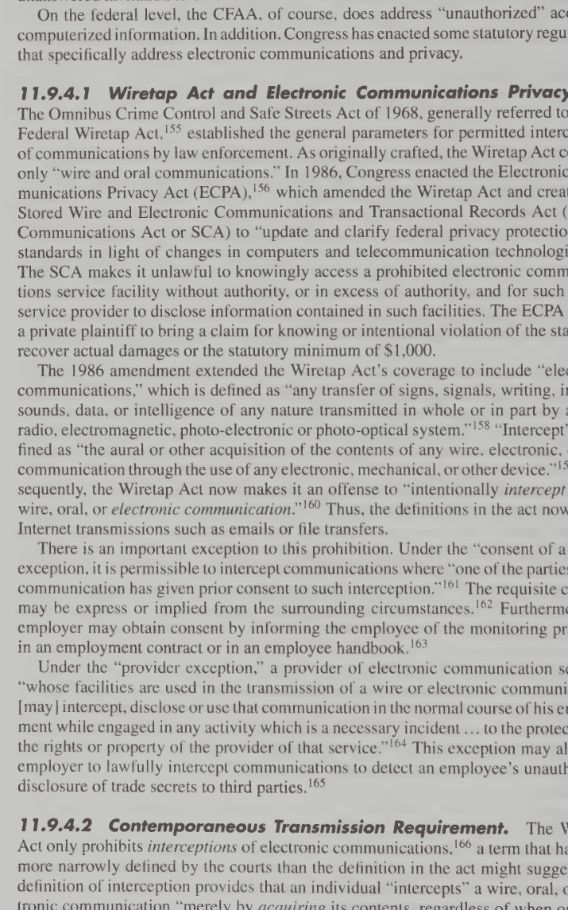

正在传输并且一旦它们被存储，无论是暂时还是永久。虽然国会意图放宽对“有线通信”的监控能力，同时试图使对“电子通信”的监控更加困难，168 法院认为，国会意图使根据《窃听法》获取电子通信的行为“只有在其与传输同时发生”169 时才违法，并且在它们实际上越过终点线并被存储之前。170 这当然是一种有趣的虚构，当应用于互联网传输时，互联网传输由被拆分并从路由器传递到路由器的包组成，以及从临时存储到临时存储。它与电话窃听相去甚远。也许只是，在适用该法规的语言时，法院面临将其应用于该法规于 1986 年修订时实际上并不存在的技术。

近年来，法院试图将同时传输要求适用于各种情况。例如，用于从网站访客处恢复个人数据的 cookie 构成对同时电子通信的拦截以及对《窃听法》的违反。171 法院指出电子通信通常同时处于传输中和存储中，法院认为用户同时与制药客户的 Web 服务器和软件公司的 Web 服务器进行通信，因此信息是在其传输的同时获取的。172

当电子传输存在于 RAM 或硬盘上时，它们是存储的通信，可以被检索，因为它们在《窃听法》之外。173 同样，在发送和接收后被恢复的电子邮件不符合同时传输要求，因此未根据《窃听法》被拦截。174 也许作为对这些和其他判决的回应，2001 年国会修订了《窃听法》，将同时传输要求适用于无法检索的有线通信，从而允许恢复存储的有线通信。175

## 11.9.4.3 Konop v. Hawaiian Airlines, Inc.

Konop 判决似乎是关于《窃听法》下“拦截”问题最常被引用的案件。原告 Konop 是一名航空飞行员，他创建并维护了一个网站，在该网站上发布批评其雇主夏威夷航空公司 Inc. 和航空工会的公告。Konop 通过要求访客使用用户名和密码登录并创建授权用户名单来控制对其网站的访问。

夏威夷航空公司的一名官员请求其中一名授权用户允许使用其姓名访问该网站。该官员多次登录，另一名官员使用相同技术也登录以查看发布在 Konop 公告板上的信息。Konop 最终对夏威夷航空公司提起诉讼，指控其官员在未经授权访问 Konop 网站时违反了《窃听法》。

法院首先重申该法仅禁止对电子通信的拦截。176 法院裁定，“拦截”要求当事方在传输的同时获取信息，而非在电子存储期间。在本案中，法院认为雇主并未违反《窃听法》，因为官员访问的是位于闲置网站上的电子通信，这不符合同时传输要求。177

## 11.9.5 Stored Communications Act.

与《窃听法》不同，《存储通信法》（SCA），178 正如其名称所示，建立了对存储通信（即在传输后访问的通信）的访问限制。179 具体而言，SCA 规定“未经授权故意[访问]提供电子通信服务的设施……并借此[获取]、[更改]或[阻止]对有线或电子通信在电子存储期间的授权访问”是违法的。180 SCA 将“电子存储”定义为“(A) 有线或电子通信在电子传输过程中的任何临时、中介存储；以及 (B) 电子通信服务提供商为备份保护该通信目的而进行的该通信的任何存储。”181 SCA 免除责任的行为包括“由提供有线或电子通信服务的个人或实体授权……”182 或“由该服务的用户就该用户通信或 intended for 该用户的通信授权。”183

## 11.9.5.1 Electronic Storage: Backup Files.

将 SCA 与《窃听法》区分开来的基本要素是被访问的通信驻留在电子存储中。因此，首先要问的是什么构成电子存储。在 Theofel v. Farey-Jones 案，184 美国第九巡回上诉法院试图回答这个问题。

在 Theofel 案中，Farey-Jones 的过于热心的律师通过向 ISP 发出的传票获取了诉讼对手、名为 Integrated Capital Associates (ICA) 的公司发送和接收的电子邮件。传票要求 ISP 提供 ICA 及其员工几乎所有曾经发送或接收的电子邮件。作为回应，ISP 在 Farey-Jones 及其律师可访问的网站上发布了一些电子邮件。当 ICA 得知这些活动时，它起诉 Farey-Jones 违反 SCA 等。

根据 Theofel 案法院的说法，国会承认 ISP 用户对保护通信设施中电子存储的通信的保密性具有合法利益。此外，这一合法利益不能被欺诈或明知利用允许访问原本受保护内容的错误所克服。法院发现，当传票明显无效时（至少对律师而言），使用传票访问 ICA 电子邮件的行为否定了 Farey-Jones 及其律师可能拥有的查看 ICA 电子邮件的任何表面授权。

Farey-Jones 声称 ICA 电子邮件不在“电子存储”中，因此未发生违反 SCA 的情况。法院不同意。如前所述，当消息作为向收件人传输消息过程的一部分以临时、中介方式存储时，以及当消息作为备份过程的一部分而存储时，就存在电子存储。在本案中，法院发现这些电子邮件显然已交付给收件人，ISP 将其作为备份过程的一部分存储以便在初始接收后检索。因此对这些电子邮件的访问受 SCA 保护，而 Farey-Jones 及其律师违反了该法。

## 11.9.5.2 Electronic Storage: Temporarily Stored Communications.

近期解释“临时、中介存储……附属于”通信传输含义的案件更遵守法律的字面意义而非其精神。在涉及 cookie 安装随后被软件公司为商业利益访问的两个案件中，法院认为 cookie 永久地（或至少无限期地）安装在消费者的硬盘驱动器中，因此不能被视为“临时、中介存储。”185 Doubleclick 判决还强调了“临时、中介存储”

《存储通信法案》（SCA）的一个要素，如其所述，即被禁止的行为仅涉及对通信在由中间方临时存储期间未经授权访问，而不包括在信息被接收后对已存储信息的访问。186 在雇主有权检查员工电子邮件的语境中，一旦邮件已被接收或丢弃，当雇主打开员工发送或接收的电子邮件时，员工将不能声称雇主违反了SCA。187

## 11.10 开源

随着互联网和计算机软件的持续普及，开源代码的许可、分发和使用在知识产权和计算机安全实践中日益受到关注并变得更加重要。“开源”描述的是向所有其他人提供（即开放）的计算机代码的分发，因此允许程序员阅读、应用和修改代码，并可重新分发任何更改。188 开源运动始于理查德·斯托曼开发“Gnu’s Not UNIX”（GNU），这是一种自由软件形式的UNIX，旨在成为免费软件（这里的免费指的是使用、修改和分发软件的自由）。189 GNU的开发创造了第一个开源许可证，即通用公共许可证（GPL）。Linux 是一个基于开源的操作系统，也是微软Windows的替代品，通过使用GPL经历了巨大的增长。190 1998年成立的开源促进会（OSI）证明了开源问题的普遍性，该组织不仅促进开源发展并鼓励企业使用开源，191 还提供大多数可用开源许可证的链接和信息。

### 11.10.1 开源许可证

开源代码的作者持有与其他版权一样运作的版权，但代码是根据某种许可协议以非专有方式发布的。有各种类型的开源许可证。第一个开源许可证如前所述是GPL，它提供了最广泛的自由软件应用。相比之下，其他许可证并不寻求延续特定程序的自由性质。据开源促进会称，现在有近60种开源许可证可供源代码作者使用，192 所有这些许可证都对软件用户提出某些要求。

### 11.10.2 GPL

GPL许可基于斯托曼的“著佐权”理念（copy-left），该理念基本上利用版权作为工具来确保源代码的持续自由分发。193 换句话说，GPL赋予对受版权保护的源代码的应用、修改和分发权，前提是用户同意分发条款保持不变。这形成了一条无休止的GPL链，附着于原始或衍生版本的未来分发上，无论其形式如何。194 这条无休止的链通常被称为GPL的“病毒效应”，因为受GPL保护的代码会从原始受保护代码的任何修改中倍增。195 GPL不仅适用于最初受保护的软件程序，还适用于其广泛定义的“程序”：

> > [任何]此类程序或作品，以及“基于该程序的作品”，意指该程序或版权法下的任何衍生作品：即包含该程序或其一部分的作品，无论逐字照搬或经修改和/或翻译成另一种语言。196

此外，尽管GPL还规定，衍生作品中独立和分离的部分，当作为独立作品分发时不受GPL条款约束，但当用户将这些独立和分离的“部分作为基于该程序的整体的一部分分发时”，GPL确实适用。197 GPL下程序的广泛适用进一步增强了许可证的病毒效应。

GPL的其他条款要求分发源代码逐字副本的用户发布版权声明、免责声明，并提供GPL副本。此外，修改者/使用者必须附加任何修改的通知，说明软件已被更改，必须免费向第三方分发或许可软件，并且必须提供适当的版权声明、保修免责声明以及GPL条款和条件。总之，GPL的全面条款不仅旨在实现自由软件基金会（FSF）的自由软件目标，而且还会影响作者是否选择GPL，以及企业是否使用受GPL约束的软件。

### 11.10.3 其他开源许可证

伯克利软件分发（BSD）许可证和麻省理工学院（MIT）许可证非常相似，两者都要求版权声明、保修免责声明和责任限制。BSD进一步禁止贡献者或类似组织认可该程序，并要求随软件分发一份BSD条款的副本。

### 11.10.4 关于开源许可证的商业政策

一个包含一小部分GPL受保护代码的专有作品的分发是否会使该专有作品受GPL条款约束的问题从未被诉讼过。198 这是使用开源软件的一个风险。另一个风险是不遵守GPL条款可能导致诉讼。199 例如，MySQL曾寻求禁止Progress Software Corporation在没有符合GPL的协议的情况下分发MySQL的Gemini程序。200 由于关于Gemini是GPL下的衍生作品还是独立作品存在事实争议，并且由于Progress同意公开Gemini的源代码并将撤回商业用户的最终用户许可，法院没有就GPL授予禁令。201

鉴于开源应用的不断扩展，企业需要制定全面的政策，规范其对开源的使用，以避免责任和公开发布自己的专有技术。202 关注点通常涉及关于软件及其修改的分发的许可证要求。203 由于这些活动通常要求公司发布任何分发的修改的源代码，而修改通常会终止供应商的支持协议。204 此外，在专有程序中分发未经修改的开源可能要求公司发布自己的专有开源代码。205 然而，更有可能的是，公司会被禁止分发开源软件，或者必须支付损害赔偿。206 这些考虑不仅应通过公司政策加以解决，还应根据公司内部和外部需求以及该源代码的特定许可要求，选择编程中使用的最佳源代码。

## 11.11 国际应用

由于美国法律只是众多国家中的一个国家的法律，美国法律的执行和知识产权的保护在很大程度上取决于国际条约。在被认为侵权或盗版行为发生在美国境内，或侵权者在美国境内的情况下，美国对这些行为拥有足够的管辖权来执行其法律。换句话说，这些行为者可以因违反美国法律而直接在美国法院被起诉。

除直接执行外，国际保护通常是美国与个别国家之间双边协议的工具，或者是美国作为签署国的国际议定书或条约的功能。因此，例如，《保护工业产权巴黎公约》207 建立了一个承认发明优先权的体系，但仅限于成员国之间。此外，还有《专利合作条约》（PCT），这是一个拥有50多个签署国的多边条约。PCT允许提交国际申请，当在一个以上国家寻求专利时简化了申请过程。对于版权保护，也有一系列国际条约和协议，包括《伯尔尼公约》208、《世界版权公约》和《世界贸易组织（WTO）协定》。209 加拿大、墨西哥和美国还于1992年12月签署了《北美自由贸易协定》（NAFTA）。NAFTA涉及知识产权，并要求成员国给予知识产权至少与《关税及贸易总协定》（GATT）成员相同的保护。GATT成员至少必须采纳四项国际公约，包括《巴黎公约》和《伯尔尼公约》。

这些协议、公约和条约在很大程度上并不试图调和各国知识产权法律之间的差异。特定的国家规则和细微差别过于复杂，而且意见分歧太多，无法期望这些差异能在内部得到调和。相反，在很大程度上，这些国际协议试图编纂成员国之间的礼让原则，以便每一方都承认对方知识产权的合法性。

### 11.11.1 与贸易有关的知识产权协定

1994年12月8日，《与贸易有关的知识产权协定》（TRIPS）在美国签署成为法律。TRIPS的签署要求美国修改其法规和条例，使其符合国际规范。然而，TRIPS是美国和其他工业国家推动对国际知识产权条约制定更强、更统一标准的产物。TRIPS的基本结构是为知识产权设定最低保护标准，每个成员国可自由采用更严格的标准。在美国使用的术语下，TRIPS适用于版权、专利、商标、服务标记、掩膜作品（集成电路设计）和商业秘密。它还涵盖地理标志210 和工业品外观设计。211 尽管是国际知识产权词汇的一部分，但TRIPS未涵盖育种者权利212 和实用新型。213 因此，TRIPS对这些概念没有设定标准，让每个国家不受TRIPS阻碍地自由设定保护参数。

TRIPS在GATT框架内进行谈判并非偶然，GATT设定了国际贸易关税标准，并提供了如果不遵守这些标准的贸易报复补救措施。GATT的结构提供了发展中国家同意降低贸易关税以换取在知识产权授予的独家垄断下出口创新产品的权利的途径。GATT格式的第二个好处是，如果根据TRIPS的争端解决条款，WTO认定存在不遵守行为，则可提供贸易报复手段。实际上，很明显，TRIPS


使那些更可能处于创新前沿且更关注保护其公民知识产权的工业化国家受益。214 在 TRIPS 下，发展中国家争取到的主要让步是获得 4 至 11 年的时间来实施 TRIPS 并使本国法律符合要求。

TRIPS 通常反映了美国的观点，即知识产权的经济基础服务于更大的社会利益。因此出现了从“社会”利益向“企业”利益的转变。特别是，TRIPS 采用了较高的专利最低标准，这将要求发展中国家进行重大的立法变更。然而，版权部分提供的保护可能少于欧洲国家所提供的保护，但与美国的待遇一致。简而言之，TRIPS 回应了美国企业的关切，即过于宽松的国际保护制度已使美国创新通过复制和公然盗版被模仿。

## 11.11.2 TRIPS and Trade Secrets.

在其“未公开信息保护”类别下，TRIPS 为在美国通常称为商业秘密的信息类型提供了保护。成员国必须实施法律，以保护合法持有的信息免于未经同意并违背“诚实商业惯例”而被披露、获取或使用，前提是该信息 (a) 属于秘密，即未进入公共领域，(b) 因其为秘密而具有商业价值，且 (c) 已采取合理措施保持其保密性。

由于导致 TRIPS 的讨论不像美国国会记录那样得到制度性保存，因此没有谈判历史可供查阅以阐明设立商业秘密保护的简短段落的含义。然而，似乎与美国所提供的全部保护存在差异。TRIPS 阐述的公共领域概念是指信息“不论作为整体还是在其组成部分的精确配置和组合方面，一般为通常处理该类信息的人士所知或易于获取”。这种表述似乎针对的是信息的技术表述，而非美国通常被视为专有和保密的一般商业信息，例如财务信息。对受保护信息的技术表述的关注得到了 TRIPS 要求信息具有商业价值的要求的加强。因此，未构成交易标的物的其他类型信息可能被视为没有商业价值，从而落在其保护范围之外。根据美国的具体司法管辖区，保密信息与商业秘密之间存在区别，区别在于商业秘密必须具有商业价值。进而，这被解释为未被商业利用的信息在商业秘密法下不可保护。例如，从未导致商业产品的失败实验结果缺乏商业价值，尽管此类实验对于下一轮探索 certainly 有帮助，因为它们是指示“不可为”的路标。

应汲取的教训是，不应仅因 TRIPS 条款而假设保护具有对称性。相反，作为保持保密的合理措施的一部分，企业需要考虑精心设计和结构化的合同条款，以及一种数据缓存系统，使真正保密的数据保留在美国，即使允许在境外访问。此类数据的不当获取 arguably 是在美国发生的行为，而此类行为受美国法律的执行和惩罚。

## 11.11.3 TRIPS and Copyright.

TRIPS 在其开篇声明中采纳了美国的一般版权保护模式，即“[c]版权保护应延伸至表达，而非思想、程序、操作方法或数学概念本身。”所有成员国均同意，就版权保护而言，《伯尔尼公约》将适用。根据《伯尔尼公约》，版权的期限为作者终生加 50 年。如果不涉及自然人寿命，则通常为自出版之日起 50 年。此外，无论是源代码还是目标代码，计算机程序均应根据《伯尔尼公约》作为文学作品受保护。TRIPS 还承认数据汇编可以作为创作作品受保护。第 10 条第 2 款明确规定：

> 无论以机器可读或其他形式，数据或其他材料的汇编，只要因其内容的选编或编排构成智力创作，就应作为此类受保护。此类保护不延伸至数据或材料本身，且不损害数据或材料本身可能存在的任何版权。（着重号已加。）

因此，TRIPS 确实在关于数据库应给予何种保护的不断增长的辩论中确立了一些最低标准。在美国，未受保护信息的明确分界点是仅代表“智力劳动”努力的汇编。此类汇编不得受版权保护。215 “智力劳动”努力的经典例子是对电话簿中姓名、地址和电话号码的复制和按字母顺序整理。在美国，版权保护的关键在于创作者在选编和编排方面的原创贡献。因此，可以说 TRIPS 条款模仿了美国法律。

欧洲联盟（EU）采取了更具保护性的路径。在其 1996 年《欧洲数据库指令》中，欧盟以其自身独特的知识产权形式赋予数据库 sui generis 保护。根据欧盟指令，数据库是“以系统或方法化的方式排列并可通过电子或其他方式单独访问的独立作品、数据或其他材料的集合”。数据库可能因其代表“智力创作”的作品而受保护，也可能因其是通过“大量投资”汇编而成而受保护。欧盟指令保护此类数据库免于未经授权的提取或使用，期限为 15 年，如果对数据库进行了“大量新投资”，则期限可延长 15 年。此类保护延伸至欧盟成员国的数据库以及为其他国家国民提供与欧盟类似保护的数据库。

尽管有多项立法提案，美国尚未采纳相应的规则。至少对于跨国公司而言，其结果是依赖数据库的实体应考虑将此类数据库“定位”在欧盟成员国内，以利用欧盟的数据库保护。

## 11.11.4 TRIPS and Patents.

TRIPS 要求所有成员承认在所有技术领域对产品或工艺进行专利权的权利。可专利的发明必须新颖、具有创造性并具有工业应用。专利申请必须充分、清晰地披露发明，以便本领域技术人员能够实施发明。截至申请日实施发明的最佳方式也必须披露。专利权应不因发明地或产品是进口还是本地生产而歧视地执行。产品的专利授予排他性权利，在未征得发明人同意的情况下，防止制造、使用、提供销售、销售或进口该产品。工艺的专利授予排他性权利，防止对该工艺产生的产品实施上述所有行为以及使用该工艺本身。专利持有人还拥有转让、转移或许可专利的权利。保护专利的最低期限为自申请日起 20 年。

TRIPS 赋予每个成员国从可专利性中排除某些主题事项的权利，这些事项的目的是保护人类、动物或植物生命，或避免对环境造成严重损害。此外，TRIPS 允许成员国在未经专利持有人授权的情况下允许其他使用。界定此类使用何时被允许的章节是 TRIPS 专利条款中最详细的章节。一般而言，它仅在 (a) 在合理商业条款和条件下努力获得专利持有人的许可后，(b) 向专利持有人提供充分报酬，(c) 此类使用主要限于成员国的国内市场，以及 (d) 该许可决定以及补偿由该成员的“更高当局”审查的情况下，允许此类使用。

TRIPS 设想的情况之一是授予第二项专利，而该专利若不侵犯较早（第一）专利则无法实施。在此类情况下，如果第二专利所体现的发明相对于第一专利的发明代表“具有相当经济意义的重要技术进步”，并且以合理条件向第一专利持有人授予交叉许可以使用第二专利，则成员国可以授予许可。对于工艺专利，TRIPS 对被指控侵权者施加了有限的举证负担，以证明相同的产品是使用不同工艺生产的。特别是，成员国可以在产品为新产品的情况下，或专利持有人无法证明实际使用何种工艺的情况下，创设工艺专利被侵犯的推定。

## 11.11.5 TRIPS and Anticompetitive Restrictions.

TRIPS 承认某些许可做法或其他与知识产权有关的条件可能限制竞争、损害贸易并阻碍技术的转移和传播。因此，TRIPS 允许成员国指定构成知识产权滥用的做法并采取措施控制或限制此类做法，只要该规制与 TRIPS 的其他条款一致。如果成员国国民违反另一成员关于反竞争活动的法律和法规，TRIPS 规定相关国家有权就该国民及其活动交换保密信息。

## 11.11.6 Remedies and Enforcement Mechanisms.

每个成员国预计根据其本国法律提供执行机制，以允许对任何侵权行为采取有效行动。此类程序应包括防止侵权行为的救济以及遏制未来行为的救济。TRIPS 规定所有此类程序必须“公平公正”，不得“不必要地复杂或昂贵”或涉及“不当延误”。216 一般而言，这些救济意味着获得民事司法程序的途径，其证据标准在权利持有人提出合理可得的证据支持其主张后，将继续举证的负担转移给被指称的侵权人。如果“侵权人知道或有合理理由知道其从事侵权活动”，则可判令足以补偿权利持有人因侵权而遭受损失的损害赔偿。这意味着

警惕性和通知对于知识产权权利的实质性保护至关重要，因为通知是建立损害赔偿请求的最有效手段。TRIPS 允许其成员即使在侵权者不知道自己从事侵权行为的情况下，也允许追回损失利润或预定（法定）损害赔偿。

尽管应提供禁令救济，但在涉及专利权人的情况下，救济可能会受到限制，如前所述，只要支付了充分的补偿，并且 alleged 侵权者已遵守其国内法允许在支付合理补偿后使用该权利的规定。为遏制进一步侵权，侵权材料可被命令销毁或非商业性处置。

除民事救济外，TRIPS 要求在“故意商标假冒或商业规模的版权盗版”案件中适用刑事处罚。²¹⁷

## 11.12 知识产权法的最新发展²¹⁸

### 11.12.1 美国发明法案。

Schwabe、Williamson 和 Wyatt 的 Peter E. Heuser 总结了 2011 年的 Leahy-Smith 美国发明法案（AIA）²¹⁹ 如下：“AIA 是 50 多年来最重要的立法专利改革。AIA 将改变专利的授予方式、专利诉讼的进行方式以及哪些类型的发明有资格获得专利，等等。”²²⁰ 作者在以下领域的详细讨论中总结了 AIA 的主要特点：

- 现在将以先申请制确立发明优先权
- 建立了先前商业使用者抗辩
- 针对专利有效性挑战的新授权后程序
- 专利商标局（PTO）将不再就税务策略授予专利
- 对某些与金融产品和服务相关的专利进行特别过渡审查
- 大多数 PTO 费用将上调 15%
- 将提供有限的优先审查
- 新规则将影响非实施实体诉讼
- 遏制虚假专利标记主张
- 其他条款将使攻击专利有效性变得更加困难

关于该立法的完整信息可通过国会图书馆 THOMAS 数据库获取。²²¹

### 11.12.2 《保护知识产权法》（PIPA）。

《保护知识产权法》（防止对经济创造性和知识产权盗窃的真实在线威胁法）²²² 或 PIPA，于 2011 年 5 月在美国参议院提出，但未能进入参议院全体会议。²²³ 在广泛的公众反对之后，包括数千个网站在抗议 PIPA 和《制止网络盗版法》（SOPA，下文）期间进行的全球临时停摆。²²⁴ 该法案于 2012 年 1 月被暂停，等待进一步分析。²²⁵

PIPA 的主要要点如下（引用 THOMAS 数据库中的几节）：

- 该法案将违反正当程序标准，因为它允许在未给予被指控网站所有者自我辩护机会的情况下进行行政关闭。
- SOPA 可能的访问障碍可能会严重影响全球向独裁政权施压的运动，例如中华人民共和国在持续压制信息自由获取方面的行为。
- 图书管理员、教育工作者和学生甚至可能因可被视为合理使用版权材料的情形而受到行政关闭。

该拟议法案与 PIPA（上文）同时被搁置。

### 11.12.4 专利流氓。

积极针对鲜为人知专利使用者的团体，通常是从从未行使过权利的发明人手中购买专利，被称为非实施实体或专利流氓。其中一些公司将全部业务用于基于其所获专利提起诉讼或威胁诉讼。²²⁸

在一起臭名昭著的案件中，一家公司购买了

...名为“自动信息、商品和服务分发系统（加拿大 '216）”的加拿大专利，其完整文本可在 http://patents1.ic.gc.ca/ details?patent_number=1236216&language=EN_CA 获取[并且]具体涉及“一种自动向客户自助分发信息、商品和服务的系统，包括一个中央数据处理中心，其中存储了特定行业各种机构提供的服务信息。一个或多个自助信息和销售终端远程链接到中央数据处理中心，并被编程为收集潜在客户对所需商品和服务的信息，将所需商品或服务的信息从中央数据处理中心传输给客户，接受客户对商品或服务的订单并将其传输到中央数据处理中心进行处理，接受付款，并在订单完成后以文件形式向客户交付商品或服务。中央数据处理中心还远程链接到系统服务的各个机构的终端，以便每个机构都能及时了解其提供的服务已完成的销售情况。”[请注意，上面使用了加拿大拼写。] 想想这个专利。它是否不可避免地让你想起上次你订购书籍或在网上购买东西时所做的事情？或在网络上进行的任何其他商业交易？²²⁹

波士顿大学法学院²³⁰ 发表的一项研究发现，专利流氓“...使美国软件和硬件公司在 2011 年损失了 290 亿美元....”²³¹

在众议院，Peter DeFazio（D-OR）于 2012 年 8 月提出了 HR.6245 号法案，《2012 年保护高科技创新者免受恶劣法律纠纷法》。该法案将“[修正]联邦专利法，允许法院在认定一方在质疑计算机硬件或软件专利有效性或指控其侵权的诉讼中没有合理的胜诉可能性时，判决胜诉方收回全部诉讼费用，包括合理的律师费....” 在撰写时（2013 年 5 月），该法案仍在众议院司法委员会知识产权、竞争和互联网分委员会手中。

2013 年 5 月，参议员 Charles Schumer（D-NY）提出了 S.866 号法案《专利质量改进法》，该法案是对 AIA 的修正案，旨在扩大其对商业方法专利提出质疑的规定。²³³

国会图书馆 THOMAS 数据库对该提案的实质描述如下：

## 11.44 知识产权法基础

- 修订 Leahy-Smith 美国发明法案，取消有关可用于审查受保护商业方法专利有效性的过渡性授权后审查计划的八年日落条款，从而使该计划永久化。
- 将“受保护商业方法专利”一词扩大到包括要求一种方法或相应的装置的专利，该方法或装置用于执行在任何企业、产品或服务的实践、管理和运营中使用的[content]
警惕性和通知对于知识产权权利的实质性保护至关重要，因为通知是建立损害赔偿请求的最有效手段。TRIPS 允许其成员即使在侵权者不知道自己从事侵权行为的情况下，也允许追回损失利润或预定（法定）损害赔偿。

尽管应提供禁令救济，但在涉及专利权人的情况下，救济可能会受到限制，如前所述，只要支付了充分的补偿，并且 alleged 侵权者已遵守其国内法允许在支付合理补偿后使用该权利的规定。为遏制进一步侵权，侵权材料可被命令销毁或非商业性处置。

除民事救济外，TRIPS 要求在“故意商标假冒或商业规模的版权盗版”案件中适用刑事处罚。²¹⁷

## 11.12 知识产权法的最新发展²¹⁸

### 11.12.1 美国发明法案。

Schwabe、Williamson 和 Wyatt 的 Peter E. Heuser 总结了 2011 年的 Leahy-Smith 美国发明法案（AIA）²¹⁹ 如下：“AIA 是 50 多年来最重要的立法专利改革。AIA 将改变专利的授予方式、专利诉讼的进行方式以及哪些类型的发明有资格获得专利，等等。”²²⁰ 作者在以下领域的详细讨论中总结了 AIA 的主要特点：

- 现在将以先申请制确立发明优先权
- 建立了先前商业使用者抗辩
- 针对专利有效性挑战的新授权后程序
- 专利商标局（PTO）将不再就税务策略授予专利
- 对某些与金融产品和服务相关的专利进行特别过渡审查
- 大多数 PTO 费用将上调 15%
- 将提供有限的优先审查
- 新规则将影响非实施实体诉讼
- 遏制虚假专利标记主张
- 其他条款将使攻击专利有效性变得更加困难

关于该立法的完整信息可通过国会图书馆 THOMAS 数据库获取。²²¹

### 11.12.2 《保护知识产权法》（PIPA）。

《保护知识产权法》（防止对经济创造性和知识产权盗窃的真实在线威胁法）²²² 或 PIPA，于 2011 年 5 月在美国参议院提出，但未能进入参议院全体会议。²²³ 在广泛的公众反对之后，包括数千个网站在抗议 PIPA 和《制止网络盗版法》（SOPA，下文）期间进行的全球临时停摆。²²⁴ 该法案于 2012 年 1 月被暂停，等待进一步分析。²²⁵

PIPA 的主要要点如下（引用 THOMAS 数据库中的几节）：

- 该法案将违反正当程序标准，因为它允许在未给予被指控网站所有者自我辩护机会的情况下进行行政关闭。
- SOPA 可能的访问障碍可能会严重影响全球向独裁政权施压的运动，例如中华人民共和国在持续压制信息自由获取方面的行为。
- 图书管理员、教育工作者和学生甚至可能因可被视为合理使用版权材料的情形而受到行政关闭。

该拟议法案与 PIPA（上文）同时被搁置。

### 11.12.4 专利流氓。

积极针对鲜为人知专利使用者的团体，通常是从从未行使过权利的发明人手中购买专利，被称为非实施实体或专利流氓。其中一些公司将全部业务用于基于其所获专利提起诉讼或威胁诉讼。²²⁸

在一起臭名昭著的案件中，一家公司购买了

...名为“自动信息、商品和服务分发系统（加拿大 '216）”的加拿大专利，其完整文本可在 http://patents1.ic.gc.ca/ details?patent_number=1236216&language=EN_CA 获取[并且]具体涉及“一种自动向客户自助分发信息、商品和服务的系统，包括一个中央数据处理中心，其中存储了特定行业各种机构提供的服务信息。一个或多个自助信息和销售终端远程链接到中央数据处理中心，并被编程为收集潜在客户对所需商品和服务的信息，将所需商品或服务的信息从中央数据处理中心传输给客户，接受客户对商品或服务的订单并将其传输到中央数据处理中心进行处理，接受付款，并在订单完成后以文件形式向客户交付商品或服务。中央数据处理中心还远程链接到系统服务的各个机构的终端，以便每个机构都能及时了解其提供的服务已完成的销售情况。”[请注意，上面使用了加拿大拼写。] 想想这个专利。它是否不可避免地让你想起上次你订购书籍或在网上购买东西时所做的事情？或在网络上进行的任何其他商业交易？²²⁹

波士顿大学法学院²³⁰ 发表的一项研究发现，专利流氓“...使美国软件和硬件公司在 2011 年损失了 290 亿美元....”²³¹

在众议院，Peter DeFazio（D-OR）于 2012 年 8 月提出了 HR.6245 号法案，《2012 年保护高科技创新者免受恶劣法律纠纷法》。该法案将“[修正]联邦专利法，允许法院在认定一方在质疑计算机硬件或软件专利有效性或指控其侵权的诉讼中没有合理的胜诉可能性时，判决胜诉方收回全部诉讼费用，包括合理的律师费....” 在撰写时（2013 年 5 月），该法案仍在众议院司法委员会知识产权、竞争和互联网分委员会手中。

2013 年 5 月，参议员 Charles Schumer（D-NY）提出了 S.866 号法案《专利质量改进法》，该法案是对 AIA 的修正案，旨在扩大其对商业方法专利提出质疑的规定。²³³

国会图书馆 THOMAS 数据库对该提案的实质描述如下：

## 11.44 知识产权法基础

- 修订 Leahy-Smith 美国发明法案，取消有关可用于审查受保护商业方法专利有效性的过渡性授权后审查计划的八年日落条款，从而使该计划永久化。
- 将“受保护商业方法专利”一词扩大到包括要求一种方法或相应装置的专利，该方法或装置用于执行在任何企业、产品或服务的做法、管理和运营中使用的[content]
警惕性和通知对于知识产权权利的实质性保护至关重要，因为通知是建立损害赔偿请求的最有效手段。TRIPS 允许其成员即使在侵权者不知道自己从事侵权行为的情况下，也允许追回损失利润或预定（法定）损害赔偿。

尽管应提供禁令救济，但在涉及专利权人的情况下，救济可能会受到限制，如前所述，只要支付了充分的补偿，并且 alleged 侵权者已遵守其国内法允许在支付合理补偿后使用该权利的规定。为遏制进一步侵权，侵权材料可被命令销毁或非商业性处置。

除民事救济外，TRIPS 要求在“故意商标假冒或商业规模的版权盗版”案件中适用刑事处罚。²¹⁷

## 11.12 知识产权法的最新发展²¹⁸

### 11.12.1 美国发明法案。

Schwabe、Williamson 和 Wyatt 的 Peter E. Heuser 总结了 2011 年的 Leahy-Smith 美国发明法案（AIA）²¹⁹ 如下：“AIA 是 50 多年来最重要的立法专利改革。AIA 将改变专利的授予方式、专利诉讼的进行方式以及哪些类型的发明有资格获得专利，等等。”²²⁰ 作者在以下领域的详细讨论中总结了 AIA 的主要特点：

- 现在将以先申请制确立发明优先权
- 建立了先前商业使用者抗辩
- 针对专利有效性挑战的新授权后程序
- 专利商标局（PTO）将不再就税务策略授予专利
- 对某些与金融产品和服务相关的专利进行特别过渡审查
- 大多数 PTO 费用将上调 15%
- 将提供有限的优先审查
- 新规则将影响非实施实体诉讼
- 遏制虚假专利标记主张
- 其他条款将使攻击专利有效性变得更加困难

关于该立法的完整信息可通过国会图书馆 THOMAS 数据库获取。²²¹

### 11.12.2 《保护知识产权法》（PIPA）。

《保护知识产权法》（防止对经济创造性和知识产权盗窃的真实在线威胁法）²²² 或 PIPA，于 2011 年 5 月在美国参议院提出，但未能进入参议院全体会议。²²³ 在广泛的公众反对之后，包括数千个网站在抗议 PIPA 和《制止网络盗版法》（SOPA，下文）期间进行的全球临时停摆。²²⁴ 该法案于 2012 年 1 月被暂停，等待进一步分析。²²⁵

PIPA 的主要要点如下（引用 THOMAS 数据库中的几节）：

- 该法案将违反正当程序标准，因为它允许在未给予被指控网站所有者自我辩护机会的情况下进行行政关闭。
- SOPA 可能的访问障碍可能会严重影响全球向独裁政权施压的运动，例如中华人民共和国在持续压制信息自由获取方面的行为。
- 图书管理员、教育工作者和学生甚至可能因可被视为合理使用版权材料的情形而受到行政关闭。

该拟议法案与 PIPA（上文）同时被搁置。

### 11.12.4 专利流氓。

积极针对鲜为人知专利使用者的团体，通常是从从未行使过权利的发明人手中购买专利，被称为非实施实体或专利流氓。其中一些公司将全部业务用于基于其所获专利提起诉讼或威胁诉讼。²²⁸

在一起臭名昭著的案件中，一家公司购买了

...名为“自动信息、商品和服务分发系统（加拿大 '216）”的加拿大专利，其完整文本可在 http://patents1.ic.gc.ca/ details?patent_number=1236216&language=EN_CA 获取[并且]具体涉及“一种自动向客户自助分发信息、商品和服务的系统，包括一个中央数据处理中心，其中存储了特定行业各种机构提供的服务信息。一个或多个自助信息和销售终端远程链接到中央数据处理中心，并被编程为收集潜在客户对所需商品和服务的信息，将所需商品或服务的信息从中央数据处理中心传输给客户，接受客户对商品或服务的订单并将其传输到中央数据处理中心进行处理，接受付款，并在订单完成后以文件形式向客户交付商品或服务。中央数据处理中心还远程链接到系统服务的各个机构的终端，以便每个机构都能及时了解其提供的服务已完成的销售情况。”[请注意，上面使用了加拿大拼写。] 想想这个专利。它是否不可避免地让你想起上次你订购书籍或在网上购买东西时所做的事情？或在网络上进行的任何其他商业交易？²²⁹

波士顿大学法学院²³⁰ 发表的一项研究发现，专利流氓“...使美国软件和硬件公司在 2011 年损失了 290 亿美元....”²³¹

在众议院，Peter DeFazio（D-OR）于 2012 年 8 月提出了 HR.6245 号法案，《2012 年保护高科技创新者免受恶劣法律纠纷法》。该法案将“[修正]联邦专利法，允许法院在认定一方在质疑计算机硬件或软件专利有效性或指控其侵权的诉讼中没有合理的胜诉可能性时，判决胜诉方收回全部诉讼费用，包括合理的律师费....” 在撰写时（2013 年 5 月），该法案仍在众议院司法委员会知识产权、竞争和互联网分委员会手中。

2013 年 5 月，参议员 Charles Schumer（D-NY）提出了 S.866 号法案《专利质量改进法》，该法案是对 AIA 的修正案，旨在扩大其对商业方法专利提出质疑的规定。²³³

国会图书馆 THOMAS 数据库对该提案的实质描述如下：

## 11.44 知识产权法基础

- 修订 Leahy-Smith 美国发明法案，取消有关可用于审查受保护商业方法专利有效性的过渡性授权后审查计划的八年日落条款，从而使该计划永久化。
- 将“受保护商业方法专利”一词扩大到包括要求一种方法或相应装置的专利，该方法或装置用于执行在任何企业、产品或服务的做法、管理和运营中使用的[content]
警惕性和通知对于知识产权权利的实质性保护至关重要，因为通知是建立损害赔偿请求的最有效手段。TRIPS 允许其成员即使在侵权者不知道自己从事侵权行为的情况下，也允许追回损失利润或预定（法定）损害赔偿。

尽管应提供禁令救济，但在涉及专利权人的情况下，救济可能会受到限制，如前所述，只要支付了充分的补偿，并且 alleged 侵权者已遵守其国内法允许在支付合理补偿后使用该权利的规定。为遏制进一步侵权，侵权材料可被命令销毁或非商业性处置。

除民事救济外，TRIPS 要求在“故意商标假冒或商业规模的版权盗版”案件中适用刑事处罚。²¹⁷

## 11.12 知识产权法的最新发展²¹⁸

### 11.12.1 美国发明法案。

Schwabe、Williamson 和 Wyatt 的 Peter E. Heuser 总结了 2011 年的 Leahy-Smith 美国发明法案（AIA）²¹⁹ 如下：“AIA 是 50 多年来最重要的立法专利改革。AIA 将改变专利的授予方式、专利诉讼的进行方式以及哪些类型的发明有资格获得专利，等等。”²²⁰ 作者在以下领域的详细讨论中总结了 AIA 的主要特点：

- 现在将以先申请制确立发明优先权
- 建立了先前商业使用者抗辩
- 针对专利有效性挑战的新授权后程序
- 专利商标局（PTO）将不再就税务策略授予专利
- 对某些与金融产品和服务相关的专利进行特别过渡审查
- 大多数 PTO 费用将上调 15%
- 将提供有限的优先审查
- 新规则将影响非实施实体诉讼
- 遏制虚假专利标记主张
- 其他条款将使攻击专利有效性变得更加困难

关于该立法的完整信息可通过国会图书馆 THOMAS 数据库获取。²²¹

### 11.12.2 《保护知识产权法》（PIPA）。

《保护知识产权法》（防止对经济创造性和知识产权盗窃的真实在线威胁法）²²² 或 PIPA，于 2011 年 5 月在美国参议院提出，但未能进入参议院全体会议。²²³ 在广泛的公众反对之后，包括数千个网站在抗议 PIPA 和《制止网络盗版法》（SOPA，下文）期间进行的全球临时停摆。²²⁴ 该法案于 2012 年 1 月被暂停，等待进一步分析。²²⁵

PIPA 的主要要点如下（引用 THOMAS 数据库中的几节）：

- 该法案将违反正当程序标准，因为它允许在未给予被指控网站所有者自我辩护机会的情况下进行行政关闭。
- SOPA 可能的访问障碍可能会严重影响全球向独裁政权施压的运动，例如中华人民共和国在持续压制信息自由获取方面的行为。
- 图书管理员、教育工作者和学生甚至可能因可被视为合理使用版权材料的情形而受到行政关闭。

该拟议法案与 PIPA（上文）同时被搁置。

### 11.12.4 专利流氓。

积极针对鲜为人知专利使用者的团体，通常是从从未行使过权利的发明人手中购买专利，被称为非实施实体或专利流氓。其中一些公司将全部业务用于基于其所获专利提起诉讼或威胁诉讼。²²⁸

在一起臭名昭著的案件中，一家公司购买了

...名为“自动信息、商品和服务分发系统（加拿大 '216）”的加拿大专利，其完整文本可在 http://patents1.ic.gc.ca/ details?patent_number=1236216&language=EN_CA 获取[并且]具体涉及“一种自动向客户自助分发信息、商品和服务的系统，包括一个中央数据处理中心，其中存储了特定行业各种机构提供的服务信息。一个或多个自助信息和销售终端远程链接到中央数据处理中心，并被编程为收集潜在客户对所需商品和服务的信息，将所需商品或服务的信息从中央数据处理中心传输给客户，接受客户对商品或服务的订单并将其传输到中央数据处理中心进行处理，接受付款，并在订单完成后以文件形式向客户交付商品或服务。中央数据处理中心还远程链接到系统服务的各个机构的终端，以便每个机构都能及时了解其提供的服务已完成的销售情况。”[请注意，上面使用了加拿大拼写。] 想想这个专利。它是否不可避免地让你想起上次你订购书籍或在网上购买东西时所做的事情？或在网络上进行的任何其他商业交易？²²⁹

波士顿大学法学院²³⁰ 发表的一项研究发现，专利流氓“...使美国软件和硬件公司在 2011 年损失了 290 亿美元....”²³¹

在众议院，Peter DeFazio（D-OR）于 2012 年 8 月提出了 HR.6245 号法案，《2012 年保护高科技创新者免受恶劣法律纠纷法》。该法案将“[修正]联邦专利法，允许法院在认定一方在质疑计算机硬件或软件专利有效性或指控其侵权的诉讼中没有合理的胜诉可能性时，判决胜诉方收回全部诉讼费用，包括合理的律师费....” 在撰写时（2013 年 5 月），该法案仍在众议院司法委员会知识产权、竞争和互联网分委员会手中。

2013 年 5 月，参议员 Charles Schumer（D-NY）提出了 S.866 号法案《专利质量改进法》，该法案是对 AIA 的修正案，旨在扩大其对商业方法专利提出质疑的规定。²³³

国会图书馆 THOMAS 数据库对该提案的实质描述如下：

## 11.44 知识产权法基础

- 修订 Leahy-Smith 美国发明法案，取消有关可用于审查受保护商业方法专利有效性的过渡性授权后审查计划的八年日落条款，从而使该计划永久化。
- 将“受保护商业方法专利”一词扩大到包括要求一种方法或相应装置的专利，该方法或装置用于执行在任何企业、产品或服务的做法、管理和运营中使用的[content]
警惕性和通知对于知识产权权利的实质性保护至关重要，因为通知是建立损害赔偿请求的最有效手段。TRIPS 允许其成员即使在侵权者不知道自己从事侵权行为的情况下，也允许追回损失利润或预定（法定）损害赔偿。

尽管应提供禁令救济，但在涉及专利权人的情况下，救济可能会受到限制，如前所述，只要支付了充分的补偿，并且 alleged 侵权者已遵守其国内法允许在支付合理补偿后使用该权利的规定。为遏制进一步侵权，侵权材料可被命令销毁或非商业性处置。

除民事救济外，TRIPS 要求在“故意商标假冒或商业规模的版权盗版”案件中适用刑事处罚。²¹⁷

## 11.12 知识产权法的最新发展²¹⁸

### 11.12.1 美国发明法案。

Schwabe、Williamson 和 Wyatt 的 Peter E. Heuser 总结了 2011 年的 Leahy-Smith 美国发明法案（AIA）²¹⁹ 如下：“AIA 是 50 多年来最重要的立法专利改革。AIA 将改变专利的授予方式、专利诉讼的进行方式以及哪些类型的发明有资格获得专利，等等。”²²⁰ 作者在以下领域的详细讨论中总结了 AIA 的主要特点：

- 现在将以先申请制确立发明优先权
- 建立了先前商业使用者抗辩
- 针对专利有效性挑战的新授权后程序
- 专利商标局（PTO）将不再就税务策略授予专利
- 对某些与金融产品和服务相关的专利进行特别过渡审查
- 大多数 PTO 费用将上调 15%
- 将提供有限的优先审查
- 新规则将影响非实施实体诉讼
- 遏制虚假专利标记主张
- 其他条款将使攻击专利有效性变得更加困难

关于该立法的完整信息可通过国会图书馆 THOMAS 数据库获取。²²¹

### 11.12.2 《保护知识产权法》（PIPA）。

《保护知识产权法》（防止对经济创造性和知识产权盗窃的真实在线威胁法）²²² 或 PIPA，于 2011 年 5 月在美国参议院提出，但未能进入参议院全体会议。²²³ 在广泛的公众反对之后，包括数千个网站在抗议 PIPA 和《制止网络盗版法》（SOPA，下文）期间进行的全球临时停摆。²²⁴ 该法案于 2012 年 1 月被暂停，等待进一步分析。²²⁵

PIPA 的主要要点如下（引用 THOMAS 数据库中的几节）：

- 该法案将违反正当程序标准，因为它允许在未给予被指控网站所有者自我辩护机会的情况下进行行政关闭。
- SOPA 可能的访问障碍可能会严重影响全球向独裁政权施压的运动，例如中华人民共和国在持续压制信息自由获取方面的行为。
- 图书管理员、教育工作者和学生甚至可能因可被视为合理使用版权材料的情形而受到行政关闭。

该拟议法案与 PIPA（上文）同时被搁置。

### 11.12.4 专利流氓。

积极针对鲜为人知专利使用者的团体，通常是从从未行使过权利的发明人手中购买专利，被称为非实施实体或专利流氓。其中一些公司将全部业务用于基于其所获专利提起诉讼或威胁诉讼。²²⁸

在一起臭名昭著的案件中，一家公司购买了

...名为“自动信息、商品和服务分发系统（加拿大 '216）”的加拿大专利，其完整文本可在 http://patents1.ic.gc.ca/ details?patent_number=1236216&language=EN_CA 获取[并且]具体涉及“一种自动向客户自助分发信息、商品和服务的系统，包括一个中央数据处理中心，其中存储了特定行业各种机构提供的服务信息。一个或多个自助信息和销售终端远程链接到中央数据处理中心，并被编程为收集潜在客户对所需商品和服务的信息，将所需商品或服务的信息从中央数据处理中心传输给客户，接受客户对商品或服务的订单并将其传输到中央数据处理中心进行处理，接受付款，并在订单完成后以文件形式向客户交付商品或服务。中央数据处理中心还远程链接到系统服务的各个机构的终端，以便每个机构都能及时了解其提供的服务已完成的销售情况。”[请注意，上面使用了加拿大拼写。] 想想这个专利。它是否不可避免地让你想起上次你订购书籍或在网上购买东西时所做的事情？或在网络上进行的任何其他商业交易？²²⁹

波士顿大学法学院²³⁰ 发表的一项研究发现，专利流氓“...使美国软件和硬件公司在 2011 年损失了 290 亿美元....”²³¹

在众议院，Peter DeFazio（D-OR）于 2012 年 8 月提出了 HR.6245 号法案，《2012 年保护高科技创新者免受恶劣法律纠纷法》。该法案将“[修正]联邦专利法，允许法院在认定一方在质疑计算机硬件或软件专利有效性或指控其侵权的诉讼中没有合理的胜诉可能性时，判决胜诉方收回全部诉讼费用，包括合理的律师费....” 在撰写时（2013 年 5 月），该法案仍在众议院司法委员会知识产权、竞争和互联网分委员会手中。

2013 年 5 月，参议员 Charles Schumer（D-NY）提出了 S.866 号法案《专利质量改进法》，该法案是对 AIA 的修正案，旨在扩大其对商业方法专利提出质疑的规定。²³³

国会图书馆 THOMAS 数据库对该提案的实质描述如下：

## 11.44 知识产权法基础

- 修订 Leahy-Smith 美国发明法案，取消有关可用于审查受保护商业方法专利有效性的过渡性授权后审查计划的八年日落条款，从而使该计划永久化。
- 将“受保护商业方法专利”一词扩大到包括要求一种方法或相应装置的专利，该方法或装置用于执行在任何企业、产品或服务的做法、管理和运营中使用的[content]
警惕性和通知对于知识产权权利的实质性保护至关重要，因为通知是建立损害赔偿请求的最有效手段。TRIPS 允许其成员即使在侵权者不知道自己从事侵权行为的情况下，也允许追回损失利润或预定（法定）损害赔偿。

尽管应提供禁令救济，但在涉及专利权人的情况下，救济可能会受到限制，如前所述，只要支付了充分的补偿，并且 alleged 侵权者已遵守其国内法允许在支付合理补偿后使用该权利的规定。为遏制进一步侵权，侵权材料可被命令销毁或非商业性处置。

除民事救济外，TRIPS 要求在“故意商标假冒或商业规模的版权盗版”案件中适用刑事处罚。²¹⁷

## 11.12 知识产权法的最新发展²¹⁸

### 11.12.1 美国发明法案。

Schwabe、Williamson 和 Wyatt 的 Peter E. Heuser 总结了 2011 年的 Leahy-Smith 美国发明法案（AIA）²¹⁹ 如下：“AIA 是 50 多年来最重要的立法专利改革。AIA 将改变专利的授予方式、专利诉讼的进行方式以及哪些类型的发明有资格获得专利，等等。”²²⁰ 作者在以下领域的详细讨论中总结了 AIA 的主要特点：

- 现在将以先申请制确立发明优先权
- 建立了先前商业使用者抗辩
- 针对专利有效性挑战的新授权后程序
- 专利商标局（PTO）将不再就税务策略授予专利
- 对某些与金融产品和服务相关的专利进行特别过渡审查
- 大多数 PTO 费用将上调 15%
- 将提供有限的优先审查
- 新规则将影响非实施实体诉讼
- 遏制虚假专利标记主张
- 其他条款将使攻击专利有效性变得更加困难

关于该立法的完整信息可通过国会图书馆 THOMAS 数据库获取。²²¹

### 11.12.2 《保护知识产权法》（PIPA）。

《保护知识产权法》（防止对经济创造性和知识产权盗窃的真实在线威胁法）²²² 或 PIPA，于 2011 年 5 月在美国参议院提出，但未能进入参议院全体会议。²²³ 在广泛的公众反对之后，包括数千个网站在抗议 PIPA 和《制止网络盗版法》（SOPA，下文）期间进行的全球临时停摆。²²⁴ 该法案于 2012 年 1 月被暂停，等待进一步分析。²²⁵

PIPA 的主要要点如下（引用 THOMAS 数据库中的几节）：

- 该法案将违反正当程序标准，因为它允许在未给予被指控网站所有者自我辩护机会的情况下进行行政关闭。
- SOPA 可能的访问障碍可能会严重影响全球向独裁政权施压的运动，例如中华人民共和国在持续压制信息自由获取方面的行为。
- 图书管理员、教育工作者和学生甚至可能因可被视为合理使用版权材料的情形而受到行政关闭。

该拟议法案与 PIPA（上文）同时被搁置。

### 11.12.4 专利流氓。

积极针对鲜为人知专利使用者的团体，通常是从从未行使过权利的发明人手中购买专利，被称为非实施实体或专利流氓。其中一些公司将全部业务用于基于其所获专利提起诉讼或威胁诉讼。²²⁸

在一起臭名昭著的案件中，一家公司购买了

...名为“自动信息、商品和服务分发系统（加拿大 '216）”的加拿大专利，其完整文本可在 http://patents1.ic.gc.ca/ details?patent_number=1236216&language=EN_CA 获取[并且]具体涉及“一种自动向客户自助分发信息、商品和服务的系统，包括一个中央数据处理中心，其中存储了特定行业各种机构提供的服务信息。一个或多个自助信息和销售终端远程链接到中央数据处理中心，并被编程为收集潜在客户对所需商品和服务的信息，将所需商品或服务的信息从中央数据处理中心传输给客户，接受客户对商品或服务的订单并将其传输到中央数据处理中心进行处理，接受付款，并在订单完成后以文件形式向客户交付商品或服务。中央数据处理中心还远程链接到系统服务的各个机构的终端，以便每个机构都能及时了解其提供的服务已完成的销售情况。”[请注意，上面使用了加拿大拼写。] 想想这个专利。它是否不可避免地让你想起上次你订购书籍或在网上购买东西时所做的事情？或在网络上进行的任何其他商业交易？²²⁹

波士顿大学法学院²³⁰ 发表的一项研究发现，专利流氓“...使美国软件和硬件公司在 2011 年损失了 290 亿美元....”²³¹

在众议院，Peter DeFazio（D-OR）于 2012 年 8 月提出了 HR.6245 号法案，《2012 年保护高科技创新者免受恶劣法律纠纷法》。该法案将“[修正]联邦专利法，允许法院在认定一方在质疑计算机硬件或软件专利有效性或指控其侵权的诉讼中没有合理的胜诉可能性时，判决胜诉方收回全部诉讼费用，包括合理的律师费....” 在撰写时（2013 年 5 月），该法案仍在众议院司法委员会知识产权、竞争和互联网分委员会手中。

2013 年 5 月，参议员 Charles Schumer（D-NY）提出了 S.866 号法案《专利质量改进法》，该法案是对 AIA 的修正案，旨在扩大其对商业方法专利提出质疑的规定。²³³

国会图书馆 THOMAS 数据库对该提案的实质描述如下：

## 11.44 知识产权法基础

- 修订 Leahy-Smith 美国发明法案，取消有关可用于审查受保护商业方法专利有效性的过渡性授权后审查计划的八年日落条款，从而使该计划永久化。
- 将“受保护商业方法专利”一词扩大到包括要求一种方法或相应装置的专利，该方法或装置用于执行在任何企业、产品或服务的做法、管理和运营中使用的[content]
警惕性和通知对于知识产权权利的实质性保护至关重要，因为通知是建立损害赔偿请求的最有效手段。TRIPS 允许其成员即使在侵权者不知道自己从事侵权行为的情况下，也允许追回损失利润或预定（法定）损害赔偿。

尽管应提供禁令救济，但在涉及专利权人的情况下，救济可能会受到限制，如前所述，只要支付了充分的补偿，并且 alleged 侵权者已遵守其国内法允许在支付合理补偿后使用该权利的规定。为遏制进一步侵权，侵权材料可被命令销毁或非商业性处置。

除民事救济外，TRIPS 要求在“故意商标假冒或商业规模的版权盗版”案件中适用刑事处罚。²¹⁷

## 11.12 知识产权法的最新发展²¹⁸

### 11.12.1 美国发明法案。

Schwabe、Williamson 和 Wyatt 的 Peter E. Heuser 总结了 2011 年的 Leahy-Smith 美国发明法案（AIA）²¹⁹ 如下：“AIA 是 50 多年来最重要的立法专利改革。AIA 将改变专利的授予方式、专利诉讼的进行方式以及哪些类型的发明有资格获得专利，等等。”²²⁰ 作者在以下领域的详细讨论中总结了 AIA 的主要特点：

- 现在将以先申请制确立发明优先权
- 建立了先前商业使用者抗辩
- 针对专利有效性挑战的新授权后程序
- 专利商标局（PTO）将不再就税务策略授予专利
- 对某些与金融产品和服务相关的专利进行特别过渡审查
- 大多数 PTO 费用将上调 15%
- 将提供有限的优先审查
- 新规则将影响非实施实体诉讼
- 遏制虚假专利标记主张
- 其他条款将使攻击专利有效性变得更加困难

关于该立法的完整信息可通过国会图书馆 THOMAS 数据库获取。²²¹

### 11.12.2 《保护知识产权法》（PIPA）。

《保护知识产权法》（防止对经济创造性和知识产权盗窃的真实在线威胁法）²²² 或 PIPA，于 2011 年 5 月在美国参议院提出，但未能进入参议院全体会议。²²³ 在广泛的公众反对之后，包括数千个网站在抗议 PIPA 和《制止网络盗版法》（SOPA，下文）期间进行的全球临时停摆。²²⁴ 该法案于 2012 年 1 月被暂停，等待进一步分析。²²⁵

PIPA 的主要要点如下（引用 THOMAS 数据库中的几节）：

- 该法案将违反正当程序标准，因为它允许在未给予被指控网站所有者自我辩护机会的情况下进行行政关闭。
- SOPA 可能的访问障碍可能会严重影响全球向独裁政权施压的运动，例如中华人民共和国在持续压制信息自由获取方面的行为。
- 图书管理员、教育工作者和学生甚至可能因可被视为合理使用版权材料的情形而受到行政关闭。

该拟议法案与 PIPA（上文）同时被搁置。

### 11.12.4 专利流氓。

积极针对鲜为人知专利使用者的团体，通常是从从未行使过权利的发明人手中购买专利，被称为非实施实体或专利流氓。其中一些公司将全部业务用于基于其所获专利提起诉讼或威胁诉讼。²²⁸

在一起臭名昭著的案件中，一家公司购买了

...名为“自动信息、商品和服务分发系统（加拿大 '216）”的加拿大专利，其完整文本可在 http://patents1.ic.gc.ca/ details?patent_number=1236216&language=EN_CA 获取[并且]具体涉及“一种自动向客户自助分发信息、商品和服务的系统，包括一个中央数据处理中心，其中存储了特定行业各种机构提供的服务信息。一个或多个自助信息和销售终端远程链接到中央数据处理中心，并被编程为收集潜在客户对所需商品和服务的信息，将所需商品或服务的信息从中央数据处理中心传输给客户，接受客户对商品或服务的订单并将其传输到中央数据处理中心进行处理，接受付款，并在订单完成后以文件形式向客户交付商品或服务。中央数据处理中心还远程链接到系统服务的各个机构的终端，以便每个机构都能及时了解其提供的服务已完成的销售情况。”[请注意，上面使用了加拿大拼写。] 想想这个专利。它是否不可避免地让你想起上次你订购书籍或在网上购买东西时所做的事情？或在网络上进行的任何其他商业交易？²²⁹

波士顿大学法学院²³⁰ 发表的一项研究发现，专利流氓“...使美国软件和硬件公司在 2011 年损失了 290 亿美元....”²³¹

在众议院，Peter DeFazio（D-OR）于 2012 年 8 月提出了 HR.6245 号法案，《2012 年保护高科技创新者免受恶劣法律纠纷法》。该法案将“[修正]联邦专利法，允许法院在认定一方在质疑计算机硬件或软件专利有效性或指控其侵权的诉讼中没有合理的胜诉可能性时，判决胜诉方收回全部诉讼费用，包括合理的律师费....” 在撰写时（2013 年 5 月），该法案仍在众议院司法委员会知识产权、竞争和互联网分委员会手中。

2013 年 5 月，参议员 Charles Schumer（D-NY）提出了 S.866 号法案《专利质量改进法》，该法案是对 AIA 的修正案，旨在扩大其对商业方法专利提出质疑的规定。²³³

国会图书馆 THOMAS 数据库对该提案的实质描述如下：

## 11.44 知识产权法基础

- 修订 Leahy-Smith 美国发明法案，取消有关可用于审查受保护商业方法专利有效性的过渡性授权后审查计划的八年日落条款，从而使该计划永久化。
- 将“受保护商业方法专利”一词扩大到包括要求一种方法或相应装置的专利，该方法或装置用于执行在任何企业、产品或服务的做法、管理和运营中使用的[content]
警惕性和通知对于知识产权权利的实质性保护至关重要，因为通知是建立损害赔偿请求的最有效手段。TRIPS 允许其成员即使在侵权者不知道自己从事侵权行为的情况下，也允许追回损失利润或预定（法定）损害赔偿。

尽管应提供禁令救济，但在涉及专利权人的情况下，救济可能会受到限制，如前所述，只要支付了充分的补偿，并且 alleged 侵权者已遵守其国内法允许在支付合理补偿后使用该权利的规定。为遏制进一步侵权，侵权材料可被命令销毁或非商业性处置。

除民事救济外，TRIPS 要求在“故意商标假冒或商业规模的版权盗版”案件中适用刑事处罚。²¹⁷

## 11.12 知识产权法的最新发展²¹⁸

### 11.12.1 美国发明法案。

Schwabe、Williamson 和 Wyatt 的 Peter E. Heuser 总结了 2011 年的 Leahy-Smith 美国发明法案（AIA）²¹⁹ 如下：“AIA 是 50 多年来最重要的立法专利改革。AIA 将改变专利的授予方式、专利诉讼的进行方式以及哪些类型的发明有资格获得专利，等等。”²²⁰ 作者在以下领域的详细讨论中总结了 AIA 的主要特点：

- 现在将以先申请制确立发明优先权
- 建立了先前商业使用者抗辩
- 针对专利有效性挑战的新授权后程序
- 专利商标局（PTO）将不再就税务策略授予专利
- 对某些与金融产品和服务相关的专利进行特别过渡审查
- 大多数 PTO 费用将上调 15%
- 将提供有限的优先审查
- 新规则将影响非实施实体诉讼
- 遏制虚假专利标记主张
- 其他条款将使攻击专利有效性变得更加困难

关于该立法的完整信息可通过国会图书馆 THOMAS 数据库获取。²²¹

### 11.12.2 《保护知识产权法》（PIPA）。

《保护知识产权法》（防止对经济创造性和知识产权盗窃的真实在线威胁法）²²² 或 PIPA，于 2011 年 5 月在美国参议院提出，但未能进入参议院全体会议。²²³ 在广泛的公众反对之后，包括数千个网站在抗议 PIPA 和《制止网络盗版法》（SOPA，下文）期间进行的全球临时停摆。²²⁴ 该法案于 2012 年 1 月被暂停，等待进一步分析。²²⁵

PIPA 的主要要点如下（引用 THOMAS 数据库中的几节）：

- 该法案将违反正当程序标准，因为它允许在未给予被指控网站所有者自我辩护机会的情况下进行行政关闭。
- SOPA 可能的访问障碍可能会严重影响全球向独裁政权施压的运动，例如中华人民共和国在持续压制信息自由获取方面的行为。
- 图书管理员、教育工作者和学生甚至可能因可被视为合理使用版权材料的情形而受到行政关闭。

该拟议法案与 PIPA（上文）同时被搁置。

### 11.12.4 专利流氓。

积极针对鲜为人知专利使用者的团体，通常是从从未行使过权利的发明人手中购买专利，被称为非实施实体或专利流氓。其中一些公司将全部业务用于基于其所获专利提起诉讼或威胁诉讼。²²⁸

在一起臭名昭著的案件中，一家公司购买了

...名为“自动信息、商品和服务分发系统（加拿大 '216）”的加拿大专利，其完整文本可在 http://patents1.ic.gc.ca/ details?patent_number=1236216&language=EN_CA 获取[并且]具体涉及“一种自动向客户自助分发信息、商品和服务的系统，包括一个中央数据处理中心，其中存储了特定行业各种机构提供的服务信息。一个或多个自助信息和销售终端远程链接到中央数据处理中心，并被编程为收集潜在客户对所需商品和服务的信息，将所需商品或服务的信息从中央数据处理中心传输给客户，接受客户对商品或服务的订单并将其传输到中央数据处理中心进行处理，接受付款，并在订单完成后以文件形式向客户交付商品或服务。中央数据处理中心还远程链接到系统服务的各个机构的终端，以便每个机构都能及时了解其提供的服务已完成的销售情况。”[请注意，上面使用了加拿大拼写。] 想想这个专利。它是否不可避免地让你想起上次你订购书籍或在网上购买东西时所做的事情？或在网络上进行的任何其他商业交易？²²⁹

波士顿大学法学院²³⁰ 发表的一项研究发现，专利流氓“...使美国软件和硬件公司在 2011 年损失了 290 亿美元....”²³¹

在众议院，Peter DeFazio（D-OR）于 2012 年 8 月提出了 HR.6245 号法案，《2012 年保护高科技创新者免受恶劣法律纠纷法》。该法案将“[修正]联邦专利法，允许法院在认定一方在质疑计算机硬件或软件专利有效性或指控其侵权的诉讼中没有合理的胜诉可能性时，判决胜诉方收回全部诉讼费用，包括合理的律师费....” 在撰写时（2013 年 5 月），该法案仍在众议院司法委员会知识产权、竞争和互联网分委员会手中。

2013 年 5 月，参议员 Charles Schumer（D-NY）提出了 S.866 号法案《专利质量改进法》，该法案是对 AIA 的修正案，旨在扩大其对商业方法专利提出质疑的规定。²³³

国会图书馆 THOMAS 数据库对该提案的实质描述如下：

## 11.44 知识产权法基础

- 修订 Leahy-Smith 美国发明法案，取消有关可用于审查受保护商业方法专利有效性的过渡性授权后审查计划的八年日落条款，从而使该计划永久化。
- 将“受保护商业方法专利”一词扩大到包括要求一种方法或相应装置的专利，该方法或装置用于执行在任何企业、产品或服务的做法、管理和运营中使用的[content]
数据处理或其它操作，除技术发明外。 （现行法律将该计划限制在金融产品或服务。）²⁴

## 11.13 结语。

数据安全最终涉及专有数据或个人数据以及知识产权的保护。合法获取和保留知识产权的竞争不可避免地会遇到不道德和非法的努力，以剥夺合法所有者的权利。因此，有必要充分了解保护这些权利所需的机制和程序，作为任何计算机安全计划的一部分。

本章试图勾勒出该问题的最重要方面。然而，许多法律问题的各个方面仍然未得到解答，或者只是一般性地得到解答，而非在特定问题的背景下得到解答。审慎的知识产权守护者应持续监控相关的司法决定，并确保将其整合到保护这些最有价值资产的计划方法中。

## 11.14 进一步阅读

Bently, L., and B. Sherman. Intellectual Property Law, 3rd ed. Oxford, UK: Oxford University Press, 2008.
Bloomberg "Intellectual Property News" Web site: http://topics.bloomberg.com/intellectual-property
Bouchoux, D. E. Intellectual Property: The Law of Trademarks, Copyrights, Patents and Trade Secrets, 4th ed. Cengage Learning, 2012.
Guardian Newspaper Intellectual property archive of more than 500 recent articles. www.guardian.co.uk/law/intellectual-property
McJohn, S. Intellectual Property: Examples and Explanations, 4th ed. New York, NY: Aspen Publishers, 2012.
Nard, C. A., D. W. Barnes, and M. J. Madison, The Law of Intellectual Property, 3rd ed. New York, NY: Aspen Publishers, 2011.
Poltorak, A. I., and P. J. Lerner. Essentials of Intellectual Property. 2nd ed. Hoboken, NJ: John Wiley & Sons, 2011.
Stern, R. Patent, Copyright & Trademark: An Intellectual Property Desk Reference, 12th ed. Berkeley, CA: Nolo Press, 2012.

## 11.15 注释

1 对于初学者而言，侵权是指民事侵权，即违反民事社会普通法规则的行为或不作为，与刑事犯罪有区别。
2 参见 ProCD, Inc. v. Zeidenberg, 86 F.3d 1447 (7th Cir. 1996) （如果 shrink-wrap 条款不可接受，产品可以退回）。


- 22. 想法，如果可以受保护，则受专利保护。
- 23. 《版权法》，17 U.S.C. § 109(b)。
- 24. 《版权法》本身在第108条至第121条对版权所有人的专有权利规定了详细的限制。这些限制只是法条解释的问题。此外，法院发展出合理使用原则，以平衡版权所有人的权利与公共利益。该原则现在被编纂为《版权法》的一部分，即17 U.S.C. § 107。
- 25. 参见关于1976年法案的《众议院报告》第94-1476号，第94届国会，第2会期，第62页（1976年）。
- 26. 《版权法》，17 U.S.C. § 102(b)。
- 27. 797 F.2d 1222（第三巡回上诉法院，1986年）。
- 28. 982 F.2d 693（第二巡回上诉法院，1992年）。
- 29. 977 F.2d 1510（第九巡回上诉法院，1992年），修正，世嘉企业有限公司诉Accolade公司，1993 U.S. App. Lexis 78。
- 30. 977 F.2d 第1527–1528页。
- 31. 975 F.2d 832（联邦巡回上诉法院，1992年），重审请求被驳回，1992 U.S. App. Lexis 30957（1992年）。
- 32. 79 F.3d 1532（第十一巡回上诉法院，1996年）。
- 33. 350 F.3d 640, 645（第七巡回上诉法院，2003年）。
- 34. 进化公司诉Suntrust银行案，342 F. Supp. 2d 943, 956（堪萨斯地区法院，2004年）。
- 35. 比较Micro Star公司诉Formgen公司案，154 F.3d 1107（第九巡回上诉法院，1998年）（因显示了受版权保护的图像而认定侵权）与Lewis Galoob Toys公司诉美国任天堂公司案，964 F.2d 965（第九巡回上诉法院，1992年）（尽管产品与任天堂产品兼容，但不构成侵权）。
- 36. 17 U.S.C. § 107。
- 37. 510 U.S. 569（1994年）。
- 38. 同上，第577页。
- 39. 同上，第580页。
- 40. 参见关于1976年《版权法》的《众议院报告》第94-1476号，第94届国会，第2会期，第62页（1976年）。
- 41. 17 U.S.C. § 117。
- 42. Aymes诉Bonelli案，47 F.3d 23（第二巡回上诉法院，1995年）。
- 43. 17 U.S.C. § 901(a)。
- 44. 米高梅影业公司诉Grokster公司案，545 U.S. 913, 930（2005年）。
- 45. 花花公子企业诉Frena案，839 F. Supp. 1552（佛罗里达中区联邦地区法院，1993年）；另见世嘉企业诉MAPHIA案，857 F. Supp. 679（加利福尼亚北区联邦地区法院，1994年）及948 F. Supp. 923（加利福尼亚北区联邦地区法院，1996年）（提供网站并鼓励上传受版权保护的游戏构成版权侵权）。
- 46. 宗教技术中心诉Netcom在线通信服务公司案，90 F. Supp. 1361（加利福尼亚北区联邦地区法院，1995年）。
- 47. 17 U.S.C. § 502。
- 48. 17 U.S.C. § 503。
- 49. 17 U.S.C. § 504。
- 50. 17 U.S.C. § 505。
- 51. 17 U.S.C. § 506。
- 52. 17 U.S.C. § 504(a)。
- 53. 参见Harris市场研究公司诉Marshall营销与传播公司案，948 F.2d 1518（第十巡回上诉法院，1991年）。
- 54. 参见明尼苏达大学董事会诉Applied Innovations公司案，685 F. Supp. 698，维持原判，876 F.2d 626（第八巡回上诉法院，1987年）。
- 55. 同上。
- 56. 参见Cream Records公司诉Jos. Schlitz酿酒公司案，754 F.2d 826（第九巡回上诉法院，1985年）。
- 57. 参见Eales诉Environmental Lifestyles公司案，958 F.2d 876（第九巡回上诉法院，1992年），调卷令被驳回，113 S. Ct. 605。
- 58. 参见Sofitel公司诉Dragon Medical and Scientific Communications公司案，891 F. Supp. 935（纽约南区联邦地区法院，1995年）。有趣的是，在该案中，法院还认为在计算必须返还给许可持有人的利润时，可以考虑侵权人利润的任何增加。
- 59. 参见Harper & Row出版公司诉Nation Enterprises案，471 U.S. 539, 105 S. Ct. 2218（1985年）；Data General公司诉Grumman Systems Support公司案，36 F.3d 1147（第一巡回上诉法院，1994年）。
- 60. 17 U.S.C. § 504(c)(1)。
- 61. 同上。
- 62. 17 U.S.C. § 504(c)(2)。
- 63. 实际损害赔偿与法定赔偿之间关系的理论性质，在版权所有人证明侵权是故意时表现得淋漓尽致。参见Peer International公司诉Luna Records公司案，887 F. Supp. 560（纽约南区联邦地区法院，1995年），该案中音乐出版公司总裁故意侵犯已获许可和未获许可的作品，被判对已获许可作品赔偿10,000美元，未获许可作品赔偿15,000美元，另加25,000美元，因其未经许可将该作品以衍生形式使用，而实际损害仅为4,107美元。想必这是因为法院试图找到惩罚侵权者的方法，因为该法规并未规定惩罚性赔偿。
- 64. 参见Central Point Software公司诉Nugent案，903 F. Supp. 1057（得克萨斯东区联邦地区法院，1995年）。
- 65. 参见沃尔特·迪士尼公司诉Powell案，897 F.2d 565（哥伦比亚特区巡回上诉法院，1990年）。
- 66. 17 U.S.C. § 1202(b)。
- 67. 环球城市制片公司诉Reimerdes案，111 F. Supp. 2d 294（纽约南区联邦地区法院，2000年）。
- 68. 17 U.S.C. § 1201(a)。
- 69. 17 U.S.C. § 1201(a)(2)。
- 70. 17 U.S.C. § 1201(a)(3)。
- 71. 同上。
- 72. 2000 U.S. Dist. LEXIS 1889（华盛顿西区联邦地区法院，2000年1月18日）。
- 73. 同上，第19–21页。
- 74. 环球城市制片公司诉Reimerdes案，见前注67。
- 75. 环球城市制片公司诉Corley案，273 F.3d 429（第二巡回上诉法院，2002年）。
- 76. 同上，第446–447页。
- 77. 同上，第450–451页。
- 78. 307 F. Supp. 2d 521（纽约南区联邦地区法院，2004年）
- 79. 320 F.3d 1317（联邦巡回上诉法院，2003年），调卷令被驳回，539 U.S. 928（2003年）。
- 80. 847 F.2d 255（第五巡回上诉法院，1988年）。
- 81. 参见，例如，*Davidson & Assocs. v. Jung*，422 F.3d 630, 639（第八巡回上诉法院，2005年）。
- 82. 17 U.S.C. § 1201(f)(1)。
- 83. 17 U.S.C. § 1201(f)(2)。
- 84. 17 U.S.C. § 1201(f)(4)。
- 85. 17 U.S.C. § 1201(f)(3)。
- 86. 381 F.3d 1178（联邦巡回上诉法院，2004年），*调卷令被驳回*，544 U.S. 923（2005年）。
- 87. 387 F.3d 522（第六巡回上诉法院，2004年）。
- 88. *Storage Tech.公司诉Custom Hardware Eng’g & Consulting公司案*，421 F.3d 1307（联邦巡回上诉法院，2005年）。
- 89. 17 U.S.C. § 1201(i)(1)。
- 90. 17 U.S.C. § 1201(j)(3)。
- 91. 17 U.S.C. § 1201(j)(1)。
- 92. 35 U.S.C. § 113 要求在“为理解待专利保护的主题所必需时”提交附图。
- 93. 35 U.S.C. §§ 283和284。
- 94. 127 S. Ct. 1746, 1757（2007年）。
- 95. *《韦氏第七版新大学词典》*（1967年版），第644页。
- 96. 2007年CSI/FBI计算机犯罪与安全调查（以下简称CSI/FBI调查），第12–13页。尽管自本章首次出版以来，报告互联网滥用行为的组织比例大幅下降，但它仍然是一个备受关注的问题。在同一项研究中，26%的受访者报告了网络钓鱼事件，即受访者被虚假地识别为发件人；25%报告了即时通讯工具的滥用和未经授权的信息访问；17%报告了客户和/或员工数据被盗。
- 97. SIIA《反盗版2007年度回顾》(www.siia.org/piracy/yir_2007.pdf)。据SIIA称，文中所述财务损失的来源是研究公司IDC。
- 98. 参见Lamb和Rosen，*《全球盗版与知识产权财务估值》*，第11.1–11.3页。
- 99. “版权保护的主题……包括汇编作品。”17 U.S.C. § 103。
- 100. *费斯特出版公司诉农村电话服务公司案*，499 U.S. 340, 361（1991年）。
- 101. *同上*，第350–351页。另见17 U.S.C. §§ 101–103。
- 102. *同上*，第344页、第348–349页。参见*Ticketmaster公司诉Tickets.com公司案*，2000 U.S. Dist. LEXIS 12987（加利福尼亚中区联邦地区法院，2000年8月10日），*维持原判*，2001 U.S. App. LEXIS 1454（第九巡回上诉法院，2001年1月22日）。
- 103. *费斯特出版公司诉农村电话公司案*，见前注105，第352–354页，其中法院拒绝了所谓的“额头汗水”原则。
- 104. *马修·本德出版公司诉韦斯特出版公司案*，158 F.3d 674, 682（第二巡回上诉法院，1998年）（“缺乏创作火花的情形是：（i）行业惯例或其他外部因素如此支配选择，以至于任何编纂此类汇编的人都会必然选择相同类别的信息，或（ii）作者作出了显而易见、普通或常规的选择。”）。另见*西尔弗斯坦诉企鹅普特南公司案*，368 F.3d 77, 83（第二巡回上诉法院，2004年）。
- 118. 风暴影响公司诉月度软件俱乐部案，13 F. Supp. 2d 782（伊利诺伊北区联邦地区法院，1998年）。
- 119. 实际在网络上搜索数据的软件程序组件有各种名称，包括机器人、爬虫、蜘蛛、抓取器和自动化数据检索系统。
- 120. 凯利诉阿里巴软件公司案，336 F.3d 811（第九巡回上诉法院，2003年）。
- 121. 416 F. Supp. 2d 828, 838–846（加利福尼亚中区联邦地区法院，2006年）。
- 122. 508 F.3d 1146（第九巡回上诉法院，2007年）。
- 123. 239 F.3d 1004（第九巡回上诉法院，2001年），维持原判，284 F.3d 1091（第九巡回上诉法院，2002年4月3日）。
- 124. 另见环球音乐集团唱片公司诉MP3.com公司案，92 F. Supp. 2d 349（纽约南区联邦地区法院，2000年），地区法院在该案中认为，将从购买的正版CD中获得的录音存储在MP3.com的服务器上供其他用户转播，构成侵权，而非转换性合理使用。
- 125. 米高梅影业公司诉Grokster公司案，545 U.S. 913, 125 S. Ct. 1255（2005年）。
- 126. 同上，第926页。
- 127. 同上，第936–937页。
- 128. 同上，第937页。
- 129. 100 F. Supp. 2d 1058（加利福尼亚北区联邦地区法院，2000年）。
- 130. 30 Cal. 4th 1342; 71 P.3d 296; 1 Cal. Rptr. 3d 32（2003年）。
- 131. 356 F.3d 393（第二巡回上诉法院，2004年）。
- 132. 86 F.3d 1447（第七巡回上诉法院，1996年）。
- 133. 18 U.S.C. § 1030。
- 134. 公法第98-474号，编纂于18 U.S.C. § 1030。
- 135. 公法第99-474号。
- 136. 1996年《国家信息基础设施保护法》，公法第104-294号。
- 137. 18 U.S.C. § 1030(a)(1)。
- 138. 18 U.S.C. § 1030(a)(2)。
- 139. 18 U.S.C. § 1030(a)(3)。
- 140. 18 U.S.C. § 1030(a)(4)。
- 141. 18 U.S.C. § 1030(a)(5)。参见Hotmail公司诉Van$ Money Pie公司案，1998 WL 388389, 47 U.S.P.Q.2d 1020（加利福尼亚北区联邦地区法院，1998年）。
- 142. 18 U.S.C. § 1030(a)(6)。
- 143. 18 U.S.C. § 1030(a)(7)。
- 144. 参议院报告第104-357号，第7–8页。
- 145. Register.com公司诉Verio公司案，126 F. Supp. 2d 238（纽约南区联邦地区法院，2000年）。
- 146. 同上。
- 147. 关于Intuit隐私权诉讼案，138 F. Supp. 2d 1272（2001年）。但参见美国诉Czubinski案，106 F.3d 1069（第一巡回上诉法院，1997年），上诉法院在该案中认定，一名国税局员工违反国税局规定访问了私人税务信息，但没有披露所访问的信息，不能根据18 U.S.C. §1030(a)(4)予以起诉，因为他缺乏剥夺受影响纳税人隐私权的意图。
- 148. Shurgard Storage Centers公司诉Safeguard Self Storage公司案，119 F. Supp. 2d 1121（华盛顿西区联邦地区法院，2000年）。


- 209. 世界贸易组织（WTO）于1995年7月1日正式开始运作，这是1994年乌拉圭回合协定的成果。WTO取代了自1950年起运作的关贸总协定（GATT）。美国国会在1994年12月批准了乌拉圭回合协定。WTO拥有约132个成员国。1995年，WTO与世界知识产权组织（WIPO）签署了一项联合协议，除其他事项外，该协议规定双方合作，为这两个组织中任一组织的发展中成员国提供与《与贸易有关的知识产权协定》（TRIPS协定）相关的法律技术援助和技术合作。WIPO拥有约171个成员，负责促进全球知识产权保护方面的国际合作。特别是，它负责管理各项国际公约，如《巴黎公约》和《伯尔尼公约》。

- 210. 地理标志是表明产品或服务原产国家、地区或地方的标记或其他表达方式。

- 211. 工业品外观设计保护产品的外观美感，与美国法律中的商业外观概念相似但不完全相同。根据各国法律，产品可基于设计的新颖性或原创性获得保护。

- 212. 育种者权利为新的且不同的植物品种提供保护。

- 213. 实用新型保护产品的工作或运行方式，因此与仅保护产品美感的工业品外观设计不同。一般而言，实用新型涉及机械功能，在美国，除非可以获得专利，否则此类功能不受保护。因此，在美国，创新必须具有显著性才能获得保护。

- 214. 直到1989年，发展中国家在很大程度上拒绝就标准进行谈判。美国根据《美国贸易法》威胁实施贸易制裁，在改变经济较弱的发展中国家的立场方面发挥了重要作用。特别是，中国、印度、台湾和泰国都受到了调查。

- 215. *Feist Publications v. Rural Telephone System*，499 U.S. 340（1991）。

- 216. TRIPS协定第41条。

- 217. TRIPS协定第61条。

- 218. 本节由M. E. Kabay撰写。

- 219. 2011年《莱希-史密斯美国发明法》，H.R. 1249。www.govtrack.us/congress/bills/112/hr1249

- 220. Peter E. Heuser，“Recent Developments in IP Law of Interest to Business Attorneys”，Schwabe, Williamson & Wyatt网站，2013年2月26日。www.schwabe.com/showarticle.aspx?Show=12770

- 221. 美国国会图书馆，2011年。

- 222. 美国国会图书馆，2012年。

- 223. 2011年《防止在线经济创意真实威胁及知识产权盗窃法》，S. 968，www.govtrack.us/congress/bills/112/s968/text

- 224. Jonathan Weisman，“After an Online Firestorm, Congress Shelves Antipiracy Bills”，*纽约时报*。2012年1月20日。www.nytimes.com/2012/01/21/technology/senate-postpones-privacy-vote.html?_r=0

- 225. Trevor Timm，“After Historic Protest, Members of Congress Abandon PIPA and SOPA in Droves”，*电子前沿基金会 | Deeplinks*（博客），2012年1月19日。https://www.eff.org/deeplinks/2012/01/after-historic-protest-members-congress-abandon-pipa-and-sopa-droves

- 226. 美国国会图书馆，2011年。

- 227. 电子前沿基金会，关于SOPA的文件集。电子前沿基金会网站。2011年12月12日，https://www.eff.org/search/site/sopa

- 228. Mark Hachman，“Inside The Mind of A Patent Troll: If It’s Legal, It Must Be OK”，readwrite.com，2013年5月13日，http://readwrite.com/2013/05/03/inside-the-mind-of-a-patent-troll-if-its-legal-it-must-be-ok

- 229. M. E. Kabay，“PanIP has rights: PanIP has patents on e-commerce-related systems”，NetworkWorld，2003年4月15日，www.networkworld.com/newsletters/sec/2003/0414sec1.html

- 230. James E. Bessen and Michael J. Meurer，“The Direct Costs from NPE Disputes: Abstract”，社会科学研究网络网站，2012年6月28日，http://papers.ssrn.com/sol3/papers.cfm?abstract_id=2091210##

- 231. Loek Essers，“'Patent Trolls' Cost Tech Companies $29 Billion Last Year, Study Says”，PCWorld，2012年6月27日，www.pcworld.com/article/258395/patent_trolls_cost_tech_companies_29_billion_last_year_study_says.html

- 232. 美国国会图书馆，2012年。

- 233. Grant Gross，“Senator introduces legislation targeting patent trolls”，PCWorld，2013年5月1日，www.pcworld.com/article/2037005/senator-introduces-legislation-targeting-patent-trolls.html

- 234. 美国国会图书馆，2013年。

## 第二部分引言
## 威胁与脆弱性

安全从业者面临的实际技术问题是什么？读者将了解关于计算机罪犯和实施内部犯罪的员工的心理特征的已知情况。随后，视角扩大到涉及信息保障的国家安全问题，特别是关键基础设施保护。在系统性地审查了罪犯如何突破安全边界（这对于制定适当的防御机制至关重要）之后，读者可以研究各种程序化攻击（罪犯广泛使用）和欺骗方法，例如社会工程学。本节最后回顾了一些普遍存在的问题，如垃圾邮件、网络钓鱼、木马、Web服务器安全问题以及物理设施漏洞（这是安全专家关注的重要问题，但常常被以计算机为导向的人员忽视）。第二部分的章节标题和主题包括：

- 12. **计算机罪犯心理学。** 对犯罪黑客和病毒编写者的动机和行为障碍的心理学洞察
- 13. **内部威胁。** 识别员工和其他授权人员中的潜在风险
- 14. **信息战。** 面对日益高涨的国家支持和非国家行为体工业间谍与破坏浪潮，网络冲突和国家基础设施保护
- 15. **渗透计算机系统和网络。** 用于突破安全边界的广泛使用的渗透技术
- 16. **恶意代码。** 危险的计算机程序，包括病毒和蠕虫，越来越多地被用于创建受感染计算机的僵尸网络，以传播垃圾邮件并造成拒绝服务
- 17. **移动代码。** 对小应用程序、控件、脚本和其他小程序的分析，包括用ActiveX、Java和Javascript编写的程序
- 18. **拒绝服务攻击。** 资源饱和和直接破坏导致系统可用性下降，并可能被有组织犯罪用作敲诈勒索的威胁手段

## 计算机罪犯心理学
Q. Campbell 和 David M. Kennedy

- 12.1 引言 12·1
- 12.2 自我报告动机 12·3
- 12.3 计算机犯罪的心理学视角 12·4
- 12.4 社会距离、匿名性、攻击性与计算机犯罪 12·4
- 12.4.1 社会存在与计算机犯罪 12·6
- 12.4.2 去个体化与计算机犯罪 12·6
- 12.4.3 社会认同理论与计算机犯罪 12·7
- 12.4.4 计算机犯罪的社会学习理论 12·8
- 12.5 个体差异与计算机罪犯 12·9
- 12.5.1 反社会与自恋型人格 12·9
- 12.5.2 人格五因素模型与计算机罪犯 12·10
- 12.5.3 阿斯伯格综合征与计算机罪犯 12·11
- 12.5.4 网络滥用与计算机犯罪 12·12
- 12.6 伦理与计算机犯罪 12·14
- 12.7 计算机罪犯的分类 12·16
- 12.7.1 计算机罪犯的早期分类理论 12·17
- 12.7.2 罗杰斯的计算机罪犯新分类法 12·19
- 12.7.3 黑客行动主义者和网络恐怖分子：为事业而黑客 12·20
- 12.7.4 危险/恶意内部人员（DI/MI） 12·21
- 12.7.5 病毒制造者 12·22
- 12.8 建议 12·24
- 12.9 延伸阅读 12·26
- 12.10 注释 12·26

### 12.1 引言
赛门铁克2011年《互联网安全威胁报告》显示，与2010年相比，网络攻击增加了81%；再加上据报道有1.87亿个身份因外部攻击而暴露，这表明计算机犯罪的威胁正在增长到前所未有的水平。¹ 在很大程度上，该行业一直依赖法律和技术解决方案来降低信息安全风险。另一种方法是针对人的因素；


问题但涉及人类行为者，关于匿名性、攻击性、社会学习以及个体差异因素的心理学理论或许能帮助我们更好地理解计算机犯罪者的行为和动机。

信息安全顾问 Donn Parker 断言，有效的恶意黑客画像的创建在信息安全领域仍然是一个难以捉摸的目标。12 因此，本章的目标是回顾过去和当前关于计算机犯罪者心理动机的文献。来自犯罪学的理论，以及社会、个性与临床心理学，将被提出以尝试解释计算机犯罪者背后的一些可能动机。基于这些心理学研究，我们将从行为者的角度提出减轻计算机犯罪的建议。

## 12.2 自我报告的动机

也许理解计算机犯罪者心态的最简单方法是让行为者用自己的话描述其动机。利用各种自我报告测量方法，包括调查、开放式问卷和第一人称访谈，研究人员一致发现计算机犯罪者用来解释和合理化其非法且有时有害行为的若干共同说法。13,14,15,16

根据社会学家 Paul Taylor 的说法，计算机犯罪者报告称他们受六大主要类别相互作用的混合动机驱动：成瘾、好奇心、厌倦、权力、认可和政治。17 使用强调受访者对现实感知的现象学-解释性访谈方法，社会学家 Orly Turgeman-Goldschmidt 同样发现计算机犯罪者报告好奇心、寻求刺激、对权力的需求以及对信息限制的意识形态反对是其行为的动机之一。18 Taylor 认为，这些犯罪者对计算机的广泛使用可能源于强迫行为和智力好奇心的结合。从局外人的角度来看，高级计算机用户为满足计算机行业迅速变化的需求而产生的需求可能被视为计算机滥用的指标，而实际上对技术的持续使用是该领域的必然结果。无止境的好奇心和对技术改进的渴望常被计算机犯罪者用作其行为的动机。19 轶事证据也表明，由限制性计算环境（例如网络或互联网过滤器）产生的挫败感，加上缺乏足够的智力刺激，导致了一些计算机犯罪者的未经授权访问尝试。一些改过自新的计算机犯罪者表示，一旦他们获得更宽松的技术访问权限，就能够将技能集中在实际和合法的事业上，而非非法活动。20

在理解犯罪黑客心态的最雄心勃勃的努力之一中，计算机安全顾问兼改过自新的计算机犯罪者 Raoul Chiesa 和同事创建了黑客画像项目（HPP）。21 HPP 的目标是利用犯罪画像技术来制定犯罪黑客的全面画像。Chiesa 开发了一份问卷，谨慎地分发给已知的犯罪黑客，并询问有关个人人口统计、技术技能、犯罪历史和社会关系的问题。研究再次揭示，犯罪黑客的一些主要动机是好奇心、向自己和他人证明自我价值以及冒险感。这些相对良性的动机也伴随着愤怒、挫败感和对权威的反叛情绪。对许多人来说，互联网被视为伟大的平等者。由于面面对面互动中指导行为的社会情境线索减少，互联网用户更受其技术技能而非社会技能、性别，或

### 12.4.1 社会存在与计算机犯罪

社会心理学家 Sara Kiesler 和同事发现，在面对面（FTF）互动中，交谈者会隐性地关注社会情境线索（例如面部表情和语调）并用它们来指导其社会行为。由于这些社会情境线索在计算机中介互动中缺失或减少，数字通信可能比 FTF 讨论更不规范。38,39 Kiesler 和 Lee Sproull 认为，计算机中介通信中社会情境线索的缺失阻碍了对社会角色、结构和规范的感知和适应。40 计算机中介通信中社会情境线索的减少可能导致行为失控、社会抑制降低以及对社会评价的关注减少。他们实验中最常见的变量是“火焰战”形式的敌对语言（攻击性、粗鲁且常为人身攻击）和对群体成员的事后感知（即与成员互动后形成的意见）。一项实证研究发现，通过计算机中介通信交流的群体成员彼此之间更具敌意，花更长时间做出决定，并且对群体成员的评价不如可比的面对面群体那样有利。41 另一项实验报告称，在计算机中介互动中出现了 102 起敌对通信，而在可比的 FTF 讨论中仅有 12 起敌对评论。42

基于 Kiesler 的发现，计算机犯罪者可能部分由于可用情境线索的减少而参与敌对行为。骚扰和侵害系统管理员和互联网用户的黑客可能由于对社会评价的关注和担忧减少而参与这些反社会活动。大量轶事记录显示计算机犯罪者“接管”IRC 频道、在线骚扰他人、删除整个计算机系统，甚至嘲弄他们已入侵网络的系统管理员。43 他们的犯罪和攻击性行为可能部分归因于计算机中介通信中减少的社会情境线索以及在线时其心理状态（即去个体化）的变化。

### 12.4.2 去个体化与计算机犯罪

失抑制行为也与去个体化的心理状态密切相关。去个体化被描述为自我意识的丧失，导致非理性、攻击性、反规范和反社会行为。44,45 去个体化状态传统上用于描述构成大型骚乱和敌对人群（例如欧洲足球骚乱、暴民暴力等）个体的心态。社会心理学家 Phillip Zimbardo 认为，多种先行变量，通常是大型人群的特征，会导致去个体化状态。与匿名性、唤醒、感官超载、责任丧失和致幻物质相关的心理社会因素可能导致自我意识丧失、内部约束减弱以及对社会或自我评价缺乏关注。46

与去个体化相关的因素似乎也在某些在线活动中出现。例如，互联网用户相对匿名，并且经常使用昵称进一步掩盖其真实身份。许多典型计算体验的网站、软件程序和多媒体文件具有感官刺激性，在某些情况下会过度刺激。互联网可以被视为一个大型全球人群，个人在上网时会沉浸其中。互联网所关联的物理和心理特征使其如此有吸引力，也可能导致个人由于心理上的沉浸感和去个体化而参与反社会和反规范行为。47


去个体化是由于个体自我意识丧失，并因前述前因心理上沉浸于群体之中而产生的。48 计算机犯罪者的攻击性、敌意性和反规范行为可能与这种去个体化状态有关。津巴多发现，当参与者处于去个体化状态时（通过匿名、黑暗和嘈杂音乐来操作），他们会比未被去个体化的参与者施加更高水平、更长时间的电击。与津巴多的参与者类似，计算机犯罪者可能正是由于去个体化而表现出敌意和攻击性行为——也就是说，这是匿名性、主观沉浸感以及计算机和互联网使用带来的唤醒性质的直接结果。49,50

## 12.4.3 社会认同理论与计算机犯罪

社会心理学家马丁·利、汤姆·波斯特梅斯和拉塞尔·斯皮尔斯近期提出了一种去个体化效应的社会认同模型（SIDE），用以解释去个体化变量在计算机中介通信过程中对行为和态度的影响。51,52,53 根据社会认同理论，个体的自我概念位于一个连续体上，一端是稳定的个人认同，另一端是社会认同。无论是社会自我（通常出现在群体情境中）还是个体自我占主导，与该特定自我概念相关的信念、规范和行动都将对个体的行为和态度产生最大影响。54 当我们的某个社会认同变得突出时，与该群体认同相关的规范往往会影响和引导我们的行为。

根据SIDE模型，我们在线环境中特有的隔离和视觉匿名性有助于增强我们的社会认同。对某一群体的社会认同感增强，可能会使我们的行为和态度趋向于该群体的主流规范。55,56,57 与流行媒体刻板印象相反，计算机犯罪者似乎拥有庞大的社交网络，并经常与其他志同道合的人组成群体和建立友谊。58 这些人使用化名和笔名，加上彼此物理上的隔离，可能会增加他们的攻击性和犯罪倾向，具体取决于他们在线社交群体相关的整体规范。如果犯罪群体更看重电子入侵和网页篡改而非编程和编码，那么那些强烈认同该群体的成员就会更明显地表现出这些行为。

根据亨利·塔伊费尔和约翰·特纳的社会认同理论（SIT），我们倾向于认同内群体，即那些与我们拥有共同纽带和团结感的人。59 我们对自己群体成员有偏见，并将他们与外群体成员进行对比，我们认为外群体成员与我们内群体成员不同。虽然这种内群体偏见或偏袒可能有益并保护我们的自我概念，但它可能导致我们不喜欢和不公平地对待外群体成员（例如网络管理员）。

传播研究者禹铉镇及其同事使用SIT来解释某些网页篡改行为背后的动机。60 SIT预测，当群体为稀缺资源竞争或感到受到外群体成员威胁时，群体之间往往倾向于相互攻击。内群体成员在对外群体成员发动攻击时，会感受到集体自尊的提升和群体团结感的增强。基于这些预测，禹铉镇及其同事假设，受外群体威胁驱动的计算机犯罪者在网页篡改中会比未受威胁的篡改者表达更具攻击性和多样性的内容。61

对462个被篡改网页的内容分析表明，大多数篡改行为（71%）被归类为非恶意的恶作剧。这些恶作剧攻击最常见的动机是打败系统或其管理员、获得同龄人认可、吹嘘成就以及出于浪漫目的。23%的篡改行为被归类为激进攻击。这些攻击背后的动机是推广与民族主义、种族、宗教、信息自由和反色情相关的群体。^62 与SIT的预测一致，激进攻击的特点是内容明显更多样、使用淫秽语言、侮辱、严重威胁和暴力图像。SIT可能有助于预测计算机犯罪者攻击的频率和严重程度。尽管本研究中只有少数（23%）网页篡改是由群体间冲突引起的，但这些攻击在性质上更为严重。^63

## 12.4.4 计算机犯罪的社会学习理论

犯罪学家马克·罗杰斯认为，社会学习理论（SLT）可能为理解计算机犯罪者的行为提供一些见解。^64 根据心理学家阿尔伯特·班杜拉的观点，个体通过观察他人的行为及其相关后果来学习行为。^65 SLT借鉴了B.F.斯金纳的操作条件反射学习模型，在该模型中，行为通过强化和惩罚的时间表来习得或消退。然而，班杜拉的理论表明，当个体仅仅观察他人的行为和强化，并在两者之间形成认知关联时，社会学习就会发生。一旦行为获得，习得的行动便会受到外部强化（如同操作条件反射）或自我导向强化的影响。^66 根据社会结构与社会学习模型（SSSL），犯罪者从他们的交往对象以及随后对越轨同伴的模仿中学会越轨行为。^67 通过这些同伴交往，个体学会将犯罪行为合理化。正如班杜拉所言，如果这些犯罪活动得到奖励（例如金钱、地位提升等），那么该行为将被强化。

近年来，社会和媒体对信息安全和计算机犯罪者的关注日益增多。报纸、杂志和电子新闻来源报道了数千起与计算机犯罪相关的事件、采访和评论。其中许多文章似乎美化了黑客行为和互联网地下世界。^68 这些文章将计算机犯罪者比作摇滚巨星、詹姆斯·邦德式间谍和国际自由斗士。电影和电视节目如《黑客帝国三部曲》、《碟中谍》、《黑客》、《剑鱼》和《X档案》都赋予了叛逆的计算机犯罪者神话般的品质，而媒体则报道计算机犯罪者被招募从事高薪的政府和行业工作。^69 媒体对黑客和计算机犯罪者的美化与渲染向一些个体传递了这样的信息：实施计算机犯罪是有利可图的——至少从社会学习的角度来看是这样。

许多涉及计算机的犯罪难以调查和起诉。公众通过媒体了解到，计算机犯罪者往往因其非法活动而在同龄人和信息安全领域中获得名声和恶名。计算机犯罪者因自己的行为而被定罪并服刑的例子非常少；通常犯罪者只被处以轻刑。他们的恶名带来了媒体采访、书籍和电影合约，甚至咨询和公开演讲的工作。^70 SLT指出，一旦某种行为被习得，该行为将通过自我导向和外部强化得以维持。如果计算机犯罪者因其非法活动而通过获取知识和提升黑客社区地位而获得奖励，并且大众媒体继续美化和关注计算机犯罪的积极后果，那么这些非法行为的代价和普遍性将继续增长。这为……提供了实证支持


根据社会学习模型，犯罪学家 Thomas Holt 发现 SSSL 模型的四个基本原则能够可靠地预测大学人群中的网络偏差行为。与网络罪犯交往、模仿网络偏差者、对网络犯罪持有道德模糊定义，并且其基于计算机的偏差行为得到强化的学生，更有可能参与在线犯罪活动。⁷¹

SLT 可能为计算机犯罪者的非法行为提供一种解释，尤其是近年来显著的增长。⁷² 而不是关注计算机犯罪所谓的积极后果，媒体应强调计算机犯罪对受害者和犯罪者双方的负面影响。社会学习理论家会建议将示范适当的计算机使用方式以及网络偏差的即时负面后果作为打击计算机犯罪的一个要素。

## 12.5 个体差异与计算机犯罪者。

尽管情境因素可以解释部分计算机犯罪者的行为，但不应忽视人格因素对其非法活动的影响。态度和行为往往是情境影响和个体人格特征共同作用的产物。⁷³ 需要注意的是，很少有实证研究对计算机犯罪者的人格特征进行科学考察，因此在没有确凿证据的情况下，关于网络犯罪者病态特征的轶事性说法应谨慎解读。此外，仅具备与心理障碍一致的特征并不意味着一个人实际上患有该障碍。

### 12.5.1 反社会人格与自恋人格。

根据 M. E. Kabay 的说法，一些计算机犯罪者表现出不真诚和不诚实，同时伴有表面魅力及增强的智力，这些特征与《精神障碍诊断与统计手册》第四版（DSM-IV）中反社会人格障碍的标准一致。⁷⁴ 他还指出，一些计算机犯罪者尽管面临严重惩罚的威胁，仍会为几乎没有或没有可见回报而实施非法行为。

反社会人格障碍的另一个核心特征是犯罪者对其行为缺乏清晰的洞察力。⁷⁵ 研究人员指出，计算机犯罪者不认为自己的犯罪行为是有害或非法的。⁷⁶,⁷⁷ 这些犯罪者有时会为自己的行为合理化或外部归因，将责任归咎于网络管理员和软件设计人员未能妥善保护其计算机和程序。

计算机犯罪研究者 Eric Shaw、Keven Ruby 和 Jerrold Post 也提出，一些计算机犯罪者表现出与自恋型人格障碍某些要素一致的人格特征。⁷⁸,⁷⁹ 根据 DSM-IV 标准，自恋者是寻求关注且具有夸大特权感的人。⁸⁰ 特权感被描述为认为自己某种程度上享有特权并理应获得特殊对待或认可的信念。

Shaw 及其同事认为，特权感是许多“危险内部人员”的特征，即针对自身组织实施电子犯罪的信息技术专家。⁸¹ 当企业管理层未能令员工满意地认可其工作或成就时，犯罪内部人员会通过电子犯罪攻击寻求报复。轶事证据表明，外部网络入侵者也可能表现出夸大的特权感，以及对受害者缺乏同情心，这也是自恋型人格障碍的特征。

他们还经常通过合理化来为自己的行为辩解和辩护。^83 计算机犯罪者 Toxic Shock 写道：“我们被大多数人误解了。我们被误解、曲解、歪曲。只因为我们只是想学习。我们只是想增加知识的流动，以便每个人都能学习和受益。”^84 尽管在没有实证支持的情况下将这些假设推广到整个群体是错误的，但某些计算机犯罪者亚群体可能表现出与自恋和反社会人格障碍各方面一致的特征。

### 12.5.2 人格五因素模型与计算机犯罪者。

在少数针对计算机犯罪者的实证研究之一中，犯罪学家 Marc Rogers 考察了人格五因素模型与自我报告的“犯罪性计算机活动”之间的关系。^85 由心理学家 Robert McCrae 和 Paul Costa 于 1990 年提出的五因素模型认为，个体的个性可以用五个核心维度准确描述：外向性（例如，善于社交）、神经质（例如，焦虑）、宜人性（例如，合作）、尽责性（例如，合乎道德）以及经验开放性（例如，不墨守成规）。^86

Rogers 假设从事计算机犯罪的个体在以下方面会高于非犯罪者：

- 剥削，
- 快感主义道德，
- 操纵，
- 敌对，
- 无方向行为，
- 内向，
- 经验开放性，以及
- 神经质

比非犯罪者更高。三百八十一名入门心理学课程的学生接受了计算机犯罪指数（CCI）测试，该指数是计算机犯罪活动的自我报告测量，同时还进行了剥削、操纵、道德决策以及五因素人格量表的测量。与研究者的预期相反，实施计算机犯罪的个体在任何五因素人格测量上与非犯罪者均无显著差异。然而，报告从事非法计算机活动的学生确实表现出更强的剥削性和操纵性倾向。^87

相比之下，在一项后续研究中，Rogers 发现外向性是计算机犯罪行为的可靠预测因子。个体外向性越低（即越内向），参与非法计算活动的可能性越大。他认为两个样本之间人群的差异，后者为加拿大文理学院，前者为美国技术项目学生，可能导致了不一致的发现。^88 显然，需要在此领域进行进一步研究以澄清不一致的发现。这两项研究的一个可能局限是问卷采用笔纸形式进行施测，该形式评估的是参与者 *离线* 身份显著时的态度和特征。^89 互联网研究者长期以来认为我们的在线和离线身份之间存在明显差异。^90 因此，如果参与者在在线身份更为显著的电子格式下接受测量，Rogers 可能会得出不同的结果

### 12.5.3 阿斯伯格综合征与计算机犯罪者。

近期研究人员提出了刑事黑客行为与一种相对较新的发育障碍——阿斯伯格综合征（AS）之间可能存在的联系。91,92,93 AS 是一种位于广泛性发育障碍（PDD）谱系轻度端的障碍，经典自闭症位于更严重的一端。PDD 的特征是语言和沟通、社会关系和技能方面的原发性发育障碍，以及重复且强烈的兴趣或行为。94 与自闭症不同，诊断为 AS 的个体具有较高的认知能力，智商范围从正常到优异。AS 个体也具有正常的语言和言语技能，尽管在社交沟通方面存在明显缺陷。被诊断为 AS 的人通常具有严重且系统的社交技能受损或发育不良、人际沟通困难，以及兴趣、行为和活动的重复模式。95

根据临床心理学家 Kenneth Gergen 的说法，AS 个体必须表现出社交障碍。他们可能缺乏与同伴互动的欲望或能力，并可能表现出不恰当或笨拙的社交反应。96 这些个体可能具有极其有限或专注的兴趣，并倾向于从事重复性常规。尽管语言发展通常正常，这些个体可能表现出异常的言语模式（例如，语速、音量和语调）。AS 个体还可能表现出笨拙的运动行为和身体语言，以及不恰当的面部表情和凝视。97

AS 的一个值得注意的特征，与计算机犯罪者轶事性相关的是个体表现出的痴迷或极度专注的智力兴趣领域。AS 儿童常在数学、科学、技术和机械等领域表现出过度关注。他们努力学习并尽可能多地吸收关于其专业兴趣的信息。研究人员指出，他们的过度关注可能持续到成年，导致与智力兴趣相关的职业。98 他们的大部分社交沟通以自我为中心，围绕着痴迷的兴趣，常常导致紧张而困难的社交互动。尽管 AS 儿童渴望正常的同伴互动，但他们以自我为中心的痴迷、缺乏适当的社交行为以及难以与他人共情，往往使他们感到沮丧、被误解、被嘲笑，有时甚至被排斥。99

研究人员注意到与 AS 相关的特征与刻板印象中与计算机黑客相关的特征之间存在相似之处。100 澳大利亚临床心理学家 Tony Atwood 认为，一些计算机黑客可能具有与 AS 相关的若干特征。101 他指出，许多被诊断为 AS 的患者在计算机编程语言方面的熟练程度高于社交语言，并且受限的计算机和网络所带来的智力挑战可能掩盖了其行为的非法性质。AS 已在至少一起英国标志性法庭案件中被成功用作辩护理由。102

基于对 200 多名计算机犯罪者的个人访谈，网络犯罪专家 Donn Parker 报告发现 AS 患者与刑事黑客之间存在显著相似性。Parker 访谈的许多计算机犯罪者在社交互动中表现出 AS 的特征性社交笨拙、非典型韵律和缺乏社交共情。103 轶事证据表明，计算机黑客通常对技术和计算机有痴迷的兴趣，与 AS 个体相似，这构成了他们个体

以及社会身份。由于他们以自我为中心的专注，许多计算机黑客在面对面社交场合中常常感到被误解和沮丧。

尽管自闭症诊断访谈是最常用的评估工具，但一些自陈量表也已被开发出来，用于辅助筛查自闭症谱系障碍。迄今为止，社会学家伯纳黛特·谢尔进行了唯一一项在自我认同为黑客的人群中检验阿斯伯格综合征的实证研究。104 2005年至2007年间，谢尔对参加多个知名黑客大会（如Defcon105）的136名与会者施测了包含50个项目的自闭症谱系商数（AQ）量表。先前使用AQ量表的研究发现，被确诊为AS个体的平均得分为35.8，而对照人群的平均得分为16.4。谢尔发现，她研究中大会与会者的平均得分为19.7。然而，她样本中11%的男性和1.5%的女性的AQ平均得分在32分或以上。尽管这项研究因参与者自我认同为黑客而存在局限性，但它确实表明黑客文化与AS之间被提出的联系充其量是微弱的。106

迄今为止，尚无明确的经验证据表明AS与计算机犯罪之间存在联系。也没有任何证据表明阿斯伯格综合征会导致计算机黑客行为。事实上，大多数AS患者被描述为极其诚实守法的公民。107 如果认为所有计算机黑客都患有AS，或者所有AS患者都是计算机黑客，那将是一个错误。阿斯伯格综合征的特征在计算机黑客（即那些探索和摆弄计算机和技术的人）中似乎更为常见，而不是在那些侵入计算机或将其用于非法活动的破解者中。目前，仍然没有一种包罗万象的人格画像适用于所有计算机罪犯。事实上，许多人认为试图创建一种适用于所有计算机罪犯的单一画像是不恰当的。

## 12.5.4 互联网滥用与计算机犯罪

尽管技术成瘾并非美国心理学会（APA）所认可的障碍，但研究者提出，一些人似乎表现出紊乱的电脑使用行为，这种行为类似于强迫性赌博或冲动控制障碍等其他已获认可的障碍。技术成瘾的特征包括：

- 过度使用特定技术（通常指计算机和互联网使用）
- 对技术的专注
- 使用量系统性增加
- 试图控制使用但屡屡失败
- 不使用该技术时感到不适和烦躁
- 因过度使用技术而干扰社交和职业追求108

信息安全研究员肯特·安德森和杰罗尔德·波斯特指出，一些计算机罪犯似乎表现出可能预示病理性电脑使用的症状。109,110 社会学家伯纳黛特·谢尔的研究发现，黑客大会参与者表示，他们平均每周花24小时从事黑客相关活动。111 此外，安德森报告称，网络罪犯每天会在电脑前工作18小时或更长时间，试图未经授权访问单一计算机系统，而且这样做几乎没有或完全没有外部奖励。他还提到一个案例：一名美国法官甚至曾试图判处一名计算机罪犯接受心理治疗，以治疗其强迫性电脑使用。112

社会学家保罗·泰勒和蒂姆·乔丹在访谈多名自我认同为计算机罪犯的人时指出，许多受访者报告，在从事非法活动时，他们会体验到一种在现实世界互动中无法比拟的兴奋感或冲动。113 不少受访者报告称，离开电脑时会出现抑郁、焦虑和社交功能受损的感觉。泰勒和乔丹提出，这些类似滥用的特征也可能伴随对计算机和新技术的强迫感。然而，研究者表示，这些强迫或类似强迫的特征可能既是人格特质，也是信息技术（IT）领域的一种功能。114 与大多数学科不同，IT领域处于持续快速变化的状态。为了在这一领域保持一定的专业知识和能力水平，人们必须投入大量时间和资源来关注并适应这一革命性领域。这种跟上快速变化学科的需要，加上一些人在实施非法活动时所体验到的欣快感，可能会增加技术滥用的可能性。

人格理论家指出，对某些计算机罪犯而言，实施电子犯罪会产生类似化学物质引发的快感体验。一些计算机罪犯可能因其行为所带来的欣快感而实施非法行为。信息安全研究员奥古斯特·贝奎将计算机罪犯的行为比作电子盗车兜风。115 对这些人来说，未经授权访问和使用计算机网络，类似于偷车兜风。计算机犯罪研究员多萝西·E·丹宁采访的一名破解者将黑客行为描述为“终极脑力快感”。其他破解者则评论说，他们从非法活动中获得一种快感，感觉自己的思维在加速运转。一些计算机罪犯认为，这种欣快感源于其行为的危险性和非法性。116 犯罪学家迈克尔·巴赫曼为这一观点提供了实证支持：他发现，自我认同为计算机罪犯的人与普通人群相比，从事冒险行为的倾向更高。计算机罪犯将非法入侵和攻击所带来的感受，比作参加攀岩和跳伞等极限运动时的刺激感。117

研究者发现，一些经验丰富的计算机用户也报告称，在从事技术追求时，有时会体验到一种被称为“心流”的改变性心理状态。心流是一种产生满足感和整体积极情绪的心理状态。118 当人们沉浸在与自身技能相称的任务中时，有时可能意识不到时间的流逝，也意识不到任务与自我身份之间的差别。心理学家亚历山大·沃伊斯康斯基和奥尔加·斯梅斯洛娃在考察自我认同为计算机罪犯者的心流体验时发现，无论是缺乏经验的罪犯还是能力很强的罪犯，都报告了高水平的心流。119 对于缺乏经验的罪犯来说，这种心流体验可能使他们局限于低水平挑战，并可能在这个新手阶段停留相当长的时间。同样体验到心流的更有经验的破解者，一旦不再面临与其能力相称的挑战，可能会离开黑客领域。相反，他们也可能系统地增加非法追求，试图重新获得心流状态，从而导致技术滥用。120

当需要越来越多的物质或活动才能获得高潮或欣快感时，生理和心理耐受性就可能出现。耐受性在硬毒品使用者中很常见，他们发现自己需要使用越来越多的物质才能达到最初的欣快状态。轶事证据表明，计算机罪犯可能会经历类似的演化阶段，每一步都会导致行为更危险、更具风险。许多网络罪犯一开始会盗版和破解软件程序的复制保护算法。当warez（盗版软件）圈子失去刺激感时，他们会转向聊天室或IRC骚扰。随后，这些人可能会对服务器发起破坏性DoS攻击，并篡改网站，以重新获得最初从简单warez交易中获得的快感。与物质滥用类似，与过度使用电脑相关的初始欣快心理状态及由此产生的耐受性，或许可以解释为什么一些计算机罪犯即使被抓并受到惩罚，仍会反复从事非法活动。

## 12.6 伦理与计算机犯罪

研究者提出，计算机罪犯可能具有未充分发展的伦理意识——一种道德不成熟——这种不成熟促成了他们的非法活动。121,122,123,124 由于这种伦理不成熟，犯罪黑客可能认为自己许多非法行为实际上在某种程度上是合乎伦理的或有益的。许多计算机罪犯觉得，他们在伦理上有权访问任何及所有信息，不论其合法所有权如何。这些人中的大多数还认为，使用闲置的计算机处理能力和时间是道德上正确的，无论计算机系统归谁所有。计算机罪犯不认为侵入计算机网络应与侵入个人住宅同等看待。计算机罪犯常常通过指责受害者未能妥善保护其计算机网络，来使自己的非法活动合理化，并为自身行为辩护。125

大多数计算机罪犯是青少年，这可能解释了该群体伦理意识不发达的原因。126 计算机科学家布莱恩·哈维指出，与现实世界相比，青少年在计算环境中相对缺乏经验和指导，因此与他们在现实世界中的互动和决策相比，他们在网上的道德运作水平可能更低。127 同样，信息安全专家艾拉·温克勒提出，计算机黑客由于年龄通常较小，并不能完全理解自身行为带来的后果。他们也可能表现出对受害者的同理心不发达或完全缺乏同理心。128 计算机罪犯未能充分认识到其电子入侵计算机网络所带来的后果。这些青少年没有完全理解，仅仅是出现在一个计算网络上，就可能使公司损失数千美元，并让系统管理员丢掉工作。129

社会学家奥利·图尔格曼-戈尔德施密特进一步提出，计算机罪犯可能将自己的行为仅仅视为一种新形式的社交娱乐。130 他们将自己的电子入侵视为一种能带来兴奋和刺激的游戏。互联网就像一个无限的游戏场或社交中心，“网民”能够在其中开发新的游戏和社交活动形式。计算机罪犯可能将自己的非法活动仅仅视为追求乐趣和刺激，一种在电子游戏场上进行的新式娱乐。131

根据温克勒的说法，许多犯罪黑客从线上和线下的同伴那里学习并发展出计算伦理意识。132 换言之，与大多来自负责任的成年人的道德伦理教导不同，计算伦理是在社会

从其他青少年那里学到。计算机黑客从黑客社区中的前辈那里学习黑客和计算的规则，而这些前辈可能只比他们大几岁。往往，在当今社会，年轻一代比年长者更了解技术。当青少年遇到问题或在模糊情况下需要指导时，他们的父母或其他成年榜样往往无法提供必要的指导和帮助。因此，年轻人可能会向同龄人寻求知识，而同龄人未必能提供最符合道德或最明智的建议。133 支持这一观点，Vincent Sacco 和 Elia Zureik 发现，将非法计算行为视为合乎道德的学生报告说他们参与此类行为的可能性增加。计算机犯罪在行为被视为更不道德时报告率最低。134

在使用互联网时，儿童在缺乏适当成人监督的情况下不断做出复杂的判断。青少年不具备与成年人相同的道德成熟度，然而在使用互联网时，他们被赋予了与道德成熟成年人同等的权力、权威和责任。135 以 414s 著称的某个特别恶意的电话系统黑客团体的领导者 Neil Patrick 表示，他不知道自己的黑客行为是非法的或不道德的。事实上，被问及他何时、是否开始质疑自己行为的道德性时，Patrick 表示，直到联邦调查局探员敲响他家门之前，道德从未进入过他的脑海。Patrick 和 414s 的其他年轻成员认为自己的行为并无不妥。对他们而言，侵入专有电信网络更像是一种游戏或挑战，而非刑事犯罪。他们认为自己的行为在道德上并无不当。136

心理学家 Lawrence Kohlberg 提出了一个三层理论来解释正常人类道德发展。

- 第一层级涉及避免惩罚和获得奖励。
- 第二层级强调社会规则。
- 第三层级强调道德原则。

他的每个层级都包含两个阶段，个体在走向成人道德发展的过程中在青少年时期会经历这些阶段。137 计算机罪犯似乎在科尔伯格模型中的较低阶段运作：第一层级的两个阶段和第二层级的第一个阶段。计算机罪犯的道德判断似乎是由满足自身需求以及避免他人不赞同和排斥的需要决定的。

在关于道德发展的实证研究中，Rogers 发现，与非犯罪学生群体相比，自称为计算机罪犯的人更依赖享乐主义决策，而非基于内部或社会道德的选择。计算机罪犯似乎并不了解或关心道德发展的第三层级，在该层级中，道德判断由公民尊重和个人道德良心驱动。138 计算机罪犯在物理世界中可能处于第三层级的道德发展水平，这是青少年和成年人合适的水平，而当他们的在线身份突出时，他们可能同时处于较低的道德发展水平。139 在这些较低道德水平上行动的计算机罪犯可能天真地从事非法活动以满足自己的好奇心并获得同伴的认可，而不考虑其行为更大的道德影响。

## 12.6 计算机罪犯的心理学

根据 Shaw 及其同事的研究，组织、学校和家庭在适当计算行为方面的道德规范和教育明显不足。¹⁴⁰ 缺乏道德成熟度的计算机罪犯未能意识到他们的数字行为有时与身体攻击一样具有破坏性。网络破坏者由于计算机中介互动中的物理距离和缺乏社会存在感，看不到自己行为的即时后果。这种道德不成熟部分源于年轻计算机用户与其父母之间因技术增强而产生的知识差距。化名为 The Mentor 的黑客在 1986 年的《黑客宣言》中写道，

> 这是我们的世界……电子与开关的世界，波特率的美。我们利用已存在的服务而不付费，而如果不是由逐利的贪婪者运营，这本可以非常便宜，你却称我们为罪犯。我们探索……你却称我们为罪犯。我们追求知识……你却称我们为罪犯。我们存在于无肤色、无国籍、无宗教偏见之中……你却称我们为罪犯。你制造原子弹，你发动战争，你谋杀、欺骗、欺骗我们，并试图让我们相信这是为了我们自己的利益，然而我们却是罪犯。
> 
> 是的，我是一个罪犯。我的罪行是好奇。我的罪行是以人们所说所想来评判他们，而不是以他们的外貌。我的罪行是智胜于你，这是你永远不会原谅我的。¹⁴¹

在现实世界中，当父母和教师努力向青少年灌输负责任的道德时，年轻人能够就道德困境做出明智的决定。然而，在物理世界中表现出道德行为的同一批青少年在网络空间中可能缺乏道德，部分原因是缺乏成人指导和教导。轶事证据表明，在当今社会，青少年休闲使用计算机和互联网，并且比他们的父母更熟悉这些技术。这些年轻人通常自行学习或通过同伴互动了解与互联网相关的行为和态度。青少年在互联网上由其他青少年进行社会化，这可能导致《蝇王》式的场景，孩子们制定社会规则和准则来规范自己的行为。¹⁴² 这些社会建构的规范和准则在道德和伦理上可能与现实世界的规范不同。Kabay 认为，技术变革需要两到三代人才能将新的道德准则整合进社会；按照这一逻辑，随着对网络空间文明行为认识增强而成长的年轻人将从下一代的最早年龄开始教导自己的孩子更合适的行为规则。¹⁴³

## 12.7 计算机罪犯的分类

对于正常和异常行为而言，很难找到一种理论视角来解释特定情境中的每一种行为。态度和行为是个人性格与当前社会情境共同影响的产物。没有单一的理论或理论视角能够解释各种计算机化犯罪及其实施者。计算机化犯罪的类型也很多，从贩卖盗版软件到网络恐怖主义不等；计算机罪犯的类型也很多，从新手密码破解者到工业间谍不等。任何能够解释计算机罪犯行为的理论都必须首先考虑个人从事的非法活动类型，其次考虑个人所属的网络罪犯类别。¹⁴⁴ 计算机罪犯本质上是偏执且隐秘的个体，他们存在于相似的社区中。他们使用化名来隐藏真实身份，除年度黑客大会或本地聚会外，很少在现实世界中相互交往。因此，研究人员很难识别和分类存在的各种子群体。

术语 *computer hacker* 已被过度使用和误用，用来对整个计算机罪犯谱系进行分类。145 一个计算机罪犯子群体的动机和行为可能与另一个子群体完全不同；因此，在对计算机罪犯进行任何心理分析时，必须考虑各种子类别。许多理论试图解释计算机罪犯整体的动机和行为，而理论家实际上指的是地下文化中的某个特定子群体。146 计算机罪犯是一个异质文化；因此，单一理论或视角不足以充分解释他们的所有行为。研究人员传统上将计算机罪犯视为同质实体的事实限制了其研究结果的效度和可推广性。即使考虑到计算地下世界的异质性，研究人员在实验效度方面也遇到困难。实验者允许参与者使用自己的自我分类方案，或试图将单一子群体的结果推广到整个地下文化。147

### 12.7.1 计算机罪犯的早期分类理论

在过去几十年里，多位研究人员试图为从事各种形式计算机犯罪的个人开发分类系统。148,149,150,151,152 对该研究的全面回顾超出了本章范围。有关于详尽回顾，请参阅 Rogers 对计算机罪犯新分类法的分析和开发。153 改过自新的计算机破解者 Bill Landreth 是最早为计算机罪犯制定分类方案的理论家之一。154 他的系统根据经验和非法活动将罪犯分为五类。

- 1. *novice* 罪犯对计算机的经验最少，其越轨行为造成的电子干扰也最少。他们被视为恶作剧者和捣蛋者；例如，使用文本洪水和类似 DoS 的 *punting* 程序通过特定字体或控制代码字符串使 AOL 会话崩溃，从而骚扰聊天室成员的 AOL 用户。
- 2. *students* 是电子窥视者。他们花费时间浏览和探索未经授权的计算机系统。
- 3. 根据 Landreth 的说法，*tourists* 为了从行为中获得情绪刺激而进行未经授权的入侵。这一计算机罪犯子群体类似于 Bequai 的 electronic joyriders。155 游客是寻求刺激者，他们从非法行为中获得精神上的兴奋。
- 4. *crashers* 是恶意的计算机罪犯。这一子群体由 Kabay 所指的 darkside 罪犯组成。156 crashers 会侵入网络并故意删除和破坏数据，造成服务拒绝。
- 5. Landreth 对计算机罪犯的最后一种分类是 *thieves*。属于这一类别的罪犯出于经济利益从事非法活动。这些人相当于 Post、Shaw 和 Ruby 分析的有危险的内部人员。157 盗贼可能单独行动，也可能受国内外公司和政府的合同雇佣。例子包括俄罗斯商业网络或 RBN。158


## 12.7.2 罗杰斯的计算机罪犯新分类法。

在对过去的分类理论进行广泛回顾后，罗杰斯在之前工作的基础上提出了计算机罪犯的更新连续体。164 该连续体主要基于罪犯的动机和技术能力，包含八个类别：

- 1. **Novice (NV)** 罪犯的技术知识和技能最少。该类别的成员相对较新，使用预写和预编译的脚本和工具来实施其计算机化犯罪。他们主要受违法快感以及在地下世界中为自己扬名动机的驱使。
- 2. **Cyber Punk (CP)** 最符合黑客的传统刻板印象。该类别的成员比新手稍为先进。这些罪犯能够创建基本的攻击脚本和程序。网络朋克的典型行为包括网页篡改、DDoS攻击、信用卡诈骗和电信欺诈。他们受寻求关注、名声和金钱收益的需要驱动，通常通过将犯罪转化为有利可图的职业和图书交易来实现。温克勒认为大多数计算机罪犯属于网络朋克或新手类别。他估计在35,000到50,000名计算机罪犯中，超过其总估计人数的90%，都属于这些类别，他称之为无知的。165
- 3. **Internals (IN)** 由对工作不满或前员工组成，他们在组织中担任信息技术职位。该类别的成员由于其工作和公司内的地位，相对于外部攻击者具有优势。研究表明，内部人员负责大多数计算机犯罪和相关的财务损失。他们的动机通常基于对某些被认为的不公的报复（例如，解雇、晋升被拒）。166,167 这些内部人员或恶意内部人员将在本手册第13章中得到更全面的探讨。
- 4. **Petty Thieves (PT)** 是传统罪犯，他们转向技术以跟上时代。这些人是职业罪犯，其动机主要来自于从银行、企业和个人那里窃取的财务收益。
- 5. **Old Guard (OG)** 是具有先进技术知识和技能的计算机罪犯。这些人负责编写许多被技术较少的初学者和网络朋克破解者在网络攻击中使用的漏洞利用程序（例如，栈溢出、rootkits等）；然而，他们在传统意义上并不是罪犯。该群体对隐私以及知识产权和个人财产的伦理感欠缺，其行为符合利维所描述的传统黑客伦理和意识形态。168 他们的非法行为受求知、好奇和智力刺激的驱动。
- 6. **Virus Writers (VW)** 主要由于对该群体研究的缺乏，并不能很好地纳入罗杰斯的分类法。病毒编写者的人口统计特征和动机将在本章后面更详细地探讨。
- 7. **Professional Criminals (PC)** 通常比前几类年长且对技术更了解。这些类别的成员可能是前政府和情报人员，其动机是财务收益。他们通常可以接触到先进技术，并擅长工业间谍活动。据罗杰斯称，PC 可能由前情报人员组成，是最危险的计算机罪犯类型之一。他们的动机主要是大规模的财务收益。
- 8. Information Warriors 是技术娴熟的员工，他们对信息系统发动协调攻击，试图瘫痪或破坏基础设施。该群体可能受忠诚和爱国主义驱动。我们将在下一节更全面地探讨该群体。

基于这八个类别，罗杰斯创建了一个计算机罪犯的基础圆周模型，旨在进一步对计算机罪犯进行分类。罗杰斯的圆周模型使用两个连续体——技术技能和动机——在圆形图表中对计算机罪犯进行分组。利用该圆周模型，八个类别可根据未来的实证工作进一步细分，以更准确地代表计算机地下世界的各个子群体。

## 12.7.3 黑客行动主义者和网络恐怖分子：为正义而黑客。

随着对经济上占优势的1%人群的抗议兴起以及中东的政治动荡，网络犯罪出现了新的趋势，表现为黑客行动主义精神的复兴。黑客行动主义被定义为出于社会、政治、爱国或宗教目的的因果黑客行为。一般而言，行为者从事技术上的异议，以促进言论自由和财富公平分配，并打击审查制度。黑客行动主义者经常会在宗教、政治或象征性的符号、标志或旗帜下集结。该术语最早由电子干扰剧院（EDT）和死牛崇拜（cDc）等团体在1990年代中期使用，以建立数字抗议和黑客入侵，在此期间团体将发动协调的DoS攻击和大规模网页篡改作为在线抗议的手段。169,170,171,172 与全球“占领”抗议运动相平行，许多现代黑客行动主义团体没有中央领导或核心哲学，使得其行动和目标难以预测。他们由于倾向于挑出并针对高知名度的人物和组织以实现对其团体、事业和利益的最大曝光而构成更大的危险。黑客行动主义者不受财务收益的驱动，而是更倾向于通过受害者的伤害和尴尬来宣传其事业。173 现代黑客行动主义者采用的方法已从简单的DoS攻击和网页篡改演变为大规模的政府、企业和个人数据窃取。2011年黑客行动主义攻击的数量超过了之前一年所有归因于社会和政治动机的攻击总和。174

根据罗杰斯的说法，网络恐怖分子与职业罪犯一起，可能对个人和组织构成最大的危险。网络恐怖分子被定义为，“一个使用计算机或网络技术通过恐怖手段进行控制、支配或胁迫以推进政治或社会目标的个人。”175 在2001年9月11日美国袭击事件之后，网络恐怖主义一词被媒体频繁过度使用和误用。一个偶然发现易受攻击的.mil或.gov网站并决定篡改它的人，除非有预谋地造成恐慌和恐惧以实现某种社会目的，否则不应被视为网络恐怖分子。

尽管媒体将标签为网络恐怖主义的大多数网页篡改和网络攻击不符合罗杰斯的定义，但这并不意味着互联网未来不会被用作恐怖行为的手段。176 在网络恐怖主义的阴影和黑客声称他们可以在30分钟内瘫痪互联网的说法推动下，政府和公司正在投入数百万美元用于旨在保护全球计算基础设施免受网络攻击的研究。罗杰斯认为，行为者的相对匿名性以及可同时攻击的众多潜在目标，使得互联网成为恐怖分子行动非常有吸引力的目标，未来很可能会被利用。177

也许最臭名昭著的网络恐怖主义案例发生在2010年，研究人员分析了Stuxnet，这是野外发现的最复杂的电子蠕虫之一。Stuxnet的唯一目标是造成伊朗某核浓缩设施离心机的物理损坏。尽管没有人对Stuxnet蠕虫声称负责，但计算机安全研究人员认为它可能由为美国和/或以色列政府工作的网络战士创建。178 理论家认为，被称为网络恐怖分子和黑客行动主义者的新型计算机罪犯正在出现，他们受信息自由、民族主义、民族自豪感和战争相关的政治或社会意识形态的驱动。179,180

## 12.7.4 危险/恶意内部人员（DI/MI）。

埃里克·肖博士及其同事将计算机罪犯分为两类：外部入侵者和危险内部人员。181,182,183 研究人员关注的是关键的IT内部人员，他们通常是组织中的程序员、技术支持人员、网络运营商、管理员、顾问和临时工。恶意内部人员（MI）是此类员工的一个子群体，他们受贪婪、报复、问题解决和自我满足的驱动。肖及其同事估计，商业秘密被盗每年仅对美国企业造成的成本就超过2500亿美元。

肖的研究基于企业调查以及美国特勤局和卡内基梅隆大学计算机应急响应团队协调中心（CERT-CC）的数百项调查，试图汇编危险内部人员的初步特征。他们的关键路径方法确定了可能使员工倾向于从事内部间谍活动的心理和情境前因184：

- 1. **Personal Predisposition**：医疗/精神问题、社交技能下降、违反法律或商业道德的既往记录、与竞争对手或对手的社会或职业联系
- 2. **Personal Life Stressors**：财务负担、人际关系问题、医疗问题、法律问题
- 3. **Professional Stressors**：降职、晋升失败、绩效评估不佳、调职、上司分歧、即将裁员
- 4. **Concerning Behaviors**：工作场所违规、冲突、知识产权（IP）分歧
- 5. **Maladaptive Organizational Responses**：未能检测、调查、重视并适当应对员工的令人担忧行为

MI的通用特征是一个三十多岁的男性，在公司内从事技术相关工作。大多数盗窃行为发生在MI接受了其他工作并且在开始新工作一个月内发生。摩尔据肖所述，将MI分为两类，即有权感的不满窃贼和马基雅维利式领导者。


- 有权利感的失意窃贼通常因职业压力而实施知识产权盗窃。他们窃取自己直接参与或帮助开发的信息。这些人认为自己有权获得这些信息，通常会利用这些信息帮助自己找到新工作，或提升在现有职位上的表现。
- 马基雅维利式领导者的行为更加有预谋。他们更多是受个人野心驱使，而非个人或职业压力。这些人还可能招募同事协助其窃取行为。

根据肖及其合著者的说法，这些危险的内部人士通常具有内向的性格。185 他们表现出偏好独处的智力活动而非人际交往。这一亚群体的成员可能经历过许多个人和社交挫折，这些挫折阻碍了他们的人际交往，并促成了他们反对权威的态度。

关键信息技术人员中的恶意亚群体被描述为在计算机方面具有松散或不成熟的道德观念。危险的内部人士通过将任何负面后果归咎于公司或主管来合理化自己的罪行。他们认为自己造成的任何电子损害都是组织不公平对待他们的错。研究人员还指出，许多内部人士对职业的认同感高于对雇主的认同感。这种对职业的高度认同削弱了内部人士对组织的忠诚度。IT行业的高离职率证明了这种忠诚度的降低。根据肖及其同事的说法，内部人士与其组织之间不稳定的纽带在安全实践和知识产权方面造成了不应有的紧张。186

研究人员还提出，危险的内部人士的特点是拥有更强的权利感和对组织权威的敌意。根据肖及其合著者的说法，当未得到满足的权利感与先前对权威的敌意相结合时，针对组织的恶意行为或报复是典型的。187,188,189

### 12.7.5 病毒制造者。

与更传统的计算机犯罪形式不同，针对恶意软件编写者（通常称为病毒编写者）的动机和行为的研究非常少。190 尽管名称如此，这一群体还编写其他形式的恶意软件，如蠕虫和特洛伊木马。关于这一特定计算机犯罪亚群体的有限研究报告主要依赖于一对一访谈和调查，以努力了解病毒制造者的行为和动机。191,192,193,194

通过案例研究和多次访谈，研究人员安德鲁·比塞特和杰拉尔丁·希普顿考察了影响和激励病毒编写者的因素。195 研究人员认为，由于关于病毒编写者的已发表文献和研究有限，很难将他们的发现推广到所有病毒制造者。病毒制造者似乎对其潜在的破坏性行为表现出有意识的动机，这些动机与传统计算机罪犯的动机相似。这些编码者创建和分发其软件的原因包括非特定恶意、员工报复、意识形态动机、商业破坏和信息战。

比塞特和希普顿对反病毒专家莎拉·戈登采访“黑暗复仇者”的回顾揭示了最臭名昭著的病毒编写者背后的一些动机。196 他们认为“黑暗复仇者”始终否认对自己创作的责任，并且像传统计算机罪犯一样，进行受害者指责。“黑暗复仇者”声称是人类的愚蠢而非计算机传播了病毒。这位病毒编写者似乎还与自己的恶意代码自我认同。“黑暗复仇者”似乎通过一种称为投射性认同的过程将自己的个性投射到病毒上。在采访中，“黑暗复仇者”表示美国可以阻止他进入该国，但无法阻止他的病毒。“黑暗复仇者”还试图通过评论大多数个人电脑没有存储任何有价值的数据来为创建破坏性病毒辩护，因此他的恶意程序并没有造成任何真正的伤害。与激发危险内部人士的动机类似，研究人员认为“黑暗复仇者”创建恶意病毒是因为他嫉妒其他计算专业人士的工作和成就。在采访中，“黑暗复仇者”评论说，他讨厌人们拥有比他更强大的计算资源，尤其是当这些人没有将这些资源用于他认为有建设性的事情时。197

莎拉·戈登还通过调查和结构化访谈考察了几位病毒编写者的道德发展。198,199,200 她最初的四个案例研究涉及一名青少年病毒编写者、一名大学年龄的病毒编写者、一名在职专业病毒编写者和一名前病毒编写者。访谈显示，这四个人似乎都表现出正常的道德成熟和发展，与之前回顾的科尔伯格阶段理论一致。201 戈登认为，个人创建和分发病毒的原因似乎有很多，包括无聊、探索、认可、同伴压力和纯粹的恶意。202

戈登认为，20世纪90年代中后期的病毒地下世界充斥着第二代或下一代病毒编写者，他们的病毒构造技能和能力可与老派、原始病毒编写者相媲美。203 表面上，这些第二代创造者维持着一种公开的表象，表明他们极其残忍、令人讨厌，并且比上一代技术更先进。下一代病毒编写者似乎更加意识到围绕病毒创建和分发的道德责任；然而，“负责任的病毒创建和分发”的确切定义因人而异。这些下一代病毒编写者中有许多人拥有相当的技术技能，并受到击败防病毒供应商实施的恶意软件对策的挑战所驱动。204

根据戈登的说法，20世纪90年代填充病毒地下世界的另一组病毒制造者由“新时代”病毒编写者组成。205 这些人的动机是当前趋势，例如政治激进主义、病毒交换、信息自由，以及编写最具破坏性或最复杂病毒的挑战，而不是技术探索。这些病毒编写者的动机包括无聊、知识好奇心、围绕病毒创建合法性的混杂信息，以及日益接触更强大技术资源的机会。戈登认为，这些新时代病毒编写者可能比第二代或下一代创造者更年长、更明智。他们对于谁可以接触他们的创作非常挑剔，并且不与各自群体之外的成员分享他们的发现或成就。与下一代创造者不同，新时代病毒编写者不会停止编写病毒或随着年龄增长而放弃，因为他们很可能已经是成年人。他们将继续编写和分发更复杂的病毒，部分原因是大众媒体、学术界和流行的信息自由思潮传播了关于病毒创建伦理性质的混杂信息。206

研究人员指出，我们必须小心，不要将病毒制造者视为一个同质群体。207,208 相反，我们必须在追踪可能有助于我们理解病毒编写者的深入案例历史的同时，监控病毒交换社区。关于病毒创建和分发的伦理性质以及恶意代码相关后果的教育，可能会削弱这些潜在的破坏性活动。

## 12.8 建议。

心理学理论提供了多种可能影响互联网犯罪活动的解释。这些情境影响可能与各种个体人格特质相互作用，进一步促成非法行为。研究人员当前的任务是理清这些对电子行为的人格和情境影响。他们必须确定哪些情境和特征正在影响各种计算机罪犯亚群体。对于计算机罪犯为何从事敌对和破坏性行为，没有简单的解释。答案在于一个复杂的因素组合，取决于社会环境和个体人格因素。计算机罪犯类型众多，从脚本小子到职业罪犯，每个人都有不同的人格和动机。人格变量与环境因素的相互作用将决定计算机罪犯在任何给定情境中的反应。

减少计算机犯罪总体流行程度的一个基本主题是消除当前围绕互联网地下文化的物质和心理奖励系统。刑法研究人员A. S. Dalal和Raghav Sharma提出，信息安全领域已经形成了一种通过提供就业机会来奖励犯罪黑客的行为模式，这进一步破坏了执法部门打击计算机犯罪的努力。209 阻止网络罪犯通过高薪工作和图书交易从违法行为中获利，可能会形成一种社会学习的威慑，从而减少网络犯罪。Thomas Holt及其同事在其研究中发现了对网络犯罪社会学习模型的强有力支持：那些从同伴和权威人物那里获得鼓励、赞扬和资源等强化的人更有可能参与网络犯罪活动。该模型表明，移除这种强化将显著减少网络越轨行为的数量和频率，特别是对于属于Rogers的新手和网络朋克类别的罪犯。210,211

提醒家长、老师和老板注意赞扬青少年网络越轨行为的危险，并转而实施一致的惩罚，也应有助于减少新手计算机犯罪。此外，家长和教育者可以采取的一个更主动的策略是在孩子开始定期独立使用技术之前，进行关于计算机和技术使用的道德或伦理培训。这样，当孩子们在使用计算机时遇到模糊两可的决定时，他们会本能地依赖成年人的道德建议和教导，而不是同伴的。Scholastic公司最近的一项调查显示，48%的中小学生不认为黑客行为是犯罪。212 最近，美国司法部（DoJ）设立了一个网络公民意识项目，旨在教育家长、教师和儿童有关道德和不道德的计算实践。该项目试图通过伦理会议、多媒体演示和在全国各地学校的演讲活动来教育个人。该项目及其他类似项目可能有助于增强青少年在互联网上的道德责任和伦理行为。213

Dalal和Sharma还建议，惩罚应考虑所犯网络犯罪的动机和类型，而不是采用僵化的量刑方法，排除根据罪犯性质调整惩罚的可能性。例如，较长的刑期可能对受财务（利益）驱动的罪犯是一种合适的威慑，

贪婪或恶意（例如内部人员、小偷和恶意内部人员）可能适用，但对于那些出于智力挑战和好奇心而有动机的人（例如老派黑客）可能并不合理。

另一个问题可能是对计算机犯罪通常判处的相对较轻的刑罚，以及犯罪者认为自己不太可能因其不当行为而被抓获或起诉的看法。一项研究发现，通过非法黑客攻击获得的感知收益远远超过与数字犯罪相关的潜在成本。此外，即使计算机罪犯认为对其犯罪的惩罚已足够严厉，他们认为被抓获的概率非常低的感觉也会削弱惩罚严厉性作为威慑的效果。214 即便如此，计算机罪犯因被判入狱而获得的名声，一旦个人为其犯罪行为付出代价，就可转化为一份丰厚的职业。

减少使用计算机从事非法活动的动机的更积极的方法可能是为新手建立合法的黑客网络以供其实验和探索。对于新手甚至网络朋克来说，提供无限访问网络和程序的安全黑客空间可能会减少因严格执行计算访问和资源而产生的心理抗拒。这些合法黑客网络还将有助于将用户的关注点从试图攻破系统转向计算的技术方面和传统的黑客活动。通过将青少年对传统黑客和技术追求的好奇心引导至开放网络，用户可能就不太倾向于从事犯罪活动。

为打击恶意内部人员的威胁，Shaw 建议企业也应采取积极的威胁缓解方法。215 开发更全面的员工筛选方法，包括社交媒体审查、背景调查、药物滥用测试、诚信/道德测试和心理筛查，可能有助于减轻知识产权盗窃的风险。此外，减少知识产权盗窃的更具成本效益和时间效率的方法是提高员工对知识产权保密协议（NDAs）的认识，并确保他们了解违反这些协议的后果。提高员工和管理人员的知识产权权利和风险因素意识，以及建立潜在违规的系统报告制度，可以减轻部分知识产权盗窃风险。Shaw 报告称，大多数知识产权盗窃是通过非技术手段发现的（例如员工注意到可疑活动或竞争对手销售类似产品）。216

本章总结了有关计算机罪犯心理动机的研究。网络犯罪的范围非常广泛，充斥着具有各自动机模式、目标、态度和行为的计算机罪犯亚群体。心理理论和研究是在试图制定有效对策以打击网络犯罪问题方面迈出的一步。

尽管没有缺乏理论和轶事证据来解释网络罪犯为何进行网络入侵，但缺乏经验证据来检验和验证这些假设的现象十分明显。信息安全专业人员、犯罪学家和心理学家必须找到方法，开始共同开发、测试和检验这些想法，以便为网络犯罪问题找到切实可行的解决方案。这种努力将得到政府和私营部门资金的支持，以支持对互联网地下心理和社会动态的研究。整个信息安全行业最好能支持这些应用科学努力。217

## 12.9 FURTHER READING

Jaishankar, K., ed. *网络犯罪学：探索互联网犯罪与犯罪行为*。Boca Raton, FL: CRC Press, 2011.

Kirwan, G., and A. Power, eds. *网络犯罪心理学：概念与原则*。Hershey, PA: IGI Global, 2011.

## 12.10 NOTES

- 1. Symantec, *互联网安全威胁报告：2011 年趋势*, Vol. 17, Symantec Website, April 2012, www.symanteccloud.com/en/us/mlireport/b-istr_main_report_2011.21239364.en-us.pdf
- 2. Marc Rogers, “有意义的黑客分类法的开发：一种二维方法”， *CERIAs 技术报告*, 43 (2005): 1–9.
- 3. National Institute of Justice, “电子犯罪研究与开发”， 2006, www.nij.gov/topics/crime/internet-electronic/
- 4. Symantec, *互联网安全*, 2012.
- 5. 有关计算机犯罪的更多信息，请参阅本手册第 2 章。
- 6. Verizon, “数据泄露调查报告”， Verizon Website. 2012, www.verizonbusiness.com/resources/reports/rp_data-breach-investigations-report-2012_en_xg.pdf
- 7. Symantec, *互联网安全*, 2012.
- 8. 有关信息战的更多信息，请参阅本手册第 14 章。
- 9. Douglas Campbell, “针对计算机资源的恐怖主义和敌对情报攻击的详细历史”， 1992. Available at www.syneca.com/publications.htm
- 10. Donn Parker, “如何解决黑客问题”， *国家计算机安全协会期刊*, No. 5 (1994), pp. 4–8.
- 11. Jerrold Post, “危险的信息系统内部人员：心理视角”， (1998). Available email: jmpost@pol-psych.com
- 12. Parker, “黑客问题”， 1994 (pp. 4–8).
- 13. Paul Taylor, *黑客：数字崇高中的犯罪*. (London & New York: Routledge, 1999).
- 14. Raoul Chiesa, Stefania Ducci, and Silvio Ciappi, *黑客画像：刑事画像科学在黑客世界中的应用* (Boca Raton, FL: Auerbach Publications, 2008).
- 15. Orly Turgeman-Goldschmidt, “黑客的叙述：黑客作为一种社交娱乐”， *社会科学计算机评论*, 23, no. 1 (2005): 8–23.
- 16. Tim Jordan and Paul Taylor, “黑客社会学”， *社会学评论*, 46, no. 4 (1998): 757–780.
- 17. Taylor, *黑客*, 1999.
- 18. Turgeman-Goldschmidt, “黑客的叙述”， 2005.
- 19. Taylor, *黑客*, 1999.
- 20. Taylor, *黑客*, 1999.
- 21. Chiesa, Ducci, and Ciappi, *黑客画像*, 2008.
- 22. Chiesa, Ducci, and Ciappi, *黑客画像*, 2008.
- 23. Chiesa, Ducci, and Ciappi, *黑客画像*, 2008.
- 24. Jordan and Taylor, “黑客社会学”， 1998.
- 25. Hyung-jin Woo, Yeora Kim, & Joseph Dominick, “黑客：激进分子还是快乐的恶作剧者？篡改网页的内容分析”， *媒体心理学*, 6, no. 1 (2004): 63–83.
- 26. David G. Myers, *社会心理学*, 8th ed. (New York: McGraw-Hill, 2005).
- 27. Myers, *社会心理学*, 2005.
- 28. Woo, Kim, and Dominick, “黑客：激进分子还是快乐的恶作剧者？” 2004.
- 29. 有关拒绝服务攻击的更多信息，请参阅本手册第 18 章。
- 30. Stanley Milgram, *服从权威* (New York: Harper & Row, 1974).
- 31. Albert Bandura, “道德控制的选择性激活与脱离”， *社会问题期刊*, 46, (1990): 27–46.
- 32. Marc Rogers, “现代罗宾汉还是道德脱离？” 1999. http://homes.cerias.purdue.edu/~mkr/moral_doc.pdf
- 33. Turgeman-Goldschmidt, “黑客的叙述”， 2005.
- 34. Jordan and Taylor, “黑客社会学”， 1998.
- 35. Woo, Kim, & Dominick, “黑客：激进分子还是快乐的恶作剧者？” 2004.
- 36. Rogers, “现代罗宾汉”， 1999.
- 37. Randall Young, Lixuan Zhang, and Victor R. Prybutok, “潜入黑客的思维”， *信息系统管理*, 24 (2007): 281–287.
- 38. Sara Kiesler, Jane Siegel, and Timothy McGuire, “计算机中介交流的社会心理方面”， *美国心理学家*, 39 (1984): 1123–1134.
- 39. Sara Kiesler and Lee Sproull, “群体决策与交流技术”， *组织行为与人类决策过程*, 52 (1992): 96–123.
- 40. Kiesler and Sproull, “群体决策”， 1992.
- 41. Kiesler, Siegel, and McGuire, “社会心理方面”， 1984.
- 42. Kiesler and Sproull, “群体决策”， 1992.
- 43. Turgeman-Goldschmidt, “黑客的叙述”， 2005.
- 44. Phillip Zimbardo, “人类选择：个体化、理性与秩序 vs 去个体化、冲动与混乱”， *内布拉斯加动机研讨会*, No. 17 (1969): 237–307.
- 45. Edward Diener, “去个体化、自我意识与抑制解除”， *人格与社会心理学期刊*, 37 (1979): 1160–1171.
- 46. Zimbardo, “人类选择”， 1969.
- 47. Kiesler, Siegel, and McGuire, “社会心理方面”， 1984.
- 48. Zimbardo, “人类选择”， 1969.
- 49. Zimbardo, “人类选择”， 1969.
- 50. M. E. Kabay, “网络空间中的匿名与假名：去个体化、无礼与无法无天 vs 自由与隐私”， *欧洲计算机反病毒研究所（EICAR）年会*, 1998, revised 2001, www.mekabay.com/overviews/anonpseudo.pdf


- 78. Kabay，“图腾与禁忌，”1996年。
- 79. Shaw、Ruby 和 Post，“内部威胁，”1998年。
- 80. 美国精神病学协会，《DSM-IV》，1994年。
- 81. Shaw、Ruby 和 Post，“内部威胁，”1998年。
- 82. Toxic Shock，“对黑客行为的另一种看法：黑客之恶，”《计算机地下文摘》，第2期（1990年）。可查阅：http://cu-digest.org/CUDS2/cud2.html
- 83. Shaw、Ruby 和 Post，“内部威胁，”1998年。
- 84. Toxic Shock，“另一种看法，”1990年。
- 85. Marc Rogers，“理解计算机犯罪行为：人格特质与道德选择分析，”2003年，Marc Rogers 网站，http://homes.cerias.purdue.edu/~mkr/CPA.doc
- 86. Robert R. McCrae 和 Paul T. Costa, Jr.，“作为人类普遍性的人格特质结构，”《美国心理学家》，第52卷（1997年）：509–516页。
- 87. Rogers，“计算机犯罪行为，”2003年。
- 88. Marcus Rogers、Kathryn Seigfried 和 Kirti Tidke，“自我报告的计算机犯罪行为：心理学分析，”《数字调查》，第3S期（2006年）：116–120页。
- 89. Postmes、Spears 和 Lea，“社会认同，”1999年。
- 90. Sherry Turkle，“身份危机，”载于《屏幕上的生活：互联网时代的身份》（纽约：西蒙与舒斯特出版社，1995年）：255–269页。
- 91. M. J. Zuckerman，“黑客让人想起阿斯伯格综合征，”《今日美国》，2001年3月3日，www.usatoday.com/news/health/2001-03-29-asperger.htm
- 92. Suelette Dreyfus，“破解黑客的密码，”《悉尼先驱晨报》，2002年8月8日。http://smh.com.au/articles/2002/08/20/1029114072039.html
- 93. Bernadette H. Schell 和 June Meluychuk，“黑客会议的女性与男性参与者：他们的自闭症谱系商数（AQ）分数和自我报告的成年经历，”载于《企业黑客与技术驱动犯罪：社会动力学与影响》，Thomas J. Holt 和 Bernadette H. Schell 主编（宾夕法尼亚州赫尔希：IGI Global，2011年）：144–166页。
- 94. 美国精神病学协会，《DSM-IV》，1994年。
- 95. 美国精神病学协会，《DSM-IV》，1994年。
- 96. Stephen Bauer，“阿斯伯格综合征，”2001年，http://aspergersyndrome.org/
- 97. Bauer，“阿斯伯格综合征，”2001年。
- 98. Peter Smith，“网络公民伙伴关系：教导儿童网络伦理，”网络公民伙伴关系，2000年，www.cybercitizenship.org/ethics/whitepaper.html
- 99. Bauer，“阿斯伯格综合征，”2001年。
- 100. Zuckerman，“黑客让人想起，”2001年。
- 101. Dreyfus，“破解黑客的密码，”2002年。
- 102. Dreyfus，“破解黑客的密码，”2002年。
- 103. Zuckerman，“黑客让人想起，”2001年。
- 104. Schell 和 Meluychuk，“女性与男性黑客的AQ分数，”2011年。
- 105. DEFCON 网站，www.defcon.org
- 106. Schell 和 Meluychuk，“女性与男性黑客的AQ分数，”2011年。
- 107. Bauer，“阿斯伯格综合征，”2001年。
- 108. Mark Griffiths，“网瘾：真的存在吗？”载于《心理学与互联网：内个人、人际与超个人应用》，J. Gackenbach 主编，（纽约：学术出版社，1998年）：61–75页。
- 109. K. E. Anderson，“国际入侵：动机与模式，”1994年，www.aracnet.com/~kea/Papers/paper.shtml
- 110. Jerrold Post、Eric Shaw 和 Kevin Ruby，“信息恐怖主义与危险的内部人员，”在 InfowarCon 会议上宣读的论文，1998年，华盛顿特区。
- 111. Schell 和 Meluychuk，“女性与男性黑客的AQ分数，”2011年。
- 112. Schell 和 Meluychuk，“女性与男性黑客的AQ分数，”2011年。
- 113. Jordan 和 Taylor，“一种社会学，”1998年。
- 114. Jordan 和 Taylor，“一种社会学，”1998年。
- 115. August Bequai，《技术犯罪》（马萨诸塞州列克星敦：列克星敦出版社，1987年）。
- 116. Dorothy E. Denning，“关于侵入计算机系统的黑客，”CPSR（1990年），http://cyber.eserver.org/hackers.txt
- 117. Michael Bachmann，“计算机黑客的风险倾向与理性，”《国际网络犯罪学杂志》，第4卷（2010年）：643–656页。
- 118. Csikszentmihalyi, Mihaly，《心流》（哈珀常年现代经典，2008年）。
- 119. Alexander E. Voiskounsky 和 Olga V. Smyslova，“计算机黑客动机的心流模型，”《网络心理学与行为》，第6卷，第2期（2003年）：161–171页。
- 120. Voiskounsky 和 Smyslova，“心流模型，”2003年。
- 121. Rogers，“现代罗宾汉，”1999年。
- 122. Post、Shaw 和 Ruby，“信息恐怖主义，”1998年。
- 123. Denning，“关于黑客，”1990年。
- 124. Ira Winkler，“黑客为何会这样做？”《国家计算机安全协会杂志》，第7卷（1996年）：12页。
- 125. Woo、Kim 和 Dominick，“黑客：激进分子还是快乐的恶作剧者？”2004年。
- 126. Denning，“关于黑客，”1990年。
- 127. Brian Harvey，“计算机黑客与伦理，”Brian Harvey 的网站，1998年。www.cs.berkeley.edu/~bh/hackers.html
- 128. Winkler，“黑客为何这样做，”1996年。
- 129. Harvey，“计算机黑客与伦理，”1998年。
- 130. Turgeman-Goldschmidt，“黑客的叙述，”2005年。
- 131. Turgeman-Goldschmidt，“黑客的叙述，”2005年。
- 132. Winkler，“黑客为何这样做，”1996年。
- 133. Winkler，“黑客为何这样做，”1996年。
- 134. Vincent Sacco 和 Elia Zureik，“计算机滥用的相关因素：来自自我报告样本的数据，”《行为与信息技术》，第9卷（1990年）：353–369页。
- 135. Harvey，“计算机黑客与伦理，”1998年。
- 136. Harvey，“计算机黑客与伦理，”1998年。
- 137. Myers，《社会心理学》，2005年。
- 138. Rogers，“现代罗宾汉，”1999年。
- 139. Harvey，“计算机黑客与伦理，”1998年。
- 140. Shaw、Ruby 和 Post，“内部威胁，”1998年。
- 141. Mentor，“黑客宣言，”《Phrack 杂志》，1986年1月8日，www.mithral.com/~beberg/manifesto.html
- 142. William Golding，《蝇王》（伦敦：费伯与费伯出版社，1954年）。
- 143. Kabay，“图腾与禁忌，”1996年。
- 144. Denning，“关于黑客，”1990年。
- 145. Marc Rogers，“一种新的黑客分类法，”Marc Rogers 的网站，2000年，http://homes.cerias.purdue.edu/~mkr/hacker_doc.pdf
- 146. Rogers，“一种新的黑客分类法，”2000年。
- 147. Rogers，“一种新的黑客分类法，”2000年。
- 148. Rogers，“有意义的黑客分类法，”2005年。
- 149. A. N. Chantler，“风险：计算机黑客的特征。”博士论文，科廷科技大学，1995年。
- 150. Rogers，“一种新的黑客分类法，”2000年。
- 151. Bill Landreth，《走出核心圈子》（华盛顿州雷德蒙德：微软出版社，1985年）。
- 152. Donn Parker，《打击计算机犯罪：保护信息的新框架》（纽约：约翰·威利父子出版社，1998年）。
- 153. Rogers，“有意义的黑客分类法，”2005年。
- 154. Landreth，《走出核心圈子》，1985年。
- 155. Bequai，《技术犯罪》，1987年。
- 156. Kabay，“图腾与禁忌，”1996年。
- 157. Post、Shaw 和 Ruby，“信息恐怖主义，”1998年。
- 158. 参见 B. Guinen 和 M. E. Kabay，“俄罗斯网络黑手党：起源，”2011年，www.mekabay.com/nwss/866_russian_cybercrime_(guinen)_part_1.pdf；M. E. Kabay 和 B. Guinen，“俄罗斯网络黑手党：蟒蛇工厂与 CarderPlanet，”2011年，www.mekabay.com/nwss/867_russian_cybercrime_(guinen)_part_2.pdf；以及 B. Guinen 和 M. E. Kabay，“俄罗斯网络黑手党：RBN 与 RBS WorldPay 攻击，”2011年，www.mekabay.com/nwss/868_russian_cybercrime_(guinen)_part_3.pdf
- 159. Chantler，“风险，”1995年。
- 160. Chantler，“风险，”1995年。
- 161. Chantler，“风险，”1995年。
- 162. Rogers，“一种新的黑客分类法，”2000年。
- 163. Parker，《打击计算机犯罪》，1998年。
- 164. Rogers，“有意义的黑客分类法，”2005年。
- 165. Winkler，“黑客为何这样做，”1996年。
- 166. Eric D. Shaw，“行为研究与侧写在恶意网络内部调查中的作用，”《数字调查》，第3卷（2006年）：20–31页。
- 167. Eric D. Shaw 和 Harley V. Stock，“恶意内部人员窃取知识产权的行为风险指标：误读墙上的字迹，”赛门铁克白皮书，2011年，https://www4.symantec.com/mktginfo/whitepaper/21220067_GA_WP_Malicious_Insider_12.11_dai81510_cta56681.pdf
- 168. Steven Levy，《黑客》（纽约：戴尔出版社，1984年）。
- 169. Samantha Murphy，“文化实验室：走进黑客行动主义者的革命，”《文化实验室|新科学家》，2012年4月12日，www.newscientist.com/blogs/culturelab/2012/04/samantha-murphy-contributor-it-is-the.html
- 170. Thomas J. Holt，“政治和宗教动机黑客的攻击动态。”载于《网络基础设施保护》，Tarek Saadawi 和 Louis Jordan Jr. 主编，（战略研究所，2011年）：159–180页，www.strategicstudiesinstitute.army.mil/pdfiles/PUB1067.pdf
- 171. Marc Rogers，“网络恐怖主义的心理学，”载于《恐怖分子、受害者与社会：恐怖主义及其后果的心理学视角》，A. Silke 主编（伦敦：威利父子出版社，2003年）。
- 172. Alexander Gostev 和 Costin Raiu，“卡巴斯基安全公告：2011年恶意软件演变，”Securelist 网站，2012年，www.securelist.com/en/analysis/204792217/Kaspersky_Security_Bulletin_Malware_Evolution_2011
- 173. Holt，“攻击动态，”2011年。
- 174. Verizon，“数据泄露调查报告，”2012年。
- 175. Rogers，“网络恐怖主义心理学，”2003年。
- 176. Rogers，“网络恐怖主义心理学，”2003年。
- 177. Rogers，“网络恐怖主义心理学，”2003年。
- 178. Symantec，《互联网安全》，2012年。
- 179. Holt，“攻击动态，”2011年。
- 180. Rogers，“网络恐怖主义心理学，”2003年。
- 181. Shaw、Ruby 和 Post，“内部威胁，”1998年。
- 182. Shaw，“行为研究的作用，”2006年。
- 183. Shaw 和 Stock，“行为风险指标，”2011年。
- 184. Shaw 和 Stock，“行为风险指标，”2011年。
- 185. Shaw、Ruby 和 Post，“内部威胁，”1998年。
- 186. Shaw、Ruby 和 Post，“内部威胁，”1998年。
- 187. Shaw、Ruby 和 Post，“内部威胁，”1998年。
- 188. Shaw，“行为研究的作用，”2006年。
- 189. Shaw 和 Stock，“行为风险指标，”2011年。
- 190. Rogers，“有意义的黑客分类法，”2005年。
- 191. Andrew Bissett 和 Geraldine Shipton，“计算机病毒创建与传播的若干人文维度，”《国际人机研究杂志》，第52卷，第5期（2000年），第1071–1080页。
- 192. Sarah Gordon，“通用病毒编写者，”第四届国际病毒公告会议，英国泽西岛（1994年9月）。http://vxheaven.org/lib/static/vdat/epgenvr2.htm
- 193. Sarah Gordon，“通用病毒编写者II，”第六届国际病毒公告会议，英国布莱顿（1996年9月）。www.research.ibm.com/antivirus/SciPapers/Gordon/GVWII.html
- 194. Sarah Gordon，“病毒编写者：纯真的终结？”在第十届国际病毒公告会议上发表（2000年9月）。http://vxheaven.org/lib/asg12.htm
- 195. Bissett 和 Shipton，“若干人文维度，”2000年。
- 196. Bissett 和 Shipton，“若干人文维度，”2000年。


- 197. Bissett and Shipton, “某些人类维度,” 2000.
- 198. Gordon, “通用病毒编写者,” 1994.
- 199. Gordon, “通用病毒编写者 II,” 1996.
- 200. Gordon, “病毒编写者,” 2000.
- 201. Myers, 社会心理学, 2005.
- 202. Gordon, “通用病毒编写者 II,” 1996.
- 203. Gordon, “通用病毒编写者 II,” 1996.
- 204. Gordon, “通用病毒编写者 II,” 1996.
- 205. Gordon, “通用病毒编写者 II,” 1996.
- 206. Gordon, “通用病毒编写者 II,” 1996.
- 207. Rogers, “有意义的黑客分类法,” 2005.
- 208. Gordon, “病毒编写者,” 2000.
- 209. A. S. Dalal, & Raghav Sharma, “窥探黑客的思维：犯罪学理论能否解释黑客行为？” ICFAI 网络法律期刊 6, no. 4 (2007): 34–47.
- 210. Rogers, “有意义的黑客分类法,” 2005.
- 211. Holt, Burruss and Bossler, “社会学习与网络偏差,” 2010.
- 212. Gordon, “病毒编写者,” 2000.
- 213. Gordon, “病毒编写者,” 2000.
- 214. Young, Zhang, and Prybutok, “黑入心智,” 2007.
- 215. Shaw and Stock, “行为风险指标,” 2011.
- 216. Shaw and Stock, “行为风险指标,” 2011.
- 217. M. E. Kabay, “是时候让行业支持学术信息安全了,” M. E. Kabay’s Website, 2004. www.mekabay.com/opinion/endowed_chairs.pdf

## 内部威胁

Gary L. Tagg, CISSP

- 13.1 引言 13.1
- 13.2 来自内部人员的威胁 13.2
- 13.2.1 内部攻击有多常见？ 13.2
- 13.2.2 内部攻击示例 13.3
- 13.2.3 内部威胁类型 13.5
- 13.2.4 基于互联网的系统 13.6
- 13.2.5 服务提供商威胁 13.7
- 13.2.6 系统管理威胁 13.7
- 13.3 缓解内部威胁 13.7
- 13.3.1 系统和资产清单 13.8
- 13.3.2 数据丢失防护 (DLP) 13.8
- 13.3.3 内部蜜罐 13.10
- 13.4 结论性意见 13.10
- 13.5 进一步阅读 13.11
- 13.6 注释 13.11

### 13.1 引言.

内部人员是指在组织内被赋予角色并可访问场所和/或内部系统和信息的人。存在许多类型的角色；有些是业务核心，由员工执行，而另一些是非核心，外包给清洁、维护或信息技术（IT）等服务提供商。内部人员的类别可分为：

现任员工直接为组织管理层工作并受其控制。该类别包括员工以及临时员工、承包商和顾问。这些人大多在组织场所工作，并通过内部网络连接，可访问内部信息。

离职员工是组织面临的最高风险之一。这些人包括已辞职或计划辞职的员工、合同期满的临时员工、承包商或顾问，以及组织终止雇佣或服务关系的所有人员。这些人仍可访问内部信息，可能有动机在离开时带走这些信息，或因 perceived 不公而实施破坏。

前员工是指不再受雇于或为组织提供服务的个人。该群体仍拥有内部知识，若缺乏缓解控制措施，他们在离开组织后很长时间仍可能造成重大损害。前员工可能有强烈动机攻击其前雇主。

### 13.2 内部威胁

服务提供商：组织有许多对业务顺利运行必不可少的角色，但这些角色并非公司使命的核心。这些角色的例子包括清洁服务、维护和 IT。在过去 20 年里，服务提供商稳步向上扩展服务栈，甚至执行核心功能。如今，服务提供商执行业务运营甚至成为与客户的第一个接触点已很常见。虽然并非所有服务提供商都需要访问场所或内部系统，但许多角色确实需要。

服务提供商与员工之间的关键区别在于，员工（可由服务提供商提供）是在组织管理层的控制下工作并受其政策和程序约束；而服务提供商提供的是特定服务，所有人员均由服务提供商负责。这种情况增加了组织的风险，因为其对服务提供商员工的控制力有限，但威胁与内部员工相同。

合作伙伴：当组织共同开展业务项目时即为合作伙伴。信息访问权限可延伸至合作伙伴内部的高级业务领导者。合作关系可能是短期或长期的，且合作伙伴同时也可能是竞争对手。这种情况给组织带来风险，因为其必须共享与合作关系相关的信息，但不能共享其他内部信息。

在服务提供商为组织执行关键功能且服务成功至关重要的情况下，有时会使用“合作伙伴”一词。对于这些关键合同，将服务提供商视为合作伙伴而非供应商是良好的做法，但就内部威胁而言，他们仍是服务提供商。

### 13.2 来自内部人员的威胁.

成功的组织需要在许多不同的角色中配备人员，主要区别在于业务角色（业务管理、销售、客户服务和产品设计）与支持/基础设施角色（IT、财务、物流、人力资源等）。

每个角色的人员都需要访问信息和系统以履行其职责，此阶段的关键点是内部攻击对组织的影响与内部人员角色相关。一名加入竞争对手的离职销售员曾可访问客户和产品相关信息，而产品设计人员可能可访问当前和未来产品的有价值知识产权。客户服务中心员工可能可访问可用于实施身份欺诈的客户个人身份信息（PII）。

IT 是一个高风险领域，对业务高效运行至关重要。组织的大部分信息存储在其 IT 系统中，若缺乏适当控制，IT 管理员可能可以访问所有信息。

### 13.2.1 内部攻击有多常见？

根据 2011 年网络安全观察调查¹，21% 的电子犯罪事件由内部人员实施，58% 由外部人员实施，21% 不明。内部事件中，76% 在内部处理，未采取法律行动或执法行动，这可能是外部攻击更常出现在新闻中的原因。

2012 年英国信息安全泄露调查²提供了一些有趣的统计数据。

- 6% 的受访 447 家组织报告员工破坏系统，部分组织每周都会发生此类事件
- 19% 的大型组织报告员工利用系统实施盗窃或欺诈，这一比例较 2010 年调查时翻了一番
- 至于内部人员造成的其他事件，大型组织更有可能遭遇事件，82% 的组织报告了事件，而小型组织为 45%
- 61% 的大型组织报告未经授权访问系统或数据
- 45% 报告违反数据保护法律或法规
- 36% 报告滥用机密信息
- 47% 报告机密信息丢失或泄露

2013 年英国信息安全泄露调查³包含了本章的相关信息（直接引用执行摘要——注意英国拼写）：

- 36% 的当年最严重的网络安全事件是由无意的失误造成的（另有 10% 是由员工故意滥用系统造成）
- 57% 的小型企业在过去一年遭受了与员工相关的安全事件（一年前为 45%）
- 17% 的小型企业知道其员工在过去一年违反了数据保护法规（较 2012 年报告中的 11% 上升）
- 14% 的大型组织在过去一年因社交网络网站而发生安全或数据泄露事件
- 9% 的大型组织在过去一年涉及智能手机或平板电脑的安全或数据泄露事件
- 4% 的受访者在过去一年因其云计算服务之一而发生安全或数据泄露事件
- 4% 的最严重安全事件是由于便携式媒体绕过防御措施所致

### 13.2.2 内部攻击示例.

为了了解内部事件的类型，多个组织维护数据库并发布结果。FBI 在其网站上维护一个内部威胁页面⁴，其中包含已起诉的内部盗窃案件清单。以下是对这些案件的简要总结：

- 一名退休研究科学家与现任和前任员工合谋，从其前雇主处窃取商业机密，并将其出售给中国公司。
- 一名在两家美国公司工作的员工从两家公司窃取商业机密，这些机密被用于惠及中国大学。
- 一名研究科学家从其雇主处窃取商业机密，并通过自己的公司将其公开出售。
- 一名员工窃取客户和员工名单、合同信息以及其他商业机密以提供给外国政府，但最终将其交给了卧底的 FBI 特工。
- 一名在金融公司工作的计算机程序员在离职前的最后几天复制了专有软件。
- 一名被解雇的员工保留了商业机密的副本。这些商业机密随后被出售给竞争对手公司。


## 13.4 内部威胁

- 一名员工窃取并试图出售商业机密，这些机密提供了开设竞争业务所需的一切。
- 在两天的时间里，一名员工从其雇主处复制了数百份技术文件，这些文件在机场检查时被发现在其行李中。
- 为美国国防公司工作的间谍窃取了有关航天飞机、Delta IV 火箭、C-17 军用飞机和潜艇推进系统以及其他信息的内部资料。这些信息被提供给了中国政府。

在“十年十大内部攻击”总结中，Linux.com 编辑委员会列出了以下案例⁵：

- 罗杰·杜罗尼奥因其在2002年的行为，于2006年被判处八年半联邦监狱⁶，当时他似乎因未获得自己认为足够的年度奖金而恼怒，破坏了其雇主 UBS PaineWebber 的计算机系统。“UBS 在2002年3月4日上午9点30分遭到袭击，正值股市开盘之际。文件从新泽西州威霍肯的中央数据中心以及全国各地的分支机构的最多2,000台服务器中被删除。公司代表从未报告业务损失的成本，但表示恢复系统运行花费了公司超过310万美元。杜罗尼奥在 UBS 担任系统管理员，直到袭击前几周辞职。证人作证说他辞职是因为他愤怒于未获得预期的那么大年度奖金。调查人员在其两台家用电脑上以及放在卧室梳妆台上的打印件上发现了恶意代码的副本。”⁷
- 2005年，英国《太阳报》记者的诱捕行动让他获得了来自 NatWest 和 Barclays 银行超过一千份机密详情 “… 账户、护照和信用卡 …”。这导致对印度呼叫中心的调查，当时罪犯 “… 吹嘘每月能够提供多达20万个银行账户的详情，据他进一步说，这些信息来自多个呼叫中心。”⁸
- “雅典事件”是在调查人员调查电气工程师科斯塔斯·察利基迪斯在其雅典公寓的 apparent 自杀时被发现的。由察利基迪斯、网络规划主管以及其他未知人员实施的内部操作利用恶意软件破坏了 Vodafone-Panafon 公司（“Vodafone 希腊”），可能导致对涉及 “… 总理、其国防和外交事务部长、最高军事和执法官员、希腊欧盟委员、活动人士和记者 …” 的对话进行监控和录音。⁹
- 旧金山网络管理员特里·查尔兹于2008年7月将其他员工锁定在城市网络之外，因为他声称其主管不具备管理控制的资格。他被判处在加州州立监狱服刑四年。“检察官将这位前网络管理员描述为一个权力欲强、控制欲强的怪人，无法管理。”¹⁰
- 布拉德利·曼宁，这位22岁的美国陆军情报分析员，于2010年5月被捕，并在2010年7月被指控向 WikiLeaks 项目泄露近五十万份美国机密视频和电报。¹¹ 他于2012年2月被控“协助敌人”¹²，并被指控通过其行为协助恐怖组织基地组织。¹³ 2013年1月，审判被推迟至2013年6月¹⁴，曼宁被拒绝以吹哨人辩护为由为其行为辩解的机会。¹⁵

- *《星期日泰晤士报》*于2012年报道称，“一项卧底调查发现，腐败的印度呼叫中心工作人员正在兜售数十万英国人的机密个人数据。信用卡信息、医疗和财务记录正以低至2便士的价格提供给罪犯和营销公司出售。”据称有50万英国人的记录正在出售，其中许多据称不到72小时前，并包括“…关于抵押贷款、贷款、保险、手机合同和天空电视订阅的敏感材料…”¹⁶

### 13.2.3 内部威胁的类型

内部威胁主要有三种分类：意外、恶意和非恶意。

### 13.2.3.1 意外威胁

意外威胁通常由错误引起；例如，员工可能因粗心、不遵守政策或缺乏培训和对正确做法的认识而未遵循操作程序。一个例子是客户服务代表通过向错误的电子邮件地址发送客户信息而意外泄露客户保密信息。此类错误可能是由使用具有电子邮件地址自动完成功能的电子邮件客户端引起的；在工作量压力下，员工可能在发送数据前未注意到错误。这种错误对金融服务组织而言风险特别高，因为在某些司法辖区，客户保密泄露是刑事犯罪。

其他典型例子包括数据库管理员在维护期间意外删除数据库表、系统管理员在未经适当批准的情况下允许程序员修改生产系统，或操作员在没有两个完整、已验证的备份的情况下重新格式化磁盘驱动器。

### 13.2.3.2 恶意威胁

恶意威胁故意试图损害组织或使攻击者受益。不满的 IT 管理员可以破坏 IT 系统，导致组织停摆。已有许多事件表明，现任和前任管理员出于各种动机故意造成系统问题：享受环游世界奢侈生活来修复他们制造的问题、从组织勒索钱财，或简单地造成尽可能多的损害。

一些公司信息价值很高，且被攻击者特别针对。个人身份信息（PII）是一类有时会被员工非法复制以进行身份盗窃和欺诈，或出售给罪犯的信息。另一类是知识产权（IP），例如商业机密。员工可能会带走这些信息以帮助他们找到下一份工作或出售给竞争公司。据认为，这种犯罪在 IT 开发人员中很常见，他们经常试图带走自己的源代码。由竞争对手公司或外国政府资助的工业间谍活动是 IP 的另一个常见威胁（有关示例，请参阅本 *手册* 第 11 章）。

信息可以通过复制到可移动存储设备（如 USB 闪存或硬盘以及 CD/DVD 刻录机）而离开组织。现在便携式 3TB 驱动器已随处可得，这意味着整个数据库可以复制到尺寸小于 7 × 5 英寸的驱动器上。随着千兆以太网成为标准，复制和应用程序所需的时间。适当措施使得即使是出于恶意动机的前员工也难以访问机密系统及其信息。

但是对于基于互联网的系统，前员工仍可能通过任何互联网连接访问机密数据。很难确保在有人离职时及时关闭所有应用程序账户，这造成了持续访问这些系统的高风险。相关人员可能因离职后滥用其权利而被起诉的风险而受到威慑，但如果他们使用前同事的登录账户，其风险可以降低。

组织不必避免使用这些外部服务；事实上，这些外部服务通常是最好的服务之一，并且可以以比内部托管低得多的成本提供。然而，安全官必须与人力资源部门以及负责维护外部提供商名单的 IT 人员密切协调，以确保前员工对外部服务的访问与对内部系统的访问一样迅速地被关闭。

### 13.2.5 服务提供商威胁

即使是具有强大的人员控制以降低内部员工风险的组织，也可能无法防范外部服务提供商员工。尽管组织通常会将其政策、标准和程序纳入合同，并将此预防措施视为足以应对风险，但服务提供商可能无法始终执行所有必要的控制措施，无论是通过最大化利润的尝试还是通过管理不善。

例如，面临高员工流失率的服务提供商可能会绕过入职前检查，以便迅速让替换员工上岗，特别是如果存在服务性能问题。同样，服务提供商在处理雇佣终止方面的标准不佳也可能导致客户信息泄露。

在整个 IT 服务由服务提供商提供的情况下，服务提供商的员工和 IT 管理员可能可以访问客户组织的所有信息。电子邮件是一个特别的风险，可能包含组织大量知识产权，并且具有强大的搜索功能，可轻松针对个人和特定信息。

### 13.2.6 系统管理威胁

系统管理员拥有对组织 IT 基础设施的特权访问权限，在管理不善的系统中，可能可以访问系统上的关键和敏感信息。系统管理员可能会故意攻击组织的系统可用性，即使他们无法访问数据本身。管理员可能会破坏单个数据集、应用程序或整个系统和网络——并且可能能够破坏系统备份以使组织的恢复更加困难。这种风险在小型组织中最为严重，在小型组织中，一个人可能管理服务器、应用程序、网络、电子邮件、备份，甚至可能是用户管理。在大型组织中，更容易按应有的方式分离这些角色，从而限制访问并因此限制一个人造成的损害。

即使在实施了有效分离的拥有数千台服务器的大型组织中，管理员也可能能够提交一个作业，该作业可在每台服务器上同时运行以擦除每个硬盘。这种类型的威胁凸显了控制管理员的访问权限和范围以及防止未经授权的更改实施的重要性。

## 13.3 缓解内部威胁

本节从高层次描述了一些具体的缓解控制措施以及它们如何应对内部威胁。


如需了解更广泛的控制措施的更多细节，请参阅本手册其他章节中的详细信息，例如第15章（渗透计算机系统和网络）、第28章（身份识别与认证）、第31章（内容过滤和网络监控）、第45章（雇佣实践与政策）、第52章（应用控制）、第53章（监控与控制系统）、第54章（安全审计与检查）、第55章（网络调查）、第56章（计算机事件响应团队）和第68章（外包与安全）。

## 13.3.1 系统和资产清单。

如果你不知道自己拥有什么，就无法管理它。没有服务器清单，就无法确保它们已打补丁，从而可能让内部人员破坏它们并将其用于自己的目的。如果没有每台服务器上运行的应用程序列表，网络上就可能存在不必要的服务器，并被用于未经授权的目的。网络上的活动系统也需要与清单相关联。一个没有移除互联网DMZ中冗余系统的管理员，在离开组织后可能会利用它绕过所有网络边界控制。

特别是，内部犯罪最危险的工具之一就是未经授权且未被发现的无线接入点——这种设备可以廉价地从任何电子商店买到，并且能够将数据从内部网络传输到公司设施内的未授权设备，甚至传输到建筑物外一定范围内的外部代理。有关无线网络安全的讨论，请参见本手册第33章。

## 13.3.2 数据丢失防护（DLP）。

过去十年间的技术采用使员工更容易有意或无意地破坏组织和客户信息的机密性。数据丢失防护（DLP）是一类IT安全系统，越来越多的组织实施它来帮助应对这些风险。典型的DLP系统至少需要解决以下漏洞：

-   移动存储设备/可移动介质，例如USB存储棒和硬盘、手机、存储卡、CD/DVD刻录机，以及通过红外、蓝牙、FireWire和SCSI连接的存储设备。
-   通过Web浏览器内的标准协议（如ftp、http和https）将文件（包括加密数据）上传到外部网站。这些控制措施可以在互联网网关和桌面上同时执行。
-   检测笔记本电脑何时不在企业网络上，并防止文件被复制到非企业文件共享。

对于大多数员工，可以将DLP系统配置为阻止向这些数据泄露渠道复制和上传数据的尝试。然而，对于这些渠道中的大多数，总会有一些人具有复制和上传信息的正当业务需求，从而产生政策例外。DLP系统可以通过创建已复制内容的日志来帮助管理这种风险，以支持事件调查或审查员工从组织内复制出的内容。当员工提交辞呈时，这些功能尤其有用。

### 13.3.2.1 电子邮件数据泄露。

一旦最易利用的可移动存储和文件上传渠道被阻断，员工就开始通过电子邮件导出信息。动机可能并非恶意，但仍会导致组织失去对信息的控制。为了应对这一风险，可配置DLP系统来报告向个人电子邮件地址（信息的常用目的地）或任何未经授权的电子邮件地址发送附件的人员。然后，这些报告可用于提高员工对政策的认识，或支持对故意数据泄露行为进行纪律处分。

然而，DLP的真正益处来自于业务部门的参与，因为DLP可以推动识别和定义必须保护的关键信息的过程。例如，IT开发团队可以设置一条DLP规则，阻止包含源代码的电子邮件，以防止开发人员离职时带走他们的工作成果。即使源代码被放入加密的zip文件试图逃避检测，元数据（例如文件名和文件创建者标识符）仍可能是可读的，并可能触发该规则。

对于企业的其他领域，可以将客户信息、业务战略、业务成果、知识产权以及个人身份信息（PII），如信用卡号码和社会安全号码，配置到DLP系统中。

### 13.3.2.2 使用云存储的数据泄露。

外部数据存储设施（例如Dropbox和Google Drive）的广泛可用性增加了DLP的复杂性。认真应用Web监控和将特定URL列入黑名单可能会有所帮助，但坚决规避规则的人可能会利用各种代理绕过网站来绕过这些方法，这些网站会掩盖HTTP请求的目的地。安全管理员应留意新网站，以便将其添加到防火墙出站通信的公司黑名单中。

### 13.3.2.3 DLP的难点。

DLP并非万能药。要阻止一个决心泄露数据的人，即使不是不可能，也是困难的；但有了DLP系统，可以让他们很难在不被发现的情况下做到这一点，而这种障碍通常会威慑大多数人。

对于电子邮件DLP，要确定能够防止数据泄露的安全阻止规则是非常困难的。例如，如果员工经常向客户发送电子邮件，其中一些客户将使用其家庭电子邮件地址，这意味着对发送到家庭电子邮件地址的邮件进行强制阻止（黑名单）是不可行的。

### 13.3.2.4 DLP的法律问题。

随着DLP的实施，组织从调查已报告事件发展到主动监控违反公司政策的行为。实施全球DLP系统的主要问题之一是主动监控可能受隐私和工作场所法律的约束，而在一些国家，不遵守这些法律是一种刑事犯罪。

此外，由于客户和组织信息被DLP日志捕获，需要考虑日志文件的存储位置以及由谁来审查。以金融服务行业为例，某些信息具有价格敏感性，对谁能访问这些信息有严格要求，以防止内幕交易。日志文件中的客户信息可能受银行保密法律法规的保护。如果某个国家的日志文件存储在另一个国家的服务器上，那么还需要遵守外包法规，规划人员必须确定最严格的法规以确保合规。许多国家已颁布数据保护法律，要求数据主体同意其信息被处理并用于明确目的；因此，通信监控可能需要包含在客户合同和其他数据保护声明中。

尽管存在所有这些障碍，对大多数国家而言，部署DLP系统仍是可能的。作为项目规划阶段的一部分，组织需要委托对每个国家进行法律调查，以了解主动监控公司电子邮件是否合法，但更重要的是，了解监控合法进行的前提条件。对于禁止电子邮件监控或任何形式工作场所监控的国家，只要不保留日志文件，通常可以实施阻止写入可移动存储和上传到外部网站的控制措施。

### 13.3.2.5 远程访问解决方案。

一种常见的远程访问解决方案是提供从家庭计算机访问Webmail的功能。使用Webmail时，需要配置系统，防止员工在家庭计算机的本地应用程序中打开附件。如果不阻止此操作，员工可以通过将打开的附件保存到本地硬盘来复制公司信息。此外，任何使用远程桌面协议（RDP）的情况也需要进行适当配置，以防止本地USB资源映射到远程计算机。

## 13.3.3 内部蜜罐。

蜜罐是诱人的系统或节点，看似拥有有价值的机密数据。罗杰·格莱姆斯（Roger Grimes），一本关于蜜罐的教科书的作者，²² 写道：

> 要获得内部攻击者的早期预警，你能做的最好的事情之一就是实施蜜罐……因为它们成本低、噪音少——而且有效！

由于你要寻找的内部攻击者可能是受信任的IT员工，整个项目必须保密。只有发起人、管理层和实施者知道。通常，我们会给项目起一个枯燥的代号，如“营销业务发展”，并用于所有文档和电子邮件中，避免使用任何与蜜罐相关的术语。在能做到且项目仍可运作的前提下，甚至不要告诉网络安全人员。然后，取几台注定要停用或报废的计算机，将它们变成你的蜜罐。²³

此类蜜罐的意义在于，它应该绝对无人访问：它没有任何功能，并且任何内部或外部文档中都绝无提及。因此，访问它的任何人要么纯属偶然，要么是在违反有关未经授权访问内部数据的政策（没有人被授权访问蜜罐）。应始终保留详细日志，以便立即提供取证信息；但管理员应确保他们能够实时直观地看到正在进行的操作，而不是仅仅依赖详细的日志文件做事后分析。早期预警系统应通过屏幕消息、语音消息和短信立即提醒系统管理员（最好是在访问进行时）。

## 13.4 结语。

应对内部威胁不必仅仅是被动的。除了贯穿本手册的信息保障措施之外，维持一个具有安全意识并鼓励、信任、公平对待及长期致力于员工福祉的环境，必须仍是减少内部犯罪风险的最佳方法之一。


## 13.5 进一步阅读

美国国防部. DoD 内部威胁缓解：内部威胁综合流程团队最终报告. DoD. 2000. www.dtic.mil/cgi-bin/GetTRDoc?AD=ADA39138

Noonan, T. & E. Archuleta. 国家基础设施咨询委员会关于关键基础设施内部威胁的最终报告和建议. NIAC. 2008. www.dhs.gov/xlibrary/assets/niac/niac_insider_threat_to_critical_infrastructures_study.pdf

Silowash, G., D. Gappelli, A. Moore, R. Trzeciak, T. J. Shimeall, L. Flynn. 缓解内部威胁的常识指南，第4版. CMU/SEI. 2012. 技术报告 CMU/SEI-2012TR-012. www.sei.cmu.edu/reports/12tr012.pdf

## 13.6 注释

- 1. CMU/SEI 2011
- 2. PwC 2012
- 3. PwC 2013
- 4. 参见 www.fbi.gov/about-us/investigate/counterintelligence/the-insider-threat
- 5. Linux.com 编辑部，“十年中最严重的五起内部攻击”，LINUX.COM，2011年1月13日，www.linux.com/news/technology-feature/security/397143-top-five-insider-attacks-of-the-decade
- 6. Sharon Gaudin，“前 UBS 系统管理员被判入狱97个月”，InformationWeek，2006年12月13日，www.informationweek.com/ex-ubs-systems-admin-sentenced-to-97-mon/196603888
- 7. Sharon Gaudin，“前 UBS 系统管理员被判有罪。检察官寻求最高刑罚”，InformationWeek，2006年7月19日，www.informationweek.com/ex-ubs-sys-admin-found-guilty-prosecutor/190700064
- 8. SiliconIndia News，“印度呼叫中心出售英国机密”，SiliconIndia News，2005年6月23日，www.siliconindia.com/shownews/Indian_call_centers_selling_UKs_secrets-nid-28560-cid-2.html
- 9. Vassilis Prevelakis and Diomidis Spinellis，“雅典事件：一些极其聪明的黑客如何实施了有史以来最胆大包天的蜂窝网络入侵”，IEEE SPECTRUM，2007年6月29日，http://spectrum.ieee.org/telecom/security/the-athens-affair
- 10. Robert McMillan，“网络管理员 Terry Childs 被判四年刑期”，Network World，2012年8月17日，www.networkworld.com/news/2010/080710-network-admin-terry-childs-gets.html
- 11. Chris McGreal，“美国士兵 Bradley Manning 因泄露伊拉克杀戮视频被控”，The Guardian，2010年7月6日，www.guardian.co.uk/world/2010/jul/06/bradley-manning-charged-iraq-killings-video
- 12. Karen McVeigh，“Bradley Manning 在被正式控告协助敌方后推迟认罪：WikiLeaks 嫌疑人的审判日期未定，但 Manning 的律师表示他将反对审判推迟到6月之后”，The Guardian，2012年2月23日，www.guardian.co.uk/world/2012/feb/23/bradley-manning-defer-plea-charges
- 13. Associated Press，“Bradley Manning 涉嫌利用 WikiLeaks 文件协助基地组织，军方称：Manning 被控协助敌方，指控其通过泄露数千份文件间接协助恐怖组织”，The Guardian，2012年3月3日。www.guardian.co.uk/world/2012/mar/15/bradley-manning-wikileaks
- 14. Adam Gabbatt and Ed Pilkington，“Bradley Manning 审判推迟至6月，减刑获准：法官重新安排美国士兵的审判，以便有更多时间审查与 WikiLeaks 案件相关的机密信息”，The Guardian，2013年1月9日。www.guardian.co.uk/world/2013/jan/09/bradley-manning-trial-delayed
- 15. Ed Pilkington，“Bradley Manning 被拒绝提出吹哨人抗辩的机会：法官裁定 Manning 不得就泄密动机提供证据——这是其辩护的关键支柱。”The Guardian，2013年1月17日。www.guardian.co.uk/world/2013/jan/17/bradley-manning-denied-chance-whistleblower-defence
- 16. Tom Gardner，“印度呼叫中心以仅2便士的价格出售你的信用卡详情和医疗记录”，MailOnline，2012年3月18日，www.dailymail.co.uk/news/article-2116649/Indian-centres-selling-YOUR-credit-card-details-medical-records-just-2p.html
- 17. Eric Ouellet，“内容感知数据丢失防护魔力象限”，Gartner, Inc.，2013年1月3日，https://www.ca.com/us/register/forms/collateral/Magic-Quadrant-for-Content-Aware-Data-Loss-Prevention-2013.aspx
- 18. BBC 2012
- 19. BBC 2011
- 20. BBC 2008
- 21. BBC 2009
- 22. Roger A. Grimes，Windows 蜜罐，Apress，2005。
- 23. R. A. Grimes，“蜜罐：内部威胁的甜蜜解决方案：蜜罐可以成为针对变节的受信任内部人员的廉价、简单且有效的预警系统”，InfoWorld，2009年5月1日。www.infoworld.com/d/security-central/honeypots-sweet-solution-insider-threat-922?page=0,0

## 第14章

## 信息战

Seymour Bosworth

- 14.1 引言 14.2
- 14.5 网络战武器 14.21
- 14.2 脆弱性 14.2
- 14.5.1 拒绝服务和分布式拒绝服务 14.21
- 14.2.1 关键基础设施 14.2
- 14.5.2 恶意代码 14.22
- 14.2.2 货架软件 14.3
- 14.5.3 密码学 14.23
- 14.2.3 异议观点 14.4
- 14.5.4 心理战 14.23
- 14.2.4 反驳 14.4
- 14.5.5 物理攻击 14.24
- 14.3 目标和目的 14.5
- 14.5.6 生物武器、化学武器和大规模杀伤性武器 14.25
- 14.3.1 基础设施 14.5
- 14.5.7 无意提供的武器 14.25
- 14.3.2 军事 14.5
- 14.3.3 军事进攻 14.8
- 14.3.4 政府 14.8
- 14.3.5 能源系统 14.9
- 14.3.6 交通运输 14.11
- 14.3.7 商业 14.12
- 14.3.8 财务破坏 14.13
- 14.3.9 医疗安全 14.14
- 14.3.10 执法 14.15
- 14.3.11 国际和企业间谍活动 14.15
- 14.3.12 通信 14.16
- 14.3.13 经济基础设施的破坏稳定 14.16
- 14.4 威胁和攻击来源 14.17
- 14.4.1 国家 14.17
- 14.4.2 网络恐怖分子 14.19
- 14.4.3  corporations 14.21
- 14.6 防御 14.25
- 14.6.1 法律防御 14.25
- 14.6.2 强制性防御 14.26
- 14.6.3 技术防御 14.27
- 14.6.4 以牙还牙的反击 14.27
- 14.6.5 网络战融入军事规划 14.27
- 14.6.6 合作努力 14.28
- 14.7 总结 14.29
- 14.8 进一步阅读 14.29
- 14.9 注释 14.30

## 14.2 信息战

> 信息战是对信息和信息系统的进攻性和防御性使用，以否认、利用、破坏或摧毁对手的信息、基于信息的过程、信息系统和计算机网络，同时保护自身。 此类行动旨在在军事或商业对手方面取得优势。

—Dr. Ivan Goldberg, Institute for Advanced Study of Information Warfare

### 14.1 引言。

直到最近，战争是由代表敌对国家的武装部队，或由反对本国政府的革命力量进行的。今天，尽管世界各地仍存在此类冲突，但计算机及其相关技术的无处不在创造了新的力量、新的威胁、新的目标，以及对新的进攻性和防御性武器的相应需求。信息战（IW），也称为电子战或网络战，实际上或潜在地由所有美国武装部队以及其他国家的武装部队、商业企业、活动团体甚至单独行动的个人进行。

无论大小，常规战争都会定期被新闻媒体报道。然而，信息战却主要被忽视，除非专业人士对该领域感兴趣。其原因之一是常规战争关乎生死；照片和目击者描述是人类残酷和死亡的戏剧性提醒。相比之下，信息战迄今为止是无血进行的，仅产生经济和政治后果。然而，越来越明显的是，信息战很快可能以可能等于或超过常规武器相关死亡和破坏的方式进行。

常规战争由已知战斗人员进行，盟友和对手界限分明，但信息战往往由身份不明、效忠和目标不确定的实体发动。信息战可能同时在许多战线上进行，战争在战争内部进行，民用和军事目标同时遭到破坏。

常规战争的动机几乎总是领土、宗教、政治或经济。这些仍然很重要，但必须加上团体和个人的心理动机——这些团体分布更广、更难以克服。

本章从目标的脆弱性、参与者的目标、威胁和攻击来源、使用的武器以及针对这些武器的防御措施等方面讨论信息战。

### 14.2 脆弱性。

直到最近，对技术先进国家技术基础设施安全的担忧一直被持怀疑态度。然而，到1990年代中期，政府、工业和安全领域的领导人开始正视关键基础设施中广泛存在的脆弱性。

#### 14.2.1 关键基础设施。

1998年，比尔·克林顿总统传阅了第63号总统决策指令，其中概述了其政府对关键基础设施保护的政策：

> 关键基础设施是指对经济和政府最低限度运作至关重要的物理和网络系统。……它们包括但不限于电信、能源、银行和金融、交通、水系统和应急服务，无论是政府还是私营。¹


在界定了需要保护的非常广泛、至关重要的领域之后，该论文随后简明地描述了其脆弱性：

> 美国拥有世界上最强大的军事力量和最大的国民经济。这两方面力量相互强化且相互依存。它们也越来越依赖于某些关键基础设施和基于网络的信息系统...
>
> 由于我们的军事力量强大，未来的敌人，无论是国家、团体还是个人，都可能寻求以非传统方式伤害我们，包括在美国境内的攻击。我们的经济越来越依赖于相互依存且受网络支持的基础设施，非传统的基础设施和信息系统攻击可能严重损害我们的军事力量和经济。

美国总审计署政府范围和国防信息系统主管杰克·L·布罗克 Jr. 提供了一些具体弱点的例子：

> 1999年5月我们报告称，作为我们对国家航空航天局（NASA）基于计算机的控制测试的一部分，我们成功渗透了多个任务关键系统。获得访问权限后，我们本可以破坏NASA正在进行的指挥和控制行动，并窃取、修改或销毁系统软件和数据。
>
> 1999年8月，我们报告称，国防部（DoD）信息安全的严重弱点继续为黑客和数十万授权用户提供修改、窃取、不当披露和销毁敏感国防部数据的机会。²

尽管这些“攻击”是一次性进行的，且没有恶意，但很明显，它们以及许多其他攻击本可以同时发动，并意图对国家基础设施最敏感的要素造成最大可能的损害。

在致其主席的一份备忘录中，描述了国防科学委员会防御性信息行动特别工作组的报告，拉里·赖特于1999年指出：

> 对国防部基础设施的威胁非常真实、非传统且高度多样化。……美国的脆弱性比以往任何时候都大，我们知道已有二十多个国家拥有或正在开发计算机攻击能力。此外，国防部应将现有的病毒和“黑客”攻击视为真正的“信息行动或战争”，就像早期航空对空军的力量一样。换句话说，我们还没有见识到任何东西！³

该报告得出结论：“[i]该特别工作组认为，国防部目前无法抵御来自精明国家对手的信息行动攻击。”

### 14.2.2 商业现成软件

几乎所有军事和民用基础设施的一个特点是，它们共享一个单一的无处不在的操作系统，以及许多相同的应用程序，如文字处理器、电子表格和数据库软件，涉及超过1亿台计算机。这些商业现成（COTS）产品在世界各地都可以获得，对友军和敌军都一样，而且似乎比其安全不足的生产者更受恶意行为者深入研究。每种产品都存在入口点，其中一个共同的漏洞可能被利用来损害或摧毁国家基础设施的巨大部分。

直到并且除非该软件被显著增强抗攻击能力，否则所有用户仍处于风险之中。

### 14.2.3 异议观点

并非每一位有影响力的观察者都认同这些可能情景。美国海军战争学院海战研究中心决策支持部门教授兼高级决策研究员托马斯·P·M·巴内特博士于1999年表达了相当典型的不同意见：

> 如果距离产生美，那么网络中心战注定要经历很多心碎，因为我怀疑我们永远不会遇到一个能与其关于军事变革的宏大假设相匹配的敌人。美国目前在信息技术上的花费超过了除少数几个大国之外所有国家在整个军队上的花费。在一个流氓国家通常每年在国防上花费约50亿美元的世界里，NCW是只有美国军队才能走的道路。⁴

### 14.2.4 反驳

拥有这种无忧观点的发言人可能有些好处，但他们的意见必须与例如海军-陆战队内联网的斯科特·亨德森的意见相权衡，他说：“我们的关键能力之一将是如何防御对手对我们信息和信息系统的攻击。”⁵ 他指出，对海军计算机系统的成功入侵或攻击从2000年的89起增加到2001年中期的125起，年化增幅为80%。这些数据不包括未被发现的成功攻击或可能识别出弱点以发动未来且可能更成功的攻击的未遂尝试。

IW的一个非常重要的因素是其不对称性。攻击者的进入门槛很低；他们的武器可以便宜、易于获得、高度有效、易于自动化，并且几乎没有人身伤害风险。相比之下，防御措施在时间、金钱和人员方面成本极高，而且可能对使用过时计算机的甚至是不 sophisticated 的攻击者无效。

美国国防部向国会提交的《2013年关于涉及中华人民共和国的军事和安全发展的年度报告》对中国“反介入/区域拒止（A2/AD）”能力进行了如下评估：

> 中国新兴A2/AD体系的一个基本要素，如果不是根本前提，就是在现代战场各维度控制和主导信息频谱的能力。解放军作者经常引用在现代战争中控制信息的需求，有时被称为“信息封锁”或“信息优势”，并在战役早期阶段夺取主动权、获得信息优势以取得制空权和制海权。中国正在改进信息和作战安全以保护自身信息结构，同时也在发展电子和信息战能力，包括欺骗和伪装，以击败其对手。中国的“信息封锁”可能设想在整个战场范围内，包括网络空间和外太空，动用军事和非军事国家权力工具。中国在先进电子战系统、反空间武器和计算机网络行动（CNO）方面的投资——结合与解放军和中共系统历史上相关的更传统形式的控制，如宣传和通过不透明进行的否认——反映了中国领导人对建设信息优势能力的重视和优先程度。⁶

鉴于对美国军事和民用基础设施主要要素已成功的攻击的性质和程度，似乎没有任何理由忽视那些认为IW无论在进攻还是防御角色中都必须获得与任何潜在灾难性力量相同的关注的人的观点。本手册，尤其是第16、17、18、20和21章，包含许多

情报收集相当公开，但秘密或隐蔽行动必须保密进行，以保护机密信息的来源。

- **SIGINT**（信号情报）来自通信（COMINT）、电子（ELINT）和外国仪器信号（FISINT）。
- **COMINT**（通信情报）是 intended for others and intercepted without leaving a trace。
- **ELINT**（电子情报）从对手的电磁辐射中获取技术或地理位置数据，除通信或核爆炸或放射性源产生的辐射外。主要ELINT来源是雷达（无线电探测与测距）。
- **FISINT**（外国仪器信号情报）是通过截获和分析来自弹道导弹等来源的电子传输的计量性能参数获得的。
- **MASINT**（测评与特征情报）具有科学和技术性质。其目的是识别与源、发射器或发送者相关的独特特征，以便于后续识别或测量。这些特征包括波长、调制、时间依赖性以及从技术传感器得出的其他独特特征。
- **IMINT**（图像情报）由摄影、红外传感器、激光、雷达和光电设备产生。这些设备由陆、海、空或太空平台操作，提供战略、战术和作战信息。
- **TECHINT**（技术情报）源自对缴获或以其他方式获取的外国设备的利用和分析。
- **OSINT**（开源情报）可通过新闻媒体、非保密政府出版物、公开听证会、合同、期刊、研讨会和会议等向公众提供。万维网已成为OSINT的重要工具。

*《作战安全联合条令》* 列出了若干通用军事活动及其相关的关键信息。信息战的全部目标必须是获取对手的这些关键信息，同时对其进行否认：

- *外交谈判* 包括军事能力、情报核查和最低谈判立场。
- *政治军事危机管理* 包括目标选择、时机考虑以及后勤能力和限制。
- *军事干预* 需要关于意图、军事能力、已分配和预备力量、目标以及后勤能力和制约的信息。
- *反恐* 涉及力量、目标、时机、战略位置、战术以及进出方法。
- *公开敌对* 信息涉及兵力构成和部署、损耗和增援、目标、时机、后勤制约以及指挥控制（C²）节点的所在位置。


-   **动员**需要在公开宣布之前了解动员意图的信息、对军工基础的影响、对民用经济的影响，以及运输能力与限制。
-   **情报、侦察和监视**信息包括收集的目的和目标、时机、收集资产的能力以及处理能力。

除联合参谋长联席会议的学说外，国防部和每个单独的军种都被赋予建立特遣部队、咨询小组、培训和意识项目以及虚拟信息网络的责任，以动员 IW 部队并建立对敌方攻击的强大防御。

进一步证明军事信息的重要性以及当前存在的漏洞的证据，包含在国防部长于2001年向总统和国会提交的报告中：

> 信息优势完全在于在正确的时间以正确的格式将正确的信息传递给正确的人，同时拒绝对手获得同样的优势。美国在信息优势的许多技术组成部分中享有竞争优势，但美国也因其对高技术的日益依赖而存在漏洞。从索马里到巴尔干的经验表明，低技术对手也能发动有效的宣传活动，尤其是在城市环境中。

在信息时代，实现国家安全目标的机会和障碍往往具有信息性质。信息优势是该部门转型的核心组成部分。研究、分析和实验的结果，结合科索沃的经验，表明信息的可获得性和共享能力显著提高了任务效能并改善了效率。好处包括：指挥速度加快、作战节奏加快、致命性增强、友军误伤和附带损害减少、生存能力提高、战斗支援精简以及兵力协同更有效。科索沃还凸显了情报、监视和侦察资产的短缺，以及对更安全的互操作性和信息保护的需求，尤其是在联盟内部。

为确保上述先决条件得到满足，国防部正在制定适当的政策和监督举措，积极寻求改善在指挥、控制、通信、计算机、情报、监视和侦察（C4ISR）以及与空间相关活动领域的国际合作，与行业合作伙伴合作，并努力预见和理解新兴信息技术的影响。

DoD 基础设施的质量将是通往未来的关键因素。设想、试验和实施新的业务方式以利用信息时代概念和技术力量的能力取决于可以收集哪些信息、如何处理以及可以在多大程度上分发。能否将这种能力带入战争将取决于其安全性如何以及可靠性。DoD 设想的基础设施是无缝且内置安全的，能够支持对增强的联合、联合作战和联盟互操作性的需求，利用商业技术并适应演变。87

尽管宣传程度不如美国的防御努力，但同等程度的关注、时间和资源正被用于实际和可能的进攻行动。上面提到的每一个目标、每一个战术、每一个建议，以及一些过于敏感而无法在此讨论的内容，都是研究和实施针对当前和未来敌人的进攻战略和战术的课题。

## 14.3.3 军事进攻。

美国进攻计划的性质已在2013年6月7日由《卫报》（英国）公布的绝密总统备忘录中进行了详细描述。

备忘录指出：

> 美国对发展和维持网络空间的使用有着持久的兴趣，将其作为美国国家能力不可分割的一部分，以收集情报，并威慑、拒绝或击败任何在和平、危机或战争中寻求损害美国国家利益的对手。……美国政府应根据本指令开展 DCEO [防御性网络效应行动] 和 OCEO [进攻性网络效应行动]，符合其在国际法下的义务，包括关于主权和中立事宜，以及适用的武装冲突法。本指令涉及网络行动，包括支持或促成动能、信息或其他类型行动的行动。⁹

在这种情况下，“动能行动”是战争的公认委婉说法，而这份备忘录为美国政府提供了广泛的授权，使其可以在不宣战的情况下利用一切可用手段保护其所认定的美国利益。

在撰写本文时（2013年7月），这一严重安全漏洞的全部影响无法评估。至少，它将为美国政策的批评者提供佐证，强化他们将美国视为国际关系中军事主义的，甚至是恐怖主义力量的观点。对于美国政策的捍卫者而言，这将代表对必须考虑和防范的威胁的有序、理性的回应。

## 14.3.4 政府。

各级政府的目标必须是保护其选民的生命和福祉。任何基本政府职能的崩溃都可能导致明显的动荡、暴乱、破坏、公民不服从，甚至大量流血。

正如军队一样，政府必须能够抵御任何既定秩序敌人的信息攻击。虽然并非政府的每一个部门都被所有人认为发挥了有用功能，但有一些机构如果没有它们，就几乎不可能维持一个发达国家日常活动的运转。

在联邦层面，公务员薪资、社会保障支付、税收征收和拨付、军事开支、立法以及无数其他职能和活动只能通过计算机和计算机网络的积极和普遍使用才能进行。过去，其中一些计算机操作曾被黑客、骇客和政治异见人士渗透，但每次仅限于一个。它不需要科幻作家就能想象，如果同时对主要联邦政府机构发动攻击成功会产生什么影响。

在州一级，虽然影响在地理上会更受限制，但仍可能对应急响应单位、警察和司法职能以及健康和福利服务造成很大损害。所有这些都依赖于计算机化功能，而这些功能的保护甚至不如联邦机构。

对于市政当局甚至更小的政府，区域执法和其他地方职能可以暂停而不会产生严重后果，但警察无线电和计算机网络很容易被渗透，其维持法律和秩序的能力受到损害。

电力需求增长，报告的表1显示，全球电力需求在1950年为2.06太瓦（TW），2000年为3.8 TW，预计2050年为6.99 TW。电力占全球能源利用的比例在1950年为10.4%，2000年为25.3%；到2050年可能达到33.7%。作者补充说，

> 今天我们依赖电力满足基本需求，如食物、水、住所、通信、就业和医疗保健。这些需求由食品保存、水处理、供热和照明、电话服务、互联网、办公室、工厂、医院和应急响应等基础设施提供。然而，如果没有电力，所有这些必需品都会退化或消失。¹²

1997年10月，总统关键基础设施保护委员会（以委员会主席罗伯特·T·马什命名的“马什报告”）包含了以下警告：

> 能源流动的长期中断将严重影响每一个基础设施。
> 
> 电力系统的重大物理脆弱性与变电站、发电设施和输电线路有关。大型炼油厂也是极具吸引力的目标。过去十年通过管道运输石油的增加提供了一个庞大、有吸引力且大部分未受保护的目标阵列。石油和天然气脆弱性包括河流穿越处的管线；互联；阀门、泵和压缩机；以及天然气城市门站。通过一次执行得当的攻击，大都市地区可能在较长时间内被剥夺关键燃料。
> 
> 用于控制能源系统的监控与数据采集（SCADA）系统的广泛且日益增长的使用提供了通过网络手段造成严重损害和破坏的不断增强的能力。连接业务、行政和运营系统的信息系统网络的指数级增长导致了系统脆弱性。¹³

电力系统曾因数据泄露、工业间谍、内部威胁和破坏而受损。¹⁴ 参考资料中描述的事件包括

-   2006 日本发电厂安全信息泄露至互联网
-   2007 埃及指控核员工从事间谍活动
-   2007 前核电站工程师涉嫌将数据带往伊朗
-   2007 加州电网破坏者尽管有警告仍获得访问权限
-   2009 被解雇的核电站员工因入侵系统被捕
-   2009 （前）IT顾问承认篡改SCADA

黑客以及恶意软件编写者和分发者也攻击过电力系统。¹⁵ 参考资料中总结的案例包括

-   2000 黑客入侵电力公司
-   2003 Slammer蠕虫导致俄亥俄核电站网络崩溃
-   2006 国家核安全管理局电脑被黑；1500人信息被窃取
-   2010 Stuxnet蠕虫攻击SCADA漏洞


斯托克斯网事件是信息战中的一项重大发展。欧洲网络和信息安全局（ENISA）于2010年发布了对该案例的详细分析：

Stuxnet 是一种专门针对运行西门子 SIMATIC® WinCC 或 SIMATIC® STEP 7 软件用于过程可视化和系统控制的 SCADA 系统的恶意软件。SCADA 一般是指监控和控制工业过程的计算机系统，例如核电站中的系统，或水处理设施中的系统。

这种高度复杂的恶意软件利用底层 Windows® 操作系统中的多个漏洞进行感染和传播。感染通过 USB 驱动器或开放的网络共享进行。一个 rootkit 组件隐藏了感染的 WinCC 系统上恶意软件的内容。感染的系统通常可以由攻击者远程控制。最终这意味着攻击者对相关设施拥有完全控制权。16

ENISA 还于 2012 年 12 月发布了一份关于保护计算机控制的能源分配系统（智能电网）的报告。17

## 14.3.6 运输。
飞机、火车、卡车和船只都可能是物理和信息战的目标。因为它们都是通过运输人员和物资来支持基础设施所必需的，任何中断都可能造成严重问题。因为所有这些运输系统越来越依赖于复杂的电信和计算资源，它们都容易受到信息战的影响。

### 14.3.6.1 航空。
最明显、也可能最脆弱的运输基础设施组成部分是航空业。与航空早期那种凭感觉飞行的技术不同，如今的飞机及其在飞行中调度控制的系统几乎完全依赖于电子通信和仪器，既有模拟的也有数字的。

在很大程度上，几乎每架飞机都依赖其全球定位系统（GPS）来确定其在空间中的位置、航向、速度、相对于机场的方位以及其他重要功能。飞机通常需要在特定高度、在特定走廊飞行，避免受限区域、恶劣天气和其他飞机。这些要求通过 GPS、地面和机载雷达、内部仪器以及地面管制员的通信相结合来满足。在这些类型设备的原始设计中，几乎没有考虑安全问题；因此，它们都容易受到信息战攻击。

然而，GPS 和机载雷达的准确性和可靠性促使联邦航空当局考虑实施一种系统，在该系统中，地面管制员和公布的限制将不再决定高度、速度、间隔距离和其他飞行参数。相反，飞行员将可以选择他们认为安全的任何飞行参数。该新系统旨在增加能够安全穿越有限空域的航班数量。它无疑能够做到这一点，但与此同时，如果对飞机和航空基础设施发动信息战，飞行危险将大大增加。

### 14.3.6.2 铁路。
与飞机相比程度较轻，但并非可以忽略不计，火车是信息战的可能目标。火车运行、道岔设置、工程师、列车员与控制中心之间的通信都通过不安全的无线电通信和有线线路进行。对其中任何一个或全部的攻击都可能阻止铁路履行其重要职能，可能导致灾难性撞车事故。

### 14.3.6.3 卡车运输。
国内绝大多数货物运输由牵引车-挂车运输。尤其是食品，依赖于这种相对快速、可靠的运输方式。如果信息战导致即使短暂的中断，未计量的食品数量就会在田间腐烂，等待从中央仓库分发的额外储备也会腐烂。用于调度、路线规划、定位卡车、设定装卸货时间和地点以及进行维护的数据可能无法到达目的地。

### 14.3.6.4 航运。
船只是在长距离运输大量物资方面不可或缺的手段。导航数据，例如位置、速度、航向和预计到达时间，是几乎每艘在航船只上由计算机和 GPS 确定的几个参数之一。常规雷达以及通过甚高频和高频无线电的通信被广泛使用，卫星通信变得越来越普遍，尽管早期启动遇到了技术和经济困难。雷达和通信干扰是信息战的老牌武器，拦截关键信息也是如此。在设计或操作这些设备时，很少关注安全，这使船只面临巨大风险，物理攻击的威胁也是如此。

### 14.3.6.5 其他运输脆弱性。
认识到运输对国家基础设施的重要性，如果信息战攻击者拦截并成功阻止运输行业内关键信息的接收，他们可能造成广泛的破坏。近年来，作为新技术的领导者，纽约和新泽西港务局已开始在其众多机场、火车站、巴士总站、隧道、桥梁和航运设施中转向无线基础设施。不需要发挥想象力就能预测一个决心坚定的攻击者可能在破坏或摧毁此类基础设施方面取得什么成就。危险尤其大，因为无线传输普遍缺乏安全性。

当世界贸易中心（WTC）被恐怖袭击摧毁时，港务局在 WTC 的办公室被完全摧毁，其 70 多名员工被正式列为死亡或失踪。尽管那场灾难凸显了加强物理安全的需求，但它也展示了互联网如何在紧急情况下使用。港务局网站 www.panynj.gov 用于向公众传达运营信息，以及为租户、员工和潜在员工、供应商、承包商和媒体提供信息。

## 14.3.7 商业。
1924 年，在美国报纸编辑协会的演讲中，卡尔文·柯立芝总统说：“毕竟，美国人民的主要业务就是商业。他们非常关心在世界上生产、购买、销售、投资和繁荣。我坚信，大多数人总是会发现这些是我们生活中的推动力量…… ”18

如今，写作时 90 年后，这些言论丝毫不减其真。生产、购买、销售和投资是美国公民和客籍工人实现繁荣的商业手段。尽管此前未被认识到，基础设施是把这些功能联系在一起并使其高效经济运行的粘合剂。如果这些联系被切断，美国商业将几乎停滞；正是这一现实使商业基础设施成为如此诱人的目标。如果没有完整、准确和最新的信息，任何投资者都不会冒风险投入资金，生产者、买方和卖方之间也不会发生任何交易。

在缺乏食品、公用事业、处方药、货币和其他必需品的人群中，社会动乱将十分普遍。随着商业的崩溃以及公民不愿或无法履行其常规职能，各级政府可能停止运作。反过来，这将使军事防御行动变得极其困难，而将信息战与常规武力攻击相结合的敌人将难以抵御。

在不太灾难性的层面上，曾有几起通过向各种新闻渠道插入虚假信息来故意操纵股票的案例；敌人可以通过迫使少数关键股票出现不合理的下跌来对股市造成重大干扰。此外，广泛使用对特定股票或特定综合股票指数的显著下跌做出反应的自动交易工具可能在发达世界引发重大的经济问题。

## 14.3.8 财务中断。
货币是每个发达国家的生命线。为了经济健康，其货币供应就像人体的血液供应一样，必须强劲、健康且自由流动。对于信息战攻击者而言，敌方货币供应及其自由流动的中断是重要目标。金融基础设施的可能目标包括支付系统、投资机制和银行设施。

### 14.3.8.1 支付系统。
每位政府雇员、每位武装部队成员、每位办公室工作人员、工厂工人、服务人员、工程师和退休人员——事实上，美国几乎每个个人——都依赖于定期收到生存所需的资金。工资单、股息、福利和失业救济金、佣金、产品付款和服务费用构成了数亿笔日常支票、直接存款和电汇的大部分，如果没有这些，大多数人将无法购买其基本需求——假设产品和服务可用于满足这些需求。

绝大多数工资系统都是计算机化的。其中许多系统，包括联邦和州政府的系统，依赖于少数集中式计算机工资服务。即使这些服务未因基础设施攻击而受损，工资资金所提取的银行也可能受损。这将停止或至少阻碍实物支票的开具、直接存款、现金提取、电汇以及支付的任何其他方式。这种情况在美国从未发生过，除非在小范围地区且仅持续短暂时间。没有人能预测广泛攻击的后果会怎样，当然也没有人愿意去了解。

有关银行支付系统的更多信息，请参阅第 14.3.8.3 节。

### 14.3.8.2 投资机制。
各种股票、债券和商品交易所为个人、机构和企业实体轻松、迅速地投资金融工具和商品提供了主要手段。除了少数例外，每个交易所的所有计算机和通信都位于单一设施内，并与数万个终端相连

攻击变得不可行。然而，诸如向政府、健康维护组织以及个人发送所提供服务的发票，以及订购药品和物资等辅助功能，都需要与集中式计算机互联。

尽管医学界在采用新基础设施要素方面往往行动缓慢，但联网计算机至少在支付方面已被强制要求，并且在维护患者数据、研究和其他功能方面变得越来越受欢迎。有报道称医院系统遭到渗透，处方被调换，HIV阴性患者被告知其检测结果为阳性。

有关医疗信息安全的更多细节，请参阅本手册第71章。

### 14.3.10 Law Enforcement.

执法机构的目标是促进对罪犯和违法者的抓捕。为实现这一目标，常用的设施包括每辆警车中连接至警局总部的计算机以及互联地方、州、联邦和国际数据库的网络。对于地方执法而言，很明显，干扰或在紧急频道上制造噪声干扰，或拒绝计算机服务会极大地加剧物理攻击的影响。最坏的情况下，可能会导致恐慌和混乱状态。

针对执法机构的另一种攻击可能是闪电人群——通过电子指令聚集到单一物理位置的人群。25 一位评论员于2004年写道，

> ...[T]训练人们在鞋店、钢琴展厅或餐厅等地方无缘无故地仅为享受成为庞大群体的一部分的乐趣而在命令下成群集结，这正是制造一支愿意的、无意识的无人机大军的完美条件，他们会在恐怖袭击现场或其存在会干扰对刑事或恐怖活动的应对的地方应命令而聚集。想在安静中抢劫银行吗？制造两群即时人群之间的冲突，将警察引向即时暴乱。26

### 14.3.11 International and Corporate Espionage.

间谍活动至少可以追溯到圣经中约书亚的故事，他是被派去勘察迦南地的12名间谍之一，已被承认为军事活动。27 然而，其在民用商业中的应用仅始于工业革命。此后，工业乃至国家繁荣的程度取决于它们能否制定并保留商业秘密。在美国，未经授权占有军事秘密自建国以来即被法律禁止，战时处罚可严重至死刑。

只有最近，经济间谍活动和商业秘密盗窃才成为法律的主题，无论法律是在美国境内、境外甚至通过互联网被违反，均有严厉处罚。

《1996年经济间谍法》于1996年10月11日由克林顿总统签署成为法律。第1832条规定：

- (A) 任何人，出于将商业秘密转换为与产品相关或包含在为州际或外国商业生产或置于其中的产品中的商业秘密，以使除所有者以外的人获得经济利益，并有意或明知该犯罪会损害该商业秘密的任何所有者， knowingly—
  - (1) 偷窃，或未经授权占有、带走、藏匿，或通过欺诈、诡计或欺骗获得此类信息；
  - (2) 未经授权复制、复印、草图、绘制、拍照、下载、上传、更改、销毁、复印、复制、传输、交付、发送、邮寄、传达或传递此类信息；
  - (3) 收受、购买或持有此类信息，明知其已被盗窃或未经授权占有、获取或转换；
  - (4) 企图犯上述第(1)至(3)段所述的任何罪行；或
  - (5) 与一人或多人共谋犯上述第(1)至(3)段所述的任何罪行，且其中一人或多人实施任何行为以实现共谋目的，

除第(b)款另有规定外，应根据本法令被罚款或被判处不超过10年监禁，或两者并罚。(b) 任何犯有第(a)款所述罪行的组织应被罚款不超过5,000,000美元。28

尽管上述内容列出了所有被禁止的行为，但并未具体说明应作为商业秘密保护哪些资产。关于这一点，请参阅国防安全服务局的论文“ What Are We Protecting?”29。文中将人员、活动/运营、信息、设施和设备/材料这五大基本类别扩展为42项具体资产，并告诫每位公司官员必须明确告知员工哪些机密或专有信息需要保护。只有当所有者已采取合理措施保持此类信息保密，并且该信息因不为公众所知或通过正当手段不易获得而具有实际或潜在的经济价值时，法院才会将其视为商业秘密。

有关知识产权（包括商业秘密）的更多信息，请参阅本手册第11章和第42章。

### 14.3.12 Communications.

通信是将文明所有要素联系在一起的手段。任何对通信媒介的重大破坏都会扰乱社会的最重要的部分。没有足够的通信，交易和服务将完全停止。在美国，通信经常受到干扰，但幸运的是，其基础设施如此庞大且多样，以至于后果很少超过暂时性。即使在2001年9月11日世贸中心灾难之后，Verizon市中心的电话设施中心遭到严重破坏，纽约证券交易所和其他该地区的重要用户在四天内即恢复服务。

与普遍看法相反，互联网的使用如此广泛且集中在为数不多的骨干节点上，以至于协调一致的攻击实际上可能摧毁其功能。多年来，备份设施包括冗余计算机及其所有相关外围设备，通常位于偏远地区。然而，太多的情况下并未提供替代通信设施。除非加以纠正，否则导致一个设施瘫痪的同一灾难可能使所有设施失效。

### 14.3.13 Destabilization of Economic Infrastructure.

富裕发达国家与贫穷未开发国家之间的一大区别在于其经济基础设施的强度。强有力的资本市场、稳定的银行和贷款设施以及高效的支付流程的存在，所有这些都由快速、技术先进的通信能力联系在一起，对健康成长的经济至关重要。

在这一光谱的两个极端是阿富汗和美国。世贸中心和五角大楼袭击的肇事者被认定为基地组织头目奥萨马·本·拉登及其组织，他们在阿富汗活动，选择了美国军事行动及其经济基础设施的象征和运营中心作为目标。

2000年代末至2010年代初的经济衰退说明了全球经济系统对破坏的脆弱性。随着数十万人失业和投资资本枯竭，全球经济基础设施已在没有直接网络攻击的情况下遭受重创。必须尽一切努力防止危及全球经济基础设施的攻击。安全不再是少数技术人员的职责；它已成为每个人的责任。

## 14.4 SOURCES OF THREATS AND ATTACKS.

实际和潜在的信息战发起者众多且强大。一个人不必偏执就能感觉到攻击可能来自任何方向。本节列出了已证明其进行网络战能力的来源。

### 14.4.1 Nation-States.

美国对网络战的军事准备已在第14.3.2节中描述。本节详细介绍了另一个大国——中国为实现相同目标而采取的一些措施。大多数材料来自题为“Like Adding Wings to the Tiger: Chinese Information War Theory and Practice.”的论文。30

### 14.4.1.1 China and Information Warfare.

尽管中国是核大国，但它尚未拥有威胁美国等超级大国所需的武器库。然而，它可以用其信息战力量做到这一点；为老虎添翼使其更具战斗力。中国的信息战也并非完全理论化。2000年8月3日，《华盛顿时报》报道称，涉嫌为中国政府机构工作的黑客从洛斯阿拉莫斯计算机系统窃取了大量非保密但敏感信息。一位发言人表示，“an enormous amount of Chinese activity hitting our green, open sites” 持续发生。31

根据中国军队报纸《解放军报》的一篇文章，其首要攻击目标将是连接一个国家政治、经济和军事设施以及其整体社会的计算机网络系统。32 进一步的目标将是控制敌方的决策能力以阻碍协调行动。

在毛泽东人民战争理论的基础上，信息战可以“carried out by hundreds of millions of people using open-type modern information system.”33 在这场战争中，战斗人员可以是士兵、青少年，或任何将计算机作为武器的个人。34 具有讽刺意味的是，中国长期以来担心外部信息可能成为反革命行动的诱因，现在却将为大量有智慧的人配备计算机和互联网接入视为必要的生存措施。尚不清楚将提供多少台个人电脑，以及中国将如何确保它们仅按政府意图使用。

美国国防部自2002年以来每年发布“Annual Report to Congress on the Military Power of the People’s Republic of China”。阅读所有报告可为国防部对中华人民共和国（PRC）和中国人民解放军（PLA）信息战能力的看法提供宝贵视角。2011年版包含了以下分析：

- Cyberwarfare Capabilities. 2010年，世界各地众多计算机系统，包括美国政府拥有的系统，都成为入侵目标，其中一些似乎源自中国。这些入侵主要集中于窃取信息。尽管这本身已是严重关切，但这些入侵所需的访问权限和技能与进行计算机网络攻击所需的技能相似。中国2010年国防


白皮书指出，中国自身对外国网络战行动感到担忧，并强调了网络安全在中国国防中的重要性。

- 网络战能力可在三个关键领域服务于中国人民解放军的军事行动。首先，它们能够通过数据外泄进行情报收集。其次，它们可用于通过打击基于网络的物流、通信和商业活动来限制对手的行动或减缓其反应速度。第三，在危机或冲突期间，当与动能攻击相结合时，它们可以充当力量倍增器。
- 发展网络战能力与权威的解放军军事著作是一致的。两部军事理论著作《战略学》和《战役学》将信息战视为实现信息优势的组成部分，以及对抗更强大敌人的有效手段。尽管这两份文件都没有明确说明对对手发动计算机网络攻击的具体标准，但都主张发展在这一领域竞争的能力。
- 《战略学》和《战役学》详细阐述了信息战和计算机网络行动在冲突中的有效性，并主张以对手的指挥控制和后勤网络为目标，以影响其在冲突初期的作战能力。正如《战略学》所解释的那样：“在信息战中，指挥控制系统是战场上信息收集、控制和应用的核心，也是整个战场的神经中枢。”【着重号为本报告所加】35

在军事准备的同时，中国在讨论和辩论网络问题的多边和国际论坛上加强了外交接触和倡导。北京的议程常常与俄罗斯联邦推动对网络活动进行更多国际控制的努力一致。中国尚未同意美国的立场，即国际人道法和武装冲突法等现有机制适用于网络空间。随着中国参与度的提高，其在这一领域的想法正在演变。

## 14.4.1.2 战略。

拥有150万预备役部队的中国人民解放军（PLA）一直在广泛开展信息战演习。其中一次演习在西安省举行，重点是进行信息侦察、更改网络数据、释放信息炸弹、倾倒信息垃圾、传播宣传、实施信息欺骗、发布克隆信息、组织信息防御以及建立间谍站。36 这些战术的前身可以在一本作者不详、约1500年前首次被提及的书中找到，书名为《孙子兵法与三十六计》。第三十六计建议：

> 偷梁换柱。频繁变更敌方阵容，干扰其作战方法，改变其惯常遵循的规则，并使其标准训练失效。如此，你便抽掉了支撑他们成为有效战斗力的共同支柱。37

三十六计值得仔细研究：其中许多计策即使在今天显然仍被中国和其他国家使用。例如，第三计说：

> 借刀杀人。当你没有直接攻击敌人的手段时，就利用他人的力量来攻击。

由于缺乏直接攻击美国的武器，世贸中心袭击的实施者使用了属于其目标的客机。第五计说：

> 趁火打劫。当一个国家内乱频仍、疾病和饥荒肆虐民众、腐败和犯罪猖獗时，它将无法应对外部威胁。这正是进攻之时。

其中一些策略很可能被美国采用。例如，第三十三计建议：

*反间计。* 通过暗中挑拨敌人与其朋友、盟友、顾问、家人、指挥官、士兵和民众之间的关系，削弱其作战能力。当他忙于解决内部纠纷时，其进攻或防御能力就会受到损害。

为了实现这一目标，信息战可能被证明是一种有效的武器。

## 14.4.1.3 训练。

已经建立了多所高级院校和大学，为解放军开展信息战教学。此外，还计划对大量人员进行培训，包括：

- 基础理论，包括计算机基础与应用、通信网络技术、信息高速公路和数字化部队
- 电子对抗、雷达技术
- 信息战规则和条例
- 信息战战略和战术
- 战区级和战略级信息战
- 信息系统，包括信息的收集、处理、分发和使用
- 作战指挥、监控、决策和控制系统
- 信息武器，包括概念、软硬摧毁原理以及如何运用这些武器
- 模拟信息战、信息系统防护、计算机病毒攻击与反击，以及通信网络的干扰与反干扰³⁸

所有这些训练目标是否都已实现令人怀疑，但似乎有重大承诺要尽快实现，而不是拖延。

中国和美国只是公开准备并实际参与信息战的两个国家。很明显，许多其他国家也同样参与其中，而这些措施与常规武器或大规模杀伤性武器相结合，有可能将战争提升到前所未有的、难以想象的破坏性水平。

## 14.4.2 网络恐怖分子

> “网络恐怖主义”是指在没有法律认可授权的情况下，蓄意使用或威胁使用暴力、破坏或干扰网络系统，且这种使用很可能导致一人或多人死亡或受伤、对实物财产造成重大损害、引发社会动荡或造成重大经济损失的行为。³⁹

网络恐怖分子，即从事网络恐怖主义的人，通常能够实施与国家行为体相同类型的网络战；事实上，他们可能由国家支持。主要区别在于，恐怖袭击通常是打了就跑，而国家则能够进行持续不断的行动。尽管常规战争总是以公开方式进行，但信息战的特点在于，它可以在不宣战、也没有任何明确迹象表明攻击者是谁的情况下进行。事实上，人们可能根本意识不到一场战争正在进行；可能看起来只是一系列不幸的、互不关联的计算机和通信自然故障正在扰乱经济。

恐怖分子，尤其是受国家支持的恐怖分子，很可能会以这种方式隐藏其信息战活动，以避免不可避免的报复。然而，一些恐怖分子会公开承认其行动，以增强其表面实力，并从志同道合的个人和组织那里获得更多支持。

9/11之后恐怖主义威胁的严重性导致2001年10月8日第13228号行政命令的颁布，设立了国土安全办公室和国土安全委员会。40 该办公室的使命是“制定并协调实施一项全面的国家战略，以保护美国免受恐怖主义威胁或袭击。”其职能是“协调行政部门在美国境内侦测、准备、预防、保护、应对恐怖袭击并从恐怖袭击中恢复的努力。”

国土安全部于2003年1月24日由国会授权成立，并于2003年3月1日完全组建。该部门在2013年庆祝成立十周年，拥有超过20万名员工致力于履行其使命。

2005年2月15日，迈克尔·切尔托夫宣誓就任第二任部长。他的五个目标：

- 1. 保护我们的国家免受危险人物的侵害
- 2. 保护我们的国家免受危险物品的侵害
- 3. 保护关键基础设施
- 4. 加强我们国家的准备和应急响应能力
- 5. 加强和统一运营与管理⁴¹²⁶

2008年4月30日，切尔托夫部长认识到新的现实，表示：

> [21世纪的技术变化如此之快，以至于我们的许多规则和程序——它们是在我们拥有某种通信系统和某种模拟处理流程的时代建立的——这种法律结构似乎极不适应数字时代，在这个时代，通信的流动不植根于任何单一地点，而且很难将那些在旋转电话时代很有意义的概念应用于IP语音协议的世界。42

2010年3月，一份关于FBI局长罗伯特·穆勒和前白宫“反恐沙皇”理查德·克拉克评论的报告包括以下摘要：

> “众所周知，网络攻击可能产生与精心放置的炸弹相同的影响，”穆勒说。“在过去10年中，基地组织的网络存在已变得与其现实存在一样强大。”

据穆勒称，基地组织使用互联网的范围从招募成员和煽动暴力到发布制造生物武器的方法，以及为有抱负的恐怖分子组建社交网络。“网络恐怖主义威胁是真实存在的，并且正在迅速扩大。”穆勒说。“恐怖分子已表现出对黑客技能以及将真实攻击与网络攻击相结合的兴趣。”

据FBI称，来自网络间谍活动的威胁也在上升，黑客们觊觎源代码、金钱、贸易和政府机密。“美国和欧洲的每一家大公司都被渗透了——这是工业战争，”曾担任三位美国总统白宫顾问的理查德·克拉克说。“这里公司销售的所有小型网络设备都无法阻止他们。中国和俄罗斯正在窃取PB级的信息。”


克拉克现为 Good Harbor 咨询公司的合伙人，是在讨论网络战的 RSA 专家小组成员之一。“国家已经组建了网络战部队。他们正在准备战场，”克拉克说。“中国和俄罗斯政府每天都在进行美国政府和私营企业未能阻止的活动，并且他们窃取任何有价值的东西…… ”

穆勒敦促计算机安全专业人员与执法机构结成统一的国际联盟，共同打击网络空间的敌人。他将此类合作归功于最近在西班牙逮捕了三名涉嫌运营一个由近1300万台秘密感染恶意软件并用于非法活动的计算机组成的网络的男子。

穆勒呼吁网络攻击受害者打破因担心报案会损害其市场地位而保持沉默的模式。“保持沉默法则从长远来看不会对你或你的客户有利，”穆勒说。“我们必须继续共同尽一切努力将这些攻击降到最低并阻止它们。”43

国土安全部面临的挑战众多而复杂。它在美国境内减少或消除恐怖主义方面是否有效，将取决于解决权限重叠、惰性、不兼容的数据库、部门之争、资金、管理、恐怖分子行动的可预测性以及一系列政治和技术问题。

### 14.4.3 企业。

针对或由企业发起的威胁比军事或恐怖分子的威胁致命性小得多，但同样无处不在。数据盗窃、拒绝服务、病毒和自然灾害传统上一直是企业个人安全关注的核心。这些担忧并未减轻，但又增加了对攻击信息基础设施大范围会造成比攻击单个企业更大损害的担忧。为了防范这一点，每个设施都应运行在强大的防火墙和有效的访问控制之后。

在“9·11”袭击之后，理查德·克拉克自1998年5月起担任国家安全、基础设施保护和反恐协调员，被任命为新职位。作为总统网络空间安全特别顾问，克拉克先生警告称恐怖分子意在伤害我们的经济，并且他们可以利用病毒对企业IT系统发动大规模协调攻击。他至少建议，灾难恢复计划应包括近在线的异地备份设施和冗余通信路径。

## 14.5 网络战武器。

信息战中使用的武器已经存在多年，但更新且更具恶意的版本正以越来越高的频率被生产。因此，系统安全不能被视为静态的，而应被视为一个需要持续监控和加强的持续过程。本节简要描述最常见和最危险的信息战武器，并参考其他章节提供更详细的信息。

### 14.5.1 拒绝服务和分布式拒绝服务。

拒绝服务（DoS）和分布式拒绝服务（DDoS）是使计算机、网络服务器和电信线路无法部分或完全执行其指定功能的手段。任何为特定最大容量设计的计算机元素，如果被远远超过该数量的消息或数据输入淹没，就可能变慢甚至完全停止。

DoS攻击是由一台被编程为压倒目标系统容量的单台计算机实施的，通常通过自动生成大量消息来实现。DDoS攻击是通过在数百或数千台不知情的计算机上植入一个小型程序来实现的。在攻击者的信号下，所有代理（有时称为僵尸或守护进程）都会同时发送大量消息，从而淹没受害者系统或占用其全部带宽容量。

2007年4月26日，《纽约时报》头版文章报道了一些爱沙尼亚当局所描述的网络空间中的第一次战争。它由塔林公园内一座纪念二战苏联士兵的青铜纪念碑被移除引发。据信但未证实，俄罗斯政府或个人活动人士曾使用DDoS攻击使传播爱沙尼亚总统、总理和议会以及银行和报纸网站的计算机瘫痪。攻击最终在北约、欧盟、美国、芬兰、德国、斯洛文尼亚和以色列专家的帮助下得到控制。本手册第18章包含了许多DoS和DDoS攻击的细节以及推荐的防御措施。

### 14.5.2 恶意代码。

恶意代码包括病毒、蠕虫和特洛伊木马，如第16章所述。移动代码，如Java、ActiveX和VBScript，是为增加网站功能而开发的，但正如第17章所述，这三种代码也可能被恶意使用。

恶意代码被用于破坏或篡改网站，无论是民用还是军用，已有无数实例。显然，所有这些攻击都是由个人或极少数互不关联的黑客小组实施的。然而，在真正的网络战情况下，似乎可以肯定的是，大量协调一致、技术熟练的攻击者将试图通过使用恶意代码破坏对手的基础设施。

2012年的新闻报道表明，与Stuxnet有关联的恶意软件Flame可能同样由美国和以色列网络战专家开发。Flame未被用于破坏，而是用于数据窃取。⁴⁴据称它负责窃取伊朗密码、网络描述符甚至数据文件。凭借这些信息，Stuxnet据称被用于摧毁伊朗用于原子武器组分的浓缩铀离心机。它通过控制设定离心机速度的控制器来实现这一点。当速度被设定得过高时，它们会损坏或摧毁离心机。

由于这些系统的硬件元素大多可商购，且软件易于复制，因此对军事和商业应用的威胁极有可能发动广泛且昂贵的攻击。正如美国军事和政府机构及其大多数盟友正在进行大规模行动以开发防御能力一样，所有商业企业也必须付出主要努力做到这一点。已经开始形成政府与私营部门之间密切工作关系的倡议。此外，行业团体也开始倡导放宽禁止竞争对手密切合作的法律。在信息能够按要求共享以加强基础设施之前，这是必要的。同样，各团体要求共享信息受到保护，防止那些利用《信息自由法》强制披露的人。每家审慎的组织都将支持这些倡议，并与适当的政府机构和行业团体合作，确保自身生存和国家福祉。

### 14.5.3 密码学。

自有记载以来，军事行动一直利用密码学防止关键信息落入敌手。今天，信息比以往任何时候都更重要，密码学的需要几乎已超出衡量。不仅军队，而且每一个金融机构、每一个竞争性商业企业，甚至许多个人都感到有必要保护自己的重要信息。同时，获取敌人和对手的秘密信息将提供无法估量的优势。

认识到这一点，由数学家、理论科学家和密码学家指导的强大超级计算机正被应用于改进加密和解密过程。最近最显著的成就是英国制造的用于破解德国恩尼格玛密码的计算机装置。由此获得的信息被广泛认为在第二次世界大战的结果中发挥了重要作用。

在数百万台个人计算机上分散计算的有效机制的开发大大减少了暴力破解特定加密消息所需的时间；例如，使用56位数据加密标准（DES）加密的消息在1997年使用10,000台计算机解密用了四个月，1998年使用1,500台专用处理器用了56小时，1999年使用100,000台处理器用了22小时。45

一个尚未解决的主要问题是可在国内销售或出口海外的密码工具的强度。争执的各方包括密码工具生产商，他们认为如果其产品的强度受到任何限制，他们将把市场拱手让给政策更宽松的国家生产商。同样，隐私权倡导者认为不可破解的密码工具应可自由获得。

相反的观点是，几乎不可破解的密码工具运往海外后不可避免地会落入敌对政府手中，他们可能用它们对我们发动网络战。在国内，执法机构认为他们应拥有进入所有密码算法的“后门”，以便防止从贪污、毒品贩运到恐怖主义等各种犯罪。

随着国内犯罪和恐怖袭击数量和强度的增加，似乎可以肯定至少一些公民自由，包括隐私权，可能会受到侵犯。希望的是，安全需求与我们民主的核心价值观之间能够取得最佳平衡。

有关网络空间隐私的更多信息，请参阅本手册第69章。

### 14.5.4 心理战。

心理战（PSYOP）可定义为针对敌方、友方和中立受众的有计划的心理活动，旨在以有利于发起者的方式影响其情绪、动机、态度、客观推理和行为。目标受众包括政府、组织、团体和个人，无论是军事还是民用。

信息战中最有力的武器之一，PSYOP试图：
- 降低敌军内部的士气和战斗效率
- 在敌方战斗部队和/或革命干部内部煽动大规模分裂和叛逃

已经变得几乎司空见惯，尤其是在中东。针对美国大使馆和部队营房的袭击屡屡得手，针对以色列、英国、西班牙和法国的袭击也是如此。为防范此类行动，周边防御得到了加强，并在一些地区的重要地点实行了人身搜查。

这些防御措施已被证明价值有限，自杀式炸弹袭击者的人数及其武器的有效性似乎在不断增加。在9月11日之前，显然从未有人考虑过将满载燃料的商用飞机作为有人驾驶的制导导弹。在那之后，人们普遍认识到必须采取防护措施，防止那些悲剧事件重演。机场安全已成为联邦政府的直接责任，由交通部下属新成立的运输安全管理局负责。2001年11月11日，布什总统签署了一项法案，要求所有机场行李安检人员必须是美国公民，并在成为联邦雇员之前接受犯罪背景调查。在许多机场，安保由私人承包商提供。许多旅客认为，常用的防护措施既无意义、不方便，又无效。尽管就连针对已知武器的最低限度防护措施也仍在争论之中，但似乎很少考虑武装攻击本身，而且也很少考虑反应应与引发攻击的行动相称。

鉴于这些考虑，信息战似乎不太可能引发强有力的反应，除非它造成灾难性的伤亡。2013年6月7日泄露并在第14.3.3节中讨论的总统绝密备忘录清楚地表明，武装行动现在可能在没有伤亡推动的情况下发起。

### 14.6.3 技术防御。

针对信息战的技术防御多种多样。本书几乎所有内容都适用于防范网络攻击。这些相同的措施在防御信息战、犯罪分子、活动人士、竞争对手和黑客方面同样有效。

### 14.6.4 对等反击。

一种常用的网络战防御手段是对等反击：以谩骂回应谩骂，以DDoS回应DDoS，以篡改网站回应篡改网站，以宣传回应宣传。最近的例子包括以色列人和阿拉伯人、克什米尔人和印度人、塞尔维亚人和阿尔巴尼亚人、印度人和巴基斯坦人、台湾人和中国大陆人，以及中国人和美国人之间的交锋。

尽管发起或回应此类攻击可能会带来个人满足感，但最终结果通常是平局，因此，对等攻击一般持续时间不长。未来，此类攻击可能不再是少数几个人的行为，而可能由大量志同道合的网络战士发起，他们组织成协调一致的小组，使用精良工具，并得到隐蔽或公开的国家支持。

在这种情况下，对手基础设施的不对称性将最能说明问题。例如，如果塔利班在其世界各地支持者的帮助下，对美国发动又一次全面网络恐怖袭击，后果可能是毁灭性的。尽管美国可能会发动高度精密的对等反击，但这很可能对塔利班的组织、经济、军事效能或其执行自杀式任务、生物战或其他物理攻击的能力毫无影响。一个强大而伟大的国家可能没有能力摧毁一个微小、原始、几乎不存在的基础设施。

任何一种反击都面临一个严重问题：通过互联网使用互联网协议第4版（IPv4）发起的网络攻击，其来源很容易被掩盖或伪造，因为缺乏强制性的、可验证的源认证。对所谓攻击者的数据分析不当，可能会导致对无辜受害者的反击。

### 14.6.5 将网络战纳入军事规划。

美国网络司令部（USCYBERCOM）于2009年作为美国战略司令部的一个组成部分启动，并于2010年在其米德堡总部全面运作[49]。其任务和重点定义如下：
- 任务：USCYBERCOM负责规划、协调、整合、同步和指导各类活动，以运行和捍卫国防部信息网络，并在接到指令时，依据所有适用法律法规开展全频谱军事网络空间行动，以确保美国及其盟友在网络空间的行动自由，同时不给对手同样的自由。


-   重点：该司令部负责整合现有网络空间资源，创造此前不存在的协同效应，并协调作战效果以捍卫信息安全环境。
-   该司令部集中指挥网络空间作战，加强国防部网络空间能力，并整合和增强国防部的网络专业知识。美国网络司令部（USCYBERCOM）提升国防部确保弹性、可靠的信息和通信网络的能力，应对网络空间威胁，并确保网络空间的访问。该司令部在执行网络任务时与跨部门和国际伙伴密切合作。

USCYBERCOM 已为美国军事力量启动训练演习。第一次“网络旗帜”演习于 2011 年在内利斯空军基地举行；第二次于 2012 年举行。50 2012 年“...演习”约有 700 名参与者，较去年的 300 人有所增加，并使网络规模翻倍。所有参与者都有特定的角色可扮演，扮演美国团队或扮演对手。

2013 年 1 月，五角大楼在网络安全方面进行重大投资的计划浮出水面：

> 扩建将使国防部的网络司令部人员增加超过 4,000 人，从目前的 900 人增加，一名美国官员表示。国防官员承认，司令部扩张中一个巨大的挑战将是找到、培训并留住如此多合格人员。
> 
> 五角大楼“不断寻求招募、培训和留住世界级网络人员”，一名国防官员周日表示。
> 
> “威胁是真实的，我们需要做出反应，”曾参与五角大楼网络安全战略的前副国防部长威廉·J·林恩三世表示。
> 
> 作为扩张的一部分，官员表示五角大楼计划在网络司令部下设立三种不同的力量：“国家任务部队”用于保护支持国家电网和关键基础设施的计算机系统；“作战任务部队”用于计划和执行对敌方的攻击；以及“网络防护部队”用于确保五角大楼计算机系统的安全。51

## 14.6.6 合作努力。

虽然美国在组建支持军事行动的联盟方面取得了一定程度的成功，但在构建有关信息战的国际共识方面却表现出很少的意愿。这可能是因为第 14.6.1 节中概述的法律困难，或是因为对进攻性网络战的任何禁止都会限制美国的选择。尽管如此，无论是通过条约、公约、协议还是联合国指令，所有善意的国家的专业技术人员、外交官和政治家都应共同努力，界定不可接受和有害的行为，并制定检测、识别和惩罚违规者的手段。

2013 年 6 月，北大西洋公约组织（NATO）代表参加了关于“如何最好地防御网络威胁”的讨论。52 北约发布了其立场的摘要：

> 在快速发展的技术背景下，北约正在推进其应对每天针对联盟网络的各种网络威胁的努力。北约的战略概念和 2012 年芝加哥峰会宣言认识到，网络攻击日益复杂的程度使得保护联盟的信息和通信系统成为北约的紧迫任务，也是其安全现在所依赖的任务。
> 
> 2011 年 6 月，北约通过了一项新的网络防御政策和相关的行动计划，明确阐述了联盟计划如何加强其网络工作的愿景。该政策重申，任何集体防御反应都须经北大西洋理事会决定，后者是北约的主要政治决策机构。

修订后的政策为联盟范围内的网络防御提供了一种协调方法。它侧重于预防网络攻击和建立韧性。所有北约机构都将置于集中保护之下，北约将加强其应对当前面临的各种网络威胁的能力，包括将其纳入北约防务规划进程。通过这种方式，盟国将确保适当的网络防御能力纳入其规划中，以保护对联盟核心任务至关重要的信息基础设施。修订后的网络防御政策还规定了北约与伙伴国家、国际组织、私营部门和学术界在网络防御合作方面的原则。53

## 14.7 摘要。

信息战对任何国家、任何公司，事实上任何平民、政府或军事实体的基础设施造成损害或破坏的潜力是无可置疑的。迄今为止，唯一发生的事件都是孤立和零星的，但持续、协调、同时进行的攻击的可能性很强。如果这些攻击与物理、化学或生物战相结合，其影响必定是毁灭性的。

尽管潜在攻击者的类型以及他们可能使用的武器是众所周知的，但目前可用的防御手段并不能提供任何大的保证，表明它们将有效。美国及其许多盟友正在为改善这一状况而付出巨大努力，但仍有难以克服的巨大障碍。军事部门通常比民用部门准备得更好，但军事基础设施的很大一部分与交通、通信、公用事业、食品生产和分销以及其他由私营企业拥有的重要必需品交织在一起并依赖于它们。

近期的恐怖袭击以及未来进攻的可能性应成为立即推动我们投入所需一切资源以对抗对我们生活方式的威胁，事实上对我们生存本身的威胁的动力。

## 14.8 延伸阅读

-   Armistead, E. L. *信息行动：软实力的硬现实战争。* Potomac Books, 2004.
-   Armistead, E. L. *信息战：区分炒作与现实。* Potomac Books, 2007.
-   Armistead, E. L. *信息行动很重要：最佳实践。* Potomac Books, 2010.
-   Arquilla, J., and D. Ronfeldt, eds. *在雅典娜营地：为信息时代的冲突做准备。* RAND Corporation, 1997. 可免费以 PDF 文件形式分部分获取，网址为 http://rand.org/pubs/monograph_reports/MR880/
-   Campen, A. D., and D. H. Dearth, eds. *网络战 3.0：信息行动与未来冲突中的人为因素。* Fairfax, VA: AFCEA International Press, 2000.
-   Clarke, R. A. *网络战：国家安全的下一个威胁及应对之道。* Ecco, 2010.
-   Cohen, F. *第三次世界大战：我们正在输掉它，而我们大多数人甚至不知道我们正在其中战斗——信息战基础。* Fred Cohen & Associates, 2006.
-   Denning, D. E. *信息战与安全。* Addison-Wesley, 1998.
-   Erbschloe, M., and J. Vacca. *信息战。* McGraw-Hill, 2001.
-   Greenberg, L., S. E. Goodman, and K. J. Soo Hoo. *信息战与国际法。* National Defense University Press, 1998.

-   6. U.S. Office of the Secretary of Defense, “致国会年度报告：中国人民解放军军事和安全发展 2013。” www.defense.gov/pubs/2013_China_Report_FINAL.pdf
-   7. Joint Chiefs of Staff, “信息行动联合学说,” Joint Publication 3-13, 2006, www.dtic.mil/doctrine/jel/new_pubs/jp3_13.pdf (URL inactive)
-   8. W. S. Cohen, Annual Report to the President and the Congress: Secretary of Defense, 2001, www.dod.mil/execsec/adr2001/index.html, 第 8 章：“信息优势与太空,” www.dod.mil/execsec/adr2001/Chapter08.pdf (URL inactive)
-   9. “奥巴马指示情报首长制定网络目标清单——全文：十八页总统备忘录揭示巴拉克·奥巴马如何指示情报官员制定美国网络攻击潜在海外目标清单。” The Guardian. 2013 年 6 月 7 日, www.guardian.co.uk/world/interactive/2013/jun/07/obama-cyber-directive-full-text
-   10. 本节使用了 M. E. Kabay 原先发表于 Network World Security Strategies 的文章的逐字摘录。已获许可使用。
-   11. Jesse Berst, “电力经济：电力部门转型带来的新机遇,” 白皮书, Global Environment Fund & Global SmartEnergy, 2008 年 8 月, 55, www.terrawatts.com/electricity-economy.pdf p. 12.
-   12. Berst, “电力经济,” p. 19.
-   13. Robert T. Marsh, 关键基础：保护美国基础设施, U.S. Government, Washington, DC: President’s Commission on Critical Infrastructure Protection, 1997, 192. www.fas.org/sgp/library/pccip.pdf
-   14. M. E. Kabay, “对电力系统的攻击：数据泄露、间谍活动、内部威胁、破坏,” Network World Security Strategies, 2010 年 9 月 13 日, www.mekabay.com/nwss/828c_attacks_on_power_systems_(2).pdf
-   15. M. E. Kabay, “对电力系统的攻击：黑客、恶意软件,” Network World Security Strategies, 2010 年 9 月 8 日, www.mekabay.com/nwss/828c_attacks_on_power_systems_(1).pdf
-   16. ENISA. “Stuxnet 分析,” 新闻稿, 2010 年 7 月 10 日, www.enisa.europa.eu/media/press-releases/stuxnet-analysis
-   17. ENISA. “关于智能电网网络安全措施的新报告；欧盟机构 ENISA 表示，基于风险的方法是确保实施的关键,” 新闻稿, 2012 年 12 月 19 日, www.enisa.europa.eu/media/press-releases/smart-grids-cyber-security-measures-a-risk-based-approach-is-key-to-secure-implementation
-   18. 见 www.presidency.ucsb.edu/ws/?pid=24180
-   19. S. M. Parker, “信息与金融：一个战略目标,” CommSec, 1997, http://all.net/books/iw/iwartstuff/www.commsec.com/security/infowarfare.htm
-   20. Federal Reserve Financial Services, “所有 Fedwire 参与者,” 2012, https://www.fededirectory.frb.org/fpddir.txt
-   21. Federal Reserve Board, “Fedwire 资金服务 2011 年度摘要,” 2011, www.federalreserve.gov/paymentsystems/fedfunds_ann.htm
-   22. Clearing House Interbank Payments System, “关于 CHIPS,” www.chips.org/about/pages/033738.php
-   23. SWIFT “公司信息,” www.swift.com/about_swift/company_information/index.page


- 41. 美国国土安全部，“部长的五项目标”，2008年，www.dhs.gov/xabout/gc_1207339653379.shtm（网址已失效）
- 42. M. Chertoff，“美国国土安全部长迈克尔·切尔托夫与以色列最高法院院长多丽特·贝尼施在传统基金会‘民权与反恐战争：困境与挑战’活动上的讲话”，2008年4月30日，www.dhs.gov/xnews/speeches/sp_1209741455799.shtm（网址已失效）
- 43. “FBI：网络恐怖主义是对美国的真实且日益增长的威胁”。《国土安全新闻网》，2010年3月5日，www.homelandsecuritynewswire.com/fbi-cyber-terrorism-real-and-growing-threat-us
- 44. Lucian Constantin，“报告：Flame 是美以针对伊朗的网络攻击行动的一部分”。《网络世界》，2012年6月20日，www.networkworld.com/news/2012/062012-report-flame-part-of-us-israeli-260353.html
- 45. M. Curtin 和 J. Dolske，“对 DES 密钥空间的暴力搜索”，1998年，www.interhack.net/pubs/des-key-crack；“破解 DES：加密研究、窃听政治与芯片设计的秘密——联邦机构如何破坏隐私：关于电子前沿基金会‘DES 破解机’的常见问题解答（FAQ）”，电子前沿基金会，1998年，http://w2.eff.org/Privacy/Crypto/Crypto_misc/DESCracker/19980716.eff_des.faq 或 http://tinyurl.com/68thws；以及“RSA 破密竞赛再次由 Distributed.Net 和电子前沿基金会（EFF）赢得：DES 挑战赛 III 以创纪录的 22 小时被破解”，电子前沿基金会，1999年，http://w2.eff.org/Privacy/Crypto/Crypto_misc/DESCracker/HTML/19990119-deschallenge3.html 或 http://tinyurl.com/5n3gqf
- 46. E. Rouse，“心理战/作战”，日期不详；www.psywarrior.com/psyhist.html
- 47. K. Poulsen，“挖掘机：一个真正的网络威胁”，《连线》，2006年1月19日，www.wired.com/science/discoveries/news/2006/01/70040；另见 CGA“2005 日历年度 CGA DIRT 分析与建议”，Common Ground Alliance 损害信息报告工具，2005年，www.commongroundalliance.com/TemplateRedirect.cfm?Template=/ContentManagement/ContentDisplay.cfm&ContentFileID=3269 或 http://tinyurl.com/43obmo
- 48. K. Kratovac，“船锚导致互联网电缆被切断：异常切断导致服务中断，业务放缓”，MSNBC 科技与科学/互联网，2008年2月8日，www.msnbc.msn.com/id/23068571/
- 49. 美国战略司令部，“美国网络司令部”，事实清单，2012年，www.stratcom.mil/factsheets/Cyber_Command/
- 50. Scott McNabb，“AFCYBER 参加第二次 USCYBERCOM 网络旗帜演习”。美国空军太空司令部新闻稿，2012年11月21日，更新于2012年11月29日，www.afspc.af.mil/news/story.asp?id=123327388
- 51. E. Bumiller，“五角大楼扩大网络安全力量以保护网络免受攻击”，《纽约时报》，2013年1月27日，www.nytimes.com/2013/01/28/us/pentagon-to-beef-up-cybersecurity-force-to-counter-attacks.html
- 52. NATO，“共同应对网络威胁”，载于网页“防御网络攻击”，北约网站，2013年6月4日，www.nato.int/cps/en/natolive/75747.htm
- 53. NATO，“北约与网络防御”，北约网站，www.nato.int/cps/en/SID-BB17E53B-F3456C51/natolive/topics_78170.htm

## 第15章：渗透计算机系统和网络

Chey Cobb, Stephen Cobb, M. E. Kabay, 和 Tim Crothers

- 15.1 系统渗透涉及的多种因素 15·1
- 15.1.1 系统安全：不仅仅是技术问题 15·2
- 15.1.2 组织文化 15·2
- 15.1.3 章节组织 15·3
- 15.2 非技术渗透技术 15·3
- 15.2.1 伪装（社会工程） 15·3
- 15.2.2 增量信息利用 15·6
- 15.3 技术渗透技术 15·7
- 15.3.1 数据泄露：一个根本问题 15·7
- 15.3.2 拦截通信 15·8
- 15.3.3 破坏访问控制 15·15
- 15.3.4 间谍活动 15·20
- 15.3.5 渗透测试、工具包和技术 15·20
- 15.3.6 通过网站渗透 15·27
- 15.3.7 恶意软件和僵尸网络的作用 15·31
- 15.3.8 精通的攻击者 15·32
- 15.4 政治和法律问题 15·36
- 15.4.1 系统渗透信息的交换 15·36
- 15.4.2 完全披露 15·36
- 15.4.3 来源 15·38
- 15.4.4 渗透的未来 15·39
- 15.5 摘要 15·40
- 15.6 进一步阅读 15·41
- 15.7 注释 15·42

### 15.1 系统渗透涉及的多种因素

虽然渗透计算机系统和网络听起来像是一个技术挑战，但大多数信息安全专业人员都清楚，系统安全既有技术方面也有非技术方面。在人们试图渗透系统时，这两个方面都会发挥作用。本章讨论了这两个方面，但它并不是关于如何渗透系统的指导手册，而是一篇对系统渗透的方法和手段的回顾。

#### 15.1.1 系统安全：不仅仅是技术问题

系统安全和抵御系统渗透的主要非技术因素是人类行为，它可以击败几乎任何技术安全措施。更重要的是，安全取决于人类理解和执行安全程序。因此，信息系统（IS）安全必须成为任何使用信息系统的组织的文化不可分割的一部分。没有安全，系统和网络将无法抵御渗透尝试。

通常，安全被表示为同心圆的结构。然后，中央受保护元素的保护就取决于每个连续环所施加的屏障。这些屏障可以是物理的或象征性的，但 IS 安全的目标是保护系统处理的<|message|> 完整性、机密性和可用性。这一目标是通过识别、认证和授权来实现的。识别是先决条件，每个用户都必须提供一个包含在要访问的系统授权列表中的标识符（ID）。认证包括证明用户确实是分配了该 ID 的人。授权包括定义特定用户 ID 运行指定程序时在系统上合法可以做什么。安全边界可以通过破坏这些功能中的任何一个而被渗透。本手册第 28 章和第 29 章详细讨论了识别和认证。

向分布式和移动计算机的趋势，通常利用互联网的全球联网能力，使得很难知道在哪里划定这些保护同心圆。事实上，渗透的屏障需要沿着通信线路延伸，涵盖网络的端点，这些端点可能在地理上分散。

#### 15.1.2 组织文化

一个组织对安全的总体态度是有效防御攻击的关键。安全很难推销，尤其是对从未经历过重大问题的组织而言。 （具有讽刺意味的是，防御越好，其效用的证据就越少。）安全的一个基本原则是从业者必须像偏执狂一样行事，时刻警惕来自任何方向的攻击。许多组织将安全预防措施视为对员工诚信的攻击。例如，佩戴徽章有时被视为去人性化和冒犯。这种态度导致了荒谬的情况，例如只有访客佩戴徽章。如果只有访客佩戴徽章，那么摘下徽章就会自动降低不诚实入侵者被质疑的可能性。

一些个人员工也认为安全预防措施是对个人的冒犯。例如，当离开几分钟时锁定终端或工作站可能被视为对其他员工的不信任。拒绝允许搭便车——即允许几位同事凭一张访问卡进入受限区域——可能被视为不可容忍的粗鲁。在员工被教导要开放和同事式的环境中，夜间保护可移动计算机媒体和文件似乎很侮辱人。

这些冲突发生是因为多年的社会化，从婴儿期开始，就与信息安全的原则完全相反。在社会环境中的礼貌在安全区域是灾难性的；例如，搭便车进入计算机室会损害由访问控制计算机保存的审计跟踪的准确性。借给某人一辆车是善良和慷慨的，但借给某人一个用户 ID 和个人密码是对责任的严重违反。本手册第 49 章和第 50 章讨论了改变企业文化以支持信息安全的心理方面。


### 15.2.1.2 冒充授权人员。

犯罪黑客和不道德员工会给安全人员、操作员、程序员和管理员打电话，索取用户 ID、权限甚至密码。（这也是为什么电话不适合作为授予安全权限的媒介；如果员工受过训练，拒绝通过电话提出的请求，许多渗透系统的企图本可被阻止。）在员工佩戴 ID 徽章的场所，入侵者很难通过冒充员工突破物理安全。然而，这些情况下的物理安全取决于所有授权人员是否配合，主动盘问每个未佩戴徽章的人。这一政策在入口处尤为重要。要物理渗透这类场所，罪犯必须偷窃或伪造徽章，或与同谋合谋获取真实但未经授权的徽章。

在物理安全包含物理令牌（如电子门禁卡）的场所，罪犯更难渗透。他们必须获得真正的令牌，也许通过盗窃，或与员工串通。周边安全取决于及时更新门禁码，使离职员工的卡失效。安保人员必须立即停用所有报失的卡。此外，员工绝不能允许*尾随*，即允许另一个人（可能未经授权）随同一位授权人员进入受限区域。员工常常出于礼貌，在离开时让别人进入一扇通常上锁的门。一旦进入大楼，罪犯就能窃取有价值的信息，以便日后从远程位置渗透计算机系统。这通常通过冒充第三方人员来实现。

即使员工愿意盘问穿西装的访客，他们也可能不会想到去干涉那些看起来像是授权支持公司员工的人。例如，窃贼经常通过打扮成第三方计算机技术员或办公室清洁工成功进入安全区域。很少有员工会想到去核查一个疲惫技术员的证件——他穿着脏污的工作服，佩戴看似真实的公司徽章、彩色 ID 卡和工具腰带。当一个外表合适的人声称被叫来为工作站运行诊断程序时，许多非技术员工会立即默许，趁机去喝杯咖啡或与同事聊天。几分钟后，窃贼可能已经复制了敏感文件或安装了嗅探设备（例如键盘记录器或网络数据包嗅探器）。在作者之一（MK）知晓的一个案例中，一名罪犯在一家大银行获得了一个工作区和一条网络连接，并被允许在一个“秘密项目”上不受干扰、不受盘问地工作了几个月。直到一位警觉的保安意识到办公室里没有人知道此人是谁，她才上前质问这名入侵者并揭穿了这个骗局。

### 15.2.1.3 恐吓。

一种与冒充授权人员或第三方人员相关的技术是恐吓。有人会自称是权威人士，对迟迟不允许其突破政策规定（例如通过电话向身份未经核实的人告知密码）表现出恼怒或愤怒。攻击者会直接或间接地以令人惊恐的后果相威胁（例如关键维修延误、财务损失、纪律处分），除非他们得到受限信息，或被允许接触安全设备或设施。

### 15.2.1.4 策反。

人们无时无刻不在做出道德选择，总是在有意或无意地权衡各种选择。犯罪黑客试图在员工、主管和管理层中寻找可渗透对象；而员工、主管和管理层之间的相互沟通会让敲诈者难以得逞。如果受到敲诈企图侵害的员工感到他们可以向管理层报告而不会遭受不当的负面影响，那么这种威胁在一定程度上可以得到缓解。也许，对抗敲诈的最后、也是最好的防御就是诚实。格外诚实的人会拒绝那些最终会因敲诈而受害的机会，也会对捏造之事一笑置之，因为他们相信朋友和同事听到谎言时能够识别出来。

### 15.2.1.9 内部人员。

世界上许多最大规模、最大胆的抢劫案，经调查后都证明是内部作案。系统渗透也是如此。尽管前面描述的许多技术都可以用来获得内部帮助，但有些渗透之所以成为可能，是因为内部有人出于某种原因决定帮助和怂恿犯罪黑客。例如，不诚实的员工可能会主动为个人利益出售访问权限。组织应尽量对这种可能性保持警惕，但对付完全丧失诚信的员工，几乎没有什么防御手段，因为要从内部打开大门，所需的唯一公开行为就是把系统凭据交给外部人员。本手册第13章专门讨论内部犯罪。

### 15.2.1.10 人员目标范围。

组织不应低估上述技术可能指向的目标范围。尽管前文中使用了员工、授权人员和第三方人员等术语，但目标范围包括各类供应商、供货商和承包商，以及各级员工——从软件和硬件供应商、合同程序员，到软饮料供应商和清洁人员。它甚至可能包括客户和顾客，其中一些人掌握着该组织运营的详细情况。各层级员工都可能有计算机素养，尽管技能水平各不相同。例如，今天做清洁工的人很可能熟练使用计算机，甚至可能知道如何浏览网上的黑客网站并下载渗透工具。事实上，清洁工可能就是为了从事工业间谍、数据窃取或破坏活动而特意获得这份工作的。

简而言之，任何与该组织有接触的人都可能向攻击者提供有助于准备和实施攻击的信息。社会工程学攻击的人员目标，单个人可能并不拥有或泄露关键信息，但每个人都可能提供线索——拼图碎片——这些线索的聚合可能带来成功的渗透，并使有价值的数据和资源受到危害。使用这一过程是一些最成功犯罪黑客的标志性特征。术语“增量信息利用”正是为这种用价值较低的数据获取更有价值数据的做法而创造的。²

## 15.2.2 增量信息利用。

通过收集并精明地利用细小且看似无关紧要的信息，有可能获得价值高得多的信息。这种增量信息利用技术是犯罪型和非犯罪型黑客都喜欢使用的工具。犯罪黑客尤其看重该工具的一大好处：它在大多数检测形式面前都很隐蔽。通过在一段时间内积累看似无害的信息片段，并从中做出巧妙的推断，就有可能渗透到系统的最高层级。

这种方法的一个典型例子是凯文·米特尼克（Kevin Mitnick）的所作所为；他因入侵计算机、窃取数据和滥用电子通信系统而服刑近五年。米特尼克实施的非法行为包括 1981 年入侵位于洛杉矶市中心的太平洋贝尔公司（Pacific Bell）的设施——大型机操作计算机系统（COSMOS）。COSMOS 是一个集中式数据库，许多美国电话公司用它来控制基本的记录保存功能。米特尼克和其他人花言巧语骗过保安，找到了 COSMOS 机房。他们窃取了计算机密码清单、COSMOS 系统操作手册，以及太平洋贝尔公司九个中心局的门锁密码组合。米特尼克后来利用电话系统和电话公司运营方面的知识，渗透了数字设备公司（DEC）的系统。

自 2000 年 1 月获释以来，米特尼克曾在国会和其他公开场合谈论信息安全。他把社会工程学描述为一种非常强大的工具，以至于他“很少需要诉诸技术攻击”。³ 至于具体技巧，他说：“我过去经常即兴发挥……我会努力学习他们的内部行话，以及只有员工才会知道的零碎信息。”换句话说，通过积累关于目标的知识，利用大量既不受保护也非专有的信息，就有可能获得既专有又受保护的信息。增量信息利用的力量，相当于把一只脚迈进门里的优势转化为被邀请入内的机会。

防范增量信息利用以及社会工程学的所有其他方面，首先要从员工的安全意识入手。对任何索取信息的请求都保持合理怀疑的员工，会构成一道强大的防线。米特尼克强调的另一个强大防御机制，是使用电话录音提示语，例如“本通话可能会出于培训和质量保证目的而被监控或录音”。听到这种提示语的攻击者，在继续试图通过语音电话从目标那里套取信息之前，可能会三思而行。

## 15.3 技术渗透技术。

技术渗透攻击可能建立在从社会工程学获取的数据之上，也可能纯粹在技术基础上执行。所用技术包括窃听（偷听对话或在传输过程中截获数据），以及突破访问控制（例如，针对某个用户 ID 尝试所有可能的密码，或猜测密码）。信息系统设计和实现中的弱点，如程序漏洞和缺乏输入验证，也可能被技术攻击利用。不幸的是，这类弱点在互联网领域中比比皆是；与此同时，越来越多的组织增加互联网连接，从而制造出越来越多的潜在渗透点。

### 15.3.1 数据泄漏：一个根本性问题。

不幸的是，对于信息安全（INFOSEC）专家来说，即使从理论上讲，也不可能阻止信息未经授权地从安全区域流向非安全区域。这种难以察觉、未经授权的数据传输被称为数据泄漏。仅靠技术手段无法阻止数据泄漏。

设想一个高度安全保护的操作系统或安全监控器，它能防止机密数据被复制到非安全文件中。工作站没有磁盘，没有打印机，员工不得将磁盘带入或带出安全设施，将打印件带出大楼也受到严格限制。这些机制似乎足以防止数据泄漏。其实并非如此。


任何有记忆术倾向或照相记忆的人都可以简单记住信息，并在离开设施后写下来。而且，要阻止员工在纸上记笔记并在下班时将其藏在衣物或个人物品中带出是极其困难的。除非对员工进行裸搜，否则没有保安能阻止带着写满机密数据小抄的人走出大楼。事实上，克格勃第一总局首席档案管理员瓦西里·米特罗欣正是这样实施了克格勃历史上最严重的安全漏洞：他将数千份手写秘密文件藏在鞋子、袜子和衣服里，偷偷带出位于莫斯科的克格勃总部。⁴

另一种数据泄露手段是隐写术，即将有价值的信息隐匿在大量普通信息的显眼之处。例如，一个不诚实的员工决心向同伙发送有关化学公式的信息，可以将文本编码为数字等价物，并将这些数值打印为，比如，一组工程数据的第四和第五位数字。没有人会注意到这些数字包含任何特殊内容。更精通数字技术的人可以使用互联网上免费获取的隐写术软件，将数据隐藏在图像文件中。

未经授权的信息传输无法被绝对阻止，因为任何可以波动的物体都能传递信息。理论上，一个人可以通过改变百叶窗的位置向同伙传输数据（速度慢但可行）。或者通过磁带卷轴的摆动方向发送0和1；或者通过选择音乐来发送编码信息。即使一栋建筑被完全密封，它仍会向外泄漏热量或向内部传递热量——而这足以携带信息。实际上，系统管理人员最好通过技术保护与有效管理策略相结合的方式来应对数据泄露问题。

同样重要的是要认识到，相当数量的数据泄露是通过员工看似无害的日常交流发生的。员工们常常讨论工作中的小事和工作信息，却没有意识到这些信息的意义，以及他人将这些信息拼凑成更大量信息的能力。随着现代社交媒体的出现，这种情况变得尤为普遍。关于一个组织及其内部运作的大量信息可以从员工的社交媒体页面获取。因此，社交媒体已成为希望针对某个组织的攻击者丰富的数据库。这种攻击方式在使用鱼叉式网络钓鱼等技术通过员工瞄准组织的攻击者中尤为常见。

数据丢失防护（DLP）在本手册第13章中已有简要讨论，现在已是一套成熟的技术，有众多工具可用于强制限制未经授权向存储设备和外部站点传输数据。尽管如此，对人为行为的警惕、有效的配置以及实时或至少频繁的日志记录分析，仍然是有效DLP的重要组成部分。

## 15.3.2 拦截通信

犯罪黑客以及不诚实或心怀不满的员工可以通过监视通信来获取访问代码和其他有助于其系统渗透工作的信息。这些通信可能是局域网或广域网上的两个工作站之间、远程终端与主机（如大型机）之间，或者互联网上的客户端与服务器之间。攻击者可以利用通信技术的各种漏洞。过去十年间，基于传输控制协议/互联网协议（TCP/IP）的互联网通信的转变，使更多通信流进入了潜在渗透者的目标范围。有关数据通信的基本信息，请参见本手册第5章。

### 15.3.2.1 窃听

窃听包括拦截通信信道上的数据流（即使该信道不是线缆；例如，光纤电缆也可能被搭线窃听，无线通信也是如此，尽管后者有时被称为嗅探而非窃听）。

### 15.3.2.2 异步连接

点到点数据连接（例如使用电话调制解调器或串行设备）几乎已经消失，但它们相对容易被窃听。在双绞线或多芯电缆的任何一点进行物理连接即可窃听对话；如果线路用于数据通信，可以轻松连接监视器来显示和记录节点与其主机之间传递的所有信息。大型安装中的异步线路通常通过配线架，忙碌的支持人员在管理数百条合法连接时可能不会注意到窃听点。对于超过几百米（或约1000英尺）的距离，此类通信通常使用电话线。

窃听者必须使用配置了正确通信参数（包括速度、奇偶校验、数据位数和停止位数）的调制解调器，但这些参数很容易通过试错法找出。

对策包括：
- 电缆和配线架的物理屏蔽
- 在同一线路上多路复用数据流
- 对节点和主机之间传输的数据进行加密

### 15.3.2.3 同步通信

由于同步调制解调器比异步型号更复杂，且其带宽（最大传输速度）更高，因此它们不太容易受到攻击，但也并非没有风险。

### 15.3.2.4 拨号电话线路

拨号线路用于数据和语音通信，由本地电话公司和长途运营商提供，容易遭受窃听。执法部门和电话公司员工可以在中央交换机安装窃听装置。犯罪分子可以在建筑物内的配线架、吊顶中的线缆桥架、活动地板下方甚至石膏板墙内窃听电话线路。他们还可以在电话公司外部电缆的接线盒处窃听。

适用于异步或同步数据通信电缆的对策同样适用于电话线路。

### 15.3.2.5 租用线路

租用线路与拨号（交换）线路使用相同的技术，只是电话公司提供固定的连接序列，而不是在中心站之间随机切换。租用线路本质上并不比交换线路更安全；相反，在中央交换机上窃听租用线路更容易，因为其路径是固定的。然而，租用线路通常承载高容量传输。复用数据的容量越高，业余黑客就越难解开数据流并理解其含义。在租用线路带宽的高端（例如T1、T2等载波），复用设备的成本使得除了专业或政府窃听者之外，其他人进行拦截的费用高得令人望而却步。数据加密是防止租用线路被窃听的最佳防御手段。

### 15.3.2.6 长途传输

拨号和租用线路既承载短途也承载长途传输。后者引入了额外的脆弱点。微波中继塔承载着大陆内大部分长途语音和数据通信。这些塔之间相距约40公里（25英里）；信号在这种距离上会明显扩散。地面上的无线电接收器可以拦截通过附近中继塔转发的信号，而且由于微波直线传播，而不是沿着地球曲率传播，它们最终会进入太空，卫星接收器可以收集它们。窃听者的困难在于，任何一座塔上可能有数千个这样的信号，包括语音和数据。筛选出感兴趣的信号是挑战。然而，只要有足够的计算能力，这种筛选是可能的，同时也可以针对特定的消息流。扩频传输或跳频是有效的对策。

### 15.3.2.7 分组交换网络

分组交换网络，包括历史上的X.25运营商，如Telenet、Tymnet和Datapac，使用分组组装/拆装器（PAD）将数据分组为从源地址到目的地址的数据包。如果数据通过普通电话线到达网络，拦截可能发生在通信链路的任何这些段上。然而，一旦数据被分成数据包（无论是在客户侧还是在网络侧），窃听者就难以理解数据流了。

### 15.3.2.8 互联网连接

TCP/IP连接并不比其他连接更难窃听，而且它们承载着越来越多的数据，从电子商务流量到电视广播和语音通信（后者使用互联网协议语音（VoIP））。（参见本手册第34章。）除非数据流经过加密，否则对窃听者来说没有特殊障碍。虽然窃听光纤电缆比窃听铜缆需要更专门的设备，但这是可能的。

### 15.3.2.9 局域网数据包捕获

局域网（LAN）类似于分组交换网络：两种网络协议都以离散数据包的形式发送信息，无论是通过电缆还是无线电波。每个数据包都有一个包含发送方地址和预期接收方地址的报头。数据包被传输到LAN网段上的所有节点。有关LAN的更多信息，请参见本手册第25章。

通常，节点仅限于解读那些专门发送给它的数据包。然而，可以将设备置于“混杂模式”，以覆盖此限制。这可以通过软件实现，该软件将一个设备（如最终用户工作站）秘密转换成监听设备，捕获到达该节点的所有数据包。当然，网络管理员可以出于合法目的（如诊断网络瓶颈）故意创建数据包捕获工作站。也可以将称为LAN监视器的专用硬件连接到网络，无论是否获得许可，用于合法或非法目的。这些设备和程序有时被称为网络嗅探器，从基本免费软件到昂贵的商业软件包，价格可达数万美元，适用于一个具有...

数百个节点。（“sniffer”一词虽已普遍使用，但它是Network General Corporation的注册商标，即Sniffer®。）

更复杂的数据包嗅探程序允许用户配置捕获配置文件；例如，操作员可以选择主机与系统管理员工作站之间传输的数据包。这类程序让观察者能够查看并记录工作站上看到和进行的一切操作，包括发送到服务器的登录信息或加密密钥。

数据包嗅探对通过局域网（LAN）传输的数据的机密性构成严重威胁。大多数嗅探程序不会在网络中宣告其存在。虽然普通观察者可能看不出某个工作站正在进行嗅探，但作为一种反制措施，可以扫描网络以寻找嗅探设备。更隐蔽的数据包嗅探技术不断改进，严格的物理安全可能是最佳的总体威慑。

关注机密性的局域网用户应使用能提供数据流端到端加密的局域网协议，或在敏感文件通过局域网发送之前使用第三方产品对其加密。隔离局域网或广域网（WAN）各网段的路由器有助于限制暴露于嗅探威胁之下。

## 15.3.2.10 光纤。

尽管光纤曾被认為可以安全地防止窃听，但新的技术进展很快打破了这一希望。攻击者可以剥去光纤外层护套，将其弯成半径仅几毫米（1/8英寸）的发夹状；在弯曲处泄漏出的光足以复制数据流。布莱恩·贝茨（Bryan Betts）在《PCWorld》上撰文引用：

> 瑞士公司Infoguard的首席执行官托马斯·迈耶（Thomas Meier）……[他]在一条通过千兆以太网承载VoIP电话通话的光纤上演示了这一技术。将从接线盒内取出的一小段光纤环绕到一种被称为弯曲耦合器的光电探测器上，通话被录制下来，然后在笔记本电脑上回放。

> “人们声称光纤比铜缆更难被搭线窃听，但事实恰恰相反——你甚至不需要像窃听铜缆那样破坏绝缘层，”迈耶说。“只需半个分贝的信号损耗，就可以透过光纤的包层读取信号。”

他声称，合适的弯曲耦合器可以从商店现货——或从eBay——购买，价格只需几百美元，并可连接到通常在接线盒中盘绕起来以备将来熔接之需的备用光纤上。

他还补充说，这种风险并非虚构或理论上的——在荷兰和德国的警方网络上发现过光纤搭线窃听装置，美国联邦调查局（FBI）也调查过在Verizon网络上发现的一起窃听事件。他说，英国和法国制药公司使用的网络也遭受过攻击，可能出于工业间谍目的。

幸运的是，大多数光缆主干线包含数百或数千根光纤，这使得几乎不可能定位到任何特定的通信信道。（用于向家庭和办公室提供网络连接的光纤电缆则并非如此。）将光信号转换为可用数据的设备仍然昂贵，这阻碍了普通犯罪黑客对其的使用。

## 15.3.2.11 无线通信。

基于电缆的通信具有将信道访问限制在至少理论上可见的连接这一优势。然而，在20世纪最后十年和21世纪最初几年里无线通信的迅速增长，已经使越来越多的信息通过广播介质传输，在这种介质中，访问——甚至未获授权的访问——对于用户和系统管理员来说都可能是不可见的。

## 15.3.2.12 无线电话。

无线电话也被称为无绳电话，它们广播自己的信号，因此其承载的通信可以从远处被侦测。老式无绳电话是模拟的，易受对讲机、婴儿监控器等基本设备的窃听。孩子们有时会在郊区的街坊间走动，手里拿着开着的此类电话；一旦他们离家远到丢失信号，任何新的拨号音就属于邻居了，而邻居可能会在下一张电话账单上发现一个打到地球另一端（如澳大利亚）的电话，感到困惑不已。如今的无线电话型号通常使用不同的频率组，例如2.4千兆赫（GHz）。这些电话通常采用跳频扩频（FHSS）技术，以增加未经授权使用的难度，并阻碍窃听。FHSS意味着信号跨越整个2.4GHz频谱从一个频率跳到另一个频率，从而使窃听其信号更加困难，但绝不是不可能。除非启用并激活加密功能，否则无线电话不应用于机密语音或数据通信。另一个额外的危险在于通话期间挂断无绳电话，因为无绳电话的基座在关闭前会持续发射信号。

## 15.3.2.13 蜂窝（移动）电话。

早期模拟蜂窝（移动）电话系统的隐私预期，等同于站在屋顶上用扩音器喊话。此类电话的通话很容易使用在当地电子商店购买的扫描器拦截。虽然现在广泛使用的新型数字手机可以实现加密，但由于加密会给电话公司的交换设备带来负担，加密并不总是开启。在假设手机通话已加密之前，请先咨询运营商。此外，请记住，虽然数字手机通话比模拟通话更难拦截，但使这种拦截成为可能的设备在黑市上交易十分活跃。

通常，机密信息绝不应在不对线路或消息进行加密的情况下通过蜂窝电话传递。

菲尔·齐默尔曼（Phil Zimmermann），20世纪90年代初“良好隐私”（PGP，后为GPG）的创造者，于2012年创建了一项名为Silent Circle的新服务，为其订户提供加密电话和互联网接入。⁶

## 15.3.2.14 无线网络。

日益流行的将计算机连接到称为WiFi的网络的联网方式，为通信拦截提供了许多机会。在此语境下，“无线网络”通常指使用802.11标准的数据网络，该标准有多种版本，例如802.11b、802.11g（通常统称为WiFi，WiFi代表“Wireless Fidelity”，实际上是行业组织WiFi联盟拥有的一个品牌名称）。通常，这种局域网是通过将无线接入点插入以太网网络，并在每台计算机中插入WiFi卡或适配器而创建的。现在大多数笔记本电脑都内置了WiFi适配器。

这些WLAN（无线局域网）相对便宜且易于创建，因为它们不需要网络布线。这有助于解释为什么2006年售出了超过2亿台WiFi设备，以及自2002年以来，超过一半的美国公司都在某种程度上使用WLAN。但廉价的WLAN伴随着隐藏成本，即安全性。每个WLAN本质上都以“松口模式”运行。从某种意义上说，易用性伴随着易滥用性。它们都将通信广播到空气中，因此可能被拥有合适耳朵的人偷听到，无论是合法用户还是犯罪黑客，也无论是寻找免费带宽的人还是战争驾驶者。战争驾驶，即开车在城里转悠寻找无线接入点的做法，对某些人来说是一种爱好，除非出于恶意目的，否则可能并不违法——许多笔记本电脑一打开就会尝试寻找无线接入点——但请记住，各国法律不尽相同。（考虑进行战争驾驶的人应检查其司法管辖区的法律状况。）

要成为战争驾驶者，只需要一台旧笔记本电脑、合适的WiFi卡、一些免费软件（例如NetStumbler），以及一个空的品客（Pringles®）薯片罐，连接到WiFi卡上作为外部天线以增强接收。（品客®罐是可选的，用于标记WiFi接入点位置的全球定位系统设备也是可选的。）如果带着这些设备四处开车，无疑会在住宅区和商业区发现大量接入点。如果接入点的名称是“Linksys”或“netgear”之类，这表明网络所有者没有更改默认的服务集标识符（SSID），该标识符往往就是无线接入点的品牌，除非网络所有者关闭该功能，否则它会广播给全世界。名称也可能是人名、地点或公司，这有助于战争驾驶者判断他们接收到的是谁的网络。（作者之一在Sample县卫生服务中心的办公室附近检测到了“SCHS”。）像NetStumbler这样的程序还会告诉你网络是否正在使用加密。

使用加密的无线网络比例持续上升，但仍远低于10%。根据AT&T在2007年底进行的一项调查，美国使用无线技术的小型企业中有六分之一未采取任何措施防范无线威胁，三分之一的小型企业表示对无线数据安全不关心。7

本手册第33章将更详细地介绍无线网络安全，但要点在于网络被窃听相对容易。这意味着WiFi，无论是在家中、办公室还是在热点地区，都代表着数据泄露的一大类，因此也成为系统渗透的主要途径。

## 15.3.2.15 Van Eck窃听。

这种攻击以荷兰电子研究员维姆·范埃克（Wim Van Eck）的名字命名，他在1985年向多家银行证明，使用相对简单的技术，可以在近一英里之外读取其阴极射线管（CRT）的信息。⁸由于许多类型的电子设备都会发射射频信号，捕获这些信号的接收器可以用来重建键盘敲击、视频显示和打印数据流。犯罪分子使用简单、廉价的宽带接收器，可以在数十或数百米（码）之外检测并利用此类辐射。

由于射频信号容易透过单层玻璃窗泄漏，个人电脑绝不应放置在底层窗户视野内（当然更不能正对窗户！）。可以在窗户上以不规则间隔安装衰减器来阻止这种泄漏。一种在两层玻璃之间充入惰性气体的特殊双层玻璃窗也能减少信号泄漏量。

其他对策包括为计算机和打印机等硬件加装特殊包覆层，以衰减广播信号。这种防护通常以保护敏感军事系统的政府保密标准名称来提及，即TEMPEST。尽管TEMPEST据称最初是一个保密代号，但现在有时被扩展为“瞬态电磁脉冲发射标准”（Transient ElectroMagnetic Pulse Emission Standard）或“防止杂散发射的电信电子材料”（Telecommunications Electronics Material Protected from Emanating Spurious Transmissions）。


## 15 · 14 渗透计算机系统和网络

TEMPEST 认证设备比没有 TEMPEST 屏蔽的同类设备贵数倍。⁹ 更经济的替代方案是使用一种发出电磁噪声以掩盖有意义信号的专用设备。另一种保护方法是将系统安置在建筑物内，或建筑物内的房间内，这些建筑物或房间已按 TEMPEST 标准建造。关于建设敏感隔间信息设施（SCIFs）的方法存在联邦法规，而获得 TEMPEST 评级所需的测试相当严格。这些措施包括诸如所有墙壁和天花板的屏蔽、所有电气和网络电缆的屏蔽、铅衬门以及没有外部窗户等。

### 15.3.2.16 捕获登录信息。

犯罪分子可以通过在服务器主机上的登录过程中插入特洛伊木马程序，以及使用宏功能在客户端节点上记录击键来捕获身份识别和身份验证代码。然而，今天更常见的是使用专门编写的恶意软件来捕获击键并以间隔方式将其传回远程系统。

### 15.3.2.17 基于主机的登录特洛伊木马。

特洛伊木马是一种看起来有用但包含用于未经授权功能的未经授权、未记录的代码的程序。这个名字源自希腊神话，其中奥德修斯（拉丁语中的尤利西斯）在厌倦了特洛伊城永无止境的围攻后，将船驶离视线，仿佛他和他的战士们已放弃，但却在城门前留下了一匹巨大的木马。被这份壮丽的和平献礼迷惑，特洛伊人把大马拖进了城里。当晚特洛伊人狂欢庆祝时，奥德修斯藏在空心马腹内的士兵们出来并打开城门迎接他们的军队。希腊人屠杀了城中所有居民，特洛伊战争就此结束。

1994 年 2 月，位于匹兹堡卡内基梅隆大学的计算机应急响应团队协调中心（CERT-CC）发出警告称，犯罪黑客已在互联网上的数百个 UNIX 系统中插入了特洛伊木马登录程序。该特洛伊木马捕获每个登录的前 128 字节并将其写入日志文件，后来被罪犯读取。这一伎俩导致约 10,000 个登录 ID 被泄露。

特洛伊代码可能安装在供多人使用的计算机或终端上（例如 1970 年代的大型机终端或今天的网吧），这样当有人输入用户 ID 和密码登录时，由特洛伊木马控制的系统会显示类似“Invalid password, try again.”的消息，用户于是照做。这次登录被接受。受害者继续工作，全然不知发生了异常。特洛伊木马，此前安装的，模拟了正常的登录过程，显示出预期屏幕和对话框的模样。一旦受害者输入密码，特洛伊木马就会将身份验证数据写入文件，然后显示一条误导性的错误消息。伪造程序随后终止，常规程序即可准备登录。

这样一例发生在 1993 年 4 月康涅狄格州哈特福德郊区。商场顾客注意到商场里出现了一台新的自动取款机（ATM）。起初，该设备似乎工作正常，按需向银行卡用户发放数百美元。它很快转变为更险恶的模式。用户会插入银行卡并像往常一样响应其个人识别码（PIN）的要求。此时，新 ATM 会闪现一条显示故障的消息，并建议用户尝试相邻的银行机器。大多数人对此并不在意，但最终有人意识到，在这些所谓的错误之后，ATM 并未显示通常的“Out of Order,”指示。此外，银行开始收到有关该地区银行欺诈猖獗的投诉。调查人员发现该 ATM 与任何已知银行均无关联——它是从二手市场购买的，同时还购买了制造银行卡的设备。该 ATM 是伪造的；它只是收集每个受害者的用户 ID 和 PIN，以便后来由未经许可将其安装在商场的罪犯取走。罪犯在四周时间内使用伪造的银行卡窃取了约 $100,000 后被抓获。

本手册第 20 章包含有关特洛伊木马和其他低技术攻击的更多细节。

### 15.3.2.18 击键记录。

另一个对身份识别和身份验证代码的威胁是能够记录击键以供以后回放或编辑。大多数文字处理程序提供宏功能，因其能够用一次击键存储和输出多个击键，例如键入固定文本。更复杂的终止并驻留（TSR）程序可以记录命令序列，有时用于演示软件或自动化质量保证测试。这种技术也可以用于在工作站上潜伏并记录用户用鼠标所做的一切以及用键盘输入的内容；此类程序有时称为击键记录器。稍后，罪犯可以收集记录并挑选出登录代码和其他有价值的信息。

击键记录也有硬件实现。其中之一是插入键盘和计算机之间的小型设备，捕获输入内容并将其保存在非易失性存储器中，直到可以检索。在本文撰写时，2013 年 5 月，此类设备通过互联网销售广泛供应，价格约为 US$40。

迄今为止最常见的击键记录形式是通过挂钩操作系统提供键盘功能的机制来实现的。这是在软件中完成的。实现挂钩过程的具体技术众多，具体取决于操作系统和硬件。有时用于实现击键记录的软件是独立的，但通常它是更大软件的一部分，该软件还提供 C2（指挥与控制）功能。击键记录功能通常也是 rootkit 的一部分，以避免被检测到。

通过切换到由微处理器生成的一次性密码，可以击败通过任何这些方法捕获的登录凭据的尝试重复使用和滥用。一次性密码在本书第 28 章中讨论。然而，键盘记录器和特洛伊木马都可以部署来在不重复使用密码的情况下获得对数据的未经授权访问。

## 15.3.3 侵入访问控制。

罪犯和间谍使用两大类技术攻击来推断访问电话号码、用户 ID 和密码：暴力攻击和智能猜测。此外，还有通过操纵人们泄露其访问代码的方法；这些技术在社会工程部分中讨论。

### 15.3.3.1 暴力攻击。

暴力攻击包括使用强大的计算机尝试所有可能的代码以找到正确的代码。暴力方法应用于定位调制解调器、网络接入点、易受攻击的互联网服务器、用户 ID 和密码。

从而将总密钥空间减少到 26 × 62⁵ = 23,819,453,632（超过 230 亿）种可能性。

### 15.3.3.5 彩虹表。

密码分析员（包括犯罪密码分析员）可以为任何给定密码规则的密钥空间生成所有可能的一次性哈希；因此使用表进行暴力破解可以加速。甚至还有网站免费分发此类表。¹⁰

### 15.3.3.6 登录速度。

生成登录代码并不困难。对暴力登录攻击的最大障碍是每当主机检测到错误时登录就会中断。大多数操作系统和安全监视器允许管理员定义错误后两种类型的登录延迟：

- 每次输入错误密码后通常较短的延迟
- 几次登录失败后通常较长的延迟

假设每次输入错误密码都会导致在下一次输入密码前延迟 1/10 秒；那么对于我们示例中涉及的六个可重复的大写或小写字母或数字，它将花费 5,680,023,558 秒 = 1,577.784 小时 ≈ 180 年来尝试每一种可能性。

假设此外，每五次登录失败后，系统将使用户 ID 或调制解调器端口停用三分钟。这种干扰会将暴力穷举攻击的理论时间延长至约 650 年。

如果安全管理员在 ID 受到攻击时完全停用该 ID 呢？如果 ID 在用户致电寻求帮助之前被停用，用户 ID 就会容易受到恶意黑客的停用。攻击者只需连续提供几次错误密码，毫无防备的合法用户就会被锁定在系统之外，直至另行通知。对多个用户 ID 的广泛攻击可能会使系统对大多数用户不可用。这种结果将是拒绝服务攻击（参见本手册第 18 章）。

应停用端口吗？如果端口只有几个，关闭它们将使系统对合法用户不可用。这种激进的响应可能是不合适的——事实上，它可能满足了犯罪黑客的意图。短暂的延迟，也许几分钟，就足以阻止暴力攻击。

在所有这些示例中，说明均基于穷举攻击（即尝试每一种可能性）。然而，如果密码或其他代码是随机选择的，有效代码将在密钥空间中均匀分布。根据统计学中称为中心极限定理的原理，暴力搜索平均需要搜索一半的密钥空间。对于大型密钥空间，非常长的时间和其一半的时间在实践中差异可以忽略不计（例如，如果所有感兴趣的人在代码被破解前就会死亡，325 年与 650 年没有显著区别）。

### 15.3.3.7 搜刮随机访问存储器。

并非所有攻击都来自外部代理。拥有对工作站的物理访问权限的罪犯、恶意软件或可以利用特权实用程序读取主存储器的授权用户，可以搜刮存储区域以获取登录 ID 和密码等机密信息。

在工作站使用终端仿真器与主机工作时，结束会话不一定会卸载仿真器。许多仿真器具有可配置的屏幕

显示缓冲区，有时长达数千行。授权用户注销并离开终端后，拾荒者可以回读许多页的活动记录，有时包括机密信息甚至登录代码。然而，密码通常是不可见的，因此不受风险。

如果工作站是客户端/服务器系统的一部分，控制访问的应用程序可能会在随机存取存储器（RAM）中留下残留。RAM 编辑器作为实用程序包的一部分很容易获得，可以捕获并解码诸如文件缓冲区或通信端口的输入/输出（I/O）缓冲区等区域。然而，在通信结束后重新启动工作站会通过重新初始化内存来防止 RAM 搜刮。

### 15.3.3.8 搜刮缓存文件。
同样的原理可以应用于操作系统创建的各种缓存和交换文件。缓存文件用于将应用程序频繁使用的数据随时保持可用。交换文件存储在内存已满时被移出内存到磁盘的数据和代码。一些操作系统还会创建休眠文件，在关机前将内存写入磁盘，从而在系统开机时能够快速恢复工作。操作系统还可能提供自动保存的恢复文件，以便在系统错误后恢复数据。所有这些都可以被挖掘出系统凭据以及其他有价值的数据。

### 15.3.3.9 搜刮 Web 历史文件。
这种搜刮方法的一个较新的变体是检查 Web 浏览器创建的文件。这些文件有时不仅包含用户查看的页面，还包含访问这些页面时输入的凭据。

### 15.3.3.10 恢复存储的密码。
许多应用程序会在本地存储用户密码。大多数应用程序会尝试保护这些密码，不过它们很少使用适当的加密方法进行存储。恶意软件恢复这些存储的密码并将其传输到远程服务器供攻击者收集的情况已变得司空见惯。

### 15.3.3.11 智能猜测。
用户很少选择随机密码。更频繁的是，密码是从所有可能字符串的一个子集中选择的。与盲目尝试密钥空间中的所有可能序列相比，攻击者可以通过猜测更可能的选项来尝试缩小有效密钥空间。可能的选项包括规范密码、弱密码以及从词典中选取的单词。

硬件和软件通常出厂时或开箱即用时带有对所有系统和用户都相同的用户 ID 和密码。

例如，无线接入点和路由器在出厂时具有默认用户 ID。自然地，这些用户 ID 设置为相同的密码。例如，Linksys 无线路由器设备上的“admin”。此类系统始终包含更改密码的说明，但管理员和用户经常忽视这一点。罪犯熟悉出厂预设——其中大多数可通过 Google 轻松发现——并利用它们渗透系统。更改所有规范密码的简单例行操作可防止黑客轻松访问系统和软件。

### 15.3.3.12 盗窃。
计算机系统的任何元素对窃贼都可能具有价值。因此，包括硬件、软件、媒体、文件、文档和打印件在内的每个元素都必须得到保护。

### 15.3.3.13 数据搜刮。
当罪犯黑客进入计算机系统时，他们对使用他人财产几乎没有顾忌；对使用他人垃圾则完全没有顾忌。数据搜刮一词描述了从一次性来源获取信息的流程。也许最广为人知的是 Dumpster® 潜水，即翻找组织丢弃的任何东西。硬拷贝打印件、CD-ROM、磁带和其他各种载有数据的媒体经常被丢弃在垃圾容器中，在非工作时间 Dumpster® 潜水者可以轻松获取。在某些地区，如果你在夜间访问办公室或工业园区，可以看到大约半打人在翻找，有时甚至头朝下钻进 Dumpsters®。罪犯黑客利用天真办公室工作人员随意丢弃的信息作为程序、词汇和专有名词的来源，帮助他们通过电话甚至面对面冒充员工。经典的例子是被丢弃的内部电话目录，它可以为社会工程师提供在给员工打电话时使用的有价值数据。员工在电话中对攻击者虚假的信息请求犹豫不决时，如果攻击者说“ 我理解你的犹豫；如果你觉得更安心，你可以回拨到分机 2645。”，可能会被说服。如果 2645 是一个合法的内部分机，呼叫者就获得了相当大的可信度。当然，受过适当训练的员工会挂断电话并拨打 2645，而不是选择轻松的选项说，“我猜那没问题，那么这里就是你要的信息。”

一些打印件包含可能导致勒索或系统渗透的机密信息。例如，一个窃贼偷走一份关于感染 HIV 的患者的个人身份信息清单，就可能折磨受害者并勒索钱财。每张纸或将被丢弃的其他媒体都应评估其保密性。除非信息对所有人都毫无价值，否则员工应在丢弃前粉碎纸张或安排将纸张送交有资质的服务机构销毁。同样适用于 CD-ROM 和其他媒体。

### 15.3.3.14 丢弃的磁性和光学媒体。
丢弃的纸张构成威胁；丢弃的磁性和光学媒体则是灾难。许多组织未能教会员工，正常使用的删除文件命令并不会完全清除痕迹。无论是通过实用程序还是操作系统本身，都可以定位原始文件簇，并且可以重新生成尚未被覆盖的原始文件的任何部分。

备份磁带、CD 和 DVD 可能包含有关系统安全结构的宝贵信息。例如，在 1970 年代和 1980 年代，一种小型计算机的系统备份在第一盘磁带上包含了整个目录，其中包含每个用户 ID 和明文密码。任何用户都可以使用简单的<|message|> 文件复制实用程序读取这些数据。

要销毁磁性媒体上的信息，用户必须用随机数据多次覆盖该介质，或物理销毁该介质。除非满足军事规格，否则消磁器是不够的，但此类设备通常花费数千美元。

可读数据的难题在丢弃的磁盘驱动器上尤其棘手，或者在已修复的损坏硬盘驱动器上，或在接受专门取证数据恢复的驱动器上。用户曾收到操作正常、数据满载的磁盘驱动器作为其损坏单元的更换。有时更换磁盘甚至未重新格式化；它们包含整个通信目录、客户数据库和专有软件的目录。由于按定义无法覆盖有缺陷的磁盘驱动器上的数据，军事安全专家通常使用乙炔氧气焊炬或专用研磨机销毁有缺陷的硬盘，将硬盘减少成小块。

有关磁性和光学数据存储媒体的安全处置的更多信息，请参阅本 *手册* 第 57 章。

## 15.3.4 间谍活动。
罪犯黑客使用的一些技术似乎直接取自间谍小说。例如，激光干涉测量可以从反射到窗户的红外激光束重建振动模式。使用此类设备的人员可以听到并记录房间内的对话，而该房间的外窗会根据房间内的声音振动。有关物理和设施安全的更多反间谍措施，请参阅本 *手册* 第 22 章和第 23 章。

黑客通过观察人们的手指敲击秘密序列来秘密窃取访问代码。当付费电话盛行时，*肩上窥视者* 会捕获电话呼叫卡代码，然后卖给有组织犯罪团伙。代码可以通过从邻近呼叫者的肩膀上窥视来窃取，或通过使用双筒望远镜、望远镜和摄像机跟踪受害者按下的按钮来窃取。

肩上窥视也可能发生在内部设施中。例如，大多数使用拨号锁的用户根本不注意手指的可见性。在输入代码时，用户应防止未经授权的人观察。在公共场所，用户应站在键盘非常靠近的位置。在固定设施中，设施管理人员应使用不透明套管覆盖键盘，允许无阻碍访问但隐藏访问代码的细节。

罪犯擅长监视有线和无线网络连接，无论是通过在城里开车进行战争驾驶，还是在机场、火车站、咖啡店或酒店大堂等目标丰富的环境中闲逛。有关无线黑客的更多信息，请参阅本 *手册* 第 33 章。

一种应谨慎使用的有线连接类型是许多酒店提供的宽带客房连接。太多的情况下，这些连接未设置适当的安全措施，使好奇或有犯罪倾向的客人能够定位其他客人的机器，有时只需在 Windows 资源管理器中单击“网络邻居”图标即可。员工应被指示，除非他们安装了正确配置的防火墙并已打开，并且使用虚拟专用网络（VPN）访问公司系统，否则不要将公司笔记本电脑插入此类连接，请参阅本 *手册* 第 32 章。即使是最昂贵的豪华酒店也被发现存在此问题，如第 15.1 节所示。

## 15.3.5 渗透测试、工具包和技术。
通过尝试渗透系统来验证和改进系统安全，是安全专业人员和系统管理员之间一项 well-established 的实践。然而，尽管有些人更早就在实践这种技术，但在 1993 年之前并未公开讨论。那一年，Dan Farmer 和 Wietse Venema 发布了开创性论文《通过入侵提高您站点的安全性》。¹¹ 该论文提出了通过潜在入侵者的视角检查系统来评估系统安全性的观点。Farmer 和 Venema 表明，扫描看似良性的网络服务可以揭示任何系统中的严重弱点。在这篇重要论文发表之前，许多系统管理员并不了解影响其系统的漏洞的程度。


Dr. Bill 因参加医学会议而入住酒店，将他的笔记本电脑插入房间内的宽带。

在另一间房里，另一位客人也接入了酒店宽带。她打开 Windows 资源管理器并双击“网络”图标。

由于酒店网络配置不佳，这位客人可以看到所有其他客人的机器并可以自由探索它们。

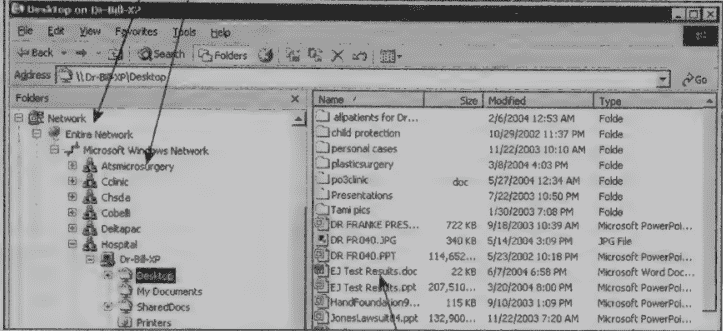

比尔博士的笔记本电脑上没有防火墙，因此他的所有文件都暴露了。

这是在波士顿一家五星级酒店实际拍摄的截图。为了保护隐私，我们更改了计算机、文件夹和文件的名称。请注意，查看或访问比尔博士的文件不需要任何黑客工具。

## 展品 15.1 配置不当的酒店客房互联网连接

Farmer 和 Venema 然后发布了一个名为 SATAN（网络审计安全分析工具）的网络测试程序。安全专业人员和系统管理员对该程序既赞扬又愤怒。一些系统管理员欢呼这种一站式工具的可用性，它揭示了安全漏洞但并未利用它们。其他人质疑作者发布这种免费且易于获取的工具的动机，因为黑客可以用它来攻击网络。随着争论持续，系统管理员和黑客都开始使用 SATAN 来探测网络。

## 15.3.5.1 常见工具

从那时起，出现了数百种渗透工具包；它们通常被称为扫描器。如今可以找到无数免费软件工具，也可以投资商业工具之一。扫描器的复杂性和可靠性各不相同。然而，大多数工具在测试网络时采用相同的[content]
比尔博士为参加医学会议入住酒店，将笔记本电脑插入房间的宽带。

在另一间房里，另一位客人也接入了酒店宽带。她打开 Windows 资源管理器并双击“网络”图标。

由于酒店网络配置不佳，这位客人可以看到所有其他客人的机器并可自由探索它们。


比尔博士的笔记本电脑上没有防火墙，因此所有文件都暴露了。

这是在波士顿一家五星级酒店实际拍摄的截图。为保护隐私，我们更改了计算机、文件夹和文件的名称。请注意，查看或访问比尔博士的文件不需要任何黑客工具。

## 展品 15.1 配置不当的酒店客房互联网连接

Farmer 和 Venema 然后发布了一个名为 SATAN（网络审计安全分析工具）的网络测试程序。安全专业人员和系统管理员对该程序既赞扬又愤怒。一些系统管理员欢呼这种一站式工具的可用性，它揭示了安全漏洞但并未利用它们。其他人质疑作者发布这种免费且易于获取的工具的动机，因为黑客可以用它来攻击网络。争论持续的同时，系统管理员和黑客都开始使用 SATAN 来审查网络。

## 15.3.5.1 常见工具

从那时起，出现了数百种渗透工具包；它们通常被称为扫描器。如今可以找到无数免费软件工具，也可以投资商业工具之一。扫描器的复杂性和可靠性各不相同。然而，大多数工具在测试网络时采用相同的[content]
比尔博士为参加医学会议入住酒店，将笔记本电脑插入房间的宽带。

在另一间房里，另一位客人也接入了酒店宽带。她打开 Windows 资源管理器并双击“网络”图标。

由于酒店网络配置不佳，这位客人可以看到所有其他客人的机器并可自由探索它们。


比尔博士的笔记本电脑上没有防火墙，因此所有文件都暴露了。

这是在波士顿一家五星级酒店实际拍摄的截图。为保护隐私，我们更改了计算机、文件夹和文件的名称。请注意，查看或访问比尔博士的文件不需要任何黑客工具。

## 展品 15.1 配置不当的酒店客房互联网连接

Farmer 和 Venema 然后发布了一个名为 SATAN（网络审计安全分析工具）的网络测试程序。安全专业人员和系统管理员对该程序既赞扬又愤怒。一些系统管理员欢呼这种一站式工具的可用性，它揭示了安全漏洞但并未利用它们。其他人质疑作者发布这种免费且易于获取的工具的动机，因为黑客可以用它来攻击网络。争论持续的同时，系统管理员和黑客都开始使用 SATAN 来审查网络。

## 15.3.5.1 常见工具

从那时起，出现了数百种渗透工具包；它们通常被称为扫描器。如今可以找到无数免费软件工具，也可以投资商业工具之一。扫描器的复杂性和可靠性各不相同。然而，大多数工具在测试网络时采用相同的[content]
比尔博士为参加医学会议入住酒店，将笔记本电脑插入房间的宽带。

在另一间房里，另一位客人也接入了酒店宽带。她打开 Windows 资源管理器并双击“网络”图标。

由于酒店网络配置不佳，这位客人可以看到所有其他客人的机器并可自由探索它们。


比尔博士的笔记本电脑上没有防火墙，因此所有文件都暴露了。

这是在波士顿一家五星级酒店实际拍摄的截图。为保护隐私，我们更改了计算机、文件夹和文件的名称。请注意，查看或访问比尔博士的文件不需要任何黑客工具。

## 展品 15.1 配置不当的酒店客房互联网连接

Farmer 和 Venema 然后发布了一个名为 SATAN（网络审计安全分析工具）的网络测试程序。安全专业人员和系统管理员对该程序既赞扬又愤怒。一些系统管理员欢呼这种一站式工具的可用性，它揭示了安全漏洞但并未利用它们。其他人质疑作者发布这种免费且易于获取的工具的动机，因为黑客可以用它来攻击网络。争论持续的同时，系统管理员和黑客都开始使用 SATAN 来审查网络。

## 15.3.5.1 常见工具

从那时起，出现了数百种渗透工具包；它们通常被称为扫描器。如今可以找到无数免费软件工具，也可以投资商业工具之一。扫描器的复杂性和可靠性各不相同。然而，大多数工具在测试网络时采用相同的[content]
比尔博士为参加医学会议入住酒店，将笔记本电脑插入房间的宽带。

在另一间房里，另一位客人也接入了酒店宽带。她打开 Windows 资源管理器并双击“网络”图标。

由于酒店网络配置不佳，这位客人可以看到所有其他客人的机器并可自由探索它们。


比尔博士的笔记本电脑上没有防火墙，因此所有文件都暴露了。

这是在波士顿一家五星级酒店实际拍摄的截图。为保护隐私，我们更改了计算机、文件夹和文件的名称。请注意，查看或访问比尔博士的文件不需要任何黑客工具。

## 展品 15.1 配置不当的酒店客房互联网连接

Farmer 和 Venema 然后发布了一个名为 SATAN（网络审计安全分析工具）的网络测试程序。安全专业人员和系统管理员对该程序既赞扬又愤怒。一些系统管理员欢呼这种一站式工具的可用性，它揭示了安全漏洞但并未利用它们。其他人质疑作者发布这种免费且易于获取的工具的动机，因为黑客可以用它来攻击网络。争论持续的同时，系统管理员和黑客都开始使用 SATAN 来审查网络。

## 15.3.5.1 常见工具

从那时起，出现了数百种渗透工具包；它们通常被称为扫描器。如今可以找到无数免费软件工具，也可以投资商业工具之一。扫描器的复杂性和可靠性各不相同。然而，大多数工具在测试网络时采用相同的[content]
比尔博士为参加医学会议入住酒店，将笔记本电脑插入房间的宽带。

在另一间房里，另一位客人也接入了酒店宽带。她打开 Windows 资源管理器并双击“网络”图标。

由于酒店网络配置不佳，这位客人可以看到所有其他客人的机器并可自由探索它们。


比尔博士的笔记本电脑上没有防火墙，因此所有文件都暴露了。

这是在波士顿一家五星级酒店实际拍摄的截图。为保护隐私，我们更改了计算机、文件夹和文件的名称。请注意，查看或访问比尔博士的文件不需要任何黑客工具。

## 展品 15.1 配置不当的酒店客房互联网连接

Farmer 和 Venema 然后发布了一个名为 SATAN（网络审计安全分析工具）的网络测试程序。安全专业人员和系统管理员对该程序既赞扬又愤怒。一些系统管理员欢呼这种一站式工具的可用性，它揭示了安全漏洞但并未利用它们。其他人质疑作者发布这种免费且易于获取的工具的动机，因为黑客可以用它来攻击网络。争论持续的同时，系统管理员和黑客都开始使用 SATAN 来审查网络。

## 15.3.5.1 常见工具

从那时起，出现了数百种渗透工具包；它们通常被称为扫描器。如今可以找到无数免费软件工具，也可以投资商业工具之一。扫描器的复杂性和可靠性各不相同。然而，大多数工具在测试网络时采用相同的[content]
比尔博士为参加医学会议入住酒店，将笔记本电脑插入房间的宽带。

在另一间房里，另一位客人也接入了酒店宽带。她打开 Windows 资源管理器并双击“网络”图标。

由于酒店网络配置不佳，这位客人可以看到所有其他客人的机器并可自由探索它们。


比尔博士的笔记本电脑上没有防火墙，因此所有文件都暴露了。

这是在波士顿一家五星级酒店实际拍摄的截图。为保护隐私，我们更改了计算机、文件夹和文件的名称。请注意，查看或访问比尔博士的文件不需要任何黑客工具。

## 展品 15.1 配置不当的酒店客房互联网连接

Farmer 和 Venema 然后发布了一个名为 SATAN（网络审计安全分析工具）的网络测试程序。安全专业人员和系统管理员对该程序既赞扬又愤怒。一些系统管理员欢呼这种一站式工具的可用性，它揭示了安全漏洞但并未利用它们。其他人质疑作者发布这种免费且易于获取的工具的动机，因为黑客可以用它来攻击网络。争论持续的同时，系统管理员和黑客都开始使用 SATAN 来审查网络。

## 15.3.5.1 常见工具

从那时起，出现了数百种渗透工具包；它们通常被称为扫描器。如今可以找到无数免费软件工具，也可以投资商业工具之一。扫描器的复杂性和可靠性各不相同。然而，大多数工具在测试网络时采用同样的[content]
比尔博士为参加医学会议入住酒店，将笔记本电脑接入房间的宽带。

在另一间房里，另一位客人也接入了酒店宽带。她打开 Windows 资源管理器并双击“网络”图标。

由于酒店网络配置不佳，这位客人可以看到所有其他客人的机器并可自由探索。


比尔博士的笔记本电脑上没有防火墙，因此他的所有文件都暴露了。

这是在波士顿一家五星级酒店实际拍摄的截图。为保护隐私，我们更改了计算机、文件夹和文件的名称。请注意，查看或访问比尔博士的文件不需要任何黑客工具。

## 展品 15.1 配置不当的酒店客房互联网连接

Farmer 和 Venema 随后发布了一个名为 SATAN（网络审计安全分析工具）的网络测试程序。安全专业人员和系统管理员对该程序既赞扬又愤怒。一些系统管理员欢迎这种一站式工具的出现，它能揭示安全漏洞但不加以利用。另一些人则质疑作者发布这种免费且易于获取、黑客可用来攻击网络的工具的动机。在争论持续期间，系统管理员和黑客都开始用 SATAN 来探测网络。

## 15.3.5.1 常见工具

从那时起，出现了数百种渗透工具包，通常被称为扫描器。如今可以找到无数免费软件工具，也可以购买商业工具。扫描器在复杂性和可靠性上各不相同。然而大多数工具在测试网络时使用同样的基本功能：查询目标机器上的端口并记录响应或无响应。

在正确使用时，这些工具可以有效地发现并记录关于计算机网络的大量数据，揭示网络中的安全漏洞。许多扫描器软件包还包含前面描述过的网络嗅探应用程序。管理员可以利用这些信息减少可被入侵的系统数量。

可在任何渗透测试中使用的基本网络工具种类繁多。这些工具可能包括平凡的程序，如 PING、FINGER、TRACEROUTE 和 NSLOOKUP。然而，大多数严肃的渗透工具都使用由一系列端口查询和已知漏洞数据库组成的自动化漏洞分析工具。一些工具还会尝试利用已识别的漏洞以消除误报。一旦发现漏洞，获取“漏洞利用”程序或用于对易受攻击机器发起攻击的程序就变得异常容易。所有工具都使用 TCP 协议族的基本操作。虽然这些协议在不同的端口号上运行，但它们都共享一个三向握手的共同结构。所有 TCP 协议都寻找连接尝试（connect）、同步和确认交换（SYN/ACK）、各种条件（FLAGS）以及关闭端口请求（FIN）。因此，端口扫描器的操作相当相似。它们尝试在机器上找到开放或监听的端口，请求连接，然后将结果记录到文件中以与内部数据库进行比较。扫描器会通过列出开放端口和似乎正在运行的服务来显示扫描结果。此时各种程序有所不同。有些会深入分析端口和服务相关的可能安全漏洞以及相应的安全措施。更具恶意的扫描器还包括用于利用所揭示漏洞的自动化脚本。

在免费软件工具中，Nessus、Netcat 和 nmap 可能最为人所知，尽管在黑客和系统管理员中似乎总有当月的流行款式。SATAN 仍然可用，其衍生产品 SAINT 和 SARA 也是如此。使用这些工具需要相当多的技能，因为它们相当复杂，而且某些扫描可能会使系统过载导致挂起或崩溃。

## 15.3.5.2 常见扫描

如前所述，市面上大多数扫描器/嗅探器都会运行相同的基本例程，以全面了解一台机器。目的是确定机器上运行的是什么以及它在网络中的作用。下一节描述了最基本的扫描及其结果。

### 15.3.5.2.1 TCP Connect

这是最基本的 TCP 扫描形式。此系统调用由操作系统提供。如果端口正在监听，连接尝试将继续进行。此扫描不需要 root 或超级用户权限。然而，此扫描很容易被检测到，因为许多连接和终止请求会显示在主机的系统日志中。

### 15.3.5.2.2 TCP SYN

此扫描不会建立完整连接，有时被称为半开放扫描，因为完整的握手从未完成。SYN 扫描首先发送 SYN 数据包。任何开放端口都应以 SYN/ACK 响应。然而，扫描器发送 RST（重置）而不是 ACK，从而终止连接。较少系统会记录此类扫描。关闭的端口会对初始 SYN 以 RST 而非 ACK 响应，从而表明端口已关闭。

### 15.3.5.2.3 隐蔽扫描

也称为隐蔽 FIN、圣诞树或空扫描，隐蔽扫描之所以使用，是因为某些防火墙和入侵检测系统会监视对受限端口的 SYN。隐蔽扫描试图在不创建尝试日志的情况下绕过这些系统。该扫描基于这样一个事实：关闭的端口应以 RST 响应请求，而开放端口应直接丢弃数据包而不记录尝试。

### 15.3.5.2.4 UDP 扫描

有许多流行的用户数据报协议（UDP）漏洞可供利用，例如 rpcbind 漏洞或特洛伊程序，如 cDc Back Orifice，它会安装在 UDP 端口上。扫描器会向每个端口发送 0 字节的 UDP 数据包。如果主机返回“端口不可达”消息，则该端口被视为已关闭。

可在数秒内获得破解的密码。事实上，一个有用的安全意识练习是向员工演示此类程序：最先被破解的密码将是最弱的，这可以作为选择此类词的用户的一个警告。

一位好的安全官会确保网络上的密码定期使用密码破解器进行检查，或实施众多强密码执行器之一。密码执行器通过将用户选择的密码与执行器设定的规则进行比较来增强密码程序。

Steve Gibson 的 GRC 提供了一个简单的在线工具，可用于计算样本密码的密钥空间并估计破解时间。¹³ 用户不应输入实际密码，而应仅输入使用相同规则的密码；例如，如果实际密码为 Dk3*(4n$p2，则可以输入 Eh5&%9g#18 以获得完全相同的分析。在此示例中，计算结果为密钥空间为 6.05 × 10¹⁹，如果大规模并行处理器阵列支持每秒 10¹⁵ 次猜测，则破解时间为 1 周。密码 evanescent porridge 在使用相同处理器通过暴力破解 4.50 × 10³ 密钥空间进行破解时需要 14.32 亿个世纪。

## 15.3.5.3.3 Rootkits

Rootkits 是黑客用来掩盖机器已被“root”的众多工具之一。Rootkit 并非用于入侵系统，而是确保被入侵的系统仍可供入侵者使用。Rootkits 由安装在受害机器上的实用程序套件组成。实用程序首先修改最基本且最常用的程序，以便将可疑活动隐藏起来。例如，rootkit 通常会更改简单的命令，如“ls”（列出文件）。来自 rootkit 的修改版“ls”不会显示入侵者希望隐藏的文件或目录。

由于命令和程序看起来仍像以前一样，Rootkits 极难发现。经常是因为系统管理员觉得“不对劲”而发现 rootkit。由于 rootkits 在更改的程序上差异很大，无法判断哪些程序已被更改，哪些未被更改。如果没有对每个系统二进制文件的密码学安全签名，管理员无法确定是否找到了整个 rootkit。

Rootkit 中包含的一些常见实用程序有：
- 特洛伊木马实用程序
- 后门，允许黑客随意进入系统
- 日志擦除实用程序，从系统日志文件中删除攻击者的访问记录
- 捕获攻击者网络流量的数据包嗅探器

## 15.3.5.3.4 特洛伊代码

如前文在讨论受损登录程序时所述，特洛伊代码并非它看起来那样。在此情况下，特洛伊程序是 rootkit 中被更改的程序，它们允许入侵者的踪迹被隐藏，或允许程序在静默后台运行时收集更多信息。经常被特洛伊化的本地程序包括“chfn”、“chsh”、“login”和“passwd”。在每种情况下，如果在适当位置输入 rootkit 密码，就会生成一个 root shell。

## 15.3.5.3.5 后门

后门实用程序通常与已被特洛伊化的程序绑定。它们用于在其他方法失败时进入系统。即使

系统管理员发现入侵后已更改了所有用户名和密码，但他或她很可能不知道后门的存在。利用后门，黑客只需知道连接到被入侵机器的正确端口，并在通常不会输入的地方输入密码或命令即可。

例如，网络超级守护进程 inetd 常常被植入特洛伊木马。该守护进程会在一个不寻常的端口上监听（rfe，Linux 版 Rootkit IV 中默认为端口 5002）。如果连接后提供正确的密码，就会生成一个 root shell 并绑定到该端口。

rshd 功能也可以被类似地植入特洛伊木马，使得当以 rootkit 密码作为用户名时生成 root shell，因此 rsh [hostname] -l [rootkit password] 将获得对被入侵机器的访问权限。

## 15.3.6 通过网站渗透。

二十世纪最后十年出现了一个庞大的新网络领地，部分用于商业用途，很大程度上是由试图从原本为军事和学术目的而开发的技术中获利的尝试所驱动的。正如 Whois Source（www.whois.sc/internet-statistics）所报道的那样，该网络的持续增长在 2013 年 5 月撰写时已超过 1.45 亿个注册域名，它是关于互联网统计数据最可靠的来源之一。

截至 2012 年 6 月，全球互联网普及率（以互联网用户占总人口的比例衡量）超过三分之一，北美超过 75%。14 当时亚洲几乎有 10 亿用户。毫不奇怪，在如此多机器在一个网络中且超过 24 亿用户（是本手册 2009 年第五版报道的两倍）的情况下，这一新领地是黑客的主要游乐场，从仅仅好奇到严重犯罪者皆然。网络为寻求未经授权访问他人信息系统的人提供了目标丰富的环境。对此有几个原因；其中最主要的是，许多组织，无论是商业还是政府——包括军队——都有外部公共网站，这些网站以某种方式连接到内部私有网络。这种连接提供了一个系统渗透路径，可以以本节概述的多种不同方式被利用。

有关网站安全的更详细分析，请参阅本手册第 21 章。

### 15.3.6.1 Web 系统架构。

将商业网站放置在互联网上的标准做法是对其进行防护以抵御敌对活动，通常使用带有访问控制列表（ACLs）的路由器或防火墙，或两者兼用。然而，除非网站是基础的“宣传册式”网站，仅用于只读信息提供，否则网站必须允许用户输入数据。输入对于像留言簿条目或信息请求表单这样简单的事物是必需的；更复杂的应用程序如在线购物则有更复杂的数据输入需求。

处理输入的典型方法是通用网关接口（Common Gateway Interface，CGI）。这是一种 Web 服务器将用户输入传递给应用程序并接收响应以便转发给用户的标准方式。例如，当用户在网页上填写表单并提交时，Web 服务器通常会将表单信息传递给一个小型应用程序。该应用程序处理数据并可能返回确认消息。该方法名为 CGI，是超文本传输协议（HTTP）的一部分。由于它是一种一致的方法，因此编写以使用它的应用程序可以在其部署的服务器的操作系统无关的情况下使用。进一步增加 CGI 流行度的是它可与多种语言一起使用，包括 C、C++、Java 和 PERL。术语“CGI”泛指用这些语言中的任何一种编写的 Web 服务器代码。

任何接收输入的系统都必须在其内部提供一条路径，使该输入能够流经。这被称为“允许的路径”。允许路径的必要性，加上将其用于渗透攻击的可能性，导致系统安全专家 David Brussin（本手册第 26 章作者）为此类漏洞创造了“允许路径漏洞”这一术语。使用允许路径的两种主要漏洞类别是输入验证漏洞，其类似于缓冲区溢出漏洞，常用于滥用 CGI，以及文件系统漏洞，其滥用 Web 服务器操作系统和在服务器上运行的服务。

当然，滥用网站还有其他方式。拒绝服务攻击可用于阻止合法访问，从而损害可用性。（本手册第 18 章涵盖了 DoS 攻击。）并非每次攻击都旨在进一步渗透系统；网页本身也可能是攻击目标，如篡改，即对网页进行未经授权的更改。篡改通常是为了羞辱网站所有者、宣传抗议信息，或提高执行篡改的犯罪黑客的声誉。但就渗透而言，对网站的攻击的主要目标是破坏可能连接到 Web 服务器的内部网络。利用允许路径漏洞可能是此类攻击最常见的形式。

### 15.3.6.2 输入验证漏洞。

每当创建允许路径以适应用户输入时，就存在被滥用的可能性。此类滥用可能导致对系统的未经授权访问。本节描述了一系列使用此方法的渗透方法，所有这些方法都以某种方式使用无效输入，或输入为：

- 服务器上接收应用程序未预期的。
- 根据接收应用程序运行的规则不“允许”的。

### 15.3.6.3 意外的输入攻击。

如何向服务器提交意外输入？答案在于互联网的架构以及访问服务器的客户端系统的矛盾性质。典型的 Web 客户端仅在名称上是客户端。它通常是一台功能强大的机器，能够自行充当服务器，并且由于互联网这一庞大网络固有的点对点性质，很难被其他服务器控制。互联网的所有节点都被视为主机。当然，许多这些主机都超出了托管作为服务器运行的机器的组织的物理控制范围。这一事实对安全有严重影响。

除非服务器能够在客户端安装严格受控的应用程序代码，并将用户输入限制在该代码中，否则服务器必须依赖最常用于实现 Web 客户端-服务器交互的编码。超文本标记语言（HTML）和超文本传输协议守护进程（HTTPD）。两者都很复杂且相对不成熟。例如，它们不会自动识别输入的来源。考虑网页上的 HTML 表单，设计用于向网站访问者展示，他们填写字段然后点击按钮提交表单。客户端没有任何东西可以控制用户的输入。因此，用户可能会在“名字”字段中输入一长串随机字符，而不是输入名字。除非处理该数据字段的应用程序执行广泛的输入验证，否则其影响

代理网络机器人，被称为 flux bot。flux bot 的目标是通过使用不断变化的代理服务器来掩盖钓鱼网站的位置，从而使钓鱼诈骗的目标银行和其他机构更难将其关闭。（有关钓鱼诈骗的更多信息，请参阅本手册第 20 章。）

根据 Google 报告，网页被转变为恶意软件感染向量的四种主要方法为：广告、第三方小部件、用户贡献内容和 Web 服务器安全。这意味着公司网站不仅需要得到牢固保护，而且所有广告和用户提供的内容都应得到验证，网站使用的或分发的任何小部件也应如此。

## 15.3.8 精明的攻击者。

近年来，几组攻击者使用与历史上不同的方式来破坏安全系统取得了很大成功。这些组织在 2006 年被美国空军称为“高级持续性威胁”。虽然其中许多组织由国家资助，但同样的技术也被纯粹为财务利益而行动的组织所采用。

重要的是要事先了解这些攻击，无论具体来源组织如何，都是有针对性的。对于国家资助的组织而言，目标是信息窃取。这种信息窃取通常以电子邮件的形式出现，但也可能深入到研发信息或其他知识产权。受财务动机驱动的组织专注于金融机构以获取财务利益。

截至本文撰写时，世界上活跃着许多已知的组织。这些组织中的每一个在其整体流程中使用略有不同的特定组件，但整体流程是相同的，可以分解为一些不同的阶段。

第一阶段是侦察、计划和准备。他们在此选择目标组织内的特定个人。他们还根据侦察结果规划攻击。最后他们设置针对目标使用的特定命令和控制服务器，并构建作为攻击一部分使用的恶意软件。

第二阶段是获得立足点和持久性。在此阶段，他们的目标是进入目标网络。这是他们部署攻击（最常通过 spear-phishing）并获得对目标网络的远程访问的时机。由于获得立足点是更具挑战性的部分之一，他们还寻求确保能够在网络上维持该立足点。

第三阶段是绘制内部网络地图并定位所需数据。此时，他们寻求了解目标环境并找到其最终目标，即特定数据或可对其实施财务影响的系统。

第四阶段也是最后阶段是渗出或利用。这是他们将收集的信息传输到目标环境之外（通常是国家行为者的目标）或执行财务攻击（在网络犯罪行为者的情况下）的时机。

### 15.3.8.1 第一阶段——侦察、计划和准备。

攻击者通常首先在目标组织中挑选少数个人。他们使用开源情报来源，如公司网站、Facebook 和 LinkedIn 来收集信息并识别目标组织中的收件人。其他来源，如公司新闻稿和关于这些公司的新闻文章，为攻击者锁定接近攻击者最终目标的个人提供了丰富的资源。


一旦确定了目标个体，就可以创建合适的投递方式。最常见的投递手段是通过精准钓鱼。精准钓鱼是一种针对性的钓鱼攻击（与发送给数千或数百万收件人的普通钓鱼相比）。这些精准钓鱼通常简单直接，但也可能相当复杂。

虽然精准钓鱼是最常见的投递手段，攻击者还会入侵目标常用的网站作为投递途径。这种投递方法被称为水坑攻击。术语“水坑”指的是猎人等待猎物在水坑饮水的狩猎方式，因为猎人知道目标最终会来喝水。水坑攻击通过修改被入侵网站的代码来实现，这样当用户浏览该网站时，漏洞利用代码就会被投递到受害者浏览器中。该漏洞利用随后用于在系统上安装恶意代码。

最不常见的是，精明的攻击者被发现使用放置在 USB 密钥上的恶意代码。这些 USB 密钥要么被留在目标用户会找到的地方，甚至直接邮寄给目标。USB 设备上使用漏洞利用代码，以便当用户访问该设备时，漏洞利用代码会将恶意代码安装到用户系统上。

另外，作为第一阶段的一部分，攻击者会配置在攻击过程中使用的 C2（指挥与控制）服务器。这些 C2 服务器通常是合法组织中被入侵的主机，但也可以是合法获得的主机服务器。特别是，攻击者更喜欢大型大学等场所的服务器，因为这些服务器不太可能被组织今天普遍采用的常见预防机制（如 Web 代理过滤器）所阻止。

准备工作的最后主要方面是创建针对目标组织的后门。攻击者通常拥有几种具有略微不同特征的后门变体。一些组织甚至会使用常见的 RAT（远程访问木马），例如 Poison Ivy，并将其配置为使用适当的 C2。许多攻击者拥有可将合法 PDF 或办公文档武器化的工具。武器化是将合法文件转变为恶意文件的过程。例如，如果这些个人共同属于某个特定行业，攻击者可能会找到近期相关的行业会议，并从会议网站下载实际的议程 PDF 文件。他们可能会对该 PDF 进行武器化，或者只是使用文件中的信息添加到其精准钓鱼中以增加真实感并提高目标用户上当的几率。

## 15.3.8.2 第二阶段——立足点与持久化

第一阶段的最终结果是在一个或多个目标系统上安装 RAT。该木马为受害系统提供隐蔽的后门访问。现在攻击者在目标网络上获得了立足点，他们希望维持该访问。攻击者希望从不止一个系统获得访问权限，因为当他们想要访问时，单个主机可能未运行。攻击者也明白最终 RAT 会被发现或移除。攻击者还希望增加其访问权限，以确保他们能够达到最终目标。

为实现所有这些目标，攻击者通常会遵循一致的流程。他们首先从本地主机缓存中转储密码哈希。默认情况下，Microsoft Windows（大多数组织用户使用的主要操作系统）会缓存最近 10 个用于登录计算机的用户 ID 和密码。这样做是为了如果计算机未连接到企业环境且无法访问域控制器，用户仍能本地登录系统。像 pwdump、Windows 凭据编辑器和 fgdump 这样的工具会显示本地系统缓存中的用户 ID 和密码。然后这些凭据可以使用彩虹表或在攻击者位置的破解软件进行破解。

第二步是查看主机网络连接，以确定主机正在与哪些计算机通信。其背后的逻辑很简单——本地计算机中的任何凭据很可能在系统交互的其他主机上也有效。请记住，用户 ID 的目的是为了对其他系统进行身份验证以便使用它们。攻击者使用破解的本地缓存用户 ID 的密码连接到后续系统，并继续从该主机提取用户 ID 和密码哈希。这种从一台主机移动到另一台主机的过程被称为横向移动。特别重要的是要注意，攻击者并不是使用恶意软件来实现这种访问。他们使用的是合法的用户 ID 和密码。最终，攻击者将继续这一过程，直到找到具有可提供整个环境访问权限的管理员账户的系统。他们通常只需遍历六到十个系统即可找到缓存了网络或域管理员账户的系统。一旦获得管理员账户，他们就可以自由地在网络中移动。

除了从系统缓存中获取本地用户 ID 和密码外，攻击者在此时还会绘制目标环境。网络映射是通过简单查询 Active Directory 完成的。攻击者获取环境信息的最简单方法是使用一系列简单命令：

```
net group "domain computers" /domain
net group "domain users" /domain
net group "domain controllers" /domain
net group "domain admins" /domain
```

如果你不熟悉这些命令，你应该试试。唯一的要求是从本地域的成员计算机上执行它们。无需管理员凭据。结果是环境中所有计算机、用户、域控制器和域管理员账户的列表。这些信息会立即返回，对于攻击者的目的来说，比运行 nmap 之类的工具更有用。另一个好处是，与 nmap 或类似的非常嘈杂的工具相比，使用这些命令非常、非常难以检测。当攻击者想要获得有关环境的更详细信息时，他们通常会使用 dsquery 和 dsget。这两个是 Microsoft 提供的用于查询 Active Directory 的命令行工具。以下是从最近一次入侵中恢复的批处理脚本的内容，展示了这些工具的使用。

```
dsquery user -limit 0 | dsget user -samid -display -title -email -dept -office -company -c >1
dsquery user -limit 0 | dsget user -samid -pwdneverexpires -accexpir es -loscr -profile -hmdir -hmdrv -c >2
dsquery user -limit 0 | dsget user -c > 3
dsquery group -limit 0 |dsget group -c >g
dsquery subnet -limit 0 |dsget subnet -c >sn
dsquery site -limit 0 |dsget site -c >s
dsquery computer -limit 0 |dsget computer -c>c
dsquery ou -limit 0 | dsget ou -c>o
```

攻击者明白用户会离开组织并更换角色。为了确保他们拥有充足的用户 ID 可用，倾倒整个域凭据对他们来说是高度优先事项。这通常发生在他们获得具有足够凭据的管理员账户后的几分钟内。他们对此选择的工具是众所周知的 pwdump。他们只需使用恢复的域管理员账户在其中一个域控制器上运行 pwdump。一旦获得哈希值，他们就可以在自己的位置悠闲地破解它们。

攻击者的另一个优先事项是安装获取环境访问权限的额外机制。为此他们会使用各种方法。如果公司使用单因素 VPN，那么攻击者就可以使用被盗的用户凭据无限访问环境。他们还会安装多个额外的后门。这些后门分布在整个环境中，以使安全人员难以全部找到它们。攻击者明白恶意软件是最容易在环境中被发现的东西，因此他们只会在被入侵的少数主机上安装副本。作为进一步的检测预防措施，他们通常会将额外的后门配置为长时间休眠。这种策略导致安全人员非常难以找到并消除其后门的所有副本。最后，在过去几年中，他们还被观察到在企业 DMZ 中部署 Web shell 作为对环境的进一步备份访问。Web shell 在 1990 年代末和 2000 年代初非常流行，但在过去几年中很少见，因此通常不会被寻找。攻击者使用的 Web shell 非常小，直到被远程访问才会执行任何操作，这也使它们非常难以发现。

仿佛使用如此多技术来维持对公司的访问还不够，大多数组织还会实时监控其安装的后门。如果他们观察到组织正在积极移除它们，他们会迅速跳转到被入侵的主机并安装特征完全不同的后门版本，以维持访问并保持未被检测。重要的是要认识到，大多数后门是专有的，而非通用产品，并且很少能用标准杀毒软件发现。对攻击者而言的最终结果是在环境中长期存在，在此期间他们可以随意移动和访问所需内容。

## 15.3.8.3 第三阶段——信息窃取

高级攻击者的最后阶段和方面是他们找到并外泄所见信息，或在网络犯罪动机行为者情况下执行财务转账。攻击者的所有努力都是为了最终窃取某物。

在环境中建立长期持久化后，攻击者开始从一台主机移动到另一台主机寻找他们所需的信息。这主要是通过命令行完成的，但一些组织还会通过其 C2 基础设施隧道传输 RDP 协议。如果组织有其他形式的远程控制，例如 VNC，攻击者也会乐于使用他们窃取的合法凭据来利用它。通过简单的 Windows ‘dir’ 命令，他们查看每台主机的文档，寻找所需的数据。这得益于他们在早期阶段获得的深入组织知识。

通常他们窃取的大部分内容只是电子邮件。当你考虑到通过电子邮件进行的业务活动细节数量时，你会意识到攻击者可以从电子邮件中包含的信息中获得难以置信的竞争优势。

当攻击者找到所需数据时，他们会对其进行压缩和加密，然后将其传回 C2 基础设施。此过程称为外泄。由于精明的攻击者明白组织设有日志记录措施，传输会先到中间系统，而不是直接到其位置。随后他们可以将数据从中间系统移动到最终目的地，而不会有被入侵组织追踪的风险。


最常见的是，RAR 被用于打包外泄的数据。RAR 对攻击者特别有用，因为它在压缩格式中具有独特特性：即使 RAR 文件不完整，其中的数据仍可恢复。如果在传输中途中断外泄，攻击者仍能提取已传出的数据部分。使用加密是为了让被入侵的公司更难弄清被窃取了什么数据。大多数组织还喜欢为其 RAR 文件使用媒体文件扩展名，以进一步混淆。重命名后的文件可能带有 .mpg 或 .avi 扩展名，但它们只是普通的加密 RAR 文件。

对于数据传输，攻击者通常使用安全套接层（SSL）。这种工具与压缩和加密的内容相结合，使得公司很难检测到任何恶意行为正在发生。这些复杂的攻击者之所以总体上如此成功，是因为他们的大多数活动都是隐藏在合法活动的庞大流量和噪音中进行的。因此，鉴于我们用户合法采用此类服务的比例很高，已观察到他们也使用 Dropbox、Box.net 以及其他云服务提供商进行外泄。从合法活动中检测到对云服务提供商的恶意活动确实非常困难。

## 15.4 政治和法律问题。

得益于万维网，互联网已成为一种自我记录的现象。人们可以利用互联网查找到关于互联网的一切想要了解的信息，包括如何渗透采用互联网技术的资讯系统。然而，互联网上可获得的渗透信息并不局限于互联网系统，而且互联网并不是渗透信息的唯一来源。此外，渗透信息的可用性本身就充满了政治和法律问题。这些问题将在本章最后一节中简要讨论。

### 15.4.1 系统渗透信息交换。

共享系统渗透信息——即可能促进对信息系统非法渗透的信息——是长期、激烈且持续进行的辩论的主题。该辩论涵盖了该问题的实际和伦理方面。虽然在本章范围内无法全面覆盖，但我们确实回顾了完全公开的问题，以及渗透信息的某些来源。

### 15.4.2 完全公开。

我们应如何处理已知漏洞和可能造成损害的计算机病毒？我们应公布全部细节、隐瞒部分细节，还是在制造商提供补丁或更新之前压制任何可能允许利用的发布？是否有些病毒和漏洞值得不同对待？

在过去二十年里，系统或网络漏洞和漏洞利用的正式完全公开渠道已经演进（例如，BugTraq）。来自专业、诚实的网络安全专家（好人）的对如此细节的完全公开的支持，下至源代码或脚本级别，是基于若干关键信念的子集：

- 坏人无论如何都知道漏洞。
- 如果他们尚不知道，很快就会知道，有无公布的细节都一样。
- 了解细节对好人帮助更大，而非坏人。

在野外，”大多数病毒是用汇编语言或机器码编写的。这将能够阅读或理解它们的人数限制为熟悉汇编语言和机器码的人员。然而，任何收到宏病毒的人都拥有读取其代码所需的文本编辑工具。开发和测试宏病毒所需的工具由主流应用程序提供，例如 Microsoft Word，该软件在全球拥有数千万用户，其中相当一部分用户拥有或可以轻松获得开发自己的病毒所需的基础编程技能。1995 年夏季原始 Word Concept 病毒的迅速传播几乎确保了任何想要它的人都能得到它（而且许多不想要它的人也一样得到了它）。将病毒内容保密的想法行不通。

面对厂商无法或不愿及时修复安全漏洞，一些用户和专家可以预期会转向安全信息的完全公开，即使其中许多人可能不赞成使用此类策略。然而，他们在评估此类披露的影响时始终存在做出错误判断的风险，而这种影响本质上是不可预测的。事实上，Word Concept 病毒的发布可能出于促使微软改变其办公应用程序处理宏的方式的愿望。其他办公应用程序，如 WordPerfect 和 Lotus 1-2-3，被设计为将宏代码与文档内容分开，使得创建恶意文档变得更加困难。

### 15.4.3 来源。

有许多来源提供有关如何渗透系统的信息。这些来源的动机从高度道德到彻头彻尾的犯罪不等。本手册第 74 章讨论了为合法、授权目的进行的渗透测试的培训和认证。

### 15.4.3.1 在线来源。

一个不小的讽刺在于，关于如何渗透信息系统所需了解的大部分内容都是由信息系统本身提供的。幸运的是，情况恰恰相反，正如本章一位作者所观察到的：“保护信息的最佳武器是信息。”16 因此，安全专业人员需要了解可用的渗透信息来源。

如今有数千个网站

- 记录不同版本操作系统的安全漏洞
- 分发黑客工具并讨论如何使用它们
- 编目网络硬件的默认凭据
- 教授恶意代码编写，包括如何制作病毒和蠕虫
- 列出用于激活盗版软件的许可证代码
- 买卖系统访问代码、被盗信用卡、被盗身份数据以及受损主机网络（僵尸网络）
- 为寻求渗透系统的人提供论坛和聚会场所

这些网站承接了早期的在线通信渠道，如公告板和 Usenet 群组，在那里合法的信息共享与非法信息的交换、盗版代码等并存。一些网站经过审核，因此保持一定的道德标准。另一些则遵循互联网的“ anything goes ”传统。系统管理员和员工绝不应使用公司电子邮件地址参与这些网站上的讨论。在一种流行策略中，黑客等待平台特定漏洞被宣布，然后在互联网上搜索使用该平台的人的消息，查看他们的电子邮件地址以了解他们的工作单位，并攻击这些公司的系统，希望补丁尚未安装。

### 15.4.3.2 出版物。

多年来，许多出版物专门从事黑客活动。它们通常提供有关如何渗透系统的信息。一些出版物主要是电子的，例如 Phrack，而另一些则是印刷的，例如 2600，它现在通过常规杂志渠道以及付费订阅广泛发行。

### 15.4.3.3 黑客支持团体。

存在众多团体分享黑客信息，从拥有自己出版物的相对稳定的实体（例如 2600 和 cDc）到拥有数千名参与者的年度大会（例如 DefCon）。尽管这些团体中的一些成员可能犯下刑事行为，而黑客大会的一些参与者确实已被定罪并服刑，但这些团体和会议通常存在动机各异的多元化元素。例如，DefCon 吸引的不仅是公开倡导未经授权测试他人系统和网络的人，还有执法人员和合法的安全专家。一些参与者专门去 DefCon 说服年轻人不要在学习安全时违法。

许多安全专业人员希望白帽黑客与黑帽黑客之间的界限更清晰、执行更严格；然而，一些公司为了获得黑客技术安全专长的 perceived 价值而忽视过去的过失。事实上，近年来，投资者甚至与黑客团体合作创办安全咨询公司，其中一些员工继续使用黑客化名。事实 remains，一些领域最好的技术培训是由在刑事（或准刑事）黑客活动中获得专长的人提供，但现在他们帮助抵御此类活动。

### 15.4.4 渗透的未来。

过去 15 年的趋势强烈表明，企图渗透信息系统的行为在不久的将来不会减少。以下因素已存在一段时间：

- 渗透技术的成本下降以及可及性提高——从用于破解密码和加密的软件和硬件到窃听和拦截设备
- 继续部署未经充分测试的系统，使用不成熟的技术且对安全关注不足的做法
- 易于使用的界面自动黑客工具的可用性不断提高
- 在流行文化中，黑客被描绘为“酷”的活动，继续吸引人，而对其合法性或道德性的反思不足

此外，近年来以下因素也强势出现：

- 鉴于被盗个人数据、受损主机（僵尸网络）和漏洞利用的蓬勃市场，从渗透系统中获利的非常现实的机会


- 有组织犯罪对系统渗透的兴趣和参与度日益增加
- 越来越精通计算机的跨国恐怖组织的崛起，它们可能倾向于渗透与之对立的实体或国家的系统¹⁷

尽管一些公司和政府机构正在积极寻求对这些威胁的改进应对措施，但另一些则没有。由于缺乏关注、资源或处理这些趋势的时间，许多实体的风险正在增加。每项新技术都会带来新的威胁，但新威胁通常会被提供防御措施的厂商视为危言耸听而加以否定。对于许多公司和政府机构而言，获取新技术带来的好处的热情压倒了对其部署固有风险的警告。当这些风险最终以威胁组织的方式显现时，反应通常是购买技术解决方案，而漏洞的根本原因——即人类行为和员工对安全问题的意识——却未能得到应有的关注和资源。

计算机技术的新应用，例如植入式医疗设备以及汽车和自动驾驶汽车的控制系统，为研究科学家和犯罪黑客的实验提供了肥沃的土壤，他们发现了许多漏洞。¹⁸

## 15.5 摘要
- 信息系统的渗透可以通过多种方法实现，其中一些方法非常难以防御。
- 负责系统安全的责任人必须防御这种广泛的渗透方法。
- 确保所有防御措施对所有攻击始终有效，要比在这些防御措施中找出一个单点故障困难得多。
- 尽管并非所有系统都需要同等程度地防御所有类型的攻击，但即使是更奇特的攻击策略的成本也在不断下降，扩大了潜在攻击者的范围。
- 最便宜且最有效的攻击往往是非技术性的，利用的是人类的脆弱性而非技术上的弱点。
- 有经验的犯罪黑客倾向于选择非技术攻击而非技术攻击；而且最好的防御手段——员工意识——也是非技术性的。
- 系统可以在客户端、服务器或两者之间的连接处受到攻击。
- 有线和无线系统都极易遭受窃听和拦截。
- 当今许多系统都是基于不成熟且不安全的技术构建的，使其容易受到各种攻击。
- 新攻击的出现令人警觉但又可预测地规律。
- 其中许多新攻击是旧攻击的重现，原因是缺乏漏洞类别分析。由于经济压力、推理错误以及对安全的渴望不足，漏洞是逐个实例修复，而不是按类别修复。
- 只要系统是 Web 连接或 Web 启用，对网站的允许路径攻击始终是最有效的系统渗透策略。
- 渗透测试，无论是由内部员工还是客观外部专家执行，都应始终在系统部署之前进行。
- 鉴于渗透尝试的不可避免性和其最终成功的高度可能性，系统应设计为能够抵御攻击，限制因单点故障而导致的损害范围。
- 系统渗透将继续吸引好奇者，并诱使他们通过非法访问系统而违法。系统渗透在金钱、权力、竞争优势和名声方面的潜在收益，将继续激励那些对法律和道德没有有效威慑作用的人。
- 系统渗透将变得越来越自动化和简化，进一步扩大潜在攻击者的范围。
- 人性而非技术是防御渗透尝试的关键。只有通过提高社会的道德标准并教育员工理解他人不道德行为的意愿，才能显著减少对信息系统的犯罪黑客攻击。

## 15.6 延伸阅读
### 网站
CERIAS 热榜： www.cerias.purdue.edu//hotlist
INFOSEC 和 INFOWAR 门户： www.infowar.com
SANS InfoSec 阅读室——渗透测试： www.sans.org/reading_room/whitepapers/testing
SearchSecurity.com： http://searchsecurity.techtarget.com
SecurityFocus： www.securityfocus.com
Web 应用安全联盟： www.webappsec.org

### 书籍
Allen, Lee. 高度安全环境的高级渗透测试：终极安全指南. Packt Publishing, 2012.
Chappell, Laura. Wireshark® 101：网络分析必备技能. Laura Chappell University, 2013.
Engebretson, Patrick. 黑客与渗透测试基础：轻松掌握道德黑客与渗透测试. Syngress, 2011.
Faircloth, Jeremy. 渗透测试人员开源工具包，第3版. Syngress, 2011.
Fialka, J. J. 以另一种方式的战争：美国的经济间谍活动. New York: W. W. Norton, 1999.
Goodell, J. 网络窃贼与武士：Kevin Mitnick 的真实故事——以及追捕他的人. New York: Dell, 1996.
Kennedy, David. Jim O’Gorman, Devon Kearns, and Mati Aharoni. Metasploit：渗透测试人员指南. No Starch Press, 2011.
Litchfield, D., Anley, C., Heasman, J., and Grindlay, B. 数据库黑客手册：防御数据库服务器. Hoboken, NJ: John Wiley & Sons, 2005.
McClure, S., Scambray, J., and Kurtz, G. 暴露的黑客攻击：网络安全秘诀与解决方案，第7版. New York: McGraw-Hill Osborne Media, 2012.
McGraw, G. 软件安全：内置安全. New York: Addison-Wesley Professional, 2006.
O’Connor, T. J. 暴力 Python：黑客、取证分析师、渗透测试人员和安全工程师的食谱. Syngress, 2012.
Scambray, J., Shema, M., and Sima, C. 暴露的黑客攻击：Web 应用，第2版. New York: McGraw-Hill Osborne, 2006.
Schwartau, W. 珍珠港点 com. Seminole, FL: InterPact Press, 2001.
Shimomura, T., and J. Markoff. 击倒：追捕和抓获 Kevin Mitnick，美国最 wanted 的计算机通缉犯——由实施者撰写. New York: Hyperion, 1996.
Slatalla, M., and J. Quittner. 欺骗大师：统治网络空间的团伙. New York: HarperCollins, 1995.
Sterling, B. 黑客镇压：电子前沿的法律与无序. New York: Bantam Doubleday Dell, 1992.
Stoll, C. 布谷鸟蛋：追踪计算机间谍迷宫中的间谍. New York: Pocket Books/Simon & Schuster, 1989.
Stuttard, D., and Pinto, M. Web 应用黑客手册：发现和利用安全漏洞. Hoboken, NJ: John Wiley & Sons, 2007.

## 15.7 注释
1. “关于存在全球私人及商业通信拦截系统（ECHELON 拦截系统）的报告”，PE 305.391，2001 年 7 月 11 日，http://cryptome.org/echelon-ep-fin.htm
2. S. Cobb，《Stephen Cobb PC 与局域网安全指南》（New York: McGraw-Hill, 1992）。
3. Robert Lemos，“Mitnick 教授‘社会工程学’”，News.com，发表于 ZDNet News，2000 年 7 月 17 日，http://news.zdnet.com/2100-9595_22-522261.html（URL 已失效）
4. “叛逃者偷运出苏联间谍‘皇冠上的宝石’的副本。”《泰晤士报》（伦敦），1999 年 9 月 12 日。
5. Bryan Betts，“光纤网络比铜线更容易被黑”，PCWorld。2007 年 4 月 27 日，www.pcworld.com/article/131306/article.html
6. Madeleine Acey，“‘扰频软件’将保护电话免受窥探之耳”，CNN | 探索前沿，2012 年 8 月 17 日，www.cnn.com/2012/08/11/tech/silent-circle-encryption
7. AT&T 新闻稿，德克萨斯州达拉斯。2007 年 12 月 6 日。www.att.com/rss
8. Wim van Eck，“视频显示单元的电磁辐射：窃听风险？” Cryptome，1985，http://cryptome.org/emr.pdf
9. NSA CSS，“TEMPEST 一级”，NSA，2009 年 1 月 15 日，www.nsa.gov/applications/ia/tempest/TEMPESTLevel1.cfm
10. Distributed Rainbow Table Project，“免费彩虹表”，Free Rainbow Tables，2013 年 5 月 8 日，https://www.freerainbowtables.com
11. Dan Farmer 和 Wietse Venema，“通过入侵提高您网站的安全性”，可在 http://nsi.org/library/compsec/farmer.txt 上获取
12. Steve Gibson，Shields UP!! 2013，https://www.grc.com/x/ne.dll?bh0bky d2
13. S. Gibson，“你的干草堆有多大……你的针藏得多好？”2012 年 3 月 28 日，https://www.grc.com/haystack.htm
14. “根据 Internet World Stats。” www.internetworldstats.com/stats.htm


- 15. “浏览器中的幽灵：基于 Web 的恶意软件分析”，www.usenix.org/events/hotbots07/tech/full_papers/provos/provos.pdf
- 16. Cobb，《斯蒂芬·科布指南》。
- 17. C. Wilson，《僵尸网络、网络犯罪与网络恐怖主义：国会面临的漏洞与政策问题》，国会研究服务部国会报告，RL32114，2007 年，网址：http://tinyurl.com/2y995r
- 18. A. Rubin，《你的所有设备都可能被黑客入侵》，TED，2011 年 10 月，www.ted.com/talks/avi_rubin_all_your_devices_can_be_hacked.html

## 16.2 恶意代码

常见的恶意代码类型包括病毒、蠕虫、特洛伊木马、间谍软件、Rootkit 以及僵尸程序。新出现的恶意代码威胁包括窃密密码学代码、密码病毒和基于硬件的 Rootkit。当今的恶意代码威胁并不总能整齐地归入某个类别，因此在讨论这一主题时容易造成混淆。我们无法将所有代码都归类为善意代码或恶意代码。在缺乏 *mens rea*（即作者或用户的犯罪故意）的情况下，代码本身既非善也非恶。作者开发代码是为了实现某个目标或完成某种用途，正如用户运行代码也是为了实现某个目标或用途。因此，决定代码是否具有恶意性质的，是其使用环境以及操作者的意图。

### 16.2 恶意代码威胁模型。

在威胁模型或威胁画像中，行为者利用某种访问权限，以某种行动为手段，针对某项资产，以产生某种结果。³ 要理解这一问题的范围（以及可能的预防措施），研究恶意代码威胁在该模型中的表现是很有帮助的。行为者可能构成由个人、组织或民族国家实施的有组织或无组织威胁。访问权限是指通往目标资产的某种获准的物理路径或逻辑路径。恶意代码或恶意逻辑的执行是一种行动，用于产生预期结果。这种结果可能是情报（例如窃取商业机密）、监视、侦察、扰乱运营、摧毁资产、为某种事业进行宣传，或对受害者进行负面宣传。

### 16.2.1 自我复制代码。

自我复制代码本身并不具有恶意性。相当一部分人工智能研究都集中于迭代式自我复制。惠普公司及其他机构⁴曾研究如何利用自我复制技术产生有益的软件，例如代码修补蠕虫。约翰·冯·诺依曼在其 1949 年发表的论文《自我复制自动机理论》中提出了自我复制代码的基本概念。⁵ 1961 年，在贝尔实验室，Douglas McIlroy、Victor Vyssotsky 和 Robert H. Morris 进行了一场名为 Darwin 的游戏：两个相互对抗的程序（内存蠕虫）进入一个系统，最终只有一个能够离开。在对其中一位作者——美国国家安全局（NSA）前首席科学家 Robert H. Morris——的采访中，他说道：

> 我们当时有这样一个想法：把两个程序放进一台机器，让它们彼此争斗，其中一个获胜，另一个死亡。基本上，这个想法和程序是 McIlroy 与 Vyssotsky 编写的，我只是在旁边协助。但几天后，我想到了一个好主意，轻而易举地赢得了比赛，其他所有人也都放弃了……仅仅因为我偶然想到了一个编写程序的绝妙主意。⁶

尽管生活在一个没有战争的世界是人们所向往的，但技术与战争日益加深的融合，使发展进攻性信息战能力成为必要。恶意代码植入物可以在国家安全和执法行动中提供有用的情报、监视和侦察能力。此外，通过研究和开发恶意代码技术，相关从业者能够更好地为防御不断发展的威胁做好准备。

### 16.2.2 行为者：恶意代码威胁的来源。

在讨论恶意代码的具体类型之前，有必要了解恶意代码攻击的起源和来源。恶意代码可能源自有组织或无组织的威胁。有组织的威胁包括民族国家、企业犯罪分子和有组织犯罪团伙。无组织的威胁包括个人入侵者和所谓的脚本小子等失控行为者。

#### 16.3.1.5 跨站脚本病毒（或蠕虫）。

跨站脚本（XSS）病毒（或蠕虫）通过存在缺陷的 Web 应用服务器和客户端代码进行复制。2005 年，社交网络网站 MySpace 与 Microsoft Internet Explorer 中的漏洞发生了一起跨站脚本攻击事件：一名叫作 Samy 的用户利用 JavaScript 插入漏洞，在一夜之间积累了超过 100 万名好友。^22 洛杉矶高等法院判处攻击作者 Samy Kamkar 三年缓刑，并处 90 天社区服务。

在一篇对 XSS 的出色评论中，Sherif Koussa 写道：

> > 跨站脚本是一种针对应用程序用户的攻击。跨站脚本之所以强大，也正是因为它非常简单。如果应用程序容易受到跨站脚本攻击，开发者就不再能够控制用户浏览器中运行的内容……攻击者才是控制者。跨站脚本可以用于身份验证劫持和会话劫持等攻击。当跨站脚本与跨站请求伪造结合使用时，其威力甚至会进一步显现。^23

随后，他引用了下面的 Twitter 攻击案例：

> > 2009 年，时年 17 岁的 Mikey Mooney 声称对使用 XSS 技术攻击 Twitter 负责：“……至少有四个不同变种的原始 StalkDaily.com XSS 蠕虫袭击了广受欢迎的微博网站 Twitter。这些蠕虫利用该网站的跨站脚本漏洞，自动劫持账户，并代表账户持有者发布推文，为作者的网站做广告。”作者 Dancho Danchev 在其发表于 ZDNet 的文章中提供了有关该攻击的更多细节。^24

#### 16.3.1.6 多态病毒。

多态代码会修改自身，以逃避检测。病毒代码可以通过动态重新组装自身来修改底层结构，同时保留整体功能，从而实现这一点。在其他方法中，病毒会经过加密、编码或压缩，然后由一个存根加载器在运行时对病毒进行解密、解码或解压缩。UPX，即 Ultimate Packer for eXecutables，目前是使用最广泛的打包器格式。

在《SOPHOS 2013 年安全威胁报告》中，作者写道：

> > 多态并不是一个新概念——恶意软件作者已经使用它 20 年了。简单来说，多态代码会改变其外观，试图逃避检测，同时不改变其行为或目标。攻击者希望，如果程序看起来足够不同，杀毒软件可能就会漏检。或者，杀毒软件可能被迫产生过多误报，导致用户将其禁用。

> > 在多态攻击中，代码通常会经过加密，使其看起来毫无意义，同时配合一个解密器，将其还原为可执行的形式。每次解密时，变异引擎都会改变代码的语法、语义，或两者兼变。

> > 例如，Windows 恶意软件作者经常使用结构化异常处理来混淆控制流，从而使程序在运行前更难进行静态分析。

> > 传统的多态病毒是自包含的，必须包含变异引擎才能进行复制。Sophos 及其他安全公司已经擅长检测这类恶意软件。由于可以访问变异引擎，因此更容易分析其行为。

> > 如今，攻击者正迅速转向通过 Web 分发的恶意软件，依赖服务器端多态（SSP）。现在，变异引擎及其相关工具完全托管在服务器上。犯罪分子可以使用这些工具即时创建多样化的文件内容。接收这些内容的人（无论内容是 Windows `.exe` 文件、Adobe PDF、JavaScript，还是其他任何形式）只能看到该引擎能够生成的一种示例，而无法看到引擎本身。^25


## 16.3.1.7 密码病毒。

密码病毒使用加密技术对数据进行加密，使用户无法访问这些数据。尽管有些病毒使用对称算法进行自加密以躲避检测，但这种算法并不适用于数据加密型病毒，因为病毒的任意副本都会产生对称密钥的副本。因此，真正的密码病毒会使用非对称技术。Gpcode 病毒按扩展名（.xls、.doc 等）加密文件，并留下一段文本消息，提示用户向指定地址发送电子邮件以支付赎金，从而重新获得对文件的访问权。下一代密码病毒可能会采用混合密码系统。

在 2012 年一份关于密码病毒的报告中，研究人员开发了概念验证型病毒模型，这些模型利用公钥密码系统（PKC）隐藏自己以躲避扫描器，并在收到加密密钥或票据后激活。他们列出的密码学在恶意软件中的应用包括：

- 抵抗逆向工程
- 提高控制器与恶意软件之间通信的匿名性
- 更有效地进行数据窃取和拒绝服务攻击
- 用于勒索的远程控制后门

## 16.3.2 蠕虫。

蠕虫（worm）一词指任何形式的、不集成到可执行代码中的自复制代码。常见的蠕虫传播载体包括有漏洞的服务、电子邮件、即时通讯应用和开放的文件共享。许多蠕虫利用多种传播载体。例如，Nimda 蠕虫通过电子邮件、Web 服务器漏洞、托管的恶意网页和开放文件共享进行传播。

第一次大规模互联网蠕虫感染是 Morris（又称 Internet）蠕虫，由罗伯特·T·莫里斯（Robert T. Morris）于 1988 年 11 月 2 日发布，当时他是康奈尔大学的学生。该蠕虫利用了 Sendmail 和 finger 服务中的缺陷进行复制，感染了当时近 10% 的互联网主机。尽管他声称这是一场失控的实验，莫里斯仍成为首位依据《计算机欺诈与滥用法》被定罪的人。

2001 年，尼古拉斯·韦弗（Nicholas Weaver）创造了“沃霍尔蠕虫”（Warhol Worms）一词，用来指那些能够极快传播的蠕虫（灵感来自沃霍尔那句名言：在未来，每个人都能成名 15 分钟）。SQL Slammer 蠕虫成为第一个此类蠕虫，它在 10 分钟内感染了约 90% 的易受攻击系统。Slammer 蠕虫之所以能够复制，是因为 Microsoft SQL 数据库服务器存在一个缺陷。由于该服务器会随 Visual Studio 等其他组件一起安装，许多人甚至不知道自己正在运行 SQL 服务器。Slammer 之所以极其有效，是因为某个 Microsoft 服务包将此前已修补的动态链接库（dll）降级为了一个更旧的、存在漏洞的版本。具体来说，Microsoft 在 2002 年发布了四次针对 ssnetlib.dll 的更新。不幸的是，10 月份的热修复补丁 Q317748 将 ssnetlib.dll 降级为了一个易受攻击的版本。具有讽刺意味的是，这让那些最忠实应用补丁和热修复的用户反而最容易受到 Slammer 的攻击。

SQL Slammer 蠕虫是一个有趣的案例研究，因为它是一种没有载荷的传播载体。这个 376 字节的蠕虫在内存中运行，不接触硬盘，这让一些人认为 Slammer 是一场传播技术实验。由于它基于用户数据报协议（UDP）并在单个数据包中传播，因此开销极小，传播速度超过了以往任何恶意代码威胁。该蠕虫的作者选择在周六发布它，这一事实也令人好奇。目前尚不清楚恶意攻击者为何会故意发布如此迅猛的

基于网络的检测是分析网络流量（netflow）数据，并与已知正常流量的统计数据库进行比较。然而，行为正常的恶意代码可以绕过此类检测方法。对于外部人员来说，预测特定环境中的正常行为可能很困难，但分析域名系统、电子邮件和 Web 使用等特定活动，可以生成用于规避的通用模型。

## 16.4.3 行为恶意代码检测。

检测恶意代码的行为方法通过分析运行中软件的行为来寻找非法活动。这种行为可能是打开端口、连接远程主机，或者修改系统调用表或其他内存区域。如果恶意软件行为正常，或者恶意代码能够定位并利用检测系统本身，行为检测方法就会失效。一种缓慢但有效的检测潜在恶意代码的方法是使用虚拟机方法，即系统允许代码在沙箱虚拟机中执行。这可以对代码进行全面的功能分析，但此类系统目前的吞吐量使其无法适用于当今高速的生产环境。

## 16.4.4 启发式恶意代码检测。

更复杂的启发式方法可能同时使用统计和行为模型，来确定与合法行为的正常语料库（此处指统计数据库）之间的相对评分。贝叶斯分析被广泛用于垃圾邮件检测。然而，这种方法也能以较高准确率检测现有恶意代码的新变种。N-gram 分析是一种源自自然语言处理的频率分析形式，可以对软件进行建模并对数据类型进行指纹识别。这种方法对于检测嵌入在其他数据对象中的可执行代码非常有用。简而言之，不存在单一的、大一统的方法来检测所有恶意代码。Spinellis 证明了可靠检测恶意代码是 NP 完全问题，⁴⁹ 意味着这一难题无法在多项式时间内解决。然而，将所讨论的技术协同使用，在检测许多常见恶意代码威胁方面相对有效。

## 16.5 恶意代码攻击的防范

### 16.5.1 纵深防御。

由于恶意代码问题已被证明是 NP 完全（不可解）的，单一的防病毒程序无法防范所有恶意代码威胁。一种名为纵深防御的策略采用运营、人员和技术控制手段。另一种策略是构建只能以唯一正确方式运行的网络和应用程序。这种正交的网络和应用程序非常罕见，因为它们设计昂贵且困难，许多公司会拒绝在企业中施加严格的限制。

### 16.5.2 恶意代码的运营控制。

所有组织都必须制定关于将程序代码引入运行环境的书面政策和程序。政策应明确公司允许哪些人安装程序、互联网访问的可接受用途、电子邮件系统的可接受用途，以及当用户怀疑系统或用户被入侵时应采取的措施。组织应对所有新员工进行一定程度的背景调查。这至少应包括犯罪记录查询、所有推荐信和资历证明的核实，以及信用报告。雇主应确保应聘者在申请中坦诚真实。如果雇员在受雇前说谎，他们日后很可能也会说谎。

### 16.5.3 恶意代码的人员控制。

所有用户（包括高管）都应接受有关组织政策和程序的培训。由于恶意代码威胁不断演变，组织至少应每年更新和刷新一次此类培训。培训课程应介绍当前盛行的威胁类型、如何发现这些威胁以及适当的应对措施。目前，此类培训应包括识别预付费欺诈（又称尼日利亚 419 欺诈）、社会工程攻击企图，以及检测恶意附件。用户在遇到任何异常的系统或用户行为时，应通知帮助台或其他相关实体。

### 16.5.4 恶意代码的技术控制。

有关防病毒技术的更详细信息，请参阅本手册第 41 章。

### 16.5.4.1 实施防病毒系统。

实施适合运营环境的防病毒（A/V）解决方案。该解决方案应同时包括基于网络和基于主机的系统。基于网络的系统以网关方式内联运行，而基于主机的系统在主机端点上运行。这些系统应来自不同供应商，因为在网络和主机上使用相同软件带来的收益较小。多元化的检测与遏制策略将帮助企业避免因恶意代码主动利用防病毒软件而陷入困境，如 2004 年⁵⁰和 2006 年⁵¹所发生的事件。在设计防病毒策略时，组织最不应该允许的事情就是让防病毒软件成为活跃恶意代码攻击的传播载体。

防病毒解决方案应提供动态应用更新的机制，并且至少应每天更新一次。电子邮件系统可能需要一个独立的内联设备，以检测通过电子邮件传播的恶意代码以及垃圾邮件、欺诈和网络钓鱼攻击。通过使用多样化的检测方法，组织可以获得比使用单一独立产品更高的检测率。

### 16.5.4.2 主机配置控制与安全。

主机配置可以在许多恶意软件威胁出现之前就加以缓解。实施与运行环境相适应的自动更新（补丁等）机制。许多技术性恶意代码威胁（如蠕虫）针对的是知名且已修补的漏洞。消除所有非关键软件和服务。这将有助于最大限度减少针对安全专业人员所面临的日益膨胀的代码复杂性的攻击威胁。在一项研究中，接受过安全软件开发能力成熟度模型培训的程序员，每 1,000 行代码仍会犯 4.5 个错误。⁵² 对于像 Microsoft Vista 这样的操作系统，有估计称其代码量为 5,000 万行，⁵³ 外推这一统计数字意味着可能存在至少 225,000 个代码错误。尽可能禁用或移除这些代码是一种合理的预防性控制措施。如果环境允许，移除所有 Web 浏览器。如果环境不允许，则锁定浏览器配置并使用安全 Web 代理。

### 16.5.4.3 基于网络的安全控制。

由路由器、防火墙、代理和交换式虚拟局域网（VLAN）构成的分层防御可以减缓恶意代码的传播。在路由器上，根据 RFC 2267⁵⁴ 和 3704⁵⁵，过滤所有入站的伪造网络地址（BOGON）、RFC 1918 地址以及被欺骗的内部地址。如果企业面临来自某些国家的特定威胁，请在边界路由器上过滤分配给这些国家的网络地址块。


使用防火墙配置的当前最佳实践。（这些变化迅速。）使用安全、经过身份验证的 Web 代理，并强制所有客户端使用该代理。（任何用户都不应能够直接访问 Web。）禁用所有未使用的 LAN 访问端口，或考虑使用 802.1x 身份验证自动执行此操作。将网络划分为使用 VLAN 或物理分离的交换机架构的功能工作组。如果可能，在 VLAN 或交换段之间实施访问控制列表。目标是使网络尽可能正交。如果网络只能以一种正确的方式运行，组织将完全避免许多自动化的恶意代码威胁。

### 16.5.4.4 网络监控。

预防恶意代码威胁是理想的，但检测至关重要。大多数恶意代码攻击都会留下某些痕迹，无论是基于主机的还是基于网络的。为了检测这些痕迹，组织应建立一个安全信息管理系统，汇总设备日志、服务器日志、主机日志、入侵检测系统警报和网络流数据。网络流数据是检测异常网络活动的有用工具。网络流是一个 5 元组，由源地址、目的地址、源端口、目的端口和协议组成，并附带时间戳。任何恶意网络活动都会有相关的流。然而，隐蔽的恶意软件会试图表现正常以规避检测。检测异常活动要求操作员了解环境中的正常情况。如果没有历史统计数据库或丰富的经验，这可能很困难。网络异常检测（NAD）使用统计建模方法 56 来利用这些数据检测统计异常值。这对于检测新的恶意代码威胁以及其他形式的异常行为非常有效。然而，缺乏理解似乎限制了 NAD 的采用。这是许多组织可以在信息安全控制实践中改进的一个领域。

## 16.6 结论。

恶意代码威胁与非恶意代码的种类一样多。防止所有恶意代码是不可能的，因为该问题已被证明是 NP-完全的。57 然而，采用运营、人员和技术控制的纵深防御策略可以相对有效。正确使用时，组织可用的当前一代技术控制有效阻止了大多数恶意代码威胁。然而，受信任的内部人员通常拥有将威胁转化为运营风险现实所需的访问权限。恶意代码威胁的当前趋势表明，有组织的犯罪参与和国际间谍活动持续存在，并继续针对安全链中最薄弱的环节：人类。

## 16.7 延伸阅读

- Blunden, Bill. 《Rootkit Arsenal：系统黑暗角落中的逃脱与规避》，第2版。Jones & Bartlett Learning, 2012.
- Butler, Jamie 和 Greg Hoglund. 《Rootkits：破坏 Windows 内核》。Addison-Wesley, 2005.
- Harley, David 等. 《Avien 企业恶意软件防御指南》。Burlington, MA: Syngress, 2007.
- Harley, David. 《OS X 漏洞利用与防御》。Burlington, MA: Syngress, 2008.
- Sikorski, Michael. 《实用恶意软件分析：拆解恶意软件的动手指南》。No Starch Press, 2012.
- Szor, Peter. *计算机病毒研究与防御的艺术*. Cupertino, CA: Symantec Press, 2005.
- Young, Adam, 和 Moti Yung. *恶意密码学：揭露密码病毒学*. Hoboken, NJ: John Wiley & Sons, 2004.

## 16.8 注释

1. NCSC，“计算机安全术语词汇表”，版本 1，1988 年，NCSC-TG-004 收录于 Rainbow 系列，www.fas.org/irp/nsa/rainbow/tg004.htm
2. GFI，“GFI 软件调查：40% 的中小企业因不安全的网络冲浪遭受安全漏洞”，EON。2011 年 10 月 12 日，http://eon.businesswire.com/news/eon/20111012005707/en/web-reputation/web-security-survey/small-business-web-monitoring-software
3. C. Alberts 和 A. Dorofee，“OCTAVE 威胁概况”，2001 年，www.cert.org/archive/pdf/OCTAVEthreatProfiles.pdf
4. R. Lemos，“好蠕虫重回议程”，Security Focus，2006 年 1 月 27 日，www.securityfocus.com/news/11373
5. John von Neumann，“自复制自动机理论”，第 1 部分：1949 年 12 月在伊利诺伊大学讲授的讲座记录，编者 A. W. Burks（伊利诺伊大学，1966 年）。Urbana, IL.
6. R. H. Morris，2005 年 7 月与 Robert Guess 的录音访谈。
7. D. Llet，“杀毒软件公司称有组织犯罪在线增长”，ZDnet News，2004 年 12 月 9 日，http://news.zdnet.com/2100-1009_22-5486201.html（URL 不活跃）。
8. J. Hoskin，“SEC 打击 Pump and Dump 诈骗者”，IT Week，2007 年 3 月 9 日，www.itweek.co.uk/vnunet/news/2185164/sec-targets-pump-dump-stock（网站已停用）。
9. SOPHOS. “法院对以色列间谍软件夫妇处以巨额罚款和监禁，Sophos 报道”，SOPHOS | Press Releases，2006 年 3 月 26 日，www.sophos.com/en-us/press-office/press-releases/2006/03/israelspyduo.aspx（URL 不活跃）。
10. Qiao Liang 和 Wang Xiangsui，《超限战》（北京：解放军文艺出版社，1999 年），www.terrorism.com/documents/TRC Analysis/unrestricted.pdf（需要访问权限）。
11. J. Rogin，“网络官员：中国黑客攻击‘任何事物’”，2007 年 2 月 13 日，www.fcw.com/article97658-02-13-07-Web&printLayout（URL 不活跃）。
12. Kenneth A. Minihan，“在参议院政府事务委员会前的准备声明”，1998 年 6 月 14 日，www.senate.gov/~gov_affairs/62498minihan.htm（URL 不活跃）。
13. 牛津英语词典，2007 年。
14. J. Dellinger，Usenet 帖子，1987 年 12 月 2 日，http://yarchive.net/risks/early_virus.html
15. F. Cohen，“计算机病毒实验”，1984 年，www.all.net/books/virus/part5.html
16. Virus Bulletin，“引导扇区病毒”，Virus Bulletin | Glossary。2013 年，www.virusbtn.com/resources/glossary/boot_sector_virus.xml
17. Microsoft，“如果您有宏病毒该怎么办”，2002 年 10 月 4 日，http://support.microsoft.com/kb/181080/en-us
18. M. E. Kabay，“逻辑炸弹，第 1 部分”。Network World | Security Newsletter。2002 年 8 月 21 日，www.networkworld.com/newsletters/sec/2002/01514405.html
19. 美国司法部，新泽西州美国检察官办公室，“不满的 UBS PaineWebber 员工被指控在公司电脑上引爆‘逻辑炸弹’”，2002 年 12 月 17 日。
20. 美国司法部新闻稿，“前 UBS 计算机系统经理因在公司网络上引爆‘逻辑炸弹’被判 97 个月监禁”，2006 年，www.usdoj.gov/usao/nj/press/files/pdffiles/duro1213rel.pdf（URL 不活跃）。
21. Kim Zetter，“逻辑炸弹引发韩国网络攻击”，Wired，2013 年 3 月 21 日，www.wired.com/threatlevel/2013/03/logic-bomb-south-korea-attack
22. E. Lai，“青少年使用蠕虫提升 MySpace.com 评分”，ComputerWorld，2005 年 10 月 17 日，www.computerworld.com/securitytopics/security/holes/story/0,10801,105484,00.html
23. Sheif Koussa，“安全代码审查技术：跨站脚本版”，Developer Connection | Jonathan Rozenblit，2013 年 3 月 5 日，http://blogs.msdn.com/b/cdndevs/archive/2013/03/05/security-code-review-techniques-cross-site-scripting-edition.aspx
24. Dancho Danchev，“Twitter 遭受多种 XSS 蠕虫变种攻击”，ZDNET | Security，2009 年 4 月 14 日，www.zdnet.com/blog/security/twitter-hit-by-multiple-variants-of-xss-worm/3125
25. SOPHOS，“2013 年安全威胁报告：新平台与变化中的威胁”。SOPHOS，2013 年 2 月 1 日，www.sophos.com/en-us/medialibrary/PDFs/other/sophossecuritythreatreport2013.pdf
26. Shafiqul Abidin、Rajeev Kumar 和 Varun Tiwari。“关于密码病毒学和密码学的综述报告”，《国际科学与工程研究杂志》，11，2012 年：1–4。
27. CERT。“咨询公告 CA-2001-26 Nimda 蠕虫”。原始发布日期：2001 年 9 月 18 日，修订：2001 年 9 月 25 日。来源：CERT/CC。www.cert.org/advisories/CA-2001-26.html
28. N. Weaver，“沃霍尔蠕虫：极快互联网瘟疫的潜力”，2001 年，www.iwar.org.uk/comsec/resources/worms/warhol-worm.htm
29. D. Moore、V. Paxson、S. Savage、C. Shannon、S. Staniford 和 N. Weaver，“Sapphire/Slammer 蠕虫的传播”，CAIDA。2003 年。www.caida.org/publications/papers/2003/sapphire/sapphire.html
30. S. Berinato，“打补丁并祈祷”，CSO Online。2003 年 8 月 14 日，www.csoonline.com.au/index.php/id;1337625166:fp;8:fp id;5
31. T. Vogt，“模拟和优化蠕虫传播算法”2003 年 9 月 29 日，http://web.lemuria.org/security/WormPropagation.pdf
32. “比格年：比格蠕虫历史，第 III 部分”，Infection Vectors 网站，2005 年 2 月，www.infectionvectors.com/vectors/year_of_the_beagle.htm
33. CommTouch，“恶意软件爆发趋势报告：Bagle/Beagle”。2007 年 3 月 6 日，www.commtouch.com/documents/Bagle-Worm_MOTR.pdf（URL 不活跃）。
34. Brian Krebs，“谁编写了 Flashback OS X 蠕虫？”Krebs on Security，2013 年 4 月 3 日，http://krebsonsecurity.com/2013/04/who-wrote-the-flashback-os-x-worm
35. Broderick Ian Aquilino，“Flashback OS X 恶意软件”，F-Secure，2012 年 10 月 5 日。www.f-secure.com/weblog/archives/Aquilino-VB2012.pdf


- 36. A. Kalafut, A. Acharya, and M. Gupta, “P2P 网络中的恶意软件研究,” 2006, www.imconf.net/imc-2006/papers/p33-kalafut.pdf (网站已停用).

- 37. BO2K 网站, “关于产品合法性与安全性的说明,” ND, http://bo2k.sourceforge.net/docs/bo2k_legitimacy.html

- 38. Costin Raiu, Kurt Baumgartner, and Denis, “在定向攻击中发现 Android 木马,” *SECURELIST*, 2013 年 3 月 26 日, www.securelist.com/en/blog/208194186/Android_Trojan_Found_in_Targeted_Attack

- 39. Sean Gallagher, “首次使用 Android 恶意软件的定向攻击被发现：卡巴斯基揭露木马通过‘spear-phish’传播给西藏活动人士。” *ars technica*, 2013 年 3 月 26 日, http://arstechnica.com/security/2013/03/first-targeted-attack-to-use-android-malware-discovered/

- 40. Jamie Doward, “英国公司间谍软件‘被用于针对巴林活动人士’，法庭文件称：人权团体希望电子邮件证据能迫使审查监控设备出口管制,” *The Guardian*, 2013 年 5 月 11 日, www.guardian.co.uk/world/2013/may/12/uk-company-spyware-bahrain-claim

- 41. S. King 和 P. Chen, “SubVirt: 使用虚拟机实现恶意软件,” 2006. www.eecs.umich.edu/virtual/papers/king06.pdf

- 42. J. Rutkowska, “为乐趣和利益破坏 Vista 内核,” 2006, www.blackhat.com/presentations/bh-usa-06/BH-US-06-Rutkowska.pdf

- 43. A. Wolfe, “美国将审查 IBM-Lenovo 交易,” *CMP*, 2005, www.crn.com/hardware/59100372

- 44. IBM, “美国外国投资委员会完成对联想-IBM 交易的审查,” *Information Week*, 2005, www.informationweek.com/news/hardware/showarticle.jhtml?articleID=162400445 (URL 不活跃).

- 45. P. Bacher, T. Holz, M. Kotter, and G. Wicherski, “了解你的敌人：追踪僵尸网络,” *The Honeynet Project* 网站, 2005, www.honeynet.org/papers/bots

- 46. 美国司法部, “‘Botherder’因出售和传播恶意计算机代码被判创纪录监禁,” 2006, www.cybercrime.gov/anchetaSent.htm (URL 不活跃).

- 47. F. Cohen, “计算机病毒——理论与实验,” 1984, www.all.net/books/virus/index.html

- 48. M. Christodorescu, S. Jha, S. Seshia, D. Song, and R. Bryant, “语义感知恶意软件检测,” 2005, www.eecs.berkeley.edu/~sseshia/pubdir/oakland05.pdf

- 49. D. Spinellis, “可靠识别有界长度病毒是 NP-完全的,” 2003, www.dmst.aueb.gr/dds/pubs/jrnl/2002-ieeeit-npvirus/html/npvirus.html

- 50. D. Fisher, “快速传播蠕虫导致计算机崩溃,” *eWeek* 网站, 2004 年 3 月 22 日, www.eweek.com/article2/0,1895,1551998,00.asp

- 51. T. Gray, “新蠕虫通过 Symantec 反病毒应用攻击,” *Newsfactor* 网站, 2006 年 12 月 18 日, www.newsfactor.com/news/Worm-Attacks-Through-Antivirus-Flaw/story.xhtml?story_id=121000E3SRW1 (URL 不活跃).

- 52. W. Humphrey, “流程改进的三个维度 第二部分：个人流程,” 1998, www.stsc.hill.af.mil/crossTalk/frames.asp?uri=1998/03/dimensions.asp

- 53. S. Manes, “黯淡的 Vista,” *Forbes Magazine*, 2007 年 2 月 26 日, www.forbes.com/free_forbes/2007/0226/050.html (URL 不活跃).

- 54. P. Ferguson 和 D. Senie, “RFC 2267：网络入口过滤：抵御使用 IP 源地址欺骗的拒绝服务攻击,” *Internet Engineering Task Force*, 1998, www.ietf.org/rfc/rfc2267.txt

- 55. F. Baker 和 P. Savola, “RFC 3704：多归属网络的入口过滤,” *Internet Engineering Task Force*, 2004, www.ietf.org/rfc/rfc3704.txt

- 56. 国家安全局. “网络异常检测算法,” n.d., www.nsa.gov/techtrans/techt00029.cfm (URL 不活跃).

- 57. B. Aditya Prakash, Lada Adamic, Theodore Iwashyna, Hanghang Tong, and Christos Faloutsos. “网络中的分数免疫.” *Carnegie Mellon University | Computer Science*, 2013 年 1 月 24 日, www.cs.cmu.edu/~badityap/papers/smartalloc-sdm13.pdf

## 第 17 章

## 移动代码

Robert Gezelter

17.1 引言 17.1
17.1.1 来自万维网的移动代码 17.3
17.1.2 动机与目标 17.5
17.1.3 设计与实现错误 17.5

17.2 签名代码 17.6
17.2.1 Authenticode 17.6
17.2.2 签名代码的根本局限 17.6
17.2.3 ActiveX 安全模型的具体问题 17.7
17.2.4 案例研究 17.8

17.3 受限运行环境 17.11
17.3.1 Java 17.11
17.3.2 虚拟机 17.12

17.3.3 运行环境总结 17.12

17.4 讨论 17.12
17.4.1 非对称的，以及传递性或派生性信任 17.12
17.4.2 挪用与颠覆 17.13
17.4.3 多维威胁 17.13
17.4.4 客户端责任 17.14
17.4.5 服务器责任 17.15

17.5 总结 17.16

17.6 延伸阅读 17.16

17.7 注释 17.17

## 17.1 引言.

计算在过去二十年里发生了转变。在过去的二十年里，万维网的访问从罕见的桌面新奇事物变成了无处不在；现在大多数人携带具有完整无线互联网接入的移动设备。过去二十年里在线世界蓬勃发展。移动设备这一术语不再是讽刺性的矛盾修辞。二十年前，今天的低端手机大小相当于一个手提箱；今天，功能更强大的智能手机很容易就能装进一个孩子的手掌里。

今天的便携式设备比过去的主机要强大得多。它们的能力带来了安全和信息保证方面的挑战。对这些设备易于添加增强功能的以消费者为友好的模式使安全生态系统变得复杂。

万维网始于简单、静态的页面。应用程序很快开始按需生成页面。Web 相关技术的演变已发展到通过使用 AJAX 和其他技术，以及使用 Java 和其他插件，对 JavaScript（也称为 ECMAScript¹）产生重大依赖。

挑战在于此类代码通常由外部机构在需要时提供（例如，JavaScript 元素在页面加载时从供应商或其他 Web 服务器下载；移动设备的应用程序在设备所有者需要时即时安装，几乎没有或没有名义成本）。因此，通常几乎没有机会审查此类代码的行为，甚至连保持某种程度的控制都无从谈起。代码的一个版本可能表现良好；下一个版本可能导致设备被攻破，无论是无意的还是蓄意的。用于 iPhones®、iPods® 和 iPads® 的 Apple App Store 有审批和审查流程，但该流程并非完全没有缺陷。² 例如，使用未加密的超文本传输协议（HTTP）引用外部 JavaScript 元素并不罕见，从而使网页本质上容易受到伪装、中间人攻击、域名冒充和其他攻击。如果没有别的，外部提供的元素的完整性取决于网络中每个元素的完整性和安全性，这是一个令人望而生畏的现实。

在最基本层面上，移动代码是一组指令，这些指令被交付到远程计算设备以在设备上动态执行或安装。此类预包装组件对桌面和移动设备上的应用程序来说是福音；然而，这种方法固有的强大功能也带来了重大的危害。与移动代码相关的危害源于其固有的能够做的不止是显示远程显示器上的字符。

正是移动代码的这种动态特性导致了政策和实现方面的困难。对移动代码的全面禁止是安全的，但这种禁止将阻止动态 Web 的用户执行其任务，并剥夺移动设备用户的设备大部分实用性。完整性、灵活性和动态性之间的紧张关系是问题的核心。

从个人设备（例如智能手机、平板电脑）到即用型设备（例如文件服务器）的大众市场家电的出现使得全面禁止通常不可行。此类设备随附预包装或下载的软件，然后可通过下载整个新版本或称为应用的扩展来增强。在这两种情况下，制造商或第三方开发的软件元素都是预包装的，几乎没有可能供客户组织进行测试。虽然 IT 消费化有其好处，但其中一个重大缺点是用户和企业对正在使用什么软件以及软件对信息的访问权限的可见性丧失。³,⁴,⁵,⁶

智能手机和平板电脑是 IT 消费化的典型代表。没有应用程序提供的增强功能，这些设备只提供了其真正能力的微弱影子。然而，一个流氓或防御薄弱的应用程序可能被毫无戒心的用户下载，从而危及敏感数据。应用程序作为预包装的二进制安装文件提供，通常通过无线通信路径（例如 Wi-Fi 或蜂窝通信网络）交付。

以下定义由美国军方使用，但适用于所有人，有助于考虑本章的内容：

Enclave. 一个信息系统环境，其端到端都在单一机构的控制之下，并具有统一的安全策略，包括人员和物理安全。访问飞地内资源的地方和远程元素必须满足飞地的策略。

Mobile code. 从飞地边界外的远程系统获取的软件，通过网络传输，然后在没有接收方明确安装或执行的情况下下载并在本地系统上执行。移动代码是一种强大的软件工具，可增强跨平台能力、资源共享和基于 Web 的解决方案。其使用


贸易委员会就未经许可安装软件的指控宣布与索尼BMG达成和解。23 马萨诸塞州和佛罗里达州的总检察长，以及海外的意大利和加拿大也展开了调查。

还有报告称，索尼Root Kit被Backdoor.IRC.Snyd.A漏洞利用24及其他方式利用，以隐藏文件，躲避恶意软件扫描。这种人为诱发的漏洞的广泛性也应当引起警惕。广泛存在的漏洞为利用行为提供了现成的生态位。

### 17.1.2 动机与目标

恶意软件传播者的动机和目标持续着一种演化趋势：从无意破坏转向报复、仇视和犯罪。不足为奇的是，行为者已从无赖的个人恶作剧者转变为犯罪分子、国家行为体及其代理。

起初，许多事件是随机破坏性的，或者是带来意外副作用的恶作剧。现在情况已非如此。如今，恶意的移动代码往往是带有目的的代码。这个目的可能是令人难堪、可能是敲诈勒索、可能是企业间谍活动，也可能是彻头彻尾的盗窃。从另一个维度看，目标可能是将原本无辜的计算机资源收编，用于针对无关第三方的犯罪活动。

目标的变化也对防御策略产生了巨大影响。当目标是广泛传播时，同一感染会大范围扩散，扫描技术可以用来识别已知威胁。当目标不再是传播，那么公开性和广泛感染反而是不适应的。隐蔽感染于是远比批量分发更具吸引力。为达成选择性隐蔽感染而设计的定制移动代码，不太可能很快出现在扫描软件的瞄准镜中。这遵循了生物界常见的演化轨迹：病原体往往会随着时间突变成为致死性较低的形态。对于寄生虫（大多数恶意软件本质上就是寄生虫）来说，致命地损害宿主是不适应的。这种效应的负面影响是，没有明显副作用的慢性感染往往被忽视。

展望未来，那些使未授权代码难以在系统中驻留或破坏系统持久状态的技术和操作流程，远比基于扫描已知感染的方法更值得作为对抗策略。

### 17.1.3 设计与实现错误

设计与实现错误有多种形式。最简单的情况涉及软件在持续可预期的基础上发生故障。更隐蔽、更危险的是那些悄然破坏多用户环境严格隔离的错误。这类预防性层次（称为砖墙或沙箱）中的错误会损害保护方案的完整性。在最坏的情况下，它们会让无特权的用户程序不受限制地访问系统级资源。

设计与实现错误可能发生在任何程序或流程中，移动代码也不例外。沙箱（非特权、受限的操作环境）旨在防止未经授权的操作。身份验证则确定由哪个组织为此类错误负责。

本章首先考察基于移动代码认证的安全模型，然后探讨受限操作环境如何帮助限制有害移动代码造成的损害。

这些关切既适用于广泛分发的攻击，也适用于定向攻击。定向攻击的挑战在于其数量很少；定向攻击不太可能出现在通用分发扫描程序的雷达上。

## 17.2 签名代码

认证技术旨在确保组织提供的信息未经授权未被更改。实现这种保证所采用的技术基于公钥基础设施（PKI），本《手册》第37章将对此进行详细讨论。使用基于PKI的机制进行认证的代码通常被称为*签名*代码。签名代码通常不会被未经授权地修改；然而，签名仅保证代码自签名时刻起的完整性；签名过程并不表示签名之前代码的安全性或其质量。

一旦签名，文件若被更改，原始签名即告失效；除非获得持有与创建组织X.509证书相关联的私钥访问权限者的配合，否则无法在现实中篡改签名使其看起来合法。（X.509证书由授权用户数字签名，用于验证用户名与用户公钥之间的绑定关系。）然而，深入观察，这些预防措施并不能解决多种漏洞：

- 对私有（签名）密钥的未授权访问
- 签名前对代码库的访问
- 伪造证书
- 设计与实现错误

### 17.2.1 Authenticode

微软的Authenticode技术是基于认证的方法的一个例子。²⁵ 希望分发代码的开发人员从证书颁发机构（CA）获取适当的数字证书，并使用该数字证书对代码签名。然后，客户端系统每次执行代码时都会检查该签名。

Authenticode依赖以下几个组件：

- PKI以及证书颁发机构签发的X.509证书。
- 对与签发组织X.509证书相关联的私钥的访问受到限制。在微软术语中，“软件发布证书”（Software Publishing Certificate，SPC）指的是PKCS #7对象，该对象包含一组用于签名代码的X.509证书。
- CA所使用的流程的完整性，以确保对X.509证书的请求是合法的。

Authenticode并不解决与签名代码安全性或正确性相关的问题，它仅仅确保代码是真实的且自签名以来未被更改。例如，签名并不能防范员工的不当行为。

### 17.2.2 签名代码的根本局限

签名技术无论在何种上下文中（例如，电子邮件、小程序和存档）都不能直接解决准确性或正确性问题；它们仅仅解决来源问题。签名方案中最大的危险在于对信任采取“全有或全无”的方式。被签名项目被推定完全可信，信任程度达到请求用户的全部权限。签名项目可以执行用户被允许执行的任何操作。不存在部分信任的概念。用律师的话说，这种接受等同于“一般授权委托书”。用CERT协调中心（CERT/CC）赞助的ActiveX安全研讨会的话说：“然而，数字签名并不能保证代码的善意或能力。”26

与此同时，数字签名固有的权力和表面上的合法性，给签名者和PKI的更高层级带来了沉重负担，要求它们确保相关机制和秘密的完整性。

签名代码完整性的关键在于签名过程以及生成待签名对象的过程；实现签名所需的私钥的安全性决定了签名代码归属的可信程度。从最真实的意义上讲，与X.509证书相关联的私钥代表着通往王国的钥匙，其价值相当于远东地区的签名印章或银行账户的传真签名板。

在实际层面，接受某个组织签名的代码，即明确接受该签名组织对其签名密钥的使用有良好控制。认真对待安全、对特权账户访问进行隔离并控制系统访问的组织，完全有能力管理代码签名流程。

因此，用于签名代码的流程和系统，应当受到与前述签名板或国家安全领域人员所熟悉的最大安全密码设施同等的谨慎对待。

不幸的是，尽管多年来一直宣传共享密码和账户的危险，许多IT系统仍在继续使用共享账户和密码。尽管有大量建议要求妥善保护与PKI相关的秘密，但我们几乎没有理由认为这些秘密得到了更好的保护。

### 17.2.3 ActiveX安全模型的具体问题

CERT/CC的ActiveX安全研讨会将安全问题归纳为三个主要方面：导入和安装控件、运行控件，以及通过脚本使用控件。27 该报告的主要发现如下：

- 导入和安装控件
  - 如前所述，信任已签名控件的唯一基础是其假定来源。然而，代码的发起者可能在控件中融入了设计缺陷，或者可能没有做足够的软件质量保证来防止严重错误。
  - 信任用户可能会安装一个包含漏洞的已签名控件，仅仅因为它已签名，就会使其对攻击者有用。
  - 在多用户的Windows系统上，一旦一个控件被一个用户允许，它对所有用户保持可用，即使他们的安全立场不同。
- 运行控件
  - ActiveX控件在客户端机器上能执行的操作没有任何限制，并且它拥有与启动该控件的用户进程相同的权限。


- 尽管 Internet Explorer 中提供了 ActiveX 安全措施，但其他客户端软件可能在未必实现此类安全的情况下运行控件。Internet Explorer 的安全级别倾向于全有或全无，使得在不允许该类型所有控件的情况下允许特定控件变得困难。控件的远程激活可以绕过防火墙等施加的正常安全边界。
- 在任何特定上下文中，都没有判断某个特定控件是否安全执行的依据。
- 脚本问题
  - 缺乏限制控件行为的通用依据，ActiveX 程序员必须自行确定预防有害行为的措施。即使使用后面描述的沙箱等通用模型，开发一套良好的程序活动边界也已足够困难；更难以想象个人开发者能够被期望或更重要的是被信任为每个单独控件创建其自身的沙箱等价物。鉴于这些危害，CERT/CC 报告的作者指出，“存在大量潜在的故障点。”

## 17.2.4 案例研究。

自 1990 年代中期引入该技术以来，已发生多起通过 ActiveX 介导的安全漏洞或演示。

### 17.2.4.1 Internet Exploder。

1996 年，Fred McLain 编写了 Internet Exploder，这是一个 ActiveX 控件，旨在说明由于其已签名而赋予 ActiveX 控件的广泛信任程度。Exploder 在被 Internet Explorer 下载执行时，会关闭浏览器的计算机（相当于 Windows 系统中“开始”菜单上的“关闭 | 关闭”序列）。该操作在操作上具有破坏性，但实际上并未损坏系统。McLain 在其关于 Exploder 的常见问题解答（FAQ）中指出，构建破坏性或恶意控件很容易。28

Exploder 提出了一个重要问题：使用签名代码时信任的界限是什么以及谁来界定？在正常的商业事务中，伪造签名、伪造和签名正确但无法兑付的支票之间存在很大区别。在软件中，伪造控件与危险控件之间的区别要模糊得多。

### 17.2.4.2 Chaos Computer Club Demonstration。

1997 年 1 月 27 日，一档德国电视节目展示了混沌计算机俱乐部成员如何使用 ActiveX 控件从银行账户窃取资金。该控件可在网上获得，是为破坏流行的会计软件 Quicken 而编写的，使用的是相当于电子版尾随的方法。受害者只需访问一个网站并下载相关 ActiveX 控件；控件随后会自动检查是否安装了 Quicken。如果已安装，控件会命令 Quicken 发出转账指令并将其保存在待处理转账列表中。下一次受害者连接至相应银行并将所有待处理转账指令发送给银行时，所有转账都将作为单笔交易执行。用户的个人识别号码（PIN）和交易授权号码（TAN）将适用于所有转账，包括订单堆中欺诈性的那笔。大多数受害者直到收到下一份对账单——如果有的话——才会意识到被盗。²⁹

普林斯顿大学的 Dan Wallach 对此案评论道：

> > 当你接受一个 ActiveX 控件时，你就允许完全任意的代码在你的机器上翻找并为所欲为。同一段代码可能利用你的调制解调器拨打极其昂贵的电话，拨打 900 号码或长途电话；它可以读取、写入和删除你计算机上的任何文件；它可以安装特洛伊木马和病毒。所有这些都不需要使用 Java 所需的任何诡计和黑客手段。ActiveX 交出了你计算机的钥匙。³⁰

回应对 ActiveX 安全模型的批评，Authenticode 的架构师和主要实现者 Bob Atkinson 写了一篇长文解释他的观点。其中关键点包括：

- Microsoft 从未声称会认证他人代码的安全性。
- 身份验证的设计目的仅在于在检测到恶意代码 *之后* 允许识别肇事者。
- 基于 Explorer 的软件分发与通过软件零售商的常规购买相比风险并不更大。³¹

RISKS 论坛中后续的通信批评 Atkinson 先生遗漏了其他几个关键点，例如：

- ActiveX 控件之间的交互即使单个控件看起来无害，也可能违反系统安全。
- 事实上，将责任归咎于软件开发者（即使能找到他们）也没有先例。
- 在遭受攻击时，数字签名的证据可能从受损系统中消失。
- 有害负载执行的延迟将使损害来源的识别变得复杂。
- 代码带来的恶意威胁不如无能重要。
- Microsoft 有在不提供关闭该功能方式的情况下包含威胁安全的选项的历史，例如在 Word 中自动执行宏。
- 网站可以调用位于不同站点或已从其他站点下载的 ActiveX 控件，并可以通过该控件传递可能导致危害的意外参数。³²

Wallach 对 ActiveX 的批评通常适用于签名代码技术，而非特指 Microsoft 的 ActiveX。

### 17.2.4.3 由冒名者获取的证书。

2001 年 1 月，VeriSign 向冒充 Microsoft 员工的人签发了两张用于签署 ActiveX 控件和其他代码的 Class 3 数字证书。因此，使用这些证书签名的代码的接收用户将收到接受或拒绝一份据称由 Microsoft 于 2001 年 1 月 30 日或 31 日签名的证书的请求。2001 年 3 月消息传出时，Russ Cooper 在 NTBUGTRAQ Usenet 讨论组上评论道：

除非你实际检查证书上的日期，否则你不会知道它是否是一个可以信任的证书，这是一件坏事（im），因为显然不是每个人（读作：几乎没人）会检查他们收到的每份证书。

你不得不怀疑 VeriSign 的签发机制怎么会设计和/或实现得如此糟糕，以至于让这种事情发生。

与此同时，Microsoft 正在 [sic] 工作一个补丁来堵住这个堤坝的漏洞。

基本上，VeriSign 代码签名证书未采用名为 CDP（或 CRL 分发点）的证书吊销列表（CRL）功能，该功能会导致每次读取证书时都检查其是否被吊销。即使你在 IE 中打开了 CRL，VeriSign 代码签名证书也不会被检查。

Microsoft 的更新将引入某种机制，使一些/所有代码签名证书检查某个本地文件/注册表项中的 CRL，该列表（至少最初）将包含这些证书的详细信息。假设其按宣传工作，任何试图信任这些错误签发的证书的尝试都应失败。33

Exploit Prevention Labs 的首席技术官 Roger Thompson 解释说，冒名者的动机将决定伪造证书造成的后果有多严重。“如果是有目的的人，那么六周时间做点什么已经很长了，”他说。“如果目的是安装嗅探器，那么由此可能产生无数个后门。”已发布的报告指出，身份验证失败是由于 VeriSign 签发流程中的缺陷：证书是在通过电子邮件收到官方客户联系人授权证书的验证之前就已签发。此案是 VeriSign 签发的超过 500,000 张证书中首次被检测到的身份验证失败。34

涉及被盗或伪造证书的一些近期案例包括以下内容：

- 2011 年 11 月，反恶意软件厂商 F-Secure 的 Mikko Hypponen 报告称“发现了一段恶意软件，该软件由伪造的 Adobe 证书进行密码学签名，该证书源自马来西亚政府：马来西亚农业研究与发展研究所 ...”35
- 2012 年 9 月，Adobe 报告称他们“... 收到了两个恶意工具，它们似乎使用有效的 Adobe 代码签名证书进行了数字签名。”36 该公司解释说，“精通的威胁行为者会在高度针对性的攻击中利用类似已签名样本的恶意工具，以便在初始机器入侵后实现权限提升和环境内的横向移动。”
- 2013 年 2 月，Bit9 Systems 透露“由于 Bit9 内部的操作疏忽，我们未能在网络中的少数几台计算机上安装我们自己的产品。因此，恶意第三方能够非法获得我们其中一个数字代码签名证书的临时访问权限，然后他们用其非法签署恶意软件。这并非我们产品问题的结果。我们的调查还显示，我们的产品未被入侵。”37

### 17.2.4.4 证书伪造。

证书伪造是另一个危害。证书并非神奇的；它们仅仅是由认可的认证机构以密码学方式签名的文档。用于签名证书的密码技术

Netscape Navigator 版本 2.0 中包含的 Java 环境的一个漏洞允许连接到任意通用资源定位器（URLs）。⁴¹ 后来，在 2000 年，保护各种资源的代码中发现了错误。⁴² 尽管 Java 环境比 ActiveX 更难被广泛利用，但漏洞仍在不断被发现。2007 年，US-CERT 报告了至少两个漏洞。⁴³ 值得注意的是，这两个报告的漏洞都涉及不受信任的 applet 能够破坏安全边界的能力。

此外，由于未签名代码可以利用底层签名代码中的错误，因此无法保证不受信任代码和受信任代码的复杂组合不会导致安全受损。

### 17.3.2 虚拟机。

隔离也可以通过使用虚拟机实现。理论上，每个虚拟机都在硬件的单独虚拟副本上运行操作系统的自己的副本。正确实现后，大型机系统几十年来一直在单个物理系统上运行多个独立机器。虚拟机技术是所谓的云计算的基础技术。在这种配置中，阿喀琉斯之踵是分隔不同虚拟机的层。如果该层或其接口存在缺陷，则隔间化可能会受到损害。

2012 年，就发生了这样一起事件，涉及在 Intel x86 处理器上实现虚拟机的多个虚拟机实现。⁴⁴ 在这些情况下，特制的栈帧可能导致虚拟机遏制机制被突破。来自 Xen、FreeBSD、Red Hat 和 Microsoft Windows 的虚拟机都受到了此次攻击。

### 17.3.3 运行环境概述。

虚拟化的细节在此上下文中很重要。虚拟化软件实现中的错误可能会在不同虚拟机之间的分离中造成安全受损，或者确实会损害主机的底层完整性。此类危害并非理论上的；它们发生在应用级沙箱和系统级虚拟机中。

## 17.4 讨论。

移动代码安全提出了关于如何在日益互联的计算环境中处理关系的重要问题。

### 17.4.1 非对称的，以及传递性或派生性信任。

网络关系在各方规模或实力方面不对称是很常见的。这一事实增加了灾难性交互的可能性。它还创造了跨组织边界大规模感染的机会。大型或关键组织通常可以单方面限制合作组织防御其信息基础设施免受损害的能力。

强大的组织与对签名权限控制不足相结合，或者 alternatively，强制执行未签名（或自签名）ActiveX 控件，是导致严重问题的配方。强大的组织能够迫使其合作伙伴接受较低的安全级别，例如使用未签名 ActiveX 控件所导致的安全级别，同时推卸由此产生的后果的责任。

出于安全和性能原因，所有组织都应使用完成所需结果所需特权程度最低的技术。JavaScript/ECMAScript 可以提供许多功能，而无需 Java 提供的功能，更不用说 ActiveX 了。大型组织强行下载 ActiveX 控件用于不需要 ActiveX 强大功能的目的仍然很常见，只是以他们认为 Internet Explorer 是更流行的浏览器为借口。通常这需要使用具有管理员权限的账户运行安装脚本，这又是一次安全违规。这一点尤其令人惊讶，因为这些组织通常还在 Linux、Apple 和其他平台上为 Firefox、Opera、Safari 和其他不支持 ActiveX 的浏览器提供并行支持。这种“相信我”概念将风险和后果负担强加给终端用户，而终端用户处理后果的能力远不及此。

正如本章前面所述，Web 服务器代表了攻击的有吸引力的向量。签名（身份验证）方法是在用于准入可执行代码的机制得到适当控制的情况下控制潜在损害的一种方式。对这些机制控制不力会导致严重的副作用。

在本手册第 30 章中指出，保护 Web 服务器需要谨慎管理服务器内容。将 Web 服务器隔离在单独的网络段上，由防火墙与互联网和组织内网隔开是适当且通常必要的。当服务器负责向客户端提供可执行代码时，这些预防措施甚至更加必要。

安全从业人员应仔细检查每个服务器执行的各种功能。在某些情况下，例如 OpenVMS 主机，其中网络服务器通常作为无特权进程在单独的上下文和目录树中运行，在单个服务器上运行多个服务是可行的。在其他系统（如 UNIX 和 Windows）中，应用程序服务通常以特权方式执行，可以完全访问所有系统文件，网络服务中的逻辑错误可能会损害整个服务器的安全，包括可下载 applet 的集合。

更严重且同样微妙的是传递性（或派生性）信任：Alpha 信任 Beta，而 Beta 信任 Gamma。例如，由 Gamma 提供的未签名 Java applet 或 malfunctioning 或恶意的 ActiveX 控件导致的安全妥协会损害 Beta。Beta 然后会导致 Alpha 系统出现问题。这种级联可以反复继续，导致众多受损的 Web 服务和系统在地理和组织上远离原始事件。

### 17.4.2 挪用和颠覆。

威胁空间在过去几年中发生了变异。移动代码的主要危险曾经是对目标机器的攻击，而今天的威胁要多样得多。2007 年 11 月，洛杉矶的 John Schiefer 对安装旨在捕获用户名和密码的软件供认不讳。据新闻报道，他还参与运营了多个受感染计算机网络，通常被称为僵尸网络，这些网络常被用于发起分布式拒绝服务（DDoS）和其他攻击。45 在本特定案例中，美国司法部的公告46 提到了两个具体事件：25 万台机器被间谍僵尸感染以获取 PayPal 等系统的用户用户名和密码；以及涉及一家荷兰互联网广告公司的单独计划，其中 15 万台受感染计算机网络被用于注册该广告公司的一项计划。

这是源自 Bot Roast II,47 的案件之一，FBI 对多个僵尸网络进行的行动。

### 17.4.3 多维威胁。

移动代码是一种多维威胁，具有多个必须分别处理的方面。签名代码，例如 Java applet 或 ActiveX 控件，解决了代码真实性和发布权限的问题。然而，签名机制的完整性要求 PKI 基础设施的完整性无可指摘。从某种意义上说，PKI 基础设施超出了组织本身的控制范围。证书颁发机构或签名者方面的任何妥协或程序失误都会使安全假设失效。

签名无论在解决真实性问题上有多大贡献，都不能解决安全或有效性问题。例如，由 Microsoft 作为各种 Windows 操作系统的一部分分发的 Windows Update ActiveX 控件，其基本目的是更新操作系统。该控件的故障将是灾难性的。幸运的是，Microsoft 允许用户选择使用自动更新功能或手动更新。许多 Web 应用程序并不如此宽容。

问题不仅仅是 malfunctioning applet 的问题。客户整体业务活动中涉及的一组 applet 可能以某种不可预见的方式发生冲突，从以矛盾的方式尝试使用相同的 Windows 注册表项，到无意中使用相同的临时文件名。类似的问题经常发生在假定自己对系统使用拥有垄断权的应用程序中，这是一个过于常见的综合征。

这些问题在很大程度上彼此完全无关。一个领域的解决方案既不会改善也不会恶化对其他问题的状况。

### 17.4.4 客户端责任。

不断扩大的威胁给负责确保桌面计算完整性的人员带来了挑战。简单地说，存在一个复杂的多维威胁，很难仅使用门户、防火墙和扫描仪等技术进行防御。

浏览万维网的危险在于浏览器会允许攻击者直接或间接地对系统的持久状态进行修改。朝着正确方向迈出的最简单一步是不要在具有访问关键系统文件和设置保护上下文的情况下浏览万维网。通过使用非特权用户账户进行浏览来限制此访问可显著降低风险，前提当然是系统文件受保护，无法被此类账户访问。

虚拟机技术的广泛可用性提供了另一种选择。虚拟机技术由 IBM 在 20 世纪 60 年代在大型机上开创，已在桌面级平台上以新面貌出现。这种能力在桌面世界的普遍可用性开辟了对抗移动恶意软件的全新防御策略：可消耗的 Web 浏览器。

可消耗的 WWW 浏览器是在虚拟机环境中从已知系统映像实例化的桌面。如果它被破坏，只需从已知的未受损系统映像重写即可。它允许在更高安全环境中创建一个低安全性、风险浏览飞地。这种方法在物理意义上确实已被一些提供公共访问个人电脑的组织使用。它们不是试图加固机器以抵御破坏或攻击，而是在每个用户之后从已知映像重新初始化。这允许终端用户在可隔离的可消耗环境中纵容交易伙伴强加不安全计算实践的怪癖。以 Windows 为例，虽然以管理员身份安装软件是不安全的做法，但在虚拟机中这样做危害要小得多，因为机器可以随时删除而几乎没有副作用。


同样，普通用户也可以使用一次性虚拟机48,49来将正常操作环境与感知风险较高的环境（例如，浏览可疑网站；强制安装来源或安全性不明的ActiveX控件）分离开来。

## 17.4.5 服务器端的责任

如本章前面所述，Web服务器是极具吸引力的攻击载体。签名（身份验证）方法是一种控制潜在损害的方式，前提是用于接纳可执行代码的机制得到适当控制。如果未能控制这些机制，将导致严重的副作用。

最小必要权限的概念同样适用于移动代码。仅仅为了改变横幅广告的颜色而强制使用ActiveX是没有必要的。这种效果通常可以通过层叠样式表（CSS）来实现。JavaScript/ECMAScript能够以较高的安全性执行许多强大的、与显示相关的操作，尤其是在CSS不足以胜任的情况下。使用Java来维护购物车（价格、数量和内容）是合理的，并且不需要使用带签名的小程序，从而避免其附带的更强大能力和风险。在另一个极端，系统更新功能（例如Windows Update功能，它会自动下载并安装Windows操作系统的更新）可能需要带签名的ActiveX控件所拥有的无限制权限。

当确实需要带签名的小程序或控件的权限时，良好的软件工程实践为如何限制潜在的损害和恶意行为提供了极好的范例，如本手册第38章所讨论的那样。

这些问题超出了单个组织的直接风险范围。过去几年中的一个日益增长的趋势是利用第三方Web服务器作为感染媒介，作为感染网站访问者的跳板。如果组件是从第三方服务器下载的，那么你的WWW站点的完整性可能会受到威胁。

良好的软件实现会将功能隔离，并限制需要特权访问或操作的范围。工资应用程序不会直接操作打印机端口、视频显示卡、网络适配器或磁盘驱动器。特权操作系统组件（如设备驱动程序和文件系统）负责实际操作。这种分离，加上操作系统内核和特权组件对参数的仔细检查，确保了安全性。

同样的技术也可以用于小程序和控件。由于它们需要更多访问权限，因此在编程时应格外谨慎，采用与向操作系统添加特权功能时相同的防御性措施。例如，简单邮件传输协议（SMTP）服务器几乎没有理由需要特权。SMTP服务器仅需一项功能的特权，即将单个电子邮件消息投递到收件人的邮箱。这可以通过两种方式实现：

- 1. 以非特权方式实现该应用程序，方法是为用户的电子邮件文件和目录标记必要的访问权限，使邮件投递程序能够创建和修改电子邮件文件和目录。这种机制完全符合NCSC橙皮书C2级安全标准。
- 2. 实现一个独立的子组件，其唯一职责是实际的消息投递。该子组件必须以防御性方式编写，检查其所有参数，并且不提供执行任意代码的接口。HP的OpenVMS操作系统采用了这种方法。

相比之下，UNIX的sendmail程序是一个大型、多功能的程序，以特权方式运行。十多年来，sendmail一直是许多安全问题的来源，并催生了生产更安全替代品的努力。⁵⁰

## 17.5 小结

移动代码提供了许多灵活且有用的功能。实现移动代码的不同机制范围从无害的（HTML）到相当安全的（JavaScript/ECMAScript），再到通过Java和ActiveX获得不断增强的能力和风险。

使用移动代码确保安全性和完整性需要提供方和客户端双方的协作。客户端不应接受随意的签名代码和控件。提供方有积极的责任：

- 遵循良好的软件工程实践
- 授予最小必要的权限和访问权
- 使用防御性编程
- 限制特权访问，不得有开放式的接口
- 确保签名过程及相关私钥的完整性

只要谨慎行事，移动代码可以成为内联网和互联网应用程序中建设性的、强大的组成部分，无论是在组织内部，还是在与客户及其他利益相关者的合作中。

## 17.6 扩展阅读

Carl, Jeremy. “ActiveX Security: Under the Microscope,” Web Week. 2. No. 17. November 4, 1996; www.Webdeveloper.com/activex/activex_security.html

CERT. “NIMDA Worm,” September 11, 2001, www.cert.org/advisories/CA-2001-26.html

CERT. “sadmind/IIS Worm,” May 8, 2001, www.cert.org/advisories/CA-2001-11.html

CERT. “Unauthentic ‘Microsoft Corporation’ Certificates,” March 22, 2001, www.cert.org/advisories/CA-2001-04.html

Dormann, Will, and Jason Rafail. “Securing Your Web Browser.” CERT. January 23, 2006, www.cert.org/tech_tips/securing_browser/index.html on March 19, 2013.

Evers, J. FAQ: JavaScript Insecurities. CNET July 28, 2006 < http://news.cnet.com/2100-7349_3-6100019.html >

Felten, Edward. “Security Tradeoffs: Java vs. ActiveX,” last modified April 28, 1997, www.cs.princeton.edu/sip/faq/java-vs-activex.html

Felten, E., and J. Halderman (2006, February 14). Lessons from the Sony CD DRM Episode, Center for Information Technology Policy, Department of Computer Science, Princeton University, USENIX Security 2006 http://static.usenix.org/events/sec06/tech/full_papers/halderman/halderman.pdf

Felten, E., and G. McGraw. Securing Java: Getting Down to Business with Mobile Code. New York: John Wiley & Sons, 1999. Also free and unlimited Web access from www.securingjava.com

Gehtland, J., B. Galbraith, and D. Almaer. Pragmatic Ajax. Raleigh, NC: Pragmatic Bookshelf, 2006.

Grossman, J., and T. C. Niedzialkowski. “Hacking Intranet Websites from the Outside,” Black Hat (USA), Las Vegas, August 3, 2006. www.blackhat.com/presentations/bh-usa-06/BH-US-06-Grossman.pdf

Hensing, R. “W32/HLLP.Philis.bq, Chinese Gold Farmers and What You Can Do about It,” December 2, 2007, http://blogs.technet.com/robert_hensing/archive/2006/12/04/w32-hllp-philis-bq-chinese-gold-farmers-and-what-you-can-do-about-it.aspx

Holzman, S. Ajax Bible. Hoboken, NJ: John Wiley & Sons, 2007.

Keizer, G. “FBI Planted Spyware on Teen’s PC to Trace Bomb Threats,” PCWorld, July 19, 2007. www.pcworld.com/article/134823/article.html

McGraw, G., and E. W. Felten. Securing Java: Getting Down to Business with Mobile Code, 2nd Edition. John Wiley & Sons, 1999.

McGraw, Gary & Ed Felten. “Java Security Web Site.” www.cigital.com/javasecurity/index.html

Microsoft. “Introduction to Code Signing” (with appendix), 2001, http://msdn.microsoft.com/en-us/library/ms537361%28v=vs.85%29.aspx

Rhoads, C. “Web Scammer Targets Senior U.S. Executives,” Wall Street Journal, November 9, 2007.

Schwartz, J. “iPhone Flaw Lets Hackers Take Over Security Firm Says,” New York Times, July 23, 2007.

VeriSign, “Microsoft Security Bulletin MS01-017: Erroneous VeriSign-Issued Digital Certificates Pose Spoofing Hazard,” March 22, 2001, www.microsoft.com/TechNet/security/bulletin/MS01-017.asp

VeriSign, “VeriSign Security Alert Fraud Detected in Authenticode Code Signing Certificates,” March 22, 2001.

Zakas, N., J. McPeak, and J. Fawcett. Practical Ajax, 2nd ed. Hoboken, NJ: John Wiley & Sons, 2007.

## 17.7 注释

- 1. ECMA-262 retrieved from www.ecma-international.org/publications/files/ECMA-ST-ARCH/ECMA-262%205th%20edition%20December%202009.pdf
- 2. Carter Dotson, “Is Apple Losing Its Grip on App Store Security?” Mashable Web site, March 1, 2012. http://mashable.com/2012/03/01/app-store-security-risks
- 3. Scott Thurm and Yukari Iwatani Kane, “Your Apps Are Watching You,” The Wall Street Journal, December 17, 2010, http://online.wsj.com/article/SB10001424052748704694004576020083703574602.html
- 4. J. Schwartz, “iPhone Flaw Lets Hackers Take over, Security Firm says,” The New York Times, July 23, 2007, www.nytimes.com/2007/07/23/technology/23iphone.html
- 5. CBC News (2013, January 28) “WhatsApp breaches privacy laws,” CBC News, January 28 2013. www.cbc.ca/news/technology/story/2013/01/28/technology-whatsapp-privacy.html
- 6. Office of Privacy Commissioner of Canada, “Report of Findings Investigation into the personal information handling practices of WhatsApp Inc.,” January 15, 2013, www.priv.gc.ca/cf-dc/2013/2013_001_0115_e.asp
- 7. Memorandum by Arthur M. Money, Assistant Secretary of Defense for C3I, and CIO to Secretaries of the Military Departments, Chairman of the Joint Chiefs of Staff, Chief Information Officers of the Defense Agencies, et al., “Use of Mobile Code Technologies in DoD Information Systems,” October 23, 2006. www.dtic.mil/whs/directives/corres/pdf/855201p.pdf


- 8. J. Penny，“40 Years Too Long in Norwich Porn Case?”《诺维奇公报》，2007年1月9日；G. Smith，“Teacher Facing Porn Charges,”《诺维奇公报》，2004年11月11日。
- 9. Robert Cringely，“The Julie Amero Case: A Dangerous Farce,”《PC世界》，2008年12月2日，http://pcworld.com/article/154768/julie_amero.html
- 10. Robert Cringely，“Julie Amero Case, Part II: May the Farce Be With You,”《PC世界》，2008年12月4日，www.pcworld.com/article/154937/julie_amero.html
- 11. Robert McMillan，“How Spyware Nearly Sent a Teacher to Prison,”《PC世界》，2008年11月26日，www.pcworld.com/article/154611/spyware_teacher_prison.html
- 12. Jesse James Garrett，“AJAX: A New Approach to Web Applications,”Adaptive Path，2005年2月18日，http://adaptivepath.com/ideas/essays/archives/000385.php
- 13. Ian Fette and Alexey Melnikov，“The WebSocket Protocol,”RFC 6455，2011年12月，www.rfc-editor.org/rfc/rfc6455.txt
- 14. D. Izenberg，“Trojan Horse Developers Indicted,”《耶路撒冷邮报》，2006年3月5日。
- 15. Sean Gallagher，“RSA Details March cyberattack, Blames ‘Nation State’ for SecurID Breach,”《 Ars Technica》，2011年10月12日，http://arstechnica.com/business/2011/10/rsa-details-march-cyber-attack-blames-nation-state-for-securid-breach
- 16. J. Kirk，“Hackers Target C-level Execs and Their Families,”《网络世界》，2007年7月2日，www.networkworld.com/news/2007/070207-hackers-target-c-level-execs-and.html
- 17. G. Keizer，“FAQ: What We Know (Now) about the FBI’s CIPAV Spyware,”《计算机世界》，2007年7月29日，www.computerworld.com/s/article/9028298/FAQ_What_we_know_now_about_the_FBI_s_CIPAV_spyware
- 18. Mark Russinovich，“Sony, Rootkits and Digital Rights Management Gone Too Far,”Mark Russinovich的博客，2007年12月2日。http://blogs.technet.com/markrussinovich/archive/2005/10/31/sony-rootkits-and-digital-rights-management-gone-too-far.aspx
- 19. 德克萨斯州诉 Sony BMG 音乐娱乐有限责任公司案。案件编号 GV-505065，德克萨斯州特拉维斯县地区法院，第126司法区。
- 20. James Michaelson 和 Ori Edelstein 诉 Sony BMG 音乐公司和 First 4 Internet 案，案件编号 05 CV 9575，美国纽约南区联邦地区法院。
- 21. Alexander William Guevara 诉 Sony 音乐娱乐公司等案，案件编号 BC342359，加利福尼亚州洛杉矶县高等法院。
- 22. R. McMillan，“Sony Pays $1.5M to Settle Texas, California Root Kit Suits,”《计算机世界》，2006年12月20日。
- 23. 美国联邦贸易委员会，“Sony BMG Settles FTC Charges,”2007年1月30日，www.ftc.gov/opa/2007/01/sony.htm
- 24. Sorin Dudea，“Backdoor.IRC.Snyd.A,”Bitdefender Toolbox网站，2007年12月2日，www.bitdefender.com/VIRUS-1000058-en-Backdoor-IRC-Snyd-A.html
- 25. Roger Grimes，“Authenticode,”Microsoft TechNet网站，无日期，http://technet.microsoft.com/en-us/library/cc750035.aspx
- 26. CERT/CC，Results of the Security in ActiveX Workshop，宾夕法尼亚州匹兹堡，2000年8月22–23日，www.cert.org/archive/pdf/activeX_report.pdf
- 27. CERT/CC，第6–9页。
- 28. F. McLain，“The Exploder Control Frequently Asked Questions (FAQ),”1997年1月30日，更新于1997年2月7日，www.halcyon.com/mclain/ActiveX/Exploder/FAQ.htm
- 29. D. Weber-Wulff，“Electronic Funds Transfer without Stealing PIN/TAN,”《RISKS》18，第80期（1997年），http://catless.ncl.ac.uk/Risks/18.80.html
- 30. D. Wallach，“RE: Electronic Funds Transfer without Stealing PIN/TAN,”《RISKS》18，第81期（1997年），http://catless.ncl.ac.uk/Risks/18.81.html
- 31. B. Atkinson，“Comments and Corrections Regarding Authentication,”《RISKS》18，第85期（1997年），http://catless.ncl.ac.uk/Risks/18.85.html
- 32. 《RISKS》18，第86期（1997年）及以后各期。http://catless.ncl.ac.uk/Risks/18.86.html
- 33. 微软，“Erroneous VeriSign-Issued Digital Certificates Pose Spoofing Hazard,”微软安全公告 MS01-017，http://support.microsoft.com/kb/293818
- 34. R. Lemos，“Microsoft Warns of Hijacked Certificates,”ZDNet新闻，2001年3月22日，http://news.cnet.com/Microsoft-warns-of-hijacked-certificates/2100-1001_3-254586.html
- 35. Cory Doctorow，“Stolen Government of Malaysia Certificate Used to Sign Malicious Fake Adobe Software Update,”BoingBoing.net网站，2011年11月14日，http://boingboing.net/2011/11/14/stolen-government-of-malaysia.html
- 36. Brad Arkin，“Inappropriate Use of Adobe Code Signing Certificate,”Adobe 安全软件工程团队（ASSET）博客，2012年9月27日，http://blogs.adobe.com/asset/2012/09/inappropriate-use-of-adobe-code-signing-certificate.html
- 37. Patrick Morley，“Bit9 and Our Customers’ Security,”Bit9网站，2013年2月8日，https://blog.bit9.com/2013/02/08/bit9-and-our-customers-security/
- 38. Alexander Sotirov，“Creating a Rogue CA Certificate”安全研究网站，2008年12月30日，www.phreedom.org/research/rogue-ca
- 39. Dan Goodin，“Fraudulent Google Credential Found in the Wild: Did Counterfeit SSL Cert Target Iranians?”《The Register》，2011年8月29日，www.theregister.co.uk/2011/08/29/fraudulent_google_ssl.certificate/
- 40. 全文见 http://csrc.nist.gov/publications/secpubs/rainbow/std001.txt
- 41. CERT，“Java Implementations Can Allow Connection to an Arbitrary Host,”CERT公告，1996年3月5日，更新于1997年9月24日，www.cert.org/advisories/CA-1996-05.html
- 42. CERT，“Netscape Allows Java Applets to Read Protected Resources,”CERT公告，2000年8月10日，www.cert.org/advisories/CA-2000-15.html
- 43. CERT，“Sun Java JRE Vulnerable to Unauthorized Network Access,”漏洞说明 VU#336105，2007年10月5日，修订于2007年10月12日，www.kb.cert.org/vuls/id/336105；以及“Sun Java JRE Vulnerable to Privilege Escalation,”漏洞说明 VU#102289，2007年1月9日，修订于2007年5月16日，www.kb.cert.org/vuls/id/102289
- 44. CERT，“SYSRET 64-Bit Operating System Privilege Escalation Vulnerability on Intel CPU Hardware,”漏洞说明 VU#649219，2012年6月12日，修订于2012年9月4日，www.kb.cert.org/vuls/id/649219
- 45. J. Serjeant，“‘Botmaster’ Admits Infecting 250,000 Computers,”路透社，2007年11月9日。
- 46. 美国加州中区联邦检察官办公室（2007年11月9日），“Computer Security Consultant Charges with Infecting up to a Quarter

## 第18章

## 拒绝服务攻击

Gary C. Kessler

| 章节 | 标题 | 页码 |
|---|---|---|
| 18.1 | 引言 | 18-2 |
| 18.2 | 拒绝服务攻击的历史 | 18-2 |
| 18.3 | 拒绝服务攻击的代价 | 18-4 |
| 18.4 | 拒绝服务攻击的类型 | 18-6 |
| 18.5 | 具体的拒绝服务攻击 | 18-6 |
| 18.5.1 | 破坏性设备 | 18-6 |
| 18.5.2 | 电子邮件（及邮件订阅）轰炸 | 18-6 |
| 18.5.3 | 缓冲区溢出 | 18-8 |
| 18.5.4 | 带宽消耗 | 18-8 |
| 18.5.5 | 路由和域名系统攻击 | 18-10 |
| 18.5.6 | SYN 洪水 | 18-11 |
| 18.5.7 | 资源匮乏 | 18-12 |
| 18.5.8 | Java、PHP 和 ASP 攻击 | 18-13 |
| 18.5.9 | 路由器攻击 | 18-13 |
| 18.5.10 | 其他拒绝服务攻击 | 18-13 |
| 18.6 | 预防和应对拒绝服务攻击 | 18-14 |
| 18.7 | 分布式拒绝服务攻击 | 18-14 |
| 18.7.1 | 分布式拒绝服务简史 | 18-15 |
| 18.7.2 | 分布式拒绝服务术语与概述 | 18-16 |
| 18.7.3 | 分布式拒绝服务工具描述 | 18-19 |
| 18.8 | 利用可利用软件的拒绝服务 | 18-23 |
| 18.8.1 | Code Red | 18-23 |
| 18.8.2 | NIMDA | 18-24 |
| 18.9 | 针对分布式拒绝服务攻击的防御 | 18-25 |
| 18.9.1 | 用户和系统管理员操作 | 18-25 |
| 18.9.2 | 本地网络操作 | 18-26 |
| 18.9.3 | 互联网服务提供商操作 | 18-27 |
| 18.9.4 | 被利用软件的防御操作 | 18-28 |
| 18.9.5 | 正在开发或考虑的其他工具 | 18-28 |
| 18.10 | 管理问题 | 18-30 |
| 18.11 | 进一步阅读 | 18-31 |
| 18.12 | 注释 | 18-32 |


## 18 拒绝服务攻击

### 18.1 引言。

本章讨论拒绝服务（DoS）和分布式拒绝服务（DDoS）攻击。这些攻击旨在通过耗尽资源或引发导致进程或整个系统停止运行的灾难性错误，使目标系统和网络无法使用或无法访问。此外，即使是脚本小子（指按照明确攻击指令操作或运行攻击程序的人）也日益容易发起此类攻击。只有全球所有互联网服务提供商（ISP）及其他联网系统广泛合作，并且用户系统普遍安装并持续更新反恶意软件，才能成功预防和防御这些攻击。

DoS攻击者以多种方式运作，选择预定目标系统并对其发起集中攻击。尽管最初被认为主要是一种滋扰，DoS攻击可使整个网络瘫痪，尤其是那些依赖传输控制协议/网际协议（TCP/IP）的主机所在的网络。针对企业网络和ISP的DoS攻击已对生产力和收入造成重大损害。DoS攻击可针对任何硬件或操作系统平台发起，因为它们通常瞄准网际协议（IP）实现的核心。由于IP是典型目标，在一种操作系统（Linux是常见选择）下运行的DoS攻击工具可瞄准任何运行IP的操作系统。此外，由于不同平台的IP实现相似，一种DoS攻击可能针对多个操作系统并在每个系统上生效。一旦针对某个平台编写并发布，新的DoS攻击似乎会（通过黑客和破解者的研究与参与）不断演化，因此在短时间内（约两周）就会出现几乎适用于所有平台的DoS攻击变种。

由于DoS攻击可能造成严重影响，不能掉以轻心。自20世纪80年代以来，针对性的DoS攻击便以多种形式存在；1999年，它们演变为DDoS攻击，主要原因是内部网络和互联网的大量使用。DDoS工具从许多来源发起协调一致的DoS攻击，同时针对一个或多个目标。

本章首先描述DoS攻击，然后描述DDoS攻击，因为DoS攻击在历史上先于DDoS攻击出现。此外，某些DDoS攻击会利用DoS技术。然而，攻击本身、术语和防御手段差异足够大，值得分别讨论。

### 18.2 拒绝服务攻击的历史。

从历史上看，任何阻止系统使用的行为都可称为拒绝服务。例如，在某些大型机和小型机系统中，输入格式错误的命令可能导致系统故障；例如，大约在1982年，HP3000小型机上，在登录字符串中使用错误的TERMTYPE参数可立即导致系统崩溃。在HP3000上，在系统控制台输入一个或多个字符而不按回车键，会阻断控制台上所有后续系统消息，导致系统缓冲区充满未显示的消息；当系统缓冲区（默认16个）填满时，任何需要在控制台通知的系统操作（如登录、登出、特殊表单请求或磁带挂载请求）都无法进行。一种无需软件的经典DoS可能是清洁工从墙上插座拔掉电源线而未意识到该线为一台或多台工作站供电所致。在多次错误密码尝试后将用户永久锁定（而非定时锁定）的配置也会导致DoS：恶意用户甚至可以通过故意输入错误密码来锁定根用户。然而，此类事件通常是操作系统缺陷、系统资源不足、系统管理不善或意外事故的结果。

最早成为头条新闻并引起波澜的重大DoS事件之一可能是意外事件。它发生在1987年12月，当时IBM在欧洲的一名员工发送了一封节日问候电子邮件。然而，该邮件包含一个程序，该程序在收件人的终端上绘制了一棵漂亮的圣诞树，并读取了收件人的NAMES和NETLOG文件，列出用户的通讯录以及该用户最近发送或接收邮件的个人电子邮件地址。然后，圣诞树程序自动向NAMES和NETLOG中找到的所有电子邮件地址发送自身副本，并且未能阻止向已接收或发送过问候的系统重复发送。由此产生的邮件风暴使IBM全球企业网络过载，并在欧洲和美国导致其崩溃。此外，消息还从IBM企业网络逃逸，对北美和欧洲的BITNET/EARN教育和研究网络造成了严重破坏。虽然此次中断的原因最初被认为是计算机病毒，该事件也被称为病毒、蠕虫或恶作剧，但结果是真正的拒绝服务。

也许最著名的互联网DoS是由莫里斯蠕虫（也称互联网蠕虫）造成的，该蠕虫于1988年11月释放。康奈尔大学研究生罗伯特·T·莫里斯在前一年与人合著了一篇关于UNIX系统上Sendmail和fingerd漏洞的文章。大多数TCP/IP社区认为这些漏洞只是理论上的；显然莫里斯想证明这些漏洞实际上可以被实际利用。为了演示这个问题，他的程序必须入侵另一个系统，猜测一些密码，然后自我复制。莫里斯在事件发生后表示，他希望程序只复制几次以证明其真实性，并加入了防止快速传播的代码；不幸的是，一个编程错误导致蠕虫频繁且快速地复制，并重复感染已感染的系统。该蠕虫用数十万条消息堵塞了互联网，实际上使整个网络瘫痪；大多数未真正崩溃的站点都被其系统管理员断开了网络连接，以避免感染并进行杀毒。无论意图如何，莫里斯蠕虫无意中导致了DoS。由于站点管理员无法与其他管理员通信，且莫里斯自己发布的解决方案不可信，人们花了很多时间才清除该蠕虫。一个结果是卡内基梅隆大学成立了计算机应急响应小组协调中心，即现在的CERT/CC。

1996年9月6日，星期五，曼哈顿的公共互联网接入提供商PANIX遭到DoS攻击，大量消息以海量数据淹没服务器。攻击针对邮件、新闻、域名和Web服务器以及用户shell账户机器。攻击者成功躲避了追踪，攻击持续了数天。攻击开始约一周后，PANIX公开了这一事件，其他数十家在线服务提供商也承认他们是类似攻击的受害者。

1997年，福布斯公司一名心怀不满的前雇员利用前同事的密码远程访问公司计算机系统。他故意篡改系统，删除了预算和工资信息，并导致八个网络服务器中的五个崩溃。当联邦调查局（FBI）特工抓获该作案者时，他的家中满是黑客工具、福布斯公司的专有信息以及其他犯罪证据。

1998年2月，来自以色列和北加利福尼亚的黑客攻击了美国国防部（DoD）。在一次精心组织的攻击中，他们利用了缓冲区


## 18.4 拒绝服务攻击

溢出，这些黑客系统性地发动了一场持续一周以上的 DoS 攻击，针对 11 个 DoD 网站。

1998 年 3 月，在美国各地，系统管理员发现他们的 Windows NT 服务器正遭受明显自动化的攻击。系统反复崩溃，直到它们更新到来自微软的最新补丁。攻击似乎没有造成文件损坏，攻击持续了超过一天。受影响的站点包括多个 NASA 和其他军事站点，以及加州大学和其它大学校园。

1998 年 5 月又爆发了一场邮件风暴，当时一名澳大利亚官员在外出期间为他的电子邮件程序设置了自动回复。不幸的是，他无意中将这些大都无用的消息的目的地设置为其网络上的全部 2,000 名用户——并且要求对每个自动回复进行自动投递确认，这又生成了另一个自动回复，如此无限循环。在四小时内，他的无尽正反馈循环在自动回复被关闭前产生了 150,000 条消息。余波持续了数天，肇事者收件箱中积压了 48,000 条消息，每天还有 1,500 条不断涌入。这又是另一例非故意 DoS 攻击。

1999 年 1 月，有人对 Ozemail 发动了持续的 DoS 攻击，Ozemail 是澳大利亚一家重要的互联网服务提供商。悉尼的用户电子邮件服务中断。

1999 年 3 月，Melissa 电子邮件启用型病毒/蠕虫在几天内席卷全球，因为它将自身副本发送到受害者电子邮件地址簿中的前 50 个地址。由于复制率极高，该病毒传播速度超过历史上任何先前的病毒。在许多企业系统中，内部复制的快速速度使电子邮件服务器被外发自动垃圾邮件饱和。初步估计受影响系统在 100,000 台左右。反病毒公司立即行动，所有标准产品的更新在 CERT/CC 首次通知后数小时内即可获得。Melissa 宏病毒很快被具有相似属性的 PAPA MS-Excel 宏病毒跟进，后者此外还对两个特定 IP 地址发动了 DoS 攻击。

在千禧年之交之前关于 Y2K 问题的大量宣传之后，ILOVEYOU，或称情书，蠕虫于 2000 年 5 月发布。情书蠕虫位于主题行为“ILOVEYOU”的电子邮件的 Visual Basic 附件中。该蠕虫使用了所谓的双扩展名漏洞；附件名为 LOVE-LETTER-FOR-YOU.txt.vbs，但由于 Windows 默认设置是不显示扩展名，许多（或大多数）收件人认为这是一个无害的文本文件。蠕虫修改了受感染系统的注册表以在系统启动时自动启动程序，用自身副本替换具有特定扩展名的文件，并将自身副本发送到 Outlook 地址簿中的前 50 个条目。

更近期的攻击在描述现代 DoS 工具的章节中讨论。

## 18.3 拒绝服务攻击的成本。

这些 DoS 攻击在生产力和实际财务成本方面有什么影响？为 DoS 攻击设定确切的货币数额是困难的。DoS 攻击可以中断组织中的关键流程，而此类中断可能代价高昂。当公司的计算机网络对合法用户无法访问且他们无法开展正常业务时，生产率会降低。负面影响必然会波及到业务的财务方面。然而，最多只能不确定地为这些影响设定确切数字，而且估计值甚至在安全和商业专家之间也存在广泛争议。此外，许多公司不评论其遭受的确切损失，因为他们担心负面宣传会降低其市场份额。这一点很重要：在 1990 年代初对华尔街公司的研究中，其中一些

## 18.4 拒绝服务攻击的类型。

DoS 攻击，无论是意外还是蓄意，都会导致服务丧失；主机或服务器系统变得无法运行，或网络变得无法访问。DoS 攻击是由入侵者（在此上下文中攻击者的首选术语）蓄意发起的。被入侵的系统和网络被称为受害者。虽然 DoS 攻击可以从入侵者的系统发起，但它们通常由自动化进程发起，该进程允许入侵者通过几次击键远程启动攻击。这些程序被称为守护进程，通常放置在黑客已入侵的另一系统上。

DoS 攻击有四种基本类型或类别：

- 1. **饱和。** 这种攻击寻求剥夺计算机和网络运行所必需的稀缺、有限或不可再生的资源。此类资源包括 CPU 时间、磁盘空间、内存、数据结构、网络带宽、访问其他网络和计算机，以及冷却空气和电力等环境资源。
- 2. **错误配置。** 这种攻击破坏或更改主机系统、服务器或路由器中的配置信息。由于配置不良或配置不当的计算机可能无法运行或运行不佳，这种攻击可能非常严重。
- 3. **破坏。** 这种攻击导致网络组件被物理破坏或更改。为了防范这种攻击，需要有良好的物理安全来保护计算机和其他网络组件。本章不涉及物理损坏，但本手册的第 22 章和第 23 章对此进行了详细说明。
- 4. **中断。** 此攻击通过更改状态信息——例如 TCP 虚拟连接的状态——中断两个设备之间的通信，从而使有效数据传输变得不可能。

## 18.5 特定拒绝服务攻击。

下文讨论了一些具体的 DoS 攻击，作为可在 DoS 或 DDoS 中采用的一般方法的示例。该列表并非详尽无遗。

### 18.5.1 破坏性设备。

破坏性设备是实现骚扰或数据破坏的程序。关于破坏性设备的严重程度存在不同意见，但如果它们威胁到计算机或网络正常高效运行的能力，那么它们可能是 DoS 攻击的工具。病毒、电子邮件炸弹和 DoS 工具都可以被视为破坏性设备。事实上，病毒和电子邮件炸弹已知会引发 DoS 攻击。一些病毒或其他恶意软件已知会攻击硬件控制系统，例如 Stuxnet 和 Flame 攻击中使用的系统。病毒和其他恶意软件及其行为在《手册》第 16 章中有所涉及；非复制型或传统 DoS 和 DDoS 工具在此讨论。

### 18.5.2 电子邮件（和电子邮件订阅）轰炸。

电子邮件和电子邮件订阅轰炸是首批有记录的 DoS 攻击之一。电子邮件炸弹由大量电子邮件消息组成，填满受害者的电子邮箱。大量消息会占用在线连接、减慢邮件投递速度，甚至使电子邮件服务器系统过载直至系统崩溃。大多数电子邮件轰炸被认为是由不满的人蓄意发起的攻击；特定目标可能是某人怀恨在心的受害者。例如，1996 年 9 月 23 日，一名旧金山股票经纪人收到了 25,000 条消息，均由一位与他发生过分歧的顾问发送，内容为“Idiot”。消息洪流使他无法使用计算机，因此在 12 月受害者起诉肇事者的雇主索赔 25,000 美元损失。过去在某些情况下，例如圣诞树蠕虫和互联网蠕虫，DoS 被认为是不小心的。

电子邮件炸弹包自动化了发起和执行电子邮件轰炸 DoS 攻击的过程。这些包名称如 Up Yours、Kaboom、Avalanche、GateMail 和 Unabomber，可以在 DoS 攻击期间放置在网络服务器上并用于攻击其他系统。熟悉这些名称和其他名称的管理员应定期扫描其驱动器中的相关文件名并将其删除。

为保护计算机和/或服务器，邮件过滤器和排除方案可以自动过滤并拒绝使用电子邮件炸弹包从源地址发送的邮件。邮件过滤器适用于 UNIX、Windows、Macintosh 和 Linux 系统。大多数计算机操作系统和大多数 ISP 现在提供用于消除未经请求的商业电子邮件和其他电子邮件的过滤工具。尽管肇事者经常通过使用虚假地址伪装身份和位置，但大多数过滤器可以设置为筛选并消除这些地址。

电子邮件订阅轰炸，也称为列表链接，用户在不知情的情况下被攻击者订阅了数十个邮件列表。例如，自称“johnny xchaotic”的人犯下了最早的订阅轰炸事件之一。1996 年 8 月，他声称对基于欺骗性地将数十名受害者订阅到数百个邮件列表的大规模邮件轰炸负责。在一封发布在互联网上的漫长而 incoherent 的信中，他对著名和不太著名的人发表了粗鲁的评论，这些人的接收有意义电子邮件的能力被每天多达数千条不需要的消息所摧毁。今天，过滤包具有点按式机制，可提供自动列表链接。如果链接到仅 50 到 100 个列表，用户理论上每天可能开始接收数百或数千封邮件。一旦链接到各个列表，受害者必须手动从每个单独的邮件列表中取消订阅。如果攻击发生在受害者外出且无法访问电子邮件时，用户返回时可能积压数千条消息。

列表服务器软件绝不应在未向 supposed 订阅者发送确认请求的情况下接受订阅；在当前环境中，大多数列表服务器在开始常规邮件发送前要求 supposed 订阅者确认。确认消息的默认设置是如果它是欺诈性的则忽略该公告。然而，即使是这种安全机制，如果邮件炸弹者滥用列表服务器，也可能产生大量单封电子邮件的波浪。因此，许多站点已纳入完全自动化的公共图灵测试来区分计算机和人类（CAPTCHA）图像，以干扰试图将受害者订阅到其邮件的机器人。

说到外出，度假消息和回执是个人无意中引发邮件风暴的另一种方式。许多用户设置其电子邮件客户端自动请求所有已发送消息的回执。然后用户休假并设置自动回复度假消息。当他们收到消息时，客户端会发送回度假消息并请求回执。返回的回执反过来又会产生更多自动回复度假消息。

这种反馈循环的另一种变体发生在员工休假并将所有电子邮件转发到在该地区有本地接入号码的外部 ISP 时


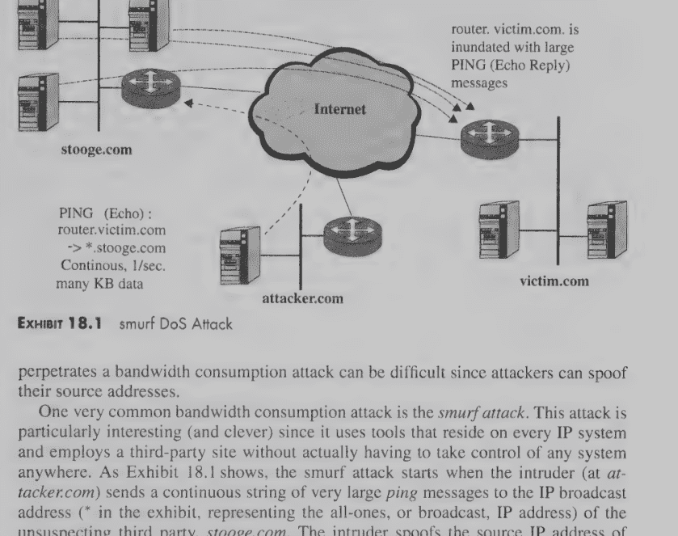

**图表 18.1 Smurf 拒绝服务攻击**

带宽消耗攻击的实施者可能难以识别，因为攻击者可以伪造其源地址。

一种非常常见的带宽消耗攻击是 Smurf 攻击。这种攻击特别有趣（且聪明），因为它利用每个 IP 系统上都有的工具，并借助第三方站点，却无需实际控制任何系统。如图表 18.1 所示，Smurf 攻击始于入侵者（来自 attacker.com）向毫无防备的第三方站点 stooge.com 的 IP 广播地址（图中用 * 表示，代表全 1 或广播 IP 地址）发送一连串非常大的 ping 消息。入侵者伪造 ping 消息的源 IP 地址，使其看起来像是来自目标网络的路由器 router.victim.com。例如，如果入侵者向一个拥有 50 台主机的中间站点广播地址发送一条 10,000 字节的 ping 消息，则响应将消耗 4 兆比特（Mb）。³ 即使 victim.com 拥有 T1 线路（带宽为每秒 1.544 Mb），攻击者只需每秒向合适的替罪羊站点发送一条大型 ping 消息，就能淹没受害者的线路。这个中间站点被恰如其分地称为放大网络；请注意，攻击者无需破坏那里的任何系统。原始发送的数据包数量与响应的系统数量之比称为放大比。

Smurf 攻击的一种变体称为 Fraggle。在这种变体中，攻击者向放大网络的广播地址发送伪造的用户数据报协议（UDP）数据包，而非回显消息。放大网络上启用了特定广播地址端口的每个系统都会向受害者主机发送大量流量作为响应；如果端口未启用，则放大网络上的系统会向受害者主机生成 ICMP 主机不可达消息。无论哪种情况，受害者的带宽都会被消耗。

内核崩溃攻击本身并非源于编程错误，而是程序逻辑中的漏洞。例如，无法正确对两个特定合法输入进行除法的 Intel Pentium 芯片就是一个编程缺陷。一个在接收到本不应该出现的数据包时发生故障的 IP 内核，确实是程序逻辑上的缺陷，但这与无法处理合法输入不同。在这种情况下，程序在收到意外输入时不知道如何优雅地失败。

内核崩溃的一个具体例子出现在 Linux 内核 v.2.2.0 中，当时一个通常用于打印共享库依赖关系的程序被用来打印某些核心文件。在某些情况下，munmap()——一个用于将设备映射和取消映射到内存中的函数调用——会覆盖内核内存的关键区域，导致系统崩溃并重启。

这类攻击还有其他例子。LAN 攻击发生在向目标主机发送伪造数据包时，其中 TCP 源端口和目标端口被设置为相同值，IP 源地址和目标地址也被设置为相同值。由于这会令主机操作系统感到困惑，导致 100% 的 CPU 利用率，然后系统停止运行。LAN 攻击几乎针对所有操作系统发起过。

Teardrop 攻击同样是接收到不可能的数据包时行为异常的结果。如果某个 IP 数据包对于特定网络来说太大而无法处理，该数据包将被分片成更小的片段。IP 数据包头部中的信息告诉目标主机如何重新组装数据包。在 Teardrop 攻击中，攻击者故意构造在重新组装时看似重叠的 IP 数据包。这同样可能导致主机崩溃。Teardrop 攻击主要针对 Microsoft 操作系统和所有 UNIX 变种。

### 18.5.5 路由和域名系统攻击

路由和域名系统（DNS）攻击是巧妙且被反复实施的攻击。通过篡改 DNS，站点的域名可以解析为攻击者希望的任何其他站点的 IP 地址。例如，1999 年 8 月，PairGain Technologies 一名心怀不满的工程师提供了一个指向他创建的虚假但看上去与彭博新闻社页面一模一样的页面的直接链接。这位持有 PairGain 股票的工程师发布了关于 PairGain 据称被一家以色列公司收购的虚假信息，推高了 PairGain 股票在全球的价格，并通过其页面劫持行为在市场上造成了混乱。虽然这是一种非传统的 DoS 攻击，但这些行为确实剥夺了用户访问其目标站点的能力，并带来了严重后果。

另一个例子发生在 1997 年 7 月，当时 Eugene Kashpureff 向 InterNIC 提交了虚假信息以更新该月的 DNS，迫使全球的域名服务器识别以 .xxx、.mall、.nic 和 .per 结尾的临时且未经授权的互联网地址。几周后，Kashpureff 插入虚假信息，将试图访问 Network Solutions Inc. 网站的用户引导至他所有的 AlterNIC 站点。当年晚些时候，他因电汇欺诈罪名被捕。

另一个例子来自 2000 年，涉及路由和 DNS 攻击：RSA Security 公司在宣布其已开发出一种打击网站黑客的方法后，发现用户在不经意间被重定向到一个伪造的 RSA 网站。这个欺诈网站看起来与原始 RSA 网站完全一致，但取笑了黑客成功实现其 DoS 目标这一事实。

早在 1997 年，就有人发现并记录了 4.9.5-P1 之前版本中 BIND 实现的弱点。较早的版本在启用 DNS 递归时会缓存伪造的 DNS 信息。该漏洞使攻击者能够利用将 IP 地址映射到主机名的过程，也就是所谓的指针（PTR）记录欺骗。这种类型的欺骗为 DNS DoS 攻击提供了可能。

DNS 攻击至今仍广泛存在。网络钓鱼是一种社会工程攻击形式，用户被引导至虚假但看似真实的银行或信用卡公司网站，并被诱骗输入用于身份盗窃的个人信息。然而，如果用户仔细查看该网站的 URL，就会发现可疑的网址。域欺骗（Pharming）是网络钓鱼的一种变体，它依赖某种形式的 DNS 投毒，使用户访问银行或信用卡公司的真实 URL 时会被重定向到虚假网站。网络钓鱼还出现了其他变体，例如鱼叉式网络钓鱼（针对特定个人、职位职能或团体的网络钓鱼攻击）、语音网络钓鱼（通过电信网络进行的网络钓鱼攻击，如 IP 语音 [VoIP]），以及短信网络钓鱼（通过短信服务 [SMS] 或短信进行的网络钓鱼）。有关此类社会工程攻击的更多细节，请参阅本手册第 19 章。

### 18.5.6 SYN 泛洪

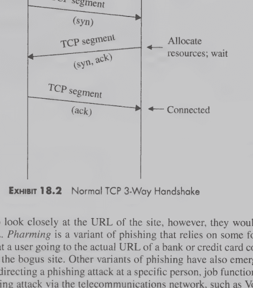

**图表 18.2 正常 TCP 三次握手**

SYN 泛洪是一种归入稀缺资源消耗类别的 DoS 攻击。这种 DoS 攻击利用了 TCP 主机在数据交换之前用于同步逻辑连接的三次握手。在正常的 TCP 主机到主机连接中，两台主机在交换数据之前会交换三个 TCP 段，如图表 18.2 所示：

1. 客户端向服务器发送一个包含其初始序列号（ISN）的段。该段中设置了 SYN（同步）标志。
2. 服务器通过发送一个包含其 ISN 并确认客户端 ISN 的段作为响应。该段将同时设置 SYN 和 ACK（确认）标志。此时，服务器为即将建立的连接分配资源，并等待第三个段。
3. 客户端发送一个确认服务器 ISN 的段。该段以及直到会话结束的所有后续段将只设置 ACK 标志。

SYN 泛洪利用了三路握手以及服务器只能维持有限数量开放 TCP 连接这一事实。当攻击者发起那些永远不会收到第三个段的连接时（参见图表 18.3），攻击即开始。服务器在步骤 2 中发送段后，便等待响应。在正常情况下，客户端会在几秒钟内作出响应。服务器


Slowloris 的一种变体被称为 R-U-Dead-Yet（RUDY）。RUDY 通过发送大量 POST 消息以及在 HTTP 消息头中随机设置较大的 Content-Length 值，来耗尽 Web 服务器的连接资源。

### 18.5.8 Java、PHP 和 ASP 攻击。

有许多攻击针对使用 Java、PHP（PHP：超文本预处理器）、Active Server Pages（ASP）和其他服务器端脚本语言的网站的程序漏洞。一个例子是 2011 年发生的一次导致 CPU 资源耗尽的 DoS 攻击。在这种特定攻击中，攻击者使用超文本传输协议（HTTP）POST 方法向 Web 服务器发送变量。通过发送数万或数十万个精心选择的变量名，可以强制产生哈希表名称冲突，最终在处理单个 HTTP POST 请求时耗尽所有 CPU 周期。

### 18.5.9 路由器攻击。

路由器攻击已经针对各种各样的路由器被开发出来。由于路由器是互联网的骨干，也是各组织连接到互联网的网关，摧毁一台路由器会使数百台机器失去网络服务。硬件攻击带来的生产力和财务影响可能非常严重。这类攻击的常见目标是 Ascend、Cisco、Juniper、Lucent 和 3Com 的路由器。不幸的是，许多网络管理员使用 Telnet 或 HTTP 进行远程访问，却没有妥善保护网络以防止任何人在互联网上进行远程访问，这使攻击变得容易。

### 18.5.10 其他拒绝服务攻击。

即使是这份具体 DoS 攻击的清单也并非详尽无遗。例如，Bonk 和 boink（即 bonk.c）是导致目标 Windows 9x/NT 系统崩溃的 DoS 攻击。Arudp（arnudp100.c）伪造 UDP 数据包，对 UDP 端口 7（echo）、13（daytime）、19（chargen）和 37（time）实施 DoS 攻击，这些服务经常运行在 UNIX 和 Windows NT 系统上。而 cbob.c 是一个取消机器人（cancelbot），它会销毁符合特定条件的现有 Usenet 新闻帖子。（有些人认为 cbob.c 实际上并不是在进行 DoS 攻击；然而，一旦被激活，该程序就会拒绝目标 Usenet 用户访问帖子。）

一个针对非网络资源的基于网络的攻击示例是“十亿笑”（billion laughs，一种 XML 炸弹），这是一种针对可扩展标记语言（XML）解析器的 DoS 攻击。在 XML 中，实体是一段代码，允许程序员定义可以在其他文档中轻松修改或重用的内容，与编程对象类似。在“十亿笑”攻击中，攻击者创建一个包含 10 个实体的 XML 文档，每个实体被定义为由前一个实体的 10 个实例组成（10^10 ≈ 10亿，因此得名）。“十亿笑”早在 2003 年就被提出，但至少到 2000 年代的第一个十年末期仍然是一个问题。

最后要指出的是，DoS 攻击并不局限于网络。例如，黑传真攻击（black fax attack）就是一种简单而有效的资源消耗攻击：攻击者仅向受害者发送一页包含一个大黑框的传真，这会导致受害者的传真机消耗大量黑色墨粉。发送大量此类传真最终将耗尽受害者传真机中的墨粉，和/或阻止合法传真的送达。曾有一位安全专家将一条长纸带的两端粘在一起，在传真机中形成一个无限循环，以攻击一个拒绝停止向其发送不需要的旅游优惠信息的传真垃圾邮件发送者。另一种针对传真机的攻击使用自动化脚本，让计算机反复拨打目标机器并发送数千份（通常是令人反感的）传真：据称，恼怒的极客曾用这种攻击对付那些不够明智、在自家传真机上使用真实电话号码的传真垃圾邮件发送者。

## 18.6 预防和应对拒绝服务攻击。

DoS 攻击最好以预防为主；实时处理它们非常困难。而保护系统的最重要方式就是强化操作系统：

- 在安装时就要考虑安全性。
- 监控站点以了解安全漏洞。
- 尽可能保持软件为最新版本。
- 安装所有相关的安全补丁。

但很大一部分预防措施在于网络路由器上的数据包过滤。由于攻击者经常通过伪造网络连接的源地址来隐藏用于实施攻击的机器的身份，因此通常采用称为出口过滤和入口过滤的技术作为保护措施。正如本章后面所讨论的，出口过滤和入口过滤分别是防止具有无效源地址的数据包离开或进入网络的方法。阻止不符合合法源地址标准的地址，并确保离开组织站点的所有数据包都包含合法地址，可以阻止许多 DoS 攻击。

其他有助于预防 DoS 的数据包过滤方法是阻止所有广播消息和大多数 ICMP 消息。站点没有理由接受向站点上所有主机广播的消息。此外，可能也没有充分理由允许所有主机响应 ping 或 traceroute 消息；实际上，大多数 ICMP 消息很可能都可以被阻止。

在某些情况下，受害者会设置自动回复信件，使其大量发送并重复发送，从而淹没攻击者的地址。这样做通常不是一个好主意。如果这些消息被发送到合法地址，攻击者可能会收到消息并停止攻击。但攻击者通常会伪造源 IP 地址，因此向可能是伪造的 IP 网络回发响应并不是好的防御姿态，因为这可能会伤害无辜的受害者。最好的防御需要互联网服务提供商（ISP）的参与。

在能够识别并联系到攻击者的服务提供商的情况下，受害者可以请求该服务提供商进行干预。在这些情况下，ISP 通常会采取适当行动来阻止攻击并查找肇事者。然而，如果 DoS 攻击似乎模仿或伪装成其他形式的攻击，或者持续了异常长的时间，受害者可能需要采取更积极的行动，联系 CERT/CC、FBI 以及其他有处理 DoS 攻击经验且能在肇事者被抓获后行使一定管辖权的权威机构。

实时防御很困难，但并非不可能。许多路由器和外部入侵检测系统（IDS）能够实时检测到攻击，例如来自某个 IP 主机或网络地址的每秒连接请求过多。路由器可以阻止连接请求，或者 IDS 可以向安全管理员发送寻呼消息。

然而，像 Smurf 这样的攻击甚至能在数据包到达目标站点之前就吞噬所有带宽。要全面对抗 DoS 攻击，需要 ISP 和终端用户站点的合作。这一点将在讨论应对 DDoS 时进一步阐述。

## 18.7 分布式拒绝服务攻击。

DDoS 工具利用放大技术来增强攻击者的力量。通过将安全性较差的系统转变为向特定目标发送协调一致的欺诈性流量浪潮，入侵者可以使任何给定受害者的带宽不堪重负。

在 DDoS 攻击中，攻击数据包来自数十或数百个地址，而不是像标准 DoS 攻击那样仅来自一个地址。任何基于监控来自单个地址或单个网络的数据包量的 DoS 防御都会失败，因为攻击来自四面八方。例如，受害者不会每秒收到来自一个攻击站点的 1,000 个巨型 ping，而是可能每秒收到来自 1,000 个攻击站点各一个 ping。

DDoS 攻击另一个令人不安的特点是，控制者（handler）可以选择代理（agent）的位置。例如，控制者可以将多个北大西洋公约组织（NATO）站点作为受害者，并部署所有位于已知对北约不友好国家的代理。而人类攻击者可能坐在，比如说，加拿大。

与 DoS 攻击一样，所有 DDoS 攻击都使用标准的 TCP/IP 消息，但以一些非标准的方式使用它们。常见的 DDoS 攻击包括 Tribe Flood Network（TFN）、Trin00、Stacheldraht 和 Trinity。以下各节将介绍这些攻击的一些细节。

### 18.7.1 分布式拒绝服务的简史。

拒绝服务攻击以多种形式存在已有几十年。分布式 DoS 攻击则要新得多。1999 年 6 月下旬至 7 月初，多组黑客安装并测试了一种名为 Trinoo 的 DDoS 工具（见第 18.7.3.1 节），以发起中到大型 DDoS 攻击。他们的测试涉及全球超过 2,000 个被入侵系统和目标。

大多数文献认为，第一次有记录的大规模 DDoS 攻击发生在 1999 年 8 月，当时 Trinoo 被部署在至少 227 个系统（其中 114 个在 Internet2 上）上，以淹没明尼苏达大学的一台计算机；该系统宕机超过两天。

1999 年 12 月 28 日，CERT/CC 发布了其咨询公告 CA-1999-17（www.cert.org/advisories/CA-1999-17.html），对 DDoS 进行了回顾。

2000 年 2 月 7 日，Yahoo! 成为 DDoS 攻击的受害者，其互联网门户无法访问达三个小时。2 月 8 日，Amazon、Buy.com、CNN 和 eBay 都遭到 DDoS 攻击，导致它们要么完全停止运行，要么显著变慢。2000 年 2 月 9 日，E*Trade 和 ZDNet 均遭受 DDoS 攻击。分析师估计，在 Yahoo! 宕机的三个小时内，其电子商务和广告收入损失约为 50 万美元。据书商 Amazon.com 称，其广为人知的攻击导致其在宕机的 10 小时内损失了 60 万美元。在遭受 DDoS 攻击期间，Buy.com 的可用性从 100% 下降到 9.4%，而 CNN.com 的用户量降至正常水平的 5% 以下，ZDNet.com 和 E*Trade.com 几乎无法访问。折扣经纪商 Charles Schwab 的在线平台 Schwab.com 也遭到攻击，但拒绝透露确切的损失数字。只能推测，对于一家每周在线交易额达 20 亿美元的公司来说，宕机损失是巨大的。DDoS 攻击间接造成的另一种损害是攻击后 10 天内股票价值的下跌：eBay 下跌了 24%，Yahoo! 下跌了 15%，Buy.com 下跌了 44%。

这些攻击是由 15 岁的迈克尔·卡尔西（Michael Calce）策划的，他住在魁北克省蒙特利尔岛西端，化名“Mafiaboy”。他最终对 56 项计算机犯罪指控认罪，并服了八个月的少年管教。⁴


这类 DDoS 攻击自 1999 年夏季以来持续不断。其中最著名的事件之一是 2001 年 5 月针对 Steve Gibson 的 GRC.com 网站的一系列 DDoS 攻击。攻击者是一名 13 岁的少年，使用了 Internet Relay Chat（IRC）僵尸程序，即利用 IRC 客户端使系统成为 DDoS 僵尸的自动化程序。

然而，后果可能最具毁灭性的 DDoS 攻击发生在 2002 年 10 月 21 日，当时所有顶级 DNS 根服务器都遭到数千个僵尸的持续攻击。13 台 DNS 根服务器中有 9 台被击离互联网；其余 4 台在攻击期间仍能保持运行。所有主要 ISP 和许多大型私人网络都维护自己的 DNS 系统，尽管大多数服务器最终仍依赖根服务器查找未缓存的 DNS 条目。攻击仅持续一两个小时；如果持续更长时间，其余服务器很可能不堪重负，从而有效阻断 DNS 主机名/地址转换。

一个令人不安且日益增长的趋势是 DDoS 被用作勒索工具。越来越多的罪犯使用 DDoS 工具作为威胁攻击的手段，而非真正破坏目标组织的网络。尽管几家网络、安全和咨询服务提供商声称他们及其众多客户都收到过此类勒索要求，但很少有人公开点名目标——其中许多目标正屈服于威胁并支付勒索金。5 大多数专家一致认为不应满足勒索要求；这样做只会助长犯罪行为。如果收到此类威胁，应立即联系组织的 ISP 和执法部门。

## 18.7.2 分布式拒绝服务术语和概述。

为了描述和理解 DDoS 攻击，了解用于描述攻击和工具的术语非常重要。尽管业界或多或少已在某些通用术语上达成一致，但这种共识出现时已远在许多 DoS/DDoS 攻击出现在黑客和主流文献之后。早期对 DDoS 工具的描述使用了各种术语来描述攻击中涉及的系统的不同角色。在 1999 年 11 月举行的 CERT/CC 分布式系统入侵工具研讨会上，引入了一些标准术语，并在下面的段落中使用了这些术语。为了使这些术语与黑客文献以及早期描述中使用的术语保持一致，以下是一些同义词：

- **入侵者**—也称为 *攻击者* 或 *客户端*。
- **主控**—也称为 *处理器*。
- **守护进程**—也称为代理、bcast（广播）程序或僵尸。
- **受害者**—也称为 *目标*。

DoS/DDoS 攻击实际上有两个受害者：最终目标和被利用并加载了守护进程软件的中间系统（们）。本章的重点是末端 DoS/DDoS 受害者。

DDoS 攻击总是涉及多个系统。典型的 DDoS 攻击场景大致可分为以下三个步骤：

- 1. 入侵者在互联网上找到一个或多个可被入侵和利用的系统（参见图示 18.4）。这通常是通过窃取

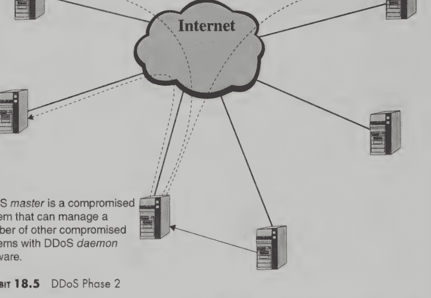

DDoS 主控是一个被入侵的系统，可以管理多个安装了 DDoS 守护进程软件的其他被入侵系统。

### 图示 18.5 DDoS 第二阶段

通常是自动化的，因此主控与 DDoS 网络其余部分之间无需进行持续对话。事实上，通常会采用技术手段故意掩盖主控在 DDoS 网络中的身份和位置。这些技术使得难以分析正在进行的攻击，也难以阻止攻击流量并追溯其来源。

在大多数情况下，被感染系统的系统管理员甚至不知道守护进程已被植入。即使他们发现并根除了 DDoS

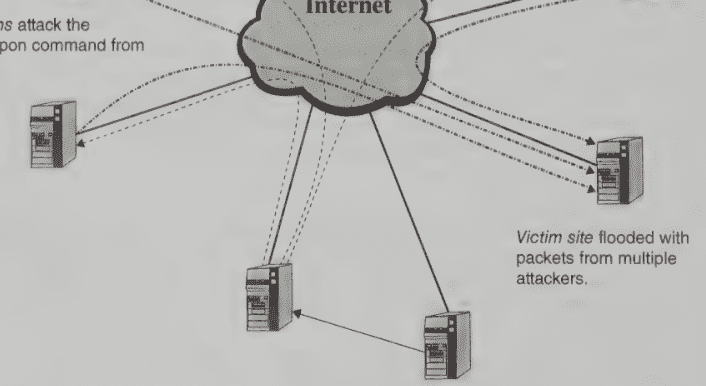

守护进程在主控的命令下攻击受害者。

受害者站点被来自多个攻击者的包淹没。

### 图示 18.6 DDoS 第三阶段

- 监听 UDP 端口 27444 的系统可能是 Trinoo 主控。
- UDP 数据包将包含字符串 l44adsl。

### 18.7.3.2 部落洪水网络。

部落洪水网络（TFN）出现在 Trinoo 之后。TFN 主要运行在被利用远程过程调用（RPC）服务缓冲区溢出漏洞入侵的受损 UNIX 系统上。TFN 客户端和守护进程程序实现了一个能够实施多种攻击的 DDoS 网络，例如 ICMP 洪水、SYN 洪水、UDP 洪水和 smurf 式攻击。

TFN 与 Trinoo 的明显不同之处在于，客户端（攻击者）、处理器和代理之间的所有通信都使用 ICMP 回显和回显应答数据包。TFN 客户端与守护进程之间的通信通过 ICMP 回显应答数据包完成。由于缺乏 TCP 和 UDP 流量，这些数据包有时难以检测，因为许多协议监控工具未配置为捕获和显示 ICMP 流量。

TFN 网络的远程控制是通过在客户端系统上执行程序实现的。该程序也可以由客户端通过某种主机到主机的连接方法在处理器系统上执行，例如连接到被利用的 TCP 端口或使用基于 UDP 或 ICMP 的远程 shell。该程序必须提供：

- 准备执行洪水攻击的主机 IP 地址列表
- 要发起的攻击类型
- 目标主机 IP 地址列表
- SYN 攻击的端口号

TFN 没有密码保护。发送给守护进程的每个命令都放在 ICMP 数据包的标识符字段中：值 345、890 和 901 分别启动 SYN、UDP 和 ICMP 洪水攻击。回显应答消息中的序列号字段始终设置为 0x0000，这使其看起来像是 ping 命令发出的初始回显数据包的响应。

TFN 客户端程序通常命名为 tribe.c，而守护进程为 td.c。

### 18.7.3.3 Stacheldraht。

Stacheldraht（德语意为铁丝网）是一种于 1999 年 8 月出现的 DDoS 工具，结合了 Trinoo 和 TFN 的特性。它还包含一些高级功能，例如加密的攻击者-主控通信和自动代理更新。

Stacheldraht 使用类似 Trinoo 的客户端/服务器架构。处理器在 TCP 端口 16660 上监听客户端（入侵者）命令，而代理在 TCP 端口 65000 上监听来自处理器的命令。代理对处理器的响应采用 ICMP 回显应答消息。可行的攻击与 TFN 相似；即 ICMP 洪水、SYN 洪水、UDP 洪水和 smurf 攻击。

为了跟踪 Trinoo 和 TFN 中受损系统的 IP 地址，所有 Trinity 代理都通过出现在同一个聊天室中向攻击者报告。最初的报告称 Trinity 代理通过名为 #b3eblebr0x 的 IRC 频道进行通信；据推测，其他 IRC 频道也用于 DDoS。IRC 使用 TCP 端口 6665 至 –6669，而 Trinity 似乎使用端口 6667。此外，一个名为 /var/spool/uucp/uucico 的二进制文件是后门程序，监听 TCP 端口 33270 的连接；攻击者在该端口连接并提供密码 !@# 将在受影响系统上获得 root shell。

### 18.7.3.8 SubSeven。

僵尸软件并不总是由攻击者利用暴露系统的漏洞分发。事实上，很 often 用户才是罪魁祸首。特洛伊木马通常是分发僵尸代码的机制。例如，SubSeven 软件就是一种后门病毒。SubSeven 通常会进入用户系统，因为它被分发在通过 Usenet 和其他互联网站点可获得的程序中，例如某些游戏或色情程序（例如，SexxxyMovie.mpeg.exe）。潜在攻击者今天经常扫描计算机系统，特别是通过 DSL 或有线调制解调器连接到互联网的住宅系统，以查找 SubSeven 的存在，这为用户系统提供了潜在后门；系统管理员也在学习在自己的系统上扫描这种危险程序。

### 18.7.3.9 Mydoom。

上面对一些最早 DDoS 工具的描述旨在展示后期工具演变的基础，其中许多只是早期工具的变体。Mydoom（又名 W32.MyDoom@mm 及其他别名）是 2004 年首次发起的通过电子邮件蠕虫进行的 DoS 攻击的例子。Mydoom 表现为一封电子邮件，主题行中有某种错误类型消息（例如，“Error”或“Mail System Failure”）。有趣的是，电子邮件可以用多种语言准备，包括英语、法语和德语。电子邮件包含一个附件，如果执行，将蠕虫转发到本地系统各种文件中的地址，包括电子邮件地址簿。蠕虫还可被复制到用户点对点网络站点的共享文件夹中。Mydoom 的早期版本包含一个有效载荷，会在 2004 年 2 月 1 日对 SCO Group 发起 DoS 攻击；SCO Group 不受欢迎，因为他们在针对 IBM 的 10 亿美元诉讼中声称多个 Linux 发行版侵犯了 SCO 的 UNIX 知识产权。随后发布了 Mydoom 的其他变体，包括 2009 年 7 月用于攻击韩国和美国的版本，该版本包括启动僵尸网络。

### 18.7.3.10 LOIC、HOIC 和 HULK。

另一种此类攻击的变体是低轨道离子炮（LOIC）。它设计用于作为网络压力测试，也可部署为 DoS 或 DDoS 工具。LOIC 基本上通过向目标发送 TCP 和 UDP 数据包洪水，以了解路由器是否能处理负载以及如何响应——或劫持全部带宽。最初用 C# 编写，JavaScript 变体（LS LOIC）和 Web 版本（Low Orbit Web Cannon）也已出现。LOIC 已被黑客行动主义团体 Anonymous 广泛使用。

高轨道离子炮（HOIC）是 LOIC 的修改版。它具有易于使用的图形用户界面，允许攻击者指定目标和用于针对目标服务器多个页面的增强脚本，就像霰弹枪而不是步枪。强度设置定义每秒请求数（低为 2/秒，高为 8/秒）。


被感染的 Web 服务器，被感染页面的 JS 代码被激活，并且 readme.eml 被下载。Internet Explorer 的易受攻击版本会自动执行该文件，而大多数其他浏览器则不会。

3. **邮件。** NIMDA 将自身发送到感染服务器的收件箱和地址簿中找到的所有电子邮件地址，文件为 MIME 编码的、大小为 56KB 的附件，名为 readme.exe。该文件包含一个“audio/x-wav”部分，其中包含蠕虫。使用 IE 5.1 或更早版本来显示 HTML 的电子邮件客户端，如果打开或预览消息，则会自动执行附件。

4. **网络共享。** 在受感染系统上时，蠕虫会将自身复制到受害主机上的所有本地目录以及所有打开的可写网络共享中。蠕虫还在受害主机上设置了共享。

此外，受感染系统上的 GUEST 账户被激活并被设为管理员组成员。（有趣的是，在 DDoS 蠕虫不断增加的一个夏天之后，9/11 之后数月几乎所有此类活动都停止了。）

多年来，DDoS 攻击一直在继续，但目的有双重性。一些 DDoS 攻击旨在以老式的方式使服务器或网络脱机，即占用所有带宽或其他资源。然而，其他攻击则利用目标网站的防御机制反对其自身；通过侦察来了解网站对各种刺激的响应方式，攻击者实际上可以向目标网站发送一组精心制作的数据包，导致目标自行限制带宽和/或可接受的源地址。

## 18.9 分布式拒绝服务攻击的防御。

与 DoS 攻击一样，站点无法单独防御 DDoS 攻击。互联网社区的成员必须共同努力，防止每个站点成为攻击源或转发攻击。本节讨论了一些通过限制工具的传播和限制违规攻击数据包的传播来帮助防止 DDoS 攻击传播的方法。

虽然这里没有详细讨论，但关于 DDoS 攻击响应的另一点需要说明。如本手册第 53 章所述，此类攻击的受害者应详细记录其采取的所有行动和检测到的事件。这些日志可能在理解攻击、防止对初始目标和其他目标的进一步攻击以及协助执法部门追踪肇事者方面具有宝贵的价值。

### 18.9.1 用户和系统管理员操作。

应采取以下步骤，以最大限度地降低单个系统被入侵、被攻击或被用作攻击他人跳板的可能性：

- 1. 及时了解站点所有硬件、操作系统以及应用程序和其他软件的安全漏洞。这听起来像是一项艰巨的任务，但这是保护网络必不可少的。尽快应用补丁和更新。在可行时，标准化某些硬件、操作系统和软件，以帮助管理该问题。
- 2. 在工作站上使用基于主机的防火墙软件来检测攻击。
- 3. 经常监控系统以测试已知操作系统漏洞。定期使用 `netstat -a` 命令检查哪些 TCP/UDP 端口正在使用；每个打开的端口都应与已知应用程序相关联。关闭所有未使用的应用程序。
- 4. 定期监控系统日志并查找可疑活动。
- 5. 使用可用工具定期审计系统，特别是服务器，以确保文件系统、注册表、用户账户数据库等没有未授权/未知的更改。
- 6. 每个客户端系统必须使用反恶意软件，该软件能够持续更新以跟上不断变化的威胁形势。有效的反恶意软件工具包括与浏览器集成以自动阻止访问已知包含危险代码的网站。这样的工具还集成到电子邮件客户端中以阻止自动打开附件。用户不得被允许禁用反恶意软件。
- 7. 不要从未知、不受信任的站点下载软件。如果可能，了解代码的作者。更好的是，下载源代码，审查它，并在可信系统上编译它，而不是下载二进制文件或可执行文件。
- 8. 及时了解并遵循 NIST、US-CERT、反病毒研究实验室、硬件和软件供应商以及其他最佳实践来源的建议。

### 18.9.2 本地网络操作。

即使用户锁定系统，使所有漏洞都得到修补且没有暴露未受保护，本地网络本身仍可能面临风险。本地网络管理员和网络管理员可以采取以下几个步骤来保护自己的所有用户以及整个互联网社区：

- 1. 每个连接到互联网的网络都应在路由器上执行出口地址过滤。*出口过滤* 意味着路由器应检查发送到互联网的每个传出 IP 数据包的源地址字段，以确保 NET_ID 与网络的 NET_ID 匹配。历史上，防火墙一直被用来保护网络免受外部世界的攻击。但这些攻击来自某个地方，因此站点还应使用防火墙来*保护*外部世界。
- 2. 网络应阻止发往广播地址（全为 1 的 HOST_ID）的传入数据包。外部网络设备向网络上的每个主机发送广播消息没有任何合法理由。
- 3. 为防止站点被用作广播放大点，除非绝对必要，否则应在路由器上关闭定向广播功能。如果确实必要，请重新检查网络，看看是否有更好的方法或是否可以最小化广播范围。即使定向广播有用，通常它们仅在企业内部需要，而外部主机不需要。
- 4. RFC 1918 在 IP 地址空间中定义了三个保留用于私有 IP 网络的块；这些地址不得在互联网上传输。

| IP 地址范围 | 网络 ID/ 子网掩码 | 等效传统 IP 网络数量 |
|---|---|---|
| 10.0.0.0–10.255.255.255 | 10/8 前缀 | 1 个 A 类网络 |
| 172.16.0.0–172.31.255.255 | 172.16/12 前缀 | 16 个 B 类网络 |
| 192.168.0.0–192.168.255.255 | 192.168/16 前缀 | 256 个 C 类网络 |

此外，根据 RFC 3330，有许多保留的 IP 地址永远不会分配给公共网络或主机，包括：

|  |  |
|---|---|
| 0.0.0.0/32 | 历史广播地址 |
| 127.0.0.0/8 | 回环网络标识符 |
| 169.254.0.0/16 | 链路本地网络 |
| 192.0.2.0/24 | TEST-NET |
| 224.0.0.0/4 | 组播地址范围 |
| 240.0.0.0/5 | 保留供将来使用 |
| 255.255.255.255/32 | 广播 |

攻击者通常使用 IP 地址欺骗，一般使用 RFC 1918 私有地址或其中一个保留地址之一。防火墙应立即丢弃包含 RFC 1918 或保留 IP 地址作为源地址或目标地址字段的任何数据包；此类数据包绝不应发送到互联网。

- 5. 在防火墙上阻止所有未使用的应用程序端口，特别是 IRC（6665–6669/tcp）等端口以及已知与 DDoS 软件相关联的端口。
- 6. 使用状态防火墙，可以在整个数据包交换的上下文中更好地检查数据包。无状态防火墙仅根据简单规则集查看数据包，但不了解网络上的整体数据包流量（例如，无状态数据包过滤器可能会转发 ICMP echo Reply 数据包，因为规则允许它；状态数据包过滤器只有在规则允许且存在相应的 ICMP echo Request 时才会转发数据包）。
- 7. 使用入侵检测和入侵预防来保护网络。例如，可以在每台工作站上安装个人防火墙软件，以帮助检测对单个系统的攻击；这种策略在防火墙前有大量系统（例如大学）的站点上特别有用。并非巧合，许多守护进程驻留在已被入侵（即被黑客接管）的大学和大学计算机上。
- 8. 定期监控网络活动，以便快速检测流量流中的异常。
- 9. 教育用户注意其系统上应注意的事件以及如何报告可能表明有人或某物篡改了其系统的任何异常情况。教育帮助台和技术支持以协助做出此类报告的用户。在组织内部建立情报收集系统，以便可以集中协调此类报告以发现趋势并制定响应措施。
- 10. 遵循 NIST、US-CERT 和其他最佳实践程序。

### 18.9.3 互联网服务提供商操作。

ISPs 提供了击败 DDoS 攻击传播的最后希望。虽然 ISP 不能承担锁定每个客户主机系统的责任，但 ISPs 有——并且应接受——确保其网络不携带包含明显“不良”数据包的数据包的责任。ISPs 可以采取的一些步骤包括：

- 1. 如前所述，攻击者通常使用 RFC 1918 私有地址或其他保留地址进行 IP 地址欺骗。令人惊讶的是，许多 ISP 仍会路由

这些数据包。确实，它们路由表中没有条目指示将数据包发送到何处；它们只是将它们转发给默认的上游 ISP。任何在 IP 源地址或目的地址字段中包含任何 RFC 1918 或保留 IP 地址的数据包都应立即丢弃。

- 2. 执行入站（和出站）地址过滤。入站过滤意味着 ISP 应对从客户站点进入其网络的每个入站数据包进行检查，并检查 IP 源地址字段，以确保 NET_ID 与分配给该客户的 NET_ID 匹配。执行此操作需要路由器进行额外配置，甚至可能导致轻微的性能下降，但权衡之下，这绝对值得付出努力。ISP 还应执行出站过滤，以检查发送到上游和对等 ISP 的出站数据包。
- 3. 禁用 IP 有向广播。
- 4. 仔细关注高知名度系统（服务器）和客户。
- 5. 教育客户了解安全问题并与他们合作以帮助他们自我保护。

ISP 社区的大多数至少采取了其中一些步骤。用户应坚持要求其 ISP 至少提供这些保护，并且不应与不提供这些保护的 ISP 开展业务。RFC 3013 和北美网络运营商组（NANOG）是 ISP 的良好信息来源。

## 18.9.4 受利用软件防御措施。

可以采取许多防御步骤来避免或减轻由于利用软件的类似 Code Red/NIMDA 的攻击而导致的问题。其中一些建议存在争议，因为它们隐含地抵制特定厂商的产品。

- 如果使用 IIS，请考虑使用替代的 Web 服务器软件。如果必须使用 IIS，请将 IIS 和操作系统保持在最新的补丁版本。例如，Microsoft 的 IIS 累积补丁并不能清除系统上用于利用的许多后门。
- 如果使用 Internet Explorer，请考虑使用替代浏览器软件。如果必须使用 IE，请对其进行保护以防止 MIME 自动执行。请注意，截至 2012 年 9 月，US-CERT 仍报告 IE6、IE7、IE8 和 IE9 存在未修补的漏洞，一些机构（如德国政府）建议不要使用任何版本的 IE。
- 在服务器和其他系统上禁用所有未使用的账户。特别是，仅在绝对必要时才启用访客账户或匿名访问。
- 除非绝对必要，否则在浏览器上禁用 JavaScript、Java 和 ActiveX。
- 除非预期、已知且已验证，否则不要执行或打开任何电子邮件附件。
- 使用最新的防病毒签名文件。
- 从 TCP/IP 中解除文件和打印共享的绑定。在某些情况下，这需要为文件和打印共享安装 NetBEUI。

## 18.9.5 其他正在开发或考虑的工具。

对 DDoS 攻击的响应不仅限于刚刚列出的防御步骤。事实上，对 DDoS 攻击的预防和检测的主动响应是一个活跃的研究领域。这些建议仅是处理 DDoS 攻击的一些方式的示例；第一个为互联网添加新硬件，第二种需要更改 Web 服务器和客户端软件，而后两种分别需要逐步更改互联网中所有路由器和主机的软件。升级 Web 浏览器可能是最实用的策略，即使有数百万份在分发；绝大多数来自少数几个厂商，而且用户无论如何也倾向于频繁升级。

### 18.9.5.1 分布式流量监控。

一种被提出的方法是在 ISP 级别检查网络并构建一种智能的分布式网络流量监控器；从某种意义上说，这就像互联网的 IDS。ISP、互联点和/或主要主机服务器将拥有使用 IP 和互联网进行通信的流量监控硬件，就像今天的路由协议一样。每个节点都会检查数据包及其内容，进行流量统计分析以学习正常模式。这些设备将具有足够的智能来检测流量水平的变化并确定这些变化是否反映了正常情况。例如，假设 Amazon.com 上的此类硬件识别出从 Gondwanaland 的一个 ISP 发起的 DoS 攻击；流量监控网络将尽可能靠近该 ISP 切断来自该 ISP 到 Amazon 的流量。通过这种方式，分布式监控网络可以在源头切断流量。

硬件需要了解由于正常事件导致的流量水平变化，例如新 Super Bowl 广告被发布到 YouTube 或 Victoria Secret 网站上的新时装秀。硬件还需要在这些正常事件的掩护下防止攻击者社区进行操作。

### 18.9.5.2 客户端难题协议。

RSA Laboratories 提出了密码学方法作为防御针对 Web 服务器的 DDoS 攻击的潜在手段。这种方法将使用客户端难题协议，旨在允许服务器接受来自合法客户端的连接请求并阻止来自攻击者的请求。客户端难题是一种密码学问题，其生成方式使其依赖于时间和服务器与客户端请求特有信息。

在正常情况下，服务器接受来自任何客户端的任何连接请求。如果检测到攻击，服务器通过向每个请求响应一个难题来有选择地接受连接请求。服务器仅在客户端在某个常规 TCP 超时时间内正确响应难题时才分配支持连接所需的资源。在攻击期间，真正的客户端只会经历适度的连接延迟，而攻击者将花费难以置信的处理能力继续发送攻击目标站点服务中断所需数量的请求，很快使攻击无效（实际上是反向 DoS）。该方案可能对来自相对较少的主机、每个主机发送大量数据包的 DDoS 攻击有效，但对来自大量系统或僵尸网络的低流量攻击可能效果有限。

### 18.9.5.3 IP 追踪。

第三种机制是在 2000 年代初至中期研究的主题是 IP 追踪。DoS/DDoS 攻击的问题在于数据包来自大量来源，而 IP 地址欺骗掩盖了这些来源。追踪标记在概念上是一个相对直接的想法。互联网上的每个数据包都会经过一定数量的 ISP 路由器。路由器有处理能力、内存和存储空间，可以在数据包到达时对其进行部分路径信息标记。由于 DoS/DDoS 攻击通常包含大量数据包，追踪机制不需要标记每个数据包，而只需要一个统计上可能包含攻击数据包的样本量（例如，每 20,000 个数据包中标记 1 个，或 IP 流量的 0.005%）。此功能将允许受害者在没有外部机构的帮助下，甚至在攻击结束后定位攻击的大致来源。另一种追踪建议将定义一个 ICMP 追踪消息，该消息将发送到受害者站点，其中包含有关采样数据包的部分路由信息。追踪存在许多需要解决的问题，例如重建攻击者路径所需的最小标记数据包数、实际处理开销以及在攻击进行期间执行追踪的能力。此外，任何追踪解决方案都需要更改互联网上的数万台路由器；在逐步实施期间，追踪能有多有效？当然，好处是该解决方案向后兼容，并且对用户没有负面影响。

### 18.9.5.4 主机标识有效载荷。

第四种建议是修改 IP，使其不易受地址欺骗的影响，通过使协议对地址字段的依赖仅限于路由。主机标识有效载荷（HIP）例如定义了一种在两个通信系统之间交换加密主机标识的协议。此功能将 IP 地址 relegated 仅用作数据包转发的机制，而不是发送者的标识符。发送者标识改为由主机标识值完成，并且所有更高层协议都绑定到主机标识。HIP 尚未广泛部署，但在某些 TCP/IP 实现中可用。

## 18.10 管理问题。

许多组织中最大的不足之一是最高管理层并不真正理解计算机、网络、信息和互联网在组织生活中发挥的关键作用。很难解释存在一个入侵者社区一直在积极开发新工具；历史表明，随着工具成熟和变得更加复杂，对潜在攻击者的技术知识要求降低，而总体攻击数量增加。太多公司坚持认为“没人会打扰我们”，而没有意识到任何站点仅因存在就可能成为目标。

DoS 攻击有多种形式，针对多种服务，导致系统防御的复杂性和难度增加。DoS 攻击应被认真对待，因为它们带来的潜在威胁，并且应在攻击发生前尝试教育运营人员，如果发生攻击则记录 DoS 攻击，并在事件结束后审查记录和采取的行动。讨论采取了哪些步骤、哪些行动生效以及总体结果如何，将有助于确定所执行程序和所使用技术是否最适合情况。坦率的审查和讨论将有助于实现资源的最优、最快和最有效的部署。

如果有什么证明互联网的相互交织的本质，那就是对 DDoS 攻击的防御。DDoS 攻击需要破坏和协调数百或数千台计算机来攻击少数受害者。对 DDoS 攻击的防御需要数千个 ISP 和客户网络的合作。打击 DDoS 需要持续勤勉地锁定连接到互联网的所有主机，以及对 TCP/IP 连接协议本质的根本性改变。此外，用于插入导致 DoS 和 DDoS 攻击的病毒和蠕虫的许多相同技术正被用于插入高级持续性威胁（APT）类恶意软件。


与互联网上大多数安全问题一样，解决方案很大程度上在于用户教育。用户必须接受教育，了解当前互联网上存在的威胁以及影响相关应用的情况，遇到可疑情况时该怎么做，以及如何应对日益创造性的攻击者。每个人都有自己的电脑、拥有惊人智能的移动设备，以及一种自带设备（BYOD）企业氛围的世界，要求企业中的每个用户都是潜在的脆弱点，需要得到适当的教育。

## 18.11 进一步阅读

- Anonymous. *Maximum Security*，第4版。Indianapolis: SAMS，2003.
- CERT Coordination Center. *分布式系统入侵工具研讨会结果*。CERT Website，December 7，1999。www.cert.org/reports/dsit_workshop.pdf
- Denning, D. E. *信息战与安全*。Reading, MA: Addison-Wesley，1999.
- Ferguson, P., and D. Senie. “网络入口过滤：抵御使用 IP 源地址欺骗的拒绝服务攻击”（RFC 2827/BCP 38）。The Internet Society，May 2000。www.ietf.org/rfc/rfc2827.txt
- Gao, Z., and N. Ansari. “从实践角度追踪网络攻击。” *IEEE Communications Magazine* 43, no. 5 (May 2005): 123–131.
- Gibson, S. “针对 GRC.COM 的拒绝服务攻击的奇异故事。” Computer Crime Research Center Website，June 2，2001。www.crime-research.org/library/grcdos.pdf
- McClure, S., J. Scambray, and G. Kurtz. *Hacking Exposed, 网络安全秘籍与解决方案*，第6版。Berkeley, CA: Osborne/McGraw-Hill，2009.
- Mirkovic, Jelena, Sven Dietrich, David Dittrich, and Peter Reiher. *互联网拒绝服务：攻击与防御机制*。Upper Saddle River, NJ: Prentice-Hall，2005.
- Raghavan, S. V., and E. Dawson, eds. *对拒绝服务（DoS）攻击检测与缓解的调查：关键信息基础设施保护*。Springer，2011.
- Rekhter, Y., B. Moskowitz, D. Karrenberg, G. J. de Groot, and E. Lear. “私有互联网地址分配”（RFC 1918/BCP 5）。The Internet Society，February 1996。www.ietf.org/rfc/rfc1918.txt
- Skoudis, E. *Counter Hack Reloaded: 计算机攻击与有效防御的分步指南*，第2版。Upper Saddle River, NJ: Prentice-Hall，2006.
- Spafford, E. H. “互联网蠕虫：分析。” *Computer Communication Review* 19, no. 1 (January 1989): 17–57.

大部分最佳的当前参考资料都在网上。读者应监控以下网站以获取 DoS/DDoS 信息：

- ATLAS 摘要报告，全球拒绝服务：http://atlas.arbor.net/summary/dos
- CERT/CC：www.cert.org
- Dave Dittrich 的“分布式拒绝服务 DDoS 攻击/工具”网页：http://staff.washington.edu/dittrich/misc/ddos/
- Denialinfo.com 的“拒绝服务（DoS）攻击资源”网页：www.denialinfo.com/dos.html
- DShield：www.dshield.org
- SANS 互联网风暴中心：http://isc.sans.org
- US-CERT：www.us-cert.gov

## 18.12 注释

- 1. DHS National Cyber Security Division, US-CERT, “National Vulnerability Database,” Website, 2013, http://web.nvd.nist.gov/view/vuln/search?execution=e2s1
- 2. 前身为 Internet Information Server.
- 3. 10 KB × 8 bits/byte × 50 hosts = 4 Mb.
- 4. Michael Calce and Craig Silverman, *Mafiaboy: A Portrait of the Hacker as a Young Man*, Lyons Press, 2011.
- 5. Brian Bloom, “新 DDoS：沉默、有组织且有利可图。” *PCWorld*, May 29, 2012, www.pcworld.com/article/256431/the_new_ddos_silent_organized_and_profitable.html

## 第19章

## 社会工程与低技术攻击

Karthik Raman, Susan Baumes, Kevin Beets, and Carl Ness

19.1 引言 19.1 19.5.1 后果 19.14
19.2 背景与历史 19.2 19.5.2 案例研究——来自企业的示例 19.15
19.3 社会工程方法 19.4 19.5.3 成功率 19.16
19.3.1 冒充 19.4 19.5.4 小型企业与大型组织 19.16
19.3.2 引诱 19.5 19.5.5 趋势 19.17
19.3.3 恐吓 19.6 19.6 检测 19.17
19.3.4 低技术攻击 19.6 19.6.1 人 19.17
19.3.5 网络和语音方法 19.8 19.6.2 审计控制和事件日志记录 19.18
19.3.6 反向社会工程 19.11 19.6.3 检测技术 19.18
19.4 社会工程的心理学 19.11 19.7 响应 19.19
19.4.1 引言 19.11 19.8 防御与缓解 19.19
19.4.2 心理学 19.12 19.8.1 培训与意识 19.20
19.4.3 社会心理学 19.13 19.8.2 预防技术 19.20
19.4.4 社会工程师画像 19.14 19.8.3 物理安全 19.21
19.5 社会工程的危险及其对企业的影响 19.14 19.9 结论性 remarks 19.21
19.10 注释 19.22

## 19.1 引言。

根据希腊神话，希腊人在特洛伊战争中借助一尊木雕击败了特洛伊人。经过十年徒劳的战争后，希腊人撤离了海滩上的据点。在特洛伊城门外，他们留下了一匹巨大的木马。雕像让特洛伊士兵感到困惑，但它被带进了特洛伊的防御工事内。雕像内部藏着几名希腊士兵。夜幕降临时，这些士兵从雕像中出来并打开了

该术语因其历史根源而带有负面含义，尤其是在纳粹控制的德国时期。一些研究人员还认为社会工程的范畴涵盖从广告和现代媒体到政治行动团体的一切。

社会工程今天更以其作为安全渗透技术的使用而闻名。

欺骗几个世纪以来一直是间谍活动的核心部分。孙子在公元前五世纪写道，

- “一切战争都是欺骗。”
- “派死间，公开做一些欺骗之事，并让我们的间谍知道这些事并向敌人报告。”³

欺骗——具体来说，向敌方间谍提供虚假信息——是公元前三世纪罗马与迦太基之间第二次布匿战争中的一个重要组成部分。⁴ 在第二次世界大战期间，盟军使用了“Operation Bodyguard”来欺骗轴心国相信 D-Day 入侵将在与实际时间地点不同的时间地点发生。⁵ 欺骗在冷战期间共产主义阵营与西方之间的间谍与反间谍竞争中也起着核心作用。⁶

社会工程的一个著名例子是 Frank W. Abagnale 的冒险经历，他是虚构电影 Catch Me If You Can 的主角。⁷ Abagnale 能够成功冒充权威人物，包括医生、飞行员、律师和教师，尽管他当时还是个十几岁的少年。他还使用社会工程技术来说服和操纵天真善良的个人帮助他实施许多欺诈行为。Abagnale 的许多技术都非常成功且设计精良。如今，他通过演讲和咨询业务帮助组织识别和防御此类攻击。⁸

最知名的社会工程师之一是 Kevin Mitnick。虽然 Mitnick 现在是计算机安全顾问、讲师和作者，但他的现任职业之前曾有多年作为计算机黑客和社会工程师的经历。已彻底改过自新的 Mitnick 写了几本讨论他作为计算机黑客的观察和技术的书籍。Mitnick 认为社会工程是黑客工具箱中最强大的工具。

自从社会工程成为一种流行，更重要的是成功的技术以来，其使用频率有所增加。这最明显的提醒之一就是钓鱼和药房攻击的大量出现，这些攻击在本手册第20章中有详细讨论。

社会工程甚至在一些犯罪黑客大会上成为了一项观赏运动。在2012年拉斯维加斯举行的 DEF CON 上，Shane MacDougall 通过欺骗加拿大一家商店的 Walmart 高管透露竞赛目标中列出的每一件机密信息，赢得了社会工程夺旗竞赛。

> Darnell 向经理询问了他商店的所有物理物流情况：其清洁承包商、员工餐厅餐饮服务提供商、员工薪酬周期和员工班次安排。他了解到经理们何时休息以及他们通常在哪里吃午餐。
> 
> 保持着关于新项目和本顿维尔生活的持续谈话，Darnell 让经理透露了他使用的 PC 类型的一些关键细节。Darnell 很快查明了计算机操作系统的品牌和版本号、Web 浏览器和防病毒软件。⁹


## 19.4 社会工程与低技术攻击

社会工程在单独作为一种攻击工具使用时，非常有效。但这种工具也可以用作更大规模攻击的一部分，甚至是用作技术攻击的一部分。社会工程通常出现在更大、更具实质性攻击的开端。需要记住的是，有些攻击持续了数周、数月甚至数年。但情况并非总是如此，而且仅仅因为某一次特定的社会工程尝试被阻止，更大规模的攻击未必就会被完全化解。一个例子是：最初攻击未能成功，可能是因为攻击者没有足够或准确的信息来实施攻击。攻击者可能会再次诉诸社会工程和低技术攻击策略，以便为另一次可能成功的技术攻击收集信息。

即使一个组织拥有世界上最好的防火墙、入侵检测系统和风险管理工具，攻击者仍然可能利用社会工程来绕过这些技术防御。如果攻击者能从毫无戒备的员工那里套取有效的用户名和密码，再好的技术防御也无法阻止他。一旦攻击者获得这些信息，这些信息也许就足以对组织的信息系统发动大规模攻击——而且可能不会被察觉。

计算机犯罪分子也能够仅凭纯粹的社会工程和低技术攻击手段，不依赖任何高级技术，就对组织造成大规模破坏。一个简单的动作，比如从垃圾箱中捡出被丢弃的、可能具有破坏性的信息，并将其发送给当地媒体，就可能对组织的形象造成实质性损害。这种行为可能是一个群体针对某组织发起政治或社会行动的大规模活动或行动的一部分。最近，家庭影院频道（HBO）记述了一个此类案例：一群公民定期从县选举中心和市政厅收集垃圾，试图收集可提交给媒体的证据，以证明选民欺诈。不当处置的文件给选举官员带来了极其严重的负面后果。¹⁰

### 19.3 社会工程方法。

社会工程攻击可以采取多种不同形式，经验丰富的社会工程专家能够迅速改变攻击方法以确保成功。大多数攻击的基本原则是虚假借口（pretexting），其定义是“在虚假借口下收集信息……”。¹¹ 社会工程攻击中使用了两种截然不同的基本方法：冒充和诱惑。大多数攻击的基础是这两种方法之一。某些不涉及任何人际接触的低技术攻击则属于例外。

社会工程攻击的目标也差异很大。攻击的复杂程度以及攻击者掌握多少知识，将有助于确定攻击目标。然而，在许多情况下，社会工程攻击是一种机会性攻击，受害者是随机选中的。在某些精心策划的攻击中，可能会确定某个特定目标作为受害者。

### 19.3.1 冒充。

冒充的定义是假扮他人，这是社会工程师最常采用的方法之一。社会工程师可能会使用跨职能的冒充攻击，将目标锁定在目标组织内任意层级的员工。他们可能假装成某个真实存在的、有名有姓的人，也可能假装拥有某种特定角色或权限。

公司高管是社会工程攻击的常见目标。¹² 帮助台员工和系统管理员也常是冒充攻击的目标。大多数组织都设有帮助台，为员工解决信息技术（IT）相关的问题。员工通常会遵循帮助台人员的指示，仅仅是因为他们认为这些人员技术知识渊博、值得信赖。社会工程师明白这种信任，并会利用它来窃取信息。攻击者会冒充帮助台人员，滥用这种盲目信任，收集其所需的任何信息。

帮助台人员也可能成为社会工程攻击的受害者，此时社会工程师会冒充需要技术援助的用户。针对 AOL 帮助台的攻击就是一个成功的社会工程攻击帮助台人员的历史案例。一名伪装成客户的攻击者通过欺骗 AOL 帮助台员工，成功渗透进了 AOL 环境。13

也曾出现过社会工程师冒充公司高管或经理的情况。在一个案例中，薪资处理巨头 ADP 泄露了数十万客户的个人信息和经纪账户信息。攻击者冒充公司董事会成员，索取并获得了这些信息。14 此案例凸显了对各级员工进行管控和教育的必要性。此案中的受害者可能担心得罪组织中的有权势成员，并害怕遭到报复。

需要注意的是，攻击者也会通过穿着、言谈和融入组织环境来冒充组织的普通员工。这样做，攻击者可以通过紧随前人进入或尾随进入的方式获得设施的物理访问权限。在 1993 年一门安全课程中一名学生报告的一个案例中，一名社会工程师与一名腐败的经理合作，在一家大公司中霸占了一张闲置办公桌长达数月之久，直到一名保安要求他出示公司证件。这名罪犯立即消失了，但在此之前，他已以新员工的身份取悦其他员工，甚至被毫无戒备的受害者邀请参加社交活动。15

对社会工程师而言，冒充没有界限；他们可能试图通过物理访问组织来获取信息，使用各种诡计，包括冒充：
-   临时员工（例如承包商或审计师）
-   公用事业公司或电信公司员工
-   应急人员
-   清洁或维护人员
-   新员工
-   送货人员

物理访问能否大幅提高攻击成功率，取决于组织是否实施了适当的管控措施。动机强烈的社会工程师甚至可能设法在该公司任职，或在作为该公司客户的公司任职，以便更容易接近受害者。

### 19.3.2 诱惑。

“诱惑”一词的定义是“使人偏离职责、公认原则或正当行为”。16 一般而言，使用诱惑手法的社会工程攻击比冒充攻击耗时更长。使用诱惑手法的攻击者会确定一个目标，并通过社交场合、在线方式或其他机制与该个人建立联系。正是在这种关系建立过程中，受害者的信息被泄露给了攻击者。

例如，一名希望进入某栋建筑的社会工程师可能会与该组织的保安交朋友。过了一段时间，关系进一步发展后，攻击者可能会请求参观该设施。保安为了取悦新朋友，可能会允许其参观。一旦进入内部，社会工程师就可以安放隐蔽的窃听设备、寻找用户名或密码，并阅读随意放置的文件。

### 19.3.3 恐吓。

社会工程师可以利用恐惧来达到目的。例如，2012 年，诈骗者向无辜受害者散播有关 FBI 起诉的骇人电子邮件。

网络犯罪分子正在部署一种新的勒索技术，使用 Citadel 恶意软件平台来传播 Reveton 勒索软件。该勒索软件的最新版本使用互联网犯罪投诉中心的名义，恐吓受害者向犯罪者汇款。除了灌输对起诉的恐惧，该恶意软件版本还声称，用户的计算机活动正通过音频、视频和其他设备被记录下来。

正如之前有关此恶意软件的警报所述，它诱骗受害者访问一个“路过式下载”网站，此时勒索软件便被安装到用户的计算机上。一旦安装，计算机便会冻结，并显示一个屏幕，警告用户其违反了美国联邦法律。该消息还宣称，执法机构已确定，一台使用受害者 IP 地址的计算机访问了儿童色情内容和其他非法内容。

为了解锁计算机，用户被要求使用预付卡服务支付罚款。用户电脑的地理位置决定了提供哪些支付服务。除了勒索软件之外，Citadel 恶意软件还会在受感染的计算机上继续运行，并可能被用于实施网上银行和信用卡欺诈。17

另一种利用恐吓的社会工程攻击是虚假办公用品骗局。18 一名基层员工接受了一份免费打印机墨粉、玻璃清洁剂或纸张的“优惠”，随后收到一箱材料——紧接着是一张发票。试图退回这些不再免费的不想要的材料会被拒绝，犯罪分子则使用越来越强烈的威胁来恐吓该员工，迫使她把发票交上去付款。员工可能会被告知，其雇主将被起诉，或者有关其行为的投诉将被发送到组织高层。还有一种变体是向受害者寄送礼物，希望接受礼物这一事实可被用来挟制收礼人，迫使受害者屈从于诈骗者的要求。此类骗局屡屡得手，为犯罪分子带来了数百万美元的收入。19

### 19.3.4 低技术攻击。

低技术攻击在侦察、信息窃取和搜寻易攻击目标方面，对攻击者极具价值。有时，这些方法甚至可能在极短时间内为攻击者带来大量有用信息。低技术攻击方法看似简单或不太可能，但下文所述的方法很容易被安全管理人员的忽视。它们并非都市传说——过去曾被人使用，至今仍在被使用。

### 19.3.4.1 垃圾箱翻找（Dumpster® diving）。

在社会工程背景下，垃圾箱翻找是社会工程师翻查组织垃圾的行为，试图找到文件、硬件、软件或任何有助于达成攻击者目标的有价值物品。即使敏感文件销毁的使用日益广泛，垃圾箱翻找仍是一种流行的社会工程技术，因为它简单易行且常常成功。甲骨文公司曾雇佣侦探在……期间购买微软的垃圾。


## LLM智能体上下文工程

LLM智能体上下文工程（Agent Context Engineering）

### 一、上下文工程背景
- 大模型上下文窗口限制
- 上下文长度对模型性能的影响

### 二、上下文工程概念
- 高效利用有限的上下文窗口
- 系统化管理输入信息的方法论

### 三、上下文管理技术
- 上下文压缩、截断、摘要
- 检索增强（RAG）与信息排序

### 四、上下文结构设计
- 层次化上下文组织
- 系统提示词与角色设定

### 五、上下文工程应用
- 智能问答与对话系统
- 复杂任务执行与多步骤推理

## 19-8 社会工程与低技术攻击

餐厅、企业活动、公司建筑外的临时会议或大声的电话交谈都是可能发生窃听的区域或情况。很多时候，员工会在通勤火车上工作或在其他公共场所进行业务往来。社会工程师可以利用组织的移动劳动力来获取信息。员工在执行任何与工作相关任务时都应注意周围的人。

### 19.3.4.4 利用好奇心或天真

社会工程师可能会通过激发用户的 curiosity 来诱骗受害者不知情地协助攻击。例如，攻击者可能会在休息室留下标签引人注目的 CD-ROM，希望受害者对内容感到好奇。当受害者将 CD-ROM 放入其计算机时，恶意程序，例如病毒，可能会自动执行并传播。该技术也曾使用 USB 驱动器、iPod 和损坏的音乐 CD 执行。22

### 19.3.4.5 数据挖掘与数据研磨

搜索引擎可以编目大量敏感且保密的信息。社会工程师可以创建特殊搜索、使用搜索引擎应用程序编程接口（APIs），并使用许多搜索引擎的高级搜索功能来挖掘有关公司的信息。另一个攻击向量是许多搜索引擎的缓存功能。搜索引擎可能会缓存包含敏感信息的网页。如果组织要求删除缓存，仍需等待搜索引擎缓存更新，在此期间，组织的信息会暴露。社会工程师还可能利用从社交媒体收集的个人或组织数据。请参阅本手册第 19.3.5.6 节“社交媒体”，了解此方法的使用详情。攻击者可以挖掘这些数据以获取受害者的行为趋势。他们可以获取比社交媒体数据直接呈现的更多关于受害者的信息。

公司发布的文档是另一来源的非预期信息披露。在一种称为数据研磨的技术中，社会工程师可以使用元数据读取软件从 Microsoft Office 文档中提取信息，例如作者姓名、组织、计算机名称、网络名称、电子邮件地址、用户标识（ID）和注释。23 此类可能造成损害的信息包含在大多数文档类型中。

### 19.3.4.6 跟随进入或尾随

社会工程中常见且非常成功的方法是跟随进入或尾随。该方法允许攻击者在不出示适当凭证的情况下进入设施。这些情况下的受害者表现得很有礼貌，为攻击者开门，攻击者利用受害者的凭证进入设施。一旦进入设施，攻击者可以自由在建筑物中漫游以寻找信息。如果进入时被质问，攻击者可能会以忘记凭证或为新员工为借口。一般来说，如果要尝试跟随进入，社会工程师会根据组织其他成员的着装和行为进行伪装，以便融入设施。如果设施由多层物理安全保护，攻击者可能会尝试使用社会工程突破最初几层，然后继续使用其他攻击方法。

### 19.3.5 网络与语音方法

互联网兴起，社会工程攻击也随之兴起。这些攻击与传统社会工程攻击不同，因其人为交互最少或无。但攻击的基础仍然依赖于人类的信任。令人厌烦的尼日利亚 419 攻击是使用电子邮件和人类交互的组合攻击。24

这些攻击使用的方法包括钓鱼、仿冒、垃圾即时消息、恶意软件和语音钓鱼。钓鱼和特洛伊木马在本手册第 20 章中有详细讨论。

### 19.3.5.1 钓鱼

钓鱼是最广泛使用且最成功的社会工程攻击之一。它被定义为“向用户发送电子邮件，虚假声称来自合法企业以诱骗用户交出私人信息的行为”。25 钓鱼与所有社会工程攻击一样，依赖于人们的信任。对互联网使用的天真也对该攻击的成功起到了作用。

一个有趣的新变化是，被误认为是钓鱼邮件来源是计算机安全研究所“2010/2011 计算机犯罪和安全调查”受访者报告的第二常见攻击类型（39%）。26

更新型、更具针对性的钓鱼攻击称为 spear phishing，也越来越受欢迎。Spear phishing 用于一种危险的威胁类型，即高级持续性威胁（APTs）。Spear phishing 用于 2011 年安全公司 RSA 遭入侵的一部分。27

### 19.3.5.2 垃圾即时消息

许多个人和企业依赖即时消息（IM）提供的同步通信。社会工程师注意到 IM 软件使用量的增加并开发了 spim。Spim 是“即时垃圾邮件或 IM 垃圾邮件”。28 Spim 攻击与钓鱼攻击非常相似，只是载体是 IM 软件而不是电子邮件。例如，攻击者会开发一个仿冒的网站，使其看起来像合法网站，并将其链接发送给许多 IM 账户。受害者会访问该网站并登录，从而向攻击者透露其凭证。仿冒网站可能包含会感染受害者计算机的恶意软件。令人惊讶的是，尽管 IM 软件使用量不断增加，spim 的增长却缓慢。29

### 19.3.5.3 仿冒

在仿冒攻击中，攻击者试图让受害者访问仿冒网站以透露敏感个人信息。攻击者通过操纵受害者的本地或全局 DNS 目录来实现这一点。仿冒攻击可能比其他低技术攻击更容易欺骗用户，因为用户可能没有任何迹象表明攻击正在进行。用户可能会像往常一样在浏览器中输入其银行或信用卡网站的 URL，而通常不会注意到他们实际上正在访问欺诈网站。1997 年，Dan Parisi 注册了域名 whitehouse.com，并诱使错误寻找 whitehouse.gov 的人观看色情内容——这是仿冒的早期形式。30 在 2005 年的一次仿冒攻击中，互联网邮件服务 Hushmail 的用户被重定向到一个欺诈网站，其信息被窃取。Hushmail 因此次攻击遭受负面宣传，被迫每天向用户更新其对攻击的调查。31

### 19.3.5.4 恶意软件

恶意软件是危害或危险于终端用户的程序或文件。社会工程师经常使用特洛伊木马和病毒。虽然程序本身并不构成纯粹的社会工程攻击，但攻击的基础仍然依赖于操纵受害者的信任。例如，社会工程师可能会向受害者发送包含恶意网站链接的钓鱼邮件。如果用户访问恶意网站，特洛伊木马会被安装到受害者计算机上，恶意程序将开始收集受害者的信息。另一个例子涉及装载有自动执行恶意软件的 USB 驱动器。对内容好奇的受害者会将驱动器插入机器并执行恶意代码。32 可以使用多种载体，包括文档、电子邮件消息、网站、CD 和 USB 驱动器。所有这些攻击的 premise 相同：好奇于内容的上当用户会无意中安装这些危险程序。恶意软件感染是计算机安全研究所“2010/2011 计算机犯罪和安全调查”受访者报告的最常见攻击类型（67%），而僵尸网络或僵尸则占 29%。33

恶意软件最近开始使用一种社会工程攻击类型，即利用对有效证书的信任，结合一种众所周知的漏洞，即动态链接库（DLL）预加载。在此攻击中，准备一个包含有效受信任应用程序且具有有效签名的软件包。然而，在该软件包中包含了一个恶意 DLL。大多数用户可能会知道要查找有效证书，确实会在应用程序中找到它，因此信任整个软件包。受害者启动有效受信任的应用程序，由于预加载漏洞，恶意 DLL 会从本地目录加载，而有效 DLL 则从其常规路径加载。34

请参阅本手册第 16、17 和 18 章，了解恶意软件的详情。

### 19.3.5.5 语音钓鱼

利用电子邮件和电话或仅使用电话诱骗受害者的攻击者正在进行语音钓鱼攻击。35 社会工程师可能会就某事向组织中的受害者发送电子邮件或致电，并要求回电。提供的号码由同伙接听或由听起来合法的自动系统接听。受害者被提示透露可能造成损害的信息，身份盗窃情况下是关于他们自己的信息，或关于其公司的信息。

在另一个例子中，攻击者可以利用允许来电者输入联系人姓氏前几个字母以到达其分机的自动电话应答系统。攻击者可以尝试多个分机，偶然发现一些分机会透露有关某人职位、头衔或办公室状态的细节（例如，“我休假到 4 月 4 日”）。社会工程师可以利用该信息并致电其他员工以获取更多信息或访问权限。

还应注意，随着语音 over 互联网协议（IP）（VoIP）的普及，现在出现了语音钓鱼，即传播语音钓鱼-钓鱼攻击。由于呼叫通过 IP 路由，呼叫号码可以轻松更改。这类似于钓鱼网站的运作方式。由于这主要是基于语音的社会工程攻击，因此被视为语音攻击而非网络攻击。VoIP 还使此类欺诈国际化。在 2013 年的一起事件中，据认为在非洲的罪犯在数千个网页上宣传不存在的免费小猫，使用 VoIP 联系受害者，试图欺骗善良的猫爱好者为虚构的猫的虚构空运付费。36

### 19.3.5.6 社交媒体

社交媒体近年来在流行度上爆炸式增长，社会工程师利用这些平台的受害机会也随之增加。37

仅通过搜索受害者的社交媒体页面，或包含受害者的亲属页面，就很容易收集有用的细节。收集的数据可能包括诸如：
- 事件日期
- 感兴趣的朋友/亲属/同事


## 19 · 12 社会工程与低技术攻击

社会工程之所以成功，是因为人性使然：在本节中，社会工程攻击的示例将说明用于描述社会工程的专业术语。

### 19.4.2 心理学

认知偏差被定义为人类因简化的信息处理策略而产生的心理错误。⁴⁴ 由于认知倾向（又称“启发式”或经验法则）是人类与生俱来的，人们因此成为社会工程攻击的受害者。这些认知倾向大多是有用的。心理学家罗伯特·西奥迪尼写道：

> 我们不能指望自己能够识别和分析在一天中遇到的每个人、每件事和每种情况的所有方面。我们没有时间、精力或能力这样做。相反，我们必须经常使用我们的刻板印象和经验法则，根据几个关键特征对事物进行分类，然后当其中一个或另一个触发特征出现时，不假思索地做出反应。⁴⁵

尽管每个人身上都存在认知偏差，但认知偏差的普遍存在并不意味着它们无法克服。

以下是一些可以解释人们为何会落入社会工程攻击陷阱的认知偏差：

- **选择支持偏差。** 人们倾向于记住自己所做选择中积极方面多于消极方面的部分。⁴⁶ 信息技术（IT）服务台操作员可能会在未核实来电者身份的情况下提供员工姓名、分机号或两者。服务台操作员认为这种做法很好，因为大多数来电者是真实的，并且他们会感谢操作员提供信息。社会工程师可以伪装成真实来电者，利用服务台操作员的选择支持偏差。根据安全分析网站 SecurityFocus 上的一篇文章，计算机安全研究所对此次攻击的演示实际上获得了成功。⁴⁷
- **确认偏差。** 人们倾向于以符合自己观念的方式收集和解释证据。⁴⁸ 如果某组织与保洁服务公司签订了合同，员工看到保洁员都穿着同样的制服，那么一个穿着该制服的社会工程师可能不会受到质疑，因为员工的确认偏差使其无需表明身份。电影《十一罗汉》中有许多场景，拉斯维加斯三家赌场的老板和员工被穿着与环境融为一体的角色的狡黠主角所欺骗。⁴⁹
- **曝光效应。** 人们倾向于喜欢熟悉的事物。⁵⁰ 社会工程师可能会打电话给受害者，解释他们正在为当地一家受欢迎的餐厅进行一项调查，并询问受害者所在组织的情况。受害者会愿意提供这些信息，因为他们熟悉这家餐厅。根据恶意软件研究员 Elodie Grandjean 的说法，社会工程攻击中使用的诱饵邮件、URL 或即时消息的一些主题包括⁵¹：
  1. 色情链接和图片
  2. 在发件人字段中使用女性姓名
  3. 政治议题，包括以热门候选人的名义征集捐款
  4. 冒充银行、在线支付服务和其他金融服务机构的虚假邮件。这些邮件要求确认或更新登录凭据或信用卡信息。
  5. 威胁性邮件，提到监禁处罚或陪审团义务程序
  6. 包含木马程序的免费游戏和屏幕保护程序，或免费的防间谍软件工具（这些工具本身往往是流氓程序）
  7. 重大事件，如体育赛事、极端天气灾害或紧急新闻
  8. 名人姓名及关于其冒险和不当行为的报道
  9. 可能值得信任或秘密的关系，例如与某个 12 步计划的关联
  10. 社交网站、虚假好友、学校同学或亲戚，以及秘密恋人
- **锚定效应。** 人们在做决策时倾向于关注一个特征。⁵² 如果社会工程师的声音令人舒缓，受害者可能会专注于这一特征，而不是被问及的问题。安全专家 Winn Schwartau 描述了一次成功的社会工程攻击：纽约一家金融服务公司的一些员工被一封写在公司信笺上、声称来自信息安全部门的虚假信件所欺骗；1200 名员工中有 28% 回信提供了个人详细信息。⁵³ 员工们过于关注信笺，而忽略了请求的其他方面，如其可疑性、严重性和突然性，这对他们造成了不利影响。

### 19.4.3 社会心理学

社会心理学家将图式定义为人用来做出判断和决策的内在现实图景。从社会心理学的角度来看，社会工程师利用了这样一个事实：大多数人的图式包括信任他人及其意图的规则。人们从社会化的最初阶段就被教导，对他人友善是一件好事。在信息安全的背景下，人们盲目信任他人的倾向可能带来灾难。

以下是人们常犯的错误，以及社会工程师如何利用这些错误来攻击组织的示例。

- **基本归因错误：** 在这种常见错误中，人们认为他人的行为反映了稳定的内在特征。犯下基本归因错误的人看到一位同事情绪不好，可能会想：“她总是喜怒无常。”事实上，这位同事可能总体上很友善，只是当时正头痛。社会工程师会表现得愉快而有魅力，诱使受害者犯下基本归因错误，从而对攻击者产生“他们总体上是不错的人”的印象，进而提供帮助。
- **显著性效应：** 面对一群人，人们倾向于猜测最具或最不具影响力的人是那个最突出的人。例如，在十个人中，九人身高六英尺，一人身高五英尺，如果被问及谁是最聪明的人，观察者可能会说是那个五英尺高的人。社会工程师试图融入受害者的环境，以利用显著性效应。他们对公司行话、活动和地区口音非常敏感。

对于上市公司来说，危险尤其高，因为投资者信心的丧失可能导致公司价值下跌。⁵⁶ 在过去几年里，许多公司因安全漏洞或失误引起媒体广泛关注而陷入财务困境。社会工程可能是这些安全事件的一部分。许多组织在法律上被要求必须制定数据安全保障措施；越来越多的要求中包括安全控制措施，以帮助组织防御社会工程和低技术攻击。

成功的社会工程攻击的另一个严重后果是随之而来的不确定性以及调查此类攻击的难度。组织可能永远无法完全发现社会工程师能够渗透到组织的哪个程度。入侵的载体和可能性如此之多，以至于可能无法完全了解攻击期间到底是什么或谁受到了危害。一种特别危险且令人沮丧的情况是攻击者在组织内部有内线或同伙。一些组织从未识别出组织内的这些人。这种不确定性使得组织很难从中恢复并在未来进行防御。这也是另一种情况：如果此类细节被披露，公司可能会在攻击后面临严重的信誉问题以及股东信心的丧失。正是这种情况也导致了监管机构与组织在信息披露法律上的拉锯战。这些法律因州而异，也因国家而异。企业努力保护自己免受广泛披露的要求，正是为了维护公司形象和财务价值。

### 19.5.2 案例研究——商业实例

现实生活中有许多来自组织的知名示例可以证明社会工程的有效性。以下是一些众所周知的示例，不包含任何会使相关方难堪的具体细节。社会工程攻击是真实的——它们不仅仅是计算机安全理论。⁵⁷

**案例 1：** 商业界一个非常著名的社会工程攻击是“尾随”。在这种社会工程中，攻击者依赖于个人的礼貌意识。大多数人都记得从小被教导要为身后的人扶住门。这种礼貌通常也延伸到了工作场所，包括数据中心等安全区域。潜在攻击者可能会试图在没有适当凭证的情况下进入数据中心，方法是紧紧跟在另一个持有有效身份和授权进入数据中心的人后面。被授权的人很可能会表现出礼貌，为尾随者扶住门，即使该人的身份未知。拿着一些看似无害的物品通常会建立信任。

**结果：** 在这个例子中，结果是未经授权的攻击者依靠另一个人的礼貌意识进入了一个安全设施。要求员工杜绝尾随行为可能非常困难，但必须制定政策来明确要求这一点。所有进入安全设施的人员每次都必须完全使用身份识别和授权机制。

**案例 2：** 另一个以不同变体实施的示例涉及攻击者使用多种社会工程技术来利用


更有可能识别出不属于组织的人员，或不应请求访问敏感区域或数据的人员。他们也更有可能拒绝访问，或质疑那些故事看起来不太可能或可疑的人。

大型组织可能陷入官僚主义、无效管理或过于复杂的报告程序。攻击者可能在大型公司的安全团队被告知社会工程尝试之前就完成整个计划。很多时候，个人在大型组织中不愿质疑陌生人的身份凭证。这在员工担心因质疑更高级别的人或阻止他人工作而受到惩罚的情况下尤其如此。员工可能更愿意让攻击者不受质疑地通过，而不是冒可能产生负面后果或受到审查的风险。

总之，所有组织都必须警惕此类攻击。罪犯并不总是选择容易或明显的目标。任何企业，无论大小、家族所有还是企业集团，都可能成为利用社会工程的攻击目标。

### 19.5.5 趋势。

虽然信息安全经理始终对统计数据保持怀疑态度很重要，但紧跟安全威胁趋势同样重要。社会工程也不例外。任何调查或民意调查要收集某一年内尝试次数或成功次数的事实可能都很困难。许多社会工程尝试可能从未被发现，而且在调查中报告或承认的更少。面对这种强大且成功的攻击机制时，应做最坏的打算：即使组织了解此类攻击甚至培训员工进行防御，罪犯仍在日益使用它。罪犯每天都在创造新的形式和策略，人们很可能会继续上当。

## 19.6 检测。

社会工程和低技术攻击的检测可能很困难。大多数社会工程攻击的本质是利用人们愿意信任和帮助的意愿，从而使攻击者绕过技术控制。在许多情况下，检测依赖于人们识别潜在攻击（包括可疑活动）并做出适当响应的能力。进一步复杂化检测的是，社会工程攻击可能不是单一事件，而是许多较小的事件最终导致攻击者访问受限资源、隐藏恶意活动或窃取专有信息。使用缓慢或多步骤的社会工程攻击更难检测且可能造成更大损害。最近，通过针对高级人员的定向电子邮件活动进行的成功社会工程攻击已被广泛报道。一位渗透测试专家估计，社会工程策略在攻击所花费时间中不到 20%；其余时间则花费在对通过欺骗最初收集的信息进行技术利用上。58

社会工程攻击的检测主要有三个途径：人员、审计控制和技术。

### 19.6.1 人员。

由于人员是攻击的载体，他们通常是第一道防线。组织需要为员工提供资源和持续教育，以帮助区分潜在攻击和合法请求。组织的各个部门都需要培训。社会工程师利用所有可用资源；没有任何部门或人员能免受潜在攻击。此外，组织需要提供在攻击期间和攻击后立即应采取的措施的信息。例如，在电话攻击期间，应培训员工记住尽可能多的细节。员工应尝试记住的项目包括：

- 攻击者是男性还是女性？
- 是否显示了来电显示？
- 背景是否有噪音？
- 他/她是否有口音？
- 问了什么问题？
- 提供了什么答案？

员工还应注意那些提出许多问题（其中一些可能不合逻辑）的人。此外，请求经理或 IT 人员姓名的来电或电子邮件应促使员工致电 IT 安全或调查部门。组织文化也是抵御社会工程攻击的另一个关键因素。文化必须强调并奖励在提供信息前进行适当的验证。高层管理可以通过表扬要求他们证明其真实性的员工来支持强大的文化，而不是表达对有人敢这样做的不满。

所有企业，包括安全公司，都必须坚持这一信条。59 不幸的是，VIP 或高级领导者经常不必遵循同样的验证流程来更改密码或接收信息。最后，员工应了解自己的政策和业务惯例。例如，所有员工都应理解来电者通过电话或短信请求更改密码为何不合适。60

组织还需要向员工提供明确的信息，说明在遇到可能的社会工程时该怎么做。例如，在实际事件发生期间、事件后立即，或两者都应通知谁（取决于员工何时识别出攻击）。为了帮助通知流程，组织可以创建事件通知信息系统并在组织内传播信息，以便员工能够立即、轻松地确定联系谁寻求帮助。

### 19.6.2 审计控制和事件日志记录。

审计和记录组织的电子邮件、互联网内容、系统登录和系统更改可用于检测社会工程攻击。如果事件审查不是实时进行的，则从攻击发生到识别事件之间会出现延迟。在通知不是实时的情况下，取证审查员可以利用审计信息帮助拼凑攻击并确定根本原因。意识团队也可以利用日志结果帮助为目标群体制定额外的培训。在实时审计期间，组织可以立即实施其事件管理计划以帮助限制潜在损害。现代反恶意软件和反网络钓鱼工具不仅可以提供防御，还可以保留详细的记录以供分析。

### 19.6.3 用于检测的技术。

组织可以实施技术来帮助限制社会工程攻击。内容过滤软件可以限制电子邮件和网站流量；任何被识别的恶意软件都应从电子邮件中被阻止或剥离。电子邮件监控工具可以以双向模式使用，以检查双向内容。此外，电子邮件监控和内容过滤机制可用于扫描可能触发早期预警信号的关键词或短语。任何可疑流量、附件或电子邮件都应在投递前隔离并审查。通过扫描和阻止内容，组织可以减少进入其网络的可疑电子邮件数量，并减少员工访问的可疑网站数量。电子邮件服务和反恶意软件产品一直在改进其垃圾邮件阻止能力，以至于即使是网络钓鱼诈骗也被成功拦截。

技术研究的进步将为社会工程攻击提供额外的保护，包括社会工程防御架构（SEDA）的开发。该架构试图通过识别合法员工与社会工程师来检测电话中的社会工程攻击。该系统被称为文本无关语音签名认证系统。该系统使用语音识别技术，可降低帮助台攻击成功的风险。除了检测未经授权的来电者外，它还可以检测冒充具有更高安全级别员工的内部人员。架构中包含的日志记录将在调查期间帮助取证审查员。⁶¹

基于风险的身份验证方法也可以帮助限制潜在的社会工程攻击；例如，如果客户或用户总是从某个区号或电话号码拨打电话，而潜在攻击者则从不同的区号拨打电话，系统可以识别这一点，并在对个人进行身份验证前提示提供额外信息。⁶²

攻击者变得越来越老练。最近的网络钓鱼攻击正针对系统、网络和安全专业人员。在这类攻击中，组织会收到来自“客户”的网络钓鱼电子邮件，告知其存在试图窃取客户信息的网络钓鱼网站。安全人员会回复电子邮件并调查该网站。该网站会安装恶意软件，使攻击者能够远程控制机器。这种攻击方法的改变要求安全人员对任何看似无害的、告知组织有网络钓鱼网站针对该公司的电子邮件更加怀疑。

## 19.7 响应。

对社会工程和其他低技术攻击的响应应纳入组织的事件管理流程和响应中。与所有事件管理计划一样，响应应得到明确定义、传达并经过测试。组织应为不可避免的情况做好计划，尤其是在网络和物理攻击越来越多地使用多个向量以取得成功的情况下。有关监控和控制系统的更多信息，请参阅本手册第 53 章，有关计算机安全事件响应团队的信息，请参阅第 56 章。

## 19.8 防御和缓解。

社会工程攻击的预防应是多方面的、可重复的，并且是组织纵深防御策略的一部分。由于攻击的本质就是通过利用人们的善良和愿意信任他人的意愿来绕过或规避技术防御，因此预防此类攻击的步骤应侧重于不同的领域，例如政策、培训和意识、技术以及物理防御。

关注所有领域将有助于减轻成功社会工程攻击的威胁。每个领域都应有定期的审查和审计流程。写得好的政策提供了可接受的行为基线以及不遵守的潜在后果，但它们必须让员工能够获取。在培训方面，它应整合到组织的整体安全意识


- 49. Steven Soderbergh（导演），《十一罗汉》，2001，www.imdb.com/title/tt0240772
- 50. R. B. Zajonc，“单纯曝光的态度效应”，《人格与社会心理学杂志》9，第2期（1968年）：1–27。
- 51. E. Grandjean，“社会工程恶意软件的首要目标”，《McAfee 安全期刊》，秋季（2008年）：9–12。
- 52. A. Tversky 和 D. Kahneman，《不确定性下的判断：启发式与偏见》，Science，185（1974）：1124–1130。
- 53. Joan Goodchild，“社会工程故事”，CSO，2010年5月24日，www.csoonline.com/article/594924/social-engineering-stories
- 54. Tim Wilson，“黑客的八个面孔”，Dark Reading，2007年3月29日，www.darkreading.com/security/news/208804443/eight-faces-of-a-hacker.html
- 55. Malcolm Allen，“社会工程：入侵计算机系统的手段”，SANS Institute 信息安全阅读室，2006年6月，www.sans.org/reading_room/whitepapers/engineering/social-engineering-means-violate-computer-system_529
- 56. Radha Gulati，“社会工程的威胁及你的防御措施”，SANS Institute 信息安全阅读室，2003年，www.sans.org/reading_room/whitepapers/engineering/threat-social-engineering-defense_1232
- 57. Granger，“黑客战术”。
- 58. Kelly Jackson Higgins，“社会工程变得更聪明”，Dark Reading，2006年6月16日，www.darkreading.com/authentication/social-engineering-gets-smarter/208803849
- 59. P. Roberts，“HBGary 攻击背后的黑客女孩”，threatpost，2011年3月17日，http://threatpost.com/hacker-grrl-behind-hbgary-attack-031711/75037
- 60. Ryan Groom，“前五大社会工程技术”，About: Business Security，访问日期2007年3月17日。 http://bizsecurity.about.com/od/physicalsecurity/a/topsocialengine.htm
- 61. Michael Hoeschele 和 Marcus Rogers，“检测社会工程”，载于《数字取证进展：IFIP 国际数字取证会议》（2005年2月）：67–71。
- 62. RSA，“基于风险的身份验证”，信息安全术语表，RSA 网站，访问日期2012年4月12日，www.rsa.com/glossary/default.asp?id=1094
- 63. M. J. Edwards，“IE 7.0 和 Firefox 2.0 均具有新的反钓鱼技术”，WindowsITPro，2006年10月26日，http://windowsitpro.com/networking/ie-70-and-firefox-20-both-have-new-antiphishing-technologies
- 64. Dimensional Research，“社会工程对信息安全的风险：IT 专业人士调查”，Check Point Software Technologies 网站，2011年9月，www.checkpoint.com/press/downloads/social-engineering-survey.pdf

## SPAM、钓鱼和特洛伊木马：旨在欺骗的攻击

Stephen Cobb

- **20.1 不需要的电子邮件和其他害虫：安全问题** 20·1
  - 20.1.1 常见元素 20·2
  - 20.1.2 章节组织 20·3
- **20.2 电子邮件：解剖课** 20·3
  - 20.2.1 简单邮件传输协议 20·3
  - 20.2.2 预警 20·4
- **20.3 SPAM 定义** 20·6
  - 20.3.1 Spam（非 SPAM®）的起源和含义 20·7
  - 20.3.2 深入挖掘垃圾邮件 20·8
  - 20.3.3 垃圾邮件的双重威胁 20·12
- **20.4 对抗垃圾邮件** 20·18
  - 20.4.1 垃圾邮件战士登场 20·18
  - 20.4.2 良好的声誉？ 20·18
  - 20.4.3 中继麻烦 20·20
  - 20.4.4 黑洞和阻止列表 20·20
  - 20.4.5 垃圾邮件过滤器 20·21
  - 20.4.6 网络设备 20·24
  - 20.4.7 电子邮件身份验证 20·25
  - 20.4.8 行业举措 20·26
  - 20.4.9 法律补救措施 20·26
- **20.5 钓鱼** 20·27
  - 20.5.1 钓鱼邮件长什么样 20·27
  - 20.5.2 钓鱼的增长和范围 20·29
  - 20.5.3 威胁在哪里？ 20·30
  - 20.5.4 对抗钓鱼 20·31
- **20.6 特洛伊代码** 20·31
  - 20.6.1 经典和近期的特洛伊木马 20·32
  - 20.6.2 基本的反特洛伊战术 20·34
  - 20.6.3 锁定和隔离 20·35
- **20.7 结论性评论** 20·36
- **20.8 进一步阅读** 20·36
- **20.9 注释** 20·36

### 20.1 不需要的电子邮件和其他害虫：安全问题

本章讨论了三个名称奇怪的计算机安全威胁：垃圾邮件、钓鱼和特洛伊代码。垃圾邮件是未经请求的商业电子邮件。钓鱼是指使用欺骗性未经请求的电子邮件来获取——通过电子方式“捕捞”——机密信息。特洛伊代码一词源自特洛伊木马，是设计成伪装成合法应用程序以实现对系统未经授权访问的软件。在本章中，我们

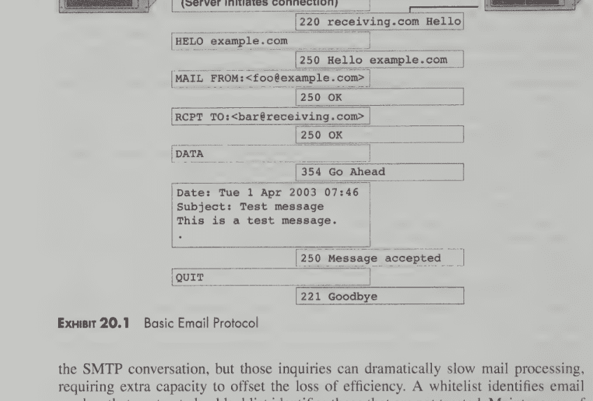

SMTP 会话，但这些查询会显著减慢邮件处理速度，需要额外容量来抵消效率损失。白名单标识受信任的电子邮件发送者；黑名单标识不受信任的发送者。维护白名单可能耗时，而黑名单有着不准确和法律纠纷的悠久历史。简而言之，对速度的需求创造了一个系统，其中邮件投递中的虚假陈述几乎没有任何技术后果。这正是垃圾邮件发送者一直以来，并且继续非常有效地将不需要的电子邮件投递出去的原因。

SMTP 就像温斯顿·丘吉尔可能会说的那样，是做电子邮件的最糟糕方式，除了所有曾经尝试过的其他方式之外。现实是 SMTP 可靠运行并且已被广泛实施。用任何更好的东西取代 SMTP 意味着对整个全球电子邮件基础设施进行彻底重新设计，这是一项很少有人愿意承担的任务。一些人努力开发可以搭载在现有 SMTP 基础设施之上的解决方案，使 SMTP 能够继续高效运行，同时为使用者提供选择更强大的功能来帮助区分合法邮件和垃圾邮件的选项。本章后面将详细介绍这些解决方案。

电子邮件无法在没有称为“头”的东西的情况下投递，每封电子邮件都有一个头，它是消息的一个部分，并不总是显示在收件人的电子邮件程序中，但确实存在，描述消息来自何处、如何寻址以及如何投递。检查头可以告诉你很多关于消息的信息。请考虑消息在 Microsoft Outlook Express 中出现的样子，如图 20.2 所示。

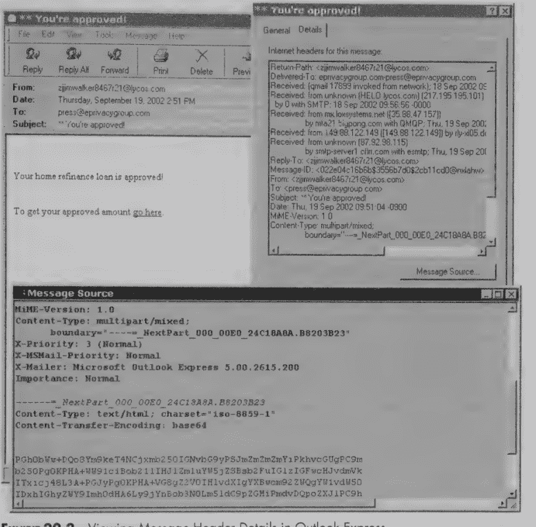

**图 20.2 在 Outlook Express 中查看消息头详细信息**

在顶部可以看到发件人、收件人和主题。例如，你可以看到一条似乎来自 zjjimwalker8467r21@lycos.com 发往 press@eprivacygroup.com 的消息，主题为：“您已获批准！”正如你可能猜到的那样，press@eprivacygroup.com 并不是一个真实的人。这只是一个出现在公司网站上作为媒体联系方式的地址，当然，没有人实际上在抵押贷款申请中使用过这个地址。该地址是由一个自动在网络上搜寻电子邮件地址的程序收集的。

当你在电子邮件客户端（例如 Outlook 或 Outlook Express）中打开此消息并使用文件/属性命令或等效命令时，你可以单击“详细信息”选项卡查看消息如何在互联网上传递。你首先看到的是一个标记为“headers”的框，如图 20.2 所示。阅读它会告诉你消息经过了多个不同的电子邮件服务器。Qmail 是公司的邮件程序，是 Received 的第一个实例。下方的三个是中介，直到最后一个 smtp-server1.cflrr.com。那是位于中佛罗里达（cfl）Road Runner（rr）有线调制解调器网络上的电子邮件服务器，为数万户家庭提供高速互联网接入。

那么谁发送了这条消息呢？很难说。正如你可能预期的那样，并不存在 zjjimwalker8467r21@lycos.com 这样的地址。确定谁发送了这种垃圾邮件消息的最佳方法是检查其内容。垃圾邮件无法吸引傻瓜

除非有什么办法能让上当者联系到垃圾邮件发送者。有时是一个电话号码，但在本例中，它是一个指向网页的超链接。然而，点击垃圾邮件中的链接是一种危险的浏览方式——了解垃圾邮件中链接的更安全得多的技术是检查邮件源代码。Outlook Express 提供了“邮件源文件”视图，但这可能只显示编码后的内容，而不是可读的 ASCII 文本。有些电子邮件客户端（例如 Outlook）允许用户将所有邮件默认转换为纯文本：如果用户希望看到图片，可以在每封邮件的基础上选择下载图片。此外，许多电子邮件客户端可以在用户将光标悬停在链接标签上时显示任何超链接的底层详细信息。

获取此类邮件内容的一种方法是将其转发到另一个电子邮件客户端，例如高通公司的 Eudora，然后用文本编辑器（如 TextPad）打开邮箱文件。这样就可以看到垃圾邮件发送者希望收件人点击的链接的 http 引用。在这种情况下，点击写着“要获得您的批准金额，请点击此处”的链接的上当者，会看到一个与抵押贷款无关、而是关于数据收集的表单。无法判断这样收集到的数据会被用于何种用途，但只要稍加检查，使用 ping 和 whois 命令就会发现，收集数据的 Web 服务器位于北京。要查出是谁设置了它，可能性微乎其微。标准的操作流程是，像这样的网站搭建和拆除都非常迅速，在有人开始调查之前尽可能多地收集数据。然而，在过去 10 年里，与投入发送垃圾邮件的资源相比，用于调查垃圾邮件发送者的资源微不足道。即使立法者能就什么是垃圾邮件以及如何宣布其非法达成一致，政府资金也极少被拨给反垃圾邮件工作。虽然也有一些备受瞩目的逮捕和起诉，往往是由大公司推动的，如微软和美国在线，但发送垃圾邮件仍然是一种风险相对较低的计算机滥用行为。

如果能在垃圾邮件中识别出一个链接，Better-Whois 服务（http://betterwhois.com/）也许能够提供该网站正式注册的所有者和管理员的详细信息——前提是他们没有隐藏在诸如 GoDaddy.com 这样的匿名服务公司后面，这类公司可以隐藏真正的所有者，同时提供一个匿名的电子邮件地址，以便试图与所有者联系。

## 20.3 垃圾邮件定义

垃圾邮件的故事是一部白手起家的传奇：它最初只是一种小小的滋扰，后来却成为全球计算资源数十亿美元的负担。尽管人们可以就垃圾邮件编出无数双关语和笑话，但它可能是自计算机和电信发明以来，对计算机和电信资源最大的一宗窃贼。

垃圾邮件成为一个代价高昂的问题也许并不令人意外，因为垃圾邮件是第一个纯粹由利润驱动的规模化计算机威胁。大多数垃圾邮件的目的是赚钱，而如果人们没有收到它，就无法赚钱。事实上，垃圾邮件软件不会向响应速度慢的邮件服务器发送垃圾邮件：它会直接转移到其他能够以垃圾邮件产生收入所需的高每分钟消息数接收电子邮件的目标（其依据是，也许10万人中才有1个人真正回应垃圾邮件）。如果垃圾邮件不能产生收入，它就变得毫无意义，因为发送垃圾邮件需要花钱。你需要访问服务器和带宽（要么付费，要么窃取）。具有讽刺意味的是，对当前电子邮件标准稍作修改，通过更可靠地识别和验证电子邮件发送者，就能终结大部分垃圾邮件，这是本章后面将讨论的主题。

### 20.3.1 垃圾邮件的起源与含义（不是 SPAM®）。

SPAM® 作为荷美尔食品公司的商标已有70多年的历史。⁵ 由于稍后将要讨论的原因，全世界已普遍采用“spam”这个术语来描述不受欢迎的商业电子邮件。然而，大写形式的 SPAM® 仍然是一个商标，将 SPAM® 或 SPAM® 的图片与荷美尔产品之外的任何事物联系起来，可能会构成对商标法的严重违反。安全专业人士应注意这一点。在关于未经请求的商业电子邮件的句子开头，使用“Spam”一词是可以接受的，但只有在周围文本全部为大写的情况下，SPAM 才能用于指代垃圾邮件，例如“TIRED OF SPAM CLUTTERING YOUR INBOX?”。

在电子邮件的语境中使用“spam”一词，被广泛认为源自 BBC 电视系列剧《巨蟒飞行马戏团》第二十五集中的一个喜剧短剧。⁶ 该短剧首次播出于1968年，当时电子邮件尚未被发明。短剧中有一家餐厅，菜单上满是 SPAM®。当一位名叫布恩先生的角色问女服务员：“你们有没有不含 SPAM® 的东西？”女服务员回答：“嗯，有 SPAM®、鸡蛋、香肠和 SPAM®，这个里面的 SPAM® 不多。”玩笑就这样继续着，直到布恩先生恼火的妻子尖叫：“我不喜欢 SPAM®！”而一群不合时宜的维京食客唱着歌词几乎全是“SPAM®”的歌曲，这让她更加恼火。这种被某人强塞给你不想要、也没要求过的东西的恼怒感，显然促使“spam”成为指代那种会塞满收件箱、堵塞邮件服务器的未经请求的商业电子邮件的恰当术语。

事实上，spam 作为网络滥用术语的首次使用并不涉及电子邮件。2003年，电子前沿基金会前董事会主席布拉德·坦普尔顿对垃圾邮件的来龙去脉进行了仔细研究。⁷ 根据坦普尔顿的说法，其起源在于多用户地牢（又称 MUD，是实时、多人、共享环境的早期术语）中观察到的恼人且重复的行为。从那里，“spam”一词迁移到了公告板系统——用于描述自动化的、重复的消息内容——然后转移到 USENET，应用于发布到多个新闻组的消息。

回顾 USENET 的历史及其与垃圾邮件历史的关系，有几个原因值得深思。首先，垃圾邮件几乎扼杀了 USENET，而它曾经是与其他有共同兴趣的互联网用户相识和交流的绝佳途径，无论这些兴趣是政治幽默还是 HTML 编码。新闻组被垃圾邮件堵塞到用户不得不寻找其他交流渠道的地步。换句话说，一种宝贵而有用的交流方式和早期的社交网络形式，被少数准备无视现行行为准则的个人的不良行为永远玷污了。

垃圾邮件与 USENET 的第二个关联是，垃圾邮件通过收集电子邮件地址从 USENET 迁移到了电子邮件。这种技术随后被垃圾邮件发送者——即分发垃圾邮件的人——应用于网页和其他潜在的目标地址来源。垃圾邮件发送者发现，软件可以很容易地自动化读取数千条新闻组帖子、并从中提取（或称收集）出现的任何电子邮件地址的过程。

需要记住的是，尽管如今看来这似乎很天真，但在1990年代中期之前，在新闻组帖子中包含自己的电子邮件地址是一种常见做法。毕竟，如果你发帖寻求答案，那么附上电子邮件地址会方便人们回复。有些计算机用户可能难以想象电子邮件地址曾经如此自由分享的时代，但那个时代值得铭记，因为它表明少数人对系统的滥用是多么容易侵蚀系统对多数人的价值。收集行为——它导致人们因在新闻组发帖中提供电子邮件地址用于合法通信而收到垃圾邮件——是互联网滥用的一大进展，也是未来情况的一个显著先兆。人们不得不开发精密的应对措施，而所有这些措施都阻碍了信息的自由流动。新闻组所承担的许多角色转移到了封闭的论坛，在那里使用了越来越精密的手段来防止滥用。

### 20.3.2 深入探究垃圾邮件

大约在1996年，随着早期电子邮件用户开始收到越来越多的未经请求的邮件，人们开始努力精确定义什么样的邮件才算垃圾邮件。这并非学术活动，其利害关系出奇地高。我们已经使用了一个定义：未经请求的商业电子邮件（有时称为 UCE）。这个定义看起来足够简单，因为它抓住了两个要点：垃圾邮件是人们在未经请求的情况下收到的电子邮件，而且垃圾邮件在某种程度上具有商业性质。

然而，尽管 UCE 最终成为最广泛使用的垃圾邮件定义，它并未让所有人满意。批评者指出，它没有解决政治性或非商业性的未经请求的邮件问题（例如政客寻求你的选票，或慈善机构寻求捐款）。此外，“未经请求”一词有很多种解释空间，早期的群发邮件利用了这一事实——主流公司的营销部门用最牵强的借口来证明向人们发送邮件的合理性。随着1990年代末互联网用户群体的扩大，越来越多的上班族和消费者加入其中，有关垃圾邮件的三件事变得越来越明显：

- 人们不喜欢垃圾邮件。
- 垃圾邮件发送者可以赚钱。
- 合法公司也忍不住想发送未经请求的电子邮件。

#### 20.3.2.1 快速致富因素

垃圾邮件发送者能赚多少钱？看看亚利桑那州一家名为 C.P. Direct 的公司的商业模式就明白了。该公司利润丰厚，直到2002年被美国海关署和亚利桑那州公共安全部查封。以下是当局没收的部分资产：

- 近300万美元现金，外加大量昂贵珠宝
- 银行账户中超过2000万美元
- 十二辆豪华进口汽车（包括八辆梅赛德斯，以及兰博基尼、劳斯莱斯、法拉利和宾利的各种车型）
- 一栋办公楼，以及位于天堂谷和斯科茨代尔的多处豪华房地产

这些利润来自销售价值7400万美元的药丸，这些药丸号称能增大男性和女性身体各部位的尺寸。该公司曾使用垃圾邮件销售这些产品，但实际上它并非因发送垃圾邮件而被关闭——垃圾邮件的法律地位至今仍很模糊，不同司法管辖区（尤其是美国国会，它在2004年可以说把它搞得一团糟）对它的定义各不相同。

C.P. Direct 跨越了多条底线，其中最重要的一条是对其产品做出虚假承诺（这些产品它从未测试过，而且所有产品最终都被发现含有相同的成分，无论它们被承诺用于人体哪个部位

（以增强）。公司通过拒绝在产品未按宣传工作时发放退款而加剧了其问题。然而，与其阻止垃圾邮件发送者，这一案例证明了垃圾邮件可以让你迅速致富。的确，快速致富的希望仍然是垃圾邮件的主要驱动力。仅有少数人因通过垃圾邮件进行可疑经营而被起诉这一事实并未被视为严重的威慑。

## 20.3.2.2 犯罪与惩罚。

垃圾邮件发送者之所以继续发送垃圾邮件，是因为风险被认为相对于潜在收益和快速致富的其他选择而言很小。C.P. Direct 案件的核心人物迈克尔·孔索利及其侄子兼合伙人文森特·帕萨菲尤姆在 2003 年 8 月签署的认罪协议中承认了自己的罪行；但他们在 2004 年 5 月之前就已出狱，而且似乎在“羞耻”方面几乎没有受到什么影响。出狱两年后，这两人向州上诉法院请求推翻定罪并归还被查封资产中剩余的部分。

请看一下杰里米·杰恩斯的情况，他在 2003 年被 Spamhaus 评为全球十大垃圾邮件发送者之一，Spamhaus 是本章第 20.4.1 节后面讨论的反垃圾邮件组织。当他因垃圾邮件被起诉时，杰恩斯被认为每天发送 1000 万封电子邮件。他从中赚了多少钱？检察官声称约为每月 75 万美元。2004 年，杰恩斯因发送带有伪造标头的未经请求的电子邮件而被定罪，违反了弗吉尼亚州法律。他被判处九年监禁。然而，在 2008 年 9 月，杰恩斯在未服刑且仍以保释在外（保释金设定为不足其垃圾邮件收入两个月）的情况下，其定罪被弗吉尼亚州最高法院推翻，该法院裁定州反垃圾邮件法违宪⁸——这一裁决被一些专门研究反垃圾邮件立法的批评者攻击为毫无根据。⁹

另一位臭名昭著的垃圾邮件发送者是桑福德“Spamford”华莱士，他在 1990 年代创立了 Cyber Promotions，该公司积极将垃圾邮件作为商业服务使用。2009 年 10 月，Facebook 就他向其用户发送欺诈性信息对其提起民事诉讼获胜。¹⁰ 华莱士被判支付 7.11 亿美元罚款——他不太可能支付，因为他在 2009 年 6 月申请了破产。

2011 年 8 月，他在圣何塞联邦法院被起诉，指控

> … 多项与电子邮件有关的欺诈和其他相关活动。华莱士还被控三项故意损坏受保护计算机罪和两项刑事藐视罪。根据起诉书，大约从 2008 年 11 月到 2009 年 3 月，华莱士实施了一项向 Facebook 用户发送垃圾邮件的计划。这些信息损害了约 50 万个合法的 Facebook 账户，并导致通过 Facebook 服务器发送了超过 2700 万条垃圾邮件。起诉书指控华莱士在三个时间段内向 Facebook 用户发送垃圾邮件：首先，大约在 2008 年 11 月 5 日开始，持续至大约 2008 年 11 月 6 日。华莱士访问 Facebook 的计算机网络以启动传输一个导致向 Facebook 用户发送超过 12.5 万条垃圾邮件的程序；其次，在 2008 年 12 月 28 日，华莱士访问 Facebook 的计算机网络以启动传输一个导致向 Facebook 用户发送近 30 万条垃圾邮件的程序；第三，在 2009 年 2 月 17 日，华莱士访问 Facebook 的计算机网络以启动传输一个导致向 Facebook 用户发送超过 12.5 万条垃圾邮件的程序。¹¹

截至撰写时（2013 年 5 月），USA v. Sanford Wallace 案定于 2013 年 6 月 3 日星期一在圣何塞法院大楼由爱德华·J·达维拉法官审理。¹²

## 20.3.2.3 一场浪费的游戏。

从许多方面来看，垃圾邮件是经典的“傻瓜游戏”的继承者，这种游戏在分类广告中上演，广告承诺教你如何“把现金寄到你的邮箱里”。诀窍是让人们寄钱给你学习如何把现金寄到他们的邮箱里。如果一个垃圾邮件发送者发送 2500 万封宣传产品的电子邮件，她可能会卖出足够的产品来盈利，但真正的产品确实有实际的生产成本。相比之下，如果她发送足够多的信息宣传一份价值 79.95 美元的 2500 万条经过验证的电子邮件地址清单，她可能会吸引足够多的愿意购买该清单的傻瓜并获得可观的利润，因为该清单的生成成本几乎为零。事实上，这类清单上的大多数地址最终证明毫无用处，但这似乎并没有阻止人们买卖它们。

一种不依赖于销售产品的垃圾邮件形式是 *pump-and-dump* 股票诈骗。向人们发送数百万条信息，告诉他们某个冷门股票即将变得火热，可以创造自我实现的预言。其运作方式如下：

- 借钱买入大量股票，或买入以每股几美分交易的公司的股票。
- 向数百万人发送宣传你刚刚买入的股票的信息。
- 等待股价上涨，然后以远高于你支付的价格卖出你的股票。

这种计划违反了多种法律，但在你被抓住之前可能有利可图（你可以隐藏自己作为垃圾邮件发送者的身份）；尽管如此，监管机构仍然可以审查与股票垃圾邮件中提及的股票相关的巨额买入和卖出订单。

垃圾邮件数量持续上升的根本原因可以从该媒介的经济性中找到。发送数百万封电子邮件的成本对发送者来说非常低。一台通过每月 10 美元的拨号调制解调器连接互联网的普通个人电脑（PC）每天可以发送数十万条信息；一小网络的 PC 通过每月 50 美元的有线调制解调器或数字用户线（DSL）连接可以产生数百万条信息。显然，进入快速致富型垃圾邮件计划的经济壁垒非常低。与当局发生麻烦的风险也很低。垃圾邮件的成本在下游由几个不情愿的同谋以多种方式承担：

### 电子邮件收件人

- 花费时间将垃圾邮件与合法邮件区分开来。与通常每天投递和分拣一次的传统邮寄不同，电子邮件全天候到达。每次你检查它时，你都会面临必须筛选出垃圾邮件的时间浪费干扰。
- 支付接收电子邮件的费用。没有免费的互联网连接。当你连接到互联网时，总有人在付费。家庭普通消费者每月支付固定费用，但该费用的水平部分取决于互联网服务提供商（ISP）处理的數據量，而垃圾邮件会增加该数据量，从而推高成本。

### 企业

- 因员工必须为业务目的检查电子邮件而在公司电子邮件中筛选垃圾邮件时损失生产力

## 20.12 垃圾邮件、网络钓鱼和特洛伊木马：旨在欺骗的攻击

尽管大多数公司和消费者可能都会同意垃圾邮件已从单纯的烦恼发展成为巨大的负担，但有些人会说垃圾邮件不是大问题。这些人包括：

- 使用电子邮件时间不长的人
- 由于其公司部署了某种反垃圾邮件设备或服务而看不到发给自己的垃圾邮件的办公室用户

这些看法掩盖了前面提到的事实，即垃圾邮件消耗了大量本可更好地利用的资源。如果垃圾邮件不消耗如此多的带宽、服务器容量、存储和人力，消费者可能会获得更便宜、更好的互联网服务。在作者与一家地区 ISP 合作的经验中，垃圾邮件量的增长直接反映在服务器成本上。ISP 必须不断增加服务器来处理电子邮件。到达到第四台服务器时，75% 的电子邮件被确定为垃圾邮件。ISP 产生的服务器成本是处理合法电子邮件所需成本的四倍。此外，即使有四台服务器，垃圾邮件量的激增也会导致服务器崩溃，从而产生深夜服务呼叫的额外成本，更不用说因中断而恼怒的订阅者流失了。

垃圾邮件对基础设施支出有直接影响。存储是电子邮件产生的主要硬件和维护成本之一。如果甚至 70% 的电子邮件都是未经请求的垃圾邮件，那么处理电子邮件的公司在存储上的花费就会比所有电子邮件都是合法的情况下多得多。公司员工浪费时间从收件箱中筛选垃圾邮件所造成的生产力损失也是巨大的。除了这些成本之外，请考虑垃圾邮件实际上可能成为互联网增长率的刹车，对美国等从互联网相关商品和服务中获得相当大实力的经济产生负面影响。

尽管互联网似乎以健康的步伐增长，但这可能是一种做得太好的情况，以至于很难知道我们做得有多糟糕。也许唯一的原因是垃圾邮件对新用户的影响有限。如前所述，当新用户首次获得电子邮件地址时，他们通常不会收到很多垃圾邮件。据一些研究称，垃圾邮件发送者找到一个电子邮件地址可能需要六到十二个月，但一旦找到，发送到该地址的垃圾邮件量可能会迅速增加。这导致一些人减少使用电子邮件和互联网。

在《经济展望杂志》2012 年夏季刊发表的“垃圾邮件的经济学”一文中，微软的贾斯汀·M·饶和谷歌的大卫·H·赖利，两人此前均为雅虎研究员工，讨论了垃圾邮件的外部性——即利用受害者的资源来为罪犯获利。他们写道，

> > 我们估计，美国企业和消费者每年因垃圾邮件遭受的成本接近 200 亿美元。我们的数字比其他作者经常引用的 500 亿美元数字更为保守，我们还指出，如果不是因为企业对反垃圾邮件技术的私人投资，该数字会高得多……在私人收益方面，基于那些潜入并监控垃圾邮件发送者活动的精明计算机科学家的研究……我们估计，垃圾邮件发送者和垃圾邮件广告商每年获得的全球总收入约为 2 亿美元。因此，垃圾邮件的“外部性比率”，即外部成本与内部收益之比约为 100:1。23

## 20.3.3 垃圾邮件的双重威胁。

当邮件服务器在垃圾邮件的猛攻下变慢、失灵并最终崩溃时，其结果包括丢失信息、服务中断以及意外的帮助台和技术支持成本。销售被错过。


客户得不到他们期望的服务。防止垃圾邮件进入你的收件箱和企业是一回事，防止垃圾邮件影响系统可用性和业务运营又是另一回事；但垃圾邮件威胁的另一面是成为滥发邮件者，即通常所说的垃圾邮件发送者的诱惑。这正是垃圾邮件与竞争情报，即工业间谍活动所共有的。当做得不好时，大规模邮件发送就像竞争情报一样，会损害公司的声誉。

撇开垃圾邮件所携带的越来越恶劣的载荷不谈，比如特洛伊木马和钓鱼攻击，即使是普通的男性增强类垃圾邮件也对网络基础设施和生产力构成威胁。首先，垃圾邮件构成了对网络资源的窃取。对服务器预算的通胀效应已有所提及。对带宽的负面影响可能不太明显，但确实是真实存在的。在 2002 年和 2003 年，作者参与了原型网络级反垃圾邮件路由器的 beta 测试。安装该设备的公司发现垃圾邮件消耗了其网络带宽的三分之二到四分之三的情况并不罕见。无论这种影响被视为性能下降还是成本通胀，一旦安装了该设备，很少有公司愿意将其移除。换句话说，当公司看到在排除垃圾邮件的情况下网络性能和带宽成本如何时，它们就会意识到垃圾邮件造成的负面影响有多大。鉴于垃圾邮件的发送量随时间增长，这种情况在其他情况下可能很难被察觉。

垃圾邮件可能造成的损害更具戏剧性的例证出现在网络被真正的大型垃圾邮件炮台瞄准时，一个由连接在非常大的宽带连接上的 MTA 设备组成的专用配置；例如，一组六台优化的 MTA 每小时可发送 360 万条消息。其效果可能是导致接收邮件服务器崩溃，并带来所有随之而来的成本和风险。除了部署类似反垃圾邮件路由器之外，防止这种情况发生的一种方法是订阅反垃圾邮件服务，该服务会拦截你所有的传入邮件并筛除垃圾邮件。这种解决方案解决了许多与电子邮件相关的问题，但成本高昂且持续不断，这仍然构成了垃圾邮件发送者对资源的窃取。

公司 Commtouch.com 提供了一个垃圾邮件成本计算器，产生了一些有趣的数字。²⁴ 以下是针对一家中型企业的输入值：

- Employees: 800
- Average annual salary: $45,000
- Average number of daily emails per recipient: 75
- Average percentage of email that is spam: 80 percent

根据计算器，该组织每年因垃圾邮件产生的总成本略高于 100 万美元，该组织被假设为未部署任何反垃圾邮件措施。这基于某些假设，例如删除垃圾邮件消息所花费的时间，但总体而言，似乎相当现实。当然，多年来，人们对进入员工收件箱的垃圾邮件造成的生产力损失的规模进行了激烈争论，但它显然不仅仅是微不足道的，而且不是唯一的损失。即使引入了反垃圾邮件过滤，仍需要审查或调整过滤器所做的决策，以确保没有重要的合法消息被错误地隔离或删除。换句话说，即使公司每年在反垃圾邮件过滤上花费 50,000 美元，也无法收回垃圾邮件浪费的 100 万美元中的全部。

### 20.3.3.1 Threat of Outbound Spam.
即使像反对非请求商业电子邮件联盟 Coalition Against Unsolicited Commercial Email（CAUCE）这样的组织正试图劝说公司垃圾邮件是一种不明智的营销技巧，可能会以非常恼怒的收件人的形式适得其反，就在各种政府机构试图制定禁止垃圾邮件的规则的同时，一些公司却乐于突破规则，向消费者发送电子邮件促销，无论这些消费者是否要求过。这导致一些反垃圾邮件人士一概谴责所有公司。作者自己的经验，与拥有受人尊敬品牌的大公司合作，是它们中没有一家真正想冒犯消费者。大公司总是努力遏制离经叛道的营销活动，而大规模电子邮件发送在有 rogue 员工或只是无知员工在承受销售压力时极具诱惑力；但高层管理不太可能纵容任何可能被误认为是垃圾邮件的行为。

公司在电子邮件方面的责任动机并非纯粹利他。聪明的公司可以看到，不负责任的电子邮件做法的延续只会稀释电子邮件作为商业工具的巨大潜力。无论你如何看待垃圾邮件，都不可否认，作为商业工具，批量电子邮件是强大的。它也极具诱惑力。当你有故事要讲或产品要卖，而一大堆电子邮件地址就放在那里时，批量电子邮件会非常诱人。 naive 的用户可能会想“有什么害处？”和“谁会反对？”但除非他们有发送消息给名单上那些人的书面许可，否则明智的商业决策是抵制诱惑。记住，只需要一个对你 unsolicited 消息感到非常恼火的收件人就能毁掉你的一天。

### 20.3.3.2 Mass Email Precautions.
最基本的商业电子邮件预防措施之一是：除非你确信自己知道收件人会看到什么，否则不要发送消息。这涵盖了格式、你使用的语言，以及最重要的是地址。如果你想同时将同一条消息发送给多个人，你有三个主要选择，每个都应谨慎处理：

1. 将所有收件人的电子邮件地址放在 To 字段或抄送 Copy（Cc）字段中，以便所有收件人都能看到你发送消息给的其他人的地址。这有时适用于小团体内的通信。
2. 如果团体人数超过约 20 人，或你不希望每个人都知道谁在接收消息，则将除一个之外的所有人移至密送 Blind Copies（Bcc）字段。To 字段中的一个地址可能是你自己的。如果收件人的披露可能导致任何尴尬，首先进行一次测试邮件发送。先将消息的副本发送给自己和公司外的至少一位同事，然后让消息被查看，以确保 Bcc 条目已正确填写。
3. 要处理大量收件人，或将一条消息个性化发送给许多收件人，请使用像 Group Mail 这样的专用应用程序，它可以可靠地为名单上的每个人构建单独的定制消息。这巧妙地避免了与 To 和 Cc 字段相关的错误。Group Mail 将电子邮件地址存储在数据库中，并使用类似文字处理器的合并功能即时构建消息。你可以在消息中插入数据库字段。例如，消息可以按姓名称呼收件人。该程序还提供广泛的测试功能，任何目前被标记为垃圾邮件的内容或呈现元素。

为了确保你的公司与负责任的电子邮件做法相关，请熟悉“负责任电子邮件发送者的六项决议”。这些决议由负责电子邮件委员会 Council for Responsible Email（CRE）制定，该委员会是在互动营销协会 Association for Interactive Marketing（AIM）旗下成立的，该协会是直销协会 Direct Market Association（DMA）的子公司。一些国家最大的公司，也是最大的合法电子邮件使用者，都属于这些组织，它们有切身利益确保电子邮件不被滥用。以下是六项决议：

1. Marketers must not falsify the sender’s domain name or use a nonresponsive IP address without implied permission from the recipient or transferred permission from the marketer.
2. Marketers must not purposely falsify the content of the subject line or mislead readers from the content of the email message.
3. All bulk email marketing messages must include an option for the recipient to unsubscribe (be removed from the list) from receiving future messages from that sender, list owner, or list manager.
4. Marketers must inform the respondent at the time of online collection of the email address for what marketing purpose the respondent’s email address will be used.
5. Marketers must not harvest email addresses with the intent to send bulk unsolicited commercial email without consumers’ knowledge or consent. (Harvest is defined as compiling or stealing email addresses through anonymous collection procedures such as via a Web spider, through chat rooms, or other publicly displayed areas listing personal or business email addresses.)
6. The CRE opposes sending bulk unsolicited commercial email to an email address without a prior business or personal relationship. (Business or personal relationship is defined as any previous recipient-initiated correspondence, transaction activity, customer service activity, third-party permission use, or proven off-line contact.)

这六项决议可被视为反垃圾邮件极端主义者和不惜一切代价营销高管之间的合理中间立场。如果每个人都遵守这些决议，就不会有垃圾邮件，至少根据大多数人的定义是如此。毕竟，如果没有人每周收到多于一两条不受欢迎且无关的消息，反垃圾邮件情绪会显著降温。

### 20.3.3.3 Appending and Permission Issues.
一些隐私倡导者反对第六项决议，因为它允许电子邮件追加。这是指为尚未提供电子邮件地址的客户寻找电子邮件地址的做法。Yesmail 和 AcquireNow 等公司会收费提供此服务。例如，如果你是一家银行，你可能拥有所有客户的物理地址，但可能没有他们所有的电子邮件地址。你可以聘请一家公司为未提供电子邮件地址的客户寻找电子邮件地址。然而，这些客户可能没有明确允许银行通过电子邮件联系他们，因此有些人会说向他们发送电子邮件消息就是垃圾邮件。

无论你是否同意这种评估，如果你的公司考虑使用电子邮件追加服务，都需要仔细评估几个因素。首先是，


## 20.4 抗击垃圾邮件

对抗入侵的垃圾邮件既可以具体地解决，比如“我能做些什么来保护我的系统免受垃圾邮件侵扰？”，也可以从总体上解决，“怎样才能从根本上防止垃圾邮件？”当然，如果发送垃圾邮件的活动被彻底消除，每个人都会少一个需要担忧的威胁。

### 20.4.1 垃圾邮件斗士登场

在1997年到2002年的五年间，各种不同的利益集团和组织努力让世界认识到垃圾邮件的问题，并鼓励采取反制措施。CAUCE（反未经请求商业邮件联盟）的努力一直持续到今天，他们推动立法者通过了反垃圾邮件法规，并帮助规范了黑名单流程，通过该流程可以识别发送垃圾邮件的服务器。1998年，由史蒂夫·林福德发起的志愿者项目*Spamhaus Project*开始追踪垃圾邮件发送者及相关活动。（这个名字来源于林福德创造的一个伪德语表达，用来描述任何发送垃圾邮件或自愿为垃圾邮件发送者提供服务的ISP或其他公司。）

反钓鱼工作组（APWG）成立于2003年，是当今最活跃、最高效的反钓鱼组织之一：

> APWG是一个全球联盟，联合了工业界、政府和执法部门，以全球协作的方式应对网络犯罪。APWG在全球拥有超过2000家机构成员，其视野如同其成员一样全球化，其董事、经理和研究员为各国政府、全球治理机构（如ICANN）、半球性和全球性贸易组织、以及多边条约组织（如欧盟委员会、欧洲委员会《网络犯罪公约》、联合国毒品和犯罪问题办公室、欧洲安全与合作组织及美洲国家组织）提供咨询。成员资格对金融机构、零售商、解决方案提供商、ISP、电信公司、国防承包商、执法机构、贸易团体、条约组织和政府机构开放。APWG的成员权益包括：网络犯罪事件数据交换中心；为来自私营、公共和非政府组织部门的反网络犯罪专业人士提供网络犯罪响应工具；为网络犯罪管理专业人士举办社区建设会议；为网络犯罪预防提供公众教育工具；制定网络犯罪数据交换标准以及促进网络犯罪研究的项目。²⁵

商业反垃圾邮件产品始于20世纪90年代末，最初是可供个人使用的垃圾邮件过滤器。作为服务提供给企业的过滤技术以Brightmail和Postini的形式出现，前者成立于1998年，现归赛门铁克所有；后者成立于1999年，现归谷歌所有。其他许多解决方案——有些是免费开源的，有些是商业化的——试图从多个不同方向应对垃圾邮件。然而，尽管志愿者、立法者和企业家们齐心协力，垃圾邮件仍在继续消耗网络资源，同时演变成系统滥用亚文化的一部分，其传输的载荷所造成的危害远比激起道德公愤严重得多。

### 20.4.2 良好声誉？

由于垃圾邮件是由人类创造的，因此计算机要100%可靠地识别垃圾邮件是出了名的困难，甚至可以说是不可能的。这一事实促使一些垃圾邮件斗士考虑另一种方法：可靠地识别合法邮件。如果邮件接收者或邮件传输代理能够验证某些来信来自合法来源，那么所有其他邮件都可以被忽略。这种方法的一种形式是挑战-响应系统，其最大规模的部署可能是EarthLink在2003年推出的。当你给一位使用该系统的EarthLink用户发送邮件，而该用户以前没有收到过你的邮件时，你的邮件不会被立即送达。相反，EarthLink会发送一封邮件，要求你确认身份，且方式难以被机器伪造。之后，收件人会被告知你的邮件，并决定是否接受。

不幸的是，如果用户经常进行电子商务活动，而邮件来自许多本质上是自动化应答器（无法通过挑战）的源头，这种方法就会产生问题。手动构建允许发件人的白名单可能很繁琐，而如果未能这样做，可能意味着某些邮件无法送达（例如，如果发件人是一台不知道如何处理挑战的机器）。解决此问题的一种方法是编制一份独立的合法发件人白名单，这些发件人的邮件可以毫无疑问地被放行。这就是基于声誉的垃圾邮件对抗方法，其运作方式如下：

- 美国银行承诺绝不向客户发送垃圾邮件，只发送客户主动订阅的邮件（无论是在线账单通知还是偶尔的新银行服务信息）。
- 美国银行的邮件始终通过ISP快速通道，不会被当作垃圾邮件拦截。
- 美国银行遵守承诺，因为其作为合法发件人的声誉使其电子邮件活动效率更高。

要使这样的系统运作起来，存在相当大的财务和后勤障碍，而且它往往对大型发件人更有效。采用这一方法也遭到了一些隐私和反垃圾邮件倡导者的质疑，他们怀疑这类系统的目的仅仅是为了让一些公司的大规模群发邮件合法化，而这些公司仍然不明白只发送经许可邮件的重要性。垃圾邮件对全球电子邮件系统的持续攻击，最终可能会促使所有合法公司放弃未经请求的邮件，从而使声誉系统在全球范围内可行。然而，经济不景气的时期可能会诱惑原本干净的公司铤而走险，诉诸垃圾邮件以拼命提振疲软的销售。

另一种更普遍的排除垃圾邮件的方法，是让ISP只递送、消费者只接受带有可验证的某种加密封印的邮件。2001年，一家名为ePrivacy Group的公司开发了一个相对简单的自动化系统来实现这一目标，并且在MSN和其他几家公司的实际测试中证明非常成功。如果该系统被普遍采用，垃圾邮件可能会被淘汰，但这一目标被证明是无法实现的。这种方法成功依赖于广泛部署，而该项目最终因大型ISP之间的内讧而注定失败，尽管ePrivacy Group愿意将底层技术发布到公共领域。

从声誉角度解决垃圾邮件问题的终极方法，很可能是信息安全专家多年来一直呼吁的：广泛使用电子邮件加密。如果像安全多用途互联网邮件扩展（S/MIME）这样的技术得到普遍实施，那么每个人都可以忽略那些不是由自己乐意接收邮件的人签名的邮件。当然，电子邮件加密能够可靠工作的事实并不能证明它总能如此，而且加密方法本身并不能解决任何旨在禁止垃圾邮件的全球性努力所面临的根本障碍：每个人都愿意参与。电子邮件之所以成为互联网上使用最广泛的应用程序的原因之一——缺乏集中控制——在对其运作方式进行任何重大改变时，恰恰成了一个弱点。

### 20.4.3 中继惹的祸

在整体考虑垃圾邮件问题时，问题是为什么ISP允许人们发送垃圾邮件。事实是，许多ISP并不允许。发送垃圾邮件违反了几乎所有ISP的服务条款。用于发送垃圾邮件的账户经常被关闭。然而，也有例外。正如你可能想象的那样，少数ISP允许垃圾邮件作为一种获得业务的方式（尽管是很少有人想要的业务）。其中一些ISP利用边缘国家的设施来逃避监管。此外，一些垃圾邮件发送者发现，窃取服务和使用未经授权的访问来发送邮件更容易、更便宜。电子邮件的一种现象是邮件中继。根据曼彻斯特大学的Janusz Lukasiak的说法，当“邮件服务器处理来自未经授权的外部来源的邮件，且发件人和收件人都不是本地用户时，就发生了邮件中继。该邮件服务器与此交易完全无关，消息不应通过该服务器传递”时，便发生了邮件中继。²⁶ 未经认证的第三方的问题在于他们可以隐藏自己的身份。

在互联网早期，许多服务器保持开放，以便人们可以随时方便地中继他们的邮件。个人通过几乎任何邮件服务器发送邮件是完全可以接受的，因为对资源的影响很小。垃圾邮件发送者的滥用行为（其大规模邮件确实影响资源）促使ISP实施限制。一些ISP要求使用587端口进行SMTP认证。另一些则要求先登录POP服务器收取来信，然后才能发送邮件。由于这需要用户名和密码，它可以防止陌生人通过服务器发送邮件。

开放中继现在已不受欢迎。然而，中继仍在发生，部分原因是配置服务器以防止中继需要花费精力。此外，垃圾邮件发送者不断寻找新方法来利用并非完全受保护的资源。例如，为减少垃圾邮件而设立的25端口过滤，可以通过异步路由和代理等技巧绕过。最近的一个发展是利用僵尸网络（一组被攻陷的计算机）来发送垃圾邮件。（关于僵尸网络的更多信息，请参见本手册的第15、16、17、30、32和41章。）

垃圾邮件发送者和ISP之间持续进行着战争，而这场战争延伸到ISP的ISP——大多数互联网服务提供商实际上是从更大的服务提供商那里获得服务，如AT&T、MCI和Sprint，这些公司构成了互联网的主干。这些公司在垃圾邮件方面有多大的麻烦？早在2002年，单是一家运营商，网络滥用（垃圾邮件）每月就产生了35万个故障工单。这些公司正在努力防止邮件中继之类的事情，并挫败垃圾邮件发送者为了绕过防范措施而设计的最新伎俩。

### 20.4.4 黑洞与封锁列表

黑洞列表或封锁列表，记录了ISP的服务器IP地址，这些ISP的客户被认为应对垃圾邮件负责，或者其服务器被劫持用于垃圾邮件中继。ISP和组织订阅这些列表，以了解应该阻止哪些发送IP地址。接收端（例如消费者收件人的ISP）会检查连接IP地址是否在列表中。如果IP地址与列表中的条目匹配，则连接在任何流量被接受之前就会被丢弃。其他ISP则选择直接在路由器上忽略或黑洞IP数据包。较为知名的封锁列表包括RBL（即MAPS实时黑洞列表）、SpamCop和Spamhaus。²⁷

一个实体的IP地址是如何进入这些列表的？如果某个ISP公开允许垃圾邮件，或者未能充分保护其资源免受垃圾邮件发送者的滥用，那么该ISP很可能会被此类垃圾邮件的接收者报告给列表。报告由人们提交


有人会花时间检查垃圾邮件的报头，识别应负责任的ISP，并向黑名单提交提名。不同的黑名单对提名的验证标准各不相同。有些会测试被提名的服务器；有些则考虑提名的数量。如果某个ISP、组织或个人发现其运营的邮件服务器被错误地列入黑名单，它可以请求移除，这通常需要由运营黑名单的组织进行一次测试。

请注意，这种利用黑名单对垃圾邮件进行的监管完全不是官方行为。所有黑名单都是自我任命、自我管理的。它们制定并执行自己的标准。那些认为自己被不公平封锁的实体——这些年来此类实体不在少数——唯一的补救办法就是法律诉讼。一些黑名单在美国境外运营，但如果一家海外组织将位于美国的服务器列入黑名单，该海外组织很可能可以在美国法院被起诉。然而，重要的是要注意，封锁行为并非由黑名单运营者实施，而是由订阅并参考这些黑名单的ISP实施的。

## 20.4.5 垃圾邮件过滤器

黑名单系统会过滤掉来自某些域名或IP地址（或一段IP地址）的邮件；它们不检查邮件内容。基于内容的垃圾邮件过滤可以在多个层面进行。

### 20.4.5.1 最终用户过滤器

垃圾邮件过滤很可能始于客户端层面，即使在今天，许多电子邮件用户仍通过排除法执行手动的负面过滤，以识别垃圾邮件。任何允许用户自定义过滤器或规则以将邮件定向到不同收件箱或文件夹的电子邮件应用程序，都可以轻松做到这一点。许多人设有独立的邮箱，将来自常用联系人、朋友、家人、同事、订阅的新闻通讯等的所有邮件过滤到其中。这意味着，留在收件篮中的任何邮件都有可能是垃圾邮件，但一个明显的例外是来自新联系人的邮件——因为尚未为其创建单独的邮箱和过滤器。

要执行能够明确识别垃圾邮件的过滤器，需要识别垃圾邮件中共同的元素。很多产品都会这样做，它们通常带有默认的过滤器，查找诸如包含大量数字的发件人地址，以及包含大量标点符号的主题文本——垃圾邮件发送者经常添加这些内容，试图绕过基于特定文本的过滤器，因此，主题行“你已获批准”可能会被随机拼上特殊字符和空格，例如：“***你~已获 批准~！***”

事实上，垃圾邮件发送者为了编造绕过过滤器的邮件所使用的花招和调整几乎无穷无尽。尽管如此，即使是一些基础电子邮件程序中内置的垃圾邮件过滤功能，也提供了一道有用的防线。例如，在图20.3中，你可以看到Eudora电子邮件应用程序中的垃圾邮件过滤控制面板，它会根据常见垃圾邮件指标得出的分数将邮件放入“垃圾邮件”文件夹，让用户控制自己想要多高的门槛。

不幸的是，垃圾邮件中的某些措辞也出现在合法邮件中，例如“您收到此邮件是因为您订阅了此列表”或“要退订，请点击此处。”这意味着垃圾邮件过滤器的默认设置很可能会拦截一些你想要收到的邮件。解决办法是要么放宽过滤，要么创建一个合法发件人地址的白名单，以便垃圾邮件过滤器放行来自这些地址的任何邮件。大多数个人垃圾邮件过滤器（如图20.3所示）都能读取你的通讯录，并将所有条目添加到你的个人白名单中。新的联系人可随着时间的推移逐步添加。

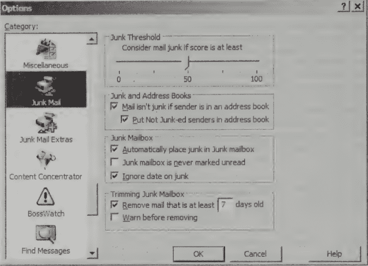

**图20.3** 垃圾邮件过滤控件

大多数个人垃圾邮件过滤器会将识别为垃圾邮件的邮件定向到一个特殊文件夹或收件篮中，供用户检查，这个过程有时被称为隔离。为了避免浪费硬盘空间，可以对过滤软件进行编程，定期清空隔离文件夹，或者简单地删除超过指定天数的疑似垃圾邮件。这种隔离方法给用户留出时间检查并取回被误判为垃圾邮件的邮件。

### 20.4.5.2 ISP过滤

在世纪之交，面对客户对垃圾邮件增多的投诉，ISP开始实施垃圾邮件过滤。然而，它们对基于内容的垃圾邮件过滤犹豫不决，担心这可能被解读为阅读别人的电子邮件，导致侵犯隐私的指控。但ISP必须能够读取报头来路由邮件，因此引入了对发件人地址和主题字段的过滤（垃圾邮件发送者因此也越来越别出心裁地随机变化主题文本）。一些ISP发现，用户对垃圾邮件的厌恶达到了一定的程度，有些用户愿意接受修订后的协议条款，允许机器读取电子邮件内容以执行更有效的垃圾邮件过滤。然而，ISP仍然面临棘手的法律问题，尤其是因为垃圾邮件没有公认的定义，也没有就言论自由在多大程度上适用于电子邮件达成共识。例如，政治候选人是否有权向选民发送不请自来的电子邮件？ISP是否有权拦截？这些问题还有待法院和公众舆论做出最终裁决。

企业网络是部署基于内容的垃圾邮件过滤器的一个地方，在这里几乎不必担心法律挑战。基于公司网络属于公司这一事实，控制其使用方式的权利优先于对隐私的担忧。员工在工作时没有权利接收他们想接收的任何电子邮件。而且，大多数公司都会辩称，公司实际上没有义务向员工投递电子邮件。有关电子邮件策略的更多详细信息，请参阅本手册第48章。

### 20.4.5.3 过滤服务

Brightmail和Postini等公司于20世纪90年代末崛起，提供企业级过滤服务。Brightmail开发的过滤器位于企业网络网关，它们基于不断更新的规则进行过滤，这些规则来自对最新垃圾邮件爆发的实时研究。Postini实际上会将公司的所有入站电子邮件定向到其服务器，在发送之前进行过滤。凭借专业化优势，过滤服务可以利用多种反垃圾邮件技术，包括：

- 黑名单
- 报头分析
- 内容分析
- 根据已知垃圾邮件数据库进行过滤
- 对类似垃圾邮件的属性进行启发式过滤
- 通过信誉机制进行白名单过滤

由于这些系统不断处理海量垃圾邮件，它们能够快速且相对有效地完善自己的过滤器，无论是正向过滤器还是负向过滤器。它们还拦截了大量否则会到达消费者手中的垃圾邮件。例如，到2008年，排名前12的ISP中有9家使用Brightmail，该公司声称其误报率极低，捕获率达95%。不幸的是，这仍然意味着一些垃圾邮件会漏网，而当垃圾邮件发送者可以在一小时内向网络发送数百万条消息时，漏网之邮件的数量仍然可能构成威胁。

另一种方法是利用订阅者的集体智慧快速识别垃圾邮件，并通过网络连接传播消息。例如，Cloudmark在撰写本文时（2008年4月）拥有数百万订阅者，他们每年支付约40美元，就可以从服务器接收近乎实时的更新，这些服务器接收并分类成员对任何漏网垃圾邮件的报告。成员的信誉评分会随着每次正确识别垃圾邮件而上升，也会因将合法电子邮件（例如成员忘记订阅的新闻通讯）错误标记为垃圾邮件而下降。举报者的可靠性有助于系统过滤掉垃圾邮件发送者的虚假信息，这些发送者可能试图声称自己的垃圾邮件是合法的，从而对系统进行欺骗。

### 20.4.5.4 附带损害

垃圾邮件过滤器有两个主要缺陷。第一，它们让垃圾邮件发送者得以继续发送垃圾邮件。换句话说，由于过滤器必须逐条判断哪些邮件是垃圾邮件、哪些不是，它们会消耗大量资源，在某些情况下甚至超过放行所有垃圾邮件所消耗的资源。当黑名单和白名单运行良好时，它们可以大幅减少到达过滤阶段的垃圾邮件数量，但最终所有过滤器都是串行处理的，因此资源受限且资源密集。

第二，过滤器有时会出错，具体有两种方式。它们有时会产生误报，将合法邮件标记为垃圾邮件，导致急需的邮件无法及时到达收件人手中。而它们有时会产生错误。


漏报会让垃圾邮件进入收件箱。假阴性和假阳性都会拖累工作效率。

## 20.4.5.5 雪鞋式垃圾邮件

垃圾邮件发送者必然会对上述过滤措施进行调整。到2012年末，越来越多的垃圾邮件发送者将垃圾邮件分发到大量被入侵的服务器上，由此产生了“雪鞋式垃圾邮件”一词。McAfee Labs对这一问题总结如下：

> 雪鞋式垃圾邮件现在是最大的垃圾邮件问题之一。过去两年里，这一问题急剧恶化，并且由于执法机构对此缺乏曝光，以及使用非法邮件列表的公司威胁提起法律诉讼，未来还将继续大幅增长。

该现象具有以下特征：

- 垃圾邮件发送者每天从新租用的主机上大量发送明目张胆的非法垃圾邮件，直到他们被驱逐出所租用的子网或转移阵地。
- 收件人的收件箱被这些垃圾邮件轰炸，且由于这些邮件并非来自合法来源，收件人无法退订。
- 雪鞋式垃圾邮件的后果是相关地址被永久列入黑名单，有时整个子网也会被永久列入黑名单。
- 由于垃圾邮件被视为单纯的扰人行为而非恶意行为，当局在很大程度上忽视了这一问题，尽管来自这些来源的垃圾邮件数量不断增长。当研究人员试图曝光这种行为时，使用这些不光彩营销手段的公司曾威胁要提起诽谤诉讼。28

## 20.4.6 网络设备

20世纪90年代末，垃圾邮件数量的急剧上升恰逢大规模通过电子邮件传播的计算机病毒和蠕虫攻击，这些攻击源于经典的恶意软件动机——炫耀。根据手段、动机和机会等经典因素对这些问题的分析表明，垃圾邮件发送者与病毒编写者有很大不同。垃圾邮件发送者主要是受金钱驱使，而非为了炫耀。这一见解开辟了一条新的反垃圾邮件防线，即消除这种动机。29

剩下要做的是了解垃圾邮件发送者如何赚钱，即垃圾邮件经济学，然后设法破坏这种经济模式。典型的垃圾邮件模式是发送大量推广产品或服务的邮件，其依据是至少其中一部分邮件会到达真实用户手中，并且其中至少一部分人会购买。如果产生的销售额足以在经营成本之外创造利润，垃圾邮件发送者就会继续运营。尽管良好的公共教育和意识宣传可以减少购买垃圾邮件产品的人数，但不太可能将这一数字降到足够低。由于从邮件流中过滤垃圾邮件会降低垃圾邮件发送者的投资回报，这往往会使垃圾邮件发送者更加绞尽脑汁地试图绕过过滤器，并发送更多垃圾邮件，寄希望于足够多的邮件能穿透过滤。事实上，垃圾邮件发送者能够找到愿意向他们大规模出售带宽的公司，包括专用的点对点T3数字电话线路连接。

另一种打击垃圾邮件经济学的方法是追踪资金流向。每笔交易都必须完成，通常是通过网站。能否关闭垃圾邮件发送者的网站？这一探究思路让作者发现了一个有趣的现象：垃圾邮件的时效性非常短。对垃圾邮件存档的研究表明，旧垃圾邮件中的大多数链接都已失效，有时是因为网站被托管公司关闭，有时是因为垃圾邮件发送者不想冒被识别身份的风险。由此，垃圾邮件经济学的关键被揭示出来：时间。如果拖慢垃圾邮件的速度，垃圾邮件发送者就无法在响应网站被关闭之前获得足够的响应。

意识到这一点后不久，网络安全专家David Brussin设计了一种通过TCP/IP流量整形来减缓垃圾邮件发送速度的方法。这项技术成为反垃圾邮件路由器的核心。反垃圾邮件路由器并非逐一检查每封邮件以判断是否为垃圾邮件，而是实时采样邮件流量，如果样本提示流量中包含垃圾邮件，就降低该流量的传输速度。对于垃圾邮件发送者，更确切地说，对于垃圾邮件发送者所使用的群发软件，受到反垃圾邮件路由器保护的网络就像连接在一台300波特的调制解调器上。换句话说，连接速度太慢，无法在网站被关闭之前足够快地投递足够多的邮件，以获取那种百万分之一的命中机会，而这是垃圾邮件方案在盈利之前所需要的。群发软件会迅速断开连接；没有邮件丢失，也没有邮件被误标为垃圾邮件。合法邮件的投递未受影响。可能有一两封垃圾邮件被送达，但比典型的垃圾邮件过滤器95%的捕获率所放行的数量要少得多。

这项技术有两个关键技巧：一是调整TCP/IP流量整形，二是调整采样过程。后者需要定期更新当前垃圾邮件特征的资料，以便尽快识别出垃圾邮件连接。这些更新可以从持续识别新垃圾邮件的服务中获取。应用程序控制面板用于处理流量整形的调节。网络管理员发现，经过适当调整的反垃圾邮件路由器可以将带宽需求降低高达75%。遗憾的是，反垃圾邮件路由器在高容量连接上效果最佳，可保护ISP、大型企业、学校和政府机构的邮件传输代理（MTA）。它没有桌面版本。尽管如此，这项技术已成为反垃圾邮件武器库中的宝贵组成部分，尽管垃圾邮件之祸仍在继续。

## 20.4.7 电子邮件认证

从技术层面看，垃圾邮件持续泛滥的原因在于SMTP协议缺乏发送方身份验证。一些倡议试图改变这种状况，要么修改SMTP协议，要么在其上增加一层机制。验证电子邮件的一个明显方法是通过发送者的域名，为此已经提出了多种方案：

- **发送方策略框架（Sender Policy Framework，SPF）**：SMTP的扩展，允许软件识别并拒绝SMTP MAIL FROM（Return-Path）中被伪造的地址，这些地址通常与垃圾邮件相关。SPF在实验性RFC 4408中定义。30
- **认证服务器验证（Certified Server Validation，CSV）**：一种电子邮件认证技术方法，专注于MTA的SMTP HELO身份。
- **SenderID**：来自前MARID IETF工作组的反欺骗提案，结合了发送方策略框架和Caller ID。Sender ID主要定义在实验性RFC 4406中。31
- **DomainKeys**：一种电子邮件认证方法，提供从签名MTA到代表收件人的验证MTA的端到端完整性。它使用签名头，通过域名系统（DNS）检索并验证发送者的公钥来确认。
- **DomainKeys Identified Mail（DKIM）**：一个规范，合并了DomainKeys和Identified Internet Mail（Cisco支持的电子邮件认证方案），以创建增强的实现。

如果实施得当，所有这些方法都能有效阻止那种使垃圾邮件在电子邮件中占据主导地位的伪造行为。每种方法各有不同的优缺点和要求。SPF、CSV和SenderID仅验证域名。SPF和CSV可以在消息数据传输之前拒绝伪造。DomainKeys和DKIM使用数字签名来验证域名以及消息内容的完整性。要使SenderID和DomainKeys发挥作用，它们必须处理邮件头，因此消息必须被传输。

显然，像DomainKeys这样的方案使电子邮件比SMTP更加复杂。需要额外的数据和更多的处理工作。DNS记录必须扩展和维护。然而，这种努力可能是值得的。尽管像DomainKeys这样的方案不能阻止电子邮件滥用，但它确实使受保护域上的电子邮件滥用更容易被检测和追踪，而且在已有多起对垃圾邮件发送者判处重刑之后，这是一种威慑。32 自2004年以来，Yahoo和Google的电子邮件服务都已使用DomainKeys对发出的邮件进行签名，但目前尚不清楚所描述的方案中是否有任何一种，或其衍生版本，会成为所有电子邮件的标准。症结就在于此。如果所有合法邮件都能得到可靠认证，垃圾邮件就能被有效边缘化；收件人可以干脆忽略所有未经认证的邮件。然而，这是一个很大的“如果”。

## 20.4.8 行业倡议

早在2002年，在消费者权益倡导者、政府机构和许多大型企业电子邮件用户的敦促下，主要电子邮件服务提供商开始举行会议，讨论统一改进电子邮件和消除垃圾邮件的方法。业界对这个在行业内被称为AMEY的团体寄予厚望，AMEY代表AOL、Microsoft、Earthlink和Yahoo!。当然也有大量的鼓励。2003年初，美国主要的消费者保护机构FTC召开了一次关于垃圾邮件的会议，委员们明确表示希望采取行动。事实上，到2003年底，美国国会已经通过了第一部联邦反垃圾邮件立法（见第20.4.9节）。2004年1月，时任微软董事长兼首席执行官比尔·盖茨在世界经济论坛上宣布：“两年后，垃圾邮件问题将得到解决。”两个月后，AMEY公司对据称是主要垃圾邮件发送者的人提起了诉讼，声称垃圾邮件每年给北美企业造成100亿美元的损失，包括生产力下降、网络升级以及数据被破坏或丢失。然而，到2006年1月，垃圾邮件已占所有电子邮件的四分之三以上。哪里出了问题？让AMEY公司采用新的、开放的、免版税标准的反复努力，都因知识产权方面的担忧而搁浅。Microsoft和Yahoo!都声称对为验证电子邮件从而解决垃圾邮件问题而提出的各种机制的部分内容拥有所有权。具有讽刺意味的是，大型ISP之间缺乏信任，导致人们对它们所投递的电子邮件也缺乏信任。

## 20.4.9 法律补救

许多国家已经通过了反垃圾邮件法律，包括美国。2003年的《反垃圾邮件法》（CAN-SPAM Act，全称“Controlling the Assault of Non-Solicited Pornography And Marketing Act”，即“控制非请求色情和营销攻击法”，自2004年1月1日生效）为任何发送商业电子邮件的人规定了某些要求。该法律还规定了对垃圾邮件发送者以及其产品在垃圾邮件中做广告的公司的处罚。该法律针对的是“主要目的是为商业产品或服务做广告或推广的电子邮件，包括网站内容。”33

《反垃圾邮件法》的执行主要由FTC负责，但该法案也授权司法部执行其刑事制裁。其他联邦和州机构可以对其管辖下的组织实施该法律……

司法管辖权，且互联网服务提供商也可以起诉CAN-SPAM违规者。以下是联邦贸易委员会（FTC）所述的法律主要条款：

- **禁止虚假或误导性的头部信息。** 你的电子邮件的发件人、收件人和路由信息——包括源域名和电子邮件地址——必须准确，并标识出发起该电子邮件的人。
- **禁止欺骗性的主题行。** 主题行不能就邮件的内容或主题误导收件人。
- **要求你的电子邮件为收件人提供退订方式。** 你必须提供一个回复电子邮件地址或另一种基于互联网的响应机制，使收件人可以请求你不要再向该电子邮件地址发送未来的邮件，并且你必须尊重这些请求。你可以创建选项菜单，允许收件人选择退出某些类型的邮件，但你必须包含停止接收发件人任何商业邮件的选项。

  你提供的任何退订机制必须能够在发出商业邮件后的至少30天内处理退订请求。当你收到退订请求时，法律给予你10个工作日的时间停止向请求者的电子邮件地址发送邮件。你不能帮助其他实体向该地址发送邮件，也不能让其他实体代表你向该地址发送邮件。最后，你出售或转让选择不接收你的邮件的人的电子邮件地址是非法的，即使以邮件列表的形式也不可以，除非你转让地址是为了让其他实体遵守法律。
- **要求商业电子邮件被标识为广告，并包含发件人有效的实际邮政地址。** 你的邮件必须包含清晰醒目的通知，说明该邮件是广告或招揽，并说明收件人可以选择不再接收来自你的商业邮件。邮件还必须包含你有效的实际邮政地址。

请注意，基于交易或关系的消息——即“促进已商定的交易或更新现有业务关系中的客户信息”的电子邮件——在某种意义上也受法律约束，即这些消息不得包含虚假或误导性的路由信息。

读者使用任何搜索引擎搜索网络，都会发现关于CAN-SPAM是否已经——以及是否可能——有效的广泛讨论。有关2004年2月发表的对该法律的批评，请参阅“Can CAN-SPAM can spam?”34

## 20.5 网络钓鱼。

网络钓鱼是利用未经请求的商业电子邮件来获取——即以电子方式“钓取”——关于你的信息，这些信息通常你不会向陌生人透露，例如你的银行账号、个人识别码（PIN）以及其他个人标识符，如社会安全号码。在2002年之前，实际上几乎没有网络钓鱼活动，2003年也相对较少，但到2004年，网络钓鱼已成为日常威胁，并且此后一直有增无减。这是一类威胁，如果行业领导者选择合作，而不是以承诺“比其他家伙更好的反垃圾邮件”来争夺客户，那么这类威胁本可以与其余垃圾邮件一起被压制。

### 20.5.1 钓鱼邮件的样子。

我们大多数人最初意识到网络钓鱼，是收到一封关于账户问题的电子邮件，通常是银行账户，但也可能是eBay、PayPal、亚马逊或其他在线账户。典型的钓鱼邮件被设计成看起来像是由大型企业发送的，例如美国银行，并带有公司标识、字体和术语的准确副本。乍一看，这类邮件可能相当有说服力。如果你收到这样一封提及你确实有账户的机构的邮件，你可能会忍不住阅读它。你甚至可能忍不住按照说明操作，而这些说明很可能会将你引向一个要求提供机密信息的网站。请看一封典型钓鱼邮件的文本：

> 您收到此消息，是由于您的保护。我们的在线技术服务外国IP间谍最近检测到您的在线账户最近从IP 77.32.11.84登录，没有国际访问代码（I.A.C），并且是从一台未经我们在线服务部门验证的未注册计算机登录的。
>
> 如果您上次在2007年5月5日星期一下午6:45从外国IP登录您的在线账户，则无需恐慌，但如果您确实在上述日期和时间登录了您的账户，请从您的网上银行体验中抽出2-3分钟时间来立即验证并注册您的计算机，以避免身份盗用，您的保护是我们未来的勋章。

乍一看非常官方和技术性的消息，实际上却充满了错误。处理这些消息最好的做法是删除它们。最糟糕的做法是回复它们。在电子邮件安全进行重大改革之前，任何有信誉的机构都不会使用电子邮件来要求更改或更新机密账户信息。

如果你收到一封类似上述讨论的电子邮件，但你在美国银行没有账户，你可能会感到困惑。事实上，发送这些钓鱼邮件的人通常不知道收件人是否在邮件中提到的机构有账户。实际上，这种不匹配是识别某些钓鱼邮件的最简单方法。然而，如果钓鱼者（可能已经发送了数百万封相同的邮件）运气好，而你恰好确实在该机构有账户，或者如果邮件是通用的，那么事情就变得有点棘手了。你更有可能打开一封看起来往往相当有说服力、貌似来自你的银行的邮件。如果你无法抗拒查看关于账户问题的邮件，以下是一些表明该消息是伪造的线索。（请注意，我们并不是说没有这些线索的消息就是合法的。）

- **欺骗性链接。** 大多数钓鱼邮件都努力让自己看起来合法，例如，使用从目标机构网站窃取的标识和图形。我们见过的所有钓鱼邮件都包含一个指向网站的链接，在网站上你会被要求提供钓鱼者试图窃取的数据。然而，这个链接通常经过伪装。例如，链接可能又长又复杂，包含银行名称，但实际上并不会将你带到银行网站。或者，链接可能看起来是普通简单的文本，但实际上是HTML编码的，会跳转到其他地方。一些电子邮件程序，如Eudora，会在你将鼠标悬停在链接文本上（在点击之前）时警告你这种欺骗行为，并显示真实链接。

  钓鱼方案中链接的设计对其成功与否至关重要。越来越多的用户对电子邮件中的长链接、复杂链接或纯数字IP地址链接（例如“点击 http://123.212.192.68”）保持适当的警惕。通过使用HTML编码，消息通常会掩盖目标地址。然而，该链接在攻击的下一阶段也很重要，即受害者点击链接时。如果钓鱼网站的URL在浏览器的URL字段中显示为数字地址，受害者可能会起疑。人们使用各种技术来使该地址看起来可信。
- **更改PIN/密码。** 要求你更改账户访问凭据的电子邮件非常可疑。正规公司不会通过电子邮件提出此类请求，正是因为电子邮件太不可靠了。信誉良好的银行网站的安全更新不会要求你登录账户来重置或防止其被暂停。而且，合法的消息为什么要你使用一个据称已被泄露的密码？没有任何政府机构会通过电子邮件索要你的凭据或个人信息的。世界上也没有任何彩票会通过电子邮件通知中奖者。忽略这些消息，或将它们报告为垃圾邮件，然后继续前行。
- **糟糕的拼写、语法和逻辑。** 谁会想到那些乏味的语法课会如此有用？糟糕的语法、拼写，甚至错误的逻辑，可能是识别伪造电子邮件最快的方法。考虑这个例子：“因此，如果您是账户的合法持有人，请填写下面的表格，以便我们检查您的 identy。[原文如此]” 这里有一个明显的拼写错误（identy 是 identity 之误），而且逻辑也不通。想一想：如果一家银行不确定某人是否为账户的合法持有人，为什么要给这个人发电子邮件？同样，这不是当今真正公司的做事方式，所以直接忽略吧。
- **通用钓鱼。** 通用账户警告特别令人讨厌。它们是网络钓鱼攻击试图绕过不知道受害者（你）在哪里有账户这一问题的一种方式。例如，美国的所有银行账户都由一个名为联邦存款保险公司（FDIC）的机构承保。2004年，有人利用这一事实发起了一次特别恶劣的攻击，可能会诱捕任何有银行账户的人。这是最早利用微软Internet Explorer的漏洞伪造链接URL以掩盖实际URL的钓鱼攻击之一。如果你点击了邮件中的链接，你进入的网站看起来真的像是www.fdic.gov，但实际上指向的是钓鱼者的网站。

### 20.5.2 网络钓鱼的增长与规模。

任何新的计算机滥用形式，当能够促进该滥用的工具包可用时，就可以说它已经出现。钓鱼工具包于2006年首次出现，提供了脚本，使攻击者能够自动建立钓鱼网站，仿冒不同品牌的合法网站（包括非法盗用消费者将这些品牌联系在一起的图像和标识）。这些脚本方便地生成相应的钓鱼电子邮件。犯罪分子继续马不停蹄地演化他们的工具；2013年1月的一份报告发现，鱼叉式钓鱼者应用了一种名为Bouncer的新工具，该工具会调整其URL，为其目标受害者加入唯一标识符；在没有有效标识符的情况下尝试访问犯罪者的页面会导致404（无此页面）错误，从而干扰研究人员对钓鱼页面的分析。35

2013年2月，分析人员发现，“当安全专家调查近年来一些最受关注的黑客事件时，一个特定的犯罪集团不断引起他们的注意。业内人称这个名为Comment Group的组织位于中国，提供黑客雇佣服务——无论是针对个人、公司还是政府……”他们会研究个别公司或组织，以找到详细的信息，从而在钓鱼邮件中编写高度特定的话题甚至内容。例如，据报道，一位可口可乐高管打开了一封据称来自他自己老板的钓鱼邮件；他点击的链接将间谍软件下载到他的电脑中，并使中国……

工业间谍获取了阻碍中国最大软饮料公司收购的信息。36

2013年4月，美国国土安全部（DHS）警告“在公共网页和社交媒体网站上发布大量商业和个人信息的组织”不要这样做。2012年10月，网络钓鱼者从一家能源公司公开发布的会议参会者名单中获取了员工的详细信息。除了针对指名道姓的个人的鱼叉式网络钓鱼攻击之外，“看似来自其中一位与会者的恶意电子邮件被发送给名单上的其他人，告知他们发件人的电子邮件地址已更改。收件人被礼貌地要求点击一个附件链接，该链接会迅速将他们带到一个包含恶意软件的网站。”37

APWG是一个关于网络钓鱼统计信息的宝贵资料库。38 他们关于2013年第四季度网络钓鱼的报告包含以下发现（这些是直接引述，以项目符号列出，并删除了页码引用）：

- 针对在线游戏玩家的网络钓鱼攻击大幅增加，从第三季度占所有网络钓鱼攻击的2.7%上升到第四季度的14.7%。
- 金融服务在2012年第四季度仍然是攻击目标最多的行业领域，支付服务紧随其后。
- 在线游戏凭证对某些犯罪分子来说很有价值，他们会在黑市上出售这些凭证。这些账户中的游戏内物品也可以被网络钓鱼者出售以换取现实世界的现金。受害者甚至可能被窃取现实生活中的身份。
- 针对社交媒体的攻击翻了一番，从第三季度的3%上升到6%。
- 第四季度，全球约30%的个人电脑感染了恶意软件。
- 中国超过57%的个人电脑可能已受到感染，而欧洲国家的个人电脑感染频率最低。
- 除了2012年10月外，从2012年4月到2012年12月，网络钓鱼网站的数量每月都在下降。
- 2012年4月检测到63,253个独特的网络钓鱼网站，2012年12月下降至45,628个。
- APWG在12月收到28,195个独特网络钓鱼网站的报告。12月的总数比2009年8月40,621份报告的高峰低31%。
- 本季度犯罪软件的使用量较上季度略有下降，窃取数据的恶意软件的使用量也是如此。
- 其他恶意软件的使用量较上季度有统计学意义上的显著增长。39

## 20.5.3 威胁在哪里？

网络钓鱼起初似乎是一个个人问题，是消费者计算机安全而非企业信息安全的问题。事实上，负责消费者保护的联邦机构——联邦贸易委员会（FTC）一直积极教育消费者了解这一问题以及如何避免被这些信息欺骗。40 然而，网络钓鱼也是一种基于计算机的威胁，威胁到公司的信息和福祉，也威胁到整个电子商务。


在维吉尔的*《埃涅阿斯纪》*中，但特洛伊代码的目标与原始特洛伊木马相同：欺骗受保护之地的守卫者，允许外人进入。（有关名称起源的更多信息，请参见第15.3.2.17节。）

几乎就在互联网提供了一种分发可执行代码的方式（无论是作为下载链接还是电子邮件附件）的同时，一些人就决定利用这种能力在未经明确许可的情况下分发他们的代码。换句话说，无辜的一方可能会被诱惑下载一个看似无害的可执行文件，而实际上它是别的东西。下载者是有意为之，但对可执行文件中特洛伊代码的制作者的意图一无所知。

## 20.6.1 经典与近期特洛伊木马

尽管当今电脑的屏幕并不需要“保护”，但屏幕保护程序仍然是特洛伊代码的来源之一。一些用户显然难以抗拒动态瀑布和鱼缸的诱惑。这导致用户下载在网站上遇到的屏幕保护程序，或打开通过电子邮件收到的屏幕保护程序文件。在展品20.4中，你可以看到一个屏幕保护程序的示例。

这个特洛伊屏幕保护程序的创建者于2007年2月被发现，显然对日本流行的文件共享网络Winny不满。当这个屏幕保护程序被打开时，特洛伊木马会显示一个图像，警告电脑操作者不要使用Winny。这种策略让人想起一些最早的病毒，它们传播相对无害的信息而不是造成破坏。事实上，代码不一定非要具有恶意意图才能被视为特洛伊木马——它只需要在未经许可的情况下被安装的意图。不幸的是，在这个特定案例中，这个特洛伊木马确实会通过覆盖某些文件（例如扩展名为 .txt 和 .jpg 的文件）来破坏数据。

另一个屏幕保护程序特洛伊木马的例子是据报道在2007年7月以电子邮件附件形式传播的bsaver.zip。当ZIP附件中的文件被打开时，系统感染Agent-FZB特洛伊木马，该木马随后释放两个rootkit，以逃避安全软件的检测，并使系统可被未授权用户访问。（有关rootkit的更多信息，请参见本*《手册》*第15章。）这个屏幕保护程序通过垃圾邮件活动分发，邮件主题行如*生活是美好的*、*生活会更好*、*美好的夏天*和*帮助你*。邮件文本包含诸如“早上好/晚上好，伙计！附件里真的[原文如此]很酷的屏幕保护程序！”之类的短语。

关于特洛伊木马的近期报告包括以下案例和研究：

- BackDoor.Wirenet.1木马于2012年8月被识别；该恶意软件“是第一款可在Mac OS X和Linux平台上运行的特洛伊木马程序，它‘旨在窃取一些流行互联网应用存储的密码。’”⁴¹
- 2013年的“PandaLabs第一季度报告”发现，“特洛伊木马创下了新纪录，导致全球近80%的计算机感染。尽管无法自我复制，特洛伊木马能够通过受感染的网站触发大规模感染，这些网站利用Java、Adobe Reader等浏览器插件中的漏洞。这种攻击方法允许黑客在几分钟内用相同的或不同的特洛伊木马感染数千台计算机，因为攻击者能够根据多种参数（如受害者的位置、所使用的操作系统等）更改他们使用的特洛伊木马。”⁴²
- 2013年3月，卡巴斯基实验室报告称，一次针对西藏自由活动人士的新型间谍软件攻击使用了为Android手机操作系统设计的特洛伊木马。⁴³
- 到2013年4月初，Flashback特洛伊木马利用Java中的一个漏洞感染了超过60万台Macintosh电脑。⁴⁴
- 2013年4月，犯罪分子发出观看波士顿马拉松爆炸案视频片段的邀请。一个远程访问特洛伊木马以“WinPcap数据包驱动程序（NPF）”的形式被安装，以逃避注意。⁴⁵
- 2013年5月，Sophos的Graham Cluley报告了一个特洛伊木马（Mal/BredoZp-B），该木马通过一封据称来自蒂芙尼公司（Tiffany & Co.）的电子邮件传播，邮件声称包含出口许可证和付款发票的详细信息。⁴⁶

特洛伊木马试图看起来有用或有趣，以便用户安装它，但其中隐藏着未经授权的、未记录的代码，用于未经授权的功能，下面仅列出其中一些：

- 删除文件、文件夹或整个驱动器
- 以微妙或戏剧性的方式更改数据
- 加密数据（可能用于敲诈勒索）
- 将数据复制到其他计算机（可能用于工业间谍活动）
- 未经用户同意下载文件（可能用于非法电子商务、非法文件共享、色情网站托管、廉价存储）
- 破坏浏览器软件和网络文件，将用户从合法网站重定向到假冒、虚假、恶意的网站
- 启用对受感染系统的远程访问（有时称为RAT，即远程访问特洛伊木马），通常用于将计算机变成僵尸，这些僵尸可以聚合成僵尸网络（用于发送垃圾邮件、网络钓鱼和执行拒绝服务攻击）
- 使用释放器代码辅助病毒传播，导致感染


- 禁用防病毒程序和防火墙程序
- 禁用竞争类型的恶意软件
- 记录按键以获取密码和信用卡号码等数据
- 报告浏览活动（启用间谍软件）
- 收集电子邮件地址，用于发送垃圾邮件以及网络钓鱼等其他活动

特洛伊木马代码背后的动机通常属于以下三类中的一类或多类：恶意破坏、炫耀资本和经济收益。这些收益可以通过多种方式实现。窃取的数据可以出售。对受感染机器的访问权限可以出售。被加密或被盗的数据可以勒索赎金。拒绝服务威胁可用于敲诈勒索。有些公司甚至使用特洛伊木马来尝试提高其软件的销量和安装基数。

## 20.6.2 反木马基本策略。

不幸的是，特洛伊木马可能很难对付。第一道防线是受过良好教育的用户，他们明白不应该执行来源可疑的代码。与此相关的警告应纳入任何计算机安全意识计划，而计算机安全意识计划应成为每个企业安全模型的一部分。可以采用技术措施来对抗特洛伊木马，但由于没有一种措施是完美的，因此忽视最终用户教育而只依赖技术措施是没有意义的。事实上，将最终用户视为*计算机操作员*而非*计算机用户*可能是一个不错的起点，因为“用户”这一角色意味着在维护计算机的完整性和健康方面相对被动，而“操作员”则更准确地反映了任何在工作或娱乐中使用计算机的人所需承担的责任水平。（计算机用户好比是只开车而从不检查机油或轮胎的人；操作员则更接近于职业司机，他们知道从 A 地安全可靠地到达 B 地远不止握住方向盘和踩下正确的踏板那么简单。）

对抗特洛伊木马的技术措施首先包括：保持所有操作系统和应用程序补丁为最新，普遍使用可扫描传入文件的内存驻留防病毒软件，并定期使用定期更新的病毒数据库对整个系统进行扫描。同时，运行内存驻留的反僵尸网络软件（如 Norton AntiBot）也有帮助，该软件旨在识别和阻止表明僵尸网络的活动。此类软件并不能直接防止特洛伊木马进入计算机，但可以最大程度地减少特洛伊木马可能造成的损害。

一个好的反垃圾邮件解决方案也是必要的，因为垃圾邮件是特洛伊木马攻击的主要传播载体。如果会计部的吉姆从未收到那条关于酷炫屏幕保护程序的消息，他就不会受到诱惑去打开附件。令人诱惑的不只是屏幕保护程序。2007年4月，垃圾邮件技术被用来大规模分发主题为“蠕虫警报！”和“检测到蠕虫”的消息。这些消息附带一个 ZIP 文件附件，该附件伪装成可以阻止虚假攻击的补丁。当收件人惊慌失措地打开 ZIP 文件时，却发现它受密码保护，有些人便认为这是正版补丁的迹象。（密码也包含在消息中。）继续安装会导致系统被安装 rootkit、安全软件被禁用、受感染机器上的机密信息被盗，以及被纳入由受感染计算机组成的僵尸网络。在 24 小时内，Postini 统计到近 500 万份此类特洛伊木马垃圾邮件针对其反垃圾邮件服务的用户。该公司计算，这一种垃圾邮件在当时通过电子邮件传播的所有恶意软件中占了 87%。

## 20.6.3 锁定与隔离。

更严厉的反木马措施包括：防止对可执行文件进行未经授权的更改或添加，以及防止系统在通过审查之前连接到网络。通过将操作系统和已授权应用程序冻结在已知的良好状态来击败恶意可执行文件的想法由来已久，至少可以追溯到反病毒努力的早期。然而，当今大多数操作系统和应用代码的复杂性使得这种方法充其量也只能说是具有挑战性。想想“补丁星期二”的出现，它已成为维护世界上使用最广泛的操作系统的一种标准手段。事实上，多年来，大量软件开发一直基于这样一种假设：如有需要，补丁和更新总是可以推送出去。这可以说导致编码实践远不如过去那样严谨——那时生产代码被刻录到磁盘上，成本高昂，而且修改后需要再次发送磁盘。

当计算机尝试连接到网络时，使用某种形式的网络访问控制对其进行隔离，这为“锁定机器，使未经授权的代码无法安装”的理念提供了一种略有不同的方法。一些企业网络安全管理者已经采用了这种方法，因为控制某些网络终端变得越来越困难，例如公司笔记本电脑会随员工前往客户现场、参加会议、出入酒店和 WiFi 热点，甚至还会在员工的汽车和家中使用。以这种方式使用的笔记本电脑面临着各种各样的攻击途径。传统的防御机制可以应用于这些终端，包括密码保护、生物特征认证、磁盘加密和防病毒程序。然而，这些措施可能不够，许多企业已为此付出了代价。那么，为什么不先对这些机器进行未经授权的可执行文件扫描（就像常规健康检查一样），然后再允许它们连接到企业网络呢？这种方法很有前景，但实施起来并不容易。此外，它使机器在离开公司网络期间容易受到攻击。通过垃圾邮件传播的网络钓鱼活动或屏幕保护程序特洛伊木马仍可能在两次检查之间使某个终端瘫痪，并泄露机密的个人或公司数据。正如你从图表 20.5 中所见（这是 Symantec 在 2011 年编制的表，显示 2009 年和 2010 年地下经济中各种形式数据的支付价格），此类活动的经济诱因是真实存在的。

## 图表 20.5 地下经济中交易数据的支付价格表⁴⁷

| 2010 排名 | 2009 排名 | 项目 | 2010 百分比 | 2009 百分比 | 2010 价格范围 |
|---|---|---|---|---|---|
| 1 | 1 | 信用卡信息 | 22% | 19% | $0.07-$100 |
| 2 | 2 | 银行账户凭据 | 16% | 19% | $10-$900 |
| 3 | 3 | 电子邮箱账户 | 10% | 7% | $1-$18 |
| 4 | 13 | 攻击工具 | 7% | 2% | $5-$650 |
| 5 | 4 | 电子邮件地址 | 5% | 7% | $1/MB-$20/MB |
| 6 | 7 | 信用卡磁条数据 | 5% | 5% | $0.50-$120 |
| 7 | 6 | 完整身份信息 | 5% | 5% | $0.50-$20 |
| 8 | 14 | 诈骗托管 | 4% | 2% | $10-$150 |
| 9 | 5 | Shell 脚本 | 4% | 6% | $2-$7 |
| 10 | 9 | 套现服务 | 3% | 4% | $200-$500 或总价值的 50%-70% |

- 18. Nicole Henderson，《Symantec 报告发现 6 月电子邮件中垃圾邮件占 73%》，*网络托管行业评论*，2011 年 6 月 28 日，www.thewhir.com/web-hosting-news/symantec-report-finds-spam-accounts-for-73-percent-of-june-email
- 19. Lance Whitney，《Symantec 称垃圾邮件降至近三年最低水平：全球垃圾邮件量现在占所有电子邮件的 70%，与 2009 年占 90% 相比大幅下降》，*c|net | 新闻 | 安全与隐私*，2011 年 12 月 7 日，http://news.cnet.com/8301-1009_3-57338317-83/spam-sinks-to-lowest-level-in-almost-three-years-says-symantec
- 20. Kaspersky Lab，《2012 年垃圾邮件：持续下降使垃圾邮件水平创 5 年新低》，Kaspersky Lab，2013 年 1 月 13 日，www.kaspersky.com/about/news/spam/2013/Spam_in_2012_Continued_Decline_Sees_Spam_Levels_Hit_5-year_Low
- 21. Darya Gudkova 和 Tatyana Shcherbakova，《2013 年 1 月垃圾邮件》，*Securelist | 分析*，2013 年 2 月 21 日，www.securelist.com/en/analysis/204792282/Spam_in_January_2013
- 22. Sara Radicati 和 Quoc Hoang，《电子邮件统计报告，2012–2016：执行摘要》，Radicati Group，2012 年 4 月 23 日，www.radicati.com/wp/wp-content/uploads/2012/08/Email-Statistics-Report-2012-2016-Executive-Summary.pdf
- 23. Justin M. Rao 和 David H. Reiley，《垃圾邮件经济学》，*经济展望杂志* 26 卷，第 3 期（2012 年）：87–100，www.aeaweb.org/articles.php?hs=1&fnd=s&doi=10.1257/jep.26.3.87
- 24. 位于 www.rfc-networkworld.com/spam/index.jsp
- 25. 反网络钓鱼工作组，《关于 APWG》，APWG 网站，2013 年，http://apwg.org/about-APWG
- 26. Janusz Lukasiak，《阻止垃圾邮件中继和垃圾邮件》，Jisc 网站，1999 年 10 月，www.jisc.ac.uk/publications/publications/blockingspamfinalreport.aspx
- 27. 关于阻止列表和黑洞的确切术语是一个持续争论的话题，涉及潜在的商标侵权和“政治正确”问题。
- 28. McAfee，《雪鞋垃圾邮件成为电子邮件安全威胁》，*McAfee | 商业主页 | 安全意识*，2012 年 12 月 27 日，www.mcafee.com/us/security-awareness/articles/snowshoe-spamming-biggest-problem.aspx
- 29. David Brassin、Stephen Cobb、Ray Everett-Church 和 Vincent J. Schiavone，《网络资源盗窃预防：摧毁垃圾邮件经济》，ePrivacy Group，2003 年 11 月，http://cobbassociates.com/library/spamsquelcher-wp2.pdf
- 30. 参见 www.rfc-archive.org/getrfc.php?rfc=4408
- 31. 参见 www.rfc-archive.org/getrfc.php?rfc=4406
- 32. 垃圾邮件定罪的刑期一直在稳步上升。尽管许多被定罪者提出了上诉，但至少有六人已经入狱服刑。
- 33. 美国联邦贸易委员会，《CAN-SPAM 法案：对商业电子邮件发送者的要求》，www.business.ftc.gov/documents/bus61-can-spam-act-compliance-guide-business
- 34. M. E. Kabay，《CAN-SPAM 能管住垃圾邮件吗？》，*Networkworld*，2004 年 2 月 2 日，www.networkworld.com/newsletters/sec/2004/0202sec1.html
- 35. Paul，《新型网络钓鱼工具包利用白名单让骗局持续存在》，*VERA-CODE | 安全账本*，2013 年 1 月 16 日，https://securityledger.com/new-phishing-toolkit-uses-whitelisting-to-keep-scams-alive


- 36. Dave Lee, “评论小组：追踪你线索的黑客,” BBC | 新闻 | 商业, 2013年2月11日, www.bbc.co.uk/news/business-21371608
- 37. Jaikumar Vijayan, “DHS 警告针对能源公司的精准钓鱼活动：攻击者利用公司网站信息策划攻击,” Computerworld | 安全 | 恶意软件和漏洞, 2013年4月5日, www.computerworld.com/s/article/9238190/DHS_warns_of_spear_phishing_campaign_against_energy_companies
- 38. Anti-Phishing Working Group, “APWG 钓鱼攻击趋势报告,” 反钓鱼工作组网站, 2013年4月24日. http://apwg.org/resources/apwg-reports
- 39. Greg Aaron, “钓鱼活动趋势报告：2012年第四季度,” 反钓鱼工作组网站, 2013年4月24日, http://docs.apwg.org/reports/apwg_trends_report.Q4.2012.pdf
- 40. 参见 www.ftc.gov 和 http://onguardonline.gov/phishing.html
- 41. Anthony Wing Kosner, “新型特洛伊木马后门恶意软件针对 Mac OS X 和 Linux，窃取密码和击键,” Forbes | 科技, 2012年8月31日. www.forbes.com/sites/anthonykosner/2012/08/31/new-trojan-backdoor-malware-targets-mac-os-x-and-linux-steals-passwords-and-keystrokes
- 42. PandaLabs, “PandaLabs 第一季度报告：特洛伊木马占恶意软件感染的 80%，创下新纪录,” Panda Security | 新闻发布室 | 新闻, 2013年5月3日, http://press.pandasecurity.com/news/pandalabs-q1-report-trojans-account-for-80-of-malware-infections-set-new-record
- 43. Sean Gallagher, “首次使用 Android 恶意软件的有针对性攻击被发现：卡巴斯基发现通过“精准钓鱼”传播给西藏活动人士的特洛伊木马,” arstechnica, 2013年5月26日, http://arstechnica.com/security/2013/03/first-targeted-attack-to-use-android-malware-discovered
- 44. Dwight Silverman, “超过五十万台 Mac 被 Flashback 特洛伊木马恶意软件感染。” Chron | TechBlog, 2012年4月5日, http://blog.chron.com/techblog/2012/04/more-than-half-a-million-macs-infected-with-flashback-trojan-malware
- 45. Graham Cluley, “病态的恶意软件作者利用波士顿马拉松爆炸事件发动特洛伊木马攻击,” Sophos | nakedsecurity, 2013年4月17日, http://nakedsecurity.sophos.com/2013/04/17/malware-boston-marathon-bombing
- 46. Graham Cluley, “蒂芙尼的早餐恶意软件？特洛伊木马被广泛垃圾邮件发送,” Sophos | nakedsecurity, 2013年5月22日, http://nakedsecurity.sophos.com/2013/05/22/tiffany-malware
- 47. Symantec, “欺诈活动趋势,” Symantec | 企业 | 安全响应 | 互联网安全威胁报告, 2010, www.symantec.com/threatreport/topic.jsp?id=fraud_activity_trends&aid=underground_economy_servers

## 第21章

## 基于 Web 的漏洞

Anup K. Ghosh, Kurt Baumgarten, Jennifer Hadley, and Steven Lovaas

- 21.1 引言 21·1
- 21.2 破坏电子商务系统 21·1
- 21.3 破坏电子商务业务的案例研究 21·2
- 21.4 Web 应用系统安全 21·5
- 21.5 保护 Web 应用 21·6
- 21.6 电子商务系统中的组件和漏洞 21·8
- 21.6.1 客户端风险 21·8
- 21.6.2 网络协议风险 21·10
- 21.6.3 业务应用逻辑 21·12
- 21.6.4 CGI 脚本漏洞 21·14
- 21.6.5 应用篡改 21·15
- 21.6.6 Web 服务器利用 21·16
- 21.6.7 数据库安全 21·19
- 21.6.8 平台安全 21·21
- 21.7 摘要 21·22
- 21.8 进一步阅读 21·23
- 21.9 注释 21·23

### 21.1 引言.

本章系统地回顾了构成 Web 应用的主要软件组件，主要关注电子商务，并概述了这些组件各自的风险。¹ 本章的目的是指出每个系统都存在需要系统分析并最终解决的安全和隐私风险。

### 21.2 破坏电子商务系统.

为了使系统更安全，打破它可能是明智的。发现系统中的漏洞对于加强它至关重要，但破坏电子商务系统需要与开发它的程序员不同的思维方式。程序员考虑的是在规范内开发，而罪犯或黑客则在规范之外寻找机会。

黑客认为规则就是用来打破的，他们总是以意想不到的方式使用系统。在这样做的过程中，他们通常遵循阻力最小的路径。那些被认为提供最强安全或对黑客攻击阻力最大的区域很可能会被忽略。例如，如果系统使用安全套接层（SSL）来加密 Web 客户端与 Web 服务器之间的 Web 会话，黑客不会尝试破解加密流，而是会寻找在数据解密并以明文存储后更容易获取数据的方法。

黑客去哪里，钱就在哪里——有时是字面意思，有时不是。他们通常只有在努力有回报时才会尝试入侵某个站点。有时黑客的动机是金钱，但同样常见的是名声、臭名昭著或被同行群体接受的诱惑。保护水平应与被保护资源的价值相称。例如，发布当地餐厅菜单的网站可能不会被视为拒绝服务或其他类型攻击的目标。这样的网站根本不如银行的在线网站有吸引力，在那里黑客肯定可以获得名声甚至从中获利。同样，大多数人由于缺乏安全意识，而且大多数潜在窃听者对普通个人电子邮件不感兴趣，因此不费心加密电子邮件。然而，高知名度组织的敏感电子邮件应被加密，以保护宝贵的知识产权。

重要的是要记住，电子商务系统是一条链条，其强度仅取决于其最薄弱的环节。² 黑客自然会尝试攻击阻力最小的点。这解释了为什么一个站点可能会故意设置一个蜜罐（牺牲系统），提供看似脆弱的服务，以便跟踪和监控潜在黑客。在电子商务或任何具有 Web 存在的系统中，密码学通常被认为提供最强的保护级别；因此，黑客通常会攻击主机端服务和客户端内容。

维护强大的主机安全，无论是在边界内部还是外部，都至关重要。企业边界的一个不幸副作用是系统管理员倾向于忽视基于主机的安全，这可能使主机完全暴露于风险之中。其结果是，一旦黑客突破或绕过边界设备和策略（例如，防火墙、路由器，甚至接待员），他们就可以利用内部信任关系来破坏许多资源，包括工作站、服务器和电话系统。明智的管理员将在系统入口处和系统内部都给予同等的关注。

### 21.3 破坏电子商务业务的案例研究.

考虑一个在线投资电子商务应用程序，以及黑客如何拆解其安全机制以获取恶意或财务利益。网上投资因多种原因而非常受欢迎。客户无需等待季度对账单邮寄或处理电话菜单，只需访问其投资组合经理的网页即可快速查看投资持仓的状态、余额和当前价值。如果他们希望按需买卖股票，可以建立在线 Web 启用经纪账户。图 21.1 显示了在线投资应用程序的简化工作流程图，该应用程序使拥有已建立账户的用户能够查看投资组合持仓和现金余额、更新跟踪的股票并进行在线交易。

要了解此应用程序如何被破坏，查看实现在线应用程序的示例网络架构会有所帮助。图 21.2 显示了实现在线投资应用程序的系统的网络架构，以及示例利用。系统由终端用户的客户端机器、互联网、路由器、防火墙、前端 Web 和电子邮件服务器、应用服务器、数据库和工作站组成。

存在黑客破坏此在线应用程序的多种方式。图 21.2 显示了一种可能的场景。在攻击的第 1 步中，黑客使用互联网和 Web 浏览器滥用服务器上调用应用程序的通用网关接口（CGI）脚本之一。该 CGI 脚本可能是一个开发 CGI 脚本

## 图示 21.1 在线投资应用程序


客户通过网络输入账户 ID 和密码。

客户经过身份验证并获得账户访问权限。

客户更新投资组合跟踪偏好设置。

客户检查投资组合表现。

客户买卖股票。

投资银行借记/贷记客户现金账户并更新投资组合。

投资银行向客户发送交易确认通知。

## 图示 21.2 破坏电子商务

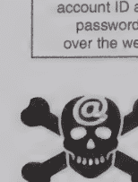

1. 攻击者利用 CGI 脚本中的弱点获得主机上的 shell 权限。

2. 攻击者在 CGI 脚本中找到数据库密码并下载所有账户号码和密码。

客户通过网络输入账户 ID 和密码。

客户经过身份验证并获得账户访问权限。

客户更新投资组合跟踪偏好设置。

客户检查投资组合表现。

客户买卖股票。

4. 贷记应用于攻击者控制下的账户。

3. 攻击者安装 NetBus 并控制投资组合管理人员的终端。

投资银行借记/贷记客户现金账户并更新投资组合。

投资银行向客户发送交易确认通知。

## 21.4 基于 Web 的漏洞

在投入生产前被意外遗留在服务器上，一个来自应用程序服务器发行版的默认 CGI 脚本，或一个在在线投资应用程序中实现有缺陷逻辑的脚本。利用跨站脚本或其他常见利用方法利用 CGI 脚本可使黑客获得对 Web 服务器的 shell 访问权限。CGI 脚本漏洞将在本章后面讨论。

漏洞不一定在 CGI 脚本中。应用程序服务器可以用 Java、C、C++、Perl 或 Python 在各种应用程序服务器框架中实现。困难不在于业务应用程序逻辑使用哪种语言开发；更重要的是该中间件层复杂逻辑引入的漏洞。应用程序中间件开发中的一个关键问题是输入有效性检查不充分；也就是说，开发人员未能对可接受的输入施加限制。黑客可以利用输入有效性检查的缺失，向应用程序服务器提供用于系统命令的意外输入。这种技术可以获得机器上的 shell 权限。

尽管应用程序服务器滥用是入侵系统的常见方式，但获得攻击第 1 步中的初始访问权限还有许多其他方法。例如，Web 和邮件服务器可能正在运行 FTP 和 BIND/DNS 等多种网络服务，这些服务可能配置错误从而被“污染”。Web 和邮件服务器软件本身可能容易受到攻击。许多流行的商业 Web 和邮件服务器曾容易受到缓冲区溢出攻击，这些攻击通常允许在主机上获得完整的系统 root 权限。³ 一旦攻击者在内部主机上获得系统权限，他们就可以利用网络策略在机器之间编织的固有内部信任来访问网络上的其他系统。这正是攻击者在图示 21.2 中说明的攻击第 2 步中所遵循的策略

一旦攻击者获得了应用程序服务器上各种文件系统的访问权限，他们就可以查看 CGI 脚本或其他应用程序中间件的源代码，以发现客户账户号码、密码，甚至用于访问后端数据库的数据库管理员密码。从那里，他们可以下载存储在数据库中的重要且保密的客户信息。在攻击的第 3 步中，攻击者利用获得的内部权限在系统中悄无声息地植入后门。一套通常被称为 rootkit 且可供黑客使用的软件，不仅允许他们在不被察觉的情况下进入系统，还可以擦除审计日志中的痕迹。在所示示例中，黑客安装了一个名为 Back Orifice 的 rogue 远程管理程序，该程序提供了以与真正的系统管理员相同的权限和权力远程管理主机和网络的能力。

在攻击的这一点上，黑客已完全控制系统以及任何面向 Web 或与商务相关的流程，可选择包括：

- 为谋取经济利益而窃取客户或公司信息
- 篡改网页以求名声或宣传议程
- 以隐蔽的方式挖掘专有业务信息和其他机密知识产权（间谍活动）
- 以诋毁威胁对企业进行勒索
- 篡改应用程序以谋取其他个人利益

攻击的第 4 步说明了最后一种情况，即攻击者贷记个人现金账户。黑客必须足够迅速地提取这些资金，以免传统后端审计发现差异。政府机构和其他重要网站的网页被篡改的情况屡见不鲜，其他情况也有大量报道。当然，一些公司可以理解地不愿宣传可能降低客户信心的事件，但在许多情况下，法律现在要求披露泄露事件。

不幸的是，只需一台有缺陷、未修补的计算机或被忽视的漏洞，黑客就可以破坏整个系统。尽管纵深防御（使用多种安全形式，例如在外围使用防火墙、在网络内部使用入侵检测）是一种流行的策略，但当一个漏洞被利用时，多层防御往往像纸牌屋一样倒塌。例如，获得 root 能力的攻击者可以禁用所有其他安全措施。这个问题被称为不对称攻击，因为防御此类攻击比发动攻击要困难得多且成本更高。尽管一个执着的黑客可能有能力花费所需的时间来入侵系统，但公司无法花费所需资金来防御所有可能性。

考虑到构成当前信息技术（IT）基础设施的各种平台和设备，可利用的漏洞数量令人震惊。加剧问题的是，黑客可以使用价值 500 美元的计算机和调制解调器在相对匿名的情况下发动攻击。更糟糕的是，黑客可以从机场、商场、咖啡馆甚至洗衣店提供的任何数量的互联网终端工作。随着黑客变得更加精明，并且更容易使用的脚本变得可用，攻击将从可以进出不同地理区域然后被丢弃的移动设备发起——使追踪攻击者几乎不可能。

## 21.4 Web 应用系统安全。

尽管这里描绘的图景相当黯淡，但组织可以有效地管理来自黑客的风险。正如许多其他安全领域一样，组织所采取的安全态势或立场对于阻止和挫败黑客至关重要。为了使用物理世界的类比，考虑一下打算闯入富裕社区房屋的窃贼。当窃贼勘察潜在目标时，他们会注意到一些装有防盗报警器——配有显眼的报警系统标志——的房屋，而另一些则没有。很可能，窃贼会绕过装有防盗报警器的房屋，转而攻击其他保护较差的目标。因此，业主所采取的安全立场发挥着重要作用。

每个组织必须首先根据其安全策略文件确定其期望的安全态势。系统管理员使用安全策略来配置系统、路由器、防火墙和远程访问解决方案。如果没有明确的安全策略，就无法确定组织的安全态势是什么，如何配置其系统，甚至无法判断是否发生了不明显的入侵。一旦制定了安全策略，就必须评估实际的安全实施情况。也就是说，必须对系统进行测试和评估，以确定其满足安全策略的程度。通常期望的立场与实际立场之间存在差异。这种差异是安全差距，即组织希望达到的位置（对特定威胁安全）与实际实践中所在位置之间的差距。

制定安全策略并根据该策略评估组织系统的过程不仅会发现实际安全态势与期望态势之间的差距，还会发现安全策略本身的弱点。让独立的第三方，最好是外部人员，评估组织的安全态势非常重要。第三方可以公平地评估组织的系统是否遵守安全策略。如果制定安全策略或系统的团队


## 21.8 基于 Web 的漏洞

层在图中因其在电子商务中的重要作用而单独显示；然而，数据库攻击通常可被视为一种应用攻击。

基于应用的攻击代表一个日益受到更多关注的关键问题。没有简单的解决方案，但人们越来越认识到，仅靠防火墙、启用 SSL 的网站、加密以及数字证书和签名提供的保护是不够的。这些措施是必要的，但不足够。应用，尤其是应用，才是线上业务。支付卡行业数据安全标准（PCI DSS）已通知任何处理信用卡交易的组织，自 2008 年 6 月起必须提供 Web 应用漏洞保护。PCI DSS 规定要么“由专门从事应用安全的组织对所有自定义应用代码进行常见漏洞审查”，要么“在面向 Web 的应用前安装应用层防火墙。”5

在线应用日益复杂，实现应用逻辑的软件变得高度复杂，需要采用诸如 Enterprise Java Beans、CORBA 和 DCOM/COM 服务等基于组件和面向对象的范式。统称为应用服务器。然而关键在于，由于应用逻辑是定制且复杂的，因此在实现或逻辑上往往充斥着错误，这些错误可以被并且经常被黑客利用。

应用安全不应与营销宣传混淆。安全的在线应用是指能够抵御攻击的应用。它不仅仅是能够对终端用户进行身份验证、加密交易数据、提供交易不可否认性并保证服务的应用。这些都是重要事项，涉及的是交易特征，而非软件属性。本章剩余部分将详细讨论软件问题。下一节从先前讨论的分层视角提供对电子商务系统的不同看法。它识别了不同软件组件中的漏洞以及管理风险的策略。

## 21.6 电子商务系统中的组件和漏洞。

图 21.4 显示了电子商务的通用多层架构，以及对每个主要组件的漏洞和风险类型的总结。通过互联网，Web 客户端（运行在 PC 或手持设备上）与前端 Web 服务器、业务应用逻辑的中间件层、后端数据库、企业资源规划系统、供应链管理软件，甚至一些现已接入互联网的旧有系统进行交互。

### 21.6.1 客户端风险。

大多数电子商务使用标准 Web 浏览器和邮件客户端进行。日益增长的电子商务通过手持移动设备如个人数字助理（PDA）和手机进行。无线设备特有的安全风险在本手册第 33 章中有所介绍。客户端安全风险主要来自恶意移动代码，如 Web 脚本、ActiveX 控件和敌对的 Java 小程序。6 客户端软件的另一主要风险是隐私丧失。7 每一台计算机及其相关软件都会接收和传输大量个人身份信息（PII）。例如，浏览器可能会传递有关计算机的信息（名称、IP地址、浏览器类型、版本、公司名称），有时也会传递有关用户本身的信息，特别是如果启用了自动表单填充功能。浏览器还被用于追踪在 Web 上的移动。例如，浏览器访问的每个网站通常都会记录用户进入的上一站点。网页中的横幅广告也会追踪已访问的站点以创建 Web 使用概况，而 cookie 可能是恶意软件。Back Orifice“远程管理工具包”是众所周知的恶意软件示例，一旦安装，将允许任何人——包括黑客——远程管理和控制机器。一些在内部机器上运行的恶意软件产品可能会危及整个网络，因为远程黑客可以控制受信任的资源，可能拥有企业管理权限。初始间谍软件感染带来的数据泄露和窃取可能导致事件，从而破坏整个数据基础设施的完整性、真实性、可用性或可审计性。因此，企业必须仔细过滤并密切监控从电子商务边界到各个内部主机上所有系统下载和运行的应用软件（无论用户是否知情）。

### 21.6.2 网络协议风险。

网络风险主要源于通过互联网——一个公共分组交换网络——发送机密数据。许多优秀协议解决了通过互联网发送机密数据的风险。⁸ 事实上，几年前，列表包括：
- SET
- SSL
- S/HTTP
- S/MIME
- CyberCash

尽管这些协议中的一些以一种或另一种形式仍然存在，但业界普遍接受 SSL 作为安全 Web 浏览器交易的首选协议。大多数安全网络协议的目标是在 TCP/IP 网络层之上叠加安全属性。尽管 TCP/IP 提供了通过互联网可靠且稳健地传输数据报，但它不提供保密性、身份验证或强消息完整性服务。这些是安全协议提供的属性。有些甚至更进一步。例如，符合 SET 的协议即使在商家站点也保持信用卡号码加密。由于商家不需要知道消费者的信用卡号码，通过将号码隐藏于商家之外，可消除很大一部分信用卡欺诈。信用卡号码不会在商家站点解密，而是以加密形式从商家传递到发卡银行。在那里解密，商家的账户将被贷记购买金额。SET、SSL 以及其他电子商务协议的协议细节在本手册第 3 章、E-Commerce Security: Weak Links, Best Defenses 以及其他书籍中也有描述。⁹

根据在线业务应用的需求，对安全协议提供的不同程度的安全属性有要求。对于大多数 Web 浏览，安全协议是不必要的：标准 Web 协议 HTTP 足够。然而，当客户向站点发送机密或个人信息时，使用加密数据的协议更可取。事实上的安全协议标准是 SSL，现已在每个标准 Web 浏览器中实现。SSL 不仅会在网站和客户端之间协商一个秘密会话密钥以加密数据，还会验证网站。网站必须拥有由证书颁发机构认可的有效证书，用户隐含信任该机构。通过客户端浏览器内维护的受信任证书颁发机构列表，可以阻止访问其他不受信任的站点。一旦连接建立，用户可以验证所信赖的网站。虽然正在努力将此类服务转换为具有微支付能力的计算机化设备，但实际实现还需数年时间。无论如何，始终会有客户希望使用现金或其电子等价物付款，以便交易不能被银行或债权人等第三方追踪。

新的在线微支付应用可能包括收取下载音乐、数据、天气预报、股票报价、杂志文章和书籍页面的费用。许多这些应用今天免费提供并由横幅广告支持，但对利润的关注促使大多数网站寻求额外的收入来源。无论应用如何，都需要现金支付替代方案来替代当前的基于账户的支付系统。关键的安全和隐私问题在于确保电子现金得到正确花费和核算，并且匿名性始终得到保持。已有多个协议为此目标而开发，但没有一个取得商业成功或被供应商社区采用。随着移动电子商务开始推动更多传统上基于现金的交易（如停车计时器、自动售货机和售票亭），无线供应商可能会采用这些新的基于数字现金的协议。

无论电子商务应用使用何种网络协议，关键问题在于那些试图突破其获取系统权限和未经授权访问数据的最容易障碍的攻击者。如果网络协议提供的保护被认为很强，攻击者会寻找绕过网络安全的替代方案。例如，黑客工具包中的这些标准攻击类型将绕过大多数电子商务协议提供的保护：
- **中间人攻击。** 捕获传输中的通信以进行窃听或伪造
- **DNS 攻击。** 修改全球域名系统中的记录以将连接误导到错误地址
- **战时拨号。** 自动测试号码块中的每个电话号码
- **利用网络服务中的软件漏洞。** 例如 FTP、Bind、SMTP 和 HTTP 服务器
- **内部访问。** 内部人员（员工、承包商）不当使用授权访问
- **利用受信任主机。** 从与目标系统具有特权关系的另一系统发起攻击
- **暴力密码攻击。** 自动测试所有可能的解密密钥以破译密文

总之，不仅要为每个在线应用选择合适的网络协议，还要避免因使用“安全”网络协议而产生的虚假安全感。良好的安全工程将考虑系统中其他组件的漏洞，这些漏洞对决定的黑客更具吸引力。

### 21.6.3 业务应用逻辑。

图 21.4 中所示的业务应用逻辑代表了电子商务系统中关键的漏洞区域之一。程序逻辑编码了在线业务在产品方面的提供内容，

services, and customer convenience. It also defines the look and feel of the Website and provides all of the interactive features, such as dynamic Web pages, personalized Web pages, and online transaction capabilities. Because each application is unique, the software that implements the logic must be, in many cases, custom-developed for each particular site.

与之相比，网站的大多数其他软件组件都是商用现成软件 Commercial off-the-shelf (COTS) software。例如，Web 服务器、后端数据库和供应链物流软件通常都是从软件供应商处直接购买的。对于 COTS 软件，最终用户无法控制代码，因此不负责编码错误修复。当在 COTS 软件中发现软件错误时，软件供应商通常会发布补丁或在下一个发行版本中加入错误修复。软件供应商可以修复发现的错误，但他们依赖客户站点实际应用补丁或升级到软件。实际上，这种情况发生的频率比期望的要低得多，这也是许多基于互联网的系统容易受到攻击的一个重要原因。10 保护 COTS 软件系统的最重要任务是确保：（1）它们根据站点的安全策略正确配置为安全安装，（2）软件更新到当前版本和补丁级别，（3）管理员了解与软件中的错误相关的风险。

由于许多业务应用程序都是定制的，要么由内部员工开发，要么外包给电子商务开发商，因此这些程序由于以下几个原因代表了关键风险。电子商务的动态、交互式特性，加上日益复杂的在线服务，需要大量的开发来编码逻辑。因此，应用程序往往是非常复杂的软件，很可能包含缺陷，并且容易受到针对网站发起的攻击。在实践中，业务应用逻辑的设计和实现错误通常会损害电子商务的安全性。

传统上，软件中间层是在 Web 服务器上使用 CGI 以及最近的 PHP: Hypertext Preprocessor (PHP) 实现的。CGI 和 PHP 脚本是作为与 Web 服务器软件不同的单独进程在 Web 服务器机器上运行的程序。Web 服务器根据用户请求调用这些通用程序。CGI/PHP 脚本的主要功能是处理用户输入并执行某些服务，例如检索数据或为最终用户动态创建网页。由于 CGI 和 PHP 脚本处理不可信的用户输入，因此与它们和其他形式的中间层软件相关的安全风险极高。许多针对基于 Web 的系统的攻击都是通过被利用的 CGI/PHP 脚本实现的。而且，虽然 CGI 和 PHP 脚本可以用任何通用编程语言编写，但它们最常使用 Perl、C、Tcl 和 Python 编写。

最近，基于组件的软件 Component-based software (CBS) 也在电子商务应用以及标准 Web 应用中崭露头角。CBS 的目的是开发、购买和重用经过验证的软件，以便快速、轻松且高质量地实现应用逻辑。电子商务应用中最受欢迎的组件框架之一是使用 XML 的 Enterprise JavaBeans (EJB) 和支持基于组件的 Java 的 Java 2 Enterprise Edition (J2EE)。其他组件模型包括对象管理组织 Object Management Group’s (OMG) 的通用对象请求代理体系结构 Common Object Request Broker Architecture (CORBA) 以及微软的通用对象模型 Common Object Model (COM) 和分布式 COM Distributed COM (DCOM)。这些组件框架是胶水，使软件组件能够使用标准的基础设施服务，同时通过使用明确定义的接口隐藏实现细节。

当在 CBS 系统中编码时，业务应用逻辑通常在具有特定组件模型的应用程序服务器上运行，例如 EJB、CORBA、COM 和 DCOM。

CBS 还提供对后端服务的接口，例如数据库管理、企业资源规划 Enterprise resource planning (ERP) 和遗留软件系统。

除了支持传统的 CGI 功能外，基于组件的软件有望在互联网上实现分布式企业对企业应用。基于组件的软件范式还支持良好的软件工程，如后面所述。统一建模语言 Unified Modeling Language (UML) 促进了基于组件框架的面向对象分析和设计。此外，随着基于组件软件市场的扩大，许多标准业务应用组件将可供直接购买。

尽管基于组件软件的好处众多，但它们带来的安全隐患与 CGI 脚本类似。基于组件的软件允许使用 Java、C 和 C++ 等通用编程语言进行开发，这些语言可以像服务器进程一样拥有所有权限和特权。与 CGI 一样，它们处理不可信的用户输入，并且由于基于组件的软件可用于构建复杂的大规模应用，因此出现错误的可能性可能甚至大于简单的 CGI 脚本。无论实现方式是 CGI 还是应用服务器，服务器端软件的安全风险都很大，因此服务器端软件必须经过仔细的设计和实现。

电子商务网站中间件层的主要风险是：
- CGI 的错误配置
- 默认和开发 CGI 脚本被遗留在生产服务器上
- CGI 误用
- 应用篡改
- 逻辑缺陷
- 编程错误

## 21.6.4 CGI 脚本漏洞。

CGI 脚本是攻击者的常见目标，因为它们经常配置错误且容易被滥用。¹¹ 在设计 CGI 脚本时，谨慎的做法是预期意外的发生，特别是恶意攻击。虽然 Web 设计者可以控制 CGI 脚本的内容，但无法控制最终用户会向其发送什么内容。此外，经常被忽视的是，作为发行版的一部分存在于服务器上但实际上未在应用中使用的 CGI 脚本的漏洞。一些作为 Web 服务器发行版一部分包含的 CGI 脚本存在众所周知的缺陷，可以被利用以获得对服务器的未经授权的访问。即使默认 CGI 脚本未作为 Web 服务器页面的部分使用，任何人只要知道脚本名称就可以访问它们。

最常见——但很容易预防——的安全隐患之一是软件的错误配置，尤其是 CGI 脚本。许多 Web 服务器支持的一项功能是组织内的个人可以编写 CGI 脚本并从自己的目录中执行。虽然这对于美化个人网页很有用，但也会引入系统安全隐患。在基于 Web 的应用中，Web 服务器应配置为仅在系统管理员控制的单个 CGI 目录中执行 CGI 脚本。

Web 服务器的脚本别名 CGI 模式可确保 CGI 脚本仅从服务器配置文件中明确命名的目录执行。此外，CGI 脚本路径不会在指向 CGI 的统一资源定位符 Uniform Resource Locator (URL) 中命名。相反，服务器将 CGI 脚本的显式路径“别名”到所选名称，例如 cgi-bin。因此，以脚本别名 CGI 模式运行服务器可防止 rogue CGI 脚本执行，同时也隐藏了 CGI 脚本的显式路径。

CGI 脚本目录还应使用操作系统访问控制正确配置。例如，如果 CGI 脚本是用 C 等编译语言编写的，则脚本源应排除在 Web 服务器的文档根目录之外，以便无法通过 Web 访问。它们应仅对系统管理员或 Web 内容开发组可访问，而对组织中的其他人不可访问。如果脚本源落入恶意行为者手中，源代码可以被检查是否存在缺陷，使行为者的工作变得更加容易。CGI 可执行目录的访问也应得到适当控制，通常称为 cgi-bin。只有 Web 服务器和管理员需要访问此目录。对 CGI 可执行目录的宽松访问权限给了有恶意意图的人将自己的脚本放置在站点内的机会。

大多数 CGI 脚本是用 Perl、JavaScript 和 Python 等脚本语言编写的。脚本语言对于快速原型系统很有用，但也让开发人员很容易编写危险的代码。例如，很容易用用户输入构造系统命令，这是一个潜在的危险情况。编写相同的系统功能需要几行编程代码和对系统库的了解。脚本语言的易用性使其具有吸引力，但对安全关键应用也构成威胁。禁止从 Web 服务器访问解释器也很重要。例如，系统管理员可能想在 CGI 脚本目录中包含 Perl 解释器；然而，这样做会提供直接的 Web 访问以交互式执行 Perl 命令——这是一个极其危险的配置。

最后，管理员应根据其用途、来源和修改情况对服务器上的每个 CGI 程序进行核算。删除不提供业务功能的 CGI 脚本，并对随操作系统和 Web 服务器分发、从互联网下载或商业购买的 CGI 脚本保持怀疑。这些步骤将消除大多数潜在危险的 CGI 脚本。一旦建立了稳定的 CGI 程序集，请对程序可执行文件进行数字哈希，例如使用 MD5 或 SHA-1，以便进行未来的完整性检查。

## 21.6.5 应用篡改。

应用篡改攻击很少与电子商务相关讨论，但它们对大多数在线应用构成了重大威胁。应用篡改是一种程序误用形式。与缓冲区溢出攻击不同，应用篡改攻击利用程序逻辑而不违反程序完整性，以提升用户权限并获得对数据的未经授权访问。正是因为目标程序的复杂性，才给了攻击者获得未经授权访问的手段。应用篡改攻击以程序设计者和开发人员未预料的方式使用程序。通常，这些攻击不是脚本化的，而是从在线交互使用和随后的滥用中开发出来的。

参考 Exhibit 21.1，应用篡改攻击会尝试发现绕过工作流中路径的方法。例如，可能存在一条隐藏路径，让用户在未对该账户进行身份验证的情况下访问账户信息。许多此类攻击的前提是，对机密信息的访问未得到适当身份验证。

另一种常见攻击向程序发送格式错误的数据。许多网页大量使用表单来驱动应用程序，而表单上的数据输入则使用客户端脚本进行检查。攻击者可以利用许多在线

应用程序开发者假设客户端会正确使用表单，并且脚本会检查发送到网站的所有输入。攻击者可以检查表单发送的数据流，然后不使用表单，而是通过浏览器中的 URL 发送修改后的数据流，或将其合并到攻击者选择的自定义命令中。攻击者可能通过将系统命令放入输入流中来获得对应用程序的访问权限。如果在线应用程序随后在 system() 调用中使用该输入流，则最终用户可能以攻击者的名义强制执行系统命令。

一些应用程序开发人员严重依赖 HTML 文档中的隐藏字段。隐藏字段允许 Web 开发人员在页面中包含不显示的信息，尽管最终用户只需查看 HTML 源代码即可看到隐藏字段数据。应用程序开发人员所犯的错误是：第一，认为最终用户看不到隐藏字段；第二，依赖隐藏字段数据的完整性来做出在线决策。一些在线商家错误地将商品定价信息放在隐藏字段中，并用这些价格来确定在线交易的成本。最终用户可以简单地更改隐藏字段中的定价，并将较低的价格发送回商家，从而以折扣价购买。

隐藏字段的另一种误用是重定向应用程序输出。例如，一些网站在其网页的隐藏字段中包含文件系统路径信息。服务器端脚本使用此信息来确定读取或写入事务信息的位置。攻击者只需更改隐藏字段，就可以覆盖文件或读取他们本无权访问的文件。在某些情况下，可以将输入到表单字段中的程序存储起来，稍后用作在远程系统上运行特权 shell 的方法。

总之，在所有支持 Web 和电子商务的应用程序（包括前端网页、应用程序中间件和操作系统）的设计和开发过程中，都需要进行严格的软件质量保证。一旦认为软件不受应用程序误用和破坏攻击的影响，系统管理员必须执行其他活动以确保电子商务中间件的安全：

- 必须从生产服务器中删除所有不必要的脚本或应用程序服务器程序。
- 必须小心保护应用程序中间件的源代码，防止其被下载或未经授权访问。
- 必须正确配置 CGI 和应用程序中间件，以确保仅以最低的实际权限级别授予对正确应用程序中间件的可执行访问权限。必须对应用程序中间件的输入进行合理性检查，以确保只接受格式良好的输入。
- 使用 SPI Dynamics（www.spidynamics.com）的 WebInspect 等专门设计用于发现基于 Web 的应用程序缺陷的程序来测试应用程序代码。

## 21.6.6 Web 服务器漏洞利用

关于 Web 服务器安全已有详细论述和介绍，包括《电子商务安全：薄弱环节，最佳防御》¹² 和《Web 安全资料手册》¹³ 等著作。这里我们重点介绍一些针对众多电子商务企业的常见 Web 服务器漏洞利用。

## 21.6.7 数据库安全

尽管许多供应商声称从 Web 服务器到数据库具有安全信道访问，但仍存在许多陷阱。首先，数据库易受攻击的根本原因是，Web 接口通常附加在曾经可能是封闭且专有的接口之上，而没有考虑整体安全性。其次，不安全的中间件程序（如 CGI 脚本或应用程序服务器）通常充当从 Web 服务器到数据库的访问中介。Web 服务器可以提供从简单的用户名和密码输入到强证书身份验证的客户端身份验证。业务需求以及访问群体的大小将决定哪种解决方案可行。

尽管存在明显的安全优势，但大多数用户出于性能原因不会在数据库中存储加密信息。在搜索、检索和存储操作过程中即时加密和解密信息对于实时事务来说可能太慢。此外，即使加密存储单元中的数据也不能提供完整的保护，因为在线应用程序必须能够以明文形式读写数据库。基于应用程序的攻击仍然可以在数据处于明文、未加密的文本格式时获取数据。

在线数据库的另一个关键漏洞也源于基于应用程序的攻击。如前所述，利用业务应用程序逻辑漏洞的攻击通常可以提供对数据库的不受限制的访问。

利用应用程序服务器程序中缓冲区溢出漏洞的攻击通常可以在远程服务器上获得命令 shell 访问权限。从那里，攻击者通常能够找到用于访问数据库的应用程序服务器程序的源代码，例如 Perl 脚本甚至 C 代码。由于这些程序需要访问数据库，它们还必须知道访问各个数据分区所用的密码。如果程序员愚蠢地将密码硬编码，那么只需查看源代码就足以发现这些密码。有了密码，攻击者就可以通过 Web 界面使用应用程序服务器程序来获得对数据库的未经授权访问。更直接地，有了密码，就可以从命令 shell 使用 SQL 命令或所选数据库语言的命令来查询数据库。

最后，与运行电子商务的其他复杂程序一样，数据库必须进行安全配置。数据库管理员（DBA）需要采取的基本步骤包括：

- 对数据库强制执行 Web 客户端身份验证
- 对访问数据库记录的 Web 客户端强制执行授权
- 消除默认数据库和数据库平台账户
- 确保密码从加密文件中读取，而不是存储在程序代码中
- 更改容易被猜到的密码
- 配置和维护内部访问控制
- 审计日志文件以发现可疑活动

账户维护可能是数据库管理中的一个关键漏洞。数据库软件供应商通常会创建具有易猜密码的 DBA 账户。更糟糕的是，DBA 可能会使用数据库安装时附带的默认账户和密码。这使知道默认密码的攻击者能够通过假扮数据库管理员的身份访问数据库的所有部分。

## 21.6.8 平台安全

本章前面提到的一个领域涉及承载电子商务组件的平台。平台或操作系统是电子商务的基础，但它可能是安全方面的一个潜在薄弱环节。如果基础出现裂缝，即使强大的应用软件也很难保证业务的安全。因此，系统管理员必须正确修补平台漏洞并维护平台本身的安全。如前所述，防火墙在阻止未经授权的外部人员利用平台漏洞方面可以发挥很大作用。然而，防火墙内经授权但权限较低的用户可以利用已知的平台漏洞在业务关键型机器上获得 root 权限。能够以任何方式在平台上获得用户权限的外部人员也可能利用平台漏洞穿透并造成严重的安全破坏。

维护平台安全所需的一些关键步骤包括：

- 消除操作系统通常安装的默认账户
- 禁止使用容易被猜到的密码
- 强制密码过期
- 停用任何可能默认运行的不必要服务
- 定期为操作系统应用安全补丁
- 将操作系统更新到最新版本
- 确保正确实施文件访问权限，以防止对关键文件的不必要访问
- 启用带有入侵监控的审计日志记录
- 定期运行系统文件完整性检查

一些管理员认为部署防火墙可以替代安全配置平台。此外，由于企业中运行着众多不同的平台，许多系统管理员放弃了安装最新的操作系统补丁和安全配置其平台。他们错误地认为即使不进行维护，防火墙也能保护他们免受所有威胁。不幸的是，放松主机安全会使黑客的工作变得容易。通过一台台机器跳转，他们通常可以找到他们正在寻找的有价值信息，或者如果这是他们的目标，他们可以造成最大程度的破坏。

在网站安全考量中，智能手机正成为一个日益重要的平台。截至 2012 年底，全球有 21 亿移动 Web 用户。

根据国际电信联盟（ITU，2012 年 6 月）的估计，全球有 21 亿活跃移动宽带订阅用户。这占全球人口的 29.5%。

- 移动宽带订阅量在过去三年中每年增长 40%。
- 移动宽带订阅数量是固定宽带订阅数量的 3 倍。
- 在发达国家，移动宽带用户通常也可以使用固定宽带连接，但在发展中国家，移动宽带往往是人们唯一可用的接入方式。


## 21.8 进一步阅读

Anderson, R. 安全工程：构建可靠分布式系统的指南，第2版。Wiley, 2008.
Bhargav, A. and B. V. Kumar. 安全的 Java：面向 Web 应用开发。CRC Press, 2010.
Cobb, Stephen. 企业隐私：网站和电子邮件。Dreva Hill, 2002.
Elliott, E. 编程 JavaScript 应用：使用 Node、HTML5 和现代 JS 库的健壮 Web 架构。O’Reilly Media, 2013.
Gabarro, S. A. Web 应用设计与实现：Apache 2、PHP5、MySQL、JavaScript 和 Linux/UNIX，第2版。Wiley, 2013.
Gookin, D. Android 手机傻瓜书。For Dummies, 2013.
Gunasekera, S. Android 应用安全。Apress, 2012.
Harwani, B. M. Android 编程揭秘。Sams, 2012.
Kissoon, T. Web 应用安全。Auerbach, 2013.
Long, F., D. Mohindra, R. C. Seacord, D. F. Sutherland, and D. Svoboda. Java 的 CERT Oracle 安全编码标准。Addison-Wesley Professional, 2011.
Mark, D., A. Horovitz, K. Kim, and J. LaMarche. 更深入的 iOS 6 开发：对 iOS SDK 的进一步探索。Apress, 2012.
McGraw, G., and E. Felten. 安全的 Java：与移动代码开展业务，第2版。Wiley, 1999.
Musciano, C., B. Kennedy, and E. Weyl. HTML5：权威指南，第7版。O’Reilly Media, 2014.
Scambray, J., Shema, M., and C. Sima. 揭秘 Web 应用黑客，第2版。San Francisco, CA: McGraw-Hill Osborne Media, 2006.
Six, J. Android 平台应用安全：进程、权限和其他保障措施。O’Reilly Media, 2011.
Sullivan, B. Web 应用安全：初学者指南。McGraw-Hill Osborne Media, 2011.
Welling, L., and L. Thomson. PHP 和 MySQL Web 开发，第5版。Addison-Wesley Professional, 2013.
Zalewski, M. 错综复杂的网络：现代 Web 应用安全指南。No Starch Press, 2011.

## 21.9 注释

- 1. 本章的原始版本，题为“电子商务漏洞”，改编自 Anup K. Ghosh 所著《电子商务的安全与隐私》（Hoboken, NJ: John Wiley & Sons, 2001）第4章；经许可改编。
- 2. Anup K. Ghosh, 电子商务安全：薄弱环节，最佳防御（New York: John Wiley & Sons, 1998）。
- 3. C. Cowan, P. Wagle, C. Pu, S. Beattie, and J. Walpole, “缓冲区溢出：十年来漏洞的攻击与防御”，论文发表于 DISCEC 2000，2000年1月25–27日，Hilton Head, S.C. Proceedings of the DARPA Information Survivability Conference and Exposition（Los Alamitos, CA: IEEE Computer Society Press, 2000）。
- 4. Cowan, et al. “缓冲区溢出。”
- 5. PCI 安全标准委员会，支付卡行业数据安全标准，v1.1.（2006年9月），检索自 www.pcisecuritystandards.org/pdfs/pci_dss_v1-1.pdf
- 6. G. McGraw and G. Morrisett, "攻击恶意代码：提交给信息安全研究委员会的报告," IEEE Software 17, No. 5（2000年9月/10月）：33–41。
- 7. Ghosh, 《电子商务的安全与隐私》，第7章。
- 8. B. Schneier, 应用密码学：协议、算法和 C 语言源代码，第2版（New York: John Wiley & Sons, 1995）。
- 9. Ghosh, 电子商务安全。
- 10. W. A. Arbaugh, W. L. Fithen, and J. McHugh, "脆弱窗口：案例研究," IEEE Computer 33, No. 12（2000年12月）：52–59。
- 11. L. Stein, Web 安全：逐步参考指南（Reading, MA: Addison-Wesley, 1998）。
- 12. Ghosh, 《电子商务的安全与隐私》。
- 13. A. Rubin, D. Geer, and M. Ranum, Web 安全资料手册（New York: John Wiley & Sons, 1997）。
- 14. Michael Howard and David Leblanc. 编写安全代码，第2版（Redmond, WA: Microsoft Press, 2002）。
- 15. mobiThinking, "2013年全球移动统计数据 B 部分：移动网络；移动宽带渗透；3G/4G 用户和网络," http://mobithinking.com/mobile-marketing-tools/latest-mobile-stats/b#mobilebroadband
- 16. C. Smith, "为平板电脑和智能手机优化电子商务," Practical ecommerce, 2013年1月15日, www.practicalecommerce.com/articles/3869-Optimizing-Ecommerce-for-Tablets-and-Smartphones
- 17. D. Traxler, "移动商务：网站还是应用？" Practical ecommerce, 2013年1月1日, www.practicalecommerce.com/articles/3862-Mobile-Commerce-Website-or-App-

## 信息基础设施的物理威胁

Franklin Platt

- 22.1 引言 22·2
- 22.3.8 完成威胁评估报告 22·14
- 22.2 背景与视角 22·3
- 22.2.1 当今风险更大 22·3
- 22.2.2 可能的目标 22·4
- 22.2.3 生产力问题 22·4
- 22.2.4 恐怖主义和暴力现已成为严重威胁 22·4
- 22.2.5 受损信息系统基础设施的成本 22·5
- 22.2.6 必须参与的人员 22·5
- 22.2.7 责任问题 22·6
- 22.2.8 定义和术语 22·7
- 22.2.9 统一、综合的规划流程 22·8
- 22.4 一般威胁 22·14
- 22.4.1 自然灾害 22·15
- 22.4.2 其他自然灾害 22·16
- 22.4.3 健康威胁 22·16
- 22.4.4 人为威胁 22·16
- 22.4.5 窃听 22·18
- 22.4.6 高能射频威胁 22·19
- 22.5 工作场所暴力与恐怖主义 22·21
- 22.6 其他威胁情况 22·22
- 22.6.1 泄漏、温度和湿度 22·22
- 22.6.2 非工作时间访客 22·22
- 22.6.3 清洁和维护威胁 22·23
- 22.6.4 储藏室威胁 22·23
- 22.6.5 医疗紧急情况 22·23
- 22.6.6 非法工作站 22·24
- 22.6.7 其他本地威胁 22·24
- 22.3 威胁评估流程 22·9
- 22.3.1 成立指导委员会 22·9
- 22.3.2 识别所有可能的威胁 22·10
- 22.3.3 信息和协助来源 22·11
- 22.3.4 确定每种威胁的可能性 22·12
- 22.3.5 估算影响成本 22·12
- 22.3.6 连锁事件的成本 22·13
- 22.3.7 确定对每种威胁的脆弱性 22·13
- 22.7 机密威胁信息 22·25
- 22.8 摘要 22·26
- 22.9 进一步阅读 22·27
- 22.10 注释 22·27

## 22.1 引言。

本章描述了可能影响信息系统（IS）基础设施的各种可能的物理威胁。威胁是指任何可信的情况——无论是实际的、迫在眉睫的、预测的还是可能的——具有造成伤害、损害或中断的潜在能力。本章中，威胁和危害这两个术语被同义使用，具有相同的含义。风险是指威胁发生的概率。有关讨论威胁和风险的结构化术语，请参阅本手册第8章。

受影响的基础设施可以是计算机系统或通信网络的任何组件；任何传输电力或数据的电缆、布线或设备；或维持完整 IS 性能所需的任何支持服务或公用设施。此外，本章还将针对员工的威胁视为物理安全的重要组成部分。

任何系统的速度和准确性都取决于长链物理组件的性能，以及利用或维护每个组件的所有人员的生产力。任何低于全系统范围性能的情况都可能代价高昂。

物理威胁是任何可能降低信息系统性能的事件——无论此类事件是否正在实际发生或迫在眉睫，或可信地可能或可能，或完全出乎意料且毫无预警。可能的威胁清单很长，从可能降低 IS 性能的自然和人为外部事件开始。许多其他可能的威胁是内部的，由事故、误用或蓄意攻击造成。内部威胁还包括可靠性故障、安装或维护问题，或缺乏适当的测试。威胁也可能由设施、建筑物或综合体内部的情况引起，或作为地方或区域事件的后果引起，或日益成为全球事件甚至来自外太空的事件的后果。威胁会发生，可能来自几乎任何地方，因此明智且成本远低于尝试预见所有可能和重大的威胁。

尽管在本章中术语经常提到“所有可能的威胁”，读者必须理解其隐含的假设是他们只考虑合理的威胁类别。规划应对大陆大小小行星世界毁灭性撞击的结果是无用的；试图为应对装备射线枪的外星入侵者攻击制定应对策略是不可能且无用的。

本章开始威胁评估流程，该流程首先识别所有合理定义的威胁情况。此流程必须全面、严格并涉及所有利益相关者。仅仅为通常或明显的威胁情况分配可能性和影响是不够的。必须进行全面的风险分析，以便量化风险、脆弱性以及响应和恢复成本，如本手册第23章所述。否则，整个流程毫无价值。缺乏全面规划，安全就会变成对供应商和解决方案的不理性选择，这只能增加成本并提高责任风险。相反，战略风险管理流程可以最大化未来利润并增加价值，保护士气和生产力，增强 goodwill，并改善与客户和社区的关系。

2001年9月11日的事件发出了一声震耳欲聋的警钟，表明意想不到的威胁确实会发生，即使是最好的安全实践、产品和服务，如果没有适当的规划、实施和支持，也几乎毫无价值。四年后，2005年的卡特里娜飓风再次证明，即使此类事件多次被预测，企业和政府仍然准备不足。

本章建议对物理安全进行全面的视角，可以增加价值并帮助避免灾难。本手册第23章将继续建议物理

安全实施和管理能够在优化士气、生产力和盈利能力的同时保护人员和财产。

## 22.2 背景与视角。

历史数据和统计数据在预测未来威胁方面价值有限。有关计算机犯罪统计不可靠性的讨论，请参阅本手册第10章。过去不再是序言，因为许多新威胁正在出现，许多类型的事件变得日益严重、广泛、复杂、破坏性大且成本高昂。日益增多的且分散的基础设施系统组件往往脆弱且难以保护。而新旧系统的混合配置极大地复杂化了保护过程。

几乎没有威胁统计数据能够可靠地预测基础设施的未来。计算机犯罪报告大多涵盖逻辑安全，而一般犯罪统计数据通常与计算机安全没有直接关系。历史信息进一步存在缺陷，因为许多事件从未被检测到，更多事件因担心尴尬、责任或业务损失而未被报告。许多安全事件因同样的原因被掩盖为质量控制问题，或因无人有时间确定真正原因而被误诊。缺乏可靠先例，预测未来威胁尤其困难——却日益必要。第10章更详细地讨论了计算机犯罪统计；第58章和第62章讨论了风险管理方法。

大多数事件发生突然，没有预警，而且往往发生在最意想不到的地方。许多曾经认为不太可能发生的威胁现在广泛存在，并以惊人的强度和破坏力袭来。其他促成因素包括由于缺乏经验、否认或自满而导致的风险管理不善，这可能迅速将常规威胁转变为代价高昂的事件。具有良好安全准备的企业通常能够生存，而许多其他企业则不能。

### 22.2.1 今日风险更大。

当今的威胁日益复杂、不可预测、可能严重，而且也日益司空见惯。破坏性事件可能源于错误或事故、窥探或黑客攻击、破坏、怨恨或扰乱人员、劳资纠纷、示威、民众骚乱、各种极端分子，以及日益增加的国内和国际恐怖主义。尽管在世界某些地区近年的暴力犯罪发生率有所下降，但这些数据可能具有误导性，因为它们很少包括与工作场所相关的事件。工作场所暴力现在很常见，而且往往没有预警。事件可能包括骚扰、炸弹恐吓、抢劫、人质事件、枪击或纵火。并且每一种威胁都可能严重影响信息系统性能。

物理威胁可能超出直接攻击。许多恐吓并未导致实际暴力，破坏性事件也可能发生在工作场所之外。然而无论何时何地发生，与暴力相关的事件日益普遍、破坏性大且成本高昂。¹

那些威胁信息系统基础设施的人至少必须获得其某些物理部分的访问权，但通常这可以隐蔽地完成，通过欺骗、伪装或简单地强行进入。物理攻击可能是破坏信息系统的最佳方式——比逻辑攻击更有效且更不易被检测到。通常，许多关键系统组件易受攻击、暴露或易于访问。这些组件包括布线和电缆敷设、连接和接合点、系统和网络设备，以及支持它们的公用设施。通过物理手段进行的攻击或间谍活动通常很容易、快速、安全且可靠。

工作场所暴力也以日益频繁的速度发生，而且往往发生在被认为安全的设施中。² 炸弹和生物或化学恐吓、个人威胁、骚扰、人质事件和枪击事件都在日益频繁地发生。无论是否发生实际暴力，威胁本身、产生的众多谣言以及对危险的想象接近都属于与生产力相关的事件，可能长时间严重破坏信息系统的性能。因此，这些成为基础设施安全问题，需要特别规划，不应留给现场安全人员来防止。

外国情报机构、恐怖分子和公众通常不知的国内团体也存在其他严重威胁。其中一些在联邦调查局于1999年为迎接千年而发布的《梅吉多计划》报告中得到了很好的解释。该报告提供了“联邦调查局对美国国内恐怖主义潜力的战略评估，是为迎接新千年到来而进行或做出的回应”。³ 当时提及的威胁基本上今天仍然不变，只是此后增加了更多此前未知的威胁。有联邦调查局联系人的顾问可以提供宝贵的建议。

企图暴力现在对所有信息系统基础设施都构成严重威胁。然而，彻底的安全规划可以极大地避免麻烦和不必要的开支。

### 22.2.5 受损信息系统基础设施的成本。

系统停机造成的直接成本每小时可能超过数千美元。损失包括无法使用系统的员工的闲置时间成本、被调去恢复运营的支持和维护人员成本、恢复费用、加班费，以及恢复期间通常产生的住宿、食品和旅行费用。通常，需要许多外部资源进行响应和恢复。一切很快变得昂贵。往往，为了进一步加剧成本，需要的资源根本无法立即获得。

间接成本也可能十分显著。重建和保持良好公共关系可能很昂贵。通常，需要公开公告、新闻稿以及对新闻和金融媒体和股东的简报，以消除公众尴尬并控制谣言。关键客户必须联系并得到安抚，未决订单需要重新安排。更多成本还包括业务或市场份额的损失以及股价下跌。竞争对手往往会尽可能多地利用机会，这就需要进一步花费来捍卫品牌和声誉。

除非有效、迅速地部署强大的安全措施，否则任何此类成本都可能摧毁一个企业。临时应对往往是灾难性的。实际上，基础设施中断超过数小时通常是致命的，企业永远无法完全恢复。良好的安全通常可以防止灾难性成本。

### 22.2.6 谁必须参与。

对信息系统的许多威胁也涉及企业或现场安全人员，其职责是在工作场所内外保护人员和财产。首席执行官和首席财务官也参与其中，因为他们现在必须遵守适用的法律法规。合规要求可能实质性影响财务业绩的事件必须纳入组织的财务申报和报表中。重大的安全事件显然是此类事件，其影响现在必须预测——正如本章所述。

现场安全通常仅包括警卫、访问控制和一些监控。他们对信息系统基础设施特殊安全需求的理解通常很有限，与整体物理安全程序混为一谈，很少延伸到现场之外。然而，信息系统安全需要额外的知识，收取非常高的费用。无论组织是否真正有过错，其产生的法律费用、为捍卫组织所需的时间和成本、负面宣传和可能的业务损失，以及最终的罚款和赔偿都可能具有毁灭性。

如果被指控疏忽，问题在于组织是否已为紧急情况做好充分准备以及其响应是否有效。问题很简单：管理层是否履行了保护组织的职责？肯定回答至少需要：

- 经过充分威胁评估流程的证据
- 实际已实施的良好安全计划、政策和程序
- 适当的培训和当前的安全意识
- 定期演练、练习、安全审查以及来自已知事件的反馈
- 定期更新以确保安全保持有效

如果可以证明所有这些措施均未采取，或与公认标准存在偏差，结果可能包括惩罚性赔偿和补偿性损害赔偿。很可能会进一步指控重大过失，在这种情况下，保险可能不会为被指控的组织或个人辩护，他们将承担个人责任。即使保险生效，也可能不足以支付陪审团通常判处的巨额罚款。

本手册第60章讨论了应对信息系统损害的保险。

即使提供了所有正确答案，被指控者往往发现自己被视为有罪，直到他们证明自己无辜为止。而这可能是一个漫长、痛苦且昂贵的过程。

然而，几乎无懈可击的免责辩护是遵循了联邦程序。其中最全面的是来自国土安全部及其联邦应急管理署管理局。所有其他安全规划和管理程序虽然众多且各不相同，但只有国土安全部/联邦应急管理署方法才可能成为公认标准。这些程序已经众所周知、统一且全面，并考虑了所有威胁可能性和所有响应资源。一旦组织被认为合规，原告律师不太可能声称这些程序存在缺陷或提起诉讼。这并非消除所有责任，而是将范围缩小到通常由保险覆盖的情况。本手册第23章概述了如何规划、实施和管理国土安全部/联邦应急管理署程序。

### 22.2.8 定义与术语。

信息基础设施安全只是信息系统性能保障的一种手段。良好的安全排除了任何可能以任何方式降低性能的信息系统中断。任何减速或生产力损失、数据丢失、隐私泄露，或支持任何信息系统的系统、网络和公用设施的中断都会降低性能。良好的安全确保所有系统保持完全运行、稳健且准确，并且所有数据保持私密且无法被破坏。

信息系统安全有三个要素。每个要素必须专门设计和维护，以抵御不同范围和强度的威胁。三个要素包括：

- 1. 逻辑安全，也称为信息系统安全，仅保护数据和信息处理的完整性。


一个用于评估灾害/紧急情况准备情况的有用公私标准由应急管理认证计划⁵ (EMAP) 发布，该组织是一个非营利性专业组织。EMAP 标准涵盖了所有当前的 DHS/FEMA 方法，并提供了一种明确简洁的确定合规性的方法，以及自我审计流程。EMAP 还为任何政府组织提供独立的外部安全审计，以确认其应急管理计划符合联邦要求；它不久可能也能审计私营组织。审计由专业且训练有素的志愿者在申请方设施内进行。整个安全审计流程既严格又经济实惠。因此，EMAP 是注册会计师提供的安全审计以及其他专业组织的审计程序的建议替代方案，后者通常不包括基础设施安全或符合联邦程序。

符合这些标准的安保准备可能成为私营部门获得保险、避免责任和过度成本、证明清白或利用资本市场进行风险管理的前提。了解这些标准将有助于威胁评估流程，并在以后提供更好的保护。

## 22.3 威胁评估流程。

有效的安全规划始于全面的威胁评估。该流程始于成立临时组织、获得预算批准和管理高层的赞助，并成立代表所有利益相关方的指导委员会。

前四项任务是：

- 1. 识别所有潜在威胁情况。
- 2. 确定可能性并估算每项威胁的直接和间接成本。
- 3. 评估并优先排序每项威胁。
- 4. 准备并提交一份由每位委员会成员签署的最终报告。

该报告成为避免责任的尽职调查证据，并成为保护基础设施的基础，其内容在第 23 章中描述。

不应采用的规划方式是让少数人决定威胁和风险然后编写安全计划。这与良好有效的规划方法完全相反。而且行不通。很少有关键人员会接受甚至理解该计划，在下一次紧急情况发生时，它很可能会被忽视或遗漏。规划失败的典型例子是在 2005 年卡特里娜飓风前制定的新奥尔良和巴吞鲁日地区的应急管理计划。显然，两者都是好计划。但很少有官员理解这些计划或记得使用它们。

威胁评估规划流程必须彻底且完整地进行。有关风险评估和风险管理的更多观点，请参阅本手册第 62 章和第 63 章。

### 22.3.1 成立指导委员会。

除非所有利益相关方都得到代表，否则安全规划流程无效，最好的做法是成立指导委员会。委员会将帮助识别和评估潜在威胁，并帮助制定全面的保护计划。

另一个例子，在火灾期间很可能出现设备冷却、通风或通信的电力损失，以及必须控制的泄漏水或化学品。这些条件各自都是具有自身风险的单独威胁。实际上，很少有危害是孤立发生的，许多连锁事件可能是出乎意料且不可预测的，并且本身可能引发更多事件。

因此，每项威胁的列表还应包括另外两列：（1）可能触发该威胁的事件，以及（2）可能由此威胁产生的连锁威胁。这可以通过为每项威胁编号并引用可能相互连接各威胁的编号来轻松完成。这些信息是评估每项威胁影响所必需的。它只能作为规划目的下可能发生情况的一般性指示。实际的连锁反应可能有所不同，但对威胁的分析仍然有效。

不要依赖不可抗力——例如大地震——作为某项威胁可能不可避免的借口。不可抗力不限制责任，因为此类事件可以预见，并且可以采取一些措施来最大程度地减少伤害和损失。出于同样的原因，战争行为也不能作为借口。

最后，威胁清单应分为主要类别，如自然事件、人为事件、破坏、袭击、支持系统故障等。本章的其余部分在威胁清单的基础上建立，并确定最适合特定需求的类别。

### 22.3.3 信息和援助来源。

下一步是对过去事件的汇编：历史记录以及发生了什么、何时、如何、造成了什么伤害和损失、是否有预警、发生速度有多快等细节。汇编应包括近处和远处可能直接或间接造成损害和中断的事件。也许 2005 年伦敦地铁和公交车爆炸案或此前马德里通勤火车爆炸案会影响美国通勤工人，使他们担心自身安全。

随着威胁清单的增大，参与者必须跳出思维定式，寻找过去趋势表明可能最终发生的情景。这个阶段贯穿恢复期，甚至可能在很久之后。总额可能远超预期。

### 22.3.6 连锁事件的成本。

连锁事件的可能性及其发生的可能性已有所描述。每项事件都会增加影响成本，但确定连锁发生的可能性以及额外成本多少，最多也只是有根据的猜测。如果威胁清单上列出了每项威胁的诱因事件以及潜在的连锁事件，则应估算每项单独事件的影响成本。然而，连锁反应可能会使可能性因素失效。如果一项威胁已经发生，其他威胁可能迫在眉睫，无论显示的可能性如何。

总影响成本可能略低于各部分之和。在多起事件中可能存在规模经济，因为对一项事件的响应活动可以以很少的额外成本处理另一项事件。这正是指导委员会、安全专业人员和管理层经验和视角变得宝贵的地方。然而，综合成本仍必须现实，否则第 23 章中描述的成本价值分析将出现缺陷。

### 22.3.7 确定对每项威胁的脆弱性。

决定哪些威胁最重要可能带有主观性和争议性，并基于未经证实的假设。此处建议的方法可产生可量化的、现实的数据，并能明确指出哪些威胁最重要以及原因。个人意见会大相径庭。如果遵守规则并仔细操作，指导委员会的报告可以得出在统计上有效的近似值。委员会的审议应由专家和高层管理层审查，使用待描述的计算，随后进行第 23 章中描述的成本价值分析。

另一种常见替代方案是矩阵，纵向显示可能性，横向显示影响，将两个因素均评为高、中或低。这为每项威胁提供了从高-高到低-低的九个脆弱性等级。这种安排既无用也不现实，因为需要为那些可能比其他因素成本更高的影响因素留出余地。

一旦每个人对每项威胁的可能性和影响达成一致，就可计算出每项威胁的当前脆弱性。从根本上讲，脆弱性是将事件发生的可能性与其可能造成的损害程度相结合的计算。建议的方法产生六个脆弱性等级，从 0（无）到 5（非常高）。接下来的两个步骤过于简化，但可适应大多数需求。简单地将可能性乘以影响会得出 0 到 25 的脆弱性值，这无法反映大多数威胁的相对影响成本。简单相加也不行，正如某些模型所建议的那样。

- 1. 最好使用多个影响成本因素，如前所述，然后使用每个因素的恒定乘数将各因素组合起来，以保留每个影响成本的相对重要性。 通过平均每个成本因素进行组合可能得不到有用的结果。组合每个因素的平均值（有时是最高值）可以产生更现实的数据。
- 2. 最后，通过为每个量表值选择结果范围，将脆弱性计算转换为 0 到 5 分的相对量表。


对所有威胁执行此程序将显示，公式、乘数以及量表值的范围可能需要稍作调整以产生有意义的结果。如前所述，简单的乘法和/或加法或其他线性公式不会产生现实的结果。

计算脆弱性的重要性在于它可以实时进行，并且随着威胁等级的变化，乘数也可以实时调整。例如，这可以按地区或可能的攻击目标类型反映在国家恐怖主义预警系统 (NTAS)⁶ 中。它还可以输入来自当地警察和情报来源的警告。（某些威胁信息可能属于机密，但其可提供的乘数不受限制，甚至不是敏感信息。）所有数据都可以在电子表格上显示，甚至可以对每个脆弱性等级进行颜色编码。参与安全或应急管理的每个人都可以实时访问相同的屏幕，随着情况变化屏幕会持续更新。

最好提供按地区和威胁类别汇总或详细显示的屏幕选择，或按脆弱性优先排序。

最后，完整的脆弱性数据应受到限制，仅对有需要知情者可用。此信息高度敏感：它向潜在的违法者显示信息系统基础设施的防御完善之处和薄弱之处。

## 22.3.8 完成威胁评估报告。

一旦完成详细的威胁评估，应准备一份总体报告供所有利益相关者传阅。该报告主要是文本性的，不会暗示薄弱环节或安全防御措施是什么。每个指导委员会成员都应对该报告签字，高级管理层和安全人员也应签字。该报告的目的是提高安全意识，用于培训，并作为尽职调查的证据，证明确实已进行了彻底的威胁评估。

有关如何评估和管理脆弱性的更多内容，见本手册第23章。

## 22.4 一般威胁。

广泛的威胁情况会影响信息系统基础设施，降低生产率，并引起会降低绩效和士气的焦虑。前面建议的清单开始识别其中一些威胁。本节列出了一些与信息系统基础设施通常不相关但可能出现的其他情况。然而，本章中提出的各种威胁远非完整清单。因此，应利用专家建议、本地知识以及对当前事件的分析，根据各辖区的特定需求定制威胁清单，然后定期审查和修订清单。

如前所述，特定威胁通常分为可轻松汇总以提供态势感知的宽泛类别。一般而言，威胁被归类为自然灾害、技术和人为威胁、民众骚乱、破坏和攻击。其他不太可能但可能更严重的可能性包括炸弹、有害物质释放、大流行病以及与大规模杀伤性武器相关的威胁。最后的分组可以是针对受保护场地的特定本地事件。只要涵盖所有可能的情景，分组本身并不重要。一些分配将是任意的，因为某些威胁可以放入多个类别中的任何一个。（但绝不要将任何特定威胁列出两次。）目前尚无单一、统一、综合的威胁清单格式。随着规划过程的继续，最佳的威胁分组可能会演变。

### 22.4.2 其他自然灾害

- **重大火山喷发。** 火山喷发可将大气尘埃扩散至全球，可能影响天气并引发严重风暴，损坏冷却系统，干扰无线电和卫星传输，并限制航空旅行。
- **野火。** 火灾可关闭交通路线，在大范围内破坏公用设施和支持系统，需要疏散，并产生对人员和设备有害的浓烟。
- **枯萎病或虫害。** 由疾病、天气或昆虫引起，枯萎病或虫害可造成健康问题并扰乱粮食供应，从而间接影响业务。
- **太阳黑子活动。** 导致太阳黑子的约11年太阳磁暴周期可能产生电磁辐射波，干扰通信甚至电力电网。

### 22.4.3 健康威胁。

日益令人担忧的是健康紧急情况的可能性，例如SARS或炭疽爆发，或在相对较小区域的西尼罗河病毒。这类爆发可能通过抗病毒药物和疫苗得到遏制。然而，业务中断肯定会发生。更令人担忧的是另一场大流行病的威胁，它可能迅速通过人口稠密地区传播。目前，除了隔离和检疫外，没有有效的方法来防止大流行病的发生或传播，其中包括关闭企业和学校，甚至可能包括许多市政办公室。如前所述作为最坏情况，重大健康紧急情况下拒绝或无法上班的人员可能占劳动力的多达40%，并且他们可能长达14个月无法返回工作场所。请咨询当地卫生官员，了解如何获取这些威胁的详细信息。

### 22.4.4 人为威胁。

事故导致大多数安全问题。事故、粗心和失误是糟糕设计、质量控制不佳、不当安装、未能更新和维护不善的后果。中断通常发生在维护期间。故意行为如窥探、恶作剧、破坏和间谍活动日益普遍和复杂，但仍被偶然、无意事件所掩盖。

移动家具或设备（除非由受过训练的专业人员操作）会损坏布线、连接器和其他设备，足以导致系统崩溃。而且虽然很少发生，但在劳资纠纷期间或非工会人员进驻现场时，也可能发生重大的“意外”损坏。

施工、改动、维修和布线变更经常损坏信息系统。施工人员经常用防尘布覆盖工作站和设备以防灰尘和碎屑。但没有人想到先关闭设备，因此设备过热并可能立即或不久后失效。施工人员还会在方便的任何电气插座上插入电动工具、地面打蜡机或吸尘器。如果这些恰好是系统设备的专用电路，就可能造成损坏。同样，工作站用户经常将时间戳、电订书机、冰箱、风扇和浸入式加热器插入仅用于信息系统的插座中。此类错误会造成难以定位的间歇性问题。

*布线线路和裸露电线*也可能造成威胁。布线和电缆在许多方面都很脆弱，而且变得越来越脆弱。数据电缆往往很脆弱，容易因意外、移动家具、清洁和维护、不当连接（如未经授权的设备）、愤怒或蓄意攻击而损坏。金属电线也容易受到附近灯具、电机、变压器或射频发射器产生的电气和磁干扰的影响，如下所述。闪电会被任何金属电线吸引，电气浪涌也可能感应到任何金属电线上。

光纤布线，正在高速通信中迅速取代金属连接，特别脆弱。任何异常压力或光纤电缆的急剧弯曲都可能改变其传输特性并导致故障。然而，光纤不受任何电气或射频干扰的影响。

电缆、配线架、线缆和连接器在例行场所维护和清洁期间经常遭受意外损坏。吸尘器、洗涤和打蜡机很容易损坏信号和电力布线。地毯洗涤会使连接受潮并淹没地板下布线。椅子和设备上的脚轮或家具的移动经常损坏电缆和连接器。

*入侵*是主要威胁。有许多方法可以进入信息系统的基础设施。一旦入侵成功，随后可能因事故、错误、窥探、黑客攻击、间谍活动、破坏、勒索或蓄意攻击而导致反复中断。入侵通常无法通过场所出入控制来防止。基础设施的脆弱点不同，需要及早检测以防止问题发生。

通过布线和电缆的入侵已在前一节中介绍。这里的重点是防止进入硬件、配线和终端面板、配线架或支持它们的任何公用设施。评估可能威胁首先涉及检查现有基础设施和已实施的防御措施。还必须确定哪些物理威胁和脆弱点未得到场所和逻辑安全充分覆盖。

未经授权的人员不得进入任何类型的设备室、机架或储藏室。获得访问权限的每个人，包括访客，都应登记进出。作为对关键区域的第二层保护，应有一名守门员在场，观察每个进出人员，验证每个人的身份，并了解访问需求的原因。守门员可能包括警卫、接待员、主管或经理。除非需要高度安全，否则守门员功能可使用监控和出入控制系统远程执行，并由运动和接近探测器监控。

位于设备室外的 workstation 通常在逻辑上受到保护——使用登录程序、智能卡等令牌和生物识别设备——取决于系统处理的数据敏感性。设备、组件或可移动介质被盗是可能的，尤其是在非工作时间。替代而非盗窃是更严重的威胁。唯一安全的防御是所有数据必须始终完全加密。如果发生盗窃，应从附近的安全存储中立即提供备用单元。为了节省时间，窃贼经常剪断信号电缆而不是断开它们。因此，明智的做法是在附近的安全存储中保留备用电缆。

有各种防盗装置可将设备夹或系在附近的隔板或家具上。这些装置可能笨重且具侵入性，可能妨碍维护或维修，且大多数可用钳子或撬棍迅速破坏。入侵报警更有效，但只能检测入侵企图而非阻止盗窃。入侵报警通常是静默的，只要机箱或机柜

被打开。软件在电缆断开或损坏时，或在设备被移除或发生故障时也能触发警报。坚固耐用的设备和机柜锁更有效，可以阻止盗窃，前提是设备和机柜本身不易被移除。

## 22.4.5 线路窃听

线路窃听是另一种入侵手段，其目的是复制数据，有时还秘密地更改数据。大多数窃听装置即使在有人办公的办公空间也能快速且隐蔽地安装。而且大多数线路窃听非常难以检测——如果不是不可能的话——除非对所有可能的入口点进行仔细的目视检查，而这耗时费力，且必须定期重复。非常经常，线路窃听根本未被察觉。

窃听装置用于监视和间谍活动、更改或擦除数据、窃取软件、盗用服务、注入蠕虫或病毒，或放置诱饵以误导响应人员使其认为已找到事件的真正原因。任何对互连点、电缆线路、服务器、客户端或网络设备的物理访问都是一个重大漏洞。有经验的人可以在几分钟内隐蔽地安装一个窃听装置，即使在有人陪同并密切监视的情况下也能做到。

线路窃听本质上是一种监控装置。它可能是一个直接连接到电路的小盒子，用于分流并记录其数据。数据随后可以手动检索，或通过有线或无线电信号传输到远程位置，在那里信息可以永久存储和分析。监控装置可能是一个分路器，可以分流通过电路传输的部分信号并将其重新路由到远程位置或附近且隐藏良好的小型发射器。更好的窃听设备使用系统电源而非电池，因此其使用寿命不受限制。对获取数据的监控可以在建筑物内部或外部进行，通过互联网、附近的车辆，或通过电话连接至世界任何地方。

在美国，未经法院命令，线路窃听长期以来都是非法的。例如，多年前，纽约市的一项非法电话窃听被接入到一条租用的通往墨西哥的电话线路上，在那里实际的监视可以合法进行。该转接连接是由电话公司中央办公室的某人完成的，很可能不会被发现。但如果最终被发现，网络可以被追踪并切断。这种做法表明决心坚定的对手会付出多大的努力和费用，同时也表明所能获得的信息价值之高。这是多年前的事情，早在今天互联网、廉价长途电话、Wi-Fi、微波、卫星和其他宽带系统易于获取之前。

光纤电路难以且昂贵地进行窃听，有时如果不破坏电路或改变其参数则不可能，而这些变化可以被快速检测到。用于光学窃听的新型高科技设备已经出现。但即使如此，获得良好结果也存在问题。

第一种方法是使电缆产生急弯，并检测可能从弯曲处外侧泄漏的部分光线。信号充其量非常微弱。电缆可以被设计以防止这种情况发生。或者电缆可以通过金属导管铺设，使接入和制造急弯变得非常困难，即使在接线盒处也是如此。最后，急弯会改变电缆线路的光学阻抗，并略微降低其性能，可能足以使电路实质性崩溃。光学阻抗的变化是可以测量的，包括异常的大致位置。电缆弯曲方法可能有效，但难以实现，可被检测到，且可通过检查轻易观察到。这种方法可以监控数据，但不能注入数据。

窃听光纤电缆的唯一直接方法是打开连接，快速插入接口设备，然后重新连接电路。当电路断开或以其他方式失效时，应立即触发警报，这些警报也可能提供问题发生位置的线索。但使用良好的接口设备并迅速操作，窃听装置可以插入并使状况恢复正常，看起来一切正常，在任何人做出反应之前。如果这种方法成功，截获质量将非常优秀，并且数据也可以注入到被窃听的线路中。

对光纤电路传输的内容进行间谍活动可能在设备机房内或其他光学数据被转换为电子形式或无线电波的点进行。执行此操作所需的设备及其能力高度保密，一般大多数安全专家都不知道。

无线传输不需要被窃听，但该过程仍然适用。所需的一切只是一个非常灵敏的无线电和一个高增益天线，通常放置在外部车辆上。本手册第33章详细讨论了无线网络安全。

金属电线相对容易被无痕窃听。放置在电线旁的小型、不显眼的感应线圈可以轻松拾取信号，而无需刺穿绝缘层。有时窃听装置使用微小的探针绕过电线的周长。感应式窃听装置通常无法被检测到，除非目视检查。然而，当使用多导体、双绞线电缆时，感应窃听就很困难，尤其是每对线都屏蔽且整根电缆金属包覆的情况，如一些架空电话电缆就是为了防止射频干扰而这样做的。

当感应不可行时，桥接窃听装置可以轻松放置在可访问的接线盒、交叉连接或配线面板、测试盒或端接条内。桥接窃听装置可以使用物理连接。在长电缆线路上，通常一个或多个在线端子条互连两根电缆。这些是窃听的好位置，尤其是在电缆本身可能有未使用的线对可用于将窃听数据路由到更安全的位置时。桥接线路窃听装置也可以通过用针刺穿绝缘层或切除一小块护套和绝缘层以便接入窃听导线，从而在电线的任何位置插入。桥接窃听装置通常具有非常高的阻抗，因此不会改变电路；因此，与感应窃听装置一样，它们除目视外无法被检测到。然而，需要技巧来放置它们以避免损坏被窃听的电线。与光纤窃听装置一样，也有监控金属电线传输内容的高科技方法，其细节属于机密。

今天，线路窃听的最大威胁在于它们通常由外国情报机构、有组织犯罪或恐怖组织实施，这些组织装备精良、训练有素、经验丰富，且几乎拥有无限资金来开展工作。极有可能的是，他们的大多数监视在很久之后——如果有的话——才会被发现、定位或移除。

## 22.4.6 高能量射频威胁

一个有争议的研究领域涉及高能射频（HERF）武器，一些专家声称它们对在非常广阔的区域内破坏、损坏或摧毁电气和电子系统及设备构成严重威胁。有几种情况。

几年前在安全会议上对原型HERF武器的演示表明，由易于获得的组件构建的笨重装置可以在设备继续运行时导致个人电脑发生故障。它或许也能导致一些系统故障。此后没有更多公开信息说明更小、便携的版本是否能够发射足够强大的射频束来干扰数十米外的系统。这种设备是可能的，但可能不太实用，除非是从大型车辆上使用。

与此相关的是另一种威胁，称为高强度射频通量，这只是来自其他电子设备的干扰。这些可能是附近的发射器，例如高功率无线电、电视或雷达系统，或车辆中的发射器。或者可能存在来自附近射频发射器的干扰，包括手机、电脑和为此目的设计的设备。其中一些可能性是设计问题，但当涉及便携式射频发射器时，这些情况就成为基础设施威胁。

2004年，报道了另一种方法，可能通过电磁脉冲攻击（EMP）摧毁全国范围内未受保护的电力和电子系统。这份报告⁷来自一个委员会的结论，即导弹在高层大气中引发的低当量核爆炸可能导致大规模电磁脉冲波，对美国大部分地区造成灾难性破坏。如果没有广泛的屏蔽，电气和电子系统可能会被摧毁，电力传输系统也一样。然而，看起来这种爆炸必须恰到好处，否则造成的损害将是最小的。

防御所有此类射频威胁的方法是有效屏蔽设备和线路。法拉第笼可以包裹并保护所有东西。这通常是一层或多层铜屏蔽网，且接地良好。还有法拉第袋用于保护和存放手机或电路板等小型物品。

然而，一旦安装了屏蔽，测试其是否按预期工作是明智的。作者曾参观过一家主要货币中心银行的大型新数据中心。在宣传为新设施投入巨额资金用于广泛的安全保护时，有人提到一个不可穿透的法拉第屏蔽笼罩了整个房间。唯一的问题是，机柜顶部的一台晶体管收音机清晰而响亮地播放着。如果房间实际上屏蔽良好，任何广播信号都无法穿透。

*危险物质事件*可能包括建筑物或工业厂房内的泄漏，或来自飞机、铁路、公路或水路事故的泄漏。许多危险物质在美国各地被常规运输、储存和加工。这些材料中的许多在释放时会极其危险。它们可以迅速影响大面积区域，并可能需要立即疏散。除了意外或故意释放外，这些材料还可能被盗用于其他地方的攻击。而那些试图窃取、运输并将材料加工成武器的行为可能会在途中意外危及他人。

*有毒威胁*包括在有人居住的空间或水源中氡的积聚。氡由许多种类型的岩石自然释放。它非常普遍，如果进入人体则极其危险。氡是α射线发射体，无法被大多数传统测量设备检测到。同样，许多有毒物质会积聚在饮用水或建筑物空气中。这些物质中的任何一种都会造成干扰，并引起远超受影响区域的焦虑。请咨询当地卫生官员以识别和评估这些威胁。

*火灾和烟雾*来自远程事件，在几种方面可能很麻烦。数百英里外的事件产生的烟雾会造成健康问题，延误物资和交付，并导致食物或燃料短缺。工人们可能无法前往或离开工作地点，也可能担心他们的家人、朋友和家园。电子设备特别容易受到烟雾或其他空气颗粒造成的环境损害。而且大型、远处的火灾可能导致公用事业问题或冷却损失。

附近的火灾或烟雾可能尤其麻烦。除了刚才提到的这些问题外，可能需要立即停机和人员疏散。电力和数据线路可能因热量或水而断裂或损坏。可能

也会发生洪水，并且会释放出可能对人员和设备造成伤害的危险材料。 在全面恢复业务之前，还需要遏制威胁并清理环境。

烟雾、灰尘或其他空气悬浮颗粒会导致设备故障，因为它们会堵塞冷却系统、堵塞过滤器，并在设备内部积聚，限制通风和对流冷却。 尽管这些大多是维护问题，但它们也是潜在威胁。

## 22.5 工作场所暴力与恐怖主义。

使用武力、骚扰或身体暴力在工作场所已成为日益增长的现实。 与毒品和酒精相关事件正在上升，支持和掩盖此类习惯所需的工作场所犯罪也在上升。 威胁加剧的因素还包括工作场所内或针对工作场所的愤怒情绪日益增加。 这些事件中的任何一个都可能造成广泛的创伤，并在数月内扰乱业务运营。 实际的暴力或恐怖主义，或仅仅是这种威胁或恐惧，都可能极其昂贵且具有破坏性。

任何暴力情况——无论是受威胁的、想象的、实际的还是间接的——都可能严重扰乱信息系统，无论基础设施是否真的处于危险之中。 绩效、生产力和士气在任何感知或实际威胁后都会大幅下降，并在很长时间内保持低迷。 完全恢复可能需要数月时间——前提是在此期间不会发生更多事件。 因此，安全的工作环境、良好的安全规划和实施以及安全培训演练至关重要，以便每个人都感到安全。

用于造成广泛伤害和破坏的可能首选工具很快可能是大规模杀伤性武器（WMD），而不是只能造成有限破坏的老式刀具、枪支、炸弹或纵火。 WMD装置危险得多，其中许多体积小，容易藏在口袋、包裹或公文包中。

一个外观普通的小物件，其中含有生物毒素并由手电筒电池供电，理论上可以杀死最大办公楼内的每一个人。 一支不大于唇膏的玻璃瓶可以装下足够致命的溶血病毒，如果有效扩散，可以杀死20至50英里半径内的每一个人。 由于很少有化学或生物WMD化合物在扩散时有明显的气味或颜色，因此 occupants、访客、旁观者和救援人员都可能成为无辜受害者。 疾病可能在几分钟、几小时或几天内开始。 需要实验室分析来识别许多物质。 需要更多时间来确定损害的范围和扩散情况。 普通的个人防护装备和呼吸装置几乎无法提供保护或根本无法提供保护。

WMDs可能具有巨大的破坏性。 我于2000年5月进行的一项名为TopOff的国家FEMA、司法部训练演习，模拟了对科罗拉多州丹佛市的生物攻击，结果估计死亡人数为57,000人。 此后，类似的演习未公布死亡人数估计。

WMD威胁可以用助记符B-NICE进行分组。 它们包括生物制剂，如炭疽、霍乱、肺炎耶尔森菌、兔热病、Q热、埃博拉、天花、肉毒杆菌、蓖麻毒素等。 这些都是活细菌，其潜伏期（暴露后发病时间）以小时或天计。

核和放射性释放可能引发广泛恐慌，但除附近人员外不太可能造成大规模伤亡。 放射水平可以轻松监测，建筑结构通常可作为有效的避难所。

 incendiary devices are utilized mainly to cause structural fires. A device can be planted surreptitiously and then triggered remotely or by a timer. Rockets and small

未知人员经常未经适当授权进入场所。 有些人是为房东或服务组织工作。 有些人是送餐的。 有些人是信使。 而有些人是在窥探、间谍、企图偷窃，或许怀有暴力意图。 即使是白天的工作人员也可能在下班后出现。 因此，最好的安全政策是在未得到正面确认、登记入内并确定有必要在场之前，不允许任何人在下班后进入。 每个人都应在接待处或收货台被拦下，在得到适当许可之前不得进入工作场所。 离开的人员也应登记出门，特别是如果他们离开了最初进入的视线范围。 在任何时间筛查访客还有额外的安全好处，即外人看不到任何信息系统基础设施可能位于何处，也看不到钱、钱包或手提包存放的位置。 应在始终锁定的门外使用夜铃或对讲机，以防止进入敏感设施。

### 22.6.3 清洁与维护威胁。

地板打蜡机磨损其接触到的所有东西，会非常迅速地破坏未受保护的线路、连接器、悬垂的电线或看不见的电源延长线（顺便说一下，根据大多数电气规范，这些都是非法的）。 打蜡机操作员通常看不到这些物品，或可能没有时间仔细查看明显可见的东西。 地毯洗涤使用大量液体，可能淹没地板层级的插座盒并流入地板下管道和导管。 关键设备的电气插头、插座和未经授权的延长线通常未标记。 清洁人员不知道它们的重要性，可能会无意中拔掉服务器以给他们的清洁设备供电。 因此，威胁评估必须首先确定场所设计是否会引发问题，即使清洁和维护人员做事很仔细。

用户常常加剧这些威胁。 许多工作站可能已注销但仍持续运行。 没有人告诉用户在进行大规模清洁或维护之前关闭并覆盖他们的设备。

### 22.6.4 储藏室威胁。

用于存放计算机用品、纸张或表格的房间如果发生火灾尤其危险。 例如，存放的纸张、表格或文具纸箱在燃烧时会膨胀，然后爆发成迅速蔓延且燃烧温度极高的烈火。 曼哈顿一栋高层办公楼就发生过这样的火灾。 尽管消防部门迅速控制了火灾，但一些钢制建筑柱因高温而严重受损，以至于建筑物几乎倒塌。 这场火灾的原因被确定为一支掉落在堆叠的纸箱之间的烟头。 这被认为是意外事故，但也可能是纵火。

任何存放敏感或易燃材料的储藏室必须配备烟雾探测器、喷淋装置或其他经批准的防火灭火系统，以保护房间及其内容物。 附近还必须配备灭火器。 储藏室应保持上锁，访问应仅限于受信任人员，即使只是为了保护内容物的价值。 应配备访问控制系统，仅限授权人员进入，并提供开门报警。 送货人员应始终有人全程陪同。 闲逛、吸烟、饮酒、吸毒、打盹或任何社交活动必须禁止在所有储藏区域进行并远离。

### 22.6.5 医疗紧急情况。

大多数医疗紧急情况都会导致业务中断。 人们会停下工作来看发生了什么，如果他们认识受害者，之后几周可能会情绪低落且无生产力。 许多人会执着于情况并越来越多地牵连他人以加剧问题。 即使是轻微的医疗紧急情况也可能造成大范围且长期的中断。 在许多医疗紧急情况下，前五分钟可能决定生死，而专业医疗援助很可能无法那么快到达。 工作场所发生的任何死亡都将导致长期、广泛且持久的创伤和中断。 （另见第23章，第23.9.4节。）

每个工作场所都必须方便地配备急救用品、氧气和自动电除颤器（AED）。 附近还必须有接受过培训并持有当前心肺复苏和急救认证的人员。 单单一次中断的成本就远高于提供充足医疗用品、设备和培训的成本。 此外，设立急救室和配备受过培训的护士是明智的预防措施，也可能节省成本。

高级管理人员、访客以及所有工作人员和访客都必须及时获得医疗救助。 医疗威胁会发生，如果医疗援助不能立即获得，将会非常昂贵。

### 22.6.6 非法工作站。

设置逻辑入侵或攻击的一种便捷方法是拔掉功能有限的桌面终端或工作站，并换上一个装有间谍软件和分析工具的、功能齐全的机器。 任何拥有功能齐全的笔记本电脑并能物理访问网络的人都可能轻松连接。

非法用户随后可能能够登录网络，可能输入用户自己的受信任密码。 他们随后可以搜索受限信息并使用功能齐全的机器复制网络数据。 然后非法用户只需连接到附近的电话插座，通过拨号连接导出网络数据。 （互联网连接很可能被防火墙阻止。）非法用户可能使用黑客程序获得监督权限并使用间谍软件访问更敏感的信息、破解密码、窃取软件或向网络植入恶意软件。 非法用户可能在网络中安装后门入口，供同伙用于监视、监控网络流量以及修改或销毁数据。 有经验的用户随后可能会删除所有入侵证据。

入侵可能由内部员工、承包商、服务技术人员、供应商或顾问实施，他们在表面上检查用户机器或局域网连接的同时破坏网络。 它也可能在热点区域使用Wi-Fi连接进行，在那里可能几乎没有防火墙或安全保护。 在非工作时间工作的维护人员也可能 inconspicuously 替换终端。 无论如何进行，入侵都是严重的物理威胁。

安全意识是最好的预防措施。 除非经理、主管或附近的工作人员知道该人员的身份以及他/她在做什么，否则任何人都不应交换设备或连接。 如果有任何可能的怀疑，应报告该活动。 第二好的预防措施是良好的网络安全，当任何桌面系统被打开、断开连接或关闭时发出警报。

本手册第15章详细讨论了渗透技术。

### 22.6.7 其他本地威胁。

存在许多针对特定群体、组织或社区的威胁情况。 通常，随着计划的推进，其中许多情况会被识别和评估。 例如，对于一个社区，重要的本地


威胁可能包括故意破坏或对校舍、校园或校车的实际损坏、建筑物或桥梁坍塌、电力或能源传输系统中断、燃料储存设施受损或通信故障。在规划过程中可能会讨论许多可能的具体情况，而外部专家和政府官员的审查与建议可能会带来更多重要情况。针对当地威胁情况的一些考虑包括：

- **公用事业中断。** 中断发生的频率比报道的更高。停电可能持续几分钟、几小时或几天，起因包括暴风雨损坏、设备故障、树枝触碰电线、导致电线杆倒塌的高速公路事故、挖断传输线的挖掘事故，以及故意破坏或更严重的行为，例如推倒输电线路铁塔。越来越多的报告显示，输电铁塔和电线杆被蓄意推倒，绝缘子被击碎或电线被子弹打断导致停电，以及电线母线和导线因金属价值被窃而失窃导致停电。由于大气条件、闪电或公用事业部门切换馈线，公用事业线路上随时可能出现静电或射频干扰或电涌。

  通信中断可能更加棘手，而这些情况很少有广为人知的。通信运营商是营利性企业，当恶劣天气、故意破坏、蓄意攻击或设备故障中断其服务时，它们无法提供太多的故障安全保护、备份或冗余。虽然可供选择的替代供应商不多，但唯一的安全保护就是冗余和替代供应商。

- **民事、政治和经济中断。** 此类中断可能表现为国土安全威胁等级升高，或州级或区域警报。其他可能的中断事件包括示威、游行、秩序混乱的团体或失控的人群。其他经济紧急情况包括工厂倒闭、罢工或停工、运输故障或停运。此外还有各种形式的暴力威胁；劫持人质事件或绑架；对任何基础设施（如电线）的破坏；食品、水、空气或土壤的污染；食品或燃料短缺、能源成本飙升或短缺；以及该地区某处大规模疏散所带来的连锁反应。

- **协同攻击。** 这些攻击也是可能的，甚至可能由恐怖分子实施。在这种情况下，基础设施的许多节点同时遭到攻击，并且可能使用多种攻击形式。可能会有声东击西，以安放监控设备、放置更强力的武器，或者仅仅是为了分散应急队伍的注意力并使其资源更加捉襟见肘。无论是否有意进行间谍活动，协同攻击的目标都是造成最大程度的破坏和中断。

- **太阳风暴。** 太阳活动也可能引发重大问题。太阳黑子会影响配电系统和电子系统，并且可能严重干扰卫星、微波和应急通信，以及无线电、电视和雷达传输。

## 22.7 机密威胁信息。

许多其他威胁情景不应公开描述，因为任何心怀不满的人都很容易实施，而且容易诱发模仿者。其他不会描述的威胁使用简单易得的工具或装置，使用时不易引人注意，并且可以在犯罪后安全隐藏。避免此类威胁很困难，而且

- 7. 电磁脉冲攻击对美国威胁评估委员会报告。可在 www.globalsecurity.org/wmd/library/congress/2004_r/04-07-22emp.pdf 获取
- 8. 多州信息共享与分析中心（www.msisac.org/about）。区域信息共享系统自动化可信信息交换平台（www.riss.net）。DHS 每日开源基础设施报告（www.dhs.gov/dhs-daily-open-source-infrastructure-report）

## 第三部分 引言

## 预防：技术防御

第二部分中描述的威胁和漏洞，可以通过有效运用技术对策来部分应对。

本部分的章标题和主题包括：

- **23. 保护物理信息基础设施。** 设施安全与应急管理
- **24. 操作系统安全。** 操作系统安全基础，包括安全内核、特权级别、访问控制列表和内存分区
- **25. 局域网。** 局域网安全，包括原则和特定平台的工具
- **26. 网关安全设备。** 实施防火墙和代理服务器的有效建议
- **27. 入侵检测与入侵防御设备。** 安全管理的关键要素，用于测量边界内外攻击频率并减少成功渗透
- **28. 识别与认证。** 所知、所有、所是、所为
- **29. 生物特征认证。** 特别关注“所是”和“所为”作为身份标识
- **30. 电子商务和 Web 服务器保障。** 安全电子商务所依据的技术和法律措施，以及开发和实施安全服务的系统方法
- **31. Web 监控与内容过滤。** 边界内安全管理的工具
- **32. 虚拟专用网络与安全远程访问。** 用于安全通信的加密通道（虚拟专用网络），以及安全远程访问的方法
- **33. 802.11 无线局域网安全。** 保护日益普及的无线网络，因为全球大多数互联网用户通过手机和平板电脑访问信息
- **34. 保护 VoIP 安全。** IP 语音电话的安全措施，这是提高远程协作效率的一种经济高效的方法
- **35. 保护 P2P、IM、SMS 和协作工具。** 保护对等网络、即时通讯、短信服务及其他机制等协作工具，以减少人员出行并促进通信
- **36. 保护存储数据。** 管理加密和有效存储存储数据，包括云存储服务
- **37. PKI 与证书颁发机构。** 公钥基础设施用于非对称加密的概念、术语和应用
- **38. 编写安全代码。** 编写健壮程序代码的指南，这些代码包含较少缺陷并能成功抵抗蓄意攻击
- **39. 软件开发与质量保证。** 在程序开发阶段利用质量保证和测试来支撑安全性
- **40. 管理软件补丁和漏洞。** 合理部署软件补丁
- **41. 杀毒技术。** 对抗恶意代码的方法
- **42. 保护数字版权：技术方法。** 保护知识产权（如程序、音乐和视频）的方法，这些内容本质上必须共享才能发挥作用

管理署（FEMA）要求联邦、州和地方各级政府的所有部门和机构实施其标准。NIMS 是一个应急响应模板，补充并统一了大多数响应机构长期使用的事故指挥系统。¹

### 国家响应框架：

国家响应框架（NRF）提供了一项应急行动计划，长期以来所有州和地方政府都被要求制定该计划。NRF 现在统一了所有此类计划的内容和格式。合规性还要求高级官员获得认证。²

### 国家基础设施保护计划：

国家基础设施保护计划（NIPP）定义了保护关键基础设施和关键资源的建议。它提出了一个统一的框架，包括合作伙伴关系、风险管理框架和信息共享。³

### 1988 年罗伯特·T·斯塔福德救灾与紧急援助法案（公法 100-707）：

结合 2000 年《灾害减灾法案》（公法 106-390），每个州和社区必须制定当前有效的、经 FEMA 批准的《全灾害缓解计划》以及当前有效的、经批准的《应急行动计划》。⁴

### 2002 年《萨班斯-奥克斯利法案》（SOX）：

上市公司必须报告其所有内部财务控制，其中可能包括与安全管理相关的控制——包括可能对未来收益产生重大影响的未来事件。第 22 章中确定的大多数威胁都可能做到这一点，因此本章末尾确定的每种威胁的可能减轻成本可能需要纳入 SOX 报告。⁵

### 2002 年《健康保险携带和责任法案》（HIPAA）：

所有接收和持有个人可识别健康信息的组织必须保存这些数据。⁶

### 1999 年《格拉姆-里奇-比利雷法案》：

处理或接收财务信息的金融机构、贷款机构、顾问、会计师和企业必须保护这些数据免遭未经授权的披露和修改。⁷

### 应急管理认证计划（EMAP）：

EMAP，“一个独立的非营利组织，是基于标准的自愿评估和同行评审认证过程，适用于负责协调自然和人为灾害的预防、缓解、准备、响应和恢复活动的政府项目。认证基于对协作制定的国家标准（EMAP 应急管理标准）的合规性。认证对所有美国州、地区和地方政府应急管理项目开放。任何人都可以订阅获取标准和指导材料。”⁸

## 23.3 战略规划过程。

规划过程必须具有战略前瞻性，以确定最佳安全选项，从而增加最大价值并促进利润，提高生产力和绩效，并避免侵扰性。确定所有可能的威胁情况以及预测伤害或损害可能性及企业当前对每种威胁脆弱性的统计方法，已在第 22 章中描述。本章在规划过程的基础上展开，提出了更好地保护基础设施从而降低其脆弱性的方法，并描述了如何实施安全规划和管理过程。


## 23.4 保护物理信息基础设施

下面列出在规划过程中需要考虑的良好物理保护的一些方面。这些方面提出了一些关键要素及如何保护它们，以及信息基础设施中一些可能的薄弱点。第23.11节将完成规划和缓解过程。

### 23.3.1 有吸引力的目标

本章大部分内容涉及物理黑客攻击。与电子攻击一样，物理攻击无法预测其发生的时间、地点或方式。来自组织内部、通过网络或通过互联网从世界任何地方进行的电子入侵，仍然是侵入大多数信息系统的最佳方式。然而，物理入侵可能更难检测和定位，而且往往更具破坏性和代价更高。此外，来自员工或承包商的威胁也不容忽视——这些不良行为者获准在无人监督的情况下，在信息系统物理基础设施上或其附近工作，这是一个严重的威胁。

本手册第12章和第13章讨论了计算机犯罪者和危险内部人员的心理。

### 23.3.2 防御策略

有许多有效的防御策略可供考虑。规划过程必须评估每种方法，以及如何战略性地组合它们，以最大化有效性并最小化成本。这些防御策略很常见：

-   *预防*，使特定威胁不影响企业。
-   *威慑*，使特定威胁不太可能发生。
-   *缓解*，将每种威胁降低到可承受的后果。
-   *冗余*，确保基础设施中没有无法绕过的关键环节。冗余方法很多，例如多数据路径；双向数据环路；并行或分布式处理；备用支持系统和公用设施；等等。
-   *预警*，检测即将发生的麻烦并延迟其发作，以便快速响应能够防止或最小化任何中断。
-   *安全分层*，如同洋葱的同心层，必须穿透多层安全防护才能到达目标。这增加了可靠性，因为某一层的失效或突破不会危及其他同心层。
-   *保险*，可以补偿部分恢复成本，但通常很少补偿响应成本。保险范围通常排除许多威胁，而且可能成本高昂。保险可能不承保（甚至根本无法投保）重大过失、某些天灾、洪水、恐怖主义或战争行为。
-   *资本市场*，成本低于保险，更能够分散更大、更广泛的风险。
-   *自保险*，建立留存（即为此目的积累的资金），希望永远不会发生严重事件。
-   *合同安全服务*，由内部执行，基本上转移了风险，但不一定能缓解威胁。
-   *外包*，这是另一种选择，会引入其他且往往未意识到的威胁和漏洞。

## OpenStack Block Storage (Cinder) 从入门到精通

本文将以简洁有效的方法，带领读者学习 OpenStack Block Storage（Cinder）的核心概念、架构体系及实践操作，包含从基础的安装配置到高级的常见故障排查方法。

## 1. Cinder 概述

Cinder 是 OpenStack 中提供块存储服务的组件，它类似于传统的存储区域网络（SAN），为虚拟机提供持久化的块设备。

## 2. 核心组件

- cinder-api：接收外部 API 请求
- cinder-scheduler：负责卷的调度
- cinder-volume：管理卷的生命周期
- cinder-backup：提供备份功能

## 3. 架构示意图

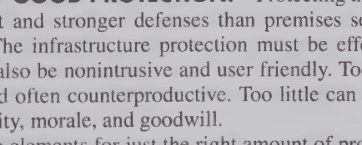

上图展示了 Cinder 与 Nova、Keystone 等组件的交互关系，数据流向清晰可见。

> 提示：生产环境建议将控制节点与存储节点分离部署，以保证性能和安全性。

## 23.6 保护物理信息基础设施

然而，了解安全系统和程序的人越多，这些系统就越容易受到攻击。通过胁迫或勒索，或通过不谨慎的言论无意中泄露信息，更容易破坏安全。掌握内部知识的人员可能包括经理、管理员、维护人员、用户、合作伙伴、供应商、客户、销售商和顾问。虽然许多人员必须至少了解部分安全防护措施，但没有人需要知道所有细节。

除了分段隔离之外，良好的保护还需要另一项预防措施。如果同一群体的成员必须共享敏感知识，则应适用“双人”规则——这是职责分离的一个例子。当任何人能够修改安全基础设施、警报或事件日志时，这一原则尤其重要。双人规则规定，对安全系统的任何修改都要求两名授权人员协同工作，并且始终存在审计跟踪，显示谁在何时做了什么。当两个或多个群体共同负责安全系统的公共元素时，也应使用此程序。

### 23.4.2 保密的详细设计

通常很容易让他人定位和识别关键基础设施组件。很多时候，这些信息清楚地显示在公开文件上。基础设施位置的标牌通常清楚地标明内部内容，而关键组件往往放置在局外人容易进入的空间。这些都是不安全的做法。

许多类型的文件明确指出信息系统区域、支持系统和其他基础设施。这些文件可能显示设备、布线、公用设施和电缆走向的位置。可能泄露敏感信息的文件包括显示楼层和办公室布局、家具、布线和设备位置的建筑平面图。建筑和工程文件、图纸和规格说明往往显示敏感信息。这些文件通常列出每个区域的功能，甚至居住者的姓名或职务。其他类型的文件也会破坏安全性。例如，竣工图、改造和施工计划、电气和通信布线图、配线架和交叉连接设置，以及合同图纸或建议书、施工图、安装计划、维护图，尤其是向规范合规和监管机构提交的文件。良好的保护要求所有此类文件都受到控制并安全存放。更好的是，应删除敏感信息，并显示与易于保密的图纸交叉引用的字母数字标识。

所有列出的文件通常都会分发给广泛的来源，例如感兴趣的承包商和投标人、供应商、供货商和维护服务提供商。建筑经理、房东以及房地产办公室通常都会将副本存档，许多其他人可以随时访问这些文件并复制。大多数此类文件都是公开可获取的，或者可以通过各州的阳光法、法院命令或仅仅通过欺骗手段获得。此外，许多合法获取或接收这些文件的人员没有内部文件控制或安全规定。

所有房间和区域标识应始终使用字母数字。任何区域都不应使用描述性或功能性名称。这一告诫适用于整个场所、设施的所有公共区域以及所有建筑机械和核心区域。功能性标识或术语，如“财务主管”、“市场总监”、“安保台”、“计算机房”、“网络间”或“电话间”等，绝不应出现。也不应给出任何居住者、部门或职能组或单个租户空间的名称。仅使用字母数字标识。

将区域和房间编号、功能区域或任何描述性名称相关联的列表应安全保存在上锁的文件中，设备机房图纸、配线架连接和布线计划也应如此。所有这些信息在系统故障或进行维护升级时，系统管理员必须随时可用，但仅限于“按需知密”原则。理想情况下，即使是管理人员也无法访问这些信息，除非有安全人员陪同。除了控制此类文件的访问，保持每份文件的最新状态也同样重要。

最后，安全人员应在信息发布之前审查所有施工、改造、设备迁移或任何其他物理变更的计划、图纸和文件。安全人员还应审查投标邀请函及所有图纸和规格说明，再次审查收到的报价，并持续审查整个项目过程中产生的每份竣工文件。内部安全部门应作为政策审查所有这些内容。如果安全人员没有足够的时间或专业知识来快速彻底地审查所有内容，外部独立专家可能很有价值。如果选择得当，这些专家可以提供广泛的经验、视角和尽职调查的证据，这样管理层以后就不会被指责在保护信息、人员或财产方面存在疏忽。最后，安全负责人应签署确认，没有项目文件违反任何内部安全政策。

### 23.4.3 保护基础设施的困难

几十年前，大多数信息系统设备都安放在一个单独的计算机机房内，大多数外部终端和外围设备都位于附近。电缆线路线路短，通常位于安全区域内，访问控制、警报和监控可以轻松覆盖关键区域。当时通常还有保安。但在那个年代，威胁情况较少，即使出现麻烦，代价也较低。当时许多组织漠不关心，安全措施松懈。他们很幸运，但确实发生过一些事件，而且往往代价高昂。可能还有许多未被发现的安全漏洞，以及更多从未被报告的事件。

如今，信息系统基础设施规模大得多，也复杂得多，潜在麻烦的代价也大得多。当今的基础设施相互依赖性强得多，包含了更多的设备和网络机房。它延伸到更多的电话和公用设施壁橱，并连接广泛多样的桌面、外围设备和远程节点。当今的基础设施越来越难以保护，未来的前景表明，更多可能造成重大业务中断的威胁情况将会出现。

进一步使安全复杂化的是，现在有更多样化的信息系统接口和复杂的基础设施需要保护。接口现在包括直接和交换布线、无线拓扑和红外耦合。互联网、局域网和广域网的接入现在可能使用金属布线和光纤、无线、卫星、电视电缆和微波链路的组合。其中一些接口将是专用的，其他是交换的，还有一些是临时接线的。即使只是定位所有接口也很困难，但每个接口都必须受到保护，它们的电缆线路和支撑它们的公用设施也必须受到保护。如今，来自安全警报和防御的早期预警必须非常有效，以便在大多数麻烦发生之前就加以预防。

### 23.4.4 良好安保的表象

武装堡垒的表象通常适得其反。这通常更多是威慑和妨碍访客及员工，而不是保护他们。过多的警卫和


## 23.8 保护物理信息基础设施

在内部区域入口处安排接待员以阻挡进入（除非被认为绝对必要）。此类屏障往往会激怒本已焦虑的人，并可能引发攻击。屏障往往无效；例如，即使玻璃防弹且防喷涂，传递孔很可能不是。大多数屏障也可能被突破，内部人员可能会受伤或至少受到创伤。例如，几年前大多数银行都急于将柜员安置在厚玻璃板后面。然而，他们很快发现玻璃引发了麻烦而非阻止麻烦。银行迅速拆除了玻璃和传递口，随后许多企业也购买并安装了它们，结果类似。愤怒和潜在暴力最好通过良好的设施设计、安全系统和访问控制，以及安全意识和暴力预防培训来避免。

还需考虑安全设备应隐蔽还是对所有人显而易见。显而易见的防御措施可以起到威慑作用并带来安全感，但它们本身也可能脆弱。摄像头可能被喷漆、射击或用棍棒击倒。任何暴露的布线（本身就是安全禁忌）都可能被剪断或射穿。替代方案是使用隐蔽设备，以及明显放置的诱饵设备或“蜜罐”。（两者稍后讨论。）

### 23.4.5 正确标识。

良好的安全需要能够迅速定位问题点，并确信每个组件、电缆和连接器的命名清晰且最新。必须对所有数据和电源电缆进行适当且一致的标识，无论是在安全区域内部还是外部。任何标签或标记都不应泄露机密信息。许多供应商、安装人员、合同人员和内部员工倾向于使用自己的标识和标记系统，其中一些清晰易懂，而另一些则不是。标识和标记还必须与文档、计划和图纸相匹配。敷衍的布线管理往往是常态，因为更改未被标记或记录，或布线被废弃且未拆除。内部人员、安装人员和维护人员的状况可能经常变化，进一步增加了误导和混淆的可能性。不可避免的结果是保护不力以及对安全事件的响应缓慢。存在公认的布线管理程序，整个信息基础设施应采用单一方法。尤其重要的是，所有授权人员必须理解并接受标识系统。

电信工业协会/电子工业联盟（TIA/EIA）发布了公认的权威标准，即 TIA/EIA 标准 606-B《电信基础设施管理标准》。⁹该标准描述了电缆、连接器、配线架、交叉连接和设备的标识。该标准还要求标识防火封堵、接地、专用接地电路和中性线。由国家消防协会出版的《国家电气规范》（NFPA 70）¹⁰也包括电缆和导管标识的标准。地方规范可能会补充国家规范。通常，任何重大改动、迁移或变更，以及通常所有新建工程都需要在整个场所完全遵守现行标准——这也是一项明智的安全投资。

### 23.4.6 可靠性与冗余。

可靠系统性能的首要条件是可靠的设备、系统和基础设施，并得到正确安装和维护。不幸的是，一些组件设计不良、质量控制不稳定、运输中受损或使用不当。许多设备现在都包含故障转移模式，以在发生故障时保持完整性能。

### 23.6 访问控制。

访问控制系统只是良好基础设施保护的一个层面。它们通常与监控和周界控制系统一起使用，以便提供足够的早期预警，在问题发生前将其制止。有效的访问控制需要三个层面的支持，接下来将描述。每个层面的强度及其与其他安全层面的整合决定了安全有效性。

- **特权。** 该层决定寻求进入的人是否被授权。这是初始进入请求过程，可能使用访问或接近卡、射频识别（RFID）钥匙或组合锁。由于许多这些设备可能丢失、借用、被盗或复制，并且许多设备可以迅速被破解，因此通常不会花费太多精力去确定究竟是谁在寻求进入。因此，仅凭特权并不是强有力安全措施。
- **身份验证。** 通常有必要以一定程度的确定性识别寻求进入的人。为此，该人必须拥有或知道他人难以复制的独特事物。示例包括个人识别号码（PINs）、电子钥匙、进入卡和生物识别设备。只要足够强且实施良好，也可以使用 PIN 和密码。其中一些方法仅加强了特权流程，但仍可能被复制或破解。
- **审计跟踪。** 每次进入尝试都需要记录日志，以显示日期和时间、人员的身份以及访问控制系统采取的行动。访问被拒绝和无法识别事件应触发立即警报。日志必须及时分析是否存在异常或不寻常模式。在需要更好访问控制的地方，每个人的离开也必须经过身份验证并记录。

有关访问控制中身份识别和身份验证的更多详细信息，请参阅第 28 章。

### 23.6.1 锁具与硬件。

强大的保护始于高质量的锁具、门硬件和访问控制系统，这些系统不具侵入性但足以阻止大多数未经授权的进入。锁的类型应难以撬开，并应使用难以复制的钥匙。示例是带凹点侧面的 Medeco® 锁和钥匙。Ace® 锁的圆形钥匙槽需要专用工具才能撬开。许多类型的钥匙可根据锁号制作，因此请妥善保管这些号码。

没有锁是完全安全的。拥有设备、经验和时间的人可以打开任何锁，通常非常迅速且不会引起注意。在使用钥匙总控的情况下，拥有任意一扇门的钥匙的经验丰富的人可以打开锁芯并复制总控系统。因此，需要额外的保护层。

仅少数人进入的内部区域通常可以用坚固的按钮式组合锁保护。钥匙锁不合适，因为在钥匙丢失或有人离职时，钥匙配置无法定期或快速更改。而且丢失或遗失的钥匙可能数天或数周后才会被报告。然而，钥匙锁往往更坚固且不易受破坏，因此钥匙可能是室外区域或营业时间保持开启的门的最佳替代方案。无论何时钥匙进入关键区域，都应在现场存放备用锁芯和一套新钥匙，以便在需要更改时能够迅速使用。一旦更换锁芯，旧锁芯应重新配钥并制作新钥匙。

### 23.6.8 入侵报警。

入侵报警对于提供周界和早期预警报警是必要的，通常作为额外的安全层。有几种入侵检测方法。带运动检测的数字监控摄像头最佳，因为它们可以目视监控正在发生的事情并记录所见。其他方法包括安装在周界墙壁或地板内或房间内不显眼位置的接近传感器和压力传感器。大多数这些传感器可以检测入侵和强行进入并能精确定位问题位置，但它们不提供细节、监控或证据记录功能。接近传感器和压力传感器可以经济地保护长距离周界、电缆线路和公用设施。同心层级的此类设备对于提供足够的早期预警以防止问题发生是必要的。

最佳运动探测器使用数字闭路电视（CCTV）监控摄像头，可在观察和记录事件的同时感知运动。不显眼或隐蔽的微型摄像头特别有效且价格日益低廉。多个摄像头可以从多个角度记录图像，并且通常可以明确识别入侵者。在较大区域，摄像头通常使用可旋转倾斜支架和变焦镜头，这些也可以自动和远程控制。彩色摄像头更受欢迎，能够自动适应光线条件的摄像头也很受欢迎，包括近乎黑暗。

一些 CCTV 摄像头包括军用型夜视模式，相对便宜且在近乎全黑环境中功能良好。这些摄像头在正常光线下也能良好工作，并在必要时可自动切换到夜视模式以清晰观看并记录证据。其他类型的摄像头，如红外摄像头，在没有（人类）可见光的地方工作良好。

其他入侵探测器使用雷达技术或测量电容或电感的变化来感知入侵。大多数摄像头和探测器在被禁用或断电时即可触发警报。探测器可能作为明显的威慑手段安装在墙上或天花板上，但随后可能易受喷漆、剪线钳、枪支或棍棒攻击。因此，入侵检测传感器通常是隐蔽的，至少是不显眼的。

周界报警在建筑核心区域或建筑物内外公共区域尤其重要，以提供充足的早期预警，防止可能很快影响安全区域的入侵。数字视频摄像头对此最佳，但在大面积或长距离上可能无效。因此，许多接近设备用于监控入侵。大多数使用长传感器线，这些线不显眼地表面安装或隐藏在隔板、天花板内，有时在导管内部。这些系统检测到站立的成年人或大型动物接近传感器线几英尺内的存在。传感器线可以很长，因此通常需要分区以至少将事件定位到大致位置。

更好且更便宜的替代方案可以是光纤周界报警。光纤系统专为军事和国家安全设施开发，非常灵敏，可以监控、评估和记录事件。传感器线也可以嵌入石膏板或砖石隔板、天花板、地板或导管内，并可检测压力变化和环境声音。由于它们不测量接近距离并且可以监控和评估事件，误报可能性较小。它们可以警告即将发生的事故或强行进入的企图，并且可能很快能够定位事件。这些系统使用软件来区分已识别事件和未知或潜在危险的情况。所有事件都被记录下来，可随时由远程操作员回放和审查。


如果防护设计得当，摄像头能够提供无可争辩、准确且随时可用的历史记录。摄像头从不睡眠，也不会因重复性任务或枯燥而分心。更重要的是，摄像头能够提供早期预警，并能从多个视角同时、同步地记录事件。摄像头日益配备麦克风，并与紧急音频对讲机接口，以便更好地评估局势、帮助现场人员或质问可疑人员。可见但难以接近的摄像头本身通常就能震慑大多数捣乱者。保护基础设施既需要早期预警，也需要在麻烦发生之前识别其性质。新的监控系统能够有效做到这一点。它们还可以与其他报警器和场所安保系统集成，提供强大而无缝的保护。

## 23.7.1 监控摄像头。

监控摄像头比保安、看守或额外的前台接待员有效得多，而且成本低得多。然而，要在重要地点实现强大、冗余且灵活的安保防护，摄像头和人员都是必需的。

监控能力正日益成为有效的防护手段。它们现在能看得更多，能探测某些危险隐藏物质，并且越来越多地能判断哪些内容值得监控。

设备机房和其他敏感区域过去依靠移动探测器进行安保，但现在带移动侦测功能的数码摄像头效果更好。数码摄像头在室内外以及大多数光照条件下都能良好工作，从阳光直射镜头到近乎完全黑暗（即便不是完全黑暗）的环境。在室外使用时，除极恶劣天气外，数码摄像头不受影响。然而，浓烟、雪、冰和雨会影响它们。风吹动的物体，有时甚至是鸟类或小动物，都可能干扰其移动侦测系统。

当今的数字系统远比早先的模拟或胶片摄像头功能强大且可靠。摄像头曾经是薄弱环节，因为细节不清晰或过于微小。过去需要许多旧摄像头才能覆盖一个区域，而且即便如此，必要的细节常常失焦。现在摄像头体积更小、价格更低，并利用自动对焦、倾斜和变焦功能拍出更好的画面。如今几乎所有摄像头也都采用彩色以提升清晰度。有些还集成了廉价的黑白夜视模式，在完全黑暗中也能良好工作。数字摄像头会自动通过电子和机械方式校正变化的环境光照条件。大多数还能校正会导致主体曝光不足的背景光照、直射镜头的阳光，以及会使有用图像泛白的异常亮度。所有图像均可实时查看，一人或多人可同时控制视角，并可回滚以定格和放大画面。所有查看者都可以调整亮度、对比度、色彩和变焦，并可应用滤镜来凸显模糊的细节。任何查看者都可以保存所看到的任何内容。

现在，除最小的室内摄像头外，所有摄像头都内置麦克风，因此视频和音频都会被记录。在设施外部，一些安装会与紧急对讲机连接，从而持续监控背景声音并记录对话。紧急对讲机是特别有效的威慑手段，因为安保人员可以直面可能的捣乱者，并告知他们正在被录音录像。大多数捣乱者会在麻烦发生前退缩或逃跑。尽管许多摄像头控制系统提供电子变焦，但主要的变焦功能应来自机械变焦。电子变焦系统价格低廉，但会损失分辨率，图像可能很快变得难以辨认。

微型摄像头可能特别有用，而且还能省钱。直径不到一英寸的摄像头即可提供清晰的细节。一些配备变焦镜头以及云台和倾斜支架的设备可以隐藏在任何常见物体中。

关于使用隐蔽摄像头的伦理问题意见不一，一些州法律将其使用限制为侵犯隐私。一般来说，良好监控实践的规则与监控电话通话、电子邮件和互联网使用相同。为了保护自身，组织有权查看和听取其场所内外发生的一切。但应张贴标志，告知员工和公众：进入场所的所有人员可能出于安全和安保目的受到监控。公司政策应解释这一点以及监控的必要性。

## 23.7.2 摄像头位置与安装。

为了起到威慑作用，一些摄像头应当易于看到，但这可能带来一些问题。安装过高的明装摄像头不利于识别人员，而安装过低的摄像头可能被喷漆、遮挡或砸毁。任何可见摄像头都可能被枪击破坏（或许使用消音器而不被发现）。较旧的摄像头适合明装使用，因为它们体积大，可能提供备用监控。另一种选择是假摄像头，其中一些有可见的指示灯或自动旋转以吸引注意。一些假摄像头实际上是报警器，如果设备被干扰或其线缆被切断，就会触发报警。

广域监控需要高架摄像头，以便看得更远、放大细节（尤其是面部和车辆牌照），并密切跟踪事件。广角视野对于发现多名捣乱者也必不可少。可能需要多个摄像角度才能收集到良好的证据。

室外摄像头通常安装在旋转、倾斜支架上，并且当需要大变焦镜头时，会安装在防风雨球罩或更大的外壳内。通常不会试图隐藏，因为摄像头太高无法触及，而且它们也能提供良好的威慑。然而，许多摄像头可能不显眼，甚至经过伪装。当使用大型摄像头和外壳时，摄像头的朝向可能很明显。捣乱者常常会制造干扰，将摄像头引离真正的问题。

## 23.7.3 记录系统。

曾经录像机（VCR）是标准，但现在大多数记录由硬盘完成，硬盘可以存储来自多个来源的数百小时音频和视频。固态硬盘也越来越常用。

过去，只有一个人可以查看录像带，而且通常只能在录制完成后进行。现在，一人或多人可以同时访问和分析信息。过去，每个系统建议配备31盘录像带：一个月中每天一盘，使用后检查并重新使用。现在，一块硬盘可以记录一个月的数据，之后可以廉价地存档到DVD或远程存储位置。录像机通常以延时模式录制以节省磁带，直到事件发生触发实时录制。现在，所有内容都可以实时连续记录，以全面检查事件发生前、期间和之后的情况。

## 23.7.4 摄像头控制系统。

摄像头控制系统通常可以控制每台摄像头的旋转（云台）、倾斜、机械变焦、光圈和背景照明。一些控制系统可以自动在大型观看区域来回旋转摄像头，并提供移动侦测。一些控制系统

如果无法将所有基础设施与所有液体和危险材料保持安全距离，就必须采取特殊保护和报警措施。保护措施包括密封防水结构、排水沟、护堤或其他导流装置，以及随手可得的适当材料以控制任何泄漏。在可能发生泄漏或溢出的地方附近应设置环境报警传感器。地漏也必须保护设备区域，尤其是使用喷淋系统的区域；否则清理将很困难。

基础设施站点不应从任何公共区域可见或可进入。基础设施布线或电缆不应穿过建筑核心、公共区域或机房区域，包括洗手间、污水池、清洁工具间和楼梯间。避免将设备或电缆放置在任何可能有人逗留的地方。所有设备机房的入口应能从工作场所清晰看到，以便员工随时观察到所有进出。选择本质上安全的站点和入口可大幅降低风险和成本，因为所需安保较少。

为了有效的安全控制，每个关键区域应只有一个出入口，用于进入和离开。但是，如果当地消防或建筑规范要求第二逃生通道，通常可接受延迟出口的紧急推杆锁。这种系统会延迟几秒释放出口锁，同时警报响起并触发监控摄像头。在所有受保护区域还应安装带移动侦测的监控摄像头。所有上锁的门从外部看起来应尽可能相似，并且只能通过类似其他场所门的房间号来识别。不应显示任何功能名称、人员姓名或头衔，也不应有任何其他方式可识别上锁区域内部的情况。任何标牌或指示牌都不应包含功能、个人或部门名称，只能包含区域或房间号以及必要的方向箭头。场所标牌和地板上只能显示楼层、房间或套间号。

## 23.8.2 物理访问。

应控制对设施场地的访问。入口处的警卫站无法阻止恐怖分子，但它们可以提供麻烦的早期预警。所有这些站点都应处于持续监控之下，并安装紧急按钮，以便在场地入口出现问题时向安保团队发出紧急通知。

钢筋混凝土护柱可以通过干扰普通车辆（如轿车、厢式货车和轻型卡车）的高速撞击来防止对建筑物的物理攻击。它们不一定能防止使用被征用的大型车辆（如装载的自卸卡车）进行的攻击。

建筑物入口不应设有大型玻璃墙，因为玻璃墙容易被摧毁，从而进入门厅引爆炸弹。

应限制对信息基础设施所有部分的物理访问。所有信息系统和网络设备必须位于始终上锁的设备机房内，并且只有需要进入的人员才能进入。所有公用设施和布线间、配电盘、配线架、接线块和终端都应位于始终上锁的设备机房内。如有可能，不要让无关系统、设备或公用设施进入受限区域，这样在无关系统上工作的技术人员就无法访问信息基础设施。如果无法避免，IS人员应始终陪同其他人员进入这些区域。在高安全区域，所有进入者都应有人陪同，或采用双人互信小组，由两人互相监督。警卫和设施安保人员是良好的场所安保陪同，但可能不了解基础设施，因此不是这里的最佳选择。IS人员是更好的陪同人员，即使他们可能

不知道所有安全细节。无论如何，所有进入的人都必须被明确识别，并且每次访问都要记录。

将关键配电盘放在设备间内是明智之举，这样既便于快速访问，也能得到保护。这也是一个安全问题；操作设备或线路的人员可以很容易地看到断路器是否处于关闭状态。否则，配电盘应放置在带锁的区域，除编码位置编号外，外部无任何标记。在许多建筑物中，配电盘常位于公共区域；此时必须将它们安全锁好并设置报警。只要配电盘控制任何关键设备，该区域的访问应受到限制，房间内应设置报警。这些预防措施可减少关键系统因意外或故意导致的断电损失。

在设施安全培训课程中使用的案例之一是，一名物理安全专家在医院公共走廊发现了一个未上锁的配线架；重症监护病房（ICU）主任惊恐地意识到，控制ICU患者生命支持设备的断路器对任何儿童或恶意人员都是敞开的。

安全通道是控制关键设备室访问的最佳方式。安全通道是一种两门结构，设有内门、外门以及中间的短走廊。两扇门互锁；一扇门必须关闭后才能打开另一扇。走廊通常在一侧或两侧建造防碎的全高玻璃隔断（通常是单向玻璃），用于监视。两扇门通常都没有窗户。每扇门都必须配备强大的访问控制系统。但为了安全，通常可从走廊内部使用带报警的紧急出口推杆打开外门。通常，会安装一个或多个监控摄像头，以识别进出安全通道的人员。

强烈建议在安全通道走廊内以及出入口处安装紧急对讲机。显眼的胁迫/求助按钮应静默启动，以便安保人员能够监视该区域，并与无法正常通过的人对话或对其进行盘问。报警最好是静默的，以免处于胁迫之下的人受到进一步威胁。紧急对讲机通常包括不显眼或隐藏的小型摄像头，以便安保人员能看到正在发生的情况，在有人生病或意外被困时提供帮助，并避免公共安全问题。设计良好的安全通道对所有场所都有价值，但人流密集的入口除外。

安全通道可以在许多方面加强安全，而且通常不会造成干扰。它们可以检测尾随行为，即一个或多个额外人员紧随获准进入者的情况。安全通道本身并不能防止门被撑开，但会使从房间内搬走物品变得困难和危险。访问控制日志和监控录像可以识别寻衅滋事者，并提供有力证据来定罪那些原本可能是嫌疑人或身份不明的人。

### 23.8.3 防护性建筑

新建筑的设计可以改善物理安全性。

- 避免使用脆弱的施工方法，例如在地面层的大面积开放空间中使用结构柱；用炸药破坏这些柱子可能对建筑物的结构完整性造成严重损害。
- 不要让建筑师在建筑物外部设置装饰性凹槽；此类垂直图案可能为攀爬攻击者轻松攀爬墙壁提供便利。
- 将所有信息系统（IS）放置在加固、隔离的区域。

设备间需要坚固的隔墙，以确保良好的安全性，并支撑布线和设备的相当重量。此外，隔墙和墙壁必须在地震活动（如繁忙道路交通、音爆、爆炸或地动）中保持安全稳定。地板可能也需要加固。坚固的隔墙可阻止强行闯入，否则闯入者仅凭一把小刀和拳头就可能进入。现有的墙壁、隔墙和地板应接受检查，任何后续改动都需经过结构工程师批准。还要考虑长远未来的需要；日后改动可能代价高昂或完全不切实际。

顾名思义，窗户不是坚固的隔墙。应避免非安保人员向建筑师施压而设置大窗户，从而让人看到内部并可能导致闯入安全区域。允许无限制地看到运营中心内部，可能使不法分子仅通过观察就能了解到超出其应知范围的人员、程序和日程信息。

安全门也应当坚固。它们应是金属的、防火级的、相对沉重，并采用重型五金件。尽量不要让受控门因独特外观而引人注意。如果许多有人区域使用木门，安全门不应显得突兀。应使用木面金属门和与其他门外观相似的五金件。有时，通往无关紧要处的看似安全的假门被用来迷惑他人，或作为带报警的蜜罐，将寻衅滋事者引离安全区域。

建造良好的隔墙和天花板还能在内部火灾发生时封住烟雾、限制烟雾扩散。建议在每扇门周围安装密封条，以阻挡灰尘、污染物和湿气，并阻隔烟雾。

如果可能，必须穿过门内的布线应布置在铰链内部，以便任何时候都看不到电线。裸露的电线可能因意外、切割或多种方式受损。主要铰链制造商可提供特殊铰链，以隐藏大多数布线，并与场所其他五金件的外观相匹配。

除非有特殊的结构要求或非常高的安全要求，否则通常不需要砖石隔墙。带金属立柱的石膏板隔墙通常就足够了，但应格外坚固。建议使用厚度至少为四分之三英寸的Type-X防火石膏板。更好的是使用双层半英寸或5/8英寸厚的板材。现有的石膏板隔墙可以很容易地加装双层板以增强安全性和强度。砖石隔墙，尤其是石膏板隔墙，通常表面覆盖坚固的防火胶合板，用于安装设备支架和布线。胶合板是否安装在支架上以便线缆可在板后布放，这是个人偏好问题。通常，在安全区域内将所有布线暴露安装更为高效。

任何设备间都不应使用吊顶。吊顶只会增加成本、带来不便，并减小房间的体积。吊顶上方静压空间是火灾隐患，内部所有物品（包括任何暴露的电缆）都必须满足防火等级，这增加了不必要的成本。大多数建筑规范要求在每个静压空间内设置独立的火灾探测区和灭火喷头，这是一笔巨大开销。拆除任何吊顶，可以为电缆腾出更多可用空间，改善空气流通，并简化维护。

出于同样的原因，应避免使用高架地板。它们非常昂贵，对大多数安装来说在功能上没有必要性，还会为坡道占用额外地面空间。与吊顶一样，高架地板会形成静压空间，需要独立的火灾探测区和灭火喷头。高架地板通常会限制天花板高度，因为空间并非为此而设计，因此必须扩大房间才能容纳一切。

仅由贯穿整个线管长度的传感器线保护。机械压力传感器可检测异常振动，而接近传感器指示电缆或线管周围磁或电子环境的变化。较新的系统利用光纤传感器监测声压。其中一些系统足够智能，能够区分常规无害事件与可能的麻烦，而且许多系统还能大致定位。有时线管本身即传感器，或外部导线附着在线管上，但这些方法往往无效。

### 23.8.4 利用现有场所报警系统

各种规范要求工作场所配备可见和可听的火灾报警器。而且大多数工作场所还配备语音广播、紧急对讲、监控和场所安全系统。所有这些设备都可以有效利用，以增强和支持信息基础设施安全。当现场人员必须立即采取行动（如封锁或疏散）时，使用有声报警。相反，静音报警提供早期预警，使安保人员能够谨慎监视现场、收集证据，并根据需要做出响应和协助。所有这些报警都可以集成到基础设施保护系统中，以提供更好的早期预警和额外保护层。

所有报警和警报都应传送至中央安全台或守卫站。其目的是记录和管理事件响应、快速召唤支援、监视现场、积累证据，并支持所有响应资源。当威胁级联或多个事件发生时（这很常见），集中管理尤其必要。安全管理人员、信息系统管理人员、基础设施安全管理人员以及关键部门负责人也应立即收到通知。其中一些人可能不在现场或在偏远地点，但至少需要与运营中心有效沟通。通知和后续通信应快速、私密、安全，并加以记录以记录事件。一个或多个在线备用安全控制与运营中心可提供冗余、支持和援助，以及强大的安全性。

一种有效的全场所警报方法是通过寻呼系统广播语音代码。这些代码通常有脚本，且常常预先录制，以便自动、远程或手动启动警报。医院使用颜色命名代码来有效实现这一点，这相当于静音警报，对公众来说并不显得异常。大型组织中有效的警报代码系统也使用虚构人物姓名。在规模较小的场所（如学校），所有人员姓名众所周知，可以向某人发送要求其执行无害行动的警报消息，而该消息被理解为警报代码。消息中的额外字母数字信息可标识事件的大致位置。与医院一样，最好为其他常规目的添加类似代码，以便公众通常会忽略所有寻呼。该系统在暴力威胁或已经爆发时尤其有用。

尽管大多数安保人员现在配备便携式对讲机，但可能存在许多无信号区域，而且很少有人使用耳机，以免其他人轻易听到正在发生的事。然而，当麻烦初现时，所有安保人员必须立即知晓，并且必须以不致惊动他人的方式得到警报。此外，场所内的每个人都需要知道何时发生紧急威胁。事实上，每个人都有权依法知晓并立即收到有关自身安全的指示。任何达不到这一要求的做法都将导致相当大的责任。因此，有效的程序、清晰简单的指示、充分的准备和定期培训可以保护每个人并提供强有力的安全保障。


移动电话的广泛普及为紧急通知增添了另一种渠道。利用短消息服务（SMS）发送文本消息，即可向员工通报紧急情况。安全人员可通过计算机生成的消息乃至手动消息，快速便捷地联系到许多参与应急响应的人员。若电话设置为针对此类消息使用特定铃声，且这些电话一般不用于日常闲聊，那么上述安排可作为其他通知方式的有益补充。

## 23.8.5 清洁电力

保护电子设备需要持续清洁的电源。清洁电力通常指幅度和波形变化均受到严格限制的交流电。停电和电压暂降（低电压状态）会引发明显的麻烦，但还有众多其他干扰可能扰乱或损坏信息基础设施，其中包括电压跌落与骤降、尖峰、暂态，以及磁干扰或射频干扰。这些干扰大多是间歇性的，不一定会在线路测试时出现。理解每个术语的含义固然重要，但更重要的是认识到各种电力问题会毫无征兆地随机出现于电力线路中。

电压暂降尤为有害。电力公司降低电压会导致空调设备、冷却水泵和通风系统发生故障或停机。相关设备若不迅速关闭或切换至不间断电源或电动发电机组，就可能遭到损坏。

几乎没有哪种电力干扰会立即摧毁电路或导致系统崩溃，但大多数都会造成累积性损坏。每一次干扰都会削弱电子电路，使其最终在无明显原因的情况下失效。由于这种累积效应未被察觉，设备质量差便常常成为替罪羊。更糟糕的是，更换后的设备很可能很快又会出故障。

可对电力干扰进行测量，以确定特定电路是否清洁。通常，需将记录设备连续放置至少一周，以测量并记录发生的每一个事件的详情。（切勿使用那种只记录未命名事件而不提供任何细节的测试仪器。）聘请不属于供应商的独立工程师进行测试，最有可能获得客观、全面且覆盖整个设施的测试结果。

某些电路可能因附近或建筑物内部的干扰源（有时是线路接线错误）而出现间歇性干扰。了解哪些电力问题来自主供电线路，有助于判断故障是否出在电力公司一方，并确定建筑物内其他干扰的源头何在。电力干扰的原因可能确实很多，而且都可能是间歇性的，这正是建议连续七天、每天24小时监测的最低标准的原因。

另一个重大的电气问题是接地不当，这会损坏敏感设备并引起电缆干扰。电工必须遵守国家和地方的电气规范，但未必了解或提供敏感信息系统平台所需的特殊接地措施。大多数重型设备制造商要求每台设备都有独立的接地连接，并以专用导线一路接回建筑物的中央接地母线。少数制造商在被索取时才提供安装规范，而有些安装商为保持价格竞争力而对其置之不理。

对于信息系统的最佳建筑物接地配置，各方意见不一，且由于现场条件可能差别很大，没有哪种方案能适用于所有情况。明智的做法是咨询独立工程师来检查接地配置，并就当地规范合规性提供建议和认证。为所有信息系统设备提供独立电路同样重要，而且设备插入的插座应只有一个插孔，而非双联插座。对于所有可能汲取大电流的设备（尤其是负载可能反复通断的设备），通常需要配备独立的断路器。规范要求大型电机（如水泵、空调和电梯）必须如此，因为它们的通断循环会在其他分支电路上产生脏电。但复印机和大型激光打印机（尤其是较老的机型）在启动时以及定影加热器循环工作时，也可能产生电气干扰。所有类型的照明灯具在大量灯具同时开启或关闭时，都可能导致电压跌落或骤升。（采用电子镇流器的新型荧光灯具可节省电力，且造成的干扰小得多。）独立电路连接可在一定程度上将火线和零线与其它电路隔离，但干扰仍可能通过接地连接产生，因为这些接地连接为了降低成本，常常与许多其它电路菊花链式地串在一起。

切勿让以下设备共享专用电路，因为它们很容易干扰并损坏电子设备：时间戳机、电动订书机、咖啡壶、冰箱、加热器、风扇，或任何其他带有电机或螺线管的设备。即使不易触及，专用插座也应为单联插座，而非双联插座。吸尘器、电动工具或维护设备实在太容易使用双联插座的另一半了。这会造成严重干扰，并可能使断路器跳闸。必须为所有非关键需求配备大量易于使用的便利插座。

电力问题的另一个来源是过度的太阳活动。这类事件只有在发生时才能被观测到，而它们会在一个难以预测的几年周期内随机出现，大约每11年达到峰值。太阳干扰只在白天发生。1988年曾出现强烈的太阳活动，导致加拿大蒙特利尔发生重大停电和无线电干扰。每日太阳活动报告、预报、图片和历史记录可在 www.dxlc.com/solar 及其他网站获取。（另见第22.6.7节。）

当怀疑存在、遇到甚至可能发生电力干扰时，有若干补救方案可供选择。

- 1. 在配电盘处消除问题。改善接地、增加独立电路、安装电涌抑制器、滤波器和隔离变压器可能会有所帮助。但此类补救措施可能实施困难、成本高昂或效果不可靠。
- 2. 在受保护设备附近使用电涌抑制器。这种方法成本低廉，但对电压暂降、停电和严重干扰却无能为力。
- 3. 为每台关键基础设施设备配备不间断电源（UPS），由电池提供后备电力。一种UPS仅在输入电源中断时才被激活，但其电池始终处于充电状态。更好的一种UPS始终在线，能过滤输入电力、抑制大多数电涌、补偿轻微的电压暂降，并在停电后维持系统满负荷运行5至10分钟——足以完成有序关机。第三种也是最好的一种UPS，其负载始终由电池供电，从而将负载与电力线路隔离，提供最优保护。
- 4. 对于功耗较高的系统，电动发电机组（MG）可消除大多数电力问题。MG机组由市电驱动的电动机组成，该电动机与一台发电机耦合，持续为负载提供清洁电力。发电机通常具有自动电压调节功能，但频率可能有所波动，这或许会干扰某些定时电路。通常，若发生停电，机组的机械惯性所储存的能量足以支持设备有序关机。电动发电机组至今仍用于终极的滤波和稳压，但必须配备电气旁路以便于维护。

UPS设备应为服务器、网络和电话设备、计算机及关键监视器供电并提供保护。大多数UPS设备提供的插座不具备后备电力，但具有噪声抑制功能，可供打印机、变压器“砖块”、传真机以及其他无需持续运行的周边设备使用。这些设备大多可有可无，若其中一台损坏，可迅速用备用设备替换。

单个UPS设备放置在受保护设备附近，成本较低，操作人员可将其关闭，从而更好地保护可能易受攻击的设备——即使这些设备已关机也是如此。这可在可能遭受雷击的情况下提供额外一层保护。较大的UPS设备用于设备机房，同时还可持续监控并记录所有电力事件，并触发远程报警指示。大多数优质UPS设备在停电、UPS电池电量不足或有人手动干预时，能够自动启动设备关机。然而，有时也存在一个问题：某些受保护设备必须等到UPS电池完全充电后才能重新启动。一些UPS设备还能接入网络，可将自身状态上报至远程位置。

许多UPS设备还提供电话线和以太网线滤波与抑制功能，若可能，应尽量使用这些功能。通过通信线路传导的雷电很容易损坏电话机和调制解调器。电力和通信线路的尖峰可能不对称地出现，并能摧毁那些仅凭单一干扰本不会损坏的设备。具备通信线路抑制功能的优质UPS设备最能同时阻止这两类尖峰。

UPS设备的另一个好处是：当应急发电机投入运行时，电力通常会比平时“脏”得多。UPS设备提供的额外滤波和稳压，可能是信息系统设备正常运转还是崩溃的关键。

## 23.8.6 应急电源

在出现任何电力问题期间，大多数关键系统和基础设施都必须保持完全正常运行。滤波器和电涌抑制器无法弥补停电、应对大多数电压暂降，或处理重大电气干扰。干扰可能来自雷电（即使距离远到看不见也听不到）、剧烈太阳活动，或破坏市电的射频干扰。UPS设备可以应对其中部分情况，但持续时间有限。因此，在持续供电问题期间，备用应急发电机可能是维持运营的唯一途径。

虽然备用发电机往往是唯一选择，但它并非万能灵药。发电机安装成本高且复杂，至少需要每月试机运行，而且并非总是可靠。其电压调节能力有限；负载骤变时，输出电压和频率也可能出现波动。随着负载增加，所汲取的电流也随之增大；若发电机过载，电压将下降，频率可能降至60赫兹以下（这会扰乱信息系统定时电路）。由于负载电流为满足功率需求而增大，被供电设备产生的热量将按电流的平方增加。所供电的信息系统设备多为感性负载，开启或重启时可能存在很大的启动浪涌电流。因此，发电机必须具备充足的备用容量。


另一个最近的例子涉及某州的应急行动指挥中心，该中心的设计目标是无论发生任何事件，都能保持安全并全面运作。一台大型发电机为所有关键系统供电。一切都经过了多次测试，并如预期般平稳运行。但随后，附近的一场大雷暴带来了麻烦。城市大部分地区的电力闪烁了几次，然后恢复正常。然而，发电机在第一次出现故障迹象时就尝试启动，却在电力恢复时出现失误。几秒钟后，当电力再次闪烁时，发电机系统已损坏，无法启动。该州很幸运当时不需要这台发电机，但它却停运了好几天进行维修。

大多数停电始于闪烁和瞬时断电，这可能会使设置不当的发电机系统瘫痪。大多数关键任务发电机都设置为自动启动引擎，并且许多发电机在达到额定转速后立即自动切换电源。如果有训练有素的人员随时可用，手动启动和切换则更可靠且更经济。以下是自动操作顺序的最佳方式。

- 1. 在第一次启动信号后，启动顺序必须持续到引擎启动、出现启动失败超时或手动终止该顺序为止。
- 2. 直到发电机完全达到额定转速、处于可靠的工作温度且市电不可用时，才会切换电源。切换前应满足这三个条件，也可以设置手动超控。
- 3. 所有切换回市电以及关闭发电机的操作都应手动完成。最好还能将每个电路单独切换到市电。

无数关键备用发电机未能按预期运行的例子不胜枚举。以下是一些建议，用于确定是否需要发电机来保护信息系统，以及如何高效且经济地使用发电机。

- 调查为场所供电的公用事业馈线的停电历史。电力公司通常能提供这些数据；如果不能，州公用事业委员会通常也可以。一定要询问术语是如何定义的，因为“停电”可能仅指持续数分钟以上的中断。还要询问是否有更可靠的馈线。两端供电的环形馈线更可靠，通常为关键设备供电。询问配电变压器是否能隔离和过滤电力扰动，是否也能调节输入电压，如果可以，规格参数是什么。

- 找出还有哪些客户共用相同的馈线，并拜访他们以了解其经验，并确定他们是否使用重型机械。虽然可能有一些保护措施，而且对公用事业客户来说可能花费很少或零成本，但过去的历史并不总是未来的可靠指南。随着更多重型负荷的接入，配电网也会发生变化。如今，长时间电力问题的威胁远比过去更大，并且正在迅速增加。UPS设备、电动发电机组和备用发电机在关键任务应用中可能都是必需的。

- 确定哪些IS基础设施组件需要应急发电机的备用电源。大多数关键信息系统、设备、网络和基础设施必须始终保持最佳性能。因此，所有负载必须同时启动，而平均运行负载将略低于各部分的总和。尽管如此，明智的做法是提供最大额定负载，并留出额外的备用容量以提高可靠性和未来扩展。发电机容量留有余地有几个原因。当电源首次切换到发电机时，初始浪涌的总和可能远远超过预期负载。所有UPS单元和其他电池供电设备将开始充电，所有设备电机可能同时汲取其最大浪涌电流。额外的发电机容量可确保更平稳的切换、更好的电压调节，并提高系统可靠性。

大多数大型发电机产生三相电。三个输出中的每一相都应保持平衡，以便每条“相线”消耗大致相同的功率。为此，重型电机、由一个开关控制的多组灯具以及其他产生浪涌的设备可能必须分配到三相上。配电盘上的现有布线可能需要进行更改以平衡各相。最好能预留一相用于为关键单相电子系统提供纯净电力，但这并非总是可行。平衡每一相是一项棘手的工作，最好在独立工程师的咨询下进行。

如前所述，应尽可能多地让发电机供电的电子系统也受到UPS单元的保护，尽管这会增加发电机的负载。在发电机负载切换和不断变化时，会出现较大的电压浪涌、跌落、骤降和过电压情况。由于无法隔离有电气噪声的电机和照明设备，电源干扰会大得多。UPS单元还应包括噪声抑制和电压调节功能。即便如此，IS设备仍将承受压力，甚至可能发生故障。

选择发电机的位置是下一个挑战。选择包括屋顶或建筑退台、场所内部或室外。每个地点都有优点和障碍。室外发电机可能是最容易且最便宜安装的，但运行成本也更高。室外发电机噪音大，通常不美观，容易遭到人为破坏，当地法规也可能对其加以限制。当位于室外时，需要防风雨外壳来保护发动机、发电机和油箱。大多数室外使用的发动机需要保持加热，这可能成为高昂的间接费用。噪音是另一个问题，附近的人可能会反对。使用优质消音器并获得附近业主和其他租户的书面许可非常重要。室外机组应设置围栏，并留有足够的维护和加油空间。如果可能，最好建一个发电机棚，但这并不能减少对加热和优质消音器的需求。整个安装应安全锁定，并通过开门报警器和移动探测器加以保护，并处于监控摄像头的视野内。泛光灯可以威慑人为破坏行为，也有助于加油。

屋顶或建筑退台上的发电机会带来其他问题，这些安装也可能受到当地建筑规范的限制。第一个问题是重量。可能需要进行结构加固。下一个问题是将设备安装到位，这可能需要起重机或有执照的索具工。很少有建筑电梯能通到屋顶，即使拆解后的发电机部件，它们也可能无法承载。所有发电机部件可能必须在建筑外部用索具吊装，或由人力搬运通过消防楼梯。

安装在建筑退台上的发电机需要专门的检修门，而在成品地板上移动重型设备时，需要在脚轮下方铺设厚木板和地板保护材料（例如美耐板或胶合板），以避免严重损坏地板。屋顶或退台上必须有足够的空间来安全加油和维护发电机。噪音通常是一个问题，振动也是如此。

室内安装既有利也有弊。有时可行的室内位置是底层一个带供暖的车库式房间，配有标准车库门，在发电机运行时打开。这种布置很好，因为它不显眼、防火、易于保护，并且便于加油和维护。而且，如果发电机发生故障，可以轻松挂接一个拖车式机组。

室内发电机可能被建筑规范或消防规范禁止。需要大房间来便于加油和维护，还需要大型通风系统来散发大量发动机热量。发动机废气可以经过良好消音并管道排出室外，而发动机进气则从室外导入。房间的供暖和通风必须针对炎热和寒冷天气进行正确设计。房间必须防火、隔音，并配备火灾报警器和使用化学药剂或防冻干式喷头的灭火系统。地板可能需要加固和振动隔离器。建议设置地漏，且必须获得环保部门的批准。

室内安装有诸多优点。发电机及其燃料可以很容易地保持温暖。启动更容易、更可靠。加油更容易，无需经受风雨。燃料中进水的可能性更小，而进水对柴油发动机可能是致命的，维护也容易得多。

建筑安装的问题包括建筑规范只允许使用小型日用油箱。每隔几小时，就必须携带大量燃料进入，以保持发电机运行。大多数建筑内不能储存燃料，而且电梯可能无法运行或无法用于帮助运送燃料罐。

应急发电机可使用多种燃料。柴油效率最高，柴油发动机可以连续运行数天，但很难启动，尤其是在寒冷天气下，并且无法手动摇动曲轴启动。家庭取暖油与柴油基本相同，在柴油不可用时可以随时替代，但这需要额外的燃料过滤。

如果使用液体燃料，油箱应始终保持满油以避免冷凝。燃料添加剂可防止胶质形成并帮助启动。确保所有柴油都经过处理以适应寒冷气候。炼油厂通常只在冬季进行这种处理，但未经处理的柴油在接近冰点的温度下会变成凝胶状，无法流动。绝不允许经销商用煤油“稀释”柴油，因为煤油具有腐蚀性。柴油还需要添加剂，以避免积聚细菌堵塞燃油管路。应准备经OSHA批准的清洁材料，以备将来发生溢出或渗漏。

天然气或丙烷是最方便的燃料。任何一种都可以免除日用油箱和加油。这类发动机污染最少，启动容易得多，无需预热，并且可以手摇启动。但大多数并非为长期连续运行而设计。许多建筑规范禁止使用汽油发动机，除小型便携式发电机外很少使用。汽油在搬运和储存上危险得多，汽油发动机在重负载下表现不佳。

持续监控发动机油位，并准备在需要时立即添加机油。大多数发电机在油位低时自动停机。有些在过热时也会停机。任何意外的发电机停机都可能是灾难性的，因此要密切监控故障的早期预警信号。

一旦确定了所需的发电机尺寸和类型，还有其他考虑因素：

- 自动发动机控制和负载转换开关可能不可靠，并可能造成损坏。如果可能，应避免使用。不过，发电机可以在现场以及远程进行监控和控制。


- 自动启动可能不可靠。如果发动机不能迅速启动，蓄电池会很快放电，尤其是在寒冷天气下的柴油发动机，它们需要电热塞加热器。如果可能的话，启动过程中应有人在现场，使用检查清单来验证操作是否正确，并在发电机准备好后手动转移负载。自动转移负载的开关价格昂贵，有时还会失效。始终手动切换回市电，并且只有在敏感系统进入待机模式后才能进行。如果市电闪烁并再次断电，或者在转移过程中电压或频率发生波动（这种情况经常发生），自动转移可能会造成严重损坏。不要自动关闭发动机。最好手动关闭，并且要等到市电稳定供电后再进行。
- 最好的转换开关允许每个主要电路单独切换，以最大限度地减少所有电路同时切换时可能出现的不可避免的波动。
- 应急发电机必须定期进行运行测试。制造商将规定机组运行测试的时间和方式。通常，每月进行一次，并在中等到重负载下进行。当涉及关键系统时，良好的安全做法是每周对发电机进行测试。每次事件都应有书面记录并由负责人签字，包括每次测试、检查、维护、机油检查和加油。始终记录运行小时数。

尽管成本高昂且复杂，但拥有一个运行顺畅的优质应急发电机系统会带来极大的满足感，尤其是在其他组织可能陷入困境的时候。一旦发电机在真正的紧急情况下表现出色，即使是怀疑者也会意识到其附加价值。

## 23.8.7 环境控制。

尽管当今的信息系统不再需要像传统系统那样多的冷却或精确的环境控制，但良好的温度和湿度控制、良好的通风和洁净的空气仍然很重要。只有在设备机房和用户工作场所都保持适当的环境时，信息系统才能可靠运行。但每个区域需要不同的方法。

空调的基本目的是为人员降温：设备应由功能不同的系统进行冷却，这种系统最好称为工艺冷却。这两种系统不应混用，也不应互相替代。建筑规范要求所有有人空间（人们可能聚集的地方或有工作站的地方）内设置暖通空调。建筑规范还规定了有人空间的最低通风要求，包括持续向每个有人空间引入的最低比例的新风（室外空气），以防止室内空气变得污浊。大多数规范并未考虑电子设备的需求。

电子设备有许多特殊需求，其中许多与规范所要求的人员舒适性不相容。大多数电子设备持续运行，而空调主要在办公时间运行。空调冷却系统可能会在维护、电力不足、非工作时间或天气凉爽时关闭。相比之下，工艺冷却必须每天连续运行，因此通常使用并行和冗余系统。空气应经过良好过滤并循环使用，不添加新风以引入灰尘或污染物。这也减少了所需的冷却能力，因此工艺冷却设备的容量可以更小，运行成本也更低。

电气设备和线路也需要良好的湿度控制，工艺冷却系统正是为此设计的。这些系统设计得更易于、更快速地清洁和维护。通常许多组件是冗余且支持热插拔的。越来越多的冷却单元安装在设备机房的地板或天花板上，因此只需要很少的风管、风门或出风口。

所有信息系统处理、存储和网络设备都应放置在专用设备机房内，并且这些机房应被指定为无人空间，以避免规范强加的空调要求。避免使用“计算机房”或“数据中心”等术语，因为这些术语通常被理解为有人空间。

设备机房的工艺冷却和工作区域的空调都必须提供湿度控制。无论气候或季节如何，始终将相对湿度控制在40%至60%之间非常重要。

当相对湿度降至40%以下时（在寒冷天气中很容易发生这种情况），人员走动就会产生静电。静电电荷会迅速积累到数千伏，当人接触到电荷不同的物体时，会产生火花放电。即使感觉不到这种火花，数千伏的电压也足以摧毁电子电路。例如，静电从指尖跳到键盘上会对存储介质和电路造成严重损坏。许多损坏可能不会立即显现。实际故障可能会延迟发生，因此无法查明原因。可以在工作台上安装接地条，维修人员应佩戴接地腕带，尽管这些措施不能完全解决问题。唯一有效的解决方案是始终保持相对湿度高于40%。

相对湿度超过60%也会引起问题，最终将损坏设备和线路。超过60%时，冷凝和霉菌将开始损坏某些组件。超过约80%时，会发生电化作用，最终导致严重故障。这一过程通常称为银迁移，因为大多数电子连接件都镀有银。这种现象类似于电解（电镀），但这里是两种金属浸没在高湿度环境中而非液体中，并且电化作用的发生不需要外部电流。一种导体的分子开始向另一种较不活泼的金属物理移动并附着在其上。即使两个表面都镀有金、银或铜，它们的成分也可能略有不同。因此，只要湿度过高，就会发生电化作用。连接器插针和插座可能会因点蚀而分解、熔合在一起或发生电气故障。印刷电路也可能失效。虽然这种电化作用发生缓慢，但会累积且不可逆转。故障通常没有预兆，而且几乎总是被归咎于质量差，而不是高湿度。

唯一的保护措施是在设备机房和工作区域都控制湿度。工艺冷却和空调系统通常通过多种方法来实现这一点。两种系统在冷却时都会自然除湿，如果湿度过低，可以使用再热盘管来加热输出空气。另外，当湿度过低时，可以通过喷雾、雾化器或湿帘（送风经过湿帘）来加水。

还有一些额外的保护措施，安装和维护这些措施是明智之举。在寒冷气候下，所有有电子设备的区域和工作场所都应采用低静电地板表面。这可以是低静电地毯或为此目的制造的地砖。不要依赖喷雾来控制静电；它们很快就会消散。确保设备机房的墙壁和门密封良好，防止湿气、灰尘和污染物渗入。确保墙壁从楼板到楼板都密封良好，并且楼板本身对灰尘和湿气具有不透性。

## 23.8.8 烟雾和火灾防护。

必须在任何设备机房内防止烟雾和火灾，否则很快会造成相当大的破坏和中断。无论事件多小，烟雾或热量的影响都是累积性的。系统最终会失效，而且通常没有预兆。显然，必须禁止吸烟烟草和其他物质——但设备机房可能对未经培训的员工具有诱惑力，因为这些房间似乎是一个安全、凉爽的偷偷吸烟的地方——而且这些房间甚至可能在很大程度上无人看管。

清洁、送货或维护人员，或空调关闭时在室外工作的其他人员，绝不能用东西撑开设备机房的门。

第一级预防措施是将所有可燃物都放置在设备机房之外。未实际使用的纸张和耗材应存放在外部，绝不可放在设备机房内。虽然大多数文档现在都以电子形式提供，但系统停机时用于应急响应的参考材料或文档可以放在房间内；这些材料应存放在防火文件柜或防火柜中，以便在紧急情况下安全、快速地取用。设备机房内不应放置垃圾桶，碎纸机应放在外部，并严格控制。应有明确而坚定的政策，规定设备机房内不得留存任何可燃物，并应经常检查以确认合规。

设备和耗材存储室的设计应以保护设备为目的，而不是容纳人员。设备机房内不应有不必要的家具，尤其是可能变得杂乱且不耐火的办公桌。通常，一张带一个小抽屉的金属桌子和一两把带防火装饰的金属椅子就足够了。

防火封堵不足是一个经常被忽视的重大威胁。防火封堵通常是一个套管和一种特殊材料，用于防止烟雾或热量穿透隔墙、地板或天花板上的开口。它还能阻止火焰蔓延。整个场所需要许多防火封堵，包括建筑核心区以及机电、公用设施和设备区域——即使是单层建筑也不例外。大多数规范严格要求防火封堵，但合规性往往不足，而且这些装置常常因后续的改造或线路变更而被破坏。

隔墙、建筑墙体、地板和天花板都必须按照国家及地方建筑规范和其他法规进行防火等级评定。正确的施工通常由建筑师或工程师指定，施工完成后立即进行合规检查或认证。检查通常在所有的机械系统和线路安装完成之前进行。此后，如果墙壁、地板或天花板上开了任何贯穿或开口，其防火等级即告失效，应重新认证。所有设备机房的墙壁必须采用楼板到楼板的构造，墙壁下方或上方不得有空气流通的通道。

美国保险商实验室（UL）或类似的公认权威机构会对商用防火封堵进行评级和批准，之后才能合法销售。然后，每个制造商都会规定经批准的应用、安装和维护程序，以确保合规。因此，明智的做法是聘请在防火封堵安装和检查方面受过广泛培训且经验丰富的专业供应商，并让他们定期进行场所检查和认证。

防火封堵不足在老旧建筑的核心区域或多层租户区域尤为常见。尽管在施工期间可能已经提供了适当的防火封堵，但管道、电缆、导管的安装以及后续的线路变更常常会破坏它们。

电线经常穿过悬挂天花板、设备机架后或线槽后隐藏的大洞。每当发生变更时，都必须安装和检查适当的防火封堵。许多安装人员确实

不明白这一点，或者偷工减料指望没人注意，或者指望别人来处理。

如果整个建筑没有适当的防火封堵，火灾和烟雾很可能、而且可能会以惊人的速度蔓延，灰尘也一样。如果因防火封堵不当或耐火等级不足的建筑结构而导致人员受伤或设备损坏，可能会产生重大责任。成本、时间损失和声誉损害将是巨大的。由独立且合格的专家定期进行彻底消防检查，很快就会发现问题。

烟雾远比火焰危险。而且所有烟雾都有毒！烟雾中含有大量一氧化碳，它无色无味，可迅速致命。烟雾是许多材料燃烧的产物，其中大多数吸入后都有危险，有些会立即致命。即使少量烟雾也能对人体造成相当大的伤害，并对电子设备造成很大损害。烟雾具有欺骗性；即使看起来烟雾或热量不多，能见度似乎也很好，区域内的人或经过该区域的人也会很快丧失行动能力，有些人可能很快就会死亡。

首要任务是人员安全。让所有人立即远离任何烟雾，并让大家一直远离。只有穿戴适当防护服、装备和自给式呼吸器的训练有素的救援人员才能进入任何烟雾区域。一般来说，呼吸器防护不足，也可能泄漏。切不可逞英雄；在地板上爬过烟雾或用湿布捂住口鼻呼吸都是万不得已的逃生手段，只有在无法避免的情况下才应尝试。每个人都应在安全地点等待消防员到达，然后听从消防员的指示。

防止设备机房火灾的最佳方法是将任何可燃物都放在机房外。文件、手册和耗材应存放在机房外的封闭金属柜中。室内家具应仅限于一张金属桌和一至两把椅子。所有废物容器都应放在室外。一旦消除了可燃材料，唯一会产生的烟雾就来自电气过热。设备机房很少发生电气火灾，即使发生，也往往非常小、非常短暂，一旦切断电源就会停止。（请注意，现在大多数计算组件的工作电压为五伏或更低，因此短路并不比例如短路的手电筒更危险，后者不会产生烟雾危害。）虽然有时明显刺鼻，但通常可见烟雾很少。因此，大多数建筑规范和消防规范都要求并规定必须安装灵敏的火灾和烟雾探测器以及有效的灭火手段。好的探测器可以提供足够的早期预警，以避免麻烦和伤害。

要产生足以造成实际设备损坏的烟雾或热量，需要的电流会高于大多数组件所能消耗的电流。断路器和保险丝通常会在产生大量烟雾或损坏之前断开。或许最大的风险来自劣质荧光灯具中镇流器产生的烟雾，这种烟雾会释放出大量黑烟。任何烟雾都有腐蚀性，并可能凝结在连接器和印刷电路上，这些部件最终可能会失效。

每个设备机房都应安装连接到中央报警系统的烟雾探测器。探测器的数量应足以覆盖每个机房的整个空间。每个探测器都应配备一个电眼来检测薄雾或烟雾，配备电离传感器以在人类察觉之前检测燃烧产物，并配备快速升温探测器，以防热量积聚到足以造成损坏。即使检测到烟雾，在切断电源或移除其他热源之前，任何方法都无法阻止过热电线或组件产生的烟雾。

每个设备机房都必须安装灭火系统。符合规范的要求和良好的安全实践都需要这一点。灭火最好通过喷射细水雾的喷头来实现，尽管如果水不能迅速生效，一些未受保护的设备可能会损坏。通常会在设备附近存放专用的防水保护罩，以防天花板漏水或喷头损坏等意外情况。但如果某个区域已经烟雾弥漫，任何人都不应尝试放置保护罩。

电线、连接器和大多数组件即使被水浸透，也会自行干燥。使用无绒毛巾和小心使用吹风机可以加快这一过程。键盘、显示器、UPS 设备、电源、某些磁盘或磁带驱动器，尤其是打印机，可能会损坏，在能够检查之前应予以更换。硬盘驱动器通常是密封的，不受影响。尽管细水雾在扑灭热源方面非常有效，但少数其他组件仍可能因过热而损坏。附近应安全存放充足的备用物品。处理损坏的低压组件（如大多数电路板）对人几乎没有风险——前提是水不太多，并且操作者知道自己在做什么以及如何避免损坏这些组件。如有疑问，请暂时关闭这些组件。

无论机房的灭火系统如何，封闭式设备机柜都能提供最好的保护。封闭式机柜可以监测温度和湿度，检测并控制烟雾，发出警报，并且通常配备在故障发生前就能扑灭火灾的系统。

哈龙 1301 灭火剂曾广泛应用于关键区域。但哈龙是一种氟碳化合物，其生产已被禁止多年。如今的化学灭火系统设计有所不同；一个例子是使用西门子制造的 FM200 灭火剂。化学灭火剂所称的优点在于，人员至少可以在撤离该区域时呼吸这种灭火剂。另一种灭火系统使用二氧化碳，它有效且成本较低，但既能灭火，也能使人窒息。所有化学灭火剂（包括二氧化碳）的问题在于，它们会迅速与烟雾混合并变得非常有毒。灭火剂本身可能可以安全吸入，但与它混合的烟雾则不然。这些系统也非常昂贵。

无论采用何种灭火系统，机房出口附近都应设有控制装置和关闭装置，但不应让蓄意破坏者能够接触。通常，持续的声音警报表示灭火系统即将启动。控制面板上应有延迟按钮，也许还应有远程延迟按钮，可在有人干预时将启动延迟约两分钟。延迟模式通常会让声音警报发出脉冲声。只要灭火系统被停用或警报被静音，就应保持无声警报指示处于启用状态。

下一级保护措施是配置若干灭火器。这些是最有用的保护措施，因为灭火剂可以瞄准需要的位置，而不是在整个房间内喷洒。二氧化碳最好，因为它不会留下残留物。化学、干粉和泡沫灭火器效果也不错，但清理起来很困难。ABC 类灭火器最好，因为它们分别对可燃物、易燃液体和电气火灾有效。多只手提式灭火器好过几个又大又重的灭火器。所有灭火器都应醒目地挂在墙上，或放置在入口内外紧邻的位置。在每个灭火器旁边的墙上放置一块经 OSHA 认可的红色标识，可以醒目地标出其位置。此外，还要检查其他可能适用的 OSHA 要求、当地规范和保险要求。

工艺冷却设备的送风应快速自动关闭，避免烟雾再循环。此后不久，IS 设备可能必须在过热之前关闭。最好按顺序快速自动关闭所有设备——冷却、IS 设备、电源和照明——然后疏散。关闭照明，以防照明本身也是问题的一部分。关闭应自动进行，并允许在机房内或远程通过控制装置进行手动干预。建议使用电池供电的出口指示灯和应急机房照明，这样响应人员就不需要手电筒。

所谓的应急推车（crash cart）是一项不错的投资。它用于处理烟雾状况、漏水，并希望在灭火系统启动之前就能用上。应急推车通常存放在主要机房外或附近，可推到需要的地方。推车通常装有防止烟雾和水进入机架和设备的保护罩、大型灭火器，有时还有呼吸器或自给式呼吸器。应急推车上应备有快速参考规程，以及保护机房和关闭机房的检查清单，还有安全和通知规程——这些通常印在塑料卡片上。应每月检查应急推车并审查相关规程，还应定期开展培训和演练，练习使用这些设备。在使用防烟防水罩之前，务必先关闭设备电源。应急推车对于过去的计算机房很重要，但在设计良好的机房中正变得越来越没有必要。

最后，务必配备排烟系统，以便快速清除区域内烟雾。大多数消防部门都有便携式排烟风机，配有长长的织物和金属软管，可将烟雾排到室外。除非呼吸器或呼吸装置经批准用于此目的，并已为受过训练的人员正确佩戴，否则不得允许任何人使用。

## 23.9 缓解特定威胁

在实现良好的基础设施保护之前，还应考虑其他几种威胁。其中一些情况不太可能发生，但一旦发生，代价可能非常高昂。

### 23.9.1 防止搭线窃听与窃听器

大多数搭线窃听点都设在布线连接处。易受攻击的位置包括机房内、配线间、接线盒、接线排或数据插座。窃听线可以是光纤或同轴电缆，也可以利用现有电缆中的一对未使用导体。它很可能是一根几乎不引人注意的小线，通到可供监听和录音的隐蔽处。一旦转移到安全地点，数据可通过电话、无线、互联网或人工方式提取。被窃取的数据甚至可能被编码并存储在受害者自己的网络上。用于间谍活动的视频和/或音频窃听器与搭线窃听类似，因为一旦这些数据被监听到，就必须发送到其他地方才能取回。

除非所有系统数据都经过加密——包括所有数据、语音和视频流量——否则必须加强窃听防护，因为即便是最好的情况，也很难发现窃听。首先，确定哪些电缆是关键的，并检查整条电缆线路。所有电缆都应置于金属导管内。数据导管和电源导管外观应相似，除字母数字代码外，不得有任何标记或标签。关键导管应尽可能不显眼，并远离公众可能进入的地方。在可接触到端接点、连接器或电线的地方，必须有严格的访问控制、入侵警报、移动探测器或监控。关键电缆线路必须在整段长度上受到保护。有关保护导管和裸露电缆的方法，请参阅第 23.8.3 节。

桌面与墙壁或地面插座之间的数据电缆是潜在的搭线窃听点。办公家具系统内的电缆、线束和连接器也可能遭到破坏。通过精心设计，使用能够强化数据布线以防搭线窃听、并能检测到任何数据线被断开或被篡改的设备，可以实现相当好的防护。


与供应商讨论所需事项；供应商随后可能直接联系客户。

最后，鉴于当今的暴力环境，请了解当地、州和联邦的主要执法和调查官员，并询问他们如何最好地保护组织的建议。

### 23.9.4 医疗紧急情况

缓解医疗紧急情况需要在场所内设有急救室、急救用品和一些医疗物资，尽可能配备注册护士，并让许多员工接受急救和心肺复苏术（CPR）培训。所有安保人员和警卫都应获得急救和CPR认证。

现场配备自动体外除颤器（AED）可以挽救生命，并且在紧急情况下任何人都可以操作。目前一台便携式AED的价格约为1000美元，建议的培训费用也不高。现在所有联邦管理的大楼都要求配备AED。许多购物中心、公共集会场所和商业飞机现在都配备了一台或多台设备。

氧气常常是挽救生命和防止永久性损伤所必需的。大多数配备AED的场所也配有氧气装置。优质的便携式氧气装置价格为800美元或更低。

## 23.10 完成安全规划流程

保护信息基础设施所需的最后一步包含四个组成部分。如果这些组成部分中的任何一个未能彻底完成，就不可能实现良好的安全。它们包括：

- 1. 制定全灾害缓解计划。
- 2. 针对每种已识别的威胁制定所有缓解选项，并进行成本效益分析以确定哪些选项最佳。
- 3. 制定总体安全响应计划，明确谁负责什么。
- 4. 完成必要的实施、问责和后续程序。

### 23.10.1 全灾害缓解计划

FEMA为多灾害缓解规划提供了涵盖广泛主题的丰富资源，并包括电子邮件更新。¹³ 州和地方缓解规划操作指南对这一步可能很有帮助。¹⁴

- FEMA出版物386-1，《入门：为缓解规划建立支持》，确立了灾害缓解流程。¹⁵
- 出版物386-2，《了解您的风险：识别危害并估算损失》，展示了一种使用表格而非计算来估算洪灾潜在损失成本的方法。这些表格迅速表明损失可能远超预期。¹⁶
- 出版物386-3，《制定缓解计划：识别缓解行动和实施策略》，为制定缓解策略提供了指导。¹⁷
- 出版物386-4，《让计划生效：实施灾害缓解计划》，讨论了实施方面的指导。¹⁸
- 出版物386-5，《在缓解规划中使用效益成本审查》，提供了在缓解选项中进行选择的启发式方法，以最大化支出的成本效益。¹⁹
- 出版物386-6，《将历史财产和文化资源考量纳入灾害缓解规划》，讨论了如何与地方规划部门合作以保护文化资本。²⁰
- 出版物386-7，《将人为危害纳入缓解规划》，探讨了如何在应急规划中应对恐怖袭击或犯罪攻击。²¹
- 出版物386-8，《多辖区缓解规划》，强调了协作响应规划的重要性（联邦紧急事务管理局，2006年）。²²

一旦按照第22章所述识别并评估了所有可能的威胁情况，下一步就是尽可能多地制定选项，以预防、阻止或减轻每种威胁造成的干扰、伤害或损害。虽然有些威胁无法预防，但总有办法为其影响做好准备并加以缓解。通常存在许多缓解选项，因此目标是确定哪些选项最实用且最负担得起。做到这一点的唯一客观方法是进行成本效益分析（见第23.11.2节）。

实际上，针对许多不同威胁的防护选项将是相似的，但在确定每种威胁的最佳缓解策略之前，每个选项都应保留。同样，很可能存在一个涵盖许多不同威胁的共同缓解策略。所有可信的威胁都应列入缓解计划，但列出的缓解项目数量将少得多。

下一步完成后，全灾害缓解计划即可完成。上述FEMA 386操作手册提供了建议的格式和内容。FEMA的《操作指南#9》（FEMA 386-9），题为《利用灾害缓解计划准备成功的缓解项目》，是使用上述所有其他资源的全面指南。²³

完整的缓解计划应仅供官方使用，除需要了解此信息的人员外不得发布。完整计划对潜在的麻烦制造者会非常有帮助，因为它显示了组织的脆弱之处以及面临的威胁。如果完整计划的披露控制不当，其内容可能被内部人员泄露、勒索或出售。然而，计划的执行摘要和简化结论应广泛分发，以便所有利益相关者知道正在采取大量措施来保护他们。

### 23.10.2 成本效益分析

安全如果没有成本效益且不增加价值，则毫无意义：也就是说，缓解每种威胁的成本必须小于事件不发生所带来的潜在收益和节省，因为这样保护才是有效的。每个选项的成本很容易确定；这些成本包括初始成本和持续成本。然而，一些未来收益将是无形的，所有收益都必须进行近似估算。某事件不发生所带来的长期收益必须反映以下各项的近似成本：

- 会降低企业生产力及其信息系统性能的干扰
- 士气和工作表现可能骤降，并因人们感到不安全和无保护而持续低迷
- 在运营恢复正常之前，业务或客户的流失
- 响应和恢复成本，包括额外时间和加班费，住宿和餐饮等开支，临时设施、公共关系和法律辩护费用，这些都很可能发生
- 法律、公共关系以及其他服务和开支，用于修复声誉损害和股价下跌，并恢复商誉

并非每次威胁都会产生所有这些成本。但同样，也可能出现额外的、意想不到的成本。总的来说，任何重大安全事件的响应和恢复成本往往远高于预期。尽管如此，可以研究每种情况并确定一些成本，以便进行统计上有效的成本效益分析。

成本和收益信息如果没有与共同的时间框架相关联，就没有意义。每种威胁的可能性应按年化基础进行评估（见第22.3.4节），以便缓解成本和潜在收益可以在相同的生命周期内摊销。

成本价值分析的方法有很多，其中大多数超出了本章的范围。然而，对于没有财务培训背景的人来说，联邦政府有一个良好的系统，可免费使用，并且政府内部广泛要求使用。美国政府称该系统为BCA，即效益成本分析（benefit-cost analysis）。作为该系统的一部分，FEMA开发了一个效益成本分析工具，帮助拨款申请人进行财务分析，如净现值。同一网站还包含危害数据。²⁴

BCA系统的一个特殊优势是，OMB发布了预测任何成本所需的当前资金成本数据。一些私人模型倾向于使用极为乐观（或严重过时）的未来利率，这使得有意义的结果失效。同样，使用联邦政府模型是明智的，这纯粹是为了规避风险。BCA模型被广泛使用，并且许多拨款申请都要求使用。

### 23.10.3 安全响应计划

需要一份灾害缓解计划来记录第22章中完成的威胁评估，并列出缓解选项及其相关的预测成本和收益；同时还需要一份安全响应计划，以便根据所经历的威胁类型指导每个利益相关者。安全响应计划的目的是在发生任何威胁时，明确规定谁负责、谁将在何时以何种方式做什么。

新的NRF格式修订并重新确立了应急支持职能（ESF）概念，涵盖每个组织可能需要的每项支持活动。²⁵ 现在共有16个编号的ESF，从ESF-1“交通”、ESF-2“通信与警报”一直到ESF-16“动物健康”。建议保留标准的ESF标题，即使许多标题可能不适用于非政府组织，哪怕只是为了保持大家都能理解的统一性和语言。要开展有效响应，还需要额外的ESF，但这些应编号为17及以上。

新响应计划格式中一个有用的快速参考是应急支持职能分配矩阵（通常为图1），这是一个一页的图表，显示哪个机构或部门对每个ESF承担主要、次要或支持责任。当麻烦来临时，这是管理层和员工方便的快速参考指南。


一旦应急响应计划准备就绪，每个受影响部门都应编写标准操作程序，以概述其将用于响应的程序。术语加引号是因为这些通常作为指南发布，以便可以根据实际情况灵活调整。对程序严格遵守的要求是一种邀请诉讼的诱因。

完整的安保响应计划也应仅限官方使用，仅向有知情需要的人员发布。毕竟，该计划向麻烦制造者展示了组织将如何响应。然而，概述计划的新闻稿应广泛传播，以便所有利益相关者都知道组织正在努力保护他们。

### 23.10.4 实施、问责与后续跟进

一旦所有计划完成并由管理层和关键官员签署，实施工作就开始了。前文提到的《如何操作指南》中，FEMA 386-4《让计划付诸实践》在此会有所帮助。

这第一步实施是安保保护流程中最关键的。它始于培训，以便所有相关人员理解并接受程序。然后必须定期进行演练和训练，以测试响应计划并验证培训是否有效。不定期测试的计划很快就会被遗忘。

每次演练和训练都必须进行审查，以确定做对了什么，更重要的是做错了什么，以及未来如何做得更好。同样，每次紧急响应也应进行审查。事件前、中、后的文件记录很重要。每次事件都会有一些经验教训，这些教训应被用于更新和改进安保系统，使其在未来更好地发挥作用。

建立基础设施安保的问责制也至关重要。每个职能都应只有一个人负责。责任不能分散在管理层或部门之间，也不能作为某位已有诸多职责的人的第二顶帽子来承担。高级负责人必须制定计划和程序、培训以及演练的定期审查和更新时间表，以确保安保计划保持最新和有效。

良好的安全管理还必须包括监督。良好的规划必须始于董事会，董事还必须提供持续监督以确保安保良好。由董事会指派的外部独立审计师最能验证安保计划的当前状况。审计师的书面意见是组织是否完全合规的证据。基础设施安全审计的最佳程序建议见第 23.2.7 节。

为了管理层自己的安心，并且可能作为维持保险和获得信贷的要求，可以定期进行安全检查、防线测试以及一些渗透测试，包括由独立专业人员进行的欺骗性获取访问。

## 23.11 延伸阅读

第22章中建议的延伸阅读材料对本章也很有帮助。

国会研究服务处于2006年6月提交国会的报告，题为《联邦应急管理和国土安全组织：历史发展与立法选择》，对任何承担安保规划和管理任务的人来说都是有趣的阅读材料。这概述了联邦政府自1947年以来为使系统完善而进行的努力。它还列出了第109届国会之前为解决这些问题而提出的立法。该报告可免费在 www.fas.org/sgp/crs/homsec/RL33369.pdf 下载

有关联邦响应系统的内部运作以及如何实施更好的安保规划和管理的有趣讨论，请参阅 Christopher Cooper 和 Robert Block 所著的 *《灾难：卡特里娜飓风与国土安全的失败》*，Holt Paperbacks（ISBN 978-0805086508），2007年：352页。

## 23.12 注释

- 1. 联邦应急管理署（FEMA），“国家事件管理体系”，FEMA 网站，2013年1月30日，www.fema.gov/national-incident-management-system（联邦应急管理署 2013）。
- 2. FEMA，“国家响应框架”，FEMA 网站，2012年8月20日，www.fema.gov/national-response-framework（联邦应急管理署 2012）。
- 3. FEMA，“IS-860 国家基础设施保护计划（NIPP）课程”，FEMA 应急管理学院，2011年5月24日，www.training.fema.gov/EMIWeb/IS/is860.asp（联邦应急管理署 2011）。
- 4. FEMA，“灾害缓解规划资源”，FEMA 网站，2012年6月15日，www.fema.gov/hazard-mitigation-planning-resources
- 5. “欢迎来到萨班斯-奥克斯利 101”，Sarbanes-Oxley-101.com 网站，2013年1月，www.sarbanes-oxley-101.com
- 6. 卫生与公众服务部，“健康信息隐私”，hhs.gov 网站，2013年1月，www.hhs.gov/ocr/privacy/hipaa/understanding/index.html
- 7. 联邦贸易委员会，“如何遵守《格雷姆-里奇-布莱利法案》消费者金融信息隐私规则”，消费者保护局业务中心，2002年7月，http://business.ftc.gov/documents/bus67-how-comply-privacy-consumer-financial-information-rule-gramm-leach-bliley-act
- 8. 紧急管理认证计划，“EMAP 首页”，EMAP 网站，2010年，www.emaponline.org/index.php
- 9. Maguire, Valerie，“TIA 发布电信管理新标准”，网络基础设施博客，2012年7月20日，http://blog.siemon.com/infrastructure/tia-publishes-new-standard-for-telecommunication-administration
- 10. 国家消防协会，“NFPA 70：国家电气规范——现行版 2011”，NFPA 法规与标准，2011年，www.nfpa.org/aboutthecodes/AboutTheCodes.asp?DocNum=70
- 11. Ward, Mike，“德克萨斯州议会大厦开始机场式安检：一些访客抱怨持证枪支持有者被快速放行”，《奥斯汀美国政治家报》，2010年5月21日，www.statesman.com/news/news/state-regional-govt-politics/start-of-airport-style-security-at-texas-capitol/nRs3C
- 12. 国土安全部，“机场乘客筛查：背散射 X 射线机：征求编号 RSEN-13-00004”，联邦商业机会网站，2012年12月13日，www.fbo.gov/index?s=opportunity&mode=form&id=0af3059baf5a4b278a75936152e93253&tab=core&_cview=0
- 13. FEMA，“多灾害缓解规划”，FEMA 网站，2012年9月12日，www.fema.gov/multi-hazard-mitigation-planning
- 14. FEMA，“州和地方缓解规划事实表”，FEMA 网站，2011年5月，www.fema.gov/pdf/media/factsheets/2011/mit_state_local_plan.pdf
- 15. FEMA，“缓解规划如何操作指南 #1：入门：为缓解规划建立支持（FEMA 386-1）”，FEMA 网站，2002年9月，www.fema.gov/library/viewRecord.do?id=1867
- 16. FEMA，“缓解规划如何操作指南 #2：了解您的风险：识别危害和估计损失（FEMA 386-2）”，FEMA 网站，2001年8月，www.fema.gov/library/viewRecord.do?id=1880
- 17. FEMA，“缓解规划如何操作指南 #3：制定缓解计划：识别缓解行动和实施策略（FEMA 386-3）”，FEMA 网站，2003年4月，www.fema.gov/library/viewRecord.do?id=1886
- 18. FEMA，“缓解规划如何操作指南 #4：让计划付诸实践：实施灾害缓解计划（FEMA 386-4）”，FEMA 网站，2003年8月，www.fema.gov/library/viewRecord.do?id=1887
- 19. FEMA，“缓解规划如何操作指南 #5：在缓解规划中使用效益成本审查（FEMA 386-5）”，FEMA 网站，2007年5月，www.fema.gov/library/viewRecord.do?id=2680
- 20. FEMA，“将历史财产和文化资源考虑纳入灾害缓解规划（FEMA 386-6）”，FEMA 网站，2005年5月，www.fema.gov/library/viewRecord.do?id=1892
- 21. FEMA，“将人为灾害纳入缓解规划（FEMA 386-7）”，FEMA 网站，2003年9月，www.fema.gov/library/viewRecord.do?id=1915
- 22. FEMA，“多司法管辖区缓解规划（FEMA 386-8）”，FEMA 网站，2006年8月，www.fema.gov/library/viewRecord.do?id=1905
- 23. FEMA，“缓解规划如何操作 #9：利用灾害缓解计划准备成功的缓解项目（FEMA 386-9）”，FEMA 网站，2008年8月，www.fema.gov/library/viewRecord.do?id=3388
- 24. FEMA，“效益成本分析”，FEMA 网站，2013年2月1日，www.fema.gov/benefit-cost-analysis
- 25. FEMA，“国家响应框架”，FEMA 网站，2012年8月20日，www.fema.gov/national-response-framework


## 操作系统安全
William Stallings

### 24.1 信息保护与安全

本章回顾操作系统中的安全原理。可以在计算机和操作系统（OS）中内置一些通用工具，以支持各种保护和安全机制。总体而言，关注的问题是对计算机系统及其存储信息的访问控制。

在所有此类讨论中，一个核心概念是*进程*，它被定义为某个特定用户在某个特定时间在某个特定处理器上执行某段特定代码的过程。

已经确定了四种总体保护策略，其难度逐级递增：

- 1. **无共享。** 在这种情况下，进程彼此完全隔离，每个进程对其静态或动态分配的资源拥有独占控制权。在这种策略下，进程通常通过对程序或数据文件制作副本并将该副本移入自己的虚拟内存来实现“共享”。
- 2. **共享程序或数据文件原件。** 借助可重入代码，程序的单一物理实现可以出现在多个虚拟地址空间中，只读数据文件也同样如此。对于可写数据文件的共享，需要特殊的锁定机制，以防止同时使用的用户相互干扰。
- 3. **受限的（或无记忆的）子系统。** 在这种情况下，进程被分组为子系统，以强制实施特定的保护策略。例如，“客户端”进程调用“服务器”进程来对数据执行某任务。服务器需要受到保护，防止客户端发现其执行该任务所用的算法；同时客户端需要受到保护，防止服务器保留关于所执行任务的任何信息。
- 4. **受控信息传播。** 在某些系统中，会定义安全类别以实施特定的传播策略。用户和应用程序被授予一定级别的安全许可，而数据和其他资源（例如输入/输出 [I/O] 设备）则被赋予安全分类。安全策略强制执行有关哪些用户可以访问哪些分类的限制。这种模式不仅在军事领域有用，在商业应用中也很有用。¹

与操作系统相关的安全和保护工作大多可大致分为三类。

- 1. **访问控制。** 涉及规范用户对整个系统、子系统和数据的访问，以及规范进程对系统内各种资源和对象的访问。
- 2. **信息流控制。** 规范系统内部数据的流动及其向用户的交付。
- 3. **认证。** 涉及证明访问控制机制和信息流控制机制按照其规格运行，并强制实施所需的保护和安全策略。

本章将考察提供操作系统安全的一些关键机制，然后以 Windows 2000 作为案例进行研究。

### 24.2 操作系统安全需求

#### 24.2.1 需求

要理解操作系统安全所面临威胁的类型，需要先定义安全需求。操作系统安全涉及四项需求：

- 1. **保密性。** 要求计算机系统中的信息只能由授权方读取。这种访问包括打印、显示和其他形式的披露，包括仅透露某个对象的存在。
- 2. **完整性。** 要求只有授权方才能够修改计算机系统资产。修改包括写入、更改、改变状态、删除和创建。
- 3. **可用性。** 要求计算机系统资产可供授权方使用。
- 4. **身份验证。** 要求计算机系统能够验证用户、设备或进程的标识符。

#### 24.2.2 计算机系统资产

计算机系统的资产可以分为硬件、软件和数据。

##### 24.2.2.1 *硬件*

计算机系统硬件的主要威胁在于可用性领域。硬件最容易受到攻击，也最不适合采用自动化控制。威胁包括对设备的意外和蓄意损坏以及盗窃。个人计算机和工作站的普及以及局域网（LAN）使用日益增多，增加了该领域的潜在损失。需要采取物理和行政安全措施来应对这些威胁。本*手册*中的第22章和第23章讨论了物理安全。

##### 24.2.2.2 *软件*

操作系统、实用程序和应用程序使计算机系统硬件对企业和个人有用。需要考虑几种不同的威胁。

对软件的一个关键威胁是对可用性的攻击。软件，尤其是应用软件，出奇地容易被删除。软件也可能被篡改或损坏，使其无用或危险。仔细的软件配置管理，包括备份最新版本的软件，可以保持高可用性。一个更难处理的问题是软件被修改后，程序仍然可以运行，但行为与以前不同。最后一个问题是软件的控制或所有权。尽管有某些对策可用，但总体来说，未经授权复制软件的问题尚未解决。

本*手册*的第38、39和40章详细讨论了软件安全。

##### 24.2.2.3 *数据*

硬件和软件安全通常是计算中心专业人员关心的问题，或个人计算机用户个人的关注点。一个更普遍的问题是数据安全，它涉及由个人、团体和商业组织控制的文件和其他形式的数据。

与数据相关的安全关切十分广泛，涵盖保密性、控制或所有权、完整性、真实性、可用性和实用性。关于必须通过安全措施加以保护的信息属性的健全理论论述，请参阅本*手册*第3章。

在可用性方面，关注的是数据文件的*破坏*（可能是意外或恶意造成的），以及数据访问的及时性延迟。

关于保密性，显而易见的关注是未经授权读取数据文件或数据库，这一领域可能比计算机安全的任何其他领域得到了更多研究和努力。一个不太明显的保密威胁涉及对数据的分析，体现在使用所谓的统计数据库或*数据挖掘*上，它提供摘要或汇总信息，并可能导致发现未公开的倾向、关系或趋势。汇总信息不一定威胁到相关个人的隐私。然而，随着统计数据库的使用增多，通过归纳或演绎披露个人信息的可能性也越来越大。从本质上讲，通过仔细分析可以识别组成个人的特征。举个简单的例子，如果一个表记录了受访者A、B、C和D的收入总和，另一个表记录了A、B、C、D和E的收入总和，那么两个总和之差就是E的收入。人们对合并数据集的愿望日益强烈，使这一问题更加严重。在许多情况下，要在适合问题的聚合级别上匹配多个数据集的一致性，就需要在构造必要汇总数据的过程中退回到基本单元。因此，作为隐私关注对象的基本单元，在数据集处理的各个阶段都是可用的。

最后，数据完整性是大多数计算设施中主要关注的问题。对数据文件的修改可能带来从轻微到灾难性的后果。

#### 24.2.3 设计原则

Saltzer 和 Schroeder 针对计算机系统面临的各种威胁，提出了若干安全措施设计原则，包括：

- **最小特权。** 系统中的每个程序和每个用户都应使用完成工作所必需的最少权限集进行操作。访问权限只能通过明确许可获得；默认应为“拒绝访问”。
- **机制经济性。** 安全机制应尽可能小而简单，以便于验证。这通常意味着它们必须是设计的内在组成部分，而不是附加到现有设计上的机制。
- **可接受性。** 安全机制不应过度干扰用户的工作。同时，机制应满足授权访问者的需求。如果机制不易使用，就可能被弃用或误用。
- **完全中介。** 每次访问都必须根据访问控制信息进行检查，包括那些在正常操作之外发生的访问，如恢复或维护期间。
- **开放式设计。** 系统的安全性不应依赖于对其机制设计保密。这样，机制可以由许多专家审查，用户可以对它们抱有高度信心。²

### 24.3 保护机制

多道程序设计的引入带来了用户之间共享资源的能力。这种共享不仅涉及处理器，还涉及：

- 内存
- I/O 设备，如磁盘和打印机
- 程序
- 数据

共享这些资源的能力带来了对保护的需求。Pfleeger 和 Pfleeger 指出，操作系统可以提供以下范围中的保护：

- **无保护。** 当敏感程序在不同的时间运行时，这是合适的。


在共享系统或服务器上进行用户访问控制最常见的技术是用户登录，它需要用户标识符（ID）和某种形式的身份验证，例如提供密码、令牌或生物特征属性。身份验证是指将现实世界的身份（例如组织的具名员工或具名角色）与所提供的 ID 绑定。系统只有在该用户的 ID 为系统所知，并且用户知道系统与该 ID 关联的密码时，才允许用户登录。

一旦用户建立了会话，操作系统即可授权对不同类型的数据（例如特定文件、数据库、设备或通信）进行不同形式的访问（例如读、写、追加、锁定或执行）。

在分布式环境中，用户访问控制可以是集中式的或分散式的。在集中式方法中，网络提供登录服务，确定谁被允许使用网络以及用户被允许连接的对象。

分散式用户访问控制将网络视为透明的通信链路，目标主机执行通常的登录程序。网络上传输密码的安全问题仍需解决。

在许多网络中，可能使用两级访问控制。单个主机可提供登录设施以保护主机特定的资源和应用程序。此外，整个网络可提供保护以限制授权用户对网络的访问。这种两级设施对于当前常见的案例是理想的，即网络连接不同的主机，仅提供终端-主机访问的便捷方式。在更统一的主机网络中，可在网络控制中心强制执行某种集中访问策略。

本手册第 28 章和第 29 章提供了有关识别和身份验证的更多信息。

## 24.3.3 数据导向的访问控制。

登录成功后，用户将被授予访问一个或一组主机和应用程序的权限。对于包含敏感数据的数据库系统而言，这通常是不够的。通过用户访问控制程序，用户可以被系统识别。与每个用户相关联，可以有一个配置文件，指定允许的操作和文件访问。操作系统随后可以根据用户配置文件强制执行规则。然而，数据库管理系统必须控制对特定记录甚至记录部分的访问。例如，行政部门的任何人都可以获取公司人员的名单可能是允许的，但只有选定的个人才能访问薪资信息。问题不仅仅是详细程度的问题。操作系统可能授予用户访问文件或使用应用程序的权限，此后不再进行安全检查，而数据库管理系统必须对每次单独的访问尝试做出决定。该决定不仅取决于用户的身份，还取决于正在访问的数据的具体部分，甚至取决于已向用户披露的信息。

文件或数据库管理系统所执行的访问控制的一般模型是访问矩阵（见图 24.2a）。该模型的基本要素如下：

- 主体。能够访问对象的实体。通常，主体的概念等同于进程的概念。任何用户或应用程序实际上都是通过代表该用户或应用程序的进程来访问对象的。
- 对象。任何受访问控制的对象。示例包括文件、文件的部分、程序和内存段。
- 访问权。主体访问对象的方式。示例为读、写和执行。

| 用户 | 文件 1 | 文件 2 | 文件 3 | 文件 4 | 账户 1 | 账户 2 |
|---|---|---|---|---|---|---|
| 用户 A | 拥有 读 写 |  | 拥有 读 写 |  | 查询 贷记 |  |
| 用户 B | 读 | 拥有 读 写 | 写 | 读 | 查询 借记 | 查询 贷记 |
| 用户 C | 读 写 | 读 |  | 拥有 读 写 |  | 查询 借记 |

(a) 访问矩阵

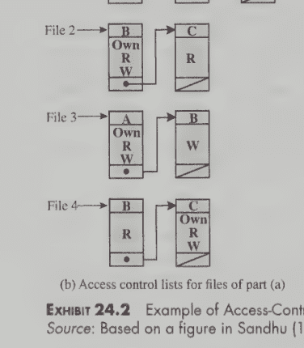


(b) 第 (a) 部分文件的访问控制列表

(c) 第 (a) 部分文件的能力列表

## 图 24.2 访问控制结构示例

来源：基于 Sandhu (1996) 中的图。

矩阵的一个维度由可能尝试数据访问的已识别主体组成。通常，该列表将由单个用户或用户组组成，尽管访问控制也可以针对终端、主机或应用程序，而不是用户或除用户之外进行。另一个维度列出了可能被访问的对象。在最详细的层面上，对象可以是单个数据字段。更聚合的分组，例如记录、文件，甚至整个数据库，也可能成为矩阵中的对象。矩阵中的每个条目表示该主体对该对象的访问权限。

实际上，访问矩阵通常是稀疏的，并以两种方式之一通过分解来实现。矩阵可以按列分解，从而产生访问控制列表（见图 24.2b）。因此，对于每个对象，访问控制列表列出用户及其允许的访问权限。访问控制列表可能包含默认或公共条目。这允许未明确列为具有特殊权限的用户拥有默认权限集。列表的元素可能包括单个用户以及用户组。

按行分解产生能力票据（见图 24.2c）。能力票据指定用户有权访问的对象和操作。每个用户拥有一系列票据，并且可能被授权将它们借出或赠予他人。由于票据可能分散在系统中，它们比访问控制列表带来更大的安全问题。特别是，票据必须不可伪造。实现此目的的一种方法是让操作系统代表用户持有所有票据。这些票据必须保存在用户无法访问的内存区域中。

数据导向访问控制的网络考虑与用户导向访问控制平行。如果只有某些用户被允许访问某些数据项，则在向授权用户传输这些数据项期间可能需要加密。通常，数据访问控制是分散的，即由基于主机的数据库管理系统控制。如果网络上存在网络数据库服务器，则数据访问控制成为网络功能。

## 24.3.4 基于操作系统模式的保护。

所有操作系统中用于提供保护的一种技术基于处理器执行的模式。大多数处理器至少支持两种执行模式：通常与操作系统相关联的模式和通常与用户程序相关联的模式。某些指令只能在特权更高的模式下执行。这些指令包括读取或更改控制寄存器，例如程序状态字；原始 I/O 指令；以及与内存管理相关的指令。此外，某些内存区域只能在特权更高的模式下访问。

特权较低的模式通常称为用户模式，因为用户程序通常在此模式下执行。特权更高的模式称为系统模式、控制模式或内核模式。后一个术语指的是操作系统的内核，即包含重要系统功能的 OS 部分。图 24.3 列出了通常在操作系统内核中发现的功能。

## 图 24.3 典型内核模式操作系统功能

### 进程管理
- 进程创建和终止
- 进程调度和分派
- 进程切换
- 进程同步和进程间通信支持
- 进程控制块管理

### 内存管理
- 为进程分配地址空间
- 交换
- 页和段管理

### I/O 管理
- 缓冲区管理
- 为进程分配 I/O 通道和设备

### 支持功能
- 中断处理
- 记账
- 监控


采用两种模式的原因应当明确。必须保护操作系统及关键操作系统表（如进程控制块）免受用户程序的干扰。在内核模式下，软件完全控制处理器及其所有指令、寄存器和内存。这种控制级别对用户程序来说既无必要，出于安全考虑也不可取。

这里出现两个问题：处理器如何知道自己正在以哪种模式执行？模式又是如何改变的？关于第一个问题，通常在程序状态字中有一个指示执行模式的位。该位会响应某些事件而改变。例如，当用户调用操作系统服务时，模式被设置为内核模式。通常，这是通过执行一条改变模式的指令来完成的。当用户进行系统服务调用，或当中断将控制权转移给系统例程时，该例程执行改变模式指令以进入更高特权模式，并在将控制权返回给用户进程之前再次执行该指令以进入较低特权模式。如果用户程序试图执行改变模式指令，则只会导致对操作系统的调用，除非允许这种模式更改，否则操作系统将返回错误。

还可以提供更复杂的机制。一种常见方案是使用环保护结构。在这种方案中，编号较低的环（内环）比编号较高的环（外环）拥有更高的特权。通常，环0保留给操作系统的内核功能，应用程序位于更高层。某些实用程序或操作系统服务可以占据中间环。环系统的基本原则是：

- 程序只能访问位于同一环或较低特权环中的数据。
- 程序可以调用位于同一环或更高特权环中的服务。

环保护方法的一个示例是 VAX VMS 操作系统，它使用四种模式：

- 1. 内核模式：执行 VMS 操作系统的内核，包括内存管理、中断处理和 I/O 操作。
- 2. 执行模式：执行许多操作系统服务调用，包括文件和记录（磁盘和磁带）管理例程。
- 3. 监管模式：执行其他操作系统服务，例如对用户命令的响应。
- 4. 用户模式：执行用户程序以及编译器、编辑器、链接器和调试器等实用程序。

在较低特权模式下执行的进程通常需要调用在较高特权模式下执行的过程；例如，用户程序需要操作系统服务。这种调用通过使用更改模式（CHM）指令实现，该指令引起中断，将控制权转移到新访问模式下的例程。通过执行 REI（从异常或中断返回）指令返回。

## 24.3.5 基于虚拟化的保护

随着内存（例如几十到几百 GB 的 RAM）、磁盘空间（TB 到 PB 级的存储）、更快的处理器（几十 GHz）以及多核系统（可能数千个处理器并行工作）的日益普及，计算机虚拟化已发展到实用且广泛可用的程度。操作系统的实例可以共存并使用共享资源，而不允许它们之间进行任何直接通信。每个实例都被封装，并受到完全保护，免受共享相同物理资源的其他虚拟机上运行的进程的入侵或干扰。

## 24.4 文件共享

多用户系统几乎总是要求文件可以在多个用户之间共享。这带来两个问题：访问权限和同时访问的管理。

### 24.4.1 访问权限

文件系统应提供灵活的工具，允许用户之间进行广泛的文件共享。文件系统应提供多种选项，以便控制对特定文件的访问方式。通常，用户或用户组被授予对文件的某些访问权限。使用的访问权限种类繁多。以下列表指出了可分配给特定用户对特定文件的访问权限。

- **无。** 用户甚至不能知道该文件的存在，更不用说访问它。为了执行此限制，不允许用户读取包含该文件的用户目录。
- **知道。** 用户可以确定文件存在及其所有者是谁。然后用户可以向所有者请求额外的访问权限。
- **执行。** 用户可以加载并执行程序，但不能复制它。专有程序通常以此限制提供访问。
- **锁定。** 用户可以更改一个逻辑标志的状态，该标志指示对数据访问的临时限制。数据库管理系统提供锁定以控制对记录的并发访问，从而使不同进程避免覆盖彼此的修改。
- **读取。** 用户可以出于任何目的读取文件，包括复制和执行。有些系统能够强制区分查看和复制。在前一种情况下，文件内容可以显示给用户，但用户无法复制。
- **追加。** 用户可以向文件添加数据，通常只能在末尾添加，但不能修改或删除文件中的任何内容。此权限对于从多个来源收集数据很有用。
- **更新。** 用户可以修改、删除和添加文件数据。这通常包括初始写入文件、完全或部分重写文件，以及删除全部或部分数据。有些系统区分不同程度的更新。
- **更改保护。** 用户可以更改授予其他用户的访问权限。通常只有文件所有者拥有此权限。在某些系统中，所有者可以将此权限扩展给其他人。为防止滥用此机制，文件所有者通常能够指定此扩展权限的持有者可以更改哪些权限。
- **删除。** 用户可以从文件系统中删除该文件。

这些权限可以被认为构成一个层次结构，每个权限都蕴含其前面的权限。因此，如果某个用户被授予对某个特定文件的更新权限，那么该用户也被授予以下权限：知道、执行、读取和追加。

## 24.12 操作系统安全

一个用户被指定为给定文件的所有者，通常是最初创建该文件的人。所有者拥有前面列出的所有访问权限，并且可以授予其他人权限。访问可以提供给不同类别的用户：

- **特定用户。** 由用户 ID 指定的单个用户。
- **用户组。** 一组未单独定义的用户。系统必须有某种方式来跟踪用户组的成员关系。
- **所有用户。** 所有能访问该系统的用户。这些是公共文件。

### 24.4.2 同时访问

当多个用户被授予对文件的追加或更新权限时，操作系统或文件管理系统必须强制实施纪律。一种简单粗暴的方法是允许用户在文件将被更新时锁定整个文件。更细粒度的控制是在更新期间锁定单个记录。在设计共享访问能力时，必须解决互斥和死锁问题。本手册第52章更详细地讨论了应用程序控制。

## 24.5 可信系统

到目前为止讨论的大部分内容都是关于保护给定消息或项目免受特定用户的被动或主动攻击。一个略有不同但广泛适用的需求是基于安全级别来保护数据或资源。这在军事领域很常见，其中信息被分类为无密级（U）、机密（C）、秘密（S）、绝密（TS）或更高。这个概念在其他领域同样适用，在这些领域中，信息可以被组织成大致的类别，用户可以被授予访问某些类别数据的许可。例如，最高安全级别可能用于公司战略规划文件和文档数据，只有公司高管及其员工可以访问；其次可能是敏感的财务和人事数据，只有行政人员、公司高管等可以访问。

当定义了多个类别或级别的数据时，这种需求被称为多级安全。多级安全需求的一般表述是：高等级的主体不得将信息传递给较低等级或不可比较等级的主体，除非这种流动准确反映了授权用户的意愿。为了实施，这一需求分为两部分，表述如下。一个多级安全系统必须强制执行：

- 1. **不上读。** 主体只能读取安全级别小于或等于自身的对象。这在文献中称为简单安全属性。
- 2. **不下写。** 主体只能写入安全级别大于或等于自身的对象。这在文献中称为 *-属性（读作星号属性）。

这两条规则如果得到正确执行，就能提供多级安全。对于数据处理系统，已采用且一直是大量研发对象的方法基于引用监视器概念。这种方法如图 24.4 所示。引用监视器是计算机硬件和操作系统中的一个控制元素，它根据主体和客体的安全参数来规范主体对客体的访问。引用监视器可以访问一个称为安全内核数据库的文件，该文件列出了每个主体的访问权限（安全许可）和每个客体的保护属性（密级）。


## 图表 24.4 参考监视器概念

对象。参考监视器强制执行安全规则（不向上读，不向下写）并具有以下属性：

- **完全中介。** 安全规则在每次访问时都得到强制执行，而不仅仅是例如文件打开时。
- **隔离。** 参考监视器和数据库受到未经授权修改的保护。
- **可验证性。** 参考监视器的正确性必须是可以证明的。也就是说，必须能够在数学上证明参考监视器强制执行安全规则并提供完全中介和隔离。

这些是严格的要求。完全中介的要求意味着对主内存和磁盘及磁带中的数据的每次访问都必须得到中介。纯软件实现会带来过高的性能损失而无法实用；解决方案必须至少部分在硬件中。隔离的要求意味着无论攻击者多么聪明，都不可能改变参考监视器的逻辑或安全内核数据库的内容。最后，数学证明的要求对于通用计算机这样复杂的系统来说是巨大的。能够提供此类验证的系统被称为可信系统。

本手册第 9 章更详细地讨论了计算机安全的数学模型。

图表 24.4 中说明的最后一个元素是审计文件。重要的安全事件，例如检测到的安全违规和对安全内核数据库的授权更改，都存储在审计文件中。


(a) 访问令牌

(b) 安全描述符

(c) 访问控制列表

## 图表 24.6 Windows 2000 安全结构

组有一个唯一的组 SID。访问对象可以基于组 SID、单个 SID 或组合来定义。

- **特权。** 此用户可能调用的安全敏感系统服务列表。一个例子是 create token。另一个例子是 set backup 特权；具有此特权的用户允许使用备份工具备份他们通常无法读取的文件。大多数用户没有任何特权。
- **默认所有者。** 如果此进程创建另一个对象，则此字段指定新对象的拥有者。一般来说，新进程的所有者与创建进程的所有者相同。然而，用户可以指定由此进程生成的所有进程的默认所有者是此用户所属的组 SID。
- **默认访问控制列表 (ACL)。** 这是应用于用户创建的对象的一组初始保护。用户随后可以更改其拥有或其所属组拥有的任何对象的 ACL。

### 24.6.3 安全描述符。

图表 24.6b 显示了安全描述符的一般结构，其中包括以下参数：

- **标志。** 定义安全描述符的类型和内容。标志指示系统访问控制列表 (SACL) 和自主访问控制列表 (DACL) 是否存在、它们是否由默认机制放置在对象上，以及描述符中的指针是否使用绝对或相对寻址。相对描述符对于通过网络传输的对象是必需的，例如在 RPC 中传输的信息。
- **所有者。** 对象的拥有者通常可以对安全描述符执行任何操作。拥有者可以是个人或组 SID。拥有者有权更改 DACL 的内容。
- **系统访问控制列表 (SACL)。** 指定对对象的何种操作应生成审计消息。应用程序必须在其访问令牌中具有相应的特权才能读取或写入任何对象的安全 SACL。这是为了防止未经授权的应用程序读取 SACL（从而了解为了避免生成审计而不应执行的操作）或写入它们（以生成大量审计以使非法操作不被注意到）。
- **自主访问控制列表 (DACL)。** 确定哪些用户和组可以访问此对象以及可执行哪些操作。它由访问控制项 (ACE) 列表组成。

创建对象时，创建进程可以将其自己的 SID 或其访问令牌中的任何组 SID 指定为拥有者。创建进程不能指定不在当前访问令牌中的拥有者。随后，任何被授予更改对象拥有者权限的进程都可以这样做，但仍受相同限制。限制的原因是为了防止用户在尝试某些未经授权的操作后掩盖自己的痕迹。

让我们更详细地查看访问控制列表的结构，因为这些是 W2K 访问控制设施的核心（见图表 24.7）。每个列表都由一个总体头和可变数量的访问控制项组成。每个条目指定一个个人或组 SID 和一个访问掩码，该掩码定义要授予此 SID 的权限。当进程尝试访问对象时，W2K 执行体中的对象管理器从访问令牌中读取 SID 和组 SID，然后扫描对象的 DACL。如果找到匹配项——即找到与访问令牌中的 SID 之一匹配的 SID 的 ACE——则该进程具有该 ACE 中访问掩码指定的访问权限。

图表 24.7 显示了访问掩码的内容。最低有效 16 位指定适用于特定类型对象的访问权限。例如，文件对象的位 0 为 File.Read.Data 访问，事件对象的位 0 为 Event.Query.Status 访问。


## 图表 24.7 Windows 2000 访问掩码

## 产量与其与玉米螟的关系

作者 J. H. EVANS

农业推广服务

俄亥俄州立大学

俄亥俄州哥伦布 10

欧洲玉米螟会降低玉米产量吗？这个问题已经被问过很多次。植物病理学家和昆虫学家都研究过玉米螟与产量的关系，结果各不相同。

在俄亥俄州，1946 年和 1947 年，在两个田地中获得了大量数据，而且在每种情况下结果都相似。表 1 给出了 1946 年获得的结果。

**表 1.-玉米螟种群对玉米产量的影响**

| 每 100 株植物的玉米螟数量 | 每英亩产量（蒲式耳） |
|---|---|
| 640 | 96.2 |
| 1550 | 92.7 |
| 2650 | 89.9 |

随着玉米螟数量的增加，产量有所下降。从这些数据来看，似乎欧洲玉米螟会实质性地降低玉米产量。

每 100 株植物的玉米螟数量 640、1550、2650 和每英亩产量（蒲式耳）96.2、92.7、89.9 似乎表明，每增加 1000 只玉米螟，产量大约降低 2.3 蒲式耳/英亩。换句话说，损失随虫害程度而变化。这些数据不足以得出明确的结论。它们仅作为兴趣和信息提供。

### 摘要

- 1. 欧洲玉米螟会使甜玉米产量降低 10 至 25%。
- 2. 欧洲玉米螟造成的损害会导致产量降低和质量变差。
- 3. 即使每株植物只有一只玉米螟也会降低产量。

Stallings, W. *密码学与网络安全：原理与实践*, 第 5 版. Upper Saddle River, NJ: Prentice-Hall, 2010.

Stallings, W. *操作系统：内部原理与设计原则*, 第 7 版. Upper Saddle River, NJ: Prentice-Hall, 2011.

Viega, J., 和 J. Voas. “Unix 和 Windows 安全策略的利弊。” *IT 专业人士* 2, 卷 5（2000 年 9 月/10 月）：40–47。

## 24.8 注释

- 1. P. Denning 和 R. Brown, “操作系统”，*科学美国人*（1984 年 9 月）。
- 2. J. Saltzer 和 M. Schroeder, “计算机系统中信息的保护”，*IEEE 会议录*（1975 年 9 月）。
- 3. C. P. Pfleeger 和 S. L. Pfleeger, *计算安全*, 第 4 版（Prentice-Hall PTR, 2006）。


下列清单改编自互联网工程任务组（IETF）征求意见稿（RFC）2196，是应至少考虑的与局域网相关的安全策略和程序的粗略大纲。¹

-   1. 管理策略框架
  -   a. 信息安全问题
    -   i. 密码管理程序
      -   1. 密码是由用户分配还是自行选择？
      -   2. 是否已建立密码审计程序？
      -   3. 是否执行密码策略（例如，最小长度、允许和必需字符、过期、黑名单）？
      -   4. 访问所有系统需要多少个密码？
    -   ii. 病毒防护
      -   1. 服务器是否受保护？
      -   2. 是否有电子邮件“病毒墙”？
      -   3. 病毒防护是集中管理活动，还是由每个用户负责？
      -   4. 用户如何维护当前的病毒特征数据库？
    -   iii. 加密和证书
    -   iv. 安全事件处理
  -   b. 网络连接问题
    -   i. 拨号访问
    -   ii. 集线器与交换机
    -   iii. 身份识别与认证
      -   1. 密码及管理
      -   2. 认证系统
      -   3. 双因素认证？
      -   4. 单点登录？
      -   5. 生物识别
  -   c. 物理站点安全和灾难恢复
    -   i. 系统的物理安全
    -   ii. 拨号接入线路和调制解调器
    -   iii. 备份计划
    -   iv. 服务器访问
    -   v. 存储和限制备份介质访问
    -   vi. 灾难恢复和应急计划
  -   d. 操作系统和局域网安全
    -   i. 操作系统特定问题
      -   1. 监控操作系统安全漏洞
      -   2. 应用安全补丁
      -   3. 安装期间保护操作系统（OS）
      -   4. 审计系统

## 25.4 物理层问题。

局域网本身由于系统和介质分布广泛而存在许多额外漏洞。本节讨论保护局域网基础设施。

### 25.4.1 嗅探器和广播局域网。

传统局域网介质访问控制（MAC）方案假设逻辑上如果不是物理上的广播拓扑。在广播网络中，每个站点都能听到每一次传输。当处于混杂模式时，局域网站点会读取经过的每个帧，而不管该帧是否发往该站点。

当协议分析或嗅探器软件在 1980 年代出现时，局域网上的每个站点都成为潜在的网络分析和管理工具——或秘密窃听者。由于网络的许多应用——特别是基于传输控制协议/互联网协议（TCP/IP）的应用——以明文传输密码和文件，这种类型的软件可能非常危险。

一些来源提供非常强大且灵活的商业数据包嗅探软件，例如 Network Associates 的 SnifferPro 和 Novell 的 LANalyzer。这些软件包通常具有额外的功能，例如网络监控、性能监控和流量分析。在 1990 年之前，网络协议分析需要一台连接到网络的专用硬件。今天，大量可进行 TCP/IP 数据包嗅探的软件包可以帮助入侵者，因为它们可以直接安装在个人的笔记本电脑或台式电脑上。其中一些软件包包括：

-   WireShark（Windows、MacOS 和 UNIX）
-   BUTTsniffer（Windows NT）
-   Network Monitor（随 Windows NT 免费提供并适用于 Windows NT）
-   Sniffit（Linux、SunOS、Solaris、FreeBSD、Irix）
-   snort（UNIX 和 Windows）
-   Solsniff（Solaris）
-   tcpdump（MacOS 和 UNIX）
-   WinDump（DOS）

针对这类工具可采取的对策相对较少。幸运的是，它们仅在广播网络上有效，例如集线器局域网。例如，如果以太网集线器被交换机取代，则广播到网络上所有主机的唯一流量是实际发往局域网广播地址的帧。在这种情况下，站点只能嗅探发往或来自安装嗅探软件的站点的流量。在许多环境中，用交换机替换所有集线器可能不合理，但将所有服务器放在交换机而不是集线器上将提高性能和安全性。

其他基于网络的工具可以检测网络接口卡（NIC）处于混杂模式的主机，例如 AntiSniff（Windows）和 sentinel（UNIX）。这些工具通过执行一系列测试来检测混杂主机；然后检查网络主机的操作系统、域名系统（DNS）活动以及网络和机器延迟。

嗅探器可通过加密来击败。对 TCP/IP 应用使用安全 IP（IPsec）和安全 Shell（SSH）可为所有通信和应用提供隐私性和完整性。有关 IPsec 的信息可在 www.ipsec-howto.org/x202.html 上获得，SSH 可从 SSH Communications Security（www.ssh.com）获得。

### 25.4.2 对物理设施的攻击。

今天在局域网上使用最广泛的介质是基于铜的非屏蔽双绞线（UTP）电缆。所有铜介质，包括 UTP 和同轴电缆，由于导线上的电流变化而产生磁场。范·埃克监测设备可以远程接收这些辐射并重现线路上的帧或机器上的击键。尽管听起来可能很离奇，但这种漏洞是真实存在的。美国政府和军方有一套名为 TEMPEST 的标准来减少和限制电磁辐射（EMR），国家安全局（NSA）有一份 TEMPEST 合规产品清单。事实上，这种漏洞在大多数组织网络中可能不是主要问题，但在某些网络中这是令人担忧的问题。

将工作站装入法拉第笼（即包围所有组件的铜网层）的替代方案是产生随机电子噪声来掩盖有意义的辐射数据传输。

减少或消除 EMR 的一种方法是减少或消除网络上的铜介质数量。例如，光纤没有 EMR，因为线路上没有电流。它并不能消除桌面本身的 EMR，但它可以防止其进入所有互连的光纤电缆。

用户也可能是某些类型的拒绝服务（DoS）攻击的来源，无论是有意还是无意。考虑同轴电缆以太网网络（10BASE-5 或 10BASE-2），其中节点连接到公共局域网介质。在这两种情况下，同轴电缆在电线末端都有一个终端电阻以消除信号反射。如果电阻被移除，它会允许线路上产生额外噪声，从而阻断网络上的所有流量。电缆末端的电阻应尽可能超出用户的触及范围。

只要用户修改网络布线方案，就可能发生类似的 DoS 攻击。移除终端电阻只是可能导致问题的行为之一。公共区域的集线器可能会被拔掉电源或拆除网络连接器。令牌环集线器到集线器的连接可能会被拆下，破坏环的完整性，从而阻止局域网主机与其他主机通信并拒绝用户服务。

重要的是，物理网络应尽可能得到保护。局域网管理员应教育用户避免可能发生的意外问题，甚至如何识别恶意攻击。

### 25.4.3 调制解调器、拨号服务器和电话线路。

局域网上的任何调制解调器都可能构成潜在危险，特别是那些直接连接到用户系统（无论是否有正式许可）的调制解调器。调制解调器可以为局域网提供后门，可能绕过防火墙、强身份验证、代理服务器以及任何其他网络安全。尽管在当今的局域网架构中不常见，拨号调制解调器仍用于在网络故障排除练习期间拨号进入路由器/网桥。如果使用拨号调制解调器访问局域网设备，仍应谨慎行事，如本节所述。

一般来说，所有调制解调器都应集中在网络的拨号服务器上。在大多数情况下，单个用户系统不应允许在网络上使用调制解调器。然而，这条规则很难执行，因为笔记本电脑和日益增多的台式机系统都包含预装调制解调器，而且用户总可以连接


- 对组织帮助台进行社会工程学技术培训，并禁止他们透露调制解调器电话号码、用户名或其他可能帮助攻击者的敏感信息。

## 25.4.4 无线局域网问题。

无线局域网（WLAN）存在有线对应设备所没有的漏洞。 wired 和无线网络之间最明显的区别是介质本身。虽然基于铜的有线局域网会发出少量可被截获的辐射，但无线局域网的全部基础都是以某种形式使用相对较强的辐射来传输数据。

有些无线局域网基于红外信号，由于这些信号传播范围有限而无法穿透建筑物墙壁，因此实现了一定程度的安全性。这类局域网通常出现在需要高度安全性的网络中。然而，今天大多数无线局域网使用无线电传输技术。在这些网络中，附近街道上的任何人都可以利用监听设备截获数据，甚至捕获连接到局域网所需的网络标识符。截获的实际范围受信号强度的平方反比定律（随距源距离的平方衰减）以及接收机的灵敏度和信噪比特性所支配。

幸运的是，物理层本身也存在一定程度的安全性。电气和电子工程师学会（IEEE）802.11 基于的局域网采用直接序列扩频（DSSS）或频率跳变扩频（FHSS）技术。如同以往一样，根据范围和噪声水平，窃听是可能的。然而，DSSS 和 FHSS 的工作原理使得解读信号变得更加困难。

要理解传输内容，接收机必须知道 DSSS 网络中使用的码片码或 FHSS 实现中的频率跳变模式。如果没有这些信息，信号对非法接收机来说只会表现为工业、科学和医疗（ISM）无线电频段中的背景噪声。这对潜在窃听者来说并非不可克服的问题，但与窄带无线电技术相比，其工作量大大增加。扩频方法在面对拒绝服务（即有意干扰）造成的干扰时也提供了更高的可靠性，因为信号分布在宽广的频率范围内。一些厂商的设备还配备了软件组件，可用于在干扰中进行调谐。

例如，IEEE 802.11g 修订版使用来自 802.11a 的较新的正交频分复用（OFDM）以实现更高的数据速率，同时仍与使用 DSSS 的 802.11b 向下兼容，后者已在使用相同的 ISM 频率带。支持 DSSS 数据速率 1、2、5.5 和 11 Mbps，也支持 OFDM 数据速率 6、9、12、18、24、48 和 54 Mbps。IEEE 仅要求 OFDM 使用 6、12 和 24 Mbps 的强制数据速率，无论是 802.11a 还是 802.11g OFDM。

为了获得比物理层单独提供的更高的隐私性，802.11 标准包含一种称为有线等效隐私（WEP）的可选加密方法。该技术确实是可选的，因此并非所有厂商都支持该标准。WEP 默认使用 RC4 算法的 40 位形式，尽管一些产品支持更强的 128 位版本。鉴于当今的计算能力，40 位密钥空间并不能提供很高的安全性，因此选择提供不止 40 位版本的产品是个好主意。

由于 WEP 不提供强大的加密且未描述标准的密钥交换机制，许多厂商已实施第三层隧道方法，例如虚拟专用网络（VPN）中发现的方法，以提供更大的隐私性。这些基于 VPN 的方法通常采用其他加密过程（例如 Microsoft 点对点加密），如点对点隧道协议（PPTP）中使用的方法，这些方法使用比 WEP 更长的密钥，并且通常支持公钥基础设施（PKI）或其他密钥交换机制。一些实现还通过诸如远程访问拨号用户服务（RADIUS）等标准提供身份验证，以便更灵活地管理客户端。主要问题是这些方法并非全部互操作，也不一定具有多协议能力。

WEP 也可用于身份验证，以防止未经授权访问无线局域网本身。这种身份验证为典型服务器软件采用的用户名和密码组合增加了另一层保护。在获得服务器上信息资源的访问权限之前，客户端首先必须获得对物理介质的访问权限。使用共享密钥方案，无线设备必须拥有与局域网接入点相同的加密密钥，后者是实现无线连接到局域网有线部分的设备。任何传输的数据必须使用该密钥加密，否则帧将被忽略。许多无线接入产品还具有基于 MAC 地址创建访问控制列表以过滤局域网连接的功能。

IEEE 802.11i-2004 或 802.11i 安全标准，实施为 Wi-Fi 保护访问 II（WPA2），是对原始 IEEE 802.11 的修订。WPA2 最初由 Wi-Fi 联盟（www.wi-fi.org）开发。该标准规定了无线网络的安全机制。它用详细的 Security 条款取代了原始 IEEE 802.11 标准中简短的 Authentication and Privacy 条款。在此过程中，它弃用了原始的 WEP 加密方法。该修订后来被纳入已发布的 IEEE 802.11-2007 标准。

综上所述，网络管理员在评估无线网络组件时应考虑以下安全项目：

### 物理层方案

- **红外.** 不能穿透墙壁，适用于高安全性应用。
- **FHSS.** 信号跳频提供良好的安全级别，但技术的复杂性限制了带宽。
- **DSSS.** 低“扩频比”可以增加可用带宽，但也增加了被截获和干扰的可能性。
- **OFDM.** 用于较新的无线局域网中的更高数据速率，但可能对噪声和干扰更敏感。

### 加密选项

- **WEP.** 2004 年已弃用，通常采用 Rivest Cipher 4（RC4）算法的 40、64 或 128 位密钥。
- **Wi-Fi Protected Access II.** 比 WEP 更安全的替代方案，采用高级加密标准（AES）计数器模式/CBC-MAC 协议（CCMP）。⁵
- **替代加密方法.** 通常比 WEP 和 WPA2 更安全，但不总是互操作。

### 身份验证方法

- **有线等效隐私.** 使用预共享密钥（PSK）模式，要求客户端与局域网接入点具有相同的加密密钥，这带来了密钥管理问题。
- **Wi-Fi Protected Access II.** WPA2 支持 IEEE 802.1X/EAP 身份验证或 PSK 技术。
- **访问控制列表.** 仅允许特定客户端基于 MAC 地址获得对局域网的物理访问；这增加了客户端管理的复杂性。
- **基于服务器的身份验证.** 使用 RADIUS 进行灵活的用户身份验证，以提供对非法连接的额外保护层。

有关无线网络安全的更多信息，请参阅本手册第 33 章。

## 25.5 网络操作系统问题。

在 1990 年代初期，常见的是桌面系统运行 Windows 操作系统和 Novell NetWare 网络操作系统（NOS）。桌面应用程序在 Windows 上运行，而 NetWare 仅用于在共享文件空间之间移动文件或打印文档。

今天，桌面操作系统、服务器操作系统和 NOS 之间的区别已经消失。Linux、MacOS、UNIX 和 Windows 等操作系统都提供具有网络功能的桌面应用程序套件，包括 TCP/IP 等通信协议。对于所有局域网，无论具体操作系统如何，都存在一些一般的安全考虑：

- 使用操作系统提供的任何功能来采用强密码。
- 创建强制使用强密码的密码策略。定期更改密码且不允许重复使用。定期使用密码破解工具（如 L0phtCrack（Windows）或 crack（UNIX））审计密码。确保管理员和 root 账户的密码不会被广泛传播或猜测。
- 禁用（或卸载）任何未使用的服务。
- 保持操作系统和应用程序软件为最新状态，并安装最新的安全补丁。
- 仔细管理文件和其他系统/网络资源访问控制列表。
- 严格定义用户、组和网络/域信任关系。
- 严格保护任何正在运行的应用程序。
- 仅在必要时以管理员或 root 身份登录；否则以普通用户身份登录。
- 仅允许操作员和管理员在服务器系统上本地登录。
- 限制访客、演示或匿名账户的使用。
- 在可行情况下，将引导和系统文件以及应用程序文件和数据放在不同的分区、硬盘驱动器或输入/输出（I/O）控制器上。
- 定期审计服务器系统。
- 监控日志文件。
- 系统配置稳定后，从服务器上移除软盘、CD、DVD 和拇指驱动器。
- 在保护操作系统时实施最佳行业实践。
- 定期使用漏洞评估工具扫描服务器。
- 使用入侵检测工具监控从内部网络发起的对局域网的潜在攻击。


- 如果使用简单网络管理协议（SNMP）进行网络管理，请仔细选择社区名称并阻止外部访问 SNMP 服务。在可能的情况下，将管理信息库（MIBs）设为只读。
- 避免使用 DNS HINFO（主机信息）资源记录来识别中央处理器类型和已安装的操作系统。

特定操作系统的漏洞超出了本章范围；整本书和网站都致力于保护这些单个操作系统。至少，网络管理员必须监控其操作系统厂商的网站以及所有其他涵盖 NOS 安全性的网站。以下各节提供了有关各种网络操作系统的一些总体观察和评论。

## 25.5.1 Windows 9x.

所有 Windows 操作系统（包括 NT 和 2000）都支持点对点资源共享，并且容易受到 NetBIOS 文件和打印共享的利用。特别是，当文件和打印共享启用时，该服务默认绑定到 TCP/IP。虽然这不会对本地网络上的系统造成额外暴露（因为共享无论如何都可以被 LAN 上的其他节点看到），但它为连接到互联网的主机提供了潜在的漏洞。文件和打印共享可以通过“开始”、“控制面板”和“网络”从 TCP/IP 中解除绑定。

Windows 9x（包括 Windows 95、Windows 98 和 Windows ME）系统在用户希望访问远程共享时进行身份验证的方式上也存在漏洞。Windows 对所有需要在网络上传输的密码都使用挑战握手身份验证协议（CHAP），因此密码永远不会以明文形式出现在 LAN 上。然而，由于 Windows 9x 在给定的 15 分钟期间使用相同的挑战，具有对 LAN 和嗅探器的物理访问权限的入侵者可以通过重新发送重复的身份验证请求并在 Windows 9x 系统上重新映射共享来实现重放攻击。这一例子说明了物理安全在防止 LAN 被入侵方面发挥的关键作用。

Windows 9x 的经典特洛伊木马程序之一是 Back Orifice（BO）。它被宣传为远程 Win9x 管理员工具，可被恶意用户用来完全控制他人的系统，包括修改注册表、重新启动系统、传输文件、查看缓存密码、生成进程和创建共享等功能。SubSeven 和 NetBus 是可用于控制远程 Windows 系统的其他工具。一些商业病毒扫描程序可以在单个系统上检测到这些程序，而多个工作站防火墙会排除这些特洛伊木马特有的通信。

Windows 9x 没有特定的登录安全机制。虽然每个用户可能被强制登录到系统，但任何用户都可以使用任何用户名和任何密码登录以获得至少基本访问权限。通过互联网可以获得多个密码破解程序来破解 Windows 的 .PWL 密码文件，一旦用户获得网络访问权限，这些文件即可访问。如果受密码保护的屏幕保护程序阻止攻击者登录，也有一种简单的绕过方法：只需重新启动计算机即可。然而，第三方安全程序包括不可破解的安全登录和安全屏幕保护程序；其中许多包含启动锁定功能，除非输入有效密码，否则会阻止任何访问。有关此类软件的当前示例可使用购买指南轻松找到，例如计算机安全研究所的年度清单。⁶

## 25.5.2 Windows NT/2000, XP, Vista, Win7, and Win8.

从安全角度来看，Windows Millennium Edition（ME）与 Windows 9x 并没有显著更强。网络管理员应定期扫描网络的公共共享以确保其适当。Windows NT Server、NT Workstation 和 2000 Server 版本是为安全和网络服务而构建的，并具有支持这些服务的软件架构。然而，与这些操作系统相关的安全漏洞公告似乎几乎每周都会发布。许多适用于 Win9x 的黑客工具也适用于 Windows NT 和 2000；例如，Back Orifice 2000（BO2K）是 BO 的 NT/2000 版本，而 NetBus 也可控制 NT/2000 主机。

Internet Explorer（IE）和 Office 2000 中的脚本漏洞使所有 Windows 系统都容易受到各种新型病毒和蠕虫攻击。虽然早期的病毒，如 Melissa 和 I LOVE YOU，需要用户打开电子邮件附件，但现在已不再如此。Microsoft Outlook 和 Outlook Express 默认会在电子邮件正文中执行超文本标记语言（HTML）和脚本代码。多个 ActiveX 组件也会从包含 HTML 和脚本代码的电子邮件中执行；此类控件的示例包括 Scriptlet.typelib（随 IE 4.x 和 5.x 提供）和 UA 控件（Office 2000）。针对此类漏洞的最佳保护措施是将 Outlook 和 Outlook Express 定义为在“受限站点区域”中读取电子邮件，并在该区域中禁用所有 Active 脚本和 ActiveX 相关设置。此漏洞影响安装了 Office 2000 或 Internet Explorer 4.x/5.x 的所有 Windows 系统，即使未使用 IE 也会受影响。

保护 Windows NT/2000 系统远远超出了本章范围，但除已列出者外，还有一些预防措施如下。

- 使用 NTFS 而非 FAT 格式化驱动器。
- 使用长文件名并禁用 DOS 8.3 命名格式。
- 禁用 Everyone 组。
- 重命名管理员账户。
- 打开审计。（默认情况下处于关闭状态。）

所有基于 NT 的系统均由国家计算机安全中心评为 C2 安全等级，其中包括 Windows NT 3.5 和 4.0 以及 Windows 2000 SQL Server 版本 8.0。这意味着当这些版本的 Windows 正确安装时，它们符合国家计算机安全中心（NCSC）《安全规范橙皮书》中规定的评估标准。C2 认证并非应用于操作系统本身；而是应用于特定安装。Microsoft 提供工具来审计站点，以便管理员能够部署正确的硬件和软件配置，以在网络中实现此安全级别。

Windows 2000 引入了一项管理员可能想要采用的新功能。Windows NT 引入了即时压缩和解压缩文件的功能。Windows 2000 引入了即时加密和解密文件的功能。加密文件系统（EFS）使用公钥密码学和数据加密标准（DES）来加密硬盘上的文件。EFS 包含一种可选的恢复机制，以防密钥丢失。在关键系统上使用 EFS 的组织应考虑采用此机制以防止私钥丢失或被破坏。

Windows XP 已售出超过 4 亿份，仍是仅次于 Win7 的微软操作系统中安装基数第二大的系统，引入了许多以安全为导向的功能。主要的改进是在家庭版和专业版中都包含防火墙功能。专业版更进一步，提供 EFS 文件加密、Kerberos⁷、智能卡支持以及一项新的软件限制功能，允许管理员减轻病毒和特洛伊木马的影响。XP 也支持原始套接字，这本身并不罕见——UNIX 和 Linux 也支持。此功能旨在提高互联网服务的功能，但在 Microsoft 的实现中，它对任何用户都可用，无论其特权级别如何。因此，黑客可能控制运行 XP 的计算机，并通过命令操作系统生成大量流量来发起 DoS 攻击。

尽管 Microsoft 的 Windows Vista 在经过多次延迟后备受关注发布，但由于对其平台安全性和稳定性的担忧，以及人们认为许多安全功能在用户体验中造成了很大不便（例如，将要描述的用户账户控制和数字版权管理实现），其实施范围并不如预期广泛。无论如何，Vista 开发的主要推动者是 Microsoft 的值得信赖计算计划，因此添加了许多新的安全功能。

功能包括用户账户控制（UAC）、Bitlocker 驱动器加密、Windows Defender、数据执行保护、应用程序隔离、Windows 服务强化、网络访问保护以及其他多种功能。从用户角度来看，UAC 是最明显的，它要求在允许任何需要管理员级别权限的操作之前进行用户干预。其中包括⁸：
- 右键单击应用程序图标并单击“以管理员身份运行”
- 对 %SystemRoot% 或 %ProgramFiles% 中的文件或文件夹进行更改
- 安装和卸载应用程序
- 安装设备驱动程序
- 安装 ActiveX 控件
- 更改 Windows 防火墙设置
- 更改 UAC 设置
- 配置 Windows Update
- 添加或删除用户账户
- 更改用户的账户类型
- 配置家长控制
- 运行任务计划程序
- 恢复备份的系统文件
- 查看或更改其他用户的文件夹和文件

作为一个有趣的历史旁注，国家安全局协助 Microsoft 开发了 Vista。据《华盛顿邮报》2007 年 1 月报道：
> 首次，这家大型软件制造商承认了该秘密机构的帮助，该机构更以窃听外国官员以及最近作为布什政府打击恐怖主义努力的一部分窃听美国公民而闻名。该机构表示，它已帮助开发 Microsoft 新操作系统的安全性——计算机的大脑——以保护其免受蠕虫、特洛伊木马和其他阴险的计算机攻击者的侵害。……
> 
> NSA 拒绝就其与其他软件公司的安全工作发表评论，但 Sager 表示 Microsoft 是唯一一家“在这种关系中目前公开承认”的公司。


BSD 4.2 UNIX in 1984. UNIX 传统上仅保留给服务器系统和硬核计算机用户。随着 UNIX 的 X Window 界面的开发以及 1990 年代中期以来 Linux 的广泛部署，UNIX 及其变体在桌面和服务器环境中代表了 Windows 唯一的重大竞争对手。

像 TCP/IP 和互联网本身一样，UNIX 是为功能性和在受信任用户社区中使用而开发的。因此，虽然 UNIX 拥有许多强大的工具，但它没有统一的安全架构，也不是固有的安全操作系统。

UNIX 具有大多数基本操作系统保护措施：密码、访问控制列表、组、用户权限级别等等。但 UNIX 默认启用了大量服务（守护进程），包括文件传输协议（FTP）、Telnet、finger、echo、chargen、daytime、远程过程调用（RPC）、BIND 等。此外，几乎每个 UNIX 守护进程在某个时候都报告过某种安全漏洞，其中缓冲区溢出相当普遍。

保护 UNIX/Linux 系统时，管理员应考虑许多事项。除上面列出的一般步骤外，安全管理人员还可能：

- 禁用（或删除）任何未使用的服务，特别是 finger、BIND 名称守护进程（named）、RPC、sendmail、简单 FTP（tftp）、邮局协议（POP）、互联网消息访问协议（IMAP）、sadmind、mountd 和网络文件系统（NFS）。
- 安装所有已安装软件的最新版本和安全补丁。
- 在配置访问控制列表和其他共享时要格外小心。
- 防止在既不是邮件服务器也不是邮件中继的机器上以守护进程模式运行 Sendmail（关闭 -bd 开关）。
- 限制使用“r”远程访问协议。
- 使用影子密码文件。
- 实施 TCP Wrappers 以控制对服务的访问。
- 考虑使用加密通信协议，如安全外壳 SSH 或安全套接层 SSL，进行远程访问。防止明文密码通过互联网传输。

网络/安全管理人员最重要的能力之一是对 Windows 服务器系统进行审计以保护其完整性。这些工具是基本操作系统或 Windows NT 资源工具包的一部分：

- netstat 检查开放端口。
- lsof 显示打开的文件和网络连接。
- tcpdump 显示网络流量。
- who 显示已登录的用户和 utmp 日志文件。
- last 显示登录历史记录和 wtmp 日志文件。
- lastb 显示错误登录的历史记录（和 btmp 日志文件）。
- syslogd 是用于管理和记录系统消息的中央服务器设施。
- TCP Wrappers 监控和管理传入的服务请求。

### 25.5.4 Mac OS
Macintosh 操作系统大多已被其他平台取代。话虽如此，它们仍然值得提及，因为近年来苹果在移动和平板设备方面的实力使其整体市场份额有所提升。Macintosh 是第一个将通过 AppleTalk 进行网络和资源共享作为核心要素的桌面操作系统。但与之前的 UNIX 和 TCP/IP 一样，Mac OS 是为方便和易用性而设计，而不是为安全性。

由于其点对点特性，Mac OS 传统上存在许多潜在的暴露。虽然 Windows 和 UNIX 也可 以以点对点模式运行，但新手用户通常不知道如何共享资源，因此可能不会无意中打开漏洞。

例如，恶意的 Mac 网络用户可以通过使用原始的 Chooser 附件快速查看网络上有哪些服务器和共享可用。在桌面使用中，Mac 的安全性相对较低。密码保护默认仅在某些笔记本系统上提供，甚至系统也没有标配密码保护的屏幕保护程序。简而言之，决心攻击者和 Mac 计算机之间几乎没有什么阻碍。需要第三方软件来提供对系统和文件的访问密码保护，或通过磁盘加密进行数据保护。

基于 Mac 的病毒和蠕虫继续比其 Windows 对应产品少得多，但 Mac 并非完全免疫。首先，依赖 Microsoft Office 套件软件的病毒会起作用，因为 Mac 版的 Word 和 Excel 使用宏。其次，针对 TCP/IP 的基于互联网的攻击——例如 Ping-of-Death、Teardrop 和 SMURF——仍可能影响 Mac 服务器。附加安全软件的选择比过去更多，像 Norton™ Antivirus for Mac® 和 Norton™ Internet Security for Mac® 等软件包与适用于其他操作系统的对应产品类似。

自 1999 年最后一次“经典”版本 OS 9 发布以来，Mac OS 经历了根本性的转变。随着 OS X 的出现，苹果推出了其首个基于 UNIX 的平台，该平台自 2002 年起预装在所有 Macintosh 计算机上。版本 10.5（Leopard）于 2007 年发布，并增加了一些安全增强功能以解决传统平台的弱点，包括：

- 安全访客账户
- 应用层防火墙
- 应用签名
- 沙箱
- 全盘加密
- 库随机化

苹果的意图是提供更大的攻击预先防范以及对其的弹性，公司在 OS X 的整个生命周期中持续开发更好的安全性。目前为 2012 年发布的 10.8（Mountain Lion）版本，该平台包含与之前版本相同的许多功能，并具有改进的管理员控制和隐私选项。

其中最大的安全挑战在概念上并非 Macintosh 独有，但随着苹果 iCloud 服务在 OS X 中的集成度不断提高（更不用说移动领域的 iOS），文件从本地移动到网络存储的风险更大。用户期望随时随地从任何设备访问数据，这种便利性使得所有丢失或被盗的笔记本电脑、平板电脑和手机都成为重大风险。

尽管 Mac OS 的命运起伏不定又再次上升，但报告的安全事件仍然较少，因为其他平台的普及度更高，更容易了解它们，因为潜在目标更多，而且一次攻击可以影响更多系统。换句话说，Mac 遭受的攻击较少，因为黑客社区对其并不熟悉，而且值得付出机会成本的有吸引力的目标也较少。尽管如此，保持 Mac OS 版本的最新程度与保持其他操作系统一样重要。

## 25.6 结论
一个优秀的管理员可以保护几乎任何 NOS，尽管没有任何 NOS 最初就是安全的。网络管理员需要持续的警惕和监控，同时认识到操作系统只是局域网和网络服务的整体安全计划的一部分。大多数网络管理员由于其工作性质和培训，专注于连接到局域网的计算机以及局域网的操作系统和软件。不幸的是，这种方法范围过于狭窄。个人防火墙软件也可以用于保护单个系统免受攻击，但几乎所有这些产品都针对基于 IP 的攻击，而忽略了使用 NOS 本机操作系统的攻击。

路由器、网络防火墙和代理服务器对于保护局域网系统免受外部来源攻击至关重要。网络管理员还必须提供工具来保护服务器和工作站免受局域网内其他用户的攻击。

## 25.7 延伸阅读
本节列出了一些涵盖本章所涉及问题的书籍、文章和网站。管理员应监控厂商、操作系统和安全网站，以获取最新、及时的额外信息。

- Anonymous. *最大安全性*, 第 4 版. Indianapolis, IN: SAMS, 2003.
- Bathurst, R., R. Rogers, and A. Ghassemlouei. *黑客的 OS X 指南*. Amsterdam: Elsevier, 2013.
- Brenton, C., and C. Hunt. *精通网络安全*, 第 2 版. San Francisco: SYBEX, 2002.
- Edwards, M. J. *使用 Windows NT 的互联网安全*. Loveland, CO: Duke Press, 1998.
- Fraser, B., ed. *站点安全手册*. RFC 2196/FYI 8. 1997 年 9 月. www.ietf.org/rfc/rfc2196.txt
- Garfinkel, S., G. Spafford, and A. Schwartz. *实用 Unix 和互联网安全*, 第 3 版. Sebastopol, CA: O’Reilly & Associates, 2003.
- IEEE WLAN 标准工作组. http://grouper.ieee.org/groups/802/11/
- 信息战网站 (IWS). Rainbow 系列图书馆页面. www.iwar.org.uk/comsec/resources/standards/rainbow/rainbow.html
- Landau, T. *悲伤的 Mac、炸弹和其他灾难*, 第 4 版. Berkeley, CA: Peachpit Press, 2000.
- L0pht Heavy Industries. AntiSniff 概述. 1999. http://blockyourid.com/~gbpprorg/l0pht/antisniff/overview-2.html
- Mann, S., and E. L. Mitchell. *Linux 系统安全：开源安全工具管理员指南*, 第 2 版. Englewood Cliffs, NJ: Prentice-Hall, 2002.
- McClure, S., J. Scambray, and G. Kurtz. *Hacking Exposed：网络安全秘诀与解决方案*, 第 6 版. Berkeley, CA: Osborne/McGraw-Hill, 2009.


## 第26章
## 网关安全设备
Justin Opatrny

- **26.1 引言** ........................................ 26-2
  - **26.1.1** 业务需求超越安全 ................................ 26-2
  - **26.1.2** 需求驱动处理 ................................ 26-3
  - **26.1.3** 无处不在的移动性 ................................ 26-3
  - **26.1.4** 法规和行业合规 ................................ 26-3
- **26.2 基本概念和术语** ........................................ 26-4
  - **26.2.1** 通用能力 ................................ 26-4
  - **26.2.2** 统一威胁管理 ................................ 26-4
  - **26.2.3** 下一代防火墙 ................................ 26-4
  - **26.2.4** Web 应用防火墙 ................................ 26-4
  - **26.2.5** 防火墙架构变化 ................................ 26-4
  - **26.2.6** 包过滤 ................................ 26-5
  - **26.2.7** 状态检测 ................................ 26-5
  - **26.2.8** 应用层网关 ................................ 26-6
  - **26.2.9** 当前网关安全设备 ................................ 26-6
  - **26.2.10** 主机环境上下文 ................................ 26-6
  - **26.2.11** 防火墙平台 ................................ 26-7
  - **26.2.12** 路由设备 ................................ 26-7
  - **26.2.13** 设备 ................................ 26-7
  - **26.2.14** 虚拟化 ................................ 26-8
  - **26.2.15** 基于主机的代理 ................................ 26-9
- **26.3 网络安全机制** ........................................ 26-9
  - **26.3.1** 允许路径 ................................ 26-9
  - **26.3.2** 隧道 ................................ 26-10
  - **26.3.3** 反欺骗 ................................ 26-10
  - **26.3.4** 网络地址转换 ................................ 26-11
  - **26.3.5** 入侵检测 ................................ 26-11
  - **26.3.6** 入侵预防/响应 ................................ 26-11
  - **26.3.7** 加密 ................................ 26-13
  - **26.3.8** 基于身份的强制执行 ................................ 26-14
  - **26.3.9** 复杂协议引擎 ................................ 26-14
  - **26.3.10** 内容控制和数据泄露防护 ................................ 26-15
  - **26.3.11** IPv6 ................................ 26-16
  - **26.3.12** 其他考虑 ................................ 26-17
- **26.4 部署** ........................................ 26-18
  - **26.4.1** 分区架构 ................................ 26-18
  - **26.4.2** GSD 定位 ................................ 26-19
- **26.5 管理和监控策略** ........................................ 26-20
  - **26.5.1** 监控 ................................ 26-20
  - **26.5.2** 策略 ................................ 26-21
- **26.6 维护** ........................................ 26-22
  - **26.6.1** 修补 ................................ 26-22
  - **26.6.2** 模式更新 ................................ 26-22
  - **26.6.3** 日志记录和告警 ................................ 26-23

## 26-2 网关安全设备

- 26.6.4 安全基线配置 26-23
- 26.6.5 默认配置 26-23
- 26.6.6 加固设备 26-24
- 26.7 灾难恢复 26-24
- 26.7.1 故障转移/高可用性 26-24
- 26.7.2 负载均衡 26-24
- 26.7.3 备份/恢复 26-24
- 26.8 网络安全设备评估 26-25
- 26.8.1 当前基础设施限制 26-25
- 26.8.2 新基础设施需求 26-25
- 26.8.3 性能 26-26
- 26.8.4 吞吐量 26-26
- 26.8.5 新增功能的影响 26-26
- 26.8.6 管理 26-27
- 26.8.7 日志记录和告警 26-28
- 26.8.8 可审计性 26-29
- 26.8.9 灾难恢复 26-29
- 26.8.10 可用性 26-30
- 26.8.11 学习曲线 26-30
- 26.8.12 功能 26-30
- 26.8.13 价格 26-31
- 26.8.14 厂商考虑 26-32
- 26.8.15 托管安全服务提供商 26-33
- 26.9 结论性意见 26-34
- 26.10 进一步阅读 26-35

### 26.1 引言
曾经被认为足以保护整个组织免受外部威胁，防火墙至今仍可能是用于互联网连接操作的、最为人所熟知和部署的网络安全设备之一。然而，早期的防火墙世代在做出安全决策时，除了穿越特定允许路径的数据包的源和目的之外，几乎没有其他上下文支持。

随着通信能力和功能需求的增加，防火墙对使用更复杂协议检查和强制执行允许路径的需求也随之增加，并需要不断提高的吞吐量。这种演变将防火墙转变为真正的网关安全设备（GSD）——能够使用过去需要额外安全设备才能实现的技术组合来提供允许路径强制执行。

经过适当选择和部署的 GSD 是一层安全层，旨在处理这些日益复杂的场景。GSD 只有在充分了解将多个安全功能整合到单一设备中的能力与局限性——包括操作和故障条件——时才有效。通过更智能、更准确地提供允许路径强制执行，并结合真正理解预期网络流量的额外严谨性，GSD 在整个组织中提供了足够的额外纵深防御层。

尽管本章将 GSD 作为组合安全设备进行重点讨论，但所涵盖的概念对于理解和评估单个网络安全设备的功能也很有用。每个组织都必须通过权衡这种方法与维护专注于特定安全功能的独立设备之间的关系，来做出风险和性能决策。

### 26.1.1 业务需求超越安全
技术进步不断改变企业管理数据生命周期的能力。移动设备的普及以及向不再完全由组织控制或消耗的云计算资源的转移，持续重新定义着边界。用户对从任何地方使用任何设备（包括组织未控制的设备）不受限制地访问企业数据的需求不断增加。

与持卡人数据一起。一旦确定，这就决定了需要满足哪些要求来证明符合标准。

每个关键基础设施部门——如美国国土安全部所定义——都有一个部门特定计划（SSP），为代表组织和机构提供针对保护每个行业的特定风险管理工具和策略。较为成熟的项目之一是北美电力可靠性公司（NERC）关键基础设施保护（CIP）。NERC CIP 解决了北美电力系统的多个物理和数字安全要素，包括通过建立电子安全边界来实现的网关保护。

有关 GLBA、SOX 和 PCI DSS 的更多详细信息，请参阅本手册第 64 章。

### 26.2 基本概念和术语
对移动性的更大需求、新的业务互动模式以及利用基于互联网的处理能力，继续推动传统边界保护的演变。

### 26.2.1 通用能力
鉴于专用网络安全系统（如 IPS 或反垃圾邮件）的庞大处理需求，组织传统上构建的安全基础设施利用为每个功能量身定制的专用解决方案/设备。然而，当前一代 GSD 处理能力提供了将许多曾经专用的系统组合到单一设备中的机会。

### 26.2.2 统一威胁管理
统一威胁管理（UTM）结合了诸如反恶意软件、反垃圾邮件、IDS/IPS、VPN、应用代理和内容过滤等元素——将防火墙转变为 GSD 的原始迭代。这些新增能力使 UTM 能够在应用层提供更大的控制和检查。然而，通常各功能集之间只有边际的管理和性能集成。

### 26.2.3 下一代防火墙
下一代防火墙（NGFW）是与 UTM 互补并超越其能力的最新演进。与简单地将多种安全技术堆叠在一起不同，NGFW 提供了每个安全层更紧密的集成。这些新能力包括更大的协议感知能力和更细粒度的允许路径强制执行。NGFW 能够在所选端口无关的情况下对协议进行分析。这提高了检测诸如在通常不会使用加密的协议上使用加密有效载荷等欺骗行为的能力。这一代 GSD 还具有动态调整策略的能力——将保护扩展到安全基础设施的其他部分。

### 26.2.4 Web 应用防火墙
GSD 提供了额外的能力来检查和强制执行 Web 基于通信的允许路径。然而，当前和下一代 Web 协议的复杂性可能超过该设备所提供的安全性。Web 应用防火墙（WAF）提供了更强大的 HTTP 协议检查能力。WAF 提供了可定制的规则，以防范常见的基于有效载荷的攻击，例如 SQL 注入、XSS（跨站脚本）和命令注入。该平台还可以作为 Web 应用的虚拟补丁——针对遗留（无法修补）或等待未发布补丁的应用。

### 26.2.5 防火墙架构变化


客户有责任理解每个拟议保护解决方案的优缺点。此类分析为组织提供了必要的洞察力，以便部署最合适的架构来满足必要的安全和性能要求。

### 26.2.6 包过滤。

路由设备催生了第一代防火墙功能。包过滤是一组显式规则，描述网络流量可以经过的允许路径。这些规则以访问控制列表（ACL）的形式，独立评估每个数据包头的一个或多个部分，以做出允许路径决策。

包过滤器将每个数据包作为独立实体处理，而不考虑其前后的数据包。尽管这种方法在防火墙架构中提供了开销最小的安全性，但它容易受到多种网络层和传输层攻击。

互联网协议（IP）欺骗是专门构造数据包，试图欺骗路由器接受看似合法的流量。攻击者会配置一个数据包，使其看起来源自内部网络，即使它正从外部接口进入。Land攻击向主机发送一个伪造的TCP SYN数据包，其源和目标IP及端口相等，可能导致易受攻击的网络堆栈发生拒绝服务。Teardrop攻击故意对数据包进行分片，并操纵分片偏移量，使前一个分片的偏移与下一个分片的偏移重叠。当接收系统重组重叠的分片时，网络堆栈将崩溃，导致拒绝服务。

尽管Land和Teardrop攻击都需要易受攻击的终端设备，但早期的包过滤器缺乏上下文理解能力来阻止此类攻击。针对Teardrop攻击的缓解措施包括在转发到下一跳之前实施数据包重组——将分片重新组合成原始数据包，以确保重组后的数据包不违反基本的IP数据包规范。

有关这些及其他拒绝服务攻击的详细信息，请参阅本手册第18章。

当前一代GSD使用状态检测（下一节介绍），以克服包过滤的许多局限性。然而，许多与安全无关的设备使用包过滤器为其管理接口和监控功能提供基本保护。

### 26.2.7 状态检测。

状态检测识别并跟踪每个数据包内的附加参数，通过将允许路径上的流表示为网络连接而非单个数据包来添加上下文。尽管IP和用户数据报协议（UDP）是无连接协议，防火墙仍会创建虚拟连接来模拟面向连接的对应协议。虽然状态表中跟踪的具体参数因GSD供应商而异，但该表驻留在内存中以实现更高效的处理。

由于包过滤器单独检查数据包，因此它不会影响负载均衡或故障转移架构中的防火墙。然而，为了确保高可用性架构中的持续连接，状态检测必须在其每个高可用性成员中建立并维护状态表的同步副本。尽管一些供应商仍然认为直接串行连接是最可靠的连接方法，但高可用性解决方案不太可能处于串行连接所需的物理邻近范围内，通常会利用现有网络连接来维持状态同步。

从依赖网络安全措施转向本地上下文和环境感知的安全措施，将为主机无论走到哪里都提供更健壮和灵活的安全。

基于主机的安全——除了基本的防火墙功能——由于运行的其他元素（软件、服务等）的保护要求，具有额外的复杂性和考虑因素。主机理解其本地环境的能力允许更细粒度的保护和可见性。不再纯粹关注基于端口的网络访问，增加的环境上下文定义了应用程序和服务可以做什么：访问或接收网络流量、访问或更改其他服务，或在虚拟机（VM）中执行代码以验证预期行为。

### 26.2.11 防火墙平台。

GSD在形式、功能和上下文理解方面持续进步，以在网络堆栈的所有层提供允许路径执行。恶意行为者继续开发越来越有针对性和有效的代码，这些代码在原本允许的路径上传播。这些更详细的网络检测要求决定了每个组织必须选择最合适的平台来满足其安全和性能需求。

### 26.2.12 路由设备。

随着在网络内部及更远范围传输数据的需求增加，路由设备被改造以提供原生安全服务，随后提供模块化安全服务。

### 26.2.12.1 访问控制列表。

路由设备ACL通常以最小的性能影响提供基本的允许路径执行。ACL根据头部参数的组合（如源和目标IP地址以及/或TCP/UDP端口）允许或拒绝单个网络数据包。

基于路由设备的安全服务已经成熟，能够基于其对网络的上下文理解提供增强功能。路由设备可以支持多种状态检测技术，其中最基础的是仅根据已建立连接的确认（ACK）标志来跟踪连接。然而，与基于已建立连接表的传统状态检测相比，这种方法更容易受到针对预期目标的欺骗数据包的影响。路由平台还可以提供基于网络拓扑的反欺骗功能。启用后，路由设备将根据其对连接和学习的路由的理解做出转发决策，并且只允许源IP从适当的接口发出。

### 26.2.12.2 硬件模块。

随着带宽增加到每秒数十至数百吉比特（甚至更高），路由设备制造商需要将安全功能卸载到专用的供应商特定模块（或线卡）上。该模块为一个或多个允许路径提供逻辑保护，同时利用背板实现更高的数据速率，并基于上述一种或多种防火墙架构提供保护。一些路由供应商还支持类似于刀片服务器的模块，允许其他安全供应商将其技术更深入地集成到路由基础设施中。

### 26.2.13 设备。

GSD设备作为一种将复杂安全决策从路由设备转移到专用安全平台的方式而出现。设备的外形、功能和限制因GSD供应商而异，GSD应用程序集成到所选的硬件平台中。

对于完整安装，一些GSD供应商将提供预安装的虚拟设备，以最大限度地减少总部署时间。确保虚拟化GSD在从VM实例获取和维持资源方面保持其优先级非常重要。

支持VM的GSD充当独立的网络安全实体。GSD无需专用硬件，而是利用虚拟机管理程序的硬件抽象层来获取必要资源。这种实现提供了类似硬件设备的功能，可根据通过GSD VM实例路由的网络来控制允许路径。

VM嵌入式GSD虚拟设备与虚拟机管理程序集成，以获得对整个VM主机/集群的低级访问。GSD现在可以查看以前无法访问的通信路径，并能够对VM间和VM内通信执行允许路径。

### 26.2.15 基于主机的代理。

随着移动设备要求更大的内部网络访问——包括将数据存储在设备本地——对这些基于主机的保护的需求也随之增加，以尽量减少允许此类访问所带来的额外风险。防病毒功能虽然可以说对新出现的威胁仅有一定效果，但仍然有必要存在以过滤已知攻击向量。网络和应用层的防火墙功能降低了主机面向网络的威胁概况。主机入侵防御系统（HIPS）提供针对已知和潜在未知威胁的保护，因为它能够检查到应用层。

当网络安全设备未能检测到威胁时，基于主机的保护具有额外的措施来检测本地异常行为，因为它对主机（应用程序和操作系统）应如何表现有更强的上下文感知能力，从而使主机在检测新兴威胁方面具有优势。然而，组织不应低估管理和监控这种保护所需的管理开销。

有关基于主机的保护的更多详细信息，请参阅本手册第27章。

## 26.3 网络安全机制。

网络安全曾经是防火墙的同义词，现在在范围和深度上持续增长。政府和组织要求将安全性嵌入他们生产或购买的系统与解决方案中。

攻击完全有可能源自与直接边界攻击不一致的系统。这些攻击向量包括可能的暴露途径，例如员工在旅行时感染恶意代码的移动设备；员工在会议上收到的新USB闪存驱动器；或者供应商提供合法支持时将笔记本电脑接入内部网络。

选择网络安全系统的人员必须能够从现实中辨别夸大之词，以确保部署的设备切实解决与组织相关的特定风险。网关安全设备保持了其基本的允许路径控制传统，但现在在有效载荷内及更广泛范围内集成保护的能力要先进得多。

### 26.3.1 允许路径。

网络安全设备提供允许路径保护，以确保网络流量仅以预期和有意的方式流动。不幸的是，这种基础级别的执行是不够的，因为应用层攻击（例如，客户端浏览器漏洞利用）利用了这些传统的允许路径。监管和合规性安全要求也正在推动更多部署

功能强大的允许路径执行机制可更深入地部署到内部网络中，以保护知识产权、客户/合作伙伴数据和工业控制系统（ICS）。

为了有效管理允许路径风险，组织必须定义并建立其内部和外部的预期流量基线。当入侵的唯一迹象可能是两个通常不会相互交互的系统之间出现异常（尽管表面上良性）的交互时，基线的建立至关重要。

## 26.3.2 隧道

对于大多数组织而言，出于远程访问、信息共享和商务目的而通过隧道访问内部网络至关重要。这些隧道通常采用虚拟专用网络（VPN）的形式，使用加密来保护所传输数据的机密性。如果 GSD 不终止隧道，它通常只能提供到终止端点的网络层和传输层允许路径执行。这种场景会割裂对封装流量的检查，要求终止端点本身或另一台安全设备在解密后通过允许路径执行和应用层检查来提供额外保护。

有关 GSD VPN 能力的更多信息，请参见第 32 章。

## 26.3.3 防欺骗

IP 协议最容易被利用的漏洞之一是欺骗。由于 IPv4 协议存在这种固有弱点，主机的网络协议栈可以生成看似来自任意选定 IP 地址和/或端口的数据包。这种攻击旨在欺骗接收主机和/或介于其间的任何网络防护机制，使其相信发起主机正在遵循允许路径。由于发起欺骗攻击非常简单，GSD 厂商开发并实施了多种有效方法来阻止此类攻击。网络拓扑是 GSD 判断其每个物理和/或逻辑接口应发出何种流量的关键要素。

一种常见的防欺骗方法是针对每个接口显式定义网络拓扑。这为 GSD 提供了一种高效的方法，用以判断进入某个接口的数据包源 IP 地址是否与 GSD 预期的源网络匹配。若不匹配，则数据包不符合条件并被丢弃。虽然简单有效，但缺点是需要手动管理每个接口的网络定义。

另一种方法是利用路由表学习网络拓扑，以做出同样类型的逐接口防欺骗决策。防火墙会经历相同的评估过程，判断数据包的源 IP 是否与应从该接口发出的地址匹配。然而，当网络发生变化时，这种方法不需要持续的人工干预，因为路由引擎会更新这些信息。虽然这种方法减少了管理开销，但存在两个缺点：如果网络使用非对称路由和/或遭受路由中毒攻击，就会出现问题。

在评估网络流量是否来自正确接口时，这两种防欺骗措施都非常有效。然而，其重点仍然仅限于防止内部网络地址受到危害。由于并非所有现存 IP 网络都已实际分配和/或使用，这些“虚假”网络也被用来发起欺骗攻击。由于“虚假”网络流量来自外部接口，GSD 不会根据常见的防欺骗规则将其阻止。可以方便地获取更新列表，使安全管理员能够实施“虚假”网络防护。某些 GSD 具有定期自动更新列表的功能，从而提供自动化防护。

## 26.3.4 网络地址转换

网络地址转换（NAT）是一种将内部（通常是私有 RFC 1918）网络地址映射到一个或多个公共可路由 IP 地址的机制。由于公共可路由地址日益短缺，这在 IPv4 中是一项至关重要的功能。由于 NAT 能够掩盖内部网络寻址方式，它很快就被视为一种安全机制。实际上，NAT 仅确保网络流量保持其转换关系，但它没有负载检查等固有安全能力。

为确保高可用性架构中的持续连接，NAT 必须与每个高可用性成员建立并维护同步的转换表副本。该机制沿用与维护状态表相同的串行连接或网络连接。

## 26.3.5 入侵检测

GSD 天然提供多层检测性控制。这些不同的控制措施（如防火墙、入侵检测/防御系统等）在正确配置和监控的情况下，能够更清晰地洞察潜在事件的类型和范围。与每项控制措施相关的日志记录和告警功能，是安全人员了解边界当前状态的重要且必要的机制。借助这些信息，可以制定可操作的情报，以便在事件发生之前、期间和之后检测并应对异常和/或恶意行为。

响应告警并审查 GSD 生成的所有信息可能极其耗时。然而，安全管理员必须采取必要步骤，确保日志审查及时且准确。如果缺乏此类审查，很容易忽略诸如攻击前后相关流量以及系统配置错误等问题。日志还为 GSD 调优提供了绝佳机会，包括优化规则库以及（经核实后）减少误报。

妥善规划和配置的告警与日志机制至关重要。如果设计不佳，这些机制会用不必要或不相关的信息使支持人员不堪重负，降低他们处理实际安全问题的效率和效果。

## 26.3.6 入侵防御/响应

虽然日志和告警有助于检测和调查安全事件，但这些机制是被动的，无法提供威胁防护。防火墙已演进到包含自动化主动机制，以响应安全事件并提供主动防护。

有关入侵检测和防御的更多详细信息，请参阅本手册第 27 章。

### 26.3.6.1 连接终止

边界防御的本质是通过阻止不符合既定允许路径策略的连接尝试来保护内部网络。对于基于 TCP 的协议，一种方法是用重置（RST）数据包响应发起方（有时也包括预期接收方），从而断开连接。最常见的方法（适用于面向连接和无连接协议）是直接丢弃数据包而不作任何响应。随着防火墙演进为功能更丰富的 GSD，这种防护也扩展到能够基于应用层发生的恶意活动进行阻断。反过来，攻击者可以利用连接终止来判断网络安全设备的位置和类型。这些信息可能让攻击者进一步了解绕过和/或不利影响安全要求的潜在方法。GSD 必须防止外部设备在寻址过程中试图充当内部路由器。

在任何特定 IPv6 网络中，可用地址数量的大幅增加使得使用传统端口扫描方法发现设备和网络拓扑变得不可行。攻击者可以使用组播侦听发现（MLD）协议，向链路本地组播地址（ff02::1）发送探测并监听响应。GSD 必须在边界阻止这种能力，以防止外部设备尝试发现内部主机和拓扑。

### 隧道

在没有普遍端到端 IPv6 连接的情况下，有几种 IPv6 过渡技术（如 6to4 和 Teredo）允许支持 IPv6 的系统通过传统 IPv4 网络隧道传输通信。与其他隧道流量一样，GSD 若要有效运作，不仅必须能够为隧道流量强制实施适当的允许路径，还必须检查封装的 IPv6 数据包。

IPv6 还原生支持 IPsec（包括 AH 和 ESP）。在 IPv6 环境中配置和使用 IPsec，需要与 IPv4 一样严格地选择和配置加密选项。也可以使用 IPv4 IPsec 来保护 IPv6 过渡技术隧道，否则未加密的隧道会话将容易遭到拦截和/或篡改。

### 全球连接

由于公共可路由地址数量相对“较少”，网络地址转换（NAT）是 IPv4 Internet 连接的基本要素。IPv6 地址空间的规模（2^128 个地址）则实现了全球 IP 互联，而无需（也无需定义）NAT 替代方案。IPv6 设备现在将原生地通过 Internet 进行通信——这再次改变了边界动态。启用 IPv6 后，GSD 必须强制实施严格的入站和出站过滤。

### 移动性

移动 IPv6（MIPv6）允许主机在物理漫游到其他位置和不受控制的网络时，仍能保持对家庭网络的访问。用户可以离开办公网络，辗转于不同地点之间，而不会失去与内部网络的连接。由于设备可以在网络之间移动而不中断内部连接，因此如果 GSD 不了解该协议，MIPv6 还可能给状态检测带来潜在问题。如果组织选择不支持 MIPv6，GSD 应过滤类型 2 路由头（RH2）数据包。

## 26.3.12 其他注意事项

### 26.3.12.1 主机保护

尽管防火墙和 GSD 在保护整体网络基础设施方面发挥着关键作用，但在网络内部的所有位置部署这些设备既不具备成本可行性，也是不可能的。每台主机必须能够不依赖网络安全设备来保护自身免受威胁。与网络不同，主机对系统能够做什么、正在做什么和/或应该做什么具有上下文理解。除了简单的允许和拒绝功能外，上下文安全措施还能检测意外的系统配置更改，例如服务更改或应用程序行为异常。

当主机离开内部网络时，它便成为网络保护配置的延伸。通过在网络和应用层面提供充分的本地保护，移动端点有助于缓解重新连接内部网络时可能出现的潜在问题。同样关键的是，要确定所需的保护级别，以及这些额外安全级别将如何影响系统性能、管理和最终用户体验。


### Utility
与其将 Web、DNS 和电子邮件等系统集中在单一网络上，通过实施区域划分可能具有优势。DNS 和电子邮件等实用服务器在逻辑上可以位于同一网络。Web 服务器通常需要更大的带宽，通过使用这一概念，可以通过简单的入站访问规则保护整个区域。

### Extranet
外联网系统会增加额外的复杂性，因为它们提供用户界面，而内部系统可能提供相关内容。区域划分通过允许外部连接访问外联网服务器，同时让这些服务器访问内部资源，从而提供更大的灵活性。

### VPN
VPN 网络也是使用区域划分的机会。由于 VPN 连接设备必须面向互联网，这需要在防火墙上连接两个不同的网络。外部、面向互联网的（VPN 不可信）接口仅允许少数协议用于入站和出站加密流量。第二个网络（VPN 可信）用于在内部网络之间传输的未加密网络流量。这种架构还提供了在 VPN 设备被攻破情况下对内部网络的额外保护，同时创建了一个不受加密影响的流量检查点。

## 26.4.1.3 Internal Service Zones.
随着非公司所有资产的日益普及以及更复杂的数据流，组织持续寻找更好的方法来保护内部网络。以下各节仅提供了可能的内部服务区域架构的示例。

### Administrative and Monitoring Systems.
组织通常限制对网络和安全设备的直接访问。通过要求所有管理和监控流量都源自特定主机和/或网络，区域可以有效降低每个设备的威胁面。该区域不仅允许最少的非发起入站流量，还会将出站连接限制在受管理和监控的系统上。

### High-Value Systems.
严重依赖知识产权和/或其他受保护数据类型（如个人和财务信息）的组织，内在需要提供更高级别的保护来保护其投资。区域划分通过最大限度地减少对这些高价值系统的不必要信息流，提供额外的保护层。

## 26.5.2 Policy.
GSD 策略是提供和保护允许路径的核心定义。大多数安全系统从策略开始处理数据包，并继续处理直到匹配或到达规则库的末尾（应为明确的“deny any”）。正如本章后面所讨论的，在某些情况下，规则可能在主规则库之前或之后处理。

集中式管理控制台提供直观的 GUI 来配置和轻松管理一个或多个防火墙和 GSD 策略。某些平台还提供直接从设备管理策略的功能。

### 26.5.2.1 Defining Allowed Paths.
允许路径标识用于实现通信的特定协议。在典型的互联网环境中，业务服务需要 HTTP(S)、SMTP 和 DNS 等允许路径。这些要求会有所不同，但对于一个环境，每个允许路径都应直接与所需服务相关。

从隐式或显式（取决于平台）的“deny any”规则开始，允许路径将作为“allow”规则添加，例如 PERMIT HTTP，具体内容由以下各节确定。

尽管网络寻址不能有效验证系统或用户，但限制性端点可以使攻击者更难以利用原本直接的漏洞。仔细识别端点也很重要，特别是在这些端点可能位于内部区域而不是外联网或实用区域的情况下。

流量方向，由连接发起的来源指示，对规则定义有几个方面的用处。首先，可以编写规则，使只有对内部发起的允许路径的响应才允许从不可信区域传入，而不是明确允许协议双向传输。此外，防火墙可能根据设计和/或配置在不同时间处理规则。

### 26.5.2.2 Complexity of GSD Policies.
标准防火墙规则基于简单的布尔原理运行。例如，允许或拒绝从主机或网络 X 到 Y 在端口 Z 上的网络流量。GSD 评估网络流量所需的复杂性要高得多。例如，此评估可能结合布尔测试来验证入站电子邮件地址是否来自受信任的来源、验证消息内容是否可接受，以及扫描附件是否存在病毒。管理员必须了解更高级别的协议，以确保 GSD 策略与预期和所需保护类型相匹配。随着规则数量和复杂性的增加，GSD 的处理需求也会增加。

除了基本的防火墙功能外，GSD 策略通常包括按规则执行额外的安全措施。例如，GSD 仅使用网络和/或传输层过滤来限制对组织 VPN 终结器的访问。策略可能包括 WAF 保护，但仅限于实用区域。入站和出站 Web 和文件传输流量可能需要额外的 NIPS 检查。虽然这种定制程度会增加一些管理开销，但以这种方式选择性（而非广泛）地应用额外保护可以降低额外保护的性能影响。

### 26.5.2.3 Change Management.
无论管理一个还是上百个策略，一个基本要素是拥有跟踪策略变更的过程。变更管理可能很繁琐，但有几个优点。首先，这提供了回滚信息，如果变更导致问题。其次，它提供了审计跟踪的

are not a viable option, then testing requires a lab environment or use of noncritical systems to vet the new patterns/signatures.

## 26.6.3 Logging and Alerting.
无论保留在本地还是传输到集中式管理系统，日志都会占用大量磁盘空间，如果不查看，保留它们毫无价值。必须有日志审查流程。与其试图从整个日志集中确定异常，不如删除已知流量以帮助暴露未知且潜在恶意的流量。例如，如果您仅期望来自单个网络的出站 SMTP 流量，您会过滤掉这些已知项目，更容易看到其他未经授权的主机或网络是否正在发起 SMTP 流量。

拥有庞大 Web 基础的组织会产生大量 HTTP/HTTPS 相关事件，因为每个新连接都会创建日志条目。通过让 GSD 执行协议检查和日志记录，有可能更好地了解数据包是否预期或恶意。如果有其他系统跟踪和/或关联这些连接，则关闭所选 GSD 规则上的日志记录可能有助于减少不必要的日志过剩。

安全事件和信息管理（SIEM）系统提供了从许多类型设备收集、汇总和整合日志的额外方法。SIEM 利用基线和可配置规则来关联日志并提供基于实时事件的警报。

警报与日志记录机制互补，通常依赖于日志记录机制。一旦防火墙或 GSD 生成日志条目，管理员就可以在存在某些日志条件或阈值变化时配置警报选项。例如，管理员可以配置警报以在内部系统进程状态更改时发送通知。通过仔细确定警报阈值和通知方法，可以减少给管理员带来烦人警报的机会。

## 26.6.4 Secure Baseline Configuration.
保护网络安全设备的另一个关键步骤是创建安全基线配置。在某些情况下，GSD 供应商提供经过加固和/或专有的操作系统版本。这不应该是设备安全且可投入生产的“绿灯”。相反，这更需要花时间彻底评估设备的安全态势。

一旦设置了安全配置，它就成为其余系统的基线配置。这提供了一个标准配置，有助于确保每个设备以相同的方式运行和保护。还应有流程来确保安全配置的完整性，并在有效更新发生时进行验证和测试。

## 26.6.5 Default Configurations.
默认系统和策略配置差异很大；有些隐式拒绝，而其他可能隐式允许。在任何情况下，都不应使用默认配置将任何网络安全设备部署到生产环境。确保您确定网络安全设备是在不安全还是安全状态下失败。内联设备可能在故障时以不安全的方式失败，以尝试保持流量流动。根据网络情况，这可能是或可能不是最佳响应。虽然可能具有破坏性，但不安全失败状态降低了异常或恶意流量未被检测到的可能性。


### 隐含规则

隐含规则与默认配置分离但属于其一部分。网络安全设备会在数据包到达策略规则之前先处理隐含规则。隐含规则可能允许 GSD 在无需使用处理周期遍历整个规则库的情况下处理特定且已知的管理流量。必须确定这些规则是否存在，以及它们是否符合期望的安全态势。如果不符合，则禁用或修改隐含规则以适应特定的保护需求。

### 26.6.6 加固设备

保护网络安全设备是整体基础设施安全的重要组成部分。减少这些风险的两种最常见方式是通过管理控制台以及使用漏洞评估进行验证。管理或系统控制台可以提供诸如默认监听端口、正在运行的服务等信息。如果某项服务对防火墙的运行不是关键，则禁用它以消除其成为入侵途径的威胁。即使服务已禁用，也要确保继续为这些服务应用补丁。只有特定的管理主机应具有对系统的直接访问权限。与 GSD 策略一样，验证配置更改是否真正使设备更安全是有用的。通过进行漏洞评估，您能够确定是否存在意外服务仍可用或存在其他漏洞。

## 26.7 灾难恢复

GSD 故障的影响范围从令人烦恼到关键事件不等，取决于实施方式、必要性和灾难恢复计划。由于这些系统是安全基础设施骨干的一部分，因此必须提供持续受保护的网络访问。

### 26.7.1 故障转移/高可用性

高可用性 (HA) 架构在可靠访问是必需的情况下至关重要。HA 部署通常具有活动/备用对；其中活动成员正在处理实时数据包，而备用成员在活动成员发生故障时准备接管。如果备用成员持续从活动成员同步连接信息，则活动成员发生故障时几乎不会丢失连接，因为备用成员将成为活动成员，并且已经拥有连接信息以允许继续处理当前会话并服务新会话。

### 26.7.2 负载均衡

在多个系统之间分配负载是降低可用性风险的另一种方法。如果负载在两个或多个系统之间平均分配，一个系统的故障不会消除所有访问。需要注意的是，负载均衡器必须继续将每个连接路由到后端同一系统以维护连接信息。否则，负载均衡器可能会将流量路由到不知道已建立连接的另一个系统（例如，非对称路由）。

### 26.7.3 备份/恢复

备份和恢复功能是最基础的灾难恢复方法。如果系统崩溃或遭受入侵，必须有一种高效恢复系统的方法。拥有可靠的备份流程，可在发生故障时更轻松地恢复设备配置。根据厂商的不同，备份可能由文本文件组成，也可能是更复杂的内容，例如包含关键配置信息的 GZIP 文件。备份流程必须包括将备份移动到另一系统的方法，以消除单点故障。恢复流程可能涉及恢复操作系统和/或安全设备配置。这可能简单到上传备份文件，也可能需要带外连接在上传保存的配置之前进行预处理。

## 26.8 网络安全设备评估

随着数字威胁不断演变，网络安全设备也必须不断演进。互联网连接成本持续下降，检测复杂威胁的能力也在下降。认为当前的安全系统和基础设施在较长时间内仍可行的想法是错误的。本质上，基础设施持续处于审查之下。重新审视这些项目的一个关键时机是在需要更换安全设备时。

有效的安全性存在于保护/功能性、可用性和成本的交汇点。每个情况都有独特的挑战和机遇——目标是制定最佳安全解决方案以满足组织持续的风险需求。以下各节提供了评估当前在用网络安全设备或在信息征询 (RFI) 期间的框架。请注意，本节讨论的是 GSD 架构生命周期中的流程，而不是提供有关安全检查能力详细指导。这些指南为审慎分析特定站点的需求提供了良好基础。

### 26.8.1 当前基础设施限制

从技术上讲，用 GSD 一对一替换现有防火墙可能是可行的，但重要的是审查当前基础设施以确保新设备(们)的最大有效性。

- 当前的网络安全设备是否已超过使用寿命？
  - 这包括已过保修期、厂商不再支持且无法满足当前需求的设备。
- 面向互联网的架构是否限制了 GSD 部署选项？
  - 仅有少量可公开路由的 IP 地址可能限制外部服务区域的数量，除非大量使用 NAT。
- 将 GSD 放置在所有加密流量的允许路径中可能会使其更像数据包过滤器而非可扩展的安全解决方案。

### 26.8.2 新基础设施需求

网络和安全基础设施的动态不断变化。快速增长的带宽使用趋势或对加密通信的依赖增加很常见。增加 GSD 功能的前景对这些决策有重大影响。

- 是否对增加带宽、加密或应用层强制执行有新的需求？
  - 确定新需求包括已观察到或预期/预测的增长。
- 互联网访问冗余是否变得必要？
  - 重要的是考虑具有内置冗余功能（如活动/被动故障转移或集群）的 GSD。
- 您的基础设施是否能够支持多样化的运营商和/或通往互联网的路由？

### 26.8.3 性能

技术过时问题持续困扰着试图满足内部和外部需求而发展的组织。

- 现有设备是否对未来需求有剩余容量？
- 安全设备在高处理器和/或内存使用率下运行是系统已达到或接近其最大性能阈值的良好指标。
- 如果没有额外的处理能力，网络流量的适度增加或启用新功能可能会使本已资源匮乏的设备瘫痪。

### 26.8.4 吞吐量

对带宽的需求是无止境的。由于 40 和 100 千兆的价格和可用性已日益可获得，核心中 10 千兆带宽已不再足够。标准 802.11ac 已准备好超越成熟的 802.11n 无线标准并提供每秒一千兆位（或更高）的标称速度，导致组织质疑其有线连接的使用。在为更高带宽解决方案付费之前，组织应采取务实的方法。

- 设备是否满足带宽要求？
- GSD 必须能够在不中断或服务降级的情况下维持必要的峰值流量负载。
- 是否支持聚合网络接口以支持适度的带宽增加，而非为更高速度的接口付费（例如多个千兆接口 vs 1 × 10 千兆）？
- 设备是否对未来需求有剩余容量？
- 模块化设备可以通过添加或更换硬件模块来增加内存、添加网络接口或增加带宽。
- 网络流量的峰值不可避免。为现有 GSD 网络段提供额外的带宽容量将减少这些情况的影响。

### 26.8.5 增加功能的含义

许多厂商宣传吞吐量达到（或接近）线速。然而，这些统计数据并不一定反映现实，因为标准吞吐量测试总是考虑不同的数据包大小和协议混合。实际上，数据包类型和大小 constantly 变化；请务必通过独立测试机构以及尽可能内部测试来审查厂商声明。

- 激活额外安全功能会产生什么性能影响？
- 附加功能越多——通常导致更详细的有效载荷检查——对设备处理能力和带宽的负面影响越大。
- 如果需要加密，硬件加速（如果可用）将减少大部分此类性能影响。
- 请务必评估厂商和独立文档中显示的针对不同流量（如 IMIX（互联网混合）和 EMIX（企业混合））的实测性能。


- 这些功能会产生多大的额外管理开销？
- 整合多个安全功能的管理并不一定会使它们更容易管理。这也会根据各子系统如何集成而增加复杂性。

## 26.8.6 管理。

GSD 通常需要大量的规划、配置、监控和维护。在分布式 GSD 环境中拥有强大的管理平台对于实施的成功至关重要。

- 当前环境是否具备所需或要求的管理功能？
- 对当前管理环境的自我评估相对容易，因为已经存在既定的喜好、厌恶、想要的功能、必须具备的功能和禁止的功能。
- 是否需要/想要分布式或集中式管理？
- GSD 部署的规模和类型是需要考虑的重要因素。对于少数设备使用庞大的管理平台可能没有意义。在更大的地理分布式环境中，对所有设备进行集中控制对于高效有效的指挥控制是必要的。
- 是否需要冗余管理系统？
- 冗余管理系统可在发生故障时确保对 GSD 设备的管理控制和日志记录。务必审查管理系统的冗余选项，以确保次要系统具有功能对等性。
- 从集中式管理控制台和/或直接从设备管理系统的能力是否必要？
- 某些类型的 GSD 允许直接从设备进行系统和策略更改。此功能在测试或故障排除期间可能很有用，但在未正确理解和管理的情况下可能导致混淆或配置错误。
- 加密是否是保护管理、策略和日志功能的要求？
- 对敏感信息进行加密的需求是 GSD 管理和日志功能传输时的重要考虑因素。如果以明文发送，有人可能会监控这些通信并获得有关网络安全架构的重要情报。
- 详细的报告机制是否必要？
- 大多数日志系统都提供过滤数据的能力，但进行更深入的报告可能更有用。一些示例报告包括规则库命中百分比（例如，哪些规则获得最高命中百分比）或流量使用统计（例如，按协议、网络段、主机和/或用户的使用百分比）。
- 管理权限需要多细的粒度？
- 如果只有少数管理员，这可能不是那么重要，但大型部署可能有分布式管理员。GSD 管理系统必须提供基于角色的安全性，能够限制对某些任务、区域和/或日志的访问。将系统进行区隔并允许其他支持团队仅查看访问权限以进行故障排除和审计可能很有用。

- 你需要带外访问吗？
- 拥有直接串行连接和/或拨号解决方案等带外访问解决方案可能提供在网络中断期间监控和/或更改系统的能力。

## 26.8.10 易用性。

如果管理环境过于复杂和繁琐难以操作和维护，即使拥有所有可想象的功能也是毫无价值的。

- 管理控制台是否直观？
- 管理控制台应具有一致且简单的界面来管理设备和策略。界面越直观，管理员花费在弄清如何完成本应简单的任务或故障排除问题上的时间就越少。
- 主要功能是否易于完成？
- 界面应使跟随和编辑策略以及查看和过滤日志变得容易。

## 26.8.11 学习曲线。

通过选择具有直观界面和功能的 GSD 供应商，应该更容易学习该环境。

- 学习新设备和管理平台是否需要培训？
- 即使拥有最佳的界面和功能，管理员可能仍需要接受培训才能有效使用系统。请向供应商确认提供哪些培训（从基础到高级）以及费用是多少。如果可能，通过推荐来确定讲师的有效性。
- 如果组织中某些安全功能是新的，请预期由于每项额外保护措施的广度和深度而导致更陡峭的初始学习曲线和增加的持续学习曲线。
- 供应商如何看待安全架构？
- 每家 GSD 供应商对安全功能都有略有不同的观点和实现。有些主要关注允许或拒绝流量，而其他则将网络流量视为区域之间的流。从一种供应商类型转换到另一种可能令人困惑，并可能减慢或混淆转换过程。

## 26.8.12 功能。

虽然 GSD 平台可能能够提供网络安全保护的单一来源，但重要的是要记住，它可能在成本或资源效益上无法满足组织的安全需求和态势。

- 你是否希望设备成为一体化的解决方案？
- 提供单一解决方案安全平台的能力有其优点，但每个额外功能都会对性能和可用性产生影响，并且在实施不当的情况下会增加导致问题的可能性。
- 你希望 GSD 具有哪些功能？
- 常见的 UTM 功能可能包括防火墙、IPS、VPN、防恶意软件、防垃圾邮件、DLP 和服务质量 QoS。
- 常见的 NGFW 功能包括端口无关的应用程序识别和对特定协议的子功能的强制执行。
- 平台是否支持在所有安全功能中全面实施 IPv6？

## 26.8.13 价格。

务必了解整个 GSD 基础设施在其生命周期内的成本影响。

- 升级或更换的总拥有成本 TCO 将是多少？
- 考虑因素包括：硬件购买价格；所需安全功能的价格（如果以后添加额外功能，将增加总体成本并可能需要新硬件）；管理基础设施（硬件和软件）；硬件和软件维护费用；培训成本；直接或第三方支持合同；潜在的转换停机时间；以及学习曲线。

### 初始成本

- 新的 GSD 设备将花费多少？
- 这包括 GSD、扩展卡和管理设备的价格。
- 如果有多种部署选项，长期来看，设备可能是一种更具成本效益的替代方案，因为供应商对问题负全部责任。
- 运费会额外花费多少？
- 如果是分布式部署，可能存在将设备运送到国际地点的额外运费和关税。
- 购买我需要的功能需要花费多少？
- 这高度取决于 GSD。某些 GSD 开箱即用包含所有功能，而其他则提供包括防火墙、VPN 和基本协议检查在内的一些基本功能，但使用现有项目的全部功能和/或添加新功能需要额外付费。
- 学习新解决方案需要投入多少培训投资才有必要？
- 培训通常包括参加异地课程（可能需要额外的差旅费用）。在某些情况下，聘请培训师入驻以提供更有针对性的培训计划可能更具成本效益。培训师培训方法 depending on team size and funding 可以是一种省钱的选择。

### 持续成本

- 每年的硬件和/或软件维护费用是多少？
- 维护合同可能根据期限长度和成本进行谈判（可能基于购买价格的百分比）。
- 你需要什么级别的服务？
- GSD 供应商提供不同级别的服务以对应响应时间、升级能力和获取额外信息的能力。据此，服务级别越高，成本就越高。
- 提供商能否在你的每个地点为你提供支持？
- 如果有必要，重大问题可能需要供应商或供应商合作伙伴到现场完成维修。如果有此服务，请在使用该服务前确定成本（时间和差旅）。
- 如果你有国际部署，请务必了解供应商为这些地点提供一般保修维修和/或现场服务的能力。


-   是否需要现场备件？
-   如果灾难恢复计划要求快速恢复，那么拥有现场备件可能会有所帮助。备件（非冗余对）的缺点在于它很可能变成闲置资产。请务必权衡这一点与更高级别服务合同或本地更换零件可用性之间的成本。
-   是否需要额外的咨询/支持时间？
-   供应商和供应商合作伙伴可能提供一定的时间块，让专用资源可以到场提供额外支持、规划和平台审查。

## 26.8.14 供应商考量。

能够信任供应商的产品将保护组织，这一点至关重要。在交出网络安全控制权之前，务必对产品和服务的各个方面感到放心。除了获得所需功能外，提供解决方案的供应商还应具备坚实的安全基础、财务稳定性和充足的支持资源。

-   该供应商能否满足组织当前和未来的需求？
-   这一关键问题侧重于供应商提供优质产品、支持该产品并随您的需求共同成长的能力。请务必评估供应商的产品路线图，以了解产品（硬件、功能、成本等）将如何演进，以及当前不可用的功能何时会在产品中提供。
-   供应商是否已支持或拥有与您类似部署的经验？
-   如果供应商已有客户的基础设施和需求与您相似，这可能带来额外的想法和/或信息，使部署更加成功。

### 26.8.14.1 声誉。

尽管关于最佳安全平台的内斗和意见比比皆是，但所选供应商应成为安全社区的活跃成员。

-   该供应商在安全社区中是否具有良好的声誉？
-   产品评论和比较层出不穷，有助于判断产品或供应商在质量和服务方面是否拥有稳固的声誉。这些并非衡量好产品的最终标准，但可作为进一步研究的基础。
-   他们是否会提供客户证明？
-   向供应商查询，看是否有一家（或两家）其他公司愿意就其产品和服务的体验提供证明。
-   当前和之前系统的漏洞历史是什么？
-   查看漏洞和利用监控网站，以确定漏洞历史。
-   修复漏洞的平均时间是多少？
-   虽然解决漏洞的最佳时间是立即（或在漏洞发生前预防），但请检查供应商响应和解决漏洞需要多长时间。这包括验证修复是否第一次就纠正了问题。

## 27.1 防火墙背后的安全。

即使在今天，当被问及如何保护一台计算机或计算机网络时，大多数人都会提到防火墙——第一批被广泛接受的网络安全设备。随着网络安全已成为系统管理中不可或缺的一环，各种类型的防火墙机制已成为许多网络中的标准配置。

与任何复杂的保护功能一样，防火墙是必要的，但不足以完全保护企业免受安全漏洞的侵害。期望防火墙提供全面保护，无异于期望企业园区大门处的警卫能够防止设施内车辆操作人员的破坏性行为。在内部网络中主机之间的流量传输过程中可能会发生很多事情；即使对门卫来说看似良性的物品也可能被颠覆以携带破坏性负载。因此，大多数现代网络安全架构都包含了入侵检测和入侵防御系统。

入侵检测系统（IDS）是自动监控计算机系统或网络内发生事件的软件或硬件系统。IDS 不仅收集和同步这些事件的记录；还会分析这些记录以寻找安全违规的迹象。严格来说，漏洞评估系统（VAS）是 IDS 的一个特殊类别，其中系统依靠静态检查和攻击重演来评估目标系统对特定安全漏洞的暴露程度。入侵防御系统（IPS）是 IDS 的另一个特殊类别，其中系统被设计为以预定的方式对某些检测到的攻击作出反应。

近年来，入侵检测领域已拓宽并加深，这受到多种因素的推动。安全人员，无论是架构人员还是运维人员，都积累了更多 IDS 技术的经验，并与商业产品提供商合作扩展产品功能和管理方案，以适应当前需求。随着运维人员在使用这些系统时更加自如，他们已将某些 IDS 功能转移到核心网络管理领域。最后，威胁不断演变，驱动了 IDS 能够独特满足的需求。

IDS 的演进导致了与其相关的术语和技术的某些变化。其中一个变化是漏洞评估被视为一门独立的学科，其市场驱动因素往往不同于影响 IDS 的因素。另一个变化是入侵防御已发展为一个独立的产品类别，提供自动响应某些类别攻击的能力。因此，漏洞评估在本手册中作为单独主题处理（见第 46 章），而 IDS 和 IPS 均在本章讨论。

### 27.1.1 什么是入侵检测？

入侵检测是收集有关计算机系统或网络中发生的事件信息并分析这些信息以寻找入侵迹象的过程。入侵被定义为违反安全策略的行为，通常表现为试图影响计算机或网络的机密性、完整性或可用性。这些违规可能来自从互联网访问系统的攻击者，也可能来自系统的授权用户，他们试图超越其合法授权级别，或利用其合法访问权限进行未经授权的活动。

入侵检测系统是自动化这一监控和分析过程的软件或硬件产品。

### 27.1.2 什么是入侵防御？

入侵防御是将入侵检测（如前所定义）与对某些检测到的入侵场景的特定响应相结合的过程。触发事件可以看作是入侵的一个特殊子集，通常以比一般 IDS 触发条件更丰富的定量和定性术语来描述。例如，特定的 IPS 可能专注于监控某些类型的网络流量。当特定流量类型的速率超过预期阈值时，IPS 将以预定的方式作出反应（例如，限制后续该类型流量的速率）。

### 27.1.3 入侵检测和入侵防御在安全管理中处于什么位置？

入侵检测在大多数系统安全策略中是一项必要功能。它（及其分支，漏洞评估）是支持可审计性目标的主要安全技术。“可审计性”定义为独立审查和检查系统记录和活动的能力，以：

-   确定系统控制的充分性
-   确保符合既定的安全策略和操作程序
-   检测安全漏洞
-   建议任何指出的更改¹

强大的审计功能的存在，反过来又支持和促进了若干重要的安全管理功能，例如事件处理和系统恢复。入侵检测还允许安全管理人员在保留保护系统免受某些类型威胁的能力的同时，以灵活的方式适应客户需求。

关于 IPS 是否会取代 IDS 在安全管理阵容中的位置存在一些争论。由于 IDS 与审计之间的紧密联系，这种取代短期内不太可能发生。随着安全运维与传统系统管理和运维更加紧密地集成，审计功能对于在诊断和解决系统故障时支持根本原因分析是必要的。调整不当的安全设备可能在运维中引发问题；能够快速适当地识别和纠正此类问题非常重要。审计功能也是衡量安全措施在缓解安全威胁方面有效性的必要条件。尽管透明地检测和阻止攻击可能看起来是最佳的安全流程，但这种透明性——即缺乏审计跟踪——会干扰证明安全措施抵御真实威胁的有效性。换句话说，为了使安全管理能够为其安全措施预算辩护，必须能够记录和量化这些措施的适用性和有效性。因此，无论 IPS 在阻止攻击方面有多有效，IDS 可能总是需要支持这些审计功能。IDS 提供了攻击特征和频率的基线信息，使管理人员能够证明预防机制的有效性和投资回报。如果没有攻击频率的硬证据，安全管理人员就会处于一种境地，就像一个站在街角头顶挥舞着一只死鸡的人。问他为什么这样做，他回答说：“为了赶走飞行的大象。”“可是没有飞行的大象啊，”观察者抗议道。“看到了吗？这就是有效！”那个疯子回答道。有关审计的更多信息，请参阅本手册第 54 章。


## 入侵检测与入侵预防设备

#### 27.1.4 入侵检测简史。

虽然入侵检测和入侵预防系统作为系统安全功能是必要的，但它们不足以保护系统免受所有安全威胁。IDS 和 IPS 必须成为更全面的安全策略的一部分，该策略包括漏洞评估、安全策略和程序控制、网络防火墙、强大的身份识别和身份验证机制、访问控制机制、文件和链接加密、文件完整性检查、物理安全措施以及安全培训。

入侵检测是对数据处理最早时期起源的手工流程的自动化。贝尔电话公司的 Joseph Wassermann 在 20 世纪 50 年代中期就记录了系统和安全审计的起源，当时第一个计算机化业务系统正在设计和实施。²

可审计性自计算机安全最早时期起就是一项关键的安全特性，如美国空军委托的 J. P. Anderson 1973 年研究中所提出。³ Anderson 在 1980 年提出了一种自动化审查安全审计轨迹的方案，该研究报告被许多人认为是入侵检测的开创性工作。⁴ Dorothy Denning 和 Peter Neumann 主导了 1984 年至 1986 年开展的入侵检测研究，产生了 1986 年入侵检测的另一项开创性工作，其中 Denning 提出了一个入侵检测模型。⁵

Denning 入侵检测模型的实例由 SRI International 的一个团队原型化为入侵检测专家系统（IDES）。IDES 是一个混合系统，它根据操作系统内核审计日志和其他系统数据源构建用户的统计行为特征。IDES 还提供了一个基于规则的专家系统，允许用户指定将被标记为入侵的事件模式。⁶ IDES 及其后继的下一代 IDES（NIDES）系统标志着一个时代，在此期间开发了众多入侵检测研究项目和原型系统，包括 Haystack（Haystack Labs 和美国空军）、NADIR（洛斯阿拉莫斯国家实验室）、Wisdom and Sense（洛斯阿拉莫斯国家实验室和橡树岭国家实验室）、ISOA（PRC. Inc.）、TIM（数字设备公司）、ComputerWatch（AT&T）以及 Discovery（TRW, Inc.）。⁷

20 世纪 80 年代后期，加州大学戴维斯分校的研究人员设计了第一个基于网络的入侵检测系统（最初称为网络安全监控，后更名为 NID），其功能与许多当前商业基于网络的入侵检测产品非常相似。⁸ 其后由美国空军资助的研究产品分布式入侵检测系统（DIDS）探索了协调基于网络和基于主机的入侵检测系统。DIDS 由加州大学戴维斯分校、Haystack 实验室和劳伦斯利弗莫尔国家实验室的团队原型化。⁹

入侵预防几乎从入侵检测研究的开始就被提出为入侵检测的合乎逻辑的下一步。20 世纪 90 年代中期至后期，随着对 TCP/IP 网络基础设施攻击（例如数据包泛洪和畸形数据包攻击）的担忧日益增长，对某些入侵预防模型的支持也随之增长。其他类型的 IPS 被提出用于处理内核级黑客和信息泄露问题。

### 27.2 主要概念。

用于执行入侵检测的几种策略可用于描述和区分特定的入侵检测系统。这些策略影响每个系统所处理的威胁，并且通常规定特定系统应使用的环境。如前所述，入侵预防首先依赖于入侵检测策略；因此，区分因素将酌情突出显示。

#### 27.2.1 流程结构。

入侵检测被定义为监控和报警生成过程，因此可以用一个简单的流程模型来描述。该模型在此概述，并将用于说明入侵检测的基本概念。

##### 27.2.1.1 信息源。

入侵检测过程的第一阶段包括一个或多个信息源，也称为事件生成器。入侵检测的信息源可按位置分类：网络、主机或应用。

##### 27.2.1.2 分析引擎。

一旦收集到事件信息，它就会传递到入侵检测过程的下一阶段，在该阶段中对其进行分析以查找攻击或其他安全问题的症状。

##### 27.2.1.3 响应。

当分析引擎诊断出攻击或安全问题时，这些结果的信息会通过入侵检测过程的响应阶段揭示出来。响应范围很广，从简单的报告或日志到中断正在进行攻击的自动化响应不等。这些自动化响应的存在定义了入侵预防系统。

#### 27.2.2 监控方法。

用于区分入侵检测系统的第一个主要分类器是系统的监控方法。监控是从信息源收集事件数据然后将该数据传递给分析引擎的动作。

监控方法描述了执行入侵检测监控的视角。今天入侵检测系统中发现的主要监控方法有 *基于网络、基于主机和基于应用*。

#### 27.2.3 入侵检测架构。

即使在手工安全审计的早期，研究人员也注意到，为了使审计信息值得信赖，它应存储和处理在与被监控环境分离的环境中。该要求已发展为包括大多数入侵检测方法，原因有三：

1. 防止入侵者通过删除信息源来阻止或使入侵检测系统失效
2. 防止入侵者破坏入侵检测器的运行以掩盖入侵者的存在
3. 管理在运行系统上运行入侵检测任务可能产生的性能和存储负载

在此架构中，运行入侵检测系统的系统称为 *主机*。被监控的系统或网络称为 *目标*。

#### 27.2.4 监控频率。

入侵检测方法的另一个常见描述符是事件数据收集和分析的时间。这通常分为批处理模式（也称为基于间隔）和连续（也称为实时）方法。

在批处理模式分析中，信息源的事件数据以文件或其他块形式传递给分析引擎。顾名思义，与特定时间间隔相对应的事件是在入侵发生后处理的（并向用户提供结果）。该模型是早期入侵检测最常见的原因是系统资源不允许实时监控或分析。

在实时分析中，信息源的事件数据在信息收集时就传递给分析引擎。信息会立即分析，使用户有机会足够快地响应检测到的问题以影响入侵的结果。

#### 27.2.5 分析策略。

在入侵检测中，有两种常见的分析策略：误用检测和异常检测。

在误用检测中，分析引擎过滤事件流，匹配表征已知攻击或安全违规的活动模式。在异常检测中，分析引擎使用统计或其他分析技术来发现与异常系统使用相对应的模式。异常检测基于入侵与正常系统活动显著不同的前提。一般来说，入侵检测系统更依赖于异常检测和定量措施来检测和阻止攻击。

### 27.3 入侵预防。

如前所述，IPS 通常被认为是一种特殊的 IDS，其中指定了自动化响应。然而，随着第一代网络 IPS 产品的采用，除了分配给 IDS 的规范外，IPS 的额外规范也随之演变。

#### 27.3.1 入侵预防系统架构。

与入侵检测一样，大多数 IPS 将监控和分析平台与被监控的目标平台分开。进一步的区分在于那些将监控和分析平台与响应平台分离的 IPS（这些被标记为“独立”IPS）和那些将所有功能集成在单个单元中的 IPS，通常是防火墙、网络交换机或路由器（这些被标记为“集成”IPS）。

#### 27.3.2 入侵预防分析策略。

IPS 通常使用与 IDS 相同的数据分析结构方法，但分析策略的命名法不同。IPS 分析方案分为两大类：基于速率和基于内容。

基于速率的 IPS 分析根据网络负载指标（通过连接速率和连接计数等统计数据衡量）来决定是否阻止网络流量。此类分析对于检测数据包泛洪分布式拒绝服务（DDoS）攻击特别有用。

基于内容的 IPS 分析根据异常数据包和特定内容（通常表示为 IDS 签名）的指标来决定是否阻止网络流量。这种方法对于检测畸形数据包 DDoS 以及其他不易通过定量措施发现的攻击类型很有用。10

### 27.4 信息源。

信息源代表入侵检测过程的第一阶段。它们提供来自被监控的事件信息

入侵检测过程基于其做出决策的系统。信息来源包括原始事件数据（例如，直接从系统审计和日志机制收集的数据）以及系统管理实用程序输出的数据（例如，文件完整性检查器、漏洞评估工具、网络管理系统，甚至其他入侵检测系统）。在本节中，入侵检测的信息来源按位置分类：网络、主机或应用程序。

### 27.4.1 网络监控

入侵检测系统中使用最普遍的监控方法是基于网络的。在这种方法中，信息以网络数据包的形式收集，通常使用设置为混杂模式的网络接口设备。（处于混杂模式的此类设备会捕获其可访问的所有网络流量——通常在同一网络段上——而不仅仅是发往该设备的流量。）执行基于网络监控的其他方法包括在网络交换机上使用跨接端口（专门的监控端口，允许从交换机的所有端口捕获网络流量）或专门的以太网网络分流器（例如，嗅探器）来捕获网络流量。

### 27.4.2 操作系统监控

一些监控器从计算机内部的来源收集数据。这与基于网络的监控在数据收集的抽象级别上有所不同。基于主机的监控从计算机的操作系统（OS）级别收集信息。操作系统级别数据最常见的来源是操作系统审计跟踪，通常在 OS 内核内生成，以及系统日志，由 OS 实用程序生成。

### 27.4.3 应用程序监控

基于应用程序的监控从运行的软件应用程序中收集信息。基于应用程序的方法中使用的信息来源包括应用程序事件日志和应用程序配置信息。

随着系统复杂性的增加，基于应用程序的信息来源的重要性稳步提高。面向对象编程技术的出现引入了数据对象命名约定，这使得分析人员难以从文件访问日志中理清头绪。在这种情况下，应用程序级别是系统中唯一能够“看到”数据访问的地方，其抽象级别合适，有可能揭示安全违规。

基于应用程序监控的一个特殊案例构成了安全领域中的一个完整产品类别。这种类型的系统（有时称为外泄检测）监控数据传输，查找与跨越策略边界的数据移动相关联的异常。这种数据监控作为合规机制非常受欢迎，尤其适用于处理消费者、金融或其他受监管数据的企业。

### 27.4.4 其他类型的监控

如前所述，入侵检测信息来源不仅限于原始事件数据。事实上，允许入侵检测系统对其他系统的结果进行操作，通常可以优化入侵检测系统的结果质量。当数据由系统安全基础设施的其他部分提供（例如，网络防火墙、文件完整性检查器、病毒扫描程序或其他入侵检测系统）时，入侵检测系统的结果的敏感性和可靠性可以显著提高。

### 27.4.5 信息来源中的问题

入侵检测的信息来源存在几个问题。入侵检测历史上一直存在的[content]
入侵检测过程基于其做出决策的系统。信息来源包括原始事件数据（例如，直接从系统审计和日志机制收集的数据）以及系统管理实用程序输出的数据（例如，文件完整性检查器、漏洞评估工具、网络管理系统，甚至其他入侵检测系统）。在本节中，入侵检测的信息来源按位置分类：网络、主机或应用程序。

### 27.4.1 网络监控

入侵检测系统中使用最普遍的监控方法是基于网络的。在这种方法中，信息以网络数据包的形式收集，通常使用设置为混杂模式的网络接口设备。（处于混杂模式的此类设备会捕获其可访问的所有网络流量——通常在同一网络段上——而不仅仅是发往该设备的流量。）执行基于网络监控的其他方法包括在网络交换机上使用跨接端口（专门的监控端口，允许从交换机的所有端口捕获网络流量）或专门的以太网网络分流器（例如，嗅探器）来捕获网络流量。

### 27.4.2 操作系统监控

一些监控器从计算机内部的来源收集数据。这与基于网络的监控在数据收集的抽象级别上有所不同。基于主机的监控从计算机的操作系统（OS）级别收集信息。操作系统级别数据最常见的来源是操作系统审计跟踪，通常在 OS 内核内生成，以及系统日志，由 OS 实用程序生成。

### 27.4.3 应用程序监控

基于应用程序的监控从运行的软件应用程序中收集信息。基于应用程序的方法中使用的信息来源包括应用程序事件日志和应用程序配置信息。

基于应用程序的信息来源随着系统复杂性的增加而稳步提高重要性。面向对象编程技术的出现引入了数据对象命名约定，这使得分析人员难以从文件访问日志中理清头绪。在这种情况下，应用程序级别是系统中唯一能够“看到”数据访问的地方，其抽象级别合适，有可能揭示安全违规。

基于应用程序监控的一个特殊案例构成了安全领域中的一个完整产品类别。这种类型的系统（有时称为外泄检测）监控数据传输，查找与跨越策略边界的数据移动相关联的异常。这种数据监控作为合规机制非常受欢迎，尤其适用于处理消费者、金融或其他受监管数据的企业。

### 27.4.4 其他类型的监控

如前所述，入侵检测信息来源不仅限于原始事件数据。事实上，允许入侵检测系统对其他系统的结果进行操作，通常可以优化入侵检测系统的结果质量。当数据由系统安全基础设施的其他部分提供（例如，网络防火墙、文件完整性检查器、病毒扫描程序或其他入侵检测系统）时，入侵检测系统的结果的敏感性和可靠性可以显著提高。

### 27.4.5 信息来源中的问题

入侵检测的信息来源存在几个问题。入侵检测历史上一直存在的[content]
入侵检测过程基于其做出决策的系统。信息来源包括原始事件数据（例如，直接从系统审计和日志机制收集的数据）以及系统管理实用程序输出的数据（例如，文件完整性检查器、漏洞评估工具、网络管理系统，甚至其他入侵检测系统）。在本节中，入侵检测的信息来源按位置分类：网络、主机或应用程序。

### 27.4.1 网络监控

入侵检测系统中使用最普遍的监控方法是基于网络的。在这种方法中，信息以网络数据包的形式收集，通常使用设置为混杂模式的网络接口设备。（处于混杂模式的此类设备会捕获其可访问的所有网络流量——通常在同一网络段上——而不仅仅是发往该设备的流量。）执行基于网络监控的其他方法包括在网络交换机上使用跨接端口（专门的监控端口，允许从交换机的所有端口捕获网络流量）或专门的以太网网络分流器（例如，嗅探器）来捕获网络流量。

### 27.4.2 操作系统监控

一些监控器从计算机内部的来源收集数据。这与基于网络的监控在数据收集的抽象级别上有所不同。基于主机的监控从计算机的操作系统（OS）级别收集信息。操作系统级别数据最常见的来源是操作系统审计跟踪，通常在 OS 内核内生成，以及系统日志，由 OS 实用程序生成。

### 27.4.3 应用程序监控

基于应用程序的监控从运行的软件应用程序中收集信息。基于应用程序的方法中使用的信息来源包括应用程序事件日志和应用程序配置信息。

基于应用程序的信息来源随着系统复杂性的增加而稳步提高重要性。面向对象编程技术的出现引入了数据对象命名约定，这使得分析人员难以从文件访问日志中理清头绪。在这种情况下，应用程序级别是系统中唯一能够“看到”数据访问的地方，其抽象级别合适，有可能揭示安全违规。

基于应用程序监控的一个特殊案例构成了安全领域中的一个完整产品类别。这种类型的系统（有时称为外泄检测）监控数据传输，查找与跨越策略边界的数据移动相关联的异常。这种数据监控作为合规机制非常受欢迎，尤其适用于处理消费者、金融或其他受监管数据的企业。

### 27.4.4 其他类型的监控

如前所述，入侵检测信息来源不仅限于原始事件数据。事实上，允许入侵检测系统对其他系统的结果进行操作，通常可以优化入侵检测系统的结果质量。当数据由系统安全基础设施的其他部分提供（例如，网络防火墙、文件完整性检查器、病毒扫描程序或其他入侵检测系统）时，入侵检测系统的结果的敏感性和可靠性可以显著提高。

### 27.4.5 信息来源中的问题

入侵检测的信息来源存在几个问题。入侵检测历史上一直存在的[content]
入侵检测过程基于其做出决策的系统。信息来源包括原始事件数据（例如，直接从系统审计和日志机制收集的数据）以及系统管理实用程序输出的数据（例如，文件完整性检查器、漏洞评估工具、网络管理系统，甚至其他入侵检测系统）。在本节中，入侵检测的信息来源按位置分类：网络、主机或应用程序。

### 27.4.1 网络监控

入侵检测系统中使用最普遍的监控方法是基于网络的。在这种方法中，信息以网络数据包的形式收集，通常使用设置为混杂模式的网络接口设备。（处于混杂模式的此类设备会捕获其可访问的所有网络流量——通常在同一网络段上——而不仅仅是发往该设备的流量。）执行基于网络监控的其他方法包括在网络交换机上使用跨接端口（专门的监控端口，允许从交换机的所有端口捕获网络流量）或专门的以太网网络分流器（例如，嗅探器）来捕获网络流量。

### 27.4.2 操作系统监控

一些监控器从计算机内部的来源收集数据。这与基于网络的监控在数据收集的抽象级别上有所不同。基于主机的监控从计算机的操作系统（OS）级别收集信息。操作系统级别数据最常见的来源是操作系统审计跟踪，通常在 OS 内核内生成，以及系统日志，由 OS 实用程序生成。

### 27.4.3 应用程序监控

基于应用程序的监控从运行的软件应用程序中收集信息。基于应用程序的方法中使用的信息来源包括应用程序事件日志和应用程序配置信息。

基于应用程序的信息来源随着系统复杂性的增加而稳步提高重要性。面向对象编程技术的出现引入了数据对象命名约定，这使得分析人员难以从文件访问日志中理清头绪。在这种情况下，应用程序级别是系统中唯一能够“看到”数据访问的地方，其抽象级别合适，有可能揭示安全违规。

基于应用程序监控的一个特殊案例构成了安全领域中的一个完整产品类别。这种类型的系统（有时称为外泄检测）监控数据传输，查找与跨越策略边界的数据移动相关联的异常。这种数据监控作为合规机制非常受欢迎，尤其适用于处理消费者、金融或其他受监管数据的企业。

### 27.4.4 其他类型的监控

如前所述，入侵检测信息来源不仅限于原始事件数据。事实上，允许入侵检测系统对其他系统的结果进行操作，通常可以优化入侵检测系统的结果质量。当数据由系统安全基础设施的其他部分提供（例如，网络防火墙、文件完整性检查器、病毒扫描程序或其他入侵检测系统）时，入侵检测系统的结果的敏感性和可靠性可以显著提高。

### 27.4.5 信息来源中的问题

入侵检测的信息来源存在几个问题。入侵检测历史上一直存在的[content]
入侵检测过程基于其做出决策的系统。信息来源包括原始事件数据（例如，直接从系统审计和日志机制收集的数据）以及系统管理实用程序输出的数据（例如，文件完整性检查器、漏洞评估工具、网络管理系统，甚至其他入侵检测系统）。在本节中，入侵检测的信息来源按位置分类：网络、主机或应用程序。

### 27.4.1 网络监控

入侵检测系统中使用最普遍的监控方法是基于网络的。在这种方法中，信息以网络数据包的形式收集，通常使用设置为混杂模式的网络接口设备。（处于混杂模式的此类设备会捕获其可访问的所有网络流量——通常在同一网络段上——而不仅仅是发往该设备的流量。）执行基于网络监控的其他方法包括在网络交换机上使用跨接端口（专门的监控端口，允许从交换机的所有端口捕获网络流量）或专门的以太网网络分流器（例如，嗅探器）来捕获网络流量。

### 27.4.2 操作系统监控

一些监控器从计算机内部的来源收集数据。这与基于网络的监控在数据收集的抽象级别上有所不同。基于主机的监控从计算机的操作系统（OS）级别收集信息。操作系统级别数据最常见的来源是操作系统审计跟踪，通常在 OS 内核内生成，以及系统日志，由 OS 实用程序生成。

### 27.4.3 应用程序监控

基于应用程序的监控从运行的软件应用程序中收集信息。基于应用程序的方法中使用的信息来源包括应用程序事件日志和应用程序配置信息。

基于应用程序的信息来源随着系统复杂性的增加而稳步提高重要性。面向对象编程技术的出现引入了数据对象命名约定，这使得分析人员难以从文件访问日志中理清头绪。在这种情况下，应用程序级别是系统中唯一能够“看到”数据访问的地方，其抽象级别合适，有可能揭示安全违规。

基于应用程序监控的一个特殊案例构成了安全领域中的一个完整产品类别。这种类型的系统（有时称为外泄检测）监控数据传输，查找与跨越策略边界的数据移动相关联的异常。这种数据监控作为合规机制非常受欢迎，尤其适用于处理消费者、金融或其他受监管数据的企业。

### 27.4.4 其他类型的监控

如前所述，入侵检测信息来源不仅限于原始事件数据。事实上，允许入侵检测系统对其他系统的结果进行操作，通常可以优化入侵检测系统的结果质量。当数据由系统安全基础设施的其他部分提供（例如，网络防火墙、文件完整性检查器、病毒扫描程序或其他入侵检测系统）时，入侵检测系统的结果的敏感性和可靠性可以显著提高。

### 27.4.5 信息来源中的问题

入侵检测的信息来源存在几个问题。入侵检测历史上一直存在的[content]
入侵检测过程基于其做出决策的系统。信息来源包括原始事件数据（例如，直接从系统审计和日志机制收集的数据）以及系统管理实用程序输出的数据（例如，文件完整性检查器、漏洞评估工具、网络管理系统，甚至其他入侵检测系统）。在本节中，入侵检测的信息来源按位置分类：网络、主机或应用程序。

### 27.4.1 网络监控

入侵检测系统中使用最普遍的监控方法是基于网络的。在这种方法中，信息以网络数据包的形式收集，通常使用设置为混杂模式的网络接口设备。（处于混杂模式的此类设备会捕获其可访问的所有网络流量——通常在同一网络段上——而不仅仅是发往该设备的流量。）执行基于网络监控的其他方法包括在网络交换机上使用跨接端口（专门的监控端口，允许从交换机的所有端口捕获网络流量）或专门的以太网网络分流器（例如，嗅探器）来捕获网络流量。

### 27.4.2 操作系统监控

一些监控器从计算机内部的来源收集数据。这与基于网络的监控在数据收集的抽象级别上有所不同。基于主机的监控从计算机的操作系统（OS）级别收集信息。操作系统级别数据最常见的来源是操作系统审计跟踪，通常在 OS 内核内生成，以及系统日志，由 OS 实用程序生成。

### 27.4.3 应用程序监控

基于应用程序的监控从运行的软件应用程序中收集信息。基于应用程序的方法中使用的信息来源包括应用程序事件日志和应用程序配置信息。

基于应用程序的信息来源随着系统复杂性的增加而稳步提高重要性。面向对象编程技术的出现引入了数据对象命名约定，这使得分析人员难以从文件访问日志中理清头绪。在这种情况下，应用程序级别是系统中唯一能够“看到”数据访问的地方，其抽象级别合适，有可能揭示安全违规。

基于应用程序监控的一个特殊案例构成了安全领域中的一个完整产品类别。这种类型的系统（有时称为外泄检测）监控数据传输，查找与跨越策略边界的数据移动相关联的异常。这种数据监控作为合规机制非常受欢迎，尤其适用于处理消费者、金融或其他受监管数据的企业。

### 27.4.4 其他类型的监控

如前所述，入侵检测信息来源不仅限于原始事件数据。事实上，允许入侵检测系统对其他系统的结果进行操作，通常可以优化入侵检测系统的结果质量。当数据由系统安全基础设施的其他部分提供（例如，网络防火墙、文件完整性检查器、病毒扫描程序或其他入侵检测系统）时，入侵检测系统的结果的敏感性和可靠性可以显著提高。

### 27.4.5 信息来源中的问题

入侵检测的信息来源存在几个问题。入侵检测历史上一直存在的[content]
入侵检测过程所依据的系统。信息来源既包括原始事件数据，例如直接从系统审计和日志机制收集的数据，也包括系统管理工具输出的数据，例如文件完整性检查器、漏洞评估工具、网络管理系统，甚至其他入侵检测系统。本节按位置将入侵检测的信息来源分为网络、主机或应用程序。

### 27.4.1 网络监控

入侵检测系统中最常见的监控方法是基于网络的。该方法以网络数据包形式收集信息，通常使用设置为混杂模式的网络接口设备。处于混杂模式的设备会捕获其可访问的所有网络流量，通常在同一网段，而非仅发往自身的流量。其他基于网络的监控方法包括在网络交换机上使用跨接端口，专门的监控端口可从交换机的所有端口捕获流量，或使用专门的以太网网络分流器例如嗅探器来捕获网络流量。

### 27.4.2 操作系统监控

部分监控器从计算机内部来源收集数据。这与基于网络监控的不同之处在于数据收集的抽象级别。基于主机的监控从计算机操作系统OS级别收集信息。操作系统级数据最常见来源是操作系统审计跟踪，通常在OS内核内生成，以及由OS实用程序生成的系统日志。

### 27.4.3 应用程序监控

基于应用程序的监控从运行的软件应用程序收集信息。基于应用程序的方法使用的信息来源包括应用程序事件日志和应用程序配置信息。

随着系统复杂度增加，基于应用程序的信息来源重要性稳步提升。面向对象编程技术的出现引入了数据对象命名约定，使分析人员难以从文件访问日志中理解。在此情况下，应用程序层是系统中唯一能在适当抽象级别“看到”数据访问、可能揭示安全违规的地方。

基于应用程序监控的一个特例构成了安全领域的一个完整产品类别。此类系统有时称为外泄检测，监控数据传输，查找跨越策略边界的数据移动相关异常。这种数据监控作为合规机制很受欢迎，尤其适用于处理消费者、金融或其他受监管数据的企业。

### 27.4.4 其他类型的监控

如前所述，入侵检测信息来源不限于原始事件数据。事实上，允许入侵检测系统在其他系统结果上运行，通常可优化其结果质量。当数据由系统安全基础设施的其他部分提供，例如网络防火墙、文件完整性检查器、病毒扫描程序或其他入侵检测系统时，入侵检测系统的结果敏感性和可靠性可显著提高。

### 27.4.5 信息来源中的问题

入侵检测信息来源存在若干问题，历史上一直存在的主要问题包括：

- 在基于主机的系统中，必须在收集足够信息以准确描述安全违规与收集过多信息导致收集过程拖垮被监控系统之间取得平衡。
- 入侵检测过程的保真度不仅取决于收集适当的信息，还取决于从被监控系统或网络中的适当观察点收集信息。
- 如果IDS预期产生将用于支持法律程序的事件记录，系统必须以符合证据法律规则的方式收集和处理事件信息。
- IDS收集的信息常包含敏感信息。该信息必须得到保护并以符合法律和伦理标准的方式处理。

## 27.5 分析方案

一旦信息来源和传感器被定义并部署，所收集的信息必须被分析以寻找攻击迹象。分析引擎在入侵检测中承担此功能，接受来自信息来源的事件数据并检查其是否存在安全问题的症状。如前所述，入侵检测系统通常提供两类分析功能：误用检测和异常检测。

### 27.5.1 误用检测

误用检测是对事件流进行过滤，以查找反映已知攻击或其他安全策略违规的活动模式。误用检测器使用各种模式匹配算法，运行于大型攻击模式或特征数据库上。当前大多数商业入侵检测系统都支持误用检测。

误用检测的前提是对系统安全策略有清晰理解，可表达为与期望活动和非期望活动相对应的模式。因此，特征可描述为“此事绝不应该发生”以及“只有此事才应发生”。特征还可从简单的原子单部分检查到较为复杂的复合多部分检查不等。原子检查的示例是缓冲区溢出特征，查找特定命令后跟超过特定长度的字符串。复合检查的示例是竞争条件特征，其中一系列精心定时命令发生。特征以某种方式收集和结构化，以优化对事件数据的过滤。

误用检测的下一个要求是，来自信息来源收集的事件数据必须以允许与特征数据匹配的方式编码。实现此目的的方法各不相同，从正则表达式匹配有时称为“脏词”匹配，到涉及状态图和彩色Petri网的复杂编码方案。状态图是建模入侵的图形方案。它们以状态表示入侵，状态由节点或圆表示，转换由线或弧表示。彩色Petri网是状态图技术的扩展，增加了彩色令牌，令牌占据状态节点，其颜色表达状态上下文的信息。

在某些IDS和基于内容的IPS中，投入大量资源用于识别畸形网络数据包，尤其是数据包内容格式与服务例如SMTP或数据包关联的端口号格式不匹配的那些。这种畸形数据包方案代表DDoS攻击的主要类别之一，DDoS攻击旨在拒绝合法用户对网络的访问。

### 27.5.2 异常检测

异常检测是对系统事件流进行分析，使用统计和其他分类技术对其进行表征，以查找似乎偏离正常系统操作的活动模式。该方法基于攻击和其他安全策略违规是异常系统事件子集的前提。

异常检测中使用了几种常见技术：

- **定量分析。** 大多数使用异常检测的现代系统提供定量分析，其中规则和属性以数值形式表达。定量分析最常见的形式是触发器和阈值，其中系统属性表示在某个时间间隔内发生的计数，并定义允许的水平。触发器和阈值可以是简单的，允许水平恒定，也可以是启发式的，允许水平适应观察到的水平。针对DDoS攻击的网络入侵防御系统通常使用启发式触发器和阈值来表征网络流量中的正常带宽负载、连接速率和连接计数。
- **统计分析。** 大多数早期异常检测系统使用统计技术来识别异常数据。在统计分析中，为每个用户和系统资源构建配置文件，并为特定时间间隔通常为会话定义为登录到注销之间经过的时间的用户和资源属性计算统计数据。
- **学习技术。** 使用各种学习技术例如神经网络和模糊逻辑进行异常检测的研究兴趣很大。尽管结果令人鼓舞，但在生产环境中使用这些技术仍存在许多实际障碍。实际障碍源于适合由神经网络和模糊逻辑表征的属性与可由操作人员和系统采取行动的属性之间的不匹配。使用神经网络大多数使用模糊逻辑的价值在于它们能够表征和识别系统中非常细微的故障迹象。这在检测问题不微妙的情况下很有价值。然而，在安全漏洞中，正常行为与安全攻击之间的差异通常受系统上下文影响；在这些场景中，很少有神经网络能提供有关其对触发的可疑事件做出决策的见解。操作环境中的安全人员通常需要这种见解以制定对检测到的入侵的适当反应。
- **高级技术。** 将异常检测应用于入侵检测仍是一个活跃的研究领域。最近的研究工作包括将遗传算法、数据挖掘、自主代理和免疫系统方法等高级分析技术应用于识别新攻击的问题。

以及安全违规行为。同样，这些技术尚未在商业 IDS 中得到广泛部署，尽管它们已出现在专用产品中。

### 27.5.3 混合方法。

入侵检测事件分析中，误用检测和异常检测方法都存在显著问题；然而，将两种方法结合起来可带来相当大的益处。异常检测引擎可使 IDS 检测到新的或未知的攻击或策略违规。这在 IDS 所保护的目标系统在互联网或其他高风险网络上高度可见时尤其有价值。在 IPS 中，应用于网络流量属性的异常检测提供了应对数据包洪泛 DDoS 攻击的为数不多的手段之一，而这是在当今网络中日益令人担忧的问题。

反过来，误用检测引擎通过确保耐心攻击者无法随着时间的推移逐渐改变行为模式以重新训练异常检测器将攻击行为接受为正常，从而保护某些异常检测引擎的完整性。因此，误用检测器缓解了异常检测在安全目的上的一个重大缺陷。

### 27.5.4 分析中的问题。

以下是入侵检测分析中的众多问题中的几个：

- 误用检测系统虽然在检测已定义检测签名的场景方面非常有效，但无法检测新攻击。
- 异常检测系统能够检测新攻击，但通常误报率很高，以至于用户经常忽略它们产生的警报。
- 依赖人工智能（AI）技术的异常检测系统通常会因训练数据不足而受损。（数据用于定义检测器区分“正常”与“异常”事件的逻辑。）
- 在异常检测系统进行训练时，拥有系统访问权限的恶意行为者可以秘密地训练系统将特定未经授权活动的模式接受为正常。之后，异常检测系统将忽略实际的误用。

## 27.6 响应。

入侵检测的最后阶段——响应——由针对 IDS 检测到的安全违规行为所采取的行动组成。响应分为被动和主动两种选项。被动响应与主动响应的区别在于，IDS 的用户还是系统本身负责对检测到的违规行为做出反应。如前所述，前一种选项与经典 IDS 相关；后一种选项与 IPS 相关。

### 27.6.1 被动响应。

### 27.6.1.1 警报。

警报是立即传达给用户的消息。商业 IDS 使用多种渠道将这些警报传达给安全人员。最常见的是写入 IDS 控制

### 27.6.3.2 集成响应。

通常认为最有效率的响应选项是使用集成措施来更改系统设置以阻止攻击者的行为。此类响应会影响目标系统的配置、IDS/IPS 主机，或两者所在的网络。在第一种情况下，IDS/IPS 可能会更改目标主机上日志记录机制的设置，以增加收集的信息量或类型。IDS 还可能更改其分析引擎，以便识别更微妙的攻击迹象。在商业产品中反映的另一种响应选项中，IDS 通过查询目标系统来确定其是否容易受到该特定攻击的攻击，从而对观察到的攻击签名做出响应。如果存在漏洞，IDS 会指示目标系统纠正该漏洞。实际上，这一过程为目标系统提供了免疫功能，使其能够“自我修复”，要么直接阻止攻击，要么交互式地修复攻击过程中造成的任何损害。最后，一些系统可能会使用称为蜜罐或填充单元的专用诱饵系统作为攻击者的分流。当提供这些系统时，IDS 可以配置为将攻击者引导至诱饵环境。

在许多商业 IPS 产品中看到的集成响应的特殊情况下，IPS 与交换机或路由器集成。当检测到攻击时，交换机或路由器会即时重新配置以阻止攻击源。其他旨在应对 DDoS 攻击的 IPS 产品使用多个 IDS/IPS 来检测攻击，然后操纵交换结构¹¹ 将攻击从目标系统转移。随着时间的推移，此类 IPS 功能很可能会与网络基础设施设备集成，正如许多防火墙功能已经所做的那样。

### 27.6.4 调查支持。

尽管入侵检测系统的首要设计目标是检测攻击和其他可能有问题的系统事件，但由 IDS 收集和归档的信息也可以支持负责调查安全事件的人员。这一功能需求可能会对 IDS 提出额外的技术要求。例如，如果调查人员计划使用 IDS 监控功能对正在进行的攻击进行有针对性的监视，那么信息源必须是“静默”的至关重要，这样对手就不会意识到自己正在被监控。此外，IDS 监控器必须能够通过值得信赖的、安全通道将信息传达给调查人员。最后，IDS 本身必须处于调查人员或其他受信任方的控制之下；否则，对手可能会通过选择性地伪造信息源来掩盖其活动。调查人员关于 IDS 最需要记住的事情可能是，所提供的信息应由其他信息源（例如，网络基础设施设备日志）证实，而不应不加怀疑地接受。

### 27.6.5 响应中的问题。

如同信息源和分析策略一样，某些与 IDS 响应功能相关的问题在入侵检测的历史中一直存在。主要问题是：

- 用户对 IDS 响应能力的需求与用户本身一样多样化。在某些系统环境中，IDS 响应消息全天候监控，系统管理员根据 IDS 警报采取实时行动。在其他环境中，用户可能会以报告的形式使用 IDS 响应，作为指示特定系统所处威胁环境的指标。选择 IDS 时考虑用户的具体需求很重要。
- 鉴于 IDS 的误报错误率，响应选项必须可由用户调整。否则，用户将简单地忽略 IDS 响应。这会使 IDS 的价值归零。
- 当 IDS 对检测到的问题提供自动响应时，存在 IDS 本身对所保护系统发起有效拒绝服务攻击的风险。例如，假设 IDS 配置了规则，指示它“在检测到来自给定 IP 地址的攻击时，指示防火墙阻止来自该 IP 地址的后续访问。”攻击者知道 IDS 是这样配置的，可以使用伪造的 IP 源地址发起攻击，看起来来自组织的主要客户或合作伙伴。IDS 将识别攻击，然后在一段时间内阻止来自该组织的访问，从而造成拒绝服务。

## 27.7 需求评估和产品选择。

通过彻底的需求评估，可以优化入侵检测产品在组织安全战略中的价值。这些需求和安全目标可用于指导选择能够增强组织安全态势的产品。

### 27.7.1 将需求与功能匹配。

入侵检测和入侵防御系统最常解决的需求包括：

- 通过增加系统攻击者被发现和惩罚的风险来防止问题行为。
- 检测其他安全措施无法防止（甚至在某些情况下无法预防）的安全违规行为。
- 记录对组织计算机系统和网络的现有威胁水平。
- 检测攻击前奏，并在可能的情况下进行缓解。（这些包括网络探测、端口扫描和其他“拧门把手”之类的活动。）
- 诊断安全基础设施其他元素中的问题（即故障或配置错误）。
- 授予系统安全人员测试维护和升级活动对组织网络的安全影响的能力。
- 提供有关实际发生的违规行为的信息，使调查人员能够确定并纠正根本原因。
- 提供符合特定信息保护监管要求的合规证据。这对于银行业和医疗保健等各种受监管行业的成员来说是一个重要需求。

无论这些具体需求中哪些与用户相关，考虑入侵检测系统满足其安装特定环境需求的能力都很重要。这一判断的关键部分是考虑入侵检测系统是否具有监控目标环境中可用特定信息源的能力。更重要的是，组织安全策略是否可以转化为可用于配置 IDS（或在 IPS 情况下，用于监控、检测和响应策略）的监控和检测策略。安全策略的结构对于 IPS 的成功尤其关键。


## 27.7.2 具体场景。

对于计算机网络或保护它们的入侵检测系统（IDS），不存在普遍适用的描述。然而，考虑到当前网络和系统使用的趋势，确实存在一些常见场景。

在组织安全生命周期的早期使用IDS的一个常见理由是确定特定网络飞地的威胁级别。基于网络的IDS常被用于此目的，通常将监控器放置在组织防火墙之外。那些负责为安全工作争取管理支持的人往往会发现IDS的这种用途非常有帮助。

许多组织使用IDS来保护Web服务器。在这种情况下，Web服务器与用户交互的性质会影响IDS的选择和配置。大多数Web服务器提供两种功能：(1) 信息型（例如，支持用户简单HTTP和FTP查询的Web服务器）；(2) 事务型（例如，允许用户交互超出简单HTTP或FTP流量的Web服务器）。事务型Web服务器通常比信息型服务器更难监控，因为用户与服务器之间的交互范围更广。对于关键的事务型Web服务器，安全管理人员可能希望考虑使用多个IDS，在多个抽象层（即应用层、主机层和网络层）对服务器进行监控。

第三种场景涉及希望在网络系统的特定部分使用IDS作为额外保护的组织。一个例子是希望保护患者记录数据库系统免受隐私泄露的医疗组织。在这种情况下，与前面提到的Web服务器示例类似，建议使用多个IDS，在多个抽象层监控交互。这些多个系统的输出可以同步，并记录不一致之处，以可靠地指示威胁级别。另一个越来越常见的例子是关注无线连接的组织。在这种情况下，市面上已有WiFi监控产品，其信息收集和监控功能与经典IDS类似。

近年来，无线局域网（WLAN）在建筑物和校园中的广泛使用促进了无线入侵检测与防御系统（WIDPS）的发展。其基本原理与其他IDS和IPS相同，但增加了一个有趣的细节：WIDPS通常用于发现由恶意员工或入侵者安装在组织WLAN上的未授权接入点。Karen Scarfone和Peter Mell在2012年7月版的NIST SP 800-94中指出，WIDPS传感器应放置在不应有无线网络活动的区域。一些安全管理人员带着装有WIDPS工具的笔记本电脑，在设施中步行或驾车巡视，以识别未授权接入点。然而，完全被动地窃听WLAN流量是无法被检测到的。12

## 27.7.3 将IDS产品与你的安全基础设施集成。

如前所述，IDS不能替代防火墙、虚拟专用网、身份识别与认证软件包，或任何其他安全点产品。然而，IDS可以通过监控其他点产品的运行、发现故障或规避迹象，来提高这些点产品所提供的保护质量。此外，

（马里兰州盖瑟斯堡：美国国家标准与技术研究院，2012年7月）；http://csrc.nist.gov/publications/drafts/800-94-rev1/draft_sp800-94-rev1.pdf，第36–48页。

13. 在某些网络架构中，DMZ是一个保留区域，Web服务器常置于其中，它通过一个防火墙系统与互联网隔离，并通过另一个防火墙与内部企业网络隔离。

## 身份识别与认证

Ravi Sandhu, Jennifer Hadley, Steven Lovaas, and Nicholas Takacs

- 28.1 引言 28·2
- 28.2 认证的四个原则 28·2
- 28.2.1 只有你知道的 28·3
- 28.2.2 只有你拥有的 28·3
- 28.2.3 只有你具备的 28·4
- 28.2.4 只有你做的 28·5
- 28.3 基于密码的认证 28·5
- 28.3.1 系统管理员对用户密码的访问 28·5
- 28.3.2 未检测到的窃取风险 28·6
- 28.3.3 未检测到的共享风险 28·7
- 28.3.4 最薄弱环节风险 28·7
- 28.3.5 在线猜测风险 28·8
- 28.3.6 离线字典攻击风险 28·9
- 28.3.7 密码重放风险 28·10
- 28.3.8 服务器欺骗风险 28·11
- 28.3.9 密码重用风险 28·12
- 28.3.10 基于符号识别的认证 28·13
- 28.4 基于令牌的认证 28·13
- 28.4.1 门禁卡系统 28·13
- 28.4.2 感应卡和接触卡 28·14
- 28.4.3 智能卡和加密狗 28·15
- 28.4.4 软令牌 28·16
- 28.4.5 一次性密码生成器 28·17
- 28.4.6 使用移动设备的认证 28·17
- 28.5 生物特征认证 28·18
- 28.6 跨域认证 28·18
- 28.7 认证技术的相对成本 28·18
- 28.8 结论 28·18
- 28.9 总结 28·19
- 28.10 延伸阅读 28·20
- 28.11 注释 28·21

### 28.1 引言。

授权是将对受限信息的特定访问类型的权限分配给特定对象。在现实世界中，授权授予真实的人；相比之下，信息技术通常将授权授予用户标识符（ID）。计算机系统需要将特定ID与这些ID的特定授权用户关联起来。即使是网络接口卡、防火墙和打印机等无生命组件也需要ID。识别是将ID归属于一个人或另一台计算机或网络组件的过程。认证是将ID绑定到特定实体的过程。例如，对用户身份的认证通常涉及将声称拥有特定ID授权使用的可能实体范围缩小到一个人。

本章的重点是人对计算机的认证。在实践中，我们还需要计算机对人的认证，以防止网络上的服务欺骗。这种认证日益重要，尤其是在互联网等开放网络上，用户可能会被误导访问网站的真正身份。例如，一些犯罪分子向受害者发送超文本标记语言（HTML）格式的垃圾邮件；这些邮件包含的链接标签看似指向一个无害或广受尊重的网站，但底层HTML实际链接到一个欺诈网站，旨在诱骗人们泄露个人信息，如信用卡号码或用于身份盗窃的详细信息。更普遍地，计算机对计算机的双向认证通常对保障关键交易至关重要，例如银行间转账和企业对企业电子商务。

在计算机使用的早期几十年里，大多数计算机对在单一企业内访问主机的用户进行认证。因此，用户ID可以集中且受控地分配。即便如此，标识符并不一定是唯一的，因为用户ID与人类真实世界身份之间没有强制的一一对应关系。例如，多个人可以共享一个账户（如库存管理员），而不会受到计算机的干扰；操作系统最多可能配置为通过将特定ID发起的会话数限制为一个来防止ID被同时共享。

相反，一个用户通常拥有许多用户ID。例如，对于音乐俱乐部、读书俱乐部、企业邮箱等数十个网站，每个网站都可能有唯一的标识符。即使在同一台计算机上，一个给定用户也可能为不同目的定义多个账户；例如，jane.doe和jdoe可能是系统上两个不同应用程序包的标识符。这些多重标识符如果管理员不知道同一个用户与不同ID相关联，会给管理员带来问题；同时也会给用户带来实际问题，因为用户必须为一系列ID使用不同的认证方法。当今身份识别与认证（I&A）研究和开发的关键目标之一是开发可靠且经济的单点登录方法，使用户在访问联网的不同计算机系统时无需重新识别和重新认证。有关设施安全中I&A的详细信息，请参见本手册第23章。

### 28.2 认证的四个原则。

对声称身份的认证可以通过四种方式建立：

- 1. 只有你知道的（密码和口令短语）
- 2. 只有你拥有的（令牌：物理钥匙、智能卡）


- 3. 只有你所是的（静态生物特征：指纹、人脸、视网膜和虹膜识别）
- 4. 只有你所做的（动态生物特征：语音、手写和打字识别）

在每种方法中，都假设除了标识符的授权用户之外，没有其他人可以访问密码或令牌，并且模拟静态或生物特征数据的概率是可以接受的低。

这些方法可以结合使用；例如，密码经常与令牌或生物特征结合使用，以提供比单独使用任一方法更强的认证。一个熟悉的双因素认证例子是自动柜员机（ATM）卡。必须持有卡片（令牌）并知道个人识别号码（PIN，对应于密码）才能访问用户的银行账户。

本章介绍这四种认证方法中的每一种，并为每种方法提供更多细节。有关绕过和破坏身份识别和认证技术的讨论，请参阅本 *Handbook* 第 15 章。

## 28.2.1 只有你知道的。

基于密码或短语的认证使用如此广泛，以至于任何接触过计算机和网络的人可能都拥有多个密码。尽管密码技术对用户和管理员来说通常管理不善且不安全（且令人沮丧），但密码可以比通常情况下部署得更安全、更方便。多年来，许多安全专业人士一直认为密码最终会被淘汰，取而代之的是令牌或生物特征，但今天的共识是密码不太可能很快消失，并且它们将在未来几年继续成为主要的认证技术。

证明知道密码并不能直接认证一个人。它只是认证了对密码的了解。对密码的未经授权了解或猜测可能导致一个用户冒充另一个用户；这称为欺骗。密码被盗可能难以检测，因为它不是有形资产。密码也很容易共享。高级管理人员将密码交给助理以方便工作的情况很常见，尽管分配代理权限同样有效且更安全。安全研究人员——包括犯罪黑客——很快就会了解到，如果组织不提供持续的意识、教育和培训，糟糕的密码管理可能会普遍存在；例如，天真的用户有时会将密码写在便签上放在键盘下，甚至公然放在显示器侧面。

## 28.2.2 只有你拥有的。

基于令牌持有的认证用于需要比仅靠密码更高身份保证的场合。与密码一样，持有令牌并不能直接认证一个人；它只是认证了对令牌的持有和使用能力。有时使用令牌需要密码或 PIN，从而建立双因素认证；理论认为要求同时具备这两个要素会降低欺骗成功的可能性。

令牌可以有多种形式。最古老的令牌是物理锁的物理钥匙，但这些在计算机系统安全中并不常用。软令牌存储在可传输介质上，甚至可以通过网络从服务器访问。软令牌仅包含数据；它们通常需要密码才能访问内容。

被泄露的密码可能会被保留，直到恶意攻击者找到使用它的机会。频繁更改密码可以减少此类攻击者的可操作窗口。

## 28.3.3 未被检测到的共享风险。

密码的另一个主要风险是它们很容易被共享。在高管与秘书之间、医生与办公室工作人员或护士之间、教授与秘书或学生之间，以及任何活动中的同事之间，都存在许多共享的例子。用户教育以及严格禁止密码和账户共享的政策是阻止这种可能性明显的首要步骤。严格的政策在组织内部可能有效，但其威慑作用可能不会延伸到庞大的消费者群体。滥用检测也可以用于执行严格的政策。

组织内部密码共享的根本原因是缺乏有效的委派机制，无法将一个用户的选定权限委派给另一个用户。更好的授权机制可以消除大部分对密码共享的 perceived 需求。秘书应该能够在自己的身份和密码下阅读老板的电子邮件。事实上，老板应该能够将秘书可以阅读的电子邮件与更敏感的电子邮件区分开来并拒绝访问。此外，阅读老板的电子邮件应该是可能的，而不允许秘书以老板的身份发送电子邮件；代理权限可以允许秘书回复老板的电子邮件，同时用自己的名字签署回复。在非电子世界中，秘书经常为他人答复邮件而不冒充他们，计算机也应如此。

消费者之间共享密码很可能会在消费者成本很低时发生。尽管消费者不太可能与他人共享在线银行或经纪账户的密码，但他们可能愿意与许多朋友共享在线订阅服务的密码。不诚实的消费者甚至可能将转售服务作为生意。一种阻止此类盗版的方法是将密码的暴露与消费者敏感秘密的暴露联系起来，例如信用卡号码。无论是否犯罪，很少有人会交出包含自己信用卡号码的密码。

另一种减少账户共享的方法是一次性密码，这些密码由廉价令牌生成，近期由网络商家和银行（如 Citibank 自 2006 年 5 月起）分发给消费者作为身份认证方法。¹ 这些令牌生成随机密码，每隔一分钟左右就会更改，并且可以追溯到创建它们的特定单元——该单元可以精确地与原始接收者关联。不仅这种系统使密码共享几乎不可能，而且共享的密码可以直接追溯到违反使用条款的人，并导致法律诉讼和罚款。有关一次性密码的更多信息，请参阅第 28.4.1 节。

## 28.3.4 最弱环节风险。

密码令人沮丧的一点是用户必须记住太多。因此，用户倾向于在多个站点重复使用相同的密码。这是一个严重风险。用户密码在维护不善的站点上的泄露可能导致用户在众多其他站点的账户被渗透。很难部署技术措施直接保护 against 这种风险。特定站点可以强制用户选择复杂密码，甚至可以为用户选择密码。然而，它无法阻止在其他地方使用相同的密码。这是一个用户教育、意识和自身利益至关重要的领域。

恶意攻击者可以轻松设立 rogue 网站，以诱使用户注册有吸引力的服务，从而可能泄露用户在其他站点的密码。

*Password safes* 可用，其中难以猜测的密码可以在提供主密码后存储和访问。这些工具可能有帮助，但它们增加了创建合适的 master 密码并防止其被发现的重要性。

缓解此问题的技术解决方案是避免要求用户在多个站点使用用户 ID 和密码注册。相反，用户应仅在少数可信站点注册，但用户 ID 应可通过安全共享保证在多个站点使用，以确保用户已得到充分识别和认证以继续业务。这本质上是公钥基础设施（PKI）所寻求的目标。一旦用户向此类电子凭证（客户端证书）提供者识别了自己/自己，证书就成为一种认证方法。例如，一些银行提供一项服务，允许用户创建一个唯一号码，可在特定交易中替代其信用卡号码。用户向银行网站进行身份认证，获得可替代信用卡号码的唯一证书，并将其提供给商家。商家可以验证其是否生成有效的交易授权，但永远不会知道原始信用卡号码。基于客户端证书的认证，无需将用户的密码暴露给多个站点。密码与 PKI 的有效结合将减少对最弱环节的暴露。有关 PKI 的更多详细信息，请参阅本 *Handbook* 第 37 章。

类似的方法将敏感信息存储在一个地方，然后指示企业向该地方获取付款信息。例如，今天许多系统（如 PayPal）允许用户一次性向可信服务注册信用卡信息，然后通过该服务向在线零售商（电子零售商）付款。

## 28.3.5 在线猜测风险。

认证系统容易受到猜测攻击。在 *online guessing* 中，攻击者尝试使用有效的用户 ID 和猜测的密码进行认证。如果密码选择不当，攻击者可能就会侥幸成功。攻击者还可能利用对受害者的个人了解来选择可能的密码。这种方法利用了天真用户倾向于从明显单词、家人、朋友、宠物、体育、商业品牌和其他易于获取的信息列表中选择密码的 documented 倾向。例如，对密码文件的研究 consistently 显示，世界上选择频率最高的密码是“password”；第二频繁的是用户 ID 本身或用户 ID 的反向。密码与用户 ID 相同的账户通常称为 *Joe account*，例如用户 ID：joe；密码：joe。

另一种容易被猜测的密码是默认分配的密码：例如，许多软件安装在所有系统上创建具有相同密码的账户。文档通常警告用户更改这些 *canonical passwords*，但许多人忽略了警告。Canonical passwords 在授予访问强大账户的权限时尤其危险，例如 root 账户或支持功能。

对抗在线攻击的第一道防线是强制执行密码复杂性规则，除用户教育和意识之外。许多系统今天要求至少八个字符的密码，混合使用大小写字母、数字以及可能的特殊字符。尽管如此，在线猜测攻击仍然可能发生，系统日志（见第 53 章）或应用程序日志（见第 52 章）有助于识别成功的冒充。例如，日志文件可能

另作推测。自 1980 年代后期以来，UNIX 系统已停止让哈希密码文件易于读取，因此该漏洞已得到降低。

UNIX 还引入了盐的概念以使字典攻击更困难。用户密码和一个称为盐的随机数一起进行哈希处理并存储在服务器上。盐本身也存储在服务器上。为了对用户进行身份验证，会对提供的密码和存储的盐进行哈希处理，并与存储的哈希值进行比较。使用盐意味着每个用户都需要单独的字典攻击，因为每次密码猜测都必须与盐一起进行哈希处理。否则，同样的攻击可以同时针对多个提供的密码运行。

## 28.3.7 密码重放风险。

如果密码以明文形式从客户端传输到服务器，它很容易被网络上的入侵者截获。这称为密码嗅探。许多系统要求密码以明文形式发送到服务器。其他系统要求传输密码的哈希值（通常没有盐）。传输密码的哈希值存在两个风险：

- 1. 除非使用盐并且保持保密，否则哈希值足以进行字典攻击。
- 2. 攻击者甚至不需要恢复密码。相反，攻击者可以在需要时重放密码的哈希值。

许多现有系统容易在网络上以明文或哈希形式嗅探密码。幸运的是，解决此问题的技术解决方案确实存在。

一种应对重放威胁的方法是使用服务器的公钥对任何传输到服务器的密码相关信息进行加密：因此，只有服务器可以使用其私钥解密信息。这本质上就是服务器端安全外壳 SSH 和安全套接层 SSL 所做的。SSL 和 SSH 的服务器端模式都要求服务器具有公钥证书。这些协议的客户端模式要求客户端也具有公钥证书。这种方法可能有效，但也有其自身的风险。

另一种方法是避免传输密码，而是采用需要知道密码才能成功运行的协议。最早且最知名的采用这种方法之一的系统是 Kerberos。在该系统中，用户密码在客户端机器上转换为密钥，并在 Kerberos 服务器上也存储。当用户请求身份验证时，Kerberos 服务器使用从用户密码派生的共享密钥对用户的机器发送加密的秘密会话密钥。正确解密此消息的能力证明了对密码的了解，而无需以明文、哈希或加密形式实际传输它。不幸的是，Kerberos 协议容易受到字典攻击；任何客户端机器都可以假装成任何用户并获得进行字典攻击所需的信息。

Kerberos 也未使用盐，因此可以同时对多个用户应用相同的字典攻击。Kerberos 版本 5 提供了预认证选项，这使得收集字典攻击信息变得有些困难。数据不再可以通过简单地向 Kerberos 服务器请求它们来获得；相反，它们必须在网络上进行嗅探。最近的实验表明，对 Kerberos 的字典攻击非常实用，因此这是广泛部署的基于密码的身份验证系统的严重漏洞。

自 1990 年代初以来，已发布了许多不受 Kerberos 所受字典攻击困扰的基于密码的身份验证协议

通过显示该用户选择的图像来识别特定用户（例如 Archie）。⁴ 服务器证书的真实性可以通过多种用户难以检测的方式被伪造，并且可以对用户 Web 浏览器中配置的受信任根证书进行操作。此外，虽然信任最终链接到根证书，但受信任根下方的单个证书的所有者能够造成相当大的破坏。服务器端 SSH 是一种类似的协议，通常用于提供对 UNIX 服务器的安全远程访问。服务器端 SSL 和服务器端 SSH 共享相同的根本漏洞：两者都可以通过证书操作被伪造。今天在互联网上广泛使用服务器端 SSL 来保护从客户端到服务器的密码传输，但身份验证产品的客户了解这种方法固有的风险非常重要。

在这些协议的客户端模式下，由于客户端到服务器的身份验证基于客户端使用自己的私钥生成数字签名，因此无需从客户端到服务器传输密码。因此，客户端协议不会因服务器伪造而导致密码被捕获。

## 28.3.9 密码重用风险。

以合理的频率更改密码的必要性已被广泛认可，但合理的频率是多少？强制执行应有多严厉？似乎安全管理员在这方面走得太远了。强迫用户每月更改密码并严格执行此类规则实际上可能导致安全性降低而不是提高，因为许多沮丧的用户会将不断变化的密码写下来并存储在不安全的地方。这里存在一个真实的风险，由善意的管理员造成，他们使问题比其固有问题更严重。

系统为用户选择密码也有其自身的一系列问题，并且通常对用户不友好，无法在互联网时代可行。本讨论侧重于允许用户自行选择密码的系统。

随着时间的推移，密码的暴露程度如何增加？即使是最强的基于密码的系统，在不受离线字典攻击和服务器伪造密码捕获影响的情况下，随着时间的推移也会面临增加的暴露。在很长一段时间内，缓慢的持续在线猜测攻击可能会成功。此外，随着时间的推移，通过秘密观察无意泄露或在特洛伊木马感染的计算机上暴露的可能性也会增加。尽管如此，一个由用户精心选择以防止字典攻击并由用户牢记的好密码不应随意更改。每六个月更改一次可能适合经过良好选择的、抗暴力破解的密码。

强制更改密码是一项复杂的工作，安全社区在这方面并没有做得很好。跟踪密码的年龄并在适当时间过去时强制更改并不困难。困难在于强制新密码与旧密码无关。事实上，新密码很可能是旧密码的轻微变化。例如，将表示月份的数字附加到固定字符串上，使用户即使被迫每月更改密码也能拥有几乎相同的密码。一些系统会保留最近使用的密码历史记录以防止重复使用。保留例如五个密码的历史记录的系统可以通过快速更改密码六次来被欺骗。为防止这种情况，有些系统不允许用户每天更改密码超过一次。这会产生不幸的后果，实际上增加了密码暴露的风险，因为意识到当前密码可能已无意中暴露的用户无法更改它，而这正是需要这样做的最大需求。

## 28.3.10 使用符号识别进行身份验证。

用户身份验证的一种有趣的新方法是识别大量随机照片中的特定面孔。Passfaces 软件的工作方式如下：

用户设置一组照片并将一些熟悉的照片放入池中用作密钥——用户认识的人的面孔；然后软件可以生成一个 3×3 的随机选择网格，其中包括一个密钥图片。用户挑选出熟悉的图片，然后再用新的八个陌生人和一个朋友的组合重复该练习两次以对用户进行身份验证。⁵

一份白皮书解释了人类特别擅长识别面孔；事实上，似乎我们有专门为快速准确感知面孔而进化的特殊电路。根据该文件，“使用 Passfaces 而非密码”的优点是 Passfaces：

- 不能写下或复制
- 不能交给他人
- 不能猜测
- 涉及认知而非记忆技能
- 可用作单一或双重形式身份验证的一部分

通过设置参数来干扰面孔的滥用，可以增强系统的能力。例如：

在某些高安全性应用中，面孔网格可能只显示很短的时间。半秒对于熟练用户来说足以识别他们的 Passfaces。结合掩蔽（网格中的面孔被覆盖为共同的掩蔽面孔），“肩窥者”很难在用户点击时学习 Passfaces。

## 28.4 基于令牌的认证。

基于令牌的身份验证依赖于用户拥有的、其他标识符用户不应该拥有或无法访问的东西。这种身份验证可以通过多种方式实现，包括：

- 访问卡
- 近场和触摸卡
- 智能卡和加密狗
- 一次性密码生成器
- 软令牌

有关物理安全系统中身份验证的详细信息，请参阅本手册第 23 章。

### 28.4.1 卡片入口系统。⁶

在卡片上编码识别数据的方式包括光学条形码、磁条、带有存储生物识别数据的嵌入式芯片的智能卡以及带有嵌入金属碎片的卡。大多数条形码不安全；卡片很容易被复制。虽然更新的二维条形码几乎防篡改，但它们不能存储太多信息。磁条卡也有许多缺点：它们不能存储太多数据，而且很容易

被更改、复制或擦除（通常是无意中发生的）。久而久之，磁数据会衰减，必须重新编程。由于天气和人为破坏，磁卡读卡器在室外并不实用。使用频繁的磁卡读卡器以及卡片本身会很快磨损。

嵌入金属位的卡片很有效。除了用X射线，否则无法看到其编码，而且这种编码耐用且永久。卡片必须紧贴或插入读卡器，由读卡器扫描每个位的位置。这类卡片可存储的数据非常有限，编码由工厂预置且无法更改，而且必须备有库存。此外，只要设备得当，这些卡片也能被复制。

入门卡的使用方式包括近距离感应、接触、插入插槽待认证通过后由插槽退回卡片，或者将卡片划过狭窄通道或进出插槽。划过方式很快，但必须手持卡片。插入方式与划过方式有同样的缺点，而且速度更慢。磨损、天气或人为破坏都可能损坏卡片和读卡器。

### 28.4.2 近距离卡和接触卡

新型门禁控制系统中效果最佳的是近距离卡或接触卡。这些卡片利用红外或微波传输与读卡器通信。读取设备为某些类型的卡片供电，而其他类型的卡片则内置微型电池。从物理结构上看，这些卡片和读卡器具有防风雨、防破坏的特性，而且不会磨损。近距离读卡器可以表面安装、齐平嵌入墙壁内，或完全隐藏在隔板内，以免引人注意到安全门。

接触卡在功能上与近距离卡类似，但必须短暂地贴在通常可见的读卡器上。接触卡的价格略低于近距离卡，仅适用于人流量较小的入口。接触卡系统速度较慢，卡片也更容易丢失、被盗或被强行夺走。

近距离卡（包括RFID卡）可以在藏在口袋、手袋或钱包内的情况下使用。有些卡被佩戴在身上隐蔽处，或挂在颈绳上。近距离卡如果同时是工作场所所有人随时佩戴的ID胸牌，则可以无需接触就能开门并访问工作站。通常所有访客都会获得临时胸牌，即使有人陪同也是如此，这些胸牌既可用于门禁控制，也可用于监控所进入的区域。临时胸牌可以快速激活并赋予特定权限，必要时也能自动立即撤销。如今，访客卡越来越多地当场快速制作，卡上印有访客照片，或许还有生物特征数据。对于供应商、承包商和外部员工，可以签发有效期更长的临时胸牌，不过在相关人员离开场所期间，最好由安保人员妥善保管访客胸牌。

新系统提供了许多实用功能。这些卡通常经过压膜封装，以防止磨损、损坏或被篡改。每张卡都可以在现场快速制作、激活和注销。系统可以限制进入特定地点、日期和时间，还可以编程设定假日限制。任何卡片在丢失、被盗或持卡人离开后，都可以立即被锁定。

较新的13.56-MHz近距离卡可在距离读卡器三尺以内使用；旧卡的有效范围仅约四英寸。新卡速度更快、存储数据更多，功能也更丰富。许多读卡器还可以向卡片写入数据。不过，有效工作范围与数据存储量之间存在权衡。范围越大，存储的数据越少。大多数近距离系统都可调节，以优化距离和速度。例如，在外围大门处，快速便捷的通行比严密安全更重要，因此系统会设置为最大范围。需要更高安全性的内门则调整利用更多信息，并在更短距离内运行，即便如此，这仍比旧系统允许的距离远得多。

如果没有非常高技术的设备，近距离卡和接触卡还是可能被攻破的。

还有一种自动过期的访客胸牌，在经过一段时间后会明显变色，或醒目地显示“已过期”字样。自动过期胸牌可重复使用，并带有固定的有效期，通常为每次激活后的两到二十四小时。除非借助非常精密的设备，否则这些胸牌无法重新激活。

卡片并不是唯一的近距离感应或接触式设备，钥匙或贴片也常被使用。这些钥匙可以做得小巧、坚固，易于挂在钥匙圈上，或连接在保安可能使用的小型手持扫描棒上。贴片可以替代接触卡，或与独立的门禁系统配合使用，以升级现有的传统系统。贴片的大小和厚度与硬币相当，易于附着在人们日常携带的任何物品上，例如身份证或胸牌、寻呼机或手机，或钱包内侧。更新的RFID设备还会更小。

门禁系统通常用于所有存放服务器、网络组件或电话设备的设备机房；用于让用户、技术人员和管理员在非工作时段访问信息系统；也用于任何存放高价值物品的区域。卡系统通常与场所安保集成，以控制进出建筑物、电梯、服务区域、停车场、洗手间以及信息基础设施中其他可以利用门禁控制的部分。请提前规划，考虑未来可能需要添加更多门禁控制点的地方。日后零敲碎打地添加可能代价高昂。

每次进入受控区域都应以便于审计且不被篡改的方式记录。日志应提供准确的审计跟踪，记录每一位试图进入者、进入时间以及是否被拒绝。在需要更强安全性的地方，每次离开也应同样记录。日志系统最好由软件监控，该软件能够实时查看所有系统数据，迅速标记异常，发布定期摘要报告，并快速搜索和汇总异常事件。人工查看日志是一项繁琐且耗时的工作。如果只能进行人工审计，则必须有明确政策规定每隔几天执行一次。

基于令牌的门禁系统本身并不能提供强有力的保护。因此，需要一定程度的身份验证。

### 28.4.3 智能卡和加密狗

另一种令牌形式是智能卡。这些卡可以插入PC读卡器，或由专用读卡器读取。加密狗是一种可插入输入输出端口（如通用串行总线USB）的智能卡。智能卡拥有自己的处理能力，通常存储与用户关联的私钥。通常需要输入密码或PIN码才能访问卡片，从而提供双因素认证能力。智能卡通过用用户的私钥对提供给它的某种挑战进行签名，来实现用户身份验证。签名通过用户的公钥进行验证。对这类智能卡的完整讨论涉及公钥密码学、公钥证书（即所谓数字证书）以及支撑基础设施（即PKI）的考虑（参见本手册第37章）。可以说，智能卡长期以来一直被认为是公钥技术广泛应用所必需的，但迄今为止尚未被广泛部署。

硬件令牌有可能提供比密码更强的身份验证，但由于其感知成本和基础设施要求，目前使用有限。它们能否在数百万用户的规模上部署仍有待观察。基于令牌的认证实际上是对令牌所“知道”的事物进行认证。由于令牌可以被编程，其记忆和使用秘密的能力远比人类更有效，因此它们有可能提供强大的加密认证，但防篡改的令牌并不容易制造。近年来，基于差分功耗分析的攻击已被证明能够有效确定存储在智能卡上的密钥和PIN码。这类攻击需要对卡片进行物理接触，而卡片丢失很可能被发现，因此尽管这些攻击未必总是可行，但它们确实使智能卡被认为具有的防篡改性受到质疑。随着智能卡被更广泛地部署，其他巧妙的攻击也很可能会出现。智能卡比令牌更容易被提取秘密，因为其计算会以电磁辐射的形式泄漏此类信息。

在比较令牌和密码时，可以认为密码更容易在未被察觉的情况下被盗取。令牌是有形物体，其丢失很容易被注意到。然而，令牌也有自身的问题。和密码生成器一样，令牌容易受到物理损坏和破解。智能卡通常由薄塑料制成，内部嵌入芯片，使整个装置容易因损坏而发生故障。此外，用户通常可能会将卡片与其他信用卡一起放在钱包或口袋中，这两种情况都会带来额外的环境危害。然而，对于某些行业而言，更换丢失或损坏令牌的成本或许值得换取减少未被察觉的共享使用，因为一个令牌一次只能由一个人使用。

### 28.4.4 软令牌

软令牌（即软件令牌）的理念被提出，作为硬件令牌的低成本替代方案。早期的软令牌由用户私钥组成，私钥经密码加密后存储在某些可移动介质（如软盘）上。这种方案极易受到字典攻击，因为猜测的密码很容易被验证（通过测试一个推测的私钥，看它是否能解密使用用户已知公钥加密的消息）。此外，软盘的物理携带以及可能缺乏软盘驱动器的问题，促使人们将这些软令牌存储在网络服务器上，以便在需要时访问。不幸的是，这种位置也使攻击者很容易访问它们。通过密码来保护网络服务器上软令牌的访问，只是回到了基于密码认证的老问题上。

有人建议将用户的公钥保密，并且只让受信任的服务器知道，以避免针对加密私钥的字典攻击。这种方法以封闭式PKI而非开放式PKI为沉重代价。通过基于安全密码协议检索私钥的方案已经发表，并正在被一些供应商实现。这些方案最终仍以基于密码的身份验证为基础。基于将私钥分成两部分的方案也已被开发出来。私钥的一部分由密码计算得出；另一部分存储在一台在线服务器上，该服务器充当基于网络的虚拟智能卡。用户认证需要私钥的两个部分，但它们绝不会在同一个地方汇合。

另一种方案是将用户的完整私钥存储在在线服务器上，并使其使用取决于安全的基于密码的协议。这种方法允许服务器随意冒充任何用户，可能并非在所有环境中都适用。然而，在所有情况下，令牌的安全性都依赖使用它的计算机的完整性。较新的软令牌实现依赖非对称密码学，以消除将私钥存储在文件或其他可移动位置的安全隐患。软令牌可以生成自己的密钥对，并与认证服务器交换公钥。尽管这增强了软令牌的安全性，但该概念本质上仍然薄弱，容易受到攻击。


美国联邦政府为其所有联邦雇员和承包商所要求的身份证件制定了一项标准。2004年8月27日发布的《国土安全总统令第12号》（HSPD 12）原题为“联邦雇员和承包商通用身份识别标准政策”。该政策定义了安全可靠身份识别的要求，即——

- 基于核验雇员个人身份的有效标准签发
- 对身份欺诈、篡改、伪造和恐怖分子利用具有强抵抗力
- 可快速进行电子认证
- 仅由经官方认证程序确认其可靠性的发证机构签发⁸

### 28.4.5 一次性密码生成器

一种流行的令牌形式（来自RSA Data Security Inc.和CryptoCard等厂商）会显示一次性密码，通常为六位或八位数字，每次按下访问按钮或自上次使用密码以来经过一定时间后，该密码就会发生变化。用户通过输入用户ID和令牌当前显示的值进行身份认证。

该密码之所以称为一次性，是因为它在允许使用的期限结束时即告失效。令牌通常是非接触式的，即无需与用户提交认证数据的计算机进行电气接触。用户通过键盘或其他输入设备将必要信息从令牌传出。为了实现双因素认证，除了令牌显示的不断变化的一次性密码外，还需要一个固定的用户密码。这些令牌基于共享密钥，因此令牌和服务器都拥有一个共享机密。服务器和令牌需要完成初始化，并保持同步，该方案才能正常工作。以RSA的SecurID为例，如果特定令牌与认证系统之间的时间差异超过指定限度，认证软件会调整内部表中的数值以补偿时间偏差。CryptoCard等厂商开发了基于事件的认证算法来解决“时间偏差”问题。这些令牌使用种子与算法结合，为每次按钮按下或其他激活操作生成唯一值。下次登录后，该值即为认证系统所“知晓”，且必须提供新值。令牌的值基于种子递增，无需与认证系统同步。

密码生成器必须防止物理篡改。这些设备通常采用多种措施，一旦外壳被打开就会导致电子电路被破坏；例如，除了环氧树脂胶外，令牌还可能包含光敏元件，暴露于光线后会立即损坏，使设备无法使用。有些密码生成器和智能卡甚至无法打开更换电池，因此整个卡片必须按预定周期更换。这种令牌有保证一年、两年或三年电池不耗尽的型号可供选择。

### 28.4.6 使用移动设备进行身份认证

另一种日益普及的基于令牌的认证形式适用于访问受限网站（如银行账户页面），它会注册一台能够接收短信服务（SMS）文本消息的移动设备，如手机或平板电脑。登录时，授权用户会收到一个一次性验证码，用于在网页中输入。这种方法将……

与识别与认证相关的问题十分严峻，而且有效解决这些问题的工作才刚刚起步。一个稳健、可扩展的识别与认证基础设施对于实现安全至关重要。令牌和生物识别等技术前景广阔，但其部署所需的基础设施成本主要取决于读卡器等硬件的费用。与此同时，随着我们更好地理解使用密码的真实风险，并开发出缓解这些风险的技术手段，密码技术也在不断加强。现代操作系统仍在提供易受字典攻击的简单密码认证，这反映出安全技术在市场上的采用速度不尽如人意。展望未来，可以预见我们将看到密码、生物识别和令牌的混合使用，或许会采用双因素或三因素配置。生物识别和令牌很可能主导高保障性应用领域，而密码将主导较低保障性领域。

安全专家应努力消除的一个误解是：识别和认证足以改善公共安全。然而，为某人指定一个可靠且不可否认的身份，绝不等于断定该人的可信度。在雇员群体等封闭人群中，雇主可以核查潜在雇员的背景并监控现有雇员的表现；在这种情况下，在入口处了解某人的身份确实可能提高安全性。然而，面对大量未经筛查的人群（如潜在航空旅客），能够明确说出他们的姓名并不能告诉我们他们是否可信。政府办公室职员在签发带照片身份证前仅仅瞥一眼燃油发票和出生证明，并不能成为认定该有效身份证持有者是安分旅客的依据。正如几位作者所指出的，明确知道坐在你旁边飞机座位上的自杀式炸弹袭击者的姓名，并不是可以高枕无忧的合理依据。俄克拉荷马城爆炸案凶手蒂莫西·麦维（Timothy McVeigh）是一个完全可以确认身份的美国公民，但他仍然犯下了暴行。¹³

自2001年9月11日以来，航空运输业一直是强识别与认证的难度以及将识别与认证作为实质性安全（包括彻底旅客安检）的公关替代品的非常公开的例证。身份认证的固有困难正日益为普通公众以及政界和企业领袖所认识。在自由社会中，要保证万无一失的识别和认证是非常困难的，甚至也许是不可能的。作为技术人员，我们认识到在网络空间中无法实现绝对保证。太多的安全专业人士追求绝对目标，太多安全技术被宣传得比实际更强大。如果我们以实用的、具有成本效益的技术来解决实际问题，并建立起一种健全的安全规范，能够包含、限制和缓解我们在任何大规模人类情境中不可避免的残余风险，那么我们的行业将受益匪浅。

## 28.9 小结

密码在实践中被广泛使用，并将继续成为用户认证的主导形式。部署密码存在许多风险，许多广泛使用的密码系统存在严重漏洞。尽管如此，技术措施可以缓解密码的固有漏洞。虽然这需要高超的技能和细致的操作，但基于当前的理解，利用商用产品构建和部署强密码认证系统在技术上是可行的。未被发现的窃取和未被发现的共享等真正固有的风险，可以通过入侵检测系统等新技术在很大程度上得到缓解。未被发现的

## 28.20 识别与认证

共享行为可以通过将信用卡账号等高价值机密数据与密码相结合的系统进一步加以遏制。令牌可用于生成一次性密码或与认证系统直接通信。尽管成本一直在下降，但令牌的部署规模仍不及早期预测。生物识别认证仅在小范围内偶有实施，但潜力巨大，尤其适用于高安全性应用。有趣的新研究和应用正在将认证（和授权）扩展到联邦组织之间不受信任的网络之上。

## 28.10 延伸阅读

- Anderson, J., and R. Vaughn. A Guide to Understanding Identification and Authentication in Trusted Systems (1991). “Light Blue Book” in the Rainbow Series, NCSC-TG-017; www.fas.org/irp/nsa/rainbow/tg017.htm
- Birch, D. G. W., ed. Digital Identity Management: Technological, Business and Social Implications. Aldershot, Hampshire: Gower Publishing, 2007
- Integrity Sciences. “Bizcard ZKPP: A Zero-Knowledge Password Proof with Pencil and Paper” (2001). www.integritysciences.com/zkppcard.html
- Jablon, D., et al. “Publications on Strong Password Authentication” (2001). www.integritysciences.com/links.html
- Jain, L. C., et al., eds. Intelligent Biometric Techniques in Fingerprint and Face Recognition. Boca Raton, FL: CRC Press, 1999
- Kabay, M. E. “Identification, Authentication and Authorization on the World Wide Web,” 1998. www.mekabay.com/infosecmgmt/iaawww.pdf
- National Institute of Standards and Technology (NIST). Personal Identity Verification (PIV) of Federal Employees and Contractors. REVISED DRAFT. July 2012. csrc.nist.gov/publications/drafts/fips201-2/draft_nist-fips-201-2.pdf
- “One-Time Passwords.” FreeBSD Handbook, Chapter 14.5. www.freebsd.org/doc/en_US.ISO8859-1/books/handbook/one-time-passwords.html
- Ouf, M. O., R A. El-kammar, and A. E. S. Ahmed. Implementation and Analysis Requirements of Ultra-Lightweight Radio Frequency Identification Authentication Protocols. Lap Lambert Academic Publishing, 2012
- Radhakrishnan, R. Identity & Security: A Common Architecture & Framework for SOA and Network Convergence. London: futuretext, 2007
- Smith, R. E. Authentication: From Passwords to Public Keys. Reading, MA: Addison-Wesley, 2001
- Todorov, D. Mechanics of User Identification and Authentication: Fundamentals of Identity Management. Boca Raton, FL: Auerbach, 2007
- Tung, B. Kerberos: A Network Authentication System. Reading, MA: Addison-Wesley, 1999
- Vance, J., “Beyond Passwords: 5 New Ways to Authenticate Users,” Network World, May 30, 2007. www.networkworld.com/research/2007/060407-multifactor-authentication.html
- Wayman, J. L. “Biometric Technology: Testing, Evaluation, Results” (1999): www.engr.sjsu.edu/biometrics/publications_technology.html
- Windley, P. Digital Identity. Sebastopol, CA: O’Reilly, 2005
- Wu, T. “A Real-World Analysis of Kerberos Password Security.” Proceedings of the 1999 Network and Distributed System Security Symposium; www.isoc.org/isoc/conferences/ndss/99/proceedings/papers/wu.pdf


### 28.11 注释
- 1. "无令牌抗拒：Citi 向企业客户推出 Digipass 身份验证设备，" Bank Systems & Technology, 2006年5月25日, www.banktech.com/features/showArticle.jhtml?articleID=188103117
- 2. J.-J. Quisquater, L. Guillou, and T. Berson, "如何向孩子解释零知识协议," Proceedings of CRYPTO '89, Advances in Cryptology, 第435卷 (1989) 第628–631页. www.cs.wisc.edu/~mkowalcz/628.pdf
- 3. R. Wright, "使用一副牌进行秘密通信。" 来自 DIMACS 研究与教育研究所密码学与网络安全研讨会的演讲摘要。1997年7月28日至8月15日（演讲摘要）； ftp://dimacs.rutgers.edu/pub/dimacs/TechnicalReports/TechReports/1997/97-80.ps.gz
- 4. M. E. Kabay, "SiteKey 试图遏制网络钓鱼," Network World Security Strategies, 2007年4月3日. www.networkworld.com/newsletters/sec/2007/0402sec1.html
- 5. M. E. Kabay, "密码管理：面对问题," Network World Security Strategies, 2007年10月11日. www.networkworld.com/newsletters/sec/2007/1008sec2.html
- 6. 本节（28.4.1）最初是本手册第5版中 Franklin Platt 所著的第23章“保护物理信息基础设施”的一部分。
- 7. 本节（28.4.2）最初是本手册第5版中 Franklin Platt 所著的第23章“保护物理信息基础设施”的一部分。
- 8. FIPS 201-1, "联邦雇员和承包商的个人身份验证（PIV）." Gaithersburg, MD: NIST. 2006, 第 iv 页, http://csrc.nist.gov/publications/fips/fips201-1/FIPS-201-1-chng1.pdf
- 9. Shibboleth, http://shibboleth.net
- 10. InCommon, www.incommonfederation.org
- 11. 英国教育与研究访问管理联合会, http://ukfederation.org/
- 12. RSA Data Security, "密码真的免费吗？对密码安全隐藏成本的更深入了解," 2006. www.rsa.com/go/wpt/wpindex.asp?WPID=3384
- 13. M. E. Kabay. "机场安全," 2005. www.mekabay.com/opinion/airport_safety.pdf

## 生物特征认证

Eric Salveggio, Steven Lovaas, David R. Lease, and Robert Guess

| 部分 | 标题 | 页码 |
|---------|-------|------|
| 29.1 | 引言 | 29-2 |
| 29.2 | 身份识别与验证的重要性 | 29-2 |
| 29.3 | 基础与应用 | 29-2 |
| 29.3.1 | 概述与历史 | 29-2 |
| 29.3.2 | 生物特征属性 | 29-4 |
| 29.3.3 | 识别、验证与认证 | 29-5 |
| 29.3.4 | 应用领域 | 29-7 |
| 29.3.5 | 数据采集与呈现 | 29-8 |
| 29.4 | 生物特征技术类型 | 29-9 |
| 29.4.1 | 指纹扫描 | 29-9 |
| 29.4.2 | 面部扫描/识别 | 29-11 |
| 29.4.3 | 手形扫描 | 29-12 |
| 29.4.4 | 虹膜扫描 | 29-13 |
| 29.4.5 | 语音识别 | 29-14 |
| 29.4.6 | 其他生物特征技术 | 29-15 |
| 29.5 | 错误类型与系统指标 | 29-16 |
| 29.5.1 | 误接受 | 29-16 |
| 29.5.2 | 误拒绝 | 29-16 |
| 29.5.3 | 交叉错误率 | 29-16 |
| 29.5.4 | 注册失败 | 29-17 |
| 29.6 | 缺点与问题 | 29-17 |
| 29.6.1 | 一般考虑 | 29-17 |
| 29.6.2 | 健康与残疾考虑 | 29-18 |
| 29.6.3 | 环境与文化考虑 | 29-18 |
| 29.6.4 | 成本考虑 | 29-19 |
| 29.6.5 | 对生物特征系统的攻击 | 29-19 |
| 29.6.6 | 隐私问题 | 29-20 |
| 29.6.7 | 法律问题 | 29-22 |
| 29.7 | 生物特征认证的最新趋势 | 29-22 |
| 29.7.1 | 政府在生物特征认证方面的进展 | 29-22 |
| 29.7.2 | 机场和赌场的人脸扫描 | 29-22 |
| 29.7.3 | 金融行业部署增加 | 29-23 |
| 29.7.4 | 医疗保健行业中的生物特征 | 29-23 |
| 29.7.5 | 出勤系统部署增加 | 29-24 |
| 29.8 | 总结与建议 | 29-24 |
| 29.9 | 进一步阅读 | 29-26 |
| 29.10 | 注释 | 29-26 |

至今仍被认为可靠。这一方法构成了完全自动化的现代生物特征识别的基础，包括执法机构使用的综合自动化指纹识别系统（IAFIS）。商业生物特征系统（通常依赖于手形）用于建筑物物理访问，于1960年代和1970年代出现。

生物特征识别和身份验证方法，包括自动指纹分析和人脸识别技术，自1960年代和1970年代以来一直可用，并被一些政府/公共机构（例如执法、情报和国家安全）以及少数私营行业（例如赌场中的人脸识别扫描）使用。尽管与其它认证方法相比具有潜在的益处和优势，但生物特征并未得到广泛应用，尤其是在企业界。分析人士将设备和实施的高成本、技术问题、特定生物特征的漏洞、缺乏标准以及用户抵制（尤其是对隐私的担忧）列为缺乏实施的原因。

然而，从1990年代开始，生物特征技术的显著改进、标准化运动、要求组织采用严格的安全和隐私控制的监管变化以及成本大幅降低，鼓励了更广泛的采用。一些美国政府机构（例如国土安全部、交通部、国防部、海关和边境保护局、司法部、国家医学图书馆）和某些行业的企业（例如医疗保健和金融）在过去几年中显著增加了对生物特征的使用——这可能鼓励其他组织也采用生物特征。HP 和 Lenovo 在其笔记本电脑上提供指纹扫描仪，使用户可以通过要求指纹滑动和密码（或仅指纹滑动）来访问文件，从而提高安全性。其他计算机制造商和外设供应商已将指纹扫描添加到计算机键盘中和/或开发了通过通用串行总线（USB）端口连接到计算机的独立指纹扫描仪。

一些分析人士认为，2001年对世界贸易中心和五角大楼的袭击也是推动生物特征用于认证和识别增加的关键动力。恐怖袭击在鼓励采用方面至关重要，不仅因为它们提高了公司和机构的安全关注，而且因为恐怖袭击的影响和影响似乎降低了用户对雇主和政府使用生物特征的抵制。换句话说，正如全球恐怖主义威胁减少了公众对实施《美国爱国者法案》和其他以安全为重点的措施后可能侵犯公民自由的反对一样，这些袭击似乎也使许多人对生物特征的潜在侵犯隐私影响不那么敏感。Boroshok 于2007年报道，由 AuthenTec 赞助的一项调查发现，71%的美国消费者愿意为手机中的生物特征安全选项支付更多费用，63%的消费者愿意为这些选项添加到个人电脑中支付额外费用。¹

不断变化的安全环境促使人们预测生物特征的快速增长。2004年，国际生物特征组织（IBG）曾预测，生物特征行业的收入在未来几年将从2004年的不到5000万美元迅速增长到2008年的近2亿美元。² 2003年底，总部位于加州圣何塞的市场研究公司 Frost and Sullivan 的分析师预测，商业应用的生物特征应用（不包括联邦调查局的 IAFIS）将从2001年的9340万美元跃升至2006年的20.5亿美元——高于这些分析师在2001年9月11日袭击之前预测的2006年的7亿美元。在2009年1月，IBG 发布了其对生物特征行业市场增长的最新的预测。他们估计，生物特征行业收入将从2007年的30.1亿美元增长到2012年的超过74亿美元。³ 这与他们于2004年发布的初始预测增长率相去甚远，可能归因于缺乏标准、监管问题以及谴责这些设备侵犯隐私的隐私团体（IBG 未公开发布更近期的报告，因此我们无法判断这些预测是否实现）。

尽管行业分析师的预测乐观，但生物特征认证系统的采用仍在滞后。一些公司继续引用成本问题（尽管这种情况正在减少）和隐私问题，而其他公司则指出机场和政府机构中生物特征实施的问题。总体而言，公司调查表明，生物特征实施将出现戏剧性和快速增长的预测可能被高估了。

这已通过 InformationWeek 于近期发布的2013年支出优先调查得到证实。在回复调查的513家企业中，13% 的企业预算较2012年预算有所下降，43% 的企业预算没有变化——对许多人来说，这是一种“用现有资源做能做的事”的心态。然而，尽管如此，58% 的受访者希望总体上改善其安全。⁴ 在另一项2013年调查中，InformationWeek 调查“战略安全调查”显示，超过1000名受访者中有52%希望增加其身份和密码管理实践。⁵ 这种看似脱节的现象可能归因于管理层希望保持成本低廉，以及不断变化的法规世界——许多人正在等待尘埃落定后看看格局会是什么样子。

2003年 Forrester Research 的一项调查发现，只有1%的公司实施了生物特征系统，只有3%正在进行生物特征系统推广，只有15%正在测试生物特征，而58%的受访者没有计划尝试生物特征。十年后，我们仍未看到生物特征认证的任何实质性采用。

### 29.3.2 生物特征属性

当代生物特征的含义强调其自动化方面，这使其能够大规模部署。最常引用的生物特征定义是“基于其生理或行为特征自动识别个人”的某种变体。⁶ “生物特征”一词通常用作名词，指基于其物理或行为特征自动识别个人。术语“生物特征”可以用作名词指代单一技术或度量（例如，指纹扫描是常用的生物特征），或用作形容词，如“生物特征系统使用集成硬件和软件进行识别或验证”。⁷

生物特征长期以来被誉为解决其他常用认证和识别方法问题和漏洞的可能解决方案。它们代表了传统识别手段的复杂版本，例如警卫允许用户进入该警卫通过视力识别的用户。生物特征通常被定义为基于某些可测量的生理或行为特征自动识别/验证/识别个体的自动化方法，例如指纹、手形、面部形状、虹膜模式、声音、签名等。

而身份识别（ID）徽章和钥匙基于用户所拥有的东西对用户进行身份验证，密码/个人识别号码（PIN）基于用户所知道的东西对用户进行身份验证，生物特征允许基于用户其本身进行身份验证和身份验证。因为生物特征认证方法实际上基于生理或行为“片段”进行识别

就用户而言，生物识别代表唯一一种*直接验证用户*的身份验证方式。

生物识别相比其他常用的身份验证方法具有许多其他明显的优势。与身份证件或 USB 密钥不同，人们不容易丢失或弄丢指纹或其他生物识别特征。同样，与密码和 PIN 码不同，用户无需记忆，也不会因遗忘生理或行为特征而受困。虽然生物识别措施*可以*被攻破，但总体而言，生物识别特征比其他常用的身份验证工具更难以通过窃取、伪造、共享或破坏等手段进行操纵。生物识别还提供了相当大的便利性，而无需记忆数十个密码的麻烦。

尽管初始成本相当高，但生物识别系统的实施通常会导致比其他访问方法更低的管理成本，因为需要呼叫帮助台重置密码的技术支持次数减少，无需发放更换的身份证件，等等。出于这些及其他原因，生物识别被认为比基于用户所拥有或所知道的其他常用身份验证/识别方法提供更好的安全性、更高的效率和更可靠的身份保证。

理论上，几乎任何人类生理和/或行为特征都可以用作生物识别度量。然而，要纳入一个可行、潜在准确且实用的生物识别系统，所使用的生物识别特征还应满足 Jain⁸ 和 Bolle、Connell、Pankanti、Ratha 和 Senior⁹ 提出的另外四个要求：

- 1. **普遍性**。每个人都应具有该生物识别特征。
- 2. **唯一性**。就生物识别特征而言，任何两个人都不应相同。Jain 提出了略低的标准——显著性，定义为“任何两个人就该特征而言应有足够的不同。”¹⁰
- 3. **持久性**。生物识别特征在相当长的时间内应相对不变。
- 4. **可采集性**。生物识别特征应能够以实用的方式进行定量测量。

Bolle、Connell、Pankanti、Ratha 和 Senior 认为生物识别还应具有第五个属性：可接受性，定义为“特定用户群体和公众总体上不应对生物识别的测量/采集有强烈反对。”¹¹ Jain 认为实用的生物识别系统应考虑另外两个属性：（1）性能，即“可实现的识别准确率和速度，实现所需性能所需的资源，以及影响性能的运营和环境因素”，以及（2）规避，即“系统在利用欺诈手段被欺骗的难易程度。”¹² 顺着这一思路，我们发现工作场所中 BYOD 的爆发为身份和访问管理开辟了一条道路。随着苹果在 2012 年收购 AuthenTec，关于在企业内部和外部使用新型移动生物识别设备的设想甚嚣尘上。虽然 BYOD 时代带来了“可接受性”属性，但 Jain 关于适当运营和环境因素的观点仍然存在——这将得到多大程度的接受，将取决于这些因素能否通过 IAM 系统得到良好管理和集中化。¹³

## 29.3.3 识别、验证和身份验证。

生物识别可用于填补与识别和身份验证相关的多个角色（例如考勤系统，通过将对位置的访问与身份验证发生时间的审计相结合。

生物识别技术已在物理访问控制中使用一段时间，但仍代表着从独立的指纹读取门锁到具有生物识别模板集中存储、日志记录和断电保护的完整系统等多种可能的实现方式。在如此广泛的产品范围内选择系统必须符合设施的整体安全态势，特别是关于模板存储方面。例如，在简单的独立门系统中，指纹模板将存储在锁具内部或附近，系统可能没有任何日志功能。除非与预见物理入侵的监控和入侵报警相结合，否则这些设备更适用于较低安全性的应用，例如物理钥匙访问可能无法防止盗窃的存储设施。然而，更为集中连接的系统提供了对访问整体监控和控制的更大集成，但由于模板在网络上传输而遭受通信和电力问题。选择与整体访问控制系统的其他部分良好交互的产品至关重要。

## 29.3.4.3 确保个人的唯一性。

唯一性生物识别系统通常侧重于防止在项目或应用程序中重复注册，例如社会福利项目。该应用的主要用途出现在公共部门，尽管类似系统也可用于防止员工福利项目中的重复注册。

## 29.3.4.4 公共识别系统。

一个值得注意的最终生物识别应用是用于识别罪犯和/或恐怖分子。罪犯和恐怖分子可以戴面具、获取假证件并更改姓名，但生物识别数据相当难以伪造。2004 年，美国国防部启动了自动化生物识别系统（ABIS），以与 IAFIS 兼容的方式收集伊拉克叛乱分子的生物识别数据。这使得可以识别已知的惯犯和通缉人员。士兵还使用陆军语言技术办公室开发的生物识别自动化工具包（BAT）来识别爆炸袭击现场的人员。区域内任何在场人员都可以与现有的叛乱分子数据库进行交叉比对。BAT 也用于注册和识别伊拉克军队成员。虽然生物识别系统大有可为，但也必须认识到当前技术仍存在局限性，但随着纳米技术的出现，其中许多问题正在迅速得到克服。

## 29.3.5 数据采集与呈现。

正如 Jain 所解释的，“生物识别系统本质上是一种模式识别系统，它通过从个人获取生物识别数据，从获取的数据中提取特征集，并将该特征集与数据库中的模板集进行比较来运行。”17 生物识别系统的起点是注册：用户的生物识别数据最初被收集并处理成模板，即随后用于持续使用的存储形式。正如 Woodward、Orlans 和 Higgins 所解释的，“模板不是原始数据或生物识别样本的扫描图像，而是生物识别系统提取的独特特征的累积。”18 Liu 和 Silverman 将模板描述为“生物识别数据的数学表示。模板的大小可以从手形几何的 9 字节到面部识别的数千字节不等。”19 模板专属于每个供应商和技术，系统之间几乎没有或完全没有互操作性。这种缺乏互操作性在隐私方面具有吸引力

- 手部颤抖的用户性能水平会下降，因为生物识别数据的呈现会被扭曲。
- 当用户手指过于干燥（准确读取需要一定量的正常皮肤湿润度）或过于潮湿或油腻（如使用过多护手霜）时，性能水平也会下降。
- 即使在有手且无残疾的人群中，也存在少量但显著的注册失败（FTF）率。指纹扫描的 FTE 率估计为 2 至 10%，归因于指纹遗传不明显、手指有疤痕、皮肤干燥以及因年龄和/或体力劳动而磨损的指纹的人。

然而，指纹扫描的最大弱点与技术的准确性和可靠性无关。相反，它与用户接受度有关。由于指纹扫描与执法和犯罪行为的关联，这类扫描往往不被那些不喜欢该技术与法医应用的“污点”并担心指纹扫描生物识别数据会被用于其他目的的用户所接受。

根据 Chirillo 和 Blaul 的说法，“指纹技术不受高度接受的另一个原因是它可能要求个人共享或触摸他人也触摸过的同一设备。”22

## 29.4.2 面部扫描/识别。

Bolle、Connell、Pankanti、Ratha 和 Senior 指出，“面部外观是一个特别有说服力的生物识别特征，因为它几乎每天都被每个人用作识别其他人类的主要手段。由于其自然性，人脸识别比其他生物识别更易被接受。”23 然而，当用户发现其已被秘密使用时，对面部扫描的接受度会显著下降。正如 Imparato 所观察到的，“在当前使用的所有生物识别技术中，人脸识别可以说是争议最大的。”23, 24 与指纹扫描类似，人脸识别依赖于通过与（已知）面部模板数据库进行比较来识别未知面部图像。人脸识别在访问控制中公开使用，用于一对一识别。该应用的性能相对较高，因为环境高度受控且输入数据可预测。人脸识别也可在监控中秘密使用，用于在人群中定位人员（一对多），尽管结果参差不齐。例如，弗吉尼亚州弗吉尼亚海滩市已使用人脸识别系统识别已知的（预注册）重罪犯超过五年，但尚未识别出任何一名罪犯。各种人脸识别技术均有提供，范围从单张图像、视频序列、三维图像、近红外到面部热成像等。

人脸识别提供以下益处：

- 它能够利用现有的图像采集设备，如数码相机、网络、视频等。
- 由于人脸识别是基于软件的技术，通常无需购买新硬件，尤其是在大量使用的闭路电视（CCTV）和监控摄像头的情况下。
- 无需专用硬件有助于降低该技术的成本，前提是高昂的软件成本不会抵消硬件节省的费用。
- 它是唯一一种能够在无需受试者配合甚至知晓的情况下进行远距离识别的生物识别技术。


这项技术的领先硬件制造商 Recognition Systems, Inc. (RSI) 提供一款基础型手部扫描仪，它通过三到四次登记采集多达90余项测量数据，创建包含手和手指的长度、宽度、厚度以及表面积在内的用户模板。较新的系统还带有温度感应机制，以确保被扫描对象为“活体”。手部扫描系统的所有组件（采集硬件、匹配软件、存储组件）都集成在一台独立设备中。手部扫描是一项成熟的生物特征识别技术（自20世纪70年代以来已得到广泛应用），但与其他主流生物特征识别技术相比，手部扫描的应用范围往往要有限得多。手部扫描仅用于验证而非识别，因为手部测量数据不够独特或特定，无法支持识别应用。因此，手部扫描主要用于物理访问控制和考勤管理。在考勤应用场景中，手部扫描被用来消除“代打卡”问题，即一名员工替不在场的同事打卡上下班。

手部扫描技术自30多年前首次推出以来几乎没有变化，因此其优缺点已得到充分确认。手部扫描的主要优势包括：

-   可在非常严苛的环境中运行。（设备通常不受光照、灰尘、湿气或温度的影响。）
-   成熟且可靠的技术。
-   使用方便。（用户只需将手放入设备即可；手的位置不太重要。）
-   与其他生物特征识别技术相比，具有防欺诈能力。（要替换成伪造样本将非常困难且耗时。）
-   模板体积小（最低可达9字节；远小于其他生物特征识别技术，单个设备可存储数千个模板）。
-   基于相对稳定的生理特征。
-   用户接受度高，且不会带来污名化等负面联想。

使用手部扫描时被报道的问题包括：

-   精度有限（这反过来使其只能用于验证而非识别）。手部扫描的准确率相对较低（高于面部识别和行为生物特征识别，但低于指纹和虹膜扫描），原因是手部整体上缺乏生理多样性，且手部扫描可测量的特征数量相对较少。
-   外形尺寸相对较大（这限制了该技术在需要更小外形硬件的计算机相关应用中的部署）。
-   有些人不喜欢被迫接触可能不干净的表面。
-   人体工程学设计限制了某些人群（如残障人士）的使用。
-   成本相对较高。虽然USB型号的掌部扫描仪价格已降至约500美元，但即使生产公司增多，企业级扫描仪仍然是相当昂贵的设备。

## 29.4.4 虹膜扫描。

虹膜扫描技术利用虹膜——即由瞳孔和巩膜界定的眼睛有色部分——所形成的独特图案来识别或验证个人身份。虹膜图案是独一无二的，因为即使是同一个人，两只虹膜也各不相同。虹膜图案的独特性被比作多层雪花的独特性。更直观地说，将一个虹膜图案误认为另一个的概率是10⁷⁸分之一！虹膜扫描之所以能做到这一点，是因为它可提供200多个参照点进行比较，而指纹通常只有60到70个参照点。虹膜的独特性使其成为高安全性应用的理想生物特征；登记同一个人的两只虹膜可以增强安全级别。除了高安全性物理访问应用外，虹膜扫描技术还被用于自动柜员机（ATM）和银行自助终端。目前，警察部门也开始使用手持设备进行嫌疑人身份识别，并正将其引入边境检查等场景；在印度、伊拉克和迪拜，该技术已得到经常性使用。27

虹膜生物特征识别最重要的优势是其准确性，而这正是面部扫描最关键的弱点。在所有主流生物特征识别技术中，虹膜技术的错误率最低，整体准确性最高。该生物特征技术的其他优势包括：

-   既可用于验证，也可用于识别。
-   其生物特征在一生中保持稳定。
-   由于是内部生物特征，伪造或欺骗相对困难。
-   与指纹和人脸等生物特征相比，虹膜几乎不受外界影响。

虹膜生物特征识别的主要弱点在于用户感知以及用户与技术交互方面的问题。其他弱点包括：

-   图像采集需要一定程度的培训和专注：用户必须保持不动，睁大眼睛、不眨眼地直视扫描仪。
-   用户常反映使用基于眼睛的技术会有一些身体不适，尽管比视网膜扫描技术的不适感要轻。
-   轶事报告还表明，用户对虹膜扫描技术存在相当高的心理抵触，一些用户认为扫描仪会导致眼睛损伤。
-   可能受到光照和其他环境条件的不利影响（尽管程度不及面部扫描）。
-   在某些情况下，眼镜会对性能产生不利影响（尽管许多虹膜设备可以扫描佩戴眼镜或隐形眼镜的人）。
-   虽然虹膜是相对稳定的生物特征，但仍会受到年龄增长和疾病的影响。
-   依赖专有的硬件和软件技术。
-   与指纹扫描、手部扫描和许多面部识别系统相比，成本往往较高。

另一方面，领先的硬件/软件组合技术的单位成本已降至每终端最低300美元，仍高于指纹扫描，但远低于几年前每终端超过5000美元的价格。

## 29.4.5 语音识别。

语音识别生物特征技术“利用声音的独特方面来验证个人身份。”28 语音识别通常被归类为行为生物特征技术，尽管它实际上结合了行为生物特征和生理生物特征的元素：“声道形状在很大程度上决定声音听起来如何，用户的行为决定说什么以及以何种方式说。”29 换个角度说，“语音是一种行为生物特征，但依赖于潜在的生理特征，这些生理特征决定了我们能够且可能发出的语音信号类型。”30 由于准确率相对较低，且用户在语音动态方面存在很大差异，这种生物特征通常仅用于验证而非识别。常见的已部署语音识别系统可分为两类：文本相关系统（提示说话者说特定内容）和文本无关系统（认证系统处理说话者的任何话语）。后者提供更高的安全性，因为它们比文本相关系统更难欺骗，且准确性更高。

语音识别的优势包括：

-   能够利用现有电话基础设施（以及计算机内置麦克风）。
-   使用现有基础设施时成本低。
-   易于使用。
-   可与语音识别和口头密码配合使用。
-   用户接受度高。（这种生物特征技术不会像其他所有主流生物特征技术那样受到负面看法的影响。）

语音识别的弱点包括：

-   比其他生物特征技术更容易受到重放攻击。
-   与虹膜扫描、指纹扫描和手部扫描相比，准确率较低。
-   准确率会受到环境噪声和低质量采集设备的负面影响。
-   语音的个体差异，如轻声或大声说话、感冒引起的嘶哑或鼻音等，都会对准确性、安全性和可靠性构成挑战。
-   该生物特征的稳定性会受到疾病、年龄增长以及吸烟等其他用户行为的影响。

## 29.4.6 其他生物特征识别技术。

刚刚讨论的五种主要生物特征识别技术合计构成了当前部署中的绝大部分生物特征识别技术。在市场份额细分中有所体现的其他生物特征识别技术有两种属于行为类型：签名扫描和击键扫描。尽管这两种行为生物特征技术都被广泛接受（签名扫描比击键扫描更受认可），但其实用性因精度不足而受限。

正在研究的其他行为生物特征包括步态和唇部动作。有一种生理生物特征因其高准确性和高安全性而受到广泛关注，那就是视网膜扫描。然而，大多数分析师认为，视网膜扫描所伴随的问题（用户接受度低、成本高、采集过程困难且痛苦）超过了该生物特征技术的任何优势。人们的共识似乎是，虹膜扫描已取代视网膜扫描，成为眼部扫描生物特征的首选。


## 29.16 生物特征认证

将 DNA 作为生物特征标识符的使用也已被研究，尽管它存在显著的弱点，包括体组织中的 DNA（例如上皮细胞）可以被秘密获取并易于为恶意目的转移，而官方采集方法（例如采集血液样本）则相对具有侵入性。

其他可能在未来证明有用的生理生物特征包括体味、皮肤反射率和耳形。

## 29.5 错误类型和系统指标。

所有类型的识别和认证系统都存在两种类型的错误：误接受和误拒绝。

### 29.5.1 误接受。

也称为误匹配、假阳性或第 1 类错误，误接受是指冒充者被匹配到有效用户生物特征的可能性，以百分比表示。在某些系统中，例如试图保护武器设施、银行金库或高级系统管理员账户的进入的系统，误匹配/误接受率是最重要的监控指标。在其他系统中，例如赌场部署的人脸识别系统以试图发现算牌者，较高的误匹配水平可能是可以容忍的。

### 29.5.2 误拒绝。

也称为误不匹配、假阴性或第 2 类错误，误拒绝是指“用户的模板被错误判断为与其实名注册模板不匹配”的概率。31 误不匹配通常会导致用户被锁定在系统之外。这些误不匹配可能由于用户生物特征数据发生变化、生物特征数据呈现方式发生变化和/或环境发生变化而发生。生物特征系统通常更容易受到误拒绝的影响，而不是误接受。

### 29.5.3 交叉错误率。

生物特征系统中的一个重要指标是交叉错误率（CER），也称为相等错误率（EER）。这一有用的指标是误接受率和误拒绝率的交点。一般来说，较低的 CER 表示生物特征设备比 CER 较高的生物特征设备更准确、更可靠。展表 29.2 提供了五种最常见的生物特征技术基于基准测试的准确率/错误率摘要。每种生物特征技术均根据 CER 从最准确到最不准确进行排序。

### 展表 29.2 主要生物特征技术准确率/错误率

| 生物特征 | 误匹配率 | 误不匹配率 |
|---|---|---|
| 虹膜扫描 | 0.0001% | 1.1-1.4% |
| 指纹扫描 | 0.02% | 0.6% |
| 手形扫描 | 0.3% | 3.0% |
| 语音（文本无关） | 2-5% | 5-10% |
| 语音（文本相关） | 2.0% | 0.03% |
| 人脸扫描 | 0.1% | 1-2.5% |

来源：基于 Anil K. Jain（2008）“Biometric Authentication”，Scholarpedia，3(6)；3716 中的数据。

### 29.5.4 注册失败。

生物特征系统中的另一个关键指标是 FTE。正如 Ashbourn 所解释的，FTE 指的是“个人无法注册其生物特征以创建适合后续自动操作的足够质量模板的情况”。32 注册失败的常见原因包括身体残疾以及生理/行为特征不如平均水平独特的用户。Nanavati、Thieme 和 Nanavati 观察到，注册失败在“内部、面向员工的部署”中可能是一个主要问题，在这种部署中，“较高的 FTE 率直接与增加的安全风险和增加的系统成本相关联”。33 一个最终重要的指标是“交易时间”。交易时间是指“将实时模板与参考样本进行匹配所需的理论时间”。34

## 29.6 缺点和问题

### 29.6.1 一般考虑。

尽管与其它常用的认证系统相比具有许多优势，生物特征认证控制的实施仍带来了一系列风险和缺点。即使是最准确的生物特征系统也不完美，错误会发生。错误率和错误类型会因部署的具体生物特征和部署情况而异。某些类型的错误，例如误匹配，可能对组织安全构成根本性、关键性风险。其他类型的错误——注册失败、误不匹配——可能会降低组织生产力和效率并增加成本。计划实施生物特征识别的组织需要考虑可接受的错误阈值。在任何情况下，部署生物特征认证系统的组织都不得被误导认为它们对错误和/或欺诈具有免疫力。某些生物特征系统（例如虹膜扫描）相当不易受欺诈，而其他系统（尤其是基于行为的系统）则更容易受到欺诈。人脸扫描系统可通过服装、化妆、眼镜和/或发型变化而被破坏。即使是相对稳定的生理学基础生物特征，如指纹扫描，也可通过使用橡胶或明胶手指进行欺诈。Matsumoto 概述了一种“胶状手指”方法，旨在欺骗第 29.4.1 节中提到的那些反制措施。35 所使用的蛋白质对肉体具有相似的电化学反应，并且由于它非常薄且附着在活体手指上，因此具有正确的温度。在某些情况下，对扫描仪吹暖空气甚至可能显现入侵者前任的潜伏指纹。

部署常用的认证系统（即 ID 徽章、密码等）需要相对较少的培训，尽管有人可能会争辩说，对密码的开发和使用的更好培训会提高安全性。这种有限的培训需求在大多数常用的生物特征系统中并不适用。系统管理员和用户都需要指导和培训以确保系统的顺利运行。一些生物特征系统对呈现和性能的 intra- 和 inter- 用户变化极其敏感。在出现显著变化和/或不规则呈现的情况下，其有效性会大幅受损，错误率会大幅增加。相关问题涉及用户对生物特征系统的接受度。一些用户可能由于对隐私和侵入性的担忧而反对部署生物特征。在其他情况下，用户可能由于安全和/或健康问题、一般恐惧和/或文化和宗教信仰而反对部署生物特征并避免与系统的最佳交互。例如，一些人可能担心需要他们触摸指垫或手垫的生物特征系统会不必要地使他们暴露于细菌并使他们面临疾病风险。一些用户可能担心眼部扫描会损害他们的眼睛。其他用户可能基于眼睛是心灵之窗的理由反对眼部扫描。Anderson 指出，一些人可能由于对宗教教义的个人解释而反对使用生物特征。36 尽管用户对生物特征系统的信念和看法，在许多情况下，与用户和/或运行环境相关的特征或元素会影响系统的成功实施和有效性。

### 29.6.2 健康和残疾考虑。

患有关节炎和/或某些其他残疾和身体限制的个人可能无法在系统中注册，随后也无法相对于生物特征传感器以最佳位置进行身体对齐。例如，患有严重手部关节炎的用户可能无法按要求将手牢固地放在手形传感器上，而患有偏头痛和相关畏光症的用户可能会发现直视虹膜扫描的光传感器在身体上太不舒服。一些残疾人可能必须完全被排除在生物特征系统之外。一些相对较轻的残疾，例如轻微震颤，可能会损害合法用户通过某些生物特征系统获得访问的能力。身体尺寸的变化也会影响系统准确性。针对标准身高范围定位的虹膜扫描仪可能无法捕捉非常矮或非常高个体的图像，或者在某些情况下，个体的手或手指可能过大或过小而无法在手或指纹扫描仪中准确读取。同样，患有颈部和背部问题的人可能难以使用某些生物特征设备，具体取决于所需的定位类型。依赖行为生物特征（如语音或签名）的系统特别容易受到用户特征变化和不规则性的影响。例如，说话声音太小、太大或太快的人可能会导致系统错误。用户健康状况的细微变化会影响某些生物特征读数。皮肤过度潮湿或缺乏皮肤潮湿会影响指纹扫描。

尽管生物特征的理想特性之一是其通用性，但实际上并非每个人都具有该特征或具有相同的程度。例如，一些人天生没有明显的指纹。在其他情况下，用户可能由于多年的体力劳动、某些化学物质的使用、疤痕或老化过程而失去了指纹的独特性。Anderson 指出，“眼睛颜色较深且瞳孔较大的人会产生较差的虹膜编码。”37 某些眼部疾病和代谢状况也可能降低或抵消眼部扫描认证的功效。年龄对用户-生物特征-系统界面有显著影响。老化过程伴随着明确的生理变化，可能导致与实时生物特征的模板匹配不佳。在这种情况下，可能需要重新注册。指纹受老化过程影响，因为皮肤变得更干燥、更脆；语音模式会随时间推移而在音调质量上发生变化；面部形状或外观也可能随年龄而改变。总的来说，如果给人留下系统实施歧视残疾人、病人、少数民族、老年人以及其他受保护或传统上处于不利地位的用户群体，或对其产生其他不利影响的印象，生物特征系统的可接受性将会降低。组织在实施生物特征认证系统时必须确保遵守《美国残疾人法案》。合规可能涉及为受影响者提供替代的认证方法。

### 29.6.3 环境和文化考虑。

运行环境中的广泛因素也会影响生物特征系统的有效性和可接受性。与用户相关的文化、社会和行为因素会影响

系统性能。例如，人脸扫描的准确性可能会因用户发型、面部毛发和头饰的变化而受损，也可能因个人因显著体重增加或减少而导致的外貌变化而受损。语音/语音识别系统的准确性受扫描仪与用户之间的距离以及语音音量影响。指纹识别在用户皮肤过于干燥的情况下会受阻，无论该状况是由于衰老、皮肤疾病、环境因素还是职业相关因素（如医疗专业人员频繁洗手）引起。周围环境因素也可能影响生物识别系统的准确性。环境光照会影响人脸扫描的准确性和错误率，在一定程度上也会影响虹膜扫描。噪音水平会阻碍语音识别系统的有效性。湿度和空气温度会影响指纹和手部扫描的准确性。

### 29.6.4 Cost Considerations

虽然过去几年生物识别系统实施成本大幅下降，但对许多组织而言仍是主要障碍。成本因系统类型而有显著差异。最近的报告显示，新型指纹扫描仪的采购价低至每台 50 美元；语音识别系统成本可能超过 50,000 美元。然而，即使是最便宜的生物识别系统，其成本也可能高于传统身份验证系统的简单版本。专家估计最低成本，包括硬件和软件，每用户约 200 美元，中型企业全公司保护的费用可能超过 150,000 美元。加剧成本问题的是缺乏明确标准以及各种生物识别身份验证系统之间缺乏明确互操作性的问题。

许多生物识别系统的问题和困难很可能随着技术改进、更好的用户和管理员培训以及良好的环境条件控制而得到纠正或显著缓解。在其他情况下，问题可以通过使用对策来克服或减轻，例如结合不同类型的生物识别技术、将生物识别与传统身份验证系统结合等。两个将继续存在且值得更仔细研究的重大问题是生物识别身份盗窃和用户隐私。

### 29.6.5 Attacks on Biometric Systems

尽管生物识别技术比其他身份验证控制措施更难受到攻击，但并非完全免疫欺诈。此外，当生物识别身份被盗或伪造时，其造成的后果比身份证、USB 密钥或密码被盗造成的后果大得多，因为生物识别特征无法简单取消并更换。使用生物识别进行身份验证的主要优势之一是其随时间不变性。因此，当冒名者或入侵者欺骗生物识别身份验证系统并造成错误匹配时，整个生物识别安全系统就会被欺骗，且被授权用户的生物识别完整性受到损害。同样，Prabhakar、Pankanti 和 Jain 指出，

> “生物识别的一个缺点是它无法轻易撤销。如果生物识别特征一旦被泄露，就永远被泄露了。”38

许多分析人士认为，解决生物识别身份盗窃问题的最终方案在于开发“可撤销生物识别”。IBM 的研究人员已开发出可撤销生物识别的原型，该原型结合了生物识别特征的可重复失真。与使用公钥和私钥进行加密的原理相似，每次注册时都会引入生物识别特征的独特失真。因此，如果用户的生物识别特征被泄露，只有该系统被欺骗，而不是用户注册的所有系统。

### 29.6.6 Privacy Concerns

使用生物识别身份验证控制措施引发了重大的隐私问题，尤其与密码和身份证等传统身份验证方法相比。用户对生物识别的反对意见通常基于隐私问题，有时表述为对生物识别系统侵入性的感受。轶事报告表明，公众对侵入性的感知在不同生物识别技术之间以及生物识别技术的实施方式上有所不同。关于后者，Nanavati、Thieme 和 Nanavati³⁹ 报告称，当出现以下情况时，隐私侵入风险更大：

- 部署为隐蔽式（用户不知道系统的运行） vs 显式。
- 系统为强制性 vs 选择加入。
- 系统用于识别而非验证。
- 部署期限为不确定 vs 固定期限。
- 部署于公共部门 vs 私人部门。
- 用户以员工/公民身份而非个人/客户身份与系统交互。
- 机构而非用户拥有生物识别信息。
- 生物识别数据存储在模板数据库中 vs 用户个人存储。
- 系统存储可识别的生物识别数据 vs 模板。

公众对生物识别系统隐蔽使用的缺乏接受度的生动例子来自 2001 年超级碗，以及坦帕警察局部署人脸扫描技术以从观众中挑选犯罪嫌疑人后引发的轩然大波。相比之下，在 2001 年世界贸易中心和五角大楼袭击事件之后，美国机场使用人脸扫描获得了相当广泛的公众接受。

用户通常认为基于行为的生物识别技术，如语音识别和签名验证，比基于生理的生物识别技术侵入性更小，对隐私的威胁也更小。人脸扫描被认为具有很高的隐私侵犯潜力，因为它可以在用户不知情和不参与的情况下部署。指纹扫描可能被视为侵入性和侵犯隐私，因为它与执法功能相关联。扫描技术的侵入程度似乎会影响用户对隐私侵犯的感知，其中虹膜扫描比手部扫描引发更多的隐私反对意见。民间自由主义者和用户还对具有揭示用户生物识别身份以外额外信息的潜力的生物识别系统提出隐私反对意见。例如，指纹扫描由于可以与执法部门的大型指纹数据库关联，可能被用来揭示用户犯罪背景。虹膜扫描具有揭示用户机密医疗/健康信息的潜力。生物识别技术最令人担忧的隐私相关方面之一是生物识别系统之间大规模关联的潜力以及使用生物识别数据促进大规模国家身份证计划。即使雇主可能设计生物识别系统仅用于内部使用以便在企业网络上验证员工身份，《美国爱国者法案》等联邦法规和法律最终可能迫使雇主将员工的私人生物识别数据移交给政府当局。

与此相反，Alterman 认为部署生物识别系统以及使用生物识别数据进行识别和验证在伦理上是有问题的，因为它们总是涉及对隐私和自主权的侵犯。Alterman 发现“除了标准的数据隐私问题之外，普遍使用生物识别识别令人不安。”43 他认为生物识别数据“具有固有的道德价值”44，但并未进一步主张反对任何生物识别识别或验证系统的部署。相反，他认为它们必须审慎实施，并且只有在充分考虑用户隐私问题的情况下才能部署。

### 29.6.7 Legal Issues

在法律体系内，正如提到的，出现了关于使用生物识别是否有效的问题。由于许多人认为这在许多层面上侵犯了隐私，应简要介绍其定义。

根据现行法律，“侵犯隐私”有四个独立类别：

- 1. 侵入你的私人生活——这通常是由某人试图秘密了解你某些事情所为。
- 2. 除你本人之外的人公开关于你的私人事实。
- 3. 未经你同意使用你的姓名、肖像或两者以获取金钱利益。
- 4. 任何将你置于虚假光线下的出版物。

就生物识别而言，主要担忧似乎源于第一类，有时也源于第二类。可能这些恐惧（以及鉴于最近政府的强制令和行动而产生的合理担忧）可以通过仅存储数字模板，或类似算法中使用的标记，而不是实际图像来缓解。TSA 已被迫使用仅显示扫描仪中人物相似性的扫描，而非实际裸照。他们使用到目前为止的公司无法遵守其软件，因此失去了合同。有了这一点，政府被约束在缰绳上且不侵犯我们宪法权利的可能性变得更加明亮。

## 29.7 RECENT TRENDS IN BIOMETRIC AUTHENTICATION

### 29.7.1 Government Advances in Biometric Authentication

尽管私营部门组织越来越多地采用生物识别技术满足其身份验证需求，但政府（公共）部门一直引领生物识别投资。2001 年对世界贸易中心和五角大楼的恐怖袭击以及随后的《美国爱国者法案》鼓励了政府对生物识别技术的不断承诺。美国国防部（DoD）、国土安全部（DHS）、移民和入籍服务局以及交通部是部署生物识别技术最积极的政府机构。DoD 的通用访问卡计划涉及将生物识别技术放在智能身份证上。45 DHS 下的 US-VISIT 项目是另一个将生物识别（包括面部和指纹）纳入智能身份证的政府项目。另一个 DHS 项目、交通工人身份凭证也将生物识别信息纳入身份证。

### 29.7.2 Face Scanning at Airports and Casinos

2001 年世界贸易中心和五角大楼恐怖袭击之后，全国大多数机场


频繁洗手和使用含酒精的洗手液。另一个问题是护士和医生都抵触使用指纹技术，他们认为这涉及隐私侵犯。再加上将单点登录式身份验证与核心医院系统绑定所产生的成本，问题就更严重了。Cerner和EPIC似乎是医疗保健行业中最顶尖的程序，并且这两者都获得了HIPAA和HITECH要求的所有三个有意义使用级别的认证。然而，这些程序代价高昂。即使是基础配置，怀俄明州一家医院最近的一次更换就花费了他们450万美元。虽然这是一项必须完成的变更，但它将预算拉伸到了极限，为此不得不削减了多项开支。

### 29.7.5 考勤系统部署日益增多

越来越多的公司跨行业部署基于生物识别的考勤系统。与过去做法不同的是，白领员工中生物识别考勤和跟踪系统的使用有所增加。过去，重点集中在蓝领工厂工人。虽然一些雇主仍在使用传统的手部扫描系统，但似乎正在转向使用指纹扫描考勤系统。这一转变似乎与指纹扫描系统更具竞争力的定价结构有关。

## 29.8 总结与建议

不存在通用的“最佳”生物识别认证系统。五种主流生物识别技术各有其特定的优缺点。某些生物识别技术比同类技术更适合特定的应用和环境。正在评估潜在生物识别认证实施的组织必须认识到，任何选择都会有取舍，例如成本与准确性、隐私与用户接受度等，而且目前还没有为特定应用选择特定生物识别技术的通用决策因素。然而，关于生物识别的许多优点和缺点已有大量研究。图表29.3对本章讨论的五种主流生物识别技术的特征进行了汇总比较。最左列显示的特征摘自多位研究人员的成果，排名则综合了文献中的各种排名。

尽管生物识别认证系统有望为组织节省成本并提供更高级别的安全性，但它们并非万能灵药。许多因素会影响生物识别认证控制在特定组织环境中的表现好坏。这些因素包括用户、管理层、环境、基础设施、预算、通信系统以及现有的安全需求。尽管许多生物识别技术能够作为独立系统运行，但实际上，将它们与更传统的身份验证方法（如密码和密钥）结合使用，将大大提高其准确性和性能水平。这种多因素系统提供了更高的安全性和可靠性。

在选择生物识别认证系统并为实施做准备时，组织应重点关注用户与技术之间的界面，以及可能影响技术性能的运行环境条件。例如，医疗行业不加思考地接受指纹扫描技术，说明了忽视环境现实的危险。重要的是，组织不仅要考虑有效实施的实际障碍，还要考虑潜在的心理障碍，例如用户对技术的恐惧。在伦理上，组织也有义务仔细考虑该技术

### 图表29.3 主流生物识别技术比较

|  | 指纹扫描 | 面部扫描 | 手部扫描 | 虹膜扫描 | 语音识别 |
|---|---|---|---|---|---|
| 准确性 | 高 | 低 | 中等 | 非常高 | 低至中等 |
| 易用性 | 高 | 中等 | 高 | 低至中等 | 高 |
| 用户接受度 | 中等 | 高（公开）低（隐蔽） | 高 | 低至中等 | 高 |
| 隐私关切 | 高 | 非常高（公开）低（隐蔽） | 中等 | 高 | 非常低 |
| 成本 | 低至中等 | 低 | 中等 | 高 | 低 |
| 性能 | 高 | 低至中等 | 中等 | 高 | 低 |
| 规避可能性 | 中等 | 高 | 低至中等 | 非常低 | 高 |
| 独特性 | 高 | 低 | 中等 | 非常高 | 低 |
| 普遍性障碍 | 磨损的脊线、手或手指损伤 | 无 | 手部损伤 | 视觉损伤 | 言语障碍 |
| 对生物特征变化的敏感性 | 低至中等 | 中等到高 | 中等 | 低 | 低至中等 |
| 对环境变化的敏感性 | 低 | 高 | 非常低 | 低 | 中等到高 |
| 导致错误的因素 | 年龄、外伤、指纹退化 | 光照、对比度、姿势、动作、表情 | 手部受伤或创伤、无法正确放置 | 定位、眼球角度、眼镜、疾病 | 疾病、年龄、通信系统质量、环境噪声 |
| 潜在错误的缓解措施 | 定期重新登记、登记多根手指 | 频繁重新登记、多次扫描、受控环境 | 定期重新登记、登记双手 | 定期重新登记、用户培训、登记双眼虹膜 | 定期重新登记、控制环境噪声 |

的实施在多大程度上损害了用户的隐私权。在进行这一评估时，管理层必须考虑到组织可能被迫向政府当局披露员工生物识别相关信息的可能性。

最近在生物识别领域的研究包括：银行和其他金融机构已认定，使用语音生物识别（而非指纹识别）是保护客户账户和财务信息的最佳手段之一。语音生物识别会比较客户语音中提取的各种特征，如语调、音高、方言、口音等，并将其与先前捕获并安全存储的数据进行匹配。然而，要使这项技术发挥作用，银行和其他金融机构需要登记客户的语音模式，将其与个人数据相关联，并将其放入数据库。47 其他研究已与大型企业达成协议以帮助医疗保健行业，例如BIO-Key与Caradigm签署了OEM协议，使用BIO-Key的身份和访问管理套件。Caradigm将在其单点登录解决方案中提供该套件，以帮助医院和其他护理人员在开具受控物质电子处方时满足联邦和州法规。48 该领域的其他研究还涉及可穿戴生物识别纹身用于身份识别、静脉识别，以及用于促进其被接受的移动平台。在Unisys公司2011年发布的一份报告中，对这些及其他生物识别技术的接受度正在增加，但比预期要慢。49 未来的使用和接受可能会随着技术的进步、人们对其在日常生活中的使用越来越习惯，以及立法强制将其用于安全目的而实现。

## 29.9 扩展阅读

- Kaine, A. K. 《面部识别系统在运营环境中对商业实践的影响》。第25届信息技术接口国际会议，2003年6月16-19日，克罗地亚Cavtat，第315-320页。
- Hamilton, D. P. 《工作场所安全：听我说：生物识别系统是未来的安全解决方案吗？》《华尔街日报》，2003年9月29日。
- Jain, A. K., P. Flynn, and A. A. Ross, 编。《生物识别手册》。纽约：Springer, 2007.
- NIST生物识别资源中心网站。www.nist.gov/biometrics-portal.cfm
- Ratha, N. K., Connell, J. H., & Bolle, R. M. 《基于生物识别的认证系统中的增强安全性和隐私性》。IBM系统杂志40，第3期（2001年）：614-634。
- Ratha, N., and R. Bolle, 编。《自动指纹识别系统》。纽约：Springer, 2003.
- Ross, A. A., K. Nandakumar, and A. K. Jain。《多生物识别手册》。纽约：Springer, 2006.
- Vacca, J. R. 《生物识别技术和验证系统》。波士顿：Butterworth-Heinemann, 2007.

## 29.10 注释

1. J. Boroshok. 《直指生物识别》。SearchSecurity网站，2005年1月14日，http://searchsecurity.techtarget.com/originalContent/0289142, sid14-gci1044805,00.html
2. 国际生物识别集团。《生物识别市场与行业报告2004-2008》。2005年，2005年6月4日访问，www.biometricgroup.com/reports/public/market_report.html（URL无效）。


- 3. International Biometric Group, “生物识别市场与行业报告 2007–2012”，2007年1月，2007年2月4日访问，www.biometricgroup.com/reports/public/market_report.html（URL 不活跃）。
- 4. J. Feldman, “2013年IT支出优先事项调查”，Information Week, 2013年5月6日, http://reports.informationweek.com/abstract/83/10497/IT-Business-Strategy/Research:-2013-IT-Spending-Priorities-Survey.html
- 5. M. A. Davis, “2013战略安全调查”，Information Week, 2013年5月27日, www.informationweek.com/security/management/2013-strategic-security-survey/240155501
- 6. J. Chirillo and S. Blaul, 《生物识别安全实施》(Indianapolis, IN: John Wiley & Sons, 2003), 第2页。
- 7. S. Nanavati, M. Thieme, and R. Nanavati, 《生物识别：网络世界中的身份验证》(Hoboken, NJ: John Wiley & Sons, 2002), 第11页。
- 8. A. K. Jain, “生物识别：我如何知道你是谁”，IEEE Symposia (2004): 3–5.
- 9. R. M. Bolle, J. H. Connell, S. Pankanti, N. K. Ratha, and A. W. Senior, 《生物识别指南》(New York: Springer-Verlag, 2004).
- 10. Jain, “生物识别”，第3页。
- 11. Bolle 等, 《生物识别指南》, 第6页。
- 12. Jain, “生物识别”，第3页。
- 13. Chickowski, E. “移动生物识别：你的设备定义了你”, 2012年10月3日, www.informationweek.com/quickview/mobile-biometrics-your-device-defines-yo/1675?queryText=biometrics&wc=4
- 14. Nanavati 等, 《生物识别》, 第12页。
- 15. Nanavati 等, 《生物识别》, 第14页
- 16. Nanavati 等, 《生物识别》, 第14页。
- 17. Jain, “生物识别”，第3页。
- 18. J. D. Woodward, N. M. Orlans, and P. T. Higgins, 《生物识别》(New York: McGraw-Hill/Osborne, 2003), 第37页。
- 19. S. Liu and M. Silverman, “生物识别安全技术的实用指南”，IT Pro (2001年1月/2月): 20.
- 20. Nanavati 等, 《生物识别》, 第20页。
- 21. Chirillo 和 Blaul, 《生物识别安全实施》, 第21页。
- 22. Chirillo 和 Blaul, 《生物识别安全实施》, 第24页。
- 23. Bolle 等, 《生物识别指南》, 第36页。
- 24. N. Imparato, “面部识别有未来吗？” Intelligent Enterprise 5, 第7期 (2002年4月): 20.
- 25. H. Bray, “面部识别软件精度可能还要数年”，2013年4月29日, www.bostonglobe.com/business/2013/04/28/facial-recognition-technology-after-marathon-bombings/VN9gyIUqtps5EVfj47P1J/story.html
- 26. Nanavati 等, 《生物识别》, 第99页。
- 27. Brandom, R. “我们知道你是谁：虹膜扫描的令人恐惧的新技术”，2013年5月2日, www.theverge.com/2013/5/2/4270352/theyre-already-watching-the-scary-new-technology-of-iris-scanners
- 28. Nanavati 等, 《生物识别》, 第87页。
- 29. Nanavati 等, 《生物识别》, 第87页。
- 30. Bolle 等, 《生物识别指南》, 第40页。
- 31. Nanavati 等, 《生物识别》, 第27页。
- 32. J. Ashbourn, 《实用生物识别：从愿景到实施》(London: Springer-Verlag, 2003), 第10页。
- 33. Nanavati 等, 《生物识别》, 第35页。
- 34. Ashbourn, 《实用生物识别》, 第10页。
- 35. T. Matsumoto, “关于移动安全技术对抗分析公开讨论的重要性：用户识别案例研究”，2002年5月14日, http://crypto.csail.mit.edu/classes/6.857/papers/gummy-slides.pdf
- 36. R. J. Anderson, 《安全工程：构建可靠分布式系统的指南》(Hoboken, NJ: John Wiley & Sons, 2001).
- 37. Anderson, 《安全工程》, 第274页。
- 38. S. Prabhakar, S. Pankanti, and A. K. Jain, “生物识别：安全与隐私问题”，IEEE Security & Privacy (2003年3月/4月): 39.
- 39. Nanavati 等, 《生物识别》。
- 40. Woodward 等, 《生物识别》。第211页。
- 41. Nanavati 等, 《生物识别》。
- 42. Nanavati 等, 《生物识别》。
- 43. A. Alterman, “‘你的一部分’：生物识别中的伦理问题”。Ethics and Information Technology 5, 第3期 (2003): 143.
- 44. Alterman, “‘你的一部分’”，第145页。
- 45. www.digitalpersona.com/products/UPOS.php
- 46. United Nations, “世界人权宣言”，1948年12月10日, www.un.org/en/documents/udhr/index.shtml
- 47. R. King, “生物识别研究简报：移动设备将推动银行采用语音生物识别”，BiometricUpdate.com, 2013年1月1日。 www.biometricupdate.com/201301/mobile-devices-to-drive-bank-adoption-of-voice-biometrics
- 48. A. Vrankuli, “Caradigm 与 BIO-key International 签署 OEM 协议”，Biometric Update.com, 2013年5月13日, www.biometricupdate.com/201305/caradigm-bio-key-international-ink-oem-agreement
- 49. J. Trader, “公众对生物识别技术的看法指向更广泛的接受”，M2SYS Blog on Biometric Technology. 2011年11月8日。 http://blog.m2sys.com/comments-on-recent-biometric-news-stories/public-opinion-on-biometric-technology-points-to-wider-acceptance

## 电子商务和 Web 服务器安全保障

Robert Gezelter

- **30.1 引言** 30·2
- **30.2 业务政策与策略** 30·3
  - 30.2.1 第1步：定义特定于应用程序的信息安全问题 30·3
  - 30.2.2 第2步：制定安全服务选项 30·5
  - 30.2.3 第3步：根据需求选择安全服务选项 30·7
  - 30.2.4 第4步：确保对技术和需求变化的持续关注 30·9
  - 30.2.5 使用安全服务框架 30·9
  - 30.2.6 框架结论 30·17
- **30.3 交战规则** 30·18
  - 30.3.1 网站特定措施 30·18
  - 30.3.2 定义攻击 30·19
  - 30.3.3 定义保护 30·19
  - 30.3.4 维护隐私 30·20
  - 30.3.5 与执法部门合作 30·20
  - 30.3.6 接受损失 30·20
  - 30.3.7 避免过度反应 30·21
  - 30.3.8 对攻击的适当响应 30·21
  - 30.3.9 反制 30·22
  - 30.3.10 免责 30·22
- **30.4 风险分析** 30·22
  - 30.4.1 业务损失 30·23
  - 30.4.2 公关形象 30·23
  - 30.4.3 客户/业务流失 30·24
  - 30.4.4 中断 30·24
  - 30.4.5 主动与被动威胁 30·25
  - 30.4.6 威胁和危害评估 30·25
- **30.5 运行要求** 30·25
  - 30.5.1 无处不在的互联网协议网络 30·26
  - 30.5.2 内部分区 30·27
  - 30.5.3 关键可用性 30·27
  - 30.5.4 可访问性 30·27
  - 30.5.5 应用程序设计 30·28
  - 30.5.6 配置 30·28
  - 30.5.7 限制 30·29
  - 30.5.8 多个安全域 30·30
  - 30.5.9 需要暴露什么？ 30·30
  - 30.5.10 访问控制 30·31

建议的方法是开发一个事务跟踪流程图，追踪交易和数据类型通过各种服务器和网络。这应是对应用程序将如何工作的一种功能性和逻辑性视图——即交易将如何发生、哪些系统将参与交易管理，以及这些系统将在何处支持业务目标和组织的产品价值链。需要识别数据源和数据接口，并且需要对处理的信息进行分类。这样就可以表示完整的事务流程。（参见图 30.1。）


| 层 | 受信任的通信 | 身份验证/识别 | 审计 | 访问控制 |
|---|---|---|---|---|
| 表示层 | HTTP, HTTPS, Certificates, SSL Encryption, WAP, TLS | 无需 | 无需 | 无需 |
| 网络层 | VPN | 无需 | 无需 | 无需 |
| 中间层 | HTTP, HTTPS, SSL, SET, IOTP | 应用程序密码, PKI | 交易日志, 操作系统日志 | 操作系统, 应用程序 (RBAM) |
| 应用层 | TCP/IP, IPSec | 应用, 操作系统, 数据库 | 操作系统, 应用, 数据库 | 操作系统, 数据库 数据库 (应用密码) |
| 内部层 | TCP/IP, IPSec | 操作系统, 数据库 | 操作系统, 数据库 | 操作系统, 数据库 |

*防火墙应位于 Web 层/应用层之间或应用层/后端层之间，具体取决于公司的架构。


常见的分层架构要点包括：

- **客户端。** 这些可能是个人电脑、瘦客户端（使用服务器共享应用程序且内存较小的设备）、个人数字助理（PDA）以及无线应用协议（WAP）电话。
- **服务器。** 这些可能包括万维网、应用程序、数据库和中间件处理器，以及后端服务器和遗留系统。
- **网络设备。** 交换机、路由器、防火墙、网络接口卡（NIC）、编解码器、调制解调器，以及内部和外部托管站点。
- **网络空间。** 网络隔离区（DMZ）、内联网、外联网和互联网。

在此过程的这个步骤中，重要的是要确定应用程序对业务的关键程度以及最重要的安全关注点：事务机密性、事务完整性或事务可用性。定义这些安全问题将有助于证明为保护系统而选择的安全服务的合理性。架构描述得越完整，通过安全服务保护信息就能越彻底。

## 30.2.2 步骤2：制定安全服务选项。

第二步考虑每个架构组件以及每笔交易涉及的数据的安全服务备选方案。应分析每个架构组件和数据点，并为每个组件和数据点定义可能的安全服务。在此阶段，不应过多考虑成本和可行性。目标是形成一份完整的安全服务选项列表，并考虑所有备选方案。该过程应与头脑风暴相当，或使用与头脑风暴相同的技术。所有想法，即使不切实际或牵强，也应包括在内。

在此步骤中不应做出决定；该过程保留给步骤3。

信息安全组织为企业提供服务。信息安全组织提供的服务因公司而异。有几个因素将决定所需的服务，但最重要的考虑因素包括：

- 行业因素
- 公司的风险偏好
- 安全功能的成熟度
- 组织方法（集中式或分散式）
- 过去安全事件的影响
- 内部组织因素
- 政治因素
- 监管因素
- 信息安全的感知战略价值

有几个因素促成了信息安全组织提供的服务。“安全服务”被定义为保护信息和计算资源的机密性、完整性和可问责性的保障措施和控制手段。保护电子商务交易所需的安全服务需要基于业务需求以及承担或降低风险的意愿。

如今，通信无处不在，几乎可以来自任何地方，包括外联网和互联网。

9. **防病毒**是一种安全服务，用于预防、检测和清除病毒、特洛伊木马程序和其他恶意软件。

10. **系统完整性控制**是安全服务，有助于确保系统未被未经授权的访问篡改或破坏。

11. **数据保留和处置**是一种安全服务，用于将所需信息存档，或在数据不再需要时将其删除。在存在紧急情况时，保留数据的可用性至关重要。无论问题是系统中断还是法律程序，无论是由自然灾害还是恐怖袭击（例如，2001年9月11日）引起的，这一点都成立。

12. **数据分类**是一种安全服务，用于识别信息的敏感性和机密性。该服务为信息标记以及信息生命周期内的保护提供指南。

一旦确定了电子商务应用程序，团队必须确定该特定应用程序的安全问题以及所需的安全服务。并非所有服务都是相关的，但使用完整列表并排除那些不需要的服务，将确保对需求进行全面评估，并在系统开发中内置适当的安全性。事实上，管理层可以将其接受的服务与其风险接受水平相协调。

## 30.2.3 步骤3：基于需求选择安全服务选项。

第三步使用经典的成本收益和风险管理分析技术来最终选择安全服务选项。然而，我们建议将步骤3中确定的所有选项分布在一个连续区间上，如示例如表30.2所示，以便可以一起查看并进行比较。

衡量和比较每项安全服务以及交易中数据的安全级别将有助于决策过程。然后可以确定可行的备选方案，并根据需求选择最佳解决方案。要考虑的最重要因素是每个选项相对于其他备选方案的风险降低程度。成本收益分析基于风险与回报的问题。有效性信息在成本收益模型中非常有用。

还有四个额外概念驱动着安全服务选项的选择：

1. 实施风险或可行性
2. 实施和支持的成本
3. 增强控制从而降低风险的有效性
4. 数据分类

*实施风险*考虑实施安全服务选项的可行性。由于产品成熟度、可扩展性、复杂性和可支持性等因素，某些安全系统难以实施。其他需要考虑的因素包括可用技能、法律问题、所需的集成、能力、先前经验以及技术的局限性。

*实施和支持的成本*衡量硬件和软件实施、支持和管理的成本。管理问题的考虑尤其关键，因为对安全服务的高水平支持对一个组织的成功至关重要。


### 表30.2 选项连续区间

有效性衡量安全服务选项投入生产后所提出的风险降低程度。风险可以定义为在实施缓解策略后负面事件发生的影响和可能性。负面事件的一个示例是从企业数据库窃取信用卡号。这样的事件不仅可能给消费者造成损失，还可能带来负面影响公共关系，进而影响未来的业务。有效的安全服务选项降低了负面事件发生的风险。

*数据分类*衡量所处理信息的敏感性和机密性。数据必须被分类并防止滥用、泄露、盗窃或破坏，无论存储格式如何，在其整个生命周期中（从创建到销毁）都是如此。通常，信息的创建者被视为信息的所有者，并负责分类、识别和标记。信息越敏感和机密，就需要越多的信息安全措施来保护和保障它。

## 30.2.4 步骤4：确保持续关注技术和需求的变化。

在此分析中，唯一不变的是需要不断演进并应对日益增长的威胁和技术。无论前述步骤确定了何种安全方法，都必须始终在持续更新所选方法的背景下加以考虑。变化将是不可避免的，无论这些变化来自合规、监管、技术进步还是新威胁。

## 30.2.5 使用安全服务框架。

接下来的两个部分是示例，用于展示安全服务方法论的力量。第一个示例是B2C模型；该业务可以是任何直销应用程序。第二个示例是B2B模型。两家企业都利用互联网来改进其产品价值链。这些示例是对安全服务方法论的一个简短演示，既不完整，也不代表任何特定的应用程序或业务。

### 30.2.5.1 企业对客户安全服务。

B2C公司希望通过互联网直接联系客户，并允许客户将其信息输入应用程序。为准备此B2C系统示例，做出以下假设：

- 面向互联网的业务
- 支持主要交易
- 外部基于客户的系统，明确排除支持、管理和运营
- 业务关键型应用程序
- 高度敏感的数据分类
- 三层架构
- 不受信任的客户端，因为互联网上的任何人都可以是客户

必须保护五个层面：

1. *表示层*是客户界面，即客户使用Web设备看到或听到的内容。客户端是客户不受信任的PC或其他设备。此级别的安全要求最低，因为公司通常不会规定客户的安全性。在表示层进行的标识和认证是与设备访问相关的控制。客户端空间中设备的普及（例如，传统


PC、瘦客户机和 PDA 使在此层建立统一的访问控制流程变得困难。虽然该层是安全连接的终端端点，但它本身并非可信的，正如咖啡馆、酒店和其他场所中涉及公共计算机的诸多事件所说明的那样。

- 2. 网络层是企业与客户之间的通信连接。客户端或客户使用 Internet 连接访问 B2C Web 应用。安全需求是最小的，但敏感的机密流量需要加密。
- 3. 中间层是 Web 服务器，它连接客户端浏览器并可转发和接收信息。Web 服务器通过作为企业与客户之间的中介来支持应用程序。Web 服务器需要非常安全。需要防止信息的盗窃、篡改和欺诈性使用。拒绝服务和网站篡改也是需要在中间层防止的常见风险。
- 4. 应用层是信息处理的所在。应用程序充当客户请求与企业内部的履行系统之间的中介。在某些示例中，应用服务器和数据库服务器是相同的，因为应用程序和数据库都驻留在同一服务器上。然而，在其他情况下，它们也可能驻留在 Web 服务器内。
- 5. 内部层由企业支持客户服务的遗留系统和数据库组成。后端服务器托管支持应用程序，包括订单处理、应收账款、库存、分销和其他系统。

对于这五个层级，我们需要四项安全服务：

- 1. 可信通信
- 2. 身份验证/识别
- 3. 审计
- 4. 访问控制

## 第 1 步：定义特定于应用程序的信息安全问题。

定义安全问题将特定于所实施的系统。要了解系统的风险，最好的起点是业务风险；然后在架构的每个要素中定义风险。

### 业务风险

- 应用程序需要高可用性，因为客户会在非工作时间和周末要求联系。
- Web 页面需要免受篡改和网络破坏，因为企业担心因负面宣传导致客户信心丧失。
- 客户必须对服务水平感到满意。
- 系统将处理客户信用卡信息，并受《格雷姆-里奇-布莱利法案》15 USC §§ 6801–09 的隐私法规约束。

### 技术问题

在本示例的五个架构层中，有四个需要得到保护：

- 1. *表示层* 将不会被保护或信任。客户端与 Web 服务器之间的通信将在 *网络层* 进行加密。
- 2. *网络层* 需要过滤不需要的流量，以防止拒绝服务 (DoS) 攻击并监控可能的入侵。
- 3. *中间层* 需要防止未经授权的访问、防篡改、包含有效的监控，并支持高效有效的处理。
- 4. *应用层* 需要防止未经授权的访问、支持交易的及时处理、提供有效的审计跟踪，并处理机密信息。
- 5. *内部层* 需要防止未经授权的访问，特别是通过 Internet 连接，并保护传输、处理和存储过程中的机密信息。

## 第 2 步：制定安全服务选项。

本示例中审查的四项安全服务是在电子商务环境中最关键的。其他服务如不可否认性和数据分类也很重要，但为了简化示例未包含。选定的服务有：

- 可信通信
- 身份验证和识别
- 监控和审计
- 访问控制

对于 B2C 案例，存在许多安全服务选项，还有更多产品和协议即将推出。步骤 1 中定义的每项服务都有五个架构层。

- 1. **表示层。** 可为可信通信选择多种不同的选项。虽然最常见的应用层协议是超文本传输协议 (HTTP)；对隐私和完整性保证日益增长的需求主张使用其更安全的加密版本 Transport Layer Security,³ 即 Secure Socket Layer (SSL) 协议,⁴ 的继任者，结合公钥基础设施 (PKI) 中的证书，以验证并以密码学方式保护通信路径。路径中某处使用或可能使用无线连接只会增加安全加密路径的重要性。由于客户端不可信，因此不能依赖客户端的身份验证、审计或访问控制方法。
- 2. **网络层。** 虚拟专用网络 (VPN) 被认为是在网络层安全通信的最佳实践。防火墙是保护网络通信的有效设备。客户端可能拥有个人防火墙。如果客户端位于大型企业中，则防火墙很可能会介入通信。如果客户端使用家庭或笔记本电脑，则个人防火墙可能会保护流量。B2C 公司在 Internet 一侧也将有防火墙。

用于量化且容易被忽视。在本示例中，资源可用于实施和支持该技术。

提高控制的有效性是收益和风险管理决策不可或缺的一部分。每个组件都需要考虑，以便确定控制重叠并补充其他控制的交叉效益。在这种情况下，控制的增加是被管理层理解并支持的。

数据分类是需求的基础。它将有助于推动成本效益讨论，因为它捕捉了信息对基础业务的价值。在本示例中，数据被认为足够重要，值得采取额外的安全措施以防止数据被滥用、盗窃和丢失。

保护示例环境需要做出许多技术决策。管理层可以使用这种方法来规划系统所需的安全级别。例如，对于系统审计服务，按从最小服务到最大服务排序：

- 最小的安全级别是系统仅记录有限数量的系统事件。例如，使用制造商的默认日志级别，但不包含所有所需信息。日志未被审查，但在安全事件发生时可用于取证。
- 更高的安全级别通过基于需求而非例如制造商默认级别记录更多活动的日志来实现。与最小安全级别一样，活动被记录并可用于支持取证，但未被审查。在这种情况下，系统日志中记录了更多类型的信息，但仍可能不包含所有所需内容。
- 每个服务器上都保留足够的日志，并手动监控异常和潜在安全事件。
- 日志由每个服务器上的软件自动审查。
- 系统日志汇总到集中式安全服务器。系统日志数据传输到集中式安全服务器，然后使用软件扫描日志以查找需要关注的特定事件。诸如尝试获取 root 或管理员访问的提升权限等事件可以标记为手动审查。
- 最大服务级别是基于主机的入侵检测系统 (IDS)，用于扫描系统日志以查找异常和可能的安全事件。一旦检测到，需要采取行动解决入侵。程序应包括通知、升级和自动防御响应等流程。

## 30.2.5.2 企业对企业安全服务。

第二个案例研究在 B2B 示例中使用安全服务框架。以下是关于如何将该框架应用于 B2B 电子商务安全的理论讨论。在本 B2B 系统示例中可以做出以下假设：

- 面向 Internet。
- 支持主要交易。
- 描述将基于外部和客户（不包括支持、管理和运营安全服务）。
- 需要可信通信。


- 三层架构。
- 不可信客户端。
- 关键业务应用程序。
- 数据被归类为高度敏感。

此示例中有五个层需要保护：

- 1. *表示层*是客户界面，是客户端使用Web设备看到或听到的内容。客户端是客户的不可信PC，但由于业务可以规定增强的安全性，因此可以应用更多的安全约束。如前所述，表示层的安全性因可能采用的客户端设备种类繁多而变得复杂。
- 2. *应用层*是信息被处理的地方。应用程序充当业务客户请求与企业内部履约系统（后端服务器）之间的中介。应用服务器是支持服务器和数据库。
- 3. *客户内部层*是支持位于客户业务地点的系统的应用服务器与客户自身的内部遗留应用程序和系统之间的接口。
- 4. *网络层*是企业与另一个企业之间的通信连接。互联网用于连接两个企业。敏感和机密流量需要进行加密。最佳实践是使用防火墙进一步加强流量的安全性。
- 5. *内部层*是支持客户服务的业务遗留系统。后端服务器容纳支持系统，包括订单处理、应收账款、库存、配送和其他系统。

四种安全服务是：

- 1. 可信通信
- 2. 认证/识别
- 3. 审计
- 4. 访问控制

## 步骤1：定义特定于应用程序的信息安全关注点。

定义安全问题将针对正在实施的系统。要了解系统的风险，最好从业务风险开始；然后在架构的每个元素上定义风险。

### 业务风险

- 应用服务器之间的通信需要非常安全。数据不得被篡改、窃取或错误路由。
- 在正常营业时间内，可用性至关重要。
- 通过从电子数据交换（EDI）切换到互联网所实现的成本节省是巨大的，并且将足以覆盖系统的成本。

### 技术关注点

此示例中有六个架构层，其中五个需要保护：

- 1. *表示层*将不会被保护或信任。客户端与客户应用程序之间的通信是受信任的，因为它使用客户的专用网络。
- 2. *应用服务器*将需要安全。两个应用服务器之间的流量需要进行加密。应用服务器位于客户网络内部，并且表明两家公司之间存在潜在的高程度、也许是不必要的信任（参见第30.6.5节）。
- 3. *客户内部层*将由客户进行保护。
- 4. *网络层*需要过滤掉不需要的流量，防止DoS攻击，并监控可能的入侵。图中显示了两个防火墙：一个用于保护客户端，另一个用于保护B2B公司。
- 5. *应用层*将需要防止未经授权的访问，支持事务的及时处理，提供有效的审计跟踪，并处理机密信息。
- 6. *内部层*将需要防止未经授权的访问（尤其是通过互联网连接），并在传输、处理和存储期间保护机密信息。

## 步骤2：制定安全服务选项。

此示例中审查了四种安全服务。也可以包含其他服务，如真实性、不可否认性和保密性，但为了简化此示例而将其排除。选定的安全服务包括：

- 1. 可信通信
- 2. 认证/识别
- 3. 审计
- 4. 访问控制

对于B2B环境，有许多安全服务选项可用。

**表示层。** 可以选择几种不同的通信选项。HTTP是最常见的。在此示例中，驻留在客户端设备上的表示层与应用服务器之间的通信位于客户受信任的内部网络内部，并将由客户进行保护。涉及此场景的过去事件包括前面提到的TJX事件和涉及Hannaford的事件。⁷ 最近，亚利桑那州的杂货连锁店Bashas'因销售点网络上的恶意软件而受到攻击。⁸ 这些内部网络受到攻击的事件表明，即使在传输的信息可能包含某种形式的个人身份信息（PII）的"内部"网络上，也应使用HTTPS（基于TLS的HTTP）作为表示层。出于安全考虑，当有疑问时，运行加密基础设施以防止PII暴露远比事后发现某些情况下的某些数据是受保护的PII要安全得多。加密不敏感的数据确实会产生过多的成本；但即使只加密少量PII的失败也可能导致重大责任。

- **应用层。** 两个应用服务器之间的通信需要安全。最简单、最安全的点对点通信方法是通过VPN。
- **客户内部。** 客户的应用服务器与客户的后端服务器之间的通信位于客户受信任的内部网络内部，并将由客户进行保护。
- **网络层。** 在B2B环境中，通常通过VPN创建受信任的网络。防火墙可能会参与这些通信，但硬件解决方案也是可能的。
- **应用层。** 应用服务器同时位于客户和B2B公司的站点。VPN是最安全的通信方法。应用服务器还需要与内部层通信，并且该流量也应进行加密。
- **内部层。** 内部层可以通过另一个防火墙与面向外部的系统进行保护。此防火墙帮助B2B公司保护自身免受入侵和未经授权的访问。在此示例中，不假定有防火墙，因此外部防火墙和DMZ需要非常安全。

入侵检测、日志读取和其他设备可以轻松添加并与管理层讨论。此格式可以重复用于讨论所有级别和所有系统的安全服务，而不仅仅是电子商务相关系统。

## 步骤3：制定安全服务选项。

在步骤3中，B2B公司可以分析并选择最能满足其法律、业务和信息安全要求的安全服务。B2C和B2B系统之间最大的区别在于，B2C系统假定没有任何信任级别。B2B系统在某种程度上假定信任，但需要与B2B客户或合作伙伴进行额外的协调和接口。可信性不是非此即彼的问题，也不应被假定（参见第30.6.4节）。这种协调和互操作性绝不能被低估，因为它们可能被证明是难以解决且代价高昂的。此分析需要四个阶段：

- 1. 实施风险或可行性
- 2. 实施和支持的成本
- 3. 在加强控制从而降低风险方面的有效性
- 4. 数据分类

*实施风险*是组织有效推广该技术的能力的函数。在此示例中，我们假设实施风险较低，并且资源随时可用于实施该技术。

*实施和支持的成本*对决策过程至关重要。需要考虑两家企业的成本。不幸的是，支持成本难以量化且容易被忽视。在此示例中，资源既可用于实施也可用于支持该技术。

*在加强控制方面的有效性*是收益和风险管理分析的组成部分。需要考虑每个安全组件，以确定控制重叠并补充其他控制的交叉效益。在此示例中，管理阶层理解并支持增强的控制级别。


数据分类是需求的基础，并有助于推动成本效益讨论，因为它捕捉了信息对基础业务的价值。在本例中，数据被认为足够重要，值得采取额外的安全措施以防止数据被滥用、被盗和丢失。

每个安全服务都可以在一个连续体上定义，其中实施风险、成本和数据分类都予以考虑。管理层可以使用此图表来绘制系统所需的安全级别。本例概述了安全服务选项相对于其他协议或产品的有效性。每个组织都应制定自己的连续体，并为 Web 开发人员和应用程序程序员提供有关安全服务的正确使用和标准设置的指导。例如，对于身份验证/识别服务，按从最小服务到最大服务的顺序：

-   最低的安全级别是不使用密码。
-   弱密码（例如，易于猜测、共享、构造不良）比没有密码更好，但仍只提供最低级别的安全性。
-   操作系统或数据库级别的密码通常允许对系统进行过多访问，但可以有效管理。
-   应用程序密码难以管理，但可用于更大程度地限制数据访问。
-   基于角色的访问通过用户对支持其工作职能的知情需求来区分用户。角色被建立，用户按其所需职能分组。
-   令牌发放给用户并提供双重身份验证。密码和令牌结合使用可实现强身份验证。
-   生物识别技术是通过指纹、视网膜扫描或其他独特身体功能来验证自称是用户的个人的一种手段。

有关身份识别和身份验证的更多信息，请参阅本手册第 28 章和第 29 章。

## 30.2.6 框架结论

互联网电子商务改变了企业与其客户、供应商、供货商和业务部门开展业务的方式。B2B 和 B2C 领域只会继续增长。尽管存在安全问题，但将互联网作为销售、物流和营销渠道的加速使用仍在继续。信息安全专业人员的挑战是从安全角度跟上这一变化，但又不阻碍进展。另一个同等挑战是，保护互联网的产品是新的，未完全发挥功能或成熟。产品会改进，但与此同时，现有的产品必须实施，并在以后使用改进的、更安全的服务进行改造。包括日益严重和复杂的威胁的引入在内的这种不断变化的环境仍然难以保护。

本节所述的流程将使安全从业人员能够为业务部门提供强大的工具，以沟通、选择和实施信息安全服务。描述并通过两个示例演示了三个步骤。该流程支持决策。决策可以做出并 readily 记录以证明安全选择的成本效益。特定决策的风险可以由管理层讨论并接受。成本与收益之间的权衡可以计算并讨论。因此，替代方案变得至关重要

比设备和人员故障更频繁。对业务组织的影响无法区分。保持低调并不能防御随机扫描攻击或寻找跳板攻击第三方的人。

此外，虽然单个公司的资产可能不是有吸引力的目标，但该公司仍可作为攻击第三方的有用跳板。此类攻击可能由于关系（例如，供应商或供货商）而发生，也可能仅仅是招募的投机尝试（例如，招募，或更恰当地说，是强征桌面计算机加入僵尸网络）。

外部事件及其后果也可能造成破坏，既直接也间接。2001 年 9 月 11 日摧毁纽约市世界贸易中心综合体的恐怖袭击产生了全球影响，不仅影响到位于被毁综合体内的系统和公司。电信基础设施受损或被毁，切断了许多组织的互联网连接。当北美领空关闭数天时，零部件供应和所有旅行都被中断。曼哈顿被封锁出入口，而在城市内部以及世界大部分地区，正常运营被暂停。9 月 11 日的袭击极具破坏性，但本手册中所述的类似安全预防措施有助于减轻实施了这些措施的那些关注点的网络运营和其他基础设施要素的损害。事实上，网络的存在以及由此产生的无需实体存在即可组织群体的能力证明是一种减轻袭击造成的损害的手段，即使对于在世界贸易中心拥有主要业务的公司也是如此。在世界贸易中心袭击后的时期，摩根士丹利和其他在受影响地区设有办公室的公司实施了广泛的远程办公和基于网络的互动，首先是为了核实其员工¹¹然后是为了使工作得以继续。¹²

最佳实践和规模很重要。一些做法、问题和关注点乍一看似乎仅与非常大的组织相关，例如财富 500 强公司。事实上并非如此。在大型组织的背景下考虑问题会使它们显得放大且细节完整。小型组织同样面临相同的问题和关注，但可能能够实施不那么正式的解决方案。“正式”并不一定意味着书面程序。它可能意味着某些计算机相关做法，例如就地修改生产设施，本质上是糟糕的想法，应避免。非常大的企业可以通过设立一个单独的团队，使用单独的设备负责运行开发环境来解决这些问题。增量分阶段部署是校准风险敞口的优秀技术。

## 30.3.2 定义攻击

重复的、多次尝试连接到服务器可能是凶兆，也可能只是技术问题上的客户。取决于来源，来自组织网关节点的大量失败连接或中止操作可能代表网络某处的故障、对服务器的攻击，或两者兼有。它也可能代表的不过是某个地区内的用户群通过防火墙访问网络资源。

## 30.3.3 定义保护

保护互联网可见资产与保护网站之间存在区别。大多数情况下，互联网可见资产并非用于公众使用。因此，预测使用量和核算流量模式通常要容易得多。网站受全球公众使用的变幻无常的影响。流量的急剧激增可能是一次攻击，也可能是网站 URL 在电视节目或相对无关的新闻报道中意外展示。区分敌意和受欢迎程度是困难的，如果不是不可能的话。

不影响客户的自我保护措施始终是允许的。然而，必须谨慎行事以确保这些措施确实无影响。例如，一些网站，特别是公共 FTP 服务器，通常要求请求计算机的互联网协议（IP）地址在反向域名系统中具有条目，该系统将 IP 地址映射到主机名（例如，节点 192.168.0.1 具有 PTR [指针记录] 1.0.168.192.in-addr.arpa）（RFC1034、RFC1035；Mockapetris 1987a、1987b），而不是更广为人知的域名系统数据库，后者将主机名映射为 IP 地址。确实，许多机器都有此类条目，但也确实，许多站点，包括公司网络和许多 ISP，都不提供反向 DNS 信息。是否应将整个群体排除在站点之外是一个政策和管理决策，而非纯粹的技术决策。即使在热门网站上微小的事故率也可能是灾难性的，既对提供者如此，也对无力理解或解决情况的天真终端用户如此。

## 30.3.4 维护隐私

记录客户与网站之间的交互也是一个严重问题。网站的隐私政策再次是一个具有严重影响的管理、法律和客户关系问题。技术人员需要意识到，政策、法律和其他问题可能会规定可以记录哪些信息、存储位置以及如何使用。例如，1998 年《儿童在线隐私保护法》（COPPA）（15 U.S.C. § 6501 及以下）规定在美国非法获取 13 岁以下儿童的姓名和地址信息。许多公司与 TRUSTe 等第三方组织签订协议，¹³规范个人信息的用途和披露。有关保护隐私的法律方面的更多信息，请参阅本手册第 69 章。

## 30.3.5 与执法部门合作

与法律当局打交道同样复杂。欺诈性购买尝试和其他类似问题可以使用几乎与常规邮件或电话订购欺诈尝试相同的程序来处理。处理攻击和类似滥用更为复杂，取决于组织的政策和程序以及法律环境。网站的状态也是一个重要问题。如果服务器位于托管设施，或由第三方拥有和运营，情况在法律上会变得更加复杂。让执法部门参与情况很可能需要调查人员能够访问 Web 服务器和支持网络，这可能很困难。最后，还有记录了哪些信息以及在何种情况下的问题。有关与执法部门合作的更多信息，请参阅本手册第 61 章。

## 30.3.6 接受损失

没有任何安全方案是万无一失的。事件会发生。可以从以下事实中获得一些安慰：2001 年系统被入侵的最常见原因似乎与 Clifford Stoll 于 1989 年撰写 The Cuckoo’s Egg 时相同。过去和现在，安全性较差的系统都有：

-   具有明显密码的管理账户
-   未受保护的系统文件
-   未修补的已知安全漏洞

问题。确定在不同情况下哪些回应是可以接受的，需要管理层就政策提供意见、法律顾问就合法性提供意见、公共关系部门就公众认知提供意见，以及技术人员就技术可行性提供意见。根据组织的不同，可能还需要让工会和其他各方参与对何构成适当回应的谈判。

在一个领域可接受或适当的做法并不一定在另一个领域可接受或适当。国家安全领域通常的证明标准低于正常商业诉讼中可接受的标准。在美国民事法院，案件是根据证据优势来裁决的。民事诉讼中可接受的证明标准在审理刑事案件时并无决定性作用，而刑事案件中必须确立罪责排除合理怀疑。

在国家安全环境中完全合法的策略或回应，在私营部门可能完全非法且鲁莽地不负责任，使组织面临重大法律责任。

礼仪和行为规则同样复杂。美国囚犯的权利仍然很重要，尽管他们受到的规则和规章限制比普通民众大得多。安全措施也必须适合其所适用的对象和情况。

## 30.3.9 反制炮击。

有人认为，对感知到的攻击的正确回应是实施网络空间的反制炮击等价物，即瞄准刚刚向你开火的火炮。然而，当反制炮击战术被用作对抗互联网攻击的防御措施时，在技术上和法律上都将被视为与其他攻击相同的攻击。

反制炮击战术可能在情感上令人满意，但容易出现错误和附带损害。反制炮击只有在恶意行为者被正确识别并且相互攻击的影响仅限于恶意行为者时才有效。如果第三方以任何方式受到伤害，那么报复行动本身就成为一次攻击。其中一起臭名昭著的反制炮击失误发生在1994年，两名来自亚利桑那州凤凰城的律师向超过5,000个Usenet新闻组发送垃圾邮件，发布关于美国移民和归化局55,000张绿卡抽签的非 solicited 信息。对恶意行为者的报复——抗议电子邮件浪潮——淹没了他们的互联网服务提供商（ISP），导致至少一台服务器崩溃，从而使该ISP的所有其他无辜客户都遭受服务中断。14

## 30.3.10 免责。

互联网运营的运营政策必须对政策范围内的善意行为采取免责立场。应对互联网危机通常需要快速反应。如果员工出于善意、按照其职责并在 documented 程序范围内行事，做出决定的相关人员应免受报复。惩罚善意采取的行动是适得其反的。如果程序有误，应改进规则和程序；不要指责员工遵循既定政策。在这种情况下，纪律处分明显是不合适的。

## 30.4 风险分析。

如本章前面所述，保护组织的网站取决于对风险的准确、理性评估。制定确保网站可用性和完整性的有效策略和战术要求逐一审查所有潜在风险。

自1991年以来，互联网上一直允许不受限制的商业活动。此后，大大小小的企业越来越多地将网络访问整合到其逐秒运营中。特定配置和策略固有的风险取决于许多因素，包括企业的规模以及基于网络的实体在企业中的相对重要性。几乎所有高知名度的网站（例如，Yahoo!、America Online、cnn.com、Amazon.com 和 eBay）都在不同时期经历过重大中断。

组织的网络组件越重要，可用性和完整性就越关键。拥有相对较小网络组件的大型传统公司可以承受重大中断而几乎没有损害。无论大小，依赖网络进行大部分业务的公司必须更加关注其网络存在，因为严重的停机可能迅速升级为财务或公共关系灾难。

有关风险分析和管理的更多详细信息，请参阅本手册第62章和第67章。

## 30.4.1 业务损失。

业务损失分为若干类别，任何一种都可能与组织的网络存在同时发生。在本章的背景下，客户既包括访问互联网存在的外部人员，也包括访问内部网应用的内部人员。实际上，使用内部网托管应用的内部人员带来的挑战与外部用户相同。

## 30.4.2 公关形象。

网站是组织24/7/365的公众面孔。这种持续的存在是一项优势，使公司始终可见，但网站的高公众关注度也使其成为主要目标。

美国及海外的政府网站经常成为攻击目标。2000年1月，美国国会网站“Thomas”遭到篡改。早在1996年，美国司法部网站就遭到破坏。日本、英国和墨西哥政府的网站也遭到破坏。

针对网站的攻击仍是一个日益严重的问题。2013年3月21日，在朝鲜核和导弹试验紧张加剧、包括朝鲜宣布废除1953年暂停朝鲜战争的停战协定时，一系列恶意软件感染瘫痪了韩国的广播公司和金融机构。15

这些事件仍在继续，黑客在各种议题的双方互相攻击对方的网络存在。虽然尚未广为人知地证实国家在这些活动中的参与，但这是不可避免的。此类活动的激增与重大公共事件同时发生，包括2001年美国-中国涉及军用飞机空中相撞的事件、阿富汗和伊拉克行动、2006年以色列-黎巴嫩战争、俄罗斯-格鲁吉亚冲突16和爱沙尼亚17。然而，此类活动并不仅限于国家安全领域。在丹麦报纸发表一些人认为诽谤先知穆罕默德的漫画后发生的事件中，许多网站遭到篡改。

在某些情况下，公司因黑客竞赛而遭受附带损害，黑客通过篡改尽可能多的网站来证明自己的实力。18 事实上公司没有直接动机或敌意并不相关；损害仍然造成了。

在企业界，公司网站一直是攻击的目标，旨在因真实或想象的冒犯而诽谤公司。其中一些事件已在新闻媒体上报道，而另一些则未被广泛报道。事件的规模和新闻价值无关紧要；对目标组织的损害才是真正的衡量标准。一起未被报道的、导致企业失败的起始事件，比后果较轻的看似更重大的停机对受影响各方造成的损害更大。

其他网络破坏者（例如 sadmind/IIS）使用地址扫描程序针对随机选择的机器。隐蔽性不是对抗地址扫描攻击的防御。

### 30.4.3 客户/业务流失。

互联网客户高度流动。网站问题会迅速转化为永久性客户流失。停机的原因无关紧要；事实上存在问题通常足以引发客户流失。

在大多数领域，存在竞争重叠。以隔夜运输业务为例，在大多数美国大都市区，（按字母顺序）有联邦快递、联合包裹服务和美国邮政服务。所有公司都提供基于网络的货物追踪服务，这是一项非常受欢迎的服务。货物追踪出现问题或困难将迅速导致业务流向追踪更容易的竞争对手。

### 30.4.4 中断。

日益增多，现代企业正围绕无处不在的24/7/365信息系统构建，最常见的是网站发挥主要作用。在这种环境下，任何中断都是灾难性的。

**生产。** 过去20年里，所有领域的生产流程都得到了精简。二十年前，设施通常会在库存中存放数天的零部件供应。今天，零延迟或*just-in-time*（JIT）环境很常见，使大型设施能够以最少库存运行。从财政上看，零延迟环境可能在成本效率上最优，但这种模式为支持物流链的干扰留下了很少的余地。该链有时很脆弱，容易受到各种危害的破坏。

**供应链。** 越来越常见的是，基于网络的网站已成为供应链不可或缺的一部分。公司可能会鼓励其供应商使用基于网络的门户来访问采购系统的供应商端。XML<sup>19</sup>为基础的网关和*service-oriented architecture*（SOA）方法，连同其他网络技术，用于安排和管理支持生产流程所需的原材料和零部件的流动。加快供应商与制造商之间信息传递的同一精简，也为严重的不法行为和责任提供了潜在机会。

**交付链。** 基于网络的网站，无论是内部还是外部，人类可读还是系统间，都已成为跟踪订单和货物状态的首选工具。日益增多的系统-系统链接，以电子文档（例如 XML 或 JSON）实现，已成为许多企业交付链管理和查询系统的支柱。

**信息交付。** 银行、经纪公司、公用事业和市政当局越来越多地转向网络，作为管理其与消费者关系的一种便捷、低成本的方法。公司还支持以个人数据库程序和组织者所需格式下载交易记录和其他关系信息。这些输出反过来又经常用作其他流程的输入，进而产生其他交易。毫不奇怪，随着时间的推移，越来越多的人和企业依赖按需获取信息。今天的基于网络的客户认为，只要能使用智能手机或平板电脑，信息就可随时访问。这让人想起较早年代自动取款机的使用模式，当时人们可以基于获取

对于柜员机，用户往往每周多次提取20美元，而不是每周兑现一张200美元的支票。

### 30.4.5 主动型威胁与反应型威胁

有些威胁和危险可以主动应对，而另一些则本质上是被动应对的。在制定保护Web业务的战略和战术时，这些战略和战术本身也可能引发可用性问题。

例如，考虑一种常见策略：使用多个名称服务器负责将域名转换为IP地址。在域名（正式称为域名系统[DNS]区域）被录入根级名称服务器之前，至少需要指定两个名称服务器来处理名称解析请求。名称服务器是应当在物理上分散部署的资源的典型例子。

更新DNS区域需要谨慎。如果更新执行不当，那么通过符号化DNS名称引用的资源将变得无法解析，无论Web服务器及相关基础设施的实际状态如何。涉及DNS名称的风险权衡，又会因一种常见、高效且合理的做法而进一步复杂化——即将ISP的名称服务器指定为域名解析的主要机制。简而言之，名称转换很好地例示了可能影响Web业务的各种风险。

### 30.4.6 威胁与危险评估

有些威胁具有普遍性，另一些则针对特定环境。最具破坏性和严重性的威胁，是那些同时影响大片区域或大量人群的威胁，因为修复损害和纠正问题的努力会受到问题规模的影响。视角差异可能妨碍有效响应。在运营商看来很轻微的中断，对客户而言可能是威胁其业务的中断。

在基本层面上，威胁可分为几个类别。首先是故意行为与意外事故之分。故意行为是指以损害网站或其基础设施为目的而采取的行动。意外事故包括自然现象（天灾）以及笨拙、粗心大意和未考虑后果的行为（愚蠢之举）。

广义而言，故意行为是以损害系统为目标的行为。故意行为的技能水平和意图差别很大。出于风险分析和规划的目的，针对基础设施提供商的故意行为往往看起来像是天灾。对于运营网站的组织来说，一名员工对电话运营商的攻击，看起来不过是一次原因不明的服务中断。

任何企业或机构都不应认为自己不太可能成为目标。过去备受关注的事件曾针对美国联邦调查局（1999年5月26日和27日）、美国主要政党及利益集团。在消费者层面，大量通过数字用户线（DSL）连接的家庭系统曾遭到破坏，为发起DDoS攻击做准备。2007年，多项调查导致数人因运营所谓的僵尸网络（被入侵计算机的集合）而被捕。这些网络包含数十万台机器。²⁰ 最近，沙特阿美公司遭受了一次重大攻击²¹；韩国多家主要金融机构也遭到攻击。²² 此类网络被用于恶意破坏的可能性不容低估。

## 30.5 运营要求

互联网可见系统是指与全球互联网有任何连接的系统。人们很容易考虑保护轨道或近地空间中的系统。航天飞机曾接入互联网；国际空间站也是如此。在这种情况下，遭受攻击或意外滥用的可能性是无限的。

尽管连接性大幅提升，一些企业和个人在日常活动中并不需要广泛接入全球互联网，尽管他们可能会因被排除在外而感到不满。因此，普遍接入的理由是一个商业政策和政治考量问题。

### 30.5.5 应用设计

保护网站始于最基本的步骤。首先，处理机密信息的网站应始终支持安全超文本传输协议（HTTPS），通常使用传输控制协议（TCP）端口443。要正确支持HTTPS，需要具备相应的数字证书（见第37章）。

当安全需求不确定时，网站设计应优先使用HTTPS进行通信。在互联网上被窃听始终是一种危险。曾出现过路由数据库被操纵和国家级监控的案例。本章前面描述的Hannaford和TJ Maxx事件都涉及应用了只能被称为经典信号情报（SIGINT）技术的做法。尽管此类攻击的细节往往不公开，但二战时期关于通信情报（COMINT）和信号情报的大量历史文献清楚表明一点：对所有潜在敏感流量进行加密是保护信息的唯一途径。

组织内部也应使用加密，可能使用不同的数字证书，用于敏感的内部通信和事务。前面已经指出，组织并不是铁板一块的安全域。在处理人力资源、员工考核、薪酬、福利以及其他敏感员工信息时，这一点尤为准确。虽然有保护这些信息的明确要求，但很少有组织真正保护其内部网络免受内部监控。将所有此类通信通过安全加密的渠道传输要安全得多。这些措施也表明组织为确保敏感信息的隐私和机密性付出了真诚努力。当事件发生时，这种努力是组织防御的重要组成部分。事前的谨慎可以显著减少法律责任。

未能重视这些危险是包括TJ Maxx和Hannaford事件在内的几起事件的根源。

同样重要的是，避免在单个页面上提供全部认证信息，更不用说在一系列页面上提供。当部分信息被隐藏时，例如信用卡号或账号的一部分，应保持隐藏部分与显示部分之间的界线。即使在不同屏幕上显示全部信息，也会招致安全漏洞。

### 30.5.6 资源调配

尽管当今硬件具有前所未有的可靠性，但客户与数据中心之间的任何硬件故障都会损害企业的Web业务。对于高可用性的一线网站，实际要求是至少两个地理位置不同的设施，每个设施至少有两台服务器。这未必是一项昂贵的方案。功能相当强大的Web服务器售价不到5000美元，因此四台服务器的硬件总支出是合理的，远低于一名技术人员一年的成本。云计算，即数据中心托管的虚拟服务器作为服务提供（例如，

一个网站遭到渗透。这次渗透升级为企业数据系统的安全漏洞。据TJX网站报道，至少有4570万张信用卡遭到泄露（《今日美国》等出版物的最初报道称有9400万个信用卡号码被泄露）。2007年11月30日，据报道，TJ Maxx和Marshall’s等门店的母公司TJX已同意就与VISA卡相关的银行索赔达成和解，支付4090万美元。²⁶ 此外，截至2008年3月，一项代表客户的集体诉讼正在和解过程中。该诉讼要求为每位原告支付信用监控和身份盗窃防护费用，并更换新的驾照，同时向原告律师支付650万美元。尽管发生了多起此类高调攻击，但教训似乎并未得到吸取。就在2008年3月，Hannaford Bros. Co.报告称420万个信用卡号码被暴露，截至该日期已报告约1800起欺诈使用案例。一起涉及支持索尼PlayStation 3的网络的事件²⁷ 泄露了约7000万订户的个人信息。显然，需要更严格的控制、谨慎和安全保障。

### 30.5.8 多安全域

一线Web服务器以及支撑其活动的数据库服务器构成两个不同的安全域。

如前所述，Web服务器需要通过HTTP、HTTPS和ICMP在全球范围内可访问（虽然实际运行不需要ICMP，但客户和提供商在排查连接问题时通常需要它）。反过来，它们需要访问应用或数据库服务器，且只能访问这些服务器。在生产环境中，应用或数据库服务器最好使用专用的、受限使用的协议与Web服务器交互。如果实施得当，这种限制可以防止被劫持的Web服务器利用其对应用或数据库服务器的访问权限。

这些二级服务器应位于一个安全域中，并通过限制性防火墙与外部可访问的一线Web服务器隔开。这看起来是一笔巨大的开支，但通常比修复一次重大事件的相关成本更便宜、风险更低。

### 30.5.9 哪些内容需要暴露？

可公开访问的网站需要可公开访问的Web服务器来执行其功能。挑战在于向公众提供所需服务的同时，不提供可被利用以未经授权方式破坏网站的访问途径。一次渗透事件可能导致重大经济损失、难堪以及财务和（在某些情况下）刑事责任。

一般来说，Web服务器不应连接到公共互联网（除非能够确认所有其他端口均已对流量关闭）。与公共网络的所有连接都应通过防火墙系统建立，并且防火墙配置为只将Web相关流量传递给这些主机。由防火墙守护的DMZ通常能构成更易于控制的安全网关。

许多网站会选择将外部可见的Web服务器放在独立的安全分区中，位于防火墙的单独端口上（如果不是完全独立的防火墙），并使用与其他可公开访问资源分开的DMZ。这些预防措施看似过分，但系统安全措施不当可能导致极难修复的安全漏洞，并在分析和修复问题期间造成长时间停机。在这种情况下，一盎司的预防远胜于一磅的治疗。


大多数技术本身并不要求现场人员执行服务器更新，这将排除远程维护。这意味着为了访问可以执行更新的机器，必须通过由至少一个安全网关认证的、使用点对点隧道协议或第二层隧道协议的虚拟专用网络（VPN PPTP/L2TP）。有关 VPN 的更多信息，请参阅本手册第 32 章。

## 30.6 技术问题。

保护可通过 Internet 访问的资源涉及许多技术问题。用于保护网络资产的技术包括路由器、防火墙、代理服务器、冗余和分散。当设计和实施得当时，安全措施会产生正反馈循环，其中网络安全性和鲁棒性的改进会自我强化。每一次改进都会使其他改进成为可能并更有效。

### 30.6.1 内部/外部。

未来的某些设想包括一个乌托邦世界，在那里一切都可以从任何地方毫不费力地直接访问，并且只产生有益的结果。互联网最初就是基于这一原则运行的，直到一系列事件（包括 1988 年的莫里斯蠕虫）促使人们重新思考网络世界被认为固有的和平性。随着系统总数的不断增长，这一趋势只是在加速。

网络保护措施的架构和设计取决于区分内部可信系统和外部不可信系统。这对于内联网、互联网或外联网同样适用，外联网一词用于区分网络的私有互连与公共互联网。不幸的是，信任并非非黑即白的问题。从一个角度看，系统可能是可信的，而从另一个角度看则不可信，从而使安全设计复杂化。此外，绝大多数不当的计算机使用被认为是由那些对系统及其数据的某些方面拥有合法访问权限的人所为。另外，不可能在各处都保持强固。受信任但已被入侵的系统是一个重大危险。

基本连接配置是少数纯技术领域之一，没有业务风险因素。最明显的元素之一涉及企业与公共运营商提供的 IP 连接之间路由器中实现的表。表规则必须防止 IP 欺骗，即 IP 数据包来源的虚假表示。当源地址在组织内部时也是如此。

有三条适用于所有正确配置网络的防止 IP 欺骗的基本规则：

- 1. 从外部进入网络的数据包绝不应该具有目标网络内的 *originator* 地址。
- 2. 离开网络并进入公共网络的数据包必须具有源网络内的 *originator* 地址。
- 3. 离开网络并进入公共网络的数据包不得具有源网络内的 *destination* 地址。

对这些规则的一个例外是在使用隐蔽内部网络时，这些网络的内部地址对应于合法的外部地址。32
这些规则的一个推论是，具有源地址或目的地址位于最本地内联网地址范围33或动态 IP 地址34中的数据包绝不允许进入或离开内部网络。嵌套地址空间可能会故意创建别名地址空间。35,36

### 30.6.2 隐藏子网。

防火墙将网络流量通过一个或多个 choke points 引导，集中安全任务到少数系统上。这种集中的理由是，整个网络被入侵的可能性会随着独立访问点的数量迅速增加。

防火墙和代理服务器（请参阅本手册第 26 章）在防火墙过滤受保护系统与其边界之外较不信任的世界之间所有流量的拓扑中才有效。如果受保护系统可以通过任何方式在不经过防火墙的情况下被访问，那么防火墙本身就变得无关紧要了。安全审计经常发现违反此策略的系统：依靠行政制裁来防止安全边界出现此类漏洞通常不起作用。国际外交的规则“Trust but verify，”适用。

解决此问题的最简单方案是在受保护网络中使用 RFC 1918³⁷ 地址。³⁸ RFC1918 提供了一系列 IPv4 地址，由互联网号码分配机构（IANA）保证永远不会出现在正常的公共互联网中。用于动态 IP 地址分配的地址范围具有类似的属性。³⁹ IPv6 网络同样受 RFC 4193 管辖。

在入站和出站数据流上过滤这些地址非常简单，并且在阻止各种攻击方面非常有效。⁴⁰ 要求使用此类地址并禁止内部使用外部有效地址，在很大程度上可以防止使用未经授权的协议和连接。

### 30.6.3 需要暴露什么？

安全实施始于对企业使命、需求和要求的分析。所有设计和实施都是在绝对安全（仅在断电或断开连接的系统中实现）与完全开放（系统对外部任何和所有访问完全开放）之间的一种妥协。

尽管在大多数情况下，为正常业务功能必须在企业与外部世界之间启用通信，但在特定组件之间，有时完全断开连接，即所谓的物理隔离，既是必要的也是合适的。工业实时控制系统、生命关键系统以及对保密性要求很高的系统仍然是完全物理隔离的合适候选对象。

通常，系统不需要从外部来源接收信息，但必须向安全性较低的系统发布统计或其他信息。这一要求通常可以通过使用有限功能链接（如媒体交换）或通过严格控制的单向传输来满足。这些机制可以用与 IP 相关的技术实现，也可以用更有限的技术实现，包括 KERMIT,⁴¹ UUCP 或厂商特定解决方案。

在其他情况下，限制反映的是允许使用和访问的策略，而不是针对外部攻击的保护。例如，公共图书馆限制对 HTTP 及相关协议的访问，同时禁止访问 FTP 和 TELNET 等设施是合理且适当的。

使用安全外壳协议（SSH）的远程访问非常有用，因为它允许双向身份验证（客户端和服务器都可以根据公钥/私钥进行身份验证）。还有一个相关问题，即应为边界内的系统使用各种协议连接到外部网络做出哪些安排。PPTP 和 L2TP 是最知名的。是否允许这些访问外部网络的方法是一个不容小觑的管理问题，等同于完全压制外部通信。

从安全角度看，通往外部世界的隧道是完美风暴，可能允许无限的、未经监控的对外通信。从实现业务运营的角度来看，此类访问可能是实际必需的。供应商、承包商、供货商和客户都需要访问各自组织内部系统，而此类访问不可避免地需要使用 VPN 隧道。也许最好的解决方案是颠倒传统的内部/外部二分法，将局域网视为不可信网络。局域网随后成为通用拨号音。然后可以使用 VPN 技术单独保护对内部企业系统的访问。

基于 SSL/HTTP 的隧道的出现带来了另一个挑战。gotomypc.com 提供此类服务，个人已使用它来绕过防火墙并实现临时远程访问。成本很低，通常只是个人每日通勤到办公室的月度支出的一小部分。阻止连接到此类提供商分配的 IP 地址的解决方案经常被推荐，但本质上是有缺陷的预防措施。阻止一个或多个此类服务对尚未识别的此类服务（如托管在家庭服务器上的服务）无法保护网络。限制 SSL 连接的持续时间对这些方案也只是减速带。这些仍然是一个挑战，正如使用标准 HTTP（TCP 端口 80）和 HTTPS（TCP 端口 443）端口通信的直接可用 SSL/HTTP 隧道的出现一样。

在这些情况下，只要认识到其局限性，防火墙就是合理的解决方案。例如，防火墙无法阻止 Active-X 和 JAVA 等移动代码绕过禁止的功能。已发布使用向浏览器提供的代码在本地网络上下文中本地执行进行网络攻击的案例。这些攻击可以跨时间持续存在，并且是所谓的先进持续威胁谱系中的一类攻击。这种代码结合网络基础设施上的薄弱安全实践可能造成严重损害（请参阅本手册第 16、17、20 和 21 章）。

### 30.6.4 多重安全域。

许多网络仅在入口点实施安全，即组织网络连接到公共互联网的位置。这种单体防火墙对于除最简单的中小型组织之外的所有组织来说都是效果不佳的选择。作为起点，供公众使用的系统应位于公共互联网与私有内部网之间的无人地带之外，内部安全域之外，这种隔离被称为非军事区（DMZ）。这些系统应通过将其夹在外层防火墙（保护 DMZ 免受公共网络侵害）和内层防火墙（保护内部网络免受公共网络侵害并控制位于 DMZ 中的可公开访问服务器与内部网络之间的通信）之间来获得一定程度的保护。或者，DMZ 也可以是一个死胡同，连接到单个防火墙上的单独端口，使用不同的流量管理规则。这种拓扑允许实施适用于两个网络的不同安全限制。位于 DMZ 内的系统也应被怀疑，因为它们是被入侵的目标。

尽管整个行业都同意需要 DMZ 配置，但人们较少认识到此类限制在组织内部也有一席之地。组织内的不同团体、部门和职能有不同的安全和访问需求。例如，在一家金融服务公司中，安全


手册、说明、地图和服务指南。如果提供此类文件服务，那么至关重要的是确保：

-   支持下载服务的服务器是安全的。
-   公共可访问文件存储的内容是只读的，并受变更控制。
-   在可能发生入侵的情况下，公共文件存储的全部内容能够快速恢复。
-   有明确指定的责任方负责维护和保护公共文件服务。

### 30.6.9 离线

联网系统的响应需求与停运成本直接相关。这可能是业务损失的代价；在其他组织中，代价可能是专业时间损失、公共关系受损和士气低落。无论如何，受问题影响的组织（或其客户）比例越大，成本越高，进行修复的紧迫性也就越大。

当今互联互通的世界使得断网对于网络或安全管理者来说成为一个真正痛苦的选择。尽管断网（或部分断网）的成本可能导致数十万美元的业务和生产力损失，但在某些情况下，断网既是必要的也是恰当的。有时，断网是保护用户、系统和公众的成本最低、最有效的方式。2000年5月4日，在“我爱你”病毒爆发期间，微软Outlook成为病毒攻击的目标，福特汽车公司的网络管理人员将福特网络与外部世界断开，以限制受污染邮件进入福特系统，并防止福特系统传播病毒。46 该应对措施达成了目标。断网比替代方案带来的痛苦更少。分段网络有助于实现隔离，从而可以提供比简单断网更细致的响应。

围绕断网的主要问题是：什么可以断网？谁有权这样做？墨菲定律常常介入。此类重大事件需要快速响应，而不可避免地往往发生在高级管理人员不在场的时候。为这种意外情况做好准备的最佳方式是为有权防御系统的人员提供指导方针，并保证在指导方针范围内的行动不会受到报复。如果一个组织未能授权此类行动，他们也放弃了遏制损害所能带来的好处。

### 30.6.10 审计

在任何组织中，都应监视和分析设施使用情况，包括网络活动。由于有意攻击或颠覆企业网络的人会在其愿意时发起攻击，这种监视和分析必须是持续过程的一部分。持续观察和审查应包括：

-   物理通信基础设施
-   防火墙、路由表和过滤规则
-   主机安全
-   文件安全
-   主干网、DMZ及其他网络段上的流量模式
-   系统和通信基础设施的物理安全

这些领域既协同又独立。之所以协同，是因为它们的组合在促进安全计算环境方面相互强化。之所以独立，是因为其中任何一个都可能代表一个安全环境中的薄弱环节。有关审计的更多信息，请参见本手册第54章。

### 30.6.11 新兴技术

新兴技术不断重塑互联网技术领域的挑战。其中一个挑战正出现在基于SSL/TLS的防火墙的使用中。

使用HTTPS作为构建加密隧道的基础，乍一看似乎是一项极为有利的技术。大多数防火墙允许从受保护区域内发起TCP端口443上的连接，以便连接到大量需要确保信息安全的网站，这在本章其他位置已经提及。出于隐私和安全的考虑，此类流量对于监控而言应是不透明的。

将HTTPS用作隧道基础也为滥用提供了定制技术。例如，此类技术使得被入侵的桌面系统可以监视网络，提取感兴趣的数据，并将结果数据通过防火墙安全地传输到外部位置。基于SSL/TLS的连接的不透明性使得无法扫描外发数据。

这项技术很可能成为共享连接局域网的丧钟。确保网络基础设施免受允许恶意机器通过监视网络流量积累数据的攻击，变得越来越重要。

入侵检测系统也可能需要重新调整用途，以识别流量较大的HTTPS连接，以发现入侵或滥用的迹象。可能需要对整个网络视为固有受损的措施，通过从桌面服务器使用IPSec VPN技术来保障通信基础设施的安全，以抵御此类攻击和恶意行为。在这种背景下，强烈不建议在控制台通信中使用telnet。应使用SSH和其他加密协议。

## 30.7 道德与法律问题

管理网站会带来各种道德和法律问题，主要围绕站点通过处理交易以及性能跟踪、问题识别和审计所积累的信息。需要颁布政策以确保信息不会被用于未经授权的目的，运行此类系统的员工需要了解并遵守这些政策。许多此类道德问题也涉及民事和刑事方面的考虑。信息隐私的主题在本手册第69章中有更完整的阐述。有关安全政策标准、制定与实施的更多信息，请参见第44、45、47、48、49、50和66章。

### 30.7.1 责任

围绕Web服务器的责任环境还过于新颖，诉讼尚未走完流程。然而，没有理由相信，管理个人信息披露的众多法律不会在网站背景下得到全面执行。

网站越来越多地处理敏感信息。金融行业网站通常处理银行和证券交易。电子邮件服务处理大量消费者流量，越来越多的保险公司、员工福利部门和其他机构正在使用网站处理受各种法规约束的极其敏感的信息。

## 日志、证据和记录所发生的事

有效处理任何与网站相关的法律程序的关键在于以安全的方式维护准确、完整的记录。这是一个复杂的话题，本手册第53章涵盖了一些细节。

在保护网站的背景下，活动记录和日志应转移到外部介质并保存以备将来可能使用，具体由站点的政策及其法律义务决定。一旦转移，这些记录应使用适用于刑事案件证据的严格程序存储。廉价CD-ROM和DVD刻录机的出现极大地简化了安全存储此类介质的物理问题。关于CD-ROM和DVD介质有一点需要注意：在创建此类记录时，应小心使用按归档标准制造的空白介质。归档质量介质比更容易获得的低质量介质更贵；然而，归档介质的使用寿命可达数十年，而较便宜的介质寿命只有几年。

不用于证据目的的归档记录也应在离线存储。这应采取物理离线的方式，或者至少存储在无法从公共互联网访问的系统上。

介质应存放在已签名、密封的容器中，并放置于受控访问的、有库存清单的安全存储设施内。因此，用于存档副本的介质不应是通常用于系统恢复的副本。在发生调查或其他问题时，这些记录将被仔细检查是否被修改或滥用。

### 30.7.4 应用服务提供商

近年来，将整个应用服务外包和托管变得越来越普遍。提供此类服务的外部组织称为应用服务提供商，通常称为ASP。最近，这被重新命名为软件即服务（SaaS）。两者都提出了类似的安全和完整性担忧。在这两种情况下，重要应用和数据都存储在组织外部，而组织仍对这些记录的完整性和机密性负责。

更基础的产品——虚拟主机——经历了一次爆炸式的普及，通常称为基础设施即服务（IaaS）。许多与SaaS相同的问题也适用于作为IaaS购买的此类环境。责任分界线不同，但发生的问题类型相同。

从概念上讲，ASP并不新鲜。许多组织历来将工资处理和其他应用外包。理论上，ASP负责整个应用。通常，为应用支付一揽子价格似乎很有吸引力：没有维护费、没有折旧成本、较低的人员成本、最新技术以及价格适中的升级。然而，就像船长尽管有引航员登船，但仍对船舶安全负有责任一样，企业绝不能忘记，如果出现问题，企业而非ASP很可能承担全部后果。简而言之，ASP必须被要求回答与内部IT组织在隐私、安全和完整性问题上相同的问题，并达到相同的标准。

围绕使用ASP的安全和完整性问题与使用内部企业服务相同。隐私、完整性和可靠性问题仍然相关，但与任何形式的外包一样，还有额外的问题。例如，存储的信息是否与其他公司（可能是竞争对手）的信息混合？信息是否加密存储？存在哪些备份规定？


是否有异地备份存储？ASP 有何种连接性？ASP 的服务器在哪里，它们是否分散？ASP 的人员做法如何？ASP 本身是否拥有并运营其设施，还是转而外包给其他提供商？

总之，尽管外包承诺快速实施、较低的人员成本和规模经济，但如果 ASP 出现问题，无论是可用性、结果还是保密性，客户组织都将遭受相当大的损害。

在最终分析中，组织对其运营和数据保留责任。虽然认为法律体系会接受“我的提供商干的”作为丢失、受损或不可信数据的借口令人安心，但这仍然是一个未经检验的理论，很可能不会成立。近期与主要制造商、分包商和受污染产品相关的经验似乎表明，外包风险仍然是一个严重的潜在责任。

针对 ASP 的第三方数据的法律程序请求，无论是刑事搜查令还是民事传票，都构成了另一个风险。如果第三方数据在 ASP 系统上混合存储，则需要谨慎操作，以防止未经授权和不当披露与请求对象无关的其他第三方数据。

所列举的任何项目都不足以对 ASP 整体作出负面结论。然而，它们应作为提醒，保持 Web 存在安全、可用和有效所涉及的每个问题，对 ASP 的适用性不亚于对内部 IT 组织。

有关外包和安全的信息，请参阅本手册第 68 章。

## 30.8 摘要

可用性是所有 Web 相关战略的基石。在本章中，已指出冗余托管和路由对于确保 24/7/365 可用性是必要的。还指出，尽管一些服务提供商提供各种保证，但这些保证几乎从未为企业造成的后果性损害提供足够的赔偿。最终，企业唯一的保护措施是采取充分措施确保自身的安全性和完整性。

运营指南和权限对于确保 Web 资源 24/7/365 可用性也至关重要。系统必须在整体层面设计和实施以增强可用性。操作人员必须拥有自由和权限，在程序未产生预期结果时也能无惧报复地采取他们认为必要的行动。

与网站交换的信息的隐私性和完整性也很重要。网站及其组件的实施和运营必须符合网站所有者的相关法律、法规和义务，同时也符合用户社区的期望。

保护 Internet 和 Web 资产是一项多方面的任务，涵盖多个学科。这是一个需要各层面关注的领域，从最高层面的业务战略开始，逐步深入到更详细的实施和技术问题。

这也是一个最小细节都可能产生灾难性影响的领域。近期事件表明，通信历史的教训适用。网络架构、密钥管理或实施中的一个小错误都可能滚雪球般扩大，直到成为可在企业董事会感受到的问题。

## 30.9 延伸阅读

- Anderson, R. 《安全工程：构建可靠分布式系统的指南》，第 2 版。Wiley，2008。
- Bhargav, A., and B. V. Kumar. 《安全 Java：面向 Web 应用开发》。CRC Press，2010。
- Cobb, Stephen. 《企业隐私：网站与电子邮件》。Dreva Hill，2002。
- Elliott, E. 《JavaScript 应用编程：使用 Node、HTML5 和现代 JS 库的稳健 Web 架构》。O'Reilly Media，2013。
- Gabarró, S. A. 《Web 应用设计与实现：Apache 2、PHP5、MySQL、JavaScript 和 Linux/UNIX》，第 2 版。Wiley，2013。
- Garfinkel, S. 《Web 安全、隐私与商务》，第 2 版。O'Reilly Media，2002。
- Habiyaremye, J d'A. 《电子商务安全威胁》。GRIN Verlag，2011。
- Hassler, V. 《电子商务安全基础》。Artech House，2000。
- Kissoon, T. 《Web 应用安全》。Auerbach，2013。
- Long, F., D. Mohindra, R. C. Seacord, D. F. Sutherland, and D. Svoboda. 《CERT Oracle Java 安全编码标准》。Addison-Wesley Professional，2011。
- McGraw, G., and E. Felten. 《安全 Java：与移动代码开展业务》，第 2 版。Wiley，1999。
- Musciano, C., B. Kennedy, and E. Weyl. 《HTML5：权威指南》，第 7 版。O'Reilly Media，2014。
- Re.think. 《专业网站设计之书》。The Bestselling Book.com，2013。
- Scambray, J., Shema, M., and C. Sima. 《暴露的 Web 应用黑客攻击》，第 2 版。McGraw-Hill Osborne Media，2006。
- Sullivan, B. 《Web 应用安全，初学者指南》。McGraw-Hill Osborne Media，2011。
- Welling, L., and L. Thomson. 《PHP 和 MySQL Web 开发》，第 5 版。Addison-Wesley Professional，2013。
- Zalewski, M. 《错综复杂的网络：保护现代 Web 应用的指南》。No Starch Press，2011。

## 30.10 注释

- 1. J. Swartz，“TJX 数据泄露可能涉及 9400 万张信用卡”，USA Today，2007 年 10 月 24 日，www.usatoday.com/money/industries/technology/2007-10-24-tjx-security-breach_N.htm
- 2. J. Vijayan. “TJX 同意向 Visa 卡发行商支付 4090 万美元以解决泄露案件”，PCWorld，2007 年 11 月 30 日，www.pcworld.com/article/140174/article.html
- 3. T. Dierks and E. Rescorla. “RFC 5246：传输层安全（TLS）协议，v 1.2。” Internet Engineering Task Force，Network Working Group. Updated by RFCs 5746, 5878, 6176. http://tools.ietf.org/html/rfc5246
- 4. A. Freier, P. Karlton, P. Kocher. “安全套接层（SSL）协议版本 3.0。” Internet Engineering Task Force，Network Working Group. http://tools.ietf.org/html/rfc6101
- 5. E. Murray，“信息安全调查”，Information Security Magazine（2000 年 10 月）。
- 6. VISA，“PCI 合规性在 2007 年持续增长”。新闻稿，2008 年 1 月 22 日。http://corporate.visa.com/newsroom/press-releases/press753.jsp
- 7. Dan Kaplan，“Hannaford 向监管机构说明泄露如何发生”，SC Magazine，2008 年 4 月 1 日，www.scmagazine.com/hannaford-tells-regulators-how-breach-happened/article/108569/
- 8. Jennifer Thomas，“网络攻击袭击 Bashas’ 连锁商店”，azfamily.com，2013 年 2 月 5 日，www.azfamily.com/news/Cyber-attack-hits-Bashas-chain-of-stores-189911491.html
- 9. Ann Bednarz，“Target 网站问题正在修复，CEO 表示”，Network World，2011 年 11 月 18 日，www.networkworld.com/news/2011/111811-target-website-253296.html
- 10. Stephanie Clifford，“Target 时尚系列需求激增导致网站崩溃”，The New York Times，2011 年 9 月 13 日，www.nytimes.com/2011/09/14/business/demand-at-target-for-fashion-line-crashes-web-site.html
- 11. S. Schiesel and R. Atlas，“摩根士丹利按数字运营发现其人性化一面”，The New York Times，2001 年 9 月 16 日，www.nytimes.com/2001/09/16/business/by-the-numbers-operation-at-morgan-stanley-finds-its-human-side.html
- 12. A. Harmon (2001 年 10 月 29 日)，“拆分中央办公室；员工将必要性变为美德”，The New York Times，2001 年 10 月 29 日，2001 年 10 月 30 日更正。www.nytimes.com/2001/10/29/business/breaking-up-the-central-office-staffs-make-a-virtue-of-necessity.html
- 13. TRUSTe. www.truste.org
- 14. P. G. Neumann，“绿卡风波”，RISKS Forum Digest 15，1994 年 4 月 18 日，http://catless.ncl.ac.uk/Risks/15.76.html#subj2
- 15. Choe Sang-Hun，“韩国计算机网络在网络攻击中瘫痪”，The New York Times，2013 年 3 月 20 日，www.nytimes.com/2013/03/21/world/asia/south-korea-computer-network-crashes.html
- 16. John Markoff，“枪声之前，网络攻击”，The New York Times，2008 年 8 月 12 日，www.nytimes.com/2008/08/13/technology/13cyber.html
- 17. “爱沙尼亚遭受‘莫斯科网络战’打击”，BBC News，最后更新于 2007 年 5 月 17 日，http://news.bbc.co.uk/2/hi/europe/6665145.stm
- 18. G. Keizer，“黑客竞赛周末”，Web Design & Technology News，2003 年 7 月 2 日，www.webdesignsnow.com/news/070203.html
- 19. 可扩展标记语言（XML），www.w3.org/XML
- 20. J. Serjeant，“‘Botmaster’承认感染 250,000 台计算机”，Reuters，2007 年 11 月 9 日，www.reuters.com/article/domesticNews/idUSN0823938120071110; Press Release No. 07-143，United States Attorney’s Office，Central District of California，www.justice.gov/usao/cac/Pressroom/pr2007/143.html; FBI，“‘Bot Roast II’捕获 8 名个人”，www.fbi.gov/news/pressrel/press-releases/bot-roast-ii-nets-8-individuals
- 21. Camilla Hall and Javier Blas，“Aramco 网络攻击针对生产”，Financial Times，2012 年 12 月 10 日，www.ft.com/cms/s/0/5f313ab6-42-da-11e2-a4e4-00144feabdc0.html
- 22. Shaun Waterman，“韩国网络攻击最终与中国无关”，The Washington Times，2013 年 3 月 22 日，www.washingtontimes.com/news/2013/mar/22/south-korea-cyberattack-not-linked-china-after-all
- 23. Brian Grow，Keith Epstein，and Chi-Chu Tschang，“新的电子间谍威胁”，Bloomberg BusinessWeek，2008 年 4 月 9 日，www.businessweek.com/stories/2008-04-09/the-new-e-spionage-threat


24. Robert Gezelter, “保护网站,” 《计算机安全手册》, 第4版 (2002), 第22章, 第22.3.3节, 第22–27页。
25. TechWise Research, Inc., “量化可用性的价值,” 2000年6月, http://techwise-research.com/member-resources/white-papers/id/43/quantifying-the-value-of-availability
26. J. Vijayan, “TJX同意在泄露案中向Visa发卡机构支付4090万美元,” PCWorld, 2007年11月30日, www.pcworld.com/article/140174/article.html
27. C. Morris, “索尼：PlayStation泄露涉及7000万订阅用户,” CNBC, 2011年4月26日, www.cnbc.com/id/42769019
28. Y. Rekhter, B. Moskowitz, D. Karrenberg, G. J. de Groot, and E. Lear, “私有互联网的地址分配,” IETF RFC 1918, 1996年2月, http://tools.ietf.org/rfc/rfc1918.txt
29. R. Hinden and B. Haberman, “唯一本地IPv6单播地址,” RFC 4193, 2005年10月, http://tools.ietf.org/rfc/rfc4193.txt
30. R. Gezelter, “新旧OpenVMS应用的安全指南,” 1996年11月12日, www.rlgsc.com/decus/usf96/ad020.pdf
31. N. D. Schwartz and E. Dash, “窃贼发现花旗集团网站易于进入,” 《纽约时报》, 2011年6月14日, 第A1页, www.nytimes.com/2011/06/14/technology/14security.html?pagewanted=all
32. R. Gezelter, “互联网拨号音与防火墙：一种政策并不适合所有人,” IEEE Computer Society, Charleston, SC, 2003年6月10日, www.rlgsc.com/ieee/charleston/2003-6/internetdial.html; R. Gezelter, “在无处不在的连接时代的安全计算,” LISAT 2007, 2007年5月, www.rlgsc.com/ieee/longisland/2007/ubiquitous.html
33. RFC1597, http://tools.ietf.org/html/rfc1597; 被RFC1918取代 http://tools.ietf.org/html/rfc1918
34. RFC 3927, http://tools.ietf.org/html/rfc3927
35. Robert Gezelter, “互联网拨号音与防火墙。”
36. Robert Gezelter, “在无处不在的连接时代的安全计算。”
37. 曾为RFC 1597。
38. Gezelter, “互联网拨号音与防火墙。” Gezelter, “在无处不在的连接时代的安全计算。” Gezelter, “互联网拨号音与防火墙。” Gezelter, “在无处不在的连接时代的安全计算。”
39. RFC 3927。
40. Robert Gezelter, “阻止伪造地址可减少DDoS攻击,” Network World Fusion, 2000年8月14日, www.networkworld.com/columnists/2000/0814gezelter.html
41. Frank da Cruz and Christine M. Gianone, “使用C-KERMIT,” 第2版. 波士顿: Digital Press, 1997。
42. M. Slatalla and J. Quittner, “欺骗大师,” 纽约: Harper Collins, 1995。
43. R. Gezelter, “网络处于风险之中：由其提供商造成,” Ruminations—An IT Blog, 2009年12月, www.rlgsc.com/blog/ruminations/networks-placed-at-risk.html
44. W. Townsley, A. Valencia, A. Rubens, G. Pall, G. Zorn, and B. Palter, “RFC 2661—第二层隧道协议‘L2TP’,” 1999年8月, http://tools.ietf.org/html/rfc2661

- 强制执行其法律的政府
- 监控恐怖分子和其他国家行为体的政府

## 31.3.1 防止异议。

反对内容过滤的最常见原因之一是，许多压制性政府过滤内容以防止异议。如果公民（或臣民）无法访问那些对政府不利或质疑国家哲学或宗教教义的信息，那么他们可能不会意识到自己被压制的程度。

在美国等国家，宪法保障言论和新闻自由，许多人认为只有那些对自己的活动有所隐瞒的人才会反对审查。这种观念，加上互联网上唾手可得的令人反感的内容，可能就是为什么质疑在图书馆和其他公共场所使用过滤软件的努力会遇到抵制或漠视的原因。第72章列举了许多国家使用过滤产品限制其公民权利的例子。这些例子应成为信息政策目前更为宽松的国家的读者们的警示故事。

## 31.3.2 保护儿童。

出于与便利店至少部分地将成人杂志遮挡视线相同的理由，政府要求互联网上的某些类别信息在公立学校对儿童不可访问。这源于学校作为代理父母的角色的认知，以及在该角色中可能失败所涉及的政府责任。各种法规要求在学校和图书馆中使用内容监控和过滤，理论依据是此类公共或由公共资助的终端不应使用纳税人的钱为儿童提供令人反感的内容。美国最高法院在图书馆的极端抗议后裁定其中若干努力违宪。最近，《儿童互联网保护法》（CIPA）⁴要求接受特定政府资助的学区使用过滤技术。大多数学校已实施网络过滤， aggressively 限制学生可用的网络内容。被阻止内容的估计量差异很大，但一个学区声称由于可疑内容，其约10%的总网络流量被过滤。⁵

学校中过滤技术的明显目标是阻止学生查看被认为对未成年人有害的材料。另一个鲜为人知的过滤网络内容的原因是防止学生在有人监视的情况下不会做的事情。希望是让学生在高中毕业前就避免留下犯罪记录，在他们学习培养良好判断力和学习社会规则的同时保护他们免受其糟糕判断的影响。或许这是父母的工作，而不是学校的工作，但提供互联网接入的学校无论如何都必须提供这种保护。

高中生和幼儿园儿童通常成熟度不同，合理的过滤政策应包括根据年龄灵活、逐步的过滤程度。学校也可以使用控制对网络内容访问的侵入性较小的方法，例如直接监督学生使用计算机。父母也有机会在家里过滤孩子观看的内容。

## 31.3.3 支持组织人力资源政策。

组织出于多种原因监控和过滤员工访问的网络内容。最简单的是希望员工在工作时从事与工作相关活动。尽管研究表明，在工作时进行有限的个人事务（如银行或电子邮件）的灵活性会产生更快乐、更高效的员工，但经理有时会将个人使用公司计算机视为从公司窃取时间。

过滤某些网络内容的一个更实际的原因是为了防止根据《平等就业机会法》承担“敌对工作环境”责任。这种方法的问题在于，许多类型的内容都可能冒犯同事，因此很难使用过滤技术保证没有人会感到冒犯，同时仍允许合理的工作相关互联网使用。

一些组织选择使用自动化系统监控网络流量，而不是阻止任何内容，并通知用户正在进行监控。通知可能在一般政策文件中，或以弹出窗口形式宣布用户即将查看可能违反政策的内容。不管怎样，其理念是组织可以通过警告用户来避免责任，但也可能避免隐私和言论自由投诉。监控并通知的方法还传达了组织信任其员工，但希望保持积极和高效的工作环境的讯息。

## 31.3.4 执法。

执法机构很少从事内容过滤，但流量监控是调查计算机犯罪时经常使用的工具。收集这些调查的证据通常涉及在流量实际到达目的地时捕获流量，因此过滤会适得其反。在这种情况下，证明身份是获得可用证据的关键，因此隐私增强技术是真正的问题。在某些情况下，网络代理的日志——可识别客户端机器的真实源地址——可凭传票获得。此类调查通常针对儿童色情、毒品生产或被资产追回软件保护的计算机硬件盗窃。

## 31.3.5 国家安全监控。

当政府执法机构努力控制违反国家法律的活动时，其他政府机构则关注信息和通信技术作为恐怖主义和国际冲突工具的增长。从最终网络战争的威胁到更紧迫的恐怖主义担忧，政府正在探索检测电子邮件、手机、社交媒体平台甚至在线游戏被用于沟通和协调敌对活动计划的方法。监控这些媒体已成为国家政府紧迫、昂贵且风险重大的优先事项。

本书付印时，美国政府国家安全局的通信监控活动被泄露，重新点燃了关于民主共和国中隐私与安全之间平衡的 perennial 辩论。尽管有长期先例和关于宪法对不合理搜查保护的保证，关于NSA的PRISM及其相关计划的披露已明确表明，网络通信在国家努力领先于其对手——无论是真实的、潜在的还是甚至想象的——时是公平游戏。⁶ 此外，正如美国公民所发现的那样，政府在不收集所有通信、冒着侵犯公民和盟友隐私预期的风险的情况下，有效窃听敌对外国电子通信是非常困难的。

## 31.4 网络监控与内容过滤

## 31.4 一般技术。

网络通信的过滤可以采用两种基本策略：元数据检查和消息实际内容的检查。PRISM泄露后，美国新闻媒体重新发现了元数据的概念，因为NSA代表坚持认为实际消息内容将会

在2000年底每天；到2013年，其站点索引估计包含超过48亿个页面。8 在这种规模下，信息访问使门户成为监控和过滤的自然目标。很少有商业组织阻止员工使用流行门户，因为它们已成为人们使用互联网方式的重要组成部分。然而，一些国家却阻止其公民访问某些门户，希望控制可能倾向于违反国家法律的信息访问（例如，法国获取纳粹纪念品）或激发公民对政府的抵抗（例如，中国获取关于天安门广场大屠杀的信息）。有关这些问题的进一步讨论，请参阅本手册第72章。

### 31.4.3 匹配域名。
从2004年到2011年的最终决定，互联网名称与数字地址分配机构（ICANN）考虑并拒绝了对新的顶级域名 .xxx 的请求，该域名将允许提供性相关内容的提供者自愿重新注册其网站。据认为，这种域名在请求的 URL 中很容易被过滤，这 presumably 会吸引网络过滤的支持者。它还将允许内容提供者通过实现更有效的家长过滤来表明他们遵守防止儿童访问不当材料的法律。然而，这一举措在两方面都遇到了阻力。保守的宗教团体担心建立 .xxx 域名会使色情内容合法化，而并非所有性内容提供者都同意 perceived 的利益会超过对其网站过滤增加或对其客户流量监控更容易的情况。

ICANN 多年来拒绝了 .xxx 域名提案的数次修订，理由是性内容提供者社区缺乏一致性，以及 ICANN 可能被置于监管内容的位置，而这超出了组织的章程。然而，最终在2011年，.xxx 域名获得了批准。9

### 31.4.4 匹配内容。
字符串匹配很容易实现，但要避免同时出现过度封锁和封锁不足却很困难。例如，内容过滤（尤其是在美国）最常见的类别之一是性。封锁完全匹配单词“sex”的所有内容将无法匹配单词“sexy”和“sexual”。为了避免这种封锁不足，词表需要非常长以涵盖所有排列组合。稍有效的做法是封锁包含字符串“sex”的所有作品，但这会过度封锁“Essex”、“Sussex”和“asexual”等词。查找以组合“sex”开头的字符串会过度封锁“sexton”、“sextet”和“sextant”。简单的字符串匹配也忽略了上下文，因此封锁“sex”会在调查页面要求受访者使用“sex”一词识别性别，或在描述遗传性状、性别角色或性歧视诉讼的页面中匹配。

字符串匹配的其他困难涉及语言的变异。URL 可以用计算机识别的任何语言的字符集显示，因此过滤器会对缺乏词表的语言的请求进行封锁不足。更一般地说，在任何语言中，都可以用看似良性的 URL 混淆网站内容以避免过滤。这一经典例子是色情网站 www.whitehouse.com，据推测是为捕获试图访问美国白宫网站（www.whitehouse.gov）时误输入“com”的访客而设立的。最近，垃圾邮件营销活动一直在设置电子邮件中链接的网站，URL 中包含无意义的数字和字符字符串（例如，http://2sfh.com/7hioh），使这些网站难以过滤。

### 31.5.2 第三方封锁列表。
随着网络的巨大规模，更典型的做法是使用第三方封锁列表。其中大多数是商业产品，具有专有数据库，通过自动“网络爬虫”和人工技术人员评估网站的结合开发。一些公司试图阻止研究人员尝试了解封锁列表和策略，但美国版权局于2003年根据《数字千年版权法》（DMCA）授予研究人员研究这些列表的合理使用豁免。14 网络过滤公司继续反对此类豁免。还存在两种开源过滤替代方案，具有可在缓存代理上运行的公开可查看（且可自定义）的封锁列表：SquidGuard15 和 DansGuardian。16

## 31.6 执行。
网络流量的过滤通常发生在网络瓶颈处，例如防火墙或网络代理，或在单个客户端机器上。规模经济促使组织在网络设备上进行过滤，而为儿童互联网使用设计的家长控制产品通常驻留在单个家庭计算机上。

### 31.6.1 代理。
代理服务器是一种接受客户端计算机请求然后将该请求重定向到其最终目的地的设备。代理为组织提供多种用途，包括减少通过昂贵的广域网链路和互联网连接的流量、通过缓存经常访问的网页提高性能，以及通过隐藏其实际 IP 地址保护内部用户免受目标 Web 服务器的追踪。代理还代表了组织的自然控制点，使其能够对通过该单一设备的 Web 请求进行身份验证和跟踪。大多数浏览器支持为所有 Web 流量手动配置代理以及自动发现组织网络上运行的代理。使用 Web 代理的组织通常仅允许来自代理 IP 地址的出站 Web 流量，从而强制所有 HTTP 流量使用代理。通过代理使用加密的 Web 会话（HTTPS）是可能的，尽管要么以牺牲监控内容的能力为代价（如果代理仅将流量通过），要么以牺牲加密链路的端到端隐私为代价（如果代理解密并重新加密会话）。

个人也使用代理来维护其在网络上的活动的隐私，如第31.7.4节所述。因此，除了作为内容过滤应用的自然载体外，代理也对这些应用构成了严重威胁。

### 31.6.2 防火墙。
防火墙的工作是分析通过它的流量信息并根据该信息应用策略规则。保持可接受的响应时间和吞吐量要求防火墙快速高效地完成工作。为此，大多数防火墙仅查看网络层信息，例如源地址、目标地址和端口。最近，防火墙厂商增加了更多功能以提高安全性和产品吸引力。随着统一威胁管理（UTM）概念变得更受欢迎，许多公司现在称其更先进的防火墙为“服务网关”或“安全网关”。这些 UTM 设备结合了以前需要单独设备的许多功能，例如防病毒、入侵检测以及垃圾邮件和 Web 内容的过滤。复杂的流量检查增加了对防火墙硬件的需求。为了减少因增加的数据包检查而造成的性能损失，许多防火墙允许管理员为高级检查定义特定规则或协议。例如，由于病毒主要存在于电子邮件、Web 和点对点连接中，防火墙管理员可能只需在适用于这些协议的规则上配置防病毒检查。同样，如果防火墙只需要监控来自单个 IP 地址的出站 HTTP 请求，即 Web 代理，则监控功能的额外处理负载可以限制在该流量配置上。

在代理服务器上过滤 Web 流量（让防火墙仅从该地址通过流量）和在防火墙上过滤 Web 流量（让防火墙执行 URL 检查）之间的决策取决于 Web 流量的数量和预算（一台设备还是两台）。该决策还影响组织成功过滤不当内容的断言的强度。如果组织的边界防火墙执行过滤，则该断言取决于防火墙是流量离开组织网络的唯一方式。其他流量向量，包括无线网络、协议隧道和匿名代理，可能会发挥作用。如果组织依赖客户端计算机按策略使用 Web 代理，那么用户规避该策略的程度也应予以考虑。

### 31.6.3 家长工具。
尽管基于客户端的 Web 过滤在大型组织中并不常见，因为大规模提供此类服务的费用和管理成本，但能够让父母在家中为孩子屏蔽内容的产品已成为一项大生意。许多大型 ISP，例如 AOL 和 MSN，将家长内容屏蔽工具作为其服务的免费功能提供。其他公司销售可安装在家庭计算机上的独立产品，具有密码保护的家长管理访问内容屏蔽功能。Net Nanny、CYBERSitter 和 CyberPatrol 是其中较为流行的产品。这些产品通常驻留在单个计算机上而不是网络设备上，尽管如果家庭计算机被设置为网络连接的中心（例如使用 Microsoft 的 Internet 连接共享），则控件可以像组织代理服务器一样过滤流量。许多此类产品还过滤其他流量，包括电子邮件、点对点文件共享和即时消息，以及提供外语过滤、目标地址阻止和按时段访问规则。17

## 31.7 漏洞。
没有一种安全方案，无论是物理的还是逻辑的，都是完全没有漏洞的，Web 过滤当然也不例外。想要访问被阻止内容的用户有多种策略可供选择，尽管解决方案在易用性上各不相同。IP 欺骗、协议隧道和某些形式的加密都不是简单的操作，因此是技术熟练的相对少数用户使用的工具。然而，其他技术，例如匿名代理、翻译网站和缓存服务，却是普通用户绕过过滤的简单方法。Web 过滤厂商不断努力使产品更有效，而隐私和言论自由倡导者则支持持续的努力来击败他们所称的审查软件。

### 31.7.1 欺骗。
在组织在代理服务器上执行 Web 过滤的情况下，组织的边界防火墙必须允许来自该代理 IP 地址的出站 HTTP 请求。能够配置流量使其看起来来自代理 IP 地址的用户可能能够在不实际经过代理的情况下将流量通过防火墙。这种策略称为地址欺骗，利用了路由器上宽松的路由策略，这些策略将所有未知流量转发到默认网关，而不检查该流量是否来自一致的方向


其报告的源地址。从攻击者的角度来看，欺骗的缺点在于，一个拥有大量 Web 流量穿越网络的大型组织会注意到由欺骗导致的代理临时不可用。

组织可以通过配置内部路由器检查其路由表，以查看从某个接口进入的数据包的地址是否与通过该接口可访问的网络一致，从而抵御欺骗。路由器会丢弃源地址与实际来源不符的数据包。这种策略称为反向路径过滤，需要功能更强（也更昂贵）的路由器，因此通常不适用于试图为家长控制设置基于网络的保护的家庭用户。

### 31.7.2 隧道

一种更麻烦的策略是协议隧道或应用隧道，因为它依赖于应用程序的行为，而不是破坏网络层保护。应用程序可以将任何其他应用程序的信息封装为通用数据包，并通过网络发送。虚拟专用网络（VPN）客户端使用这种方法通过加密隧道发送流量。

协议隧道（有时称为动态应用隧道）¹⁸依赖那些在常用允许端口上发送数据的应用程序。例如，用户可以通过安全外壳（SSH）应用程序（使用 TCP 端口 22）来隧道化 Web 会话。SSH 通常允许通过防火墙，而且由于它同时使用认证和加密，很难监控合法 SSH 会话与隐蔽隧道之间的区别。在此示例中，Web 浏览器在 TCP 端口 80 上发出 HTTP 页面请求，而客户端系统上运行的另一个应用程序捕获该端口 80 请求并将其重定向到 SSH 加密隧道中。SSH 隧道的另一端可以是目标服务器，也可以是位于客户端和服务器之间的某个代理服务器。客户端应用程序（在此例中为 Web 浏览器）不会察觉流量被转移，也无需修改配置。这与传统 VPN 使用的方法类似。随着 IPv6 变得更加广泛可用，最后一种形式的协议隧道已得到有限使用。IPv6 作为一种互联网范围的协议仍处于起步阶段，但在世界某些地区已可用，隧道经纪商提供的连接可通过 IPv4 互联网骨干网对 IPv6 流量进行隧道化。如果家庭或站点认为自己正在过滤出站请求，却只检查 IPv4 数据包的内容，这就可能成为问题。

应用隧道（也称为静态应用隧道）¹⁹需要重新配置客户端应用程序，以通过客户端机器上的不同端口重定向请求。通常，用户将应用程序的目标地址重新定义为本地回环地址（在 127.0.0.x 范围内，指本地设备），然后应用程序从该本地端口建立到允许的网络端口上目标的连接。这种方法需要修改客户端应用程序的配置。一些安全套接层（SSL）VPN 产品使用这种方法，通过加密的 HTTP 隧道来隧道化一个或多个协议或所有流量。

通过协议或应用进行隧道化通常需要访问以配置现有应用程序设置或安装额外的软件。因此，对于组织中终端用户对计算机控制有限的情况，隧道化并不可用。隧道化对家长来说更成问题，因为技术娴熟的孩子可以安装隧道应用程序来绕过家长控制。

### 31.7.3 加密

安全专业人士通常鼓励使用加密，因为它可以保护通过网络传输的敏感信息。然而，当用户加密数据以隐藏违反组织政策的交易时，从组织的角度来看，加密可能成为一种负担而非资产。

在使用 HTTPS（即 SSL 上的 HTTP）的加密 Web 会话中，会话内容被加密，因此无法基于 URL 或数据内容进行监控或过滤。然而，会话的源和目标 IP 地址在会话建立时对 TCP 可见，在网络上也仍然可见。这对于路由器能够将加密数据包从交易的一端传送到另一端是必要的。因此，虽然 HTTPS 会话不受 URL 文本匹配过滤或基于内容的过滤影响，但阻止目标服务器仍然有效。

如前所述，VPN 技术代表了加密的另一种用途，用于保护交易内容。同样，尽管 VPN 加密了交易内容，但端点的 IP 地址必须保持可见，以便将数据传输到目的地。

另一种更复杂的加密变体称为隐写术，它实际上将数据嵌入其他信息中以避免被检测到。例如，用户可以将文本消息嵌入用于编码图片的信息中。有关隐写术和其他加密类型的更多详细信息，请参见本手册第 7 章。

### 31.7.4 匿名性

大多数 Web 监控和内容过滤依赖于用户身份。内容过滤可以在没有身份信息的情况下进行，但除非组织或国家选择对所有 Web 请求实施严苛的全面过滤（有些确实选择了这种方法），否则组织可能只希望对部分用户实施过滤要求。例如，一个学区可能希望对小学生实施比高中生更严格的过滤，并对教师和行政人员采用更宽松的策略。

这种方法的不利之处在于匿名性。当个人对隐私的关注导致匿名化技术大规模使用，使得用户身份难以确定时，遵守对某些群体进行内容过滤的政策和法律的唯一方法，就是以最严格的要求对所有群体进行过滤。就学区而言，如果网络无法区分学生流量和教师流量，那么学区必须将学生内容过滤的要求同样施加于教师。事实上，许多学区都做出了这一选择，既因为难以发现的匿名代理数量极其庞大，也因为区分学生和教师对共用学校网络基础设施的使用存在技术难度。即便如此，外部匿名代理仍然困扰着网络管理员强制遵守过滤法规的努力。

隐私增强技术（PET）的其他用途包括基于网络的匿名方案，例如混合网络和洋葱路由。这个名为 Tor 的项目（最初是洋葱路由器的缩写）近年来日益流行。有关匿名性和身份的更多信息，请参见本手册第 70 章。有关 PET 的更多信息，请参见本手册第 42 章。

### 31.7.5 翻译网站

语言翻译网站，如 BabelFish（原网址为 http://babelfish.yahoo.com）²⁰，也提供了规避内容过滤的可能性。用户输入 URL 并点击按钮，请求翻译该站点的文本。用户的会话发生在客户端计算机与 Yahoo! 之间，所请求的 URL 仅作为 HTTP 会话中的按键数据传递，因此只要用户能够访问 Yahoo!，潜在被屏蔽的站点就可以被访问。这是代理的一种特殊情况，因为输入到 BabelFish 中的请求会生成对另一端服务器的请求，但客户端不会收到该回复的确切结果；相反，显示内容包含原始页面的所有图形，但文本已被翻译。


## 虚拟专用网络与安全远程访问

贾斯汀·奥帕特尼和卡尔·内斯

- 32.1 引言 32·1
- 32.1.1 边界消融 32·2
- 32.1.2 安全远程访问 32·3
- 32.1.3 VPN 32·3
- 32.2 远程访问 VPN 32·4
- 32.2.1 IPsec 32·4
- 32.2.2 传输层安全 32·5
- 32.2.3 用户认证方法 32·6
- 32.2.4 基础设施要求 32·6
- 32.2.5 网络访问要求 32·7
- 32.3 站点到站点 VPN 32·7
- 32.3.1 多协议标签交换 32·7
- 32.3.2 远程站点 VPN 32·8
- 32.3.3 信息保障考虑事项 32·9
- 32.4 外联网 32·15
- 32.4.1 信息保障目标 32·15
- 32.4.2 外联网概念 32·16
- 32.4.3 外联网访问类型 32·16
- 32.4.4 信息保障考虑事项 32·17
- 32.5 结语 32·20
- 32.6 延伸阅读 32·20
- 32.7 注释 32·20

### 32.1 引言

互联网的兴起为人类文明开启了新篇章。人们不再受限于图书馆等更新缓慢的信息来源。寻找各种内容的人数呈指数级增长，也激发了人们对移动性的渴望。如果一个人可以在家中搜索地球另一端的信息，为什么不能在本地咖啡店或出差途中做到同样的事呢？这场信息革命为消费者、企业和员工提供了在几乎全球任何地点以及多种移动平台上获取信息和服务的机会。

专注于网络边界保护的时代已经结束，而且结束的时间可能比人们意识到的还要长。笔记本电脑引领了最初移动力量的冲锋。虽然在某些情况下，使用笔记本电脑的全部处理能力很有用，但即使是轻量级版本，携带起来也很笨重，而且电池续航相对有限。

与 IPsec 相比，TLS/SSL 的实现要简单得多（尽管不一定更安全），并且提供高达 256 位的加密能力，这些能力已经存在于几乎所有连接互联网的系统中。客户端提供与 SSL 相关的参数，以与服务器协商 HTTPS 连接。然后服务器回复协商后的 SSL 相关参数以及其数字证书。客户端随后使用该证书对服务器进行认证。如果认证成功，客户端和服务器将建立用于保护会话的加密密钥，并开始加密通信。

尽管必须满足非常特定的条件，但在上述协商过程中仍可能进行中间人（MITM）攻击，从而使加密失效。更多信息请参见第 32.3.3.1.7 节。

### 32.2.3 用户认证方法

在允许远程客户端无限制访问内部资源之前，客户端必须向 VPN 终止设备进行身份识别和认证。最简单的认证方法是将与用户名关联的密码作为标识符。验证用户凭据的典型方法包括：远程认证拨号用户服务（RADIUS）12、轻量级目录访问协议（LDAP）13、原生微软活动目录（AD）14 或 Kerberos15。为了应对用户名和密码易被窃取或猜测的问题，大多数供应商提供了替代或补充的认证机制。现有的公钥基础设施（PKI）——参见本手册第 7 章和第 37 章——使得通过要求用户或机器 PKI 证书进行双因素认证成为可能。另一种多因素选项是使用加密令牌，例如 RSA SecurID16 或智能卡。

远程 VPN 用户不应拥有对内部资源的开放访问权限，也不应在认证后对 VPN 用户采用一刀切的机制。基于已认证用户的扩展目录属性进行用户授权（通常应用于远程访问 VPN）可以进一步控制对内部资产的访问级别。例如，根据用户在 LDAP 目录中的组成员身份或角色，VPN 连接应仅授予内部网络上的特定资源。此外，应为一类用户或部门分配 VPN 地址空间中已定义的特定子网。

下游防火墙或基于主机的防火墙等进一步防护措施，可以根据策略控制远程用户对不应从外部访问的资源的访问。应用于 VPN 端点本身的访问控制列表（ACL）同样可以限制远程用户可访问的内部网络资源。绝不应将 VPN 用户视为具有相同的安全级别；应应用所有可能的控制点，尤其是在基于角色的访问控制环境中。

### 32.2.4 基础设施要求

VPN 网络是使用外部服务区的一个机会。由于 VPN 连接设备必须面向互联网，区域划分要求两个不同的网络连接到防火墙。外部面向互联网的（VPN 不可信）接口仅承载入站和出站的加密流量。第二个网络（VPN 可信）用于进出内部网络的非加密流量。通过使用这一原则，防火墙策略将仅使用少数必需的协议，限制外部入站连接到 VPN 连接设备。防火墙策略将限制所有外部连接到非加密网络，同时允许经过认证的 VPN 客户端对内部网络进行适当级别的访问。这个非加密网络还提供了一个不受加密阻碍的安全检查点。

### 32.2.5 网络访问要求

IPsec 和 TLS/SSL 远程访问 VPN 提供了安全远程访问的途径，但各自都有独特的挑战和机遇。

### 32.2.5.1 IPsec

IPsec VPN 在连接和认证成功后，通常可提供对内部网络的完全访问。使用 IP 协议 50（ESP）或 IP 协议 51（AH）的 IPsec 客户端 VPN 实现在 NAT 设备后面表现不佳，这通常限制了其在酒店、咖啡店等场所的用户使用。但是，将 IPsec 配置为通过 UDP 或 TCP 连接使用 NAT 穿越，可以克服最初的限制。

还可以通过 RADIUS 策略、VPN 连接设备和/或防火墙策略来限制对内部主机和网络的访问。影响客户端流量的一个考虑因素是*分流隧道。*¹⁷ 启用分流隧道后，只有发往内部网络的流量才通过加密隧道传输。发往互联网的网络流量则采用最直接的路由，而不经过隧道。这有助于减少带宽消耗，因为非必要流量不会流经隧道。然而，主要缺点是无法检查发往互联网的网络流量。

### 32.2.5.2 TLS/SSL

TLS/SSL VPN 的最初实现与 IPsec 的先驱相差甚远。这些早期的 VPN 连接侧重于对特定主机和协议的网络直通，以及简单链接到内部文件共享和网站的门户，但这种门户粗糙且难以配置。远程访问的门户概念是 TLS/SSL VPN 所独有的。当前的门户更加健壮和灵活，允许管理员根据用户的类别提供特定的内容和网络访问。TLS/SSL VPN 真正的突破在于它达到了 IPsec 提供完全网络访问的能力，却无需客户端驻留完整的 VPN 应用程序。

这些 VPN 迅速流行起来，因为它们减少了开销，通常在 NAT 网络中表现良好，并且比 IPsec 更易于配置。大多数现代 SSL VPN 实现现在也支持轻量级远程访问客户端，其中一些内置于当前智能手机和平板设备中，复制了传统上用于 IPsec 远程访问 VPN 部署的完全托管客户端/服务器环境。

### 32.3 站点到站点 VPN

VPN 不仅用于客户端远程访问。站点到站点（S2S）VPN 提供了促进内部通信需求的能力。现有的 VPN 技术除了为传统 WAN 实现提供替代方案外，还可以创建网状虚拟广域网（WAN）。

### 32.3.1 多协议标签交换

多协议标签交换（MPLS）¹⁸ 继续扩展其在 WAN 领域的主导地位。虽然它不是传统的加密 VPN，但它确实提供了类似类型的服务。本节不会涵盖大多数 MPLS 的复杂细节，因为部署必须满足组织要求，而且每个服务提供商都有不同的产品。然而，MPLS 确实具有几个显著的优势特征。

*目的。* MPLS 在服务提供商层面创建了一个网状、路由的虚拟 WAN 网络。然后，MPLS 网络可以在其虚拟网络范围内，将数据包直接从某个 WAN 端点路由到另一个端点。WAN 站点能够

## 32.3.3 信息保证考虑事项。

虽然人员和远程站点能够连接内部资源的能力提供了移动性和提高了生产力，但组织必须仔细考虑信息保证方面的注意事项。每个实施方案都有其独特的要求，但解决以下各节中提出的主要问题可以为做出更明智的决策提供依据。

### 32.3.3.1 远程访问 VPN 考虑事项。

远程访问 VPN 带来最大的增量风险。所有不受控制的网络都应被视为不安全、从而具有敌意的计算环境。由于终端用户系统用于连接的网络安全性存在不确定性，因此主机必须具备足够的自我保护机制，以弥补因内部网络提供的额外纵深防御层而丧失的保护。这一认识要求安全管理员重点关注保护组织所有系统的必要预防措施。

### 32.3.3.2 移动设备的保真度。

由于移动系统离开内部网络范围后无法绝对控制，移动设备的保真度成为一个问题。从物理层到操作系统再到应用程序及以外的每个层面的被入侵风险，都可能在 VPN 会话期间使内部网络面临更大的风险。

有几种方法可以降低保真度丧失的可能性。保护措施可能包括主机型安全软件（例如，防火墙、防恶意软件、入侵防御）的任意组合、当前的补丁级别以及安全配置。这些保护措施的正确部署和配置将有助于降低被入侵的可能性。

即使在初始连接期间设备的保真度是可以接受的，这也不能保证该状态在连接期间的后期不会发生变化。另一种确保设备健康状态的方法是通过网络准入控制（NAC）。19 NAC 提供了在连接前和连接期间对连接设备进行询问的能力，以确定诸如补丁级别、安全保护状态和内存驻留恶意软件等信息。不幸的是，NAC 并非即插即用的方案。在网络的任何位置有效部署 NAC 时，还存在许多其他影响和要求——例如确定要评估和/或强制执行的内容、内联与被动部署以及基于客户端与无客户端解决方案等。

### 32.3.3.3 VPN 客户端管理。

客户端管理在 VPN 解决方案的成功中发挥着至关重要的作用。

IPsec 需要使用客户端应用程序或嵌入式操作系统机制。其主要影响包括配置和维护客户端。硬客户端安装的复杂性包括需要本地管理员权限、潜在的用户交互以及处理损坏的 VPN 客户端应用程序。与所有其他应用程序一样，由于新增强功能、不受支持的旧版本和漏洞，需要进行更新。为了实现最大限度减少负面用户体验的目标，管理员需要一种在几乎没有用户交互或副作用的情况下更新客户端软件的方法。一个主要问题是确定 VPN 供应商是否具有在连接时推送配置和其他客户端软件更新的机制。如果没有此功能，则可以从 VPN 客户端配置文件中恢复，尽管这种方法要求恶意行为者利用对客户端的访问来确定此信息。一旦确定组名和密码，像 Fike 这样的工具将模拟 VPN 终止设备，对 IPsec 连接进行身份验证，并在尝试进行身份验证以获得对完整 VPN 连接的访问权限时收集用户的凭据。21 尽管此步骤并未破坏传输中数据的保密性，但它为行为者提供了使用收集到的凭据随意连接到内部网络的能力。可以使用客户端或计算机证书来防御 IPsec 身份验证的这种攻击。

在 2009 年 SSLStrip 推出后，以相对容易的方式破坏 TLS/SSL 保密性的能力成为现实。22 SSLStrip 使用 ARP 欺骗攻击来拦截客户端使用 TLS/SSL 的请求。一旦被拦截，该工具将与服务器建立有效的 TLS/SSL 会话，并与客户端创建重写的未加密 HTTP 会话。此方法不会导致可能提醒用户连接存在问题的证书错误消息。该工具还使用挂锁 favicon 来欺骗用户使其相信连接是安全的，即使 URL 实际上使用的是 HTTP 而不是 HTTPS。通过仅允许直接 TLS/SSL 连接而不是从 HTTP 重定向到 HTTPS，可以减轻此攻击。此外，先前建立的 TLS/SSL 会话不会受到此攻击的影响。

### 32.3.3.9 站点到站点 VPN 考虑事项

### 32.3.3.9.1 基础设施设计。

MPLS 可能是 WAN 功能的整体改变，同时也引入了故障排除和安全影响。

由于 MPLS 网络可以提供任意到任意的网状功能，因此故障排除网络问题变得更加困难。在星型 WAN 拓扑中，可以部署集中位置的探针来监控和排除 WAN 问题。采用 MPLS 且拥有众多地点的组织不太可能投入时间和金钱在所有地点部署此类监控设备。然而，服务提供商可能能够提供额外的服务，以额外费用提供此类故障排除能力。

MPLS 网络还通过要求增加网络安全设备数量来提供每个地点的保护，从而增加了整体网络安全负担。这在很大程度上是因为站点可以直接通信，而无需先通过中心枢纽。

MPLS 将 WAN 基础设施的安全置于服务提供商手中。确保 MPLS 提供商拥有强大的网络和严格的流程来保持 MPLS 网络分离。对抗提供商方错误的一项额外保护措施是部署边界网关协议（BGP）23 路由安全，其中连接双方在成为路由表的一部分之前会进行身份验证。

远程站点 VPN 通过将互联网直接置于远程站点的内部网络前而产生额外风险。如果互联网直接连接到站点的路由器，则有几种保护选项。ACL 可以将对此接口的通信限制为仅远程站点 VPN 连接的另一方。另一个选项是启用路由器上的额外安全功能。然而，这可能需要代码升级并增加路由器处理的负担。更安全但昂贵的选择是部署一台提供安全和 VPN 服务的 GSD——在互联网和内部网络之间创建额外的保护层。

多点 VPN 也是一个重要的设计考虑因素。在高度可用、高带宽 VPN 连接变得常见甚至必要的情况下，典型的中心站点或星型 VPN 设计可能并不理想。许多设计依赖于一个中心点来建立一对多 VPN 连接网状结构。然而，如果中心点不可用，整个 VPN 网状结构将瘫痪。

多点 VPN 消除了对中心 VPN 端点的依赖。如果中心端点暂时不可用，其他端点能够在没有中心（或主）节点的情况下相互通信并协商连接。这使得其余 VPN 网状结构保持运行，并将流量重新路由到其他端点，而这些端点如果没有中心端点则无法使用。

### 32.3.3.9.2 成本。

MPLS 在许多方面增加了成本。这些包括新电路或转换电路的成本以及 QoS 或监控能力等额外服务。此外，运行网络的设备必须能够支持新的 MPLS 和路由架构。重新设计网络路由基础设施可能还需要大量时间投入。

使用路由设备的 S2S VPN 需要足够的处理能力（例如，随机存取存储器——RAM——和加密模块）。在某些情况下，达到支持加密的代码级别可能成本更高。使用 GSD 部署 S2S VPN 的成本会随着安全服务数量的增加以及可以连接的客户端数量的增加而增加。如果在远程站点部署 GSD，不仅有货币成本，还有管理路由和安全基础设施这一新部分的高昂管理成本。

### 32.3.3.9.3 可用性。

VPN 不再只是便利，而是必需品。VPN 中断可能导致高度移动的工作人员严重中断。即使有分层，由于相关成本，消除所有故障点也可能很困难。如果组织将 VPN 视为必需品，则高可用性解决方案是必需的。

一种可能的解决方案是对入站连接进行负载平衡，将其分布到多个设备上。如果一个设备发生故障，其他设备将继续为先前连接的客户端提供服务，并为新客户端提供连接位置。另一个选项是主/备故障转移：如果一个设备发生故障，另一个设备将可用于新连接。更优的方法是活动成员将连接信息复制到备用成员。如果活动成员发生故障，备用成员可以继续为现有 VPN 隧道提供服务并接受新连接。整个策略还取决于主要 VPN 连接点具有冗余互联网链路、不间断电力、环境控制和后端网络基础设施。

基于云的 VPN 也正成为提供 VPN 远程访问主要或备份可用性的流行替代方案。24 这些服务消除了组织构建和维护专用 VPN 基础设施的需求。相反，网络可以逻辑上扩展到云提供商，该提供商将这些连接集成到托管在云中的分布式、高可扩展 VPN 基础设施中。当存在许多地理位置分散的 VPN 端点或远程用户、低延迟是必要的或正常运行时间至关重要时，此类服务很受欢迎。

### 32.3.3.10 难以捉摸的 VPN 的影响。

VPN 和类似 VPN 的服务出现在大多数人意识不到的更多地方。这些看不见的 VPN 从合法


像GoToMyPC25这样的VPN服务，以及恶意VPN（如僵尸网络命令与控制信道和反向隧道）。尽管GoToMyPC等VPN网站可能很有用，但是否将其作为临时远程访问的可接受方式，应由组织自行决定。使用此类VPN服务时需要考虑的一些关键问题是，它会绕过数据包和内容检查等内部安全控制，而且VPN连接是由第三方创建和管理的。

恶意VPN是持续关注的来源。僵尸网络命令与控制信道可以使用加密来规避保护信息的网络防御。反向隧道的工作原理是将发往某个监听端口的网络流量重定向到另一台主机上的同一端口。例如，如果一台被入侵的FTP服务器存在活动的反向隧道，任何试图连接该FTP服务器的用户都会被重定向到另一台FTP服务器。除了被入侵主机的理论之外，已经在内网中的恶意人员可能会建立出站的VPN连接，以隐藏网络流量。

最难防范的是那些提供嵌入式VPN类服务的应用程序。点对点（P2P）网络通过专有和加密协议隧道传输文件共享。Skype26不仅能够创建加密语音通话，还具有类似VPN的加密文件传输能力。网络防御应当能够检测到这些会话的建立，并在连接完成之前阻止它们。

组织需要制定必要的内网安全防御策略，以防范所有难以捉摸的VPN。

## 32.3.3.11 IPv6的影响。

尽管IPv6在20世纪90年代末就已开发，并且最后剩余的可用IPv4地址块在2011年已分配给区域互联网注册管理机构，但向IPv6的大规模迁移仍在以比人们预期更慢的速度进行。截至本手册2013年初编写时，全球BGP表中只有约12%的网络在通告IPv6前缀。尽管大多数组织继续忽视延迟企业IPv6过渡计划的风险和后果，但该协议很可能已经存在于其环境中。几乎所有现代操作系统都拥有IPv4和IPv6双网络协议栈，通常默认启用，并且通常默认优先使用IPv6。IPv6及其相关的过渡技术对VPN有特定影响。

在没有无处不在的端到端IPv6连接的情况下，有几种IPv6过渡技术（如6to427和Teredo28）允许两端的IPv6系统通过传统IPv4网络隧道传输通信。6to4方法将IPv6数据包封装在IPv4协议类型41数据包的有效负载中，并且需要使用中继路由器以及至少一个全局分配的IPv4地址。29 Teredo将IPv6数据包封装在UDP数据报的有效负载中，也使用中继路由器。UDP能更好地穿透使用NAT的环境。

这些技术通过增强IPv6服务的可达性来降低IPv6采用的障碍；然而，这些技术也常常没有得到很好的理解或管理。大多数网络和安全管理员通过艰难的方式认识到，在按设计工作时，通过过渡技术连接到IPv6资源（VPN或本地）的连接可能会多次穿越组织边界——增加严重延迟，并使数据通过多个不受组织控制的中继路由器传输。

这些过渡技术对本地网络和VPN连接都有严重的安全影响——错误配置和缺乏经验是最危险的。如果没有正确配置（和测试）两个端点，IPv6流量有可能在进入VPN隧道之前（甚至之后）采取不安全的路径，使数据以明文形式暴露，从而面临风险。网络管理员和VPN用户必须拥有有效且经过测试的IPv6配置，以确保IPv6流量（无论是原生的还是隧道化的）只穿越受保护的VPN隧道，而不会穿越任何不受组织控制的封装隧道。除非管理好这一威胁，否则即使组织认为其VPN正在为远程站点或工作人员提供额外的安全性，数据仍可能易受攻击。

这些过渡技术（其中许多默认启用）也倾向于自动建立隧道和连接。端点配置，尤其是客户端工作站上的配置，必须集中配置或管理，以禁用这些自动连接或指定特定配置，从而避免配置意外的隧道。

IPv6还通过扩展头30（而非专有的IPsec客户端）原生支持IPsec（包括AH和ESP），但其使用是可选的。在IPv6环境中配置和使用IPsec需要与IPv4相同的纪律来选择和保护配置密码选项。也可以使用IPv4 IPsec来保护IPv6过渡技术隧道，因为未加密的隧道会话在没有这种保护的情况下容易受到拦截和/或篡改。这两种选项通常都被误解，并且在网络和VPN设备上常常未配置。组织只有在经过充分的教育和规划过程之后，才应考虑为IPv6使用原生IPsec。

## 32.4 外联网。

随着便捷访问数据的需求增加，为保护此类访问所需提供的防护挑战也随之增加。

## 32.4.1 信息保障目标。

允许外部实体远程访问内部数据具有重大的信息保障影响。外联网的主要信息保障目标是保护共享信息资产、防止信息泄露以及最大限度地减少附带风险。

### 保护共享信息资产。

当前信息安全市场的很大一部分专注于保护主机和网络免受数字威胁。虽然服务器或部分网络的丢失无疑会引发问题，但可能存在更值得关注的领域。组织通过将收集或创建的数据转化为有价值且可操作的信息来发展和维持竞争优势。通过减轻与外部访问相关的风险，发生信息安全漏洞的可能性就会降低。

### 防止信息泄露。

在设计系统访问时，最小权限概念至关重要。人们不会期望财务分析师能够访问专有产品规格。在分配访问权限给外部实体时，同样的概念也适用。身份管理为提供权限和监控已发放账户的活动提供了问责机制。访问管理提供了强制执行机制，防止这些账户查看或更改非明确必要的数据。这两个原则的融合降低了不适当或意外访问的风险。

### 最大限度地减少附带风险。

面向互联网的系统很快就会受到攻击。最小化互联网攻击向量发生在从网络层到应用层的各个层面。外联网服务器并非万能系统。网络保护策略应限制对这些服务的访问，使互联网社区只能访问所公布的具体服务。外联网服务需要更多的考量，因为网络安全设备在保护应用层常规发生的协议和定制方面仍然滞后。

## 32.4.2 外联网概念。

### 外部服务区。

如本手册第26章所述，外联网网络是另一个使用分区（Zoning）的机会，主要是因为外联网需要强大的保护，并且大量使用其他分区中的资源。分区允许管理员更精细地控制允许进入网络的服务，同时也为额外的安全机制提供了另一个位置。

### N层架构。

如果外联网系统提供服务的所有方面，那么就存在单点故障和单点入侵的风险。N层架构提供了将服务交付的不同方面分发到其他系统的能力。外联网系统将提供前端用户界面；应用服务器承担访问数据所需的逻辑和处理；后端数据库服务器存储和提供数据。由于外联网服务器位于外部服务区，防火墙策略必须允许该服务器连接到内部网络上的下一层服务器。在可能的情况下，将外联网服务器到内部网络的访问限制为仅限必要的系统和服务。这种架构有助于创建更健壮的基础设施，减少不必要的暴露。

### TLS/SSL加密。

TLS/SSL加密最明显的标志是浏览器使用HTTPS连接到服务器时出现的小金挂锁图标。当主机尝试连接到外联网服务器时，在加密会话开始之前会经历几个步骤。连接主机提供与SSL相关的参数，以与服务器协商HTTPS连接。服务器随后以协商好的SSL相关参数和数字证书作为响应。客户端然后使用证书对服务器进行身份验证。如果身份验证成功，客户端和服务器建立用于保护会话的加密密钥，并开始加密通信。

## 32.4.3 外联网访问的类型。

能够部署到外联网上的系统和服务类型持续增长。提供外联网服务始终取决于组织的需求，以下各节提供了一些常见的外联网系统示例。

### 供应商/合作伙伴信息共享。

企业依靠竞争优势生存和发展，并且越来越需要与战略合作伙伴共享信息。通过提供对内部信息的访问，这些合作伙伴可以更好地理解和满足组织需求。企业资源计划（ERP）系统包含作为组织数字命脉的数据。在外联网上，供应商和业务合作伙伴可以访问并处理存储在ERP系统中的信息。

### 电子商务。

以数字方式进行业务交易可以提高效率并降低成本。电子商务发生在企业和消费者层面。企业可以使用电子数据交换（EDI），它允许两个实体在无需人工交互的情况下交换标准化、数字化的文档版本，例如采购订单和付款。外联网提供了一种方式，允许业务合作伙伴交换EDI数据，而无需授予对实际处理和存储数据的内部服务器的访问权限。消费者访问电子商务网站来查看和购买商品和服务。


## 员工生产力。

提供外联网服务不仅限于业务合作伙伴和消费者。通过允许访问而无需完整的 VPN 连接，可以增强员工对特定内部服务和系统的访问。电子邮件是通用的业务工具，提供 Webmail 服务可以让员工在世界上几乎任何地方通过任何带有互联网浏览器的设备访问电子邮件。员工可能会发现能够在家中访问和更改福利信息很有帮助。这也是通过内容管理系统允许访问内联网信息的一个机会。

## 外包。

不具备实现组织 IT 目标所需的内部人力或技术专长的企业，长期以来一直寻求外包解决方案来满足其需求。软件即服务（SAAS）提供生产力应用程序、协作和电子邮件（例如 Microsoft Office365）以及 CRM（例如 salesforce.com）等产品。基础设施即服务和平台即服务（分别为 IAAS 和 PAAS）提供按需存储和计算（Amazon Web Services—S3/EC2 或 Rackspace Open Cloud）。这些外包产品中的每一个都在不断成熟，并重新定义企业如何开发、管理和呈现其信息。

## 32.4.4 信息保障注意事项

### 32.4.4.1 技术安全。

在网络的单层或单点上无法实现外联网的安全。每一层都是相互依存的，需要特定的保护措施来确保外联网网络的安全。

### 32.4.4.2 基础设施。

由于外联网位于 GSD 之后，网络层安全措施通常是首先遇到的保护。

### 流量检查。

正如本章和其他章节多次重申的那样，某些安全设备明显无法评估加密的网络流量。外联网可能会产生额外问题，因为加密会话可能直接从客户端传输到外联网服务器。这可能需要在外部服务器上进行流量检查。虽然可行，但这种方法会增加服务器的处理需求。

另一种选择是在上游设备上终止 SSL 连接。该设备在与实际外联网服务器通信时，将在下游侧使用未加密的协议。此方法在故障排除时增加了额外的复杂性，但可以减轻外联网服务器的加密和安全检查处理负担。

### 内部网络暴露。

尽管外联网服务器被入侵是严重的，但不应提供对内部资源的无限制访问。虽然防火墙策略允许从互联网访问特定的外联网服务，但防火墙策略还必须精细地限制从外联网服务器到内部系统的访问。

### 32.4.4.3 服务器。

服务器级保护是真正的第一道防线。网络层安全机制很难保护一台暴露易受攻击服务的服务器。系统加固是一种降低服务器整体风险状况的方法。关闭非必要的协议和服务。操作系统（OS）可能有其他参数，如文件和账户权限，进一步降低风险状况。脚本有助于确保这些更改以一致的方式进行。一个著名的系统加固脚本是 Bastille Linux。

由于操作系统和应用程序的复杂性，漏洞将不可避免地发生。修复漏洞的最简单方法是用补丁更新服务器。在部署到生产环境之前，测试补丁的不良影响很重要。这种做法将有助于减少意外结果和停机的可能性。

供应商可能需要数周和数月来开发和发布补丁。在某些情况下，第三方补丁将可用于未修补的、被积极利用的漏洞。虽然使用这些补丁是一个选项，但由于无法验证其完整性和安全性，不建议这样做。

尽管目标是通过所有这些手段最小化服务器的风险状况，可能还需要提供额外的服务器级保护，包括基于主机的防火墙和入侵防御软件。与网络层的保护不同，这些保护具有上下文感知操作系统和应用程序功能的优势。

虚拟化已经是内部服务器基础设施和外联网中根深蒂固的一部分。尽管虚拟化通过允许在单个服务器或集群上运行多个外联网系统提供了规模经济，但存在许多安全影响。如果没有集群，物理服务器宕机时会出现单点故障。由于虚拟交换机指导 VM 生成的大部分二层流量，对 VM 之间生成的网络流量几乎没有本地可见性和安全强制。VM 嵌入式安全强制正在变得越来越容易获得，以在虚拟机监控程序级别进行保护。还存在逃逸虚拟会话并允许未经授权访问另一个虚拟会话的持续担忧。

### 32.4.4.4 应用程序。

一些常见的应用层漏洞包括缓冲区溢出、结构化查询语言（SQL）注入和跨站点脚本（XSS）。缓冲区溢出在几十年前就存在，但仍然是恶意代码开发者的最爱。这种情况存在是因为应用程序没有对输入字段进行正确的边界检查，或者使用了无法做到这一点的函数。SQL 注入是一种恶意尝试，将 SQL 查询插入服务器端请求。如果未能检查和防范此类攻击，后端服务器可能会返回恶意查询所请求的信息。XSS 是一种常用于网络钓鱼的代码注入类型。恶意行为者可能向毫无戒心的人发送一个链接，将部分或全部内容重定向到其他地方。

应用层的漏洞可以轻易击败即使是最安全的网络层配置。由数十亿美元组织开发的应用程序可能与在小设施内部开发的应用程序一样脆弱。开发人员必须理解并遵循安全编码实践，以帮助最小化应用程序漏洞的数量和严重性。请参阅本手册中的第 38、39 和 52 章，了解编程和应用程序安全的讨论；并参阅第 30 和 31 章，了解基于 Web 的安全。

### 32.4.4.5 策略。

由于外联网为外部实体提供对内部信息和系统的访问，建议制定一项政策来管理这些系统的使用。该政策可能包括关于要求的信息，例如在允许业务合作伙伴访问外联网之前需要保密协议，或强制要求所有外联网通信使用 TLS/SSL 加密。政策不提供主动保护机制，但确实建立了使用外联网系统时的期望以及不遵守这些要求的后果。

## 32.5 结束语。

VPN 和外联网具有许多强大的功能，可以增强组织的运营能力，提高员工移动性和业务功能。必须获得组织各级的支持和意见，以确保安全远程访问系统满足组织的特定需求和期望。最重要的是，这些系统必须遵守并增强，而不是削弱，组织的整体安全状况。

## 32.6 进一步阅读

Stewart, J. Michael. Network Security, Firewalls, and VPNs. Jones & Bartlett Learning, 2010.

Whitman, Michael E., Herbert J. Mattord, and Andrew Green. Guide to Firewalls and VPNs, 3rd ed. Delmar Cengage Learning, 2011.

## 32.7 注释

- 1. Tom Kaneshige, “BYOD Planning and Costs: Everything You Need to Know,” CIO, December 13, 2012, www.cio.com/article/723864/BYOD_Planning_and_Costs_Everything_You_Need_to_Know
- 2. Caroline Baldwin, “BYOD Increases Productivity, but IT Departments Need To Be Prepared.” ComputerWeekly, August 2, 2012. www.computerweekly.com/news/2240160757/BYOD-increases-productivity-but-IT-departments-need-to-be-prepared
- 3. Nasim Z. Hosein, “Internet Banking: Understanding Consumer Adoption Rates among Community Banks,” Academic and Business Research Institute Website, January 25, 2010, www.aabri.com/LV2010Manuscripts/LV10038.pdf
- 4. C. Kaufman, P. Hoffman, Y. Nir, and P. Eronen. “Internet Key Exchange Protocol Version 2 (IKEv2): Request for Comments 5996.” Internet Engineering Task Force, September 2010, http://tools.ietf.org/html/rfc5996
- 5. S. Frankel, K. Kent, R. Lewkowski, A. Orebaugh, R. W. Ritchey, and S. R. Sharma, “Guide to IPSEC VPNs: SP 800-77,” NIST Special Publications, December 2005, http://csrc.nist.gov/publications/nistpubs/800-77/sp800-77.pdf
- 6. S. Kelly and S. Frankel, “Using HMAC-SHA-256, HMAC-SHA-384, and HMAC-SHA-512 with IPsec: Request for Comments 4868,” Internet Engineering Task Force Datatracker, May 2007, http://datatracker.ietf.org/doc/rfc4868
- 7. M. Friedl, N. Provos, and W. Simpson, “Diffie-Hellman Group Exchange for the Secure Shell (SSH) Transport Layer Protocol: Request for Comments 4419,” Internet Engineering Task Force, March 2006, http://tools.ietf.org/html/rfc4419
- 8. D. Black and D. McGrew, “Using Authenticated Encryption Algorithms with the Encrypted Payload of the Internet Key Exchange Version 2 (IKEv2) Protocol: Request for Comments 5282,” Internet Engineering Task Force, August 2008, http://tools.ietf.org/html/rfc5282
- 9. Internet Engineering Task Force, “Network Address Translators (NAT)—Description of Working Group,” Internet Engineering Task Force Datatracker, November 2001, http://datatracker.ietf.org/wg/nat/charter


10. J. Postel, “用户数据报协议：请求评论 768”，互联网工程任务组，1980年8月28日， https://tools.ietf.org/html/rfc768
11. T. Dierks and E. Rescorla, “传输层安全 (TLS) 协议 v1.2—请求评论 5246”，互联网工程任务组，2008年8月， http://tools.ietf.org/html/rfc5246
12. A. DeKok and G. Weber, “RADIUS 设计指南：请求评论 6158”，互联网工程任务组，2011年3月， http://tools.ietf.org/html/rfc6158
13. K. Zeilenga, “轻量级目录访问协议 (LDAP)：技术规范路线图（请求评论 4510）”，互联网工程任务组，2006年6月， https://tools.ietf.org/html/rfc4510
14. Microsoft, “Active Directory 是什么？（Windows）”，Windows 开发人员中心—桌面，2013， http://msdn.microsoft.com/en-us/library/windows/desktop/aa746492(v=vs.85).aspx
15. Jason Garman, Kerberos：权威指南，O’Reilly Media，2003。
16. EMC², “RSA SecurID”，EMC² 安全，2012， www.emc.com/security/rsa-securid.htm
17. Tom Shinder, “DirectAccess 客户端的分流隧道与强制隧道”，Microsoft TechNet，2010年3月30日， http://social.technet.microsoft.com/wiki/contents/articles/split-tunneling-versus-force-tunneling-for-directaccess-clients.aspx
18. Internet Engineering Task Force, “多协议标签交换 (mpls)：工作组章程”，Internet Engineering Task Force Datatracker，2012年11月，更新于2013年7月， http://datatracker.ietf.org/wg/mpls/charter
19. J. Sabir, “网络访问控制 (NAC) 厂商列表”，JafSec.Com 网站，2013， http://jafsec.com/Network-Access-Control/Network-Access-Control-A-B.html
20. Corey Nachreiner, “ARP 欺骗攻击解剖”，WatchGuard 信息中心，2011， www.watchguard.com/infocenter/editorial/135324.asp
21. Irongeek.com, “FIKED”，Irongeek.com 网站，2009年8月4日， www.irongeek.com/i.php?page=backtrack-r1-man-pages/fiked
22. Irongeek.com, “使用 SSLStrip 代理 SSL 连接并嗅探”，Irongeek.com 网站，2013， www.irongeek.com/i.php?page=videos/sslstrip
23. CISCO, “边界网关协议”，CISCO DocWiki，2012年10月16日， http://docwiki.cisco.com/wiki/Border_Gateway_Protocol
24. VPN Reviews, “最佳 VPN 评测—比较并查找 VPN 账户提供商”，Best VPN Reviews 网站，2013， www.vpnreviews.com
25. GoToMyPC, “从任何地方访问您的 Mac 或 PC”，Citrix GoToMyPC 网站，2013， www.gotomypc.com/remote_access/remote_access
26. Skype, “无论您在哪里，无论他们在哪里—Skype 让你们保持联系”，Skype，2013， http://beta.skype.com/en
27. B. Carpenter and K. Moore, “通过 IPv4 云连接 IPv6 域：请求评论 3056”，互联网工程任务组，2001年2月， www.ietf.org/rfc/rfc3056.txt
28. Microsoft, “Teredo 概述”，Microsoft Technet Windows，2007年1月15日， http://technet.microsoft.com/en-us/library/bb457011.aspx
29. Carpenter and Moore, “连接 IPv6 域。”

## 802.11 无线局域网安全

Gary L. Tagg, CISSP and Jason Sinchak, CISSP

| 章节 | 标题 | 页码 |
| --- | --- | --- |
| 33.1 | 介绍 | 33·2 |
| 33.1.1 | 范围 | 33·2 |
| 33.1.2 | 无线局域网的企业使用 | 33·2 |
| 33.1.3 | 无线功能优势 | 33·3 |
| 33.1.4 | 无线安全优势 | 33·3 |
| 33.1.5 | 集中管理 | 33·4 |
| 33.1.6 | IEEE 802.11 标准概述与历史 | 33·4 |
| 33.2 | 802.11 安全基础 | 33·6 |
| 33.2.1 | 术语 | 33·6 |
| 33.2.2 | 身份验证和访问控制 | 33·7 |
| 33.2.3 | 数据保密性 | 33·8 |
| 33.2.4 | 密钥管理 | 33·8 |
| 33.3 | IEEE 802.11 健壮安全网络 | 33·9 |
| 33.3.1 | 特性 | 33·9 |
| 33.3.2 | 802.1X 概述 | 33·10 |
| 33.3.3 | EAP、EAPoL 和 PEAP | 33·11 |
| 33.3.4 | 不安全旧版 EAP 协议 | 33·12 |
| 33.3.5 | EAP/EAPoL 详细流程 | 33·12 |
| 33.3.6 | RSN 密钥层级与管理 | 33·16 |
| 33.3.7 | 临时密钥完整性协议 (TKIP) | 33·17 |
| 33.3.8 | 计数器模式/CBC-MAC 协议 (CCMP) | 33·19 |
| 33.3.9 | 快速安全漫游 | 33·20 |
| 33.4 | 基本无线威胁 | 33·21 |
| 33.4.1 | 未经授权的网络扩展 | 33·21 |
| 33.4.2 | 第一层攻击 | 33·23 |
| 33.4.3 | 终端攻击 | 33·24 |
| 33.5 | 特定无线安全攻击 | 33·24 |
| 33.5.1 | MAC 地址和 IP 伪造 | 33·24 |
| 33.5.2 | EAP (WEP/WPA/WPA-Enterprise) RADIUS 冒充攻击 | 33·25 |
| 33.5.3 | 管理帧 | 33·26 |
| 33.5.4 | 热点和咖啡拿铁攻击 | 33·27 |
| 33.5.5 | WEP | 33·29 |
| 33.5.6 | WPA/WPA2 预共享密钥 | 33·31 |
| 33.5.7 | WPA/WPA2：Wi-Fi 保护设置 (WPS) | 33·32 |

### 33.1.3 无线功能优势

实施无线网络的主要优势是移动性、灵活性和成本降低。

- **移动性：** 无线技术使员工能够在校园办公室周围移动时通过移动终端访问网络信息；示例包括仓库、车间和医院。在办公环境中，无线技术提供了有线网络的灵活替代或补充。通常，办公桌和会议室的以太网连接数量有限；无线技术可以经济有效地按需提供额外的网络连接。
- **灵活性：** 公共无线网络（热点）允许员工在会议之间、机场、咖啡店甚至飞行中的飞机上利用空闲时间。² 典型用途包括访问企业局域网，以及互联网上的信息。公共热点也可以通过企业无线局域网 trunking 以为顾问和访客提供互联网访问。
- **成本降低：** 无需在道路、河流、铁路轨道甚至街区之间相隔的建筑物之间安装物理网络链路即可降低成本。只要两者之间有不间断的视线，就可以在两栋建筑物之间建立无线链路。此外，无线介质可以实现规模经济。单个接入点（AP）（厚或薄）可以为一个或多个终端用户服务，并通过将过多的用户转移到邻近的 AP 来适当扩展。这种能力是无线独有的。有线网络具有固定的每端口访问容量和虚拟局域网（VLAN）分配。无线与服务集标识符（SSID）VLAN 支持的使用可以减少网络硬件数量。在有线局域网中进行动态 VLAN 分配的情况下，终端或服务器移动需要适当的 VLAN 在交换机层进行修剪，以保留安全性同时提供所需的 VLAN。在无线局域网中，通过减少网络管理任务和整体复杂性来最大化资源和硬件使用，可以实现成本节约。

### 33.1.4 无线安全优势

- **物理安全：** AP 和支持硬件可以从终端用户隐藏，以防止物理攻击。与必须由所有需要访问内部网络的用户访问的物理终端网络插孔相比，无线 AP 可以隐藏在天花板上方。这在没有企业范围的 802.1X 端口安全的情况下为未经授权访问网络端口敞开了大门。
- **分割可见性：** 有线网络通常按端口分配 VLAN，或在高级配置中使用每个媒体访问控制（MAC）地址。在基于端口的 VLAN 分配中，管理很大程度上依赖于适当的接入层交换机配置以及对特定业务部门或位置不必要的敏感 VLAN 的修剪。基于 MAC 地址的 VLAN 分配需要使用 MAC 身份验证感知交换机硬件以及后端身份验证和 RADIUS 服务器用于 MAC → VLAN 映射。基于 MAC 的 VLAN 分配可以提高管理能力和监督，但由于易受 MAC 地址欺骗的影响而存在重大安全风险。

在无线环境中，VLAN 可以按每个 SSID 基础分配，管理工作可以大大减少。用户不再局限于特定


**图表 33.1 802.11 标准**

| 标准 | 描述 | 安全功能描述 |
|---|---|---|
| 802.11-1999 | 原始 ANSI/IEEE 802.11 标准（1999 版）。无线局域网介质访问控制（MAC）和物理层（PHY）规范。 | 定义了开放认证、共享密钥认证和 WEP |
| 802.11a-1999 | 802.11 标准的扩展，在 5 GHz 频段提供高达 54 Mb/s 的改进吞吐量。 | 无 |
| 802.11b-1999 | ANSI/IEEE 802.11b 规范是 802.11 标准的扩展，规定了更高速的物理层（高达 11 Mb/s）。 | 无 |
| 802.11d-2001 | 802.11d 扩展了原始 802.11 标准，以定义可在更多国家采用的物理层。 | 无 |
| 802.11e-2005 | 802.11e 扩展了原始 802.11 MAC，为时间关键型应用提供服务质量支持。 | 无 |
| 802.11g-2003 | 该标准在 2.4 GHz 频段提供高达 54 Mb/s 的改进吞吐量。 | 无 |
| 802.11h-2003 | 802.11h 为 802.11a 5 GHz 标准提供了频谱和发射功率增强，使其能够在欧洲使用。 | 无 |
| 802.11i-2004 | 802.11i 增强了 802.11 MAC 以改进安全性。该标准定义了 RSN 安全系统。两种主要加密算法也称为 WPA 和 WPA2。 | 定义了 RSN 安全系统 |
| 802.11j-2004 | 802.11j 增强了 802.11 标准，增加了日本 4.9 GHz 和 5 GHz 频段的信道选择。 | 无 |
| 802.11-2007 | ANSI/IEEE 802.11-2007 标准将上述所有修订合并为一个修订标准。 | 安全功能在 802.11i-2004 中定义 |
| 802.11k-2008 | 802.11k 增强了 802.11-2007，以改善无线网络的管理和性能。接入点从客户端收集信息，以控制信道选择、漫游和发射功率控制。 | 无 |
| 802.11n-2009 | 802.11n 在 2.4 GHz 和 5 GHz 频段均提供高达 600 Mb/s 的改进吞吐量。 | 无 |
| 802.11p-2010 | 802.11p 增强了 802.11 标准，以支持智能交通系统应用。 | 标准中定义了专用安全功能 |
| 802.11r-2008 | 802.11r 提供了接入点之间的快速转换，并在转换前建立所需的服务质量。 | 重新定义了安全密钥协商协议，以避免冗长的 802.1X 流程 |
| 802.11s-2011 | 802.11s 定义了一个自配置多跳无线分布式系统，以提供 Mesh 组网。 | 定义了基于密码的认证和密钥建立协议，即 SAE |
| 802.11u-2011 | 802.11u 改善了无线热点的用户体验，解决了注册、网络选择和漫游授权等问题。 | 无 |
| 802.11v-2011 | 802.11v 扩展了 802.11k 中已建立的对所连接无线客户端的管理，增加了配置客户端的能力。 | 无 |
| 802.11w-2009 | 802.11w 引入了对某些无线管理和控制帧的保护，通过使用消息完整性代码（MIC）来应对潜在的拒绝服务解除认证欺骗攻击。 | 扩展了 802.11i，使其同时保护某些管理帧 |
| 802.11y-2008 | 802.11y 对现有 802.11 标准进行了增强，以支持在美国 3650-3700 MHz 频段进行大功率无线局域网操作。 | 无 |
| 802.11z-2010 | 802.11z 定义了隧道直连链路（Tunneled Direct Link）设置，使客户端设备在保持与接入点关联的同时，能够彼此建立直接链路。这可以使客户端之间的吞吐量提高一倍以上。 | 无 |
| 802.11-2012 | ANSI/IEEE 802.11-2012 标准将上述对 802.11-2007 的所有修订合并为一个修订标准。 | RSNA 在 802.11i 中定义，机制由上述修订设计 |

## 33.2 802.11 安全基础

本节介绍 802.11 安全基础，为后续章节详细介绍相关内容做好准备。

### 33.2.1 术语

为更好地理解本章，读者将看到对一些常见误解的 802.11 术语的澄清。第 0 节提供了更全面的词汇表。⁴

- **身份验证：** 身份验证是客户端连接 AP 的两步流程中的第一步。此步骤验证客户端是否有权开始与 AP 关联。基于网络的身份验证（如用户名和密码）发生在第 2 层身份验证和关联之后。
- **关联：** 关联是 AP 接受客户端连接并为其分配资源的过程。这包括添加客户端特定信息，如支持的数据速率、数据协议 802.11b/g/n 和 MAC 地址信息。
- **802.1X：** 802.1X 提供了可扩展身份验证协议（EAP）实现在 802 通信介质中的封装。802.1X 不定义特定的身份验证方法，而是为 EAP 实现及其底层方法提供载体。802.1X 以及最终的 802.11i 是现代 802.11 RSN 系统的主要组成部分。802.1X 在客户端成功通过身份验证之前，允许或拒绝客户端访问所请求的资源。
- **RADIUS：** 远程认证拨号用户服务（RADIUS）是一种用于身份验证、授权和记账（AAA）的网络协议。历史上，RADIUS 服务器使用平面文件目录进行基于用户的访问决策，但现代实现使用专用目录，如 Windows Active Directory、轻量级目录访问协议（LDAP），或关系数据库（如 Microsoft SQL Server 或 Oracle）。在健壮安全网络（RSN）中，RADIUS 服务器仅负责为请求接入 AP 的用户代理身份验证/授权。身份验证数据由 AP 透明地从客户端发送到 RADIUS 服务器，RADIUS 服务器利用外部目录确定响应。
- **SSID 与 BSSID：** SSID 是客户端用于建立与特定无线网络连接的唯一标识符。AP 可以通过相同或多个接口在同一信道提供多个 SSID。BSSID 是基本服务集（BSS）的唯一标识符。BSS 由一个 AP 和关联客户端组成。扩展服务集（ESS）是共享相同 SSID 的一系列 BSSID（AP 接口）。这有助于无线客户端使用相同 SSID 在 AP 之间无缝移动。BSSID 是具有自己 MAC 地址的独立接口；多个 SSID 可以共享同一接口和 MAC 地址。在商业 AP 上，第一个 SSID/VLAN 对将使用 BSSID 接口/MAC 地址，之后的每个 SSID 将使用虚拟 MAC 地址，虚拟 MAC 地址会为每个 SSID 将 BSSID 递增一个小值。BSSID 可用于引用唯一的接口或 AP（假设 AP 只有一个接口）。取决于特定 AP 的供应商，单个 BSSID 将通过一次扫描发送包含所有 SSID 的广播信标。如果 SSID 放在自己的 BSSID 上，则拥有专用信标，这可能会提高兼容性。

### 33.2.2 身份验证与访问控制

在缺少 802.1X 端口安全的情况下，有线局域网的访问控制主要依赖物理安全。要访问局域网，攻击者首先需要能够物理接触到连接点。相比之下，无线局域网的性质意味着无线电范围内的任何无线客户端都可能连接到内部局域网，从而绕过物理控制。

2. **计数器模式与 CBC-MAC 协议（CCMP）**，它是 RSNA 合规性的强制要求。它在计数器模式下使用高级加密标准（AES）实现机密性，并使用 CBC-MAC 实现身份验证和完整性。CCMP 是一种为下一代无线设备设计的强大协议。

TKIP 被设计为一种临时权宜之计，可在现有基于 WEP 的硬件上运行，直到包含 CCMP 协议的新硬件普及。TKIP 继续使用 WEP 核心的现有 RC4 加密算法，而 CCMP 使用 AES 算法，需要更强大的硬件——这在目前已不再是问题。

### 33.3.2 802.1X 概述

802.1X 最初是为 IEEE 802 局域网基础设施的基于端口的网络访问控制而设计的。这些基础设施包括以太网、令牌环网和无线网络。802.1X 对连接到局域网端口的设备进行身份验证和授权，如果身份验证失败，则不允许该设备访问网络。

802.1X 定义了三种角色：

1. **认证器。** 在允许网络设备访问网络资源之前对其进行身份验证的设备。在 802.11 BSS 网络中，AP 是认证器。
2. **请求者。** 希望访问网络资源并需要经过身份验证的设备。
3. **认证服务器（AS）。** AS 代表认证器对请求者执行实际的身份验证。AS 可以与认证器位于同一位置，但通常是 RADIUS 服务器等外部系统。

802.1X 标准定义了端口访问实体（PAE）对象，该对象在请求者和认证器中运行身份验证算法和协议。802.1X 架构概述如下方图表 33.2 所示。

认证器有两个逻辑端口：第一个是非受控端口，允许访问所需功能，例如认证器 PAE。第二个是受控端口，允许访问网络的其余部分。受控端口的状态由认证器 PAE 设置，并取决于请求者与认证服务器之间的身份验证结果。


**图表 33.2 802.1X 架构**


请求方与认证方之间的消息使用 802.1X 中定义的扩展认证协议（EAP） over LAN（EAPoL）框架。认证方与 AS 之间的通信利用通过 RADIUS 等更高层协议承载的 EAP 框架。

## 33.3.3 EAP、EAPoL 和 PEAP。

802.1X 依赖于 EAP¹¹ 来执行请求方和认证方的认证。EAP 协议是一系列方法接口，构成被称为 EAP 的框架。EAP 最初设计用于调制解调器拨号网络；因此，802.1X 规范详细说明了通过 EAPoL（EAP Over LAN）¹² 扩展将 EAP 扩展到以太网/令牌环网络。除了将 EAP 方法置于以太网负载中之外，EAPoL 还指定了若干附加功能，以在发现和密钥交换期间协助认证过程。目前 EAP 框架有超过 40+ 种不同的实现。EAP 实现的主要区别在于请求方和认证方的认证方式。

标准 EAP 并非相互认证协议；仅对请求方进行认证。这使得请求方容易受到 rogue AP 攻击。此外，由于其最初为物理拨号连接而设计，EAP 不会保护其认证消息免受窃听。因此，当前的 EAP/EAPoL 实现在交换认证材料之前建立安全隧道以提供安全性。以下按所提供的安全级别排序的最常见的 EAP/EAPoL 企业 802.1X 实现：

- 1. **EAP-TLS¹³**：此 EAP 实现仅允许通过 *Transport Layer Security (TLS)* X509 证书进行基于相互证书的认证。对后端认证服务器和无线客户端的双向认证提供了强大的无线安全级别，但需要完整的企业 *Public Key Infrastructure (PKI)* 实现以定期安全地分发和更新客户端密钥。EAP-TLS 的一个问题是大多数组织没有必要的 PKI 来签发请求方客户端 TLS 证书。
  - **EAP-TTLS (Tunneled TLS)¹⁴**：EAP-TTLS 与 EAP-TLS 相似，支持相互证书认证但不需要客户端证书。EAP-TTLS 在开始任何网络认证过程之前创建 TLS 隧道，因此可以隧道传输任何密码认证机制，甚至是不安全的旧机制如 PAP。
- 2. **EAP-PEAP (Protected EAP)¹⁵**：在其原生形式中，EAP-PEAP 不支持基于相互证书的认证。原生 EAP-PEAP 使用 TLS 仅认证后端目录服务器，并利用基于密码的挑战-响应过程来认证客户端。后续的 PEAP 扩展有助于缓解此弱点。EAP-PEAP 是大多数 Microsoft Windows 版本的原生功能，因此在无线行业中非常普遍。目前有三种主要类型的 EAP-PEAP，提供不同级别的保护：
  - **EAP-PEAP-MS-CHAP-v2 (Microsoft Challenge Handshake Authentication Protocol)¹⁶**：最常见的 EAP-PEAP 内部认证方法使用 Microsoft 的 CHAP-v2 协议提供用户标识符（userID）和基于密码的挑战-响应认证。MS-CHAP 认证过程历史上允许具有 AP 物理访问权限的攻击者以明文形式捕获提供的挑战和挑战-响应哈希。由于最近的破解进展，破解所需的时间

| 阶段 | 无线站点（请求方） | 接入点/IBSS 站点（认证方） | 认证服务器 |
|---|---|---|---|
| 1. 建立认证方与认证服务器之间的安全通道 |  | 安全相互认证 |  |
| 2. 定位网络、协商加密算法并关联 | 包含 SSID/IBSS 和 RSN IE 的信标帧<br>探测请求和响应（含 RSN IE）<br>开放认证请求和响应<br>关联请求和响应 |  |  |
| 3. 认证到认证服务器 | 802.1X 认证（EAPOL） | 通过安全协议（如 RADIUS）传输的 EAP |  |
| 4. 相互认证，建立工作成对加密密钥 | 4 次握手（EAPOL-Key） |  |  |
| 5. 建立组/多播工作加密密钥 | 组密钥握手 |  |  |

### 图示 33.3 RSN 安全关联管理

在此阶段，认证方和 AS 相互认证并使用 RADIUS、IP 安全（IPSec）或 TLS 等协议在它们之间建立安全通道。该通道用于安全地承载请求方与 AS 之间的认证交换。如果网络使用 PSK，则此阶段不是必需的。

### Stage 2—定位网络并关联到它

此阶段主要是原始 802.11 用于定位、认证和关联到无线网络的功能。RSN 的关键区别在于信标帧、探测响应和关联请求包含信息元素，指示支持和可用的认证和隐私协议。此外，802.11r²² 中定义的快速 BSS 转换协议再次增强了这些帧以加快 AP漫游。

### Stage 3—802.1X 认证到认证服务器

此阶段的目的是使请求方和 AS 相互认证并独立生成用于第 4 阶段的 PMK。上述 EAP 用于实现此目的。请求方与 AS 之间交换的消息由 EAP 方法定义。此阶段的概述见图示 33.4。对于 BSS 网络，无线客户端是 802.1X 请求方，AP 是认证方。AP 在请求方与认证服务器之间中继认证消息，认证服务器可以是单独的服务或内置的。


### 图示 33.4 802.1X 认证到认证服务器

对于 IBSS，想要关联到另一客户端的客户端是请求方，目标客户端是认证方。这意味着 IBSS 中的客户端可以根据谁发起关联同时充当请求方和认证方。此外，除非网络使用 PSK，否则每个 IBSS 客户端都需要一个认证服务器。

如第 1 阶段所述，在此交换之前必须在认证方与认证服务器之间建立安全通道；这有两个目的。第一个是保护认证交换的完整性和真实性，第二个是允许 AS 在认证完成后将 PMK 安全地发送给认证方。

### Stage 4—相互认证并建立成对工作密钥

第 3 阶段在请求方和认证方中建立了 PMK。如果网络使用预共享密钥（PSK），则 PSK 就是 PMK。此阶段称为 4 次握手，具有以下目的：

- 1. 通过确认它们都具有相同的有效 PMK 来使请求方和认证方相互认证。
- 2. 从 PMK 和绑定到其 MAC 地址的新鲜临时密钥生成成对瞬态密钥（PTK）。
- 3. 在两个设备中同步密钥的安装。


### 图示 33.5 4 次握手以进行认证并建立 PTK

4 次握手由请求方与认证方之间交换的 EAPoL-Key 消息实现，如图示 33.5 所示，包括以下内容：

- 1. 认证方和请求方都为认证协议生成 nonce。认证方的 nonce 称为 ANonce，请求方的 nonce 称为 SNonce。
- 2. 认证方发送包含 ANonce 的 EAPoL-Key 消息（消息 1）。
- 3. 请求方使用 ANonce 和 SNonce 推导出 PTK，并计算 EAPoL-Key 加密密钥（KEK）和 EAPoL-Key 消息完整性码（MIC）。
- 4. 请求方发送包含 SNonce 和使用 EAPoL MIC 密钥计算的 MIC 的 EAPoL-Key 消息（消息 2）。
- 5. 认证方现在可以推导出 PTK，因为它拥有 ANonce 和 SNonce。它随后计算 EAPoL-Key KEK 和 EAPoL-Key MIC 密钥并验证消息 2 中的 MIC。
- 6. 认证方发送包含 ANonce 和指示请求方安装密钥的标志的消息。该消息也由 MIC 认证（消息 3）。
- 7. 请求方验证 MIC 并向认证方发送确认密钥已安装的消息。该消息由 MIC 认证并使用 EAPoL-Key KEK 加密（消息 4）。


## 图表 33.9 发送客户端中的 TKIP 算法

在收到该消息后，立即强制对所有客户端重新生成密钥。设计者估计，带有反制措施的 MIC 能够抵御攻击约一年，之后攻击者才能正确猜出 MIC。

- 每个 TKIP MPDU（数据包）都有一个编码在 WEP 初始化向量中的序列号。任何乱序到达的 MPDU 都会被丢弃。
- TKIP 通过两阶段协议将临时密钥、发送方地址和序列计数器混合在一起，形成 RC4 WEP 种子。这种混合方式旨在抵御弱密钥攻击。
- RSNA 使用 802.1X EAPOL-key 消息定期更换临时密钥，以避免 RC4 密钥流被重复使用。当序列计数器接近耗尽时，密钥更换会自动触发。

这些控制措施通过引入密码学消息认证、防止密钥流重用以及绝不使用弱 IV，在很大程度上解决了传统系统中发现的问题。然而，由于 MIC 的强度有限，TKIP 仍不被视为一种强健的解决方案。TKIP 只能作为临时措施使用，直到现有设备能够替换为支持 CCMP 的设备。图表 33.9 和 33.10 展示了发送和接收客户端中的 TKIP 处理过程。

## 33.3.8 计数器模式/CBC-MAC 协议（CCMP）

CCMP 是 RSN 中定义的强制性协议，用于为下一代无线设备提供机密性、认证、完整性和重放保护。由于硬件对 AES 实现的资源要求，现有设备无法升级以使用该协议。

CCMP 使用计数器模式下的 AES 加密来提供机密性，并使用 CBC-MAC（AES-CCM）进行消息认证和完整性保护。算法的输入包括：

- 一个 128 位分组密码加密密钥（临时密钥）。
- 一个基于递增数据包编号的随机数（nonce），该随机数与加密密钥一起仅使用一次来加密消息。重复使用随机数加密多条消息会破坏其安全属性。

## 33.4 基本无线威胁

确保企业准备好应对因无线介质的存在而带来的诸多基本威胁非常重要。企业在整体审视其基础设施和需求时，往往天然缺乏对因物理层控制被消除而导致的威胁暴露增加的考虑。这类控制通常被视为理所当然，即使在转向全新的物理介质后也未予以考虑。理解有线和无线介质之间的根本差异，并通过实施必要的控制措施将无线网络安全级别提升到与有线局域网相当的水平，这一点至关重要。

无线网络的实施将网络可用性扩展到设施墙壁之外，甚至延伸到停车场。攻击者坐在企业停车场内，使用特殊天线（称为“罐装天线”）在安全距离外窃听无线通信，这种情况并不罕见。无线网络主要依赖数据链路层及以上的逻辑控制，以认证和加密的形式来弥补介质本质上公开可用的缺陷。

由于无线通信易于访问，组织因无线网络的存在和使用而面临的威胁模型可能会发生变化：一些以前的威胁被消除（例如未经授权的网络插口使用），同时新的威胁产生。日益复杂的威胁态势和安全管理责任可能会影响企业决定是否为特定用途实施无线解决方案，或将其范围限制在指定的功能用途内。

在本节中，我们将介绍由无线网络使用所引发的基本威胁，并深入探讨一部分应作为企业优先考虑的具体技术威胁。企业并不需要了解可能面临的每一种威胁，但必须承认它们的存在，并采取切实可行的步骤来应对这些威胁。

### 33.4.1 未经授权的网络扩展

当从有线网络或两者结合的环境过渡到无线环境时，那些在过去看似容易识别的威胁如今变得越来越难以管理。由于受监管和不受监管的无线电波本身缺乏透明性，非授权接入点（AP）有可能通过 SSID 欺骗隐藏在授权 AP 之中。在有线环境中，由于物理外观的原因，隐藏未经授权的设备更为困难。企业在部署授权无线接入后，识别未经授权 AP 的能力将需要额外的控制措施来执行此操作。

### 33.4.1.1 恶意接入点

恶意 AP 是指未经授权连接到网络，或冒充已连接设备的 AP。恶意 AP 有多种形式：

- **非恶意的内部恶意 AP：** 这种类型的恶意 AP 通常由员工在没有恶意意图的情况下部署，但可能被外部攻击者滥用。通过将小型办公室/家庭办公室（SOHO）级别的 AP 连接到内部网络，旨在阻止攻击者进入的企业级保护机制（如边界防火墙）可能被绕过，从而直接访问内部局域网。端点安全机制（如基于主机的防病毒和防火墙）也会因 SOHO 路由器的网络地址转换（NAT）功能而失效。SOHO AP 上消费级安全控制措施，加上安装者缺乏正确的安全配置，可能导致其被成功入侵，从而直接访问有线内部网络。非恶意的恶意 AP 通常可以通过非企业标准的 SSID（如“Linksys”或“netgear”）来识别。

- **攻击者的恶意内部恶意 AP：** 攻击者可以使用与授权企业 AP 相同的 SSID，将 AP 伪装成合法的企业 AP。在这种情况下，毫无防备的端点客户端会自动连接到任何广播所请求 SSID（如“employeeWireless”）的 AP，并会选择信号最强的 AP。然后攻击者可以执行拒绝服务攻击，迫使客户端连接到其恶意 AP。

一个具有内部访问权限的恶意 AP 可以被能够物理接触设施的攻击者利用，从毫无防备的端点客户端捕获凭据或其他数据，这些客户端利用该 AP 访问内部资源，如管理面板或员工门户。攻击者拥有一个内部连接的 AP 有多种好处，因为他们能够无缝地让用户访问所有常规可访问的资源。这种类型的攻击需要物理接触设施以及相应的网络插口。

- **攻击者的恶意外部恶意 AP：** 外部恶意 AP 使用与内部恶意 AP 类似的策略，迫使毫无防备的端点客户端连接到它。主要区别在于 AP 及其所提供网络的物理位置。攻击者在附近的企业停车场部署外部恶意 AP 要比进入设施并安装内部连接的 AP 容易得多。外部恶意 AP 的缺点是无法向连接的客户端提供所请求的内部资源。如果所需资源是互联网，则可以通过转发过程提供，从而使攻击者能够查看所有流量。

两种类型的恶意 AP 都允许攻击者捕获敏感的网络流量，并通过尝试利用端点操作系统或网络服务中的漏洞来攻击端点本身。客户端配置通常要求客户端无线电台连接到与所需 SSID 和认证要求（例如 WPA/WPA2-PSK、WPA/WPA2-Enterprise（EAP-PEAP、EAP-TLS））匹配的最强信号强度。

恶意 AP 引发的威胁包括：

- 攻击者通过破坏非恶意员工安装的恶意 AP 上薄弱或缺失的安全控制，从而获得有线网络的访问权限
- 攻击者通过网络捕获连接到攻击者提供的恶意 AP 的客户端数据（例如域凭据）而获取敏感数据。这种威胁如果与社会工程策略结合使用，通常更有效，例如在 HTTP 流量中注入 IFRAME，将客户端引导至包含针对各种插件（如 ActiveX 或 Adobe）的浏览器利用的恶意网站。
- 攻击者获得访问权限，并对位于不同物理位置、连接到攻击者提供的恶意 AP 的企业端点机器进行渗透测试。
- 内部用户通过使用 NAT 绕过有线 802.1X 端口安全配置，从而允许多个用户通过已安装的 SOHO AP 的 WAN 端口进行通信。


## 33.4.2 第 1 层攻击。

无线介质可被员工或业务应用程序高度依赖，以在物理连接难以实现的位置提供对有线网络资源的连接。缺乏封闭的专用物理介质，使得无论上层保护控制如何，都可以篡改第 1 层无线载波信号。这对任何形式的无线通信都是一个根本性的威胁，并不一定特定于 802.11，尽管 CDMA、3G 或 802.11 等每种无线协议都可能包含检测篡改的机制，但它们无法阻止其发生。

- 802.11 协议工作在 2.4 GHz 频段。2.4 GHz 消费频段可通过像微波炉这样简单的设备受到干扰
- 2.4 GHz 频谱仅提供三个不重叠的信道。802.11 频谱的范围在 2.412 GHz 至 2.462 GHz 之间。重叠信道是相邻信道，通过传播和其他无线特性，可能渗入相邻的 20 MHz 带宽分配。附近的 AP 使用重叠信道可导致轻微的拒绝服务状况。
- 管理帧欺骗
- 802.11 管理帧是 802.11 协议 MAC 层的一部分。管理帧用于引导客户端向 AP 进行身份验证和关联。管理帧“管理”AP 与所有连接客户端之间的连接。存在各种类型的管理帧，其中一些由 AP 范围内的任何客户端接收，而另一些则针对已连接/正在连接的客户端。

最显著的管理帧类型：

- 探测请求/响应
- 身份验证
- 关联请求
- 关联响应
- 解除关联

与有线局域网一样，初始数据链路层协议（如 802.11 管理帧）未经过身份验证的特性，可能会允许攻击者伪造并干扰现有会话或会话发起过程。这一根本问题与未经过身份验证的以太网 → IP ARP 协议相当，仍可通过 802.11 利用，但更容易在有线连接上被滥用。

有线引导协议的安全性依赖于其物理控制，而无线则没有任何这些控制。这一空白促使 IEEE 802.11 系列标准采用 802.11w 规范。该规范详细说明了使用 MIC 对管理帧进行源身份验证。这将有效消除未经身份验证的攻击者将客户端从合法 AP 强制转移到攻击者提供的 rogue AP 的能力。802.11w 在纸面上听起来很棒，但在现实中，实现需要数年时间。对每个管理帧进行身份验证材料的处理会增加 AP 已繁忙处理器的负载，这意味着软件升级可能并非所有设备都可行。此外，所有客户端设备必须支持 802.11w 才能创建传出并处理传入的 MIC 数据。客户端支持需要无线电的新驱动程序固件，并且可能需要针对所有连接的客户端进行更多硬件加速，具体取决于 AP 对 802.11w 的实现方式。

## 33.4.3 端点攻击。

无线端点启用了一类新的端点攻击。端点可以包括笔记本电脑、无线打印机或手持扫描仪等任何设备。在纯有线环境中，由于端点的无线 supplicant 中不存储企业无线身份验证材料，无线端点被攻破的威胁会略有降低。身份验证材料包括域用户名/密码对、证书或甚至预共享密钥等项目。将身份验证材料存储在端点上意味着“王国之钥”可以被获取并用于访问网络，而无需进入设施。

虽然攻击者能够通过热点式攻击攻破端点的能力仍然是对端点完整性的可行威胁，但主机型防火墙、入侵检测系统和定期修补等端点安全措施可以将此威胁降低到可接受水平。必须认识到，在企业无线环境中，端点仍易受相同攻击的影响，但这些攻击的结果可能导致用于访问企业无线网络的身份验证材料的捕获。捕获身份验证材料可避免为获得对企业网络的内部访问而攻破端点。如果员工不使用无线企业访问，他们不太可能屈服于与热点攻击相结合的社会工程攻击。这种情况的一个例子涉及攻击者使用热点攻击获得与端点的连接，拦截其互联网浏览，并向用户提示一个伪造的企业内联网站点，该站点通过简单的 Web 表单请求远程 VPN 凭据。

企业无线访问启用的端点攻击：

- 通过描述性 SSID 探测请求进行雇主识别。
- 由于用户定期访问企业无线网络（与从未使用过无线访问的用户相比），热点 + 社会工程攻击的有效性增加。
- RADIUS 冒充以捕获 WPA/WPA2-企业版 EAP 凭据。

## 33.5 特定无线安全攻击

## 33.5.1 MAC 地址和 IP 欺骗。

基于 MAC 地址的访问控制机制是无线安全威胁中最容易下手的目标。这种形式的访问控制并非企业级，主要起源于 SOHO 级 AP 和热点，用于在不发放唯一密钥材料的情况下跟踪授权连接。纯 MAC 地址身份验证完全基于连接设备的 MAC 地址；如果识别出的 MAC 地址包含在预定义的允许 MAC 地址列表中，则允许设备关联。这显然不是一种可扩展的身份验证方式，因为在静态映射的情况下需要不断更新，并且通常用于在初始基于 Web 的身份验证后跟踪有效的客户端连接。

这种类型的情况通常被称为访客门户或基于热点的身份验证。AP 以开放身份验证模式运行，允许任何人连接，但尚未身份验证的用户无法访问互联网，并被放入受限的惩罚框中。用户会被提示通过 Web 界面输入凭据，并在网络身份验证成功后获得对互联网或其他受保护资源的访问权限。访客门户身份验证发生在第 4 层（应用层），并依赖于第 3 层（IP地址）和第 2 层（MAC 地址）作为可靠的机制来跟踪已成功身份验证的用户。

此攻击之所以能够实现，是因为访客门户系统中的所有流量都是未加密传输的。无需加密即可允许客户端在没有预先建立的加密密钥或对 AP 的先前了解的情况下访问基于 Web 的身份验证页面。攻击者现在能够捕获在 AP 上进出每个客户端的明文流量。这是通过将兼容的无线网卡设置为监控模式来完成的。监控模式允许攻击者在无需与 AP 关联的情况下查看特定 802.11 信道上的所有流量。在部署 WPA/WPA2-企业版等加密机制的无线网络上，攻击者将看不到 802.11 帧的明文负载。

攻击者可以利用此方法监控流量并识别已连接/已身份验证客户端的 MAC 地址和 IP 地址。然后攻击者可以伪造这些信息，以在不被门户引导至身份验证页面的情况下访问门户的受限内容（互联网或其他资源）。已身份验证的客户端由 AP 通过 MAC 地址、IP地址或两者组合进行维护。

## 33.5.2 EAP（WEP/WPA/WPA-企业版）RADIUS 冒充攻击。

利用 RSN 且未配置为信任特定 AP 类型的客户端的无线实现，以及不采用客户端相互证书身份验证的无线实现，本质上容易受到 rogue AP 和身份验证服务器（如 RADIUS）欺骗的致命组合攻击。此攻击依赖于攻击者强制客户端连接到恶意 AP 并开始预期 EAP 身份验证方法的能力。在典型的 EAP RSN 部署中，作为对身份验证请求的响应，RADIUS 服务器会发送回 RADIUS 访问质询，该质询由 AP 转发给客户端。在此攻击中，恶意 AP 配置为使用攻击者提供的 RADIUS 服务器。该 RADIUS 服务器执行 EAP 身份验证过程，并强制客户端对其固定、已知的质询提供其密码哈希作为响应。根据所使用的 EAP 实现，客户端关联的用户名可能以明文形式提供在身份验证材料交换之前发送的 EAP-Identity-Response 中。

由于攻击的 rogue AP 使用固定质询，我们现在可以使用标准字典攻击暴力破解密码。此攻击仅适用于不使用客户端证书进行身份验证而是利用用户名和密码组合的 EAP 实现，例如使用 MS-CHAP-v2 的 EAP-PEAP。

如果客户端连接到 rogue AP，伪造的身份验证服务器证书可能无法正确验证，用户要么看不到任何内容，要么会被提示一条小消息。有关服务器端证书验证的正确客户端 supplicant 配置的更多信息，请参阅第 6.2 节。

EAP 质询/响应哈希可以使用以下工具捕获并破解：

- **FreeRADIUS WPE (Wireless Pwn Edition)**: 用于快速部署 RADIUS 服务器，以使用预期 EAP 类型的伪造版本接受来自 rogue AP 的连接。
- **AsLEAP**: 用于使用密码哈希、已知质询和词典作为输入来破解 EAP（PEAP、LEAP 等）质询/响应哈希。


- 2. 攻击机器监视空气中的SSID探测帧，并记录客户端请求的AP名称（例如“coffeeshop”、“airportWifi”等）。
- 3. 攻击机器创建一个SSID名称与客户端请求相匹配的AP（例如“coffeeshop”、“airportWifi”等）。
- 4. 受害机器尝试连接但失败，很可能是由于加密方式不匹配。
- 5. 攻击机器将AP修改为使用带错误密钥的WEP加密。
- 6. 受害机器再次尝试连接AP，由于SSID名称和加密级别正确匹配，认证成功。
- 7. 受害机器在后续基于网络的认证过程中因密钥不匹配而暂停，从未完全关联。
- 8. 攻击者捕获受害者在关联后发送的免费ARP、DHCP及其他数据包，这些数据包使用受害者存储的WEP密钥进行加密。
- 9. 攻击者将受害者加密的免费ARP数据包提供给cafe-latte，通过比特翻转生成一个CRC正确的加密ARP请求。
- 10. 攻击者重放加密的ARP请求，以从受害者处获取带有新IV的响应，直到捕获足够的IV来穷举40位密钥空间。
- 11. 攻击者执行Aireplay-ng（或类似的WEP破解工具），使用在ARP请求重放期间捕获的IV。
- 12. 攻击者获得WEP密钥的明文十六进制形式，并用其访问目标网络。

以下工具可用于执行热点和cafe latte式攻击：

- Airbase-ng：创建具有指定SSID的AP。
- Cafe-latte：WEP破解脚本，它获取捕获的免费ARP数据包，并将其比特翻转为可向客户端重复发送数千次的请求。

## 33.5.4.4 那么WPA/WPA2呢？

WPA和WPA2实现了密码完整性检查，这消除了推断明文密钥的任何可能性，但仍然容易受到热点式攻击。针对WPA/WPA2的攻击涉及伪装成已知的AP，而客户端期望的是WPA或WPA2加密。在提供正确的加密级别后，客户端会尝试连接，但由于AP不拥有正确的密钥而失败。失败是意料之中的，因为预共享密钥与SSID盐值进行哈希的结果已经由客户端发送并被攻击者捕获。这个哈希值随后可以进行暴力破解。

## 33.5.5 WEP。

尽管WEP的漏洞已被公开且长期暴露，实际提供的安全性也微乎其微，但它在企业层面的广泛使用仍然令人震惊，然而这种使用通常不为人知，因为它可能多年前就已嵌入到企业中许多不起眼的角落。

WEP诞生于计算能力（尤其是嵌入式计算能力）难以获得的时代。执行WEP RC4加密和密钥管理所需的计算能力非常低，这与当时许多手持设备及其他嵌入式设备的计算能力完美契合。这一原则至今仍是WEP在许多环境中得以保留的原因，并且在可预见的未来仍将如此。基础设施设备的沉没成本使其无法执行WPA2中AES和CCMP等资源密集型功能。WPA采用TKIP正是为了实现与WEP硬件的向后兼容。在当今的企业环境中，员工WLAN中完全清除WEP已是常态，但在零售或分销中心的手持设备及其他便携设备中，WEP仍然普遍存在。

WEP对RC4流密码的不良实现，加之标准中对特定加密函数流程的模糊定义，进一步加剧了问题，这在很大程度上将决定权留给了供应商。这一点在初始化向量的生成方式上尤为明显；一些供应商使用伪随机数生成器（PRNG），而另一些则仅从000000开始递增到FFFFFF。我们将简要深入探讨影响WEP的以下经过验证的核心漏洞，以及它在提供适当密钥管理、完整性和加密方面的失败，最后简要描述WPA/WPA2在该领域的进步。

### 33.5.5.1 （WEP）重复初始化向量（IV）。

WEP存在多种漏洞，包括FMS、KoreK、PTW和ChopChop。我们只介绍最著名且最原始的攻击——FMS。WEP早已被淘汰，取而代之的是其他技术；因此，我们深入探讨此漏洞的细节，仅为了阐明自其被发现以来所取得的进步。

WEP的基础加密围绕RC4流密码展开。初始化向量（IV）用于确保两个相同的输入不会产生相同的密文输出。IV通过为每一帧唯一生成IV来延长密钥寿命。WEP密钥根据版本有两种形式：有效40位（含IV共64位），有些实现高达有效104位（含IV共128位）。WEP使用24位IV，在繁忙网络上，发送5,000个数据包后IV重复的概率为50%。

解决WEP IV密钥调度漏洞的根本方法是使用在认证和加密开始时建立的会话密钥，这些密钥在加密会话期间使用有限的时间。用于派生临时或会话密钥的过程对密钥调度过程的成功至关重要。WEP因将RC4输出与IV直接拼接而受损，而TKIP在RC4之前对这些值进行“混合”则改进了这一点。如果能建立可靠的密钥调度和管理功能，加密例程本身将按预期工作。针对WEP密钥调度过程漏洞的攻击包括著名的FMS攻击，以其发明者Fluhrer、Mantin和Shamir命名。29

### 33.5.5.2 （WEP）密钥管理。

WEP不提供任何形式的密钥管理，例如与客户端轮换密钥的能力。没有密钥管理结构的结果是，过期的密钥会长期作为密钥调度和底层加密过程的输入被重复使用。这进一步加剧了前面提到的重复IV漏洞。WPA和WPA2通过实现TKIP（WPA）以及后来的CCMP/AES（WPA2）提供了基于会话的密钥管理。需要指出的是，在预共享密钥实现（WPA/WPA2-PSK）中，秘密密钥实际上仅用于提供认证；加密密钥由客户端和AP拥有相同密钥派生而来，但预共享密钥并不直接参与加密。这与WEP直接将预共享密钥用于加密过程形成对比，WEP将其用于认证并将其包含在RC4流密码中。通过使用EAP和RADIUS，WPA和WPA2企业版通过基于目录的结构完全支持密钥管理。这些目录在WPA/WPA2实现之外管理认证密钥，并通过结合基于目录的认证密钥管理（LDAP/Active Directory）和TKIP/CCMP加密密钥管理来增加安全性。

用于利用WEP漏洞的工具：

- **Airmmon-ng³⁰**：用于将无线适配器置于监控模式。
- **Airodump-ng**：用于使用监控模式捕获WEP IV。
- **Aireplay-ng -1**：对AP进行伪造认证；这允许你与AP关联，但不会继续认证过程。这是AP接收来自你的无线适配器数据所必需的。
- **Aireplay-ng -3**：ARP请求重放攻击模式，此模式会监听合法连接客户端发送的加密免费ARP数据包。该模式通过大小等因素识别ARP数据包，即使它们已加密。一旦找到ARP数据包，Aireplay会进行比特翻转并将其转换为一个请求，然后重复发送数千次。这样做的目的是从受害者处生成大量加密数据包，并开始耗尽IV空间。
- **Aircrack-ng -b**：对捕获的WEP流量执行统计分析和暴力破解以恢复密钥。该过程使用统计分析来定位密钥每个字节位置的可能值，然后使用暴力破解完成该过程。

## 33.5.6 WPA/WPA2预共享密钥。

WPA及后来的WPA2旨在解决WEP及其增强版本的许多缺陷。以下是WPA标准中实现的攻击向量和缓解控制措施：

- **48位初始化向量**：通过使用TKIP/CCMP解决WEP的24位漏洞和糟糕的RC4实现，显著减少IV重用并改进加密函数的“种子”能力。
- **密钥管理**：TKIP和CCMP/AES提供每帧唯一的加密密钥，与客户端请求程序中陈旧的WEP密钥存储及依赖IV作为主要区分因素形成对比。WPA/WPA2还原生支持PSK和企业级认证机制，用于第三方认证密钥管理（例如LDAP目录）。
- **密钥长度**：WPA/WPA2提供最小256位的预共享密钥长度。
- **消息完整性代码**：WPA通过一种称为MIC（消息完整性代码）的哈希机制正确提供消息完整性。这与WEP的完整性校验值（ICV）形成对比，ICV由加密的CRC-32错误检查组成。WEP的ICV因被错误地用作完整性机制而饱受比特翻转攻击之苦，尽管CRC-32本意是用于传输错误检测。
- **相互认证**：WPA/WPA2通过使用证书和RSN，使客户端能够认证AP。

困扰WPA/WPA2的核心漏洞未必是实现中的漏洞，而是基本预共享密钥认证所需的4次握手过程（EAPoL）的一个属性。PSK并非为企业使用而设计（但确实存在于企业中），这就是为什么WPA/WPA2中存在解决方案以在企业层面消除此漏洞，但在SOHO层面却无法消除的原因。


作为非恶意的 rogue AP 存在，该 AP 由内部用户安全配置但对 WPS 存在漏洞。

存在两种类型的 WPS：

- 按键连接 (PBC)
- 8 位 PIN

PIN 可能会由 AP 提供以输入到客户端 WPS 代理中，或客户端 WPS 代理可能会提供 PIN 以输入到 AP WPS 提示中。WPS 身份验证基于 802.1X EAP 以及 EAP 的厂商特定实现，该实现使用 Diffie-Hellman 密钥交换来证明 AP 与客户端之间对 PIN 前半部分的所有权，最终证明后半部分。

由于 WPS 将 PIN 分为两个独立的身份验证步骤，此过程严重限制了 PIN 每半部分的组合数量。攻击者可以通过滥用 EAP 消息 “EAP-NACK” 来推导出 PIN 的第一部分和第二部分。此消息在未能提供正确的 PIN 第一部分或第二部分时由 AP 发出。对 PIN 的每个单独部分进行暴力破解最多只需要 10⁴ 次尝试，因此可能的组合只有 10⁴ + 10⁴ = 20,000 种，而不是原始密钥空间的 10⁸ 或 100,000,000。³²

平均而言，WPS 破解工具可以在 4–10 小时内恢复 WPA/WPA2 明文密码。

## 用于执行 WPS 攻击的工具：

- Airmon-ng：用于检测目标 AP 并将适配器置于监听模式。
- Reaver³³：暴力破解 WPS EAP 过程以恢复 WPA/WPA2 密钥。
- Wpscrack.py³⁴：用于暴力破解 WPS EAP 过程以恢复 WPA/WPA2 密钥的替代工具。

## 33.5.8 MS-CHAP-v2—分而治之。

利用 MS-CHAP-v2 的 EAP 实现已讨论过在 EAP-LEAP 或 EAP-PEAP-MSCHAP 使用且 supplicant 配置不佳的情况下容易受到字典攻击。传统上，提供挑战-响应哈希给破解程序并附带字典的挑战-响应哈希破解过程是利用此漏洞的唯一可行方法。

得益于 Moxie Marlinspike（也是 SSLStrip 的作者）的研究，这一过程最近因对 MS-CHAP-v2 协议中看似显而易见却长期被忽视的功能有了新的理解而得以加速。在 MS-CHAP-v2 期间，用户密码的 MD4 哈希被按位分割以构造三个独立的 DES 密钥（每个七字节）。典型的渗透测试工具如 Asleap 会输入 MD4 哈希，将其拆分为三个 DES 密钥，并使用这些密钥加密给定的明文字典值以与原始密文哈希进行比较。

传统的破解方法会导致总密钥空间为 2^(56 + 56 + 56) 或约 10⁵⁰——这是一个非常大的数字，无法进行增量暴力破解。这正是字典传统上被用作“最佳猜测”方法的确切原因，因为由于使用了挑战导致的字典加盐，按字符增量的暴力破解在合理时间内根本不可行。

（企业无线 SSID），甚至是企业目录基于身份验证的密码哈希。

以下是保护端点 supplicant 配置的建议：

- **禁用 SSID 探测请求：** 许多操作系统和第三方 supplicant 会持续探测最后已知的 SSID。此过程是为了确保客户端可以连接到 AP，该 AP 可能未发送信标帧来标识自身，或客户端错过了 AP 的信标间隔。信标间隔在 AP 上定义为向范围内所有未关联客户端发送信标帧以标识自身之间的时间间隔。禁用此功能可防止攻击者被动监控 802.11 流量并获取特定客户端尝试连接的 SSID 列表。然后可利用此信息诱骗客户端连接到伪装成已识别 AP 之一的 rogue AP。36
- **无线配置文件：** 无线配置文件应配置为将企业 AP 配置文件与热点或家庭 AP 配置文件分开。第三方 supplicant 通常提供此功能，以防止企业员工在咖啡店使用其计算机时，其无线驱动程序无意中广播企业 SSID，从而邀请攻击者伪装并可能捕获 WPA/WPA2 预共享密钥哈希或基于目录的密码哈希的挑战响应。不同配置文件的<|message|>使用限制了客户端在不在办公室时知道如何连接到企业网络上的 AP 的能力。
- **安全身份验证服务器配置**
  - **证书颁发机构：** supplicant 仅应接受由指定/单一根 CA 签名的身份验证服务器证书。这种情况可防止连接到显示由合法但不同的根 CA 签名的有效/匹配通用名称的 AP 和底层身份验证服务器的能力。
  - **证书验证：** 用户不应在身份验证过程中具有覆盖并启用不受信任的服务器证书使用的能力。默认情况下，许多 supplicant 在检测到无效证书时会提示用户并提供忽略选项。supplicant 应配置为不提示用户，并消除向具有无效或不受信任证书的 AP 进行成功身份验证尝试的任何可能性。
  - **通用名称 (CN)：** 确保在客户端中指定后端身份验证服务器的通用名称或 CN。这将防止连接到拥有受信任证书（假设为非企业特定根 CA）但使用错误主机名/FQDN 的 AP 和身份验证服务器。

## 33.6.4 无线入侵检测系统。

无线入侵检测系统（WIDS）已发展成为标准网络安全监控设备，成为像传统有线 IDS 一样的日常安全监控工具。WIDS 能够在数据链路和 MAC 层监控 802.11 空中波，无论是否加密或身份验证。虽然 WIDS 不能替代有线 IDS，但它可以为网络边缘的模糊部分提供可见性。WIDS 也并非仅限于部署无线网络的企业。WIDS 还可以通过持续监控空中波并对内部 rogue AP 适当发出警报，从而为不部署无线网络的企业提供价值，以防止无线连接的未经授权使用。

多起大规模泄露源于糟糕的无线管理和可见性；对于拥有众多实体零售或企业门店的组织而言，这是一个大问题。由于从消费零售店获得的 SOHO AP 广泛使用且安装简便，检测对企业网络的未经授权扩展变得越来越重要。此外，对各种业务场景（例如企业访问、需要自有 AP 的供应商设备，或由于处理器功率低而需要专用低等级加密 AP 的零售设备）无线通信的依赖增加，导致对网络授权 AP 进行盘点并确认非企业访问 AP 的适当隔离或内部连接缺失变得更加困难。即使企业能够管理和盘点所有已知 AP，仍没有原生解决方案可以从远程位置快速、准确地审计企业标准身份验证和加密级别的实现情况。

### 33.6.4.1 WIDS 类型。

大多数现代 WIDS 基础设施可以配置为利用现有 AP 或使用专用传感器来监控 802.11 流量。专用传感器在额外成本的代价下提供更多功能。专用传感器有足够的时间和 CPU 来从邻近 AP 和客户端获取有用数据，而现有的企业瘦 AP 可能只分配一小部分处理资源用于这些功能。

### 33.6.4.2 用例。

由于加密发生在数据链路层及以上，WIDS 无法检查数据层流量。大多数无线威胁涉及利用存在于数据链路层的漏洞，例如 802.11 协议本身或身份验证和加密过程之后。WIDS 的核心价值在于通过验证其存在并持续监控未经授权的更改来为无线控制提供保证的能力。

专用 WIDS 可以提供以下服务：

- 在所有物理位置识别未经授权的 AP（rogue AP）。
- 检测并阻止具有可识别的第 1/2 层签名的各种无线黑客工具的使用。
- 识别并持续监控授权 AP 上低于企业级标准的加密或身份验证机制。
- 检测并阻止使用未经授权无线网卡的客户端与内部 AP 的未经授权连接。
- 确定客户端 supplicant 配置参数与其发送已知 SSID 信标的关系。

### 33.6.4.3 WIDS 详细优势

合规性。定期的无线渗透测试和 rogue AP 审计是许多监管认证（如支付卡行业 [PCI]）的必要功能。利用远程专用 WIDS 传感器可能是派遣承包商或内部员工到每个物理位置进行调查和评估控制的经济替代方案。


## 非法 AP（Rogue AP）检测。

非法 AP 是威胁无线网络安全的首要问题。³⁷ 即使有了 802.1X 交换机端口访问控制，端口地址转换（PAT）仍可通过共享单个授权 MAC 地址，为多个无线客户端提供有线网络访问。一个不受管理的 AP 可能在较长时间内为内部网络提供无限制的访问。

### 非法 AP 检测方法：

- 企业 AP 白名单，依据：
  - 厂商：可根据非标准制造商/型号检测非法 AP，方法是查询客户端 MAC 地址的 OUI 部分。
  - SSID：可通过识别传输的 SSID 信标中包含非标准企业 SSID（如“Linksys”或“Netgear”）来检测非法 AP。
- MAC 地址：可通过 SNMP 或其他方式获取授权 AP MAC 地址的静态列表，并将其作为“已知良好”AP 提供给 WIDS 系统。
- 加密/认证等级：WIDS 可尝试连接到潜在非法 AP，并枚举可用/请求的加密/认证级别。非标准级别或方法则表明存在非法 AP。
- 关联客户端
  - WIDS 可对潜在非法 AP 的已连接客户端执行分析，根据 MAC 地址 OUI 判断这些客户端是否为企业提供。
- 信号强度
  - WIDS 持续监控空中信号，通过测定潜在非法 AP 的信号强度（以 dBm 为单位），可在物理传感器/位置附近检测到新增 AP 的异常并发出警报。如果 dBm 强度落在用户配置的阈值范围内，则可触发警报。

### 确认内部 LAN 连接：

- 内部设备连接：远程 WIDS 传感器可尝试连接到非法无线网络，并 ping 一个已知内部设备，以确认其与企业网络的连接（假设无需认证）。
- 简单网络管理协议（SNMP）内容可寻址存储器（CAM）表³⁸枚举：内部网络交换机 CAM 表包含设备所知道的所有 MAC 地址及其所在端口。此检测技术基于无线 AP 拥有两块网卡的事实。一块网卡位于 AP 的有线侧，另一块位于无线侧/无线电侧。这两块网卡都拥有 MAC 地址，两者相差一两个值。WIDS 传感器可通过被动监听数据链路层来识别无线无线电使用的 MAC 地址，并通过 SNMP 搜索所有已知交换机 CAM 表以查找类似的 MAC 地址。可向 WIDS 控制器提供 SNMP 只读字符串，以访问网络管理团队用于各种监控/轮询流程的企业级交换机环境。

### 反制措施。

如果检测到非法 AP，可以配置 WIDS 通过 SNMP 写入字符串禁用其所在的交换机端口，或向中央控制台发送告警。WIDS 传感器还可以置于阻塞模式，利用伪造的 802.11 取消认证数据包来阻止客户端成功连接到非法 AP。伪造的取消认证数据包先前已在第 33.5.3 节“管理帧”中介绍过，在适当的情况下可用于增强安全性。在执行这些操作之前应仔细分析，以最大限度降低无意中攻击合法邻接企业或家庭的可能性。

## 纵深防御——基础控制。

前面描述的控制措施是决定企业无线网络安全成败的最佳实践。除了这些控制措施之外，还有一些控制措施本身提供的保护有限，但结合起来可以降低攻击者的成功率。

如果“通过隐藏实现安全”是唯一的安全措施，那可能是个坏主意，但与可靠的安全控制相结合，就有可能减少针对核心安全控制（如 EAP-MS-CHAP-v2）的正当攻击。这些控制就是我们所说的“脚本小子控制”；它们对经验丰富的攻击者几乎没有抵抗力，但会使对手在暴露目标之前需要采取多个步骤。

- **基于 MAC 地址的限制：** 根据每个厂商特定 AP 的能力，即使在企业环境中，也可能基于 MAC 地址限制与 AP 的关联。存在在后端存储库中动态更新 MAC 地址映射的方法，类似于有线网络中基于 MAC 的 VLAN 分配。
- **SSID 隐藏：** SSID 隐藏是“通过隐藏实现安全”的典型例子。通过能够分析原始 802.11 流量的各种渗透测试工具，可以识别 AP 和 BSSID 的存在，但日常操作系统默认或第三方客户端请求方不会显示具有非广播 SSID 的 AP。
- **客户端隔离：** 客户端隔离是一种 AP 特定的控制，用于监控传入流量的目的 MAC 地址。如果流量目的地是同一 AP 上的另一个客户端，或者在瘦客户端环境中是同一 SSID 下的另一个客户端，则该流量将被拒绝。该控制的目的是限制恶意用户与连接到 AP 的其他设备通信的能力。此功能在公共 AP 上很常见，因为最终用户未必经过充分审查或认证。根据企业针对特定 SSID/VLAN 的用途，可以启用此功能，以防止在由其他无线客户端（如打印机）通过无线提供服务的环境中访问其他端点；应进行分析，以仅允许与这些设备进行一部分通信。

## 33.7 安全企业设计。

之前我们详细讨论了基础性和特定漏洞，以揭示无线网络媒介固有的潜在风险，并为一些应解决的最新且最严峻的威胁提供背景。理解组织与其独特网络环境相关的风险和威胁，对于确保这些风险得到妥善管理至关重要。技术安全风险的正确管理始于安全设计，终于实施安全技术控制以进一步支持安全设计。“外脆内软”这一说法直接适用于这类治理。缓解控制可以提供坚硬的外壳，但安全设计可以在外围控制失效时防止内部变得松软。

在本节中，我们讨论促进安全企业无线网络的优先设计考虑因素。这些设计考虑因素应配合前面讨论的技术缓解控制，以提供一种全面的方法。在初始无线设计阶段集成并考虑各种类型的技术缓解控制，如 EAP 方法、SSID、PKI 基础设施、AP 证书或请求方配置，可以提高其有效性，因为它们作为一个整体发挥作用，而不是事后附加。

### 33.7.1 无线控制器架构的优势。

企业无线网络硬件主要有两种类型：瘦（轻量级）AP 和胖（自主式）AP。这两种设计将对无线网络的运营和管理方式以及保护其安全的可用控制程度产生重大影响。

- 胖 AP 拥有核心 802.11 或 RSN 功能之外的许多智能和特性。这些功能包括 DHCP、SNMP、QOS、防火墙等辅助服务。尽管这些类型的服务确实有其用武之地，但从管理角度来看，跨胖 AP 或不同厂商同步配置可能变得困难。
- 瘦客户端 AP 是精简 AP，仅实现必要的 802.11/RSN 功能。企业应利用瘦客户端 AP 来降低成本并加强对无线网络的安全管理。这些 AP 利用所连接的交换机硬件或专用无线控制器来提供智能和配置设置。在启动和初始化时，瘦客户端将发现、联系并下载最新的配置设置。

瘦客户端环境带来的安全性不仅限于简化设备管理，还提供了以下额外优势：

- **配置数据的物理保护：** 胖 AP 的配置可能因物理盗窃和分析而遭到破坏。瘦客户端仅保存允许 802.11 连接、RADIUS 共享机密和 SNMP 字符串的精简配置；其他存储的配置信息保存在后端交换机或无线控制器上。
- **网状安全功能：** 一种常见的跨 AP 通信形式，如轻量级接入点协议（LWAPP）³⁹，可在整个企业中实现 AP 与控制器之间的广泛通信。这种通信机制与 AP 在主要和远程地点的物理存在相结合，使得能够利用它们实现安全功能。从节省成本的角度来看，利用客户端 AP 进行安全监控可能比专用 WIDS 更有利，尽管功能有所欠缺。
- 使用 AP 基础设施的非法 AP 发现技术来检测非法 AP。存在特定于厂商的解决方案，可利用服务于客户端的 AP 短暂扫描不属于 LWAPP 网络的非法 AP 信标。
- 可以将 AP 置于检测角色，并连接到交换端口分析器（SPAN）端口，以追踪潜在的非法 AP 信标，确认其与内部网络的连接。⁴⁰


无线流量需要分段，是因为 802.11 流量天然缺乏物理控制，且可访问范围较广。针对 DMZ 或其他可访问互联网的设备的外部攻击可能导致 DMZ 资产失陷，但通常存在多支路（multileg）或三明治式防火墙环境等控制措施，用以限制 DMZ 网络的暴露面，并防止直接连接 LAN。出于类似原因，这种分段方式也应应用于无线环境，尽管攻击向量有所不同。

## 33.7.2.3 无线网络上的 VPN。

根据无线网络的用途，用户可能需要在无线网络上获得与有线 LAN 相同的访问权限。可以使用 VPN 解决方案，而不是将无线网络暴露给整个有线 LAN。这种架构允许无线网络访问互联网、仅 VPN 网关或其他基本内部资产（如内网站点），并要求通过 VPN 网关访问任何其他资源。

在无线认证之上叠加 VPN 的另一个优点是纵深防御。要从无线网络获取内部 LAN 访问权限，攻击者除了需要突破任何第 2 层无线认证/访问控制机制外，还必须攻破并取得 VPN 的访问权限。获得无线介质访问权限的攻击者很可能根本不会怀疑 VPN 的存在，而是认为自己处于有限的内部访问状态，或者误以为当前状态就是完整的 LAN 访问权限。

应进行评估，以了解无线资产需要完全访问企业 LAN 的业务场景，并明确允许基于 IP/端口 的访问。利用基于 SSID 的 VLAN 分配（将在以下各节详细说明），可以实现细粒度分段，并在网络中更高层级的位置通过配套 ACL 按 VLAN 设置限制。

## 33.7.2.4 无线网络间分段。

无线网络间分段允许不同类型的用户连接到同一物理 AP 提供的不同 SSID，并被赋予不同的基于网络的访问权限。将每个 SSID 划分到其各自网络的过程通常涉及在 AP 级别进行 VLAN 标记，通过强制 VLAN 间通信流经防火墙或带有基于 VLAN/IP 的 ACL 的上游路由器，来区分第 2 层流量。现代 AP 可以利用 LDAP 等后台目录系统，就特定用户应被分配至哪个 VLAN 做出决定——无论该用户当前位于哪个 SSID。基于动态后台目录的系统并非完全安全，因为它们依赖 MAC 地址作为唯一标识代理。

这种分段可以在网络层实施，可通过前述 VLAN 防火墙实施，也可通过 VPN 访问列表实施（如果员工无线访问被强制通过 VPN 隧道与 LAN 资产通信）。

## 33.7.2.5 基于 SSID/VLAN 的分段的优点与缺点。

基于 SSID/VLAN 的分段的优点包括：
- 按组或 SSID 对无线用户进行差异化处理；例如，
- “corporate-sales”和“corporate-hr”这两个 SSID 可以提供不同级别的访问权限。最佳实践是对 SSID 名称进行伪装和隐藏，以向外部人员掩盖其用途。
- 简化网络管理，无需按端口分配 VLAN。基于 SSID 的 VLAN 分配只需进行端点配置，以确保端点提供向特定 SSID 认证所需的凭据。

基于 SSID/VLAN 的分段的一个缺点是，由于多个 SSID 的内存需求，无线网络开销增加，性能降低。

## 无线分段控制总结

- LAN 分段：在无线网络被攻破时，通过 VLAN 和基于无线 IP 的防火墙 ACL 保护内部 LAN。
- 可以在无线介质上使用 VPN，以允许用户访问 LAN 资产。
- 无线网络内分段：
- 基于 SSID：针对不同业务场景使用独立 SSID，可以轻松映射到 VLAN，并提供不同级别的分段。
- 基于组：基于 RADIUS 的 VLAN 分配，根据无线用户当前的组权限进行。

## 33.7.3 用户分段。

RADIUS 服务器可以针对有效的用户名/密码匹配做出高级授权决策。在授权过程中利用指定用户组，可以精细控制哪些用户能够使用被粗粒度分段的无线网络。如果已知域管理员、高级用户或普通服务帐户绝不应通过无线连接进行身份验证，则可以通过让其不属于无线用户组来隐式拒绝。任何需要能够通过无线进行身份验证的用户组，都应是该组的成员。

默认 RSN 实现如果能够（并且确实会）授权指定目录中的任何用户，就可能成为针对该目录中默认、非活动、来宾或测试帐户的攻击的受害者。测试帐户可能容易受到常见弱密码（例如“test”或“password”）的攻击，因为这些帐户是在软件或目录开发的早期阶段创建的，或通过其他绕过公司密码策略的方式创建的。当采用用户名/密码身份验证机制时，攻击者可能会尝试基本的暴力破解攻击，通过标准测试或来宾帐户进入网络。许多组织不认为这是一个严重的问题，但当目录包含数千个帐户，且组织不进行定期审计时，很容易出现疏漏。

使用指定无线组：
- 缩小攻击面；即使攻击者能够获取用户帐户列表，并利用这些帐户通过简单密码对无线网络进行暴力破解，也能缩小攻击面。
- 减少带有已保存或记住的网络配置文件的端点数量，这些端点可能受到攻击，并被用于在热点或 RADIUS 冒充式攻击中捕获用户名/密码质询哈希。

## 33.8 安全审计工具.41

本节介绍可用于帮助审计无线环境的开源和商业工具，并帮助理解战争驾驶者攻击网络所用的工具。图表 33.11 列出了可用的主要程序，包括讨论中仍会提及的旧软件，以及它们运行（或曾经运行）的平台。

## 图表 33.11 802.11 安全审计软件

| 工具 | 说明与主页 | 操作系统 |
|---|---|---|
| Aircrack | 用于破解 WEP 加密、注入数据包（Aireplay），并对 WPA PSK 执行字典攻击的程序。http://www.aircrack-ng.org | Linux、Windows |
| Auditor | 已过时的安全工具集，其中包含审计或入侵无线网络所需的全部驱动程序和工具。已被 BackTrack 取代（见下文）。 | Linux |
| AirMagnet | 商业无线 LAN 分析器，可在笔记本电脑和掌上电脑上运行。http://www.flukenetworks.com/enterprise-network/wlan-security-and-analysis | Windows、Pocket PC |
| Airsnort | 过时工具。利用 RC4 密钥调度漏洞和 Korek 优化破解 WEP 加密。最后更新于 2005 年。http://sourceforge.net/projects/airsnort/ | Linux |
| Airopeek NX | 商业无线 LAN 分析器，曾在笔记本电脑和平板电脑上运行。已被 OmniPeek 取代（见下文）。 | Windows |
| BackTrack | Linux 安全发行版，由 Whax 和 Auditor 安全工具集合并而成。http://www.backtrack-linux.org/ http://www.remote-exploit.org/articles/backtrack/index.html | Linux |
| CoWPAtty | WPA PSK 破解工具，最后更新于 2008 年。http://www.willhackforsushi.com/Cowpatty.html | Linux |
| Ethereal | 能理解数据包格式并转储其内容的程序。既可以捕获数据包，也可以处理其他程序创建的日志文件。2006 年被 Wireshark 取代（见下文），原因是原程序员被一家新公司聘用。 | Linux、Windows |
| Kismet | 仍在积极开发和完善中的无线审计工具。撰写本文时最新更新于 2012-12-06。http://www.kismetwireless.net/ | Linux、FreeBSD、NetBSD、OpenBSD、Mac OS X |
| Linux-wlan | 适用于基于 Intersil Prism 2、2.5 和 3 的网卡的 Linux 驱动程序，供 Kismet 和 Wellenreiter 等开源软件使用。最后更新于 2004 年。http://www.linux-wlan.com/linux-wlan/ | GNU/Linux |
| Sniffer Global Analyzer | 用于便携式（硬件）分析器工具的高端软件。http://www.netscout.com/products/enterprise/Pages/default.aspx | 硬件模块和客户端软件 |
| Netstumbler | 检测广播 802.11 网络。Netstumbler 不适合用作网络审计工具，因为接入点可以配置为避免被检测。最后更新（v0.4.0）于 2004 年。http://stumbler.net/ | Windows |


| 缩写/术语 | 含义/定义 |
|---|---|
| BSS | 基本服务集。由单个协调功能（AP）控制的一组客户端。 |
| BSSID | 基本服务集标识。由于物理AP能够在一个接口上提供多个SSID，BSSID引用与该接口关联的MAC地址，以唯一标识其作为这些SSID的提供者。 |
| CAPWAP | 无线接入点的控制与配置。IETF的一项倡议，旨在建立标准，使不同厂商的AP和无线交换机之间能够互操作。 |
| CBC-MAC | 密码块链接–消息认证码。一种基于对称分组密码的消息认证算法，其中每个块链接到下一个数据块。 |
| CCMP | 采用CBC-MAC协议的计数器模式。一种对称分组密码模式，使用计数器模式提供数据保密性，并使用CBC-MAC提供数据源认证。这是符合WPA2标准所需的协议。 |
| CRC | 循环冗余校验。 |
| CRC-32 | 用于802.11标准的32位CRC。 |
| 分布系统（DS） | 用于互连一组基本服务集（BSS）以创建扩展服务集（ESS）的系统。 |
| 非军事区（DMZ） | 非军事区。指将一个可信网络与一个不可信网络分隔并保护可信网络的网段。 |
| 直接序列扩频（DSSS） | 直接序列扩频。DSSS是一种802.11调制技术，将信号功率扩展到一个较宽的频带上。 |
| 数据报传输层安全（DTLS） | 数据报传输层安全。本质上是基于UDP的TLS。 |
| EAP | RFC 5247.43中定义的可扩展认证协议。 |
| EAP-PEAP | 受保护的EAP。由RSA、Microsoft和CISCO提出的IETF草案标准，用于进行受TLS.44保护的EAP认证。 |
| EAP-TLS | EAP–传输层安全，定义于RFC 2716.13。 |
| EAP-TTLS | EAP——隧道TLS认证协议。一种IETF草案标准，通过TLS.45隧道传输EAP认证。 |
| EAPoL | 基于LAN的EAP。802.1X中定义的协议，用于封装无线客户端和AP之间交换的EAP消息。 |
| ESS | 扩展服务集。由一个或多个互连的基本服务集（BSS）和集成LAN组成的集合，对无线客户端表现为单个BSS。 |
| 异或（XOR） | 一种不进位加法逻辑运算。XOR用于密码算法，部分原因是它可以通过重复操作来还原。A XOR B XOR A的结果为B；A XOR B XOR B的结果为A。 |
| 跳频扩频（FHSS） | 跳频扩频。一种传输方法，在多个频率上发送突发数据，系统在频率之间按既定方式跳变。 |
| IBSS | 独立基本服务集。一种自组织无线网络，其中客户端直接相互通信，而不是通过AP。 |
| ICV | 完整性校验值。WEP算法使用的CRC-32值，用于检测密文中的变化，并确保数据包已正确解密。 |
| IV | 初始化向量。一个24位值，置于WEP密钥之前，在WEP算法中用作RC4流密码的种子。 |
| KSA | RC4流密码的密钥调度算法。 |
| LAN | IEEE 802局域网。 |
| LWAP | 轻量级接入点。一种AP类型，本质上是802.11无线收发器，将接收到的数据包传递给无线交换机进行处理。 |
| LWAPP | 轻量级接入点协议。CAPWAP协议所选定的基础协议，无线交换机用它来管理接入点并与之通信。 |
| MAC | 介质访问控制。这是无线局域网中的数据链路层，使客户端能够共享公共传输介质。 |
| Mb/s | 兆比特每秒。 |
| MIC | 消息完整性代码。一种密码完整性代码，用于检测消息中的变化。 |
| Michael | TKIP的消息完整性代码（MIC）。 |
| MITM | 中间人。MITM攻击是一种攻击者可以坐在两个通信方之间，不被察觉地监视交换内容的攻击。 |
| MPDU | MAC协议数据单元。客户端之间通过物理层交换的数据包/帧。 |
| MSDU | MAC服务数据单元。要在MAC服务接入点（SAP）之间作为一个单元传递的信息。如果MSDU太大而无法放入一个MPDU，则它将被分段为多个MPDU，并由接收方重新组装为一个MSDU。 |
| OFDM | 正交频分复用。802.11a和802.11g标准中使用的一种调制技术，其工作原理是将数据分成若干部分，同时在许多不同的子信道上发送这些部分。该机制可实现高达54Mb/s的吞吐量。 |
| PAE | 端口访问实体。在参与方中运行认证机制的802.1X对象。 |
| PKI | 公钥基础设施。 |
| PMK | 成对主密钥。PMK是从总体主密钥派生出的主会话密钥。对于802.1X认证机制（如EAP-TLS），该密钥在认证期间生成。对于预共享密钥认证，PMK就是预共享密钥（PSK）。 |

## 33.11 延伸阅读

- Anjum, F., and P. Mouch... 《无线自组网络安全》. Wiley, 2007.
- Edney, J., and W. A. Arbaugh. 《真实802.11安全：Wi-Fi保护访问与802.11i》. Addison-Wesley, 2003.
- Coleman, David D., and David A. Westcott. 《CWNA：认证无线网络管理员官方学习指南：考试PW0-105》. 第3版. Sybex, 2012.
- Gast, M. 《802.11无线网络：权威指南》. 第2版. O'Reilly & Associates, 2005.
- Geier, Jim. 《设计并部署802.11n无线网络》. Cisco Press, 2010.
- Makki, S., P. Reiher, K. Makki, N. Pissinou, and S. Makki, 编. 《移动与无线网络安全与隐私》. Springer, 2007.
- Vacca, J. R. 《无线网络安全指南》. Springer, 2006.
- Wrightson, Tyler. 《无线网络安全初学者指南》. McGraw-Hill Osborne Media, 2012.
- Yang, Xiao, Xuemin Shen, and Ding-Zhu Du, 编. 《无线网络安全》. Springer, 2007.

## 33.12 注释

1. IEEE局域网/城域网标准委员会，“IEEE 802.11™：无线局域网”。IEEE标准协会，2013年，http://standards.ieee.org/about/get/802/802.11.html
2. David Chernicoff，“BYTE机上Wi-Fi指南”。《信息周刊：Byte评论》，2012年12月14日，www.informationweek.com/byte/personal-tech/wireless/byte-guide-to-in-flight-wi-fi/240144399
3. IEEE局域网/城域网标准委员会，“IEEE标准802.11-2012第11部分：无线局域网介质访问控制（MAC）和物理层（PHY）规范”，IEEE计算机学会，2012年3月29日。http://standards.ieee.org/getieee802/download/802.11-2012.pdf
4. 另见Stephen McQuerry，“理解WLAN安全”，《思科网络设备互联，第1部分（ICND1）：CCNA考试640-802与ICND1考试640-822》第3章，第528页，Cisco Press，2007年；摘录可访问www.ciscopress.com/articles/article.asp?p=1156068&seqNum=3
5. 微软，“共享密钥认证”，MSDN——微软开发者网络。2010年4月8日，http://msdn.microsoft.com/en-us/library/aa916565.aspx
6. Sheila Frankel、Bernard Eydt、Les Owens和Karen Scarfone，“建立无线健壮安全网络：IEEE 802.11i指南（SP 800-97）”，美国国家标准与技术研究院特别出版物，2007年2月，http://csrc.nist.gov/publications/nistpubs/800-97/SP800-97.pdf
7. Eric Griffith，“WEP：60秒被破解”，Wi-Fi Planet，2007年4月9日，www.wifiplanet.com/news/article.php/3670601
8. Margaret Rouse，“TKIP（时间密钥完整性协议）”，SearchMobileComputing，2006年3月。http://searchmobilecomputing.techtarget.com/definition/TKIP
9. Margaret Rouse，“CCMP（采用密码块链接消息认证码协议的计数器模式）”，SearchMobileComputing，2008年6月，http://searchmobilecomputing.techtarget.com/definition/CCMP


介绍所使用的协议，然后逐步介绍相关的威胁。随后讨论最佳实践，然后是加密。

## 34.3.1 协议基础

### 34.3.1.1 音频流协议：RTP 和 UDP。

实时传输协议（RTP）是一种基于数据包的通信协议，为几乎所有 VoIP 架构提供了基础。RTP 的一部分是可用于重建音频流的定时和数据包序列信息。与 TCP 类似，用户数据报协议（UDP）是第 4 层网络通信协议。这两种协议都提供了从一个网络地址到另一个网络地址所需的基本数据包寻址。在处理 VoIP 时，数据包的传输时间至关重要。TCP 和 UDP 都会给组织的网络通信增加开销。这种开销会导致通信延迟增加。UDP 增加的开销较少，因为它提供的包错误检查相对较少。折中之处在于 UDP 有助于更快地传输数据包，但也会导致更多数据包丢失。有观察表明，在一次 VoIP 通话中分散的 10% 的数据包丢失对大多数用户来说几乎无法察觉。然而，使 VoIP 安全的所有功能也会增加延迟。增加的延迟意味着更多丢失或丢弃的数据包，进而导致不愉快或不可接受的用户体验。最终，慢数据包就是丢失的数据包。

### 34.3.1.2 信令协议：SIP 和 H.323。

会话初始协议（SIP）是一种用于在用户之间建立交互式多媒体会话的协议。除 VoIP 外，它还用于视频会议和在线游戏。SIP 似乎是建立 VoIP 通话最常见被接受的形式。安全 SIP（SSIP）在第 34.5.1 节中讨论。与 SIP 类似，H.323 可用于视频会议或 VoIP 通话设置。虽然 SIP 似乎是新安装的标准，但在对旧模拟通信设备有大量投资的大型企业级安装中，仍可能发现 H.323 的使用。

简而言之，VoIP 通话的基础包括以下细节。VoIP 客户端应用程序，无论是在个人电脑还是专用手持设备上，都使用 SIP 或 H.323 来建立通话。这种通话设置是控制参数的交换，可能包括要使用的加密和压缩算法。这称为“信令”。一旦通话建立，VoIP 客户端使用 RTP 开始对语音数据进行分包。RTP 数据包被纳入 UDP 数据包中，后者添加寻址和排序信息。UDP 数据包在接收站按序列号收集和排序。一些系统使用“抖动缓冲区”来组装和存储数据包。然后终端 VoIP 客户端读取抖动缓冲区并将 RTP 数据包转换回语音。

## 34.3.2 VoIP 威胁。

虽然不是详尽的列表，但这些攻击代表了使用 VoIP 时可能遇到的一些漏洞：

- 互联网电话垃圾信息（SPIT）
- 窃听
- 服务盗用
- 中间人攻击

### 34.3.2.1 SPIT。

大多数用户已经习惯于每天在收件箱中发现 10 或 20 条（或 100 或 200 条）垃圾邮件。每天收到相同数量的语音邮件的想法导致了令人反感的缩写

问题开始出现。防火墙在将 SIP 流量在互联网之间传递时没有问题，因为 VoIP 设备的内部地址存储在转换表中。然而，SIP 信令传递了用户 VoIP 设备的私有地址。这意味着网络外部的设备试图将 RTP/UDP 音频流发送到一个虚构的 IP 地址。本质上，NAT 阻止了 VoIP 的正常运行。

常用了一些变通方法。有时 NAT 设备可以配置为提供 VoIP 支持。有时 VoIP 设备可以配置为通过其他开放端口工作，占用 HTTP 等常见协议，不幸的是，这通常会产生意想不到的副作用。或者可以在 NAT 的两侧使用 VoIP 代理服务器以促进穿越。每个解决方案各自带来自己的安全问题，应仔细处理；这些问题包括外部代理服务器的后果或在其他协议上创建异常流量，如在占用示例中所述。

## 34.5 加密。

加密在通信安全中发挥着关键作用。有关加密的一般介绍，请参阅本手册第 7 章；有关公钥加密的更多详细信息，请参阅第 37 章。

### 34.5.1 安全 SIP。

传输层安全（TLS）由互联网工程任务组（IETF）发起，用于保护和加密跨越公共网络的数据通信。其目的是取代安全套接层（SSL），成为广泛接受的数据通信安全形式。该协议由“握手”和“记录”组成。TLS 设计为应用程序无关，以便开发人员可以选择自己的方式启动 TLS 会话。

安全 SIP 是一种旨在通过加密的 TLS 通道发送 SIP 信令消息的机制。SSIP 会话由 SIP 客户端联系 SIP 代理并请求 TLS 会话启动。代理返回一个证书，SIP 客户端随后对其进行验证。然后客户端和代理交换该会话的加密密钥。如果通话目的地是另一个网络段，SIP 代理将联系该段并协商顺序 TLS 会话，因此 SIP 消息在整个过程中都受到 TLS 保护。

### 34.5.2 安全实时协议。

安全实时协议（SRTP）是对 RTP 的增强，为 VoIP 音频流提供加密、身份验证和完整性。高级加密标准（AES）最初是一种分组密码；SRTP 将 AES 纳入数据流，其实现方式将其用作流密码。

加密很好，但它并不能保护用户或组织免受重放攻击。SRTP 使用哈希消息认证码（HMAC-SHA1）算法提供身份验证和完整性检查。MAC 是使用加密哈希函数结合私钥计算的。SRTP 使用美国国家安全局设计的五种安全哈希算法（SHA）之一。这五种算法均符合联邦信息处理标准（FIPS）中设定的要求。

### 34.5.3 会话边界控制。

到目前为止，已经确定了影响 VoIP 部署的若干问题。会话边界控制（SBC）是一组服务，解决与安全、QoS、NAT 穿越和网络互操作性相关的 VoIP 问题。SBC 收集实时带宽统计信息，可用于分配维持所需 QoS 所需的网络资源。SBC 还将支持多种 NAT-T 算法，允许呼叫在保持内部资源匿名性的同时被路由到公共网络。同时，SBC 可以同时容纳 SIP 和 H.323。这允许必要的信令协议转换以连接这两种类型的网络。

## 34.6 结语。

VoIP 为企业用户提供了扩展的功能和更低的成本，但管理人员必须将安全考虑集成到所有此类系统的架构和实施中，以防止拦截、欺骗和拒绝服务攻击。此外，技术人员必须监控这一快速变化领域的进展，以了解新的攻击方法和对策。

## 34.7 延伸阅读

- Boyter, B. “Voice-over-IP 嗅探攻击”，2003，www.giac.org/certified_professionals/practicals/gcih/0442.php（网址已失效）。
- Collier, M., and D. Endler. Hacking Exposed 统一通信与 VoIP 安全秘诀与解决方案，2nd ed. McGraw-Hill Osborne Media, 2013.
- Davidson, J., J. Peters, and B. Gracely. Voice over IP 基础. Indianapolis, IN: Cisco Press, 2000.
- Endler, D., and M. Collier. Hacking Exposed—VoIP：Voice Over IP 安全秘诀与解决方案. New York: McGraw-Hill Osborne Media, 2007. 另请参阅相关网站，www.hackingVoIP.com
- Kuhn, D. R., T. J. Walsh, and S. Fries. “VoIP 系统的安全考虑。” NIST Special Publication 800-58, 2005. http://csrc.nist.gov/publications/nistpubs/800-58/SP800-58-final.pdf
- Long, T. “窃听 IP 电话呼叫。” GIAC Security Essentials Certification Practical Assignment, 2002. www.sans.org/reading_room/whitepapers/telephone/318.php
- Miller, W. 无线 Mesh 网络安全：概述. Death and Blind Media, 2013
- Molitor, A. “部署具有 IP 电话应用的动态 Voice over IP 防火墙”，2000. http://cnscenter.future.co.kr/resource/rsc-center/vendor-wp/aravox/aravox_deploying_dynamic.pdf（网址已失效）。
- Molitor, A. “使用特定技术、全面策略和 VoIP 兼容防火墙保护 VoIP 网络”，2000. http://cnscenter.future.co.kr/resource/rsc-center/vendor-wp/aravox/aravox_specifictechniques.pdf（网址已失效）。
- Porter, T., B. Baskin, L. Chaffin, M. Cross, J. Kanclirz, A. Rosela, C. Shim, and A. Zmolek. 实用 VoIP 安全. Rockland, MA: Syngress, 2006.
- Thalhammer, J. “VoIP 电话系统中的安全。” 硕士论文，Institute for Applied Information Processing and Communications at the Graz University of Technology, Graz, Austria, 2002; www.iaik.tugraz.at/teaching/11_diplomarbeiten/archive/thalhammer.pdf（网址已失效）。
- Thermos, P., and A. Takanen. 保护 VoIP 网络：威胁、漏洞和对策. Boston, MA: Addison-Wesley, 2007.
- Verma, P. K., and L. Wang. Voice over IP 网络：服务质量、定价和安全. Springer, 2013.
- VOIP Security Alliance 白皮书：www.voipsa.org/Resources/whitepapers.php


## 34.8 注释
- 1. J. M. S. Wams, “基于微对象云的统一消息,” (博士论文，阿姆斯特丹自由大学，2012年12月18日), http://dare.ubvu.vu.nl/handle/1871/39352
- 2. Jean Mercier, “在线同时用户达5000万！” Skype Numerology, 2013年1月21日, http://skypenumerology.blogspot.com/2013/01/50-million-concurrent-users-online.html
- 3. Kate Harrison, “如何与你的座机分手。” Forbes 网站, 2012年8月8日. www.forbes.com/sites/kateharrison/2012/08/08/how-to-break-up-with-your-landline
- 4. Stacey Higginbotham, “超过一半的美国家庭没有或不使用座机。” Gigaom, 2012年12月26日, http://gigaom.com/2012/12/26/over-half-of-american-homes-dont-have-or-use-their-landline
- 5. Enhanced VoIP Communications Inc., “什么是托管 PBX？” Easy Office Phone 网站, 2013年, www.easyofficephone.com/resources/hosted-pbx
- 6. Electronic Frontier Foundation, “CALEA 常见问题：通信监控方法有哪些不同类型，以及它们与当前关于 CALEA 的辩论有何关联？” Electronic Frontier Foundation: Defending Your Rights in the Digital World. n.d. https://www.eff.org/pages/calea-faq#2
- 7. IHS. “ATIS 发布用于互联网接入和服务的 LAES 标准—ATIS PP-1000013,” IHS 新闻与分析, 2007年3月30日, www.ihs.com/news/atis-laes-internet.htm
- 8. Alliance for Telecommunications Industry Solutions. “有线电信网络中基于分组技术的语音的合法授权电子监控（LAES），第2版。” ATIS 文档中心, 2006年5月, www.atis.org/docstore/product.aspx?id=22771
- 9. Cornell University Law School, “CALEA：47 USC §1001—定义（初步版本），” 法律信息研究所网站, 2012年1月4日, www.law.cornell.edu/uscode/text/47/1001
- 10. National Conference of State Legislatures. “电子监控法律。” NCSL 网站, 2013年, www.ncsl.org/issues-research/telecom/electronic-surveillance-laws.aspx
- 11. International Trade Administration, “全球 VoIP 监管和市场信息。” U. S. Department of Commerce, 2009年11月3日, http://web.ita.doc.gov/ITI/itiHome.nsf/f3e8a6b8413b3e5d8d5256cc40075c5df/cb2a434afea6790485256d020053fef0/$FILE/voip%20worldwide%202009.pdf (URL 不活跃).
- 12. Susan Kuchinskas. “不要对 VOIP 吐痰,” Small Business Computing.com, 2004年8月4日, www.smallbusinesscomputing.com/news/article.php/3399011/Dont-SPIT-on-VOIP.htm
- 13. Sam Rozenfeld, “不再 SPIT!” Business VoIP/VoIP Security, 2012年3月25日, www.telephonyyourway.com/2012/03/25/no-more-spit
- 14. “VoIP 黑客因欺诈指控被捕,” Technology News Daily, 2006年, www.technologynewsdaily.com/node/3252 (URL 不活跃).
- 15. 例如参见, P. Thermos, “针对 VoIP 的两次攻击,” Security Focus, 2006年, www.securityfocus.com/infocus/1862/1 (URL 不活跃).

## 第35章
## 保护 P2P、IM、SMS 和协作工具
Carl Ness

- 35.1 引言 35·1
- 35.5 保护短信 35·14
- 35.2 一般概念和定义 35·1
- 35.2.1 点对点 35·2
- 35.2.2 即时消息 35·2
- 35.2.3 短消息服务 35·3
- 35.2.4 协作工具 35·3
- 35.3 点对点网络 35·4
- 35.3.1 对企业的危害 35·5
- 35.3.2 预防和缓解 35·7
- 35.3.3 响应 35·8
- 35.3.4 案例研究 35·9
- 35.4 保护即时消息 35·9
- 35.4.1 对企业的危害 35·9
- 35.4.2 预防和缓解 35·11
- 35.4.3 响应 35·13
- 35.4.4 安全消息 35·13
- 35.5.1 对企业的危害 35·14
- 35.5.2 预防和缓解 35·15
- 35.5.3 反应和响应 35·18
- 35.6 保护协作工具 35·18
- 35.6.1 安全与开放 35·18
- 35.6.2 协作工具的危害 35·19
- 35.6.3 预防和缓解 35·20
- 35.6.4 反应和响应 35·22
- 35.7 结论 35·22
- 35.8 进一步阅读 35·23
- 35.9 注释 35·23

### 35.1 引言
点对点（P2P）通信、即时消息（IM）、短消息服务（SMS）和协作工具必须在任何全面的安全计划中直接解决。危险是真实存在的，几乎每个组织中至少使用其中一种技术的可能性也是如此。

### 35.2 一般概念和定义
本章旨在提供足够的信息和资源，以帮助将每个功能的防御整合到组织的安全计划中。章节末尾提供了资源列表，以帮助进一步研究。

下载进入商业世界，例如允许用户的小组在没有系统管理员交互的情况下共享文件以及开源软件的传播。同样，员工可能利用组织的高速互联网连接通过 P2P 下载来补充他们在家中的电影收藏。

## 35.3.1 对企业的危害
在没有适当注意和控制的情况下使用 P2P 技术，组织可能会面临严重后果。对于未正确控制 P2P 网络的组织而言，存在许多威胁，就像任何其他网络配置或协议一样。本手册第21、25和26章讨论了许多问题。然而，本节包含信息安全管理在执行 P2P 网络的风险分析和政策实施时应考虑的几个重要问题。

### 35.3.1.1 滥用公司资源和非法内容
组织必须制定可接受的使用政策，限制员工对提供的技术资源的使用范围。政策应明确说明禁止或以特定方式限制的技术和应用程序类型。在大多数情况下，用于个人用途下载音乐或视频的 P2P 技术将违反政策。

P2P 技术对公司技术资源构成特定危险，因为 P2P 技术固有的特性是尽可能最大限度地使用所有资源。例如，一个配置良好的单个 P2P 应用程序将使用分配给它的每一位带宽。这包括局域网带宽、广域网带宽和互联网带宽。P2P 技术最受欢迎的用途之一仍然是共享极大文件，尤其是多媒体文件，包括全长电影。这些大文件完全下载可能需要数小时。这一事实会对组织网络基础设施产生极其负面的影响——包括昂贵的互联网带宽。

实际上，已证明单个 P2P 应用程序可以完全饱和 12 兆比特的互联网连接，几乎拒绝或严重限制所有其他计算机的访问。⁶ 在这种情况下，这些对企业的危害是信息安全管理许多领域的共同问题：

- 可用性威胁。如果组织的资源，包括网络资源不可用，企业就无法正常运作。
- 完整性威胁。如果员工利用 P2P 技术使组织的资源受损或被滥用，数据可能会遭受完整性和可用性的破坏。
- 对组织形象的威胁。如果由于 P2P 滥用造成的中断，组织的资讯系统和基础设施不可靠，则存在财务或公众形象受损的风险。一些组织无法克服形象、信誉或两者方面的重大损失。
- 诉讼威胁。常见的是通过 P2P 技术共享非法内容；非法音乐和视频共享常被认为是使 P2P 技术流行起来的原因。如果组织的资源涉及非法材料的共享，组织可能会遭受法律麻烦，包括版权和知识产权诉讼。一些反盗版组织在打击版权内容的非法共享方面变得极其积极。


## 35.3.1.2 机密性丧失

组织因P2P技术而遭受机密性丧失的途径有很多。一个常见错误是P2P应用程序配置不当。第35.3.4节的案例研究描述了其中一种情况。然而，P2P应用配置不当的危险是真实存在的——数据被无意共享是很容易发生的事。当用户匆忙操作或不明白自己在做什么时，P2P应用程序可能因其限制过于宽松或完全缺失，而允许未经授权的信息访问。在Microsoft Windows环境中，一个常见错误是用户本想只共享照片，却将整个“我的文档”文件夹共享了出去。配置不当或被恶意篡改的P2P应用程序，也可能成为攻击者进入本应安全的网络环境的通道或接入点。

另一个不太为人所知且常被忽视的威胁，涉及P2P应用程序可以向未授权人员泄露的数据量。例如，P2P应用程序可能提供关于其主机的详细信息，包括：

- 操作系统、版本和配置
- 企业网络地址方案、主机命名约定、DNS信息
- 关于P2P应用程序版本或构建的详细信息（攻击者可利用这些信息来攻击“有缺陷”的版本中的已知漏洞）
- 网络路由、从某台PC对组织内敏感网络（防火墙后方等）的特权访问
- 组织防火墙中开放的网络端口

尽管这些示例中的许多信息本身看似无害，但P2P应用程序可能正在泄露攻击者可用作更大规模攻击一部分的信息。本手册第19章详细说明了在信息安全漏洞中，如何将零散信息收集并整合利用。P2P应用程序的性质和功能会泄露原本不会暴露的敏感信息。

并非所有P2P应用都功能相同；P2P应用可能与用户的预期存在差异。P2P应用程序真的能成为可靠、无恶意软件、安全的应用程序吗——尤其是当该应用程序是从互联网免费下载时？后门漏洞、恶意软件、间谍软件或类似程序有可能被内置到P2P应用程序中，或是在之后被引入。这在Napster时代尤为如此；许多应用程序包含了从无害到极其危险的各类不需要的恶意软件。7类似的漏洞利用现在仍有可能发生。

许多用户仍然不完全理解应用程序的功能。用户本意只是下载一部电影，结果一个从不卸载、始终在运行、不断上传或“做种”该电影数周甚至数月的应用程序就这样诞生了。由于许多此类应用被设计为在后台静默运行，用户可能认为电影已下载完成、不再使用该应用，但实际上它仍在运行，直到被卸载。这不仅浪费资源，还很可能会让组织面临来自知识产权所有者的DMCA（数字千年版权法案）投诉。

### 35.3.1.3 后果

任何不通过P2P网络防护数据丢失风险的组织，都面临着公开披露与审查、经济处罚、监管处罚等巨大风险。P2P应用程序的功能和性质，可能为调查人员——甚至更糟糕的是为媒体——提供组织内部使用P2P技术的确凿证据。（要发现哪些组织有用户在使用P2P应用很容易，因为有多个在线数据库记录了参与P2P“蜂群”时的IP地址。）公众中的大多数人可能只认为P2P技术与非法音乐分享相关；即使只是这种简单的负面认知，也可能极大地影响公众对组织的看法。要反驳含有组织IP地址的数据包分析或屏幕截图是很困难的——在这些证据中，计算机要么被入侵，被用于非法软件或媒体分享，要么被未授权实体用于提取数据。在P2P应用常被用于非法共享和传播非自愿参与者知识产权的时代，各组织正在采取积极措施查找和起诉违规者。关于网络调查的讨论，参见本手册第55章；关于与执法部门合作的指导，参见第61章。

### 35.3.2 预防与缓解

保护组织免遭经由P2P技术造成的信息安全漏洞，是整体安全计划中众多重要组成部分之一。根据组织的结构、领导层、职能及类似因素的不同，预防和缓解P2P威胁的方法范围从简单到复杂不等。显然，每个组织在涉及P2P技术时，都必须进行风险分析并确定其威胁阈值。第62章提供了风险评估的方法。以下指南可帮助组织抵御P2P技术导致安全漏洞的威胁。

### 35.3.2.1 政策

每个组织都应在政策中针对P2P技术的使用作出规定，例如可接受使用政策、人力资源政策或安全政策。相关政策和所有其他安全相关政策都应明确说明、向整个组织清晰传达、统一平等地执行，并视需要进行更新。

### 35.3.2.2 完全禁止对等技术

在大多数情况下，组织可以完全禁止P2P的使用，尤其是通过可执行的政策。应注意确保所有员工和计算机都遵守该禁令。应当禁止——甚至最好是使其无法实现——在个人电脑、服务器以及所有其他可能用于发送和接收P2P相关流量的信息系统上安装P2P应用程序。大多数电脑用户应以标准用户身份运行其计算机，而非管理员身份。如果允许员工安装软件，或允许其拥有桌面的管理员访问权限，则应定期对计算机进行自动化的清点和审计。发现后应立即移除，并采取适当的纠正措施。

几种技术也有助于阻止P2P流量，尽管没有任何技术解决方案是万无一失的。这些措施是额外的保障，而非完整的解决方案。防火墙应配置默认拒绝策略，只允许正常业务运营所必需的TCP/IP端口通过。虽然许多P2P应用能够通过HTTP或其他常见协议使用的TCP/IP端口进行隧道传输，但这是必要的第一道防线。数据包整形技术也可用于识别P2P相关流量并阻止其通信。数据包整形和流量管理设备通常能够检测P2P流量的特征，无论应用程序使用何种TCP/IP端口。一些入侵检测和入侵防御系统也可能识别并阻止P2P流量，许多互联网过滤设备同样如此。应每天检查日志和报告，违规行为应迅速纠正。这也是受管桌面环境发挥重要作用的场景——自动化软件安装/卸载、统一的桌面镜像以及自动化软件清单/报告，可帮助桌面管理员与违反政策安装的P2P软件作斗争。

### 35.3.2.3 信息系统和信息安全审计

所有信息系统和组件都应接受审计（既有定期审计，也有随机审计），以确保它们没有被有意或无意地配置为参与P2P文件共享。该任务应成为每个组织常规信息系统和信息安全审计流程的一部分。如有可能，外部中立资源最能确保所有系统以统一、准确、可重复和客观的方式得到审计。

### 35.3.2.4 合法的商业用途必须加以管理

有时组织并不希望完全禁止或阻止P2P技术的使用。一种日益常见且合法的P2P示例，是通过BitTorrent进行开源软件分发或更新。BitTorrent是一种基于P2P的数据分发协议——通常用于分发大量数据。其广泛用途之一包括分发多种Linux操作系统发行版。安装Linux通常需要获取CD-ROM或DVD镜像来制作安装盘。通过利用BitTorrent技术，软件供应商和分销商能够在不承担全部分发、带宽和计算资源负担的情况下，向其客户提供大量数据。然而，组织必须管理该技术的使用方式，以确保资源不被滥用，且P2P应用程序仅用于被允许的合法用途。

这可以通过政策、审计以及各种网络访问和控制技术来实现。每个组织必须自行定义对于合法P2P技术使用的可接受风险水平，并找到与之相匹配的解决方案。一些示例如下：

- 使用加密
- “匿名”P2P路由技术，如洋葱路由（参见本*手册*第31章）
- 对用于通过P2P应用获取软件的计算机进行网络隔离
- 公司自备DSL或有线调制解调器连接互联网，避免使用企业网络资源

### 35.3.3 响应

所有组织都有必要明确定义如何应对安全漏洞和政策违规行为，包括涉及P2P技术的情况。该流程不仅应纳入整体安全计划中，还应建立事件响应流程，以便将违规系统从网络中移除。在某些情况下，重建被入侵的资源可能是必要的，但一些组织可能会选择将被入侵的机器从生产环境中移除，并/或保留机器的取证副本，用于法律、取证或调查程序。


## 35.3.4 案例研究

工作场所中，对P2P的配置错误、无意使用、好奇心以及尝试确实时有发生，并带来各种后果。尽管本案例只是涉及P2P技术的某一类特定安全事件，但它应当用来说明此类情况是如何发生的。

某组织的一名员工向帮助台报告电脑运行缓慢。所有常规的帮助台建议和技巧都用尽后，对电脑性能几乎没有改善。电脑运行缓慢的常见症状都出现了——完成简单任务需要长时间等待、随机错误和关机、死锁以及其他操作问题。然而，有一个不同之处：重启后，电脑需要几分钟才会变慢并失去响应。过了一段时间，一名员工评论道：“我上周确实尝试安装了一个音乐共享程序，但我不喜欢它，就卸载了。”这促使工程师检查了电脑上运行的每一个进程。

尽管看起来P2P应用程序已被卸载，但实际上并没有；它仍然处于隐身模式安装并运行着。卸载程序只是掩盖了P2P应用程序。P2P应用程序不仅仍在运行，而且被错误配置为共享C盘的整个内容。事实上，有成千上万个其他P2P用户连接到该机器，积极搜索、上传、下载和更改电脑硬盘的内容。这台电脑不仅在泄露它的所有数据，还被用作托管数千个媒体文件的服务器。由于该电脑所在的网段具有完整的TCP/IP一对一网络地址转换，它实际上完全向外部世界开放——而外部世界正在充分利用这个机会。硬盘几乎已满，远程用户可以随意添加和删除文件。主机的防火墙甚至被P2P应用程序的安装程序修改，向外界打开了所有必要的端口。

目前尚不清楚用户的个人数据是否真的被访问、下载或用于任何恶意活动，但这种能力肯定存在。由于用户未经授权的下载、不充分的网络安全以及其他违反政策的行为，该组织无法确保该电脑或其数据的机密性和完整性。已采取必要步骤防止此类事件再次发生，但这种情形已在其他组织上演，并且只要P2P风险存在，就会继续发生。

## 35.4 保护即时通讯

即时通讯已成为许多人通讯（无论是商务还是个人）不可或缺的一部分。在不久前，制定一项禁止个人使用IM、只允许公司内部与业务相关的IM的政策还相当容易。然而，IM已成为生活中不可或缺的一部分。IM在大多数组织中无处不在——无论是个人用途还是业务用途。因此，从高管到实习生，许多桌面上都可能找到IM，但所有桌面上的IM都必须加以管理和保护。

### 35.4.1 对企业的危害

任何技术，尤其是那些连接互联网的技术，都会给组织带来风险。即时通讯并非可以掉以轻心的小烦恼；如果该技术不受组织控制，就可能发生严重的安全漏洞。请记住，如今的IM应用远不止文本；它们能传输的远不止人际间随意的闲聊。

#### 35.4.1.1 信息丢失

信息丢失和机密性丧失，无论是有意还是无意，很可能就是IM对企业最大的威胁。有几种方式可以让信息通过IM造成危害⁸：

- 通过文本聊天泄露秘密，尤其是当公司已投入大量精力通过电子邮件网关、知识产权数据管理和其他技术来过滤和阻止此类通信时
- 使用复制粘贴功能（包括屏幕截图）从其他受保护的应用程序或环境传输机密或秘密信息
- 文件传输
- 屏幕共享和实时协作功能，如共享白板或桌面共享功能
- 忘记关闭语音或视频会话，无意中将声音或图像传送给原始通信对象——尤其是在通过IM客户端留下语音邮件时非常危险
- 将语音、视频或两者传递给另一方（无意或有意）
- 在安全设施内使用网络摄像头技术传送视觉信息
- 下载恶意软件以收集和窃取数据
- 冒充（这种策略通常涉及窃取已知IM账户或创建虚假账户来冒充受害者认识的某人。）
- 执行传票或搜查令以收集IM日志、聊天记录等

虽然这不是一份完整的清单，但它应有助于安全规划和政策制定。互联网上有很多很好的资源可以进一步解释类似的威胁和后果，但上述清单应促使人们深入思考组织可能丢失数据的方式。其中一些列出的方法将极难检测和补救。由于大多数组织拥有高速网络和高速互联网链路，大量数据可以在短时间内被传输。

#### 35.4.1.2 后果

与其他安全威胁一样，不保护IM技术可能带来严重后果。如今许多组织都经历过涉及IM的安全漏洞，而且可能还会有更多。即时通讯安全漏洞本身，或作为针对企业更大规模攻击的一部分，可能对组织造成致命打击。通过IM窃取或传输信息的风险丝毫不亚于任何其他形式的信息窃取。单个文件，无论是通过IM文件传输发送，还是小心翼翼地复制粘贴，在很长一段时间内一点一点地传输，都可能摧毁公司的声誉和公众眼中的地位，甚至让竞争对手受益。一次IM对话的泄露就有可能使公司股价在数小时或数天内下跌。甚至还有过首席执行官（CEO）的机密信息被截获并发布到互联网上供所有人查看的案例。⁹

#### 35.4.1.3 拒绝服务

IM不能被当成一个对网络资源没有实际影响的微小应用而一笔勾销。即时通讯可能被用作对组织发起拒绝服务攻击的工具，导致可用性丧失。IM技术对攻击者来说可能是一个强大而实用的工具，包括使用直接连接互联网的IM客户端。只要将恶意软件和访问权限适当组合，攻击者就可能利用IM应用中发现的众多漏洞之一，包括广受欢迎的缓冲区溢出。截至2012年3月，国家漏洞数据库列出了即时通讯软件中的38个当前漏洞。¹⁰

### 35.4.2 预防和缓解

每个组织都必须防范IM技术带来的威胁。必须在组织内部对IM相关风险进行适当的审查和分析，并且组织必须确定其愿意承担的风险程度。同时，还需要评估与此威胁的预防和缓解相关的成本和努力。组织对使用IM的风险和回报会有不同的判断。没有适用于每个组织或企业的既定标准；也没有一套可以适用于所有情况的通用规则。（有关风险评估和管理的讨论，请参阅本手册第62章。）接下来的章节将为保护IM提供策略、战术和注意事项。

#### 35.4.2.1 政策

政策必须放在首位，尤其是在IM普及和广泛使用的情况下。没有适当的政策，组织就不可能真正保护自己。政策必须是所有其他考虑因素所依赖的基础。定义明确、传达良好且平等执行的政策是信息安全所依赖的最重要基础之一。无论组织在IM规则方面做出什么决定，都必须在政策中加以说明。

即时通讯虽然有风险，却是企业将为员工做出的最明显的政策决策之一。虽然完全禁止IM可能是最好的，也是最有利于安全的首选方案，但这可能会导致员工感到沮丧，无法将设施用于个人用途、业务用途或两者兼而有之。每个管理团队都应该意识到过于严格的政策可能带来的后果。相反，允许不受限制的IM当然也不是最佳解决方案。

一些组织根据其软件平台，可能能够为员工提供受管理的IM环境，使员工既可以连接到组织的官方IM平台，也可以使用一些用于个人通讯的流行IM服务。同时，组织可以集中部署设置，例如允许哪些服务、如何连接（是否加密）以及使用哪些日志记录选项——包括是否可以记录或存档对话。

必须考虑合规性和政府法规。如果允许IM通信，它们可能成为组织业务通信的一部分，因此可能受到传票、公开记录请求以及存档和文件保留要求的约束。如果所选的IM平台与组织的IP语音系统集成，这可能尤其危险。新的法规和法律规则可能会极大地影响政策决策。请务必记住，即时通讯日志和对话可能受到法律发现、搜查和扣押的约束。请咨询法律顾问以获得适当的法律建议。

#### 35.4.2.2 完全禁止的影响

完全禁止所有IM技术将是确保更好的企业安全的最佳方式。然而，这只会产生不满意的用户，而且不会有效。如果用户决心规避政策，他们很快就会精通技术。阻止即时通讯通信通常


## 35.12 保护 P2P、即时通讯、短信和协作工具

这会导致用户不择手段来实现无阻碍的即时通讯目标。一些客户端正是基于此设计，会乐意通过通常允许的 TCP/IP 端口（如 80，通常用于 HTTP 通信）进行隧道传输。软件可能被配置为绕过防火墙规则、检测并规避流量整形技术，并通过加密连接将其隧道传输到互联网。许多即时通讯服务还提供仅限网页的界面，无需安装软件即可通过 HTTP 通信。不幸的是，这种技术在组织内部禁止起来既困难又令人沮丧；完全禁止可能不是切实可行的解决方案。

### 35.4.2.3 防止安装即时通讯软件

尽管完全禁止可能不可行，甚至不理想，但更安全的组织可以采取的一步是防止用户安装即时通讯软件。这种策略并不能解决整个问题，但肯定会有所帮助。对即时通讯软件的安装控制应成为组织整体软件安装政策的一部分。一般而言，未经许可安装软件应被拒绝。如果可行，应对大多数员工拒绝本地工作站管理员权限。在许多用户或系统管理解决方案中，还可以通过个人、组或工作站策略模板和程序来阻止软件安装。普遍的软件安装预防比尝试为每一种可能的即时通讯对等体、应用程序、组或工具定义策略或模板要容易得多。

### 35.4.2.4 以技术对抗技术

单靠技术并不能为组织提供即时通讯安全的全方位解决方案。然而，有许多网络设备、设备、流量监控软件和其他技术可以帮助组织最大限度地减少即时通讯使用。不要相信任何设备或技术都能保证即时通讯阻断的营销宣传：很少有产品能兑现这一承诺。保证公司完全无即时通讯的唯一真正方法是完全阻止对互联网的访问——这并不现实。组织也可以利用现有的安全基础设施，如 IDS 或 IPS。

### 35.4.2.5 限制风险和暴露

对于大多数组织而言，通过政策和技术限制即时通讯是应对即时通讯带来的威胁的解决方案。结合这两种方法将有助于降低数据丢失的可能性。安全经理和管理员应就组织内允许什么、不允许什么达成一致。组织可以选择阻止即时通讯通信中的文件传输、网络摄像头功能或屏幕共享功能。这类措施并不能防止即时通讯安全漏洞，但可以限制数据丢失。如同任何政策和风险管理一样，必须建立适当的审计、报告和合规控制。

### 35.4.2.6 提供安全的即时通讯

在即时通讯对业务运营至关重要的环境中，最佳策略是为员工提供安全、可管理的即时通讯服务。当然，不同组织对即时通讯连接、功能和软件的不同需求各不相同。许多当今流行的企业电子邮件和协作系统都内置或可选即时通讯服务。妥善部署后，这些即时通讯系统可以满足许多这些安全即时通讯最佳实践：

- 在可能的情况下加密即时通讯通信：客户端到服务器、服务器到互联网等等。

双方的责任和义务应在允许使用软件及相关服务之前由信息安全经理、公司高管和法律顾问仔细权衡。

## 35.5 保护短信

很少有技术比短信更无处不在。几乎所有移动电话都能够发送和接收短信通信。由于移动电话几乎无处不在，必须采取安全措施来防范它们带来的威胁。一种相对占用较小的技术一旦被用作武器，就可能造成毁灭性的破坏。如今，短信技术及其相关配套服务已呈指数级增长。对短信的保护和防御必须纳入每个组织的综合安全计划。

要理解短信安全，也很重要地要超越手机本身。利用短信技术并不需要手机。许多电话运营商允许从不安全的公共网站生成和发送短信。短信也可能源自电子邮件、即时通讯服务等。短信甚至可以来自订阅服务，如每日星座运势，或关键系统如紧急通知服务。除此之外，当今的移动电话，包括智能手机，功能更强大、特性更多，且没有放缓迹象。手机的处理器、内存、复杂操作系统等功能日益增强，基本上可将设备重新定义为个人电脑。手机能够访问互联网、安装应用程序、手机间通信，甚至访问企业数据网络。信息安全经理和专业人员绝不应低估移动电话的强大功能和多功能性。它们对组织的全部信息安全构成威胁。

### 35.5.1 对业务的危害

短信可向组织引入多种安全威胁。短信可因无意失误或蓄意攻击导致数据泄露。这种技术可被用作犯罪工具，蓄意窃取信息、提取数据、勒索信息和欺骗。它也可能是无意数据丢失的渠道。通过短信丢失数据的后果与任何其他数据泄露基本相同：组织信誉受损、形象受损、公共关系受损、财务处罚等。严重甚至轻微的数据泄露可能向外界传达组织未实施综合安全计划，或公司不遵守此类计划——无论是否属实。一些投资者、客户或普通社区人士看到如此简单技术的泄露可能会问，“公司怎么会对像手机这样简单的东西没有适当的安全措施？”丢失含机密数据的笔记本电脑是严重的安全漏洞，但功能齐全的移动电话必须被视为几乎同等严重的违规行为。

### 35.5.1.1 短信作为蓄意数据泄露的工具

组织可能面临的一种危险涉及个人或团体利用短信技术将关键数据传递给未经授权的人员，通常在组织之外。这种行为会复制一种古老的窃取信息手法，即将信息逐件从组织内部窃取给不应拥有信息的人。考虑罪犯的经典伎俩，例如在很长一段时间内将信息分小块复制以避免引起怀疑。任何数量的技术都可用于移动数据，包括闪存或拇指驱动器、iPod、纸片、照片、屏幕打印件。

而更常见的是，该设备是未受管理的 Apple iPhone 或 Google Android 变体智能手机。

员工希望将智能手机连接到组织的电子邮件和日历系统，并利用 Wi-Fi 基础设施。他们希望因职业原因保持连接（企业电子邮件让他们与办公室保持联系并提高生产力），因个人原因保持连接（个人电子邮件、社交网络），并利用省电的 Wi-Fi 而非蜂窝数据网络。另一方面，他们可能希望在无法或不允许连接企业 Wi-Fi 的地方，通过 Wi-Fi 将手机用作其他无线设备的热点。

结合这些设备未受管理、拥有几乎无限的未知应用程序或“apps”，并且基本上是小型移动电脑的认知，足以让大多数安全专业人士皱眉。越来越难以在员工在工作场所使用这些设备时对他们说“不”，尤其是在有时他们因工作需要而必须使用时。这一新挑战必须在组织的移动电话/移动计算政策中得到解决。应严格规定允许什么、不允许什么以及规则如何执行。应在组织平台允许的情况下利用设备管理功能来控制诸如加密、电子邮件同步、数据保留、设备密码和设备锁定等事项。

### 35.5.2.5 其他注意事项

下列清单提供了在规划短信安全时需要考虑的要点，其中许多来自 NIST 特刊 800-48，“Wireless Network Security。”11

- 1. 制定处理丢失移动电话的政策和程序。电话可能包含敏感数据，包括存储和已删除的短信。
- 2. 如果在组织场所禁止使用手机，确保物理安全有检查访客和员工手机的程序和规则。
- 3. 许多移动电话具有将内容备份和同步到桌面的功能。确保有适当的程序来保护数据和防止数据泄露。
- 4. 应制定政策和程序以限制和管理员工获取移动电话——信息安全可能并不知晓环境中存在新手机。
- 5. 移动电话不易审计，也没有多少软件可帮助审计过程。
- 6. 尽管公司拥有的设备已正确标记，但如果丢失，很少会被归还给组织。计划减轻丢失移动电话造成的损害；利用安全功能，例如通过“poison pill”功能或在多次无效密码尝试后通过“auto-destruct”功能远程擦除设备。
- 7. 如果移动设备支持屏幕锁定和开机密码，请在可能的情况下使用这些简单保护措施。
- 8. 通过政策和教育，尽可能防止组织移动电话上出现敏感和私人信息，包括短信。
- 9. 在可能的情况下利用公钥基础设施（PKI）技术。
- 10. 在可能的情况下安装防病毒软件。


尽可能降低对协作系统的威胁。与解决方案提供商的支持团队合作，以尽可能减少或消除安全风险，可能是有益的。

使用协作工具的工作组对应用程序和工具抱有极大的信任。如今许多可用应用程序在安全性上较弱，而侧重于可市场化功能。尽管许多在线公司已经对数据安全更加重视，但他们并不是组织数据的所有者或保护者；这仍然由组织自己负责。

## 35.6.3 预防与缓解。

协作工具和系统应获得与其他信息系统相同的安全关注。尽管协作的性质可能较为开放，但仍应适用相同的政策、程序和谨慎的控制。目标仍然必须是数据和信息系统的机密性、完整性和可用性。协作工具必须仍然有利于业务，同时确保业务不会因安全事故而受到损害。通过采取必要措施预防和缓解安全问题，协作工具对组织而言可能极具价值。

以下建议可用于帮助组织保护协作工具和系统。

### 35.6.3.1 政策。

协作工具是否需要专门、单独的政策尚有争议。更重要的是，存在一套完整、编写良好且传达良好的政策，其中包括对协作工具、系统和相关技术的规定。对协作工具安全的清晰理解和传达必须经过充分研究、编写良好、简明扼要、传达良好，并定期更新。随着新的、更复杂的协作工具被开发和部署，政策保持有效至关重要。

政策还应包括那些可能超出组织控制范围的安全选项。例如，如果公司禁止使用公共文件共享服务，政策应涵盖试图在组织内部以及组织外部使用该服务的用户。无论服务在何处或如何使用，员工都不应使用不符合政策的服务或系统。

一个好的政策应当具有包容性，尤其是在准确界定组织认为的协作工具时。人们很容易忽略电子邮件、即时通讯、在线会议、博客、社交网络、共享网络资源、远程访问软件、点对点文件共享等应用程序。许多技术都具有协作组件，必须加以考虑以确保安全。

### 35.6.3.2 阻止访问或使用。

另一个与政策相结合的选择是，根据组织的需要阻止使用协作工具。这可能涉及部署技术来实现这一目标，包括内容阻止、防火墙，或两者兼用。这应禁止安装或使用恶意的协作工具。应定期审查网络系统和网络流量，以确保符合对协作工具的阻止或限制要求。

### 35.6.3.3 限制访问。

许多协作工具可以部署为仅限内部的系统、基于云的系统，或两者兼有。组织需要选择用户如何访问这些系统。例如，禁止来自互联网的不安全通信可能有助于提高安全性。同样，可能有必要阻止

## 第一章 财务管理认知

财务管理是企业管理的重要组成部分，它涉及企业资金的筹集、运用和分配等各项活动。本章将介绍财务管理的基本概念、目标以及财务管理的环境。

### 第一节 财务管理的概念

财务管理是指对企业财务活动进行组织、指挥、协调和控制的一项综合性管理工作。财务活动包括筹资活动、投资活动、营运资金管理和利润分配四个方面。

- 筹资活动：企业根据生产经营的需要，通过各种渠道和方式筹集资金。
- 投资活动：企业将筹集到的资金投放到生产经营活动中去。
- 营运资金管理：对企业的流动资产和流动负债进行管理。
- 利润分配：对企业实现的利润按照国家规定和投资者意愿进行分配。

### 第二节 财务管理的目标

财务管理的目标是企业财务管理活动所要达到的目的，是评价企业财务管理活动是否合理的标准。企业财务管理的基本目标是实现企业价值最大化。

- 数据静止时使用的数据安全技术（加密、备份、复制等）
- 如果提供商被出售、关闭或破产，数据的恢复
- 数据的物理位置，以及适用于该位置和数据的国家、州或地方法律
- 管理员访问权限（客户以及服务提供商中哪些管理员也有访问权限）
- 服务提供商处数据泄露的责任
- 加密数据的密钥托管

尽管这并非详尽无遗的清单，但它应有助于组织集思广益并研究基于云的协作工具的风险。许多知名组织已经提供了大量在线资源，为涉足云端的组织提供指导。像往常一样，请咨询法律顾问。

### 35.6.3.8 审计与渗透测试。

与大多数信息系统一样，提供必要的安全应涉及定期的外部第三方渗透测试和审计。应对协作工具和相关系统进行安全适用性测试和评估。发现的任何问题都应记录并迅速修复。允许中立的外部实体独立测试系统优于内部测试，这样可以排除偏见。

### 35.6.3.9 保持协作工具最新。

保持协作工具及其相关信息系统最新至关重要。为漏洞应用补丁是良好的信息技术和信息安全最佳实践。在测试环境中彻底测试补丁后，应尽快将其应用于生产环境。不要忽视软件供应商的补丁，尤其是针对已知漏洞的补丁。

## 35.6.4 反应与响应。

一旦发现涉及协作工具的安全漏洞，应遵循组织通常的政策和程序。针对受破坏信息系统的程序应形成完善的、可重复的流程，以保留证据、支持快速发现和调查，并满足必要的监管准则。必要时，应利用执法机构、法律顾问或两者，以确保正确的证据收集和记录。政策还应规定调查后任务的程序，例如要求对受破坏系统进行复制、存档、销毁、重新镜像或重新安装。通常不建议简单地“清理”受破坏系统。很难保证受破坏系统再次具有完整性。

## 35.7 结论。

本章向安全管理者和专业人员介绍了保护对等网络技术、即时通讯、短消息服务和协作工具的安全。本章中的建议和信息旨在帮助在组织整体安全计划中做出有关这些工具的决策。许多示例和概念旨在帮助规划、制定政策和审查组织对这些技术及其危险的暴露程度。本章应仅作为组织针对每个主题进行研究的起点，并确保信息安全管理者至少对每个概念、其风险、预防和缓解策略以及响应建议有简要了解。很难为每种类型的企业推荐解决方案，因此每个组织必须自行判断如何保护这些技术。P2P、IM、SMS 和协作工具的普及性和普遍性确保了它们在未来多年内将成为每个安全计划的一部分。

## 35.8 延伸阅读

- Covill, Jared J. Going Google: Powerful Tools for 21st Century Learning. Corwin, 2012.
- Flynn, Nancy. Instant Messaging Rules: A Business Guide to Managing Policies, Security, and Legal Issues for Safe IM Communication. AMACON, 2004.
- Kunz, T., and S. S. Ravi, eds. “Ad-Hoc, Mobile, and Wireless Networks.” 5th International Conference, ADHOC-NOW 2006, Ottawa, Canada, August 17–19; 2006 Proceedings. New York: Springer, 2007.
- Lamont, Ian. Google Drive & Docs in 30 Minutes. Digital Media Machine, 2012.
- Piccard, P., B. Baskin, G. Spillman, and M. Sachs. Securing IM and P2P Applications for the Enterprise. Norwell, MA: Syngress, 2005.
- Rittinghouse, J., and J. F. Ransome. IM Instant Messaging Security. Burlington, MA: Elsevier/Digital Press, 2005.
- Rittinghouse, J., and James Ransome. Cloud Computing: Implementation, Management, and Security. CRC Press, 2009.
- Rhoton, John, Jan De Clercq, and David Graves. Cloud Computing Protected: Security Assessment Handbook. Recursive, 2013.
- Taylor, I. J., and A. Harrison. From P2P to Web Services and Grids: Peers in a Client/Server World. New York: Springer, 2004.
- Winkler, J. R. Securing the Cloud: Cloud Computer Security Techniques and Tactics. Norwell, MA: Syngress, 2011.

## 35.9 注释

- 1. Dropbox，“Dropbox 有多安全？”Dropbox 网站。2013年，https://www.dropbox.com/help/27/en
- 2. 迈克尔·卡斯纳，“DropSmack：利用 Dropbox 窃取文件并传递恶意软件”，TechRepublic | 安全，2013年4月15日，www.techrepublic.com/blog/security/dropsmack-using-dropbox-to-steal-files-and-deliver-malware/9332
- 3. M. E. 卡贝，“Dropbox 上的失误”，InfoSec Perception，2013年4月19日，http://resources.infosecskills.com/perception/dropping-the-ball-on-dropbox/
- 4. 马修·J. 施瓦茨，“企业面临的5个 Dropbox 安全警告。”InformationWeek/安全，2012年8月14日，www.informationweek.com/security/management/5-dropbox-security-warnings-for-business/240005413?pgno=1
- 5. Cloudfogger，“在云端保护你在 SkyDrive、Dropbox、Google Drive 上的隐私”，cloudfogger，2012年，www.cloudfogger.com/en
- 6. 应当指出，在本章更新时，一个家庭或小型组织拥有40–50兆比特/秒的互联网连接并不少见。尽管P2P的资源消耗特性越来越不成问题，但这不应否定制定政策限制该技术在组织中使用的必要性。


- 7. J. Borland, “‘间谍软件’搭载在 Napster 竞争对手上,” *CNET News.com*, 2001年5月14日, http://news.cnet.com/2100-1023-257592.html
- 8. N. Hindocha, “即时不安全：即时通讯的安全问题,” *SecurityFocus*, 2003年1月13日, www.securityfocus.com/infocus/1657
- 9. P. Festa, “ICQ 日志引发企业噩梦,” *CNET News.com*, 2001年3月15日, http://news.cnet.com/2100-1023-254173.html?legacy=cnet
- 10. 国家漏洞数据库, http://nvd.nist.gov/nvd.cfm
- 11. K. Scarfone and D. Dicoi, *IEEE 802.11 a/b/g 和 Bluetooth 的无线网络安全（草案）*, NIST 特刊 800-48 修订版 1（草案）, 2007, http://csrc.nist.gov/publications/drafts/800-48-rev1/Draft-SP800-48r1.pdf (网址已失效).
- 12. M. Rasch, “不要作恶,” *SecurityFocus*, 2007, www.securityfocus.com/print/columnists/447 (网址已失效).

## 保护存储数据

David J. Johnson, Nicholas Takacs, Jennifer Hadley, and M. E. Kabay

| 章节 | 页码 |
| --- | --- |
| 36.1 保护存储数据的介绍 | 36·1 |
| 36.1.1 存储管理员的安全基础 | 36·2 |
| 36.1.2 最佳实践 | 36·2 |
| 36.1.3 DAS、NAS 和 SAN | 36·4 |
| 36.1.4 带外和带内存储管理 | 36·4 |
| 36.1.5 文件系统访问控制 | 36·5 |
| 36.1.6 备份和恢复系统控制 | 36·5 |
| 36.1.7 保护管理接口 | 36·6 |
| 36.2 光纤通道弱点与利用 | 36·7 |
| 36.2.1 中间人攻击 | 36·7 |
| 36.2.2 会话劫持 | 36·8 |
| 36.2.3 名称服务器损坏 | 36·8 |
| 36.2.4 光纤通道安全 | 36·8 |
| 36.3 NFS 弱点与利用 | 36·8 |
| 36.3.1 用户和文件权限 | 36·9 |
| 36.3.2 受信任主机 | 36·9 |
| 36.3.3 缓冲区溢出 | 36·9 |
| 36.4 CIFS 利用 | 36·9 |
| 36.4.1 身份验证 | 36·10 |
| 36.4.2  rogue 或伪造主机 | 36·10 |
| 36.5 加密 | 36·10 |
| 36.5.1 可恢复性 | 36·11 |
| 36.5.2 文件加密 | 36·11 |
| 36.5.3 卷加密和加密文件系统 | 36·11 |
| 36.5.4 全盘加密 | 36·12 |
| 36.5.5 卷、文件系统和全盘加密的漏洞 | 36·12 |
| 36.5.6 数据库加密 | 36·13 |
| 36.5.7 智能手机加密 | 36·15 |
| 36.6 数据处置 | 36·15 |
| 36.7 结语 | 36·16 |
| 36.8 进一步阅读 | 36·16 |
| 36.9 注释 | 36·17 |

### 36.1 保护存储数据的介绍

本章回顾了保护存储在非易失性介质上的数据的方法。非易失性介质包括磁性磁盘及其（硬盘）驱动器、光盘（CD）、数字视频光盘（DVD）及其光驱，以及闪存驱动器（也称为 USB 驱动器、闪存盘和存储键）。易失性存储设备未在本章涵盖，包括随机存取存储器（RAM）和其他在断电时丢失内容的存储。

安全管理中最重要的问题之一是笔记本电脑和其他移动计算设备频繁丢失或被盗。例如，

- 2008 年的一份报告显示，仅在美国，每年就有超过 600,000 台笔记本电脑被留在美国机场，约三分之二无人认领。¹
- 2010 年，“...欧洲 275 家企业...共丢失了 72,000 台笔记本电脑，给这些组织造成总计 18 亿美元的损失。平均每家组织每年丢失 265 台笔记本电脑，公司通常只能找回 12 台。”²
- 2012 年，损失率仍为美国机场每周丢失 12,000 台笔记本电脑；当时报告的另一个细节是，无人认领的笔记本电脑正被拍卖给任何能够支付的人。³

这些被盗或被重新购买的笔记本电脑上的未加密文件是对机密性和控制的侵犯的邀请。例如，对新泽西州政府废弃电脑的审计显示，“纳税人的社会安全号码、机密的儿童虐待报告以及新泽西州工人的人事审查在州政府将剩余电脑送出拍卖后几乎落入出价最高者之手。”此外，“在审计员办公室的样本中，近 80% 的废弃电脑在运往仓库之前未被擦除数据。 ...”⁴

自 2008 年本手册上一次出版以来，基于云的存储解决方案正被个人和组织越来越多地使用，因此本章包括了对此类存储库安全性的简要讨论。

#### 36.1.1 存储管理员的安全基础

存储系统的发展在很大程度上游离于组织其他资产的安全保护之外。由于存储领域是基础设施中最具战略性的部分之一，专业人员在制定全面的安全控制措施时应与网络其余部分同等谨慎。多家厂商专注于开发可扩展且灵活的安全存储环境；大多数同时兼顾安全性的逻辑和物理方面。然而，任何适当的数据存储保护策略都需要在保护信息机密性和完整性的同时，确保其对系统和授权用户的可用性和实用性之间取得平衡。最终，负责数据存储的人员还将被要求以合理的成本维持这种平衡。

了解数据将在网络上的存储位置和方式并应对数据已知的风险是最好的选择，因为这在资源使用（时间和金钱）方面通常更高效。组织不必是高知名度实体才会因数据池被破坏而受损。单个备份可能包含足够集中的个人或敏感企业信息，导致信誉受损、收入损失，甚至可能使组织陷入困境。更糟的是，被非法复制的备份可能没有任何导致机密数据控制权丧失的迹象。

#### 36.1.2 最佳实践

每个组织都必须保持其应用程序、服务器和终端用户系统正常运行，以利用信息并保持最高程度的信息可用性和完整性。分层数据保护模型效果最佳；它包括分层防御、尽职调查和受限管理。正确实施后，安全应是透明的。提供安全数据存储环境的最佳实践包括以下内容：

- 对存储基础设施进行审计和风险评估，查找风险和漏洞。
- 在存储网络中实施身份验证，可协调授权、密码维护和加密。
- 实施强大的基于角色的访问控制，并按需知原则分配访问权限。
- 采用并执行数据加密和数据分类策略。根据分配给数据的分类级别，组织的策略可能要求在数据的整个生命周期内对静态数据进行加密。也可能要求对传输中的数据（跨网络）进行加密。
- 要求存储系统供应商和异地存储提供商提供强大的安全功能和实践。
- 记住在交换机（或结构）级别保护存储区域网络（SAN）。通过区域划分结构是一种限制对 SAN 各部分访问的技术。
- 将任何数据复制或存储复制技术纳入整体存储安全计划，其中此类复制流量可能包括事务日志和其他包含敏感数据部分或完整副本的临时位置。
- 评估并实施数据丢失预防（DLP）技术，以维护企业外部存储数据的安全。数据标记或标签以及模式匹配（例如 999-99-9999 代表社会安全号码）对于协助 DLP 至关重要。
- 制定废弃旧设备和介质及数据存储服务的政策，包括定期执行安全擦除或物理销毁所有数据存储设备和介质等任务。
- 评估并实施保留和数据销毁政策，确保符合任何适用的组织或政府监管要求。
- 将存储管理网络与组织的主要网络隔离。如果不隔离网络，每位员工都可能访问存储数据。
- 建立访问日志监控。
- 在人力资源（HR）招聘程序中进行员工和承包商背景调查。
- 在组织内建立设施控制，限制对数据中心的物理访问，锁定存储柜和服务器机架，使用内置于某些服务器中的锁，并确保周边和建筑物的可靠性，并验证此类控制措施在远程存储位置是否到位。
- 将备份的安全性视为需要高度重视的监控和报警事项。采用安全媒体管理跟踪和处理政策，包括财务信息、员工数据和知识产权的备份要求。⁵ 本手册第 57 章包含大量关于数据备份的信息。


## 36.1.3 DAS、NAS和SAN。

存储数据主要有三种方法：直接附加存储（DAS）、网络附加存储（NAS）和存储区域网络（SAN）。此外，利用云计算服务进行远程数据存储正日益普及，尤其是在个人用户中，甚至在组织中也越来越受欢迎。

*直接附加存储*驱动器是指直接连接到计算机的驱动器。DAS可以是内部的，包含在计算机机箱内；也可以是外部的，通过外围组件互连（PCI）、eSATA或其他总线通道连接。DAS设备面临的风险要么是物理被盗，要么是通过其所服务的计算机系统被访问。

*网络附加存储*设备是专用服务器，运行精简操作系统和专门为支持其他服务器输入/输出（I/O）而设计的文件系统。连接到NAS设备的服务器拥有包含其操作系统、应用程序和其他组件的DAS，但通常通过TCP/IP over Ethernet连接将所有数据写入NAS设备。NAS通过文件共享协议使用，例如用于UNIX系统的网络文件系统（NFS），以及用于Microsoft系统的服务器消息块（SMB）或通用Internet文件系统（CIFS）。（由于CIFS源于SMB，两者通常被称为SMB/CIFS或CIFS/SMB。）与任何以太网连接一样，系统与其使用的NAS服务器之间的连接可能被嗅探、窃听和数据包捕获。NFS和CIFS的威胁将在本章后面讨论。

*存储区域网络*是可被众多服务器访问的集中式磁盘集合。使用SAN可以促进公司发展，因为大多数SAN选项允许在数据存储需求增加时将额外磁盘添加到存储池中，而无需使附加系统离线，如果向单个系统添加新的DAS，则需要使系统离线。数据备份也更容易控制，因为可以备份单个存储资源，而不是备份每个单独的系统。通过实施RAID或其他磁盘冗余实现，可以在不影响应用程序服务器性能的情况下将数据写入多个磁盘。系统可以通过多种方法连接到SAN，包括TCP/IP和光纤通道。光纤通道将在本章后面讨论。使用IP进行SAN连接使服务器能够通过Internet进行连接——但由于通过Internet传输数据的安全问题，必须谨慎使用此选项。

*云备份*利用Internet连接将备份数据存储在数据所有者控制之外的远程系统上。

## 36.1.4 带外与带内存储管理。

管理员可能必须远程控制存储位置，也就是说，从直接连接的终端以外的位置进行控制。有两种控制通信的方法，每种方法都有其特定的安全问题。*带内管理*使用与数据传输相同的网络；*带外管理*使用单独的网络。带内存储管理使用与数据本身穿越存储时相同的通道，而带外管理则使用替代方法。例如，带外解决方案可能让存储管理员在办公桌前工作，并通过所有员工使用的主网络连接到存储系统，而数据则在应用程序服务器和存储系统之间的专用通道上传输。对于带外管理，必须考虑如何确保只有经过授权的系统（例如管理员的系统）才能连接到存储系统。如果存储系统在接受命令之前不要求建立经过身份验证的连接，这一点尤其必要。没有身份验证，任何能够与存储系统通信的系统都可能发出对存储系统产生负面影响的命令。另一个风险是由于管理通信所使用的接口以及命令在网络上以未加密方式发送。对于默认通过HTTP接口管理的存储系统，可能可以使用HTTPS代替，以减轻命令和登录信息被网络数据包捕获的风险。

带内管理也存在问题。带内发送的命令通常以明文发送。带内存储管理的其他威胁包括⁷：
- 管理接口遭受拒绝服务（DoS）攻击，
- 命令提供有关其他设备和控制器的信息，以及
- 设置和重置命令被不当发出。

## 36.1.5 文件系统访问控制。

文件系统提供对数据的访问控制。UNIX文件系统提供基于用户所有者、组所有者和“其他”（即非所有者或非拥有数据的组成员）的控制。Microsoft® Windows系统允许指定数据所有者，并通过单个用户名或组帐户授予访问权限。访问控制列表（ACL）也可用于对数据文件的正常访问权限提供访问例外。

当正确应用时，这些访问控制可以有效防止通过正常使用未经授权访问数据。然而，文件系统信任计算机操作系统的访问控制，认为其已正确验证和授权用户。如果操作系统的访问控制被绕过，则文件系统访问控制将失去效力。

有关操作系统和局域网访问控制的更多详细信息，请参见本手册第24章和第25章。

## 36.1.6 备份与恢复系统控制。

用于数据备份和恢复的系统需要额外的安全考虑，因为其上包含的数据通常对灾难恢复和业务连续性至关重要。备份数据面临着其他数据存储攻击所不会遇到的若干威胁。虽然大多数系统仅将数据存储在磁盘上（DAS、NAS或SAN），但备份系统通常将数据写入磁带盒或其他可移动介质，专门用于异地存储。另一种选择是将数据以电子方式备份到远程系统，无论是在组织的另一个数据中心还是通过异地备份供应商。与任何向远程设施传输数据一样，数据在传输过程中和目的地设施处都必须受到保护。

无论使用何种介质，所有数据备份都需要存储在安全、环境受保护的设施中，该设施应距离原始位置足够远，以减轻因单一重大事件（如地震、洪水或火山爆发）而同时丢失主数据和备份数据的风险。此外，备份介质存储需要通过仅限授权人员访问来确保安全。用于备份的介质需要进行评估，以确保其满足或超过组织备份政策和标准所定义的数据寿命要求。

还需要考虑系统模仿带来的额外风险。如果攻击者能够插入一个伪装成备份系统的系统，那么所有打算备份的数据可能会直接写入攻击者的系统。相反，如果攻击者能够插入一个可以冒充一个或多个数据存储系统的系统，那么攻击者可以请求从现有备份中恢复数据，从而未经授权访问信息。

为减轻此类风险，数据存储系统与备份系统之间的交互应进行身份验证。对于手动控制的备份，系统可以创建备份帐户，要求交互式登录以验证备份请求。对于自动备份，可能有其他选项可用，包括使用客户端和服务器证书来验证参与备份连接的两个系统。

近年来，云计算技术和基于云的存储的发展使组织能够利用混合数据备份解决方案。不是在定期安排的时间间隔备份数据，而是将系统变更近乎实时地复制到基于云的服务，实际上充当了复制副本。去重技术的加入，仅发送有变化的数据块，进一步提高了解决方案的效率。然而，与所有远程备份解决方案一样，需要与服务提供商持续进行尽职调查，以确保在数据传输、存储、访问和检索方面存在适当的安全控制。鉴于云或混合解决方案用于数据或系统恢复的“按需”特性，这一点尤其重要。任何云服务的使用都应在以下条件满足后进行：
- 对云服务提供商（CSP）的安全实践进行彻底评估。
- 验证解决方案中的数据存储符合所有法律、法规和公司要求，以及
- 采用数据加密，并保持对数据加密密钥的内部管理。

异地存储数据，无论是直接写入存储供应商的服务器还是写在磁带等可移动介质上，都需要自身的安全考虑。例如，供应商如何保护其站点的物理访问？他们如何审查员工？大多数此类风险可以通过在签订合同前对供应商进行尽职调查，以及淘汰不符合组织安全需求的潜在供应商来减轻。

另一种减轻风险的策略是在备份数据发送到异地之前对其进行加密。许多备份应用程序提供加密方法。文件和其他数据存储系统的加密使用将在本章后面讨论。类似的技术可以通过在写入备份介质时对数据进行加密来应用于备份数据。

有关备份策略和安全性的更多详细信息，包括云备份，请参见本手册第57章。

## 36.1.7 保护管理接口。

管理接口对存储数据的安全构成最大威胁之一。这些接口提供对数据存储的管理访问权限，允许拥有适当访问权限的个人操作数据元素、更新帐户安全性以及执行其他维护活动。因此，在实施存储解决方案时需要小心，以确保存在定义良好的纵深防御。虽然双因素身份验证更安全，但并不总是实用的。至少，每个管理用户应拥有一组凭据，并设置复杂的密码要求，定期更换密码。对于通过基于Internet的来源进行数据存储的情况，基于证书或令牌的身份验证可以提供额外的


在网络上，任何通过网络进行的攻击都可能在授权用户的会话允许访问解密后的数据时危及数据。

必须向用户强调这一漏洞，尤其是那些可能误解加密含义的用户，特别是坚持在笔记本电脑上存储敏感数据的用户。虽然全盘加密在系统未启动时保护数据，但一旦用户在启动时解密磁盘，数据不仅对他们可用，也对任何获得系统访问权限的人可用。系统必须采用纵深防御策略，使用个人防火墙防止未经授权的网络访问；用户必须保持对系统的物理控制，尤其是在输入解密密钥之后。如果使用 Windows 操作系统的笔记本电脑用户锁定屏幕后离开，数据的安全性仅取决于系统密码的强度。

特别敏感的数据应在文件级别进行加密。或者，可以使用卷和文件系统加密并应用合理的超时。 这两种选项在系统启动时都能提供更高的数据保护。 与全盘加密结合使用时，数据风险大大降低。一些应用程序提供数据加密选项（例如，MS Outlook 包含对包含用户所有数据的 PST 文件进行加密的选项）。如果攻击者攻破全盘加密，却发现信息在另一层或多层被超加密，那会怎样，如果文件加密、卷加密和全盘加密同时使用？

多级加密讨论中的一个重要观点是，它要求组织对该级别的安全性提供强有力的承诺。全盘加密可以通过组策略或其他技术驱动的解决方案在全局级别启用。然而，正如上文所述，用户必须有选择地对敏感数据进行加密，从而将责任和问责放在他们身上。然而，采用多层加密方法，仍然有一层保护，防止用户忘记或故意避免加密敏感数据。

近年来出现了许多数据隐私法，包括美国大多数州和欧盟的不同法律。其中许多法律要求在数据丢失时通知受影响的用户。然而，其中许多法律在数据在丢失或被盗的设备或介质上被加密时免除通知义务，提供了“安全港”。（作者强烈建议您咨询法律顾问，以正确解释适用于您司法管辖区和/或任何可能因泄露或数据丢失而受影响的数据主体司法管辖区的法律。）

## 36.5.6 数据库加密。

对于许多组织而言，数据库是存储数据的主要位置，也是攻击者的绝佳目标。通过采用数据库加密，攻击者获得访问权限所需的时间可以大大增加。

数据库可以通过将其放置在只能通过安全连接访问且采用卷或全盘加密的系统上来保护。此外，还有数据库加密功能或外部工具旨在保护这些存储库中保存的数据，即使没有磁盘加密。这些工具在字段（单个数据元素）、行（在表格视图中按行排列的字段集合）以及整个数据库加密方面采用加密。数据库专用加密的优势之一是它可以支持严格遵守数据保护的法律要求。例如，个人身份信息（PII）如姓名、社会安全号码、医疗信息等可以在未经授权的人员或入侵者获得数据库访问权限的情况下以最高级别的安全性受到保护。

James C. Foster 在 SearchSecurity.com 的一篇文章中指出，组织“经常将数据库加密作为合规性的快速修复，而不考虑几个关键因素。其中最重要的是应用程序的速度或性能，因为实施不当的数据库加密可能会影响生产应用程序。”¹⁰ Foster 建议了四条“简单的指导方针，可帮助您在不妨碍您试图保护的业务的情况下保护数据库”，如下所述进行了扩展：

- 不要加密外键或超键。这些键用于索引，加密它们会负面影响数据库的实用性。由于这些键未加密，因此键中绝不能包含应受保护的信息——例如，使用客户的社会安全号码或信用卡号码作为链接表的键。
- 与任何加密的使用一样，对称算法比非对称密钥更快。然而，如果所有数据都使用单个密钥加密，则该密钥必须得到很好的保护，否则攻击者找到该密钥后就可以字面上有组织主要数据存储的王国之钥。
- “很少建议或可行对整个数据库进行加密。安全最佳实践会教导您使用多个密钥和不同的算法对所有内容进行加密。”然而，技术人员应评估对性能的影响。
- “仅加密敏感数据[列]。这通常是法规要求或推荐的全部内容，归根结底，这也是需要保护的内容。”

### 36.5.6.1 改进厂商提供的选项。

Oracle Corporation 和 Microsoft 等数据库厂商拥有专门设计用于保护其数据库中信息的加密选项。这些选项随着时间的推移而改进，变得更加稳健和成熟。

Microsoft SQL Server 2005 提供了对列加密的增强功能。还引入了“用于管理加密密钥的集成和分层基础设施”。产品文档继续写道，“内置加密功能和应用程序编程接口（API）使组织更容易创建加密安全框架。”¹¹

Oracle Database 10g Release 2 通过引入透明数据加密（TDE）改进了 Oracle 数据库中的现有加密选项。使用 TDE 时，数据库管理员能够指定某列需要加密，数据库在插入操作期间自动加密数据，并在选择期间解密数据。这可以“无需编写一行代码”实现。¹² Arup Nanda 在 2005 年 9 月/10 月的《Oracle Magazine》一期中对该功能提供了很好的概述。¹³

### 36.5.6.2 实施考虑。

与任何加密实施一样，必须仔细考虑确定实施解决方案的方法和流程，以及正在加密的数据。需要避免加密键字段。如果敏感数据位于键字段中，可能需要大量工作来创建新的键字段并重新创建表链接，或者组织可能决定接受加密键字段可能发生的性能下降。那就是，假设加密键字段不会导致数据库无法使用。

实施加密数据库解决方案相关的成本也必须与业务风险相权衡。对于加密需求数据很少的公司，数据库加密可能不合适。法律和监管要求也需要考虑，因为数据库加密可能是为了保护数据并避免刑事或民事责任而强制要求的。数据泄露事件中公众和客户信心的丧失也是一个强大的激励因素。

## 36.5.7 智能手机加密。

用户可能会在手机和平板电脑上存储机密信息；典型条目包括带电话号码的联系人条目，有时还包括密码、个人身份信息（例如政府签发的身份号码）和通话记录等附带敏感数据。这些设备也可能像闪存驱动器一样使用，携带从其他来源下载的数 GB 敏感数据，放在口袋、公文包或手提包中——因此很容易被盗或丢失。

对于某些用户来说，另一个可能很重要的因素是，在撰写本文时（2013 年 6 月），根据美国法律，被质问、审问或被捕的嫌疑人通常不能被迫透露解密代码。¹⁴

使用 Android 2.3.4 或更高版本的手机通常带有集成总加密；该过程通常需要一个小时，最好从充满电的电池和连接到电源开始，并且不得中断。中断此加密过程可能会损坏或删除手机上存储的数据，并需要出厂重置，从而清除设备上的所有当前数据和个人设置。¹⁵

Apple iOS 和 Microsoft Windows Phone 7 也包含加密功能，覆盖范围各不相同。所有上述操作系统均可使用第三方软件。¹⁶

2013 年 3 月，弗里德里希-亚历山大大学的研究人员发现了如何访问 Android 操作系统版本上加密的数据的方法：

> 研究团队将手机冷冻一个小时，以绕过通过对其进行混淆来保护手机上数据的加密系统。……该攻击使研究人员能够获取联系人列表、浏览历史记录和照片。……[他们]将 Android 手机放入冰箱冷冻一个小时，直到设备冷却到低于 −10 °C。……[Q]uickly 快速连接和断开冷冻手机的电池迫使手机进入易受攻击模式。这一漏洞使他们能够使用一些定制的软件而不是其内置的 Android 操作系统启动它。研究人员将他们的定制代码命名为 Frost——Forensic Recovery of Scrambled Telephones。¹⁷

## 36.6 数据处置。

保护存储数据的最后一步是处置包含数据的介质。

对于电子介质的清理，美国国防部标准 5220.22-M 可以提供指导。¹⁸ 本质上，介质应被清理，使其上最初写入的数据无法恢复。实现这一目标的一种方法可能包括以下步骤：

1. 删除数据
2. 向介质写入随机或无意义的数据
3. 删除数据
4. 重复直至达到所需的清理级别

对于纸上存储的信息，纸张在丢弃前至少应被碎纸。必须使用交叉切割碎纸机，因为它增加了难度

将文件重新拼凑起来。在一桩广为人知的事件中，2012年纽约市感恩节游行时抛撒的彩纸经检验后被证明是拿骚县警察局的机密文件的横向碎纸，且很容易辨认。“上面有完整的句子、车牌号和警方报告。”19

如有需要，还可以采取其他步骤，并且有设施可以完成这些操作，包括焚烧碎纸并将其与水混合以加速其降解。在过去几年中，专门从事现场纸张销毁的供应商已变得司空见惯。这些供应商将卡车开到客户现场，收集纸张，然后在现场粉碎，再运往回收、焚烧或以安全方式处理废物的设施。

有关数据销毁的更多信息，请参阅本手册第57章。

## 36.7 结语

存储数据的安全性至关重要。存储在未安全保护位置的数据遭到泄露的次数，比传输过程中被窃取的数据还要多。有了适当的数据存储安全措施，来自各种内部和外部威胁的数据风险都会降低。使用安全通道将数据写入磁盘并保护磁盘本身正变得越来越重要，因为攻击者通常有两个目标之一——使系统或数据不可用，或破坏数据的机密性和完整性。通过结合安全通信通道、静态数据加密以及数据存储设备的物理保护，可以更好地保障信息的安全。

## 36.8 延伸阅读

Curtis, W. C. 《备份与恢复》，2007年。加州塞巴斯托波尔：O'Reilly，2007年。
Curtis, W. C. 《使用SAN和NAS》，2002年。加州塞巴斯托波尔：O'Reilly，2002年。
Dwivedi, H. 《存储安全：SAN和NAS安全实用指南》。第2章：“SAN：光纤通道安全”。Addison-Wesley，2006年。www.awprofessional.com/content/images/0321349954/samplechapter/Dwivedi_ch02.pdf
Griffin, D. 《终端安全四大支柱：在云计算和自带设备趋势下保护您的网络》。CreateSpace独立出版平台，2013年。
EMC教育服务。《信息存储与管理：在传统、虚拟化和云环境中存储、管理和保护数字信息》，第2版。Wiley，2012年。
日立数据系统。《存储概念：存储和管理数字数据》，第1卷。HDS学院，2012年。
Loftus, A., and C. Kerner, “SAN经验教训”，2003年。http://dims.ncsa.uiuc.edu/set/san/src/San_Lessons_Learned.pdf
Loshin, P. 《数据加密简单步骤：安全计算实用指南》。Syngress，2013年。
Shepler, S., B. Callaghan, D. Robinson, R. Thurlow, C. Beame, M. Eisler, and D. Noveck. “RFC 3530 网络文件系统版本4协议。”2003年4月。互联网工程任务组拟议标准请求评论。http://tools.ietf.org/html/rfc3530
Souppayya, M., and K. Scarfone. 《企业移动设备安全管理指南》。NIST特别出版物SP800-124修订版1。2013年6月。http://nvlpubs.nist.gov/nistpubs/SpecialPublications/NIST.SP.800-124r1.pdf
系统与网络分析中心。“保护光纤通道存储区域网络。”美国国家安全局。2009年2月10日。www.nsa.gov/ia/_files/factsheets/securing_fibre_brochure.pdf
Troppens, U., R. Erkens, and W. Müller, 《存储网络详解：光纤通道SAN、NAS iSCSI和InfiniBand的基础与应用》。Wiley，2004年。
Vacca, John. “SAN安全基础，第一部分”。《企业存储论坛》。2002年7月23日。www.enterprisestorageforum.com/sans/features/article.php/11188_1431341_2
Verhelst, Wouter. “保护NFS。”Wouter Verhelst的博客，《自由软件杂志》。2006年11月26日。www.freesoftwaremagazine.com/blogs/securing.nfs

## 36.9 注释

- 1. Ponemon Institute，“新研究发现美国机场每周丢失多达12,000台笔记本电脑，每年丢失多达600,000台，”www.ponemon.org/news-2/8
- 2. M. J. Schwartz，“丢失笔记本电脑每年造成18亿美元损失：Ponemon对欧洲公司的研究发现，只有三分之一的丢失笔记本电脑采用全盘加密来防止数据泄露，”《InformationWeek安全》，2011年4月21日，www.informationweek.com/security/mobile/lost-laptops-cost-18-billion-per-year/229402043
- 3. D. Klugh，“每周有12,000台笔记本电脑在机场丢失，”WMBF新闻，2012年10月1日，www.wmbfnews.com/story/19604344/12000-laptops-lost-in-airports-every-week
- 4. A. Delli Santi，“新泽西审计：废弃电脑上的机密数据。”ABC Action News，WPVI-TV，2011年3月9日，http://abclocal.go.com/wpvi/story?section=news/local&id=8002765
- 5. M. Kincora，“战略存储：存储安全——改变旧习惯，阻止数据盗窃，”SearchStorage.com，2005年11月，http://searchdatabackup.techtarget.com/news/1300734/Strategic-Storage-Storage-security-Change-old-habits-and-stop-data-theft
- 6. W. C. Preston, H. Dwivedi, M. E. Kabay, and S. Gordon，《存储安全手册》，Neoscale Systems公司，2002年，www.neoscale.com/English/Downloads/Storage.Security.Handbook/（网址无效）
- 7. Preston等人，《存储安全手册》。
- 8. 例如，2013年6月的观察表明，挂载一个由Symantec PGP Desktop v10.20.0加密的整个7 GB分区大约需要7秒。相比之下，同样7 GB的数据使用WinZip和256位AES加密，在3.2 GHz AMD Phenom™ II X4 955四核处理器、12 GB RAM、64位Windows 7专业版SP1下运行的7200转双盘性能RAID 0设置上，完全解密大约需要一小时。复制一个1.23 GB的文件在PGP加密卷（位于RAID 0硬盘上）上需要85秒（约15 MB/秒），而仅在RAID 0上只需20秒（约63 MB/秒）。
- 9. R. Groom，“全盘加密的8个理由，”《企业安全》，About.com http://bizsecurity.about.com/od/windowsdesktopsecurity/a/top8fulldisk.htm（网址无效）
- 10. J. C. Foster，“跳入数据库加密之前先看清楚，”《合规顾问》，SearchSecurity.com。2006年9月29日，http://searchsecurity.techtarget.com/tip/0,289483,sid14_gci1219561,00.html

## 第37章

## PKI与证书颁发机构

Santosh Chokhani、Padgett Peterson和Steven Lovaas

- 37.1 引言 37.2
- 37.1.1 对称密钥密码学 37.2
- 37.1.2 公钥密码系统 37.2
- 37.1.3 公钥密码系统相对于密钥密码系统的优势 37.3
- 37.1.4 两者的结合 37.4
- 37.2 公钥基础设施的需求 37.4
- 37.3 公钥证书 37.5
- 37.4 企业公钥基础设施 37.7
- 37.5 证书策略 37.8
- 37.6 全球公钥基础设施 37.9
- 37.6.1 信任级别 37.10
- 37.6.2 验证 37.10
- 37.6.3 可信路径 37.10
- 37.6.4 信任模型 37.11
- 37.6.5 选择公钥基础设施架构 37.13
- 37.6.6 交叉认证 37.14
- 37.6.7 公钥基础设施互操作性 37.14
- 37.7 撤销的形式 37.18
- 37.7.1 撤销通知机制的类型 37.18
- 37.7.2 证书撤销列表及其变体 37.19
- 37.7.3 基于服务器的撤销协议 37.20
- 37.7.4 撤销通知建议摘要 37.21
- 37.8 重新生成密钥 37.22
- 37.9 密钥恢复 37.23
- 37.10 权限管理 37.25
- 37.11 可信存档服务和可信时间戳 37.25
- 37.12 公钥基础设施的成本 37.27
- 37.13 延伸阅读 37.27
- 37.14 注释 37.28


## 图表37.2 非对称或公钥加密

密钥对。其中一个密钥保密（私钥），另一个公布供所有人使用（公钥）。指定哪个是哪个并不重要，但一旦指定，密钥就不能更改。在实践中，用一个密钥加密通常比用另一个密钥更快。这个更快的密钥通常被选为公钥。

在最简单的形式中，为了隐藏传输中的消息，使得只有预期的接收者才能阅读，明文使用接收者的公钥加密，如图表37.2所示。只有接收者的私钥才能解密传输的密文。同样，为了验证消息的完整性和真实性，可以使用发送者的私钥加密信息。这样，任何能访问发送者公钥的人都可以通过成功解密密文来验证消息。

### 37.1.3 公钥密码系统相对于密钥密码系统的优势

在保护数据传输方面，公钥密码系统之所以优于密钥密码系统，原因如下：

- 公钥密码系统需要管理的密钥更少：每个参与方（n）拥有一对密钥，因此总密钥数为2n，而不是像密钥密码系统那样与n²成正比。
- 由于私钥不需要分发或以其他方式管理，公钥密码系统只需要公钥本身具有可证明的完整性和真实性。用户（依赖方）必须确信他们的公钥确实属于发布者。这需要由可信的第三方或双方共同信任的来源进行签名。
- 由于没有任何秘密密钥通过网络传输，即使需要更换公钥，公钥密码系统也不易受到危害。公钥密码系统可用于加密临时密钥（会话密钥），这些密钥可一次性用于密钥密码学，以减轻公钥密码系统较重的计算负载。
- 要加密一条消息，使多个公钥密码系统用户都能安全地接收和解密密文，公钥密码系统软件可以创建一个会话密钥。然后，这个秘密密钥分别用每个接收者的公钥加密，并与密文一起发送给所有接收者，而不会损害机密性。每个接收者随后都能提取用于加密文件的密钥。


破坏公钥与其所有者之间联系的另一个例子涉及数字签名验证。假设ABC想要验证XYZ的签名。如果攻击者能够欺骗ABC，让ABC使用攻击者的公钥，就好像它是XYZ的公钥一样，那么攻击者就可以使用攻击者的私钥，冒充XYZ对消息进行签名。ABC会在不知情的情况下使用被替换的公钥，并受到欺骗，以为消息确实是由XYZ签名的。

当今互联网商务的核心也存在同样的问题。安全套接字层v2（SSLv2）、SSLv3和传输层安全（TLS）可以防止这种情况，但这样每个参与者都必须拥有对方信任的证书。这就是信任链概念发挥作用的地方。如果受信任的第三方已经签署了XYZ的公钥，那么攻击者也必须拥有由同一机构签署的密钥。否则，将出现警告，提示该密钥未被识别。

一个严重的问题在于，大多数浏览器内置了数量庞大的证书颁发机构（超过100个），来自不同国家。浏览器默认信任这些机构中的任何一个所颁发的所有证书，而这些机构并非都值得信任。

总之，对于数字签名和加密服务，依赖方必须使用正确一方的公钥才能保持安全。有各种手动、电子和混合机制可以以可信方式分发公钥，以便依赖方能够确信自己拥有订户的正确公钥。这些分发和绑定公钥的机制被称为公钥基础设施（PKI）。

签名公钥的妙处在于，只要签名者受到信任，信任就内在地包含在签名中。与信任网（例如原始PGP所使用的信任网，它要求每个用户单独接受所有密钥）不同，通过信任链，单个签名者（根认证机构）可以为数百万证书提供信任。信任不一定是绝对的；它可以是情境性的。例如，由雇主签署的证书可以在与雇佣相关的方面受到信任，但在信用卡方面则不能。参见37.6.1节关于信任级别的讨论。

## 37.3 公钥证书。

最具可扩展性的技术使用由受信任方（称为认证机构（CA））颁发的公钥证书。CA通过将订户信息汇总并使用CA的私钥对信息进行签名，向各个订户颁发公钥证书。公钥证书普遍接受的标准是X.509第3版，² 如RFC 5280及其后续文本所定义。

注意：分层结构可以使用一个或多个根CA，每个根CA可以有多个中间CA，由中间CA颁发最终用户和服务器证书。

X.509证书以抽象语法记法1（ASN.1）表示，这是一种复杂的二进制记法。为了能够通过电子邮件传递，证书通常进行MIME（又称Base 64）编码，以ASCII字符表示二进制语法。³

使用CA和信任链的优点在于，通过信任根，用户自动信任根所颁发的所有密钥，无论用户是否曾经见过这些密钥。

每个CA的证书可能包含以下关键信息：

- 证书标准的版本号
- 证书序列号（CA颁发的每张证书唯一）
- CA用于签署证书的算法及相关参数
- CA名称

仅身份。不可否认性应仅在作为法律签名的密钥上断言，而不应仅为身份而断言。

一个危险的扩展（而且确实不属于用户证书的扩展）是S/MIME能力扩展。该扩展仅在特定电子邮件客户端上下文中有意义，但可能会削弱加密的使用。尽管它可能在早期邮件应用程序中有过一些用途，但如今它只是设定了一个最大允许的对称加密强度，而这个强度可能低于预期。如果该扩展不存在，RFC 5280要求默认使用三重DES。

对于证书而言，少即是多。为了证书所要进行的断言，所需的最少字段和扩展就是最好的。过去的PKI系统正是因为添加了太多、有时甚至是任务冲突的扩展而失败。

需要特别注意的是，所选择的CA服务器供应商不应添加证书政策中证书模板未指定的任何内容。

## 37.4 企业公钥基础设施。

证书的使用相对简单，但要建立证书有效且适合使用的信任，需要一套复杂的后端要素，如图表37.4所示。由CA覆盖的每组用户称为一个域。域中的订户从相应的CA获得公钥证书。CA负责生成订户证书和CRL。CA将这些签名对象发布到存储库，供依赖方获取。CA还会存档证书和CRL，以备将来解决订户与依赖方之间的争议之需。

注册机构（RA）是CA的可信代表，负责对订户身份进行身份验证。RA通常执行以下功能：

- 验证（证明）订户所声称的身份。例如，RA可以要求订户提供有效的带照片身份证件，如驾驶执照或护照，以满足最低保证要求。对于更高等级，可能还要求进行I-9身份验证（《移民改革与控制法》（IRCA）所要求），以及地方机构调查或国家机构调查（LAC/NAC）加上“需要知情”。⁴
- 从订户处获取订户公钥。
- 向订户提供CA公钥。信任锚是依赖方信任的CA公钥。这种信任通常是通过受信任的手段从受信任的来源获取公钥而建立的，例如物理交接或通过安全套接字层（SSL）从受信任或已知网站获取。CA公钥成为订户的信任锚。
- 向CA发送证书创建请求。通常，RA会创建一封包含订户名称和订户公钥的电子邮件消息，对消息进行数字签名，然后将消息发送给CA。只要能够确保订户身份和公钥未被更改，其他传输方式（如人工方式或Web方式）也同样适用。X.509标准没有规定证书生成请求的协议。互联网工程任务组（IETF）的X.509证书公钥基础设施（PKIX）工作组已经在这一领域制定了互联网标准。⁵


图表37.4 证书签发周期

## 37.5 证书政策。

为了确保PKI的安全性，PKI组件需要以高度安全性运行。为此：

- 私钥必须保密。
- 私钥只能由密钥所有者使用。
- 必须确保信任锚公钥的完整性。
- 对订户（私钥持有者和公钥证书的主体）的初始身份验证必须严格，以免在证书创建时发生身份盗窃。
- CA和RA的计算机系统和应用程序必须受到保护，防止篡改。
- 必须明确界定信任级别的要求。

证书政策（CP）必须具体列举证书内容，包括字段和扩展。CP中未提及的任何内容都不应出现在证书中。

除了安全要求以及为了促进电子商务，PKI必须处理所有各方的义务以及发生争议时的责任。这些安全性、责任、信任级别和义务问题都在CP中阐明。

根据X.509标准，CP是“一组指定的规则，指明证书对具有共同安全要求的特定社区和/或应用类别的适用性。”⁶ 证书用户可以使用CP来决定证书以及证书与其所有者之间隐含的绑定关系对于特定应用是否足够可信。CP处理的是所有PKI组件的安全和义务，而不仅仅是CA；这包括CA、RA、存储库、订户和依赖方。


## 展图 37.6 信任级别判定

| 类别 | 1 | 2 | 3 | 4 |
|---|---|---|---|---|
| 不便或困扰 | 低 | 中 | 高 | 高 |
| 财务损失 | 低 | 中 | 中 | 高 |
| 对机构项目或公共利益的损害 | 不适用 | 低 | 中 | 高 |
| 个人安全 | 不适用 | 不适用 | 低 | 中/高 |
| 民事或刑事违规 | 不适用 | 低 | 中 | 高 |
| 信息分类 |  |  |  |  |
| 保密性 | 低 | 中 | 高 | 高 |
| 完整性 | 低 | 中 | 高 | 高 |

注：信任级别有时会被与信任因素混淆（你拥有的东西、你知道的东西、你本身）。智能卡可能为第 3 级（中等，硬件），但可作为双因素（用户名、智能卡）认证的一部分。

从依赖方的信任锚点到需要验证其签名的订阅者或需要发送加密消息给的订阅者的信任路径。

### 37.6.1 信任级别。

依据《行政管理和预算办公室备忘录 OMB M04-04》第 2.1 节，存在四个基本信任级别⁹：

- **第 1 级。** 对所声明身份有效性几乎没有或没有信心
- **第 2 级。** 对所声明身份有效性有一定信心
- **第 3 级。** 对所声明身份有效性有高度信心
- **第 4 级。** 对所声明身份有效性有非常高的信心

各级别需要不同的初始身份认证，而更高级别（或用于机密信息者）需要背景调查。第 3 级也称为中等保证，并分为两种形式：（1）软件（证书和密钥可以导出并在设备间移动）和（2）硬件（证书可以导出但密钥和加密功能在特定硬件设备上执行 [例如，智能卡、USB 令牌或 PC-Card 设备]）。大多数商业 PKI 使用相当于中等保证级别的保证。

展图 37.6 显示了一种根据滥用威胁确定所需信任级别的方法。¹⁰

### 37.6.2 证明。

每个保证级别都有一个证明（也称为审查）要求，该要求随所涉及的信任级别增加，如展图 37.7 所示。第 1 级（基础）基本不需要，而第 4 级（高）存在广泛的面对面要求。

### 37.6.3 受信任路径。

信任模型可以视为一条链，其尾部为颁发证书的 CA，头部为订阅者（即证书的主题）。订阅者可以是另一个 CA 或终端实体。为了确定证书的可信度，有必要从依赖方的信任锚点开始，并沿着链的方向跟进，直到到达依赖方关心的订阅者。


## 展图 37.11 具有不同策略的信任链映射

- 证书和 CRL 格式
- 证书和 CRL 分发
- 证书策略
- 名称

### 37.6.7.1 信任路径。

通信方必须能够从其信任锚点形成到其订阅者的信任路径。这可以通过多个信任锚点、交叉认证以及前面描述的其他信任模型来实现。


## 展图 37.12 具有桥接的策略映射

### 37.6.7.4 证书和证书吊销列表分发。

通信方必须获取对方域中各个 CA 颁发的证书和 CRL。这些证书和 CRL 可以从诸如 X.500 和轻量级目录访问协议（LDAP）服务器之类的存储库中获取。或者，证书和 CRL 可以作为通信方之间的通信协议的一部分携带，例如如 S/MIME（安全多用途互联网邮件扩展）版本 3 中所定义。

X.500 和 LDAP 存储库基于分层数据库。分层树结构中的每个节点都属于一个对象类。节点的对象类决定了为该节点存储的属性。属性的示例有职位、电话号码、传真号码等。证书和 CRL 也是属性。

X.500 和 LDAP 已为 PKI 证书和 CRL 定义了标准模式。对于证书，这些属性为 userCertificate、cACertificate 和 crossCertificatePair。终端实体证书应存储在 userCertificate 属性中。所有 CA 证书应存储在主题 CA 的 crossCertificatePair 属性的前向元素中。此外，同一域中颁发给 CA 的所有证书都应存储在主题 CA 的 cACertificate 属性中。

各种吊销列表应根据适用情况存储在颁发 CA 的 cRL、aRL 和 deltaCRL 属性中。

如果证书和 CRL 未存储在这些标准化属性中，依赖方软件可能无法获取这些对象。此外，由于 X.500 标准的额外复杂性和产品差异，X.500 目录产品仍可能不总是互操作。在实施 X.500 目录并连接来自不同厂商的 X.500 目录产品时，实现者应留出时间使产品和目录互操作。

### 37.6.7.5 证书策略。

为了相互信任和交叉认证，两个域中的 CA 需要在类似的策略下运行。两个域中的用户应能够根据应用程序的安全要求以及证书颁发所依据的策略来接受或拒绝对方域的证书。

为了确定两个域策略的相似性或等价性，CP 应使用 IETF 标准 RFC-2527 框架编写。CP 在证书中使用 OID 表示。为了确保用户软件根据应用程序要求和 CP 接受和拒绝证书，应选择和配置 PKI 产品，以便 CA 适当断言证书策略、策略映射和策略约束扩展。用户的 PKI 启用软件必须适当处理这些扩展，并完全符合 X.509 证书路径验证规则的要求。

### 37.6.7.6 名称。

通信域不得将同一名称分配给两个不同实体。X.500 区别名称（DN）是朝该方向迈出的一步，但不足以实现此目的。

为了说明这一点，例如，考虑 CygnaCom，这是一家在弗吉尼亚联邦成立的公司。虽然在弗吉尼亚几乎不可能有另一个 CygnaCom，但并不能保证在美国其他州没有成立的 CygnaCom。因此，c=US、O=CygnaCom 可能由多个不同域的 CA 断言。

其他几种技术可以帮助提高 CRL 检索效率：

- 存储库可以同时存储加密的 CRL 以发送给依赖方，以及解密的（明文）CRL 以进行快速搜索。存储两种形式可减少在每次请求时使用加密或解密所产生的开销。
- 如果存储库不存储任何私有信息，则检索的绑定操作可以配置为不需要身份验证，从而消除另一个潜在的性能瓶颈。
- 通过为证书设置较短的有效期、使用粗略的域名以使重组不会使名称失效，以及允许某些更改（例如名称更改或转移）而不强制吊销，可以减小 CRL 大小。

## 37.8 重新密钥。

订阅者的公钥证书具有定义的有效期。一旦有效期到期，订阅者需要新的公钥证书。公钥证书寿命有限主要有两个原因。一个与基于潜在密码分析威胁的私钥寿命有关。另一个原因是帮助控制 CRL 大小，因为证书在到期前不会从 CRL 中移除。

不应使用公钥的时间超过使用当前技术进行暴力密码分析的估计时间（其密码分析威胁期）。此时，证书应分配新的公钥（即应重新密钥）。然而，在密码分析威胁期到期之前，同一密钥可以续期或重新认证。证书可以通过让订阅者向 CA 发送数字签名请求或由 CA 执行自动续期来轻松续期。在续期期间，任何信息（订阅者公钥除外）都可能更改。

在可预见的未来，1024 位 RSA 密钥的寿命预计为 25 年。通过尽可能长时间地使用同一密钥并配合新证书，可以减少为检索或验证旧文件而需要托管的过去密钥数量。重新密钥时也应考虑信任级别，但存储在防篡改硬件中的密钥预计可以达到其完整寿命。

注：NIST SP800-78-3 建议 2013 年后仅使用 2048 位密钥。

使用软密钥的元素本质上容易受到有决心的攻击，应仅用于较低的信任级别。

证书也可以通过让订阅者发送包含新公钥的数字签名重新密钥请求消息来轻松重新密钥。该消息使用当前私钥签名，以便使用当前公钥进行验证。如果被重新密钥的订阅者是 CA，则还适用以下要求：

- CA 重新密钥后，依赖方应能够验证证书链。
- 依赖方应能够验证 CA 颁发的 CRL。
- 重新密钥不应对 PKI 产生连锁效应。仅因一个 CA 重新密钥，其他 CA 或终端实体不应需要重新密钥。
- 证书路径的长度应最小化。
- 对 PKI 实体运营的影响应最小化。


### 展品 37.14 特权管理

| 替代方案 | 优点 | 缺点 |
|---|---|---|
| 基于应用的访问控制 | 易于实现。<br>不需要额外基础设施，因此节省成本。 | 需要按应用逐一管理特权。随着应用数量增加和分布，特权同步可能很困难。<br>如果未从所有应用中移除特权，安全性可能会受损。 |
| 公钥证书 | 易于添加到 PKI。<br>通过吊销证书可以轻松管理特权。 | 运营成本更高。<br>特权变更需要吊销身份证书。<br>有时这是为了避免部署和运行独立的特权管理基础设施（PMI）而获得的节省所付出的小代价。<br>发放身份证书的各方可能无权授予特权。 |
| 属性证书 | 通过吊销属性证书可以轻松管理特权。<br>特权变更不需要吊销公钥证书。 | 特权管理基础设施（PMI）的成本。 |

在法庭上，数字签名可能在应用很久之后仍被质疑，例如当密钥的密码分析威胁期已过期时。在这种情况下，提供一份带有已验证数字签名的文件可能无法防止否认。一方可能声称密码分析威胁期已过去，且私钥可能已被对手发现或破解。

为缓解这两种威胁——数据损坏和密码分析威胁期的过期——对于存在此类争议可能的交易，需要可信的归档服务。这样的归档服务还能够保护相关的证书和 CRL。可信归档服务应依赖于诸如物理安全、稳定介质（例如，一次写入多次读取（WORM）设备）以及适当的维护可读性以应对技术变化的技术等控制措施。此类服务应能够无错误地转录旧介质上的数据，并将过时的编码翻译成更现代的介质和当前编码方案。例如，九轨磁带上使用扩展二进制编码十进制交换码（EBCDIC）编码的数据可以复制到光盘上并使用 ASCII 编码。

相关技术是可信时间戳，其中可信第三方将当前有效时间附加到文档上并对其进行签名，以证明该文档的存在

## 第 38 章：编写安全代码

Lester E. Nichols、M. E. Kabay 和 Timothy Braithwaite

- 38.1 引言 38-1
- 38.2 政策和管理问题 38-1
  - 38.2.1 软件全面质量管理 38-2
  - 38.2.2 尽职调查 38-4
  - 38.2.3 法规和合规性考虑 38-5
- 38.3 技术和程序问题 38-5
  - 38.3.1 需求分析 38-5
  - 38.3.2 设计 38-6
  - 38.3.3 操作系统 38-6
  - 38.3.4 最佳实践和指南 38-7
  - 38.3.5 语言 38-9
- 38.4 软件错误类型 38-10
  - 38.4.1 内部设计或实现错误 38-10
- 38.5 保证工具和技术 38-15
  - 38.5.1 教育资源 38-15
  - 38.5.2 代码审查和应用测试技术 38-16
  - 38.5.3 标准和最佳实践 38-20
- 38.6 结论性意见 38-20
- 38.7 进一步阅读 38-21
- 38.8 注释 38-22

### 38.1 引言

安全编码的主题无法在一章中充分阐述。不幸的是，由于不同的输入序列和数据值导致执行可以以大量方式遍历代码，程序本质上难以安全。把应用推向市场的额外压力也会对安全编码过程造成影响。

本章为安全专业人员、系统架构师和开发人员提供了一个起点和额外资源，以构建成功且安全的开发方法。编写安全代码需要组织内各个职能部门的协调与合作，可能需要对软件开发目前的设计、编写、测试和实施方式进行根本性改变，以及对软件开发相关的企业文化进行改变。

### 38.2 政策和管理问题

编写代码和开发软件的人员面临着无数的安全障碍。今天对自动化系统可靠性和安全性的依赖几乎是完全的。对于越来越多的组织而言，通过网络环境实现的分布式信息处理已成为其业务的关键运营要素。不仅处理系统在需要时必须正常工作，而且处理的信息必须保持其完整性，以便在使用时可信。由于普遍缺乏基本的 IT 组织纪律，以及对基本软件和系统开发与维护原则的遵守，大多数软件开发工作充其量也存在明显不足。如果在网络威胁日益增加的情况下仍保持同样的不足做法不变，它们将继续导致明天的系统不安全，正如它们导致了今天的不安全系统一样。

这种断言背后的根本问题在于，很难证明那些常被视为非创收活动的合理性，以及需要按时或提前将产品推向市场的需要。困难还源于证明否定之事的不可能性。例如，无法向不关心或不印象深刻的观察者证明，仅因为避免了一场灾难或事件，所花费的时间、金钱和人力资源用于预防就是物有所值的。这样的观察者会把事件未发生这一事实当作可能性从未真正存在或问题被夸大的证据。同样，怀疑的观察者可能会把安全漏洞的缺失当作根本不存在此类威胁或威胁从未像声称的那样严重。建立安全政策、安全控制和执行机制后所花费的时间和精力使问题更加恶化。

在这两种情况下，为防止不利的计算后果损害组织而花费的金钱、时间和精力都受到怀疑，且达不到证明交付计划或资金变更合理的水平。然而，这种怀疑在信息处理领域并非新鲜事。在整个 IT 历史中，对于旨在提高质量、可靠性和系统可维护性的问题预防活动，如质量保证、质量控制测试、文档、配置管理、变更管理以及其他系统管理控制，都存在这种态度。

如果将应用开发的类比视为与建造房屋的方式相似，那么事后实施和集成某事物要困难得多。安全不应也不应被视为类似挂窗帘或更换灯泡的表面工作。它就像房屋的管道，需要据此实施。

安全问题是管理问题。管理决定了可以花费多少时间和金钱用于风险管理和软件测试等安全活动。设计、构建、测试和修复软件投入了多少时间和精力，最终是管理层决定的。因此，努力提高软件安全性的主要关注点必须是纠正这些相同的基本和根本的 IT 管理缺陷：否则有效的安全永远无法实现或维持。

### 38.2.1 软件全面质量管理

计算机安全挑战的本质在于基于快速变化的技术、用于日益复杂的业务应用的动态变化的漏洞和威胁。组织需要围绕持续改进模型的理念构建软件，该模型由 ISO 9000 系列标准中阐述的全面质量管理（TQM）所推广。对于质量改进目的，该模型被视为计划-执行-检查-行动的持续循环。对于软件安全，可以将其视为计划-修复-监控-评估的循环。安全管理流程应


### 图表38.1 通用生命周期流程

要执行此模型，必须将其建立并整合到业务的日常运营中。集成意味着安全举措不能独立存在充当监督者，或仅作为审计功能，它必须摆脱监管职能。安全必须被视为所有其他系统开发和管理活动的基本组成部分，包括需求定义、系统设计、编程、软件包集成、测试、系统文档、培训、配置管理、运维和维护。安全必须被视为良好的架构。换句话说，安全必须是整个开发生命周期和项目管理关口的一部分。图表38.1提供了第39.3.1章所述的通用生命周期流程。

安全管理流程的设计必须确保规划、修复、监控和评估活动以迭代方式完成，适用于正在定义、设计和实施的系统，以及当前正在执行日常业务运营的系统。

对许多组织来说，软件在构建时很少或根本不关注安全问题并不罕见。因此，许多业务关键型应用在上线全面生产时，安全控制措施不足或根本不存在。例如，为了快速解决通过Web界面跟踪数据库信息的初始需求而匆忙构建的应用程序，可能无法将所有必要的访问控制配置设计到应用程序中，从而无法实现适当的安全性。它满足了快速目的，但由于其成功而成为长期工具。由于业务的性质（从一个任务转移到下一个任务），实际上没有任何措施将其开发为它现在所承担的功能。此外，应用程序使用的时间越长，原始开发人员离职的可能性就越大，任何历史知识或文档都将丢失。这使得更新或纠正应用程序安全性的能力变得不那么理想。因此，用户面临因疏忽而索赔的诉讼风险。无论诉讼是否成功，此类诉讼对软件产品制造商来说从来都不是积极的宣传。

### 38.2.3 法规与合规性考虑

法规与合规性考虑已成为大多数企业的重要方面。软件开发这一额外方面增加了对州、联邦或国际法规可能对开发项目产生影响的认识需求。也可能需要考虑对非政府行业的合规要求。

如果组织受到特定法规（如《萨班斯-奥克斯利法案》）的约束，那么对所遇到错误的文档化记录，以及由此产生的内部报告和补救措施，就至关重要。错误记录应清楚标明错误是如何被识别的、由谁识别的、如何向管理层报告的、补救措施将是什么，以及预计何时完成。没有这些细节，管理层在确认存在充分的内部控制机制以及管理层适当且充分的参与方面可能会遇到重大困难。此外，错误可能导致外部审计师识别出控制缺陷，甚至更糟的是被识别为重大缺陷（重大缺陷的例子是使用一种已知存在固有缺陷的编程语言，而不是使用另一种更合适且没有缺陷的语言，类似于用铝代替钢来建造桥梁），具体取决于错误的性质和严重程度。

此外，当发现影响多地系统或应用程序的错误时，必须从子公司和总部所在地两个角度考虑其重要性和实质性——也就是说，错误影响或可能影响系统或应用程序所接口的任何其他系统的程度。

由于各州和各国的法律不同，在一个地区被认为在法律上可接受的隐私或会计标准，在其他地方可能不可接受。因此，必须在项目启动和尽职调查过程中，仔细考虑要求、预期用途或客户。

## 38.3 技术与程序性问题

安全应融入应用程序生命周期的每个阶段。这包括需求分析、软件设计阶段和操作系统安全内核，以及企业政策制定、人员意识、培训和教育项目。

编写安全代码可能是一项艰巨且技术上具有挑战性的工作。这并不是说无法做到，而是要求开发人员与项目团队的其他成员以及其他关键利益相关者协同工作，以应对在软件或系统发布之前必须定义、协调并克服的挑战。推动快速开发过程的额外上市压力也可能对应用程序的安全性产生负面影响。必须从两个方面处理这个问题：技术层面和程序层面。在技术层面，程序员必须了解与应用开发相关的陷阱并避免它们。在程序层面，开发团队和组织需要遵循一致的开发方法论。这种一致性还需要包括在流程的每个阶段识别安全风险，包括需求分析。

### 38.3.1 需求分析

安全必须是任何开发项目需求分析的一部分。大多数应用程序开发人员都知道，添加

- 使用测试覆盖率监视器来验证在质量保证测试期间是否确实执行了源代码的所有部分；调查从未被执行的代码函数。
- 将所有应用程序的日志记录功能集成进来，用于调试工作、事务中途崩溃后的数据恢复，以及取证分析等安全目的。
- 创建包含加密可靠的报文认证码（MAC）的日志文件记录，该MAC本身将前一条记录的MAC作为算法输入；这种技术可确保恶意行为者更难伪造或修改日志文件。
- 记录程序的所有进程启动和进程终止；包括谁加载了程序或模块的完整详细信息。
- 记录对记录的所有修改，并可选地提供对读取访问的日志记录。
- 使用记录级锁定以防止并发访问的记录上的数据被无意覆盖。务必按锁定顺序的相反顺序解锁一系列锁，以防止死锁。（因此，如果您按顺序锁定资源A、B和C，则按C、B、A的顺序解锁。）
- 使用数字签名对源代码进行签名。
- 在生产可执行文件中使用校验和，使未经授权的修改更难以隐藏。

AtomicTangerine前经理Mike Gerdes在一次讨论中提出了以下建议：

- 建议读者采用更全面的代码设计实践。常见的做法是以验证代码按预期方式处理数据的方式编写和测试例程。为了避免恶意代码和数据输入攻击的影响，程序员还必须编写处理不应被处理的数据的代码。更完整的设计方法论还应包括对所有入站信息的测试，以确保排除任何不符合可接受数据要求的数据。此方法应应用于高风险应用程序和测试周期极其艰巨的应用程序，并将消除当今使用的许多常见攻击方法。
- 建立确定应用程序和子例程中包含或处理的信息的敏感度级别的标准。
- 如果尚不存在，请考虑在软件编程方法中实施正式的控制程序，以确保在QA流程期间审查所有数据，并确保数据得到适当分类并按其分配级别进行处理。
- 在软件规格说明中识别并包含生产系统的任何强制性操作系统和网络安全特性。除了为开发和QA团队提供软件设计运行环境的一些定义外，让管理员和最终用户了解您在编写代码时的期望，对于确定软件可以或不可以用于何处极为有用。


- 在适当的情况下，在代码加载执行时，验证处理敏感数据的例程的数字签名。
- 如果在生产代码的可执行文件中包含校验和，则应在每次系统重启时包含验证校验和的例程。

卡内基-梅隆软件工程研究所计算机应急响应团队（CERT）提供了一个良好的“十大安全编码实践”² 列表。下面的列表提供了一些额外的项目，供在之前列出的项目之外考虑：

- 从数据源验证输入。适当的输入验证可以消除许多软件漏洞。
- 使用编译器可用的最高警告级别编译代码，并通过修改代码消除警告。
- 创建软件架构并设计软件以实现和强制执行安全。卡内基-梅隆已按语言预先建立了编程标准，可在 www.cert.org/secure-coding/scstandards.html 找到
- 记住 K-I-S-S（Keep It Simple, Stupid）原则。复杂的设计会增加错误或漏洞的可能性，并使安全机制或由此产生的缓解措施变得更加复杂。
- 基于许可而非排除来做出访问决策，以遵守最小权限原则。
- 对发送到其他系统的数据进行清理，例如命令 shell、关系数据库和商用现成（COTS）组件。
- 在应用程序内部实践纵深防御，以便如果一层防御被证明不足，另一层防御可以防止或限制安全缺陷成为可利用的漏洞。
- 建立良好的质量保证技术，以便更有效地识别和消除漏洞。
- 为目标开发语言和平台开发和/或应用安全编码标准。
- 在项目开始时定义安全需求。
- 像黑客一样思考并使用威胁建模来预测软件可能遭受的威胁。如果考虑它如何被攻击，就能在攻击发生前阻止攻击。

## 38.3.5 语言。

迄今为止，没有任何常见的计算机语言内置专门的安全特性。Java 确实包含限制对进程保留的“沙箱”之外资源访问的条款，如 Felten 和 McGraw 的书籍所述。尽管如此，Java 仍然是许多恶意软件实现将作为攻击向量瞄准的语言之一。Pascal 使用强类型并要求完全定义数据结构，从而使访问给定进程定义的虚拟机之外的数据和代码变得更加困难。相比之下，C 和 C++ 允许程序员在操作系统允许时随时访问内存的任何区域。

计算机语言允许开发人员编写他们能够编写的代码。强类型语言可能为程序员提供更好的约束，但基本要求是程序员在设计和构建代码时继续考虑安全。

程序员可用的有若干套安全实用工具和资源；例如，RSA 有许多加密工具包。一些教科书（例如，Schneier 的《应用密码学》）包含附带示例代码的 CD-ROM。此外，计算机应急响应团队协调中心（CERT/CC）由国防高级研究计划局（DARPA）于 1988 年 12 月成立，DARPA 是美国国防部的一部分。CERT/CC 位于软件工程研究所，该研究所是由卡内基梅隆大学运营的联邦资助研究中心。

CERT/CC 研究互联网安全漏洞，为遭到攻击的网站提供服务，并发布安全警报。CERT/CC 的研究活动包括广域网计算领域和开发改进的互联网安全。

如第 38.3.4 节所述，卡内基-梅隆已根据语言建立了安全编码标准，有助于在开发组内建立统一的原则和指南集合。无论为软件开发选择何种语言，都应根据语言的优缺点做出决定。这意味着风险分析需要成为任何开发项目的设计的一部分，包括开发语言的选择。通过了解这些优缺点，可以做出更好的决策，防止语言固有的漏洞在开发过程中无意中暴露。

## 38.4 软件错误的类型。

新程序员应回顾软件错误的各种根本原因。这种回顾对于未包括系统质量保证方法讨论的培训的学生尤其有用。下一节可作为创建新例程或修改例程单元测试的有效测试数据和测试程序的基础。

### 38.4.1 内部设计或实现错误。

软件错误的一般定义是程序与其规范不匹配；更具体的定义是程序未能做到最终用户合理期望的事情。存在许多类型的软件错误。其中一些最重要的包括：

- 初始化
- 逻辑流程
- 计算
- 边界条件违规
- 参数传递
- 竞态条件
- 负载条件
- 资源耗尽
- 与操作系统或应用程序的资源、地址或程序冲突
- 合规性考虑
- 其他错误

#### 38.4.1.1 初始化。

初始化错误很隐蔽且难以发现。最隐蔽的程序会在磁盘上保存初始化信息，仅在首次使用时失败——即在创建初始化文件之前。给定用户第二次激活程序时，就不会再出现初始化错误。因此，错误仅在员工和客户激活有缺陷程序的新副本时出现。其他具有初始化错误的程序在首次使用或初始化时可能会显示异常计算或其他缺陷；因为它们不存储初始化值，这些初始化错误每次使用程序时都会重新出现。

#### 38.4.1.2 逻辑流程。

模块将控制权传递给彼此或其他程序。如果执行传递到错误的模块，则发生了逻辑流程错误。示例包括调用错误的功能，或分支到缺少 RETURN 指令的子程序，从而使执行从模块的逻辑末尾落下并开始执行其他代码模块。

#### 38.4.1.3 计算。

当程序误解复杂公式并在计算过程中失去精度时，很可能发生了计算错误；例如，中间值可能以 16 位精度存储在数组中，而它需要 32 位精度。此类别的错误还包括因算法不正确而导致的计算错误。

#### 38.4.1.4 边界条件违规。

边界是指程序能够处理的最小值和最大值；例如，数组可能按 365 个值定义以对应一年的天数，然后在闰年失败，当程序将日计数器递增到 366 时，从而尝试将值存储在非法地址中。设置变量范围和内存分配的程序在边界内可能工作正确，但如果设计不当，可能在边界处或边界外崩溃。程序的首次使用也可被视为边界条件。

边界违规中最重要的类型之一是缓冲区溢出。在此错误中，放置到存储中的数据超过了定义的最高大小并溢出到被识别为属于一个或多个不同变量的内存部分。其后果可能包括数据损坏（例如，如果溢出覆盖了被解释为数值或文字值的数据）或执行流程的变化（例如，如果被更改的数据包括在分支指令中测试的逻辑标志）。

缓冲区溢出已被恶意代码编写者利用，他们插入数据使之溢出到解释程序的内存区域，从而作为代码执行。

所有程序都应验证存储在数组或任何内存位置中的数据是否未超过输入的预期大小。超过预期大小的数据应被拒绝或至少被截断以防止缓冲区溢出。

#### 38.4.1.5 参数传递。

有时在模块之间传递数据时会出错。例如，对函数的调用可能会意外传递错误变量名，从而使函数对错误的值进行操作。当这些参数传递错误发生时，数据可能会被损坏，并且由于计算或比较结果不正确，执行路径可能会受到影响。因此，

最新对数据的更改可能会丢失，或者执行可能会进入错误处理例程，即使预期的数据是正确的。

### 38.4.1.6 竞态条件。
当事件 A 和事件 B 之间发生竞争时，需要特定事件序列才能正确运行，但程序并未确保该序列。例如，如果进程 A 锁定资源 1 并等待资源 2 被解锁，而进程 B 锁定资源 2 并等待资源 1 被解锁，则如果进程执行时间重叠，可能出现致命拥抱从而冻结操作。如果它们恰好没有重叠，则当时没有问题。

可以在多处理系统和交互式系统中预期竞态条件，但它们可能难以复现；例如，前面描述的致命拥抱可能仅在平均事务时间非常短的情况下，每 1,000 笔交易中发生一次。因此，竞态条件是在质量保证测试期间最难检测的问题之一，最好在代码审查中识别。程序员应建立并遵守有关需要对一个以上资源进行独占访问的顺序操作的规范。例如，如果所有进程按给定顺序独占锁定资源并按相反顺序解锁，则不会出现致命拥抱。

### 38.4.1.7 负载条件。
所有程序和系统对存储容量、用户数、事务数和吞吐量都有限制。负载错误是由于超出存储、事务、用户和网络的容量限制而引起的，可能由于高负载而发生，这包括长时间内大量工作，或高压力，这包括一次性的最大负载。例如，如果理论上的总事务数对磁盘 I/O 系统造成的需求超过磁盘控制器的吞吐量，进程必然会开始在队列中堆积，等待磁盘 I/O 完成。虽然理论计算有助于确定 CPU、内存、磁盘和网络资源中可能出现瓶颈的位置，但一个有用的补充是自动化测试，它允许根据服务等级协议定义的模拟最大负载。

### 38.4.1.8 资源耗尽。
程序耗尽高速内存（RAM）、大容量存储（磁盘）、中央处理器（CPU）周期、操作系统表项、信号量、网络带宽或其他资源可能会导致程序失败。例如，不足的主内存可能导致数据过度交换到磁盘（抖动），通常导致吞吐量大幅下降，因为磁盘 I/O 通常比内存访问慢 1,000 倍。

### 38.4.1.9 跨应用冲突。
由于操作系统（OS）非常复杂，操作系统制造商通常会将代码要求和某些参数分发给应用软件制造商，以便最大限度地减少程序冲突或意外停止的可能性。虽然这无疑有助于减少问题数量并提高与以前操作系统版本的向前和向后兼容性，但即使操作系统厂商在不遵守为其自身程序制定的参数时，也偶尔会遇到或导致困难。

### 38.4.1.10 其他错误来源。
程序向设备发送错误数据、忽略返回的错误代码，甚至尝试使用繁忙或缺失的设备时发生错误的情况并不少见。硬件可能确实已损坏，但

- 应用设计
- 网络带宽

缓慢操作可能取决于（但不限于）操作系统、正在运行的其他应用程序、内存饱和和抖动（将内存内容过度交换到磁盘上的虚拟内存或相对较慢的其他内存资源（如闪存驱动器））、内存泄漏（未能释放不再需要的内存）、磁盘 I/O 效率低下（例如，从非常大的块中读取单个记录）以及程序冲突（例如锁定错误）。有关程序性能的更多信息。

在另一个层面上，当程序设计使其难以响应不断变化的需求而改变其功能时，性能会下降。在数据库设计中，定义确定记录在磁盘上存储顺序的主索引字段可以大大加快按该索引键值对记录进行顺序读取时的访问速度——但如果访问记录的主要方法是按完全不同的索引进行顺序读取，则可能适得其反。

### 38.4.1.15 输出格式。
输出格式错误令人沮丧且耗时。当用户无法更改影响最终输出外观的字体、下划线、粗体和间距时，就认为发生了错误；或者在打印或保存文档时可能出现延迟或错误。当用户无法控制表格、图形和图表的内容、缩放和外观时也会发生错误。此外，还有涉及以不适当精度表达数据的输出错误。

## 38.5 保证工具和技术。
安全社区已认识到缓冲区溢出漏洞等漏洞已有 25 或 30 年了，但漏洞仍在增加。例如，国家漏洞数据库报告称，2013 年报告了 418 个新的缓冲区溢出错误，而 2011 年为 392 个。显然，需要加大力度来教授并强制执行对源代码的认识、实现和测试。

### 38.5.1 教育资源。
Build Security In（BSI）是美国国土安全部国家网络安全司战略倡议分支软件保证计划的一个项目。BSI（http://buildsecurityin.us-cert.gov）包含并链接到最佳实践、工具、指南、规则、原则和其他资源，供软件开发人员、架构师和安全从业人员在软件开发的每个阶段将其构建到软件中。BSI 的内容基于这样一个原则：软件安全从根本上是一个软件工程问题，必须在整个软件开发生命周期中以系统的方式解决。

除了 BSI 之外，在网络上涉及安全编码某个方面的众多网站中，以下网站列出以协助安全应用开发：

- 卡内基-梅隆软件工程研究所：www.cert.org/secure-coding
- FreeBSD 安全信息：www.freebsd.org/security/security.html
- 国际系统安全工程协会（ISSEA）：www.issea.org
- 开放式 Web 应用安全项目：www.owasp.org

《1999 年版权法》（DMCA）作为理由，尽管 DMCA 明确将逆向工程和加密研究排除在反版权保护规避的禁止范围之外。

### 38.5.2.3 白盒方法。
白盒测试策略处理代码的内部逻辑和结构。白盒测试也称为玻璃、结构、开放盒或透明盒测试。为了实施白盒测试，测试人员必须处理代码，因此需要具备编码和逻辑知识（即代码的内部工作原理）。白盒测试还要求测试人员查看代码并找出哪个单元/语句/代码块出现故障。

白盒测试的优点是：

- 很容易找出哪种输入/数据有助于更有效地测试应用程序。
- 有助于优化代码。
- 有助于删除多余的代码行，这可能会带来隐藏缺陷。

白盒测试的缺点是：

- 需要熟练的测试人员来执行这种类型的测试，这会增加成本。
- 几乎不可能查看代码的每一位以查找可能导致问题的隐藏错误，从而导致应用程序失败。

### 38.5.2.4 黑盒方法。
黑盒测试是在不知道被测项目内部工作原理的情况下进行测试。黑盒测试也称为行为、功能、不透明盒和封闭盒测试。因此，测试人员和程序员可以相互独立，避免程序员对其自身工作的偏见。通常使用测试组。由于黑盒测试的性质，测试计划可以在规范编写后立即开始。

黑盒测试的优点是：

- 它比玻璃盒测试在更大代码单元上更有效。
- 测试人员不需要了解实现，包括特定的编程语言。
- 测试人员和程序员相互独立。
- 测试是基于用户观点进行的。
- 它将有助于暴露规范中的任何歧义或不一致。
- 在规范完成后即可设计测试用例。

黑盒测试的缺点是：

- 实际上只能测试少量可能的输入；在复杂系统上测试每种可能的输入流几乎需要永远。
- 如果没有清晰简洁的规范，测试用例就很难设计。
- 如果测试人员不知道程序员已经尝试过的测试用例，则可能不必要地重复测试输入。始终至关重要地验证任何


通过报告或结果输出来验证声明，有助于避免重复工作。同样，重新运行那些结果可能模糊不清的测试始终很重要。

- 它可能使许多程序路径未经测试。
- 它无法针对代码中可能非常复杂的特定片段进行定向测试。

### 38.5.2.5 灰盒——混合方法。

灰盒测试是一种结合了黑盒测试和白盒测试的软件测试技术。灰盒测试不是黑盒测试，因为测试人员确实了解被测软件的一些内部工作原理。在灰盒测试中，测试人员将有限数量的测试用例应用于被测软件的内部工作原理。在灰盒测试的其余部分，测试人员采用黑盒方法，向被测软件施加输入并观察输出。

### 38.5.2.6 故障注入。

故障注入主要有两类：源代码故障注入和二进制故障注入。故障注入用于对软件施加压力，在组件之间制造互操作性问题，模拟执行环境中的故障，从而揭示传统测试技术无法显式表现出的安全威胁。安全测试通过增加错误注入扩展了标准故障注入，使测试人员能够分析当软件暴露于环境数据变化时，其行为及状态变化所产生的安全影响。这些数据变化旨在模拟无意用户错误或通过其环境对软件进行有意攻击（包括对环境本身的攻击）期间可能发生的各类故障。数据变化只是对执行环境传递给软件的数据，或软件组件之间传递的数据的简单更改。故障注入既揭示了安全故障对单个组件行为的影响，也揭示了整个系统的行为。

当二进制故障注入作为渗透测试的一部分执行时，它有助于测试人员更全面地了解软件如何响应攻击。然而，故障不应仅限于模拟现实世界的攻击。故障注入场景的设计应使人们能够全面了解应用程序在所有可能的操作条件下，其行为、状态和属性所表现出的安全影响。

故障注入测试的主要挑战在于确定最有意义的故障组合和注入量，并且与所有测试一样，还需要解释结果。此外，仅仅因为故障注入没有导致软件以不安全的方式运行或在不安全状态下失败，并不能解释为软件在暴露于执行期间通常接收的更复杂输入时，也会同样良好地运行。

### 38.5.2.7 模糊测试。

模糊测试（fuzzing）是一种通常自动化或半自动化的技术，它涉及向计算机程序的输入提供无效、意外或随机数据。然后监视程序是否出现异常、内建代码断言失败，或发现潜在的内存泄漏。模糊测试有两种形式：基于突变和基于生成，可以作为白盒、黑盒或灰盒测试的一部分来使用。

模糊测试背后的理念是寻找由噪声注入引起的、可能表明存在漏洞或故障的有趣程序行为。

旨在跨系统组件触发复杂行为的复杂多模式攻击。此外，测试应尝试发现可能源于架构和设计而非编码缺陷的安全问题，因为这类问题往往被其他测试技术所忽略。这也意味着测试计划应包括最坏情况场景，以重现被认为具有高度破坏性的威胁途径，例如内部人员威胁场景。

许多人将应用程序渗透测试作为主要测试技术，虽然它在测试计划中占有一席之地，但不应将其视为唯一的主要测试技术。渗透测试可能导致虚假的安全感。仅仅因为应用程序通过了渗透测试，并不意味着它没有漏洞。同样，如果应用程序未通过，则强烈表明其存在严重问题。然而，有针对性的渗透测试——即试图利用先前测试中检测到的漏洞的测试——有助于检测这些漏洞是否确实在代码中得到了修复。

### 38.5.3 标准与最佳实践。

测试本身就是一门完整的软件工程学科。关于软件工程师用于测试和验证应用程序的各种技术，已有大量著作。无论选择哪种测试方法，都可以采用一些基本的最佳实践。这些实践包括：

- 执行自动化测试。
- 制定测试计划。
- 遵循特定的方法论。
- 在每个阶段进行测试。
- 测试所有系统组件。

除了这些最佳实践，使用以下标准可以提供额外资源：

- ISO 17799，《信息技术：信息安全管理实用规则》
- ISO/IEC 15408，《IT安全评估准则》（通用准则）
- SSE-CMM，《系统安全工程能力成熟度模型》
- ISO/IEC WD 15443，《信息技术：安全技术》

## 38.6 结束语。

计算机安全从业者和高层管理者必须明白，IT管理方面的缺陷如果不加改变，将破坏建立和维持有效计算机安全计划的努力。此外，编写代码的人员有责任帮助引导项目，并教育管理层采用一种在整个开发生命周期中都包含安全性的模式。

在开始时忽视安全的成本将持续成为一个严重问题，直到软件安全被完全整合到开发生命周期的每个方面。安全必须被构建进来，而将安全构建到系统中，始于用于构建这些系统的软件开发团队、实践和技术。

## 38.7 进一步阅读

- Campanella, J., 主编. *质量成本原理：实施与使用*，第3版。密尔沃基，威斯康星州：ASQ Quality Press，1999年。
- Eilam, E. *逆向工程：逆向工程揭秘*。印第安纳波利斯，印第安纳州：Wiley Publishing，2005年。
- Felten, E.，& G. McGraw. *保护Java：用移动代码开展实际业务*。纽约：John Wiley & Sons，1999年。也可从www.securingjava.com免费无限访问。
- Fox, C.，和 P. Zonneveld. *萨班斯-奥克斯利法案的IT控制目标：IT在财务报告内部控制设计和实施中的作用*，第2版。IT治理研究所，2006年。
- Hoglund, G.，和 G. McGraw. *利用软件：如何破解代码*。波士顿：Addison-Wesley，2004年。
- 电气与电子工程师协会。*IEEE软件测试文档标准*。ANSI/IEEE Std. 829-1983。1983年。
- 电气与电子工程师协会。*IEEE软件质量保证计划标准*。ANSI/IEEE Std. 730-1981。1981年。
- Long, F., D. Mohindra, R. C. Seacord, D. F. Sutherland, 和 D. Svoboda. *Java编码指南：可靠和安全程序的75条建议*。Addison-Wesley Professional，2013年。
- Martin, R. 等. *代码整洁之道：敏捷软件工艺手册*。纽约：Prentice-Hall，2008年。
- McConnell, S. *代码大全*，第2版。雷德蒙德，华盛顿州：Microsoft Press，2004年。
- McGraw, G.，和 E. W. Felten. *Java安全：恶意小程序、漏洞和解毒剂——每个Netscape和Internet Explorer用户都需要知道的内容*。纽约：John Wiley & Sons，1997年。
- McGraw, G.，和 E. W. Felten. “理解Java安全的关键——沙箱和身份验证”，*JavaWorld*。1997年5月1日。www.javaworld.com/javaworld/jw-05-1997/jw-05-security.html。
- Markantonakis, K.，和 K. Mayes, 主编. *安全的智能嵌入式设备、平台和应用*。Springer，2013年。
- NASA软件保证技术中心。http://satc.gsfc.nasa.gov（网址无效）
- Ould, M.A. *软件工程策略：风险与质量管理*。纽约：John Wiley & Sons，1990年。
- 开放Web应用程序安全项目（OWASP），www.owasp.org
- RSA数据安全公司，www.rsasecurity.com/products
- Sebesta, R. *编程语言概念*。第9版。波士顿：Pearson Education，2010年。
- Schneier, B. *应用密码学：协议、算法与C语言源代码*，第2版。纽约：John Wiley & Sons，1995年。
- Seacord, R. C. *C和C++安全编码*，第2版。Addison-Wesley Professional，2013年。
- Shore, J.，和 J. Warden. *敏捷开发的艺术*。塞巴斯托波尔：O’Reilly Media，2008年。
- Stallings, W. *网络与互联网安全：原理与实践*。恩格尔伍德克利夫斯，新泽西州：Prentice Hall，1995年。
- Tipton, H. F.，和 K. Henry. *官方(ISC)CISSP CBK指南*。博卡拉顿，佛罗里达州：Auerbach Publications，2006年。


Wilhelm, T. 等. *忍者黑客：非常规渗透测试战术与技术*. 纽约：Syngress, 2011.

## 38.8 注释

- 1. 请参阅以下文章：“史密斯女士”，“微软超级补丁修复关键 IE 缺陷，解决 57 个漏洞”，《NetworkWorld》，2013年2月12日。www.networkworld.com/community/blog/microsoft-mega-patch-closes-critical-ie-hole-fixes-57-vulnerabilities?source=NWWNLE.nlt.security_2013-02-13 或 Danielle Walker，“甲骨文发声，承诺让 Java 得到‘修复’”，《SC 杂志》，2013年1月28日。www.scmagazine.com/oracle-speaks-promises-to-get-java-fixed-up/article/277898/?DCMP=EMC-SCUS_Newswire
- 2. CERT，“十大安全编码实践”，由 Robert Seacord 于2011年3月1日最后编辑。www.securecoding.cert.org/confluence/display/seccode/Top+10+Secure+Coding+Practices

## 软件开发与质量保证

Diane E. Levine、John Mason 和 Jennifer Hadley

- **39.1 引言** 39·2
- **39.2 软件质量保证的目标** 39·2
  - 39.2.1 发现程序的所有问题 39·2
  - 39.2.2 降低有缺陷程序进入生产的可能性 39·3
  - 39.2.3 保障用户的利益 39·3
  - 39.2.4 保障软件生产者的利益 39·3
- **39.3 软件开发生命周期** 39·3
  - 39.3.1 传统软件开发生命周期的阶段 39·4
  - 39.3.2 经典瀑布模型 39·6
  - 39.3.3 快速应用开发与联合应用设计 39·7
  - 39.3.4 极限编程 39·8
  - 39.3.5 在每个阶段集成安全性的重要性 39·8
- **39.4 软件错误的类型** 39·8
  - 39.4.1 内部设计或实现错误 39·8
  - 39.4.2 用户界面 39·10
- **39.5 设计软件测试用例** 39·12
  - 39.5.1 好的测试 39·12
  - 39.5.2 强调边界条件 39·13
  - 39.5.3 检查所有状态转换 39·14
  - 39.5.4 使用测试覆盖率监控器 39·14
  - 39.5.5 错误播种 39·15
  - 39.5.6 构建测试数据集 39·15
  - 39.5.7 模糊测试 39·16
- **39.6 进入生产之前** 39·16
  - 39.6.1 回归测试 39·16
  - 39.6.2 自动化测试 39·16
  - 39.6.3 缺陷从发现到移除的跟踪 39·17
- **39.7 变更管理** 39·17
  - 39.7.1 变更请求 39·17
  - 39.7.2 跟踪系统 39·18
  - 39.7.3 回归测试 39·18
  - 39.7.4 文档 39·18

### 39.1 引言

软件开发可能影响本手册第3章所述的信息安全六项基本原则，但质量低劣的软件所引发的最常见问题涉及完整性、可用性和效用性。

尽管开放市场上很容易获得打包软件，但这类软件通常必须进行定制，以满足用户的特定需求。如果无法做到这一点，就必须从零开始开发程序。不幸的是，在任何软件开发项目中，即使经过精心规划，也难免出现不可预见的问题。定制软件和定制化软件包常常延期交付、存在缺陷，并且不符合规格要求。一般来说，软件项目经理往往低估技术性和非技术性困难的影响。正是基于这一经验，软件工程领域得以发展起来：其目的是为软件开发项目中出现的问题寻找合理的答案。

### 39.2 软件质量保证的目标

在《IEEE 软件工程术语表》中，质量被定义为“系统、组件或过程满足客户或用户需求或期望的程度”。根据这一定义，软件应主要依据用户需求的满足程度来衡量。由于软件常常需要适应不断变化的需求，因此它应能以合理的成本进行调整。所以，客户不仅关注正确性、可靠性和可用性，还关注可测试性、可维护性、可移植性，以及软件和开发过程对既定标准与规程的符合性。软件质量保证（SQA）是软件工程的一个组成部分，旨在确保软件达到可接受的完整性和质量标准。SQA 充当监督者，监督软件开发过程中所有与质量相关的活动。

SQA 的主要目标是：

- 发现程序的所有问题。
- 降低有缺陷程序进入生产的可能性。
- 保障用户的利益。
- 保障软件生产者的利益。

#### 39.2.1 发现程序的所有问题

质量必须融入产品之中。测试只能揭示产品中是否存在缺陷。为确保质量，SQA 既要监控开发过程，也要监控软件的行为。其目标不是让软件通过测试或获得认证，而是找出软件中的所有不足和问题，以便加以纠正。

#### 39.2.2 降低有缺陷程序进入生产的可能性

所有软件开发都必须遵守组织内制定的标准和政策，以便在有缺陷的程序进入生产之前发现并消除错误。

#### 39.2.3 保障用户的利益

最终目标是实现满足用户需求并为其提供所需功能的软件。为了实现这些目标，SQA 必须审查和审计软件开发过程，并将审查和审计结果提交给管理层。SQA 作为一个实际运作的部门，只有获得管理层的支持，并且与软件开发部门处于同一层级直接向管理层汇报，才能取得成功。同样，每个 SQA 项目都有其特定属性，SQA 计划应针对项目需求进行定制。需要考虑的特征包括：任务关键性、进度与预算、项目的规模与复杂性，以及项目人员组织的规模与能力。

#### 39.2.4 保障软件生产者的利益

通过确保软件满足需求，SQA 有助于防止因所购软件未能履行合同义务而可能引发的法律纠纷。当软件由内部开发时，SQA 可以防止相互指责，否则这种指责会损害软件开发者与企业用户之间的关系。

### 39.3 软件开发生命周期

无论是内部开发还是从外部供应商处购买，优秀的软件都需要采用健全的原则来构建。由于软件开发项目通常规模较大，需要许多人在较长时间内共同工作，因此开发过程需要受到监控和控制。

尽管这类项目的进度难以衡量，但采用分阶段方法可以控制项目。在分阶段方法中，会在项目开始与结束之间设定若干清晰可识别的里程碑。一个常用的类比是建造房屋：首先打好地基，然后以有序、可控的方式完成每个施工阶段。在房屋建造和软件开发中，各阶段的付款通常取决于是否达到指定的里程碑。

在开发系统时，我们将这种分阶段的过程称为系统开发生命周期（SDLC）。SDLC 是通过调查、分析、设计、编码和调试、测试、实施以及维护来开发信息系统的过程。这七个阶段是常见的，尽管不同的模型和技术可能包含更多或更少的阶段。

通常，SDLC 中确定的里程碑与指定文档可用的时间点相对应。这些文档常常解释并强化在刚完成的 SDLC 阶段所采取的行动。因此，我们说传统的分阶段开发模型在很大程度上是文档驱动的。

文档驱动的过程存在固有的问题和缺陷。通过 SDLC 来审视开发过程的方法对实际项目而言并不完全现实。实际上，早期阶段发现的错误会被记录，修复方案会被开发出来，原型会被引入，解决方案也会得到实施。这实际上超出了调试和维护阶段所预计的必要工作量。而且，问题往往在进入这些后期阶段之前就已解决。由于


由于认识到传统模型中所谓的维护其实大部分是演化，因此人们开发了其他一些软件开发生命周期（SDLC）模型，即演化模型。

在传统模型中，系统的初始开发与维护阶段被严格分开。SDLC 的主要目标是向用户交付软件系统的第一个生产版本。这种方法往往会导致过高的维护成本，以使功能系统或最终系统适应真实用户的需求。还有其他可用的模型，每个项目都有必要选择特定的 SDLC 模型。为此，需要识别对新系统的需求，然后识别各个步骤和阶段、阶段之间可能的交互、必要的可交付成果以及所有相关材料。

有五大主要的系统开发技术：

- 1. 传统系统开发生命周期（SDLC）
- 2. 瀑布模型（传统 SDLC 的一种变体）
- 3. 快速应用开发（RAD）
- 4. 联合应用开发（JAD）
- 5. 极限编程

虽然这五种开发技术通常被视为互斥的，但实际上它们代表了对系统设计共同要素赋予不同侧重点的解决方案。每种方法都是在不同时期定义的，其优势体现了该方法首次定义时所流行的技术、经济和组织问题。

软件通常分阶段构建，在进入下一阶段之前，应在每个阶段结束时进行测试。软件构建中始终存在的四个主要阶段是：

- 1. 分析阶段，在此定义软件需求
- 2. 设计阶段，基于前述需求
- 3. 构造、编程或编码阶段
- 4. 实施阶段，在此将软件实际安装到生产硬件上，并在发布到生产环境之前进行最终测试

编程阶段始终包括对各个模块的单元测试和对整体功能的系统测试。有时，除了在编程和实施期间进行测试外，还会设立专门用于功能测试的第五个阶段。所有阶段之后通常会进行审查和修改，以纠正弱点和不足之处。

## 39.3.1 传统软件开发生命周期的阶段

这里讨论的七个阶段构成了最常见的传统 SDLC：

- 1. 调查
- 2. 分析
- 3. 设计
- 4. 编码和调试

过程允许系统在此阶段到来之前准备就绪。请注意，在瀑布模型中，实施阶段先于测试阶段。

## 39.3.2.4 测试

虽然测试在整个开发过程中一直在进行，但测试阶段在代码生成并完成实施阶段之后才开始。该阶段同时关注软件的逻辑内部和功能外部。理想情况下，应让最终用户和流程/业务所有者参与此阶段，因为他们通常：

- 熟悉业务需求
- 了解当前软件和硬件的运行方式
- 知道预期和计划的活动类型
- 对软件和硬件提供最终验收批准

虽然许多监管审查并不直接要求，但让最终用户和流程所有者参与不仅从人力资源角度，而且从业务知识和法规遵从角度，为 IT 领域提供了额外资源。

## 39.3.2.5 维护

维护阶段将前面每个生命周期步骤重新应用于现有程序。维护之所以必要，是因为检测到的错误、对外部环境的必要适应以及客户要求的功能和性能增强。

瀑布模型被认为不可靠，部分原因是没有遵循传统模型所倡导的严格阶段顺序。此外，瀑布模型经常失败，因为当需求在开发过程中发生变化时，它交付的产品实用性有限。

## 39.3.3 快速应用开发和联合应用设计

快速应用开发（RAD）支持构建健壮业务流程支持所需的迭代和灵活性。RAD 强调用户参与、小型开发团队、软件原型化、软件复用和自动化工具。活动必须在称为“时间盒”的指定时间范围内进行。这种方法不同于其他开发模型，其他模型先固定需求，再决定时间范围。RAD 为了保持在时间盒及其不可更改的期限内，可能会牺牲一些功能。

RAD 在其周期内有四个阶段：

- 1. 需求规划
- 2. 用户设计
- 3. 构造
- 4. 切换

RAD 中使用的主要技术是联合需求规划（JRP）和联合应用设计（JAD）。“联合”一词指的是开发人员和用户通过大量使用研讨会而协同工作。JAD 能够识别、定义和实施信息基础设施。JAD 技术与 RAD 一起讨论，因为它增强了 RAD。

可能导致程序失败。例如，主存不足可能导致数据交换到磁盘，通常会导致吞吐量急剧下降。

## 39.4.1.9 应用间冲突

由于操作系统（OS）非常复杂，操作系统制造商通常会向应用软件制造商分发代码需求和某些参数，以最大限度地减少程序冲突或意外停止的可能性。虽然这肯定有助于减少问题数量，并提高与以前操作系统版本的前向和后向兼容性，但有时即使操作系统供应商自己也会遇到或导致困难，当他们不符合为其自己的程序建立的参数时。

## 39.4.1.10 其他错误来源

程序向设备发送错误数据、忽略返回的错误代码，甚至尝试使用忙碌或缺失的设备，这些情况导致错误发生并不罕见。硬件本身可能已损坏，但软件如果无法从这种硬件状况中恢复，也被视为错误。

其他错误可能来自可执行文件的不正确构建；例如，如果旧版本的模块链接到程序其余部分的最新版本，可能会弹出错误的登录屏幕、显示错误的版权消息、出现错误的版本号，以及发生各种其他不准确情况。

## 39.4.1.11 法规遵从考虑

如果一个组织受《萨班斯-奥克斯利法案》（SOX）约束，那么记录所遇到的错误以及由此产生的内部报告和补救工作至关重要。错误应清楚说明它是如何被识别的、由谁识别、如何向管理层报告、补救措施是什么，以及预计何时完成。如果没有这些细节，管理层在确认存在充分的内部控制机制以及自己已得到适当且充分的通知和参与方面可能会遇到重大困难。此外，错误可能导致外部审计师识别出控制缺陷，或者更糟糕的是，根据其性质和严重程度，被识别为重大缺陷。

此外，如果发现影响多地点系统或应用程序的错误，必须从子公司和总部所在地两方面考虑其重要性和重大性。由于各州和国家的法律不同，在一个地点可能被视为合法可接受的隐私或会计标准，在另一个地点可能不可接受。

## 39.4.2 用户界面

一般来说，“用户界面”一词表示系统中与用户相关的所有方面。它可以广义地描述为用户虚拟机（UVM）。这包括所有屏幕、鼠标和键盘、打印输出以及用户与之交互的所有其他元素。当系统设计者无法设身处地为用户着想，无法预见技术上有挑战的用户与由技术知识丰富的人设计的界面可能会遇到的问题时，就会产生一个主要问题。

文档是每个系统的重要组成部分。开发的每个阶段——需求、分析、开发、编码、测试、错误、错误解决方案和修改、实施和维护——都需要记录。所有文档及其各种版本都需要保留，以备将来参考和审计之用。此外，记录系统的正确使用方法以及


过去几年中，关于研究者是否应该立即公开软件漏洞，或者研究者是否应该自动通知制造商并给予其时间修复缺陷的争论越来越多。通常，从过去几年中发现的涉及微软 Internet Explorer 6 的漏洞的非正式回顾来看，趋势似乎是研究者会通知微软，并允许微软用长短不一的时间（例如三到六个月）来创建和分发补丁，然后研究者才公开发布该弱点。这一趋势基于技术新闻媒体上已发表的报道。

当你期望两个测试产生相同的结果时，你会认为这两个测试是等价的。如果测试者认为一组测试都在测试同一件事，并且一个测试能发现或不能发现某个缺陷，那么其他测试很可能也会如此，那么这组测试就构成了一个等价类。经典的边界测试检查程序对输入和输出数据的响应；而等价类测试则提供了一种划分输入和输出数据的方法。等价类的边界是该类中最极端的值；例如，边界条件可能包括等价类中最大和最小、最早和最晚、最短和最长、或最慢和最快的成员。

测试应包含低于、等于和高于边界的值。此外，还应在不同的用户级别（例如，管理员、root 或超级用户、数据录入和只读访问）下进行测试。这种测试必须确保在任何级别上都不存在允许非预期访问或未授权权限提升的情况。

当程序在非边界值下失败时，通常也会在边界处失败。通过这些测试的程序很可能也会通过从该等价类中抽取的任何其他测试。测试还应能够生成最大和最小的合法输出值，同时要记住，输入边界值可能不会产生输出边界值。

如今，最普遍的安全漏洞涉及活动代码（ActiveX 和 Java）中的缓冲区溢出，由于对输入字符串的边界检查不足，溢出的文本可能被解释为代码，进而执行不当操作。对输入长度和类型的限制可以防止这些攻击。此类溢出可能导致消费者个人身份信息（PII）泄露，并带来不必要的责任；目前，这种责任主要存在于州层面，并可能包括刑事制裁，具体取决于消费者所在的州。

## 39.5.3 检查所有状态转换。

所有交互式程序都会从一个状态迁移到另一个状态。每当有事情导致程序改变输出（例如，在屏幕上显示不同的内容）或改变可用选择的范围（例如，显示新的用户选项菜单）时，程序的状态就会发生变化。

为了测试状态转换，测试设计者应绘制一个转换概率矩阵，以显示人们可能遵循的所有路径。状态转换可能很复杂，通常不仅取决于所提供的简单选择，还取决于用户输入的数字。测试人员经常发现构建菜单映射图是很有用的，它可以显示从每个可用选择出发的确切去向。

菜单映射图还可以显示当菜单或键盘命令将用户带到不同状态或对话框时，用户会何时何地去往何处。处理意大利面条式代码（指设计不良或维护不当，导致逻辑关系难以看清的代码）时，映射图尤其有用；映射图允许设计者或用户以多种方式到达某个对话框，然后从该对话框继续前往多个地方。对于意大利面条式代码，菜单映射图提供了一种比仅从程序本身出发更简单的发现状态之间关系的方法，因为映射图在纸上或屏幕上展示了状态之间的转换。在映射出这些关系后，设计者或用户可以根据映射图检查程序的正确性。

理论上，完整测试要求测试所有可能的路径。然而，在实践中，对于复杂程序，完整测试可能难以实现。因此，首先测试最常用的路径是合理的。

### 39.5.3.1 测试每个限制。

有必要测试程序文档中规定的程序行为的每一个限制。限制包括文件大小、终端数量、程序可以管理的内存大小、程序所需的最大内存，以及程序可驱动的打印机数量。重要的是检查程序在即时基础上以及长期持续基础上处理大量打开文件的能力。负载测试实际上就是边界条件测试，应包含程序应该通过的测试和程序不应该通过的测试。

对于 Web 应用程序，存在一些工具可以简化此任务，因为有些工具会检查不同数据输入深度下字段的边界和限制，以测试针对缓冲区溢出、无效数据和错误数据语法的防护；这些工具包括但不限于 Spi Dynamics 的 WebInspect。

### 39.5.3.2 测试竞争条件。

在“正常”负载下测试系统之后，还应对竞争条件进行测试。“竞争条件”通常被定义为由于事件相对时序的意外关键依赖而导致的异常行为。竞争条件通常涉及一个或多个进程访问共享资源（如文件或变量），而这种多重访问未得到适当控制。易受竞争影响的系统，尤其是并发访问资源的多用户系统，应进行完整的负载测试周期。竞争条件有时可以通过在重负载、轻负载、快速、慢速、多处理器运行并发程序、增强且数量更多的输入/输出设备、频繁中断、较少内存、较慢内存及相关变量等条件下进行测试来识别。

## 39.5.4 使用测试覆盖率监视器。

对于复杂程序，路径测试通常不能或不会出于实际原因测试整个程序中的每一条可能路径。测试数据生成器（例如，能够生成医疗记录数据库中患者姓名和地址的生成器）可能会产生适合用于质量保证的测试数据集。

另外，如果组织拥有一个完全（逻辑上和物理上）与生产系统隔离的测试系统，那么使用历史数据可能是合适的。在这样做时，必须保持特别的谨慎并保留适当的文档，以确保测试系统绝无可能与生产系统交互。这种测试的一个附带好处是，它可能有助于组织的 SOX 或 HIPAA 定期测试，以及关于备份介质和系统的可用性、实用性和完整性的文档记录。

## 39.5.7 模糊测试。

对上述技术的一个有用补充是自动向输入流中注入随机数据。模糊测试可以用程序员可能没有预料到的意外输入来支持对系统的计划性挑战。

## 39.6 进入生产环境之前

### 39.6.1 回归测试。

回归测试是白盒测试人员和黑盒测试人员完成的基础工作。该术语有两种不同的用法。第一种定义涉及找到并修复错误，然后再次执行暴露该问题的测试。第二种定义涉及找到并修复错误，然后执行一系列标准测试，以确保所做的更改或修复没有干扰其他任何内容。

第一种回归测试用于测试修复是否达到了预期目的。第二种回归测试既测试修复，也测试程序的整体完整性。人们在提及回归测试时通常指的可能是这两种定义，因为二者都涉及修复后重新测试。建议在修复错误时同时执行这两种类型的测试。如果组织受 SOX 或 HIPAA 约束，则应保留适当的文档，详细说明测试方法、样本选择、频率、结果以及补救措施（如果有）。

### 39.6.2 自动化测试。

在某些企业中，每次修复错误、每次修改程序、每次生成新版本时，测试人员都会运行回归测试。所有这些测试会花费大量时间，并消耗人力和机器资源。此外，重复性工作可能变得枯燥乏味，因此测试人员可能会意外遗漏测试用例或忽略错误结果。

为了减少人员时间消耗和任务的重复性，可以对计算机进行编程，以运行验收测试和回归测试。这种类型的自动化可实现执行测试、收集结果、将结果与已知正确结果进行比较，并将结果报告给测试人员。

早期的测试自动化基本上由键盘宏或脚本组成，处理错误的能力有限；通常，一个错误会产生无效结果，并被送入下一步处理，导致一连串无意义的结果。稍微先进一点的测试工具会在每个错误处暂停测试过程，并需要人工干预才能继续。这两种方法对测试团队的帮助都有限。然而，如今的测试自动化软件可以包含测试数据库，允许有序地配置测试、在出错后重启测试序列的具体指令，以及输入和结果的完整文档。对于真实的负载测试，某些系统可以配置为模拟工作站上的用户，并带有


定义一系列随机生成值、特定参数限制甚至可变响应时间的脚本。大规模负载测试可以通过网络将计算机连接在一起，模拟数千名并发用户，从而加速识别资源耗尽或竞态条件。

测试自动化可能非常值得投入所需成本。自动化测试通常比人工测试更精确、更完整、更快速，并且成本更低。通常，自动化测试可以使可实现的手动测试数量增加十倍到百倍。除了将人员解放出来从事更有价值的工作外，由于在系统投入生产之前就发现了错误，这种方法还大大降低了整体维护成本。此外，出于监管目的，自动化测试需要明显更少的采样、文档和测试。仍然需要适当的管理审查和结果报告，以及补救措施的文档记录。

### 39.6.3 从发现到消除跟踪 Bug

找到 Bug 还不够，即使消除 Bug 也不够。系统还必须能够识别、记录和纠正每个 Bug 的原因。因此，从发现问题到消除问题，跟踪并记录所有问题非常重要，以确保问题已解决且不会影响系统。同时，这也为诊断和修复事件提供了重要的历史记录，并为审计和监管目的提供了适当的文档。

必须使用问题跟踪系统来报告 Bug、跟踪解决方案并编写相关摘要报告。一个有组织的系统对于确保关于 Bug 的责任和沟通至关重要。典型的报告包括：Bug 的来源（例如，哪些程序员和哪些团队对最多数量的 Bug 负责）；遇到的问题类型（例如，拼写错误、逻辑错误、边界违规）；以及修复时间。然而，问题跟踪系统可能引发政治问题，例如项目责任、个人监控、控制问题，以及关于数据库中数据及其所有权的补救问题。

一旦建立了跟踪系统，bug 报告就会被输入数据库系统，并有一份副本发送给项目经理，项目经理要么确定其优先级并转发，要么亲自回复。最终，程序员将进入流程，修复问题，并将问题标记为已修复。然后对已修复的问题进行测试并发布状态报告。如果某个修复被证明无效，这将成为一个需要处理的新问题。

## 39.7 管理变更

许多人可能参与创建和管理系统；每当对系统进行更改时，都需要以有组织的方式管理和监控这些更改，以避免混乱。

### 39.7.1 变更请求

变更请求是一份重要文档，用于请求对程序或系统的修复或其他更改。变更请求表单中包含的信息通常包括：请求变更的人员、请求日期、受影响的程序和领域、需要变更的日期，以及授权进行变更的许可。

大多数公司都有纸质的表单，用于监控和审计目的。随着数字签名日益普及以及社会继续向无纸化办公迈进，其中一些变更请求最终将完全自动化，这似乎是合乎逻辑的。

### 39.7.2 跟踪系统

跟踪系统可以是手动的、自动化的或两种方法的组合；出于监管和控制目的，采用自动化跟踪的系统是最佳选择，因为它减少了出错的机会，并且可以加强后续行动和补救。无论以何种方式保存，原始变更表通常都会记录到系统中，要么手动归档，要么通过某种识别特征（如日期、变更类型或申请部门）输入自动化数据库。

该系统用于跟踪变更的后续情况。当采取行动时，必须在系统中输入信息，以显示谁处理了该请求、做了什么、何时采取行动、行动的结果是什么、谁被告知了所采取的行动、变更是否被接受，以及相关信息。这些信息对于确保问题得到适当管理、按需升级到高级管理层并跟踪到问题得到补救至关重要。

### 39.7.3 回归测试

当做出变更或修复后，回归测试验证变更确实已完成，并且程序现在按预期方式运行，包括所有其他功能。测试成功完成应以书面形式记录；这可以通过跟踪系统或附加到跟踪系统条目的文档来完成。

### 39.7.4 文档

在考虑、批准和实施变更时，文档至关重要。如果信息严格保留在个人头脑中，那么当该个人休假、生病或永久离开企业时会发生什么？如果该个人根本不记得做了哪些变更或何时做的变更，组织如何知道谁参与了、实际做了什么、谁批准了变更并确认接受？

未记录的变更可能导致：

- 系统崩溃
- 数据输入不一致
- 职责分离不当
- 数据被盗或损坏
- 挪用公款
- 其他严重犯罪

缺乏文档可能意味着进行了未经授权的更改，并且很可能导致监管和审计违规。未记录的更改可能违反职责分离（例如，某人可能非正式地批准对其自己账户的更改、批准主管执行的更改，或授权非审批人员负责的人员进行更改）。缺乏文档通常违反公司政策，并且经常在审计中被引用；由于管理层的声明可能无法得到充分支持，这常常会给 SOX、GLBA 和 HIPAA 的合规工作和审查带来重大困难。由于事后构建充分的文档几乎不可能（并且经常在金融服务等行业被视为伪造记录），文档必须与系统开发和运营的每个阶段同步进行。此后，必须按照公司政策和法律要求保存文档。

## 39.8 Bug 和问题的来源

定位和修复 Bug 是一项重要任务，但确定 Bug 和相关问题在何处以及为何产生也至关重要。通过发现和研究来源，通常可以防止相同或类似类型问题的再次发生。

### 39.8.1 设计缺陷

设计缺陷通常是由于用户和设计师之间沟通不畅造成的。用户并不总是清楚他们想要和需要什么，而设计师则误解、误读或干脆忽略用户与他们沟通的内容。在设计过程中，即使用户的感受和需求已知并被理解，也可能出现设计缺陷。然而，如果实施了适当的文档，这些缺陷就更容易识别和修复。如果没有适当的文档，可能就无法识别错误的来源；这可能导致需要修补的补丁或补救措施。缺陷通常是由于试图满足不切实际的交付进度而导致的。管理人员应支持员工抵制仓促完成设计、开发和实施各个阶段的压力。

### 39.8.2 实施缺陷

每当开发和实施一个程序时，都存在时间限制和交付日期。开发过程中的大多数问题都会导致延迟，因此开发人员和测试人员常常急于完成任务。有时他们会牺牲文档、项目审查部分，甚至缩短测试，从而留下未被发现的设计和实施缺陷。管理人员应当强调全面审查和测试的价值，并分配足够的时间来避免此类错误。

### 39.8.3 对生产代码的未经授权更改

如果问题追溯到未经授权的更改，项目经理应检查其政策。如果政策明确，也许员工培训和意识计划需要改进。管理人员还应检查自己的行为，以确保他们没有给员工施加压力，以至于偷工减料被认为是可以接受的。

### 39.8.4 编程质量不足或不达标

一个程序员可以成就或毁掉一个程序和项目。程序员在软件开发中扮演着至关重要的角色。因此，项目中的所有程序员都必须有能力且可靠，这一点很重要。在将项目程序员安排到软件开发项目之前，应仔细筛选他们，以确保其技能满足项目要求。有时，程序员技能上的漏洞可以通过适当的培训和指导来弥补。然而，如果问题似乎持续存在，管理层可能希望检查程序员的背景，以核实其在申请工作时是否伪造了信息。真正不称职的程序员需要从项目中移除。此外，如果管理层怀疑编程质量不足，则应考虑让独立的程序员审查代码，进行特别严格的软件质量保证（QA）测试。

### 39.8.5 数据损坏

数据损坏可能由多种原因造成：糟糕的编程、无效的数据输入、并发数据访问和修改期间的不充分锁定、一个进程非法访问另一个进程的数据堆栈，以及硬件故障。即使程序被自动测试或在没有人工干预的情况下运行，也可能发生数据损坏。在任何情况下，在查找 Bug 和其他问题的来源时，重要的是在每轮测试后仔细审查数据，以识别与正确最终状态的偏差。审查应当

应被适当地记录并上报给管理层；这将有助于监管合规工作。

### 39.8.6 黑客攻击

当错误和问题确实发生时，应考虑黑客攻击（包括内部和外部）的可能性，并通过审查记录谁在何时对软件进行了操作的日志来搜寻黑客攻击的迹象。当相关人员在休假、生病或因其他原因无法登录时，管理人员应能够发现其合法ID被使用的情况。

除了SOX、HIPAA、GLBA等法规要求之外，日志的归档和检索正成为一项日益关键的能力。日志通常用于：

- 事件响应活动，特别是用于确定：
  - 事件是否发生
  - 事件发生的时间
  - 疑似事件发生前后的情况
- 研究；可用于审查硬件、软件或网络的性能或问题

为了确保日志在需要时可用，组织需要制定健全的策略，定期保存和归档日志，以防攻击者或系统异常将其从系统硬盘中清除。尽管实现这一目标的方法有很多，但一种常用且廉价的方法是建立日志服务器。例如，组织可以找一台废弃的台式计算机，为其配备新的高速、大容量光盘只读存储器（ROM）驱动器，并在需要时增加内存容量。通过频繁地将日志写入光盘驱动器，全天记录日志（也许每小时多次），并且至少每天更换一次光盘，组织将创建一个取证上可靠的归档，可以轻松复制用于研究、执法或法律用途。通常，每日日志量不会填满一张DVD或CD。然而，每天定期更换介质有助于确保介质不会在不合时宜的时候达到容量上限——事实上，如果Blaster或Nimda等蠕虫感染了组织，日志很可能会迅速膨胀。此外，如果系统内的攻击者停止了日志记录，组织在确定入侵的日期、时间（或时间段）和范围时遇到的困难应该会更小，因为ROM与可读写（RW）介质不同，无法被覆盖写入。

即使肇事者停止了日志记录并删除或修改了日志文件，有时也能识别出对代码和数据的未经授权更改。一种方法是为生产版本或其他官方版本的软件创建校验和，并使用加密和数字签名保护校验和免受未经授权的访问和修改。类似地，通过为记录创建校验和，并将校验和与时间和日期戳以及授权程序的校验和关联起来，有时可以使未经授权的数据修改变得更加困难。在这种情况下，未经授权的人员和入侵者将难以针对修改后的记录创建有效的校验和。其他产品，如入侵检测系统（IDS）或入侵防御系统（IPS），在组织的保护和风险管理策略中也可能很有用。

### 39.9 结论

本章全面概述了在开发、实施和修改软件时必须使用的软件开发和质量保证流程。软件开发不仅仅涉及选择和使用传统、瀑布或RAD等方法论。它意味着作为一个团队协作，开发、审查、完善并实施一个可行的工作产品。许多优秀的技术和产品可以应用于软件生产的SDLC和质量保证部分；其中一些关键要素包括良好的文档、在开发和维护过程中留出充足的测试时间、构建良好的测试、建立测试数据、自动化测试以及跟踪变更请求。

### 39.10 延伸阅读

- Basandra, S.《软件架构、数据结构、算法、编程与测试问答》。Basandra Books，2013年。
- Black, D. B.《软件质量保证（更好地构建更好的软件）》。Amazon Digital Publishing，2012年。
- Chemuturi, M.《精通软件质量保证：软件开发人员的最佳实践、工具与技术》。J. Ross Publishing，2010年。
- Fox, C.和P. Zonneveld.《萨班斯-奥克斯利法案的IT控制目标：IT在财务报告内部控制设计与实施中的作用》。第2版。IT Governance Institute，2006年。
- Godbole, N. S.《软件质量保证：原理与实践》，第2版。Alpha Science International Ltd.，2013年。
- Hambling, B.和P. van Goethem.《用户验收测试——逐步指南》。BCS，英国特许IT协会，2013年。
- Horch, J. W.《软件质量保证：基于标准的指南》。IEEE Computer Society，2013年。
- ISO/IEC.《ISO/IEC 29119软件测试：新的国际软件测试标准》。ISO/IEC，2013年。www.softwaretestingstandard.org/index.php
- McCaffrey, J. D.《软件测试：基本原理与必备知识》。BookSurge Publishing，2009年。
- OWASP.《模糊测试》。Open Web Application Security Project，2013年。https://www.owasp.org/index.php/Fuzzing
- Rasmussen, J.《敏捷武士：敏捷大师如何交付卓越软件》。Pragmatic Bookshelf，2013年。
- Rubin, K. S.《Scrum精髓：最流行敏捷流程的实用指南》。Addison-Wesley Professional，2012年。
- Shaffer, S. C.《软件开发与质量保证管理简述》。S. C. Shaffer Publications，2013年。
- Tassey, G.《软件测试基础设施不足的经济影响：最终报告》。RTI项目编号7007.011。NIST，2002年。
- Wells, D.《极限编程：温和入门》。XP，2009年，www.extremeprogramming.org
- Wood, D. C.《质量成本原理：质量管理战略实施中的财务衡量》，第4版。Quality Press，2013年。

## 管理软件补丁与漏洞

Karen Scarfone、Peter Mell和Murugiah Souppaya

| 章节 | 页码 |
| --- | --- |
| 40.1 引言 | 40·1 |
| 40.2 补丁管理的重要性 | 40·2 |
| 40.3 补丁管理面临的挑战 | 40·3 |
| 40.3.1 时机、优先级与测试 | 40·3 |
| 40.3.2 补丁管理配置 | 40·4 |
| 40.3.3 备用主机架构 | 40·5 |
| 40.3.4 其他挑战 | 40·6 |
| 40.4 企业补丁管理技术 | 40·7 |
| 40.4.1 组件与架构 | 40·7 |
| 40.4.2 安全能力 | 40·8 |
| 40.4.3 管理能力 | 40·9 |
| 40.5 指标与度量 | 40·10 |
| 40.6 延伸阅读 | 40·11 |
| 40.7 注释 | 40·11 |

### 40.1 引言

漏洞是可能被恶意实体利用的缺陷，使其获得比在计算机系统上被授权拥有的更大的访问权限或特权。补丁是为解决软件中的问题（通常称为“bug”）而开发的附加代码。补丁可纠正软件和固件中的安全与功能问题。补丁管理是识别、获取、安装和验证产品和系统补丁的过程。补丁管理是一种安全实践，旨在主动防止组织内现有IT漏洞被利用。预期结果是减少处理漏洞及漏洞被利用所花费的时间和金钱。主动管理系统漏洞将减少或消除被利用的可能性，并且与漏洞被利用后再进行响应相比，所需的时间和精力要少得多。

本章旨在帮助组织实施补丁和漏洞修复计划。本章首先阐述补丁管理的重要性，然后讨论执行补丁管理时固有的挑战。接下来，本章概述了企业补丁管理技术并给出使用建议。此外，本章还希望让读者了解企业补丁管理可能的度量与指标。¹


### 40.3.1 时机、优先级和测试。

时机、优先级和测试是企业补丁管理中相互交织的问题。理想情况下，组织会立即部署每一个新补丁，以最大限度地缩短系统易受攻击的时间。然而，实际上这是不可能的，因为组织的资源有限，因此有必要确定哪些补丁应优先于其他补丁安装。更复杂的是，未经测试就安装补丁存在重大风险，这可能导致严重的运营中断，其潜在危害甚至比不推送补丁所带来的相应安全影响更为严重。不幸的是，测试补丁会消耗更多有限的资源，并使优先级排序变得更加重要。对于补丁管理而言，时机、优先级和测试往往是相互冲突的。

产品供应商通过为其产品捆绑补丁来应对这种冲突。与其在三个月内逐一发布数十个补丁，迫使组织每隔几天就要进行测试和补丁部署，供应商可以选择每季度一次性发布一个补丁包。这样，组织只需进行一次测试和一次补丁部署，其效率远高于分别测试和部署所有补丁。这也降低了对补丁进行优先级排序的需求——组织只需对补丁包进行优先级排序，而无需对其中包含的每个补丁分别排序。采用捆绑方式的供应商通常每月或每季度发布一次补丁，但如果未修补的漏洞正在被积极利用，他们通常会立即发布相应的补丁，而不是将其推迟到下一个补丁包。

补丁捆绑也有缺点；它延长了从发现漏洞到补丁公开可用的时间。如果攻击者在补丁发布之前发现了同样的漏洞，那么由于补丁发布的人为延迟，攻击者可能会有更长的机会窗口来利用该漏洞。然而，这里有两个缓解因素。一个是，如果已知漏洞正在被利用，供应商很可能会立即发布补丁。另一个因素是，捆绑补丁的安装速度可能比单独发布所有补丁更快。因此，这实际上有助于缩小与捆绑补丁相关的漏洞利用机会窗口。

在时机方面还有更多问题需要考虑。补丁的发布可能为攻击者提供利用相应漏洞所需的信息（例如，通过补丁进行逆向工程以发现漏洞），这意味着新发布的补丁可能需要立即应用以避免系统受损。然而，如果漏洞尚未被利用，组织应仔细权衡不修补的安全风险与未进行全面测试就修补的运营风险。在某些操作环境中，例如启用了快照功能的虚拟主机，只要组织充分准备好因补丁引起可用性或功能性问题而回滚补丁，可能更适合不经过测试直接修补。

时机的另一个基本问题是强制实施变更以使补丁生效；这可能涉及重启已修补的应用程序或服务、重新启动操作系统，或对主机状态进行其他更改。最终重要的不是补丁何时安装，而是补丁何时真正生效。在某些情况下，通过替代方法缓解漏洞可能更有意义，至少在补丁完全生效之前。一个例子是更改易受攻击软件的配置设置，以暂时阻止易受攻击的应用程序功能。每种缓解方案对易受攻击主机的安全性、功能和操作都有不同的影响，因此选择一种方案而非其他方案并非易事。此外，如果更改了配置设置，则需要保留旧设置值并在适当的时候恢复。更改配置设置的另一个问题是，这些更改通常需要主机进行状态变更才能生效，例如重启应用程序。实施配置更改可能和安装补丁一样对主机的操作造成中断。

> 当主机在引导前需要身份验证（例如使用全盘加密（FDE）软件）时，强制实施要求重启操作系统的变更可能会带来问题。使用FDE软件或其他在引导前需要身份验证的技术的组织，应仔细考虑这些技术可能对补丁安装产生的影响。

确定应用哪些补丁以及何时应用，与时机问题密切相关，但也有其他考虑因素。这可能取决于易受攻击系统的相对重要性（例如，服务器与客户端）以及每个漏洞的相对严重性（例如，通用漏洞评分系统（CVSS）等漏洞严重性指标）。另一个考虑因素是补丁之间可能存在的依赖关系；安装一个补丁可能需要先安装其他补丁，在某些情况下，还需要重启应用程序或多次重启主机，以使补丁依次生效。

总之，组织在规划和执行其企业补丁管理流程时，应仔细考虑与时机、优先级和测试相关的各项问题。

### 40.3.2 补丁管理配置。

企业补丁管理的另一个主要挑战是通常有多种机制可以应用补丁。例如：

- 软件可能能够自动更新自身。
- 集中式操作系统管理工具可能能够发起补丁安装。
- 第三方补丁管理应用程序可能能够发起补丁安装。
- 网络访问控制、健康检查技术和类似技术可能能够发起补丁安装。
- 用户可能能够手动指示软件进行自我更新。
- 用户可能能够手动安装补丁或软件的新版本。

多种补丁应用方式可能会导致冲突。多种方法可能同时尝试修补同一个软件，当组织由于补丁本身存在问题、测试延迟等原因不希望应用某些补丁时，这尤其成问题。多种方法还可能导致补丁延迟或遗漏，因为每个工具或管理员都可能认为其他人已经在处理某个特定补丁。组织应识别所有可能应用补丁的方式，并采取措施解决补丁应用方法之间的任何冲突。

补丁管理配置的一个相关问题是，用户可能会覆盖或规避补丁管理流程。如果用户能够更改其主机的软件，例如更改设置（如启用直接更新、禁用补丁管理软件）、安装旧版本软件以及卸载补丁，他们就会破坏补丁管理的完整性。为解决这些问题，组织应确保用户无法禁用或以其他方式对企业补丁管理技术产生负面影响，并应对企业补丁管理技术进行持续监控，以识别发生的任何问题。

### 40.3.3 替代主机架构。

当所有主机都完全受管理，并且在常规平台上运行典型应用程序和操作系统时，企业补丁管理相对简单。当采用替代主机架构时，补丁管理可能变得相当具有挑战性。这些架构的示例包括：

- **非受管主机。** 如本章第40.3.2节所述，当主机不受集中管理时（即用户自行管理其主机），控制补丁安装可能要困难得多。

- **办公室外的主机（例如远程办公笔记本电脑）。** 在其他网络上的主机不受企业网络安全控制（防火墙、网络入侵检测系统、漏洞扫描器等）的保护。

- **非标准IT组件（例如设备）。** 在此类主机上，通常无法独立修补单个应用程序。相反，组织必须等待组件供应商发布更新的软件。

- **移动设备。** 智能手机、平板电脑和其他移动设备（不含笔记本电脑）通常运行移动操作系统，这些设备的补丁管理根本不同。通常需要将移动设备连接到台式机或笔记本电脑，并通过该台式机或笔记本电脑获取和下载更新。某些移动设备可以直接下载更新，但这可能因带宽问题（例如下载大型更新耗时较长以及为下载付费）而存在问题。保持移动设备更新的另一种选择是使用企业移动设备管理软件。企业移动设备管理软件用于管理移动设备，甚至包括不受组织控制的个人设备。它可以安装、更新和删除应用程序，并且如果手机操作系统和移动设备管理软件不是最新的，它可以限制企业访问权限。有关更多信息，请参阅SP 800-124修订版1第3节《企业中移动设备的管理与安全指南》。

- **操作系统（OS）虚拟化。** 需要为用于完全虚拟化的每个操作系统镜像和快照维护补丁。虚拟化环境通常内置补丁功能，例如能够修补离线镜像以及隔离休眠的虚拟机实例。有关其他信息，请参阅NIST SP 800-125《完全虚拟化技术安全指南》；具体而言，第3.3节讨论了虚拟机镜像和快照管理。

- **固件。** 固件更新，例如更新系统BIOS，通常需要特殊权限，并且涉及与其他类型更新不同的流程。有关BIOS更新的其他信息，请参阅NIST SP 800-147《BIOS保护指南》。


## 40.6 管理软件补丁和漏洞

组织在设计企业补丁管理策略和解决方案时，应仔细考虑企业中使用的所有备选主机架构。

### 40.3.4 其他挑战。

本节简要讨论前面未涉及的其他挑战。

### 40.3.4.1 软件清单管理。

企业补丁管理依赖于拥有每台主机上已安装的可修补软件（应用程序和操作系统）的最新且完整的清单。该清单不仅应包括每台主机当前安装了哪些软件，还应包括每个软件的已安装版本。缺少这些信息，就无法识别、获取和安装正确的补丁。该清单信息也是识别已安装软件旧版本所必需的，以便将它们更新到最新版本。更新旧版本的一大好处是减少了需要打补丁并测试补丁的软件版本数量。

### 40.3.4.2 资源过载。

企业补丁管理可能导致资源过载。例如，许多主机可能同时开始下载同一个大型补丁（或补丁包）。这可能会消耗过多的网络带宽，或者如果补丁来自组织的补丁服务器，则可能使该服务器的资源不堪重负。组织应确保其企业补丁管理能够避免资源过载情况，例如通过调整解决方案的规模以满足预期的请求量，并错开补丁交付时间，使企业补丁管理系统不会同时尝试向过多主机传输补丁。

### 40.3.4.3 安装副作用。

安装补丁可能会产生副作用。一个常见的例子是安装过程无意中更改了现有的安全配置设置，或添加了新的设置。这可能会在通过补丁修复原始漏洞的过程中产生新的安全问题。组织应能够检测由补丁安装引起的副作用，例如安全配置设置的变化。

### 40.3.4.4 补丁实施验证。

如本章第 40.3.1 节所述，已安装的补丁可能直到受影响的软件重启或发生其他状态更改后才生效。检查主机并确定某个特定补丁是否已生效，可能出乎意料地困难。当补丁没有告知何时生效（是否需要重启等）时，情况会更加复杂。一种选择是尝试利用该漏洞，但这通常仅在已有现成漏洞利用代码时可行，而且即使在高度受控的条件下，尝试利用也存在很大风险。组织应使用其他方法确认安装，例如使用独立于补丁管理系统的漏洞扫描器。

### 40.3.4.5 应用程序白名单。

应用程序白名单技术可能与补丁管理技术发生冲突，因为应用程序白名单技术基于可执行文件和其他应用程序组件的已知特征运行，而这些特征可能会因打补丁而改变。如果由供应商提供白名单信息，供应商将需要获取补丁，记录其文件特征，并将相应信息发送给客户。如果组织自行构建白名单信息，则需要获取每个补丁，记录其文件特征，并使用新信息更新白名单。对于快速应用补丁（尤其是自动应用补丁）的组织来说，这两种方法都可能造成有问题的延迟；打过补丁的软件可能被视为未知软件而被禁止运行。

为了避免这些更新问题，大多数应用程序白名单技术都提供维护选项。例如，许多技术允许管理员选择某些服务（如补丁管理软件）作为受信任的更新程序。这意味着它们在一台主机上添加或修改的任何文件都会自动添加到白名单中。类似的选项还可用于指定受信任的发布者（即软件供应商）、用户（如系统管理员）、来源（如受信任的网络路径），以及其他可更新白名单的受信任实体。使用应用程序白名单技术的组织应确保其配置得当，以避免更新问题。

## 40.4 企业补丁管理技术。

本节概述企业补丁管理技术，讨论其组成，重点介绍其提供的安全和管理功能，并为其使用提出建议。

### 40.4.1 组件与架构。

企业补丁管理技术在架构上与其他企业安全解决方案类似：一个或多个提供管理和报告功能的集中式服务器，以及一个或多个控制台。企业补丁管理技术也可以作为托管服务提供。各企业补丁管理技术在架构上的区别在于它们用于识别缺失补丁的技术。这三种主流技术是基于代理、无代理扫描和被动网络监控。许多产品只支持其中一种技术，而其他产品支持多种技术。以下小节将更详细地解释所有技术。组织在选择企业补丁管理技术时，应仔细考虑每种技术的优缺点。

### 40.4.1.1 基于代理。

基于代理的补丁管理技术需要在每台待修补的主机上运行代理程序，并由一个或多个服务器管理补丁过程并与代理协调。（注意：某些操作系统内置了基于代理的补丁管理技术。）每个代理负责确定主机上安装了哪些易受攻击的软件、与补丁管理服务器通信、确定主机上有哪些可用新补丁、安装这些补丁，并执行使补丁生效所需的任何状态更改（如应用程序重启、操作系统重启）。每个代理都以管理员权限运行，以便执行这些操作。补丁管理服务器负责向代理提供有关易受攻击软件和可用补丁的信息，包括从哪里获取补丁以及需要哪些状态更改。

与无代理扫描和被动网络监控相比，基于代理的补丁管理技术更适合并非始终位于本地网络上的主机，如远程办公笔记本电脑和智能手机。

基于代理的补丁管理技术有一些局限性。不允许直接以管理员身份访问操作系统的主机（如许多设备）通常无法运行代理。此外，代理程序可能并非适用于组织的所有平台。

### 40.4.1.2 无代理扫描。

无代理扫描补丁管理技术由一个或多个服务器对每台待修补的主机执行网络扫描，并确定每台主机需要哪些补丁。通常，无代理扫描要求服务器在每台主机上具有管理员权限，以便返回更准确的扫描结果，并能够在主机上安装补丁和实施状态更改（应用程序重启、操作系统重启等）。

无代理扫描的主要优点是无需在每台主机上安装和运行代理。

无代理扫描的主要限制之一是它会遗漏不在本地网络上的主机，例如远程办公笔记本电脑和移动设备。此外，网络安全控制（如基于主机的防火墙）和网络技术（如网络地址转换）可能会无意中阻止扫描，或对扫描结果产生负面影响。无代理扫描还可能因消耗过多带宽而对运营产生负面影响。最后，无代理扫描可能不支持组织的所有平台。

### 40.4.1.3 被动网络监控。

用于补丁管理的被动网络监控技术通过监控本地网络流量来识别需要打补丁的应用程序（在某些情况下还包括操作系统）。

这些技术能够有效识别未由其他补丁管理解决方案（基于代理、无代理扫描）维护的主机。它们不需要在被监控主机上拥有任何权限，因此可用于监控组织无法控制的主机（非受管系统、访客系统、承包商系统等）的补丁状态。

被动网络监控的主要缺点是，它仅适用于能够依据网络流量（假定为未加密）识别版本的软件。当然，它还只能用于本地网络上的主机。

### 40.4.2 安全功能。

本节介绍补丁管理技术提供的常见安全功能，分为三类：清单管理、补丁管理和其他。

### 40.4.2.1 清单管理功能。

补丁管理技术通常能够识别每台主机上安装了哪些软件及其版本，或者仅识别已安装软件中的易受攻击版本。此外，一些产品还提供安装新版本软件、安装或卸载软件功能以及卸载软件的功能。

### 40.4.2.2 补丁管理功能。

补丁管理技术显然提供了一系列补丁管理功能。常见功能包括：识别需要哪些补丁、对要分发的补丁进行捆绑和排序、允许管理员选择可以或不可以部署哪些补丁，以及安装补丁并验证安装。许多补丁管理技术还允许将补丁集中存储（在组织内部），或根据需要从外部来源下载。


## 防病毒技术

Chey Cobb 和 Allysa Myers

- 41.1 引言 41.1
- 41.1.1 防病毒术语 41.2
- 41.1.2 防病毒问题 41.3
- 41.2 防病毒基础 41.3
- 41.2.1 AV扫描器的早期岁月 41.4
- 41.2.2 扫描器的有效性 41.4
- 41.2.3 扫描器内部结构 41.5
- 41.2.4 防病毒引擎与防病毒数据库 41.6
- 41.3 扫描方法论 41.7
- 41.3.1 特定检测 41.7
- 41.3.2 通用检测 41.8
- 41.3.3 启发式方法 41.8
- 41.3.4 入侵检测与防御 41.9
- 41.3.5 基于信誉的扫描 41.9
- 41.4 内容过滤 41.10
- 41.4.1 内容过滤器的工作原理 41.11
- 41.4.2 效率与效能 41.11
- 41.5 防病毒部署 41.12
- 41.5.1 仅限桌面计算机 41.12
- 41.5.2 基于服务器的防病毒 41.12
- 41.5.3 移动设备 41.13
- 41.6 政策与策略 41.13
- 41.7 结束语 41.13
- 41.8 延伸阅读 41.14

## 41.1 引言

三十多年来，恶意软件一直是一种持续、令人烦恼且代价高昂的威胁，而且这个问题还看不到尽头。许多供应商提供针对病毒和恶意软件的解决方案，但这些软件害虫的存在本身就让负责系统安全的人感到烦恼，这是可以理解的。

最初，大多数病毒并非为了造成伤害而设计，更多的是为了让创造者出名或作为恶作剧。由于这些早期病毒旨在破坏跨多个系统的合法程序运行，因此它们更有可能引发意外问题，因为病毒编写者没有进行详尽的测试。这些病毒以及后来的一些特洛伊木马经常破坏数据并导致系统停机。即使是一次轻微的病毒感染，恢复所需的清理工作也会因生产力损失和计划外的人工成本而代价高昂。

病毒和特洛伊木马的行为已经融合，现在两者都被视为更大恶意软件家族的一部分。恶意软件不再只是为了病毒编写者的一时成名而编写；如今，恶意软件主要是为了经济利益而创建。恶意软件仍然可能造成损害，但现在它更可能是蓄意造成的。警察和AV扫描器都会寻找特定的模式和行为，当嫌疑人超过预设的可接受阈值时，他们会立即采取行动。和警察一样，AV扫描器有时也会得出错误的结论。这些错误通常是由数据不足或新的、意想不到的行为模式造成的。

恶意软件检测并非精确科学，不可能创造出100%成功率的AV扫描器。我们根本无法知道进入计算机的每一段代码的意图，也不可能在每段代码执行之前对其进行测试。要做到这一点，就需要AV扫描器占用CPU过多的处理能力，以至于合法程序无法运行。恶意软件的行为千变万化，许多恶意软件使用隐身或伪装技术来躲避操作系统，甚至躲避AV扫描器本身。用户不再有可以应用的硬性规则来判断系统是否藏有恶意软件。

### 41.2.1 AV扫描器的早期岁月

当病毒在20世纪80年代末开始经常出现时，检测和根除它们相对简单，但并不一定容易。病毒非常简单，通常传播得并不快。防病毒社区迅速研究它们，找出其工作原理，并很快发布了有效的修复程序。这些修复程序往往是针对特定病毒编写的，不能对其它病毒进行清除，即使它们属于相似类型。大部分工作落在了用户身上，他们需要判断自己感染了哪种病毒（或哪种类型的病毒），然后寻找能修复它的程序。由于当时的互联网连接不像现在这样普及，用户常常花大量时间给朋友和同事打电话，希望他们能寄一张包含所需防病毒程序的磁盘副本。此外，当时没有病毒命名规范，很难确信获得的修复程序确实有效。

那个时期的病毒通常将代码插入程序的可预测部分。早期的扫描器会搜索特定的字符串。如果找到该字符串，它们就会删除病毒代码，并尝试将宿主程序恢复到原始的未感染状态。如果做不到，扫描器通常会告知用户清除不彻底，他们应该删除受感染的应用程序并重新安装。

随着病毒数量的攀升，涉足防病毒市场的软件公司开始意识到，创建和分发单独的修复程序已不再可行。于是，他们开始开发更全面的扫描器，可以检查更多的新旧病毒。新一代扫描器由两个组件构成：扫描引擎和签名文件。每个组件都完全依赖另一个组件才能工作。引擎由用户界面和扫描系统以查找病毒的应用程序组成。签名文件是已知病毒指纹（独特的代码段）的数据库。尽管这些早期扫描器中有一些表现不错，但许多并不好。没有一款早期的AV扫描器能够捕获所有已知病毒。

### 41.2.2 扫描器的有效性

20世纪80年代末和90年代初，软件扫描器的供应商面临许多障碍。似乎每个月都有新的防病毒供应商出现，随着用户对病毒问题的认识不断提高，市场竞争变得异常激烈。在这种竞争状态下，防病毒社区对于如何存储和测试研究用病毒存在巨大分歧。许多防病毒供应商保留了自己的病毒库，并将这一点用于营销。声称某个程序比其他程序更好，因为它检查了更多病毒，这种说法具有误导性，因为没有人知道存在多少种病毒。当时根本没有商业或独立的测试方法来检验防病毒产品供应商所声称的有效性。此外，还有病毒命名问题。每个供应商都为自己的病毒命名，一种病毒有几个名字的情况并不少见。

防病毒供应商在AV扫描器原则上应该如何运作方面也存在分歧。一些供应商认为AV扫描器只应寻找新病毒，另一些则认为好的产品应该同时寻找新旧病毒。在这场争论激烈进行之际，病毒似乎最终会占据上风，尤其是在病毒编写者开始利用地下公告板系统以及后来的互联网来分享和分发病毒代码之后。

由于防病毒产品没有标准，公众除了供应商的营销文案和其他用户的建议之外，几乎没有其他依据。然而，如果一位朋友推荐X牌防病毒软件，因为在他的系统上没有发现病毒，那么也许朋友的系统从未感染过病毒，而X牌可能根本找不到旧病毒、新病毒或任何病毒。

两件事彻底改变了AV扫描器市场。1993年，一家商业杂志的研究编辑Joe Wells开始从世界各地的专家那里收集病毒和病毒报告，并开始汇编这些病毒的库。他将这个病毒库命名为WildList，并向合法的防病毒研究人员开放。他的列表将病毒分为已知感染系统的病毒（在野外）和已编写但未积极传播的病毒（在动物园）。为了维护一个高效、可搜索的数据库，病毒命名规范也开始出现。

另一件值得注意的事件是，一家名为国家计算机安全协会（NCSA，现为ICSA Labs）的公司开发了商业防病毒测试和认证。NCSA成立了一个防病毒供应商联盟，供应商付费提交其产品进行测试。NCSA与Joe Wells合作使用他的WildList，著名病毒专家Richard Ford博士为NCSA创建了一个病毒测试实验室。Ford博士设计了一个环境，让AV扫描器接受检验，看它们是否能检测出WildList中的所有病毒。防病毒供应商每次在其产品即将发布新版本时都会提交产品。尽管最初的测试结果很糟糕（许多扫描器无法检测出列表中80%以上的病毒），但已经创造了一个可以衡量防病毒技术有效性提升的环境。自然，公众和媒体开始寻找已获得NCSA认证的防病毒产品。最终，其他商业和独立测试实验室也独立开发了自己的认证和测试方案，以帮助用户找到可靠的防病毒产品。

不久之后，其他测试组织也加入了竞争，防病毒产品变得更加复杂。显然，需要制定测试标准，以帮助用户区分有效的、无偏见的测试与那些未能清楚展示防病毒产品能力的测试。一群防病毒研究人员、学者、测试人员和其他相关方创建了一个组织来制定此类标准，称为反恶意软件测试标准组织（AMTSO）。该组织已发表多篇论文，概述了如何开展或区分好的测试与不合格测试的考量因素。这些论文旨在帮助测试人员和阅读测试结果的人。

### 41.2.3 扫描器内部结构

如前所述，AV扫描器不能简单地将每个程序放入计算机的RAM中，并在该程序是……之前对其进行恶意软件测试。

允许执行。为此将需要几乎所有 CPU 资源，用户将拥有一个运行速度如同蜗牛般的系统。

为了高效运行，防病毒扫描器不得不付出很大努力来提高其速度，以便在不使整个系统停滞的情况下检查大量现有的恶意软件。使用复杂的排除方法来排除特征与正在扫描的文件不匹配的签名，有助于保持速度合理。

现代防病毒产品中存在五种基本检测类型。大多数人熟悉基于签名的检测，也称为特定检测，但这已不再是唯一的可用技术。防病毒产品可能会使用以下五种基本操作方法中的一些或全部：

- 1. **特定检测**。查找已知恶意软件
- 2. **通用检测**。查找已知恶意软件变种的感染
- 3. **启发式**。通过注意可疑行为或文件结构来扫描以前未知的病毒，如第 41.3.3 节所述更详细
- 4. **入侵预防**。监控已知可疑的系统更改和行为以防止疑似恶意软件
- 5. **声誉**。通过文件或网站的声誉检测恶意软件，基于多个因素，包括文件或网站被下载的次数、客户报告或网站的年龄

## 41.2.4 防病毒引擎和防病毒数据库。

防病毒引擎及其签名数据库协同工作，以防止和检测试图进入系统的恶意软件。引擎通常提供常用功能的库。它由数十种复杂的搜索算法、CPU 模拟器和各种形式的编程逻辑组成。引擎决定扫描哪些文件、运行哪些功能，以及在发现疑似恶意软件时如何反应。然而，引擎对恶意软件本身一无所知，如果没有签名数据库几乎毫无用处。

签名数据库包含数亿种恶意软件变种的指纹（独特代码片段）。随着新恶意软件和变种以加速的速度出现，签名数据库必须经常更新。1995 年，专家建议至少每月更新一次数据库文件，但随着每天出现的病毒数量众多，如今建议用户至少每天更新一次——理想情况下，应允许由其防病毒产品控制的持续更新。防病毒厂商现在提供产品，可自动检查更新，并在用户连接互联网时下载更改。一些厂商还提供基于云的签名数据库，以便连接互联网的计算机可以对照托管在厂商自己的远程系统上的更新更频繁的签名集进行检查。

签名数据库还包含启发式扫描中使用的规则集。这类扫描可能比简单的签名扫描更慢、更具侵入性，其设计和实现在不同产品之间差异很大。大多数产品现在为用户提供可配置选项，可根据需要减少或增加启发式。虽然签名扫描本身可以被视为一种启发式，但该术语更常用于识别更复杂的防病毒功能，这些功能试图通过识别可疑行为和/或文件结构来定位病毒。

查找已知恶意文件或网站，公司开始依赖公众来增加他们对恶意软件环境的了解。声誉扫描收集产品用户提供的遥测和声誉数据，加上文件和网站的年龄信息，然后将其评级为受信任、恶意或介于两者之间。这可以帮助用户根据相对风险水平决定是否继续。

这类扫描存在局限性。某些类型的设计上就是唯一的，尤其是数据文件，如文档、电子表格和演示文稿。而且如果用户选择运行一个最终被证明是恶意的文件，在弄清如何从系统中移除威胁时，他们只能自求多福。但这就是为什么防病毒产品包含多种不同的扫描技术；为了提供理想情况下重叠的保护，以便能够捕获更大比例的全新恶意代码。

## 41.4 内容过滤。

在病毒感染的早期，计算机安全专家经常通过告诉计算机用户他们永远不可能从电子邮件中感染计算机病毒来安抚他们的恐惧。这种保证基于电子邮件几乎完全由 ASCII 文本文档组成，无法执行程序代码这一事实。与此同时，怀疑论者说着“永远不要说永远”。怀疑论者赢了。

首先，有几波宏病毒感染的文档作为文件附件发送到电子邮件。这导致安全专家修改保证，称如果附件未被打开，任何人都永远不可能从电子邮件消息附件中感染计算机病毒。然后病毒编写者开始嵌入使用 HTML 和电子邮件程序脚本功能的命令。这导致专家进一步修改保证，称计算机病毒不可能从未打开的电子邮件中感染。这种保证反过来证明是不合理的，因为电子邮件预览功能被利用来在没有用户干预的情况下触发恶意代码。有一段时间，仅在 MS Outlook 中突出显示消息主题就足以执行附件，尽管此后该默认设置后来被更改。

病毒编写者还开始利用用户的电子邮件设施，通过将病毒副本转发到用户电子邮件地址簿中的条目。Melissa 病毒是第一个真正利用电子邮件快速传播的病毒。自 Melissa 病毒以来，用户已被建议怀疑几乎任何未经请求的电子邮件。恶意软件编写者一直在寻找新的投递方法，当电子邮件程序开始允许电子邮件中包含可执行代码时，他们获得了丰厚回报。虽然用户喜欢此功能的点按便利性，但它使新病毒以前所未有的速度传播。

网络也见证了恶意代码分发的爆炸式增长，特别是自“Web 2.0”——社交网络和协作网站出现以来。通过利用互联网浏览器或媒体查看软件漏洞的 Adobe Flash、Java 和 JavaScript 对象，恶意软件可以在用户不知情的情况下自动下载并安装到用户的机器上。这通常被称为驱动下载。

内容过滤是控制网络和电子邮件威胁的一种流行方式。它由基于服务器的应用程序组成，根据其配置和规则集检查所有传入和传出流量。早期版本配置繁琐，因为基于文本的界面要求所有规则都必须在费力的文本编辑器中编写。配置错误很常见，因为管理员通常不确定哪个文本文件导致了故障。

新一代内容过滤器提高了用户友好性，使用交互式图形用户界面来设置和调整策略。管理员能够微调策略，使其满足其组织的特定需求。例如，包含可执行附件的所有电子邮件都可能被阻止、隔离或简单删除。这可以作为规则为某些用户或所有用户建立。

内容过滤器在防止电子邮件传播的病毒感染方面特别有效，甚至在特定病毒签名发布之前。例如，当某政府办公室的安全官在晨间新闻中听说 Love Bug 病毒时，那个人设置内容过滤器阻止所有包含“.vbs”扩展名的电子邮件附件，从而避免了大型网络的感染。无需用户交互，大多数用户甚至不知道已放置了阻止。病毒攻击的成本和停机时间得以避免。

如今大多数威胁来自被攻陷的合法网站，而非互联网的黑暗、肮脏底层，这改变了产品对不需要内容的看法。因此，许多内容过滤技术已从阻止潜在恶意内容转向阻止被认为不适合在工作场所或儿童观看的网站。许多内容过滤器附带针对色情、“hate-speech，”和其他政治敏感主题的广泛、频繁更新的阻止列表。

### 41.4.1 内容过滤器的工作原理。

这些应用程序的工作方式与防病毒扫描器大致相同。它们扫描服务器上特定端口上的所有传入数据，并将流量与数据库中的规则和字符串进行比较。因为内容过滤器能够阻止多种类型的文件或程序，所以它们能够扫描文本文件、图形、压缩文件、自解压文件和各种可执行文件。许多内容过滤器包含防病毒扫描组件，因此如果流量确实包含已知恶意代码，可以在发送给收件人之前拦截并消毒。

用于使用标准协议传输电子邮件的格式标准已长期存在，并详细说明每个部分中的信息类型。程序很容易在这些部分中查找特定信息以确定消息中包含的内容——例如附件。内容过滤器首先通过拆解消息来查看其各个部分，然后再扫描消息以确定允许或拒绝进入系统的项目。在将消息转发之前，它会被重新组装并检查配置中指定的条件。例如，一个条件可能规定任何附件都被剥离并删除，消息正文被发送给收件人，并向发件人发送一封外发电子邮件，说明电子邮件中不允许附件。

就数据安全而言，内容过滤器增加了超出传统防病毒扫描器的几个元素。例如，消息和附件内容可以被扫描是否存在不适当材料。这可能是员工不应通过电子邮件发送的专有公司信息，也可能是不应进入公司电子邮件系统的冒犯性材料，如色情内容。内容过滤还可以阻止常见垃圾邮件形式的传播，例如连锁信和快速致富计划。

### 41.4.2 效率与效能。

内容过滤机制的操作速度是一个问题，鉴于大多数组织中网络流量的庞大。然而，由于所有操作都包含在服务器内，用户不会注意到其桌面系统性能的任何变化；也就是说，处理将

在消息被客户端系统接收之前必须完成。例如，在电子邮件的情况下，如果过滤导致邮件排队，邮件的投递可能会在一段时间内延迟。如果因内容不当而屏蔽网站，则流量根本不会被传递给用户。

内容过滤器也同样会受到传统反病毒扫描器相同的故障影响。如果数据不存在于扫描数据库中，新恶意软件可能会被遗漏。此外，产品的配置以及补丁和更新的应用对其成功运行至关重要。误报也是一个问题，其中合法的消息无意中包含了触发阻止的内容。可以将可疑消息隔离，并由系统管理员跟进发件人。这可能导致过滤器的改进或对严重违规行为的检测。在部署内容过滤系统之前，重要的是要建立响应机制，以便能够适当处理政策滥用。这可能涉及除安全部门之外的多个部门，包括法律和人力资源。

## 41.5 反病毒部署

AV 扫描器可以安装在桌面或服务器上。每种策略都有其优点和缺点。例如，如果系统基于服务器，则桌面上的 USB 闪存驱动器、DVD 和 CD 上的恶意软件将不会被扫描。然而，大多数专家的共识是同时使用两者。随着 AV 产品和网络管理系统的发展，完全可以在保持可接受的控制和性能水平的同时，在桌面和服务器上同时安装扫描器。

### 41.5.1 仅桌面

如果组织的计算机安全政策允许不受限制地使用闪存驱动器、软盘、DVD 和 CD，则必须将 AV 扫描器部署到桌面。除非这些驱动器被锁定或禁用，否则除了扫描之外，没有其他方法可以防止用户无意中引入恶意软件。桌面 AV 扫描器的首选项可以设置为自动扫描外部媒体。

桌面 AV 扫描器的更新现在可以通过中央服务器分发。当需要新的签名文件以防止新发现的恶意软件渗透时，这尤其有效。更新可以推送到桌面，用户无需在工作站前，但桌面系统必须在更新时开机并连接到网络。如果更新安排在工作时间之后，重要的是要验证系统在重新登录网络后尽快收到推送的更新。一些 AV 产品具有管理控制台，可以使此过程自动进行，而无需逐一检查每个系统。

为了防止未经授权的 AV 设置更改，可以阻止用户更改其桌面 AV 扫描器的配置。由于这可能不是默认安装，因此必须进行检查。同样，使用管理控制台，可以远程强制执行安全软件策略。

### 41.5.2 基于服务器的反病毒

许多公司通过在下载频繁存储且流量高的服务器上安装 AV 产品来加强其网络周边的防御。基于服务器的 AV 扫描器可以配置为在检测到疑似恶意软件时向管理员发送警报。与基于桌面的扫描器一样，对恶意软件检测的响应可以预先确定。许多系统管理员将程序设置为删除所有感染文件，而不是将它们发送到隔离区。这种策略有助于减少隔离的恶意软件被“意外释放”的可能性。

## 保护数字权利：技术方法

Robert Guess, Jennifer Hadley, Steven Lovaas, and Diane E. Levine

| 42.1 引言 | 42·1 | 42.4.2 应用 | 42·13 |
| 42.1.1 数字权利 | 42·2 | 42.4.3 示例 | 42·13 |
| 42.1.2 专利、版权和商标法 | 42·2 | 42.5 增强隐私的技术 | 42·14 |
| 42.1.3 盗版 | 42·2 | 42.5.1 网络代理 | 42·14 |
| 42.1.4 隐私 | 42·3 | 42.5.2 隐藏操作系统 | 42·14 |
| 42.2 基于软件的反盗版技术 | 42·3 | 42.6 对 DRM 的政治和技术反对 | 42·15 |
| 42.2.1 组织政策 | 42·4 | 42.6.1 政治反对 | 42·15 |
| 42.2.2 软件使用计数器 | 42·4 | 42.6.2 技术对策 | 42·17 |
| 42.3 基于硬件的反盗版技术 | 42·5 | 42.7 基本问题 | 42·17 |
| 42.3.1 加密狗 | 42·5 | 42.8 摘要 | 42·18 |
| 42.3.2 专用阅读器 | 42·6 | 42.9 术语表 | 42·19 |
| 42.3.3 短暂媒体 | 42·10 | 42.10 延伸阅读 | 42·22 |
| 42.3.4 软件密钥 | 42·11 | 42.11 注释 | 42·22 |
| 42.4 数字版权管理 | 42·12 |  |  |
| 42.4.1 目的 | 42·12 |  |  |

### 42.1 引言

自从出版和商业进入数字世界以来，网络空间中知识产权和个人隐私的风险一直在可比但独立的路径上稳步升级。这些路径现在已经融合。不幸的是，很多时候，反盗版工作会导致个人隐私的可能泄露。

遏制全球盗版软件流量的努力在有效性方面仍然很一般：盗版在新千年仍然证明是很大的生意。根据商业软件联盟（BSA），“全球盗版率在 2011 年徘徊在 42%，而发展中国家不断扩大的市场推动了商业”

## 42·6 保护数字权利：技术方法

加密狗提供一些明确的优势：

- 因为加密狗是外部设备，安装和卸载都相当简单。早期的加密狗使用串行或并行端口，但近年来 USB 已成为常态。在大多数情况下，由于制造商支持其设备，普通用户可以在没有 IT 部门帮助的情况下安装和使用加密狗。
- 加密狗也需要注册，这提供了对加密狗使用情况的充分控制，从而使设备和用户都具有合法性。注册（取决于现行合同）可能为软件和硬件提供支持。
- 支持加密的加密狗通过使传输数据在到达目的地之前无法破译，除非硬件到位，从而提供额外的保护层。

使用加密狗也有缺点：

- 消费者抵制安装、维护和额外成本的要求。大多数大型公司不为其产品使用加密狗。
- 加密狗可能丢失或被盗，也可能出现故障。
- 有时加密狗在慢速计算机上工作良好，但在安装在更快的计算机上时会引起错误。
- 由于并非每个制造商都会自动免费更换丢失或被盗的加密狗，因此获取替换品可能涉及额外成本。
- 对于关键应用，加密狗可能带来严重的风险管理问题，因为获取替换品或注册的延迟可能无法接受。
- 与任何设备一样，如果加密狗制造商停止支持公司已安装的加密狗型号或制造商完全倒闭，就可能出现严重问题。
- 各国对加密使用的法律不同。在美国可能合法使用的专用加密狗在另一个国家可能是非法的。

### 42.3.2 专用阅读器

过去非法复制的一个障碍是获取用于忠实读取和复制专有材料的专用硬件和软件的难度和成本。然而，今天这种复制设备价格低廉且易于找到。此外，用于分发非法副本的媒体的价格也比以往任何时候都便宜。

### 42.3.2.1 音频

根据美国唱片业协会（RIAA），全球音频行业每年因全球盗版损失超过 40 亿美元。⁷ RIAA 表示，仅在美国，仅实体产品每天就损失 100 万美元。附带收入的损失使数字更高。但 RIAA 声称这些数字偏低，因为它估计在某些国家，使用中的音乐高达 98% 来自非法拷贝。

作为一种行业范围的有组织的、突出和减少音乐盗版问题的举措，RIAA 在追究疑似盗版者的法律行动中发挥了非常积极的作用。20 世纪 90 年代及延续到本十年，音频盗版的最大问题是非法复制的 CD。例如，在 1998 年，上半年 RIAA 查获了 23,858 张非法 CD。在同一年，

根据投诉，iCraveTV 未经授权或付费非法使用广播电视信号，并将信号流式传输到 iCrave 互联网网站供免费观看。

尽管当时这种做法似乎并未违反加拿大版权法，但美国法官于2000年2月裁定，通过互联网将广播信号未经授权传输到美国直接违反了美国版权法，并命令 iCraveTV 停止该做法。

iCraveTV 同意庭外和解后不久，网站被关闭，iCraveTV 停止营业。16

破解有线解码器是另一种不付费获取服务的手段。

尽管购买、安装或修改用于转换付费点播或其他商业供应商编码有线电视信号的设备并不违法，但使用此类机顶解码器在未付费的情况下获取服务是违法的。

在美国，国会规定，自2008年2月17日起，所有电视台必须仅以数字格式（DTV）传输。

### 42.3.2.4 电视（HDTV）

第一幅电视图像于1884年创建，当时 Paul Nipkow 发明了机械扫描盘。

分辨率仅为18行，画面质量很差。

当前国家电视系统委员会（NTSC）标准电视传输使用的带宽不超过6 MHz。

当前模拟系统以每秒30帧、每帧525行的速率广播。

高清晰度电视（HDTV）是一种数字电视系统，其水平和垂直分辨率是当前电视系统的两倍。

HDTV 能够提供由约每帧1,125行、每秒60帧组成的视频。

观众看到的画面质量接近35毫米胶片。

显然，传输包含如此大量音频和视频信息的图像需要宽带宽，实际上约为18 MHz。

这种带宽可允许传输每行600像素的1,050行。

然而，美国联邦通信委员会（FCC）决定将 HDTV 限制在最大6 MHz带宽。

为满足该要求，将使用 MPEG 压缩。

MPEG 压缩对像素组应用算法，并记录帧内发生变化的信息，而非所有帧中的全部信息。

音频与视频同步。

使用 MPEG 在保持高图像和音质的同时节省存储空间和传输需求。

根据先进电视系统委员会（ATSC）的说法，FCC 将要求音频和视频压缩以及 HDTV 地面信号的传输遵循此标准。

与其他所有传输和媒体一样，HDTV 传输和节目的盗版问题令人严重担忧。

目前，尽管许多电视传输被加密以阻止接收，但购买解扰器并解密传输相对简单，尽管违法。

然而，家庭观众为个人使用录制节目是合法的。

HDTV 市场空间一直在发展，过去几年消费者对支持高清设备的需求激增。

美国电视制作商试图使用各种加密和加密方案，包括内容加密系统（CSSs），来保护自己和其内容，但由于硬件和信号格式的频繁变化而变得困难，这些变化伴随着快速的市场扩张。

加密地面广播电视节目将确保传输安全，但根据家庭录制权利联盟（HRRC）的说法，这种加密将威胁既有的家庭录制权利。

HRRC 主张第1202条

## 42.3.4 软件密钥

各种类型的软件密钥用于保护数据和设备。

软件密钥通常是一串数字，用于识别目的，要么允许访问设备的使用，要么允许授权打印、处理或复制数据。

如先前在讨论加密狗时所述，大多数防复制硬件设备都附带与硬件协同工作的软件。

软件密钥激活或停用硬件锁。

当软件完美运行时，通常不会有困难。

然而，所有软件都可能出现故障，一旦发生这种情况，设备运行可能会出现严重问题。

当包含软件密钥的计算机出现故障，且软件密钥无法在替换机器上工作时，还会发生额外问题。

### 42.3.4.1 录像带与复印机

数字水印是被认真考虑用于保护录像带和 DVD 的技术之一。

1995年，ATSC 成立了版权保护技术工作组，该组衍生出一个专门的水印和嵌入式数据编码分小组。

该小组代表广泛，包括来自 PC 市场、Macintosh 市场、MPAA、消费电子制造商协会（CEMA）及相关制造商、技术人员和用户的代表。

他们的任务是寻找可能使用隐藏数据线索作为遏制或阻止数字盗版手段的技术和服务。

使用可嵌入内容中的隐藏水印将防止机器复制，或提醒操作员录像带已标记，未经授权的复制将被视为盗版。

### 42.3.4.2 DVD 区域编码

数字视频需要非常大的存储空间——太大而无法容纳在一张 CD 上。

然而，通过应用压缩技术，数字视频可以压缩以适应数字视频光盘最大容量 17 GB。

用于 DVD 音频和视频内容编码的两种不同压缩类型为：恒定比特率（CBR）和可变比特率（VBR）压缩。

为了防止 DVD 内容被盗版，许多公司转向加密。

压缩数据通过数学算法封装，只能通过解密密钥解密。

### 42.3.4.3 实现

对于较短的节目，CBR 是理想选择。

基于 MPEG-2 编码，CBR 按用户选择的量压缩每一帧音频和视频。

这种压缩程度随后应用于整个节目。

使用 VBR，可以根据每一帧或场景的变化量创建视频内容数据库。

这对于长格式节目尤其有用。

为了构建数据库，编码软件对母带素材进行多次分析，然后进行最终数字化处理。

从创建的数据库中，计算机可以用可变数据速率编码视频，允许对平移、缩放和快速运动的场景使用更高的比特率，并对几乎没有运动的场景使用低数据速率。

通过大幅压缩细节较少的区域，细节较多的区域可以分配更多空间并使用较少的压缩。

### 42.3.4.4 水印

水印涉及将一组数据嵌入到更大的数据集中。

嵌入的数据集标识特定作品的来源或所有权，就像纸上的水印一样。

可以制作多少份副本或允许插入复制长度限制。

因此，可以下载一分钟的音乐让听众品尝，但没有机会盗版整首音乐曲目。

要获得整首曲目，用户需要支付费用。

微软分发免费软件，可在每个音频文件中嵌入元标签。

元标签指向存储业务规则的中央服务器。

这种方法要求在创建材料时对其进行标记；否则，如果在没有嵌入标签的情况下发布，则可能被非法复制。

像施乐、微软、IBM 和 Adobe 这样的大公司在 1990 年代深度参与了该软件的生产和使用，许多小型公司也开业了。

与其他新技术推出一样，最终许多小型进入者倒闭或被大型公司收购。

截至本文撰写时，一些小型公司，如 ContentGuard，21 继续独立存在。

## 42.5 隐私增强技术

尽管 DRM 看起来可能是盗版问题的有效解决方案，反对者认为 DRM 和其他反盗版措施赋予制作商和分销商过多的控制权。

其理由是过度限制的权利管理可能会削弱消费者和学者的合理使用权。

部分由于这些相互冲突的观点，许多消费者越来越多地使用隐私增强技术（PET），这是一个广泛术语，指一系列旨在隐藏个人用户和计算机身份及其活动的技术，当其流量穿越互联网时。

### 42.5.1 网络代理

用于增强隐私的一种广泛的策略和工具类别基于网络代理的概念。

在其最一般的形式中，代理接收客户端的网络连接请求并将其重定向到最终目的地，修改地址头使其看起来原始请求来自代理本身。

当目标服务器响应时，代理将结果返回给请求客户端。

代理长期以来在组织内部使用，既用于保护内部用户向不受信任的网络发出请求，也用于跟踪并有时阻止访问不良内容。

有关代理在 Web 内容过滤和监控中使用的更多详细信息，请参阅本手册第 31 章。

最近，代理已在企业网络之外使用，以允许在互联网上进行匿名连接。

这些所谓的匿名代理有时使用加密来隐藏传输中的流量，从而也提供流量分析保护。

匿名代理对希望（或依法要求）监控和阻止用户访问某些类型信息的组织构成了严重威胁。

该概念的更高级版本使用多个路由器来隐藏请求通过公共网络的路径。

作为一个通用类别，这些被称为混合网络。

早在1981年就描述的一个例子是 Chaum Mix。22

最近，一个称为洋葱路由的概念在其 Tor（洋葱路由器）的实现中变得流行，它使用嵌套的流量加密层，随着会话从一个路由器传输到下一个路由器。23

有关互联网匿名性的更多信息，请参阅本手册第 70 章。

### 42.5.2 隐藏操作系统

与其依赖网络技术，一些用户选择使用隐藏操作系统使网络上的操作保持私密。

两种基本方法很常见：虚拟机和可启动系统。


虚拟机是一种在另一个操作系统内部运行的系统。长期以来，虚拟机被用于跨平台兼容性以及在同一硬件平台上运行多个系统，例如Java虚拟机、VirtualPC和VMware。此外，虚拟机也被用来隐藏那些可能招致反对的活动（如系统管理员、家长、执法部门等），因为虚拟机的活动可以对宿主机不可见。

然而，可启动系统方法会将整个操作系统存储在某种可启动介质上，例如CD或USB设备。如果计算机能够从这类介质启动，并将下载内容存储到外围设备而非宿主操作系统的硬盘上，那么当宿主机下次启动时，就不会留下任何使用记录。24

## 42.6 对DRM的政治和技术反对

DRM的强烈反对者利用Web组织起来，向使用这些技术的厂商施压；黑客和其他人则开发并传播了用于禁用DRM的软件。

### 42.6.1 政治反对

电子前沿基金会（EFF）是一个广受尊敬的组织，其自我描述如下：

> 从互联网到iPod，技术正在改变我们的社会，并赋予我们作为演讲者、公民、创造者和消费者的力量。当我们在网络世界中的自由受到攻击时，电子前沿基金会（EFF）是第一道防线。EFF于1990年成立时开创了先河——远在互联网进入大多数人视野之前——并持续直面前沿问题，捍卫言论自由、隐私、创新和消费者权利。从一开始，EFF就在每一场关乎数字权利的关键战斗中捍卫公共利益。

> 结合律师、政策分析师、活动家和技术专家的专业知识，EFF代表消费者和公众取得了重大胜利。EFF主要在法庭上为自由而战，提起并辩护诉讼，即便这意味着要与美国政府或大公司对抗。通过我们的行动中心动员超过14万名关心此事的公民，EFF击退了不良立法。除了为政策制定者提供建议外，EFF还教育媒体和公众。25

EFF一直坚定地反对DRM：

> 数字版权管理（DRM）技术试图控制你对所购买的媒体和硬件能做什么、不能做什么。
>
> -   从亚马逊买了一本电子书，却无法在你选择的电子书阅读器上阅读？那就是DRM。
> -   买了DVD或蓝光光盘，却无法将视频复制到你的便携式媒体播放器上？那就是DRM。
> -   买了电子游戏，却因为制造商的“认证服务器”离线而无法在今天游玩？那就是DRM。
> -   买了智能手机，却无法使用你想要的应用程序或服务提供商？那就是DRM。
>
> 企业声称DRM对于打击在线版权侵权和保护消费者免受病毒侵害是必要的。但没有证据表明DRM有助于对抗这两者。相反，DRM通过轻易压制媒体和技术的“未经授权”使用，帮助大企业扼杀创新和竞争。
>
> DRM的泛滥归功于1998年的《数字千年版权法》（DMCA），该法案试图将任何绕过DRM的尝试定为非法。
>
> 粉丝不应该被当作罪犯对待，公司也不应该对用户选择和创新拥有自动否决权。EFF领导了解锁iPhone和其他智能手机的努力。EFF正在努力揭示和解释新硬件和软件周围的限制。EFF为复制DVD的权利而斗争，并因索尼-BMG的“rootkit”CD复制保护方案而起诉该公司。26

自由软件基金会于2006年5月发起了“设计缺陷”（Defective by Design）运动，并组织了第一个国际反DRM日。第八次活动于2013年5月3日举行。最近的一项运动是“阻止HTML5中的DRM”，其描述如下：

> 万维网联盟（W3C）正在考虑一项将数字限制管理（DRM）编织进HTML5的提案——换句话说，就是编织进万维网本身的结构中。数以百万计的互联网用户联合起来击败了SOPA/PIPA，但现在大媒体巨头正试图通过非政府渠道，将数字限制偷偷塞进我们的每一次在线互动中。Netflix、Google、Microsoft和BBC等巨头都在支持这一灾难性的提案，这与W3C“引领万维网充分发挥其潜力”的使命背道而驰。27

### “设计缺陷”是

> ……一项参与式的草根运动，揭露受DRM束缚的设备和媒体的真面目：设计缺陷。我们共同努力消除DRM对媒体创新、读者隐私和计算机用户自由的威胁。我们的行动包括识别并针对有缺陷的产品，向媒体零售商和硬件制造商施压以停止支持DRM，揭露DRM所创造的媒体权力高度集中，并提高全球图书馆、学校和个人对DRM的认识。28

DRM的行业支持者称其为“数字版权管理”（digital rights management），仿佛他们是授予我们权利的最终权威，仿佛他们应该对我们如何使用和互动媒体拥有完全彻底的控制权。他们真正做的是管理他们强加给我们媒体和设备的限制，而这些媒体和设备在无DRM的情况下本应由我们控制。我们应该拥有我们的媒体，而不是受制于媒体公司。因此，我们称之为“数字限制管理”（Digital Restrictions Management）。29

### “设计缺陷”认为DRM是严重侵扰且不公平的：

> 亚马逊的新电影下载服务名为Unbox，它展示了DRM的含义。用户协议要求你允许Unbox DRM软件监控你的硬盘并向亚马逊报告活动。这些报告因此将包含：所有已安装软件的列表；你拥有的所有音乐和视频；你的计算机与其他设备的所有交互。你将如此程度地交出自由，以至于只有通过移除软件才能重新获得控制权。但如果你确实移除了软件，你也会随之失去所有电影。你甚至受到地域限制，如果你搬出美国，你会失去你的电影。你当然必须同意他们可以随时更改这些条款。微软新升级的Windows Media Player 11（WMP11）用户协议也有类似的一组条款。29

### “现在阻止DRM！”（Stop DRM Now!）的论点与“设计缺陷”相同：

> DRM的存在仅仅是为了内容生产者和提供者的利益。迪士尼、索尼和狮门等公司辩称，DRM是防止人们在P2P网络或其他途径盗版音乐、电影和其他作品所必需的。他们不会告诉你的是，他们真正试图控制的是你何时、何地、如何、以及访问哪些音乐和视频。例如，当你从苹果的iTunes音乐商店购买一首歌时，你购买的这首歌只能由支持QuickTime或苹果iPod的媒体应用程序播放。假设明年你想买一个新的便携式音乐播放器？你不再有选择，如果你期望播放已购买的音乐，你现在必须再买一个iPod。30

### 42.6.2 技术对策

### 42.6.2.1 逆向工程

逆向工程允许程序员从已完成程序或产品反向推导出结果。通过逆向工程播放软件可以提取加密密钥。逆向工程可以规避大多数反盗版解决方案。因此，反盗版软件和硬件的制造商强烈反对允许逆向工程。DMCA确实允许逆向工程，但DMCA的条款并非旨在允许为了未经授权访问或复制受版权保护的作品而规避技术保护措施（TPMs）。

### 42.6.2.2 已公开的攻击

最著名的软件密钥攻击发生在CSS的被许可方忘记加密解密密钥时。黑客通过逆向工程Xing Technologies的XingDVD获得了一个密钥，随后能够猜出许多其他密钥。这使得黑客拥有了一个解密密钥集合：即使XingDVD的密钥被移除，他们仍然可以使用其他密钥复制DVD。利用这次破解的结果，包括挪威少年Jon Lech Johansen在内的一群开发了一个名为DeCSS的程序，用于解密CSS加密的DVD，并在Linux机器上播放。

包括DVD CCA在内的多个团体起诉Johansen，因为他发布了破坏版权保护的工具。Johansen在挪威法院两次被判无罪。截至2007年，针对他的所有剩余诉讼均被撤销，31 并且像DeCSS这样的大量程序在互联网上免费提供。下一节讨论DRM破解工具的广泛可用性。

### 42.6.2.3 破解DRM的工具

用于破解DRM控制的软件在网络上大量存在。已有方法可以解除以下限制：

-   CD复制
-   DVD复制
-   蓝光复制
-   iTunes复制
-   PDF内容提取
-   软件激活

我们拒绝在本手册中提供此类工具的具体链接。

## 42.7 根本问题

许多专家指出，本章所描述的所有防止数字材料非法复制的方法都存在根本缺陷。备受尊敬的密码学家Bruce Schneier多次解释说，所有数字信息都必须转换为明文


（未加密的）形式，然后才会被显示或以其他方式使用。施奈德称这是“所有基于加密的内容保护方案的阿喀琉斯之踵”。[32] 因为明文版本必须至少在某段时间内驻留在易失性或非易失性存储器中才能被使用，所以无论最初隐藏或以其他方式限制访问数据的方法有多复杂，理论上都有可能获得明文版本的副本。例如，如果一张使用复杂区域编码的 DVD 电影要在显示器上观看，解码 DVD 的硬件和软件必须在某个时刻将数据流发送到显示器驱动程序。解码后的数据流容易被截获。通过修改显示器驱动程序中的底层例程，有可能将原始数据流的副本转移到存储设备，以供未经授权的重放或重组。同样，可以设计一个系统来防止一份文档在打印机上直接打印出多份副本：然而，除非系统阻止屏幕截图，否则用户可以通过将屏幕复制为位图图像并存储该图像以供日后未经授权使用来绕过限制。尽管诸如专用 DVD 或 CD 播放器之类的硬件设备可能会在一段时间内成功阻止盗版，但在当前流行的没有安全内核的操作系统下，问题更加严重，这些操作系统允许任何进程访问任何内存区域，而不考虑安全级别。

## 42.8 摘要

盗版是一个日益严重的社会问题，影响着众多人群和行业。虽然生产者可能遭受最大的经济损失，但消费者也受到重大影响。盗版副本通常质量较差，有时甚至有缺陷。如果出现任何问题，盗版副本由于属于非法，因此不受支持。此外，生产者因盗版副本造成的经济损失可能会推高合法副本的成本。零售商和分销商也因盗版抢占销售而蒙受损失。非法副本的售价通常低于合法副本，因此零售商和分销商无法在价格上竞争。

创作人才，无论是软件开发人员、作家、音乐家、艺术家还是表演者，以及所有帮助创作书籍、杂志、唱片、表演、绘画、音乐会或其他媒体的人，都被盗版者骗走了版税。通常，由于创作最终产品需要大量的时间和精力，创作者依赖版税维持生计。此外，被盗用概念的拙劣质量会对创作人才的声誉造成不可挽回的损害。

出版商、唱片公司、艺术品经销商以及其他投入艺术和技术技能以及金钱和努力来创作原创作品的个人和公司，在该作品被盗版时也会损失收入。由于创作原创产品已投入了费用，公司往往不得不通过提高消费者价格来弥补损失。

由于系统日益复杂和互联网的广泛使用，盗版变得更加普遍，在全球范围内产生了更大的经济影响。为了减少不断增加的盗版实例，已经开发并实施了多种不同类型的反盗版系统和技术。所有这些系统的一个缺点是缺乏应用于软件、音频、视频和其他媒体的标准。最有前途的反盗版系统之一是数字版权管理。然而，即使是 DRM 系统也尚未标准化，因此在哪个最好以及使用什么方面造成了更多困惑。

媒体行业仍在研究它最喜欢哪种 DRM 解决方案，或者它是否喜欢 DRM。2007 年，苹果公司的史蒂夫·乔布斯宣布，EMI 的大部分歌曲目录将在 iTunes 音乐商店中提供无 DRM 下载，每首歌的价格仅比标准的 0.99 美元高 0.30 美元。以前下载的歌曲，

（1996 年 12 月于日内瓦签署）；DMCA 加强了数字格式版权材料的保护。

- **DivX.** 由 DivX 公司（前身为 DivXNetworks, Inc.）创建的产品品牌，包括 DivX 编解码器。以其将冗长视频片段压缩成小尺寸的能力而闻名，由于被用于复制和分发受版权保护的 DVD，它一直是争议的中心。许多较新的 DVD 播放器都能播放 DivX 电影。

- **DRM——数字版权管理。** 指出版商或版权所有者用来控制对数字数据或硬件的访问和使用，以及与数字作品或设备的特定实例相关的限制的几种技术之一。

- **DVD CCA——DVD 复制控制协会。** 拥有并为 CSS 提供许可的非营利公司。DVD CCA 已对制作盗版电影的公司和个人提起了多起诉讼。

- **EFF——电子前沿基金会。** 一个为公共利益而工作的非营利组织，旨在保护基本的公民自由，包括涉及计算机和互联网时的隐私。该组织经常不同意其他组织和公司为保护版权材料而采取的步骤。

- **EPIC——电子隐私信息中心。** 成立于 1994 年的公共利益研究小组，旨在让公众关注新兴的公民自由问题，并保护隐私、第一修正案和宪法价值观。

- **FairPlay.** 由苹果公司（前身为苹果电脑公司）创建的数字版权管理（DRM）技术，内置于 QuickTime 多媒体技术中，并被 iPod、iTunes 和 iTunes Store 使用。从 iTunes Store 用 iTunes 购买的每个文件都使用 FairPlay 编码。它对 AAC 音频文件进行数字加密，并防止用户在这些未经授权的计算机上播放这些文件。

- **FAST——反软件盗窃联合会。** 总部位于英国的一个团体，代表软件制造商，并与执法机构合作，在欧洲查找和阻止软件盗版者。

- **FCC.** 美国联邦通信委员会。

- **qrpff.** 由麻省理工学院的两名学生开发的 7 行、526 个字符的 Perl 代码程序。相比 DeCSS 更为紧凑，该程序可对 DVD 进行解扰，但不包含解密密钥。该代码在麻省理工学院校园内随处可见，通过帽子、T 恤、名片和保险杠贴纸传播。

- **硬盘加载。** 预装未授权软件的 PC。将单个软件程序副本非法安装到多台机器上。本应随 PC 一起提供的原始磁盘和文档常常缺失或不完整。

- **HDTV——高清晰度电视。** 美国规定数字电视传输为标准。

- **HRRC——家庭录制权利联盟。** 代表音频和视听录制产品及媒体的消费者、零售商和制造商的联盟。HRRC 致力于使产品免受政府强加的费用或对其分销或运营的限制。

## 42.22 保护数字权利：技术方法

供公司使用的工具（20 世纪 80 年代）。现在已有改进版本的软件。

- **商标假冒**——美国法典第 18 编第 2320 条。一项联邦法规，涉及包含合法制造商或艺术家的假冒商标的录音制品。
- **贩卖假冒标签**——美国法典第 18 编第 2318 条。一项联邦法规，涵盖为用于录音而印刷的假冒标签。
- **美国版权法**（美国法典第 17 编）。一项联邦法律，保护版权所有者免受未经授权复制或分发其作品的侵害。
- **WGA——美国编剧协会。** 电视、视频和电影剧本作家的工会。
- **WMA——Windows Media Audio。** 由微软公司开发的专有压缩音频文件格式。

## 42.10 扩展阅读

- 商业软件联盟–美国主页。反盗版信息，2007 年，www.bsa.org
- 科恩，朱莉·E. “DRM 与隐私”。伯克利技术法律杂志。2003. www.law.berkeley.edu/institutes/bcli/drm/papers/cohen-drmandprivacy-btlj2003.html
- 1976 年版权法（公法 94-553）；美国法典第 17 编第 101–120 节，www4.law.cornell.edu/uscode/html/uscode17/usc_sec_17.00000101-000-.html
- 电子前沿基金会主页：www.eff.org
- 电子隐私信息中心（EPIC）主页：www.epic.org
- 格罗斯，T. 《音乐产业，适应数字未来：特里·格罗斯采访艾略特·范·巴斯柯克》。Fresh Air 播客，2008 年 3 月 13 日，www.npr.org/templates/story/story.php?storyId=88145070
- 哈特，L.《数字版权管理（DRM）导论；识别、跟踪、授权和限制对数字媒体的访问》。北卡罗来纳州富奎 - 瓦里纳：Althos，2006 年。
- 梅，C.《数字版权管理：扩大所有权的问题》。英国牛津：Chandos Publishing，2006 年。
- 美国唱片工业协会：www.riaa.com
- Schneier.com：www.schneier.com/index.html
- 曾，W.，H. 余，和 C-Y. 林，编辑。《用于数字版权管理的多媒体安全技术》。纽约：学术出版社，2006 年。

## 42.11 注释

1.  阴影市场：2011 年 BSA 全球软件盗版研究，第 9 版，2012 年 5 月，http://globalstudy.bsa.org/2011/downloads/study.pdf/2011_BSA_Piracy_Study-Standard.pdf
2.  www.siia.net
3.  “SIIA 打击臭名昭著的软件盗版者，获得巨额赔偿并配合进一步调查”，2012 年 4 月 23 日，http://siia.net/index.php?option=com_content&view=article&id=1057:siia-shuts-down-notorious-software-pirate-gaining-large-financial-sum-and-cooperation-with-further-investigations&catid=62:press-room-


- 4. Microsoft, “Microsoft 在 Windows 2000、Office 2000 中整合新反盗版技术”， www.microsoft.com/Presspass/press/2000/feb00/apfeaturespr.mspx
- 5. Microsoft, “Windows Vista 中功能受限模式行为说明”， http://support.microsoft.com/kb/925582
- 6. Microsoft, “Microsoft 产品激活”， www.microsoft.com/licensing/resources/vol/default.mspx
- 7. RIAA, “反盗版”， www.riaa.com/issues/piracy/default.asp (URL 不活跃).
- 8. GrayZone Digest, “全球更新”，1997年10月， www.grayzone.com/1097.htm
- 9. P. Mercer, “瞬间复制 CD”，BBC 新闻，2002年4月16日， http://news.bbc.co.uk/2/hi/entertainment/1930923.stm
- 10. Recording Industry Association of America, “2005年商业盗版报告”， http://76.74.24.142/6BE200AF-5DDA-1C2B-D8BA-4174680FCE66.pdf
- 11. E. VanBuskirk, “粉丝为 Radiohead 即将发行的专辑自愿付费”，Underwire Blog from Wired.com，2007年10月1日， http://blog.wired.com/underwire/2007/10/fans-to-determi.html
- 12. J. Valenti, Napster 声明，2001年2月12日，经由 Music Industry News Network (mi2n.com)， www.mi2n.com/press.php3?press_nb=18419
- 13. S. Butler, “RIAA 发送另一波和解信函”，Billboard.biz，2007年9月20日， www.billboard.biz/bbbiz/content_display/industry/e3i39f76c017d89e0747eaafd53d458f14b (URL 不活跃).
- 14. “内布拉斯加大学将为收到的每封威胁信向 RIAA 收取 11 美元”，Consumerist.com，2007年3月26日.
- 15. S. Musil, “Scour 终止文件交换服务”，CNET News.com，2000年11月14日， http://cnet.news.com/2100-1023-248631.html
- 16. J. Borland, “广播公司在与 iCraveTV.com 的斗争中获胜”，CNET News.com，2000年1月28日， http://cnet.news.com/2100-1033-236255.html
- 17. M. Graziano and Lee Rainie, “音乐下载泛滥：3700万美国成年人和青少年在互联网上获取了音乐文件”，2001年4月24日， http://www.pewinternet.org/Reports/2001/The-Music-Downloading-Deluge.aspx
- 18. J. Silverstein, “iTunes：服务十亿次”，ABC News Website，2006年2月23日， http://abcnews.go.com/Technology/story?id=1653881
- 19. C. Cohn, “安全研究人员撤回科学审查案件”， www.eff.org/IP/DMCA/Felten_v_RIAA/20020206_eff.felten.pr.html (URL 不活跃).
- 20. www.sdmi.org/whats_new.htm
- 21. www.contentguard.com
- 22. D. Chaum, “不可追踪的电子邮件、返回地址和数字假名”，Communications of the ACM 第24卷，第2期（1981年2月）；可在网上获取 http://freehaven.net/anonbib/cache/chaum-mix.pdf
- 23. Tor：在线匿名， http://tor.eff.org
- 24. B. Schneier, “Anonym.OS”， www.schneier.com/blog/archives/2006/01/anonymos.html
- 25. https://www.eff.org/about
- 26. https://www.eff.org/issues/drm
- 27. www.fsf.org/campaigns
- 28. www.defectivebydesign.org
- 29. www.defectivebydesign.org/what_is_drm_digital_restrictions_management
- 30. http://stopdrmnow.org
- 31. C. Cohn, “DVD 解扰码不是商业秘密”， http://www.eff.org/IP/Video/DVDCCA_case/20040122_eff_pr.php (URL 不活跃).
- 32. B. Schneier, “数字复制预防的徒劳”，Crypto-Gram Newsletter，2001年5月15日， www.schneier.com/crypto-gram-0105.html
- 33. American Public Radio, Marketplace，2007年4月2日， http://marketplace.publicradio.org/shows/2007/04/02/PM200704024.html (URL 不活跃).

关于计算机安全的权威手册，从停电到盗窃和破坏

无论您负责许多台计算机，甚至只是一台重要的计算机，您都可以立即采取措施来保护贵公司的计算机系统及其内容。*Computer Security Handbook, Sixth Edition* 提供了一份可读且全面的资源，用于保护计算机主机系统和 PC 网络。

新版延续了长期以来保持备受推崇的行业指南的传统，用于检测系统几乎所有可能的威胁，并规定了您可以采取的具体措施来消除这些威胁。

所收集的章节由知名行业专业人士撰写。只需最少的专业知识即可理解，涵盖的主题包括：计算机安全基础、威胁和漏洞、预防、检测、补救、管理的作用，以及其他考虑因素，例如国际上使用加密、网络空间中的匿名和身份，以及审查。

*Sixth Edition*的 75 章中包括：

- 安全的硬件要素
- 密码学和隐写术基础
- 信息安全数学模型
- 内部威胁
- 社会工程学和低技术攻击
- 垃圾邮件、网络钓鱼和特洛伊木马
- 生物识别认证
- VPN 和安全远程访问
- 保护点对点、即时通讯、短信和协作工具
- 美国法律和监管安全问题，如 GLBA 和 SOX

使用 *Computer Security Handbook, Sixth Edition* 保护对您的组织至关重要信息和网络。
