# 计算机存储 入门指南

## 关于作者
Susanta Dutta 是一位资深存储研发架构师，在惠普企业 (HPE) 公司拥有二十多年的行业工作经验。他一直从事各类存储产品开发和解决方案实施工作，涉及最新的存储技术。他毕业于印度国家理工学院 (NIT) Durgapur 分校，获电子与通信工程学位。
## 致谢
如果没有与同事们的密切合作，本书的成果将不可能实现。导师、前辈和后辈，每个人都直接或间接地为这项工作做出了贡献。
我要向我的前辈 Srikanth BK 先生表达我最深切、最真诚的感谢，多年前是他带我接触存储领域，并指导我理解基本的存储概念。
我还要感谢 BPB Publications 在本书完成过程中提供的指导和专业知识。这是一段漫长的修订旅程，得益于审稿人、技术专家和编辑的宝贵参与与协作。
我还要感谢我的单位惠普企业 (HPE)，为我提供了机会和接触不同类型存储产品和解决方案的平台。
最后，我要感谢我的家人给予的爱、支持和祝福。
## 前言
在当今竞争激烈的市场中，学生和 IT 专业人士更加渴望在常规课程之外创造差异化优势，他们更好奇地想了解行业特定技术，这些技术既有助于技术面试，也有助于更高效地完成工作。
另一方面，数字信息的爆炸式增长在近年来显著增加了存储就业市场的需求。如今，许多大学、工程学院和教育机构都开设了存储技术的本科/研究生课程。
有许多存储供应商制造存储产品并实施解决方案。大多数供应商通过互联网博客、视频等，使用其专有术语来解释和宣传其产品的功能集。有时，很难理解某项功能的背景、底层概念和更大目标，也难以找到用于概念理解的文档或文章。
我凭借数十年在存储技术领域的工作经验积累，编写了本书，旨在填补上述空白并满足相关需求。本书在不提及或突出任何供应商产品的前提下，解释了存储功能和特性的概念。它专注于存储技术的基本和底层概念。每个存储供应商都利用这些技术构建其产品。
因此，以下读者无疑将从本书内容中受益：
*   **工程专业学生**
    *   涵盖存储技术的课程/教学大纲
    *   为有效的校园招聘提升技能
*   **IT 专业人士**
    *   新入职员工的快速上手培养
    *   提升现有员工的人才技能，以高效、有效地完成工作。
*   **存储管理员：**
    *   管理和监控已部署存储系统和解决方案的管理员。
## 前言 (重复)

## 彩色图片

请访问以下链接下载本书的**彩色图片**：

<https://rebrand.ly/62e5bc>

我们在 [**https://github.com/bpbpublications**](https://github.com/bpbpublications) 上提供了来自我们丰富图书和视频目录的代码包。快去看看吧！

## 勘误表

我们为 BPB Publications 的工作感到无比自豪，并遵循最佳实践以确保内容的准确性，为订阅者提供沉浸式的阅读体验。我们的读者是我们的镜子，我们利用他们的反馈来反思并改进出版过程中可能发生的人为错误。为了让我们保持质量，并帮助我们联系到可能因不可预见的错误而遇到困难的读者，请写信给我们：

**errata@bpbonline.com**

BPB Publications 全家高度赞赏您的支持、建议和反馈。

## 加入我们的 Discord 空间

加入我们的 Discord 工作区，获取最新资讯、优惠、全球科技动态、新版本发布以及作者见面会：

**[`discord.bpbonline.com`](https://discord.bpbonline.com)**


# 简介

在当今现代世界，几乎所有信息都以数字数据的形式存在，例如电子邮件、文档、电子表格、演示文稿、数据库、图形、音频和图像文件。过去几年数字数据量的爆炸式增长导致了对更多计算机存储系统的需求。为了访问和处理数据，更快、更高效地存储数据变得愈发重要。因此，计算机存储技能已成为所有信息技术 (IT) 专业人员最重要的技能。

几乎所有公司，从小型企业到大型企业，都部署计算机以实现其业务目标。这些计算机主要分为三类——服务器、网络和存储。这三个组件相互连接以运行业务应用程序。应用程序运行在服务器上，读取和写入存储在存储系统上的数据。

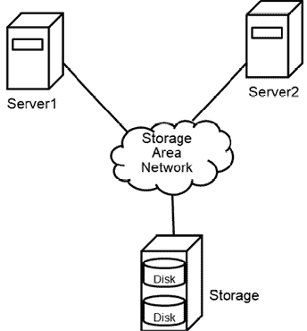

图 1：服务器、网络和存储系统

硬盘驱动器于 1956 年作为 IBM 系统的数据存储而推出。从那时起，存储技术不断发展以满足当今世界的需求。随着计算机、移动设备的进步以及互联网、社交媒体的普及，数字数据呈指数级增长。目前全球数据总量几乎是两年前的两倍。不仅数据量在增加，其关键性也在显著增加。这意味着几年后因数字数据丢失造成的影响将比今天更严重。同时，对数据访问速率的需求也在显著增加。

为了优化和提高资源共享效率，存储系统通常由多台服务器共享以存储其数据，因此拥有一个具有更高空间效率、性能和容错能力的现代存储系统非常重要。

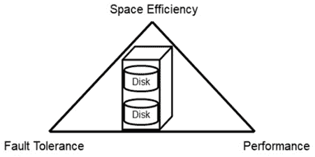

图 2：存储系统的三个方面

如果一个存储系统能够支持这三个方面的更高程度，则被认为是市场上最好的。

有趣的是，提升存储系统某一方面的大多数功能，都会以牺牲其他方面为代价。例如，`RAID 0` 提高了存储性能，但降低了容错能力；去重提高了存储效率，但影响性能。为存储供应商开发同时具备存储系统这三个方面的存储产品是一项挑战。

大多数存储供应商开发并销售多种存储应用程序，以管理存储系统的其他方面，例如性能、本地和远程复制、备份和数据恢复解决方案。

# 第 1 章：存储系统与解决方案

## 简介

计算机数据存储自 1950 年代以来一直在发展。早期的存储系统非常简单且基础。在那个年代，主机服务器直接连接到其存储设备。存储设备是计算机系统本身的组成部分。没有单独的系统用于远程存储数据的概念。随着时间的推移，为了更快、更高效地存储数据，存储系统已成为一个独立的实体，也可以由多台计算机共享以存储其数据。

## 结构

成功完成本章后，您将能够了解以下内容：

- 存储系统的类型
- 存储解决方案
- 超融合

## 目标

本章讨论不同类型的存储系统，以及小型、中型和大型组织中部署的数据存储技术和解决方案。您还将了解所有存储系统在解决方案中的使用优缺点。

## 存储系统的类型

有三种最流行的技术可用于将数据存储到存储系统上。存储系统根据主机服务器存储和访问数据的方式进行分类。

### 块存储

块存储为主机服务器提供原始块设备的访问。这些块由基于服务器的操作系统控制，每个块都可以单独格式化为所需的文件系统，例如 `NTFS` 和 `VMFS`。然后应用程序可以访问文件系统上的数据以进行读写操作。也有智能应用程序可用，它们可以直接访问原始卷，而无需任何文件系统。

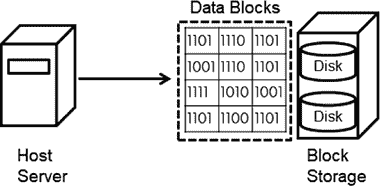

图 1.1：块存储

存储系统不了解存储在其中的数据，但操作系统和应用程序了解。以下是块存储的一些特性：

- 块存储主要用于结构化数据，例如关系数据库。主机服务器运行数据库，支持随机读/写操作。许多其他客户端系统通过网络访问运行在主机服务器上的应用程序。
- 这种级别的存储还可以为连接到它们的系统提供启动功能。
- 块级存储可用于存储文件，并可作为数据库、虚拟机 (VM) 文件系统等特殊应用程序的存储。
- 块级存储数据传输效率更高且更可靠。
- 每个存储卷都可被视为独立的磁盘驱动器，并可由外部服务器操作系统控制。块级存储使用 `Fibre Channel`、`iSCSI` 和 `FCoE` 通信协议进行数据传输，`SCSI 命令` 作为发起端和目标端之间的通信接口。

### 文件存储


 

在文件存储中，数据通过文件名及其目录位置在局域网（`LAN`）或广域网（`WAN`）上进行存储和访问。在文件级存储中，存储空间被配置为通过协议（如网络文件系统 `NFS`、服务器消息块 `SMB` 或通用互联网文件系统 `CIFS`）来访问文件。

文件存储系统在内部使用带有本地文件系统的块存储来存储这些文件，主机服务器仅拥有读取和写入这些文件的访问权限。文件存储主要部署在应用程序需要访问文件内部数据，或一群人需要在共享存储系统中存储文档、电子表格、演示文稿、音频和图像文件等场景中。

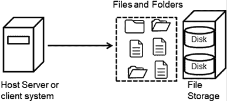

图 1.2：文件存储

访问文件存储上文件和文件夹的计算机系统称为 `NAS` 客户端。它们可以运行应用程序以读取和写入这些文件上的数据，其他客户端则通过网络访问该应用程序。例如，启用了虚拟化管理程序的操作系统可以在网络附属存储（`NAS`）共享上托管 `VMs`，客户端可以访问这些 `VMs`。

### 对象存储

对象存储是一种相对较新的存储系统类型，它将数据作为对象连同元数据和唯一标识符一起存储。这种存储主要在近几年发展起来，以支持在云、大数据和移动场景中存储海量非结构化数据。常作为对象存储的数据包括歌曲、图像和视频片段。云中对象存储的一些示例有 Amazon Simple Storage Service（`S3`）、Azure Blob Storage 和 Google Cloud Storage。

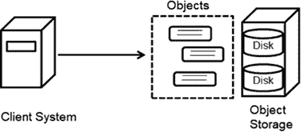

图 1.3：对象存储

基于 `HTTP` 的表述性状态传输（`REST`）`API` 用于在客户端系统之间传输对象。

## 存储解决方案

构成解决方案以存储和保护数字数据的硬件和软件组件称为存储解决方案。存储解决方案具有以下两个主要组件：

- **存储系统**：存储系统是通过网络连接到计算机用于存储数据的硬件设备。存储磁盘阵列是存储系统的一个例子。

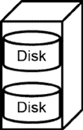

图 1.4：存储系统

- **主机服务器**：在这些计算机服务器上运行的应用程序，对存储在存储系统上的数据执行读写操作。这也称为应用服务器、主机计算机，或简称为主机或服务器。


图 1.5：主机服务器

存储解决方案通过将一台或多台主机服务器连接到存储系统而形成。

### 存储解决方案的类型

存储解决方案通常按两种方式分类：

- 基于存储系统如何连接到主机服务器。
- 基于部署解决方案的配置和复杂程度。

组织选择的存储解决方案类型主要由需求驱动。解决方案中存储系统类型的选择及其与主机服务器的连接方式也随之确定。

在上一节中，我们了解到三种最流行的存储系统技术是块存储、文件存储和对象存储。存储系统也主要基于这些技术进行识别。

#### 存储区域网络

块存储部署在存储区域网络（`SAN`）中。通常，`SAN` 存储解决方案与其他存储解决方案相比较为复杂且昂贵。`SAN` 通常部署在企业内部，用于托管需要高性能和高数据可用性的业务关键型应用程序。由于块存储通常在 `SAN` 中连接，因此它们常被称为 `SAN` 存储。在 `SAN` 存储解决方案中，文件系统是在主机服务器内创建的。因此，具有不同操作系统和文件系统的不同主机服务器可以共享同一个存储系统。

#### 网络附属存储

文件级存储部署在以太网网络环境中。该解决方案通常称为网络附属存储（`NAS`）存储解决方案。由于文件存储在存储系统上，文件系统是在其中创建的。

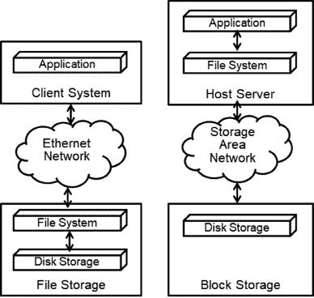

图 1.6：NAS 存储解决方案和 SAN 存储解决方案

#### 直连存储

在直连存储（`DAS`）中，磁盘存储直接连接到主机服务器。`DAS` 支持对数据的块访问，就像 `SAN` 一样。该解决方案易于管理且成本较低。由于多种限制，如今不太多公司大量使用这种存储。这些限制主要是磁盘空间利用率低效（因无法跨多台服务器共享）、无存储虚拟化等。

尽管这是一种传统的存储解决方案，但如今，由于软件定义存储的采用（将在后续章节讨论），这种存储解决方案正变得流行起来。

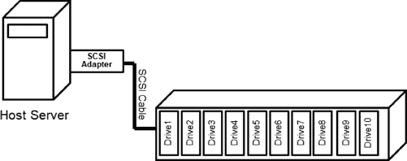

图 1.7：DAS 存储解决方案

`DAS` 存储解决方案有几种模型：

- 带有内置内部磁盘机箱的服务器。
- 带有外部磁盘机箱的服务器。
- 同时具有内部和外部机箱的服务器。

带有内置内部磁盘机箱的 `DAS` 存储可节省机架空间和电力。然而，对于额外的磁盘空间，需要连接外部磁盘机箱。

在 `DAS` 存储解决方案中，磁盘存储、文件系统和应用程序所有层都属于主机服务器。因此，所有资源专用于单台服务器，无法与其他主机服务器共享。

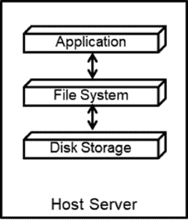

图 1.8：DAS 协议栈

#### 所有数据最终都以块形式存储

主机服务器或客户端系统通过不同的协议访问存储系统，并以不同方式存储数据。例如，客户端系统访问文件存储来存储文件。这是因为文件存储设计为通过 `IP` 网络接口使用 `CIFS` 或 `NFS` 协议进行通信。在这里，从客户端系统的角度来看，数据作为文件存储；但在文件存储内部，文件驻留在文件系统上。文件存储中的文件系统将磁盘上的一组数据块作为文件呈现给客户端系统，文件系统之下是存储块。

尽管存储类型由为客户端或主机服务器设计的接口和通信协议决定，但从根本上说，每种存储都是块存储。

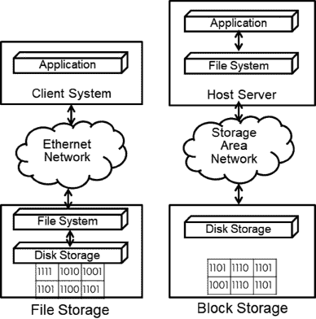

图 1.9：数据存储技术

#### 云存储

通常，大型企业对象存储系统部署在数据中心，并通过互联网为客户端计算机和移动设备提供访问权限以存储其数据。这种服务模式称为云存储。

用户能够从世界任何地方访问数据，这是一大优势。通常，个人文件（如图片、视频和归档数据）存储在云存储中，但业务关键型应用程序数据一般不存储于此，因为后者需要更快的响应时间。

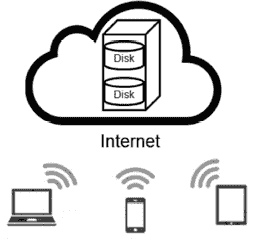

图 1.10：云存储

云服务提供商通过在存储系统中实施各种数据保护解决方案，确保用户的数据可用性。通常，服务提供商会向用户收取该服务的费用。

#### 基于部署的存储解决方案

存储解决方案也可以根据部署解决方案的配置和复杂程度进行分类：

- 入门级存储解决方案：


 

### 入门级存储解决方案

当组织需要存储较少量的数据时，会部署此存储解决方案。通常，此解决方案使用 `DAS` 或基本的 `SAN` 或 `NAS` 存储来实现。在 `DAS` 解决方案中，存储设备可以是主机服务器内部的，也可以是外部的。这易于管理且是一种低成本解决方案。它有几个局限性，例如，任何组件的故障都可能导致数据丢失、性能低下，且存储容量只能扩展到几太字节 (`TBs`)。

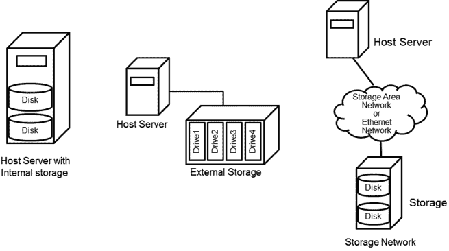

图 1.11：入门级存储解决方案

### 中端存储解决方案

当组织需要存储约数百 `TBs` 时，会部署中端存储解决方案。通常，此解决方案使用 `SAN` 或 `NAS` 存储以及集群模式的主机服务器来实现，以实现高可用性。这易于管理且是一种低成本解决方案。它有几个局限性，例如，任何组件的故障都可能导致数据丢失、性能低下，且存储容量只能扩展到几 `TBs`。

如果主机服务器采用集群配置以实现高可用性，则每个存储卷都会提供给集群中的所有主机服务器访问，以便如果任何主机服务器发生故障，其他服务器可以继续访问该卷上的数据。由于该卷在多个服务器之间共享，因此此卷访问配置称为共享卷。

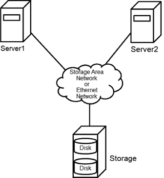

图 1.12：中端存储解决方案

一些存储供应商组装所有必需的硬件、预配置软件并在工厂进行微调，以整合所有解决方案供即买即用，并将其作为单个库存单位 (`SKU`) 产品出售。这称为融合基础设施或融合系统。

### 企业级存储解决方案

数据中心是一个具备充足电力、空间和制冷设施的场所，用于部署计算机服务器、存储系统和网络交换机，以存储和处理海量数据。

大型企业组织在数据中心运行其业务关键应用程序，以存储和处理数百 PB (petabytes) 的数据。为了高可用性和灾难恢复，企业组织还会在另一个位于不同站点的数据中心部署一套类似的硬件，称为远程站点或辅助站点。

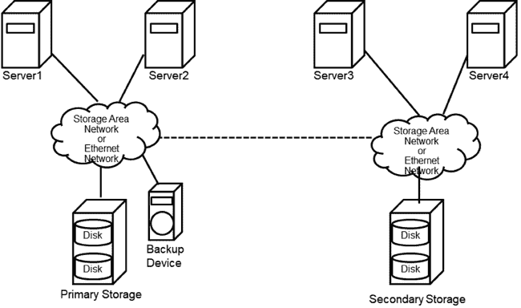

图 1.13：企业级存储解决方案

虽然每个存储解决方案都需要备有备份解决方案以便在发生意外丢失时恢复数据，但企业级存储解决方案实施的备份解决方案会在不同时间间隔于不同系统中创建其关键数据的多个副本。

### 超融合

信息技术 (`IT`) 行业自 20 世纪中叶以来一直在不断发展。`XT/AT` `PCs` 在 1980 年代和 1990 年代投入使用，计算机网络在 1990 年代和 2000 年代出现。此外，`SAN` 在 2000 年代至 2010 年代流行起来，最后 `VM` 在 2010 年代投入使用。在这一演变过程中，数据中心开始拥有多台服务器、存储设备、集群、交换机和线缆，导致管理、部署、空间和功耗方面的低效。

超融合基础设施 (`HCI`) 是一种采用以软件为中心的架构的基础设施系统，可将计算、存储、网络和虚拟化资源紧密集成。这源自前一节讨论的融合系统概念。与融合系统不同，`HCI` 中使用的技术无法拆分为独立组件。例如，在融合系统中，存储和服务器仍然是独立的硬件设备，而在 `HCI` 中，解决方案是在软件中实现的。

超融合系统通常作为软件或预装在硬件设备上的软件出售。该软件安装在现有硬件或任何通用硬件设备上。

所有资源都在单个系统内整合，以提高管理、部署、空间占用和功耗的效率。为便于管理，`HCI` 供应商提供单一管理应用程序，用于管理超融合系统中的内置技术，如计算、存储网络和虚拟化。

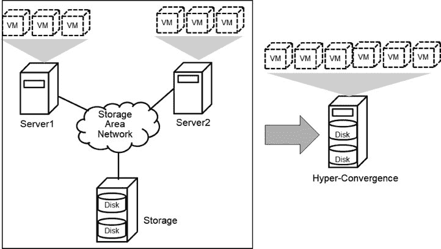

图 1.14：HCI

超融合旨在运行 `VM`，应用程序安装在 `VMs` 内部。

对于高可用性解决方案和更多的横向扩展资源需求，多个超融合系统可以组合在一起，称为超融合系统集群。每个系统称为节点。一旦 `VMs` 的数量达到容量上限，横向扩展就很容易，只需添加包含更多计算、存储和网络资源的节点即可。

虚拟桌面基础设施 (`VDI`) 是一种基础设施部署技术，它在数据中心的集中式服务器和存储上托管桌面操作系统。许多存储供应商设计、构建并销售超融合产品，以部署和支持 `VDI` 需求。

超融合产品不适用于要求高性能并支持数千用户的业务关键应用程序。

## 总结

存储系统和存储解决方案经过数十年的发展，以满足不同的业务目标和用例。存储解决方案的主要组件包括存储系统、主机服务器、交换机、`HBA` 和管理软件。所有这些硬件组件均通过管理软件连接和配置，以部署存储解决方案。

存储系统根据数据存储和访问所用的技术进行分类；这些存储系统包括 `block`（块）、`file`（文件）和 `object storage`（对象存储）。

下表显示了所有这些类型存储系统的对比：

| | `Block storage` | `File storage` | `Object storage` |
| --- | --- | --- | --- |
| `Storage solution` | `SAN` | `NAS` | `Cloud` |
| `Access data unit` | `Blocks` | `Files` | `Objects` |
| `Host server or client system` | In-house or within data center | `LAN` or `WAN` | Internet |
| `Communication protocol` | `SCSI` on `Fibre Channel`, `iSCSI` | `CIFS/SMB` and `NFS` | `REST` over `HTTP` |
| `Recommended for` | Structured data (relational databases) and random and frequent read/write operations | Unstructured data and shared files and folders | Unstructured data with less updates |
| `Advantages` | High performance | Simplified access and management | Scalable and distributed access |

表 1.1：块存储、文件存储和对象存储

通常，主机服务器在数据中心内访问 `block storage`（块存储）。它们通过 `Fibre Channel`（光纤通道）或 `iSCSI` 协议访问。客户端系统通过局域网或广域网使用 `SMB/CIFS` 或 `NFS` 协议访问 `file storage`（文件存储），移动设备通过互联网使用 `RESTful API` 访问 `object storage`（对象存储）。

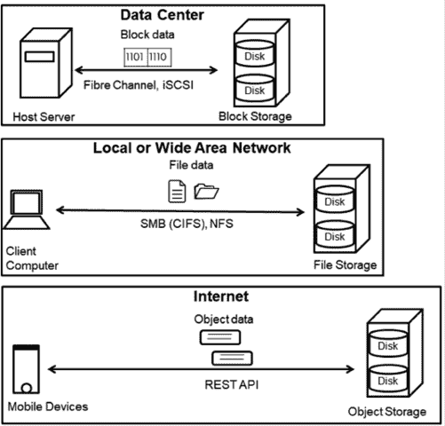

图 1.15：块、文件和对象存储系统

根据组织的需求，存储解决方案使用所需类型的存储系统构建；这些解决方案包括 `SAN`、`NAS`、`DAS` 和 `cloud storage`（云存储）。每种解决方案相对于其他解决方案都有其优势和局限性。例如，通常 `SAN` 解决方案提供高性能，但需要高成本、复杂的管理；另一方面，`DAS` 解决方案成本低、管理简单，但性能可能达不到 `SAN` 解决方案的水平。

尽管在不同类型的存储系统上存储和访问数据的机制不同，但所有这些存储系统的大部分设计和实现是通用的。因此，如今大多数存储供应商在单个存储系统中制作 `block`（块）、`file`（文件）和 `object`（对象）存储。下一章将详细描述存储磁盘阵列。

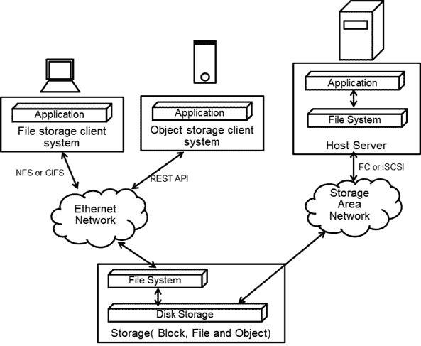

图 1.16：同一存储系统上的块、文件和对象

## 案例研究


### 案例研究 1：用户主目录的存储解决方案

让我们来看看用户主目录的存储解决方案：

#### 需求

贵公司约有 1,000 名员工。每位员工在笔记本电脑和台式机上平均拥有 7 到 8GB 的文件，如演示文稿、电子表格、Word 文档和 PDF 文档。公司计划部署一个存储解决方案来整合并集中管理这些文件。请描述适合此需求的存储解决方案。

#### 分析

由于需求仅是存储文件，中端 NAS 解决方案将是最合适的解决方案。可建议存储系统采用 10GB 网络速度，以实现多用户的快速可靠访问。当前的文件存储需要约 `1000 x 10GB =~ 10TB` 的可用容量。考虑到未来增长，建议至少配备两倍于此存储大小的容量。

#### 解决方案

需要采购约 20TB 可用空间的文件存储来部署 NAS 解决方案。所有员工均可通过以太网网络访问存储系统。拟议存储解决方案的示意图如下所示：

存储类型：文件存储

存储解决方案：中端 NAS 解决方案

可用容量：20TB

访问带宽：10GB/s

每位员工的空间配额：20GB

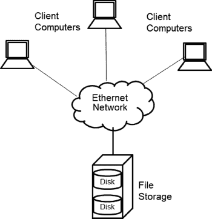

图 1.17：用户主目录的存储解决方案

### 案例研究 2：集群主机服务器解决方案上的 MSSQL 数据库应用

让我们来看看集群主机服务器解决方案上的 MSSQL 数据库应用：

#### 需求

某组织希望从独立 DAS 解决方案上的遗留数据库应用迁移到高可用集群主机服务器环境中的 MSSQL 应用。数据库大小约为 30TB，请描述适合此需求的存储解决方案。

#### 分析

要运行数据库应用，主机服务器需要更快地访问存储系统。从性能角度来看，中端 SAN 解决方案将是最合适的解决方案。集群中的主机服务器也可以共享存储系统的空间。考虑到未来增长，建议采用 50TB 容量的存储。

#### 解决方案

需要采购约 50TB 可用空间的块存储。要部署 SAN 解决方案，还需要为主机服务器采购 FC HBA、FC 交换机以及线缆和连接器。拟议存储解决方案的示意图如下：

存储类型：块存储

存储解决方案：中端 SAN 解决方案

可用容量：50TB

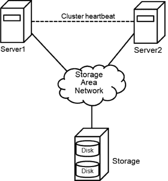

图 1.18：主机服务器集群的存储解决方案

### 案例研究 3：用于测试和开发目的的虚拟机

让我们来看看用于测试和开发目的的虚拟机：

#### 需求

某软件供应商希望为其员工部署虚拟机，用于测试和开发活动。共有约 500 名员工，工作区大小约为 100GB。请描述适合此需求的存储解决方案。

#### 分析

部署虚拟机的最佳存储解决方案是 HCI。超融合系统预装、预配置并经过调优，可用于部署虚拟机。

该系统在空间和功耗方面也很高效。初始容量需求约为 `500 x 100GB =~ 50TB`。

#### 解决方案

可采购约 50TB 空间的高端超融合系统来部署 HCI 环境。如果供应商不支持在单个超融合系统上运行 500 个虚拟机，则可采购多个超融合系统并将它们组成集群，以实现负载均衡，并在发生任何系统故障时实现虚拟机故障转移。

## 学习检查

### 客观题

1. 存储的能力主要通过以下哪项衡量：

   a. 容错性

   b. 性能

   c. 空间效率

   d. 以上全部

2. 专用 NAS 操作系统需要哪两个子组件？（选择两项）

   a. 文件系统

   b. 用户界面

   c. 进程调度器

   d. 通信协议

3. 哪种类型的存储提供卓越的性能：

   a. DAS

   b. NAS

   c. SAN

   d. 以上全部

4. 从以下列表中，DAS 的主要缺点是什么？

   a. 可扩展性

   b. 成本

   c. 可管理性

   d. 以上全部

5. 云存储服务最适用于：

   a. 业务关键型应用数据

   b. 个人数据——照片、视频

   c. OLTP 工作负载

   d. 以上全部

6. 根据其关联性排列这些术语：

   块存储、对象存储、SAN、DAS、云、入门级存储解决方案、高性能、低成本、可扩展。

   a. 块存储 – SAN - 高性能；对象存储 – DAS – 高性能；块存储 – DAS – 云

   b. 块存储 – DAS - 高性能；对象存储 – 云 - 可扩展；块存储 – DAS – 低成本

   c. 块存储 – 云 - 可扩展；对象存储 – SAN – 高性能；块存储 – DAS – 入门级存储解决方案

   d. 块存储 – SAN - 高性能；对象存储 – 云 - 可扩展；块存储 – DAS – 入门级存储解决方案

7. 超融合是一种紧密集成以下内容的基础设施系统：

   a. 计算

   b. 存储

   c. 网络

   d. 以上全部

8. 超融合产品可以构建在：

   a. 专用存储阵列

   b. 厂商专用硬件

   c. 通用服务器硬件

   d. 硬盘驱动器

9. 哪种存储包含文件系统层：

   a. DAS

   b. NAS

   c. SAN

   d. 以上全部

### 简答题

1. 描述 SAN、NAS 和 DAS 存储解决方案的优缺点。

2. 解释对象存储的用例以及部署这种存储的存储解决方案。

3. 描述存储系统的类型及其在相关解决方案中的用途。

4. 解释数据在存储系统中最终如何作为块存储。

### 测验题

1. 虽然有不同类型的存储系统，即块、文件和对象存储，但存储系统中的数据最终是否总是作为块存储的？

2. 在 NAS 存储解决方案中，文件系统位于何处？

3. 超融合是存储系统的整合还是存储解决方案的整合？

## 术语表和关键术语

- **主机**：运行应用程序并访问存储卷以存储数据的服务器。也是存储系统中代表主机服务器的逻辑实体。虚拟卷被提供访问权限。

- **主机服务器**：访问存储系统以存储数据并对存储系统执行 I/O 操作的应用服务器。

- **客户端系统**：类似于主机服务器，但访问存储系统上的文件或对象。它不为其他计算机提供服务。

- **存储系统**：连接到存储控制器的磁盘池，用于存储数据并处理来自主机服务器的 I/O 请求。

- **块存储**：主机服务器跨块读取和写入数据的存储系统类型。

- **文件存储**：客户端系统在其上读取和写入共享文件的存储系统类型。

- **对象存储**：允许客户端系统将数据作为对象存储的存储系统类型。对象包含数据以及元数据和唯一标识符。

- **SAN**：SAN，存储设备和发起程序的网络，用于存储和检索数据。

- **NAS**：NAS，包含文件系统的存储系统。客户端通过网络访问存储在该存储上的文件。

- **DAS**：DAS，直接连接到主机计算机的存储。

- **存储解决方案**：存储解决方案由主机服务器、存储系统、交换机、HBA、线缆和连接器以及存储管理软件组成，为组织存储应用程序数据提供解决方案。

- **云存储**：通常部署多个对象存储并连接到互联网。包括移动设备、平板电脑、PC 在内的所有客户端计算机均可访问该存储以将数据作为对象存储。


• **VDI**：VDI 是一种基础设施部署环境，用户可在其中访问具有不同操作系统和配置的多个虚拟机。

• **HCI**：在单个系统内整合并融合的解决方案，用于托管 VDI 环境的虚拟机。

• **融合系统**：融合系统是指在单个机架中预先组装、预先配置并调优好的存储和主机服务器。

• **数据中心**：一个拥有足够空间、电力和制冷设施，用于部署和安装大型存储和服务器解决方案的场所。

> **加入我们的 Discord 空间**
>
> 加入我们的 Discord 工作区，获取最新资讯、优惠、全球技术动态、新版本发布以及与作者的交流会议：
>
> [`discord.bpbonline.com`](https://discord.bpbonline.com)
>
> 

# 第 2 章：存储基础设施

## 简介

随着存储虚拟化的发展，当今的基础设施更多地是由软件驱动而非硬件驱动。然而，硬件和软件组件在存储解决方案中都发挥着重要作用。软件不仅用于管理硬件，而且每项存储特性和功能都是通过软件实现的。因此，两者紧密集成以提供所需的解决方案。固件是一种软件，通常涉及基本的低级操作，使硬件设备能够正常工作。在存储解决方案中，几乎所有硬件组件都嵌入了固件。

## 结构

完成本章学习后，您将能够了解存储基础设施的以下关键领域：

• 存储、网络和主机层
• 存储系统的物理布局和组件
• 网络硬件组件
• 主机服务器
• 主机总线适配器
• 软件定义存储
• 存储基础设施安全
• 存储基础设施管理

## 目标

在本章中，您将了解在数据中心中部署和配置的不同硬件设备和软件组件，以实现存储解决方案。

本章解释了存储系统的所有物理组件及其内部连接，以及存储网络和主机服务器的存储组件。

此外，本章还解释了存储软件定义存储 (SDS) 的概念。

## 构建存储解决方案

存储解决方案通过网络将一台或多台主机服务器与存储系统连接来实现。该网络由光纤通道 (FC) 或以太网交换机组成。

广义上讲，构建存储解决方案使用以下五类硬件和软件：

• **存储系统**：存储系统是一种通过网络连接到计算机以存储数据的硬件设备。存储磁盘阵列是存储系统的一个例子。存储磁盘阵列拥有一组磁盘驱动器，用于存储大量数据。虽然磁盘阵列常被称为存储系统，但备份和磁带设备也被称为存储系统。

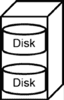

*图 2.1：存储系统*

备份和磁带设备用于存储主数据的副本；计算机内存和其他计算机内部存储不称为存储系统。

在存储解决方案中，存储系统是目标设备。

• **主机服务器**：在这些计算机服务器上运行的应用程序对存储在存储系统上的数据执行读写操作。这也称为应用服务器、主机计算机或简称为主机。

在存储解决方案中，主机服务器是发起设备。

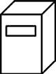

*图 2.2：主机服务器*

在某些存储解决方案中，主机服务器不托管任何应用程序，而是直接访问存储系统，这些被称为客户端系统。例如，手机访问对象存储系统进行读写操作。在这里，手机是一个客户端系统。

• **交换机**：主机服务器和存储系统连接到交换机以形成网络。网络允许主机服务器与存储系统通信。此网络不用于主机服务器之间的通信。


*图 2.3：交换机*

• **主机总线适配器 (HBA)**：这是安装在主机服务器内部以连接到交换机的适配器。第 5 章“共享存储的存储网络”将详细讨论该组件。HBA 一词主要用于 FC 环境。在 NAS 解决方案中，主机服务器本身的网络接口卡 (NIC) 可用作 HBA。


*图 2.4：主机总线适配器 (HBA)*

• **管理软件应用程序**：需要一套软件产品来管理和监控存储解决方案。没有这组软件产品，存储解决方案就是不完整的。使用管理软件，存储管理员创建存储卷并提供对主机服务器的访问。然后配置应用程序将其数据存储到卷上。

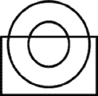

*图 2.5：管理软件*

## 硬件和软件组件栈

为了更详细地了解存储解决方案的每个组件，让我们将解决方案分为三个不同的层——存储层、网络层和主机层。下表列出了每层的硬件、固件和软件组件：

| 层 | 硬件 | 固件和软件 |
|-------|----------|----------------------|
| 主机 | 主机服务器、HBA、小型可插拔封装 (SFP) | HBA 固件和驱动程序、适配器管理软件、多路径驱动程序、存储工具 |
| 网络 | FC 交换机或局域网交换机、SFP、线缆和连接器 | 交换机固件、交换机管理软件 |
| 存储 | 磁盘阵列控制器、物理磁盘驱动器、磁盘机箱、后端交换机和连接器 | 磁盘阵列控制器固件、磁盘固件、存储系统管理软件、性能调优和监控软件、快照管理软件、复制管理软件、数据保护和恢复软件 |

*表 2.1：存储硬件和软件组件栈*

存储解决方案涉及四种主要类型的供应商——存储供应商、交换机供应商、服务器供应商和 HBA 供应商。固件和软件仅由相应的硬件供应商开发。

## 存储磁盘阵列的物理布局

通常，任何存储磁盘阵列都包含以下六个硬件组件：

• 机架
• 后端
• 交换机
• 控制器
• 硬盘机箱
• 磁盘驱动器

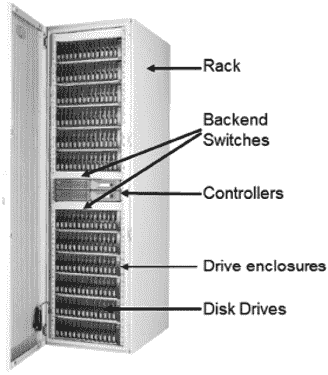

*图 2.6：存储系统硬件组件*

### 存储控制器

处理来自主机服务器的 I/O 请求并对后端物理磁盘驱动器执行读写操作的主要硬件组件。不同供应商对该组件有不同的称呼——节点、存储处理器等。

控制器本身就是一台计算机，包含：

• CPU
• 内存
• 用于更快存储用户数据的缓存内存
• 专用集成电路 (ASIC)
• 定制操作系统，也称为固件
• 接口或端口——通常，一个控制器具有：
  - 前端或主机端口——用于连接到网络或 FC 交换机
  - 后端或设备端口——用于连接到硬盘机箱
  - 镜像或心跳端口——将所有控制器互连在一起

一些供应商制造带有指定端口的控制器，而另一些供应商允许用户根据需求配置端口。任何控制器中的端口数量取决于供应商的产品设计及其型号。

大多数供应商的存储系统中有两个或更多控制器，以通过负载均衡获得更好的容错能力和性能。

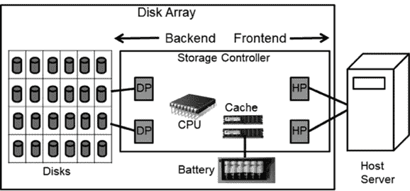

*图 2.7：存储控制器组件*

在上图中，HP 代表主机端口，DP 代表设备端口。不同的存储供应商对这些端口使用不同的名称。

### 物理磁盘驱动器


## 存储系统硬件组件

### 硬盘驱动器 (HDD)

存储系统最关键的硬件组件是硬盘驱动器，它本质上存储用户数据。

磁盘拥有以每分钟转数 (`RPM`) 表示速度旋转的盘片。这是盘片在一分钟内完成完整旋转的次数。磁头固定在臂上，用于从盘片读取和写入数据。由于磁盘臂和磁头固定在一个位置，它经常需要等待盘片旋转到正确的位置。常见的 `RPM` 值为消费级串行高级技术附件 (`SATA`) 磁盘的 5400 或 7200，以及高性能服务器/存储区域网络 (`SAN`) 磁盘的 10000 或 15000。

主要有两种类型的硬盘驱动器可用：

- **小规格 (`SFF`)**，2.5 英寸磁盘
- **大规格 (`LFF`)**，3.5 英寸磁盘

与 `LFF` 相比，`SFF` 磁盘消耗的电力和空间更少。`SFF` 磁盘通常成本较高，采用串行连接 SCSI (`SAS`) 接口，用于高负载环境。`LFF` 磁盘成本较低，采用 `SATA` 接口，用于大容量存储。

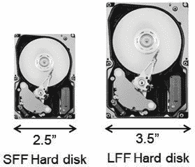

*图 2.8：SFF 和 LFF 硬盘驱动器*

每个硬盘驱动器都有一个运行固件的印刷电路板 (`PCB`)。当硬盘驱动器通电时，固件会检查驱动器各部分的健康状况，发送命令启动电机，并稳定和监控转速。这就是驱动器准备好接受来自存储控制器的读/写命令的方式。

硬盘以磁场的形式存储 0 和 1。硬盘的圆形部分称为盘片，盘片上微小的磁化区域存储一位数据。要在硬盘上写入数据，需在微小区域施加南北 (`N-S`) 或北南 (`S-N`) 极性的磁场。极性模式代表 1 或 0。

例如，反转 (`N-S` 到 `S-N` 或 `S-N` 到 `N-S`) 代表 1，而相同极性 (`N-S` 到 `N-S` 或 `S-N` 到 `S-N`) 代表 0。

### 固态硬盘 (SSD)

固态硬盘 (`SSD`) 没有移动的机械部件，如硬盘驱动器 (`HDD`) 中的盘片或电机。`SSD` 性能显著高于传统机电磁盘驱动器。

最近，`SSD` 使用非易失性 `NAND` 闪存。一种特殊的金属-氧化物-半导体场效应晶体管 (`MOSFET`)，称为浮栅晶体管，由高电阻层隔离，用于永久捕获带电电子。每个晶体管可存储一位。如果单元未充电则代表 1，如果已充电则代表 0。

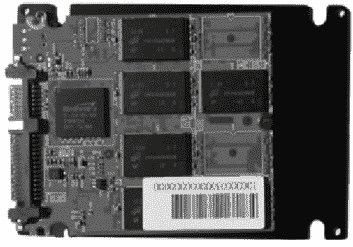

*图 2.9：SSD*

设计并使用全 `SSD` 驱动器的存储系统也称为全闪存阵列 (`AFA`)。

### 存储级内存

在计算机系统中，与其他主要组件（如 `CPU` 或 `DRAM` 内存）相比，存储设备是最慢的组件。通常，`DRAM` 以高性能、高成本但低容量著称。另一方面，`SSD` 和 `HDD` 等存储以高容量、低成本但性能低于 `DRAM` 著称。存储级内存 (`SCM`) 是一种内存类型，其容量和价格类似于存储，但性能类似于内存。

假设 `CPU` 以秒为单位运行；在这种情况下，从 `DRAM` 获取数据需要几分钟，而从 `HDD` 获取数据则需要几个月。因此，与 `CPU` 和 `DRAM` 相比，`HDD` 是一个明显较慢的设备。

虽然 `SSD` 现在已将这一差距缩小到一天以内，但分钟和一天之间仍有巨大差异，因为 `SSD` 比 `DRAM` 慢约 1000 倍。`SCM` 将其降低到约 100 倍，仅需几小时。

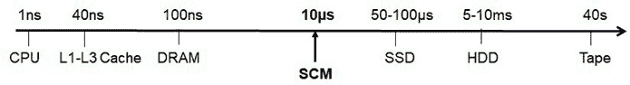

*图 2.10：内存和存储设备的延迟*

最近，大多数存储厂商计划在其存储系统中实施 `SCM`。基于迄今为止存储设备的演进，预测 `SCM` 未来可能成为主存储，而 `SSD` 可能用作数据归档的辅助存储。

#### 存储设备的演进

| 年份 | 计算 | 内存 | 主存储 | 辅助存储 |
|------|---------|-----|-----------------|-------------------|
| 1990 年代 | CPU | DRAM | HDD | 磁带 |
| 2010 年代 | CPU | DRAM | SSD | HDD |
| 2030 年代 (预测) | CPU | DRAM | SCM | SSD |

*表 2.2：存储设备的演进*

### 非易失性内存表达

基于 `ATA` 和 `SCSI` 的协议仅支持单个队列。因此，对于访问 `NAND` 闪存和 `SCM` 等高速存储介质，这些协议已成为瓶颈。非易失性内存表达 (`NVMe`) 是专门为这些存储设备设计的存储协议。

虽然 `SATA` 和 `SAS` 协议最适合旋转 `HDD`，但 `NVMe` 协议适合 `NAND` 闪存和 `SCM`。`NVMe` 协议通过 PCI Express (`PCIe`) 总线上的大量并行操作提供低延迟、高性能。由于接口速度、新存储介质的性能以及靠近 `CPU`，`PCIe` 成为 `NVMe` 协议更好的存储接口选择。`NVMe` 是一种针对 `NUMA` 优化的协议，允许多个 `CPU` 核心共享队列的所有权、优先级，以及仲裁机制和命令的原子性。

如下图 `PCIe` 拓扑所示，`NVMe` 磁盘子系统是一个 `PCIe` 端点，主要包含两个组件：`NVMe` 控制器和 `NVM`。

主机与 `NVMe` 控制器交互以发送读、写、系统调用请求，控制器随即访问连接到它的设备以执行块 I/O (`BI/O`)。

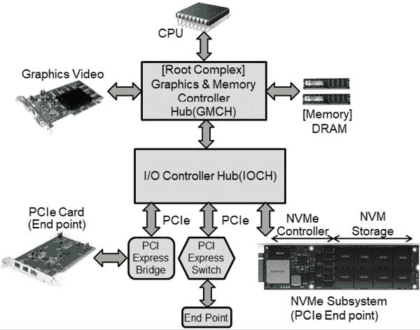

*图 2.12：NVMe 拓扑*

图形和内存控制器中心 (`GMCH`) 也称为内存桥接器、内存中心或北桥。I/O 控制器中心 (`I/OCH`) 也称为 I/O 桥接器、I/O 中心或南桥。

虽然从根本上说 `PCIe` 总线上的数据传输是串行的，但有了 `NVMe`，每个命令和数据传输都通过多条 `PCI` 通道、多核 `CPU` 和对 `NAND` 设备的并行访问大规模并行发生。这就是 `NVMe` 实现极高带宽的方式。

```
 
crw------- 1 root root 245, 0 Mar 30 21:07 /dev/nvme0
brw-rw---- 1 root disk 259, 0 Mar 30 21:07 /dev/nvme0n1
brw-rw---- 1 root disk 259, 1 Mar 30 21:07 /dev/nvme0n2
```

`/dev/nvme0` 是 `NVMe` 控制器的字符特殊文件，而 `/dev/nvme0n1` 和 `/dev/nvme0n2` 是连接到控制器的块设备的两个块特殊文件。

由于基于 `NVMe` 闪存的磁盘访问更快，采用了以下用例和部署模型：

1. 客户端计算机的启动磁盘
2. 服务器的内部存储磁盘
3. 服务器用于频繁使用数据的缓存内存
4. 存储系统的后端磁盘

最近，大多数存储厂商正在设计其存储系统以支持基于 `NVMe` 的磁盘，以避免后端的任何磁盘瓶颈并提高整体存储性能。

#### 命名空间

命名空间是连接到 `NVMe` 控制器的设备的块集合。这类似于文件系统分区，用于更好地管理存储空间。

以下是命名空间的一些特性：

- 从内核角度来看，命名空间只是扇区的线性序列。
- 每个命名空间都有一个 ID。
- 命名空间在闪存上创建并连接到 `NVMe` 控制器。
- `NVMe` 最多可支持 64K 个 I/O 队列，每个队列可包含 64K 个命令。而 `SAS` 和 `SATA` 只能支持单个队列，分别最多可有 254 和 32 个命令。
- 每个控制器每个命名空间最多可有 64K 个队列 (`2¹⁶ = 65535`)。总共支持 (`2³² = 2¹⁶ x 2¹⁶`) 个命令。
- 有两种类型的队列：用于控制器管理获取和设置的管理队列，以及用于 `NAND` 读/写的 I/O 队列。

#### 网络结构上的 NVMe

`NVMe` 设计用于通过 `PCIe` 总线在本地使用。因此，`NVMe` 的初始部署是作为计算机中的本地磁盘、服务器中的直连存储 (`DAS`) 以及存储系统中的后端磁盘。


### NVMe over Fabrics (NVMe-oF)

- NVMe-oF 协议与 NVMe 协议类似，旨在使基于 NVMe 的命令能够通过网络在主机计算机和目标固态存储设备之间传输数据。该网络可以是 FC、以太网或 InfiniBand。
- 本地 NVMe 通过 PCIe 总线将命令和响应映射到主机中的共享内存。NVMe-oF 使用基于消息的模型进行主机与目标存储设备之间的通信。
- NVMe-oF 支持使用替代 PCIe 的传输方式，扩展了 NVMe 主机设备与 NVMe 存储驱动器之间的距离。这包括为基于 SSD 的存储系统启用前端接口，以便与 NVMe 主机通信。

### HDD 容量测量

硬盘驱动器制造商定义：1000 字节 = 1 KB，1000 KB = 1 MB，1000 MB = 1 GB = 10 亿字节。

而操作系统（即计算机）以 2 的幂次方数值显示，因此，1 千兆字节 (GB) 实际上是 1024 X 1024 X 1024 字节。

- **实际容量：**
  = 标称或制造商容量 X (1000/1024) X (1000/1024) X (1000/1024)
  = 标称或制造商容量 X 0.93

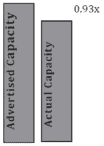

图 2.13：标称容量与实际容量对比

- **示例：**
  - 300GB 的格式化容量等于 300GB X 0.93 = 279GB
  - 1TB 或 1000GB 的格式化容量等于 1000GB X 0.93 = 931GB

容量越大，标称值与实际容量之间的差异就越高。

在某种程度上，旧存储系统错误地使用了 GB，但其含义却是 1024 X 1024 X 1024 字节。根据美国国家标准与技术研究院 (NIST) 的规定，1024 X 1024 X 1024 基本上是 GiB，而非 GB。所有现代存储系统均使用以下单位，定义见 [`http://physics.nist.gov/cuu/Units/binary.html`](http://physics.nist.gov/cuu/Units/binary.html)。

| 单位 | 缩写 | 字节数 |
| --- | --- | --- |
| kibibyte | KiB | 1024 |
| Mebibyte | MiB | 1024 X 1024 |
| Gibibyte | GiB | 1024 X 1024 X 1024 |
| Tebibyte | TiB | 1024 X 1024 X 1024 X 1024 |

表 2.3：存储容量单位

### 硬盘机箱

它是一个包含物理磁盘驱动器池或阵列的机箱。硬盘机箱也称为磁盘柜 (JBOD，Just a Bunch of Disks)。通常，所有存储阵列都支持多个机箱。

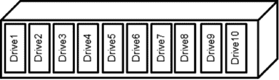

图 2.14：磁盘机箱 (JBOD)

可安装的驱动器数量及驱动器的方向取决于设计 JBOD 的供应商。所有驱动器均通过背板连接到后部的两个 I/O 模块。固件运行在 I/O 模块内部。使用两个 I/O 模块是为了提供容错和负载均衡能力。

JBOD 使存储系统模块化，因为它允许组织最初购买所需数量的存储。以后，他们可以根据需要购买带机箱的磁盘以扩展存储空间。

由于机箱中包含一组物理磁盘，整个存储系统通常被称为存储阵列或阵列。

### 后端交换机或背板互连

不同供应商的存储系统设计使用不同的技术将物理驱动器连接到控制器。一些供应商通过级联线缆或交换机连接物理驱动器，而另一些则通过背板电路板连接。存储控制器的设备端口连接到这些交换机或背板。同样，磁盘驱动器也连接到这些交换机或背板。

控制器从前端的主机服务器接收的数据经过处理后，传递到后端以存储到相应的磁盘驱动器上。

### 线缆和连接器

线缆和连接器主要用于连接硬盘机箱、电源等。通常使用两根或更多线缆连接一个磁盘机箱，以增加带宽、实现负载均衡，并因线缆故障提供容错能力。

大型或高端存储磁盘阵列可能具有长而复杂的布线，而较小的磁盘阵列可能具有短而简单的布线。

### 机架

这是一个类似冰箱的箱体，所有硬件组件均安装其中，包括存储控制器和硬盘机箱。这确保了所有组件的布线安全完好。较小的磁盘阵列可能不需要整个机架。

### 存储网络组件

在主机服务器和存储系统之间形成网络、并帮助主机服务器与存储系统通信的组件称为存储网络组件。这些组件因实施的解决方案类型而异。例如，FC SAN 网络需要一个或多个 FC 交换机，NAS 解决方案的 IP 网络需要以太网交换机。存储网络中的主要组件是交换机。DAS 解决方案不使用任何交换机，而是仅使用主机和存储系统之间的直连线缆进行通信。

安装多个交换机并将它们相互连接以形成一个庞大的网络。

构成存储网络的组件包括：HBA、交换机、线缆和连接器。虽然 HBA 安装在主机服务器内部，属于主机服务器层的一部分，但也可被视为网络组件之一。

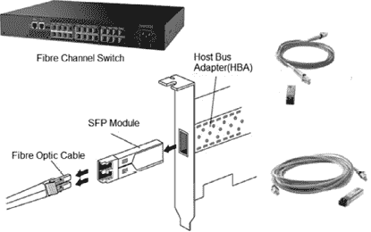

图 2.15：交换机、光纤线缆和 SFP

HBA 和交换机均运行固件以激活其功能。

在基于 FC 的网络中，FC 支持两种介质选项，可在铜缆或光缆上运行。

光纤支持：

- 长距离，高达 10 公里。
- 高速率，高达 64 Gbps。
- 抗电磁感应干扰。
- 线缆两端需要 SFP 将光信号转换为电信号。SFP 也称为千兆接口转换器 (GBIC)。

光纤收发器或 SFP 收发器通常由发射器和接收器组成，集成在单个模块中。

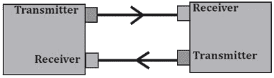

图 2.16：光纤收发器和接收器

在光纤数据链路中，发射器将来自激光二极管或 LED 的电信号转换为光信号。来自发射器的光通过连接器耦合进入光纤，并通过光纤线缆传输。光纤末端的光耦合到接收器，探测器将光转换回电信号。

SFP 是热插拔组件。

当连接不同速率的设备时，速率协商从较高速率开始，然后逐级降至较低速率。

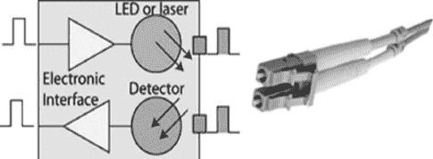

图 2.17：SFP 框图

1. 光在光纤中通过全反射传输。
2. 纤芯。
3. 包层材料。

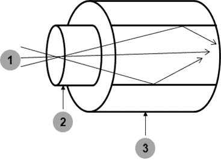

图 2.18：光在光纤中的传输

光纤线缆有两种类型，多模和单模：

- **多模光纤** 具有相对较大的传光纤芯，通常直径为 62.5 微米或更大。它通常用于基于 LED 的光纤设备的短距离传输。在多模中，不同光子的光束到达时间不同，这使得难以分辨 1 或 0。因此，随着速率增加，支持的距离变短。
- **单模光纤** 具有直径为 8 至 10 微米的小传光纤芯。它通常用于基于激光二极管的光纤传输设备的长距离传输。单模光纤的推荐最大长度为 10 公里。

电缆是 30 米以内短距离传输的低成本替代方案。

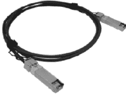

图 2.19：FC 电缆铜缆

### 软件定义存储


## 存储系统概述

通常，存储系统由专门设计的硬件和固件组成。主要硬件组件是控制器和物理磁盘。固件设计为在控制器上作为操作系统运行。所有存储功能，如 `RAID`、本地和远程复制、精简配置、去重，均在固件中实现。管理软件是旨在管理存储系统的上层组件。

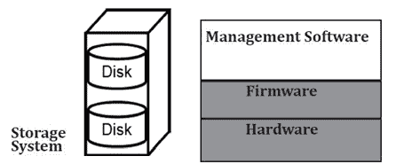

**图 2.20：包含硬件、固件和管理栈的存储系统**

`SDS` 是在定制操作系统中实施的解决方案，可运行在任何通用硬件上，从而将存储固件和管理软件与物理存储硬件解耦。借助 `SDS`，最终用户可以购买具有所需磁盘空间的任何通用硬件，并在其中部署安装了定制操作系统的虚拟机 (`VM`)。

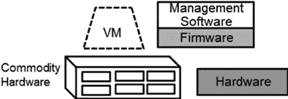

**图 2.21：SDS：固件和管理栈与硬件解耦**

`SDS` 的主要优势在于高性价比，因为它不需要任何专用硬件。然而，对于企业工作负载，常规存储系统最为适用。

由于 `SDS` 的普及，`DAS` 最近引起了关注。许多公司购买通用硬件并配置 `DAS`，然后在其上部署 `SDS`，以构建智能存储系统。

## 保障存储基础设施安全

如今，几乎所有组织都将其业务关键信息作为数字数据存储在存储系统上。这些关键数据的安全性是当今世界的一大关注点。因此，计算机信息数据安全本身就是一个广泛的主题。数据安全的主要目标是防止未经授权的披露、数据篡改、意外损坏或删除。

根据存储网络工业协会 (`SNIA`) 的定义，存储安全是技术控制，可能包括数据完整性、机密性和可用性控制，以保护存储资源和数据免受未经授权的用户和用途的侵害。

机密性是指信息仅向授权人员披露。完整性确保信息保持其原始形式而不被篡改。可用性表示信息可在规定的操作参数内随时访问。可用性还确保在发生数据损坏或删除时，数据能多快恢复以使业务恢复运行。

存储基础设施安全涉及物理、技术和管理控制，以及预防、检测和纠正控制。这些适用于以下基础设施组件：

- 带有主机总线适配器 (`HBA`) 的主机服务器
- 存储阵列
- 存储网络交换机
- 存储网络线缆
- 存储管理
- 备份系统
- 虚拟化
- 云存储
- 专用服务，如加密、压缩和去重

可以实施多种方法和策略来保护存储基础设施免受攻击者侵害。`SNIA` 建议，与其关注机密性、完整性和可用性 (`CIA`) 的抽象概念，不如考虑以下四个技术组件来保障存储基础设施安全：

- **存储系统安全 (`SSS`)**：保护存储控制器固件、嵌入式操作系统以及集成外部认证服务、集中式日志记录和防火墙的应用程序。
- **存储资源管理 (`SRM`)**：安全地配置、监控、调优、重新分配和控制存储资源，以便存储和检索数据。
- **传输中数据 (`DIF`)**：保护数据在跨存储网络、`LAN` 和 `WAN` 传输时的机密性、完整性和/或可用性。
- **静止数据 (`DAR`)**：保护驻留在存储阵列上的数据的机密性、完整性和/或可用性。

## 管理存储基础设施

管理存储基础设施是存储解决方案不可或缺的一部分，它协助解决方案的部署、配置并监控解决方案的健康状况。

主要管理软件用于管理存储系统本身。每个存储供随存储阵列提供管理软件，帮助管理员配置、供给和监控存储系统。其他管理软件通过创建数据副本或创建备份副本来保护数据。

其他硬件组件（如交换机、`HBA`）的管理软件也是存储解决方案的一部分。`HBA` 和交换机的硬件供应商随硬件提供管理软件，以配置和监控这些硬件组件。

第 9 章，存储管理，详细解释了存储管理及所有相关软件套件。

## 总结

存储基础设施是由硬件、固件和软件组件组成的集合，共同构成存储解决方案。组件可分为三个不同层次：存储层、网络层和主机层。

存储系统或存储磁盘阵列是存储解决方案中的主要设备或组件。它存储应用程序数据并处理主机服务器的读/写请求。

存储磁盘阵列有六个硬件组件：存储控制器、物理磁盘驱动器、磁盘机箱、后端交换机或背板互连、线缆和连接器以及机架。

存储网络的硬件组件是 `HBA`、交换机、线缆和连接器。`HBA` 安装在主机服务器中以连接网络。交换机是网络中的主要组件。存储网络由一个或多个交换机组成。

信息数据安全是当今世界的一大关注点。对 `CIA` 的技术控制有助于保护存储资源和数据免受未经授权的用户和用途的侵害。

管理存储解决方案包括初始部署、配置和监控所有硬件组件。用于管理基础设施的软件套件也是存储基础设施的一部分。

## 案例研究

### 案例研究 1：组装硬件设备以构建存储解决方案

让我们看看组装硬件设备以构建存储解决方案的过程：

#### 需求

您的公司从供应商处收到了以下硬件设备。您被要求连接这些设备并实施存储解决方案。

1. 主机服务器
2. `FC` `HBA`
3. `FC` 交换机
4. `FC` 线缆
5. `SFP` 模块
6. 存储控制器
7. `JBOD`
8. 磁盘驱动器
9. 存储系统管理软件

#### 分析

首先，识别本章前面讨论的不同层的硬件组件。磁盘驱动器、`JBOD` 和存储控制器属于存储系统层，`SFP` 模块、线缆、交换机属于网络层，主机服务器和 `FC` `HBA` 属于主机层。

#### 解决方案

- 首先，将磁盘驱动器安装到 `JBOD` 中。将 `JBOD` 连接到存储控制器的设备端口。
- 使用 `FC` 线缆连接存储控制器的主机端口。在交换机上安装 `SFP` 模块，并将 `FC` 线缆的另一端连接到交换机。
- 在主机服务器中安装 `HBA` 并连接到交换机。
- 安装管理软件以配置和部署解决方案。

### 案例研究 2：将传统 DAS 解决方案转换为最新存储技术

让我们看看将传统 `DAS` 解决方案转换为最新存储技术的过程：

#### 需求

您的公司有相当一部分闲置的传统服务器，它们连接了直连 `JBOD`。公司正在寻找一种方案，利用这些硬件将其转换为高性能和高可用性的存储解决方案。

#### 分析


#### 传统 DAS 解决方案与 SDS

传统 DAS 解决方案并未提供许多用于提升性能和可用性的存储功能。然而，SDS 组件可部署在其之上，使其更加智能。借助 SDS，可从传统磁盘中划分出具有不同 RAID 级别的虚拟卷。最新的 SDS 解决方案还提供快照、去重和压缩等其他存储服务。

#### 解决方案

建议采用 SDS 解决方案以满足此需求。这是一种 VM 的软件组件，可采购并部署到传统硬件上，以实现高性能、高可用性的存储解决方案。

## 学习检查

### 客观题

1. 如果您创建一个 1TB 的存储 LUN 并授予主机访问权限，操作系统中将显示多少容量？

   a. 1024GB  
   b. 931GB  
   c. 1000GB  
   d. 831GB

2. 如果您从商店购买一块 1TB 磁盘并在笔记本电脑中安装并格式化，可用容量将是多少？

   a. 1024GB  
   b. 931GB  
   c. 1000GB  
   d. 831GB

3. HDD 类型及其物理尺寸：

   a. SFF, 3.5  
   b. LFF, 2.5  
   c. LFF, 3.5  
   d. SFF, 2.5

4. 存储系统的哪个组件连接在存储控制器的后端？

   a. 虚拟卷  
   b. 物理磁盘  
   c. 主机  
   d. 缓存内存

5. 什么是磁盘阵列？

   a. 由机箱组成的 JBOD，其中托管的一组硬盘驱动器可采用多种组合，如 SCSI 驱动器、SAS、FC 和 SATA。  
   b. 位于一个或多个控制器后端的独立物理磁盘，允许配置虚拟卷或 RAID 卷。  
   c. 包含大量硬盘驱动器的高端服务器。

6. 磁盘阵列的用途是什么？

   a. 性能  
   b. 容错  
   c. 可扩展  
   d. 以上皆是

7. 存储控制器的设备端口是：

   a. 发起端  
   b. 目标端  
   c. 两者皆是  
   d. 无

8. 存储控制器的主机端口是：

   a. 发起端  
   b. 目标端  
   c. 两者皆是  
   d. 无

9. 以下哪项不是磁盘阵列的主要组件？

   a. 网络接口卡  
   b. 存储控制器  
   c. 物理磁盘驱动器  
   d. 磁盘机箱

10. 存储控制器的哪个接口不用于 I/O 流量？

    a. 前端或主机端口  
    b. 后端或设备端口  
    c. 网络接口端口  
    d. 控制器互联端口

11. 以下哪些接口用于存储管理和监控目的？选择所有适用项：

    a. 前端或主机端口  
    b. 后端或设备端口  
    c. 网络接口端口  
    d. 串口

12. 以下哪个硬件组件不属于存储控制器？

    a. 风扇  
    b. 电源单元  
    c. 电源分配单元  
    d. 电池

13. 以下哪项不是 SAN 组件？

    a. 存储设备  
    b. FC 交换机  
    c. HBA  
    d. DIMM

14. 以下哪项是存储设备按性能排序的正确顺序？

    i. HDD > SSD > SCM > 磁带  
    ii. 磁带 > HDD > SSD > SCM  
    iii. SCM > SSD > HDD > 磁带  
    iv. SSD > HDD > SCM > 磁带

    a. (i)  
    b. (ii)  
    c. (iii)  
    d. (iv)

15. 以下关于单模和多模的陈述哪项是不正确的？

    a. 在多模中，不同光子的光束到达时间不同，导致难以分辨 1 或 0。  
    b. 单模光纤的光学核心为 62.5 微米。  
    c. 单模支持高达 10 公里的距离。  
    d. 在多模中，支持的距离随速度增加而缩短。

16. 哪种线缆支持设备间的最长距离？

    a. 单模光纤  
    b. 多模光纤  
    c. 铜缆  
    d. SCSI 线缆

17. 当交换机正在运行时，可以更换或替换 GBIC 吗？

    a. 真  
    b. 假

18. 以下哪项比较没有意义？

    a. NVMe 对比 SSD  
    b. NVMe 对比 SAS  
    c. SATA 对比 SAS  
    d. SSD 对比机械硬盘

19. 匹配以下内容：

    i. NVMe — 1. 支持一个队列，其中最多包含 32 条命令  
    ii. SAS — 2. 支持最多 65535 个队列，每个队列最多包含 65535 条命令  
    iii. SATA — 3. 支持一个队列，其中最多包含 254 条命令

    a. (i) - (1), (iii) - (2) and (ii) - (3)  
    b. (i) - (1), (ii) - (2) and (iii) - (3)  
    c. (ii) - (1), (i) - (2) and (iii) - (3)  
    d. (iii) - (1), (i) - (2) and (ii) - (3)

20. 以下哪种磁盘不是由任何磁盘厂商制造的？

    a. SAS 机械硬盘  
    b. NVMe 机械硬盘  
    c. NVMe 固态硬盘  
    d. SATA 固态硬盘

### 简答题

1. 描述存储控制器内的不同组件。

2. 定义存储安全及其必要性。还要描述可用于保护存储基础设施的技术导向组件。

### 测验题

1. SCM 代表什么？为什么它对下一代存储系统很重要？

2. DAS 解决方案是否在主机和存储设备之间的网络中使用交换机？请证明您的答案。

3. 解释 NVMe 的优势。

## 术语表与关键术语

- **存储磁盘阵列**：一种存储系统，具有一个或多个控制器后端的独立物理磁盘，允许配置虚拟卷或 RAID 卷。
- **JBOD**：Just a Bunch of Disks（只是一堆磁盘）。一种磁盘机箱，可容纳连接到一个或多个控制器的多个物理磁盘。
- **SFF**：小型外形规格，2.5 英寸硬盘驱动器。
- **LFF**：大型外形规格，3.5 英寸硬盘驱动器。
- **SSD**：固态硬盘，一种无机械运动部件的高性能磁盘驱动器。
- **SCM**：存储级内存，一种高性能存储设备。
- **HDD**：硬盘驱动器，在磁性介质上存储数据。
- **AFA**：全闪存阵列，一种采用 SSD 的存储磁盘阵列。
- **SDS**：软件定义存储，将存储服务与底层硬件解耦。
- **NVMe**：非易失性内存表达。

## 社区

加入我们的 Discord 空间，获取最新资讯、优惠、全球技术动态、新版本发布以及与作者的交流会：

`https://discord.bpbonline.com`


# 第 3 章：存储磁盘阵列

## 简介

存储磁盘阵列是一种存储系统，由一组物理磁盘驱动器和一个或多个存储控制器组成，可存储 TB 级数据并执行多台主机服务器的输入/输出 (I/O) 操作。存储厂商在存储系统中设计并实现多种功能，以提高读/写性能和数据容错能力。这些功能包括控制器操作、数据缓存技术、RAID 概念等。存储系统中的 RAID 实现极大地影响了存储系统的性能和容错两方面。因此，在过去三十年里，所有存储厂商都在其存储系统中实现了 RAID。现代存储磁盘阵列实现了虚拟 RAID，这在更大程度上增强了性能和容错因素。

除了 RAID，磁盘阵列还实现了多项智能功能，以提供高度优化的 I/O 处理、容错和高效存储能力。这些功能包括存储分层、服务质量 (QoS)、复制、精简配置、去重和压缩等。这些功能将在后续章节中详细讨论。

因此，存储阵列被称为智能存储阵列 (ISA) 或智能存储系统 (ISS)。

## 结构

本章主要关注存储系统，您将了解存储系统的以下方面：

- 存储系统的物理布局和组件
- 存储控制器操作模式
- 缓存技术
- RAID 概念
- 虚拟 RAID
- 存储虚拟化

## 目标

在本章结束时，您将了解存储系统各种特性和功能的设计与实现，例如存储控制器操作模式、不同的数据缓存技术，以及如何使用不同的 RAID 级别将用户数据存储在物理磁盘上。本章还将讨论每种 RAID 级别的优缺点。

## 控制器操作模式


## 存储控制器操作与缓存

为了提供容错能力和存储控制器级别的负载均衡，大多数存储系统至少配置两个存储控制器。

有多种控制器操作模式可用。存储供应商根据其目标存储系统的型号和定价来设计控制器。

 

### 主动/备用

两个控制器中的一个始终处于空闲状态，当另一个控制器故障时才会被唤醒。

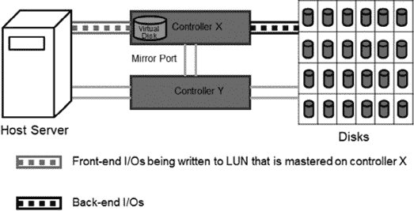

图 3.1：主动/备用控制器操作

由于同一时间只有一个控制器处于活动状态，因此不存在负载均衡；这种配置在现代存储系统中已不可见。

### 主动/被动

两个控制器都处理 I/O，但仅限于它们各自拥有的逻辑单元号 (LUN)。

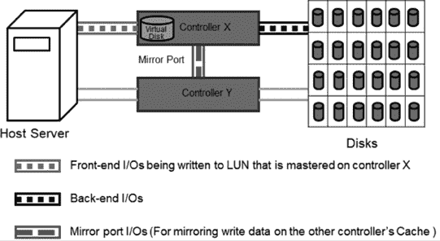

图 3.2：主动/被动控制器操作

- 只有拥有所有权的控制器接受主机请求。
- LUN 通过将首选控制器设置为特定控制器，在控制器之间静态分布。在图中，为便于说明，控制器 X 上仅显示了一个 LUN。任一控制器均可拥有多个 LUN。
- 数据先写入主控制器的缓存，再写入辅助控制器的缓存，随后向主机发送完成状态，最后将数据写入磁盘。

### 非对称主动-主动

两个控制器都接受主机请求，但只有拥有所有权的控制器与后端磁盘交互。在下图中，为便于说明，控制器 X 上仅显示了一个 LUN。任一控制器均可拥有多个 LUN。

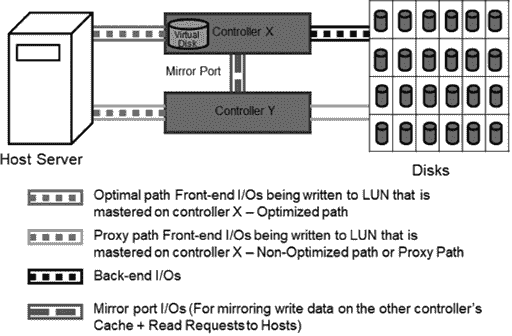

图 3.3：非对称主动-主动控制器操作

- 数据先写入主控制器的缓存，再写入辅助控制器的缓存，随后向主机发送完成状态，最后将数据写入磁盘。
- 通过非优化路径进行读取涉及额外路径，即镜像路径。对写入无影响，因为两个控制器始终都有数据。
- LUN 通过将首选控制器设置为特定控制器，在控制器之间静态分布。
- 启用了非对称逻辑单元访问 (ALUA) 的操作系统可以确定优化路径和非优化路径。

### 真正的主动-主动

两个控制器都接受主机请求，并针对给定的 LUN 与后端磁盘交互。大多数现代存储系统都实现了这种控制器操作模式。

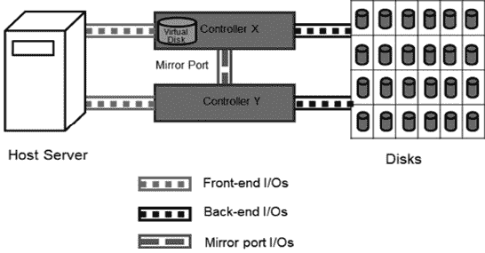

图 3.4：真正的主动-主动控制器操作

## 缓存技术

缓存是一个临时存储区域，用于保存数据以实现快速便捷的访问。几乎所有存储系统都实现了缓存机制，将频繁访问的数据存储在更快的内存中，并无延迟地响应主机。缓存内存安装在存储控制器中，因此存储系统有多种缓存技术可用。

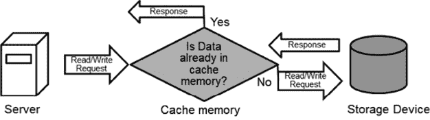

图 3.5：缓存技术

一些常用的缓存技术如下：

- **回写**：一种缓存管理方法，通过减少存储系统的响应时间来提高主机写请求的性能。当主机请求写操作时，存储系统控制器首先将主机的数据写入缓存内存，从而快速完成主机的请求。它稍后再执行将数据刷新到磁盘的较慢操作。当数据到达缓存时，主机视写操作为已完成。
- **镜像回写**：在此策略模式下，镜像回写在正常操作下提供回写的高性能，但在发生故障时恢复为直写的安全性。在镜像模式下，每个控制器写入的数据有一半包含伴侣控制器写入数据的副本，提供了高级别的数据保护。

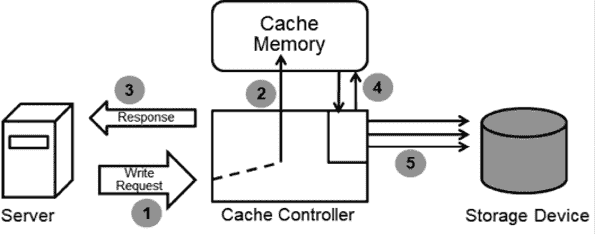

图 3.6：回写缓存技术

- **直写**：一种缓存管理技术，将写数据保存在缓存内存中，同时也将数据写入磁盘。写请求操作只有在待写入数据被磁盘接收后才算完成。此技术允许控制器从缓存内存而非磁盘完成某些针对该相同数据的主机读请求，从而大大提高了检索数据的响应时间。

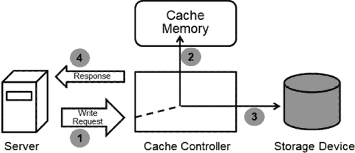

图 3.7：直写缓存技术

- **读取**：控制器用于缓冲主机从存储设备读取的数据的一块高速内存。读缓存通过在可能的情况下从其本地缓存内存而非外部存储设备满足主机读请求，提高了控制器的有效设备访问速度。
- **预读**：一种缓存管理技术，通过从磁盘预取数据并将其放入缓存来提高同步顺序读取的性能。控制器在缓存中维护主机最近请求的数据副本，并可能预先获取数据块，预期控制器将访问下一个顺序块。在正常读缓存中，主机写请求按常规完成，不使用缓存机制。
- **自适应**：比预读缓存更高级的技术。自适应缓存算法根据先前的模式预测主机请求。最有可能被请求的数据块被缓存以便更快地传输给主机。

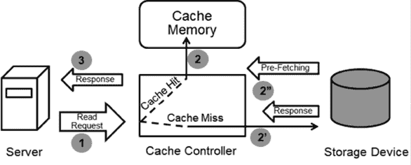

图 3.8：读缓存技术

### 缓存电池的作用

- 未写入的缓存数据或未刷新的数据驻留在缓存中，电池提供电力以保护它，以防止任何电源故障。
- 通常写缓存由电池备份，读缓存则不是。
- 但如果使用单个 DIMM，则读和写都由电池备份。
- 较新的存储系统设计采用闪存备份缓存，因此不需要任何电池。

## RAID 概念

1988 年，David A. Patterson、Garth A. Gibson 和 Randy H. Katz 在论文 *A Case for Redundant Arrays of Inexpensive Disks (RAID)*（《廉价磁盘冗余阵列 (RAID) 的论据》）中正式定义了 RAID 1 到 5 级。RAID 一词首次在该论文中提出；它催生了整个存储行业。

RAID 是存储虚拟化的一个示例，本书后面部分将对此进行讨论。

### 什么是 RAID？

- RAID - 廉价/独立磁盘冗余阵列。
- 由 1987 年在加州大学伯克利分校发表的一篇论文构想提出。
- 从根本上说，RAID 是在阵列中使用多个 HDD，在大多数方面表现得像一个单一的大型、快速磁盘。
- 提高数据可用性。
- 试图弥合处理器性能与磁盘性能之间日益扩大的差距。
- 为了支持视频和多媒体应用程序所需的更快数据访问，需要新的存储架构。

### RAID 的目的

由于机械和磁性部件，任何存储系统中的磁盘故障率都高于其中的任何其他组件。RAID 概念主要带来两个优势：

- **性能**：将多个小型、廉价的磁盘驱动器组合成一个组，以产生超过单个大型、昂贵驱动器的性能。
- **可用性**：通过以各种方式冗余存储信息来支持容错。增加容量。

虚拟卷是对存储子系统一部分的逻辑引用。虚拟卷是向主机服务器提供空间的手段。


## 存储系统与虚拟卷

存储系统通常拥有巨大的存储容量，许多主机服务器共享这部分空间。因此，空间会被切割成较小的卷，然后呈现或导出给主机服务器。在主机中，这看起来就像是一个本地连接的磁盘。在 Windows 主机中，对磁盘驱动器进行分区和格式化后，会分配诸如 `D:`、`E:` 之类的盘符。数据可以存储在上面。在 Linux 主机中，磁盘显示为 `/dev/sdb` 或 `/dev/sdc` 或类似名称。这也可以进行分区、格式化，并挂载到文件夹，例如 `/data`。数据可以存储在这个文件夹中。

虚拟卷还简化了存储资源的管理，因为它们作为逻辑标识符，你可以通过它们分配访问和控制权限。

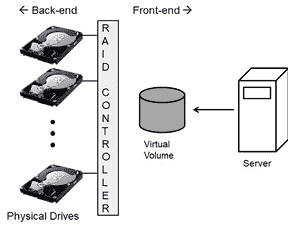

**图 3.9：虚拟卷概念**

虚拟卷在计算机（服务器）看来就像是一个单独的磁盘。

RAID 控制器本身就是一台计算机；物理驱动器连接在其后端，RAID 控制器后面的所有驱动器对计算机来说是不可见或未知的。

在性能和容错方面有显著优势，但 RAID 技术在空间效率方面没有优势。

不同厂商在其产品中用不同的名称来指代虚拟卷，如存储卷、RAID 卷、虚拟磁盘、逻辑磁盘、逻辑卷或 LUN，但从根本上说，它们都是同一回事。

在大多数实现中：

- **总线（BUS）** 值根据服务器 PCI 插槽中 HBA 的位置分配
- **目标（Target）** 对应存储控制器的主机端口
- **LUN** 值无非是在向服务器呈现时分配给每个逻辑磁盘的 LUN 编号

### 概念与术语

#### 镜像

- 例如，当你将一个大小为 10 MB 的文件复制到存储系统时，两个驱动器各获得 10 MB。相同的数据存储在两个驱动器中。
- 来自服务器的每个数据块并行复制到两个驱动器中。
- 如果任意驱动器故障，仍有 10 MB 可用。

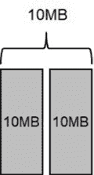

**图 3.10：镜像：工作原理**

- 实施至少需要两个驱动器；最大数量取决于厂商的实现。某些厂商支持包含 6 个驱动器的镜像集。

#### 条带化

- 例如，如果你将一个大小为 10 MB 的文件复制到存储系统，每个驱动器各获得 5 MB。
- 来自服务器的每个数据块被分成两部分，然后并行写入两个驱动器。在跨更多驱动器进行条带化的情况下，数据写入速度更快。
- 如果任意驱动器故障，只剩下 5 MB；每个数据块的一半可用——应用程序无法读取它！

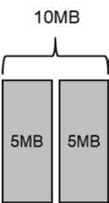

**图 3.11：条带化：工作原理**

- 实施至少需要一个驱动器；最大数量取决于厂商的实现。

### 奇偶校验——工作原理

例如，如果你将一个大小为 10 MB 的文件复制到存储系统，每个驱动器各获得 5 MB，第三个驱动器获得前两个数据块的奇偶校验数据。

- 来自服务器的每个数据块被分成两部分，然后写入两个驱动器，并计算奇偶校验数据存储在第三个驱动器上。
- 如果任意驱动器故障，必须有某种方法来恢复故障驱动器上的数据。
- 实施至少需要三个驱动器；最大数量取决于厂商的实现。
- 数据：奇偶校验比率也可由厂商决定。这是空间效率与可用性之间的权衡。

| A | B | P = `A ⊕ B` |
|---|---|-------------|
| 0 | 0 | 0           |
| 0 | 1 | 1           |
| 1 | 0 | 1           |
| 1 | 1 | 0           |

**表 3.1：数据与奇偶校验**

为了提高性能，是以数据块为单位而非每一位来考虑的；因此，奇偶校验计算不仅仅是 `XOR`。它比这稍微复杂一些，但概念保持不变。

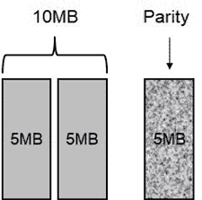

**图 3.12：奇偶校验：工作原理**

### I/O 大小、块、区块或条带大小

不同厂商在不同场景下对读写数据的大小使用不同的术语。

#### 主机 I/O 大小

主机通过一次请求发送用于写入或请求读取的数据量。

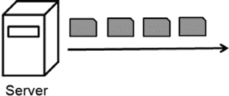

**图 3.13：主机 I/O 大小**

#### 条带大小

一次性写入 RAID 单元成员驱动器的数据量。某些厂商将其称为块大小或区块大小。


**图 3.14：条带大小**

### 备用驱动器

发生任意驱动器故障时，RAID 卷会进入降级状态。当 RAID 卷处于降级状态时，另一个驱动器故障可能导致数据丢失。因此，尽快通过更换故障驱动器将 RAID 卷恢复到健康状态非常重要。为避免人工更换干预，大多数厂商实现了备用驱动器。备用驱动器在正常运行期间处于空闲状态。当 RAID 卷中的一个驱动器发生故障时，数据会自动开始在备用驱动器上重建。重建过程结束时，故障驱动器上的数据会在备用驱动器上重新生成，备用驱动器成为 RAID 卷的一部分。随后，管理员可以用新驱动器替换故障驱动器，并将其配置为备用驱动器。

**优势：**

- RAID 卷处于降级状态的时间最短。
- RAID 卷无需人工干预即可恢复健康。
- 故障驱动器可稍后更换。

热备是子系统中可用的备用设备；当任意运行中磁盘发生故障时，系统自动使用备用磁盘。所有现代存储都允许故障驱动器热插拔，即在保持系统运行的情况下移除和插入驱动器。

### RAID 类型

以下是各种 RAID 类型：

- RAID 0 到 RAID 7
- RAID 0、1、3、5 和 6 常用
- RAID 2 和 4 与其他类型相比没有显著优势
- 混合 RAID 级别（RAID 的组合）
  - RAID 10 或 RAID 1+0 = RAID 1 + RAID 0
  - RAID 50 或 RAID 5+0 = RAID 5 + RAID 0

#### RAID 0 – 条带化

数据被分解成块，每个块写入单独的磁盘驱动器。

**优势：**

- 通过将 I/O 负载分散到许多驱动器上，极大地提高了 I/O 性能
- 易于实施
- 100% 空间效率
- 实施至少需要一个驱动器


**图 3.15：RAID 0 级：无容错的条带化磁盘阵列**

**劣势：**

- 不是真正的 RAID，因为它没有容错能力
- 仅一个驱动器故障就会导致阵列中所有数据丢失

#### RAID 1 – 镜像

它是将每个数据块复制到两个不同的磁盘上。

**优势：**

- 读事务速率是单个磁盘的两倍；写事务速率与单个磁盘相同
- 易于实施
- 最高级别的容错能力
- 实施至少需要 2 个驱动器


**图 3.16：RAID 1 级：镜像与双工**

**劣势：**

- 需要所需空间两倍的磁盘容量
- 每比特存储成本增加；仅利用了 50% 的可用空间

#### RAID 2 – 带 ECC 奇偶校验的位级条带化

RAID 2 通过在位级拆分数据，并将其分散到多个数据磁盘和多个冗余磁盘上来实现。冗余位使用汉明码计算，这是一种纠错码（ECC）。

**优势：**

- 每次向阵列写入数据时，都会计算这些码并与数据一起写入专用的 ECC 磁盘；读回数据时，也会读取这些 ECC 码以确认自数据写入以来未发生错误。


**图 3.17：RAID 2 级：位级条带化**

**劣势：**

- 无实际用途；以更低的成本可通过 RAID 3 实现相同性能。


#### RAID 3–字节级条带化与专用奇偶校验

每个数据块被细分（条带化）并写入数据磁盘。条带奇偶校验在写入时生成，记录在奇偶校验磁盘上。

#### 优势
- 阵列的性能与阵列中单个磁盘的性能相同，传输率除外，传输率乘以数据驱动器的数量（即更少的奇偶校验驱动器）。
- 对大型、顺序数据请求具有卓越的性能。
- RAID 3 级至少需要 3 个驱动器才能实现。


图 3.18：RAID 3 级：字节级条带化

#### 劣势
- 这项技术相当复杂。
- 随机、小 I/O 操作的性能较慢。
- 速度受限于最慢的磁盘。

#### RAID 4–块级条带化与专用奇偶校验

每个块被写入数据磁盘。

#### 优势
- 奇偶校验在写入时生成，记录在奇偶校验磁盘上。
- 非常高的读数据事务率。
- RAID 4 级至少需要 3 个驱动器才能实现。


图 3.19：RAID 4 级：块级条带化

#### 劣势
- 单个奇偶校验驱动器参与每次写入，并成为瓶颈，同 `RAID 3` 一样
- 最差的写事务率和写聚合传输率

#### RAID 5–块级条带化与分布式奇偶校验

每个数据块被写入数据磁盘。

#### 优势
- 同一秩中块的奇偶校验在写入时生成。
- 记录在分布式位置。
- RAID 5 级至少需要 3 个驱动器才能实现。


图 3.20：RAID 5 级：带分布式奇偶校验的块级条带化

#### 劣势
- 磁盘故障对吞吐量有中等影响
- 控制器及其固件设计最复杂——发生磁盘故障时难以重建
- 中等写数据事务率
- 如果两个磁盘同时故障，或因先前磁盘故障导致卷处于降级状态时第二个磁盘故障，虚拟卷上的数据将变得不可访问

#### 从磁盘故障中恢复

`RAID 5` 可容忍其中一个磁盘的故障。如果驱动器发生故障，`RAID` 控制器会利用奇偶校验和其他幸存驱动器上的数据计算故障驱动器上的数据。在此期间，系统运行缓慢，因为它必须从奇偶校验计算用户数据。下表展示了当任意磁盘故障时如何推导数据（`Ax` 或 `By`）的简单示例。实际上，奇偶校验是用户数据（`Ax` 和 `By`）的复杂函数

| `Ax` | `By` | `P = Ax⊕By` | `Ax = By⊕P` | `By = Ax⊕P` |
|------|------|-------------|-------------|-------------|
| 0    | 0    | 0           | 0           | 0           |
| 0    | 1    | 1           | 0           | 1           |
| 1    | 0    | 1           | 1           | 0           |
| 1    | 1    | 0           | 1           | 1           |

表 3.2：从奇偶校验恢复故障磁盘上的数据

#### 重建过程

当故障驱动器被新驱动器替换时，故障驱动器的数据从现有数据和奇偶校验生成，然后写入新驱动器。


| `D1` | `D2` | `P` |
|------|------|-----|
| 0    | 0    | 0   |
| 0    | 1    | 1   |
| 1    | 0    | 1   |
| 1    | 1    | 0   |

表 3.3：在新磁盘上重建数据（`D1 = D2 XOR P`）

#### RAID 级别比较

| RAID 2 | RAID 3 | RAID 4 | RAID 5 |
|--------|--------|--------|--------|
| 位级条带化与 ECC 奇偶校验 | 字节级条带化与专用奇偶校验 | 块级条带化与专用奇偶校验 | 块级条带化与分布式奇偶校验 |
| 所有磁盘作为一个整体进行写入和读取。这降低了对非同类磁盘的容忍度 | 磁盘独立于彼此进行写入和读取 | | |
| 适合处理大量数据或处理大块数据的应用程序，性能良好 | 处理少量数据的应用程序，如事务处理应用程序，且读多写少 | | |
| 未使用 | 广泛使用 | 很少使用 | 广泛使用 |

表 3.4：RAID 2 对比 3 对比 4 对比 5

#### RAID 4 级和 5 级

`RAID 4` 中的单个奇偶校验驱动器参与每次写入，从而限制了并行性，而 `RAID 5` 将奇偶校验块分布在所有 `N+1` 个驱动器上，从而实现并行性。


图 3.21：RAID 4 级对比 RAID 5 级

#### 为什么 RAID 3 提供比 RAID 4 和 5 更好的大块顺序读/写性能？

- 每个数据块分散在阵列中的所有驱动器上。所有磁盘共同服务请求，但一次只能服务一个主机 I/O 请求。因此，顺序请求和大块在 `RAID 3` 上表现更好。`RAID 3` 无法同时服务多个请求。
- 对于 `RAID 4` 和 `5`，不同的数据块驻留在不同的驱动器上，因此它们能更好地处理同时发生的随机请求。
- 例如，读取由某些字节（`A0`、`A1`）组成的块 `A` 的请求将要求所有数据磁盘寻道到第一个字节的开头并返回其内容。对块 `B` 的同时请求将不得不等待。
- 对于 `RAID 4` 和 `5`，块 `A` 的读取请求将由第一个磁盘服务。块 `C` 的同时读取请求将不得不等待，但块 `B` 的读取请求可以由第二个磁盘并发服务。


图 3.22：RAID 3 级对比 RAID 4 级

- 如果条带大小减小到低于操作系统块大小，`RAID 5` 阵列将具有与 `RAID 3` 相同的性能模式。

#### 为什么 RAID 4 中一个磁盘会成为瓶颈，而 RAID 3 中不会？

- 参照图 3.22，除了将块（`A` 和 `B`）同时写入各自的驱动器外，两者还需要写入奇偶校验驱动器。这样 `RAID` 就在阵列中给奇偶校验驱动器带来了非常高的负载。
- 对于 `RAID 3`，所有驱动器同步工作——都服务相同的请求。

#### RAID 6–块级条带化与双重奇偶校验

- 使用两种独立的奇偶校验计算，以提供针对双磁盘故障的保护。采用两种不同的算法来实现此目的。
- 本质上是 `RAID` 5 级的扩展。
- `RAID` 6 级至少需要 4 个驱动器才能实现。


图 3.23：RAID 6 级：带双重奇偶校验的块级条带化

#### 劣势
- 更复杂的控制器及其固件设计
- 由于控制器计算奇偶校验的开销，写入性能较慢
- 由于双重奇偶校验方案，需要 `N+2` 个驱动器才能实现

### 硬件 RAID 与软件 RAID

#### 软件 RAID
- 软件解决方案实现 `RAID`
- 软件 `RAID`：运行在服务器的 CPU 上
- 直接依赖于服务器 CPU 性能和负载
- 占用主机系统内存和 CPU 操作，降低服务器性能

#### 硬件 RAID
- 一块硬件或硬件控制器。
- 硬件 `RAID`：运行在 `RAID` 控制器的 CPU 上。
- 它不占用任何主机系统内存，也不依赖操作系统。
- 主机 CPU 可以执行应用程序，同时阵列适配器的处理器执行阵列功能：真正的硬件多任务处理。

### 混合 RAID 级别–RAID X+Y

混合 `RAID` 级别通过组合由物理驱动器形成的虚拟卷来实现。以下示例显示，`RAID X` 由物理驱动器形成，然后再次使用这些虚拟卷的 `RAID Y` 形成虚拟卷。


图 3.24：混合 RAID

#### 示例
- 如果 `X=5`，`Y=0`，如果你将 30MB 数据复制到 `D1`，`D2`、`D4`、`D5`、`D7`、`D8` 各获得 5MB，而 `D3`、`D6`、`D9` 将包含奇偶校验。
- 如果 `X=1`，`Y=0`，如果你复制 30MB 数据到，每个驱动器将获得 10MB `RAID 0+1`、`RAID 01`、`RAID 0&1`（条带的镜像）


图 3.25：RAID 0+1：条带的镜像


## RAID 配置

### RAID 0+1：条带的镜像


**图 3.25：RAID 0+1：条带的镜像**

- RAID 0+1 配置：多个磁盘条带化成组，然后将组镜像在一起。
- 实现 RAID 0+1 所需的最小磁盘数为 3，其中数据在两个磁盘上以 RAID 0 条带化，然后所有数据在第三个磁盘上镜像。但更常见的是使用至少 4 个磁盘。

### RAID 1+0，RAID 10，RAID 1 和 0（镜像的条带）


**图 3.26：RAID 1+0：镜像的条带**

- RAID 1+0 配置：数据在组内镜像，然后多个磁盘条带化在一起。
- 镜像的 RAID 0 阵列至少需要 4 个驱动器。

### RAID 1+0 与 RAID 0+1 对比


**图 3.27：RAID 1+0 对比 RAID 0+1**

- RAID 10 提供比所有其他 RAID 级别（除 RAID 0 外）更好的吞吐量、速度、性能和延迟。
- 任何驱动器故障都会导致 RAID 单元进入降级状态，此时 RAID 0+1 中另一组发生第二次驱动器故障的概率高于 RAID 1+0。
- 在降级状态下，RAID 1+0 的性能（尤其是读性能）不会像 RAID 0+1 那样下降。
- 更换故障磁盘后，重建完成得更快。
- 通常，所有供应商都倾向于在其产品中实现 RAID 1+0。

### RAID 级别使用场景

| RAID 级别 | 适用场景 |
| --- | --- |
| RAID 0（1 个磁盘）<br>RAID 1（2 个磁盘）<br>RAID 5（3 个磁盘）<br>RAID 10（4 个磁盘）<br>RAID 50（6 个磁盘）<br>RAID 6（4 个磁盘） | 视频/音频流媒体<br>操作系统启动<br>事务/网页服务器<br>数据库<br>数据仓库<br>大容量磁盘阵列 |

### RAID 元数据

- 元数据就是关于数据的数据，换句话说，是关于另一个信息的信息。例如，书的索引。
- 在 RAID 技术中，元数据是逻辑磁盘到物理磁盘的映射表。
- 例如，元数据表类似于下表。如果主机服务器想要在逻辑磁盘 1（RAID 1）的块 X 上写入数据，数据实质上会被写入物理磁盘 1 的块 A 和物理磁盘 2 的块 2。

| 逻辑位置 | 物理位置 |
| --- | --- |
| 逻辑磁盘 1，块 X | 物理磁盘 1，块 A<br>物理磁盘 2，块 B |
| 逻辑磁盘 2，块 Y | 物理磁盘 1，块 C<br>物理磁盘 2，块 D |

**表 3.5：元数据表的简单示例**

- 实际上，元数据是存储系统中极其复杂、动态且关键的部分。

## 基于主机的 RAID 控制器

外部存储系统有两个或更多存储控制器。存储控制器也称为 RAID 控制器。RAID 控制器可以安装在主机服务器内部，并连接到内部或外部磁盘机箱。这种 DAS 配置常用于入门级高性价比存储解决方案。这种 RAID 控制器称为基于主机的 RAID 控制器。所有现代 RAID 控制器都支持 `SAS` 协议。


**图 3.28：基于主机的 RAID 控制器**

## 虚拟 RAID

大多数现代虚拟化存储系统都实现了虚拟 RAID——每个磁盘在逻辑上被分割成更小的块。


**图 3.29：物理块**

为简化实现，通常存储系统中物理块的大小是固定的。较大的虚拟卷使用更多的逻辑块。

我们上面讨论的逻辑磁盘基于这些块形成，然后将它们连接起来形成供主机服务器访问的虚拟卷。这类似于前一节讨论的混合 RAID 级别。例如，虚拟 RAID 1 在内部实际上是 RAID 1+0。

为确保容错，每个逻辑卷块由位于不同物理驱动器上的物理块组成，这样任何驱动器的故障都不会影响虚拟块（取决于 RAID 级别）。


**图 3.30：虚拟 RAID 概念**

例如，如果你有 20 个 10GB 磁盘，物理块大小为 1GB，当你创建一个 10GB RAID 1 虚拟卷时，它实际上会在底层创建 10 个 1GB 的 RAID 1 逻辑卷块。每个逻辑卷块又有两个物理块分别位于两个不同的物理驱动器上，从而涉及所有 20 个物理驱动器。

在这种情况下，即使最多 10 个驱动器（每对中的一个）发生故障，虚拟卷上的数据仍然完好无损。

如果在没有实现虚拟 RAID 的存储上创建 10GB RAID 1 虚拟卷，它只涉及两个驱动器，其性能可能不如实现了虚拟 RAID 的存储。

实际上，这种设计复杂得多。上面的例子只是为了说明概念的简单示例。在某些情况下，多驱动器故障时的数据恢复也会变得复杂。

为了理解虚拟 RAID 中的容错，假设用户在一个有 18 个驱动器的存储系统上创建了一个数据与奇偶校验比为 4:2 的 RAID 6 虚拟卷。将会有总共三个逻辑卷块，每个块由来自单个物理磁盘的物理块组成。现在假设有 6 个驱动器同时故障，导致每个逻辑块受到两个物理块的影响。由于每个逻辑块都是 RAID 6，没有一个逻辑块受到影响。虚拟卷上的数据也将保持完好。


**图 3.31：虚拟 RAID 中的磁盘故障情况**

但如果 3 个驱动器同时故障，导致一个逻辑卷块受影响，此时虚拟卷上的数据可能无法访问。


**图 3.32：虚拟 RAID 中的逻辑卷块故障情况**

总之，使用虚拟 RAID，可能发生多驱动器故障而不影响虚拟卷中的数据，只要每个逻辑块是健康的；这与传统 RAID 存储系统形成对比，在传统系统中，任意三个磁盘同时故障会导致数据不可访问。

每个驱动器的一些物理块被保留作为备用。这称为分布式备用。如果发生任何驱动器故障，这些备用物理块将用于重建每个逻辑块。分配给备用的物理块数量通常基于存储系统的内部设计或用户定义的策略。

这种设计的主要优势：用户创建的每个虚拟卷都驻留在存储系统中的所有驱动器上，以提升读/写性能和容错程度。

大多数供应商对物理块和 RAID 卷块使用不同的名称，并将其保留在产品设计内部。

### 分布式备用

在虚拟 RAID 实现中，物理块被指定为备用块。存储系统内部允许管理员为物理块预留一些空间。例如，如果每个物理块大小为 1GB，磁盘大小为 10GB，管理员预留两个磁盘的容量，则总共 20 个物理块被指定为备用块。如果发生任何磁盘故障，重建过程会在故障磁盘的所有块上生成数据，并存储到其他工作磁盘上的预留备用块中。重建过程完成后，逻辑块变为健康状态，备用块数量减少，直到管理员用工作磁盘替换故障磁盘。

## 存储虚拟化

以下是一个传统非虚拟化存储环境的示例，其中单个磁盘通过 `SCSI` 适配器连接到应用主机。存在以下缺点：

- 整个磁盘映射给一台主机。这可能大于需求，从而浪费空间。


 

- 未使用的空间无法被另一台主机使用。
- 如果磁盘故障，数据将丢失。


图 3.33：非虚拟化环境

虚拟化软件或设备使用元数据来重定向 I/O 请求。它将接收一个传入的 I/O 请求，该请求包含关于逻辑磁盘（虚拟磁盘）中数据位置的信息，并将其转换为发往物理磁盘位置的新 I/O 请求。

例如，虚拟化设备可能会：

- 接收一个针对 `vdisk LUN ID=1, LBA=32` 的读请求
- 对 `LUN ID=1, LBA=32` 执行元数据查找，发现其映射到物理 `LUN ID=6, LBA0` 和物理 `LUN ID=7, LBA0`
- 向物理 `LUN ID=6, LBA0` 和物理 `LUN ID=7, LBA0` 发送读请求
- 从物理 LUN 接收返回的数据
- 将数据发送回发起者，就像数据来自 `vdisk LUN ID=1, LBA32` 一样

### 虚拟化优势：可用性——非中断数据迁移

- 主机仅知晓逻辑磁盘（映射的 LUN），因此对元数据映射的任何更改对主机都是透明的。这意味着实际数据可以移动或复制到另一个物理位置，而不会影响任何客户端的操作。当数据已被复制或移动后，只需更新元数据以指向新位置，从而释放旧位置的物理存储空间。
- 通过提高系统的容错能力来改善可用性。

### 虚拟化优势：提高利用率

- 利用率可通过池化、迁移和精简配置服务得到提升。
- 当所有可用存储容量被池化后，系统管理员不再需要寻找具有可用空间的磁盘以分配给特定主机或服务器。只需从可用池中分配一个新的逻辑磁盘，或扩展现有磁盘即可。
- 可在需要时将存储分配到所需位置，减少了对未来某主机将需要多少容量的猜测。
- 虚拟卷扩展和收缩

### 存储虚拟化风险

**元数据变得至关重要：**

- 一旦虚拟化，元数据就是中间的粘合剂。如果元数据丢失，所有实际数据也将丢失，因为如果没有映射信息，几乎不可能重建逻辑驱动器。

**复杂性增加：**

- 环境管理：虽然虚拟存储基础设施受益于逻辑磁盘和复制服务管理的单一控制点，但物理存储仍需管理。由于抽象层的存在，问题确定和故障隔离也可能变得复杂。
- 基础设施设计：传统的设计准则可能不再适用，虚拟化带来了一系列全新的理念和概念供思考。
- 到达虚拟化阵列的每一条数据都会被拆分成多个片段，因为它必须写入所有驱动器。因此，通常情况下，IOPS 成为前端的瓶颈，而不是带宽。


图 3.34：存储虚拟化与不同层级

### 逻辑卷管理

基于主机的卷管理是一种在主机操作系统中实现的软件 RAID 解决方案。逻辑卷管理（LVM）是主机级存储虚拟化的一个示例。如今，大多数现代 Linux 发行版都支持 LVM。

LVM 通过抽象存储设备的物理布局，使管理员能够利用存储虚拟化，从而实现更轻松、灵活的管理。可配置带有条带化和镜像的 RAID 卷，以获得更好的容错能力和性能。数据可分散在底层异构存储设备上，并可从一种存储类型在线迁移到另一种。卷可动态调整大小。LVM 还提供快照、克隆、扩展和收缩等高级存储功能。


图 3.35：LVM 架构

#### LVM 术语与架构

- **物理卷（PV）：** 物理块设备，为每个物理磁盘创建，供 LVM 用作更高抽象层级的原始构建材料。该物理磁盘也可以是基于主机的 RAID 控制器的逻辑磁盘，或 RAID 存储阵列的虚拟磁盘。
- **卷组（VG）：** 将 PV 组合成称为 VG 的存储池。
- **逻辑卷（LV）：** VG 可被划分为任意数量的逻辑卷。每个 LV 用于创建文件系统并挂载以存储数据。
- **区段：** VG 被分割成称为区段的小型固定大小块。通过向 VG 添加所需数量的区段或从 VG 移除区段来扩展或收缩逻辑卷。

#### 在 Linux 中配置 LVM

配置的第一步是使用 `pvcreate` 命令将物理设备标记为 PV。

示例命令：

```
 
```

第二步是将 PV 添加到 VG 中：

```
 
```

最后一步是从 VG 创建 LV：

```
 
 
```

以下命令可用于在 LV 上创建文件系统并挂载它们：

```
 
 
 
 
 
 
```

可在 `/etc/fstab` 文件中为每个挂载点添加条目，以使挂载在系统重启后持久生效。

请参阅特定于操作系统的 LVM 文档以获取详细信息。

## 总结

存储系统中的多控制器提供负载均衡和容错。根据存储系统型号及其设计，有不同的控制器运行模式：主动/备用、主动/被动、非对称主动-主动和真正的主动-主动。

在这些模式中，真正的主动-主动是大多数现代存储系统中实现的模式。这确保了存储系统中的所有控制器在 I/O 操作方面都承担同等负载。

大多数存储系统中实现了缓存技术以提高性能。数据临时存储在缓存内存 DIMM 中，以便更快地处理读/写请求。有多种技术可用：回写、预读、直写和自适应缓存。

RAID 也是所有存储系统中实现的另一种流行技术。RAID 本质上是在为主机服务器创建虚拟卷以供访问时的硬盘配置。主机服务器不知道用于配置虚拟卷的物理驱动器。它将该卷视为单个磁盘。根据不同的 RAID 级别，会影响性能、数据可用性和空间效率。例如，RAID 0 将数据跨所有配置的驱动器进行条带化；它提供更好的性能和空间效率，但没有容错能力。另一方面，RAID 6 或包含许多驱动器成员的 RAID 1 提供最佳容错能力，但性能可能不如 RAID 0 好。总之，RAID 配置是在性能、数据可用性和空间效率之间的权衡。

没有任何 RAID 级别能提高数据存储能力的效率，这意味着没有任何 RAID 级别能在更少的空间上存储更多数据。例如，无法在 10 块 10GB 的磁盘上存储超过 100GB 的数据。除 RAID 0 外，所有 RAID 级别都会降低可用容量。只有 RAID 0 配置允许在 10 块 10GB 的磁盘上存储最多 100GB；RAID 1+0 将允许你存储最多 50GB。

### RAID 级别对比

| | RAID 0 | RAID 1 | RAID 3 | RAID 5 | RAID 6 |
|---|---|---|---|---|---|
| I/O 性能 | 最高 | 高 | 中 | 中 | 低 |
| 容错能力 | 无 | 最高 | 中 | 中 | 高 |
| 空间效率 | 最高 | 低 | 中 | 中 | 中 |

表 3.6：RAID 级别对比


## RAID 技术概述

### 大型顺序 I/O 请求

#### 低于 RAID 3 和 5

### 空间效率 vs 可用性 vs 性能

选择 RAID 级别始终是在存储空间效率、可用性和性能这三个方面之间的权衡。例如，`RAID 0` 具有最大的空间效率并提供更好的性能，但容错能力极低。任何磁盘的故障都可能导致卷数据丢失。另一方面，`RAID 1` 提供更好的容错能力和性能，但空间效率较差。因此，存储管理员根据业务需求选择合适的 RAID 级别非常重要。


**图 3.36：RAID 级别权衡**

RAID 技术也随时间演进，目前现代存储系统将多个 RAID 虚拟卷组合起来构建另一层虚拟化。虽然这增加了实现和故障排除的复杂性，但进一步提升了性能和数据可用性。这称为**虚拟 RAID**。

存储虚拟化是每个存储解决方案中常见的实现技术。RAID 是存储系统内部虚拟化的一个例子。同样，虚拟化也可以跨多个存储系统实现，或在网络层或主机服务器层实现。这提高了性能和空间利用效率。

## 案例研究

### 案例研究 1：性能和空间效率至关重要

让我们看看性能和空间效率：

#### 需求

一个组织需要存储卷来测试软件产品。性能和可用容量对他们最重要。如果测试数据丢失，他们可以重新复制。针对该需求可以提出什么解决方案？

#### 分析

如 图 3.35：RAID 级别权衡 所示，除 `RAID 0` 外，所有 RAID 级别都提供针对任何磁盘故障的数据保护。`RAID 0` 还提供最大性能，因为底层 `RAID 0` 卷的所有驱动器都参与读/写请求。由于 `RAID 0` 不涉及数据的奇偶校验或镜像，所有驱动器的整个空间都用于存储数据。因此 `RAID 0` 提供最大可用容量。

#### 解决方案

推荐使用 `RAID 0` 虚拟卷满足该需求。可参考 图 3.15：无容错的条带化磁盘阵列 了解 `RAID 0` 的实现方式。

### 案例研究 2：启用虚拟 RAID 的存储系统中的磁盘故障测试

让我们看看启用虚拟 RAID 的存储系统中的磁盘故障测试：

#### 需求

一家公司最近购买了一套包含 120 个磁盘的最新存储系统。该存储系统支持虚拟 RAID。管理员想要测试当使用所有磁盘配置虚拟 RAID 1 时的磁盘故障模式。

#### 分析

虚拟 RAID 将每个物理磁盘分解为更小的物理块，这是物理磁盘的微型版本。当从所有 120 个磁盘创建虚拟 RAID 1 时，基于这些块会形成数百个逻辑磁盘，然后将它们连接起来形成一个虚拟卷。每个 RAID 1 逻辑卷块由位于不同物理驱动器上的物理块组成。从宏观视角看，虚拟 RAID 1 的布局类似于 `RAID 1 + 0`，但在较小物理块的粒度上，而不是像传统 RAID 级别那样考虑整个磁盘。

因此总共会有 60 对磁盘。对于测试，管理员最多可以同时拔出 60 个磁盘，但每个驱动器只能是每对中的一个成员。但如果他只拔出两个驱动器，而它们恰好属于同一对，则虚拟卷将进入故障状态。

#### 解决方案

参考生产文档以确定 RAID 布局。一旦理解了布局，就可以同时使每对中的一个成员故障或拔出，而不影响虚拟卷。

然而，拔出同一对的两个驱动器可能会影响卷。

## 学习检查

### 客观题

1. 考虑一个由四个 750 GB 磁盘组成的 RAID 阵列，如果创建 RAID 5 卷，可用容量是多少：
   - a. 3 TB
   - b. 1.5 TB
   - c. 2.25 TB
   - d. 1 TB

2. 如果您的应用程序大部分时间执行写操作，您不会倾向于选择以下哪种 RAID：
   - a. RAID 5
   - b. RAID 1
   - c. RAID 0
   - d. RAID 1 + 0

3. 为什么我们需要配置 RAID 来存储数据（选择所有适用项）：
   - a. 成本效益
   - b. 更好的性能
   - c. 容错
   - d. 空间效率

4. 为了获得更好的性能，如果 RAID 在以下哪个层级实现，您会选择哪个选项：
   - a. 软件层级
   - b. 硬件层级
   - c. 两个层级
   - d. 任何层级

5. RAID 1 的主要缺点是什么：
   - a. 性能差
   - b. 低容错
   - c. 成本无效
   - d. 以上全部

6. 您配置了 16 个驱动器的 RAID 1+0，为了测试，您最多可以同时拔出多少个驱动器而不丢失数据：
   - a. 2
   - b. 4
   - c. 8
   - d. 16

7. RAID 影响：
   - a. 容错
   - b. 性能
   - c. 空间效率
   - d. 以上全部

8. 在不影响对 RAID 6 卷上数据访问的情况下，最多可以有多少个驱动器同时故障：
   - a. 1
   - b. 2
   - c. 3
   - d. 4

9. RAID 4 的主要缺点是什么：
   - a. 字节级条带化
   - b. 奇偶校验驱动器成为瓶颈
   - c. 块级条带化
   - d. 奇偶校验分布式

10. 如果用户在两个 10 MB 磁盘的 RAID 0（条带化）卷上复制一个 12 MB 的文件，哪个陈述是正确的：
    - a. 前 10 MB 写入第一个磁盘，然后 2 MB 写入第二个磁盘
    - b. 10 MB 写入第一个磁盘和 2 MB 写入第二个磁盘同时进行
    - c. 6 MB 数据同时写入两个磁盘
    - d. 前 6 MB 复制到第一个磁盘，然后 6 MB 复制到第二个磁盘

11. 哪个 RAID 级别没有容错能力：
    - a. RAID 0
    - b. RAID 1
    - c. RAID 5
    - d. RAID 6

12. 虚拟 RAID 的缺点是：
    - a. 性能降低
    - b. 低容错
    - c. 实现复杂性
    - d. 故障时数据恢复复杂

13. RAID 0 卷最多可以有多少个驱动器故障而不丢失任何数据：
    - a. 3
    - b. 2
    - c. 1
    - d. 0

14. 在三成员 RAID 1 卷中，最多可以有多少个驱动器同时故障而不丢失任何数据：
    - a. 3
    - b. 2
    - c. 1
    - d. 0

15. 在三成员 RAID 5 卷中，最多可以有多少个驱动器同时故障而不丢失任何数据：
    - a. 3
    - b. 2
    - c. 1
    - d. 0

16. 虚拟 RAID 在安装了 20 个磁盘驱动器的存储系统中实现，用户创建了一个数据与奇偶校验比为 4:1 的 RAID 5 卷。假设没有两个驱动器来自同一个逻辑卷块，最多可以有多少个驱动器同时故障而不影响虚拟卷的数据访问：
    - a. 8
    - b. 4
    - c. 10
    - d. 5

17. 您购买了一个包含 20 个磁盘的磁盘阵列。您有两个选项：选项 1：使用所有 20 个磁盘创建单个 RAID 5 卷；选项 2：使用每组 5 个磁盘创建 4 个不同的 RAID 5 卷。以下哪些陈述是正确的：
    - a. 作为一个整体，选项 1 相比选项 2 会损失更多空间
    - b. 选项 1 相比选项 2，整个数据丢失的概率更高
    - c. 相对而言，选项 2 预期性能更高
    - d. 以上全部

18. 创建 RAID 5 至少需要多少个物理驱动器：
    - a. 2
    - b. 3
    - c. 4
    - d. 5

19. 创建 RAID 6 至少需要多少个物理驱动器：
    - a. 3
    - b. 4
    - c. 5
    - d. 6

20. 是否可以为 RAID 0 阵列配置热备盘：
    - a. 是
    - b. 否

21. 您有一个视频流应用程序，主要进行大块顺序读/写操作，您会选择哪个 RAID 级别：
    - a. RAID 3
    - b. RAID 4
    - c. RAID 5
    - d. RAID 6

22. 您的应用程序需要更多存储性能，您配置了一个 4 成员 RAID 0 卷，但应用程序仍因存储超时而失败，接下来您可以考虑什么：


## 存储技术考试题

### 第 23 题
假设一个 RAID 卷有 10 块磁盘，以下哪个 RAID 级别的容错能力最强？

- a. RAID 5
- b. RAID 6
- c. RAID 1+0
- d. RAID 0+1

### 第 24 题
为 RAID 0 卷分配热备盘是：

- a. 有意义的
- b. 无意义的

### 第 25 题
我的经理计划存储一些极其关键的数据，只给了我 4 块磁盘。我应该选择哪个 RAID 级别：

- a. RAID 1+0
- b. RAID 0+1
- c. RAID 6
- d. RAID 5

### 第 26 题
在存储虚拟化环境中，数据在物理存储上的位置是通过什么得知的：

- a. 布线
- b. 元数据
- c. 控制器
- d. 缓存内存

### 第 27 题
以下哪项不是存储虚拟化的优势？

- a. 提高数据可用性
- b. 实施简单
- c. 提高存储利用率
- d. 非中断数据迁移

### 第 28 题
以下哪项陈述对于主/被动存储是**不正确**的？

- a. 工作控制器接受该 LUN 的主机 I/O 请求
- b. 如果工作控制器故障，LUN 会转移给非工作控制器
- c. 非工作控制器接受该 LUN 的主机 I/O 请求
- d. 可以为 LUN 禁用镜像缓存

### 第 29 题
以下哪项陈述对于主动-主动存储是**不正确**的？

- a. 工作控制器接受该 LUN 的主机 I/O 请求
- b. 如果工作控制器故障，LUN 会转移给非工作控制器
- c. 非工作控制器接受该 LUN 的主机 I/O 请求
- d. 可以为 LUN 禁用镜像缓存

### 第 30 题
电池备份主要用于：

- a. 写缓存
- b. 读缓存
- c. 读和写缓存两者
- d. 读或写缓存

### 第 31 题
以下哪项是正确的。从物理磁盘读取的数据也会存入读缓存，因为：

- a. 为了更快地处理当前的读请求
- b. 以防数据丢失，可以在缓存中找到
- c. 如果主机再次请求相同的数据，可以直接从缓存提供数据
- d. 如果一个控制器故障，另一个控制器可以在其缓存中找到数据

### 第 32 题
在直写（write-through）技术中，数据存入缓存，因为：

- a. 为了更快地处理写请求
- b. 以防数据丢失，可以在缓存中找到
- c. 如果主机对相同数据发起读请求，可以直接从缓存提供数据
- d. 如果一个控制器故障，另一个控制器可以在其缓存中找到数据

### 第 33 题
在镜像回写模式下，仅当数据写入何处时，I/O 才被视为完成：

- a. 工作控制器的缓存
- b. 非工作控制器的缓存
- c. 两个控制器的缓存
- d. 后端磁盘

### 第 34 题
以下哪项陈述对于主动/备用存储是正确的：

- a. 数据写入主控制器缓存，再写入辅控制器缓存，向主机发送完成状态，然后数据写入磁盘
- b. 两个控制器都接受主机请求，但只有工作控制器与后端磁盘交互
- c. 两个控制器中有一个始终处于空闲状态，另一个控制器故障时才唤醒。
- d. 两个控制器都处理 I/O，但仅限于它们各自拥有的 LUN

### 第 35 题
以下哪**两项**陈述对于异步主动-主动存储是正确的？

- a. 数据写入主控制器缓存，再写入辅控制器缓存，向主机发送完成状态，然后数据写入磁盘
- b. 两个控制器都接受给定 LUN 的主机请求，但只有工作控制器与后端磁盘交互
- c. 两个控制器中有一个始终处于空闲状态，另一个控制器故障时才唤醒。
- d. 两个控制器都对所有 LUN 进行读写 I/O，无论其归属权如何

### 第 36 题
以下哪项陈述对于“真正的”主动/主动存储是正确的？

- a. 两个控制器都接受给定 LUN 的主机请求，但只有工作控制器与后端磁盘交互
- b. 两个控制器都对所有 LUN 进行读写 I/O，无论其归属权如何
- c. 两个控制器中有一个处于空闲状态，另一个控制器故障时才唤醒
- d. 两个控制器都处理 I/O，但仅限于它们各自拥有的 LUN

### 第 37 题
以下哪项陈述在非虚拟化存储环境中是**不正确**的？

- a. 整个磁盘映射给一台主机。这可能大于需求，从而浪费空间
- b. 未使用的空间无法被另一台主机使用
- c. 实现了存储性能提升
- d. 如果磁盘故障，数据会丢失

### 第 38 题
虚拟化可以在哪里实现？

- a. 主机层
- b. 网络层
- c. 存储层
- d. 以上任意层级

### 第 39 题
与传统非虚拟化存储相比，存储虚拟化实施面临的挑战有（选择两项）。

- a. 多层虚拟化——主机、网络和存储层级
- b. 故障隔离
- c. 组件分布在多层——主机、网络、存储控制器、磁盘
- d. 元数据设计

### 第 40 题
什么是热备？

- a. 一种备用设备，用于手动移除和替换设备。
- b. 一种备用设备，可在子系统运行时使用，无需移除和替换设备。
- c. 一种备用设备，可在不关闭系统的情况下移除并插入子系统。
- d. 一种备用设备，在系统关闭时移除并插入子系统。

### 第 41 题
一种将存储数据分割并分布在可用驱动器上的技术叫什么？

- a. 错误检查和纠正
- b. 奇偶校验
- c. 条带化
- d. 镜像

### 第 42 题
在存储系统中实施镜像缓存主要是为了提高：

- a. 容错能力
- b. 性能
- c. 空间效率
- d. 以上所有

### 第 43 题
以下哪**两项**陈述对于主/被动存储是正确的？

- a. 数据写入主控制器缓存，再写入辅控制器缓存，向主机发送完成状态，然后数据写入磁盘
- b. 两个控制器都接受给定 LUN 的主机请求，但只有工作控制器与后端磁盘交互
- c. 两个控制器中有一个始终处于空闲状态，另一个控制器故障时才唤醒。
- d. 两个控制器都处理 I/O，但仅限于它们各自拥有的 LUN

### 第 44 题
SCSI HBA 的默认 SCSI ID 是哪一个？

- a. 0
- b. 1
- c. 2
- d. 7

### 第 45 题
如果由于某些原因导致缓存中的数据丢失，你预期会有什么影响？

- a. 你的应用程序肯定无法读取数据
- b. 你的应用程序可能能也可能不能读取数据；取决于丢失的数据只是现有数据的更新，还是所需数据的一部分
- c. 完全没有影响

### 第 46 题
当元数据损坏或丢失时，你预期会有什么影响？

- a. 读/写操作会被阻止——存储设备变得不可访问
- b. 你将无法读取正确和预期的数据，也无法将数据写入物理磁盘的正确位置
- c. 完全没有影响

### 第 47 题
在基于主机的虚拟化中，是否可能拥有来自异构存储的存储设备？

- a. 是
- b. 否

### 第 48 题
镜像卷集中的一块磁盘因驱动器故障被移除。该卷的状态将是什么？

- a. 降级
- b. 失败
- c. 丢失
- d. 正常

### 第 49 题
以下哪**两项**陈述关于条带大小是正确的？

- a. 发生驱动器故障时重建数据的粒度。
- b. 被分割并存储在阵列所有驱动器上的数据量。
- c. 数据在阵列的一块驱动器上存储的粒度，随后的数据存储在阵列的下一块驱动器上。
- d. 建议条带大小接近系统 I/O 请求的大小。

### 第 50 题
LUN 是逻辑单元编号，它代表：

- a. 存储控制器
- b. 存储控制器的目标端口
- c. 通往物理磁盘的路径
- d. 一个存储磁盘单元

### 第 51 题
热插拔基本上是指？

- a. 不允许设备从系统中移除和插入
- b. 允许设备在不关闭系统的情况下从系统中移除和插入


## 第 3 章：章末习题

### 选择题

**52.** 匹配下列各项：

| | |
|---|---|
| i. 虚拟卷 | 1. JBOD |
| ii. LUN | 2. 主机服务器 |
| iii. 物理磁盘 | 3. 存储系统 |

a. (i) - (1), (ii) - (2) 和 (iii) - (3)  
b. (ii) - (1), (i) - (2) 和 (iii) - (3)  
c. (iii) - (1), (ii) - (2) 和 (i) - (3)  
d. (iii) - (1), (i) - (2) 和 (ii) - (3)

**53.** `LVM PV` 的物理磁盘可以是：

a. 通过 `SCSI` 控制器直接连接到主机的物理磁盘  
b. 基于主机的 `RAID` 控制器的逻辑磁盘  
c. 从基于 `SAN` 的存储阵列中划分出的虚拟磁盘  
d. 以上所有

**54.** 以下哪个序列是 `LVM` 适当的抽象层级：

a. `PV` -> `LV` -> `VG` -> 物理磁盘  
b. `LV` -> `VG` -> 物理磁盘 -> `PG`  
c. 物理磁盘 -> `PV` -> `VG` -> `LV`  
d. `VG` -> 物理磁盘 -> `PV` -> `LV`

### 简答题

1. 解释存储虚拟化的优缺点。
2. 强调虚拟 `RAID` 相比传统 `RAID` 级别的优势。

### 测验题

1. 什么是存储虚拟卷？为什么我们需要它？
2. `RAID 1+0` 和 `RAID 0+1` 哪个 `RAID` 级别提供更好的容错能力？为什么？
3. 如果在具有三个底层物理磁盘的 `RAID 0` 虚拟卷上写入 300 个数据块，第 1-100 个块是写入第一个磁盘，然后第 101-200 个块写入第二个磁盘，第 201-300 个块写入第三个磁盘吗？
4. 一个组织有 14TB 数据需要存储。他们购买了 10 块 1TB 的磁盘。管理员应该选择哪个 `RAID` 级别？

### 术语表和关键术语

*   **`RAID`**：廉价磁盘冗余阵列，一种增强存储容错能力和性能的技术。
*   **虚拟卷**：由存储控制器创建的模拟磁盘驱动器，作为一个或多个主机的存储空间。主机计算机将虚拟卷视为真实磁盘，具有与相同物理磁盘完全一致的特性。
*   **主机**：存储系统中代表主机服务器的逻辑实体。虚拟卷被授予访问权限。
*   **`LUN`**：逻辑单元号。一种用于标识 `SCSI` 设备的 `SCSI` 约定。主机将虚拟卷视为一个 `LUN`。`LUN` 编号是在导出虚拟卷或将虚拟卷分配给主机时指定的。主机将通过该 `LUN` 查看虚拟卷。在某些情况下，虚拟卷也被称为 `LUN`。
*   **`ALUA`**：支持非对称逻辑单元访问的操作系统可以确定优化路径和非优化路径。

### 社区

加入我们的 Discord 空间，获取最新资讯、优惠、全球科技动态、新版本发布以及与作者的交流会议：

[`discord.bpbonline.com`](https://discord.bpbonline.com)


---

# 第 4 章：存储通信协议

## 简介

主机系统使用标准通信协议与存储系统进行通信。`小型计算机系统接口 (SCSI)` 协议被操作系统广泛用于对磁盘驱动器进行输入/输出 (`I/O`) 操作。尽管 `光纤通道 (FC)`、`互联网 SCSI (iSCSI)` 和 `基于以太网的光纤通道 (FCoE)` 协议是为存储网络设计的，但操作系统仍然使用 `SCSI` 协议通过这些存储网络协议与磁盘驱动器通信。

文件级 `NAS` 存储通常可通过常见的文件级协议（如 `SMB/CIFS` 和 `NFS`）访问。

## 结构

成功完成本章后，您将能够了解存储通信协议的以下关键领域：

*   `SCSI` 协议
*   `光纤通道` 基础
*   `iSCSI` 概念
*   `FCoE` 概览
*   文件访问协议

## 目标

协议是主机服务器与存储系统之间通信数据的一组规则和准则。在本章中，您将了解各种标准存储协议，如 `SCSI`、`FC`、`iSCSI` 和 `FCoE`、`NFS` 以及 `CIFS/SMB`。这包括使用每种协议在读写操作期间，数据如何在主机服务器和存储系统之间传输。

## SCSI 协议

`SCSI` 是一组 `美国国家标准协会 (ANSI)` 标准电子接口，允许主机服务器与存储设备通信。

`T10` ([`www.t10.org/`](https://www.t10.org/)) 负责 `SCSI` 架构和 `SCSI` 命令集标准。几乎所有现代 `I/O` 接口都使用这些标准。

在 `SCSI` 通信中，主机服务器始终是 **发起者**，存储是 **目标**。任何单个请求均由主机服务器发起。作为目标的存储始终响应发起者的请求。

*   **发起者**：发起者向 `SCSI` 设备发出服务请求并接收响应。发起者有多种形式，可能集成在服务器的系统板上，也可能存在于主机总线适配器 (`HBA`) 中。
*   **目标**：`SCSI` 目标通常是存储设备。目标可以是硬盘，也可以是整个存储阵列。

### SCSI 命令描述符块

`SCSI` 命令描述符块 (`CDB`) 是一个描述 `SCSI` 命令的信息块。命令从 `SCSI` 发起者发送到 `SCSI` 目标，后者是某种存储设备（硬盘、磁带驱动器等）的控制器。几乎每个 `CDB` 都包含三个部分：

1.  What 字段（是什么）
2.  Where 字段（在哪里）
3.  How Much 字段（多少）

对于某些命令，这些字段是隐含的或不需要的。

**What 字段**称为操作码 (`opcode`)，告诉目标该命令要执行什么操作。例如 `READ` 或 `WRITE`。`READ` 命令将数据从存储设备移动到主机系统，而 `WRITE` 命令将数据移动到存储设备以供后续访问。

**Where 字段**告诉目标从何处开始操作，以 `逻辑块地址 (LBA)` 表示。该地址范围从零 (0) 到设备的最大地址。某些命令（如 `INQUIRY`）不需要此字段。

**How Much 字段**告诉目标移动多少个块（或字节）的数据。大多数存储设备的块大小为 512 字节，但某些存储设备的块大小可能不同。该字段表示为传输长度（以块为单位）、分配长度（移动到主机的字节数）或参数列表长度（移动到设备的字节数）。使用哪个名称取决于命令本身。

### SCSI 寻址

在 `SCSI` 总线中，每个设备都通过唯一地址（如 `Bus`、`Target` 和 `LUN` (`B.T.L`)）进行标识。以下是一个简单的 `DAS` 示例：


**图 4.1：DAS 中的 SCSI 地址**

如果只有高亮显示的插槽安装了磁盘驱动器：

```bash
show device list (等效命令)
```

| 设备 | 名称 | Bus | Target | LUN |
|---|---|---|---|---|
| Disk1 | | 1 | 03 | 0 |
| Disk2 | | 1 | 04 | 0 |
| Disk3 | | 1 | 05 | 0 |

*   `Bus` 值由操作系统根据服务器的 `PCI` 插槽顺序分配
*   `SCSI ID` 6 和 7 保留给 `SCSI` 适配器。通常 `SCSI` 适配器默认分配 `SCSI ID` 7。

在 `SAN` 环境中，`bus` 值根据安装 `HBA` 的 `PCI` 插槽分配。`Target` 值基于控制器端口，`LUN ID` 是使用管理软件呈现或导出存储卷时分配的值。

某些 `SCSI` 适配器或 `HBA` 拥有多个端口，称为通道。为了支持这一点，某些操作系统或 `SCSI` 驱动程序使用四个参数进行 `SCSI` 寻址：`Host:Channel:Target:LUN` (`H:C:T:L`)。在这种情况下，bus 被称为 channel。

如果不适用，`Channel` 值为零。在这种情况下，主机编号即为 bus。

`SCSI` 操作有三个主要阶段：

*   **命令**：发起者通过 `CDB` 发送命令和参数。
*   **数据交换**：传输数据。主要用于读或写操作。某些 `SCSI` 命令（如 `测试单元就绪 (TUR)`）不使用数据阶段。
*   **状态**：接收命令执行的确认。

### SCSI 协议写请求示例


# SCSI 协议

服务器通过称为 SCSI 协议的协议与存储阵列进行通信。

## 写请求

1. 服务器向阵列发送 SCSI 写请求。写请求告知阵列 I/O 的大小。


*图 4.2：SCSI 写请求*

2. 当阵列准备好接收数据时，它向服务器发送传输就绪。
3. 服务器发送数据。
4. 阵列确认收到数据。

## 读请求

1. 服务器向阵列发送 SCSI 读请求（读请求告知阵列 I/O 的大小，并通过块地址范围告知请求的是什么数据）。


*图 4.3：SCSI 读请求*

2. 阵列检索数据并将其发送给服务器。
3. 完成后阵列返回状态。

## 主机 I/O 超时

主机应用程序和操作系统的设计初衷是，在存储系统响应延迟的情况下，重试读/写 I/O 请求。这些重试会在特定时间段内执行。该时间段称为应用程序或操作系统的**主机 I/O 超时**。

## 并行 SCSI 与串行 SCSI

并行 SCSI 有两大缺点：在更快的总线速度下，管理复杂的信令和防止数据损坏变得更加困难。当你跨并行总线发送信号时，无法保证它们会同时到达目的地。因此，Ultra320 SCSI 的 80MHz 是并行 SCSI 中所能达到的最高传输速率。其次，为确保数据完整性，单端 SCSI 的最大电缆长度每当信号速度翻倍时就会减半。

在串行 SCSI 中，将 8 位或 16 位数据传输宽度更改为一次传输一位，乍看似乎是倒退了一步。然而，串行通信所允许的速度大幅提升扭转了这种带宽损失。

串行 SCSI 包括 SAS 和串行高级技术附件 (SATA) 解决方案。以下是并行 SCSI 和串行 SCSI 之间的一些区别：

| 特性 | 并行 SCSI | 串行 SCSI (Serial Attached SCSI–SAS) |
| --- | --- | --- |
| 架构 | 并行，所有设备连接以共享总线。 | 串行，点对点，离散信号路径。使用端口扩展器 1 进行扇出。 |
| 性能 | 最大速度 320 MBps (Ultra320 SCSI)。随着设备添加到共享总线，性能下降。速度在整个多点总线上共享。 | 基础速度为 3 Gbps，相当于 300 MBps 的数据通道，由于 SAS 通道是全双工的，可翻倍至相当于 600 MBps。此外，您可以为每个设备使用多条路径来增加可用带宽。随着更多驱动器的添加，性能得以维持。 |
| 可扩展性 | 每根电缆的设备数量受限于 SCSI ID，单通道为 8 或 16 个。 | 最多 128 个设备。使用扇出扩展器可达 16,384 个设备。 |
| 兼容性 | 与所有其他驱动器接口不兼容。 | 兼容 SATA。 |
| 最大电缆长度 | 总计 12 米。可使用 SCSI 繁殖器超出此限制，但价格昂贵。 | 每个离散连接 8 米；总域布线可达数千英尺。 |
| 电缆形态 | 大量导线增加体积和成本。 | 紧凑的连接器和布线节省空间和成本。 |
| 设备标识 | 手动设置；用户必须确保总线上无 ID 号冲突。 | 制造时设置的全球唯一 ID 唯一标识设备；无需用户操作。 |
| 终端 | 手动设置；用户必须确保终端器正确安装和工作。 | 离散信号路径使设备默认包含终端；无需用户操作。 |

*表 4.1：并行 SCSI 与串行 SCSI*

# 光纤通道基础

FC 是一种网络技术，旨在促进主机服务器与存储设备之间的高速数据传输。T11 ([`www.t11.org`](http://www.t11.org/)) 是国际信息技术标准委员会 (INCITS) 的一个技术委员会，负责定义和维护 FC 规范的技术标准。

FC 支持多种常见传输协议，包括 IP 和 SCSI。对多协议的支持使 FC 能够在单一封装中融合高速 I/O 与网络功能。要理解 FC，我们必须讨论网络与通道的概念。

FC 承载或封装其他通信协议，如 SCSI-3、FICON (SBCCS)、IP、HiPPI 等。FC 就像道路的基石，而 SCSI-3、FICON 等则是沿道路运送数据货物的车辆。

- FC 可同时承载多种协议以支持各类应用。
- FC 之于 SAN，正如 Ethernet 之于 LAN 甚至更甚：
  - Ethernet 仅定义数据如何物理传输
  - IP 等协议定义逻辑网络
  - FC 同时定义物理和逻辑层面


*图 4.4：FC*

## 光纤通道拓扑

结构是使用一个或两个交换机的节点形成的逻辑 FC 网络。FC 结构有三种拓扑：

### 点对点

- 两个节点端口具有相同的信令速率和服务等级。例如，当主机服务器直接连接到存储系统时，会形成此拓扑。


*图 4.5：点对点拓扑*

### 交换结构

这是最常用的 FC 拓扑。可互连 1600 万个节点端口。可使用一个或多个 FC 交换机构建交换结构。


*图 4.6：交换结构拓扑*

交换结构可以有一个或多个相连的交换机。

### 仲裁环

- 在环上组织多达 127 个 FC 端口，并在它们之间分配路由功能。
- `AL_PA` (Arbitrated Loop Physical Address，仲裁环物理地址) 是环初始化期间分配的 1 字节地址。
- 当新设备添加到环并需要分配 `AL_PA` 时，需要进行环初始化。
- 在大多数 FC-AL 集线器中，当信号丢失时，旁路电路会将 FC 设备从 FC-AL 环拓扑中移除。
- 其使用频率低于交换拓扑。某些存储系统设计为使用 AL 连接其后端的所有物理磁盘。
- 其成本也低于交换拓扑。


*图 4.7：AL 拓扑*

## 光纤通道节点和端口类型

| 简称 | 描述性名称 | 设备类型 | 端口功能 |
| --- | --- | --- | --- |
| `N_Port` | 节点端口 | 节点 | 用于将节点连接到 FC 交换机的端口 |
| `F_port` | 结构端口 | 交换机 | 用于将 FC 结构连接到节点的端口 |
| `L_port` | 环端口 | 节点 | 用于将节点连接到 FC 环的端口 |
| `NL_port` | 节点环端口 | 节点 | 同时连接到仲裁环和交换机的节点端口 |
| `FL_port` | 结构+环端口 | 交换机 | 同时连接到仲裁环和交换机的交换机端口 |
| `E_port` | 扩展端口 | 交换机 | 用于级联 FC 交换机 |
| `G_port` | 通用端口 | 交换机 | 可配置为模拟其他端口类型的通用端口 |
| `U_port` | 通用端口 | 交换机 | 交换机上初始端口状态，在任何设备连接前；会变更为操作状态 (E_port、F_port、FL_port) 或过渡状态 (如 G_port) |

*表 4.2：FC 节点和端口类型*


*图 4.8：FC 节点和端口类型*

## 光纤通道登录过程


# 光纤通道基础

当 `N_Port` 设备（服务器或存储）连接到交换机时，它会向交换机发送结构登录（`FLOGI`）请求以获取光纤通道 ID（`FCID`）。`FC` 中的 `FCID` 就像 `TCP/IP` 网络中的 `IP` 地址，设备使用它与结构中的其他设备通信。`FLOGI` 请求类似于 `DHCP` 客户端请求 `IP` 地址。

`IP` 地址有两部分：网络 ID 和主机 ID。同样，`FCID` 也有两部分：域 ID（连接到交换机的所有设备均唯一）和端口 ID（连接到交换机的每个 `N_Port` 设备均唯一）。

交换机中运行的登录服务器进程为每个连接的设备提供唯一的 `FCID`。类似于 `DHCP`，服务器为每个网络设备提供唯一的 `IP` 地址。

`FC` 中的 `WWPN` 相当于网络中的 `MAC` 地址。

## 链路重置和结构登录

| `N_Port` | `F_Port` | Sequence | Result |
| --- | --- | --- | --- |
|  |  | `NOS` | 链路不可用 |
| `OLS`→ |  |  | `N_Port` 上电离线状态 |
|  | `LR`← |  | 链路重置（`LR`） |
| `LRR`→ |  |  | LR 响应（`LRR`）| 链路激活 |
| `FLOGI`→ |  |  | 结构登录 |
|  | `ACC`← |  | 结构登录接受 | 获取地址 |

表 4.3：链路重置和结构登录

`N_Port` 通过发送 `OLS` 开始初始化过程后，`F_Port` 尝试通过发送一系列 `LR` 来重置端口。`N_Port` 以一系列 `LRR` 进行响应。从这一点开始，链路处于激活状态，空闲帧在链路上双向流动。

当没有帧被传输时，空闲帧会持续发送以维持同步并保持链路激活。在空闲传输字中，第一个字符是 `K28.5`，第二个是空闲字符，最后两个字符是满足差异性的任意字符。`Idles` 在帧之间传输。

## 名称服务器和端口登录

`N_Port` 设备完成 `FLOGI` 过程后，需要访问连接到结构中的其他设备。运行在交换机中的一项服务称为名称服务器。`PLOGI` 用于一个 `N_Port` 登录到另一个 `N_Port`，打开会话并交换服务参数。`LOGO` 用于终止登录会话并释放其相关资源。

| `N_Port` | `F_Port` | Sequence | Result |
| --- | --- | --- | --- |
| `PLOGI`→ |  |  | 端口登录到名称服务器 |
|  | `ACC`← |  | 端口登录接受 |
| `FCS`→ |  |  | 请求目录 |
|  | `Directory`← |  | 目录服务响应 |
| `LOGO`→ |  |  | 从名称服务器登出 |
|  | `ACC`← |  | 登出接受 | 获取目录 |
| `PLOGI`→ |  |  | 端口登录到另一个 `N_Port` |
|  | `ACC`← |  | 端口登录接受 | 参数已交换 |

表 4.4：端口登录

现在，`N_Port` 可以登录到其他每个端口并交换服务参数。发起方发送带有其操作参数的 `PLOGI`。目标 `N_Port` 用指定其自身操作参数的 `ACC` 帧进行响应。`N_Port` 将其个性和功能告知名称服务器。

## 进程登录

| `N_Port` | `F_Port` | Sequence | Result |
| --- | --- | --- | --- |
| `PRLI`→ |  |  | 进程登录 |
|  | `ACC`← |  | 进程登录响应 | 通信已建立 |

表 4.5：进程登录

成功完成 `PLOGI` 后，`N_Port` 了解其他每个端口的情况，驱动程序将它们的详细信息存储在参数块中，该节点中的驱动程序可以与与每个节点关联的其他每个驱动程序打开一个通道。当通道成功打开时，例如 `SCSI` 发起方打开与 `SCSI` 目标的通道，会建立一个镜像对，只要通道保持打开状态，就可以进行通信。如果驱动程序在登出（`PRLO`）时关闭镜像对，则必须在进一步通信发生前重新建立镜像对。

`PRLI` 在发起方和响应方端口之间建立 `FC-4` 会话，以便在进程镜像对之间交换驱动程序的进程服务参数。

`PRLO` 终止镜像对之间的现有会话并释放驱动程序资源。

## 光纤通道层

`FC-0`：物理接口、传输、信令、电缆/连接器

`FC-1`：`8b/10b` 编码/解码、链路控制、有序集规范

`FC-2`：帧处理、流控制、服务类别、交换/序列管理

`FC-3`：用于加密、压缩、`RAID` 条带化的应用专用层

`FC-4`：现有协议和原生 `FC` 协议的协议映射


图 4.9：FC 层

- `OX_ID` 由交换发起方设置的唯一 16 位 ID
- `RX_ID` 由交换响应方设置的唯一 16 位 ID

在任何时候都有多个交换处于活动状态。


图 4.10：FC 交换、序列、帧和字

上层协议（`ULPs`），如 `SCSI`、`ESCON` 和 `IP` 被映射到 `FC-4` 层以进行传输：

- 信息单元是映射到 `FC` 序列中的 `ULP` 单元。
- 序列是从一个 `FC` 客户端到另一个 `FC` 客户端构成单个信息组的单向帧集合。
- 信息单元由一个或多个映射到帧上的块组成。
- 一帧由 `SOF`、帧头、载荷、`CRC` 和 `EOF` 组成。
- 帧是传输的独立单元，通常包含来自 `ULPs` 的映射命令或数据包。
- 最大帧载荷大小为 2112 字节（含可选帧头），典型最大数据载荷为 2048 字节。
- 接收端口可能只能处理 2KB 或 1KB 的帧，因此 `FC-4` 层必须将信息单元分解为大小合适的块，以便由 `FC` 传递。

交换是描述两个节点之间对话的双向序列组。

FC 结构可以通过以下方式与语法对应物进行比较：

- 字是语音和 `FC` 中对话的基本单位。
- 帧是字的完整集合，对应完整的思想或句子。
- 序列是单个序列发起方传输中的帧集合，在书面语中表示为段落。

交换是由多个序列组成的节点之间的对话：

- 交换是两个 `FC` 端口用来识别和管理它们之间操作的机制。
- 每当两个端口之间开始一项操作时，就会打开一个交换。当该操作结束时，交换关闭。

总之，`FC` 结构类似于语法对应物。字也类似于任何语言中的词。`FC` 帧（36 到 2148 字节）相当于句子。序列（单向）类似于段落，交换（双向）类似于对话。

## 服务类别

`FC-2` 提供不同的服务类别（`CoS`），以满足不同级别的交付保证、带宽和连接性。不同的应用程序需要这些服务的不同级别。

### 1 类

**特性**：独占面向连接、100% 预留带宽、按序帧交付、确认交付

**用途**：专用应用；不广泛支持

### 2 类

**特性**：帧交换，即根据帧或包头中的地址将数据帧或包路由到目的地，无连接、确认交付

**用途**：集群、`OLTP`

### 3 类

**特性**：帧交换、无连接、无交付确认、受控环境

**用途**：当今 `FC` 结构中最常见的实现

### 4 类

**特性**：部分或共享带宽、通过虚拟电路面向连接、按序帧交付和确认交付

**用途**：专用应用，最推荐用于多媒体（如视频/音频应用），不广泛支持

| 注：未定义 5 类。 |
| --- |

### 6 类


## 特性与用途

**特性**：组播，即从单个源设备将同一传输的副本发送到结构中的多个目标设备，面向连接、按序交付帧、确认交付。

**用途**：专用应用；支持不广泛。多个 `CoS` 可在结构中共存。

### 流量控制

流量控制的概念旨在解决设备接收帧的速度快于其处理速度的问题。结果，设备被迫丢弃部分帧。换句话说，流量控制是一种机制，用于确保流量（帧）仅在有去处时才移动。

使用流量控制时，接收端口会向发送端口指示其可以接收下一帧。发送端口在知道接收端口有可用缓冲区接受该帧之前，不会发送下一帧。接收端口始终处于控制地位。

`FC` 使用两种内置的流量控制机制：缓冲区到缓冲区（`BB`）和端到端（`EE`）流量控制。

#### 缓冲区到缓冲区（BB）流量控制

- 仅处理 `N_Port` 到 `F_Port` 或点对点模式下的 `N_Port` 到 `N_Port`。
- `BB_Credit` 在登录期间建立。
- 每个端口还会跟踪 `BB_Credit_CNT`，其初始值为 `0`。每发送一帧，`BB_Credit_CNT` 就加 `1`。
- 每从另一端口收到一个接收就绪（`R_RDY`）原语信号，该值就减 `1`。
- 发送 `R_RDY` 表示该端口已处理一帧、释放了一个接收缓冲区，并准备好接收下一帧。
- 如果 `BB_Credit_CNT` 达到 `BB_Credit`，则该端口在收到 `R_RDY` 之前无法发送另一帧。

#### 端到端（EE）流量控制

- `EE` 流量控制不关心单个链路，而是关心源和目标 `N_Port`。
- 适用于除 `Class 3` 之外的所有服务等级。
- 当两个 `N_Port` 相互登录时，它们交换 `EE_Credit`。
- `EE_Credit_CNT` 登录后设为 `0`，每发送一帧给另一端口就加 `1`。收到该端口的确认（`ACK`）链路控制帧时递减。
- `ACK` 帧可指示端口已接收并处理 `1` 帧、`N` 帧或整个帧序列。


Figure 4.11: BB and EE flow control

### iSCSI 概述

`iSCSI` 是一项新兴的行业标准，允许使用 `TCP/IP` 协议通过网络传输 `SCSI` 块 I/O 协议。由于以太网的最新进展和运行速度的显著提高，`iSCSI` 正成为一种非常流行且常用的存储通信协议。

- `IP` 存储网络提供在 `IP` 内承载存储流量的解决方案
- 使用 `TCP`，它是一种可靠的传输交付机制
- 适用于本地数据中心和长距离应用
- `IP` 内的三种主要协议：
  - 互联网 SCSI（`iSCSI`）：用于在 `TCP/IP` 连接内传输 `SCSI` `CDB` 和数据。
  - 光纤通道过 IP（`FCIP`）：用于在 `TCP/IP` 连接内传输 `FC` 帧——任意 `FC` 帧，不仅仅是 `SCSI`。
  - 互联网 FC 协议（`iFCP`）：用于在 `TCP/IP` 连接内传输 `SCSI` `CDB` 和数据。


Figure 4.12: iSCSI, FCIP and iFCP packets

`iSCSI`、`FCIP` 和 `iFCP` 这三种协议都使用通用的 `IP` 作为网络传输协议，用于在基于 `IP` 的网络上移动块数据。然而，`iSCSI` 从根本上不同于 `FCIP` 和 `iFCP`。`iFCP` 和 `FCIP` 主要用于互连存储区域网络（`SAN`）设备以支持数据移动。`FCIP` 将整个 `FC` 帧封装在 `TCP` 帧中，`iFCP` 则提取 `FC` 帧的有效载荷并将其封装在 `TCP` 帧中，而 `iSCSI` 则将 `SCSI` 命令和数据封装在 `TCP` 帧中。它不使用 `FC`。


Figure 4.13: IP storage

`iSCSI` 使服务器主机应用程序能够通过通用的 `IP` 网络执行传统的块级事务。它建立在两种最常被理解的协议之上：`SCSI` 和以太网，这是存储和网络领域的主导标准。使用普通的 `IP` 网络，`iSCSI` 在服务器上的 `iSCSI` 发起端和存储设备上的 `iSCSI` 目标之间传输块级数据。`iSCSI` 协议封装 `SCSI` 命令，并将数据组装成数据包供 `TCP/IP` 层使用。数据包通过点对点连接使用网络发送。

到达后，协议将数据转换回 `SCSI`：


Figure 4.14: iSCSI target and initiator

### iSCSI 命名

发起端和目标需要 `iSCSI` 名称。这也称为 `iSCSI` 节点名称和 `iSCSI` 设备的 `SCSI` 设备名称，使用最多 255 字节的可显示字符串。

有两种 `iSCSI` 名称类型：

- `iSCSI` 限定名（`IQN`）
- 扩展唯一标识符（`EUI`）IEEE EUI-64——也用于 `FC` 全球名称（`WWN`）


Figure 4.15: iSCSI names

示例：

- `iqn.1987-05.com.domain.1234abcdef987601267da232.bet`
- `iqn.2001-04.com.domain.storage.tape.sys1.xyz`
- `eui-02004567a425678d`

### iSCSI 发起端

主要有两类 `iSCSI` 发起端：

- **带常规 `NIC` 的软件 `iSCSI` 发起端**：`iSCSI` 协议栈在软件中实现，并在主机服务器上运行。这是一种有效的解决方案，但需要更多主机的 `CPU` 和内存资源。`iSCSI` 流量消耗本可供应用程序使用的 `CPU` 资源。大多数现代操作系统都内置了软件 `iSCSI` 发起端。
- **带 `iSCSI` `HBA` 的硬件 `iSCSI` 发起端**：`iSCSI` 协议栈在适配器硬件中实现。该适配器称为 `iSCSI` `HBA`。所有与 `iSCSI` 相关的工作均由 `iSCSI` `HBA` 执行，而非主机服务器资源。`iSCSI` `HBA` 比常规 `NIC` 昂贵。


Figure 4.16: Hardware and software iSCSI

一些供应商制造支持 `TCP/IP` 卸载引擎（`TOE`）的 `NIC` 卡，其中部分 `iSCSI` 协议栈（第 2 层）在硬件中实现。

### iSNS

互联网存储名称服务（`iSNS`）是 `IP` 存储设备的名称注册服务。这类似于 `iSCSI` 设备的 `DNS`。它具有以下功能：

- 提供集中管理能力。
- `iSNS` 服务器是当前活动 `iSCSI` 节点及其关联的门户、实体等的存储库。
- 节点可以是发起端、目标或管理节点。
- 通常，发起端和目标向 `iSNS` 服务器注册，发起端查询 `iSNS` 服务器以获取可用目标的列表。

### iSCSI 安全

有多个级别的 `iSCSI` 安全可用。基本级别基于质询握手认证协议（`CHAP`）。`CHAP` 是一种用于认证连接对等体的协议，基于对等体共享一个秘密（类似于密码的安全密钥）。`IPsec` 是一种在 `IP` 数据包层强制执行认证和数据加密的协议，提供额外的安全级别。

- **单向 `CHAP` 认证**：在此安全级别下，仅目标认证发起端。秘密仅为目标设置，所有想要访问该目标的发起端都需要使用相同的秘密来与目标启动登录会话。
- **双向 `CHAP` 认证**：在此安全级别下，目标和发起端相互认证。在 `SAN` 中，为每个目标和每个发起端设置单独的秘密。
- **`IPsec`**：在此安全级别下，数据传输期间发送的所有 `IP` 数据包均被加密和认证。在所有 `IP` 门户上设置通用密钥，允许所有对等体相互认证并协商数据包加密。

### 非易失性内存表达


# 存储网络技术

## NVMe 协议

非易失性内存表达 (NVMe) 通过大幅降低延迟和提高吞吐量，彻底改变了存储行业。大多数存储供应商已重新设计其存储系统，以在前端和后端均使用 NVMe 协议。

第 2 章“存储基础设施”详细解释了存储系统后端磁盘驱动器接口使用 NVMe 协议的情况。

前端主要使用两种传输协议，即 FC 和 IETF 传输控制协议 (TCP)，用于在发起端主机服务器和目标存储系统之间传输数据和命令。

基于 FC 的 NVMe 称为 NVMe-oFC 或 NVMe/FC，基于 TCP 的 NVMe 称为 NVMe-oTCP 或 NVMe/TCP。

支持的 FC HBA 和配备更新驱动程序的 NIC 分别用于支持 NVMe/FC 和 NVMe/TCP。

现代企业存储系统总共支持四种主机协议：FC、iSCSI、NVMe/FC 和 NVMe/TCP。下图展示了所有类型主机的基础设施，尽管组织可能不需要将所有类型的主机一起部署。


| 主机类型 | 基础设施 | 传输协议 | 数据协议 | 发起端和目标端标识 | 存储卷标识 |
| --- | --- | --- | --- | --- | --- |
| FC | FC | FC | SCSI (FCP) | WWN | 逻辑单元号 ID (LUN ID) |
| iSCSI | 以太网 | TCP | SCSI | IQN | LUN ID |
| NVMe/FC | FC | FC | NVMe | NQN | 命名空间 ID (NSID) |
| NVMe/TCP | 以太网 | TCP | NVMe | NQN | NSID |

表 4.6：传输和数据通信协议

NVMe 是一项新兴技术。NVMe 的主要优势是每个控制器支持 64K 个队列，从而降低延迟。由于它不需要任何额外的基础设施，大多数组织正在迁移到 NVMe 环境。

## FCoE (基于以太网的光纤通道)

### FCoE 概述

FCoE 解决了组织必须为其 LAN 和 SAN 运行并行网络基础设施的问题。因此，他们必须为这些网络中的每一个分别操作独立的交换机、HBA、NIC 和线缆。即使利用 VMware 等虚拟化解决方案，实际上也会增加将流量从服务器传出所需的网络适配器数量。

### FCoE 减少卡和线缆

面对如此众多的 NIC、HBA、交换机和线缆，运行数据中心的资本支出和运营支出都会显著增加。FCoE 通过在同一基础设施上运行 LAN 和 SAN，提供了一种大幅减少卡、交换机、适配器和各类线缆数量的方法。根据分析机构 Enterprise Strategy Group (ESG) 的数据，由于硬件成本降低，部署 FCoE 的成本比传统网络低得多。


换个角度看，FCoE 是一种在以太网网络（有线和无线计算机网络的主流）上使用 FC 协议（SAN 的主流）的标准。FCoE 提供了一种通过以太网传输 FC SAN 流量的方式，消除了对单独存储网络的需求。

要理解 FCoE，掌握构成 FC 和以太网术语的两个关键定义非常重要。

### FCoE 技术

#### 光纤通道

FC 是一种用于高速企业级存储联网的串行数据传输协议和标准。它支持高达 10 Gbps 的数据速率，并通过高速光网络传输存储数据。从本质上讲，FC 是存储设备（如 HBA、交换机和控制器）进行通信的语言。

#### 以太网

以太网是近 40 年前为 LAN 开发的一种架构。早期它支持高达 10 Mbps 的速度。然而，最近这已扩展到 1 Gbps、10 Gbps 及更高。以太网本质上是一种传输介质，使数据能够以帧为单位沿线缆或无线传输。

FCoE 基本上是一种基于电气和电子工程师协会 (IEEE) 802.3 标准，将 FC 映射到全双工以太网网络上的方式。除了整合 I/O，它还是一种通过消除为存储和网络建立和运行并行网络的必要性来降低复杂性的有效方法。

该技术可采用机顶 (ToR) 配置部署：支持 FCoE 的交换机位于机架顶部，取代 FC 交换机和以太网交换机。此配置假设使用融合网络适配器 (CNA) 或支持 FCoE 的通用主板局域网 (LOM)。

如果需要，可以为每台服务器建立至少两个到 ToR FCoE 交换机的 FCoE 连接，以实现冗余连接。这将取代每台服务器为实现冗余而设置的两个 FC 和两个以太网连接。然后 ToR 交换机将以太网流量发送到 LAN，将 FC 流量发送到 SAN。

除了 ToR 交换机，FCoE 还以其他形式提供，例如插入存储骨干的刀片，以及在服务器层面，用于 FCoE 的 CNA 可以替换 FC HBA 和以太网 NIC 及相关线缆。同一端口可同时支持这两种协议。从整体网络协议栈来看，FCoE 在链路层路由 FC 流量，并使用以太网传输 FC 协议。

总体而言，向 FCoE 的转变被视为网络融合总体趋势的一部分。近年来，我们在语音和数据等领域看到了融合。过去，电信运营商使用一个网络传输电话线路，另一条线路传输计算机数据流量。这通过互联网协议语音 (VoIP) 实现了融合，以减少网络混乱并统一流量。

相同的基本趋势现在开始在存储领域生效，越来越多的硬件可以适应融合网络。例如，服务器可配备通用连接适配器，能够通过主板上的芯片或适配器卡处理几乎任何基于以太网的协议。最终，存储网络可能会与以太网完全融合，但目前，融合和专用存储网络仍广泛部署。

## 文件访问协议

NAS 设备通常利用现有的 IP 网络进行连接，使公司能够降低访问共享存储的入门成本。

现代企业 NAS 设备固有的 RAID 和集群功能与传统 DAS 相比，提供了大幅提高的可用性。

因为 NAS 设备控制文件系统，所以在使用快照等高级存储功能时，它们提供了更大的灵活性。

凭借 10GE 连接，NAS 设备可以提供与许多当前安装的 FC SAN 相当的性能。

NFS/CIFS (NAS) 存储协议旨在接受主机请求，如 `create-file-Mywork.doc` 或 `read-file-Office.xls`。

NFS 是一种分布式文件系统协议，最初由 Sun Microsystems 于 1984 年开发，允许客户端计算机上的用户通过网络访问文件，方式类似于访问本地存储。相反，CIFS 是其基于 Windows 的对应协议，用于文件共享。

NFS 使用建议性锁锁定实现；进程可以在文件被锁定时读取和写入该文件。但是，进程可以在读取或写入前检查锁是否存在。

与 SAN 不同，NAS 使用基于文件的协议，如 NFS 或 SMB/CIFS，此时存储是远程的这一事实是明确的，计算机请求的是抽象文件的一部分，而不是磁盘块。DAS 和 NAS 的关键区别在于，DAS 只是现有服务器的扩展，不一定联网。NAS 旨在作为一种简单且自包含的解决方案，用于通过网络共享文件。


## 扩展型 NAS

扩展型 NAS 是一种文件级存储，它包含一个分布式文件系统，可跨多个节点以单一命名空间扩展单个卷。扩展型 NAS 文件级存储解决方案可扩展至数 PB 级别，同时支持数千个客户端。随着容量的横向扩展，性能也会纵向提升。

## 结论

主机系统和存储系统的设计初衷是使用标准协议进行相互通信。只要主机系统和存储系统都支持标准协议，它们可以来自不同的供应商，例如用于块存储的 `SCSI`、`FC`、`iSCSI` 和 `FCoE`，以及用于文件存储的 `NFS` 和 `CIFS/SMB`。不过，通过网络，客户端系统使用 `NFS` 或 `CIFS` 来读取或写入共享文件，而在文件存储内部，则使用 `SCSI` 协议最终将数据写入磁盘驱动器。

`SCSI` 是发起端用于执行读/写操作的基本协议；`FC`、`iSCSI` 和 `FCoE` 是封装 `SCSI` 数据包以传输数据的传输协议。

`FC` 是 `SCSI`、`FICON`、`IP` 或 `HiPPi` 等其他协议的载体。`FC` 就像 `LAN` 中的 `Ethernet`。它定义了数据如何传输。它支持两种介质选项：铜缆或光缆。光纤电缆有两种类型：多模和单模。

多模电缆通常用于短距离，例如机架内设备互联，而单模电缆用于长距离，例如城市或区域内的两栋建筑之间。

`iSCSI` 是一种新兴的、行业广泛采用的 `SCSI` 块 I/O 协议，用于通过 `IP` 网络传输。它将 `SCSI` 数据包封装在 `IP` 帧中，并在发起端和目标设备之间传输数据。

文件级 `NAS` 存储使用文件级协议（如 `SMB/CIFS` 和 `NFS`）对共享文件执行 I/O 操作。

## 案例研究

### 案例研究 1：在具有 DAS 解决方案的 Linux 主机中识别 SCSI 磁盘

让我们识别具有 `DAS` 解决方案的 Linux 主机中的 `SCSI` 磁盘：

#### 需求

在 `DAS` 解决方案中，`JBOD` 通过 `SCSI` 适配器连接到 Linux 主机服务器。`JBOD` 从第一个托架开始，在交替托架中共有四个磁盘驱动器。第一个托架中的磁盘安装了 `OS`。提供在操作系统中识别磁盘的步骤，以便可以在它们上配置文件系统。

#### 分析

如下图所示，通过 `SCSI` 适配器连接的每个磁盘都有一个唯一的 `SCSI` ID。`SCSI` ID 取决于 `JBOD` 中的托架位置。


*Figure 4.19: Identifying disks in a DAS*

在 Linux 中列出存储设备有多种方法。`lsscsi` 是获取 `SCSI` 设备详细信息及其 `B.T.L` 详细信息的常用实用程序之一。

#### 解决方案

```
[root@localhost ~]# lsscsi
[2:0:0:0] disk VENDORNAME MK5061GS MF00 /dev/sda
[2:0:2:0] disk VENDORNAME MK6072FH MF00 /dev/sdb
[2:0:4:0] disk VENDORNAME MK5033KS MF00 /dev/sdc
[2:0:8:0] disk VENDORNAME MK5034KS MF00 /dev/sdd
[root@localhost ~]#
```

由于通道值为 `0`，此处安装在主机服务器中的 `SCSI` 适配器的总线值为 `2`。总线值取决于安装此 `SCSI` 适配器的主机服务器的 `PCI` 插槽。如果在服务器中安装了第二个 `SCSI` 适配器，将为其分配另一个总线值。

`0`、`2`、`4` 和 `8` 是目标值。目标值也称为 `SCSI` ID。它取决于磁盘在 `JBOD` 中的托架位置。`0` 对应托架 #1 中的磁盘，`1` 对应托架 2，依此类推。`SCSI` ID `6` 和 `7` 保留给 `SCSI` 适配器。

### 案例研究 2：SAN 环境中存储设备的光纤通道节点和端口类型

让我们看看 `SAN` 环境中存储设备的光纤通道节点和端口类型：

#### 需求

两个 `FC` 交换机通过电缆连接。一台主机服务器连接到第一个交换机，存储设备连接到第二个交换机。一台磁带设备连接到一个 `FC` 集线器，该集线器连接到第二个交换机。绘制包含 `FC` 节点和端口类型的 `SAN` 图。

#### 分析

根据 表 4.2，`FC` 端口类型取决于设备类型及其连接的网络类型。例如，两个 `FC` 交换机通过 `E_Port` 连接。`N_Port` 是连接到 `FC` 交换机的节点端口。`F_Port` 是连接到 `FC` 结构的交换机端口。同样，`L_Port` 是连接到 `FC` 环的节点端口。

#### 解决方案

下图显示了所有提到的设备及其连接情况。每个 `FC` 端口均标注了 `FC` 端口类型。


*Figure 4.20: FC node and port type*

### 案例研究 3：具有成本效益的高性能存储解决方案

让我们看看一个具有成本效益的高性能存储解决方案：

#### 需求

贵公司正在为数据库应用程序寻找一个具有成本效益的高性能存储解决方案。主要希望利用现有的网络基础设施。描述适合此需求的解决方案。

#### 分析

块存储系统最适合数据库应用程序。高性能块存储只能通过 `FC` 或 `iSCSI` 传输协议来实现。`iSCSI` 存储环境近年来变得流行主要有三个原因：

- `iSCSI` 使用 `Ethernet` 作为其底层通信结构。利用这项技术避免了构建单独基础设施（包括交换机、电缆、连接器等）的需求。
- `iSCSI` 比 `FC` 便宜得多，且运行速度可达 `10Gbps`、`25Gbps`、`40Gbps` 和 `100Gbps`。
- `iSCSI` 随 `Ethernet` 共同发展。

#### 解决方案

可以提出 `iSCSI` 存储解决方案用于高性能块级存储访问。这也是一个具有成本效益的解决方案。它使用标准 `Ethernet` 交换机和布线。有关建议解决方案的示意图，请参阅 图 4.13。

## 学习检查

### 客观题

1. `N_Port` 设备可以是两个独立区域的成员：
   a. 是
   b. 否

2. `FC` 登录过程的登录顺序：
   a. 进程登录 (`PRLI`)、端口登录 (`PLOGI`)、结构登录 (`FLOGI`)
   b. 端口登录 (`PLOGI`)、进程登录 (`PRLI`)、结构登录 (`FLOGI`)
   c. 结构登录 (`FLOGI`)、端口登录 (`PLOGI`)、进程登录 (`PRLI`)
   d. 结构登录 (`FLOGI`)、进程登录 (`PRLI`)、端口登录 (`PLOGI`)

3. 在哪个登录过程中，`N_Port` 会向结构名称服务器通报其个性和功能？
   a. 端口登录 (`PLOGI`)
   b. 进程登录 (`PRLI`)
   c. 结构登录 (`FLOGI`)
   d. 进程登出 (`PLOGO`)

4. 进程登录只能发生在：
   a. 两个交换机端口之间
   b. 两个发起端之间
   c. 两个目标端之间
   d. 一对发起端和目标端之间

5. 根据标准，一个 `FC` 帧最多可容纳多少字节？
   a. 2048 字节
   b. 2112 字节
   c. 2011 字节
   d. 1024 字节

6. 以下关于交换的陈述哪一项是不正确的？
   a. 在任何给定时间，发起端和目标端之间可以有多个活动的交换
   b. 一个交换有一个唯一的标识号
   c. 在任何给定时间，发起端和目标端之间始终有两个活动的交换
   d. 在单个登录会话中可能发生多个交换

7. 发起端交换 ID (`OX_ID`) 和响应端交换 ID (`RX_ID`) 是：
   a. 16 位
   b. 32 位
   c. 64 位
   d. 128 位

8. `光纤通道` 地址为：
   a. 16 位
   b. 24 位
   c. 32 位
   d. 40 位

9. 在速率协商期间，每个端口从以下哪项开始：
   a. 较低速率，然后逐步提升到较高速率
   b. 较高速率，然后逐步降低到较低速率
   c. 随机选择速率
   d. 取决于供应商的实现

10. 以下关于空闲的陈述哪一项是不正确的？
    a. 当没有帧传输时，空闲会持续发送以维持同步并保持链路激活
    b. 空闲帧全为零比特
    c. 在空闲传输字中，第一个字符是 `K28.5`，第二个是空闲字符，最后两个字符是满足差异的任意字符
    d. 空闲在帧之间传输


## 存储认证练习题 (11-50)

11. 以下哪一项列出了存储系统解决方案中使用的三种 `FC topologies`？

 a. `Parallel-to-serial`、`SCSI IDs` 和 `switched fabric`

 b. `Point-to-point`、`arbitrated loop` 和 `switched fabric`

 c. `Point-to-point`、`arbitrated loop` 和 `RAID 0`

 d. `Point-to-point`、`fabric arbitrated loop` 和 `storage fabric`

12. 哪种 `port type` 可以将节点连接到 `arbitrated loop` 中的其他节点？

 a. `NL_port`

 b. `FL_port`

 c. `G_port`

 d. `E_port`

13. 由制造商编码进每个端口的唯一 8 字节（64 位）地址称为：

 a. `AL_PA`

 b. `Port ID`

 c. `WWN`

 d. `Simple name server`

14. `FC switch` 上 `E_port` 的功能是什么？

 a. 包含 `Link_Control_Facility`

 b. 包含 `arbitrated loop` 功能

 c. 作为 `generic switch port`

 d. 将 `fabric switches` 连接在一起

15. 哪种 `FC topology` 支持单环上最多 127 个节点？

 a. `Point-to-point`

 b. `Switched fabric`

 c. `Arbitrated loop`

16. `SCSI environment` 中的两种电信号传输方法是什么？

 a. `Single-ended` 和 `differential`

 b. `Single-ended` 和 `external`

 c. `Single-ended` 和 `low voltage`

 d. `Low voltage` 和 `differential`

17. `Wide Ultra3` 的最大数据传输速率是多少？

 a. 20 Mbps

 b. 40 MBps

 c. 60 MBps

 d. 160 MBps

18. `FC` 提供的性能和安全性优于 `iSCSI`：

 a. True

 b. False

19. `FC` 间的数据传输是通过使用 `packets` 实现的，而不是数据 `frames`：

 a. True

 b. False

20. `iSCSI` 通过 `Ethernet` 和 `IP`，允许企业部署一种普遍存在、广为人知且成本低于 `FC` 的单一网络基础设施：

 a. True

 b. False

21. `INCITS` 内部哪个技术委员会负责 `FC standards` 的开发？

 a. `T-11`

 b. `T-10`

 c. `ANSI`

 d. `T-13`

 e. `IEEE`

22. 读操作期间，哪项陈述是正确的？

 a. `I/O size` 在存储发送数据期间进行通信

 b. 存储在发送数据前向服务器发送 `transfer ready`

 c. 服务器在初始 `SCSI read request` 期间告知存储数据的 `block address range`

 d. 服务器确认接收来自存储的数据

23. `Internet SCSI (iSCSI)` 协议定义了一种在 `TCP/IP` 网络上启用 `Block` 存储应用程序的方法。

 a. `Block`

 b. `File`

 c. `Disparate`

 d. `Highly available`

24. `iSCSI` 是一种新兴的行业标准，允许 `SCSI block I/O protocols` 使用 `TCP/IP` 协议通过网络传输。

 a. `SCSI file I/O protocols`

 b. `SCSI block I/O protocols`

25. 哪个实体由发起 `SCSI request` 通过 `IP` 发送到目标服务器的软件驱动程序组成？

 a. `iSCSI initiator`

 b. `iSCSI target`

 c. `iSCSI terminator`

26. `iSCSI` 的基本系统模型是一根延伸的虚拟电缆，连接 `SCSI initiator device` 到 `SCSI target device`。

 a. True

 b. False

27. 哪两个元素为 `iSCSI device` 生成唯一的网络地址？

 a. `MAC address` 和 `node IP address`

 b. `node IP address` 和 `TCP port number`

 c. `TCP port number` 和 `MAC address`

28. 标准 `IQN` `iSCSI name` 有多少部分？

 a. Two

 b. Three

 c. Four

29. 如果使用 `optical fibre` 作为物理介质，`FC devices` 之间的距离可以有多远？

 a. 1 km

 b. 5 km

 c. 10 km

 d. 15 km

30. 哪个 `FC layer` 传输 `frame formats`、执行 `sequence and exchange management`、控制 `flow of data` 并管理 `topologies`？

 a. `FC-1`

 b. `FC-2`

 c. `FC-3`

 d. `FC-4`

31. 最大 `FC frame size` 是多少？

 a. 512 bytes

 b. 1024 bytes

 c. 2148 bytes

 d. 4296 bytes

32. 在哪种 `topology` 中，`SAN devices` 以 `ring` 的形式连接？

 a. `Point-to-point`

 b. `Arbitrated loop`

 c. `Switched fabric`

33. `frame` 的组成部分是什么？

 a. `SOF`、`header`、`payload`、`CRC` 和 `EOF`

 b. `SOF`、`header`、`SCS`、`CRC` 和 `EOF`

 c. `SOF`、`CLS`、`payload`、`CRC` 和 `EOF`

34. 标识 `port` 的 `AL_PA` 地址的大小是多少？

 a. 8 bit

 b. 16 bit

 c. 24 bit

 d. 32 bit

35. 当新设备添加到需要分配 `AL_PA` 的 `loop` 时，必须执行什么过程？

 a. `Loop master selection`

 b. `AL_PA assignment`

 c. `Position mapping`

 d. `Loop initialization`

36. 什么是 `public loop`？

 a. 对不属于该环的其他节点不可访问的环

 b. 不属于 `SAN fabric` 的环

 c. 未连接到任何其他环的环

 d. 具有活动 `FL_Port` 的环

37. `private loop` 可以容纳多少个 `NL_Ports`？

 a. Up to 32

 b. Up to 64

 c. Up to 127

 d. Up to 252

38. 一个 `switched fabric` 最多可以连接多少个 `nodes`？

 a. 127

 b. 227

 c. 8 million

 d. 16 million

39. 哪项陈述正确描述了 `fabric login`？

 a. 这在环境中与 `N_Port` 通信的每个 `N_Port` 上执行。

 b. 这确定网络参数，根据结构是否可以分配端口标识符，执行一次或两次。

 c. 这在环境中与 `NL_Port` 通信的每个 `L_Port` 上执行。

40. 比较 `serial SCSI` 与 `parallel SCSI` 时，哪项陈述是正确的？

 a. 为确保数据完整性，`serial SCSI` 的最大电缆长度每当信号速度翻倍时就减半。

 b. 当你跨 `parallel bus` 发送信号时，无法保证它们会同时到达目的地。因此，在更快的总线速度下，管理复杂的信令和防止数据损坏变得更加困难。

 c. 在 `serial SCSI` 中，所有设备连接到共享总线。而在 `parallel` 中，通信主要基于 `point-to-point`。

 d. 在 `Serial SCSI` 中，设备标识手动设置；用户必须确保总线上无 ID 号冲突。在 `parallel SCSI` 中，全球唯一 ID 在制造时设置；无需用户操作。

41. `CIFS` 是以下哪项的缩写？

 a. `Converged Infrastructure File System`

 b. `Close Interface File System`

 c. `Cisco Internet File System`

 d. `Common Internet File System`

42. `NAS storage system` 中最常用的两种 `file I/O protocols` 是什么？

 a. `NFS`

 b. `NTFS`

 c. `CIFS`

 d. `UFS`

43. 哪些协议提供 `file locking mechanism` 以确保两个或多个用户不会尝试同时修改同一文件？

 a. `CIFS`

 b. `NFS`

 c. `UFS`

 d. `NTFS`

44. 在哪种锁定实现中，进程可以在文件被锁定时读写该文件。但是，进程在读取或写入前有一种方法可以检查锁是否存在？

 a. `CIFS using ACLs`

 b. `NFS using advisory locks`

 c. `UFS using ACL`

 d. `NTFS using ACL`

45. 以下哪项不用作 `NAS` 中的 `file access protocol`？

 a. `Network File System`

 b. `Common Internet File System`

 c. `Unix file system`

 d. `Netware communication protocol`

 e. `AppleTalk filing protocol`

46. `NAS` 和 `NFS` 的真正区别是什么，或者为什么选择 `NAS` 设备而不仅仅是 `NFS`？

 a. Better performance

 b. Enhanced file security

 c. Much better scalability

 d. All of the above

47. 关于 `iSCSI`，以下哪项陈述是错误的？

 a. `iSCSI PDU` can span multiple `IP packets`

 b. Two `iSCSI PDU`’s can be sent in a single `IP packet`

 c. `iSCSI session` can span multiple `TCP connections`

 d. All of the above statements are false

48. 以下哪个 `SCSI bus phases` 用于选择 `LUN`，以便将 `SCSI command` 从发起器发送到目标设备？

 a. `ARBITRATION`

 b. `SELECTION`

 c. `MESSAGE OUT`

 d. `COMMAND OUT`

 e. `STATUS IN`

 f. `DATA IN`

49. 对于 `initiator host`，与 `FC` 相比，`iSCSI` 具有更高的 `CPU utilization`。该陈述是：

 a. True

 b. False

50. 关于 `iSCSI`，以下哪项陈述是错误的？

 a. `iSCSI node name` is independent of it is `IP address`

 b. `iSCSI node` can have multiple `IP addresses`

 c. `IP address` in `iSCSI node` cannot be changed

 d. In `iSCSI network entity`, there can be multiple `iSCSI nodes`, each node representing a target


## 51. 以下关于 `NFS` 的描述，哪一项通常是不正确的？

- a. `NFS` 可以同时运行在 `TCP` 和 `UDP` 上
- b. `NFS` 安全性较弱
- c. `NFS` 咨询式锁定不由操作系统强制执行
- d. `NFS` 是一种有状态协议

## 52. 以下哪一项不是 `SCSI` 目标设备的角色？

- a. 可能会仲裁并重新选择发起者，以继续先前挂起的 `SCSI` 操作
- b. 在被发起者成功选择后，控制整个过程
- c. 在仲裁获得 `SCSI` 总线后，发起 `SCSI` 命令操作
- d. 为每个请求传输数据的 `SCSI` 操作返回状态字节

## 53. 以下关于 `SAS` 和 `SATA` 驱动器的陈述，哪一项是正确的？

- a. `SAS` 驱动器为任务关键型环境提供高性能、高可靠性
- b. `SATA` 驱动器适用于非任务关键型、低负载环境
- c. 系统能够在单个 `SAS` 后板上同时支持 `SATA` 和 `SAS` 驱动器
- d. 以上皆是

## 54. 验证该陈述：在 `SATA` 或 `SAS` 等串行协议中，时钟信号是数据的一部分，这与并行 `SCSI` 总线中时钟信号是总线上的一条单独线路相比。

- a. 正确
- b. 错误

## 55. 以下关于 `SAS` 的陈述，哪一项是错误的？

- a. `SAS` 是点对点架构
- b. `SAS` 具有可扩展的性能
- c. `SAS` 提供高达 `6 Gbps` 的数据传输速度
- d. `SAS` 不支持全球名称寻址

## 56. 以下关于 `SATA` 的陈述，哪一项是错误的？

- a. `SATA` 是 `IDE/ATA` 规范的串行版本，并使用 `ATAPI` 命令规范
- b. `SATA` 设备支持热插拔
- c. `SATA` 是点对点架构
- d. `SATA` 设备可以接受 `SCSI` 命令

## 57. 哪种存储协议可以接受类似 `FileA.doc` 或 `FileB.xls` 的主机请求？

- a. `iSCSI`
- b. `NFS/CIFS (NAS)`
- c. `FC-SAN`
- d. 以上皆是

## 58. 以下哪两种存储可以接受类似 `read-block-fifty-five` 或 `write-block-four-thousand-and-three` 的主机请求？

- a. `iSCSI`
- b. `NFS/CIFS (NAS)`
- c. `FC-SAN`

## 59. `iSCSI` 发起者无法连接到 `iSCSI` 目标的网络门户。可能是什么问题？选择所有适用的选项。

- a. 错误的 `IP` 地址或 `TCP` 端口号
- b. 从发起者到目标门户无 `IP` 路由
- c. 从目标门户返回发起者无 `IP` 路由
- d. 发起者不在目标的访问控制列表中

## 60. `iSCSI` 发起者连接到 `iSCSI` 目标网络门户，但未发现任何目标。可能是什么问题？选择所有适用的选项。

- a. 存储阵列上未配置目标
- b. 发起者不在阵列中任何目标的访问控制列表上
- c. 以上都不是

## 61. 一个主动-主动存储阵列有两个存储控制器。每个存储控制器有 2 个 `iSCSI` 端口。控制器 A 的端口是 `SA0` 和 `SA1`。同样，控制器 B 的端口是 `SB0` 和 `SB1`。在此系统上定义了一个 `iSCSI` 目标节点，仅有一个门户组。

为了确保需要访问此目标的主机具有冗余多路径，该门户组中可以定义哪些门户？选择所有适用的选项。

- a. `SA0`, `SB0`
- b. `SA0`, `SB1`
- c. `SA0`, `SA1`
- d. `SB0`, `SA1`

## 62. 目前 `FC` 结构中最常实现的 `CoS` 是哪一类？

- a. `Class 1`（1 类）
- b. `Class 2`（2 类）
- c. `Class 3`（3 类）
- d. `Class 4`（4 类）

## 63. `FC` 中 `Class 2` 和 `Class 3` 服务类别都提供什么功能？选择所有适用的选项。

- a. 无连接
- b. 有确认
- c. 保证帧按序传递
- d. 保证带宽

## 64. `FC` 中 `Class 1` 和 `Class 4` 服务的区别是什么？选择所有适用的选项。

- a. `Class 1` 使用专用电路，`Class 4` 使用虚拟电路
- b. `Class 1` 占用 `N_Port` 100% 带宽，`Class 4` 允许多个连接共享 `N_Port` 的带宽
- c. `Class 4` 不支持帧的按序传递
- d. 以上都不是

## 65. 如果 `FC` 厂商在其交换机中实现了所有服务类别，对于多媒体（视频/音频）应用程序，同时又不浪费带宽，以下哪项推荐最佳？

- a. `Class 1`
- b. `Class 2`
- c. `Class 3`
- d. `Class 4`

## 66. `FC` 中哪一类服务最适合需要多播功能的应用程序？

- a. `Class 2`
- b. `Class 3`
- c. `Class 4`
- d. `Class 6`

## 67. 使用 `FC-AL Hub` 时，如果环路上的某个节点端口发生故障或关闭，仲裁环会中断吗？

- a. 是
- b. 否

## 68. 当向环路添加新设备并需要为其分配 `AL_PA` 时，必须执行什么过程？

- a. 环路主节点选择
- b. `AL_PA` 分配
- c. 位置映射
- d. 环路初始化

## 69. `FC` 中的 `BB flow control`（缓冲区到缓冲区流控）用于：

- a. `N_Ports` 之间
- b. `E_ports` 之间
- c. `N_Port` 和 `F_port` 之间
- d. 以上皆是

## 70. `FC` 中的 `End-to-end flow control`（端到端流控）用于：

- a. `N_Ports` 之间
- b. `E_ports` 之间
- c. `N_Port` 和 `F_port` 之间
- d. 以上皆是

## 71. 操作系统中存储 `LUN` 的属性显示 `B.T.L` 为 `3-2-1`。由于某些原因，安装 `HBA` 的服务器 `PCI` 插槽故障，你不得不将其移至另一个 `PCI` 插槽。现在系统启动时，由于更换 `HBA` 插槽，你预期 `B.T.L` 的哪个值会发生变化？

- a. Bus（总线）
- b. Target（目标）
- c. `LUN`
- d. 以上都不是

## 72. `FC-iSCSI Router` 或 `iFCP router`：

- a. 将整个 `FC` 帧封装进 `TCP/IP` 数据包
- b. 从 `FC` 帧中取出载荷并封装进 `TCP/IP` 数据包
- c. 原样发送 `FC` 帧

## 73. `FC` 仲裁环拓扑中的最大设备数量是：

- a. 64
- b. 127
- c. 256
- d. 512

## 74. `FC` 点对点拓扑中的最大设备数量是：

- a. 16
- b. 8
- c. 4
- d. 2

## 75. `FC` 交换结构拓扑的理论最大设备数量是：

- a. 28
- b. 216
- c. 224
- d. 248

## 76. 对于以下哪两项需求，可以推荐使用 `iSCSI`？

- a. 企业数据中心中业务关键型应用的高性能和高可用性
- b. 由中低端服务器组成的环境，提供最合适的价格/性能比的解决方案
- c. 由高端服务器组成、需要高带宽的环境，或包含业务关键数据的数据中心环境
- d. 较小型区域或部门级数据中心中的业务应用

## 77. `iSCSI` 发起者发现了 `iSCSI` 目标，但无法登录到该目标。可能是什么问题？选择所有适用的选项。

- a. 未为 `iSCSI` 目标配置 `LUN`
- b. 目标的最大会话数可能已超限
- c. `iSCSI` 发起者中的 `CHAP` 登录信息配置不当
- d. 目标门户可能配置在不同的 `IP` 网络上，发起者无网络访问权限

## 78. 由 `SCSI` 协议处理的 `SCSI` 寻址组件是什么？

- a. `SCSI` 总线，逻辑单元
- b. `SCSI` 总线，目标 ID，逻辑单元
- c. `SCSI` 总线，目标 ID，适配器编号
- d. `SCSI` 总线，适配器编号，逻辑单元

## 79. `N_Port` A 连接到结构中，在结构登录过程中，它查询交换机目录服务提供的名称服务器。

如果 `N_Port` 向名称服务器发送请求以获取结构中的端口地址或端口名称列表，则该请求的响应取决于与此 `N_Port` A 进行软分区的 `N_Ports`。

前面的陈述是否正确？

- a. 是
- b. 否

## 80. `FC` 技术中的旁路电路是什么？

- a. 当信号丢失时，自动将 `FC` 设备从交换结构拓扑中移除的电路
- b. 一种结构管理服务，用于将设备从现有区域中分区出去
- c. 当信号丢失时，自动将 `FC` 设备从 `FC AL` 环路拓扑中移除的电路

## 81. 与使用 `DAS` 相比，使用 `iSCSI SAN` 会给您的组织带来什么优势？

- a. 传统上昂贵的 `SCSI` 控制器和 `SCSI` 磁盘不再需要在每台服务器中使用，从而降低了总体成本


# 多项选择题

## 第 81 题
b. 存储资源利用率提高  
c. 无需停机即可扩展存储空间  
d. 以上皆是

## 第 82 题
LUN 基本上是：

a. 主机操作系统用于与设备通信的地址  
b. 分配给存储设备或存储可支持的每个存储分区的唯一编号  
c. 硬编码在 `FC HBA` 中的地址，用于标识结构中的各个端口（`N_Port` 或 `F_Port`）  
d. 用于与 `FC` 设备通信的地址

## 第 83 题
`WWN` 基本上是：

a. 主机操作系统用于与设备通信的地址。  
b. 分配给存储设备或存储可支持的每个存储分区的唯一编号。  
c. 硬编码在 `FC HBA` 中的地址，用于标识结构中的各个端口（`N_Port` 或 `F_Port`）  
d. 用于与 `FC` 设备通信的地址

## 第 84 题
制造商编码到每个端口的 `WWN` 地址位数为：

a. 16 位  
b. 24 位  
c. 48 位  
d. 64 位

## 第 85 题
结构为所有节点提供哪些服务？

a. 结构登录  
b. 结构地址通知  
c. 注册状态变更通知  
d. 以上皆是

## 第 86 题
`FC` 中最小的信息传输单元是什么？

a. 包  
b. 帧  
c. 序列  
d. 交换

# 简答题

1. 描述 `SCSI` 命令的不同阶段，并描述 `SCSI` 协议的写和读请求序列。

2. 当服务器或存储连接到结构时，描述为建立通信而发生的每个登录过程。

3. 描述并重点说明 `iSCSI`、`FCIP` 和 `iFCP` 协议的用途。

# 测验题

1. 什么是 `SCSI` 发起器和目标？

2. 如果 `IP` 地址等同于 `FCID`，`MAC` 地址等同于 `WWPN`，那么什么等同于 `DHCP` 客户端和服务器？

3. `FC` 结构类似于任何语言的语法等价物。`FC` 字也类似于任何语言中的词。如果 `FC` 帧等同于句子，那么什么等同于段落和整个对话？

4. 什么是 `iSCSI` 的 `iSNS` 服务器的类比物？

5. 解释主机 I/O 超时和延迟的区别。

# 术语表与关键

*   **`SAS`**：串行连接 `SCSI` 接口协议，用于磁盘驱动器。
*   **`SATA`**：串行高级技术附件接口协议，用于磁盘驱动器。
*   **`HBA`**：主机总线适配器。用于将主机服务器连接到结构的适配器。
*   **`SFP`**：小型可插拔收发器，将电信号转换为光信号。
*   **`WWN`**：全球名称是一个唯一的 `FC` 标识符，由 16 位十六进制数组成。每个 `FC` 通信端口都需要 `WWN`。
*   **`WWNN`**：全球节点名称是一个全局唯一的 64 位数字，用于标识节点进程。
*   **`WWPN`**：全球端口名称是一个全局唯一的 64 位数字，用于标识节点端口。
*   **`ISL`**：站间链路，一个 `FC` 交换机到另一个 `FC` 交换机的连接。
*   **`FC`**：光纤通道，一种主要用于将存储连接到主机服务器的高速网络技术。`FC` 支持包括 `IP` 和 `SCSI` 在内的多种常见传输协议。
*   **`FCoE`**：以太网上的光纤通道。整合 LAN 和 SAN。
*   **`Fabric`**：`FC` 交换机或集线器及其他设备的网络。
*   **`FCID`**：光纤通道 ID，在结构登录（`FLOGI`）期间获得的 24 位 `FC` 地址。
*   **`iSCSI`**：互联网 `SCSI` 接口协议，用于对 `IP` 存储设备进行块级访问。
*   **`IQN`**：`iSCSI` 限定名，`IP` 存储系统中用于访问 `iSCSI` 设备的唯一名称。
*   **`iSCSI HBA`**：硬件 `iSCSI` 发起器适配器卡。
*   **`iSNS`**：互联网存储名称服务，`IP` 存储设备的名称注册服务。
*   **`CHAP`**：质询握手认证协议，为 `iSCSI` 存储卷提供安全性。
*   **`CNA`**：融合网络适配器，同时具备 `FC HBA` 和以太网 `NIC` 的功能。
*   **`NQN`**：`NVMe` 限定名，类似于 `iSCSI` 限定名，`NVMe` 存储系统中用于访问 `NVMe` 设备的唯一名称。

# 社区

加入我们的 Discord 空间

加入我们的 Discord 工作区，获取最新动态、优惠、全球技术动态、新版本发布以及与作者的交流会议：

[`discord.bpbonline.com`](https://discord.bpbonline.com)


# 第 5 章：共享存储的存储网络

## 简介

随着计算机网络的发展，行业趋势已转变为多个集群服务器托管不同的应用程序。因此，出现了用于共享数据的集中式存储的额外需求。于是，一种用于共享存储系统的新网络——称为 `SAN`——应运而生。

换句话说，计算机网络是一种通信网络，允许在主机服务器和存储之间交换数据。


图 5.1：计算机网络

请参阅以下 Figure 5.2：


图 5.2：共享存储的存储网络

`SAN` 结构是一个逻辑实体，由多个相互连接的 `FC` 交换机组成。两个交换机之间的连接称为交换机间链路（`ISL`）。

## 结构

成功完成本章后，您将能够了解存储网络的以下关键领域：

*   `SAN` 拓扑
*   分区
*   LUN 屏蔽
*   多路径

## 目标

在本章中，您将学习主机服务器和存储系统连接的不同网络拓扑。您还将学习控制主机服务器对存储系统各种访问的网络配置，例如分区和 LUN 屏蔽。

正是由于特定的网络物理连接和访问配置，在主机服务器和存储系统之间创建了多条路径。在本章中，您还将学习如何通过多条路径访问虚拟卷，以及负载均衡和故障转移。

### SAN 拓扑

在设计 `SAN` 时，拓扑是最重要的考虑因素之一。拓扑主要取决于网络规模的大小、将连接多少主机服务器和存储系统等需求。

一个或两个交换机相互连接形成一个结构。再将一个或两个结构组合在一起称为 `SAN`。

下图显示了单结构和双结构 `SAN`。至少需要两个结构才能实现无单点故障（`NSPOF`）环境，在这种环境中，任何结构故障都不会影响主机服务器与存储的通信。


图 5.3：单结构和双结构 SAN

为了实现冗余，最佳实践是拥有两个结构并让设备同时连接到两者。这确保了在发生结构故障时仍有一条路径可用。

`SAN` 结构中有三种类型的拓扑：

*   **单交换机拓扑**：仅使用一个交换机来形成结构并将主机服务器连接到存储系统。这主要用于连接少量主机服务器到存储系统的入门级存储解决方案。

    

    图 5.4：单交换机拓扑

    虽然这是一种具有成本效益的解决方案，但交换机故障将导致主机服务器与存储之间的通信故障。

*   **网状结构**：在网状结构中，交换机通过 `ISL` 连接到其他交换机。

    网状结构分为两种类型：全网状和部分网状。在全网状拓扑中，每个交换机都通过 `ISL` 连接到其他每个交换机。主机最多只需经过一跳即可访问其存储。跳数定义为主机服务器和存储系统之间路径上的交换机数量。大多数交换机供商支持最多 7 跳。

    

    图 5.5：全网状和部分网状拓扑


## 部分网状拓扑

在部分网状拓扑中，并非所有交换机都连接到其他每一台交换机。与全网状拓扑相比，在该拓扑中，跳数可能会增加，具体取决于主机服务器和存储的连接方式，但可以节省 ISL（交换机间链路）所使用的端口数量。

## 网状结构：核心-边缘拓扑

核心-边缘拓扑包含两类交换机层级：边缘层和核心层。边缘层通常由连接主机服务器的低端交换机组成。这些边缘层交换机彼此不相连；相反，它们连接到核心层交换机。

核心层通常由高端旗舰级交换机组成。通常，一台或两台存储系统由许多主机服务器共享，因此该拓扑有助于以最少的跳数为所有主机服务器到存储系统实现更好的带宽分配。


**Figure 5.6: Core-edge or tiered topology**

该拓扑还减少了 ISL 的端口利用率。

核心-边缘拓扑通常用于企业存储解决方案。

## 分区

分区是将 SAN 结构逻辑划分为更小子集的过程。在下图中，尽管服务器和存储都连接到同一个结构，但由于 `Zone1` 和 `Zone2` 的存在，`Server1` 只能访问 `Storage1`，而 `Server2` 只能访问 `Storage2`。分区用于限制干扰、增加安全性并简化管理。

分区可提供多项优势：

- **安全性**：分区可防止用户访问其不需要的信息。
- **性能**：阻止不必要的结构广播，从而提高 I/O 性能。
- **可管理性**：通过将 SAN 拆分为多个区块，分区使跟踪设备、存储和用户变得更加容易。
- **按用途分离**：设置分区以反映运营类别（如工程部或人力资源部），可从逻辑上组织存储。这也便于为测试或其他目的建立专用网络。
- **按操作系统分离**：将不同的操作系统放在不同的分区中，可降低数据损坏的可能性。
- **允许临时访问**：管理员可暂时移除分区限制，以允许夜 ly 备份等任务。


**Figure 5.7: Zoning: Logical partitioning**

请参考下图：


**Figure 5.8: N_Port devices, zone, and zone set or Configuration**

- `Device1` 和 `Device2` 在 `Zone1` 中可以互相看到
- `Device2` 和 `Device3` 在 `Zone2` 中可以互相看到。
- `Device1` 和 `Device3` 将无法互相看到。


**Figure 5.9: Multiple zone configurations**

在任何给定时间，只能启用一种配置。例如，如果启用了 `Config3`，`Device2` 和 `Device1` 可以在 `Zone4` 中互相看到，而 `Device1` 和 `Device3` 可以在 `Zone2` 中互相看到。

`Config1` 和 `Config2` 之间没有区别。

**注意事项：**

- 未配置分区时，连接到结构中的所有设备均可互相看到。
- 如果已配置分区，但某些设备未包含在任何分区中，则没有设备可以看到它们。它们也无法互相看到。
- 如果配置了分区并进行了修改，分区配置会自动复制到结构中的其他交换机。
- 完全无单点故障 (NSPOF) 环境至少需要两个结构。分区必须在每个结构中单独实施。
- 制造商将一个唯一的 8 字节（64 位）地址编码到每个 FC 适配器中，称为全球名称 (`WWN`)，每个端口的唯一地址称为全球端口名称 (`WWPN`)。
- **基于 WWN 的分区**：按 WWN 名称定义分区/别名。缺点：如果 HBA 故障需要更换，你也必须更改分区信息。
- **基于端口的分区**：按交换机域 ID/端口号定义分区/别名。缺点：你不能简单地将线缆插入另一个端口。

### 硬分区与软分区

- **硬分区** 从物理上阻止区域外的任何设备访问该分区。
- **软分区** 使用 FC 交换机中实现的过滤功能，防止端口被其分配分区之外的设备看到。软分区的安全漏洞在于，如果另一个分区中的用户正确猜中了 FC 地址，该端口仍然可以被访问。
- 软分区类似于你的未公开家庭电话号码。然而，如果有人拨打了正确的号码，你的电话仍然会响。对于硬分区，可以将其视为来电显示屏蔽。即使你知道号码，也无法接入。
- 硬分区将设备物理映射到端口，软分区将其逻辑映射。如果你使用设备的 `WWN` 进行分区定义，则使用的是软分区。如果你使用物理端口号，则使用的是硬分区。
- Brocade 的硬件分区仅在使用基于端口的分区时启用。并非所有供应商都如此，因为许多供应商提供的端口分区仍基于软件，不够安全。
- 软分区更加灵活且易于实施，尤其是在非常大型、复杂的 SAN 中。如果你的 SAN 规模不大且不复杂，或者公司拥有可用资源，硬分区能提供更高的安全性。

### 典型分区配置步骤

1. 识别每个设备及其 `WWN` 或设备连接的端口。
2. 为每个设备或端口分配有意义的别名。创建别名是可选步骤，但建议执行。如果未创建别名，创建分区时可直接使用 `WWN`。
3. 创建分区并将所需设备包含在其中。
4. 创建配置或分区集，并将所需分区包含在其中。
5. 启用配置或分区集。

### 分区冲突

分区冲突是指在同一结构中存在多个分区配置时发生的错误状况。这主要发生在同一结构中两台不同交换机的分区配置不同时。以下是分区冲突的潜在原因：

- 两台交换机之间的链路中断，修改了分区配置，然后链路恢复。
- 从多台交换机同时更改配置。
- 在混合交换机型号的 SAN 中，从低端型号交换机修改分区配置。

修复步骤如下：

- 识别具有有效分区配置的交换机。
- 断开 ISL 链路。
- 清除其他交换机上的分区配置。
- 重新连接链路，将配置复制到所有交换机。

### 分区准则

创建分区时需遵循多项最佳实践。每个供应商都会在其产品文档中强调相关准则。以下是一些通用的分区最佳实践：

- 始终实施分区。
- 在非高峰时段应用分区更改。
- 所有类型的操作系统、磁带库和存储阵列必须位于不同的分区中。所有集群节点必须按其集群配置进行分离。
  - `Linux1`、`Linux2` 在 `Zone1` 中，`Windows1` 在 `Zone2` 中
  - `Tape_Lib1`、`Host1` 在 `Zone1` 中，`Storage1`、`Host1` 在 `Zone2` 中
  - `Cluster1_Member1`、`Cluster1_member2` 在 `Zone1` 中，`Cluster2_Member1`、`Cluster2_member2` 在 `Zone2` 中，`Host1` 在 `Zone3` 中
- 使用单发起程序分区。
- 建议一个分区中包含单个发起程序（主机）和单个目标（存储）。
- 推荐基于 WWN 的分区，因为它利于互操作性和未来的 MPR 配置。
- 纯基于端口和基于 WWN 的分区由 ASIC（硬件）处理。
- 混合分区（端口和 WWN）由名称服务器（处理器）处理。
- 必须为每个设备创建具有有意义名称的别名。
- 建议在主交换机上进行分区配置修改。
- 清除未使用的分区元素。
- 不要在同一个分区中定义磁带和磁盘。

## LUN 掩码


# 存储访问配置：LUN 掩码、多路径和分区

## LUN 掩码

一种允许和限制服务器访问存储 LUN 的方法；换句话说，这也可以描述为将存储 LUN 分配给该服务器。这是在创建虚拟卷后，为向主机服务器提供 LUN 访问权限而执行的步骤。LUN 掩码类似于分区，但它是在存储阵列中实现的，而非在交换机中。

不同厂商对允许和限制服务器访问存储 LUN 使用不同的术语，其中一些包括 present 和 unpresent（呈现和取消呈现）、export 和 unexport（导出和取消导出）、assigned 和 unassigned（分配和取消分配）、LUN 绑定等。

在向主机提供虚拟卷访问权限时，会分配一个唯一的 LUN ID。当向主机呈现多个卷时，它们会被分配唯一的 LUN ID。如果多台主机不在集群中，则不应向它们呈现同一个虚拟卷。这是为了避免因对虚拟卷进行同时写操作而导致数据损坏。

某些操作系统根据 LUN ID 识别存储设备；在集群故障转移后，为了让应用程序引用正确的存储卷，设备命名必须在所有集群成员中保持一致。因此，对于集群解决方案，每个卷必须以相同的 LUN ID 呈现给所有集群成员。

## 多路径

多路径技术在主机服务器中实现，旨在利用冗余网络的多条路径，在主机服务器和存储设备之间提供高可用性和带宽。

拥有通往存储 LUN 的多条路径主要有两个原因：

1.  **无单点故障 (NSPOF)**：如果一条路径发生故障，I/O 将继续使用其他可用路径。
2.  **更高带宽**：跨所有可用路径进行负载均衡。

多路径适用于 `iSCSI` 和 `FC` 环境，并在这两种环境中实现。


Figure 5.10: 多路径的形成

物理布线和分区配置都会影响路径数量。例如，在 Figure 5.10 中，如果所有目标端口都与所有发起端口分区，服务器将通过多条路径访问每个 LUN；但在此设置中，如果分区仅在一个目标端口和一个发起端口之间进行，则服务器访问 LUN 只有一条可用路径。

`路径数量 = 从主机服务器到交换机的路径数 X 从存储系统到交换机的路径数。`

所有现代操作系统都内置了多路径驱动程序。以前，存储厂商过去常为每个操作系统提供多路径应用程序。仍有一些存储厂商开发并将多路径作为单独的软件组件出售，它提供更智能的负载均衡和路径故障转移机制。

如果没有多路径软件，每条路径对应一个设备将可见。例如，如果一个 LUN 有四条路径，操作系统将看到总共四个设备。

在同一 LUN 的不同设备上同时写入数据也可能导致数据损坏。

为了便于设备管理，某些多路径软件会隐藏除每个 LUN 一个设备以外的所有设备。

为什么我们需要在操作系统中呈现单一设备？如果没有多路径驱动程序，从主机服务器到存储系统的每条路径都会被操作系统视为一个单独的设备。例如，如果一个具有四条路径的虚拟卷呈现给 Linux 主机，操作系统会发现四个设备：`/dev/sdb`、`/dev/sdc`、`/dev/sdd` 和 `/dev/sde`，每个对应一条路径。多路径驱动程序在这些底层设备之上创建一个单一的多路径设备，并跨这些可用路径平衡 I/O 路径。某些多路径驱动程序（如 `Windows MPIO`）会隐藏对应每条路径的设备，以避免混淆和通过不同路径进行的同时写入，这可能导致数据损坏。

### 负载均衡策略

负载均衡的目标是最大化工作负载吞吐量，降低 I/O 延迟并优化资源利用率。为了更好地控制负载均衡，多路径驱动程序允许管理员设置用户定义的策略。尽管不同厂商设计和实现不同的策略集，但从根本上说，它们大同小异。以下是典型的负载均衡策略列表：

- **轮询 (`RR`)**：所有 I/O 请求以 `RR` 方式分发到设备的所有活动路径上。`RR` 是最常用且默认的负载均衡策略，但它没有太多智能，只是以平衡的方式使用所有可用路径。
- **最短队列请求 (`SQR`)**：每个 I/O 请求被路由到未完成请求数量最少的活动路径。
- **最短队列字节 (`SQB`)**：每个 I/O 请求被路由到未完成数据字节数量最少的活动路径。
- **最短队列服务时间 (`SQST`)**：每个 I/O 请求被路由到未完成 I/O 请求的总等待时间最短的活动路径。
- **无负载均衡 (`NLB`)**：所有 I/O 请求通过选定的活动路径路由。

## 结论

根据存储解决方案的需求和复杂性，设计 SAN 拓扑。有三种不同类型的 SAN 网络拓扑，如单交换机、网状和核心-边缘拓扑。通常单交换机拓扑用于入门级存储解决方案，网状拓扑用于中端解决方案。而企业级存储解决方案使用核心-边缘分层拓扑。

分区和 LUN 掩码更多的是关于存储访问的限制配置和更好的管理。分区是在两个端口之间进行的，即一个来自主机服务器（发起端），另一个来自存储系统（目标端）；而 LUN 掩码是关于向主机服务器提供虚拟卷的访问权限。

存储解决方案中的这两项功能对于存储解决方案的更好管理和稳定性都很重要。

多路径是操作系统层面的智能，用于确定并将所有 I/O 请求分发到所有可用路径上。从而增强存储解决方案的性能和容错能力。

总之，要使主机服务器访问存储 LUN，必须满足以下三项重要的配置检查：

a) 服务器与存储之间的物理布线  
b) 配置分区以允许访问  
c) 配置 LUN 掩码以允许访问 LUN

## 案例研究

### 案例研究 1：在具有 Brocade FC 交换机的网络中配置分区的步骤

让我们看看在具有 Brocade FC 交换机的网络中配置分区的步骤：

#### 需求

您的公司计划部署一个 SAN 环境，该环境由一台 Linux 和一台 Windows 主机服务器组成，它们通过 Brocade FC 交换机连接到存储系统。该解决方案还包括一个连接到同一 SAN 的磁带设备。Windows 服务器将运行一个需要 FC 访问磁带设备的备份应用程序。FC 适配器的 WWPN 详细信息如下：

- Linux 主机：`50:01:43:80:24:27:5a:a8`
- Windows 主机：`10:00:70:10:6f:e8:77:6f`
- 存储控制器 1：`20:11:00:02:ac:01:84:ea`
- 存储控制器 2：`21:11:00:02:ac:01:84:ea`
- 磁带设备：`50:01:43:80:28:ce:4a:7e`


Figure 5.11: 主机服务器和存储系统

#### 分析

所有发起端和目标设备都连接到涉及单个交换机的单一网络中。分区仅需在此交换机中实现。两台主机服务器不在集群中，且运行不同的操作系统。因此，它们需要位于不同的分区中。需要为目标设备创建单独的分区。根据需求，存储系统需要可被 Linux 和 Windows 主机访问，而磁带设备仅可被 Windows 主机访问。

需要三个分区：

1.  Linux 主机和存储系统的分区
2.  Windows 主机和存储系统的分区
3.  Windows 主机和磁带设备的分区

为了更好地管理分区配置，每个设备可以拥有有意义的别名。带有别名的这些设备可以成为相应分区的成员，最后所有分区可以成为分区配置的一部分。

#### 解决方案


# Brocade FC 交换机分区配置

每个交换机厂商设计交换机接口的方式各不相同。Brocade 交换机具有 GUI 和命令行界面 (CLI)。分区配置可以使用这些界面中的任意一种完成。可参考产品文档以了解命令及其语法。

## Brocade FC 交换机的 CLI 命令与语法

### 别名创建

**用法：** `alicreate "<别名名称>", "<WWPN>"`

```
Switch> alicreate "Linux_Host","50:01:43:80:24:27:5a:a8"
```

`Linux_Host` 是分配给安装在 Linux 主机服务器中的 HBA 的 WWPN 的别名：

```
Switch> alishow Linux_Host
alias: Linux_Host 50:01:43:80:24:27:5a:a8
Switch>
Switch> alicreate "Windows_Host","10:00:70:10:6f:e8:77:6f"
Switch> alicreate "Storage_Ctrl1","20:11:00:02:ac:01:84:ea"
Switch> alicreate "Storage_Ctrl2","21:11:00:02:ac:01:84:ea"
Switch> alicreate "Tape","50:01:43:80:28:ce:4a:7e"
```

### 分区创建

```
Switch> zonecreate "Linux_Storage","Linux_Host;Storage_Ctrl1; Storage_Ctrl2"
```

`Linux_Storage` 是分配给该分区的名称：

```
Switch> zoneshow
zone: Linux_Storage Linux_Host; Storage_Ctrl1;Storage_Ctrl2
Switch>
Switch> zonecreate "Windows_Storage","Windows_Host;Storage_Ctrl1;Storage_Ctrl2"
Switch> zonecreate "Windows_Tape","Windows_Host;Tape"
```

### 配置创建

```
Switch> cfgcreate "Zone_Config","Linux_Storage;Windows_Storage;Windows_Tape"
```

`Zone_Config` 是分配给该配置的名称：

```
Switch> cfgshow Zone_Config
cfg: Zone_Config Linux_Storage;Windows_Storage;Windows_Tape
Switch>
```

### 保存配置

```
Switch> cfgsave
```

### 启用配置

```
Switch> cfgenable "Zone_Config"
```

### 列出配置

```
Switch> cfgshow
Defined configuration:
cfg: Zone_Config Linux_Storage; Windows_Storage; Windows_Tape
zone: Linux_Storage Linux_Host; Storage_Ctrl1; Storage_Ctrl2
zone: Windows_Storage Windows_Host; Storage_Ctrl1; Storage_Ctrl2
zone: Windows_Tape Windows_Host; Tape
alias: Linux_Host 50:01:43:80:24:27:5a:a8
alias: Windows_Host 10:00:70:10:6f:e8:77:6f
alias: Storage_Ctrl1 20:11:00:02:ac:01:84:ea
alias: Storage_Ctrl2 21:11:00:02:ac:01:84:ea
alias: Tape 50:01:43:80:28:ce:4a:7e

Effective configuration:
cfg: Zone_Config
zone: Linux_Storage 50:01:43:80:24:27:5a:a8 20:11:00:02:ac:01:84:ea 21:11:00:02:ac:01:84:ea
zone: Windows_Storage 10:00:70:10:6f:e8:77:6f 20:11:00:02:ac:01:84:ea 21:11:00:02:ac:01:84:ea
zone: Windows_Tape 10:00:70:10:6f:e8:77:6f 50:01:43:80:28:ce:4a:7e
Switch>
```

根据上述列出的生效配置，现在 Linux 和 Windows 两台主机均可访问存储系统，且仅 Windows 系统可访问磁带设备。

# 案例研究 2：修改包含 Brocade FC 交换机的结构的现有分区配置

让我们修改包含 Brocade FC 交换机的结构的现有分区配置。

## 需求

运行几个月后，贵公司决定将 VMware vSphere ESXi 主机部署到现有 SAN 中。新主机将共享现有存储系统的存储空间。由于现有交换机端口短缺，还采购了一台新的 Brocade 交换机。

ESXi 主机中 FC 适配器的 WWN 详细信息为 `10:00:00:90:fa:55:9c:8b`。


*图 5.12：通过 ISL 在现有 SAN 中添加主机服务器*

## 分析

由于公司已拥有一个运行中的 SAN。要向其中添加一台主机服务器，需要结构中有一个可用端口。必须使用 ISL 将新交换机连接到现有交换机。ESXi 主机可连接到新交换机。

必须为新主机创建新别名和分区，并将其添加到现有分区配置中。最后，必须启用分区配置以使新分区生效。

## 解决方案

使用 FC 线缆连接新交换机。这称为 ISL 连接。这将自动将分区配置复制到新交换机。

### 别名创建

```
Switch> alicreate "ESXi_Host","10:00:00:90:fa:55:9c:8b"
Switch> alishow ESXi_Host
alias: ESXi_Host 10:00:00:90:fa:55:9c:8b
Switch>
```

### 分区创建

```
Switch> zonecreate "ESXi_Storage","ESXi_Host;Storage_Ctrl1;Storage_Ctrl2"
Switch> zoneshow
zone: ESXi_Storage ESXi_Host; Storage_Ctrl1; Storage_Ctrl2
Switch>
```

### 将分区添加到现有配置中

```
Switch> cfgadd "Zone_Config","ESXi_Storage"
```

### 保存配置

```
Switch> cfgsave
```

### 启用配置

```
Switch> cfgenable "Zone_Config"
```

> **注意：** 分区启用必须在非高峰时段进行，因为主机读/写流量可能会受到影响。

### 列出配置

```
Switch> cfgshow
Defined configuration:
cfg: Zone_Config ESXi_Storage; Linux_Storage; Windows_Storage; Windows_Tape
zone: ESXi_Storage ESXi_Host; Storage_Ctrl1; Storage_Ctrl2
zone: Linux_Storage Linux_Host; Storage_Ctrl1; Storage_Ctrl2
zone: Windows_Storage Windows_Host; Storage_Ctrl1; Storage_Ctrl2
zone: Windows_Tape Windows_Host; Tape
alias: ESXi_Host 10:00:00:90:fa:55:9c:8b
alias: Linux_Host 50:01:43:80:24:27:5a:a8
alias: Windows_Host 10:00:70:10:6f:e8:77:6f
alias: Storage_Ctrl1 20:11:00:02:ac:01:84:ea
alias: Storage_Ctrl2 21:11:00:02:ac:01:84:ea
alias: Tape 50:01:43:80:28:ce:4a:7e

Effective configuration:
cfg: Zone_Config
zone: ESXi_Storage 10:00:00:90:fa:55:9c:8b 20:11:00:02:ac:01:84:ea 21:11:00:02:ac:01:84:ea
zone: Linux_Storage 50:01:43:80:24:27:5a:a8 20:11:00:02:ac:01:84:ea 21:11:00:02:ac:01:84:ea
zone: Windows_Storage 10:00:70:10:6f:e8:77:6f 20:11:00:02:ac:01:84:ea 21:11:00:02:ac:01:84:ea
zone: Windows_Tape 10:00:70:10:6f:e8:77:6f 50:01:43:80:28:ce:4a:7e
Switch>
```

根据上述列出的生效配置，现在 Linux 和 Windows 两台主机均可访问存储系统，且仅 Windows 系统可访问磁带设备。

# 案例研究 3：主机服务器集群环境中的虚拟卷呈现

让我们看看主机服务器集群环境中的虚拟卷呈现。

## 需求

某组织计划在集群中部署四台主机服务器。所有服务器上均将配置 Oracle 数据库。数据库空间需求为：数据文件 10 TB，归档日志 2 TB，重做日志 500 GB。


*图 5.13：主机服务器集群环境*

## 分析

由于运行在集群成员上的应用程序将访问同一个数据库，因此需要向所有四个集群成员呈现相同的存储卷。作为分区的最佳实践，所有主机服务器和存储可以放在单个分区中。

## 解决方案

可遵循以下步骤实现需求中所述的存储解决方案：

1. 创建一个包含所有四台主机服务器成员和存储系统 WWPN 的单个分区。
2. 在存储系统中创建三个虚拟卷：
   a. `DataVol`：10 TB
   b. `ArchVol`：2 TB
   c. `RedoVol`：500 GB
3. 使用相同的 LUN ID 将每个卷呈现给所有四台主机服务器。例如，`DataVol` 使用 LUN ID 1，`ArchVol` 使用 LUN ID 2，`RedoVol` 使用 LUN ID 3。
4. 在每个成员中重新扫描 LUN 并配置文件系统。
5. 配置 Oracle 应用程序。

# 案例研究 4：识别 Linux 和 Windows 主机的设备文件和 I/O 路径

让我们识别 Linux 和 Windows 主机的设备文件和 I/O 路径。

## 需求

一台 Linux 主机有一个连接到结构的 HBA。一个存储系统有两个控制器，通过两根 FC 线缆连接到结构。所有三个 N_Port 被划分在同一个分区中。两个虚拟卷（20 GB 和 30 GB）分别以 LUN ID 0 和 1 呈现给主机。绘制 SAN 图以及识别路径和设备文件。

## 分析

主机到结构有一条路径，存储系统到结构有两条路径；因此预计从主机到每个设备的路径数为 1 x 2 = 2 条。

20 GB 卷的 LUN ID 预计为 0，30 GB 卷的 LUN ID 预计为 1。


## 解决方案

从 Linux 内核版本 2.6 开始，以下命令显示主机服务器中可用适配器的 WWPN 列表：

```
[root@DV-S563 ~]# cat /sys/class/fc_host/host?/port_name
0x100070106fe8776f
[root@DV-S563 ~]#
```

这些示例命令旨在阐明本章前面部分讨论的概念。输出可能因环境、软件组件版本和配置而异。

如果主机中尚未安装设备映射多路径软件组件，则需要安装它。


**图 5.14: SAN 环境中的主机服务器**

所有设备的可用路径列表：

```
[root@DV-S563 ~]# multipath -ll
mpatha (360002ac0000000000d00728e000184eb) dm-2 Vendorname,Virtual Volume
size=20G features='1 queue_if_no_path' hwhandler='0' wp=rw
`-+- policy='round-robin 0' prio=1 status=active
  |- 3:0:0:0 sdb 8:16 active ready running
  `- 3:0:1:0 sdd 8:48 active ready running
mpathb (360002ac0000000000d00729000184eb) dm-3 Vendorname,Virtual Volume
size=30G features='1 queue_if_no_path' hwhandler='0' wp=rw
`-+- policy='round-robin 0' prio=1 status=active
  |- 3:0:0:1 sdc 8:32 active ready running
  `- 3:0:1:1 sde 8:64 active ready running
[root@DV-S563 ~]#
[root@DV-S563 ~]# lsscsi
[1:0:0:0]    cd/dvd  NECVMWar VMware IDE CDR10 1.00  /dev/sr0
[2:0:0:0]    disk    VMware  Virtual disk 1.0   /dev/sda
[3:0:0:0]    disk    Vendorname Virtual Volume 2.0  /dev/sdb
[3:0:0:1]    disk    Vendorname Virtual Volume 2.0  /dev/sdc
[3:0:0:254]  enclosu Vendorname SES 2.0  -
[3:0:1:0]    disk    Vendorname Virtual Volume 2.0  /dev/sdd
[3:0:1:1]    disk    Vendorname Virtual Volume 2.0  /dev/sde
[3:0:1:254]  enclosu Vendorname SES 2.0  -
[root@DV-S563 ~]#
```

```
[root@DV-S563 ~]# lsblk
NAME                      MAJ:MIN RM  SIZE RO TYPE  MOUNTPOINT
sr0                      11:0    1 1024M  0 rom
sda                       8:0    0   30G  0 disk
├─sda1                    8:1    0  500M  0 part  /boot
└─sda2                    8:2    0 29.5G  0 part
  ├─vg_b2host1-lv_root  253:0    0 25.6G  0 lvm   /
  └─vg_b2host1-lv_swap  253:1    0    4G  0 lvm   [SWAP]
sdb                       8:16   0   20G  0 disk
└─mpatha                253:2    0   20G  0 mpath
sdc                       8:32   0   20G  0 disk
└─mpathb                253:3    0   20G  0 mpath
sdd                       8:48   0   20G  0 disk
└─mpatha                253:2    0   20G  0 mpath
sde                       8:64   0   20G  0 disk
└─mpathb                253:3    0   20G  0 mpath
[root@DV-S563 ~]#
[root@DV-S563 ~]# ls /dev/mapper/* | grep -i mpath
/dev/mapper/mpatha
/dev/mapper/mpathb
[root@DV-S563 ~]#
```

第一个大小为 20 GB、LUN ID 为 0 的虚拟卷已分配设备文件 `/dev/mapper/mpatha`，底层设备为 `/dev/sdb` 和 `/dev/sdd`。对应 `/dev/sdb` 的路径通过 Controller 0，因为 `[H:C:T:L]` = `[3:0:0:0]` 的 Target ID 为 0。对应 `/dev/sdd` 的路径通过 Controller 1，因为 `[3:0:1:0]` 的 Target ID 为 1。

同样，第二个大小为 30 GB、LUN ID 为 1 的虚拟卷已分配设备文件 `/dev/mapper/mpathb`，底层设备为 `/dev/sdc` 和 `/dev/sde`。

## 学习检查

### 客观题

1. 某客户购买了一套带有控制器对的存储，每个控制器仅有一个主机端口。他希望该存储的每个 LUN 都有 4 条路径。你的解决方案是什么？

   a. 不可能  
   b. 在服务器中安装一个单端口 HBA，并将其连接到两个存储主机端口所在的同一个结构中  
   c. 在服务器中安装两个单端口 HBA，并将它们连接到两个存储主机端口所在的同一个结构中  
   d. 在服务器中安装两个单端口 HBA，并将它们连接到两个不同的结构中，每个存储主机端口分别连接到不同的结构

2. 从服务器到设备的路径数量可以通过以下方式控制：

   a. 更改物理布线（服务器–交换机–存储）  
   b. 更改分区配置  
   c. 更改服务器中的 HBA 数量  
   d. 以上任一方式

3. 到设备的路径数量可以通过以下方式控制：

   a. 更改服务器和交换机之间的物理布线  
   b. 更改交换机和存储之间的物理布线  
   c. 以上任一方式

4. LUN 通过结构显示到存储的总共 8 条路径。存储有两个控制器，每个控制器有 4 个端口。所有端口都连接到一个结构。无分区配置。服务器有多少个 HBA？

   a. 8  
   b. 4  
   c. 2  
   d. 1

5. 一台配有两个单端口 HBA 的服务器通过结构连接到存储。存储有两个控制器，每个控制器有 4 个端口。所有存储端口都连接到一个结构。无分区配置。从存储到交换机的一根线缆故障。预期从存储呈现给该服务器的每个 LUN 有多少条路径？

   a. 16  
   b. 14  
   c. 12  
   d. 10

6. 一台配有两个单端口 HBA 的服务器通过结构连接到存储。存储有两个控制器，每个控制器有 4 个端口。所有存储端口都连接到一个结构。无分区配置。从服务器到交换机的一根 FC 线缆故障。预期呈现给服务器的每个 LUN 有多少条路径？

   a. 16  
   b. 8  
   c. 4  
   d. 2

7. 交换机间链路（ISL）是：

   a. 服务器到交换机的连接  
   b. 交换机到存储的连接  
   c. 交换机之间的连接  
   d. 服务器到存储的连接

8. SAN 可能同时包含异构服务器和异构存储：

   a. 正确  
   b. 错误

9. 哪个组件发起对 FC 设备的初始化？

   a. HBA  
   b. 磁盘阵列  
   c. SAN 管理  
   d. SAN 交换机

10. 多路径 I/O 是（选择两项）：

    a. 一种容错技术  
    b. 一种可扩展技术  
    c. 一种具有成本效益的解决方案  
    d. 一种性能改进技术

11. 多路径 I/O 是：

    a. 即使通过计算机系统中的 CPU 与其主存储设备之间的单个物理路径，也有多个 I/O 请求  
    b. 通过分区、存储虚拟化，在计算机系统中的 CPU 与其主存储设备之间有多个逻辑路径  
    c. 通过连接它们的总线、控制器、交换机和其他桥接设备，在计算机系统中的 CPU 与其主存储设备之间有多个物理路径  
    d. 计算机系统中的 CPU 与存储磁盘阵列之间有多个存储设备

12. 分区的两大主要分类是什么？

    a. 软件分区  
    b. 硬件分区  
    c. WWN 分区  
    d. 端口分区

13. 分区是（选择两项）：

    a. 用于启用交换机间通信的结构管理服务  
    b. 可用于在 SAN 内创建设备逻辑子集的结构管理服务  
    c. 这实现了为管理和访问控制目的而进行的资源分区  
    d. 监控连接到结构的设备的健康状况

14. 两个独立的 FC 交换机在各自配置了一个分区集。现在在这两个交换机之间连接了一条 ISL。两个交换机都包含一个同名分区，但该分区的成员在两个交换机中不同。尝试在两个交换机之间建立 ISL 后，以下哪项陈述是正确的？

    a. 两个交换机之间的活动分区集成功合并，ISL 建立。  
    b. 两个交换机之间的活动分区集无法合并，ISL 被隔离。

15. LUN 掩码是创建以下内容的方法：

    a. 一个 LUN  
    b. 对 LUN 的访问控制  
    c. 更多的 LUN  
    d. 两个 LUN 之间的复制

16. 匹配下列项目：

    i. 分区        1. 主机服务器  
    ii. 多路径      2. 交换机  
    iii. LUN 掩码   3. 存储系统

    a. (i) - (1), (iii) - (2) 和 (ii) - (3)  
    b. (i) - (1), (ii) - (2) 和 (iii) - (3)  
    c. (ii) - (1), (i) - (2) 和 (iii) - (3)  
    d. (ii) - (1), (iii) - (2) 和 (i) - (3)

17. 大多数多路径驱动程序中默认的负载均衡策略是哪一个？

    a. 轮询  
    b. 最短队列请求  
    c. 最短队列字节  
    d. 最短队列服务时间

18. 匹配下列项目：

    i. 单交换机结构拓扑    1. 中端存储解决方案  
    ii. 网状拓扑            2. 入门级存储解决方案  
    iii. 核心-边缘拓扑      3. 企业级存储解决方案

    a. (i) - (1), (iii) - (2) 和 (ii) - (3)  
    b. (i) - (1), (ii) - (2) 和 (iii) - (3)


## 描述性问题

1.  解释不同类型的 SAN 拓扑及其优缺点。
2.  描述分区的目的和益处。
3.  为什么当存在多条路径时，我们需要在操作系统中呈现单一设备？
4.  描述主机服务器对存储 LUN 访问的所有配置级别和限制。

## 测验题

1.  存储系统与主机服务器之间的物理布线旨在为每个 LUN 提供总共 8 条路径。能否配置分区将路径数增加到 16 条？
2.  多路径是否仅为了实现无单点故障 (NSPOF) 解决方案？
3.  LUN 掩码是否在主机端配置？
4.  当已知从主机和存储到交换机的连接数时，陈述确定存储设备总路径数的公式。

## 词汇表和关键术语

-   **无单点故障 (NSPOF)**: 一种存储解决方案，其配置使得一个硬件或链路故障不会影响存�存�系统的 I/O 操作。
-   **多路径**: 主机服务器与存�存储系统之间存在两条或更多数据路径。多路径的创建取决于主机服务器和存储之间如何连接线缆以及端口如何分区。
-   **负载均衡策略**: �作作系统中多路径驱动程序提供的各种策略。根据需求，这些用户可配置的策略指导 I/O 请求对路径的利用。
-   **LUN 掩码**: 存储存储系统的功能，用于配置和限制虚拟卷对主机服务器的访问。
-   **分区**: 在 SAN 结构中进行逻辑划分，以实现更好的管理、安全性和性能。
-   **硬分区**: 物理上阻止区域外的任何设备访问该区域。
-   **软分区**: 仅通过过滤掉区域中的设备来防止其在区域内被发现。

# 第 6 章：存储性能

## 简介

存�存储系统不仅用于存储数据，而且关键在于应用程序写入和读取数据的速度。因此，存储性能是所有存�存储系统的重要方面。所有存储厂商都投入巨大努力来增强其存储系统以及解决方案，以更快地访问数据。已实现多项功能，以确保数据能尽可能快地从存�存储系统访问。

尽管控制器操作模式、缓存技术、多路径、RAID 级别等特性已在前述章节提及，但让我们在本章简要回顾这些特性如何影响存储性能。

**多路径**: 与存储存储系统内部上述三种特性不同，多路径是操作系统级别的智能，可确定并将 I/O 请求分发到存储存储系统与主机系统之间所有可用路径上。多路径基于连接的线缆数量和分区创建。多路径也有重大影响性能，特别是当每条路径的带宽不足以支持主机服务器的需求和存�存储系统的能力时。


图 6.1：多路径解决方案

**控制器操作模式**: 在第 3 章存储磁盘阵列中，我们学习了控制器的不同操作模式，例如主动/被动、主动-主动。大多数存�存储厂商制造的存�存储系统有两个或更多控制器，最多可达八个。如果所有控制器同时并行运行，存�存储系统可以非常快速地处理汇聚在一起的请求。因此，存�存储系统中拥有多个控制器具有增强性能的额外优势。

**缓存技术**: 物理磁盘驱动器比存�存储系统中的缓存内存 DIMM 慢得多。因此，对于写操作，数据暂时存储在高速、可快速访问的内存 DIMM 中。稍后，数据被刷入磁盘以永久存储。由于这种技术，主机服务器在写数据时能从存�存储系统获得更快的响应。同样，对于读取，存�存储系统可以智能地预测即将读取的数据，并预先从磁盘读取并保留在缓存内存中。

**具有双路径的磁盘机箱**: 连接到存�存储控制器后端的磁盘机箱被设计为具有两条路径，以便更高效地向物理磁盘传输数据。


图 6.2：具有双路径的磁盘机箱

**RAID 级别**: 正如在第 3 章存�存储磁盘阵列中所讨论的，有多种 RAID 级别，例如 RAID 0 和 RAID 1+0，它们对数据进行条带化和镜像，并涉及更多磁盘并行工作以提高性能。


图 6.3：RAID 实现

**物理磁盘数量和类型**: 现代存�存储系统中的虚拟 RAID 实现使所有物理磁盘都能参与读写操作，从而大幅提升性能。因此，拥有数百个物理磁盘的存�存储系统比仅拥有几十个驱动器的系统快得多。

磁盘类型在存�存储性能中也起着重要作用。如今存�存储系统中使用的磁盘有三种：SSD、SAS 和 SATA。SATA 驱动器通常成本低、7.2K RPM，以高容量和高效功耗著称。主要用于数据归档目的。SAS 驱动器更可靠、高速、15K RPM，用于业务关键型企业应用。寻道时间比 SATA 驱动器快约两倍。SSD 驱动器以性能著称，速度比传统硬盘快达 100 倍，因为没有移动部件且寻道时间接近零。

## 结构

在本章结束时，您将学习以下内容：

-   存�存储性能基础
-   测量存�存储性能
-   增强存�存储性能的存�存储系统特性

## 目标

在本章中，您将了解存�存储性能基础，包括衡量存�存储性能的关键因素定义。如何判断存�存储性能是慢还是快？您还将了解存�存储系统内部实现的重要特性，以增强性能。

## 性能术语

存�存储性能主要通过负载和延迟来衡量。存�存储每单位时间处理的 I/O。衡量负载主要有两种方式：

-   **吞吐量**: 每单位时间（通常每秒）完成的作业数（通常为 I/O 请求）。换句话说，每单位时间处理的 I/O 请求数。吞吐量的衡量单位是 I/O 每秒 (IOPS)。一些存�存储厂商直接将吞吐量称为 IOPS。
-   **数据传输速率**: 两个系统之间每单位时间传输的数据量。数据传输速率的衡量单位是 KBps、MBps、GB/h 等。也称为带宽。一些存�存储厂商也将其称为吞吐量。

在下图中，吞吐量 = 5 IOPS 和数据传输速率 = 7 MBps。


图 6.4：数据传输速率和吞吐量

如果所有 I/O 传输长度（请求大小）相等，则吞吐量可以从数据传输速率导出，反之亦然。

`Data transfer rate = Throughput X Average I/O size`

**延迟**: 指示存�存储阵列处理请求经历了多少麻烦，换句话说，完成每个请求需要多少时间。这是衡量存�存储系统响应读写请求速度的指标。响应更快 I/O 的存�存储被认为是高性能存�存储；因此延迟应尽可能低。

**潜伏时间**: 完成单次 I/O 操作所需的时间。也称为响应时间或服务时间。通常以毫秒 (ms) 为单位测量。


# 存储性能概念

## 队列深度

队列深度：等待在队列中以便被处理的作业（I/O 请求）数量。这被称为队列长度。通过提供多条通往存储系统的路径并使用系统内存作为缓存来排队事务，实现了并发。这引出了该度量指标。它表明设备可以同时处理多少 I/O 请求。

这与医生看病人的类比相符。如果医生看一个病人花费的时间更长且需求量大，队列长度将持续增加。看病时间类似于此处的延迟，正在被检查的病人数量类似于吞吐量，等待的病人数量则是队列长度。

单个磁盘驱动器的队列长度可能是个位数或两位数，而大型存储系统将为每个 LUN、每个端口或两者的组合提供数十到数百的队列深度。

负载和延迟呈指数关系。随着存储系统吞吐量的增加，延迟呈指数级增长。下图展示了吞吐量和延迟如何相互关联。


Figure 6.5: Throughput and latency

## 主机 I/O 超时

主机 I/O 超时：发起主机等待无响应磁盘 I/O 操作的时间量。通常以秒（sec）为单位测量。

大多数操作系统和应用程序都有其默认的 I/O 超时设置，并允许对其进行配置。主机 I/O 超时和延迟是两种不同的度量。前者从主机服务器或应用程序的角度测量，指示容忍度水平；后者主要指示存储系统内部处理接收到的 I/O 请求的速度。

## 性能瓶颈

性能瓶颈：瓶颈是指发生在存储系统内部或外部、阻碍数据流动的情况。当处理速度快于传输速度且负载触及其最大允许能力时，或者当传输速度快于处理速度且延迟阻止负载增加时，就会出现瓶颈。因此，在负载系统上瓶颈总是存在的。

## 工作负载及其模式

工作负载是由主机应用程序在存储系统上生成的 I/O 操作。

工作负载主要通过三个因素来表征：

### I/O 块大小

作为读/写请求一部分发送或接收的数据块大小。例如 `4 KB`、`8 KB`、`16 KB`、`32 KB`、`64 KB` 等。

### 读/写百分比

读和写请求的百分比。例如 `70% Read` 表示主机 70% 的时间在读取，30% 的时间在写入。

### 随机与顺序百分比

顺序访问模式是指读/写操作的下一个块是可预测的。例如：Block 5、Block 6、Block 7 等。随机模式是指下一个块难以预测。例如：Block 3、Block 16、Block 8 等。

存储阵列可能遇到的四种基本工作负载访问模式：

- 随机读
- 随机写
- 顺序读
- 顺序写

实际上，存储系统大多数时间会遇到这四种工作负载的混合：

- 随机工作负载通常由小块 I/O 组成
- 小块工作负载是指 I/O 大小在 `2k–16k` 之间的工作负载

小块随机工作负载也称为联机事务处理（`OLTP`），通常由数据库生成。

通常备份操作、高清视频流会产生顺序工作负载，且这些应用程序通常使用大块大小，大于 `64 KB`。

由于文件系统的影响，特别是文件系统碎片化，服务器的顺序 I/O 请求可能会变为随机请求。

读取操作，尤其是随机读取，通常比写入操作更耗时。这是因为所有写入的数据都被写入缓存并向主机确认完成，而随机读取访问的数据必须直接从磁盘获取。

## 分层存储

大多数存储功能在性能、容错和空间效率之间产生权衡。例如，如果配置 `RAID 0`，将失去容错性，但获得性能和空间效率。另一个例子，使用数据压缩，获得空间效率，但损失性能。要获得一方面，就要失去另一方面。

数据分层功能通过根据最终用户定义的策略集以及存储系统内部定义的策略，自动切换存储卷的特性，帮助实现目标。

如果您拥有 `SSD`、`15K RPM` 的 `SAS HDD` 和 `7.2K RPM` 的 `SATA HDD` 驱动器，通常存储供应商将 `SSD` 定义为 Tier 0，`15K HDD` 为 Tier 1，`7.2K HDD` 为 Tier 2。用户现在根据虚拟卷的 `IOPS` 和延迟定义一些策略，存储系统据此自动将卷从一层移动到另一层。访问最频繁的卷通常会被移动到更高层，访问较少的卷移动到更低层。

总之，分层存储是在单位价格性能（`IOPS`）和单位价格空间（`GB`）之间的权衡。


Figure 6.6: Tiered storage with different access level of volumes

## 服务质量

随着 `SAN` 和虚拟化的普及，存储系统现在由多个服务器和应用程序共享。共享环境中的典型挑战是，任何消耗最大可用存储资源和带宽的工作负载密集型应用程序都会导致其他应用程序“挨饿”。


Figure 6.7: QoS implementation

`QoS` 是存储系统中基于不同应用程序传入 I/O 请求的服务级别协议（`SLA`）定义的一组策略。这是为了确保应用程序在有需求时获得其预定义的资源份额。`QoS` 策略通常针对虚拟卷或虚拟卷组、主机或主机组以及系统级别实施。策略主要为不同工作负载模式设置最小和最大 `IOPS`、带宽和延迟。


Figure 6.8: QoS implementation

## 克隆文件块和零填充文件块

在通常从一个卷向另一个卷复制数据时，服务器先读取数据，然后写入目标卷。


Figure 6.9: Regular copy operation

克隆文件块功能允许发起方复制大量磁盘块，而无需在存储卷和服务器之间传输数据。


Figure 6.10: XCOPY operation

`T10 SCSI EXTENDED COPY (XCOPY)` 规范详细描述了此功能。

同样，零填充文件块功能允许发起方将大量磁盘块置零，而无需传输大量零填充缓冲区。这基于 `T10 SCSI WRITE SAME (WSAME)` 规范。

`Microsoft Windows 2012` 或更高版本、`VMWare vSphere ESXi` 等操作系统内部使用这些存储功能，接受这些 `SCSI` 命令以卸载特定的数据复制和存储管理操作，从而提高性能。

## 结论

存储性能是存储系统的一个重要方面，意味着存储系统响应主机服务器读/写请求的速度。

存储性能通过吞吐量和延迟来确定。吞吐量是单位时间内处理的 I/O 请求数。延迟是完成单个 I/O 操作所需的时间。

数据传输率，即单位时间内传输的数据量，也是衡量存储系统负载的另一种方式。`MBps`、`TB per hour` 是数据传输率的单位。


通常，存储系统的设计会包含更多的控制器，以便能够非常快速地执行主机服务器的读/写请求。数据缓存是另一种技术，它将数据临时保留在访问速度更快的 DIMM 中，以提升性能。RAID 也会被配置为对多个磁盘执行并行读/写。

除此之外，克隆文件块 `XCOPY` 和零填充文件块 `WRITE SAME` 也在存储系统中实现，以提高系统内部的数据复制性能。

## 案例研究

### 案例研究 1：给定工作负载下存储卷的吞吐量、数据传输率和延迟

让我们看看给定工作负载下存储卷的吞吐量、数据传输率和延迟：

#### 需求

在存储卷上生成具有以下特征的工作负载：

- 块大小：8KB
- 读/写百分比：70% 读，30% 写
- 访问模式：随机

确定吞吐量、数据传输率和延迟。

#### 分析

尽管性能结果取决于许多其他因素，如主机配置、网络带宽和其他工作负载参数，但此测试只能在具有给定工作负载参数的可用环境中执行。

有多种工具可用于生成工作负载并测量存储设备的性能。`I/OMeter` 是一款广泛认可的免费工作负载测量和表征工具，可从 [www.iometer.org](http://www.iometer.org/) 网站下载。

`I/OMeter` 可用于生成指定的工作负载，并测量吞吐量、数据传输率和延迟。

#### 解决方案

可执行以下步骤以确定存储卷的吞吐量、数据传输率和延迟：

1. 从 [`www.iometer.org`](http://www.iometer.org/) 网站下载 `Iometer` 工具并将其安装在 Windows 主机上。
2. 在存储系统中创建虚拟卷，呈现给主机，并在操作系统中扫描新设备。
3. 打开工具并转到“访问规范”选项卡。单击“新建”按钮。
4. 指定名称和参数，即 8 KB 块大小、70% 读和 30% 写以及 100% 随机。


图 6.11：直径访问配置

5. 分配此访问规范。
6. 转到“磁盘目标”选项卡，选择磁盘，然后单击工具栏上的绿色旗帜以启动工作负载。
7. 现在，转到“测试结果”选项卡，将更新频率移至 1 或 2 秒以查看当前工作负载状态。
8. 记录吞吐量（每秒 I/O 数）、数据传输率 (MBps) 和延迟（平均 I/O 响应时间）(ms)。


图 6.12：直径中的吞吐量和数据传输率

### 案例研究 2：识别给定配置的可能瓶颈

让我们识别给定配置的可能瓶颈：

#### 需求

贵公司购买了一套包含 SSD 驱动器的高端文件存储系统。VMware ESXi 服务器通过 NFS 协议访问存储。ESXi 主机也是一款高端服务器。但将一个 200 GB 的虚拟机迁移到该存储大约需要半小时。

#### 分析

200 GB 的 VM 迁移大约需要 30 分钟，因此数据传输率约为 = `(200 X 1024) / (30 x 60) = 113 MBps`

`113 MBps = 113 x 8 Mbps = 904 Mbps`

904 Mbps 非常接近 1 Gbps 的带宽速度。

网络中的某个组件极有可能导致了瓶颈，将数据传输率降至 1 Gbps。

要调查任何性能问题，详细了解环境非常重要。收集信息后得知，公司正在使用现有的 LAN 将 ESXi 主机连接到文件存储。虽然两个系统都连接到两个不同的 10 Gb 以太网交换机，但这两个交换机是通过一个 1 Gb 交换机连接的。因此，该组件是数据传输中的瓶颈。主机服务器和存储均为配备 SSD 驱动器的高端设备，因此处理速度快于传输速度，且网络负载已达到最大值。


图 6.13：多交换机 SAN 解决方案

#### 解决方案

可移除主机和存储通信之间的 1 Gb 交换机以消除瓶颈。存储系统和主机服务器可连接到同一个 10 Gb 交换机。

### 案例研究 3：加速月末结账活动

让我们看看如何加速月末结账活动：

#### 需求

某组织最近购买了一套混合存储系统，同时包含 SSD 和 SAS 两类驱动器。他们配置了两组虚拟卷——一组在 SSD 上，用于托管客户访问的应用程序；另一组在 SAS 上，用于内部报告和分析。每月末，他们都会从第二个应用程序生成大量报表。

#### 分析

月末期间，访问第二组卷上数据的需求很高。可使用数据分层功能，在月末期间将第二组卷移动到 SSD 驱动器上。活动完成后，可将它们移回原驱动器。

如果 SSD 驱动器上没有足够的可用空间，可在将第二组卷移动到 SSD 之前，先将第一组卷移动到 SAS。

#### 解决方案

创建计划，在月末活动开始前将第一组卷移动到 SAS 磁盘。同时创建另一个计划，将第二组卷移动到 SSD。

活动完成后，可根据卷原本的磁盘位置将其恢复。

## 学习检查

### 客观题

1. 您的应用程序要求更高的存储性能，基本上意味着需求是：
   a. 更高的响应时间
   b. 更多的 I/O 请求数量
   c. 在更低响应时间下处理更多的 I/O 请求数量
   d. 以上任意一项

2. 数据传输率的度量单位是什么？
   a. 兆字节 (MBs)
   b. 千兆比特每秒 (Gbps)
   c. 每秒 I/O 次数 (IOPS)
   d. 毫秒 (ms)

3. 吞吐量的度量单位是什么？
   a. 兆字节 (MBs)
   b. 千兆比特每秒 (Gbps)
   c. 每秒 I/O 次数 (IOPS)
   d. 毫秒 (ms)

4. 延迟的度量单位是什么？
   a. 兆字节 (MBs)
   b. 千兆比特每秒 (Gbps)
   c. 每秒 I/O 次数 (IOPS)
   d. 毫秒 (ms)

5. 关于存储性能术语，以下哪项陈述是正确的：
   a. 吞吐量是单位时间内完成的作业数（通常指 I/O 请求数）(IOPS)
   b. 数据传输率是单位时间内在两个系统之间传输的数据量（例如 KBps、MBps、GB/小时等）
   c. 延迟是完成一项作业（I/O 请求）所需的时间
   d. 以上皆是

6. 如果成本和容量相同，您会购买哪种存储？
   a. 在 10ms 延迟下提供 10000 IOPS 的存储
   b. 在 15ms 延迟下提供 10000 IOPS 的存储
   c. 两者相同
   d. 任意一个

7. 存储系统中使用缓存内存主要是为了提高：
   a. 容错能力
   b. 性能
   c. 空间效率
   d. 以上皆是

8. 以下哪项术语**不**用于存储性能上下文中？
   a. 吞吐量
   b. 单位价格空间
   c. 数据传输率
   d. 响应时间

9. 以下哪项术语用于智能数据分类或分层存储上下文中？
   a. 单位价格性能 (IOPS)
   b. 单位价格空间 (GB)
   c. 固态硬盘 (SSD) 类型
   d. 以上皆是

10. 客户在高端企业存储上观测到少量 IOPS，范围在 100-200 左右；他想知道可能的原因：
    a. 他的主机没有向存储发起足够多的 I/O 请求
    b. 他的存储前端无法处理 100-200 IOPS
    c. 他的存储后端无法处理 100-200 IOPS

11. 以下哪两项会影响存储性能：
    a. 动态容量管理（LUN 收缩/扩展）功能
    b. 精简配置功能
    c. 磁盘类型
    d. RAID 实现


## 复习题

### 多项选择题

**e. 远程复制**

**12. 服务质量主要处理：**

- a. 负载跨物理磁盘分发
- b. 为最优存储空间公平共享
- c. 为最优存储性能公平共享资源
- d. 以上所有

**13. 以下哪项功能影响工作负载性能，但未在存储系统中实现？**

- a. 数据分层
- b. 服务质量 (QoS)
- c. XCOPY/WSAME
- d. 多路径

**14. 数据分层上下文中使用的术语有哪些？**

- a. 单位价格性能 (IOPS/$)
- b. 单位价格容错级别 (可承受故障数/$)
- c. 单位价格空间 (GB/$)
- d. 以上所有

**15. 哪项不是存储系统内的实现？**

- a. 主动-主动控制器操作
- b. 缓存技术
- c. RAID 技术
- d. 多路径

**16. 匹配下列各项：**

| | |
|---|---|
| I. 吞吐量 | 1. LUN |
| ii. 存储系统 | 2. IOPS |
| iii. 虚拟卷 | 3. 阵列 |

- a. (I) - (1), (ii) - (2) 和 (iii) - (3)
- b. (ii) - (1), (I) - (2) 和 (iii) - (3)
- c. (iii) - (1), (ii) - (2) 和 (i) - (3)
- d. (iii) - (1), (I) - (2) 和 (ii) - (3)

### 简答题

1. 描述表征工作负载的三个主要因素。
2. 描述增强存储系统性能的三个存储特性。
3. 列出影响存储性能的缓存技术并解释其原理。

### 测验题

1. 应用程序管理员观察到因存储设备响应缓慢导致性能下降，请求存储管理员实施多路径。实施多路径能否提升应用程序性能？
2. 如何针对 OLTP 工作负载衡量存储系统的性能？
3. 通常在小块随机读写之间，哪种操作对存储系统更快，为什么？

### 术语表和关键术语

- **数据传输率**：单位时间内传输的数据量。单位为 `MBps`、`GB per hour` 和 `TB per hour`。
- **IOPS**：每秒 I/O 数，单位时间内完成的 I/O 请求数。单位为 `IOPS`。
- **延迟**：处理单个 I/O 请求所需时间。单位为毫秒 (`ms`)。
- **响应时间**：同延迟，处理单个 I/O 请求所需时间。
- **随机 I/O**：主机服务器在虚拟卷随机块上请求的 I/O 请求模式。
- **顺序 I/O**：主机服务器按顺序请求的 I/O 请求模式。
- **XCOPY**：`EXTENDED COPY`，T10 SCSI 标准，用于在存储内部复制数据，无需在存储卷与服务器间传输数据。
- **WSAME**：`WRITE SAME`，T10 SCSI 标准，允许发起者将大量磁盘块置零，无需传输大量零填充缓冲区。
- **QoS**：服务质量，允许为最优存储性能公平共享资源。

## 社区

加入我们的 Discord 工作区，获取最新动态、优惠、全球技术动态、新版本发布及作者交流会：

[`https://discord.bpbonline.com`](https://discord.bpbonline.com)


# 第 7 章 故障容错与数据保护

## 简介

存储系统的主要目标之一是保护业务关键数据免受所有可能的硬件和软件故障影响。在前三章中，我们了解到存储解决方案和存储系统旨在防止硬件故障导致主机访问数据中断，涵盖从多路径、多控制器、双路径布线的磁盘机箱到 RAID 实现的每一层级。此外，所有存储厂商还实现了其他多种特性和功能，如快照、克隆和数据复制以保护数据。组织还会采取额外预防措施实施备份解决方案，以便在需要时恢复数据。

## 结构

成功完成本章后，您将了解：

- 增强解决方案故障容错能力的存储特性
- 本地复制
- 远程复制与灾难恢复
- 备份解决方案
- 持续数据保护
- 副本数据管理

## 目标

本章结束时，您将了解各种特性，使主机应用程序能在存储解决方案或存储系统发生故障时继续访问数据。本章还解释了与数据保护相关的存储技术，如快照、克隆和复制，允许在数据损坏或意外丢失时恢复数据。本章还重点介绍了组织实施的不同类型备份解决方案，以便在数据丢失时恢复数据。

## 故障容错与数据保护

在存储故障容错和数据保护的背景下，两个重要术语——业务连续性 (`BC`) 和灾难恢复 (`DR`) 常被使用。

`BC` 更多是主动规划和策略，确保业务关键数据可用，使组织业务以最小或零停机时间运行。`DR` 是被动措施，关乎灾难发生时数据恢复和应用程序恢复运行的速度。下文所述的智能存储系统的特性和功能，支持组织实施业务连续性和灾难恢复解决方案。

### 多路径

`多路径` 是运行在主机服务器上的任何现代操作系统的内置驱动组件。该组件被视为存储解决方案的一部分。当主机服务器与存储系统间的链路发生故障时，操作系统中运行的 `多路径` 驱动会将所有 I/O 请求重定向至其他幸存路径。链路故障可能由线缆故障、交换机故障或环境中任何其他中断引起。下图展示了一个示例，其中 `HBA2` 与 `Switch2` 间的路径故障，此时所有读/写请求将通过 `HBA1` 路径处理。正常运行期间，若带宽利用率超过 `HBA1` 路径带宽，则 `HBA2` 路径故障可能影响读/写请求性能，直到故障路径恢复。


*图 7.1：通过多路径实现故障容错*

### 多控制器

每个存储系统设计至少包含两个或更多控制器。拥有多控制器的原因之一是控制器故障时仍能继续应用程序访问。控制器的任何硬件或软件组件可能停止工作，此时应用程序甚至无感知故障，因为其他幸存控制器无缝接管读/写操作。

如下图所示，控制器 1 (`CTRL1`) 故障导致控制器 2 (`CTRL2`) 接管操作。


*图 7.2：通过多控制器实现故障容错*

### 双路径磁盘机箱

在存储系统后端，磁盘机箱也设计为具有到控制器的两条路径。这是为了确保一条路径故障时，控制器仍能维持与物理磁盘的通信。每个物理磁盘也有两个端口，一个连接到一条路径，另一个连接到另一条路径。


*图 7.3：双路径磁盘机箱中的故障容错*

### RAID 实现

正如 `第 3 章` 所述，`RAID` 是存储系统中确保磁盘故障不影响主机访问数据的重要考量因素。除 `RAID` 0 级外，所有其他 `RAID` 级别均提供存储系统故障容错。例如，`RAID 6` 卷上的数据在最多两块磁盘故障后仍可访问。


*图 7.4：RAID 中的故障容错*


# 存储系统容错与数据复制

## 物理磁盘与容错

虚拟卷中底层物理磁盘的数量也决定了容错级别。例如，如果在 10 块物理磁盘上配置了一个单一的 RAID 5 卷，由于任意两块磁盘同时故障导致卷故障的概率，要高于配置两个各自拥有 5 块物理磁盘的 RAID 5 卷的情况。当然，在场景 2 中，由于校验信息会导致总共损失两块磁盘的空间，而在场景 1 中仅损失一块磁盘的空间。


图 7.5：磁盘数量与容错

## 备用磁盘配置

存储系统中的备用磁盘配置在容错和数据保护方面增加了更大的价值。它可以防止系统进入降级状态。当磁盘发生故障时，重建过程会利用备用磁盘生成故障磁盘上的数据，使虚拟卷恢复到健康状态。

未配置备用磁盘的存储系统在磁盘故障时会进入降级状态。取决于 RAID 级别，另一块磁盘的后续故障可能导致数据丢失。因此，建议配置多个备用磁盘，以避免因磁盘故障导致数据丢失。每当备用磁盘被重建过程消耗时，及时用工作正常的磁盘替换故障磁盘，并将其配置为备用磁盘也非常重要。

## 恢复点目标与恢复时间目标

在任何数据保护解决方案中，恢复点目标（RPO）和恢复时间目标（RTO）是驱动解决方案部署方式的两个重要参数。

- **RPO**：在发生灾难时，需要恢复的数据所允许的最大阈值时间。例如，如果您的 RPO 是 6 小时，您希望能将系统恢复到不早于 6 小时前的状态。
- **RTO**：从灾难中恢复所需的时间——通常由您能承受系统中断多长时间决定。

## 数据复制

数据复制有多种术语。数据复制无非就是制作数据的副本。复制的主要目的是在发生数据损坏或数据丢失时恢复数据。复制功能增强了存储系统的容错和数据保护能力。主要有两种类型的复制实现。

### 本地复制

将数据复制到同一存储系统本地的技术称为本地复制。快照和克隆就是此类技术的示例。

生产虚拟卷上的数据不断变化；应用程序持续对其进行读或写操作访问。因此，需要有一个虚拟卷上数据的时间点副本，可用于执行脱机备份、访问数据以生成报表等。


图 7.6：本地复制：快照

#### 快照技术

快照是虚拟卷上数据的时间点（PIT）副本。例如，如果主机访问一个在上午 9:00 创建的快照，它将反映主生产卷在该时间点的数据。某些存储系统允许将快照数据恢复回主卷。如果主卷上的数据被意外删除、数据损坏或病毒感染，可以将最新快照上的数据恢复回主卷以恢复数据。快照数据也可用于其他目的，如生成脱机报表、分析、测试或开发。

主卷也被称为快照卷的父卷。快照创建后立即，快照的所有块都指向其父卷，但随着父卷上数据的变化，旧数据会被复制到快照中，快照的占用空间随之增加。自快照创建以来未发生变化的块将继续保留对父卷的引用。

#### 示例：快照创建与更新

在创建快照时，卷拥有数据 A、B 和 C。快照也将拥有相同的数据，但所有数据仅是对卷上实际数据位置的引用。


图 7.7：快照：创建后

当一个数据块发生变化时，假设从 C 变为 D，数据 C 首先被复制到快照，然后父卷中的数据从 C 更新为 D。快照指向该数据的父卷引用也被移除。快照的分配大小按数据 C 的大小增长。父卷中的更多写入会导致更多更新，并增加快照的分配大小。在此过程中，快照持续保留创建快照时的数据。更新后的数据在物理上单独存放，而未变更的数据仍保持对父卷中相应块的引用。


图 7.8：快照：在主卷上写入或更新数据后

在上述方法中，每次写入操作前，父卷中的数据块都会被复制到快照。这种数据更新方法被大多数厂商常用，称为**写时复制（COW）**。

快照技术中还有另一种流行的数据更新实现方法，称为**重定向写（ROW）**。


图 7.9：ROW 快照创建后


图 7.10：在主卷上写入或更新数据后

在 ROW 中，快照创建后，快照引用的所有块被冻结。如上图所示，当对 C 进行任何新更新时，新数据 D 直接写入存储中的新位置，父卷引用它，而不是 C。而快照继续引用 C。因此，在这种方法中，省去了从父卷到快照的复制操作，但父卷中的数据可能会变得碎片化。

#### 写时复制（COW）与 重定向写（ROW）对比

| 写时复制 | 重定向写 |
| --- | --- |
| 更多的写开销 | 更少的写开销 |
| 使数据连续 | 使数据不连续 |
| 存储系统中常见实现 | 少数存储厂商实现 |

表 7.1：COW 与 ROW 对比

#### 快照的局限性

快照无法提供针对父卷物理介质故障的数据保护。例如，如果一个存储卷拥有快照，但由于多块底层磁盘故障导致父卷上的数据不再可访问，在这种情况下，与其关联的快照也将不可访问。然而，对于逻辑错误，如主机服务器的意外数据删除或修改、病毒感染，可以从快照中恢复之前的数据。

#### 只读与读写快照

快照分为两种类型：只读（RO）和读写（RW）。RW 快照允许主机更新其上的数据。如果需要生产数据的副本用于应用程序的测试或开发或其他目的，可以创建一个 RW 快照作为原始数据的副本，然后在其上进一步更新数据。

#### 快照的快照

在对 RW 快照进行任何更改之前，可以创建它的另一个快照，以保留应用程序写入数据之前的副本。也可以创建 RO 快照的快照，以获得数据的第二个副本。

如果应用程序持续向 RW 快照写入数据，管理员若想定期保护快照数据，可以对该快照安排快照计划。

#### 快照树结构

按固定时间间隔创建父卷的快照称为**垂直树**，树中的快照数量称为**树的深度**。在图 7.1 中，M 即为垂直树的深度。

同样，按固定时间间隔创建快照的快照将形成**水平树**，树中的快照数量称为树的深度。在下图中，N 即为水平树的深度。


# 虚拟卷家族与快照

虚拟卷及其所有快照称为虚拟卷家族。

根据存储系统设计，厂商设定了可为虚拟卷创建的快照数量的最大限制。


*图 7.11：快照的快照*

## 克隆

克隆是创建虚拟卷上数据副本的另一种技术。克隆在创建时与快照相同，但数据块会在后台复制，最终克隆会成为独立于父卷的独立卷。


*图 7.12：克隆创建*

### 步骤 A

作为克隆创建的第一步，所有块指向父卷中的相应块。这类似于快照。

某些厂商允许在此阶段主机即可访问克隆。

### 步骤 B

克隆创建后，块开始在后台从父卷复制到新创建的克隆卷中。根据卷的大小、其中的数据以及系统负载，此过程可能需要大量时间。


*图 7.13：后台复制过程*

### 步骤 C

后台复制过程完成后，克隆将从父卷中分离并变得独立。现在，克隆将拥有与克隆创建时父卷相同的数据。


*图 7.14：克隆分离*

由于克隆是独立于父卷的卷，因此与快照相比，克隆的主要优势在于即使父卷发生物理故障，它也能提供数据保护。但是，要成功创建克隆，存储系统中需要有等同于父卷大小的可用空间。

### 克隆同步操作

大多数现代存储系统还允许定期将克隆与其父卷同步操作，仅复制自上次同步以来的数据差异。例如，克隆于周一晚上 10:00 创建；当它于周二晚上 10:00 与父卷同步时，不会再次复制所有数据，而是仅复制自周一 10:00 至周二 10:00 期间发生变化的块。克隆可在周三再次同步，以此类推。

在同步操作期间，应用程序必须停止，主机必须停止访问克隆卷。此同步过程有助于使用克隆进行分析或报表生成的应用程序访问最新数据，而无需每次都创建新克隆。

## 远程复制

将数据从一个存储系统复制到另一个存储系统的技术称为远程复制。这通常在地理位置分离的两个存储系统之间实施。如果任一站点发生洪水、地震或火灾等灾难，应用程序可切换到幸存站点并继续运行。因此，远程复制解决方案也称为灾难恢复解决方案。处理业务关键型应用程序的大型企业组织会实施此解决方案，以确保在发生任何灾难时的业务连续性。


*图 7.15：存储远程复制*

不同厂商使用不同的术语来命名这对存储系统，例如源端和目标端、本地和远程、主存储和辅助存储对。

主机将数据写入源阵列中的虚拟卷，阵列将数据复制到目标阵列中的虚拟卷。跨应用程序使用的虚拟卷保持 I/O 顺序非常重要。复制组是一个逻辑实体，由源和目标虚拟卷对组成。此概念旨在将应用程序的数据配置在复制组中的所有虚拟卷上。在源阵列发生故障时，复制组可确保目标阵列上的 I/O 一致性。

在以下示例中，大小相同的 `S_Vol1` 和 `T_Vol1` 卷组成一个复制对，`S_Vol2` 和 `T_Vol2` 组成另一个复制对，以此类推。应用程序可配置为使用多个卷。例如，数据库至少需要三个卷用于数据、日志和归档。在这种情况下，需配置一个复制组，包含用于数据、日志和归档的三个复制对。


*图 7.16：复制组概念*

在复制中，故障切换会反转复制组的复制方向。目标阵列承担源角色，源阵列承担目标角色。同样，故障恢复将复制方向恢复为原始状态。故障切换和故障恢复作为计划内维护或非计划故障后的一部分进行。

一个存储系统可拥有多个复制组，以在每个组上配置不同的应用程序。

为实现负载均衡并有效利用两个存储系统，大多数厂商支持双向复制。可在每个存储系统上配置一个或多个应用程序，另一个存储系统可用作目标存储。


*图 7.17：双向远程复制*

通常有两种不同的模式将数据从源存储系统复制到目标存储系统：同步和异步。

### 同步复制


*图 7.18：同步复制操作*

同步复制中发生的分步过程如下：

1. **步骤 1：** 首先，主机将数据写入源存储。
2. **步骤 2：** 源存储写入数据，然后将数据发送到目标存储。
3. **步骤 3：** 目标存储向源存储发送 ACK。
4. **步骤 4：** 源存储向主机服务器发送 ACK。

在同步复制中，直到源和目标存储系统均写入数据后，写 I/O 完成状态才会返回给主机。数据实时镜像。对数据一致性要求至关重要的应用程序需要同步复制。由于数据实时复制，如果未使用更高带宽的链路进行复制，此复制模式会增加主机的响应时间。

同步复制模式通常称为同步复制。

### 异步复制


*图 7.19：异步复制操作*

异步复制中发生的分步过程如下：

1. **步骤 1：** 首先，主机将数据写入源存储。
2. **步骤 2：** 源存储写入数据，将数据存储在临时位置，然后向主机服务器发送 ACK。
3. **步骤 3：** 源存储将数据发送到目标存储。
4. **步骤 4：** 目标存储向源存储发送 ACK。

步骤 3 和 4 独立于步骤 1 和 2。

在异步复制中，本地写入完成时返回 I/O 完成状态。目标写入延迟到稍后进行。未写入的数据临时存储在源存储系统的缓存内存或任何临时磁盘空间中。

此复制模式的主要缺点是，若源系统故障，未从源发送到目标的数据将面临风险，但它提高了主机写入性能，因为在写入本地存储系统后立即发送 ACK。

某些存储厂商通过快照实现异步复制。快照按用户定义的时间间隔创建，其上的数据复制到远程存储系统。

在异步复制中，在更新周期内，对同一数据块的频繁更新仅复制一次到目标端，而在同步复制中，每次更新（即使是同一块）每次都会被复制。


# 数据复制与备份解决方案

## 复制策略

为了提高容错程度，复制也可以是一对多、多跳的。通常，高级存储系统都已实现这些功能。

异步复制模式通常被称为异步复制。

### 块级复制

通常，同一厂商的两个存储系统之间的复制使用其专有协议在块级复制数据。这使得复制更快、更可靠。大多数企业组织倾向于并在其环境中实施块级复制。


### 基于软件的复制

也有软件解决方案可用，它们访问两个存储系统的虚拟卷，并将数据从一个复制到另一个。复制可以在文件系统级别或卷级别执行。该解决方案相对较慢且可靠性较低，但可以在两种不同类型的存储系统之间实施。基于软件的复制解决方案主要是异步复制。


## 通过数据复制实现 RPO 目标

本地复制和远程复制都是数据保护解决方案。例如，要通过本地复制实现六小时的 RPO 目标，您需要至少每六小时创建一次快照。在同步远程复制中，RPO 值为零。要改善异步复制的 RPO 值，两个存储系统都必须有足够的可用带宽，且本地存储系统有未写入数据空间。在基于快照的异步复制情况下，您需要至少每六小时安排一次复制。当然，必须有可用带宽在六小时内复制变更的数据，以避免与下一个复制周期重叠。

## 备份解决方案

### 传统备份解决方案

备份解决方案是一种数据备份和恢复解决方案，确保关键数据定期复制到另一个系统上。备份解决方案也是存储解决方案的一部分。备份数据所在的系统称为备份系统；它可以拥有磁带驱动器池、磁盘驱动器或光盘。备份系统也称为辅助存储，通常设计用于存储更多数据。主存储（如存储磁盘阵列）旨在实现高性能。应用程序运行在主机服务器上，不对备份系统执行直接读写操作。


尽管远程复制技术将数据从一个存储系统复制到另一个，但它有一个缺点。在发生意外删除或更新数据、数据损坏或病毒感染数据的情况下，损坏的数据也会被复制到另一个存储系统。复制解决方案在这些场景中无济于事。因此，每个组织都必须实施备份解决方案，以便在发生任何数据丢失时恢复数据。

备份解决方案通常由运行备份软件的备份服务器组成；备份软件的客户端部分运行在应用服务器上，然后配置和调度备份作业，从应用服务器读取数据并将其复制到备份设备。第一次备份称为完全备份；同一组数据的后续备份称为增量备份，因为它们仅复制自上次完全或增量备份以来变更的数据。

一些备份解决方案还将数据复制到云存储，以确保数据的双重保护和从不同地理位置轻松访问。

### 基于快照的备份解决方案

近年来，基于存储快照的数据备份一直在取代传统备份解决方案。快照是主虚拟卷数据在某一时间点（PIT）的副本。数据不是从应用服务器读取，而是直接从应用程序存储数据的虚拟卷的快照中读取。


每次运行备份作业时，都会创建一个快照，从快照读取数据，并复制到备份系统。这种备份技术方法称为平面备份。


最新的存储系统或备份系统内置了备份软件，消除了中间单独备份服务器的需求，直接将数据从存储系统复制到备份系统。因此，进一步提高了数据复制的效率。

一些存储系统和备份软件足够智能，能够理解快照中包含用户数据的数据块；软件仅备份这些块，从而显著减少备份时间。然而，这仅影响第一次备份。

后续备份称为增量备份。一些智能存储系统实现了变更块跟踪（CBT）技术；备份软件利用这项技术仅备份相对于前一个快照和备份发生变化的块。

当应用程序正在存储卷上主动执行读写操作时，在任何给定时间内存中可能有一些数据；因此，时间点快照可能会遗漏内存中的数据。应用程序从此快照恢复数据时可能会发现不一致。为了创建应用程序一致性快照，备份软件向应用程序发送命令以静默 I/O 操作并将数据刷新到磁盘；完成后，创建快照，然后恢复 I/O。静默是一种暂停应用程序 I/O 一段时间以使其进入一致状态的技术。使用此方法创建的快照称为应用程序一致性快照。未静默应用程序创建的快照称为崩溃一致性快照。

例如，要通过本地复制实现六小时的 RPO 目标，您需要至少每六小时安排一次备份。

### 持续数据保护 (CDP)

持续数据保护 (CDP) 是指对每次数据变更进行实时数据备份。该技术跟踪对数据的所有更改，并确保备份始终在进行。与传统备份不同，CDP 技术不需要安排任何备份任务。

虚拟卷上的数据可以恢复到任何时间点。例如，假设数据在上午 9:41 被感染或损坏。上午 9:40 存在的数据可以被恢复。因此，使用 CDP 技术，RPO 值接近零。

大多数供应商通过实施频繁快照来提供 CDP。一些智能存储系统能够在日志中跟踪每个块的变更。然而，这些频繁的任务会在系统中产生开销并影响主机服务器的 I/O 性能。因此，CDP 备份的频率成为一个可调参数，也是管理员在性能和数据备份粒度之间权衡的取舍。

## 副本数据管理

快照或备份集上的数据不仅用于恢复；这些数据副本还可用于其他目的，如报表生成、数据分析、测试和开发。近年来，由于大数据和电子商务的发展，这些需求显著增长。

副本数据管理是一种软件解决方案，可更高效地管理数据副本，并同时满足对多个副本的需求。

## 一次写入多次读取 (WORM)

一些存储供应商制造允许一次写入多次读取 (WORM) 技术的备份设备或介质，用于长期（以年为单位）归档数据。这种存储方式不仅防止数据意外删除或修增，还能延长存储设备或介质的使用寿命。大多数组织出于数据安全和法律原因，为遵守其数据保护策略而寻找此功能。


# 概述

CD-R 或蓝光光盘属于 WORM 存储，但它们无法存储 TB 级别的数据，因此需要使用专用的 WORM 设备或介质。

内容寻址存储（CAS）是一种存储技术，数据基于从数据本身派生的唯一地址进行存储。CAS 技术主要为归档解决方案而设计，用于存储和访问不随时间变化的固定数据。一旦数据对象被存储，就无法被修改或删除，从而支持 WORM 技术。

现代对象存储同样依赖全局唯一标识符（GUID），但不再根据内容生成它们。对象存储源于 CAS 技术的概念，在该概念中，数据连同元数据和唯一标识符一起作为一个对象使用。

# 结论

数据保护始终是任何存储解决方案的关键要求。从根本上讲，这包含两个方面：防止因任何硬件或软件组件故障导致的中断（容错），以及在发生灾难或意外数据丢失时恢复数据。多种功能和解决方案被实施以应对这两个方面。例如，存储系统中的多控制器、双线缆磁盘机箱和多路径配置提供了 NSPOF（无单点故障）。一个完全的 NSPOF 解决方案需要一台至少配备两个 HBA 的主机服务器、两台交换机，以及一个具备高可用性特性（如多控制器、磁盘机箱等）的存储系统。任何组件故障都会导致工作负载切换到其他可用的活动路径。

快照是主卷在某一时间点（PIT）的副本。最初，快照的所有块都引用主卷的相应块。随着主卷上数据的变更，旧数据首先被复制到快照区域，然后快照块对主块的引用被断开。

快照用途广泛。它有助于在固定间隔拥有应用程序数据的副本；如果数据损坏、配置意外更改或发生病毒感染，数据可以恢复到最新副本或期望的快照。快照数据还可用于报表生成、分析以及测试和开发目的。

快照和克隆的目的几乎相同，区别在于克隆在所有块被物理复制且引用被解除链接后，会成为一个独立的卷。快照和克隆都称为本地复制，因为数据在存储系统内部进行本地复制。

在远程复制中，数据被复制到另一个存储系统，称为远程或目标存储系统。目标存储系统可以物理上位于与源存储系统相同的位置，也可以位于不同的地理位置，以便在洪水、火灾或地震等自然灾害发生时提供更好的容错能力。

远程复制主要有两种模式。在同步模式下，每次数据写入都会被复制到远程站点并向主机服务器确认。如果两个存储系统之间的带宽不足，写入操作可能会变慢，但可以保证两个站点都有每份数据的副本。在异步模式下，数据首先写入本地站点并暂时存储，以便稍后进行复制。这种模式允许更快地完成 I/O 操作，但两个站点之间的数据复制可能并不总是处于精确同步状态。

备份解决方案是防止意外数据丢失的另一种方式。最近，不再使用应用程序服务器，而是利用快照技术直接从存储系统将数据复制到备份系统。这显著提高了备份性能。

# 案例研究

## 案例研究 1：某组织拥有业务关键型数据，可在性能上妥协

### 需求

一家金融业务组织拥有业务关键型数据。他们正在寻找一种能防止任何系统故障的存储解决方案。他们可以在性能上妥协，但不能容忍数据丢失。

### 分析

灾难恢复解决方案将数据从一个存储系统复制到另一个存储系统。由于该组织关注数据保护，因此可以推荐灾难恢复方案。有两种可用的复制模式：同步和异步。在同步复制模式下，每一位数据在向主机系统确认之前都会复制到另一个系统，从而确保高度受保护的解决方案。

为了保护本地系统中的数据，可以建议使用 RAID 1 或 RAID 6，它们能提供针对任何磁盘故障的最高级别数据保护。

此外，可以推荐备份解决方案以在异地保存数据副本。

### 解决方案

建议采用以下解决方案以防止任何故障导致的数据丢失：


**图 7.25：同步复制**

- **RAID 级别：** RAID 1
- **复制解决方案：** 是
- **复制模式：** 同步
- **备份解决方案：** 是

## 案例研究 2：防止最终用户意外删除

### 需求

某组织部署了高端存储解决方案及故障防护功能，但管理员仍担心员工删除或破坏数据。可以提出什么解决方案？

### 分析

灾难恢复解决方案将数据从一个存储系统复制到另一个，但如果源端数据损坏或被删除，相同的数据也会被复制到目标站点。因此，灾难恢复无法解决此问题。

防止意外删除数据的最佳解决方案是快照技术。管理员可以安排固定间隔。一旦发生意外删除，可从快照中检索之前的数据。

快照创建的频率可根据期望的 RPO 值决定。可以是每天，甚至五分钟粒度。本案例考虑每小时创建一次快照。

快照保留也是一个重要决策：快照可保留的天数。本案例考虑保留期为一周。

### 解决方案

可创建一个计划作业，以每小时的间隔为数据卷创建快照。另一个计划作业可删除一周前的快照。因此，在任何给定时间点，该卷将拥有约 24 × 7 = 168 个快照。该解决方案将帮助管理员在员工意外删除或破坏数据时，从最新可用快照恢复数据。


**图 7.26：计划快照**

## 案例研究 3：存储解决方案的高可用性支持

### 需求

一家医疗机构计划部署存储解决方案。可用性是最关键的要求。他们绝不能在数据不可访问性上妥协。可以提出什么解决方案？

### 分析

大多数企业存储系统提供许多功能以确保数据可用性。需要从主机服务器开始实施完全的 NSPOF 解决方案：

- 至少两台主机服务器采用集群配置
- 每台服务器配备两个 FC HBA
- 两个独立的结构（Fabric）
- 配置多路径
- 存储系统具备多控制器和双路径磁盘机箱
- 卷配置为 RAID 1
- 配置备用磁盘
- 监控系统中的任何错误并采取纠正措施
- 灾难恢复
- 管理软件，在发生故障时自动将应用程序从一个站点故障转移到另一个站点

实施这些功能可实现高可用性解决方案，确保在发生任何硬件故障或灾难时数据仍可用。

### 解决方案


# 图 7.27：高可用存储解决方案

解决方案的示意图如下所示。以上讨论的所有配置都需要进行配置，以使解决方案更加健壮，并防范所有可能的故障。


## 学习检查

### 客观题

1. 将一个存储的数据镜像到另一个存储属于：
   a. 灾难恢复解决方案
   b. 备份解决方案
   c. 容量管理解决方案
   d. 存储管理解决方案

2. RPO 和 RTO 术语用于以下哪种场景：
   a. 性能增强
   b. 数据保护和备份解决方案
   c. 容量管理解决方案
   d. 存储管理解决方案

3. 在复制解决方案中，故障切换和故障恢复操作在以下哪个层级执行：
   a. 存储系统级别
   b. 复制组级别
   c. 虚拟卷级别
   d. 存储控制器级别

4. 快照属于：
   a. 灾难恢复解决方案
   b. 备份解决方案
   c. 远程复制
   d. 本地复制

5. 一个 100 GB 的存储创建了一个 80 GB 的卷。关于快照和克隆创建，以下哪些陈述是正确的？
   a. 克隆创建将成功
   b. 克隆创建将失败
   c. 快照创建将失败
   d. 快照创建将成功

6. 本地和远程复制解决方案主要用于：
   a. 降低数据存储成本
   b. 提高性能
   c. 保护数据
   d. 以上所有

7. 以下哪两个功能影响存储的容错能力：
   a. 动态容量管理（LUN 收缩/扩展）功能
   b. 精简配置功能
   c. 磁盘类型
   d. RAID 实现
   e. 复制解决方案

8. 一位客户在一个存储系统上将其数据库配置在三个不同的存储卷上（500 GB、2 TB 和 5 TB）。他现在想要实施远程复制解决方案以获得更好的容错能力，他需要做什么？
   a. 购买额外的存储，最小可用容量为 7.2 TB；配置三个复制组，每个包含一个源卷和一个目标卷。
   b. 无需购买额外存储。在同一存储上配置一个包含这三个源卷的复制组。
   c. 购买额外的存储，最小可用容量为 7.2 TB，配置一个包含这三个源卷和三个目标卷的复制组。
   d. 购买任意可用容量的额外存储；配置三个复制组，每个包含一个源卷和一个目标卷。

9. 数据对象的快照包含：
   a. 特定时间点 (PIT) 的数据镜像
   b. 一段时间内的数据镜像
   c. 始终相同的数据
   d. 增量数据

10. 以下哪项功能不仅保护数据，还防止对主卷数据的访问中断？
    a. 复制数据管理
    b. 快照技术
    c. 备份解决方案
    d. RAID 1

11. 以下哪项功能仅在存储解决方案中提供容错能力，但不提供数据保护。
    a. 备份解决方案
    b. 快照技术
    c. 多路径
    d. RAID 1

12. 以下哪项在虚拟卷底层物理磁盘发生物理故障时不提供数据保护？
    a. 快照
    b. 克隆
    c. 备份
    d. 远程复制

13. 克隆于上午 9:00 创建。它于上午 10:00 完成后台复制。克隆卷上的数据将与父虚拟卷在以下时间点的数据相同：
    a. 上午 9:00
    b. 上午 10:00
    c. 上午 9:00 和 10:00 之间
    d. 无法确定

14. 同步复制的 RPO 为：
    a. 0
    b. 1 小时
    c. 2 小时
    d. 3 小时

15. 以下哪种解决方案不应用于防止意外删除数据？
    a. 快照
    b. 克隆
    c. 备份
    d. 远程复制

### 主观题

1. 描述存储解决方案中以及存储系统内部实现的不同层级的容错功能。从主机服务器到存储控制器后端的物理磁盘。

2. 解释快照的快照的用例和目的。

3. 描述同步和异步模式复制的优缺点。

4. 描述业务连续性 (BC) 和灾难恢复 (DR) 解决方案的区别。与 BC 和 DR 相关的存储系统功能。

### 测验题

1. COW 和 ROW 的区别是什么？哪种快照技术在可读写快照上提供更好的写性能，为什么？

2. 双向远程复制的目的是什么？

3. 快照仅用于备份目的。你支持这个说法吗？

4. 什么是 WORM？请列举它的三个优势。

## 术语表和关键术语

* **业务连续性**：确保业务关键数据可用性的主动措施。
* **灾难恢复**：灾难发生后将数据恢复到正常运行状态的过程和程序。
* **恢复点目标**：灾难发生时你希望恢复的数据的最大允许年龄（即最大数据丢失量）。
* **恢复时间目标**：从灾难中恢复所需的时间。
* **时间点**：指保存父卷在给定时间点数据的快照。
* **快照**：在不中断其 I/O 操作的情况下创建的虚拟卷内容的时间点副本。快照通常用于短期任务，如报表生成和备份。
* **克隆**：父虚拟卷的副本，但它是一个独立的虚拟卷。
* **写时复制**：数据首先写入快照，然后更新父卷中的数据。
* **重定向写入**：数据写入新位置，父卷指向该新位置。快照继续指向原始位置。
* **持续数据保护**：为数据的每次变更创建副本。
* **同步复制**：一种远程复制模式，在向主机确认写操作之前，数据已复制到目标端。
* **异步复制**：一种远程复制模式，先向主机确认写操作，然后在后台将数据复制到目标存储。
* **应用一致性快照**：在静止主卷上的 I/O 操作并由应用程序刷新内存数据后创建的快照。
* **崩溃一致性快照**：在不静止 I/O 操作的情况下创建的快照。
* **扁平备份**：一种备份解决方案，从快照读取数据并复制到备份系统，而不从主机服务器读取数据。
* **变更块跟踪**：存储系统用来跟踪主机服务器更新的块的技术。备份软件引用这些块执行增量备份。
* **复制数据管理**：一种软件解决方案，用于高效管理数据副本的数量并满足多副本需求。
* **一次写入多次读取 (WORM)**：一种以不可篡改方式存储数据的数据归档技术。

## 加入我们的 Discord 空间

加入我们的 Discord 工作区，获取最新资讯、优惠、全球技术动态、新版本发布以及与作者的交流会：

[`https://discord.bpbonline.com`](https://discord.bpbonline.com)


# 第 8 章 空间效率

## 简介

多年来，存储技术演进的主要焦点是性能和容错。与高效存储数据相关的技术，如精简配置、去重、压缩、回收，直到近年来才开始实施和应用。这是因为近年来数据的爆发式增长导致对存储系统中更多空间的需求。如今，大多数现代存储系统都实现了这些功能，以确保数据占用更少的磁盘空间。

## 结构

本章结束时，您将了解提高存储系统空间效率的存储系统功能：

* 精简配置
* 空间回收
* 动态容量管理——卷扩展和收缩


# 重删与压缩

## 目标

在本章中，您将了解以最高效方式存储数据的存储功能。这些功能包括精简配置、扩容、缩容、空间回收 (`UNMAP`)、重删和压缩。对这些功能的详细解释将指导您理解每项功能的工作原理，以及它们如何在存储系统中高效地存储数据。

## 精简配置

传统上，创建卷时会分配所需的存储空间。删除卷时，空间会被释放。

同样，从主机向文件系统写入数据时，文件系统上的可用空间会减少；删除数据时，文件系统上的可用空间会增加。

现在设想一下，如果在存储层面，当主机写入数据时发生空间分配，那么将会有许多优势，例如可将可用存储空间共享给更多主机。这被称为精简配置功能。如今，精简配置功能几乎在所有现代存储系统中都很常见。

借助精简配置功能，即使硬盘容量较小，也可以创建大容量卷，并可随着数据增长按需采购所需硬盘。基本上就是“按需付费”的概念。

例如，您购买了四块 2 TB 的硬盘，如果没有精简配置功能，您只能创建一个 4 TB 的 RAID 1 卷。没有剩余空间来创建任何额外的卷并提供给另一台主机访问。

而有了精简配置功能，您可以创建任意数量的大容量虚拟卷。假设您创建了三个各 10 TB 的虚拟卷。在提供给主机访问后，操作系统会将所有卷识别为 10 TB。但是，如果您向其中任意一个卷复制 1 TB 数据，您将剩下 3 TB 价值的空间可供向这三个卷中的任意一个复制数据。


Figure 8.1: 厚卷与精简卷配置

存储厂商还会在精简配置卷即将耗尽物理空间时向用户发送通知。

下面是另一个示例，展示了没有精简配置能力时，在创建卷期间就会分配空间，无论主机写入了多少数据。另一方面，拥有精简配置能力时，空间会在主机写入数据时分配，无论创建的卷有多大。


Figure 8.2: 厚卷示例


Figure 8.3: 精简卷示例

## 空间回收

如果从精简配置卷中移除数据，文件系统上的空间会被释放，但存储系统上的物理容量仍保持被占用状态。大多数现代存储如今都具备空间回收功能，这是一种空间回收机制，用于在曾占用这些块的数据被移动或删除后，将存储块返还给阵列。解除分配后，这些块稍后可供其他逻辑卷或同一逻辑卷使用。

空间回收功能不适用于厚卷，因为所有块始终都是已分配的。

此功能基于 T10 SCSI `UNMAP` 标准。某些厂商将空间回收功能称为 `UNMAP` 功能。

某些操作系统（如 Microsoft Windows 2012 或更高版本以及 VMware vSphere ESXi）会定期向存储系统发送 SCSI `UNMAP` 命令，以确保存储系统层面上与已删除数据对应的所有块都被解除分配。

## 动态容量管理

帮助用户扩容和缩容虚拟卷的存储功能称为动态容量管理。不过，不同的存储厂商可能会用不同的名称称呼它。当卷空间耗尽时，您可能希望对其进行扩容。同样，为了创建额外的虚拟卷或允许其他卷增长，如果您预计未来空间不会被大量使用，可能希望缩减现有卷。

通过修改与虚拟卷相关的元数据表，在扩容时在物理磁盘上分配更多块，在缩容时分配更少块。

虽然存储系统允许您更改卷的大小，但操作系统文件系统和应用程序必须足够智能以理解这一变化。

随着精简配置功能的普及，扩容和缩容的需求不大，因为用户可以创建比可用物理空间更大的卷，并在所有虚拟卷之间更高效地共享可用空间。扩容和缩容主要用于厚卷。

## 重删与压缩

数据重删和压缩是减少存储空间需求的技术。两者是不同的技术，解决不同的问题。重删移除冗余数据，仅保留一份；而压缩保留所有数据，只是将它们“拉近”，使其占用更少的空间。


Figure 8.4: 重删过程


Figure 8.5: 原始数据

重删仅在存储介质上保留数据的一个唯一实例，冗余数据将被指向唯一数据副本的指针所替代。


Figure 8.6: 重删后

重删粒度是指比较和计算重复数据时的数据单元大小。这也称为重删块大小。为简化实现，大多数厂商设计的重删功能在内部使用固定的重删块大小值，但也有部分厂商允许用户将其作为可调参数进行更改。

较小的块大小会产生更细粒度的数据，从而识别出更多重复数据。然而，较小的块会带来额外的计算开销和碎片化成本。较大的块大小会导致重删效果较差，但处理更快，碎片化更少。

启用了重删的虚拟卷通常称为重删卷。

压缩用所需的最少位数来表示原始数据。


Figure 8.7: 压缩后

重删在较小的数据块上能实现更好的效率，而压缩在较大的块上能实现更好的效率。


Figure 8.8: 重删与压缩后

并非所有数据都可压缩或可重删。同样，压缩和重删的程度取决于数据内容中重复数据的数量以及包含通用数据的文件。根据数据类型，重删和压缩可以协同工作。读取请求到来时，存储控制器会对重复数据进行还原。此过程称为回水。

为了节省时间，在大多数存储系统中，压缩仅在重删后对唯一数据块执行。

存储厂商使用许多不同的重删和压缩算法。有些比其他的更消耗 CPU 且更复杂。

为避免性能影响，重删和压缩通常首选用于冷数据，即主机未主动访问的数据。然而，一些厂商利用最新的硬件和软件解决方案实现了内联重删和压缩。

内联重删和压缩在数据写入磁盘时减少数据，而后处理则先将数据写入磁盘，稍后再在某个时间点进行减少。

内联数据缩减技术还能减少存储系统中的 I/O 操作数量。

容量优化带来的空间缩减比率描述如下：


## 重删和压缩比

重删的有效性用重删比来表示，即主机服务器发送的数据量与存储中存储的数据量之比。例如，如果 `40 GB` 数据经过重删后仅需 `2 GB` 磁盘空间存储，则比率变为 `40:2 = 20:1`。`20:1` 的比率意味着存储的主机服务器数据量是实际所需存储空间的 20 倍。

某些供应商以倍数或百分比表示这种空间缩减比。对于上述示例，`20:1` 可表示为 `20x` 或 `(1 - 1/20) x 100 = 95%`。

压缩比的计算方法与重删比相同。

由于大多数供应商在重删后执行压缩，因此压缩比表示为重删后数据与压缩后数据的比率。在上述示例中，如果重删后的 `2 GB` 数据进一步压缩至 `1 GB`，压缩比变为 `2:1`。

以下示例说明压缩的工作原理。在该地址表中有一些通用字符串；压缩算法识别这些通用字符串，并将它们连同唯一符号一起存储在字典表中，然后数据表由另一个包含字典符号的表来表示。

| 地址详情 |
| --- |
| 姓名 || 城市 || 省份 || 邮编 |
| Ramesh Kumar || 班加罗尔 || 卡纳塔克邦 || 56037 |
| Rakesh Kumar || 班加罗尔 || 卡纳塔克邦 || 56075 |

表 8.1：压缩原理


图 8.9：重删工作原理

## 结论

高效存储数据是在设计存储系统时的关键考量因素之一，因为这会影响成本。如果存储系统能在更少的磁盘空间上存储更多数据，则称其为优秀。

存储供应商实现了多种功能以增强其存储系统更高效存储数据的能力。其中最常用的功能是精简配置，即存储卷的块从空闲块池中分配，仅在主机服务器向存储卷写入数据时才分配。从而避免了空间块在未被使用时被占用。

空间回收是另一项功能，当主机服务器删除这些块上的数据时，已分配的块会被释放回空闲池。这有助于在空闲池中拥有更多可供其他用途使用的块。

通过修改元数据结构，虚拟卷的大小可以增加或减小。增加大小的功能称为 `expand`，减小称为 `shrink`。这通常是为了满足虚拟卷对更多空间的需求，或通过缩减来让空闲池中有更多块供其他用途使用。

重删和压缩是两种在更少空间存储更多数据的技术。顾名思义，重删会移除重复信息，并添加指针以供未来取消重删（还原）使用。取消重删过程称为 `rehydration`。另一方面，压缩使用技术以更少的位数表示相同数据。

## 案例研究

### 案例研究 1：写密集型应用的磁盘配置

让我们看看写密集型应用的磁盘配置：

#### 需求

管理员正在寻找为应用程序配置卷的解决方案。该应用程序的当前数据约为 `3 TB`。预计数据每年增长 `1 TB`。存储共有 `6` 块磁盘，每块 `1 TB`。考虑到未来 `5` 年的需求，可以提出什么解决方案？

#### 分析

如果使用 `(6 - 2 奇偶校验) x 1 TB` 磁盘配置 `RAID6`，可用容量约为 `4 TB`；对于 `RAID 5`，可用容量为 `(6 - 1 奇偶校验) x 1 TB = 5 TB`。

5 年后应用数据将增长至 `3 TB + 5 x 1 TB = 8TB`。

管理员现在可以创建一个精简配置卷，随后随着空间需求增加再添加硬盘。

#### 解决方案


图 8.10：带有已分配和未分配空间的精简配置卷

以下是推荐的卷类型和大小：

- **类型**：精简配置
- **RAID 级别**：5
- **大小**：10TB

预计明年总分配空间为 `3TB + 1TB = 4TB`。需要向存储中添加新物理磁盘，以避免第二年年底出现写入故障。

### 案例研究 2：存储解决方案的有效空间利用

让我们看看存储解决方案的有效空间利用：

#### 需求

某组织更关注存储的成本方面，即存储数据的效率有多高。他们拥有的数据类型大约可以实现 `20%` 的重删和 `10%` 的压缩。他们共有 `15 TB` 数据，预计每年增长约 `5 TB`。他们未来 `3` 年应规划多少物理可用容量？

#### 分析

重删和压缩可以在同一数据上独立工作。可将重删和压缩比应用于 `3` 年后的总数据，以计算所需的实际物理可用容量。

#### 解决方案

`3 年后数据 = 15 TB + 3 x 5 TB = 30 TB`

假设重删比为 `D:1`；`(1- 1/D) x 100 = 20`；因此 `D:1 = 5:4`

重删后 `14 TB` 数据可存储在 `(4/5) x 30 TB = 24 TB` 上

假设压缩比为 `C:1`；`(1- 1/C) x 100 = 10`；因此 `C:1 = 10:9`

压缩后 `12 TB` 数据可存储在 `(9/10) x 24 TB = 21.6 TB` 上

管理员需要为 `3` 年规划 `21.6 TB`

### 案例研究 3：已删除空间的回收

让我们看看已删除空间的回收：

#### 需求

管理员从 Windows 主机的精简配置卷中删除了约 `7 TB` 数据。他们在存储系统中仍未看到预期的可用空间，以便为其他应用程序创建卷。可以提出什么解决方案？

#### 分析

从主机服务器删除数据时，操作系统仅移除文件系统引用，并不会删除存储系统中的实际数据块。

现代存储具有空间回收功能，它会取消分配这些块，以便其他卷使用。

#### 解决方案

删除数据后，转到 `服务器管理器 | 工具 | 碎片整理和优化驱动器`。

选择驱动器并点击“优化”。此操作向存储发送 `T10 SCSI UNMAP` 调用以取消分配空间。


图 8.11：优化驱动器

PowerShell Cmdlet `Optimize-Volume` 也会向存储设备发送 `UNMAP` 调用。

```
PS C:\> Optimize-Volume -DriveLetter D -ReTrim
```

## 学习检查

### 客观题

1. 使用精简配置功能时，空间会在您执行以下操作时分配：
   a. 创建虚拟卷
   b. 向虚拟卷写入数据
   c. 删除虚拟卷
   d. 从虚拟卷删除数据

2. 空间回收功能基于：
   a. `T10 SCSI XCOPY 规范`
   b. `T10 SCSI UNMAP 规范`
   c. `T10 SCSI WRITE SAME 规范`
   d. 以上都不是

3. 存储的精简配置功能主要在以下方面带来收益：
   a. 容错
   b. 性能
   c. 空间效率
   d. 以上所有

4. 存储的动态容量管理（LUN 缩减/扩展）功能主要在以下方面带来收益：
   a. 容错
   b. 性能
   c. 空间效率
   d. 以上所有

5. 存储的分级存储管理功能主要在以下方面带来收益：
   a. 容错
   b. 性能
   c. 空间效率
   d. 以上所有

6. 以下哪三项功能影响存储的空间效率：
   a. 动态容量管理（LUN 缩减/扩展）功能
   b. 精简配置功能
   c. 磁盘类型
   d. RAID 实现
   e. 复制解决方案

7. 虚拟卷的缩减主要通过以下方式完成：
   a. 使用更少块数重新格式化物理磁盘


## 评估问题

**问题选项：**
- b. 修改与虚拟卷相关的元数据表，以在物理磁盘上分配更少的块
- c. 限制主机仅访问虚拟卷上更少的块
- d. 减小每个块的大小

### 问题 8
厚卷（非精简配置）卷上可用的空间回收（`UNMAP`）功能：
- a. 是
- b. 否

### 问题 9
当 30 TB 数据存储在去重卷上时，仅使用了 24 TB 空间，求空间减少百分比：
- a. 1.25%
- b. 6%
- c. 80%
- d. 20%

### 简答题
1. 描述三种增强存储系统空间效率的存储功能。
2. 举例说明去重率和压缩率是如何计算的？
3. 举例说明在哪些用例中需要扩容和缩容？

### 测验问题
1. 存储卷能否同时配置去重和压缩？
2. `T10 SCSI UNMAP` 命令在存储系统中释放空间。哪个设备发起该命令？何时发起？
3. 管理员从同一个磁盘池创建了两个具有相同 RAID 级别的存储卷，但一个是厚卷，另一个是精简卷。对于写密集型应用程序，预期哪个卷性能更快，为什么？

## 术语表和关键术语
- **精简配置**：一种虚拟卷类型，当主机服务器向这些块写入数据时才分配块。这有助于在存储系统中仅分配所需的空间。
- **去重**：删除冗余数据以减少存储空间需求的去重技术。
- **UNMAP**：`T10 SCSI UNMAP` 标准，一种空间回收功能，用于释放主机删除数据的块。
- **去重块大小**：比较数据以检测重复的数据大小单位。
- **去重率**：从主机服务器接收的数据量与去重后实际存储所需空间之间的比率。
- **压缩率**：从主机服务器接收的数据量与压缩后实际存储所需空间之间的比率。
- **重新水合**：将去重数据还原为非去重数据的过程。

## 社区
加入我们的 Discord 空间

加入我们的 Discord 工作区，获取最新资讯、优惠、全球技术动态、新版本发布以及与作者的交流会：

[`https://discord.bpbonline.com`](https://discord.bpbonline.com)


# 第 9 章：存储管理

## 简介
存储管理是存储系统的一个重要方面。管理软件帮助管理员从存储解决方案的初始部署到日常监控其健康状况和使用情况。前几章讨论的每个特性和功能的配置都是通过这些管理软件套件完成的。

每个存储供应商都提供一套管理应用程序来管理其存储系统和整体解决方案。任何存储系统管理软件主要有两个目的：

a. 存储供应：允许管理员创建存储空间并分配给主机服务器。
b. 监控健康：有助于监控所有物理和逻辑组件的健康状况。某些供应商还允许管理员监控存储系统的当前性能。

## 结构
成功完成本章后，您将能够学习以下关键领域：

- 存储管理软件套件
- 实施存储解决方案的步骤
- 集群中主机服务器的 SAN 存储实施
- iSCSI 解决方案实施步骤
- SMB 和 NFS 客户端配置步骤

## 目标
每个存储供应商都会随存储系统提供一些应用软件来对其进行管理。在本章中，您将了解不同类型的管理软件及其用途。

本章解释了实施存储解决方案所涉及的基本步骤及一些示例。在本章结束时，您将清楚了解存储解决方案是如何设计和实施的。

## 存储管理软件
不同的存储供应商在设计和实施存储软件套件方面有不同的策略。一些供应商将其集成在存储系统内部，一些则设计为安装在单独的服务器上。所有管理软件不仅仅是供应和监控健康，还有几种类型的管理软件来管理存储数据的容量、性能和可用性，以及网络设备交换机和 HBA。

一些示例包括：

- **存储系统管理软件**：管理存储系统的主要软件，涉及供应和监控健康。该软件提供创建不同类型存储卷的功能，例如启用精简配置、去重或压缩的卷，以及 RAID 级别、底层物理磁盘的选择等。虚拟卷的容量管理、扩容和缩容以及所有其他管理也通过该软件执行。如今几乎所有管理软件都会发送存储系统中任何错误的警报通知。一些管理软件足够智能，可以自动执行纠正操作。
- **性能调优和监控软件**：监控和收集读/写操作的性能数据。用户可以使用图表查看存储系统的历史或实时性能。这有助于确定存储系统的使用趋势和模式。
- **快照管理软件**：创建、删除和管理快照。大多数快照管理器软件还允许创建应用程序一致性快照。应用程序一致性快照在 第 7 章“容错和数据保护”中详细讨论。
- **复制管理软件**：管理 第 7 章“容错和数据保护”中讨论的本地或远程复制解决方案的软件。一些复制软件确保远程复制解决方案中应用程序的高可用性，并根据每个站点的资源可用性自动执行复制组的故障转移和故障恢复。
- **数据保护和恢复软件**：配置和调度备份作业以将数据保护到备份系统的软件。这还使用户能够从先前创建的备份中恢复数据。
- **交换机管理软件**：允许配置和监控 SAN 中交换机的软件。
- **适配器管理软件**：允许用户更改 HBA 设置并监控其健康状况和连接性。

尽管供应商对每个软件的命名不同，以突出其技术和品牌价值，但每个软件的基本目的与上述描述相同。根据设计和实施，供应商还会将其中一些软件组合成一个。

每个管理软件或每个存储功能的许可方法也不同。根据许可证的可用性，管理软件中的相应组件或存储中的功能会被启用。例如，供应商可能设计为：如果购买并安装了精简配置许可证，用户可以创建精简配置的存储卷，或者可以通过管理软件中安装的许可证的可用性来启用精简配置。


图 9.1：存储管理拓扑

通常，管理软件安装在连接到 TCP/IP 网络的 PC 上。这种软件部署方法称为基于主机的管理软件。某些供应商的存储系统内置了管理功能。管理员只需使用 Web 浏览器即可访问它。

所有存储系统都提供图形用户界面 (GUI) 和命令行界面 (CLI) 管理界面，用于创建、更新和删除逻辑存储对象，例如存储卷、主机、组等。


# 实施存储解决方案的步骤

通常，一个应用程序会配置多个存储卷。为了便于管理，某些存储供应商允许创建一个额外的存储对象，称为卷集合、卷组或卷组，其中包含一组虚拟卷。卷组与应用程序相关联。

同样，还有另一个对象称为主机集合、主机组或主机组，用于其中的一组主机。主机组映射到主机的集群。

如果将卷组分配给主机，则其中的所有卷都将分配给该主机，并具有唯一的 `LUN` ID。同样，当卷组分配给主机组时，其中的所有卷都将分配给所有主机。

通常，每个管理软件都可以通过多种接口访问，例如 `GUI`、用于通过脚本批量执行操作的 `CLI` 以及与平台无关的 `REST` API，后者可以发起创建、读取、更新和删除 (`CRUD`) 操作。

存储管理软件还有其他一些功能，例如报告和告警功能、统一管理控制台（允许管理员通过单一视图 `SPoG` 管理多个存储系统）、与其他软件解决方案的集成等。

通常需要遵循以下四个步骤来实施存储解决方案：


图 9.2：实施存储解决方案的步骤和存储解决方案架构

有各种存储解决方案可供选择，以满足不同的目的。以下是三种常见的配置：

- 连接到集群中多台主机的 SAN 存储
- 通过 `iSCSI` 连接到主机服务器的存储
- 连接到 `SMB` 和 `NFS` 客户端系统的文件存储

## 连接到集群中多台主机的 SAN 存储

在 `SAN` 环境中，结构由一个或多个 `FC` 交换机组成。以下是实施 `SAN` 存储解决方案的每个步骤的简要说明。

### 物理布线

- 连接存储与 `FC` 交换机之间的线缆。
- 连接主机服务器与 `FC` 交换机之间的线缆。
- 给每根线缆贴上标签。这对于未来排查任何问题至关重要。

### 配置交换机

- 识别 `FC` `HBA` 的 `WWPN`
  - 参考产品文档以确定连接到结构的 `N_Port` 设备的全球端口号 (`WWPN`)
- 创建别名
  - 为每个 `WWPN` 分配有意义的名称
- 创建区域
  - 遵循产品文档中的分区最佳实践以提供所需的访问权限
- 创建配置或区域集并启用它

### 配置存储

- 创建主机
  - 主机是存储中的一个逻辑实体，代表将要访问虚拟卷的主机服务器。通常主机需要 `FC` `HBA` 的 `WWPN` 或 `iSCSI` 发起程序适配器的 `IQN` 编号以及其上运行的操作系统名称。某些存储供应商创建主机时可能需要额外信息。
  - 在集群环境中，可能需要创建多个主机。
- 创建虚拟卷
  - 虚拟卷是在存储系统上创建的逻辑磁盘，旨在为主机提供访问权限以存储数据和进行读/写操作。
- 导出、呈现或将虚拟卷分配给主机
  - `LUN` 掩码提供主机对虚拟卷的访问权限。在集群情况下，单个虚拟卷需要被集群中的多台主机访问。

通常，一个应用程序会配置多个存储卷。为了便于管理，某些存储供应商允许创建一个额外的存储对象，称为卷集合、卷组或卷组，其中包含一组虚拟卷。卷组与应用程序相关联。

同样，还有另一个对象称为主机集合、主机组或主机组，用于其中的一组主机。主机组映射到主机集群。

如果将卷组分配给主机，则其中的所有卷都将分配给该主机，并具有唯一的 `LUN` ID。同样，当卷组分配给主机组时，其中的所有卷都将分配给所有主机。

### 配置主机服务器

- 扫描新磁盘
- 创建文件系统
- 挂载文件系统

请遵循操作系统和应用程序文档来配置您的磁盘和文件系统。

## 通过 iSCSI 连接到主机服务器的存储

### 物理布线

- 连接存储与以太网交换机之间的线缆。
- 连接主机服务器与以太网交换机之间的线缆。
- 给每根线缆贴上标签。

### 配置以太网交换机

- 创建 `VLAN`。
- 遵循产品文档中的 `VLAN` 最佳实践以提供所需的访问权限。

### 配置存储

- 识别 `iSCSI` 发起程序适配器的 `IQN` 编号。请参考产品文档以确定 `IQN` 编号。
- 创建主机。
  - 指定 `IQN` 编号以在存储中创建一个 `iSCSI` 主机：
- 创建虚拟卷。
- 导出、呈现或将虚拟卷分配给主机。

### 配置主机服务器

- 打开 `iSCSI` 发起程序控制台或 `CLI` 界面并登录到 `iSCSI` 目标
- 登录成功后，扫描新磁盘
- 创建文件系统
- 挂载文件系统

请遵循操作系统和应用程序文档来配置您的磁盘和文件系统。

## 连接到 SMB 和 NFS 客户端系统的文件存储

物理布线和以太网交换机配置与上述 `iSCSI` 相同。

### 配置文件服务器存储

- 创建 `SMB` 或 `NFS` 共享。请参考产品文档了解创建共享的确切步骤。
- 为所需用户分配共享权限。

### 配置文件共享客户端

- 使用 `\\服务器 IP 或主机名\<共享名称>` 挂载 `SMB` 或 `NFS` 共享
- 提供用户名和密码以访问共享。

# 结论

所有存储供应商都会开发并提供一套软件，用于管理存储系统以及解决方案。

存储系统管理软件的主要目的是对存储系统进行供应和配置，并监控存储系统的健康状况。例如，存储管理员使用该软件来创建存储卷并监控存储控制器所有端口的连接状态。

除了存储系统管理软件外，还有其他管理软件可帮助配置和执行本地及远程复制；备份监控存储的实时和历史性能等。

通常，配置和访问存储系统虚拟卷有四个基本步骤，例如布线、配置交换机、创建虚拟卷以及配置主机服务器以访问该卷。

# 案例研究

## 案例研究 1：为 Linux 主机服务器供应存储空间

让我们为 Linux 主机服务器供应存储空间：

### 需求

一台 Linux 主机连接到 `SAN` 存储。网络和 `SAN` 分区已配置完成。提供通过 `FC` 和 `iSCSI` 在主机服务器中创建和配置存储卷的步骤。

### 分析

按照以下步骤在存储系统中为主机供应存储空间：

步骤 1：创建主机条目。

步骤 2：在主机服务器中创建虚拟卷并呈现给主机：虽然有多种可用方法或第三方工具可在存储卷上配置文件系统，但通常遵循以下步骤，使用 Linux 原生命令和工具。

步骤 3：扫描新磁盘：

```
find /sys/class/scsi_host/host*/scan | while read line; do echo - - - > $line; done
```

步骤 4：列出所有设备：

```
fdisk -l
```

步骤 5：分区磁盘：

```
fdisk <device file>
```

步骤 6：创建文件系统：

```
mkfs <device file>
```

步骤 7：挂载文件系统：

```
mount <device file> /<mount point>
```

### 解决方案

步骤 1：创建主机条目：

必须在存储中创建主机条目，以便对主机服务器进行首次配置。创建主机条目需要以下几项重要信息：

- `FC` `HBA` 的 `WWPN`、`iSCSI` 的 `IQN` 名称或 `NVMe` 子系统的 `NQN`
- 操作系统


# 磁盘存储配置示例

## Linux 主机磁盘配置

### FC HBA 详情

```
# lspci | grep -i fibre
0b:00.0 Fibre Channel: Emulex Corporation Lancer-X: Light-Pulse Fibre Channel Host Adapter
```

### HBA 的 WWPN

```
# cat /sys/class/fc_host/host?/port_name
0x1000a0b3cc1c2863
```

或者，也可以从 HBA 厂商提供的管理软件或工具，或从 FC 交换机中收集 `FC HBA` 的 `WWPN`。

### 发起端 IQN 名称

```
# cat /etc/iscsi/initiatorname.iscsi
InitiatorName=iqn.1994-05.com.redhat:548c8e222b7f
```

如果主机中尚未安装 `iSCSI` 发起端组件，则需要安装它。

### 发起端 NQN 名称

```
# cat /etc/nvme/hostnqn
nqn.2014-08.org.nvmexpress:uuid:30393137-3436-584d-5137-333730314a51
```

可以在主机中安装 `NVMe` 发起端组件（`nvme-cli`），如果尚未安装的话。

### 步骤 1：在存储系统中创建主机条目

请参考存储系统产品文档，了解在存储系统中创建主机条目的步骤。

在存储系统中使用 `IQN` 名称和操作系统详细信息为 `iSCSI` 创建一个主机条目。同样，使用 `WWPN` 和操作系统详细信息创建另一个主机条目。

### 步骤 2：创建虚拟卷并呈现给主机

请参考存储系统产品文档，了解创建存储卷并将其呈现给主机条目的步骤。

主机服务器将根据用于呈现虚拟卷的主机类型，使用相应协议访问存储设备上的数据。虽然主机同时支持这两种协议，但通常只配置和使用其中一种协议。

### 步骤 3：扫描新磁盘

对于 `iSCSI`，作为 `iSCSI` 发起端组件一部分的管理工具 `iscsiadm`，可用于发现 `iSCSI` 目标：`iscsiadm -m discovery -t send targets –p <IP of iSCSI Target>`

示例命令：

```
# iscsiadm -m discovery -t sendtargets -p 10.1.1.1
10.1.1.1:3260,21 iqn.2000-05.com.vendorname:20210002ac008685
```

登录与节点的所有会话。

重新扫描会话：`iscsiadm -m node \-p <IP of iSCSI Target>–rescan`

示例命令：

```
# iscsiadm -m node -L all
Logging in to [iface: default, target: iqn.2000-05.com.vendorname:20210002ac008685, portal: 10.1.1.1,3260] (multiple)
Login to [iface: default, target: iqn.2000-05.com.vendorname:20210002ac008685, portal: 10.1.1.1,3260] successful.
```

列出活动的 `iSCSI` 会话：

```
# iscsiadm -m session -o show
tcp: [1] 15.213.67.33:3260,21 iqn.2000-05.com.vendorname:20210002ac008685
```

扫描磁盘：

```
# find /sys/class/scsi_host/host*/scan | while read line; do echo - - - > $line; done
```

```
# iscsiadm -m node -p 10.1.1.1 –rescan
```

### 步骤 4：列出设备

可以使用 Linux 原生命令 `disk` 列出所有发现的磁盘。

```
# fdisk -l
Disk /dev/sda: 299.6 GB, 299573968896 bytes
255 heads, 63 sectors/track, 36421 cylinders
Units = cylinders of 16065 * 512 = 8225280 bytes
Device Boot Start End Blocks Id System
/dev/sda1 * 1 182 1461474 83 Linux
/dev/sda2 183 36421 585741086 8e Linux LVM
Disk /dev/sdb: 299.6 GB, 299573968896 bytes
255 heads, 63 sectors/track, 36421 cylinders
Units = cylinders of 16065 * 512 = 8225280 bytes
Disk /dev/sdb doesn’t contain a valid partition table
```

### 步骤 5：创建分区

`fdisk` 命令也可用于在磁盘上创建分区。以下是创建分区的示例：

```
# fdisk /dev/sdb
Device contains neither a valid DOS partition table, nor Sun, SGI or OSF disklabel
Building a new DOS disklabel. Changes will remain in memory only,
until you decide to write them. After that, of course, the previous content won’t be recoverable.
Command (m for help): n
Command action
  e extended
  p primary partition (1-4)
p
Partition number (1-4): 1
First cylinder (1-36421, default 3): Using default value 3
```

```
Last cylinder, +cylinders or +size{K,M,G} (3-36421, default 36421): Using default value 36421
Command (m for help): w
The partition table has been altered!
Calling ioctl() to re-read partition table.
Syncing disks.
```

### 步骤 6：创建文件系统

```
# mkfs /dev/sdb1
mke2fs 1.41.12 (17-May-2010)
Filesystem label=
OS type: Linux
Block size=4096 (log=2)
Fragment size=4096 (log=2)
Stride=4 blocks, Stripe width=4096 blocks
18284544 inodes, 73133904 blocks
3656695 blocks (5.00%) reserved for the super user
First data block=0
Maximum filesystem blocks=4294967296
2232 block groups
32768 blocks per group, 32768 fragments per group
8192 inodes per group
Superblock backups stored on blocks:
32768, 98304, 163840, 229376, 294912, 819200, 884736,
1605632, 2654208, 4096000, 7962624, 11239424, 20480000, 23887872, 71663616
```

```
Writing inode tables: done
Writing superblocks and filesystem accounting information: done
This filesystem will be automatically checked every 39 mounts or 180 days, whichever comes first. Use tune2fs -c or -i to override.
```

### 步骤 7：挂载文件系统

```
# mkdir /data1
# mount /dev/sdb1 /data1
# df -h
Filesystem Size Used Avail Use% Mounted on
/dev/mapper/VolGroup00-LogVol00 15G 2.4G 12G 18% /
/dev/sda1 99M 13M 82M 14% /boot
/dev/sdb1 275G 63M 261G 1% /data1
```

如果所有定义的磁盘分区和文件系统都要在系统启动时自动挂载，则需要将这些条目包含在 `/etc/fstab` 文件中。

```
# cat /etc/fstab
/dev/VolGroup00/LogVol00 / ext3 defaults 1 1
LABEL=/boot /boot ext3 defaults 1 2
tmpfs /dev/shm tmpfs defaults 0 0
devpts /dev/pts devpts gid=5,mode=620 0 0
sysfs /sys sysfs defaults 0 0
proc /proc proc defaults 0 0
/dev/VolGroup00/LogVol01 swap swap defaults 0 0
```

```
/dev/sdb1 /data1 ext3
```

现在，数据可以存储在文件夹 `/data1` 中。

## 案例研究 2：为 Windows 主机服务器配置存储空间

让我们为 Windows 主机服务器配置存储空间：

### 需求

一台 Windows 主机连接到块存储。网络和 SAN 分区已配置完成。提供通过 `FC` 和 `iSCSI` 在主机服务器中创建和配置存储卷的步骤。

### 分析

为 Windows 主机配置存储空间的过程与 Linux 相同。

在存储系统中：

* 步骤 1：创建主机条目。
* 步骤 2：创建虚拟卷并呈现给主机。

在主机服务器中：

* 步骤 3：扫描并列出新磁盘。
* 步骤 4：初始化并创建卷和文件系统。
* 步骤 5：分配驱动器号或挂载文件系统。

### 解决方案

步骤 1：在存储系统中创建主机条目。转到“服务器管理器”|“工具”|“iSCSI 发起端”。

如果尚未安装 `iSCSI` 发起端组件，则需要安装它。

注意：从“配置”选项卡获取发起端 `IQN` 名称。


图 9.3：iSCSI 发起端属性

在 Windows 2012 R2 或更高版本上，可以使用 PowerShell cmdlet `Get-InitiatorPort` 来获取：

```
PS C:\> Get-InitiatorPort
InstanceName NodeAddress PortAddress ConnectionType
------------ ----------- ----------- --------------
PCI\VEN_1077&DEV_2031&SUBS... 50014380231c70bd 50014380231c70bc FibreChannel
PCI\VEN_1077&DEV_2031&SUBS... 50014380231c70bf 50014380231c70be FibreChannel
ROOT\ISCSIPRT\0000_0 iqn.1991-05.com.microsoft:... ISCSI ANY PORT iSCSI
PS C:\> Get-InitiatorPort | Select-Object -Property NodeAddress
```

```
NodeAddress
-----------
50014380231c70bd
50014380231c70bf
iqn.1991-05.com.microsoft:win-ib813os7csb
PS C:\> Get-InitiatorPort | Select-Object -Property PortAddress
PortAddress
-----------
50014380231c70bc
50014380231c70be
ISCSI ANY PORT
PS C:\>
```

`WWPN` 也可以直接从 Windows Management Instrumentation (WMI) 对象获取：


```
PS C:\> Get-WmiObject -class MSFC_FCAdapterHBAAttributes -namespace "root\WMI" | ForEach-Object {(($_.NodeWWN) | ForEach-Object {"{0:x}" -f $_}) -join ":"}
50:1:43:80:23:1c:70:bd
50:1:43:80:23:1c:70:bf
PS C:\>
```

或者，也可以从管理软件、`HBA` 厂商提供的实用工具或 `FC` 交换机中收集 `FC HBA` 的 `WWPN`。

请参考存储系统产品文档，了解在存储系统中创建主机条目的步骤。

在存储系统中使用 `IQN` 名称和操作系统详细信息为 `iSCSI` 创建一个主机条目。同样，使用 `WWPN` 和操作系统详细信息创建另一个主机条目。

## 案例研究 3：从 NFS 客户端配置并访问 NFS 共享

让我们配置并从 NFS 客户端访问 NFS 共享：

### 需求

`VMware vSphere ESXi` 主机连接到一个同时具备块和文件能力的存储系统。网络和 `SAN` 分区已配置完成。请提供在主机服务器中创建和配置 `NFS` 数据存储的步骤。

### 分析

遵循以下步骤为 `NFS` 文件存储配置存储空间：

**步骤 1：** 在存储系统中创建 `NFS` 共享。请参考产品文档了解创建共享的确切步骤。

**步骤 2：** 为所需用户分配共享权限。

**步骤 3：** 挂载 `NFS` 共享。

为 `VMware vSphere ESXi` 主机配置块存储空间的过程与其他主机类型相同。

**在存储系统中：**

**步骤 1：** 创建主机条目。

**步骤 2：** 创建虚拟卷并呈现给主机。

**在主机服务器中：**

**步骤 3：** 扫描并列出新磁盘。

**步骤 4：** 创建 `VMFS` 文件系统。

**步骤 5：** 挂载文件系统。

### 解决方案

#### NFS 共享配置

**步骤 1：创建 NFS 共享**

请参考存储系统产品文档，了解创建存储卷并呈现给主机条目的步骤。

**步骤 2：挂载 NFS 共享**

虽然有多种方法可用于在 `vSphere ESXi` 主机中配置存储空间，但此处仅参考 `Center Web Client` 来配置共享和磁盘。

打开 `Center Web Client` 或 `ESXi` 主机 `vSphere Client`。右键单击 `ESXi` 主机，转到 `存储` 菜单，然后选择 `新建数据存储`。选择 `NFS` 选项并提供 `NFS` 服务器详细信息和共享名称以进行挂载。


*图 9.4：NFS 数据存储*

#### 通过 FC 进行块存储配置

对于块存储配置，第一步是在存储系统中创建主机条目，创建存储卷并将其呈现给主机。

要收集 `FC HBA` 的 `WWPN`。选择 `ESXi` 主机，转到 `存储` 选项卡，然后选择 `存储适配器`。


*图 9.5：FC HBA 的 WWPN*

**在主机服务器中：**

**步骤 3：扫描并列出新磁盘**

右键单击 `ESXi` 主机，转到 `存储` 菜单，然后选择 `重新扫描存储`。等待重新扫描任务完成。

**步骤 4：创建 VMFS 文件系统**

右键单击 `ESXi` 主机，转到 `存储` 菜单，然后选择 `新建数据存储`。选择 `NFS` 选项并提供 `NFS` 服务器详细信息和共享名称以进行挂载。


*图 9.6：文件系统创建*

**步骤 5：挂载文件系统**

转到 `相关对象`，然后选择 `数据存储` 以检查新创建的数据存储。


*图 9.7：数据存储*

现在，可以将 `VM` 部署到这个新的数据存储上。

## 学习检查

### 客观题

1.  存储管理软件主要用于：
    a. 管理存储，如对象的创建、修改和删除
    b. 监控存储系统的性能
    c. 将主机 I/O 负载施加到存储系统上
    d. 监控存储物理硬件组件和逻辑对象的健康状况

2.  如果运行存储管理应用程序的系统损坏，以下哪项陈述是正确的：
    a. 主机应用程序无法对存储系统进行读/写操作
    b. 无法向服务器进一步配置存储空间
    c. 到其他存储的远程复制将停止
    d. 现有 `LUN` 的计划备份操作无法继续

3.  以下哪个组件是 `IP` 存储解决方案的配置管理要素？
    a. `HBA`
    b. `VSAN`
    c. `ISL`
    d. `VLAN`

4.  将服务器配置为从 `SAN` 中的阵列启动涉及：
    a. 将启动 `LUN` 呈现给服务器的 `HBA` 端口，并正确配置 `OS` 驱动程序以识别 `LUN`。
    b. 将启动 `LUN` 呈现给服务器的 `HBA` 端口，并配置 `HBA` 卡 `BIOS` 以从 `LUN` 启动。
    c. 将启动 `LUN` 呈现给服务器的 `HBA` 端口，并仅修改服务器 `BIOS` 上的 `BIOS` 设置。
    d. 以上都不是

5.  为服务器配置存储的管理任务序列：
    a. 创建虚拟卷 \| 将虚拟卷的访问权限分配给主机 \| 创建主机 \| 在主机端发现 `LUN`
    b. 创建主机 \| 创建虚拟卷 \| 将虚拟卷的访问权限分配给主机 \| 在主机端发现 `LUN`
    c. 将虚拟卷的访问权限分配给主机 \| 创建主机 \| 创建虚拟卷 \| 在主机端发现 `LUN`
    d. 在主机端发现 `LUN` \| 创建主机 \| 创建虚拟卷 \| 将虚拟卷的访问权限分配给主机

6.  `SCSI` 在存储网络中的主要限制是什么（选择两项）？
    a. 实现复杂性
    b. 部署距离
    c. 可互连的设备数量
    d. 复杂的故障隔离

7.  匹配下列项目：

    | 项目 | 描述 |
    | :--- | :--- |
    | i. 卷 | 1. `LUN` |
    | ii. 主机 | 2. 一台主机服务器 |
    | iii. 卷集 | 3. 主机集群 |
    | iv. 主机集 | 4. 一个应用程序 |

    a. (i) - (1), (iii) - (2), (ii) - (4) 和 (iv) - (3)
    b. (i) - (1), (ii) - (2), (iii) - (3) 和 (iv) - (4)
    c. (ii) - (2), (i) - (1), (iii) - (4) 和 (iv) - (3)
    d. (iv) - (1), (iii) - (2), (i) - (4) 和 (ii) - (3)

### 简答题

1.  描述常用的存储管理应用程序及其用途。
2.  描述为 `FC` 主机配置存储空间所遵循的步骤。
3.  描述为 `iSCSI` 主机配置存储空间所遵循的步骤。

### 测验题

1.  如果管理应用程序崩溃，应用服务器会失去对数据的访问吗？
2.  在存储中创建 `iSCSI` 主机条目需要哪些强制性详细信息？
3.  哪种方法需要用户访问凭证，`NFS` 共享还是 `SAN` 存储卷？

## 术语表和关键术语

*   **存储系统管理软件**：用于配置和监控存储系统的软件。
*   **性能监控工具**：监控并收集读/写操作的性能数据。
*   **快照管理软件**：创建、删除和维护存储快照。
*   **复制管理软件**：管理本地或远程复制解决方案的软件。
*   **数据保护和恢复软件**：配置和调度备份作业以将数据保护到备份系统的软件。
*   **交换机管理软件**：允许在存储区域网络中配置和监控交换机的软件。


## 定义

- **适配器管理软件**：允许用户更改 HBA 设置并监控其运行状况和连接性。
- **GUI**：图形用户界面
- **CLI**：命令行界面
- **RESTful API**：一种使用 HTTP 请求来 GET、PUT、POST 和 DELETE 数据的 API。
- **单一管理视图**：一个集成的管理显示控制台，显示所有存储解决方案组件。

## 结束语

正如本书开头所讨论的，存储系统中实现的每一项功能都会对容错、空间效率或性能产生影响。通常，现代存储系统都实现了所有这些功能，以提供最佳性能、容错能力以及空间效率，从而满足组织的业务需求。


所有存储系统都实现了 RAID。除 RAID 0 外，所有其他 RAID 实现都以容错为代价导致存储空间损失。但还有其他功能，如精简配置、去重、压缩，有助于更高效地利用和共享空间。另一方面，多控制器、RAID、多路径有助于在控制器、磁盘驱动器或链路发生任何故障时避免访问存储上的数据。快照、克隆和复制有助于在本地或不同的存储系统上制作数据副本。

还有其他一些特性和功能有助于通过负载均衡、将数据临时复制到缓存区等方式来提高存储系统的性能。

存储栈包含从物理磁盘到应用程序的多个硬件和软件组件。下图显示了 SAN 存储解决方案的所有存储栈层：


所有这些硬件和软件组件集成在一起，构建了一个完整的存储解决方案。

# 学习检查答案

## 第 1 章：存储系统和解决方案

1. d  
2. a, d  
3. c  
4. a  
5. b  
6. d  
7. d  
8. c  
9. b  

## 第 2 章：存储基础设施

1. a  
2. b  
3. c, d  
4. b  
5. b  
6. d  
7. a  
8. b  
9. a  
10. c  
11. a, c, d  
12. c  
13. d  
14. c  
15. b  
16. a  
17. a  
18. a  
19. d  
20. b  

## 第 3 章：存储磁盘阵列

1. c  
2. a  
3. b, c  
4. b  
5. c  
6. c  
7. d  
8. b  
9. b  
10. c  
11. a  
12. c, d  
13. d  
14. b  
15. c  
16. b  
17. b  
18. b  
19. b  
20. b  
21. a  
22. c  
23. c  
24. b  
25. c  
26. b  
27. b  
28. c  
29. d  
30. a  
31. c  
32. c  
33. c  
34. c  
35. a, b  
36. b  
37. c  
38. d  
39. b, d  
40. b  
41. c  
42. a  
43. a, d  
44. d  
45. b  
46. b  
47. a  
48. a  
49. c, d  
50. d  
51. b  
52. c  
53. d  
54. c  

## 第 4 章：存储通信协议

1. a  
2. c  
3. a  
4. d  
5. b  
6. c  
7. a  
8. b  
9. b  
10. b  
11. b  
12. a  
13. c  
14. d  
15. c  
16. a  
17. d  
18. a  
19. b  
20. a  
21. a  
22. c  
23. a  
24. b  
25. a  
26. a  
27. b  
28. c  
29. c  
30. b  
31. c  
32. b  
33. a  
34. c  
35. d  
36. d  
37. c  
38. d  
39. b  
40. b  
41. d  
42. a, c  
43. a, b  
44. b  
45. c  
46. d  
47. d  
48. c  
49. a  
50. c  
51. d  
52. c  
53. d  
54. a  
55. d  
56. d  
57. b  
58. a, c  
59. a, b, c  
60. a, b  
61. a, b, d  
62. c  
63. a  
64. a, b  
65. d  
66. d  
67. b  
68. d  
69. c  
70. a  
71. a  
72. b  
73. b  
74. d  
75. c  
76. b, d  
77. b, c  
78. b  
79. a  
80. c  
81. d  
82. b  
83. c  
84. d  
85. d  
86. b  

## 第 5 章：用于共享存储的存储网络

1. c  
2. d  
3. c  
4. d  
5. b  
6. b  
7. c  
8. a  
9. a  
10. a, d  
11. c  
12. a, b  
13. b, c  
14. b  
15. b  
16. c  
17. a  
18. c  
19. b  

## 第 6 章：存储性能

1. c  
2. b  
3. c  
4. d  
5. d  
6. a  
7. b  
8. b  
9. d  
10. a  
11. c, d  
12. c  
13. d  
14. a, c  
15. d  
16. d  

## 第 7 章：容错和数据保护

1. a  
2. b  
3. b  
4. d  
5. b, d  
6. c  
7. d, e  
8. c  
9. a  
10. d  
11. c  
12. a  
13. a  
14. a  
15. d  

## 第 8 章：空间效率

1. b  
2. b  
3. c  
4. c  
5. b, c  
6. a, b, d  
7. b  
8. b  
9. d  

## 第 9 章：存储管理

1. a, d  
2. b  
3. d  
4. b  
5. b  
6. b, c  
7. c  

# 索引

## A

- 确认 (ACK) 链路控制帧 101
- 全闪存阵列 (AFA) 28
- Amazon Simple Storage Service (S3) 3
- 应用程序一致性快照 192
- 应用程序服务器 4
- 非对称逻辑单元访问 (ALUA) 48
- 异步复制 188
- 异步复制 189
- Azure Blob 存储 3

## B

- 备份系统 190
- 带宽 162
- 块存储 2
- 缓冲区到缓冲区 (BB) 流控制 100
- 业务连续性 (BC) 178

## C

- 缓存 48
- 缓存电池
  - 用途 50
- 缓存技术 48
  - 自适应 50
  - 镜像写回 49
  - 读取 50
  - 预读 50
  - 写回 49
  - 直写 49
- 案例研究，存储基础设施 38, 39
  - 遗留 DAS 解决方案，转换为最新存储技术 39, 40
- 案例研究，存储解决方案
  - MSSQL 数据库应用 15
  - 用户主目录的存储解决方案 14
  - 用于测试和开发目的的虚拟机 16, 17
- 质询握手认证协议 (CHAP) 105
- 更改块跟踪 (CBT) 192
- 通道 90
- 服务等级 (CoS) 99
- 克隆文件块 166, 167
- 克隆同步操作 185
- 云存储 7
- 命令行界面 (CLI) 219
- 通用 Internet 文件系统 (CIFS) 3
- 内容寻址存储 (CAS) 193
- 持续数据保护 (CDP) 192, 193
- 控制器操作模式 46
  - 主动/被动 47
  - 主动/备用 46
  - 非对称主动-主动 47, 48
  - 真正的主动-主动 48
- 融合基础设施 9
- 融合网络适配器 (CNAs) 108
- 融合系统 9
- 写时复制 (COW) 182
- CRUD 操作 220

## D

- 数据去重和压缩 206–209
- 数据复制 181
  - 备份解决方案 190–192
  - 持续数据保护 (CDP) 192, 193
  - 本地复制 181–185
  - 远程复制 186–190
- 去重块大小 207
- 直连存储 (DAS) 5
- 分布式热备 67
- 分布式热备 68
- 磁盘机箱 32
- 动态容量管理 205, 206

## E

- 端到端 (EE) 流控制 100
- 企业战略集团 (ESG) 107
- 纠错码 (ECC) 56
- 以太网 108
- 扩展 210

## F

- 结构登录 (FLOGI) 95
- 容错和数据保护 178–180
  - 案例研究 195–197


# 索引

## F

- **备用磁盘** 180, 181
- **FCoE 技术** 108
- **基于以太网的光纤通道 (FCoE)** 87
- **光纤通道 (FC)** 22, 87, 92, 93, 107
  - **服务等级 (CoS)** 99, 100
  - **FCoE** 106, 107
  - **文件访问协议** 109
  - **流控制** 100, 101
  - **iSCSI** 101–103
  - **iSCSI 发起程序** 104
  - **iSCSI 命名** 103
  - **iSCSI 安全** 105
  - **iSNS** 104
  - **层** 97–99
  - **登录过程** 95–97
  - **节点和端口类型** 94, 95
  - **光纤通道 ID (FCID)** 95
  - **拓扑** 93, 94
- **光纤收发器** 34
- **文件存储** 3
- **文件存储解决方案**
  - **实施** 223
- **固件** 25
- **扁平备份** 191
- **浮栅晶体管** 27
- **完全备份** 191

## G

- **千兆接口转换器 (GBIC)** 34
- **全局唯一标识符 (GUID)** 193
- **Google Cloud Storage** 3
- **图形用户界面 (GUI)** 219
- **图形和内存控制器中心 (GMCH)** 29

## H

- **硬盘驱动器 (HDD)** 27
- **硬件和软件组件栈** 24
- **硬分区** 137, 138
- **HDD 容量测量** 31, 32
- **基于主机的 RAID 控制器** 64, 65
- **主机总线适配器 (HBA)** 23, 37
- **主机收集** 220
- **主机服务器** 4
- **主机服务器存储解决方案**
  - **实施** 222
- **超融合基础设施 (HCI)** 10
- **超融合** 10, 11

## I

- **增量备份** 191, 192
- **信息技术 (IT) 行业** 10
- **智能存储阵列 (ISA)** 45
- **智能存储系统 (ISS)** 45
- **互联网 SCSI (iSCSI)** 87
- **互联网存储名称服务 (iSNS)** 104
- **交换机间链路 (ISL)** 132
- **I/O 桥** 29
- **iSCSI HBA** 104
- **ISL 连接** 147

## J

- **独立磁盘组 (JBOD)** 32

## L

- **板载局域网 (LOM)** 108
- **LFF 磁盘** 26
- **局域网 (LAN)** 3
- **本地复制** 181
- **逻辑单元号 (LUN)** 47
- **逻辑卷管理 (LVM)** 70
  - **配置，在 Linux 中** 71
  - **区段** 71
  - **逻辑卷 (LV)** 71
  - **物理卷 (PV)** 71
  - **卷组 (VG)** 71
- **LUN 掩蔽** 139, 140

## M

- **内存桥** 29
- **镜像** 52
- **MOSFET** 27
- **多模光纤** 35
- **多路径技术** 140, 141
  - **负载均衡策略** 141

## N

- **命名空间** 30
  - **特性** 30
- **NAS 客户端** 3
- **网络附属存储 (NAS)** 3, 5
- **网络文件系统 (NFS)** 3
- **网络接口卡 (NIC)** 23
- **节点** 11
- **非易失性内存主机控制器接口规范 (NVMe)** 28, 105
- **无单点故障 (NSPOF) 环境** 133
- **NVMe 控制器** 30
- **NVMe over Fabrics (NVMe-oF)** 30
  - **特性** 31
- **NVMe 协议** 29, 30

## O

- **对象存储** 3
- **操作码 (opcode)** 88

## P

- **奇偶校验**
  - **工作原理** 53
- **PCI Express (PCIe) 总线** 29
- **物理磁盘驱动器** 26, 27
- **盘片** 27
- **印刷电路板 (PCB)** 27

## Q

- **服务质量 (QoS)** 45, 166

## R

- **RAID** 50, 51
  - **案例研究** 73, 74
  - **主机 I/O 大小** 54
  - **级别对比** 72, 73
  - **奇偶校验** 53
  - **目的** 51, 52
  - **条带大小** 54
- **RAID 4** 60
- **RAID 5** 60
- **RAID 控制器** 64
- **RAID 类型** 55
  - **硬件 RAID** 61, 62
  - **混合 RAID 级别** 62
  - **RAID 0-条带化** 55
  - **RAID 1+0，对比 RAID 0+1** 63, 64
  - **RAID 1-镜像** 56
  - **RAID 2-位级条带化带 ECC 奇偶校验** 56, 57
  - **RAID 3-字节级条带化带专用奇偶校验** 57
  - **RAID 4-块级条带化带专用奇偶校验** 57, 58
  - **RAID 5-块级条带化带分布式奇偶校验** 58, 59
  - **RAID 6-块级条带化带双重奇偶校验** 61
  - **RAID 元数据** 64
  - **软件 RAID** 61
  - **镜像条带** 63
- **恢复点目标 (RPO)** 181
- **恢复时间目标 (RTO)** 181
- **再水化** 208
- **远程复制** 186
- **表述性状态传递 (REST) API** 3, 220
- **每分钟转数 (RPM)** 26

## S

- **SAN 存储解决方案**
  - **实施** 221, 222
- **备用站点** 9
- **辅助存储** 190
- **串行高级技术附件 (SATA)** 91
- **串行连接 SCSI (SAS) 接口** 26
- **服务器消息块 (SMB)** 3
- **服务级别协议 (SLA)** 166
- **SFF 磁盘** 26
- **共享卷** 9
- **收缩** 210
- **单模光纤** 35
- **单一管理视图 (SPoG)** 220
- **小型计算机系统接口 (SCSI) 协议** 87, 88
  - **主机 I/O 超时** 91
  - **并行 SCSI，对比串行 SCSI** 91
  - **读请求示例** 90, 91
  - **SCSI 寻址** 89, 90
  - **SCSI 命令描述块 (CDB)** 88, 89
  - **SCSI 协议写请求示例** 90


# S

## 软件定义存储
35, 36

## 存储基础设施
### 管理
37
### 安全防护
36\-38

## 软分区
137, 138

## 固态硬盘 (SSD)
27

## 空间效率
### 案例研究
210\-212
### 空间回收
205

## 备用驱动器
54, 55

## 库存单位 (SKU) 产品
9

## 存储区域网络 (SAN)
5, 131
### 案例研究
142\-152
### 拓扑
133\-135

## 存储区域网络 (SAN) 设备
102

## 存储阵列
32

## 存储级内存 (SCM)
28

## 存储通信协议
### 案例研究
110\-113

## 存储控制器
25, 26

## 存储磁盘阵列
24
### 后端交换机或背板互连
32
### 线缆和连接器
33
### 物理磁盘驱动器
26\-29
### 机架
33
### 存储控制器
25
### 存储网络组件
33\-35

## 存储管理
### 案例研究
224\-238
### 存储管理软件
218\-220

## 存储网络组件
33

## 存储性能
### 术语
162\-164
### 工作负载
164, 165

## 存储性能
### 案例研究
168\-171

## 存储解决方案
4
### 块存储
6, 7
### 构建
22, 23
### 云存储
7
### 直连存储 (DAS)
5, 6
### 企业级存储解决方案
9
### 入门级存储解决方案
8
### 实施
8\-10, 220, 221
### 中端存储解决方案
8, 9
### 网络附属存储 (NAS)
5
### 存储区域网络
5

## 存储系统
2, 4
### 块存储
2
### 文件存储
3
### 对象存储
3

## 存储虚拟化
68, 69
### 风险
69

## 条带化
52

## 同步复制
187

## 同步复制
188

# T

## T10
88

## T11
92

## 精简配置
204, 205

## 吞吐量
162

## 分层存储
165

## 机顶 (ToR)
108

# U

## 上层协议 (ULPs)
98

# V

## 虚拟桌面基础设施 (VDI)
11

## 虚拟机 (VM) 文件系统
2

## 虚拟 RAID
65\-67, 73

## 虚拟卷系列
184

## 网络电话 (VoIP)
108

## 卷集合
220

# W

## 广域网 (WAN)
3

## Windows 管理规范 (WMI) 对象
233

## 全球名称 (WWN)
137

## 全球端口名称 (WWPN)
137

## 一次写入多次读取 (WORM) 技术
193

# Z

## 零文件块
166, 167

## 分区冲突
138

## 分区
135\-137
### 准则
139
### 硬分区
137, 138
### 软分区
137, 138
### 分区配置步骤
138
