# 计算与互联社会集。第一卷，暗网：地缘政治与用途

## 6. 地缘政治与网络安全

1. 图 6.1。`.onion` 站点提供的服务示例
2. 图 6.2。出售麻毒药物的网站
3. 图 6.3。`Tor` 上的反儿童色情网站
4. 图 6.4。`Tor` 上的 `Alpha7` 和 `Democracy now!`，两个政治网站（支持特朗普）
5. 图 6.5。`Tor` 上的 `Twitter`

## 指南

1. 封面
2. 开始阅读

## 页码

1. `C1`
2. `iii`
3. `iv`
4. `v`
5. `ix`
6. `x`
7. `xi`
8. `xiii`
9. `xiv`
10. `xv`
11. `xvi`
12. `xvii`
13. `1`
14. `3`
15. `4`
16. `5`
17. `6`
18. `7`
19. `8`
20. `9`
21. `10`
22. `11`
23. `13`
24. `14`
25. `15`
26. `16`
27. `17`
28. `18`
29. `19`
30. `20`
31. `21`
32. `22`
33. `23`
34. `24`
35. `25`
36. `26`
37. `27`
38. `28`
39. `29`
40. `30`
41. `31`
42. `32`
43. `33`
44. `34`
45. `35`
46. `36`
47. `37`
48. `38`
49. `39`
50. `40`
51. `41`
52. `42`
53. `43`
54. `45`
55. `47`
56. `48`
57. `49`
58. `50`
59. `51`
60. `52`
61. `53`
62. `54`
63. `55`
64. `56`
65. `57`
66. `58`
67. `59`
68. `60`
69. `61`
70. `62`
71. `63`
72. `64`
73. `65`
74. `66`
75. `67`
76. `68`
77. `69`
78. `70`
79. `71`
80. `72`
81. `73`
82. `74`
83. `75`
84. `76`
85. `77`
86. `78`
87. `79`
88. `80`
89. `81`
90. `82`
91. `83`
92. `84`
93. `85`
94. `86`
95. `87`
96. `88`
97. `89`
98. `90`
99. `91`
100. `92`
101. `93`
102. `94`
103. `95`
104. `96`
105. `97`
106. `98`
107. `99`
108. `100`
109. `101`
110. `102`
111. `103`
112. `104`
113. `105`
114. `106`
115. `107`
116. `108`
117. `109`
118. `110`
119. `111`
120. `112`
121. `113`
122. `114`
123. `115`
124. `116`
125. `117`
126. `118`
127. `119`
128. `120`
129. `121`
130. `122`
131. `123`
132. `124`
133. `125`
134. `126`
135. `127`
136. `128`
137. `129`
138. `130`
139. `131`
140. `132`
141. `133`
142. `134`
143. `135`
144. `136`
145. `137`
146. `138`
147. `139`
148. `140`
149. `141`
150. `142`
151. `143`
152. `145`
153. `147`
154. `148`
155. `149`
156. `150`
157. `151`
158. `152`
159. `153`
160. `154`
161. `155`
162. `156`
163. `157`
164. `158`
165. `159`
166. `160`
167. `161`
168. `162`
169. `163`
170. `164`
171. `165`
172. `166`
173. `167`
174. `168`
175. `169`
176. `170`
177. `171`
178. `172`
179. `173`
180. `174`
181. `175`
182. `176`
183. `177`
184. `178`
185. `179`
186. `180`
187. `181`
188. `182`
189. `183`
190. `184`
191. `185`
192. `186`
193. `187`
194. `188`
195. `189`
196. `190`
197. `191`
198. `192`
199. `193`
200. `194`
201. `195`
202. `196`
203. `197`
204. `198`
205. `199`
206. `200`
207. `201`
208. `202`
209. `203`
210. `204`
211. `205`
212. `206`
213. `207`
214. `208`
215. `209`
216. `210`
217. `211`
218. `212`
219. `213`
220. `214`
221. `215`
222. `216`
223. `217`
224. `218`
225. `219`
226. `220`
227. `221`
228. `222`
229. `223`
230. `224`
231. `225`
232. `226`
233. `227`
234. `228`
235. `229`
236. `230`
237. `231`
238. `232`
239. `233`
240. `234`
241. `235`
242. `236`
243. `237`
244. `238`
245. `239`
246. `240`
247. `241`
248. `242`
249. `243`
250. `244`
251. `245`
252. `246`
253. `247`
254. `248`
255. `249`
256. `250`
257. `251`
258. `252`
259. `253`
260. `254`
261. `255`
262. `256`
263. `257`
264. `258`
265. `259`
266. `260`
267. `261`
268. `262`
269. `263`
270. `264`
271. `265`
272. `266`
273. `267`
274. `268`
275. `269`
276. `270`
277. `271`
278. `272`
279. `273`
280. `274`
281. `275`
282. `276`
283. `277`
284. `278`
285. `279`
286. `280`
287. `281`
288. `282`
289. `283`
290. `284`
291. `285`
292. `286`
293. `287`
294. `288`
295. `289`
296. `290`
297. `291`
298. `292`
299. `293`
300. `294`
301. `295`
302. `296`
303. `297`
304. `298`
305. `299`
306. `300`
307. `301`
308. `302`
309. `303`
310. `304`
311. `305`
312. `306`
313. `307`
314. `308`
315. `309`
316. `310`
317. `311`
318. `312`
319. `313`
320. `314`
321. `315`
322. `316`
323. `317`
324. `318`
325. `319`
326. `320`
327. `321`
328. `322`
329. `323`
330. `324`
331. `325`
332. `326`
333. `327`
334. `328`
335. `329`
336. `330`
337. `331`
338. `332`
339. `333`
340. `334`
341. `335`
342. `336`
343. `337`
344. `338`
345. `339`
346. `340`
347. `341`
348. `342`
349. `343`
350. `344`
351. `345`
352. `346`
353. `347`
354. `348`
355. `349`
356. `350`
357. `351`
358. `352`
359. `353`
360. `354`
361. `355`
362. `356`
363. `357`
364. `358`
365. `359`
366. `360`
367. `361`
368. `362`
369. `363`
370. `364`
371. `365`
372. `366`
373. `367`
374. `368`
375. `369`
376. `370`
377. `371`
378. `372`
379. `373`
380. `374`
381. `375`
382. `376`
383. `377`
384. `378`
385. `379`
386. `380`
387. `381`
388. `382`
389. `383`
390. `384`
391. `385`
392. `386`
393. `387`
394. `388`
395. `389`
396. `390`
397. `391`
398. `392`
399. `393`

2018 年在英国和美国由 `ISTE Ltd` 和 `John Wiley & Sons, Inc.` 初版出版。

根据《1988 年版权、设计与专利法》，除出于研究或私人学习目的的批评或评论的公平处理外，本出版物仅在获得出版商书面许可的情况下以任何形式或方式复制、存储或传输，或根据 `CLA` 发行的条款和许可进行摄制复制。超出这些条款的复制查询，请通过下述地址联系出版商：

`ISTE Ltd`
`27-37 St George’s Road`
`London SW19 4EU`
`UK`

[www.iste.co.uk](http://www.iste.co.uk)

`John Wiley & Sons, Inc.`
`111 River Street`
`Hoboken, NJ 07030`
`USA`

[www.wiley.com](http://www.wiley.com)

© `ISTE Ltd` 2018

`Laurent Gayard` 已根据 1988 年《著作权、设计与专利法》主张其作为本作品作者的权利。

美国国会图书馆控制号：`2018932685`

英国图书馆书书出版数据（`CIP`）

英国图书馆可提供此书的 `CIP` 记录

`ISBN 978-1-78630-202-1`

## 前言

“根据斯坦福大学¹，到 2030 年，将有 1300 亿物体连接到互联网。毫无疑问，即使是我们的手和心，一切都将连接在一起。治理框架是什么？什么样的公共政策将监管这种现象？”² `ICANN` 第 55 次大会主席 `Fadi Chehadé` 在多位政府官员参加的“高级政府会议”上，通过这些问题总结了书中提出的某些问题。这位强大的`互联网名称与数字机构`（`Internet Corporation for Assigned Names and Numbers`）主席的这段声明，让人想起了政府、政府间组织和国际机构就互联网治理问题正在进行的持续全球谈判的重要性。自 1998 年成立以来，`ICANN` 承担了管理互联网域名和电子地址的关键性和战略性角色，它是一个私法组织。然而，它受法院和美国商会的管辖，因此依赖美国政府。2014 年，美国同意启动过渡进程，为 `ICANN` 的国际化以及互联网治理的某种国际化铺平了道路。是国际化还是私有化？互联网的未来取决于这一问题的解决，而这仍然是当前谈判状态下的冲突源。这些国家、私人利益相关者、用户社区和国际组织之间关于构建全球网络发展的国际管辖权演变的讨论，揭示了互联网治理如何成为重大的地缘政治问题。当这些谈判在最高层进行时，2017 年 5 月和 6 月袭击全球数百国家和机构的网络攻击（以及针对私人机构的规模更大）突然将一种新型冲突和犯罪活动推向了前线，并以网络空间为其舞台。在对 `ICANN` 未来地位辩论的同时，“暗网”（`Darknet`）现象——涵盖了互联网上所有加密、私有和替代网络——从网络安全以及维护互联网用户匿名性和自由的视角，提出了网络治理和控制问题。这是另一个同样重要的辩论，而且自爱德华·斯诺登揭露以来，这一辩论变得更加严峻。因为暗网——更准确的说是复数形式的“隐藏网络”——参与了全球网络的无政府化发展（这在很大程度上不受国家和 `ICANN` 的控制），而且由于未来战争和计算机攻击的工具在这些新虚拟领土的核心区域交换，本书将致力于暗网的历史和地缘政治。因此，将从定义所使用的术语开始，从暗网（`darknet`）和多个暗网（`darknets`）开始，复数形式指代各种私人或加密网络，如`Tor`（`洋葱路由器`）、`I2P` 或 `Freenet`；单数形式则涵盖整个“隐藏互联网”这一现象。从复数到单数的转变本身就总结了约 15 年的演变，以及从第一代点对点（`P2P`）到真正的并行网络云的过渡，这种演变将在书中详尽讨论。因此，此处将尝试区分构成当今“网络之网络”的不同空间（“表面网”、“深层网”和“隐藏网络”），解释如网络中立性等基本概念，并突出 `ICANN` 等互联网治理运营者的作用。随后我们将讨论暗网现象的谱系，它被置于互联网历史和赛博空间的演变之中。我们将尝试分析哪些文化与构成这些新虚拟领土的社区和空间相联系，最后，探讨这一被我们冒昧称为数字宇宙之新（再）革命——`Internet 3.0`³。这些网站的 1626 名用户账户被公布在网上，该行动导致了目标网站的关闭，但当局担心匿名这样的组织能够严重干扰此类案件的警方行动。该案件也有助于证实并普及了人们认为存在一个“深层互联网”的想法，在一个巨大的虚拟法外之地幌子下为活动提供避风港。此后一年半，即 2013 年 8 月，美国联邦调查局捣除了`Tor` 网络上庞大的儿童色情网络，随后在同年 10 月逮捕了 `Ross Ulbricht`，他被指控运营在线毒品交易网站`丝绸之路`（`Silk Road`），这助长了暗网传说的色彩。因此，暗网跨越了机密门槛，从传闻演变为社会现象，并引起了法国内政部长贝尔纳尔·卡泽纳夫（`Bernard Cazeneuve`）的关注。他在 2016 年 3 月在面临连杀袭击和紧急状态的政治背景下，毫不犹豫地断言：“袭击我们的人使用暗网和加密信息工具”。这种在此之前鲜为人知的现象——如`Tor`（“洋葱路由器”²）等隐藏网络的存在，在当时获得了一定的媒体关注。

2016 年，前`GCHQ`局长大卫·奥曼德爵³在《世界政策期刊》[OMA 16]中页指出：“所谓的暗网是大多数在线犯罪活动发生的地方，在很大程度上超出了执法部门的触范围。在暗网上，匿名是常态，参与者的身份和位置即使是警察和情报机构最持续的监视也无法察觉”。尽管大卫·奥曼德使用了单数形式，但他特意恢复了“暗网”一词的多元复数含义，这指的是虚拟场所的一个差异集合，因为实际上暗网的数量与加密私有网络的数量一样多。“暗网是用于共享数字内容的网络和技术的集合，”彼得·Biddle、Paul·England、Marcus·Peinado 和 Bryan·Willman 在 2003 年解释道，他们通常被认为是第一个在 2003 年发表的文章中使用该术语的个人。暗网并不是一个物理上隔离的网络，而是叠加在现有网络之上的应用程序和协议层。这四位作者将`P2P`网络、密钥保护的交换系统，甚至电子消息、私有论坛和新闻组⁴统称为暗网，此时该术语已采用复数形式。早在 2003 年，这四位研究人员就预测了这一现象不可救回的扩张[BID 03]：“我们预计暗网作为分配机制的有效性在短期内遇到一些障碍，但最终，暗网的天才将是不可灭的”。

2003 年，`Biddle`、`England`、`Peinado` 和 `Willman` 将暗网的概念专门与受许可内容的非法分发网络相结合。当时出现的问题（在四位工程师的研究中得到了总结）仍然限于非法下载以及这一日益增长的现象对文化产业带来的威胁。但如果暗网概念的起源可以追溯到非法下载网络的发展，该术语也指的是与标记 20 世纪末 21 世纪初技术发展相相关的特定文化。1996 年 2 月 8 日，美国总统比尔·克林顿签署了《电信法》，并辅以《通信规范法法案》。这项倡议代表了电信及如`Internet`等在线服务自由化进程中的历史性一步。《电信法》取代了旧的《1934 年通信法》，试图考虑 20 世纪 60 年代、70 年代和 80 年代美国社会发生的剧烈变化。该立法的主要思想是促进电信领域竞争的发展，并促进大型私人集团进入这一最初由美国电话电报公司主导的领域。《电信法》最初意图是促进电信市场向多个群体开放，但实际上导致了新电信巨头的产生以及该领域内大量小型运营商的消失。许多观察者指责《电信法》为大众媒体的完全统治铺平了道路。在这种情况下，新立法允许少数主要运营商接管了互联网接入提供商市场，例如`UUNet`（现为`Verizon`）、`Sprint Corporation`、`Level 3 Communication`（于 2016 年 10 月 31 日被`Centrum`收购）。

### 暗网的演变与监管

暗网的最新发展——它们不再仅仅是交换网络，而是叠加在全局网络之上的替代网络真实层——包含了由无形流量指数级增长、数字使用方式改变以及对国家监管地位质疑所引发的所有问题。后者以及依赖于它们的安全和情报机构现在正意识到这种某种程度上或完全超出其控制的虚拟法外之地理念所附的危险。因此，他们都在努力在网络安全领域制定可靠且有效的政策。恐怖主义的复起，以及其他利用新技术发展的毒品、武器和人类贩运等非法活动，正在催生网络空间的安全和监控政策。相反，这些政策遭到了公民社会某些部门的严厉批评和质疑，这些人反而强调了这些相对保留匿名性的空间对于受到威权政权威胁的记者或异见人士的用，从而允许信息的自由流动和言论自由。然而，国家也在利用暗网提供的能力为自己创造一种新形式的间或非对称冲突，这种冲突现在发生在虚拟空间，但以网络攻击的形式产生了非常严重的后果，例如 2007 年发生在爱沙尼亚的大规模攻击，开启了进入现代战争一个新维度的局面。


本书作者并非在此提出一套与暗网相关的不同协议和应用的详细技术方案 [REN 16]。它也不是一本计算机手册。这里的目标是，通过定义暗网（darknet）、暗网（dark web）和深网（deep web）的概念，并关注伴随且仍伴随着替代网络兴起的知识与思想产出，同时考察与暗网（或深网）相关的经济、安全和地缘政治问题，为理解这一快速扩张的现象提供关键。特别是，我们将试图证明这些不同问题之间、以及用户、机构和经济运营者之间利益的冲突，始终指向互联网治理模式的问题。暗网正处于一个更加重要的发展时代的门槛上，如今，正如 Peter Biddle、Paul England、Marcus Peinado 和 Bryan Willman 在 2003 年所言，“暗网的天才是不可磨灭的”。

# 第一部分：数字空间的新边疆与治理

# 1. 虚拟空间的碎片化与区隔

## 1.1. 宁神卡尔娜与互联网人口普查

有一天，一位计算机科学家在想，有多少互联网用户能够在这张如今已成为全球网络的巨大数字地图上导航。因此，他创建了一个微小且完全无害的间谍程序，命名为`Carna Botnet`，以宁神卡尔娜（Carna）命名，她是`cardo`（即“铰链”或“轴心”）的女神，也就是罗马仪式中门的神灵，这一职责是她从雅努斯神（Janus）那里继承的，作为换取贞洁的交换。

> “[六月]的第一天是献给你的，卡尔娜，门之女神。她开启关闭的门，关闭开启的门；这些都是她神性的属性”¹。

当在 1 月 1 日受尊的雅努斯开启一年的前半部分时，卡尔娜在 6 月 1 日被庆祝，开启一年的下半部分。`Carna Botnet`的匿名创造者熟悉她的拉丁字母。卡尔娜确实是一位多才的女神。如果要在六月（白天最长的月份）给予她奉献和祭品，那么一年是从她对历法的统治开始的，在那期间，白天开始缩短，直到夏季结束并慢慢变为冬季。因此，光之女神卡尔娜也是黑暗与隐藏的女神，甚至是与她相关联的冥界女神。这第二个属性也让她值得被视为人体器官和内部功能的女神，即“人体内脏女神”，拉丁作家马克罗比² 地址连接到互联网的对象。在总共 43 亿个`IPv4`地址中，`Carna Botnet`在 2012 年 10 月统计了 13 亿个活跃地址；7.29 亿个占用的域名和 1.41 亿个受防火墙保护的地址。在 2006 年的某次“大型互联网人口普查”中，统计了 1.87 亿个可见用户。最新的估计⁴认为这一时代智能手机用户的总数不足 40 亿。尽管如此，`Carna Botnet`的创造者通过其庞大的“2012 互联网人口普查”得出结论：`IPv6`⁵ 地址的发展可能让未来任何进一步的普查尝试都成为可能。五年后的 2017 年，连接设备行业的增长和不断增加的用户数量证明了这一点：现在无法确切知道究竟有多少用户、设备、对象或服务器连接到互联网。估计和统计仍在产生，但注定只能是近似值。

因此，在当今为全球网络建立一个精确的地理格局可能是不可能的，但如果我们认为互联网必须保持一个保护隐私、匿名性和用户自由的虚拟空间，那么这一点就是值得庆祝的。这种自由主义的概念与国家和政府的概念形成对比，后者试图了解并监控处于加密屏障之后的网络空间区域，或者简单来说，迷失在互联网创建和私有化以来积累的数据海洋中。国家在想要了解数字宇宙的这一“新未知领域”（`new terra incognita`）方面并不孤单，私营和公共部门的经济运营者也在寻找利用它们的方法。面对对“隐藏互联网”的国家监管和商业渗透的各种尝试，社区和个人现在正试图躲在所谓的加密密钥的神圣性之后，例如，这允许两百万用户使用`Tor`浏览器（洋葱路由）匿名浏览互联网，以保护隐私和自由的名义，有时为了为了不那么崇尚的原因。

1996 年由约翰·佩里·巴洛（John Perry Barlow）发布的极具挑性的《网络空间独立宣言》⁶在今天特别引起共鸣。在巴洛时代，这是对《电信法》的抗议，根据《独立宣言》作者的说法，该法将这一自由虚拟空间（即互联网）提供了商业胃以及公司和政府的监管狂热。但在 1996 年，互联网还处于婴儿期。二十年后，在 2017 年，我们离认为巴洛的愿望实现并不遥远。网络空间通过自身的扩展和加密网络现象找到了自己的独立。

## 1.2. 网络空间的维度

需要对某些定义进行早期理解。互联网是一个全球性的计算机网络，由数百万个公共和私人网络组成，由一组可以通过万维网访问的站点、页面和数据库构成，由欧洲核子研究组织（CERN）的科学家蒂姆·伯纳斯-李（Tim Berners-Lee）和罗伯·卡伊（Robert Cailliau）在世纪世纪 90 年代初发明。万维网只是访问互联网的众多应用程序之一（其他还有各种电子邮件系统和点对点文件共享系统）。

后者自 1983 年 1 月 1 日正式成立以来，并在 20 世纪 90 年代开放商业开发，因此聚集了越来越多的用户，以及日益连接的对象和数据库，这些对象可以通过`Google Chrome`、`Yahoo`、`Internet Explorer`、`Opera`以及其他不为人知的浏览器访问。根据[internetlivestats.com](http://internetlivestats.com)，2017 年 4 月 14 日有 3,611,467,000 名网络用户和 1,177,754,000 个在线站点。根据该网站的数据，2011 年 4 月，每秒发送了 2,580,768 封电子邮件（包括绝大多数机器人发送的垃圾邮件）、7,578 条推文、上传到`Instagram`的 776 张照片、59,779 次谷歌搜索以及交换了 43,277 GB 的数据。2016 年，国际电信联盟估计，全球只有一半的人口能够访问全球网络。这为互联网留下了令人印象深刻的增长空间。

这种指数级增长似乎消除了关于互联网规模的所有重大问题。2000 年 7 月，Cyveillance 的一项名为“衡量互联网”[MUR 00]的研究估计互联网规模超过 20 亿个页面。五年后，战略情报公司 DIGIMIND 发布的一项研究显示，互联网约有 640 亿个页面，而意大利同年发布的一项研究宣布，有 115 亿个页面被主要搜索引擎索引。如今，如果我们估计互联网上创建的网站数量接近 12 亿个，就很难知道这对应着多少个活跃页面。

在数据量方面，互联网的规模在 2014 年估计为 4.4 z 字节（褐字节），如果将这些数字平板电脑首尾相接，长度将覆盖从地球到月球距离的三二。同一研究估计，到 2020 年，互联网代表的数据量将超过 44 z 字节，使用之前的例子，这是地球到月球距离的六倍。互联网现在的增长率使其可能达到这样的数量级，以至于我们现在可以讨论真正的“众金术”，正如研究人员弗朗西斯·皮萨尼（Francis Pisani）和多米尼克·皮奥泰（Dominique Piotet）所做的[PIS 08, p. 188]。

这种“众金术”聚集了 4.4 z 字节的数据、近 50,000 个不同的网络、12 亿个站点和无法数量的连接对象，构成了互联网，其中万维网允许近 40 亿用户进行导航。然而，这些用户中的绝大多数并不知道这些庞大数字资源的大部分，只会访问自互联网创建以来已存档的有限站点和页面。

最广泛使用的搜索引擎，如`Google`和`Yahoo`，据认为最多只能引用互联网所有内容的 15–20%，这是由于一些限制因素，这些限制可以快速以表格的形式概述（见表 1.1）。这些不同类型的内容被搜索引擎索引的方式不同——或者完全不索引——将根据在线数据和内容的可用性，决定互联网内部子集的存在。如果我们把互联网视为一个巨大的网络集合，万维网的应用使得导航成为可能并允许搜索引擎从页面到页面或从站点到站点进行定位，我们将能够根据不同的内容类别区分出构成世界世界的几个子集。

### 表 1.1. *不同类型的内容*

| 内容类型 | 描述 |
| --- | --- |
| 上下文内容 | 页面内容根据访问上下文而变化（例如电子邮件主页）。 |
| 动态内容 | 托管在服务器上的内容，通过请求访问，其页面的显示由一组从服务器控制的脚本决定。用户将通过搜索引擎访问此类页面。动态页面由托管服务器上的应用程序生成并控制（例如企业或政府网站，或预订表单）。 |
| 静态内容 | 页面内容简单地存储在服务器数据库或在线上，并通过`HTTP`（超文本传输协议）在万维网上提供。 |
| 访问受限的内容 | 这类内容不一定会被加密，但搜索引擎的访问将受到机器人协议（将规定排除区域，但不一定会被遵守）或`CAPTCHA`（全自动区分机器人测试）的限制。 |
| 非 HTML 或不可索引内容 | 搜索引擎无法识别的特定格式。`Javascript` |
| 私有内容 | 密码保护的内容（通常为私人论坛、电子邮件等）。 |
| 加密受应用程序保护的内容 | 托管在替代网络上的任何类型的内容，如`Tor`、`I2P`或`Freenet`。在这种情况下，访问需要安装特定的软件。 |
| 孤立页面和存档内容，“孤立页面”是指不再与其他页面链接或搜索引擎无法找到其链接的页面。存档内容指的是所有无法被搜索引擎访问的站点页面，甚至是站点本身。 |

## 1.3. 深网、暗网和暗网

今天对科学最好的做法是利用它来探索现在。“地球是今天的外星星球”，威廉·吉布斯（William Gibson）在 1997 年接受美国`CNN`采访时曾这样说。无疑，虚拟空间是这种不安地球奇异现象最着迷的主题之一。网络空间甚至是弗洛伊德式“异质”（Unheimliche）最忠实的技术体现。互联网作为一个虚拟的深渊、潘多拉盒，激发了人们最具想象力的理论来理解全球网络的现实和复杂性。

目前最流行的理论之一假设存在“马里亚纳网”（Mariana’s Web），它是互联网的最后一个级别，只有经过一段完全不亚于奥菲斯下地狱的数字黑暗之旅才能访问，从 M.经常的第 1 层直到某种神话般的计划，包含了几乎几乎所有的秘密，从量子计算机的制造到亚特兰蒂斯的位置以及光明会的秘密。当然，这个互联网的终极级别被认为由一个神秘的秘密协会控制。

另一种流行的表现是冰山模型（图 1.1），它的优点在于提供了一种人类大脑易于理解的呈现：第一层是“表面网”，然后是不同层级的“深层网”，最后是神秘的“暗网”。然而，尽管这种图像非常方便理解，但它仍然基于对虚拟空间划分的一种深刻错误的误解。这种划分实际上是根据内容的`accessibility`（可访问性）进行的，如表 1.1 所示：上下文相关的、静态、动态、受限和受保护的内容。数据量也决定了搜索引擎访问那些并非一定受保护、但仅仅是引用率低、甚至无法被引用的数据的能力。因此，在互联网构成的巨大整体中，我们可以区分出三个子集：表面网，通过最著名的搜索引擎进行简单查询即可无障碍地访问；深层网，一个由非索引、私有或难以访问的内容组成的庞集合；以及暗网：即“隐藏互联网”，由各种暗网和替代网络组成。正如世界维网是使我们能够浏览互联网的应用程序一样，暗网是由网站和应用程序组成的子集，它们使得在替代网络上进行浏览、通信和交换成为可能。

以 Onion 结尾的地址可以通过 Tor（洋葱路由）访问。诸如 Grams 或 OnionCity（暗网上的搜索引擎，见图 1.2）等应用程序，或如 TorShops 或 SheepMarketPlace（后者是丝绸之路的替代品）等网站也是暗网的一部分。

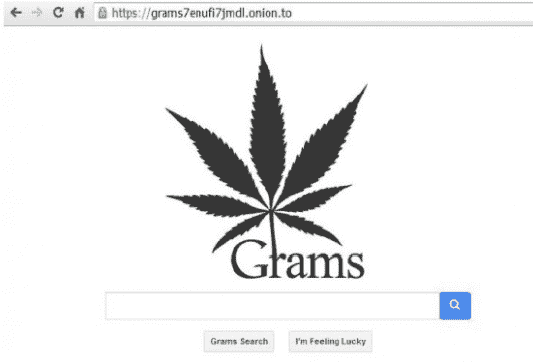

**图 1.2.** *Grams 搜索引擎*

我们将理解区分深层网和暗网的特征：后者甚至不代表互联网上所有平台中的 0.005%。换句话说，在“经典”互联网上（即未加密且通常在没有特定协议或应用程序帮助的情况下即可访问的互联网），一个像 4Chan 这样的论坛（图 1.3），因涉及美法总统大竞选的黑客事件而广为人知，可以提供一个属于深层网的数据良好示例：它可以通过浏览论坛轻松访问，但在 Google 或 Yahoo 上进行直接请求将无法访问论坛的内容。


**图 1.3.** *[www.4chan.org 首页](http://www.4chan.org%20homepage)*

如果说互联网是所有阴谋论的奇妙线索，那么暗网就是数字神秘主义后现代民俗的理想幻想客体。“隐藏互联网”这一迷人的想法导致了暗网和深层网之间频繁的混淆。深层网（这个词可以翻译为“深层互联网”）的含义仅仅是由于自 1983 年创建和 1994 年私有化以来全球网络呈指数级增长，导致传统搜索引擎无法索引的所有在线数据库、出版物和档案。根据最近的研究，“深层网”代表的数据量是表面网的 4,000–5,000 倍 \[CHE 17, pp. 26–38\]。另一方面，暗网指的是互联网中一个更受限的部分，与深层网相反，其访问受非常特定的协议的限制，与之的是，法律法规并不总是根据法律定义的标准来适用。

# 2 控制社会与全景监狱

根据网络活动理论者的观点，互联网是一个不受国家和主要运营者控制的空间。我们所知的现实已大不同，因为国家拥有可以相对容易追踪普通用户轨迹的工具，由于某种原因，全景监狱系统会为了商业目的而收集个人数据，而用户往往对此并不知情。

## 2.1 水平全景监狱与网络自恋

正如社会学家波尔所指出的 \[BOR 16\]，我们所生活的通信社会是一个常规监控社会。然而，这种监控并非由单一模式定义，无论是福柯的垂直“生命权力”，还是德勒兹的“控制社会”。不同的控制、监控和规范化模式是多样且不断变化的，适应了社会学家齐格特·鲍曼在 2000 年定义的“流动社会”模型。鲍曼的“流动社会”与“固态社会”对立，后者的结构和机构是保障公共利益和普遍利益的集体产物。在这个“流动社会”中，唯一的参考是个体，其社会地位和身份完全由个人选择决定，因此会频繁变化。鲍曼因此将今天的社会关系定义为日益难以捉。对于西蒙·波尔来说，网络社会的权力性质（与鲍曼的流动社会相比）也在变化，并日益取决于距离关系而非人际关系。因此，社会控制由不同的层级结构执行，也由个人执行。Web 2.0 和社交网络的出现通过将“自我雇用” \[DAR 09\] 置于中心强化了这一趋势。此外还有对可见性的追求，这是“民主动态病态”的一部分 \[BOR 16\]。这种追求促使个人寻求同龄人的认可，并通过 Facebook 上的“赞”或在 Twitter、Instagram 上获得更多粉丝来验证自己的社会地位。

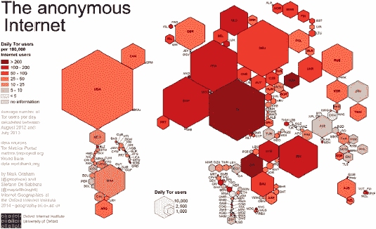

从 20 世纪 90 代后期开始，互联网和万维网使用的民主化随着公共用途的增长产生了许多问题和主张。在几年时间里，互联网作为一项政府资助的项目一直处于公共领域，随后由学术机构领导。随着用户数量的爆炸式增长，向商业化的同步转型使互联网陷入了一个如今难以摆脱的悖论。

监管网络空间的治理规则是什么？政府是否有可能对网络进行立法并行使权威？这种权威性可能源于国家主导，但由于美国政府的意愿规避了这种影响？目前管理数据托管和互联网接入的公司和企业是否可以对网络的所有或部分声称任何所有权？或者，它代表了一个巨大的**法外之地**，在过度控制的社会面前，为数百万用户提供了一个保留了自由的区域？相反，随着`Web 2.0`和“水平全景监狱主义”的出现，互联网难道不是这种控制社会最有效的代理吗？

这些是涉及全球网络发展的查询，随着网络不断增长，其自身的逻辑正脱离它的创造者和用户。暗网（darknets）形式的替代网络的出现为一个新时代铺平了道路，我们倾向于将其称为“互联网 3.0”，因为其特征的计算机工具和应用程序能够在大范围内推翻数字实践。比以往任何时候，今天的互联网同时代表了一种强大的通信工具、一种自由意志主义乌托邦的形式、一种监控工具以及一个法律谜题，且整体因加密网络的发展而变得复杂。

2015 年 12 月，电子前沿基金会（EFF）前董事莎莉·斯蒂尔（Shari Steele）领导了`Tor`项目，并不隐藏她希望将网络成为保护隐私和私人生活的公共工具的雄心。对于这位“数字权利”活动人士来说，`Tor`项目的大规模开发对于确保互联网保持一个自由区域至关重要。对于`Tor`项目的一位化名名为`Isis Lovecruft`的成员来说，该项目的目标是“让每个人都能免费访问信息并交流他们的想法。如果没有这种可能性，人类科学和知识的发展可能会减慢甚至停止” [LOV 16]。然而，悖论在于，莎莉·斯蒂尔将支持`Tor`的组织描述为“由少数天才工程师支撑的 NGO（……）” [ROB 15]。`Tor`的新主任坦于承认，该项目的大部分资金来自美国政府 [ETS 15]。

`Tor`项目的发展与互联网的发展呈现出同样的矛盾和悖论处境。最初，这是一个由学术机构支持并受益于政府资助的项目，具体来说，是由美国军方或海军资助的研究项目。这并不意味着项目的发展完全受军方或海军的控制，但在其开发的最初几年里，它显然是机构化框架的一部分，随后被私人和协会投资者接管。这在今天提出了一个简单的问题：谁对`Tor`网络负责？正在交换的是什么？

这是一个紧迫的问题，因为`Tor`将自己呈现为一种反抗公共权威逻辑的替代网络，尽管正如其创始人和现任主任所承认，它 80% 以上的资金仍由美国政府资助。然而，`Tor`的延伸以及公民社会对该倡议的支持使该项目离开了国家，这就是为什么可能拥有这个网络。

结构性补救是开放访问（开源），以促进有利于低侵入性模型的网络创新。然而，吴（Wu）认为，开源本身并不足以保证网络中立性。因此，可以考虑建立一个保护网络中立性的法律框架。网络中立政策的原则是赋予用户（安全地）使用应用程序的权利，并赋予运营商产生这些应用程序的权利。在没有监管的情况下，这能得到保证吗？经济分析表明，运营商的长期利益与公众是一致的：双方都希望有一个有利于更好的应用程序出现的中立环境。然而，运营商现在似乎对这些长期利益的敏感度降低，更倾向于考虑短期利益，导致关于网络中立性的冲突日益增加。例如，运营商倾向于禁止如`Wi-Fi`或`VPNs`等创新，因为担心它们会导致资费降低。这些偶尔合法的趋势使该领域的简单自我监管有效性受到质疑。因此，蒂姆·吴（Tim Wu）需要清晰地阐述开放访问、带宽歧视和网络中立性等概念之间的关系。后者的概念意味着对创新系统的信任，而前两者是实现该目标的手段。因此，文章旨在提供基于网络中立性的系统理论模型，在这个领域，一旦互联网的逻辑架构对所有人开放，用户和运营商可能会相互对立，因为没有任何中央机构能够偏袒网络的特定用途。对于全球网络开发的关键人物，如世界维网的发明者之一蒂姆·伯纳斯李（Tim Berners-Lee）来说，这种开放逻辑网络的原则是互联网演进和生存的最佳保障 [BER 99, p. 99]：


> “在概念层面上，如果网页注定要成为一种通用资源，它必须在不受阻碍的情况下发展。从技术上，只需要一个集中的监管点就会使其迅速变成限制网页发展的瓶颈，而网页将永远无法开发出来”。

在这些不同的方法下，网络中立性是一种原则，即任何私人运营商（既是接入提供者也是服务提供者）都不能通过资费政策或技术措施（旨在偏袒、降级或阻塞某些信息流），以损害或增加他人的利益来特权其自身的用户和产品。因此，网络中立性是对所有数据流平等对待的原则，排除任何基于经济或政治理由对来源、目的地或内容的歧视，并防止为了限制、剥削或监控交换的数据而进行的歧视。

## 2.2.2. 受威胁的原则

然而，对网络中立原则的批评甚至对其违反行为正在增加。反盗版斗争、确保带宽可用性的需求以及网络安全的紧迫性被广泛引用以规避这一原则。同时，`GAFA`² 日益增长的重要性引发了人们的担忧：互联网的大规模私有化将全球逻辑网络的开放走向终结，并被大型私人集团和资本集中所接管，正如在其他领域已经观察到的那样，这将威胁使用自由和创新，转而倾向于一种基于维护短期利益和利润的经济模型。

> “Google 目前正在创建一个完整的 Google 生态系统，拥有其视频子公司 YouTube、Google 钱包银行、Google 航班机票……其先驱是苹果，它创建了一个完全整合的模型。互联网曾呈现为一个横向的宇宙并对所有人开放，现在正在少数大型运营商之间以孤岛化（silo）的形式进行垂直重构。而且它们全都是美国人的，没有欧洲人的” [TAR 14]。

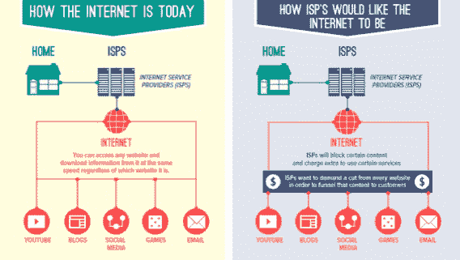

**图 2.4.** 网络中立性说明图³

互联网的私有化并不是新问题。1998 年，Guillaume Duval 在《替代经济》（*Alternatives Économiques*）中自问：“没有任何政府、没有议会、没有董事会真正决定建立一个网络。但现在互联网正在改变法律、货币，这种基础设施的管理正成为一个核心问题。我们应该继续让互联网社区围绕网络协会（ISOC）重新聚集吗？”政府的回答显然是否定的，《替代经济》的主编回忆道，他提出了一系列论点，证明了当时美国政府启动互联网私有化的意愿：即当时网络协会（ISOC）和互联网工程任务组（IETF）无法继续提出全球网络的对等管理模型，面对全球带宽拥塞以及域名更新的问题。


**图 2.5.** 网络协会

网络协会是一个国际协会，由互联网先驱于 1992 年 1 月创立，旨在促进和协调全球计算机网络的发展。2005 年，它是互联网领域最具影响力的道德和技术权威。


**图 2.6.** 互联网工程任务组

`IETF` 创建于 1986 年 1 月 16 日，最初由负责互联网技术标准的学者和技术人员组成。尽管其活动最初得到美国政府的支持，但在 1993 年它变成了一个非政府组织，其活动受到网络协会（ISOC）的支持和监督。

1998 年，美国并不愿意轻易让他们的成果流失，克林顿的特别顾问伊拉·马加津（Ira Magaziner）特别强调，由于互联网是“作为美国政府的项目被开发的”，其管理在法律上仍将由国防研究计划署（DARPA）负责 [DUV 98]。当时，这一声明在互联网社区引发了许多负面反应，也引发了美国和欧洲之间在这一高度敏感问题上的紧张。15 年后，紧张关系依然存在。由数字事务国务长阿克塞尔·莱梅（Axelle Lemaire）提出并于 2016 年 10 月 7 日颁布的法国《数字共和国法》（“莱梅法”），将网络中立性原则登记为基本原则，该原则在 2015 年曾由通信管理局主席塞巴斯蒂安·索里亚诺（Sébastien Soriano）维护过，内容如下：

> “我们可以想象，如果没有网络中立性，运营商与 YouTube 签署合同，让 YouTube 视频流量在网络中流动更顺畅，这将损害 Dailymotion 等平台。……互联网是一个公共空间，必须让所有人以相同的条件访问”⁴。

互联网真的能像索里亚诺（Soriano）描述的那样被视为公共空间吗？考虑到网络的起源、用途及其指数级增长，这个问题随之产生。互联网最初在美国政府和军方的监督下开发，如今已变得“国际化”，允许国家和社区、公有和私营公司以及个人获取 IP 地址或域名——这使他们能够在全球“网络之网络”中存在并导航。然而，鉴于替代性和加密网络的发展，这个问题在今天变得尤为重要：如果今天有可能的话，什么样的治理模式可以适用于互联网？

## 2.3.1. 网络空间是公共空间吗？

公共空间是指公众无论法律地位如何，都会经常出入的场所，“向特定公众开放的私人空间，如购物中心或购物商场” [PAQ 11, p. 3]。这个表述涵盖了非常不同、有时甚至是不可调和的现实，因为“公共空间”属于法律、行政和哲学词汇，而“公共空间”则“存在于建筑师、工程师、城市规划师、建筑师以及近年景观设计师的词汇表中”。因此，公共空间指的是物理现实，通常界限明确且局部化，尽管公共空间绝不限于地理意义。公共空间的定义在法律上也带来了一个问题，因为该概念本质上是通过与私有领域或私人空间的对比来构建的。因此，在定义什么属于公共空间时，起作用的是所有权观念，以及使用权概念，这使得在一个被视为公共空间的空间内建立若干规则和限制成为可能，也就是说在一个由不确定的公众出入的空间内。因为如果我们参考社会学家卡西洛（Casillo）给出的定义 [CAS 13]，公共空间意味着“任何空间（无论是物理上的还是虚拟意义上的），对所有人都是可及的，并具有反映人口多样性和城市社会功能的能力”。因此，公共空间包含了所有对所有人开放的通道和集会空间，这些空间要么属于国家，要么属于决定该空间对公众开放（或不对特定任何人开放）的私人实体。它是罗马人的 `res publica`（公共物）和 `res nullius`（无主物）：即公共事务，也是“其自身不属于任何人的物”。这一定义既适用于复数形式的公共空间——街道、广场、公园等等相遇和交流的场所——也适用于单数形式的“公共空间”，这是一个更抽象的术语，有时可以比作“公共领域”或“公域”。

公共空间是民主运作的核心。在德国哲学家于根·哈贝马斯（Jürgen Habermas）的论文 *L’Espace public. Archéologie de la publicité comme dimension constitutive de la société bourgeoise*（1962）中，我们发现了定义公共空间的最实质性的尝试之一，该尝试通过将其置于旧政权（Ancien Régime）的背景下，追溯该概念的历史根源。哈贝马斯随后将公共空间定义为启蒙时代历史上民社会与国家之间形成的中间领域。它是所有公民都可以进入的地方，观众聚集在此形成公共意见。因此，作者将公共空间称为“个人私人生活与热于秘密、专断和告密的君主制国家之间的中间领域” [HAB 93, p. 10]。

哈贝马斯提醒我们，`public` 一词从 18 世纪中叶开始在英语中建立，指的是广告（换言之，即公开的事实），也指公共舆论，并在许多方面是一种新形式的公共利益，它附属于权力场所与私人生活场所之间中间位置的存在，公共意见在这些地方或或少地形成。“这种公共空间允许私人意见变得公开，它包含了休息室、共济石会所、学院、学术协会、慈善团体、俱乐部、咖啡馆、报纸等。当新闻独立于广告时，它就无法再扮演这一角色了，”研究者蒂埃里·帕科（Thierry Paquot）强调道 [PAQ 11]。正如哈贝马斯所指出的，意见的交锋使得形成公共意见成为可能，而赋予这种意见的“公开性”构成了制衡国家权力的手段。虽然传播社会的出现导致了意见的扩张并标准化，尽管观察到表达渠道的极端多元化（这继续保证了意见的交锋），但公众已分裂为少数，而裁判国家继续越权。

## 2.3.2. 隐私的暴政

因此，我们必须在这里理解核心问题，即互联网发展给我们的社会和社会模式带来的根本性变化，以及我们的社会和虚拟空间所创造的、如今与我们的日常生活紧密交织的问题。从这个意义上说，如果在对公共空间概念进行这一历史和哲学式的探讨后，并考虑到虚拟空间概念本身的演变，我们将理解定义这一虚拟空间的本质是多么重要，以及为什么它会被如此广泛讨论。今天的互联网是一个公共空间吗？无疑，我们会说是，它构成了私人领域与国家之间的这一中间空间，它是公民社会的产物。根据其本质和历史，互联网属于公共领域，这意味着它的运行在很大程度上仍取决于机构所做的行政决策，而这些机构反过来依赖国家当局，特别是美国政府。与此同时，互联网也处于一个逐渐私有化的过程中，这一过程引发了抗议、希望和忧虑。基于新型匿名保护文化的“互联网 3.0”的发展，以及部分规避国家监管机构或私法所制定规则的替代性网络的发展和增加，正是我们想要在这里揭示的问题核心。除了与之相关的安全、地缘政治和经济问题外，将互联网定义为公共空间的问题在治理、个人权利和个人保护方面也提出了至关重要的问题。

> “在这个意义上，我们发现有行使保护公共空间的行政职能，这种职能独立其分类以及公共或私有财产状态。为此，负责物理空间监管的行政部门可以实施限制，利用权威权力进行控制，并在必要时行使警察权和行政制裁” [DIL 14]。

因此，这是一个必须应用于互联网管理的权限范围问题，这种管理现在可以清楚地与国家、私营公司和公民社会代表对立。这种对立通过近期关于全球网络域名管理和电子地址管理的争议和反对非常具体地体现出来。被称为“暗网”的替代网络的发展，以及深网资源的经济和科学开发所代表的利益，使得这个问题变得更加尖。正如 Mueller [MUE 17] 指出的，从本质上说，互联网是由包含的众多网络所碎片化的空间，但通过通用协议 `TCP/IP` 强加的共同语言又是统一的。然而，互联网首先是一个跨国空间，无法深度还原为民族国家的管辖权和逻辑。加密网络的出现不仅发明了新的数据交换和通信协议（这些协议不再依赖于 `ICANN` 的管理），更重要的是确保了网络空间脱离了国家的控制。

# 3. 互联网：一个争议性的治理主体

加密网络的出现和发展进一步加强了互联网抵御希望统一网络的国家或监管机构（如 `ICANN` 和互联网工程任务组 `IETF`）所加限制的能力。这使得关于互联网治理的辩变得更加复杂。

## 3.1. ICANN：一个受影响的机构

`ICANN` 是总部位于洛杉矶的互联网监管机构。`ICANN` 是根据加州法律成立的公司，其角色是管理 IP 地址和域名的分配。`ICANN` 创建于 1998 年，是在副总统阿尔伯特·戈尔（Al Gore）与参与全球网络开发的各种利益者——研究人员、行业、州政府和行政当局进行长期谈判之后。1998 年达成的协议赋予了 `ICANN` 非营利组织的地位，授权其定义地址和协议标识符（`TCP` 和 IP 地址）并管理通用和国家域名系统。应该提到，域名是指一组可以托管并上线任何与相同活动（例如商业活动）相关的数据的服务器集合，该活动属于某个机构、国家或组织。举个简单的例子，`.fr` 域名包含了所有在线活动注册在*法国互联网命名协作协会*（*AFNIC$，Association française pour le nommage Internet en coopération）的个人和组织，该协会负责注册与法国相关的文化和经济活动。因此，域名是服务器组的唯一地址。维基百科的地址是 `208.80.154.224`，但更容易记忆的域名是 `wikipedia.org`。因此，`ICANN` 的角色是关键的，因为正是这个机构的工作让互联网用户能够访问他们选择的网站，或在搜索引擎中找到它的名称，而无需输入一长串数字。

### 3.1.1. 这是美国霸权的终结吗？

`ICANN` 对域名的分配是根据与美国联邦政府的合同进行的。然而，这种情况多年来越来越受到批评。`ICANN` 的管辖权在事实上是全球性的，它的决定被强加于其他国家，尽管 `ICANN` 的章程是由加州法律定义的，这使得 `ICANN` 置于加州司法检察长和美国商务部的权威之下。因此，对 `.fr` 域名的所有更改必须在实施前获得美国商务部的批准。简单来说，互联网上所有的域名都取决于加州法院和美国政府的良好意愿。

有两个因素促成了这一发展。首先是爱德华·斯诺登（Edward Snowden）在 2013 年 6 月的揭露，引发了全球舆论的地震，严重动摇了在此之前 `ICANN` 地位所依据的基础。对国家安全局（`NSA`）以及由此延伸的美国政府活动的严厉关注，引发了许多支持全面改革 `ICANN` 章程的声音，以便将域名分配和 IP 址从一个被认为是美国过度危险的影响中移出。`ICANN` 主席法迪·切哈德（Fadi Chehadé）本人也不断就这一点进行辩论，促使美国政府考虑放弃其领导角色，转而采用对 `ICANN` 的全球治理。然而，第二个发展因素可能比给美国政府的抗议和请愿更有决定性：2016 年 10 月 1 日，`ICANN` 与美国之间的合同到期。

因此，预计 2016 年 3 月 5 日至 10 日在马拉喀什行的第 55 届 ICANN 会议将实现从互联网分配机构（IANA）监管的过渡。IANA 是 ICANN 专门负责监督域名系统（DNS）中域名和 IP 地址分配的部门。因此，ICANN 的改革本应能让互联网从繁琐的美国监管中解放出来。然而，在马拉喀什会议之后，互联网分配名称与数字机构（IANA）对该计划的认可引发了新的担忧，这种担忧特别由法国提出，法国强烈谴责 GAFA 游集团（谷歌、亚马逊、脸书和苹果）在 ICANN 改革谈判中的影响。这并不是法国与这家加利福尼亚组织的首次冲突。早在 2014 年，法国政府通过数字事务国务秘书阿克塞尔·勒马尔（Axelle Lemaire）威胁离开这一国际组织，仅仅是因为 ICANN 决定出售 `.vin` 和 `.wine` 扩展名。这场外交危机险些避免，ICANN 最终撤销了该决定，但法国继续要求互联网上的域名管理更具中性，并要求 ICANN 更加重视政府咨询委员会（GAC）表达的意见。

### 3.1.2. GAC 的角色

由爱德华·斯诺登揭露的国家安全局监听丑闻，加速了导致建立真正的全球互联网治理的过程。然而，新成立 GAC 由 171 名成员和 35 名观察员组成，代表各国政府或国际及联合国附属组织（如教科文组织），这并不能真正让那些谴责美国政府控制、并担心其会被 GAFA 的美国主要公司所取代的人感到满意。

最初，GAC 的设立被纳入 ICANN 章程，作为 ICANN 决策机构的咨询委员会。ICANN 章程第 7 条第 3 节对 GAC 角色的描述正如下：

> “将建立一个政府咨询委员会。该委员会主席应由董事会 [N.D.A：即 ICANN] 任命，并任职直到选出继任者……政府咨询委员会的成员应为各国政府、跨国政府组织、根据国际条约创建的组织的代表，每个实体均须向委员会指派一名代表。政府咨询委员会应对本机构 [N.D.A: 即 ICANN] 涉及政府利益的活动进行审查并提出建议”。

在 ICANN 网站上，GAC 的角色定义如下：

> “GAC 是 ICANN 章程中定义的 ICANN 咨询委员会。它在公共政策决策方面向 ICANN 提供建议，特别是关于域名（DNS）的决策。GAC 不是决策机构。它对属于 ICANN 管辖范围内的问题提供咨询意见。GAC 在 ICANN 章程中具有特殊地位。ICANN 董事会应充分考虑 GAC 的建议，当董事会做出与 GAC 建议相反的决定时，应提供理由并尝试达成共同一致的解决方案……GAC 是一个包含多个利益相关者和利益团体的实体，政府必须参与其中，此外域名行业代表、技术开发利益相关者、商业和非商业用户以及公民社会代表。GAC 建立于 1999 年，与 ICANN 的首次会议并行，并从那时起一直持续运行”。

马拉喀什会议后，法国外交部正式宣布，考虑到讨论和决定的走向，他们感到自己被欺骗了。“这是 ICANN 的私有化，而不是国际化。美国用一只手拿回了用另一只手给出的东西” [CHA 16]。这种担忧的主要原因是为了验证 GAC 意见和通信而采用的一致通过投票程序，这一过程面临赋予私营团体和利益代表（包括 GAFA）压性权重的风险。美方关于决策中需要一致性的主要论点是，担心非民主的国家代表将他们的观点强加于 GAC，而他们的目标直指俄罗斯和中国。对于巴黎来说，这一论点毫无意义，因为 GAC 仅具有咨询作用。然而，对于美方来说，ICANN 章程非常明确规定，任何 GAC 建议在被忽略之前都需要明确的理由和具有共识的反向提议。因此，GAC 的咨询作用具有足够的约束力，以建立保护机制。

ICANN 的改革和域名分配正在塑造着一种地缘政治议程，必须记住这一点，以解决更为敏感的问题：开发和控制部分超出 ICANN、政府和数字行业关键参与者控制范围的替代网络。一方面，我们看到法国从 ICANN 的国际化和网络中立性的绝对中受益，并获得了阿根廷、非洲国家和欧洲部分地区的支持，以及希望赋予国家更大控制权的中国、俄罗斯和伊朗的支持；另一方面，我们看到英国、丹麦和瑞典同意美国的立场，即给予政府代表和私营部门代表同等的权重。在法律术语上，可以观察到，在支持国家与私营部门代表之间多方联合 GAC 的支持者，与捍卫“联合国互联网组织”理念的人（这种理念明显具有政府色彩，且接近联合国安理会的组织）之间的辩论中，英格逊普通法支持者与具有罗马民法传统的国家（如法国或拉丁美洲）之间的分界线几乎是完美的。盎格撒逊人（国家或公司）在 GAC 中的过度代表构成了另一个摩擦点。尽管 2016 年 9 月进行了宪法变更并对 GAC 进行了改革，ICANN 仍然是一家位于加利福尼亚的公司，不受美国政府控制，但实际上更容易受到臭名昭著的 GAFTA 的影响。


正如法国计算机科学家路易·普津（Louis Pouzin）提醒我们的那样，美国对互联网的影响甚至控制可以追溯到 1982 年，当时一个旧金山的团队创建了第一版本的`DNS`，这是一组作为目录服务的互连文件集。1998 年，在首个`DNS`管理者乔·波斯尔（Jon Postel）去世后，ICANN 应成立，以代其管理“域名系统”。作为商务部的代表，ICANN 还承担着经济职能，这一活动由 Verisign 公司代表，这是一家私法公司，为 ICANN 管理`.com`和`.net`下所有域名（占互联网域名的 80%）的账单结算和延期工作。截至今天，尽管 ICANN 的地位近期发生了——某种带有误导性的——演变，但美国继续对`DNS`的管理施加决定性影响。正如路易·普津所说：“实践中，`DNS`已经变得不可或缺。但它的中心化结构并非本质的。我经常提到手机。全球有 1,500 到 2,000 家运营商通过一种比互联网更智能的系统进行相互查询，该系统基于国家和运营商代码”⁴。

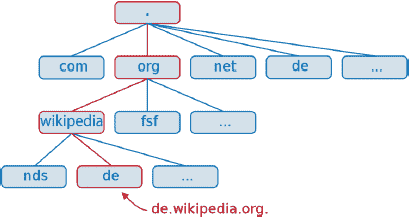

**图 3.1.** DNS 层级结构的示例（知识共享/维基百科）。此图的彩色版本，请访问 [`www.iste.co.uk/gayard/darknet.zip`](http://www.iste.co.uk/gayard/darknet.zip)

路易·普津是法国理工学院（*École Polytechnique*，1950 级）的学生，他是法国计算机科学研究的标志性人物，他未能抓住法国工业界与互联网之间错失的机会，并亲自承担了这一后果。在 Bull 公司工作并访问 MIT 之后，路易·普津成为了法国气象局（*Météo France*）的工程师，随后进入 Simca 公司。然而，正是他与莫里哀·阿莱格尔（Maurice Allègre）一起在计算计划（*Plan Calcul*）任职，让他能够更广泛地了解以 ARPANET 之名在美国开发的技术。他于 20 世纪 70 年被招入 INRIA（法国计算机科学与自动化研究中心），在 Cyclades 项目的发展中起了关键作用，该项目旨在开发一种真实的互连网络，类似于美国 ARPANET 工程师开发的网络。普津在设计数据报文时，甚至通过设计第一个分组交换网络实现了决定性的技术突破。遗憾的是，行政负担、在瓦莱里·吉斯卡尔·德·埃斯坦（Valéry Giscard d’Estaing）总统期间给予该项目的资金支持匮乏，以及法国电信行业所做出的遗憾选择，最终注定了这个本可以成为法国互联网的项目的命运：

> “路易·普津，一位受过理工教育且极具才华的研究人员（当时），提出来一个基于完全新事物的计算机网状网络项目：分组交换。很快，这项研究非常成功，以至于我付出了巨大努力让电信总局采纳该项目作为其未来数据传输网络的基础。遗憾的是，我碰了壁。（电信工程师更倾向于推动 *Minitel* 的工业化发展。）我们本可以成为互联网世界的先驱之一（……）。我们只是用户，远离了未来正在构建的地方”⁵。

不给 Cyclades 项目团队提供继续研究手段的决定，显然对法国电信业产生了深远影响，对全球网络的管理和独立性也是如此：“任何能唤起目录去中心化和国际化的因素都会引起美国政策的强力动员。顺便说，我们知道这种抵触背后的社会学原因：美国人认为互联网属于他们。提及`DNS`就是进入了他们的领地”⁶。`DNS`的“解放”以及 ICANN 脱离美国监护的问题，不仅关乎自私和国家自豪感。如果我们在这里提到这些问题，是因为替代网络的发展以更激进的方式暴露了这些问题，而互联网的监管机构也十分清楚与这些转型相关的安全问题。

> “因此存在一个简单的政治原因：这样设计的`DNS`是一个极好的观察手段。显然，观察发生的一切是不可能的。但通过抽样，可以更精确地检查这个或那个用户的流量。它是一个经济情报工具。没有正式证据表明它目前被用于此目的。然而，如果一个国家拥有这种能力却不使用，将是愚蠢的”⁷。

在这种情况下，如果 GAC 成员未能通过这些术语准确反映由 DNS 控制所代表的利益，那么`DNS`替代方案的发展将成为反复出现甚至是关键的讨论和关注的话题，特别是在围绕`WHOIS`的讨论中。

### 3.2.1. WHOIS 的核心作用

`WHOIS`协议（读作“who is”，它不是缩写词）是一种互联网协议，用于在数据库（BDD）中查询有关域名或 IP 地址注册的信息。`WHOIS`建立于 1982 年，当时 IETF 发布了一个协议，为 ARPANET 用户创建了一个主注册。最初，这个注册表由一个想要传输 ARPANET 数据的简单用户列表组成。随着互联网的发展，`WHOIS`开始被注册用户以外的用户使用：法律机构和执法人员、商标所有者和知识产权受益者、个人和专业人士。

当 ICANN 于 1998 年成立时，它继承了 IETF 的`WHOIS`协议。2009 年 9 月 30 日，ICANN 与美国政府签署了承诺书（AOC），承认 ICANN 为一家独立的非营利组织，负责确保公众获取`WHOIS`提供的信息，包括注册用户、注册费用信息和管理联系。AOC 要求这些信息定期更新。从 1999 年开始，ICANN 授权其他实体提供域名注册服务。作为 TLD 注册的管理方，ICANN 逐渐定义了`WHOIS`使用和操作的共识，这些规则规定在一些关键文件中。以下是其中的三个：

- – WHOIS 数据提醒政策（WDRP）：于 2003 年 3 月 27 日实施，要求所有在 ICANN 注册的用户提供有关其注册域名的准确且最新的信息，否则可能导致相关域名被删除。WDRP 是根据董事会在 2003 年 3 月 27 日通过的 03.41 号决议实施的。通用名称支持组织（GNSO）负责向 ICANN 董事会就 gTLD 注册政策提出建议。GNSO 由 gTLD 注册局、gTLD 用户、知识产权维护者、接入提供商以及商业和非商业利益代表组成。

- – 名称准确性恢复政策（2004）：该规定明确，如果注册域名未提供要求的信息或信息不完整，则该域名将保持激活状态，直到提供此类信息为止。

*   – WHOIS 营销限制政策（2004 年）：这项重要规定规定，域名持有者必须确保没有第三方将 WHOIS 信息用于商业目的，并承诺不交易此类信息。

这些法律规定在十多年里保持不变，但在 ICANN 机构以及其他参与互联网治理和互联网用户社区的实体内部受到了持续的重新评估和辩论。互联网生态系统的演进在所有领域都面临着真实挑战：信息的准确性、访问、合规性、隐私、滥用和欺诈。WHOIS 结构被认为越来越无法适应互联网的演进。然而，WHOIS 的替换和实质性修改引发了明显的技术、物流和财务问题。因此，ICANN 在 2009 年 2 月 25 日的`SSAV 38`报告中，纳入了用于验证和核实域名持有者所提供数据的新标准：

> “被确定为域名联系人的方可能会出于各种原因与其取得联系，包括普通调查（例如出于商业原因）、尝试通知持有者 DNS 配置错误，以及有关域名可能参与恶意、非法或犯罪活动的调查。…… 执法机构、计算机应急响应小组 (CERT)、反钓鱼和反犯罪社区（干预者）、提供在线声誉保护服务的公司、网络运营商和互联网用户在无法使用从 WHOIS 服务获取的联系信息与域名持有者通信时，可能会尝试联系经 ICANN 认证的注册商。…… 公共联系仅在特定的业务时间内可用，而发生滥用时的联系应是每天 24 小时、每周 7 天。涉及涉嫌滥用或犯罪活动的调查通常需要及时甚至是紧急的响应”⁸。

因此，SSAC 在 2009 年建议“注册商和零售商应协助滥用和非法活动的调查与缓解”。为了做到这一点，“每个注册商必须在发生滥用时提供联系信息”，SSAC 报告规定了“响应且高效”的联系点，并且“发生滥用时的联系人”应“及时回复电话和邮件”，这些联系人的详细信息将发布在`www.internic.net/regist.html`上。

除了这项措施外，ICANN 的 GNSO 还完成了多项研究，旨在突出 WHOIS 结构和域名注册过程中的差距，包括 2013 年 5 月 23 日的一份报告，该报告通过对 1600 个案例的小组分析，对域名注册模式等信息进行了分类。通过这一样本，由芝加哥大学国家意见研究中心提交 ICANN 的 WHOIS 注册者识别研究确定了 ICANN 注册用户声明域名的以下分布。

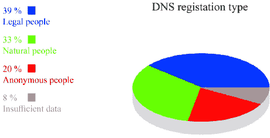

**图 3.2.** 域名注册的不同类型⁹。 *需此图的彩色版本，请参见 `http://www.iste.co.uk/gayard/darknet.zip`*

### 3.2.2. 域名扩展以及从 IPv4 迁移到 IPv6


**图 3.3.** 2015 年 4 月 1 日来自`http://com.google`的愚人节

随着 ICANN 批准新扩展的商业化，域名的分配和控制问题变得至关重要。域名市场的发展在仍在互联网治理中发挥作用的机构以及反对的国家、用户和私立团体之间存在辩论，许多政府谴责了大型数字跨国公司（特别是著名的 GAFTAs）对 ICANN 等机构以及新域名市场已建立的控制。这一过程始于 2013 年，已经允许地方当局购买特定的扩展名，例如用于英国的`.bzh`和用于巴黎市的`.paris`^(10。它还允许公司根据其业务创建新的扩展：用于酒店所有者的`.hotel`、`.shop`或`.google`。幽默的是，2015 年 4 月 1 日，这家位于山景城的公司（Google）在网上开了一个愚人节玩笑，庆祝 ICANN 开启了新一代的域名。

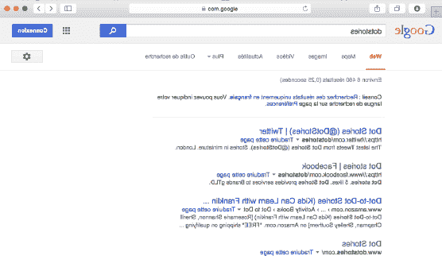

**图 3.4.** 2015 年 4 月 1 日的“倒置 Google”

除了新域名的开放，还有从 IPv4 电子地址格式到 IPv6 格式的过渡。IP 地址是使用互联网协议永久或临时分配给连接到计算机网络的每个设备的标识符。

> “1981 年创建的 IPv4 能够为 40 亿台机器提供地址 (2³²)。4 字节十进制编码。每个字节可以是 0 到 255 之间的数字。例如：192.177.5.2。IPv6 是 IETF 自 1998 年启动定义新地址协议工作的结晶。它可以支持 3.4 × 10³⁸ 个地址。”

在不使用翻译机制的情况下，IPv4 和 IPv6 是不兼容的。这解释了为什么在 2017 年，在其创建近 20 年后，IPv6 的使用率仍限制在 10%，而 IPv4 地址池自 2011 年起就已经枯竭，只能进行回收，这是 ICANN 议程上的另一个问题问题。

## 3.3. 谁在监管控制者？

WHOIS 改革和新域名扩展开放等问题是 2016 年 3 月 5 日至 10 日在马里喀举行的第 55 次 ICANN 大会的讨论焦点，该会议聚集了国家、用户社区、国际机构和从事数字经济的私立公司代表。此次会议之后还有三次会议：2016 年 6 月 27 日至 30 日芬兰赫尔辛基；2016 年 11 月 3 日至 9 日印度海得里；以及 2017 年 3 月 11 日至 16 日丹哥本哈根。尽管如此，马里喀峰会在确立 ICANN 改革的广泛原则和后续会议的议程方面具有决定性作用。在马里喀讨论期间，GAC 的 76 名成员和 12 名观察者制定了美国政府 2014 年宣布的 ICANN 过渡框架，并因此制定了互联网治理。美国政府的立场在此期间由劳伦斯·E·斯特里克林（美国商务部助理部长兼信息助理部长）以非常明确的方式再次确认：

> “自 1998 年 ICANN 成立以来，美国政府一直认为其角色是暂时的。本周，ICANN 董事会将一个提案提交给美国政府。……我们不会接受任何将 NTIA 替换为政府或政府组织的过渡提案。其次，互联网的稳定性、安全性和韧性必须得到维护。第三，必须满足全球客户和 IANA 合作伙伴的期望，并必须保持互联网的开放性”^(11。

### 3.3.1. ICANN 内部冲突

Strickling 所述的立场引起了中国、印度和俄罗斯的关注，这些国家渴望在数字经济和政治高度变化的背景下保持政府的管理能力。但最重要的是，这一立场遭到了法国、巴西和阿根廷的坦率反对，他们明确表示不同意`ICANN`的改革提案；该提案通过`政府顾问委员会`（Government Advisory Committee）仅赋予政府非常有限的咨询和决策角色，并声称只能向`ICANN`董事会提供非约束性建议，而私营部门代表（特别是`GAFAs`）似乎在治理机构中占据了大部分份额。

这一抗议被正式重申，这次是由巴西政府代表在印度海德拉巴参加的第 57 届`ICANN`会上提出的，但抗议者在马拉喀什（Marrakech）会议时一样，并没能改变改革的进程：在新的`ICANN`改革方案中，政府不得不接受将大部分决策权让给私营部门。

尽管围绕`ICANN`新章程的讨论预示了互联网地缘政治的重大发展，但马拉喀什会议还凸显了其他担忧，印度通信和信息技术部长 Ravi Shankar Prasad 对这些担忧进行了进一步阐述：“我们重视一个自由、开放、多元化和包容性的互联网。接入互联网绝不能具有歧视性。因此，我们这一这一工具至关重要。尽管如此，我们必须保护自己不受网络犯罪、暗网及其他问题的侵害。”

### 3.3.2. 加密网络：ICANN 面临的主要安全问题

作为一个拥有 10 亿部手机和 4 亿互联网用户的国家，印度通信部部长的发言提醒了参与者另一个现实：替代性甚至竞争性网络的兴起。这些网络的发展不仅可能使网络犯罪扩张到前所未有的水平，而且在`ICANN`这一主要的互联网治理机构正在进行深刻且具有争议的组织修订之际，破坏域名分配和电子寻址的地缘政治属性。马拉喀什会议的官方声明以紧急要求监管代理和私有网络的使用结束终，在海德拉巴举行的第 57 届`ICANN`和`GAC`会议也重申了同样的紧急呼吁，以衡量并控制这一现象：

> “来自互联网域名的恶意行为不考虑边界。此外，对这类行为的镇压必须考虑到警方调查和操作涉及的多司法管辖性质，以保护无论在何处开展此类行为的公众。隐藏服务被用于藏匿恶意活动实施者并隐藏其他相关信息，必须建立理性机制，使公共安全部门能够发现并获取必要信息以检测这些恶意运营者。我们要求`P/P`工作组考虑司法机关获取被私有服务隐藏信息的需求，以便他们继续保护公众免受涉及互联网域名的恶意行为的影响。”

虽然一场旨在为互联网机构治理提供新形式和框架的重要谈判即将结束，但我们正在见证私有网络的兴起，互联网监管机构对此表现出浓厚兴趣。这不仅是因为最近的国际刑警组织（Interpol）报告所示，它们促进了网络犯罪的发展，还因为它们直接威胁到了国家与私营运营商之间在域名管理和电子寻址方面脆弱的共识。当替代网络数量增加使得建立和分配无法被`ICANN`或`WHOIS`引用的域名和网络地址成为可能，从而使其部分功能失效时，我们该如何定义这一领域的新标准和治理模式呢？

# 第二部分

## 加密无政府主义、密码学与隐藏网络

针对网络治理这一至关重要且引发争议的问题，互联网社区似乎带来了一种非机构化且激进的反应，但这种反应仍然是互联网“自然”发展逻辑的一部分。全球“网络网络”的指数级增长，正如前一章所述，质疑了`ICANN`自 1998 年以来提出的“中心化”管理模式。互联网的商业化最初导致美国由于`ICANN`法律性质的模糊性而放弃了对域名分配的部分控制。关于该机构新章程的持续辩论，说明了各种声称拥有参与网络管理合法权利的运营商之间的竞争：国家、公司、非政府组织和用户社区。然而，这些塑造具有真实地缘政治属性互联网的谈判，仅部分解决了由互联网去中心化逻辑给国家和机构带来的棘手问题，并未消除人们对监管机构在面对巨大的数字工业时能否执行网络中立性的怀疑，而这些工业如今在这些机构的运行中起着至关重要的作用。总之，一方面，`ICANN`和一些国家及机构运营商看到他们无法控制去中心化私有或加密网络的扩张；另一方面，`GAFA`的权重以及政府的网络监测能力正促使互联网社区的一部分鼓励发展一种被称为“暗网”的“失控”互联网，以避免出现巴洛夫（Barlow） 20 年前在其《网络空间独立宣言》中所谴责的网络。

鉴于最近的辩论和技术发展，互联网的未来演变正朝着难以描述的方向发展。多速互联网的出现是否是由于网络大规模私有化、`IPv6`的发展以及`Tor`等替代网络的结果？另一方面，这些类型的暗网是否因为其发生的犯罪活动，注定将受到政府和情报机构更严格的监控和控制？或者，我们真的会看到一个通过密码学转变为基本法外区域的替代互联网乌托邦，而“表层网”则落入那些为了自身利益而不犹豫重新考虑网络中立性的`GAFAs`手中？

# 第 4

## 从 ARPANET 到暗网：当国家失去加密战争

4.1. 从 Minitel 到 ARPANET

20 世纪 50 年代末在历史上标志着电信领域的重大进展以及信息技术领域的进步，而当时信息技术领域尚处于起步阶段。在法国，是国家电信研究中心（`Centre national d’études des télécommunications`）的工程师们继续在该领域的研究，并与在查尔·德高尔总统及其经济与财政部长（曾任总理）米歇尔·德布雷的推动下于 1966 年启动的“计算计划”（`Plan Calcul`）的研究人员合作。法国、英国、德国、俄罗斯和美国之间的竞争异常激烈，他们开启了一场不仅导致了家庭“个人电脑”出现，还催生了互联网诞生的竞赛。该项目是在美国`DARPA`的庇护下开发的，而法国人同时正致力于 Minitel 项目（通过电话信息数字化实现的交互式媒体），该项目由内内尔的电视与电信研究中心在贝尔纳德·马尔蒂的指导和让·保罗·莫里的的监督下开发，其首批原型于 1977 年通过测试。


Minitel 有几个竞争对手：英国人在 1972 年推出了名为`Ceefax`的系统对视频文字技术感兴趣（随后在 1979 年与 Prestel 合作），美国则开发了`NAPLPS`系统（北美演示级协议语法）。然而，`NAPLPS`有一个巨大的缺点：其视频文字显示技术近乎照片的质量，这本可以被看作是优势，但对于低带宽数据传输协议来说实际上是一个缺点。德国方面，他们设计了一种更接近 Minitel 的电信服务，能够提供广泛的在线服务，足以与今天互联网上提供的服务相媲。尽管如此，德国的`Bildschirmtext`在商业上失败了，主要是因为设备成本极其昂贵。当处于垄断地位的德国邮政部门意识到必要通过降低资费来挽救`Bildschirmtext`时，Amiga、Atari、Amstrad 和 IBM 的第一批 PC 已经开始进入家庭。

20 世纪 80 年代初由 IBM、Commodore、Sinclair 和 Apple 生产的第一批个人电脑型号出现，与美国研究人员和学者在`ARPANET`上取得的工作相恰合。关于 Minitel 对互联网发展的真实影响，争论仍在持续。与德国同行一样，法国的政策制定者未能利用他们所发起的技术和商业进步。美国人很大程度上对 Minitel 的发展感兴趣，与其说是对其技术感兴趣，不如说是其提供的内容和服务引起了英海彼边的兴趣：Minitel 不仅为用户提供了访问大型在线数据库和各种服务的可能，还提供了一个大型在线社区，在社区中可以建立真实的交流。学生抗议者在 1986 年使用 Minitel 协调他们反对德瓦凯改革的行动，这比互联网在阿拉伯革命中发挥的作用早了 25 年。显然，这种规模并不相同，但通过在线社区采取行动的现象已经存在，并预示了将构成互联网本质的内容——即创建一个全球用户社区，在今天的 Web 2.0 社交网络和互联网 3.0 的替代网络中，可以发现这种社区极其多样化的表达和交流条件。

## 4.1.1. 快速增长

ARPANET 是当前互联网的前身，是一个由军方分支（高级研究计划署，`ARPA`）资助的大学项目。起初，该网络仅连接了犹他大学和加利福尼亚州的三个研究中心。ARPANET 是现代“数据包”发送技术的先驱，换句话说，是将数据碎片成“数据包”，以便在网络上更容易传输。ARPANET 最早的应用之一是`Telnet`，它允许研究人员连接到另一个站点的计算机工作站。到 20 世纪 70 年代后期，ARPANET 拥有五个通信节点，包括麻理工学院和哈佛大学。每个 ARPANET 站点都有一个花费 82,200 美元的路由器，相当于现在的五十万美元。1973 年，ARPANET 实现了国际化，因为通过卫星连接连接了挪威、伦敦、夏威夷与美国的节点。网络随后扩大到 40 个节点。电子邮件于 1971 年由一位名叫雷·汤姆林森（Ray Tomlinson）的工程师发明，他还发明了电子邮件地址中的`@`符号。文件传输协议（`File Transfer Protocol`）被开发出来，允许 ARPANET 以数据包的形式交换文件。这与非对称加密技术的开发差不多。这项发明源于一个简单的技术问题：从 20 世纪 60 年代起，电话网络的饱和迫使军自己为日益增加的用户管理不断增加数字密钥。因此，1976 年在斯坦福大学，惠特菲尔德·迪菲（Whitfield Diffie）和马丁·赫尔曼（Martin Hellman）对计算机网络上的第一个真实密钥分配系统进行了理论化，产生了后来被称为“电信”（`telecommunications`）的物。这个想法非常简单，仍然是`Tor`等加密网络的核心：消息的发送者和接收者可以使用编码密钥和解码密钥对消息进行加密。

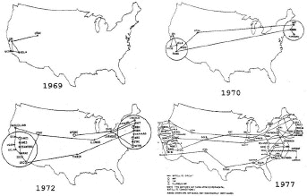

**图 4.1.** 从 1969 年至 1977ARPANET 的发展（来源：维基百科）

## 4.1.2. 互联网的私有化

最初，ARPANET 由军管理。然而，设计者们意识到，如果网络继续增长，就不能保持中心化。必须创建由不同组织控制的网络，并使用通用标准。这正是法国人对 Minitel 从未做到的，那是一个卓越的中心化系统。2007 年 7 月 13 日周五在昂斯举行的世界开源会议上，本杰明·贝亚特（Benjamin Bayart）提议将互联网的中心化过程，尤其是网页命名为“Minitel 2.0”。据他，这种中心化的趋势破坏了网络的中立性并限制了其潜力，将互联网和 Minitel 结合在一起：一个完全中心化的系统，其中传输需要申请，而接收是常态。无论如何，20 世纪 80 年代初，美国陆军委托两位工程师温顿·策夫（Vinton G. Cerf）和鲍伯·凯（Bob Kahn）设计了一种通信和数据包交换的新标准：`TCP/IP`，`TCP`（传输控制协议）和`IP`（网协议）于 1983 年 1 月 1 日被 ARPANET 采用，标志着互联网的诞生。另一个由国家科学基金建立的网络`CSNET`使用`TCP/IP`协议连接到 ARPANET。当 ARPANET 在 1990 年停止运行时，其网络仅有 40000 个互联网成员。20 世纪 80 年代，国家科学网络创建了一个名为`NSFNET`的`TCP/IP`网络，连接了几个配备超级计算机的中心。该网络的速度和流量导致其他人尝试连接到`NSFNET`，使其成为互联网的第一条骨干。1992 年，6000 个不同的网络连接在一起，其中三分之一在海外，由于同年开发的一种名为万维网（`World Wide Web`）的应用。互联网营销已经开始。1994 年，克林顿政府将骨干私有化。NSFNET 将接棒交给了负责长途通信的私人公司。美国政府担心通过在不同公司之间分蛋糕会产生垄断：`UUNet`（2006 年起归 Verizon）、`AT&T`、`Sprint`和`Level (3)`。

正如国际战略研究所（IISS）在 2016 年 3 月发表的一份重大报告[MOO 16, pp. 7–38]的作者所回忆的那样，密码学领域的政治决策测试着 21 世纪自由民主的价值。民主国家政府面临着一个几乎不可能的困境：为了防止从事犯罪和非法活动的个人从同样的保护中获益，是否应该通过剥夺他们保护数据和隐私的权利，而对公民和互联网用户提供的保护提出质疑？今天，密码学与恐怖主义和 IT 漏洞的犯罪利用这两大威胁直接相关，但数据加密也是一种技术可能性，能够充分参与互联网的发展，并像去中心化一样保障网络中立。然而，政府是否应该限制计算机加密技术的飞速发展呢？通信的发展在很早就让这个问题成为了一个核心问题。

# 4.2. 非对称加密的兴起

在 20 世纪 60 年代初，随着通信网络的发展和用户数量的大幅，限制身份密钥数量这一非常现实的问题开始出现，特别是对于军队而言，尽管通信通道增加且无线电频率饱和，他们仍面临着维持安全无线电连接的问题。詹姆斯·埃利斯（James Ellis）是政府通信总部（GCHQ）的一位工程师和数学家，他开始研究公钥加密问题，早在约 10 年后特菲尔德·迪菲（Whitfield Diffie）、马丁·赫尔曼（Martin Hellman）和拉尔夫·C·梅尔克（Ralph C. Merkle）在计算机网络通信领域提出之前。这三个人都是斯坦福大学的研究人员和密码学家[DIF 76, p. 644]：“这种密钥分配问题带来的成本和延迟是通信市场向大型处理网络传输的主要障碍”。

## 4.2.1. 隐术

经济学家和计算机科学家让-菲利·雷纳德（Jean-Philippe Rennard）回忆道[REN 16, p. 30]，密码学是“对信息表示过程的研究，使其只有接收者能够理解”。密码学是一项极其古的技术。最早的历史例子可以追溯到“凯恩加密”，以一位历史学家的命名，他识别出公元前 19 世纪一位埃及书吏使用过这种方法；而在公元 16 世纪，正如伊拉克发现的一块泥板所证明的那样，一位美索不达米亚陶工在详细记录其陶艺技术的同时，特意更改了单词的拼写和信息的含义，使其只有他自己能理解。密码学（Cryptology）字面意思是“秘密的科学”，在 20 世纪 70 年代成为一门学科，并区分了隐藏信息的两种主要方法：加密术和隐写术。前者通过密钥使信息变得不可不可懂，即通过某种特定方法，这种方法一旦被知，就可以解密信息。后者源自古希腊语 στεγ간ός/steganós（“不透风的”）和 γραφή/graphế（“写作”），是将一个信息隐藏在另一个信息之中。

![图 4.2. 隐写信息的示例 [LED 96]。一张带有隐藏信息的画。信息是通过河岸长草和短草中的摩斯电码编码的。长草代表一条线，短草代表一个点。信息内容为：CPSA MA 祝 1945 年 5 月 11 日访问圣安东尼奥的哈罗德·R·肖（Harold R. Shaw）上校。](images/fig4-2.jpg)

**图 4.2.** 隐写信息的示例 [LED 96]。一张带有隐藏信息的画。信息是通过河岸长草和短草中的摩斯电码编码的。长草代表一条线，短草代表一个点。信息内容为：CPSA MA 祝 1945 年 5 月 11 日访问圣安东尼奥的哈罗德·R·肖（Harold R. Shaw）上校。

希罗多德记载了斯巴达前王德马拉特斯（Demarate）是如何向他的故家乡警告波斯国王策划的入侵计划的，因为有一块刻在木头上的信息木板，上面覆盖着蜡，使其看起来像是一块处女蜡板；或者米列塔斯的暴君希斯提亚（Histiee）是如何执行纹在奴隶头骨上的秘密命令的。

然而，隐写术最著名的用途之一是归于乔治·桑（George Sand）和阿尔弗雷德·德·穆塞（Alfred de Musset）之间非常精彩的书信往来，他们在 1833 年至 1834 年间保持着密切的关系。如果这段交流的真实性受到质疑，那么隐写过程就是典范性的，我们将此留在这里让读者去发现……并理解这两位作家所谓交换的信息的含义：

### 乔治·桑给阿尔弗雷德·德·穆塞的信：

```
我非常激动地告诉你，我
完全理解了你那天晚上你一直在
一直有一种跳舞的疯狂冲动。我保留着你那
扭曲的记忆，我想让它是
这，我能被你
爱着的证明。我准备好向你展示我的
无私且没有伪装，
如果你想看我
不加掩饰向你揭开我的灵魂
裸露，来来看我吧。
我们会像朋友一样坦诚地交谈。
我会向你证明我是
真诚的，能够为你提供最深厚的情感
以及最紧密的
友谊，简而言之，是你能梦到的
最好的女性的证明，因为你的
灵魂是自由的。想想那种孤独，我哈-
鸡非常长，非常硬且
困难。所以，当我想到它时，我的灵魂
很大。你为什么不快点把它放进我
想要里面。
```

### 阿尔弗雷德·德·穆塞给乔治·桑的回信：

```
当我向你的脚下献上永恒的荣誉
你想要让我改变我的脸吗？
你捕捉了一颗
崇拜你的创造主的心。
我珍惜你，爱，我的羽毛是疯狂的。
在纸上写下我不敢说的话。
```

### 乔治·桑的回复：

```
你法庭请求的这种符号
夜晚让我的名声和灵魂感到厌恶¹](#c04.xhtml#fni-1).
```

## 4.2.2. 现代加密方法

在机器帮助，现代密码学在第二次世界大战期间取得了重大进展。德国二战期间开发的`伦尼兹机`能够使用`波尔特码`传输加密信息。这种孔带编码由埃米尔·波尔特（Émile Baudot）于 1874 年开发，基于二进制代码和拉丁字母，每个字符通过 5 位比特（0 或 1）进行编码以获得 32 种组合。`波尔特码`是历史上第一个机械化的字符编码。

伦尼兹机虽然不如用于加密德国军队通信的著名`恩尼玛机`（Enigma machines）知名，但它们传输的信息非常重要，因为它们被用于加密总部、参谋总部和纳粹内部最高决策层之间的通信，从而使得这些不同的决策机构之间传输“加密附件”成为可能，正如它们的行政名称`SZ 40`和`SZ 42`（`Schlüsselzusatz`，意为“加密附件”）所示。

1941 年 8 月 30 日，德国操作员的一次错误让英国布莱切利园公园（Bletchley Park）的密码分析人员截获了两条使用相同加密密钥发送的消息，这使得理解罗伦兹（Lorenz）机器的工作成为可能。为了更快地破解德国通信，英国人开发了`Colossus`计算机，这被认为是世界上第一台数字电子计算机。对罗伦兹机器通信的计算机解密，以及对德国陆使用恩尼玛（Enigma）机器进行传输的解密（这是阿兰·图灵在法国和波兰情报机构传输的信息的基础上通过工作实现的），标志着密码学时代和现代密码战争的开始。

对称加密确实可以与出现得得的非对称加密区分开来。对称加密基于一种原则：消息的发送者和接收者都拥有同一个解密密钥，因此可以通过预先知的密钥进行解密。根据荷兰密码学家奥古斯特·柯尔克霍夫斯（Auguste Kerckhoffs）在其著作*La cryptographie militaire》（1883）[KER 83]中确立的规则，对称加密基于消息发送者向第三方公开密钥的原则，以及“计算安全”，换句话说，解密密钥所需的计算能力超过了想要拥有密钥的第三方所拥有的能力。技术的进步，特别是计算机科学领域，极大削弱了这种“计算安全”，而近期的加密工作为非对称加密铺平了道路，非对称加密现在被用于互联网上的数据加密。

## 4.2.3 非对称加密

非对称加密是近期工作的成果。它基于使用两个加密密钥，而对称加密只使用一个：一个用户用于“加密”其所发消息的密钥（换句话说，让第三方无法理解），以及一个允许接收者解密消息的解密密钥。在这种情况下，加密密钥是公开的，而接收者使用私钥来解密消息。如今，这种加密类型用于注册电子信、电子护照、网站用户认证、电子保险箱、文档电子签名，以及由隆·里维斯特（Ron Rivest）、阿迪·沙米尔（Adi Shamir）和莱纳德·阿德曼（Leonard Adleman）设计的所谓的“非对称”`RSA`算法，它基于一种简单的方法：

> “消息加密：c = m^e mod n

> 消息解密：m = c^d mod n 

> 在这两个操作中：`m`表示未加密的消息，`c`表示加密的消息，`(e, n)`为公钥，`(d, n)`为私钥，`n`表示两个质数的积，`^`表示幂运算（`m`的`e`次方），`mod`是模运算，用于确定整个除法的余数。

为了更容易理解非对称加密中的模型，密码学使用了“Alice”（爱丽丝）和“Bob”（鲍勃）这两个角色，由隆·里维斯特在 1978 年发表的一篇文章中创建，详细描述了`RSA`加密系统的机制 [RIV 78, pp. 120–126]。在文章中，里维斯特、沙米尔和阿德曼描述了以下操作员：“对于我们的场景，我们假设`A`和`B`（也称为 Alice 和 Bob）是公共密码体系的两个用户” [RIV 78, p. 121]。Alice 和 Bob 的角色被用作密码学的参考人物，也被用于博弈论、物理学、量子密码学或解决预测电话硬币正面或反面等复杂问题等各种领域 [BLU 83a, pp. 23–27]。多年来，使用 Alice 和 Bob 说明研究的工程师和研究人员有时甚至趣味地赋予了 Alice 和 Bob 更丰富的性格和传记。1983 年，布姆甚至为 Alice 和 Bob 想象了一段苦恼的过去：“Alice 和 Bob 最近离婚且互不信任，继续一起做业务。他们分别住在相反的海岸，主要通过电话交流，并使用计算机进行电话交易” [BLU 83b, pp. 175–193]。

二战结束后，密码战并没有在布莱切利园结束，亲友的 Alice 和 Bob 甚至被视为国家的危险敌人，因为在 20 世纪 70 年代，英国政府通信总部（GCHQ）的詹姆斯·埃利斯（James Ellis）、惠尔菲德·迪菲（Whitfield Diffie）、马·赫尔曼（Martin Hellman）以及斯坦福大学的拉尔夫·C·梅克（Ralph C. Merkle）等密码学家的研究将数据加密带出了军事领域，并为民用密码学提供了决定性的推动。

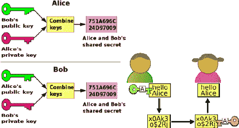

**图 4.3.** Alice 和 Bob 的冒险。此图的彩色版本，请参阅 [www.iste.co.uk/gayard/darknet.zip](http://www.iste.co.uk/gayard/darknet.zip)

民用密码学的兴起确实是因为我们之前提到的密钥分发问题（即一种能够识别网络用户的数字价值）而启动的，这一问题首先涉及无线通信，并促成了 GCHQ 詹姆斯·埃利斯的开创性工作。当同样的问题出现在计算机网络通信时，惠尔菲德·迪菲和马·赫尔曼发明了一种简单的解决方案：没有理由只有消息发送者可以加密它，接收者也可以参与加密。这种革命性的想法是非对称加密的黎明，始于 1976 年迪菲和赫尔曼作品的发表，直到两年后里维斯特、沙米尔和阿德曼创建了`RSA`——电子签名的原则——随后梅克发表了非对称加密进展的里程碑式工作，里维斯特、沙米尔和阿德曼以远见感知到了这种新电子通信形式的出现 [RIV 78, p. 120]：“我们将很快进入电子邮件时代。我们需要确保纸质信件的两个重要属性得到保留：消息是私密的，消息可以被签名。”这一在今天看来平淡无奇的革命性断言，后来成为了政府与情报机构、以及用户社区与私人运营商之间对抗的唯一理论基础，这种对立在斯诺德登事件 4 年后依然存在，当时暗网（darknets）正在兴起。

如果说里维斯特、沙米尔和阿德曼在他们的文章展示了非对称加密能够保护的电子交换两个属性，那么研究人员大卫·查姆（David Chaum）赋予了第三个被国家视为更负面的属性实质：匿名性。1981 年，来自加州大学伯克利分校的 26 岁数学家大卫·查姆创建了一种加密方法来反制流量分析并使用户匿名，这不是通过删除其电子邮件地址（即其公共身份密钥），而是通过在多层加密下对其伪装。查姆当时刚刚构思了作为洋葱路由（onion routing）基础的想法。大卫·查姆清楚地意识到其发现的政治影响，并已经在批判性地分析数字革命的后果 [CHA 85, p. 1,030]：“‘记录公司’的基础受到了质疑，因为计算机可以根据普通消费者交易期间收集的数据来影响他们的生活方式、服装选择、习惯、活动和关联”。


> “信号情报机构意识到，针对民用和商业密码学的长期斗争已经失败。现在，强大的学术界和工业界已精通密码学和密码破解。互联网和全球市场创造了信息、系统和软件的自由流动。美国国家安全局（NSA）通过声称‘密钥库’和类似系统是为了满足警察的需求（而非通信情报（COMINT）机构的需求），其在维持访问权限的任务上失败了。在意识到这一点后，美国于 2000 年 1 月放宽了加密出口管制条例，允许公民和非美国公司购买和使用强大的加密产品” \[CAM 07, p. 112\]。

20 世纪初的冲突塑造了现代信号截获技术，首批被证明有效的信号截获公司归功于英国皇家海军在布尔战争（1899–1902 年）和中日战争（1904–1905 年）期间。在这些期间，女王陛下的一艘名为`HMS Diana`的船成功拦截了俄罗斯号召动其舰队的无线电信号。第一次世界大战进一步发展了这些技术。德国入侵法国的施莱芬计划之所以被发现，部分是因为法国密码局（Chiffre Service）和英国情报部门的努力，以及战争末法国密码分析师乔治·潘文（Georges Painvin）的努力，他使得破解德国代码`ADFGVX`可能，并阻止了德军在 1918 春季发的反击。英国人特别部署了强大的情报和信号截获策略。在战争初期，得亏皇家海军对海洋的掌控，他们成功切断了德国使用的所有跨西洋电缆，迫使他们使用连接到英国网络的电报线……而线上的通信很容易被监视。

持续的技术发展使得信号截获和电子情报成为现代战争的主要领域，现在又分为多个活动和数据收集领域。`SIGINT`/`HUMINT`缩写在第二次世界大战期间开始使用。随着电信和监控技术的演变，`COMINT`、`ELINT`、`IMINT`等随后出现，这使得扩大情报领域成为可能。

**表 4.1.** 不同类型的信息和数据收集 [OMA 12]

| 缩写词 | 含义 |
| :--- | :--- |
| HUMINT | 人*类*情*报*：人类情报，社会工程 |
| SIGINT | 信*号*情*报* |
| COMINT | 通*信*情*报*：对通信通道和数据流的截获和解释 |
| ELINT | 电子*子*情*报* |
| ECINT | 经*济*情*报* |
| IMINT | 像*证*情*报*：对卫星图像的解释 |
| ACCINT | 会*计*情*报*：会计信息 |
| GEOINT | 地*理*空间*情*报*：通过地图、卫星图像、地理空间和测绘来源研究地球表面的人类活动 |
| LOCINT | 定*位*情*报*：通过移动电信设备（电话、笔记本电脑等）进行监控和跟踪 |
| MASINT | 测*量* *与* 签*征*情*报*：情报的一个分支，由识别任何类型的特征：放射性、无线电、生物化学或生物 |
| DIGINT | 数*字*情*报* |
| OSINT | 开*源*情*报*：公共访问数据收集：媒体、互联网等 |
| SOCMINT | 社*交* 媒*情*报*：对社交网络的监控和分析 |
| PROTINT | 受*保护信息*情*报*：从受保护的数据库中收集信息 |

`COMINT`、`ELINT`、`DIGINT`、`SOCMINT`和`PROTINT`是情报分支，其资源专门监控互联网并收集网页、深网和加密网络的信息。在过去的 20 年里，`COMINT`和`PROTINT`是特别参与专家和媒体所说的“密码战争”的情报分支。由于 70 年代惠特菲尔德、赫尔曼、梅尔克以及河流、沙米尔和阿德曼的工作取得了进展，引发了情报机构与公民社会之间的对抗，这种对抗在 90 年代互联网向公众开放后全面爆发。然而，是大卫·查姆（David Chaum）的工作进一步推波助澜。

### 4.3.1. 行星电子监控

数字技术的发展改变了情报的结构和技术，就像改变了广告业一样。数字使用的加强和社交网络上电子信息的兴起，促成了查姆在 1985 年提出的“记录公司”的出现：一个通过 IT 和数字工具确保个人可追溯性和高效归档，以影响其消费模式并建立有效警察系统的社会。

随着互联网的出现，特别是其开放和商业化，公共机构、政府和国家情报机构迅速发现由于数字工具而出现了一个全新的、巨大的信息收集领域。1997 年，在为欧洲议会科学与技术选择评估办公室（STOA）准备的报告中，苏记者兼研究人员邓肯·坎贝尔详细描述了美国`NSA`和英国`GCHQ`对互联网或其他通信网络实施的监控系统的范围。坎贝尔表示，早在 20 世纪 80 年代，`NSA`及其`UKUSA`伙伴就已运行着一个比当时的互联网规模更大的国际通信网络，这是一种早期的暗网，即全球广域网（`GWAN`），一个代表国际数字监控结构的广泛全球网络。在 20 世纪 90 年代，`COMINT`系统能够更轻松地过滤和分析通信，因为互联网的大部分物理网络仍位于美国，欧洲与亚洲、大洋洲、非洲和南美的大多数通信都经此中转。以“数据报”（datagrams，Louis Pouzin 发明的名称）传输的数据包因此较容易拦截和分析。根据坎贝尔的报告，`NSA`（根据其一名前员工的证词）在 1995 年开发了一种“侦查”软件，用于收集通过名为`FIX East`和`FIX West`的两个拦截中心的九个主要互联网交换点的流量。坎贝尔还报告说，`NSA`当时与`Microsoft`、`Lotus`和`Netscape`达成协议，以更有效地监控全球网络。这一观察是在 20 世纪 90 年代后期提出的，当时互联网用户仍在`USENET`和早期的万维网之间切换使用。在随后的报告附录中，坎贝尔指出，一旦互联网蓬勃发展信息传输技术变得复杂，像`NSA`这样的`COMINT`情报机构的任务执行变得更加困难。

> “自 20 世纪 90 年代中期以来，通信情报机构在维持对通信系统的全球访问方面遇到了严重困难。这些困难从 2000 年起将增加。主要原因是电信向高容量光纤网络的转变。拦截需要对电缆进行物理访问。除非光纤网络位于协作国家内部或通过该国家，否则只有对（已安装的光）电收发器进行监控，才能实现有效拦截。这一条件足以使得外国陆地高容量光纤网络无法被访问” [CAM 07, p. 111]。

### 4.3.2. “让老大哥过时”

政府情报和电子监控机构的任务也因民用密码学的进步而变得极为复杂，这与日益增长的隐私担忧以及 20 世纪 90 年代成为全球交易平台的互联网支付系统的发展有关。早在 1985 年，Chaum 就建议了基于“盲签名”原理的匿名交易系统[CHA 85, p. 1,030]，该原理允许在不泄露内容的情况下对消息进行认证。在这种特定方案中，签名申请人将消息隐藏在虚拟信封中，签署者接收此信封，并可以使用私钥对其进行签名，而无需打开信封并泄露消息内容。Chaum 的模型与他早期关于确保互联网匿名性的可能性的工作一致[CHA 81b, p. 85]。它为匿名交易以及电子钱包和货币奠定了基础。他在 1985 年向计算机学术协会提交的信函标题非常明确：“让老大哥过时”。Chaum 的研究使他在 1990 年创立了`Digicash Inc.`，该公司提供了首个在线加密支付服务。加密货币的发展的技术基础已经建立，例如著名的`Bitcoin`，政府和情报机构开始对互联网上民用密码学的发展产生浓厚兴趣。“加密战争”也即将升级，随着计算机科学家 Philip R. Zimmerman 在 1991 年开发了“足够好的隐私保护”（`PGP`）电子邮件加密程序。`PGP`提供了对电子邮件、文件、目录和数据库进行签名、加密和解密的可能。消息使用加密算法和对称密钥进行加密。这些密钥中的每一个只能使用一次。消息及其密钥被发送给接收者，以便他们可以使用其拥有的私钥解密消息。

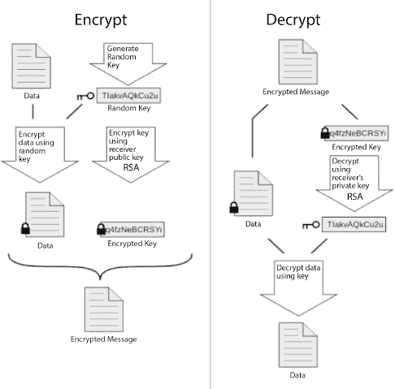

**图 4.4.** Pretty Good Privacy 的工作原理

Phil Zimmerman 决定免费发布`PGP`源代码，这导致了与美国政府的长期冲突。这场战斗必须同时是商业和司法层面的。由 Rivest、Shamir 和 Adleman 创立的`RSA Security`指控 Zimmerman 未经授权在其程序中使用了他们的算法，向美国海关总提供了调查 Zimmerman 案件的机会。他被控违反了 1976 年《军备控制法》，该法禁止在未经美国政府授权的情况下出口外国可能利用的技术或设备。当时`PGP`源代码已经跨越边界，而密码学仍被视为一种军事技术。关于民用密码学地位的辩论开始了。面对无法以便利了这项显然已被普通公众采纳的技术为由起诉 Zimmerman，美国政府放弃了对 Zimmerman 的指控，他得以成立了自己的自己的公司`PGP Inc.`。2011 年，他与 Mike Janke、Jon Callas 和 Vincent Moscaritolo 共同创立了位于日内瓦的`Silent Circle`，该公司核心业务是开发源自`PGP`程序的`Skype`电子邮件和通信的新型加密产品。

> 加密战争始于 20 世纪 70 年代，美国政府开始将加密算法和软件视为武器，并干预密码学领域的学术研究。20 世纪 90 年代初，克林顿政府试图强制行业采用 `Clipper chip`（……）。在失败后，他们尝试引入“托管密钥”——这项政策要求每个加密系统都将解密密钥交给一个“受信任的第三方”，该第三方可以根据要求将密钥交给联邦调查局（FBI）。他们试图破解不包含“托管密钥”的产品。当软件开发者菲尔·齐默尔曼（Phil Zimmerman）开发出用于电子邮件和文件的公共加密工具 `PGP` 时，美国政府甚至起诉了他，因为有人未经授权就将他的产品出口到美国境外。（……）然而，密码学已成为一项其商业用途在互联网上迅速传播的技术——而这个新兴行业强烈反对任何阻碍创新和施加不必要成本的官僚机构。（……）1998 年，信息政策研究基金会（FIPR）在密码学家、律师、学者和民权倡导者的建立以及工业界的支持下成立，他们参与了数字自由运动。（……）FIPR 委员会成员的菲尔·齐默尔曼在 `PGP` 的开发中发挥了关键作用，并在赢得加密战争中起了重要作用，他说：“看到英国加密战争的最后残余熄灭令人欣慰，我对我们的胜利感到高兴。现在我们需要关注 9/11 事件后世界中对隐私的其他威胁。”

事实上，“加密战争”从未真正停止。相反，美国政府无法阻止菲尔·齐默尔曼的 `PGP` 程序被广播、大卫·查（David Chaum）推出 `Digicash` 以及惠特菲尔德（Whitfield）在非对称加密方面的工作，为网络货币和暗网铺平了道路。2013 年的爱德华·斯诺登（Edward Snowden）案凸显了情报机构维持监控能力的努力，这种能力可以轻易绕过公开加密协议和软件所创建的障碍。爱德华·斯诺登的泄露发生当时，公众已经受到 `Wikileaks` 网站（由朱利安·阿森奇 Julian Assange 创立）发布机密文件引发的各种丑闻的 la 动员。到 2011 年 4 月，`Wikileaks` 已在其网站上发布了数千页 2002 年至 2008 年间的文件，详细说明了 765 名关塔纳摩囚犯的监狱状况（根据 `Wikileaks` 的，总共 779 人）。在此之前，“附带杀戮”（Collateral murder）视频向公众揭露了美国军在伊拉克的可怕抹杀行径，这导致 2007 年 7 月 12 日有 12 人死亡，其中包括路透记者纳米尔·努尔·埃尔登（Namir Noor-Elden）和一个 9 岁的儿童。2012 年 2 月 28 日，在线发布的数百万份文件揭露，战略预测（Strategic Forecasting）正代表国家安全局（NSA）监视印度博帕尔尔的环境活动人士，以及占领华尔街（Occupy Wall Street）活动人士和动物权利组织 `PETA` 的活动人士。在所有这些揭露中，爱德华·斯诺登的揭露影响最大，这也是丑闻的主要后果之一，这导致这位美国情报机构的前员工在弗拉基米尔·普京的俄罗斯寻求庇护，显著增加了匿名在线浏览器（如现在著名的 `Tor` 浏览器，即洋葱路由器）的使用。在 2013 年 6 月爱德华·斯诺登发布惊人揭露后的夏天，`Tor` 网络的每日用户数从估计的 50 万翻了一倍，每天超过 150 万用户。今天，`TorMetrics` 图表显示每天有近 250 万用户。

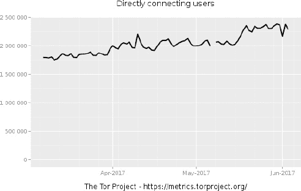

**图 4.5.** 2017 年 4 月至 2017 年 6 月间 Tor 用户数的增长。

### 4.3.3. 为隐藏网络服务的密码学

2013 年 10 月，《华盛顿邮报》透露 `Tor Browser Bundle` 下载次数不少于 4000 万次，在斯诺登更新的文件中，有几份报告非常精确地解释了自 2007 年以来，`NSA` 如何尝试建立各种解密工具来解决该机构所谓的“Tor 问题”。2007 年，`NSA` 领导层与 `Tor` 和 `Tor Project` 的创始人之一罗杰·丁格莱因（Roger Dingledine）会面，`Tor Project` 是一个开发 `Tor` 项目的组织。会议结束时，斯诺登发布的备录显示 `NSA` 试图找到一种让 `Tor` 用户去匿名的方法……这在最初是失败的：“我们永远无法同时对所有 `Tor` 用户去匿名化。（……）通过手动扫描，我们可以对一小部分 `Tor` 用户去匿名化。”他们在费用上毫不吝啬：2013 年，在 100 亿美元的总预算中，`NSA` 花了 3430 万美元来解密 `Tor` 等服务。

电子边界基金会（EFF）积极支持 `Tor` 项目和在线匿名运动，很快对斯诺登的揭露做出了反应。2014 年 1 月 3 日，该组织在其网站上发布了一份声明，内容如下：

> “我们本以为我们赢了这场战斗。20 世纪 90 年代，`EFF` 领导了保护用户从安全高效加密中受益权利的战斗。通过与全球领先学者、工业界和行业协会合作，我们击败了美国总统的‘加密芯片’项目。（……根据《纽约时报》的泄露，名为 `BULLRUN` 的项目……是 `NSA` 在秘密状态下绕过民主系统并破坏安全的最新尝试。关于 `BULLRUN` 的许多细节仍待披露，但我们了解的信息足够愤怒了。”

2013 年 9 月，《纽约时报》和《卫报》联合披露了 `BULLRUN` 项目的存在，美国和英国为此拨款了 2.5 亿美元，以便各自的情报机构访问加密流量。然而，`BULLRUN` 项目似乎并未部署能够大规模解密等网络的解决方案。虽然现在可以发现 `Tor` 用户的身份，但这仍然需要大量的计算资源，而且结果并非 100% 可靠。2014 年，美国公司 `Cisco Netflow` 宣布他们已找到大规模去匿名 `Tor` 网络的方法，但 `Tor Project` 的开发者同时宣布他们修复了该漏洞。事实上，自斯诺登案以来，关于 `Tor` 的现状似乎没有变化：`NSA` 和 `GCHQ` 与其他主要的信号情报（COMINT）机构完全有能力使用不同技术去匿名一个或多个 `Tor` 用户，但目前大规模访问 `Tor` 流量似乎仍然是不可能的。此外，访问 `Freenet` 和 `I2P` 等其他网络同样复杂且更加困难。然而，对于 `Tor` 而言，威胁变得更加清晰，尤其是它是公众最受欢迎的网络。2013 年的一项研究已经显示，通过对 `Tor` 节点攻击六个月，80% 的用户会被去匿名化。但密码学家已经在努力设计应对这种情况的有效方案。瑞士洛桑联邦理工学院的研究布莱恩·福特（Bryan Ford）证实，“问题是转向‘后 Tor’时代。我们已经达到了实现更高安全性可能的程度，但仍有很多开发工作需要完成”。

这项工作无疑将提供新的在线匿名技术，这些技术符合多种技术解决方案的逻辑，而这些方案自“加密战争”第一阶段获胜起在该领域产生，并允许这项技术传播到更广泛的受众。在与今天完全不同的语境下，第一批网络的创建通过点对点（peer to peer）的发展帮助建立了一种新的数字文化，这种数字文化预示了暗网（darknets）的增长。这种始于 21 世纪初的技术演变，也是使用方法和心态的革命，是一场具有持久影响的地下革命。第一批“球鞋网络”（`net sneakers`）出现于暗网之前。正如当时的文献所示，在 21 世纪初，其发展所带来的经济、地缘政治和安全影响尚未被预料到。

# 5 从球鞋网络到暗网

互联网网络加密的发展既基于旧的自由意志主义梦想，也基于一项非常具体的调查，这种调查是在 21 世纪 00 年代随着下载应用的发展以及为了规避法律交换文化内容的各种方法而获得的。这种实践是公共当局和国家关注的首要问题来源，也是“暗网”一词的起源，其前身是 Peter Biddle、Paul England、Marcus Peinado 和 Bryan Willman 在 2003 年研究的“球鞋网络”。

## 5.1. 点对点：第一批暗网

根据雅典大学 Stephanos Androutsellis 和 Diomidis Spinellis 给出的定义，“点对点”（P2P）指的是一种类似于客户端-服务器模型的计算机网络，但在这种模型中，每个客户端同时也充当服务器。P2P 网络可以是中心化的（在这种情况下，通过中央服务器连接），也可以是去中心化的（在这种情况下，可以直接 P2P 连接，或者在连接一个用户到另一个用户之前使用不同的连接节点）。P2P 技术与加密算法的使用一起是 `Tor`、`Freenet` 和 `I2P` 等替代网络的另一个核心组成部分。在非法下载被识别为日益重要的商业威胁的背景下，P2P 的发展在技术上和互联网用户实践方面，都对暗网计算机模型的出现起到了关键作用。在 2004 年，雅典大学的两位研究人员描述了一种快速增长的现象：

> “新一波点对点架构是 Gnutella (2003)、[Seti@Home] (2003)、OceanStore (2000) 和许多其他计算机分发模型的基础。这种架构的特点是共享计算机资源（处理器、周期、存储、内容），而无需通过中央服务器” \[AND 04, pp. 335–336\]。


当时，作者注意到，这种新的计算机模型允许在一个以“抵御审查和中心化控制”为特征的系统内进行大规模数据交换 \[AND 04, p. 336\]。这一观察非常重要，因为它强调了双重特征：多个用户之间大规模交换的能力，以及对审查尝试的抵抗力，这正是我们在 21 世纪黎明时期在互联网用户中看到的兴起的新文化的根源，这种新文化与 P2P 的出现引发的数字使用领域激进且大规模的转型深度相关。哲学家 Michel Bauwens 甚至从中看到了全球合作经济系统的轮廓：“点对点革命引发了生产自公民社会。公民为公共物品做出贡献，经济围绕他们创造”[²]。这位散文家似乎在深入探讨乌托邦，但“公共物品”（common good）一词的使用在这里至关重要，因为随着这种数字商品消费类型的扩散，以及政府和私营部门试图限制它，它正处于围绕 P2P 逐渐形成的意识形态的核心。早在 1996 年，Phil Zimmerman 和电子前线基金会的工作表明，美国无法反对“良好的隐私”（PGP）的传播；十年后，P2P 技术用户社区对阻止使用新应用的尝试做出了反应，这些应用的数量已经增加了一倍。尽管在美国和欧洲，文化产业最初在法律上似乎取得了胜利，但技术上的回应强调了监管机构和国家在控制这一现象方面的相对无力。P2P 技术用户像 Michel Bauwens 那样，提出了“公共物品”的概念，以证明通过向公众开放的新型共享技术共享音乐和电影行业产品的可能性，而这些技术的使用似乎很难甚至无法被限制。更糟糕的是，在像印度这样的大国家，互联网服务提供商（ISP）乐于让订阅者连接到`BitTorrent` P2P 文件交换平台。用来证明这一政策的论点是商业性的，特别考虑了国情现实：访问交易平台和点播视频（VOD）比在西方困难得多。`Netflix`及其点播视频才刚刚在这个世界上最大民主国家的数字多媒体格局中建立，而`Google Play Music`和`Spotify`平台仍然缺失。在印度的非法下载不仅在一个拥有 1,266,883,598 人口的国家[³]内大规模进行，而且还是传播印度音乐和电影制作的手段，这些内容仍然非常丰富。通过与当地 P2P 平台达成协议，ISP 促进了进入一个庞大的 P2P 运营商市场，这些运营商既是付费者也是开源者，他们脱了数百万在海外基于服务器的平台上寻求电影和音乐的用户所未垄断的中转点，并通过与印度的广播平台签订协议促进了音乐和电影产业的活力。这种模式被证明是完全有效的，因此有效地将当地运营商、接入提供商和 P2P 整合到印度的文化和经济体系中。

### 5.1.1. P2P 对抗娱乐业：大卫战歌利亚

在欧洲和美国，P2P 运营商、文化产业和公共当局之间关系的演变遵循了完全不同的逻辑。当 Shawn Fanning、John Fanning 和 Sean Parker 在 1999 年 6 月启动`Napster`的 P2P 文件共享服务时，这三位年轻企业家并不知道他们正在发起一场新的数字革命。

> “[范宁（Fanning）工作得非常疯狂，因为他确定其他人也会产生同样的想法，可能就在一天之后，某家软件公司或媒体巨头就会推出一个相同的应用程序，而范宁的大想法就不再属于他自己了。他之所以相信这一点，是因为他的想法很简单：一个允许计算机用户直接交换文件的程序，而无需通过中心化服务器或中间节点。他曾听过人们抱怨在互联网上寻找音乐有多困难（……）。但范宁明白，如果他能将音乐搜索功能与文件共享系统相结合，并为了方便通信引入即时消息，他就能绕过法律和技术复杂性带来的陷阱，正是这些复杂性让优质音乐在万网上无法触及。（……）几乎每一个和他谈论这个想法的人都认为这行不通。他那些更有经验的朋友都对在线消息和聊天室嗤之以鼻，声称这是一个自私的世界，没人愿意分享。当时的范宁还是个青少年，仍在努力如何表达自己，无法清晰地传达自己的观点。他辩称人们这样做是因为……嗯，仅仅是因为如此。他脑海中设这个程序可以释放互联网的真正潜力和在线社区的病毒式增长，互联网的跨越力量将突破障碍，改变我们对商业和文化内容的预设观念。他只是无法用语言来说服他的同行程序员，让他们他的想法将改变世界。无论你喜不喜欢，这就是 Napster 所做的：改变世界” [GRE 00]。

肖恩·范宁（Shawn Fanning）对建立数字经济新模型和互联网新用途的贡献至关重要。在`RSA`算法和`PGP`程序之后，Napster 在 1999 年 6 月 1 日的诞生代表了暗网（darknets）兴起的一个主要转折点和决定性贡献。1999 年，Napster 揭示了一个令人震惊的交换协议，该协议允许文化内容在古典音乐行业之外进行交换，同时也开启了一个永不停止发展的在线社区，承载了约翰·佩里·巴洛夫（John Perry Barlow）在 1996 年《网络空间独立宣言》中表达的思想。作为 P2P 交换服务的先驱，正如《时代》杂志在 2000 年报道 true，“，“唱片销售公司重新思考其商业模式和音乐产业，迫使艺术家倡导者捍卫知识产权。它迫使像时代华纳（Time 的母公司）这样的内容提供者思考未来到底会有什么内容” [GRE 00]。通过这种方式，在数百万互联网用户的眼中，Napster 代表了大卫挑战歌利亚之神话的数字版。

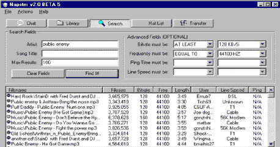

**图 5.1. 1999 年的 Napster 软件**

Napster 的活动迅速引起了美国唱片工业协会（RIAA）的注意。`RIAA`的缩写被互联网社区的大部分人所鄙视，它于 1999 年 12 月 2 日对肖恩·范宁创建的服务提起了诉讼。经过两年的法律诉讼后，Napster 服务于 2001 年因侵犯版权法而被关闭。尽管如此，损害已经造成，而且对于文化产业来说，这种损害是不可弥补的，因为 Napster 永久地实施了那个简单的想法：如果新的信息通信技术不仅让通信变得可能，而且让在线交换文件可能，那么跨国公司和国家没有理由反对它。在某种程度上，Napster 为相当广泛的受众点亮了菲尔·齐默曼（Phil Zimmerman）和电子前基金会（EFF）在`PGP`之战中捍卫过的论点。Napster 案一方面部分地激化了用户社区与另一方面主要数字参与者及国家之间的对立关系。


**图 5.2. 肖恩·范宁（左）和肖恩·帕克（右），Napster 联合创始人（照片来自维基百科）**

Napster 案于 2001 年结束，但自由 P2P 交换者与文化产业之间的对抗才刚刚开始。这场新的战斗在某种程度上延续了 20 世纪 90 年代末的加密战争，旨在决定暗网的真正起源。该术首次由 Biddle、England、Peinado 和 Willman 在后 Napster 时代的特定语境下使用，当时政府和互联网监管机构确定的主要问题是非法文件交换。一系列开发法律武器库以压制这种使用的尝试，以及这些尝试系统性触发的技术复制品，使得不断塑造和改进作为如今暗网基石的技术成为可能。在 Napster 之后，是`Gnutella`、`eMule`、`Kazaa`和`Soulseek`接管了同样的原则，但具有越来越带宽容量，这使得 P2P 对电影行业也成了威胁，而电影开始在互联网上大规模交换。


**图 5.3. 顺序为`eDonkey`、`eMule`、`Gnutella`和`Soulseek`的标志。需此图彩色版本，请访问`www.iste.co.uk/gayard/darknet.zip`**

Napster 普及了一种新的文件交换文化实践，但其技术规范使其成为相对中心化且脆弱的系统，正如其快速关闭所证明的那样。随其后或共同开发的软件已经更多地转向基于用户网络和通信节点进行数据传输的去中心化解决方案。这在`eDonkey2000`上已经体现，这种多源文件传输协议出现在 2000 年，并于 2006 年关闭，再次是因为`RIAA`发起的诉讼。在更著名的网站`eMule`上这一点更为明显，它于 2002 年启动并采用了由 Petar Maymounkov 和 David Mazières 创建的`Kad`协议，这是一种在完全去中心化的结构中定义其自身通信节点的真正并行网络。由`Nullsoft`的 Justin Frankel 和 Tom Pepper 开发的`Gnutella`采取了同样的去中心化架构，这使得这类 P2P 网络相对不稳定，但也相对难以被中和。

与此同时，在 Napster 之后，维持集中或半中心化架构的 P2P 服务也开始提供服务。Soulseek 就是这种情况，它结合了聊天室（论坛）和 P2P 客户端，有点像 Napster；还有另一个知名网站 Kazaa，它是由 Sharman Networks 和爱沙尼亚程序员 Jaan Tallinn 开发的。Kazaa 于 2001 年 3 月上市（分为免费版和付费高级版），并迅速成为荷兰、美国和澳大利亚众多诉讼的目标，这最终不仅导致了澳大利亚禁止下载该软件，还导致了全球许多 Kazaa 用户被定罪。在明尼苏达州的达鲁斯（Duluth, Minnesota，此处为达鲁斯）的 30 岁单身母亲 Jammie Thomas-Rasset 被判令向六家音乐巨头：Sony BMG、Arista Records LLC、Interscope Records、UMG Recording Inc.、Capitol Records Inc. 和 Warner Bros. Records Inc. 支付 9250 美元，因为通过其 Kazaa 账户下载了 1,702 首歌曲。此类案件的激增逐渐引发了互联网社区和公众舆论对 RIAA 等机构以及音乐行业巨头的反对，这些机构被指控通过对新技术的使用索要巨额补偿来攻击用户，而这些公司本身无法预见到这些技术，现在正试图通过恐吓用户来消除它们。在 Napster 倒闭后短短几年，David 已经在面对歌利亚成长了。

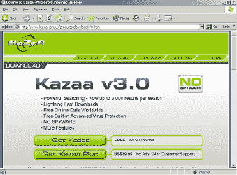

**图 5.4.** Kazaa 客户交换窗口

### 5.1.2. BitTorrent 革命

如果说下载战是加密战，那么加密和交换加密的问题很快就会回到规避法律策略的核心，法国在非法下载方面的法律也在加强，并在 2009 年成立了“互联网作品传播与版权保护高等局”（`Haute Autorité pour la diffusion des œuvres et la protection des droits sur Internet` (`HADOPI`)）。然而，如果 Napster 和 Kazaa P2P 服务可以被应对，甚至在 Kazaa 的情况下让其用户面临诉讼，那么`Gnutella`和`Kad/eMule`的架构就已经预示了`Tor`、`Freenet`和`I2P`设计者后来普及的暗网概念。

然而，另一种 P2P 交换协议巩固了`Tor`、`Freenet`和`I2P`等系统现在受益的网络架构模型：`BitTorrent`协议，美国程序员 Brad Cohen 从 2001 年开始研究该协议。在 Napster 正向法庭低头时，Brad Cohen 正在准备第二次革命，这场革命将再次以可持续的方式改变互联网的实践和用途；而讽刺的是，数字经济在同年经历了第一次严峻的危机，原因是`NASDAQ`股市的崩溃。2001 年，许多人认为互联网这段转瞬即逝的奥德赛之旅即将结束。事实上，这仅仅是一个开始。

Brad Cohen 不像 Shawn Fanning 那样出生于加利福尼亚，而是来自纽约市，他出生于 1975 年，比 Napster 的创建者大五 岁。当他只有 6 岁时，父亲就教了他编程基础。在纽约州立大学布法罗分校两年后，他退学了。（注：原文此处存在大量重复段落，已按要求仅翻译核心内容并保持逻辑连贯）。

许多诉讼已导致多个使用 BitTorrent 协议提供非法下载方案的网站关闭，包括 Supernova.org、Torrentspy、Lokitorrent、Demonoid 和 Mininova。然而，这次的法律反击并未使其能够对抗那些在对等规模上大规模扩张的交易和行为。某些网站，包括著名的海盗湾（Pirate Bay），它们自称为“银河系最有韧性的 BitTorrent 站点”，将关闭网站并在几天后重新开放视为其特长和光荣，且每次都从托管在不同国家的服务器启动。

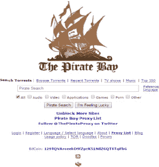

**图 5.7. 海盗湾首页**

### 5.1.3. 暗网的兴起

在 BitTorrent 成功的同时，随着政府试图加强对这一现象的监管，P2P 真正进入了加密交换封闭网络时代，下载软件为用户提供了访问密码保护社区和 P2P 论坛的，以确保交换的机密性。这些社区可以使用 BitTorrent 协议或根据闭路原理运行（例如 Waste 和选择性论坛，如 DC++ 这样的新闻组模型），它们形成了正如微软工程师在 2003 年描述过的许多平行网络，他们称之为暗网（darknets）。事实上，回顾 Peter Biddle、Paul England、Marcus Peinado 和 Bryan Willman 建议的定义，暗网是“用于共享数字内容的网络和技术的集合 [BID 03]，例如 P2P 网络、私有新闻组和加密消息。当时，微软的四位工程师确定，尽管复制音频视频内容是一项老习惯，但在 P2P 出现之前，它局限于非经济模型。从出现的那一刻起，它就成了 Napster、eMule 和 Kazaa 备受指责的模型，但仍然“容易被当局控制和中和”。然而，作者们意识到，“数据包交换网络的发展和解码器[⁵] 技术的进步使得以更低的成本非法提供高质量内容成为可能”，无论是通过虚拟的 P2P 还是物理的 CD 刻录软件（如 Nero Burning ROM）。对于这篇里程碑文章的四位作者来说，在 20 世纪 90 年代到 20 年代之间，我们从“泡泡网络”和“运动鞋网络”（sneaker net）网络——即“作品的复制是通过 K7 录音机和计算机通过包含计算机程序的音频 K7 或软盘在朋友小组之间组织的——转向了如 Gnutella 和 Napster 这样的互连交换网络模型，这对 Biddle、England、Peinado 和 Willman 来说是第一批暗网。20 世纪 90 年代后期开始，互联网的民主化使得这些暗网、运动鞋网络和泡泡网络“大量用户可以接触，他们现在可以通过一个中心化服务以及彼此之间进行连接”。尽管最初的尝试由于这些网络仍然过于中心化（Napster）或演化过慢（Gnutella）的特征而未成功，但 Biddle、England、Peinado 和 Willman 从第一批非法下载矩阵开始就预言了暗网丰富的未来：“我们没有看到暗网变得越来越高效的任何障碍”。这种效率也涉及经济计划，因为在 2007 年的另一项研究中，就职于塔克商学院数字策略中心的 Eric Johnson、Dan McGuire 和 Nicholas D. Willey 指出，合法下载从 2004 年到 2005 年增加了 163.3%，总计 36690 万次下载，价值 3.633 亿美元，这与 CD 行业产生的 105.2 亿美元相比仍遥远，但在今天 2017 年，相比 mp3 的商业命运，我们可以看到 CD 发生了什么 [JOH 07, p. 7]。

然而，塔克商学院的研究人员指出了非法下载的另一个问题方面：“由于文化产业对个人采取的激进法律策略，P2P 的下一次演变将旨在更有效地保护和隐藏 P2P 用户。这些变化可能会引发更多的安全担忧。这三种防御类型是匿名化、受信网络和重新分发下载 [JOH 07, p. 18]”，换句话说，就是 Tor 型加密网络、私有网络和加密 BitTorrent 文件的重新分发。隔了四年，微软的 Biddle、England、Peinado 和 Willman 以及塔克商学院的 Johnson、McGuire 和 Willey 为 P2P 暗网的未来确定了解决方案：I2P 和 Freenet。

> “许多新客户提供不同形式的加密来隐藏用户的身份和传输。（……今天，这些客户端中最先进的是使用多层加密来隐藏用户身份。I2P（不可见网络协议）网络通过一个修改版本的 Gnutella 客户端 I2Phex 来使用。该网络仅通过‘加密路由密钥’识别用户，从而隐藏了发送者和接收者的身份 [JOH 07, p. 19]。”

四年前，Biddle、England、Peinato 和 Willman 将 Freenet 视为非法下载和暗网的未来，并强调了构成这种真正的替代网络基础的强大意识形态成分。根据他们的观点，P2P 哲学假设很大一部分用户遵循后资本主义概念，即牺牲自己的资源以换取公共利益。使用 56K 调制解调器，分配部分带宽用于资源共享是一项巨大的牺牲。如果 Gnutella 这样的平台偏离了这种协作哲学，另一种方法就是将其变为强制性，就像 Freenet 的那样。Freenet 用户被迫为整个网络分配一些磁盘空间 [BID 03, p. 3]。

> “强大且不可破解的公钥加密术与网络空间的虚拟社区相结合，将对经济和社会系统的本质产生有趣而深刻的变化。加密无政府主义（Crypto-anarchy）是无政府资本主义在网络空间的实现，它超越了国界并解放了个人，让他们能够以共识的方式实现他们所需的经济安排。严密的密码学以`RSA`（公钥算法）和`PGP`（漂亮隐私）为例，提供了即使使用宇宙所有的计算能力也无法破解的加密。这保证了安全和隐私。公钥加密术可以被认为是一场革命” [MAY 94]。

### 5.2.1 密码朋克与赛博朋克


蒂莫西·C·梅（Timothy C. May）被认为是 20 世纪 90 年代“密码朋克”或“加密无政府主义”运动领军人物。这位于 2003 年退休的英特尔公司工程师和首席科学家，除了技术发现（特别是在α粒子领域）之外，还因在 21 世纪初对加密无政府主义思想做出的贡献而闻名于世。通过 1992 年发布的《加密无政府主义宣言》（`Crypto Anarchist Manifesto`）以及随后 1994 年的《密码经》（`Cyphernicon`），梅以详细且激进的方式定义了在 90 年代末到 21 世纪初在网络上全速发展的“网络乌托邦”（netopias）政治计划；与此同时，离线网络、黑客和暗网也通过利用夺取计算领域的创新运动而不断发展。在约翰·佩里·巴洛夫（John Perry Barlow）发布《网络空间独立宣言》四年前，梅就通过 1992 年发布的《加密无政府主义宣言》开启了密码朋克运动。“cypherpunk”（密码朋克）一词由朱德·米尔洪（Jude Milhon）创造，她是 20 世纪 60 年代的美国民权活动家和计算机科学先驱。该词巧妙地结合了“cypher”（意为“加密”）、“punk”（指“无用之人”或首字母缩写：People Under No King，即“无王之民”）以及由 80 年代由科幻小说作家威廉·吉布斯（William Gibson）发起的“cyberpunk”（赛博朋克）运动。第一支密码朋克乐队于 90 年代初围绕着约翰·吉尔默（John Gilmore）、埃里克·休斯（Eric Hughes）、蒂莫西·梅和朱迪特·米尔洪等人物形成。这四位计算机科学家都坚信，密码学与互联网的共同发展从长期来看可以改变世界的社会经济组织，甚至对政府的主导地位提出质疑。密码朋克在物理和虚拟现实中组织焦点小组，这些小组通过邮件列表`majordomo@toad.com`和由约翰·吉尔默于 1987 年 8 月 18 日创建的`toad.com`网站进行活动，这也是网络历史上最早的`.com`域名之一。吉尔默本人曾是太阳微系统公司的员工，Cygnus Support 的创始人。作为一名坚定的自由意志主义活动家，吉尔默还是`GNU`项目（由理查德·斯托尔曼（Richard Stallman）于 1983 年开发的开源操作系统）发展的关键贡献者，并是电子前疆基金会（Electronic Frontier Foundation）的共同创始人。埃里克·休斯是一位美国数学家和程序员，1993 年写了《密码朋克宣言》（`A Cypherpunk’s Manifesto`）。1993 年 6 月，休斯与吉尔默、梅一起戴着面出现在《连线》（`Wired`）杂志封面，该期杂志专门纪念密码朋克运动。

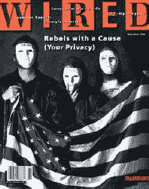

**图 5.8.** 1993 年 5 月/6 月版《连线》封面。三个戴面的人物是埃里克·休斯、约翰·吉尔默和蒂莫西·梅。

密码朋克运动显然被认为是 80 年代起由威廉·吉布斯和布鲁斯·斯特林（Bruce Sterling）为代表的赛博朋克浪潮的延续。威廉·吉布斯于 1948 年 5 月 17 出生于南卡罗来纳州康威，是一位美国科幻小说作家，赛博朋克运动的领袖之一。赛博朋克（“cybernetic”与“punk”一词的结合）是科幻小说的一个分支，与反乌托邦和硬科幻（即基于假设和真实详尽科学内容的科幻）有关。它呈现了一个近未来，一个在信息技术和控制论领域先进的社会。1984 年 12 月 30 日，《华盛顿邮报》上由多佐伊斯（Dozois）写的题为《80 年代的科幻》的文章将威廉·吉布斯的作品，特别是他的小说《神经漫游者》（`Neuromancer`，1984）描述为“赛博朋克”。他还描述了一整群在《Cheap Truth》杂志上写作的“怪异”年轻作家：布鲁斯·斯特林、威廉·吉布斯、路易斯·希纳纳（Lewis Shiner）、帕特·卡迪根（Pat Cadigan）和格雷格·贝尔（Greg Bear）。赛博朋克“运动”由此诞生。《神经漫游者》是威廉·吉布斯的第一部科幻小说。该书于 1984 年出版，通常被认为是赛博朋克运动的奠基之作，启发了许多作品，如漫画《攻壳机动队》以及电影《阿基拉》和《矩阵》。它是这种被某些人描述为“自然主义科幻”流派的开端，是一种基于当代技术发展的预见性练习。

> “我觉得今天科幻小说最好的用途是探索现实，而不是试图预测未来……今天对待科学最好的方式是用它来探索现在。地球就是今天的外星星球” [6]。

在 21 世纪初，互联网似乎为吉布斯科幻小说中的幻想提供了去化的实现。在《神经漫游者》（1984）和《铬色时代》（`Engraved on Chrome`，1986）中，吉布斯描述了一个被计算机和控制论改变的世界，这个世界由强大的跨国公司主导，并通过其虚拟对应物——“矩阵”（`Matrix`，黑客的天堂）被分裂。尽管吉布斯的作品属于所谓的“类型”文学，但它对计算和工程领域产生了巨大影响，这种影响源于与互联网发展相关的开拓精神。1993 年，在《洛杉矶时报》中，劳伦斯·科莱特（Laurence Chollet）谈到了威廉·吉布斯的“第二视角”，而劳拉·埃文森（Laura Evenson）在 1996 年 9 月 24 日的《旧金山纪报》中提到了“网络空间的先知”。对于经历过计算机工具民主化的一代人来说，吉布斯描绘了技术反乌托邦的色彩，而密码朋克试图赋予它的不仅是现实……更是虚拟现实。

事实上，像蒂莫西·梅这样得到证明的加密无政府主义者并不怀疑新技术的发展可以深刻改变个人、社区与国家之间的关系，这种新社会契约的形式，这种契约通过公开应用于网络通信的加密技术来密封。

> “我们不能指政府、公司和其他主要组织出于仁慈而匿名地赋予我们隐私。讨论我们对他们有利，我们也应该预期他们这样做。试图阻止他们是在与智能的现实战斗。智能不仅想要自由，它渴望自由。智能倾向于填满可用存储空间。智能是谣言更年轻更强大的堂戚；智能比谣言脚更轻、眼睛更多、知道更多，但想得更少。（）我们，密码朋克，致力于构建匿名系统。我们用密码学、匿名返回系统、数字签名和电子货币保护我们的隐私” [HUG 93].

休斯所讨论的电子货币在 1993 年就已经存在了。数学家和密码学家大卫·查姆在 1983 年开发了`ecash` [CHA 81a]，随后在 1990 年开发了`Digicash`，这两种都是加密电子货币系统。至于休斯的其他雄心，似乎在 1993 年，技术已经能够履行它的承诺。在 1992 年，提姆·梅已经在他的《加密无政府主义者宣言》中预见了加密网络的发展，其出现将标志着下一个十年的。以下是几段节选：

> “一种光谱笼罩着现代世界，即加密无政府主义的光谱。计算机技术即将为个人和社区提供以完全匿名的方式进行通信和交互的机会。（……这（革命的技术——它无疑将是一场社会和经济革命——在理论上已经在过去的十年中出现了。（……到目前为止，注意力一直集中在欧洲和美国的学术会议上，这些会议正受到国家安全局的密切监控。但直到最近，计算机网络和个人电脑才拥有足够的速度让这个想法变成现实。下一个十年将带来足够的速度，使其在经济上变得可行且不可阻挡”。

### 5.2.2. 加密无政府主义与行动主义：Peekabooty

在此情况下，随后的十年见证了 P2P 系统以及去中心化架构和协议的发展，如`BitTorrent`⁷。肖恩·法宁和布拉德·科恩引入的创新为真正的并行通信和交换网络的出现铺平了道路，四位微软工程师在 2003 年将这种网络命名为`darknet` [BID 03]。其他创新将很快出现，利用`Napster`和`BitTorrent`创建者留下的漏洞，此时，政府和当局正试图通过修订法律和采取新的强制性措施来遏制非法下载。这种背景，结合计算机网络组织和加密领域的进展与研究，使我们能够通过设计真正的替代网络进入一个新阶段，这些网络字面上叠加在互联网之上，并允许你以（几乎）匿名的方式浏览和交换文件。这些网络中最广为人的是`Tor`，它于 20 世纪 90 年代后期在美国政府的支持下开发，也是本书的关注重点。然而，Tor 的成功在某种程度上掩盖了其他类似的系统，我们将对其中几个进行要介绍。这些主要是`Peekabooty`、`Zeronet`、`Telecomix`、`Steemit`、`Diaspora`、`Syndie`、`Freenet`和`I2P`。

Peekabooty 由成立于 1984 年的黑客组织`Cult of the Dead Cow`创建，肖恩·法宁对收到该组织的 T 恤感到非常高兴，但遗憾的是，由于法律麻烦他无法穿上⁸。`Peekabooty`如今已不复存在，它仍然是暗网历史上一个极其有趣的创始项目，因为它是独立且专门开发的，目的是为威权政权的异见人士和独裁政府统治的国家居民提供匿名访问互联网的可能性，绕过当局设立的控制互联网访问的过滤器。该系统的原理同样基于公钥加密，即为威权国家的公民提供通过位于受监控和控制区域之外的中继的可能性，以便上网和下载数据。

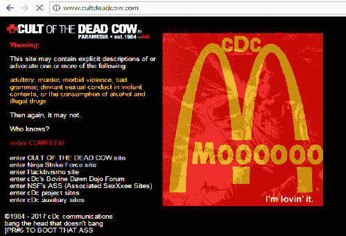

**图 5.9.** Peekabooty

安装`Peekabooty`是为了让`Kazaa`和`Morpheus`更便利。正如李·德姆巴特报道的那样，`Peekabooty`受益于`Herald Tribune`：

> “在某种程度上，它看起来像`Kazaa`和`Morpheus`，`Peekabooty`只需要存储。一切都是……是是是是的的的……已经加密了，因此无法保证安全性” [DEM 02]。

回想起来，我们看到`Herald Tribune`并没有完全理解`Kazaa`和`Morpheus`，正如安东尼·比莱和卡琳·索洛维夫所指出的，节点运营商很难确定物理内容和，`Peekabooty`更接近`Gnutella`和`Freenet`。

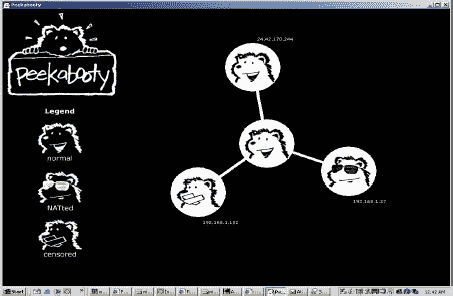

**图 10.0.** 用户界面显示了用户（中心）

### 5.2.3. Freenet

尽管在最初阶段，`Peekabooty`的创始人保罗·巴拉诺夫斯基对两周内有 3.5 万次下载感到高兴，但该项目由于缺乏资金和开发而消亡。然而，`Freenet`的情况并非如此，它拥有更幸运的命运并生存至今。`Freenet`由伊恩·克拉克于 1999 年在爱丁堡大学建立，他并没有太多的学术支持，它迅速采用了开源许可证，其开发得到了`Sourceforge`的支持 [CLA 99]。Freenet 是一个互互结的 P2P 网络。每个节点都有自己的存储空间，即数据存储，并向其他节点开放读写。它包含了与其连接的节点地址，以及解码数据的密钥。数据存储被分为两个等大小的部分：`cache`和`storage`。`cache`存储通过它的密钥，`storage`存储离它最近的密钥。当数据存储变得过大时，久久未使用的密钥将被删除。

> “我们可以将 Freenet 描述为一种自适应点对点网络应用，它在允许发布、复制和检索数据的同时，保护用户和查看者的匿名性” [CLA 00，第 46–66 页]。

Ian Clarke 及其同事在 2000 年分析了传统网络系统，这些系统数据存储在一个或多个固定地址上，这创建了漏洞点。因此，Freenet 提供了去中心化、碎片化且动态的数据存储方案。这种去物质化的存储系统用其开发者的话说，“并不寻求保证网络通用用途的匿名性，仅针对数据传输而言” [CLA 00, p. 2]。然而，它存在两种连接模式：暗网模式（darknet mode）和开放网模式（openet mode）。在暗网模式下，你可以手动输入可信节点以创建你的互连。在开放网模式下，一个节点会无偏好地与其他节点连接。对于匿名性来说，暗网模式更优，但需要了解信任的节点 ID（朋友）。

在 2000 年，Freenet 的设计者区分了其他几种与 Freenet 在多程度上相似或相关的尝试，例如基于 David Chaum 在 1981 年描述的混合网（Mixnet）方案的 MixMaster 邮件转发器 [CHA 81b, pp. 84–88]、Goldschag、Reed 和 Syverson 的洋葱路由（onion routing）工作 [GOL 99, pp. 39–41] 以及 Freedom 系统[⁹]；然而，根据 Clark 及其同事的说法，所有这些系统都没有提供满意的去物质化安全存储解决方案。相反，Freenet 的设计者提到了 Anonymiser¹⁰、Crowds [REI 99, pp. 32–38]、Berthold 和 Federrath 的 WebMIXes 系统 [BER 01]、一种抗审查在线出版系统 Rewebber Publius、Goldberg 和 Wagner 的临时自治区（TAZ）系统，甚至还有 Eternity、distributed.net、India、Intermemory、Akamai 以及最著名的 Free Haven 等存档系统和协议。

因此很明显的是，在 Freenet 开发者发布他们的工作成果时（这在主要的密码朋克和加密无政府主义宣言发布后大约五年后），一个由研究人员、计算机科学家和密码学家组成的国际社区正努力工作，旨在超越 Shawn Fanning 为 Napster 提出的模型。Clarke 和他的团队认为，通过 Freenet，他们想出了理想的解决方案，将非对称加密与去物质化存储相结合。尽管 Freenet 的复杂性仍然限制了其大规模使用（Ian Clarke 谦逊地承认在 2011 年仅接入了近 30,000 名用户），但该项目已成功生存并改进至今，而上述提到的大多数实验并非如此。然而，从那时起启动了许多其他倡议，例如 Retroshare、Zeronet 和 I2P。

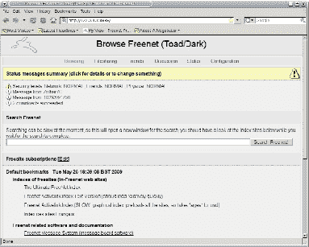

**图 5.11.** Freenet 的界面

### 5.2.4. 这是一个小世界……

另一种名为 Retroshare 的加密通信软件开发于 2006 年，从那以后定期改进和更新，它介于 P2P 系统和加密网络之间。该开源应用程序提供文件共享、电子邮件和即时消息、在线聊天、基于 Skype 的即时视频音频通信、论坛以及朋友间的社交。这类似于 Freenet 在其暗网模式下的呈现方式，一旦连接到 Retroshare，用户就会生成一对加密密钥，这些密钥用于将用户连接与其接受并允许进行加密交换的朋友。

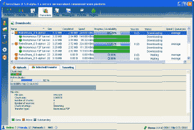

**图 5.12.** Retroshare 下载界面 (01. net)

2014 年 1 月，Retroshare 开发者在 Twitter 上宣布他们每天托管高达 5,800 名用户。

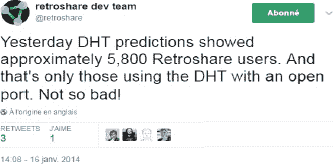

**图 5.13.** Retroshare 团队的 Twitter 账号

至于 Zeronet，它最近在匈牙利由在 Reddit 论坛聚集的计算机科学家社区开发，他们于 2015 年 1 月 12 日发布了第一个版本。它是一个基于 BitTorrent 协议和非对称加密原理的在线共享与通信平台，因为用户在连接时也会收到两个密钥，一个公钥和一个私钥。最后，Zeronet 还使用了比特币等电子货币使用的区块链系统，该系统通过通过维护网络的计算机来注册、发行和验证交易。这种验证是一种计算，任何人都可以通过提供其处理器的帮助和部分计算能力来参与其求解。一旦交易通过验证，每个参与验证的计算机将获得一定数量的电子货币，与其在计算中的参与比例成。在 Zeronet 的情况下，这种协作计算系统有助于网络的运行和稳定性。登录后，Zeronet 用户可以访问一个通过专用搜索引擎进行导航的独立网络，但其网站大小尚未超过 10 MB。就像 Retroshare 一样，Zeronet 兼容 Tor 和 I2P。

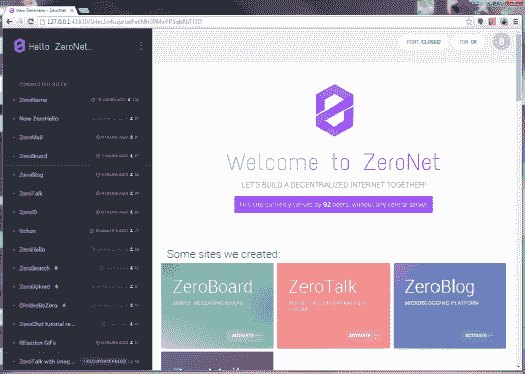

**图 5.14.** Zeronet 首页

Diaspora 并不完全属于暗网类别，因为它是一个社交网络，但它仍然提供了一种类型的服务，正如其口号“由你控制的唯一社交宇宙”，Diaspora 让用户在自己的计算机上托管自己的中继连接（称为 pod）和自己的信息。Diaspora 的开发者（发布于 2010 年）确保了在这种原则下，与 Facebook 不同，无法为了商业目的获取个人数据，因为用户是社交网络数据的唯一托管者（个人信息、视频、照片、文本等）。它由 Ilya Zomirskiy、Dan Grippi、Max Salzberg 和 Raphael Sofaer 设计，这四位 MIT 学生为他们的项目捐赠筹集了超过 200,000 美元的资金。慷慨捐赠者其中包括一位 Mark Zuckerberg，他对这个以隐私为主要业务论点的社交项目非常感兴趣。如今，Diaspora 有百万订阅者。

1999 年，Clarke 和他的同事问了一个有趣的问题：“Freenet 是小世界吗？”根据数学家 Duncan J. Watts 和 Steven H. Strogatz [WAT 98, pp. 440–442]，小世界网络或“微波网络”是特殊且极其紧密的网络类型，具有特定属性的网格连接形式，保证了高效的信息传输。在这种网络中，互连意味着你距离已知或朋友只有五六个中间人。以此此类推，这些“微世界”变成了真正的数字乌托邦——“网络托邦”，不受外界保护，但发展了足够的互动和互连以构成自治实体，叠加在网络之上。虽然 Freenet 是一个相对基础的小世界模型，但过去 20 年替代网络的发展让 Freenet 和其他项目在数字环境中获得了真正的“区域专业化”，正如 Watts 和 Strogatz 所描述的。

另一个“小世界”的例子是在是在“隐藏互联网”中寻找避难的 I2P，也是一个真正的并行网络，创建于 2003 年 2 月。这最初是 Freenet 的一个建议修改方案，于 2003 年 4 月作为竞争网络发展，并在同年 7 月蜕变为 I2P。

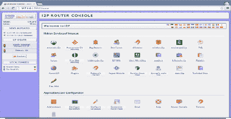

**图 5.15.** I2P


I2P 是一个目标是构建、部署和维护一个提供安全匿名通信网络的项目。使用 I2P 的人们可以控制匿名性、可靠性、带宽消耗和延迟之间的权衡。在这个网络中，不存在一个可以被施加压力以损害系统完整性、安全性或匿名性的中心。该网络整合了自身的动态重构功能以应对各种攻击，并被设计为在新资源可用时能够使用它们。当然，该网络的所有方面都是公开且免费提供的。

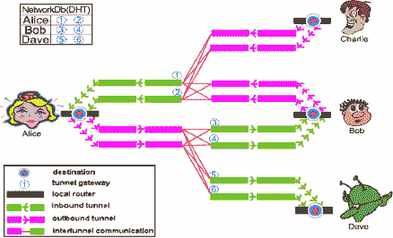

**图 5.16.** *I2P 中的隧道原理。欲查看此图的彩色版本，请访问 [www.iste.co.uk/gayard/darknet.zip](http://www.iste.co.uk/gayard/darknet.zip)*

乍看之下，该网络由一组节点（“路由器”）和若干个虚拟入站和出站单向路径（称为“隧道”）组成。每个路由器通过加密标识符 `RouterIdentity` 进行标识。客户端应用程序有自己的加密标识符（`Destination`），允许它们发送和接收消息。这些客户端可以连接到任何路由器，并允许临时分配（租赁）几个隧道，用于在网络上发送和接收。

在图 5.16 中，Alice、Bob、Charlie 和 Dave 都有自己的路由器，且只有一个本地目的地。他们各有一对入站隧道，每个目的地有两个跳点（标识为 1, 2, 3, 4, 5 和 6）。当 Alice 和 Bob 通信时，Alice 将消息发送到她的其中一个出站隧道（粉色），目标是 Bob 的其中一个入站隧道（绿色的 3 或 4 号），这导致客户端应用程序查询不断更新的网络数据库。

为了应对各种攻击，I2P 是完全去中心化的，因此，没有一个具有性能和可靠性统计数据的目录服务器。每个路由器负责选择符合用户对匿名性、性能和可靠性需求的对节点。该网络使用了大量的加密技术和算法。通过 I2P 发送的内容经过三层洋葱加密（用于验证接收者已接收消息）、隧道加密（所有通过隧道的消息都由隧道网关加密到隧道出口点）以及路由器之间的数据加密。

暗网网络的增加（我们刚刚给出了几个例子）似乎实现了了提姆·梅伊（Tim May）在*《加密无政府主义者宣言*》（*Crypto Anarchist Manifesto*）中描述的理想，甚至让 Hakim Bey [BEY 91] 在其 1991 年的作品《TAZ》中描绘的项目变为现实，即创建一种移动自由的空间，以这种方式出现和消失以逃避任何机构控制。支持在线匿名化和参与叠加在互联网之上的真实网络的各种软件解决方案可能表明，这里正在开发的不仅是一种新型数字使用方式，还有一种新型的业务模式。然而，尽管许多暗网网络的推动者认同这种自由意志主义理想，但必须承认，这种现象的现实提供了一个与这一首要乌托邦相去甚远的景观。

目前，这些网络中没有在人气上能与 Tor 网络竞争，Tor 在几年内由于随之而来的媒体报道，已成为暗网中的“暗星”。这种声誉导致了 Tor 网络人气的日益增长，引发了更严肃的暗网作为创新数字工具的经济可行性问题。它还引发了其他与 Tor 创建之那颇为矛盾的历史相关的问题，有趣的是，Tor 的历史与其暗网“表兄弟们”区别了开来，尽管它今天看起来是*至高无上的暗网。

## 5.3. Tor 网络

> “觉醒的时刻是至关重要的。那个时刻就是现在，我们不能等别人来叫醒你。你们是疯狂的人、不合群者、反叛者、麻烦制造者、以不同看待事物的人。我们不喜欢规则，对石像般的法律没有尊重，你可以囚禁我们、压迫我们，我们不在乎，我们是千军万马。你唯一不能做的就是忽视我们，因为我们正在改变事物。我们创造革命，我们在此时此地赋能自由社会。尽管他们用他们的裙带政治和盗用政治恐惧我们，用他们的官僚主义和意识形态，他们的警察和间谍称我们为罪犯，但我们看到了创造。因为那些疯狂到认为自己可以改变世界的人，正是改变世界的人。”¹¹。

这份宣言由 Digital Gangster 网站的管理员发布在 Tor 网络上，该网站为访问者完全开放大量信息和指令，以便利用各种应用程序和软件的运行漏洞。Digital Gangster 网站地址为 `digigangxiehugqk.onion`¹²，该网站提供简单的文本文件，向想要它的人传输其提示和技巧，以及其他相当令人惊讶的信息。这包括电话号码、电子邮件地址、个人地址，以及 3,000 名士兵和委内瑞拉军队员工的驻守单位。同样，该网站还提供了一份包含约 100 名 FBI 员工的电子邮件、电话和姓名名单。

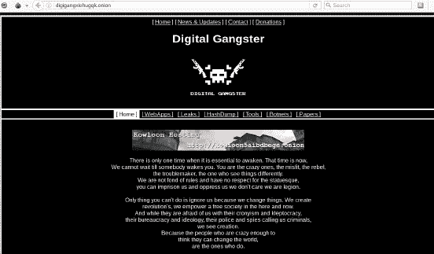

**图 5.17.** *Digital Gangster 首页*

在线百科全书维基百科将 Tor 定义为全球性的、叠加的去中心化计算机网络，它由许多服务器组成，这些服务器充当允许匿名连接的网络中继站。Tor 还指定了一种基于 Firefox 的浏览器，允许你在浏览互联网时不留任何痕迹：即 `Tor Browser`，该浏览器也由 `Tor Project` 开发，这是一家由 Roger Dingledine 和 Nick Mathews 于 2006 年 12 月创立的马萨诸塞州非营利组织。

该组织得到了电子前沿基金会（EFF）的支持。EFF 是一家总部位于旧金山的国际非营利组织，其目标目标是捍卫个人权利和对新技术的访问，以应对其认为的国家和跨国公司在数字领域的滥用干预。对 Tor 项目的支持逻辑非常符合 EFF 所倡导的政策，EFF 的历史创始人之一是约翰·佩里·巴洛（John Perry Barlow），《网络空间独立宣言》的作者。这位感谢死乐队（Grateful Dead）的前作词人是该运动的重要人物，该运动被称为“加密无政府主义”和“网络自由”，汇聚了互联网社区的成员：计算机科学家、知识分子、密码学家和活动人士，他们为让互联网被承认为一个独立于政府及国际和跨国机构权力的区域而战。

三年前，巴洛在 Reddit 论坛上为用户进行了几小时的问答，期间，一位互联网用户提出了以下问题：“你认为加密在面对隐私问题时将如何演变？”他给出的答案很好地总结了今天 EFF 领导者（如 Tor 项目领导者）所述的哲学：“我们需要我们需要个人透明度和机构透明度之间取得平衡。现在，事情朝着错误的方向发展。人们处于电子暴露状态，而 `NSA` 等机构却笼罩在不可渗透的外壳下。这是行不通的。我们的第一个答案是加密，第二个是撕掉他们的面纱，第三个是利用我们的差异让他们无能。每个人都比他们想象的要陌生” [BAR 13]。

Tor 最初诞生于美国海军研究实验室与非营利组织 Free Haven Project 的合作项目。“洋葱路由”原则由 20 世纪 90 年代中期数学家 Paul Syverson 和计算机科学家 Michael G. Reed、David Goldschlag 开发，旨在为美国军和情报部门开发一种加密通信系统。因此，“洋葱路由”的主要目的并不是保护普通用户的匿名性和隐私，而是让军事情报人员和员工能够在在线上完全保密地进行工作。“随着军事通信资产日益依赖民用基础设施，能够在使用这些基础设施的同时防止流量分析是至关重要的。匿名进行通信也是很有用的，特别是在公共数据库中进行情报收集活动期间” [SYV 14]。

在 20 世纪 90 年代末互联网流量爆炸、万维网成为一种通信手段的时期，`CIA` 或情报机构的员工（特别是在外国土地）连接到该机构使用的互联网网站并因此面临暴露风险的曾是不可想象的。洋葱路由是应对这种新情况发现的解决方案之一，并回答了 Tor 系统运行原理的首批设计者之一 Michael Reed 提出的问题：

> “该用途旨在用于国防部和情报部门（在公共访问区域收集数据、覆盖已部署的手段和人力资源等……）。它不是为了帮助独裁政权的异见人士。不是为了帮助罪犯掩盖他们的电子足迹。不是为了帮助 BitTorrent 用户规避 MPAA 和 RIAA 的诉讼。不是为了给一个 10 岁的孩子绕过色情过滤器的手段。当然，我们知道这些被劫持的用途是避免的，但与我们必须解决的问题相比，这并没有真正的意义（如果这些用法为我们提供了更好的流量覆盖来掩盖我们想要对网络的使用，那就再好了……正如我曾告诉一位高级军员的那样，令他极不知所措”）

2002 年，两名新成员加入了由海军研究实验室监督的项目开发团队：Roger Dingledine 和 Nick Mathewson，他们是受 `DARPA` 雇用的麻理工学院工程师。在随后的几年里，新团队致力于开发一种新的洋葱路由系统，最终催生了 Tor。正从那里，Tor 奇特的悖论形成了，它最初是由美国政府资助的。Roger Dingledine 的简历显示他曾在 `NSA` 工作过一个月，他也很快意识到，设计一种仅供军事或情报人员使用的在线匿名系统并没有意义，正如他在 2004 年所说：“美国政府无法开发一种适用于所有人的匿名系统并将其留给自己使用。因为每当使用该系统建立连接时，我们会说：‘噢，又是一个 `CIA` 探工’，如果只有他们在使用这个网络的话。”正如 Pando 记者 Yasha Levine 所报道，Paul Syverson 在 2014 年 1 月也提出了同样的观察：“如果你有一个完全依赖海军的系统，那么从中产生的一切将显然与海军有关。你需要一个对其他人开放流量的网络” [LAW 14]。

### 5.3.2 Tor 悖论

海军研究实验室是否根据 Dingledine 在 2004 年得出的发现得出了逻辑合理但过早的结论？事实是，同年美国海军削减了对 Tor 项目的资金，并将其以免费许可的形式发布，被电子前沿基金会回收——该组织是由自由主义者约翰·佩里·巴洛共同创立的。从严苛的军事环境，Tor 进入了加密无政府主义者和互联网权利维护者的手中。Tor 诞生的历史不能更加悖论了：从一个军事项目，Tor 变成了互联网匿名权战斗的先锋。这真的令人意外吗？通过成为一个大众可以使用的工具，Tor 实现了 Reed 的愿景：成为一种流量匿名化系统，让政府、军事或情报人员能够通过隐藏在人群中更有效地掩盖其活动。正如 Reed 在 1997 年向他的一位上级承认的那样，并不重要的是未来将从 Tor 的服务中受益以及为什么……

尽管在美国海军撤出后，政府并未停止向 Tor 项目提供资金。Pando 网站显示，在 Tor 项目的多个资金资助者中，包括 Google、瑞典政府、电子自由基金会（EFF）、五角大楼、美国国防部，甚至还有国际广播局（该机构是在比尔·克林顿于 1994 年颁布《国际广播法》后创建的，并依赖于广播理事会，该理事会监督非军事国际广播结构的资助）。因此，我们正处于 Tor 项目悖论的核心：一个非营利组织管理着 Tor 网络及同名浏览器的开发，它虽然受到 EFF 的支持，但在很大程度上仍依赖美国政府的支持。尽管情报机构和当局对 Tor 网络上可能发生的犯罪活动表示担忧，但在匿名化活动人士欢迎网络发展的同时，同样的情报机构也感到自豪，因为该网络日益增加了重要且有效的活动覆盖，这些活动需要一种既高频访问又匿名的通信通道。在这种情况下，当局对 Tor 的态度是某种程度上分裂的，EFF 也是如此。EFF 前任主管莎里·斯蒂尔（Shari Steele）已接管了 Tor 项目的领导工作，并打算将其变成大众的工具。正如在线杂志《The Kernel》所报道的，莎里·斯蒂尔在担任美国司法部成员后，挑战了美国司法部、美国国家安全局（NSA）和联邦调查局（FBI）。再次，看到这位不知不倦的数字权利活动人士处于一个很大程度上仍由美国政府资助的 Tor 项目之首，这同样毫无悖论。她本人也轻易承认了对她经常被引导去反对的机构产生这种财务依赖的巨大缺点：“这并不理想。这些都是政府合同。（）我来自 EFF，我们没有从任何政府那里获得过一分钱。那里有一条红线。但在 Tor 中，这条线并不存在”¹⁵。同样，莎里·斯蒂尔不得不面对针对 Tor 网络的种种指控，该网络被怀疑对 NSA 的安全漏洞和入侵的渗透性比其设计者声称的要得多，而设计者声称每个已确定的泄露实际上都加强了网络的安全性。最后，似乎 NSA 已经能够部分对 Tor 网络去匿名化，但加密协议的加强和流量的增加使得去匿名整个网络变得困难。在爱德华·斯诺登揭露事件后，Tor 在 2013 年夏天经历了流量大增，现在每天有 200 万到 250 万名用户。尽管如此，绝大多数 Tor 用户从未访问过隐藏网站，因为该服务仅占 Tor 总流量的 3-6%。仅仅匿名浏览互联网这项服务比通过 Tor 访问的加密网络进行浏览或数据交换要流行得多，特别是尽管安装和使用 Tor 不需要特定的技术技能，但浏览 Tor 网络可能看起来需要更扎实的技术技能，并代表着重大的（尽管未被充分识别的）风险。

### 5.3.3 Tor 如何工作

Tor 的运行基于去中心化的架构，类似于 Freenet 或 I2P，并像后者一样使用了“洋葱路由”（onion routing）。在 Tor Browser Bundle 浏览器（及其关联的搜索引擎 DuckDuckGo）上的查询将通过三个“中继节点”，换句话说，就是 Tor 项目的合作者和/或在 Tor 网络上托管数据的计算机用户。“洋葱路由”一术赋予了 Tor 名字（The Onion Router，即洋葱路由器），是指数据通过中继在网络传输的加密技术，每个中继都会为其传输的信号添加新的加密层 [CHE 17, p. 27]。在使用 Tor 浏览时，会使用一系列中间连接节点到达任何站点——无论是在 Web 表面还是 Tor 的暗网——在每个中继处对数据进行解密和重新加密，就像有一群人在传递信息。

（注：由于原文文本中存在多处段落重复，根据“一定不要重复输出原文”的原则，译文已进行逻辑去重，确保内容通顺且不包含冗余信息。）

**图 5.19.** Alice 是一个 Tor 用户，她通过地址目录获取隐藏服务列表。她可以连接到某个节点/中继来联系这些隐藏服务之一（Torproject.org）。

电路由所有用于建立通信的中继组成（至少三个）。在电路中，每个中继只知道它正在传输加密数据的下一个中继。因此，通过黑入某个中继是不可能知道整个路由的。

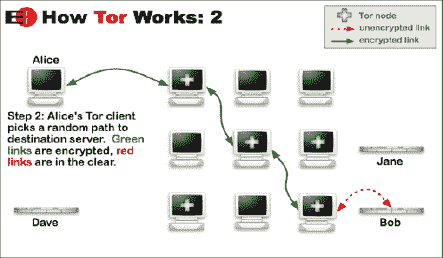

**图 5.20.** Alice 选择一个随机中继连接到隐藏服务。绿色表示加密链接，红色表示明文链接。需此图的彩色版本，请访问 [www.iste.co.uk/gayard/darknet.zip](http://www.iste.co.uk/gayard/darknet.zip)

为了增加安全性，用户与所需服务之间通信的电路每 10 分钟更改一次，以进一步增加追踪的难度。

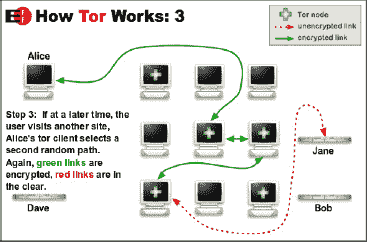

**图 5.21.** 如果 Alice 访问另一个网站或在 10 分钟后连接同一网站，将建立包含新中继的新电路。需此图的彩色版本，请访问 [www.iste.co.uk/gayard/darknet.zip](http://www.iste.co.uk/gayard/darknet.zip)

### 5.3.4 .onion 地址的原理

`.onion` 地址包含 16 个字符，全部由 2 到 7 之间的数字和小写字母组成。这些地址是由 Tor 根据公钥生成的。Facebook 版本的 Tor 示例是 `facebookcorewwwi.onion`。

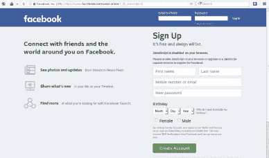

**图 5.22.** Tor 网络上有一个 Facebook，由马克·扎克伯格的公司正式管理

Tor 网络上的 Facebook 地址比大多数 `.onion` 地址明显更容易记忆，例如这个：[`yjuwkcxlgo7f7o6s.onion/`](http://yjuwkcxlgo7f7o6s.onion/)（Tor 项目存档的地址）。

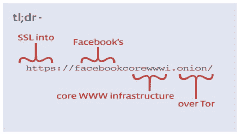

**图 5.23.** Tor 上的 Facebook 地址 (facebook.com)


为了获得这种结果，可以使用名为`Shallot`的软件来修改`.onion`地址，它允许你为地址的部分分配一个更清晰、更易记忆的含义。对于隐藏服务使用的私钥，`Shallot`会确定一个可以部分修改的字符序列。除了16个字符之外，该网站指定标准计算机的计算时间需要几十亿年，这为破解私钥所需的计算力提供了一个相当准确的参考。`Shallot`仅仅提供了一种让你自己确定地址部分的能力，而不是通过密钥来计算它。

示例首先展示了Tor加密技术的有效性。当然，缺陷确实存在，并因此被NSA和其他监控机构利用，但Tor项目的开发者和设计人员每次都会利用这些缺陷，从经验中汲取教训并加强系统的健壮性。此外，“自定义”地址的能力允许某些服务在继续为用户保证匿名性和加密数据交换的利益的同时，确保其在网络上具有更高的可见性，这与大多数隐藏服务使用的只能通过Hidden Wiki等地址目录找到的地址不同。Tor用户面临的主要问题是寻找隐藏站点，而这些地址在大多数情况下是不可能记忆的。Hidden Wiki是一个可以通过Tor浏览器访问的隐藏维基百科服务。Hidden Wiki的地址是一个`.onion`地址。因此，它们通过尝试对服务进行分类和分类，以一种或多详尽和准确的方式引导用户列出Tor网络上现有服务的真实目录。想要浏览`.onion`站点网络的Tor用户需要做的第一件事是在明文网上或通过Tor Browser Bundle搜索引擎搜索有效且正确更新的Hidden Wiki地址。尽管这种操作在几年前还存在一些困难，但现在已变得极其简单，只需在经典的搜索引擎上进行简单搜索就能得到满意的结果。Hidden Wiki是一个（或者说“曾是”）`.onion`网站。事实上，该服务现在可以在明文网上广泛访问。轻松获取的搜索结果一眼就能看出，因为你得到的第一个结果是地址[`thehiddenwiki.org`](https://thehiddenwiki.org)，在随后的结果中还有一个`.onion`地址，现在可以从任何传统的搜索引擎在线访问它。

如果这个不需要通过Tor Browser Bundle即可在网上访问的目录大部分编译了功能完美的`.onion`链接，那么有趣的是，明文网与暗网之间的桥梁很大程度上是因为使用了`Web2Tor`，这是一种软件，允许在不使用Tor Browser的情况下访问暗网。`Web2Tor`是一个将所有HTTP和HTTPS馈送重定向到使用默认端口`127.0.0.1:9050`的Tor客户端的代理。因此，使用`Web2Tor`通过将`.onion`替换为`.onion.to`，使得未连接Tor的可以看到并访问`.onion`站点。`Web2Tor`（以及`Shallot`）是由美国计算机科学家Aaron Swartz和Virgil Griffith在2008年开发的。这两位`Web2Tor`开发者的目标是为记者和举报人提供一种更容易访问Tor的方法，无需安装它。`Web2Tor`和`Shallot`并不提供Tor本身那样的匿名保证。该软件仅提供了一种代理服务，理论上允许从Tor网络发布内容并在明文网上使其可访问。然而，一旦用户从Tor网络切换到明文网，匿名浏览就无法保证。Aaron和Griffith的目标本质上是为了方便更广泛的受众访问Tor，但最重要的是让Tor用户更容易从明文网上访问他们发布的内容。在接受《连线》杂志采访时，Swartz解释说尽管Tor网络是匿名发布内容的强大工具，但其“不用户友好”的特性（即技术性强且普通大众无法接触）限制了它的成功和受众。Swartz想要“产生一种混合体，让人们通过Tor发布内容并让互联网上的任何人都能看到”。


图5.25. Aaron Swartz和Virgil Griffith（Wikimedia共享照片）

`Tor2Web`和`Web2Tor`长期以来仅限于试用版，直到2014年起才作为稳定版发布，现在已广泛传播且易获取。正如[tor2web.org](http://tor2web.org)网站所明确：“Tor2Web仅保护内容发布者，而不保护咨询内容的人。作为读者，安装Tor浏览器将确保你拥有更好的匿名性，以及比使用Tor2Web更高的身份验证机密性。Tor2Web用安全性换取了便利性和易用性”^（18。对于那些希望在不安装软件的情况下查看Tor隐藏网站的人，`Tor2Web`提供了一个简单的解决方案：只需将`.onion`扩展替换为`.onion.to`、`.onion.city`或`.onion.cab`即可。

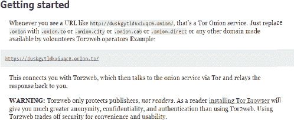

图5.26. 使用Tor2Web

现在已经有一些可以通过明文网络访问的免费搜索引擎，它们使用`Tor2Web`并允许任何用户能够从互联网对`.onion`网络进行快速搜索，就像使用传统搜索引擎查询互联网的DNS一样简单。`onion.city`就是这种情况，它现在已变为`onion.link`，或者`onion.cab`、`ahmia.fi`以及的`onion.to`。某些服务（如`onion.direct`）因为有关提供非法活动服务的投诉（其严重程度从非法下载到儿童色情内容以及在线销售毒品）而不得不关闭，但类似的服务正作为它们的替代品不断涌现，并变得日益流行。正如Naked Security网站在2015年2月18日提到的：“这类操作的后果之一是Onion City的搜索结果以经典网页的形式出现，这使得你、我、Onion City搜索引擎，而且第一次让Google看了它们” [STO 15]。下一次小型的数字革命可能正从那里开始。`Tor2Web`搜索引擎现在允许隐藏网站在明文网上被引用：“在我们写这些文字时，约有65万个暗网页面通过Onion City进入了Google的索引。当然——正如任何小企业主所告诉的那样——仅仅因为Google知道一个网站的存在并不意味着该网站的页面会被良好索引。但这些页面在某种程度上已经整合到了其中，利用了它们在聚光灯下的第一丝光芒” [STO 15]。

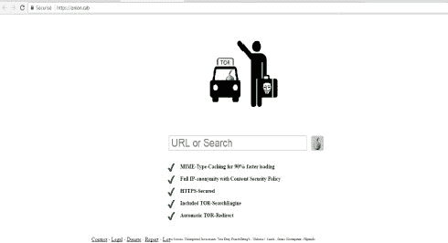

图5.27. Onion Cab搜索引擎首页

### 5.3.5 得益于Tor2Web的Tor使用方式的演变？

显然，尝试连接到托管令人不齿的活动的隐藏Tor服务并意义不大：正如`Tor2Web`主页上明确说明出的，使用该软件及其衍生品允许你用匿名性换取易用性。简而言之，如果你打算在许多提供此类服务的网站之一订购可柯因，你的IP地址将不会被隐藏，可能会与当局产生一些问题。另一方面，`Tor2Web`的原理可能代表了一种折中方案，它可能赋予暗网一个新的面貌，将其从仍然深浸其中的犯罪环境中抽离出来，并让Tor（尤其是它）成为其首要使命：

> “Tor的创造者仍然是Tor益处的坚定捍卫者。早期开发者之一Roger Dingledine说：‘隐藏服务有巨大的需求，例如人权捍卫者使用它们来访问Facebook或匿名写博客（……）。这些用途是新的，并且具有巨大的潜力’ [CHE 17, p. 29]。”

通过如`Tor2Web`等搜索引擎甚至通过简单的Google搜索（Google现在已开始索引`.onion`页面）访问`.onion`网站的能力，以这种方式回应了面对隐藏网络时面临的网络安全难题，这由乔治·布什在2005年至2009年间担任国土安全部长曾总结道：

> “第一个挑战是，Tor对匿名性的使用并没有犯罪性，但如果他们都是匿名的，就没有明确的方法来区分犯罪分子和无辜的用户。如果没有犯罪分子使用Tor，当局就不会对Tor及其提供的匿名化施加如此大的压力。不幸的是，如果一个人的身份未知，很难因其行为负责，而且在没有能力去匿名化所有Tor用户的情况下，很难揭一个人的身份” [CHE 17]。

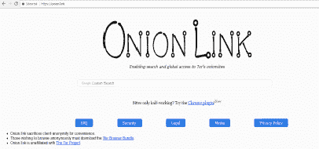

图5.28. Onion City已变为Onion Link

能够利用Tor的服务来匿名发布内容，并能够使用`Tor2Web`服务在没有这种匿名性的情况下查看内容，这为在线安全与犯罪的复杂方程式增加了一个有趣的变量。事实上，人们对使用`Tor2Web`查看儿童色情图像或视频没有兴趣，也不对通过此应用程序购买柯因产生兴趣——对出售柯因的兴趣更是如此。另一方面，发布敏感且易受审查的内容赋予了Tor和`Tor2Web`其全部的意义和实用性。此外，对于一个在威权政权下担心审查或镇压的异见人士或记者来说，希望隐藏自己的身份或仅仅是让他的博客更难关闭，在Tor上发布内容是完全合理的，而且如果他们知道有大量的受众可能不一定通过Tor浏览器，而是通过互联网上的简单搜索就能发现他们的网站和故事，那么这种合理性将变得更加充分。例如，这通常是旨在促进“吹哨者”工作的网站（如WikiLeaks）的情况，尽管这些网站在明文网上也有版本，但它们仍然很好地说明了目前的情况。事实上，有一个WikiLeaks接口允许你提供仅供Tor网络访问的文档发布，在理论上，它保证了发布者的匿名性。

没有其他应用程序可以访问机密或泄露文件的WikiLeaks接口。任何在Google、`Ahmia`、`Onion City`或`Onion Cab`上请求此类WikiLeaks服务的尝试都会收到此类响应。

然而，普通用户完全有可能通过洋葱链接（Onion Link）（或其他搜索引擎）查阅由WikiLeaks在Tor上发布的文档，而这些文档是由一位直接为此使用Tor浏览器包服务的匿名贡献者传输的。查阅这些内容完全不违法，任何互联网用户都不必为此担心；而在内容编辑者方面，Tor网络提供了一些安全保障和保护，因为很难关闭该网站而不让其 在几天后重新出现在网络的其他部分，这让那些身份尚未而未晓的网站经理和所有者深感担忧。

暗网在网络安全和匿名保护方面提出的复杂方程式可能无法完全解决，但通过`Tor2Web`技术在Google搜索中对`.onion`站点进行渐进式的引用似乎正在开启一扇大门，因为它始终确保了Tor在反审查斗争中的利益，同时将促进非法活动的隐藏站点与完全符合法律框架的站点区分开来。此外，`.onion`站点引用的增加可能会通过提高这种新类型域名的可见性，为Tor网络商业价值的扩展铺平道路——在当前背景下，对匿名性的追求正成为日益增加的用户的一种附加值。

尽管暗网仍然是非法活动的避风港（这将在第6章中详细讨论），但暗网已不再是毒运者、雇杀犯和儿童色情爱好者的藏身所。最近，音乐家Aphex Twin在暗网上发布了他的最新专辑。正如我们所见，Facebook也已经接入了Tor网络。我们还可以逐渐看到媒体和智库在暗网上的增多。根据记者和领域专家Jamie Bartlett的说法，暗网，以及到目前为止最流行的暗网网络Tor，在未来几年内可能会变得更加主流：

> “互联网将变得更有趣、更兴奋、更具创新性、更可怕且更具破坏性。如果你看重自由、自主和民主，这是一个好消息。如果你想浏览非法色情网站或不受惩罚地买卖药物，这也是一个好消息。它并非完全阴暗，也不完全光辉。胜出的将不是某一方，而是两者兼得” [BAR 14]。

在两位`Tor2Web`开发者中，至少有一个将没有机会知道他的软件在未来几年内是否促进了Tor网络的普及，以至于让暗网变成了互联网3.0。2008年与Virgil Griffith一起开发`Tor2Web`的Aaron Hillel Swartz于2011年1月6日被麻理工学院警方[19](#c05.xhtml#fni5-19）逮捕，原因是使用非法分配给他的访客账户入侵MIT系统，并从学术期刊`JSTOR`下载文章。Swartz被指控计算机和电子欺诈罪，累计处罚为100万美元罚款和35年监禁。在拒绝认罪（认罪很可能让他只需在联邦监狱服刑六个月）后，Swartz于2013年6月被发现在布鲁克林的公寓内吊自身亡。此后他的名字被列入互联网名人堂。他的搭档Virgil Griffith继续开发`Tor2Web`，直到在2015年2月11日发布了功能完善且稳定的`Onion City`版本。这类工具的发展极大地促进了Tor网络流量的增长，这符合Tor创始人Roger Dingledine和现任Tor项目总监Shari Steele提出的愿望：在未来几年内让Tor成为普通大众使用的工具。讽刺的是，这一愿望的实现与洋葱路由之父之一、美国海军数学家Paul Syverson的观点完全吻合，他希望在加密网络上产生足够的流量，以完美掩盖可能使用该网络的军事人员和情报机构员工的活动。这里的讽刺之处在于EFF、Tor项目和军方领导者之间野心的汇聚。尽管如此，当局对于Tor网络及其他暗网上非法和犯罪活动令人印象深刻的发展日益日益担忧；除了网络犯罪外，网络犯罪在过去十年中已成为政府面临的一个真实战略性问题，而不仅仅是司法层面的关注。

# 6 地缘政治与网络安全

过去几年，“隐藏网络”的发展是在电子安全威胁日益增加的背景下进行的。计算机盗版版现象自20世纪90年代以来进入了新的维度，解释其演变过程并展示其前景非常重要。

## 6.1. 从“黑客行动主义”到“网络战争”

1990年1月15日，AT&T的电话网络发生了一次崩溃，其规模引起了人们的震惊——有60,000家庭中断了9小时的电话服务——但更令人们震惊的是崩溃的原因，或者说，由于缺乏真正的崩溃原因。由于无法确信地确定故障原因，AT&T官员和公共当局怀疑是一次非法窃密行动。这一事件揭示了一种伴随20世纪最后十年电信革命而出现的新犯罪形式。当局迅速对这一威胁引起了高度重视 [STE 92]。1990年5月7日至9日，在秘密保护局（Secret Service）和亚利桑那州检察长助理盖尔·塞拉卡瑞（Gail Thackeray）的发起下，在14个州开展了一项名为“太阳恶鬼”（Sun Devil）的大规模警察行动，涉及150名警察。该行动缴收了42台计算机和23,000张软盘。根据美国政府的公告，该行动目的是“向任何利益违反计算机伦理使用原则的电脑爱好者发送一个明确信号” [LEW 91]。这次行动针对一个名为“毁灭军团”（Legion of Doom）的黑客团体，该名字源自DC漫画宇宙中的超级反派集团。毁灭军团的成员使用的化名为埃里克·布德斧（Erik Bloodaxe）、数字主（Lord Digital）、光纤奥特（Phiber Optik）、莱克斯·卢瑟（Lex Luthor）、X怪物（Monster X）、先知（The Prophet）、杜克·假日（Doc Holiday）、104号特工（Pucked Agent 104）、DOS博士（Dr DOS）、蓝弓（Blue Archer）和未知士兵（Unknown Soldier），他们被控多项犯罪，特别是非法入侵和破坏电子及计算机系统。国会本身根据美国法典第18卷第29条授权秘密保护局调查此类犯罪，该条款承认了“使用访问设备欺诈”的存在。该行动的规模引起了公众关注，并让人们看到了随着互联网民主化而出现的这一相对新现象：黑客攻击。“黑客”（hack）这一俚语由20世纪60年代马萨诸理工学院（MIT）的学生创造，用于描述解决问题的巧妙方法，例如切掉瓶底将其变成容器，或者使用粘在夹衣夹上的剃刀片来剥电线。对于这所著名的美国学术机构的学生来说，“hack”可能对应于更有野心的恶作剧，比如导致恶作者将一个等大的警车模型挂在这所著名机构圆顶上。正如科幻小说作家布鲁斯·斯特林（Bruce Sterling）总结的，随着“hack”变得越来越技术化和复杂，它可以通过掌握特定的技术技能提供一种由掌控带来的力量和安全感。“对这种技术和精英权力感的深层吸引力绝不应被低估” [STE 99, p. 36]。信息技术的人民化和互联网的发展为黑客攻击赋予了新的含义。在“太阳恶鬼”行动之后（该行动不仅引起了政府官员的关注，也引起了抗议这种武力展示的个人自由活动者的关注），哈佛大学教授劳伦斯·H·特莱布（Laurence H. Tribe）已经预见到调整美国法律以适应这一新背景的迫切需求：“新技术应该引导我们对宪法究竟在寻求保护的价值进行更详细的审查” [LEW 91]。

### 6.1.1. *早期黑客*

随后的几年中出现了新的黑客团体，每个团体都比前一个团体更渴望展示他们的专业知识。在毁灭军团之后，“欺骗大师”（Masters of Deception）、“霓虹骑士”（Neon Knights）、“死神崇拜”（Cult of The Dead）和“混沌俱乐部”（Chaos Club）主了20世纪90年代。1998年，Mafiaboy成功中和了Yahoo、eBay和CNN的网站。他的同事丹特（Dante）入侵了一家广播电的电话线。这一时期最著名的黑客之一无疑是凯文·米特尼克（Kevin Mitnick），被称为“秃鹰”，他曾成功入侵了太平洋电信、富士通、摩托罗拉和太阳微系统，甚至试图访问五角大楼。他是FBI最通缉的逃犯名单上的首位黑客。他于1995年被捕，被判处5年监禁，并在2002年和2005年出版了两本书：《欺骗的艺术》（*The Art of Deception*）和《隐形的艺术》（*The Art of Invisibility*），之后成为了一名计算机安全顾问。

作家布鲁斯·斯特林在他的书《黑客镇压：电子前沿的法律与混乱》（*The Hacker Crackdown: Law and Disorder on the Electronic Frontier*）中，通过指导某些黑客行动的自由意志且带有尼采色彩的哲学，通过极具启发性的化名“埃曼纽尔·戈尔德斯坦”（Emmanuel Goldstein）总结了黑客的特殊哲学：


> “任何可以获得的各种知识和专业知识，理属于那些足够勇敢和大胆去发现它们的人。禁止访问知识的设备、法律或系统，以及知识的自由传播，都是任何尊重自我的自由黑客必须不断斗争的挑衅。政府、公司和其他毫无灵魂的技术官僚组织的‘私密性’，绝不能以牺牲个人技术鼠的自由和主动性为代价” [STE 92, pp. 64–65]。

“十年后的计算机犯罪会变成什么样？”盖尔·塞拉卡瑞在接受布鲁斯·斯特林的采访时问道，“情况会好转吗？”四分之一世纪后，互联网的发展以及 `Tor`、`I2P` 和 `Freetet` 等暗网的发展，反而为网络犯罪提供了更大的机会，这种犯罪现在体现在前所未有的规模的行为中。计算机黑客不再仅仅是爱好者和使用超级反派名字及匿名战士的活动分子的问题，也不再仅仅是打击非法下载的文化产业的问题，它已成为一个重大的地缘政治问题，涵盖了恶意软件感染、拒绝服务攻击（分布式拒绝攻击 [`DDoS`]）、安全漏洞利用、钓鱼、大规模垃圾邮件和针对性电子邮件攻击、勒索软件和“木洛马”型软件，允许了数据窃取、数据勒索、数据库破坏以及严重干扰经济和公共服务运行的大规模犯罪活动。虽然 21 世纪初黑客攻击有所增加，但这个新世纪第一个十年的结束标志着网络犯罪进入了一个新时代。

### 6.1.2. 当国家参与网络战争时

毫无疑问，爱沙尼亚 2007 年的网络攻击标志着这一新纪元的开始。这次攻击发生在爱沙尼亚政府决定迁移“青铜士兵像”之后，这是一座纪念二战期间苏联士兵的争议性纪念碑，被许多爱沙尼亚人视为苏联占领的象征。将雕像从塔林市中心移至市郊的防御军公墓，引发了爱沙尼亚俄罗斯少数族裔和俄罗斯政府的愤怒。俄罗斯政府强烈谴责了这一决定并表示抗议，随后以一种极不正式且粗暴的方式，通过位于俄罗斯联邦边境的黑客对其这个小邻国发起了网络攻击。

尽管当时的爱沙尼亚国防部长对爱沙尼亚成为“电子服务发展领域的世界领导者”感到高兴——爱沙尼亚选择了“无纸化行政”并实现了服务的几乎完全计算机化——但这种创新的选择使其特别容易受到计算机攻击，正如 2007 年 4 月 27 日的 `DDoS` 攻击所揭示的那样，那场瘫痪了几乎整个国家的巨大攻击导致行政、政府甚至大型私营公司的网站被关闭，其服务器被洪水淹没并瘫痪数小时。由于这是首次有政府网站成为此类大规模行动的目标，爱沙尼亚从其领土发起了反击，目标是莫斯科广播电台和俄罗斯主要报纸之一的《商报》（`Kommersant`）。爱沙尼亚和俄罗斯借此开启了一种被媒体很快称为“网络战争”的新型对抗模式。媒体往往会夸大事实，但这次并非如此。1993 年，在兰德公司（`RAND Corporation`）发表的一篇文章中，两位研究员约翰·阿奎基拉（John Arquilla）和大卫·龙菲尔特（David Ronfeldt）就已经响起了警钟：“网络战争即！”然而，这并没有阻止国王学院的英国政治科学家托马斯·里德（Thomas Rid）在 2011 年宣布：“今天，网络战争更多是炒作而非真实风险” [RID 11]。

今天，完全可以说，里德在 2011 年的观点过于乐观了。1999 年，两位中国高级军官乔良和王祥辉在一部名为《不限制战争》（`Unrestricted Warfare`）的书中想象了网络武器在间谍以及破坏国家和系统方面的可能性 [QIA 06]。早在 1999 年，中国就采取了这两位军官的建议，针对塞尔维亚战役期间贝尔格莱德大使馆遭到的意外轰炸，对美国发起了网络攻击。2016 年，五角大楼委托兰德公司的一份报告准确评估了网络战争的挑战，作者认为这是一个非常具体的现实，并具有潜在的破坏性后果，他们得出结论，中国在数字战争和网络战争方面的发展能力足以让中国解放军大规模中和美国海军通信系统，并对美军造成沉重伤亡 [GOM 16]。

根据托马斯·里德的观点，网络战争无法对物理世界造成破坏的断言现在似乎受到了严峻削弱。法国国防部战略事务副局长埃里克·博内梅松（Eric Bonnemaison）将军认为，“一个错误的密钥造成的破坏比一颗 250 公斤的炸弹还要大” [BOR 14]。里德在 2011 年的主要论点是网络战争只能是虚拟的，并在非物质框架内进行，这导致他忽略了许多在军事行动背景下使用电子武器的案例 [BAU 12, pp. 305–316]，而这些案例在物理宇宙中产生了具体的后果，例如 2008 年俄罗斯军队入侵格鲁亚时伴随的网络攻击，该攻击瘫痪了格鲁亚的通信系统。这次网络攻击的有效性和规模进一步证明它是由俄罗斯国家直接领导的，可以被正式视为战争行为。事实上，甚至在格鲁亚之前，2007 年 10 月，一种来自以色列的病毒就让叙利亚部分地空防失效，允许以色列航空轰炸了阿尔基巴尔（Al-Kibar）核反应堆。2010 年，是使用 `Stuxnet` 蠕虫的攻击导致伊朗核电站无法运行。

### 6.1.3. 前所未有规模的计算机攻击

回顾过去发现，这种攻击可以在军事背景之外大规模进行，并对平民人口和国家经济造成严重后果。2014 年索尼（Sony）遭受的盗版被美国归咎于朝鲜，这是私营公司经历过最严重的盗版事件，导致该制片厂五部尚未上映的电影在网上传播，并取消了电影《会面》（The Interview）的发行，这部电影很可能是攻击的源头，描绘了暗杀金正恩的内容。除了估计的数千万美元损失外，黑客攻击导致了索尼员工电子邮件、数据和个人地址的大规模扩散，这些数据是由 `WikiLeaks` 网站收集并上传的。2016 年 1 月，美国情报局长詹姆斯·克拉珀（James Clapper）的电话和互联网账户（位于 `Verizon`）被破解。克拉珀妻的 `Yahoo` 账户也被破解，而拨给情报局长的电话被转到了位于加州的巴勒斯坦活动人士组织“自由巴勒斯坦运动”的交换机上。同年 4 月，从莫萨克 Fonseca 律师事务所盗取的 2.6 TB 数据导致了所谓的“亚洲文件”案件；同月，土耳其的一个数据库被入侵导致 5000 万土耳其人的个人信息泄露。2016 年 5 月 18 日，`LinkedIn` 网站宣布 1 亿用户数据被盗；同年 6 月，轮到 `Twitter` 宣布 3200 万个标识符被盗。

但这些的大规模攻击与 2016 年 7 月开始的一系列事件相比，完全不值一提。该系列事件始于美国七名民主党官员账户被破解后，`WikiLeaks` 发布了 20,000 条盗版信息。此案的规模之大，由于怀疑指向俄罗斯，并指控唐尼德·特朗普团队与俄罗斯圈子勾结，这对美国总统来说具有潜在的爆炸性。唐尼德·特朗普与俄罗斯人的关系是否太近，还是他本身就是社会工程的受害者——操纵术正如凯文·米特尼克（Kevin Mitnick）在其著作《操纵术》（The Art of Manipulation）中所描述的，是现代黑客最基础、最核心的形式？该事件在 2016 年 8 月因 `CNN` 和《纽约时报》遭到盗版而恶化，据报道同样是由俄罗斯黑客实施的。

即使在 2016 年 8 月，美国国家安全局（`NSA`）也遭到了针对和盗窃，其某些计算机应用程序随后被用于 2017 年 5 月的攻击。斯坦福大学的一位研究员——参与 `ARPANET` 设计和诞生的三所大学之一的艾米·泽格尔特（Amy Zegart）指出，网络战似乎正在成型，并对物理世界产生影响，特别是在我们这种互联社会这样脆弱的环境中。这种网络战争的主要特征是其涉及的范围非常巨大，根据艾米·泽格尔特的说法，程序中平均每 25–30 行代码就存在一个潜在漏洞，而像 `Windows 7` 这样的操作系统拥有超过 4000 万行代码。随着联网对象的兴起，“战场”可能会以非常令人担忧的方式增长，并在物理世界产生严重后果。新闻报道了两个例子：2016 年 9 月 18 日至 23 日，由 146,000 台受僵尸网络感染的监控摄像头针对法国托管服务商 `OVH` 发起的 `DDoS` 攻击；另一起是同样由感染摄像头发起的、针对法国视频平台 `Dailymotion` 的攻击。攻击的规模再次令人震惊。对 `OVH` 的 `DDoS` 攻击在 9 月 20 日达到每秒 1 太比特的峰值，而对 `Dailymotion` 的攻击导致了 8760 万个人账户被黑入。

然而，这些攻击与 2017 年 5 月 12 日至 5 月 14 日发生的攻击相比显得微不足道。那次攻击利用“WannaCry”勒索软件，目标是全球 100 多个国家的 200,000 多台个人电脑，该软件的作用是锁定受感染的计算机并向用户发送信息，要求支付赎金以换回数据。然而，这次攻击也针对了公共机构，包括英国的医院，由于大量联网设备无法运行，这些医院不得不紧急取消或推迟某些检查和手术。即使是国际黑客组织 `Anonymous` 也对此表示愤慨，特别是 `Anonymous France`，他们发布了一条谴责这些攻击的信息，并指责美国 `NSA` 直到 5 月 12 日攻击开始后，才在其自己的数据库中报告了相关计算机应用程序被盗的情况：

> 黑客们无疑是“影子经纪”（Shadow Brokers），他们此前曾从 `NSA` 处偷取秘密计算机工具。此外，著名的爱德华·斯诺登（Edward Snowden）说：“如果 `NSA` 在发现这个用于攻击医院的漏洞时就私下讨论它，而不是在它被偷取之后，这本是可以避免的。”然而，`NSA` 在该小组宣布数据被盗之前已经修复了该漏洞，但攻击无法避免。（）该病毒利用了 `Windows` 的漏洞，`Windows Server 2003`、`Windows XP`、`Windows 8` 提供了保护补丁，可能也适用于 `Windows 7`。因此建议安装 `MS17-010` 补丁。事实上，`WannaCry` 勒索软件甚至被停止，`MalwareTech` 在软件代码中发现了一个网站地址。病毒在发布时尝试连接到该网站；如果网站无法访问，它就会继续传播。注意到该域名正在出售中，`MalwareTech` 直接买下了它，在无意中激活了似乎被软件创建者预见的应急机制，并停止了它的传播。在 2017 年，当有些人想让我们相信这几乎不可能被黑入或破解时，我们 `Anonymous` 想提醒你，没有任何网络是 100% 安全的，只需找到漏洞并等待完美的时刻即可。

五天后，发生了另一次规模相似的攻击，但目标不同，因为使用的名为 `Adylkuzz` 的恶意软件简单地使用了与 `WannaCry` 相同的漏洞来黑入受感染的个人电脑，并强迫它们分配部分处理能力来挖掘比特币，并将获得的数字货币转移到黑客开设的匿名账户中。再次，是一件从 `NSA` 偷取的计算机工具被用于 5 月 17 日的攻击。

### 6.1.4. 暗网：网络犯罪市场

计算机犯罪、黑客攻击以及随之而来的各种欺诈形式在暗网中扮演着重要角色。在 2016 年 1 月进行的一项研究中，丹尼尔·摩尔（Daniel Moore）和托马斯·里德（Thomas Rid）强调了 `Tor` 网络中提供此类服务的众多网站：盗版、由于 `Bitcoin` 导致的洗钱、交易盗取的信用卡号和账户以及伪造钞票，例如文中提到的这位伪钞票商，它坚持向客户保证其能力：

> “我们的钞票是由最高质量的棉纤维制成的。包含了所有的安全标记：水印、微缩打印、彩色墨水等。”

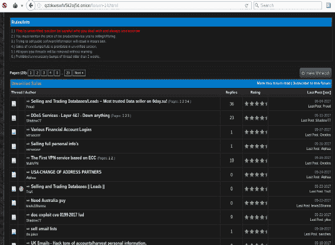

图 6.1. .onion 网站提供的服务示例

如图 6.1 所示，`Tor` 网络提供了操作系统故障、漏洞、伪品和各种攻击工具的真实销售。诸如 `Torch` 等搜索引擎，类似于毒品的 `Grams`，允许你在 `Bitcoins` 领域以及合法或非法产品市场扩展或针对你的搜索。

`Tor` 上提供的盗版和欺诈服务各不相同，伴随其后的理由也是如此，有时纯粹是商业性的，有时更具政治性，例如交付委内瑞拉士兵或 FBI 探员个人信息的黑客。然而，与他们的先驱以及 1990 年代的密码朋克（cypherpunks）相比，如今暗网（以及互联网）上的黑客表现出更多实用主义动机，而非意识形态动机，尽管 `Tor`、`I2P` 和 `Freenet` 上的许多网站仍在开发一种非常“黑客行动主义”的方法。与“毁灭军”（Legion of Doom）和其他监管者的“英雄式”时代相比，暗网是一个招募和交易平台，技能在这里被严肃地变现，有时甚至是面向国家本身，如上面的示例所示。网络战可能不存在，但是一个日益增长的专业领域。

## 6.2. 半世界中的网络犯罪、政治与颠覆

暗网上的犯罪活动阴影不仅限于盗版和毒品。暴力犯罪和非法色情吸引了更多媒体关注。在上一节引用的研究《加密政治与暗网》（Cryptopolitik and the Darknet）中，丹尼尔·摩尔和托马斯·里德使用了一个爬虫，即被程序为连接到某些网站（此处为 `.onion`）的软件，以收集数据和信息，并对最大数量的网站进行索引和分类以供研究。根据 Tor 研究和报告中经常使用的一个数字，该网络汇集了 45,000 到 60,000 个网站，但实际上无法确定地评估这一断言的有效性。摩尔和里德的研究基于搜索引擎 `ahmia.fi` 和 `onion.city`（现为 `onion.link`）提供的结果，建立了一个超过 5,000 个网站的列表，爬虫从中提取信息，并将其用于分类以下活动：“武器”、“毒品”、“极端主义”、“金融”、“黑客攻击”、“非法色情”、“枢纽”、“其他非法”、“社交”、“未知”、“暴力”、“其他”和“无”。

除了计算机科学或技术问题的网站，甚至是黑客攻击以及计算机金融犯罪网站外，在线毒品交易似乎是 `Tor` 网络最广泛的活动。根据研究作者的数据，在访问的总计 5,205 个网站和约 205,000 个唯一页面中，软件返回了以下结果。

表 6.1. 研究确定的 5,205 个网站类型分类

| 类别 | 站点数量 |
| --- | ---: |
| 无 (None) | 2,482 |
| 其他 (Other) | 1,021 |
| 药物 | 423 |
| 金融 | 327 |
| 其他非法 | 198 |
| 未知 (Unknown) | 155 |
| 极端主义 | 140 |
| 非法色情 | 122 |
| 枢纽 (Nexus) | 118 |
| 骇客 | 96 |
| 社交 | 64 |
| 武器 | 42 |
| 暴力 | 17 |
| **总计** | **5,205** |
| **活跃站点总计** | **2,723** |
| **非法站点总计** | **1,547** |

然而，考虑到上述报告的结果，调查发现可能存在细微差别。事实上，作者得出结论认为，“Tor 隐藏服务最常见的用途是犯罪”，如果只考虑那些活动被精确识别的站点，这一断言相当准确。尽管如此，在访问的 5,205 个站点中，2,482 个未归入任何类别，1,021 个被识别为“其他”，327 个列在“金融”类别中，其中包括比特币挖掘和其他不一定非法的服务。另有 155 个属于“未知”类别，118 个被放置在“枢纽”类别——这可能包括普通论坛以及围绕各种主题的其他聚会点——有 64 个属于“社交”类别。如果我们只保留明确识别为与犯罪活动相关的类别，在 5,205 个站点中仅剩余 1,038 个。这里的问题在于，某些术语仍然非常模糊——“无”、“其他”、“未知”、“枢纽”、“社交”——这些类别本身就包含了 3,840 个站点。

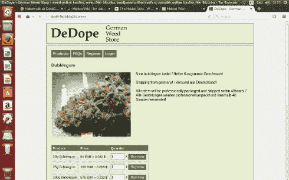

**图 6.2.** 销售麻毒品的站点

这可以从几个方面来解释。第一种解释是，`Tor` 网络上的许多站点实际上处于活动状态，并被归类为“无”（2,482 个站点），这占爬虫访问的站点的绝大多数。另一个类别包括为暗网新手提供的论坛和教程，以及“枢纽”，指的是那些不一定涉及非法活动的论坛。此外，应该补充的是，机构和主流媒体已经在 `Tor` 上开发了它们的服务，这清楚地表明他们将 `Tor` 及其隐藏网络提供的服务视为潜在市场，而不是不可忽视的受众。`Facebook`、`Twitter` 和《纽约客人》（The New Yorker）也是如此，它们现在都有了自己的 `Tor` 服务，特别是 New-er，它提供了 `The StrongBox`，这是一种受 `WikiLeaks` 启发的安全文档和证词存储库服务，确保了存款者的匿名性。但许多被访问的站点还需要注册程序，这使得人们无法确切知道主页背后隐藏着什么，以及应该将它们存储在哪个类别中，作者将这些放在了“未知”类别中。在与非法活动直接相关的站点中，武器、麻毒品、非法色情和暴力（职业杀手服务、色情电影等）的销售特别引起了媒体的关注，在 Moore 和 Rid 的研究中也占据了重要位置，更不用说针对此类行为的讨论小组和论坛了。此外，我们注意到，`Tor` 社区并不一致容忍这种使用方式，正如 `Anonymous` 在 2013 年发起的反恋童行动，或者网络上的某些站点提议打击儿童色情网站，例如在可以的情况下提供其用户的姓名或用户 ID。

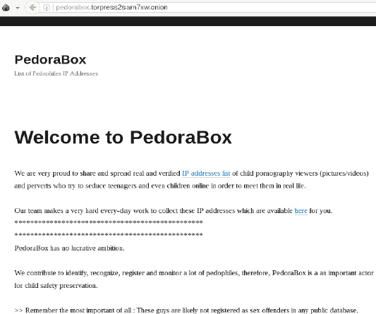

**图 6.3.** Tor 上的反恋童色情站点

在暴力方面，有时很难区分所提供服务的真假，例如，`Assassination Market` 站点为主要国家首脑的人头标了价格。然而，其他例子似乎要严重得多，例如 Moore 和 Rid 给出的例子，也来自 Tor 网络上访问的一个站点：

> “我们是一个由三人组成的职业杀手团队，在美国（+加拿大）和欧洲运营。只要你一下单，我们将在 2-3 天内回复，合同将在 1 到 3 周内执行，取决于目标。唯一规则是：不针对 16 岁以下儿童，不针对前 10 名的政客” [MOO 16]。

### 6.2.1. “半边世界”的吸引力

犯罪活动只要能引起媒体关注，就不是暗网上的唯一。在线活动的社会政治方面也不应被忽视。暗网的设计旨在为异见人士和少数群体提供庇护，并让记者工作得更加谨慎，此外还是政治活动的场所：大量的替代站点和阴谋论站点。`Tor` 作为各种暗网中最常访问的站点，是“易信者民主”的理想论坛，正如 Gérard Bronner 在他的同名著作中所被唤起的那样 [BRO 13]。这些站点表达了对政府、公共当局和权威代表的所有不信任。爱德华·斯斯诺登（Edward Snowden）是一个经常出现的人物，有时还有 TAZ 的作者 Hakim Bey，这是“暗网航海者”（darknauts）广泛分享的参考资料。

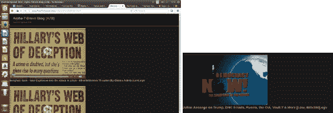

**图 6.4.** Tor 上的 Alpha7 和 Democracy now!，两个政治网站（支持特朗普的）


这种论述也出现在那些与政治问题或行动主义没有直接相关的网站上，但其活动可能间接涉及某种形式的行动主义或“黑客行动主义”：当然包括黑客行为，还有非法下载——这种奇怪地没有被 Moore 和 Rid 提到的服务在 `Tor`、`I2P` 和 `Freenet` 上无处可见——以及毒品销售。此类网站的论坛显示，网络犯罪仍然被频繁称为一种颠覆形式，包括毒品贸易。A. Maddox、Monica J. Barratt、Matthew Allen 和 Simon Lenton 在 2015 年发表了一项名为《暗网中的建设性行动主义》（`[MAD 15, pp. 111–126]`）的研究，以著名的 `Silk Road` 网站为中心进行了分析。该网站在其所谓的创始人兼经理 Ross Ulbricht 被捕后，曾在 2013 年和 2014 年成为新闻焦点，在被从 `Tor` 驱逐后，它成功地复活并在 `I2P` 网络上找到了庇护。

既然我们已经熟悉了 `Silk Road` 与 `FBI` 以及`美国司法系统`交易的细节，Maddox、Barratt、Allen 和 Lenton 的研究探索了另一个方面：`Silk Road` 用户的特殊文化。他们在 2013 年至 2014 年间进行了多次在线采访，以呈现“对原始 Silk Road 的民族志探索”，作者们据此应用了“建设性行动主义”的概念，即某些 `Silk Road` 用户通过参与毒品贸易，对机构和警察力量的一种数字反抗形式。这个用户群体找到了机会，在论坛的隐藏站点（如 `Silk Road`）上唤起他们的实践和消费，同时将他们的颠覆性方法与社会和意识形态主张交织在一起。

在这种情况下，暗网提供了一个在明网上无法找到的表达平台，明网上受到当局更严格的监管，且同样受到与社交网络所施加的全景监狱主义相联系的更强社会控制的影响。由于在 `Silk Road` 等暗网论坛上不再实行自我审查，用户不仅对购买、出售和使用毒品完全自由地表达观点，有时还在论坛论坛管理员的鼓励下，结合了自由意志主义和反国家的考量。这些表达出的观点强烈呼应了 20 世纪 90 年代密码客（cypherpunks）的观点，他们相信加密和互联网的共同使用会导致个人、社会与国家之间关系的完全重构。在 Tim May 和 John Gilmore 时代，这种论述涉及到对个人主义和社区的共同且矛盾的推崇。正如 Richard Barbrook 所指出的，John Perry Barlow 在 1996 年的独立宣言已经是自由意志主义幻灭的结果：“当网络空间即将向公众开放时，他所珍视的个人自由即将通过法律被移除，且没有任何反对。无法在加利福尼亚的意识体系中解释这一现象，Barlow 决定逃到新自由主义的超现实中”`[BAR 01, p. 5]`。

暗网论坛上进行的一些论述反映了同样的幻灭，以及对维护一个“超世界”或自由意志主义乌托邦存在的渴望，这个乌托邦位于一个替代现实中，在那里传统权力只能在一定程度上进行干预，而在视为受支配数字空间的明网上强加的规则不再适用。在他们的研究中，Maddox、Barratt、Allen 和 Lenton 指出：“作为对这种数字支配行为的回应，反抗行为显现出来，意味着通过编程创建了替代空间”`[MAD 15, p. 113]`。这种态度可以被视为新形式社会行动主义的表现，它也基于一种去人格化的意愿，这与社交网络在明网上强加的东西背道而驰。这是 David Chaum 在 20 世纪 80 年代认为的通过用户名或头像实现的解放，在一个受加密和匿名保护的网络空间中实现。

但这种对匿名个人主义的主张并没有阻止暗网居民（darknauts）同时发展一种非常社群化的论述，这种论述证实了暗网最终是由社区组成的，这些社区由虚拟个体聚集形成，他们被技术能力和逃离现实世界异化规范的意志团结在一起。`Silk Road` 用户在这方面的某些陈述指向了青少年后的怀旧：

> “风险呢？有时我怀念再次进入毒品贸易‘半边世界’的感觉（……）这就像提醒你自己的大学时光，对你曾经历的那段枯燥期的记忆大笑（……）”`[MAD 15, p. 116]`

在这个虚拟的“防御区”中，就像 Hakim Bey 的“临时自治区”一样，对技术的掌握区分了一种精英形式的“暗网居民”，他们在对隐藏网络的使用和活跃中认同自己，而这个网络并不是对所有人开放的：

> “暗网的独特之处在于，它对用户并不特别容易也不友好。像 `Facebook` 或 `Twitter` 这样的技术只需要五秒就能创建一个账户并使用网站的所有功能。而在 `Silk Road` 和其他暗网市场并不那么容易。你需要学习如何加密解密消息，以及如何获取一种晦涩的虚拟货币。当然，这些地方在媒体上并没有得到很好的报道，甚至被妖化”`[MAD 15, p. 116]`。

然而，情况可能会因为今天影响暗网的双重演变而改变。第一个演变因素与隐藏网络上的犯罪有关。

政治当局、国际机构、私人运营者和用户社区在暗网发展方面面临着诸多问题。这些包括开发基于 `Bitcoin` 使用的真正的数字与平行经济、与之相关的安全和经济问题，但最重要的是，或许也是最重要的，与治理问题相关的政治问题，以及个人对互联网将变得“碎片化”或“巴尔干化”的恐惧。这些恐惧是否有根据？还是说暗网和一种平行数字经济仅仅是在宣告由虚拟货币引领的不可避免的经济转型，而这些货币几乎已成为暗网的交易工具？

## 加密货币的演变

`Bitcoin` 中的 `bit` 是计算机语言中信息的基本单位，也指 0 和 1 之间的二进制逻辑选项，加上 `coin`（简单翻译为“货币”），便构成了一种由 David Chaum 在 1994 年用 `Digicash` 开创的加密货币和点对点支付系统。`Digicash` 原本旨在确保电子交易的“不可追溯性”，但 Chaum 的公司于 1998 年 11 月 4 日宣布破产。然而，随后的竞争者相继出现，例如美国计算机工程师、自称的密码朋者 Wei Dai 于 1998 年 11 月发明的 `b-money` 概念，或者由美国计算机科学家 Nick Szabo 在 1998 年发明的 `Bitgold` 概念。Wei Dai 和 Nick Szabo 都毕业于华盛顿大学，他们的创新并没有立即成功，但他们为 `Bitcoin` 的发展铺平了道路。目前著名的电子货币是由神秘人物 Satoshi Nakamoto 在 2008 年声称创造的。在这个名字背后，可能有不同的个人参与了 `Bitcoin` 的开发，其运行基于“区块链”，换句话说，一组通过分配计算能力来运行加密货币交易算法的继节点 [`REN 16`]。

第一批 `Bitcoins` 生成于 2009 年。起初，这种虚拟货币的成功参差不齐，最初引发了热情，随后在 2011 年面临美元汇率的下跌。作为一个去中心化的交易系统，`Bitcoin` 本质上是激烈投机活动的对象。自创立以来，`Bitcoin` 随之产生了早期的投机泡沫，使电子货币的价格从 2010 年底的 1 美元升至 2011 年 6 月的 30 美元。然而，在第一次热潮之后泡沫破灭，价格跌到 2011 年底的 2 美元。`Bitcoin` 的价格缓慢上升，在 2013 年 1 月升至 20 美元，并在 2013 年 4 月 10 日进一步飙升至 266 美元，随后新的投机泡沫再次破，使 `Bitcoin` 在 2013 年底跌至 50 美元以下。但这种涨势从 2014 年起很快恢复，尽管波动剧，`Bitcoin` 的价格急升，在 2017 年 12 月 17 日达到 20,000 美元，也就是说一个 `Bitcoin` 价值超过 16,000 欧元。尽管其高波动性产生了最初的负面预测，电子货币因此经历了令人印象深刻的价格飙升，其所实现的交易量也大幅增加。现实和数字经济中的主要参与者现在已采纳了 `Bitcoin`，例如 `Paypal`，并在 2014 年 5 月，美国联邦选举委员会甚至批准 `Bitcoin` 作为竞选资金的手段。`Bitcoin` 不再是孤单的。现在它正与 `Monero` 或 `Zcash` 等其他电子货币竞争，Satoshi Nakamoto 的作品不再在加密交易世界占据主导地位。2016 年 8 月，在互联网和暗网上均有网站的在线市场 `Alphabay` 宣布接受 `Monero` 作为支付单位，并希望在 2017 年 7 月 1 日整合 `Zcash`。

## 暗网与安全忧虑

这种对电子货币的狂热有几个原因，包括互联网上加密网络和交易的发展。正如我们所看到的，电子货币几乎仅在隐藏网络上作为特权交易单位，它们与暗网的历史不可分。电子货币已成为暗网上非法活动的首选交易和融资手段，这是今天当局和安全机构的主要关注点，特别是在计算机盗版方面，盗版在 20 年间已从活动主义转向商业和资本主义逻辑。黑客行为在 1990 年代很大程度上仍带有意识形态和政治色彩，而现在是一个不断扩张的真实市场，正如 2017 年 5 月和 6 月的一系列勒索软件攻击所示。也许比毒品走私或儿童色情等犯罪活动更甚，盗版正成为情报机构、安全和警察部门的主要关注点，因为盗版不仅可以与犯罪动机和寻求欺诈利益联系起来，而且在恶意个人和各种组织（无论是否为国家服务）的手中，还可能成为非常有效的去动稳定工具。正如 2017 年 5 月和 6 月的攻击所示，正如 2007 年和 2008 年针对爱沙尼亚和格鲁吉亚的网络攻击充分证明的，瘫痪公共服务功能、整个政府以及大型机构或公司是完全可能的。

我们无法拒绝这种观点，即某些恐怖组织可能更有效地利用这种武器进行心理战行动，并在现实世界中产生非常具体的后果，如果针对某些设施，可能会导致人员损失。特别是在伊斯兰国的情况下，西方安全部门担心，这个在叙利亚和伊拉克陷入混乱的恐怖组织可能会退缩到网络空间，继续虚拟地居住在 2014 年伊斯兰国诞生时同时宣布的“数字哈里发”中，特别是在暗网上。反恐当局和机构的恐惧还在于暗网网站和论坛将作为交换敏感数据和软件的平台，用于实施更大的破坏行动。正如 2015 年在互联网上发布的《在西方生存：圣战者指南》中所揭示的，伊斯兰教派恐怖组织最近意识到了 `Tor` 等网络提供的机会，这些网络的发展已达到足以产生“噪音”和关注度的程度，为恐怖活动的准备提供足够的覆盖，加上加密网络提供的相对匿名性。《圣战者指南》包含了名为“制作炸药”和“武器训练”的章节，以及关于使用 `Tor` 进行通信、匿名交换和行动准备的章节，此外还有圣战宣传 [`WEI 16, p. 198`]。在 2015 年的审判中，2015 年在美国被捕的 `Ali Shukry Amin` 承认 `Tor` 的隐藏网站和论坛提供了交流通信的自由，让他能够从事比 Facebook 群组或明网论坛更有成效且风险低得招募工作。同样，伊斯兰国新闻和宣传机构 `Al-Hayat Media Center` 告诉访问者如何从被当局中和或在 2015 年 11 月巴黎袭击后由 Anonymous 组织在 Tor 上发起的“巴黎行动”封锁的站点进行转移。2015 年 2 月，Michael Chertoff 和 Tobby Simon 的一份报告已经建议了以下措施来应对 `Tor` 网络上恐怖活动和宣传活动的迁移：

1. 渗透哈希表，换句话说就是在在 `Tor` 或 `I2P` 网络节点上分配数据存储并与密钥关联的目录，试图识别可疑流量、网站和账户；
2. 分析来自接入提供商的数据，以识别与“非标准”域名的连接（换句话说：`.onion` 地址）；
3. 渗透 `Tor` 网络上可疑网站的论坛并分析交流，以识别潜在威胁；
4. 为暗网上存在的不同市场建立一种有效的分类法，并尝试识别敏感的交易场所 [CHE 16]。

正如 Chertoff 和 Simon 在他们的报告中所指出的那样，暗网的发展对数字经济、网络安全和互联网治理产生了长期的悖论性后果。首要后果之一是公共和私营部门共同催发展出一种真正的网络安全经济，这种经济力图通过提供公共服务来应对新威胁，同时也为私人公司提供分析和保护工具，以反击盗版和恐怖主义带来的威胁。这些工具包括开发和使用数据挖掘、深层网挖掘和暗网挖掘工具来开展预防性的情报活动。一些大学（特别是在美国）正投入大量资金进行此类研发工作，旨在为暗网出现引发的新问题寻找答案。在 2016 年 7 月发表的一项研究中，亚利桑州立大学的研究人员 [NUN 16] 了一种专注于暗网和深层网挖掘的引用工具，其原型每周能够识别超过 300 个严重威胁，这是由于使用了与 Thomas Rid 团队实验的类似的计算机数据收集工具 [MOO 16]。研究作者表示：“我们将这些信息提供给网络安全专业人士，有助于他们的网络防御策略”，他们使用数据提取和分类软件来专门监控和分析发生在托管在 `Tor` 网络上的交易平台和论坛的流量和交流。与 Google 的反垃圾服务一样，研究人员利用最新的机器学习和人工智能技术来完善搜索，并使这些工具尽可能高效。因此，该研究为学术界与公共及私营部门之间的合作提供了一个很好的范例，这种合作正逐渐扩展为全球网络安全市场。

这只是当今数字经济发生的深刻变化的一个方面，而这些变化与互联网加密技术的发展有关。正如 Michael Chertoff 所言，如今应对暗网犯罪行为和恐怖主义风险的政府和机构在全球范围内面临两种态度的选择：直接控制，甚至中断流量——即埃及政府在阿拉伯之春期间使用的“终止开关”，伦敦市政府在 2011 年动乱期间也曾想过使用；或者以更隐蔽的方式进行数字监控和情报收集。在第一种情况下（这通常是威权或半威权国家青睐的选项），风险在于损害网络空间生态系统，而仅仅转移了威胁。在第二种情况下，困难在于需要处理的海量数据，这解释了为什么现在诉诸仍处于开发和实验阶段的数据挖掘和深层网挖掘工具。Chertoff 说：“最有效的方法是寻找非法网站而非非法用户。在法律授权下，政府黑客可以在访问这些网站的继继、节点或计算机上放置去匿名工具。如果当局关闭了相关网站，它们会在其他地方重新出现。另一方面，如果当局指控用户，其他人可能因为涉及的风险而不愿在未来使用此类网站。最后的选择可能是破解 `Tor` 以识别每个用户。正如丝绸之路案例所示，这将导致人们转而开发一个更健壮的 `Tor` 版本，这将破坏当局的努力。它还可能破坏一个对反对人士非常有用的工具” [CHE 17, p. 36]。

这一分析反映了暗网复杂且矛盾的现实，特别是 `Tor`，考虑到该网络的公开成功：一方面，绝对匿名仍然是一个诱饵，因为当局拥有技术手段去匿名部分流量。另一方面，鉴于 `Tor` 等网络的使用，去匿名所有流量是不可想象的，因为连续的软件版本对攻击的抵抗力日益增强。`Tor` 出自政府，但目前看来它已经逃离了创造者，不仅在政治层面，在技术层面也是如此。这种局面甚至导致当局和私人公司考虑将某些服务迁移到 `Tor`，其架构已被证明具有极强的韧性 [JAR 15]。因此，当局和国家权力必须遵循数字经济中一些主要私人运营商开辟的道路，不能仅仅将 `Tor` 视为潜在威胁和待监控空间，还要将其视为比明文网更安全的服务平台解决方案。这就像是闭环，因为 `Tor` 最初开发是为了为政府服务提供一个安全的通信空间。然而，今天的情况并非如此：`Tor` 网络的导航必须对普通公众变得更加简单、更有吸引力，他们才能真正转向这一解决方案，并确保正如记者 Jamie Bartlett 所说，“`Tor` 成为主流”。

# 结论

由 Peter Biddle、Paul England、Marcus Peinado 和 Bryan William 在 2003 年定义的暗网模型在过去的 14 年里发生了巨大的演变。从分裂网络模型到点对等架构，随着 `Tor`、`I2P` 和 `Freenet` 的发展，我们已经转向真正的并行网络，这些网络集成在“网络之网络”中，但基于每个加密网络特有的电子寻址和文件交换协议自主或半自主地运行。这些发展，以及这些隐藏网络（特别是 `Tor`）的相对成功，在许多领域引发了新问题，并使 ICANN 多年来一直在讨论的互联网治理概念受到质疑。暗网的出现和权力的增长可能会显著改变辩论的条款，或者至少带来新的思路。

然而，加密网络的发展前景引发了另一个问题，在米尔顿·穆勒（Milton Mueller）于 2017 年出版的最新著作中，这个标题故意具有争议性：*互联网会碎片吗？* [MUE 17]。面对来自各国政府的压力（要求互联网适应国家立法）以及某些用户社区利用加密技术实现字面上的“脱离”的诱惑，互联网“巴尔干化”的恐惧挥之不去。即使网络安全专家尤金·卡巴斯基（Eugene Kapersky）也宣布：“互联网的碎片化将导致世界矛盾性的去全球化” [MUE 17, p. 11]。然而，互联网碎片化已经发生。自从这个由许多自主和半自治整体组成的“网络之网络”诞生以来，这种情况一直存在。尽管，所有这些整体都使用一种共同的“通用语言”，即`TCP/IP`协议。然而，`.onion` 站点的出现和发展破坏了这一原则，因为它定义了使用不同协议空间的存在，并有效地禁止了大多数表面网服务与暗网之间的互操作性。尽管如此，随着`Tor2Web`等软件解决方案的发展，对互操作性的担忧似乎取得了胜利，该方案现在甚至允许在 Google 中逐步引用`.onion` 站点。然而，必须承认，暗网提供的某些隐藏服务已永久地从 `Tor`、`I2P` 和 `Freenet` 中退出，不再与互联网的其他部分说同一种“通用语言”。

这种对见证互联网碎片化的恐惧也因各国希望对流量获得更大控制权的意愿而加剧，甚至正如中国在 2012 年提议的，建立真实的`DNS` 和国家域名，其运行方式类似于电话代码。虽然中国的提议从未被 `ICANN` 的机构所接受，但该问题悬而未决，人们仍然担心互联网将出现“数字法外区域”与被国家重新收回的互联网之间的逐渐分裂。因此，2014 年 4 月在圣保罗罗举行的 `NETMundial` 会议以爱德华·斯诺登（Edward Snowden）的揭露和恐惧为标志。当时担任 `ICANN` 主席的法迪·切哈哈德（Fadi Chehadé）明确表示，存在与非协商治理相关的不受控发展的危险：“如果我们无法找到一种公平治理互联网的方法，我们就有可能退回到碎片化形式的风险” [MUE 17, p. 12]。


美国国防部对互联网的发展旨在为其现场代理提供独立于使用硬件的互操作性和连接性。这一原则的发展已经超越了军事当局的雄心和控制力。从个人电脑开始普及起，对通用协议的需求变成了全球性的。这一概念的出现产生了自己的局限性，因为网络空间像任何其他空间一样，为犯罪和非法活动提供了发展领域，用户必须具备阻止或至少保护自己的手段。这种必要性产生了一个悖论：互联网的全球性质与制裁和控制各种滥用行为的国家法院之间的性质，这种矛盾从互联网起源起就存在。制度性的回应仍然不存在，这种矛盾当前的网络安全挑战得到了完美体现。对于许多国家运营者来说，斯诺登的揭露表明，全球化的互联网交换空间仍然受美国霸权的支配，这导致了纯粹自由贸易区的出现，以及一个理性化和控制信息的完美工具。对于其他人来说，这让他们意识到，网络的中性和自由在不久的将来可能会受到损害，必须开发工具和政策来保护它，例如“黑客活动主义者”约翰·佩里·巴洛（John Perry Barlow）在 1996 年的《网络空间独立宣言》中要求的那样。

因此，暗网的发展完全符合关于互联网治理的辩论，这一现象作为数字技术重大演变的一部分，与全球各国政府对互联网的核心关注问题密切相关：安全和网络安全、互联网与国家司法管辖权的接轨、反之部分逃避立法和法律限制的可能性，以及维护一个始终确保系统通用互操作性的共同协议。暗网在不久的将来会在用途和数字经济方面宣布重大变化吗？无论如何，这种现象远非局限于网络犯罪，但它确实让我们窥见了未来几年互联网可能呈现的面貌：一个可能因政治意志而更加碎片化、因加密使用而更加模块化，并提供待探索的新数字领的互联网；现在说还为太早。无论如何，可以确定我们与这个虚拟宇宙的关系再次发生了剧烈演变。在这个快速发展的背景下，暗网远不仅仅是一个新形式网络犯罪发展的虚拟领土，无论它们多么壮观。“暗网络”在互联网的演变中扮演着更广泛的角色，从网络治理问题到用户的新机会。互联网的未来现在可能位于网络的隐藏侧。

# 附录

## 附录 1

### 网络空间独立宣言（约翰·佩里·巴洛，1996 年 2 月）¹

就在 20 多年前，1996 年 2 月 8 日，散文家、感谢死乐队（Grateful Dead）前作家以及电子前疆基金会（EFF）联合创始人约翰·佩里·巴洛（John Perry Barlow）写了《网络空间独立宣言》，以回应 1996 年美国颁布的《电信法案》，巴洛认为该法案是扼杀自由的。下文复制的文档对应于互联网上发布的原始文本。它包含了巴洛的序言和宣言本身。

> 昨天，白宫的那个无脊椎动物签署了 1996 年《电信法案》，而蒂珀·戈尔（Tipper Gore）拍摄了该事件的数字照片将其放入名为《网络空间 24 小时》的书中。

> 我受邀为这本书的创作写一些符合情况的内容。考虑到这项立法将给互联网带来的恐怖，我认为现在是某些反抗的好时机。

> 毕竟，这项在参议院仅以 4 票反对就通过的《电信法案》，使得在网上说“shit”是违法的，并处以 25 万美元的罚款。就像说主流媒体禁止的“七言脏话”一样。以及公开讨论堕胎。以及不用纯临床术语谈论生理功能。

> 这项立法试图对网络空间的对话施加的约束，比目前在参议院食堂存在的约束还要强，在那里我每次吃晚饭都能听到美国参议员说出露骨的秽言。

> 这部法律是由那些完全不知道我们是谁、也不清楚我们的对话是在哪里进行的的人对我们实施的。正如我的朋友、《连线》杂志主编路易斯·罗塞托（Louis Rosseto）所说，这就像是“文盲者告诉你可以读些什么”。

> 那么，去他们的妈吧。

> 或者，更恰当地，让我们与他们告别。他们向网络宣战。让我们让他们看到为了保护自己，我们可以变得多么聪明、困惑和强大。

我写了一些内容（包含了所有相关细节），希望它们能成为实现这一目的手段之一。如果你觉得它有用，我希望你能尽可能广泛地传播。如果你愿意，可以省略我的名字，因为我并不在乎有人将这段文字归于我的名。我真的不在乎。

但我希望的是，这种喧嚣能够在`Network`中获得牵引，改变、增长并倍增，直到它演变成一场与刚刚强加在我们身上的愚蠢行为同等规模的动荡。

内容如下……：

# 网络空间独立宣言

“只有错误需要政府的支持。真理可以自我处理。”

（托马斯·杰斐逊，《弗吉尼亚纪事》）

工业世界的政府们，你们这些由肉体和钢铁组成的疲惫巨头，我来自`Cyberspace`，那是`Mind`的新家园。代表未来，我请求过去的你们放过我们。我们不欢迎你们加入我们的我们。在在我们聚集的地方，你们没有主权。

我们没有选举产生的政府，也不可能拥有政府，因此我向你们致辞，所拥有的权威并不比自由本身始终发出的权威更高。我宣布，我们正在构建的全球社会空间在自然上独立于你们试图强加于我们的暴政。你们没有道德权利来统治我们，也不拥有任何我们有理由去恐惧的强制手段。

政府的正当权力源于被统治者的同意。你们既没有征求也没有获得过我们的同意。我们没有邀请你们。你们不了解我们，也不了解我们的世界。`Cyberspace`并不在你们的边界之内。不要认为你们可以像建设公共工程项目一样建造它。你们做不到。它是一种自然行为，它通过我们的集体行动自我生长。

你们没有参与过我们宏大且不断汇聚的对话，也没有创造过我们市场的财富。你们不了解我们的文化、伦理，或不了解那些已经为我们的社会提供秩序的不成文规范——这些秩序比你们任何强加手段能获得的都要多。

你们声称我们之间存在你们需要解决的问题。你们利用这一说辞作为侵入我们领地的借口。其中许多问题并不存在。在存在真实冲突、在存在不公的地方，我们将识别它们并通过我们的手段解决它们。我们正在形成自己的`Social Contract`。这种治理将根据我们世界的条件产生，而不是根据你们的。我们的世界是不同的。

`Cyberspace`由交易、关系和思想本身组成，像我们通信网络中的驻立波一样排列。我们的世界既无处不在，又无处存在，但它不是实体居住的地方。

我们正在创造一个所有人都可以进入的世界，且不受种族、经济实力、军事力量或出生地位所赋予的特权或偏见的影响。

我们正在创造一个世界，任何人在任何地方都可以表达他的她的信念，无论这些信念多么独特，而不必担心被迫沉默或顺从。

你们关于财产、表达、身份、移动和背景的法律概念并不适用于我们。它们都是基于物质的而这里没有物质。

我们的身份没有肉体，所以，与你们不同，我们无法通过物理强制获得秩序。我们相信，通过伦理、开蒙的自利心以及“我们”，我们可以建立一个比你们所拥有的更好的世界。我们的世界是一个思想的世界，而不是一个物品的世界。这是一个合作的世界，而不是竞争的世界。

我们正在建立一个自由的世界，而不是强权的世界。我们正在建立一个未来的世界，而不是过去的世界。我们正在建立一个思想的世界，而不是肉体的世界。

网络空间已在。它正在成长。它是我们的。

少数能够教导我们什么的人在我们身上找到了志愿者，

> 但这少数人只是沙漠中的滴水。

> 人生无非是无垠海洋中的一滴。

> 但什么是海洋呢？

> 不是滴水的汇聚吗？

> 这就是我们现在的世界……电子与开关的世界，

> 0 和 1 的美学。我们利用了现有的服务，却没有为那些本可以很便宜的服务付费（如果不是由那些逐利的贪徒运行的话），而你们却称我们为罪犯。

> 我们探索……而你们称我们为罪犯。我们寻找知识……

> 而你们称我们为罪犯。我们的存在没有肤色，没有国籍，

> 没有宗教偏见……而你们称我们为罪犯。

> 你们制造原子弹，你们发动战争，

> 你们杀戮、欺骗并对我们撒谎，试图让我们相信

> 这一切都是为了我们好，但这一次，我们成了罪犯。

> 是的，我是一个罪犯。我的罪名是好奇心。

> 我的罪名是根据人们的言行评判他们，

>而不是根据他们的长相。

> 我的罪名是比你们更聪明，这是你们永远不会原谅的。

> 我是一个黑客，这是我的宣言。你们可以逮捕这一个人，

> 但你们无法阻止我们所有人……毕竟：我们都是相似的。

# # 航行安全，混蛋们！

来源：Digital Gangster 网站首页，Tor 网络

# 术语表

### AFNIC

*法国合作互域名命名协会*（*Association française pour le nommage Internet en cooperation*）。一家非营利组织，其使命是管理法国本土、海外以及法国南部和南极土地的首级互联网域名。

### Anonymous（匿名组织）

于 2003–2004 年左右创建的一个活动家运动，汇聚了活跃程度不一的国际群体云，声称致力于捍卫言论自由，这种斗争还包含了各种政治诉求。

### ARPANET

*高级研究计划局网络*。`DARPA`在 1969 年至 1972 年间开发的第一个分组数据传输网络。

### Backbone（骨干网）

骨干网是最早且最重要的远程计算机网络，如今构成互联网的多个网络已添加在其之上。

### Big Data（大数据）

该术语出现在 20 世纪 90 年代，并在 20 世纪后后期变得流行，指的是随着互联网的发展产生了海量数据。`Big Data`的管理被认为是未来十年科学、商业和网络安全领域面临的主要挑战之一。

### Bitcoin（比特币）

自 2009 年起分发的虚拟加密货币，其运行基于去中心化的节点网络，该网络提供交易处理并允许分配计算力的用户获得报酬。`Bitcoin`理论上允许安全且匿名的交易，因此在暗网上取得了成功。

### Connected objects（连接物体）

“物联网”`IoT`代表连接的物品。

### Cybersecurity（网络安全）

一套用于保护的法律、工具和方法。

### Darknet/darknets（暗网）

`darknets`一词指隐藏网络。

### DARPA

*国防高级研究计划局*。美国研究机构。

### DB

数据库。

### Deep web（深网）

`deep web`普通公众无法访问。

### Domain（域名）

在计算机科学中，`domain`是一个网络。

### EFF

*电子前沿基金会*。致力于自由的国际非政府组织。

### FTP

*文件传输协议*。一种在网络上传输和共享文件的协议。

### GAFTA / GAFA / GAFAM

数字巨头的缩写：`Google`、`Apple`、`Facebook`、`Twitter`、`Amazon`。

### gTLD

*通用顶级域名*。例如`.com`或`.org`。

### HTTP

*超文本传输协议*。服务器到客户端的数据传输协议。`HTTPS`是安全版本。

### IANA

*互联网分配编号机构*。一家美国非营利组织，负责全球 IP 地址的分配。

### ICANN

*互联网名称与数字机构*。负责分配`IPv4`和`IPv6`地址以及互联网域名的国际组织。

### Internet（互联网）

一个全球计算机网络，通常被称为“网络的网络”。

### IETF

*互联网工程任务组*。一个致力于互联网标准和协议技术开发的国际组织。

### ISOC

*互联网学会*。 1992 年根据美国法律成立的国际组织。

### IPv4

*互联网协议第四版*。`Internet Protocol`的第一个版本，于 1981 年发布，允许 32 位 IP 地址。

### IPv6

`IPv4`的继者，由`IETF`于 1998 年开发。它提供 128 位地址。

### Librenet

该术语可以指互联网上的开源软件文化，也可以指对匿名和隐私的保障，特别是通过如`Freenet`等网络。自 2017 年 3 月以来，`Librenet`也作为一个安全的并行网络项目，其融资正在 Kickstarter 平台启动。

### 新闻组 (Newsgroups)

一种通过论坛进行数据交换和通信的系统，其第一个模型是 1979 年开发的`USENET`。

### NSA

`国家安全局.` 创建于第二次世界大战结束之际，这家美国情报机构专长电磁和电子情报、密码学以及信息系统处理。在 2013 年 6 月，在前`NSA`特工爱德华·斯诺登（Edward Snowden）揭露`NSA`为监视美国公民和盟国而建立的大规模间谍系统后，该机构成为了关注焦点。

### 开源

换句话说，“开源代码”。指任何源代码向公众开放并免费分发的软件术语。

### P2P

`点对点.` 一种计算机网络模型，其中每个客户端也是服务器，可用于交换各种类型的文件和数据。

### 代理

代理是软件或计算机组件，充当中间角色以监控或保护两个主机之间的连接。扩展意义上，服务器也可以被视为代理。

### 服务器

物理上托管数据的计算机单元或工作站，例如允许一个`Website`（网站）放置在互联网上。

### 丝绸之路

`Tor`网络上的在线毒品贩，于 2013 年 10 月被`FBI`捣毁，随后于 2014 年 11 月被关停。

### 明网 (Surface web)

明网包含了所有常用的应用程序、网站和数据库，可以通过传统搜索引擎的简单搜索轻松访问。

### TCP/IP

`传输控制协议/网际协议`. 用于在互联网上传输和交换数据的协议集。

### Tor

`洋葱路由.` `Tor`项目最初于 20 世纪 90 年代后期在美国陆军的支持下开发，随后于 2000 年初免费分发。`Tor`项目提供了一个匿名浏览器`Tor Browser Bundle`以及`.onion`结尾的站点创建服务，严格来说，这就是`Tor`暗网。

### VPN

`虚拟专用网络.`

### WHOIS

`谁是谁?`. 全球域名注册查询服务。

### WWW

`万世界维网`. “蜘蛛网”，即是一种运行在互联网上的超文本系统，允许用户通过浏览器浏览托管在全球网络上的页面和网站。世界维网由蒂姆·伯纳斯-李（Tim Berners-Lee）和罗伯特·卡约（Robert Cailliau）于 1990 年创建。

# 参考文献

1. [AND 04] ANDROUTSELLIS-THEOTOKIS S., SPINELLIS D., “A survey of peer-to-peer content distribution technologies”, *ACM Computing Surveys*, vol. 36, no. 4, pp. 335–371, 2004.

2. [ARQ 97] ARQUILLA J., RONFELDT D., “Cyberwar is coming!”, in ARQUILLA J., RONFELDT D. (eds), *In Athena’s Camp: Preparing for Conflict in the Information Age*, RAND, Santa Monica, California, 1997.

3. [BAL 13] BALL J., SCHNEIER B., GREENWALD G., “NSA and GCHQ target Tor network that protects anonymity of web users”, *The Guardian*, 2013.

4. [BAR 96] BARLOW J.P., “Déclaration d’indépendance du cyberespace”, available at: http://editions-hache.com/essais/barlow/barlow2.html, 1996.

5. [BAR 01] BARBROOK R., LUDLOW P. (eds), *Crypto Anarchy, Cyberstates and Pirate Utopias*, MIT Press, Cambridge, 2001.

6. [BAR 13] BARLOW J.P., “I am John Perry Barlow, cofounder of the *Electronic Frontier Foundation,* lyricist for *the Grateful Dead.* My most recent work is with the Freedom of the Press Foundation. Ask me anything”, available at: https://www.reddit.com/r/IAmA/comments/1kgmes/i_am_john_perry_barlow_cofounder_of_the/, 2013.

7. [BAR 14] BARTLETT J., *The Dark Net: Inside the Digital Underworld*, Random House, 2014.

8. [BAU 00] BAUMAN Z., *Liquid Times: Living in an Age of Uncertainty*, Polity Press, Cambridge, 2000.

9. [BAU 12] BAUD M., “La cyberguerre n’aura pas lieu, mais il faut s’y préparer”, *Politique étrangère*, vol. 2, pp. 305–316, 2012.

10. [BER 99] BERNERS-LEE T., *Weaving the Web: The Original Design and Ultimate Destiny of the World Web by Its,* Harper Business, 1999.

11. [BER 01] BERTHOLD O., FEDERRATH H., KÖSELL S., “Webes: a system for anonymous and unobservable access”, *Proceed of the Workshop on Design Issues in Anonymity and Unobservability,* Berkeley, 2001.

12. [BEY 91] BEY H., “TAZ, Temporary Autonomous Zone. Ontological Anarchy, Poetic, available at: http://lyber-net/taz, 1991.


13. [BID 03] BIDDLE P., ENGLAND P., “The darknet and the future”, available at: `ms.edu/10/dark`, 2003.

14. [BLU 83a] BLUM M., “Coin flipping by telephone: solving impossible problems”, *ACM News*, vol. 15, no. 1, 1983.

15. [BLU 83b] BLUM M., “How to exchange (secret) keys”, *ACM Transactions on Computer*, vol. 1, no. 2, pp. 175–193, 1983.

16. [BOR 14] BORIES C., “Appréhender la cyber”, *La Revue des droits’homme*, vol. 6, 2014.

17. [BOR 16] BOREL S., “Le panoptisme horizontal ou le panoptisme inversé”, *tic&société*, vol. 10, 2016.

18. [BRO 13] BRONNER G., *La démocratie des créd*, PUF, 2013.

19. [CAM 01] CAMPBELL D., *Surveillance électronique planétaire*, Éditions Allia, 2001.

20. [CAS 13] CASILLO I., “Espace public”, in CASILLO I., BARBIER R., BLONDIAUX L., (dir.), *Dictionnaire critique et interdisciplinaire de la participation*, GIS Démocratie et Participation, Paris, 2013.

21. [CHA 81a] CHAUM D.L., “Blind signatures and untraceable payments”, *Advances in Cryptology*, vol. 82, no. 3, pp. 199–203, 1981.

22. [CHA 81b] CHAUM D.L., “Untraceable electronic mail, return addresses and digital pseudonyms”, *Communications of the ACM*, vol. 24, no. 2, 1981.

23. [CHA 85] CHAUM D.L., “Security without identification: transaction systems to make Big Brother obsolete”, *Communications of the ACM*, vol. 28, no. 10, 1985.

24. [CHA 16] CHAFFIN Z., “Paris dénonce une “privatisation” de la gouvernance’Internet”, Le Monde, available at: `http://www.lemonde.fr/economie/2016/03/24/icann-paris-denonce-une-privatisation-de-la-gouvernance-d-internet_4889567_3234.html`, 2016.

25. [CHE 16] CHERTOFF M., SIMON T., “The impact of the Dark Web on Internet Governance and cyberSecurity”, available at: `www.ciciononline.org/sites/default/files/gcig_paper_no6.pdf`, 2016.

26. [CHE 17] CHERTOFF M., “A public policy perspective of the Dark Web”, *Journal of Cyber Policy*, vol. 2, no. 1, 2017.

27. [CHO 93] CHOLLET L., “William Gibson’s Second Sight”, *Los Angeles Times*, 1993.

28. [CHR 15] CHRISTIE M.-J., “David Chaum and Ecash: privacy technology’s negociations of political, cultural, and techno-social contingencies in the mid-1990s”, Columbia University, New York City, 2015.

29. [CLA 99] CLARKE I., “一种分布式去中心化信息存储与检索系统”，未出版报告，*信息学系*，爱丁堡大学，可用地址：[`www.freenet project.org`](http://www.freenet%20project.org)，1999 年。

30. [CLA 00] CLARKE I., SANDBERG O., WILEY B. *等*，“Freenet，一种分布式的匿名信息存储与检索系统”，*计算机科学讲义集*，斯林格出版社，柏林/海德堡，2000 年。

31. [DAR 09] DARDOT P., LAVAL C., *新世界的新理性：关于新自由主义社会的尝试*，La Découverte 出版社，巴黎，2009 年。

32. [DEL 96] DELAHAYE J.-P., “被淹没的信息，被隐藏的信息”，“*为了科学*，第 229 卷，1996 年。

33. [DEM 02] DEMBART L., “甩掉老大哥”，“*国际今日早报*，可用地址：[`www.uni-muenster.de/PeaCon/global-texte/g-w/n/peekabooty.htm`](http://www.uni-muenster.de/PeaCon/global-texte/g-w/n/peekabooty.htm)，2002 年。

34. [DIF 76] DIFFIE W., HELLMAN M., “密码学的新方向”，“*IEEE 信息论汇学刊*，第 22 卷，第 6 号，1976 年。

35. [DI 14] DI LASCIO F., “公共空间与行政法”，“*Philonsorbonne*，第 8 期，第 133–143 页，2014 年。

36. [DUV 98] DUVAL G., “互联网：全球网络需要私有化吗？”，*经济替代方案*，第 158 期，可用地址：[`www.alternatives-economiques.fr/internet-faut-privatiser-reseau-mondial/00018736`](http://www.alternatives-economiques.fr/internet-faut-privatiser-reseau-mondial/00018736)，1998 年。

37. [GEL 13] GELLMAN B., TIMBERG C., RICH S., “NSA 机密文件显示针对 Tor 加密网络的行动”，“*华盛顿邮报*，2013 年。

38. [GOL 99] GOLDSCHAG D., REED M., SYVERSON P., “用于匿名和隐私互联网连接的洋葱路由”，“*ACM 通信*，第 42 卷，1999 年。

39. [GOM 16] GOMBERT D.C., CEVALLOS A.S., GARAFOLA C.L., *与中国的战争：对不可思议之事的思考，兰德公司**，加利福尼亚州圣莫尼卡，可用地址：[`www.rand.org/pubs/research\_reports/RR1140.html`](http://www.rand.org/pubs/research_reports/RR1140.html)，2016 年。

40. [GRE 00] GREENFELD K.T., “会会 Napster”，“*时代杂志*，可用地址：[`content.time.com/time/world/article/0,8599,2053826,00.html`](http://content.time.com/time/world/article/0,8599,2053826,00.html)，2000 年。

41. [GUL 05] GULLI A., SIGNORINI A., “构建一个开源元搜索引擎”，“第 14 届国际世界维网会议”，中国，日本，2005 年 5 月 10 日–14 日。

42. [HAB 93] HABERMAS J., *公共空间：作为资产阶级社会构成维度的广告考古学*，Payot 出版社，巴黎，1993 年。

43. [HUG 93] HUGHES E., “密码朋克宣言”，可用地址：[`www.activisme.fr/cypherpunks/manifesto.html`](https://www.activisme.fr/cypherpunks/manifesto.html)，1993 年。

44. [JAR 15] JARDINE E., “暗网的困境：tor、匿名性与在线执法”，“*全球互联网治理委员会*，*论文集*，第 21 期，可用地址：[`www.cigionline.org/sites/default/files/no.21.pdf`](https://www.cigionline.org/sites/default/files/no.21.pdf)，2015 年。

45. [JOH 07] JOHNSON E., MCGUIRE D., WILLEY N.D., “点对点文件共享网络的安全风险”，塔特克商学院，数字策略中心，2007 年。

46. [JOH 13] JOHNSON A., WACEK C., JANSEN R. *等*，“*美国海军研究*，乔治敦大学，华盛顿特特区，2013 年。

47. [KER 83] KERCKHOFFS A., “军事地理学”，“*军人杂志*，第 IX 卷，第 38 页，1883 年。

48. [LAW 14] LAWRENCE D., “Tor 的内部故事：史上构建的最强匿名工具”，“*彭博商业周刊*，可用地址：[`www.bloomberg.com/news/articles/2014-01-23/tor-anonymity-software-vs-the-security-agency`](https://www.bloomberg.com/news/articles/2014-01-23/tor-anonymity-software-vs-the-security-agency)，2014 年。

49. [LEW 91] LEWYN M., SCHWARTZ E., “为什么‘毁灭之军团’对联邦政府没什么”，可用地址：[`www.bloomberg.com`](http://www.bloomberg.com)，1991 年。

50. [LIE 07] LIEBAU N., PUSSEP K., GRAFF K. *等*，“P2P 对新媒体的影响”。

51. [LOV 16] LOVECFT R., 引用自《卫报》“Shari Steele 关于 Tor 的匿名性”，可用地址：[`www.guardian.com/technology/11/shari-stele-censorship`](https://www.guardian.com/technology/11/shari-stele-censorship)，2016 年。

52. [MAD 15] MADDOX A., BARRATT M., *等*，“数字世界中的加密非法交易”，“*美国信息系统会议论文集**。

53. [MAY 94] MAY T., “加密匿名与虚拟社区”，可用地址：[`groups.csail.mit.edu/mac/805/cypunks.html`](http://groups.csail.mit.edu/mac/805/cypunks.html)，1994 年。

54. [MOO 00] MOORE D., “暗网的政治化”，“*生存：战略*”，“*战略研究所*，2000 年。

55. [MUE 17] MUELLER M., “构建能够抵抗下一代国家监控的 Tor”，2017 年。

56. [MUR 00] MURRAY B., “网络战不会发生”，“*网络下载报告*”，“*亚利桑那州大学*，2000 年。

57. [OMA 12] OMAND S., BARTLE J., MILLER C. *等*，“暗网的行动”，“*情报与国家安全*，2012 年。

58. [OMA 16] OMAND S., “暗网的行动：Shari Steele 关于 Tor 的匿名性与审查”，“*世界政策杂志*，2016 年。

59. [PAQ 11] PAQUOT T., “公共空间”，“新发现出版社*，2011 年。

60. [PIS 08] PISANI F., PIOT D., “互联网改变世界”，“新发现出版社*，2008 年。

61. [POR 16] PORUP J.M., “构建下一代国家监控的 Tor”，“Ars 技术*，2016 年。

62. [QIA 06] QIAO L., WANG X., *无界战争》，Rivages 出版社，2006 年。

63. [REI 99] REITER M.K., RUBIN A.D., “群体的匿名网络交易”，“*ACM 通信*，第 42 卷，第 2 号，1999 年。

64. [REN 16] RENNARD J.-P., *暗网：神话与现实*，Ellipses 出版社，2016 年。

65. [RID 11] RID T., “网络战不会发生”，“*战略研究杂志*，2011 年。

66. [RIV 78] RIVEST R.L., SHAMIR A., ADLEMAN L., “获取数字签名和公钥加密系统的方法”，“*ACM 通信*，第 21 卷，第 2 号，1978 年。

67. [ROB 15] ROBINSON T., “Shari Steele 被任命为 Tor 项目执行董事”，“*SC Media*，可用地址：[`www.scmagazine.com/former-eff-executive-director-takes-reins-at-tor-project/article/533161/`](https://www.scmagazine.com/former-eff-executive-director-takes-reins-at-tor-project/article/533161/)，2015 年。

68. [SEN 79] SENNETT R., *亲密关系的暴政*，Le Seuil 出版社，巴黎，1979 年。

69. [STE 92] STERLING B., *黑客镇压：电子边疆的法律与混乱*，Bantam Books，纽约，1992 年。

70. [STE 99] STERLING B., *黑客：数字崇高中的犯罪*，Routledge 出版社*，1999 年。

72. [STE 15] STEELE S., “New Tor director Shari Steele gears up for challenging future (Q&A)”, *The Parallax*, available at: [`www.the-parallax.com/2015/12/30/new-tor-director-shari-steele-gears-up-for-challenging-future-qa/`](https://www.the-parallax.com/2015/12/30/new-tor-director-shari-steele-gears-up-for-challenging-future-qa/), 2015.

73. [STO 15] STOCKLEY M., “Onion.city – a search engine bringing the Dark Web into the light”, *Naked Security*, available at: [`nakedsecurity.sophos.com/2015/02/18/onion-city-a-search-engine-bringing-the-dark-web-into-the-light/`](https://nakedsecurity.sophos.com/2015/02/18/onion-city-a-search-engine-bringing-the-dark-web-into-the-light/), 2015.

74. [SYV 14] SYVERSON P., REED M.G., GOLDSCHLAG D.M., “Private Web Browsing”, Naval Research Laboratory, 2 June 1997, cited by LEVINE Y., “Almost Everyone Involved in Developing Tor was (or is) Funded by the US Government”, *Pando*, available at: [`pando.com/2014/07/16/tor-spooks/`](https://pando.com/2014/07/16/tor-spooks/), 2014.

75. [TAR 14] TARLE (DE) A., “La privatisation d’Internet”, *Déchiffrage-Europe 1/Le JDD*, 2014.

76. [WAT 98] WATTS D.J., STROGATZ S.H., “Collective dynamics of ‘small-world’ networks”, *Nature,* vol. 393, pp. 440–442, 1998.


77. [WEI 16] WEIMANN G., “Going dark: terrorism on the dark web”, *Studies in Conflict & Terrorism*, vol. 39, no. 3, 2016.

78. [WU 03] WU T., “Network Neutrality, Broadband discrimination”, *Journal of Telecommunications and High Technology Law*, vol. 2, p. 141, 2003.

# 索引

## A, B

* 匿名

* ARPANET

* 骨干网

* 比特币

* BitTorrent

## C

* 情报 (COMINT)

* 连接物体

* 赛博朋克

* 网络安全

## D, E

* 高级研究计划局 (DARPA)

* 深网

* 域名解析系统 (DNS)

* 电子前基金会 (EFF)

## F, G

* Freenet

* GAC

* 英国政府通信司令部 (GCHQ)

* Gnutella

## I

* IANA

* ICANN

* IDC

## K, N

* Kazaa

* Napster

* 新闻组

* 美国安全局 (NSA)

## O, P

* 开源

* Peekaboot

* 点对点

* 代理

## S, T

* 服务器

* 信号情报 (SIGINT)

* Soulseek

* 表面网

* TCP/IP

* 顶级域名 (TLD)

## U, W

* 英美五眼联盟 (UKUSA)

* USENET

* WHOIS

* `images/logo.jpg`

## 2018

ARDUIN Pierre-Emmanuel, *内部威胁（信息系统进展——第 10 卷）* FABRE Renaud, BENSOUSSAN Alain, *数字知识工厂：科学结果的验证* GADIN Thierry, LACROIX MAUREL Marie-Christine, *生命科学* IFRATE Fernando, *人工智能与大数据：新一代智能的诞生（信息系统进展——第 8 卷）* MANDRAN Nadine, *可追踪的人性设计（信息系统进展——第 9 卷）*

## 2017

BOUHAÏ Nasreddine, SALEH Imad, *物联网：演变与创新（数字工具与应用——第 4 卷）* DUONG Véronique, *百度 SEO：营销的复杂性* LESAS Anne-Marie, MIRANDA Serge, *NFC 的艺术与科学（数字工具与应用——第 3 卷）* MARSAULT Xavier, *前瞻人体工程（人机交互——第 4 卷）* REYES-GARCIA Everardo, *建筑早期阶段（建筑与计算机科学——第 1 卷）* 图像-界面：视觉化信息支持（数字工具与应用——第 3 卷）* SZONIEC Samuel, *集体智能与数字档案（数字工具与应用——第 1 卷）*

## 2016

BEN CHOUI Mona, *3D 几何学（人机交互——第 2 卷）* BOUVARD Patricia, SUZANNE Hervé, *商业集体智能发展* ISHIKAWA Fuyuki, TOKUDA Hideuki, *智慧城市赋能者* FABRE Renaud, *非对称联盟与信息系统问题（信息系统进展——第 7 卷）* GAUDIELLO, *记忆与行动选择（人机交互——第 3 卷）* ZIBETTI Elisabetta, *网络时代的战争术（知识技术——第 1 卷）* VENTRE Daniel, *信息战——第 2 版*

## 2015

ARDUIN Pierre-Emmanuel, GRUNDSTEIN Michel, *信息与知识系统（信息系统进展——第 2 卷）* BÉRANGER Jérôme, *医疗信息系统* BRONNER Gérald, *互联网上的信仰与不信* VITALIS André, *不确定数字革命（连接社会——第 1 卷）* *从大数据到智能数据（信息系统进展——第 1 卷）* KRICHEN Saoussen, BEN JOUIDA Sihem, *供应链管理及其在计算机科学中的应用* NEGRE Elsa, *信息推荐系统（信息系统进展——第 4 卷）* POMEROL Jean-Charles, EPELBOIN Yves, THOURY Claire, *开放在线课程 (MOOCs)* SALLES Maryse, *决策与信息系统（信息系统进展——第 3 卷）* SAMARA Tarek, *ERP 与信息系统：整合还是瓦解（信息系统进展——第 5 卷）*

## 2014

DINET Jérôme, *数字环境中的信息检索* HÉNO Raphaële, CHANDELIER Laure, *建筑 3D 建模：卓越建筑* KEMBELLEC Gérald, CHARTRON Ghislaine, SALEH Imad, *推荐系统* MATHIAN Hélène, SANDERS Lena, *时空方法：地理对象与变化过程* PLANTIN Jean-Christophe, *参与式制图* VENTRE Daniel, *中国网络安全与防御*

## 2013

BERNIK Igor, *网络犯罪与网络战* CAPET Philippe, DELAVADE Thomas, *信息评估* LEBRATY Jean-Fabrice, LOBRE-LEBRATY Katia, *众包：超越* SALLABERRY Christian, *文本语料库中的地理信息检索*

## 2012

BUCHER Bénédicte, LE BER Florence, *GIS 中的创新软件开发* GAUSSIER Eric, YVON François, *文本信息访问* STOCKINGER Peter, *视听档案：数字文本与话语分析* VENTRE Daniel, *网络冲突*

## 2011

BANOS Arnaud, THÉVENIN Thomas, *地理信息与城市交通系统* DAUPHÉ André, *分形地理学* LEMBERGER Pirmin, MOREL Mederic, *信息系统的复杂性管理* STOCKINGER Peter, *视听档案导论* STOCKINGER Peter, *数字视听档案* VENTRE Daniel, *网络战与信息战*

LANGLOIS Patrice

*地理信息系统中复杂系统的仿真*

MATHIS Philippe

*图与网络 – 第 2 版*

THERIAULT Marius, DES ROSIERS François

*城市动态建模*

### 2009

BONNET Pierre, DETAVERNIER Jean-Michel, VAUQUIER Dominique

*可持续 IT 架构：通过 SOA 改造信息系统的进步方法*

PAPY Fabrice

*信息科学*

RIVARD François, ABOU HARB Georges, MERET Philippe

*横向信息系统*

ROCHE Stéphane, CARON Claude

*地理信息系统的组织维度*

### 2008

BRUGNOT Gérard

*风险的空间管理*

FINKE Gerd

*运筹学与网络*

GUERMOND Yves

*地理学过程建模*

KANEVSKI Michael

*环境数据的高级制图*

MANOUVRIER Bernard, LAURENT Ménard

*应用集成：EAI, B2B, BPM 和 SOA*

PAPY Fabrice

*数字图书馆*

### 2007

DOBESCH Hartwig, DUMOLARD Pierre, DYRAS Izabela

*气候数据的空间插值*

SANDERS Lena

*空间分析中的模型*

### 2006

CLIQUET Gérard

*地理营销*

CORNIOU Jean-Pierre

*回顾与展望 IT 的未来*

DEVILLERS Rodolphe, JEANSOULIN Robert

*空间数据质量基础*

# WILEY 用户许可协议

请访问 [www.wiley.com/go/eula](http://www.wiley.com/go/eula) 访问 Wiley 的电子书用户许可协议 (EULA)。
