# 区块链概念入门指南

## 摘要

本书对区块链技术的概念、机制、功能、治理以及现实世界的应用提供了详尽的见解。全书分为十章：引言、区块链历史、区块链机制、区块链功能、区块链治理、现实世界中的区块链、基于区块链的加密货币——比特币、基于区块链的加密货币——以太坊、区块链平台以及区块链的未来。

我们在`引言`章节中首先对区块链进行了概述。在下一章中，我们学习了互联网的简史（`Web 1.0`、`2.0` 和 `3.0`）。我们回顾了区块链历史，以及区块链技术如何将互联网从信息交换转变为价值交换。随后我们学习了`区块链机制`，在其中我们理解区块链的关键特征，如密码学、透明性、不可篡改性和去中介化效应。在下一章`区块链功能`中，我们将深入理解区块链是如何运作的，并对智能合约、区块链安全、区块链类型及其交易流程以及共识协议进行理解。在下一章`区块链治理`中，我们将探讨区块链是如何被治理的以及它是如何实现用户匿名性的。现在，在我们理解了区块链概念和生态系统后，我们将查看区块链的现实应用，如加密货币、去中心化金融（`DeFI`）和非同质化代币（`NFTs`）。然后我们将在区块链背景下查看如`Bitcoin`和`Ethereum`等区块链货币，以及区块链如何使其成为中心化银行系统的替代方案。在下一章`区块链平台`中，我们将查看主要的区块链平台，如`IBM`、`Hyperledger` 和 `Corda`。在最后一章中，我们将学习区块链的关键用例，并通过讨论区块链技术的未来得出结论。

## 引言

### 什么是区块链？

区块链是一种点对点的账本系统，允许节点之间直接交易，而无需中央机构。区块链以去中心化的方式记录交易信息，这使得篡改变得困难。

为了理解区块链，首先让我们了解什么是区块。区块是数字账本，存储了一批有效交易。每个区块包含前一个区块的密码哈希、时间戳和交易数据（通常表示为梅克尔树）。为了确保区块及其包含数据的完整性，区块通常会进行数字签名。

### 私有区块链

私有区块链通常被称为“许可型”区块链。与公共区块链不同（任何人都可以下载软件、创建节点、查看账本并与区块链交互），私有区块链通常由单一实体（“受信任的中间机构”）运行和运营。由于受信任的中间机构负责运行区块链，它将控制谁可以访问，并控制每个用户拥有的访问权限类型。例如，某些参与者可能仅限于查看账本的（部分或全部）内容，而其他者可能还必须提交新交易进行记录。

私有区块链已被提出用于商业领域。《计算机世界》将这种私有化的区块链称为“石油”；然而，也有人认为，许可型区块链如果设计得当，在实践中可能比无许可区块链更具去中心化，因此更加安全。私有区块链最常见的例子是 `RippleXRP` 和 `Hyperledger`。

### 比特币不是区块链

很多人认为比特币和区块链是同一回事。它们并不是！比特币是一种利用了技术的加密货币。它是区块链最重要的用例之一。如果用户拥有 `internet` 连接和 `bitcoin` 钱包，就可以接收和发送 `bitcoin`。

### 区块链历史

早期互联网始于 20 世纪 60 年，作为研究人员共享信息的一种。那个时代的计算机庞大且不可移动，为了利用存储在任何计算机中的信息，人们必须前往现场或通过传统的邮政系统发送。互联网形成的另一个催化剂是美苏之间的冷战。苏联发射史普号卫星促使美国国防部考虑在核攻击后信息如何仍能传播。这导致了 `ARPANET`（高级研究计划网络）的形成，该网络最终演变成了我们现在所知的互联网。`ARPANET` 取得了巨大成功，但成员限于与国防部签合同的某些学术和研究机构。作为回应，创建了其他网络以提供信息共享。

`ARPANET` 在 1970 年开始了 `DARPA`（国防高级计划局）在加州两个大学实验室之间的去中心化计算实验。1983 年，这种通信协议变成了 `TCP/IP`，这是网络协议的标准，也是当今互联网的骨干。在此之前，各种计算机网络没有标准的相互通信方式。`TCP/IP` 让不同网络上的不同计算机可以相互“对话”。`ARPANET` 和国防数据网络在 1983 年正式更改为 `TCP/IP` 标准，导致了互联网的诞生。

随着 `TCP/IP` 协议的建立，用户能够链接从任何节点或计算机访问的信息系统中的超文本文档。所有网络现在都可以通过通用语言连接。由此产生的信息系统变成了今天的万维网（`www`）。随着万维网的诞生，随着业务机会的扩大，托管和存储文档的 Web 服务器以及帮助你查看链接文档的网页浏览器为这种新技术创造了家庭需求，导致了互联网革命的兴起。

根据人们与互联网交互的方式，可以将互联网分为三个不同的部分：

#### Web 1.0 – 连接互联网

Web 1.0 指万维网演进的第一个阶段。它是一个内容分发网络（`CDN`），能够在网站上展示信息片段。在 Web 1.0 中，只有少数内容创建者，绝大多数用户都是内容的消费者。个人网页很常见，主要由托管在 ISP 运行的 Web 服务器或免费托管服务上的静态页面组成。

网页是静态的，使用`服务器端包含`或`通用网关接口`（`CGI`）构建。`框架`和`表格`用于页面上元素的定位和对齐。内容从服务器的文件系统提供。对用户的成本是查看的页面数，并拥有允许用户检索特定特定信息的目录。

Web 1.0 的基本特征是：

*   开发了一系列 Web 应用程序，这促进了在线服务的发展，如电子邮件。
*   来自管理员的内容
*   由中央机构管理
*   只读信息，向用户“推送”信息

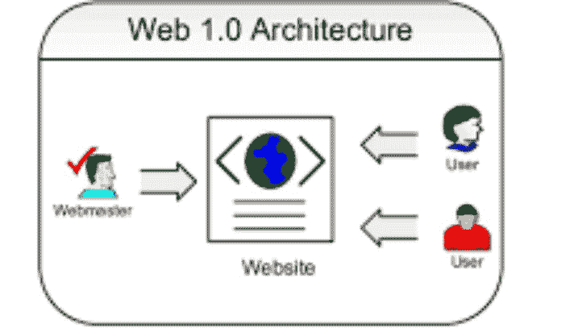

Web 1.0 架构；来源：researchgate.net

电子邮件是 Web 1.0 上第一个被广泛的应用。计算机及其连接性开始成为必需品。计算机技术的进步带来了变化，软盘变成了硬盘，存储容量从 `MB` 增加到 `GB` 再到 `TB`。互联网速度从每秒千比特（`Kbps`）增加到每秒兆字节（`Mbps`）再到每秒吉字节（`Gbps`），`RAM` 从 `KBs` 增长到 `GBs`。

Web 1.0 随着互联网泡沫的发展而结束。初创公司出现并利用这种新技术获利，最著名的是 Netscape，它开发了第一个商业网络浏览器。

#### Web 2.0 – 信息互联网

Web 2.0 是 Web 1.0 的增强版本。它指的是强调用户生成内容、易用性和对终端用户可操作性的全球网站。Web 2.0 也称为参与式社交网络。它指的不是对任何技术规范的修改，而是对网页设计和使用方式的修改。

Web 2.0 具有对用户输入响应的动态内容，相比之下，Web 1.0 是静态的。它实现了信息的自由排序，允许用户共同检索和分类信息。

Web 2.0 通过评估和在线评论实现了网站所有者与网站用户之间的信息流。在虚拟社区中作为用户生成内容的创建者，社交媒体对话允许参与者之间的互动和协作。Web 2.0 倾向于与终端用户进行更多交互。因此，终端用户不仅是应用程序的用户，通过下面提到的 8 个工具也是参与者：

Web 2.0 的基本特征是：


Web 2.0 架构；来源：researchgate.net

Web 2.0 见证了新兴市场，在一个无缝且低成本的环境中将不相关的买家和卖家聚集在一起。数据成为了一种被收集、孤岛化出售的商品，消费者开始以一种疯狂的速度交出自己的信息。网站允许用户生成内容，社交媒体成为了他们生活的一部分。社交媒体包含了许多在线工具和平台，人们在上面分享自己的观点、意见、想法和经验。

#### Web 3.0 – 价值互联网

Web 3.0 是一个用于描述多种路径下 Web 使用和交互的许多次演变的术语。它指的是 Web 利用和交互的演变，包括将 Web 变为一个数据库。在长期关注前端之后，它实现了 Web 后端的升级。在 Web 3.0 中，数据不再被所有，而是被共享的，服务会针对同一个网页 / 同一个数据展示出不同的视图。

语义网（3.0）承诺以比 Google 通过其现有引擎架构所能实现的更合理的方式建立“世界信息”。从机器概念而非人类理解的角度来看，这一点尤为真实。

Web 3.0 的核心特征是：

作为结果，Web 3.0 是开放且智能的。区块链技术、分布式账本、智能合约和机器学习。

比特币是 Web 3.0 的第一个广泛接受的应用，它代表了一个价值这种速度交换的世界。新的 Web 3.0 浏览器正在构建，以帮助用户管理加密货币、密码和其他区块链功能。


#### Web 的演变

##### Web 1.0、Web 2.0 和 Web 3.0 的主要区别

| Web 1.0 | Web 2.0 | Web 3.0 |
| --- | --- | --- |
| 只读 | 读写 | 读写执行 |
| 公司中心 | 社区中心 | 个人中心 |
| 客户端服务器 | 点对等 | 便携式 Web |
| 所有内容 | 共享内容 | 整合 |
| 网页 | 交互 | 行为 |
| 静态 | 标记 | Live |
| 目录 | 博客 | 应用 |
| 横幅广告 | XML | RDF |

#### 区块链历史

加密学家 David Chaum 在 1982 年首次提出了区块链协议。1991 年，Stuart Haber 和 Scott Stornetta 描述了一种加密安全的不可篡改的时间链。1992 年，他们引入了梅克尔树。

然而，又过了 13 年，中本聪（一个人或一群人）在 2008 年构思了第一个去中心化区块链。比特币使其成为第一个不需要信任权威或中央服务器即可解决双花问题的数字货币。

比特币区块链记录交易并将其历史存储在只写账中。它实现为区块链，每个区块都包含前一个区块的哈希，直到创区块。2014 年 8 月，比特币区块链文件大小（包含网络上发生的所有交易记录）达到了 20 GB；从 2016 年 1 月到 2017 年 1 月，比特币区块链的大小从 50 GB 增长到 100 GB。到 2020 年初，账本大小已超过 200 GB。

根据埃森的创新扩散理论，区块链在 2016 年的采用率达到 13.5%，因此进入早期采用阶段。行业贸易组织在 2016 年成立了全球区块链论坛，这是数字商务协会的一项倡议。比特币的设计启发了其他广泛应用和区块链。

#### 区块链基础

现在听到“区块链”这个词，就像在 90 年代初听到“互联网”一样。它似乎虚无缥缈，像是某种不会影响你日常生活的东西。但 25 年后的我们在这里，互联网已经改变了业务、贸易、通信、媒体甚至是人们相互联系的方式。我们每个人的口袋里都带着互联网。我们只需点击一下就可以转账、查询天气、获取路线，甚至点外卖。

下一个具有这种影响的技术并不是大数据、人工智能或社交媒体。

它是区块链！

区块链具有改变企业和个人连接方式的力量。它将使各种资产——从门票、货币到媒体——能够在没有中介机构的情况下进行存储、移动、交换和交易。这些资产不再需要存储在中心位置，而是分布在全球性的账本上，并使用最高水平的密码学技术。当交易发生时，它将广播到全球数以万计的计算机上并记录为区块。这不再会有单点故障，这使得区块链比我们现在拥有的技术安全得多。

区块链不仅适用于资产，它还扩展到了合同。这些被称为`Smart Contracts`（智能合约）。智能合约会自动执行并处理人们之间的执行、管理和履行，例如保险单、贷款、遗嘱、记录和版权内容。

区块链有许多可能的应用场景；不仅是现在，在未来也是如此——那些我们尚未预想到的场景。

### 什么是区块链？

当你听到区块链时，你可能会想到一种全新的、新兴的科技。实际上，区块链是已经存在已久的技术的组合。这些技术以一种新颖且创新的方式相结合，为我们提供了一个构建解决方案的惊人平台。

区块链通常被称为数字中心化账本。

为了理解区块链，请将其想象成一个简单的带编号的笔记本。区块就是笔记本中的数据页。

我们用数据填充这一页，这等比于在区块上记录财务交易或账本。就像我们可以在纸上写任何东西一样，我们可以在区块链上记录任何内容，如教育学位、证书、合同和协议、投票记录、土地所有权、医疗记录，甚至是歌曲的注释。就像笔记本上的所有页都有编号一样，区块链也是如此，所有的记录都是相互链接的。如果我撕掉笔记本的任何一页，将非常明显且容易确定。同样，如果我更改了任何区块上的数据，链接将以非常明显的方式断裂。区块链这一关键特性增强了它的安全性，被称为“不可篡改性”（immutability）。

区块链还带给了我们一种名为智能合约的惊技术，它允许我们在区块链中记录特定类型事件时，通过编程定义要执行的规则和步骤。

#### 区块链特征

区块链有七个关键特征使得这项技术如此具有革命性和普及。

##### 分布式账本

账本是交易的集合。账本将提供关于交易和参与者的所有信息。这一切都是公开的，无处躲藏。这是因为有了数字分布式账本，没有人拥有账本。它分布在网络参与者之间，所有人都运行相同的区块链协议。这把计算能力分布到各个计算机上，以确保更好的结果。

这就是它认为是区块链基本特征之一的原因。结果将始终更高效的账本系统，可以取代传统的系统。

##### 为什么它是区块链的关键特征之一？

*   **无恶意更改** – 分布式账本对任何可疑活动或篡改都有良好的响应。由于没有人更改账本，且一切更新得非常快，通过所有这些节点追踪账本中发生的情况非常容易。
*   **验证权** – 节点是账本的验证者。如果用户想添加新区块，其他参与者必须验证交易然后给出绿灯。
*   **无特殊优待** – 网络中的每个人都一样。
*   **共识** – 所有节点必须对账本的状态达成一致。
*   **快速系统** – 传统系统很慢；区块链提供了更快的结算。

##### 去中心化技术

区块链网络是去中心化的；它没有任何机构，而是由一组节点进行维护。网络上的所有节点都遵循相同的协议并共享数据。`lightweight node`或`Simple Payment Verification (SPV)`节点不存储链，而是依赖`full node`来提供必要信息。

##### 为什么它是区块链的关键特征之一？

*   **更少故障** – 系统具有容错性，不依赖于人工计算。
*   **用户控制** – 用户对自己的数据有控制权，而不依赖第三方。
*   **不易崩溃** – 去中心化的特性使其能够生存恶意攻击。

#### 透明性

区块链以金融系统中以前不存在的方式使数据透明化。数据在区块链上究竟是如何变得透明的？网络参与者可以使用`block explorer`访问公共地址的交易，并搜索区块链的区块、其内容以及相关细节。

用户可以看到分布式账本上发生的所有交易。区块链存储了自第一笔交易以来发生的每笔交易的细节。第一笔交易是区块链第一个区块的一部分，被称为`Genesis Block`（创世区块）。由于每个节点都共享一份约定账本的副本，因此每个用户都拥有相同的副本。

#### 为什么它是区块链的关键特性之一？

*   零诈骗 – 由于系统运行在算法之上，人们欺骗用户并利用区块链获取个人利益的概率微乎其微。
*   最小化网络攻击 - 透明性只是区块链为安全供应商、普通终端用户甚至网络安全社区中的政府提供安全收益的众多方法之一。我们并非每天都能遇到一种既能保证攻击合法性，又能同时向公透明的技术。
*   真实性 – 区块链为每个用户创建了透明的配置。区块链上的每一处更改都是可见的，这使其变得更加具体。系统的这种特性使其对于每类的人来说都是一种独特的系统。而黑客将很难破解它。

#### 共识

区块链账本与中心化账本不同，因为网络参与者对账本拥有共识。为了添加新区块，所有节点都必须同意交易是准确的。由于没有中心权威来验证节点，因此需要一种达成共识或达成“共识意见”的新方法。

这是通过“共识机制”实现的。该架构设计精巧，共识算法是该架构的核心。每个区块链都有共识机制来帮助网络做出决策。每个区块链达成共识的方式被构建在协议中，以及架构中决定节点将如何添加账本交易的规则。

全球范围内有许多不同的共识算法。每种算法都有其独特的决策方式，并完善之前引入的错误。这种架构在网络上创造了一个公平领域。比特币网络使用 `Proof-of-Work`（`PoW`）共识机制。`PoW` 指的是加密机制，它依赖参与者能够解决复杂的计算问题以获得网络中更高的权益。`PoW` 本质上是参与者确定最有效区块的分布式方式。每个参与者都尝试寻找 `hash value`，这是即将到来的交易区块的有效解决方案。找到符合要求的 `hash value` 的获胜者会将提议区块添加到链中，并获得奖励。

#### 为什么它是区块链的关键特性之一？

*   决策过程 – 简单来说，共识是网络上活跃节点组的决策过程。区块链使节点能够快速达成一致。当数百万节点验证某笔交易时，为了让系统顺利运行，共识是必不可少的。你可以将其视为一种投票系统，多数获胜，少数必须支持它。
*   无信任 – 共识负责维护网络的无信任性。节点之间可能互不信任，但它们信任运行在其核心的算法。这就是为什么网络上的每个决策对区块链来说都是获胜场景。它是区块链特性的关键优势之一。

#### 密码学与加密

区块链如何比现有技术提供更高水平的安全？这是因为“密码学”。

密码学是一种复杂的数学算法，充当攻击的防火墙。区块链上的每条信息都经过加密哈希。简单来说，网络上的信息隐藏了数据的真实性质。对于这一过程，任何输入数据都会通过数学算法，产生一个加密“哈希”（hash），这是一个不同的值，但其长度始终固定的。

加上去中心化，加密为用户增加了另一层保护。用户拥有访问数据的 `private key`（私钥）和用于交易的 `public key`。

#### 为什么它是区块链的关键特性之一？

*   防篡改性 – 账本中的所有区块都有唯一的 `hash`，并包含上一个区块的 `hash`。如果有人篡改区块中的数据，这将更改所有链接区块的 `hash` 标识。这使得数据具有不可篡改性。
*   真实性 – 加密和密码学与区块链技术相结合，以确保信息的真实性。它不再依赖第三方，而是信任于能够证明来源和真实性的加密算法。
*   不可逆性 – 加密和密码学与区块链技术相结合以确保信息的真实性。哈希过程非常复杂且无法逆转。此外，网络上的任何微小更改都可能导致完全的结果。如果有人想要腐败网络，必须更改所有节点中的数据。这在账本上几乎是不可能的。这就是为什么它是区块链最好的特性之一。由于它极难绕过，你不必担心黑客夺走你的数字资产。

#### 不可篡改性

区块链具有许多有趣的特性，但其中“不可篡改性”无疑是区块链的关键特性之一。但为什么这种技术是不易损坏的？让我们从不可篡改性开始。


不可篡改性意味着事物无法被改变或更改。区块链技术的工作方式与典型的银行系统有所不同。它不依赖中心化权威，而是通过节点集合来确保区块链特性。系统中的每个节点都有数字账本的副本。为了添加交易，每个节点都必须检查其有效性。如果大多数节点认为它是有效的，它就会被添加到账本中。这提高了透明度并使其变得不可篡改。因此，没有大多数节点的许可，没有人可以向账本添加任何交易区块。

另一个支持区块链特性列表的事实是，一旦交易区块被添加到账本，没有人可以回溯并更改。因此，网络上的任何用户都无法编辑、删除或更新它。

## 为什么它是区块链的关键特性之一？

* 无信任环境 – 每年都有大量的资金通过常规渠道被黑客。在许多情况下，总会有内部链接让这些黑客了解所有的安全措施，因此最终我们为自己的信任付出了代价。正如大家所知，现在的银行并不那么可靠，全球经济需要一个无信任环境来完全解决这个问题。

* 防腐败 – 如果企业开始整合区块链技术来维护其内部网络系统，没有人能够侵入、更改甚至窃取信息。公链是这种技术的完美示例。公链上的每个人看到交易，因此它是超级透明的。另一方面，私链或联盟链可能对于希望在员工内部保持透明，并在过程中保护其敏感信息免受公众查看的企业是最好的。

智能合约是一种运行在区块链网络上的程序，它可以执行合约协议。通常，它们作为数字协议工作，强制执行一组特定的规则，而这些规则由计算机代码定义。这些代码由所有区块链网络进行复制和执行。

## 为什么它是区块链的关键特性之一？

* **去信任协议**：区块链智能合约允许创建去信任协议。这意味着双方可以通过区块链做出承诺，而无需相互了解或信任对方。他们可以确保，如果未满足条件，合约将不会执行。

* **消除第三方**：智能合约的使用可以消除对中介机构或第三方的需求，从而显著降低运营成本。

* **更快的结算**：智能合约可以允许对任何类型的合约进行更快的结算，因为消除了第三方的干扰。这是到为止区块链特性最大的益处之一。通过这种方式，区块链也将影响国际贸易！

## 区块链用例概览

目前正在探索许多区块链应用用例。例如，管理教育证书或个人健康信息，在这些情况下，经过你的许可，任何人都可以访问这些记录。假设你是一个美国居民，去印度度假。假设你生病并进了那里的医院，如果治疗你的医生能够完全了解你的病史，知道你的过敏源或你正在服用的药物，那不是太好了吗？这是一个非常大的领域，并将区块链与身份管理紧密结合。

同样，区块链投票也是一个值得探索的大领域，以确保选举的完整性并证明结果未被篡改。

另一个感兴趣的领域是媒体和艺术领域的区块链，其中内容创作者可以使用区块链技术在不使用第三方或中介的情况下，通过非同化代币（`NFT`）等多种场景向公众发布他们的作品。

我们还看到人们对区块链碎片资产所有权场景表现出极大兴趣，在这种场景中，我们可以利用区块链代币和`NFT`来实现资产所有权的碎片化。

然后，我们还有传统的用例，例如用于银行区块链以确保交易的透明度和准确性并避免欺诈；以及用于供应链区块链以跟踪商品服务的供应和来源。沃尔玛（Walmart）正在试点供应链领域使用区块链技术，通过区块链识别商店售卖肉类的源头，以便在出现任何问题时加速召回，并减少供应链的浪费。

在公共部门，人们对用于执法目的的区块链技术有浓厚兴趣；我们如何让不同的政府机构在安全可靠的环境中无缝共享数据，同时保护用户的隐私和匿名性。

## 区块链用户

* **企业对消费者 (B2C)**：`B2C`业务直接在公司与其消费者（其产品或服务的终端用户）之间进行。区块链对`B2C`领域的优势在于对消费者的透明度、供应商的可问责性、来源验证、劳工验证以及不可篡改的合约。

  一个真实的用例是一家名为`TrustChain`的公司，它利用区块链在从采矿到最终消费者的供应链所有阶段对钻石和其他贵金属进行跟踪和认证。结果是，珠宝行业现在可以在整个供应链的所有阶段跟踪和认证钻石和其他贵金属。区块链将实现物理产品验证、流程验证，并作为一种治理监督。

* **企业对企业 (B2B)**：通过去中心化的方法，区块链消除了企业对企业交易中的银行等中介，以实现更快、更廉价的支付。共享账本的方法还消除了对不断验证和更新的多份纸质副本的需求。

  一个真实的用例是`DLT Labs`和沃尔玛加拿大`Walmart Canada`），他们启动了一个跟踪计划，以解决不同货运发票系统中的争议解决。区块链解决方案通过共享信任账本连接了供应链上的所有点。承运商是`Walmart`供应链中至关的一环，`DLT`区块链解决方案确保了发票系统的顺利运行。结果是，货运管理双方与`Walmart`之间的争议减少了 95%。

* **政府对消费者 (G2C)**：公共部门是经济的一部分，由代表公众运营的公私部门公司组成。公共部门包括所有政府、军队、警察、公共卫生、公共教育、基础设施、住房、金融服务和其他行业。目前的系统本质上是不安全且昂贵的，工作流效率低下。区块链技术将为公共使用提供更安全、敏捷且成本最优的平台。

  一个真实的例子是`Smart Dubai 2021`，`Dubai`旨在将所有政府运营和记录保存到区块链中。目标是增加政府运营的透明度和效率。区块链正成为许多其他`Smart Dubai`计划的使能层，从而创建了“智慧城市”。例如，自动交通信号、公民签证和公共医疗注册等项目全都在区块链上进行试点。

# 区块链机制

在本章中，我们将讨论分布式账本技术、其基本组件以及它与以前的账本存储技术的区别。我们将深入了解数据共享、存储和加密是如何封装在区块链基础中的，以及哈希函数和`Merkle tree`数据结构如何在不泄露所有细节的情况下不可篡改地存储数据。

我们还将了解区块链技术如何在非对称加密中发挥基础作用，其中密钥对通过仅公开公钥并保持私钥安全来支持隐私和真实性。我们将检查这种一致的、追加式的分布式账本技术如何保证透明度和不可篡改性。

## 会计系统

区块链的历史与会计的历史紧密结合。

簿记或会计源于古老文明，甚至可以追溯到 5000 年前，那里有单式记账制的证据，它是证明资产所有权的首种方法。账本与所有者相关。单式记账制要求中央权威来控制和管理账本。单式记账一方面系统简单、易于维护，因为它是一个单侧会计系统；但另一方面，无法验证或检查其问责性。因此，随着时间的推移，人们意识到会计程序需要更多的透明度和问责性，并能够回答诸这样的问题：

* 谁付了什么？

* 谁欠多少钱？

* 哪些债务未付？

* 为什么钱丢了？

单式记账法的缺陷成为寻找更全面结构的触发点，从而复式记账应运而生。这种新形式开发于大约 600 年前，目的是使会计系统更加全面；因此，会计师不再维护一个账簿，而是维护两个账簿——一个用于收入交易，另一个用于支出交易。尽管复式记账的记账方法比单式记账法先进且高效得多，但它仍然存在一些缺陷。由于不同账簿之间没有联系，记录是分离的，因此缺乏透明度且难以验证。这导致了投资者、贷款人和/或国家等各种利益者之间产生了巨大的信任赤字。

复式记账法的不完善导致了对全经济会计系统的需求，这种系统将有助于消除大量的行政工作，并为无一失且可靠的会计系统铺平道路。

于是，三式记账应运而出，它比传统的复式记账向前了一步；它可以让记账员和公司从繁琐的故障工作中解出来，并帮助消除他们面临的不信任、欺诈或操纵。三式记账为一种全新的、复杂的会计方法提供了一个框架。这一概念由已故卡内基梅梅隆大学教授伊尻裕二（Yuji Ijiri）提出，并由 Ian Grigg 推广，他将其与区块链技术联系起来，并认为会计不应再完全私有。

区块链是三式记账系统的首次实现，在其中，资产在交易背景下被记录在账上。简单来说，区块链是指分布在多个位置的数字账本，以确保全球的安全和易于访问。

`Triple-entry accounting`术语具有某种误导性，因为并没有任何第三笔分录；相反，是在借贷系统中增加了第三个组件。共同的主线或绑定组件是区块链，它将账簿连接在一起，并帮助连接两个独立的复式分录，且可能可以用于外部审计目的。因此，各个公司不再为交易拥有自己的账簿，而是通过一份合同进行，合同显然包含了交易的每一个方面：产品是什么、卖家是谁、买家是谁等，最重要的是，它是经过数字签名的。

在三式记账系统中，所有的会计分录都由第三笔分录进行加密密封，因此它对操纵和财务欺诈具有威慑作用。在传统的复式记账法中，公司的账簿可能会被任何薄弱的人为环节破坏——可能是员工/记账员/审计师。但这种独特的三式记账系统没有给任何腐败、薄弱的人为环节留留空间，交易的加密账户永久且不可更改地存储在账本上。

由于区块链是完全自动化且去中心化的，一旦记录了分录，就无法编辑、更改或删除。最高级别的加密技术确保了每笔交易的准确性并经过数字签名，没有留下错误漏洞，同时可供所有人验证。使用三式记账记录在区块链上的交易简化了整个复式记账过程，因为一旦两个会计师中的一个在区块链上记录了交易，另一方也可以查看特定的复式分录，轻松地审查，并自动记录在自己的账簿中。

因此，三式记账法有望彻底改变记账的未来，因为区块链会计将字面上减少一半的工作。

## 账本 (Ledger)

账本是区块链的核心组件之一。在区块链中，每个节点都存在一份账本的副本。简单来说，区块链是一个分布式账本。比特币是第一个记录在区块链上的热门资产。每个区块链都有自己的协议集，不仅定义了节点，还定义了它们通信的方式。这些网络存储账本、提供更新并有效管理账本。

## 账本的历史 (History of Ledger)

为了深入了解区块链账本，让我们从账本的历史开始。

- **单式账本 (Single Entry Ledger)**：最早出现于公元前 3000 年左右。印度经济学家 Chanakya 创建了第一批记录在案的单式账本。它们只有单笔记录。

- **复式账本 (Double Entry Ledger)**：复式账本最早出现于 14 世纪。它们跟踪借贷双方，并从买家和供应商的角度讲述财务交易的故事。被称为“会计之父”的卢卡·帕乔利（Luca Pacioli）是第一个发表复式账本著作并将其引入意大利的人。

- **三式式账本 (Triple Entry Ledger)**：三式账本是对传统复式系统的增强，其中所有涉及双方的会计分录都由第三实体进行加密密封。它记录了所有的借、贷，以及与所有过去借贷的不可更改的链接。三式账本首次出现在中本·纳瓦西（Satoshi Nakamoto）于 2008 年编写的比特币白皮书中。三式账本的主要特征包括防篡改记录、分布式账本、复式+加密、经过验证的记录、安全私密以及数字签名的收据。

## 分布式账本 (Distributed Ledgers)

分布式账本的概念已经存在了数百年。要理解区块链的基础知识，理解分布式账本是如何运作的至关重要。

分布式账本是一个没有中央管理员、通过共识达成一致的数据集。

为了了解更多细节，让我们回到 1500 年前的杨普岛（Yap）。杨普岛的人们使用一种非常独特的货币形式——`Rai`石币。每块石头重量约 200 公斤，使其难以移动。为了将它们作为交换商品或服务的货币，他们将石头切分成若干部分，然后他们会向岛上的所有人宣布谁拥有石头的哪一个部分。杨普岛的每个人都需要心中保留一份所有权的账本。

每当杨普岛上的任何人进行交易时，都会向岛上的所有人发布公告。然后，每个成员都会更新自己的心中账本。在今天的描述中，这就是分布式账本。所有`Rai`石的所有权对岛上的所有人都是透明的，每当发生交易时，这些知识就会更新。

那么，为什么不由一个成员来记录`Rai`石的账呢？如果这个会计师生病了，或者无法记账，或者不诚实怎么办？如果账本唯一的副本被任何方式修改，财富就会不公平地丢失或获得。这种分布式账本系统保护了`Rai`石免受任何篡改。即使某个成员离开了，每个人仍然拥有多份账本副本，使得账本具有容错性，并且难以更改或丢失。

有一天，某块石头掉进了海洋，杨普岛的人认为石头不需要在杨普岛就可以具有价值，仍然可以交易。这种在没有中央管理员的情况下由岛上大多数人达成的共识系统，是分布式账本最早的例子之一。

让我们通过一个例子来回顾一下——假设 Alice 同意用她在海中的石头交换 Bob 所有的牛。Alice 和 Bob 向杨普岛上的所有人宣布了他们的交易。每个人都更新了自己的心中账本，并达成共识：从那时刻起，海中的石头归`Bib`所有。现在，假设 Alice 试图腐败 Carol，使得 Carol 的账本显示 Alice 从未放弃过石头的所有权。然而，Carol 会被杨普岛剩余的人投票淘汰，她的账本版本将不被接受。因此，如果 Alice 想要欺骗，她需要说服杨普岛超过 50% 的人来接受另一份账本。

我们回顾了历史，看到了账本是如何从石板演变为双式记账账的。我们甚至查看了已知的分布式账本的最早期示例。

现在，让我们讨论一下现代世界账本的演变。在过去的几十年里，账本已经从手写形式演变为数字形式和数字化数据库。这使我们能够相互连接。

今天，会计系统正在再次发生革命，从数字领域或中心化数据库转变为信息存储在全球多个地点。这种在全网络上记录信息的系统被称为去中心化账本。去中心化账本可以描述为由来自不同地点和人的去中心化网络支持的任何交易账本，消除了对中央权威的需求。

当交易发生时，网络上的每个参与者都会收到通知。他们现在拥有交易记录相同的副本，与该网络上的每个其他节点完全相同。

`blockchain`上的每一个信息都可以追溯到其创建的确切时刻。因此，如果进行审计，就可以很容易找到信息并被认为是可靠的。这使得`blockchain`能够作为真正可靠的公共记录和交易存储，并消除了对中央权威数据库记录的需求。

既然我们已经理解了区块链的基础原理——分布式账本，那么理解另一个让区块链如此具有革命性的关键元素“信任”就变得重要了，它是通过两个关键原则——协作和密码学创建的。

## 密码学

思考`blockchain`的极好方法是将其看作互联网上的另一层，这一层使得安全且信任的记录和交易能够发生，这就是为什么许多人将`blockchain`这个词与“信任”联系在一起。

`blockchain`在两个双方之间创建了一个信任层，在不需要中心权威的情况下，由来自不同地点和人的去中心化网络支持任何交易的账本，这种去中心化账本。在双方之间创建了一个信任层。在不需要第三方中间人的情况下，利用密码学来创建信任。

在前一个节中，我们讨论了通过协作实现的密码学。现在我们将进一步查看密码学在`blockchain`中的使用。`blockchain`上的信息通过密码学签名进行访问。现在，让我们分析密码学及其在`blockchain`中的某些概念。

## 密码学历史

密码学历史上经历了三个定义良好的阶段。

### 第一阶段：手动密码学

第一阶段是手动密码学时期，始于古代并持续到第一次世界大战。密码学的艺术被认为是随着写作术诞生的。随着文明的演变，人类组织成部落、群体和王国。这导致了权力、战斗、霸权和政治等思想的出现。这些思想进一步推动了人们秘密通信的自然需求。

已知的密码学最早证据可以追溯到`形文字`的使用。4000 年前，埃及人使用形文字进行通信。这种代码只有代表国王传输信息的书记员知道。下面是这样一个形文字。


[形文字密码学]；来源：https://www.tutorialspoint.com/cryptography

后来，学者在公元前 500 年至 600 年开始使用单字母替换密码。这涉及到用某种秘密规则将信息的字母替换为其他字母。这个规则变成了从乱码中提取信息的密钥。

早期的罗马密码学方法被称为`Caesar Shift Cipher`，依赖于将消息字母移动固定的数字（三是一个常见的选择），消息的接收者将按相同的数字移回字母以获得原始消息。


[凯撒位移密码](来源：https://www.tutorialspoint.com/cryptography

是在欧洲文艺复兴时期及之后，意大利和教皇国家领导了密码技术的快速传播。这一时期研究了各种分析和攻击技术以破解秘密代码，例如改进的编码技术如`Vigenere Coding`在 15 世纪出现，它提供了使用多个变量位置移动消息字母的方法，而不是移动相同次数的方法。

在整个阶段，密码学受限于编码员在简单记忆设备辅助下能够合理完成的复杂性。因此，密码的大小最多限制在几页内，即几千个字符。密码学和密码分析的一般原理都是已知的，但能实现的安全性始终受限于手动操作。在给定足够的密文和努力的情况下，大多数系统都可以进行密码分析。

### 第二阶段：密码学的机械化

# 密码学的机械化

第二阶段——密码学的机械化始于第一次世界大战后不久，并持续至今。在这一阶段，密码学从临时的加密方法演变为更为复杂的信息安全艺术与科学。相关的应用技术涉及电话和电报通信，或诸如`Brunsvigas`、`Marchants`、`Facits`和`Friedens`等计算机器（使用了齿轮、链轮、棘轮、棘爪和凸轮）。

在第一次世界大战的前两年里，代码系统仍用于外交通信（正如几个世纪以来一直这样做那样），而密码系统几乎专门用于战术通信，但它们缺乏复杂性和安全性。

电报和无线电的通信需求以及机械及机电技术的成熟，在 20 世纪 20 年代汇聚在一起，推动了密码设备的重大进步：转子密码机的发展。尽管转子的概念在较旧的机械密码盘中已被预见到，但美国密码密码学家爱德华·H·希伯恩（Edward H. Hebern）在 1917 年意识到，通过在电学圆盘（`rotor`）一侧触点到另一侧触点之间的连接中硬布线一种单字母替换，然后级联一系列此类转子，就可以实现几乎任意复杂度的多字母替换。这一组转子通常排列成一个称为`basket`（篮子）的堆；堆中每个转子的旋转会导致下一个转子旋转，就像里程表的轮子每驱动轮每旋转一圈，就前进 1/10 圈一样。在运行过程中，堆中的转子提供了一条从触点到触点穿过所有转子的电气路径。在直通转子系统中，按下类打字机键盘上的键触点会将电流发送到末端转子上的一个触点。然后，电流通过堆中其余转子及其相对旋转位置定义的交叉连接网络，传输到输出端板上的某一点，在那里连接到打印机或指示器，从而输出与输入明文字母相对应的密文字母。


从 1921 年开始到接下来的十年里，希伯恩制造了一系列不断改进的转子机。20 世纪 20 年代的特征是密码机发明者向国家密码机构以及不同机构之间提出了一系列挑战，这导致了密码机和机器分析技术的稳步改进。几乎希伯恩在美国开发转子密码机的同时，欧洲工程师（特别是荷兰的胡戈·A·科赫和德国的亚瑟·谢尔比乌斯）独立发现了转子概念，并设计的机器成为历史上最著名的密码机——二战参与者所使用的“恩玛（Enigma）转子机”的前身。这些机器可以实现比手动操作复杂得多的运算，更重要的是，它们的加解密速度更快且错误率更低。


恩玛转子机；来源：https://www.britannica.com/topic/cryptology/

密码分析历史上最大的成就是波兰和英国对德国恩玛密码的破解，由阿兰·图灵提出，其输出代号为“Ultra”。这些发展对盟国在第二次世界大战中的行动发挥了重要作用。

## 斐波纳契生成器与线性反馈

在二战后的后的几年里，数字计算机被应用于密码机。一类功能类似于转子的电子设备是斐波纳契生成器，其名字源于斐波纳契数列 1, 1, 2, 3, 5, 8, 13……每个后续项都是左侧两项之和。如果连续向左移动一位并每次读取五位比特，就能看到斐波纳契生成器与密码学的关联性。这产生了 1 到 31 整数的乱序排列，类似于转子产生的乱序排列。

密码学问题在于，用于确定序列中连续状态的组合操作是线性的，因此很容易反转，尽管序列在重复之前长度可以达到 `2n−1` 位。另一个问题是密钥如何使用。简单地使用密钥来确定从明文 n 元组到密文 n 元组的循环步数在密码学上是不安全的，因为已知明文攻击会迅速泄露密钥。

为了避免与线性相关的问题，密码学家设计了许多非线性反馈逻辑，这些逻辑具有良好的属性，如信息扩散（扩散文本中微小变化的影响）和大周期结构（为了防止穷举搜索），但即使有大量的匹配明文/密文对，要从输出序列反向推导出初始状态，在计算上也是不可行的。用于确定序列中下一位的非线性反馈逻辑，可以用与线性反馈逻辑非常相同的方式。然而，非线性逻辑中密钥对密文的复杂影响，极大地增加了密码分析者面临的困难。

## 第三个阶段——数据加密与高级加密标准

第三阶段仅追溯到 20 世纪的最后二十年，标志着所有最激进的变化——密码学向信息时代的剧性延伸：数字签名、认证、执行密码功能的共享或分布式能力等。人们很容易将这一阶段等同于公钥密码学的出现，但这种观点太狭隘了。密码学的第三阶段是必然的结果，必须设计出方法，让电子信息能够执行历史上借助实体文档所完成的所有功能。

1973 年，美国国家标准局（NBS）发布了一项公开征集公告，寻求一种加密算法以考虑作为新的加密标准。第二次征集于 1974 年发布，国际商业机器公司（IBM）提交了专利的“Lucifer 算法”，该算法由该公司的一位研究员霍斯特·费斯泰尔（Horst Feistel）在几年前设计。Lucifer 算法在 NBS 与国家安全局（NSA）的秘密磋商中接受了评估。在对内部函数进行一些修改并将密钥长度从 112 位缩短到 56 位后，将成为数据加密标准（DES）的算法完整细节于 1975 年发表在《联邦公报》上。

DES 是一种分组密码算法，其中 16 次迭代的替换和置换过程级联在一起。分组大小为 64 位。控制变换的密钥也由 64 位组成；然而，用户只能选择其中的 `56` 位，这些才是真正的密钥位。剩余的 8 位是奇偶位，因此完全是冗余的。在变换过程的每个中间阶段，前一个阶段的加密输出被分为左侧 32 位 `Li` 和右侧 32 位 `Ri`。`Ri` 被转置变为下一个更高级中间加密的左侧部分 `Li + 1`。

然而，下一个加密的右半部分 `Ri + 1` 是一个复杂的函数，它是密钥子集 `Ki + 1` 以及整个前一个中间加密的函数，`Li + f(Ri, Ki + 1)`。DES 安全性的核心特征是“f”涉及一种非常特殊的非线性替换——即 `f(A) + f(B) ≠ f(A + B)`——这由标准局通过称为 S 盒（S boxes）的表格函数指定。这一过程重复 16 次。

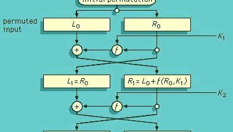

16 步数据加密标准（DES）操作流程图

来源：数据加密标准，FIPS Publ. no. 46，国家标准局，1977

这种基本结构——在每次迭代中，将上一步的加密输出被分为两半，并将两部分转置，在右半部分执行一个由密钥控制的复杂函数，然后使用“异或”逻辑与左半部分结合以形成新的右半部分——被称为费斯泰尔密码（Feistel cipher），并被广泛应用于不仅限于 DES。费斯泰尔密码的优点之一（除了安全性之外）是，如果反向使用密钥子集，重复“加密”过程可以将密文解密并恢复明文。

该标准于 1976 年底被采用，并于 1977 年初发布。规定 DES 必须用于未分类的美国政府应用，以保护在计算机系统和网络中传输和存储的二进制编码数据，并根据具体情况保护机密信息。

所有美国政府涉及电子资金转账的金融交易都强制使用 DES 算法，包括由联邦储蓄系统成员银行进行的交易。随后，全球范围的标准组织相继采纳 DES，导致 DES 成为业务和商业数据安全的事实上的国际标准。

DES 的安全性并不高于其工作因子（即“搜索 256 个密钥所需的暴力破解工作量”）。在 1977 年，这被认为是一项不可能的计算任务。在 1997 年及后的几年里，DES 被穷举搜索攻击破解。DES 的主要问题是加密密钥尺寸太小。随着计算能力的提高，暴力破解所有不同的密钥组合以获取可能的明文信息变得易容易。

1997 年 1 月，美国国家标准与技术研究院（NIST）发布了公开请求，征集候选方案以取代老旧的 DES。这次收到了来自 12 国家的 15 份可行方案。2000 年 10 月，NIST 宣布由两位比利时密码学家乔安·达门（Joan Daemen）和文森特·里曼（Vincent Rijmen）开发的程序 Rijndael 接受为新标准，或“高级加密标准（AES）”。NBS 曾预计 DES 将在专用硬件中实现，因此对其在软件中（即使用通用微处理器）的有效实现较少或没有考虑。结果，DES 未能利用 20 世纪最后二十年微处理器的快速发展。另一方面，AES 规范同样强调硬件和软件实现。在某种程度上，这承认了智能卡和其他销售终端设备的需求（这些设备通常计算能力非常有限），但更重要的是认识到了互联网和电子商务日益增长的需求。基于对 DES 的经验（在，计算能力的提升直接超过了固定 56 位密钥的工作因子），NIST 对 AES 的规范也要求算法在必要时能够增加密钥长度。Rijndael 证明自己既足够小，可以在智能卡上实现（代码少于 10000 字节），又足够灵活，允许更长的密钥。

## 加密学概念

密码学是使区块链安全且不可篡改的关键技术之一。

密码学被定义为在存在对手的情况下，从一方向另一方发送消息的科学。大多数加密函数都是双向函数，这意味着我们可以获取数据——对其加密——并发送给某人，然后在另一端使用相同的过程进行解密。密码学的关键组件包括：

*   我们试图保护的数据或信息
*   密钥，它是附加在试图保护的数据上的
*   连接数据和密钥的函数，确保在参与者之间发送数据时不会被篡改
*   密文，加密的消息，即使被对手拦截，他们也知道真实数据或如何将密文还原为原始

加密哈希（Cryptographic hashing）是一类特殊的加密函数。这些是单向函数，意味着它们只能加密。如果我将数据放入加密哈希中，它会将数据和密钥结合为一个实体，这被称为哈希结果，一种基于数据的编码。这种哈希结果在数学上是不可逆工程的。如果你将任何数据放入加密哈希并将其传输给我，除了随机猜测并尝试重建原始数据外，我无法做其他事情。加密哈希用于我们希望在不实际共享数据的情况下验证数据的场景。例如——银行使用的密码管理系统，它们不存储在线银行注册用户的用户名或密码，只存储密码的哈希输出。

让我们尝试使用一个简单的示例创建哈希函数

*   数据：`Cryptographic hash makes blockchain secure and immutable`
*   密钥：`+3`
*   密文：`Fubswrjudsklf kdvk pdnhv eorfnfkdlq vhfxuh dqg lppxwdele`

## 加密学类型

为了理解区块链中的加密学，我们必须能够区分不同的加密技术。区块链利用加密技术有四种主要方法。

## 公钥加密

这种加密方法使用一对密钥：一个加密密钥和一个解密密钥，分别命名为公钥和私钥。该算法生成的密钥对由一个私钥和一个使用相同算法生成的唯一公钥组成。一个人在区块链上的地址就是其公钥。区块链上的交易包含其公钥，并使用发送者的私钥进行数字签名，以验证交易的授权情况。

假设你想向我发送一份你新书的电子文件进行审阅。我不应该能够篡改它并将作者更改为我自己。数字签名确保了此类此类发生并保证了原始消息的完整性。它同时拥有公钥和私钥。公钥是你给公众用于与你进行通信的密钥，而私钥是你唯一拥有并用于访问账户的密钥。数字签名可以使用相应的公钥轻松验证，该公钥包含在交易中，通过一个简单的三步过程：

* 使用与发送者相同的方法压缩所附的消息
* 验证前两个步骤的结果是否相同

例如，以太坊是一个任何人都可以参与的公共区块链。在这里，用户的身份是基于其公钥的地址。相比之下，Hyperledger 是一个企业区块链（私有区块链），参与者必须被授予访问权限。在这里，身份由 `X.509` 证书管理，这些证书仅与交易相关的双方共享。

公钥加密使用公钥和私钥对来执行交易。公钥广泛传播，而私钥保持保密。使用某人的公钥可以对消息进行加密，使得只有拥有私钥的人才能解密并读取。使用私钥可以创建数字签名，使得任何拥有相应公钥的人都可以验证该消息是由私钥所有者创建的，且自此以后未被修改或篡改。

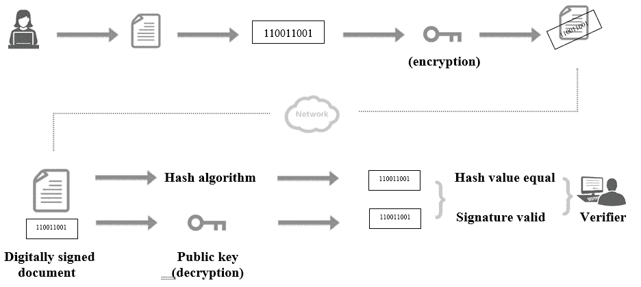

## 零知识证明

一种保护数字数据的新方法，可以在不泄露信息的情况下验证该信息的真实性。

零知识证明在不需要在网上广泛传输私有信息的情况下验证双方身份。零知识证明（`ZKP`）是一种加密方法，允许一方（证明者）向另一方（验证者）证明给定的信息是真实的，而不传递任何额外信息。

例如，有两个大小和形状完全相同的块，其中一个是红色的，另一个是蓝色的。色盲汤姆将块举在身后。然后汤姆将其中一个块展示给爱莉看。汤姆把这个块藏在身后，向爱莉展示另一个块。爱莉可以持续检测到切换，因为块的颜色不同，但为了验证秘密，她不需要向汤姆透露块的实际颜色。

零知识证明通常被称为‘zk-SNARKs’，意思是“零知识简洁非交互式知识论证”，简写为 `zk-SNARKs`。

零知识证明的一个绝佳例子是洞门类比。假设有一个圆形的洞穴，只有一个入口或出口，在圆圆形洞穴的最后有一扇门，可以通过在键盘上输入密码代码来解锁。如果我想向你证明我知道解锁代码，但又不向你揭露该代码，我只需要展示我可以从洞穴的一端走进去，打开门，然后从另一端出来。如果我成功地演示了这一点，你就知道我能够解锁那扇门，但我不需要向你透露解锁代码。这个简单的洞门类比就是一个零知识证明。

现在，在区块链中，用户可能会发送请求向另一个用户发送某些资金。区块链会希望在交易完成前，确保发送资金的用户拥有这些资金。零知识证明不需要知道发送者是谁或拥有多少资金。它只需要通过一个简单的三步过程来验证，证明给定的信息是真实的，而不传递任何额外信息。

# 加密哈希函数

这种加密类型不使用密钥。它生成固定大小的哈希。函数将明文（任意大小）转换为固定长度的哈希。几乎不可能从密文中恢复明文内容。例如，我们的特征和扫描，由于我们无法反向推导。现在假设你从伦敦飞往纽约。在纽约机场，入境官员扫描你的特征。队列中的特征变化。它变成了唯一的标识符，很难伪造和篡改。

相同的概念也适用于区块链。除了特征和扫描，你可以将自己替换为有意义的信息（伪随机输出）。如果我们能设计一种生成我们特征的方法，就可以确保我们信息的完整性。这是通过加密哈函数实现的。

加密哈希函数是一种数学算法，它接受任意数据输入（考虑你自己）并产生固定大小的加密输出，称为“哈希”（考虑你的特征）。该哈希可以存储而不是存储密码本身，稍后用于验证用户。加密哈希函数必须是确定性的，这意味着相同的消息始终产生相同的哈希。


加密哈希函数（特别是 `SHA-1`）的工作原理。

输入的微小变化（在 "over" 单词中）会剧烈改变输出（摘要）。这被称为“雪崩效应”。

来源 - 维基百科

加密哈希函数具有以下关键属性：

* 不可逆性——良好的哈希函数应该使得从输出或哈希中重建原始密码非常困难。这是通过“抗原像性”实现的，指的是根据输出寻找输入的难度。在数学上，给定一个哈希值 `H`，寻找任何消息 `x` 使得 `H = Hash(x)` 是困难的。
* 确定性——给定的密码必须生成相同的哈希值或加密文本。这是通过抗原像性实现的，对于任何给定的输入 `x`，在计算上很难找到另一个输入 `y` 使得 `Hash (x) = Hash (y)`。
* 抗碰撞性——找到两个哈希值为相同加密文本的不同密码应该是困难的。在数学术语中，对于给定的哈希函数 `H`，在计算上很难找到两个不同的输入 `x` 和 `y` 使得 `H(x) = H(y)`。
* 不可预测性——哈希值无法通过密码预测。
* 扩散性（雪崩效应）——当密码发生微小变化时，加密文本的输出应该发生显著且不可预测的变化。

通俗地说，这些属性意味着恶意攻击者无法在不改变摘要的情况下替换或修改输入数据。因此，如果两个字符串具有相同的摘要，你就可以非常有心地它们是完全相同的。抗原像攻击性防止攻击者构造出一个与他们无法控制的文档具有相同哈希值的文档。抗碰撞性则防止攻击者创建两个具有相同哈希值的不同文档。

加密哈希的潜在用途的一个示例如下：假设你交给我一个困难的计算问题由我解决，并声称你已经解决了它。我想解决这个问题，但我想确保你确实也解决了这个问题。因此，你写下你的解决方案，计算它的哈希值，并告诉我这个哈希值（同时对解决方案保密）。假设我花了一周时间解决了这个问题。现在你就可以通过公开解决方案来证明你更早解决了它，我可以对该解决方案进行哈希计算，并用你之前给我的哈希值进行验证。

安全哈希的一个重要应用是消息完整性的验证。通过比较传输前后计算的消息明文（消息的哈希摘要），可以确定消息或文件是否在传输过程中发生了任何变化。使用加密哈希和信任链可以检测对文件的恶意篡改。几乎所有的数字签名方案都需要对消息计算加密哈希。这使得签名计算可以在相对较小的、静态大小的哈希摘要上进行。如果给定的签名和对消息重新计算的哈希摘要使签名验证成功，则该消息被认为是真实的。因此，加密哈希的消息完整性属性被用于创建安全高效的数字签名方案。

比特币使用哈希函数 `Security Hash Algorithm-256 (SHA-256)` 来验证其网络中的工作量证明（PoW）协议。`SHA-256` 最初由美国国家安全局（NSA）设计。`SHA-256` 是 `SHA2` 加密哈希函数家族的一。它接受小于 `2⁶⁴` 位的输入，并产生 `256` 位的固定大小输出。比特币在某些情况下使用 `SHA-256d`，这意味着连续使用了两次 `SHA-256`，一次针对原始待哈希消息，再次针对 `1st` 哈希的输出。

该系统使用部分哈希反转来证明工作的完成，从而解锁比特币的挖掘奖励，并作为 Hash-cash 中发送电子邮件的一种诚意代币。发送者需要找到一个哈希值以特定数量零位开头的消息。发送者找到有效消息所需的平均工作量与哈希值中所需的零位数量呈指数级关系，而接收者可以通过执行单个哈希函数来验证消息的有效性。

## 梅尔克树 (Merkle Trees)

一种数据存储技术，通过压缩数据来存储区块链，并内置防篡改组件。梅尔克树基于哈希原理，每个哈希都成为下一个哈希的一部分，从而开发出抗篡改的数据存储模型。

在计算机科学术语中，树是一种具有根节点和子节点的数据结构，这些子节点也可以其他树的根。二叉树是每个节点都有两个子节点的树，如下所示。

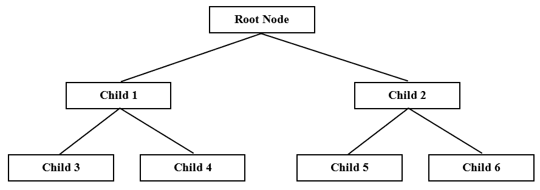

`Merkle Tree` 是 `Binary Tree` 的一种非常特殊的版本，其中每个“孩子”（节点）都标记有数据块的加密哈希，而每个不是“孩子”的节点都标记有其子节点标签的加密哈希。哈希树允许对大型数据结构的内容进行高效且安全的验证。哈希树的概念以 Ralph Merkle 的名字命名，他在 1979 年获得了该专利。

一个树要成为一个 `Merkle Tree`，需要满足以下条件：

* 最底层的子节点数量是 2 的幂
* 最低层由汇总信息的哈希组成

`Merkle Tree` 的构建由经过验证的数据区块（Data Blocks）组成。每个区块都经过哈希处理以得到一层哈希。然后将 `2` 个区块配对并进行哈希，形成一个数量减半的新层。这个过程一直持续，直到顶部只剩下一个哈希。顶部的哈希被称为 `Merkle Root`（梅尔克根）。通过这种方式，在提交 `Merkle Root` 后，可以检测到任何交易更改。

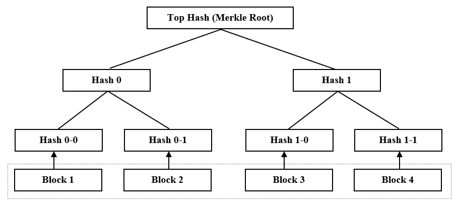

假设 `Block 3` 被更改，那么它的哈希值也会发生改变。由于由于，上面的哈希值也会改变，一直传播到 `Merkle Root`。因此，如果任何交易被更改，相应的 `Merkle Root` 也会受到影响。

我们只需要每一层的一条信息就可以验证任何交易。例如，我们可以通过 `Hash 0` 验证 `Block 1`。随着树的变得越来越大，这使得网络变得越来越高效。

如果 `Merkle Root` 意外被篡改，它会改变区块头。这反过来会改变下一个区块的 `previous block hash`（上一个区块哈希），这将影响后续所有的区块哈希。网络的其他部分将拒绝该区块链提出的历史，因为它们不会同意。

## 去中介化效应 (Disintermediation Effect)

现在我们已经理解了账本和加密学如何协同工作创建一个信任层，让我们讨论区块链如何具有强大的去中介化效应。


开发者可以在区块链上创建分布式账本，并使用加密学为人们在该账本上提供安全空间，使人们能够拥有自己的数据。你可能会问——“这与传统技术有什么不同？”今天，机构使用`/store/exchange/sell`我们的数据。区块链真正赋予了用户数据所有权，他们可以只分享自己想要的信息。它还允许用户进行点对点交易。例如，假设你去餐厅用餐并用信用卡支付，你并没有直接给餐厅；相反，你在银行的数据库记录被扣款，餐厅的银行账户记录被记入。在这里，数据库中的价值和数据属于中介，而不是你或餐厅。你依赖信用卡公司和银行来保障并验证交易，这使得权力转移给了这些中介。但在区块链世界中，每个个人都有自己的账本记录以及访问它的安全密钥，从而消除了对中介的需求。因此，交易简单地从你的记录中扣款，并直接记入餐厅的记录。区块链让你有权控制不仅是金融交易的内容，例如——智能合约。而且通过区块链，你可以决定谁可以访问这些记录。

在之前的章节中，我们讨论了协作和加密学如何建立信任。现在，让我们检查点对点交易如何创建透明度，从而导致了区块链的另一个信任层，并能够遏制腐败以及优化成本。

通过区块链，这些恶意行为者必须识别并针对许多故障点，直到他们控制了网络 51% 以上的内容，这被称为“共识”。这是一项几乎无法完成的任务。

中心化数据库需要不断更新和同步数据，这导致了高昂，并容易受到恶意行为者的攻击。因此，区块链通过透明性、不可篡改性和通过所有权实现的访问性建立了信任，并提供了财务收益。

## 透明性

区块链的设计使得其整个历史都是可见且不可更改的。区块链中的交易在创建后无法被修改，其完整历史对公可见。这意味着区块链是一个完全透明的数据结构，具有一个非常有用的属性：任何用户都可以轻松验证区块链的完整性。

区块链（无论是公链还是私有链）的主要优势之一是`透明性`。在`Bitcoin`或`Ethereum`这样的公链中，由于它们是匿名性的且没有身份的概念，因此无法以不同的方式对待用户。因此，公链上的数据对所有参与者都是透明且可见的。从货币交换的角度来看，这增加了很多价值，因为只要参与者的匿名性得到保护，任何人都可以验证账本上任何交易的细节，而该账本是不可变、永久的、不可更改且提供高度信任的。这为公链提供了许多潜在的用例，例如投票、选民注册和选举结果跟踪。在公链上，还有另一种类型的透明性，即对在区块链上执行的智能合约的`完全透明`。这些智能合约具有处理他人资金的潜力，如果你打算将钱托付给他人的智能合约，你应该有能力审查该智能合约的源代码，以确保它的编写是公平的，没有安全漏洞，并且执行了它所声称的功能。

在私有链上，我们拥有的是`权限管理`，我们可以控制共享多少数据。我们仍然可以从私有链创建的共享基础设施中共享数据的许多优势。在许多业务网络和价值链关系中，参与者可以与消费者共享更多关于业务流程和服务交付的数据和信息。虽然技术上传统技术可能解决这些问题，但通常认为人们无法在谁拥有平台、谁构建平台以及谁维护平台的问题上达成共识。如果参与者离开生态系统，他们会带走平台的全部或部分吗？使用如`Hyperledger`等私有区块链解决方案可以缓解许多此类担忧，并实现组织之间真正共享的技术基础设施。这允许参与者跟踪数据，并共享关于货物创建、消费和交付的数据。据估计，超过 1/3 的食物被浪费了，因为其供应链缺乏透明度。例如，如果肉类因污染而被召回，大量完好的肉类就会被丢弃。如果我们能对产品源地以及它如何从生产到购买的过程有更高的可见性，就可以实现更准确的召回，这将有助于减少浪费。同样，如果你在制造和分销服装，并能向用户证明所有服装都源自具有公平劳工实践的地方，消费者将对你的品牌有更多信任。因此，这类透明性解决方案是区块链最大的优势之一，也是探索最充分的领域之一，因为现在有很多消费者希望对产品和服务有更高的透明度。

## 不可篡改性

区块链的主要优势之一是`不可篡改性`。在传统数据库中，我们可以创建、编辑和删除。但在区块链中，只有 2 种可能的操作：创建新记录和读取现有记录。这种不可篡改性使得区块链成为安全且无需信任的解决方案，这意味着我不需要信任与之交互的任何人。

区块链中不可篡改性的工作方式非常低效。我们要求网络上的大量节点执行与其他每个节点完全相同的操作，导致了工作的反复重复。这样做的原因是，它确保了更改区块链上数据的唯一方法是通过更改 51% 或更多节点上的该数据。需要注意的一个重要点是，区块链并不会采取操作来验证写入其上的信息是否正确。它只验证信息自原始写入以来没有发生变化。

区块链提供的不可篡改性是指数据自原始写入以来没有发生过变化。这种不可篡改性的另一个部分是密码哈希，以及所有区块链链在一起的方式。区块链的设计使得不可篡改性是累积的；每个节点都与其他所有节点连接，形成了一个凝聚的整体，这个整体变得越来越难以篡改或更改。如果我回溯并尝试更改区块链上的任何信息或先前的交易，我将以一种非常明显的方式破坏链，任何人都会立即发现区块链上的数据已被更改。

*   在底层，交易由创建者进行数字签名。除非攻击者窃取私钥，否则他们无法伪造交易
*   区块结构是预定义的。攻击者无法修改它
*   每个区块都包含前一个区块的哈希值，在区块链的每个区块之间创建了链，如果被篡改，链就会断裂
*   每个区块都由创建者进行数字签名。创建者通过区块链共识协议选择，这使得攻击者很难成为合法的创建者

# 区块链功能

在本章中，我们将关注区块链的功能。首先，我们将讨论智能合约，区块链具有存储和运行可以执行协议条款应用程序的能力。这些存储并执行在区块链上的数字协议消除了中间环节和歧义，从而减少了冲突。

我们将讨论区块链如何保护信息，以及这些技术与传统数据库安全的不同之处。接下来，我们将讨论不同类型的区块链（公链、私有链和混合链）以及区块链开发的原则。我们将检查基础区块链交易从开始到结束的步骤。

最后，我们将讨论区块链共识机制以及它们为何是区块链运行的支。我们将比较`Proof-of-Work`（`PoW`）和`Proof-of-Stake`（`PoS`）共识模型，并讨论差异和注意事项。我们将进一步讨论私有链以及“许可”机制如何成为其`ConsenSys`模型的基础。

## 智能合约

当我们在区块链上进行交易时，我们只能进行 3 种交易。这可以被比为洋葱模型。

让我们从这个洋葱的最外层开始。这一层用于执行区块链的交易，例如相互交易加密货币。例如，我支付了你 10 个比特币来购买你的房屋，我们使用区块链来执行并记录这笔交易。这是我们许多人接触区块链时开始的模型，也是最熟悉的模型。

现在，如果我们剥开外层，并去掉货币交易或交换的想法，剩下的就是 2 个或更多参与方使用区块链来记录某项事件或协议。例如，我去医生那里进行体检，他给我开具了新药。假设我们将医疗信息保存在区块链上，这样我和医生都同意将这处新处方放在区块链上。在这种情况下，我们仍然需要 2 个或更多参与方，因为我作为患者，在没有执业医疗专业人员参与的情况下，不能更新和更改我的医疗记录。同样，我的医生在未经我同意的情况下也不能更改我的医疗记录。因此，这里有 2 个或更多参与方参与记录一个数据点，而不涉及任何货币价值交换。

现在，如果我们剥掉这一层，我们就得到了最内层，在那里我们可以去掉 2 个或更多参与方的概念。剩下的只是单个实体宣布一个事件。这是最简单的区块链交易类型，也是最强大的。例如，在供应链场景中，我们可能有一个有机食品生产者向区块链发布记录，说明他们种植了作物。现在是单一实体在区块链上创建记录，这正是智能合约大显身场的地方。

这些合约只是计算机代码，我们可以用它们来响应区块链上捕捉到的任何事件。例如，在之前的例子中，如果我需要通知某人新产品经过了有机农药的处理，我可以在区块链上记录这笔交易，并为终端消费者创建追溯性。在这里，我可以使用智能合约来管理和定义当特定类型的事件发生时所采取的规则和步骤。这就是智能合约发挥作用的地方。

当人们听到“合约”一词时，通常会误认为它是 2 个或更多双方之间具有法律约束力的协议。事实并非如此。智能合约不必具有法律约束力，也不需要涉及多个参与方。

你可以将智能合约看作一组规则，每当特定类型的事件发生时，这些规则就会执行。这就是区块链真正的力量所在：我们不仅对所有发生的事件有永久的、不可更改的记录，还可以编写计算机代码来精确定义将如何管理过程，以及当特定事件发生时需要采取哪些步骤。这允许我们确保流程的一致性。

所以，当你听到智能合约时，只需将其认为是你编写的、用于响应不同类型重大事件的计算机代码。在计算机语言中，你也可以将智能合约视为工作流工具，具备处理资金的能力。这些智能合约只是我们将逻辑放入区块链解决方案中的一种方式，以确保执行的一致性。

智能合约的一些关键特性是：

*   智能合约是计算机程序，可以根据条款和条件执行操作
*   智能合约的条款记录在计算机语言中，而不是法律语言中
*   智能合约并不一定具有法律约束力，也不需要多个参与者
*   智能合约的每一步只能在紧接的上一步执行后才能实现
*   一旦执行，智能合约中的信息将存储在区块链上且无法更改
*   在以太平台上，智能合约使用`Solidity`编程语言编写，用于开发运行在以太虚拟机（`EVM`）上的智能合约
*   智能合约作为构建去中心化应用程序（`DApps`）的基础

智能合约的一些优势如下：

*   准确性 – 用可执行的代码取代人工中间人，消除了任何人为错误并确保流程的准确性
*   节省成本 – 取消中间人减少了运营成本
*   效率 – 消除中间人减少了冗余流程步骤并实现了流程自动化，从而显著提高了流程效率
*   备份 – 部署在区块链上的智能合约可以提供永久记录，允许进行审计、洞察和追溯，即使创建者已不再经营
*   自主性 – 任何人都可以开发智能合约。不需要律师、经纪人或审计师等中间人

智能合约的一个用例可以是为初创公司注。假设我创了一家新公司，你打算向我的初创公司投资 100 万美元。假设不是直接投资 100 万美元，而是你在区块链上写了一个智能合约来管理这笔投资，并将 100 万美元放入这个智能合约。该智能合约已经根据条款和条件进行了编程：最初释放 10 万美元，在实现某个里程碑（如产品上线）后释放下 10 万美元，然后在达到另一个里程碑（如获得 10,000 名客户）后释放下 30 万美元，最后在扩展到新地区时释放最后的 50 万美元。这将把巨大的权力掌握在你的手中，并让我对我在初创公司融资路演中所承诺实现的里程碑负责。虽然由于通过传统技术也可以实现这些内容，但它们并不非常实用或可行。在这种情况下，基于区块链的智能合约将权力交还给投资者，并有可能改革初创公司融资生态系统。

## 区块链安全

区块链通常被称为计算的未来。它对数据存储和处理采取了完全不同的方法，并且对安全需要不同的视角。在这一部分，我们将讨论区块链安全与传统安全的一些不同之处。

在传统的网络安全中，我们非常关注边界，将受信任的数据和资产放在严格的边界之后。我们假设任何进入该边界的人都是受信任的（无论是部分还是完全信任），可以查看数据并访问边界内部的资源。重点是确保只有授权用户进入边界，并防止任何攻击者或陌生人突破边界并访问存储在其中的数据。

在区块链中，情况非常不同，因为它运行在一个海量去中心化的点对点全球网络上。由于区块链上没有边界，安全性必须来自其他地方。区块链的安全性来自于惊人的重复。在区块链中，每个节点都保留账本的相同副本，并必须定期对账本上的数据应该是什么达成多数共识。因此，攻击者为了更改、修改或破解账本而需要付出的量实际上是不可能的。

传统网络安全与区块链安全之间的另一个大区别在于传统应用程序与传统技术。在传统网络安全中，我们要么在内部开发所有应用程序，要么依赖单一的受信任第三方提供商来为我们创建应用程序。通常，所有代码都来自一个地方，如果我们没有自己编写代码，我们要做的就是对提供解决方案的第三方持有信任和信仰。在区块链中，我们通常编写智能合约，它们会调用其他智能合约的代码，而这些代码可能来自不同的作者。

因此，在传统网络安全领域，我们依赖于自己的尽职调查来编写安全代码，或者依赖第三方应用程序提供者的尽职调查；而在区块链领域，我们必须花费更多的时间和精力来确保代码和合约是安全可靠的。

最后一个大区别是，在传统的业务系统中，所有应用程序要么直接运行在我们拥有的受信任硬件上，要么运行在由`Microsoft Azure`或`Amazon Web Service`等第三方提供的具有高度信任度的硬件上。在区块链中，所有代码都运行在不可信的资源和不可信的硬件上，这些硬件可以被世界上任何地方的拥有。这意味着我们必须确保区块链解决方案中的所有信任都来自于协议和代码层本身，因为它是一个分布式网络，我们无法直接控制或访问支持它的硬件。

| 传统网络安全 | 区块链安全 |
| --- | --- |
| 中心化 | 去中心化 |
| 侧重边界 | 分布式 |
| 受信任或半信任的基础设施 | 无信任环境 |

## 安全攻击

*   **拒绝服务** – 拒绝服务攻击（`DoS`）是指攻击者使系统无法按照设计为用户提供服务。这可以通过利用系统中的漏洞来实现，但更常见的方法是以高于目标系统能够处理的速度执行合法操作。为了达到有效性，拒绝服务攻击通常关注系统的薄弱环节或瓶颈。

| 传统环境 | 区块链 |
| --- | --- |
| 拒绝服务攻击针对公司的 Web 服务器，以防止客户访问其服务。这可以通过发送超过服务器支持能力的连接请求来实现。 | 拒绝服务攻击涉及向区块链提交超过其处理能力的交易数量。由于许多区块链以固定速率创建固定大小的区块并以分布式方式存储，它们具有一个有有意的攻击者可以超过的最大容量，从而导致区块链无法使用。 |

*   **终端安全** – 传统基础设施和区块链环境在终端安全方面也存在差异。终端安全的起源是为了确保针对恶意软件、欺诈、网络威胁以及提取私人信息的尝试进行多层防御。

| 传统环境 | 区块链 |
| --- | --- |
| 终端受企业控制并具有某种程度的异质性。异质性可能是危险的，因为攻击者有更多选择来寻找可利用漏洞。 | 终端是节点，并且可能是完全同质的。虽然同质性意味着一个系统中的缺陷就是所有系统的缺陷，但基于信任和数据隐私特性构建的区块链可以防止此类攻击。 |

*   **代码漏洞** – 计算机应用程序依赖于可靠的代码。传统安全与区块链的另一个区别在于对公司应用程序中所用代码的信任程度。

| 传统环境 | 区块链 |
| --- | --- |
| 公司编写大部分代码，漏洞只会产生于公司控制的代码中。 | 任何人都可以编写智能合约，智能合约或底层平台代码中的缺陷可能会产生广泛的影响。但由于智能合约可以经过审核并重复使用，这种不一致性可以在代码中进行修正。 |

*   **蓄意误用** – 传统和区块链环境都容易受到基于对系统蓄意误用的攻击。

| 传统环境 | 区块链 |
| --- | --- |
| 可能存在内部攻击或客户对系统的蓄意误用。事实上，拒绝服务攻击是蓄意误用的一种特定类型。 | 区块链系统旨在激励网络参与者（矿工或节点）去做符合其最大利益的事。一个弱是，如果网络一半以上的处理算力被单一小组控制，那么网络就会被该小组控制。 |

*   **数据保护** – 传统和区块链环境在数据保护方面的目标上存在差异。

| 传统环境 | 区块链 |
| --- | --- |
| 数据是孤化的，访问由所有者严格控制，将机密性、完整性和可用性的责任掌握在他们手中。 | 数据是分布式的，访问由所有者严格控制。 |

像`Bitcoin`、`Ethereum`、`Litecoin`这样的公区块平台也被称为“无许可区块链平台”，这意味着它们在设计上确实努力增加并保护用户的匿名性。如果我们不知道用户是谁，并且没有方法识别用户，我们也就无法围绕该用户创建任何权限或访问规则。因此，任何人都可以向区块链写入数据，任何人都可以从该区块链中读取数据。所以，当你考虑像`Bitcoin`或`Ethereum`这样的公共区块链时，请理解从默认和本质上来说，它们的设计是为了是为了保护匿名性。

在公共区块链中，由于我们不知道用户是谁，我们依靠经济学和博弈论激励来确保系统中的每个人都诚实并按照规则行为。我们通过群体共识建立情境，让诚实的参与者获得经济奖励，而不诚实的人则只会产生工作或成本，且没有任何收回这些成本的可能性。

公共区块链的一些主要优势是：

*   安全性 – 通过`51%`共识协议，交易是安全的。获取网络的大多数算力可能会导致大规模的双重花费，以及防止交易确认的能力等其他潜在的不良行为。这从未被实现，因为实施此类攻击的计算力成本太高。

## 私有闭环区块链

公共区块链的对立面是私有区块链或许可链。

当我们谈论私有区块链解决方案时，我们通常指的是私有闭环区块链。我们希望控制谁可以向该区块链写入数据，以及控制谁可以从该区块链读取数据。

为了做到这一点，第一步是身份管理。私有区块链通常带有身份管理工具或模块化架构，你可以在接入自己的身份管理解决方案。这可以是从`Active Directory`部署到使用`Google`、`Facebook`、`LinkedIn`等`OAuth`解决方案的任何形式。

私有区块链背后的理念始于理解用户是谁，因为一旦我们理解了用户是谁，我们就可以确定他们处于什么角色，并利用该角色来确定他们应该访问哪些信息。

在私有区块链中，我们依靠知道用户是谁这一事实来确保他们诚实行为。我们假设这些用户将表现得相当诚实，因为如果不是，我们确切知道谁是不诚实的，并可以确定不实行为的后果。

私有区块链的一些主要优势是：

*   账本分布式的 – 数据库不像客户端-服务器模型那样中心化，区块链中的所有节点都参与交易验证。
*   不可篡改性 – 当内容被写入区块链时，它无法被更改。
*   合规性支持 – 作为企业，你可能需要遵守合规性要求，控制你的基础设施将更无缝地实现这一需求。
*   更快的交易 – 当你在本地部署节点时，参与账本的节点要少得多。
*   高效共识 – `拜占庭容错`（`BFT`）对比`工作量证明`（`PoW`）。
*   可扩展性 – 添加节点的能力。
*   许可性 – 企业控制资源。

## 区块链考量

公司在决定区块链如何适用时，必须考虑多个因素：

*   治理 – 区块链治理涉及管理变更。
*   智能合约功能 – 每个块链都有独特的需求，但功能取决于环境的类型。
*   共识算法 – 网络上的节点对账本的状态达成一致。
*   集成 – 将区块链平台与现有系统对接。
*   加密货币需求 – 区块链如何交换价值。
*   成本建模 – 分摊技术成本。

总体而言，这些决策将由以下参与者做出：


* 系统架构师 – 他们设计并构建区块链网络。
* 系统开发者 – 他们设计智能合约。
* 系统运营师 – 他们与软件交互。
* 区块链用户 – 他们加入区块链网络。

## 区块链交易流程

尽管区块链在形式和功能上有所，但它们遵循基本的交易流程。

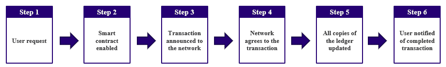

1. 用户请求 – 让我们通过一个基本的 `Bitcoin` 交易遵循这些步骤。如果 Alicia 想给 Billy 发送一些比特币，她会去手机或存储了某些比特币的电脑上打开 `Bitcoin` 钱包应用程序。要发起交易，Alicia 会向系统发出请求，通过指定金额和 Billy 的比特币地址来向 Billy 的钱包发送比特币。
2. 智能合约启用 – 当 Alicia 将交易发送到网络时，它会触发智能合约，该合约会检查网络上的节点以确保 Alicia 有可花费的货币，并且她还没有花费。一旦检查完毕，交易被添加到一个提议区块中。
3. 向网络宣布交易 – 提议区块通过对点协议通信到网络中。
4. 网络同意交易 – 为了让 `Bitcoin` 网络验证区块，节点或矿工必须先通过完成一道数学题来验证区块的准确性。第一个完成 `Proof-of-Work` (`PoW`) 方程的节点将获得新铸造的比特币奖励。一旦方程得出解，其他节点就可以很容易地检查其准确性，从而将新区块接受进区块链网络中。
5. 所有账本副本均已更新 – 该区块通过我们用于交易时使用的相同的点对点通信传播到整个网络。当区块操作者收到新区块的副本时，他们将其添加到自己的分布式账本副本中。这确保了对等网络中的所有成员都对区块链分布式账本的当前状态达成一致。
6. 用户收到交易完成通知 – 用户的钱包会监控包含与用户相关交易的新区块的创建。当收到包含用户操作的完成代码的区块时，将创建一个事件来通知用户操作已完成。当包含 Alicia 向 Billy 转账比特币的区块被添加到区块链中时，系统将向相关钱包发送警报，确认交易已获接受并完成。

# 区块链共识

由于区块链信息存储在网络中每个人手中，因此需要一种共识来确保所有人对交易历史达成一致。所有用户不仅需要对任何交易更新达成一致，还需要对一个有效的交易更新达成一致，以确保网络不会获取受损坏的信息。

共识机制使得区块链能够从由单一实体维护账本的中心化系统转向去中心化系统，在该系统中，信任不再依赖于单一实体，而是取决于所有实体以及它们的共同决定。区块链是一个分布式且去中心化的系统，这意味着它需要一种跟踪系统官方当前状态的方法。由于区块链可能包含财务交易和业务协议，所有参与方在协议条款上保持同步至关重要。

正如 Demiro Massessi 在文章《区块链共识与容错概述》中所述的：“区块链被设计为一个共享的、同步的历史账本，这意味着在某个时间点需要对应该包含和不应该包含在官方记录中的做出最终决定。由于区块链是去中心化的，没有更高的权威机构可以盖章批准并定稿区块链区块的内容。比特币网络创建者 Satoshi Nakamoto 发明的实现共识的方法是基于稀缺性的。以某种方式或方式，区块链共识算法归结为某种投票，用户拥有的票数数量与其控制的有限资源数量挂钩。根据供需经济学法则，收集足够的资产以获得控制份额将推高资产价格，以至于达到那种控制水平的成本变得昂贵到无法负担”。

为了确保没有人重复花费同一枚比特币，Satoshi Nakamoto 为比特币网络创建了一种名为工作量证明（`PoW`）的共识算法。

从那时起根据用例的需求，又发明了其他几种共识算法。这些包括`权益证明`（`PoS`）、委托权益证明、实用拜占庭容错和和逝时间证明。

最常用的共识算法是`工作量证明`（`PoW`）和`权益证明`（`PoS`）。

## 工作量证明 (PoW)

`工作量证明`（`PoW`）是指一种加密机制，该机制依赖于参与者能够解决复杂的计算问题以获得网络中更高的权益。PoW 本质上是参与者确定最有效区块的一种分布式方法。每个参与者都尝试寻找一个哈希值，该值是即将到来的交易区块的有效解决方案。找到要求的哈希值的获胜者将提议区块添加到链并获得奖励。

### 通过工作量证明 (PoW) 的比特币共识机制

比特币共识算法最常见的定义是工作量证明（`PoW`），这是一种依赖于参与者解决加密谜题来验证新信息的共识机制。然而，PoW 是一个更大的共识算法的一部分，通常被称为“中本共识”。中本共识使比特币与此之前的数字货币实现方式区别开来。

比特币使用 `Hashcash Proof-of-Work` 来实现共识，使用了哈希算法 `SHA-256`。这涉及找到一个值 `x`，当 `x` 使用该算法进行哈希时，找到了所需的值。这通常是一个迭代过程；在每一轮中，都会将随机数（一次性数字）添加到被哈希的字符串末尾，直到得到所需的值。一旦参与者成功找到 `PoW` 的解决方案，他们就会将其区块广播到网络的其他部分，如果根据时间戳其中没有交易已经被花费，则该区块将获得批准。然后参与者将获得比特币奖励，以补偿他们为验证下一个交易区块而花费的算力。

比特币的挖矿实际上是将一定数量的计算资源专门用于解决计算困难的问题和验证新区块。单个节点拥有的算力越强，找到正确值的概率就越大，从而解决与该区块相关的 `SHA-256` 哈希。PoW 使比特币既是完全去中心化的，又是完全安全的。任何人都可以参与挖矿过程，而不需要事先拥有规定数量的比特币。事实上，在任何给定时间，下一次挖矿奖励的获胜者是谁完全未知，额外的算力仅有助于增加单个节点成功的概率。此外，挖矿过程还激励节点诚实行为，因为有与广播正确区块相关的奖励。这意味着为了接管网络，恶意攻击者必须控制网络中超过 51%的哈希算力并阻止合法区块通过验证。这被称为“51%攻击”。由于比特币网络目前的规模，获取网络中现有超过 51%哈希算力的经济成本是巨大的，因此极其困难。

中本共识的第二部分使比特币成为第一个可扩展的加密货币平台。中本共识非常强调长链，认为根据时间戳有效的长链是最合法的，因为它投入了大量的计算资源。这在一个原本无信任的系统中引入了信任，从而允许比特币网络在没有中心化权威的情况下运行。例如，如果一个参与者处于不活跃状态或新加入，他们只需接受当前的最长链作为网络之前发生情况的证明。他们不需要依赖第三方；而是从最长有效链开始构建，从而获得通过提交计算有效区块获得奖励的能力。事实上，加密货币社区所说的“长链规则”使比特币在以往 PoW 数字货币失败的地方取得了成功。它让参与者对网络充满信心，并设定了一个标准，让矿工可以自由地加入和离开，而无需服从于权威。长链规则已被比特币之后的许多数字资产系统和区块链采用。

## 权益证明 (PoS)

权益证明（PoS）是另一种用于验证加密货币交易的共识机制。在该系统中，加密货币的所有者可以质押他们的代币，这赋予了他们检查新交易区块并将其添加到区块链的权利。PoS 在加密货币领域的首次实际应用是 2012 年的 `Peercoin`。

要让区块链交易被识别，它必须被添加到区块链中。添加区块的矿工将获得奖励。为了保持区块链的安全，必须拥有一种机制来防止恶意用户或群体接管。PoS 通过要求验证者在区块链上拥有一定数量的代币来实现这一点，这使得潜在攻击者必须获得大量的份额。

PoS 模型允许加密货币所有者质押代币并创建自己的验证节点。当一个交易区块准备好处理时，加密货币的 `PoS` 协议将选择一个验证节点来审查该区块。验证者检查区块中的交易是否准确。如果是，他们会将区块添加到区块链，并为自己的贡献获得更多奖励。然而，如果验证者提议添加包含错误信息的区块，他们将失去部分持仓作为惩。

例如，让我们来看看 `PoS` 如何在 `Cardano` 中工作，`Cardano` 是一种基于 `PoS` 协议的主要加密货币。任何拥有 `Cardano` 的人都可以质押它并建立自己的验证节点。当 `Cardano` 需要验证交易区块时，它的 `Ouroboros` 协议会选择一个验证者。验证者检查区块、添加它，并为他们的努力获得更多的 Cardano。

权益证明和工作量证明是最常见的两种共识机制类型。`PoW` 是早期加密货币（包括 `Bitcoin` 和 `Ethereum`）的首选方法，而 `PoS` 已成为山寨币的常见选择。`PoS` 使用质押能力的验证来验证交易，而 `PoW` 则使用计算能力的验证来验证交易。

## 工作量证明 (PoW) 与 权益证明 (PoS)

`PoS` 和 `PoW` 之间最大的区别在于它们的能量消耗。`PoW` 要求矿工竞争解决数学题。第一个解决问题的矿工可以添加交易区块并获得奖励。这导致世界各地的矿矿设备计算相同的问题并消耗大量的能量。由于 `PoS` 不需要验证者求解复杂的方程，因此它是一种更环保的验证交易方式。

`PoS` 与 `PoW` 的比较：

| PoW | PoS |
| --- | --- |
| 一台电脑，一票 | 一枚币，一票 |
| 任何拥有电脑的人都可以验证区块 | 只有币所有者可以验证区块 |
| 匿名参与 | 使用数字签名识别参与者 |
| 矿工根据算力比例随机选择 | 验证者根据质押比例随机选择 |
| 奖励给第一个矿工 | 收集网络费用作为奖励 |
| 为了解决复杂算法需要巨大的能量成本 | 成本和能量效率高得多 |

`PoS` 协议的优缺点如下：

| 优点 | 缺点 |
| --- | --- |
| 节能高效 | 在安全性方面不如 `PoW` 经受验证 |
| 交易处理快速且廉价 | 持仓量大的验证者对交易验证产生过度影响 |
| 不需要特殊设备来解决复杂问题 | 某些 `PoS` 加密货币锁定质押代币一段时间 |

`PoS` 在安全风险方面存在不确定性，因为它是新的，且没有像 `PoW` 那么有经验。`PoW` 协议在双重花费方面被认为更安全，因为矿工鼓励持续分叉，因为这会使网络不稳定。在分叉期间，矿工必须决定遵循原始区块链还是调整到新区块链。为了维护两个区块链，矿工将计算资源分配给原始区块和新区块。相反，`PoS` 将这个问题称为“无风险”（nothing at stake）问题。在这里，验证者在分叉的区块链上收到质押的副本，并在从两个链签名后可以声称双倍交易费用作为奖励。为了解决这个问题，这种共识需要执行某些期间的锁定存款。`Casper` 是一种鼓励验证者以最小存款参与 `PoS` 协议的协议。如果协议在持续分叉期间发现验证者有任何违规行为，存款可能会被没收。

## 私有许可区块链中的共识机制

### Hyperledger Fabric 共识模型

`Hyperledger Fabric` 是一个私有许可区块链平台，它将共识拆分为多个组件，允许用户根据其特定情况选择共识算法。`Hyperledger` 没有使用预定义的共识模型，而是有一个执行共识相关事件的排序服务，该排序组件可以选择最适合区块链需求的共识模型。通过这种模块化的方式处理共识，`Hyperledger DLT` 可以在不对代码库进行大规模修改的情况下更改共识模型。

### Corda 共识机制

`Corda` 是一个私有许可区块链。每个 `Corda` 网络都有一个由独立方组成的公证服务，他们使用任何相关的共识算法来批准区块。正如 Jamiel Sheikh 的书《Mastering Corda: Blockchain for Java Developers》中所提到的，R3 提供了一套名为 `The Corda Business Network Toolkit` 的 `Corda` 应用来管理一个或多个 `Corda` 网络。`Corda` 不遵循标准的区块链模型（即交易打包成区块然后由整个网络最终确定）。相反，`Corda` 网络包含由多个独立方组成的一个或多个公证处。`Corda` 中的交易由公证处使用 `Raft` 等算法通过多方数字签名完成最终。

# 区块链治理

在本章中，我们将涵盖区块链治理。我们将从讨论区块链公司共享该技术合作代码的方式开始。我们还将探索开源环境如何促进新的创新。然后我们将检查谁真正负责区块链，以及网络效应如何决定区块链的走向。

接下来，我们将看看这些具有开放交互的去信任系统比过去的系统更安全。最后，我们将深入探讨互不信任的方之间协作的想法，以及区块链技术如何改变他们的互动方式。

## 开源

区块链技术和与其工作的开发者从许多方面强化了去中心化这一基本原则。不仅通过决策共识模型，还通过分发软件代码的方式。

* 所有有 / 封闭源代码 – 由创建并维护它的个人、团队或组织控制，并拥有独他权利。只有原始作者可以合法复制、检查和修改软件。大多数所有有软件的用户都会签署协议，允许使用软件但不允许修改。`Microsoft Office` 是所有有软件的一个示例。
* 开源代码 – 描述创建软件特定方法的代码。在描述分发开源代码的工具时，“规范工具”（Discipline Tool）指出，开源倡议拥抱并庆祝开放交换、协作参与、快速原型、透明度和以社区为导向开发的原则。开源软件是任何人都可以检查、修改和增强的代码。互联网大部分是基于开源技术构建的。计算机软件的用户从不与源代码交互，而是由程序员对其进行操纵和修复。与专有软件一样，用户必须接受许可条款，但在结构上有显著不同。`Linux` 和 `Kubernetes` 就是开源软件的示例。

开源软件通过共享代码以及鼓励修改和改进来促进协作。软件开发者发现，与其对软件程序收费，不如围绕和维护这些开源项目的相关服务收费更有利可。

## 开源软件的益处

在开源环境中开发软件意味着愿意以透明的方式进行共享和协作。

* **控制** – 对于开发者来说，开源意味着个人可以对代码的发展方向贡献力量。这种开放的参与意味着参与最多的编码员对代码的方向具有更大的影响力。
* **培训** – 在测试环境中复制代码并进行自己更改的能力是无价的实操培训。这也促进了创新，因为程序员可以设计出以前从未想过的功能和代码方向。
* **安全** – 在开源中，软件程序被认为更安全，因为它们开放给同行评审，借此发现错误。只要遵循网络现有的流程，编码员就鼓励测试代码、发现错误并对漏洞开发修复方案。
* **稳定性** – 由于向公开评审，开源项目具有一定程度的代码稳定性。公开发布的源代码会经过公开审查，并可能暴露其他情况下可能未经过测试的情况。
* **社区** – 开源激发了社区参与。当为开源项目做贡献时，你加入了一个社区，这个社区最终会影响你所感兴趣的软件。

`Bitcoin`、`Ethereum`、`Hyperledger` 以及其他区块链的编程代码都是开源的。

## 治理

《牛津英语词典》将治理（governance）定义为“治理国家、个人、活动、欲望等人的行为或事实；指导；规则；规章。”治理的基本描述可以定义为引导行为的系统。这种指导由一组规则和一种执行这些规则的机制引导，这些机制可以采取许多形式，从拥有完全控制权的独裁者到承认多数意见的民主治理模型。

在经济学背景下，治理被定义为“利用机构、权威结构和协作来分配资源并协调社会或经济中的努力和活动”。

另一方面，从 IT 的角度来看，治理是由领导力以及一系列结构和过程组成的，这些确保组织的 IT 能够支持并扩展其战略和目标，并专注于实现业务与 IT 之间更好的对齐。换句话说，IT 治理是一个正式框架，为组织提供结构，以确保技术投资支持业务目标。

区块链治理可以被视为规范与文化、法律与代码、人与机构的整合，它们促进了协调并共同决定了一个组织。

## 治理模型

由于开源环境，区块链治理模型呈现出民主色彩。区块链由用户社区组成，他们共同努力以加强系统。多数规则的程度可能有所不同。

* **代表制民主** – 这种治理类型由少数受社区授权的个人来建议新规则。代表所拥有的权威由多数授予。链治理的利益相关者通常包括用户、开发者和交易验证者。例如，如果你持有 `MakerDAO` 的 `MKR` 令牌，你就可以通过其去化自治组织（DAO）对 Maker 社区提出的治理行动投票。代表反映了社区的观点。当多数意见未能均匀地反映社区时，就会出现问题，导致少数群体无法获得服务。此外，假设代表是根据其最佳利益行动。
* **直接民主** – 所有关于小组治理的决策由整个社区投票。在这种治理模型形式中，每一票都重要，人们拥有更多的控制权。在这种模型中，最好有一个每个人都愿意参与的受教育社区。每个区块链生态系统都需要某种治理模型。正如 Evan Karnakis 在《比特币与区块链治理：是什么以及为什么重要》文章中所述，在传统系统中，法律是先制定后执行的。在区块链中，当网络中的参与者（矿工、开发者和用户）进行交互时，他们正以对群体最有利的方式行动。在去中心化系统中构建治理结构被证明是非常困难的。

区块链生态中的大多数治理结构都在寻求实现以下目标：

* 协议更改和技术升级
* 关键漏洞和缺陷修复
* 使用汇总资金进行研发

这些目标可以通过不同的治理方法实现。在设计区块链时，有两个主要选择：

* **链上治理** – 链上治理是一种允许去中心化社区通过直接在链上投票来更新区块链的机制。在链上治理中，建立更改的规则被编码到区块链协议中。这意味着任何做出的决策都会自动转换成代码。区块链生态系统的链上治理通常发生在权益证明（Proof-of-Stake）区块链上，形式为投票，你通常必须持有该区块链的代币才能参与其治理。你的投票权重取决于你持有的代币数量。链上治理扩大了参与区块链治理过程的人群，限制了链分裂和分分的威胁，并允许个人用户注册他们的意见。某些链上治理系统确实保留了链下特征。例如，虽然提案可能编码在智能合约中，但在投票之前，通常会在论坛、博客文章和 Twitter 上进行讨论。

链上流程被批评为“富人政治”，因为你持有的代币数量决定了你的投票权重，这意味着“巨鲸”用户通常对系统拥有不成比例的影响。批评者担心，富有的代币巨鲸会投票做出对他们最有利的区块链变更，而不是为了有利于区块链生态系统长期健康的事物进行投票。同样，尽管拥有投票选项，但许多代币持有者从未参与过治理。

* **链下治理**：链下治理可以看作是首先在社交层面进行的决策，随后由开发者积极地编码到协议中。例如，比特币开发者通过邮件列表共享他们的改进提议，然后对这些提案进行审查。

比特币和以太坊以及大多数其他工作量证明区块链系统都利用了链下治理流程。这些区块链的核心利益相关者包括用户、节点运营者、开发者和矿工，他们之间都相互制衡。当所有利益相关者都达成一致并同步进行所有相关的更新和实施时，区块链生态系统的链下治理就能正常运行。如果无法达成共识，网络可能会发生分叉，即分裂为运行不同软件版本的两条链，而具有最高交易哈希算力的链被视为原始链的继任者。


在链下模型中，协议开发通过会议、在线论坛和邮件列表等手段进行。你必须使用这些通道参与其中。对比特币区块大小争议的历史进行简单回顾，揭了决定是否进行变更的非正式链下过程，以及有时伴随这些过程的复杂性。区块大小争论是比特币社区内部关于是否增加比特币区块大小以容纳更多交易，从而扩展比特币交易处理能力的争端。在整个链下过程中，区块大小争论激烈进行，并跨越各种链下平台和活动。多年来，协议反复达成又破裂，召开了多次会议进行面对面讨论，并威胁且最终执行了区块链分叉。比特币现金（Bitcoin Cash）是与主比特币区块链失去共识的最著名数字资产示例，它现在作为一个独立的、代码几乎相同的另一个区块链存在。关于比特币扩展的长期且低效的辩论揭示了链下治理的两个缺点：作为个人用户很难注册你的投入，以及变更可能需要很长时间才能实施。

## 区块链治理策略

针对不同的区块链已经提出并实施了多种区块链治理策略。让我们根据 Demiro Massessi 在《简述区块链治理》文章中所讨论的，按照直接参与决策的人数从少到多的顺序对这些策略进行回顾：

*   **终身仁慈独裁者**：区块链平台的原始创建者或首席开发者对所有决策拥有最终决定权。
*   **核心开发团队**：由最活跃的开发者组成的团队决定哪些功能应该或不应该包含在区块链平台中。这种策略通常用于开源编程项目，用户可以提供或请求功能，但开发者对最终发布中应该或不应该包含的内容拥有最终决定权。
*   **开放治理**：做出区块链治理决策的团队由区块链用户选择（代议民主）。某些区块链使用开放治理的方法来处理治理。
*   **链上治理**：区块链如何运行的规则存储在链上的智能合约中，并内置了修改的能力和程序（直接民主）。链上治理是针对特定区块链的治理策略。在这种形式的区块链治理中，描述区块链应如何运行的规则存储在区块链本身中。这些规定通常实现为区块链上的智能合约，并内置了方法，允许用户根据其需求和区块链的需求来修改规则。

# 比特币治理

比特币使用工作量证明（`PoW`）共识模型来管理其区块链的运行。但当需要进行更改时，这些更改是如何实现的？比特币社区由三个主要参与者组成：开发者、矿工和用户。这些参与者在意外情况发生时都没有做出紧急决策的能力。比特币使用链下治理模型，决策由开发者、矿工和用户进行平衡。开发者必须编写代码来更改区块链。如果没有矿工和用户的同意，开发者没有办法强制执行。矿工和用户必须选择采纳新的软件更改。

当需要对比特币协议进行更改时，开发者会将提议的更改与其他协议开发者共享。改进共享可以是发送给 `bitcoin-dev` 邮件列表的电子邮件、正式白皮书，和/或比特币改进协议（`BIP`）的形式。将编写并测试将执行该更改的代码。如果开发者批准了提议和生成的代码，提议将在区块链上进行投票，由矿工决定是否实施该提议。这是通过硬分叉或软分叉实现的。

该系统并非没有缺陷，从改变区块大小的 `SegWit` 改进协议就可以看出来。围绕区块链去中心化的愿景，通过实施 `SegWit` 更改（即区块链协议运行方式的变更），由一个中央机构负责执行该更改。对于社区的许多人来说，这一决定违背了区块链去中心化哲学的根本原则。结果是比特币网络分裂为两个独立的区块链：

*   比特币 (`BTC`) – 原始的比特币区块链
*   比特币现金 (`BCH`) – 从比特币 Core 提议的硬分叉，建议增加交易区块的最大大小。尽管早期取得了成功，比特币经典（Bitcoin Classic）未能被比特币社区广泛采用，并最终没有实现。

### 以太坊治理

以太坊基于比特币代码，但包含一个用于执行智能合约的逻辑引擎。通过以太坊区块链网络连接计算机，计算力被汇在一起创建了以太坊虚拟机（`EVM`）。以太坊不仅是一个具有智能合约功能的运行区块链，还是一个用于构建新区块链的平台。

与比特币一样，以太坊的三个主要参与者（开发者、矿工和用户）必须更新代码以改进其功能。以太坊改进提案（`EIP`）是指定以区块链潜在新功能的标准。`EIP` 包含了提议更改的技术规范，并作为社区的“真理来源”。以太坊请求评论 `ERC-20` 引入了基于以太坊协议发行实用代币的标准。信标链（Beacon Chain）引入了权益证明（`PoS`）共识模型和“分片”概念——通过运行并行的侧链来缓解网络拥塞。柏林硬分叉和伦敦分叉是为了稳定支付给矿工的费用而进行的改进，使其不会随以太坊的价格而波动。

以太坊在区块链治理中采用了“终身独裁者”模式。虽然以太坊欢迎用户和开发团队的投入，但关于以太坊决策的最终决定权掌握在其创始人 `Vitalik Buterin` 手中。

## Hyperledger 治理

Hyperledger 是作为一个由 `Linux Foundation` 批准的开源区块链项目引入的。它由 `Brian Behlendorf` 领导，使命是为社区提供工具和教育，以促进企业级分布式账本技术的发展。Hyperledger 框架使用 `Open Governance` 模型来做出关于 Hyperledger 环境的技术决策。`Hyperledger 技术指导委员会 (TSC)` 是 Hyperledger 技术决策的最终权威机构。每年，该委员会的成员将从 Hyperledger 的活跃贡献者和维护者中选出，他们自荐成为十五名额的潜在候选人，这些名额将根据同一组贡献者和维护者的投票产生产生。这种模式旨在让在 Hyperledger 开发社区中发挥积极作用的人对 Hyperledger 的治理方式拥有发言权。

## Corda 治理

Corda 是一个为业务设计的开源区块链项目。它由企业级区块链软件公司 `R3` 与 200 多个技术和行业合作伙伴合作开发。Corda 平台于 2017 年开发。

Corda 使用 `Open Governance` 模型做出关于其路线图的技术决策。`Corda 治理机构` 被选出代表 Corda 网络所有用户的利益。

## 区块链的身份

在这里我们将讨论区块链上的身份。让我们先从理解为什么我们在区块链上需要身份开始。

中心化系统可能会被其他形式的权威强制关闭其网络。

以 `Napster` 为例。`Napster` 具有去中心化的网络架构，但他们维护着中心化的权威。因此，中心权威可能会受到攻击，通过移除中心权威，就可以有效控制 `Napster`。这是因为 `Napster` 依赖于这种去中心化网络与中心化控制的。这影响了身份，因为你需要一个身份来进行控制。

另一方面，Torrent（种子）的运行方式不同。它们提供了具有去中心化权威的去中心化网络。这允许节点以不同的方式管理身份。这也是尽管娱乐行业尽力阻止，Torrent 在如今仍被使用的原因。Torrent 消除了中心权威。

这就引出了问题：“为什么像 Torrent 这样的点点网络没有获得与区块链那样的赞誉？”因为无法保证节点会做正确的事。没有人能保证节点之间会合作。

这引出了一个极其重要的问题：如何激励网络中的节点遵循规则？在 Torrent 系统中，任何人都可以下载和共享文件，但并没有真正的激励机制让某人在网络中成为良好的行为者。例如，当 Torrent 网络上的人停止共享占用他们电脑空间的电影时，会发生什么？现在让我们将 Torrent 网络中的“电影”替换为银行网络中的“金钱”。在这种情况下，交易将无法可靠地处理。此外，由于匿名性，你将无法奖励或惩罚这些行为者。

区块链通过 `crypto economics`（加密经济学）解决了这个问题，通过激励矿工去创建和维护一个去中心化的自包含网络。这与早期的点点网络不同，因为它为遵循规则的节点提供了 `cryptocurrency` 形式的经济激励。节点如果篡改网络也会受到惩罚。

## 关键密码学与身份

公钥加密是区块链上管理身份的方式。用户在区块链上的地址就是他们的公钥。这有几个非常有用的属性。用户不需要在区块链上透露自己的身份，但他们可以明确地识别自己，因为确定他们的私钥需要解决一个“难题”。

任何人都可以向用户发送加密消息，因为他们可以轻松访问该用户的公钥。用户可以使用数字签名来验证这些交易的有效性。在 `RSA` 中，任何人都可以通过将消息转换为数字、对其进行公钥幂运算并发送结果，向用户发送加密消息。用户的公钥和私钥设计设计，使得用户可以通过对收到的消息进行私钥分量幂运算来获取原始消息。`RSA` 数字签名涉及相反的过程。用户编写一条消息，并将该消息的压缩形式提升至其私钥指数的幂以创建签名，然后发布该签名。他们的公钥和消息被发布在一起。任何人可以使用一个简单的三步过程来验证签名——使用与消息编写者相同的方法压缩附带的消息、对附带的签名进行用户公钥的幂运算，并验证前两个步骤的结果是否相同。

数字签名的工作原理与 `RSA` 中加密的原理相同。攻击者需要知道用户的私钥才能执行这两种操作中的一种，而算法的设计使得这一过程几乎是不可能的。

这意味着区块链上的身份归根结底是对用户私钥的持有。因此，妥善保护这个私钥非常重要。

在 `Ethereum` 中，用户的身份通过公钥或地址进行管理，用户可以使用相应的私钥对交易进行签名并读取发送给他们的加密消息。

在 `Hyperledger` 和 `Corda` 中，身份被编码在 `x.509` 证书中，包含了用户的公钥。在 `Corda` 中，证书可以是公开的（这意味着它们被发布到区块链上），也可以是机密的（这意味着它们仅与所有与其交易的双方共享）。

# 区块链中的匿名性

匿名性是区块链在某些应用中取得成功的关键部分。如果个人或组织在区块链上进行交易，他们可能不希望这些是公开的。不同的区块链在协议中内置了不同级别的匿名性和隐私保护。

如前所述，公钥加密通过使用一对公私钥来实现加密和数字签名，从而维护了区块链上的身份。

此时，我们需要查看用户的密钥与其真实身份之间的关系。首先要的是，公钥中没有任何部分与其对应的私钥相关。由于私钥是秘密，人们无法从公钥推断出私钥，但你可以从私钥计算出公钥。另一个需要记住的是，私钥只是数字，无法与用户的真实身份绑定。区块链上的身份仅仅是对相关私钥的持有，即使有人猜中或偷了私钥，他们也无法直接从私钥获取其所有者的真实身份。

因此，你无法将公钥与私钥绑定，或将私钥与真实身份绑定，这意味着区块链用户拥有的内置隐私是的。

然而，区块链上的每笔交易都是公开的并永久存储在上面的。这意味着通过研究存储在区块链上的数据来获取元数据，可以学习到很多关于用户身份的信息。通过对餐厅或咖啡馆等地的重复交易，某人可以了解个人居住的地方和习惯。对于企业来说，重复交易可能表明业务关系，如果泄露，可能会导致竞争优势的损失。

在基础区块链上，匿名性仅局限于此。原始区块链上提供的有限的匿名性和隐私保护水平启发了增强隐私的改进措施，同时仍允许在区块链上对交易进行公开验证和确认。

为了增强隐私保护而开发和实施的一些机制包括：

*   `零知识证明` – 它们使用加密算法允许用户在不揭露实际秘密的情况下证明对秘密的认知。验证者证明了对秘密的认知，但并未实际揭露它。一个常见的例子是色盲人士和两个颜色外完全相同的物体。色盲人士向验证者展示一个物体，隐藏两个物体，然后再次展示其中一个。
*   `隐身地址` – 隐身地址涉及使用一次性地址在区块链上进行交易。隐身地址使得无法将交易关联到已知账户。验证者验证是否为同一个物体，而不揭露物体的颜色。
*   `环签名` – 区块链交易经过数字签名。通过环签名，从交易中只能确定是组中的某人签署的，而不是具体的某个成员。
*   `CoinJoin` – 查看谁与谁进行交易对用户隐私和匿名性是危险的。CoinJoin 将多个交易混合在一起，使得难以匹配发送者接收者。
*   `配置交易` – 配置交易利用同态加密，使得对加密数据执行数学运算成为可能。这意味着交易包含的数据可以对公众隐藏，同时仍允许网络验证交易。

## 具体的匿名性实现

*   `Ethereum` – `Ethereum` 正在改进零知识证明、混合和 `DAPPS`（旨在提高匿名性的应用程序）以加强区块链隐私。此外，`Ethereum` 的企业解决方案构建者 `ConsenSys` 推出了 `QUORUM`，它是以区块链的一个分支，允许用户从公共区块链中受益的同时享受私有网络的功能。它由 `JP Morgan` 开发，是一种许可实现。
*   `Hyperledger`
    *   `通道` – 区块链的子集，使交易仅对成员可见。
    *   `私有交易` – 存储私有数据的哈希以便在区块链上进行公开验证。
    *   `零知识证明` – 人可以在不暴露秘密本身的情况下证明认知秘密。
*   `Hyperledger Besu` – 一个运行在 Ethereum 公共网络、私有网络以及 `Rinkeby`、`Ropsten` 和 `Gorli` 等测试网络上的 Ethereum 客户端。`Hyperledger Besu` 包含了多种共识算法，包括 `PoW`、`PoA` 和 `IBFT`，并拥有专门为联盟设计的许可方案。
*   `Corda` – `Corda` 网络上的对方可以用两种方式之一表示：`对方` – 公钥名称和；`匿名对方` – 仅有公钥。

# 不可变性

不可变性简单指的是数据的永久性。任何我们称之为“不可变”的东西都是永久的。区块链的优点之一就是不可变性。一旦数据记录在区块链系统中，就永远无法被更改、编辑、修改或删除。由于这些数据存储在多个位置，因此在单处或有限数量的位置上更改或移除该数据的副本不会构成威胁。

区块链远不止于此。除了记录数据点外，区块链还具有记录谁背书或同意这些事实的能力。我们可以将其想象为一张纸和一份合同之间的区别。一张纸可以包含任何数据，无论真假。而一份签署过的合同意义意义远于此，因为签名代表了在签署时同意纸上记录的事实的人员。区块链提供了这一过程的数字化实现，当你不仅需要记录发生了什么，还需要记录谁参与其中时，它可以成为一个价值无法估量的工具。想象一下，当组织能够安全、可靠地相互共享他们最关键的数据，并信任他们看到的数据未被破坏或篡改时，将会产生多大的新机会。

*   **传统数据库的不可变性** —— 中心化运营数据库的本质无法完全不可变。中心化运行的数据库可以嵌入包含不可变性的功能。但如果存在一个中心机构，他们就有能力覆盖该功能。就像不可变性已经存在多年，就像通过区块链使用的绝大多数技术一样；正是这些者的结合使其具有了独特性。
*   **区块链的不可变性** —— 让我们回顾一下公有区块链提高其不可变概率的方面。有许多不同的变量，最重要的是共识。在区块链中，它指的是通过区块链参与者之间的共识创建的交易日志。其基本概念是，一旦区块链交易接受了足够水平的验证并发布在区块链上，它几乎无法被替换、撤销或编辑。

例如，如果 `Bitcoin` 区块链网络中的所有节点都在通过同时运行多台计算机来努力解决一个非常困难的数学问题，那么任何人覆盖该结果的几率微乎其微。但如果有人想破坏 `Bitcoin` 区块链的不可变性，以下是他们将要做：

1.  安装比网络其他部分总和更多的算力，创建 `51% 攻击`。
2.  他们不会公开参与挖矿过程，而是挖掘自己的 `secret branch`（秘密分支），其中包含他们批准的任何交易，并对其他交易进行审查。
3.  当所需的时间过去后，他们将向网络匿名广播他们的秘密分支。

由于攻击者的算力比网络其他部分多，他们的分支将包含比网络其他部分更多的 `Proof-of-Work` (`PoW`)）。因此，每个 `Bitcoin` 节点都将切换，因为 `Bitcoin` 的规则规定难度更高的分支将胜出。任何之前确认但不在秘密分支中的交易都将被撤销，他们花掉的 `Bitcoin` 可以被发送到其他地方。实现此所需的计算能力是巨大的，而且可能仅仅是理论上的，但考虑这一点很重要。

另一个不那么技术化且带有恶意的例子是 `DAO` 黑客攻击后直接发生的 `Ethereum` 硬分叉。在这个例子中，网络中大多数 `Ethereum` 节点决定更新软件，以防止黑客提取赚取的（被盗的）加密货币。这种更新无法强制执行，因为每个 `Ethereum` 用户都控制着自己的计算机。尽管如此，它得到了 `Ethereum` 创始人 `Vitalik Buterin` 以及许多其他社区领袖的公开支持。结果，大多数用户进行了编译，带有新规则的区块链保留了 `Ethereum` 的名称。少数人不同意这一更改并按照原始规则继续运行区块链，获得了 `Ethereum Classic`（以太坊经典）称号。

# 透明度

任何透明的东西都是透明的。就像不可变性一样，透明度是一个光谱。某些事物比其他事物更透明。在技术背景下，这可以被视为让他人容易看到正在执行的操作的一种方式。例如，在开源项目中，所有的源代码对所有人开放。

在传统数据库中，客户端可以对数据执行四种功能：

*   创建
*   读取
*   更新
*   删除

通常有一个管理员（即权限授予者），允许数据库中的某些已知参与者执行比读取/创建更多的操作；允许他们更新和/或删除。由于管理员控制着谁有访问权限，因此跟踪这些更改并防止恶意者篡改更为容易。在公有区块链中，情况并非如此。

在区块链内部，每个全节点都有自己的管理员，可以创建、读取；这也被称为“只添加”（append only）。这些节点随着时间的推移以区块的形式添加数据。

*   读取 – 从区块链查询并检索数据
*   写入 – 在区块链上添加更多数据

正如 `Shaan Ray` 在《区块链对比传统数据库》文章中所解释的，“如果区块链记录了我的钱包有 100 万 BTC，那么这个数字就永久存储在区块链中。当我花费 200,000 BTC 时，该交易被记录在区块链上，使我的余额变为 800,000 BTC。然而，由于区块链只能追加，我交易前的 100 万 BTC 余额也留在区块链上，供那些感兴趣的人查看。”

# 自主性

自主性被定义为独立或自由，即在不受他人控制的情况下做出自己决策的能力。这种自由可以是宏观或微观的。在与对方进行任何交易的传统世界中，往往会有大量的行政工作，第三方每一步都会干预。这些大部分工作实际上并不是需要的，浪费了可以花在其他地方的时间精力。

区块链通过自动化智能合约实现了独立于中间人。

## 智能合约

智能合约最简单的解释是 `IF THEN ELSE` 语句，这意味着 `如果 X 发生`，`则执行 Y`，`否则执行 Z`。

如果将这一概念应用于两个或多个伙伴，他们都在一个相互约定的合同上进行交互，该合同根据他们的行为（或不行为）执行。智能合约的一个例子可以是“如果某个事件在今年年底之前发生，你就付钱给我，否则我付钱给你”。


# 区块链与智能合约

第一代区块链平台“区块链 1.0”网络能够捕捉和记录数据，但无法对数据进行操作。比特币实现了对比特币从一个所有者到另一个所有者转移的捕捉和记录。在当时，没有人想象区块链为一个可以在之上构建应用程序和解决方案的平台。2015 年以太坊的发布改变这一概念。“区块链 2.0”运而生，现在区块链网络不仅可以捕捉数据，还可以对其进行操作。这一切的实现得益于“智能合约”的引入，这是一种部署在区块链网络上的计算机代码。用户与智能合约进行交易就像与另一个用户交易一样，不同在于与智能合约交易的规则定义在代码中，并用于处理该交易。这使得区块链能够管理和自动化流程，并将结果记录在与所有相关方共享的永久、不可篡改且安全的账本上。

让我们以二手车为例。爱丽（Alice）挂出她的车，并向任何买家提供保证，保证在接下来的 10,000 英里内没有故障。鲍布（Bob）想买这辆车，并出了 5,000 美元。爱丽和鲍布达成一致，爱丽现在收取一半购买价（2,500 美元），如果鲍布在拥有的前 10,000 英里内汽车没有重大问题，则再收取另一半。爱丽和鲍布可以创建一个智能合约。这个智能合约会将剩余的 2,500 美元购买款保留在一个托管账户中，如果鲍布发现汽车有问题，他将向智能合约报告。在鲍布拥有 10,000 英里后，智能合约将根据爱丽和鲍布最初同意的规则，确定剩余资金中有多少应归爱丽，多少应归还给鲍布。交易的所有细节都将记录在一个永久、去中心化的账本上，未来在任何时候都可以用来回答关于爱丽和鲍布之间交易的任何问题。

目前，“智能”合约通常并不智能智能。简单的解释是，因为这些合约是“如果，那么，否则”语句，它们的复杂度可以根据堆叠方式而异。目前，它们在没有人工智能人工干预的情况下无法做出决策。公司正作为可靠的预言机（Oracles，可靠的信息源）出现，将现实世界的实过滤到区块链中，而区块链使这些信息变得不可篡改。

任何人都可以在没有中央机构授权的情况下创建自己的智能合约。这些合约在不需要太多人工干预的情况下执行，并存储在区块链技术上，这种技术提供了一种持久性感。这些是能够为双方之间的信息交换更多自主性的三个主要属性。建立一个预先约定的、编码到区块链中并在采取某些操作时自动执行的合同，是不仅提高我们个人或公司自主性，而且将冗余资源转向更具影响力的工作的一步。

## 多方交易

在传统的中心化账本系统中，准确性依赖于可以更改中心化账本细节的中间介。源自账本的数据可能是孤岛且被误用的。分布式去中心化账本不依赖于操纵数据的中间介。数据是安全且防篡改的。

在目前的交易生态系统中，总有一个第三方协助连接发送者和接收者。这一直是从点 A 移动物品到点 B 最高效的方式。但有了第三方建立连接，就需要信任他们能够以高效、经济且有效的方式送达任何内容。这种信任容易受到人为流程错误的影响。区块链可以实现从许多流程中移除中间介。目前正在移除的中间介有一长名单，例如：

- 能源分销商
- 支付网络（Visa 和 Mastercard）
- 顶层平台和内容分发商（YouTube、Facebook、Instagram 等）
- 中央交易所（NYSE、NASDAQ、NSE、LSE 等）
- 云数据库提供商（AWS、Azure 等）

其中一个例子是跨境支付。在从一个国家汇款到另一个国家时，交易最终会在 7 到 10 个不同的检查银行停靠（买家 – 买家银行 – A 国联邦银行 – A 国代理行 – B 国代理行 – B 国联邦银行 – 卖家银行 – 卖家）。这种不断的停留延迟了资金流动，使其移动更加昂贵（因为每家银行都会收取一小笔费用），并且可靠性降低（检查点的数量增加导致恶意攻击增加）。这种类型的交易严重依赖第三方来促进资金流动。现在，如果我们用区块链替换这个生态系统，信任将通过共识机制建立。这将激励所有参与者在整个网络中帮助保护和验证交易。通过这种内置的“无信任”信任，我们可以移除交易中不提供额外价值的多个中间介，从而加速过程，优化交易成本，并使过程更高效。

## 双花费

比特币并不是创建数字货币的首次尝试，它是第一个能够解决“双花费”这一长期问题的尝试。双花费攻击是一种通过更改区块链网络并插入特殊的区块来允许用户重新获得加密货币的攻击，导致加密货币被使用多次。

例如，爱丽同时欠鲍布和卡罗尔（Carol）各 5 美元。爱丽的总债务额为 10 美元。假设爱丽目前只有 5 美元。如果爱丽的交易被记录在两个独立的账本上，可能出现一个账本显示她付给了鲍布 5 美元，而另一个账本显示她付给了卡罗尔 5 美元。将无法判断谁到底收了钱。这就是双花费问题。因此，任何财务账本必须防止爱丽重复花费她的 5 美元。

数字资产特别容易受到双花费问题的影响，因为被设计为易于复制和分发。例如，你用手机拍了一张照片，可以很容易将其一份发布到 Facebook，另一份发布到 Instagram，通过 WhatsApp 发给朋友，并通过电子邮件发送给父母。因此，我们看到数字资产易于复制和分发。然而，数字货币不应该易于复制和分发。正是克服这一技术挑战导致了比特币之前的许多失败尝试，如 Digicash、Hashcash 等。

比特币技术通过两个内在概念解决了这些问题

1. 区块链网络允许使用易于获取的应用程序在整个网络中验证并广播交易。当交易发生时，网络节点验证这些交易，将其添加到自己的账本副本中，并将这些账本更新广播到其他节点。一旦这些交易被网络接受，它们就变成了一个区块。

2. 使用工作量证明协议，这些区块被添加到区块链，并迅速发布到所有节点，无需中央监督。这使得网络能够确定特定的比特币何时被花费，这是防止双花费所需要的。

这两个概念使得任何接入互联网的人都可以加入比特币网络，独立验证和审计交易历史，并通过工作量证明挖掘比特币。

## 加密货币

加密货币是一种构建在区块链上的可交易数字资产或数字形式的货币。

加密货币是一种完全数字化、去中心化的货币，基于计算机科学、密码学和经济学原理构建。加密货币以物理形式存在，不由任何商品支持也不可转换为商品，且通常不由中央机构发行，它采用去中心化控制而非央行数字货币。加密货币使用加密技术来验证和保护交易，因此得有了这个名字。

比特币被认为是第一个且使用最广泛的加密货币。比特币可以定义为“一种去中心化的数字货币，可以在点对点网络上从一个用户发送到另一个用户，而无需中介机构或银行通道。”比特币交易通过网络节点通过密码学进行验证，并记录在区块链中。区块链记录比特币交易，并以追加的账本格式存储其历史，使得数据可以添加到账本中，但无法删除。它被实现为区块链，每个区块都包含上一个区块的哈希值，直到链中的创世区块。

# 比特币旨在取代银行？

为了理解比特币如何作为银行的替代品，我们首先需要了解银行是如何运作的。

银行管理用户账户并确保资金安全，使得只有他们才能通过账户进行交易。银行通过在任何交易之前验证和确认用户的身份来实现这一点。随后，银行代表其用户进行交易（存款/转账/取款）并记录这些交易。银行每当进行新交易时，就会更新用户的账户余额，并让他们看到自己的活动和交易历史。用户信任银行会诚实记录他们的活动，因为这些活动受其国家经济和金融法规的监管。

然而，如果用户不再信任银行或政府，开始寻找替代方案怎么办？比特币这就上场了。

比特币使用户能够完全匿名。在比特币中，每个用户都可以创建自己的身份/头像。由于比特币身份与其现实世界身份完全区分，它为用户提供了高度的隐私性。现在，一旦用户创建了身份并进行交易，这些交易可以直接在点对点网络上进行，而无需涉及银行等任何中央实体。此外，由于交易是通过`proof-of-work`（工作量证明）概念由网络记录的，用户可以这些交易被诚实地记录了。因此，用户可以放心地相互发送资金，因为知道交易将在没有第三方参与的情况下由整个网络进行验证。最后，由于账本只能追加，用户可以确定他们的现有记录不会被更改。为了存储交易信息，每个比特币用户都拥有一份个人账本副本。比特币的去中心化本质确保了数据的完整性，并防止了单点故障风险。在特定节点被攻击的情况下，由于每个人都是记录者，其他节点仍然可以确保数据的完整性并保持网络运行。

# 去中心化金融 (DeFI)

去中心化金融 (DeFI) 指一种金融软件系统，它使金融产品能够在去中心化的区块链上向公众提供。DeFi 通过使用区块链上的智能合约，提供了不依赖经纪商、交易所或银行等中介的金融工具。DeFi 允许人们向他人借贷资金、使用衍生品对资产价格波动进行投机、交易加密货币、购买保险并在类存款账户中赚。

比特币在许多方面是第一个 DeFi 应用。比特币让你真正拥有并控制价值，并将其发送到任何地方。

## DeFi 的优势

DeFI 利用以太坊的核心原理来提高安全性、释放机会并支持整合的经济系统。

- **可编程性**：高度可编程的智能合约实现了自动化执行，并能够创建新的金融工具和数字资产。
- **不可篡性**：跨区块链的防篡改数据协调提高了安全性和审计性。
- **互操作性**：以太坊的可组合软件栈确保了 DeFi 协议和应用的设计旨在相互集成和互补。通过 DeFi，开发者和产品团队具有灵活性在现有协议之上进行构建、自定义界面并集成第三方应用程序。出于这个原因，人们通常将 DeFi 协议称为“货币乐高”。
- **透明性**：在公共以太坊区块链上，每笔交易都会广播给其他用户并由他们验证。这种交易数据的透明度不仅允许丰富的数据分析，还确保网络活动对任何用户可用。以太坊以及运行在其上的 DeFi 协议也是使用开源代码构建的，任何人都可以查看、审计和构建。
- **无许可**：与传统金融不同，DeFI 的定义是其开放、无许可的：任何拥有加密钱包和互联网连接的人，无论地理位置如何且通常不需要任何最低资金，都可以访问构建在以太坊上的 DeFi 应用。
- **自托管**：通过使用`MetaMask`等 Web3.0 钱包与无许可的金融应用和协议交互，DeFI 市场参与者始终保留其资产的托管和对个人数据的控制权。

# DeFi 用例

用户通常通过被称为`dapps`（去中心化应用）的软件参与 DeFi，目前大多数应用运行在以太坊区块链上。与传统银行不同，没有需要填写的申请或需要开的账户。

以下是`dapps`和 DeFi 协议目前的某些用法：

- **传统金融交易**：从支付、证券交易和保险到借贷，已经在 DeFi 中发生发生。
- **去中心化交易所 (DEXs)**：目前，大多数加密货币投资者使用`Coinbase`或`Gemini`等中心化交易所。DEXs 促进了点对点金融交易并让用户保留对资金的控制。
- **电子钱包**：DeFi 开发者正在创建可以独立于最大的加密货币交易所的数字钱包，让投资者访问从加密货币到基于区块链的游戏的所有内容。
- **收益挖掘**：DeFi 被称为加密世界的“燃料”，它让投机投资者借出加密货币成为可能，当 DeFi 借贷平台因他们同意贷款而支付的专用代币迅速升值时可能会获得丰厚的回报。
- **闪电贷（Flash loans）**——这些是在同笔交易中借入并偿还资金的加密货币贷款。借款人可以通过进入在以太坊区块链上编码的合约、执行交易并立即偿还贷款来盈利。如果交易无法执行或会导致亏损，资金将自动返回贷款人。如果你确实获得了利润，可以将其收入囊，扣除任何利息费用或费用。可以将闪电贷视为去中心化的套利。

DeFi 的采用得于区块链无处不在的特性。一旦去中心化应用（`dapp`）在区块链上编码，它就可以在全球范围内可用。

## DeFi 的未来

从消除中间人到将篮球片段变成具有货币价值的数字资产，DeFi 的未来看起来光明。投资者将拥有更多的独立性，这将允许他们以今天看来不可可能的创意方式部署资产。

但尽管前景广，DeFi 还有很长的路要走，特别是在公众接受方面。

## 非同质化代币 (NFTs)

你可能听说过一位 24 岁的艺术家通过出售其艺术品作为非同质化代币（NFT）赚了超过 30 万美元，或者罗布·格隆斯科斯基（Rob Gronkowski）出售他最精彩超级碗时刻的 NFT。随着这些消息席卷社交媒体，NFT 成为最新的主流加密货币热潮并不为奇奇。

非同质化代币（NFT）是存储在区块链上的不可互换数据单元。与加密货币不同，NFT 无法进行交易或交换，因为它们彼此并不相同。NFT 通常用于买卖数字物品，如数字文件、数字媒体、数字艺术、收藏品和虚拟房地产。一个 NFT 可以与特定的数字资产（视频/照片/音频）或物理资产（实体文件/实体物体）以及用于特定用途该资产的许可关联。此 NFT（如果适用，以及相关的使用、复制或显示底层资产的许可）可以在数字市场上进行交易和出售。NFT 使用数字账本提供公开的真实性证明或所有权证明，但并不限制底层数字文件的共享或复制，也不限制相同 NFT 的创建。

NFT 的功能类似于加密代币，但与`Bitcoin`或`Ethereum`等加密货币不同，NFT 并不是相互互换的，因此不是同质化的。虽然所有的比特币都是平等的，但每个 NFT 可能代表不同的底层资产，因此可能具有不同的价值。

NFT 的创建是因为区块链将加密哈希记录（一组识别一组数据的字符集）连接到之前的记录上，从而创建了一个可识别数据块的链。这种加密交易过程通过提供一个用于跟踪 NFT 所有权的数字签名，确保了每个数字文件的身份验证。然而，指向详细信息的链接（如艺术品存储位置）的数据链接可能会受到“链接失效”（link rot）的影响。

NFT 的所有权并不固有赋予该代币所代表的任何数字资产的版权或知识产权。例如，虽然有人可能出售代表其作品的 NFT，但买家在 NFT 所有权变更时并不一定获得版权权限，因此原所有者被允许创建相同作品的更多 NFT。在某种意义上，NFT 仅仅是与版权分离的所有权证明。

NFT 已被用作投机性投资，并且它们在与验证区块链交易相关的能源成本和碳足迹，以及频繁用于艺术诈骗方面也遭到了了批评。

## NFT 是如何工作的？

NFT 通常存储在`Ethereum`区块网上，尽管其他区块链也支持它们。NFT 是从代表实体和无形物品的数字对象创建或“铸造”的，包括艺术品、GIF、视频和体育集锦、收藏品、虚拟化身和视频游戏皮肤、设计师运动鞋和音乐。

甚至推文也算。推特联合创始人杰克·多塞（Jack Dorsey）以超过 290 万美元的价格将其首条推文作为 NFT 出售。

本质上说，NFT 就像实体收藏品，只是数字的。因此，买家得到的不是一幅挂在墙上的真实油画，而是得到一个数字文件。他们还获得了独占所有权，因为一个 NFT 一时间只能有一个所有者。NFT 的独特数据使其易于验证所有权并在所有者之间传输代币。所有者或创建者还可以在其中存储特定信息。例如，艺术家可以通过 NFT 的元数据中包含签名来对他们的作品进行签名。

## NFT 的用途

- **数字文件**：NFT 已被用作链接数字文件的数字代币交换手段。NFT 的所有权通常与底层数字资产的使用许可相关，但通常不会赋予买家版权。某些协议仅授予个人非商业用途的许可，而其他许可允许对底层数字资产进行商业用途。
- **数字艺术**：数字艺术是 NFT 的常见用例。作为 NFT 的数字艺术高额拍卖引起了广泛的公众关注，艺术家 Pak 的作品《Merge》是最昂贵的 NFT，价格为 9180 万美元；艺术家 Mike Winkelmann 的《Everydays: the First 5000 Days》是 2021 年第二昂贵的拍卖品，以 6930 万美元的价格拍得出。
- **游戏**：NFT 可用于代表游戏内资产，例如数字土地，一些评论员将其描述为由“用户”控制的，而不是由游戏开发者控制的，因为它允许资产在不经游戏开发者许可的情况下在第三方市场上进行交易。`CryptoKitties`是一个早期的成功区块链在线游戏，玩家在其中领养和交易虚拟猫。游戏内 NFT 的货币化筹得了 1250 万美元的投资，某些猫的售价超过了 10 万美元。在成功之后，`CryptoKitties`被加入了`ERC-721`标准。

2021 年 12 月，全球领先的游戏公司优锐 Ubisoft 宣布了`Quartz`，“一项允许人们使用加密货币购买稀缺数字物品的 NFT 计划”。该公告引起了巨大的批评，其 YouTube 发布视频的反对率达到 96%，该视频随后被下架。一些 Ubisoft 开发人员也对此公告表示了担忧。

2021 年 2 月，据报道 NFT 在音乐行业产生了约 2500 万美元，艺术家将艺术品和音乐作为 NFT 代币出售。2021 年 2 月 28 日，电子舞音乐`3LAU`出售 33 个 NFT，总价 1170 万美元，以纪念其专辑`Ultraviolet`三周年。

- **电影**：2018 年 5 月，20 世纪影业与 Atom Tickets 合作发布了限量版《疯狂销杀 2》数字海报以推广电影。它们可以在`OpenSea`和`GFT`交易所获取。2021 年 3 月，Adam Benzine 的 2015 年纪录片《Claude Lanzmann: Spectres of the Shoah》成为第一个作为 NFT 拍卖的电影和纪录片。电影行业使用 NFT 的其他项目包括宣布将为《哥斯拉大战金刚》发布独家 NFT 艺术品，以及导演 Kevin Smith 在 2021 年 4 月宣布其即将上映恐怖电影《Killroy Was Here》将作为 NFT 发布。2021 年由 Rick Dugdale 执导、安东尼·霍普金斯主演的电影《Zero Contact》也作为 NFT 发布。2021 年 11 月，电影导演昆汀·塔伦蒂诺根据《低俗小说》的未剪辑片段发布了七个 NFT。`Miramax`随后提起了诉讼，指控其侵犯了电影权利。
- **其他相关文件**：一些互联网迷因与 NFT 相关联，这些 NFT 由其创建者或其主体铸造并出售。例如，`Doge`，其柴犬图像的 NFT 在 2021 年 6 月以 400 万美元售。

某些虚拟世界（通常营销为元宇宙）已将 NFT 作为交易虚拟物品和虚拟房地产的手段。2018 年的虚拟世界`Decentraland`就是其中。

任何类型的活动门票建议作为 NFT 出售。此类建议将使活动组织者或表演者能够在转售中获得版税。


- **收藏品**：2020 年初，`CryptoKitties` 的开发者 `Dapper Labs` 发布了 `NBA TopShot` 的测试版本，这是一个出售 NBA 精选代币收藏品的项目。该项目构建在 `Flow` 之上，这是一个比 `Ethereum` 更新且更高效的区块链。2019 年，耐克专利了一项名为 `CryptoKicks` 的系统，该系统将使用 NFT 验证实体运动鞋的真伪，并为客户提供鞋子的虚拟版本。

- **投机**：代表某些数字收藏品和艺术品的 NFT 已作为投机资产被大量使用。

- **洗钱**：与其他区块链证券和传统艺术品销售一样，NFT 可能被用于洗钱。

## NFT 与加密货币有何不同？

NFT 代表非同质化代币（non-fungible token）。它通常使用与加密货币类似的编程构建，如 `Bitcoin` 或 `Ethereum`，但相似性仅此于此。

加密货币是“同质化的”，这意味着它们可以相互交易或交换。它们的价值也相等。例如，一个 `Bitcoin` 始终等于另一个 `Bitcoin`。加密货币的同质性使其成为区块链上进行交易的可信手段。

NFT 则不同。每个 NFT 都有一个数字签名，使得 NFT 无法相互交换或等值（因此，是非同质化的）。例如，一段 `NBA Top Shot` 片段并不等于另一个 `NBA Top Shot` 片段，仅仅因为它们都是 NFT。

## NFT 的历史

第一个已知的 NFT `Quantum` 由 Kevin McCoy 和 Anil Dash 于 2014 年 5 月创建，由 McCoy 的妻子 Jennifer 制作的一段视频片段组成。McCoy 在 `Namecoin` 区块链上注册了该视频，并在纽约市博物馆举行的 Seven on Seven 会议现场演示期间以 4 美元的价格卖给了 Dash。McCoy 和 Dash 将该技术称为“货币化的图形”。通过链上元数据（由 `Namecoin` 实现），一个非同质化的、可交易的区块链标记被明确链接到一件艺术品。这与其它区块链中多单元、同质化、无元数据的“彩色币”（colored coins）形成对比。

2015 年 10 月，第一个 NFT 项目 `Etheria` 启动并在 `Ethereum` 区块链发布三个月后，在伦敦的首个开发者会议 `DEVCON 1` 上进行了演示。`Etheria` 457 个可购买和交易的六边形瓷砖中大部分在五年内未售，直到 2021 年 3 月 13 日，人们对 NFT 的重新关注引发了购买热潮。在 24 小时内，当前版本和之前版本的所有瓷砖（每个都硬编码为 `1 ETH`，发布时为 0.43 美元）全部售出，总额达 140 万美元。

“NFT”一词直到随着 `ERC-721` 标准出现才流行，该标准于 2017 年通过 `Ethereum GitHub` 首次提出，随后推出了多种 NFT 项目。这些包括 `Curio Cards`、`CryptoPunks` 和 `Decentraland` 平台。2017 年的在线游戏 `CryptoKitties` 通过出售可交易的猫 NFT 实现变现，它的成功让公众对 NFT 开始关注。

NFT 市场在 2020 年经历了快速增长，价值增长了三倍达到 2.5 亿美元。2021 年初几个月，在经历了多次高额交易和艺术拍卖后，对 NFT 的兴趣增加。2021 年的前三个月，用于 NFT 的支出超过了 2 亿美元。

## NFT 的未来是什么？

任何区块链实验的未来都是未知的。然而，专家预测 NFT 将长期存在，并将继续在艺术和游戏领域之外增长，特别是如果加密爱好者和主流投资者继续投入资金。

NFT 的增长也可以归功于它的特征，这些特征可以代表所有权证明、提供社会地位、授予独家访问权限、管理许可以及认证真伪。它让你像 `Bitcoin` 让你成为自己的银行家一样，拥有你的产品。

# 基于区块链的加密货币 – Bitcoin

在本章中，我们将讨论 `Bitcoin` 以及它如何利用区块链技术进行分布式账本记录和交易。我们将从 `Bitcoin` 的历史开始，以及它为什么作为加密货币取得了成功。然后我们将探索 `Bitcoin` 身份及其共识协议。我们将深入了解加密哈希函数和 `merkle root`（默克尔根），以及它们如何使 `Bitcoin` 不可篡改。我们将学习 `Bitcoin` 交易过程，以及如何通过 `Bitcoin scripts` 编写 `Bitcoin` 代码。然后我们将深入了解 `Bitcoin` 用户及其钱包。我们将学习 `Bitcoin` 的挖矿过程。最后，我们将学习 `Bitcoin` 的治理机制。

## Bitcoin 历史

`Bitcoin` 的起源可以追溯到 20 世纪 70 年代和 80 年代的密码客（Cypherpunk）运动。20 世纪 70 年代人们生活在一个模拟世界中，加密主要用于军事目的。当时很少有人拥有电脑，很难想象有一种能连接地球上几乎每个人的技术——互联网。

两份出版物将密码学带入公开：美国政府发布的《数据加密标准》，以及 Whitfield Diffie 博士和 Martin Hellman 博士于 1976 年发布的《密码学新方向》。

20 世纪 80 年代，David Chaum 博士开始撰关于匿名数字货币和伪匿名声誉系统等主题。这是我们今天看到的数字货币的第一步。

直到 1992 年，一组密码学家开始定期聚会讨论他们的工作和相关想法。除了定期会议，他们还创建了 `Cypherpunk` 邮件列表，在其中讨论了许多想法。其中一个想法是使用密码学保护隐私，这导致了 `Bitcoin` 的诞生。

《密码客宣言》指出：“隐私对于电子时代的开放社会是必要的。隐私不是秘密。私有事务是你你不希望全世界知道的事情，而秘密事务是你不希望任何人知道的事情。隐私是选择性地向世界展示自己的权力。”

密码客并不是唯一担心中心实体通过积累数百万用户不可想象的数据而变得强大的人。还有另一群被称为加密无政府主义者（crypto-anarchists）的人，他们担心大银行和政府削弱普通公民的自主权，并以不可想象的方式影响用户的心理。在银行革命之前，现金是匿名且纯物理的。然而，随着银行数字化，他们他们能够跟踪用户的账户余额和交易。因此，这两组人都预见到需要一种匿名数字货币，赋予用户选择性地向世界展示自己的权力。

多家不同的公司和研究人员尝试发明一种去中心化货币，但由于与去中心化消除的不一致性，他们都失败了，例如双重花费攻击（double spending attack）——“一种通过修改区块链网络并插入一种特殊的允许用户重新获得加密货币的攻击”。

这些公司之一是 DigiCash，由大卫豪（David Chaum）于 1989 年创立的电子货币公司。DigiCash 交易的独特之处在于它是匿名性的，为进行数字交易的用户提供了完全的隐私保护，并包含了多种加密协议，防止政府和银行追踪个人交易。由于验证系统中每一处数字签名的负担过于沉重且成本高昂，DigiCash 无法生存下去，并于 1998 年宣布破产，随后将其资产出售给另一家数字货币公司 eCash Technologies。

1997 年，亚当·（Adam Back）提出了一种名为 Hashcash 的概念，并在 2002 年的论文《Hashcash - 拒绝服务攻击措施》中对其进行了更正式的描述。Hashcash 使用工作量证明系统来限制垃圾邮件和拒绝服务攻击。为了发送电子邮件，用户必须解决一个加密哈希谜并提供工作量证明，同时在邮件头中添加 Hashcash 邮戳。这个 Hashcash 邮戳会将邮件验证为真实而非垃圾。这种工作量证明后来成为了比特币的基础核心概念之一。

同样在 1998 年，大卫钱（Wei Dai）发表了一篇名为《B-money：一种匿名、分布的电子现金系统》的论文。使用工作量证明函数来创建货币。每个人都维护一份数据库副本，并通过集体账本验证工作。所有交易通过集体记账完成，并通过加密哈希进行认证。这些思想后来影响了比特币的设计。

## 比特币的发明

比特币采用了这些发明中的一些关键特征，并从它们的错误中汲了教训。2008 年，比特币成为第一个成功的加密货币技术。Bitcoin 一词是 bit（位）和 coin（币）的组合。域名 `bitcoin.org` 于 2008 年 8 月 18 日注册。

2008 年 10 月 31 日，一位名为中本聪（Satoshi Nakamoto）的匿名人士或团体发布了比特币白皮书。这份名为《比特币：点对点电子现金系统》的九页纸是对数字货币框架的提案，网络验证交易并存储整个交易历史，使用户无需依赖任何金融机构即可相互进行安全交易。这份白皮书构想了一种匿名、去信任、去中心化的加密货币，它不受任何审查或中心化的限制，从而赋予用户交易的自由同时保护了他们的隐私。

比特币被设计为通缩性货币，这意味着存在的比特币总量是有限的，具体为 2100 万个。每位比特币矿工在发现区块后都会获得区块奖励，但这种奖励会随着时间的推移而减少。最终，当 2100 万个比特币被挖完时，区块奖励将变为 0。

## 比特币早期时代

比特币于 2009 年作为开源软件发布后开始使用。2009 年 1 月 3 日，当中本聪挖出链的起始区块（即创世区块）时，比特币网络诞生了。第一笔比特币交易的接收者是哈尔·芬尼（Hal Finney），他是首个可重用工作量证明系统的创建者，他从中本聪那里收到了 10 个比特币。2010 年，发生了第一笔已知的比特币商业交易，程序员拉斯洛·汉尼泽（Laszlo Hanyecz）从杰里米·图迪万特（Jeremy Turdivant）那里用 10000 个比特币购买了两个披萨王披萨。从此时起，比特币从一种无值的互联网货币变成了具有真实价值的加密货币。这次购买确证了比特币作为实际货币的用途。

在早期的“概念验证”交易之后，比特币的首批主要用户是黑市，例如丝绸之路（Silk Road），它赢得了“毒品 eBay”的名声。丝绸之路利用名为 `Tor` 的匿名网络协议，这使得用户的身份匿名化，并使用比特币进行交易。2013 年，丝绸之路被 FBI 关闭。同样，`mtgox.com` 作为早期最大的比特币交易所之一，曾被黑客抽走资金并遭遇了严重的安全泄露，到 2014 年，它处理了全球超过 70%的比特币交易。然而，由于严重的安全泄露和丢失了约 100 万个客户的比特币，门头交易所暂停了交易，关闭了网站和交易所服务，并于 2014 年向债权人申请破产保护。

## 比特币的崛起与主流采用

2013 年至 2015 年间，比特币价格剧烈波动，从 2013 年的不足 14 美元飙升到 2014 年的 1000 美元以上，然后又下跌 90%跌至 100 美元。这归因于两个因素——中国投资者作为投机性投资买卖比特币，以及门头交易所持续到 2014 年的自动交易。比特币基金会于 2012 年 9 月成立，旨在促进比特币的发展。此外，交易费用降低了。2013 年，美国金融犯罪执法网络（`FinCEN`）为比特币等“去中心化虚拟货币”制定了监管指南，将出售比特币的美国矿工分类为货币服务业务（`MSBs`），他们必须履行注册或其他法律义务。同时，中国人民银行禁止中国金融机构使用比特币，这导致价格再次下跌。

2014 年，一些商家开始接受比特币作为支付方式。加密交易所和钱包公司也相继出现，让用户可以买卖比特币，且商家接受比特币而无需亲自加入比特币网络。同年 9 月，PayPal 与 Coinbase、`BitPay`和`GoCoin`达成了合作。

2015 年，比特币软件的发布引入了共识库，让程序员能够轻松访问网络共识的规则。开发者现在可以添加一项新功能，允许交易在未来的特定时间之前无法花费。2016 年 10 月，比特币发布了一项优化区块大小的新功能，这将降低交易费用并增加网络的最大交易处理能力。此后，2017 年 8 月的版本支持了闪电网络并改进了扩展性。

2018 年，比特币价格受到多个加密货币交易所黑客攻击或盗窃的负面影响，包括 2018 年 1 月`Coincheck`、6 月`Bithumb`以及 7 月`Bancor`的盗窃案。此外，由于区块时间和区块大小的限制，比特币正变得难以扩展，因为交易变得效率更低且耗时更长。2018 年 3 月，每 10 分钟创建一个比特币区块，只能容纳 1MB 的交易数据，大约相当于 2000 笔交易~每秒 3 笔交易。交易量超过了比特币网络的容量，交易由于无法被区块中而处于未确认状态。在比特币历史上，人们对这一限制提出过各种增加。比特币现金的区块大小为 32MB，因此吞吐量是比特币的 32 倍。比特币 SV 完全删除了区块大小限制。这导致了去中心化治理的另一个问题，因为比特币协议中没有包含变更机制。

2019 年 9 月，洲际交易所（纽约证券交易所所有的所有者）在其名为`Bakkt`的交易所上开始交易比特币期货。2020 年 3 月 13 日，由于 COVID-19 疫情的爆发，比特币价格从 2020 年 2 月超过 10,000 美元后的市场大抛售中跌至 4,000 美元以下，期间有 28.1 万枚比特币被卖出，所有者持有时间仅为 30 天。2020 年 8 月，MicroStrategy 投资了 2.5 亿美元比特币作为财政储备资产。2020 年 10 月，Square, Inc. 将总资产的约 1%（5000 万美元）投入了比特币。2020 年 11 月，PayPal 宣布美国用户可以购买、持有或出售比特币。2020 年 12 月，马诸塞州人寿公司宣布购买了价值 1 亿美元的比特币，约占其普通投资账户的 0.04%。2021 年 2 月，特斯拉购买了 15 亿美元的比特币，并宣布计划接受比特币作为车辆支付方式。然而，在 2021 年 5 月 12 日，特斯拉扭转了立场，表示他们将不再接受比特币，因为担心“挖矿”这种加密货币会增加化石燃料的消耗并导致气候变化。2020 年 9 月，瑞士楚格州宣布将从 2021 年 2 月开始接受使用比特币缴纳税款。2021 年 6 月，萨尔瓦瓦立法会投票通过法律，使比特币成为萨尔瓦瓦的法定货币，使其成为首个正式引入比特币作为法定货币的国家。2021 年 10 月，美国证券交易委员会（SEC）批准了 ProShares 比特币策略 ETF，这是一种现金结算的期货交易基金（ETF）。

## 为什么比特币技术作为加密货币成功？

去中心化网络通常面临许多问题，例如没有中心实体来查询用户账户信息或识别恶意用户，这导致了用户与感染网络的恶意实体之间出现某些不一致，其中最流行的攻击是双重花费攻击。比特币技术通过两个核心概念解决了这些问题：

1. **区块链网络**，它允许使用现有的软件应用程序在整个网络中对交易进行验证和广播。当交易发生时，网络节点会验证这些交易，将它们添加到自己的账本副本中，然后将这些账本更新广播到其他节点。一旦这些交易被网络接受，它们就变成了一个区块。此后通过`Proof-of-Work`协议，这些区块被添加到区块链并快速发布到所有节点，无需中心监督。这使得网络能够确定特定的比特币何时被花费，这对防止双重花费是必要的。

2. **工作量证明（PoW）协议**。为了被网络其余接受，账本必须包含工作证明。`Proof-of-Work`要求比特币矿工解决一个任意数学难题，以找到一个名为`nonce`或“随机数”的数字，这是在认证协议中发布的随机任意数字，用于确保旧的通信不会被重放攻击利用。它在加密通信中只能使用一次，当区块内容与`nonce`一起进行哈希处理时，其结果在数值上小于网络难度目标。结果是会生成一个匹配当前区块目标哈希的新哈希值（一长串字符）。这个新区块被添加到网络并发布到所有节点，解决该问题的加密矿工将获得将该区块添加到区块链的权利并获得奖励。工作证明就是向加密货币的区块链添加新交易区块的一种形式。

这两个概念使得任何接入互联网的人都可以加入比特币网络，自行验证和审计交易历史，并通过`Proof-of-Work`通过挖掘来创建比特币。

## 比特币身份

在金融领域，身份是一种验证手段，确保没有其他人在访问你的金融账户或进行交易时代表你采取行动。通过验证，人们可以访问自己的资金并进行金融交易。如果有人尝试冒充你的身份并从你的银行取款，你可以获得相关记录，获取试图冒充你的人的身份，将其封在网络之外并在未来消除此类恶意活动。

现在在比特币背景下，如果你想给朋友发送 1 个比特币，他不应该能够再加一个 0 使其变成 10 个比特币。他不应该能够复制你的签名。比特币通过数字签名确保此类此类发生及其网络完整性。它同时拥有公钥和私钥。公钥是你提供给公众与你通信的密钥，私钥是你唯一拥有并用于访问账户的秘密密钥。


在比特币语境下，公钥可以被视为储物柜，而私钥可以被视为钥匙。公钥用于接收资金，私钥用于提取资金。其他用户将比特币发送到你的比特币地址，该地址是由你的公钥派生出来的。要生成身份，用户选择一个随机私钥，并使用数学函数从私钥生成公钥。公、私钥的概念确保了用户在比特币空间中的唯一身份及其身份验证。

## 比特币共识

由于区块链信息存储在网络中的每个人手中，因此需要一种共识来确保每个人对交易历史达成一致。不仅所有用户需要对任何交易更新达成一致，他们还需要对有效的交易更新达成一致，以确保网络不会获取损坏的信息。

比特币最独特的特征之一是它的共识算法，它为拜庭容错（BFT）点对点货币系统立了先例。拜庭容错是一种机制，它使得去中心化、无需信任的网络在存在故障或恶意节点的情况下也能正常运行。如果忠诚（非故障）的将军达成多数共识，就可以实现拜庭容错。

比特币共识算法最常见的定义是工作量证明（`PoW`），这是一种依赖参与者解决加密难题来验证新信息的共识机制。然而，PoW 是更大共识算法的一部分，通常被称为`Nakamoto Consensus`（中本共识）。中本共识让比特币与之前的数字货币实现有所不同。

`PoW`指的是一种依赖参与者能够解决计算难题以便在网络中拥有更高权益的加密机制。`PoW`本质上是参与者确定最有效区块的分布式方法。每个参与者都尝试找到一个哈希值，这是即将发生的交易区块的有效解决方案。找到符合哈希值的获胜者将提议区块添加到链并获得奖励。


Hashcash 工作量证明使用了哈希算法`SHA-256`。这涉及找到一个值`x`，使得当`x`使用该算法进行哈希处理时，可以找到所需的值。这通常是一个迭代过程；在每一轮中，nonces（使用一次的数字）被添加到正在哈希处理的字符串末尾，直到给出所需的值。一旦参与者成功找到`PoW`的解决方案，他们就会将区块广播到网络的其他部分，如果其中没有任何交易已被花费，则该区块将获得批准。然后参与者将获得比特币奖励，以补偿他们为了验证下一区块交易而花费的计算能力。

## 比特币挖矿

比特币挖矿实际上是投入特定数量的计算资源，目的是解决计算困难的问题并验证新区块。单个节点拥有的算力越大，在`SHA-256`哈希值中找到正确值的概率就越高，从而解决与该区块`PoW`相关的加密哈希。

`PoW`使比特币能够实现完全的去中心化且完全完全的安全。任何人都可以参与挖矿过程，而不需要预先拥有特定数量的比特币。事实上，在任何给定时间点，下一次挖矿奖励的获胜者是完全未知的，额外的算力只是增加了单个节点成功的概率。此外，由于广播正确区块相关的奖励，挖矿过程激励了节点诚实行为。这意味着为了接管网络，恶意攻击者必须控制网络上 51% 以上的计算/哈希能力，并阻止合法区块的验证。这通常被称为“51%攻击”。由于比特币网络目前的规模，获取网络中现有 51% 以上哈希算力的经济成本是巨大的，因此极其困难。

## 中本共识

中本共识的第二部分使比特币成为第一个可扩展的加密货币平台。中本共识非常强调最长链，认为根据时间戳判断有效的最长链是最合法的，因为它投入了大量的计算资源。这在一个原本不依赖信任的系统中引入了信任，从而使比特币网络能够在没有中心化权威机构的情况下运行。例如，如果一个参与者一直处于活动状态或新加入，他们可以简单地接受当前的最长链作为网络之前发生情况的证明。他们不需要依赖第三方，而是简单地在最长有效链的基础上开始构建，从而获得通过提议计算上有效的区块来获取奖励的能力。事实上，加密货币社区所说的“最长链规则”让比特币在以往`PoW`数字货币失败的地方取得了成功。它让参与者对网络充满信心，并设定了一个标准，使矿工可以根据自己的意愿加入或离开，而无需服从某个权威机构。最长链规则已被比特币之后的许多数字资产系统和区块链所采用。

中本共识最终彻底改变了数字货币和可扩展现代加密解决方案，使比特币作为一种去信任的点对点交易系统取得了成功。具体而言，中本共识成功为区块链的有效性创建了一个衡量标准：投入其中的计算资源量。虽然中本共识模型面临许多批评（很大程度上是因为其允许链分叉的倾向），但它仍然是去中心化网络中最有效且成功的共识机制之一。通过将稀缺资源（算力）与区块链绑定，中本共识赋予了比特币相对于其他货币系统的隐含价值、安全性和信任。

# 加密哈希函数

假设你从伦敦飞往纽约。在纽约机场，移民官员扫描了你的指纹和眼睛。对于队列中你旁边的人来说，这个指纹和眼睛扫描发生了变化。它变成了你唯一的标识符，难以伪造和篡改。

同样的概念也适用于比特币。只不过，不是指纹和眼睛扫描，你可以用有意义的信息代替自己，用指纹代替某些伪随机输出（相同的输入产生相同的随机输出）。如果我们能设计一种生成有意义数据指纹的方法，就能确保信息的完整性。这是通过加密哈希函数实现的。

加密哈希函数是一种数学算法，它接收任意长度的数据（考虑你自己），并产生固定大小的加密文本输出，称为“哈希”（考虑你的指纹）。这个哈希可以被存储以代替密码本身，稍后用于验证用户。加密哈希函数必须是确定性的，这意味着相同的消息始终会产生相同的哈希。

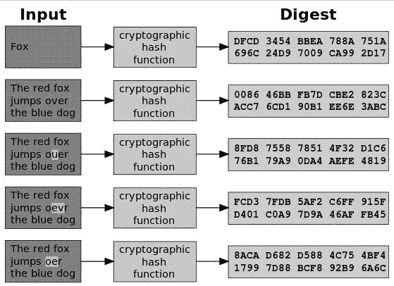

正在工作的加密哈希函数（具体为`SHA-1`）。

输入中的微小变化（单词“over”中的变化）会剧烈改变输出（摘要）。这也被称为“雪崩效应”。

来源 - 维基百科

加密哈希函数具有以下关键属性：

- **不可逆性（Nonreversible）** —— 良好的哈希函数应该让人很难从输出或哈希中重构原始密码。这是通过“抗原像性”实现的，指的是在给定输出的情况下寻找输入是困难的。在数学上，给定一个哈希值`H`，应该很难找到任何消息`x`使得`H = Hash(x)`。

- **确定性（Determinism）** —— 给定的密码必须始终生成相同的哈希值或加密文本。这是通过第二抗原像性实现的，对于任何给定的输入`x`，在计算上很难找到另一个不同的输入`y`使得`Hash(x) = Hash(y)`。

- **抗碰撞性（Collision resistance）** —— 应该找到两个哈希值相同的加密文本的不同密码是困难的。在数学术语中，对于给定的哈希函数`H`，计算上很难找到两个不同的输入`x`和`y`使得`H(x) = H(y)`。

- **不可预测性（Non predictable）** —— 哈希值不应能通过密码预测。

- **扩散性（雪崩效应）** —— 当密码发生轻微变化时，加密文本的输出应该发生显著且不可预测的变化。

从非正式来说，这些属性意味着恶意攻击者无法在不改变摘要的情况下替换或修改输入数据。因此，如果两个字符串具有相同的摘要，可以非常有信心的它们是相同的。第二抗原像性防止攻击者构造出一个与其无法控制的文档具有相同哈值的文档。抗碰撞性防止攻击者创建两个具有相同哈希值的不同文档。

加密哈希潜在用途的插例如所示：假设你给我一个困难的计算问题来解决，并声称你已经解决了它。我想解决这个问题，但是，我想确保你确实已经解决了它。所以，你会写下你的解决方案，计算它的哈希，并告诉我哈希值（同时保持解决方案秘密）。假设我的一周内解决了这个问题。现在你可以通过公布解决方案来证明你早早解决了它，我可以对该解决方案进行哈希，并用你之前给我的哈希值进行验证。

安全哈希的一个重要应用是消息完整性的验证。通过比较传输前后计算的消息摘要（消息的哈希摘要），可以判断消息是否发生了任何更改。使用加密哈希和信任链可以检测到文件的恶意篡改。几乎所有的数字签名方案都需要对消息计算加密哈希。这允许签名计算在相对较小的、固定大小的哈希摘要上进行。如果在给定的签名和对消息重新计算的哈希摘要对比下，签名验证成功，则该消息被认为是真实的。因此，加密哈希的消息完整性属性被用于创建安全高效的数字签名方案。

比特币使用哈希函数`Security Hash Algorithm-256 (SHA-256)`来验证其网络中的`PoW`协议。`SHA-256`最初由美国国家安全局 (`NSA`) 设计。`SHA-256`是`SHA-2`加密哈希函数家族的一部分。它接受小于`2⁶⁴`位的输入大小，并产生`256`位的固定大小输出。比特币在某些情况下会使用`SHA-256d`，这意味着连续使用了两次`SHA-256`，一次针对原始待哈希消息，另一次针对`1st`次哈希的输出。

该系统使用部分哈希反转来证明工作的完成情况，从而解锁比特币的挖矿奖励，并作为`Hash-cash`中发送电子邮件的诚意标记。发送者需要找到一个哈希值以特定数量零开头的消息。发送者找到有效消息所需执行的平均工作量与哈希值所需的零位数量呈指数关系，而接收者可以通过执行单个哈希函数来验证消息的有效性。

## 防篡改

现在我们已经知道了加密哈希函数如何确保数据的完整性，下一步工作是应用这一概念来确保只有授权用户才能访问数据。为了实现这一点，我们需要一种跟踪交易的方法，以管理谁在何时何访问数据。交易的自动、防篡改日志是实现对数据使用情况进行监督的方法。

以下是概念性的防篡改区块的外观。

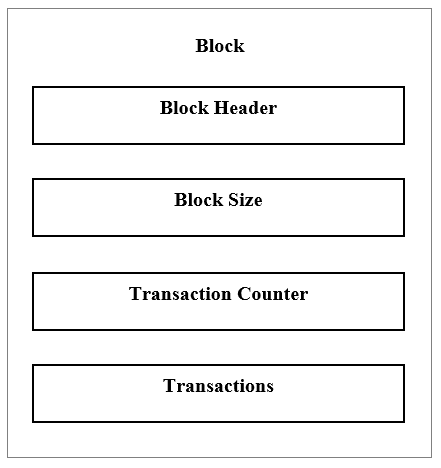

它包含四个主要部分：

* `Block Header` – 该字段代表理解这些组件所需的元数据

* `Block Size` – 该字段代表区块的大小

* `Transaction Counter` – 该字段代表区块中包含的交易数量

* `Transactions` – 该字段代表实际交易数据

区块的防篡改是通过`Block Header`通过应用哈希函数实现的。

## 区块 Header

`Block Header`指与任何区块相关的所有元数据。它由下图所示的`6`个字段组成：

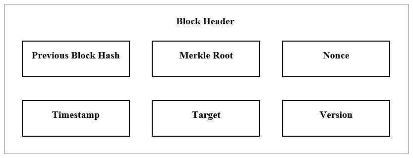

* `Previous Block Hash` – 上一个区块的哈希链接到上一个区块（或其父区块），有效地保护了链的安全性。如果任何区块被修改，随后的区块也将被修改，随后的所有区块也是如此。更改交易历史的任何部分都将改变之后的所有后续交易。

* `Merkle Root` – `Merkle root`由交易内所有经过哈希的交易哈希组成。

* `Nonce` – `Nonce`是矿工可以更改的值，用于创建不同的排列并在序列中生成正确的哈希。

* `Timestamp` – 包含时间戳是为了让节点中的每个人都能看到特定事件发生时的永久性、编码记录。它提供了事件发生的日期和当天的具体时间。

* `Target` – 难度目标简单来说用于调整工作矿工解决区块的难度。

* `Version` – 比特币版本号对于跟踪整个协议的更改和更新非常有用。

## Merkle Tree and Merkle Root

在计算机科学术语中，树是一种具有根节点和一些子节点的数据结构，这些子节点也可以其他树的根。二叉树是一种……的树

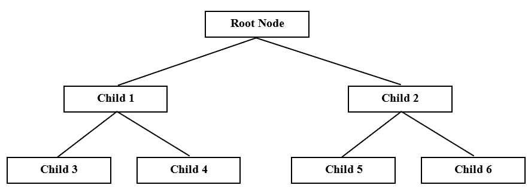

`binary tree`是一种……的树


`binary tree`是一种以`Merkle`命名的树，他在`1979`年获得了该技术的专利。

`Merkle Tree`需要满足以下条件：

* 在底部`at the bottom`

* `of the hashes`

`binary tree`是一种……的树

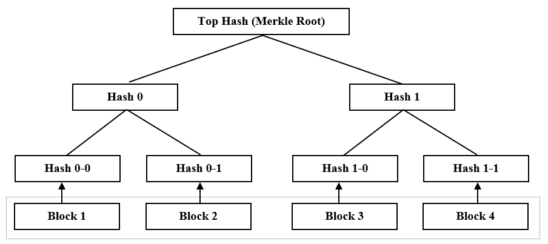

`binary tree`是一种……的树

`binary tree`是一种……的树


`binary tree`是一种……的树

## Partial Preimage Hash


网络中的实体在提交`vote`之前需要证明他们已经做了某些工作。他们必须为自己的计算机设计一个`partial preimage hash puzzle`来求解，以证明他们做了工作。`Partial preimage`意味着`partial input`。在比特币中，我们得到了`part of the input`，我们必须找到`other part`以产生某些`partial output`，并满足`hash of the block header`小于`target value`的条件。这就是`Proof-of-Work (PoW)`在比特币中的实现。这些`hash puzzles`需要具备三个特征：

* `Computationally difficult` – 确保谜题无法被轻易破解

* `Parameterizable` – 谜题的难度应该是调节的，以确保它不会变得太简单或太难

* `Easily verifiable` – 确保网络中的计算机不需要做太多工作即可验证解决方案

## 数字签名

数字签名确保发送到网络其他部分的当前交易也是防篡改的。数字签名验证用户的身份，因为它使用特定的`private key`进行签名，并提供`public key`所有权进行验证。

例如，假设你想给朋友发送一条消息。你如何确保它没有被篡改？因此，在发送消息之前，用你的`private key`对其进行签名以验证你的身份。然后你将`signed message`发给你的朋友。`message`是主体，`digital signature`用于证明该`message`是你创建的。你的朋友可以使用你的`public key`验证你的签名。任何时候，如果此`message`被篡改，`digital signature`将不再有效。这就是`digital signature`使消息防篡改的方式。

数字签名具有以下关键属性：

* `Message origin` – 接收者能够验证原始发送者（`private key`所有者）已授权该消息

* `Non-repudiation` – 原始发送者（`private key`所有者）在发送消息后无法撤回、撤销或使签名失效

* `Message integrity` – 消息在发送后无法被修改

在比特币中，私钥和公钥是通过椭圆曲线数字签名算法 (`ECDSA`) 生成的。椭圆曲线加密 (`ECC`) 是一种基于有限域椭圆代数结构的公钥加密方法。与非椭圆曲线加密（基于普通伽罗华域）相比，ECC 允许使用较小的密钥提供同等的安全性。ECDSA 提供了数字签名算法 (`DSA`)的一种变体，它使用了椭圆曲线加密。

椭圆曲线是由以下方程定义的数学曲线：

```
y² = x³ + ax + b
```

它在有限域上定义，以便在定义的空间内编码所有可能的值，从而限制密钥的大小。

椭圆曲线具有某些独特属性，这有助于创建一个单向函数，从私钥生成公钥，而反之则不然。

假设你想给朋友发送一条签名消息。起初你们双方必须对以下曲线参数达成共识：

* `Curve` – 使用的椭圆曲线域和方程

* `G` – 椭圆曲线基点，曲线上一个生成大素数阶`n`子群的点

* `n` – `G`的整数阶，意味着`n * G = O`，其中`O`是单位元素

* `dA` – 私钥（随机选择）

* `QA` – 公钥（通过椭圆曲线计算）

* `m` – 要发送的消息

你将创建一个密钥对，由一个在区间内随机选择的私钥整数`dA`和一个公钥曲线点`QA = dA * G`组成。你需要遵循以下步骤发送消息：

1. 计算消息`m`的哈希值

2. 令`z`为`e`的左侧`Ln`位，其中`Ln`是群阶`n`的位长度

3. 从`[1,n-1]`中选择一个密码学上安全的随机整数`k`

4. 计算曲线点`(x1, y1) = k * G`

5. 计算`r = x1 mod n`。如果`r = 0`，跳转到第 3 步

6. 计算`s = k^(-1) * (z + rdA) mod n`。如果`s = 0`，跳转到第 3 步

7. 签名即为对`(r,s)`

为了让你的朋友验证你的签名，他必须拥有你的公钥曲线点`QA`的副本，并如下如下验证其是否为有效的曲线点：

1. 检查`QA`是否等于单位元素`O`，且坐标其他有效

2. 检查`QA`是否在曲线上

3. 检查`n * QA = O`

之后，他需要遵循这些步骤：

1. 验证`r`和`s`是否为`[1,n-1]`中的整数。如果不是，则签名无效。

2. 计算消息`m`的哈希值，其中`hash`是与签名生成时使用的相同函数。

3. 令`z`为`e`的左侧`Ln`位。

4. 计算`u1 = zs^(-1) mod n`和`u2 = zs^(-1) mod n`

5. 计算曲线点`(x1, y1) = u1 * G + u2 * QA`。如果`(x1, y1) = O`，则签名无效。

6. 如果`r = x1 (mod n)`，则签名有效，否则无效。

与一般的椭圆曲线加密一样，认为 ECDSA 的公钥位大小大约是安全级别（位）大小的两倍。例如，在 80 位安全级别下，攻击者最多需要大约`2⁸⁰`次操作才能找到私钥，此时 ECDSA 私钥的大小为 160 位，而 DSA 私钥的大小至少为 1024 位。

比特币椭圆曲线被称为`secp256k1`。它的方程为`y² = x³ +7`。它取自一个有限域，以限制密钥大小。该曲线由几个参数指定，包括曲线公式、域和生成点。在这条椭圆曲上，我们可以使用直线和点进行点加法。要加两个点`P`和`Q`，我们画一条穿过它们的直线，直线在 x 轴另一侧交于第三个点`R`，得到我们的结果`P+Q`。这是一个单向函数，因为对于一个给定的`P + Q`的点`K`，很难找到单独的点`P`和`Q`。

要发送比特币交易，用户为其私钥生成一个随机数`n`，并使用椭圆曲线`secp256k1`计算公钥。为了做到这一点，他将内置于`secp256k1`中的已知生成点`P`与自身相加`n`次。给定公钥`nP`，获取私钥在计算上是不可行的，这使得从私钥生成公钥的过程是安全的。

然后为了生成地址，我们首先用`SHA-256`对公钥`nP`哈希，然后用另一个名为`RIPEMD-160`的哈希函数。`SHA-256`使地址具有量子性，使得量子计算机无法反转哈希函数。`RIPEMD-160`将地址大小从 256 位缩短到 160 位。使用`SHA-256`和`RIOEMD-160`的组合被称为“双哈希”或`HASH160`。

之后，我们得到了一个公钥哈希。下一步是让这个公钥哈希更符合人类习惯。首先，我们在之前的`RIPEMD-160`哈希前面添加一个版本字节，其中指定我们处于哪个网络：主网或较小的测试网。然后我们运行`Base58Check`编码，将此哈希转换为`Base58` —— 一种类似于常用的 62 位字符（A-Z, a-z, 0-9）的字母表。`Base58`包含所有数字 0 到 9 以及所有大小写字母，但除了大和小写的`O`以及大小写的`I`以避免歧义。

然后我们计算校验和。

我们对扩展的`RIPEMD-160`哈希执行`SHA-256d`，对其运行两次`SHA-256`。我们取`SHA-256d`的前 4 个字节作为校验和，并将其附加在扩展`RIPEMD-160`哈希的末尾。将此结果转换为`Base58`后，我们最终得到了比特币地址。

在这个地址中，我们成功编码了允许付款的公钥哈希、说明我们所处网络的版本字节，以及防止人为错误的校验和。如果有人复制了错误的地址，那么该地址相对于校验和将是的。


## 比特币交易流程

一个有效的交易必须包含以下三个部分：

* 所有权证明

* 资金充足

* 这些资金仅用于本次交易


为了强制执行，比特币使用了未花费交易输出（`UTXO`）概念。`UTXO`可以被想象为一个包含比特币的盒子，它可以持有任何金额。一旦你拥有了一些，在区块链上你拥有的只是一堆`UTXO`。在所有实际情况下，你可以认为你的`UTXO`是一个装满储钱罐的盒子。假设你想给朋友转账 5 个比特币，你把这 5 个比特币放入一个`UTXO`（储钱罐）。一旦你执行该交易，你就打破了这个储钱罐，它无法再次恢复。你拥有的比特币总额是所有`UTXO`价值之和。

假设你向朋友转了 5 个比特币，这笔交易的历史需要存储在网络中，以确认你和朋友目前拥有的比特币数量，并验证未来的交易。这些信息保存在比特币的分布式数据库——`Blockchain`中。比特币区块链是以一系列区块的形式实现的，每个区块包含前一个区块的哈希值，直到链中的原始区块。运行比特币软件的通信节点网络维护着区块链。节点中的每个人都拥有账本，并且对该交易的有效性拥有与网络其他人相同的投票权。一旦你向朋友转了 5 个比特币，网络节点会对这笔交易进行验证，并将此交易添加到它们的账本副本中。然后它们将这些账本更新广播到其他节点。在平均每 10 分钟的时间间隔内，会创建一个新的被接受交易组，称为`block`，添加到区块链中并快速发布到所有节点，无需中央监督。通过将数据分组为区块，网络就不会因为每笔交易后都更新账本而产生压力。每个区块都是一次更新，区块链代表一段历史。这个过程有助于识别不同版本数据库之间的差异，因为每个节点都可以验证在任何时间账本中实际发生了什么。由于每个区块都是基于前一个区块构建的，它包含了前一个区块的信息。如果任何区块被篡改，该区块以及所有未来区块的信息都会发生变化。这使得篡改变得显而易见，因为篡改过去的交易会导致任何回溯到它的未来区块失效。

在比特币中，每笔交易都是之前交易的输出，并输入新的交易。交易包含未花费资金所有者的签名。这些未花费的交易被称为`UTXOs`。那么你是如何花费你的比特币或`UTXOs`的呢？例如，如果你给我 1 个比特币，那么在那笔交易中会编码为只有通过公钥和签名才能兑换那个`UTXO`的金额。

在比特币中，一笔交易有 3 个主要部分：

- `Metadata` – 包含一些管理数据、唯一的交易 ID、`lock-time`和`block size`
- `Input` – 包含之前创建的`UTXOs`列表，以及我有权兑换这笔钱的证明
- `Output` – 包含将发送到新地址的新的`UTXOs`列表。这个新地址是一个`Bitcoin script`，它锁定交易，并使其仅由我在此交易中指定的特定证明进行兑换。


## Bitcoin Script

Bitcoin Script 是比特币用于执行其能做的一切语言，从处理两个实体之间的财务交易到更复杂的多签名交易。换句话说，`Bitcoin Script`是指比特币中用于处理交易的简单编程语言，从左到右读取。与其将公钥连接在一起，通过`Bitcoin scripts`连接输入和输出允许实现可能复杂的交易。

脚本语言是基于栈的，后进先出（`LIFO`），并且故意不是完全图灵的，这防止了无限或无尽的循环和错误执行。

一个`Bitcoin Script`本质上是记录在每笔比特币交易中的指令列表，描述了想要花费转账比特币的下一个人如何获得它们的访问。向目标地址‘X’传输比特币的脚本加载了两个关于比特币未来花费的条件，发送者必须提供：

- 公钥，该公钥经过哈希后会产生嵌入在脚本中的目标地址‘X’
- 数字签名，用于证明发送者提供的公钥所对应的私钥的所有权

如果组合脚本中没有内容触发失败，并且当脚本退出时栈顶项为`True`（非零），则交易是有效的。现在正在花费的比特币的原始发送者决定了最后发生的脚本操作，以便将其释放给另一笔交易。当前发送者必须提供对之前记录的脚本的输入，使得组合脚本完成执行并在栈顶得到一个真值。

### Operational Code (OP_CODE)

在计算机科学中，操作码或`OP_CODE`是机器语言指令的一部分，它指定了要执行的操作。

通常，这种处理是由计算机硬件（通常是`CPU`）完成的。但它也可以通过专门准备的软件来模拟`CPU`的操作并处理这些指令。通常，一个完整的机器语言指令包含一个`OP_CODE`，操作码必须在其上作用。

在比特币中，`OP_CODES`是系统用于程序化交易指令的骨干。`Bitcoin Script`实际上是一种编程语言，其指令以`OP_CODES`的形式给出，这些指令是比特币网络预先为其操作定义的。比特币结构允许定义 256 个`OP_CODES`的可能，它们从数字 0 到 255 不等。在这些 256 个`OP_CODES`中，目前有 116 个是激活的。

这些`OP_CODES`允许你在比特币及其交易调度中执行不同的操作，例如数据流控制、常量管理、栈管理、逻辑管理、算术、时间锁、伪字、加密操作和保留字。下表描述了比特币的一些关键`OP_CODES`：

| Word | OP_CODE | Hex | Input | Output | Description |
| :--- | :--- | :--- | :--- | :--- | :--- |
| `OP_0` | 0 | `0*00` | 无 | 空 | 将一个字节的字节数组推入栈中 |
| `OP_IF` | 99 | `0*63` | 如果 | 则 / 否则 | 如果栈顶值为假，则执行语句。移除栈顶 |
| `OP_VERIFY` | 105 | `0*69` | 真/假 | 无 | 如果栈顶值不真，则标记交易无效 |
| `OP_EQUAL` | 135 | `0*87` | x1 | x2 | 真/假 | 如果输入完全相等返回 1，否则返回 0 |
| `OP_ADD` | 147 | `0*93` | a | b | 输出 | 将 a 加 b |
| `OP_SUB` | 148 | `0*94` | a | b | 输出 | 从 a 中减 b |
| `OP_NEGATE` | 143 | `0*8f` | 输入 | 输出 | 翻转输入的符号 |
| `OP_ABS` | 144 | `0*90` | 输入 | 输出 | 使输入为正 |
| `OP_NOT` | 145 | `0*91` | 输入 | 输出 | 如果输入是 0 或 1，则翻转它。否则输出为 0 |
| `OP_NUMEQUAL` | 156 | `0*9c` | a | b | 输出 | 如果数字相等则返回 1，否则返回 0 |
| `OP_RIPEMD160` | 166 | `0*a6` | 输入 | 输出 | 哈希 | 使用 RIPEMD160 对输入进行哈希 |
| `OP_SHA256` | 168 | `0*a8` | 输入 | 输出 | 哈希 | 使用 SHA256 对输入进行哈希 |
| `OP_HASH160` | 169 | `0*a9` | 输入 | 输出 | 哈希 | 对输入进行两次哈希。首先使用 SHA256，然后使用 RIPEMD160 |
| `OP_HASH256` | 170 | `0*aa` | 输入 | 输出 | 哈希 | 使用 SHA256 对输入进行两次哈希 |
| `OP_CHECKLOCKTIMEVERIFY` | 177 | `0*b1` | X | X | 失败 | 如果栈顶项大于交易的 nLockTime 字段，则标记无效，否则脚本评估继续如同执行了 OP_NOP |
| `OP_CHECKSEQUENCEVERIFY` | 178 | `0*b2` | X | X | 失败 | 如果输入的相对锁定时间不等于或大于栈顶项的值，则标记交易无效 |

### Script Template

每个比特币脚本被分为两类脚本以实现交易：

- `Unlocking script (scriptSig)` – `scriptSig`是解锁脚本，位于由花费者提供的交易输入中，用于兑回之前交易的输出。它需要一个公钥和一个数字签名。只有当签名及其验证符合一组确保网络正常运行的既定规则时，系统才会执行该交易。
- `Locking script (scriptPubKey)` – `scriptPubKey`是锁定脚本，位于交易输出中，它规定了兑回交易的要求。它包含一个公钥哈希值，也称为比特币地址。这种方式的比特币交易的安排就存储在脚本的这部分。

## 脚本示例

假设你想向某个地址发送一个比特币。脚本将是：

```
scriptPubKey: OP_DUP OP_HASH160 <pubKeyHash> OP_EQUALVERIFY OP_CHECKSIG
scriptSig: <sig> <pubKey>
```

在这个示例中，锁定脚本要求想要从之前的交易中花费的用户必须证明他拥有一个私钥，该私钥的哈希值对应特定的地址。因此，该脚本被称为`scriptPubKey`。为了让解锁脚本和锁定脚本协同工作，我们将解锁脚本（`scriptSig`）放在锁定脚本（`scriptPubKey`）的上方并一起运行。整个生成的脚本必须执行成功，交易才被视为有效。

同样，假设你想冻结你的比特币直到未来的某个时间点。脚本将是：

```
scriptPubKey: <expiry time> OP_CHECKLOCKTIMEVERIFY OP_DROP OP_DUP OP_HASH160 <pubKeyHash> OP_EQUALVERIFY OP_CHECKSIG
scriptSig: <sig> <pubKey>
```

在这个示例中，如果交易的日期时间小于用户设置的未来日期时间，锁定脚本将该交易标记为无效。

在比特币中创建脚本语言的目的是提供一系列简单且灵活的参数来启用交易。正是这种编程语言决定了某个操作是否可以执行。简单来说，`Bitcoin Script`的创建赋予了比特币可编程性。这使得我们能够发送一个只有在满足特定条件时才有效的交易。这种属性是比特币和加密货币所独有的，是今天的数字货币无法实现的，更不用说物理货币了。这是货币的演进达到了一个点，使得货币仅仅通过其嵌入的编程就可以独立且去中心化地运行。

此外，比特币脚本还防止了系统错误的产生以及对非常复杂交易的不必要使用。事实上，脚本使得交易计算变得相对简单。

## 指向公钥哈希支付 (P2PKH)

`Pay-to-Public-Key-Hash (P2PKH)`是一种`scriptPubKey`类型，它将比特币锁定公钥的哈希值。`P2PKH`交易是指输入使用`P2PKH` `scriptPubKey`锁定的交易。公钥哈希也称为地址，`P2PKH`是目前常见的脚本类型。

让我们回到之前的示例，你想向某个地址发送一个比特币。脚本将是：

```
scriptPubKey: OP_DUP OP_HASH160 <pubKeyHash> OP_EQUALVERIFY OP_CHECKSIG
scriptSig: <sig> <pubKey>
```

由于比特币脚本是：

1. `OP_DUP`
2. `OP_HASH160`
3. `<pubKeyHash>`
4. `OP_EQUALVERIFY`
5. `OP_CHECKSIG`
6. `<sig>`
7. `<pubKey>`

## 指向脚本哈希支付 (P2SH)

`Pay-to-Script-Hash (P2SH)`是一种`scriptPubKey`类型，它将比特币锁定脚本的哈希值。`P2PKH`交易是指输入使用`P2PKH` `scriptPubKey`锁定的交易。公钥哈希也称为地址，`P2PKH`是目前常见的脚本类型。

## P2PKH vs P2SH

`Pay-to-Public-Key-Hash (P2PKH)`是一种`scriptPubKey`类型，它将比特币锁定公钥的哈希值。`P2PKH`交易是指输入使用`P2PKH` `scriptPubKey`锁定的交易。公钥哈希也称为地址，`P2PKH`是目前常见的脚本类型。

## 多重签名 (Multisig)

`Multisig`指需要多个密钥来授权交易，而不是单个密钥的单一签名。典型的`multisig`方案是 m-of-n，即需要 n 个用户中的 m 个用户对交易进行签名，交易才被视为有效。

## 时间锁

- **绝对时间锁（Absolute time-lock）**指定未来的某个特定时间点，此时该交易变得有效。这通过时间戳或区块高度来实现。
- **相对时间锁（Relative time-lock）**指定区块深度，或在当前区块之上构建的区块数量。

时间锁可以是事务级的，也可以是脚本级的。

- **事务级时间锁**可以对事务本身施加时间锁。这种时间锁确保事务在未来的特定时间之前不会被包含在有效的区块中。
- **脚本级时间锁**可以对特定的 UTXO 施加时间锁，并使用比特币脚本进行指定。这种 UTXO 层时间锁规定 UTXO 在指定时间之前无法花费。这确保了发送者无法在时间锁解锁之前将 UTXO 发送到另一个地址来覆盖交易。

## 比特币网络

比特币结构为基于互联网之上的点对点（P2P）网络架构，这意味着参与比特币网络的计算机都是平等的，没有“特殊”节点，且所有节点共同承担提供网络服务的负担。网络节点以“扁平”拓扑结构在网格网络中互连。网络中没有服务器、没有中心化服务，也没有层次结构。点对点网络中的节点同时提供和消费服务，互惠是参与的激励。点对点网络本质上是韧性的、去中心化的开放的。

“比特币网络”一词指的是运行比特币 P2P 协议的节点集合。除了比特币 P2P 协议外，还有其他协议，例如用于挖掘和移动钱包的`Stratum1`。这些额外的协议由网关路由服务器提供，这些服务器使用比特币 P2P 协议访问比特币网络，然后将网络扩展到运行其他协议的节点。“扩展比特币网络”指的是整体网络，包含了比特币 P2P 协议、矿池挖掘协议、`Stratum`协议以及任何其他连接比特币系统组件的相关的协议。

尽管比特币 P2P 网络中的节点是平等的，但它们可能根据其支持的功能承担不同的角色。比特币节点是多个功能的集合：网络路由、维护区块链数据库、挖矿和管理钱包服务。**全节点（Full Node）**包含所有这些功能，能够自主且权威地验证任何交易而无需外部引用。某些节点仅维护区块链的子集，并使用称为“简化支付验证”（SPV）或**轻节点（Lightweight Nodes）**的方法来验证交易。**挖矿节点**通过运行专用硬件解决工作量证明算法来竞争创建新区块。某些挖矿节点是全节点，维护区块链的完整副本，而另一些 SPV 则参与矿池挖掘并依赖矿池服务器来维护全节点。

除了比特币 P2P 协议上的主节点外，还有运行其他协议的服务器和节点，例如专门的矿池协议和轻量级客户端访问协议。

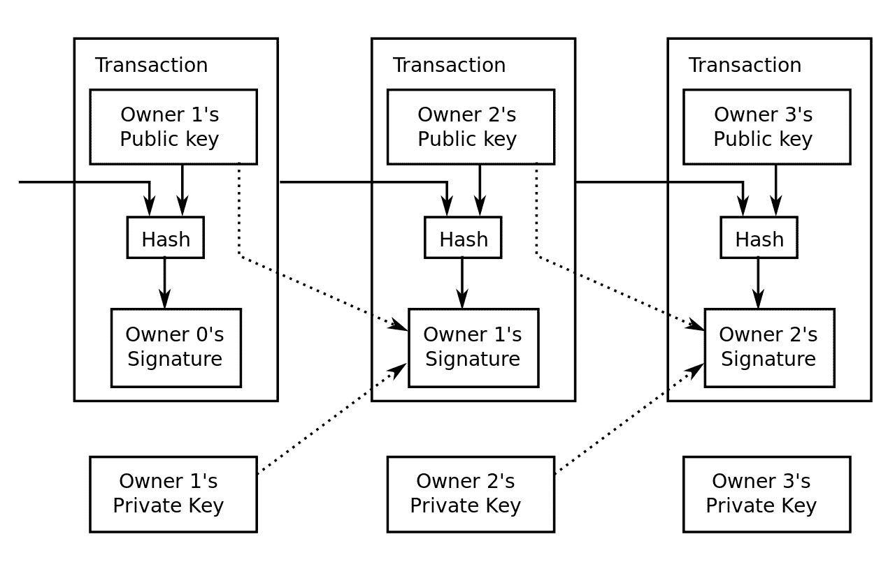

### 通过比特币网络进行比特币传输

来源 - Wikipedia

## 比特币用户

有许多类型的比特币用户，取决于他们与比特币网络交互的方式。比特币网络中的用户体验差异很大，取决于用户是轻量级用户、拥有全节点、独立矿工还是运行矿场。并不是每个用户都需要拥有整个区块链。

比特币总共有四种功能——挖矿、网络路由、维护区块链和钱包管理，比特币用户之间的区别就在于这四种功能。

有四种比特币用户：

- **轻量级用户（Light User）**——这类用户是最常见的比特币用户。他关注比特币作为投资或货币的潜力。他不需要区块链的完整副本。他主要使用网络路由节点与网络其他部分收发比特币，并使用钱包功能帮助管理密钥。
- **矿工（Miner）**——这类用户是计算机程序员，使用挖矿功能和全区块链副本来解决 P-o-W 协议中的哈希难题，并通过网络路由节点功能向整个网络广播。
- **全节点所有者（Full Node Owner）**——该用户负责拥有比特币节点并利用比特币的区块链和网络路由节点功能验证交易并检查网络中的任何异常。
- **运行矿场（Running a mining farm）**——这类用户是比特币的核心，使用比特币网络的所有功能。

## 比特币钱包

比特币钱包存储交易比特币所需的信息。比特币钱包被定义为“存储你的比特币持有的数字凭证的物品”，并允许你访问和花费它们。因此，它是存储和访问你的私钥的方法，从而允许你交易相应的比特币。比特币钱包的主要功能是跟踪你的身份。比特币钱包软件存储有关区块链的所有相关信息。

第一个钱包程序简单名为`Bitcoin`，有时被称为`Satoshi client`，由中本聪（Satoshi Nakamoto）于 2009 年作为开源软件发布。在版本`0.9`发布后，软件包包被重命名为`Bitcoin Core`以与底层网络区分开来。`Bitcoin Core`可能是最为人知的实现或客户端。存在其他客户端，例如`Bitcoin XT`、`Bitcoin Unlimited`和`Parity Bitcoin`。

比特币钱包根据与互联网的连接情况分为两大类。**热钱包（Hot wallets）**连接到互联网，**冷钱包（Cold wallets）**不连接。

### 热钱包

热钱包是连接到互联网的比特币钱包。它们通过全客户端或轻量级客户端连接到比特币网络。

热钱包的一些示例包括手机应用，如`Mycelium` / `AirBitz`，在线网页钱包如`eToro.com` / `coinbase.com` / `blockchain.info`。

- **全客户端（Full Clients）**通过下载区块链的完整副本直接验证交易。它们是使用网络最安全、可靠的方法，因为不需要信任外部实体。全客户端检查已挖区块的有效性，防止它们在破坏或更改网络规则的链上进行交易。然而，由于巨大的体积和复杂性，下载和验证整个区块链并不适用于所有的计算设备。


### 轻量级客户端

**轻量级客户端（Lightweight Clients）**咨询全节点以发送和接收交易，而不需要本地完整的区块链副本。这使得它们的设置快得多，并允许它们在手机等低功耗、低带宽设备上使用。然而，在使用轻钱包时，用户必须信任全节点，因为它可以向用户报告错误值。轻量级客户端遵循最链但不保证其有效性，因此需要对全节点的信任。

被称为在线钱包或网页钱包的第三方互联网服务提供类似的功能，但可能更容易使用。访问资金的凭证存储在在线钱包提供者处，而不是用户的硬件上。用户必须对在线钱包提供者完全信任。恶意的提供者或服务器安全漏洞可能导致委托的比特币被盗，例如，`Mt. Gox`安全漏洞发生于 2011 年。

### 冷钱包

钱包软件是黑客的目标，因为窃取比特币具有巨大的收益潜力。被称为“冷存储（Cold Storage）”的技术可以使私钥远离黑客的范围；这是通过始终保持私钥离线，通过在不连接互联网的设备上生成私钥来实现的。

花费比特币所需的凭据可以通过几种不同的方式离线存储，从专门的硬件钱包到私钥的简单纸质打印。

- **纸钱包** – 纸钱包是在没有连接互联网的计算机上生成密钥对创建的；将私钥写入或打印在纸上，然后从计算机中删除。此纸质钱包可以存储在安全的物理位置以备日后提取。纸钱包可以在`bitcoinpaperwallet.com` / `bitaddress.org`等网站上生成。这些网站要求在断开计算机网络后，下载整个网站并在本地运行程序。它们还警告了可能会缓存文件或被攻击的智能打印机和操作系统。物理钱包也可以以金属代币的形式存在，其私钥可以通过位于背面凹槽处、的安全全息膜下进行访问。当安全全息膜从代币上移除时，它会自毁，从而表明私钥已被访问。

- **硬件钱包** – 硬件钱包是一种计算机外设，根据用户请求对交易进行签名。硬件钱包存储私钥，并在受信任的执行环境中执行签名和加密，该环境独立于计算机运行且从不接触互联网。因此，除了已经数字签名的交易外，它们不会与主机计算机共享任何敏感信息。因为硬件钱包从不暴露其私钥，即使可能被恶意软件感染的计算机也没有访问或窃取它们的途径。用户在设置硬件钱包时会设置密码。由于硬件钱包具有防篡改性，提取任何资金都需要密码。硬件钱包的示例包括`Ledger`、`Trezor`、`Case`和`Keep Key`，这些设备通过`USB`连接到计算机以对交易进行数字签名。

为了增强安全性进一步减少他人发现你私钥的概率，可以使用密钥伸展（key stretching），即对钱包进行多次哈希处理。攻击者不仅必须猜测初始密码，还必须猜测哈希了多少次，这使得猜测私钥的难度呈指数级增长。

## 轻量级钱包机制

在轻量级或第三方客户端的情况下，你不需要下载整个比特币区块链。你可以利用简单支付验证（`SPV`）方法，通过仅下载每个区块的头部而不是整个区块，来验证交易是否包含在区块中。这对于受存储容量限制的客户端非常有用，因为不需要存储完整的区块链。

在使用`SPV`时，你需要做的一个假设是传入的区块头部不是来自虚链。如果区块头部是伪造或来自虚链，那么你认为有效的交易可能并非如此，有人可以对进行双重花费。然而，只要你连接到多个节点，每个节点被恶意实体控制的概率就非常低。

## 钱包备份

- **JBOK 钱包** – 如果你有多个密钥，如何管理它们，特别是当你频繁在比特币上进行交易时？跟踪密钥的传统方法是通过`JBOK`（Just a Bunch of Keys，一组密钥）钱包。`JBOK`钱包是一种比特币钱包，它根据用户需要随机生成新的、不相关的密钥。`JBOK`钱包是比特币区块链上引入的早期钱包，但证明使用非常麻烦，因为用户必须存储每一个密钥对。

- **分层确定性 (HD) 钱包** – 分层确定性（`HD`）钱包是描述一种使用种子（seed）派生公钥和私钥的钱包术语。`HD`钱包可以通过存储单个`64 bytes`的种子进行备份。分层一词描述了密钥的树形结构：钱包种子派生出一个主密钥，主密钥用于派生子密钥，每个子密钥都可以派生它们自己的后代。树中的每个子密钥都可以通过其派生路径描述，该路径包含密钥深度和索引的信息——即它在树形结构中的位置。派生路径告诉钱包如何派生特定的密钥。

## 比特币挖矿

比特币挖矿是通过计算机计算能力完成的记录服务。矿工通过反复将新广播的交易分组为一个区块，然后将区块广播到网络并由接收节点验证，从而保持区块链的一致性完整性和不可篡改。每个区块都包含上一个区块的`SHA-256`加密哈希，因此将其与上一个区块链接，并赋予了区块链名称。

比特币挖矿的步骤如下：

1. **步骤 0**: 初步步骤是下载整个比特币区块链。这让矿工了解比特币历史，以便他能够验证未来的交易。这被称为`步骤 0`有两个原因：

    - 它只需要执行一次。一旦矿工拥有完整的比特币区块链历史，他就不需要再次下载它。他只需要跟踪来自其他矿工的传入区块。

    - 此外，拥有`SPV`节点的矿工只需要存储区块头部并向全节点请求信息以验证交易。这意味着这一步是可选的。

2. **步骤 1**: 这一步是验证网络中的有效交易。比特币用户不断向比特币网络发送新交易，矿工的职责是验证所有这些交易。

    当矿工接收交易时，他们将其存储在`mempool`（内存池）中，`mem`表示内存，`pool`表示交易供应。所有待处理交易在进入区块之前都存储在`mempool`中。然后矿工根据交易费用选择要验证的交易，并通过通过运行解锁脚本来验证交易的有效性。该脚本成功解锁之前的比特币，交易随后通过。

3. **步骤 2**: 验证交易后，是时候生成一个包含这些交易的区块了。构建区块需要几项信息；例如从交易列表生成的`Merkle Root`（梅克尔根）、`hash`、`time-stamp`（戳）、`version`（版本）和目标地址。

    ```
    (Images/image0253.gif)
    ```

    - **步骤 3**: 这一步涉及工作量证明（`PoW`），通过寻找名为`nonce`（一次性数字）的数字来解决部分原像哈希谜题。这个`nonce`使区块头的哈希小于某个目标值（当区块内容与`nonce`一起哈希时，结果在数值上小于网络难度目标）。

    ```
    (Images/image0254.gif)
    ```

    通过找到`nonce`，矿工将他在计算中消耗的能量直接转化为`PoW`共识协议的投票权。

    - **步骤 4**: 找到`nonce`后，矿工尽快向整个网络广播他的区块（如果任何竞争对手尚未广播他们的区块），并让其他矿工意识到发现了一个新区块。这些矿工在将其接受到自己的区块链之前会对其进行验证，然后再次广播。通过广播此区块，其他矿工会放弃之前的区块，并开始在这个新的最长链上挖矿。

    ```
    (Images/image0255.gif)
    ```

    所有模式的区块广播；来源 – CB Insights

    - **步骤 5**: 一旦`P-W`被网络验证，区块将被附加到最长链上。一旦发生这种情况，矿工获得区块奖励，由 coinbase 交易和交易费表示。该区块内的所有交易都被添加到交易历史中，矿工获得一些比特币作为利润。

当两个同时提交到网络的区块发生相互竞争时，就会出现这种情况。在这种情况下，矿工会在这些区块之间进行随机选择。此外，如果该区块是孤儿区块或不在最长链中，矿工将无法获得利润。

这种证明对于网络中的任何节点都是容易验证的，但生成过程极其耗时，因为对于安全的加密哈希值，矿工必须尝试许多不同的`nonce`值，直到某个结果小于难度目标。通过调整此难度目标，可以改变生成一个区块所需的工作量。每 2,016 个区块（考虑到每个区块约 10 分钟，大约 14 天），节点会根据最近的区块生成率确定地调整难度目标，目标是将新区块之间的平均时间保持在十分钟。通过这种方式，系统能够自动适应网络上的总算力总量。

工作量证明结合区块链，使得修改区块链变得极其困难，因为攻击者必须修改所有后续区块才能使某个区块的修改被接受。随着新区块的不断产生，随着时间的推移和后续区块数量（称为该区块的确认数）的增加，修改区块的难度也会随之增加。

### 挖矿激励

区块链协议内的任何类型的激励机制都能将个人利润与整体利润相结合。网络中的每个矿工都试图使其利润的价值最大化。

`Bitcoin Profit = 比特币收入 – 比特币成本`

`Bitcoin Revenue = 区块奖励 + 交易手续费`

`Bitcoin Cost = 固定成本 + 变动成本`

- **区块奖励** – `Block Reward`是比特币矿工最重要的收入来源。这是矿工在其区块被包含在最长链中后获得的奖励。

由于比特币的最大数量为 2,100 万个，且大约每 10 分钟就会创建一个新区块，因此根据设计，每个区块铸造的比特币数量每隔 210,000 个区块（大约每四年一次）减少 50%。在比特币最初建立时，`Block Reward`为 50 个比特币，到 2020 年 5 月已减少到 6.25 个比特币。

矿工会向自己发送一笔特殊的交易，即`coinbase transaction`。它允许铸造比特币，并激励诚实的实参与者来验证区块。由于矿工会因添加新区块而获得奖励，因此他们有动力产生更多区块。

- **交易手续费** – 每笔比特币交易都会花费 0 个或多个比特币发送给 0 个或多个接收者。花费金额与接收金额之间的差就是`transaction fee`。比特币的设计让支付者能够轻松高效地指定支付多少手续费，而让接收者指定手续费则更困难且效率更低，因此根据惯例，支付者几乎独自负责支付所有的比特币交易手续费。当矿工创建一个区块时，他有权指定该区块中所有交易支付的手续应发送到何处。如果交易产生了有效区块并成为最长链的一部分，手续费收入将发送给指定的接收者。如果一个有效区块没有收集到所有可用手续费，未收集的部分将被永久销毁。

- **固定成本** – 允许用户挖矿比特币的硬件成本是固定成本。有不同类型的硬件，从计算设备到各种计算设备。

- **CPU (中央处理器)**: 第一类硬件。

- **GPU (图形处理器)**: 第二类硬件。

- **FPGA (现场可编程门阵列)**: 第三类硬件。

- **ASICS (专用集成电路)**: 第四类硬件。

- **运营成本** – 运营成本的主要部分是能源成本。能源有三种类型：隐含能、电力和冷却。此外，还有基础设施和开销，例如租金成本和员工工资。

### ASICS

比特币挖矿使用的`专用集成电路 (ASICs)`是用于挖掘比特币的高度专业化且强大的计算机。如今，所有的标准矿矿场都由`ASICs`组成。否则，将永远无法盈利。


比特币 ASIC 挖矿场；来源：Bitcoin.com

上面的图片说明比特币挖矿已经变得非常工业化，以降低成本并增加利润。机架用于系统化地分配硬件，机架上方巨大的风扇用于冷却。冷却有两种方法：水冷和风冷。水冷成本更高，但对能提供更好的硬件维护。为了降低成本，矿工会选择气候寒冷且电费便宜的地方。

最强大的比特币`ASICS`之一是`Antminer S9`，其能力每秒高达 14 万亿哈希。其生产公司`BITMAN`声称`Antminer S9`提供了世界上约 70% 的算力。然而，即使使用如此强大的设备，找到一个区块也需要相当的时间。

### 矿池

矿池是由加密货币矿工组成的联合小组，他们通过网络结合计算资源以增加发现区块的概率。因此，矿池允许这些矿工将算力结合在一起。如果矿池成功并获得奖励，该奖励将在矿池参与者之间分配。这些奖励通常根据每个矿工的处理能力或工作相对于整个小组的比例在贡献矿工之间分配。在某些情况下，个人矿工必须展示`PoW`才能获得奖励。

矿池由矿池经理运行，经理负责运行一个完整的比特币节点并将任务分发给矿工。矿池经理还会提取部分奖励作为补偿。这样一来，矿工甚至不需要自己存储区块链：他们将硬件的访问权交给矿池，以换取矿池利润的分红。

矿池中的矿工正尝试基于`Merkle Root`解题，并对区块头中的所有内容进行哈希。矿工通过“份额”（shares）来证明他们正在为矿池工作。份额被定义为近有效区块或有效区块。例如，一个矿工刚刚发现了一个前导零数量仅为有效区块一半的区块哈希值。矿池可以使用这些信息来衡量该矿工贡献了多少算力，并对其有效份额给予奖励。这样一来，即使矿工从未发现过有效区块，也能获得报酬，因为这些近有效区块证明了他至少尝试过寻找区块。

奖励通过`coinbase transaction`（币基）发放。哈希谜题包含一个`coinbase transaction`，它向矿池经理支付区块奖励。矿池经理将此区块奖励重新分配给矿工。

## 矿池支付方法

有若干种常见的协议管理着许多最受欢迎的矿池。

- **比例矿池 (Proportional Mining Pools)** – 在此类矿池中，贡献矿池处理算力的矿工将获得份额，直到矿池成功找到一个区块。之后，矿工获得的奖励与其在区块被找到之前提交的份额数量成正比。这种方法对矿池更有利，因为他们支付的资金不会超过获得的资金，但它给矿工带来了更大的波动和风险。

- **按份额付费矿池 (Pay-per-share Pools)** – 它们的运作方式与其相似，每个矿工都会根据其贡献获得份额。然而，这些矿池无论区块何时被发现都提供即时支付。贡献此类矿池的矿工可以随时将份额兑换为比例奖励。支付是保证的，且每份金额恒定，无论矿池获得了多少奖励。大多数矿池都使用这种方法，因为它容易实现。

- **点对点矿池 (Peer-to-peer Mining Pools)** – 它们整合了与矿池本身独立的区块链，旨在防止矿池运营者作弊，防止矿池本身因单一中心化问题而崩溃。

## 矿池的优势

虽然个人挖矿成功可以获得奖励的所有权，但由于对算力和资源的要求很高，成功的概率非常低。对于个人而言，挖矿通常不是一项有利的投资。随着这些数字货币普及性的提高，许多加密货币的挖掘变得越来越困难，因为为了成为具有竞争力的矿工而所需的昂贵硬件以及电力成本往往超过了潜在的奖励。矿池在硬件和电力成本方面对每个个人参与者的要求更低，并增加了盈利的机会。虽然个人矿工成功发现区块并获得挖矿奖励的机会可能很小，但与他人合作可以大大提高成功率。

此外，软件的更改很容易实现，因为只有一个人在为矿池运行全节点，并可以代表矿池进行升级。

## 矿池的劣势

通过参与矿池，个人放弃了挖矿过程中的部分自主权。他们通常受到矿池自身设置的条款限制，这些可能规定挖矿的方法。他们还被分配任何潜在奖励，这意味着参与矿池的个人利润份额较低。

此外，矿工需要依靠矿池经理，确保他们不会滥用算力且扣留奖励。这是中心化的结果。根据`blockchain.com`的数据，少数矿池（如`AntPool`、`Poolin`和`F2Pool`）主导了比特币的挖矿过程。尽管许多矿池尝试去中心化，但这些群体整合了治理比特币协议的大部分权限。对于某些加密货币支持者来说，少数强大矿池的存在违背了比特币固有的去中心化结构。

另一个劣势是单一实体可能会隐藏其总算力。这被称为“哈希洗钱”（`laundering hashes`）通过隐藏原始算力来实现。这允许矿工利用更大的算力，而无需向矿池网络暴露其实力，并换取更高的利润。

## 比特币治理

比特币最大的特性之一是去中心化。然而，随着`ASICs`、矿池和矿场的发展，比特币挖矿正变得越来越中心化。`ASICs`在某种意义上是中心化的，因为它们非常昂贵，只有少数人能获得。另一方面，矿池和矿场也是中心化的，因为它们由单一实体运行。

这个问题可以通过尝试重新设计底层的哈希谜题来解决。谜题应该是难以求解但容易验证的。这种难度应该能够适应挖矿技术的变化（例如 – `ASICs`）。谜题还应该是“进度无关”的，这意味着发现哈希值不会使其变得更容易。

### ASIC 抗性

比特币挖矿的最初理念是`1 CPU 1 Vote`，这使其实现了真正的去中心化。`ASICs`的兴起削弱了这一点，使得某些人比其他人拥有更多的投票。

`ASICs`之所以有效是因为很容易创建计算特定谜题的硬件。它们受限于计算。解决 ASIC 主导地位问题的方法是制作不仅依赖于计算速度而且依赖于内存的谜题，从而产生了内存困难型（memory-hard）和内存受限（memory-bound）问题的概念。内存困难型问题需要大量资金来解决。内存受限问题则取决于你拥有的内存量。这些问题阻碍了 ASIC，因为如果内存是限制，优化计算能力就是徒用用功。

如`Dogecoin`和`Litecoin`等新加密货币实现了一种名为`Scrypt`的内存受限哈希函数。它们使用与比特币类似的部分哈希预象像谜题，只是使用了不同的哈希函数。因此，比特币的 ASIC 无法用于 Dogecoin 或 Litecoin。

`Scrypt`有两个主要步骤：

1. 用相互依赖的数据填充缓冲区

2. 以伪随机的方式访问这些数据

`Scrypt`最初设计用于保护密码并使其难以被暴力破解，因此内存受限类型的问题是合理的。基于密码的密钥派生函数（`KDF`）通常被设计为计算密集型，因此计算需要较长的时间。合法用户每次操作仅需执行一次函数，因此所需时间可以忽略不计。然而，暴力攻击可能需要执行数十亿次操作，此时时间要求将变得显著，并且理想情况下是不可逾越的。

`Scrypt`函数的设计通过提高算法的资源需求来阻止此类尝试。具体而言，该算法与其他基于密码的 KDF 相比设计为使用大量的内存，使得硬件实现的尺寸和成本变得昂贵，从而在给定的财务资源范围内限制了攻击者可以使用的并行度。

然而，Scrypt 也有它的缺点。它在验证时需要等量的内存，这并不理想，因为谜题应该是易于验证的。此外，尽管`Scrypt`的设计初衷是抗 ASIC，但实际上已经针对它开发出了 ASIC 芯片。

实现抗 ASIC 的另一种方法是将多个哈希函数链联在一起，因为创建一个处理多个哈希函数而不仅仅是单个函数的 ASIC 要困难得多。这就是`x11`和`x13`设计背后的思想，它们链联了 11 个和 13 个不同的哈希函数。另一种使系统抗 ASIC 的方法是设计定期切换挖矿谜题的货币，使其难以优化。例如，每个月从`SHA-1`切换到`SHA-3`再到`Scrypt`。然而，创建这种算法的开销非常高，阻碍了人们实现它。


反对抗 ASIC 的一个反论点是，由于 ASIC 专门设计用于解决密码学难题，它们无法执行任何其他任务。因此，拥有 ASIC 的矿工就与网络深度绑定。如果一个拥有大量矿工的系统从 ASIC 环境切换到抗 ASIC 环境，那么 `Bitcoin` 的汇率将会崩盘，许多矿工将突然拥有的无用的 ASIC 设备，并且失去了挖矿的动力。

## 消除浪费

既然有如此多的算力用于解决密码学难题，仅仅是为了寻找随机数，为什么不制作可以执行有用任务的谜题呢？例如，矿工可以寻找大素数、在原子水平模拟蛋白质、寻找外星人或生成预测性气候模型。

| 项目 | 成立时间 | 目标 | 影响 |
| --- | --- | --- | --- |
| 大网络梅森素数搜索 | 1996 | 寻找大梅森素数 | 连续 12 次发现新的“最大素数” |
| Distributed.net | 1997 | 密码学暴力破解演示 | 首次成功公开破解了 64 位加密密钥 |
| SETI | 1999 | 识别外星生命迹 | 迄为止最大的项目，拥有超过 500 万参与者 |

利用 `Bitcoin` 网络的算力可以快地解决这些问题。

然而，存在一些问题。这些分布式计算问题通常不适用于 `PoW`，且不能作为密码学难题工作。系统中的数据量是固定的，导致问题的数量有限。如果有人找到了某个特定问题的解决方案，会发生什么？或者如果数据不足以找到解决方案怎么办？这些谜题无法再用于 `PoW` 了。

在 `Bitcoin` 中，由于谜题是基于上一个区块的，问题空间是无穷尽的。相比之下，如果我们使用 `SETI` 作为谜题，我们可能会耗光原始射电望远镜数据，导致没有问题可以解决。假设你正在太空中寻找行星。空间的一部分可能比其他部分更拥挤。但在 `Bitcoin` 的哈希函数中，找到解决方案的平均难度是相等的。

最后，这些问题是由中心化实体管理的，而 `Bitcoin` 的问题是由其协议创建的。当我们依赖中心化实体来创建问题时，它就留下了合谋或剥削的可能。

因此，`PoW` 是一个伟大的主意，但在现实场景中实施极其困难。

## 共识更新

共识更新背后的思想是 `Bitcoin` 是去中心化的，没有任何单一实体可以影响协议的任何更新。网络中的每个人都必须同意并达成共识，更新才能发生。

这引出了区块链更新的两种方式。

*   **硬分叉（Hard forks）** – 硬叉产生于新协议执行了旧协议中不允许的操作。换句话说，硬叉是不向后兼容的。例如，`Bitcoin Cash` 将区块大小从 `1 Mb` 增加到 `8 Mb`。旧遗留 `Bitcoin` 协议上的节点将拒绝新的 `8 Mb` 块，导致如图所示的永久性分叉。

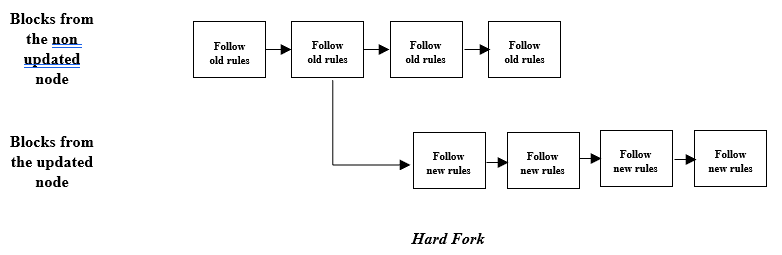

从理论上讲，只要这两个区块链都有支持且矿工持续运行软件，这两个分叉就会永远持续下去。

*   **软叉（Soft forks）** – 在软叉中，新协议的规则仅受到限制。例如，如果一个新的 `Bitcoin` 分叉将区块大小减了一半，那么新协议中有效的所有内容在旧协议中仍然有效。然而，旧协议的区块在新协议中不再有效，这意味着软叉是向后兼容的，但向后兼容的。如图所示，新旧节点将接受来自新协议的区块，但旧节点的区块永远不会被接受到新节点挖掘的最长链中。

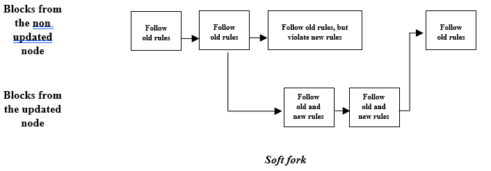

## Bitcoin 改进提案 (BIP)

在 `Bitcoin` 中，协议的更改以 Bitcoin 改进提案（`BIP`）的形式出现。这些可以是网络协议、区块或交易验证的更改，或者是任何影响互操作性的更改。矿工通过在挖掘的区块中包含对该 `BIP` 的引用来投票。BIP 有三种类型：

*   **标准 BIP（Standard BIP）** – 对 `Bitcoin` 协议的实际升级或更改。这是 `Bitcoin` 生态系统变化的方式，也是矿工投票的对象。

*   **信息性 BIP（Informational BIP）** – 关于人们应该如何做事的指南，但没有对 `Bitcoin` 协议进行更改。

*   **流程 BIP（Process BIP）** – 关于 `Bitcoin` 协议的具体最佳实践。

# 基于区块链的加密货币 – 以太坊

Bitcoin 之后，下一个最流行的区块链平台是 `Ethereum`。

在本章中，我们将讨论 `Ethereum` 及其历史。我们将学习智能合约以及它们如何通过 `Ethereum` 实现。我们将了解 `Ethereum` 的设计以及它与 `Bitcoin` 的不同之处。我们将了解 `Ethereum` 挖矿和以太虚拟机（`EVM`）。最后，我们将讨论 `Ethereum` 在各行业的用例及其生态系统。

`Bitcoin` 的主要用例是价值存储和数字货币。`Ethereum` 也被创建为支付方式和数字价值存储，但 `Ethereum` 网络还使得创建和运行去中心化应用以及执行“点对点”智能合约成为可能。

`Ethereum` 平台允许任何人在其上部署永久且不可篡改的去中心化应用。

*   这使得人们可以在 `Ethereum` 平台上部署去中心化金融（`DeFi`）应用程序，而不需要经纪商、交易所或银行。

*   `Ethereum` 还允许创建和交易非同质化标记（`NFTs`），可用于买卖数字产品、数字媒体、数字艺术或作为独特数字资产出售的其他现实物品。

*   `Ethereum` 平台还提供了在 `Ethereum` 区块链上运行的其他加密货币作为 `ERC-20` 令牌。

`Ether` 是其原生加密货币，市值仅次于 `Bitcoin`。

## 智能合约

“合约”是旨在受法律保护的书面或口头协议。为了使合约有效，必须达成一致。因此，合约本身就是一种共识机制。通过共识，参与合约的所有方都应该对合约的内容及其执行达成一致。

什么让合约变得“智能”的？

智能合约是一种自动执行的合约，买卖双方之间的协议条款直接写在代码中。这些代码促进、验证并强制合约的执行。代码及其包含的协议存在于分布式、去中心化的区块链网络中。代码控制执行，交易是可追踪且不可逆的。

像传统合约一样，智能合约包含了一组必须满足的条件/条款。区别在于，合约的执行和强制是通过精心设计的算法完成的，而不是通过法律。因此，智能合约允许不同、匿名双方之间进行受信任的交易和协议，而无需中央权威机构、法律系统或外部执行机制。

智能合约最早由尼克·萨博（Nick Szabo）于 1994 年提出，他是一位美国计算机科学家，曾于 1998 年发明了一种名为“比特黄金”（Bit Gold）的虚拟货币，这比比特币的发明早了整整 10 年。萨博将智能合约定义为执行合约条款的计算机化交易协议。他希望将电子交易方法（如 `POS` 销售点）的功能扩展到数字领域。在当时的论文中，他还提议了对合成资产（如衍生品和债券）进行合约执行。萨博写道：“这些新证券通过通过多种方式将证券（如债券）和衍生品（期权和期货）相结合而形成。由于对这些复杂期限结构进行了计算机化分析，现在可以将非常复杂的期限结构构建到标准化合约中，并以低廉的交易成本进行交易。”

以太坊上的智能合约就像是以太坊网络内部的自主代理。当它们被交易触碰时会对外部世界做出反应，触发特定的函数。它们对内部 Ether 余额、内部合约状态以及永久存储具有直接控制权。它们通常有四个用途：

*   它们可以用于存储和维护数据。这些数据代表对用户或其他合约有用的内容。例如，可以有一个智能合约定义新的代币货币，或某个组织的成员身份等。

*   它们可以用于管理不互信任用户之间的合约或关系。它简单地在分布式的以太坊网络上运行普通合约。例如，你可以拥有管理财务合约、托管账户或保险保费的智能合约。

*   智能合约可以被写为调用其他合约，将它们作为软件库使用，利用现有合约的功能。

*   智能合约可以复杂的身份验证用例。例如，你可以使用智能合约定义“n”份之“m”多重签名。

# 以太坊概述

以太坊是一个用于运行智能合约的去中心化开源区块链平台。简而言之，它是一个分布在世界许多节点上的分布式计算机，执行人们输入到它的代码。由于这种架构，它可以运行不可阻挡的应用。在以太坊平台上的应用程序完全按照程序编写运行，没有任何宕机、审查、欺诈或第三方干预的可能性。形式上讲，以太坊被实现为一个分布式状态机，网络上的交易改变了系统的全局状态。以太坊网络中的节点跟踪并对全局系统状态达成共识，其中包含了关于谁拥有什么的数据。

和比特币一样，以太坊是去信任的、不可篡改的、不可审查的、伪名的，并且没有单点故障。它支持图完备语言。

以太坊的原生加密货币是 Ether (`ETH`)，它是以太坊生态系统价值的基础，在对齐激励方面也至关重要。在所有加密货币中，Ether 的市值仅次于比特币。

# 以太坊历史

以太坊最早由维塔里克·布特林（Vitalik Buterin）描述，他是滑铁卢大学的一名程序员，《比特币杂志》的联合创始人。他在 2013 年底的一份白皮书中提出的目标是构建去中心化应用。布特林认为，区块链技术需要一种更健壮的语言来进行应用开发，这种语言可以引导将现实资产（如股票和房地产）附加到区块链。他提议开发一个具有更健壮脚本语言的新平台——一种图完备协议，它最终将成为以太坊。

以太坊于 2014 年 1 月在迈阿密举行的北美比特币会议上正式发布。该平台在 2014 年 7 月至 8 月之间进行了代币销售，并在预售的前 12 小时内以 3700 个比特币的价格卖出了 740 万个 ether。

在 18 个月内，开发了几个代号为以太坊的原型。在 2014 年到 2015 年，以太坊基金会开发了以太坊原型，其中“奥林匹克”（Olympic）网络是最后一个原型和公测版本。以太坊区块链于 2015 年 7 月 30 日正式上线。

以太坊网络中的节点跟踪并对全局系统状态达成共识，其中包含了关于谁拥有什么的数据。

在 2014 年到 2015 年期间，以太坊网络的以太坊基金会开发了以太坊原型，其中“奥林匹克”（Olympic）网络是最后一个原型和公测版本。以太坊区块链于 2015 年 7 月 30 日正式上线。

在 2016 年，一个名为去中心化自治组织（DAO）的程序在以太坊上开发了一套智能合约并筹集了 1.5 亿美元。然而在 2016 年 7 月，一个未知的黑客利用代码中的漏洞窃取了约 1.2 亿美元的 Ether。这一事件引发了加密社区的争论，即以太坊是否应该违背协议并撤销（回滚）被盗窃的资金，还是应该不予撤销并主张“代码即法律”。

这导致网络分裂为两个区块链：撤销盗窃的分支目前被称为以太坊，而在原始链上继续的分支被称为以太坊经典（Ethereum Classic）。在反转之后，以太坊随后在 2016 年第四季度进行了两次反转以应对其他攻击。

2017 年 3 月，各种区块链初创公司、研究小组和财富 500 强企业宣布成立以太坊联盟（EEA），共有 30 个创始成员。以太坊平台开启了多次首次代币发行（ICO），在 2017 年第三季度通过 150 个 `ICO` 筹集了约 13 亿美元。

2017 年 12 月，加密货币开始引起更多主流关注，并导致千禧一代投资 Ether 的人数增加。他们不想错过“下一个比特币”，结果投资了 Ether，并在反馈循环中推高了其价格。2018 年 1 月，以太坊是市值仅次于比特币的加密货币

2021 年 3 月，维达公司宣布其开始使用以太坊结算交易。2021 年 4 月，摩根大通、瑞信和万事达宣布将向 ConsenSys 投资 6500 万美元，这是一家构建以太坊相关基础设施的软件开发公司。

2021 年网络进行了两次升级。第一次是“柏林”（Berlin）升级，第二次是“伦敦”（London）升级。`伦敦` 升级引入了一种降低交易费用波动的机制。该机制导致每个区块中支付交易费用的部分 Ether 被销毁而非给给矿工，从而降低了 Ether 的通胀率。

截至 2022 年，Ether 是仅次于比特币的第二大加密货币，市值约为 4000 亿美元。

目前，一项名为 `Ethereum 2.0` 或 `Eth2` 的以太坊重大升级正在开源开发中。该升级的主要目标是将网络的交易吞吐量从目前每秒约 15 笔交易提高到每秒数万次。这是通过将工作负载拆分为许多并行运行的区块链（称为 `sharding`，分片），然后让它们共享一个公共的共识 `Proof-of-Stake`（权益证明）区块链来实现。这样，要恶意篡改任何单一链，都需要篡改公共共识，这使得攻击者付出的成本远高于其通过攻击可能获得的任何收益。

Ethereum 2.0 设计分三个阶段发布：

- “阶段 0”被称为“信标链”（The Beacon Chain），已于 2020 年 12 月 1 日发布，创建了 `Beacon Chain`。这是一种 `Proof-of-Stake` (`PoS`）区块链，将作为 `Ethereum 2.0` 的中央协调和共识枢纽。

- “阶段 1”被称为“合并”（The Merge），将 `Beacon Chain` 与当前的以太坊网络合并，将其共识机制从 `PoW` 转换为 `PoS`。预计在 2022 年下半年发布。

- “阶段 2”被称为“分片链”（Shard chains），将在分片链中实现状态执行，当前的 `Ethereum 1.0` 链预计将成为 `Ethereum 2.0` 的分之一。`Shard chains` 将网络负载分散到 64 条新链上。预计在 2022 年发布。

## 设计概述

以太坊是一个无许可、非层次结构的计算机网络（`nodes`），这些节点在区块链上构建并对不断增长的系列“区块”达成共识。每个区块都包含一个链标识符，如果该区块被视为有效，则必须有先前的区块。每当节点向其链中添加区块时，它会按顺序执行其中的交易，从而更改以太坊账户的 `ETH` 余额和其他存储值。这些余额和值统称为 `state`（状态），维护在节点的计算机上，与区块链独立存储于 `Merkle tree`（梅克尔树）中。

每个节点与网络中一个较小的子集通信，称为其 `peers`（节点对）。每当节点想要在区块链中包含一个新交易时，它会将交易发送给其 `peers`，然后这些 `peers` 再发送给它们的 `peers`，以此此类推。通过这种方式，交易在整个网络中传播。被称为 `miners`（矿工）的节点维护所有这些新交易的列表并用它们创建新区块，然后发送到网络的其他部分。每当节点接收到区块时，它会检查区块及其所有交易的有效性，如果有效，则将其添加到区块链并执行所有这些交易。由于网络是非层次结构的，节点可能会接收到竞争区块，这可能会形成竞争链。网络通过遵循“最长规则”在区块链上达成共识，该规则规定在任何给定时刻区块最多的链就是规范链。该规则之所以能达成共识是因为矿工不想花费计算工作尝试向一条将被网络抛弃的链添加区块。

## Ether

Ether (`ETH`) 是以太坊协议生成的加密货币，作为矿工在 `Proof-of-Work`（工作量证明）系统中为区块链添加区块的奖励。它是支付交易手续的唯一接受货币，这些费用也支付给矿工。区块奖励加交易费用提供了激励。Ether 的计量单位为：

- `wei`

- `gwei`

- `kwei`

- `ether`

- `szabo`

- `finney`

- `robin`

- `btc`

- `bitcoin`

- `ethereum`

- `Nxt`

- `0x`

- `ECDSA`

- `hash`

以太坊通过构建一个本质上终极抽象基础层来实现这一点：一个内置图灵完备编程语言的区块链，允许任何人编写智能合约和去中心化应用，并让他们为所有权、交易格式和状态转换函数创建自己的任意规则。

Namecoin 的精简版本可以用两行代码编写，而像货币和声誉系统等协议可以在二十行代码内构建。

智能合约是包含价值的加密“箱子”，只有在满足特定条件时才会解锁价值。智能合约也可以构建在平台之上，由于增加了图灵完备性、价值感知、区块链感知和状态能力，其提供的功能远超比特币脚本（Bitcoin scripting）所提供的功能。

## 以太坊账户

在以太坊中，状态由称为“账户”的对象组成，每个账户都有一个 20 字节的地址，且状态转换是账户之间价值和信息的直接传输。

一个以太坊账户包含四个字段：

*   `nonce`，一个计数器，用于确保每个交易只被处理一次

*   账户当前的以太余额

*   账户的合约代码（如果存在）

*   账户的存储（默认为空）

通常，账户有两种类型：由私钥控制的外部拥有账户（EOA）和由其合约代码控制的合约账户（CA）。

*   **外部拥有账户** – 如其名，由以太坊网络之外的实体拥有。外部拥有账户使用一个地址让人们向其发送以太坊，并作为以太坊余额。此类账户可以发送交易来转移以太坊或触发合约代码。外部拥有账户没有代码，可以通过创建并签名交易从外部拥有账户发送消息

*   **合约账户** – 它们由智能合约拥有。它们包含一个地址、关联合约代码以及持久化存储。在合约账户中，每当合约账户接收到消息，其代码就会激活，允许它读写内部存储，并转而发送其他消息或创建合约。

注意，以太坊中的“合约”不应被视为应当被“履行”或“遵守”的东西；相反，它们更像是运行在以太坊执行环境中的“自主代理”，当被消息或交易“点拨”时始终执行一段特定的代码，并直接控制自己的以太坊余额和用于跟踪持久化变量的键值存储器。

## 交易

以太坊中的“交易”（transaction）一词用于指代签名的数据包，其中存储了从外部拥有账户发送的消息。交易包含：

*   消息的接收者

*   标识发送者的签名

*   从发送者到接收者转移的以太坊数量

*   一个可选的数据字段

*   `STARTGAS` 值，代表交易执行可以采取的最大计算步骤数

*   `GASPRICE` 值，代表发送者为每个计算步骤支付的费用

前三个是任何加密货币都预期的标准字段。数据字段默认没有功能，但虚拟机有一个 `OPCODE`，合约可以通过它访问数据；例如，如果一个合约充当链上域名注册服务运行，那么它可能希望将传递给它的数据解释为包含两个“字段”，第一个字段是待注册的域名，第二个字段是用于注册该域名的 IP 地址。合约将从消息数据中读取这些值并恰当地将它们存放在存储中。


`STARTGAS`和`GASPRICE`字段对于以太坊的抗拒绝服务（anti-DoS）模型至关重要。为了防止代码中意外或恶意的无限循环或其他计算浪费，每笔交易都被要求设置其代码执行可以使用的计算步骤限制。计算的基本单位是“gas”；通常一个计算步骤消耗1个`gas`，但某些操作因为计算开销更高，或者增加了必须作为状态部分存储的数据量，会消耗更高数量的gas。

此外，交易数据中的每个字节还有5 gas的费用。该费用系统的意图是要求攻击者为其消耗的每种资源（包括计算、带宽和存储）支付比例相应的费用；因此，任何导致网络消耗某类资源增加较多的交易，其gas费用必须与增量大致成正比。

## 消息

合约有能力向其他合约发送“消息”的能力。消息是虚拟对象，它们从不被序列化，仅存在于以太坊执行环境中。一条消息包含：

* 消息的发送者（隐式）
* 消息的接收者
* 随消息一同转移的以太坊数量
* 一个可选的数据字段
* `STARTGAS`值

本质上，消息类似于交易，区别在于它是由合约而非外部参与者产生的。当一个正在执行代码的合约执行`CALL OPCODE`时，就会产生并执行一条消息。与交易一样，消息会导致接收者账户运行其代码。因此，合约可以像外部参与者一样与其他合约建立关系。

注意，交易或合约分配的gas额度适用于该交易及所有子执行消耗的总gas。例如，如果外部参与者A向B发送一个带有1000 gas的交易，B在向C发送消息之前消耗了600 gas，而C的内部执行在返回之前消耗了300 gas，那么B在gas耗尽之前还可以再花费100 gas。

## 以太坊状态转换函数

以太坊状态转换函数`APPLY(S,TX) -> S'`可以按步骤定义：

1. 检查交易格式是否正确（即值数量正确）、签名是否有效以及nonce是否匹配账户中的nonce。如果不符合，返回错误。
2. 计算交易费用为`STARTGAS * GASPRICE`，并根据签名确定发送地址。从发送者账户扣除费用并增加发送者的nonce。如果余额不足，返回错误。
3. 初始化`GAS = STARTGAS`，并扣除一定数量的gas以支付交易字节的费用。
4. 将交易价值从发送者账户转移到接收者账户。如果接收账户不存在，则创建它。如果接收账户是合约，则运行合约代码直到完成或gas耗尽。
5. 如果由于发送者资金不足导致价值转移失败，或代码执行耗尽gas，回滚除费用外的所有状态更改，并将费用加入矿工账户。
6. 否则，将剩余gas的费用退还给发送者，并将消耗gas产生的费用发送给矿工。

例如，假设合约代码为：

```
if !self.storage[calldataload(0)]:
    self.storage[calldataload(0)] = calldataload(32)
```

假设合约存储初始为空，并发送了一笔带有10以太价值、2000 gas、0.001以太GASPRICE以及64字节数据的交易，其中0-31字节代表数字2，32-63字节代表字符串CHARLIE。情况下状态转换函数的流程如下：

1. 检查交易是否有效且格式正确。
2. 检查交易发送者是否有足够的`2000 * 0.001 = 2`以太坊。如果是，则从发送者账户扣除2以太坊。
3. 初始化`gas = 2000`；假设交易长度为170字节且字节费用为5，减去850，因此剩余1150 gas。
4. 从发送者账户中再减去10个ether，并将其添加到合约账户。
5. 运行代码。在这种情况下，这很简单：它检查合约索引为2的存储是否被占用，注意到它没有被占用，因此将索引2的存储设置为值`CHARLIE`。假设这消耗了187 gas，那么剩余的gas数量为`1150 - 187 = 963`。
6. 将`963 * 0.001 = 0.963` ether回到发送者账户，并返回结果状态。

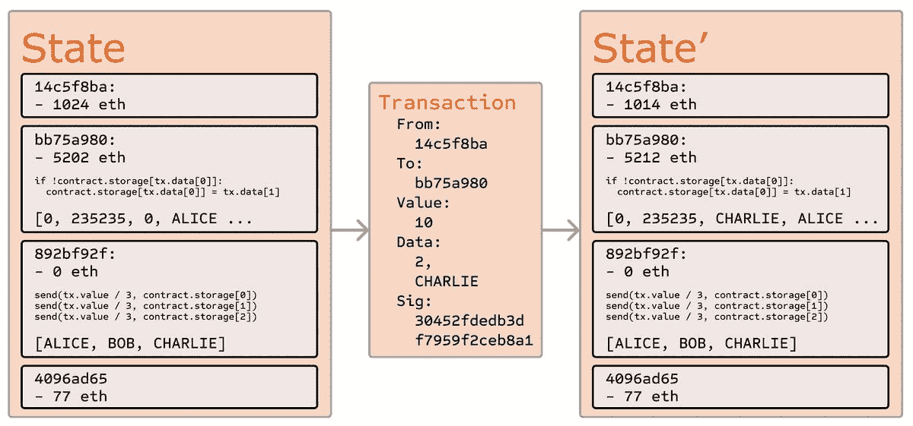

以太坊状态转换函数示例；来源 – Ethereum.org/whitepaper/

如果交易接收端没有合约，那么总交易费用将简单地等于提供的`GASPRICE`乘以交易的字节长度，随交易发送的数据将是无关。

消息在回滚（reverts）方面的机制与交易等效：如果消息执行耗尽了gas，则该消息执行以及由该执行触发的所有其他执行都会回滚，但父级执行不需要回滚。这意味着合约调用另一个合约是“安全”的，例如如果`A`使用`G` gas调用`B`，那么`A`的执行保证最多只会损失`G` gas。

注意，有一个用于创建合约的`OPCODE`称为`CREATE`；其执行机制通常与`CALL`类似，不同之处在于执行输出决定了新创建合约的代码。

## 代码执行

以太坊合约中的代码是用一种低层的、基于栈的字节码语言编写的，被称为“以太坊虚拟机代码”或“EVM代码”。代码由一系列字节组成，每个字节代表一种操作。通常情况下，代码执行是一个无限循环，它不断重复执行当前程序计数器（从零开始）处的操作，然后将程序计数器加1，直到到达代码末尾或检测到错误、`STOP`或`RETURN`指令。这些操作可以访问三种空间来存储数据：

* 栈（stack），一个后进先出（LIFO）容器，可以向其中推入和弹出值
* 内存（Memory），一个无限扩展的字节数组
* 合约的长期存储（storage），一个键值存储器。与计算结束后就会重置的栈和内存不同，存储会持久存在。

代码还可以访问传入消息的值、发送者和数据，以及区块头数据，代码还可以返回一个字节数组作为输出。

## 以太坊挖

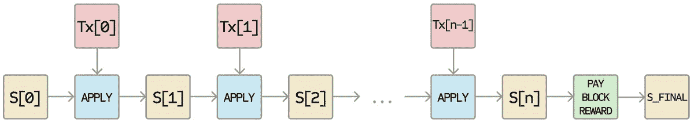

以太坊应用区块图；来源 – Ethereum.org/whitepaper/

以太坊区块链在许多方面与比特币区块链相似，尽管它确实存在一些差异。以太坊和比特币在区块链架构方面的主要区别在于，与比特币不同，以太坊区块包含了交易列表和最新状态的副本。除了之外，另外两个值——区块高度和难度——也存储在区块中。以太坊的基本区块验证算法如下：

1. 检查引用的上一个区块是否存在并有效。
2. 检查区块的时间戳大于引用的上一个区块的时间戳，且小于未来15分钟。
3. 检查区块高度、难度、交易根、叔块根（uncle root）和gas限制是否有效。
4. 检查区块上的工作证明（Proof-of-Work）是否有效。
5. 令`S[0]`为上一个区块结束状态。
6. 令`TX`为区块交易列表，包含`n`个交易。对于`0...n-1`中的所有`i`，设置`S[i+1] = APPLY(S[i],TX[i])`。如果任何应用返回错误，或者到为止区块消耗的总gas超过了`GASLIMIT`，则返回错误。
7. 令`S_FINAL`为`S[n]`，加上支付给矿工的区块奖励。
8. 检查状态`S_FINAL`的Merkle根是否等于区块头中提供的最终状态根。如果是，则区块有效；否则无效。

状态存储在树形结构中，在每个区块之后，只需要更改树的一小部分。因此，通常在两个相邻区块之间，树的大部分应该是相同的，因此数据可以存储一次并使用指针（即子树的哈希值）引用两次。

使用一种称为“帕特里树”（Patricia tree）的特殊树来实现此，包括对Merkle树概念的修改，允许高效地插入和删除节点，而不只是修改。此外，由于所有状态信息都是最后一个区块的一部分，因此不需要存储整个区块链历史——这种策略如果能应用于比特币，计算得出可以节省5到20倍的空间。

一个常见的问题是就物理硬件而言，合约代码在“哪里”执行。有一个简单的答案：执行合约代码的过程是状态转换函数定义的一部分，它是区块验证算法的一部分，因此如果交易被添加到区块`B`中，由该交易产生的代码执行将会被执行。

## Ethash

Ethash是以太坊计划中的工作证明（PoW）算法。该算法采用的通用路线如下：

1. 存在一个种子（seed），通过扫描到那时的区块头可以为每个区块计算出来。
2. 从种子开始，可以计算出一个16 MB的伪随机缓存。轻客户端存储该缓存。
3. 从缓存中，我们可以生成一个1 GB的数据集，其属性是数据集中的每项仅依赖于缓存中的少数几项。全节点和矿工存储该数据集。数据集随时间线性增长。
4. 挖矿涉及获取数据集的随机切片并对其进行哈希处理。可以使用低内存进行验证，使用缓存重新生成你需要的特定数据集部分，因此你只需要存储缓存。

大型数据集每3000个区块更新一次，因此矿工的大部分工作将是读取数据集，而不是修改它。Ethash是内存受限的，并声称能够抗ASIC。

## 以太坊虚拟机 (EVM)

以太坊智能合约通常用高层编程语言编写。最流行的是`Solidity`，它是`C++`和`JavaScript`的混合体。还有`Vyper`，是一种目前正在开发的新语言。用这些高层语言编写的智能合约必须编译为以太坊虚拟机（EVM）代码。

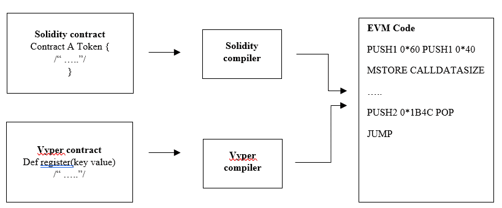

因此，我们从高级、人类可读语言开始，将其编译为`EVM`代码，这是一种低级、简单的语言，机器更容易理解和执行。

当这些代码编译成`EVM`代码后，以太坊网络中的每个节点都会执行它。只要它们拥有最新版本的`EVM`软件，所有节点都以相同的方式执行代码。节点通过执行工作证明协议对新的系统状态达成共识。通过工作证明将投票权与计算能力绑定，可以防止女巫攻击（攻击者通过创建大量伪匿名身份来破坏计算机网络的声誉系统，并利用这些身份获得不成比例的影响）。在以太坊中，区块生成时间为15秒，而比特币为10分钟。这使得智能合约的执行可以快速地完成并确认。

以太坊矿工通过执行`EVM`代码并寻找挖矿难题的解决方案来竞争性地创建区块。由于`PoW`是一种竞争机制，只有一个矿工能够将区块添加到以太坊网络，并获得区块奖励。

每个以太坊节点作为其区块验证过程的一部分运行`EVM`。合约代码由`EVM`执行。这使得合约能够永久地存在于区块链上。

由于`EVM`是一种低级字节码语言，我们可以将复杂的智能合约代码编译成以`EVM`代码形式存在的简单机器可理解的指令，网络中的所有节点都可以以相同的确定性方式执行这些指令，并达成共识。

此外，每个`EVM OPCODE`都需要`gas`才能执行，从而防止了无限循环拒绝服务攻击——即攻击者将以太坊网络中的计算机困在无限循环中，从而导致它们无法执行更有意义的合约。

一旦节点对网络状态达成共识，`EVM`上的代码执行就会改变状态。

## 以太坊应用与用例

总而言之，以太坊之上的应用分为三类：

* 第一类是金融应用，为用户提供了更强大的方式来使用他们的资金管理和签署合约。这包括子货币、金融衍生品、对冲合约、储蓄钱包、遗嘱，最终甚至包括某些类全职雇用合约。
* 第二类是半金融应用，涉及资金，但所做的活动也具有很强的非货币属性；一个完美的例子是计算问题解决方案的自动执行赏金机制。
* 第三类是非金融应用，例如在线投票和去中心化治理。

以太坊的几个关键应用如下：

### 代币系统

链上代币系统有许多应用，从代表美元或黄金等资产的子货币到公司股票、代表智能财产的个人代币、安全不可伪造的优惠券，甚至是与传统价值完全无关、用于激励积分系统的代币系统。代币系统在以太坊上的实现异常地简单。

需要理解的关键点是，任何货币或代币系统本质上就是一个只有一个操作的数据库：`从A减去X单位并给B X单位`，且前提是：

11. `A`在交易前至少拥有`X`单位，且
12. 交易经过`A`的批准。

实现代币系统只需要将此逻辑实现在合约中即可。在`Serpent`中实现代币系统的基础代码如下：

```python
def send(to, value):
    if self.storage[msg.sender] >= value:
        self.storage[msg.sender] = self.storage[msg.sender] - value
        self.storage[to] = self.storage[to] + value
```

这本质上是本文后续描述的“银行系统”状态转换函数的字面实现。需要额外添加几行代码来提供最初分配货币单位的步骤以及其他一些边界情况，理想情况下，还会添加一个函数让其他合约查询某个地址的余额。但仅此而已。

理论上，基于以太坊的代币系统可以可能包含另一个链上基于比特币的元货币所缺乏的重要功能：直接使用该货币支付交易费用的能力。其实现方式是：合约将维护一个`Ether`余额，并将用于支付费用的`Ether`退还给发送者，同时通过收集收取的费用的内部货币单位并在持续的拍卖中将其重新转售来补充该余额。因此，用户需要用`Ether`“激活”他们的账户，但一旦`Ether`在那里，它就可以重复使用，因为合约每次都会退还它。

目前有两种基于以太坊的代币：

* `ERC-20代币`：`ERC-20`（以太坊意见请求20）代币标准允许以太坊区块链上存在同质代币。该标准由Fabian Vogelsteller在2015年11月提出，实现了智能合约内代币的API。该标准提供了包括从一个账户转移代币到另一个账户、获取账户当前余额以及获取网络可用代币总量的函数。正确实现`ERC-20`处理的智能合约被称为`ERC-20代币合约`，有助于跟踪以太坊上创建的代币。许多加密货币作为`ERC-20`代币发行并通过首次代币发行进行。发送`ERC-20`代币的费用必须用`Ether`支付。
* `非同质化代币 (NFTs)`：以太坊允许创建独特且不可分割的代币，称为非同质化代币（`NFTs`）。由于这类代币是唯一的，它们被用于代表收藏品、数字艺术、体育纪念品、虚拟房地产和游戏中的物品等。区块链基础虚拟世界中的土地、建筑和化身也可以作为`NFTs`进行买卖，有时价格高达数十万美元。第一个NFT项目`Etheria`（一个由可交易和自定义的六边形砖组成的3D地图）于2015年10月部署到网络上，并在当年11月的`DEVCON1`上进行了现场演示。2021年，佳士比将一张由Beeple创作的带有NFT的数字图像以6930万美元售出，使其成为当时按拍卖价格计算的第三位最有价值在世艺术家。

### 金融衍生品与稳定价值货币

金融衍生品是“智能合约”最常见的应用，也是代码实现最简单的应用之一。实现金融合约的主要挑战在于，大多数金融合约需要引用外部价格报价器；例如，一个非常有价值的应用是对冲`Ether`相对于美元波动的智能合约，但实现这一点需要合约知道`ETH/USD`的值。实现这一点最简单的方法是通过由特定方（例如`NASDAQ`）维护的“数据源”合约，设计使其具有根据需要更新合约的能力，并提供接口允许其他合约向该合约发送消息并获取价格响应。

在这些关键要素的基础上，对冲合约看起来如下：

1. 等待`A`输入1000个`Ether`。
2. 等待`B`输入1000个`Ether`。
3. 通过查询数据源合约记录1000个`Ether`的美元价值到存储，假设为`$x`。
4. 30天后，允许`A`或`B`“重新激活”合约，将价值`$x`的以发送给`A`，并将剩余发送给`B`。

此类合约在加密货币领域具有巨大的潜力。

加密货币被认为的主要问题之一是其波动性；虽然许多用户和商户可能希望拥有加密资产的安全性和便利性，但他们并不愿意面临一天内损失（例如）23%资金价值的前景。最常提出的解决方案是发行方支持的资产；即发行方创建一种子货币，他们拥有发行和撤销单位的权利，并向提供一个单位特定底层资产（如黄金、美元）的人提供一个单位货币。发行方随后承诺向寄回一个单位加密资产的人提供一个单位底层资产。但在实践中，发行方并不总是值得信赖的，在某些情况下，银行基础设施太薄弱或过于敌对，导致此类服务无法存在。

金融衍生品提供了另一种选择。在这里，不再由单一发行者提供资金来支持资产，而是由一个投机者组成的去中心化市场扮演这一角色，他们押注加密参考资产（例如`ETH`）的价格将会上涨。与发行者不同，投机者没有违约的可能，因为对冲合约将他们的资金托管在托管账户中。需要注意的是，这种方法并非完全去中心化，因为仍然需要一个信赖源来提供价格报价器，尽管可以认为这在减少基础设施需求以及减少潜在欺诈风险方面已经是一个巨大的改进。

## 多签名

我们可以利用以太坊内置的身份验证协议来构建多方身份验证钱包。此功能允许我们拥有`m` of `n`签名方案，即总共`n`个钱包所有者中需要`m`个人对每笔交易进行签名。尽管逻辑相当简单，但`Solidity`的实现却相当复杂。

## 去中心化金融 (DeFi)

去中心化金融（`DeFi`）是`Ethereum`的一个用例。它在公司和政府控制之外的去中心化架构中提供传统的金融工具，例如让用户赚取利利的货币市场基金。去中心化金融应用通常通过支持Web3的浏览器扩展或应用程序访问，例如`MetaMask`，它允许用户通过网站直接与`Ethereum`区块链交互。许多此类`DApps`可以连接并协同工作，以创建复杂的金融服务。

此外，通过一种被称为“封装”（wrapping）的过程，某些`DeFi`协议允许各种资产的合成版本（如`Bitcoin`、`Gold`和`Oil`）在`Ethereum`上可用并交易，同时兼容以太坊的所有主流钱包和应用程序。

DeFi平台的示例包括`MakerDAO`和`Compound`。`Uniswap`是以太坊上的令牌去中心化交易所，其流动性从2000万美元增长到2020年的29亿美元。截至2020年10月，超过110亿美元投资了各种DeFi协议。

## 身份与声誉系统

最早的替代加密货币`Namecoin`尝试使用类似`Bitcoin`的区块链来提供名称注册系统，用户可以在公共数据库中与其他数据一起注册他们的名称。


最被引用的主要用例是`DNS`系统，将如 "bitcoin.org" 这样的域名映射到 IP 地址。其他用例还包括电子邮件验证和可能更先进的声誉系统。以下是在以太坊上提供类似`Namecoin`名称注册系统的基础合约：

```python
def register(name, value):
    if !self.storage[name]:
        self.storage[name] = value
```

该合约非常简单——`Ethereum`网络内部的一个数据库，可以添加内容，但不能被修改或删除。任何人都可以注册一个带有特定值的名称，并且该注册将永久存在。更复杂的名称注册合约还将具有一个“函数子句”，允许其他合约对其进行查询，以及一种允许名称的“所有者”（即第一个注册者）更改数据或转移所有权的机制。甚至可以在此基础上添加声誉和信任网络功能。

## 去中心化自治组织 (DAO)

“去中心化自治组织”的基本概念是一个虚拟实体，它拥有一组特定的成员或股东，这些成员可能在 67% 的多数情况下有权支出实体资金。逻辑相当简单，但`Solidity`的实现却相当复杂。

`DAO`允许成员集体对如何分配资金进行投票。这提供了一种去中心化的资源管理和决策方法，无需中央机构。`DAO`的总体大纲如下。

解决方案在于智能合约。我们可以创建一个智能合约，来保证从 A 房屋向 B 房屋传输能量的财务承诺。A 房屋可以创建一个合约并投入 1000 美元，假设 B 房屋和另一栋 C 房屋也承诺 1000 美元，那么承包商就可以兑换笔钱，以建造智能电网。

这种不可变的承诺方案允许任何人充分利用智能资金的属性。通过智能合约，我们可以在没有中心实体的情况下在互不信任双方之间进行协调。在政府无法提供基础设施的地方，如果公民拥有资金但缺乏安全整合资源的系统，他们可以自己完成。这是区块链最具革命性的概念之一，赋予了用户成为自己服务提供者的能力。

## 以太坊生态系统

### 领导者

与比特币一样，以太坊生态系统不断变化。然而，以太坊在政治上比比特币稍微中心化。例如，我们知道它的创始人维塔里克·布特林（Vitalik Buterin），他是以太坊最大的面孔。他本人正在推动以太坊的发展，他的观点可以很容易塑造整个以太坊领域，并且控制着巨大的影响力。

Vitalik 目前领导着以太坊的研究团队，其中另一位关键人物是 Vlad 扎菲尔（Vlad Zamfir）。注意的是，Vitalik 和 Vlad 对以太坊升级到权益证明（Proof-of-Stake）协议有不同的版本。

以太坊的另一个关键人物是加文·伍德（Gavin Wood），他因最初提出 Solidity 作为`EVM`之上的以太坊高层编程语言而闻名。

尼克·萨博（Nick Szabo）是数字合约的研究人员，以创造“智能合约”术语而闻名。

## ConsenSys

ConsenSys 可以被地描述为一个软件工厂。它促进了运行在以太坊区块链上的各种应用程序，并协调、孵化、加速和产生它所谓的“辐纽企业”（spoke ventures）。例如，用于身份管理的 uPort、流行的 Truffle 开发套件、将网络浏览器连接到以太坊的 MetaMask，以及预测市场平台 Gnosis。这些都是 ConsenSys 的辐纽企业。

以太坊社区还产生了许多原创研究。最著名的是 Casper，以太坊的 PoS 实现协议。还有 Plasma，这是一种受比特币类似的扩展性提案——闪电网络（Lightning）启发的以太坊扩展性升级建议。

已有尝试将以太坊迁移到另一个名为 Cosmos 的区块链平台，该平台声称是区块链的互联网。

### 以太坊治理

2015 年 10 月，一种开发治理被作为以太坊改进提案（`EIP`）提出，并在`EIP-1`上进行了标准化。核心开发小组和社区将通过受`EIP`监管的过程达成共识。

以太坊改进提案（`EIPs`）描述了以太坊平台的标准，包括核心协议规范、客户端 API 和合约标准。网络升级在以太坊项目管理仓库中单独讨论。

#### EIP 状态术语

- **Idea（想法）**：预草案阶段的想法。这在 EIP 仓库中不被跟踪。
- **Draft（草案）**：`EIP`开发的第一个正式跟踪阶段。
- **Review（评审中）**：`EIP`作者将`EIP`标记为准备绪并请求同行评审。
- **Last Call（最后期限）**：`EIP`进入最终阶段之前的最后评审窗口。`EIP`编辑器将分配 Last Call 状态并设置评审截止日期（`last-call-deadline`），通常为 14 天后。
- **Final（终稿）**：此`EIP`代表最终标准。最终`EIP`处于确定状态，应仅更新修正错误并添加非规范性的说明。
- **Stagnant（停滞）**：任何处于 Draft 或 Review 状态的`EIP`如果无活动超过 6 个月，将被移至 Stagnant。`EIP`可以通过移回 Draft 从此状态复活。
- **Withdrawn（已撤回）**：`EIP`作者撤回了提议的`EIP`。如果日后继续追求该想法，则被视为一个新提案。
- **Living（活跃）**：一种用于`EIPs`的特殊状态，设计为持续更新且不达到最终状态。

`EIPs`分为若干类型，每种类型都有自己的`EIPs`列表。

- **Standard Track（标准轨道）**：描述任何影响大多数或所有以太坊实现的更改，例如网络协议的更改、区块或交易有效性规则的更改、提议的应用标准/约定，或任何影响使用以太坊的应用互操作性的更改或添加。
- **Core（核心）**：需要共识分叉的改进（例如`EIP-5`、`EIP-101`），以及不一定是共识关键但可能与“核心开发”讨论相关的更改。
- **Networking（网络）**：包括围绕轻级以太坊子协议的改进，以及对`whisper`和`swarm`网络协议规范的改进。
- **Interface（接口）**：包括客户端 API/RPC 规范和标准的改进，以及某些语言级标准，如方法名（`EIP-6`）和合约 ABI。
- **ERC**：应用级标准和约定，包括合约标准，如代币标准（`ERC-20`）、名称注册表（`ERC-137`）、URI 方案（`ERC-681`）、库/包格式（`EIP190`）和钱包格式（`EIP-85`）。
- **Meta（元）**：描述围绕以太坊的过程，或对过程（或过程中的事件）提出更改。Meta `EIP`或 Process `EIP`类似于 Standard Track `EIP`，但适用于以太坊协议本身以外的领域。示例包括程序、指南、决策过程的更改，以及以太坊开发中使用的工具或环境的更改。
- **Informational（信息性）**：描述以太坊设计问题，或为以太坊社区提供一般指南或信息，但不提出新功能。信息性`EIP`并不代表以太坊社区的共识或建议，因此用户和实现者可以忽略信息性`EIP`或遵循其建议。

# 区块链平台

在本章中，我们将重点关注目前使用的不同区块链平台，洞察它们的设计特征，并学习它们的优缺点。

区块链平台是用于区块链技术开发去中心化应用的底层工具（例如——实现涉及多方协作或数据交换的去中心化应用）。这些平台用于通用的分布式价值交换，由网络中所有参与者共享的加密签名、不可撤销交易记录列表组成。每条记录都包含时间戳和指向之前交易的引用链接。它是一个去中心化的状态机，管理数字化资产的生命周期，并在分布式账本中不可变地记录操作。

对区块链平台的兴趣显著增长，以简化供应链、提高可追溯性、简化贸易并改进金融交易。这种兴趣很大源于围绕比特币的投机狂热，比特币基于一个旧的区块链平台，面临能源消耗和速度方面的挑战。现代区块链平台的开发是为了帮助克服这些局限，并为其他业务用途和应用提供实际价值。

这些用例的前三大区块链框架是`R3 Corda`、`Hyperledger`和`Ethereum`，其中`EOSIO`和`Quorum`正在取得进展。

## 评估区块链平台时考虑的关键特征

区块链平台由各种组件组成，使企业能够根据不同的需求选择合适的组件。

然而，在评估区块链平台和组件时，检查以下四个关键特征是非常有用的：

- **公共（开放）或私有（封闭）平台** – 平台是开放的（即公共区块链）还是封闭的（即私有区块链），以及这如何影响速度和安全性。任何人都可以加入公共区块链，这使得像农户这样的小企业用户能够更容易搭建。缺点是公共区块链的速度不够够快。此外，私有平台为机构提供了更高的数据安全性。许多区块链代码库可以被修改为开放或封闭。
- **共识机制** – 平台是否利用`工作量证明 (PoW)`、`权益证明 (PoS)`或拜占庭容错作为其共识机制。`工作量证明`是`Bitcoin`和`Ethereum`使用的旧机制，但与`权益证明`相比，它的速度较慢；后者较新且经过验证较少，但速度更快、更高效。
- **账本技术及其如何记录交易** – 这涉及到区块链如何跟踪信息。流行的方法包括账户模型和`UTXO`。账户模型记录余额，而`UTXO`模型类似于钱包中带有序列号的现金。账户模型用于区块链平台`Ethereum`、`Stellar`、`Tron`和`EOSIO`。`IBM Blockchain`、`Hyperledger Fabric`和`Hyperledger Sawtooth`则使用`UTXO`。
- **编程语言和函数** – 用于在区块链上捕捉业务逻辑的智能合约函数。流行的编程语言包括`Ethereum`区块链的`Ethereum Solidity`、`IBM`的`WebAssembly`语言以及数字资产建模语言。

最流行的区块链平台如下：

### 1. Ethereum

`Ethereum`于 2013 年推出，是最古老且最成熟的区块链平台之一，它为开发者提供了一个开源的分布式计算平台，开发者可以在那里发现区块链的所有优势。`Ethereum`使用点对点的方法，用户可以编写代码来控制数字价值，这些代码完全按照程序设定运行，并且可以在世界上任何地方访问。

它提供了一个真正的去中心化区块链，可以与`Bitcoin`区块网络相比。它通过支持智能合约实现了真正的去中心化。除了作为支撑企业应用的区块链平台外，它自己还有一种名为`Ether`的加密货币。

`Ethereum`平台已被在`Ethereum`网络上构建去中心化应用（或`dApps`）的技术人员广泛采用。例如，有很多用于非同质化标记（`NFTs`）的平台和交易所——一种可以在区块链上交易的数字资产。它拥有一个成熟的工具生态系统，可以使用`Solidity`编程环境编写智能合约，该环境运行在以太坊虚拟机上。

然而，与其他平台相比，它的主要缺点包括处理时间慢和交易处理成本较高。其他区块链网络可以比`Ethereum`更快且更便宜地处理交易，尽管许多观察者预计在`Ethereum`迁移到`权益证明`共识机制并采用更高效的安全机制后，这种情况将发生变化。

### 2. IBM Blockchain

`IBM Blockchain`是一个私有的去中心化区块链网络，在风险意识较低的企业客户中最为成功。他认为最大的机会在于利用它连接到企业云和遗留技术，这比在其他去中心化网络中更加无缝。

`IBM Blockchain`开发者工具的设计灵活、功能强大且可定制。IBM 还投资创建了用户友好的界面，以简化关键任务，如设置、测试和快速部署智能合约。

`IBM blockchain`平台在金融服务、银行以及供应链领域得到了显著采用。成功的区块链应用示例包括`IBM Food Trust`，它已完成超过 1800 万次交易，涉及 17000 多种产品；以及泰国的`区块链社区倡议`，它为 22 家泰国银行提供支付义务和企业拍卖等服务支持。

### 3. Hyperledger Fabric

`Hyperledger Fabric`是由`IBM`和 Linux 基金会倡导的一组帮助创建区块链应用的工具集。它从底层开始就为企业分布式账本用途而构建。它拥有丰富的组件生态系统，可以插入模块化架构中。它在封闭区块链部署中运行良好，可以提高安全速度。它还支持开放的智能合约模型，可以支持各种数据模型，例如账户和未花费交易输出（或`UTXO`模型）。

`Hyperledger Fabric`还可以通过在通道中隔离交易或在私有数据集合中根据需要共享私有数据来提高数据隐私。根据其支持者的说法，它还能实现低最终性性和确认延迟的高速交易。

最新的更新支持组织在不复制整个账本历史的情况下加入通道。这使得启动过程更快，且所需的存储更少。`Hyperledger Fabric`周围有一个活跃且多样化的社区，致力于添加更多与共识算法相关的功能、用于 GDPR 合规的额外隐私选项以及运营改进。

### 4. Hyperledger Sawtooth

`Hyperledger Sawtooth`是由`Hyperledger`和 Linux 基金会托管的另一个开源区块链计划，它使用了一种名为“时间证明”（Proof of Elapsed Time）的新颖共识机制，该机制可以与基于硬件的安全技术集成，允许程序代码的“信任执行环境”运行在安全内存（计算机内存保护区域）中。

最常见的应用程序是开发供应链系统以及为特定目的定制`Sawtooth`（例如新颖共识算法）。

`Sawtooth Library`的工作已经开始，它将允许自定义分布式账本的开发者选择在应用程序中使用`Sawtooth`的哪些部分。同时，`Sawtooth`正在采用`Splinter`进行网络，这将提供动态私有电路（节点组）；采用`Hyperledger Transact`进行交易处理，这将扩展智能合约能力；以及采用`Augrim`进行共识，这将扩展支持的算法数量。

### 5. R3 Corda

关于`R3 Corda`在技术上是区块链还是另一种类型的分布式账本存在争议。它使用了一种新颖的共识机制，其中交易通过加密方式链接，但不会定期将多个交易打包成区块。即使是官方`Corda`网站也将其描述为“既是区块链不是区块链”。这种方法的主要优势之一是所有交易都是实时处理的，与其他类型的区块链相比，可以提高性能。

`R3`联盟在金融行业拥有强大的追随者，因为`Corda`为具有强性的金融交易和智能合约提供了一种吸引的方法。领先的支持者包括美国银行、汇丰、英特尔和微软。它很有可能成为保险相关交易处理的标准网络。然而，它面临来自其他联邦区块链网络的竞争，这些网络可以更快、更便宜地处理交易。

### 6. Tezos

（此部分未提供原文内容）

Tezos 自 2014 年开始开发，是一个支持去中心化应用、智能合约和新型金融工具的较旧平台，例如`NFTs`，这些可以被视为与数字资产绑定的现代交易卡变体。该平台支持动态可升级的协议和模块化软件客户端，使其能够适应新的用途。Tezos 社区正在以快速速度升级该平台，最近的增强改进了性能并增加了智能合约的大小限制。

### 7. EOSIO

EOSIO 区块平台首次于 2018 年作为一个开源项目发布。它针对开发去中心化应用和智能合约进行了优化。根据其支持者的说法，它使用基于`PoS`的复杂共识机制，提供了比`Ethereum`等旧机制更好的性能。它还包含一个用于对平台变更进行投票的治理功能。

核心优势包括快速的交易和用于部署应用程序的高级账户权限功能。该平台上已开发了 400 多个应用程序，包括身份管理、供应链管理和游戏。

### 8. Stellar

Stellar 是一个较新的区块链平台，针对各种去中心化金融应用进行了优化。它使用`Stellar Consensus Protocol`，据称可以加快在公共区块链网络上处理和完成交易所需的时间。

它的区块链网络允许资金的存储和移动。它方便用户创建、交易和发送所有形式货币的数字表示形式，如美元、`bitcoin`等。

它还包含了安全机制，用于在金融交易中排除恶劣或可疑的参与者。它已被多家公司用于国际贸易和跨境货币交换。

Stellar 的主要特性包括：

- 支持每秒数千交易
- 支持多重签名和智能合约
- 每年 1% 的通货膨胀

### 9. Quorum

Quorum 是由摩根大通创立的`Ethereum`定制版本。它利用`Ethereum`区块链平台的核心工作，并将其封装在适用于银行的加固环境中。它经过优化，支持私有网络上银行和保险公司等机构之间的高速交易。它还为`Ethereum`添加了各种隐私增强功能，以提高对欧洲`GDPR`和加州`CCPA`等法规的支持。

# 区块链用例

本章将探讨区块链的实际应用。我们将看到区块链如何为商业、政府和社会项目提供解决方案。由区块链推动的业务正在建立新的关系，以便在互不信任的之间实现更高效的通信和信任，催生新的商业模式。接下来我们将讨论区块链通过提供透明度和问责制对发展中国家产生的影响。我们将介绍基于区块链的新技术和新兴突破。最后，我们将深入了解旨在改善用户体验的用例、去中心化游戏平台以及发明了新互动世界的新型市场。

## 区块链用例分类

让我们来看看区块链如何改善我们相互互动的方式。在区块链中，身份管理是所有用例的关键。我们将根据由谁在开发解决方案来对这些用例进行分类，从大型企业解决方案到由区块链驱动的智能手机和网络浏览器应用程序，后者将控制权交回用户手中。

- **企业级解决方案** – 商业和组织正在实施区块链以克服透明度方面的障碍，建立具有全球影响的新关联。
- **公共部门解决方案** – 政府正在使用区块链解决方案来改进其向公民提供的服务。数字身份解决方案、中央银行数字货币和透明的工作流正为公共部门系统带来效率，最终结果造福了公民。
- **社会影响解决方案** – 社会影响区块链解决方案解决社会和环境挑战。在联合国 17 个可持续发展目标支持下，区块链开发者、投资者、慈善家、政府机构和基金会正在开发解决这些全球问题的解决方案。
- **平台开发者解决方案** – 区块链是一项不断改进的新技术。开发者正在创建标准和新平台，将这项技术推向主流。
- **终端用户解决方案** – 日常解决方案层出而出，将去中心化区块链及其承诺的所有利益交到个人手中，从新的去中心化市场到表达音乐、艺术的新方式，甚至是交易游戏内构建的财产。

## 企业解决方案

由区块链解决方案推动的业务正在建立新的关系，以实现更高效的通信和工作流，催生新的商业模式，并解决在线交易和业务成本方面的问题。

### 全球供应链


供应链数据并非总是可见或可信。在最近的动荡时期，供应链比以往任何时候都重要。全球供应链和区块链正努力确保系统，以更好地处理这些动荡。`Covid-19`疫情揭示了我们供应链的脆弱性，加速了对区块链解决方案的讨论。

自 1916 年引入集装箱以来，全球贸易的运作一直如此。手动、基于纸质的流程仍然常见，关于货物状态的信息被锁在组织的孤岛中。今天，全球贸易中 90% 的货物由航运业承担，但供应链由于跨松耦合的陆路运输提供者、货运代理、报关行、政府、港口和海运公司网络中点对通信的复杂性和海量而变慢。

`IBM`和`Maersk`正在通过一个分布式许可平台解决这个问题，该平台供供应链生态系统访问，用于交换事件数据并处理文档工作流。他们正在利用区块链技术创建一个全球防篡系统，用于贸易工作流的数字化和端到端跟踪货物，从而消除包括昂贵的点对通信在内的摩擦。该合作将启动，具备每年追踪数百万次集装箱行程的能力，并与选贸易航线的海关部门集成。

马士基（Maersk）最近的一项测试显示，从肯尼亚到罗特丹港运送单一集箱花卉产生了近 200 次通信。通过这个例子，我们将探讨区块链如何实施以在数字化文档工作流中建立信任与安全，并提高全球供应链的效率。交易涉及的不同实体包括航运商、出口管理部门、港口、客户和进口商。从蒙巴萨港发货需要三个不同机构的签名来批准出口，以及六份描述产地、化学处理、产品质量和关税的文件。首先，肯尼亚农场通过电脑或手机手机提交一份装箱单，该装箱单将对所有参与者可见。此项操作启动了智能合约，在三个机构之间执行出口审批工作流。随着每个机构的签署，状态会实时更新并供所有人查看。同时，有关花卉检查、冷藏集装箱封条、卡车司机取货以及海关批准的信息也会传达给蒙巴萨港，以便他们为集装箱做好准备。所有与文档和实物有关的动作都被记录并共享——提交了哪些文档、何时以及谁提交的、花在哪里、谁拥有它们，以及旅程中的后续步骤。由于花卉是易腐品，因此每一步都尽可能减少延迟至关重要。区块链为这些文档和运输事件提供了安全的数据交换和防篡改的存储库。该系统可以显著减少延迟和欺诈，每年节省数十亿美元。根据世贸组织（WTO）的数据，减少国际供应链内的障碍可以使总贸易额增加 15%，全球 GDP 增长近 5%。

# 食品行业

在食品行业中，农场是复杂的生态系统，具有许多活动环节、对时间要求严格以及季节性的融资结构。然而，一旦农产品离开农场，它们就变成了包含许多方的广泛供应链的一部分。买家、卖家、分销商和杂货连锁——他们都想知道农产品在出现在你的餐桌上之前去过哪里。区块链农业的趋势有望让种植和配送食品的每一步都变得简单。它为所有参与方提供了农业供应链的单一事实来源。

当客户在商店购买食品时，他们期望获得实惠的价格和良好的客户服务，但一个未说明的预期是商店里的产品应该是安全的。食品产品在被证明清白之前被视为“有罪”。一旦发生食品事件或食品恐慌，所有产品都会被召回，直到找到受影响的产品，然后可以将安全的产品重新上架。然而，如果识别受影响产品花费了太多时间，整个库存将被丢弃，因为食品是易腐物品。现在想象一下，如果商店能在几分钟内确定地定位到哪一个是受影响的产品，将节省大量的食物浪费并优化成本。沃尔（Walmart）和 IBM 正在努力实现这一目标。

食品生态系统涉及农户、加工商、分销商，每个参与者都以自己的方式追踪食品系统。大多数工作在纸质上完成，生态系统中的不同参与者之间互动极少，这些利益相关者无法全面了解食品生态系统中正在发生的情况。沃尔计划利用区块链将食品生态系统中的所有利益相关者聚集在一起，以便他们能够快速、高效地进行协作。区块链允许食品系统的不同部门捕捉有关产品的信息、他们对产品做了什么以及产品去过哪里。如果我们将这些数据与其他数据点联系起来，所有这些信息将为我们提供洞察，实现一个更安全、更负担得起且可持续的食品系统。

然而，在食品生态系统中实施区块链的最终目标是透明化。区块链将使利益相关者不仅能够追踪食品来自哪里，还可以追踪它是如何生产的、是否安全负责任地生产、是否可持续生长，以及该产品还有多少天的保质期。

# 医疗保健

区块链正在改变医疗保健行业。医疗保健行业面临的一些挑战包括假药、数据孤岛、健康记录管理等。区块链可以通过互操作性、数据完整性和安全性解决这些问题。

世德（Moderna）使用区块链来支持其智能新冠-19 疫苗管理。SAP 有一个与区块链无关的现有解决方案`Advanced Track and Trace for Pharmaceuticals (ATTP)`，它可生成唯一标识符。此外，辉瑞（Pfizer）已将区块链用于临床试验。

# 金融市场

减少结算时间将通过“金融科技”公司改善资金流动。

瑞士证券交易所（SIX）拥有一项解决贸易市场长期结算时间问题的解决方案。新的区块链平台与现有的 SIX 平台并行运行，解决了通常需要几天时间才能完成的交易。

区块链在信贷融资方面显示出前景，可以为大多数此前排除的金融机制提供交付和支付保障。根据 Andrea Frosini 的论文《重塑贸易金融：迈向“新型”信贷》，他提供的区块链的贸易融资为买卖双方提供了交付和支付保障，并开启了市场机会。

Voltron Trade Finance 由八家银行联合创立，包括曼谷银行、法国巴黎银行、中信、汇丰、荷兰银行、瑞典 SEB 和渣打银行。该财团已扩大到 50 多家银行和公司。该平台构建在`Corda`区块链上，解决了交易时间的问题。大多数信贷基于纸质，需要 5 到 10 天。通过区块链，信贷可以在 24 小时内高效交易。

# 公共部门解决方案

区块链在安全、效率和速度方面的优势让政府领导者研究将改善生活并加速全球区块链解决方案的深远影响。公共部门可以描述为公共管理、公共服务、土地和社区。根据 Bobbi Muscara、Saptarshi Choudhury 和 Sean O’Kelly 的演讲《通过区块链重新思考公共部门》，所有区块链区块链项目必须考虑四个设计因素：

* 政府身份管理
* 监管交易交互
* 监管
* 治理

## 智能迪拜

公共部门区块链解决方案的真实案例是“智能迪拜 2021”，迪拜旨在将所有政府运营和记录迁移到区块链。目标是增加政府运营的透明度和效率。区块链正成为许多其他智能迪拜倡议的赋能层，从而创建一个智慧城市。例如，自动交通信号灯、公民签证注册和公共医疗等项目都在区块链上率先开展。

## 荷兰区块链联盟（Dutch Blockchain Coalition）

荷兰区块链联盟建立了三个社会支柱，共同努力构建区块链的未来：

* 开发构建块——数字身份
* 实现利用区块链的条件
* 开发和实现人力资本议程

## 怀俄明州（Wyoming）

怀俄明州已颁布了共 13 部区块链法律，使其成为美国唯一提供全面法律框架、使个人和公司都能利用区块链技术的州。

# 社会影响解决方案

社会影响区块链联盟（`BSIC`）是一个非营利组织，负责孵化、开发和协作各类区块链产品及解决方案，以解决联合国可持续发展目标范围内的社会环境挑战。其目标是激励非政府组织（NGO）、政府机构、基金会、影响力投资者、慈善家和技术人员之间建立联系并搭建桥梁。

根据 Kayla Matthews 的文章《区块链用于社会善行的 7 种方式》，目前正看到区块链社会影响项目的领域包括：

* 慈善与汇款
* 金融赋能
* 身份与土地权利
* 治理与民主
* 供应链与环境保护

## Kiva

全球范围内有超过 17 亿人口没有银行账户，无法获得金融服务。`Kiva`是一家成立于 2005 年、位于旧金山的国际非营利组织，其使命是扩大金融准入，以帮助缺乏服务的社区。`Kiva`通过众筹贷款和为缺乏服务的群体释放资金，从而改善金融服务的质量和成本，并解决全球金融准入的底层障碍。通过`Kiva`的工作，学生可以支付学费，女性可以创业，农民能够投资设备，家庭可以负担得起应急医疗。

## 罗兴雅项目

`Rohingya Project`的使命是通过数字化连接，为无国籍的罗兴雅人提供学习、装备和自我赋能的机会，为他们创造一个可行的未来奠基础。通过建立金融和社会包容平台，多年来被边缘化的罗兴雅人可以获得广泛的虚拟服务，包括在线教育、数字身份和奖励代币。

该平台将挖掘罗兴雅社区和其他边缘群体的潜力，并提供应对其被排除在主流之外的选择。

# 平台开发者解决方案

## ConsenSys

`ConsenSys Mesh`公司提供帮助构建以太坊生态系统的解决方案。`ConsenSys Mesh`作为基于以太坊的项目孵化器：

* `Codefi` – 金融与商业区块链应用
* `Diligence` – 基于以太坊的智能合约审计
* `INFURA` – 管理扩展性和性能问题
* `Metamask` – 加密货币钱包应用
* `Quorum` – 开源区块链平台
* `Truffle` – 应用构建器

## Hyperledger

`Hyperledger`是一个用于构建区块链解决方案的开源项目，并拥有支持这些区块链的工具。我们在前面的章节中讨论过`Hyperledger Fabric`和`Hyperledger Sawtooth`。其他基于 Hyperledger 的平台示例还有`Hyperledger Aries`、`Hyperledger Transact`、`Hyperledger Ursa`、`Hyperledger Besu`、`Hyperledger Iroha`和`Hyperledger Indy`。

## Daml

`Daml`是一个用于创建记录系统的开发框架，能够在跨业务流程和数据边界保护隐私、确保数据完整性并执行严格的授权。允许此类系统跨越法律、监管、组织或其他边界，使其能够实现无缝的经济网络。

* `Daml Connect` – 这是一个完整的开发和应用栈，允许你以最少的样板代码构建、集成、部署和维护全栈多方解决方案。
* `Daml Drivers` – 它们允许你使用分布式账本、区块链或数据库部署应用程序。随着业务需求的演变，可以在不更改代码的情况下在账本驱动程序之间进行迁移。
* `Daml Drivers` ... `Daml Hub`

## SIMBA Chain

`SIMBA Chain`成立于 2017 年。`SIMBA Chain`是一个去中心化平台。随着家庭能源生产和存储的出现，许多用户在家里储存剩余能量但没有“销售”能量的方法。`SIMBA Chain`提供了点对点能源交易，并获得了国防研究计划署（`DARPA`）、印第安纳技术与制造业（`ITAM`）以及研究中心（`CRC`）的奖励。

# 端解决方案

## 身份

身份管理对于区块链运营至关重要。一种解决方案是可验证组织（`VON`）项目，它使组织以及运营这些组织的人能够进行在线业务。

## 市场

市场用于购买可再生能源`Power Ledger`提供了一个点对点能源交易平台。它构建全球能源解决方案，为社区提供廉价且可再生的电力。

## 音乐与电影

现在艺术家、制作人和标签公司有了新的方式，通过非质化代币（`NFTs`）获得及时、全额的报酬，使版税直接返回给艺术家。`NFTs`通常持有在`Ethereum`区块网上，尽管其他区块链也支持它们。

## 游戏

视频游戏仅仅作为娱乐形式的时代早已一去。大多数新视频游戏都包含应用内购买和盲箱功能。通过使用`DeFi`，游戏开发者可以使用`DeFi`代币实施更新的激励或奖励模型。

NFTs 可用于代表游戏内资产，例如数字土地。一些评论人士将其描述为由“用户”控制，而不是由游戏开发者控制，因为它允许资产在无需游戏开发者许可的情况下，在第三方市场上进行交易。CryptoKitties 是一款早期成功的区块链在线游戏，玩家可以在其中领养和交易虚拟猫。游戏内 NFT 的货币化筹集了 1250 万美元的投资，某些小猫的售价超过了 10 万美元。在取得成功后，CryptoKitties 被加入了`ERC-721`标准。

# Decentraland

Decentraland 是一个构建在以太坊区块链之上的虚拟世界。这是一个完全去中心化的世界，用户可以在其中互动、构建和交换物品，与虚拟朋友一起享受音乐会。Decentraland 由 DAO 运行，这是一个通过智能合约和去中心化应用（dapps）构建的去中心化组织。

## 区块链的未来

区块链的未来是什么？这是一个很大。区块链目前处于令人兴奋的阶段。

区块链往往与其他许多令人兴奋的新兴技术一起讨论，例如物联网 (IoT)、人工智能 (AI)、增强现实 (AR) 和 3D 打印。区块链可能会成为这些许多技术革命的赋能层。例如，拥有一个智能冰箱，可以分析我的牛奶摄入量，并在牛奶开始不足时自动重新下单。人们对实施许多此类技术感到紧张，因为我们该如何保护它们，该如何确保隐私并防止任何欺诈？我们该如何确保这些系统中的数据是不可篡改且安全的？区块链就是解决方案。随着区块链的不断演进，我们将看到新兴技术的巨大增长。

从长远来看，区块链将成为多行星人类经济的赋能层。2018 年，SpaceX 启动了一项将人类送往火星的计划。在未来的 40 到 50 年内，我们可能会看到火星上的人类殖民地。现在火星非常遥远，以光速计算，往返需要 26 分钟。因此，中心化的互联网模型将无法行通。因此，区块链等技术将成为赋能者，让我们在成为多行星社会时能够继续进行交易和互动。

因此，区块链具有巨大的潜力，它是一个非常令人兴奋的事情，也是目前值得关注的地方。

# 参考文献

- [区块链简介](https://builtin.com/blockchain)
- [自 1995 年以来一直出现在纽约时报面上时间最长的区块链](https://toshitimes.com/the-longest-running-blockchain-has-existed-on-nyt-pages-since-1995/)
- [Web 1.0 vs Web 2.0 vs Web 3.0 vs Web 4.0 vs Web 5.0](https://skyseo.co.nz/web-1-0-vs-web-2-0-vs-web-3-0-vs-web-4-0-vs-web-5-0/)
- [Web 1.0、Web 2.0 和 Web 3.0 及其区别](https://www.geeksforgeeks.org/web-1-0-web-2-0-and-web-3-0-with-their-difference/)
- [区块链特性](https://101blockchains.com/introduction-to-blockchain-features/)
- [区块链透明度如何帮助网络安全社区](https://www.ibm.com/blogs/blockchain/2019/04/how-transparency-through-blockchain-helps-the-cybersecurity-community/)
- [两次大战期间密码学的发展](https://www.britannica.com/topic/cryptology/Developments-during-World-Wars-I-and-II)
- [Nodes](https://nodes.com/)
- [区块链：什么是节点或主节点？它们做什么的？](https://medium.com/coinmonks/blockchain-what-is-a-node-or-masternode-and-what-does-it-do-4d9a4200938f)
- [三式记账系统：区块链带来的革命](https://medium.com/dataseries/triple-entry-accounting-system-a-revolution-with-blockchain-768f4d8cabd8)
- [私有区块链简报笔记](https://www.twobirds.com/~/media/pdfs/in-focus/blockchain/private-blockchain-briefing-note.pdf)
