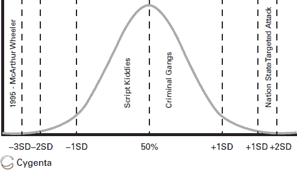

# 网络安全入门与职业进阶指南

# 献词

献给 FC，感谢你在家庭和工作中始终做我的队友。

献给网络安全社区的每一位成员——包括刚刚加入我们的你们——让我们继续学习、分享，让世界变得更安全。

# 致谢

许多人在写作本书的过程中给予了我帮助和支持，我对每一位都心怀感激。首当其冲要感谢我的丈夫 FC，不仅在写作本书上，更在我所做的一切中给予了我巨大的帮助和支持。他是我最大的支持者，我为此每天都心存感激。我有幸拥有一个美好的家庭——感谢我的父母 Sue 和 Richard，我的弟弟 Danny 和他的妻子 Lucy。当然，猫咪 Bubble 一直是我坚定不移的啦啦队长。

感谢 Cygenta 团队——不仅是 FC，还有 Madeline、Richard、Natalie 和 Dave——你们如此乐于助人、耐心包容，在我兼顾写作和生意时给予了极大支持。感谢所有可爱的朋友们，包括 Twitter 上的朋友们，你们在场边为我加油鼓劲。我已经提到过 Natalie，我最老、最亲密的朋友之一，所以我必须感谢其他人，否则我会有麻烦的。Catriona、Aleyna、Laura，当然还有 Kat，是你让我踏上了这条路（我刚刚原谅你！）。

本书汇集了许多杰出贡献者的智慧，我衷心感谢每一位分享故事和见解的人。感谢我的 ClubCISO 同僚董事会成员和全体会员的精神支持。特别要感谢 Rob Bainbridge 分享他的时间和专业知识。我感激 Peter Batey 教授，完成博士学位十年后，他的红笔修改和建议依然让我受益匪浅。

特别感谢我在 Kogan Page 的编辑 Rebecca Bush，她始终如一的耐心、专业和积极态度对完成本书起到了关键作用。我感激 Kogan Page 全体团队成员让这本书得以出版。

最后，感谢 Yorkshire Tea。没有你我也能完成，但会难得多。

# 引言

> “不懂技术就无法从事网络安全工作。”
>
> “用户是网络安全中最薄弱的环节。”
>
> “黑客全都是罪犯！”
>
> “网络犯罪具有针对性，只有政府和大企业才需要担心。”
>
> “没人会盯上我；我的数据不值钱！”

这些迷思以及更多类似的观念困扰着网络安全领域。在本书中，我们将揭示上述所有言论为何站不住脚。我们将揭开网络安全的神秘面纱，展现该领域的广度与深度；它不仅涵盖计算机科学，还涉及心理学、社会学、物理安全、行为经济学、市场营销、设计、教育等众多学科。

网络安全是一个贯穿生活几乎每个领域的议题。政府、医疗、政治、时尚、体育、媒体、大企业、小企业、慈善机构、教育——你能想到的，无一不受网络安全影响。这是一个迷人、充满挑战、节奏极快、日新月异的领域，同时又关注着延续数百年的人类核心问题。近年来，公众认知度显著提升。网络安全议题似乎每天都登上国家级新闻头条，已成为董事会和家庭餐桌上的常谈话题。

在该行业深耕近十年，我见证了认知度的提升，也见证了人们对该主题多样性的理解日益加深。我始终从事网络安全的人文侧面工作；我热衷于提升网络安全意识，积极影响人们的在线行为使其更安全，衡量并推进组织网络安全文化，并为非技术受众转译技术信息。初入行时，这还是行业内一个非常小众的领域，我经常需要向同行解释什么是从事人文侧面工作，以及为什么人是该领域的重要维度。现在情况不同了：从事网络安全人文侧面工作已在业内成为主流。人们对“人是网络安全的根本组成部分”这一认知呈爆发式增长，无论是从分析网络犯罪分子的动机和画像，到设计更友好的安全产品；从认识为何我们极易受社会工程学攻击，到如何更好地传达网络安全信息以更契合教学法。

上世纪 90 年代初，我还是个十几岁的少年，初次体验互联网时，绝不会想到日后会在技术领域拥有成功的职业生涯——更别说网络安全领域了。这自然也不在学校职业指导老师的考虑范围内。我对技术略感兴趣，但不认为自己能胜任技术类职业。我更对人感兴趣，以及理解社会主题的相关学科：历史、英语文学和社会学。

后来，博士毕业后迷茫之际，我被一家网络安全咨询公司猎聘。我完全不知道什么是网络安全，也不知道自视为“非技术人员”的我如何能与该领域产生关联，但我渴望一探究竟。英国政府不久前刚发布网络安全战略，显然这正成为他们的优先事项。该职位涉及对组织进行网络安全评估，并采访人们如何使用技术和理解风险——我在学术生涯中培养的技能派上了用场。我渴望改变，渴望学习新事物，于是接受了这份工作。

进入网络安全领域是一条陡峭的学习曲线。然而，我立刻爱上了这个学科的原因在于：有太多东西可学，每天都可能出现新挑战。这正是我至今仍热爱在该行业工作的众多原因之一：没有两天是相同的，无聊几乎不存在。我很快意识到，我进入网络安全领域前的工作经历是多么相关——人在该学科中的核心地位不亚于技术。

## 网络安全简史

网络安全的历史早于计算机的发明。加密——一种编码数据以防窥视的系统——常被认为与计算机紧密相连，以至于我们忘记了这项网络安全基石已有数千年历史。据称，公元前 6 世纪的希腊统治者 Histiaeus 在一名奴隶剃光的头上刺青军事机密，待头发生长后派遣奴隶前往盟友处，让对方剃发读取秘密信件。

Julius Caesar 被公认为发明了最早的编码系统之一，名为凯撒密码或凯撒位移。与现代加密机制相比，凯撒密码非常简单，但在当时具有革命性。它是一种替换密码，将明文中的每个字母替换为字母表中向后固定位数的字母。例如，若向右轮转 4 位，A 变为 E，B 变为 F，以此类推。若要编码“shift example”并向右位移 4 位，结果将变为“wlmjx ibeqtpi”。下图的轮盘对此进行了演示。

不同的轮转会产生不同的编码。尝试解码这个短语，它是使用凯撒密码编码的（提示：你需要先算出轮转数字）：‘Guvf vf na rknzcyr bs n Pnrfne pvcure. Jryy qbar sbe qrpbqvat vg！’。

答案在第 230 页。

0.1

TS: {如果版面允许，请在此处插入内联图形。否则放在下一页顶部}

要涵盖网络安全的完整历史，需要一整本书，甚至几本书——而为了开发热门的网络安全技能，我们不需要了解*绝对所有的事情*。`#06_intro01.xhtml#intro_tab_001` 提供了一个快速时间线：这涵盖了信息安全演变中的一些关键点。

表 0.1 网络安全时间线

跳过表格

| 约公元前 50 年 || 尤利乌斯·凯撒创造了凯撒密码 |
| --- | --- |
| 1903 年 || 内维尔·马斯凯林闯入马可尼无线电报演示，以凸显其不安全且非私密 |
| 1916–1918 年 || 德国工程师阿图尔·舍尔比乌斯发明了恩尼格玛密码机。该加密设备在第二次世界大战中被纳粹德国大量使用 |
| 1932 年 || 波兰密码学家马里安·雷耶夫斯基、亨里克·齐加尔斯基和耶日·热日茨基破解了恩尼格玛密码机密码，使波兰密码局从 1933 年起能够阅读德国恩尼格玛密电 |
| 1939 年 || 艾伦·图灵在英国布莱切利公园制造了“炸弹”计算机，该计算机基于波兰密码局制造的设备开发而成；“炸弹”帮助破译了二战期间使用恩尼格玛加密的德国秘密电文 |
| 1943–1945 年 || 汤米·弗劳尔斯设计了“科洛萨斯”计算机，被广泛认为是世界上第一台可编程、电子、数字计算机 |
| 1949 年 || 约翰·冯·诺依曼的论文《复杂自动机的理论与组织》概述了计算机程序的自我复制 |
| 1940 年代 || 美国数学家诺伯特·维纳使用“控制论”一词，意指“无论在机器还是在动物中，控制或通信理论”^(1) |
| 1955 年 || “黑客”一词在麻省理工学院技术模型铁路俱乐部被创造出来，意指摆弄机器 |
| 1957 年 || 何塞·卡尔·恩格雷西亚（“joybubbles”），一名拥有绝对音高的 7 岁盲童，能吹出 2600 赫兹的音调，该音调可控制美国电话系统；他与约翰·德雷珀一起开启了“免费通话”场景 |
| 1961 年 || 麻省理工学院的兼容分时系统（CTSS）要求用户使用密码登录；20 世纪 60 年代，密码开始在其他计算机系统上使用 |
| 1970 年代 || 高级研究计划局网络（ARPANET）发明，这是互联网的前身 |
| 1971 年 || 雷·汤姆林森因在 ARPANET 上实现第一个电子邮件程序而被公认为发明了电子邮件 |
| 1971 年 || 历史上第一个计算机病毒“爬行者”在 ARPANET 计算机上传播消息“我是爬行者，有本事抓住我”；该病毒无害，由鲍勃·托马斯创建，用于测试程序可在计算机间移动的理论 |
| 1971 年 || “收割者”作为对“爬行者”的回应而开发（不清楚是谁创建的；有人声称是鲍勃·托马斯本人，也有人归功于雷·汤姆林森）。“收割者”检测计算机上的“爬行者”并将其删除 |
| 1972 年 || “兔子”病毒，第一个恶意病毒，感染计算机、自我复制并导致系统崩溃 |
| 1981 年 || 《纽约时报》报道黑客并描述道德黑客活动^(2) |
| 1982 年 || 互联网协议套件（TCP/IP）标准化，使全球互联网络得以普及。商业互联网服务提供商（ISP）在 20 世纪 80 年代末和 90 年代初建立 |
| 1983 年 || 美国在“414”黑客组织活动后提出六项涉及网络犯罪的法案，这是第一个被广泛认可的黑客组织 |
| 1984 年 || 《黑客季刊》首次出版 |
| 1986 年 || 克利福德·斯托尔利用蜜罐定位了马库斯·赫斯；赫斯曾入侵美国、欧洲和东亚军事及工业计算机网络，并将情报出售给克格勃^(3) |
| 1986 年 || 美国国会通过《计算机欺诈和滥用法》，将入侵计算机定为犯罪 |
| 1985 年 || 罗伯特·希弗林和史蒂芬·戈尔德因入侵英国电信计算机并访问 TeleCom Gold（早期电子邮件系统）中菲利普亲王的通信而被捕；1986 年，他们因伪造和伪造货币罪被判刑（首批因欺骗非人类目标而被指控伪造罪的人），因为当时英国缺乏针对计算机黑客的现行立法 |
| 1988 年 || 罗伯特·莫里斯编写的“莫里斯蠕虫”是最早通过互联网传播的蠕虫之一，感染了当时连接互联网的约 60,000 台计算机中的 6,000 多台。罗伯特·莫里斯是根据美国《计算机欺诈和滥用法》被判重罪的第一人^(4) |
| 1988 年 || 计算机应急响应小组（CERT）在卡内基梅隆大学成立 |
| 1988 年 || 首个 CERT 安全公告发布 |
| 1989 年 || 蒂姆·伯纳斯-李爵士发明了万维网 |
| 1990 年 || ARPANET 退役 |
| 1990 年 || 英国颁布《计算机滥用法》 |
| 90 年代初 || 首批防火墙开始使用 |
| 1995 年 || CVSSv1 发布，用于对计算机系统漏洞进行评级（详见第 3 章） |
| 1999 年 || Mitre CVE 列表创建，旨在更轻松地共享计算机系统漏洞信息（详见第 3 章） |
| 2003 年 || OWASP Top 10 首次发布，旨在突出最关键的计算机漏洞信息 |
| 2013 年 || 爱德华·斯诺登泄露美国国家安全局机密信息，揭露全球监控计划和技术 |
| 2014 年 || 英国启动其首个 CERT（CERT-UK） |
| 2017 年 || 英国国家网络安全中心成立，作为 GCHQ 的公众服务部门 |
| 2017 年 || WannaCry 勒索软件在全球传播，该加密蠕虫针对运行 Microsoft Windows 操作系统的计算机。一位代号为 MalwareTech 的安全研究员阻止了攻击的蔓延 |

## 网络犯罪的兴起

20 世纪 80 年代，互联网的增长意味着黑客行为成为一种全球性的亚文化，但如何处理滥用已开始出现的系统的罪犯尚不清楚。

## 414 黑客组织与早期网络犯罪

1983 年，一群自称“414”（源自他们在密尔沃基的电话区号）的六名青少年将网络犯罪推向了全球视野。Neal Patrick、Timothy Winslow 及其四位朋友是一群对计算机充满热情的年轻人。当他们发现可以通过电话调制解调器远程访问计算机时，便开始入侵各组织的系统以获取其中的电脑游戏。当他们登上游戏排行榜时，会留下他们的“414”标识。当他们入侵斯隆-凯特琳医疗公司时，发现所有活动都被记录在案，于是试图删除踪迹。他们误删了超出预期的内容，包括公司的付款记录，这引起了公司一位管理员的注意，该管理员随即联系了 FBI。FBI 利用一个“蜜罐”——一款《星际迷航》游戏——将 414 组织成员诱回斯隆-凯特琳系统。当 414 成员留下他们的“名片”，在游戏排行榜上标注 414 标签时，FBI 便顺藤摸瓜追踪到了他们。由于当时缺乏针对网络犯罪的立法，三名 414 成员被指控在意图骚扰的情况下拨打非法电话且未表明身份。时年仅 17 岁的 Patrick 获得了免诉协议，随后成为某种名人，频繁出现在媒体上，并向美国众议院作证讲述黑客攻击的危害。^[5] 到 1986 年，情况发生了变化。美国国会通过了《计算机欺诈和滥用法案》，将入侵计算机系统定为犯罪。

在英国，定罪依据是 1981 年的《伪造和伪造法》；著名的案例是 Robert Schifreen 和 Stephen Gold 因访问爱丁堡公爵的 TeleCom Gold 账户（一种早期电子邮件系统）而依据该法案被定罪。然而，该指控很快被驳回，因为黑客行为在法律上不被视为欺诈。法律花了数年时间才最终跟上形势，随着 1990 年《计算机滥用法案》的出台，未经授权访问计算机系统成为犯罪，例如 CyberUp 运动（FC, 2020）所倡导的。^[6]

## 网络安全、你与你的职业生涯

了解我们作为一个行业和社区的来龙去脉至关重要，这样才能充分领会我们现在的处境；既然我们已经梳理完这段简史，接下来让我们探讨当今网络安全的不同侧面，从技术层面到物理层面再到人为因素。我们将了解行业内可供选择的不同职业，并聆听一些在该领域工作的杰出人士的心声。希望你读完本书后，能理解我们在该领域面临的复杂挑战，认识到行业的多样性，明确网络安全与你的关联，以及或许能发现如何在这一快节奏、高相关性且极其重要的职业中发展事业。一些人热爱网络安全工作，因为他们可以应对技术挑战；另一些人被吸引，是因为这是一种帮助他人的途径。对我们许多人来说，原因不止于此。我们大多数从业者共有的一个特质是好奇心，以及渴望学习更多、解开谜题的驱动力。我希望本书能满足你对网络安全的部分好奇心，但我同时也认为，如果阅读本书激发了你脑海中更多的问题，并且你有动力去寻找这些问题的答案，那这是一个非常可靠的信号，表明你拥有在网络安全领域获得满足感和成功职业生涯的完美心态。

## 注释

[1] Wiener, N (1961) *Cybernetics: Or control and communication in the animal and the machine*, MIT Press.

[2] [www.nytimes.com/1981/07/26/business/case-of-the-purloined-password.html](https://www.nytimes.com/1981/07/26/business/case-of-the-purloined-password.html) (archived at [`perma.cc/QYK4-GY8T`](https://perma.cc/QYK4-GY8T))

[3] Stoll, C (2007) *The Cuckoo’s Egg: Tracking a spy through the maze of computer espionage*, Gallery Books.

[4] [www.fbi.gov/news/stories/morris-worm-30-years-since-first-major-attack-on-internet-110218](http://www.fbi.gov/news/stories/morris-worm-30-years-since-first-major-attack-on-internet-110218) (archived at [`perma.cc/Q44R-24WJ`](https://perma.cc/Q44R-24WJ))

[5] Storr, W (2015) The kid hackers who starred in a real-life WarGames, 16 September, [www.telegraph.co.uk/film/the-414s/hackers-wargames-true-story](http://www.telegraph.co.uk/film/the-414s/hackers-wargames-true-story) (archived at [`perma.cc/M6ZK-RVS6`](https://perma.cc/M6ZK-RVS6))

[6] FC (2020) CyberUp: why we believe the Computer Misuse Act needs reform (blog), Cygenta. 13 July, [`blog.cygenta.co.uk/cyberup`](https://blog.cygenta.co.uk/cyberup) (archived at [`perma.cc/GC7X-2ULV`](https://perma.cc/GC7X-2ULV))

# 第一部分

## 01

从技术上讲，网络安全仅存在了几十年，但它现在已如此主流，以至于被收录进词典，定义为：

> 为保护计算机或计算机系统（如在互联网上）免受未经授权的访问或攻击而采取的措施。

虽然词典将保护*计算机*定义为网络安全的核心，但我认为更准确的说法是保护*信息*。我们保护的不是计算机本身，而是计算机上的内容（例如新产品的机密计划）；计算机提供的访问权限（例如你的网上银行）；或计算机被编程执行的任务（例如运行发电厂）。

乍一看，网络安全似乎天生且绝对地属于技术范畴。这当然是大众的刻板印象：绿色的代码屏幕、穿着连帽衫的极客、闪烁的指示灯和霓虹光流。现实情况是，虽然技术当然是网络安全的核心，但这门学科的范围远不止于此。该职业的工作类型差异巨大，从深度技术型到高度以人为本型均有涵盖。

原因在于：技术并非存在于真空中。技术是由人类发明和开发的。代码由人编写——这些人无意中制造了使技术变得脆弱的漏洞。人们随后与技术交互，并以非预期的方式使用它。还有物理层面：技术当然同时具有物理和数字存在。数据存储在服务器中，服务器又位于仓库里；计算机（无论是台式机、笔记本还是智能手机）无人看管地放在办公室和咖啡店，容易丢失和被盗。犯罪分子怀揣人类的动机和手段，试图从这些漏洞中牟利。理解所有这些因素的复杂性及其相互作用，需要精通数字、人为和物理等各个不同领域的专家。网络攻击和数据泄露总是由人为、技术或物理问题（或三者结合）导致的，因此，要妥善保护个人、组织和国家，我们需要在这所有领域都具备专业知识。

### 网络安全彩虹：红、蓝与紫

### 网络安全专业领域

#### 红队、蓝队和紫队

网络安全领域有许多不同的专业方向，和大多数职业一样，这些方向都包裹在行话之中。术语中有很多“颜色”：我们将从 `red team`（红队）、`blue team`（蓝队）和 `purple team`（紫队）开始看起。（你可能会发现有人主张 `red team`、`blue team` 和 `purple team` 的定义应比下文所述狭窄得多，但为了理解该行业的不同角色，以及它们如何组合以执行不同职能，我们将采用更宽泛的定义。）

模拟对组织发起攻击的人被称为 `red team`。他们在与公司签订法律协议的前提下“闯入”公司，以识别漏洞，以便在网络犯罪分子利用这些漏洞之前将其修复。`Red teamers`（红队成员）有时受雇于公司，但更常见的是来自专业公司，或作为自由职业者工作，由组织在需要测试时聘用。

`red team` 测试 `blue team`（蓝队）建立的防御体系。`blue team` 致力于保护公司免受网络犯罪分子侵害，而这些防护措施会由 `red teamers` 进行测试，看能否绕过它们（如果能绕过，意味着罪犯也能）。就像 `red team` 一样，`blue teamers`（蓝队成员）可以直接受雇于公司，也可以从专业公司引入完成特定工作。在最理想的情况下，`red team` 和 `blue team` 紧密合作，确保防御尽可能强固。

如果团队是混合的，或个人同时具备攻防技能，他们通常被称为 `purple team`（紫队）（因为红蓝颜料混合会变成紫色）。然而，`purple team` 可能不是某个“紫色的人”，甚至不是由 `red team` 和 `blue team` 成员组成的团队：它也可以被理解为一种概念，或组织内部的一种工作方式，在这种方式下，`red team` 和 `blue team` 紧密协作，确保组织尽可能安全。

在 `red team`、`blue team` 和 `purple team` 中，存在依赖技术、人为或物理技能（或其组合）的专业细分领域。

##### 红队

在 `red team` 中，即那些以模拟攻击组织为核心工作的人员中，有 `social engineers`（社会工程学专家）。我们将在第 3 章介绍社会工程学，此处不赘述，但合乎道德的 `social engineers` 受雇“潜入”组织，方式可以是物理上的、数字上的，或通过组织内部人员。组织通常不会将 `social engineers` 列入正式工资单；相反，他们可能有在 `red team` 工作且具备社会工程学技能的人员，或会不时聘请人员对组织进行社会工程学评估。鉴于其角色性质，这些人员可能拥有跨越人为、物理和技术领域的技能（或专注于其中之一）。`Social engineers` 可能物理闯入组织，也可能利用社会工程学手段进入（例如，甜言蜜语骗过前台，或致电公司内部人员冒充他人以套取信息）。他们可能发送 `spear-phishing`（鱼叉式网络钓鱼）邮件或短信，就像罪犯一样，以获取公司某人的凭证并访问其系统（我们将在第 3 章更详细地介绍 `spear-phishing`）。^(1) 一旦进入大楼或网络，他们可能利用技术技能进一步攻陷信息技术（IT）系统；例如，如果他们物理闯入大楼，可能会植入一个流氓接入点，公司员工会无意中使用它连接互联网并泄露数据。

`red team` 中还有 `penetration testers`（渗透测试人员，简称 `pen testers`），也称为白帽黑客。`Pen testers` 代表组织工作，在获得其合法授权的情况下，闯入计算机系统。他们将在规定范围内工作，并经常使用多种工具：例如 `Kali Linux`、`Wireshark`、`SE Toolkit` 和 `John the Ripper`。他们识别系统中的漏洞并向组织报告，同时提供建议的缓解措施。过去十到十五年间，漏洞赏金计划兴起，这是组织运行的项目（有时通过漏洞赏金平台），向任何发现其系统漏洞的人提供奖励。同样，组织通常会非常具体地说明其系统的哪些部分包含在漏洞赏金范围内，当然，并非所有公司都开展漏洞赏金计划。这本毋庸赘言，但还是明确说一下：*除非你的行为属于漏洞赏金计划范围，否则未经公司明确许可和签署合同，你不得测试公司的安全性*。如果你在没有合同或漏洞赏金计划范围外挑战或测试公司的网络安全，你不是在进行渗透测试，而是在非法入侵他们！

##### 蓝队

在 `blue team` 中，有许多角色。攻击者只需发现组织安全中的一个缺陷即可攻陷它，或至少开始攻陷它，所以他们实际上只需要赢一次。防御者需要确保公司的方方面面，从人员到物理措施再到技术系统，都具备足够的安全级别。防御者需要 100% 的时间获胜。

大多数大型组织都有首席信息安全官（CISO），他们制定战略，决定预算支出，并最终对组织内的安全负责。他们领导安全团队。每个组织都不同：有的拥有庞大的安全团队，有的规模较小，有的则完全没有内部安全团队。

近年来越来越常见的一个角色是从事网络安全“人的因素”工作的人员，这可以表现为在组织内提高网络安全意识、建立正确文化的人员。这包括确保员工理解安全为何重要、哪些威胁与公司相关，以及他们需要做什么以发挥作用、让公司尽可能安全。越来越多的组织内部安排人员从事这项工作，同时也引入专家提供支持。这是我在网络安全职业生涯中专注的领域：理解良好的网络安全文化是什么样的、如何培育这种文化，以及提高意识。

安全领域的许多角色并非内部职位，人员不只为一家公司工作。由于许多安全专业人员拥有专业技能，他们通常为安全公司工作或作为自由职业者，大公司则在需要时聘用他们。这可能包括：

*   `reverse engineers`（逆向工程师），他们拆解技术以发现其中的漏洞，以及 `malware reverse engineers`（恶意软件逆向工程师），他们分析恶意软件（malware）以了解其工作原理；
*   调查专家，他们在公司遭受网络攻击后弄清发生了什么以及潜在的幕后黑手。这包括 `forensic specialists`（取证专家），他们从遭入侵的计算机系统中恢复数据，并努力拼凑出事件细节；
*   `incident response professionals`（应急响应专业人员），他们在网络攻击进行中或刚刚发生时帮助组织维持运营，并协助其从遭受的损害中恢复。

### 网络安全光谱：黑客是谁？

“黑客”一词*可以*有多种理解方式。正如引言所述，“hack”一词最初是指摆弄机器。对当今许多人来说，“黑客”标签被视为“罪犯”的同义词，但有很多人合法且合乎道德地进行黑客活动。

#### 黑客

我们之前提到的渗透测试人员就是黑客，通常被称为白帽黑客（ethical hackers）。如果非要在“黑客”之外给他们一个称呼，叫他们合法黑客可能更精确（因为称他们为“白帽”并不一定意味着他们也是在合法运作）。我通常会笼统地称他们为黑客，而当他们不是合法/白帽黑客时，我会称他们为罪犯或网络罪犯。

黑客使用与网络罪犯相同的工具和技术，但存在一个重要的根本区别：黑客是在法律允许的范围内行事。黑客在规定的范围和合同内工作，经组织许可对其进行黑客攻击，以识别漏洞并提出缓解建议，使组织能够修复漏洞（或至少知晓其存在），并防止罪犯利用它们。黑客通常担任渗透测试员（见下文），可受雇于公司（特别是大型公司）、为专业网络安全公司工作或以自由职业者身份运作。黑客处于高度受信任的角色，仅有良好意图是不够的：你可能出于正当理由想测试某组织、网站或应用程序的防御，但若未获得该组织本身的授权，你至少处于法律模糊地带。如果你未经许可实施此类攻击，很可能会发现你不再是黑客，而是罪犯。

#### 罪犯

犯罪黑客与白帽或合法黑客处于截然对立的两端；他们是实施非法黑客活动以绕过组织访问控制的人员。我们将在本章后面（以及全书中）更详细地探讨网络犯罪和网络罪犯。

#### 灰帽黑客

这本该很简单，不是吗？你要么是黑客，要么是罪犯。但当然，安全领域鲜有简单之事。假设某人出于正当理由（在罪犯之前发现漏洞）入侵了一个网站，但未经网站所有者同意：这便属于灰帽黑客行为。顾名思义，灰帽黑客处于法律的模糊地带。灰帽黑客可能怀有善意，如上例所示，但因缺乏实施这些意图的合法许可，他们最终实际上触犯了法律。另一种被定义为灰帽的情况是：受雇为合法黑客却超出范围，超越了约定内容——这同样可能出于善意（旨在最终让组织更安全，而非自行从漏洞中牟利），但偏离了法律协议的范围，便进入了灰帽领域。

“灰帽”一词源于一种传统：用“黑帽”指代犯罪黑客，用“白帽”指代合法/白帽黑客（灰帽处于中间）。这又源于黑白牛仔电影，主角常戴白帽，反派戴黑帽，作为给观众的视觉提示。然而，人们越来越认识到，使用暗示“黑等于坏、白等于好”的术语是不妥的，所以我未使用“白帽”和“黑帽”这两个词，尤其是因为“黑客”和“罪犯”这两个词本身就更清晰。但我保留了“灰帽”，因为我认为它作为一个独立术语效果很好（暗示法律灰色地带），且目前尚未出现替代术语。

#### 黑客与法律

尽管“犯罪黑客”、“合法黑客”和“灰帽黑客”这些标签暗示了截然不同的界限，但在现实生活中往往没那么简单。网络安全立法，以及网络*不*安全立法，都是一大挑战。

技术发展迅速，立法却缓慢——且掌管法律的人并不总是最了解网络安全的最新复杂性。除此之外，立法具有鲜明的地域性，不同国家对网络犯罪和安全研究的立法方式截然不同。当然，网络空间不像国家和立法那样拥有实体边界：某人可能身在一个国家，攻击另一个国家的目标，并通过无数其他国家路由其活动。一个国家认可的合法黑客行为，另一个国家可能视为犯罪活动。有的国家无论黑客意图如何都会严厉惩罚网络犯罪，而另一些国家则会考虑该人是否真有造成伤害的意图。因此，合法、犯罪和灰帽黑客行为或许更应被理解为活动而非角色。某人完全可能以合法黑客身份起步；超出与组织签订的法律协议界限而转为灰帽黑客；随后决定利用其内部信息，例如在暗网出售发现的漏洞，从而成为罪犯。

#### 网络犯罪

根据动机和手段，犯罪黑客可分为不同群体。理解这一点很重要，因为不同群体会攻击不同的人员和公司。组织只有了解哪个群体或哪些群体可能攻击自己及其原因，才能有针对性地部署防御，从而获得最佳防护效果。

##### 以经济利益为目的的网络犯罪

互联网上绝大部分网络犯罪都是以经济利益为目的。有组织犯罪集团——那些一直从事犯罪活动的人——如今明白，在线实施犯罪比“现实世界”中的犯罪更容易、更快捷、成本更低、风险更小、成功率更高。以经济利益为目的的网络罪犯想要钱，他们会试图通过胁迫从公司或个人手中获取；例如，获取其银行账户访问权限，或冒充供应商要求将款项转至新银行账户。网络犯罪即服务助长了这一点：在暗网上，可以雇佣犯罪黑客攻击公司，也可购买附带部署说明的恶意软件。其他以经济利益为目的的犯罪运作则像其他大型合法公司一样，雇佣人员在内部攻击目标，甚至设有“客户支持”等不同部门。

以经济利益为目的的网络罪犯以所有组织为目标，不仅限于大公司——事实上，并非所有此类网络犯罪都有针对性。例如，勒索软件的激增导致大量中小企业、个体经营者，以及慈善机构、大学和医院等非商业组织成为以经济利益为目的的网络犯罪受害者。

##### 脚本小子

以经济利益为目的的犯罪集团雇佣的许多人不算黑客，而属于*脚本小子*。脚本小子是指没有太多黑客知识或技能，但能使用他人代码和预制工具对组织发动攻击的个人。有许多免费工具可用，其中很多是为渗透测试构建的，却被脚本小子利用。YouTube 等平台上也有视频逐步演示如何黑客攻击，而无需理解其原理。因此，以经济利益为目的的犯罪运营者会雇佣脚本小子为己效力——但脚本小子也会自发地对组织发动攻击。

##### 黑客活动家

黑客行为并不总是由经济利益驱动。`hacktivists`（黑客活动家），即受政治、意识形态或道德原因驱动而攻击公司的在线活动家，即属此类。最著名的活动家团体可能是“匿名者”，这个黑客活动家群体实施了大量针对公司和组织的攻击，特别是在 2011 年。IBM 发现，从 2015 年到 2018 年，黑客活动家攻击下降了 95%，与此同时，“匿名者”组织及其关联团体实施的攻击数量也在下降。^(4)

##### 国家资助的黑客

过去几年里，我们听到的关于某一类黑客组织的讨论比以往任何时候都多：国家资助的黑客。在网络安全领域，经常提到 `advanced persistent threat`（`APT`，高级持续性威胁）——这指的是国家资助的黑客所能达到的复杂程度；他们拥有预算、时间、资源、动机和技能，会持续追踪目标直到将其攻破。事实是，大多数网络犯罪并不属于这一范畴；大多数网络犯罪并非由复杂的国家资助黑客实施，而是利用已知漏洞或利用人的低技能犯罪活动。大多数人、大多数组织都不是国家的攻击目标（不过，他们有时可能会成为附带损害的受害者）。

图 1.1 网络犯罪钟形曲线

当一个国家**确实**试图攻破目标时，他们会从与其他网络犯罪分子相同的方法入手：已知漏洞和社会工程学。但在此之后，以经济利益为动机的网络犯罪分子与国家行为体的区别就显现出来了：如果以经济利益为动机的网络犯罪分子攻击一家公司但失败了，他们极有可能转向下一个目标。然而，如果国家行为体攻击一个组织但失败了，他们通常会转向更复杂的攻破方法。拥有良好的安全水平是抵御大多数网络犯罪的绝佳防线，能够防范许多犯罪行为，但防御有预谋的国家级攻击非常、非常困难。幸运的是，这不在大多数个人或组织的威胁模型之内。

Cygenta 与遭受网络犯罪袭击的组织合作的经验构成了 图 1.1 所示钟形曲线的基础，该曲线反映了绝大多数网络犯罪是由以经济利益为动机的犯罪团伙和“脚本小子”实施的（当然，这取决于具体组织）。提到 McArthur Wheeler 是指那些技能和知识极度匮乏以至于不足为虑的罪犯，因为他们基本上会自己暴露自己。McArthur Wheeler 是一名男子在 1995 年因抢劫美国匹兹堡的两家银行后被闭路电视识别而被捕的案件。他在阅读到柠檬汁可用作隐形墨水后，便涂满全身，并得出结论认为这会让`他`在摄像头下隐形。顺便一提，McArthur Wheeler 案件激发了心理学家 David Dunning 和 Justin Kruger 进行研究，证实了某些人会高估自己认知能力的认知偏差（广为人知的邓宁-克鲁格效应）。

##### 恶意内部人员与非恶意内部人员

到目前为止，我们已经介绍了组织可能面临的外部威胁。然而，这当然不是全貌，当我们审视组织内部的内部人员时，有两个群体需要考虑：恶意内部人员和非恶意内部人员。

###### 恶意内部人员

恶意内部人员常登上头条新闻。恶意内部人员通常分为两类：一类是带着窃取（金钱或信息）组织资产的意图入职的人员；另一类更为常见，即通常在组织工作很长时间、一直忠诚于组织，直到他们感到不满，随后更多地感到自己是受害者而非罪犯，通过报复组织或自取他们认为理应得到的东西来纠正这种自认为的不公。

那些带着窃取目的入职的人可能受政治原因、经济原因驱使，或者在某些组织中，是因为他们作为国家资助团体的一部分在工作。有人认为 Edward Snowden 符合这一画像；即他是俄罗斯或中国（甚至两者皆是）的间谍，并以承包商身份进入美国国家安全局，意图窃取信息，其中一些信息他随后通过 WikiLeaks 向公众发布。^(11)

比起那些带着明确窃取数据目的入职的人，转变为恶意内部人员的情况更为常见。属于这一类的恶意内部人员通常不认为自己有错。他们觉得被曾忠诚服务多年的组织亏待了。这些人通常面临外部压力：也许他们负债累累、配偶失业或家庭出现问题。往往是他们没有得到自认为应得的晋升或奖金；觉得辛勤工作未被认可和回报；或因某事受到处分而怨恨，认为这不公平。

正如 Andrew Skelton 案例所示，恶意内部人员会给组织造成巨大损失。意图造成危害的内部人员拥有便利其行为的知识；也许知道哪些数据最有价值、如何访问、如何掩盖踪迹以及如何处理数据以造成破坏。恶意内部人员也极具关注度。当恶意内部人员案件公开时，通常会获得大量媒体报道，尤其是伴随人性故事时：例如，家庭经济压力大的不满员工。然而，非恶意内部人员的活动远比恶意内部人员活动常见。

###### 非恶意内部人员

非恶意内部人员是怀有善意在组织工作的人员。大多数人上班是想把工作做好，至少不想伤害他们工作的组织。然而，由于多种原因，人们在工作过程中往往无意中泄露数据。这可能只是发送包含敏感信息的电子邮件时输错地址，导致发给了错误的人；或者发送邮件给不同组织的大量人员时，将邮箱地址放在“收件人”字段而非“密送”字段，导致列表中所有人的邮箱地址相互暴露，而“密送”字段本可保密这些地址。

过去几年里，对组织最常见的威胁之一利用的就是非恶意内部人员的活动：网络犯罪分子对非恶意内部人员实施社会工程学攻击。在 2020 年 ClubCISO 现场投票中，100 名首席信息安全官被要求归类其组织在过去 12 个月中发生的重大数据泄露原因：40% 归因于恶意网络犯罪分子，42% 归因于非恶意内部人员。^(13) 这两个数字如此接近绝非巧合：许多由恶意外部行为体实施的网络攻击都利用了非恶意内部人员（我们将在 第 3 章 中进一步探讨这一点）。

非恶意内部人员活动包括人们被鱼叉式网络钓鱼邮件中常见的诈骗手段所欺骗，但除此之外还有许多其他情况。这可能是某人错误配置了防火墙，导致组织的网络防御不如预期那样强固；一名开发人员将个人数据存储在 Amazon 网络服务器上，却将访问权限对互联网开放，而非加以限制；一名管理员将其服务器的用户名和密码均设为“admin”；以及个人使用弱密码，并因在不使用密码管理器的情况下，为每个在线账户创建和记忆强健、独特的密码负担过重，而重复使用这些密码。

### 注释

[1] 鱼叉式网络钓鱼是一种社会工程学手段：犯罪分子向目标发送欺诈性消息，伪装成可信来源，例如目标的朋友、上司或银行。鱼叉式网络钓鱼消息通常会利用你的情绪，诱使你打开附件、共享登录凭证或点击链接。鱼叉式网络钓鱼与普通网络钓鱼的区别在于其具有针对性，这使其更有可能得逞。

[2] Weaver, M (2017) 研究发现青少年黑客受道德驱动而非金钱，*Guardian*，4 月 21 日，<http://www.theguardian.com/society/2017/apr/21/teenage-hackers-motivated-moral-crusade-money-cybercrime>（存档于 <https://perma.cc/MRK2-38CQ>）

[3] Heathman, A (2016) 17 岁少年因 2015 年 TalkTalk 黑客攻击案获康复令，Wired，12 月 13 日，<http://www.wired.co.uk/article/17-year-old-boy-sentenced-talk-talk-hack>（存档于 <https://perma.cc/JFD4-LVGG>）

[4] IBM (2019) IBM X-Force 威胁情报指数报告，<http://www.ibm.com/security/data-breach/threat-intelligence>（存档于 <https://perma.cc/VZ4Y-LCL3>）

[5] 美国司法部 (2018) 两名伊朗男子因部署勒索软件勒索医院、市政机构和公共机构被起诉，造成逾 3000 万美元损失，司法部，11 月 28 日，<http://www.justice.gov/opa/pr/two-iranian-men-indicted-deploying-ransomware-extort-hospitals-municipalities-and-public>（存档于 <https://perma.cc/2RUW-CUZR>）

[6] Barrett, B (2018) 司法部起诉导致亚特兰大瘫痪的勒索软件黑客，Wired，11 月 28 日，<http://www.wired.com/story/doj-indicts-hackers-samsam-ransomware>（存档于 <https://perma.cc/K6PM-3B6Q>）

[7] 同上。

[8] Robertson, A (2018) 两名伊朗男子因导致亚特兰大瘫痪的勒索软件攻击被指控，The Verge，11 月 28 日，<http://www.theverge.com/2018/11/28/18116213/iranian-hackers-samsam-ransomware-indictment-bitcoin-sanctions-wallet-atlanta>（存档于 <https://perma.cc/MSD2-TKST>）

[9] 美国加利福尼亚中区联邦地区法院 (2018) 刑事起诉书，6 月 8 日，<http://www.justice.gov/usao-cdca/press-release/file/1091951/download>（存档于 <https://perma.cc/3RTA-8FJS>）

[10] Corkery, M and Goldstein, M (2017) 据称朝鲜成为 8100 万美元网络窃案调查目标，*New York Times*，3 月 22 日，<http://www.nytimes.com/2017/03/22/business/dealbook/north-korea-said-to-be-target-of-inquiry-over-81-million-cyberheist.html?_r=0>（存档于 <https://perma.cc/X248-6GJC>）

[11] Epstein, EJ (2017) *How America Lost its Secrets: Edward Snowden, the man and the theft*，Knopf，New York

[12] Croft, J (2020) Morrisons 赢得数据泄露案上诉，*Financial Times*，4 月 1 日，<https://www.ft.com/content/aa023d43-e9c3-493f-a866-33dac520c7b7>（存档于 <https://perma.cc/3KPB-W3JM>）

[13] ClubCISO (2020) 2020 年信息安全成熟度报告：完整调查结果，<http://www.clubciso.org/downloads>（存档于 <https://perma.cc/G2KM-MTSP>）

[14] Diachenko, B (2019) 道琼斯风险筛查名单因重大数据泄露公开暴露，Security Discovery，2 月 27 日，<https://securitydiscovery.com/dow-jones-risk-screening-watchlist-exposed-publicly>（存档于 <https://perma.cc/4BFB-E9KW>）

[15] Gatlan, S (2019) 5.4 亿 Facebook 记录因公开的 Amazon S3 存储桶泄露，Bleeping Computer，4 月 3 日，<http://www.bleepingcomputer.com/news/security/540-million-facebook-records-leaked-by-public-amazon-s3-buckets/>（存档于 <https://perma.cc/K34C-L97U>）

[16] Cimpanu, C (2017) 7% 的 Amazon S3 服务器处于暴露状态，解释了近期数据泄露激增的原因，Bleeping Computer，9 月 25 日，<http://www.bleepingcomputer.com/news/security/7-percent-of-all-amazon-s3-servers-are-exposed-explaining-recent-surge-of-data-leaks/>（存档于 <https://perma.cc/65V2-BG5T>）

## 02

现在我们了解了什么是网络安全——那它为什么重要？互联互通的信息是许多事物的核心：在我们的个人生活、工作生活以及整个社会中。自互联网发明短短几十年来，其发展已呈现爆发式增长。它已成为我们在个人层面互动（从社交媒体到网上银行）、组织运营（从即时通讯、电子邮件和全球视频会议到外包在线薪资系统、电子商务网站等）以及关键国家基础设施管理方式的基础组成部分。

2019 年，超过 19 亿用户每月登录 YouTube^(1)，Facebook 估计约有 22 亿人每天使用其服务“家族”（Facebook、WhatsApp、Instagram 或 Messenger）。^(2) 世界上最有价值的五大品牌均为科技品牌，对这些品牌而言，连接技术是其产品和服务的基础组成部分——苹果、谷歌、微软、亚马逊和 Facebook。^(3) 这项技术及其集成的信息需要保护，以防止那些企图滥用或疏于保护它们的人造成危害。这就是为什么世界经济论坛将网络安全问题视为五大全球风险之一。^(4) 因此，网络安全旨在在个人、组织和社会经济层面保障我们的安全。

信息是一种资产；在许多情况下，它是组织拥有的最有价值的资产。信息*就是*金钱。网络安全的第一步是了解这些信息资产；例如，在一家公司中，哪些信息资产对公司运营至关重要，哪些最可能成为威胁行为者觊觎的目标？这些信息资产可能包括知识产权、客户名单、市场策略和员工人事档案。一旦资产得到识别和分类，了解与之相关的风险、威胁和漏洞就变得至关重要。

## 风险、威胁和漏洞

网络安全通过管理我们与信息和技术交互方式中固有的风险、威胁和漏洞，来保障我们的安全。什么是风险、威胁和漏洞？这些术语经常被错误地混用，但理解它们的含义及其与网络安全的关系很有帮助，因为管理这些因素正是网络安全如此重要的原因。

> *风险*是坏事发生的可能性。
>
> *威胁*是可能发生的坏事。
>
> *漏洞*是威胁利用的弱点。

简而言之：*风险*是指当*威胁*利用*漏洞*并成为现实时，可能造成的损害潜力。

蚊子似乎真的很喜欢叮我，所以我经常面临被蚊子叮咬的风险。蚊子就是威胁——具体来说，是它们叮咬我。用网络安全中常见的术语来说，蚊子是*威胁行为者*。漏洞是我的皮肤，面对蚊子的口器，它几乎无法提供防御。

### 风险评估与管理

并非所有风险都同等重要，而*风险评估*是将风险分解以便我们着手管理它们的实践过程。我们通过审视风险并确定其严重程度来做到这一点，这取决于它们发生的可能性有多大，以及一旦发生会造成什么影响。这当然是一种简化，但它是开始管理风险的好方法。

如果我们回到蚊子的例子，我可以评估我被蚊子叮咬的风险，然后采取相应行动；例如，降低风险或接受风险。我可以通过考虑诸如我身处哪个国家、天气是否潮湿、我离开放水域有多近、一天中的什么时间、我穿什么衣服等因素，来评估风险实现（即我被蚊子叮咬）的可能性。然后我可以考虑风险实现后的影响。对我而言，常见的影响是会留下红色、发痒的包一段时间，让我很不舒服。有时，我的反应更强烈，叮咬处会肿胀。当然，蚊子会传播疾病，这种风险当然比单纯的瘙痒严重得多。我可以审视围绕风险的所有这些可能性和影响因素（我身处何地、该地区的蚊子是否可能携带传染病、我对蚊虫叮咬的个人反应等），然后决定如何应对风险：接受它，还是设法减轻它。

*缓解措施*是我们为将威胁的可能性或影响降至最低而采取的措施，例如修补漏洞。在蚊子的例子中，缓解措施包括关窗关门待在室内、点燃驱蚊蜡烛、使用驱蚊产品、穿浅色衣服和服用抗疟疾药片。

缓解措施可以通过保护或修复漏洞并阻断威胁，有效地阻止风险成为现实。然而，有时这些措施还不够。我可能采取了上述所有缓解措施，仍然会被蚊子叮咬。因此，我们不仅要考虑如何规避风险，还要考虑风险实现时如何应对：这些应对措施范围从被动应对到主动应对。我们可以回到评估可能性和影响上，以确定如何规划我们的应对措施：在蚊子的例子中，这可能从储备缓解叮咬瘙痒的产品，到接种疫苗和旅行时服用抗疟疾药片。我们可以根据我们认为威胁实现的可能性有多大，以及如果实现了会造成什么影响，来决定采取哪些缓解措施。缓解瘙痒的产品是被动应对，而接种疫苗和抗疟疾药片是主动应对。

作为人类，我们时刻都在与风险共存，对风险采取适度的方法有助于我们在将坏事发生的可能性和影响降至最低的同时正常生活。有些风险可以通过管理使其消失，或不再与我们相关，但总体而言，风险是我们必须共存的东西。最后再回一次蚊子的例子，我们可以浸泡在驱蚊产品中、拒绝出门、从头到脚裹紧衣服，试图管理风险，但这样做会损害我们的生活质量（而且我们仍无法完全消除风险）。我们需要在减轻风险和正常生活之间取得平衡。信息安全和网络安全也是如此：我们需要在使用技术与管理相关风险之间取得平衡。

当我们创建、共享、存储或删除信息时，我们面临信息被以有害方式访问或使用的风险。这向来如此，但随着互联网的增长，这种风险变得更加严峻——信息更多了、连接性更强了，也更频繁地暴露在更多漏洞面前。可以说，威胁行为者变多了——威胁行为者肯定已经意识到，互联网的增长给他们带来了机会。

网络安全本质上就是通过理解组织面临的风险、威胁和漏洞，在可能的情况下减轻它们（或有意识地接受它们），并在缓解措施失效时规划应对措施，来管理这些风险、威胁和漏洞。全书包含许多案例研究、场景和示例，涉及威胁、漏洞、缓解措施和应对措施。重要的是要认识到，漏洞可以是从硬件和软件的弱点，到组织流程、政策或人员意识和行为的弱点等任何事物。漏洞将在第 3 章（技术漏洞）以及第 4 章和第 5 章（与社会工程学相关）中深入探讨。

### 网络安全与法律

### 网络安全的重要性

近年来，网络安全的重要性已被更广泛地接受。随着越来越多的人、组织和政府遭受网络攻击或面临网络不安全问题，这一话题已变得不可回避。这导致网络安全更频繁地登上头条新闻，进而提高了更多人的意识。同时，组织也被期望致力于遵守与网络安全相关的各种法律法规。英国没有单一的网络安全法，但多项法律要求涵盖在《1990 年计算机滥用法》、《2003 年通信法》、《2003 年隐私和电子通信条例》(PECR)，《2018 年数据保护法》(DPA) 和《2018 年通用数据保护条例》(GDPR) 中。在特定行业，还适用其他法规。例如，在英国提供金融产品和服务的公司必须遵守金融行为监管局（FCA）的《规则与指引手册》。提供基本服务的机构（例如石油和天然气供应商）则受《2018 年网络和信息系统条例》（NIS 条例）约束。

#### 数据保护与 GDPR

《数据保护法》(DPA) 和《通用数据保护条例》(GDPR) 改变了在英国处理个人数据的组织（就 GDPR 而言，还包括世界上任何处理欧洲公民个人数据的组织）的风险格局。DPA 和 GDPR 相辅相成，DPA 规定了 GDPR（一项欧洲法规）在英国如何被解释。撰写本文时，英国已脱离欧盟，并处于截至 2020 年底的过渡期内。在过渡期内，GDPR 继续在英国适用。过渡期结束后，GDPR 将作为“英国 GDPR”纳入法律，但其完整细节尚不清晰。这些立法关注隐私，而安全是其核心部分，因为没有数据安全就不可能有数据隐私。

DPA 和 GDPR 并未告诉组织该做什么或如何去做，而是规定了处理个人数据的关键原则、权利和义务，作为组织保障个人数据安全要求的一部分。该要求旨在防止未经授权或非法使用个人数据，以及防止个人数据的丢失、毁坏和损害，更敏感的个人数据（例如涉及健康或性取向的数据）需要更强有力的安全措施。欧盟国家设有负责监督其管辖范围内个人数据保护的国家机构。在英国，该机构是信息专员办公室（ICO），这是英国设立的独立机构，旨在维护信息权利。

GDPR 生效时带来的最大变化之一与执法有关。在英国，GDPR 生效前，组织面临的最高罚款为 50 万英镑。根据 GDPR，未能实施适当措施保护个人数据可能导致高达 2000 万欧元或全球年营业额 4% 的罚款，以较高者为准。

撰写本文时，我们看到的与 GDPR 相关的最大罚款发生在 2019 年 7 月，当时 ICO 通知英国航空（BA）拟对其处以 1.8339 亿英镑（占 BA 全球年营业额的 1.5%）的罚款，原因是因安全安排不善而违反数据保护法。值得注意的是，这并非最终决定，而是 ICO 的拟定意向。2018 年 9 月，BA 已通知 ICO 其遭遇了一起网络攻击，使用 BA 网站的客户在不知情的情况下被引导至一个欺诈网站，其详细信息被窃取。据估计，事件中约 50 万客户的个人数据遭到泄露，包括姓名、地址、电子邮件地址和支付卡详情。数字威胁管理公司 RiskIQ 分析了该事件，并得出结论认为这是名为 Magecart 的犯罪集团所为，他们利用跨站脚本（见第 53 页解释）向网站注入脚本，在客户输入详情时窃取信息。^(5)

就在发布 BA 拟罚款意向的第二天，ICO 宣布了迄今为止第二大的拟罚款意向。2019 年 7 月 9 日，ICO 宣布计划对万豪酒店处以 9920 万零 396 英镑的罚款。2018 年 11 月，万豪宣布检测到一起影响该酒店集团 3.39 亿客户的数据泄露事件，原因是万豪于 2016 年收购的喜达屋酒店的客户预订数据库被黑客入侵。在该泄露事件中，犯罪分子窃取了包括姓名、地址、电话号码、电子邮件地址、出生日期、性别信息、行程详情和护照号码在内的个人信息。一些加密的信用卡数据也被窃取。据估计，犯罪分子在系统中潜伏了四年（并可能窃取了访问信用卡数据所需的解密密钥）。

万豪集团首席执行官 Arne Sorenson 于 2019 年 3 月向美国参议院国土安全和政府事务小组委员会作证，提供了该网络攻击的一些细节。^(6) 在证词中，他透露万豪遭受的攻击包括使用远程访问木马（RAT），这是一种允许攻击者隐蔽且远程访问计算机的恶意软件，可能窃取信息甚至控制计算机。对喜达屋系统的取证分析还发现了 Mimikatz，这是道德和犯罪黑客都用来搜索计算机历史记录以获取用户名和密码的工具。Sorenson 否认已确认中国国家对黑客攻击负责，声称他们尚未确定责任人。

BA 和万豪均已就 ICO 的拟罚款意向向 ICO 进行了陈述，实质上是对该意向提出上诉。撰写本文时，ICO 正在考虑这些陈述。^(7)

仅这两起事件就凸显了网络安全为何重要。这些泄露事件使组织在声誉受损、客户赔偿、调查和修复攻击所花费的时间以及潜在罚款方面付出了代价，不仅来自 ICO，还来自 FCA。这两起网络攻击显然利用了薄弱的安全实践，导致多达 8.39 亿人的个人信息被盗（我说“多达”是因为记录可能存在重复，且我们无法确认每条记录是否关联不同的人）。这包括可用于欺诈和身份盗窃的财务和个人数据。此类事件不仅有个人和组织层面的代价，还有社会成本，动摇了我们对在线服务的信任并为犯罪企业提供了资金。网络安全之所以重要，是因为它旨在保护我们免受这些负面后果及其他更多威胁。

#### 网络安全与个人生活

#### Ashley Madison 数据泄露案例

有时，网络安全问题的后果是深刻的个人悲剧。2015 年 8 月，网络犯罪分子入侵了 Ashley Madison，这是一个面向已婚人士、寻求隐秘婚外情的约会网站。一个名为“Impact Team”的组织声称对该黑客攻击负责，并兑现了威胁，发布了 Ashley Madison 客户的完整数据库，涉及 40 个国家超过 3000 万个账户。Impact Team 曾威胁采取这一行动，除非 Ashley Madison 网站被其母公司 Avid Life Media (ALM) 关闭，但 ALM 拒绝配合。泄露的在线数据包括人们的姓名、地址、身高、体重、信用卡信息、密码、安全问题及答案，以及性偏好和欲望。阿拉巴马州的一家报纸刊登了该地区数据库中所有人的名字。随后出现了辞职、人身攻击、勒索和离婚的报道。最悲剧的是，发生了自杀事件，包括路易斯安那州的一位神父。^(8)

ALM 及 Ashley Madison 的泄露事件接受了加拿大隐私专员（ALM 总部所在地）和澳大利亚隐私专员的联合调查。该调查未对攻击手段做出定论，但指出了 ALM 未能采取的安全措施。调查发现，ALM 缺乏一个框架来判断其安全方法是否充分，且部分安全防护措施要么不足，要么缺失。^(9) 美国联邦贸易委员会对 ALM（罚款发布时已更名为 Ruby Corp）处以 166 万美元罚款，因 Ruby Corp 无力支付，罚款从 1750 万美元减少。2017 年，Ruby Corp 同意支付 1120 万美元，以了结美国代表 3700 万用户提起的诉讼，这些用户的个人数据已被泄露。

如果没有别的，Ashley Madison 案例凸显了网络安全问题。网站用户将极其私密的信息托付给该组织，或许未曾考虑这样做的风险、威胁、潜在漏洞和可能的缓解措施。更严重的是，尽管 ALM/Ruby Corp 被委托保管全球数百万人的极度敏感数据，却未能采取足够的安全措施。此次事件给 ALM/Ruby Corp 造成了经济损失，给许多网站用户带来了深刻的个人代价。

本章概述了网络安全在个人、组织和社会层面的根本重要性。如果我未能说服你网络安全为何重要，那么本书其余部分——从技术、人为到国家层面的网络问题——将完成这一任务。

### 注释

1 YouTube (2019) YouTube for press, [www.youtube.com/intl/en-GB/about/press](http://www.youtube.com/intl/en-GB/about/press) (archived at [`perma.cc/AM8M-5FEM`](https://perma.cc/AM8M-5FEM))

2 Facebook Investor Relation (2019) Facebook reports third quarter 2019 results, Facebook, 30 October, [`investor.fb.com/investor-news/press-release-details/2019/Facebook-Reports-Third-Quarter-2019-Results/default.aspx`](https://investor.fb.com/investor-news/press-release-details/2019/Facebook-Reports-Third-Quarter-2019-Results/default.aspx) (archived at [`perma.cc/AD5V-QYZ4`](https://perma.cc/AD5V-QYZ4))

3 Forbes (2019) The world's most valuable brands, [www.forbes.com/powerful-brands/list](http://www.forbes.com/powerful-brands/list) (archived at [`perma.cc/547C-EZ2F`](https://perma.cc/547C-EZ2F))

4 World Economic Forum (2019) The Global Risks Report 2019, 14th edition, [www.weforum.org/reports/the-global-risks-report-2019](http://www.weforum.org/reports/the-global-risks-report-2019) (archived at [`perma.cc/9QHY-7AWL`](https://perma.cc/9QHY-7AWL))

5 Klijnsma, Y (2018) Inside the Magecard breach of British Airways: How 22 lines of code claimed 380,000 victims, RiskIQ, 11 September, [www.riskiq.com/blog/labs/magecart-british-airways-breach](http://www.riskiq.com/blog/labs/magecart-british-airways-breach) (archived at [`perma.cc/B2C9-YPL6`](https://perma.cc/B2C9-YPL6))

6 US Senate Committee on Homeland Security and Governmental Affairs (2019) Examining private sector data breaches (online video), [www.hsgac.senate.gov/templates/watch.cfm?id=ED7AA8F1-5056-A066-6067-80CD2EC5A6C3](http://www.hsgac.senate.gov/templates/watch.cfm?id=ED7AA8F1-5056-A066-6067-80CD2EC5A6C3) (archived at [`perma.cc/XU6Z-Q9Q3`](https://perma.cc/XU6Z-Q9Q3))

7 ICO (2019) Disclosure ENQ0889841, ICO, 21 November, [`ico.org.uk/about-the-ico/our-information/disclosure-log/enq0889841`](https://ico.org.uk/about-the-ico/our-information/disclosure-log/enq0889841) (archived at [`perma.cc/PN4N-DDKV`](https://perma.cc/PN4N-DDKV))

8 Lamont, T (2016) Life after the Ashley Madison affair, *Observer*, 28 February, [www.theguardian.com/technology/2016/feb/28/what-happened-after-ashley-madison-was-hacked](http://www.theguardian.com/technology/2016/feb/28/what-happened-after-ashley-madison-was-hacked) (archived at [`perma.cc/WBZ2-CKFJ`](https://perma.cc/WBZ2-CKFJ))

9 Office of the Privacy Commissioner of Canada, 2016 PIPEDA Report of Findings 2016-005, 22 August, [www.priv.gc.ca/en/opc-actions-and-decisions/investigations/investigations-into-businesses/2016/pipeda-2016-005](http://www.priv.gc.ca/en/opc-actions-and-decisions/investigations/investigations-into-businesses/2016/pipeda-2016-005) (archived at [`perma.cc/LKM6-5FY4`](https://perma.cc/LKM6-5FY4))

# 第二部分

## 第 3 章

每年，安全研究人员报告的技术漏洞越来越多。安全行业必须及时跟进漏洞及其详情，以便做出适当响应并采取缓解措施——无论你在生活和职业中如何运用新的网络安全技能，都需要了解这类技术漏洞。幸运的是，已有工具可帮助你培养漏洞意识。

### 通用漏洞披露列表

这正是通用漏洞披露（CVE）列表系统开发的原因。该工具由国家网络安全联邦资助研发中心（FFRDC）运行，由 Mitre 公司操作。CVE 列表是一个公开可用的已知信息安全漏洞和暴露数据库，为这些漏洞提供通用名称和参考点，使网络安全社区内部共享信息更加容易。

达到这一步花费了一段时间。网络安全社区引用和跟踪漏洞的方式在过去几十年中不断演变：

*   美国计算机应急响应小组（CERT）通报于 1988 年开始公开列出漏洞，采用的方法是将漏洞与检查和修复问题的详细信息一起传达。

*   Bugtraq 使用了类似 CERT 通报的系统。作为 CVE 系统的前身，它由 Scott Chasin 于 1993 年创建，是一个电子邮件列表。Bugtraq 的方法与 CERT 通报不同，即即使供应商未响应，也会发布漏洞。

### CVE 列表历史

CVE 列表的最初概念由 CVE 的共同创建者 David E Mann 和 Steven M Christey 于 1999 年在印第安纳州的普渡大学提出。基于这一最初概念，一个工作组随之成立，第一份详细记录了 321 个条目的 CVE 列表于 1999 年 9 月公开发布。^(1)

过去 20 年里，CVE 列表呈指数级增长，现在 CVE 几乎每天都在发布。在 2000 年，发布了 1,020 个 CVE；而在 2018 年，这一数字达到了 16,556 个。^(2) 这显示了被识别和报告的漏洞数量的巨大增长，这反过来也证明了保护人员、系统和组织免受攻击所涉及的巨大工作量和日益增加的复杂性。

### 通用漏洞评分系统 (CVSS)

为了帮助我们理解 CVE —— 鉴于发布的 CVE 如此之多，这变得越发重要 —— 我们有了通用漏洞评分系统 (`CVSS`)。`CVSS` 是一个开放的行业标准，为漏洞分配严重性评分，使安全专业人员和组织能够了解潜在影响并确定修复计划的优先级。漏洞评分范围为 0–10，其中 10 为最高严重等级。评分由与任何特定漏洞的三个方面相关的指标决定：

*   随时间推移和跨用户环境保持不变的内在特质（基础分）；
*   随时间变化的特质（时效分）；以及
*   根据漏洞或系统上下文而变化的特征（环境分）。

从事网络安全工作，并不一定需要了解 CVE 的*所有*复杂细节以及 `CVSS` 的运作方式，但你可能需要考虑熟悉基础知识以保持知识的更新。撰写本文时，`CVSSv3.01` 是用于对 CVE 进行评分的当前系统。

### 开放 Web 应用安全项目 (OWASP) 十大漏洞

面对如此众多的技术漏洞，且不断有新漏洞被识别和报告，如果没有一套良好的体系，很难想象我们该如何应对。这就是开放 Web 应用安全项目 (`OWASP`) 十大漏洞发挥作用的地方。`OWASP` 是一个与厂商无关、全球性的非营利慈善组织，专注于通过让个人和组织做出明智的安全决策来提高软件安全性。

`OWASP` 定期发布十大最关键的 Web 应用安全风险列表，该列表由项目成员、安全专家和行业贡献者共同编制。^(3) 这意味着网络安全社区可以知道在哪里以及如何集中他们最紧迫的行动和关注 —— 在信息过载的今天，这确实是一个至关重要的工具！

2017 年发布的 `OWASP` Web 应用十大漏洞如下：^(4)

1.  注入。
2.  失效的身份认证。
3.  敏感数据泄露。
4.  XML 外部实体。
5.  失效的访问控制。
6.  安全配置错误。
7.  跨站脚本。
8.  不安全的反序列化。
9.  使用含有已知漏洞的组件。
10. 日志记录和监控不足。

让我们逐一了解这些内容，以便对当今最具威胁的技术漏洞有一个基本的认识。

#### 1. 注入

注入缺陷允许攻击者向系统中“注入”数据，随后可能使攻击者能够在未经适当授权的情况下执行命令或访问数据。值得注意的是，跨站脚本 (`XSS`；在 2017 年列表中列为 A7) 实际上是一种注入缺陷，但被认为足够重要，在 `OWASP` 十大漏洞中拥有独立的条目。最具破坏性的注入攻击载体之一是针对使用结构化查询语言 (`SQL`) 数据库进行后端数据管理的应用程序。`SQL` 是数据库管理的标准语言，`SQL` 注入已被用于许多网络攻击，包括 2015 年的 TalkTalk 数据泄露事件。

#### 2. 失效的身份认证

这一简单术语包含另一大类问题，典型的失效身份认证机制包括：使用默认账户、易受字典攻击暴力破解的系统，以及未过期的会话令牌，允许犯罪分子窃取凭证并在原用户注销后继续使用。^(8) 失效的身份认证漏洞常被欺诈者利用，他们使用被攻陷的账户实施身份 (`ID`) 盗窃、洗钱，或仅仅是窃取数据或产品。

#### 3. 敏感数据泄露

这一类别与其实际漏洞关系较小，更多涉及问题的后果。现代系统存储着大量数据。自 1990 年代万维网爆发式增长以来，组织将越来越多的信息上线，包括个人和敏感信息。这一漏洞类别涉及导致此类数据泄露的问题，个人可识别信息 (`PII`)、信用卡数据、健康记录以及与系统安全相关的数据均属于此类。

#### 4. XML 外部实体 (XXE)

自 1990 年代末以来，一种称为可扩展标记语言 (`XML`) 的编码语言在互联网上的使用日益增长，使机器和人类能更轻松地交换信息。与所有处理数据的系统一样，解析 `XML` 的系统也容易受到攻击。`XML` 外部实体 (`XXE`) 攻击利用理解 `XML` 的系统中的漏洞，以提取信息、允许远程访问或对网络发起其他形式的攻击。

#### 5. 失效的访问控制

虽然这一类别在性质上似乎与失效的身份认证相似，但失效的访问控制在一个微妙但重要的方面有所不同。失效的身份认证依赖于安全机制本身存在缺陷；而失效的访问控制则是完全绕过安全机制或错误地使用访问控制；例如，通过修改 URL 绕过网站的防护控制，在没有管理员权限的情况下获得管理员操作权限。用一个物理世界的例子来说明：失效的身份认证相当于我们通过撬开门上的挂锁进入大楼，而失效的访问控制则相当于挂锁只挂在门框上，我们只需推开门即可进入。

#### 6. 安全配置错误

`OWASP` 列表中或许最大的类别就是安全配置错误部分。几乎所有服务端问题都源于配置错误；范围从默认账户未被修改到文件和目录无保护。许多问题归属此类，随着物联网 (`IoT`) 设备的兴起，这些设备通常具有弱密码或默认密码（正如我们在第 75 页对 Dyn `DDoS` 攻击的分析中所见），该类别的相关性只会持续增加。

#### 7. 跨站脚本 (XSS)

一个针对特定注入攻击形式的特殊类别，跨站脚本 (`XSS`) 是 `OWASP` 十大漏洞中第二普遍的问题，存在于约三分之二的所有应用程序中。^(9) `XSS` 允许攻击者针对应用程序的其他用户运行恶意代码；例如，攻陷最终用户以获取其私人数据，甚至向受害者投递恶意软件。在这方面，它不同于其他形式的 Web 攻击（如注入攻击），后者针对应用程序本身而非最终用户。

#### 8. 不安全的反序列化

#### 8. 不安全的反序列化 (duplicate)

如果你不日常从事应用程序创建或测试工作，这类内容很难理解。应用程序经常向其他服务、数据库、缓存服务器、文件系统和 API 调用发送和接收数据，这些数据通常对最终用户不可读，因为所有这些都发生在后台。它通过序列化来实现这一点，序列化是以特定方式对数据进行编码，使其可被其他系统读取，而非供人类查看或交互。不安全的反序列化涉及允许攻击者反序列化（解码）数据并对其进行修改的缺陷，以此改变应用程序的逻辑，或者在某些情况下执行远程代码执行，这是网络安全中最严重的攻击之一。远程代码执行是指网络犯罪分子能够在无需物理接触的情况下访问设备并对其进行更改。

#### 9. 使用含有已知漏洞的组件

当涉及已知漏洞的新泄露事件发生时，往往会有大量批评指向组织缺乏补丁管理，或使用未被替换或更新的存在漏洞的软件。此类别涵盖这些方面。当然，从一开始就使用已知易受攻击的软件并不常见——但当组织正在使用的现有软件或硬件中发现新漏洞并公开时，组织*很*容易突然发现自己变得脆弱。

#### 10. 日志记录和监控不足

IBM 估计，组织平均需要 206 天才能首次发现入侵，并需要额外 73 天来遏制它。^(14) 监控和记录系统上发生的事件至关重要——不仅用于发现和修复技术问题，还用于允许准确的网络犯罪取证重建，这对调查和归因非常重要。将使用和攻击系统人员的行为归因于特定个体是定罪的关键；利用日志缺失是企图掩盖踪迹的攻击者的福音。然而，在实践中，日志记录并不像看起来那么简单：组织通常已部署足够的日志，但无法充分排序或过滤日志以发现攻击。分析师可能会被大量警报和误报淹没，难以看清真正的问题，这让他们不堪重负。适当的日志记录和监控水平是一项微妙的平衡工作，需要持续的反馈，并移除无法提供足够价值的系统。

OWASP Top 10 是了解漏洞的绝佳资源，供开发人员和负责评估代码安全性的人员从安全角度审查程序。为 OWASP 项目做贡献的人们出色地组织了那些本质上复杂且相互关联的内容。然而，在参考 OWASP Top 10 并考虑一般技术漏洞时，重要的是要理解事件往往跨越不止一个领域，并且在实践中，这些分组不能被视为独特的、独立的漏洞。让我们通过一个案例研究进一步探讨这一点。

### 哪些技术存在漏洞？

当 OWASP Top 10 首次创建时，智能手机尚未成熟。自那时起时代已变，现在估计有 50 亿人拥有手机，其中一半是智能手机。^(16) 当大量人群采用一种数字技术形式时，网络犯罪分子寻求利用该技术谋取私利，这不幸地是不可避免的。这些设备也不可避免地会像计算机一样容易受到技术缺陷的影响。虽然本章着眼于 Web 应用程序，但所涵盖的漏洞也与移动应用程序相关：它们是存在于代码和连接技术中的漏洞，并不特定于平台。

此外，重要的是要理解，许多工业系统也容易受到本章涵盖的相同技术弱点的影响。数据采集与监视控制系统（SCADA）网络由控制和监测全球关键基础设施（包括燃气、电力、核能和水务）的关键工业控制系统（ICS）的硬件和应用程序组成。SCADA 系统高效，能快速传达问题，并提供非常有用和有价值的实时数据。不幸的是，许多 SCADA 网络也容易受到安全缺陷的影响。一项针对六大洲所有工业部门的 850 个 ICS 和 SCADA 网络的研究发现，69% 使用明文密码，40% 直接连接互联网，57% 杀毒防护薄弱。^(17)

连接互联网的软硬件设备在个人、组织和社会层面给我们带来了诸多益处。同时，我们连接得越多，就越暴露于漏洞之中，其中许多漏洞我们已知晓数十年，表面上看似乎非常简单。我们必须继续努力，在我们使用的系统、软件和产品中建立更好的安全基础。这需要纵深防御，不依赖单一技术解决方案作为唯一防线，而是使用多种方案。杀毒软件、防火墙、补丁管理、系统仔细配置、可操作的监控和日志记录、适当的认证和合适的加密都是这些基础的一部分。我并不称它们为基础措施，因为那意味着它们很容易；但它们是基石，因为网络安全依赖于我们做对它们，并将这些解决方案分层叠加，以便在一个或多个防线被攻破时，其他防线可能抵御攻击。最后，如果防线失效且攻击得逞，分段网络有助于限制损害。WannaCry 是网络“扁平化”、没有阻止攻击横向移动的屏障时可能发生情况的鲜明例证。面对技术漏洞和网络安全，我们不能仅致力于防御自己；我们还必须认识到攻击会发生，并规划主动防御方法，思考如何遏制攻击以及面对入侵时该怎么做。

在下一章中，我们将通过探讨为什么人是网络安全的核心，更详细地探讨其中一些主题。可能受这么多漏洞影响的技术生命周期（本章涵盖了其中一些）在每个阶段都需要人类交互——人们与技术交互的方式会对网络安全产生巨大影响。

### 注释

1 Mitre 公司 (2018) 历史，12 月 10 日，[`https://cve.mitre.org/about/history.html`](https://cve.mitre.org/about/history.html) (存档于 [`https://perma.cc/SUD7-D4EA`](https://perma.cc/SUD7-D4EA))

2 Özkan, S (2010) CVE 详情，[`www.cvedetails.com`](http://www.cvedetails.com) (存档于 [`https://perma.cc/WQ9C-X3WM`](https://perma.cc/WQ9C-X3WM))

3 Web 应用程序是指任何使用 Web 浏览器和技术通过互联网运行的计算机程序，例如电子商务网站、电子邮件服务、社交媒体网站和在线表单。

4 OWASP (2017) Web 应用程序安全风险 Top 10，[`https://owasp.org/www-project-top-ten`](https://owasp.org/www-project-top-ten) (存档于 [`https://perma.cc/NQK9-ESS4`](https://perma.cc/NQK9-ESS4))

### 参考文献

5 BBC (2016) 17 岁男孩承认 TalkTalk 黑客攻击罪名，BBC 新闻，11 月 15 日，[www.bbc.co.uk/news/uk-37990246](http://www.bbc.co.uk/news/uk-37990246) (存档于 [`perma.cc/JQ4N-BLM7`](https://perma.cc/JQ4N-BLM7))

6 BBC (2018) TalkTalk 黑客攻击：好友因网络犯罪入狱，BBC 新闻，11 月 19 日，[www.bbc.co.uk/news/uk-england-stoke-staffordshire-46264327](http://www.bbc.co.uk/news/uk-england-stoke-staffordshire-46264327) (存档于 [`perma.cc/AMB8-HZL9`](https://perma.cc/AMB8-HZL9))

7 Press Association (2018) 两名男子因参与 TalkTalk 黑客攻击被判入狱，《卫报》，11 月 19 日，[www.theguardian.com/uk-news/2018/nov/19/two-men-jailed-talktalk-hacking-customer-data](http://www.theguardian.com/uk-news/2018/nov/19/two-men-jailed-talktalk-hacking-customer-data) (存档于 [`perma.cc/R7R6-A8WC`](https://perma.cc/R7R6-A8WC))

8 在字典攻击中，网络犯罪分子使用字典列表，旨在攻破由常用单词、短语或先前泄露中出现的密码保护的账户。

9 OWASP (2017) A7-跨站脚本攻击 (XSS)，[www.owasp.org/index.php/Top\_10-2017\_A7-Cross-Site\_Scripting\_(XSS)](http://www.owasp.org/index.php/Top_10-2017_A7-Cross-Site_Scripting_\(XSS\)) (存档于 [`perma.cc/FT8Z-LAKZ`](https://perma.cc/FT8Z-LAKZ))

10 欧盟执法合作署 (Europol) (2017) 2017 年互联网有组织犯罪威胁评估，[www.europol.europa.eu](http://www.europol.europa.eu) (存档于 [`perma.cc/8CGG-NGYE`](https://perma.cc/8CGG-NGYE))

11 卫生和社会护理部 (2018) 保障医疗和护理领域的网络韧性：进展更新，10 月，[`assets.publishing.service.gov.uk/government/uploads/system/uploads/attachment\_data/file/747464/securing-cyber-resilience-in-health-and-care-september-2018-update.pdf`](https://assets.publishing.service.gov.uk/government/uploads/system/uploads/attachment_data/file/747464/securing-cyber-resilience-in-health-and-care-september-2018-update.pdf) (存档于 [`perma.cc/62X2-42JP`](https://perma.cc/62X2-42JP))

12 下院公共账目委员会 (2018) NHS 遭受网络攻击：2017-19 会期第三十二份报告，[`publications.parliament.uk/pa/cm201719/cmselect/cmpubacc/787/787.pdf`](https://publications.parliament.uk/pa/cm201719/cmselect/cmpubacc/787/787.pdf) (存档于 [`perma.cc/QJ9D-4JNC`](https://perma.cc/QJ9D-4JNC))

13 MalwareTech (2017) 如何意外阻止全球网络攻击 (博客)，MalwareTech：恶意软件分析师的生活，5 月 13 日，[www.malwaretech.com/2017/05/how-to-accidentally-stop-a-global-cyber-attacks.html](http://www.malwaretech.com/2017/05/how-to-accidentally-stop-a-global-cyber-attacks.html) (存档于 [`perma.cc/NK4N-TEKD`](https://perma.cc/NK4N-TEKD))

14 IBM (2019) 2019 年数据泄露成本报告，[www.ibm.com/security/data-breach](http://www.ibm.com/security/data-breach) (存档于 [`perma.cc/A4W5-Z67S`](https://perma.cc/A4W5-Z67S))

15 ICO (2019) 房产中介因未妥善保管租户数据被罚款 8 万英镑 (博客)，ICO，7 月 19 日，[ico.org.uk/about-the-ico/news-and-events/news-and-blogs/2019/07/estate-agency-fined-80-000-for-failing-to-keep-tenants-data-safe/](http://ico.org.uk/about-the-ico/news-and-events/news-and-blogs/2019/07/estate-agency-fined-80-000-for-failing-to-keep-tenants-data-safe/) (存档于 [`perma.cc/E64L-RNZN`](https://perma.cc/E64L-RNZN))

16 Silver, L (2019) 智能手机拥有量在全球快速增长，但并不总是均等 (博客)，皮尤研究中心，2 月 5 日，[www.pewresearch.org/global/2019/02/05/smartphone-ownership-is-growing-rapidly-around-the-world-but-not-always-equally](http://www.pewresearch.org/global/2019/02/05/smartphone-ownership-is-growing-rapidly-around-the-world-but-not-always-equally) (存档于 [`perma.cc/MAE5-2ATA`](https://perma.cc/MAE5-2ATA))

17 CyberX (2019) 全球 ICS 和 IIoT 风险报告，[`cyberx-labs.com/resources/risk-report-2019/#download-form`](https://cyberx-labs.com/resources/risk-report-2019/#download-form) (存档于 [`perma.cc/Y26N-XTXD`](https://perma.cc/Y26N-XTXD))

# 第三部分

## 第 04 章

人是网络安全的核心。我们保护技术不是为了技术本身，甚至不是为了信息本身。归根结底，我们是为了保护人。保护他们的财务、工作、身份，有时甚至是他们的身体安全。人作为网络安全基石的体现方式有很多；我们可以通过技术生命周期的不同阶段来理解人如何处于技术保护及其与信息交互的核心地位。在本章中，我们将涵盖技术生命周期：

- 设计
- 创建
- 测试
- 使用
- 滥用
- 销毁

### 设计

硬件、软件、技术和信息系统的设计方式是这些系统安全的核心，这当然依赖于参与设计的人员。在网络安全领域，许多问题源于设计缺陷；如果安全内嵌于技术之中，那么问题将在根源上得到解决。

英国国家网络安全中心 (NCSC) 提倡一种他们称为“默认安全”的方法：

> 要真正有效，安全必须从基础构建。硬件需设计为抵御物理攻击，并为其他组件提供安全存储。操作系统需利用硬件安全特性，应用程序需使用正确的操作系统安全特性。^(1)

“默认安全”方法涉及个人、团队和组织在项目开始时就构建安全，这依赖于将安全的重要性作为首要原则予以确认。企业家和组织理所当然地往往想要快速行动：他们希望尽快设计、构建和发布技术，以获得市场优势并增加利润。然而，快速行动的问题在于，它可能导致项目初期忽视安全，而将其变为事后诸葛亮。

“默认安全”鼓励一种将安全作为基本原则但不妨碍可用性的方法，使人们能够以安全的方式使用产品，而无需配置某些功能或遵循非直观的行为。这是一种认识到安全是良好设计基础，但不应成为最终用户难以参与的事物的方法。

### 创建

构建安全的产品和服务涉及确保制造这些产品和服务的过程以安全为核心。这建立在我们刚才介绍的“默认安全”方法之上，要求制造过程在每个阶段都考虑安全。负责创建技术的人员必须从各个角度评估流程，将安全放在心上，这涉及减轻意外和恶意内部威胁的潜在可能性。

在现代生产中，制造流程中的不同环节通常由不同供应商在不同地点完成。这意味着生产者要对生产的每个阶段保持全面监督变得更加困难，从而可能增加事故发生的可能性，以及/或恶意内部人员在安全方面引入缺口或缺陷的可能性。以下案例研究中转载的 2018 年彭博社新闻文章凸显了这些问题。

### 测试

测试阶段对安全至关重要。这在很大程度上依赖于人：创建者或开发者认识到良好测试的必要性，预留测试所需时间，并理解“良好测试”包含的内容；测试人员的技能和客观性；以及创建者或开发者接受测试结果并纳入必要更改的意愿和能力。

安全测试可以采取多种形式，具体取决于需要评估的内容。一段代码、一扇新门、一个整理文书工作的流程，这些都是可能需要从安全角度进行评估的事项——但评估方法各不相同。一段代码会由渗透测试人员分析，以确定其中是否包含任何漏洞或恶意代码。具备物理安全专业知识的渗透测试人员可以评估一扇新门，以确定其安装方式是否存在缺陷，或者门上的安全控制是否缺失或可被绕过。一个整理文书工作的流程将评估处理何种文书、由谁处理、文书将在何处传输和存储、该流程将如何记录，以及在任何时间点谁可能访问这些文书。所有这些测试和评估在多大程度上达到有利于安全的标准，取决于测试人员的技能和心态，以及创建者接受反馈的意愿和能力。

安全测试人员工作中一个非常人性化的部分是理解其工作的法律和道德层面，并对两者进行仔细考量。例如，渗透测试人员在工作过程中可能会接触到大量个人和组织数据。他们可能会发现某些个人或公司活动的信息，在道德上模棱两可，但不违法。遵守职业道德是成为一名安全测试人员的基础（我们将在本章后面更详细地探讨道德问题）。

### 使用

我们与技术和信息的交互方式有许多安全隐含意义，这也是为什么网络安全意识培训在组织中如此重要的原因。当人们想到网络安全中的内部威胁时，往往会立即联想到恶意内部威胁。然而，非恶意内部威胁——即无意内部人员——要常见得多。无意内部人员只是试图完成本职工作，但由于系统的设计或构建方式——或他们使用系统、与信息交互的方式——而犯下导致泄露的错误。这可能是被网络犯罪分子破解的弱密码，或在拥挤的火车上谈论公司机密信息。也可能是点击钓鱼邮件中的恶意链接、误将敏感文件发送给错误的人员，或在系统设置中出错，从而暴露超出预期的数据。

我们在家中使用技术的方式也对网络安全有重大影响。从个人角度来看，我们与技术互动的方式会影响我们自己、家庭乃至整个社会的安全。遗憾的是，许多技术——以及互联网整体——并未按照“默认安全”原则进行设计。这意味着普通人往往不清楚如何在家中采取良好的网络安全实践。产品通常不内置安全功能，或默认未开启安全功能，这意味着安全负担往往落在最终用户身上。这不切实际：依我之见，要求人们为购买或使用的技术添加安全措施是不公平的，尤其是因为人们有理由期望制造商已将此纳入考量。我们不会要求人们额外操作步骤以确保购买的软装具备阻燃性，或租用的汽车已通过安全测试，但显然我们期望他们在数字技术方面成为安全专家。

人们使用数字技术是因为他们想享受技术带来的益处。他们想用电子邮件或社交媒体账户与人沟通。他们想用智能手表追踪健身情况。他们想安装家用闭路电视摄像头，在房子空无一人时查看情况，或在另一个房间时照看婴儿。

虽然要求人们从安全角度配置其使用的所有数字技术是不合理且不公平的，但这正是我们面临的现状。个人如何管理密码、共享信息，以及设置和使用其数字设备，在许多层面上都能对网络安全起到巨大作用。

必须明确的是，以上观点绝非意在指责受害者。我坚信数字技术的设计、构建和测试应确保人们能安全、直观地使用它，并受到保护，免受那些试图识别并利用安全弱点谋取私利之人的侵害。然而，现实是我们使用技术的方式会对网络安全产生深远影响。

#### 个人层面

遗憾的是，网络犯罪影响个人的方式有很多，而我们与数字技术的互动方式在一定程度上决定了我们受网络犯罪侵害的保护程度。例如，我使用的密码，以及我是否重复使用这些密码、或为每个账户使用唯一密码，都会影响应用于这些在线账户的安全级别。如果我使用弱密码，就有被猜中密码的风险（无论是被个人猜测，还是被计算机脚本核对数百万常用密码），导致账户被他人非法访问。如果我在多个账户中使用相同密码，且其中一个账户遭泄露，我就面临其他账户被访问的风险（像多米诺骨牌一样，一个账户倒下，其他账户也可能随之倒下）。2019 年 Disney+ “黑客攻击”（其实并非黑客攻击）事件就是这种情况。

2019 年 11 月，数千名 Disney+ 客户报告其账户被盗。虽然许多人迅速质疑 Disney 的安全性，但该公司否认遭受网络攻击或泄露。相反，原因似乎是“凭证填充”，即犯罪分子利用个人在其他地方使用过且先前被盗的登录凭据访问其账户。已有许多网站遭泄露、账户持有者的用户名和密码被盗的案例。这些详细信息最终往往在暗网上被共享或出售；许多网络犯罪分子随后利用这些详细信息尝试登录成千上万个其他网站。这就是个人重复使用密码的大问题：如果该密码曾被泄露一次，就可能让犯罪分子访问你重复使用该密码的任何其他账户。这也凸显了双因素或多因素认证的重要性，它为在线账户增加了双重安全层，使密码不再是你的数据与网络犯罪分子之间唯一的防线。

##### 双因素认证

##### 双因素认证 (2FA) (duplicate)

双因素认证 (2FA) 就像是在你的在线账户上增加了第二层防线，大多数需要注册账户的网站（电子邮件、社交媒体、热门购物网站）都提供 2FA 功能。你可以在账户的安全设置中启用 2FA，其最基本的形式是输入你的手机号码。然后，当你尝试从不常用的设备访问账户时，网站会要求你在输入密码的同时，还要输入一个通过短信发送到你手机上的唯一一次性验证码。这意味着，如果你的密码以任何方式泄露，犯罪分子试图用它登录你的账户，他们将需要发送给你的短信验证码。这样做有双重好处：你的账户得到更好的保护，而且如果你在未请求网站发送验证码的情况下收到了 2FA 验证码，这强烈表明你的密码已被泄露，你应该立即修改它（在该网站上，以及如果你在其他地方重复使用该密码，也要一并修改）。

###### SIM 卡交换攻击

2FA 很好。与仅使用密码相比，它为账户增加了更高级别的安全性，特别是当这些密码很弱且被用于多个账户时。然而，就像网络安全中的所有事物一样，它并不完美。我们尽力降低风险，并在易用性和安全性之间取得平衡。

2FA 的漏洞源于 SIM 卡交换攻击。移动运营商的机制是这样的：如果你丢失手机、手机被盗或想更换运营商，你可以保留同一个电话号码并更换 SIM 卡。犯罪分子利用这一点实施 SIM 卡交换攻击。他们利用目标的个人信息，这些信息通常通过社会工程学攻击（如钓鱼邮件）收集，或从暗网上的其他犯罪分子处购买，然后冒充目标与移动运营商联系，说服运营商将目标的电话号码转移到他们持有的新 SIM 卡上。当这种情况发生时，目标的手机会失去网络连接（因为他们的号码不再与他们的 SIM 卡关联，手机服务被切断），而犯罪分子则会接收所有拨打或发送给目标号码的电话和短信。因此，犯罪分子会收到发送到该号码的任何一次性 2FA 验证码，如果他们已经掌握了你的密码，就能绕过构成 2FA 的两个安全因素。

对一些人来说，SIM 卡交换攻击被认为是高度针对性的；犯罪分子必须单独挑中你，才会费心冒充你与移动运营商打交道并获取你的通话和短信记录。这似乎是一种不太可能影响普通人的攻击，更可能针对高知名度和富有的个人。然而，2019 年初，伦敦市警察局的行动反欺诈小组报告称，从 2015 年到 2018 年，SIM 卡交换攻击增加了 20 倍。^(9) 鉴于批量购买 SIM 卡非常容易（例如在网上），且潜在的投资回报丰厚，使得犯罪分子能够洗劫人们的毕生积蓄或加密货币，并利用目标的详细信息申请贷款，SIM 卡交换攻击的增加以及持续增长也就不足为奇了。为了保护自己，我们可以与移动运营商设置保护措施，要求在提供密码、口令或携带身份证件亲自办理（视运营商而定）之前，保持 SIM 卡锁定状态。使用强且唯一的密码，并提防社会工程学攻击，也有助于防范 SIM 卡交换攻击。留意手机是否失去服务，并尽快联系运营商，将有助于识别并可能阻止正在进行的 SIM 卡交换攻击。最后，使用更高级形式的 2FA（而非仅基于短信），能为我们的账户增加更高级别的防护。

对于更高级形式的 2FA，我们可以使用认证应用程序和硬件令牌。认证应用程序不受 SIM 卡交换攻击的影响。它们不发送一次性验证码，而是像 Google Authenticator 等大多数认证应用程序会生成随机的六位数字代码，这些代码与你的在线服务保持同步。另一种选择，可以说更安全，是通过通用第二因素 (U2F) 令牌（如 YubiKey）为账户增加一层硬件保护。U2F 令牌是小型 USB 设备，你将其插入电脑（有些也适用于手机），并结合密码用于验证你的身份。

令人沮丧的是，如此多的安全负担落在了数字技术的最终用户身上，但这就是我们面临的现状。随着犯罪分子不断寻找绕过安全控制的方法，我们必须继续提高对增强控制措施的认识，以及人们如何利用它们来更好地保护自己。

#### 工作层面

2009 年，Shelley Sawers 像许多人一样使用 Facebook，发布丈夫 John 在海滩上穿泳装的照片；分享家庭照片以及他们在伦敦居住的公寓细节。亲友们为 John 令人羡慕的新工作发来祝贺信息。这本无足轻重，但 Shelley 的丈夫是 Sir John Sawers，他即将上任的新职位是“C”（Chief，首长），即军情六处 (MI6) 局长。当时，有人推测 Sir John 个人信息的暴露构成了安全风险；无论是否属实，这无疑凸显了我们个人使用数字技术所产生的影响可能超出个人生活范畴。在工作与个人生活在网上界限模糊、我们的身份往往通过数字足迹内在关联的时代，这只是个人使用数字技术影响其工作或其圈子中他人工作的众多例子之一。

社会工程学攻击的第一步是侦察。犯罪分子利用网上可获取的信息收集个人详情，构建其生活图景，从而能够冒充该个人，或冒充该个人信任的人。例如，网络犯罪分子可能以大公司的知识产权为目标。利用新闻稿和媒体文章中的信息，他们确定代表该公司的律师事务所。转而查看律师事务所的网站和社交媒体，特别是专业社交网站（如 `LinkedIn`），他们确定哪些事务所处理与该公司知识产权相关的业务，并锁定负责这些账户的合伙人。他们梳理组织架构，以及合伙人身边的核心圈子，包括他们的私人助理（PA）。犯罪分子转向其他社交媒体网站，如 `Facebook`、`Twitter`、`Instagram` 和 `Snapchat`，构建律师事务所目标人物——知识产权合伙人及其私人助理——生活的全貌。他们积累私人助理就读的中小学和大学信息；他们的爱好；最喜欢的音乐人。他们喜欢去哪里喝咖啡。他们孩子就读的托儿所、学校、学院和大学。在确定了该事务所邮箱地址的结构后（例如 `firstname.lastname@lawfirmname.com`），犯罪分子便有了多种制作定向钓鱼邮件的选项。他们可以发送伪装成咖啡店代金券或寻找新工作的老大学同学简历的恶意附件。他们可以发送一封看似来自其孩子学校的邮件，提示回复——由于来自专业邮箱账户，回复中无疑会包含带有目标手机号码的邮件签名。随后，他们便可冒充客户或同事，向获取到的号码发送伪造的 `WhatsApp` 消息。遗憾的是，手段远不止这些。这并非说人们不应使用社交媒体，或应对公开的个人信息过度恐慌，但了解我们分享的信息如何在个人和职业层面被滥用至关重要。有意识地分享信息、警惕配置隐私设置、对诱导我们分享信息、转账或点击链接、打开文档的意外通讯保持警觉，大有裨益。

#### 社会层面

`Mirai` 僵尸网络及随后的 `Dyn` `DDoS` 攻击凸显了犯罪分子如何利用家庭网络安全问题在社会层面制造破坏。让我们看看实际发生了什么以及是如何发生的。

首先，我们需要定义几个概念：

##### 关键概念

###### 僵尸网络

一个由联网计算机（僵尸节点）组成的网络，它们相互连接并受一台中心计算机控制。

###### DNS

`DNS` 代表域名系统，是我们在浏览器中输入的 URL（例如 `www.confidentcybersecurity.co.uk`）转换为实际网站所在 `IP` 地址（如 `216.58.206.100`）的方式。`DNS` 是互联网中极其用户友好的一个环节：人们无需知晓或记忆想访问网站的 `IP` 地址，只需记住更易记、更具描述性的网址，当他们在浏览器中输入网址时，`DNS` 会将网址连接到网站实际所在的 `IP` 地址。如果你熟悉旧式电话交换系统，即来电者与话务员通话，话务员将来电者想联系的人与正确号码连接起来，`DNS` 扮演的就是话务员的角色。没有 `DNS`，当我们在浏览器中输入网址时，无法连接到我们实际要找的 `IP` 地址。它是互联网基础设施的核心部分。

###### DoS 和 DDoS

拒绝服务（`DoS`）是指利用一台计算机、一个互联网连接，向目标网站或系统发送海量流量，使其无法应对而瘫痪。分布式拒绝服务（`DDoS`）是指利用多台计算机和多个互联网连接达到相同效果。这些事件并不总是恶意的，可能只是网站或服务面临的需求超出其承受能力，但 `DoS` 和 `DDoS` 常被用于恶意攻击组织或服务。

##### Mirai 和 Dyn DDoS

现在让我们探讨当 `Dyn`（一家知名 `DNS` 提供商）遭遇大规模 `DDoS` 攻击时发生了什么。2016 年 10 月，美国大部分地区和欧洲部分地区的互联网在很长一段时间内不可用；当时许多人推测这是国家支持的黑客活动。最终发现，`Mirai` 僵尸网络是由三位二十出头的美国青年创建的，他们只是想在 `Minecraft` 游戏中获取优势。^(10) 此次中断的原因是 `Mirai` 僵尸网络，它不同于此前见过的僵尸网络，因为它由物联网（`IoT`）设备组成，而不仅仅是计算机。`Dyn` 在当时的一篇博客文章中估计，该僵尸网络利用了 10 万个恶意终端组成的网络。^(11) 这些恶意终端是 `IoT` 设备，包括数字视频录像机（`DVR`）、家用路由器和家用安防摄像头，它们之所以被攻破并用于僵尸网络，是因为它们仅受默认（弱）凭证保护；其所有者未曾修改默认密码。`Mirai` 被编写脚本以扫描互联网大片区域，寻找开放的 `Telnet` 端口，并尝试使用 61 组公开已知的、常用作此类设备默认凭证的用户名和密码组合进行登录。^(12) 一旦登录成功，这些设备即可成为僵尸网络的一部分。

`Mirai` 及其对 `Dyn` 造成的影响，出于多个原因成为一个有趣的案例研究。这是一次影响互联网骨干关键环节的攻击：破坏 `DNS` 会扰乱互联网运行。此次攻击不仅让单个网站下线，而是让成千上万个网站下线，使其成为前所未有的大规模 `DDoS` 攻击。这也是 `IoT` 设备首次被用于大规模攻击，许多安全专家一致认为，随着我们连接更多 `IoT` 设备，这种情况未来极可能更频繁地发生。`Mirai` 僵尸网络凸显了网络攻击可能产生意外后果。

在缺乏证据的情况下推测攻击的归属和动机可能是徒劳的：许多人以为是国家支持的攻击者试图对特定地理区域造成大规模破坏，结果却是三名二十出头的年轻人，他们是受影响最严重国家的公民，仅仅是为了在游戏中获取优势。附带损害是网络攻击中的一大问题。人们有时认为网络攻击永远不会发生在自己或自己的组织身上，因为他们不认为自己会成为网络犯罪的目标。这种观点通常忽略了使他们成为诱人目标的因素——不仅如此，它还忽视了网络犯罪往往并非定向攻击，以及组织可能作为附带损害被卷入的程度。最后，此案展示了个人使用技术如何大规模影响网络安全；更甚者，它揭示了当数字技术未遵循“默认安全”原则构建时，可能暴露的内在弱点。

### 滥用

人们使用技术的方式与网络安全问题之间的相互依存关系，就是为什么 `Secure by Default`（默认安全）方法强调在开发技术时将安全作为产品不可或缺的一部分，并使其对最终用户直观易用的原因。指责最终用户以一种暴露其信息或允许漏洞的方式使用技术是过于简化的：我们需要使安全成为技术不可或缺的一部分，而不是一个使体验复杂化并开启犯罪分子可利用的弱点的附加组件。

#### 伦理困境

网络安全中“人”的部分的一个基本要素是伦理。我们已经从安全测试的伦理考量角度审视过这一点，但当然还有其他维度值得探索。为了探讨网络安全的伦理困境，让我们通过三个场景进行思想实验（我对每个场景的想法包含在最后一个场景之后）。

##### 场景一：医院遭遇勒索软件

你是一家医院的首席信息安全官。电话响了，你得知医院的所有电脑都被勒索软件锁定了。医院里没有人能访问任何数据，这意味着医院继续运营的能力将受到严重影响。这当然可能严重影响患者的健康。在试图决定是否支付赎金时，你必须考虑哪些伦理因素？

##### 场景二：猎杀网络喷子

你是一名社会工程学专家。你的伴侣正在网上被一个喷子盯上，对方进行霸凌并造成了困扰。通过 `OSINT`（开源情报），你认为你已在现实生活中确认了该喷子的身份，找到了他们的各种电子邮件地址和社交媒体档案，包括他们似乎试图与其喷子人设分开的账号。你是否利用你的技能入侵他们的账户，寻找可用来阻止他们攻击你伴侣的进一步信息？

##### 场景三：漏洞上报

你是一名白帽黑客。在使用互联网时，你发现了一个你认为可能存在于某网站中的漏洞，担心它可能让恶意人士访问该网站账户持有者的个人信息。你联系该网站并上报漏洞，但未收到回复。一个月后，你再次尝试；这次仍无回复，你便转向 Twitter（现 X）。你发推文给该公司，称发现了一个漏洞，但未公开细节。这引来了回复，但当你私下解释你的发现时，该组织表示他们不担心该漏洞，也不相信它会有你认为的那种影响。你是否公开披露你发现的细节？

说到伦理困境，未必有明确的答案。这正是它们成为困境或伦理悖论的原因，因为如果清楚该做什么是对的，就没有辩论的必要了。不过，我想分享我对上述场景的看法，以便你与自己的想法对比，看看是否有你或我遗漏的地方。

##### 我对场景一的看法

对人们身体健康、甚至生命的威胁，无疑应是我们的首要考量。因此，在这种情况下支付赎金有强有力的伦理理由。然而，支付赎金也带来一些问题：

*   不能保证罪犯会信守承诺（毕竟他们是罪犯……）并提供解密密钥，那样你将毫无进展，医院资金却已浪费。
*   不仅是浪费，医院资金将转移给罪犯，资助进一步的犯罪活动。
*   支付赎金可能会将医院标记为软目标，使其更有可能成为未来的攻击目标。

##### 我对场景二的看法

以暴制暴能行得通吗？这个场景不仅引发伦理问题，还涉及法律问题。如果你入侵他们的账户，当然是在违法。你有许多其他途径可循，其中最重要的莫过于将你收集的信息连同针对你伴侣的霸凌骚扰证据一起提交给警方。

##### 我对场景三的看法

负责任披露是网络安全领域经常争论的话题。这里该采取什么样的伦理做法？如果你公开上报漏洞，可能会让漏洞广为人知，从而让犯罪分子有机会利用你提供的信息发动攻击。另一方面，罪犯可能已经知晓该漏洞并正在积极利用它。你已尝试私下通知该组织，但无济于事。通过公开披露漏洞，安全社区的力量可能有助于施压该组织，解决你认为将人们个人数据置于风险中的问题。

`OWASP` 提供了一份备忘单，帮助人们负责任地上报漏洞，其中概述了组织无响应时推进上报的方法。这包括妥善记录你的工作和采取的步骤，通知可信的第三方，如 `National CERT`（国家计算机应急响应小组）或数据隐私监管机构，并采取一种鼓励信任、透明和开放的方法。^(13)

### 销毁

在技术和数据的生命周期中，人是安全考量的核心，我们绝不能忽视数据如何删除以及技术如何销毁的重要性。这可以像个人买新手机时如何处理旧手机这样简单且私人，也可以像大型组织如何及时安全地删除数据以及在不再需要硬件时如何处置这样复杂。

可以使用软件来覆盖数据。有许多不同的政府和行业标准涉及基于软件的覆盖，旨在确保其达到足够的标准。与生命周期的每个阶段一样，安全的数据销毁依赖于人的因素，去考虑他们所做之事的重要性及其对信息安全可能产生的影响。同样，与其他每个阶段一样，数据销毁也存在恶意行为的危险。这可能包括恶意行为者访问和滥用数据所有者未能充分销毁的数据，以及恶意销毁数据。第 10 章 中包含了一个令人警醒的恶意数据销毁案例，概述了航运巨头马士基在 2018 年遭遇的网络攻击。

本章概述了人员在网络安全中发挥基础作用的多种方式。在下一章中，我们将探讨网络安全中另一个根本与人相关的部分：社会工程学，以及人们是如何被犯罪分子操纵的。我们将回顾社会工程学的演变，以了解一些最新的骗局，以及是什么让我们作为人类如此容易上当受骗。

### 注释

1 国家网络安全中心 (2018) 默认安全，国家网络安全中心，3 月 7 日，[www.ncsc.gov.uk/information/secure-default](http://www.ncsc.gov.uk/information/secure-default) (存档于 [`perma.cc/B2SA-ACPJ`](https://perma.cc/B2SA-ACPJ))

2 Robertson, J and Riley, M (2018) 大黑客：中国如何利用微型芯片渗透美国公司，彭博商业周刊，10 月 4 日，[www.bloomberg.com/news/features/2018-10-04/the-big-hack-how-china-used-a-tiny-chip-to-infiltrate-america-s-top-companies](http://www.bloomberg.com/news/features/2018-10-04/the-big-hack-how-china-used-a-tiny-chip-to-infiltrate-america-s-top-companies) (存档于 [`perma.cc/AVR7-XBRN`](https://perma.cc/AVR7-XBRN))

3 Naughton, J (2018) 科技巨头、美国和从未存在的中国间谍芯片……或者它们存在吗？*卫报*，10 月 13 日，[www.theguardian.com/commentisfree/2018/oct/13/tech-giants-us-chinese-spy-chips-bloomberg-supermicro-amazon-apple](http://www.theguardian.com/commentisfree/2018/oct/13/tech-giants-us-chinese-spy-chips-bloomberg-supermicro-amazon-apple) (存档于 [`perma.cc/W4KB-7HC3`](https://perma.cc/W4KB-7HC3))

4 Greenberg, A (2019) 在硬件中植入微型间谍芯片的成本低至 200 美元，Wired，10 月 10 日，[www.wired.com/story/plant-spy-chips-hardware-supermicro-cheap-proof-of-concept](http://www.wired.com/story/plant-spy-chips-hardware-supermicro-cheap-proof-of-concept) (存档于 [`perma.cc/Q75M-3Y2Z`](https://perma.cc/Q75M-3Y2Z))

5 Symantec (2019) 互联网安全威胁报告，第 24 卷，[www.symantec.com/content/dam/symantec/docs/reports/istr-24-2019-en.pdf](http://www.symantec.com/content/dam/symantec/docs/reports/istr-24-2019-en.pdf) (存档于 [`perma.cc/U6ER-C8PL`](https://perma.cc/U6ER-C8PL))

6 Coble, S (2019) 招聘网站泄露 25 万求职者个人数据，Infosecurity Magazine，10 月 17 日，[www.infosecurity-magazine.com/news/personal-data-of-200k-jobseekers](http://www.infosecurity-magazine.com/news/personal-data-of-200k-jobseekers) (存档于 [`perma.cc/CJ5P-YP77`](https://perma.cc/CJ5P-YP77))

7 Seals, T (2018) GoDaddy 因 Amazon S3 云存储桶配置错误泄露“互联网地图”，Threatpost，8 月 13 日，[`threatpost.com/godaddy-leaks-map-of-the-internet-via-amazon-s3-cloud-bucket-misconfig/135009`](https://threatpost.com/godaddy-leaks-map-of-the-internet-via-amazon-s3-cloud-bucket-misconfig/135009) (存档于 [`perma.cc/7VAD-LJXS`](https://perma.cc/7VAD-LJXS))

8 Cimpanu, C (2017) 服务器暴露泄露超 300 万 WWE 粉丝详细信息，Bleeping Computer，7 月 7 日，[www.bleepingcomputer.com/news/security/exposed-server-leaked-details-of-over-3-million-wwe-fans/](http://www.bleepingcomputer.com/news/security/exposed-server-leaked-details-of-over-3-million-wwe-fans/) (存档于 [`perma.cc/VDZ6-8HNA`](https://perma.cc/VDZ6-8HNA))

9 Wright, M and Horton, H (2019) 银行客户五年因“SIM 卡交换”诈骗损失 910 万英镑，*每日电讯报*，11 月 30 日，[www.telegraph.co.uk/news/2019/11/30/bank-customers-lose-91-million-five-years-sim-swap-scams](http://www.telegraph.co.uk/news/2019/11/30/bank-customers-lose-91-million-five-years-sim-swap-scams) (存档于 [`perma.cc/9CLX-629U`](https://perma.cc/9CLX-629U))

10 Graff, G (2017) 宿舍里的 Minecraft 诈骗如何瘫痪互联网，Wired，12 月 13 日，[www.wired.com/story/mirai-botnet-minecraft-scam-brought-down-the-internet](http://www.wired.com/story/mirai-botnet-minecraft-scam-brought-down-the-internet) (存档于 [`perma.cc/EU5H-P5KH`](https://perma.cc/EU5H-P5KH))

11 Hilton, S (2016) Dyn 对 10 月 21 日周五攻击的分析总结 (博客)，Dyn，10 月 26 日，[`dyn.com/blog/dyn-analysis-summary-of-friday-october-21-attack`](https://dyn.com/blog/dyn-analysis-summary-of-friday-october-21-attack) (存档于 [`perma.cc/RF7S-SJ5N`](https://perma.cc/RF7S-SJ5N))

12 Ragan, S (2016) 这 61 个密码驱动了 Mirai 物联网僵尸网络，CSO Online，10 月 3 日，[www.csoonline.com/article/3126924/here-are-the-61-passwords-that-powered-the-mirai-iot-botnet.html](http://www.csoonline.com/article/3126924/here-are-the-61-passwords-that-powered-the-mirai-iot-botnet.html) (存档于 [`perma.cc/TV66-VHK4`](https://perma.cc/TV66-VHK4))

13 OWASP (无日期) 漏洞披露备忘单，OWASP 备忘单系列，[`cheatsheetseries.owasp.org/cheatsheets/Vulnerability_Disclosure_Cheat_Sheet.html`](https://cheatsheetseries.owasp.org/cheatsheets/Vulnerability_Disclosure_Cheat_Sheet.html) (存档于 [`perma.cc/39FZ-5UVS`](https://perma.cc/39FZ-5UVS))

## 05

几十年来，网络安全行业（在它被称为网络安全之前；当时它被称为 IT 安全、信息保障、信息安全或 infosec）严重偏重于攻防的技术层面。可以说，它至今仍是如此。网络犯罪分子抓住了这个机会，专注于以人为目标而非技术，作为获取组织、信息、资金访问权限的手段。这就是社会工程学：通过操纵人员，以获取目标通常不会或不应提供的信息、资产或资金。

### 社会工程学危险信号

社会工程学攻击利用常见的心理技巧来操纵目标。通过利用目标的情绪反应，社会工程师知道受害者无法清晰思考；情绪会干扰我们的判断，使我们更容易冲动行事。社会工程学攻击的常见特征，即我们可以留意的危险信号，包括：

*   攻击者博取目标的同情；
*   奉承；
*   保密需求；
*   攻击者与目标制造亲近感；
*   攻击者让目标感到羞愧；
*   时间压力/紧迫感；
*   攻击者对目标施加权威压力。

社会工程学现在与网络安全紧密相关，但这一概念的历史比计算机悠久得多。人们利用心理技巧欺骗他人给予金钱、信息或访问权限，可能自人类存在以来就一直在发生。

### 历史上的社会工程学

#### 特洛伊木马

特洛伊木马的故事是最著名的社会工程学案例之一。相传在攻打特洛伊城 10 年无果后，古希腊人通过建造一匹巨大的木马找到了入城之道。他们将一群士兵藏在马腹中，将木马留在特洛伊城外，然后佯装扬帆远去。当特洛伊人将木马作为胜利的象征拉入城内时，希腊士兵等到夜晚才从马腹中爬出，为早已悄然折返的大军打开城门。希腊人随即毁灭了这座城市，赢得了战争。

### 社会工程学的历史案例

这个故事包含了社会工程师至今仍在利用的许多欺骗要素：明目张胆地隐藏、让对手陷入虚假的安全感、在发动攻击时分散敌人的注意力，以及鼓励对手感觉胜券在握以便在其措手不及时实施攻击。这一概念已深入网络安全专业人士的意识中，“特洛伊木马”由此演变为指一种恶意程序，它诱骗人们在不知不觉、不情愿的情况下运行它。

特洛伊木马的故事虽然极有可能是个神话，却展示了社会工程学的威力：在这个故事中，它被用来赢得战争并改变历史进程。我们可以通过审视过去的其他社会工程学案例来进一步理解这一点。

#### 弗朗西斯·卡博特·洛厄尔

让我们回到工业革命时期，当时技术变革的速度对城市和国家的发展产生了巨大影响。英国是棉纺工业的领导者，约翰·凯的“飞梭”使更宽的布匹能以空前的速度织造，詹姆斯·哈格里夫斯的“珍妮纺纱机”使一台机器能纺的线数量大幅增加，而克朗普顿的“走锭精纺机”则能纺出比任何其他机器都更好的棉纱。

可以说，正是一个人的社会工程学努力动摇了英国作为全球棉纺工业领导者的地位。19 世纪初，波士顿商人弗朗西斯·卡博特·洛厄尔从美利坚合众国前往大不列颠及北爱尔兰联合王国，并以身体抱恙为借口，说服英国的棉纺厂主允许他参观他们的工厂（危险信号：同情心与奉承）。通过表现得身体不适并博取他们的同情，以及用对他们事业的赞美来奉承英国实业家，洛厄尔显然获得了工厂参观的机会并洞悉了其运作细节。在返回美国的途中，洛厄尔的船显然被一艘英国护卫舰拦截搜查，因为怀疑他从事工业间谍活动，窃取了工厂情报并打算带回美国牟利。他的随身物品中未发现此类情报，但洛厄尔确实利用他在英国棉纺厂参观期间获取的信息大发其财。事实上，他后来成为美国最著名的棉纺厂主，创建了以他名字命名的洛厄尔镇，并在美国超越英国成为全球棉纺制造霸主的过程中发挥了关键作用。^(1)

#### 维克多·卢斯蒂格

这是另一个例子。在第一次世界大战结束后，维克多·卢斯蒂格利用他的社会工程学技巧成为了“两次卖掉埃菲尔铁塔的人”。他之所以这么做，是因为他读到巴黎因维护成本高昂而难以维持埃菲尔铁塔。卢斯蒂格带着伪造的政府公文纸，在巴黎最负盛名的酒店之一——克里永酒店，安排了一次与六位废金属商人的会面。卢斯蒂格假冒邮电部总干事，告诉这些商人，他们是基于作为诚实商人的声誉而被选中的（危险信号：奉承）。卢斯蒂格告诉他们，由于维护成本高昂，且埃菲尔铁塔原本就不打算永久保留，城市打算将其作为废金属出售。他强调此事必须保密，以防止公众抗议（危险信号：社会工程师经常强调某事必须保密；如果受害者不与任何人讨论正在发生的事情，攻击更有可能成功）。卢斯蒂格让所有人投标，但他心中已选定了一个他认为最容易上钩的人——安德烈·泊松，因为后者在巴黎商界地位不稳而感到不安。泊松与妻子讨论了此事，妻子表示怀疑。为了消除顾虑，卢斯蒂格随即向泊松“坦白”说，他作为政府部长收入不高，这才是他需要保密的真实原因（危险信号：当社会工程师感觉有被识破的危险时，往往会改变说法，并“让你知晓他们的秘密”以让你感觉与他们更亲近）。泊松感到放心，毫无顾虑地支付了贿赂，于是卢斯蒂格不仅收到了出售埃菲尔铁塔的假款项，还额外获得了一大笔贿赂。泊松因上当受骗而感到羞愧，没有去报警（遗憾的是，这在社会工程学诈骗的受害者中也相当普遍）。一个月后，卢斯蒂格重施故技，但这一次他选定的受害者报了警，他却逃脱了逮捕。^(2)

卢斯蒂格以骗子为业，甚至对阿尔·卡彭实施过社会工程学攻击并活着讲述了这段经历。在经济大萧条期间，卢斯蒂格说服卡彭投资 50,000 美元进行一笔虚假的股票交易。他留着这笔钱两个月，然后去见卡彭告诉他交易取消了。卢斯蒂格无疑是在拿命冒险，但他完美地实施了这个骗局，拿出 50,000 美元归还给卡彭，从而“证明”了他的诚实品格。当他表达对交易告吹的沮丧，因为他原本指望这笔钱时，卡彭竟送给了他 5,000 美元。

#### 弗兰克·阿巴内尔

还有更多。现代史上最令人大开眼界的社会工程学案例之一，莫过于弗兰克·阿巴内尔的生平，他的故事启发了史蒂文·斯皮尔伯格执导、莱昂纳多·迪卡普里奥主演的电影 *Catch Me If You Can*（《*捕捉我如果你能*》）。阿巴内尔 1948 年出生于纽约，父母分居后，他在 14 岁时走上犯罪道路，偷窃并诈骗自己的父亲。他用父亲的银行卡购买商品，然后退货换取现金。

他继续实施金融诈骗多年，使用伪支票骗取了估计 250 万美元。阿巴内尔想降低在兑现伪支票时被盘问或抓获的可能性，意识到如果能借用一些专业信誉，就能利用人们愿意信任特定职业人士的心理。于是他决定冒充飞行员。他伪造了飞行员执照和泛美航空的假身份证，并用它们从航空公司获取了飞行员制服（危险信号：权威）。制服和假证件让他能够免费乘坐航班并入住酒店环游世界：他作为乘客，搭乘 250 多个免费航班，飞行超过 100 万英里，到访 26 个国家。

阿巴内尔并未停止利用社会工程学开拓新“职业”：随后他又以医生身份工作了 11 个月。接着，他冒充哈佛毕业生参加律师资格考试，通过考试后在律师事务所找到了工作。诈骗败露后，阿巴内尔于 1969 年被捕，有 12 个国家要求引渡他。他在法国和瑞典入狱，随后被引渡回美国，判刑 12 年。或许并不令人意外，即使在狱中他仍继续其社会工程学手段，通过冒充卧底检察官获得特殊待遇。

阿巴内尔于 1974 年获释，条件是为联邦调查局 (FBI) 工作几年，他照做了，协助调查他人的诈骗手段。他在法律强制期限结束后仍长期与 FBI 合作，并创立了一家教授他人如何防范欺诈的公司；他是该主题的全球主题演讲嘉宾。^(3) 阿巴内尔还资助并任教于一个面向初中和高中生的 FBI 夏令营项目，在那里孩子们学习使用技术和计算机的伦理。

2019 年，在阿姆斯特丹的一次会议上，我见证了 Abagnale 发表了一场关于他过去经历以及对少年时所作所为感到后悔的振聋发聩的演讲。我亲自与 Abagnale 先生交谈，询问他会对拥有他那样技能和心态的年轻人说些什么，以下是他的回答：

> 我总是试图提醒年轻人，人生并不短暂，事实上非常漫长。当你在生活中犯了错，做了伤害他人的事，虐待了某人，欺骗了某人，随着你年龄的增长，这些都会回来缠绕你，成为你生活中的负担，让你不断反省，并不得不背负多年。即使我知道我现在的生活如何，我永远不会忘记我不得不在一些非常恶劣的监狱里度过五年青春，甚至在 50 年后的今天，我不仅要背负着我所做之事的重担生活，还要不断面对一些用负面眼光看待我、不信任我、并因我 50 年前作为少年所做之事而不断评判我的人。

#### 非犯罪性社会工程学

审视所有这些例子，很容易发现社会工程学有着与犯罪行为长期关联的历史。然而，对人的操纵当然不仅限于罪犯。我们在日常生活中能看到许多社会工程学的例子。汽车销售员可能将车价定得比顾客愿意支付的要高，然后允许顾客还价，让顾客觉得自己足够精明而获得了折扣——即使他们最终支付的价格高于原本计划的任何价格。政客在竞选期间会抱着婴儿摆拍。一些公关活动烂到让我们在社交媒体上分享它们，却没意识到我们正中活动设计者的下怀，他们深谙“无宣传即坏宣传”这一道理。

在网络安全领域，作为社会工程师工作，或者至少将对组织进行社会工程学测试作为职业的一部分，机会也日益增多。从事合乎道德且合法的社会工程师工作的人，会以渗透测试员测试数字防御相似的方式，测试组织的人员防线，以及通常情况下的物理防线。这不是我经常做的事，但我自己也曾为组织执行过社会工程学测试。其中一次是针对一家医院；任务是尝试进入医院最敏感的区域——数据中心和高管办公室。社会工程学测试的范围非常重要，很像渗透测试的范围。例如，在医院测试中，我们绝不能干扰患者区域，这至关重要。这凸显了职业道德在网络安全领域至关重要的众多方式之一：如果我们在未考虑测试范围或未尊重职业道德的情况下行动，可能会影响医院的正常运转，并最终影响患者护理。

一些社会工程学测试可能涉及物理“闯入”建筑物。其他的，像医院测试，则侧重于操纵人们提供对建筑物、系统或信息的访问权限。

#### 为什么社会工程学有效

社会工程学通过利用人类偏见发挥作用。它利用人们处于自动驾驶模式、 “无意识”、忙碌、轻信，以及归根结底是人类这一特点。在多年处理犯罪性社会工程学攻击的后果并帮助组织加强对此类攻击的防御后，我相信我们可以通过行为经济学、心理学和神经科学来解释为什么某人如此容易受到社会工程学攻击。我太经常听到网络安全行业的人把点击恶意链接的人称为“愚蠢”，声称“用户是最薄弱的环节”。这是一种非常短视且无知的观点，我希望它很快会被广泛认知为一种过时且无益的叙事。

相反，当某人被胁迫向电话那头的冒名顶替者透露敏感信息、点击短信中的恶意链接或下载钓鱼邮件中的附件时，我们应该理解他们这么做有很多原因。告诉某人避免点击可疑邮件中的链接是不可能遵循的建议，实际上阻碍了我们帮助人们防御社会工程学的尝试，弊大于利。许多人整天*必须*点击邮件中的链接并打开附件；他们怎么识别可疑邮件？尤其是近年来定向钓鱼邮件变得更加逼真。给出的建议未考虑人们的工作要求，且对于任何连接互联网的人来说几乎无法遵循，这让网络安全令人望而却步。

如果我们摒弃“中招者是因为‘愚蠢’”这种懒惰的叙事，那么我们如何才能更好地理解究竟是什么让我们如此容易受到社会工程学攻击？

让我们用一个虚构的案例研究（基于涉及我的一位客户的真实事件）来更详细地探讨这个问题。

那么，这里发生了什么？为什么我们作为人类如此容易受到社会工程学攻击？嗯，它们之所以有效，不是因为中招的人愚蠢，而是因为它们利用了根深蒂固的人类偏见。如果根源是愚蠢，那么如何解释上面例子中 Bob 突然意识到邮件可能是诈骗？但同样，如果他在转账*后*意识到邮件极有可能是定向钓鱼，为什么几秒钟前、在为时已晚、转账已完成*前*没有意识到呢？

我感兴趣的是 Bob 转账（也可能是点击链接、下载附件、输入用户名和密码）那一瞬间，以及随后意识到一切或许并非表面那样之间的那一瞬间。这是同一个人，拥有同等水平的智力、经验和培训，从这一刻到下一刻。他们的外部环境不太可能发生太大变化，办公室回复邮件后可能和收到邮件时一样嘈杂繁忙。这表明社会工程学中的影响因素不是受害者的智力水平，而是攻击者的战术。

##### 热状态

##### 热状态邮件：羞耻

我们可以求助于行为经济学，来理解鲍勃大脑中发生了什么，导致他自动处理这封邮件，直到转账完成后才质疑其真实性。《思考，快与慢》解释了两种思维模式。^(5) 塞勒和桑斯坦在《助推》中也探讨了这一概念。^(6) 这项工作影响深远，以至于理查德·塞勒因对行为经济学领域的贡献而获得 2017 年诺贝尔经济学奖。在《助推》中，作者提到我们大脑处理信息的两种方式，他们将其称为“霍默·辛普森式思维”和“斯波克式思维”。当我们主要用霍默式思维处理信息时，我们会冲动、感性用事、目光短浅：我们不会考虑行为可能产生的意外后果。另一方面，当我们主要用斯波克式思维处理信息时，我们会深思熟虑、审慎、理性且着眼未来：我们会权衡行为可能导致的多种结果。当我们处于塞勒和桑斯坦所称的“热状态”时，霍默式信息处理方式更可能占主导，根据我的观察，这正是社会工程学所做的：它让人进入“热状态”。^(7) 它是如何做到的？通过利用众所周知的触发因素——即我们在本章社会工程学案例中反复提到的危险信号，包括权威、时间压力、保密需求和奉承（如上文爱丽丝和鲍勃的例子），以及诱惑、同情心诉求、羞耻感等。

2018 年和 2019 年，大量人员收到了利用“热状态”下“羞耻感”实施的定向钓鱼邮件。从 2018 年中到 2019 年底撰写本书时，我在为客户举办的几乎每一场安全意识培训中，都有人告诉我他们收到过此类邮件。人们往往因这封邮件而极度痛苦，失眠，甚至在某些情况下，考虑邮件引发的后果迫使他们辞职时该怎么办。

这封邮件开头通常类似于“我知道你的一个秘密，我知道你的密码，就是 [`password`]”。其中包含的密码是受害者目前正在使用或过去曾使用过的，这当然会立即抓住他们的注意力，往往让他们惊恐万分。这个陌生人知道他们的密码！这也为后续的骗局奠定了基础：在操纵某人时，如果你以真相开头，他们就更倾向于相信随后的谎言。因此，在让目标“热”起来后，邮件继续写道。邮件称发件人之所以知道收件人的密码，是因为收件人在网上看色情内容，从而让电脑暴露于恶意软件之下，使发件人能够访问其所有数据（包括密码）并对其进行监视。邮件声称发件人拍下了收件人观看色情内容的不雅私密视频，如果不支付赎金（通常是比特币），就将把视频发送给收件人的亲朋好友。此类定向钓鱼邮件的某些变体称，收件人观看的色情内容涉及未成年人，并威胁如果不支付赎金就向执法部门举报收件人。

那么，真相究竟是什么？邮件开头的密码是真的，但其余全是谎言。发件人并非通过恶意软件监视受害者而获取密码。发件人是从“密码库”中获取的密码。近年来，许多公司发生安全漏洞，导致人们的电子邮箱地址、密码和其他数据被盗。发生这种情况时，这些文件往往最终会被发布到网上和/或在暗网共享。因此，发送这些定向钓鱼邮件的犯罪分子只是利用这些漏洞或密码库中的电子邮箱地址和密码，向大量人员发送包含与邮箱地址关联密码的定向邮件，试图通过恐吓和羞辱来勒索钱财。大多数收到这些邮件的人不会想到密码来自密码库；他们可能听说过领英、MySpace 或雅虎（或其他许多公司）发生漏洞导致密码被盗，但他们不会将两者联系起来（他们为什么要联系起来呢？！）。他们之所以没能将两者联系起来，也可能是因为他们害怕和羞愧。也许他们确实在网上看过色情内容，也许没有；就这起骗局而言，这其实无关紧要，尽管攻击者赌的是：足够多的收件人曾在某个时候在网上看过色情内容，并且他们不愿向任何人承认这一点，也不愿冒私密视频被公开的风险。犯罪分子故意将赎金定得很低。他们知道较低的赎金更容易被支付，因此他们大规模发送邮件，索要的金额足够低，以至于相当一部分人会选择付款。当然，当我们支付此类赎金时，我们是在为网络犯罪的持续提供资金，鼓励犯罪分子继续攻击其他人（并很可能确保我们被列入犯罪分子已知的“曾付款且可能再次付款”的受害者名单）。

Malwarebytes 的研究人员调查了一个类似于上述的定向钓鱼邮件活动，并计算了该骗局为幕后犯罪分子带来了多少收益。他们发现，一个在 2019 年 2 月 1 日至 3 月 13 日期间最为活跃的活动（约持续六周），总共收集了 21.6847451 枚比特币，按 Malwarebytes 分析时的汇率计算，略超 22 万美元。^(8) 这只是众多活动中的一个，足以说明我们目前面临的问题规模。

##### 性勒索

正如我们所见，社会工程学通过操纵人们的情绪和本能来占便宜。如果目标同时感到羞耻或尴尬，就像密码/色情邮件骗局那样，攻击者就知道他们也更可能对发生的事情守口如瓶，这意味着骗局更可能得逞，也更不可能被报告给执法部门。

利用这一现象的另一种攻击称为“在线性胁迫和勒索”，通常被称为“性勒索”。性勒索攻击形式多样，但最常见的一种发生在社交媒体上。

其运作方式如下：目标（我们称他为萨姆）收到一个陌生人的好友或连接请求，但萨姆觉得有必要认识对方——我们称对方为亚历克斯。亚历克斯看起来很有吸引力，拥有大多数主页都有的个人信息、点赞和互动。萨姆接受了请求，因为——为什么不呢？他们受宠若惊、心生诱惑、感到好奇，并渴望与这位有吸引力的人建立联系。建立联系后，他们发展出一段网络关系，亚历克斯发送越来越多自己的照片，包括脱衣照片。甚至还有一些视频。亚历克斯要求萨姆也回馈同样的内容。萨姆感到了诱惑和互惠的压力：亚历克斯为萨姆做了这些，所以萨姆觉得有义务回报。

互惠原则就是为什么汽车销售员会在顾客走进展厅时提供饮料。有人认为，回报恩惠的人类本能已根植于我们的进化发展中，因为在有了金钱购买商品和服务之前，我们是基于互惠进行交易的。因此，如果有人对我们施以恩惠，我们会感到有义务回报，并且在事情平息之前会感到不安。

因此，这种诱惑与互惠的结合促使 Sam 向 Alex 发送了自己的露骨照片或视频。遗憾的是，此时 Sam 发现 Alex 并非表面看起来的那样。一旦露骨图片被发送，Sam 就会收到勒索要求，索要付款（通常通过比特币、汇款或提供信用卡详细信息），并威胁称如果 Sam 不付款，这些图片将被发布到互联网上，并发送给 Sam 的亲朋好友。

许多人选择默默支付赎金。有些人不支付，再也没收到幕后犯罪分子的消息。有些人支付一次后，又收到第二条、第三条勒索信息。有些受害者被盯上不是为了钱，而是为了获取更多露骨的照片或视频。2017 年，英国国家犯罪局（NCA）发现，两年内英国性勒索受害者人数增加了两倍，当年报告的案件高达 1,304 起。英国已有五起因性勒索攻击导致自杀的已知案例。不幸的是，我们有理由相信，报告的性勒索案件数量只是冰山一角，因为许多受害者没有向执法部门报案（这当然是罪犯所指望的）。^(9)

人们支付赎金或发送勒索要求的照片，以换取删除那些有损名誉的照片或视频的承诺，这是可以理解的。然而，与所有勒索场景一样，我们面对的是罪犯：这些攻击背后的人不可信，无法指望他们信守承诺。而且，支付赎金会为更多犯罪活动提供资金，并助长这些犯罪的持续。理想情况下，我们没人会上这些社会工程学攻击的当。不幸的是，这些手段越来越复杂，而我们只是凡人。好消息是，人们对社会工程学的认知从未如此之高，随着更多人熟悉常见的攻击类型及其利用的人性弱点，这些常见攻击的成功率将会降低。

如果你成为社会工程学攻击的受害者，无论是性勒索还是其他类型，最好的做法是向执法部门报案。就性勒索而言，许多警方现在都有直接协助受害者的经验，并接受了专业培训，不仅懂得如何调查或报案，还懂得如何对受害者给予关怀。

### 注释

1 Surrowiecki, J (2014) *Spy vs. spy*, *The New Yorker*, 2 June, [www.newyorker.com/magazine/2014/06/09/spy-vs-spy-3](http://www.newyorker.com/magazine/2014/06/09/spy-vs-spy-3) (archived at [`perma.cc/T9CM-HGZB`](https://perma.cc/T9CM-HGZB))

2 Johnson, JF (1961) *The Man who Sold the Eiffel Tower*, Double Day, Garden City, NY

3 Abagnale, F and Redding, S (2001) *Catch Me If You Can: The true story of a real fake*, Mainstream, Edinburgh

4 Mitnick, KD and Simon, WL (2011) *Ghost in the Wires: My adventures as the world’s most wanted hacker*, Little, Brown, New York

5 Khaneman, D (2011) *Thinking, Fast and Slow*, Farrar, Straus and Giroux, New York

6 Thaler, R and Sunstein, C (2008) *Nudge: Improving decisions about health, wealth, and happiness*, Yale University Press, New Haven

7 Thaler, R and Sunstein, C (2008) *Nudge: Improving decisions about health, wealth, and happiness*, Yale University Press, New Haven

8 Threat Intelligence Team (2019) The lucrative business of Bitcoin sextortion scams (updated) (blog), Malwarebytes Labs, 22 August, [`blog.malwarebytes.com/scams/2019/08/the-lucrative-business-of-bitcoin-sextortion-scams`](https://blog.malwarebytes.com/scams/2019/08/the-lucrative-business-of-bitcoin-sextortion-scams) (archived at [`perma.cc/3NZH-5F73`](https://perma.cc/3NZH-5F73))

9 National Crime Agency (no date) Record numbers of UK men fall victim to sextortion gangs (blog), NCA News, [`nationalcrimeagency.gov.uk/news/record-numbers-of-uk-men-fall-victim-to-sextortion-gangs`](https://nationalcrimeagency.gov.uk/news/record-numbers-of-uk-men-fall-victim-to-sextortion-gangs) (archived at [`perma.cc/M9PS-66NH`](https://perma.cc/M9PS-66NH))

06

### 网络钓鱼

当我们探讨社会工程学攻击时，网络钓鱼邮件是一个极佳的切入点，部分原因是它们是最常见（尽管远非唯一）的社会工程学形式。^(1) 网络钓鱼邮件伪装成来自合法来源（如银行），试图胁迫收件人采取行动，例如点击链接、下载附件、汇款或输入凭证。网络钓鱼邮件看起来像来自合法来源，实则不然。例如，邮件可能看起来来自社交媒体平台，如 LinkedIn、Twitter 或 Facebook，并包含“重置密码”或“查看消息”的链接。当你点击链接时，可能会发生两种情况之一：你可能会在不知情的情况下将恶意软件下载到设备上；或者你可能会打开一个页面，该页面看起来也很合法，并提示你输入凭证。因此，在上述示例中，你可能会打开一个与 Facebook 登录页面一模一样的页面，但实际上这是一个由网络犯罪分子运营的假页面。如果你在那个页面输入用户名和密码，就等于将它们交给了运营该页面的犯罪分子。网络钓鱼邮件有许多许多不同的例子：这只是其中之一。

#### 定向网络钓鱼

当许多人想到网络钓鱼邮件时，会想到一种现在已司空见惯的骗局：邮件发送者假装是外国王子，声称获得了一笔意外之财，愿与收件人分享，前提是收件人先转一笔相对较小的款项以使此事成为可能。网络钓鱼邮件已从这种骗局演变得大不相同，现在许多最成功的网络钓鱼邮件更准确地可归类为定向网络钓鱼邮件，即它们有特定目标。它们可能在邮件中使用收件人的姓名，可能声称来自目标的实际银行、老板或挚友。一些定向网络钓鱼邮件以购房者为目标，发送者冒充律师，要求将定金汇入新的银行账户。正如我们在上一章所述，有些甚至包含目标正在使用或曾经使用过的互联网密码。不幸的是，定向网络钓鱼邮件比标准网络钓鱼邮件成功的可能性大得多，因此，过去几年其数量呈现爆发式增长。事实上，定向网络钓鱼邮件是组织机构遭到攻破的最常见途径之一。这部分是因为它们成功率高，部分是因为它们可被用作载体实施多种攻击，从欺诈、凭证泄露到勒索软件。

定向钓鱼邮件的针对性是其得逞的核心要素。使用目标的姓名、看似由其老板发送、其银行发送、包含其密码——所有这些都赋予了邮件一种合法性的外衣，使其令人信服。我们对普通钓鱼邮件已经变得更加警觉，但不幸的是，定向钓鱼邮件更有可能让我们上当。

然而，正如我们在第 5 章中所见，我们已经看到了人们对使用社会工程学技术的邮件的认知大幅提高。这一认知提升的一个重要因素是许多大型组织的行动：因为它们看到了大量此类攻击涌入，且往往不得不处理攻击得逞后的后果，所以它们投入精力、时间和资源，确保人们意识到风险。随着更多人了解定向钓鱼邮件，点击链接、下载附件或转账的人变少，犯罪分子就会改变手段。他们从邮件转向电话、社交媒体和即时通讯平台（如 WhatsApp）。

#### 语音钓鱼或 Vishing

通过电话实施的社会工程学攻击有时称为 vishing（语音钓鱼）。就像邮件定向钓鱼一样，语音钓鱼电话被犯罪分子用于各种恶意目的。让我们看一个虚构场景。

语音钓鱼电话有时被犯罪分子按上述方式使用，以“热身”目标，为真正的攻击（可能以邮件形式出现）做准备。它们也被用作主要攻击手段。例如，你可能会接到一个自称来自你银行反欺诈部门的来电，只需你提供一些信息以调查你账户上的可疑活动。来电显示甚至可能显示你银行的名称。然而，如果来电者开始询问你的 PIN 码或密码，那肯定不是你银行打来的。如果我接到自称银行的来电并被索要信息，我总是会挂断，然后拨打一个我知道有效的号码（来自银行卡背面或账单）。

比尔的案例说明，随着我们更加了解网络犯罪分子的手段，他们会试图改变方法以逃避检测。这是不可避免的，也是犯罪分子与寻求防御犯罪活动的人之间“猫鼠游戏”的一部分。我们越提高对定向钓鱼邮件的认知并训练人们抵制它们，（一些）犯罪分子就会越寻求其他方式对我们实施社会工程学攻击（特别是如果他们有特定目标）。任何通信方式都可能被社会工程学攻击者利用，而且确实正在被利用。我们看到的攻击不仅通过邮件和电话，还包括当面、书信、短信，当然还有社交媒体和即时通讯应用（如 WhatsApp）。

我们还必须意识到，即使在相对封闭的通信论坛（如 WhatsApp 等即时通讯服务）中，我们仍可能成为社会工程学攻击的目标。让我们看另一个案例研究。

#### 资金流向与加密货币

本章迄今为止描述的案例都是网络犯罪分子试图说服英国目标向银行账户转账的场景。我们可以假设资金将通过“洗钱骡子”转移，并且提取现金最可能发生在英国没有法律管辖权的国家。通常，等到组织意识到自己遭遇诈骗、通知执法部门并展开调查时，钱早已不翼而飞。在某些情况下，追踪资金流向可以导致犯罪分子被识别。

执法部门（潜在）通过资金流向追踪犯罪的能力，是在线社会工程学攻击兴起的一个因素：在线社会工程学的兴起与加密货币的出现息息相关。许多旨在勒索钱财的社会工程学攻击不要求传统意义上的银行转账，而是要求用比特币或其他数字货币支付。只有当犯罪分子试图表现得合法时，他们才会要求通过银行转账（例如，在上面 Elliot、Angela 和 Darlene 的案例中，如果 Darlene 建议 Elliot 需要用比特币向客户付款，Elliot 会立即起疑）。许多挖掘、存储和交易数字货币的人是合法的，但数字货币提供的相对匿名性使网络犯罪分子能够以比使用传统货币低得多的被识别风险来勒索钱财。

#### 勒索软件

想象一下：一位小企业主收到一封看似来自政府的邮件，主题为“您的税务申报”。邮件称附件中包含与公司税务申报相关的重要信息，必须在 48 小时内完成并退回，否则将被罚款。这位企业主在压力下打开了附件。附件不包含任何信息。当企业主关闭附件试图恢复工作时，发现无法访问任何信息。他们的文件被锁定了。屏幕上弹出一个窗口，告知他们的系统已被感染，所有数据已被加密，必须支付赎金以获取解密密钥，从而再次访问数据。赎金通常需用比特币支付，有时网络犯罪分子甚至会“贴心”地附上“常见问题解答”，解释什么是比特币以及目标如何获取并转账。这就是通过社会工程学传播的勒索软件：一种劫持数据勒索赎金的恶意软件。

近年来，勒索软件攻击呈爆发式增长。一些勒索软件攻击尤为狡猾，它们将赎金定得相当低。人们和组织选择支付是可以理解的，特别是如果他们没有备份数据，且觉得支付赎金是找回数据的唯一希望。在某些情况下，数据丢失可能带来严重的业务后果，使利润和工作岗位岌岌可危。然而，不支付赎金有许多充分的理由。首先，当你成为勒索软件攻击的受害者时，你是在与犯罪分子谈判，虽然他们可能承诺收到款项后提供解密密钥，但他们可能不会守信。此外，支付赎金会让你被标记为“愿意付款的目标”，因此你可能会成为更频繁的网络犯罪目标。在某些情况下，受害者支付赎金后，甚至会收到用于未来攻击的折扣码。最后，支付赎金还支持了勒索软件的商业模式（告诉犯罪分子这值得继续做下去）并为其活动提供资金，意味着他们更可能继续作恶。

对勒索软件的应对是网络安全社区协作的一个良好范例。“No More Ransom”（不再勒索）倡议于 2016 年 7 月由执法部门和网络安全公司发起（创始合作伙伴为 Europol、荷兰警察、卡巴斯基和麦咖啡；现已有更多执法机构、政府机构和网络安全公司加入）。No More Ransom 保存了一个解密密钥和应用程序库，可以解锁被不同种类勒索软件加密的数据。当个人或组织受到勒索软件攻击时，他们可以访问 [`www.nomoreransom.org`](http://www.nomoreransom.org) 以获取多种勒索软件的解密工具。

遗憾的是，并非每种类型的勒索软件都有解决方案，而且新型勒索软件层出不穷。说到勒索软件，预防至关重要，最好的建议是保留数据的离线备份（在线备份本身也可能被勒索软件感染），测试备份以确保其按预期工作，保持设备和系统已打补丁且为最新状态，并对电子邮件中点击的链接和打开的附件保持警惕。

#### 线下社会工程学攻击

本章迄今为止讨论的社会工程学攻击主要集中在通过数字手段实施的社会工程学。互联网提供的连接性激增在许多方面无疑是积极的，但不幸的副作用之一是为网络犯罪分子欺骗个人和组织提供了机会。然而，我们必须记住，社会工程学不仅发生在技术层面，也可以而且确实在现实中实施。

2017 年，一名男子身穿 T 恤、百慕大短裤和人字拖，背着背包，走进马来西亚的一家银行。他手里拿着一张纸，上面似乎显示着银行的平面图，自称是灭火器技术人员，但因未能出示任何身份证明而被拒入银行后台。然而，他冷静地在一旁等待，趁机溜进了银行的限制区域，“检查”了灭火器，然后前往金库。当一名出纳员进入金库时，该男子在门上放了一个磁铁，防止出纳员离开时门自动上锁。趁无人注意，他溜进金库，将 60 万林吉特（约 14.3 万美元）现金装进背包。离开银行时，该男子还冷静地与保安聊了几句。过了几个小时员工才发现现金失窃，通过查看闭路电视录像，才拼凑出了事情的经过。

这个例子表明，即使在现代，安全也不止于技术。物理空间是网络安全的重要组成部分，我们将在下一章更详细地探讨这一点。

### 注释

1 警示：我说过网络钓鱼邮件目前是最常见的社会工程学形式。那句话的关键词是“目前”。随着我们对网络钓鱼邮件（当然包括鱼叉式网络钓鱼）越来越精通，网络犯罪分子也会随之改进手段。等到本书出版时，最常见的社会工程学手段可能已变为通过社交媒体或消息应用（如 `WhatsApp`）实施。

2 FBI (2018) Business e-mail compromise the 12 billion dollar scam, FBI Public Service Announcement, 12 July, [`www.ic3.gov/media/2018/180712.aspx`](http://www.ic3.gov/media/2018/180712.aspx) (archived at [`https://perma.cc/LKE9-9CLB`](https://perma.cc/LKE9-9CLB))

# 第四部分

## 第 7 章：物理安全

在网络安全方面，物理空间有时会被忽视。考虑到人、技术和信息在物理层面汇聚的重要性，这是一个疏忽。信息安全向来是个人、组织和国家的重中之重，这在网络因素出现之前就已如此，而物理维度现在依然至关重要——毕竟，数字安全始终具有物理维度。

2019 年 12 月，建筑公司 Balfour Beatty 因丢失 100 多份文件，导致其翻新英国秘密情报局（SIS，即军情六处 MI6）总部的合同被终止，这些文件详细记录了大楼的布局和安全措施。^(1) 这个例子凸显了物理安全的重要性，因为文件的错放——其本身就是一种物理资产——对一栋需要严格安保和防护的大楼的物理安全构成了威胁。图纸上详细的信息本可让任何怀有恶意的人（如恐怖分子）利用内部消息，知晓警报位置及大楼内部通行方式，从而策划袭击。尽管大部分图纸在大楼内被找回，但该安全疏忽被视为严重到足以让责任公司被移出项目。

尽管这是一个涉及最高安保要求建筑的极端例子，但物理安全对所有组织都很重要。在组织层面，正确安装物理安全措施（这些措施越来越多地包含数字元素）对于保护信息至关重要。大楼物理安全的一个基本部分是访问控制系统。

### 访问控制系统

用于控制对信息的物理访问的系统都属于一个非常广泛的领域，涵盖从物理钥匙和简单密码到复杂的生物识别和多因素认证（`MFA`）系统等多种机制。

目前几乎所有在用的系统都有缺陷。有些易于绕过，而另一些则需要更协同的攻击努力。评估访问控制系统（`ACS`）价值的四个因素是：

*   其设计是否能提供所需的安全级别；
*   系统安装是否正确；
*   系统是否用户友好（或因过于难用导致人们寻找变通方法）；
*   最终用户的教育培训。

选择相称的安全控制也至关重要，因为让人感觉大材小用的安全措施更容易因挫败感而被绕过。视网膜扫描可能非常适合保护服务器机房，但用于限制进入办公室食堂则肯定是大材小用。选择最佳 `ACS` 归根结底是理解受保护资产，并结合风险、威胁、漏洞及各种可用的缓解措施（如第 2 章所述）。

正如安全领域常见的那样，最好不依赖单一 `ACS`，而是分层部署多个系统，确保一项控制被绕过时能被其他系统捕获。以下是一些常见的 `ACS` 类型，它们可在各种情况下协同工作。

#### 工牌和挂绳

工牌和挂绳是大多数组织无处不在的访问控制特征；然而，工牌和挂绳系统的执行情况决定了是“安全表演”还是有效的安全控制。

工牌是短距离识别工具，挂绳用于长距离识别。要有效发挥作用：

*   工牌需足够大且清晰，能显示持卡人与工牌上的人为同一人。必须在短距离内可识别，并定期更新。
*   挂绳需具有显著辨识度。
*   在场内必须始终佩戴工牌和挂绳。
*   工牌通常内置访问机制，要求用户刷卡或拍卡方可进入大楼或大楼内特定区域；为使其有效，系统不得允许被尾随、门被撑开或说服安保人员放行（例如因面熟）等方式覆盖。

#### 徽章与工牌绳 (duplicate of 工牌和挂绳)

这些要求常被忽视。徽章往往信息过载，照片因使用而过时或磨损。工牌绳常由佩戴者自行定制，虽允许佩戴者表达个性，但过多定制工牌绳反而违背了佩戴工牌绳的初衷。工牌绳如同旗帜，向房间或大楼宣告你属于该公司；若人人佩戴不同颜色或款式，这一安全优势便荡然无存。

这两套系统的另一弊端在于：佩戴者离开大楼时未摘下徽章和工牌绳。这使他们暴露身份，给社会工程学攻击创造机会，若攻击者企图进入现场，还能窃取或复制徽章。

建立并维护一套利用徽章和工牌绳的可行安全系统，归根结底取决于对佩戴者的教育。必须告知人们为何需佩戴特定物品，何时*不*应佩戴，以及两者落入坏人手中的后果。

#### 生物识别

面对与密码相关的诸多安全问题，越来越多制造商转向使用生物识别访问控制系统。像所有安全控制一样，生物识别系统并非灵丹妙药：它们有利有弊。

在可能发生肩窥、偷听或以其他方式克隆、复制安全措施（如密码）使用过程的区域，生物识别技术大显身手，利用步态、手掌宽度、指纹或视网膜为每位个体创建唯一密钥。然而，绕过这些系统往往比预期容易，从使用假 3D 打印面部到轻松提取并克隆指纹。随着这些系统复杂度提升，它们都需要一定模糊度才能工作。用户留胡子时面部识别系统仍需工作，用户手指割伤时指纹系统仍需运行；需一定识别水平以防大量误报锁定用户。这种识别与锁定的微妙平衡，提供了可被犯罪分子利用的弱点。

#### 磁力锁

磁力锁（磁锁）常见于大多数办公室和机构大楼。这是一项了不起的发明，将电磁铁的简单概念转化为安装使用简便的高效访问控制系统。一大块金属板固定在门上，另一块固定在门框上。其中一块连接电磁铁，即铁芯缠绕导线。若导线通电，铁芯产生强磁场，吸引另一金属板，使门紧闭。门将保持紧闭，直至电流停止（如经按钮触发的开关），打破磁感应使门开启。

与任何安全系统一样，磁力锁须正确安装——否则极易绕过。磁力锁最常见的两大缺陷源于系统安装本身的缺陷。磁力锁吸力极强，易让人低估门所需锁的尺寸。虽吸力强，仍需在门上使用合适尺寸的锁；小锁仅能承受约 10 磅压力，用过小的锁会让门被拉开或推开，克服磁力且门体完好无损。

另一个极常见的安装缺陷是：磁力部分（安装电子元件处）装在门的错误一侧——面向公众或非受限区域一侧。这意味着系统控制部件处于攻击者易接触的一侧——若恶意行为者知晓利用此入口，你的系统极易被攻破。

#### 闭路电视监控

组织层面常安装摄像头监控人员活动、威慑不良行为、录制事件影像——理论上如此。闭路电视常非访问控制系统一部分，而是大楼或园区物理监控的一部分。然而实践中，诸多问题限制了闭路电视价值，屡屡将其沦为安全表演。

##### 画质低劣

闭路电视摄像头常仅作威慑用途，但一旦需要，画质至关重要。然而组织常购低预算摄像头且不升级，尽管每年都有更小、画质更好、比几年前标准系统更廉价的摄像头面世。

##### 缺乏监控

个人见到闭路电视摄像头常假定有人监控。摄像头旁标牌声称正在监控，好莱坞电影场景强化此预期：成排显示器由两名保安持续盯梢，留意每个微小异常、可疑人员或包裹。现实中，唯一“盯着”闭路电视输出的“人”往往是录像设备，有时甚至每隔几小时或几天就覆盖录制同一磁带。

普遍缺乏主动监控意味着闭路电视摄像头非如常假定的主动安全措施，而属被动事后系统，凸显了闭路电视提供的安全级别之疑虑。当然，可能需措施记录犯罪证据，但重要的是组织层面闭路电视的角色已被确定并理解，系统配置支持该角色。若确定理解闭路电视用于记录活动、录像保留设定时长，无可厚非。若期望闭路电视作为主动安全措施实时识别可疑行为，须采取相应方法。闭路电视是工具，像所有工具一样，必须有效使用。

##### 布局不当与覆盖盲区

这两问题虽分离但相关。摄像头布局不当（无论是否主动监控），决定了系统是否值得拥有，抑或不如弃用闭路电视将钱用别处。闭路电视资源有限；买得起的摄像头有限，布局至关重要，须确保最敏感区域被覆盖。不仅布局重要，*如何*布局更关键。摄像头应相互覆盖，无盲区，不应安装在攻击者易触及的高度。布局还须考虑天气：摄像头直面阳光或处于大雨中，无法录制有价值画面。任一布局缺陷均可让犯罪分子干扰、移动或禁用摄像头。这听起来显而易见，但若你留意周围闭路电视，会发现许多系统安装时未考虑攻击者心态。

#### 物联网中的物理漏洞

### 网络安全的物理维度

#### 简介

随着社会连接性的增强，近年来网络安全的物理维度发展迅速。正如第 4 章中关于 Dyn DDoS 攻击（第 75 页）所提到的 Mirai 僵尸网络所凸显的那样，不断扩展的物联网意味着我们物理世界中越来越多的设备面临着网络安全漏洞。近年来，我们见证了联网手表、健身追踪器、智能眼镜、冰箱、水壶、智能音箱、牙刷、恒温器、灯泡、门锁、门铃、儿童玩具、性玩具以及心脏起搏器等医疗设备的出现。这些设备中有许多被发现存在安全问题，其物理层面的影响令人不安。

#### 物联网设备漏洞

##### Ring 摄像头黑客事件（2019 年 12 月）

2019 年 12 月，一名 8 岁女孩正在卧室里，一名犯罪黑客通过一个 Ring 摄像头对她说了十分钟话，该摄像头原本是为了让母亲因医疗原因照看女儿而安装的。这名数字入侵者告诉女孩他是圣诞老人，说他们是最好的朋友，并指示她用种族歧视性辱骂语言称呼母亲。在调查该事件时，Ring 发现这是凭证填充（见第 4 章）的结果，犯罪分子利用过去泄露的密码访问人们的其他账户，依赖的是人们重复使用密码的习惯。此后已有多起其他人以相同方式遭 Ring 摄像头入侵的报道。^(2)

##### 儿童玩具和手表（2018 年）

儿童玩具和手表也被发现存在漏洞：例如，2018 年安全公司 Pen Test Partners 发现他们可以追踪儿童的行踪、秘密监听他们的活动，并向手表拨打伪造电话，使其看起来像是来自孩子的父母。^(3) 当然，这对儿童人身安全构成的风险令人非常担忧。

#### 汽车网络安全

##### 中继攻击 / 无钥匙汽车盗窃

多年来，安全研究人员一直在演示汽车中的漏洞。中继攻击，或称无钥匙汽车盗窃，是较简单的攻击之一，它利用了无钥匙进入系统中的漏洞。通常由一名犯罪分子在住宅门口附近持有一台设备，该设备将遥控钥匙的信号中继给另一台设备，后者通常由另一名犯罪分子持有并靠近汽车车门。这些设备欺骗汽车，使其误以为合法钥匙在范围内，从而解锁车门。犯罪分子曾利用这种攻击在 2006 年窃取了大卫·贝克汉姆价值 10 万英镑的宝马汽车，此后中继汽车盗窃的报道呈上升趋势。^(4)

##### Jeep 远程黑客攻击（2015 年）

中继攻击是汽车易受网络攻击的一种方式，但不是唯一方式。2015 年，《Wired》杂志发布了一段视频，两名黑客 Charlie Miller 和 Chris Valasek 在记者 Andy Greenberg 驾驶 Jeep 行驶于美国高速公路上时（经其许可）对其进行了远程黑客攻击。Miller 和 Valasek 更改了汽车空调系统的设置、打开了收音机、启动了雨刷、禁用了汽车的加速器，随后切断了刹车。^(5) 演示之后，Chrysler 宣布召回 140 万辆可能受 Miller 和 Valasek 揭露的漏洞影响的车辆。次年，FBI、美国交通部和国家公路交通安全管理局发布联合声明，警告机动车越来越容易遭到黑客攻击。^(6)

##### 远程启动手机 App 漏洞（2019 年）

2019 年，一名自称 Jmaxxz 的软件工程师兼黑客发现了一款手机 App 存在漏洞，该 App 旨在允许驾驶员远程启动汽车。这些漏洞可被利用，让任何人定位使用该 App 的汽车、解锁并启动它们。^(7)

##### 车辆攻击面的扩大

汽车黑客攻击的案例不胜枚举，因为汽车现在本质上就是计算机，且越来越多地连接互联网。与所有计算机和联网设备一样，技术带来了许多好处，但也不可避免地存在漏洞。当然，随着我们向电动汽车和自动驾驶汽车迈进，我们越发需要确保安全内嵌于这些系统之中，因为威胁格局正在拓宽。

#### 汽车之外的交通系统

##### CAN 总线黑客攻击与飞机漏洞

这不仅关乎汽车，还关乎所有交通系统。Miller 和 Valasek 利用 CAN 总线黑客攻击远程入侵了 Jeep，意味着他们访问了控制器局域网（CAN），即汽车用于允许微控制器和设备在应用中相互通信的硬件。CAN 总线系统既用于小型飞机也用于汽车，这导致美国国土安全部警告公众小型飞机易受黑客攻击，并对黑客如何轻松操纵飞机遥测数据从而导致飞机失控表示担忧。

##### 飞机 WiFi 和娱乐系统

安全研究人员曾多次演示飞机上的 WiFi 和娱乐系统可以被黑客攻击。（幸运的是，关键的是，这些脆弱的系统已被发现与飞行和安全关键功能隔离，意味着风险没有想象中那么灾难性。）

#### 智慧城市

正如我们的交通系统日益互联、因此越来越依赖网络安全一样，我们的许多城市系统也是如此。“智慧城市”的概念不再是科幻电影中的桥段，而是我们大多数人至少在某种程度上正在生活的现实。构成我们城市的许多系统，如交通信号灯系统、广告牌、交通标志和电话网络，现在都已联网；因此它们有可能遭到黑客攻击。

##### 达拉斯警报警笛黑客事件（2017 年）

2017 年，美国达拉斯市所有 156 个警报警笛（通常用于预警极端天气事件）被黑客入侵并在半夜启动，持续了约 90 分钟。

##### 夏威夷误发导弹警报（2018 年）

2018 年，夏威夷居民通过发送到手机的紧急消息收到了迫在眉睫的导弹袭击警报。直到半个多小时后才发送后续消息，称该警报系误发，系虚假警报；显然有人按错了按钮，误发了紧急消息。

#### 工业控制系统

##### 震网病毒（第 10 章）

在第 10 章中，我们将探讨震网病毒，这是首个具有物理影响的网络武器。

##### 德国钢铁厂黑客事件（2017 年）

此后，又发生了其他导致物理后果的网络攻击和事件。2017 年，一家德国钢铁厂遭到黑客攻击，据报道因高炉被攻陷且无法关闭而遭受巨大损失。攻击者显然通过定向钓鱼邮件窃取内部凭证，从而入侵了钢铁厂的网络，获得了对工厂控制系统的访问权限。

##### 沙特石化厂黑客事件（2018 年）

2018 年，沙特阿拉伯一家石化厂遭到黑客攻击，许多人怀疑这是一起国家资助的攻击，据报意图引发爆炸（因代码错误攻击未遂）。

#### 结论

因此，网络安全的物理维度范围很广，从如何物理保护建筑以确保其资产和信息安全，延伸至我们经济、工业、社会的物理基础设施——以及互联网本身。网络安全不仅关乎保护信息和生计，有时更关乎保护人们的生命。

### 注释

### 参考文献

[1] Warrell, H and Wright, R (2019) Balfour Beatty sacked from MI6 refurbishment contract, *Financial Times*, 27 December, [`www.ft.com/content/81d4ac8c-28d9-11ea-9a4f-963f0ec7e134`](http://www.ft.com/content/81d4ac8c-28d9-11ea-9a4f-963f0ec7e134) (archived at [`https://perma.cc/234D-3JJT`](https://perma.cc/234D-3JJT))

[2] Ritschel, C (2019) Mother releases video of hacker talking to eight-year-old child through Ring camera, *Independent*, 12 December, [`www.independent.co.uk/news/world/americas/ring-camera-video-hack-security-mississippi-child-a9244326.html`](http://www.independent.co.uk/news/world/americas/ring-camera-video-hack-security-mississippi-child-a9244326.html) (archived at [`https://perma.cc/64Z5-QJ62`](https://perma.cc/64Z5-QJ62))

[3] Kellon, L (2018) MiSafes' child-tracking smartwatches are 'easy to hack', BBC News, 15 November, [`www.bbc.co.uk/news/technology-46195189`](http://www.bbc.co.uk/news/technology-46195189) (archived at [`https://perma.cc/PN89-X9U5`](https://perma.cc/PN89-X9U5))

[4] Anderson, N (2006) Steal David Beckham's car with a laptop, Ars Technica, 5 April, [`https://arstechnica.com/uncategorized/2006/05/6750-2`](https://arstechnica.com/uncategorized/2006/05/6750-2)/ (archived at [`https://perma.cc/4D4R-M2D8`](https://perma.cc/4D4R-M2D8))

[5] Greenberg, A (2015) Hackers remotely kill a Jeep on the highway – with me in it, Wired, 21 July, [`www.wired.com/2015/07/hackers-remotely-kill-jeep-highway`](http://www.wired.com/2015/07/hackers-remotely-kill-jeep-highway) (archived at [`https://perma.cc/WRP9-WGLH`](https://perma.cc/WRP9-WGLH))

[6] FBI (2016) Motor vehicles increasingly vulnerable to remote exploits, FBI Public Service Announcement, 17 March, [`www.ic3.gov/media/2016/160317.aspx`](http://www.ic3.gov/media/2016/160317.aspx) (archived at [`https://perma.cc/49CK-BAZB`](https://perma.cc/49CK-BAZB))

[7] DEFCON Conference (2019) Jmaxxz – your car is my car (online video), [`www.youtube.com/watch?v=w8SG2V3n4-U`](http://www.youtube.com/watch?v=w8SG2V3n4-U) (archived at [`https://perma.cc/3QHB-JXUU`](https://perma.cc/3QHB-JXUU))

08

不存在单一的安全解决方案能够保护一个组织。正如我们所见，安全依赖于一套分层的防御体系，结合对这些防御措施的监控和测试，以确保它们维持所需的防御、检测和响应水平。建立安全计划的第一步是了解你拥有哪些信息资产，以及它们对组织、其客户或顾客，以及那些可能寻求访问和滥用信息的人代表什么价值。编目资产并执行风险评估（如第 2 章所述）是确定为哪些系统和资产分配何种级别的安全性，从而决定实施哪些控制措施的基础部分。使用框架（如美国国家标准与技术研究院（NIST）网络安全框架或 ISO 27001）将帮助许多组织完成信息资产分类、风险评估和确定适当控制措施的过程（我们将在第 12 章中讨论）。在本章中，我们将探讨组织用来更好地保护自己的常见安全控制和实践。

## 防火墙

防火墙通常被视为网络安全的第一道防线，是一个旨在保护内部安全网络免受开放互联网上威胁的网关。防火墙以硬件和/或软件的形式位于网络上，监控进出的流量。使用一组规则，它确定哪些流量被授权或预期进入网络以及可以去往何处。这些规则围绕数据源、目标和端口展开。一个简单的类比是将共享建筑中的安保前台想象为防火墙；安保前台根据来访者的身份和可信度决定谁可以进入以及他们能在建筑内去往何处。

## 反病毒软件

反病毒软件也可以理解为反恶意软件。它传统上通过检测和移除计算机病毒和恶意软件来工作，在系统后台运行并搜索已知恶意软件的特征码（如果你想象每个恶意软件都有一个指纹，它就是在搜索这个指纹）。当然，其一个关键局限性是它只能检测和移除已知恶意软件；它使用已知恶意软件特征码数据库，因此当新威胁出现时，其特征码不会在数据库中。由于这一局限性，反病毒防护已演进为监控系统并捕捉异常行为：当系统做出异常操作时，反病毒软件会被触发。机器学习的进步已被纳入反病毒软件，使系统能够从新数据、行为和特征码中学习。

## 网络分段

网络分段是组织防御体系中非常重要的一个要素，基于这样的理解：组织不仅必须尝试防范攻击，还必须为一旦（或当）遭到入侵时的损害控制做好准备。网络分段意味着如果组织或其网络的某一部分被攻破，这种攻破可以被遏制，而不会感染整个网络。这还允许对组织进行逻辑分段，使不同部门拥有不同的网段。它与所谓的“最小权限”原则协同工作——即用户只能访问完成工作所需的最小权限——这意味着信息访问可以更容易地按“需知”基础进行构建。它还允许对信息访问进行更好的监控和审计。这优于扁平网络，在扁平网络中没有任何分段，人们可以在网络中更自由地移动，访问可能不应向他们开放的信息。

## 策略和程序

组织使用策略和程序来记录和传达关于网络安全的期望、责任和承诺。它们可能不令人兴奋，但很重要，作为确保组织已传达对人们期望的一种方式——例如，互联网可接受使用、密码管理、发生事件时该怎么做，以及谁负责网络安全。一些策略是法律要求的或出于合规目的而要求的，它们也应到位以便为员工和组织提供法律保护。不幸的是，策略经常被忽视或忽略。2019 年，ClubCISO 的研究发现，参与调查的 53%的高级信息安全负责人表示，他们认为他们的策略是无效的、休眠的，或者不影响日常行为。^(2) 为了使策略有效且有用，重要的是要保持其最新，使用无行话且简洁的语言编写，让人们知道在组织中哪里可以找到它们（例如，在内网上易于导航到），并且相关信息在其中易于查找。

## 日志记录

## 日志记录 (duplicate)

日志记录是记录与系统安全相关的事件。记录的信息取决于具体需求，但示例包括访问了什么信息、何时访问以及由哪个用户账户访问。日志应当可审计且已被审计。组织在处理日志时常犯的一个错误是收集过多信息，导致日志难以管理，并淹没了有用信息。重要的是要定期审查日志，不仅要审计已发生的事件，还要考虑所收集的信息是否仍有价值。

## 监控

监控通常在系统后台进行，旨在检测攻击并确保系统按照组织策略被使用。监控使组织能够检测攻击；组织识别攻击的速度越快，其应对攻击的有利地位就越大。监控通常也是法律和法规要求的一部分。与日志记录一样，组织可能因试图监控过多内容而陷入困境，这可能导致误报，并因对警报麻木不仁而面临真实事件被忽视的危险。

## 审计

安全审计是对组织的网络安全策略、系统和控制措施的审查，既可内部进行，也可外部进行。安全审计可包括漏洞扫描和渗透测试（见下文）、文化评估（见下文）、审查访问控制、评估物理安全等。审计通常是法规要求，也可以是组织满足安全标准（如 ISO 27001）的一部分。审计可能被视为“打勾练习”，仅为合规而进行，但若作为真诚评估和改进安全动力的一部分进行，则能提供有价值且可落地的见解。

## 入侵检测系统和入侵防御系统

入侵检测系统（IDS）用于观察网络流量并识别入侵，寻找恶意活动或策略违规。IDS 通常与安全信息和事件管理（SIEM）系统协同工作，IDS 向 SIEM 报告信息，SIEM 对恶意活动发出警报并过滤掉误报。当这些系统出现错误、未能识别入侵，或提供的警报过少或过多（要么不报告入侵，要么报告过多虚假标记）时，就会出现问题。

入侵防御系统（IPS）比 IDS 更进一步；当 IPS 识别出疑似入侵尝试时，会对其采取行动；例如，阻止发起已识别攻击的 IP 地址。

## 阻止列表和允许列表

阻止列表和允许列表用于默认确定批准或拒绝访问的内容。它们可应用于各类资源，包括域名、软件、IP 地址和密码。允许列表是指组织设定人们被允许使用的站点和软件（例如），除此之外全部阻止；阻止列表则是除列表中列举的网站和软件外，其他所有访问均开放。通常随后会有一个流程，人们可以通过该流程申请开放某网站或软件，前提是他们能提出业务理由；例如，社交媒体网站可能被阻止，但市场团队需要访问它们，因此出于正当业务原因获得豁免。与许多领域一样，在安全性和可用性之间取得平衡很重要，因为过度限制会妨碍人们完成工作，并助长“安全是业务阻碍者”的认知。您可能会看到阻止列表和允许列表被称为黑名单和白名单——它们含义相同，尽管越来越多的人认为后两个术语已过时且不恰当。

## 网络威胁情报和威胁狩猎

网络威胁情报用途各异，但在此语境下，指组织为研究和分析网络攻击趋势而开展的活动。例如，英国的网络安全信息共享合作伙伴关系（CiSP）是一个行业和政府联合倡议，可实现网络威胁信息的安全实时共享。获批成为 CiSP 成员的组织使用该平台及其他威胁情报源，以随时了解最新的网络安全问题。

威胁狩猎是网络威胁情报领域内的一项主动防御活动。威胁狩猎涉及主动搜索、检测、隔离和管理威胁。威胁猎手在网络内部工作，基于攻击者已攻破系统的视角，结合工具与专业知识识别可疑活动。除了扎实的技术专长，威胁猎手还需要沟通和团队协作等专业技能，以便以可落地的方式分享发现。

## 漏洞扫描

漏洞扫描是对网络的自动化评估，旨在识别防火墙、应用程序和其他设备中的已知漏洞。即使是小型组织，通常也有能力利用可用的自动化手段（无论是自行使用软件，还是使用渗透测试公司等第三方提供商）定期进行漏洞扫描。重要的是，漏洞扫描不应与渗透测试混淆——漏洞扫描只能发现已知漏洞，且不够细致，无法解决影响和业务含义方面的问题。

## 渗透测试

将漏洞扫描推向更高层次和更深程度的是渗透测试，或称渗透测试（也称为道德黑客攻击）。渗透测试涉及评估计算机系统和软件，以发现安全漏洞以及这些漏洞如何被利用，范围通常由组织定义。这是常见的法规要求。渗透测试人员通常会使用 Kali Linux 操作系统，其中包含 Burp Suite、Metasploit 和 OpenVAS 等工具；这些工具将辅助专业人员开展工作，但不会替他们进行评估。渗透测试要求具备识别漏洞的技术技能，并根据约定条款，要么利用漏洞，要么理解漏洞如何被利用。渗透测试还要求具备专业能力，以识别这些问题的潜在影响，并以技术团队和高级管理人员都能理解的方式传达发现。

## 安全意识培训

# 提升意识培训

提升意识培训形式多样，创新方法层出不穷，与过去那些枯燥无效的方法截然不同（有多少人点击浏览过枯燥的计算机培训模块，或在无聊的演示中打瞌睡却一无所获？）。依我的经验，最有效的培训是针对受众量身定制、引人入胜且注重体验的；例如，现场黑客演示通常非常震撼。使用与受众相关的案例研究、清晰沟通且避免不必要的术语、营造让人乐于提问的环境，以及不仅从工作场所角度，还结合个人生活来探讨网络安全，这些都很重要。

我们需要让人们了解的事情太多了，从社会工程学威胁到良好的安全实践，包括密码管理、多因素认证以及他们如何使用社交媒体（个人如何更好地保护自己详见第 9 章）。然而，提升意识培训的目的不仅仅是改变人们针对特定威胁的行为，因为威胁会变化，而是要积极影响他们的安全心态并增强他们的态势感知能力。在教育和告知的同时娱乐大众，有助于保持他们的参与度和兴趣，使他们更有可能在培训结束后积极评价并传播相关信息。

## 安全文化

越来越多的组织意识到，最有效的提升意识培训将与组织文化相协调。在探讨什么是文化时，我发现麻省理工学院教授爱德华·沙因提供的定义非常有帮助：他将组织文化解释为支撑员工可能遵循的*预期行为规范*的*价值观和信念*。^(3)

组织文化对安全影响深远；它影响方方面面，从人们是否将密码写在纸条上贴在桌面上，到某人报告事件的可能性，再到开发人员是否会在构建新产品之初就与安全团队合作。当我帮助组织考虑其网络安全意识、行为和文化项目时，我会鼓励他们首先考虑他们拥有什么样的组织文化，以及他们想要什么样的网络安全文化。这通常涉及文化评估和分析，以确保我们真正了解公司文化的样貌，以及它为何以及如何因团队和层级而异。基于此，我们将寻找能体现他们希望培养的那种网络安全文化的行为。拼图的最后一块是意识：哪些提升意识的举措能契合更广泛的公司文化，同时积极影响行为改变？

## 先锋计划

它们可以有很多名称，但安全先锋计划是指组织中各处的人员代表安全；他们不是安全专业人员，也不需要成为专家，而是以类似消防监护人或健康安全代表的方式运作。他们可能会接受一些额外培训，并在需要时获得资源和专家支持。他们的角色通常是向团队传递安全信息，倾听其所在组织部门人员关于安全的反馈（哪些沟通被理解了，大家有什么安全顾虑，想了解更多什么内容），并常作为首个求助对象，例如当有人担心自己可能点击了钓鱼邮件中的链接时。先锋计划是扩大安全覆盖面、倾听组织心声、在不同团队中为安全提供友好熟悉面孔的绝佳方式。先锋可以提供社会认同，表明安全与不同团队息息相关，并引领积极行为。先锋计划并非一刀切；它们需要一些设计以确保从一开始就考虑了后勤细节，并且像本章的所有措施一样，它们当然不是灵丹妙药，但作为积极安全计划的一部分，它们可以非常有效。

## 数字足迹评估

定向社会工程学攻击通常利用攻击者从社交媒体收集的信息。这并不是说人们不应该使用社交媒体，当然——它有很多个人和职业益处——但这确实意味着许多组织寻求教育企业内部人员，了解他们分享的信息或网上关于他们的信息如何被用于社会工程学攻击。一些组织通过开展数字足迹评估（有时称为开源情报，即 OSINT 评估）来确定网上关于组织内高风险个人或群体（例如高级管理人员及其私人助理）的信息。这可归类为组织网络情报活动的一部分。这些评估的结果通常用于提高目标对象的意识，让他们了解自己的在线数字足迹范围以及这些信息如何可能被用于社会工程学攻击。当然，这些评估（像所有安全措施一样）必须遵循法律和道德考量来开展。

## 物理安全控制

正如第 7 章所述，物理安全是网络安全的核心支柱。该章探讨了一些最基本的物理安全措施，但有一项物理安全控制我们尚未深入研究，那就是锁。锁被视为最基本的物理安全控制，它们已从带钥匙的传统锁、使用密码的组合锁，演变为使用基于计算机的访问控制措施的“智能锁”（以及磁力锁，已在第 7 章中介绍）。当然，所有锁都可能被绕过，这并不意味着它们在安全中没有地位；只是意味着它们应被视为仅一层防线，而非独立的解决方案。

## 社会工程学评估与红队演练

我在此处广义地使用社会工程学评估，以包含物理评估。其前提是测试组织的安全，看有人能否通过社会工程学手段针对员工，或通过绕过物理安全控制来“闯入”。红队评估更进一步；它们是社会工程学、物理攻击和渗透测试的融合。一些大型组织拥有自己的内部红队，而其他组织则使用外部公司，他们通常会对数字网络进行渗透测试，并实施物理和社会工程学攻击，从不同角度测试组织的安全性。红队通常几乎没有范围限制，可在法律和道德准则允许的范围内，获得近乎全权授权来影响组织。

## 分层方法

本章介绍了组织可以实施的一些最重要的安全控制措施，以更好地保护自身。当然，要面面俱到本身就需要一整本书，而且每个主题单独成书的情况也大有人在（而且确实已经有很多这样的书了！）。最重要的信息之一是：不存在单一的安全解决方案，而是**分层方法**——它不仅试图防御组织，还认识到我们需要为**入侵**发生时做好准备——能提供最佳防御。防御中最重要、也最复杂的层面之一是**人类行为**。在下一章中，我们将探讨人们可以采取哪些措施来更好地保护自己，这不仅有利于个人，也有利于组织、经济和社会。

## 注释

TS: \[!插入注释！\]

1. Miller, J (2015) 凯特琳·詹纳历史性登上*《名利场》*封面的幕后故事，*《名利场》*，7 月 27 日，`www.vanityfair.com/hollywood/2015/07/caitlyn-jenner-documentary`（存档于 `https://perma.cc/LFX8-B4AZ`）
2. ClubCISO (2019) 2019 年信息安全成熟度报告：完整调查结果，`www.clubciso.org/downloads/`（存档于 `https://perma.cc/L4XX-VX2Y`）
3. Schein, EH (1992) *《组织文化与领导力》*，Jossey-Bass Inc，旧金山。

在理想世界中，数字技术默认就是安全的，人们能够直观、安全地使用互联网和智能设备，而无需采取额外步骤来保护他们的信息，以及通常情况下的财务安全。不幸的是，我们并不生活在理想世界中，互联网的构建初衷也不是默认安全。网络安全专业人员常犯的一个错误是向人们灌输过多信息。我们不应指望每个人都成为安全或技术专家，才能使用互联网并享受连接技术带来的益处。我们不需要每个人都了解网络安全中所有晦涩、非典型的要素；当我们通过告诉人们“互联网已崩溃”来满足自我重要感时，并不会让任何人变得更安全。我们不应指望人们在还不会走路时就奔跑。与其告诉人们他们或他们的公司可能受到网络不安全影响的 100 种方式——以及他们需要采取的 200 种防护措施——不如从他们可以采取的核心行为入手，以更好地保护自己，并在此基础上不断深化。以我们学习安全驾驶汽车的方式来帮助人们掌握这些核心行为非常重要；我们不指望每个人都了解发动机的复杂工作原理，但我们期望每个人都能安全驾驶，不危及自己和他人。

## 保护您的账户

本书中有大量案例研究凸显了弱密码和糟糕密码管理的安全问题。密码是在线账户的钥匙；如果我们使用弱密码或重复使用密码，就会让账户面临被字典攻击或凭证填充轻易攻破的风险（本书其他章节已涵盖，例如第 3 章和第 4 章）。人们使用弱密码并在多个账户间重复使用，是因为他们拥有大量账户，难以记住独特、复杂的密码，且认为自己不会成为网络犯罪的目标（误解了网络犯罪的本质，错误地认为只有被单独针对性攻击，账户才会被攻破）。因此，鼓励人们更安全地对待密码的第一步，是帮助人们理解这是我们所有人都需要做的事，而且他们的账户即使不被黑客单独挑中、直接攻击，也可能被攻破。

近年来，趋势已从密码转向口令短语或三个随机单词。这一建议背后的思路是：更长、更复杂的密码提供更高的安全性，因此，如果人们能使用短语或单词组合，这些应该更容易记忆，理论上也更安全。一些安全专家对口令短语和三个随机单词的功效持怀疑态度。从可用性角度审视这一建议，一个迫切的问题是它缺乏可扩展性：人们或许能记住一个好的口令短语或一组随机单词，但他们能记住足够多的短语以用于所有不同的账户吗？请记住，研究表明人们拥有的在线账户多达 90 个，甚至更多。

重复使用可以说是密码方面最迫切的安全问题。为克服密码重复使用的安全问题，我建议个人要么使用密码管理器，要么——希望你坐稳了——把密码写下来。后者听起来像是典型的糟糕安全建议，不是吗？请听我解释：这一建议有其合理理由，而且最重要的是，有一些关键的注意事项。在讲到那些之前，我们先来看看密码管理器。

### 密码管理器

顾名思义，密码管理器是用于生成、存储和管理密码的工具，就像一个保险库。有多种选择可供使用，从在电脑上本地运行的工具，到基于云的密码管理器，后者让你能在不同设备上访问密码。通常你需要用一个密码来访问密码管理器，因此这个密码必须非常安全（指又长又复杂），但这应该是你唯一需要记住的密码。密码管理器的好处有很多：

* 它们免去了构思安全密码的脑力负担。
* 它们免去了记住许多安全密码的脑力负担。
* 许多可以自动登录账户。
* 如果你需要共享密码，例如与配偶或同事，许多提供了安全的共享方式。
* 大多数个人使用免费（密码管理器通常采用向组织收费、向个人免费的商业模式）。

我刚才提到了另一个密码禁忌，不是吗？共享密码。常见的安全建议是人们绝不应共享密码，但像大多数一刀切的安全建议一样，这既不切实际也无益处。我们有很多需要共享密码的场景，从家庭电视流媒体服务账户、企业社交媒体账户，到主账户持有者去世后需要让家人访问家庭账户这一残酷现实。如果我们继续给出与现实脱节的安全建议，我们将继续被忽视。相反，让我们了解人们的生活和工作方式，并提供考虑这些因素的建议。

## 密码管理器 (duplicate)

对我来说，这就是密码管理器的美妙之处。密码管理器意识到，为大量在线账户创建并记住唯一密码的认知负担，对于绝大多数人来说太重了。正是这种认知负担，导致人们会在电脑上创建 Word、Excel 或备忘录文档来保存所有密码。这并不是一种安全的密码存储方式；如果设备被攻破，网络犯罪分子会做的第一件事之一就是寻找此类文件。因此，密码管理器就是其安全版本。人们经常问，把所有鸡蛋放在一个篮子里，把所有密码托管给密码管理器，究竟有多安全？这是一个非常好、也非常合理的问题。我的看法是，密码管理器比大多数人现在的做法——重复使用弱密码——要安全得多。密码管理公司投入保护其产品的时间、精力、专业知识和资金，远非我独自管理密码所能比拟。如果它们被攻破，生意就完了，这是一个相当大的激励，促使它们确保维持尽可能高的安全水平。

如果我们这些安全专业人士连自己的建议都无法遵循，那么我们就得承认建议是错的。如果对于我们这些整天专注于安全的人来说都太不切实际，那对于其他人来说肯定更不切实际。

### 记录密码

追求切实可行的安全建议，正是我有时建议人们把密码记下来的原因。虽然密码管理器始终是我首选的推荐，但它并非适合所有人的完美方案。它们的设置和使用可能有点复杂，这会让人望而却步。在某人不想使用密码管理器，或无法使用密码管理器的情况下，让人们在专用笔记本上记录密码，远比重复使用弱密码要好得多。如果人们既不使用密码管理器，也不记录密码，那么他们极有可能在重复使用弱密码。

安全归根结底关乎威胁模型，我的意思是识别潜在威胁、理解它们，并在可能的情况下采取缓解措施。考虑使用密码本时，请考量你的威胁模型。一本记满用户名和密码的笔记本面临哪些潜在威胁？如果你随身携带它外出，它可能会丢失或被盗，所以我建议尽可能将其放在家中；如果你确实要带出家门，请像对待钱包一样对待它。放在家里时，要意识到与你共同生活的任何人都可能找到这本子，并利用密码登录你的账户。如果这对你构成威胁或会给你带来麻烦，那么密码本可能不适合你的威胁模型。或者，你可能仍想考虑使用密码本，但需采取额外的缓解措施，例如将其锁在保险箱中，并使用你能记住的编码来记录凭据（例如：记录时将密码中的大写字母改为小写、将密码倒序书写，或使用凯撒密码之类的方法）。请记住，编码是可以被破解的，同样，你的威胁模型将决定你想用多复杂的编码来对此进行多大程度的缓解。

将密码本放在家里还有哪些其他潜在威胁？相比于有人闯入你家偷走密码本以此攻破你的网络账户，有人通过互联网破解弱密码、重复使用的密码的可能性要大得多。我不建议人们在办公室使用密码本，不仅因为这很可能违反政策，但对于许多人来说，它能为他们在家中提供更强、更易管理的网络安全。

### 双因素认证

密码不应是在线账户的唯一安全层；双因素认证至关重要，这样即使你的密码泄露，或账户提供方未能妥善保管密码，你的账户也能尽可能安全。我们在第 4 章中探讨了什么是双因素认证（2FA）、为什么它很重要以及有哪些不同选项。那里未涉及的一个问题是 2FA 的低采用率；2019 年，我对英国的 1000 人进行了调查，发现只有 26% 的人在可能的情况下使用 2FA，而 62% 的人根本不知道它是什么。^(1)

我们需要找到鼓励更多人采用 2FA 的方法。服务提供商不愿将 2FA 设为其服务的默认选项，因为他们不想强迫用户并流失客户。然而，一些公司正采取创新方法来鼓励用户使用 2FA。游戏公司 EA 曾开展一项活动，向已启用 2FA 或激活 2FA 的玩家赠送一个月的 Origin Access 免费游玩时长。EA 追随了营销平台 Mailchimp 的脚步，后者在客户启用 2FA 时提供为期三个月的 10% 折扣。研究表明，当这些激励措施选得当，能带动更多人采用 2FA。^(2)

## 保护你的设备

我们需要向人们传达的一个关键信息，以帮助他们保持更安全，就是保持设备和应用更新的重要性。我们教会人们忽略电脑上的弹窗，这对弹窗本身是好事，但对外观类似弹窗的自动生成更新提示却是坏事。除此之外，人们都很忙，安全更新似乎总在人们觉得没时间处理的时候出现（这是因为安全很少是使用笔记本、平板或手机的主要原因，所以无论更新提示何时到来，人们都在忙别的事）。

在第 3 章中，我们探讨了漏洞的普遍性，以及识别和修复漏洞所付出的努力。当漏洞被发现并修补后，该补丁必须应用到软件运行的每一个地方，否则漏洞仍可被利用。当漏洞成为公众知识后，修补就显得更加重要（知道漏洞的人越多，有人尝试利用它的可能性就越大）。这就是为什么及时更新很重要。假设我正在使用一个银行应用，其中被发现了一个漏洞；例如，允许其他用户访问我的账户。针对该漏洞开发了补丁，并向所有人推送更新，以鼓励大家应用补丁。如果我作为最终用户不遵循更新提示，那么我的账户仍存在该漏洞，犯罪分子就可能利用它。通过保持设备、软件和应用更新，我确保它们尽可能安全。

在手机和平板上下载应用时保持谨慎也很重要，在安装前检查它们是否为信誉良好、值得信赖的应用。这是因为犯罪分子利用应用传播恶意软件，从而窃取包括用户名、密码、财务数据和个人信息在内的数据。iPhone App Store 对应用的审核比 Android 更严格，所以如果你使用 Android 设备要格外小心（但不要以为用 Apple 设备就高枕无忧）。

# 设备物理安全与数据保护指南

除了保持设备更新外，我们还需要考虑设备的物理安全。智能手机是我们随身携带的小型计算机，访问手机通常意味着访问许多通常自动登录的应用程序。这些应用可能包括我们的电子邮件、社交媒体账户以及存储财务数据的购物网站。这就是为什么在手机上使用屏幕锁定非常重要，同时也要确保锁定方式不要过于简单（例如，不要使用 `1234` 作为 PIN 码，也不要用“U”形作为图案解锁）。我还建议个人启用允许远程擦除设备的设置，这样如果手机被盗，您可以删除其中的所有数据。

## 保护您的数据

### 在 Wi-Fi 网络上

公共 Wi-Fi 的威胁源于犯罪分子克隆网络的可能性，他们伪装成合法网络，诱导人们连接，从而将互联网流量暴露给恶意 Wi-Fi。这使得运行克隆网络的犯罪分子能够窃取任何有价值的数据。例如，如果我去一家咖啡店，而犯罪分子正在运行一个克隆的 Wi-Fi 网络，我可能会无意中登录到他们的网络而不是合法网络。如果我以前登录过该咖啡店的 Wi-Fi，或者犯罪分子的网络信号更强，我甚至可能会自动登录。如果我随后使用银行应用程序，我的银行详细信息和登录凭据将暴露给犯罪分子，使他们能够登录我的账户并窃取资金。最好避免使用公共 Wi-Fi（例如公共热点、火车上的 Wi-Fi、酒店和咖啡店的 Wi-Fi）进行任何暴露敏感数据的在线活动，如网上银行、查看电子邮件或在购物网站上进行交易。

一些人使用虚拟专用网络（VPN）来降低公共 Wi-Fi 的风险。VPN 是从设备到网络的加密连接，允许任何使用 VPN 的人在公共 Wi-Fi 网络上发送和接收数据，而不将该数据暴露给该网络；它们的运作方式使得您发送和接收的数据就像直接连接到专用网络一样。您发送和接收的数据经过加密，因此任何拦截它的人都无法解读。VPN 在企业环境中被广泛使用，使人们能够工作、发送电子邮件和访问企业网络，而不将数据暴露给可能允许他人窃听的网络。

关于 VPN，重要的是要意识到您并不是向所有人隐藏互联网流量：您是将其通过 VPN 传输。因此，VPN 提供商可能有权访问您的数据，恶意提供商可能会滥用这种访问权限，例如出售您的数据。任何计划个人使用 VPN 的人都应该在网上做一些研究，以确保他们选择的 VPN 从安全和隐私的角度经过了独立测试。

### 在网站上

访问网站时 URL 栏中常显示的绿色挂锁旨在表明该网站是安全的。实际上，这并不意味着网站安全；如果安全那么简单就好了。挂锁意味着该网站使用安全套接字层（SSL）证书，即运行 HTTPS 而非 HTTP。这意味着您与网站的连接是加密的。虽然建议使用加密网站，尤其是在共享个人数据时，但您访问的网站加密并不默认使其成为安全网站。网络犯罪分子找到了伪造安全证书或以虚假详细信息获取证书的方法，因此存在显示挂锁标志的恶意网站，试图让人们产生虚假的安全感。挂锁只是判断网站是否真实可信的一个迹象。

犯罪分子利用虚假网站做各种事情。有时虚假网站用于销售假冒商品，有时用于窃取人们的个人和财务数据；有时两者兼有。当我们在网上购买商品时，我们提供大量个人和财务数据，这为运营诈骗网站的犯罪分子窃取这些数据创造了机会。犯罪分子对窃取的数据采取不同做法：他们可能将其出售给其他犯罪分子，可能通过访问我们的银行账户直接对我们实施欺诈，或者可能利用我们的数据以我们的名义和详细信息建立诈骗网站。

识别诈骗网站需要整体审视网站并识别任何异常，例如拼写和语法错误、照片质量差以及无法加载的其他内容链接。您可以查看网站的评价，也可以查看其所在地；例如，是否有英国、欧洲或美国的邮政地址。

### 备份数据

正如第 1 章所述，勒索软件的兴起影响了个人、家庭用户以及组织。许多人现在以数字方式存储大量数据，其中可能包括家庭照片等有纪念意义的物品。为了防止在勒索软件攻击或计算机故障中丢失这些数据，建议个人定期备份数据，例如使用外部硬盘驱动器。只需确保在不主动使用时将其断开连接并妥善保管。

## 精明使用社交媒体

如果没有密码管理器或密码笔记本，人们倾向于使用容易记住的密码，如家庭成员姓名、喜爱的足球队、宠物名字和喜爱的音乐人。这很成问题，因为这些通常很常见，因此可能包含在针对密码的字典攻击中，但也因为这是我们许多人在社交媒体上也会分享的信息。

网络犯罪分子利用我们在社交媒体上分享的信息不仅用于破解密码，还用于制作更成功的社会工程学攻击。这并不是说我们不应该享受社交媒体的好处，而是说我们应该意识到它可能被恶意利用的方式。审查我们的隐私和安全设置，使我们能够确保信息如我们所愿般私密。确保我们使用强且唯一的密码并设置了双因素认证（2FA），可以减轻账户被攻破的风险。在保护我们的社交媒体账户时，我们也保护了与我们相连的人，因为被攻破的账户经常被犯罪分子用来传播垃圾邮件和诈骗网站链接。考虑到这一点，我们应该意识到我们不能总是信任联系人在社交媒体上分享的链接，正如第 6 章中“Rebecca Watts”的例子所示，人们在网上并不总是他们看起来的样子。

## 精明应对社会工程学

“Rebecca Watts”的例子向我们表明，社会工程学有多种形式；它不仅仅是钓鱼邮件。重要的是让人们理解，任何有人与我们沟通的方式都可能被社会工程学滥用，无论是电子邮件、社交媒体、消息平台、电话、信件，还是人们亲自出现在我们家门口。

# 手机诈骗与网络安全意识

2019 年 8 月，新闻媒体警告人们一种新型手机诈骗，该诈骗涉及面对面实施的社会工程学与数字欺诈相结合。诈骗手法如下：一个包裹被送到你家门口，上面写着你的名字，里面装着一部新智能手机。不久后，又有人敲门，另一名快递员解释说送错了货，并要求拿回手机。这种送货诈骗基于身份盗窃：犯罪分子利用你的详细信息订购了一部手机（或其他高价值物品），然后试图在送货时将其拦截。他们使用你的（被盗）详细信息进行购买，然后从你手中夺走该物品并将其出售，让你承担最初的费用。

这一诈骗凸显了意识的重要性，不仅要了解最新的诈骗手段，还要了解其背后的方法和犯罪心理。网络犯罪分子总会找到新战术来实施犯罪，但这些战术植根于相同的通用技术和策略。遵循本章涵盖的步骤将保护个人免受大多数正在发生的网络犯罪侵害：

1.  使用强且唯一的密码以及双因素认证（2FA）保护你的账户。
2.  警惕银行卡复制，不要让他人接触你的银行卡，尤其是拿到你看不见的设备上操作。
3.  通过保持设备更新以及谨慎下载应用来保护你的设备。
4.  通过避免在公共 Wi-Fi 上进行任何敏感操作（如网上银行）并考虑使用可信赖的 VPN 来保护你的数据。
5.  注意你使用的网站，特别是当你购买商品或输入个人或财务数据时。
6.  精明使用社交媒体，意识到你分享的信息以及网上的人并不总是他们看起来的样子。
7.  不仅在网络上人们并不总是他们看起来的样子；社会工程学跨越数字、物理和社会世界，被用于各种犯罪。

所有这些建议的基础都是意识。了解这些犯罪是如何实施的、犯罪分子是如何作案的以及我们可以做些什么来更好地保护自己，是第一步。保持警惕是最有价值的方法，这是一种拥抱情境意识并信任直觉的心态。如果感觉可疑，值得花点时间查明你的怀疑是否属实。

## 注释

TS: [!insert notes!]

[1] Barker, J (2019) 62%的人不知道什么是双因素认证：我们对英国 1000 人的调查（博客），Cygenta，10 月 4 日，<https://blog.cygenta.co.uk/2fa_2019>（存档于 <https://perma.cc/84RK-7NSU>）

[2] Busse, K, et al (2019) “每次激活赠送免费物品包”：激励措施能提高双因素认证的采用率吗？*Journal of Interactive Media*，可用安全与隐私专刊，<https://arxiv.org/abs/1910.07269>（存档于 <https://perma.cc/GZH8-CZME>）

[10] 正如我们迄今为止从本书中的一些例子所看到的，在我们如何从全球层面处理网络安全问题上存在着内在的张力。数字领域不像国家那样拥有边界——因此立法和法律管辖权也不具备相同的边界。

## 互联网执法

这是互联网执法如此困难的原因之一：犯罪可以在一个国家实施而针对另一个国家，即使能确定攻击者身份，采取法律行动也可能具有挑战性或不可能，因为这依赖于各国合作。为了试图缓解这一问题，已建立框架以尽可能促进和管理这种合作。

### 《塔林手册 2.0》

《塔林手册 2.0：适用于网络行动的国际法》（以下简称《塔林手册》），其起草工作由北约合作网络防御卓越中心主导，是对现有国际法如何适用于网络空间的全面分析。我们从《塔林手册》中可以得出的一些广泛结论包括：主权适用于网络空间，国家管辖权应适用于网络活动，国家对可归因于其且构成违反国际法的网络行为负责（包括由非国家行为体在国家有效控制下实施的行为）。^(1) 当然，《塔林手册》包含更多关于网络活动国际法的分析，且贡献专家在许多观点上存在分歧。这是一个新兴且不断扩展的法律领域，发展迅速，正如我们将在本章的案例研究中看到的那样。

### 《瓦森纳安排》

《瓦森纳安排》（瓦森纳）成立于 1996 年，以荷兰海牙郊区瓦森纳命名，1995 年在那里达成国际协议，启动多边合作。该安排旨在通过管控全球武器贸易来促进国际稳定。目前有 42 个国家自愿参与该安排，包括英国、美国、乌克兰、俄罗斯联邦、爱沙尼亚、荷兰、日本和澳大利亚。

2013 年，瓦森纳安排修订纳入了“入侵软件”和“入侵软件技术”的指挥和投送平台，将两者均列为需要出口许可证的物品，就像实体武器一样。在网络安全社区，这一措辞引起了困惑和担忧，因为它将要求从事防御性安全活动的人员获得出口管制许可证。这带来了严重的意外后果风险，例如，对实时攻击的技术响应可能会因出口管制文书工作的处理而受阻。

2017 年，在 Katie Moussouris 和 Iain Mulholland 的专家建议下，瓦森纳安排修订达成一致，使得跨境漏洞披露共享和安全事件响应免于瓦森纳安排涵盖的出口管制许可证。^(2)

瓦森纳安排反映了我们在国家和国际层面管理网络安全时面临的一些问题，因为在物理领域讲得通的规则和法规不一定适用于网络领域。这一例子凸显了让具备网络安全专业知识的人参与此类国际协定制定的重要性，以理解和解释理论上讲得通的法规在实践中将如何运作。

### 《国际武器贸易条例》

没有什么比法规更能表明基于网络的攻击被视为与动能武器相当。《国际武器贸易条例》（ITAR）自 1976 年以来被美国用于限制和控制军事技术出口，以保护美国免受外国势力利用其武器对抗美国或其盟友。它控制美国军火清单（USML）上所列资产的出口。写作时，USML 分为 21 个类别，涵盖从火器到化学制剂和核武器的所有内容。由于为定制访问开发的软件通常属于 ITAR 管辖范围，显然美国等国家认识到所谓的网络武器有可能像传统武器一样具有价值和毁灭性。

## 国家级网络攻击

虽然国家级网络活动比以往任何时候都更频繁地登上头条新闻，但这当然并非新鲜事。国家级网络活动是更传统的动能型国家活动的延伸，包括旨在破坏稳定和秩序的传统战争手段，以及情报机构的活动。但它也有所不同。国家级网络活动能以隐蔽的方式造成混乱、不信任和不和谐，隐藏在动能战争的雷达之下，同时仍产生非常真实的影响。

### 国玺

也被称为“装置”，国玺窃听器常被列为第一个隐蔽窃听装置，填补了传统间谍技艺与现代复杂间谍活动之间的空白。据称，该窃听器被隐藏在苏联于 1945 年 8 月 4 日赠予美国驻俄大使的一份礼物内。它无需电源，被认为是射频识别（RFID）技术的先驱。

窃听器被藏在一个大型木质匾额内，匾额上饰有美国国玺，悬挂在美国大使官邸长达七年。该装置仅在受到外部强大无线电波束激发时才会工作，随后既可作为麦克风拾取室内声音，又可作为发射器传输至附近的俄方监听站。窃听器的发现纯属意外，一名英国无线电操作员在公开频道上意外听到了美国人的谈话。^(3)

### 青铜雕像

2007 年，因一座士兵雕像引发的争端，导致爱沙尼亚成为虚假信息运动和一系列网络攻击的受害者，这被广泛视为世界上第一起网络战行为。^(4) 1947 年，苏联当局在首都塔林市中心揭幕了“青铜战士”雕像。这座雕像极具分裂性：爱沙尼亚的俄语人口将其视为解放的象征而拥护，而土著人口则将其视为苏联压迫的象征而排斥。2007 年，当宣布雕像将被迁往市郊时，市内的俄语居民暴动了，这是受俄语媒体虚假报道雕像即将被毁的煽动。4 月 26 日和 27 日发生了骚乱、抢劫和网络攻击。进一步火上浇油的是，俄语媒体未报道暴力骚乱，反而报道称和平的俄语抗议者遭到爱沙尼亚警察针对。

事态升级为银行、媒体和政府服务成为大规模 DDoS 攻击的目标：北约的研究表明，攻击中使用了 100 万至 200 万个受感染的僵尸网络节点，遍布 175 个司法管辖区，向爱沙尼亚网站和在线服务发送海量流量导致服务离线（DDoS 攻击和僵尸网络详见第 4 章。北约指出，174 个司法管辖区支持爱沙尼亚应对攻击，唯独俄罗斯联邦没有。^(5)

此次活动瘫痪了取款机和网上银行，使政府电子邮件系统瘫痪，并阻止爱沙尼亚新闻机构运作。攻击持续了三周，对爱沙尼亚产生深远影响，部分原因在于该活动前所未有（此前从未有过如此协调的针对国家的网络攻击），一度一天内就有 58 次独立的僵尸网络攻击袭击爱沙尼亚。^(6) 时任爱沙尼亚外长乌尔马斯·帕特在一份声明中表示，“虚拟、心理和现实层面的攻击”是俄罗斯针对爱沙尼亚、进而针对欧盟的协同行动。^(7) 俄罗斯否认在网络攻击中扮演任何角色，攻击归因被证明很困难，因为攻击似乎是由个人自发利用个人资源实施的。

此次活动因其影响力也是前所未有的。爱沙尼亚已成为世界上数字化程度最高的国家之一，公共服务通过互联网提供，包括选举投票（爱沙尼亚是世界上第一个提供互联网投票的国家）。

爱沙尼亚对攻击的应对值得赞扬。该国调动其信息安全社区应对攻击，并在未来战略中构建韧性。该事件激励了决策者，因此 2008 年 5 月，爱沙尼亚国防部实施了网络安全战略，北约合作网络防御卓越中心在塔林成立。自袭击发生十多年来，爱沙尼亚现被公认为网络安全领先国家之一，在该领域为其他国家提供建议。爱沙尼亚没有放弃其数字基础设施，反而加强了其电子政府系统，并致力于提高国民的网络安全意识：经济合作与发展组织（OECD）将爱沙尼亚描述为世界上技术最先进的政府。^(8) 爱沙尼亚作为其“电子爱沙尼亚”倡议的一部分所取得的一项进展是数据大使馆，即关键国家数据的数字副本在卢森堡的爱沙尼亚管辖权下保存。

爱沙尼亚遭袭一年后，格鲁吉亚成为首个同时遭受网络攻击和动能攻击的国家，这是格鲁吉亚和俄罗斯为争夺南奥塞梯而爆发战争的一部分。在数字层面，许多在爱沙尼亚攻击中使用的相同技术和计算机再次出现在针对格鲁吉亚的活动中。格鲁吉亚总统网站被黑，新闻机构网站亦遭殃。格鲁吉亚网站遭受 DDoS 攻击和篡改，互联网流量被重新路由通过俄罗斯和土耳其的服务器随后被阻断。在动能战争方面，欧盟估计在五天的实体战争中，双方共有 800 人丧生。^(9)

### 震网病毒

网络攻击与物理攻击界限的模糊化，在国家级层面比网络安全的任何其他维度都更为明显。震网病毒便是此类案例之一，被认为是首个造成物理破坏的恶意软件。这使得震网病毒前所未有；它不仅因跨越动能边界而改变游戏规则，还因其复杂性而令人震惊，卡巴斯基实验室估计，由十名程序员组成的团队也需要两到三年才能创建它。它针对“气隙”系统（未连接互联网的系统），主要通过 USB 闪存盘传播。事实上，震网病毒有着极其具体的目标：伊朗主要核浓缩设施纳坦兹内旋转核材料的离心机。它于 2010 年被发现，潜伏在电厂系统中，并向操作系统发送一切正常的信号。震网病毒摧毁了纳坦兹 5000 台离心机中的 1000 台，使该国核生产计划倒退至少 18 个月。^(10) 震网病毒的归因颇具挑战，但 2012 年，《*纽约时报*》发表深度报道，证实了许多人的猜测：这是美国在奥巴马总统命令下、与以色列合作的杰作。^(11)

震网病毒的创建者显然无意也未料到蠕虫会从纳坦兹逃逸。由于代码错误，当工程师的电脑连接到离心机时，震网病毒传播到了该电脑；随后当那台电脑连接互联网时，蠕虫开始在全球自我复制。^(12) 震网病毒是首个网络武器，它表明网络武器（目前）不像动能武器。在传统的动能战争中，武器变得更加精准和有针对性，导致附带损害减少。在网络战中，要制造出精准、有针对性、可控且无附带损害风险的武器要困难得多。

### WannaCry

自震网病毒以来，我们多次被提醒这一现实，WannaCry 便是典型一例。在第 3 章中，我们介绍了 WannaCry 爆发时发生的情况以及攻击是如何被阻止的；现在我们将探讨其国家层面的维度。WannaCry 通过“永恒之蓝”传播，这是一个利用微软服务器消息块（SMB；一种允许在网络上共享访问文件、打印机和端口的方法）漏洞的攻击代码。该攻击代码是由美国国家安全局（NSA）发现，甚至可能是由其创建的，并由该局保密，长达五年未告知微软，直到一个名为“影子经纪人”的黑客组织透露他们持有该代码。如果情报机构创建或发现攻击代码，他们可能有动机保密，以便在针对其他国家的行动中使用。许多人批评这种做法，特别是在 WannaCry 和其他利用“永恒之蓝”的攻击发生后，但情报机构如此行事似乎是生活中的常态。间谍终究要从事间谍活动！

2016 年至 2017 年间，“影子经纪人”发布了高度机密的 NSA 数据，这些数据最晚可追溯至 2013 年。数据包括“永恒之蓝”攻击代码，以及思科路由器、Linux 邮件服务器等重大漏洞的详细信息，来源是 NSA 的黑客小组“定制访问行动”（TAO，也称为“方程式组织”）。

事件时间线如下：

> 2016 年 8 月：“影子经纪人”宣布持有 TAO/NSA 机密数据并试图拍卖。
>
> 2017 年 1 月：“影子经纪人”发布截图，显示攻击工具列表，包括“永恒之蓝”。
>
> 2017 年 3 月：微软修补了可被“永恒之蓝”利用的漏洞。
>
> 2017 年 4 月：“影子经纪人”发布了他们在 1 月分享的截图中显示的所有工具，包括“永恒之蓝”。
>
> 2017 年 5 月：WannaCry 爆发。

关于“影子经纪人”是谁在很大程度上属于推测，但许多人同意该组织在国家层面运作，最可能的国家是俄罗斯。

NSA 因隐瞒“永恒之蓝”攻击代码所利用的漏洞信息而面临批评。此后，NSA 首次被认定公开披露了其发现的一个漏洞：2020 年 1 月 14 日，微软发布了针对漏洞 CVE-2020-0601 的补丁，并将其归功于 NSA。^(13)

## 企业与国家级攻击

成为国家级攻击目标的不仅仅是政府。为了制造动荡，与国家有关联的国有企业和私营企业也可能成为国家级活动的目标。

### 沙特阿美

2012 年 8 月 15 日，有史以来最具破坏性的计算机病毒之一破坏了沙特阿拉伯国有石油公司沙特阿美。沙特阿美四分之三的电脑数据（共 35,000 台）被彻底销毁，并被一张燃烧的美国国旗图片取代。阿美公司关闭了内部企业网络，禁用电子邮件和互联网接入，试图遏制名为“沙蒙”的病毒。石油生产系统在网络上是隔离的，因此未受影响，但阿美的业务端完全瘫痪，被迫恢复使用纸笔、打字机和传真机。恢复工作耗时数月。

自称“正义之剑”的黑客组织声称对此次攻击负责，称其动机源于沙特在中东的政策，尽管许多人认为这是个烟雾弹，真正的罪魁祸首是伊朗，这可能是对震网病毒的报复，并利用了从该攻击中吸取的教训。与震网病毒非常相似，人们怀疑内部人员是阿美公司感染“沙蒙”病毒的关键，他们通过插入含有病毒的 USB 闪存盘发起了感染。

作为沙特阿拉伯的国有国家石油公司，沙特阿美成为国家行为体攻击目标并不令人意外。然而，我们也看到非国有的私营公司卷入了国家级活动。

### NotPetya

航运巨头马士基负责全球约五分之一的运力，在全球运输数千万吨货物。2017 年 6 月 27 日，马士基全球范围内的电脑感染了 NotPetya。电脑关机、电话停机、门禁锁死，绝大多数员工被告知回家等待通知。

马士基卷入了一场使用恶意软件 NotPetya 的大规模攻击，该软件被认定为俄乌战争中的一种工具。NotPetya 与勒索软件 Petya 有关联，但二者不同，Petya 通过电子邮件附件传播；NotPetya 伪装成勒索软件，实则不可逆，意在破坏而非勒索。它基于“永恒之蓝”和 Mimikatz（一种渗透测试工具，可从计算机内存中提取密码，并利用相同的用户名和密码入侵其他机器）构建。这两个工具的结合威力巨大，意味着未修补“永恒之蓝”漏洞的电脑会被黑客攻破，随后通过 Mimikatz，已修补补丁的电脑也能被访问和感染。^(14)

乌克兰首当其冲遭受 NotPetya 攻击，感染数量占大多数，受害者包括银行、能源公司和基辅的鲍里斯波尔机场。这并非乌克兰首次遭受国家级网络攻击：自 2014 年以来，乌克兰一直在俄罗斯军事干预的背景下遭受网络攻击。在此期间，运营乌克兰电网的公司成为目标，导致停电影响数十万公民长达六小时。

尽管 NotPetya 恶意软件被认为专门针对乌克兰，但它并未止步于国界，而是迅速蔓延全球。NotPetya 无差别且永久地加密了数万台电脑的硬盘——不仅包括马士基，还包括制药公司默克和快递巨头联邦快递——给每家公司造成数亿美元损失。美国白宫认定俄罗斯军方是 NotPetya 的来源，并将其描述为迄今经历过的最具破坏性和代价最高昂的网络攻击。^(15)

## 错误信息与虚假信息

国家级网络活动通常隐蔽且难以溯源。然而，当这种活动不仅涉及代码，还涉及错误信息和影响人心时，识别和应对的挑战将变得更大。

# 国家层面的网络活动与选举干预

## 2016 年美国大选中的俄罗斯干预

2016 年 10 月，美国正式指责俄罗斯干预了当年早些时候的大选，该选举中唐纳德·特朗普当选总统。国土安全部和国家情报总监办公室的联合声明称，俄罗斯政府最高层对黑客攻击民主党官员并窃取 19,000 封电子邮件负责，这些邮件随后通过 WikiLeaks 泄露给媒体（回溯到社会工程学章节，据报道这些邮件是通过定向钓鱼邮件攻击被攻破的，攻击者获取了官员的凭证）。当时，Guccifer 2.0 声称对黑客攻击负责，自称是独立黑客，但许多安全专家和美国官员认为这是俄罗斯主要情报局（GRU，俄语缩写）内部某个组织的公众人设。该黑客组织有多个名称，包括高级持续性威胁 28（APT28）、Fancy Bear 和 Sofacy Group。

## 美国情报报告与后续起诉

2017 年，美国国家情报总监办公室发布报告，称俄罗斯总统弗拉基米尔·普京下令开展影响 2016 年美国大选的行动，其中包括抹黑特朗普的政治对手希拉里·克林顿。这种所谓的干预不仅包括黑客攻击民主党邮件，还包括通过社交媒体在线开展的虚假信息运动，旨在影响人们的投票方式。

2019 年，期待已久的美国独立调查结论——*Report on the Investigation into Russian Interference in the 2016 Presidential Election*（即穆勒报告）发布。这份 448 页的报告详细记录了美国总统试图阻碍调查的多个场合，以及对黑客泄露邮件可能损害克林顿的欢迎态度，但报告并未确定特朗普竞选团队是否与俄罗斯存在刑事共谋以影响 2016 年大选。2018 年，13 名俄罗斯人因试图在 2016 年大选前利用社交媒体操纵美国选民而被美国起诉。俄罗斯互联网研究机构（IRA）据称对影响选举的战术进行了广泛研究，窃取了真实美国人在社交媒体上的身份，创建虚假账号，并在 Facebook 等平台上支付政治广告费用，使用虚拟专用网络将流量路由通过美国以避免被发现。

## 英国脱欧公投调查

英国正等待针对国家网络活动的自有调查，即 2016 年脱欧公投是否受到俄罗斯国家在社交媒体上开展的虚假信息运动影响。撰写本文时，英国议会情报与安全委员会关于俄罗斯涉嫌在 2016 年脱欧公投前干预英国政治的报告尚未发布。包括克林顿本人在内的许多人批评英国政府未能在 2019 年大选前发布该报告。2019 年 11 月，报告的泄露版本表明俄罗斯对公投的干预可能影响了结果，但与穆勒报告一样，无法量化其影响程度。

## 国家层面网络活动的演变

国家间活动，包括动能战争和影响选举的企图，并非新事物。然而，互联网为更隐蔽、更可扩展、更可否认的活动打开了可能性，并使主权、管辖权和归因问题变得更加复杂。国家层面的网络活动错综复杂，攻击不仅旨在直接影响政府，还包括旨在破坏稳定和制造混乱的隐蔽活动。过去十年中，我们看到了更多国家层面的网络活动，可以确信网络空间将越来越多地被国家用作地缘政治冲突的一部分。

## 参考文献

[1] Schmitt, M N (ed) (2017) *Tallinn Manual 2.0 on International Law Applicable to Cyber Operations*, Cambridge University Press, Cambridge

[2] Moussouris, K (2017) Serious progress made on the Wassenaar Arrangement for global cybersecurity, The Hill, 17 December, <https://thehill.com/opinion/cybersecurity/365352-serious-progress-made-on-the-wassenaar-arrangement-for-global> (archived at <https://perma.cc/Z77F-BBVY>)

[3] United States Department of State Bureau of Diplomatic Security (2011) *History of the Bureau of Diplomatic Security of the United States Department of State*, <https://2009-2017.state.gov/documents/organization/176589.pdf> (archived at <https://perma.cc/HS4J-HD6V>)

[4] Hills, M (2019) *Hybrid Threats: A strategic communications perspective: 2007 cyber attacks on Estonia*, NATO Strategic Communications, <www.stratcomcoe.org/publications> (archived at <https://perma.cc/9P4T-63VB>)

[5] Hills, M (2019) Hybrid Threats: A Strategic Communications Perspective: 2007 Cyber Attacks on Estonia, NATO Strategic Communications, <www.stratcomcoe.org/publications> (archived at <https://perma.cc/9P4T-63VB>)

[6] Davis, J (2007) Hackers take down the most wired country in Europe, Wired, 21 August, <www.wired.com/2007/08/ff-estonia> (archived at <https://perma.cc/DEJ7-HS4E>)

[7] Pau, A (2007) Statement by the Foreign Minister Urmas Paet, Eesti Päevaleht, 1 May, <https://epl.delfi.ee/eesti/statement-by-the-foreign-minister-urmas-paet?id=51085399> (archived at <https://perma.cc/UM5L-WSZG>)

[8] OECD Observatory of Public Sector Innovation and Mohammed Bin Rashid Centre for Government Innovation (2018) Embracing innovation in government: Global trends 2018, <www.oecd.org/innovation/innovative-government/innovation2018.htm> (archived at <https://perma.cc/VR4X-GEGW>)

[9] European Convention on Human Rights (2009) *Independent International Fact-Finding Mission on the Conflict in Georgia*, <www.echr.coe.int/Documents/HUDOC_38263_08_Annexes_ENG.pdf> (archived at <https://perma.cc/F28V-UEPE>)

[10] Albright, D, Brannan, P and Walrond, C (2011) Stuxnet malware and Natanz: Update of ISIS December 22, 2010 report, Institute for Science and International Security, <https://isis-online.org/uploads/isis-reports/documents/stuxnet_FEP_22Dec2010.pdf> (archived at <https://perma.cc/NN7G-V9UH>)

[11] Sanger, D (2012) Obama order sped up wave of cyberattacks against Iran, *New York Times*, 1 June, <www.nytimes.com/2012/06/01/world/middleeast/obama-ordered-wave-of-cyberattacks-against-iran.html> (archived at <https://perma.cc/LG72-29MS>)

# 第五部分

## 11

当你第一次听到“网络安全”这个词时，你可能会认为只有政府、银行和大公司才需要考虑这方面的问题。当然，这些行业绝对需要拥抱网络安全——但它们并不是唯一的相关行业。网络安全考量适用于各种不同的组织和行业，包括一些你可能意想不到的。

### 名人、娱乐与流行文化

#### 泰勒·斯威夫特

你是否曾好奇像泰勒·斯威夫特这样的人是如何管理网络安全的？音乐行业的成功依赖于许多因素，其中之一就是音乐能在预定的时间、以预定的方式发布。如果歌曲或专辑在发行日期前泄露，可能会让艺人及其唱片公司损失大量金钱，并可能损害艺人的事业。据新闻报道，泰勒·斯威夫特（或确切地说是她的团队）非常清楚这一点，并采取了一系列措施来管理她最宝贵的数据：即将发布的音乐。

据报道，当伴舞演员在拍摄泰勒·斯威夫特的音乐视频时表演，他们并不是伴随着视频主题的实际音轨进行表演。为确保音乐仅被绝对需要知道的人听到，并显然是为了限制有人在官方发行日期前秘密录制并发布音乐的可能性，斯威夫特的伴舞演员伴随“点击音轨”表演，这种音轨只播放相关曲目的正确节拍，而不是曲目本身。^(1) 这样，舞者们能跟上正确的节奏，却不会接触到音乐本身。

报道表明，这并非保护斯威夫特音乐安全的孤立案例，而是整体策略的一部分。爱德华·希兰曾评论过斯威夫特团队为保护其音乐所采取的措施，那是在他们合作她专辑《Red》中的歌曲《Everything Has Changed》时。据希兰说，当斯威夫特团队的一名成员去见他时，他只听了一遍这首歌。显然那首歌是 iPad 上唯一的歌曲，而 iPad 被存放在一个上锁的公文包里；希兰听了一遍，确认满意后，iPad 就被锁起来带走了。^(2) 这显示出一种对斯威夫特知识产权网络安全深思熟虑的做法。斯威夫特的团队对音乐保持着严格的保管链，不通过电子邮件发送（因为邮件容易遭受黑客攻击），而且据希兰透露，他们甚至可能将歌曲保存在所谓的“净设备”上，即从未用于访问互联网或存储其他数据的设备。

斯威夫特的团队不仅非常重视她的数字安全，也非常重视她的物理安全。2018 年据报道，设在她演唱会场外播放泰勒·斯威夫特排练片段的自助终端机，远不止表面看起来那么简单。当观演者观看终端机上播放的斯威夫特片段时，他们的影像被采集，并进行面部识别扫描，以确定参加者中是否有斯威夫特已知的跟踪狂。^(3) 这可能显得极端，确实引发了关于个人安全与他人隐私平衡的问题，但它展示了名人如何（并且确实）将最新数字技术作为其安全策略的一部分来采用。

#### 金·卡戴珊

物理安全当然是公众人物早就意识到的问题。然而，随着互联网和社交媒体技术带来的更强连接性，这些问题变得更加凸显，意味着知名人士比几十年前更容易被大众接触到。2016 年，在金·卡戴珊在巴黎居住期间遭遇袭击后，卡戴珊家族重新评估了他们对社交媒体的使用。卡戴珊在枪指下被抢劫，罪犯偷走了价值 1000 万美元的珠宝。据称该犯罪团伙的头目向法国警方供认，他们利用她在社交媒体上分享的信息实施了袭击。^(4) 卡戴珊曾在社交媒体上晒出昂贵珠宝的照片，并评论说它们不是赝品，她的帖子还透露了她在巴黎的行踪和动向。这当然不是要怪卡戴珊招致袭击：她是犯罪行为的受害者，经历了据所有报道必定极其创伤的经历。但此案确实凸显了罪犯将社交媒体作为其活动工具这一事实。这是我们所有人都应意识到的，尤其是知名人士。这意味着网络安全对名人至关重要，不仅关乎保护他们的数据安全和财务，也关乎他们的物理安全。

#### 凯特琳·詹纳

卡戴珊家族帝国还有很多这样的例子。当凯特琳·詹纳宣布跨性别时，这当然是一个巨大的新闻事件——这意味着网络安全是其核心（正如我们在第 8 章首次提到的）。《名利场》拥有詹纳跨性别后的独家首次公开采访和拍摄，这涉及大量安保工作以保持独家性并防止照片等细节泄露。据报道，拍摄现场聘请了额外安保，现场所有人被迫不带手机，以防他们拍照。文章和照片仅存储在一台从未联网的电脑上，每晚所有数据都被存入 U 盘并从电脑本身删除。稿件被人工送交印刷厂，而非冒险通过互联网传输。^(5)

---

12 桑格，D（2012）奥巴马下令加快对伊朗的网络攻击浪潮，《纽约时报》，6 月 1 日，[www.nytimes.com/2012/06/01/world/middleeast/obama-ordered-wave-of-cyberattacks-against-iran.html](http://www.nytimes.com/2012/06/01/world/middleeast/obama-ordered-wave-of-cyberattacks-against-iran.html) (archived at [`perma.cc/LG72-29MS`](https://perma.cc/LG72-29MS))

13 FC（2020）首个官方 NSA 漏洞利用（CVE-2020-0601）（博客），Cygenta，1 月 15 日，[`blog.cygenta.co.uk/first-nsa-exploit/`](https://blog.cygenta.co.uk/first-nsa-exploit/) (archived at [`perma.cc/2LRK-8BZY`](https://perma.cc/2LRK-8BZY))

14 格林伯格，A（2019）《沙虫：网络战新时代与追捕克里姆林宫最危险黑客》，Doubleday，纽约

15 格林伯格，A（2018）白宫指责俄罗斯发动 NotPetya 攻击，“史上代价最高的网络攻击”，《连线》，2 月 15 日，[www.wired.com/story/white-house-russia-notpetya-attribution](http://www.wired.com/story/white-house-russia-notpetya-attribution) (archived at [`perma.cc/7276-WX5M`](https://perma.cc/7276-WX5M))

尽管这种安全措施看似极端，实际上却完全合情合理。对于记者和媒体而言，维护网络安全的各个方面至关重要：机密性、完整性和（将在下一节讨论的）可用性。信息的机密性显而易见，旨在确保任何独家新闻得以保密；机密性丧失不仅可能在经济上影响记者或媒体机构，还会损害其声誉。信息的完整性至关重要，可防止信息被篡改：试想一下，如果媒体机构不知情的情况下，新闻素材被恶意篡改，将造成何等破坏。这将赋予“假新闻”全新的含义，若权威新闻源被操纵发布虚假信息，可能产生深远的社会、政治和经济后果。

## 新闻业与媒体

2013 年，美联社（AP）推特账号被黑客攻击，我们看到了网络安全事件传播的虚假信息所造成的影响。被黑账号发布了一条推文，称白宫发生了两起爆炸，时任美国总统巴拉克·奥巴马受伤。尽管美联社员工立即在推特上更正了信息，并在发现后尽快删除了该推文，但来自权威来源的虚假信息传播导致美国股市大幅下跌（道琼斯工业平均指数下跌 143 点），尽管时间很短。^6 尽管市场在几分钟内恢复，但这凸显了社交媒体、新闻媒体以及社会经济和社会结构之间的相互依存关系；至关重要的是，也凸显了这其中安全的重要性。

网络安全三要素的第三个方面是可用性。人们可能认为网络安全就是要把信息锁起来，但实际上，确保*应该*可用的信息在需要时*确实*可用，是网络安全的基础。2019 年 10 月，格鲁吉亚的许多网站和组织遭遇网络攻击，包括两家电视台 Imedi TV 和 Maestro，以及当地报纸的网站。超过 15,000 个网站被篡改，这得益于攻击者攻破了一家网络托管服务提供商。许多人断定这是国家资助的黑客所为，推测这是 2008 年格鲁吉亚网络攻击的重演，当时俄罗斯与格鲁吉亚的冲突正在升级（详见第 175 页）。攻击媒体机构，这起网络攻击针对的是信息的可用性，切断了人们获取新闻来源的渠道，包括关于攻击本身的新闻。

## 体育

2019 年，德勤估计欧洲足球市场价值 251 亿英镑。^7 鉴于涉及如此巨额资金，体育界不免受到不安全威胁也就不足为奇了。2017 年，英国广播公司（BBC）报道了英国足球协会的担忧，即敏感信息可能在 2018 年俄罗斯世界杯期间泄露。^8 这一担忧源于俄罗斯特定组织“花哨熊”（Fancy Bear）的一次黑客攻击，泄露的文件显示 160 名足球运动员在 2010 年世界杯期间使用了禁药。^9 当体育对国家认同和国家经济意义重大时，它当然有可能卷入国家黑客攻击的交火之中。

在国家层面的体育赛事中有巨额资金在博弈，当然，对于个别俱乐部也有巨额资金在博弈。2019 年，有消息称利物浦足球俱乐部向曼彻斯特城支付了 100 万英镑的和解金，以回应曼城关于其球探系统被黑客攻击的投诉。和解金于 2013 年秘密支付，那是三名前曼城球探加入利物浦足球俱乐部一年后的事。据报道，曼城聘请了数字取证专家，以确定其系统是否以未经批准的方式被访问；指控未提交法院，和解是在英超联赛不知情的情况下达成的，利物浦足球俱乐部也未承认有任何过错。^10 即将到来的天才球员详情、球员伤病、球队战术、计划谈判等必须保密——就像其他行业一样，信息对足球来说价值巨大。

## 社交媒体与网红

互联网和在线系统已成为许多企业乃至整个社会的核心，这也是为什么网络安全反过来又对组织和个人如此基础的原因。网红营销行业价值数十亿英镑，加上其对连接技术的依赖，使其不可避免地成为网络犯罪的目标。2019 年 11 月，英国时装设计师 Bree Kotomah 的 Instagram 账号被攻破，导致账号被关闭，由于她的 Instagram 账号实质上就是她的店铺，业务停摆了数月，直到 Kotomah 重组了公司运营方式。^11

### “Joshua Brooks”网红诈骗案

Kotomah 发现其社交媒体商业模式因网络犯罪分子而中断，绝非个例。在一个已知案例中，Instagram 网红、YouTuber 以及其他靠社交媒体赚钱的人收到了自称“Joshua Brooks”的人的邮件，提出支付 8 万美元发布赞助内容。目标被要求在一个 Instagram（或相关社交媒体）分析网站输入详细信息，但“Joshua”分享的链接并非指向合法网站，而是一个外观几乎相同的钓鱼网站。这是一个钓鱼骗局——就像我们在第 6 章中看到的那样——一旦目标输入用户名和密码，“Joshua”就会接管他们的账号。仅在 2018 年的一个月内，“Joshua”背后的网络犯罪分子就攻破了拥有 720 万粉丝的 @Fact、拥有 1010 万粉丝的 @Chorus 和拥有 190 万粉丝的 @SnoopSlimes。^12 一旦社交媒体账号被攻破，网络犯罪分子通常会更改联系信息，包括关联的电子邮件地址和用户名，使受害者甚至难以找回自己的账号。许多受害者随后成为勒索目标，网络犯罪分子承诺在支付赎金后归还账号。其他时候，这些账号（拥有高粉丝数价值连城）会被在线拍卖给出价最高者。

## 中小企业

## 小型企业与网络犯罪

针对社交媒体影响者的攻击表明，不仅仅是大型组织会因网络不安全和网络犯罪分子的活动而受害。英国中小企业联合会发现，网络犯罪每年给英国中小企业群体造成数十亿英镑的损失，20%的英国小型企业报告称在 2017-2019 年间遭受过网络攻击，每家企业单次攻击的平均直接成本为 1300 英镑。^(13) 小型企业最常卷入网络钓鱼邮件诈骗、恶意软件和勒索软件感染。小型企业在成为网络攻击受害者时往往感到惊讶，这通常是因为人们假设网络犯罪是有针对性的，并且只有大型企业才会成为目标。现实情况是，网络犯罪分子往往撒下大网；利用网络钓鱼诈骗和凭证填充（见第 3 章和第 6 章）等攻击手段，这很容易做到。网络犯罪分子能够利用计算机程序一次性发送大量网络钓鱼邮件或批量收集大量密码，而小型企业通常没有大型企业那样完善的网络安全防御，因此成为极具吸引力的目标。大小组织都可能卷入网络攻击，并非因为它们是直接目标，而是因为它们是真实目标的*供应商*。美国零售商 Target 即是如此，其通过制冷、供暖和空调公司遭到入侵；据称该入侵导致 Target 的首席信息官和首席执行官在成本达到 1.62 亿美元后辞职。

## 教育

教育是另一个或许意想不到地成为网络犯罪目标的领域。大学通常拥有大量知识产权、研发数据，以及巨额资金和个人数据。由于去中心化的结构和众多不同的利益相关者（学者、行政人员、研究人员和学生），大学可能是难以保护的组织。传统上，许多企业存在一种“自上而下”、集中授权的文化，接受领导层制定规则、其他人遵守的现实（程度不一）。在大学里，通常有各个独立运作、与校中央职能部门相对独立的学院和系。学者和研究人员拥有的权威，在传统意义上难以“统管”：大学的首席信息安全官可能很难告诉一位权威学者，不应将敏感研究数据存储在 U 盘上或发送到个人邮箱，因为存在网络安全风险，因为学术界的文化不像许多其他组织那样构建为自上而下的结构。虽然保护数据符合学者个人以及整个大学的最佳利益，但 CISO 需要说服学者，而不能依赖机构权威。

2019 年 7 月，兰卡斯特大学报告称遭受网络攻击，涉及网络钓鱼邮件。^(14) 学生记录系统被访问，部分学生的学生记录和身份证明文件泄露。同时，本科申请者的姓名、地址、电话号码和电子邮件地址被盗，使网络犯罪分子能够向部分申请者发送带有虚假大学发票的网络钓鱼邮件。

这一案例凸显了一个重要问题：我们有时会低估电子邮件地址的价值，许多人倾向于广泛分享它们。电子邮件地址对网络犯罪分子和欺诈者具有价值，因为他们可以利用这些地址通过网络钓鱼邮件联系我们。如果网络犯罪分子能够获取电子邮件地址列表，特别是结合申请大学等信息，他们就可以利用这些信息快速发送令人信服的网络钓鱼邮件，只要有一个人上钩，对他们就是有利可图的。如果你申请了大学，预期要向其付款，并收到一封来自大学账户（或看起来非常像来自合法账户）的邮件，你难道不会支付发票吗？

个人数据、维持运营的需求和低 IT 预算也是使教育部门容易遭受网络攻击的因素。国家网络安全中心和伦敦学习网对英国 430 所学校进行审计，发现 83%至少经历过一次网络安全事件，30%遭受过恶意软件感染，35%经历过重要信息不可用。^(15) 全球范围内，有大量关于学校成为勒索软件攻击受害者的报道。

这些只是网络安全高度相关的职业、行业和领域的几个例子——还有很多。可以说，任何涉及资金或信息利益的行业都需要这些技能——不仅仅是大企业。凡是涉及资金或信息利益之处，我们都需要防范网络犯罪分子的活动。

## 注释

1. Taylor Swift (2018) End Game – behind the scenes (online video), <https://youtu.be/VA7Y_Psp5l4> (archived at <https://perma.cc/A558-BJ9N>)
2. Prakash, N (2017) Ed Sheeran explains how Taylor Swift keeps her music from leaking, *TeenVogue*, 10 February, <http://www.teenvogue.com/story/ed-sheeran-reveals-how-taylor-swift-keeps-music-from-leaking> (archived at <https://perma.cc/E62P-SZUB>)
3. Knopper, S (2018) Why Taylor Swift is using facial recognition at concerts, *Rolling Stone*, 13 December, <http://www.rollingstone.com/music/music-news/taylor-swift-facial-recognition-concerts-768741> (archived at <https://perma.cc/PR5E-X5NN>)
4. Bryant, K (2017) Kim Kardashian’s alleged robber confirms social media helped him plan heist, *Vanity Fair*, 30 January, <http://www.vanityfair.com/style/2017/01/kim-kardashian-paris-robbery-social-media-heist> (archived at <https://perma.cc/T9LC-5UGA>)
5. Miller, J (2015) The inside story of Caitlyn Jenner’s historic Vanity Fair cover, Vanity Fair, 27 July, <http://www.vanityfair.com/hollywood/2015/07/caitlyn-jenner-documentary> (archived at <https://perma.cc/LFX8-B4AZ>)
6. Moore, H and Roberts, D (2013) AP Twitter hack causes panic on Wall Street and sends Dow plunging, *Guardian*, 23 April, <http://www.theguardian.com/business/2013/apr/23/ap-tweet-hack-wall-street-freefall> (archived at <https://perma.cc/F6B3-ZDND>)

## 参考文献

1. 德勤 (2019) 2019 年足球财务年度回顾, [www2.deloitte.com/uk/en/pages/sports-business-group/articles/annual-review-of-football-finance.html](http://www2.deloitte.com/uk/en/pages/sports-business-group/articles/annual-review-of-football-finance.html) (存档于 [`perma.cc/SUS3-7X4H`](https://perma.cc/SUS3-7X4H))
2. Conway, R (2017) 2018 年世界杯：足总因黑客担忧加强网络安全, BBC 体育, 9 月 11 日, [www.bbc.co.uk/sport/football/41230542](http://www.bbc.co.uk/sport/football/41230542) (存档于 [`perma.cc/X6KH-EF55`](https://perma.cc/X6KH-EF55))
3. BBC (2017) “花样熊”：黑客曝光获 2010 年世界杯 TUE 豁免的足球运动员, BBC 体育, 8 月 22 日, [www.bbc.co.uk/sport/football/41011854](http://www.bbc.co.uk/sport/football/41011854) (存档于 [`perma.cc/MHR9-X8A6`](https://perma.cc/MHR9-X8A6))
4. Ziegler, M 和 Dickinson, M (2019) 利物浦支付曼城 100 万英镑“间谍门”和解金, *The Times*, 9 月 21 日, [www.thetimes.co.uk/edition/sport/liverpool-paid-manchester-city-1m-spy-settlement-mxkns7mb6](http://www.thetimes.co.uk/edition/sport/liverpool-paid-manchester-city-1m-spy-settlement-mxkns7mb6) (存档于 [`perma.cc/4GHN-PX7G`](https://perma.cc/4GHN-PX7G))
5. Russon, M-A (2019) 我的 Instagram 被黑了，我失去了生意, BBC 商业, 8 月 19 日, [www.bbc.co.uk/news/business-49397038](http://www.bbc.co.uk/news/business-49397038) (存档于 [`perma.cc/K66Y-BNFH`](https://perma.cc/K66Y-BNFH))
6. Lorenz, T (2018) 黑客如何窃取高知名度 Instagram 账号, *The Atlantic*, 11 月 16 日, [www.theatlantic.com/technology/archive/2018/11/hackers-are-stealing-influencer-instagram-accounts-promising-lucrative-brand-deals/575662](http://www.theatlantic.com/technology/archive/2018/11/hackers-are-stealing-influencer-instagram-accounts-promising-lucrative-brand-deals/575662) (存档于 [`perma.cc/N8YV-G7GG`](https://perma.cc/N8YV-G7GG))
7. 中小企业联合会 (2019) 小企业每天遭受近 10,000 次网络攻击, FSB 新闻稿, 8 月 5 日, [www.fsb.org.uk/media-centre/press-releases/small-firms-suffer-close-to-10-000-cyber-attacks-daily](http://www.fsb.org.uk/media-centre/press-releases/small-firms-suffer-close-to-10-000-cyber-attacks-daily) (存档于 [`perma.cc/Y89P-LB32`](https://perma.cc/Y89P-LB32))
8. 英国通讯社 (2019) 兰卡斯特大学学生数据在网络攻击中被盗, *Guardian*, 7 月 23 日, [www.theguardian.com/technology/2019/jul/23/lancaster-university-students-data-stolen-cyber-attack](http://www.theguardian.com/technology/2019/jul/23/lancaster-university-students-data-stolen-cyber-attack) (存档于 [`perma.cc/QT5F-3SHF`](https://perma.cc/QT5F-3SHF))
9. 国家网络安全中心和伦敦学习网格 (2019) 2019 年学校网络安全审计, [www.lgfl.net/cybercloud/securityaudit](http://www.lgfl.net/cybercloud/securityaudit) (存档于 [`perma.cc/23UH-WUZ2`](https://perma.cc/23UH-WUZ2))
10. Jones, R (2017) 我以为我买下了第一套房，却在产权转移诈骗中损失 67,000 英镑, *Guardian*, 1 月 14 日, [www.theguardian.com/money/2017/jan/14/lost-67000-conveyancing-scam-friday-afternoon-fraud-legal-sector-email-hacker](http://www.theguardian.com/money/2017/jan/14/lost-67000-conveyancing-scam-friday-afternoon-fraud-legal-sector-email-hacker) (存档于 [`perma.cc/KYC8-ZHLY`](https://perma.cc/KYC8-ZHLY))

## 董事层面的网络安全

网络安全问题对组织构成关键风险，应像处理其他业务风险一样在董事会层面加以解决。在现代企业中，大多数组织风险都包含网络安全因素；因此，所有董事会成员都应具备一定的网络安全素养，并认识到良好的网络安全是组织实现其目标的必要条件。但这并不意味着他们应被期望成为网络安全专家。对董事会成员而言，更重要的是知道该问什么问题以及如何解读答案。

网络安全是一个相对较新的领域，因此董事会成员往往需要建立对它的舒适度，这很自然。网络安全也曾被——且仍过于频繁地被——视为一个技术领域，这阻碍了组织在人员和业务层面充分参与其中。重要的是将网络风险从技术细节中提升出来，以业务术语捕获和管理它们，这也是为什么组织拥有具备业务语境下网络安全理解的董事会成员如此关键的原因。至关重要的是，没有网络安全经验和知识的董事会成员应发展其理解，以便能够参与商定和监控其组织的网络风险方法，并对该领域有足够的舒适度，能够提出相关问题（并能解读答案！）。本章旨在支持希望发展网络安全理解的董事会成员，同时为那些有志于未来进入董事会的人提供指引。同样，如果您是将与董事会合作的网络安全专业人员，本章将为您概述他们的角色和职责，并帮助您理解如何以与他们更相关的方式构建网络安全讨论。

## 网络安全框架

网络安全框架可以帮助组织中的每个人就组织采取的网络安全方法及其原因达成一致。使用网络安全框架可以帮助组织管理监管环境的复杂性，并建立结构使网络安全更易于管理。采用网络安全框架还使组织能够向客户、顾客和其他利益相关者展示对网络安全的承诺；事实上，一些客户要求其供应商遵守特定的网络安全标准。最常见的网络安全框架包括美国国家标准与技术研究院网络安全框架、ISO 27001 和 Cyber Essentials。组织采用哪个框架以及如何采用将因组织本身而异，但对许多网络安全领导者而言，采用框架是强大网络安全制度的基础基石。

## 网络安全治理

网络安全治理关注组织如何管理其网络安全风险：网络安全活动如何构建和协调。从根本上说，网络安全治理是关于确保组织建立问责和责任框架。这意味着*什么*网络安全决策需要做出，*谁*将做出这些决策，*如何*做出，*何时*做出这些决策，以及在此基础上，*谁*将监督这一结构；为确保一切尽可能良好运行而设立的制衡机制。

网络安全治理制度因组织的规模、行业、文化和预算以及其外部环境（例如客户群、法律和法规要求）而异。与网络安全风险管理的所有要素一样，拥有一个成功的治理结构框架关键在于了解你的组织：你所面临的风险及对这些风险的偏好限度、对你业务最关键的信息（也是对手最觊觎的信息）以及组织的文化。网络安全治理结构的真正考验在于其运行得有多好；例如，组织各层级的职责是否清晰，人员是否被授权在这些职责范围内适当管理风险，以及这种结构在多大程度上使组织能够以一种既促进安全又实现运营成功的方式运作。网络安全治理结构与其他框架（例如数据隐私和保护框架）协同工作至关重要，以避免矛盾、空白或重叠，同时保持责任和问责制。

在董事会层面的网络安全治理方面，每位董事会成员都应具备一定水平的认知和理解，使其能够为组织的网络安全方向和问责制做出贡献。这可能以不同方式体现；例如，一些董事会成员更精通安全的技术要素，另一些更擅长法律维度，还有一些更贴近人员和文化要素。这种多样性当然是积极的，应予以鼓励；它反映了网络安全问题横跨许多业务问题的事实，而思想和经验的多样性能将新的问题和解决方案带到前台。

## 风险偏好与风险容忍度

所有组织都会承担风险；在董事会层面设定风险偏好并确定风险容忍度水平，可确保风险承担经过事先考量，并在战略性、全组织层面做出决策。风险偏好可理解为组织为追求其战略业务目标而愿意接受的风险数量和类型；风险容忍度可理解为组织针对每项特定风险所愿意接受的最大风险。^(1) 这因组织而异，差异巨大，取决于行业、规模、文化和目标等因素，并会随时间变化，随着组织成长、改变方向或更换领导层，以及威胁形势的演变而变化。

作为风险管理的一部分，董事会成员应监督组织内部的制衡机制，以确保不超出既定的风险容忍度（反之，也要确保组织不过度规避风险而限制战略目标的实现）。对于许多组织而言，风险管理是其所处法律和监管框架或客户要求的一部分。无论是否为法律和监管要求，在组织层面设定风险偏好和容忍度，都能使组织带着风险意识运营，让业务各层级人员做出更明智的决策。尽管确定风险偏好水平至关重要，但英国政府的一项研究显示，只有 60% 的富时 350 指数企业表示其风险偏好已达成一致并书面记录。^(2)

风险偏好和风险容忍度很复杂，因此尽可能使其具体化将大有裨益。让风险管理尽可能可衡量非常重要，这样它才能建立在可量化、可追踪的因素基础上，以识别进展（或缺乏进展）。在网络安全方面，这颇具挑战，因为不像财务风险那样，目前没有商定的标准方法来量化网络风险。特别是在涉及基于人为因素的风险和网络安全文化等问题时更是如此。在过去近十年的大部分时间里，我一直在帮助组织衡量和改进其网络安全文化，但对许多人来说，网络安全的人为方面过于无形而无法量化的迷思依然存在。网络安全的人为方面可以像技术方面一样准确地衡量，这样做同样至关重要：当组织未能衡量和监控其在网络安全文化、意识和行为方面的进展时，往往无法给予这些安全关键要素应有的关注——和预算。

## 董事会对网络安全的视角

组织*应当*如何管理网络安全与它们*实际*如何管理往往存在差异。为了解一些最成功的企业在实践中如何治理网络安全，英国政府每年发布一份报告，详述富时 350 指数公司如何应对网络风险治理。2019 年报告的一些关键发现包括：

*   96% 的公司拥有网络安全战略，88% 报告称董事会主动质疑其接收到的网络风险信息，但大多数企业认为董事会对网络安全的理解还可以更强。
*   72% 的公司将网络安全视为高风险或极高风险（比前一年上升了近 20%），但只有 46% 拥有专门的网络安全预算。
*   95% 制定了事件响应计划，但只有 57% 定期测试这些计划。^(3)

这些发现凸显了我们在网络安全中常见的矛盾：组织会声称认识到网络安全的重要性，却不提供专项资金以确保积极采取网络安全措施；它们会制定计划，却不通过测试让这些计划落地。例如，制定事件响应计划固然好，但如果不测试计划的运作细节及其在实践中的功能，极有可能遗漏某些问题，导致在使用时流程出现漏洞。如果第一次测试这些细节是在应对真实的活跃事件时，响应自然不会像事先测试过那样全面或有用。提前测试计划有助于确保在最需要时，人员和流程尽可能具有韧性。

英国政府报告凸显的一些矛盾只能在董事会层面解决，例如董事会成员对网络安全的理解水平。其他问题则可通过董事会成员向负责日常网络安全执行的人员提出挑战来积极影响，例如事件响应计划的测试。董事会成员的关键角色之一就是向组织提出挑战，以推动其向前发展。

## 董事会成员作为挑战者

董事会成员代表组织的利益相关者，确保公司尽可能繁荣，以可持续且有韧性的方式实现其战略目标。这意味着保护组织的利益，要求董事会成员提供适当程度的挑战，以维护组织的利益。

英国国家网络安全中心（NCSC）列出了董事会应提出的关键问题，以促进董事会成员与组织技术团队之间富有成效的战略对话（这些问题将促进董事会与运营团队之间的对话，而不仅仅是技术团队）。在网络安全风险方面，这些问题包括：

1.  作为一个组织，我们是否有一个流程，确保决策者尽可能充分地知情？
2.  作为一个组织，我们是否有一个流程，确保网络风险与业务风险相结合？
3.  作为一个组织，我们是否有一种有效且适当的方法来管理网络风险？
4.  作为一个董事会，我们是否明确列出了我们愿意接受的风险类型？[4]

NCSC 发布这些问题，旨在支持董事会成员识别其组织在网络安全风险方面“良好”的状态。通过这些问题，NCSC 鼓励董事会成员反思网络安全，以及他们作为董事会成员是否拥有足够的专业知识来理解网络安全与其组织相关的细微差别、谁在组织层面监督网络安全，以及网络安全责任如何与董事会的运作相结合。

最后一点值得展开说明，因为许多组织对网络安全汇报线的处理方式各不相同。一些组织的首席信息安全官（CISO）直接向董事会汇报，一些 CISO 直接向首席执行官（CEO）汇报，还有一些 CISO 向首席信息官（CIO）汇报，后者再向董事会汇报。2020 年，ClubCISO 发现 53% 的 CISO（大多数）向 CIO（或首席技术官 CTO）汇报，但只有 16% 认为这是他们应该汇报的对象；35% 认为他们应该向主董事会汇报，但只有 20% 实际这样做了。[5] 这凸显了 CISO 在其组织中的职能定位与他们认为能更有效发挥作用的定位之间的二元对立。似乎许多 CISO 在没有直接向董事会汇报的渠道时会感到受限。

NCSC 的问题在鼓励董事会成员反思其组织的网络安全、帮助塑造董事会层面的讨论，以及董事会层面与日常管理网络安全人员之间的讨论方面极有帮助。这些问题也很有价值，因为它们不会让人不知所措，并使董事会成员能够就一个庞大且容易陷入技术细节的主题开始务实的战略讨论。

我鼓励董事会成员寻找有关其组织对重大网络攻击或数据泄露响应准备情况的信息。作为董事会成员，我会热衷于探讨组织是否开展基于场景的演练（我希望能参与其中），并渴望了解整个组织为应对可能卷入事件的情况做好了哪些准备。我会将最初的问题表述为：

> 作为一个组织，我们为应对重大网络事件做好了哪些准备？

我使用“重大”一词，是因为组织中可能发生许多不需要大规模响应或董事会介入的网络事件。然而，当事件规模较大，并产生可能涉及财务、声誉、客户相关（例如客户数据丢失）、阻碍组织内部人员履行职责等组织影响——或以上所有情况时，那将是一起重大事件。

我还鼓励董事会成员调查其组织中网络安全的不同维度是如何被管理的，即人员、物理和技术要素。例如，如果董事会成员发现大多数关于网络问题的报告都集中在技术上，我会期望他们提出如下问题：

> 作为一个组织，我们如何解决网络安全中人员、物理和技术问题的相互作用？

通过这样的问题，我鼓励董事会成员寻求能够确认组织层面网络安全不同要素的信息。我期望网络安全战略能涵盖网络安全的整体性质。我渴望了解组织的文化和提高意识的计划，包括文化是否被衡量，以及是否有指标来追踪网络安全文化的发展。作为董事会成员，我还想知道物理安全在组织层面是如何解决的，如果它与网络安全分开管理，这种管理是孤立的还是协同工作的。

最后但同样重要的是，我希望持续获得组织正在积极管理的威胁的沟通：网络安全团队处理了哪些违规事件，从中吸取了哪些教训，以及与组织当前状况相关的最紧迫漏洞是什么？例如，高曝光度的领导团队可能意味着组织收到大量 CEO 欺诈邮件，新的技术漏洞可能意味着关键补丁正在整个组织范围内应用，财务成功的提升（如额外投资或晋升为富时 350 指数成分股）可能使组织的知名度大幅提高，从而在各个领域显著拓宽了威胁格局。我渴望了解我们作为一个组织如何及时掌握威胁格局的所有变化，以及我们采取了哪些威胁情报措施。如果组织（尚未）处理过网络事件，作为董事会成员，我会想知道这是否是因为我们建立了非常稳健的安全制度，是否是因为检测和报告不力可能错过了事件，还是仅仅因为我们迄今为止运气好。

## 网络安全作为一种业务风险

在本章开始时，我提到网络安全应像其他业务风险一样在董事会层面得到处理。虽然事实如此，但其中也包含一些细微差别。网络安全的新颖性意味着，即使是拥有一定经验的董事会成员，也不太可能像应对财务风险那样熟练地处理网络问题。网络安全也极其广泛，不仅涵盖技术、人员和物理领域，还包括这些领域内种类繁多的深度专业方向。网络安全专业人员要保持对整个学科体系的广泛理解颇具挑战，该领域的多样性甚至会让最资深的网络安全专业人士产生冒名顶替综合征，因此对于非专家来说，要掌握它当然是一项挑战。董事会成员最重要的是对该领域有良好的总体概览，理解与其组织相关的网络风险，并对同行组织发生的网络攻击和问题保持一定的关注。在此基础上，对组织内部网络安全管理方式充满信心，以及确保网络安全文化强大且积极，当然至关重要。

# 董事会成员在网络安全中的角色

知道该问什么问题、如何提问以及何时提问，是董事会成员最重要的技能。网络安全领域的新兴性意味着公认的知识可能会非常迅速地发生变化，可能比企业的任何其他部分都要快。新风险不断涌现，技术不断演进，我们对该领域某些核心概念的理解也会随时间而转变。安全专业人员和任何人一样，可能会固守原有的思维模式，因此董事会成员可以为挑战组织内安全方法的逻辑提供一个渠道。

## 人的安全因素

让我们以安全的人的方面为例。多年来，甚至几十年来，安全领域普遍认为用户应被视为最薄弱的环节。这种观点当然影响了组织内部人员被安全团队看待的方式，以及在政策、程序、培训和提供给最终用户的技术方面所采取的方法。例如，安全意识培训通常将人称为问题所在。因此，作为最终用户，你参加的培训会告诉你，你是组织中最薄弱的环节！我想不出还有什么比这更令人沮丧、缺乏灵感和令人反感的了。值得庆幸的是，安全界的其他人已经开始赶上来，并认识到以这种方式谈论人是不可接受且无效的。来自心理学、社会学、行为经济学等领域的见解，已经开始说服一些原本较少关注安全人文维度的专业人士转变他们的叙事。然而，仍有许多安全专业人员没有跟上这一变化，也没有转变他们的理解或叙事。这是董事会成员带来外部视角的一种方式。如果组织的文化将人视为问题，董事会成员不需要具备网络安全知识就能挑战这一点，只需要有与人共事的经验和（所谓的）常识。

## 云计算

云计算是另一个很好的例子。直到几年前，网络安全社区普遍认为“云只是别人的电脑”，不应被信任。本地存储解决方案通常被认为更可取。在过去几年里，这种情况发生了巨大变化，技术提供商响应安全关切，提供了更强大的安全性、更高的透明度，以及基于安全和隐私需求的更多选择（例如，确定数据存储在哪个地理管辖区的能力）。这结合云的商业优势（包括能够在更大规模上采用机器学习、更有效地备份数据以及节省成本的机会），意味着对于许多组织来说，云现在比本地存储证明是更好的商业选择。由于这种变化发生得非常迅速，许多安全专业人员仍然不知道云领域的转变，对许多人来说，云仍被视为本质上不安全。这就是为什么作为董事会成员，确保你的安全团队思想开放、跟上安全不断变化的格局（例如通过参加会议和接受培训），并对组织的安全方法提供知情的挑战如此重要的原因。

## 注释

TS: \[!insert notes!\]

[1] Ernst & Young (2010) *Risk Appetite: The strategic balancing act*, Ernst & Young

[2] HM Government (2019) *FTSE 350 Cyber Risk Governance: Health check 2018*, <https://assets.publishing.service.gov.uk/government/uploads/system/uploads/attachment_data/file/798068/FTSE_350_Cyber_Governance_Health_Check_2018_-_main_report.pdf> (archived at <https://perma.cc/FAL7-VEHK>)

[3] HM Government (2019) *FTSE 350 Cyber Risk Governance: Health check 2018*, <https://assets.publishing.service.gov.uk/government/uploads/system/uploads/attachment_data/file/798068/FTSE_350_Cyber_Governance_Health_Check_2018_-_main_report.pdf> (archived at <https://perma.cc/FAL7-VEHK>)

[4] National Cyber Security Centre (2019) Cyber Security Toolkit for Boards, <http://www.ncsc.gov.uk/collection/board-toolkit> (archived at <https://perma.cc/5BJ3-KKEE>)

[5] ClubCISO (2020) Information Security Maturity Report 2020: Full survey results: <http://www.clubciso.org/downloads> (archived at <https://perma.cc/G2KM-MTSP>)

# 如何开始网络安全职业生涯

我经常被问到两个问题：“你是如何进入网络安全行业的？”和“我如何能进入网络安全行业？”我很幸运能发现自己在这个行业工作，并认为找到一份我极其热爱的工作是一种巨大的恩赐。这甚至不是我考虑过的职业——我几乎不知道它的存在——直到我被一家初创咨询公司猎头挖角。除此之外，我对这个行业所知甚少，给我的印象是它是一个纯技术学科，这对我来说似乎遥不可及。我的故事并不罕见；许多我这个年龄和阶段的网络安全从业者都是误打误撞进入这个行业的。我在上学时没有网络安全课程——我们才刚处于互联网的早期阶段——大学时也没有。这就是为什么我丈夫（也是我的商业伙伴）和我如此大力倡导与学校和大学的外联工作：我们希望年轻人知道，有一个庞大、有趣、多元的网络安全行业，充满了他们可能会热爱的机会。

自从我进入这个领域以来，我看到学校开始教授网络安全；大学开设了道德黑客和网络心理学等学位课程；并建立了许多伟大的计划来发展人们的网络安全技能并提高对行业职业的认知。然而，这并不意味着进入网络安全职业的路径已清晰定义。进入网络安全工作的方式有很多，但没有*单一*的方式。这有很多好处，但如果你想迈入这个行业，可能会感到不知所措。

## 资格与认证

在英国，现在有许多大学提供网络安全学位。国家网络安全中心已授予 19 所大学“学术卓越中心”地位；如果你想攻读学位，查看这些大学将是一个很好的起点。还有许多认证可供考取，以获得对你的网络安全知识和技能的认可。初级级别包括：CompTIA Security+；以及 EC-Council 的认证道德黑客（CEH）。随着职业发展，资深专业人士的认证包括：(ISC)2 的认证信息系统安全专家（CISSP）；以及 Offensive Security Certified Professional（OSCP）。

让我们更详细地看看其中的几个。

### Security+

## Security+ (duplicate)

Security+ 的目标是使人们具备风险管理、密码学和安全漏洞的基础理解。该认证强调实践技能和知识，通过 Security+ 要求展示对以下内容的理解：

*   漏洞、攻击和威胁；
*   身份与访问管理；
*   网络架构；
*   密码学；
*   风险管理。

Security+ 认证涵盖初级 IT 审计员/渗透测试员、系统管理员、网络管理员和安全管理员等职位角色。

更多信息请访问 CompTIA 官网：[www.comptia.org](http://www.comptia.org)

### Certified Ethical Hacker

CEH 旨在为个人提供用于渗透测试的道德黑客方法论。它面向安全专业人员以及任何有兴趣了解网络基础设施完整性和渗透测试的人士。该认证涵盖网络扫描、漏洞分析、恶意软件威胁、社会工程学、密码学等内容。

参加 CEH 考试，个人必须至少拥有两年信息安全工作经验，或必须完成官方 EC-Council 培训。

更多关于 CEH 的信息请访问 EC-Council 官网：[www.eccouncil.org](http://www.eccouncil.org)

### Certified Information Systems Security Professional

CISSP 面向经验丰富的安全专业人员，他们能够证明自己具备在组织层面设计、实施和管理安全计划的能力。CISSP 考试评估八大安全领域：

*   安全与风险管理；
*   资产安全；
*   安全架构与工程；
*   通信与网络安全；
*   身份与访问管理；
*   安全评估与测试；
*   安全运营；
*   软件开发安全。

要获得该认证资格，个人必须在上述八个领域中的两个或更多领域拥有至少五年累计的有偿工作经验。它面向安全经理、安全分析师、IT 经理、安全总监和首席信息安全官等职位人员。

更多关于 CISSP 的信息请访问 (ISC)2 官网：[www.isc2.org](http://www.isc2.org)

### Offensive Security Certified Professional

OSCP 是一项专注于渗透测试的高级认证。参加认证者应具备良好的 `TCP/IP` 网络理解、不错的 `Linux` 理解，并建议熟悉 `Bash` 脚本编写，具备基础 `Python` 或 `Perl` 知识将大有裨益。该认证面向渗透测试员、安全专业人员和网络管理员。OSCP 是一项包含书面部分的 24 小时实验考试，旨在测试个人的时间管理技能以及技术专长。通过考试需要攻破实验环境中的机器、记录工作过程并提交最终报告。

更多信息请访问 Offensive Security 官网：[www.offensive-security.com](http://www.offensive-security.com)

### 大学学习

鉴于我走的是学术路线，一直到博士阶段，如果不提及大学学习的益处，那将是我的疏忽。完成学位不仅让你了解专业学科知识，还能使你掌握可迁移技能，包括时间管理、书面和口头沟通技巧、如何进行研究、团队合作经验、自学自律等。如果你想从事网络安全职业，攻读该学科的学位将给你机会学习一些基础学科、探索该领域，并可能发现你最感兴趣的特定方向，展示你对该领域的兴趣并建立宝贵的人脉。上大学有其益处，专注于网络安全学习也有其益处。

### “现实世界”经验

然而，*不*上大学也有其益处，其中不乏你可以更早进入该领域工作，积累经验和人脉，并获得在网络安全领域工作意味着什么的“现实世界”洞察。我的大学学习不包含网络安全，这对我们这一代所有专业人士而言都是如此（除非他们最近才上大学）；当时没有相关学位可供攻读，所以我们通过不同方式学习，在工作中和通过自学。无论你是否上大学，无论你是否学习（或已学习）过网络安全——这些都是个人选择，很大程度上取决于个人情况和偏好。

## 雇主想要什么？

对于我们许多经营公司、招聘人员的人来说，我们并不寻找特定的学位、资质或认证。当然，如果这是你有动力且受启发去做的事，那很棒，希望你已经看到了上述部分列出的一些益处；但如果有人告诉你从事网络安全工作需要一张纸（文凭/证书），那他是找错对象了。我们许多从事网络安全工作的人认为，个人素质是在该领域工作时最重要的因素。一些最重要的素质包括：

*   *你的职业道德准则*：从事网络安全工作，你往往处于受信任的位置，因此业内人士拥有强有力的职业道德至关重要。我们经常接触机密、个人和敏感信息，必须尊重这些信息，并给予必要的隐私和安全保护。网络安全专业人员处于高度受信任的角色，知晓组织和个人的脆弱之处，因此你必须值得信任，不利用之便。例如，一名道德黑客在对银行网站进行渗透测试时，可能会发现一个从技术上允许其窃取资金的漏洞；该人员不得在其合法合同之外从该发现中获利。

*   *好奇心*：通常情况下，发现漏洞的最佳方式是保持好奇。这贯穿网络安全的所有领域，从技术层面（“我想知道如果我在这里输入这段代码会发生什么？”）到物理层面（“这个 `CCTV` 摄像头看起来有点不对劲。它真的覆盖保险箱大门吗？”）再到人为层面（“没人使用正确程序发送机密邮件。我想知道是否太复杂了，还是我们沟通得不够好？”）。对事物如何运作或为何不运作保持好奇，是网络安全专业人员极佳的个性特质。

*   *求知欲*：这不必是任何正式意义上的学习（我不是说你必须喜欢教科书！），但由于网络安全领域随着新技术、新漏洞和新的攻防形式不断变化，如果你乐于保持信息更新，甚至更妙的是，如果你擅长从不同地方或学科整合信息，那将大有裨益。

*   **接受自己并非全知全能（这没关系）：** 在渴望学习、渴求获取更多知识的同时，你将受益于承认这样一个事实：在安全领域，你并没有所有的答案。这是一个非常广阔的领域，来自不同安全领域的人们拥有的知识可以启发并增强你的理解。在网络安全中，保持开放的心态*至关重要*，这样你才能从他人的角度看问题，并考虑那些可能不会立刻被你想到的解决方案。在安全领域很容易感到不知所措，并认为别人比你懂得多、你永远学不够，因为这个领域太宽泛且发展太快。在另一极端，存在着这样的危险：人们固守自己狭窄的专业领域，并高估自己的价值，认为比别人更重要。要在面对这些情况时培养韧性：寻求更多知识、磨练技能，但保持开放心态，从其他视角学习。抵制邓宁-克鲁格效应，即人们高估自己的智力水平高于实际水平的认知偏差。网络安全是一个多面向的问题，需要来自不同人员和专业领域的投入。

*   **同理心：** 网络安全关乎倾听与理解，设身处地为他人着想。例如，这可以是倾听企业中的人员，以了解他们最宝贵的信息是什么、他们如何工作，以及为什么某些安全规则对他们来说真的很难遵守。这也可能是倾听人们关于其个人网络安全的情况，理解“完美”的技术解决方案对他们不起作用，你需要为他们找到一个他们真正愿意参与的解决方案。作为一名网络安全专业人士，我希望每个人都能使用密码管理器，但我需要理解，对某些人来说，这些工具可能不够易用。

这些个性特质都可以培养，展现这些特质会让你在潜在雇主面前更具吸引力。还有其他一些技能你可以磨练：

*   **情境感知：** 这是任何想要提升安全水平的人的基础。情境感知通常归结为观察技能，了解你周围正在发生什么以及其潜在影响。问问自己诸如以下的问题：我的公司工牌是否从包里被偷刷了？我在公共场所谈论机密信息吗？进入办公室时，是否有人尾随在我身后？

*   **发现模式：** 作为一名网络安全专业人士，你经常需要识别什么是“坏的”或“异常的”，这意味着要了解什么是“好的”或“正常的”。注意模式是一项使从事进攻性安全（例如，如果你要模拟对组织的攻击，能够发现一些异常代码或其物理防线的漏洞，将对你的成功至关重要）和防御性安全（例如，如果你正在分析进入组织网络的互联网流量，识别异常流量是必须的）工作人员受益的技能。

*   **沟通技巧：** 无论你在网络安全领域担任什么角色，你很可能都需要一定程度的沟通技巧。这范围很广：从与团队成员就正在进行的项目进行良好沟通所需的技巧，到需要在报告中向技术水平不如你的人解释技术问题，再到需要向同事解释为什么某些安全规则很重要，而不仅仅是阻碍或他们试图绕过的东西。

## 如何在行业中找到工作？

这实际上取决于你的个人情况。如果你在上学或上大学，看看是否有网络安全或黑客俱乐部/社团可以加入。如果没有，自己创建一个！了解一些可能适合你的、针对年轻人的优秀计划。

如果你已经在职场，且你的组织中有网络安全或信息安全团队，为什么不主动接触他们，看看能否了解更多关于他们工作的情况？你可能会发现组织中有一个冠军或大使计划，非安全岗位的人员自愿在其部门代表安全工作，就像我们有健康安全代表或消防监督员一样。如果有，这些计划通常是增加你对该领域理解、获得一些经验和培训、并丰富简历的好方法。

世界各地举办着许多网络安全社区会议、活动和聚会，这些通常免费或低成本即可参加。

### DEFCON Groups (DCGs)

DEFCON Groups (DCGs) 起源于始于 1993 年的拉斯维加斯年度 DEFCON 大会，最初是对黑客感兴趣的人聚会的场所。正如 DEFCON 网站上所述：

> DCG 聚会对任何人开放，无论其技能、年龄、工作、性别等。DCG 旨在帮助你学习新事物、结识新朋友、在你擅长的领域指导他人，并在黑客文化及其成员中提供一些凝聚力。^(1)

截至撰写本文时，全球共有 270 个 DCG，覆盖美国一半的州以及全球 20 多个国家，从阿尔及利亚到津巴布韦。DCG 通常是非正式的、本地的、每月一次的聚会，你可以在那里结识对黑客和网络安全感兴趣的人，或许还能听一场演讲或参加一个研讨会。它们通常是了解你所在地区安全社区人员的好地方，因此值得去发现附近是否有小组，或者，如果没有，考虑自己创建一个。更多信息请访问 DEFCON Groups 网站：[`defcongroups.org`](https://defcongroups.org)

### BSides

BSides 是安全社区活动，旨在让社区中的人们相聚、展示他们的想法和研究，并聆听他人分享知识。BSides 由当地社区团队运营，因此形式各异，但通常是一年一度的会议，会在活动前发布征稿启事 (CFP)，人们可以提交想演讲的主题，然后由社区投票决定。许多 BSides 还设有新手专场，让行业新人或演讲新人在导师的支持下在较小的房间里演讲，以及闪电演讲专场，提供较短的演讲时段，可在活动当天报名参加。

### 夺旗赛

“夺旗赛”竞赛通常在 BSides 等活动和会议上举行，也在线上举行。它们通常在设定的时间范围内进行，包含一系列挑战，参与者利用不同技能解决挑战，完成一个挑战即可获得一个旗帜并赢得分数。人们可以单独或组队完成夺旗赛 (CTF)。你参加 CTF 越多，就越了解其运作方式以及如何最大化得分。

CTF 通常包含涵盖许多不同技能组合的挑战，包括开源情报、编程、密码学、黑客技术、网络、取证等。这使它们非常民主：显然，技能越强越容易得分，但无论你是否有经验、是否懂技术，只要你尝试并坚持下去，很可能都能拿到一两个旗帜。团队合作因挑战的多样性而受益，同时也因为它能让你练习团队协作技能、因擅长领域而被认可并建立人脉。

### 漏洞赏金

# 网络安全职业

## 漏洞赏金计划

许多组织运行漏洞赏金计划，在其中他们设定特定准则，奖励那些在其网站、软件或应用程序中发现“漏洞”（脆弱性）的人。这使组织能够众包寻找漏洞，旨在增加他们在网络犯罪分子发现并利用这些漏洞之前，或因数据泄露导致数据泄露事件之前，识别并修复它们的机会。有一些组织，如 `Bugcrowd` 和 `HackerOne`，代表组织管理漏洞赏金，充当运行漏洞赏金计划的组织与寻找漏洞的黑客之间的桥梁。

## 拓展你的人脉网络

在一个建立在信任基础上的行业中，建立人脉网络非常重要。认识他人，并让他人认识你，真的能帮助你在职业生涯中取得进步。这不必是面对面的——在 `Twitter` 上参与对话，寻找一些网络安全 Discord 群组加入，或建立自己的博客。人们有时担心自己知道的不够多而无法写博客，但你不必是“专家”才能分享你的学习心得或对某一主题的热情。只要你不声称拥有你并不具备的知识或经验，那么博客文章可以涵盖你正在学习的主题、你刚开始应用的技术或你已完成的项目。

在网络安全方面有很多东西要学，虽然你绝对不应该觉得需要深入了解所有内容（那不可能！），但在你追求的领域发展知识和技能很重要（例如，可能是取证、渗透测试、组织网络安全文化或许多其他领域之一）。这在你的整个职业生涯中都将是真实的，因为新技术不断开发，新漏洞不断被发现。外面有大量信息，其中许多都是免费获取的。当然有许多优秀的书籍可供阅读，但也有播客、视频教程、博客网站、电子邮件通讯等更多你可以参与的内容，以便学习并保持了解。

## 注释

1 DEFCON Groups (2019) 最新版本，`https://defcongroups.org`（存档于 `https://perma.cc/KY4W-VM3F`）

14

希望阅读本书迄今为止能让你对网络安全的广度有一个很好的概览。它是一门跨越人类、技术和物理问题的学科，其维度涵盖法律、商业和地缘政治领域，以及更多。本章将通过介绍在该领域工作的人员，向你介绍该行业中许多不同的职业。我请书中介绍的这些了不起的人解释他们做什么、喜欢什么、他们的背景是什么，以及他们会给年轻时的自己什么建议。

## 初创公司 CEO

David Shipley 是 Beauceron 的首席执行官，Beauceron 是一个行为和文化变革平台，它赋能从一线员工到高级管理人员在网络安全中的角色。

我喜欢 Shipley 描述他工作的方式：

> 我的工作是做首席讲故事人。我帮助我们的团队、投资者、客户和公众理解网络的故事——即人类掌控技术的故事——以及为什么他们应该关心它。创造和分享故事是最原始——也是仍然最好的——辅助教学和学习的方式。当一个故事产生共鸣时，人们会在情感和认知上都与该问题或想法产生联系，从而为共同的目标达成认同。
>
> 我喜欢这份工作的地方在于能够改变世界。我周围到处都能看到我们可预见的人类未能为技术革命的后果做好准备所导致的后果。无论是家庭应对试图保护孩子免受大量网络掠食者侵害，还是小企业试图避免将仅有的一点钱输给越来越复杂的欺诈者，又或是政治行为体试图保护民主本身免受互联网助长的仇恨和宣传侵害，让人掌控技术的需求从未像现在这样迫切。
>
> 每当我们帮助企业员工了解社会工程学，或参与关于加强社交媒体公司问责制的公共政策辩论，或接受媒体采访为父母提供建议时，我们都取得了胜利。
>
> 当我们完成对一个警察局 100% 的网络安全培训时，那是我作为 CEO 最自豪的日子之一。我们帮助保护警察，以便他们能保护公民。将我们的技术部署到北美最大的金融机构之一的那一天紧随其后，因为如果我们帮助教育和保护了那家银行，它将有助于保护个人和企业。

像许多从事安全工作的人一样，Shipley 拥有多元化——且迷人——的背景。他职业生涯的主题是渴望帮助他人，并成为世界积极变革的一部分。他对生活和工作的看法是我发现鼓舞人心的：

> 给年轻时的自己的建议是善待自己，你永远不知道生活的旅程会带你去哪里。旅程中的每一步随着年龄增长会变得更有意义。此外，不知道所有答案也没关系。随着年龄增长，你会意识到从来不是关于答案，而是关于你在途中提出的问题。
>
> 二十年前的这个夏天，我是一名年轻的士兵，在帮助照顾和保护逃离祖国暴力、在加拿大寻求庇护的科索沃难民时，接触到了世界的一些残酷真相。那次经历和随之而来的无数问题促使我追求高等教育。2003 年离开军队时，我利用那段教育经历成为了一名记者。
>
> 2008 年离开新闻界成为一名大学营销人员时，我以为我是在走捷径，不再像过去那样帮助保护或告知社会。我没意识到的是，我得到了一个将所有技能与新经验相结合、在国际舞台上产生更大影响的机会。
>
> 今年我 40 岁时，回顾至今的人生，试图找到一些意义。我意识到，虽然感觉像是一系列疯狂的曲折——士兵、记者、营销人员、网络安全负责人、CEO——但有一个共同主题：对改变世界和讲述故事的热情，以及成为比自己更大的事物一部分的渴望。
>
> 我给年轻时的自己的最后一条建议是：没有任何男人或女人能独自取得伟大成就。真正实现持久变革总是需要一个社区。
>
> 曾有一段时间，当我 2012 年首次掉进网络安全的“爱丽丝梦游仙境”兔子洞时，网络安全问题的规模和范围让人感到压倒性和沮丧。但过去几年随着我们公司的成立，我逐渐了解到世界各地越来越多聪明得多的女性和男性正在为这场长期战斗而战。我并不孤单。事实上，远非如此。我可以从他们所有人身上学到新东西，做更多好事。

## 信息安全评论员

像 David Shipley 一样，Carole Theriault 也受到推动积极变革和帮助人们更安全的热情驱动，她通过创立的数字传播机构 Tick Tock Social，以及作为一位知名信息安全播客主持人和作家的角色来实现这一点。Theriault 是这样描述自己和她的工作的：

## Carole Theriault

> 实际上，我是一位职责极其多元的信息安全专家。归根结底，我想帮助人们更了解当今的技术现状，并帮助他们更好地抵御坏事。说这是技术界的“荒野西部”绝不夸张。

> 我是 Tick Tock Social Limited 的创始人兼首席执行官，这是一家位于英国牛津的咨询公司。在 2013 年成立之前，我在多家备受尊敬的技术和安全组织中摸爬滚打了 20 年。如今，Tick Tock Social 与世界各地的科技公司、非营利组织和政府机构合作，以提升信息安全标准、策略和沟通。这包括在信息安全危机中制定沟通策略、在会议或晚会上演讲，以及与机构合作制定全球信息安全标准。

> 2016 年，我共同创办了 Smashing Security，并继续共同主持和制作这档屡获殊荣的每周科技播客。它以全新视角解读最新的网络 SNAFU，为其庞大的听众群提供洞见、欢笑和建议。虽然这始于草根努力，但如今 Smashing Security 的总下载量已达数百万，拥有忠实且充满热情的核心受众。我还定期为其他播客撰稿，如 The Cyberwire 播客网络，主持并制作对世界顶级技术专家的访谈。

我最喜欢网络安全的一点是，有太多东西可学，而且在学习过程中能遇到真正有趣的人。这个领域建立在知识共享之上；大多数从事网络安全工作的人都热爱学习、分享所学，并吸收他人分享的知识。我在职业生涯的大部分时间里都为自己工作、经营自己的公司，部分原因是因为这让我能踏上追随好奇心的旅程，看看学习会把我带向何方，而不是让别人决定我的方向。这正是 Theriault 和我的共同点：

> 我喜欢大胆的挑战和结识聪明的技术爱好者，这就是我每天在做的事。我与我觉得有趣的人建立联系，然后向他们请教。为自己工作简直独一无二。当然，起初它极其复杂且令人生畏，但一旦进入良性节奏，就如同在安静的阳光明媚的日子里骑自行车一样美妙。我参与让我感兴趣和兴奋的项目，每天都能开怀大笑。所以呀，这很棒。

为自己工作还允许你（如果你有计划的话）建立一种适合你生活的工作方式，这对 Theriault 意味着很多：

> 多年前我曾离职业倦怠太近了，让人不舒服，所以我尽量将工作时间限制在每天 4-6 小时，虽然这有时意味着周末也要工作。我要同时应付经营公司、准备或进行演讲、采访嘉宾和制作播客，以及协助我们的 Tick Tock Social 团队处理客户事务。

我问 Theriault 会给年轻时的自己什么建议，这五条建议简直价值连城（它们也让你感受到她温暖的个性和极具感染力的幽默感）。她的建议适用于职业生涯各阶段的人，但尤其是如果你刚踏上旅程：

1.  你很棒。就做你自己，成为最好的自己。

2.  冷静点。没人指望你什么都懂。职业生涯伊始，装作全知全能在资深前辈眼中是极大的危险信号。只需专心致志，记住所学，反复练习，直到彻底掌握。

3.  老板真的非常重要，如果不合适，他们会损害你的心理健康。这不意味着他们是坏人。有时，你们只是观点不合。所以如果你经常感到压力大或焦虑，或者经常感到被误解，就要知道这个老板不适合你。走人。

4.  组织真的非常重要，如果你在道义或伦理上不同意其运作方式，甚至不要犹豫，直接拒绝，哪怕开出的薪水丰厚无比。

5.  人脉不同于友谊，但建立良好的人脉意味着你拥有一个强大的职场家庭。从现在开始，无论你在学校、大学还是工作。无论身在何处，你都会遇到有趣且鼓舞人心的人。这些人能指导你、分享经验、帮你找到好工作、助你转行……一个好的圈子价值连城。慎重选择并培养你的职场家庭。如果维护得当，他们会陪你度过我们不时面临的必然风暴。

## 教授

Theriault 的建议切中肯綮，其中一点尤为重要：职业生涯初期，有很多不知之处是公认的，这没什么好羞愧的。我们没人能指望什么都懂，尤其是在网络安全这样多元的领域。李树军教授在这方面有一些非常好的建议：

> 网络安全是一个快速发展且日益跨学科的领域，不仅仅是计算机科学家和电子工程师才能涉足的技术学科。网络安全与另一个热门话题——AI——也有大量重叠，我们可以看到两个重要的子领域：AI 安全和 AI 赋能安全。我强烈鼓励更多年轻人考虑从事网络安全的未来职业，甚至网络安全与 AI 结合的职业。鉴于其跨学科性质，你需要努力做到博采众长，但也要做好准备，如果你的兴趣更集中在网络安全的某个细分领域，就要转型为精深钻研。即使你想成为专家，仍需广泛接触基础知识和技能，以便更好地理解现实世界中复杂的网络安全问题。走出校门后，密切关注 ICT 技术（不仅限于网络安全）的最新资讯，并尽可能多做计算机软硬件的实操练习，以建立对网络安全全景更全面的理解，这至关重要。

与 Carole Theriault 一样，李教授欣赏他的工作赋予他的自由：

> 作为学者，我最享受的是做我喜欢、认为重要、有趣和有用的事情的自由。这是其他任何类型的工作都无法提供的，所以尽管我的薪水不如在业界工作的人高，我仍然喜欢我的工作。我还喜欢与其他学科、领域的人以及对科研感兴趣的学生合作的无限机会。

李树军是英国肯特大学的网络安全教授，领导肯特跨学科网络安全研究中心，该中心是英国政府认可的网络安全研究学术卓越中心。在学术界工作使他能够随着职业发展塑造自己的事业：

# 作者背景

我在大学时期受过更多电子工程师的训练（上世纪 90 年代），尽管我的第一个学位被认为是三个紧密相关学科的混合体：电子工程、计算机科学和自动控制。2003 年在中国西安交通大学获得信息与通信工程博士学位后，我先于 2003-2007 年间在香港两所大学从事电子工程工作，随后前往一所德国大学，转向计算机科学领域。自此，我一直留在计算机科学领域，并逐渐将自己重新定义为计算机科学家。在两所德国大学工作四年后，我于 2011 年移居英国。在 1999 年开始从事网络安全工作之前，我的研究兴趣主要集中在图像和视频处理上，这仍然是我目前的研究兴趣之一。

## 记者

正如我们之前在 David Shipley 身上看到的那样，拥有多元化背景是网络安全行业的常态。该行业随着互联网的有机增长而有机演变。直到最近才出现网络安全课程或学位；这个行业中特定年龄和一代的人在学校时绝不会被告知网络安全职业，因为那些职业当时根本不存在。我们在前行中摸索出路、开创职业生涯，这往往意味着一条非同寻常的职业道路。

例如，记者 Kate O'Flaherty 最初并不打算专注于网络安全。O'Flaherty 是一名自由记者和文案撰稿人，撰写的内容刊登在《福布斯》、《卫报》和《SC Magazine》等媒体上。她也为安全公司等客户撰稿，但这种对网络安全的关注并非一直是她的计划：

> 年轻时，我想成为一名音乐记者——我无法想象会进入科技行业，更别说网络安全了。但如果我能给年轻的自己建议，我会告诉自己更早、更广泛地考虑安全和技术领域。

## 进入网络安全的另类路径

SANS 安全意识总监 Lance Spitzner 进入这一行业的道路同样曲折，并认识到他的背景赋予了他的诸多优势。Spitzner 起步于技术领域：他创立了蜜网项目，并担任美国国家网络安全联盟董事会董事。以下是他对进入该行业前背景的描述：

> 我主修历史，曾以驾驶主战坦克为生。但独特的背景往往能成为该领域的优势。例如，历史教会了我如何写作和沟通。军队教会了我领导力和知己知彼。

Moussa Noun 进入安全领域的经历同样引人入胜。他在世界各地从事纪录片拍摄工作，现任加拿大一家大型金融机构的安全意识经理。他是未走学术路线却在职业生涯中脱颖而出的典范。除了电影制作，他的背景还包括软件开发、渗透测试和项目管理，他的安全思维使他能够从一些意想不到的地方吸收专业知识：

> 从很小的时候起，我就对说服人们做事着迷。我会尝试不同的句子和不同的表达方式，有点像在寻找进入人们大脑的“作弊码”。我从一本书中了解到社会工程学，对这个概念着了迷，并尽可能多地尝试实践。

> 20 多岁早期，我结识了几位当时来访的洛杉矶人，在派对上观察他们几分钟后，我注意到他们与人相处有一种不寻常的自如感。我很快意识到他们是搭讪艺术家，一群磨练社交技巧、旨在与尽可能多的女性发生关系的男性。我对他们的过程着了迷：他们如何建立融洽关系？如何接近陌生人？几个月内，我便置身洛杉矶观察他们。

> 我有时会重温那些经历，没有一天不用上我学到的技能和方法——尽管我是从利用这些技能操纵他人、占便宜的人那里学来的，但我现在用这些相同的技能积极影响人们，让他们更安全，抵御社会工程学攻击。进入攻击者的思维模式可能是保护自己和他人的最佳方式。

Clive Room 是另一个在从事该领域工作前走过多样化道路的绝佳例子。作为 Pulse Conferences 的总监，Room 与团队合作，为全球的 CISO 和其他资深安全专业人士举办国际会议。在从事网络安全工作之前，他的职业截然不同：

> 我的背景是专业演员，然后是专业导游，随后进入一家网络安全服务公司做市场营销。我给年轻的自己的建议是，你一生中可能会有四种不同的职业，这很好。

Room 喜欢网络安全工作的原因在我们许多人身上很常见，Carole Theriault 早已道出：是这些人。国际旅行也有其福利：

> 我喜欢工作带来的国际旅行，以及与行业各个领域的有趣人士打交道。我热爱演讲，也喜欢看到活动组织得井井有条，确保初次见面的人不仅成为同事，更成为朋友。

## 道德黑客

道德黑客和社会工程师 Freakyclown，简称 FC（我得补充一句，他是我丈夫，我们共同经营公司 Cygenta），对此深有同感：

> 我爱这份工作的多样性。一天我可能在入侵一家媒体公司的网站，第二天飞越半个地球向数千人演讲网络安全，周末结束前我可能正在闯入一家银行“偷走”数百万英镑（显然我们会全数归还）。对我来说不存在“典型的一天”，我认为这正是我保持高昂动力的原因。我和妻子共同经营公司，所以朝九晚五的工作制不存在。我们服务全球客户，所以有时我可能在凌晨 3 点做渗透测试，或蹲在沟渠里监视大楼，谋划闯入。渗透测试非常像汽车的 MOT（英国交通部年检）；它是某个时间点和漏洞的快照。所以今天我可能写报告列出所有已知、发现的漏洞，明天就可能发现一个新漏洞足以摧毁系统。这给工作带来了一定压力，但我不会做别的事。黑客攻击与犯罪分子非常像猫鼠游戏，我乐于帮助个人和公司尽可能远离犯罪侵害。

> 我有机会结识并与许多有趣的人共事，最重要的是，我帮助人们变得更安全。我半生多时间都在“闯入”各地，无论是物理上还是数字上，但始终合法且合乎道德！就我而言，这是世界上最好的工作。

## 律师

Freakyclown 提到的工作多样性是让 Jonathan Armstrong 对工作保持热情的因素之一。Armstrong 是 Cordery 律师事务所的律师，专注于包括网络安全在内的合规问题，这意味着要为各类客户解决各种不同的问题：

> 我最喜欢这份工作的多样性。没有哪两天是相同的。这也是一个存在技能缺口的领域——许多律师不了解网络安全问题，因此有机会帮助各种大大小小的公司。

## 分析师

## Kenneth Geers：网络情报分析师

Kenneth Geers 也表达了相同的观点。Geers 是一位世界知名的网络情报分析师，拥有令人惊叹的职业生涯，包括 20 年为美国政府工作的经验（包括 NSA 和 NCIS），并担任过北约合作网络防御卓越中心大使和大西洋理事会高级研究员。以下是他对迄今职业生涯的总结：

> 我从 1993 年起就从事信号情报或网络安全工作，涉足进攻、防御和学术界。但我始终是一名情报分析师，身处国家安全领域，因此我较少关注计算机黑客攻击的“如何做”——而更多地关注“谁”在做以及“为什么”做。

当我与他交谈，询问他最热爱工作的哪一点时，他完美地诠释了网络安全领域的多样性。他在国际层面工作，涵盖国家级网络安全相关议题，Geers 强调了网络安全位于你能想到的每一个国际问题的核心：

> 研究领域无穷无尽，从选举到电力，从加密货币到人权。曾有许多怀疑论者质疑网络安全与国家安全之间的联系，但今天显而易见，计算机黑客攻击（以及 IT 赋能的社会工程学）已经改变了一切，包括政治、犯罪、恐怖主义和战争。

## 国家网络安全顾问

本章介绍的所有专业人士的共同主题是：他们都认为自己的工作有助于保障人们的安全，这对他们至关重要。这一使命驱动着 Emma W^1 的核心动力，她同样在国家层面从事网络安全工作，供职于英国国家网络安全中心（NCSC）：

> 我是 NCSC 的建议与指导主管。我的职责是确保 NCSC 网站上拥有面向所有不同受众的正确技术建议和指导，受众范围从寻求简短、明智的居家上网安全建议的个人和家庭，到负责保护英国关键国家基础设施免受国家级网络攻击的安全专业人员。这是一项庞大的工作，正如你所想象的，它始终是一个进行中的项目！

> 就我个人而言，我主要关注网络安全的**人**的层面。我认为网络安全应该为非专家提供更好的服务，而不需要我们所有人先去攻读计算机科学学位。在家时，我们都应该能够自信地保护自己和亲人免受最常见的网络威胁和诈骗。在工作时，我们是组织抵御网络攻击的第一道、也是最重要的防线——这意味着我们需要与人们的真实能力及工作方式相匹配的安全工具、政策、流程和文化。对我们中的太多人来说，安全似乎依然昂贵、不便、技术晦涩难懂，且普遍令人烦恼。我们需要解决这个问题。当我说“我努力帮助你在无需记住一百万个密码的情况下保持在线安全”时，通常都能赢得喝彩！

> 最重要的是，我热爱我们的使命。我们致力于让英国成为全球最安全的生活和工作上网环境。我无法想象还有许多事情能比这更有价值。此外，NCSC 拥有一支出色、多元的团队。我发现在一个同事拥有截然不同背景、技能、经验和视角的环境中工作非常有激励作用。我们彼此信任，尊重每个人的专业知识，进行着很棒的讨论，并共同实现了我们任何人单独都无法完成的成就。还有蛋糕。我们有*大量*美味的蛋糕。如果我是一个试图破坏 GCHQ 和 NCSC 的敌对情报机构，我要攻击的第一个目标就是蛋糕。

当然，Emma W 也欣赏蛋糕（这确实听起来是个很棒的福利），但驱动她的是为英国国家层面的安全做贡献，这是一项了不起的使命。当她谈论日常工作时，显然她也受到帮助周围人、激励和支持下一代网络安全专业人员的驱动：

> 在典型的一天里，我会在切尔滕纳姆的一个办公室，与很棒的 NCSC 传播团队一起工作。我会审查正在进行中的指导文件——如果某项工作停滞不前，可能会推动一下；或者解决一场关于我们到底该说什么、怎么说、对谁说的争论。我可能会见一位想要编写新指导文件的 NCSC 同事，了解他们想做什么。谁需要听到这些建议？他们需要什么？我们将如何做？与其他所有事情相比，这有多重要或多紧急？

> 我还为传播团队及我们所有工作的同事提供专业的社会技术专业知识——所以我回答的问题范围从“我们能告诉 CyberUK 承包商活动网站必须托管在英国吗？”到“我们该如何回复这位联系我们寻求密码建议的公众？他自 1994 年以来到处都在用同一个密码。”

> 那是*典型*的一天，但我*最喜欢*的工作日要么是 a) 我向受众演讲时，因为我喜欢分享我对网络安全的思考，帮助建立变革的共识，并倾听他人的反馈；要么是 b) 有人跟随我工作观摩时。我非常享受让他们深入了解我们的工作（往往会有不少“哇”的感叹，因为我们确实做了一些真正令人印象深刻的事情），并帮助他们建立有用的联系，以便后续跟进他们感兴趣的事物。将这两个最爱的事情结合起来：我喜欢被允许外出与年轻人谈论网络安全职业。花时间帮助培养和激励未来的安全专业人员非常重要。许多人没有意识到这是一个多么多元的职业，认为除非学计算机或数学，否则不适合他们。这完全是错误的！

当我询问 Emma W 会给年轻时的自己什么建议时，她完美地总结了我们许多人在该领域的感受：我们在没有清晰路径的情况下进入了这一职业，或许与此相关，在职业道路上会感到网络安全领域之广博令人不知所措。作为从事网络安全“人”的层面工作的人，Emma W 还触及了我们许多从事这一专业的人（尤其是职业生涯早期）可能存在的顾虑：

> 我给自己的建议是：别担心你还不知道长大后想做什么。你的职业道路将完全是未经规划且带有相当随机性的，但你做的每一份工作都会让你在下一份工作中表现得更好。网络安全需要深度专家，但也需要擅长看到大局的人，需要能将来自不同团队和工作文化的人聚集在一起解决共同问题的人，需要能弄清需要做什么并真正把事情做成的人，需要能看到在某一领域行之有效的技术如何在另一领域得到有效应用的人，以及需要能为棘手问题设计务实、可行的解决方案的人。那就是你。

> 此外，别担心你“不够技术化”而无法从事网络安全。这不会阻碍你。网络安全真正需要更多“以人为本的人”——那些更了解是什么驱动人们行动，并能代表他们的需求、为他们的观点辩护的人，以帮助制定适合人的安全措施。因为，正如我们所知，**不适合人的安全措施就是不起作用的安全措施**。

我非常喜欢 Emma W 以上的寄语，最后一句简直完美；我在发表会议主题演讲时，经常引用来自 Emma W 和 NCSC 的这番话。

## 安全意识领导者

# Lance Spitzner 谈网络安全的人文侧面

Lance Spitzner 与 Emma W 和我一样，专注于网络安全的人文侧面，他指出现在是安全意识与文化专业人士的大好时机：

> 我的专长是安全的人文侧面，通常被称为安全意识或安全文化。我的工作是帮助组织更好地理解并管理其网络风险中的人为因素。对于身处此领域的人来说，这是一个极其激动人心的时刻，因为组织刚刚意识到网络安全不仅是技术挑战，也是人为挑战。

> 我喜欢技术与人文侧面的结合。我必须发挥我的技术技能，帮助组织更好地理解其文化，并通过参与和合作在此基础上构建。归根结底，一切都是为了帮助人们（和组织）变得更安全。

## 安全承包商

我问安全承包商 John Carroll 会给年轻时的自己什么建议，他对此有一些有趣的想法：

> 多喝水。

> 注意你的坐姿。

> 累了就睡。

> 如果碗不够大，从平底锅里吃可可脆球也没关系。

> 有些人想要你的建议，有些人只是需要*看起来*想要你的建议，你无法控制这一点，但你永远可以给出好的建议。

> 最后……你会没事的。这个行业正在不断向更细分的专业方向发展；你可以尝试把它们都收集齐，但要确保你掌握了基础。学会如何看透一切，再学会如何修改一切。

Carroll 在这里提出了许多重要观点（那个可可脆球的建议真是人生真谛）。当我们忙于热爱的工作时，身体健康是我们都容易忽视的，而网络安全领域的许多工作本质上都涉及长时间面对电脑。获得充足休息、保持水分充足、锻炼核心力量和改善坐姿，听起来可能不像网络安全建议，但从事该领域的大多数专业人士都会告诉你，从职业生涯一开始就照顾好这些事情，将是一项长期投资，随着你在行业中工作时间越长，你会越感激这项投资。

Carroll 的职业生涯之所以真正有趣，是因为他经历过的角色多种多样。当我请他描述他的工作以及他喜欢它的什么地方时，他说：

> 简而言之，我会说是安全支持：问题是什么？附带的额外顾虑是什么？我们有什么资源？简单……！补充说明一下，过去五年里我担任过漏洞经理、渗透测试经理、信息安全主管、虚拟 CISO^(2)，以及大量的应用安全和企业安全挑战。在间隙中，我之所以能做这类工作，是因为我乐于将问题视为我能以有意义方式克服的挑战……到目前为止一切顺利……大部分时候！

> 我喜欢！Carroll 的心态展示了他为何在网络安全领域如此成功，因为他将问题视为待克服的挑战，并且他对缺陷感兴趣，不仅仅是为了漏洞本身，而是为了什么流程能阻止该漏洞在业务层面演变成更大的问题。他作为团队一员工作，并热衷于影响那些需要安全却未必意识到这一点的人。他是一位同时关注人和流程的技术专家，这也是他不仅被网络安全社区接纳，也被商业社区接纳的原因。

## 结语：保持学习心态

Carroll 早些时候谈到了学习行业基础知识的重要性。这与 Lance Spitzner 告诉我的观点有关：

> 我会告诉年轻时的自己要思想开放，尽可能多学习。尝试一切，向该领域的每个人学习：无论领域如何，你获得的知识越多，你就会变得越强大。

尽可能多地了解网络安全，同时不给自己施加必须*知晓一切*的压力，将让你在整个职业生涯中受益匪浅。Kenneth Geers 也跟我谈到了这一点：

> 始终尝试学习新事物，特别是舒适区之外的事物。作为一名分析师，我经常忽视开发我的技术技能。专注于某一方面没问题，但还有许多其他领域可以提升我们的理解——这也有助于你在自己狭窄的研究领域取得成功。

对 Freakyclown 来说，这种广泛的学习方法不仅适用于学习网络安全，也适用于一般的学习：

> 如果我能给年轻时的自己建议，那会是多读书；我的优势之一就是阅读书籍。这是获取提炼信息的绝佳方式。小时候和十几岁时我是个狂热的读者，但步入成年后工作挡了道，我的阅读速度下降了。如今，我试图塞进尽可能多的书，如果出差多的话，有时一周四五本。我还建议人们尝试不同方式获取教育材料，例如看看能否习惯以更快的播放速度观看视频。对我影响极大的两本书是《单核工作法》和《给予者》，它们帮助我更有效地安排一天，并思考工作的重心。我还希望年轻时能多了解一些斯多葛学派；它是管理压力的绝佳方法，我认为许多安全从业者都能从中受益。

John Carroll 早些时候谈到了照顾身体健康，而 Freakyclown 关于照顾压力水平（这会影响心理健康）的观点同样重要。斯多葛学派是一种非常适用于现代生活的哲学方法，也适用于我们这些从事网络安全工作的人，它专注于正念和韧性，以及尽管有压力和困难依然蓬勃发展。超越网络安全的学习可能帮助你做出不仅适用于安全，而且在个人和情感层面也对你有帮助的发现。

Jonathan Armstrong 也在个人和情感层面分享了一些建议，谈到了自信的重要性：

> 脑海中浮现的第一条建议大概是关于衣品——那能写本小书。除此之外，大概就是要有自信。我是家族里第一个上大学的人。我想我爸妈受制于他们能追求的工作类型，考虑到我的出身，我觉得年轻时的我也因此受苦。我女儿们曾是童话剧的超级粉丝——童话剧里有首反复出现的歌叫《摘星星》——一首俗气的歌，但也是个不错的人生教训。

# 阿姆斯特朗的寄语

我非常喜欢阿姆斯特朗的这番话。我们常常仰望生活中的成功人士，觉得无法想象自己如何能达到他们的高度，我们中许多人甚至有给自己设限的危险。我过去对此深有体会，直到我明白生活本身就会在我们面前设下重重限制，但如果我们努力工作，创造并抓住来之不易的机会，我们通常也会发现生活会给我们带来许多良机。抓住这些机会会对你的职业生涯产生积极的滚雪球效应，通过努力工作，你会发现自己拥有了从未敢梦想的机会。我敢说，每个人在职业生涯中都会遇到试图以各种方式限制或削弱他们的人。不要做那样的人，无论是对自己还是对他人。培养你的自信、技能以及身边的人。理解网络安全是一个广泛且深奥的领域：没人指望你样样精通，担心你*本该*什么都懂只会浪费宝贵时间，这些时间本可用于实际学习！与其质疑自己是否懂得足够、技能是否足够，不如追随好奇心，学习感兴趣的内容，并与社区分享知识。你会惊讶于自己所能取得的成就。

# 注释

## 注释 1

TS: `[!insert notes!]`

1 NCSC 的政策是公开场合仅使用名和姓氏首字母。

## 注释 2

2 `vCISO` 是虚拟首席信息安全官。他们通常是安全从业者，以持续的方式为组织工作，通常是兼职，有时远程工作；他们经常同时为许多不同的组织提供这些服务。

# 练习答案

## 练习 0.1：解码消息（第 4 页）

密钥是向右移 13 位（或向左移 13 位！），解码后的消息应为：`This is an example of a Caesar cipher.` 解码成功，干得好！

## 练习 1.1：评估风险（第 31 页）

### 一家跨国银行

一家国际银行处理的信息包括客户的个人和财务信息、资金转账、员工的个人和财务信息以及知识产权。当然，除此之外，银行还持有实物货币和资产。

最有可能攻击它们的攻击者包括以经济利益为目的的网络犯罪分子、黑客活动家、脚本小子、国家级攻击者和恶意内部人员。

### 一个政党

一个政党处理的信息包括成员和捐赠者的个人和财务信息、党的计划和策略、党内（可能敏感的）通信以及内部财务数据。

最有可能攻击它们的攻击者包括以经济利益为目的的网络犯罪分子、黑客活动家、脚本小子、国家级攻击者和恶意内部人员。

### 一家当地房产中介

一家当地房产中介处理的信息包括客户和员工的个人和财务信息，以及资金转账。

最有可能攻击它们的攻击者包括以经济利益为目的的网络犯罪分子、脚本小子和恶意内部人员。

## 练习 3.1：识别漏洞（第 57 页）

`LPVL` 攻击可归类为敏感数据泄露、访问控制失效和安全配置错误；潜在的还有日志记录和监控不足，因为 `LPVL` 显然没有监控系统以识别入侵。这说明在现实生活中，攻击和漏洞往往不像本章定义中那样分类整齐。

## 练习 5.1：热状态触发因素（第 99 页）

在这封鱼叉式网络钓鱼邮件中需要警惕的危险信号包括：权威性（邮件声称来自他们的老板）、紧迫感/时间压力、保密性、亲近感（提及内部欺诈）和奉承（目标被“老板”选中为唯一承担这一重要机密任务的人）。你在练习中发现这些了吗？

# 索引 (start of index)

Abagnale, F 88–89

高级持续性威胁 (`APT`) 24

Allsopp, C – 因 TalkTalk 入狱 51

Amazon 66

简单存储服务 (`S3`) 68

附录：练习答案 230–31

练习 1.1：评估风险 230–31

当地房产中介 230–31

跨国银行 230

政党 230

练习 3.1：识别漏洞 231

练习 5.1：热状态触发因素 231

Apple 34, 66, 68, 148

Armstrong, J 219, 228

Ashley Madison – 被网络犯罪分子黑客攻击 42–43

利用社会工程学的攻击 101–12 *另见* 案例研究

资金流向与加密货币 109

线下社会工程学攻击 111–12

网络钓鱼 101–09

鱼叉式网络钓鱼 102–03

语音钓鱼或 vishing 103

勒索软件 109–11

以及 No More Ransom 倡议 110–11

Avid Life Media (`ALM`) 42–43

以及 Ashley Madison 遭泄露 42

重组为 Ruby Corp 43

Beckham, D 123

及其价值 10 万英镑的宝马车 123

凯撒, J 3

凯撒密码/位移 3–4, *4*

Carroll, J（安全承包商） 225–27

案例研究（关于）

利用社会工程学的攻击

商务电子邮件诈骗 108

FireEye 105–06

语音钓鱼：Bill 103–04

语音钓鱼：FireEye 105–06

WhatsApp 106–07

社会工程学

社会工程学为何奏效：Alice 和 Bob 92–93, *93*

技术漏洞

Life at Parliament View Ltd 56

TalkTalk 50–51

WannaCry 54–55 *另见* WannaCry

什么是网络安全

网络犯罪：勒索软件 – SamSam 26–27

网络犯罪：脚本小子 – TalkTalk 23

恶意内部人员：Andrew Skelton 28–29

# 索引 (duplicate)

## 非恶意内部人员
道琼斯和 Facebook 应用程序 30–31

## 人为何在网络安全中如此重要
81–83

## 创作：《大黑客》（彭博商业周刊）
65–66

## 使用：Amazon 简单存储服务 (S3)
68

## 章节注释（针对）
### 利用社会工程学的攻击
112

### 董事会层面的网络安全
193–94

### 不同行业的网络安全
181–82

### 个人如何更好地保护自己
153

### 组织如何更好地保护自己
139

### 网络安全简介
10

### 国家级网络安全：地缘政治
167–68

### 从事网络安全职业
208

### 社会工程学
99–100

### 技术漏洞
59–60

### 网络安全职业的多样性
229

### 什么是网络安全
32–33

### 为什么网络安全很重要
43–44

### 人为何在网络安全中如此重要
81–83

### 为什么物理空间在网络安全中很重要
126

## 克林顿，H
165, 166

## 计算机应急响应小组 (CERT)
80

## 网络安全：简介
1–10 *另见* 为什么网络安全很重要

### 网络安全、你和你的职业
9–10

### 网络安全史
3–4, *4, 5–8*

### 网络犯罪的兴起
8–9 *另见* 立法（英国） *和* 立法（美国）

#### 以及 414s
8–9

## 董事会层面的网络安全
183–94

### 董事会成员作为挑战者（及）
188–91

### NCSC（英国）：董事会应提问的关键问题
189–90

### 需要持续接收威胁通报
191

### 成员应提问的问题
190–91

### 董事会对网络安全的视角
187–88

### 英国政府报告（2019）的关键发现
187–88 *另见* 报告

### 网络安全作为商业风险（及）
191–93

### 云计算
193

### 提问——知道问什么、何时问以及如何问
192

### 网络安全框架
184 *另见主题条目*

### 网络安全治理
184–85

### 风险偏好和风险容忍度
186–87 *另见* 研究

## 不同行业的网络安全
171–82

### 名人、娱乐和流行文化
171–74

#### 凯特琳·詹纳
173–74

#### 金·卡戴珊
173

#### 泰勒·斯威夫特
171–73

### 房产过户欺诈
180

### 教育
178–79

#### 430 所英国学校中 83% 经历过网络安全事件
179

#### 兰卡斯特大学的网络攻击/钓鱼邮件
179

### 新闻业和媒体
174–75

### 中小企业
177–78

### 社交媒体和影响者
176–77

#### “约书亚·布鲁克斯”影响者诈骗
176–77

### 体育
175–76

## 网络安全框架
### 网络安全基础认证
184

### ISO 27001
184

### 国家标准与技术研究院 (NIST)
127, 184

## 网络武器：震网病毒
125

## 迪亚琴科，B
30–31

## 迪士尼“黑客事件”（2019）
70

## 邓宁，D
25

## 爱沙尼亚、青铜士兵雕像和网络攻击
157–59

## 练习（针对）
### 社会工程学：热状态触发因素
99

### 技术漏洞：识别漏洞
57

### 什么是网络安全：评估风险
31

### 为什么物理空间在网络安全中很重要：找出安全缺陷
121

## Facebook
73, 84, 101, 166 *另见* 案例研究

### Messenger
34

## 图示
### 爱丽丝和鲍勃的邮件
*93*

### 凯撒密码/移位
*4*

### 网络犯罪钟形曲线
*25*

### 明文轮
*4*

## 金融行为监管局手册：规则与指导手册
39

## Freakyclown
227

## 盖茨，B
145

## 吉尔斯，K（网络情报分析师）
219–20, 227

## 戈尔德，S
9

## 格林伯格，A
123

## 黑客（及）
### 高级持续性威胁 28 (APT28)
165

### 花哨熊
165

### 古西弗 2.0
165

### 美国民主党邮件被黑事件
165

### 黑客攻击和“黑客攻击”
70

### Jmaxxz
123

### 米勒，C
123, 124

### Sofacy 组织
165

### 瓦拉塞克，C
123, 124

## 规则与指导手册（金融行为监管局）
39

## 汉利，M：因 TalkTalk 数据泄露入狱
51

## 希斯泰库斯
3

# 个人如何更好地保护自己（通过） 140–53

## 精通社会工程学防范 151–53

## 防范网络犯罪的七个步骤 152

## 精通社交媒体安全 151

## 生物识别安全 145

## 从积分盗窃 146–47

## 保护其账户（通过/借助） 141–47

### 生物识别安全 145

### 密码管理器 142–43

### 双因素认证 145–46

### 记录密码 143–44

## 保护数据 148–50

### 通过备份 150

### 在网站上 149–50

### 在 Wi-Fi 上 148–49

## 保护设备 147–48

# 组织如何更好地保护自己（借助） 127–39

## 杀毒软件 128

## 审计 131

## 提高意识的培训 134–35

## 阻止列表和允许列表 132

## 冠军计划 136

## 网络威胁情报和威胁狩猎 133

## 数字足迹评估 136–37

## 防火墙 128

## 入侵检测系统 (IDS)、入侵防御系统 (IPS) 131–32

## 分层方法 138–39

## 日志记录 130

## 监控 131

## 网络分段 129

## 以及气隙网络 129

## 渗透测试 134

### 使用 Kali Linux、Burp Suite、Metasploit、OpenVAS 134

## 物理安全控制 137

## 策略和程序 130 另见 研究

## 安全文化 135–36 另见定义及 Schien, E

## 社会工程学评估和红队演练 137–38

## 漏洞扫描 133

# Instagram 34, 74, 176–77

# 简介 另见 网络安全：简介

# ISO 27001 标准 127, 131

# Jenner, C 173–74

# Kahnemann, D 94 另见 《思考，快与慢》

# Kardashian, K 173

# Kelley, D：因 TalkTalk 入侵案入狱 51

# Kotomah, B（英国时装设计师） 176

# Kruger, J 25

# 法律法规（英国）

## 《通信法》（2003） 39

## 《计算机欺诈和滥用法》（1986） 6

## 《计算机滥用法》（1990） 9, 39

## 《数据保护法》（DPA，2018） 39, 56

## 《伪造和伪造货币法》（1981） 9

## 《通用数据保护条例》（GDPR，2018） 39–41, 56

## 《网络和信息系统法规》（NIS 法规，2018） 39

## 《隐私和电子通信法规》（PECR，2003） 39

# 法律法规（美国）：国际军火贸易法规 (ITAR) 156

# 李教授 S 及其网络安全建议 214–16

# Lustig, V 87–88

# McArthur Wheeler 案件 25

# Malwarebytes 另见 研究

# Mollett, A 180

## 积蓄被骗走（2017） 180

# Moussouris, K 155

# Mulholland, I 155

# 国家级网络安全：地缘政治 154–68

## 公司与国家级攻击 163–64

### NotPetya 与马士基航运 163–64

### 沙特阿美 163

### 乌克兰与 NotPetya 恶意软件 164

## 错误信息和虚假信息 165–66

### 干预美国大选的指控（2016） 165

### 穆勒报告的发布（2019） 165–66

### 关于俄罗斯影响 2016 年美国大选活动的报告 165

## 国家级网络攻击（和/和该） 156–62

### 青铜雕像 157–59 另见 爱沙尼亚

### 国玺 157

### 震网病毒 159–60

### WannaCry 160–62 另见主题条目

## NSA 内部人员（框图） 162

## 互联网监管（及该） 154–56

### 国际军火贸易法规 (ITAR) 156

### 《塔林手册 2.0》 154–55

### 瓦森纳协议 155–56

# Noun, M（安全意识经理） 217

# 助推 94 另见 Sunstein, C 和 Thaler, R

## 以及霍默·辛普森和斯波克的思维方式 94–95

# Obama, B 174

# O'Flaherty, K 216, 224

# 开放 Web 应用安全项目 (OWASP) 80

# 组织文化，定义 135 另见 Schien, E H

# Patrick, N 8, 9

# 物理空间：为何它在网络安全中很重要 115–26

### 索引

- **访问控制系统** 116–119
  - **工牌和挂绳** 117–118
  - **生物识别** 118
  - **磁力锁** 118–119
  - **CCTV** 119–121
    - **缺乏监控** 120
    - **部署不当与覆盖不足** 120–121
    - **质量低劣** 119–120
  - **物联网中的物理漏洞** 122–126
    - **以及互联网的物理基础设施** 125

- **隐私专员：澳大利亚和加拿大** 42

- **追求网络安全职业（及）** 195–208
  - **Jack Daniel，BSides 联合创始人** 204–205
  - **资质与认证** 196–199
    - **认证道德黑客 (CEH)** 197
    - **认证信息系统安全专家 (CISSP)** 197–198
    - **进攻性安全认证专业人员 (OSCP)** 198
    - **“真实世界”经验** 199
    - **Security+** 196
    - **大学学习** 198
  - **雇主想要什么？——你的个人素质与技能** 199–202
    - **接受自己并非全知全能** 200–201
    - **沟通技巧** 202
    - **好奇心** 200
    - **求知欲** 200
    - **同理心** 201
    - **职业道德与道德准则** 199–200
    - **态势感知** 201
    - **识别模式** 201–202
  - **你能做什么来进入该行业？** 202–208
    - **BSides** 203–205
      - **及联合创始人：Jack Daniel** 204–205
    - **漏洞赏金** 207
    - **“夺旗赛” (CTFs) 竞赛** 205–207
      - **Sophia McCall（英国队队长，欧洲网络安全挑战赛）** 206–207
    - **DEFCON 小组** 203
    - **拓展你的人脉** 207–208

- **普京，V** 165

- **报告：富时 350 家公司与网络风险治理（英国政府 2019）** 187

- **研究**
  - **关于信息安全策略 (Club CISO, 2019)** 130
  - **针对定向钓鱼邮件活动的研究 (Malwarebytes)** 96–97

- **风险、威胁与漏洞——及其含义** 35

- **Room, C（Pulse Conferences 总监）** 218

- **Sawers, S and J** 73

- **Schien, E H** 135

- **Schifreen, R** 9

- **Sheeran, E** 172

- **以及组织文化的定义** 135

- **Shipley, D** 209 (CEO, Beauceron) 209–211, 212

- **Skelton, A** 28–29

- **社会工程学** 84–100
  - **历史回顾** 85–90
    - **Francis Cabot Lowell** 86
    - **Frank Abagnale** 88–90
      - **你知道吗？** 89–90
    - **特洛伊木马** 85–86
    - **Victor Lustig** 87–88
  - **非犯罪** 90–91
  - **危险信号** 84–85
  - **以及社会工程学为何奏效** 91–99 *另见* 案例研究
  - **练习 5.1：热态触发器** 99
  - **热态邮件：羞耻** 95–97
  - **热态** 94–95
  - **性勒索** 97–99

- **Sorenson, A（万豪集团 CEO）** 41

- **Spitzner, L（SANS 安全意识总监）** 216, 223, 224

- **研究（关于/针对）**
  - **850 个 ICS 和 SCADA 网络** 57–58
  - **风险偏好水平的确定（英国政府）** 186

- **Sunstein, C** 94–95 *另见* 助推 *和* Thaler, R

- **Supermicro** 65–66

- **Swift, T** 171–173

- **表：网络安全时间线** 5–8

- **TalkTalk 入侵案，获刑人员**
  - **Allsopp, C** 51
  - **Hanley, M** 51
  - **Kelley, D** 51

- **技术漏洞** 47–60 *另见* 案例研究 *和* 练习
  - **通用漏洞披露列表** 47–48
  - **通用漏洞评分系统 (CVSS)** 48–49
  - **开放 Web 应用安全项目 (OWASP) 十大漏洞** 49–56
    - **1. 注入** 50 *另见* 案例研究
    - **2. 失效的身份认证** 51
    - **3. 敏感数据泄露** 51–52
    - **4. XML 外部实体** 52
    - **5. 失效的访问控制** 52
    - **6. 安全配置错误** 53
    - **7. 跨站脚本** 53
    - **8. 不安全的反序列化** 53
    - **9. 使用含已知漏洞的组件** 54–55 *另见* 案例研究
    - **10. 日志记录和监控不足** 55 *另见* 案例研究
  - **哪些技术存在漏洞？** 57–58

# 索引

## 工业控制系统 (ICS)
- ICS 和 SCADA 网络的研究 57–58
- 监控与数据采集 (SCADA) 网络 57

## 塔勒, R
- 94–95 *另见* 《助推》 和 桑斯坦, C

## 特里奥, C (Tick Tock Social 创始人)
- 212–215, 218
- 来自...的建议 213–214

## *《思考，快与慢》*
- 94 *另见* 卡尼曼, D

## 特朗普, D
- 165, 166

## 双因素认证 (2FA)
- 70–71

## 英国 (UK)
- *另见* 英国立法
- 对 2016 年脱欧公投中民族国家网络活动的调查 166

## 国家网络安全中心 (NCSC)
- 董事会关键问题 188–189
- “默认安全”方法 64

## 网络安全职业的多样性
- 209–229

## 进入网络安全领域的替代路径
- 216–218 *另见* 努恩, M; 罗姆, C *和* 斯皮茨纳, L

## 分析师
- 219–220 *另见* 吉尔斯, K

## 道德黑客：Freakyclown (FC) *和* Cygenta
- 218–219

## 结束语：保持学习心态
- 226–228 *另见* 阿姆斯特朗, J; 卡罗尔, J; Freakyclown; 吉尔斯, K; 斯皮茨纳, L

## 信息安全专家
- 212–214 *另见* 特里奥, C
- 来自...的建议 213–214

## 记者，来自...的建议
- 216 *另见* 奥弗拉赫蒂, K

## 律师
- 219 *另见* 阿姆斯特朗, J

## 国家网络安全顾问
- 220–223 *另见* W, 埃玛

## 教授，来自...的建议
- 214–216 *另见* 李, S

## 安全意识领导者
- 223–224 *另见* 斯皮茨纳, L
- 以及专家和通才 224

## 安全承包商
- 225–226 *另见* 卡罗尔, J

## 初创公司 CEO
- 209–211 *另见* 希普利, D

## W, 埃玛
- 220–223, 224

## WannaCry (及)
- 8, 27, 54–55, 58, 160–162 *另见* 案例研究
- 永恒之蓝 160–161
- 微软服务器消息块 161
- “影子经纪人”组织 161
- 事件时间线 161
- 美国国家安全局 (NSA) 161–162
- 内部人员 *和* 爱德华·斯诺登 161

## 什么是网络安全
- 13–33 *另见* 练习
- 网络安全彩虹：红、蓝、紫 14–18
  - 蓝队 16–18
  - 红队 *和* 渗透测试人员 15–16
- 网络安全光谱：黑客是谁？ 18–20
  - 犯罪分子 19
  - 灰帽黑客 19–20
  - 黑客 18–19
- 网络犯罪 22–27, *25 另见* 案例研究
  - 经济动机 22
  - 黑客活动家 24
  - 国家支持的黑客 24–25
  - 脚本小子 23
- 黑客行为与法律 20–21
  - 好黑客变坏了？网络安全职业道德 21
- 恶意和非恶意内部人员 27–31
  - 恶意内部人员 27–29 *另见* 案例研究
  - 非恶意内部人员 29–31 *另见* 案例研究

## 为什么网络安全很重要 (及)
- 34–44
- 网络安全与法律 38–42
  - 数据保护与 GDPR 39–42
    - 以及金钱处罚——英国航空和万豪酒店 40–41
- 网络安全与个人生活 (及) 42–43
  - Ashley Madison 和 Avid Life Media (ALM) 42–43
- 风险评估与管理 (及) 36–38
  - 缓解措施 36–37
  - 蚊子案例 36
  - 风险、威胁、漏洞与缓解措施 38
  - 风险、威胁与漏洞 35 *另见* 英国立法

## 为什么人在网络安全中如此重要
- 63–83 *另见* 案例研究
- 滥用 77–80
- 道德困境：场景 78–79
  - 1. 医院中的勒索软件 78
    - 思考 79
  - 2. 猎网喷 78
    - 思考 79–80
  - 3. 漏洞报告 78–79
    - 思考 *和* OWASP 80
- 创建 65 *另见* 案例研究

# 索引

- 设计：“默认安全”方法 (NCSC) 64 *另见* 英国
- 销毁 80–81
- 测试 66–67 *另见* 案例研究
- 使用 (及) 67–77
  - 个人层面 69
    - SIM 卡交换攻击 71–73
    - 双因素认证 (2FA) 70–71, 72
  - 社会层面 *及* 概念 74–77
    - 僵尸网络 75
    - 拒绝服务/分布式拒绝服务 (DoS/DDoS) 75
    - 域名系统 (DNS) 75
    - Mirai 和 Dyn DDoS 75–77
  - 工作层面 73–74
    - 侦察作为第一步 73–74
    - 及定向钓鱼攻击 74
- 温斯洛, T 8

# 出版社说明

我们已尽一切可能确保本书在付印时所含信息的准确性，但出版社和作者不对任何错误或遗漏承担责任，无论其原因如何。编辑、出版社或作者均不对任何人因依据本出版物中的材料而采取行动或不采取行动所导致的任何损失或损害承担责任。

2020 年由 Kogan Page Limited 在英国和美国首次出版

除根据 1988 年《版权、设计和专利法》允许为研究、私人学习、批评或评论目的而进行的合理使用外，未经出版商事先书面许可，或在复印复制的情况下未遵守 CLA 颁发的条款和许可，不得以任何形式或任何方式复制、存储或传播本出版物。关于超出上述条款的复制事宜，请发送至出版商，地址如下：

二楼, 45 Gee Street  
伦敦  
EC1V 3RS  
英国  

[www.koganpage.com](http://www.koganpage.com)

122 W 27th St, 10th Floor  
纽约, NY 10001  
美国  

4737/23 Ansari Road  
Daryaganj  
新德里 110002  
印度  

© Jessica Barker 2020

根据 1988 年《版权、设计和专利法》，Jessica Barker 已主张其为本作品作者的权利。

# ISBN

- 精装本 978-1789663426
- 平装本 978-1789663402
- 电子书 978-1789663419

# 大英图书馆版本目录数据

本书的 CIP 记录可从大英图书馆获取。

# 美国国会图书馆控制号

2020941948

# 制作人员

由 Integra 排版  
印刷制作由 Jellyfish 管理  
由 CPI Group (UK) Ltd 印刷装订, 克罗伊登 CR0 4YY
