# 基于内容的图像分类；稳健特征提取技术的高效机器学习


## Taylor & Francis

Taylor & Francis Group

http://taylorandfrancis.com

## 前言

当今时代，用令人惊艳的图像、意象图和表情符号表达情感和情绪的流行程度不亚于一场大流行。诸如 Pixlr、Google Lens 等应用已成为几乎所有智能手机和 PDA 中的默认软件。目前，图像不仅用于拍摄自拍或度假照片，还对组织的商业价值具有深远影响。上传到公共论坛（社交媒体）的图像数据被用作了解在线动态消费者行为的重要来源。它还用于在线购物期间的品牌识别，从而直接促进业务收入的产生。然而，在所有这些应用中有一个共同点：所有流行应用都根据图像的内容（例如颜色、纹理、形状等）使用图像数据。这些都不需要任何文本标注来在线或离线识别相似图像。开发这类应用的原因很简单。用户对拍摄图像感兴趣，但不愿对其进行专业标注。其次，有时词汇不足以描述图像内容。

本书是基于内容图像识别技术逐步应用的全面路线图。本书全面涵盖了用于实现高精度基于内容图像识别的各种技术。它展示了多种机器学习技术的应用，以促进基于内容的图像识别过程。本书是有效使用软件和工具的指南，这些工具对于以高精度和较低计算开销进行基于内容的图像识别过程至关重要。

近年来，深度学习技术在图像数据上的应用激增。大多数基于内容的图像分类任务都可以使用深度学习技术准确执行，然而这些技术存在以下缺点：

- 对小数据集表现不佳
- 需要大量训练数据
- 计算开销高
- 需要昂贵的硬件
- 耗时


除上述所述的局限性之外，深度学习更偏向于工具专长而非领域专长。对于学习者而言，首次使用深度学习技术永远无法理解实现基于内容图像分类系统性能微调所必需的图像处理基础。此外，其本身的实现开销对于基于内容图像数据的实验目的而言也是一种挑战。

本书直接解决了当前流行方法的这些不足，并全面介绍了基于深度学习方法的原理。

首先，本书涵盖了各种图像处理技术，包括图像二值化的实现、图像变换、纹理分析和形态学方法。它解释了所有这些技术对于从图像内容中进行稳健特征提取的重要性。此外，它还演示了使用流行的机器学习算法，结合这些特征进行基于内容的图像识别的过程。最后，它还涵盖了使用表示学习进行特征提取的深度学习技术的应用。因此，本书是读者通向领域专长的助推器，同时融合了应用导向与深度学习技术。

我相信本书将成为希望从事基于内容图像数据的机器学习职业的学生、研究学者和行业专业人士的真正伴侣。它有助于为博士候选人激发研究思路。它还提供了使用图像内容进行识别的轻量级应用的设计方法。

最后，我向全能者表达我的敬意，并向我的父母、妻子和孩子们表达我的爱，感谢他们对我的工作和实验的持续支持和启发。我向我的博士导师、老师以及来自工业界和学术界的合作者，以及我的学生和同事表达感谢，感谢他们的鼓励和对我观点的信任。

Dr. Rik Das  
Ranchi, India

MATLAB® 是 The MathWorks, Inc. 的注册商标。如需产品信息，请联系：

The MathWorks, Inc.  
3 Apple Hill Drive  
Natick, MA 01760-2098 USA  
Tel: 508-647-7000  
Fax: 508-647-7001  
E-mail: info@mathworks.com  
Web: www.mathworks.com

## 作者

Dr. Rik Das  
信息技术博士（技术），加尔各答大学  
信息技术硕士，加尔各答大学  
信息技术工学学士，布尔德旺大学  
助理教授，PGPM（信息技术），印度 Ranchi 社会服务泽维尔学院  
ACM 杰出演讲者，美国纽约计算机协会；美国纽约计算机协会专业会员；英国 AI Forum 国际顾问委员会成员；GradsKey（初创公司）顾问；SWAYAM——XISS Ranchi 本地分会 SPOC

Rik 是印度 Ranchi 社会服务泽维尔学院（XISS）信息技术项目的助理教授。他在学术界以及与印度国内外各大知名大学和组织开展的合作研究方面拥有超过 16 年的经验。

Rik 被美国纽约计算机协会（ACM）任命为杰出演讲者，主题涉及人工智能、机器学习、计算机视觉和自然语言处理。他于 2019 年入选 uLektz 杰出榜单，被评为印度高等教育领域“50 位最具科技[content]
除上述所述的局限性之外，深度学习更偏向于工具专长而非领域专长。对于学习者而言，首次使用深度学习技术永远无法理解实现基于内容图像分类系统性能微调所必需的图像处理基础。此外，其本身的实现开销对于基于内容图像数据的实验目的而言也是一种挑战。

本书直接解决了当前流行方法的这些不足，并全面介绍了基于深度学习方法的原理。

首先，本书涵盖了各种图像处理技术，包括图像二值化的实现、图像变换、纹理分析和形态学方法。它解释了所有这些技术对于从图像内容中进行稳健特征提取的重要性。此外，它还演示了使用流行的机器学习算法，结合这些特征进行基于内容的图像识别的过程。最后，它还涵盖了使用表示学习进行特征提取的深度学习技术的应用。因此，本书是读者通向领域专长的助推器，同时融合了应用导向与深度学习技术。

我相信本书将成为希望从事基于内容图像数据的机器学习职业的学生、研究学者和行业专业人士的真正伴侣。它有助于为博士候选人激发研究思路。它还提供了使用图像内容进行识别的轻量级应用的设计方法。

最后，我向全能者表达我的敬意，并向我的父母、妻子和孩子们表达我的爱，感谢他们对我的工作和实验的持续支持和启发。我向我的博士导师、老师以及来自工业界和学术界的合作者，以及我的学生和同事表达感谢，感谢他们的鼓励和对我观点的信任。

Dr. Rik Das  
Ranchi, India

MATLAB® 是 The MathWorks, Inc. 的注册商标。如需产品信息，请联系：

The MathWorks, Inc.  
3 Apple Hill Drive  
Natick, MA 01760-2098 USA  
Tel: 508-647-7000  
Fax: 508-647-7001  
E-mail: info@mathworks.com  
Web: www.mathworks.com

## 作者

Dr. Rik Das  
信息技术博士（技术），加尔各答大学  
信息技术硕士，加尔各答大学  
信息技术工学学士，布尔德旺大学  
助理教授，PGPM（信息技术），印度 Ranchi 社会服务泽维尔学院  
ACM 杰出演讲者，美国纽约计算机协会；美国纽约计算机协会专业会员；英国 AI Forum 国际顾问委员会成员；GradsKey（初创公司）顾问；SPOC，SWAYAM——XISS Ranchi 本地分会

Rik 是印度 Ranchi 社会服务泽维尔学院（XISS）信息技术项目的助理教授。他在学术界以及与印度国内外各大知名大学和组织开展的合作研究方面拥有超过 16 年的经验。

Rik 被美国纽约计算机协会（ACM）任命为杰出演讲者，主题涉及人工智能、机器学习、计算机视觉和自然语言处理。他于 2019 年入选 uLektz 杰出榜单，被评为印度高等教育领域“50 位最具科技[content]
除上述所述的局限性之外，深度学习更偏向于工具专长而非领域专长。对于学习者而言，首次使用深度学习技术永远无法理解实现基于内容图像分类系统性能微调所必需的图像处理基础。此外，其本身的实现开销对于基于内容图像数据的实验目的而言也是一种挑战。

本书直接解决了当前流行方法的这些不足，并全面介绍了基于深度学习方法的原理。

首先，本书涵盖了各种图像处理技术，包括图像二值化的实现、图像变换、纹理分析和形态学方法。它解释了所有这些技术对于从图像内容中进行稳健特征提取的重要性。此外，它还演示了使用流行的机器学习算法，结合这些特征进行基于内容的图像识别的过程。最后，它还涵盖了使用表示学习进行特征提取的深度学习技术的应用。因此，本书是读者通向领域专长的助推器，同时融合了应用导向与深度学习技术。

我相信本书将成为希望从事基于内容图像数据的机器学习职业的学生、研究学者和行业专业人士的真正伴侣。它有助于为博士候选人激发研究思路。它还提供了使用图像内容进行识别的轻量级应用的设计方法。

最后，我向全能者表达我的敬意，并向我的父母、妻子和孩子们表达我的爱，感谢他们对我的工作和实验的持续支持和启发。我向我的博士导师、老师以及来自工业界和学术界的合作者，以及我的学生和同事表达感谢，感谢他们的鼓励和对我观点的信任。

Dr. Rik Das  
Ranchi, India

MATLAB® 是 The MathWorks, Inc. 的注册商标。如需产品信息，请联系：

The MathWorks, Inc.  
3 Apple Hill Drive  
Natick, MA 01760-2098 USA  
Tel: 508-647-7000  
Fax: 508-647-7001  
E-mail: info@mathworks.com  
Web: www.mathworks.com

## 作者

Dr. Rik Das  
信息技术博士（技术），加尔各答大学  
信息技术硕士，加尔各答大学  
信息技术工学学士，布尔德旺大学  
助理教授，PGPM（信息技术），印度 Ranchi 社会服务泽维尔学院  
ACM 杰出演讲者，美国纽约计算机协会；美国纽约计算机协会专业会员；英国 AI Forum 国际顾问委员会成员；GradsKey（初创公司）顾问；SPOC，SWAYAM——XISS Ranchi 本地分会

Rik 是印度 Ranchi 社会服务泽维尔学院（XISS）信息技术项目的助理教授。他在学术界以及与印度国内外各大知名大学和组织开展的合作研究方面拥有超过 16 年的经验。

Rik 被美国纽约计算机协会（ACM）任命为杰出演讲者，主题涉及人工智能、机器学习、计算机视觉和自然语言处理。他于 2019 年入选 uLektz 杰出榜单，被评为印度高等教育领域“50 位最具科技[content]
除上述所述的局限性之外，深度学习更偏向于工具专长而非领域专长。对于学习者而言，首次使用深度学习技术永远无法理解实现基于内容图像分类系统性能微调所必需的图像处理基础。此外，其本身的实现开销对于基于内容图像数据的实验目的而言也是一种挑战。

本书直接解决了当前流行方法的这些不足，并全面介绍了基于深度学习方法的原理。

首先，本书涵盖了各种图像处理技术，包括图像二值化的实现、图像变换、纹理分析和形态学方法。它解释了所有这些技术对于从图像内容中进行稳健特征提取的重要性。此外，它还演示了使用流行的机器学习算法，结合这些特征进行基于内容的图像识别的过程。最后，它还涵盖了使用表示学习进行特征提取的深度学习技术的应用。因此，本书是读者通向领域专长的助推器，同时融合了应用导向与深度学习技术。

我相信本书将成为希望从事基于内容图像数据的机器学习职业的学生、研究学者和行业专业人士的真正伴侣。它有助于为博士候选人激发研究思路。它还提供了使用图像内容进行识别的轻量级应用的设计方法。

最后，我向全能者表达我的敬意，并向我的父母、妻子和孩子们表达我的爱，感谢他们对我的工作和实验的持续支持和启发。我向我的博士导师、老师以及来自工业界和学术界的合作者，以及我的学生和同事表达感谢，感谢他们的鼓励和对我观点的信任。

Dr. Rik Das  
Ranchi, India

MATLAB® 是 The MathWorks, Inc. 的注册商标。如需产品信息，请联系：

The MathWorks, Inc.  
3 Apple Hill Drive  
Natick, MA 01760-2098 USA  
Tel: 508-647-7000  
Fax: 508-647-7001  
E-mail: info@mathworks.com  
Web: www.mathworks.com

## 作者

Dr. Rik Das  
信息技术博士（技术），加尔各答大学  
信息技术硕士，加尔各答大学  
信息技术工学学士，布尔德旺大学  
助理教授，PGPM（信息技术），印度 Ranchi 社会服务泽维尔学院  
ACM 杰出演讲者，美国纽约计算机协会；美国纽约计算机协会专业会员；英国 AI Forum 国际顾问委员会成员；GradsKey（初创公司）顾问；SPOC，SWAYAM——XISS Ranchi 本地分会

Rik 是印度 Ranchi 社会服务泽维尔学院（XISS）信息技术项目的助理教授。他在学术界以及与印度国内外各大知名大学和组织开展的合作研究方面拥有超过 16 年的经验。

Rik 被美国纽约计算机协会（ACM）任命为杰出演讲者，主题涉及人工智能、机器学习、计算机视觉和自然语言处理。他于 2019 年入选 uLektz 杰出榜单，被评为印度高等教育领域“50 位最具科技[content]
除上述所述的局限性之外，深度学习更偏向于工具专长而非领域专长。对于学习者而言，首次使用深度学习技术永远无法理解实现基于内容图像分类系统性能微调所必需的图像处理基础。此外，其本身的实现开销对于基于内容图像数据的实验目的而言也是一种挑战。

本书直接解决了当前流行方法的这些不足，并全面介绍了基于深度学习方法的原理。

首先，本书涵盖了各种图像处理技术，包括图像二值化的实现、图像变换、纹理分析和形态学方法。它解释了所有这些技术对于从图像内容中进行稳健特征提取的重要性。此外，它还演示了使用流行的机器学习算法，结合这些特征进行基于内容的图像识别的过程。最后，它还涵盖了使用表示学习进行特征提取的深度学习技术的应用。因此，本书是读者通向领域专长的助推器，同时融合了应用导向与深度学习技术。

我相信本书将成为希望从事基于内容图像数据的机器学习职业的学生、研究学者和行业专业人士的真正伴侣。它有助于为博士候选人激发研究思路。它还提供了使用图像内容进行识别的轻量级应用的设计方法。

最后，我向全能者表达我的敬意，并向我的父母、妻子和孩子们表达我的爱，感谢他们对我的工作和实验的持续支持和启发。我向我的博士导师、老师以及来自工业界和学术界的合作者，以及我的学生和同事表达感谢，感谢他们的鼓励和对我观点的信任。

Dr. Rik Das  
Ranchi, India

MATLAB® 是 The MathWorks, Inc. 的注册商标。如需产品信息，请联系：

The MathWorks, Inc.  
3 Apple Hill Drive  
Natick, MA 01760-2098 USA  
Tel: 508-647-7000  
Fax: 508-647-7001  
E-mail: info@mathworks.com  
Web: www.mathworks.com

## 作者

Dr. Rik Das  
信息技术博士（技术），加尔各答大学  
信息技术硕士，加尔各答大学  
信息技术工学学士，布尔德旺大学  
助理教授，PGPM（信息技术），印度 Ranchi 社会服务泽维尔学院  
ACM 杰出演讲者，美国纽约计算机协会；美国纽约计算机协会专业会员；英国 AI Forum 国际顾问委员会成员；GradsKey（初创公司）顾问；SPOC，SWAYAM——XISS Ranchi 本地分会

Rik 是印度 Ranchi 社会服务泽维尔学院（XISS）信息技术项目的助理教授。他在学术界以及与印度国内外各大知名大学和组织开展的合作研究方面拥有超过 16 年的经验。

Rik 被美国纽约计算机协会（ACM）任命为杰出演讲者，主题涉及人工智能、机器学习、计算机视觉和自然语言处理。他于 2019 年入选 uLektz 杰出榜单，被评为印度高等教育领域“50 位最具科技[content]
除上述所述的局限性之外，深度学习更偏向于工具专长而非领域专长。对于学习者而言，首次使用深度学习技术永远无法理解实现基于内容图像分类系统性能微调所必需的图像处理基础。此外，其本身的实现开销对于基于内容图像数据的实验目的而言也是一种挑战。

本书直接解决了当前流行方法的这些不足，并全面介绍了基于深度学习方法的原理。

首先，本书涵盖了各种图像处理技术，包括图像二值化的实现、图像变换、纹理分析和形态学方法。它解释了所有这些技术对于从图像内容中进行稳健特征提取的重要性。此外，它还演示了使用流行的机器学习算法，结合这些特征进行基于内容的图像识别的过程。最后，它还涵盖了使用表示学习进行特征提取的深度学习技术的应用。因此，本书是读者通向领域专长的助推器，同时融合了应用导向与深度学习技术。

我相信本书将成为希望从事基于内容图像数据的机器学习职业的学生、研究学者和行业专业人士的真正伴侣。它有助于为博士候选人激发研究思路。它还提供了使用图像内容进行识别的轻量级应用的设计方法。

最后，我向全能者表达我的敬意，并向我的父母、妻子和孩子们表达我的爱，感谢他们对我的工作和实验的持续支持和启发。我向我的博士导师、老师以及来自工业界和学术界的合作者，以及我的学生和同事表达感谢，感谢他们的鼓励和对我观点的信任。

Dr. Rik Das  
Ranchi, India

MATLAB® 是 The MathWorks, Inc. 的注册商标。如需产品信息，请联系：

The MathWorks, Inc.  
3 Apple Hill Drive  
Natick, MA 01760-2098 USA  
Tel: 508-647-7000  
Fax: 508-647-7001  
E-mail: info@mathworks.com  
Web: www.mathworks.com

## 作者

Dr. Rik Das  
信息技术博士（技术），加尔各答大学  
信息技术硕士，加尔各答大学  
信息技术工学学士，布尔德旺大学  
助理教授，PGPM（信息技术），印度 Ranchi 社会服务泽维尔学院  
ACM 杰出演讲者，美国纽约计算机协会；美国纽约计算机协会专业会员；英国 AI Forum 国际顾问委员会成员；GradsKey（初创公司）顾问；SPOC，SWAYAM——XISS Ranchi 本地分会

Rik 是印度 Ranchi 社会服务泽维尔学院（XISS）信息技术项目的助理教授。他在学术界以及与印度国内外各大知名大学和组织开展的合作研究方面拥有超过 16 年的经验。

Rik 被美国纽约计算机协会（ACM）任命为杰出演讲者，主题涉及人工智能、机器学习、计算机视觉和自然语言处理。他于 2019 年入选 uLektz 杰出榜单，被评为印度高等教育领域“50 位最具科技[content]
除上述局限性外，深度学习更偏向工具专长而非领域专长。对学习者而言，首次使用深度学习技术永远无法理解实现基于内容图像分类系统性能微调所需的图像处理基础。此外，其实现开销本身对基于内容图像数据的实验也构成挑战。

本书直接解决了当前流行方法的这些不足，并全面介绍了基于深度学习的原理。

首先，本书涵盖图像处理的多种技术，包括图像二值化实现、图像变换、纹理分析和形态学方法。并解释了这些技术对从图像内容稳健提取特征的重要性。进一步演示了利用这些特征结合流行机器学习算法进行基于内容图像识别的过程。最后还涵盖了利用表示学习进行特征提取的深度学习技术应用。因此，本书是读者迈向领域专长的助推器，兼具应用导向与深度学习技术。

我相信本书将成为希望从事基于内容图像数据机器学习的在校学生、研究学者和行业专业人士的良伴。对博士候选人激发研究思路有帮助。也提供了利用图像内容进行识别的轻量级应用设计方法。

最后，我向至高无上者致敬，感谢父母、妻子和孩子对我工作和实验的持续支持与启发。感谢我的博士导师、老师以及来自工业界和学术界的合作者，以及我的学生和同事对我观点的鼓励与信任。

Dr. Rik Das  
Ranchi, India

MATLAB® 是 The MathWorks, Inc. 的注册商标。如需产品信息，请联系：

The MathWorks, Inc.  
3 Apple Hill Drive  
Natick, MA 01760-2098 USA  
Tel: 508-647-7000  
Fax: 508-647-7001  
E-mail: info@mathworks.com  
Web: www.mathworks.com

## 作者

Dr. Rik Das  
信息技术博士（技术），加尔各答大学  
信息技术硕士，加尔各答大学  
信息技术工学学士，布尔德旺大学  
助理教授，PGPM（信息技术），印度 Ranchi 社会服务泽维尔学院  
ACM 杰出演讲者，美国纽约计算机协会；美国纽约计算机协会专业会员；英国 AI Forum 国际顾问委员会成员；GradsKey（初创公司）顾问；SPOC，SWAYAM——XISS Ranchi 本地分会

Rik 是印度 Ranchi 社会服务泽维尔学院（XISS）信息技术项目的助理教授。他在学术界及与印度国内外多所知名大学和组织合作研究方面拥有超过 16 年经验。

Rik 被美国纽约计算机协会（ACM）任命为人工智能、机器学习、计算机视觉和自然语言处理等主题的杰出演讲者。他于 2019 年入选 uLektz 杰出榜单，被评为印度高等教育领域 50 位最具科技[content]
除上述局限性外，深度学习更偏向工具专长而非领域专长。对学习者而言，首次使用深度学习技术永远无法理解实现基于内容图像分类系统性能微调所需的图像处理基础。此外，其实现开销本身对基于内容图像数据的实验也构成挑战。

本书直接解决了当前流行方法的这些不足，并全面介绍了基于深度学习的原理。

首先，本书涵盖图像处理的多种技术，包括图像二值化实现、图像变换、纹理分析和形态学方法。并解释了这些技术对从图像内容稳健提取特征的重要性。进一步演示了利用这些特征结合流行机器学习算法进行基于内容图像识别的过程。最后还涵盖了利用表示学习进行特征提取的深度学习技术应用。因此，本书是读者迈向领域专长的助推器，兼具应用导向与深度学习技术。

我相信本书将成为希望从事基于内容图像数据机器学习的在校学生、研究学者和行业专业人士的良伴。对博士候选人激发研究思路有帮助。也提供了利用图像内容进行识别的轻量级应用设计方法。

最后，我向至高无上者致敬，感谢父母、妻子和孩子对我工作和实验的持续支持与启发。感谢我的博士导师、老师以及来自工业界和学术界的合作者，以及我的学生和同事对我观点的鼓励与信任。

Dr. Rik Das  
Ranchi, India

MATLAB® 是 The MathWorks, Inc. 的注册商标。如需产品信息，请联系：

The MathWorks, Inc.  
3 Apple Hill Drive  
Natick, MA 01760-2098 USA  
Tel: 508-647-7000  
Fax: 508-647-7001  
E-mail: info@mathworks.com  
Web: www.mathworks.com

## 作者

Dr. Rik Das  
信息技术博士（技术），加尔各答大学  
信息技术硕士，加尔各答大学  
信息技术工学学士，布尔德旺大学  
助理教授，PGPM（信息技术），印度 Ranchi 社会服务泽维尔学院  
ACM 杰出演讲者，美国纽约计算机协会；美国纽约计算机协会专业会员；英国 AI Forum 国际顾问委员会成员；GradsKey（初创公司）顾问；SPOC，SWAYAM——XISS Ranchi 本地分会

Rik 是印度 Ranchi 社会服务泽维尔学院（XISS）信息技术项目的助理教授。他在学术界及与印度国内外多所知名大学和组织合作研究方面拥有超过 16 年经验。

Rik 被美国纽约计算机协会（ACM）任命为人工智能、机器学习、计算机视觉和自然语言处理等主题的杰出演讲者。他于 2019 年入选 uLektz 杰出榜单，被评为印度高等教育领域 50 位最具科技敏锐度的学者。他也是英国 AI-Forum 国际顾问委员会成员。

Rik 在多项技术活动、峰会、聚会和进修课程中担任特邀演讲者，主题为信息技术（机器学习、深度学习、图像处理和电子学习），由大学拨款委员会（人力资源发展中心）、印度工业联合会（CII）、软件咨询组织、MHRD 下的潘迪特·马丹·莫汉·马尔维亚国家教师与教学任务、IEEE 学生分会、领先大学的计算机科学/信息技术系等知名组织举办。

Rik 与来自塔塔咨询服务公司、科盖兹等领先跨国软件公司的专业人士在基于内容图像分类领域开展研究合作。他对机器学习和深度学习技术在医学图像计算机辅助诊断系统设计中的应用兴趣浓厚，与来自加拿大萨斯喀彻温大学医学院、捷克奥斯特拉瓦 VSB 技术大学电气工程与计算机科学学院、埃及吉萨开罗大学等国外多所大学的教授和研究人员共同发表了研究论文。

Rik 于 2018 年和 2019 年连续申请并公布了两项印度专利，迄今已在知名出版商处发表超过 40 篇国际论文。他在基于内容图像分类领域著有两本书，并与知名出版商合作编辑了三部机器学习和深度学习专著。他的多部编辑和著作文集目前正在出版中。他还是多家知名国际期刊的编委会成员和审稿人，曾担任多项国家和国际会议的组织委员会和技术委员会成员，并在国际机器学习会议上主持过会议。

Rik 于 2002 年在 Great Eastern Impex Pvt. Ltd.（一家条码解决方案公司）担任业务发展主管起步。随后加入 Zenith Computers Ltd. 担任高级市场主管。他对高等教育的追求促使他在同时从事学术职业的同时完成了研究生和博士课程。Rik 曾在 Bengal Institute of Technology、Globsyn Business School 和 NMIMS（孟买）担任计算机科学/信息技术/信息系统领域的教授。

Rik 在印度加尔各答大学获得信息技术博士（技术）和硕士学位，并在印度布尔德旺大学获得信息技术工学学士学位。

Rik 创办了名为 Curious Neuron 的 YouTube 频道，向机器学习、研究开发和开源编程语言领域的更广泛社区传播知识和信息。他始终乐于讨论合作研究项目创意和技术管理咨询。

# 1 基于内容图像分类简介

## 1.1 前言

一幅拼贴画在一帧中包含了整个人生。我们见证了与文本互动相比，图像表达交流所带来的全球兴奋。社交网络的多种表现形式每时每刻都有无数图像上传，用于信息交流、状态更新、商业目的等。手机行业的革命始于拍照手机的出现。这些设备可在瞬间捕捉高质量照片并分享用于商业和非商业用途。计算机辅助诊断（CAD）医学图像已取得显著医学进步。因此，图像数据已成为现代文明各个领域不可或缺的一部分，包括媒体、娱乐、旅游、体育、军事服务、地理信息系统、医学成像等。

自 1960 年诞生以来，计算机视觉的当代发展已走得很远。初步尝试针对办公自动化任务，涉及字符匹配的模式识别系统方法。罗伯茨的研究工作设想了将从图像中提取的二维特征与三维物体表示相协调的先决条件。与不均匀照明图片、传感器噪声、时间、成本等相关的日益复杂的复杂性，已对在该领域坚持不懈、统一地继续后续研究工作提出了现实担忧。

成像技术的激进进步使大众充斥着日常生活中每种可能细节的图片和视频。因此，创建庞大的图像数据集以存储和归档所有这些丰富的图像信息源变得不可避免。研究人员面临着存储、归档、维护、提取和访问这些数据信息的实时挑战日益增加。


基于内容的图像分类被认为是处理这些难题的一种值得关注的技术。它被证明能够基于图像数据的内容而非表面化的标注来有效识别图像数据。

图像标注通过使用文本关键词标记图像内容来完成。该操作需要大量人工干预才能手动执行。此外，在通过手动文本录入程序标记海量图像数据集时，错误标注的概率很高。描述图像内容的文本标签的质量取决于标注者的词汇量。因此，同一幅图像可能因负责标注的人员词汇不同而产生不同的描述，这反过来又破坏了整个流程的一致性[8]。

相反，从图像数据的固有像素中提取特征向量，消除了手动标注带来的挑战，并以最少的人工干预实现了识别过程的自动化[9]。当今社会普遍流行拍摄未知类型事件和物体的图像。基于内容的图像识别过程可以借助已有的训练知识，轻松地将拍摄到的图像分类到已知类别中。这反过来又有助于根据各种商业用途对图像数据进行进一步处理的决策。

快速性并不是影响基于内容的图像分类效率的唯一决定性因素。分类结果的准确性对分类基础设施的成功与否贡献巨大。因此，要确保基于内容的图像分类的能力，必须找到一种有效的特征提取技术。提取的特征对于决定将图像数据分类到相应标签的成功率至关重要。

因此，本文讨论了不同的特征提取技术，通过提取的特征对图像进行全局和局部表示。与全局方法相反，局部方法对图像的分割区域进行特征提取。然而，图像数据包含丰富的特征集，单一特征提取技术很少能够充分处理这些特征。因此，人们探索了特征融合技术，以评估分类结果并提高准确性。

实验在四个广泛使用的公开数据集上进行，使用四种不同的分类器来评估提取特征的鲁棒性。采用精确率（Precision）、召回率（Recall）、误分类率（MR）和F1分数等多种指标来比较分类结果。下一节将对所用每种指标进行简要说明，随后介绍分类器和数据集。

## 1.2 指标

为衡量不同特征提取技术的分类性能，我们使用了多种参数[10]。以下对各参数进行简要说明。

### 1.2.1 精确率（Precision）

精确率（Precision）定义为被分类实例中正确分类的比例，如公式1.1所示。

$$Precision = \frac{TP}{TP + FP} \tag{1.1}$$

### 1.2.2 真正例率（TP Rate）/召回率（Recall）

召回率（Recall）定义为相关实例总数中被正确分类的比例，如公式1.2所示。

$$TP\ Rate/Recall = \frac{TP}{TP + FN} \tag{1.2}$$

### 1.2.3 误分类率（MR）

误分类率（Misclassification Rate，MR）定义为错误分类实例的比例，表示分类器的错误率，如公式1.3所示。

$$MR = \frac{FP + FN}{TP + TN + FP + FN} \tag{1.3}$$

### 1.2.4 F1分数

精确率和召回率（TP Rate）的加权平均值即分类的F1分数，如公式1.4所示。

$$F1\ Score = \frac{2 * Precision * Recall}{Precision + Recall} \tag{1.4}$$

### 1.2.5 准确率

分类器的准确率通过分类器正确识别实例的识别率来衡量，如公式1.5所示。

$Accuracy = \frac{TP + TN}{TP + TN + FP + FN}$ (1.5)

### 1.2.6 假正例率（FP Rate）

这是分类器将不正确结果分类为正例的比例，如公式1.6所示。

$FP Rate = \frac{FP}{FP + TN}$ (1.6)

### 1.2.7 真负例率（TN Rate）

该指标是负例实例中被正确判定为负例结果的比例，如公式1.7所示。

$TN Rate = \frac{TN}{TN + FP}$ (1.7)

### 1.2.8 假负例率（FN Rate）

该指标给出了被分类器分类为负例结果的正例结果比例，如公式1.8所示。

$FN Rate = \frac{FN}{TP + FN}$ (1.8)

## 1.3 分类器

我们实现了多种特征提取技术，以评估在不同分类器环境下的分类性能。这样做是为了检验相应特征提取技术应用于不同数据集时的一致性。为此，我们考虑了四种不同类型的分类器，即K近邻（KNN）分类器、涟漪规则（RIDOR）分类器、人工神经网络（ANN）分类器和支持向量机（SVM）分类器。下文对各个分类器的工作流程进行了简要说明[10]。

### 1.3.1 KNN分类器

K近邻（KNN）分类器的最高错误率是贝叶斯错误率的两倍，而贝叶斯错误率被认为是基于实例的分类器可能达到的最小错误率。因此，它被视为用于评估目的的分类器之一。它通过识别未知实例在实例空间中的最近邻来对其进行分类，并将该最近邻的类别赋予未知实例。

四种不同相似度度量（即欧氏距离、堪培拉距离、城市街区距离和均方误差）的计算公式如公式1.9-1.12所示。这些相似度度量用于在实例分类过程中找出最近邻。

$$D_{Euclidean}=\sqrt{\sum_{i=1}^{n}(Q_i - D_i)^2}\tag{1.9}$$ $$D_{Canberra}=\sum_{i=1}^{n}\frac{|Q_i - D_i|}{|Q_i|+|D_i|}\tag{1.10}$$ $$D_{City\ block}=\sum_{i=1}^{n}|Q_i - D_i|\tag{1.11}$$ $$D_{MSE}=\frac{1}{n}\sum_{i=1}^{n}(Q_i - D_i)^2\tag{1.12}$$

### 1.3.2 随机森林分类器

随机森林分类器是一种基于集成学习原理的分类器。它在训练期间构建大量决策树，输出类别由其在监督过程中学习到的类别的众数决定。

随机森林分类器具有诸多优点，因此成为分类任务中的常用选择。它能够处理数千个输入变量，从而高效地管理大型数据集。它可以避免变量删除，并近似估计变量对分类的重要性。它能有效估计缺失数据以保持分类准确性。分类过程中生成的森林可以保存下来，用于之后的不同数据集。

### 1.3.3 ANN分类器

人工神经网络（ANN）分类器由简单处理单元混合而成，用于执行复杂的模式识别。增强的噪声容忍水平和自适应特性使ANN分类器非常适合实时应用。本文使用了一种名为多层感知器（MLP）的前馈人工神经网络，该网络实现了用于监督分类的反向传播。通过使用前馈技术训练网络来优化分类性能。通过将预测值与正确答案进行比较来计算预定义的误差函数。随后，通过将误差反馈给网络来调整每个连接的权重，以减小误差值。通过大量训练周期的重复执行，整体误差以这种方式降低。预定义误差函数是通过反向传播函数对每个输入值使用已知或期望输出来计算的。MLP框架由输入节点、输出节点和隐藏节点组成。输入节点的数量根据特征向量中的属性数量与偏置节点之和确定。输出节点数等于类标签数。隐藏节点根据预定义值进行构建。如图1.1所示，分类框架中的多层结构将输出流向输出层。图1.1所示的MLP有两个输入和一个权重分别为3、2和−6的偏置输入。应用于值S的激活函数f4由 S = 3x1 + 2x2 − 6 给出。

使用单极性阶跃函数计算公式1.13中给出的f4值。它使用输出1将一个样本归入一类，使用输出0将其归入另一类。

f4 = { 1 if S > 0
 0 otherwise } (1.13)

图1.2展示了感知器三个不同输入的权重分别为3、2和−6的另一种表示形式。

水平轴和垂直轴分别用x1和x2表示。直线与垂直轴和水平轴的交点坐标即为权重。直线 x2 = 3 − 3/2x1 左右两侧的平面区域分别对应两个类别的分类结果。


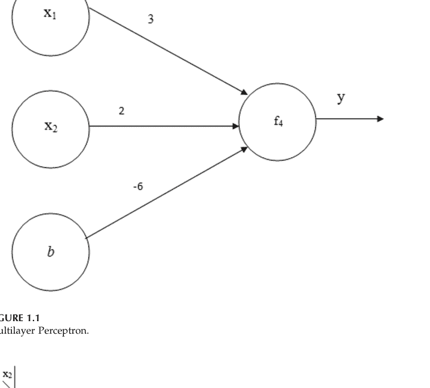

图 1.1 多层感知机。

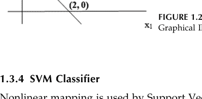

图 1.2 多层感知机的图形化说明。

### 1.3.4 SVM 分类器

支持向量机（SVM）分类器利用非线性映射将原始训练数据转换到更高维度，并在该新维度中搜索最优分类超平面。通过选择适当的非线性映射将数据映射到足够高的维度，该超平面可用于将来自两个不同类别的数据分开。图 1.3 展示了这一方法，其中支持向量以较粗的边框标出。

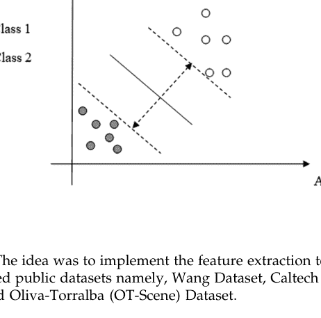

图 1.3 SVM 中超平面 A1 的结构。

其思路是将特征提取技术与广泛使用的公开数据集相结合，即 Wang 数据集、Caltech 数据集、Corel 数据集和 Oliva-Torralba（OT-Scene）数据集。

## 1.4 使用的数据集

### 1.4.1 Wang 数据集

这一广受欢迎的公开数据集由 Wang 等人提供，共分为 10 个类别，总计包含 1000 张图像 [11]。每幅图像的尺寸为 256 × 384 或 384 × 256，每个类别的图像数量为 100 张。该数据集分为以下类别：部落、海滩、哥特式建筑、公交车、恐龙、大象、花卉、马、山脉和食物。图 1.4 以拼贴图形式展示了 Wang 数据集的示例。

### 1.4.2 Caltech 数据集

Caltech 数据集包含 8127 张图像，分布于 100 个类别中 [12]。各个类别的图像数量不相等。每幅图像的尺寸为 300 × 200。不同类别包括手风琴、飞机、锚、蚂蚁、背景 Google、桶、鲈鱼、海狸、双筒望远镜、盆景、大脑、雷龙、佛陀、蝴蝶、相机、大炮、汽车侧面、吊扇、手机、椅子等。图 1.5 以拼贴图形式展示了 Caltech 数据集的示例。

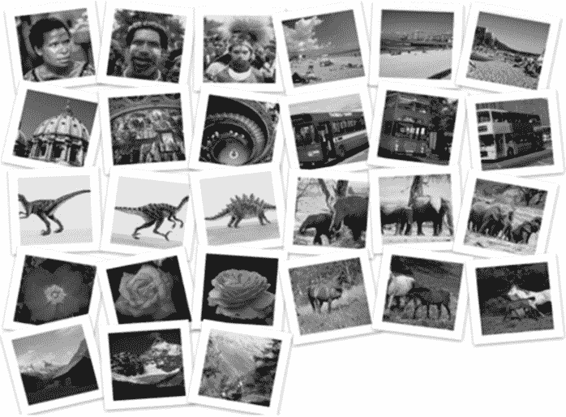

**图 1.4** Wang 数据集示例。

### 1.4.3 Corel 数据集

Corel 数据集包含 10800 张图像，尺寸为 80 × 120 或 120 × 80，分布于 80 个不同类别中 [13]。这些类别包括艺术、古董、网络、恐龙、壁画、城堡、灯光、现代、文化、饮品、盛宴、健身、玩偶、航空、气球、bob、盆景、公交车、汽车、卡片、诱饵、菜肴、门、复活节彩蛋、人脸等。图 1.6 以拼贴图形式展示了 Corel 数据集的示例。

### 1.4.4 Oliva Torralba（OT-Scene）数据集

OT-Scene 是麻省理工学院（MIT）提供的知名公开数据集 [14]，包含 8 个类别的图像，共计 2688 张图像。数据集中的不同类别包括海岸与海滩（360 张）、开阔乡村（328 张）、森林（260 张）、山脉（308 张）、高速公路（324 张）、街道（410 张）、市中心（292 张）和高层建筑（306 张）。图 1.7 展示了 OT-Scene 数据集的拼贴图。

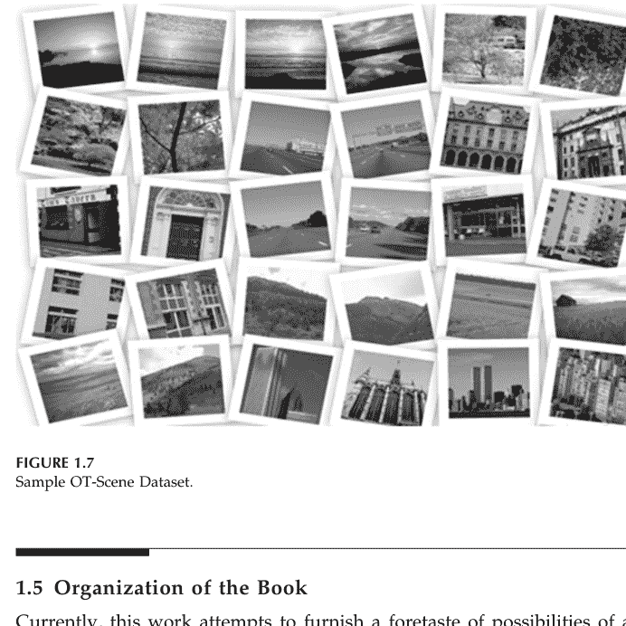

图 1.7 OT-Scene 数据集示例。

## 1.5 本书的组织结构

本书力图展示应用多种创新技术来提升基于内容的图像分类性能的可能性。每种方法都将在后续章节中详细讨论，并特别强调为基于融合的方法构建框架。

第 1 章概述了基于内容的图像分类的当前情况，强调了特征提取技术在确保基于内容的图像识别成功方面的重要性。

第 2 章讨论了基准特征提取技术的各种当代研究成果，回顾了基于内容的图像分类中近年报道的技术，并讨论了各种技术在提升分类效果方面的重要性。

第 3 章至第 7 章讨论了用于基于内容的图像分类的各种手工特征提取技术。这些章节具体描述了如何从颜色、形状、纹理等低级图像特征中提取特征。作者为读者提供了逐步指导，帮助其动手实践这些算法的实现。所提取的特征维度非常小，这有助于读者即使在使用基本配置的系统上也能检验所提取特征的鲁棒性。

第 8 章确立了使用融合框架进行分类以提升分类结果的重要性。该章对早期融合和晚期融合的效率进行了比较，并确立了基于融合的架构对于提升分类结果的重要性。

最后，第 9 章讲解了使用预训练卷积神经网络（CNN）架构进行表示学习。本书最后展望了未来研究方向，以及借助基于内容的图像分类可能实现的各种应用。

### 本章小结

本章介绍了基于内容的图像分类的概念，讨论了基于图像内容进行分类的背景和目标。本章还展示了贯穿全书用于评估分类过程有效性的评价指标。最后，本章演示了本书中用于说明基于内容的图像分类的各种特征提取方案所使用的不同数据集。

### 参考文献

- 1. Hu, J., Yamasaki, T. and Aizawa, K., 2016, May. Multimodal learning for image popularity prediction on social media. In 2016 IEEE International Conference on Consumer Electronics-Taiwan, ICCE-TW, IEEE, pp. 1–2.
- 2. DeBerry-Spence, B., Ekpo, A. E. and Hogan, D., 2019. Mobile phone visual ethnography (MpVE): Bridging transformative photography and mobile phone ethnography. *Journal of Public Policy & Marketing*, 38(1): 81–95.
- 3. Ma, J., Wu, F., Jiang, T. A., Zhao, Q. and Kong, D., 2017. Ultrasound image-based thyroid nodule automatic segmentation using convolutional neural networks. *International Journal of Computer-Assisted Radiology and Surgery*, 12(11): 1895–1910.
- 4. Roberts, L. G., 1960. Pattern recognition with an adaptive network. In *Proceedings of IRE International Convention Record*, pp. 66–70.
- 5. Tippett, J. T., Berkowitz, D. A., Clapp, L. C., Koester, C. J. and Vanderburgh, A. J. (Eds.), 1965. *Optical and Electro-Optical Information Processing*, MIT Press.
- 6. Roberts, L. G., 1963. *Machine Perception of Three Dimensional Solids*, Ph.D. thesis, Massachusetts Institute of Technology.
- 7. Andreopoulos, A. and Tsotsos, J. K., 2013. 50 Years of object recognition: Directions forward. Computer Vision and Image Understanding, 117(8): 827–891.
- 8. Sohn, S. Y., 1999. Meta analysis of classification algorithms for pattern recognition. IEEE Transactions on Pattern Analysis and Machine Intelligence, 21(11): 1137–1144.
- 9. Kekre, H. B., Thepade, S., Kakaiya, M., Mukherjee, P., Singh, S. and Wadhwa, S., 2011. Image retrieval using shape texture content as row mean of transformed columns of morphological edge images. International Journal of Computer Science and Information Technologies, 2(2): 641–645.
- 10. Sridhar, S., 2001. Digital Image Processing, Oxford University publication.
- 11. http://wang.ist.psu.edu/docs/related/ （访问日期：2020年3月18日）。
- 12. http://www.vision.caltech.edu/Image_Datasets/Caltech101/ （访问日期：2020年3月18日）。
- 13. https://sites.google.com/site/dctresearch/Home/content-based-image-retrieval （访问日期：2020年3月18日）。
- 14. https://lmb.informatik.uni-freiburg.de/resources/datasets/SceneFlowDatasets.en.html#downloads （访问日期：2020年3月18日）。

# 2

*基于内容的图像分类中手工特征提取技术综述*

## 2.1 绪论

在庞大的图像数据库中存储着大量有价值的信息，可从其图像数据中获取。娱乐媒体、主流媒体、国防、体育赛事和社交媒体平台等各类来源共同构成了这些图像数据档案 [1]。近年来，人们提出了许多方法并加以实施，目的是从这些海量数据中提取有价值的信息，并将其分类到相应的类别中。本章评估并讨论了上述基于内容的图像分类领域中与特征提取和分类技术相关的一些重要研究方法。

传统上，对图像中信息的研究是通过对颜色、纹理和形状等低级图像特征实施各种特征提取技术来进行的 [2]。基于内容的图像分类中两个最重要的阶段是：从图像数据中稳健地提取特征，然后借助提取的特征签名对图像类别进行分类。

以下几个小节简要介绍了提取基于内容的图像描述符（特征）的重要方法，以及用于分析所提取描述符性能的基准分类技术。


该技术考虑图像中三个不重叠的水平区域，并从每个区域中提取每个独立颜色通道的前三个矩，形成一个包含 27 个浮点数的特征向量 [3]。有些方法被观察到在提取基于颜色的特征时考虑三个主要属性，即颜色空间、颜色空间的量化以及颜色特征的提取 [4–6]。颜色特征已探索了多种方法，如常规颜色直方图（CCH）和模糊颜色直方图（FCH） [7,8]。

CCH 表示图像中每个颜色分量的出现频率。其优点是实现简单，从而降低了计算开销。一个主要缺点是其庞大的特征维度，无论颜色空间如何精细量化都保持不变。另一个发现的不足是其无法评估不同 bin 之间相似的颜色。CCH 中也没有编码颜色的空间信息。

然而，在 FCH 的情况下，由于其属于所有直方图 bin，因此观察到每个 bin 的隶属程度不同。FCH 的主要优势在于通过实现模糊集隶属函数，能够编码每个像素颜色与所有其他直方图 bin 的相似程度。已证明 FCH 在处理不同光照强度下的量化误差时具有额外的鲁棒性。 nevertheless，维度灾难被证明是其受挫的主要原因，同时伴随着模糊隶属函数的计算复杂度增加（见图 2.1）。

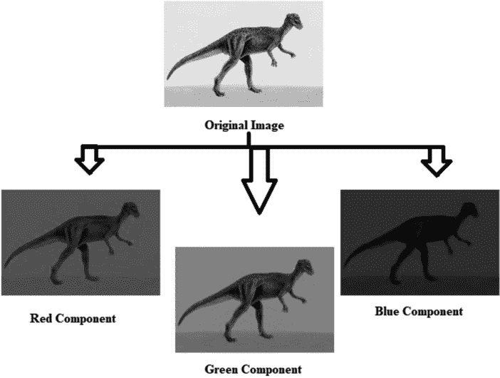

**FIGURE 2.1**  
RGB 颜色分量模型。

## 2.3 利用图像二值化进行特征提取

图像二值化方法能够恰当地将图片中所需内容与其背景分离，以便高效提取其特征。图像二值化方法已全面实现了适当阈值的选择，以区分图像中感兴趣区域与其背景。近年来，研究人员提出了许多利用阈值选择提取二值化特征的技术 [9–11]。二值化技术也被发现有助于进行图像描述符定义，如现有文献所述 [12–19]。然而，大多数提出的 methodology 被观察到是在受控环境中进行评估，这些环境利用高端图像采集设备提供的专业质量图像进行处理。相反，现实场景中的图像采集可能受到多种因素的影响，包括低光条件、不均匀照明等 [20]。在这种情况下，适当的阈值选择技术变得至关重要，以便在这些图片中将前景物体与背景分开识别。二值化技术中阈值选择的关键挑战受光照变化和噪声支配 [21]。物体和背景中存在的灰度级方差、对比度不足等会不利地影响二值化阈值的计算 [22]。阈值的选择至关重要，因为错误的阈值可能会将背景像素误判为前景，反之亦然。阈值选择过程主要分为三类，即均值阈值选择、全局阈值选择和局部阈值选择。多种均值阈值选择技术被有效制定用于提取 CBIR 的重要图像描述符 [23,24]。但是，均值阈值选择技术没有考虑图像中灰度级值分布的标准差。图像方差作为图像阈值选择的一个组成部分，已通过传统的 Otsu 全局阈值选择方法进行探索 [25,26]。基于熵的阈值选择技术被建议用于提取鲁棒描述符 [27]。用于创建二值图像的自适应阈值选择还将图像对比度作为参数，同时考虑像素值的方差和均值（图 2.2）。自适应阈值选择成功执行的典型例子是 Niblack 算法，用于人手指静脉图像的自适应阈值选择 [28]。

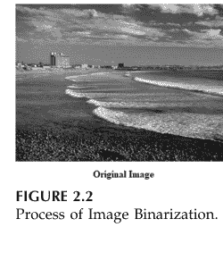

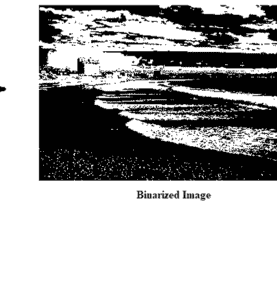

**FIGURE 2.2**  
图像二值化过程。

Sauvola 自适应阈值选择算法被认为是对 Niblack 技术的一种改进，因其在光学字符识别领域的效率 [29]。Bernsen 的局部阈值选择方法解决了快速响应（QR）图像的不均匀照明问题 [30,31]。在 [32] 中，最优阈值是通过误差方法计算的。

## 2.4 利用图像变换进行特征提取

图像变换利用图像元素的域的转换，从而将图像表示为能量谱的集合。通过将图像外推到一系列基函数来创建基图像 [33]。基图像是通过正交酉矩阵生成的，其形式为图像变换算子。将图像从当前表示转换为另一种表示具有两种不同的好处：

- a. 利用图像变换可以将图像扩展为波形序列。变换过程也有助于区分图像模式的关键组成部分。
- b. 信息可以以紧凑的方式存储在变换后的图像数据中，从而提高过程的效率和实用性。

上述图像变换的特性支持使用多种变换技术从图像中提取的描述符维度的彻底降低，例如离散余弦变换、哈特利变换等。因此，研究人员提出了不同的

其通过梯度和形态学算子提取为边缘。通过应用梯度算子，只能确定一个方向（水平、垂直或对角线）的边缘，该算子仅提供一阶导数 [33]。斜率幅度方法与梯度算子一起使用 [51]，通过创建连接边缘的轮廓来定义图像中形状的完整外部边缘。随着时间的推移，由于独特的建模限制，形状的局部描述符 [52–54] 比全局描述符 [55] 更受重视。通过离散曲线演化表示形状有助于简化轮廓，以消除噪声和无关的形状属性 [56]。一种新的形状描述符，即形状上下文，被多个几何变换认可为一种令人信服的紧凑且鲁棒的特征提取手段 [57]。通过用一组线段或标记表示曲线，为特征表示（曲率和方向）[58] 排列了一个度量树 [53]。通过将形状近似为凹段和凸段的序列来实现形状匹配的目的 [54]。对形态学轮廓（MP）的研究是利用部分重建和方向性 MP 来对城市高分辨率高光谱图像进行分类 [59]。从图像中提取傅里叶描述符、不变矩和泽尼克矩等形状特征，有助于医学 X 射线图像分类 [60]。用于交通标志分类的交通信号输入图像中的感兴趣区域（ROIs）是通过使用形态学算子、分割和轮廓检测来区分的 [61]。通过对分割图像应用形态学开运算和闭运算来进行自动损坏建筑检测 [62]。图像增强也在路面图像分割之前使用形态学算子以检测路面裂缝 [63]。叶图像分类已将形状上下文用作全局特征 [64]。通过特征区域计算的基于图像的区域特征观察到准确的分类。能够描述目标物体 3D 形状的形状特征被纳入基于超体素的线粒体分割 [65]。对用于形状表示的傅里叶描述符、曲率尺度空间（CSS）、角径向变换（ART）和图像矩描述符进行了详细研究，用于基于形状的图像识别 [66]。通过设计低级形状描述符可以有效地表示形状特征，这增加了形状对旋转、缩放和形变的鲁棒性 [67]。通过开发一种新的形状演示 Bag of Contour Fragments（BCF）来关注形状表示的中层建模，其中形状被分解为轮廓片段，并使用形状描述符单独描述（图 2.3）。

提出了一种使用类轮廓段作为输入特征的贝叶斯分类器对轮廓形状进行分类的方法，该方法设计了一个形状分类框架 [68]。包含轮廓段和骨架路径的输入特征被考虑用于用高斯混合模型对形状进行分类 [69]。将轮廓点转换为一个

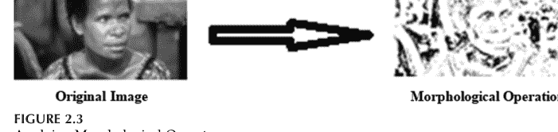

图 2.3
应用形态学算子。

符号表示随后对一对字符串之间的距离进行编辑，用于使用核支持向量机进行分类 [70]。针对形状分类，对每个形状类别使用树联合表示进行原型设计 [71]。骨架树模型已表示用于图像分类的按类别原型 [72]。每个原型都由一个形状码本表示 [73]。骨架匹配对于研究形状分类很有用 [74–77]。基于轮廓的方法包括 CSS [78]、三角形面积表示 (TAR) [79]、分层 Procrustes 匹配 (HPM) [80]、shape-tree [81]、轮廓柔性 [82]、形状上下文 (SC) [83]、内距离形状上下文 (IDSC) [84] 等。

## 2.6 基于纹理内容的特征提取

图像中的纹理由于强度和颜色的变化而形成。它也以重复模式的形式存在。均匀性或放置规则构成了重复模式的基本基元。在物理层面，纹理对应于粗糙度、同质性和平滑度等定性术语。根据基元的大小，纹理分为两种类型，即微纹理和宏观纹理 [85]。宏观纹理或粗糙度由物体的较大纹理形成，而较小的纹理导致精细或微纹理。纹理元素的方向称为方向性。可以根据表面是光滑还是粗糙的性质进行分类。纹理特征被用于提出自适应局部二值模式进行图像分类 [86]。基于小波统计纹理特征的分割用于脑部计算机断层扫描图像的分类 [87]。提出了一种名为分层视觉码本 (HVC) 的新颖纹理模式表示方法，用于编码虹膜图像的纹理基元以进行虹膜图像分类 [88]。可以从对非常高分辨率遥感图像中表现出常规模式的地表覆盖的基于纹理的分析中提取用于分类的重要信息 [89]。

各种基于纹理的特征提取技术包括可转向金字塔、轮廓波变换、Gabor 小波变换 [90] 和复方向滤波器组 (CDFB) [91]。引入了平移不变的 CDFB 用于基于纹理的图像识别 [91]。CDFB 的意义在于平移不变性、相对增强的纹理检索性能和相对最小化的冗余比。与 Gabor 变换和可转向金字塔相比，后者的过完备比率随方向子带数量线性增加，CDFB 的过完备比率已被限制为 8/3 [91]。可转向金字塔可以创建图像的多尺度、多方向表示。单个函数的平移和旋转构成了基本滤波器。纹理的表示可以分为三种不同的方式，即结构、统计和多分辨率滤波方法。纹理特征的实用性在过去已被广泛研究，用于其在图像处理、计算机视觉和计算机图形学中的应用 [92]，例如多方向滤波器组 [93] 和小波变换 [94–96]。可以利用对图像像素应用后获得的某些变换系数的统计数据生成纹理特征。文献中提到的两种不同情况下，通过应用小波变换和离散余弦变换生成纹理特征已实现 [97] [98]。计算机视觉和图形学在纹理合成领域取得了令人称赞的进展，其中使用了基于图像中相邻位置/方向/尺度处小波系数对的马尔可夫统计描述符 [99]。Manjunath 和 Ma [100,101] 在使用纹理特征进行图像识别的初始阶段做出了重大贡献，并指出了其纳入 MPEG-7 [102] 的适当性。Ma 和 Manjunath 还提出了 [103] 一个用于航空图像识别的纹理词表。词表构建过程中涉及的纹理提取基于对图像应用 Gabor 滤波器组 [104]，以将滤波输出的统计数据编码为纹理特征。观察到诸如仿射和光度变换不变特征等纹理区域描述符对所讨论区域的形状具有鲁棒性 [105]。当代文献中观察到为纹理识别进步而构想的仿射不变纹理特征提取 [106]（图 2.4）。

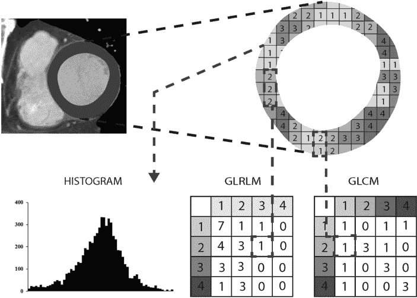

图 2.4
心肌纹理分析。

来源: Hinzpeter, R., Wagner, M.W., Wurnig, M.C., Seifert, B., Manka, R. and Alkadhi, H., 2017. Texture analysis of acute myocardial infarction with CT: First experience study. PloS One, 12(11).

## 2.7 多种技术提取特征的融合

颜色矩和 Gabor 滤波器响应的矩被考虑用于从颜色和纹理中提取局部描述符。形状信息以边缘图像的形式使用梯度矢量流场提取出来。形状特征最终由不变矩表示。内容基于图像识别决策和所有这些单独特征被融合以增强检索性能 [107]。基于颜色直方图的特征向量和基于共生矩阵的纹理特征是从色调、饱和度、值 (HSV) 颜色空间中提取用于基于内容的图像识别 [108]。模糊集合论方法被实施以从图像中选择视觉显著的点特征。这些点用于计算一些不变颜色特征以计算图像之间的相似性 [109]。将颜色布局描述符和 Gabor 纹理描述符作为图像签名进行融合已显示出增加的图像识别结果 [110]。包含颜色、纹理和空间结构描述符的多技术特征提取导致了增强的识别率 [49]。形成图像识别的神经网络架构，以使用小波包和 Gabor 滤波器的特征值作为特征向量来评估图像的基于内容的相似性匹配 [111]。从图像中提取类内和类间特征已将改进的识别结果纳入图像数据 [112]。颜色共生矩阵 (CCM) 和扫描模式像素之间的差异 (DBPSP) 已被用于提取颜色和基于纹理的特征，这些特征作为人工神经网络 (ANN) 基于分类器的输入 [113]。在 [114] 中，将修改后的颜色基元共生矩阵 (MCMCM) 和 DBPSP 特征以相等权重整合的两种特征提取技术已被证明对基于内容的

对应的分支。实例的分类在根节点开始，并且排序必须根据特征值进行。树的根节点包含最能划分训练数据的特征。应用多种技术来识别最能划分训练数据的特征，例如信息增益和基尼指数 [122,123]。然而，每个属性都由近视度量独立测量；即 ReliefF 算法 [124] 在其他属性的上下文中估计它们。然而，大多数研究观察到没有单一的最佳方法 [125]。在决定特定数据集中应使用哪种度量时，比较各个方法仍然至关重要。然后在分割数据的每个分区上重复相同的过程，创建子树，直到训练数据被划分为同一类的子集。决策树在每个内部节点使用基于单个特征的分割，这使它们被表征为单变量的。涉及对角线划分的问题大多数决策树无法很好地处理。实例空间的划分与一个变量的轴正交，与所有其他轴平行。因此，划分后得到所有超矩形区域。然而，一些方法构建多元树。Zheng 的方法通过使用逻辑运算符（如合取、否定和析取）创建新的二元特征，提高了决策树的分类准确性 [126]。此外，Zheng 创建了至少 M-of-N 特征 [127]。对于给定实例，最小 M-of-N 表示的值为真，如果其至少 M 个条件对该实例为真；否则为假。形成组合决策树时使用线性判别式来构建多元决策树 [128]。

文献中最熟悉的决策树构建算法是 C4.5 [129]。可理解性被认为是决策树最重要的特征之一。决策树中做出的假设是，不同类别的实例在其至少一个特征中具有不同的值。决策树在处理离散/分类特征时往往表现更好（图 2.5）。

### 2.9.2 学习一组规则

多种基于规则的算法可以直接从训练数据中归纳 [130]。在分类规则中，每个类由析取范式 (DNF) 表示。目标是创建与训练数据一致的最小规则集。学习大量规则意味着学习算法试图“记住”训练集，而不是发现支配它的假设。分离与征服算法（覆盖算法）搜索解释其训练实例一部分的规则，分离这些实例并通过学习更多规则递归征服剩余实例，直到没有实例剩余。规则学习的启发式方法以及

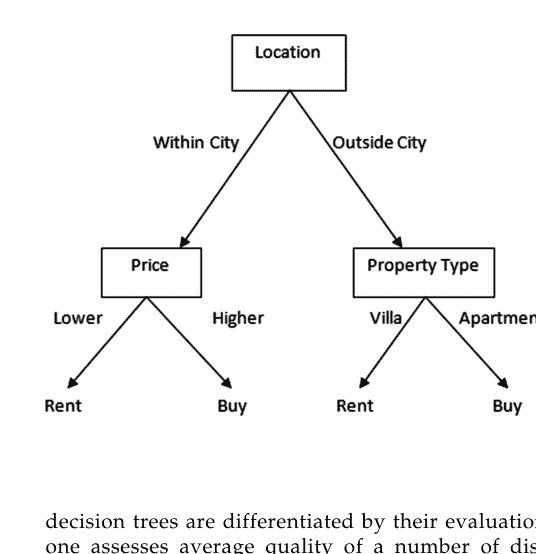

**图 2.5** 决策树的结构。

决策树因其评估属性而有所区别。后者评估多个不相交集合的平均质量，而前者仅衡量候选规则所覆盖的实例集合的质量。对于规则归纳系统而言，生成具有高可预测性或可靠性的决策规则非常重要；该属性由一个称为规则质量的函数来衡量。规则归纳和分类过程都需要诸如 J-measure [131] 之类的规则质量度量。规则归纳已将规则质量度量作为规则设计和/或简化过程中的决定性因素。分类将规则质量值与每条规则结合，以通过待分类示例满足多条规则来解决冲突。已对若干统计和经验性的规则质量度量进行了综述 [132]。通过可视化其评估指标，对分离与征服或覆盖式规则学习算法的性能进行了分析 [133]。RIPPER 是一种众所周知的基于规则的算法 [134]。该算法在生长规则时遵循重复的生长和修剪。生长阶段涉及准备限制性规则以最好地拟合训练数据。修剪阶段旨在使规则限制性降低以避免过拟合，从而降低对未见实例的性能。因此，基于规则的分类器的区别特征是其无歧义性。此外，专家已提出在归纳之前对特征进行离散化，以在减少训练时间的同时提高分类准确率 [135]。通过使用用户的背景知识 [136] 或自动特征构造算法 [137] 组合特征（如决策树中所示），观察到规则学习算法的分类准确率有所提高。

### 2.9.3 基于感知器的技术

#### 2.9.3.1 单层感知器

单层感知器简要描述如下：如果输入特征值用 x₁ 到 xₙ 表示，连接权重/预测向量用 w₁ 到 wₙ 表示（通常为区间 [−1, 1] 中的实数），则感知器计算加权输入之和为 ∑ᵢ xᵢwᵢ，并为输出维护一个可调阈值。如果总和高于阈值，则输出赋值为 1；否则为 0。从一批训练实例中，感知器算法常用的学习过程是通过训练集重复执行算法，以为整个训练集寻找合适的预测向量。测试集的标签预测由该预测规则执行。创建了一种名为 voted-perceptron 的新算法，以在训练期间积累更多信息，从而为测试数据生成更优的预测 [138]。

已讨论了使用类感知器线性算法处理无关特征时保持优越时间复杂度的特性。这对于处理大量特征但其中只有少数相关的情况可能是一个实质性的好处。通常，无论运行时间如何，所有类感知器线性算法都可以称为随时在线算法，它们具有产生有用结果的能力 [139]。运行时间越长，结果越好。最后，多类问题必须简化为多个二分类问题，因为类感知器方法为二元的。

#### 2.9.3.2 多层感知器

实例必须线性可分，才能使学习达到所有实例都被正确分类的点。该问题通过多层感知器 [140]（图 2.6）得到解决。

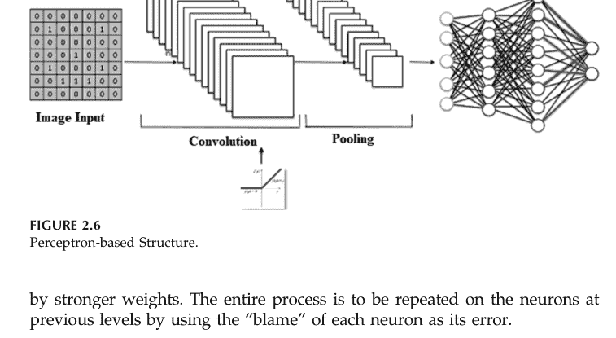

**图 2.6** 基于感知器的结构。

大量单元（神经元）以连接模式连接在一起构成了多层神经网络。单元的三大主要细分是：接收待处理信息的输入单元、显示处理结果的输出单元，以及中间的单元，更为人所知的是隐藏单元。前馈网络允许信号从输入到输出单向移动。反向传播算法将任务分为多个步骤。它为神经网络提供训练样本。网络的输出与给定样本的期望输出进行比较，以计算每个输出神经元的误差。其后是为每个神经元计算期望输出以及用于调整以匹配期望输出的缩放因子。这被称为局部误差。每个神经元的权重必须调整以最小化局部误差。必须对局部误差进行“归咎”分配给前一层的神经元，以便将更高责任交给由更强权重连接的神经元。整个过程必须在前一层的神经元上重复进行，使用每个神经元的“归咎”作为其误差。

### 2.9.4 统计学习算法

统计方法以显而易见的基本概率模型为特征，该模型定义实例属于每个类别的可能性，而不仅仅是分类。两种简单方法，即线性判别分析（LDA）和相关的 Fisher 线性判别，被统计学和机器学习所利用，以找到对分离两个或多个对象类别起主要作用的特征线性组合 [141]。LDA 要求对每个观测值进行的测量必须是连续量。处理分类变量的类似技术是判别对应分析 [142]。估计数据概率分布的另一种广泛技术是最大熵。最大熵遵循的总体原则是在一无所知时具有最大可能的均匀分布，并具有最大熵。有标签的训练数据对于开发一组约束模型以描绘分布的类别特定期望至关重要。现有文献中介绍了关于最大熵技术的良好教程导论 [143]。统计学习算法最著名的代表是贝叶斯网络。关于贝叶斯网络的说明性介绍在早期方法中有所涉及 [144]。

### 2.9.5 支持向量机

最新的监督机器学习技术是支持向量机（SVMs）[145]。SVMs 包含“间隔”概念——区分两个数据类别的超平面的任一侧。上限的减少

基于各种低级特征（即颜色、形状和纹理）定义基于内容描述符（特征）。此外，本章详细阐述了基于决策树、基于学习的规则、统计技术、基于感知器的算法和支持向量机的显著分类技术。

## 参考文献

- 1. Lu, D. and Weng, Q., 2007. 图像分类方法与提高分类性能技术的综述。 *国际遥感期刊*, 28: 823–870.
- 2. Choraś, R. S., 2007. 图像特征提取技术及其在 CBIR 和生物识别系统中的应用。 *国际生物与生物医学工程期刊*, 1(1): 6–16.
- 3. Singh, S. M. and Hemachandran, K., 2012. 基于颜色矩和 Gabor 纹理特征的内容图像检索。 *IJCSI 国际计算机科学期刊*, 9(5): 299–309.
- 4. Datta, R., Joshi, D., Li, J. and Wang, J. Z., 2008. 图像检索：新时代的理念、影响与趋势。 *ACM 计算调查*, 40(2): 1–60.
- 5. Swain, M. J. and Ballard, D. H., 1991. 颜色索引。 *国际计算机视觉期刊*, 7(1): 11–32.
- 6. Deng, Y., Manjunath, B. S., Kenney, C., Moore, M. S. and Shin, H., 2001. 一种用于图像检索的高效颜色表示。 *IEEE 图像处理汇刊*, 10(1): 140–147.
- 7. Kotoulas, L. and Andreadis, I., 2003. 基于颜色直方图的内容图像检索及硬件实现。 *IEE 会刊 – 电路、器件与系统*, 150(5): 387.
- 8. Han, J. and Ma, K. K., 2002. 模糊颜色直方图及其在彩色图像检索中的应用。 *IEEE 图像处理汇刊*, 11(8): 944–952.
- 9. Sezgin, M. and Sankur, B., 2004. 图像阈值技术综述与定量性能评估。 *电子成像期刊*, 13(1): 146.
- 10. Barney Smith, E. H., Likforman-Sulem, L. and Darbon, J., 2010. 预处理对二值化的影响，eds. *Laurence Likforman-Sulem 和 Gady Agam*, Boise State University Scholar Works. 75340H-75340H-8.
- 11. Wang, Z., Li, J., Su, S. and Xie, G., 2009. 基于全局迭代阈值和局部分析的护照图像二值化算法。 In *2009 年信息管理、创新管理与工业工程国际会议*, IEEE, ICIII 2009, vol. 1, pp. 239–242.
- 12. Gatos, B., Pratikakis, I. and Perantonis, S. J., 2006. 自适应退化文档图像二值化。 *模式识别*, 39(3): 317–327.
- 13. Kuo, T.-Y., Lai, Y. Y. and Lo, Y.-C., 2010. 一种使用混合阈值的新颖图像二值化方法。 In *ICME 会议论文集*, IEEE, pp. 608–612.
- 14. Tong, L. J., Chen, K., Zhang, Y., Fu, X. L. and Duan, J. Y., 2009. 基于 NFCM 的文档图像二值化。 In *2009 年第二届图像与信号处理国际会议论文集*, CISP’09, pp. 1–5.


- 15. Tanaka, H., 2009. 用于划线提取的文档图像二值化阈值校正。载于《国际文档分析与识别会议论文集》，ICDAR，第 541–545 页。
- 16. Ntirogiannis, K., Gatos, B. and Pratikakis, I., 2008. 文档图像二值化技术的客观评估方法。2008 年第八届国际模式识别协会文档分析系统国际研讨会，第 217–224 页。
- 17. Gatos, B., Pratikakis, I. and Perantonis, S. J., 2008. 利用多种二值化技术组合和自适应边缘信息改进文档图像二值化。2008 年第 19 届国际模式识别会议，第 1–4 页。
- 18. Pan, M. P. M., Zhang, F. Z. F. and Ling, H. L. H., 2007. 基于 HVS 的图像二值化方法。IEEE 国际多媒体博览会，2007 年，第 1283–1286 页。
- 19. Mello, C. A. B. and Costa, A. H. M., 2005. 利用熵和 ROC 曲线对历史文档进行图像阈值处理。载于《模式识别、图像分析和应用进展》，编者 Manuel Lazo 和 Alberto Sanfeliu，Springer，第 3773 卷，第 905–916 页。
- 20. Valizadeh, M., Armanfard, N., Komeili, M. and Kabir, E., 2009. 一种用于不良照明文档图像二值化的新型混合算法。载于 2009 年第 14 届国际 CSI 计算机会议，CSICC 2009，第 121–126 页。
- 21. Lu, S. and Chew, L. T., 2007. 通过阴影估计和补偿对不良照明文档图像进行二值化。载于《国际文档分析与识别会议论文集》，ICDAR，第 1 卷，第 312–316 页。
- 22. Chang, Y.-F., Pai, Y.-T. and Ruan, S.-J., 2009. 基于智能块检测的退化文档图像高效阈值算法。IEEE 系统、人与控制论国际会议。SMC，第 667–672 页。
- 23. Kekre, H. B., Thepade, S., Khandelwal, S., Dhamejani, K. and Azmi, A., 2011. 使用多级块截断编码的人脸识别。《国际计算机应用期刊》，36(11): 38–44。
- 24. Kekre, H. B., Thepade, S., Khandelwal, S., Dhamejani, K. and Azmi, A., 2012. 使用 Kekre LUV 色彩空间的多级 BTC 改进人脸识别。《国际计算机应用期刊》，3(1): 156–160。
- 25. Shaikh, S. H., Maiti, A. K. and Chaki, N., 2013. 一种基于迭代划分的新图像二值化方法。《机器视觉与应用》，24(2): 337–350。
- 26. Otsu, N., 1979. 基于灰度直方图的阈值选取方法。《IEEE 系统、人与控制论汇刊》，9: 62–66。
- 27. Johannsen, G. and Bille, J., 1982. 一种基于信息测度的阈值选取方法。载于第 6 届国际模式识别会议，第 140–143 页。
- 28. Liu C., 2013. 一种新的指静脉特征提取算法。载于 IEEE 第 6 届图像与信号处理国际会议，CISP，第 395–399 页。
- 29. Ramírez-Ortegón, M. A. and Rojas, R., 2010. 基于局部灰度强度方差的历史文档二值化无监督评估方法。载于《国际模式识别会议论文集》，第 2029–2032 页。
- 30. Yanli, Y. and Zhenxing, Z., 2012. 一种用于 QR 图像的新型局部阈值二值化方法，载于 IET 自动控制与人工智能国际会议，ACAI，第 224–227 页。
- 31. Bernsen, J., 1986. 灰度图像的动态阈值处理。载于《国际模式识别会议论文集》，ICPR，第 1251–1255 页。
- 32. Kittler, J. and Illingworth, J., 1986. 最小误差阈值化。*模式识别*，19(1): 41–47。
- 33. Annadurai, S. and Shanmugalakshmi, R., 2011. 图像变换。载于*数字图像处理基础*，Pearson，第 31–66 页。
- 34. Kekre, H. B. and Thepade, S., 2009. 利用变换图像的部分系数提高图像检索性能。*国际信息检索期刊，Serials Publications*，2(1): 72–79。
- 35. Kekre, H. B., Thepade, S. and Maloo, A., 2010. 使用 DCT 和 Walsh 变换的变换图像分数系数进行图像检索。*国际工程科学与技术期刊，IJEST*，2(4): 362–371。
- 36. Kekre, H. B., Thepade, S. and Maloo, A., 2010. 使用变换列图像的行均值进行图像检索的性能比较。*国际 R-20 计算机科学与工程期刊，IJCSE*，2(5): 959–964。
- 37. Kekre, H. B., Thepade, S. and Maloo, A., 2010. 使用 Walsh、Haar 和 Kekre 变换对图像的偶数部分和奇数部分进行列变换的行均值进行图像检索。*国际计算机科学与信息安全期刊 (IJCSIS)*，8(5): 360–363。
- 38. Kekre, H. B., Thepade, S., Athawale, A., Anant, S., Prathamesh, V. and Suraj, S., 2010. 使用图像分块对行均值、列均值及两者进行 Kekre 变换的图像检索。*国际计算机与电气工程期刊，IJCEE*，2(6): 964–971。
- 39. Kekre, H. B., Thepade, S. and Maloo, A., 2010. 使用行、列和对角线均值序列的协方差矩阵特征向量进行 CBIR 特征向量维数约简。*国际计算机应用期刊，IJCA*，3(12): 786–1114。
- 40. Prakash, O., Khare, M., Srivastava, R. K. and Khare, A., 2013. 使用多尺度双正交小波变换的多类图像分类。载于 IEEE 第二届信息处理国际会议，ICIIP，第 131–135 页。
- 41. Luo, H., Yang, L., Yuan, H. and Tang, Y. Y., 2013. 用于高光谱图像分类的随机各向异性变换降维。载于 2013 年 IEEE 控制论国际会议，CYBCONF 2013，第 156–161 页。
- 42. Rajan, A., Ramesh, G. P. and Yuvaraj, J., 2014. 使用小波变换的青光眼图像分类。载于 IEEE 先进通信控制与计算技术国际会议，ICACCCT，2014 年，第 1398–1402 页。
- 43. Wang, Y. and Cui, S., 2014. 使用平稳小波变换的高光谱图像特征分类。载于 IEEE 小波分析与模式识别国际会议，ICWAPR，2014 年，第 104–108 页。
- 44. Suma, K. V., Indira, K. and Rao, B., 2014. 使用小波和离散余弦变换对甲襞毛细血管图像进行分类。载于 IEEE 电路、通信、控制与计算国际会议，I4C，2014 年，第 105–108 页。
- 45. Kobayashi, T., 2014. 基于 Dirichlet 的直方图特征变换用于图像分类。载于 IEEE 计算机视觉与模式识别会议，CVPR，2014 年：3278–3295。
- 46. Rezaeilouyeh, H., Mahoor, M. H., Mavadati, S. M., Zhang, J. J., 2013. 一种使用剪切波变换的显微图像分类方法。载于 IEEE 医疗信息学国际会议，ICHI，2013 年，第 382–386 页。
- 47. Li, Y. H. and Savvides M., 2007. 用于增强人脸识别的核 Fukunaga-Koontz 变换子空间。载于 IEEE 计算机学会计算机视觉与模式识别会议论文集，第 1–8 页。
- 48. Hafed, Z. M. and Levine, M. D., 2001. 使用离散余弦变换的人脸识别。《国际计算机视觉期刊》，43(3): 167–188。
- 49. Shen, G. L. and Wu, X. J., 2013. 通过结合颜色、纹理和 CENTRIST 进行基于内容的图像检索。载于 IEEE Constantindes 信号处理国际研讨会，CIWSP，2013 年，第 1–4 页。
- 50. Walia, E., Goyal, A. and Brar, Y.S., 2013. 用于基于内容的图像检索的 Zernike 矩和 LDP 加权补丁。《信号、图像和视频处理》，Springer，8(3): 577–594。
- 51. Kekre, H. B., Thepade, S., Wadhwa, S., Singh, S., Kakaiya, M. and Mukherjee, P., 2010. 使用梯度算子和斜率幅度技术结合 BTC 提取形状特征的图像检索。《国际计算机应用期刊，IJCA》，6(8): 28–33。
- 52. Mehrotra, R. and Gary, J. E., 1995. 形状数据管理中的相似形状检索。《IEEE 计算机》，28(9): 57–62。
- 53. Berretti, S., Del Bimbo, A., and Pala, P., 2000. 基于感知距离和有效索引的形状相似性检索。《IEEE 多媒体汇刊》，2(4): 225–239。
- 54. Petrakis, E. G. M., Diplaros, A. and Milios, E., 2002. 使用动态规划匹配和检索失真和遮挡形状。《IEEE 模式分析与机器智能汇刊》，24(4): 509–522。
- 55. Flickner, M., Sawhney, H., Niblack, W., Ashley, J., Huang, Q., Dom, B., Gorkani, M., et al., 1995. 基于图像和视频内容的查询：QBIC 系统。《计算机》，28(9): 23–32。
- 56. Latecki L. J. and Lakamper R., 2000. 基于视觉部件对应关系的形状相似性度量。《IEEE 模式分析与机器智能汇刊》，22(10): 1185–1190。
- 57. Belongie S., Malik J. and Puzicha J., 2002. 使用形状上下文的形状匹配和目标识别。《IEEE 模式分析与机器智能汇刊》，24(4): 509–522。
- 58. Ciaccia, P., Patella, M., and Zezula, P., 1997. M-tree：度量空间中相似性搜索的一种高效访问方法。载于第 23 届超大型数据库国际会议论文集，Morgan Kaufmann，第 426–435 页。
- 59. Benediktsson, J. A., Palmason, J. A., and Sveinsson, J. R., 2005. 基于扩展形态学轮廓的城市区域高光谱数据分类。《IEEE 地球科学与遥感汇刊》，43(3): 480–491。
- 60. Fesharaki, N. J. and Pourghassem, H., 2012. 基于形状特征和贝叶斯规则的医学 X 射线图像分类。载于 2012 年第四届计算智能与通信网络国际会议，IEEE，369–373。
- 61. Ganapathi, K., Madumbu, V., Rajendran, R. and David, S., with Phalguni, 2013. 自动交通标志识别系统的设计与实现 on


TI OMAP-L138. 见IEEE国际工业技术会议论文集，第1104–1109页。

- 62. Parape, C. D. K., Premachandra, H. C. N., Tamura, M., Sugiura, M., 2012. 利用形态学算子从2011年东北太平洋海岸地震和海啸的甚高分辨率卫星图像中识别受损建筑。见IEEE国际地球科学与遥感研讨会，IGARSS，2012年，第3006–3009页。
- 63. Na, W. and Tao, W., 2012. 基于近端支持向量机的路面图像分类。见IEEE第五届先进计算智能国际会议，ICACI，2012年，第686–688页。
- 64. Wang, Z., Lu, B., Chi, Z. and Feng, D., 2011. 基于形状上下文和SIFT描述子的叶片图像分类。见《2011年国际数字图像计算：技术与应用会议论文集》，DICTA，2011年，第650–654页。
- 65. Lucchi, A., Smith, K., Achanta, R., Knott, G. and Fua, P., 2012. 基于学习形状特征的EM图像堆栈中线粒体的超体素分割。IEEE医学成像汇刊，31(2): 474–486.
- 66. Amanatidis, A., Kaburlasos, V. G., Gasteratos, A. and Papadakis, S. E., 2011. 面向基于形状的图像检索的形状描述子评估。IET图像处理，第493–499页。
- 67. Wang, X., Feng, B., Bai, X., Liu, W. and Latecki, L. J., 2014. 用于鲁棒形状分类的轮廓片段袋。模式识别，47(6): 2116–2125.
- 68. Sun, K. B. and Super, B. J., 2005. 使用类段集合的轮廓形状分类。见IEEE计算机学会计算机视觉与模式识别会议论文集，第2卷，第727–733页。
- 69. Shen, W., Bai, X., Hu, R., Wang, H. and Latecki, L. J., 2011. 基于弯曲势比的骨架生长与剪枝。模式识别，44(2): 196–209.
- 70. Daliri, M. R. and Torre, V., 2008. 用于形状识别与检索的鲁棒符号表示。模式识别，41(5): 1799–1815.
- 71. Bai, X., Wang, X., Latecki, L. J., Liu, W. and Tu, Z., 2009. 用于非刚性物体检测的主动骨架。见IEEE国际计算机视觉会议论文集，第575–582页。
- 72. Demirci, M. F., Shokoufandeh, A. and Dickinson, S. J., 2009. 从示例中提取骨架形状抽象。IEEE模式分析与机器智能汇刊，31(5): 944–952.
- 73. Yu, X., Yi, L., Fermuller, C. and Doermann, D., 2007. 使用形状码本的物体检测。见英国机器视觉会议，第4卷。http://www.comp.leeds.ac.uk/bmvc2008/proceedings/2007/papers/paper-13.pdf.
- 74. Sundar, H., Silver, D., Gagvani, N. and Dickinson, S., 2003. 基于骨架的形状匹配与检索。见《SMI 2003：2003年国际形状建模会议论文集》，第130–139页。
- 75. Bai, X., Liu, W. and Tu, Z., 2009. 结合轮廓与骨架进行形状分类。见2009年IEEE第12届国际计算机视觉研讨会，ICCV研讨会2009，第360–367页。
- 76. Bai, X. and Latecki, L. J., 2008. 路径相似性骨架图匹配。IEEE模式分析与机器智能汇刊，30(7): 1282–1292.
- 77. Belongie, S., Malik, J. and Puzicha, J., 2002. 基于形状上下文的形状匹配与物体识别。IEEE模式分析与机器智能汇刊，24: 509–522.
- 78. Mokhtarian, F. and Suomela, R., 1998. 通过曲率尺度空间进行鲁棒图像角点检测。IEEE模式分析与机器智能汇刊，20(12): 1376–1381.
- 79. Alajlan, N., El Rube, I., Kamel, M. S. and Freeman, G., 2007. 基于三角形面积表示和动态空间弯曲的形状检索。模式识别，40(7): 1911–1920.
- 80. McNeill, G. and Vijayakumar, S., 2006. 用于形状检索的分层Procrustes匹配。见IEEE计算机学会计算机视觉与模式识别会议论文集，第1卷，第885–892页。
- 81. Keshet, R., 2007. 邻接格与形状树半格。图像与视觉计算，25(4): 436–446. 特刊。
- 82. Xu, C., Liu, J. and Tang, X., 2009. 基于轮廓柔性的二维形状匹配。IEEE模式分析与机器智能汇刊，31(1): 180–186.
- 83. Thayananthan, A., Stenger, B., Torr, P. H. S. and Cipolla, R., 2003. 杂乱场景中的形状上下文与倒角匹配。见IEEE计算机学会计算机视觉与模式识别会议论文集，第I–II页。
- 84. Ling, H. and Jacobs, D. W., 2007. 使用内部距离的形状分类。IEEE模式分析与机器智能汇刊，29(2): 286–299.
- 85. Randen, T. and Husøy, J. H., 1999. 用于纹理分类的滤波：比较研究。IEEE模式分析与机器智能汇刊，21(4): 291–310.
- 86. Lin, C.-H., Liu, C.-W. and Chen, H.-Y., 2012. 基于纹理特征的自适应局部二值模式的图像检索与分类。IET图像处理，6(7): 822–830.
- 87. Nanthagopal, A. P. and Sukanesh, R., 2013. 基于小波统计纹理特征的脑CT图像分割与分类。IET图像处理，7(1): 25–32.
- 88. Sun, Z., Zhang, H., Tan, T. and Wang, J., 2014. 基于分层视觉码本的虹膜图像分类。IEEE模式分析与机器智能汇刊，36(6): 1120–1133.
- 89. Regniers, O., Da Costa, J.-P., Grenier, G., Germain, C. and Bombrun, L., 2013. 基于纹理的超高分辨率海松森林图像检索与分类。见2013年IEEE国际地球科学与遥感研讨会（IGARSS），第4038–4041页。
- 90. Kekre, H. B., Bharadi, V. A., Thepade, S. D., Mishra, B. K., Ghosalkar, S. E. and Sawant, S. M., 2010. 基于Gabor幅度和改进块截断编码融合的基于内容的图像检索。见《第三届工程技术新兴趋势国际会议论文集》，ICETET 2010，第140–145页。
- 91. Vo, A. and Oraintara, S., 2008. 利用复方向滤波器组的相位和幅度信息进行纹理分割。见欧洲信号处理会议，第1–5页。
- 92. Haralick R., 1979. 纹理的统计与结构方法。IEEE学报，67(5): 786–804.
- 93. Malik, J. and Perona, P., 1990. 利用早期视觉机制的警戒前纹理辨别。美国光学学会杂志A辑：光学与图像科学，7(5): 923–932.
- 94. Ma, W. Y. and Manjunath, B. S., 1995. 用于纹理图像标注的小波变换特征比较。见国际图像处理会议论文集，第256–259页。
- 95. Laine, A. and Fan, J., 1993. 基于小波包特征的纹理分类。IEEE模式分析与机器智能汇刊，15(11): 1186–1191.
- 96. Thyagarajan, K., Nguyen, T. and Persons, C. E., 1994. 使用小波变换的纹理分类最大似然方法。见IEEE国际图像处理会议（ICIP-94），第2卷，第640–644页。
- 97. Do, M. N. and Vetterli, M., 2002. 基于广义高斯密度和Kullback–Leibler距离的小波纹理检索。IEEE图像处理汇刊，11(2): 146–158.
- 98. Li, J., Gray, R. M. and Olshen, R. A., 2000. 基于二维隐马尔可夫模型层次建模的多分辨率图像分类。IEEE信息论汇刊，46(5): 1826–1841.
- 99. Portilla, J. and Simoncelli, E. P., 2000. 基于复小波系数联合统计的参数化纹理模型。国际计算机视觉杂志，40(1): 49–71.
- 100. Ma, W. Y. and Manjunath, B. S., 1996. 用于浏览大型航空照片的模式叙词表。技术报告96-10，加州大学圣巴巴拉分校。
- 101. Ma, W. Y. and Manjunath, B. S., 1998. 用于浏览大型航空照片的纹理叙词表。美国信息科学学会杂志，49(7): 633–648.
- 102. Manjunath, B. S., Ohm, J. R., Vasudevan, V. V. and Yamada, A., 2001. 颜色与纹理描述子。IEEE视频技术电路与系统汇刊，11(6): 703–715.
- 103. Ma, W. Y. and Manjunath, B. S., 1996. 纹理特征与相似性学习。见IEEE计算机学会计算机视觉与模式识别会议，第425–430页。
- 104. Jain, A. K. and Farrokhnia, F., 1991. 使用Gabor滤波器的无监督纹理分割。模式识别，24(12): 1167–1186.
- 105. Schaffalitzky, F. and Zisserman, A., 2001. 视点不变的纹理匹配与宽基线立体视觉。见第八届IEEE国际计算机视觉会议论文集（ICCV 2001），第636–643页。
- 106. Mikolajczyk, K. and Schmid, C., 2004. 尺度与仿射不变的兴趣点检测器。国际计算机视觉杂志，60(1): 63–86.
- 107. Hiremath, P. S. and Pujari, J., 2007. 基于颜色、纹理和形状特征的图像内容检索。第15届国际先进计算与通信会议ADCOM 2007，9(2): 780–784.
- 108. Yue, J., Li, Z., Liu, L. and Fu, Z., 2011. 基于颜色与纹理融合特征的图像内容检索。数学与计算机建模，54(3–4): 1121–1127.
- 109. Banerjee, M., Kundu, M. K. and Maji, P., 2009. 基于视觉显著点特征的图像内容检索。模糊集与系统，160(23): 3323–3341.
- 110. Jalab, H. A., 2011. 基于颜色布局描述子和Gabor滤波器的图像检索系统。2011年IEEE开放系统会议，第32–36页。


111. Irtaza, A., Jaffar, M. A., Aleisa, E. and Choi, T. S., 2013. 在基于内容的图像检索中嵌入神经网络进行语义关联. *Multimedia Tools and Applications*, 72(2): 1–21.
112. Rahimi, M. and Moghaddam, M. E., 2013. 基于颜色分布描述符的基于内容的图像检索系统. *Signal Image and Video Processing*, 9(3): 1–14.
113. Elalami, M. E., 2014. 基于内容的图像检索系统的一种新匹配策略. *Applied Soft Computing Journal*, 14(C): 407–418.
114. Subrahmanyam, M., Jonathan Wu, Q. M., Maheshwari, R. P. and Balasubramanian, R., 2013. 用于图像索引和检索的改进颜色基元共现矩阵. *Computers and Electrical Engineering*, 39(3): 762–774.
115. Walia, E., Vesal, S. and Pal, A., 2014. 一种有效且快速的颜色图像检索混合框架. *Sensing and Imaging, Springer*, 15(1): 1–23.
116. Subrahmanyam, M., Maheshwari, R. P. and Balasubramanian, R., 2012. 利用小波和颜色词汇树进行图像检索的专家系统设计. *Expert Systems with Applications*, 39(5): 5104–5114.
117. Das, R. and Walia, E., 2019. 用于基于内容图像分类的稀疏自编码器分区选择. *Neural Computing and Applications*, 31(3): 675–690.
118. Phyu, T. N., 2009, March. 数据挖掘中分类技术的综述. 载于国际工程师和计算机科学家多学科会议论文集, vol. 1, pp. 18–20.
119. Ture, M., Kurt, I., Kurum, A. T. and Ozdamar, K., 2005. 比较用于预测原发性高血压的分类技术. *Expert Systems with Applications*, 29(3): 583–588.
120. Lindsey, D. T., 2000. 视觉科学：从光子到现象学. *Optometry and Vision Science*, 77(5): 233–234.
121. Forsyth, D. A. and Ponce, J., 2002. 计算机视觉：现代方法. *Prentice Hall Professional Technical Reference*.
122. Hunt E., Martin J. and Stone P., 1966. *归纳实验*, New York, Academic Press.
123. Loh, W. Y., 2011. 分类与回归树. *Wiley Interdisciplinary Reviews: Data Mining and Knowledge Discovery*, 1(1): 14–23.
124. Kononenko, I., 1991. 半朴素贝叶斯分类器. In Proceedings of the Sixth European Working Session on Learning, pp. 206–219.
125. Murthy, 1998. 从数据自动构建决策树：跨学科综述. *Data Mining and Knowledge Discovery*, 2: 345–389.
126. Zheng, Z., 1998. 利用决策树上的系统搜索构建合取. *Knowledge Based Systems Journal*, 10: 421–430.
127. Zheng, Z., 2000. 为决策树学习构建 X-of-N 属性. *Machine Learning*, 40: 35–75.
128. Gama, J. and Brazdil, P., 1999. 线性树. *Intelligent Data Analysis*, 3: 1–22.
129. Quinlan, J. R., 1993. *C4.5：机器学习程序*. Morgan Kaufmann, San Francisco.
130. Fürnkranz, J., 1999. 分离与征服规则学习. *Artificial Intelligence Review*, 13(1): 3–54.
131. Smyth, P. and Goodman, R. M., 1991. 利用信息论进行规则归纳. In *Knowledge Discovery in Databases, KDD*, pp. 159–176.
132. An, A. and Cercone, N., 2000. 规则质量度量提高规则归纳的准确性：一种实验方法. In Foundations of Intelligent Systems, 1932: 119–129.
133. Fürnkranz, J., Flach, P., 2005. ROC ‘n’ 规则学习——更好地理解覆盖算法. Machine Learning, 58(1), pp. 39–77.
134. Cohen, W. W., 1995. 快速有效的规则归纳. In Proceedings of the Twelfth International Conference on Machine Learning, pp. 115–123.
135. An, A. and Cercone, N., 1999. 用于学习分类规则的连续属性离散化. Third Pacific-Asia Conference on Methodologies for Knowledge Discovery & Data Mining, pp. 509–514.
136. Flach, P. A. and Lavrac, N., 2000, July. 归纳规则学习中特征构造的作用. In Proceedings of the ICML2000 Workshop on Attribute-Value and Relational Learning: Crossing the Boundaries, pp. 1–11.
137. Markovitch, S. and Rosenstein, D., 2002. 利用通用构造函数进行特征生成. Machine Learning, 49(1): 59–98.
138. Freund, Y. and Schapire, R. E., 1999. 利用感知器算法进行大间隔分类. Machine Learning, 37(3): 277–296.
139. Kivinen, J., 2002. 线性分类器的在线学习, Advanced Lectures on Machine Learning: Machine Learning Summer School 2002, Australia, pp. 235–257. February 11–22, ISSN: 0302-9743.
140. Rumelhart, D. E., Hinton, G. E. and Williams, R. J., 1986. 通过误差传播学习内部表征. In Parallel Distributed Processing: Explorations in the Microstructure of Cognition, 1: 318–362.
141. Friedman, J. H., 1989. 正则化判别分析. Journal of the American Statistical Association, 84(405): 165–175.
142. Mika, S., Ratsch, G., Weston, J. and Scholkopf, B., 1999. 具有核的 Fisher 判别分析. Neural Networks for Signal Processing IX, 1999. In Proceedings of the 1999 IEEE Signal Processing Society Workshop, pp. 41–48.
143. Csiszár, I., 1996. 最大熵、数学和信息论. In Proceedings of the Fifteenth International Workshop on Maximum Entropy and Bayesian Methods, Santa Fe, New Mexico, USA, 1995, vol. 79, pp. 35–50.
144. Jensen, F., 1996. *贝叶斯网络导论*. Springer.
145. Vapnik, V. N., 1995. *统计学习理论的本质*. Springer, vol. 8.

# 3 基于内容的特征提取：颜色平均

## 3.1 前言

任何图像的一个重要主要属性是其颜色，可用于为基于内容的图像分类生成有意义的特征。关于提出各种用于生成具有颜色特征的鲁棒描述符的技术，已有丰富的文献。一种流行的算法——颜色差分直方图（CDH），通过直观地计算具有不同背景的两个点之间的一致颜色差异来提取颜色特征 [1,2]。

利用颜色相关图通过联合概率来表述颜色在图像索引和识别中的有效性 [3]。颜色分布被认为是近期文献中用于促进基于内容图像识别的通用图像特征 [4]。设计描述符的另一种有效技术是颜色直方图，该技术在近期研究中已得到大量研究和实现 [5,6]。

颜色矩（CM）也显示出作为鲁棒特征向量在提高基于内容图像分类精度方面的显著性能 [5]。

最先进的利用颜色特征提取特征向量的技术推动了提出和实现两种利用图像颜色特征提取特征向量的新颖技术。以下技术已探索颜色特征以生成基于内容图像分类的有意义描述符。

- 具有颜色团块的块截断编码（BTC）
- 用于基于内容图像分类的排序块截断编码（SBTC）

在详细阐述这两种技术的算法之前，以下部分简要讨论块截断编码的概念。

## 3.2 块截断编码

块截断编码（BTC）是由于其实现简单而被广泛接受的压缩算法之一。该算法的工作原理始于将图像分割为 n × n（通常为 4 × 4）个不重叠的块 [7]。该算法最初于 1979 年为灰度图像开发，是图像处理诞生初期基准技术之一。该算法的流行促使开发者在后期将其扩展到彩色图像。该算法通过一次编码一个图像块来工作。对重建块的值的重新计算基于每个块的均值和标准差，这使得均值和标准差的值与原始块相似（图 3.1）。

## 3.3 利用具有颜色团块的块截断编码进行特征提取

该特征提取技术的概念以块截断编码为先导，通过区分每个颜色分量——即红色（R）、绿色（G）和蓝色

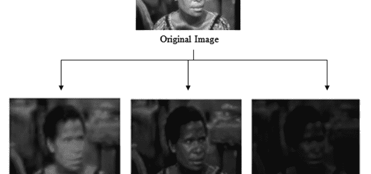

图 3.1
具有 R、G 和 B 分量作为块的块截断编码。


(B)—作为来自图像的块。此后，用于特征提取的颜色团的计算在 RGB 颜色空间中采用 Wang 数据集进行。

逐步特征提取指南如下：

- 颜色团计算始于对各个颜色分量的灰度值进行近似，以形成对应分量的灰度值的不相交子集。
- 接下来是对强度值进行逻辑分区，形成众多颜色团的子划分，这涉及为每个 R、G 和 B 颜色分量进行多个阶段的颜色箱形成。
- 分区数量的增加以 2 的倍数形式制定，如图 3.4 所示。
- 分区在 2 到 32 的范围内进行评估，以确定特征向量提取合适的团数量。
- 特征提取的五个阶段分别命名为 2 个颜色团的 BTC、4 个颜色团的 BTC、8 个颜色团的 BTC、16 个颜色团的 BTC 和 32 个颜色团的 BTC。
- 每个颜色团中特定分区的全部灰度值都与该分区灰度值的均值进行比较。
- 该过程最终创建两个不同的强度组，分别具有大于均值阈值的值和小于均值阈值的值。
- 计算对应团的平均上强度和平均下强度值。

因此，可以从特定团中计算出两个不同的高强度和低强度特征值。这使得特征向量的数量是所选颜色团数量的两倍（图 3.2）。

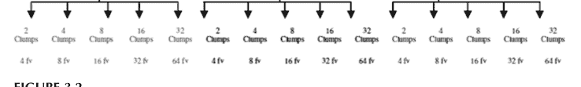

图 3.2
每个颜色的颜色团分布及特征向量 (fv)。

## 3.4 代码示例（MATLAB®）

```matlab
#Read an image
i=imread('path\imagefile');
#Separate the color components
i1=i(:,:,1); #red component
[m n p]=size(i1); #dimension of red component
i3=i(:,:,2); #green component
[x y z]=size(i3); #dimension of green component
i6=i(:,:,3); #blue component
[j k l]=size(i6); #dimension of blue component

#Computing the means of different color clumps for red component
for a1 = 1:m #for loop for row/column iteration of red component
for a2 = 1:n
if i1(a1,a2)>=0 && i1(a1,a2)<32 #specifying the first clump range
c1=c1+1;
s1=s1+i1(a1,a2); #summing up intensity values of first clump
end
end
end
if c1~=0
TavR1 = s1/c1; #calculating mean threshold for clump
else
TavR1=0; #mean threshold 0 if no intensity values fall in clump range
end
for a3 = 1:m #for loop for row/column iteration of red component
for a4 = 1:n
if i1(a3,a4)>=32 && i1(a3,a4)< 64 #specifying the second clump range
c2=c2+1; #summing up intensity values of second clump
s2=s2+i1(a3,a4);
end
end
end
if c2~=0
TavR2 = s2/c2; #calculating mean threshold for clump
else
TavR2 = 0; #mean threshold 0 if no intensity values fall in clump range
end
for a5 = 1:m #for loop for row/column iteration of red component
for a6 = 1:n
if i1(a5,a6)>=64 && i1(a5,a6)< 96 #specifying the third clump range
c3=c3+1;
s3=s3+i1(a5,a6); #summing up intensity values of third clump
end
end
end
if c3~=0
TavR3 = s3/c3; #calculating mean threshold for clump
else
TavR3 = 0; #mean threshold 0 if no intensity values fall in clump range
end
for a7 = 1:m #for loop for row/column iteration of red component
for a8 = 1:n
if i1(a7,a8)>=96 && i1(a7,a8)< 128 #specifying the fourth clump range
c4=c4+1;
s4=s4+i1(a7,a8); #summing up intensity values of fourth clump
end
end
end
if c4~=0
TavR4 = s4/c4; #calculating mean threshold for clump
else
TavR4=0; #mean threshold 0 if no intensity values fall in clump range
end

#Feature Vector Extraction from color clumps
for a25=1:m
for a26=1:n
if i1(a25,a26)>=TavR1 #finding intensity values higher than mean threshold
c13=c13+1;
s13=s13+i1(a25,a26); #summing up high-intensity values
end
end
end
if c13~=0
upR1=s13/c13; #calculating mean high intensity as feature vector
else
upR1=0;
end
for a27=1:m
for a28=1:n
if i1(a27,a28)<TavR1 #finding intensity values lower than mean threshold
c14=c14+1;
s14=s14+i1(a27,a28); #summing up low-intensity values
end
end
end
if c14~=0
loR1=s14/c14; #calculating mean low intensity as feature vector
else
loR1=0;
end
```

## 3.5 编程练习

前面的代码示例用于为红色分量设计 16 个团。请参考示例完成以下任务：

- 为绿色和蓝色分量设计团来计算均值
- 生成维度为 4、8、16、32 和 64 的特征向量

分类性能的比较结果显示，在所述方法中使用 16 个团时 Precision 和 Recall 值最大。这为每个颜色分量提供了维度为 32 的特征向量，三种颜色分量总计为 96，用于形成与图像尺寸无关的特征向量。

表 3.1 中结果的初步比较采用了名为误分类率（MR）和 F1 分数 的指标。颜色团的数量用 N 表示，Wang 数据集被视为使用 KNN 分类器进行分类的测试平台。

实验观察如下：

- MR 随 N 增加至 16 而下降，F1 分数随之上升。
- 记录的最低 MR 为 N = 16 时的 0.050，随后的最高 F1 分数为 0.728。
- 两个观察结果表明，在强度值的 N = 16 子集之前分类性能更高。
- N 进一步提升至 N = 32 时，F1 分数下降至 0.56，MR 上升至 0.099。
- 因此，工作中设计的团数量限制为 16。

此后，计算各种指标的平均值，以观察使用四种不同分类器——即 KNN、Ripple-Down Rule（RIDOR）、人工神经网络（ANN）和支持向量机（SVM）——对来自四个不同公共数据集的颜色团特征提取所使用的分区 N = 16 进行分类时的 Precision、Recall、MR 和 F1-Score。

## 表 3.1 使用 KNN 分类器分类时不同颜色团子集（N）值的误分类率（MR）和 F1 分数比较

| 类别 | 颜色团 N=2 误分类率 | 颜色团 N=2 F1 分数 | 颜色团 N=4 误分类率 | 颜色团 N=4 F1 分数 | 颜色团 N=8 误分类率 | 颜色团 N=8 F1 分数 | 颜色团 N=16 误分类率 | 颜色团 N=16 F1 分数 | 颜色团 N=32 误分类率 | 颜色团 N=32 F1 分数 |
|---|---|---|---|---|---|---|---|---|---|---|
| 部落 | 0.08 | 0.65 | 0.08 | 0.69 | 0.07 | 0.73 | 0.06 | 0.75 | 0.12 | 0.42 |
| 海滩 | 0.08 | 0.6 | 0.08 | 0.61 | 0.08 | 0.56 | 0.08 | 0.59 | 0.16 | 0.4 |
| 哥特式 | 0.13 | 0.42 | 0.14 | 0.46 | 0.14 | 0.44 | 0.13 | 0.48 | 0.17 | 0.13 |
| 建筑结构 | 0.1 | 0.54 | 0.07 | 0.68 | 0.08 | 0.66 | 0.05 | 0.78 | 0.12 | 0.45 |
| 公交车 | 0 | 1 | 0 | 1 | 0 | 0.99 | 0 | 1 | 0 | 1 |
| 恐龙 | 0.06 | 0.72 | 0.05 | 0.76 | 0.05 | 0.79 | 0.07 | 0.7 | 0.09 | 0.58 |
| 大象 | 0.02 | 0.91 | 0.01 | 0.94 | 0.02 | 0.91 | 0.02 | 0.93 | 0.03 | 0.85 |
| 玫瑰 | 0.02 | 0.91 | 0.02 | 0.92 | 0.01 | 0.96 | 0.02 | 0.9 | 0.04 | 0.81 |
| 马 | 0.13 | 0.37 | 0.1 | 0.47 | 0.1 | 0.51 | 0.11 | 0.43 | 0.15 | 0.38 |
| 山脉 | 0.08 | 0.69 | 0.05 | 0.72 | 0.05 | 0.72 | 0.05 | 0.72 | 0.11 | 0.58 |
| 平均值 | 0.07 | 0.681 | 0.06 | 0.725 | 0.06 | 0.727 | 0.059 | 0.728 | 0.099 | 0.56 |

[观察：N = 16 时 KNN 分类器的 F1 分数最高，MR 最低。]

## 表 3.2

使用 BTC 与颜色团进行特征提取时，使用四个不同公共数据集和四个不同分类器的分类性能

| 数据集 | 指标 | KNN | RIDOR | ANN | SVM |
|---|---|---:|---:|---:|---:|
| Wang | 精确率 | 0.741 | 0.654 | 0.914 | 0.715 |
|  | 召回率 | 0.737 | 0.657 | 0.913 | 0.727 |
|  | 误分类率 | 0.059 | 0.079 | 0.038 | 0.066 |
|  | F1 分数 | 0.728 | 0.655 | 0.913 | 0.717 |
| OT-Scene | 精确率 | 0.461 | 0.368 | 0.484 | 0.501 |
|  | 召回率 | 0.45 | 0.36 | 0.479 | 0.494 |
|  | 误分类率 | 0.096 | 0.1 | 0.091 | 0.09 |
|  | F1 分数 | 0.446 | 0.361 | 0.481 | 0.495 |
| Corel | 精确率 | 0.596 | 0.512 | 0.656 | 0.653 |
|  | 召回率 | 0.581 | 0.519 | 0.664 | 0.65 |
|  | 误分类率 | 0.08 | 0.083 | 0.078 | 0.079 |
|  | F1 分数 | 0.584 | 0.515 | 0.658 | 0.637 |
| Caltech | 精确率 | 0.516 | 0.491 | 0.565 | 0.475 |
|  | 召回率 | 0.553 | 0.489 | 0.574 | 0.557 |
|  | 误分类率 | 0.091 | 0.09 | 0.081 | 0.09 |
|  | F1 分数 | 0.484 | 0.489 | 0.568 | 0.484 |

比较结果见表 3.2。

## 3.6 用于基于内容的图像分类的排序块截断编码特征提取

图像处理算法认为噪声会以很大程度污染图像数据，从而对图像数据产生不利影响。大量文献已引入各种降噪技术以减少噪声对图像数据的影响。一种流行技术是分箱方法，该方法广泛用于平滑数据集中排序值的数据 [8]。分箱方法对数据集中值进行排序的逐步功能如下：

- 排序值被划分为箱。
- 通过考虑相邻值来计算排序值的平均值，以对每个箱进行局部平滑。局部平滑对于降噪至关重要。
- 特定箱的对应平均值可用于替换该箱中的每个值。


- 该过程对箱中的所有值重复执行以进行平滑处理。

在 SBTC 的情况下，通过实施改进的箱划分技术采用了类似的方法。图像的灰度值被排序，以便从单个颜色分量红色 (R)、绿色 (G) 和蓝色 (B) 中提取特征向量。

该技术与第 3.3 节中描述的技术的主要区别在于提取的特征向量的维度。早期技术创建的特征向量维度是箱数的两倍，而该技术产生的特征向量等于箱数，如图 3.3 所示。

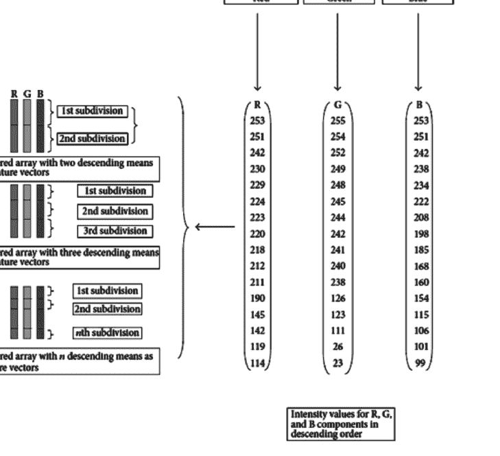

**图 3.3**
SBTC 的框图。

图像的强度值由该过程用一维数组表示。对一维数组的排序按升序进行。

例如，将所有灰度值排序并划分为 N = 8 个箱或分区将产生 8 个特征向量，这与箱或分区的数量相同。这导致特征向量尺寸的全面减少，从而提高了特征向量提取的计算效率。该过程将强度值分离为 N 个块，其中 (N ≥ 2)。块截断编码技术将每个颜色分量红色 (R)、绿色 (G) 和蓝色 (B) 视为一个块以实现特征提取。此外，各个块被划分为包含已排序强度值的箱。特定块的特征向量通过对应箱的已排序强度值的平均值计算得出。该过程对所有三个颜色分量重复执行，并将生成的特征向量组合形成图像的特征向量。

## 3.7 代码示例 (MATLAB)

```
#Read an image
i=imread('path\imagefile');

#Separate the color components
r=i(:,:,1); #red component
[m n p]=size(r); #dimension of red component
g=i(:,:,2); #green component
[x y z]=size(g); #dimension of green component
b=i(:,:,3); #blue component
[j k l]=size(b); #dimension of blue component

#Intensity values as single dimensional array
r1=r(:);
g1=g(:);
b1=b(:);

#Sorting of Intensity values
r2=sort(r1);
g2=sort(g1);
b2=sort(b1);

#Dimension of array
[m n p]=size(r2);
```

- 使用 5、6、7、8 和 9 个箱计算特征向量。最初，Wang 数据集被用作测试平台，使用 KNN 分类器进行分类任务。分类过程如下：
- 分类结果比较在箱数 $N = 3$ 和 $N = 2$ 的情况下进行。
- 与 $N = 2$ 相比，$N = 3$ 记录了 F1-Score 的增加和 MR 值的降低。
- 因此，进一步的细分被启动以提取特征向量并将结果与前一次细分进行比较。
- 如图 3.6 所述，改进的结果记录到 $N = 8$ 为止。
- 对于 $N = 9$，F1-Score 为 0.668，MR 为 0.068，而对于 $N = 8$，F1-Score 为 0.706，MR 为 0.064。

因此，进一步的细分显示出性能下降的明显迹象。因此，进一步的细分被认为是不必要的。$N = 8$，并且被认为是在 SBTC 技术下特征提取的最佳值（图 3.4）。

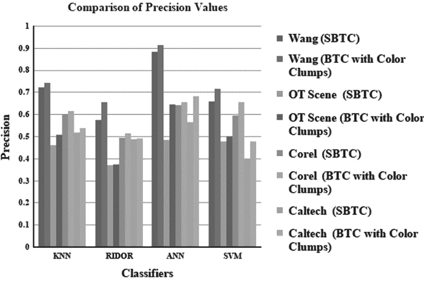

**图 3.5**
使用四种不同分类器对全部四个数据集进行分类的精度值比较，使用 SBTC 和带颜色聚类的 BTC 特征提取方法。

[观察：与 SBTC 相比，带颜色聚类的 BTC 显示出更好的结果。]

### 召回值比较

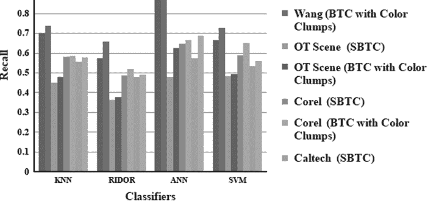

**图 3.6**
使用四种不同分类器对全部四个数据集进行分类的召回值比较，使用 SBTC 和带颜色聚类的 BTC 特征提取方法。

[观察：与 SBTC 相比，带颜色聚类的 BTC 显示出更好的结果。]

### 错误分类率 (MR) 比较

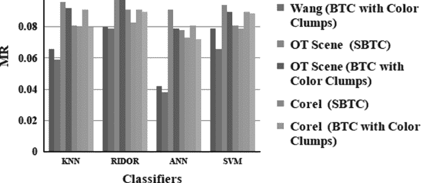

**图 3.7**
使用 SBTC 和带颜色聚类的 BTC 特征提取方法对全部四个数据集使用四种不同分类器进行分类的 MR 比较。

[观察：与 SBTC 相比，带颜色聚类的 BTC 显示出更低的 MR。]

**表 3.3**

使用 SBTC 进行特征提取时，使用四个不同公共数据集和四个不同分类器的分类性能

| 数据集 | 指标 | KNN | RIDOR | ANN | SVM |
|---|---|---|---:|---:|---:|---:|
| Wang | 精度 | 0.72 | 0.575 | 0.882 | 0.657 |
|  | 召回 | 0.7 | 0.572 | 0.869 | 0.664 |
|  | MR | 0.066 | 0.08 | 0.042 | 0.079 |
|  | F1-Score | 0.7 | 0.573 | 0.869 | 0.657 |
| OT-Scene | 精度 | 0.508 | 0.374 | 0.644 | 0.476 |
|  | 召回 | 0.479 | 0.375 | 0.625 | 0.481 |
|  | MR | 0.092 | 0.1 | 0.079 | 0.094 |
|  | F1-Score | 0.475 | 0.375 | 0.625 | 0.467 |
| Corel | 精度 | 0.613 | 0.492 | 0.64 | 0.595 |
|  | 召回 | 0.584 | 0.487 | 0.645 | 0.586 |
|  | MR | 0.081 | 0.091 | 0.073 | 0.081 |
|  | F1-Score | 0.569 | 0.489 | 0.64 | 0.57 |
| Caltech | 精度 | 0.537 | 0.487 | 0.682 | 0.4 |
|  | 召回 | 0.578 | 0.477 | 0.686 | 0.532 |
|  | MR | 0.08 | 0.091 | 0.072 | 0.09 |
|  | F1-Score | 0.537 | 0.482 | 0.686 | 0.443 |

> [观察：四个数据集的最高分类结果均使用 ANN 分类器获得。]

此后，计算各种指标的平均值，以观察使用 SBTC (N = 8) 进行特征提取时，使用 10 折交叉验证的四种不同分类器——即 KNN、RIDOR、ANN 和 SVM 进行分类的 Precision、Recall、MR 和 F1-Score。四个不同的公共数据集用于测试分类结果。

比较结果见表 3.3。

## 3.9 提出技术的比较

颜色特征使用两种不同的颜色平均技术提取，即带颜色聚类的 BTC 和 SBTC，以增强基于内容的图像分类性能（图 3.5 和 3.6）。针对两种技术进行比较研究，考虑使用各种指标记录的分类性能——即 Precision、Recall、MR 和 F1-Score。

图形比较显示在图 3.7–3.10 中。

结果证实，使用带颜色聚类的 BTC 进行特征提取的分类优于 SBTC 的结果。

带颜色聚类的 BTC 在均匀强度间隔处逻辑地分离了块，例如，两个聚类的 0–127 和 128–255 以计算特征向量。颜色聚类已形成不相交子集

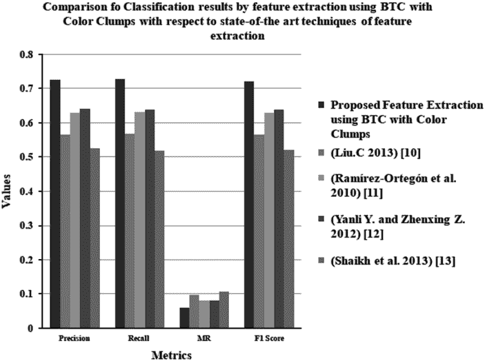

**图 3.9**
使用 KNN 分类器进行分类时，现有技术相对于带颜色聚类的 BTC 特征提取技术的平均精度、平均召回率、平均错误分类率和平均 F1-Score 比较。

[观察：与现有技术相比，使用带颜色聚类的 BTC 进行特征提取的分类具有最高的 Precision、Recall 和 F1-Score 值以及最低的 MR 值。]

比较显示在图 3.11 中

该比较展示了所提出技术相对于最先进技术的优越性。

最后，图 3.11 中比较的技术特征提取时间的比较在图 3.10 中给出。结果显示，所提出技术消耗的特征提取时间最少。

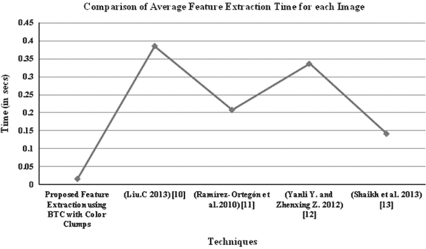

**图 3.10**
特征提取平均耗时比较。

[观察：与所有提出的技术相比，使用带颜色聚类的 BTC 进行特征提取的每张图像平均耗时最少。]

## 3.11 统计显著性

本章演示了一种测试，以建立使用所提出技术记录的增强分类结果的统计显著性。该测试计算了现有技术相对于所提出技术的 *p*-值。*t* 检验揭示了所提出技术和现有技术数据变化对应的两个均值之间的实际差异。该测试通过设计零假设来进行，以基于 Precision 值验证性能提升的统计显著性。

**假设 3.1：** *使用带颜色聚类的 BTC 进行特征提取获得的分类结果的 Precision 值与现有技术之间没有差异*

使用带颜色聚类的 BTC 进行特征提取时，不同类别分类的 Precision 值的 *mean*、*standard deviation (SD)* 和 *standard error of the mean (SEM)* 值在表 3.4 中给出。表 3.5 显示了计算的 *t* 值作为 *t*-calc 和 *p*-值。在将现有技术与所提出技术进行比较后生成的分类 Precision 值 *p*-值揭示了使用所有现有技术进行特征提取的 Precision 结果存在显著差异。因此，与所提出算法相比，上述现有算法的 Precision 率相等的零假设对于表 3.5 中给出的所有现有技术均被拒绝。此外，分类 precision 值的 *mean*、*standard deviation* 和 *standard error of the mean (SEM)*


## 表 3.5

使用带颜色聚类的 BTC 进行特征提取的显著性评估的 *t* 检验

| 比较 | 均值 | 标准差（SD） | 均值的标准误（SEM） | *t* 计算值 | *p* 值 | 显著性 |
|---|---:|---:|---:|---:|---:|---|
| Liu, 2013 | 0.626 | 0.22 | 0.073 | 2.85 | 0.02 | 显著 |
| Ramírez-Ortegón 等, 2010 | 0.601 | 0.24 | 0.08 | 2.47 | 0.03 | 显著 |
| Yanli 和 Zhenxing, 2012 | 0.638 | 0.223 | 0.074 | 2.95 | 0.02 | 显著 |
| Shaikh 等 2013 | 0.595 | 0.214 | 0.071 | 4.28 | 0.002 | 显著 |

**[观察：** 与使用带颜色聚类的 BTC 的特征提取相比，所有显著特征提取技术分类的精确度结果均表现出显著差异。]

与现有技术相比，该特征提取具有更好的一致性。因此，与现有技术相比，所提出的方法对增强分类表现出了统计学上显著的贡献。

*t* 检验通过四种不同的比较进行。因此，感觉有必要进行 *事后* 分析，以使用 *Bonferroni 校正* 接受所得结果的显著性。对于 *t* 检验，α 的值取 0.05。计算 *Bonferroni 校正* 值的表达式如下：

*Bonferroni*ₐ = α / *Number_of_tests*

其中 α = 0.05，*Number_of_tests* = 4，因此 *Bonferroni*ₐ = 0.013

现在，将表 3.5 中的 *p* 值与新计算的 *Bonferroni*ₐ 值 0.013 进行比较。比较显示，表 3.5 中的 *p* 值均不小于 *Bonferroni*ₐ 值，尽管它们在 *t* 检验中显示出显著的统计差异。

## 章节小结

本章介绍了两种基于颜色平均的特征提取技术——即使用带颜色聚类的块截断编码（BTC）的特征提取和使用排序块截断编码（SBTC）的特征提取。这些技术在流行的公共数据集（如 Wang 数据集、OT-Scene 数据集、Caltech 数据集等）上测试了分类性能。此后，将使用带颜色聚类的 BTC 的特征提取的分类结果与使用 SBTC 的特征提取进行比较。前一种技术优于后一种。因此，将使用带颜色聚类的 BTC 特征提取技术的分类结果与现有技术进行比较。结果表明，与现有技术相比，所提出的特征提取技术的分类性能在统计学上显著提高。

## 参考文献

- 1. Panda, D. K. 和 Meher, S., 2015. 基于模糊颜色差分直方图的背景减除运动目标检测。*IEEE Signal Processing Letters*, 23(1): 45–49.
- 2. Bannai, N., Agathos, A., 和 Fisher, R. B., 2004. 融合多幅彩色图像以纹理化模型。见 Proceedings. 2nd International Symposium on 3D Data Processing, Visualization and Transmission, 2004. 3DPVT 2004, *IEEE*, pp. 558–565.
- 3. Soni, D. 和 Mathai, K. J., 2015, April. 基于颜色直方图和颜色相关图、采用颜色空间方法的高效基于内容的图像检索系统。见 2015 Fifth International Conference on Communication Systems and Network Technologies, *IEEE*, pp. 488–492.
- 4. Lu, T.-C., Lu, T.-C., Chang, C.-C. 和 Chang, C.-C., 2007. 基于颜色特征和图像位图的彩色图像检索技术。*Information Processing & Management*, 43(2): 461–472.
- 5. Nazir, A., Ashraf, R., Hamdani, T. 和 Ali, N., 2018, March. 使用 HSV 颜色直方图、离散小波变换和边缘直方图描述符的基于内容的图像检索系统。见 2018 International Conference on Computing, Mathematics and Engineering Technologies, iCoMET, *IEEE*, pp. 1–6.
- 6. Li, J., Tian, Y. 和 Cassidy, M. J., 2014. 空间随机土中不同埋深基础的破坏机理与承载力。*Journal of Geotechnical and Geoenvironmental Engineering*, 141(2): 04014099-1–04014099-11.
- 7. Walia, E., Vesal, S. 和 Pal, A., 2014. 一种高效快速的彩色图像检索混合框架。Sensing and Imaging, *Springer*, 15(1): 1–23.
- 8. Delp, E. 和 Mitchell, O., 1979. 使用块截断编码的图像压缩。*IEEE transactions on Communications*, 27(9): 1335–1342.
- 9. Han, J. 和 Kamber, M. 2001. 数据挖掘：概念与技术。*The Morgan Kaufmann Series in Data Management Systems*, pp. 89–90.
- 10. Liu, C., 2013. 一种新的手指静脉特征提取算法。见 *IEEE 6th International Congress on Image and Signal Processing (CISP)*, pp. 395–399.
- 11. Ramírez-Ortegón, M. A. 和 Rojas, R., 2010. 基于局部灰度强度方差的用于历史文档二值化的无监督评估方法。*In Proceedings of the International Conference on Pattern Recognition*, pp. 2029–2032.
- 12. Yanli Y. 和 Zhenxing Z., 2012. 一种新的 QR 图像局部阈值二值化方法。*In IEEE International Conference on Automatic Control and Artificial Intelligence (ACAI)*, pp. 224–227.
- 13. Shaikh, S. H., Maiti, A. K. 和 Chaki, N., 2013. 一种使用迭代划分的图像二值化新方法。*Machine Vision and Applications*, 24(2): 337–350.

# 4 基于内容的特征提取：图像二值化

# 基于内容的特征提取：图像二值化

## 4.1 引言

二值化是一种流行的技术，用于将图像中的强度值转换为 0 和 1。然而，它是通过选择阈值来转换灰度值而实现的。二值化被视为一种鲁棒的特征提取技术，在基于内容的图像分类中表现出高精度。通过图像二值化提供的灵活平台，可以有效地将感兴趣区域与其背景区分开来。然而，阈值的选择在确定二值化技术的适用性方面起着关键作用。因此，在计算阈值时必须特别注意，因为它有助于区分感兴趣区域与背景。阈值选择大致分为三类：

- 均值阈值选择
- 局部阈值选择
- 全局阈值选择

本章详细阐述了创新性地使用均值阈值选择和局部阈值选择，基于第 3 章所述块截断编码从图像中提取有意义的特征。全局阈值选择的工作留给读者作为练习。本章讨论的新型特征提取方法提取轻量级特征，与输入图像的大小无关。这种灵活性有利于解决计算复杂度和空间复杂度，并减少整个系统的计算开销。图 4.1 给出了一个二值化图像的示例。

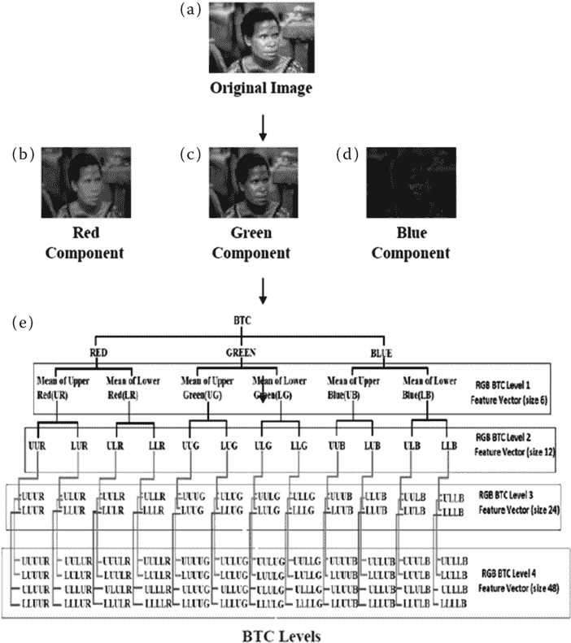

**图 4.2**  
多级块截断编码的阶段。

- 与阈值比较后，灰度值分别用 1 和 0 表示，形成两个簇。
- 计算上一步中每个簇的均值，以生成给定图像的图像特征。

$$Xupmean = \frac{1}{\sum_{i=1}^{m}\sum_{j=1}^{n} BitMap_x(i,j)} \ast \sum_{i=1}^{m}\sum_{j=1}^{n} BitMap_x(i,j) \ast X(i,j)$$

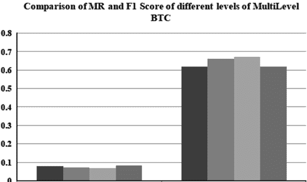

|  | MR | F1 Score |
|---|---:|---:|
| BTC Level 1 | 0.082 | 0.622 |
| BTC Level 2 | 0.073 | 0.663 |
| BTC Level 3 | 0.07 | 0.673 |
| BTC Level 4 | 0.083 | 0.619 |

**图 4.3**  
BTC 第 1、2、3 和 4 级的 MR 和 F1 分数比较。  
[**观察：** BTC 第 3 级具有最低的 MR 和最高的 F1 分数。]

规则（RIDOR）、人工神经网络（ANN）和支持向量机（SVM）——用于 BTC 第 3 级，使用均值阈值选择在四个不同的公共数据集上进行特征提取。分类性能的比较见表 4.1（表 4.1）。

## 4.5 使用均值阈值选择从显著位平面提取特征

图像中的灰度值由十进制数表示。十进制数可以很容易地用二进制位表示。在本节中，各个位的二进制表示被视为位平面 [2]。

在每个测试图像中，从最低有效位到最高有效位，最多可以列举出八个不同的位平面。这与图 4.4 中的演示一致。


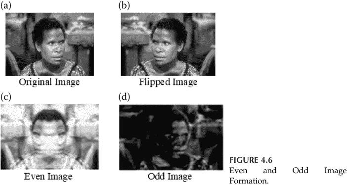

- 识别每个颜色分量中从*位平面5*到*位平面8*中等于1的高位平面。

$xbp = xbp\ (bp5 = 1..\ or..bp6 = 1..\ or..bp7 = 1..\ or..bp8 = 1)$

- `/*x = R, G and B */`
- 为每个颜色分量的已识别有效位平面计算平均阈值。
- 分别为R、G和B的有效位平面的每个像素计算二值图像映射。
- 使用二值图像映射计算所有三个颜色分量的位平面的特征向量 $xbitplane_{ni}$ 和 $xbitplane_{lo}$。
- 每个颜色分量的特征向量 $Xupmean$、$Xlomean$、$Xbpupmean$ 和 $Xbplomean$ 与原始图像的特征向量关联，从而为数据集中的每个图像共同构成十二个特征向量。

## 4.6 代码示例（MATLAB）

```matlab
#Read an image
im=imread('path\\imagefile');
#Separate the color components
r=im(:,:,1); #red component
[m n p]=size(r); #dimension of red component
g=im(:,:,2); #green component
[x y z]=size(g); #dimension of green component
b=im(:,:,3); #blue component
[j k l]=size(b); #dimension of blue component
#Extract bit planes (red component)
for a1=1:m
for a2=1:n
    #extraction of bit planes
    if bitget(uint8(r(a1,a2)),5)==1 || bitget(uint8(r(a1,a2)),6)==1 ||
    bitget(uint8(r(a1,a2)),7)==1 || bitget(uint8(r(a1,a2)),8)==1)
    rt(a1,a2,:)=r(a1,a2);
    end
end
end
```

## 4.7 编码练习

前面的代码示例用于通过红色分量的位平面切片设计特征向量。请参考该示例完成以下任务：

- 从绿色和蓝色颜色分量中提取位平面。
- 使用均值阈值选择从每个颜色分量中提取特征向量。

此后，针对多种指标计算平均值，以观察在四个不同的公共数据集上使用四种不同分类器（即KNN、RIDOR、ANN和SVM）进行分类时的精确率、召回率、漏检率和F1分数（表4.2）。

## 4.8 使用均值阈值选择从偶图像和奇图像中提取特征

本节讨论均值阈值选择的另一个示例，旨在通过增强数据提高所提取特征向量的鲁棒性。图像的翻转版本用于数据增强，期望利用相同可用数据增强测试图像的丰富性。

该技术基于RGB颜色空间，遵循块截断编码（BTC）[3]原理，从三个颜色分量（即红（R）、绿（G）和蓝（B））开始特征提取。通过分别遵循方程4.3和4.4，形成两种不同的图像变体，即偶图像和奇图像。

$$\text{Even Image} = \frac{\text{Original Image} + \text{Flipped Image}}{2} \tag{4.3}$$

$$\text{Odd Image} = \frac{\text{Original Image} - \text{Flipped Image}}{2} \tag{4.4}$$

首先，如图4.6所示，将测试图像沿X轴和Y轴进行翻转。这会生成原始图像的翻转版本；将其与原始图像相加得到偶图像；从原始图像中减去翻转版本则得到奇图像。这两种操作如图4.6所示。

测试图像的预处理完成后，其余过程与4.2.1节讨论的使用均值阈值选择的特征提取步骤类似。

**表4.2**

使用均值阈值选择从位平面提取特征，并通过四种不同分类器在四个不同公共数据集上的分类性能

| 数据集 | 指标 | KNN | RIDOR | ANN | SVM |
|---|---:|---:|---:|---:|
| Wang | 精确率 | 0.729 | 0.654 | 0.832 | 0.77 |
|  | 召回率 | 0.729 | 0.654 | 0.831 | 0.77 |
|  | 漏检率 | 0.06 | 0.072 | 0.042 | 0.05 |
|  | F1分数 | 0.722 | 0.653 | 0.831 | 0.765 |
| OT-Scene | 精确率 | 0.456 | 0.355 | 0.51 | 0.449 |
|  | 召回率 | 0.426 | 0.359 | 0.508 | 0.436 |
|  | 漏检率 | 0.096 | 0.012 | 0.089 | 0.094 |
|  | F1分数 | 0.424 | 0.357 | 0.509 | 0.422 |
| Corel | 精确率 | 0.578 | 0.493 | 0.64 | 0.575 |
|  | 召回率 | 0.539 | 0.49 | 0.648 | 0.558 |
|  | 漏检率 | 0.09 | 0.091 | 0.079 | 0.082 |
|  | F1分数 | 0.508 | 0.491 | 0.638 | 0.534 |
| Caltech | 精确率 | 0.411 | 0.435 | 0.514 | 0.371 |
|  | 召回率 | 0.503 | 0.42 | 0.572 | 0.505 |
|  | 漏检率 | 0.097 | 0.098 | 0.078 | 0.1 |
|  | F1分数 | 0.412 | 0.427 | 0.533 | 0.393 |

> [观察：所有四个数据集在使用ANN分类器时均取得最高分类率。]

### 原始、偶和奇图像变体的漏检率与F1分数比较

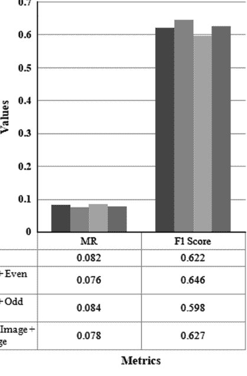

| 图像变体 | 漏检率 | F1分数 |
|---|---:|---:|
| 原始图像 | 0.082 | 0.622 |
| 原始图像+偶图像 | 0.076 | 0.646 |
| 原始图像+奇图像 | 0.084 | 0.598 |
| 原始+偶图像+奇图像 | 0.078 | 0.627 |

**图4.7** 原始、偶和奇图像变体的漏检率和F1分数比较。**[观察：**原始+偶图像具有最低漏检率和最高F1分数。**]**

首先，将预处理后生成的每种测试图像变体在分类性能方面进行比较，使用指标漏检率和F1分数，如图4.7所示。为此使用Wang数据集。图4.7中的观察结果表明，与其他技术相比，原始+偶图像特征提取具有最低漏检率和最高F1分数。

## 4.9 代码示例（MATLAB）

```matlab
#Read an image
i=imread('path\\imagefile');
    #Separate the color components
r=i(:,:,1); #red component
[m n p]=size(r); #dimension of red component
g=i(:,:,2); #green component
[x y z]=size(g); #dimension of green component
b=i(:,:,3); #blue component
[j k l]=size(b); #dimension of blue component
#Flipping the color components
flp_r = fliplr(r);
flp_g = fliplr(g);
flp_b = fliplr(b);
#Creating Even and Odd varieties of each component
r_evn = (r + flp_r)/2;
g_evn = (g + flp_g)/2;
b_evn = (b + flp_b)/2;
r_odd = (r - flp_r)/2;
g_odd = (g - flp_g)/2;
b_odd = (b - flp_b)/2;
```

## 4.10 编码练习

*前面的代码示例用于生成测试图像的奇偶变体。请参考该示例完成以下任务：*

- 使用均值阈值选择从奇偶图像变体中提取特征。
- 测试每种变体的分类结果。

此后，针对多种指标计算平均值，以观察在四个不同的公共数据集上使用四种不同分类器（即KNN、RIDOR、ANN和SVM）进行分类时的精确率、召回率、漏检率和F1分数，这些分类使用均值阈值选择从原始+偶图像变体中提取的特征（表4.3）。

## 4.11 使用均值阈值选择与静态和动态三值图像映射的特征提取

本节依据均值阈值选择的逻辑，使用三值图像映射进行特征向量提取[4]。这两种技术分别称为静态Thepade三值BTC（STTBTC）和动态Thepade三值BTC（DTTBTC）。两种方法均基于BTC特征提取技术，从每个测试图像中分离红（R）、绿（G）和蓝（B）颜色分量。以下A和B小节讨论这两种技术。

**表4.3**

使用均值阈值选择从偶图像变体中提取特征，并通过四种不同分类器在四个不同公共数据集上的分类性能

| 数据集 | 指标 | KNN | RIDOR | ANN | SVM |
|---|---:|---:|---:|---:|
| Wang | 精确率 | 0.647 | 0.585 | 0.694 | 0.666 |
|  | 召回率 | 0.649 | 0.589 | 0.699 | 0.678 |
|  | 漏检率 | 0.076 | 0.078 | 0.066 | 0.071 |
|  | F1分数 | 0.646 | 0.587 | 0.695 | 0.667 |
| OT-Scene | 精确率 | 0.391 | 0.314 | 0.394 | 0.283 |
|  | 召回率 | 0.392 | 0.309 | 0.397 | 0.317 |
|  | 漏检率 | 0.099 | 0.15 | 0.098 | 0.18 |
|  | F1分数 | 0.387 | 0.31 | 0.39 | 0.272 |
| Corel | 精确率 | 0.495 | 0.417 | 0.515 | 0.437 |
|  | 召回率 | 0.48 | 0.417 | 0.527 | 0.442 |
|  | 漏检率 | 0.093 | 0.096 | 0.089 | 0.097 |
|  | F1分数 | 0.453 | 0.417 | 0.513 | 0.403 |
| Caltech | 精确率 | 0.437 | 0.483 | 0.546 | 0.401 |
|  | 召回率 | 0.522 | 0.51 | 0.57 | 0.502 |
|  | 漏检率 | 0.094 | 0.091 | 0.076 | 0.098 |
|  | F1分数 | 0.446 | 0.493 | 0.551 | 0.394 |

> **[观察：**所有四个数据集在使用ANN分类器时均取得最高分类率。**]**

使用STTBTC进行特征提取的过程如下：

- 按照4.2.1节中的步骤1和2，为每个颜色分量R、G和B生成阈值 $T_x$。

$$T_x = (1/m * n) * \sum_{i=1}^{m}\sum_{j=1}^{n} x(i,j)$$

- /* x = R、G和B */

- 通过对 $T_x$ 取平均来生成一个整体亮度阈值 $T$。

$$T = \sum \frac{T_x}{3}$$


```
/* x=R, G and B */
```

- 需要计算每个颜色分量的单独颜色阈值。通过将 $n$ 的值从 1 改为 5，$T_{xlo}$ 视为较低阈值，$T_{xhi}$ 视为较高阈值。

$$T_{xlo}=T_x-n\lvert T_x-T_{overall}\rvert,\quad T_{xhi}=T_x+n\lvert T_x-T_{overall}\rvert$$

```
/* x=R, G and B */
```

- 计算三值图像映射。

$$T_{mx}(i,j)=\begin{cases}1 & \text{if } x(i,j)>T_{xhi}\\0 & \text{if } T_{xlo}\leq x(i,j)\leq T_{xhi}\\-1 & \text{if } x(i,j)<T_{xlo}\end{cases}$$

```
/* x=R, G and B */
```

- 为三值 BTC 生成图像特征 $tUx$、$tMx$ 和 $tLx$。

$$tUx=\frac{1}{\sum_{i=1}^{m}\sum_{j=1}^{n}T_{mx}(i,j)\;\text{iff}\;T_{mx}(i,j)=1}*\sum_{i=1}^{m}\sum_{j=1}^{n}x(i,j),\;\text{iff }T_{mx}(i,j)=1$$

$$tMx=\frac{1}{\sum_{i=1}^{m}\sum_{j=1}^{n}T_{mx}(i,j)\;\text{iff}\;T_{mx}(i,j)=0}*\sum_{i=1}^{m}\sum_{j=1}^{n}x(i,j),\;\text{iff }T_{mx}(i,j)=0$$

$$tLx=\frac{1}{\sum_{i=1}^{m}\sum_{j=1}^{n}T_{mx}(i,j)\;\text{iff}\;T_{mx}(i,j)=-1}*\sum_{i=1}^{m}\sum_{j=1}^{n}x(i,j),\;\text{iff }T_{mx}(i,j)=-1$$

```
/* x=R, G and B */
```

另一种名为 DTTBTC 的技术，与静态 Thepade 三值 BTC 技术相比，以不同的方式计算 $n$ 的度数值。如公式 4.5 所示，通过计算每个颜色分量的阈值与亮度总体阈值的绝对比率来确定 $n$ 的值。根据公式 4.12，该计算为三个颜色分量产生了三个不同的值。将这些值相互比较，以从中选择最大值[4]。该最大值进一步被视为动态关联到阈值计算的度数值 $n$。

$$n=\begin{cases}\dfrac{T_r}{T_{overall}}, & \text{iff } \lvert T_g\rvert < \lvert T_r\rvert > \lvert T_b\rvert \\ \dfrac{T_g}{T_{overall}}, & \text{iff } \lvert T_r\rvert < \lvert T_g\rvert > \lvert T_b\rvert \\ \dfrac{T_b}{T_{overall}}, & \text{iff } \lvert T_r\rvert < \lvert T_b\rvert > \lvert T_g\rvert\end{cases}\tag{4.5}$$

以 Wang 数据集作为测试平台，基于 MR 和 F1-Score 对两种特征提取过程进行比较，如图 4.8 所示。图 4.8 中的比较表明，DTTBTC 以最小的 MR 和最大的 F1-Score 优于 STTBTC。

## 4.12 代码示例（MATLAB）

```matlab
%Read an image
i=imread('path\\imagefile');
    %Separate the color components
r=i(:,:,1); %red component
[m n p]=size(r); %dimension of red component
g=i(:,:,2); %green component
[x y z]=size(g); %dimension of green component
b=i(:,:,3); %blue component
[j k l]=size(b); %dimension of blue component
    %calculation of mean threshold for STTBTC
Tavred=mean2(r);
Tavgrn=mean2(g);
Tavblu=mean2(b);
    %calculation of threshold for STTBTC
%calculating overall luminance threshold
Tav= (Tavred+Tavgrn+Tavblu)/3;
%calculating lower and higher threshold values for each color component
Tavrl= Tavred- n*(abs(Tavred-Tav));
Tavrh= Tavred+ n*(abs(Tavred-Tav));
%n = 1 to 5
Tavgl= Tavgrn- n*(abs(Tavgrn-Tav));
Tavgh= Tavgrn+ n*(abs(Tavgrn-Tav));
Tavbl= Tavblu- n*(abs(Tavblu-Tav));
Tavbh= Tavblu+ n*(abs(Tavblu-Tav));
    %calculation of threshold for DTTBTC
Trd=Tavred/Tav;
```

**表 4.4**

**使用均值阈值选择进行特征提取，并通过四种不同分类器在四个不同公开数据集上对 DTTBTC 的分类性能**

| 数据集 | 指标 | KNN | RIDOR | ANN | SVM |
|---|---:|---:|---:|---:|---:|
| Wang | Precision | 0.621 | 0.538 | 0.667 | 0.619 |
|  | Recall | 0.62 | 0.541 | 0.67 | 0.626 |
|  | MR | 0.075 | 0.08 | 0.072 | 0.078 |
|  | F1-Score | 0.621 | 0.538 | 0.666 | 0.616 |
| OT-Scene | Precision | 0.421 | 0.338 | 0.438 | 0.379 |
|  | Recall | 0.418 | 0.337 | 0.439 | 0.372 |
|  | MR | 0.092 | 0.097 | 0.09 | 0.094 |
|  | F1-Score | 0.411 | 0.338 | 0.437 | 0.349 |
| Corel | Precision | 0.509 | 0.535 | 0.451 | 0.475 |
|  | Recall | 0.503 | 0.542 | 0.45 | 0.48 |
|  | MR | 0.09 | 0.084 | 0.089 | 0.087 |
|  | F1-Score | 0.48 | 0.531 | 0.49 | 0.452 |
| Caltech | Precision | 0.444 | 0.49 | 0.534 | 0.432 |
|  | Recall | 0.535 | 0.485 | 0.576 | 0.517 |
|  | MR | 0.091 | 0.089 | 0.078 | 0.095 |
|  | F1-Score | 0.447 | 0.487 | 0.543 | 0.405 |

> [观察：Wang 数据集、OT-Scene 数据集和 Caltech 数据集在使用 ANN 分类器时分类率最高；Corel 数据集在使用 RIDOR 分类器时分类率最高。]

此后，针对使用 DTTBTC 提取特征（表 4.4）的四个不同公开数据集，使用四种不同分类器（即 KNN、RIDOR、ANN 和 SVM）进行分类，并计算各项指标的平均值，以观察 Precision、Recall、MR 和 F1-Score。

## 4.13 使用局部阈值选择的特征提取

本节讨论局部阈值选择技术，包括两种流行的方法，即 Niblack 局部阈值选择和 Sauvola 局部阈值选择。

局部阈值选择技术应用于测试图像的位平面和原始图像。

图像的亮度通常不均匀，这对为整个图像选择单一阈值造成了重大障碍。然而，一种有效的解决方案是将图像分割成 *m×n* 个分区，以便针对特定分区进行局部阈值选择。

本节提到的两种局部阈值选择技术都考虑了均值和标准差来计算阈值。这处理了图像数据中灰度值的方差。

对于 Niblack 阈值选择，阈值的确定基于局部均值 $m(i,j)$ 和标准差 $\sigma(i,j)$。考虑使用 (25 × 25) 的窗口大小。阈值由 $T(i,j)=m(i,j)+k\cdot\sigma(i,j)$ 给出。这里，$k$ 是一个取值在 0 到 1 之间的常数，在所提出的方法中取 0.6。$k$ 的值和滑动窗口的大小决定了二值化的质量。

Sauvola 技术是对 Niblack 局部阈值选择方法的改进，适用于背景褪色的图像。

这两种技术都可以在 MATLAB 库中以 *functions()* 的形式获得。它们可以直接应用于本章提供的代码示例，用于使用局部阈值选择技术进行特征向量提取。

## 4.14 代码示例（MATLAB）

```matlab
%Read an image
i=imread('path\\imagefile');
    %Separate the color components
r=i(:,:,1); %red component
[m n p]=size(r); %dimension of red component
g=i(:,:,2); %green component
[x y z]=size(g); %dimension of green component
b=i(:,:,3); %blue component
[j k l]=size(b); %dimension of blue component
    %Extracting bit planes (red component)
for a1=1:m
for a2=1:n
if bitget(uint8(r(a1,a2)),5)==1 || bitget(uint8(r(a1,a2)),6)==1 || bitget(uint8(r(a1,a2)),7)==1 || bitget(uint8(r(a1,a2)),8)==1
rt(a1,a2,:)=r(a1,a2);
end
end
end
BWr = NIBLACK(rt, [25 25], 0.6, 0, 10);
```

## 4.15 编程练习

前面的代码示例是使用 Niblack 技术生成局部阈值的。参考该示例完成以下任务：

- 使用 Niblack 技术从绿色和蓝色颜色分量中提取特征。
- 使用 Sauvola 技术从红色、绿色和蓝色颜色分量中提取特征。

这些技术的应用演示如图 4.9 和图 4.10 所示。

此后，针对使用 Niblack 和 Sauvola 局部阈值选择提取特征（表 4.5 和 4.6）的四个不同公开数据集，使用四种不同分类器（即 KNN、RIDOR、ANN 和 SVM）进行分类，并计算各项指标的平均值，以观察 Precision、Recall、MR 和 F1-Score。

## 4.16 比较所讨论技术的性能评估

本章讨论了六种不同的技术，使用二值化从测试图像中提取特征。这些技术的性能评估涉及四个不同的比较指标。这些指标是 Precision、Recall、MR 和 F1-Score。这些技术应用于四个不同的数据集，即 Wang 数据集、OT-Scene 数据集、Corel 数据集和 Caltech 数据集。分类使用四种不同的分类器进行，即 KNN 分类器、RIDOR 分类器、ANN 分类器和 SVM 分类器。

性能比较如图 4.11–4.14 所示。

图 4.11–4.14 所示的比较结果记录了使用 Sauvola 局部阈值选择进行二值化特征提取的最高分类性能。

## 4.17 与现有技术的比较

使用 Sauvola 局部阈值选择进行二值化特征提取的分类性能与基准化的技术进行比较


**图 4.9：使用 Niblack 阈值选择的位平面二值化**

(a) 原始图像

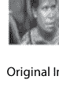

(b) 位平面 5

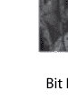

(c) 使用 Niblack 阈值二值化的位平面 5

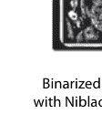

(d) 原始图像

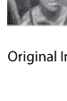

(e) 位平面 6

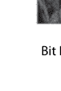

(f) 使用 Niblack 阈值二值化的位平面 6

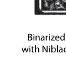

(g) 原始图像

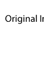

(h) 位平面 7


(i) 使用 Niblack 阈值二值化的位平面 7

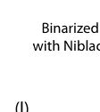

(j) 原始图像

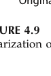

(k) 位平面 8

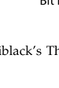

(l) 使用 Niblack 阈值二值化的位平面 8

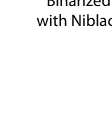

**图 4.10：通过使用 Sauvola 局部阈值选择的二值化进行特征提取的过程**

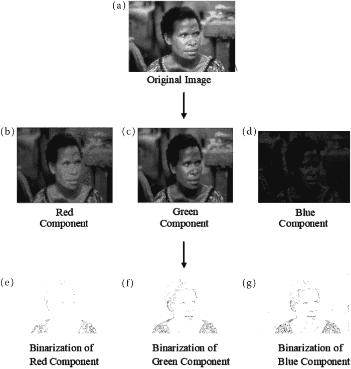

技术 [5–8]，因为其性能优于本章讨论的其他技术。 使用 Wang 数据集，对使用 Sauvola 局部阈值选择二值化进行特征提取与最先进技术的分类进行了比较，使用 KNN 分类器。 比较结果如图 4.15 所示。

该比较展示了所提出技术相对于最先进技术的优越性。

最后，图 4.16 给出了各技术的特征提取时间比较。 结果显示，所提出技术消耗的特征提取时间最少。

**表 4.5：使用 Niblack 局部阈值选择从显著位平面进行特征提取时，使用四个不同公共数据集和四个不同分类器的分类性能**

| 数据集 | 指标 | KNN | RIDOR | ANN | SVM |
|---|---:|---:|---:|---:|---:|
| Wang | 精确率 | 0.676 | 0.599 | 0.738 | 0.615 |
|  | 召回率 | 0.68 | 0.601 | 0.742 | 0.634 |
|  | MR | 0.072 | 0.079 | 0.057 | 0.076 |
|  | F1 分数 | 0.67 | 0.599 | 0.738 | 0.619 |
| OT-Scene | 精确率 | 0.443 | 0.354 | 0.456 | 0.378 |
|  | 召回率 | 0.427 | 0.352 | 0.449 | 0.401 |
|  | MR | 0.091 | 0.096 | 0.094 | 0.093 |
|  | F1 分数 | 0.423 | 0.353 | 0.448 | 0.377 |
| Corel | 精确率 | 0.559 | 0.467 | 0.609 | 0.473 |
|  | 召回率 | 0.518 | 0.468 | 0.615 | 0.472 |
|  | MR | 0.088 | 0.085 | 0.078 | 0.092 |
|  | F1 分数 | 0.48 | 0.467 | 0.603 | 0.414 |
| Caltech | 精确率 | 0.439 | 0.472 | 0.58 | 0.403 |
|  | 召回率 | 0.544 | 0.518 | 0.634 | 0.523 |
|  | MR | 0.09 | 0.089 | 0.078 | 0.092 |
|  | F1 分数 | 0.449 | 0.49 | 0.595 | 0.419 |

**观察：** 所有数据集在 ANN 分类器下均具有最大分类率。

**表 4.6：使用 Sauvola 局部阈值选择进行特征提取时，使用四个不同公共数据集和四个不同分类器的分类性能**

| 数据集 | 指标 | KNN | RIDOR | ANN | SVM |
|---|---:|---:|---:|---:|---:|
| Wang | 精确率 | 0.772 | 0.694 | 0.84 | 0.797 |
|  | 召回率 | 0.765 | 0.695 | 0.84 | 0.798 |
|  | MR | 0.054 | 0.067 | 0.042 | 0.05 |
|  | F1 分数 | 0.762 | 0.694 | 0.84 | 0.796 |
| OT-Scene | 精确率 | 0.61 | 0.619 | 0.761 | 0.632 |
|  | 召回率 | 0.559 | 0.615 | 0.759 | 0.646 |
|  | MR | 0.08 | 0.076 | 0.055 | 0.075 |
|  | F1 分数 | 0.57 | 0.615 | 0.759 | 0.633 |
| Corel | 精确率 | 0.712 | 0.641 | 0.841 | 0.757 |
|  | 召回率 | 0.671 | 0.64 | 0.839 | 0.738 |
|  | MR | 0.072 | 0.073 | 0.042 | 0.058 |
|  | F1 分数 | 0.649 | 0.64 | 0.837 | 0.732 |
| Caltech | 精确率 | 0.607 | 0.697 | 0.797 | 0.631 |
|  | 召回率 | 0.647 | 0.697 | 0.809 | 0.692 |
|  | MR | 0.079 | 0.059 | 0.04 | 0.073 |
|  | F1 分数 | 0.575 | 0.696 | 0.799 | 0.633 |

**观察：** 所有数据集均在 ANN 分类器下具有最高的分类率。

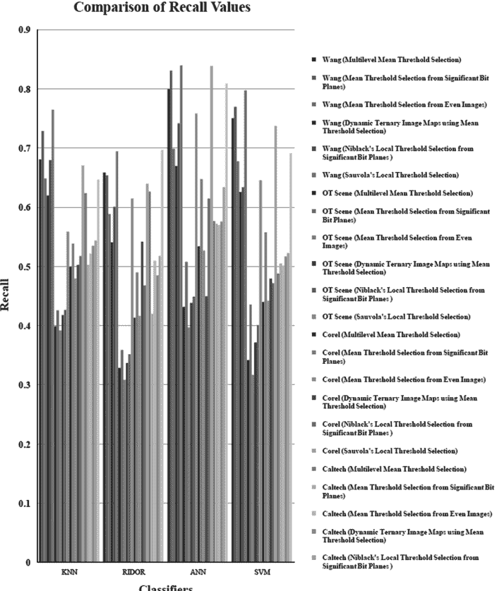

**图 4.12：使用四个不同分类器对全部四个数据集进行分类时，六种不同特征提取技术的召回值比较。**

**观察：** 使用 Sauvola 局部阈值选择进行二值化的特征提取分类在所有提出的技术中具有最高的召回率。

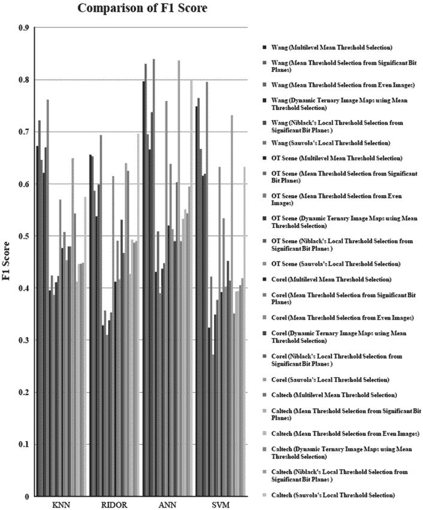

**图 4.14：使用四个不同分类器对全部四个数据集进行分类时，六种不同特征提取技术的 F1 分数比较。**

**观察：** 使用 Sauvola 局部阈值选择进行二值化的特征提取分类在所有提出的技术中具有最高的 F1 分数。

### 相对于最先进的特征提取技术，使用 Sauvola 局部阈值选择二值化进行特征提取的分类结果比较

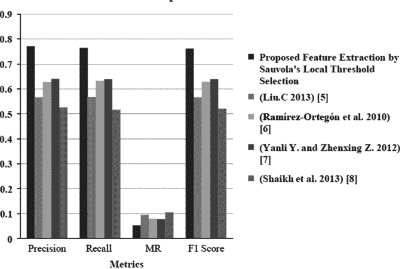

**图 4.15：使用 KNN 分类器进行分类时，现有技术相对于使用 Sauvola 局部阈值选择二值化进行特征提取的平均精确度、平均召回率、平均误分类率和平均 F1 分数的比较。**

**观察：** 与现有技术相比，使用 Sauvola 局部阈值选择进行二值化的特征提取分类具有最高的精确度、召回率和 F1 分数，以及最低的 MR。

## 4.18 统计显著性

本章展示了一种测试，以建立使用所提出技术记录的增强分类结果的统计显著性。 该测试计算了现有技术相对于所提出技术的 *p* 值。 *t* 检验揭示了所提出技术与现有技术数据变化对应的两个均值之间的实际差异。 该测试通过设计零假设来验证基于精确度值的性能提升的统计显著性而进行。

**假设 4.1：** *使用 Sauvola 局部阈值选择进行特征提取获得的分类结果的精确度值与现有技术之间没有差异。*

使用 BTC 进行彩色团块特征提取时，不同类别分类的精确度值的 *均值*、*标准差 (SD)* 和 *均值的标准误差 (SEM)* 给出在表 4.7 中。

**表 4.8：*t* 检验用于评估使用 Sauvola 局部阈值选择的特征提取的显著性**

| 比较 | 均值 | 标准差 (SD) | 均值的标准误差 (SEM) | *t*-calc | *p* 值 | 显著性 |
|---|---:|---:|---:|---:|---:|---|
| Liu, 2013 | 0.626 | 0.22 | 0.073 | 3.03 | 0.016 | 显著 |
| Ramírez-Ortegón et al., 2010 | 0.601 | 0.24 | 0.08 | 2.87 | 0.02 | 显著 |
| Yanli and Zhenxing, 2012 | 0.638 | 0.223 | 0.074 | 2.79 | 0.023 | 显著 |
| Shaikh et al., 2013 | 0.595 | 0.214 | 0.071 | 3.88 | 0.004 | 显著 |

**观察：** *p* 值表明，相对于使用 Sauvola 局部阈值选择的特征提取所提出的技术，所有现有技术的精确度结果存在显著差异。

所提出技术与现有技术相比变异性更小。 因此可以得出结论，所引入的特征提取技术与现有技术相比具有更大的一致性。 故，所提出的方法与现有技术相比显示出对增强分类的统计显著贡献。

*t* 检验是使用四种不同的比较进行的。 因此，使用 Bonferroni 校正接受所得结果的显著性，有必要进行事后分析。 *t* 检验中 α 的值被认为是 0.05。 计算 Bonferroni 校正值的表达式如下：

$$\mathit{Bonferroni\_\alpha} = \frac{\alpha}{\mathit{Number\_of\_tests}}$$

这里，α = 0.05

$$\mathit{Number\_of\_tests} = 4$$

因此，

$$\mathit{Bonferroni\_\alpha} = 0.013$$

现在，表 4.8 中的 *p* 值与新计算的 *Bonferroni_α* 值 0.013 进行比较。

比较显示，表 4.8 中用于评估所提出技术与 Shaikh [8] 使用的技术相比的 *p* 值小于 *Bonferroni_α* 值。 因此，这两种技术存在显著差异。


即使在事后分析后仍保持统计学差异。然而，其余的 *p*-values 并未小于 *Bonferroni_α* 值，尽管它们在 *t*-test 期间显示出显著的统计学差异。

## 章节摘要

本章对基于二值化的各种特征提取技术进行了详尽的讨论。它还展示了位平面切片在鲁棒特征提取中的有用性。本章中的论点辅以 MATLAB 代码片段，供读者实践操作。

## 参考文献

- 1. Kekre, H. B., Thepade, S., Das, R. K. and Ghosh, S., 2014. 多级块截断编码与多样化颜色空间用于图像分类。载于国际先进技术与工程会议，ICATE，IEEE，第 1–7 页。
- 2. Kekre, H. B., Thepade, S., Das, R. K. and Ghosh, S., 2014. 基于位平面切片的块截断编码图像分类性能提升。*International Journal of Computer Applications*，47(15): 36–41。
- 3. Thepade, S., Das, R. and Ghosh, S., 2013. 使用块截断编码在 RGB 颜色空间中基于离散分类器的内容图像分类的特征向量提取技术性能比较。载于印度会议，INDICON，年度 IEEE 数字对象标识符：10.1109/INDICON.2013.6726053 出版，第 1–6 页。
- 4. Thepade, S., Das, R. and Ghosh, S., 2015. 基于 Thepade 静态和动态三元块截断编码的内容图像分类。*International Journal of Engineering Research* 4(1): 13–17。
- 5. Liu, C., 2013. 一种新的指静脉特征提取算法。载于 IEEE 第六届图像与信号处理国际会议，CISP，第 395–399 页。
- 6. Ramírez-Ortegón, M. A. and Rojas, R., 2010. 基于局部灰度强度方差的历史文档二值化的无监督评估方法。载于国际模式识别会议论文集，第 2029–2032 页。
- 7. Yanli, Y. and Zhenxing, Z., 2012. QR 图像的一种新型局部阈值二值化方法。载于 IET 国际自动控制与人工智能会议，ACAI，第 224–227 页。
- 8. Shaikh, S. H., Maiti, A. K. and Chaki, N., 2013. 一种使用迭代划分的新图像二值化方法。*Machine Vision and Applications*，24(2): 337–350。

# 5

# 基于内容的特征提取:
图像变换

## 5.1 前言

图像变换对于将图像域转移以进行显著描述符定义至关重要。与空间域相比，频域中的图像特征提取由于模式可见性更好而通常被认为是有益的。图像变换被视为图像作为一类酉矩阵的表示。变换通过将图像外推到一组基函数来创建图像表示的基图像是有用的。该过程在将图像表示从空间域转移到频域的同时从不改变图像内容。变换将空间信息转换为频域信息，在该域中某些操作更容易执行。例如，卷积操作可以在频域中简化为矩阵乘法。变换技术被认可具有两个优点。首先，图像模式的关键成分可以通过变换分离，并且这些成分可以直接用于分析。其次，变换过程能够将图像数据压缩为紧凑形式，这有助于大幅减少特征向量大小。本章利用图像变换的这些特性来提取用于基于内容图像分类的特征向量。个别分类性能是通过应用不同变换技术生成的完整特征向量集以及随后向图像上部的高频分量减少特征向量大小来测量的。因此，该技术已确定了视觉词方法用于生成特征向量的适用性。视觉词由图像数据的少量片段组成，可携带有关整个图像的重要信息。变换技术的能量集中特性通过将每个从图像中提取的颜色分量的重要图像信息集中在少量变换分量的块中，有效地将特征生成为视觉词。

## 5.2 从变换图像生成部分能量系数

任何图像变换的重要性在于将高频分量重新定位到图像的上端，而将低频分量重新定位到图像的下端。上述特性被用作一种工具，通过排除不显著的系数来大幅减少特征向量的大小，如图 5.1 所示。特征向量的较小维度导致分类过程中特征向量比较所需的时间更少。

从变换图像中提取特征向量共进行 14 步。最初，变换图像的所有系数都被视为特征向量，其中包含 100% 的变换系数。此后，特征向量的大小逐步减少为完整变换系数的 50%、25%、12.5%、6.25%、3.125%、1.5625%、0.7813%、0.39%、0.195%、0.097%、0.048%、0.024%、0.012% 和 0.006%，以定位变换图像的高频分量。对于尺寸为 256 × 256 的图像，该过程已将每个颜色分量的特征大小从 256 × 256 减少到 2 × 2。

使用部分能量系数进行特征提取的分类采用以下步骤：

- 从给定图像中提取红色、绿色和蓝色颜色分量。
- 对每个分量应用图像变换以提取特征向量。
- 从每个分量提取的特征向量被存储为完整的特征向量集。
- 此外，从整个特征向量集中提取部分系数以形成特征向量数据库。

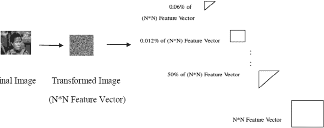

**FIGURE 5.1**
从图像中提取部分能量系数的步骤。

```
#Separate the color components
r=i(:, :,1); #red component
[m n p]=size(r); #dimension of red component
g=i(:, :,2); #green component
[x y z]=size(g); #dimension of green component
b=i(:, :,3); #blue component
[j k l]=size(b); #dimension of blue component
```

```
#Apply Transform
r1=dst(r); #applying discrete sine transform (dst) on red component
g1=dst(g); #applying discrete sine transform (dst) on green component
b1=dst(b); #applying discrete sine transform (dst) on blue component
```

```
#Extract Partial Transform Coefficients
count=0;
for a=1:m/64
for b=1:n/64
if (a+b)<=5
count=count+1;
r2(count)=r1(a,b);
g2(count)=g1(a,b);
b2(count)=b1(a,b);
end
end
end
```

## 5.4 编程练习

前面的代码示例用于生成部分变换系数。请参考示例完成以下任务：

- 前一个示例中提取了多少百分比的分数系数？
- 应用 DCT、Walsh 和 Kekre 变换以提取部分系数的所有比例。
- 测试每种变体的分类结果。

## 5.5 图像变换的计算复杂度

本章讨论了研究工作中用于特征向量提取的五种不同的图像变换。变换的比较计算复杂度在表 5.2 中显示，图像尺寸为 N × N。

**TABLE 5.2**  
**所应用变换的计算复杂度比较**

| 变换 | *N* × *N* 图像的加法次数 | 乘法次数 | 256 × 256 图像尺寸变换的总加法次数 | 总计算比较（256 × 256 图像尺寸） |
|---|---:|---:|---:|---:|
| DCT | 2*N*²(*N* − 1) | *N*²(2*N*) | 301858816 | 100 |
| Walsh | 2*N*²(*N* − 1) | 0 | 33423360 | 11.07 |
| Kekre | *N*[*N*(*N* + 1) − 2] | 2*N*(*N* − 2) | 17882624 | 5.92 |
| DST | 2*N*²(*N* − 1) | *N*²(2*N*) | 301858816 | 100 |
| Hartley | 2*N*²(*N* − 1) | *N*²(2*N*) | 301858816 | 100 |

> **[Observation:** 这里一个乘法被视为八次加法用于倒数第二行的计算，且 DCT 计算被视为比较的 100% 用于最后一行。**]

## 5.6 使用部分能量系数的特征提取

五种不同的图像变换——即 DCT、Walsh 变换、Kekre 变换、DST 和 Hartley 变换——已应用于测试图像，以提取用于基于内容图像分类的部分能量系数特征。分类结果通过 10 折交叉验证方案进行评估。每种技术在以下小节中进行了描述，并且不同部分能量百分比的分类结果与四个不同指标进行了比较——即 Precision、Recall、误分类率 (MR) 和 F1-Score。四种不同的分类器——即 K 近邻 (KNN)、Ripple-Down 规则 (RIDOR)、人工神经网络 (ANN) 和支持向量机 (SVM)——用于评估四个广泛使用的公共数据集的分类，即 Wang 数据集（1000 张图像和 10 个类别）、Oliva Torralba (OT-Scene) 数据集（2688 张图像和 8 个类别）、Corel 数据集（10,800 张图像和 80 个类别）和 Caltech 数据集（8127 张图像和 100 个类别）。分类器和数据集已在第 1 章中描述。最初，对所有考虑的变换的所有部分系数百分比的特征提取进行评估，以获得分类的 MR 和 F1-Score 值。Wang 数据集的测试图像用于此目的，图像的相似性度量采用均方误差 (MSE) 距离度量进行。

### 5.6.1 离散余弦变换

离散余弦变换 (DCT) 与离散傅里叶变换 (DFT) 密切相关，并被定义为可分离的线性变换

process [1]。用于在输入图像 P 上应用以生成输出图像 Q 的二维 DCT 的工作公式可如公式 5.1 所示进行演示。

$$Q_{(i,j)} = a_i a_j \sum\sum P_{(u,v)} \cos \frac{\pi (2u + 1)i}{2A} \cos \frac{\pi (2v + 1)j}{2B} \tag{5.1}$$

$$a_i = \begin{cases} 1/\sqrt{A}, & i = 0 \\ \sqrt{2/A}, & 1 \le i \le A - 1 \end{cases}$$

$$a_j = \begin{cases} 1/\sqrt{B}, & j = 0 \\ \sqrt{2/B}, & 1 \le j \le B - 1 \end{cases}$$

A 和 B 分别为所考虑图像 P 的行数和列数大小。

对于 N × N 图像的完整二维 DCT，所需的乘法和加法次数分别为 N²(2N) 和 N²(2N − 2)。

不同分数系数的百分比通过与 Wang 数据集比较 MR 和 F1-Score 来评估分类结果，如图 5.2 所示。

图 5.2 显示，使用变换后 DCT 系数的完整特征大小的 0.012% 时分类结果达到最大值，而使用 100% 系数时达到最小值。F1-Score 逐渐增加而 MR 逐渐下降，直至特征大小的 0.012%。随着部分系数的进一步百分比 0.006%，MR 增加而 F1-Score 下降。此外，使用四种不同的公共数据集和四种不同的分类器——即 KNN、RIDOR、ANN 和 SVM——的 Precision、Recall、MR 和 F1-Score 值在表 5.3 中给出。

### 5.6.2 Walsh 变换

Walsh 变换矩阵的表示采用一组用 Wj 表示的 N 行，如算法 5.1 所示。该矩阵取值为 +1 和 −1。Wj[0] 的值对所有 j 均被视为 1。Walsh 变换矩阵的定义由阶数为 N 的 Hadamard 矩阵表示。Walsh 编码索引将 Walsh 变换矩阵行指定为 Hadamard 矩阵的行，其应为范围 [0, ..., N − 1] 中的整数。对于 Walsh 编码索引等于整数 j 的相应 Hadamard 输出码，具体具有 j 次过零点，其中 j = 0, 1, ..., N − 1。特征向量的部分系数由 Walsh 变换 [2] 的变换系数生成。

**不同部分 DCT 系数的特征提取的平均 F1 分数和 MR 比较**

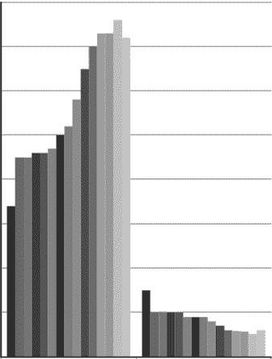

| 特征大小 | F1 分数 | MR |
|---|---:|---:|
| 特征大小的 100% | 0.34 | 0.15 |
| 特征大小的 50% | 0.45 | 0.1 |
| 特征大小的 25% | 0.45 | 0.1 |
| 特征大小的 12.5% | 0.46 | 0.1 |
| 特征大小的 6.25% | 0.46 | 0.1 |
| 特征大小的 3.125% | 0.47 | 0.09 |
| 特征大小的 1.5625% | 0.5 | 0.09 |
| 特征大小的 0.7813% | 0.52 | 0.09 |
| 特征大小的 0.39% | 0.58 | 0.08 |
| 特征大小的 0.195% | 0.65 | 0.07 |
| 特征大小的 0.097% | 0.7 | 0.06 |
| 特征大小的 0.048% | 0.73 | 0.058 |
| 特征大小的 0.024% | 0.73 | 0.057 |
| 特征大小的 0.012% | 0.76 | 0.052 |
| 特征大小的 0.006% | 0.72 | 0.06 |

**图 5.2**  
通过部分 DCT 系数特征提取进行分类的 F1-Score 和 MR。

> [观察：使用 DCT 系数完整特征大小的 0.012% 时 F1-Score 最大且 MR 最小。]

**表 5.3**  
使用四种不同的公共数据集和四种不同的分类器进行部分 DCT 系数的分类性能

| 数据集 | 指标 | KNN | RIDOR | ANN | SVM |
|---|---:|---:|---:|---:|---:|
| Wang | 精确率 | 0.825 | 0.794 | 0.941 | 0.858 |
|  | 召回率 | 0.818 | 0.790 | 0.941 | 0.851 |
|  | MR | 0.052 | 0.053 | 0.012 | 0.020 |
|  | F1-Score | 0.760 | 0.750 | 0.941 | 0.851 |
| OT-Scene | 精确率 | 0.924 | 0.612 | 0.743 | 0.619 |
|  | 召回率 | 0.923 | 0.610 | 0.739 | 0.622 |
|  | MR | 0.014 | 0.073 | 0.055 | 0.070 |
|  | F1-Score | 0.923 | 0.611 | 0.739 | 0.619 |
| Corel | 精确率 | 0.623 | 0.462 | 0.671 | 0.651 |
|  | 召回率 | 0.598 | 0.461 | 0.680 | 0.634 |
|  | MR | 0.077 | 0.094 | 0.069 | 0.071 |
|  | F1-Score | 0.571 | 0.460 | 0.672 | 0.613 |
| Caltech | 精确率 | 0.615 | 0.526 | 0.677 | 0.559 |
|  | 召回率 | 0.631 | 0.526 | 0.687 | 0.621 |
|  | MR | 0.070 | 0.083 | 0.063 | 0.077 |
|  | F1-Score | 0.619 | 0.526 | 0.678 | 0.570 |

> [观察：Wang、Corel 和 Caltech 数据集在 ANN 分类器下具有最高的分类结果；OT-Scene 数据集在 KNN 分类器下具有最高的分类结果。]

**算法 5.1：**

```text
Let H be the Hadamard matrix of size N × N
Let seq(0) = 0; and seq(1) = 1
Let N1 = 2
For k = 1 to Log2(N) - 1
    Cseq(n) = seq(n) for n = 0, 1, 2, ..., N1 - 1.
    Cseq(n) = seq(n - 2i + 1) + 1 for n = N1, N1 + 1, ..., 2N1 - 1
    and i = 0, 1, 2, ..., N1 - 1.
    seq = Cseq
    N1 = 2N1
End for
For n = 0 to N - 1
    For j = 0 to N - 1
        W(n, j) = H(seq(n), j)
    End for j
End for n
```

对于大小为 $N \times N$ 的图像应用的完整二维 Walsh 变换，所需的加法次数为 $2N^2(N - 1)$，且完全不需要乘法。不同百分比的 Walsh 变换部分能量系数的 MR 和 F1-Score 与 Wang 数据集进行比较，如图 5.3 所示。

**不同部分 Walsh 变换系数的特征提取的平均 F1 分数和 MR 比较**

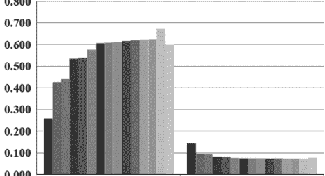

| 特征大小 | F1 分数 | MR |
|---|---:|---:|
| N × N 图像的 N × N 特征大小 | 0.257 | 0.145 |
| N × N 图像的 (N × N) 特征大小的 50% | 0.427 | 0.094 |
| N × N 图像的 (N × N) 特征大小的 25% | 0.444 | 0.094 |
| N × N 图像的 (N × N) 特征大小的 12.5% | 0.534 | 0.083 |
| N × N 图像的 (N × N) 特征大小的 6.25% | 0.539 | 0.082 |
| N × N 图像的 (N × N) 特征大小的 3.125% | 0.576 | 0.077 |
| N × N 图像的 (N × N) 特征大小的 1.5625% | 0.606 | 0.076 |
| N × N 图像的 (N × N) 特征大小的 0.7813% | 0.608 | 0.076 |
| N × N 图像的 (N × N) 特征大小的 0.39% | 0.612 | 0.075 |
| N × N 图像的 (N × N) 特征大小的 0.195% | 0.617 | 0.075 |
| N × N 图像的 (N × N) 特征大小的 0.097% | 0.619 | 0.075 |
| N × N 图像的 (N × N) 特征大小的 0.048% | 0.623 | 0.074 |
| N × N 图像的 (N × N) 特征大小的 0.024% | 0.624 | 0.074 |
| N × N 图像的 (N × N) 特征大小的 0.012% | 0.675 | 0.073 |
| N × N 图像的 (N × N) 特征大小的 0.006% | 0.601 | 0.078 |

**图 5.3**  
通过部分 Walsh 变换系数特征提取进行分类的 F1-Score 和 MR。

> [观察：使用 Walsh 变换系数完整特征大小的 0.012% 时 F1-Score 最大且 MR 最小。]

**表 5.4**  
使用四种不同的公共数据集和四种不同的分类器进行部分 Walsh 变换系数的分类性能

| 数据集 | 指标 | KNN | RIDOR | ANN | SVM |
|---|---:|---:|---:|---:|---:|
| Wang | 精确率 | 0.69 | 0.433 | 0.544 | 0.517 |
|  | 召回率 | 0.68 | 0.431 | 0.547 | 0.532 |
|  | MR | 0.064 | 0.095 | 0.079 | 0.084 |
|  | F1-Score | 0.675 | 0.431 | 0.544 | 0.515 |
| OT-Scene | 精确率 | 0.388 | 0.298 | 0.451 | 0.398 |
|  | 召回率 | 0.388 | 0.298 | 0.451 | 0.408 |
|  | MR | 0.12 | 0.13 | 0.095 | 0.12 |
|  | F1-Score | 0.381 | 0.298 | 0.449 | 0.381 |
| Corel | 精确率 | 0.53 | 0.476 | 0.554 | 0.482 |
|  | 召回率 | 0.54 | 0.484 | 0.572 | 0.498 |
|  | MR | 0.08 | 0.093 | 0.078 | 0.087 |
|  | F1-Score | 0.517 | 0.479 | 0.557 | 0.457 |
| Caltech | 精确率 | 0.401 | 0.369 | 0.518 | 0.309 |
|  | 召回率 | 0.462 | 0.36 | 0.559 | 0.441 |
|  | MR | 0.12 | 0.14 | 0.081 | 0.15 |
|  | F1-Score | 0.381 | 0.364 | 0.534 | 0.322 |

> [观察：Wang 数据集在 KNN 分类器下具有最高的分类结果；OT-Scene、Corel 和 Caltech 数据集在 ANN 分类器下具有最高的分类结果。]

对分类结果的分析显示，使用完全变换系数的 0.012% 时 MR 最低为 0.064，F1-Score 最高为 0.675。此外，使用四种不同的公共数据集和四种不同的分类器——即 KNN、RIDOR、ANN 和 SVM——进行 Walsh 变换完全变换系数的 0.012% 特征提取的分类平均 Precision、Recall、MR 和 F1-Score 值在表 5.4 中给出。

### 5.6.3 Kekre 变换

与大多数可用变换相反，Kekre 变换矩阵可以是任意大小的 N × N，不一定是 2 的幂 [3]。矩阵中上三角和对角位置的值赋为 1，而下三角部分的值（不包括紧邻对角线下方的值）为 0。广义 Kekre 变换矩阵在矩阵 5.1 中给出。

$$K_{N\times N}=\begin{bmatrix}
1 & 1 & 1 & \cdots & 1 & 1 \\
-N+1 & 1 & 1 & \cdots & 1 & 1 \\
0 & -N+2 & 1 & \cdots & 1 & 1 \\
\vdots & \vdots & \vdots & \ddots & \vdots & \vdots \\
0 & 0 & 0 & \cdots & 1 & 1 \\
0 & 0 & 0 & \cdots & -N+(N-1) & 1
\end{bmatrix}$$


## 表 5.5
使用四种不同分类器在四个不同公共数据集上采用部分Kekre变换系数的分类性能

| 数据集 | 指标 | KNN | RIDOR | ANN | SVM |
|---|---|---:|---:|---:|---:|
| Wang | 精确率 | 0.54 | 0.413 | 0.53 | 0.448 |
|  | 召回率 | 0.541 | 0.415 | 0.536 | 0.5 |
|  | MR | 0.086 | 0.097 | 0.087 | 0.092 |
|  | F1分数 | 0.541 | 0.413 | 0.531 | 0.468 |
| OT-Scene | 精确率 | 0.377 | 0.289 | 0.434 | 0.381 |
|  | 召回率 | 0.381 | 0.289 | 0.433 | 0.38 |
|  | MR | 0.14 | 0.16 | 0.097 | 0.13 |
|  | F1分数 | 0.377 | 0.289 | 0.434 | 0.381 |
| Corel | 精确率 | 0.516 | 0.449 | 0.54 | 0.464 |
|  | 召回率 | 0.526 | 0.455 | 0.56 | 0.488 |
|  | MR | 0.1 | 0.099 | 0.081 | 0.099 |
|  | F1分数 | 0.411 | 0.45 | 0.544 | 0.437 |
| Caltech | 精确率 | 0.455 | 0.419 | 0.523 | 0.391 |
|  | 召回率 | 0.514 | 0.459 | 0.552 | 0.528 |
|  | MR | 0.094 | 0.095 | 0.08 | 0.1 |
|  | F1分数 | 0.443 | 0.437 | 0.554 | 0.43 |

> [观察：Wang数据集在使用KNN分类器时取得最高的分类结果；OT-Scene、Corel和Caltech数据集在使用ANN分类器时取得最高的分类结果。]

对N × N图像进行Kekre变换所需的乘法次数为 2N(N−2)，所需的加法次数为 N(N²+N−2)。

Kekre变换矩阵的项K(x, y)可由式5.2中的表达式生成。

K(x, y) = { 1, x ≤ y; −N + (x − 1), x = y + 1; 0, x > y + 1 }  (5.2)

部分系数作为特征向量从图像的变换元素中提取。使用不同百分比的部分系数进行特征提取的F1分数和MR比较如图5.4所示。

图5.4中的比较表明，使用通过Kekre变换获得的完整变换系数的12.5%进行分类时，F1分数最高，MR最低。因此，使用四种不同分类器——即KNN、RIDOR、ANN和SVM——在四个不同公共数据集上，以Kekre变换完全变换系数的12.5%进行特征提取的分类平均精确率、召回率、MR和F1分数值如表5.5所示。

## 使用DST变换不同部分系数进行特征提取的平均F1分数和MR比较
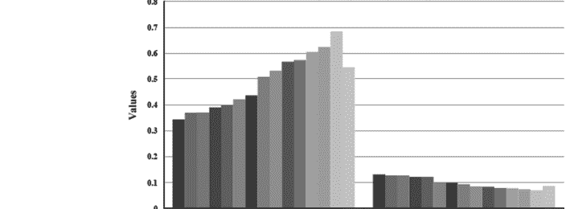

| 部分系数的特征大小 | F1分数 | MR |
|---|---:|---:|
| N×N图像的全N×N特征大小 | 0.343 | 0.131 |
| N×N图像特征大小的50% | 0.370 | 0.128 |
| N×N图像特征大小的25% | 0.371 | 0.128 |
| N×N图像特征大小的12.5% | 0.391 | 0.122 |
| N×N图像特征大小的6.25% | 0.398 | 0.121 |
| N×N图像特征大小的3.125% | 0.422 | 0.101 |
| N×N图像特征大小的1.5625% | 0.436 | 0.099 |
| N×N图像特征大小的0.7813% | 0.509 | 0.094 |
| N×N图像特征大小的0.39% | 0.532 | 0.086 |
| N×N图像特征大小的0.195% | 0.567 | 0.084 |
| N×N图像特征大小的0.097% | 0.573 | 0.080 |
| N×N图像特征大小的0.048% | 0.604 | 0.078 |
| N×N图像特征大小的0.024% | 0.624 | 0.074 |
| N×N图像特征大小的0.012% | 0.683 | 0.071 |
| N×N图像特征大小的0.006% | 0.546 | 0.087 |

## 图 5.5
使用部分DST系数进行特征提取分类的F1分数和MR。**[观察：**当使用DST系数完整特征大小的0.012%时，F1分数达到最大值，MR达到最小值。**]**

### 5.6.4 离散正弦变换
离散正弦变换（DST）被定义为一种与傅里叶相关的变换，它使用一个纯实数矩阵[3]。它由一个 *N × N* 正弦变换矩阵描述，被认为是一个线性且可逆的函数。可通过按式5.3中给出的序列排列逐行生成DST矩阵。

$$y(i,j)=\sqrt{\frac{2}{N+1}}\sin\left[\frac{\pi(i+1)(j+1)}{N+1}\right]$$  
(5.3)

其中 0 ≤ *i*, *j* ≤ N − 1

DST的部分系数作为特征向量从Wang数据集的图像中提取。使用DST不同百分比的部分系数进行特征提取的F1分数和MR比较如图5.5所示。

## 表 5.6
使用四种不同分类器在四个不同公共数据集上采用部分DST系数的分类性能

| 数据集 | 指标 | KNN | RIDOR | ANN | SVM |
|---|---|---:|---:|---:|---:|
| Wang | 精确率 | 0.67 | 0.41 | 0.557 | 0.49 |
|  | 召回率 | 0.68 | 0.414 | 0.562 | 0.497 |
|  | MR | 0.071 | 0.097 | 0.08 | 0.092 |
|  | F1分数 | 0.683 | 0.412 | 0.558 | 0.466 |
| OT-Scene | 精确率 | 0.376 | 0.31 | 0.437 | 0.354 |
|  | 召回率 | 0.379 | 0.313 | 0.438 | 0.36 |
|  | MR | 0.14 | 0.16 | 0.097 | 0.15 |
|  | F1分数 | 0.372 | 0.31 | 0.436 | 0.329 |
| Corel | 精确率 | 0.501 | 0.446 | 0.544 | 0.449 |
|  | 召回率 | 0.51 | 0.45 | 0.556 | 0.471 |
|  | MR | 0.097 | 0.098 | 0.09 | 0.1 |
|  | F1分数 | 0.488 | 0.447 | 0.542 | 0.43 |
| Caltech | 精确率 | 0.45 | 0.406 | 0.424 | 0.327 |
|  | 召回率 | 0.499 | 0.431 | 0.512 | 0.492 |
|  | MR | 0.1 | 0.12 | 0.097 | 0.14 |
|  | F1分数 | 0.424 | 0.417 | 0.456 | 0.372 |

[观察：Wang和Caltech数据集在使用KNN分类器时取得最高的分类结果；OT-Scene和Corel数据集在使用ANN分类器时取得最高的分类结果。]

当使用测试图像完整DST系数的0.012%时，观察到F1分数最大值0.683和MR最小值0.071。使用四种不同分类器——即KNN、RIDOR、ANN和SVM——在四个不同公共数据集上，以DST完全变换系数的0.012%进行特征提取的分类平均精确率、召回率、MR和F1分数值如表5.6所示。

### 5.6.5 离散哈特利变换
离散哈特利变换（DHT）被构造为离散周期数据的傅里叶相关变换，它将实数输入转换为实数输出，同时避免了复数的基本关联[4]。它作为一个线性算子，是连续哈特利变换的离散模拟。DHT是一个线性、可逆的函数 $H: \mathbb{R}^n \to \mathbb{R}^n$（其中 $\mathbb{R}$ 表示实数集）。将 $n$ 个实数从 $x_0, ..., x_{n-1}$ 变换为 $n$ 个实数 $h_0, ..., h_{n-1}$ 可通过式5.4执行

$$H_k = \sum_{n=0}^{N-1} x_n \left[\cos\left(\frac{2\pi}{N}nk\right) + \sin\left(\frac{2\pi}{N}nk\right)\right]_{k=0,\ldots,N-1} \tag{5.4}$$

该变换可被解释为向量 $(x_0, ..., x_{N-1})$ 与一个 $N \times N$ 矩阵的乘法；因此，离散哈特利

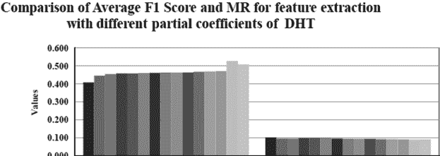

| 特征大小 | F1分数 | MR |
|---|---:|---:|
| 100%特征大小 | 0.408 | 0.101 |
| 特征大小的50% | 0.445 | 0.095 |
| 特征大小的25% | 0.454 | 0.096 |
| 特征大小的12.5% | 0.458 | 0.096 |
| 特征大小的6.25% | 0.458 | 0.098 |
| 特征大小的3.125% | 0.459 | 0.097 |
| 特征大小的1.5625% | 0.461 | 0.095 |
| 特征大小的0.7813% | 0.462 | 0.094 |
| 特征大小的0.39% | 0.462 | 0.094 |
| 特征大小的0.195% | 0.462 | 0.094 |
| 特征大小的0.097% | 0.467 | 0.092 |
| 特征大小的0.048% | 0.468 | 0.092 |
| 特征大小的0.024% | 0.470 | 0.091 |
| 特征大小的0.012% | 0.526 | 0.089 |
| 特征大小的0.006% | 0.507 | 0.090 |

## 图 5.6
使用部分DHT系数进行特征提取分类的F1分数和MR。  
**[观察：**当使用DHT系数完整特征大小的0.012%时，F1分数达到最大值，MR达到最小值。**]**

对 $N \times N$ 图像进行哈特利变换所需的乘法次数为 $2N(N - 2)$，加法次数为 $N(N^2 + N - 2)$。

来自Wang数据集测试图像的特征向量被提取为DHT的部分系数。使用DHT不同百分比的部分系数进行特征提取的F1分数和MR比较如图5.6所示。

使用四种不同分类器——即KNN、RIDOR、ANN和SVM——在四个不同公共数据集上，以DHT完全变换系数的0.012%进行特征提取的分类平均精确率、召回率、MR和F1分数值如表5.7所示。


**表5.7**

使用部分DST系数在四个不同公开数据集上采用四种不同分类器的分类性能

| 数据集 | 指标 | KNN | RIDOR | ANN | SVM |
| --- | --- | ---: | ---: | ---: | ---: |
| Wang | 精确率 | 0.554 | 0.412 | 0.551 | 0.476 |
|  | 召回率 | 0.553 | 0.416 | 0.55 | 0.501 |
|  | MR | 0.07 | 0.09 | 0.086 | 0.09 |
|  | F1分数 | 0.553 | 0.413 | 0.55 | 0.479 |
| OT-Scene | 精确率 | 0.371 | 0.298 | 0.362 | 0.357 |
|  | 召回率 | 0.376 | 0.299 | 0.361 | 0.372 |
|  | MR | 0.14 | 0.16 | 0.15 | 0.15 |
|  | F1分数 | 0.373 | 0.298 | 0.361 | 0.347 |
| Corel | 精确率 | 0.171 | 0.121 | 0.221 | 0.152 |
|  | 召回率 | 0.201 | 0.176 | 0.22 | 0.151 |
|  | MR | 0.24 | 0.25 | 0.22 | 0.2 |
|  | F1分数 | 0.18 | 0.121 | 0.221 | 0.15 |
| Caltech | 精确率 | 0.456 | 0.423 | 0.443 | 0.385 |
|  | 召回率 | 0.522 | 0.456 | 0.532 | 0.52 |
|  | MR | 0.098 | 0.095 | 0.09 | 0.097 |
|  | F1分数 | 0.441 | 0.438 | 0.475 | 0.413 |

> [观察结果：Wang和Caltech数据集使用KNN分类器时分类结果最高；OT-Scene和Corel数据集使用ANN分类器时分类结果最高。]

## 5.7 对所提出技术的评估

如图5.7至图5.10所示，在四种不同分类器和四个公开数据集上，对每种使用部分变换系数的特征提取技术所表现出的分类性能进行了比较。

图5.7至图5.10中的图示清楚地表明，采用部分DCT系数进行特征提取所得到的分类结果超过了其他四种变换——即沃尔什变换、Kekre变换、DST和DHT。

DCT性能优越的原因在于，被变换的灰度值的均值是DCT的第一个系数。因此，每个块的第一个系数是所参与灰度值的平均色调，这使得后续系数能够增加越来越多的细节，从而促进更好的特征提取。另一方面，基于sinθ的变换以0.5或1的偏移量开始，这导致第一个系数出现一个平缓的凸起。这对于从给定测试图像中进行鲁棒特征提取并不合适。

据观察，变换技术用于特征向量计算的迭代次数消耗线性时间。每个变换需要L次迭代来计算系数。因此对于三个颜色分量（红、绿和蓝），总共需要3L次迭代。然而，所选择的部分系数仅占所生成的整个变换系数的n%（其中n=50%至0.006%）。因此，使用n%的变换系数计算特征向量所需的迭代次数远小于3L。这样，特征提取的计算量减少到3L的n%。于是，总迭代次数可以表示为线性时间O(3 * n * N)。

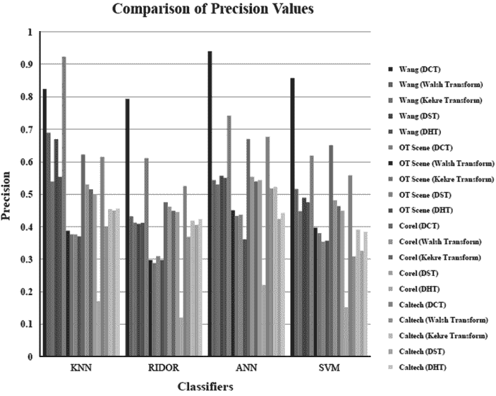

**图5.7**

使用四种不同分类器，在全部四个数据集上，采用DCT、沃尔什变换、Kekre变换、DST和DHT方法的部分系数进行特征提取的分类精确率值比较。

> **[观察结果：]** 最高的精确率值由采用部分DCT系数的特征提取所体现。

## 5.8 与现有技术的比较

从第5.4节的结果可以推断，采用部分DCT系数进行特征提取的分类结果已经超过了其他所提出的技术。

因此，采用部分DCT系数进行特征提取所获得的分类结果（在第5.4节中观察为最佳技术）与图5.11中的现有先进技术[5–8]进行比较。现有技术使用Wang数据集和KNN分类器进行测试。因此，与所提出技术的比较是在相同环境下进行的。

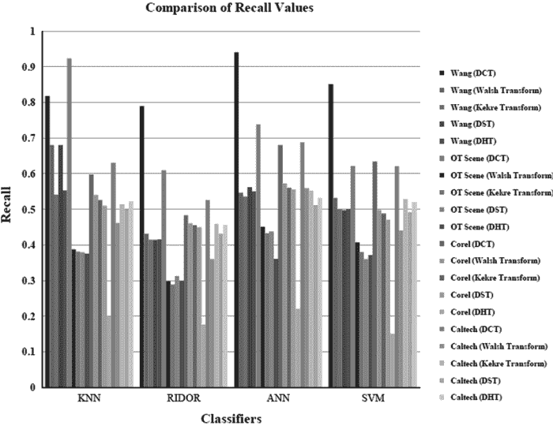

**图5.8**

使用四种不同分类器，在全部四个数据集上，采用DCT、沃尔什变换、Kekre变换、DST和DHT方法的部分系数进行特征提取的分类召回率值比较。

> [观察结果：最高的召回率值由采用部分DCT系数的特征提取所体现。]

图5.11中的结果清楚地确立了所提出技术相对于现有技术的优越性。

最后，使用所提出的采用部分DCT系数的特征提取技术，从每幅图像提取特征的平均时间与现有技术进行了比较，如图5.12所示。

图5.12所示的图示清楚地表明，与基准技术[5–8]相比，所提出的采用部分DCT系数的特征提取技术消耗的时间要少得多。

## 5.9 统计显著性

在*假设5.1*中设计了一个零假设，以基于精确率值验证性能改进的统计显著性。

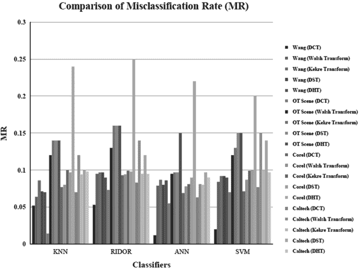

**图5.9**

使用四种不同分类器，在全部四个数据集上，采用DCT、沃尔什变换、Kekre变换、DST和DHT方法的部分系数进行特征提取的分类MR比较。

> **[观察结果：]** 最低的MR由采用部分DCT系数的特征提取所体现。

> **假设1：** *采用部分DCT系数特征提取所得到的分类结果的精确率值与现有技术相比没有显著差异。*

在表5.9中进行了配对*t*检验，以确定分类的精确率差异是否来自零均值的总体。

最初，在表5.8中给出了采用部分DCT系数进行特征提取时不同类别分类精确率值的SD和SEM。

*t*计算值的计算方法是取表5.9中每次比较所考虑的两个样本均值之差。*p*值用于衡量拒绝零假设的证据强度。

计算出的*p*值表明，使用所提出的特征提取技术所得到的分类精确率结果存在显著差异，因此拒绝零假设。表5.8中给出的现有技术的*均值*、*SD*和*SEM*值进一步与表5.9中所提出的方法进行了比较。据观察，与所有现有技术相比，采用部分DCT系数方法的特征提取具有更高的分类精确率*均值*，且*SD*和*SEM*更小。因此可以得出结论，所提出的方法不仅显示出更高的精确率值，而且具有稳定的性能，因为与现有技术相比，其*SD*和*SEM*更小。

**F1分数比较**

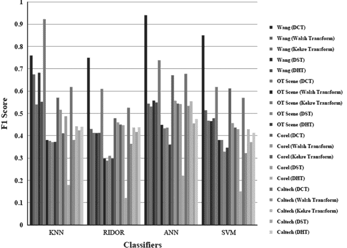

**图5.10**

使用四种不同分类器，在全部四个数据集上，采用DCT、沃尔什变换、Kekre变换、DST和DHT方法的部分系数进行特征提取的分类F1分数比较。

> [观察结果：最高的分类性能由采用部分DCT系数的特征提取所体现。]

因此，采用0.012%的DCT系数的特征提取技术对提升分类性能做出了显著贡献。

*t检验*进行了四种不同的比较；需要使用*邦费罗尼校正*进行*事后分析*，以接受所得结果的显著性。对于*t检验*，α值被认为为0.05。以下表达式计算*邦费罗尼校正*值：

$$\mathrm{Bonferroni}_{\alpha}=\frac{\alpha}{\mathrm{Number\_of\_tests}}$$


**表 5.8** – 通过使用部分 DCT 系数的特征提取进行分类的精度值的均值、标准差和均值标准误

| 提出的技术 | 均值 | 标准差 | 平均标准误 |
|---|---|---|---|
| 使用部分 DCT 系数的特征提取 | 0.801 | 0.145 | 0.071 |

**表 5.9** – 使用部分 DCT 系数的特征提取的精度结果比较的 t 检验

| 比较 | 均值 | 标准差 | 平均标准误 | t 计算 | p 值 | 显著性 |
|---|---|---|---|---|---|---|
| Liu, 2013 | 0.626 | 0.22 | 0.073 | 3.78 | 0.005 | 显著 |
| Ramírez-Ortegón et al., 2010 | 0.601 | 0.24 | 0.08 | 3.88 | 0.005 | 显著 |
| Yanli and Zhenxing, 2012 | 0.638 | 0.223 | 0.074 | 3.23 | 0.012 | 显著 |
| Shaikh et al., 2013 | 0.595 | 0.214 | 0.071 | 4.26 | 0.003 | 显著 |

> 观察：p 值表明，与使用部分 DCT 系数的特征提取相比，使用现有技术的特征提取的分类精度结果存在显著差异。

其中 α = 0.05  
测试次数 = 4  
因此，  
Bonferroni_α = 0.013

现在，将表 5.9 中的 p 值与新计算的 Bonferroni_α 值 0.013 进行比较。

比较显示，表 5.9 中对所提出技术与 Yanli and Zhenxing, 2012 以及 Shaikh et al., 2013 的技术进行评估计算的 p 值小于 Bonferroni_α 值。因此，即使在事后分析后，所提出的技术仍与上述两种技术保持统计学差异。然而，表 5.9 中其余的 p 值并不小于 Bonferroni_α 值。

## 章节摘要

本章讨论了使用图像变换的部分系数的特征提取。五种不同的变换——即离散余弦变换 (DCT)、Walsh 变换、Kekre 变换、离散正弦变换 (DST) 和 Hartley 变换——已被讨论并为每种技术使用部分变换系数实现特征提取。提取的特征向量在四个不同的公共数据集上进行分类结果评估——即 Wang、OT-Scene、Corel 和 Caltech。使用了四种不同的分类器——即 K 近邻 (KNN)、Ripple-Down Rule (RIPDOR)、人工神经网络 (ANN) 和支持向量机 (SVM)——用于评估分类性能。此外，还比较了每种特征提取技术的分类结果。特征提取使用部分 DCT 系数显示出最高的分类性能。因此，它与现有技术进行了比较，其中它优于所有技术。所提出方法的分类结果还揭示了与最先进技术相比分类增加的统计显著性。

## 参考文献

- 1. Das, R., Thepade, S. and Ghosh, S., 2015. 基于多视图特征信息融合的内容图像识别. *国际信息技术与计算机科学期刊*, 7(10):61–73.
- 2. Thepade, S., Das, R. and Ghosh, S., 2017. 基于决策融合的内容图像分类方法. *国际智能计算与控制论期刊*, 10(3): 310–331.
- 3. Thepade, S., Das, R. and Ghosh, S., 2014. 用于内容图像分类的有序均值特征提取. *计算机工程进展*, vol. 2014, Article ID 454876, 15 pages: doi:10.1155/2014/454876
- 4. Das, R., Thepade, S. and Ghosh, S., 2016. 基于标准化多视图特征的内容图像识别框架. *ETRI 期刊*, 38(1): 174–184.
- 5. Liu, C., 2013. 一种新的指静脉特征提取算法. In *IEEE 第六届图像与信号处理国际会议 (CISP)*, pp. 395–399.
- 6. Ramírez-Ortegón, M. A. and Rojas, R., 2010. 基于局部灰度强度方差的历史文档二值化的无监督评估方法. In *国际模式识别会议论文集*, pp. 2029–2032.
- 7. Yanli Y. and Zhenxing Z., 2012. 用于 QR 图像的一种新型局部阈值二值化方法. In *IET 自动控制与人工智能国际会议 (ACAI)*, pp. 224–227.
- 8. Shaikh, S. H., Maiti, A. K. and Chaki, N., 2013. 一种使用迭代分割的新图像二值化方法. *机器视觉与应用*, 24(2): 337–350.

# 6 基于内容的特征提取：形态学算子

## 6.1 序言

术语形态学指的是独特的轮廓、形成或外观。图像中待识别的对象都表现出上述特性。因此，这些特征可以很好地用于设计用于基于内容图像分类的鲁棒描述符。图像处理中的形态学操作是基于集合论的多个操作的集合，用于理解包括边界提取、填充图像中存在的微小孔洞以及从图像中去除噪声等一系列活动 [1]。由于其源于集合论，应用数学形态学可以有效地分析图像中存在的物体的形状。形态学元素将掩模视为结构元素，该掩模是二值图像，由形态学算子作为输入提供。对于图像数据，所有集合算子（如交集、并集、包含和补集）的灵活应用都是可能的。形态学中的膨胀和腐蚀被认为是基本函数。最初，图像需通过膨胀将像素应用于对象边界而产生的膨胀效应进行处理。此外，对象形状收缩效应需通过腐蚀去除边界像素来实现。输入图像中对应的像素需与邻近像素进行比较，以定义输出图像中每个像素的值。本章介绍了两种使用形态学算子的特征提取技术——即顶帽变换和底帽变换。这两种技术是基于块截断编码 (BTC) 方法实现的。描述符是通过应用形态学算子计算分离的前景和背景像素的均值生成的。每个颜色分量的特征向量大小为 2。因此，对于三个颜色分量，特征向量的大小为 (3 × 2) = 6，该值是通过应用形态学算子进行特征提取获得的。图 6.1 中提供了说明。

$$
x_{loF.V.}=\left(\left(\frac{1}{m\ast n}\ast\sum_{i=1}^{m}\sum_{j=1}^{n}x_{lo}(i,j)\right)+\left(\sqrt{\frac{1}{m\ast n}\sum_{i=1}^{m}\sum_{j=1}^{n}\left(x_{lo}(i,j)-\mu_{lo}\right)^2}\right)\right)
\tag{6.2}
$$

其中，$\mu=\left(\frac{1}{m\ast n}\ast\sum_{i=1}^{m}\sum_{j=1}^{n}x(i,j)\right)$ and $\sigma=\left(\sqrt{\frac{1}{m\ast n}\sum_{i=1}^{m}\sum_{j=1}^{n}\left(x(i,j)-\mu\right)^2}\right)$  
μ = 均值  
σ = 标准差  
x = 各分量的 R、G 和 B，T_x = 每个像素的阈值

## 6.3 代码示例 (MATLAB®)

```matlab
% Read an image

i=imread('path\\imagefile');

% Separate the color components

r=i(:,:,1); % red component
[m n p]=size(r); % dimension of red component
g=i(:,:,2); % green component
[x y z]=size(g); % dimension of green component
b=i(:,:,3); % blue component
[j k l]=size(b); % dimension of blue component

% Apply top-hat transform

SE = strel('disk',12); % creating the structuring element
BWr = imtophat(r,SE); % r = red component
```

## 6.4 编程练习

*之前的代码示例对图像的红色分量应用了顶帽变换。请参考示例完成以下任务：*

- 对绿色和蓝色分量应用顶帽变换。
- 从应用变换后分离的背景和前景中提取特征。


原始图像
红色分量
绿色分量
蓝色分量
对红色分量应用底帽算子
对绿色分量应用底帽算子
对蓝色分量应用底帽算子

**图 6.3** 形态学算子底帽的应用。

来自四个不同公共数据集（即 Wang、OT-Scene、Corel 和 Caltech）的底帽变换。图 6.3 给出了一个示例说明。

通过对图像各颜色分量的轮廓区域和背景部分的灰度值进行分组，形成两个不同的簇。计算这两个簇的均值和标准差，用于按照公式 6.1 和 6.2 计算图像的特征向量。每个图像的特征向量大小为 6，每个颜色分量有 2 个特征向量。

## 6.6 代码示例（MATLAB）

```matlab
% Read an image
i=imread('path\imagefile');

% Separate the color components
r=i(:,:,1); % red component
[m n p]=size(r); % dimension of red component
g=i(:,:,2); % green component
[x y z]=size(g); % dimension of green component
b=i(:,:,3); % blue component
[j k l]=size(b); % dimension of blue component

% Applying bot-hat transform
SE = strel('disk',12); % creating the structuring element
BWr = imbothat(r,SE); % r = red component
```

## 6.7 编程练习

*之前的代码示例对图像的红色分量应用了底帽变换。请参考该示例完成以下任务：*

- 对绿色和蓝色颜色分量应用底帽变换。
- 从应用变换后分离出的背景和前景中提取特征。

此后，计算各指标的平均值，以观察采用底帽变换进行特征提取时，四种不同分类器（即 KNN、RIDOR、ANN 和 SVM）在四个不同公共数据集上的分类精确率、召回率、误分类率（MR）和 F1 分数。

比较结果见表 6.2。

**表 6.2** 使用四种不同分类器在四个不同公共数据集上采用底帽变换进行特征提取的分类性能

| 数据集 | 指标 | KNN | RIDOR | ANN | SVM |
|---|---|---|---|---|---|
| Wang | 精确率 | 0.767 | 0.726 | 0.826 | 0.72 |
| Wang | 召回率 | 0.761 | 0.729 | 0.83 | 0.714 |
| Wang | 误分类率 | 0.052 | 0.059 | 0.043 | 0.066 |
| Wang | F1 分数 | 0.761 | 0.725 | 0.826 | 0.707 |
| OT-Scene | 精确率 | 0.602 | 0.615 | 0.65 | 0.481 |
| OT-Scene | 召回率 | 0.589 | 0.613 | 0.637 | 0.498 |
| OT-Scene | 误分类率 | 0.079 | 0.078 | 0.074 | 0.093 |
| OT-Scene | F1 分数 | 0.589 | 0.613 | 0.635 | 0.451 |
| Corel | 精确率 | 0.691 | 0.751 | 0.792 | 0.594 |
| Corel | 召回率 | 0.671 | 0.76 | 0.796 | 0.604 |
| Corel | 误分类率 | 0.07 | 0.053 | 0.046 | 0.079 |
| Corel | F1 分数 | 0.659 | 0.754 | 0.79 | 0.57 |
| Caltech | 精确率 | 0.514 | 0.533 | 0.64 | 0.349 |
| Caltech | 召回率 | 0.573 | 0.566 | 0.665 | 0.537 |
| Caltech | 误分类率 | 0.089 | 0.08 | 0.076 | 0.095 |
| Caltech | F1 分数 | 0.498 | 0.546 | 0.65 | 0.417 |

[观察：所有数据集上，ANN 分类器取得的分类结果最高。]

## 6.8 所提技术的比较

本章讨论两种不同的形态学特征提取技术，即顶帽变换和底帽变换。使用四种不同的分类器在四个不同的公共数据集上测试了这些技术的分类结果，结果见表 6.1 和表 6.2。图 6.4–6.7 分别基于精确率、召回率、误分类率和 F1 分数，对所有四个数据集和分类器比较了这两种技术。

图 6.4–6.7 所示的比较清楚地表明，与顶帽变换相比，采用底帽变换进行特征提取的分类具有更好的精确率、召回率和 F1 分数值，以及更低的误分类率。

使用底帽变换的特征提取仅在图像中提取的感兴趣区域内进行。这带来了鲁棒的特征提取，因为底帽变换中的结构元素在开运算和闭运算过程中都会去除与它不相匹配的图像部分。相反，顶帽变换用于浅色物体搭配深色背景的情况，其去除的图像部分包括小于结构元素的部分。因此，对于本工作中给定类型的图像，顶帽变换无法正确识别感兴趣区域进行特征提取。因此，采用底帽变换进行特征提取的分类结果优于顶帽变换。

**图 6.4** 使用四种不同分类器对所有四个数据集进行特征提取时，顶帽变换与底帽变换方法的分类精确率值比较。

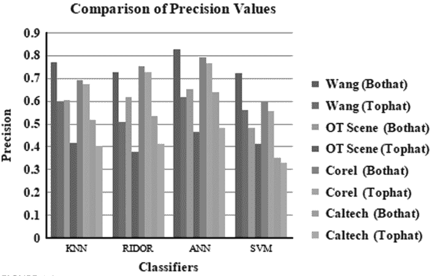

> **观察：** 在所有四个数据集中，底帽变换均优于顶帽变换。

**图 6.5** 使用四种不同分类器对所有四个数据集进行特征提取时，顶帽变换与底帽变换方法的分类召回率值比较。

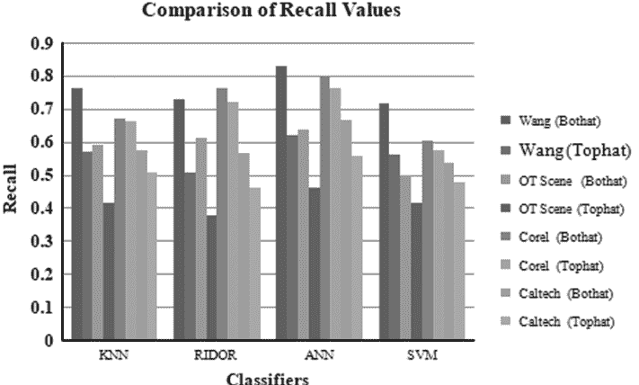

> **观察：** 在所有四个数据集中，底帽变换均优于顶帽变换。

**图 6.6** 使用四种不同分类器对所有四个数据集进行特征提取时，顶帽变换与底帽变换方法的分类误分类率比较。


[观察：在所有四个数据集中，底帽变换均优于顶帽变换。]

**图 6.7** 使用四种不同分类器对所有四个数据集进行特征提取时，顶帽变换与底帽变换方法的分类 F1 分数比较。


[观察：在所有四个数据集中，底帽变换均优于顶帽变换。]

图 6.7 的比较表明，与现有技术相比，采用底帽变换进行特征提取的分类具有更好的精确率、召回率、F1 分数值和更低的误分类率。

## 6.9 与现有方法的比较

第 6.3 节中的底帽变换特征提取优于顶帽变换。因此，图 6.8 将其分类结果与最新技术 [4–7] 进行了比较。由于现有技术是在相同环境下评估的，因此比较使用 Wang 数据集和 KNN 分类器进行。

采用底帽变换进行特征提取相对于最新特征提取技术的分类结果比较


**图 6.8** 采用底帽技术进行特征提取与现有技术的分类结果比较。

[观察：采用底帽变换进行特征提取的分类结果超过了现有技术的分类结果。]

**图 6.9** 特征提取平均耗时比较。


[观察：与 Shaikh 等人（2013）相比，采用所提出的底帽变换特征提取技术消耗了更高的平均时间。]

图 6.7 的比较表明，与现有技术相比，采用底帽变换进行特征提取的分类具有更好的精确率、召回率、F1 分数值和更低的误分类率。

图 6.9 将所提出的底帽变换特征提取技术与现有技术对 Wang 数据集中每幅图像进行特征提取所花费的时间进行了比较。

图 6.9 的比较表明，与 Shaikh 等人（2013）[7] 的特征提取方法相比，所提出的技术特征提取时间略高。然而，与 [4-6] 中讨论的其余三种现有技术相比，其特征提取时间要少得多。

## 6.10 统计显著性

假设 1：采用底帽变换进行特征提取所获得的分类结果与现有技术的精确率值没有差异。

采用底帽变换进行特征提取与现有技术的分类结果精确率值之间的差异，通过一种……进行评估。


- 3. Das, R., Thepade, S. and Ghosh, S., 2016. 基于标准化多视角特征的内容型图像识别框架. *ETRI Journal*, 38 (1): 174–184.
- 4. Liu, C., 2013. 一种新的指静脉特征提取算法. In IEEE 第六届图像与信号处理国际会议 (CISP), pp. 395–399.
- 5. Ramírez-Ortegón, M. A. and Rojas, R., 2010. 基于局部灰度强度方差的历史文档二值化的无监督评估方法. In Proceedings of the International Conference on Pattern Recognition, pp. 2029–2032.
- 6. Yanli, Y. and Zhenxing, Z., 2012. 一种用于 QR 图像的新颖局部阈值二值化方法. In IET International Conference on Automatic Control and Artificial Intelligence (ACAI), pp. 224–227.
- 7. Shaikh, S. H., Maiti, A. K. and Chaki, N., 2013. 一种使用迭代划分的新图像二值化方法. *Machine Vision and Applications*, 24 (2): 337–350.

# 7 基于内容特征提取：纹理成分

## 7.1 引言

在图像中以具有某种随机性的重复结构形式出现的常见属性称为 *纹理*。重复模式的基本组成部分被指定为基本原语或 *纹素*。基本原语使用放置规则或均匀性来形成重复模式。在某些图像中，区域的定义特征对于正确分析可能很重要。在纹理分析的帮助下，可以从颜色或强度的空间排列中进行特征提取。一些直方图分布可以具有不同的纹理表示，这可以作为提取不同特征的工具。因此，纹理的存在以重复模式的形式出现，如图 7.1 所示。


**图 7.1**  
示例纹理模式。  
**来源：** https://upload.wikimedia.org/wikipedia/commons/a/a9/ArtificialTexture.png (根据知识共享许可)。

强度和颜色的变化导致了纹理的形成。纹理对应于定性术语，即在物理层面上粗糙度、均匀性和平滑度。根据原语的大小，纹理分为微纹理和宏观纹理。对象的宏观纹理或粗糙度由原语的大元素定义，而微纹理由较小的纹理形成。纹理元素的方向性被称为方向性。本章介绍了两种利用图像纹理内容进行特征提取的方法，即使用 Linde-Buzo-Gray (LBG) 算法的矢量量化 (VQ) 码本表示进行特征提取，以及通过灰度共生矩阵 (GLCM) 进行特征提取。这些技术提高了基于内容图像分类的速率。在我们的方法中，我们通过使用 LBG 算法从生成的聚类中计算码向量来生成特征。这样生成的码本大小远小于图像尺寸，并用作基于内容图像分类的特征向量。在 GLCM 的情况下，计算每个图像的特征向量时考虑了所有参数即能量、对比度、熵和相关性的均值和标准差。这为每个图像生成 8 个特征大小，该大小与图像尺寸无关，并且具有相当小的占用空间。

## 7.2 使用 Linde-Buzo-Gray (LBG) 算法的矢量量化码本表示进行特征提取

图像的统计颜色分布已由矢量量化 (VQ) 码本 [1] 描述。该技术应用于四个不同的公共数据集，用于从测试图像中提取特征。数据集为 Wang 数据集、OT-Scene 数据集、Corel 数据集和 Caltech 数据集。为了应用矢量量化创建作为特征向量的码本，从测试图像中提取了红色 (R)、绿色 (G) 和蓝色 (B) 等颜色分量。通过矢量量化将 *k* 维欧几里得空间映射到有限子集。码本的表示由有限集 *CB* 完成，如公式 7.1 所示。

$$CB = \{C_i \mid i = 1, 2, \ldots, N\}$$

(7.1)

其中 Ci = (ci1, ci2, ...., cik) 是码向量，N 是码本的大小。

遵循 Linde-Buzo-Gray (LBG) 算法生成码向量。首先，将图像划分为不重叠的块并转换为训练向量 Xi = (xi1, xi2, ... , xik)。训练集中每个训练向量的维度固定为 12。训练向量由 2 × 2 相邻像素的红色、绿色和蓝色分量组成。从此，整个训练集的质心被计算为第一个码向量。此外，通过在质心上加减常数误差生成两个试验码向量 v1 和 v2。计算每个训练向量与试验向量的接近程度，并根据训练向量与 v1 和 v2 的接近程度形成两个聚类，如图 7.2 所示。


**图 7.2**  
Linde-Buzo-Gray (LBG) 算法的实现。

这通过从两个新形成的聚类中计算两个质心来创建大小为 2 的码本，从而产生两个码向量。上述过程使用质心重复以生成所需的码本大小，本例中为 16。

从四个公共数据集中提取的特征使用四种不同的分类器进行测试，即 K 近邻 (KNN)、Ripple-Down Rule (RIDOR)、人工神经网络 (ANN) 和支持向量机 (SVM)。结果见表 7.1。

**表 7.1**  
使用矢量量化进行特征提取时，使用四个不同公共数据集和四个不同分类器的分类性能

| 数据集 | 指标 | KNN | RIDOR | ANN | SVM |
|---|---|---:|---:|---:|---:|
| Wang | 精确率 | 0.900 | 0.900 | 0.928 | 0.888 |
| Wang | 召回率 | 0.890 | 0.900 | 0.925 | 0.869 |
| Wang | 误判率 | 0.042 | 0.039 | 0.038 | 0.043 |
| Wang | F1 分数 | 0.884 | 0.900 | 0.925 | 0.862 |
| OT-Scene | 精确率 | 0.923 | 0.922 | 0.937 | 0.860 |
| OT-Scene | 召回率 | 0.919 | 0.922 | 0.936 | 0.860 |
| OT-Scene | 误判率 | 0.038 | 0.039 | 0.036 | 0.044 |
| OT-Scene | F1 分数 | 0.923 | 0.922 | 0.937 | 0.856 |
| Corel | 精确率 | 0.703 | 0.713 | 0.820 | 0.545 |
| Corel | 召回率 | 0.658 | 0.668 | 0.819 | 0.499 |
| Corel | 误判率 | 0.057 | 0.073 | 0.046 | 0.091 |
| Corel | F1 分数 | 0.700 | 0.660 | 0.819 | 0.468 |
| Caltech | 精确率 | 0.725 | 0.781 | 0.863 | 0.714 |
| Caltech | 召回率 | 0.725 | 0.777 | 0.864 | 0.712 |
| Caltech | 误判率 | 0.057 | 0.053 | 0.042 | 0.066 |
| Caltech | F1 分数 | 0.707 | 0.778 | 0.862 | 0.714 |

> **观察：** 四个数据集均在 ANN 分类器上获得最大分类结果。

## 7.3 代码示例 (MATLAB®)

```matlab
%% Read an Image
i=imread('path\imagefile');

%% Separate the Color Components
r=i(:,:,1); % red component
[m n p]=size(r); % dimension of red component
g=i(:,:,2); % green component
[x y z]=size(g); % dimension of green component
b=i(:,:,3); % blue component
[j k l]=size(b); % dimension of blue component

%% Computing Trial Code Vector
Thr=mean2(r);
meanr1=Thr+1; % Trial code vector 1 for red component
meanr2=Thr-1; % Trial code vector 2 for red component
Thg=mean2(g);
meang1=Thg+1; % Trial code vector 1 for green component
meang2=Thg-1; % Trial code vector 2 for green component
Thb=mean2(b);
meanb1=Thb+1; % Trial code vector 1 for blue component
meanb2=Thb-1; % Trial code vector 2 for blue component

%% Sample Code for Codebook Representation from Red Component
for a1=1:m
for a2=1:n
sub1=abs(meanr1-r(a1,a2));
sub2=abs(meanr2-r(a1,a2));
if sub1>sub2
c1=c1+1;
arr1(c1,1)=r(a1,a2);
end
if sub1<=sub2
c2=c2+1;
arr2(c2,1)=r(a1,a2);
end
end
end
```


## 7.4 编程练习

上述代码示例演示了使用 LBG 算法生成码本的过程。参考该示例，尝试完成以下任务：

- 将 LBG 算法应用于红色、绿色和蓝色颜色分量以生成码本。

## 7.5 基于灰度共生矩阵（GLCM）的特征提取

纹理特征具有基于图像空间定义来描述视觉模式的特点。识别图像中的特定纹理，是通过将纹理表示为二维灰度变化来实现的，这种二维灰度变化被称为灰度共生矩阵（GLCM）[1]。GLCM 被定义为一种发现纹理的统计方法，它考虑了像素之间的空间关系。GLCM 函数通过计算图像中具有特定值和特定像素关系的像素对出现的频率，然后从矩阵中提取统计度量，来表示图像的纹理。式 (7.2) 定义了共生矩阵的归一化概率。

\[
P_\delta(i,j)=\frac{\#\{(x,y),(x+d_x,y+d_y)\mid (x,y)\in S,\ f(x,y)=i,\ f(x+d_x,y+d_y)=j\}}{\#S} \tag{7.2}
\]

其中 x,y = 0, 1, ..., N − 1 为像素坐标，i,j = 0, 1, ..., L − 1 为灰度级，S 为图像中具有某种关系的像素对，#S 为 S 中元素的个数，P_δ(i,j) 为概率密度。

计算 GLCM 时考虑了不同方向，例如 δ = 0°、δ = 45°、δ = 90° 和 δ = 135°。基于 GLCM 计算能量、对比度、熵和相关性这四个统计参数，如公式 7.3–7.6 所示。像素对的重复程度通过能量或角二阶矩（ASM）来衡量。灰度级的方差由对比度量化。图像的混乱程度由熵衡量，相关性则返回了整幅图像中一个像素与其邻域像素相关程度的度量。

\[
ASM=\sum\sum P^2(i,j) \tag{7.3}
\]

\[
CON = \sum\sum (i-j)^2 P(i,j) \tag{7.4}
\]

\[
ENT = -\sum\sum P(i,j)\log[P(i,j)] \tag{7.5}
\]

\[
COR = \frac{\sum\sum ij\,P(i,j)-\mu_x\mu_y}{\sigma_x\sigma_y} \tag{7.6}
\]

其中 μx 和 μy 以及 σx 和 σy 分别表示 P_X 和 P_Y 的均值和标准差；P_X 为共生矩阵每行之和，P_Y 为共生矩阵每列之和。所有参数的均值和标准差用于计算每个图像的特征向量，每个图像的特征向量维度为 8。

该特征提取技术应用于四个公共数据集，即 Wang 数据集、OT-Scene 数据集、Corel 数据集和 Caltech 数据集，并使用四种不同的分类器（即 K 最近邻（KNN）、涟漪规则（RIDOR）、人工神经网络（ANN）和支持向量机（SVM））测试分类结果。结果见表 7.2。

**表 7.2**

*使用 GLCM 进行特征提取，在四种不同公共数据集上使用四种不同分类器的分类性能*

| 数据集 | 指标 | KNN | RIDOR | ANN | SVM |
|---|---:|---:|---:|---:|---:|
| Wang | 精确率 | 0.615 | 0.481 | 0.633 | 0.565 |
|  | 召回率 | 0.617 | 0.492 | 0.634 | 0.566 |
|  | MR | 0.079 | 0.092 | 0.076 | 0.080 |
|  | F1-Score | 0.604 | 0.485 | 0.631 | 0.553 |
| OT-Scene | 精确率 | 0.528 | 0.461 | 0.578 | 0.475 |
|  | 召回率 | 0.526 | 0.462 | 0.580 | 0.483 |
|  | MR | 0.082 | 0.093 | 0.080 | 0.094 |
|  | F1-Score | 0.526 | 0.461 | 0.573 | 0.448 |
| Corel | 精确率 | 0.535 | 0.444 | 0.464 | 0.468 |
|  | 召回率 | 0.548 | 0.441 | 0.456 | 0.475 |
|  | MR | 0.082 | 0.094 | 0.097 | 0.093 |
|  | F1-Score | 0.524 | 0.442 | 0.400 | 0.449 |
| Caltech | 精确率 | 0.436 | 0.577 | 0.527 | 0.369 |
|  | 召回率 | 0.544 | 0.587 | 0.583 | 0.506 |
|  | MR | 0.090 | 0.080 | 0.079 | 0.100 |
|  | F1-Score | 0.466 | 0.578 | 0.544 | 0.388 |

> **观察：** Wang 和 OT-Scene 数据集在使用 ANN 分类器时分类性能最佳，Corel 数据集在使用 KNN 分类器时分类效果最好，Caltech 数据集在使用 RIDOR 分类器时分类效果最好。

```text
selection:
  sections:
  - section
  pages:
  - page
  spreads:
  - spread
  robots:
  - robots
```

## 7.8 对所提技术的评估

在前面几个小节中介绍了两种基于纹理内容的特征提取技术。这些技术使用了四个广泛使用的公共数据集进行分类结果测试，并使用四种不同的分类器进行比较。两种技术基于图 7.3–7.6 中的精确率、召回率、误分类率（MR）和 F1-Score 值进行比较。

图 7.3–7.6 中基于精确率、召回率、MR 和 F1-Score 的比较表明，在基于内容的图像分类中，使用 LBG 的 VQ 特征提取技术优于 GLCM 特征提取方法。

LBG 技术根据似然性将灰度值划分为不同的簇，并将给定的测试图像分割成局部区域用于特征提取。在从每个簇计算码向量时，这种方法局部地解决了测试图像中的困难，例如对象与背景之间的灰度差异、对比度不足等。这进一步促进了从测试图像感兴趣区域中提取稳健特征。


**图 7.3** 在四种不同分类器下，使用 LBG 和 GLCM 进行特征提取对所有四个数据集分类的精确率值比较。

> **观察：** 与 GLCM 相比，使用 LBG 的 VQ 特征提取分类具有更高的精确率值。


**图 7.5** 在四种不同分类器下，使用 LBG 和 GLCM 进行特征提取对所有四个数据集分类的误分类率（MR）比较。

> **观察：** 与 GLCM 相比，使用 LBG 的 VQ 特征提取分类具有更低的 MR 值。


**图 7.6** 在四种不同分类器下，使用 LBG 和 GLCM 进行特征提取对所有四个数据集分类的 F1-Score 值比较。

> **观察：** 与 GLCM 相比，使用 LBG 的 VQ 特征提取分类具有更高的 F1-Score 值。


**图 7.7** 使用底帽变换技术进行特征提取的分类结果与现有技术的比较。

> **观察：** 使用底帽变换进行特征提取的分类结果优于现有技术的分类结果。

图 7.7 中使用 LBG 的 VQ 特征提取分类结果明显优于现有技术，显著提高了基于内容的图像分类的精确率、召回率和 F1-Score，并降低了 MR。

最后，将使用 LBG 技术的 VQ 对 Wang 数据集中每幅图像进行特征提取的平均时间与参考文献 [2–5] 中讨论的现有技术进行了比较。比较结果如图 7.8 所示。

图 7.8 中的比较显示，与参考文献 [2–5] 中讨论的现有技术相比，使用 LBG 技术的 VQ 特征提取消耗的平均时间最长。

## 7.10 统计显著性

**假设 7.1：** *使用 LBG 的 VQ 特征提取所获得的分类结果精确率值与现有技术之间没有差异。*


**图 7.8** 特征提取平均耗时比较。

> **观察：** 与现有技术相比，使用 LBG 技术的 VQ 特征提取消耗的平均时间最长。

进行配对 *t*-检验，以确定使用 LBG 的 VQ 特征提取与现有技术之间分类精确率值的差异。首先，在表 7.3 中计算了使用 LBG 的 VQ 特征提取对不同类别进行分类的精确率值的均值、标准差（SD）和平均标准误（SEM）。

用于确定分类精确率值的差异是否来自均值为零的总体的 *t*-检验结果如表 7.4 所示。

表 7.4 中的 *p*-值表明，与现有特征提取技术相比，使用 LBG 的 VQ 特征提取的分类精确率结果存在显著差异。比较表 7.3 和表 7.4 中的均值、SD 和 SEM，可以看到精确率均值为

**表 7.3**

*使用 LBG 的 VQ 特征提取的分类精确率值的均值、标准差和平均标准误*

| 所提出的技术 | 均值 | 标准差（SD） | 平均标准误（SEM） |
|---|---:|---:|---:|
| 使用 LBG 的 VQ 特征提取 | 0.899 | 0.085 | 0.020 |


**表 7.4** *使用 LBG 的 VQ 进行特征提取显著性评估的 t 检验*

| 现有技术 | 均值 | 标准差 (SD) | 平均值标准误 (SEM) | t 计算值 | p 值 | 显著性 |
|---|---|---|---|---|---|---|
| Liu, 2013 | 0.626 | 0.220 | 0.073 | 3.550 | 0.007 | 显著 |
| Ramírez-Ortegón et al., 2010 | 0.601 | 0.240 | 0.080 | 3.770 | 0.005 | 显著 |
| Yanli and Zhenxing, 2012 | 0.638 | 0.223 | 0.074 | 3.190 | 0.012 | 显著 |
| Shaikh et al., 2013 | 0.595 | 0.214 | 0.071 | 3.870 | 0.004 | 显著 |

[观察：p 值表明，与使用 LBG 的 VQ 进行特征提取相比，所有现有特征提取技术的分类精度结果存在显著差异。]

提出的技术的性能优于现有技术。另一方面，与现有技术相比，所提出技术的 SD 和 SEM 值更小。因此，可以认为所提出的技术与现有技术相比具有更好的一致性。因此，使用 LBG 的 VQ 进行特征提取的分类在基于内容的图像分类的分类性能方面超越了最先进的技术。

t 检验采用了四种不同的比较；必须使用 Bonferroni 校正进行事后分析，以接受所得结果的显著性。t 检验中 α 的值被认为是 0.05。计算 Bonferroni 校正值的表达式如下：

Bonferroni_α = α / Number_of_tests

其中 α = 0.05 且 Number_of_tests = 4。因此，Bonferroni_α = 0.013。现在，表 7.4 中的 p 值与新计算的 α 值 0.013 进行比较。比较显示表 7.4 中的所有 p 值均小于 Bonferroni_α 值。因此，即使在事后分析之后，所提出的技术与表 7.4 中的所有现有技术相比仍具有显著不同的分类结果。

## 章节摘要

本章介绍了两种特征提取技术，即用于基于内容图像分类的 LBG 的 VQ 和 GLCM。这些技术是

# 8 基于融合的分类：基于内容特征的早期融合与晚期融合架构比较

## 8.1 前言

关于基于内容图像分类的研究的过去几年强调了提取单一特征来表示图像内容。使用单一图像特征实现令人满意的分类结果具有挑战性，因为在识别任务中忽略了其他重要特征。图像包含丰富且多样化的特征集，可以共同创建更好的图像内容表示。因此，结合不同特征可以提高分类结果的准确性。

近期文献通过结合颜色和纹理特征应用了融合框架。所有低级特征已在基于内容的彩色图像识别中结合。所提出的技术通过使用带聚类的颜色量化算法获得了图像中少数主导颜色的百分比。形状描述符和纹理特征已通过使用伪泽尼克矩和可转向滤波器分解提取。通过合并颜色、纹理和形状实现了图像识别的更高准确性。该方法融合了颜色直方图、灰度共生矩阵和泽尼克矩三种图像特征。合并低级特征导致准确性提高。结构元素描述符已被提出用于提取图像的颜色和纹理作为特征。统计和结构纹理描述的融合已用于表示颜色和纹理的空间相关性。

本章讨论了基于融合的图像分类的两种不同方法。不同的描述符用于表示单个图像的多个特征，有助于改进基于内容的分类 [1,2]。分类框架经过精心设计，以确保使用 z 分数标准化进行分类决策的融合。这些方法中的每一个将在以下各节中描述。

为实验目的使用了四个不同的数据集，即 Wang 数据集、OT-Scene 数据集、Corel 数据集和 Caltech 数据集。主要是实现了两种不同的特征提取技术以启动基于内容的图像识别过程。特征是通过使用 Sauvola 的局部阈值选择方法对图像进行二值化以及应用离散余弦变换来生成图像的部分变换系数作为特征向量而提取的。以下小节详细介绍了每种特征提取技术，包括图像数据的预处理。

## 8.2 图像预处理

增强的图像数据具有提供稳健特征向量的能力。图像按照公式 8.1 处理以创建奇数变体。所得图像如图 8.1 所示。

$$Im_{odd}=\frac{(Im-\overline{Im})}{2} \tag{8.1}$$

通过位平面切片检查奇数图像配置中每个位的贡献。从通用和奇数图像变体集中提取 8 个位平面，以用 8 位二进制向量表示每个像素的强度值，如图 8.2 所示。位平面切片的表达式在公式 8.2 中给出。

$$I_{bitplane}(i,j)=Rem\left\{\frac{1}{2}\left\lfloor\frac{1}{2^i}I(i,j)\right\rfloor\right\} \tag{8.2}$$

融合图像用 \(I(i,j)\) 表示，余数用 \(Rem\) 表示，而 \(floor(I)\) 表示将元素四舍五入到小于或等于 \(I\) 的 \(I\) 个最近整数。

如图 8.3 所示，每个位平面都包含一个二进制矩阵，该矩阵有助于形成后续位平面的图像切片。


**图 8.1**  
奇数图像创建。


位平面 1（奇数图像）

位平面 2（奇数图像）

位平面 3（奇数图像）

位平面 4（奇数图像）

位平面 5（奇数图像）

位平面 6（奇数图像）

位平面 7（奇数图像）

位平面 8（奇数图像）

融合图像（位平面 1、2、3 和 4）

融合图像（位平面 5、6、7 和 8）

**图 8.3**  
奇数图像的位平面切片和融合过程。

使用 Sauvola 的局部阈值选择方法进行二值化得到的图像如图 8.4 所示。

阈值是针对指定窗口计算的，其中每个像素与阈值进行比较，判断其值是否高于阈值或低于阈值。与阈值相比具有更高值的像素被赋值为 1；否则赋值为 0。该操作如公式 8.4 所示：

$$\operatorname{Bitmap}(i,j)=\begin{cases}1, & \text{if }x(i,j)>T_x\\0, & \text{if }x(i,j)\leq T_x\end{cases} \tag{8.4}$$

其中 \(x = R\)、\(G\) 和 \(B\) 且 \(T_x\) = 阈值。

$$Xupmean = \frac{1}{\sum_{i=1}^{m}\sum_{j=1}^{n} BitMap_x(i,j)} * \sum_{i=1}^{m}\sum_{j=1}^{n} BitMap_x(i,j) * X(i,j) \tag{8.5}$$

$$Xlomean = \frac{1}{m*n-\sum_{i=1}^{m}\sum_{j=1}^{n} BitMap_x(i,j)} * \sum_{i=1}^{m}\sum_{j=1}^{n}(1-BitMap_x(i,j))*X(i,j) \tag{8.6}$$

类似的步骤重复进行以从奇数图像中提取特征向量，而不将其分离到位平面。因此，从奇数图像中提取的特征总数也为 6。

最后，两个特征向量在水平方向上相互关联，以创建大小为 12 的特征向量。

## 8.4 应用离散余弦变换 (DCT) 进行特征提取

有限的数据点序列可以用离散余弦变换 (DCT) 表示为不同频率的振荡余弦函数的总和。DCT 是一种可分离的线性变换技术，类似于离散傅里叶变换 (DFT)，但它处理的是实数。其工作公式在公式 8.7 中给出。

$$X_{(m,n)} = a_m a_n \sum\sum R_{(i,j)} \cos\frac{\pi(2i+1)}{2R}\cos\frac{\pi(2j+1)}{2C} \tag{8.7}$$

行和列由测试图像的 R 和 C 表示。

它作为特征提取器应用于从作为测试图像创建的奇数图像变体的红色、绿色和蓝色颜色分量中识别出的显著位平面。该变换技术因其固有特性而被选用于特征提取，即将图像的高能量系数向右上角移动，低能量系数向右下角移动。这一特性使得可以选择部分变换系数作为提取的特征向量，从而大幅降低了特征向量维度。该过程的说明如图 8.5 所示。

如图 8.5 所示，主要是在每个颜色分量上应用 DCT 以提取变换系数作为特征向量。因此，初始阶段特征向量的维度等于大小


**图8.5** 部分DCT系数的提取。

测试图像。此外，通过捕获变换图像左上角的高能量系数来降低维度。因此，在第二步中，特征向量被降至50%，该过程持续进行，直至降到原始特征维度的0.06%。在降维的每一步中，测量F1分数和误分类率（MR），以观察使用提取的特征维度的分类结果。观察到F1分数提高和MR降低，直到0.012%。此后，如表8.1所示，F1分数下降，MR增加。因此，为特征向量选择的变换系数比例为0.012%，其维度为24。

## 8.5 分类框架

### 8.5.1 方法1

最初，使用欧氏距离度量（如公式8.8所示）分别对两种不同的特征提取技术进行分类结果评估。


**图8.6** 后期融合框架。

$D_{cityblock}=\sum_{i=1}^{n}|Q_i-D_i|$ (8.9)

融合模型应用了如公式8.10所示的z分数归一化，用于将两种不同距离度量计算出的距离归一化为分数组合值。该组合值进一步用于判断该技术的分类准确性。

$$dist_x = \frac{dist_x - \mu}{\sigma} \tag{8.10}$$

最终距离使用如公式8.11所示的归一化距离的加权和来计算。

$$dist = w_1 d_n^{binarization} + w_2 d_n^{morphological} \tag{8.11}$$

考虑使用每种特征提取技术进行分类的个体精确率来计算权重。归一化过程有效地避免了分类决策依赖于可能对分类决策产生较大影响的高值特征向量属性。

### 8.5.2 方法2

融合也可以在特征提取的早期阶段进行，这被称为早期融合技术。该技术通过使用特征缩放技术进行特征值归一化来实现，如图8.7所示。特征缩放被称为最小-最大归一化，其中使用公式8.12对通过两种不同特征提取技术提取的特征向量值进行归一化。为了评估目的而使用Wang数据集，以便可以在相同的测试图像数据下进行性能比较。

$$dist_x = \frac{dist_x - \min\ value}{\max\ value - \min\ value} \tag{8.12}$$

使用二值化技术提取的归一化特征值和部分变换系数相互关联，形成融合特征向量。使用二值化技术和部分变换系数提取的特征向量的维度分别为12和24。因此，每个测试图像的融合特征向量的维度变为(12 + 24) = 36。

融合特征被提供给四个不同的分类器作为输入，即K最近邻（KNN）、随机森林（RF）、支持向量机（SVM）和多层感知器（MLP）。


**图8.7** 早期融合框架。

基于融合的基于内容的图像识别技术。为了确保高精度的基于内容的图像分类，保留基本特征成分的有效特征降维是不可避免的。

## 本章小结

传统的图像分类技术基于单一特征提取技术。然而，图像中丰富的特征集很难通过单一特征提取方法来探索。本章提出了一种基于决策融合（后期融合）的分类技术，通过z分数归一化实现。该技术在进行最终分类结果确定之前，融合了各个特征提取技术的分类决策。本章还提出了一种通过特征缩放实现的特征融合（早期融合）技术。所引入的融合技术优于使用单一特征提取技术所获得的分类结果。比较融合技术后发现，使用分类决策的后期融合具有更高的分类精度。

## 参考文献

- Thepade, S., Das, R. and Ghosh, S., 2017. Decision fusion-based approach for content-based image classification. *International Journal of Intelligent Computing and Cybernetics*, 10(3): 310–331.
- Das, R., Thepade, S. and Ghosh, S., 2016. Framework for content-based image identification with standardized multiview features. *ETRI Journal*, 38(1): 174–184.


**图9.2** 卷积操作。

## 9.3 代码示例（MATLAB®）

```matlab
% Loading Image Dataset
unzip('MerchData.zip');
imds = imageDatastore('MerchData','IncludeSubfolders',true,'LabelSource','foldernames');
[imdsTrain,imdsTest] = splitEachLabel(imds,0.7,'randomized');
numTrainImages = numel(imdsTrain.Labels);
idx = randperm(numTrainImages,16);
figure
for i = 1:16
    subplot(4,4,i)
    I = readimage(imdsTrain,idx(i));
    imshow(I)
end

% Load Pretrained Network
net = resnet18;
inputSize = net.Layers(1).InputSize;
analyzeNetwork(net)

% Extract Image Features
augimdsTrain = augmentedImageDatastore(inputSize(1:2),imdsTrain);
augimdsTest = augmentedImageDatastore(inputSize(1:2),imdsTest);
layer = 'pool5';
```

与阈值相比。高于阈值的值聚类在高强度组中，低于阈值的值聚类在低强度组中。由此形成的两个聚类的均值被认为是相应色团的平均高强度和平均低强度。因此，特征向量的数量是所形成的颜色团数的两倍，并且与图像大小无关。

## 9.5 二值化技术

可以实现两种不同的阈值选择方法，基于二值化技术提取特征向量：均值阈值选择和局部阈值选择。

采用均值阈值选择的二值化方法计算图像中每个颜色分量（红色（R）、绿色（G）或蓝色（B））的阈值。然后在RGB颜色空间中为每个颜色分量计算二进制位图。对于大于或等于阈值的像素值赋值为1，否则赋值为0。计算位图值后，为每个颜色分量导出两个平均颜色。上平均色是大于或等于相应阈值的像素值的平均值，而下平均色由低于阈值的像素值的平均值导出。第4章提出了四种通过使用均值阈值选择的二值化进行特征提取的技术，分别是：多级均值阈值特征提取、使用均值阈值选择的有效位平面特征提取、使用均值阈值选择的奇偶图像种类特征提取，以及使用均值阈值选择的静态和动态三元图像图特征提取。

使用局部阈值选择进行二值化的特征提取通过Niblack局部阈值选择或Sauvola局部阈值选择完成。对于使用局部阈值选择进行的二值化过程，保持一个m × n维的局部窗口。该方法通过在各个颜色分量上滑动矩形窗口来计算每个像素的阈值。图像可能存在不均匀照明，因此使用矩形窗口在局部进行二值化处理。

对使用均值阈值选择和局部阈值选择的二值化特征提取技术进行了分类性能比较。通过使用Sauvola局部阈值选择的二值化特征提取在精确率、召回率和F1分数方面优于所有其他技术，并显示出最小的误分类率（MR）。该技术在分类性能上也超越了现有的特征提取技术。


## 9.6 图像变换

五种用于特征提取的变换技术已被提出，分别是离散余弦变换（DCT）、沃尔什变换、Kekre 变换、离散正弦变换（DST）和离散 Hartley 变换（DHT）。对这些技术的分类性能比较显示，使用部分 DCT 系数的特征提取优于沃尔什变换、Kekre 变换、DST 和 DHT。所提技术的优越性在分类性能方面也已得到证实，优于现有技术。

任何图像变换的目的都是将高频分量移向图像的上端，而将低频分量移向图像的下端。变换通过排除不显著的系数大幅减小特征向量的大小。变换的能量集中可以将很大一部分平均能量打包到少数几个分量中。这导致了内容基于图像分类的更快执行和更高效的算法设计。

从变换系数中每个分量提取的特征向量被存储为一组完整的特征向量。此外，从整个特征向量集中提取部分系数以形成特征向量数据库。包含部分系数的特征向量数据库的构建从完整特征向量集的 50% 开始，直至完整特征向量集的 0.06%。

## 9.7 形态学操作

两种不同的形态学算子，即顶帽和底帽形态学算子的特征提取被比较以进行分类性能评估。

形状被认为是识别基于对象的信息的关键特征。形状特征在图像识别中发挥着至关重要的作用，可借助结构元素识别感兴趣对象的结构。使用顶帽和底帽算子实现了基于形态学的操作，用于从图像中提取特征。基本形态学操作由膨胀和腐蚀函数执行。

最初，通过膨胀将像素应用于对象边界使图像膨胀；通过腐蚀去除边界像素使图像收缩。输入图像中对应的像素与邻近像素进行比较，以定义输出图像中每个像素的值。

图像各个颜色分量的轮廓区域和背景部分被分为两个不同的簇。通过计算图像的特征向量得出两个簇的均值和标准差。

使用顶帽和底帽形态学算子进行特征提取的比较已明确显示，使用底帽变换的特征提取具有更好的 Precision、Recall 和 F1-Score 值以及更低的 MR。与最先进技术的比较也得出了相同的结果。

## 9.8 纹理分析

两种使用纹理分析的特征提取技术，即使用 Linde-Buzo-Grey（LBG）算法的矢量量化码本表示特征提取和基于灰度共生矩阵（GLCM）的特征提取，已被比较以评估分类性能。

在某些图像中，区域的定义特征对于正确分析可能很重要。在纹理分析的帮助下，可以从颜色或强度的空间排列中进行特征提取。一些直方图分布可以具有不同的纹理表示，这可以作为提取独特特征的工具。矢量量化（VQ）用于从图像生成作为特征向量的码本。

通过矢量量化将 *k* 维欧几里得空间映射到有限子集。码本由有限集 CB 表示。

图像视觉模式的空间定义已被纹理特征所表征。图像中特定纹理的检测是通过将纹理表示为二维灰度变化，即灰度共生矩阵（GLCM）来执行的。GLCM 是一种用于研究纹理的统计方法，考虑了像素的空间关系。图像的纹理由 GLCM 函数通过计算图像中具有特定值和特定像素关系的像素对的存在频率，然后从矩阵中提取统计度量来描绘。

基于 Precision、Recall、MR 和 F1-Score 的比较已证实，使用 LBG 的 VQ 特征提取优于 GLCM 特征提取方法用于基于内容的图像分类，也优于最先进技术。

## 9.9 用于决策融合分类的多技术特征提取

基于内容的图像识别技术的性能取决于稳健特征向量的提取。诸如颜色、形状、纹理等多种低级特征构成了特征提取过程。然而，由多个特征组成的图像很难由单一特征提取技术定义。因此，进行了两种不同的基于融合的分类并相互比较。

第一种技术通过分别评估两种不同特征向量的分类决策进行了晚期融合，即使用 Sauvola 局部阈值选择提取的二值化特征和使用离散余弦变换（DCT）部分系数提取的变换域特征。第二种基于融合的技术是对上述特征向量的早期融合。

二值化特征和变换域特征分别使用 z 分数标准化进行归一化，然后进行水平拼接。包含更多图像数据细节的组合特征向量现在作为输入提供给分类器以获得更好的性能。

使用融合技术进行分类的两种结果进行了比较，结果表明使用四种特征提取技术的决策融合分类优于使用三种不同特征提取技术的决策融合分类。

此外，优越的技术被用作检索的前驱，查询图像由所提出的基于融合的方法进行分类。检索结果与基于融合检索的最先进技术进行了比较，所提出的方法优于现有的基于融合的技术。

## 9.10 跨域特征提取技术比较

从二值化、图像变换、形态学和纹理分析中提取特征的技术在分类性能方面进行了比较。每个领域中选出的最佳技术在图 9.3 中用于比较。

图 9.3 中的比较清楚地显示，与其他领域中提出的其余特征提取技术相比，使用 LBG 的 VQ 进行特征提取的分类具有最佳的 Precision、Recall、F1-Score 和 MR。

## 9.11 未来工作

本书广泛涵盖了用于图像分类的各个领域中的基于内容的特征提取技术。分类结果揭示了相对于最先进技术改进性能的统计显著性。


**图 9.3**  
使用跨域特征提取技术的分类比较。  
**[观察：使用 LBG 的 VQ 进行特征提取的分类具有最佳性能。]**

从今以后，这些技术可以针对包括医学成像、卫星图像、植物病害检测等在内的不同领域的图像数据集进行评估。融合方法也可以用于将表示学习特征与手工描述符相结合，以评估混合特征定义的分类性能。

本书为计算机视觉从业者处理图像数据进行分类时提供了新颖的视角。此外，当融合基于提议用于将传统特征与基于表示学习的特征相结合时，可能超过神经网络的准确性。

## References

- 1. Sainath, T. N., Mohamed, A. R., Kingsbury, B. and Ramabhadran, B., 2013, May. 用于 LVCSR 的深度卷积神经网络。载于 2013 年 IEEE 语音、语言和信号处理国际会议，第 8614–8618 页。
- 2. Zhang, Y. D., Dong, Z., Chen, X., Jia, W., Du, S., Muhammad, K. and Wang, S.H., 2019. 基于 13 层深度卷积神经网络和数据增强的图像水果类别分类。 *Multimedia Tools and Applications*, 78(3): 3613–3632。


## 10.1 序言

**怀卡托知识分析环境 (WEKA)** 是新西兰怀卡托大学开发的开源数据挖掘工具 [1]。本书已广泛使用 WEKA 来评估基于内容的图像数据的分类结果。

WEKA 被认为是一种使用图形用户界面 (GUI) 的机器学习技术。该软件拥有大量机器学习算法，能够进行数据预处理、分类、回归、聚类、关联规则和可视化 [2]。

## 10.2 开始使用 WEKA

请使用以下截图下载 WEKA：

- 1. 显示了搜索“download Weka”短语的结果（图 10.1）。点击下方提供的链接下载： https://www.cs.waikato.ac.nz/ml/weka/
- 2. 点击 DOWNLOAD AND INSTALL 选项卡（图 10.2）。
- 3. 选择已安装操作系统的选项（OS），通过点击相应选项下载自解压文件（图 10.3）。
- 4. 安装 WEKA（图 10.4）。
- 5. 启动 WEKA 应用程序（图 10.5）。
- 6. 在 WEKA GUI 选择器上点击 Explorer 选项卡（图 10.6）。
- 7. 在 WEKA Explorer 中点击 Open File 选项卡（图 10.7）。


**图 10.1**

Google 搜索 WEKA。

- 8. 选择具有下拉菜单中显示的任意文件扩展名的数据文件（图 10.8）。
- 9. 点击 Classify 选项卡，然后点击 Choose 选项卡（图 10.9）。
- 10. 从下拉菜单中选择 Classifier（图 10.10）。
- 11. 点击 Start 选项卡并查看 Results（图 10.11）。


**图 10.2**

WEKA 主页


**图 10.3**

下载 WEKA。


**图 10.4**

WEKA 安装。


**图 10.5**

启动 WEKA。


**图 10.6**

WEKA 主屏幕。


**图 10.7**

选择数据文件。


**图 10.8**

上传数据。


**图 10.9**

选择分类器。


**图 10.10**

选择分类器。

## 索引

- 计算机视觉, 1, 22, 169
- 基于内容的图像分类 (CBIC), 15
- 精度, 39, 44, 46
- 召回率, 3
- 真阳性 (TP) 率, 3
- 假阳性 (FP) 率, 4
- 准确率, 4
- F1 分数, 3
- 误分类率 (MR), 3
- 分类器, 4, 5, 6, 7
- 数据集, 8, 9
- 图像二值化, 16, 18
- 图像变换, 93, 96, 97
- 形态学处理, 19
- 纹理内容, 21
- 基于逻辑的算法, 24
- 学习一组规则, 25
- 多层感知器, 26
- 支持向量机, 28, 29
- 颜色平均, 164
- 块截断编码 (BTC), 40, 46
- 颜色团块, 40, 41
- 排序块截断编码 (SBTC), 46
- 均值阈值选择, 62, 66
- 局部阈值选择, 17, 18
- 全局阈值选择, 61
- 偶数图像, 71
- 奇数图像, 71
- 位平面切片, 148
- 离散余弦变换 (DCT), 152
- Walsh 变换, 98
- Kekre 变换, 102
- 离散正弦变换 (DST), 105
- Hartley 变换, 106
- TopHat, 118
- BotHat, 121
- Linde-Buzo-Grey (LBG) 算法, 134
- 代码向量, 135
- 灰度共生矩阵 (GLCM), 137
- 早期融合, 168
- 晚期融合, 168
- 卷积神经网络 (CNN), 169
- 图形用户界面 (GUI), 171
- 怀卡托知识分析环境 (Weka), 171
- 机器学习, 171
- 深度学习, 161
