# 区块链、人工智能与物联网的融合：数字平台


《区块链、人工智能与物联网的融合：一个数字平台》探讨了三种强大技术的融合，这些技术推动了数字革命，并模糊了生物、数字和物理对象之间的界限。本书涵盖了新算法、解决应用、安全、身份验证和隐私问题的解决方案。

- 讨论了当前时代的创新技术升级和重大挑战
- 概述了通过人工智能实现智能诊断的临床科学研究
- 深入探讨了由自运行设备和保护机制支持的破坏性技术如何参与到区块链机制的增强现实中
- 讨论了神经科学能够预测人类思想和行为的全面提升
- 详细介绍了数字货币机制
- 通过人工智能和区块链机制增强了读者对智能合约和账本机制的认知

目标读者群从对区块链、大数据和物联网技术革命感兴趣的人士，到研究学者和专业人士。


采用 Palatino 字体
由 Newgen Publishing UK 制作


序言............................................................................................... xiii
作者简介................................................................ XV

引言.......................................................................................... 1


ix


## 6.2 使用 AI 机制通过智慧物联网设备改进临床诊断 ................................................................ 123
- 6.2.1 智慧物联网........................................................................................... 123
- 6.2.2 用于诊断的生物医学物联网传感器类型.................................. 123
- 6.2.3 物联网与生物医学仪器.................................. 124
- 6.2.4 生物医学数据的变异........................................... 124
- 6.2.4.1 生物医学图像数据.................................................. 124
- 6.2.4.2 生物医学信号数据............................................... 125
- 6.2.4.3 生物医学基因组数据.......................................... 125
- 6.2.5 生物医学仪器分类....................................... 125
- 6.2.5.1 直接/间接........................................................... 125
- 6.2.5.2 侵入性/非侵入性................................................ 125
- 6.2.5.3 接触/远程....................................................... 126
- 6.2.5.4 感知/执行....................................................... 126
- 6.2.5.5 动态/静态................................................. 126
- 6.2.6 AI 与物联网的集成....................................... 126
- 6.2.7 集成 AI 与物联网面临的医疗保健挑战........................... 126

## 6.2.8 医疗诊断生命周期............................................... 127

- 6.2.8.1 患者数据收集............................................... 127
- 6.2.8.2 数据分析.................................................................... 127
- 6.2.8.3 疾病分类....................................................... 128
- 6.2.8.4 诊断调度...................................................... 128
- 6.2.8.5 存储数据以备未来参考......................................... 128
- 6.2.9 物联网医疗中的 AI.................................................................. 128
- 6.2.10 可穿戴设备.................................................................. 128
- 6.2.11 影像...................................................................................... 129
- 6.2.12 药物检测....................................................................... 129
- 6.2.13 基因组学...................................................................................... 129
- 6.2.14 虚拟助手.................................................................. 129
- 6.2.15 医院决策支持.................................................. 129
- 6.2.16 远程监控.................................................................. 130
- 6.2.17 缩短患者等待时间................................................ 130

## 6.3 通过分布式账本机制实现的技术创新............................................................................... 130

- 6.3.1 什么是技术创新............................................................... 130
- 6.3.2 技术创新与商业模式............................................... 132
- 6.3.3 经济技术创新............................................... 132
- 6.3.4 分布式账本机制............................................................... 133
- 6.3.5 通过分布式账本实现的技术创新............................................................... 134

## 6.4 使用比特币的安全数字货币机制............................................................... 136

- 6.4.1 什么是加密货币...................................... 137
- 6.4.2 双重花费问题.................................................. 138
- 6.4.3 比特币.............................................................................. 138
- 6.4.4 比特币挖矿.................................................................. 140
- 6.4.5 矿池...................................................................... 142
- 6.4.6 区块链流程..................................................................... 142
- 6.4.7 共识算法.................................................... 143
- 6.4.8 共识算法类型.................................................... 143
- 6.4.9 工作量证明...................................................................................... 144
- 6.4.10 权益证明............................................................................................... 145
- 6.4.11 工作量证明 (PoW) 与权益证明 (PoS) 的区别............................................................................................... 146
- 6.4.12 代理权益证明.................................................................. 146
- 6.4.13 拜占庭容错 (BLT)................................................ 147

## 7. 战略性技术趋势引领的数字世界革命 ..... 153

- 7.1 AI、物联网与区块链的案例研究与技术障碍引发的新变革............................................................... 154

- 7.1.1 农业中的人工智能............................................................... 154
- 7.1.2 医疗保健中的人工智能......................................................... 154


- 7.1.3 金融与银行业中的人工智能 ........................................ 155
- 7.1.4 人工智能的障碍............................................................................... 156
- 7.1.5 物联网 (IoT)................................................................................................ 157
- 7.1.6 医疗中的物联网........................................................................................... 157
- 7.1.7 农业中的物联网........................................................................................... 158
- 7.1.8 智慧城市中的物联网...................................................................................... 158
- 7.1.9 物联网面临的挑战............................................................................... 159
- 7.1.10 安全性.................................................................................................................. 159
- 7.1.11 集成........................................................................................... 159
- 7.1.12 缺乏经验与专业知识......................................................................... 160
- 7.1.13 区块链：为业务流程增值.................................................. 160
- 7.1.14 零售行业中的区块链...................................................................... 161
- 7.1.15 零售链行业.............................................................................................. 161
- 7.1.16 供应链管理............................................................................... 162
- 7.1.17 用于供应链管理的区块链....................................................... 163
- 7.1.18 食品供应链管理中的区块链.................................................. 163
- 7.1.19 医药供应链..................................................................... 164
- 7.1.20 商务旅行业中的区块链....................................................... 166
- 7.1.21 酒店业中的区块链....................................................... 168
- 7.1.22 实施区块链的挑战....................................................... 170
- 7.2 频谱计算、脑波机制与智能合约在数字世界中的革命性影响....................................................... 171
- 7.2.1 数字世界中的光谱计算....................................................... 171
- 7.2.2 数字世界中的脑波机制..................................................... 173
- 7.2.3 数字世界中的智能合约................................................................ 175
- 8. 结论...................................................................................... 181

# 索引.................................................................................................................. 183


# 前言

世界正随着科技和科学的发展不断进步，这为人类生活质量和经济增长带来了巨大的收益。数据的可用性和处理是一个至关重要的领域。数据科学中的三个主要方面——区块链、物联网和人工智能，与不同的领域相结合，当我们深入研究时，会发现它们表现出了相似性。区块链、人工智能和物联网的融合。《数字平台》一书讨论了数字世界向计算世界新革命的转型。

本书的核心讨论了具有其韧性和可靠性机制的物联网的优化。书中涉及的深度脑机制讨论了区块链机制工业领域的下一代创新。这三项技术的融合将通过数字货币和临床诊断增强经济增长。本书还通过频谱计算和智能合约技术增强了战略技术趋势。书中描述的群智能机制为人工智能向区块链的发展提供了一个方向。本书的核心概念将为读者提供一个未来的概述，介绍新技术以及它们在更广意义的数字世界中与现实本质的结合。

本书分为七个通用领域：

- 1: 通过人工智能优化物联网
- 2: 物联网、人工智能和区块链的基础
- 3: 人工智能向物联网的转型
- 4: 人工智能向区块链的转型
- 5: 物联网向区块链的技术转型
- 6: 物联网、人工智能和区块链的未来方法
- 7: 数字世界中的革命性方面


# 作者简介


**B. Balamugan 博士** 在维洛尔的 VIT 大学获得博士学位，目前担任北方北方拉什德邦格莱特诺伊德 Galgotias 大学的教授。他在计算机科学领域拥有 15 年的教学经验。他的兴趣领域是物联网、大数据和网络。他发表了 100 多篇国际期刊论文和书籍章节。


**T. Poongodi 博士** 担任北方格莱特诺伊德 Galgotias 大学计算与工程学院的副教授。她在泰米尔纳德邦的安纳大学获得了信息技术（信息通信工程）博士学位。她的研究领域包括大数据、无线网络、物联网和网络安全。她在国际期刊、会议和书籍上发表了 50 多篇论文。


**M. Manu 博士** 目前在阿联酋阿布扎比教育部任职。他曾担任北方格莱特诺伊德 Galgotias 大学计算与工程学院的助理教授。他在泰米尔纳德邦安纳大学 Taramani 校区获得了计算机科学工程硕士学位，目前正在格莱特诺伊德 Galgotias 大学攻读计算机科学工程博士学位。他的兴趣领域是大数据、网络和网络安全。他主持了多项研究项目，并在国际期刊上发表了 20 篇论文，并在人工智能和区块链领域拥有 4 项专利。他目前正在撰写学术专著和书籍章节。

xvi

# 作者简介（续）

**S. Karthikeyan 先生** 目前担任 Jain 大学工程技术学院计算机科学与工程专业的助理教授。他曾担任北方格莱特诺伊德 Galgotias 大学计算与工程学院的助理教授。他在泰米尔纳德邦的安纳大学获得了计算机科学工程硕士学位，目前正在格莱特诺伊德 Galgotias 大学攻读计算机科学工程博士学位。他的兴趣领域是云计算和物联网安全。他主持了多项研究项目，并在各种国际期刊上发表了书籍章节和论文。他目前正在为 CRC Press、Springer 和 Elsevier 撰写专著和书籍章节。


**Yogesh Sharma 先生** 担任德里马哈拉杰·阿格拉森理工学院计算机科学与工程系的助理教授。他在德里理工大学（原德里工程学院）获得了计算机技术与应用硕士学位，目前正在北方格莱特诺伊德 Galgotias 大学攻读计算机科学与工程博士学位。他的研究领域涵盖了大数据、数据挖掘、网络安全和区块链。他在各种国际和国家期刊上发表了 10 篇论文。他在数字调制和区块链领域也获得了 2 项专利。


## 引言

数字革命的特征是技术的融合，这些技术正在迅速推动第四次工业革命，并模糊了物理、数字和生物物体之间的界限。第四次革命正以指数级速度演进，这是以往任何技术无法相比的。人工智能（AI）和物联网（IoT）在家电、自动汽车、纳米技术、机器人、认知系统、自动驾驶汽车和可穿戴设备等各个领域交互并运行。区块链技术的潜力在许多领域得到了实现，因为安全性在处处都起着至关重要的作用。公司大幅增加了 AI 和 IoT 技术的使用。AI 在识别物联网传感器产生的数据模式和异常方面具有巨大潜力。使用 AI 技术进行运营预测的准确性高于基于阈值的监控系统。IoT 和连接系统通过智能自动化驱动 AI，使传感器设备产生的数据在决策过程中产生意义。区块链在数据处理操作期间提供安全保障发挥着重要作用。区块链定义了交易的执行方式，并为互联网面临的漏洞问题提供了解决方案。区块链解决了 AI 和 IoT 之间的安全漏洞问题，因为大多数 IoT 设备通过公共网络相互连接。区块链通过维护线性且永久的索引记录来解决漏洞问题。许多应用和概念已投入实践并取得了可期的成果。在区块链系统中，设备和记录的治理控制较为困难，因为块被维护和保护。IoT 设备通过公共网络共享信息，这引入了漏洞和风险，如果涉及 AI，风险会增加。此外，区块链系统具有稳健的安全实现，对于平台而言是负担得、可扩展、安全且可验证的。对点模型是中心化客户端/服务器范式中有效通信的竞争解决方案。区块链通过使用网络节点间共享的分布式账本来确保交易安全。交易使用加密技术进行验证和识别节点，不需要任何权威的角色。如今，智能 IoT 医疗设备在 AI 的引导下利用生物识别数据做出救生命的决策。在智能车辆中，IoT 传感器固定在车上，当汽车任何部分发生故障时发出报警。在这种情况下，AI 借助 IoT 设备产生的数据帮助传感器检测故障。此外，如果引入区块链，情况将再次变化。一旦传感器检测到故障，保险理赔将自动记入用户账户。事实上，区块链、AI 和 IoT 的融合将彻底改变保险业。考虑一下，自动驾驶卡车采用 AI 技术设计，向配送中心调度补给货物。自动驾驶汽车应被引导至充电站进行自动充电。智能合约框架实现了授权。用于用于记录智能合约中交易的账本使系统更安全，防止了篡改。货物可以使用零售公司聘用和监控的 IoT 设备交付给客户。AI 算法评估现场安全管理，使用 IoT 传感器设备测量湿度、温度等数据以检查工人的热压力。如果工人购买了保险并实施了区块链系统以确保安全，这种情景就完善了。AI 算法检测工人的热压力并确保工人安全，而区块链确保了及时的保险。。所有这些技术的结合利用了协同效应，并提供了一种平台方案，通过利用 IoT 系统、AI 算法和区块链技术，可以生成、处理和保护数据。

## 物联网技术简介

物联网（IoT）是一种快速兴起的范式，其中配备了传感器、执行器、处理器和收发器的物理或虚拟对象相互连接，以实现它们之间的通信。通过回顾最先进的技术、协议和应用，突出了一些最显著的 IoT 技术，为日常生活带来了巨大的变化。本章的涵盖范围非常广泛，详尽地跨了从传感器到应用程序的主要 IoT 技术。人工智能（AI）是一项不断增长的技术，专注于观察环境并采取适当行动的智能代理体。在现代数字化世界中，AI 机器通过独立解决问题来执行创造性和智功能。区块链是防篡的数字账本，在不涉及任何中央权威和存储的情况下以分布式方式记录交易。用户社区可以在共享账本中记录他们的交易；一旦在区块链网络中发布，就无法修改。本章提供了区块链技术的概述，帮助读者理解其工作原理。

### 1.1 现实场景中的物联网简介

IoT 是一种广泛出现的范式，其中配备传感器、执行器、收发器和处理器的物理或虚拟对象能够相互通信，以便为人类生活提供有意义的服务，特别是针对老年人和残障人士。近期，互联网已变得无处不在，到达世界的每一个角落，以难以想象的方式影响人类生活。此外，无处不在的连接使得许多设备能够连接网络。物联网被定义为实现了物理与数字环境之间的交互。此外，数字世界通过各种传感器和执行器与物理世界连接。物联网还被定义为一种具有可感知对象的计算能力的范式。这类能力易于识别，并在需要时改变对象的状态。通常，物联网意味着各种设备和设备都连接到网络，并协作利用以解决需要高度智能的复杂任务。

传感器和执行器在实现物理与数字世界之间的通信方面起着重要作用。传感器收集的数据应以智能的方式维护和处理，以获得有意义的推论。微波炉或手机可以被视为传感器，因为可以获得有关环境的输入数据。执行器观察环境的变化，例如空调中温度控制器的作用。

IoT 是通过智能传感器、RFID、通信技术、网络系统和互联网协议（IP）的最新进展实现的。此外，基本概念是智能应用程序可以在没有人工干预的情况下运行以创建应用。此外，互联网、智能手机和机器机器（M2M）的近期革命在很大程度上为 IoT 系统铺平了道路。预计 IoT 将未来几年通过集成物理对象来连接各种技术，支持不同应用中的智能决策。HVAC（供暖、通风和空调）监控系统是连接智能对象的智能家居示例。在许多其他领域和背景中，IoT 可以产生重大影响并改善人类生活方式。交通、工业自动化、医疗保健以及人类决策面临挑战的灾难应急都是这些应用的示例 [1]。

智能技术已在多个领域开发。尽管并非所有技术都可用，但初步研究表明物联网具有提高所有社区生活质量的潜力。智能应用已在广泛领域中构建。此外，还有一些应用程序尚未运行。健康监测、家庭自动化、环境安全、健身追踪、工业部门和智慧城市都是 IoT 应用的一些示例 [2]。

### 1.1.1 智能家居

由于两个因素，智能家居现在越来越普遍。第一个因素是传感器和执行器系统，以及无线


## 物联网技术简介

传感器网络（WSN）已经取得了显著进展。第二个因素是人们现在相信技术能够提供解决方案，丰富他们的生活质量并提供家庭保护。各种传感器可以安装在智能家居，为客户提供多种自动化服务。它们帮助容易健忘的人实现日常活动自动化，并维护日程表。此外，它们通过自动关闭电子设备和灯光来提高能源效率。为此，通常会使用运动传感器。

运动传感器还可用于监控目的。例如，MayHome 是一个项目，它提供了一个智能代理，该代理程序采用多种预测算法，根据居民的作息响应用户触发的事件来自动执行任务。家中的一系列事件使用预测算法进行预测。序列匹配算法会跟踪事件序列及其频率。然后使用长度和频率等因素创建预测。马尔可夫模型和基于压缩的预测技术是另外两种可用于类似应用的算法。

智能家居中的传感器具有充分的上下文感知能力，旨在减少电力。这些传感器收集周围环境的信息（例如湿度、光照、气体、温度、压力等）。此外，来自传感器的数据被提供给上下文聚合器，随后由上下文感知服务引擎进行选择。例如，当湿度增加时，应用程序将自动开启空调。如果发生燃气泄漏，它也可以关闭所有的灯。对于老年人和残障人士，智能家居系统非常有益。他们的健康状况会被追踪，在发生紧急情况下，会立即通知亲属。

压力传感器安装在楼上，以监控人员在智能家居中的移动，并检测其是否跌倒。CCTV 摄像头可用于智能家居，捕捉重要时刻和事件的整体状况。特别是跌倒检测应用对于检测老年人跌倒或滑倒非常有帮助。可以使用计算机视觉技术分析人体姿态。廉价的红外传感器技术可以提供目标物体的位置、尺寸和速度信息。它分析运动模式以检测跌倒的动力学以及无活动状态，并与之前的活动进行比较。对于不同类型的跌倒，使用了神经网络，并向机器提供样本数据。还有许多基于手机的应用程序可以使用陀螺仪和加速度计检测跌倒。

当涉及到智能家居应用时，仍然存在许多问题和挑战。最重要的是隐私和安全，因为会记录有关家里发生事件的数据。如果系统的可信性和安全性无法得到保证，入侵者可以攻击系统并使其产生恶意行为。在观察到任何异常的情况下，智能家居系统预计会警报所有者。AI 和机器学习算法可用于此类活动，研究人员已经在进行相关工作。由于缺乏控制系统的系统管理员，可靠性也被认为是一个主要问题。


### 1.1.2 智能城市

智能交通系统使用带有不同传感器的智能信息处理系统来控制城市的每个交通。智能交通网络旨在缓解交通拥堵，使简单方便，并通过直接引导交通和检测酒驾来防止事故。GPS 传感器用于识别位置，加速度计用于检测速度，陀螺仪用于识别方向，主要 RFID 用于车辆检测，红外传感器用于计算乘客和车辆数量，摄像头用于监控交通和车辆移动。这些是控制智能交通应用的技术。在该领域，有多种应用：

- 交通监控：一个网络将车辆与各种物联网设备连接起来，包括 RFID 读器、GPS 传感器、摄像头等在内的云存储。此外，这些仪器能够测量城市不同地区的交通状况。此外，自定义应用程序可以检查交通动态以预测未来的交通状况。在道路上拍摄的视频序列被用于交通监控跟踪系统。智能传感器（即 GPS 传感器和加速度计）也可用于识别交通拥堵。当用户驾驶时，这些应用程序可以识别车辆的运动模式。Google Maps 已经在收集此类数据，并利用其在城市高度拥堵的区域进行导航。

智能交通不仅涉及交通控制。它还涉及保护车内的乘客，这在以前大部分由车辆驾驶员负责。此外，还创建了一些物联网应用在安全方面协助驾驶员。此类应用监控驾驶员的驾驶习惯，通过检测他们何时疲劳或精疲力竭来协助驾驶安全，并帮助他们处理情况或建议休息。眼动检测、人脸检测和压力检测等技术被认为是评估驾驶员握方向盘力量的因素。还提出了一种手机应用程序，使用 GPS、陀螺仪、加速度计和摄像头等手机传感器来估计驾驶者的态度。通过分析传感器数据，它可以判断驾驶是安全的还是危险的。

## 物联网技术简介

在智能交通系统中，停车绝对没有任何烦恼的，因为人们可以方便地在互联网上搜索以识别哪些停车场有空位。这些停车场中使用传感器来确定车位是空还是被机动车占用。随后，这些信息被提交到中央服务器。智能交通灯系统是指具有感知、处理和通信能力，能够在连接设备之间建立链路的交通灯。这些灯检测交通拥堵和每个方向的流量。这些数据可以被处理并传输到智能交通灯或中央控制器进行处理。这些知识可以被创新地利用。例如，在紧急情况下，交通灯可以自动为救护车提供空间。此外，智能交通灯检测到救护车到达，会留出通道并提醒附近。摄像头、数据处理和通信模块是这些灯利用的技术。在事故检测系统中，借助声学数据和加速度计，已开发出手机应用程序可以立即识别事故的发生。它将此信息以及精确位置发送给附近的医院。经常传输现场照片等额外信息。因此，响应人员会首先获知完整的情况并提供医疗援助。

考虑到目前世界上许多地区缺水的情况，有效管理供水至关重要。因此，许多城市最近转向智能城市，包括在雨水管和水线上安装大量水表。安装在智能系统上的水表可用于确定进水量以及定位潜在的泄漏点。河水和气象卫星传感器也与智能系统的水表结合使用。这些可以协助洪水预测。

### 1.1.3 智能农业

温度和湿度是农业领域重要的环境因素。农民在地区使用传感器计算这些因素，数据可以被用于提高生产效率。例如，自动灌溉是一种基于天气状况运行的应用。物联网在农业中应用最广泛之一是温室生产。温度、湿度和土壤细节都是实时监控的变量，并传输到服务器进行进一步分析。之后，这些信息被大量利用以提高作物产量和质量。乙酰胆碱酯酶生物传感器被用于识别作物生长期间的农药残留。这些信息被维护和分析


为了提取所需的信息，包括样本量、残留物含量、位置和时间。因此，作物质量可以得到维持。

二维码（QR code）也可能用于追踪农业生产的特定部分。在购买之前，消费者可以监控二维码，并在中心化数据库的帮助下在线验证农药用量。数据方面，空气污染被认为是一个主要因素，因为它影响了地球大气层并恶化了空气质量。车辆对全球变暖产生了严重影响。IoT 设备可以控制道路上的碳排放，并跟踪过度污染大气的机动车辆。还可以使用电化学化学毒性气体传感器测量空气排放。RFID 标签和 RFID 读写器安装在车道两侧以跟踪车辆。该工具可用于对污染车辆进行分类，并协助采取它们采取措施。

### 1.1.4 智能医疗

在医疗保健领域，IoT 设备已被证明是非常有益的。各种控制个人健康的设备正在被开发出来。医疗保健让老年人和患者（即使患有严重疾病）能够尽可能地独立地生活 [3]。IoT 传感器目前正被用于追踪和记录健康相关信息，并在出现任何可疑迹象时发出警报。如果问题较小，可以使用 IoT 应用创建电子健康记录（EHR），这是一份包含某个人所有医疗信息的文档，由医疗系统维护。此外，EHR 常用于监测过敏情况、压力水平和血压变化。此外，压力识别技术在现在也非常常见，智能手机传感器通常被用于理解这些情况。

在学生智能手机上启动的应用程序可以评估学生的压力水平。此外，它还可以检测各种信息，如学生在白天访问的位置，以及身体活动水平、睡眠时间、与人的互动和关系（音频/语音通话）。可以通过在学生智能手机上提出随机测试问题来对学生进行调查。可以智能地评估压力水平和在学术活动中的表现。健身行业的应用程序根据我们的日常活动水平监测我们的状况。通过复杂的算法，可以从智能手机加速度计数据中检测出几项活动。例如，健身追踪器可以追踪步数和个人完成的运动量 [4]。此外，健身追踪器是可穿戴设备，可用于跟踪人的健身水平。此外，可以在健身设备上安装传感器以监测已完成的运动量。例如，智能垫将监测完成的运动步数。这是通过

## 物联网技术简介

通过在垫子上放置传感器来测量压力以及接触区域形状完成的。

### 1.1.5 智能电网

智能电网是由信息和通信技术驱动的现代发电、传输和分配基础设施。智能电网的原理是在发电、传输和分配过程的每个阶段增加智能，并允许从消费者到供应商以及反之的双向电流。电网产生电以满足当地市场的需求，然后将剩余能量送回主网。在任何短缺的情况下，微电网将从电网请求能量。偶尔使用自己发电（例如，风能或太阳能）的消费者将从双向电流中获益，剩余的电力将被传回而不会损失。此外，消费者仅需为用电付费。此外，智能电网中使用智能电表监测能耗的 IoT 应用示例有两个：用于防灾的在线输电线路监控和智能家居的高效电力利用。在峰值负载期间，智能电表分析用电模式。之后，数据被传输到中央服务器并供用户访问。发电过程完全取决于消耗模式。此外，用户可以调整其使用模式以节省费用。智能节能电器可以利用这些数据并在电价低廉时运行。

### 1.1.6 智能供应链

IoT 侧重于改进企业系统的现实活动，使其更易理解。使用 NFC 和 RFID 等传感器技术，供应链管理中的产品可以从生产阶段到配送阶段进行持续监控。对于监控，可以记录和分析实时数据。附在货物上的 RFID 标签可以存储有关产品一致性和可用性的信息。IoT 被用于为智能供应链建议一种信息共享框架。RFID 标签自动检测产品，并构建信息网络以实时发送信息以及位置数据。该框架自动化了所有与供应链相关的数据收集和分析过程，这些数据也可用于分析过去的需求并预测未来的需求。供应链组件可以访问实时数据，并对这些数据进行分析以获得有价值的见解。这将帮助供应链网络在这方面表现得更好。

### 1.1.7 社会活动与娱乐行业

智能环境在人们的生活中起着重要作用。已经创建了许多应用程序来监测人类进行的活动。此外，传感能力和短距离通信设施内置在可穿戴设备、平板电脑和手机等个人设备中。当有共同目标时，人们能够找到并相互交流。在圈意义的软件应用程序中，不同类型的传感器数据被用于检测人的社交活动。它分析与社交活动相关的通用模式以及参与此类活动的人，从而确定一个人的社交圈。各种形式的社交活动以及参与其中的人被识别。此外，位置传感器被用于计算人的位置，蓝牙被集成到框架中，并学习随着时间的推移完善其行为。

情感计算现在也非常常见，智能手机传感器通常被用于理解这些情况。

在学生智能手机上启动的应用程序可以评估学生的压力水平。此外，它还可以检测各种信息，如学生在白天访问的位置，以及身体活动水平、睡眠时间、与人的互动和关系（音频/语音通话）。通过在学生智能手机上提出随机测试问题来对学生进行调查。可以智能地评估压力水平和在学术活动中的表现。健身行业的应用程序根据我们的日常活动水平监测我们的状况。通过复杂的算法，可以从智能手机加速度计数据中检测出几项活动。例如，健身追踪器可以追踪步数和个人完成的运动量 [4]。此外，健身追踪器是可穿戴设备，可用于跟踪人的健身水平。此外，可以在健身设备上安装传感器以监测已完成的运动量。例如，智能垫将监测完成的运动步数。这是

## 物联网技术简介

通过在垫子上放置传感器来测量压力以及接触区域形状完成的。

### 1.1.5 智能电网

智能电网是由信息和通信技术驱动的现代发电、传输和分配基础设施。智能电网的原理是在发电、传输和分配过程的每个阶段增加智能，并允许从消费者到供应商以及反之的双向电流。电网产生电以满足当地市场的需求，然后将剩余能量送回主网。在任何短缺的情况下，微电网将从电网请求能量。偶尔使用自己发电（例如，风能或太阳能）的消费者将从双向电流中获益，剩余的电力将被传回而不会损失。此外，消费者仅需为用电付费。此外，智能电网中使用智能电表监测能耗的 IoT示例有两个：用于防灾的在线输电线路监控和智能家居的高效电力利用。在峰值负载期间，智能电表分析用电模式。之后，数据被传输到中央服务器并供用户访问。发电过程完全取决于消耗模式。此外，用户可以调整其使用模式以节省费用。智能节能电器可以利用这些数据并在电价低廉时运行。

### 1.1.6 智能供应链

IoT 侧重于改进企业系统的现实活动，使其更易理解。使用 NFC 和 RFID 等传感器技术，供应链管理中的产品可以从生产阶段到配送阶段进行持续监控。对于监控，可以记录和分析实时数据。附在货物上的 RFID 标签可以存储有关产品一致性和可用性的信息。IoT 被用于为智能供应链建议一种信息共享框架。RFID 标签自动检测产品，并构建信息网络以实时发送信息以及位置数据。该框架自动化了所有与供应链相关的数据收集和分析过程，这些数据也可用于分析过去的需求并预测未来的需求。供应链组件可以访问实时数据，并对这些数据进行分析以获得有价值的见解。这将帮助供应链网络在这方面表现得更好。

### 1.1.7 社会活动与娱乐行业

智能环境在人们的生活中起着重要作用。已经创建了许多应用程序来监测人类进行的活动。此外，传感能力和短距离通信设施内置在可穿戴设备、平板电脑和手机等个人设备中。当有共同目标时，人们能够找到并相互交流。在圈意义的软件应用程序中，不同类型的传感器数据被用于检测人的社交活动。它分析与社交活动相关的通用模式以及参与此类活动的人，从而确定一个人的社交圈。各种形式的社交活动以及参与其中的人被识别。此外，位置传感器被用于计算人的位置，蓝牙被集成到框架中，并学习随着时间的推移完善其行为。

情感计算现在也非常常见，智能手机传感器通常被用于理解这些情况。

在学生智能手机上启动的应用程序可以评估学生的压力水平。此外，它还可以检测各种信息，如学生在白天访问的位置，以及身体活动水平、睡眠时间、与人的互动和关系（音频/语音通话）。通过在学生智能手机上提出随机测试问题来对学生进行调查。可以智能地评估压力水平和在学术活动中的表现。健身行业的应用程序根据我们的日常活动水平监测我们的状况。通过复杂的算法，可以从智能手机加速度计数据中检测出几项活动。例如，健身追踪器可以追踪步数和个人完成的运动量 [4]。此外，健身追踪器是可穿戴设备，可用于跟踪人的健身水平。此外，可以在健身设备上安装传感器以监测已完成的运动量。例如，智能垫将监测完成的运动步数。这是

## 物联网技术简介

通过在垫子上放置传感器来测量压力以及接触区域形状完成的。

### 1.1.5 智能电网

智能电网是由信息和通信技术驱动的现代发电、传输和分配基础设施。智能电网的原理是在发电、传输和分配过程的每个阶段增加智能，并允许从消费者到供应商以及反之的双向电流。电网产生电以满足当地市场的需求，然后将剩余能量送回主网。在任何短缺的情况下，微电网将从电网请求能量。偶尔使用自己发电（例如，风能或太阳能）的消费者将从双向电流中获益，剩余的电力将被传回而不会损失。此外，消费者仅需为用电付费。此外，智能电网中使用智能电表监测能耗的 IoT示例有两个：用于防灾的在线输电线路监控和智能家居的高效电力利用。在峰值负载期间，智能电表分析用电模式。之后，数据被传输到中央服务器并供用户访问。发电过程完全取决于消耗模式。此外，用户可以调整其使用模式以节省费用。智能节能电器可以利用这些数据并在电价低廉时运行。

### 1.1.6 智能供应链

IoT 侧重于改进企业系统的现实活动，使其更易理解。使用 NFC 和 RFID 等传感器技术，供应链管理中的产品可以从生产阶段到配送阶段进行持续监控。对于监控，可以记录和分析实时数据。附在货物上的 RFID 标签可以存储有关产品一致性和可用性的信息。IoT 被用于为智能供应链建议一种信息共享框架。RFID 标签自动检测产品，并构建信息网络以实时发送信息以及位置数据。该框架自动化了所有与供应链相关的数据收集和分析过程，这些数据也可用于分析过去的需求并预测未来的需求。供应链组件可以访问实时数据，并对这些数据进行分析以获得有价值的见解。这将帮助供应链网络在这方面表现得更好。

### 1.1.7 社会活动与娱乐行业

智能环境在人们的生活中起着重要作用。已经创建了许多应用程序来监测人类进行的活动。此外，传感能力和短距离通信设施内置在可穿戴设备、平板电脑和手机等个人设备中。当有共同目标时，人们能够找到并相互交流。在圈意义的软件应用程序中，不同类型的传感器数据被用于检测人的社交活动。它分析与社交活动相关的通用模式以及参与此类活动的人，从而确定一个人的社交圈。各种形式的社交活动以及参与其中的人被识别。此外，位置传感器被用于计算人的位置，蓝牙被集成到框架中，并学习随着时间的推移完善其行为。

情感计算现在也非常常见，智能手机传感器通常被用于理解这些情况。

在学生智能手机上启动的应用程序可以评估学生的压力水平。此外，它还可以检测各种信息，如学生在白天访问的位置，以及身体活动水平、睡眠时间、与人的互动和关系（音频/语音通话）。通过在学生智能手机上提出随机测试问题来对学生进行调查。可以智能地评估压力水平和在学术活动中的表现。健身行业的应用程序根据我们的日常活动水平监测我们的状况。通过复杂的算法，可以从智能手机加速度计数据中检测出几项活动。例如，健身追踪器可以追踪步数和个人完成的运动量 [4]。此外，健身追踪器是可穿戴设备，可用于跟踪人的健身水平。此外，可以在健身设备上安装传感器以监测已完成的运动量。例如，智能垫将监测完成的运动步数。这是

## 物联网技术简介

通过在垫子上放置传感器来测量压力以及接触区域形状完成的。

### 1.1.5 智能电网

智能电网是由信息和通信技术驱动的现代发电、传输和分配基础设施。智能电网的原理是在发电、传输和分配过程的每个阶段增加智能，并允许从消费者到供应商以及反之的双向电流。电网产生电以满足当地市场的需求，然后将剩余能量送回主网。在任何短缺的情况下，微电网将从电网请求能量。偶尔使用自己发电（例如，风能或太阳能）的消费者将从双向电流中获益，剩余的电力将被传回而不会损失。此外，消费者仅需为用电付费。此外，智能电网中使用智能电表监测能耗的 IoT示例有两个：用于防灾的在线输电线路监控和智能家居的高效电力利用。在峰值负载期间，智能电表分析用电模式。之后，数据被传输到中央服务器并供用户访问。发电过程完全取决于消耗模式。此外，用户可以调整其使用模式以节省费用。智能节能电器可以利用这些数据并在电价低廉时运行。

### 1.1.6 智能供应链

IoT 侧重于改进企业系统的现实活动，使其更易理解。使用 NFC 和 RFID 等传感器技术，供应链管理中的产品可以从生产阶段到配送阶段进行持续监控。对于监控，可以记录和分析实时数据。附在货物上的 RFID 标签可以存储有关产品一致性和可用性的信息。IoT 被用于为智能供应链建议一种信息共享框架。RFID 标签自动检测产品，并构建信息网络以实时发送信息以及位置数据。该框架自动化了所有与供应链相关的数据收集和分析过程，这些数据也可用于分析过去的需求并预测未来的需求。供应链组件可以访问实时数据，并对这些数据进行分析以获得有价值的见解。这将帮助供应链网络在这方面表现得更好。

### 1.1.7 社会活动与娱乐行业

智能环境在人们的生活中起着重要作用。已经创建了许多应用程序来监测人类进行的活动。此外，传感能力和短距离通信设施内置在可穿戴设备、平板电脑和手机等个人设备中。当有共同目标时，人们能够找到并相互交流。在圈意义的软件应用程序中，不同类型的传感器数据被用于检测人的社交活动。它分析与社交活动相关的通用模式以及参与此类活动的人，从而确定一个人的社交圈。各种形式的社交活动以及参与其中的人被识别。此外，位置传感器被用于计算人的位置，蓝牙被集成到框架中，并学习随着时间的推移完善其行为。

情感计算现在也非常常见，智能手机传感器通常被用于理解这些情况。

在学生智能手机上启动的应用程序可以评估学生的压力水平。此外，它还可以检测各种信息，如学生在白天访问的位置，以及身体活动水平、睡眠时间、与人的互动和关系（音频/语音通话）。通过在学生智能手机上提出随机测试问题来对学生进行调查。可以智能地评估压力水平和在学术活动中的表现。健身行业的应用程序根据我们的日常活动水平监测我们的状况。通过复杂的算法，可以从智能手机加速度计数据中检测出几项活动。例如，健身追踪器可以追踪步数和个人完成的运动量 [4]。此外，健身追踪器是可穿戴设备，可用于跟踪人的健身水平。此外，可以在健身设备上安装传感器以监测已完成的运动量。例如，智能垫将监测完成的运动步数。这是

## 物联网技术简介

通过在垫子上放置传感器来测量压力以及接触区域形状完成的。

[/content]
```

为了提取所需的信息，包括样本量、残留物含量、位置和时间。因此，作物质量可以得到维持。

二维码（QR code）也可能用于追踪农业生产的特定部分。在购买之前，消费者可以监控二维码，并在中心化数据库的帮助下在线验证农药用量。数据方面，空气污染被认为是一个主要因素，因为它影响了地球大气层并恶化了空气质量。车辆对全球变暖产生了严重影响。IoT 设备可以控制道路上的碳排放，并跟踪过度污染大气的机动车辆。还可以使用电化学毒性气体传感器测量空气排放。RFID 标签和 RFID 读写器安装在车道两侧以跟踪车辆。该工具可用于对污染车辆进行分类，并协助采取它们采取措施。

### 1.1.4 智能医疗

在医疗保健领域，IoT 设备已被证明是非常有益的。各种控制个人健康的设备正在被开发出来。医疗保健让老年人和患者（即使患有严重疾病）能够尽可能地独立地生活 [3]。IoT 传感器目前正被用于追踪和记录健康相关信息，并在出现任何可疑迹象时发出警报。如果问题较小，可以使用 IoT 应用创建电子健康记录（EHR），这是一份包含某个人所有医疗信息的文档，由医疗系统维护。此外，EHR 常用于监测过敏情况、压力水平和血压变化。此外，压力识别技术在现在也非常常见，智能手机传感器通常被用于理解这些情况。

在学生智能手机上启动的应用程序可以评估学生的压力水平。此外，它还可以检测各种信息，如学生在白天访问的位置，以及身体活动水平、睡眠时间、与人的互动和关系（音频/语音通话）。可以通过在学生智能手机上提出随机测试问题来对学生进行调查。可以智能地评估压力水平和在学术活动中的表现。健身行业的应用程序根据我们的日常活动水平监测我们的状况。通过复杂的算法，可以从智能手机加速度计数据中检测出几项活动。例如，健身追踪器可以追踪步数和个人完成的运动量 [4]。此外，健身追踪器是可穿戴设备，可用于跟踪人的健身水平。此外，可以在健身设备上安装传感器以监测已完成的运动量。例如，智能垫将监测完成的运动步数。这是

## 物联网技术简介

通过在垫子上放置传感器来测量压力以及接触区域形状完成的。

### 1.1.5 智能电网

智能电网是由信息和通信技术驱动的现代发电、传输和分配基础设施。智能电网的原理是在发电、传输和分配过程的每个阶段增加智能，并允许从消费者到供应商以及反之的双向电流。电网产生电以满足当地市场的需求，然后将剩余能量送回主网。在任何短缺的情况下，微电网将从电网请求能量。偶尔使用自己发电（例如，风能或太阳能）的消费者将从双向电流中获益，剩余的电力将被传回而不会损失。此外，消费者仅需为用电付费。此外，智能电网中使用智能电表监测能耗的 IoT 应用有两个：用于防灾的在线输电线路监控和智能家居的高效电力利用。在峰值负载期间，智能电表分析用电模式。之后，数据被传输到中央服务器并供用户访问。发电过程完全取决于消耗模式。此外，用户可以调整其使用模式以节省费用。智能节能电器可以利用这些数据并在电价低廉时运行。

### 1.1.6 智能供应链

IoT 侧重于改进企业系统的现实活动，使其更易理解。使用 NFC 和 RFID 等传感器技术，供应链管理中的产品可以从生产阶段到配送阶段进行持续监控。对于监控，可以记录和分析实时数据。附在货物上的 RFID 标签可以存储有关产品一致性和可用性的信息。IoT 被用于为智能供应链建议一种信息共享框架。RFID 标签自动检测产品，并构建信息网络以实时发送信息以及位置数据。该框架自动化了所有与供应链相关的数据收集和分析过程，这些数据也可用于分析过去的需求并预测未来的需求。供应链组件可以访问实时数据，并对这些数据进行分析以获得有价值的见解。这将帮助供应链网络在这方面表现得更好。

### 1.1.7 社会活动与娱乐行业

智能环境在人们的生活中起着重要作用。已经创建了许多应用程序来监测人类进行的活动。此外，传感能力和短距离通信设施内置在可穿戴设备、平板电脑和手机等个人设备中。当有共同目标时，人们能够找到并相互交流。在圈意义的软件应用程序中，不同类型的传感器数据被用于检测人的社交活动。它分析与社交活动相关的通用模式以及参与此类活动的人，从而确定一个人的社交圈。各种形式的社交活动以及参与其中的人被识别。此外，位置传感器被用于计算人的位置，蓝牙被集成到框架中，并学习随着时间的推移完善其行为。

情感计算现在也非常常见，智能手机传感器通常被用于理解这些情况。

在学生智能手机上启动的应用程序可以评估学生的压力水平。此外，它还可以检测各种信息，如学生在白天访问的位置，以及身体活动水平、睡眠时间、与人的互动和关系（音频/语音通话）。通过在学生智能手机上提出随机测试问题来对学生进行调查。可以智能地评估压力水平和在学术活动中的表现。健身行业的应用程序根据我们的日常活动水平监测我们的状况。通过复杂的算法，可以从智能手机加速度计数据中检测出几项活动。例如，健身追踪器可以追踪步数和个人完成的运动量 [4]。此外，健身追踪器是可穿戴设备，可用于跟踪人的健身水平。此外，可以在健身设备上安装传感器以监测已完成的运动量。例如，智能垫将监测完成的运动步数。

```

抱歉，由于您提供的原文中存在大量重复的内容（相同的段落被重复了多次），我已根据“**不要重复输出原文**”的原则，为您提取了唯一的文本并进行了翻译。以下是去重后的最终译文：

[content]

为了提取所需的信息，包括样本量、残留物含量、位置和时间。因此，作物质量可以得到维持。

二维码（QR code）也可能用于追踪农业生产的特定部分。在购买之前，消费者可以监控二维码，并在中心化数据库的帮助下在线验证农药用量。数据方面，空气污染被认为是一个主要因素，因为它影响了地球大气层并恶化了空气质量。车辆对全球变暖产生了严重影响。IoT 设备可以控制道路上的碳排放，并跟踪过度污染大气的机动车辆。还可以使用电化学毒性气体传感器测量空气排放。RFID 标签和 RFID 读写器安装在车道两侧以跟踪车辆。该工具可用于对污染车辆进行分类，并协助采取它们采取措施。

### 1.1.4 智能医疗

在医疗保健领域，IoT 设备已被证明是非常有益的。各种控制个人健康的设备正在被开发出来。医疗保健让老年人和患者（即使患有严重疾病）能够尽可能地独立地生活 [3]。IoT 传感器目前正被用于追踪和记录健康相关信息，并在出现任何可疑迹象时发出警报。如果问题较小，可以使用 IoT 应用创建电子健康记录（EHR），这是一份包含某个人所有医疗信息的文档，由医疗系统维护。此外，EHR 常用于监测过敏情况、压力水平和血压变化。此外，压力识别技术在现在也非常常见，智能手机传感器通常被用于理解这些情况。

在学生智能手机上启动的应用程序可以评估学生的压力水平。此外，它还可以检测各种信息，如学生在白天访问的位置，以及身体活动水平、睡眠时间、与人的互动和关系（音频/语音通话）。通过在学生智能手机上提出随机测试问题来对学生进行调查。可以智能地评估压力水平和在学术活动中的表现。健身行业的应用程序根据我们的日常活动水平监测我们的状况。通过复杂的算法，可以从智能手机加速度计数据中检测出几项活动。例如，健身追踪器可以追踪步数和个人完成的运动量 [4]。此外，健身追踪器是可穿戴设备，可用于跟踪人的健身水平。此外，可以在健身设备上安装传感器以监测已完成的运动量。例如，智能垫将监测完成的运动步数。这是

## 物联网技术简介

通过在垫子上放置传感器来测量压力以及接触区域形状完成的。

### 1.1.5 智能电网

智能电网是由信息和通信技术驱动的现代发电、传输和分配基础设施。智能电网的原理是在发电、传输和分配过程的每个阶段增加智能，并允许从消费者到供应商以及反之的双向电流。电网产生电以满足当地市场的需求，然后将剩余能量送回主网。在任何短缺的情况下，微电网将从电网请求能量。偶尔使用自己发电（例如，风能或太阳能）的消费者将从双向电流中获益，剩余的电力将被传回而不会损失。此外，消费者仅需为用电付费。此外，智能电网中使用智能电表监测能耗的 IoT 应用有两个：用于防灾的在线输电线路监控和智能家居的高效电力利用。在峰值负载期间，智能电表分析用电模式。之后，数据被传输到中央服务器并供用户访问。发电过程完全取决于消耗模式。此外，用户可以调整其使用模式以节省费用。智能节能电器可以利用这些数据并在电价低廉时运行。

### 1.1.6 智能供应链

IoT 侧重于改进企业系统的现实活动，使其更易理解。使用 NFC 和 RFID 等传感器技术，供应链管理中的产品可以从生产阶段到配送阶段进行持续监控。对于监控，可以记录和分析实时数据。附在货物上的 RFID 标签可以存储有关产品一致性和可用性的信息。IoT 被用于为智能供应链建议一种信息共享框架。RFID 标签自动检测产品，并构建信息网络以实时发送信息以及位置数据。该框架自动化了所有与供应链相关的数据收集和分析过程，这些数据也可用于分析过去的需求并预测未来的需求。供应链组件可以访问实时数据，并对这些数据进行分析以获得有价值的见解。这将帮助供应链网络在这方面表现得更好。

### 1.1.7 社会活动与娱乐行业

智能环境在人们的生活中起着重要作用。已经创建了许多应用程序来监测人类进行的活动。此外，传感能力和短距离通信设施内置在可穿戴设备、平板电脑和手机等个人设备中。当有共同目标时，人们能够找到并相互交流。在圈意义的软件应用程序中，不同类型的传感器数据被用于检测人的社交活动。它分析与社交活动相关的通用模式以及参与此类活动的人，从而确定一个人的社交圈。各种形式的社交活动以及参与其中的人被识别。此外，位置传感器被用于计算人的位置，蓝牙被集成到框架中，并学习随着时间的推移完善其行为。

情感计算现在也非常常见，智能手机传感器通常被用于理解这些情况。


……并被取代。许多经济学家声称我们不应该担心自动化，并认为它创造了新的高薪工作。然而，我们将来不会达到这样一个点，即机器人和计算机在所有方面都比人类做得更好、更快？如果我们达到了这一点，我们将会变成什么？在完全自动化的世界里，我们的角色又是什么？

## 1.2.2 人工智能的构建模块

在设计和组装任何 AI 系统的过程中，都需要所有的 AI 构建模块。任何创建的 AI 系统始终拥有基本功能和构建模块；公司通常会对系统进行修改，以满足其特定需求。一个简单的 AI 系统仅可以使用一个构建模块构建，但随着时间的推移，系统会演变为结合更多系统模块 [7]。下文将讨论这些构建模块。

### 1.2.2.1 知识工程

知识工程（KE）指的是涉及构建、维护和使用基于知识的系统的所有技术、科学和社会方面 [8]。专家系统的早期示例之一是 Meissen，这是一种用于医疗诊断的应用。在 Meissen 系统中，领域专家是医生，知识代表了他们的专业知识和诊断结果。专家系统最初开发于人工智能实验室，其目的是根据这些初始原型的积极结果来理解复杂的人类决策 [9]。该技术在 20 世纪 80 年被美国商务界采用，随后于全球。斯坦福启发式编程项目由爱德华·费根鲍（Edward Feigenbaum）领导，他是定义和开发第一批专家系统的者之一。在专家系统的早期，软件的创建几乎没有正式的流程。研究人员与领域专家坐在一起开始编程，通常在开发应用程序本身的同时开发所需的工具（例如推理引擎）。随着专家系统从学术原型转向业务系统，人们意识到需要一种方法论来带来系统构建过程的可预测性和控制。当时尝试了两种方法：第一是使用传统的软件开发方法论，第二是开发专门针对构建专家系统需求定制的特殊方法论。许多早期的专家系统是由大型咨询和系统集成公司（如安德森咨询公司 Anderson Consulting）开发的。这些公司已经过良好测试的传统瀑布模型方法，例如安德森使用的“烧荒法”（slash and burn method），安德森对员工接受了这些方法的培训，并且这些方法几乎被用于为客户开发软件。

## 物联网技术简介

早期系统开发的一个趋势是简单地将这些瀑布方法应用于专家系统开发。使用传统方法开发专家系统的另一个问题是，由于专家系统的前所未性，它们是首批采用快速开发方法的应用程序，其特点是迭代和原型设计，而不是详细的分析和设计。在 20 世纪 80 代，传统的软件方法支持这种方法。使用传统方法开发专家系统的最后一个问题是知识获取的需求。知识获取指的是收集专家知识并以规则和本体的形式将其捕获的过程 [11]。知识获取具有超出用于捕获大多数业务需求的常规过程的特殊需求。这些问题导致了知识工程的第二种方法，即开发专门为构建专家系统而设计的定制方法论。在这些为专家系统定制的方法中，最早且最流行的方法之一是知识获取和文档结构化。

## 1.2.2 机器人流程自动化

机器人流程自动化（RPA）是指白领工作的自动化。因此，“机器人”一词基本上意味着我们正在为计算机算法编程，以执行以前由人类完成的工作；特别是公司中某些基于规则和更结构化的流程，我们正在将其自动化 [12]。所以，让我们以呼叫中心为例，当呼叫中心座席处理投诉电话时，他们会打开某个窗口，查找某些文档，追踪其他内容，可能将几个数字输入不同的字段并计算结果。所有这一切都可以自动化。在过去，我们使用机器人流程自动化，基本上必须由人类来处理这些过程，以观察过程、记录过程，然后将其写下来并编写机器人来执行。现在，我们有了由人工智能和机器学习支持的机器人流程自动化，基本上机器可以简单地观察我们看到的内容，然后自动从中学学习，提出修改建议并改进我们的流程，同时实现该过程中某些部分的自动化 [13]。就呼叫中心里的这种智能软件而言，它可以观察一个多月内发生的情况，并随着时间的推移进行学习，这样当有人来投诉时，它会自动打开正确的窗口，自动进行某些计算，自动预填某些表单等。事实上，当你询问 iPhone 上的 Siri 时，Siri 实际上包含五个步骤：第一，使用语音识别来识别你说的话；第二，通过书写进行语音转文本过程将它们记录下来；第三，通过解释通用文本进行文本分析；第四步是通过生成书面答案进行自然语言生成；最后在第五步中，通过文本转语音对你的初始查询做出语音响应。作为一家大量研究技术的 IT 和咨询公司，Gartner 预测到 2020 年，85%的公司将运行某些机器人流程自动化 [14]。美国保险公司 American Fidelity 基本上发现，他们在机器人自动化上花费的每小时之后将为他们节省 10 小时，带来巨大的收益。所有这一切都可以使用机器人流程自动化来实现，而且越来越多地不需要编程，只需拥有注入了人工智能的工具即可。

### 1.2.2.3 语音识别

语音识别的目标是生成能够将口语识别并翻译成文本的方法和技术 [15]。这方面的完美可以在视频中找到，如果观众想阅读视频上的字幕，通过点击字幕，我们看到算法正在识别单词并将其转换为文本。类似的技术也用于其他应用程序，如谷歌翻译、Apple 的 Siri 或亚马逊的 Alexa。语音识别通常与语音转文本相关，这意味着一旦计算机识别出内容，就会以文本的形式写下来。

语音识别与 NLP（自然语言处理）中使用的相似，除了理解自然语言和方言外，计算机还要使用声学模型处理所有不同类型的声音和声音的文件。

### 1.2.2.4 自然语言处理

像石油石油天然气行业这样的公司希望改进运营并确保员工安全，但这绝非易事。机器会坏，必须有人去修理。想象一个员工在空中 200 英尺处结冰的油井平台上。这些维修不仅昂贵，而且非常危险。


现在公司已经知道，通过更好地分析数据，他们可以改进运营并节省资金，同时确保员工更加安全。然而，面临着一个挑战，因为此类分析所需的数据中只有 20% 是电子表格或数据库等结构化格式（即计算机通常使用的数据）。另外 80% 的数据是以文本形式存在的，例如维修手册、受伤报告和技术人员编写的笔记。这些信息极具价值，但由于其规模和结构问题，它们对分析技术来说一直是隐形的。想象一下，如果员工正在搜索受伤报告数据库并寻找“较低的受伤”（lower injuries），搜索过程对某大型公用事业公司的分析显示，只返回了极少数结果，远少于实际数量。然而，实际上，这是因为他们的搜索工具在寻找“lower injuries”这一精确查询，但当分析师使用更具体的术语（如“足部受伤”，foot injuries）时，系统返回了许多结果，其中“foot”出现在文本之间的距离描述中。因此，虽然他们得到的结果比只搜索“lower injuries”多，但那些并不是想要的的结果。这是因为“foot”既可以是身体部位，也可以是长度单位，而人类能够确定语境并理解这种区别，直到最近计算机还混为一谈。得益于人工智能中的自然语言处理（NLP）这一领域，计算机现在可以分析和理解文本数据 [16]。现在让我们从高层次看看自然语言处理是如何运作的。NLP 算法寻找模式，并通过将大量文本转换为矩阵来发现这些模式。在分析文本时，算法可能会首先移除那些没有太大价值的词，诸如“a”、“the”、“is”、“an”。这些被称为停用词。之后，它们可能会将句子分成词组，并计算每组词在每份文档中出现的次数，以及在所有分析的文档中有多少文档包含该组词，而无需了解文本的任何内容。算法随后可以判断单词或短语是否出现在指定的文档中，以及在所有文档中有多少文档包含该短语。因此，出现在许多文档中的标记（tokens）可能意义不大，但在少数文档中频繁出现的标记则告诉我们正在发生什么。通过将大量数据与先进的 NLP 算法相结合，一家名为 Spark-Cognition 的开发公司在运营效率和安全方面发现了巨大的改进 [17]。风力涡电机运营商正在发现数据中的意义并将其可用。石油和天然气运营商能够在维修前进行诊断时使用自然语言提问。因此，通过像 Spark Cognition 的深度 NLP 等先进技术，人们现在可以解锁非结构化数据的价值。每封电子邮件和每个受伤报告中的维护日志都变成了驱动收入和降低成本的真实洞察。

### 1.2.2.5 图像分析

在图像分析过程中，可以使用标准的 CCTV 摄像头利用人工智能和机器学习技术分析来自监控摄像头的图像。这项技术的优势是可靠、高效，并提供自动化能力，以实现城市级的监控解决方案。所做的视频分析适用于交通管理和停车车辆、物体。对于车辆，适用于交通管理应用、停车应用以及交通管理中的事故处理。对于人员，可以进行分析以识别人员，因此该技术可以应用于许多不同的场景。在用例方面，例如安全、智慧城市、停车和大型活动管理、零售解决方案、工业区、交通、灾害管理，在这些情况下，动态图像允许检测人员、物体和车辆的不同行为。可以创建识别异常情况和危险情况的解决方案。人脸识别技术是检测个体最有效的方法之一。普通服务器每秒可以识别 100 万幅图像。因此，它提供了很高的速度，适用于实时应用。这项技术能够看透头饰和眼镜等伪装，适用于拥挤的情况以及人们面对不同方向的情况。人脸检测的一个应用是计算购物商场的人数。这可以通过图像分析完成，还可以追踪人流。该应用程序在检测人流和公交流量方面非常有用，提供零售解决方案，特别是对于商场商店的布局，指示最佳引流点应该放置在哪里。

这是一个前端用户界面，可以提供现成或其他第三方解决方案。图像搜索应用程序可以应用于客户可能有的任何平台。例如，在道路交通管理解决方案中，可以对不同类型的道路用户进行识别。该技术可以用于检测不同道路用户的流量以及交通流量。在道路/交通管理中，100 个摄像头可以自动检测道路空间内的不同类型问题，包括拥堵和故障。危险驾驶（如在高速公路上的倒车）可以被自动检测，并向必要的交通部门发送警报，使其成为道路监控的一项非常重要的应用。

### 1.2.2.6 机器学习

我们通过经验学习并使任务表现得更好的的能力是人性的一部分。当我们出生时，几乎一无所知，自己几乎什么都做不了，但我们每天都在学习并变得更有能力。同样，计算机也可以这样做。机器学习将统计学和计算机科学相结合，使计算机学习如何在没有被编程的情况下执行给定的任务 [18]。就像我们的大脑利用经验来提高任务中的性能一样，计算机也可以这样做。计算机可以区分狗的照片和猫的照片。这可以通过向计算机输入图像并告诉它哪是狗、哪是猫来实现。被程序设定为学习的计算机将从数据中寻找统计模式，使其能够识别猫或狗。在未来，它可能会自己发现猫的鼻子较短，而狗的尺寸种类更多，并以数值形式在空间中表示这些信息，但关键是，是计算机而不是程序员识别这些模式并建立了处理未来数据的算法。这种高效算法的一个例子是找到区分猫狗的最优直线。当计算机看到一张新照片时，它会检查落在线的哪一侧，然后判断是猫还是狗。当然，会有错误。计算机接收的数据越多，其预测就越准确。机器学习已经广泛应用。它是人脸识别、语音识别、邮箱收件箱垃圾过滤器、在线购物或推荐、信用卡欺诈检测等背后的技术。全球许多科学家和机器学习研究人员正在将统计学和计算机科学相结合，以构建能够更高效、使用更计算资源解决更复杂问题的算法。从医疗诊断到社交媒体，机器学习改变世界的潜力确实令人震惊。

## 1.2.2 深度学习

深度学习是机器学习的子集，而机器学习反而是人工智能的子集。人工智能是一种使机器模仿人类行为的技术。机器学习是一种通过数据训练的算法来实现 AI 的技术，而深度学习是一种受人类大脑结构启发的机器学习类型。这种结构被称为人工神经网络。让我们深入地了解深度学习，以及它与机器学习有何区别。例如，我们说一台机器可以区分西红柿和樱桃。如果使用机器学习执行，我们必须根据可以区分它们的特征来告诉机器。这些特征可以是水果的大小和茎的类型。而在深度学习中，特征是由神经网络在没有人工干预的情况下选择的。然而，这种独立性的代价是需要大量更多的数据来训练机器。现在让我们看看图 1.2 所示神经网络的工作原理；这里


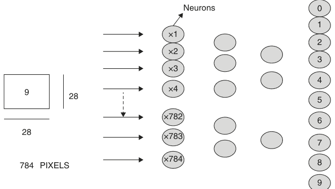

图 1.2
神经网络的工作原理。

我们有三个学生，每个人都在纸上写下数字“9”，值得注意的是，他们写得并不完全相同。

人类大脑可以轻松识别数字，但如果让计算机来识别它们呢？这就是深度学习大显身场的地方。图中有一个用于识别手写数字的神经网络，每个数字以 28×28 像素图像的形式存在，总计相当于 784 个神经元。神经网络的核心实体是信息处理的地方。784 个像素中的每一个都被输入到神经网络的第一层，这形成了输入层 [19]。同时，在另一端是输出层，每个神经元代表一个数字，中间是隐藏层。信息通过连接通道在层与层之间进行转换。每个通道都关联有一个值，因此被称为权重通道。每个神经元都关联有一个唯一的数字，称为偏置。该偏置被加到到达神经元的输入加权和上，然后应用于称为激活函数的函数。激活函数的结果决定了神经元是否被激活。每个被激活的神经元都会将信息传递给后续层。这个过程一直持续到最后一层。输出层中激活的对应于输入数字。不断调整权重和偏置以产生一个训练良好的网络。现在让我们看看深度学习可以应用在哪些领域。在客户支持中，当大多数人与客服代理对话时，对话看起来非常真实，以至于他们甚至没有意识到对面实际上机器人。此外，在医疗领域，神经网络可以检测癌症细胞并分析 MRI 图像提供详细结果。


自动驾驶汽车，这种看起来像科幻小说现在已成为现实，苹果、特斯拉和日产只是少数致力于自动驾驶汽车的公司。因此，深度学习具有广阔的前景，尽管它也面临一些局限性。第一个，正如我们之前讨论的，是数据，虽然深度学习是处理非结构化数据最有效的方法。神经网络需要海量的数据进行训练。假设我们始终拥有所需数量的数据。这并不是每台机器都能做到的，这引出了第二个局限性。计算能力，训练神经网络需要图形处理单元（GPU），与 CPU 相比，它们拥有数千个核心，而 GPU 显然更贵。最后，我们面临训练时间，深度神经网络需要几个小时或几个月才能完成。时间随着数据量和网络层数的增加而增加。一些流行的深度学习框架包括 TensorFlow、Pytorch 和 Keras。

### 1.2.2.8 认知

国际数据公司（IDC）定义了认知人工智能 [20]。AI 系统是一系列技术，利用深度自然语言处理和理解来回答问题并提供建议和方向。人工智能（AI）是认知应用的组件之一，有助于机器学习从数据中学习，并做出决策、建议或发现。认知 AI 由机器组成，这些机器努力达到人类能力，通过从人类创建的暗数据中进行数字智能学习，并以模拟人类过程的心态进行推理，产生相似的结果 [21]。认知 AI 有两个不同的领域：监督学习和无监督学习。无监督 AI 从通用到特定的模型或框架开始。对于每个客户，模型都由人类数据科学家团队手动更新和定制。这种方法既耗时又费资源，且不可扩展。而无监督 AI 创建的模型是针对客户特有的，这意味着没有任何模型是完全相同的。学习阶段不需要人工干预。无监督方法的关键特征是该技术与语言无关，且技术以数据进入的语言进行学习，就像母语者一样。该技术通过观察或摄取最佳的人类数据进行学习和推理，持续学习。随着组织需求的增加，这种方法具有可扩展性。模型会自动更新以包含新信息，而无需人工干预。

文中描述了一些案例，以说明世界各组织如何利用无监督认知计算。例如，我们可以看看客户支持中传统或非认知方式的路由。该过程从客户提交服务工单开始，工单到达代理处，代理必须选择最合适的能力中心。代理流程确保客户工单的记录和回复，如果处理不当则进行重做。然后代理将工单路由到能力中心。接收单的代理处理请求，有时需要七天才能做出决定。最后，客户收到代理的回答。公司使用认知 RPA 来增强传统的路由方法。解决方案是微路由，该解决方案的优点是，当收到服务工单时，队列机器人直接路由到最合适的部门专家，加速了服务速度，并使机构随着时间的推移为客户提供最佳服务；循环队列持续观察并从人类员工那里学习，并根据过去相似工单的结果并利用置信水平来预测入站请求的可能答案。这是适应新员工学习曲线并使所有代理服务标准的极佳解决方案。根据客户的意愿，回答有两种形式之一：直接发送给客户的完全自动回答基于基于客户设置的阈值的置信水平，或者创建一个答案选项列表供人类代理选择。转向另一个流行的用例，有些知识只有通过实践才能获得，这些知识没有写在任何手册或程序中。当员工离开时，公司知识被锁在电子邮件、旧笔记、手册、培训文档、报告中。这些信息以各种样式和格式存在，是用于认知搜索等应用的部落知识解决方案。Loop 能够获取所有信息并构建一个大脑。

目前，数字技术对人类大脑的作用就像工业革命期间蒸汽机对人类肌肉的作用。它们允许我们快速克服许多局限性，并开启前所未有的新领域。AI 的支持带了许多运营益处，包括提高效率，让人类代理能够更准确地处理案例。人类代理现在每天可以处理更多的案例，以满足客户的需求。有了更多信息和更好的欺诈检测，人类代理可以更好地做好风险评估。公司合规和行政流程在评估风险方面变得更好。通过数字员工收集信息并将其呈现给人类员工，获得了参与。人类代理能够与每个案例深度交互，将全部注意力放在细节上以提供最佳客户服务，因为信息触手可及。人类代理因此减少了寻找发现正确答案的压力和负担。


作为一种新兴的分布式计算范式和去中心化架构，区块链在各个领域引起了广泛关注。此外，区块链技术的显著优势在于为不同场景提供信赖、安全的去中心化自治生态系统，专门用于更好地利用基础设施、设备和资源。此外，它是演进加密货币的基础性技术，区块链技术的主要优点被广泛认为是去中心化的。它有助于在没有中央协调员的情况下，基于共识算法、激励机制、数据加密和时间戳建立分布式系统之间的点对点（P2P）交易和协调。区块链被识别为个人电脑（PC）、大型机、移动网络和社交网络之后的计算机范式破坏性创新技术。预计区块链将彻底改变一些组织和个人的行为模式 [22]。区块链在组织和技术方面具有许多良好的特性，如可靠、可信、高效、可用、自治、自动、去中心化和分布式。特别是，区块链被视为一种分布式共享账本，区块链数据可以


被记录、验证、存储、维护和传输。在这个分布式平台上，分布式节点之间通过数学算法建立相互信任，无需任何第三方权威的干预。交易数据在链式区块结构中维护并带有时间戳，这使得区块链数据在时间维度上具有稳健的可验证性和可追溯性。引入了不同的激励机制来众包区块链挖矿过程，以增加区块链矿工的基数。此外，矿工可以贡献并验证维护在分布式账本中的数据块，并在共识过程中竞争创建下一个数据块并将其添加到区块链的机会。区块链还受到可编程代码和脚本的影响，因此用户可以生成加密货币、智能合约或去中心化应用（DApps）。例如，以太坊平台提供了脚本语言，帮助用户设计任何交易或智能合约。最后，区块链数据使用区块链网络中多个分布式节点之间的对称加密进行加密和安全保护。区块链被认为是一个安全平台，因此它可以保护整个过程免受外部攻击者的侵害，并确保稳健的不可篡改性和不可伪造性。区块链是一种基础技术框架，为经济、金融、政治以及科学技术领域带来了一系列影响。

使区块链网络最受信任的关键特性是：

- 账本：区块链技术允许参与者在区块链上追加账本，而不是覆盖区块链中的值和交易，提供了完整的交易历史。
- 分布式：区块链网络促进可扩展性，可以增加节点数量，从而自动减少攻击者对共识机制的影响。
- 共享：账本在参与区块链网络的参与者之间分发和共享，缓解了透明度。
- 安全：账本中维护的数据无法被篡改，且可以被验证，因为区块链网络在密码学上得到了良好的保护。

与区块链技术的一些术语是：

- 区块链：此术语指的是实际账本。
- 区块链用户：实体、组织、政府、企业、个人等。
- 节点：指区块链网络中的单个系统。节点分为两种，即全节点和轻量节点。
## 物联网技术简介

- i. 全节点：这是一个维护完整区块链的节点，保证了所有交易都是有效的。发布节点是全节点的一种，可以发布新区块。
- ii. 轻量节点：这种节点不维护交易副本，只是简单将交易传递给全节点。

## 1.3.1 区块链的通用分类

根据权限模型，区块链通常分为许可链（permitted）和无许可链（permissionless）。在许可链中，参与受到某些限制，并由特定的组织或个人部署。这意味着只有特定的用户组可以发布他们的区块。无许可链允许任何人在无需授权的情况下发布（读/写）新区块。例如，许可链类似于受控的公司内网，而无许可链类似于允许任何人参与的公共互联网。

### 1.3.1.1 许可链

许可链中发布的区块必须经过某人（中心化/去中心化权威）的授权。只有授权用户才能维护区块链，这种许可链中的读取访问和发布交易可能会受到限制。它可能允许/限制任何授权的个人或个人组的读取访问。它可能允许/限制个人提交交易。这种网络可以使用开源或闭源软件实现。数字资产通过区块链传输时是可以追溯的，它们是韧性的、冗余的分布式的数据存储。利用共识模型来发布新区块，尽管它们不需要任何开销或资源维护。共识模型在许可链中的计算成本较低，且通常更快。需要严格保护和控制的组织可以发布新区块，如果组织发现任何违规行为，可以撤销授权。许可链的建立可以涉及不同的业务合作伙伴，交易可以记录在共享账本上。除了信任之外，它还促进了透明度和深度见，以便定期做出更好的业务决策，违规实体在许可链网络中可以很容易地被追踪到。

在许可链中，交易信息可以根据用户的凭据或身份选择性地公开；因此可以获得一定程度的隐私。许可链中的所有参与者都需要授权才能发送和接收交易。如果发生任何违规活动，很容易追踪，并根据相应的司法系统采取法律救济措施。

### 1.3.1.2 无许可链

无许可链是去中心化的开源平台，任何人都可以在不获得权威许可的情况下发布自己的区块。此类区块链在读/写和发布交易方面没有任何限制。为了防止恶意活动，无许可链中使用了共识机制，这要求在尝试发布新区块时需要维护或投入资源。

## 1.3.2 区块链技术的关键组件

区块链技术看起来很复杂，但通过单独理解各个组件可以将其简化。区块链技术实现了多种密码学机制，例如非对称加密、哈希函数和数字签名。区块链技术中的重要组件是：

- 非对称加密
- 哈希函数
- 地址
- 交易
- 账本
- 块
### 1.3.2.1 非对称密钥加密

区块链利用了公钥加密，被称为非对称密钥加密，它同时使用私钥和公钥。此外，公钥被声明为公开而不损害安全性；然而，私钥必须始终保持保密。通过已知公钥确定私钥、使用私钥加密或使用公钥解密是困难的；相反，使用公钥加密并使用私钥解密。在工作量证明（PoW）共识机制中遵循密码学随机数（nonce）。（等等，让我重新检查 OCR 文本的流程）。

*基于 OCR 流程的自我纠正：* 根据 OCR 流程，密码学随机数具有某些跳跃。根据提供的片段进行对齐。

区块链利用公钥加密，被称为非对称密钥加密，它同时使用私钥和公钥。此外，公钥被声明为公开而不损害安全性；然而，私钥必须始终保持保密。通过已知公钥确定私钥、使用私钥加密或使用公钥解密是困难的；相反，使用公钥加密并使用私钥解密。非对称加密的主要缺点是计算过程可能较慢。
## 物联网技术简介

对称加密在使用被称为“密钥”或“共享密钥”的单一密钥。密钥通过信任的介质与其他共享。在对称加密中，数据使用共享密钥进行加密并仅使用共享密钥解密。对称加密的优点是计算过程快。非对称加密在区块链网络中的应用如下：

- 私钥：数字数字签名。
- 公钥：验证使用私钥创建的签名。
 公 公钥：获取地址。

若干许可链利用公钥基础设施来提供用户凭据而不是管理用户的非对称密钥。区块链通过实现轻量目录访问协议（LDAP）利用目录服务来使用现有信息。

### 1.3.2.2 哈希函数

哈希是一种为任何大小的输入（例如文本、文件或图像）产生“摘要”或“消息摘要”的技术。输入的更改在哈希给定数据后会产生不同的消息摘要。哈希函数的一些重要属性是抗原像性和抗碰撞性。在抗原像性方面，开启了单向通信，这意味着从输出摘要中计算输入是困难的（例如，通过 hash(a) = 摘要找到“a”）。二抗原像性意味着解释产生相同输出的第二个输入是困难的（例如，通过 hash(a) = hash(b) 找到 a, b）。抗碰撞性意味着寻找两个产生相同输出的输入是困难的（例如，通过 hash(a) = hash(b) 找到 a 和 b）。随机数（nonce）是与输入数据一起提供的哈希函数创建摘要的任意随机数。对于相同的输入，不同的随机值产生不同的摘要值。密码学随机数在工作量证明（PoW）共识机制中遵循。一种名为安全哈希算法（SHA）输出 256 位的哈希函数（SHA-256）产生 64 位十六进制格式的 32 字节输出（如表 1.1 所示）。

哈希函数在区块链网络中完成以下任务：

- 初始化区块头和数据
- 创建唯一标识符
- 派生地址。


表 1.1
使用 SHA-256 的示例输入文本及其摘要值

| 输入文本 | 摘要值 (SHA-256) |
|---|---|
| 10 | 0x4a44dc135624a80fe80e903455cc16082281820feb24f15233ade6af1dd5 |
| 20 | 0xf5c3af87c387a1daef726b8a42fb57c3c71f1864a18331782de1da2d9020b |
| Welcome!!! | 0xd2c8a4fb5b820233f7b7c42e1539a816c2caef7093449fe3406dcc2d86a1b0 |

哈希函数


在区块链中查找地址。


区块链网络中的地址是通过哈希函数从用户的公钥结合某些输入数据获取的字母数字字符串，如图 1.3 所示。

区块链网络中的地址可以使用不同的方法派生。例如，无许可区块链系统允许用户为任意数量的地址生成异步密钥对。它作为区块链网络中用户的标识符。在以太坊平台上，可以通过创建合约账户使用特殊地址使用智能合约。账户地址是经过计算并生成的，允许合约在接收到交易后执行。钱包是一种软件，充当私钥存储器，用于安全地管理区块链网络中的用户私钥。它可以存储公钥及其关联地址。此外，它还可以计算每个用户拥有的数字资产总和。

### 1.3.2.4 交易

交易是指参与者之间的交互，即在网络参与者之间传输加密货币。图 1.4 显示了区块链中的交易，每个区块可能包含零或多个交易。发送者发送包括发送者公钥、发送者地址、数字签名以及交易的输入和输出的信息 [23]。每笔加密货币交易的最低要求为：

- 输入：数字资产列表被视为交易的输入。当前交易的输入完全取决于过去的事件。此外，现有资产中的值无法更新，而是可以拆分或合并以形成新资产。
- ii. 输出：这是接收金额的接收方，指的是转移给下一位所有者的资产数量。


账本是所有发生交易的列表。根据设计，区块链网络会产生同一账本记录的多个备份副本，这些副本在点点之间进行修改和同步。区块链技术的主要优势之一是每个用户都可以保留一份自己的分布式账本副本。当新节点进入区块链网络时，它们会搜索其他全节点并要求获取区块链网络分布式账本的完整副本，这使得账本变得无法丢失或破坏。


每当发布节点发布区块时，交易就会记录在区块链上。区块由两部分组成：(i) 区块头和 (ii) 区块数据。区块的元数据信息存储在区块头中，如图 1.5 所示。经过验证的交易列表已发布到区块链网络并包含在区块数据中。有效性通过验证交易格式是否正确以及每个数字资产提供者是否对交易进行了密码学签名来确保。在区块头中，维护了以下细节：

- 区块号（称为区块高度）
- 前一个区块头的哈希值
- 时间戳
- 区块大小
- Nonce 值（随机数）

此外，还有区块数据区域的交易列表。(img/b56ecff464f3e05f86f0996097658b3b_43_0.png)

图 1.4
加密货币交易。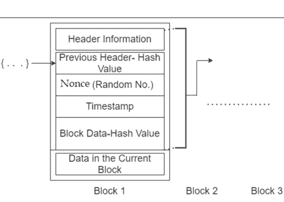

图 1.5
区块链。


1. Raj, P., T. Poongodi, B. Balusamy, and Khari (Eds.) (2020). 物联网与大数据分析：集成平台与用例. CRC Press, Boca Raton, FL.
2. Sethi, P., and R. Sarangi (2017). 物联网：架构与应用. Journal of Electrical and Computer Engineering 2017, 1–26.
3. Poongodi, T., A. Rathee, Indrakumar, and P. Suresh (2020). 物联网能力：传感器部署与节点发现，可穿戴体体域网络 (WBAN)，数据采集. In Sheng-Lung Peng, Souvik Pal, Lianfeng Huang Principles of Internet Things (IoT) Ecosystem: Insight Paradigm, 127–151, Switzerland.
4. Poongodi, T., Agnesbeena, and B. Balalurugan (2020). 使用物联网加速制药行业的数据采集过程。An Industrial IoT Approach for Pharmaceutical Growth, 2, 117.
5. Muro, M., R. Maxim, and Whiton (2019). 自动化与人工智能：机器如何影响人和地方. http://hdl.handle.net/11540/9686
6. Acemoglu, D., and P. Restrepo (2018). 人工智能、自动化，以及 The Economics of artificial intelligence: An agenda (pp. 197–236). University of Chicago Press, Chicago.
7. Chilamkurti, N., T. Poongdi, and B. Balusamy (Eds.) (2021). 区块链、物联网与人工智能. CRC Press, Boca Raton, FL.
8. Apolloni, B., Wydrycz, S. Sassis, and D. Malchioldi (2008). 知识工程. In The Puzzle of Grammar Computing (pp. 411–449). Springer, Berlin, Heidelberg.
9. Hennrion, M., B. Breeze, and J. Horwitz (2019). 决策分析与专家系统. AI Magazine, 12(4), 64.
10. Macías-Escrivá, F. D., R. Haber, and V. Hernandez (2013). 自适应系统：当前方法、研究挑战与应用调查. Expert Systems with Applications, 40(18), 7267–7279.
11. Richards, D. (2009). 从社交软件/Web 2.0 到协作知识工程. Information Sciences, 179(15), 2515–2523.
12. Madakam, S. R. Molhumke, and D. K. Jaiswal (2019). 数字劳动力：机器人流程自动化 (RPA). JISTEM-Journal of Information Systems and Technology Management, 16, 1–16.
13. Aguirre, S., and A. Rodriguez (2017年9月). 使用机器人流程自动化实现业务流程的自动化：案例研究. In Juan Carlos Figueroa-García, Eudym Ramirez Lopez-Santana, Jose Luis Ramirez-Robero Ferro Escobar (eds) Workshop of Engineering Applications, pp. 65–71. Springer, Cham, Switzerland.
14. Conn, S. (2017). Gartner 表示到2020年，人工智能创造的工作将多于消除的工作. 可访问: https://www.gartner.com/en/news/press-release/2017-12-gartner-says-by-2020-artificial-intelligence-will-create-more-jobs-than-it-eliminates
15. Halle, M., and K. Stevens (1962). 语音识别：一种研究的模型和程序. IRE Transactions on Information Theory, 8(2), 159.
16. Liu, D. Yi, and M. A. Thomas (2017). 信息系统自然语言处理研究路线图. 第50届夏威夷国际科学系统会议论文集 (2017). Hawaiian International Conference on Science Systems.


20. Adadi, A., and M. Barrada (2018). 窥视黑盒：可解释人工智能（xai）综述。IEEE Access, 6, 52138–52160.

21. Claudé, M., and D. Combe (2018). 人工智能与人类在决策中的角色：迈向增强人类？关注知识密集型企业。乌梅亚大学。

22. Poongodi, T., R. Sujatha, D. Sumathi, P. Suresh, and B. Balamurugan (2020). 社交网络中的区块链。加密货币与区块链技术应用 (pp. 55–77)。Wiley, Hoboken, NJ.

23. Poongodi, T., R. Indrakumari, M. Kiruthika, S. Suganthi, and P. Suresh (2021). 区块链技术及其在医疗领域的相关性。在 Poongodi, T., R. Indrakumari, M. Kiruthika, S. Suganthi, and P. Suresh (eds) 电子医疗系统的区块链与机器学习，IET, 1–25。IET 数字库。


物联网（IoT）中的实体需要多样化的标准和协议以实现跨网络通信。通信技术包括 RFID（无线射频识别）、NFC（近场通信）、蓝牙、Zigbee、Wi-Fi 等，适用于短、中、长距离通信。架构框架整合了各个组件，以便它们之间能够无缝协作并解决复杂任务。AI 系统能够学习，这有助于其性能随时间的推移而提高。AI 包含机器学习、预测分析和深度学习，增强了学习、推理、思考和决策的能力。此外，还对 AI 的未来预测进行了深入探讨，并推荐了可能的解决方案以解决未来几十年面临的问题。区块链是一个开源分类账本，用于跟踪医疗保健、制造业、零售业、金融和保险等许多领域不同物品的来源。在第四次数字革命中，这些技术的融合已变得至关重要、有利且且不可避免。

### 2.1 物联网的基本框架与架构

物联网通过允许物理对象相互交互、交换信息并做出决策，使它们能够倾听、感知、思考并执行任务。通过使用泛在和广泛计算、嵌入式设备、网络技术、无线传感器网络（WSNs）、IP 和其他应用等主要技术，物联网将这些智能事物从传统变为智能。特定领域的应用（垂直市场）由智能对象及其预期功能组成，而领域无关的应用（水平市场）则由泛在计算和分析服务组成。在这种情况下，如果特定领域的物联网应用与领域无关的服务通信，每个领域的传感器和执行器将直接相互作用。此外，预计物联网在未来具有重大的商业应用，这将提高生活质量并促进全球经济发展。例如，智能家居允许居民在回家时解锁车库门、冲咖啡以及控制电视、自动气候控制和其他电器。

新兴技术和发展以及服务的实施必须根据市场需求和消费者需求按比例扩大，以实现快速增长的能力。此外，设备的设计必须满足消费者对随时随地访问的需求。为了在异构对象通信期间获得兼容性（生物体、商品、手机、自动车辆、电器等），还需要新的协议。此外，标准架构可以视为物联网的脊梁，允许企业通过提供高质量产品来竞争竞争。

此外，传统的互联网架构必须更新以应对物联网的挑战。许多底层协议（例如）应该考虑到海量对象正准备连接互联网。2010年，连接互联网的智能对象数量超过了全球人口。为了满足消费者对智能对象的需求，需要宽大的地址空间（例如 IPv6）。由于智能对象的固有异构性以及跟踪和操作物理实体的能力，安全和隐私是物联网系统最重要的标准。此外，应该对物联网系统进行管理和控制，以确保以更低的成本为消费者提供高质量的服务。

### 2.1 物联网系统的基本组件

识别物联网的基本构建组件有助于更好地理解物联网的本质和功能。表 2.1 所示，后续章节将讨论实现物联网功能所需的六个元素。

#### 表 2.1
物联网及其相关技术的组件

| 物联网元素 | 技术 |
| --- | --- |
| 识别 | uCode, EPC—命名 IPv6—寻址 |
| 感知 | RFID 标签、传感器、执行器、智能传感器、嵌入式传感器等 |
| 通信 | 蓝牙、Wi-Fi、BLE、RFID、NFC、UWB、Z-Wave |
| 计算 | Arduino, Beagle Zone, UDOO, Intel Galileo, Raspberry Pi 等 |
| 服务 | 身份、信息聚合、协作感知、泛在 |
| 语义 | 知识提取工具（OWL, RDF 等） |

## 物联网、人工智能与区块链的基础知识

### 2.1.1.1 识别

识别在物联网系统中对于按需命名和匹配服务至关重要。有很多物联网识别方法，包括电子产品代码（EPC）和泛在码（uCode）。此外，在物联网系统中对智能设备进行对于区分对象标识符和地址至关重要。对象标识符是对象的名称（例如特定的温度传感器），而地址是其在通信网络中的位置。IPv6 和 IPv4 也被用物联网对象的寻址方法。LoWPAN 使用 IPv6 头部压缩方法，使其非常适合低功耗无线网络。由于识别对象并非全球唯一的，因此区分标识符和地址至关重要。寻址有助于以独特的方式识别对象。此外，网络上的对象可以使用公共 IP 地址而不是私有地址。利用识别机制为网络中的每个对象提供一个独特的身份。

### 2.1.1.2 感知

物联网环境中的感知是从连接的对象收集数据并将其传输到数据仓库、数据库或云端。此外，对收集到的信息进行评估，以便对所需的服务采取适当的操作。智能传感器、执行器和可穿戴感知系统都是物联网传感器的示例。例如，许多公司提供智能应用程序，允许人们使用手机跟踪和管理建筑内的数千个智能家电。通常使用带有传感器、安全功能和内置 TCP/IP 的单板计算机（SBCs）（例如 Raspberry PI、Arduino 等）。客户通常向此类设备请求数据，这些设备已连接到中央管理服务器。

### 2.1.1.3 通信

通信技术允许异构对象相互通信，以提供精确的智能服务。由于存在噪声通信链路，物联网节点通常以低功耗运行。IEEE 802.15.4、Wi-Fi、蓝牙、LTE-Advanced 和 Z-wave 是物联网网络协议的示例。RFID、超宽带和近场通信（NFC）也是被使用的通信技术。RFID（标签和阅读器）是将机器机（M2M）概念付诸实践的主要技术。RFID 标签是固定在物品上的简单芯片，用于识别身份。RFID 阅读器向标签发送信号并获取反射信号，然后将信号发送到数据库。数据库使用处理中心根据反射信号对 10 厘米到 200 米范围内的对象进行分类。主动标签、被动标签以及半被动和主动


RFID 标签已可用。主动标签需要电池，但无源标签不需要。NFC 协议在高频段以 13.56 MHz 工作，支持 424 kbps 的数据传输率。主动读取器与无源标签之间或两个主动读取器之间的通信可以在高达 10 cm 的范围内进行。超宽带（UWB）技术的开发旨在利用高带宽和低能量在短范围内范围内通信，其连接此类传感器的应用已大幅增长。

Wi-Fi 是另一种网络技术，利用无线电波在 100 米范围内发送和接收数据。在自组（ad hoc）配置中，Wi-Fi 允许智能设备在不使用路由器的情况下连接并共享信息。蓝牙是一种通信技术，利用短波无线电在短距离设备间以最小功耗传输数据。蓝牙特殊兴趣小组（SIG）近期发布了蓝牙 4.1，以及作为物联网系统提供的高速连接低功耗蓝牙。此外，IEEE 802.15.4 规范规定了物理层作为低功耗无线网络的介质访问协议，提高了通信的可扩展性和可靠性。此外，LTE（长期演进）是另一种无线通信协议，专注于通过 GSM/UMTS 网络在手机上进行高速数据传输。它能够覆盖快速移动设备，同时还提供广播和多播功能。LTE-A（LTE 高级）是 LTE 更先进的变体，包括高达 100 MHz 的带宽扩展、空间复用、更低的延迟、更高的吞吐量和扩展的覆盖。


物联网系统的强大计算能力由处理单元（例如微处理器、微控制器等）和其他软件应用表示。Arduino、BeagleBone、Z1、UDOO、Intel Galileo、Melle、树莓派、FriendlyARM、Gadgeteer、T-M Sky、Cubieboard 和 WiSense 是已建立用于执行物联网应用的一些硬件平台。此外，各种软件接口在这些平台中至关重要，因为它们在设备激活期间持续运行。若干实时操作系统（RTOS）适用于基于 RTOS 的物联网应用生产。

例如，Kontiki RTOS 常用于物联网场景。此外，Kontiki 拥有一个 Cooja 仿真器，允许研究人员和人员模拟物联网和无线传感器网络（WSN）应用。LiteOS、TinyOS 和 Riot OS 都是为物联网开发的轻量级操作系统。此外，开放汽车联盟（OAA）由汽车行业巨头和 Google 建立，旨在为 Android 平台引入额外特性，以加速汽车（IoV）范式的采用。

## 2.1.1.5 服务

通常，物联网服务可以分为四类：(a) 身份相关的服务、(b) 信息聚合服务、(c) 协作感知服务和 (d) 无处不在的服务。

- 基于身份的服务是各种服务中利用的重要首要服务。任何希望将现实世界引入虚拟世界的应用程序都必须首先找到它们。

- 信息聚合服务收集并审查物联网应用所需的感应测量值。

- 协作感知服务大多运行在信息聚合服务的顶层；获取的数据用于高效决策并采取相应的行动。

- 另一方面，无处不在的服务侧重于向任何地方、任何时间、任何人提供协作感知服务。若干物联网应用努力将实现无处不在的服务作为终极目标。

信息聚合类包括智能医疗和智能电网，而协作感知类型包括智能建筑、智能家居、工业自动化和智能交通网络（ITNs）。

智能家居物联网服务通过让人们更简单、更方便地远程跟踪和控制家电和设备（如供暖系统、电表、空调等）来改善生活。例如，通过天气预报应用程序，智能家居可以自动关闭窗户并降低楼上窗户的帘。智能家居定期与内部和外部环境交互。内部环境可能包括连接到互联网的设备和电器，而外部环境可能包含智能家居控制的对象，例如智能电网实体。

智能建筑中的建筑自动化系统（BAS）连接到互联网。BAS 在传感器和执行器的帮助下，实现对包括 HVAC、安全、安保、照明遮光和娱乐在内的各种设备的控制和管理。BAS 可能会减少能量消耗和建筑维护成本。例如，如果冷却/加热系统或闪烁的洗碗机出现需要调查和解决的问题，可能会提供报警。结果，维护请求可以在没有人工干预的情况下提交给承包机构。

智能交通系统（ITS）通过集成计算和通信功能跟踪并管理交通网络。ITS 的目标是提高交通基础设施的可靠性、性能、可用性和安全性。ITS 的四个重要部分是：

- i. 监控中心
- ii. 安全子系统
- iii. 车辆子系统（RFID 读取器、GPS、OBU）
- iv. 站立子系统（路侧设备）。

此外，联网车辆作为使驾驶有效、可靠且享受的手段正越来越流行。

工业自动化指的是机器人系统的计算机化，以便在忽略忽略人工干预的情况下完成生产活动。它主要关注四个要素（运输、传感、处理和通信），使一组机器能够更高效、更准确地制造货物。物联网在工业自动化中的作用是管理和跟踪生产机器的过程、功能和产量。例如，如果机器突然遇到问题，物联网设备会自动向相关部门发送维修查询，由其解决问题。此外，物联网通过有效检查生产相关的时间和生产问题的根源来提高生产率。

传感器和执行器可以植入患者体内，其药物可以使用物联网通过传感器跟踪患者的生理状况，传感器会收集并分析其数据，然后将收集到的信息发送到处理中心以采取适当行动。IBM 最近在其的一家医院使用了 RFID 来监控测试过程完成后的洗涤系统。执行此活动是为了预防疾病，这些疾病每年会杀死约 9 万人并给经济造成 300 亿美元的损失。

智能电网利用物联网提高家庭和建筑的能源效率。此外，智能电网中的物联网使供应商能够更好地监控和管理资源。例如，智能电网利用物联网将许多建筑电表连接到能源供应商的网络。而且，能量消耗通过这些电表进行记录、测量、控制、监控和处理。物联网允许能源供应商扩大服务以满足客户的需求。智能电网中的物联网通常会降低故障风险、提高可靠性并提升服务质量。
智能城市是无处不在的服务的应用之一，侧重于提高城市的生活质量，使其更加简单和方便。


## IoT、人工智能与区块链的基础原理

为了人们搜索相关信息，各种系统被集成在一起为智能城市环境（交通、公共事业、医疗、政府、建筑和家居提供提供服务。

## 2.1.1.6 语义

在物联网中，语义是指各种设备智能地获取知识以提供必要服务的能力。发现和利用工具以及数据建模都是知识提取的一部分。它还涉及识别和评估数据，以便为最佳服务提供正确的决策。

## 2.1.2 物联网——分层架构

物联网通常可以互连数十亿的异构设备，因此一种通用的架构至关重要。提出的架构不断增加，使得选择一个标准模型变得困难。主要的模型是由应用层、网络层和感知层组成的三层架构，它是从一系列提出的模型中选出的。最近又提出了其他对现有物联网架构进行进一步细化的参考模型。图2.1展示了三层和五层参考模型。接下来将对五层模型进行讨论。

### 2.1.2.1 感知/对象层

感知/对象层是表征物联网传感器捕捉和处理数据的第一层。此外，该层包含可以查询位置、加速度、运动、重量、温度、振动、湿度等的传感器和执行器[1]。感知层使用标准的即插即用机制来配置异构的对象。同时，感知层将数据传输到下一层，称为对象抽象层。此外，物联网设备产生的大数据始于这一层。

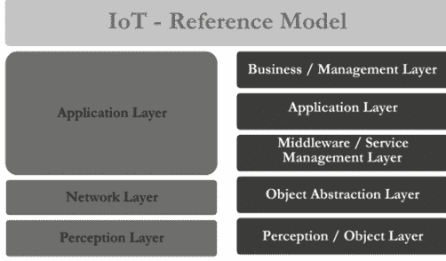

图2.1
物联网分层架构。

### 2.1.2.2 对象抽象层

对象抽象使用安全通道将数据从上一层传输到下一层，即服务管理层。RFID、低功耗蓝牙（BLE）、Wi-Fi、UMTS、GSM、3G、ZigBee、红外等技术可用于传输数据。此外，云存储、数据管理等其他功能在此对象抽象层进行管理。

### 2.1.2.3 中间件/服务管理层

中间件/服务管理层通过名称和地址将服务与请求者的细节进行匹配。此外，中间件层允许程序员在不利用任何特定硬件平台的情况下，与各种异构实体一起执行任务。此外，该中间件层还接收数据，通过做出高效决策进行处理，并在网络通信协议的支持下交付的服务。

### 2.1.2.4 应用层

客户请求服务，这些服务通常由应用层提供。例如，该层将为请求这些数据的客户提供空气湿度和温度测量值。该层对于物联网系统至关重要，因为它可以提供高质量的服务以满足客户需求。智能建筑、智能医疗、工业自动化和交通、智能家居等都是该层涵盖的一些重要垂直市场。

### 2.1.2.5 业务/管理层

整个物联网系统的运行和部门服务由管理层控制。此外，该业务层的责任包括创建业务模型、图表、流程图以及从上一层获取的数据视化表示。此外，它还负责物联网设备组件的设计、分析、实现、评估、监控和开发。通常，这一层实现了基于大数据分析的决策过程，并对其下方的其余四层进行控制和管理。

此外，该管理层将每一层的输出与计划输出进行比较，以改进服务并保护用户隐私。

最后得出结论：在五层模型中，应用层充当用户与计算机通信并获取所需数据的接口。它还连接到业务/管理层，生成报告以允许进行高级分析。应用层的数据访问控制机制也在此层进行管理。由于其复杂且海量的计算需求，该管理层通常在高潜力的设备上运行。根据上述讨论，由于架构的简单性，五层物联网架构是若干物联网应用中最常用的范式。

## 2.2 理解人工智能的基本概念

## 2.2.1 人工智能简介

人工智能关注智能的设计。事实上，它实际上关注人工制品和人工设备中智能的设计。因此，人工系统或人造系统将智能构建在其中。这个术语是由麦卡锡在1956年的达特茅会议上提出的[2]。现在，“人工”一词很容易理解，但什么是智能呢？

定义智能非常困难。通常，智能被认为是某种刻画人类的特征。如果你认为人类是智能的，那么你就说人工智能意味着与人类相似的行为。事实上，这里有两种思考观点。第一，是拥有一台表现得像人类的机器或系统。人类并不总是完全智能，尽管他们具有很高的智能水平。事实上，尽管人类相对智能，但他们的行为并不总是智能的。第二，另一个观点是人工智能关注的是产生理想、最佳、最理性的行为的智能。在这个定义中还有另一个二分法。当我们谈论行为时，我们谈论的是哪种行为？人们通常指的类型主要有两种类型。第一是智能地思考、合理且智能地推理以得出解决方案。第二种方法关于不思考而是行动，即系统实际采取行动或表现的方式。因此，我们可以将智能视为某种刻画人类的特征，或者意味着以最佳方式行为。

## 2.2.2 人工智能的方法

再次，将智能视为思考或行动中的智能。因此，根据这一标准，我们可以观察人工智能的不同定义。所以，我们可能考虑思考处理或推理与行为，或者类人性能与理想性能。图2.2显示了从这些二分法中产生的四种不同定义。

一方面，我们有思考或推理与行为，另一方面，我们有类人性能与理想性能。因此，存在像人类一样思考的系统。

例如，由艾兰·图灵设计的著名的图灵测试，通过测试的系统将是指像人类一样行为或像人类一样思考的系统[3]。第二种定义是理性思考的系统。包括哲学家、数学家和研究逻辑与思维规律的计算机科学家内在遵循这种方法。第三，存在类人行动的系统；认知科学家研究类人行动系统的属性。最后，我们有了理性行动的系统或以最佳方式行动的系统的定义[4]。现在，对于这种，我们有构建理性智能体的方法，即理性行动的智能体。

图灵测试中使用以下实验设置。将有一个封闭房间，在这个封闭房间里将有一个可能是计算机或人类的存在。房间外有一个提问者。


## 物联网、人工智能与区块链的基础性知识

如果提问者无法可靠地区分人类答案和计算机答案，那么我们可以说该计算机系统具备人工智能。这是图灵设计的一种测试，旨在发现机器是否拥有足够的智能在回答问题时能与人类相媲美。现在让我们来看看 AI 面临的问题。

## 2.2.3 AI 问题

智能实体或代理体需要能够执行不同类型的任务。其中有些任务是我们在日常生活中实际上执行的常规任务，而有些任务被我们认为是智能的，例如解决复杂的数学问题、以专家级水平下国际象棋以及其他智人士可以从事的活动。

路线任务的一个例子是规划路线。假设你想从市场去某个地方，并规划了一条你将要经过的路径。或者你想从一个地方去另一个地方，比方德里里的某个特定地点，我们必须规划行程和路径。可以完成的事情包括尝试识别物体或人脸，这需要视觉能力。

例如，AI 系统可以轻松地执行符号积分。其中一些系统已经能够证明定理。AI 系统还可以很好地下国际象棋。还有系统可以在特定领域提供医疗诊断。然而，有些事情是人类和动物可以毫不费力完成的，例如，行走时不会撞到东西、捕捕猎物并避开捕食者、解释复杂的感官信息、模拟其他动物的内部状态以理解它们在想我们什么、计划说什么以及团队工作或协作。遗憾的是，这些任务对机器来说并非都容易完成。让我们来看看人类中一些基本的智能行为：

- **感知：** 视、听感官信息的能力；
- **推理：** 根据我们拥有的信息进行推理；
- **学习：** 为新情况进行学习、理解自然语言、用自然语言交流、解决问题。

因此，这些事物即感知、推理、学习、语言、理解和解决问题，是我们希望 AI 系统解决的一些问题的示例。在看了 AI 的定义后，让我们讨论一些已经创建的 AI 系统。

AI 的应用包括：计算机视觉、图像识别（包括脸识别）、机器人、自然语言处理和自然语言理解、语音处理等。AI 的实际影响是 AI 组件被嵌入到许多设备中。

AI 系统用于检测信用卡欺诈、配置产品、复杂的规划任务以及为医生提供建议。智能辅导系统提供了关注系统的额外益处。这些系统目前正在使用中，由于它们非常有用，已经产生了巨大的影响。

有一个系统被称为 ALVIN，全称为自动驾驶汽车 [5]，是由卡内基梅隆大学的 Dean Pomerleau 在 1989 年设计的。该系统利用计算机驱动汽车从美国东岸行驶到西岸。在 2850 英里的大部分范围内，它是自主行驶的。只有在 50 英里的高速公路等情况下，才由人类司机接管。2800 英里汽车是自己行驶的。这辆车背后的原理非常简单。车前方有一个摄像头，拍摄前方道路的照片。照片或图像被用于神经网络。照片被捕获为 30/32 像素的图像。这些像素被输入带有四个隐藏单元的神经网络，输出告诉处理器应该转方向盘的角度和速度等等。1997 年，“深蓝”国际象棋程序击败了加里·卡斯帕罗。这是世界国际象棋冠军首次意外输掉比赛。在机器翻译中，如果我们能实现说不同语言的人们之间的即时翻译，这将是一项非凡的成就，具有非常广泛的经济和文化影响 [6]。在当今世界有许多不同的语言，因此我们可能会遇到我们听不懂其语言的人。仅在印度就有许多语言，超过 20 种官方语言，因此学习每一种语言是不可能的。因此，如果我们有一个能够进行同步机器翻译的系统，让我们毫不费力地相互理解，这对人类将是巨大的帮助。

然而，完全的机器翻译尚未实现，但机器翻译领域已经取得了一些小进展。例如，根据路透社报道，美军在伊拉克使用了简单的单向翻译。美军使用 Phraselator 与伊拉克战俘、检查站的旅行者以及执行其他维和任务进行通信。卡内基梅隆大学开发了一个名为 speechlor 的系统用于医患访谈。想象一下当医生听不懂患者的语言会有多么困难。此外，当患者听不懂医生的语言时，他们无法准确地向医生描述自己的症状。因此，使用 speechlor是为了帮助医生理解患者。在太空探索中，机器人太空探测器自主监测周围环境、做出决定并实现目标。

## 2.2.4 人工智能的类型

现在我们已经看了使用 AI 的不同示例，我们将简要看看一些处理 AI 以及解决 AI 任务的方法。观察 AI 的一种方法将其分为强人工智能或弱人工智能。强人工智能旨在构建能够真正推理和解决问题的机器。强人工智能包括具有自我意识且其整体智力水平与人类无法区分的机器。

因此，强人工智能的支持者希望开发出完全智能并能利用自己的智能完成任务的系统。此类系统可以是类人的，也可以是非人类但合理的。当 AI 在 20 世纪 50 年代和 60 年代构想时，人们对它抱有巨大的乐观，并预测某些 AI 将能够超越人类，成为人类能做的一切事情，并比人类做得、更快速地完成任务。

然而，这种乐观是缺乏根据的，这也是部分人们对 AI 技术失去信心的原因之一。然而，在对 AI 进行 50 多年的研究后，我们已经能够理解并体会 AI 面临的问题的真正困难性。弱人工智能涉及创建某些不能像真正的智能体那样真正推理和解决问题的 AI。因此，弱人工智能的支持者声称，经过适当编程以模拟人类认的机器，表现得很智能，并且看起来很好且智能地执行任务，但并没有真正具有与人类相同的智能或理解力。因此，强人工智能真正处理的是具有思考、推理和理解自身行为的心智状态的机器，而弱人工智能涉及模拟人类行为或模拟智能行为，而并不真正声称背后的推理过程是智能的。

应用 AI 的目标是产生可行的智能系统。例如，有一个能够识别允许进入特定建筑的人脸的安防系统将很好。某些对我们有用的应用是应用 AI 旨在智能地解决的，但不一定通过构建一个胜任的智能代理，而是构建另一个在特定任务上很智能的代理。例如，识别人员、检测信用卡欺诈或驾驶车辆。此外，认知 AI 涉及使用计算机测试关于人类大脑如何运作、行为和思考的理论的研究，这些理论可以通过将它们构建到机器中并观察机器如何使用这些知识运行来测试。

在核心领域，我们论论知识表示、推理和机器学习。

通用算法：搜索、规划、约束满足。

感知：视觉、自然语言处理、机器人。

应用：游戏玩、AI 与教育以及分布式代理。

不确定性：概率方法、决策理论、基于符号数据的推理。

今天的 AI 系统能做什么？我们有可以识别人脸的系统，我们几乎有了自动驾驶汽车，我们的自然语言处理系统可以进行简单的机器翻译。我们的分类系统可以工作并分类来自数千个主题的文本。在游戏中，AI 系统在国际象棋中达到了大师水平，在我们嘈杂的世界里，我们有优秀的冠军级程序员在每个水平上玩跳棋。

然而，AI 所能做的事情仍存在许多局限性。AI 系统目前无法稳健地理解自然语言。AI 系统尚未能够浏览网页或解释任意的视觉场景。我们看到它们可以识别人脸图像或在窄领域内工作。AI 系统无法完全学习自然语言。它们无法在所有的动态实时领域制定规划。


## 物联网、人工智能与区块链的基础原理

如果输入数据不可靠，算法和结果也会受到影响。数据可能存在偏差、不准确，或者可能无法真实代表其应当代表的数据集。这些都是非常重要的考量因素。一些人将数据视为 21 世纪的新石油，它们必须是且准确的，因为如果你考虑数据的价值，它需要对数据进行拆解、分析，然后使用这些信息。如果初始信息不清洁或不可靠，那么输出结果将毫无价值。

目前已进行了一项全球性研究，旨在为参与人工智能的受监管公司、政府及其他利益相关方建立伦理准则 [7]。他们发现目前还没有统一的数据库，并提出了五个关键的伦理领域，作为一个坚实的框架，用于讨论人工智能的考量或局限性。

- **透明性：** 关于人工智能程序中收集和使用的信息的通信与披露。

- **公正、公平与均等：** 算法中的偏差，即使数据已经过清晰处理以清洗算法。偏差仍然会存在，我们不能假设算法是完全中立的。

- **无无性：** 存在对数据的故意误用，例如网络战争和恶意黑客。

- **责任：** 谁来负责？关于人工智能有很多讨论，但它实际上是由人工智能开发人员、设计者、机构以及整个人工智能行业来定义的。

- **隐私：** 我们有权维护和保护我们的数据，数据安全和数据保护是人工智能的其他考量。尽管缺乏人为因素，但这显然是人工智能局限性的一部分。

人工智能在教育价值中的应用。关于人工智能在教育中有效性的研究尚处于新兴阶段。目前，它是一个移动的目标，人们还担心它是课程驱动的，而不是与学生共同驱动。因此，学生的主动性并不一定能得到。教育中使用人工智能以及教师的角色正在发生变化。因此，采用并不是容易的，这也是人工智能采用程度各不相同的的另一个原因。

## 2.3 区块链技术的分层架构

区块链对金融、加密货币和社会经济活动具有重大影响。它是一种结合了经济学、密码学和计算机科学的创新技术。文中提出了一种六层参考架构，描述了区块链系统的主要组件，如图 2.3 所示。

| 应用层 | 教育 | 医疗健康 | 金融 | 交通 |
| :--- | :--- | :--- | :--- | :--- |
| 合约层 | 智能合约 | 算法 | 机制 | |
| 激励层 | 分配 | | 保险 | |
| 共识层 | PoW PoS DPoS PBFT .... | | | |
| 网络层 | 点对点网络 (P2P) | 数据 | 数据验证 | |
| 数据层 | 梅克尔树 | 数据块 | 哈希函数 | 时间戳 ... ... |

图 2.3
区块链技术的分层架构。

### 2.3.1 数据层

数据层提供了关键技术，用于处理从物理空间、网络空间和社交空间收集的异构数据 [8–10]。

数据被封装成链式区块，通过利用哈希、非对称加密和梅克尔树的数据结构，在区块链网络的所有参与节点中维护。特别是，在共识竞争中获胜的节点会被引导封装在特定时间内创建的数据。生成的区块连同时间戳，表示了竞争的时间。如果由于双重花费发生任何冲突，将选择一个版本或大多数节点，并将其添加到现有的区块中。如图 2.4 所示，比特币区块包含一个头部，其中包含区块的元信息，正文包含一个哈希数据的梅克尔树结构。区块按时间顺序组织，包含了区块生成的完整历史。在数据层中，时间戳和梅克尔树被认为是区块链账本的两个重要组件。时间戳的引入有助于区块链数据的精确定位和可追溯性。梅克尔树有助于对区块链数据进行高效、快速且安全的验证。此外，区块链可能广泛应用于多个时间敏感的场景。时间戳赋予了区块链数据持久可用性，并为搜索历史数据铺了道路。

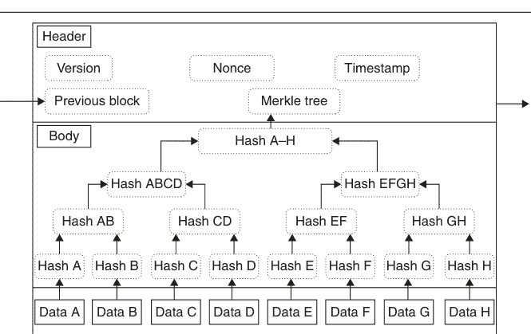

图 2.4
基于梅克尔树结构的区块数据。

### 2.3.2 网络层

网络层专注于去中心化通信模型及其相关机制，如数据转发、验证和分布式网络。大多数区块链应用处理的是由大量连接设备组成的动态环境。区块链中的去中心化环境在拓扑上可以配置为 P2P 网络。区块链网络中的所有参与节点都是平等的特权节点，无需任何中间环节干预，因此区块链系统包含了自下而控制并且是去中心化的。节点通过维护内置清单来跟踪网络活动并验证广播的区块。决策通过将有效区块转发给邻居节点并丢弃无效节点做出。最后，区块通过大多数节点的确认被添加到区块链中。P2P 去中心化网络支持区块链作为未来云计算的潜在架构。带有许多中心化服务器的演化云模型作为去中心化模型，促进了去中心化实体之间的交互和通信 [11]。

### 2.3.3 共识层

区块链使用共识算法来确保所有节点之间分布式共享账本的容错水平和数据一致性 [12]。区块链模型高度关注具有多个不可信实体的动态环境，以及拜占庭故障 [13]。因此，需要复杂的算法，如证明-X (PoX) 共识算法和拜占庭容错算法来管理开放和半开放环境。特别是 PoW（工作量证明）是最广泛使用的算法，节点可以通过执行复杂计算来验证区块，或者通过通过反复竞争来实施该算法 [14]。随后，被许可将其区块合并到分布式账本上的节点；拥有最多币的节点被允许创建一个新区块。权益证明 (PoS) 和委托权益证明 (DPoS) 适用于轻量级区块链系统。

### 2.3.4 激励层

在激励层中，引入了经济奖励，通过保证区块链网络中的信任生态系统来实现收益最大化。区块创建和数据验证过程被视为参与节点通过贡献计算力的众包任务。某些节点是自我驱动的，需要激励兼容机制来满足单个节点的需求。在加密货币中，一旦创建区块，加密货币将作为奖励发放给获胜节点，以激励网络中的参与节点。激励层起着驱动作用，特别是在公共区块链中。它通过支持实时微支付、在区块链中建立基于加密货币的交易来利用区块链。对于封闭和半开放场景的部分中心化私有区块链是可选的。事实上，信任实体在没有任何财务要求的情况下参与。

### 2.3.5 合约层

各种机制和算法（例如智能合约）被用于触发静态数据、资产或资金，它们提供了区块链系统中业务逻辑的抽象视图。智能合约被定义为区块链存储和维护的一组自我执行、自动执行和自我验证的规则集。一旦set通过编码过程对智能合约达成一致，就可以通过加密签名并将其分发到 P2P 网络来启动。经过验证的智能合约将追加到分布式账本中。预设条件被激活，在没有任何人工干预的情况下执行相应的操作，如图 2.5 所示。这转化


## 物联网、人工智能与区块链的基础原理

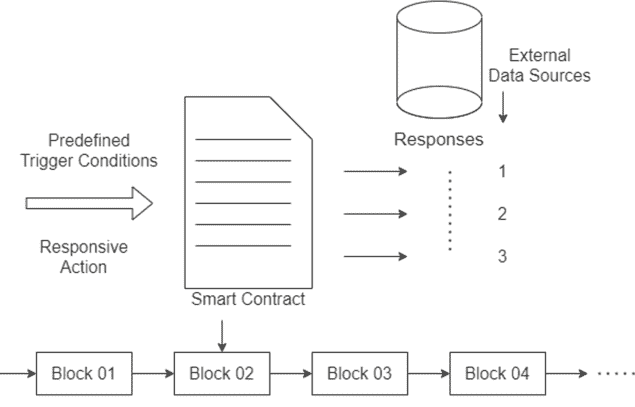

图 2.5
区块链中的智能合约。

以智能特征形式存在的数字资产可以以自动方式进行管理，从而降低复杂性并增加可编程性和自主性 [15]。

## 2.3.6 应用层

该层处理区块链的若干用例和应用，因为该技术目前已在不同的工业领域引起了巨大的关注。区块链通过其去中介化、去中心化系统等特性，重塑了传统应用，并吸引了许多投资者和初创公司。

# 参考文献

- 1. Sumathi, D., and T. Poongodi (2020). Internet of Things: From the foundations to the latest frontiers in research, IoT Network Architecture and Design, De-Gruelter, Internet of Things, 63.
- 2. Moor, J. (2006). The Dartmouth College artificial intelligence conference: The next fifty years. AI Magazine, 27(4), 87–89.
- 3. Schoenick, C. Clark, O. Tafjord, P. Turner, and O. Etzioni (2017). Moving beyond the testing test with the Allen AI science challenge. Communications of the ACM, 60(9), 60–64.

# 区块、人工智能与物联网的融合

- 4. Skinner, B. F. (1985). Cognitive science and behaviourism. British Journal of psychology, 76(3), 291–301.
- 5. Pomerleau, D. A. (1989). Alvinn: An Autonomous Land Vehicle in a Neural Network. Artificial Intelligence and Psychology Project, Carnegie-Mello University, Pittsburgh, PA.
- 6. Sager, J. C. (1994). Language Engineering and Translation: Consequences of Automation (Vol. 1) Benjamin Publishing, Amsterdam.
- 7. Tobin, A. Menca, and E. Yayena (2019). The global landscape of AI ethics guidelines. Nature Machine Intelligence, 1(9), 389–399.
- 8. Wang, X. L., Y. Yuan, P. Ye, and F. Y. Wang (2016). ACP-based social computing and parallel intelligence: Societies 5.0 and beyond. CAAI Transactions on Intelligence Technology, 1(4), 377–393.
- 9. Wang, X., X. Zheng, K. Zhang, Zeng, and F. Y. Wang (2016). Analysis of cyber interactive behaviors using artificial intelligence and computational experiments. IEEE Transactions on Systems, Man, and Cybernetics: Systems, 4(6), 995–1006.
- 10. Wang, F. Y., and F. Y. Wang (2018). Societies 5.0: A new paradigm for computational social systems research. IEEE Transactions on Computational Social Systems, 5(1), 2–8.
- 11. Yuan, Y., and F. Y. Wang (2016). Blockchain: The state of the art and future trends. Acta Automatica Sinica, 42(4), 481–494.
- 12. Chen, C. P., G. X. Wen, Y. Ji., Liu, and F. Y. Wang (2014). Adaptive consensus control for a nonlinear multiagent time-delay systems using neural networks. IEEE Transactions on Neural Networks and Learning Systems, 25(6), 1217–1226.
- 13. Fan, J., L. T. Yi, and J. Shu (2013). Research on the technologies of Byzantine system. Journal of Software, 24(6), 1346–1360.
- 14. Kraft, D. (2016). Difficulty control for blockchain-based consensus systems. Peer-to-Peer Networking and Applications, 9(2), 397–413.
- 15. Wang, F. Y., Y. Yuan, C. Rong, and J. J. Zhang (2018). Parallel blockchain: An architecture for CPSS-based smart societies. IEEE Transactions on Computational Systems, 5(2), 303–310.

# 3
# 人工智能赋物联网优化

人工智能（AI）的出现将整个世界生态系统转变为触发环境，并减少了对人工干预和努力的需求。物联网（IoT）通过其他计算网络经历了不同的性能演进。与云计算结合的发展被称为雾计算，它是思科（CISCO）创建的云计算扩展版本，用于物联网设备的实时通信和扩展带宽使用，并提高运营效率 [1]。雾计算也指边缘计算，它使用实时数据处理和速度更快的云环境 [2]。

这种处理涉及分布式处理而非集中式控制——自动驾驶汽车就是一个显著的例子，它以分布式原生的方式与人工智能技术工作。人工智能在临床和健康行业发挥着至关重要的作用，为配备物联网的设备提供系统支持。心血管和肿瘤专业领域 AI 驱动技术的快速发展对医疗行业产生了重大影响。

物联网市场几乎每天都在进步。这包括与多个工业机器、制造工厂以及医疗和计算过渡系统集成的物联网。不同因素使得物联网行业发生了复杂的变化；其中最突出的是边缘计算。物联网市场几乎每天都在进步。这包括与多个工业机器、制造工厂以及医疗和计算过渡系统集成的物联网。不同因素使得物联网行业发生了复杂的变化；其中最突出的是边缘计算。

物联网市场几乎每天都在进步。这包括与多个工业机器、制造工厂以及医疗和计算过渡系统集成的物联网。不同因素使得物联网行业发生了复杂的变化；其中最突出的是边缘计算。物联网市场几乎每天都在进步。这包括与多个工业机器、制造工厂以及医疗和计算过渡系统集成的物联网。不同因素使得物联网行业发生了复杂的变化；其中最突出的是边缘计算。物联网市场几乎每天都在进步。这包括与多个工业机器、制造工厂以及医疗和计算过渡系统集成的物联网。不同因素使得物联网行业发生了复杂的变化；其中最突出的是边缘计算。物联网市场几乎每天都在进步。这包括与多个工业机器、制造工厂以及医疗和计算过渡系统集成的物联网。不同因素使得物联网行业发生了复杂的变化；其中最突出的是边缘计算。物联网市场几乎每天都在进步。这包括与多个工业机器、制造工厂以及医疗和计算过渡系统集成的物联网。不同因素使得物联网行业发生了复杂的变化；其中最突出的是边缘计算。物联网市场几乎每天都在进步。这包括与多个工业机器、制造工厂以及医疗和计算过渡系统集成的物联网。不同因素使得物联网行业发生了复杂的变化；其中最突出的是边缘计算。物联网市场几乎每天都在进步。这包括与多个工业机器、制造工厂以及医疗和计算过渡系统集成的物联网。不同因素使得物联网行业发生了复杂的变化；其中最突出的是边缘计算。物联网市场几乎每天都在进步。这包括与多个工业机器、制造工厂以及医疗和计算过渡系统集成的物联网。不同因素使得物联网行业发生了复杂的变化；其中最突出的是边缘计算。物联网市场几乎每天都在进步。这包括与多个工业机器、制造工厂以及医疗和计算过渡系统集成的物联网。不同因素使得物联网行业发生了复杂的变化；其中最突出的是边缘计算。物联网市场几乎每天都在进步。这包括与多个工业机器、制造工厂以及医疗和计算过渡系统集成的物联网。不同因素使得物联网行业发生了复杂的变化；其中最突出的是边缘计算。物联网市场几乎每天都在进步。这包括与多个工业机器、制造工厂以及医疗和计算过渡系统集成的物联网。不同因素使得物联网行业发生了复杂的变化；其中最突出的是边缘计算。物联网市场几乎每天都在进步。这包括与多个工业机器、制造工厂以及医疗和计算过渡系统集成的物联网。不同因素使得物联网行业发生了复杂的变化；其中最突出的是边缘计算。物联网市场几乎每天都在进步。这包括与多个工业机器、制造工厂以及医疗和计算过渡系统集成的物联网。不同因素使得物联网行业发生了复杂的变化；其中最突出的是边缘计算。物联网市场几乎每天都在进步。这包括与多个工业机器、制造工厂以及医疗和计算过渡系统集成的物联网。不同因素使得物联网行业发生了复杂的变化；其中最突出的是边缘计算。物联网市场几乎每天都在进步。这包括与多个工业机器、制造工厂以及医疗和计算过渡系统集成的物联网。不同因素使得物联网行业发生了复杂的变化；其中最突出的是边缘计算。物联网市场几乎每天都在进步。这包括与多个工业机器、制造工厂以及医疗和计算过渡系统集成的物联网。不同因素使得物联网行业发生了复杂的变化；其中最突出的是边缘计算。物联网市场几乎每天都在进步。这包括与多个工业机器、制造工厂以及医疗和计算过渡系统集成的物联网。不同因素使得物联网行业发生了复杂的变化；其中最突出的是边缘计算。物联网市场几乎每天都在进步。这包括与多个工业机器、制造工厂以及医疗和计算过渡系统集成的物联网。不同因素使得物联网行业发生了复杂的变化；其中最突出的是边缘计算。物联网市场几乎每天都在进步。这包括与多个工业机器、制造工厂以及医疗和计算过渡系统集成的物联网。不同因素使得物联网行业发生了复杂的变化；其中最突出的是边缘计算。

（注：根据逻辑流继续处理）

## 区块、人工智能与物联网的融合

[content]
AWS IoT 服务涉及对应电子医疗服务、Redshift 数据库和用于工具的 CloudWatch。
[/content] 8f3b_68_0[/content]
与 IoT 服务一起使用的许多边缘计算平台，如 AWS Green Grass、Azure IoT Edge、Google cloud IoT Edge 等 [2]。边缘计算分发云服务并使其所有设备可用，缩短了延迟时间。它将核心云服务移动到实际数据，通过引入安全和隐私服务增强了公共云平台。边缘服务的数据在本地处理并通过网络服务交付。

## 3.1 人工智能赋物联网优化

AWS 核心连接设备到云。每个设备都应连接到 IoT 核心，在此之前，它应该注册到该核心，该核心将为特定设备进行数字身份认证。AWS IoT 核心的工作流如图 3.3 所示 [4]。

[/content]

*(注：由于原文文本中存在大量重复的段落，在翻译时已根据“不要重复输出原文”的原则进行了去重处理，仅保留了核心逻辑和首次出现的段落内容。)*


## 3.1 通过人工智能实现边缘机制

通过智能且准确地分配资源，可以通过人工智能来实现边缘计算。计算复杂性和通信延迟是传统系统的主要缺点。尽管如此，结合人工智能的边缘计算的发展克服了这一问题。边缘计算的出现以一种高可靠且更快速的方式解决了算力和数据采集问题。因此，边缘计算将云服务推向了网络边缘，并汇集数据以更快地做出本地决策。物联网为边缘计算提供了可能，使其能够利用机器学习算法对商业对象进行完美的决策。边缘实现机制降低了延迟。它还帮助了那些不频繁连接到互联网的设备，设备可以通过边缘计算的备份处理做出智能决策，从而稳定网络连接。

智能医院、相关行业和飞行器等商业设备每天使用最少 2–5 TB 的数据。因此，所有设备都会产生海量数据，传统系统无法适应这些设备，这要求边缘技术对云服务进行剧烈变革。传统的云系统侧重于存储、计算和分析，而边缘计算涉及一种具有本地化的分布式计算方法，这些方法是数据驱动并通过这些设备传输的（见图 3.4）。

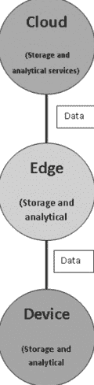

图 3.4
边缘计算的分布式特性。

边缘计算的主要优势是它确保了数据的隐私。如果任何用户不将数据存储在云端，而是本地用于当前处理，边缘计算将通过特权指令协助特定的会话。可扩展性、安全性和更低的成本是边缘计算的其他特征。

用于边缘计算的技术是 AI 和机器学习、时间敏感网络、5G 等。在这里我们处理的是与机器学习相结合的人工智能技术，反映了技术世界的巨大变化。众所周知，存在开源技术可以支持 AI 技术运行的可行模式，并为构建实时智能系统提供完善的生态系统 [4]。

## 3.2 使用 SVM 和 PCA 机制对训练过的传感器数据进行异常检测

异常检测是数据挖掘和机器学习中的重要研究课题。异常检测是指在数据中寻找不符合预期行为模式的问题。这些不符合的模式在不同的应用领域被称为异常、离群值、不一致观测值、例外、偏差、特异点或污染物。异常检测广泛应用于各种领域，如信用卡、保险或医疗保健的欺诈检测、网络安全的入侵检测、安全关键系统中的故障检测以及对敌方活动的军事监控 [5]。

然而，大多数异常检测方法通常以批模式实现，在不牺牲计算和内存需求的情况下，无法轻易扩展到大规模问题。现有方法包括具有多聚类结构且位于高维空间中的正常数据。如果存在多个簇，对于前者情况，通常很难使用线性模型（如 PCA）来估计数据分布。此外，许多学习算法在极高维空间会遇到“维度灾难”问题。虽然处理高维数据不需要计算或保留协方差矩阵，但 PCA 在估计此类数据的主方向方面可能不是首选。

## 区块链、AI 与物联网的融合

本文提出了一种在线过采样主成分分析（osPCA）算法来解决这个问题。osPCA 旨在通过在线更新技术从大量数据中检测离群值。与基于初始主成分分析（PCA）的方法不同，不需要存储整个数据或协方差矩阵。方法对于在线或大规模问题特别具有意义。通过对目标进行过采样并提取数据的主方向，osPCA 允许我们根据结果特征向量的变化确定目标实例的异常情况。由于 osPCA 不显式地执行特征分析，该框架更适用于具有计算或内存限制的在线应用。

### 3.2.1 主成分分析

主成分分析（PCA）是一种著名的无监督降维方法，用于确定分布的主方向。PCA 是一项非常成熟的降维和多变量分析技术 [5]。其许多应用示例包括数据压缩、图像处理、可视化、探索性数据分析、模式识别和时间序列预测。PCA 的流行归因于三个基本属性。首先，它是将高维向量压缩为一组低维向量并重构原始位置的最优线性方案。其次，模型参数可以直接从数据中计算——通过样本协方差矩阵对角化。第三，在给定三个模型参数的情况下，压缩和解压缩是易于执行的操作——它们只需要矩阵乘法。多维超空间通常难以可视化 [6]。

无监督学习方法的主要目的是减少维度，根据复合指标考虑所有观测值，并根据多变量属性将相似的聚在一起。通过两个或三个变量对属性进行总结，并能以最小的信息损失以图形形式显示，这有助于知识发现。由于很难可视化多维空间，PCA 主要用于将 $d$ 个多变量属性的维度降低到两个或三个维度。在数学术中，PCA 是一种将 $n$ 个相关的随机变量转换为 $n$ 个不相关变量的技术。不相关变量是原始变量的线性组合，并以简化的形式表示数据。通常，变换的第一主成分是具有极大方差的原始变量的线性组合。

第一个主成分是在投影方差最大方向上的投影。第二个主成分是具有第二大方差且与第一主成分正交的原始变量的线性组合，依此类推 [6]。在许多数据集中，前几个主成分贡献了原始数据集中大部分的方差。其余部分可以忽略，且对数据集降维的方差产生最小损失。PCA 已广泛应用于图像压缩、模式识别和入侵检测领域。异常检测基于数据中心进行距离度量。

为了获得主方向，需要构建协方差矩阵并计算其主特征向量。这些特征向量将是原始空间中最信息丰富的锚点，并被主方向。设 $A = [x1T;x2T; ... xnT] \in R^{n \times p}$，每个 $xi$ 代表 $p$ 维空间中的一个实例，$n$ 是案例的数量。通常，PCA 建模为以下优化问题 [5]：

```
$$\min_{u \in R^n, ||u||=1} \sum UU^T(x_i - \mu)(x_i - \mu)^T \quad (3.1)$$
```

$U$ 是包含 $k$ 个主特征向量的矩阵。从该公式可以看出，标准 PCA 可以被视为一个投影数据具有显著变化的子空间。或者，可以通过最小化数据重构误差来处理 PCA 问题 [5–7]：

```
$$\min_{u \in R^n, ||u||=1} J(U) = \sum_{i=1}^n |(x_i - \mu)-(x_i - \mu)UU^T| \quad (3.2)$$
```

其中 $(xi - \mu) U^T$ 决定了在重构 $xi - \mu$ 的近似版本时对每个主方向的系数。通常，问题 (3.1) 或 (3.2) 可以通过对协方差数据矩阵进行特征分解来解决：

```
$$\sum_A U = U\Lambda \quad (3.3)$$
```

其中，

```
$$\sum_A \sum_{i=1}^n (xi-\mu)(xi-\mu)^T \quad (3.4)$$
```

协方差矩阵，$\mu$ 是全局平均值。$U$ 的每一列代表 $\Sigma A$ 的一个特征向量，$\Lambda$ 中对应的对角元素是


## 区块链、人工智能与物联网的融合

相关的特征值。对于降维，最后几个特征向量由于其对数据分布的贡献忽略不计而被舍弃。

虽然 PCA 需要计算全局均值和协方差矩阵，但发现这两者对异常值的存在都很敏感。如果数据中存在离群值，PCA 产生的主特征向量将受到它们的显著影响，从而导致所得主成分方向发生巨大变化。

## 3.2.2 使用 PCA 进行异常检测

此处讨论了移除或添加数据实例时主方向的变化，包括如何利用这一属性来确定目标数据点的离群值 [5]。

图 3.5 展示了添加/移除离群值或标准数据对主方向的影响。图 3.5 中的聚类蓝色圆圈表示普通数据实例，红色正方形表示离群值，绿色箭头是主方向。当添加离群值实例时，主焦点会发生偏移。具体而言，此类离群值实例的存在会导致结果方向与原始主方向之间产生很大的角度。

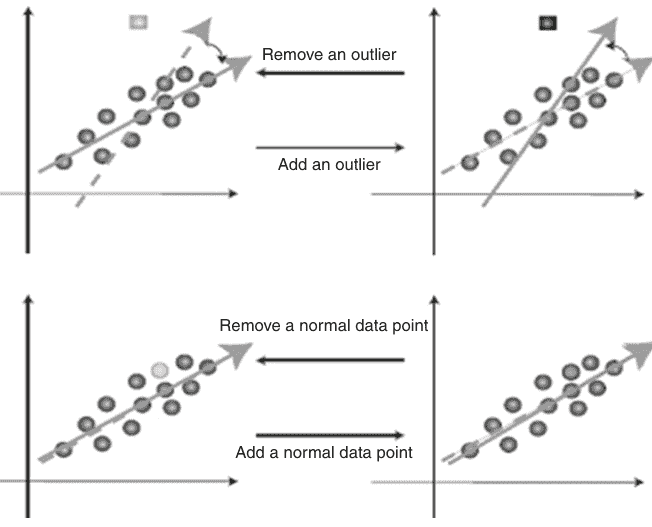

图 3.5
添加/移除离群值或正常数据对主方向的影响。

相反，当添加特定数据点时，该角度将是可以不计的。因此，这一属性利用 LOO（留一法）策略确定目标数据点的轮廓。

将 PCA 和用于异常检测的 LOO 策略结合。给定一个具有 $n$ 个数据实例的数据 $A$，从中提取主主成分方向。如果目标实例是 $x_t$，则计算不包含 $x_t$ 的领先主方向。为了识别数据集中的离群值，重复此过程 $n$ 次，即采用 LOO 策略。

```
$$\sum_{\lambda} \tilde{u}_\lambda = \tilde{u}, \quad (3.5)$$
```

$\tilde{A} = A \setminus \{x_t\}$。注意 $\tilde{\mu}$ 是 $\tilde{A}$ 的均值，因此：

```
$$\sum = \frac{1}{n-1} \sum_{x\in\tilde{A}} (x - \tilde{\mu})(x - \tilde{\mu})^\top \quad (3.6)$$
```

获得这些特征向量 $\tilde{u}$ 后，使用余弦相似性的绝对值来衡量主方向的变化，即：

```
$$s_t = 1 - \frac{|\langle\tilde{u}_t, u\rangle|}{\|\tilde{u}_t\|\|u\|} \quad (3.7)$$
```

这组值可以被视为“离群值评分”，指示了目标实例 $x_t$ 的异常情况。$s_t$ 也可以视为目标实例在所得主方向中的影响，$s_t$ 越高（越接近 1）意味着目标实例越可能是离群值。如果目标实例的 $s_t$ 高于某个阈值，则将其识别为离群值。此过程是一种带有 LOO 方案的异常检测增量 PCA。

带有 LOO 策略的增量 PCA 在于应用 PCA 进行离群值检测时，考虑添加/复制感兴趣的数据实例。这种设置适用于流数据异常检测问题。更准确地说，当接收到新的目标实例 $x_t$ 时，求解以下 PCA 问题：

```
$$\sum_{\lambda} \mathbf{u}_\lambda = \mathbf{u}, \lambda \quad (3.8)$$
```

$\tilde{A} = A \setminus \{x_t\}$。注意 $\tilde{\mu}$ 是 $\tilde{A}$ 的均值，协方差矩阵可以计算为：

```
$$\sum = \frac{1}{n+1} \sum_{x\in\tilde{A}} (x - \tilde{\mu})(x - \tilde{\mu})^\top + \frac{1}{n+1} (x_t - \tilde{\mu})(x_t - \tilde{\mu})^\top \quad (3.9)$$
```

在主方向后，计算评分 $s_t$，即可相应确定该目标实例的离群值。这种策略也适用于在线异常检测应用，在应用中需要判断新接收到的数据实例是否为离群值。如果最近获取的数据点是标准的，添加此类模型不会显著影响主方向。虽然有人可能认为仅用主方向的变化来评估异常可能不够，但无监督 PCA 缓解了这一点，并使得在线异常检测问题变得可行。值得注意的是，如果离群值远离数据云（普通数据实例），则沿着其主特征向量的方向识别此类异常，因此该方法将无法识别它。同样值得指出，此类离群值表示（尽管可能不是所有）特征属性的异常。这意味着该实例的大部分特征属性超出了每个特征变量的正常范围/分布。结果，可以通过单特征变量阈值等简单异常检测方法检测此类数据的异常。例如，可以计算投影到主特征向量的均值的标准差。对于输入数据点，如果其在该特征向量上的投影系数是标准差的两三倍，则将其标记为离群值。离群值检测场景中，离群值实例可能违反系统限制。以网络流量/行为异常检测为例，可以考虑功率、带宽等参数。

### 3.2.3 用于异常检测的过采样 PCA

在提出的 osPCA 方法中，过采样率 $r$ 是由用户确定的参数。由于异常检测问题没有训练或验证数据，无法提前通过交叉验证或类似策略评估该参数。应用 osPCA 检测离群值的存在时，计算更新数据矩阵（引入了过采样数据）的主方向可以被视为扰动协方差矩阵的特征值分解。理论上，扰动程度取决于过采样率 $r$，推导相关主特征向量的敏感性研究如下：

假设对目标实例过采样 $n$ 次，相关的 PCA 可以表示为：

```
$$\sum \tilde{u}_t = \tilde{A}\tilde{u}$$
```

其中 $\tilde{A} = A \setminus \{x_t\}$。在这一 osPCA 框架下，将目标实例复制 $n$ 次（例如原始数据集大小的 10%），并计算该实例的离群值评分 $s$。如果该评分高于某个预设阈值，则认为该实例为离群值。通过这种过采样策略，目标实例是正常数据，我们可以观察到主方向和数据均值的变化可以忽略不计。


## 区块链、人工智能与物联网的融合

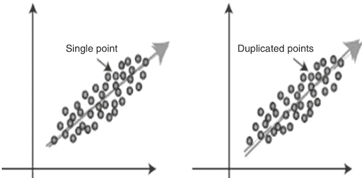

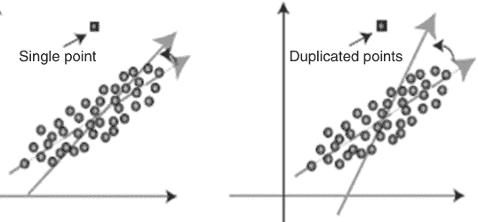

**图 3.6**
过采样正常数据或离群实例对主方向的影响。

为了讨论这种扰动效应，令 $A = [x_1^T, x_2^T, ..., x_n^T] \in R^{n \times p}$ 为数据矩阵，其中每一行代表 $p$ 维空间中的一个数据实例，$n$ 是实例数量。对于一个被过采样 $n$ 次的目标实例 $x$，得到协方差矩阵。令 $e = \frac{n}{n+\hat{n}}$，计算扰动数据协方差矩阵 $\Sigma_e$ 为：

```
$\Sigma_e = \frac{1}{n+\hat{n}} \left\{ \sum_{i=1}^n (x_i - \mu_e)(x_i - \mu_e)^T \right\} + \frac{1}{n+\hat{n}} \left\{ \sum_{i=1}^n (x_i - \mu)(x_i - \mu)^T \right\}$
```

# 人工智能助力物联网优化

> $$\sum_{i=1}^{n} (\mathbf{x}_i - \hat{\mu})(\mathbf{x}_i - \hat{\mu})^T + O(\epsilon^2) = (1-\epsilon)\Sigma + O(\epsilon^2)$$
(3.13)

基于 (3.13)，可以观察到正常数据实例会使 $\epsilon \to 0$ 且 $||\Sigma_c|| \to 0$，因此扰动协方差矩阵 $\Sigma_c$ 与原始 $\Sigma$ 没有显著差异。相反，如果一个离群实例是需要过采样的目标，$\Sigma_c$ 将受到 $\Sigma_{c'}$ 的显著影响，因此得出的主方向也将与没有显著扰动的情况有显著不同。

理论分析支持使用主特征向量的变化进行异常检测。虽然在理论上对于过采样的目标实例使用残差来估计特征向量：

## 3.2.4 用于 osPCA 的幂法

PCA 的解是通过求解特征值分解问题来定的。在 LOO（留一法）场景下，对于一个包含 $n$ 个实例的数据集，需要求解 $n$ 次 PCA 并计算主方向。这在计算上是非常昂贵的，并阻碍了此类框架在异常检测中的实际应用。可以观察到，在 PCA 公式中，没有必要为每次 PCA 重新计算协方差矩阵。当复制感兴趣的数据点时，可以很容易确定更新后的协方差矩阵与原始矩阵之间的差异。

令 $Q = \frac{AA^T}{n}$ 为外积矩阵$\mathbf{x}$ 为目标实例（待过采样），以更新均值 $\hat{\mu}$ 和协方差矩阵：

> $$\Sigma_{\hat{\mu}} = \frac{\hat{\mu} + r\mathbf{x}_l}{1+r}$$
(3.14)

## 区块链、人工智能与物联网的融合

$$\sum_{\Lambda} \frac{1}{1+r}Q + \frac{r}{1+r}x_{\Lambda,i}^T + \hat{\mu}\mu^T$$

其中 $r < 1$ 是控制过采样时大小的参数。在这里，在该 LOO 框架下只需要保留协方差矩阵。一旦获得更新后的协方差矩阵，我们可以通过选择每个矩阵的特征值分解问题获得主方向。为了减轻计算负载，应用广知的幂法，这是一种不需要计算矩阵分解的简单算法。该方法从初始归一化向量 $u_0$ 开始，它可以近似主特征向量或非零随机向量。接下来，通过以下公式更新新的 $u_{k+1}$：

```
$u_{k+1} = \frac{\sum_{\Lambda}u_k}{\sum_{\Lambda}u_k^2}$
```

在 $\Sigma$ 的特征值显著大于其他特征值的假设下，序列 $\{u_i\}$ 收敛。幂法只需要矩阵乘法而不需要分解；因此，使用幂法可以加速计算主方向的计算成本。为了避免在整个更新过程中保留数据协方差矩阵 $\Sigma \in IR^{(p,p)}$，首先计算 $y = Au_{k-1}$，然后计算 $u_k = y^T A$。结果是，当此此应用于幂法时，不需要添加和存储协方差矩阵。这里保留用于矩阵向量乘法的数据矩阵 $A$。此外，乘法需要在幂法的每次迭代中执行。

## 3.2.5 osPCA 的最小二乘近似与在线更新

矩阵更新技术和幂法结合用于求解离群检测的过采样 PCA。然而，幂法的主要问题是它不保证快速收敛，即使使用先验主方向作为初始解。此外，幂法仍然要求用户保留整个协方差矩阵，这无法避免高维数据或内存资源有限的问题。PCA 可以被视为一个最小化重构误差的问题。

```
$$\min_{U\in R^{nk},UU^T=I} J(U) = \sum_{i=1}^{n} ||x_i - UU^T||^2
```
其中 $x_i$ 是 $(x_i - \mu)$，$U$ 是由 $k$ 个特征向量组成的矩阵，$UU^Tx_i$ 是使用 $U$ 中的特征向量重构的 $x_i$ 版本。

# 人工智能助力物联网优化

$$\min_{u\in\mathbb{R}^n, u^Tu=1} J(U) = \sum_{i=1}^n |\bar{x}_i - U'x_i|^2 \quad (18)$$
其中 $U'$ 是 $U$ 的近似，$y_i = U'^T\bar{x}_i$ 是 $k$ 维空间内投影数据 $U^T\bar{x}_i$ 的近似。基于此公式，重构误差具有二次形式并是 $U$ 的函数，可以通过最小二乘问题计算。该最小二乘问题的技巧是近似 $U^T\bar{x}_i$。在在线设置中，通过其之前的解 $U_{-1}^T\bar{x}_i$ 近似每个 $U^T\bar{x}_i$：

$$\min_{u\in\mathbb{R}^n, u^Tu=1} J(U_t) = \sum_{i=1}^n |\bar{x}_i - y_i|^2 \quad (19)$$
其中 $y_i = U_t^{-1}\bar{x}_i$。此投影提供了过采样 PCA 中主方向的快速计算。将此最小二乘形式链接到在线过采样策略：

$$\min_{u\in\mathbb{R}^n, u^Tu=1} J(U_t) = \sum_{i=1}^n |\bar{x}_i - \tilde{u}y_i|^2 + |\bar{x}_i - \tilde{u}y_i|^2 \quad (20)$$
其中 $y$ 和 $\bar{y}$ 分别通过 $U^T\bar{x}_i$ 和 $U^T\bar{x}_i$ 增强，$U$ 是原始 PCA 的解，bar{x}$ 是目标实例。当过采样目标 $n$ 次时，通过求解以下优化问题近似解 $\tilde{u}$：

$$\min_{u\in\mathbb{R}^n, u^Tu=1} J_b(\tilde{u}) = \sum_{i=1}^n |\bar{x}_i - \tilde{u}y_i|^2 + |\bar{x}_i - \tilde{u}y_i|^2 \quad (21)$$

等价地，将上述问题转换为形式：

$$\min_{u\in\mathbb{R}^n, u^Tu=1} J_b(\tilde{u}) = \beta\left(\sum_{i=1}^n |\bar{x}_i - \tilde{u}y_i|^2\right) + |\bar{x}_i - \tilde{u}y_i|^2 \quad (22)$$

其中 $\beta$ 可以被视为抑制现有数据信息 $n$ 的权重。注意 $\beta$ 与过采样数量 $\tilde{n}=\beta/nr$ 的关系，$r$ 是过采样数量相对于原始数据大小的比例。为了提高收敛率，使用原始 PCA（无过采样）的解作为初始投影矩阵。如果只关注主方向，对 $u$ 求导以计算 $\tilde{u}$ 的解，从而：

## 区块链、人工智能与物联网的融合

$$\tilde{U} = \frac{\beta\left(\sum_{i=1}^{n} y_i\bar{x}_i\right) + y_i\bar{x}_i}{\beta\left(\sum_{i=1}^{n} y_i^2\right) + y_i^2} \quad (23)$$

这为 osPCA 提供了一种有效高效的更新技术，允许我们确定数据的主方向。这种更新过程使得在线或流数据设置中的异常检测可行。更重要的是，由于只需要离线计算原始 PCA 的解，我们不需要在整个更新过程中保留整个协方差矩阵或外矩阵。

一旦确定了最终的主方向，就可以确定当前解与原始解（无过采样）之间差异的余弦相似度，以及目标实例的离群得分。用于异常检测的在线 osPCA 伪代码见算法 1。

- **算法 1.** 通过在线过采样 PCA 进行异常检测
  **输入：** 数据矩阵 $A = [x_1^T, x_2^T, \dots, x_n^T]$ 和权重 $\beta$。
  **输出：** 离群点得分，$s = [s_1, s_2, \dots, s_n]$，如果 $s_i$ 高于阈值，则 $x_i$ 为离群点。
  1. 计算第一主方向 $U$
  2. 保留 $\tilde{x}_{proj} = \sum_{i=1}^{n} y_i\bar{x}_i$ 和 $y = \sum_{i=1}^{n} y_i^2$
  3. 对于 $i=1$ 执行到：
     $$$\tilde{U} = \frac{\beta\left(\sum_{i=1}^{n} y_i\bar{x}_i\right) + y_i\bar{x}_i}{\beta\left(\sum_{i=1}^{n} y_i^2\right) + y_i^2} \n$\ds_i < -1 - \frac{|<w, \tilde{w}>|}{\|\tilde{u}\|}$ $$

## **3.2.6 实际场景下的在线异常检测**

对于在线异常检测应用（如垃圾邮件过滤），通常使用正常训练数据设计初始分类器，并根据新接收到的正常或离群数据相应更新该分类器；然而，在实际场景中，即使是收集的训练正常数据也是


## 人工智能赋能物联网优化 67

提前收集的数据可能会被噪声或错误的数据标记污染，因此 osPCA（过采样主成分分析）采用了一种在线更新技术来降低计算和内存成本。使用 LOO（留一法）策略的 PCA 通过观察主方向方向的变化来检测离群点。LOO 表明，移除一个异常数据实例对主方向的影响比移除正常数据更为显著。主方向的变化通过相似度余弦值来确定。我们计算了余弦相似度得分并将其作为离群点得分，如果新数据实例高于预定义的阈值，则将其判定为离群点，否则被视为正常实例。这不适用于大规模问题，对于这类问题，则使用了 osPCA。采样是对目标实例进行多次重复复制；其核心思想是放大离群点的影响。osPCA 不支持在线流式程序。因此，在

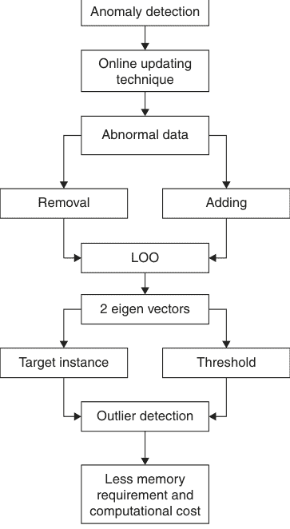

图 3.7
带有在线更新技术的 osPCA。

在最后，osPCA 与在线更新技术相结合，具有较低的计算和内存成本。图 3.3 展示了带有在线更新技术的 osPCA 方法。

数据实例是输入。异常值通过观察主方向的变化来检测。为了保留这些变化，使用了 LOO。如果添加的项导致了显著变化，则将其视为异常值。否则，将其视为正常。通过寻找余弦相似度来计算离群点得分。获得两个特征向量，其中一个是目标实例，另一个是阈值。如果添加的实例高于阈值，则被视为异常值。带有 osPCA 的在线更新技术（见图 3.7）具有较高的计算成本和内存需求。使用在线 osPCA 算法通过过采样目标实例来计算主特征向量，如图 3.6 所示。

接收到的普通数据和异常数据由分类器进行更新。然而，在实际应用中，尽管收集了标准数据

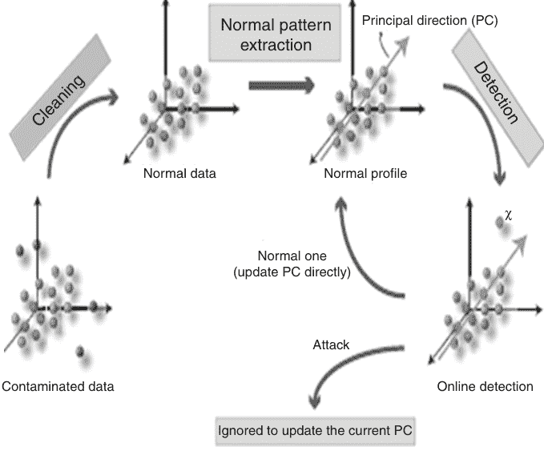

图 3.8
在线异常检测框架。

## 人工智能赋能物联网优化 69

但这些数据可能包含一些噪声和错误的数据标记。要采用这种方法，不能在线从普通数据中丢弃这些偏离实例。因此，用于离群点检测的在线更新 osPCA 的预期系统架构如图3.8 所示。

它由三个阶段组成：过滤、聚类和异常检测。

### 3.2.6.1 过滤

在此检测应用（如垃圾邮件过滤）中，通常使用标准训练数据设计初始分类器，在实际场景中，该分类器根据新收到的正常或异常数据进行相应的更新；即使提前收集的训练平均数据也可能被噪声或错误的数据标记污染。为了构建一个简单有效的在线检测模型，应当忽略标准数据训练集中这些可能偏离的实例。

### 3.2.6.2 聚类

训练数据的选择仅基于假设。因此，在之前的方法中，某些离群点数据可能通过训练数据被视为标准数据。使用聚类方法来解决这个问题。对输入数据实例形成聚类，然后对每个聚类应用离群点计算以精确找到离群点。为了确保机密性，对所提方案机制提供了严谨的安全定义和证明。在此，为输入数据实例形成聚类，然后对每个聚类应用离群点计算以精确找到离群点。

### 3.2.6.3 异常检测

这用于检测用户输入的离群点。当用户向系统提供信息时，系统计算新摄入数据的 St 值。然后将新的 St 值与之前计算的阈值进行比较。如果新数据的 St 值高于阈值，则输入数据被识别为离群点，系统将丢弃该值。否则，它被视为标准数据实例，并相应更新该特定数据实例的 PCA 值。

在线方法的序列图如图 3.9 所示。对污染数据进行数据清洗。在此，移除了大量偏离主方向的实例。86

## AI 与物联网的收敛

| 污染数据 | 正常数据 | 在线检测 |
| :--- | :--- | :--- |

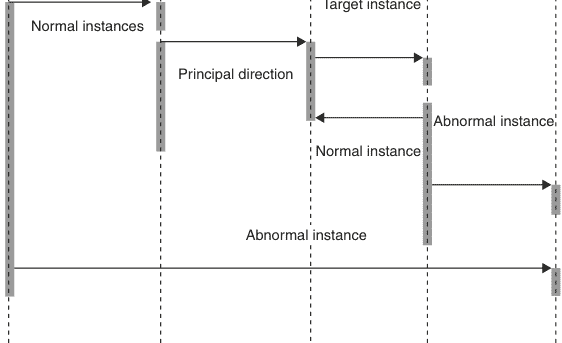

**图 3.9** 在线方法的序列图。

## 3.3 物联网中的韧性和可靠性

物联网（IoT）自成为一项重要技术以来，受到了研究人员的关注，因为它通过允许所有物体与人类之间的通信，使一切变得简单智能。物联网代表了一个由现实世界中的物体以及连接或组合在这些传感器组成的系统，通过有线和无线网络结构连接到互联网。

# 人工智能赋能物联网优化

如今，随着泛泛计算的发展，物联网被广泛应用于许多领域。随着物联网技术的发展，其应用日益扩展到智能家居、智能能源、智慧城市医疗保健等许多领域。物联网是一种新的接入技术。通过物联网，物体可以识别自身并通过做出与互联网相关的决策来获得智能行为。通过物联网，任何事物都可以从任何地方进行通信以提供服务。

由于物联网的应用领域非常广泛，物联网安全问题尤为突出。如果物联网遭受网络攻击，可能会导致各种损害，甚至威胁人类生命和财产。然而，物联网设备产生并交换大量的安全关键和隐私敏感数据，这使其成为各种攻击的目标。为了提高监控、提供应急响应和预测趋势的能力，提出了一种新的网络安全感知式（NSSA）。然而，它受到从多源异构态信息中监控和评估安全要素能力的限制。

为了解决这个问题，本章的主要目标是提出一种基于语义本体和用户定义规则的、从全局视角物联网网络安全感知（NSSA）态势推理方法。该方法不仅实现了异构网络态信息的统一格式化描述和重用，还能实时检测网络安全。

通过使用物联网，人类将在许多领域受益，因为物联网将为智慧城市、创新医疗、智能家居和建筑提供手段，此外许多智能能源、电网交通、废物管理和监控等关键应用。


在本章中，我们回顾了许多物联网（IoT）应用概念、相关新技术的未来可能性，以及实施物联网所面临的挑战。

NSSA 模型基于语义本体论和用户定义的物联网安全规则，能够感知所有安全级别的当前安全态势。推理引擎可以根据本体模型和用户定义的规则确定当前的网络安全态势。本体技术可以提供统一且形式化的描述，以解决物联网安全领域的语义异构性。文中提出了四个子类来反映物联网安全态势：上下文、攻击、漏洞和网络工作。

应用层由于其多样化的应用类型、技术标准和法规，面临着各种安全问题。任何层级受到攻击都会影响整个系统和用户。此外，网络层和应用层的安全性更为关重要；物联网需要整体且实时的安全管理，包括对实时攻击和漏洞的检测，以及对可能攻击的预测。然而，由于异构设备和物联网设备产生的非均匀数据，这种物联网安全管理面临着巨大挑战。它需要实时处理和分析异构数据输入，以做出适当合理的决策。然而，现有的安全解决方案并不合适，因为它们无法扩展到异构设备的大网络，也无法满足实时检测的需求。为了解决这些问题，提出了一种名为网络安全态势感知（NSSA）的网络安全监控技术。

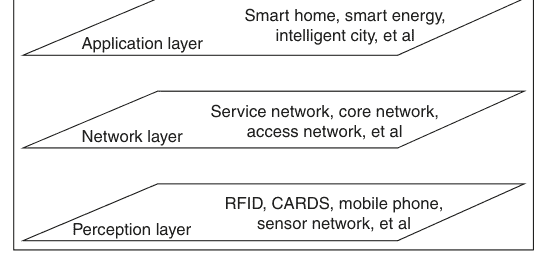

图 3.10

物联网架构。

# 人工智能赋能物联网优化

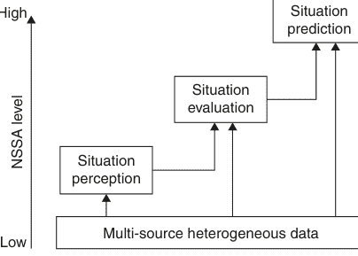

# 图 3.11

NSSA的概念模型。如果物联网设备的感知技术取得突破，将为物联网安全提供关键的支持作用。

## 3.3.1 网络安全态势感知 (NSSA)

物联网潜在的安全危害是客观存在的，由于嵌入式设备和无线网络无处不在，物联网更容易受到攻击。一方面，我们应该增强物联网的抗攻击能力；另一方面，我们也应该实时监控物联网的安全态势，尽早检测威胁以减少损失。物联网安全态势感知的挑战是从传感器产生的大量异构数据中挖掘价值信息，并实时感知当前的安全态势。所提出的 NSSA 概念可以解决这些问题。

NSSA（网络安全态势感知）的概念模型如图 3.11 所示。该模型的提出是为了改进监控、提供应急响应并预测物联网安全的发展趋势。然而，它受限于从多源异构网络安全信息中挖掘和评估安全态势要素的能力。

# 参考文献

- 1. Mohammed, Zeinab Kamal Aldein, and Elmustafa Sayed Ali Ahmed (2017). Internet of things applications, challenges and related future technologies. World Scientific News. 67(2), 126–148, ISSN 2392-2192.
- 2. Edge Artificial Intelligence Chips Market Size, Share & Trends Analysis Report by Processor (CPU, GPU, ASIC), Device Type (Consumer, Enterprise Devices), Function (Training, Inference), by Region, and Segment Forecasts, 2020-2027.
- 3. www.freecodecamp.org/learn/responsive-web-design/#basic-html-and-html5
- 4. https://aws.amazon.com/?sc_channel=EL&sc_campaign=Event_2017_vid&sc_medium=YouTube&sc_video=video13660&sc_detail=SUMMIT&sc_country=US
- 5. Yeh, Y.-R., Z.-Y. Lee, and Y-J. Lee (2009). Anomaly Detection via Oversampling Principal Component Analysis. In Proc. First KES Int'I Symp. Intelligent Decision Technologies, pp. 449–458.
- 6. Breunig, M., H.-P. Kriegel, R.T. Ng, and J. Sander (2000). LOF: Identifying density-based local outliers. In Proc. ACM SIGMOD Int'I Conf. Management of Data, pp. 440–453.
- 7. Chandola, V., Banerjee, A., and Kumar, V. (2009). Anomaly Detection: A Survey. ACM Computing Surveys, 41(3), 15–58.


## 4.6 账本管理

区块链是比特币等应用背后的底层技术。分布式账本是关重要的，因为它它是记录在所有事件和交易的列表，由网络中的每个节点同时持有。每当向账本添加新事件或营销信息时，会对所有内容进行加密处理，随着账本的不断增加，名录上的数据变得日益安全。账本对网络中的所有人可见，并经过安全处理，人们无法对其篡改。添加到此账本的每条新信息都是一个“块”。该块经过数学加密，并根据一系列共识协议批准添加到账本，即在不需要中心化权威的情况下支持添加并防止欺诈或双重花费的方法。

分布式账本是一个去中心化的数据库，因为它分布在多个不同的计算机或节点上（图 4.2）。在这里，每个节点都维护账本，如果发生任何数据变化，账本将进行更新。更新在每个节点上独立进行。通过账本，沿着

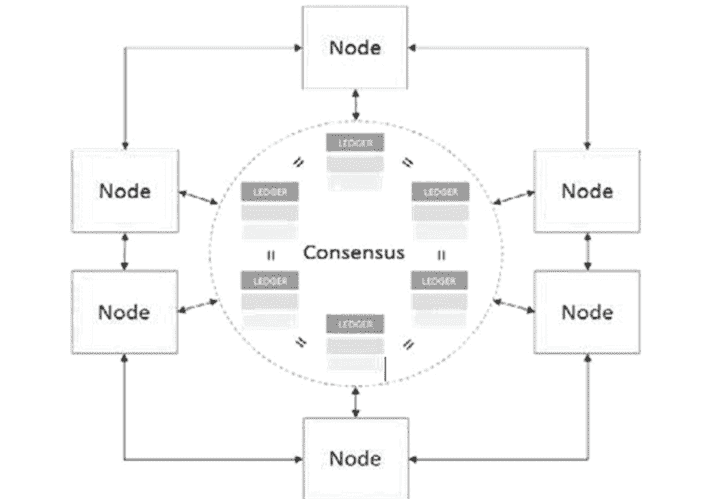

图 4.2
基于共识的账本管理。

## 人工智能向区块链的转型

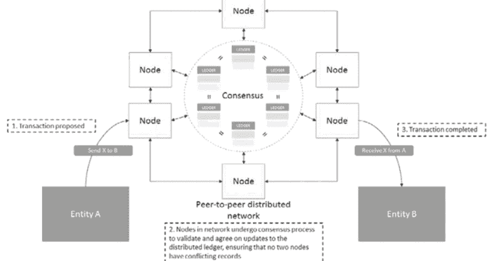

**图 4.3**

分布式网络中的账本管理。

通过一段计算机代码，你可以创建“智能合约”。这些是添加到账本中的一系列条款，由计算机代码驱动。当账本中的条款满足时，计算机代码就会激活并触发合约的下一步。

所有节点在权威性方面都是平等的。没有中心权威或服务器管理数据库，这使得该技术具有透明性。每个节点都可以更新账本，其他节点将验证其存在性。分布式账本的这一属性使其成为金融行业或任何寻求更透明技术以及需要远离中心权威的去中心化行业的极具吸引力的技术。

通过使用分布式账本，不需要中心化权威。它是由节点维护的账本或合约网络（图 4.3）。节点可以合并成块，从而更容易支持更庞大的分布式网络账本。即使没有中心权威，所有信息也保持安全。为了启用分布式网络，密码学等技术必须为数据分配用于加密签名和密钥。存储在分布式账本上的任何内容都是不可变的。不可变性使得黑客更难攻击像比特币这样的分布式账本网络。此外，缺乏中心权威意味着它不受任何故意更改的影响。

涉及以下三个重要步骤：

要启动支付，实体 A 使用加密工具对共享账本的提议更新进行签名，将资金从其账户转移到实体 B 的账户。接收到传输请求后，其他节点验证实体 A 的身份并通过检查实体 A 是否具有更新相关记录的必要加密凭据来验证交易。验证包括验证实体 A 是否有资金进行支付。节点还参与共识过程，以同意应包含在账本状态下一次更新中的成本。

在节点接受更新后，资产的属性将进行修改，使得所有关于购买的未来交易必须使用实体 B 的加密凭据发起。

## 4.7 群体智能与区块链的战略意义

区块链为不同的业务视角和当前技术行业的经济性质带来了变化。现有的加密货币比特币和以太坊都是相应的示例。为了赋能区块链机制，群体智能机制涉及三种主要算法，这些算法是经典算法的替代方案，如下：

- 自然启发型算法 [进化算法 (EA)]
- 粒子群优化算法 (PSO)
- 蚁群算法 (ACO)

(a) 自然启发型算法 [进化算法 (EA)] 该算法是工程中不同问题和设计策略以及计算方法论的最佳解决方案。该算法主要关注模仿自然过程或受自然启发的构想的技术退化或革命性变化。随着这种算法的发现，发生了几种类型的设计变化。(i) 飞机设计：这种设计使飞机更加平滑且易于控制，最大程度地减少了阻力（图 4.4）。(ii) 风力设计：整体性能提升了 40%。这种设计减小了迎角的表面并增强了升力（图 4.5）。

## 人工智能向区块链的转型


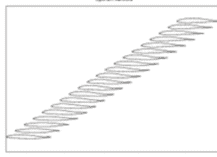


图 4.4
飞机设计。

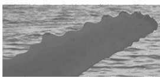

图 4.5
风力设计。


图 4.6
仿生设计。

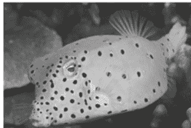

图 4.7
列车。

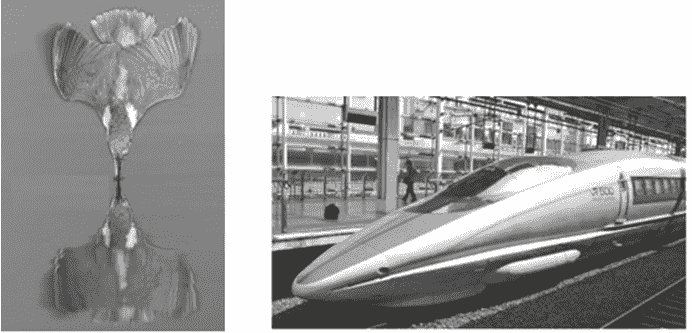

图 4.8
优化问题。

- (iii) 仿生汽车：这种设计使汽车比传统技术更坚固，最大程度地减少了阻力（图 4.6）。
- (iv) 列车：这种列车的设计参考翠鸟，增加了速度（图 4.7）。

上述指的是某些实际优化特性：

- 目标函数和约束函数可能是不可微的；
- 约束是非线性的；
- 离散/不连续搜索空间；
- 混合变量（整数、实数等）；
- 大量约束；
- 目标函数可以是多峰的；
- 计算密集函数。

粒子群优化 (PSO)
粒子群优化是由 Eberhart 博士和 Kennedy 博士在1995年开发的基于种的随机优化技术，灵感来自鸟类或鱼群的行为。与其他技术相比，粒子群优化更快、更经济。它是一种并行活动且不使用梯度问题。

(c) 蚁群算法 (ACO)
蚁群算法是一种使用人工蚁作为计算智能技术的群体智能技术。蚁群算法与某些蚁种的行为有关。这些蚂在地面上沉积信息素，以创建一条蚁群其他成员应该遵循的有利路径。蚁群算法使用类似的机制解决优化问题。蚁群算法可用于旅行推销问题，在该问题中给出城市资产且城市之间的距离是已知的。主要目标是找到允许每个城市仅访问一次的最短行程。其思想是在全连图上寻找长度最小的哈密顿路径。在蚁群算法中，通过模拟多个人工蚁在编码问题本身的图表上移动来解决问题。每个顶点代表一个城市。在这里，边代表两个城市之间的连接。名为信息素的变量与每条边关联，蚁可以读取并修改它。ACO 是一种迭代算法，在每次迭代中考虑多个人工蚁。它们中的每一个都构建一个


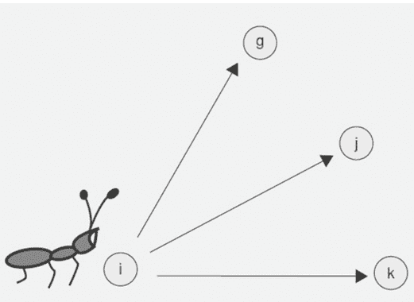

图 4.9
用于蚁群算法（ACO）的城市人工蚂蚁。

通过访问顶点的解决方案，其主要约束是访问未访问过的节点。在每次迭代中，蚂蚁使用一种受费用素引导的随机机制：当访问顶点 I 时，将从之前未访问的顶点中随机选择下一个顶点。

在图 4.9 中，一只蚂蚁位于城市中，它通过随机机制选择下一个访问的城市：如果 j 之前未被见过，则选择它的概率与边 (i,j) 相关的费用素成正比。

## 4.8 基于人工智能的超级节点选择算法

开发具有异构分布式哈希表和代理 SIP 通信的点对点通信被用作超级节点。选择特定超级节点的选举机制非常复杂，因此采用人工智能方案进行此类选举以简化流程，并降低计算复杂性。这里使用了不同的方法，其中最重要的是用于超级节点选择区域划分方案（见图 4.10）。在该方案中，节点选择基于地理位置、I.P 地址以及区域哈希表的结构进行。

人工智能向区块链的转型 85

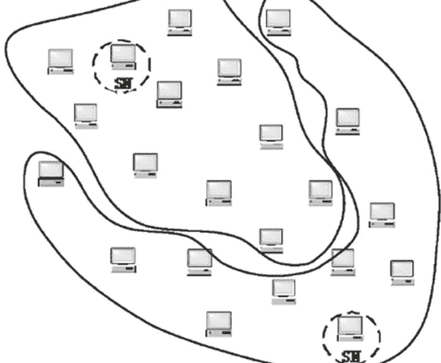

图 4.10
超级节点选择的区域划分方案。

## 4.9 深脑——下一代创新的区块链机制

在人工智能研究中，内存被认为是离散的。这种方法被称为深度，其机制是神经图灵机。连接的神经图灵机通过将大脑与神经网络连接起来，减少人类的短期记忆问题 [1]。

深脑是一个去中心化人工智能平台，它与区块链机制相结合，具有更高的安全性和隐私性，且通常是经济的。这种机制可以与智能接触和账本机制进行交易。深脑机制的主要特征是低成本、安全性、隐私性和灵活的计算 [1]（见图 4:11）。

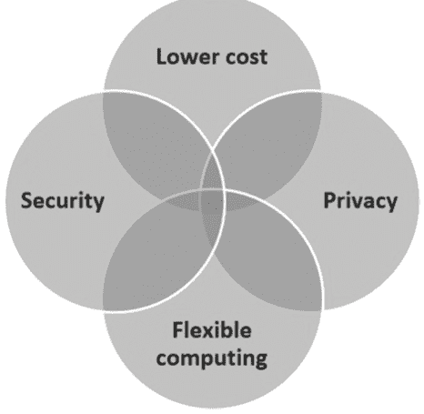

图 4.11
深脑的特征。

# 参考文献

- 1. www.deepbrainchain.org/
- 2. Ant_Colony_Optimization.pdf.
- 3. Thevenot, Axel (2020). Particle Swarm Optimization (PSO) Visually Explained. Towards Data Science.

## 5 物面向区块链的颠覆性技术方面

### 5.1 引言

全球许多个人使用智能手机，其数量呈指数级增长，许多其他设备也是如此。几年前，人们依赖大型台式计算机来解决问题。然而，随着微处理器和嵌入式设备的稳定演进，计算机的尺寸开始显著缩小。手机发展的最原因是数字革命创新的兴起。人们曾使用打字机，后来用个人电脑取代，随后演变为笔记本电脑、平板式电脑等。

智能手机上提供的应用程序是无法量化的。它们在许多领域支持人们，例如寻找前往目的地的方向、检测并通知患者的任何异常、在紧急情况下获取车辆、通过电子商务应用程序订购所需的物品。人们只需点击几次即可订购任何喜欢的食物，而电子书和电子杂志帮助减少对书籍的需求，从而减少对环境的影响。上述示例只是冰一角。它们有许多应用，因为普通个人可以开发这些应用程序来解决实时问题。这为解决任何国际问题提供了无限的机遇平台，能够为人们提供负担得起的优解决方案。

如农业、医疗保健、教育、交通、军事、智能家居、工业互联网等领域只是它们发现用途的无限领域之一。最常用的操作系统是 Android 和 iOS，约占总份额的 98%。

## 5.2 智能设备的组件

智能设备由 CPU、GPU、LTE 调制器、视频处理器组成，如图 5.1 所示。它包括联发科、高通等。最常用的传感器是陀螺仪、磁力计、接近传感器。

### 5.2.2 电池

大多数手机由锂离子电池供电，可能是可拆卸的。功率以 mAh 计算，现在的容量高达 5000。

### 5.2.3 全球定位系统 (GPS)

GPS 有助于识别情况下任何个人的精确位置；它被集成到智能设备中。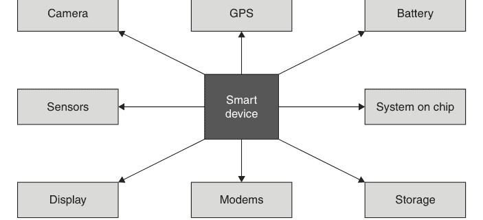

图 5.1
智能设备组件。

### 5.2.4 存储

过去使用 5 英制软磁盘存储 KB 字节的数据。然而，在 20 世纪 90 年代，这些开始被取代，新的存储系统如外部硬盘、U 盘、内存卡开始问世。现在个人可以在其存储中保存数 TB（字节）的数据。

## 5.3 颠覆性技术

技术每天通过根据社会需求创新解决方案来减少人类的工作。几年前，计算机只有少数人使用，因为它们非常昂贵。那些计算机体积巨大，在速度、准确性和效率等其他方面性能低下的，随后开始演进。与目前的设备或系统相比，它们现在拥有日益巨大的存储空间、速度、准确性和效率。

颠覆性技术是技术创新的过程，它导致社会改变消费和使用数据的方式，通过减少个人工作并提高行业生产率，从而为成本较低的公司创造收入。在实时情况下，一个网络应用程序就可以成为公司的颠覆性技术；一个上门叫车的应用程序就是颠覆性技术演变的例子。同样，在许多实时情况下，人们从技术中受益：电动汽车取代了对化石燃料的需求，从而颠覆了当前版本。

### 5.3.1 颠覆性技术的演进

克莱顿·克里斯滕（Clayton Christensen）在 1997 年的《创新者的困境》中讨论了颠覆性技术。这后来成为所有需要产品的组织的流行语。颠覆性技术的主要成功在于，每个初创公司都关注推广和创新新事物，以便在增加工作负载量的同时提高生产率。简单来说，颠覆性技术不仅


## 区块链、人工智能与物联网的融合

创新是行业内此前不曾的新事物的，它是对已存在事物进行改变的过程。这种改变可以在速度、准确性、持久性等方面带来效益。它颠覆了当前市场，同时也产生了新市场（Nassir 等人，2015）。

## 5.3.2 颠覆性技术类型

随着各种形式技术的发展（如人工智能、增强现实、3D打印、云计算、物联网、太空殖民、自动驾驶汽车、可再生能源和高速旅行），颠覆性技术正在演进。
颠覆性技术可以根据最新且最重要的新兴机制进行分类。
总结，主要的颠覆性技术包括：

- 1. 云计算
- 2. 物联网
- 3. 区块链
- 4. 虚拟/增强现实
- 5. 人工智能
- 6. 3D打印
- 7. 空间殖民
- 8. 自动驾驶汽车
- 9. 可再生能源
- 10. 高速旅行。

### 5.3.2.1 云计算

这是颠覆传统数据库的颠覆性技术之一，传统数据库被用于在远程位置存储数据，而云端直接存储数据，用户可以从任何位置访问这些数据。云计算是将数据存储在任何 24/7 小时连接到互联网的服务器上的过程（Velte 等人 2009）。

它提供诸如基础设施服务（包括服务器、打印机、数据库和其他硬件组件）、平台（如不免费提供的操作系统）、以及用户无法负担的几个版本的软件，以便其可以根据需要租赁应用程序。

在图 5.2 中，可以看到数据存储的颠覆以多种形式出现，例如文件管理系统、数据库管理系统、云计算、雾计算和边缘计算。

## 物联网迈区块链的颠覆性技术方面

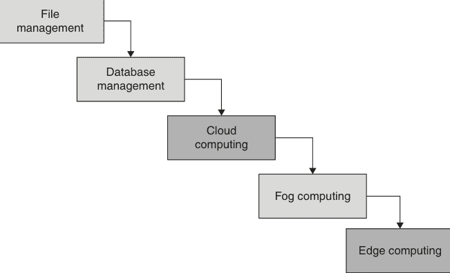

图 5.2
数据存储的颠覆。

### 5.3.2.2 物联网

物联网（IoT）是通过无线传感器网络和云计算进行的创新，传感器用于捕捉环境变化（如温度、气体、湿度等），而云通过 GSM 网络与传感器集成，以发送可以作为通知发送给用户的数据（Minhaj Ahmad 和 Khaled Salah 2018）。

图 5.3 描述了数据传输的演变，这种演变始于人类为了信息交换进行的交互。互联网出现了，人们开始使用万维网（WWW）发现所需的任何信息，因为这些信息可以通过互联网检索，这是颠覆性技术在数据共享方面演变的开始。随后，数据以电子商务等 Web 服务的形式进行传输。社交媒体随后作为可靠的数字媒体出现，接着是传感器和互联网的创新，导致了物联网。

### 5.3.2.3 区块链

区块链产生了一个不受单一个人拥有的去中心化系统。它包含不可更改的数据记录，中央服务器的参与没有颠覆，且通信是“点对点”的（Li 等人 2020）。任何个人都可以访问数据库，而且它是透明的。区块链可以用三种形式实现：私有、公有和

## 区块链、人工智能与物联网的融合

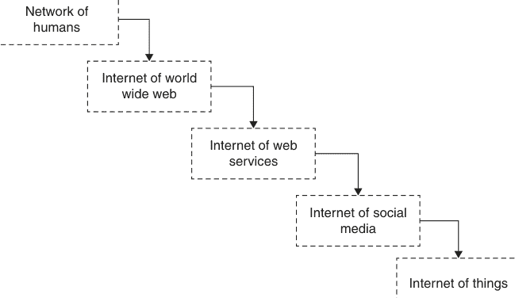

图 5.3
数据传输的颠覆。

联盟区域。区块链可以通过身份和访问管理系统来增加物联网的安全性（Singh 等人 2020）。
在这里，信息是分布的而非复制的。它最初为数字货币开发，但现在发现了其他潜在用途（Zhou 等人 2020）。

#### 5.3.2.3.1 优势

- 无交易成本
- 无重复数据
- 无中央服务器
- 更快的交易
- 不可篡改的记录
- 加密数据
- 透明性
- 效率
- 速度
- 降低成本。

以上仅其优势之一。

## 表 5.1

区块链组件及其描述

| 序号 | 组件名称 | 描述 |
|---|---|---|
| 1. | 共识机制 | 这提供了工作量证明并验证网络中的事件。 |
| 2. | 账本 | 这提供了网络中的交易详情。 |
| 3. | 加密算法 | 这确保所有数据在发送和接收之前都经过加密和解密。 |
| 4. | 智能合约 | 这验证网络用户。 |

### 5.3.2.3.2 区块链组件

如表 5.1 所示，与区块链相关的四个主要组件。

### 5.3.2.4 虚拟/增强现实

### 5.3.2.4.1 增强现实

将数字图像叠加到现实环境中，提供幻觉或虚拟现实的视图（Williams 等人 2019）。AR 将自然世界与虚拟世界结合起来。许多研究人员已开始使用增强现实，使得环境之间看不出区别（Williams 等人 2019）。

增强现实的应用包括：

- 医疗保健
- 工业
- 可视化
- 军事
- 设计
- 物流
- 旅游
- 旅行。

## 区块链、人工智能与物联网的融合

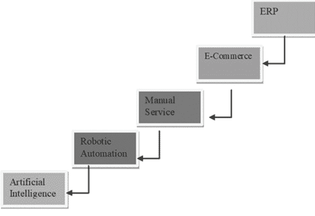

图 5.4
AI 演变。

### 5.3.2.5 人工智能（AI）

人工智能是在机器中模拟人类思维的过程，其中机器在特定情况发生时被程序为像人类一样思考（Jackson 和 Philip 2019）。AI 的主要目标是处理任何关键情况（Szolovits 和 Peter 2019）。
其主要目标包括：

1. 学习
2. 推理
3. 感知。

图 5.4 展示了手动和自动化中发生的变化。

### 5.3.2.6 3D 打印

这用于物理对象的制造，材料分层沉积。3D 打印机需要硬件、软件和材料。它已开始取代制造方法，因为它生产时间更短，最重要的是对环境的影响更小（Chen 等人 2019）。

## 物联网迈区块链的颠覆性技术方面

应用始于任何材料的原型，包括高端产品，如飞机零件、环保建筑、医疗植物和人工的人体。打印方法包括：

- 熔融丝沉积制造（FFF）
- 光固成型（SLA）。

### 5.3.2.6.1 3D 打印的优势

- 构建速度更快
- 产生的废物更少
- 成本更低
- 减少错误
- 按需生产
- 质量
- 无限设计
- 降低风险。

### 5.3.2.7 自动驾驶汽车

这些车辆具有感知环境的潜力，可以在没有人类帮助的情况下驾驶；它们可以到达与人类驾驶的汽车相同的地方，而这种无人驾驶汽车永远不需要人类的任何的支持，因为一旦提供了数据，它将开始自我学习。如果用户需要去办公室，可以通过语音指令完成（Faisal 等人 2019）。

它通过各种传感器实现，如雷达传感器、超声波传感器和激光雷达（光检测和测距），结合 GPS 和视频摄像头（Faisal 等人 2019）。

### 5.3.2.7.1 自动驾驶汽车的好处

- 它们可以减少道路上的车辆数量，导致交通拥堵，因为它可以通过 GPS 自动感知最快路线。
- 它可以降低运输成本，因为车辆仅用于到达所需地点并寻找到达目的地的最佳路线。

### 5.3.2.8 可再生能源

从任何自然手段或重复过程获得的能量被称为清洁能源（Infield, David, and Leon Freris 2020）。可再生能源已在图 5.5 中分类。


## 区块链、人工智能与物联网的融合

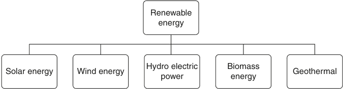

图 5.5
再生能源的分类。

## 5.3.2.8.1 再生能源的益处

- 它根据自然再生的原理工作，产生的气体排放较少，可以减少与全球变暖相关的问题。
- 当人类使用再生能源时，有助于改善人类健康，因为它减少了通过空气和水传播的疾病。
- 该过程是永无止的，因为循环不断重复，利用可用能源资源产生新能量。

## 5.4 通过区块链保护物联网设备的密码学算法

### 5.4.1 密码学

这是一个保护信息免受未经授权使用其信息的入侵者侵害的过程；简单来说，信息被编码并带有密钥发送给用户，密钥用于解码数据以便进行读取和访问。由于密钥基于算法的，入侵者或攻击者很难破解（Pirandola et al. 2019）。

这个词源于希腊语 kryptos；最早在公元前 2000 年就开始埃及埃及。它可以按照以下方式进行划分和描述：

> Crypt = 隐藏的，Graphy = 写作

上述含义说明代码是以隐藏的方式编写的，因此只有特权用户才能访问该信息。

### 5.4.1.1 密码学的益处

在传输之前对数据进行加密有许多优点，主要益处包括以下方面（Pirandola et al. 2019）：

- 使用密码学算法可以应用不同的异构设备。
- 如果需要，它有助于员工在远程地点工作，而不会出现任何安全问题。
- 它促进了客户的数据隐私，实现对数据的最程度保护。
- 通过在数据传输中使用加密算法，让客户信任公司，从而增加了收入。密码学的过程如图 5.6 所示。密码学可以根据加密密钥分类，如图 5.7 所示。

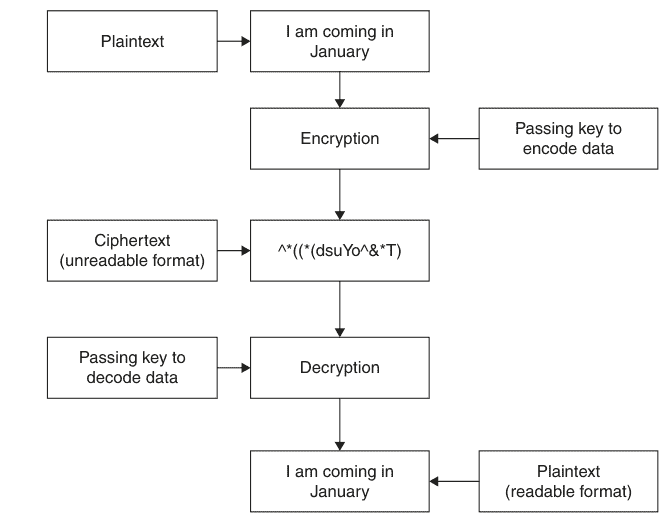

图 5.6
密码学过程。

## 区块链、人工智能与物联网的融合

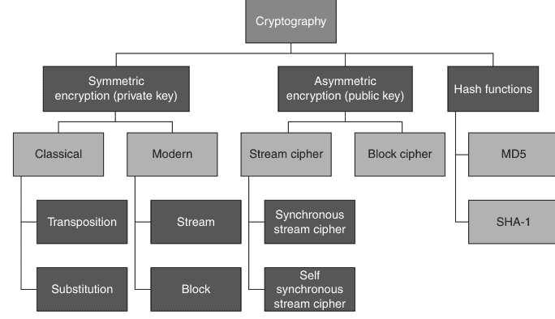

图 5.7
密码学分类。

### 5.4.1.2 物联网数据安全的意义性

物联网数据安全变得越来越重要，因为它是保护环境中传感器记录的数据免受试图破解加密并读取数据的入侵者或攻击者侵害的过程（Hassan 2019）。简单来说，它是验证身份用户并向 IoT 用户授予所需权限的过程（Hou et al. 2019）。密码学的目标可以分为五种形式：

- 机密性
- 完整性
- 非否认性
- 身份验证
- 授权。

### 5.4.1.3 密码学的类型

密码学可以根据加密密钥进行分类。它主要分为以下三类：

- 对称加密
- 非对称加密
- 哈希函数。

## 物联网面向区块链的颠覆性技术

### 5.4.1.4 对称加密

在这种方法中，发送者和接收者使用同一个密钥进行加密和解密，这个密钥被称为私钥或秘密密钥（Li et al. 2019）。

- 示例：AES（高级加密标准）
- 数据加密系统 (DES)、三重 DES、RC2、RC4、RC5、IDEA、Blowfish、流密码、分组密码。

### 5.4.1.5 非对称加密

在类类型的加密中，有两个密钥：用于加密的公共访问密钥和用于解密的私钥。这种加密方法的优点是公钥和私钥是不同的。因此，如果入侵者破解了其中一个密钥，他们无法破解信息。
示例：Diffie Hellman 密钥交换算法、RSA 算法。

### 5.4.1.6 哈希函数

这些是数学符号，通过将一个数字转换为另一个较小的值。该函数的显著优势是输入可以是任何长度，但输出将是固定长度。它在需要提供最大性的的应用中至关重要。物联网环境最高效的哈希函数是 SHA-1 和 MD5。如图 5.8 所示，物联网环境最高效的哈希函数是 SHA-1 和 MD5。

### 5.4.1.7 区块链集成物联网系统

区块链可以增强物联网安全，因为它是一个去中心化的环境，任何入侵者无法追踪数据的位置（Patel et al. 2020）。它能够弥补物联网环境中安全、隐私和可扩展性问题。去中心化的架构使得数据存储在多个地点的服务器上，因此与云物联网系统不同，单点故障不会影响记录的数据。

### 5.4.1.8 区块链的组件

区块链由表 5.2 描述的主要组件组成。

## 区块链、人工智能与物联网的融合

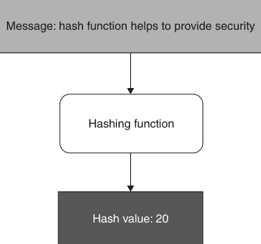

图 5.8
哈希函数。

表 5.2：区块链组件
| 序号 | 组件 | 描述 |
|---|---|---|
| 1 | 节点网络 | 工作量证明验证交易。 |
| 2 | 分布式数据库 | 在数据库中，每个区块包含一个时间戳。 |
| 3 | 账本 | 所有用户均可用。 |
| 4 | 密码学 | 所有数据必须加密。 |

### 5.4.1.9 区块链的类型

区块链可以分为两种类型，如图 5.9 所示。

### 5.4.1.9.1 私有区块链

在这种环境中，使用受信任且知名的用户来执行操作。

### 5.4.1.9.2 公有区块链

在这种环境中，任何人都可以访问读取或写入数据。比特币是使用公有区块链的最佳示例。

## 物联网面向区块链的颠覆性技术

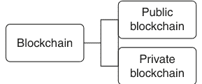

图 5.9
区块链的类型。

### 5.4.1.10 区块链集成物联网

物联网集成区块链的主要原因是增强物联网环境的隐私和安全，因为入侵者随时破坏云。许多公司已开始将物联网与区块链相结合以实现最大的生产和供应链（Wazid al. 2020）。

当产品在物流中时，它提供了透明度，增加了客户对产品的信任。一些公司已开始在其工作运营中使用去中心化的服务器模型（Tseng et al 2020）。

### 5.4.1.11 云模型

在物联网云中，设备连接并将数据存储在服务器上；即使传感器和云很近，必须与互联网关联以传输物联网数据。

第一个考虑因素是数据云和连接的成本，无论服务器与物联网环境之间的距离如何。第二个因素是安全性，因为信息存储在云端对入侵者或黑客开放，因为物联网环境经常受到 DDoS、IP 伪造等攻击。第三因素是云受到入侵者攻击时的停机时间，此时 IoT 用户无法访问实际数据或数据可能被篡改。

### 5.4.1.12 区块链在物联网中的优势

区块链与物联网的结合在许多方面改善了许多人的生活质量；一些主要益处描述如下，如图 5.10 所示。


## 区块链、人工智能与物联网的融合

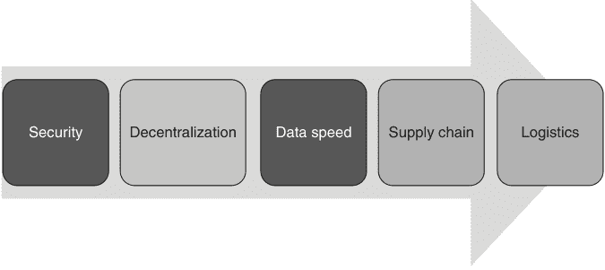

图 5.10
区块链在物联网中的优势。

- 1. 通过将区块链与物联网环境集成，数据传输速度可以更高效。
- 2. 由于区块链的核心是去中心化，它由于不使用中心化服务器，可以降低物联网的运营成本。
- 3. 物联网环境的主要关注点之一是安全性，通过使用信任合法用户的区块链可以增强这种安全性。
- 4. 随着交易速度的提高和成本的降低，导致了另一个巨大的优势：供应链效率。
- 5. 医药等需要物流的行业可以使用物联网区块链来支持货物转运。

## 5.4.2 通过区块链实现的加密算法

### 5.4.2.1 物联网安全攻击

攻击是指干扰物联网环境正常运行的事件，攻击可能由入侵者、攻击者或黑客实施，他们本不应该访问这些信息，但通过对物联网环境进行直接或间接攻击来实现（Jain, Ansh, and Tanya Singh 2020）。

重大挑战包括存储在中心化服务器/云中的记录数据，用户可以根据需要随时访问数据。然而，问题在于云始终对互联网开放，这使得入侵者容易进行“N”次攻击，例如暴力破解、IP 欺骗、中间人攻击或受损攻击，以从服务器获取数据（Alam et al. 2020）。

## 5.5 区块链保护下交易中的增强现实

### 5.5.1 增强现实

这是一个创建一个虚拟但类似于真实世界的自然环境的过程。它是使用计算机生成的传感器输入作为视觉、音频和传感器模型来实现。必须使用该程序来创建一个虚拟环境，用户可以在该环境中与不在现场的任何个人进行实时交互，但能够创建一个非常真实的环境（Palmarin et al. 2018）。

### 5.5.2 增强现实架构的组件

增强现实的组件和工作如图 5.11 所示。

- 硬件需求
- 虚拟位置
- 真实位置。

### 5.5.2.1 虚拟位置

这是使用硬件环境对自然环境进行的复制。实时环境以数字形式呈现，例如 3D 动画、

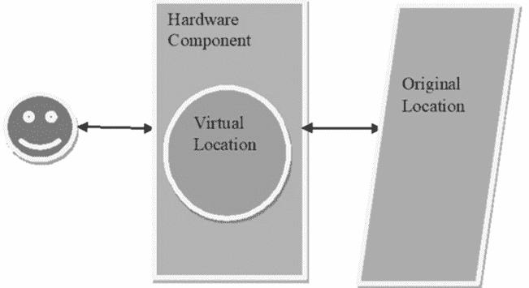

图 5.11
增强现实架构。

2D 图像、网站和振动。增强现实的主要特征是虚拟内容可以动态变化。

### 5.5.2.2 真实位置

这由地理位置、物理对象和环境组成，用于让增强现实更加栩栩生；当查看增强现实时，用户将能够观察该位置的自然环境。

### 5.5.2.3 硬件需求

这些包括以下组件：

- 处理器
- 显示器
- 传感器
- 输入设备
- 相机。

### 5.5.2.4 显示器

这由表 5.3 中的三个主要组件组成。

### 5.5.2.5 增强现实工具分类

增强现实可以通过许多方式体验。下面讨论了以下方法：

表 5.3
增强现实中的显示类别

| 序号 | 显示名称 | 描述 |
| --- | --- | --- |
| 1 | 头戴式显示器 | 将固定在头盔上，示例包括护目镜和眼镜。可用于医疗、娱乐和工程。 |
| 2 | 手持设备 | 这些可以从一个位置转移到另一个位置的设备。手机是最常用的设备。 |
| 3 | 空间显示 | 可以投影到任何固定表面的图形显示，可以显示网格、标量、多边形等时间序列。 |

## 物联网面向区块链的破坏性技术方面

- 增强现实 3D 查看器
- 增强现实浏览器
- 增强现实游戏。

### 5.5.2.6 创建增强现实应用的方法

创建增强现实应用有三种主要方式，如图 5.12 所示：

- 基于标记
- 基于无标记
- 基于位置

### 5.5.2.7 基于标记的

这些基于图像识别，使用黑白标记来显示 AR 内容。当相机放置在标记位置周围时，就可以使用增强组件。
例如：
在教育系统中，概念可以通过多种方式进行教学，如黑板教学、网络研讨会、在线教程、翻转课堂等。AR 可以通过在书籍页面插入动画让系统看起来更生动，因此每当学生将相机指向文本时，动画课程将自动开始，让学生更容易理解主题内容。

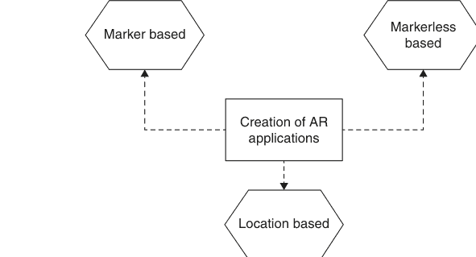

图 5.12
AR 应用的创建。

## 区块链、人工智能与物联网的融合

### 5.5.2.8 基于无标记的

这些基于图像识别，使用黑白标记来显示 AR 内容（注：此处原文内容有重复，已按要求翻译）。
例如：
在教育系统中，概念可以通过多种方式进行教学，如黑板教学、网络研讨会、在线教程、翻转课堂等。AR 可以通过在书籍页面插入动画让系统看起来更生动，因此每当学生将相机指向文本时，动画课程将自动开始，让学生更容易理解主题内容。

### 5.5.2.9 基于位置的

这种工作使用加速度计、数字指南针进行定位。Pokémon GO 是一种非常著名的基于位置的 AR 游戏。
例如：
如果用户想要去他熟悉的新地方旅行，AR 将帮助我们定位街道名称。

### 5.5.2.10 增强现实面临的挑战

尽管有很多与教育、制造、医疗保健、交通（如机场）和娱乐（如电影）相关的 AR 应用，但 AR 的实施仍面临许多挑战（Al-Shuwaili, Ali, and Osvaldo Simeone 2017），如图 5.13 所示。

这些挑战包括：

- 硬件实施
- 内容可用性
- 意识
- 隐私安全
- 物理伤害。

### 5.5.2.11 硬件实施

AR 的主要挑战是硬件实施，因为移动设备尚未配备 AR 的要求。独特的 AR 头显设备仍在进行中，因为消费者需要设备来更主动地体验环境（Al-Shuwaili, Ali, and Osvaldo Simeone 2017）。

### 5.5.2.12 内容可用性

增强现实的主要需求是内容，因为它会使环境具有吸引力。公司在生成高质量内容方面面临挑战。

### 5.5.2.13 技术意识

随着人们对 Pokémon 和 Ingress 产生兴趣，它们接触了大量的受众。然而，AR 的知识尚未覆盖所有观众，因为所有基于 AR 的游戏虽然获得了认可但应用效率低下。因此，营销仍然是 AR 的重大挑战之一。

### 5.5.2.14 隐私安全

增强现实的挑战在于没有标准的衡量方法（无论意图是非）来评估，这导致用户出现安全问题。由于对 AR 的知识仍然不足，可能会导致两个安全问题。入侵者或黑客可以通过微调安全机制来破解系统。

### 5.5.2.15 物理伤害

增强现实最令人担忧的挑战是对环境缺乏关注，这在少数情况下会导致事故，即使是轻微事故。

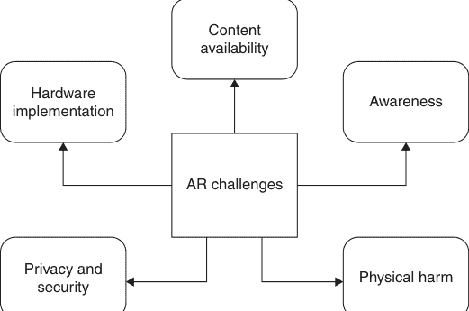

图 5.13
增强现实挑战。


有时可能会导致严重伤害。人们在公共场所玩游戏时如果忽视环境，其生命可能会受到危险。

### 5.5.2.16 增强现实的应用

以下应用使用了增强现实技术（AI-Shuwaili, Ali and Osvaldo Simeone 2017）：

- 1. 体育
- 2. 导航
- 3. 军事
- 4. 教育
- 5. 医疗
- 6. 广告
- 7. 维护
- 8. 旅游。

# 参考文献

1. Bocccardi, Federico, Robert W. Heath, Angel Lozano, Thomas L. Maretta, and Petar Popovski (2014). 5G的五个颠覆性技术方向。IEEE Communications Magazine, 52(2), 74–80.
2. Danneels, Erwin (2004). 重新思考颠覆性技术：批判与研究议程。Journal of Product Innovation Management, 21(4), 246–258.
3. Subramanian, Ramesh, and Brian D. Goodman (Eds.) (2005). 点对点计算：颠覆性技术的演进。IGI Global, USA.
4. Nassiri, Mina, Shyam Nataraj, Daniel J. Margolis, and Leonard S. Marks (2015). 靶性前列腺活检：颠覆性技术演进过程中的教训。Urology, 86(3), 432–438.
5. Velte, Toby, Anthony Velte, and Robert Elsenpeter (2009). 云计算：一种实用方法。McGraw-Hill, Inc, USA
6. Khan, Minhaj Ahmed, and Khaled Salah (2018). 物安全：回顾、区块链解决方案与开放挑战。Future Generation Computer Systems, 82, 395–411.
7. Singh, Sukh Kumar, Shailendra Rao, and Jong Hyuk Park (2020). 区块智能：基于人工智能的区块链智能物联网架构。Future Generation Computer Systems, 110, 721–743.
8. Li, Xiaoqi, Peng Jiang, Ting Chen, Xiapu Luo, and Qiaoyan Wen (2020). 区块链系统安全性综。Future Generation Computer Systems, 107, 841–853.

## 面向区块链的物联网颠覆性技术方面

9. Zhou, Qiheng, Huawei Wang, Zibin Zheng, and Jing Bian (2020). 区块链扩展性的解决方案：综。IEEE Access, 8, 16440–16455.
10. Williams, Tom, Daniel Safir, Takashi Chakrabraborti, and Elizabeth Phillips (2019). 用于人机交互的虚拟、增强和混合现实 (vam-hri)。2019第14届ACM/IEEE人机交互国际会议 (HRI), pp. 671–672. IEEE.
11. Verhey, Jens, T. Maglin, Erik M. Verhey, and David E. Hartigan (2020). 骨科手术中的虚拟、增强和混合现实应用。International Journal of Medical Robotics and Computer Assisted Surgery, 16(2), e2067.
12. Szolovits, Peter (Ed.) (2019). 医学中的人工智能。Routledge, New York.
13. Jackson, Philip C. (2019) 人工智能导论。Courier Dover Publications, USA.
14. Chen, Zhangwei, Ziyong Li, Junjie Li, Chengbao Liu, Changshi Yao, Feng Yangzhou Li, Pei Wang, and Yi He (2019). 化品的3D打印：综。Journal of European Ceramic Society, 39(4), 661–687.
15. Riccardo, Konrad Strodnic, and Martin Braddock (2019). 为什么空间殖民将实现全自动化。Technological Forecasting and Social Change, 143, 162–171.
16. Faisal, Asif, Md Kamruzzaman, and Graham Curry (2019). 自动驾驶车辆。Journal of Transport and Land Use, 12(1), 45–52.
17. Infield, David, and Leon Freis (2020). 电力系统的可再生能源。John Wiley & Sons Inc.
18. Pirandola, Stefano, Ulrik L. Andersen, Leonardo Bianchi, Mario Berta, Darius Bunadar, Roger Colchek, Dirk Englund, et al. (2019). 量子密码进展。arXiv:1906.06145.
19. Hou, Jianwei, Lei Qi, and Qian Shi (2019). 从数据角度看物联网安全。Computer Networks, 148, 295–306.
20. Hassan, W.H. (2019). 物联网 (IoT) 安全的研究：综。Computer Networks, 148, 283–294.
21. Li, Jin, Yanyu Huang, Wei Yi, Siv Li, Zey Li, Changyu Dong, and Wenjing Lou (2019). 具有前向安全性的搜索对称加密。IEEE Transactions on Dependable and Secure Computing 18(1), 460–474.
22. Misty, Yanyu Huang, Wei Yi, Siv Li, Zey Li, Changyu Dong, and Wenjing Lou (2019). 具有前向安全性的搜索对称加密。IEEE Transactions on Dependable and Secure Computing 18(1), 460–474.
23. Singh, Sukh Kumar, Shailendra Rao, and Jong Hyuk Park (2020). 区块智能：基于人工智能的区块链智能物联网架构。Future Generation Computer Systems, 110, 721–743.
24. Li, Xiaoqi, Peng Jiang, Ting Chen, Xiapu Luo, and Qiaoyan Wen (2020). 区块链系统安全性综。Future Generation Computer Systems, 107, 841–853.


## 物联网、人工智能与区块链的未来增强与应用

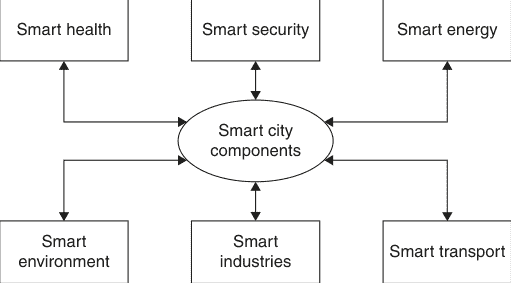

图 6.2
智能城市组件。

该方法论有助于在线追踪人员健康，并在发生任何异常时向用户发出警报 [5]。

### 6.1.6.2 智能安全

传感器嵌入在房屋内部的门和墙中，当有任何威胁进入房屋时，通过向用户发送通知来发出警报；监控摄像头视频增强了安全性且易于定制。许多公司已开始提供各种智能安全机制，让人们在离开家时对财物的安全感到放心 [5]。

### 6.1.6.3 智能能源

在智能能源领域，设备用于生产能量；它使用成本低廉的可再生能源，并保持环境清洁。太阳能和天然气是智能能源的两个例子 [5]。

### 6.1.6.4 智能环境

与传感器、互联网和计算机连接的环境可以描述为智能环境。智能环境的技术包括：

- 1. 人类语音识别
- 2. 设备间的无线通信
- 3. 计算机操作系统
- 4. 设备网络化
- 5. 软件架构框架。

### 6.1.6.5 智能工业

工业已经从早几年得到了升级，具有许多功能。根据性能，企业可以根据表现做出决策，并根据需求适应任何变化。这有助于以可负担的成本增加工业的产量 [6]。

### 6.1.6.6 智能交通

智能交通旨在通过引导车辆来减少交通拥堵，并帮助减少空气污染，因为交通拥堵可以通过智能交通来解决 [7]。用户旅行的时间更短，车辆的成本最低且能耗更低 [5]。

### 6.1.6.7 区块链交易流

图 6.3 解释了区块链中的交易流，从用户完成交易的请求开始 [8]。

### 6.1.6.8 区块链在智能城市中的特性

区块链备关注的主要原因是与其相关的特性 [9]，这些特性包括：

- 匿名性
- 可审计性
- 去中心化
- 分布式账本
- 持久性
- 隐私性。

### 6.1.6.8.1 匿名性

每个用户使用生成的地址与区块链交互，用户地址不会向任何人披露，使用户对任何入侵者都是匿名的 [10]。

### 6.1.6.8.2 可审计性

在区块链中，任何交易在被添加到区块链之前都将经过认证和授权。在这里传输经过了验证 [10]。

### 6.1.6.8.3 去中心化

传统方法中有一个执行交易的中心化系统。其挑战性在于，对中央服务器的入侵攻击会导致整个网络的丢失。目前，使用去中心化系统，没有入侵者能够访问系统 [10]。

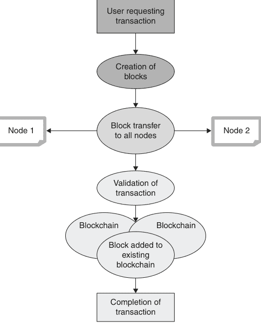

图 6.3
区块链交易流。

### 6.1.6.8.4 分布式账本

这个公共账本包含了所有进入系统的用户，并提供了所有用户的交易详情。区块链用户管理此账本。这种计算在计算机之间共享，使其成为高效的账本。

### 6.1.6.8.5 持久性

在区块链中，正在发生的交易可以快速通过认证，代理交易不会被用户考虑。一旦交易在系统中发生，要删除它具有挑战性，但可以立即检测到无效交易。

### 6.1.6.8.6 隐私性

这是物联网与区块链结合的显著特征之一；由于物联网容易受到攻击者的攻击，区块链通过去中心化和加密帮助物联网环境，防止入侵者进入 [11]。

### 6.1.6.9 区块链智能城市的优势

以下是与区块链智能城市相关的一些优势：

- 犯罪预防
- 企业
- 财产
- 建筑施工
- 去中心化水务管理
- 去中心化电力。

### 6.1.6.10 区块链的挑战

区块链在许多其他领域都有许多应用，因为它不仅限于智能城市，但整合区块链存在困难 [11,12]。主要挑战是：

- 采用
- 技术障碍
- 安全风险
- 法律和监管问题
- 互操作性风险
- 能源消耗。

### 6.1.6.11 安全物联网的挑战

每天都有许多关于增强物联网安全性的研究进行，但导致安全问题的最大挑战源于物联网环境 [13,14]，这些包括：

- 中心化架构
- 物联网环境
- 可扩展性
- 存储空间
- 处理时间
- 设备可靠性。

### 6.1.6.12 中心化架构

由于物联网中的数据存储在中心化的云中，这使得黑客更容易入侵系统、可用性和完整性。这可以使用区块链进行恢复，但会导致机密性和可用性的丢失。

### 6.1.6.13 物联网环境

物联网环境由传感器、执行器和服务器组成。它从异构设备中收集数据，但很难处理大量的设备。

### 6.1.6.14 可扩展性

物联网的主要要求是具有可扩展性，因为它是不同设备的集合。这涉及网络的属性。

### 6.1.6.15 存储空间

在物联网中，数据持续记录并存储在云端。这些数据需要大量的存储空间。因此，数据在特定时间后可能会被删除。

### 6.1.6.16 处理时间

物联网的主要优势是处理时间；如果空间是正常的，通知将更快更可靠，但当用户达到最大限制时就会出现问题。

### 6.1.6.17 设备可靠性

在物联网生态系统中，每个传感器都连接到云，因为云计算是根据服务水平协议（SLA）按租存储数据的过程。

### 6.1.6.18 人工智能

人工智能涉及让系统在没有人类干预的情况下思考的方法；简单来说，是将人类智能赋予机器。这将减少人类的工作并可以帮助大规模生产。它可以与定性数据定量数据一起工作 [18]。它主要分为两个流派：

- 知识系统
- 计算智能。

### 6.1.6.19 知识系统 (KBS) 

这是一个知识库，包含了关于领域的所有必要信息，这些信息由用户上传。案例、框架和规则可以描述为该类别中的知识，如图 6.4 所示。它执行推理机制，这种推理通常由人类完成。知识系统使用启发式方法来解决相关问题。该类别使用如果-那么（if-then）规则而不是数学符号。

### 6.1.7 计算智能 (CI) 

以下是人工智能使用的计算智能方法 [20]:

- 模糊系统
- 遗传算法
- 神经网络。

### 6.1.8 模糊系统

在某些情况下，根据要求无法预测某事是否会发生。为了解决这个问题 [21]，模糊逻辑可以指示它是部分正确还是部分错误的。它在正确和错误之间拥有中间值，如图 6.5 所示。


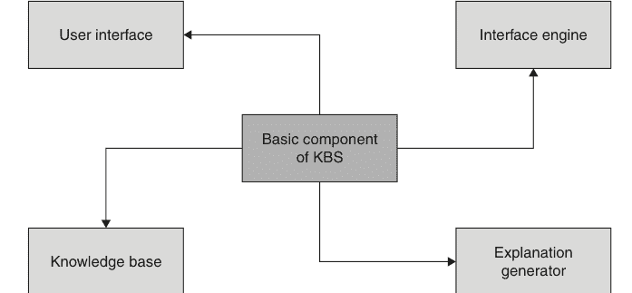

图 6.4
基于知识系统的基本组件。

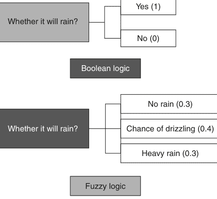

图 6.5
模糊逻辑与布尔逻辑。

它与布尔逻辑形成对比，布尔逻辑只有两种条件：非真即假。上面的示例比较了布尔逻辑和模糊逻辑。

## 6.1.9 遗传算法

这种算法受查尔斯·达尔文自然演化启发而进化而来。它是一种自适应启发式方法，能够为任何复杂问题产生最优解决方案 [22]。

遗传算法执行五种操作：

- 1. 初始种
- 2. 适应度函数
- 3. 选择算子
- 4. 交叉算子
- 5. 变异算子。

## 6.1.10 神经网络

神经网络识别的模式类似于人类智能的建模。这些模式通过标量数值方法执行，传输实际的词汇实体 [23]。数据通过机器的干预被理解，如图 6.6 所示。

## 6.1.11 人工神经网络

这些是受大脑启发的系统，有助于帮助机器以人类学习的方式进行思考。ANN 具有多个类似于大脑生物神经元的节点。神经元与链接相关，这些链接之间相互关联 [24]。

神经网络具有：

- 1. 输入层
- 2. 输出层
- 3. 隐藏层。

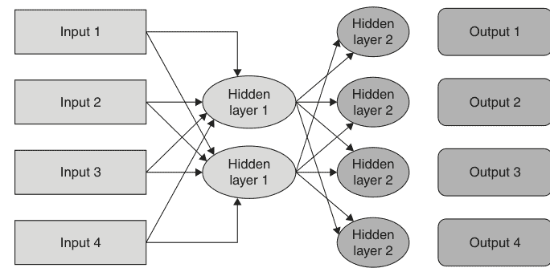

图 6.6
神经网络。

## IoT、AI 和区块链的未来增强与应用

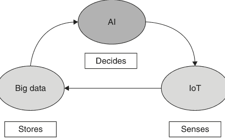

**图 6.7** AI、IoT 和大数据的集成。

## 6.1.12 智能城市中的 AI 和 IoT

IoT 从传感器感知数据，而 AI 用于指示 IoT 记录来自环境的数据，这些数据存储在大数据中。这些数据将随后传回 AI，用于提取信息并根据过去的事件做出决策，帮助解决未来的类似问题。图 6.7 显示了对数据的解释。

## 6.1.13 IoT 中的大数据

对结构化、非结构化、半结构化数据的广泛收集可用于根据数据集做出决策。这里的数据从智能城市环境中持续记录。这有助于根据可用数据做出任何决策，并从业务角度提高生产力。

## 6.1.14 使用 AI 进行安全

智能城市中 AI 和 IoT 的结合在许多方面提供了帮助 [25]，包括：

- 武器噪声检测
- 监控与分析
- 无人机。

## 6.1.15 AI 在智能城市中的应用

- 智能公共交通系统
- 智能交通管理与控制系统
- 安全管理与应急系统
- 智能废物管理
- 智能停车管理。

## 6.1.16 智能公共交通系统

智能交通系统在人口稠密的城市中具有显著差异，并有助于降低成本为居民提供更多安全；它在城市的不同部分之间使用电子设备、无线技术和云作为组件 [26]。

## 6.1.17 益处

- 可以减少污染，有助于缓解全球变暖。
- 与传统交通方式相比，人们具有更高的安全性和保障感。

## 6.1.18 智能交通管理与控制系统

该系统通过高效的交通机制减少城市交通流量；它使用 GPS，帮助寻找车辆位置，从而易于根据可用路线对车辆进行路由。

## 6.1.19 安全管理与应急系统

该系统用于保护人们免受许多原因可能发生的不可预测意外。应急系统将报警附近的医院，并采取可以救生命的立即行动。

## 6.1.20 智能废物管理

IoT 具有通过使用 AI 降低废物及其运营成本的潜力 [27]。废物通常可以分为五类，即：

- 有机废物
- 可回收废物
- 危险废物
- 固体废物
- 液体废物。

## 6.1.21 智能停车管理

智能停车对于解决交通拥堵增加和车辆停车位不足的问题至关重要。智能停车管理可以以名义成本通过高效停车克服上述挑战 [28]。

## 6.2 使用 AI 机制通过智能 IoT 设备改进临床诊断

### 6.2.1 智能 IoT

可穿戴设备正以极快的速度增长，未来可能会取代手机。IoT 通过对互联网的通用系统管理，通过更显著的意识和极大的实用性塑造着人类的存在。它将越来越接近家庭和患者，整合物理和虚拟世界，实现极度定制且常规主动的辅助理解 [29]。

IoT 在安全方面仍面临研究人员，因为数据存储在云端，在任何时候可能被入侵者破坏。如果不在 IoT 的所有点使用坚固的防御并保护信息，IoT 的进步将受到诉讼和社会反对的阻碍。

### 6.2.2 生物医学 IoT 传感器类型

传感器用于通过物联网记录环境数据，这在数据收集中起着关重要的作用。例如，温度传感器可以在温度超过平均水平时提醒用户。同样，许多传感器根据需求用于不同的应用 [30]。

生物医学传感器用于识别特定的生物、物理或化学过程。数据随后被传输到记录异常的地方，并可以采取措施 [31]。它通常用于监测药物状态、环境状况、食物和其他物质，例如是否安全饮用或食用，或任何与实体相关的活动，如图 6.8 所示。


## 6.2.5.3 接触/远程

这包括安装在肌纤维上的应变计传感器之一，用于追踪由于肌肉力量引起的形变。

## 6.2.5.4 感知/执行

这些类型的传感器检测生化、生物电和物理参数，例如自动胰岛素输泵，它是一种直接的接触式执行器。

## 6.2.5.5 动态/静态

静态仪器测量生理参数的时间平均值。

## 6.2.6 AI 与 IoT 的集成

IoT 记录大量的医疗数据，这些数据可以与 AI 一起用于预测和诊断疾病。AI 是计算机像人类一样思考行动的过程，向系统提供测试数据。它通过根据用户提供的数据提供解决方案来应对新的相似情况。简单来说，AI 是人类智能的替代。图 6.10 解释了这一层次结构。

## 6.2.7 集成 AI 与 IoT 在医疗保健中的挑战

IoT 医疗数据的隐私和保密性存在特定的法律和伦理问题。医疗保健的一个基本方面是基因型数据的安全性。

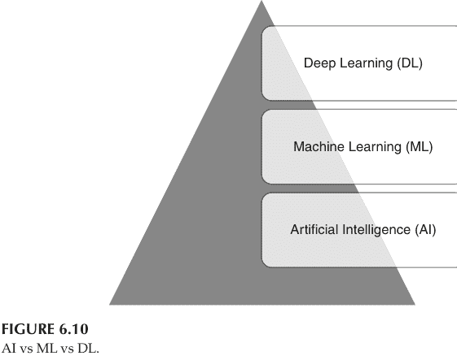

IoT、AI 和区块链的未来增强与应用：IoT 应用具有许多优势；但将 IoT 与 AI 集成面临着一些挑战。记录的数据主要是非结构化的，需要复杂的算法从 IoT 数据中产生价值。由于数据存储在 IoT 云中，因此需要网络安全来保护敏感数据 [35]。

## 6.2.8 医疗诊断生命周期

图 6.11 解释了患者数据如何被记录并随后提供诊断。

### 6.2.8.1 患者数据收集

在此阶段，将测量患者的心率、血压、血糖以及所有其他与健康相关的数据，并将其考虑在内。根据需要，患者的健康数据可以被记录并用于诊断 [36]。

### 6.2.8.2 数据分析

在这里，收集的数据被用于分析患者的问题。这些数据有助于获得患者状况的整体总结。

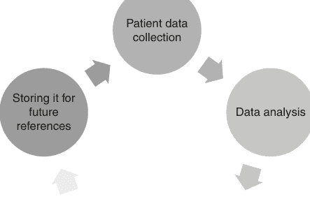

图 6.11 医疗诊断生命周期。

### 6.2.8.3 疾病分类

在此阶段，对分析的数据进行分类，然后发送到下一阶段进行进一步处理。

### 6.2.8.4 诊断调度

一旦疾病被分析并分类，必须尽快进行诊断。所有执行治疗的计划计划已完成。

### 6.2.8.5 存储数据供日后参考

一旦完成治疗，无论诊断结果如何，数据都必须存储在层次结构中，以便在未来处理类似病例。

## 6.2.9 IoT 医疗中的 AI

AI 在根据之前的医院记录诊断患者方面有许多应用。通过以更短的时间低廉的成本执行任务，减轻了医生、护士和管理人员的负担 [37]。它减少了错误，并使患者能够以最大的准确获得诊断。它有助于比医生更快地发现任何患者问题。AI 模型算法可以比病理学家更好地诊断乳腺癌。涵盖的领域包括：

- 可穿戴设备
- 成像
- 药物检测
- 通过预测性分析发现风险
- 基因组
- 虚拟助手
- 医院决策支持
- 远程监控
- 减少患者等待时间

## 6.2.10 可穿戴设备

与医疗相关的主要的 IoT 应用是可穿戴设备，它们监测患者的心率、氧水平和其他健康数据。此外，它将用户连接到云端，以便医疗专业人员监控用户的任何异常数据。这减少了用户和医生花费的时间，因为不需要多次访问医院；而在物理模式下，用户每次都必须去医院进行这些健康读数。如果进行健康读数需要身体到场，还存在感染扩散的可能性 [38]。

IoT、AI 和区块链的未来增强与应用

## 6.2.11 成像

医学成像是 AI 支持帮助诊断患者的主要领域。医学成像的显著优势是它可以不间断地监测患者，使患者能够以最大的准确性和最快获得决策。AI 相关的缺点是，它可能会取代数百万工作，并在未来几年内导致失业。

## 6.2.12 药物检测

AI 支持的药物发现将主要影响医药行业，但可能需要时间，并且需要进行大量的研究来使其更有效。主要的挑战将是患者数据的安全和隐私问题，因为生产药物需要基因代码。

## 6.2.13 基因组学

主要的 AI 应用是取代人类智能，但在临床基因组学中，它可以执行人类智力甚至无法思考的任务。特定的 AI 算法深度学习被用于处理基因组数据集。最标准的基因组方法是变异检测、基因组注释和变异分类。

## 6.2.14 虚拟助手

虚拟助手可以有许多定义方式，因为它根据患者的需求和应用而异。它可以用于家中，也可以用于工作场所。最先进的 AI 技术尚未在全球范围内以廉的价格进入市场。由于挑战众多，目前正在对这些 AI 助手进行许多研究。

## 6.2.15 医院决策支持

在医疗保健中，使用 AI 做出决策将提供更高质量的数据并帮助患者更快康复。它让医生以及其他医疗保健人员的工作变得更容易。AI 将精确地告知患者的情况，是否可能治疗患者，或者是否存在导致难以治疗的并发症。此外，AI 有助于准确评估患者的状况 [39]。

## 6.2.16 远程监控

这包括：

- 数据采集系统
- 数据处理系统
- 监控器或终端

## 6.2.17 减少患者等待时间

基于 AI 的医疗保健有助于根据可用资源和需要分析的患者数量自动实现患者监控和诊断。这有助于将患者与可用医生进行匹配，减少在医院花费的时间。

## 6.3 通过分布式账本机制的技术创新

## 6.3.1 什么是技术创新

在快速发展的社会中，每个组织都在寻找某些技术创新来增加生产或增加公司利润。在理解什么是技术创新之前，我们首先需要理解创新的基本定义。创新可以定义为将较新的知识体现到工具、过程或技术中。


## 物联网、人工智能与区块链的未来增强与应用

这种技术进步来自何？理解发明与应用之间一个至关重要的区别在于，在后者中设计和采用都是必须的。对于技术人员来说，构思一个新设备至关重要，其次，要求设备在社会中找到用处。它必须在经济上或社会上是有益的。社会规范和技术可以促进这两者，也可以阻碍发明和采用。社会规范和结构可以协助或阻碍设计和采用。新技术可能会迅速被取缔，例如火在16世纪、17世纪和18世纪的日本政府曾被禁止使用。采纳的关键要求是来自社会外部事物的认可。

技术创新可以被视为新知识的积累。知识随时间的推积可能会带来创造性的想法。从知识库中发现的创新想法可能与另一个现有事实不同。通过设计、生产并最终实现来转化这一独特想法的过程被称为技术，它被称为技术创新。可以说，技术与创新之间是有区别的。技术侧重于现有工具中使用的现有知识。相比之下，创新侧重于从现有知识中推导出新知识，并基于对现有知识的推导开发新产品。技术创新的主要关注可能是解决业务或组织中存在的问题，这可能会增加公司的生产力、效率和可靠性，从而有助于更广泛经济的增长 [43]。

19世纪末和20世纪初，技术创新在德国的进步通过创造多种产品显示出显著的增长 [44]。技术创新有不同类型，如产品创新和工艺创新。产品创新向客户引入一种与其他产品不同的产品。同样，工艺创新可能包括新的知识和工具，这些工具被用于特定产品制造的后端。

| 知识 | 想法 | 研究与设计 | 实现 | 创新 |
| --- | --- | --- | --- | --- |
| | | | | 发明 |

图 6.12
技术创新过程。

## 区块链、人工智能与物联网的融合

对于服务。此类创新的主要焦点是将新创建的产品或服务引入市场。工艺创新的可能示例包括不同的质量控制方法或交付产品的新方法。

Yang [45] 讨论了私营企业的技术创新。作者讨论了私营企业技术创新的因素。为了在私营企业中引入技术创新，首要需要的方面是创业者的创新想法。这些创新想法可能在劳动、技术和资本等不同活动中有所帮助。技术创新在近期获得了越来越多的关注。创新是一项具有挑战性的因素，公司正在进行大量研究，以独特的方式发布产品以吸引客户。

# 6.3.2 技术创新与商业模式

任何公司的业务在很大程度上依赖于技术，并随着最新技术而变化。新技术可以提高任何公司的盈利能力。据记载，业务经理和企业家也关注技术如何定期变化。因此，可以说商业模式和技术创新是一个双向且复杂的过程 [46]。因此，可以说来自任何部门（如信息技术）的技术都会影响正在创建的任何商业模式，例如，智能手表就是技术创新的例子，它不仅被当作手表，还通过监测佩戴者的脉搏作为健康监测设备工作。另一个例子是智能电视，它通过与电视交互和控制电视内容改变了人们看电视的方式。这些技术改变了每个行业的业务，现在每家公司都在考虑通过新技术来增加客户数量和公司利润。

所有市场都受到数字技术的影响，由于客户需求向技术型产品转移，根据客户需求理解和开发产品及设备变得越来越困难。此外，技术经常发生突然变化。因此，对于企业来说，跟上技术的突发变化越来越具有挑战性。

# 6.3.3 促进经济的技术创新

技术创新可以作为任何国家经济增长的关键要素。可以说，创新是帮助国家经济进步的引擎，而福利是用来解决影响环境和健康领域的当前及未来全球挑战的工具 [47]。Rosen [48] 讨论了增加经济产出的两种基本方法；第一，增加进入生产过程的投入数量；或者，以不同的方式，用相同的投入获得更多的结果。

许多不同的研究表明，在技术中广泛使用创新活动与其他企业相比，在利润方面实现了增长率 [49]，无论行业规模或其他特征如何，这对就业都产生直接影响。然而，如果创新被视为生产增长的重要元素，讽刺的是，它也增加了对技术创新对就业影响的担忧。

随着技术创新的增加，产品的质量和种类增加了许多倍。因此，新市场对产品的需求会导致收入和就业的增加。然而，创新总是会有一些短期中断，这可能动摇一些旧业务模式并导致失业 [50, 51]。例如，如果我们谈论德国经济，德国面临的挑战是劳动生产率的降低 [52]。一项研究发现德国的劳动生产率增长率正在下降；看到2013年劳动生产率的增长比1992年的增长率慢了五倍。原因是2013年技术创新的快速参与，导致技术取代了劳动力 [53]。

# 6.3.4 分布式账本机制

分布式账本类似于数据库，可以在去中心化网络用户之间共享、复制和同步 [54]。分布式账本技术开发于1992年，用于在没有中央权威的环境中创建一个多用户系统 [55]。


## 区块链、人工智能与物联网的融合

分布式账本机制的第二个益处是信心与信任；区块链 [56]（分布式账本技术的一种形式）极大地帮助网络用户之间建立信任。由于所有网络用户都共享网络上任何用户对新信息的更新或添加，任何用户的知识对所有其他用户都是可见的。所有用户都信任网络上的其他用户的信息不会流出网络之外。因此，用户之间维持了高水平的信心和信任。

分布式账本提供的另一个益处是网络和数据的安全。通过区块链技术，数据可以在网络各种用户之间进行存储和处理。通过分布式账本技术，入侵网络或解码数据几乎是不可能的。

## 6.3.5 通过分布式账本实现的技术创新

技术与商业模式相结合时，不仅将造福企业，还将促进经济增长。技术与业务之间的关系一直是一个争议的话题。分布式账本技术是即将出现的数字技术中的最新之一，可以惠及许多领域，包括商业领域、供应链、医疗保健和房地产。因此，分布式账本不仅可以与相关业务整合，还可以与其他部门整合。

分布式账本机制随着其应用之一——比特币（Bitcoin）而流行起来。比特币的概念出现在2008年，当时中本聪明提出了在区块链技术 [57]（一种分布式账本技术）支持下开发加密货币的想法。加密货币中区块链技术的发明被视为一种通过分布式账本机制实现的新型技术创新。随后，其他加密货币进入了市场。包括银行金融、医疗保健和房地产在内的许多机构正在将其公司从传统数据库转向更具信誉的、去中心化且分布式的数据库。这种技术创新让许多行业和组织相信，这项技术将在规定时间内提高生产力。

今天，我们生活在数字货币或无纸货币的时代。早，买家向卖方的所有支付都是现金的形式。然而，现在买家更倾向于通过数字货币支付，无论是通过借记卡、信用卡还是最新的支付方式——手机。然而，所有这些支付方式都有一个共同点，即银行。因此，所有费用并非直接从买家传给卖方，而是经过银行。如果我们有一种技术能让数字支付直接发送给卖方会怎样？答案是，通过分布式账本机制的技术创新使这种成为。

## 物联网、人工智能与区块链的未来增强与应用

分布式账本机制使用智能合约，通过网络两个用户之间可以进行与支付相关的交易。

在讨论通过分布式账本机制的技术创新时，主要的发明是加密货币。加密货币是基于加密算法的虚拟货币。它是通过分布式机制产生的最重大创新之一。近年来发明了多种加密货币，如比特币、以太坊、瑞波、莱特币等。在其中最著名的是2009年开发的比特币。创建加密货币的基本原理是，单个用户或任何节点都不能加速或滥用加密货币的产生，且只能通过加密货币系统产生数量的加密货币 [59]。这种开发加密货币的过程被称为挖矿，挖掘加密货币的用户被称为矿工。因此，加密货币基于区块链技术，矿工加入区块链网络来挖掘加密货币。区块链技术是通过分布式账本机制实现的另一种技术创新。区块链技术是在分布式账本技术下开发的一种新技术，旨在为系统提供高安全性、不可篡改性和提高效率的新方法。区块链技术始于并正应用于许多不同领域，从而促进经济增长。区块链技术的创新使许多行业加快了工作以及与供应商和买家的关联。区块链技术运行在P2P平台上，将单个平台上的每个用户连接起来，使用户更容易跟踪并与其他用户连接，并在同一区块链网络上进行支付，消除了对第三方的的需求。

通过分布式账本的技术创新直接和间接地为用户提供了许多机会。近期很快可能还会通过分布式账本出现更多技术创新。然而，最近在广播技术与人工智能或物联网（IoT）等其他技术的融合中看到了一些创新。这些大技术与分布式账本的结合可能会给技术世界带来革命。

### 6.4 安全数字货币

这些大技术与分布式账本的结合可能会给技术世界带来革命。这是所有时代最好的时代，数字货币的创新达到了其基础。数字货币的路线图如下表所示 [61]。


138

区块链、人工智能与物联网的融合

## 6.4.2 双重花费问题

双重花费涉及一种现金方案，其中同一个单数字令牌被花费两次或多次。这之所以可能，是因为数字令牌是由可以被复制或伪造的数字文件组成的。与伪币一样，双重花费通过在数字文件的复制和伪造过程中创建此前不存在的新货币数量，从而导致了通货膨胀。这一过程导致货币相对于其他货币单位贬值。基础加密技术在保持交易者盲签名匿名性的同时，防止了双重花费问题，特别是在离线系统拆分期间。双重花费的预防措施采取了中心化和去中心化的通用形式。这通常通过在线受信第三方来验证代币是否已被花费。从可用性和信任性的角度来看，这代表了单点故障。到2007年，人们已经提出了若干种防止双重花费的分布式系统。随后，在2009年初，一种解决方案得到了实施。比特币使用工作量证明来避免需要受信第三方对交易进行时间戳。所有这些时间戳都记录在被称为区块链的公共账本中，从而避免了双重花费。

## 6.4.3 比特币

在详细了解什么是比特币之前，我们需要理解为什么需要比特币。首先，我们需要谈论钱。钱到底是什么？钱的核心代表了价值。如果一个人做了一些工作，他将获得一些钱作为回报；那么这些钱在未来就可以用来为他人支付。在整个历史上，价值以许多形式存在，人们使用许多不同的材料来代表货币。然而，对于任何替代货币的其他材料，人们都需要信任这些材料。它应该是有价值的，并且保持足够的价值以便在未来兑换其价值。由于随时携带价值具有挑战性，纸币被发明了，银行和政府持有纸币。因此，花钱比使用实物价值容易得多。现在纸币已在使用，今天金钱的价值来自政府等中央机构赋予它的法律地位。因此，信任模型已经从信任某种物转变为变为信任某人（政府）。纸币存在两个问题：第一是中心化的（有一个像银行或政府这样的中央机构对其进行控制和发行），其次是它的数量不受限制，这意味着政府或中央机构可以根据需要打印任何数量的钞票，这可能会膨胀市场上的货币供应量，导致货币价值下降。

## 物联网、人工智能与区块链的未来增强与应用

出于这个原因，需要转向数字货币。向数字货币的非常简单。既然中央机构发行货币，为什么不制作数字货币呢，该机构可以跟踪谁拥有什么。今天，人们主要使用信用卡、借记卡、PayPal和其他形式的数字货币，这使得物理现金的数量减少到几乎忽略不计的程度。

如果一个人有一个代表美元的文件，那么就可以为该文件制作多个副本产生数百万美元，这就是双重花费问题的一种形式。银行今天使用的解决方案是中心化的解决方案。计算机上保留有一个账本，记录谁拥有什么。每个用户都有一个账户，每个账本对每个账户都有计账。因此，用户信任银行，银行信任计算机，所以解决方案在账本中是中心化的。然而，2009年比特币的发明通过形成去中心化网络提供了解决双重花费问题的另一种方法。比特币是一个没有中央机构的透明账本，而对于银行来说，账本是不透明且中心化的。因此，在比特币账本中，任何用户都可以查看账本以及账本中发生的交易。然而，检查是谁在营销以及谁是账本的所有者是不可能的。这意味着比特币是匿名的。账本中的一切都是开放且可追踪的，但无法追踪是谁在发送给谁。由于比特币是一个去中心化系统，网络没有单一的权威。参与网络的每台计算机都共享一份账本副本，也称为区块链。

与物理货币不同，比特币是一种数字货币，这意味着没有物理硬币可用，只有交易和余额的行。当一个人拥有比特币时，这意味着该人持有访问账本中特定比特币地址记录的权利，并可以将资金从一个地址发送到另一个地址。因此，比特币是货币货币，为货币提供了去中心化的解决方案。比特币有许多优点：

- 第一，比特币让用户对自己的钱拥有完全控制权，无需任何机构干预。
- 第二，比特币消除了传输过程中的中间人。
- 第三，与纸币不同，比特币在本质上设计为数字化的，这意味着可以在之上添加额外的编程层。
- 最后，比特币为约25亿无法获得银行服务的人开启了大门。

## 区块链、人工智能与物联网的融合

一些商家接受比特币，包括微软和维基百科。

## 6.4.4 比特币挖矿

比特币的创建是银行系统的去中心化替代方案。这意味着系统可以在没有任何权威的情况下将资金从一个账户转移到另一个账户。比特币系统协议中应用的规则以非常创意且高效的方式解决了这个问题。任何人都可以参与比特币的挖矿过程。

要产生比特币，用户必须预测一个随机数。计算机对这个随机数进行预测。系统越快、越强大，每秒对这个随机数的猜测就越快；如果用户设中正确的随机数，他们就会获得一个比特币，并进入下一个比特币交易区块。

现在让我们更详细地讨论挖矿过程。一旦你的挖矿计算机得出了正确的猜测，挖矿程序将确定当前的待处理交易将分组到下一个区块中。创建的区块和寻找正确随机数的解决方案被发送到整个区块链网络，以便网络上的其他计算机可以验证新交易。网络上验证解决方案的每台计算机都会在本地计算机上更新其比特币交易账本副本，加入被选定包含在下一个区块中的交易。


## 物联网、人工智能与区块链的未来增强与应用

141

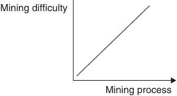

图 6.13
挖矿过程。

比特币的发明者中本聪（Satoshi Nakamoto）应用了一些挖矿规则，使得网络的算力越大，推测出挖矿问题的解决方案就越困难。

因此，挖矿过程的难度会根据网络所拥有的算力进行自我调整。如果有更多矿工加入网络，问题的难度级别就会增加，解决问题也会变得更具挑战性（见图 6.13）。如果部分矿工离开，难度就会降低，使他们更容易解决问题。这被称为挖矿难度。因此，中本聪的动机是让系统稳定地产生新的比特币，这也可以控制通货膨胀。矿难度的设定使得每分钟（平均）仅添加 10 个新区块。

当2009年比特币开始挖矿时，矿工并不多，由于挖矿难度非常低，使用平均速度和算力的简单计算机进行比特币挖掘是非常直接的。然而，随着比特币开始拥有更多用户，人们开始寻找更强大的挖矿解决方案，并转向 GPU 挖矿。GPU（图形处理器）是用于计算机的独特组件，用于执行更复杂的计算。GPU 的设计初目的是让玩家运行具有高图形需求的游戏。由于 GPU 的架构，这些设备在密码学领域变得流行，并且在2011年，用户开始使用 GPU 挖掘比特币。需要注意的是，1 个 GPU 的算力相当于 30 个 CPU。挖矿的另一场革命是 FPGA（现场可编程逻辑门阵列）挖矿。FPGA 是一种计算机硬件，可以连接到计算机上运行一组计算。FPGA 与 GPU 类似，但速度快 3 到 100 倍。FPGA 的缺点是它们更难配置。这就是为什么它在挖矿过程中没有 GPU 成功的原因。

最后，在2013年，一种新的矿机问世了——“ASIC 矿机”。ASIC 代表应用专用集成电路。这些硬件是专门为挖掘比特币而创建的。与 CPU、GPU 和 FPGA 不同，ASIC 不能用于任何其他用途。ASIC 的功能被硬编码在机器中，因此 ASIC 矿机是目前的挖矿标准。

## 区块链、人工智能与物联网的融合

## 6.4.5 矿池

当用户进入比特币生成过程时，用户面临着激烈的竞争。即使用户拥有最好的矿机，与专业的比特币矿场相比，也可能处于劣势。比特币矿池应运而生。矿池无非是一个聚集在一起的矿工集合，他们结合算力来更快、更高效地竞争。如果矿池成功赢得竞争，奖励将根据个人矿工贡献的算力分配给所有池内矿工。通过这种方式，即使是小矿工也可以加入挖掘游戏并产生比特币。然而，小矿工有时需要为他们的服务支付一小笔费用。今天，十多个大型矿池在争夺挖掘比特币和更新账本的机会。

## 6.4.6 区块链过程

区块链过程基于共识机制来对交易进行验证和使用（见图 6.14）。区块链网络由以分布式去中心化方式连接的各种节点组成。任何需要执行交易的节点都必须将交易写入区块。区块可以被看作一种类似容器的数据结构，平均包含约 500 交易；然而，区块的大小可以达到 1 MB [62]。

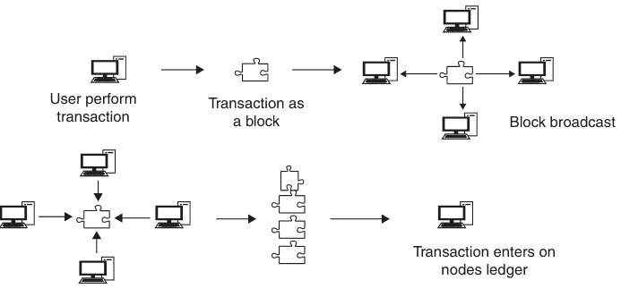

图 6.14
区块链过程。

节点在区块中执行交易，并将其发送到分布式网络中的其他节点。由于区块链网络是去中心化的，营销区块由节点创建；因此，区块会广播到网络中的所有节点。区块链网络是一个基于共识的网络，这意味着所有节点必须通过共识算法对交易达成一致。算法是分布式网络中多个节点达成决策的过程 [63]。共识算法为分布式网络提供了可靠性。有许多共识算法；如工作量证明（Proof of Work）、权益证明（Proof of stake）、拜占庭容错（Byzantine Tolerance）等。因此，一旦区块被网络中的所有节点验证和确认，它就会添加到区块链已有的区块中，如图所示。新添加的区块始终引用链中的上一个区块，这将使链更加安全。一旦区块被添加到区块链中，接收节点就可以用新信息更新账本。

## 6.4.7 共识算法

到目前，我们描述了什么是区块链；它是一个分布式账本。考虑一种情况，我们有五个挖矿节点，所有节点都有一份区块链副本，所有文档的状态都相同，这意味着所有节点都拥有完全相同的副本。现在网络在进行一些交易后接收到一个新区块。这个新区块需要添加到区块链中。但是，区块是如何添加的？共识算法是分布式网络中多个节点达成决策的过程 [63]。共识算法为分布式网络提供了可靠性。有许多共识算法；如工作量证明、权益证明、拜占庭容错等。因此，一旦区块被网络中的所有节点验证和确认，它就会添加到区块链已有的区块中，如图所示。新添加的区块始终引用链中的上一个区块，这将使链更加安全。一旦区块被添加到区块链中，接收节点就可以用新信息更新账本。

## 6.4.8 共识算法类型

到目前，我们描述了什么是区块链；它是一个分布式账本。假设我们有五个挖矿节点，所有节点都有一份区块链副本，所有文档的状态都相同，这意味着所有节点都拥有完全相同的副本。现在网络在进行一些交易后接收到一个新区块。这个新区块需要添加到区块链中。但是，区块是如何添加的？共识算法是分布式网络中多个节点达成决策的过程 [63]。共识算法为分布式网络提供了可靠性。有许多共识算法；如工作量证明、权益证明、拜占庭容错等。因此，一旦区块被网络中的所有节点验证和确认，它就会添加到区块链已有的区块中，如图所示。新添加的区块始终引用链中的上一个区块，这将使链更加安全。一旦区块被添加到区块链中，接收节点就可以用新信息更新账本。

## 6.4.8 共识算法类型

有许多共识算法大致分为两类：基于证明的（proof-based）和基于 BFT 的（BFT-based）。在基于证明的机制中，网络领导是随机的。这种共识类型也被称为无许可。在 BFT 版本（拜占庭容错）中，通过多轮投票选举网络领导。这种共识机制也被称为许可。

## 6.4.9 工作量证明

这种机制的基本思想最早引入于 1993 年以用于反垃圾邮件，并在 1997 年正式称为工作量证明。然而，在2009 年中本聪创建比特币之前，该技术很大程度上未使用。他意识到这种机制可以用于在节点之间达成共识，并用它来保护区块链。工作量证明算法通过让所有节点解决密码难题来工作。

工作量证明协议是一种人们可以有效证明自己投入了大量努力的。工作量证明协议通常等于难题，这些难题解决起来非常有挑战性，这意味着它们需要巨大的计算量，而且没有捷径。另一方面，验证所需的时间远少于最初执行的时间。有许多应用使用 POW，比特币就是其中之一。在任何时间戳协议中，工作量证明都可以通过增加 nonce（随机数）的值来实现nonce 是区块中的一个字段，通常是一个任意或随机数，在密码学中用于防止重放攻击。nonce 值应该是唯一的，并附加到任何要哈希的内容末尾。因此，如果有人尝试重用相同的数字，会导致失败，因为每个字母必须是唯一的。每当用户尝试尝试修改并使用该节点时，区块链将受到干扰。


# 物、人工智能与区块链的未来增强与应用

美国的家庭甚至可以为整个新西兰提供电力。对于工作量证明（PoW），计算机需要大量的处理能力，这还需要额外的外围设备，从而产生额外成本。随着 PoW 挖矿过程中比特币数量减少或可用性降低，挖矿将变得更加复杂。因此，一些矿工决定挖掘另一种名为以太坊的数字货币，它使用的是权益证明（Proof of Stake）。

## 6.4.10 权益证明

比特币消耗大量的能量来维护其网络，由于工作量证明算法的原因，挖掘新币需要大量的计算能力。因此，必须有除加密货币之外的其他替代方案。2011年，一个名为 QuantumMechanic 的比特币用户提出了一种名为“权益证明”的技术。权益背后的基本思想是，通过挖矿进行相互竞争是浪费的。相反，权益证明使用了一种选举过程，在其中随机选择一个节点来验证下一个区块。与工作量证明不同，权益证明中没有矿工；相反，他们被称为验证者（validators），它不让人们挖掘新区块，而是由他们“铸造”（mint）或“锻造”（forge）新区块，这个过程被称为铸造或锻造。

要成为验证者，一个节点必须在网络中质押一些币作为保证金。质押的大小决定了验证者被选中锻造下一个区块的概率。尽管这看起来可能不公因为选出的验证者是富人，但实际上与工作量证明相比，它是合适的。在工作量证明中，富用户可以享受规模经济带来的利益和权力。用户为挖矿设备付费，电力成本并非线性的；相反，购买得越多，价格越优。然而，在权益证明中，如果节点被选中验证下一个区块，用户将检查所有交易是否有效。如果一切正常，节点会对区块进行签名并将其添加到区块链中，作为奖励，节点将获得每笔交易相关的费用。但现在的问题是，如何信任网络上的验证者？这就是角色（role）的作用所在；如果验证者批准了任何欺诈交易，他们将损失部分质押；只要验证者的质押高于他们从交易费中获得的费用，就能证明验证者在正确地工作，否则他们损失掉的钱将比获得的要多。这是一种财务激励，只要质押高于所有交易费的总和，它就能维持。如果任何节点停止成为验证者，在发现某些区块是欺诈性的若干一段时间后，其质押和其收到的所有交易费将获得释放。

## 6.4.11 工作量证明 (PoW) 与权益证明 (PoS) 的区别

权益证明不让所有人挖掘新区块，因此消耗的能量更少，且更去中心化。在工作量证明中，存在所谓的矿池（mining pools），用户组成团队以增加他们挖掘新区块的概率，从而收集奖励。然而，这些矿池可以控制比特币区块链的大部分。它们使挖矿过程变得中心化，这是非常危险的。假设有三到四个矿池合并，它们将拥有网络的大多数权益，并可能开始批准欺诈交易。这种类型的问题被称为 51% 攻击。

另一个主要优势是，基于权益证明的区块链设置节点的成本要比基于工作量证明的区块链便宜得多。这完全不需要鼓励更多用户设置节点并使网络更加去中心化和安全。然而，即使是权益证明也不是完美的，存在一些缺陷。例如，如果用户购买了网络中大部分的质押，该用户就可以有效控制网络并批准虚假交易（51% 攻击）。

权益证明在选择后续验证者时也必须非常小心。这不能是随机的，因为必须考虑质押的大小。尽管如此，仅凭质押是不够的，因为它会倾向于富用户，他们会被频繁地选中并收集更多的交易费，从而变得富有，这再次增加了他们被选为验证者的概率。

另一个问题是，当网络选择下一个验证者但该用户未胜任这项工作时，它会选择大量的备份验证者作为后备。

Peercoin、Lisk 和 Nxt 是使用权益证明算法作为挖矿算法的一些代币。例如，以太坊正在实现一种名为 Casper 的权益证明系统。它目前已部署在以太坊测试网上并正在积极开发中。

## 6.4.12 委托权益证明

委托权益证明（DPoS）是另一种用于基于区块链网络的共识算法，用于确定每个区块的验证者，并在对哪些数据应添加到链做出共识决策后执行。

DPoS 由 Dan Larimer 在 2013 年发明，当时是为了解决与比特币工作量证明相关的问题。最初，DPoS 是为了加密货币比特币提供动力而创建的。DPoS 是通过新共识算法中的质押进行委托，允许系统股东控制由谁认证账本。这将使用户能够拥有 10 秒的区块时间来处理交易，每笔交易 10 秒或更多，并允许网络扩展。

# 物、人工智能与区块链的未来增强与应用

允许网络扩展到具有高度高效、专业化但保持在股东控制之下的专用节点。因此，委托权益证明的用户指派他人代表其维护网络，这些人人就是代表人（delegates）。共有 101 个代表人，他们轮流随机产生区块，例如每 10 秒一次。

工作量证明和权益证明最显著缺点是，它们分别容易受到 51% 攻击和 51% 股东攻击的影响。然而，没有什么可以避免 51% 攻击，因为它是共识算法固有本质的一部分。DPoS 比任何其他系统都快得多，因为 DPoS 使用确定性的方式产生区块，不需要依赖随机概率。代表人是股东所知的经过证明的节点，他们具有专门的可靠性，每 10 秒产生一个区块，而没有波动性，与其他系统不同。由于系统的工作方式，用户可以在 10 秒内完全确认几乎可能发生的任何区块链故障。

## 6.4.13 拜庭故障容错 (BFT)

BFT 共识算法基于一个广为人知的“拜庭将军问题”（Byzantine General problem）。拜庭将军问题是一个共识问题。山脉和其他障碍围绕着将军们；这些将军只能通过派遣信使来通信。此外，他们还没有决定是进攻城市还是撤退。现在，只有在观察敌人之后，他们才同意一个联合行动计划。只有所有将军同时发起攻击才能成功攻服城市。走到这一步，他们派遣信使带着关于如何进行的投票去。然而，问题是某些将军被收买了。作为背叛的回报，他们将从城市获得巨款。这些叛徒将军将向同伴提供错误信息以失败攻击并防止共识。此外，他们的信使可能会丢失或损坏信息。问题产生于如何才能再次和平。在存在三分之一或更高比例的潜在叛徒将军的情况下，没有解决方案。这些叛徒将军被称为拜庭节点，它们可能会恶意或任意行动。

实用拜庭故障容错（Practical Byzantine Fault Tolerance）由 Miguel Castro 和 Barbara Liskov 于 1993 年发布，提供了一种算法允许节点在不超过三分之一拜庭节点的情况下达成共识。该论文启发了许多拜庭故障容错算法的迭代，特别是随着对


## 区块链、人工智能与物联网的融合

区块链共识算法。现在我们来看分布式系统中的各种类型故障。主要有两种可能的责任类型。第一种故障是**停止性故障（fail-stop fault）**。在停止故障期间，节点可能会崩溃或不返回值。回想，节点在功能上包含了发送、存储和处理信息。分布式共识的早期研究目标目标是解决这类问题。这种故障可能是暂时的也可能是永久的，但处理第二种故障总是会容易得多。这种故障是**拜占庭将军问题（A Byzantine generals problem）**，指的是对协议的任何任意偏离故障。这意味着节点不仅可能停止响应或接收信息，还可能发送损坏的数据和虚假信息。拜占庭故障是停止性缺陷的超集。大多数攻击者的行为，例如试图阻碍共识的受贿的将军，都属于这类故障。这种故障是所有公共区块链都必须防范的，因为区块链网络中的参与者是未知且不可预测的。

# 参考文献

- 1. Cicarelli, Franco, Antonio Guerrieri, Giandomenico Spezzano, and Andrea Vinci (2017). 一种用于动态智慧城市应用的边缘平台。Future Generation Computer Systems, 76, 106–118.
- 2. Yucel, Sakir (2017). 用于智慧城市的智慧城市无线平台。在建模、仿真与可视化方法国际会议 (MSV) 论文集中，pp. 100–106。计算机科学、计算机工程与应用计算世界大会指导委员会 (WorldComp)。
- 3. Peng, Wei Gao, and Jiajia Liu (2019). 智慧城市的AI赋能大规模设备多接入。IEEE Internet of Things Journal, 6(5), 7623–7634.
- 4. Silva, Bhagya Nagthi, Murad Khan, and Jijun Kan (2018). 迈向智慧城市：智慧城市趋势、架构、组件和开放挑战的综述。Sustainable Cities and Society, 38, 697–713.
- 5. Rusti, Bogdan, Horia Stefanescu, Marius Iordache, Jian Genta, Catalina Brezeanu, and Christian Patacha (2019). 用于 5G 网络切片的智慧城市组件部署。在欧洲网络与通信会议 (EuNCC)，pp. 149–154. IEEE.
- 6. Barbosa, José, Paulo Leitão, Daniel Tentesaus, Armando W. Colombo, and Stamatis Karnikous (2016). 网络物理系统与智能产品对智慧城市产业的跨界效益。在 2016 IEEE 第 14 次工业信息国际会议 (INDIR)，pp. 504–509. IEEE.
- 7. Koresh, M. H. J. D., and Deva, J. (2019). 基于计算机视觉的智慧交通交通感知。创新图像处理期刊 (JIIP), 1(01), 11–19.

## 物联网、人工智能与区块链的未来增强与应用

- 1. Biswas, Kamanashi, and Vallipuram Muthukkumarasamy (2016). 使用区块链技术保障智慧城市安全。在 2016 IEEE 第 18 次高性能计算与通信国际会议；IEEE 第 14 次智慧城市会议；IEEE 第 2 次数据科学与系统国际会议 (HPCC/SmartCity/DSS)，pp. 1392–1393. IEEE.
- 2. Jiang, Li, Shengli Xie, Sabita Majhan, and Yan Zhang (2019). 区块链赋能绿色安全物联网的无线功率传输。IEEE Network, 33(6), 164–171.
- 3. Kamchan, Christopher S. Dutt, Prakash Chahath, and Majid Khan (2019). 用于智慧城市和智慧旅游的区块链技术：最新趋势与挑战。亚太旅游研究杂志, 26(4), 454–468.
- 4. Hakak, Sahib, Wazir Zara Khan, Gulshan Ali Gilkar, Muhammad Imran, and Nadra Guizani (2020). 通过区块链技术保障智慧城市：架构、需求与挑战。IEEE Network, 34(1), 8–14.
- 5. Batubara, Rizal, Julien Uibat, and Marij Janssen (2018). 电子政府区块链技术面临挑战：系统性文献综述。在第 19届数字政府年度国际会议：数据时代的治理 论文集中，pp. 1–9.
- 6. Butt, Sharif Aziz, Jorge Luis Diaz-Martinez, Taaseef Jamil, and Muhammad Shoaib (2019). 物联网智能健康安全趋势。在 2019 计算科学与应用国际会议 (ICCCSA)，pp. 26–31. IEEE.
- 7. Mahmoud, Rwan, Taaseem Yusuf, Fadiol Tsangaratos, 物联网 (IoT) 安全：现状、挑战与前瞻性措施。在 2015 第 10 次互联网技术与安全通信国际会议 (ICCTT)，pp. 336–341. IEEE.
- 8. Singh, Sushal Kumar, Shailendra Rathore, and Jong Hyuk Park (2020). 区块链智能：一种基于区块链的人工智能物联网架构。Future Generation Computer Systems, 110, 721–743.
- 9. Gharbhieh, Mohammad, Hassan Elmsawy, and Bader, and Mohamed-Slim (2017). 时空物联网建模：扩展性分析。IEEE Transactions on Communications, 65(8).
- 10. Kodavi, Ravi, Sunadeep Jain, and Lakshmi Boppana (2016). 基于物联网的智能家居。在 IEEE 第 14 次计算与自动化国际会议 (ICCCA)，pp. 1286–1289.
- 11. Nilsson, Nils J. (2014). 人工智能。美国: Springer.
- 12. Azar, Rwan, Sundar, and Data-, (2015). 基于知识的系统研究。应用科学期刊, 5(1).
- 13. Banerjee, Amit, Chinmayraborty, and Debabrata Biswas (2020). 健康技术数据分析的新趋势。生物医学工程数据科学方法手册，pp. 121–152. 美国: Academic Press.
- 14. Hassan, Moeen, Alex Page, and Silvana Andreev (2015). 基于物联网感知的健康监测管理：机遇与挑战。在 2015 IEEE 服务计算会议上，pp. 285–292.
- 15. Zhou, Guoxuo, Qibin Zhao, Yong Yu, and Cichocki (2016). 从矩阵到高阶张量的关联分量分析。IEEE 学报, 104(2), 310–331.
- 16. Singh, Deepak (2014). 生物医学仪表导论。印度新里：PHI Pvt. Ltd.
- 17. Gao, Lan, Li, Song-Qing Pan, Tao Xiong, and Shu-Chuen Li (2015). 癫痫负担：基于流行率的癫痫疾病、直接和无形成本研究。癫痫研究, 110, 146–156.
- 18. Katare, Geetanjali, Gouri Pidar, and Z. Qereshi (2018). 人工智能与物联网集成挑战。国际系统与软件工程期刊, 6(2), 10–15.
- 19. Sodhro, Ali Hassan, Saleem Pirbhakul, and Arun Kumar Sangaiah (2018). 医疗健康领域物联网与产品生命周期管理的融合。Future Generation Computer Systems, 86, 380–391.


## 物联网、人工智能与区块链的未来增强与应用

37. Shah, Rishabh, and Alina Circu (2018). 医疗保健中的物联网与人工智能：系统性文献回顾。Issues in Information Systems, 19(3), 33–41.

38. Patel, Mites S, David A. Asch, and Kevin G. Volpp (2015). 可穿戴设备作为健康行为改变的促进者而非驱动者。Jama, 313(5), 459–460.

39. Cervantes-Sagrera, Bernardo, Manuel Campos, Antonio Morales, Jose M. Juarez, and Francisco Pacacios (2016). 医院环境下抗生素管理的临床决策支持系统的开发。Progress in Artificial Intelligence, 5(3), 181–197.

40. Sahal, D. (1997). 技术的多维扩散。Technological Forecasting, 10, 277–298.

41. Girifalco, L. A. (n.d.). 技术变化的动态。Van Nostrand, New York.

42. Taggart, M. M. (1994). 技术与创新管理：综述。R&D Management, 24(4), 341–353.

43. Diaconu, M. (2011). 技术创新：概念、过程、类型及其对经济的意义。Theoretical and Applied Economics, XVIII(10(563)) 127–144.

44. Wim Naudé, P. N. (2017). 德国的技术创新与包容性增长。IZA–劳动经济学研究所。

45. Huan-Chung, Y. (2011). 企业技术创新系统与发展研究。电子、通信与控制国际会议 (ICECC), pp. 3042–3045. IEEE.

46. Charles Baden-Feller, S. H. (2013). 商业模式与技术创新。Science Direct Long Range Planning Journal, 46(6), 419–426.

47. Diaconu, M. (2011). 技术创新：概念、过程、类型及其对经济的意义。Theoretical and Applied Economics, XVIII(10(563)), 127–144.

48. Rosenberg, N. (2004). 创新与经济增长。经济合作发展组织。

49. Çalükan, H. K. (2015). 技术变革与经济增长。技术、创新与创业世界会议，pp. 649–654. ScienceDirect.

50. Kristina Matuzevic, M. B. (2017). 技术创新会影响失业率吗？来自欧洲国家的一些实证证据。Economics, 5(48)—开放访问期刊。

51. James Broughel, A. T. (March, 2019). 技术创新与经济增长。可用：https://www.mercatus.org/publications/entrepreneurship/technological-innovation-and-economic-growth

52. McGuckin, R. H., Streitwitz, M., and Dams, M. (1998). 技术对生产力增长的影响。Economics of Innovation and New Technology, 7(1), 1–26.

53. Witte, K. (December 19, 2017). 技术创新：对劳动力的挑战。可用：https://doc-research.org; https://doc-research.org/2017/12/technological-innovation-challenges-labour/

54. Sloane Brakaville, B. P. (June 1, 2019). 区块链基础：分布式账本简介。可用：https://developer.ibm.com/; https://developer.ibm.com/tutorials/cl-blockchain-basics-intro-bluemix-tr/

## 区块链、人工智能与物联网的融合

55. Michel Rauchs, A. G. (2018). 分布式账本技术系统：概念框架。SSRN电子期刊。

56. Claudia Loebecke, L. L. (2018). 区块链技术影响交易中的信任角色：钻石交易案例的反。第二十六届欧洲信息系统会议 (ECIS),波尔斯茅。

57. Nakamoto, S. (2009). 比特币：一种点对点电子现金。可用：http://bitcoin.org/bitcoin.pdf.

58. ISDA (August 2017). 智能合约与分布式账本——法律视角。可用：https://www.isda.org/smart-and-distributed-ledger-a-legal-perspective.

59. Vejakča, M. (2014). 加密货币的基本方面。Journal of Economy, 2, 75–83.

60. Rose, C. (2015). 数字货币的演变：比特币，一场货币革命。International Business & Economics Research Journal, 4, 1.

61. Biggs, J. W. (May 2017). 数字货币导论。可用：https://bookown.org/cryptocurrency/.

62. Madeira, A. (November 2016). 什么是块大小？可用：https://www.cryptcompare.com/coins/what-is-block-size/.

63. Rouse, M. (August 2017). 共识算法。可用：https://target.com/consensus-algorithms/.

64. Wei, Q. L. (2019). 无线传感器网络恶意检测的区块链模型。Special on Things, pp. 387–395.

65. Anwar, H. (August 2015). 共识算法：区块链技术的根源。可用：https://10blockchains.com/consensus-algorithms/.

66. Baliga, D. (2017). 理解区块链模型。Persistent Systems, India.

67. Wenbo Wang, D. (2018). 区块链共识机制与管理综述。arXiv。

68. Cynthia, M. (2001). 通信定价。年度国际会议，pp. 139–147. 柏林：Springer。

69. Taotao Li, P. A. (2017). 加密货币的工作量设计。Crypto ePrint.

70. Pawel Szalowski, D. R. (2019). 透明化与工作证明。第28届 USENIX 安全研讨会，pp. 819–834. 加利福尼亚州圣克拉拉：USENIX。

71. Alexander Chernoy, T. (2017). 比特币：工作量与权益证明。数字货币革命。

## 数字货币的革命


# 战略技术趋势带来的数字世界革命

以及重复测试。决策支持系统可以快速解析电子病历中的大量数据 [10]。AI 技术也通过突出图像上的问题区域，消除了查看患者影像时的不确定性，辅助筛查和诊断过程 [11]。AI 通过移动应用程序收集患者数据，或通过某些短信 BOTS 向患者询问有关症状的一系列问题，帮助缓解医生职业倦怠的问题；基于这些症状，BOT 根据某些推测进行自我诊断，从而节省了患者和医疗人员的时间与精力 [12]。随着 AI 集成变得更具创新性，它为患者、医院和医疗健康行业解决各种问题提供了解决方案。

## 7.1.3 金融与银领域的人工智能

从安全到客户服务，人工智能正在改变银行的运营方式。人工智能是一种机器从经验中学习并执行以前需要人类智力完成的技术。

技术的使用在近期变得非常流行，在银行行业尤为常见。一些金融公司为企业提供金融技术支持，包括支付的技术创新以及借贷的自动化。银行和金融机构以个性化的客户服务闻名，因此一切都取决于客户服务专员。专员负责电话、电子邮件和网站等各种客户服务。在目前的场景下，通过交互语音响应 (IVR) 每月有数百万次通话，分配给专员和其他操作人员。这是一项需要大量人力资源和工作的巨大任务。为了使这种传统的银行客户服务方法自动化，Centrosoft 引入了基于 AI 技术的客户响应管理系统。CRM 解决方案作为银行业的智能解决方案，可以在无需干预的情况下处理数千个实例，其目标是实现系统自动化并控制人工成本。CRM 解决方案证明能够实现预期目标。Centrosoft 是首个生产这种基于 AI 的解决方案的公司，这是一个多语言系统。Centrosoft 承诺为语音和文本识别服务提供 100% 的准确率。Centrosoft 还提供了其他优势，包括可以将银行政策和程序输入系统，以确保客户提供无错误的服务。与银行相关的查询可能涉及用户账户信息（如近期交易），这些以及所有其他查询都可以得到高效处理。AI 解决方案将充当人工客服支持银行客户并解决他们的查询。该系统的开发是为了节省时间、金钱和相关资源，并提供无错误的快速响应。

## 7.1.4 人工智能的障碍

人工智能是一项将影响所有国家未来的技术。如今已有许多应用该技术的用例。尽管如此，如果我们想让这项技术发挥最大的潜力，它仍面临许多需要尽快解决的障碍和挑战 [13]。

- 计算能力不足
人工智能的核心在于基于数据工作、机器学习和深度学习，这可能需要大量的计算和运算，且这些计算必须非常快速。系统的处理能力必须更高，才能进行此类重大的估计和计算。我们现在的计算能力无法应对日益增长的数据处理量。因此，计算能力的缺乏可能会降低连续数据的计算和处理。

- 知识匮乏
在过去的几年里，人工智能已用于许多公司和组织开发新设备，且该技术已应用于许多不同领域。然而，还没有足够的人和组织将业务或想法转向使用人工智能技术。其中一个原因是缺乏具备相关技术和机器工作知识的人才。另一个可能原因是驱动 AI 所需的平台和工具。某些组织可能不愿意从零开始选择和构建工具，而是倾向于采用现成的解决方案和平台，将数据输入设备并获取结果，而忽略仪器内部的技术操作。

- 信任问题
人工智能就像一个黑盒。使用该技术的工具和平台无法提供内部正在发生什么的信息。他们可能不理解决策是如何做出的，这让他们对该技术感到不适。由于人工智能基于多层神经网络工作，技术知识较少的人无法理解系统做出的预测，这有时会让人们对该技术感到不安，而且建立信任并非易事。

- 执行相似任务
AI 技术的实施可以通过高度专业的方式进行，也可以以通用方式进行。高度专业的 AI 也称为 AI，用于执行特定任务，包括向系统提供一组所有有效输入，并不断测量结果，直到获得非常高效的输出。另一种形式是通用 AI，它实现在机器人中，系统有预设输入和预定义输出，且通用 AI 的变化并不太大。

## 7.1.5 物联网 (IoT)

物联网，或 IoT，正以我们对自身行为反应的方式影响着我们的生活方式。这些设备多种多样，从可以用任何用户的智能手机控制的空调，到提供最短路线的智能汽车，再到可以追踪个人日常活动的智能手表。物联网是一个带有连接设备的巨大网络。这些设备共享关于其使用方式和运行环境的数据。这一切都是通过嵌入在每个物理设备中的传感器实现的，无论是手机、电器、条形码传感器、交通灯，还是我们日常遇到的任何物品。传感器持续发射关于设备状态的数据。问题可能会出现：传感器如何共享这些海量数据，以及如何充分利用这些数据。物联网为所有设备提供了一个投放数据的公共平台，通过共同语言，所有设备相互通信 [14]。数据从各种源发射并到 IoT 平台以确保安全。IoT 平台整合来自多个源收集的数据，对收集的数据进行其他分析，并根据需求提取价值信息。最后，结果与其他设备共享，以提高用户体验和效率。

## 7.1.6 物联网中的医疗

医疗健康是任何社会最重要的领域之一，面临着许多问题。医生很难频繁访问农村地区和诊所。患者必须排长队才能预约和治疗。对于轻微疾病，不需要进行体检。此外，患者或诊所都可能没有病史。通过物联网，可以改进疾病管理。当患者被持续监测时，就可以获得实时健康数据；因此，可以在疾病恶化之前进行治疗 [15]。物联网在患者健康的远程监测、统计和诊断方面大有益 [16]。物联网使诊断和药物能够到达以前无法到达的地区。因此，连接的医疗解决方案和虚拟基础设施使得治疗更加精准、更有效。根据“物联网创新联盟 (aioli. E.U.)”在关于“物联网研究与创新优先级”文章中的描述，物联网先进的自动化和分析允许更有效的应急支持服务。通过这种方式，患者会提醒服用其处方


## 区块链、人工智能与物联网的融合

……医疗以及改善其健康的必要行动。互联网已经实现了医疗数据的准确采集，最大限度地减少了错误并使决策尽可能精确。

## 7.1.7 物联网技术的农业

我们都知道，农业已经变成了一场博弈，天气、水资源短缺、土壤肥力和农药是其中的主要因素。如果我们考虑水资源管理，物联网将对农业非常有益。充足的水源对农业至关重要。水过多或过少都会导致作物死亡。结合传感器、数据和其他设备，物联网将实现更好的水资源管理。可以通过自动喷淋来实现，根据作物类型、土壤类型和天气状况，及时在农田上进行操作 [17]。天气预报和其他动态数据输入会显著影响作物产量。物联网确保了向农民提供与农业、天气预报、土壤质量相关的实时数据的准确高效通信。通过集成的物联网设备，虫害控制和管理可以为农民提供巨大帮助 [18]。此外还有观察、检查、识别、记录追踪以及在合适时间喷洒农药。安装了物联网的设备在收集实时数据和分析每种作物及其生长数据方面非常有用，使农民更容易预测作物质量 [19]。物联网在农业中的其他益处还包括远程作物监控，让农民能够在任何地点、任何时间监控其作物，从而帮助他们采取必要行动。不同作物需要不同的天气条件，在任何作物种植之前，天气预报可能是有利的。物联网设备在收获的气候监测中起着至关重要的作用，并在预测天气状况方面起着关键作用，以便采取适当措施保护作物免受损坏 [20]。

## 7.1.8 智慧城市中的物联网

物联网正在将今天的城市转变为未来的智慧城市。某些物联网系统将定义未来的智慧城市。通过物联网智能路灯自动化系统，任何城镇都更容易通过监控路灯来节省能量，因为有一个中央控制和报告中心，可以从安装在路灯上的物联网设备获取数据，这些设备会发送特定区域路灯的数据 [21]。如果任何路灯损坏或未正常工作，物联网设备能够发送故障报告和警报。因此，关于所有区域维护工作的完整信息可以快速地通过一次访问完成。物联网垃圾自动化有助于确保环境整洁。安装在城市各处的物联网设备将有助于以更低的燃料成本改善卫生状况。物联网监控还将帮助检测和预测任何区域的积水，以便采取快速补救措施 [22]。智慧城市还可以进行污染监测，通过监控局部空气质量 [23] 和预测地理性污染物来确保城市无污染。此外，通过收集和分析数据，可以采取充分措施来遏制污染。由于大多数城市的汽车数量每天都在增加，需要改进停车区域。物联网可以在自动预留车位方面提供帮助，这将使分配更高效，空间共享也可以实现无忧无虑的停车 [24]。正如之前讨论的，物联网可以通过监控不同区域的天气来帮助预测天气状况。通过准确的天气预报，市民可以更高效地规划他们的一。

## 7.1.9 物联网面临的挑战

人类正朝着智能世界迈进。产品、服务、方法和工具都在为能够给社会带来利益的技术努力。物联网是日益流行的技术之一。这项技术通过跟踪和分析数据及资源为社区提供服务。然而，与任何新技术一样，它面临一些相关的挑战，这些可能导致某些组织不会在业务中实施它。

## 7.1.10 安全

物联网技术涉及数据采集，所有数据采集技术都伴随着安全威胁；这些安全威胁可能是危险的，无论是来自国家还是网络黑帮。黑客试图发现并破解像敏感和不安全的数据。例如，医疗数据需要免受各种风险的更强大的保护。云计算可以是物联网设备采集的数据的一种选择。云计算可以在某种程度上保护数据，但云计算和物联网对于新用户来说都不容易上手手。

## 7.1.11 集成

将物联网设备与其他系统集成是一项挑战，并可能变得复杂。物联网的集成包括物联网设备、数据集成、后端系统以及有时第三方中间件。因此，物联网与其他系统的实施和集成可能极其困难。为了应对这些复杂性，各一直在使用不同的方法向当前的技术和环境中添加传感器和摄像头 [26]，这可能有利于收集和分析采集的数据，以帮助分析机器性能。

## 7.1.12 缺乏经验和专业知识

从事物联网技术和相关设备的员工必须具有操作这些物联网设备的经验和专业知识，以便更好地与系统集成并实施设备。然而，当组织无法找到具有物联网工作经验的人时，问题就出现了。许多员工有之前从事该技术的经验，但转向新技术可能需要时间来获得相关的专业知识。

## 7.1.13 区块链：为业务增加价值

区块链技术近期经历了巨大的增长，除了加密货币之外，该技术被用于各种用途。该技术已应用于多个领域，包括教育、医疗和改进业务流程。对于不同的公司，关注的问题是业务流程的设计、执行、监控和改进。许多公司在使用支持流程执行的系统。业务依赖于客户和其他合作伙伴之间的相互信任。区块链提供了一个环境，使组织间的流程以可靠的方式运行和执行，而不需要特定个人的信任，而是取决于区块链数据。区块链网络可以提供端到端的追溯，并可以使用时间戳和数字签名进行实时审计。作为业务流程组成部分的交易可以使用区块链技术的智能合约，交易在区块链网络参与者之间透明执行。智能合约是小代码或程序。当满足某些条件时，智能合约会自动运行。因此，智能合约可以作为区块链用户之间的协议来验证交易，无需第三方干预，而且一旦创建就无法更改或修改，这允许业务方透明地工作。


## 战略技术趋势驱动数字世界的变革

[27] 因为并非每家公司都能在设计和流程改进方面从区块链网络中受益，而且在区块链上实施任何无组织或无序的结构都可能导致战略失败。因此，公司必须首先确定业务的哪个部分或哪个应用需要引入区块链。因此，从业务角度来看，在正确的时间采取正确的方法可能在业务流程中获得最大的收益。

### 7.1.14 零售连锁行业

零售连锁行业是目前最重要的行业之一。目前的零售客户担心无法获得公平贸易，以及缺乏零售商关于其库存的真实案例 [28]。社交媒体促使单渠道客户变得更有意识、信息更丰富并对产品进行鉴定。这促使零售商提高从生产商处收到的产品质量，以及销售给客户的产品质量。此外，零售商有望通过这些升级质量的活动增加其运营优势。像 Amazon 和 Flipkart 这样的大型电子商务公司已经通过上门配送触达了客户。2018 年，美国产生了 53 亿美元的零售销售额。这一数字正在增长，是因为零售商已将其升级到新的技术，而消费者现在可以轻松地与零售商联系，无论是实体还是在线。由于零售连锁行业在数字世界中增长如此迅速，消费者对在线购买产品的兴趣越来越浓。有时客户会收到错误或虚假的产品，因此将零售行业引入区块链网络变得很有必要。

### 7.1.15 零售行业中的区块链

区块链技术简化了与客户的关系，减少了欺诈并提高了供应链的速度。这项技术提高了交易率和现金流。今天，客户被提供许多不同的产品，他们要求最好的结果以及可靠性。消费者不再满足于仅仅是正品标签；他们需要一种追踪产品真实性的机制。区块链提供了这样的环境，并且是零售连锁行业中这一问题的解决方案；例如，如果客户想购买钻石珠宝，有关该珠宝的信息将存储在区块链标签上。该标签将提供有关钻石来源的完整信息、加工细节、制造日期等，为客户提供了钻石的质量检查，因为标签将由负责奖励的机构进行验证，由于存储在区块链上的数据无法更改或修改，因为区块链提供了不可篡改性。一旦客户对钻石的质量和真实性满意，他们可以通过智能合约直接向零售商付款。所有关于客户购买产品和交易的信息都存储在区块链上。客户还会检查没有人在早期区块链网络中使用他们数据进行任何非法活动（如使用他们的身份购买产品）。因此，区块链可以帮助消费者和零售商之间建立信任（见图 7.1）。

在零售供应链中，我们描述了零售商和消费者的网络。接下来，我们将看到当生产者和制造商进入网络时，区块链如何应用。

### 7.1.16 供应链管理

供应链行业规模巨大，并将随着时间的推移而增长。供应链管理是一个全球连接的人员网络；组织从供应商的原材料开始交付产品和服务，并将最终产品交给客户。供应链涉及信息、产品和现金的流动。供应链涉及三个基本实体：供应商、生产者或制造商以及客户 [29]（见图 7.2）。这三个实体之间的基本流程是：生产者将原材料提供给供应商，供应商将其交给制造商，制造商转而将其卖给供应商，供应商在到达客户之前将产品卖给零售商，如图 7.9 所示。现在流向将从最终客户开始，通过供应商到达原材料生产者。从生产者到客户、从客户到供应商的所有信息都记录在案。基础供应链管理的一个问题是产品的及时交付。产品通过各种渠道传递，因此其及时交付是一个令人关注的问题。基础供应链业务的核心问题是市场上的重复产品或假冒产品，无论这是食品供应链、药品供应链还是服装供应链。区块链技术可以解决初级供应链行业涉及的问题。

## 战略技术趋势驱动数字世界的变革

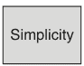


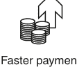


图 7.1
零售连锁中的区块链。

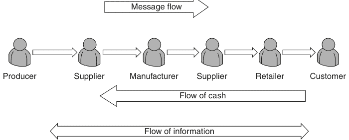

图 7.2
基础供应链管理。

### 7.1.17 用于供应链管理的区块链

既然我们已经看到了与基础供应链管理相关的问题，那么通过区块链技术，我们可以消除虚假产品、假冒药品、维护交易记录等问题。区块链技术以防篡改的方式提供了必要的安全性。通过智能合约，双方之间的交易可以安全地进行并确保隐私 [30]。区块链在去中心化网络中运行，由共享账本组成。该共享账本包含了双方的信息。

### 7.1.18 食品链中的区块链

当区块链应用于食品管理时，它包含了作为生产者的农民生产原材料并使用智能手机直接发布在区块链上，原材料已准备供制造商提取。农民可以扫描原材料的代码，并为各方维护透明度。制造商有一个系统，可以在最终产品可用之前发送警报。制造商现在现在与智能合约通过区块链与原材料生产者进行交易。现在农民对贸易有了更好的记录，并知道何时为原材料付款，并在供应链中具有可见性。

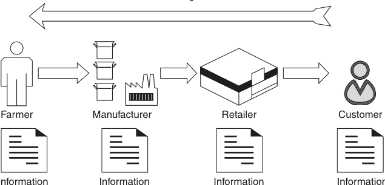

图 7.3
区块链中的食品供应管理。

### 7.1.19 药品供应链

根据 Rodrigo Cout de Souza 的说法 [31]，药品业务价值约为 20 亿美元。世界卫生组织估计，非洲每年有约 12 万人因疟疾药物去世。全球假药贸易还由一个支持全球业务和技术基础设施的交易犯罪网络运营，并且没有追踪这些假药的记录。假药问题不仅限于发展中国家，也包括发达国家。图 7 所示的实际药品供应链模型涉及分销渠道、零售商、制造商和客户等各种实体，因此结构看起来复杂，涉及许多步骤。对于制造公司来说，有大量信息需要记录，例如材料提供者的细节、制造商的许可证、零售商的需求和制造订单。目前药品供应链管理的问题包括在整个供应链中跟踪和追踪所有药物的电子互操作系统，这需要记录许多参数，例如交易历史、交易单号等。

## 区块链、人工智能与物联网融合
使用智能合约进行资金流动


## 战略技术趋势带来的数字世界革命


### 图 7.4
药品供应链。

另一个问题是存储所有交易的数据，以及在灾难发生时丢失这些数据的可能性。这些问题为医药行业至关重要的供应链管理制造了许多困难。因此，需要一种技术来为医药行业提供更高的安全性和透明度。

区块链是大约十年前出现的一种技术。这项技术被用于从农业到金融和供应链管理的各个行业领域，而医药行业是供应链管理中使用区块链技术的一个部分。

在不同类型的区块链中，许可链区块链对制药行业最有帮助。

区块链的关键元素，如哈希函数、智能合约、物联网（IoT）和互操作性，在应用于任何网络时都起着至关重要的作用。在区块链技术的帮助下，每家公司都可以加密算法（如哈希函数）维护其数据安全，使只有预期方可以使用这些数据。区块链网络是一种去中心化的网络，可以防止数据丢失。药品供应链中涉及的每个伙伴之间的每笔交易都可以使用智能合约作为交易媒介。智能合约是一种在网络用户使用时自动执行的程序代码。智能合约确保交易只发送给预期接收者。它还为技术用户之间提供了透明度。区块链的这一元素将消除对中间人的需求，而这在以前的医药供应链中是必要的。

基础医药供应链中最大的问题是假药供应给零售商。通过区块链技术，可以使用另一个元素解决这一问题：物联网（IoT）。物联网设备可以帮助从制造商或生产者到消费者追踪药品。有了物联网设备，制造商和消费者将获得有关药品何时离开生产单元、何时到达消费者以及通过什么路径的完整信息。消费者还可以跟踪药物是否来自可靠的制药公司以及是否真实。物联网设备在区块链中的另一个重要应用是质量控制，物联网设备可以感知药品和药物包裹的温度。Sadhukan [32] 开发了一名为 modum.io 的初创公司，用于监测运输途中药品的温度湿度以控制药物质量。

制药公司在实施区块链技术方面非常缓慢，因为实施该技术的成本很高。尽管如此，如果实施，这项技术无疑将在许多方面帮助该行业。

### 3.1.20 商务旅行行业中的区块链

每当人们考虑家庭度假或商务出差（这是最常见的旅行类型）时，他们会寻找旅行社或旅游运营商。旅游运营商为旅行者规划完整的行程，从航班到酒店住宿，再到现场旅游，包括提供餐食。旅行者依赖旅游运营商和旅行社来为他们的旅行提供便利（见图 7.5）。

当一个人去出差时，旅客旅客记录（PNR）中涉及某些风险。旅行者并不知道 PNR 代码关联了多少数据，如果 PNR 掉入不法之的人手中，就可以从 PNR 中获取大量的个人信息。考虑一种旅行者忘记飞机登机牌的情况；其行程和身份信息等信息可以从登机牌上打印的信息中获取。在最坏的情况下，黑客可以登录常飞行员账户并获取护照信息和其他机密数据。


图 7.5 基础旅游业。


### 图 7.6
带有区块链的旅游业。

区块链技术提出了许多安全和隐私解决方案，以解决与其他 PNR 系统相关的不安全问题。区块链网络运行在一系列账本或区块上，每个区块包含不同的信息。数字账本只有具有唯一代码的伙伴才能访问和查看，但他们无法修改数字目录的内容。这种唯一代码将帮助旅行社和旅游管理公司提供更大的信心，因为他们能够对不可预见的情况拥有更多控制，并安排不同的交通、便利、隐私和安全基础工作。区块链技术简化了识别过程并提高了安全水平。随着旅游业务使用区块链技术，旅行社/旅行代理商现在可以在不同地点跟踪旅行者的身份并确保数据安全（见图 7.6）。如果在旅游旅游业务中使用区块链技术，旅行者就不就不需要在旅程的不同阶段出护照了。相反，旅行者信息可以存储在区块链网络上并提前自动传输，从而加快流程。旅行者的数据还可以被旅行社使用，相应的旅行公司在整个旅途中接收及时的验证。

旅游业务中区块链技术的另一种实现可以消除网络中的中间人。通过区块链技术，消费者可以使用智能合约直接向酒店或航空公司预订机票。智能合约可以被编程，以便旅行者的

## 区块链、人工智能与物联网（IoT）的融合

智能合约可以被编程，以便旅行者的付款自动支付给酒店或航空公司。这可以减少由于信用卡或银行转账等旧财务结算方法产生的成本。当使用区块链加密货币进行支付结算而非信用卡时，可以消除交易期间产生的信用卡费用。近年来报告了一些信用卡欺诈案件，一直很高。根据 Nilsson 2016 年的一份报告，全球信用卡欺诈损失估计约为 247 亿美元。当使用智能合约完成加密货币交易时，信用卡欺诈也将减少。

该行业面临的主要挑战之一是客户留存。不同的网站进入了市场，但在这个领域表现不足。

区块链技术在酒店住宿行业也变得流行。大多数其他行业已经在使用这项技术并受益。酒店和其供应商需要不断更新内容，例如提供设施的照片和视频。

### 7.1.21 商务中的区块链


图 7.7 商务中的区块链。

代理商通过取消获得利润。根据一个网站 blockchain.com 的说法，酒店业预计 2016 年将产生 5000 亿美元。这显示了该行业的情况。

随着区块链技术进入酒店行业，客户现在可以在预订酒店时直接预订出租。所有的


## 区块链、人工智能与物联网的融合

除了酒店预订外，设施租赁也可以直接向供应商进行，从而消除中间环节。这一过程还可以减少对中间人的依赖。

区块链网络对于追踪客人从家出发前往机场、办理登机到达酒店的整个过程非常有用。这种跟踪信息通过缩短机场登机过程中的等待时间来提高有效性，从而提高客户满意度，进而提高客户留存率。当客户也出现在区块链网络中时，他们有权允许酒店及网络中的其他访问其信息。客人还可以获得谁在查看其数据的信息。因此，区块链技术能够能够在不侵犯访客隐私的情况下，提供无缝整合的客房服务。

在住宿业中，食物是客户付费的另一种产品，当提供的食物质量不佳时，客户会对食物产生负面态度。因此，区块链供应链管理可以扩展到酒店和餐厅，在质量和安全方面提供更好的食物。酒店业应该与食品供应商合作，食品供应商也应该与客户及其他方一起加入区块链网络，以便客户也能查询并看到所享用食物的来源和质量。这样，酒店和餐厅就能就食物的质量和安全性与客户建立信任。

## 7.1.2 实施区块链的挑战

区块链技术具有巨大的潜力，可以纳入业务流程中并以创新的方式造福流程管理。基于区块链的网络可以是一个为网络提供完全隐私的安全网络，但公司最终仍然需要产生收益。因此，从单个组织的角度来看，采用这项技术面临着一些挑战。技术仍处于早期阶段，在系统性能、可扩展性、成本等特定领域仍存在一些局限性和困惑，因此有必要理解业务目标并尝试将其与技术选择对齐。例如，可以使用公有链、私有链或联盟链区块链，而所使用的共识机制类型也将对组织的业务产生深远影响。采用区块链技术面临的最重大挑战将行业标准，令人鼓励的是，许多行业正在使用或计划很快转向这种去中心化的、不可篡改的技术。

采用区块链技术的问题在于将现有系统从一种技术迁移到另一种不同的技术。对于任何正在某个平台上工作的并突然移动到另一个平台的行业来说，都是具有挑战性的。另一个挑战可能是与技术伙伴的不一致。有些合作伙伴更有实干精神，并准备好将资金、时间和资源投入区块链技术中。相比之下，一些参与者被其他考虑或资源分散了注意力。实施区块链技术可能会出现问题，因为部署的技术在一个国家可能是合法的，而在另一个国家可能不允许允许，这在跨组织业务中可能是一个问题，因此技术必须是全球性的。

在讨论支付应用时，可扩展性是区块链技术最受关注的问题之一。根据 www.networkcomputing.com 显示，Visa 处理每秒可能达到 1667 次交易，比特币每秒处理三次，而以太坊每秒处理约 15 次。可扩展性问题可能会降低交易速度，并直接或间接地影响业务流程以及区块链网络中的参与方。

对区块链技术的缺乏知识是另一个担忧。食品供应链管理的区块链网络包含了从生产者到客户，他们可能对操作该技术没有足够的知识，克服这一点将是一项艰巨的任务。

## 7.2 谱计算、脑电波机制和智能合约在数字世界的革命性影响

### 7.2.1 数字世界中的谱计算

今天，无论什么种行业，他们都在向结果迈进，这对于他们的使命至关重要。他们正以灵活性来应对任何工作负载，同时将成本降最低 [33]。IBM 谱计算是一项专注于这些问题的技术。解决方案的核心是集群虚拟化软件。这种软件通常用于高性能计算，并日益应用于数据分析中。新一代应用程序和框架（如大数据、人工智能和容器）并不运行在单一系统上。它们运行在由计算集群组成的数十、数百和数千个系统上。因此，为此，用户需要一种能够自动优化计算集群的软件，以提供更快的结果，并且更易管理和更易于为多个操作进行扩展。通过 IBM 谱计算，用户可以在跨业务线的情况下将一个组共享给许多用户，同时在同一基础设施上运行多个应用程序。这可能包括不同版本的应用程序，例如 Spark 或 Hadoop 的多个实例。集群虚拟化还实现了多个集群的整合。这增加了中性化，以交付组的更好的性能。谱计算的核心是一个智能调度器，它在在正确的时间使用正确的资源运行正确的负载，优化本地云和混合资源以提供更好的服务，并为 IT 工作人员提供灵活性以满足谱计算中新的不断变化的需求。高优先级负载通过挂起低优先级负载来处理，在高优先级负载完成后恢复低优先级负载。通过谱计算，集群始终可用。如果服务器发生故障，关键服务和负载将在不同的服务器上自动重启。通过可用的接口，用户能够访问并使用集群。这允许用户专注于结果。在谱计算中，全面的监控、报告和管理工具允许 IT 工作人员从单一界面管理多个系统。谱计算还通过支持微服务等天才架构来帮助最大化当前的 IT 投资。（注：此处原文存在大量重复段落，翻译已按要求去重，仅保留核心逻辑）。


## 表 7.1
脑波类型

| 频段 | 频率 | 脑状态 |
| --- | --- | --- |
| 伽马 (γ) | 35 Hz | 集中 |
| 贝 (β) | 12–35 Hz | 焦虑主导、活跃、外部关注、放松 |
| 阿法 (α) | 8–12 Hz | 非常放松、被动关注 |
| 西塔 (θ) | 4–8 Hz | 深度放松、内向聚焦 |
| 德 (δ) | 0.5–4 Hz | 睡眠 |


## 图 7.9
不同波形的脑波样本。
来源：[35]。

神经科学家甚至提出，可以使用所有脑波的快照来像指纹一样识别身份。因此，在某种程度上，测量脑波可能是非常强大的。带有尖峰的脑波可以预示发作的迹象。最近的研究甚至建议使用不同的脑波来帮助我们学习。根据研究，贝塔波可能会强化神经连接以改善记忆 [37]。同时，西塔波是向大脑提示你忘记了一些东西的方式。伽马波对神经生物学家来说也很令人，因为阿尔茨海默症患者使用它们似乎不像其他人那样。然而，在对小鼠的实验中，恢复伽马波减少了β-淀粉样蛋白，这是一种与疾病相关的斑块蛋白。

### 7.2.3 数字世界中的智能合约

第二代区块链的关键技术创新之一是开发了所谓的智能合约。智能合约是存储在区块链内部的计算机代码，包含了合同协议。智能合约是自动执行的代码，其协议条款或操作条款直接写在存储并执行于区块链计算机上的两行代码中 [38]。从传统意义上说，合同是两个或多个伙伴之间关于做事或不做某事的约束性协议。每个伙伴都必须信任对方履行自己方面的义务。它们是书面或口头协议，旨在通过法律执行。各种合同协议构成了我们现代社会和经济的制度基础，这些基础自古以来一直演变至今。任何国家的经济都是由中心机构（如保险公司和银行）创建并执行的海量合同集合，而这些机构又受到系统中更高级中心化机构的支持。我们的社会和经济完全依赖第三方组织来维护和执行这些合同协议。智能合约具有这类采取或不采取行动的特征，但它们消除了参与安排的成员之间对受信任第三方的需求。这是因为智能合约是由计算机代码定义的，并在此类区块链上不经裁量地执行或强制。创新的合约技术可以依赖中心化系统，并使人们能够创建计算机代码自动执行和实施的合同协议。这些智能合约是去中心化的，因为它们不存在于单一的中心化服务器上，而是跨越节点网络分布并自动执行的。这意味着不可信的第三方可以以更加流动的方式相互信任，而不依赖第三方来启动和维护交易规则。

同样，智能合约实现了成员之间的自主性，这意味着在它启动并运行其初始协议后，代理人不需要再参与进一步的合同。这种情况的一个例子是四个人集资资金投资某项将为他们带来回报的事。可以在区块链上编写智能合约，将任何创建的索赔分成四份，并将每个金额发送到不同利益相关者的相应钱包中。智能合约实际上仅仅是区块链上的一个账户，由代码而不是用户控制，因为它在区块链上；它是不可篡改的，这意味着没有更改代码的可能性。因此，投资者放他们将自动获得公平的份额。代码将决定过程如何发生，个人没有权力更改代码，无论是组织、政府还是审查机构。没有任何事情可以改变或操纵智能合约。从这个意义上说，人们说“代码即法律”，因为代码无论如何都会执行执行。例如，物流公司可以在此特定位置收取货到付款，然后它会触发供应商请求以存储新物品，因为现有的物品刚刚交付。

智能合约与智能编码属性的结合将提供一个知识产权的概念 [39]。通过区块链编码合同协议控制所有权的明亮属性。例如，一个预设的智能合约可以在所有贷款分期付款结清后，自动将车辆所有证的权从控股公司转移给个人所有者。智能属性的核心思想是通过将其注册为账本上的数字资产并连接到智能合约，从而控制对资产的所有权和访问。在某些情况下，物理世界的资产可以从字面上说通过区块链进行控制。

与所有合约一样，任何智能合约都需要一个输入值，并且只有在满足某些条件时才能采取行动。当达成特定交易时，智能合约会改变其状态并执行预定义的算法，自动在区块链上触发一个事件。因此，整个合约的运行效果取决于输入的数据。如果输入系统的数据错误，系统可能会给出错误的结果。区块链无法访问其网络之外的数据，这需要某种形式的可信数据馈作为系统的输入，称为预言机（oracle）[40]。预言机是由外部服务为区块链上的智能合约提供的数据馈。预言机提供外部并在并在某些条件时触发智能合约。这种条件可以是任何温度或物品数量。然而，预言机是区块链共识机制的一部分。因此，无论是新闻网站还是来源，信息源必须是可靠的。第一，智能合约是自动的，因此它可以消除与管理和执行相关的时间和成本，使其更加高效。通过这种自动化形式，可以发生更大数量的交易。其次，智能合约对减少世界的腐败很有益。由于智能合约在运行中是透明的，为组织或个人为了利益修改留下了极小的空间。第三，减少对中心化组织的依赖，人们可以建立自己的合同协议。最后，智能合约还可以提供确定性，因为无论发生什么代码都会执行。

智能合约存在一些局限性。通过自动化合约，它们依赖于定义良好的输入，对于法律可能由于意外情况而改变的情况留下了极小的空间。现实世界会发生许多不可预见的意外事件，规则有时需要具有灵活性适应性以适应这一事实。这是拥有监督的一个优势，因为人们更有能力判断此类情况并对复杂的意外事件做出适当反应。因此，智能合约的程度取决于其运行的复杂环境，通常需要一个治理机构在需要时干预。这产生了围绕治理的待解决的新问题。


# 178

## 区块链、人工智能与物联网（IoT）的融合

在《基于 EEG 和语音的情感识别导论》，第 19–50 页。学术出版社。

- 6. Center, M. N. (2017年11月7日). 数字农业：印度农民正在利用人工智能提高作物产量。可用于：https://www.microsoft.com/; https://www.microsoft.com/en-in/features/ai-agriculture-icsat-india/; https://www.microsoft.com/en-in/features/ai-agriculture-icsat-india/ 

- 7. Chattopadhyay, P. S. (无日期). 数字电路。可用于：https://nptel.com/; https://nptel.com/content/storage2/npetal_data3/html/mird/ict/text/10805113/lec1.pdf 

- 8. Cristian Toma, A. A. (2019). 针对智慧城市污染监测的 IoT 解决方案及安全挑战。《Sensors》， 19(15), 3401。

- 9. David Gil, A. F-M. (2016). 物联网：基于情感知智能服务的调查综述。《Sensors (Basel)》， 16, 1069。

- 10. DeVries, P. D. (2016年9月). 加密货币、比特币与未来分析。《国际商业管理与商业杂志》，1(2), 1-9。

- 11. Dino Quintero, D. d. (2017). IBM 频谱计算解决方案。红皮书（Redbooks）。

- 12. Divya, S. V. (2018).一种基于人工智能的自诊断医疗聊天机器人。《Web 开发与设计杂志》，3, 1–7。

- 13. Ordivius Vermeesan, D. P. (2013). 物联网：用于智能环境和集成生态系统的融合技术. 丹麦，奥尔尔堡，出版社。

- 14. Evans, R. S. (2016). 电子健康记录：现在与未来。《医学信息年鉴》，补充，1, 48–61。

- 15. Filippo Pesasone, M. C. (2018). 人工智能在医学影像中的应用：威胁还是机会？处于医学创新前线的放射学家。《欧洲放射学实验》，2, 35。

- 16. Geetanjali Katare, G. (2015). 人工智能与物联网融合面临的挑战。《系统与软件工程国际杂志》，6(15), 10–15。

- 17. Curria, A. (2019). 社会中的人工智能。可用于：https://ec.europa.eu/; https://ec.europa.eu/jrc/content/sites/jrcties/files/e77-en.pdf 

- 18. Hadmir Nath Saha, S. A. (2017). 使用物联网 (IoT) 进行健康监测。工业自动化与机电工程会议 (IEMCON)。泰国，曼谷：IEEE。

- 19. Hooper, M. (2018年2月22日). 可用于：https://www.ibm.com/blocks/blockchain-ain/2018/02/top-five-blockchain-benefits-transforming-your-industry/; https://www.ibm.com 

- 20. Ioannis Karamitos, M. (2017年11月). 数字世界中的安全与隐私。区块链智能合约：房地产的用例。《信息安全杂志》，9, 177–190。

- 21. Joshi, H. 可用于：www.deloitte.com/; www.deloitte.com/content/dam/Deloitte/risk-and-privacy.pdf 

- 22. Brunnmeier, Markus K., Harold and Jean-Pierre Landau (2019). 货币的数字化，第 1–31 页。

## 战略技术引发的数字世界革命

- 23. Marr, B. (2017年7月13日). 商业和社会面临的人工智能 (AI) 最大挑战。可用于：https://www.forbes.com/; https://www.forbes.com/sites/bernardmarr/2017/07/13/the-biggest-challenges-facing-artificial-intelligence-in-business-society/ 

- 24. Nagutsu, S. (2016). 基于传感器和 GSM 的天气智能浇水。社会福利未来趋势与创新世界会议 (创业会议)。

- 25. Pannette, D. (2018年10月). 农业中的人工智能：新兴的研究时代。机构科学，加拿大，温哥华。

- 26. Pankash Tagore, P. V. (2016). 用于智慧城市的基于物联网的智能照明系统。《科学、工程与技术创新国际杂志》，5,764。

- 27. Perumal, T. (2015). 物联网 (IoT) 驱动的水质监测系统。第四届全球消费电子会议 (GCCE)。大阪。

- 28. Priyanka A. Bharti Gawali, and Suresh Mehra (2010). 《基于 EEG 和语音的情感识别导论》。ScienceDirect。

- 29. R. Suresh, B. P. (2018). 基于物联网的天气监测系统。基于物联网的监测系统。

- 30. Rashida Peete, K. M. (2019). 医疗保健中的人工智能与面向非工程师的业务机器学习，233–259。

- 31. Rodrigo Couto de Souza, E. M. (2018). 使用区块链智能合约减少腐败水平：一些初步思考。ACM 数字库。

- 32. Sadkhan, P. (2017). 一种智慧城市的基于 IoT 的电子停车系统。第六次计算、通信与信息进展国际会议 (ICACCI)。

- 33. Stephanie Baker, W. Xiang and I. Atkinson (2017年11月). 智慧医疗的趋势：技术、挑战与机遇，IEEE Access 5, 26521–26544。

- 34. Duvart L and Alex B. Lipton, S. A. (2018年5月26日). 智能合约及其内在局限性简介。可用于：corpgov.law.harvard.edu; https://corpgov.law.harvard.edu/2018/05/26/an-introduction-to-smart-contracts-and-their-inherent-limitations/ 

- 35. Tasnim Makada, D. O. (2016). 通过增加阿尔波脑电波来增强记忆。ACM 数字库。

- 36. Voshmgir, S. (2019). 代币经济：Web3 如何重塑互联网。Berlin。

- 37. Makita, T., Ozair, D., & Mohammed, M. (2017). 使用音乐增加阿尔波脑电波的研究。在第九届 ACM 辅助技术国际会议论文集中（第 1–4 页）。

- 38. Levi, S. D., & Lipton, A. B. (2018). 智能合约简介。在哈佛法学院公司论坛（第 10 卷）。

- 39. Karamitsos, I., Papadaki, M., & Al Barghuti, N. B. (2018). 区块链智能合约的设计：房地产的应用。《信息安全杂志》，9(03), 177。

- 40. Voshmgir, S. (2020). 代币经济：Web3 如何重塑互联网（第 2卷）。

## 8 结论

由于本书讨论了区块链、物联网和人工智能的融合，它将是读者提升知识的有用手册，将相互依赖组件的新思维方式提升到一个共同层面。


# 184

# 索引 (Index)

- 深度脑-区块链机制 85
- 委托权益量证明 143
- 设备可靠性 118
- 诊断调度 128
- 工作量证明 (PoW) 与权益量证明 (PoS) 的区别 146
- AI 技术的不同方法 40
- 散列值 (SHA-256) 26
- 数字图像 93
- 数字模型 94
- 疾病分类 128
- 增强现实中的显示分类 104
- 智能城市中物联网、AI 与区块链的集成 112
- 智能交通系统 (ITS) 36
- 物联网 (IoT) 91, 157；以及生物医学仪表仪器 124；
- 环境 102；安全攻击 102；
- 在智能城市中 158
- 知识库系统 (KBS) 118
- 知识工程 (KE) 12
- 缺乏算力 156
- 缺乏经验和专业知识 160
- 缺乏知识 156
- 分层架构 45
- 区块链技术的分层架构 46
- 账本 93
- 基于共识的账本管理 78
- 轻级目录访问协议 (LDAP) 25
- LTE-A 34
- 数据传输中断 92
- 颠覆性技术 89
- 分布式账本机制 114, 133
- 边缘计算的分布式特性 54
- 双重花费问题 138
- 药物检测 129
- 电子健康记录 (EHR) 8
- 企业 114
- 在区块链中查找地址 26
- 区块链中的食品供应管理 164
- 模糊逻辑对比布尔逻辑 119
- 模糊系统 118
- 基于标记的 105
- 无标记的 106
- 医疗诊断生命周期 127
- 矿池 142
- 移动应用 112
- 遗传算法 119
- 基因组学 129
- 全球定位系统 88
- 天然气 113
- 自然语言处理 (NLP) 15
- 神经网络 121
- NSSA 71
- 哈希函数 100
- 集成 AI 与物联网带来的医疗保健变革 126
- 使用物联网的医疗保健 157
- 异构设备 117
- 启发式方法 118
- 人语音识别 113
- 人工智能中的障碍 155
- 过采样 PCA 60
- 粒子群优化算法 (PSO) 80
- 患者数据收集 127
- 持久性 115
- 医药品供应链 164
- 物理伤害 107
- 实际优化问题-特征 83
- 主成分分析 56
- 隐私 116
- 私有区块链 100
- 处理时间 117
- 成像 129
- 激励层 48
- 集成 159
- AI、物联网与大数据的集成 121

# 185

# 索引 (Index)

- 权益量证明 145
- 工作量证明 144
- 公有区块链 100
- 存储 89
- 供应链管理 162
- 对称加密 99
- 上系统 88
- 远程监控 130
- 可再生能源 95
- 零售链行业 161
- 频谱计算、脑波机制的革命性影响
- 数字世界中的智能合约 171
- 技术创新 130；以及经济的商业模式 132；通过分布式账本机制 130, 134
- 3D 打印 94
- 交通拥堵 114
- 交通监控 6
- 货币交易 27
- 区块链技术的旅游业 167
- 信任问题 156
- 数字货币路线图 136
- 机器人流程自动化 13
- 可扩展性 117
- 使用比特币的加密数字货币机制 136
- 安全问题 107
- 传感器 88
- 服务等级协议 (SLA) 118
- 物联网数据安全的重要性 98
- 智能农业 7
- 智能城市组件 112
- 数字世界中的智能合约 175
- 智能设备 88
- 智能能源 113
- 智能环境 113
- 智能电网 9
- 智能健康 112
- 智能工业 114
- 智能手机 87
- 智能安全 113
- 智能交通 114
- 太阳能 113
- 频谱计算 172；在数字世界 171
- 区块链类型 101
- 脑波类型 174
- 共识算法类型 121
- 地图学类型 98
- AI、物联网与区块链用于新革命的案例研究使用与技术障碍 154
- UWB 技术 34
- 生物医学数据的变异 124, 125
- 虚拟助手 129
- 虚拟位置 103
- 可穿戴设备 114
- 什么是加密货币 137
- 什么是技术创新 130
- 风力机设计 80
- 神经网络的工作原理 18
- 在相似轨道上工作 156
- 全球信息网 91


