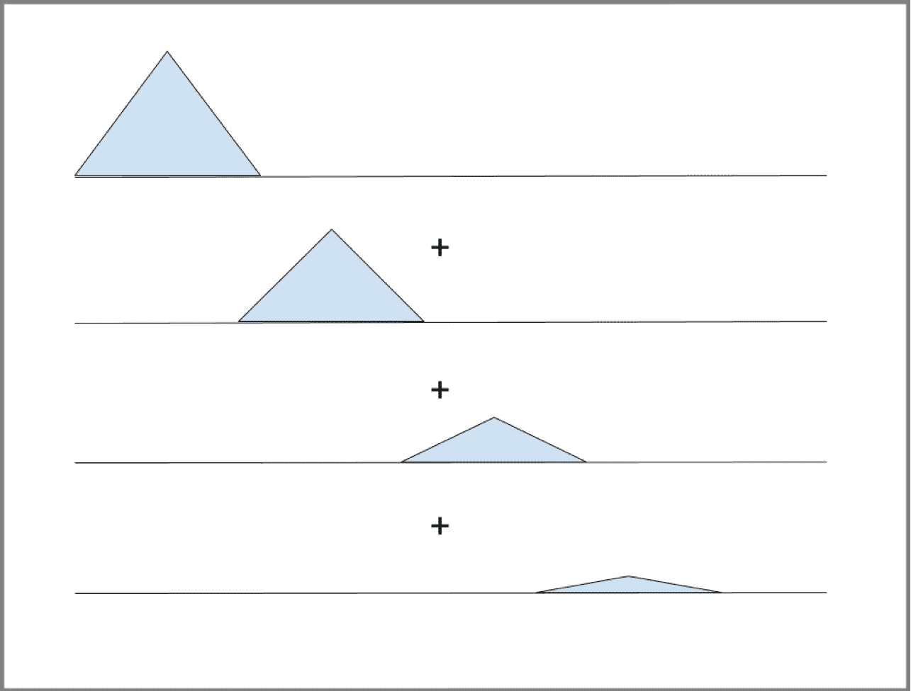
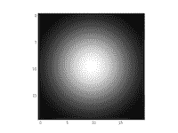
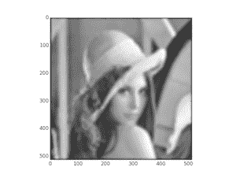
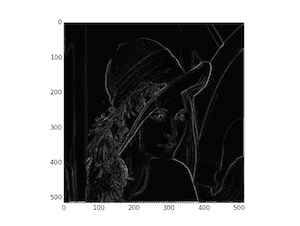
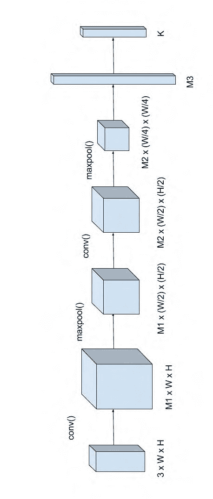

# python 卷积神经网络 实战：python、theano 和 tensorflow 现代深度学习 数据科学与机器学习高级指南（python 机器学习）


简介


## 简介

这是我在 Python 深度学习系列中的第 3 部分。到此为止，你已经对神经网络和深度学习有了很多了解，不仅包括反向传播等基础知识，还包括如何使用动量和自适应学习率等现代技术来改进它。你已经在 Theano 和 TensorFlow 中编写了深度神经网络，并且知道如何使用 GPU 运行代码。

本书主要讲述如何使用卷积神经网络进行计算机视觉的深度学习。在图像分类方面，卷积神经网络是目前的最先进技术，它们在 MNIST 等任务中击败了普通的深度网络。

在本课程中，我们将提高难度，研究街景门牌号码（SVHN）数据集——该数据集使用各种角度的较大彩色图像——因此从计算和分类任务难度两方面来看，事情都将变得更加困难。但我们将展示卷积神经网络（或称 CNN）能够应对这一挑战！

由于卷积是这种神经网络的核心部分，我们将深入探讨这个主题。它的应用比你想象的更多，例如模拟胰腺和心脏等人工器官。我将向你展示如何构建可应用于音频的卷积滤波器，例如回声效果，以及如何构建用于图像效果的滤波器，例如高斯模糊和边缘检测。

描述完卷积神经网络的架构后，我们将直接进入代码环节，我将向你展示如何通过添加几个新函数来扩展上次构建的深度神经网络，将其转换为 CNN。然后我们将测试其性能，并展示用 Theano 和 TensorFlow 编写的卷积神经网络如何在街景门牌号码数据集上超越普通神经网络的准确率。

本书使用的所有材料均免费。你可以使用 `pip` 或 `easy_install` 下载并安装 Python、Numpy、Scipy、Theano 和 TensorFlow。

最后，我的目标是向你展示卷积网络并非神奇，也不需要专家级的数学知识来理解。

它们与普通神经网络的原理相同：

```
y = softmax( relu(X.dot(W1).dot(W2) )
```

只不过我们将第一个“点积”替换为卷积：

```
y = softmax( relu(conv(X, W1)).dot(W2) )
```

它们的训练方式与之前完全相同，因此你之前在反向传播等方面的所有技能都可以沿用。

## 第 1 章：前馈神经网络回顾

在本节课中，我们将回顾一些理解本课程所需的重要背景材料。我不会在这里深入讲解这些材料，而只是解释你需要知道什么。

### 训练与预测

你应该知道，我们可以用于所有监督学习问题的基本 API 是 `fit(X,Y)` 或 `train(X,Y)` 函数，它接收一些数据 X 和标签 Y，以及一个 `predict(X)` 函数，该函数只接收一些数据 X 并进行预测，我们会尝试使其接近对应的 Y。

### 预测

我们知道，对于神经网络，预测函数也称为前馈动作，这只是神经网络每一层上的点积和非线性函数。

例如：`z1 = s(w0x)`，`z2 = s(w1z1)`，`z3 = s(w2z2)`，`y = s(w3z3)`

我们知道，我们通常在隐藏层中使用的非线性函数通常是 relu、sigmoid 或 tanh。

我们知道，对于二分类，输出是 sigmoid；对于 >= 2 个类别的分类，输出是 softmax。

### 训练

我们知道，训练神经网络只是应用梯度下降，这与我们在没有闭式解时用于逻辑回归和线性回归的方法相同。我们知道线性回归有闭式解，但我们不一定非要使用它，而梯度下降是一种更通用的数值优化方法。

`W ← W - learning_rate * dJ/dW`

我们知道，Theano 和 TensorFlow 等库会为我们计算梯度，随着层数增加，梯度计算会变得非常复杂。当你看到当我们引入卷积时输出函数变得更加复杂（尽管推导仍然可行，我建议尝试以进行练习）时，你会对神经网络的这一特性感到庆幸。

到此，你应该熟悉代价函数 J 是如何从似然性导出的，以及我们可能不会在整个训练数据集上计算 J，而是分批计算以提高训练时间。

如果你想了解更多关于反向传播和梯度下降的内容，你可以查看我关于深度学习的第一门课程《Python 深度学习 第 1 部分》，你可以在 [`udemy.com/data-science-deep-learning-in-python`](https://udemy.com/data-science-deep-learning-in-python) 找到它。

### 数据预处理

当我们处理图像时，你知道图像实际上是一个 2-D 数据数组，如果我们有彩色图像，我们就有一个 3-D 数据数组，其中额外的维度用于红、绿、蓝通道。

在过去，我们将这个数组展平为一个向量，这是神经网络的常规输入，例如，28 x 28 的图像变成一个 784 维向量，3 x 32 x 32 的图像变成一个 3072 维向量。

在本书中，我们将在部分处理过程中保留原始图像的维度。

### 本书使用的数据来源

本书将使用 MNIST 数据集（手写数字）和街景门牌号码（SVHN）数据集。

街景门牌号码数据集比 MNIST 要难得多，因为图像是彩色的，数字可以呈不同角度和不同风格或字体，且维度要大得多。

要获取本书中使用的代码，你需要访问：

[`github.com/lazyprogrammer/machine\_learning\_examples`](https://github.com/lazyprogrammer/machine_learning_examples)

并在文件夹 `cnn_class` 中查找。

如果你已经克隆了这个仓库，只需执行 `git pull` 即可，因为此代码将在 master 分支上。

我强烈建议不要直接运行此代码，而是将其作为备份，以防你自己的代码无法运行，并尝试通过亲自输入代码示例来跟随教程，以建立肌肉记忆。

一旦你拥有了 `machine_learning_examples` 仓库，如果你还没有为之前的课程这样做，你需要在 `cnn_class` 文件夹旁边创建一个名为 `large_files` 的文件夹。

所有数据都将存放在此处。

要获取 MNIST 数据，你需要访问 [`www.kaggle.com/c/digit-recognizer`](https://www.kaggle.com/c/digit-recognizer)

我认为到那时下载相当简单。我们只会使用 `train.csv` 文件，因为那是带有标签的文件。你非常欢迎尝试挑战，并使用你在本课中学到的技术提交解决方案。

你可以从 [`ufldl.stanford.edu/housenumbers/`](http://ufldl.stanford.edu/housenumbers/) 获取街景门牌号码数据。

你需要获取“格式 2”下的文件，即裁剪后的数字。


注意，这些是 MATLAB 二进制数据文件，因此我们需要使用 Scipy 库来加载它们，如果你熟悉 Numpy 栈，我想你肯定听说过它。

## 第 2 章：卷积

在本章中，我将为大家讲解卷积的速成课程。如果你真的想深入研究这个主题，你应该修读信号处理或线性系统课程。

那么，什么是卷积呢？

想想你最喜欢的音频效果（假设是“回声”）。回声只是同样的声音在未来反弹回你的耳朵，只是音量较小。我们稍后将看到如何在数学上实现这一点。

所有效果都可以看作是滤波器，就像我在这里展示的那样，它们通常以框图表示。在机器学习和统计学中，这些有时被称为核。

```
x(t)--->| h(t) |--->y(t)
```

我用这个三角形来表示我们的音频信号。请记住，我们想要做两件事：我们想在未来听到这个音频信号，这基本上是向右移动，并且这个音频信号的幅度应该比原始信号低。

最后的操作是将它们全部相加在一起。



请注意，信号的宽度保持不变，因为它没有变长或变短，否则会改变音调。

那么，我们如何在数学上实现这一点呢？我们可以用称为 `w` 的权重来表示幅度变化。对于这个特定的回声滤波器，我们只需确保每个权重都小于上一个权重。

e.g. `y(t) = x(t) + 0.5x(t - delay) + 0.2x(t - 2*delay) + 0.1x(t - 3*delay) + …`

对于任何通用滤波器，权重上不会有这种限制。权重本身将定义滤波器。

我们可以将该操作写成求和形式。

`y(n) = sum[m=-inf..+inf]{ h(m)x(n - m) }`

那么，这就是我们所认为的卷积“定义”。我们通常用星号表示它（例如 `y(n) = x(n) * h(n)`）。我们可以对连续自变量进行此操作（在这种情况下，它涉及积分而不是求和），也可以对离散自变量进行此操作。

你可以将其视为我们通过改变 `m` 的值，将滤波器在信号上“滑动”。

我想强调，无论我们是将滤波器在信号上滑动，还是将信号在滤波器上滑动，都无关紧要，因为它们会给我们相同的结果。

这种信号处理技术有很多非常实际的应用。

我最喜欢的例子之一是，我们可以构建人造器官。请记住，器官的功能是调节你体内的某些参数。

因此，为了替换器官，我们需要构建一台机器，其响应能够与该器官完全匹配。换句话说，对于所有输入参数，例如血糖水平，我们需要输出与器官相同的参数，例如产生多少胰岛素。

因此，对于每个输入 `X`，我们需要输出一个准确的 `Y`。

事实上，这听起来很像机器学习，不是吗！

由于我们将处理图像，我们需要讨论二维卷积，因为图像是二维信号。

`y(m,n) = sum[i=-inf..+inf]{ sum[j=-inf..+inf]{ h(i,j)x(m-i,n-j) } }`

你可以从这个公式中看到，这只是在每个方向上独立地进行两次卷积。我这里有一些伪代码来演示你如何在代码中编写它，但请注意有一个问题。如果 `i > n` 或 `j > m`，我们将越界。

```
def convolve(x, w):

y = np.zeros(x.shape)

for n in xrange(x.shape[0]):

for m in xrange(x.shape[1]):

for i in xrange(w.shape[0]):

for j in xrange(w.shape[1]):

y[n,m] += w[i,j]*x[n-i,m-j]
```

这告诉我们，`Y` 的形状实际上比 `X` 大。有时我们只是忽略这些额外的部分，并将 `Y` 视为与 `X` 相同的大小。当我们在 Theano 和 TensorFlow 中这样做时，你将看到我们如何控制输出大小的确定方法。

## 高斯模糊

如果你曾经使用 Photoshop 或 GIMP 等应用程序进行过图像编辑，你可能熟悉模糊滤波器。有时它被称为高斯模糊，你马上就会明白为什么。

如果你只想查看已经编写好的代码，请查看 Github 上的文件 `https://github.com/lazyprogrammer/machine_learning_examples/blob/master/cnn_class/blur.py`。

其想法与我们对声音回声所做的相同。我们将取一个信号并将其扩散开来。

但这一次，我们不是使用预定义的延迟，而是将信号以二维高斯的形状扩散开来。

以下是滤波器的定义：

```
W = np.zeros((20, 20))

for i in xrange(20):

for j in xrange(20):

dist = (i - 9.5)**2 + (j - 9.5)**2

W[i, j] = np.exp(-dist / 50.)
```

滤波器本身看起来像这样：



这是在著名的 Lena 图像上的结果：



完整代码

```
import numpy as np

from scipy.signal import convolve2d

import matplotlib.pyplot as plt

import matplotlib.image as mpimg

# load the famous Lena image

img = mpimg.imread('lena.png')

# what does it look like?

plt.imshow(img)

plt.show()

# make it B&W

bw = img.mean(axis=2)

plt.imshow(bw, cmap='gray')

plt.show()

# create a Gaussian filter

W = np.zeros((20, 20))

for i in xrange(20):

for j in xrange(20):

dist = (i - 9.5)**2 + (j - 9.5)**2

W[i, j] = np.exp(-dist / 50.)

# let's see what the filter looks like

plt.imshow(W, cmap='gray')

plt.show()

# now the convolution

out = convolve2d(bw, W)

plt.imshow(out, cmap='gray')

plt.show()

# what's that weird black stuff on the edges? let's check the size of output

print out.shape

# after convolution, the output signal is N1 + N2 - 1

# we can also just make the output the same size as the input

out = convolve2d(bw, W, mode='same')

plt.imshow(out, cmap='gray')

plt.show()

print out.shape
```

## 边缘检测

边缘检测是计算机视觉中的另一个重要操作。如果你只想查看已经编写好的代码，请查看 Github 上的文件 `https://github.com/lazyprogrammer/machine_learning_examples/blob/master/cnn_class/edge.py`。

现在我将介绍 Sobel 算子。Sobel 算子定义为两个方向，X 和 Y，它们近似图像中每个点的梯度。让我们称它们为 `Hx` 和 `Hy`。

```
Hx = np.array([

[-1, 0, 1],

[-2, 0, 2],

[-1, 0, 1],

], dtype=np.float32)

Hy = np.array([

[-1, -2, -1],

[0, 0, 0],

[1, 2, 1],

], dtype=np.float32)
```

现在让我们对这些进行卷积运算。因此，`Gx` 是图像与 `Hx` 之间的卷积。`Gy` 是图像与 `Hy` 之间的卷积。



你可以将 `Gx` 和 `Gy` 视为某种向量，因此我们可以计算幅度和方向。因此 `G = sqrt(Gx² + Gy²)`。我们可以看到，在应用这两个算子后，我们得到的是所有检测到的边缘。

完整代码

```
import numpy as np

from scipy.signal import convolve2d

import matplotlib.pyplot as plt

import matplotlib.image as mpimg

# load the famous Lena image

img = mpimg.imread('lena.png')

# make it B&W

bw = img.mean(axis=2)

# Sobel operator - approximate gradient in X dir

Hx = np.array([

[-1, 0, 1],

[-2, 0, 2],

[-1, 0, 1],

], dtype=np.float32)

# Sobel operator - approximate gradient in Y dir

Hy = np.array([

[-1, -2, -1],

[0, 0, 0],

[1, 2, 1],

], dtype=np.float32)

Gx = convolve2d(bw, Hx)

plt.imshow(Gx, cmap='gray')

plt.show()

Gy = convolve2d(bw, Hy)

plt.imshow(Gy, cmap='gray')

plt.show()

# Gradient magnitude

G = np.sqrt(Gx*Gx + Gy*Gy)

plt.imshow(G, cmap='gray')

plt.show()
```

## 要点


那么，从所有这些卷积示例中，你能得到什么启示呢？现在你知道，有些滤波器可以帮助我们检测特征——所以，也许在神经网络中直接进行卷积，并使用梯度下降来找到最佳滤波器，是可行的。

## 第 3 章：卷积神经网络

我们迄今所见的所有网络都有一个共同点：一层中的所有节点都连接到下一层中的所有节点。这就是“标准”前馈神经网络。使用卷积神经网络，你将看到这种情况如何改变。

请注意，本材料的大部分灵感来自 LeCun, 1998（Gradient-based learning applied to document recognition），具体来说是 LeNet 模型。

为什么要进行卷积？

请记住，你可以将卷积视为“滑动窗口”或“滑动滤波器”。因此，如果我们要在图像中寻找某个特征，比如说，为了论证，一只狗，那么无论这只狗在右上角还是左下角，都无关紧要。

我们的系统仍然应该能够识别出那里有一只狗。

我们称之为“平移不变性”。

思考问题：我们如何确保神经网络具有“旋转不变性”？你还能想到哪些其他类型的不变性？

## 下采样

在构建卷积神经网络之前，我们还需要另一个重要操作，即下采样。还记得我们的音频样本，我们做了一个回声——那是 16kHz 的采样率。为什么是 16kHz？因为这足以表示人声。

电话的采样率为 8kHz——这就是为什么电话里的声音听起来模糊不清。

对于图像，我们只想知道在进行卷积后，图像的某个区域是否存在某个特征。我们可以通过下采样图像来实现这一点，换句话说，就是改变其分辨率。

例如，我们可以将图像从 32x32 下采样为 16x16，这意味着我们在水平和垂直方向上都以 2 的因子进行了下采样。

下采样有几种方法：一种称为最大池化（maxpooling），即取一个 2x2 或 3x3（或任何其他大小）的块，只输出该块中的最大值。

另一种方法是平均池化（average pooling），即取块上的平均值。我们在代码中将只使用最大池化。

Theano 为此提供了一个函数：`theano.tensor.signal.downsample.max_pool_2d`

## 最简单的 CNN

最简单的卷积网络就是我在本书介绍中向你展示的那种。它甚至不需要包含下采样。

只需按如下方式计算隐藏层：

```
Z = conv(X, W1)
Y = softmax(Z.dot(W2))
```

如前所述，你可以通过简单地进行梯度下降来训练它。

练习：在 MNIST 上尝试一下。效果如何？比完全连接的 MLP 更好还是更差？

## LeNet 架构

现在，我们终于可以描述典型卷积神经网络（具体来说是 LeNet 版本）的布局了。

你会发现，这只是将我们已经讨论过的操作连接起来的问题。

所以在第一层，你取图像，保留所有颜色和原始形状，也就是说你不将其展平。（即它保持为 (3 x W x H)）

然后对其进行卷积。

接下来，你进行最大池化以减小特征的大小。

然后，你再进行一次卷积和一次最大池化。

最后，你将这些特征展平为一个向量，并将其放入一个普通的、完全连接的神经网络中，就像我们一直讨论的那样。

示意图如下：



基本模式是：

卷积 / 池化 / 卷积 / 池化 / 全连接隐藏层 / 逻辑回归

请注意，你可以有任意多个卷积 + 池化层，以及更多的全连接层。

有些网络只有卷积。设计由你决定。

## 技术细节

4-D 张量输入：输入的维度是一个 4-D 张量，很容易理解为什么。图像本身占据 3 个维度，因为我们有高度、宽度和颜色。第 4 个维度只是样本的数量（即用于批量训练）。

4-D 张量滤波器/内核：你可能会惊讶地发现，内核也是 4-D 张量。为什么呢？嗯，在 LeNet 模型中，你每个图像有多个内核，并且每个颜色通道都有一组不同的内核。卷积后的下一层称为特征图。这个特征图的大小与内核的数量相同。所以基本上你可以这样想，每个内核会提取一个不同的特征，并将其放置在特征图上。示例：

输入图像大小：(3, 32, 32)

第一个内核大小：(3, M1, 5, 5)

请注意，维度出现的顺序有些任意。例如，MATLAB 文件中的数据将 N 作为最后一个维度，而 Theano 期望它在第一个维度。

我们将看到，在 TensorFlow 中，内核的维度将与 Theano 不同。

还要注意的是，我们的滤波器形状通常远小于图像本身。这意味着同一个微小的滤波器会应用于整个图像。这就是权重共享的概念。

通过共享权重，我们向模型中引入了更少的参数，这将帮助我们更好地泛化，因为正如你从我之前的课程中知道的那样，当你拥有太多参数时，你最终会过拟合。

你可以将此视为一种泛化方法。

在上面的示意图中，我们假设池化大小为 (2, 2)，这也是我们在代码中将使用的。这非常适合我们的数据，因为 28（MNIST）和 32（SVHN）都可以被 2 两次均匀整除。

## 训练 CNN

现在，这是有趣的部分。

有多少人参加我的课程或读我的书，却问诸如“但是，但是，…… X 现代技术怎么办？”之类的问题，这简直荒谬。

好吧，以下是训练 CNN 的方法：

```
W <— W - learning_rate * dJ/dW
```

眼熟吗？

这是因为这是与普通神经网络相同的“反向传播”（梯度下降）方程！

人们认为这一切背后有某种巫术或保密的秘密，需要花费多年努力才能弄清楚。

人们自 1700 年代以来就一直在使用卷积。LeCun 本人于 1998 年发表了他的论文。

研究人员每天都在想出新的方法来拼凑神经网络。那些流行起来的，是表现良好的。

然而，你可以想象，有这么多研究人员在研究，总会有人比其他人做得更好。

你也可以成为一名深度学习研究人员。尝试不同的事情。发挥创造力。使用反向传播。很简单，对吧？

请记住，在 Theano 中，它只是：

```
param = param - learning_rate * T.grad(cost, param)
```

## 第 4 章：Theano 示例代码

在本章中，我们将研究 Theano 卷积神经网络的组件。此代码也可在 [`github.com/lazyprogrammer/machine_learning_examples/blob/master/cnn_class/cnn_theano.py`](https://github.com/lazyprogrammer/machine_learning_examples/blob/master/cnn_class/cnn_theano.py) 找到。

所以，在了解卷积和下采样后，你可能首先会想——Theano 有这些功能吗？当然答案是肯定的。

在 LeNet 中，我们总是先进行卷积，然后进行池化，所以我们称之为 convpool。

```
def convpool(X, W, b, poolsize=(2, 2)):

conv_out = conv2d(input=X, filters=W)

pooled_out = downsample.max_pool_2d(

input=conv_out,

ds=poolsize,

ignore_border=True

)

return relu(pooled_out + b.dimshuffle('x', 0, 'x', 'x'))
```

请注意，最大池化需要一些额外参数。

最后一步，我们对偏差调用 `dimshuffle()` 函数，因为 `b` 是一个 1-D 向量，而在 conv_pool 操作后你会得到一个 4-D 张量，所以这会进行广播。你会发现 TensorFlow 有一个函数可以为我们封装这一点。


下一个组件是对输入进行重新排列。请记住，MATLAB 做事有点奇怪，它将每个样本的索引放在最后一个维度，而 Theano 期望它位于第一个维度。它也碰巧期望颜色维度紧随其后。所以下面这段代码就是在做这件事。

```
def rearrange(X):

    # input is (32, 32, 3, N)

    # output is (N, 3, 32, 32)

    N = X.shape[-1]

    out = np.zeros((N, 3, 32, 32), dtype=np.float32)

    for i in xrange(N):

        for j in xrange(3):

            out[i, j, :, :] = X[:, :, j, i]

    return out / 255
```

另外，正如你所知道的，在神经网络中我们喜欢数据保持在较小的范围内，所以我们在最后除以最大值，即 255。

在每次操作时跟踪每个矩阵的大小也是个好习惯。你会发现，在 TensorFlow 中，默认情况下每个库对卷积结果边缘的处理略有不同，每个维度的顺序也不同。

所以在 Theano 中，我们的第一个滤波器的维度是“num_feature_maps”，你可以将其视为我们要创建的内核或滤波器的数量，然后是“num_color_channels”，对于彩色图像来说它是 3，接着是滤波器的宽度和高度。我选择使用 5，因为这是我在现有代码中通常看到的，但当然这是一个你可以优化的超参数。

```
# (num_feature_maps, num_color_channels, filter_width, filter_height)

W1_shape = (20, 3, 5, 5)

W1 = np.random.randn(W1_shape)

b1_init = np.zeros(W1_shape[0])

# (num_feature_maps, old_num_feature_maps, filter_width, filter_height)

W2_shape = (50, 20, 5, 5)

W2 = np.random.randn(W2_shape)

b2_init = np.zeros(W2_shape[0])

W3_init = np.random.randn(W2_shape[0]*5*5, M)

b3_init = np.zeros(M)

W4_init = np.random.randn(M, K)

b4_init = np.zeros(K)
```

请注意，偏差的大小与特征映射的数量相同。

还要注意，这个滤波器是一个 4-D 张量，这与我们之前使用的滤波器不同，之前的滤波器是 1-D 和 2-D 滤波器。

所以第一个 `conv_pool` 操作的输出也将是一个 4-D 张量。第一维当然是批量大小。第二维现在不再是颜色，而是特征映射的数量，在第一阶段后将是 20。接下来的 2 个是 `conv_pooling` 后新图像的维度，即 32 - 5 + 1，也就是 28，然后除以 2 得到 14。

在下一个阶段，我们将使用大小为 50 x 20 x 5 x 5 的滤波器。这意味着我们现在有 50 个特征映射。所以这个操作的输出将有前 2 个维度为 `batch_size` 和 50。接下来的 2 个维度将是 `conv_pooling` 后的新图像，即 14 - 5 + 1，也就是 10，然后除以 2 得到 5。

在下一个阶段，我们将所有内容传递给一个普通的全连接 ANN，这是我们之前使用过的。当然这意味着我们必须将前一层的输出从 4 维展平为 2 维。

由于该图像是 5x5 且有 50 个特征映射，新的展平维度将是 50x5x5。

既然我们拥有所需的所有初始权重和操作，就可以计算神经网络的输出了。所以我们做两次 convpool，然后注意在进行点积之前的这个 `flatten()` 操作。这是因为 `Z2` 在 convpooling 后仍然是一个图像。

```
# forward pass

Z1 = convpool(X, W1, b1)

Z2 = convpool(Z1, W2, b2)

Z3 = relu(Z2.flatten(ndim=2).dot(W3) + b3)

pY = T.nnet.softmax(Z3.dot(W4) + b4)
```

但如果你单独调用 `flatten()`，它会变成一个 1-D 数组，这是我们不想要的，幸运的是 Theano 提供了一个参数，允许我们控制要展平数组的程度。`ndim=2` 表示展平第 2 维之后的所有维度。

完整代码如下：

```
import numpy as np

import theano

import theano.tensor as T

import matplotlib.pyplot as plt

from theano.tensor.nnet import conv2d

from theano.tensor.signal import downsample

from scipy.io import loadmat

from sklearn.utils import shuffle

from datetime import datetime

def error_rate(p, t):

    return np.mean(p != t)

def relu(a):

    return a * (a > 0)

def y2indicator(y):

    N = len(y)

    ind = np.zeros((N, 10))

    for i in xrange(N):

        ind[i, y[i]] = 1

    return ind

def convpool(X, W, b, poolsize=(2, 2)):

    conv_out = conv2d(input=X, filters=W)

    # downsample each feature map individually, using maxpooling

    pooled_out = downsample.max_pool_2d(

        input=conv_out,

        ds=poolsize,

        ignore_border=True

    )

    return relu(pooled_out + b.dimshuffle('x', 0, 'x', 'x'))

def init_filter(shape, poolsz):

    w = np.random.randn(*shape) / np.sqrt(np.prod(shape[1:]) + shape[0]*np.prod(shape[2:] / np.prod(poolsz)))

    return w.astype(np.float32)

def rearrange(X):

    # input is (32, 32, 3, N)

    # output is (N, 3, 32, 32)

    N = X.shape[-1]

    out = np.zeros((N, 3, 32, 32), dtype=np.float32)

    for i in xrange(N):

        for j in xrange(3):

            out[i, j, :, :] = X[:, :, j, i]

    return out / 255

def main():

    # step 1: load the data, transform as needed

    train = loadmat('../large_files/train_32x32.mat')

    test = loadmat('../large_files/test_32x32.mat')

    # Need to scale! don't leave as 0..255

    # Y is a N x 1 matrix with values 1..10 (MATLAB indexes by 1)

    # So flatten it and make it 0..9

    # Also need indicator matrix for cost calculation

    Xtrain = rearrange(train['X'])

    Ytrain = train['y'].flatten() - 1

    del train

    Xtrain, Ytrain = shuffle(Xtrain, Ytrain)

    Ytrain_ind = y2indicator(Ytrain)

    Xtest = rearrange(test['X'])

    Ytest = test['y'].flatten() - 1

    del test

    Ytest_ind = y2indicator(Ytest)

    max_iter = 8

    print_period = 10

    lr = np.float32(0.00001)

    reg = np.float32(0.01)

    mu = np.float32(0.99)

    N = Xtrain.shape[0]

    batch_sz = 500

    n_batches = N / batch_sz

    M = 500

    K = 10

    poolsz = (2, 2)

    # after conv will be of dimension 32 - 5 + 1 = 28

    # after downsample 28 / 2 = 14

    W1_shape = (20, 3, 5, 5) # (num_feature_maps, num_color_channels, filter_width, filter_height)

    W1_init = init_filter(W1_shape, poolsz)

    b1_init = np.zeros(W1_shape[0], dtype=np.float32) # one bias per output feature map

    # after conv will be of dimension 14 - 5 + 1 = 10

    # after downsample 10 / 2 = 5

    W2_shape = (50, 20, 5, 5) # (num_feature_maps, old_num_feature_maps, filter_width, filter_height)

    W2_init = init_filter(W2_shape, poolsz)

    b2_init = np.zeros(W2_shape[0], dtype=np.float32)

    # vanilla ANN weights

    W3_init = np.random.randn(W2_shape[0]*5*5, M) / np.sqrt(W2_shape[0]*5*5 + M)

    b3_init = np.zeros(M, dtype=np.float32)

    W4_init = np.random.randn(M, K) / np.sqrt(M + K)

    b4_init = np.zeros(K, dtype=np.float32)

    # step 2: define theano variables and expressions

    X = T.tensor4('X', dtype='float32')

    Y = T.matrix('T')

    W1 = theano.shared(W1_init, 'W1')

    b1 = theano.shared(b1_init, 'b1')

    W2 = theano.shared(W2_init, 'W2')

    b2 = theano.shared(b2_init, 'b2')

    W3 = theano.shared(W3_init.astype(np.float32), 'W3')

    b3 = theano.shared(b3_init, 'b3')

    W4 = theano.shared(W4_init.astype(np.float32), 'W4')

    b4 = theano.shared(b4_init, 'b4')

    # momentum changes

    dW1 = theano.shared(np.zeros(W1_init.shape, dtype=np.float32), 'dW1')

    db1 = theano.shared(np.zeros(b1_init.shape, dtype=np.float32), 'db1')

    dW2 = theano.shared(np.zeros(W2_init.shape, dtype=np.float32), 'dW2')

    db2 = theano.shared(np.zeros(b2_init.shape, dtype=np.float32), 'db2')

    dW3 = theano.shared(np.zeros(W3_init.shape, dtype=np.float32), 'dW3')

    db3 = theano.shared(np.zeros(b3_init.shape, dtype=np.float32), 'db3')

    dW4 = theano.shared(np.zeros(W4_init.shape, dtype=np.float32), 'dW4')

    db4 = theano.shared(np.zeros(b4_init.shape, dtype=np.float32), 'db4')

    # forward pass

    Z1 = convpool(X, W1, b1)

    Z2 = convpool(Z1, W2, b2)

    Z3 = relu(Z2.flatten(ndim=2).dot(W3) + b3)

    pY = T.nnet.softmax( Z3.dot(W4) + b4)

    # define the cost function and prediction

    params = (W1, b1, W2, b2, W3, b3, W4, b4)
```


## 第 5 章：TensorFlow 中的示例代码

在本章中，我们将检查位于以下地址的代码：

[`github.com/lazyprogrammer/machine\_learning\_examples/blob/master/cnn\_class/cnn\_tf.py`](https://github.com/lazyprogrammer/machine_learning_examples/blob/master/cnn_class/cnn_tf.py)

我们将做与 Theano 时类似的事情，即在将所有部分整合之前，更深入地检查代码的每个部分。

希望这能帮助大家分离每个部分，并了解它们的工作原理。

这是 TensorFlow 中的 ConvPool。它与我们在 Theano 中所做的几乎相同，只是 `conv2d()` 函数接受一个名为 `strides` 的新参数。

```
def convpool(X, W, b):
    # just assume pool size is (2,2) because we need to augment it with 1s
    conv_out = tf.nn.conv2d(X, W, strides=[1, 1, 1, 1], padding='SAME')
    conv_out = tf.nn.bias_add(conv_out, b)
    pool_out = tf.nn.max_pool(conv_out, ksize=[1, 2, 2, 1], strides=[1, 2, 2, 1], padding='SAME')
    return pool_out
```

在过去，我们只是假设必须将滤波器沿信号的每个点拖动，但实际上我们可以以任何想要的步长移动，这就是 `stride` 的含义。我们还将使用 `padding` 参数来控制输出的大小。

请记住，偏差是一个 1-D 向量，我们在 Theano 中使用了 `dimshuffle` 函数将其添加到卷积输出中。在这里，我们可以直接使用 TensorFlow 内置的 `bias_add()` 函数。

接下来我们调用 `max_pool()` 函数。请注意，`ksize` 参数有点像我们在 Theano 中使用的 `poolsize` 参数，但现在它是 4-D 而不是 2-D。我们只需在两端添加 1。请注意，此函数也接受 `strides` 参数，这意味着我们可以在每个步骤上执行 `max_pool`，但我们将像以前一样只使用非重叠的子图像。

下一步是重新排列输入。请记住，Theano 中的卷积与 TensorFlow 中的卷积不同。这意味着我们不仅要调整输入维度，还要调整滤波器维度。输入的唯一变化是颜色现在排在最后。

```
def rearrange(X):
    # input is (32, 32, 3, N)
    # output is (N, 32, 32, 3)
    N = X.shape[-1]
    out = np.zeros((N, 32, 32, 3), dtype=np.float32)
    for i in xrange(N):
        for j in xrange(3):
            out[i, :, :, j] = X[:, :, j, i]
    return out / 255
```

下一步是 TensorFlow 实现所独有的。如果你记得，TensorFlow 允许我们不必指定输入中每个维度的大小。

这很棒，并允许很大的灵活性，但在开发过程中我遇到了一个问题，即当我这样做时，我的 RAM 开始交换。如果你还没有注意到，SVHN 数据的大小相当大，约 73k 个样本。

因此，一种解决方法是使形状保持不变，你将在后面看到。这意味着我们每次都必须传入 `batch_sz` 个样本，这意味着我们使用的样本总数必须是它的倍数。在代码中我使用了确切的数字，但你也可以使用数据来计算它。

`X = tf.placeholder(tf.float32, shape=(batch_sz, 32, 32, 3), name='X')`

`T = tf.placeholder(tf.float32, shape=(batch_sz, K), name='T')`

为了加强这个想法，滤波器的顺序将与之前不同。因此，现在图像滤波器的维度排在第一位，然后是颜色通道的数量，然后是特征图的数量。

`# (filter_width, filter_height, num_color_channels, num_feature_maps)`

`W1_shape = (5, 5, 3, 20)`

`W1_init = init_filter(W1_shape, poolsz)`

`b1_init = np.zeros(W1_shape[-1], dtype=np.float32) # one bias per output feature map`

`# (filter_width, filter_height, old_num_feature_maps, num_feature_maps)`

`W2_shape = (5, 5, 20, 50)`

`W2_init = init_filter(W2_shape, poolsz)`

`b2_init = np.zeros(W2_shape[-1], dtype=np.float32)`

`# vanilla ANN weights`

`W3_init = np.random.randn(W2_shape[-1]*8*8, M) / np.sqrt(W2_shape[-1]*8*8 + M)`

`b3_init = np.zeros(M, dtype=np.float32)`

`W4_init = np.random.randn(M, K) / np.sqrt(M + K)`

`b4_init = np.zeros(K, dtype=np.float32)`

对于 vanilla ANN 部分，也要注意卷积的输出现在大小不同了。所以现在是 8 而不是 5。

对于前向传递，前 2 部分与 Theano 相同。

一个不同之处是 TensorFlow 对象没有 `flatten` 方法，所以我们必须使用 `reshape`。

`Z1 = convpool(X, W1, b1)`

`Z2 = convpool(Z1, W2, b2)`

`Z2_shape = Z2.get_shape().as_list()`

`Z2r = tf.reshape(Z2, [Z2_shape[0], np.prod(Z2_shape[1:]])`

`Z3 = tf.nn.relu( tf.matmul(Z2r, W3) + b3 )`

`Yish = tf.matmul(Z3, W4) + b4`

幸运的是，即使在输入形状参数传入 `None` 时，这也相当简单。你可以在 `reshape` 中传入 `-1`，它将自动计算。但正如你所想象的，这会使你的计算耗时更长。

最后一步是在 softmax 之前计算输出。请记住，在 TensorFlow 中，成本函数需要不带 softmax 的 logits，因此我们不会在此点执行 softmax。

完整代码如下：

```
import numpy as np
import tensorflow as tf
import matplotlib.pyplot as plt
from datetime import datetime
from scipy.signal import convolve2d
from scipy.io import loadmat
from sklearn.utils import shuffle

def y2indicator(y):
    N = len(y)
    ind = np.zeros((N, 10))
    for i in xrange(N):
        ind[i, y[i]] = 1
    return ind

def error_rate(p, t):
    return np.mean(p != t)

def convpool(X, W, b):
    # just assume pool size is (2,2) because we need to augment it with 1s
    conv_out = tf.nn.conv2d(X, W, strides=[1, 1, 1, 1], padding='SAME')
    conv_out = tf.nn.bias_add(conv_out, b)
    pool_out = tf.nn.max_pool(conv_out, ksize=[1, 2, 2, 1], strides=[1, 2, 2, 1], padding='SAME')
```


# 代码实现

```python
return pool_out

def init_filter(shape, poolsz):
    w = np.random.randn(*shape) / np.sqrt(np.prod(shape[:-1]) + shape[-1]*np.prod(shape[:-2] / np.prod(poolsz)))
    return w.astype(np.float32)

def rearrange(X):
    # input is (32, 32, 3, N)
    # output is (N, 32, 32, 3)
    N = X.shape[-1]
    out = np.zeros((N, 32, 32, 3), dtype=np.float32)
    for i in xrange(N):
        for j in xrange(3):
            out[i, :, :, j] = X[:, :, j, i]
    return out / 255

def main():
    train = loadmat('../large_files/train_32x32.mat') # N = 73257
    test = loadmat('../large_files/test_32x32.mat') # N = 26032
    # Need to scale! don't leave as 0..255
    # Y is a N x 1 matrix with values 1..10 (MATLAB indexes by 1)
    # So flatten it and make it 0..9
    # Also need indicator matrix for cost calculation
    Xtrain = rearrange(train['X'])
    Ytrain = train['y'].flatten() - 1
    print len(Ytrain)
    del train
    Xtrain, Ytrain = shuffle(Xtrain, Ytrain)
    Ytrain_ind = y2indicator(Ytrain)
    Xtest = rearrange(test['X'])
    Ytest = test['y'].flatten() - 1
    del test
    Ytest_ind = y2indicator(Ytest)
    # gradient descent params
    max_iter = 20
    print_period = 10
    N = Xtrain.shape[0]
    batch_sz = 500
    n_batches = N / batch_sz
    # limit samples since input will always have to be same size
    # you could also just do N = N / batch_sz * batch_sz
    Xtrain = Xtrain[:73000,]
    Ytrain = Ytrain[:73000]
    Xtest = Xtest[:26000,]
    Ytest = Ytest[:26000]
    Ytest_ind = Ytest_ind[:26000,]
    # initialize weights
    M = 500
    K = 10
    poolsz = (2, 2)
    W1_shape = (5, 5, 3, 20) # (filter_width, filter_height, num_color_channels, num_feature_maps)
    W1_init = init_filter(W1_shape, poolsz)
    b1_init = np.zeros(W1_shape[-1], dtype=np.float32) # one bias per output feature map
    W2_shape = (5, 5, 20, 50) # (filter_width, filter_height, old_num_feature_maps, num_feature_maps)
    W2_init = init_filter(W2_shape, poolsz)
    b2_init = np.zeros(W2_shape[-1], dtype=np.float32)
    # vanilla ANN weights
    W3_init = np.random.randn(W2_shape[-1]*8*8, M) / np.sqrt(W2_shape[-1]*8*8 + M)
    b3_init = np.zeros(M, dtype=np.float32)
    W4_init = np.random.randn(M, K) / np.sqrt(M + K)
    b4_init = np.zeros(K, dtype=np.float32)
    # define variables and expressions
    # using None as the first shape element takes up too much RAM unfortunately
    X = tf.placeholder(tf.float32, shape=(batch_sz, 32, 32, 3), name='X')
    T = tf.placeholder(tf.float32, shape=(batch_sz, K), name='T')
    W1 = tf.Variable(W1_init.astype(np.float32))
    b1 = tf.Variable(b1_init.astype(np.float32))
    W2 = tf.Variable(W2_init.astype(np.float32))
    b2 = tf.Variable(b2_init.astype(np.float32))
    W3 = tf.Variable(W3_init.astype(np.float32))
    b3 = tf.Variable(b3_init.astype(np.float32))
    W4 = tf.Variable(W4_init.astype(np.float32))
    b4 = tf.Variable(b4_init.astype(np.float32))
    Z1 = convpool(X, W1, b1)
    Z2 = convpool(Z1, W2, b2)
    Z2_shape = Z2.get_shape().as_list()
    Z2r = tf.reshape(Z2, [Z2_shape[0], np.prod(Z2_shape[1:])])
    Z3 = tf.nn.relu( tf.matmul(Z2r, W3) + b3 )
    Yish = tf.matmul(Z3, W4) + b4
    cost = tf.reduce_sum(tf.nn.softmax_cross_entropy_with_logits(Yish, T))
    train_op = tf.train.RMSPropOptimizer(0.0001, decay=0.99, momentum=0.9).minimize(cost)
    # we'll use this to calculate the error rate
    predict_op = tf.argmax(Yish, 1)
    t0 = datetime.now()
    LL = []
    init = tf.initialize_all_variables()
    with tf.Session() as session:
        session.run(init)
        for i in xrange(max_iter):
            for j in xrange(n_batches):
                Xbatch = Xtrain[j*batch_sz:(j*batch_sz + batch_sz),]
                Ybatch = Ytrain_ind[j*batch_sz:(j*batch_sz + batch_sz),]
                if len(Xbatch) == batch_sz:
                    session.run(train_op, feed_dict={X: Xbatch, T: Ybatch})
                if j % print_period == 0:
                    # due to RAM limitations we need to have a fixed size input
                    # so as a result, we have this ugly total cost and prediction computation
                    test_cost = 0
                    prediction = np.zeros(len(Xtest))
                    for k in xrange(len(Xtest) / batch_sz):
                        Xtestbatch = Xtest[k*batch_sz:(k*batch_sz + batch_sz),]
                        Ytestbatch = Ytest_ind[k*batch_sz:(k*batch_sz + batch_sz),]
                        test_cost += session.run(cost, feed_dict={X: Xtestbatch, T: Ytestbatch})
                        prediction[k*batch_sz:(k*batch_sz + batch_sz)] = session.run(
                            predict_op, feed_dict={X: Xtestbatch})
                    err = error_rate(prediction, Ytest)
                    print "Cost / err at iteration i=%d, j=%d: %.3f / %.3f" % (i, j, test_cost, err)
                    LL.append(test_cost)
        print "Elapsed time:", (datetime.now() - t0)
        plt.plot(LL)
        plt.show()

if __name__ == '__main__':
    main()
```

# 结论

我真的希望你阅读这本书时能像我写作时一样开心。

你是否发现有什么令人困惑的地方？你有任何问题吗？

我随时可以提供帮助。只需给我发邮件：info@lazyprogrammer.me

你想了解更多关于深度学习的内容吗？也许在线课程更适合你。我在 Udemy 上有几门相关课程。

本书中的大部分内容都在这门课程中有所涉及，但你可以看到我现场推导公式并编写代码：

[深度学习：Python 中的卷积神经网络](https://www.udemy.com/deep-learning-convolutional-neural-networks-theano-tensorflow)

[`www.udemy.com/deep-learning-convolutional-neural-networks-theano-tensorflow`](https://www.udemy.com/deep-learning-convolutional-neural-networks-theano-tensorflow)

关于深度学习和神经网络的背景知识及先修内容，可以在我的课程“Data Science: Deep Learning in Python”（即该系列的“第 1 部分”）中找到。在这门课程中，我会教你神经网络的前馈机制（我假设你在阅读本书时已经了解），以及如何推导被称为反向传播的训练算法（我也假设你在阅读本书时已经了解）：

[Data Science: Deep Learning in Python](https://udemy.com/data-science-deep-learning-in-python)

[`udemy.com/data-science-deep-learning-in-python`](https://udemy.com/data-science-deep-learning-in-python)

相应的 Kindle 图书为：

[`kdp.amazon.com/amazon-dp-action/us/bookshelf.marketplacelink/B01CVJ19E8`](https://kdp.amazon.com/amazon-dp-action/us/bookshelf.marketplacelink/B01CVJ19E8)

如果你对这些内容感到自在，并希望将你的深度学习技能提升到更高水平，那么我关于深度学习的后续 Udemy 课程非常适合你。与之前的书类似，我会带你了解 Theano 和 TensorFlow 的基础知识——创建函数、变量和表达式，并从零开始构建神经网络。我会教你加速学习过程的方法，包括批量梯度下降、动量和自适应学习率。我还会现场演示如何在 Amazon AWS EC2 上创建 GPU 实例，并向你证明，使用 GPU 优化训练神经网络的速度比在 CPU 上快几个数量级。

[Data Science: Practical Deep Learning in Theano and TensorFlow](https://www.udemy.com/data-science-deep-learning-in-theano-tensorflow/)

[`www.udemy.com/data-science-deep-learning-in-theano-tensorflow`](https://www.udemy.com/data-science-deep-learning-in-theano-tensorflow)

在我深度学习系列的第 4 部分中，我会带你了解无监督深度学习方法。我们将学习主成分分析（PCA）、t-SNE（由深度学习之父 Geoffrey Hinton 共同开发）、深度自动编码器和受限玻尔兹曼机（RBMs）。我将演示如何在深度网络上使用自动编码器和 RBMs 进行无监督预训练，以提高监督学习的性能。

[Unsupervised Deep Learning in Python](https://www.udemy.com/unsupervised-deep-learning-in-python)

[`www.udemy.com/unsupervised-deep-learning-in-python`](https://www.udemy.com/unsupervised-deep-learning-in-python)


# 课程推荐与资源介绍

想了解神经网络的基本构建模块——逻辑回归吗？在这门课程中，我将讲解逻辑回归的理论（我们对神经元的计算模型），并深入探讨二元分类、手动创建特征以及梯度下降。如果你觉得本书中的内容过于具有挑战性，可能会想看看这门课程。

[Data Science: Logistic Regression in Python](https://udemy.com/data-science-logistic-regression-in-python)

[`udemy.com/data-science-logistic-regression-in-python`](https://udemy.com/data-science-logistic-regression-in-python)

与 Deep Learning Prerequisites 对应的书籍是：

[`kdp.amazon.com/amazon-dp-action/us/bookshelf.marketplacelink/B01D7GDRQ2`](https://kdp.amazon.com/amazon-dp-action/us/bookshelf.marketplacelink/B01D7GDRQ2)

如果你想了解机器学习的更简单图景，其中甚至不需要梯度下降，只需在“闭式解”中直接求解最优模型参数，那么你会想看看我关于经典统计方法——线性回归的第一门 Udemy 课程：

[Data Science: Linear Regression in Python](https://www.udemy.com/data-science-linear-regression-in-python)

[`www.udemy.com/data-science-linear-regression-in-python`](https://www.udemy.com/data-science-linear-regression-in-python)

如果你有兴趣了解机器学习如何应用于语言、文本和语音，你会想看看我的自然语言处理（NLP）课程：

[Data Science: Natural Language Processing in Python](https://www.udemy.com/data-science-natural-language-processing-in-python)

[`www.udemy.com/data-science-natural-language-processing-in-python`](https://www.udemy.com/data-science-natural-language-processing-in-python)

如果你有兴趣学习 SQL（结构化查询语言），这是一种可以应用于从你 iPhone 上的小型数据库到跨越多个大洲的大型数据库的语言，并且你不仅想学习语言的机制，还想知道如何将其应用于现实世界的数据分析和营销问题？请查看我的课程：

[SQL for Marketers: Dominate data analytics, data science, and big data](https://www.udemy.com/sql-for-marketers-data-analytics-data-science-big-data)

[`www.udemy.com/sql-for-marketers-data-analytics-data-science-big-data`](https://www.udemy.com/sql-for-marketers-data-analytics-data-science-big-data)

最后，我总是发放优惠券，并让你知道何时可以免费获得我的东西。但只有当你是我的现有学生时才能做到这一点！以下是我通知学生有关优惠券和免费赠品的一些方式：

我的通讯，你可以在 [`lazyprogrammer.me`](http://lazyprogrammer.me) 上注册（附带免费 6 周机器学习入门课程）

我的 Twitter，[`twitter.com/lazy\_scientist`](https://twitter.com/lazy_scientist)

我的 Facebook 页面，[`facebook.com/lazyprogrammer.me`](https://facebook.com/lazyprogrammer.me)（别忘了点击“赞”！）

