# 计算机科学核心概念：计算机网络（第2版）


# 编辑部

Aleksandar Mratković 于1988 年5 月 5 日出生于塞尔维亚的阿兰杰洛瓦茨。他毕业于经济高级中学（2007年）、贝尔格莱德旅游学院（2013年），并拥有心理学硕士学位（诺维萨德大学哲学学院）。他一直从事心理学的不同领域（发展心理学、临床心理学、教育心理学和工业心理学），并出版了多部科学著作。

Dan Piestun（博士）目前是以色列的一位创业者，致力于农业与生物科学的交叉领域，曾是乌拉圭国家农业研究院（INIA）的首席执行官。Dan 在职业生涯中获得了许多荣誉，包括两次获得耶路撒冷大学的阿米特·戈德·梅尔奖，他的专业领域包括干细胞分子生物学、动植物遗传学和生物信息学。他对比应用科学和技术解决方案的热情并没有阻止他与农民、他的家庭以及大自然建立深层联系。他的一些兴趣爱好包括担任蜂农夫和在船上捕鱼。

Felecia Killings 是 LilyAmong Publishing 的创始人兼首席执行官，该公司致力于为基督教作者提供技术和教育类服务及产品。她担任公司高级编辑、作家、高级写作教练、内容营销专家、公司季度杂志主编、国际虚拟网络执行官兼主持人，以及公司作者在线学校的执行董事。她曾是一名高中英语教师和职业发展教授。她拥有教育与英语及非洲裔美国人硕士学位。与 3G E-Learning LLC 合作。最初由 3G E-Learning LLC 以印刷书籍格式出版，ISBN为 978-1-98468-874-3

- 参考文献.................................................................................. 143

# 前言

计算机网络在我们现代技术驱动的世界中已变得至关重要。随着当今数字时代的飞速发展，这些网络在连接各种设备和促进无缝通信方面发挥着至关重要的作用。从我们每天无处不在的互联网到办公室内的本地网络，掌握计算机网络的重要性对于任何寻求获取丰富信息的人来说都是至关重要的。通过理解这些网络如何运作，个人可以更有效地工作。

计算机网络是指一个由各种互连设备（如计算机、服务器、路由器和交换机）组成的系统。这些设备通过有线或无线连接交换数据来相互通信。这些网络的主要目的是实现信息和资源的无缝共享，促进个人和组织之间生产力的提高和协作。通过促进高效的数据传输，计算机网络在优化工作流程和促进协作方面发挥着关键作用。

计算机网络具有多种功能，提升了它们的整体用处。其主要目的之一是促进连接设备之间的数据共享。这意味着文件和信息可以在设备之间轻松地传输，促进有效的通信，并实现关键数据的中心化存储和备份。通过为数据交换提供中心化平台，计算机网络增强了各种环境下的效率和生产力。这些网络不仅简化了通信，还简化了访问和保护重要信息的过程。

计算机网络在我们的日常生活中起着重要作用，特别是提供互联网访问方面。这种访问已成为我们日常生活中不可或缺的一部分。通过利用网络基础设施，个人能够方便、轻松地探索广阔的世界、交换电子邮件、享受流媒体视频并参与其他在线活动。重要的是，如果没有计算机网络的存在，互联网上丰富的信息对我们来说将无法触及，极大地限制了我们利用丰富知识库的能力。

计算机网络在实现个人之间有效通信方面起着重要作用。通过利用网络协议和各种应用程序（如电子邮件、消息平台和视频会议工具），人们无论距离多远都可以轻松地建立连接。这一方面在当今互连的世界中具有巨大的意义，企业在全球范围内运营，人们的家人和朋友遍布世界各地。计算机网络提供的无缝通信极大地有助于弥合差距，并促进个人和职场背景下的互动。

《计算机网络核心概念》是一部全面的资源，涵盖了计算机网络底层的基本原理和机制。本书对广泛主题进行了深入探索，严谨地涵盖了网络架构、协议、数据传输、网络安全等许多关键方面。它兼顾了理论概念和实际应用，确保对网络有全面的理解。

# 第一章

## 计算机网络简介


计算机网络是通过链路连接的设备集合。节点可以是计算机、打印机或任何能够发送或接收数据的设备。连接节点的链路被称为通信通道。

在学习本章之后，你将理解以下核心概念：

- 计算机网络
- 计算机网络的组成
- 基于传输技术的计算机网络
- 计算机网络的类型

### 引言

计算机网络是一个连接两个或多个计算设备以传输和共享信息的系统。计算设备包括从手机到服务器的所有设备。这些设备通过光纤等物理线缆进行连接，但也可以是无线连接的。

第一个运行的网络被称为 ARPANET（阿帕帕网），它创建于 20 世纪 60 年代末，由美国国防部资助。政府研究人员在计算机庞大且难以移动的年代使用该网络来共享信息。从这种基础网络到现在，我们已经走了很远的路。当今的世界围绕着互联网旋转，互联网是一个网络网络的网络，连接着全球数十亿台设备。各种规模的组织都使用网络连接其员工的设备以及打印机等共享资源。

计算机网络的一个例子是城市中的交通监控系统。这些系统向官员和应急响应人员提供有关交通流量和事故的信息。一个更简单的例子是使用 Google Drive 等协作软件与远程办公的同事共享文档。每当我们通过视频通话、流媒体电影、共享文件、即时消息聊天或仅仅访问互联网上的内容时，计算机网络都在工作。

计算机网络是计算机科学的一个分支，涉及计算机网络的构思、架构、创建、维护和安全。它是计算机科学、计算机工程和电信的结合。

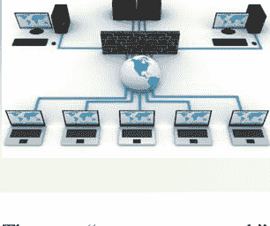

### 核心概念：计算机网络

计算机网络使用分布式处理，将任务分配在几台计算机之间。相反，不是由单台计算机处理整个任务，而是每台独立的计算机处理其中的一个子集。

“计算机网络”一术是指是指相互连接的自主计算机集合。如果两台计算机能够交换信息，则认为它们是互连的。这种连接不需要通过计算机电缆；也可以使用光纤、微波和通信卫星。通过要求计算机具有自主性，我们希望从定义中排除那些存在明显“主/从”关系的系统。如果一台计算机可以强制启动或控制另一台计算机，那么这些计算机就不是自主的。具有一个控制单元和许多从设备的系统不是网络；它也不是一台带有远程打印机和终端的大型计算机。

计算机网络是一组为了通信目的而连接在一起的计算机。网络可以根据各种特征进行分类。

#### 计算机网络的定义

计算机网络是位于不同地的各种计算机系统的互连。在计算机网络中，两个或多台计算机通过介质和数据通信设备连接，目的是通信数据和共享资源。为网络上其他计算机提供资源的计算机被称为服务器。在网络中，访问共享网络单个计算机被称为节点。

计算机网络可以定义为一组互连的计算机，它们能够共享资源。计算机系统仅是指通过允许共享资源和信息的通信通道互连的一组计算机和硬件组件。从技术上讲，如果一台计算机中的至少有一个进程可以向或从远程计算机上的至少一个进程发送或接收数据，那么这两台机器就被认为是一个网络。

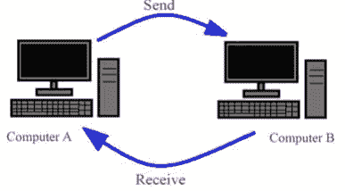

如你从上面的图中所示，任何通过发送/接收消息与其他计算机交互的计算机都应该属于网络。系统根据各种特征进行分类，例如“用于传输数据的介质”、“使用的通信协议”、“规模”、“拓扑”和“组织范围”。

#### 什么是网络？

在计算机领域中，网络是两个或多个可以通信的设备组。在实践中，网络由许多通过物理和/或无线连接的不同计算机系统组成。其规模可以从一个共享基本外设的单个 PC 到位于世界各地的巨大数据中心，再到互联网本身。无论如何，每当我们通过视频通话、流媒体电影、共享文件、即时消息聊天或仅仅访问互联网上的内容时，计算机网络都在工作。

在计算中，网络是两个或多个可以通信的设备组。在实践中，网络是由许多通过物理和/或无线连接连接的不同计算机系统组成。其规模可以从共享基本外设的单个 PC 到位于世界各地的巨大数据中心，再到互联网本身。网络包括：

- 电子邮件、即时消息
- 共享硬件
- 共享数据


“计算机网络”一术是指相互连接的自主计算机集合。如果两台计算机能够交换信息，则认为它们是互连的。这种连接不需要通过计算机电缆；也可以使用光纤、微波和通信卫星。通过要求计算机具有自主性，我们希望从定义中排除那些存在明显“主/从”关系的系统。如果一台计算机可以强制启动或控制另一台计算机，那么这些计算机就不是自主的。具有一个控制单元和许多从设备的系统不是网络；它也不是一台带有远程打印机和终端的大型计算机。

计算机网络是一组为了通信目的而连接在一起的计算机。网络可以根据各种特征进行分类。

# 计算机网络的定义

计算机网络是位于不同地的各种计算机系统的互连。在计算机网络中，两个或多台计算机通过介质和数据通信设备连接，目的是通信数据和共享资源。为网络上其他计算机提供资源的计算机被称为服务器。在网络中，访问共享网络单个计算机被称为节点。

计算机网络可以定义为一组互连的计算机，它们能够共享资源。计算机系统仅是指通过允许共享资源和信息的通信通道互连的一组计算机和硬件组件。从技术上讲，如果一台计算机中的至少有一个进程可以向或从远程计算机上的至少一个进程发送或接收数据，那么这两台机器就被认为是一个网络。


如你从上面的图中所示，任何通过发送/接收消息与其他计算机交互的计算机都应该属于网络。系统根据各种特征进行分类，例如：“用于传输数据的介质”、“使用的通信协议”、“规模”、“拓扑”和“组织范围”。

## 什么是网络？

在计算机领域中，网络是两个或多个可以通信的设备组。在实践中，网络是由许多通过物理和/或无线连接连接的不同计算机系统组成。其规模可以从一个共享基本外设的单个 PC 到位于世界各地的巨大数据中心，再到互联网本身。网络包括：

- 电子邮件、即时消息
- 共享硬件
- 共享数据

## 计算机科学的核心概念

计算机网络使用分布式处理，将任务分配在几台计算机之间。相反，不是由单台计算机处理整个任务，而是每台独立的计算机处理其中的一个子集。

互连性、通信协议、可扩展性以及跨不同地理位置共享信息的能力。

计算机网络的核心建立在互连性的原则之上。计算机、服务器、路由器、交换机和其他网络组件等设备连接在一起，形成通信通路网络。这种互连的特性实现了高效的数据传输和资源共享，使用户无论其物理位置何在都能访问信息、服务和应用程序。

为了确保网络内部有序通信，会采用特定的通信协议。最基础且广泛使用的协议族是 `TCP/IP`（传输控制协议/网际协议）。这些协议规定了数据包如何传输、路由和接收，以确保可靠且无错误的交换。其他协议处理如电子邮件传输（`SMTP`）、网页浏览（`HTTP`）和文件传输（`FTP`）等任务。

可扩展性是计算机网络的一个重要特性。随着连接设备数量和数据流量的增长，网络必须足够灵活以适应增加的负载。可扩展性通过高效的网络设计以及使用健壮的硬件软件组件来实现。这确保了网络可以扩展以在不影响性能或稳定性的情况下满足用户和应用程序日益增长的需求。

计算机网络最大的优势之一是跨越巨大距离共享信息的能力。广域网（`WAN`）连接了相隔数百或数千里的设备，实现了远程位置之间的无缝通信。这种全球连接性改变了人们在全球范围内协作、开展业务和访问信息的方式。

安全是计算机网络中的首要关注问题。随着数据在各种设备和网络之间传输和共享，保护信息免受未经授权的访问和恶意威胁至关重要。实施网络安全措施如防火墙、加密、身份验证机制和入侵检测系统是为了保护敏感数据并确保网络完整性。

计算机网络动态且不断演变的特性催生了物联网（`IoT`）等创新。物联网将网络连接扩展到传统设备之外，包含了智能器具、可穿戴设备和工业传感器等日常物品。这种物理与虚拟对象的交汇实现了自动化、数据收集和远程控制，有望提高生活和工业各个领域的效率和便利性。

计算机网络是现代通信和信息交换的骨干。其互连的特性、通信协议、可扩展性和全球范围使其在数字时代变得不可或缺。然而，随着技术的进步，网络管理员和工程师必须不断适应新的挑战和安全威胁，确保这些网络对全球用户来说保持高效、可靠和安全。

# 计算机网络的属性

计算机网络可以被视为电气工程、电子工程、电信、计算机科学、信息技术或计算机工程的一个分支，因为它依赖于相关学科的理论与实践。

计算机网络促进了人与人之间的通信，使用户可以通过方式：电子邮件、即时消息、在线聊天、电话、视频电话和视频会议进行高效、方便的通信。网络允许共享网络和计算资源。用户可以访问并使用网络上设备提供的资源，例如在共享网络打印机上打印文档或使用共享存储设备。网络允许共享文件、数据和其他类型的信息，使授权用户能够能够访问存储在网络上其他计算机上的信息。分布式计算使用跨越整个网络的计算资源来完成任务。

视频会议是一种在线技术，允许不同位置的用户面对面会议，而无需共同移动到同一个地点。

计算机网络可能被安全黑客用于在连接到网络的设备上部署计算机病毒或计算机虫，或者通过拒绝服务攻击防止这些设备访问网络。

这些是网络的一些属性：

- 促进通信：通过网络，人们可以通过电子邮件、即时消息、聊天室、电话、视频电话和视频会议进行高效、方便的通信。
- 允许共享文件、数据和其他类型的信息：在网络环境中，授权用户可以访问存储在网络上其他计算机上的数据和信息。提供共享存储设备数据和信息访问的能力是许多网络的重要特性。
- 共享网络和计算资源：在网络环境中，网络上的每台计算机都可以访问并使用网络上设备提供的资源，例如在共享网络打印机上打印文档。分布式计算使用跨越网络的计算资源来完成任务。

# 计算机网络的特点

- 从一台计算机共享资源到另一台计算机。
- 创建文件并存储在计算机中，通过网络连接的其他计算机访问这些文件。
- 将打印机、扫描仪或传真机连接到网络内的一台计算机，并让网络的其他计算机使用网络上的可用机器。

> 计算机网络实现了组织内部或全球个人及之间无缝且高效的通信。

以下是建立计算机网络所需的硬件列表。

- 网线
- 分配器
- 路由器
- 内部网卡
- 外部网卡

## 网线

网线用于连接计算机。最常用的电缆是第 5 类 `RJ-45` 电缆。


## 分配器

计算机可以通过串口连接到另一台计算机，但如果我们需要连接许多计算机来形成网络，这种串行连接将不起作用。

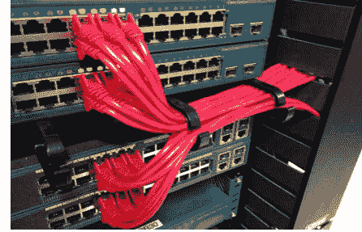

解决方案是使用一个主体，其他计算机、打印机、扫描仪等可以连接到该主体，然后由该主体管理或分配网络流量。

## 路由器

路由器是一种设备，作为网络部分计算机和其他设备之间的中心点。它配备了被称为“端口”的孔。计算机和其他设备使用网线连接到路由器。现在的路由器有无线模式，计算机无需任何物理电缆即可连接。

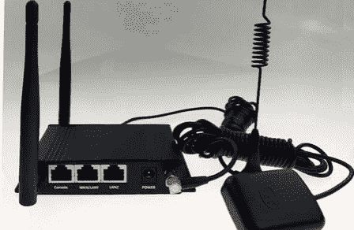

## 网卡

网卡是计算机必不可少的组件，没有它计算机无法通过网络连接。它也被网络适配器或网络接口卡（`NIC`）。大多数品牌计算机都预装了网卡。网卡有两种类型：内部网卡和外部网卡。

> 在工作场所或其他安全区域共享你的互联网连接可能会导致网络问题。在家里共享可能会禁用你之前配置的任何网络。

### 内部网卡

主板有一个用于内部网卡的插槽，网卡需插入其中。内部网卡有两种类型，其中第一类型使用外围组件总线（`PCI`）连接，而第二类型使用工业标准架构（`ISA`）。需要网线来提供网络访问。

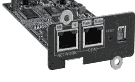

### 外部网卡

无线网络是一种使用网络节点之间的无线数据连接的计算机网络。

外部网卡分为两种类型：无线和 `USB` 接口类型。无线网卡需要插入主板，但连接到网络时不需要网线。

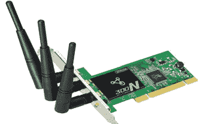

# 计算机网络的优势

- 文件共享：计算机之间的网络文件共享比使用软盘驱动器或 `Zip` 驱动器更具活性。你不仅可以共享照片、音乐文件和文档，还可以使用家庭网络将所有重要数据的备份副本保存在另一台计算机上。备份是家庭网络中最关键但往往被忽视的任务之一。
- 打印机/外设设备共享：一旦建立了家庭网络，就可以轻松地设置所有电脑共享一台打印机。你再也不需要在不同的系统之间来回切换为了打印一封电子邮件。其他计算机外设也可以以类似的方式共享，如网络扫描仪、摄像头和光刻刻机。
- 互联网连接共享：通过家庭网络，多个家庭成员可以同时访问互联网，而无需向 `ISP`（互联网服务供应商）支付多个账户费用。你会发现当多人共享时，连接速度会变慢，但宽带互联网可以轻松处理这些额外负载。
- 多人游戏：许多热门的家用电脑游戏支持 `LAN` 模式，如果朋友和家人的电脑联网，他们就可以一起玩。
- 互联网电话服务：`IP` 语音（`VoIP`）服务允许通过家庭网络跨互联网拨打和接收电话。
- 家庭娱乐：较新的家庭娱乐产品（如数字视频录像机 `DVR` 和游戏机）现在都支持有线或无线家庭网络。将这些产品集成到你的网络中可以实现在线游戏、视频共享和其他高级功能。

# 网络应用

计算机系统和外设设备连接形成网络。它们提供了许多优势：

- 资源共享，如打印机和存储设备
- 通过电子邮件和 `FTP` 交换信息
- 使用 Web 或互联网进行信息共享
- 使用动态网页与其他用户进行交互
- `IP` 电话
- 视频会议
- 并行计算
- 即时消息


# 核心概念

## 计算机网络的组件

多年来，计算机网络已变得简单易得多，现在只需一点帮助，你就可以在家里建立自己的计算机网络。计算机网络包含多个组件，但并非所有组件在每种类型的网络中都是需要的。了解各种可用组件有助于你为家庭或业务环境设计合适的网络。

网络共享常见的设备、功能和特征，包括服务器、客户端、传输介质、共享数据、共享打印机和其他硬件和软件资源、网络接口卡（`NIC`）、本地操作系统（`LOS`）和网络操作系统（`NOS`）。

- 服务器 - 服务器是存放共享文件、程序和网络操作系统的计算机。服务器为网络中的所有用户提供对网络资源的访问。服务器有许多不同种类，一台服务器可以提供多种功能。例如，文件服务器、打印机服务器、邮件服务器、通信服务器、数据库服务器、传真服务器和 Web 服务器等。
- 客户端 - 客户端是访问和使用网络及共享资源的计算机。客户端计算机基本上是网络的客户（用户），因为它们向服务器请求并接收服务。
- 传输介质 - 传输介质是用于连接网络中计算机的设施，如双绞线、同轴电缆和光纤电。传输介质有时被称为信道、链路或线路。

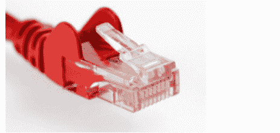

- 共享数据 - 共享数据是文件服务器提供给客户端的数据，如数据文件、打印访问程序和电子邮件。
- 共享打印机和其他外设 - 共享打印机和其他外设是服务器为网络用户提供的硬件资源。提供的资源包括数据文件、打印机、软件或客户端使用的任何其他项目。

物理层是开放系统间模型（`OSI` 模型）的第一层。

- 网络接口卡 - 网络中的每台计算机都有一个称为网络接口卡（`NIC`）的特殊扩展卡。`NIC` 准备（格式化）并发送数据、接收数据并控制计算机与网络之间的数据流。在发送端，`NIC` 将数据帧传递给物理层，由物理层将数据传输到物理链路。在接收端，`NIC` 处理来自物理层的位，并根据其内容处理消息。

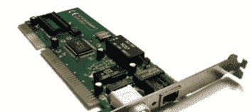

本地操作系统 - 本地操作系统允许个人电脑访问文件、打印到本地打印机，并使用计算机上的一个或多个磁盘和 `CD` 驱动器。例如 `MS-DOS`、`Unix`、`Linux`、`Windows 2000`、`Windows 98`、`Windows XP` 等。

- 网络操作系统 - 网络操作系统运行在计算机和服务器上的程序，允许计算机通过网络进行通信。
- 集线器 - 集线器是将网络连接拆分为多台计算机的设备。它像一个分配中心。当计算机从网络请求信息时，它通过电缆向集线器发送请求。集线器接收请求并将其传输到整个网络。网络中的每台计算机都应该判断广播是否是发给自己的。

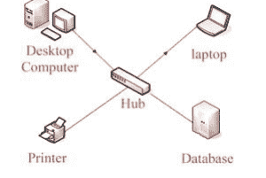

- 交换机 - 交换机是归类为网络组件之一的电信设备。交换机像内置了高级功能的集线器。由于可以将消息传递到正确的目的地或端口，因此使用每条输入消息中的物理地址。像集线器一样，交换机不会将消息广播到整个网络，而是在发送之前检查消息应该发送到哪个系统或端口。换句话说，交换机直接连接源和目的，增加了网络速度。交换机和集线器都有共同特征：多个 `RJ-45` 端口、电源和连接指示灯。

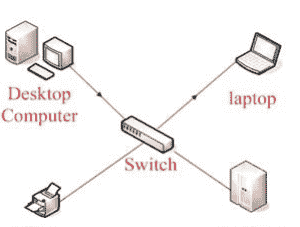

- 路由器 - 当我们谈论网络组件时，另一种连接局域网（`LAN`）与互联网连接的设备被称为路由器。当你有两个不同的网络（`LAN`）或想将单个互联网连接共享给多台计算机时，我们使用路由器。在大多数情况下，最近的路由器还包含一个交换机，换句话说它可以作为交换机。你不需要同时拥有交换机和路由器，特别是当你安装小型企业和家庭网络时。路由器有两种类型：有线和无线。选择取决于你的物理办公室/家庭设置、速度和成本。

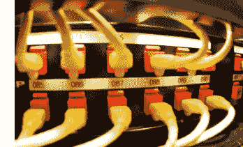

- 线缆 - 局域网线也被称为数据线或以太网线，是一种将设备连接到互联网或其他设备（如其他计算机、打印机等）的有线电缆。
- 调制解调器 - 模拟或数字调制解调器允许通过现有电话线连接互联网。这类调制解调器通常不集成在计算机主板上，而是作为独立设备，可以安装在主板上的 `PCI` 插槽或作为独立设备。局域网不需要调制解调器，但通过拨号和 `DSL` 连接互联网则需要。

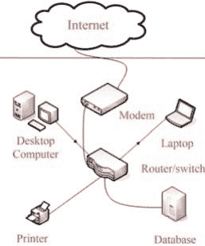

### 计算机网络的使用

计算机网络是计算机、打印机、扫描仪和其他硬件设备以及软件应用程序的互连。网络连接定义物理空间内（如办公大楼内）的用户。互联网是一项连接世界各地用户的网络。教育机构、政府机构、医疗机构、银行和其他金融机构以及住宅应用使用计算机网络来发送和接收数据并共享资源。

计算机网络在为大型组织以及普通个人提供服务方面发挥着重要作用。

### 公司对网络的用途

- **资源共享**：许多组织运行着大量高性能计算机，且这些计算机通常位置较远。让我们考虑一个例子，一家在不同地点拥有多个工厂的公司。每个地点（即每家工厂）的一台计算机都负责跟踪库存、监控生产率并处理当地工资发放。最初，这些计算机可能都是孤立运行的，但在某个时刻，管理层可能会决定连接这些计算机，以便提取和关联整个公司的信息。这里的问题就是资源共享。其目标是让网络上的任何人（无论资源和用户的位置如何）都能使用所有的程序、设备，特别是数据。
- **高可靠性**：公司网络化的第二个目标或用途是通过使用替代供应源来实现高可靠性。例如，所有文件都可以复制到两或多台机器上，这样当其中一台机器不可用（由于硬件故障）时，可以使用副本。这一特性用于金融机构。
- **节省资金**：第三个目标是省钱。小型计算机通常比大型计算机具有更高的性价比。主机（房间大小）计算机的速度大约是个人电脑快十倍，但成本是其千倍。这种不平衡导致系统设计师设计了一种由每人一台个人电脑组成的系统，并将数据存储在一个或多个文件服务器节点上。在这种模型中，用户被称为客户端，整个安排被称为**客户端-服务器模型**。在客户端-服务器模型中，通信通常表现为客户端向接收者发送请求消息，要求完成某些工作。服务器执行工作并返回回复。
- **可扩展性**：另一个目标是可扩展性。可扩展性是指随着工作负载的增长，通过添加更多处理器逐渐提高系统性能的能力。

### 网络对人的用途

- **访问远程信息**：访问远程信息有多种形式。发生这种情况的领域之一是访问金融机构。许多人电子化支付账单、管理银行账户并处理投资。居家购物如今也变得流行。另一类属于此别的应用是访问如世界维网等信息系统，其中包含了有关艺术、商业、历史、政府、地理、经济及其他几个主题的信息。以上所有这些涉及用户与远程数据库之间的交互。
- **人与人之间的通信**：俗称 email 的电子邮箱被数百万用户用于向其他人或群组发送文本信息、照片、音频以及视频。此类应用属于人与人通信类别。视频会议如今也变得流行。这项技术让远远的人之间举行虚拟会议成为可能。这也是人与人通信的一种类型。
- **互动式娱乐**：如今我们可以看到许多现场节目和表演。最棒的一点是

### 计算机网络在教育中的应用

计算机网络极大改变了教育格局，彻底改变了知识获取、传播和共享的方式。它们与教育环境的整合开启了一个改进学习体验、增强协作和增加教育资源获取途径的时代。以下是计算机网络在教育中的一些主要用途：

- **获取信息和学习资源**：计算机网络为学生和教育者提供了互联网上可用的海量教育信息和资源库。在线图书馆、数字教科书、学术期刊和教育网站提供了丰富的知识，可以补充传统的课堂材料。学生可以进行研究，探索不同的观点，并在超出教科书限制的范围内扩展对学科的理解。
- **电子学习和在线课程**：计算机网络促进了电子学习和在线教育平台的发展，使学生能够注册虚拟课程、听讲座并参与互动学习活动。这些平台提供了灵活性，允许学生按照自己的节奏进行学习，并在任何连接互联网的地方访问课程材料。电子学习让具有不同时间安排、地理位置或身体残障的个人更容易获得教育。
- **协作学习和小组项目**：计算机网络促进了协作学习环境的形成。学生和教师可以使用各种在线协作工具就小组项目、作业和演示进行交流和合作。这培养了团队合作、沟通能力以及集体解决问题的能力，这些对于现代职场中的成功至关重要。
- **通信与互动**：计算机网络实现了教育者、学生和家长之间的无缝通信。通过电子邮件、即时消息和学习管理系统，教师可以提供反馈、回答查询并分享重要更新。家长可以随时了解孩子的进度和对学校活动的参与情况。这种互动加强了家校生三之间的关系，为学生的学习提供更好的支持。


- **虚拟实验室与模拟**：计算机网络促进了虚拟实验室和模拟的创建。学生可以在网上进行实验和模拟，而不需要物理设备。这种实践经验增强了理解和批判性思维，特别是对于科学和工程等需要实际操作的学科。
- **全球连接与跨文化学习**：计算机网络连接了来自不同地理位置和文化背景的学生和教育者。虚拟交换计划和在线协作计划让学生能够与全球的同学和教育者互动，培养跨文化理解和全球意识。
- **评估**：计算机网络支持各种评估工具和平台，使教育者能够以电子方式进行测试、考试和作业。这些平台提供即时反馈，缩短了评估时间并让教育者能够识别学生可能需要额外帮助的领域。
- **教师专业发展**：计算机网络为教师提供了专业发展的机会。他们可以通过网络研讨会、在线工作坊教育论坛更新教学方法，并与全球同事交流想法。

## 计算机网络的分类

计算机网络根据各种因素进行分类。它们包括：

互连性：网络组件可以以不同的方式相互连接。我们所说的连通是指逻辑上的、物理上的或两者都有。

- 每个设备都可以连接到网络上的所有其他设备，形成网状结构。
- 所有设备都可以连接到单一介质，但在地理上是分离的，形成总线结构。
- 每个设备仅与其左右邻居连接，形成线型结构。
- 所有设备都连接到同一个设备上，形成类似星型的结构。
- 所有设备使用之前所有的连接方式进行任意连接，形成混合结构。
- 管理：从管理员的角度来看，网络可以是一个属于单一自治系统的私有网络，无法从其物理或逻辑域之外进行访问。网络也可以是公共网络，供所有人访问。
- 网络架构：根据架构的不同，计算机网络可以分为多种类型，例如客户端-服务器型（Client-Server）、对等型（peer-to-peer）或混合型。
- 可以存在一个或多个系统作为服务器（Server）。其他系统作为客户端（Client），请求服务器提供服务。服务器代表客户端接收并处理请求。
- 两个系统可以点对点地连接，或者以背靠的方式连接。它们处于同一层，被称为对等节点（peers）。
- 可以存在混合网络，它涉及上述类型的网络架构。

以下列表列出了用于分类分类的类别。

### 连接方法

计算机网络还可以根据用于连接网络中单个设备的硬件和软件技术进行分类，例如光纤、以太网、无线局域网（Wireless LAN）、HomePA、电力线通信或 G.hn。以太网使用物理布线连接设备。经常部署的设备包括集线器、交换机、桥器和/路由器。

无线局域网技术设计用于无线连接设备。这些设备使用无线电波或红外信号作为传输介。

数据传输是通过点对点或点对多通信通道传输数据。

ITU-G.hn 技术利用现有的家庭布线（同轴电缆、电话线和电源线）创建一个高速（高达 1 Gigabit/s）的局域网。

### 有线技术

- 双绞线 - 这是电信领域最广泛使用的介质。双绞线是普通的电话线，由两根扭在一起的铜线组成，同时用于语音和数据传输。两根线扭在一起使用有助于减少串扰和电磁感应。传输速度范围从每秒200万比特到每秒1亿比特不等。
- 同轴电缆 – 这些电缆广泛用于电缆电视系统、办公楼和其他局域网工作场所。电缆由铜线或铝线组成，外面包裹着绝缘层（通常由具有高介电常数的柔性材料制成），所有层都被导电层包裹。绝缘层有助于最大限地减少干扰和失真。传输速度范围从每秒2亿到超过每秒5亿比特。
- 光纤 – 这些电缆由包裹在保护层中的一或多根玻璃丝纤维组成。它传输的光可以远距离传输并具有更高的带宽。光纤不受电磁辐射的影响。传输速度可以高达每秒数万亿比特。光纤的速度是同轴电缆的数百倍，是双绞线的数千倍。

### 无线技术

- 地面微波 – 地面微波使用陆地的发射器和接收器。设备看起来类似于卫星天线。地面微波使用低千赫兹范围，这使得所有通信限制在视距范围内。间隔约 30 英里的中继站之间的路径。微波天线通常放置在建筑物顶部、山丘和山峰。
- 通信卫星 – 卫星使用微波无线电作为电信介质，不会受到地球大气的干扰。卫星位于空间中，通常在赤道上方 22,000 英处。这些地球轨道系统能够接收和中继语音、数据和电视信号。
- 蜂窝和 PCS 系统 – 多种无线通信技术。系统分为不同的地理区域。每个区域都有低功率发射器或无线中继天线设备，用于将通话从一个区域继到另一个区域。
- 无线局域网 – 无线局域网使用类似于数字蜂窝的高频无线技术和低频无线技术。无线局域网使用频谱技术实现有限区域内多个设备之间的通信。开放标准无线技术的示例是 IEEE 802.11b。
- 蓝牙 – 一种短距离无线技术。工作频率约为 1Mbps，范围从 10 米到 100 米。蓝牙是一种用于短距离数据交换的开放无线协议。
- 无线网 – 无线网是指通过手机、寻呼机、PDA 和其他移动通信设备使用万维网。无线网服务提供随时随地的连接。

### 规模

网络通常被分为局域网（LAN）、广域网（WAN）、城域网（MAN）、个人局域网（PAN）、虚拟专用网络（VPN）、校园网（CAN）、存储区域网（SAN）等，具体取决于其规模、范围和目的。不同类型网络之间的使用、信任级别访问权限也不同 - 例如，局域网往往是为组织内部物理位置（如建筑）的内部系统和员工设计的，而广域网可以连接组织物理分离的部分，并可能与第三方连接。

### 功能关系（网络架构）

计算机网络可以根据网络元素之间存在的功能关系进行分类，例如活动网络、客户端-服务器和对等（工作组）架构。

### 网络拓扑

计算机网络可以根据其基础的拓扑结构进行分类，例如总线网络、星型网络、环形网络、网状网络、星型总线网络、树型或分层拓扑网络。网络拓扑表示了设备看待其逻辑关系的方式。这里“逻辑”一词的使用具有重要意义；网络拓扑并不与物理布局相同。即使网络计算机在物理上呈线性排列，如果它们通过集线器连接，该网络也是星型拓扑而非总线拓扑。

## 广播网络的特征

广播网络是一种计算机网络，它采用广播方法将数据从一个发送者传输到多个接收者。在这种网络模型中，数据包在网络上广播，所有连接的设备都会接收到传输的数据。广播网络具有若干与其他类型网络区别于庭的独特特征。以下是广播网络的一些关键特征：

- 广播：广播网络的主要特征是其广播能力。当一个设备想要向网络上的所有设备发送数据时，它只需将数据广播到所有连接的设备。这确保了所有设备都能同时接收到传输的数据。这是一种一对多的通信模型。
- 简单性：广播网络的实现和管理相对简单。设备不需要维护复杂的路由表，也不跟踪其他设备的特定地址。这种简单性对于设备数量有限的小型网络是有优势的。
- 寻址：在广播网络中，设备通常没有唯一的地址。相反，数据包被定到一个特殊的广播地址，该地址代表网络上的所有设备。当设备接收到带有广播地址的数据包时，它知道该数据是发送给所有连接设备的。
- 流量与带宽：由于数据被广播到所有设备，与点对点网络或交换网络等其他网络拓扑相比，广播网络产生更多的网络流量。这会导致带宽消耗增加和潜在的网络拥塞，特别是随着网络上设备数量的增加。
- 网络规模：广播网络最适合设备数量有限的小型网络环境。随着网络变大，广播流量会增加，可能会导致效率和可扩展性问题。
- 冲突域：在广播网络中，所有设备共享同一个冲突域，这意味着当设备同时传输数据时，就会发生冲突并导致数据损坏。这种冲突可以通过各种冲突检测和规避机制来解决。
- 数据安全：广播网络的固有的安全机制有限。由于数据被传输到所有设备，因此传输的信息不具备固有的机密性。需要额外的安全措施（如加密和身份验证）来确保数据安全。
- 广播风暴：在大型广播网络中，存在广播风暴的风险，大量的广播包会淹没网络。这可能导致网络拥塞和性能下降。为了缓解广播风暴，可能会引入交换机和路由器来分段网络并限制广播流量。
- 应用场景：广播网络通常用于单个发送者需要同时向所有连接的设备发布信息的场景。例如，发送到局域网内所有设备的公告或更新。

广播网络在简单性和易于实现方面表现出色，使其适用于设备有限且必须向所有设备广播数据的小型网络和场景。然而，在更大更复杂的环境中，它们可能面临网络拥塞、可扩展性和安全性方面的挑战，这些可以通过引入额外的网络管理和安全措施来解决。

## 点对点网络

点对点网络由许多对单独机器之间的连接组成。要从源地到达目的地，这种类型网络的数据包可能需要访问一个或多个中间机器。通常可能有多条不同长度的路由，因此路由算法在点对点网络中起着重要作用。根据一般规则（尽管有很多例外），较小的地理局部网络倾向于使用广播，而较大的网络通常是点对点的。

### 点对点网络的优势

点对点网络提供了多种优势，使其成为某些应用和场景的首选。这些优势源于两个设备之间直接、专用且高效的通信模型。以下是点对点网络的主要优势：

- 专用带宽：点对点网络在两个设备之间提供专用的通信通道。这意味着连接的带宽供通信设备独占，确保数据高效传输，而不会与其他设备发生竞争或共享。
- 低延迟：由于数据直接在两个端点之间传输，而不通过中间设备，点对点网络表现出低延迟。减少传输延迟对于实时通信和对及时交付数据至关重要的的应用特别有益。
- 高安全性：与广播网络相比，点对点连接本质上提供了更高水平的安全性。由于通信发生在两个特定设备之间，未经授权访问传输数据的风险降至最低。这使得点对点网络适用于敏感和机密信息的交换。
- 简单性：点对点网络的实现和管理非常简单。通信中仅涉及两个设备，不需要复杂的地址方案或路由协议。这种简单性减少了网络配置和维护开销。
- 可靠性：点对点网络中两个设备之间的直接链路增强了可靠性。没有可能引入潜在故障点的中间设备或共享通信路径。这种可靠性的提高对于关键应用至关重要，并确保了连接的稳定性。
- 全双工通信：点对点连接支持全双工通信，能够同时进行双向传输。通信通道的高效利用最大化了吞吐量，并促进了顺畅的双向通信。
- 隐私性：点对点网络在两个连接的设备之间提供私有的通信通道。这种隐私性对于需要机密性的场景是有利的，例如企业之间的私人通信或远程办公室之间的安全连接。
- 适用于特定应用：点对点网络适用于需要在两个特定设备之间进行直接通信的某些应用。例如，它们通常用于建筑连接、连接远程站点或建立服务器与客户端之间的安全链路。
- 特定情况下的可扩展性：虽然点对点网络的可扩展性可能不如其他网络拓扑，但在需要关键端点之间建立单独连接的情况下情况下，大型网络是可扩展的。这使得它们对于定制通信非常有用。
- 成本效益：点对点网络对于连接中等距离的两个设备来说具有成本效益。它们消除了对大量基础设施的需求。

点对点网络在连接中等距离的两个设备时具有成本效益，适用于需要设备间直接连接的应用。

### 点对点网络的特征


- 直接连接：点对点网络的基本特征是在两个设备之间建立直接链路。这意味着通信发生在特定的端点之间。
- 简单性：点对点网络在设计和实现上相对简单。由于仅涉及两个设备，不需要复杂的地址方案或路由协议。
- 专用带宽：每个点对点链路为设备提供专用带宽。这确保了可用带宽被端点充分利用，从而实现数据传输。
- 全双工通信：点对点连接通常支持全双工通信，这意味着可以同时向两个方向传输数据。这使得不需要单独的发送接收通道。
- 低延迟：由于连接的直接性，点对点网络通常表现出低延迟。数据直接在两个设备之间传输而不通过中间设备，减少了传输延迟。
- 隐私与安全：与广播网络相比，点对点网络本质上提供了更高水平的隐私和安全性。由于通信发生在端点之间，未经访问传输数据的风险最小。
- 距离限制：点对点网络适用于中短距离。随着两个设备之间距离的增加，信号可能会减弱，导致潜在的信号丢失和性能下降。
- 网络可扩展性：虽然点对点连接在连接两个设备时简单且高效，但对于具有大量设备的大型网络可能不具有可扩展性。每个连接都需要单独的物理链路，随着连接数量的增加，这可能变得不实际。
- 应用场景：点对点网络通常用于两个特定设备之间需要直接通信的场景。例如连接广域网中的两个办公室、建立服务器与客户端之间的安全链路，以及从远程位置建立专用通信链路。
- 可靠性：点对点连接通常提供很高的可靠性，因为没有可能引入潜在故障点的中间设备。直接链路确保了更稳定可靠的通信路径。

点对点网络为两个设备提供了一种简单高效的通信方法，具有专用带宽和低延迟。它们非常适用于需要在特定端点之间建立安全可靠连接的场景。然而，由于单个连接的局限性，它们在大型网络中可能并不实用，因此更适合连接远程位置或在网络内部建立专用链路。

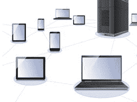

## 核心概念：计算机网络类型

计算机网络有多种类型。计算机网络可以根据其规模和用途进行分类。网络的大小可以通过其所占的地理区域以及参与网络的计算机数量来表示。网络的覆盖范围可以从单个房间内的少数几个设备到遍布全球的数百万个设备。

不同网络有多种分类方法，例如根据规模、功能和覆盖的地理距离。网络是两个或多个计算机系统以某种方式连接在一起的简单组合，以便它们之间共享数据。

常见的计算机网络类型可以通过其规模来识别。

### 个人局域网

个人局域网（PAN）是一种用于一个人附近的计算机设备之间通信的计算机网络。PAN 中使用的设备示例包括个人电脑、打印机、传真机、电话、个人数字助理（PDA）、扫描仪甚至视频游戏机。此类 PAN 可能包括设备之间的有线和无线连接。PAN 的范围通常至少为 20-30 英尺（约 6-9 米），但预计随着技术的改进，这一范围将会增加。

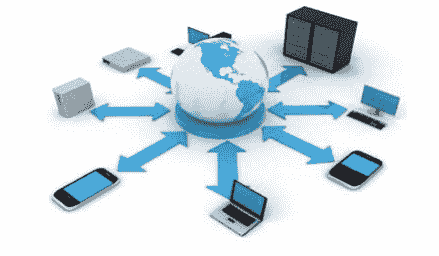

### 局域网

局域网（LAN）是覆盖较小物理区域的计算机网络，如家庭、办公室或小型建筑群（如学校或机场）。目前的有线局域网最可能基于以太网（Ethernet）技术，尽管像 ITU-T G.hn 等新标准也提供了利用现有家庭线路（同轴电缆和电源线）创建有线局域网的方法。

例如，图书馆可能有一个有线或无线局域网供用户连接本地设备（例如打印机和服务器）并接入互联网。在有线局域网上，图书馆的 PC 通常通过第 5 类（Cat5）电缆连接，通过相互连接设备系统运行 IEEE 802.3 协议并最终连接互联网。服务器通常位于 Cat5 增强型电缆上，这将支持 1 Gbit/s 速率的 IEEE 802.3。无线局域网可能使用不同的 IEEE 协议，802.11b、802.11g 或可能的 802.11n。员工电脑（图书馆中的亮绿色部分）可以访问彩色打印机、借阅记录、学术网络和互联网。所有用户计算机都可以访问互联网和卡片目录。每个工作组都可以访问其本地打印机。

所有互连设备都必须理解网络层（第 3 层），因为它们正在处理多个子网（不同颜色）。图书馆内部的设备到用户设备只有 10/100 Mbit/s 以太网连接，且到中央路由器有千兆以太网连接，它们可以被称为“三层交换机”，因为它们只有以太网接口且必须理解 IP。将它们称为接入路由器会更准确，其中顶部的路由器是连接互联网和学术网络客户接入路由器的分布路由器。

与广域网（WAN）相比，局域网的定义特征包括更高的数据传输速率、更小的地理范围以及不需要租赁电信线路。目前的以太网或其他 IEEE 802.3 局域网技术运行速度高达 10 Gbit/s。这是数据传输速率。IEEE 正在设有研究 40 和 100 Gbit/s 标准化的项目。

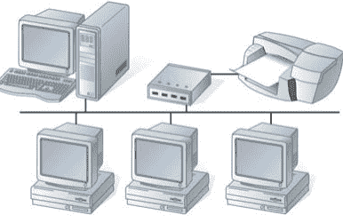

### 校园局域网

校园局域网（CAN）是由有限地理区域内的多个局域网（LAN）互连而成的计算机网络。它可以被视为城域网的一种形式。对于校园网络，校园局域网比局域网大但比广域网小。校园局域网的主要目的是促进校园建筑之间的通信。


### 城域网

城域网（MAN）是覆盖城市或大型校园的计算机网络。它比局域网（LAN）大但比广域网（WAN）小。MAN 通常使用路由器和交换机来连接局域网。

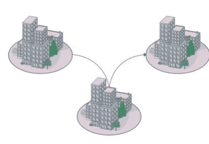

### 广域网

广域网（WAN）是覆盖大地理区域（如国家或大陆）的计算机网络。与个人局域网（PAN）、局域网（LAN）、校园局域网（CAN）、城域网（MAN）相反。广域网最大且最著名的例子是互联网。WAN 是覆盖广泛区域（即一个国家到另一个国家）的网络，通常使用运营商提供的传输设施。WAN 技术通常在 OSI 模型的低三层：物理层、数据链路层和网络层。

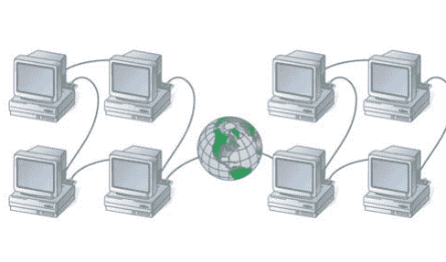

### 全球网

全球网（GAN）规范正在由多个小组开发中，还没有统一的定义。然而，通常 GAN 是一种跨任意数量无线局域网、卫星覆盖区等支持移动通信的模型。移动通信中的关键挑战是用户通信从一个本地区域“切换”到另一个区域。

### 虚拟专用网

虚拟专用网（VPN）是一种计算机网络，其中节点之间的某些链路通过较大网络（如互联网）中的开放连接或虚拟电路传输，而不是物理线路。虚拟网络的数据链路层协议被认为隧道到了较大的网络中。一种常见的应用是通过公共互联网进行安全通信，但 VPN 需要明确的安全功能，如身份验证或内容加密。例如，VPN 可用于隔离底层网络上不同社区的流量。

VPN 可能尽力性能，或者在 VPN 客户与 VPN 服务提供之间之间定义的服务水平协议（SLA）。通常，VPN 的拓扑结构比点对点更复杂。

VPN 允许计算机用户位于其实际连接互联网的 IP 地址位置。

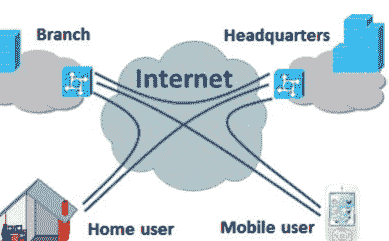

### 互联网络

互联网络是通过通用路由技术连接两个或多个不同的计算机网络或网络段。其结果被称为互联网络（通常简称为互联网）。两个或多个网络或网络段使用在 OSI 基础模型第 3 层（“网络”层）运行的设备连接，例如路由器。公共、私有、工业或政府网络之间的任何连接也可以定义为互联网络。

在现代实践中，互联网络使用互联网协议。根据管理者和参与者的不同，互联网络至少有三种变体：

- 内部网（Intranet）
- 外外网
- 互联网

内网和局外网可能连接到互联网，也可能没有。如果连接了互联网，内网或局外网通常会受到保护，防止在未经适当授权的情况下从互联网访问。互联网不被视为内网或局外网的一部分，尽管它可能作为访问局外网部分内容的门户。


> 为了实现通信，每个个人网络节点或阶段都设计有相似的协议或通信逻辑，即传输控制协议 (`TCP`) 或网际协议 (`IP`)。

### 内网

内网是一组使用网际协议（Internet Protocol）以及基于 `IP` 的工具（如网络浏览器和文件传输应用程序），并受单一管理实体的控制。该管理实体向所有特定的授权用户开放内网。最常见的情况是，内网是机构的内部网络。大型内网通常至少有一个 Web 服务器，为用户提供机构信息。

### 局外网

局外网是一个范围限于单一组织或实体的网络或互联网，它还与一个或多个其他（通常是但并不一定）信任组织或实体的网络有有限的连接（例如，公司的客户可能被允许访问其内网的某些部分从而创建局外网，同时这些客户从安全角度来看可能不被认为是“信任”的）。从技术上讲，局外网也可以被分类为 `CAN`、`MAN`、`WAN` 或其他类型的网络，尽管根据定义，局外网不能由单一局域网（`LAN`）组成；它必须与外部网络至少有一个连接。

### 互联网

互联网是由基于网际协议栈技术的全球政府、学术、公共和私有网络互连而成的。它是美国国防部研究计划计划署（`DARPA`）开发的高级研究计划局网络（`ARPANET`）的继者。互联网也是世界维网（`WWW`）的底层通信骨干。由于历史原因以及为了与其他通用网络区分来，“Internet”（互联网）通常以大写字母“I”作为专有名词拼写。

互联网参与者使用多种记录的、通常是标准化的协议，这些协议与网际协议栈兼容，并使用由互联网地址分配机构（`IANA`）和地址注册管理的地址系统（`IP` 地址）。服务提供商和大型企业通过边界网关协议（`BGP`）交换有关其地址空间可达性的信息，形成了一个冗余的全球网状传输路径。

## 个人域网概念

个人域网（`PAN`）是一种覆盖极小地理区域的计算机网络，通常在一个个人的直接周围范围内。它的设计旨在实现个人设备（如智能手机、笔记本电脑、平板电脑、可穿戴设备和其他外设备）之间的通信和数据交换。

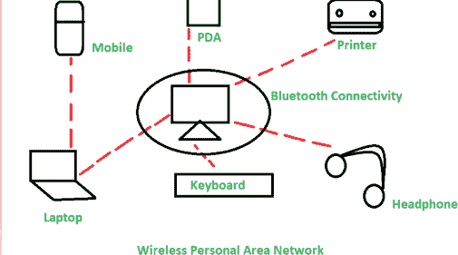

`PAN` 了这些设备之间无缝且便利的连接，允许用户在其个人领域内访问和共享数据、媒体和资源。蓝牙和 `Wi-Fi` 技术常用于建立 `PAN`。

## 总结

- 计算机网络是一个连接了两个或多个计算设备以传输和共享信息的系统。计算设备包括从手机到服务器的所有设备。
- 计算机网络技术是计算机科学的一个分支，涉及计算机网络的构思、架构、创建、维护和安全。它是计算机科学、计算机工程和电信的结合。
- 计算机网络是复杂的系统，促进了连接设备之间数据和资源的无缝交换。其特点是互连性、通信协议、可扩展性以及跨越不同地理位置共享信息的能力。
- 计算机网络是位于不同地点的各种计算机系统的互连。在计算机网络中，两个或多个计算机通过介质和数据通信设备连接在一起，目的是通信数据和共享资源。
- 计算机网络促进了人际通信，允许用户通过各种手段高效方便地进行通信：电子邮件、即时消息、在线聊天、电话、视频电话和视频会议。
- 计算机网络显著改变了教育格局，以及知识获取、传播和共享的方式。
- 广播网络是计算机网络的一种，它采用广播方法将数据从一个发送者传输到多个接收者。在这种网络模型中，数据包在网络上进行广播，所有连接的设备都会接收传输的数据。
- 点对点网络由许多对个体机器之间的连接组成。要从源到目的地，这种类型网络上的数据包可能需要访问一个或多个中间机器。
- 点对点网络（也称为 `P2P` 网络）是计算机网络的一种，在两个设备之间建立直接连接，实现它们之间的通信。这些网络具有与其他网络拓扑结构区分开来的独特特征。

## 多选题

1. 下列哪网络拓扑结构提供了最高级别的容错和冗余性？
   - a. 总线型
   - b. 星型
   - c. 环形型
   - d. 网格型

2. 路由器在计算机网络中的主要功能是什么？
   - a. 连接局域网（`LAN`）内的设备
   - b. 连接多个局域网以创建广域网（`WAN`）
   - c. 将设备连接到互联网
   - d. 通过无线网格技术连接设备

3. 哪种网络协议通常用于互联网上的安全通信，以确保数据加密和身份验证？
   - a. `HTTP`
   - b. `FTP`
   - c. `TCP`
   - d. `SSL/TLS`

4. 哪种网络设备运行在 `OSI` 模型的数据链路层（第 2 层），并使用 `MAC` 地址进行数据转发连接局域网中的多个设备？
   - a. 集线器
   - b. 交换机
   - c. 路由器
   - d. 中继器

5. 在客户端-服务器架构中，哪一个负责存储文件、数据库和应用程序？
   - a. 客户端
   - b. 服务器
   - c. 交换机
   - d. 路由器

## 答案

- 1. d
- 2. b
- 3. d
- 4. b
- 5. b

## 复习题

1. 考察计算机网络的各种优点。
2. 什么是网络？
3. 计算机网络的发展和历史。
4. 计算机网络的特性。
5. 计算机网络的组成部分。
6. 传输技术的类型。
7. 计算机网络的类型。

## 参考文献

- 1. Doyle, Jeff & Carroll, Jennifer (2001). 网际协议路由，卷 II. Cisco Press. ISBN 1-5870-089-2.
- 2. Doyle, Jeff & Carroll, Jennifer (2005). 网际协议路由，卷 I. Cisco Press. ISBN 1-57870-092.
- 3. Groth, David and Skander, Toby (2010) CCIE 路由与交换指南。ISBN 0-7821-4406-3.
- 4. Wendell Odom, Rus Healy, Denise Donohue (2010) CCIE 路由与交换指南，第四版。Sybex, Inc. ISBN 0-15692-660-9.
- 5. Kurose James F and Keith W. (2005). 计算机网络：自上而下的方法。Pearson Education. ISBN 0-321-227352.
- 6. Kurose, James E. & Ross, Keith W. (2004). 计算机网络：自上而下的方法，第三版。Benjamin/Cummings. ISBN 0-321-22735.
- 7. Medhi, Deepak & Ramasamy, Karthikeyan (2007). 网络路由：算法、协议和架构。Morgan Kaufmann. ISBN 0-12-08858-3.
- 8. Simmonds, A; Sandilands, P; van Ekert, L. (2004). “网络安全本体论。”计算机科学讲义。计算机科学讲义 3285: 317–323. doi:10.1007/978-3-540-30176-9_41. ISBN 978-3-540-23659-7.
- 9. Wilkinson, Paul (2005). 协作技术：局外网的演进。Taylor and Francis. ISBN 0-415-35859-0.

# 网络软件与网络标准化


网络软件允许台式机、笔记本电脑、手机、平板电脑和其他系统等多个设备相互连接，并与其他网络连接。互联网是全球连接的服务器和计算机系统的典型示例，它依赖于网络软件来确保终端用户的可访问性。`IEEE` 通信学会标准活动委员会已建立两个研究小组和两个学习小组，以研究软件定义网络、网络功能虚拟化及相关领域的标准化机会。

在学习本章后，你将理解以下核心概念：

- `OSI` 模型
- 传输控制协议 (`TCP`)
- 用户数据报协议 (`UDP`)

## 引言

网络软件和标准化是计算机网络中的两个基本方面，它们对于设备和系统之间的无缝通信和互操作性起着至关重要的作用。这两个概念对于建立可靠、高效且可扩展的网络至关重要，能够满足现代世界多样化的通信需求。

网络软件是指实现计算机网络运行和管理的程序、协议和应用程序的集合。它在促进网络内设备之间的数据传输、资源共享和通信方面发挥着关键作用。网络软件涵盖了网络栈的各个层，从处理原始数据位传输的物理层，到提供用户友好界面和服务的应用层。

除了通信协议外，网络软件还包括网络管理工具、安全应用程序和监控程序，这些工具确保网络高效、安全并以最短停机时间运行。网络管理员使用这些软件工具配置设备、监控网络性能并在问题出现时进行故障排除。

网络标准化涉及开发和实施约定的规则、协议和规范，以确保不同网络设备和系统之间的统一性、兼容性和互操作性。标准化是至关重要的，因为它允许来自不同制造商的设备无论其来源或底层技术如何都能有效通信。

此外，网络标准化通过为新型网络技术和应用程序开发提供共同基础，促进了创新。它还简化了网络管理和故障排除，因为标准化的协议和接口在行业内有详尽记录并被广泛理解。

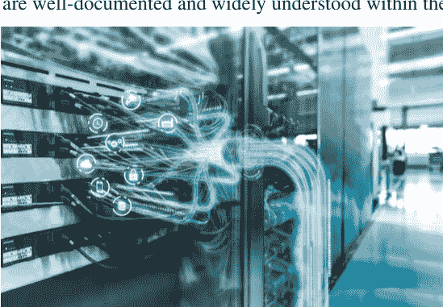

## 核心概念：OSI 模型

`OSI`（开放系统互连）是应用程序如何在网络进行通信的参考模型。参考模型是用于理解关系的概念性框架。`OSI` 参考模型的目的是引导供应商和开发者，使他们创建的数字通信产品和软件程序能够运行，并提供一个描述网络或电信系统功能的清晰框架。

国际标准组织/开放系统互连（`ISO/OSI`）模型是网络中两端之间通信的标准参考模型。了解网络如何工作的基础知识对于排除未来的问题非常有帮助。

`OSI` 模型的重要性无论如何强调都不为过分。几乎所有的网络设备供应商和用户都理解，网络计算产品遵循并完全支持该模型生成的网络标准是多么重要。当供应商的产品遵循 `ISO` 模型所生成的标准时，将这些产品与其他供应商的产品连接起来就相对简单。相反，供应商偏离这些标准越远，将该供应商的产品与其他供应商的产品连接起来就越困难。

此外，如果供应商偏离了该模型产生的通信标准，软件开发工作将非常困难，因为供应商必须自己构建所有必要软件的每一个部分，而无法在其他供应商的现有工作基础上构建。

前两个问题为供应商引发了第三个重大问题：随着供应商的产品与其他供应商的产品连接变得越来越困难，其市场竞争力也会越来越下降。

因此，`ISO` 模型定义了一个根据分层实现协议的网络框架。每一层在功能上都是相互独立的，但它为上层提供服务，并从下层接收服务。

这些层分为两组。上层每当消息从用户传向或来自用户时都会使用。下层在任何消息通过主机计算机时使用。发送给此计算机的消息将传递到上层，但不会传递给另一个主机。

### OSI 模型的层

`OSI` 模型的层如下：

- 应用层
- 表示层
- 会话层
- 传输层
- 网络层
- 数据链路层
- 物理层

计算机科学核心概念：计算机网络

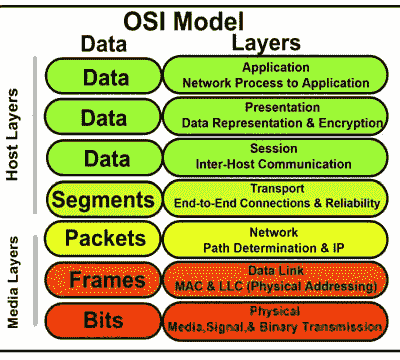

图 1：`OSI` 模型层。

### 应用层

应用层允许用户（无论是人类还是软件）访问网络。它提供了用户界面以及电子邮件、远程文件访问与传输、共享数据库管理和其他类型的分布式信息服务等支持。

应用层提供的特定服务包括：

- 网络虚拟：网络虚拟终端是物理终端的软件版本，允许用户登录到远程主机。为此，应用程序在远程主机上创建一个终端的软件仿真。用户的计算机与软件终端通信，而软件终端反过来与主机通信，反之亦然。远程主机认为它正在与它的终端之一通信，并允许登录。
- 文件传输、访问和管理 (`FTAM`)：此应用程序允许用户访问远程计算机中的文件（进行更改或读取数据）、从远程计算机检索文件，以及管理或控制远程计算机中的文件。
- 邮件服务：此应用程序为电子邮件的转发和存储提供了基础。
- 目录服务：此应用程序提供各种对象和服务的全局分布式数据库源和访问。

### 表示层

表示层是将接收到的数据转换为目标应用程序格式的层。此层的工作最好被理解为翻译工作。例如，数据在传递给其他层发送之前通常会在表示层进行加密。当接收数据时，它将被解密并以期望格式传递给目标应用程序。

表示层的具体职责包括：

- 翻译：两个系统中的进程（运行程序）通常以字符字符串、数字等形式交换信息。由于不同的计算机使用不同的编码系统，表示层负责这些不同编码方法之间的互操作性。发送端的表示层将信息从依赖于发送者的格式转换为通用格式。接收端的表示层将通用格式转换为依赖于接收者的格式。
- 加密：为了传输敏感信息，系统必须能够确保隐私。加密意味着发送者将原始信息转换为另一种形式，并将生成的消息发送到网络。解密逆转原始过程，将消息转换回原始格式。
- 压缩：数据压缩减少了传输的比特数。数据压缩在文本、音频和视频等多媒体的传输中尤为重要。

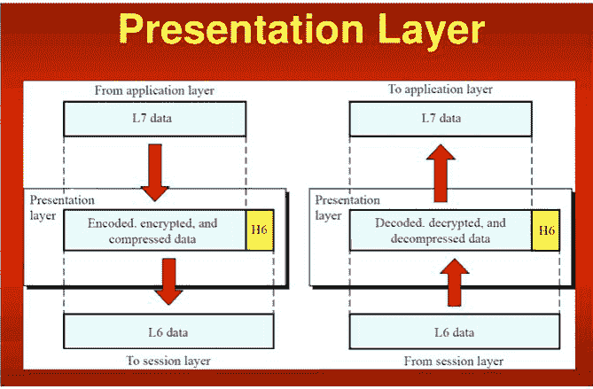

图 2：表示层。

### 会话层 (Session Layer)

会话层是维持和结束连接的地方。这通常指的是应用通过网络请求数据。虽然传输层处理数据的实际流，但会话层充当着宣告员的角色，确保请求和发送数据的程序及应用程序知道它们的请求已完成。在技术术语中，会话层同步数据传输。

> 会话层负责在不同设备之间建立、维持和终止会话。它作为 `OSI` 模型中传输层（第 4 层）和表示层（第 6 层）之间的桥梁。

会话层的具体职责包括：

- *对话控制（Dialog Control）*：会话层允许两个系统进入对话。它允许两个进程之间的通信以半双工（一次单向）或全双工（一次双向）的方式进行。例如，连接到主机的终端与主机之间的对话可以是半双工的。
- *同步（Synchronization）*：会话层允许进程在数据流中添加检查点。

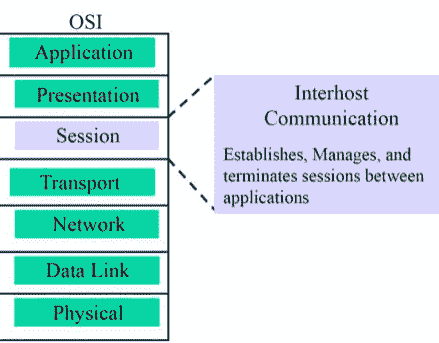

**图 3**：会话层。

### 传输层 (Transport Layer)

传输层负责跨网络进行数据流传输。在这一层级，数据不再被视为单个数据包，而是被看作一次对话。为了实现这一点，使用了定义为“通信规则”的协议。这些协议监控许多数据包的完整传输过程，检查对话中的错误，确认成功传输，并在检测到错误时请求重传。

传输层的具体职责包括：

- *服务点定位（Service-Point Addressing）*：计算机通常同时运行多个程序。出于如此，从源到目的的交付不仅是指从一台计算机到另一台计算机，还从一台计算机上的特定进程（运行的程序）到另一台计算机上的特定进程（运行的程序）。因此，传输头部必须包含一种称为服务点地址（或端口地址）的地址。网络层将每个数据包送到正确的计算机；传输层则将整个消息送到计算机上正确的进程。
- *分段与重组（Segmentation and Reassembly）*：消息被划分为可传输的段，每个段包含一个序列号。这些数字使得传输层在到达目的地后能够正确重组消息，并识别并替换在传输过程中丢失的数据包。

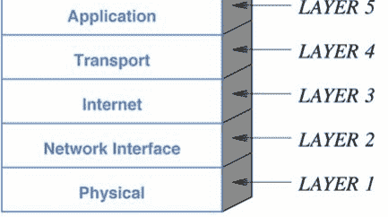

**图 4**：传输层。

- *连接控制（Connection Control）*：传输层可以是无连接的也可以是面向连接的。无连接传输层将每个段视为独立的数据包，并将其交付到目标机器的传输层。面向连接的传输层在交付数据包之前首先与目标机器的传输层建立连接。所有数据传输完成后，连接将终止。
- *流量控制（Flow Control）*：类似于数据链路层，传输层负责流量控制。然而，这一层的流量控制是端到端执行的，而不是跨单一链路。
- *错误控制（Error Control）*：类似于数据链路层，传输层负责错误控制。然而，这一层的错误控制是端到端执行的，而不是跨单一链路。发送传输层确保整个消息无错误（损坏、丢失或重复）地到达接收传输层。错误纠正通常通过重传实现。

### 网络层 (Network Layer)

网络层负责数据包可能跨越多个网络的源到目的交付。虽然数据链路层负责监督同一网络（链路）上两个系统之间的数据包交付，但网络层则确保每个数据包都能从起点到达其最终终点。

如果两个系统连接在同一条链路上，通常不需要网络层。然而，如果两个系统连接到不同的网络（链路），且网络之间有连接设备，则就需要网络层。

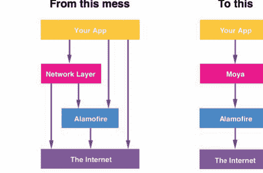 (注：此处对应原文图片5，但路径中为57_054719b3ebbba980271a)

互联网是使用通用通信协议和技术构建的互连网络。图 5：网络层。

网络层的具体职责包括：

- *逻辑地址（Logical Addressing）*：网络层通过逻辑地址区分发送者和接收者。物理层在某些方面还定义了发送者和接收者的逻辑地址。
- *路由（Routing）*：当独立的网络或链路连接在一起时，网络层通过路由器或网关将数据包路由到最终目的地。网络层的功能之一是为比特提供机制。

### 数据链路层 (Data Link Layer)

数据链路层是将信息转换为在物理层传输的“帧”。本质上，数据链路层处理来自物理层的信息并将其转换为原始数据。该层还负责纠正物理层发生的任何错误。

数据链路层的具体职责包括：

- *成帧（Framing）*：数据链路层将从网络接收比特流划分为可管理的单元——帧。
- *物理地址（Physical Addressing）*：如果帧要分发到网络上的不同系统，数据链路层通过物理地址来定义发送者和接收者的地址。
- *流量控制（Flow Control）*：接收方吸收数据的速率低于发送方的速率，数据链路层实施流量控制以防止接收方过载。
- *错误控制（Error Control）*：数据链路层通过检测并重传损坏的帧为物理层增加可靠性。它还通过在帧尾添加校验来防止重复。

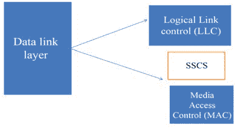

**图 6**：数据链路层。

- *接入控制（Access Control）*：当两个或多个设备连接到同一条链路时，需要数据链路层协议来确定哪个设备控制链路。

### 物理层 (Physical Layer)

物理层是构成网络的电缆、接口、光纤、网卡和其他机械电气设备。这一层将数字数据转换为可以通过线路发送的信号。这些信号通常是电信号，但在光纤的情况下，它们也可以是光或其他任何可以数字编码的脉冲。从网络角度来看，物理层的目的是为数据的收发提供架构。物理层可能是最容易诊断故障或构建的层，因为这涉及到硬件的连接和插拔。


图 7：物理层。

# 物理层

物理层关注：

- *接口和介质的物理特性（Physical Characteristics of Interfaces and Media）*：定义了设备与传输介质之间的接口特性。它还定义了传输介质的类型。
- *比特的表示（Representation of Bits）*：物理层由比特流（0 和 1 的序列）组成，没有任何任何解释。物理层定义了编码类型（如何将 0 和 1 变为信号）。
- *数据率（Data Rate）*：每秒发送的比特速率也由物理层定义。换句话说，物理层定义了比特的持续时间，即持续多久。
- *比特同步（Synchronization of Bits）*：发送方和接收方必须在比特级实现同步

| 物理层负责将数字比特转换为电、光或无线电信号并在网络介质上传输，反之亦然，将接收到的信号转换回高层可以处理的数字数据 |

级。换句话说，发送端和接收端的时钟必须同步。

- 链路配置（Line Configuration）：物理层关注设备与介质的连接。在点点配置中，两个设备通过专用链路连接。在多点配置中，链路在多个设备之间共享。
- 物理拓扑（Physical Topology）：物理拓扑定义了设备如何连接到网络。设备可以使用网状拓扑（每个设备都与所有其他设备连接）、星型拓扑（设备通过中央设备连接）、环形拓扑（每个设备都与下一个设备连接，形成一个环）或总线拓扑（公共链路上的所有设备）进行连接。
- 传输模式（Transmission Mode）：物理层还定义了两个设备之间的传输方向：单工、半双工或全双工。在单工模式下，只有一个设备可以发送；另一个只能接收。单工模式是单向通信。在半双工模式下，两个设备都可以发送和接收，但不同时。在全双工（或简称双工）模式下，两个设备可以同时发送和接收。

## 复用与交换

将多个信号（模拟或数字）组合以便在单线或介质上传输称为复用。一种常见的复用类型是将多个低速信号组合，通过单条高速连接进行传输。

复用是通过使用一种称为复用器（multiplexer）的设备，它具有 N 个输入链路产生一条输出链路（即多入一）。因此，复用器（`MUX`）有多个输入和一个输出。在接收端，使用一种称为解复用器（`DEMUX`）的设备将信号分离为分量信号。因此 `DEMUX` 接收 4 条输入链路并将它们分为一个输出链路。来自 4 个不同设备的信号被合并并由这条单一链路携带。在接收侧，解复用器从单条链路获取此信号，将其分解为原始信号并将其传递给 4 个不同的接收器。

复用器是一种从多个模拟或数字输入信号中选择一个并将所选输入转发到单条链路的设备。

图 8：复用。

### 复用的类型

复用的类型如下：

- 分频复用（`FDM`）：这是一种组合模拟信号的模拟复用技术。当链路的带宽（赫兹）大于要传输信号的总带宽时，应用 `FDM`。在 `FDM` 中，每个发送设备产生的信号调制不同的载波频率。这些调制后的信号被组合成一个复合信号，并通过链路传输。载波频率之间有足够的带宽来容纳调制信号。这些带宽范围是各种信号传输的通道。通道可以通过未使用的带宽带（即保护带）隔开。此外，载波频率不能与原始数据频率干扰。


图 9：分频复用。

- 波分复用（`WDM`）：这是一种组合光信号的模拟复用技术。`WDM` 设计用于利用光纤电的高数据率能力。光纤的数据速率高于金属传输电的数据速率。使用光纤作为单条链路会浪费可用带宽。复用允许我们将多条链路合并为一条。`WDM` 在概念上与 `FDM` 相同，只是复用和解复用涉及通过光纤通道传输的光信号。原理是相同的：都是组合不同频率的不同信号。区别在于频率非常高。

### 波分复用 (WDM)

| 中继器 | | `MUX` | `DEMUX` | 中继器 |
|---|---|---|---|---|
| 链路 1 | `TP1` | | `TP5` | 链路 1 |
| 链路 2 | `TP2` | | `TP6` | 链路 2 |
| 链路 3 | `TP3` | | `TP7` | 链路 3 |
| 链路 4 | `TP4` | | `TP8` | 链路 4 |

图 10：波分复用。

- 时分复用（`TDM`）：这是一种将多个低速率通道合并为一个高速率通道的数字复用技术。`TDM` 是一种数字过程，允许多个连接共享链路的高带宽。不像 `FDM` 那样共享部分带宽，时间连接占用链路的一部分。来自不同源的数字数据被组合到一个时分链路中。然而，这并不意味着源不能产生模拟数据；模拟数据可以被采样、转换为数字数据，然后使用 `TDM` 进行复用。


图 11：时分复用。

### TDM 的类型

`TDM` 的类型如下：

- 同步 `TDM`：在同步 `TDM` 中，来自每个输入连接的一轮数据单元被收集到一个帧中。如果有 N 个连接，一个帧被划分为 N 个时隙，为每个单元（每个输入链路）分配一个时隙。如果输入单元的持续时间为 T，每个时隙的持续时间为 Tin，每个帧的持续时间为 T。输出链路的数据速率必须是连接速率的 N 倍以保证数据流。时隙组成帧。在一个有 N 条输入链路的系统中，每个帧有 N 个时隙，每个时隙专门用于一个发送设备。
- 交叉 `TDM`：这可以被可视化为两个快速旋转的开关，一个在复用端，另一个在解复用端。这些开关同步运行并以相同的速度旋转，但方向相反。在复用端，当开关在某个连接面前打开时，该连接就有机会向路径发送一个单元。在解复用端，当开关在某个连接面前打开时，该连接就有机会从路径接收一个单元。
- 统计时分复用：在同步 `TDM` 中，每个输入在输出帧中都有一个保留的时隙。如果某些输入链路没有数据要发送，这将是无效的。在统计时分复用中，动态分配时隙以提高带宽效率。在统计复用中，每帧的时隙数少于输入链路数。复用器以轮询方式检查每条输入链路；如果链路有数据要发送，则为该链路分配一个时隙；否则跳过该链路并检查下一条。

### 交换

交换网络由一系列互连的节点组成，称为交换机。交换机是在连接到交换机的两个或多个设备之间创建临时连接的设备。在交换网络中，某些节点连接到终端（例如计算机或电话）。其他仅用于路由。

网络交换的类型如下：

1. 电路交换
2. 分组交换
3. 报文交换

### 电路交换

交换网络由一组通过物理链路连接的交换机组成。两个站之间的连接是由一个或多个链路组成的专用路径。然而，每个连接每个链路使用一个专用通道。每个链路通常通过 `FDM` 或 `TDM` 分为 N 个通道。电路交换发生在物理层。

### 分组交换

在分组交换中，消息被分成许多段或分组。每个分组被视为独立的通信。这些分组随后以连续序列发送到每个站。

来自各种消息的分组可能会传输，同一消息的分组可能通过许多不同的线路发布。每个分组都有一个包含分组地址、源地址和目的地址的头部。分组在到达目的地时重组为原始消息。

分组交换网络由站台、节点和传输部分组成。

分组交换的优点如下：

- 第一个也是最重要的优点是，由于数据包很短，节点之间的通信链路在传输每个数据包时，仅被分配用于在短时间内传输单条消息。传输较长的消息需要发送一系列数据包，但不需要在每个数据包的传输之间独占链路。这意味着在从 A 到 D 发送消息的数据包之间，可以发送属于其他消息的数据包。这为每个链路的资源共享提供了更公平的共享方式。
- 分组交换的另一个优点被称为“流水线”。当数据包 1 从 B 发送到 C 时，数据包 2 正从 A 发送到 B；当数据包 1 从 C 发送到 D 时，数据包 2 正从 B 发送到 C，数据包 3 正从 A 发送到 B，以此此类推。这种对通信链路的同时使用代表了效率的提高。尽管每个数据包都包含头信息而不是每个消息，跨数据网络传输的总延迟可能远少于报文交换。

### 报文交换

在报文交换网络中，中央交换站接收所有到连接到网络的计算机系统的通信。然后将消息存储在它的缓冲区内存中。每条消息都带有其目的地址。一旦线路可用，消息就会转发到其地址。报文交换也称为存储并转发法。

### 数字多用器

多用器意味着“多入一”。多用器是一种电路，用于选择并路由多个输入信号中的任何一个到信号输出。多用器的一个非电子电路的简单用例是单极位移开关。

多位开关广泛应用于许多电子电路。然而，在高速运行的电路需要多用器进行自动选择。机械开关无法完成这项任务。因此，用于高速切换的多用器是由电子元件制成的。

> 多用器在优化通信信道利用和在网络上高效传输数据方面起着关重要的作用。

多用器处理两种类型的数据：模拟和数字。对于模拟应用，多用器由继电器和晶体管开关组成。对于数字应用，它们由标准逻辑门构建。

用于数字应用的多用器也称为数字多用器，是一种具有多个输入但只有一个输出的电路。通过控制信号，可以将任何输入引导到输出。常见的多用器类型有 2 选 1、4 选 1、8 选 1 和 16 选 1 多用器。

### 理解 4 选 1 多用器：

4选选1 多用器有 4 个输入位、2 个控制位和 1 个输出位。四个输入位是 `D0`、`D1`、`D2` 和 `D3`。其中只有一个会被传输到输出 `y`。输出取决于控制输入 `AB` 的值。控制输入决定了哪一个输入位被传输到输出端。

例如，如图 12 所示，当 `AB = 00` 时，上方的 `AND` 门启用，而所有其他 `AND` 门被禁用。因此，数据位 `D0` 被传输到输出，得到 `Y = Do`。

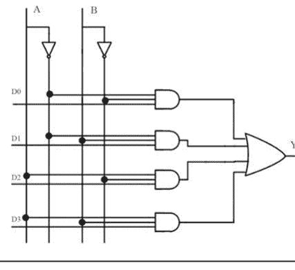

**图 12：** 4选1 多用器。

如果控制输入更改为 `AB = 11`，除了底部的 `AND` 门外，所有门都被禁用。在这种情况下，`D3` 被传输到输出，且 `Y = D3`。

- 4选1 多用器的一个示例是 `IC 74153`，其输出与输入相同。
- 另一个 4选1 多用器的示例是 `45352`，其输出是输入的反相。
- 16选1 线多用器的示例是 `IC74150`。

### 多用器的应用

多用器用于各种需要使用单条线路传输多个数据的领域。多用器的应用包括：

- 通信系统：通信系统是一组实现通信传输系统、中继站和分支站以及通信网络的系统集合。使用多用器可以显著提高通信系统的效率。多用器允许在单条传输线上同时传输音频、视频等不同类型的数据。
是一种特殊的电缆或其他结构，旨在以封装的方式引导电磁波。
- 电话网络：在电话网络中，多个音频信号在多用的帮助下集成在单线上进行传输。通过这种方式，多个音频信号可以被隔离，最终所需的音频信号到达指定的区域。
- 计算机内存：多用器用于在计算机中实现海量内存，同时减少连接内存与计算机电路其他部分所需的铜线数量。
- 卫星计算机系统的传输：多用器可用于从卫星或航天器的计算机系统通过 `GPS`（全球定位系统）卫星向地面系统传输数据信号。

### 级联多用器

`Midi Mux` 可以控制并复用多四个 `MPEG` 编码器。如果需要在一个传输流上编码四个业务，就需要级联多个多用器。

### 如何连接多用器

在级联多用器时，一个多用器的 `TS` 输出端口必须连接到下一个多用器的 `TS` 输入。

- *将输入信号移动到多复用器的不同输入行意味着该信号是全局移动的，即对于与所有其他功能块相关的所有复用器。对于大型 `PLD`（可编程逻辑器件），存在许多功能块，这增加了某个特定多复用器的特定路由不利于信号所传播到的其他多复用器路由的概率。*

因此，需要一种多复用器提供高效且灵活的控制和路由选项，以便可靠地实现复杂的用户设计，而不会给 `PLD` 增加不必要的复杂度，也不会大幅增加 `PLD` 的尺寸或功耗需求。


## 核心概念：传输控制协议 (TCP)

传输控制协议（`TCP`）通常认为与服务质量（`QoS`）无关；但人们也可以认为，`TCP` 在确保交付和有效利用带宽方面提供了 `QoS` 服务，尽管它不提供延迟保证。毕竟，`TCP` 主要关乎效率和自适应：如何利用动态变化网络容量中最大的（但公平的）份额来交付数据，以减少延迟。

传输控制协议是组成互联网连接套件的两个协议之一。该协议与互联网协议（`IP`）结合形成所有互联网流量的基础。这些协议在使用时几乎是不可分的，完全相互依赖以确保正常运行；因此，互联网连接套件通常缩写为 `TCP/IP`（传输控制协议/`IP`协议）。传输控制协议负责数据的拆分和重组，而互联网协议处理路由和传输。互联网流量主要由小型数据突发数据包组成。这些数据包包含有关数据源和目的的信息以及一些额外信息。数据包由传输控制协议创建和重组，并由互联网协议在互联网上发送。

为了说明这一过程，一个文档从远程计算机移动到本地计算机。计算机接收到移动命令，互联网协议决定文档如何在计算机之间移动。然后，互联网协议请求传输控制协议以特定方式拆分文档。

# TCP 随后将文档分成数据包，由互联网协议将其发送出去。

`IP`协议是互联网协议套件中用于跨越网络边界转发数据报的主要通信协议。


当数据包到达本地计算机时，`TCP` 开始重组它们。它首先检查是否已拥有所有数据包，以及它们是否格式正确——如果需要替换，它会提交对所需部分的请求并等待它们到达。在获取所有部分后，它按正确顺序进行重新排序并组装文档。然后它将其发送给互联网协议，由后者通知计算机文件已到达。

这些过程适用于绝大多数互联网用途。网络浏览器、客户端和文件传输系统等程序在每次交互都使用这种基础且往复的过程。这个统一系统在没有对话的情况下相互发送信息。哪个操作系统或程序发送了信息并不重要，因为控制协议实际上完成了工作。

由于这是互联网的基础基石，该协议很少发生变化。这使得系统在互联网上具有向后兼容性。协议的变化会导致旧机器永久断开连接。即使没有共同更新，该系统也非常简单，很少需要额外的监控或关注。

`TCP` 通常被描述为一种字节流、面向连接、可靠交付的传输层协议。

### 字节流交付

`TCP` 与上层的应用层和下层的网络层接口。当应用程序向 `TCP` 发送数据时，它是以 8 位字节流的形式发送的。发送端的 `TCP` 负责对字节流进行分段或界定，以便以可管理的片段将数据传输给接收方！正是这种缺乏“记录边界”的特性使其被称为“字节流交付服务”。

### 面向连接

在 `TCP` 通信交换数据之前，它们必须先就通信意愿达成一致。类似于电话通话，在双方交换信息之前，必须先建立连接。

### 可靠性

许多机制有助于提供 `TCP` 保证的可靠性。

- *校验和 (Checksums)*：所有 `TCP` 段都带有一个校验和，接收方用它来检测 `TCP` 头部或数据中的错误。
- *重复数据检测*：在分组交换网络中，数据包可能会重复；因此，`TCP` 会跟踪收到的字节，以丢弃已接收的数据副本。
- *重传*：为了保证数据交付，`TCP` 必须对可能丢失或损坏的数据实施重传方案。接收方向发送方发送正向确认以确认数据成功接收。如果发送方在超时时间内（见下文）未收到传输包的正向确认，则要求重传。
- *排序 (Sequencing)*：在分组交换网络中，数据包可能会无序交付。`TCP` 的工作是对其收到的段进行正确排序，以便将字节流数据交付给应用程序。
- *定时器 (Timers)*：`TCP` 对已发送的数据维护了各种静态和动态定时器。`TCP` 等待接收方在限定时间内回复确认。如果定时器在收到确认之前过期，发送方将重传该段。

### TCP 头部格式

`TCP` 头部和 `TCP` 在一个数据包中的组合被称为 `TCP` 段。图 14 描述了所有 `TCP` 段的格式。不带选项的头部大小为 20 字节。我们将简要定义 `TCP` 头的每个字段。

### 传输控制协议的本质

传输控制协议（`TCP`）是 `TCP/IP` 套件中一种面向连接、可靠、面向流的传输协议。`TCP` 的特质可以总结为以下特征：

- **面向连接**：`TCP` 在数据传输之前建立双向连接。该连接通过三次握手建立，其中客户端和服务器交换初始序列号以建立连接。
- **可靠数据交付**：`TCP` 提供可靠的数据交付，意味着它保证从发送方发送的所有数据包都会正确到达接收方。为了确保可靠性，`TCP` 使用确认机制和重传机制。接收方确认成功接收数据，如果发送方在超时时间内未收到传输包的确认，则重传该数据包。
- **流量控制**：`TCP` 实现流量控制以管理发送方和接收方之间的数据传输速率。它通过滑动窗口机制确保发送方不会用数据淹没接收方。接收方通过窗口大小值宣告可用缓冲区空间，发送方相应地调整其传输速率。
- **拥塞控制**：`TCP` 用于处理网络拥塞。它使用各种拥塞控制算法检测并响应网络拥塞，防止网络过载和丢包。当 `TCP` 检测到拥塞时，它会降低传输速率以缓解拥塞。
- **面向流**：`TCP` 是一种面向流的协议，它以连续字节流而非离散包的形式发送数据。`TCP` 将应用程序数据拆分并有序发送。在接收端，`TCP` 将段重新组装原始数据流。
- **全双工通信**：`TCP` 支持全双工通信，意味着数据可以同时向两个方向传输。发送方和接收方都可以独立发送和接收数据。
- **连接终止**：当数据传输完成后，`TCP` 使用四次握手执行优雅连接终止。这确保在关闭连接之前所有数据已成功交付。

## 传输控制协议 (TCP) 头部

20-60 字节

| 源端口号 2 字节 | 目的端口号 2 字节 |
|---|---|
| 序列号 4 字节 | |
| 确认号 4 字节 | |
| 数据偏移 4 位 | 预留 3 位 | 控制标志 9 位 | 窗口大小 2 字节 |
| 校验和 2 字节 | 紧急指针 2 字节 |
| 可选数据 0-40 字节 | |

图 14：`TCP` 头部格式。

总而言，`TCP` 的本质侧重于为网络设备之间提供可靠、有序且经过错误检查的数据传输。它是互联网上的许多应用和服务，例如 Web 浏览、电子邮件、文件传输以及其他需要可靠且准确数据传输的通信协议。

### 源端口 (Source Port)


一个 16 位数字，用于标识 TCP 段在发送主机内源自的应用程序。端口号分为三个范围：良性端口（0 到 1023）、注册端口（1024 到 49151）和私有端口（49152 到 65535）。TCP 使用端口分配作为与应用层交互的接口。例如，在 TCP 主机上，TELNET 服务器默认始终被分配到良性端口 23（well-known port）。一对完整的 IP 地址（源地址和目的地址）加上一对完整的 TCP 端口（源端口和目的端口）定义了一个全局唯一的单个 TCP 连接。

### 目的端口 (Destination Port)

一个 16 位数字，用于标识 TCP 段在接收主机上的目标应用程序。目的端口使用与源端口预留相同的端口号分配方案。

### 序列号 (Sequence Number)

一个 32 位数字，用于标识段中第一个数据字节在整个 TCP 连接字节流中的当前位置。达到 `$2^{32}-1$` 后，该数字将回绕到0。

### 确认号 (Acknowledgement Number)

一个 32 位数字，用于标识发送者期望从接收端收下一个数据字节。因此，该数字比最近收到的数据字节大1。此字段仅在 ACK 控制位开启时才有效。

### 头部长度 (Header Length)

一个 4 位字段，以 32 位字（或如果你愿意，以 4 字节的倍数）指定 TCP 部的总长度。如果没有选项（options），TCP 头部始终为 20 字节。最大的 TCP 头部可能为 60 字节。需要此字段是因为选项字段的大小无法提前确定。请注意，该字段在官方 TCP 标准中被称为“数据偏移量”（data offset），但“头部长度”更为常用。

### 预留 (Reserved)

一个 6 位字段，目前未使用并预留供未来使用。

### 控制位 (Control Bits)

- 紧急指针 (URG)：如果设置了此位字段，接收端 TCP 应该解释紧急指针字段。
- 确认 (ACK)：如果设置了此位，前述的确认字段为有效。
- 推送功能 (PSH)：如果设置了此位，接收端应该尽快将此段交付给接收端应用程序。其用途示例可能是向应用程序发送 Control-BREAK 请求，该请求可以跳过队列中的数据。
- 重置连接 (RST)：如果存在此位，则向接收端发出信号，表示发送者正在终止连接，连接的所有队列数据和分配的缓冲区可以自由释放。
- 同步 (SYN)：存在时，此位字段表示发送者正尝试“同步”序列号。此位用于发送者和接收者之间建立连接的初始阶段。
- 发送端无更多数据 (FIN)：如果设置，此位字段告诉接收端发送者已到达其当前 TCP 连接字节流的末尾。

### 窗口 (Window)

一个 16 位整数，TCP 用其以数据传输窗口大小的形式进行流量控制。此位告诉发送者接收端愿意接收多少量的数据。该字段的最大值将将窗口大小限制为 65,535 字节；然而，可以使用“窗口缩放”（window scale）选项来利用更大的窗口。

通过点对点或点对多通信通道进行数据传输。

### 校验和 (Checksum)

TCP 发送者根据 TCP 头部和数据字段的内容计算一个值。这个 16 位值将与接收端使用相同计算生成的数值进行比较。如果值匹配，接收端就可以非常有信心地认为段已完整到达。

### 紧急指针 (Urgent Pointer)

在某些情况下，TCP 发送者可能需要通知接收端紧急数据，这些数据应尽快由接收端处理。这个 16 位字段告诉接收端段中紧急数据的最后一个字节结束的位置。

### 选项 (Options)

为了提供额外的功能，TCP 发送者和接收端之间可以使用几个可选参数。根据所使用的选项，此字段的会有所不同，但由于头部字段的大小（4 位），它不能超过 40 字节。最常见的选项是最大段大小（MSS）选项。TCP 接收端会告诉 TCP 发送者最大段大小（MSS）。

### 填充 (Padding)

由于选项可能有所不同，可能需要用零“填充”头部，以确保段长度正确。

### 数据 (Data)

尽管在各种情况下都会使用，但确认字段负责将数据从发送者传输到接收端。

## 连接建立与终止 (Connection Establishment and Termination)

TCP 在网络上提供面向连接的服务。面向连接意味着存在虚拟连接。分为三个阶段：连接建立、数据传输和终止。

### 三次握手 (Three-Way Handshake)

为了让两个主机使用 TCP 进行通信，它们必须首先通过所谓的“三次握手”通过交换消息来建立连接。下面的图描述了这一过程。


**图 15:** 通过发送带有 SYN 位的段建立 TCP 连接

首先，主机 A 通过发送设置了 SYN 控制位和初始序列号（ISN，我们在序列字段中表示为变量 `x`）的 TCP 段发起连接。

在某个时刻，主机 B 接收到此 SYN 段，处理它并用 TCP 段进行响应。主机 B 的响应包含设置的 SYN 控制位和自身的表示为变量 `y` 的 ISN。主机 B 还设置了 ACK 控制位，表示期望主机 A 从序列号 `x+1` 开始的下一个字节。

当主机 A 接收主机 B 的 SYN 和 ACK 时，它通过向主机 B 发送最后的确认段来完成连接建立阶段。在这种情况下，主机 A 设置了 ACK 控制位，并通过在确认字段中放置确认号 `y+1` 来指示主机 B 期望的下一个字节。

除了图中所示的信息外，每个段中还包含了用于此连接的源端口和目的端口的交换。

### 数据传输 (Data Transfer)

一个简单的 TCP 实现只要有数据要发送，且发送者没有超过接收端通告的窗口，就会将段放入网络中供接收端使用。当接收端接受并处理 TCP 段时，它会发回正确认，指示它正处于字节流的哪个位置。这些确认还包含“窗口”，它决定了接收端当前愿意接收多少字节。如果数据重复或丢失，字节流中可能会出现“空洞”。接收端将继续确认它已接受的字节流中最连续的当前位置。

如果没有数据要发送，发送端 TCP 将一直处于空闲状态，等待应用程序将数据放入字节流，或从连接的另一端接收数据。

如果发送者队列中的数据达到了导致发送的数据将超过接收端通告窗口大小的程度，发送者必须停止传输，并等待进一步的确认和大于零的通告窗口大小后恢复传输。

定时器用于避免死锁和连接无响应。延迟传输用于通过一次性发送较大的数据“块”而不是多个较小的单个部分，来更有效地利用网络带宽。

### 连接终止

由于 TCP 是一种全双工协议，这意味着每端必须独立关闭，因此为了释放连接需要四个分段。连接终止阶段如图 16 所示。

#### TCP 连接终止

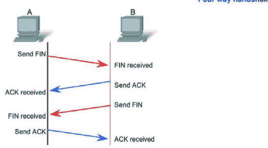

**图 16**：TCP 连接终止。

注意，连接终止阶段不是 SYN 控制，而是使用 FIN 控制位来信号连接的关闭。

为了终止示例中的连接，运行在 Host A 上的应用程序通知 TCP 关闭连接。这生成了从 Host A 到 Host B 的第一个 FIN 段。当 B 接收到初始的 FIN 段时，它会立即确认该分段并通知其目标应用程序终止请求。一旦 Host B 上的应用程序决定关闭连接，它会发送自己的 FIN 段，Host A 将处理它并发送确认号作为响应。

## 滑动窗口与流量控制

流量控制是一种技术，其主要目的是使发送者的传输速率与接收者及网络的速率正确匹配。以高率传输以确保良好的性能至关重要，但也是为了防止过载网络或接收主机。

这种流量控制并不等同于拥塞控制。拥塞控制主要关注网络中间设备（如 IP 路由器）的持续过载。TCP 使用之前简要描述的窗口字段作为流量控制的主要手段。在数据传输阶段，窗口字段用于调整通信两个 TCP 之间字节流的流速。

在此示例中，有一个 4 字节的滑动窗口。从左到右移动，随着流中的字节被发送和确认，窗口会“滑动”。窗口的大小以及如何快速增加或减小窗口大小是一个研究领域。

### 拥塞控制

拥塞是分组交换网络中可能出现的一个重要问题。拥塞是通信网络中的一种情况，即当子网部分存在过多数据包时，性能就会下降。当网络负载（即发送到网络的数据包数量）大于网络容量（即网络能够处理的数据包数量）时，网络可能会发生拥塞。

拥塞控制不同于流量控制。流量控制是一个数据链路问题，仅涉及一个发送者超过单个接收者的速度（例如点对点链路）。拥塞控制是一个网络层问题，因此关注当网络中的数据多到无法以合理的延迟、无丢包等方式处理时发生的情况。流量控制是局部的，而拥塞控制是全局的。处理拥塞的方法之一是使用流量控制机制减少特定主机在网络上的流量，因此产生了混淆。

数据链路层、网络层传输层的许多设计参数都会影响拥塞。设置这些参数中的每一个都是为了防止拥塞并消除问题。例如，泛洪算法速度很快，但会产生大量冗余数据包。数据链路层设置得过紧的定时器会导致数据包的重传。

### 流量整形

拥塞产生的原因之一是网络流量固有的突发性。流量整形意味着作为时间的函数来平滑或推迟提供的流量。平滑的流量比突发流量更容易处理。一个子网可能平均每小时处理 10M 个数据包，但它可能无法在一分钟内处理 10M 个数据包而在接下来的 59 分钟内闲。

与流量整形相关的是与网络服务供应商约定流规范的整个思想。流

滑动窗口协议用于需要可靠顺序交付包的场景，例如数据链路层（OSI 模型）以及传输控制协议（TCP）。

拥塞控制是计算机网络中一种关键机制，用于管理和防止网络拥塞，当对网络资源的需求超过其容量时，就会发生拥塞。

数据链路层是程序中处理数据跨越网络物理链路进出数据的协议层。

# 网络软件与网络标准化

规范描述了你将向网络投入什么种流量，以及你期望获得什么种质量的服务。某些服务质量参数包括：

- 丢失敏感性（单位时间内丢失的字节数）
- 丢失间隔（计算丢失的时间单位）
- 突发丢失敏感性（可以容忍多长的突发丢失）
- 最小延迟（应用程序注意到之前有多大的延迟）
- 最大延迟变化（包间延迟的方差或抖动）
- 保证质量（规范对应用程序的重要性有多大）

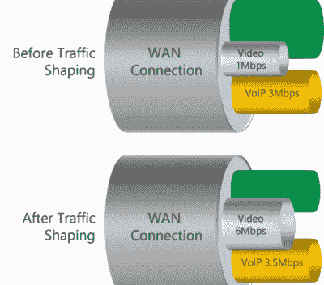

### 漏桶算法

一种将无规则的、突发的流量流转换为受控、平滑、可预测流的缓冲区。你将缓冲区放在流量源和子网之间。缓冲区像一个具有有限队列长度的单服务器队列。当缓冲区满时，放入的数据包将被丢弃。缓冲区可以通过每单位时间若干数据包或每单位时间若干总字节数释放到子网（如果数据包大小差异很大，这很有帮助）。

漏桶的变体是令牌桶。桶以特定速率填充令牌。缓冲区像一个具有有限队列长度的单服务器队列。当缓冲区满时，放入的数据包将被丢弃。缓冲区可以通过每单位时间若干数据包或每单位时间若干总字节数释放到子网（如果数据包大小差异很大，这很有帮助）。

滑动窗口协议用于需要可靠顺序交付包的场景，例如数据链路层（OSI 模型）以及传输控制协议（TCP）。

拥塞控制是计算机网络中一种关键机制，用于管理和防止网络拥塞，当对网络资源的需求超过其容量时，就会发生拥塞。

数据链路层是程序中处理数据跨越网络物理链路进出数据的协议层。

网络软件与网络标准化

规范描述了你将向网络投入什么种流量，以及你期望获得什么种质量的服务。某些服务质量参数包括：

- 丢失敏感性（单位时间内丢失的字节数）
- 丢失间隔（计算丢失的时间单位）
- 突发丢失敏感性（可以容忍多长的突发丢失）
- 最小延迟（应用程序注意到之前有多大的延迟）
- 最大延迟变化（包间延迟的方差或抖动）
- 保证质量（规范对应用程序的重要性有多大）


### 漏桶算法

一种将无规则的、突发的流量流转换为受控、平滑、可预测流的缓冲区。你将缓冲区放在流量源和子网之间。缓冲区像一个具有有限队列长度的单服务器队列。当缓冲区满时，放入的数据包将被丢弃。缓冲区可以通过每单位时间若干数据包或每单位时间若干总字节数释放到子网（如果数据包大小差异很大，这很有帮助）。

漏桶的变体是令牌桶。桶以特定速率填充令牌。缓冲区像一个具有有限队列长度的单服务器队列。当缓冲区满时，放入的数据包将被丢弃。缓冲区可以通过每单位时间若干数据包或每单位时间若干总字节数释放到子网（如果数据包大小差异很大，这很有帮助）。

拥塞包

路由器监控输出的利用率，并向利用率超过某些水平的主机发送特殊的拥塞包。利用率可以通过采样并将新值（使用中 f = 1 或未使用 f = 0）与当前值混合来估计。权重控制了路由器适应变化的速度：

```
Unew = a * Uold + (1-a) * f
```

负载丢弃

这是路由器在耗尽缓冲区时的做法。如果它们必须丢弃数据包，它们至少可以选择最好的包进行丢弃。这取决于应用程序以及数据链路层使用的错误策略。对于文件传输，丢弃旧包比丢弃新包要糟，因为会导致接收包出现隙，数据链路层可能会采用回退策略。对于实时语音或视频，丢弃旧数据（已经过时？）并保留新包可能更好。

让应用程序标记数据包优先级需要激励，例如为低优先级数据包提供更廉的传输速率。

路由器在似乎可能发生拥塞时就开始丢弃数据包，似乎比等待拥塞接管要好。

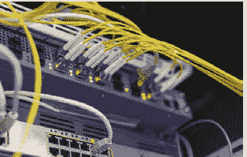

## 核心概念：用户数据报协议 (UDP)

UDP（用户数据报协议）是传输控制协议（TCP）的替代通信协议，主要用于在互联网应用程序之间建立延迟且容忍丢失的连接。

用户数据报协议是互联网传输信息的传输网络协议之一。它是互联网协议族的一部分，该规范规定了计算机如何在网协议（IP）网络上与服务器以及相互通信。使用用户数据报协议时，应用程序可以在无需先建立特殊通道或数据路径的情况下向其他主机发送数据报或消息。这允许了更快的通信，但比其他方法不可靠。用户数据报协议的重点是数据传输。它没有提供安全措施来确保信息实际到达或保护数据在移动过程中的完整性。协议假设，如果错误检查很重要，进行通信的计算机将处理它。

# 计算机科学核心概念：计算机网络


用户数据报协议（UDP）是一种无状态协议。这意味着它将每个信息请求都视为一个独立的事务。这种运行方式的优势是服务器可以支持更高的流量，因为不需要为正在进行的对话分配存储空间。

在某些情况下，用户数据报协议实际上比更可靠的通信方法更好。例如，它允许消息在传输时不会产生错误检查带来的延迟。时间敏感型应用由于这个原因经常使用它。这类应用的一个常见例子是流媒体，如 IP 语音（VoIP）。


用户数据报协议对于处理大量微小请求的服务器也有用。由于服务器在通信之前不需要分配存储空间或建立连接，它可以更快地响应每个单独的请求。结果是所有用户提供了更快的服务。由于这个原因，运行在线游戏的服务器经常使用 `UDP`。

`UDP` 为应用程序和上层协议提供了一种最小的、不可靠的、尽力而为的消息传递传输层。与其他传输协议相比，`UDP` 及其 `UDP-Lite` 变体的独特之处在于，它们在通信端点之间不建立端到端连接。因此，`UDP` 通信不会产生建立开销和额外负载，且端系统状态极少。由于这些特性，`UDP` 可以为某些应用程序提供非常高效的通信传输，但它没有固有的拥塞控制或可靠性。

由于它没有固有的机制。在许多平台上，应用程序可以以链路接口的线线速率发送 `UDP` 数据报，这远大于可用的路径容量，这样做会导致路径沿产生拥塞，因此应用程序需要负责任地设计。

`UDP` 的一个日益流行的用途是隧道协议，其中隧道端点将另一个协议的数据包封装在 `UDP` 数据报中，并将其传输到另一个隧道端点，该端点解封装 `UDP` 数据报并转发负载中包含的原始数据包。

> 目标 IP 地址和端口号封装在每个 `UDP` 数据包中。这两个数字唯一地标识接收者，并由底层操作系统将数据包投递到特定的进程（应用程序）。`UDP` 数据包还包含发送者的 IP 地址和端口号。

当负载协议不受路径上可能存在的中间设备支持时，使用 `UDP` 作为隧道协议是非常有吸引力的，因为许多中间设备支持 `UDP` 传输。

`UDP` 不提供任何通信安全。因此，需要保护通信免受窃听、篡改或消息伪造的应用程序需要使用额外的协议机制单独提供安全服务。

## 协议头部

计算机可以在不先与接收者建立连接的情况下发送 `UDP` 包。`UDP` 数据报载在单个 IP 数据包中，对于 `IPv4`，最大负载限制为 65,507 字节，对于 `IPv6` 为 65,527 字节。大型 IP 数据包的传输通常需要 IP 分片。分片会降低通信的可靠性和效率，应该避免。

为了传输 `UDP` 数据报，计算机完成 `UDP` 头部中的相应字段，并将数据与头部一起转发，由 IP 网络层传输。

`UDP` 头部由四个字段组成，每个字段长度 2 字节：

- 源端口（来自客户端的 `UDP` 包使用此端口作为服务接入点 (`SAP`)，指示指示数据包的本地客户端会话。来自服务器的 `UDP` 包在 `във` 字段中携带服务器 `SAP`）
- 目的端口（来自客户端的 `UDP` 包使用此端口作为服务接入点 (`SAP`)，指示指示远程服务器所需的服务。来自服务器的 `UDP` 包在此字段中携带客户端 `SAP`）
- `UDP` 长度（组成组合 `UDP` 头部信息和负载数据的字节数）
- `UDP` 校验和（一种用于验证端点数据未被网络中的路由器或桥接器或端系统的处理所损坏的校验和）

服务接入点 (`SAP`) 是开放系统互连 (`OSI`) 网络中使用的网络标识标签。`SAP` 是一个 `OSI` 层请求另一个 `OSI` 层服务的概念性位置。

计算校验和的算法是标准互联网校验和算法。这允许接收者验证其是否是数据包的预期目标，因为它涵盖了 IP 地址、端口号和协议号，并验证数据包没有被截断或填充，因为它保护应用程序不会接收到替代或额外于所发送数据的损坏负载数据。在不需要此此检查的情况下，在此字段中放置 `0x0000` 值，在这种情况下接收者不对数据进行检查。

## 无线链路上的 TCP

`TCP` 假设数据包丢失主要是由于拥塞引起的。`TCP` 通过减少其拥塞窗口来响应拥塞，从而降低网络利用率。然而，在无线网络中，丢失可能是由于传输媒介的高比特或衰落和移动引起的。`TCP` 仍然根据其拥塞控制方案对丢失做出反应，不必要地降低网络利用率。

该模型可以代表局域网（`WLANs`，如 `802.11` 网络）和广域网（`WWANs`，如 `CDMA` 和 `GPRS` 网络）。另一方面，在自组织网络中，需要基础设施（如基站 (`BSSs`)），节点可以组织自己以建立通信路由。卫星网络允许具有潜在无线跳的各种配置。我们主要研究无线链路是最后一跳的配置，尽管我们也对不一定是这种情况的方法进行了分类。

无线局域网 (`WLAN`) 是连接两个设备的无线网络。

## 无线介质的特性

无线介质的许多固有特性影响 `TCP` 性能，包括：

- 信道丢失：无线介质携带的信号受到显著干扰，随后在传输过程中发生丢失。尽管存在纠错技术，这些丢失也很难从中恢复，且通常需要重传。
- 低带宽：无线链路的带宽可能较低，有时会导致基站缓冲区过多。这可能导致数据包在基站被丢弃（`TCP`）。
- 信号衰落：衰落通常发生在无线主机移动时。来自天气、障碍物、信道不可用、单元重叠等物理因素的干扰可能导致信号衰落和断路。此类中断可能会持续很一段时间。
- 跨单元移动：无线主机的移动涉及连接切换。除了需要切换的链路层外，基站可能维护关于传输层的连接状态。上述信号衰落等其他问题在主机跨单元移动时概率很高。
- 信道不对称：解决信道竞争通常是对称的。发送端比接收端拥有更多的时间。这可能导致 `TCP` 确认包在接收端的链路层排队，并在允许访问通道时发送。这会导致 `TCP` 发送端测量的往返时间增大并产生突发流量，从而降低 `TCP` 连接的吞吐量。
- 链路延迟：当此类延迟占到 `TCP` 观测到的总往返时间的大部分时，`TCP` 的重传超时设置为高值，从而影响 `TCP` 性能。这种情况发生在无线广域网和卫星网络中。此外，测量的往返时间存在高方差，影响了 `TCP` 往返时间 (`RTI`) 估计算法。

## TCP 性能层增强

## 传输层解决方案

## 蜂窝通信

跳过拥塞避免阶段。另一种方法是让无线链路终端通过透明地关闭接收端通告窗口来处理 `TCP` 发送切换。发送端冻结所有挂起的定时器，并开始周期性地探测接收端窗口。

蜂窝网络是指末端链路无线的网络。网络分布在陆地区域小区中，每个小区由至少一个固定位置的收发器提供服务，但通常由三个小区或基站提供服务。

在切换之后，拥塞避免会探测新链路的容量。然而，对于其他无线丢失，重传足以进行恢复。由于端到端重传速度较慢，可以使用连接到无线和有线链路的枢纽路由器来拆分 `TCP` 连接。端到端连接被分解为路径中有线部分和无线部分的独立 `TCP` 方案。无线链上可以替换为另一种针对错误恢复优化的协议。拆分方案违背了 `TCP` 语义，因为确认包可能在数据包到达之前到达发送端。为了保留 `TCP` 语义，必须延迟确认包，从而降低吞吐量。枢纽点面临巨大的开销，因为数据包经过两次 `TCP` 处理，并且在那里维护了大量的连接状态。

## 链路层解决方案

在 `CC` 系统中，这通过非透明模式 `RLP` 实现。另一种解决方案是在 `Snoop TCP` 中在 IP 级别执行本地错误恢复（一种链路层任务）。`Snoop` 通过维护跨越枢纽点的每个连接的状态，来跟踪 `TCP` 数据和确认包。`Snoop` 缓存未确认的 `TCP` 数据包，并利用重复确认包传达的丢失指示以及本地定时器来透明地重传丢失的数据。它向 `TCP` 发送端隐藏了指示无线丢失的重复确认包，防止冗余的 `TCP` 恢复。`Snoop` 利用 `TCP` 数据包中的信息来避免层控制开销。它的性能优于拆分 `TCP` 方案，而且通过抑制重复确认包避免了本地与 `TCP` 重传的冲突。`Snoop` 要求 `TCP` 接收端位于枢纽点之后。如果无线主机向远程接收端发送数据，`TCP` 确认包返回得太晚，无法进行高效恢复，甚至可能表示拥塞丢失。`TCP` 需要显式丢失通知 (`ELN`) 来区分拥塞和无线丢失。

显式丢失通知 (`ELN`) 是一种向 `TCP` 发送端通信数据包丢失原因的机制。如果 `Snoop` 代理检测到非拥塞相关的丢失，它会在 `TCP` 头部中设置 `ELN` 位并将其传播到接收端，接收端将其回显给发送端。`Snoop` 可以利用队列长度信息启发式地区分拥塞和无线错误。当收到 `ELN` 通知时，`TCP` 发送端会在不调用拥塞控制的情况下重传包。尽管 `ELN` 适用于大多数拓扑结构，但它需要更改路由器算法。此外，数据包只有在往返时间过去且收到带有 `ELN` 位的确认包后，才能被重传。

`CC` 系统的 `RLP` 避免了 `Snoop` 的分层违反（`Snoop` 在 IP 级别检查 `TCP` 头部，但可能会与 `TCP` 并行重传数据）。这在完全可靠的 `RLP` 中很少发生，并且可以通过多次尝试失败后放弃恢复来防止。链路层方案在本地级别运行，具有允许恢复的低往返延迟，这与 `TCP` 修改不同。它们的主要局限性是仅提供单层恢复，这可能不利高层协议和应用程序。

## 无线系统演进与 TCP

`CC` 系统的趋势是提供更高的速度和对分组数据服务的更好支持。最高数据速率将在用户密度较高的小区域（或微小区）中提供。高速电路交换数据 (`HCSCD`) 系统是 `GSM` 的扩展，它通过为每个数据电路预留多个 `TDMA` 时隙提供高达 56 Kbps 的比特率。通用分组无线服务 (`GPRS`) 是一种分组交换 `GSM` 扩展。`GPRS` 通过动态 `TDMA` 时隙预留提供高达 171 Kbps 的比特率。目前的实现提供了 20-40 Kbps 的用户吞吐量。实验显示互联网数据包丢失率在 2% 左右。第三代欧洲 `CC` 系统 `UMTS` 基于宽带 `CDMA`，支持各种比特率下的电路交换和分组交换模式。第一阶段包括与 `GPRS` 类似的服务，提供高达 384 Kbps 的比特率，并承诺移动区域可达 2 Mbps。在美国，`GSM EDGE/S-136` 系统将提供 270-722 Kbps 的比特率，在移动区域则超过 20 Mbps。

许多短距离（室内）系统或个人局域网 (`PANs`) 是为低比特率设计的，例如蓝牙，这是一种跳频频谱系统，提供 400-700 Kbps 的比特率。蓝牙应能为低端 `WLAN` 提供 `TCP` 性能，因为其与 `IEEE 802.11` 的无线链路级互操作性存在严重问题。`IEEE 802.15` 项目正在制定基于蓝牙的 `PAN` 标准以解决此问题。对于极高速度，本地多点分布系统 (`LMDS`) 将使用 28 或 40 GHz 频段提供宽带固定无线接入接入。`LMDS` 是一种无线局域网 (`WLL`) 系统，为固定主机提供 1-2 GHz 的带宽。`LMDS` 使用强大的链路层 `FEC` 方案，我们发现它可以可靠地承载 `TCP` 流量。

## IP 网络

网协议 (`IP`) 是互联网上主要的网络协议，开发于 20 世纪 70 年代。在互联网和其他许多网络中，`IP` 用于识别网络上的设备。每个设备被分配一个唯一的 IP 地址，用于将数据包路由到正确的目的地。使用的 IP 地址主要有两个版本：使用 32 位地址的 `IPv4` 和使用 128 位地址的 `IPv6`。`IPv4` 设计时预计连接设备数量较少，但由于其增长，开发了 `IPv6` 以提供大得地址空间。

IP 地址用于网络上的路由和识别。一个 IP 地址由两部分组成：网络 ID 和主机 ID。网络 ID 识别设备所属的特定网络，而主机 ID 识别网络内的设备。这两部分由子网掩码分隔，子网掩码应用于 IP 地址。

路由是路由器确定数据包从源到目的最佳路径的过程。路由器使用路由表，其中包含已知网络及其路径的信息。路由可以手动进行（管理员向路由表输入条目），也可以使用路由协议自动进行。路由协议允许路由器之间共享信息并随着网络变化更新其表。

网络安全包含了公司为保护其计算机系统所采取的措施，它是每家使用计算机公司的首要考虑。网络安全漏洞意味着黑客或竞争对手可能会获得关键或敏感数据的访问权限，可能导致数据丢失，甚至是系统的完全销毁。

当用户在访问所需网络之前必须经过多层安全防护时，网络就实现了适当的安全。系统的层数越多，安全性就越高。

系统管理员通常负责网络安全，因为他在系统上拥有管理员权限。事实上，只有系统管理员及其助理才应该拥有主主服务器和相关计算机终端的行政访问权限。这将有助于公司内部未经授权的人员更改服务器上的任何数据。

系统管理员还将为网络构建安全的防火墙，这可能包括加密层和哨兵软件，后者可以防止未经授权的程序获取访问。管理员还可能对员工的计算机进行限制，防止他们访问可能带有恶意代码或恶意软件的网站，这些软件会自动安装在用户的计算机上。个人计算机以及网络都有防广告软件和恶意软件程序。

这种安全性通常出现的一个问题是灵活性。管理层必须在安全问题与员工访问工作网站的能力之间取得平衡。管理层、系统管理员和员工之间的通信对于网络安全的运行以及员工能够开展工作至关重要。

正如处理过去的电子邮件和网络病毒所证明的那样，安全漏洞成本高昂，且对生产和效率有害。美国公司每年花费数百万美元用于网络安全措施。公司对入侵的最佳防御是多管齐下。没有单点接入防火墙、敏锐的系统管理员、频繁的安全更新以及尽早安装防广告软件都将有助于保持网络安全。

不同的无线网络安全方法有：

### 有线等效隐私 (WEP)

在该方法中，设置一个密钥来加密从网络内一台计算机传输到另一台计算机的信息。无线网络设置需要此密钥来加密密发送的数据。这是一种较旧的网络安全方法，`WEP` 密钥相对容易破解。

### 802.1X 身份验证

`802.1X` 专门用于无线 `802.11` 网络以及有线以太网网络。这种身份验证通常用于工作网络。身份验证服务器用于验证想要访问网络的用户。

### Wi-Fi 保护访问 (WPA)

这是最广泛使用的无线网络安全方法。在 Wi-Fi 保护访问中，信息被加密，只有经过授权的人才能访问网络。这种加密机制有一个更新版本，称为 `WPA2`。建议使用 `WPA2` 代替 `WPA`，因为它更安全。然而，旧路由器或访问或其他无线设备（如 `MP3` 播放器）可能不支持 `WPA2`。

## 传输控制协议 (TCP)

传输控制协议 (`TCP`) 是计算机网络和互联网中一种的通信协议。它通过确认、重传和流量控制确保可靠的数据传输。`TCP` 在数据交换之前建立连接，将数据视为字节流，并允许全双工通信。

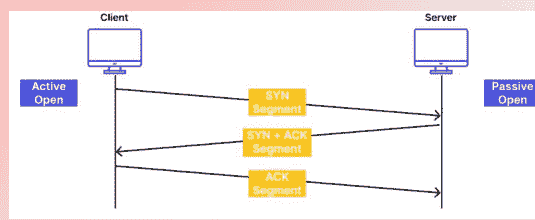

它的拥塞控制机制防止网络过载。`TCP` 的可靠性、面向连接的特性以及处理数据流的能力使其成为在设备之间传递准确且有序的数据至关重要，实现了互联网上各种应用程序和服务之间顺畅且高效的通信。

## 总结

- 网络软件和网络标准化是计算机网络中的两个基本方面，在确保设备和系统之间的无缝通信和互操作性方面起着至关重要的作用。
- 网络标准化涉及开发和实施约定的规则、协议和惯例，以确保不同网络设备和系统之间的统一、兼容性和互操作性。
- 国际标准组织/开放系统互连模型 (`ISO/OSI`) 模型是网络中两个用户之间通信的标准参考模型。基本了解网络如何工作对于以后排除故障可能很有帮助。
- 应用层使用户（无论是人类还是软件）能够访问网络。它提供了用户界面，并对如电子邮件、远程文件访问和传输、共享数据库管理和其他类型的分布式信息服务提供支持。
- 会话层是建立、维护和结束连接的地方。这通常指的是应用程序对网络传输数据的请求。
- 传输层负责跨网络流传输数据。在这一层上，数据不被视为单个数据包，而是更多地看作一次对话。
- 复用是通过使用称为复用器 (`MUX`) 的设备实现的，该设备将 N 条输入线合并一条输出线，即（多对一）。
- 交换网络由一系列相互连接的节点组成，称为交换机。交换机是能够在连接到交换机的两个或多个设备之间创建临时连接的设备。
- 可编程逻辑设备 (`PLD`) 通常利用一个或多个互连阵列，通过存储单元阵列（例如 `EPROM`、`EEPROM`、`flash` 或 `flash EEPROM` 单元）进行编程，以实现 `PLD` 内部针对特定设计的各种互连。
- 传输控制协议 (`TCP`) 是 `TCP/IP` 协议族中的面向连接、可靠且面向流的传输层协议。

## 单选题

- 1. 下列哪项是网络软件的关键组件，负责将本地网络上的逻辑地址（IP 地址）转换为物理地址（MAC 地址）？
  a. 路由器
  b. 交换机
  c. 桥器
  d. `ARP`（地址解析协议）
- 2. 网络标准化很重要是因为：
  a. 确保所有网络设计相同。
  b. 允许不同厂商的设备无缝通信。
  c. 限制新技术的使用。
  d. 消除了对网络管理员的需求。
- 3. 哪个组织负责开发和发布常用的网络标准，如以太网和 Wi-Fi？
  a. 国际电信联盟 (`ITU`)
  b. 互联网工程任务组 (`IETF`)
  c. 电子电气工程师学会 (`IEEE`)
  d. 联邦通信委员会 (`FCC`)
- 4. `OSI` 模型中的哪一层主要负责定义网络标准和协议，包括数据包处理和路由？
  a. 物理层
  b. 数据链路层
  c. 网络层
  d. 传输层
- 5. 将人类可读的域名（例如 `www.com`）转换为相应 IP 地址的过程由以下项处理：
  a. `DHCP`（动态主机配置协议）
  b. `DNS`（域名系统）
  c. `TCP`（传输控制协议）
  d. `NAT`（网络地址转换）

## 答案

1. (d) 2. (b) 3. (c) 4. (c) 5. (b)

## 复习题

- 1. 讨论网络软件和网络标准化。
- 2. 描述 `OSI` 模型。
- 3. 写介绍复用和交换。
- 4. 解释不同类型的复用。
- 5. 传输控制协议 (`TCP`) 是什么意思？
- 6. 评估连接的建立与终止。
- 7. 解释用户数据agram协议 (`UDP`)。
- 8. 识别无线链路上的 `TCP`。
- 9. 定义无线介质的特性。
- 10. 讨论 IP 网络。

## 参考文献

- 1. Alderson, D., Li, L., Willinger, W. and Doyle J.C. (2005) “Understanding Internet Topology: Principles, Models, and Validation”, `IEEE/ACM` Transactions on Networking, 13:6, pp. 1205-1218.
- 2. Bhandarkar, S., Jain, S. and Reddy, A. (2005) “Improving TCP Performance in High Bandwidth RTT Links Using Layered Congestion Control”, Proceedings of the 3rd International Workshop on Protocols for Fast Long-Distance Networks.


- 3. Bresnahan, J., Link, M., Khanna, G., Imani, Z., Kettimuthu, R. and Foster, I. (2007) “Global GridFTP: what’s new in 2007”, Proceedings of the 1st International Conference on Networks for grid applications, article 19.

- 4. Kelly, T. (2003) “Scalable TCP: Improving Performance in Highspeed Wide Area Networks”, ACM SIGCOMM Computer Communication Review, vol. 33, pp. 83-91.

- 5. Leith, D. and Shorten, R. (2008) “Next Generation TCP: Open Questions”, Proceedings of the 6th International Workshop on Protocols for Fast Long-Distance Networks.

- 6. Magoni, D. and Pansiot J.-J. (2002) “Internet topology modeler based on map sampling”, Proceedings of the 7th International Symposium on Computers and Communications (ISCC 2002), pp. 1021-1027.

- 7. Mahadevan, P., Hubble, C., Krioukov, D., Huffaker, B., and Vahdat, A. (2007) “Orbis: Rescaling Degree Correlations to Generate Annotated Internet Topologies”, ACM SIGCOMM Computer Communications Review, 37:4, pp. 325-336.

# 数据通信

数据通信 (DC) 是利用计算和通信技术将数据从一个地方传输到另一个地方以及反之的过程。它实现了电子或数字数据在两个或多个节点之间的移动，无论地理位置、技术介质或数据内容如何。

学习本章后，你将理解以下核心概念：

- 数据通信基础
- 传输干扰

## 引言

数据通信是通过通信介质在设备或系统之间交换数据或信息的过程。它是现代通信的骨干，实现了跨本地和全球网络的无缝传输和共享。该领域涵盖了各种技术、协议和概念，这些技术促进了高效可靠的数据传输。

数据通信的核心是通信介质，可以是有线的或无线的。有线介质使用铜电缆或光纤等物理电缆，而无线介质则利用无线电或微波进行传输。数据通过数据传输从源设备发送到目标设备，根据通信需求，传输可以是单工、半双工或全双工的。

为了确保有效的数据交换，数据通信依赖于协议，协议是一组规则和约定，定义了网络中的设备如何格式化、传输、接收和解释数据。常见的例子包括传输控制协议 (`TCP`) 和互联网协议 (`IP`)，它们构成了互联网的基础。

在数据传输过程中，可能会由于噪声或干扰产生错误。因此，采用了错误检测和纠正技术来维护数据的完整性。这些方法使设备能够识别错误并请求重传，确保数据的准确交付。

路由器、交换机和调制解调器等网络设备在引导数据流量和确保设备之间良好连接方面起着至关重要的作用。它们充当中间节点，将数据包转发到目标地。

带宽和延迟是数据通信中至重要的考虑因素。带宽是指信道携带数据的能力，延迟是指在数据传输过程中经历的时间延迟。这两个因素都会影响数据传输的速度和效率。

安全性是数据通信中的首要考虑。实施加密、防火墙以及所有其他安全措施是为了保护数据免受未经授权的访问、截获或篡改。

互联网和万维网彻底改变数据通信，提供了一个互联设备的全球网络。互联网是一个用于信息共享、在线服务和数字交互的巨大平台，其规模前所未有。

数据通信是现代技术和社会的基石。它实现了数据的无缝交换，推动了全球连接，并支撑着我们今天所处的数字世界。随着技术的不断进步，数据通信将仍然是创新和发展的关键领域，塑造我们与未来互动和通信的方式。


## 核心概念：数据通信基础

数据通信是通过某些传输介质（如电缆）在两个设备之间交换数据。为了进行数据通信，通信设备必须由硬件（物理设备）和软件（程序）组成的通信系统的一部分。数据通信系统的有效性取决于四个基本特性：交付、准确性、及时性和抖动。

数据通信是指通过电缆等传输介质在源和接收端之间交换数据。如果通信设备位于同一建筑物或类似的限制区域内，则称数据通信为本地通信。


源和接收的非常简单。传输数据的设备称为源，接收数据的设备称为接收端。数据通信旨在在此过程中传输数据。收集的事实将根据定义的系统进行处理。数据可以以多种形式存在，如数字、文本、位。图是数据通信系统的说明。

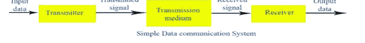

图 1：简单的数据通信系统。

用于描述你将使用的任何形式信息的术语。数据通信系统可以通过数据传输电路从远程位置收集数据，然后将处理结果输出到远程位置。图提供了数据通信网络更广泛的视图。目前使用的不同数据通信技术逐渐演变，是为了改进现有的数据通信，或者用更好的选项和功能取代它们。此外，在选择通信系统时还需要处理如波特率、调制解调器、LAN、WAN、`TCP/IP`、`ISDN` 等数据通信术语。因此，有必要审查和理解这些术语。

### 数据通信的特性

数据通信是将数据从一点传输到另一点的主动过程。网络是设计用于从起点向终点传递信息的通信系统。注意它们是通信系统，而不是计算机系统。操作词是通信，即信息从一个设备到另一个设备的传输。


网络有两种类型——本地网络（如局域网），覆盖区域较小，用户数量有限且较少；以及全球或长途网络，覆盖距离很远，拥有无限的用户。电话网络是长途网络。它是在发送端和接收计算机之间的通信信道上传输数字信号。通信只有通过计算机之间的有线或无线连接才能实现。数据通信系统的有效性取决于三个基本特性：

- 交付：系统必须将数据交付到正确的目的地。数据必须由目标设备或用户接收，且仅供接收。
- 准确性：系统必须准确交付数据。传输过程中被更改且未纠正的数据是不可用的。
- 及时性：系统必须及时交付数据。延迟交付的数据无用。对于视频、音频和语音数据，及时交付意味着在产生数据时、按产生的顺序且在没有显著延迟的情况下交付数据。这种交付方式被称为实时传输。

### 数据通信组件

以下是通信系统工作的基本组件。（参见图 2）。

- 发送端
- 接收端
- 介质
- 消息
- 协议

发送端发送消息，接收端接收消息。介质是传输消息的通道，协议是指导数据从编码到解码传输方式的规则集。当然，消息是所有组件的核心。消息就是正在通信的数据。

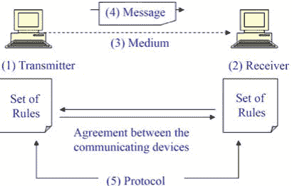

**图 2**: 数据通信组件。

上述数据通信系统的五个组件定义如下：

- 发送端：发送端是向向发送消息的设备。它可以是一台计算机。传输的数据可能是源自数据源（例如计算机或键盘）的数字消息。它也可能是模拟信号，例如电话语音或视频信号，通过脉冲编码调制或高级源编码方案被数字化化为位流。
- 消息：消息是要进行通信的传输（数据）。它可以由文本、数字、图片、声音、视频或这些内容的任何组合组成。
- 协议：协议是管理数据通信的规则集。它代表了通信设备之间的约定。没有协议，两个设备可能已连接但无法通信，就像只说日语的人无法理解说德语的人一样。

### 通信信道

通信信道是连接两个或多个工作站的介质。工作站可以通过线路介质或无线介质连接。也被称为传输介质。

传输介质或通道是携带两个或多个设备之间消息的链路。我们可以将通信介质分为两类：

- 有引导传输
- 非引导引导传输

1. 有引导介质：在这种传输介质中，物理链路是通过两个或多个计算机或设备之间的电线或电缆建立的，然后以信号的形式通过这些电缆传输数据。有引导介质传输有以下类型：

   A. 双绞线：它是通信中最常用的线缆形式。在双绞线中，两根绝缘线以双螺旋方式缠绕在一起。电线的扭绞减少了串扰（信号从一根线泄漏到另一根线导致损坏和网络错误）。扭绞可以保护电线免受内部串扰以及外部形式的信号干扰。双绞线的类型：
   
   - 非屏蔽双绞线 (`UTP`)：广泛用于计算机和电话。正如名称所示，它没有外部屏蔽，因此无法防止外部干扰。它比 `STP` 便宜。
   - 屏蔽双绞线 (`STP`)：由于有屏蔽层，它提供了更好的抗串扰保护。由于屏蔽，它可以防止外部干扰。与 `UTP` 相比，它更重且更昂贵。

   B. 同轴电缆：由一个实心线芯组成，周围围绕着一层或多层箔或线屏蔽。同轴电缆的内芯传输信号，外屏蔽提供接地。它广泛用于电视信号，也被大型公司用于安全系统。与双绞线相比，这种电缆的数据传输更好但价格昂。

   C. 光纤：光纤是一项重要技术。它以极快的速度传输大量数据，因此被广泛应用于网电缆。它以光的形式在纤细玻璃纤维内传输数据。光纤由三部分组成：
   
   - 纤芯：纤芯是光通过的部分。通常由玻璃或塑料制成。
   - 包层：它是纤芯的覆盖层，将光反射回纤芯。
   - 护套：它是保护光缆免受环境影响的保护层。

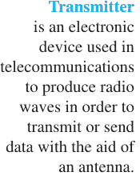

2. 非引导介质：非引导传输介质是一种传输模式，信号无线地从一个设备传播到另一个设备。信号可以在空气、水或真空中波动。它通常用于向所有方向传输信号。非引导介质进一步分为若干部分：

   A. 微波：微波提供了不需要电缆的通信。微波信号就像无线电和电视信号。用于远程通信。微波传输由发送端、接收端和大气组成。在微波通信中，安装在塔上的抛物面天线向另一个天线发射波束。塔越高，范围越远。
   
   B. 电波：当通过无线频率进行通信时，被称为无线传输。它提供了移动性。它由发送端和接收端组成。使用天线来辐射和捕获无线电信号。
   
   C. 红外线：它是短距离通信，可以穿过任何物体。通常用于电视遥控器、无线鼠标等。

### 通信介质

通信介质是指交付和接收数据或信息的手段。在电信领域，这些手段是数据存储和传输的传输工具或通道。


以下是常用的主要通信设备：

- 线对：线对常用于本地电话和短距离数字数据通信。
- 双绞线：双绞线是电信最广泛使用的介质。它由带有绝缘层的铜线绕绕形成以减少串扰。
- 同轴电缆：同轴电缆通过电信号或光脉冲携带消息。
- 光纤：光纤通过玻璃纤维以光脉冲传输数据。

94

计算机科学核心概念：计算机网络

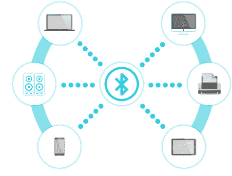

如今，无线通信系统已成为各种无线通信设备不可或的一部分，允许用户即使在远程操作区域也能进行通信。用于无线通信设备有很多，如手机、无线电话、`Zigbee` 无线技术、`GPS`、`Wi-Fi`、卫星电视和无线计算机组件。目前的无线手机包括 `3G`、`4G` 网络、蓝牙和 `Wi-Fi` 技术。

- 地面微波：地面微波使用陆地的发射器和接收器。设备看起来类似于卫星天线。地面微波使用低千兆频率，这使得所有通信限制在视距范围内。中继站之间的间隔约为 48 km（30 英里）。微波天线通常放置在建筑物、塔、山丘和山顶。
- 通信卫星：卫星使用微波无线信号作为电信媒介，这些信号不会被地球大气层偏转。卫星位于太空中，通常位于赤道上方 35,400 公里（22,000 英里）（对于地球同步卫星）。这些环地系统能够接收和中继语音、数据和电视信号。

### 无线通信的优缺点

无线通信的优缺点如下：


#### 优点

- 任何信息都可以快速、高速地传达或传输。
- 可以在随时随地访问互联网，无需携带电缆或电线，这提高了访问的便利性和生产力。
- 对于在偏远地区的医生、工人和其他专业人士很有帮助，因为他们可以通过无线通信与医疗中心保持联系。
- 可以无线通信警报紧急情况。可以通过这些无线通信警报为受影响地区提供支持。
- 无线网络的安装和维护成本较低。

#### 缺点

- 黑客可以轻松地捕获在空气中传播的无线信号。
- 安全无线网络非常重要，以确保信息不会被未经授权的用户利用，这也增加了丢失数据或信息的风险。

因此，无线网络是电信市场中增长最快的技术之一。`WiMax`、蓝牙、`Wi-Fi`、`Femtocell` 和 `4G` 是未来几代无线技术的一些重要标准。无线电、手机、互联网等使用了无线数据传输系统的技术进步，这些系统携带不可见的电磁波在短时间内远距离传输数据。

### 通信服务的类型

用于描述通信服务数据处理能力的术语是带宽。带宽是可用于数据传输的频率范围。通信系统中狭窄的频率范围类似于直径较小的软水管。此类系统中的信息流受到限制，就像窄水管中的水流一样。更宽的带宽允许更快速的信息流。通信数据传输速率以波特（baud）为单位。波特等于每秒比特。因此，300 波特的速率是每秒 300 比特。


如美国电话电报公司（AT&T）和西联（Western Union）等通信公司被称为公共线路，它们为语音和数据通信提供三类通用服务：

- 窄带处理低数据量。数据传输速率从 45 到 200 波特。低速设备使用窄带通信。
- 声带处理 300 到 9600 波特之间的中等数据传输量。它们用于从操作 CRT 到运行行打印机等应用程序。它们的主要应用是电话语音通信，因此使用了“带（band）”一词。
- 宽带处理海量数据。这些系统提供的数据传输速率达到 100 万波特或。高速数据分析和卫星通信是宽带通信系统的示例。

### 调制解调器

调制解调器（modem）是一种调制模拟载波信号以编码数字信息的设备，并解调此类载波信号以解码传输的信息。目标是产生一种可以容易传输并解码以还原原始数字数据的信号。调制解调器可以使用任何传输模拟信号的媒介，从光二极管到无线电。

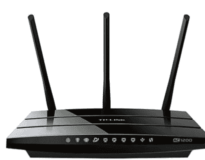

调制解调器将计算机或其他数字设备发出的数字信号调制为模拟信号，用于传统的铜质双绞电话线，并解调输入的模拟信号将其转换为数字信号供数字设备使用。近年来，可以携带电子邮件的 2400 比秒调制解调器已经过时。14.4 Kbps 和 28.8 Kbps 调制解调器是通往未来更高带宽设备和载体途中临时站点。从 1998 年初，大多数新的个人电脑都配备了 56 Kbps 调制解调器。相比之下，使用数字集成服务网络适配器代替传统的调制解调器，数字用户线路（DSL）系统可以携带高达兆比特范围的数据。

### 调制解调器的类型

带宽是数据传输的最大速率。调制解调器是将信息转换为模拟信号的电子设备，并可以通过多种方式分类。


调制器将数字信息转换为模拟信号，解调器将模拟信号转换为数字。这被称为数据终端设备（DTE）。调制解调器分为：

- 陆线调制解调器：陆线调制解调器是连接到公共电话网络（PSTN）的调制解调器。为了连接 PSTN，这些调制解调器有一个称为 RJ11 或普通电话插头的接口。
- 内部调制解调器：这种设备是插入计算机扩展槽之一的电路板。它们通常较便宜，但当出现问题时，修复和排除调制解调器的故障有时可能非常困难。电话线插入计算机背部的调制解调器。内部调制解调器与计算机系统集成程度，因此更加方便。它们在运行通信程序时被激活，在退出程序时关闭。这种便利性对于新手用户特别有用。内部调制解调器的价格通常比外部调制解调器便宜，但价格差异很小。内部调制解调器的主要缺点是位置：在计算机内部。当你想要更换内部调制解调器时，必须进入机箱。
- 外部调制解调器：这种设备通过电缆连接到计算机背部。它通常较便宜且非常便携。通过拔掉并插入另一台设备，可以轻松与其他计算机一起。这是最简单的调制解调器类型，因为不需要打开计算机。外部调制解调器有自己的电源，并通过电缆连接到计算机的串口。电话线插入调制解调器后面板的插座。由于外部调制解调器有独立电源，你可以在不关闭计算机的情况下断开在线连接。与内部调制解调器相比的另一个优势是外部调制解调器的独立电源不会消耗计算机的电。你还可以通过观察状态灯来监控调制解调器的连接活动。
- 语音/数据/传真调制解调器：这种设备可以连接到并将信息发送到计算机。你的计算机也可以向传真机发送信息。大多数计算机调制解调器都是带有传真功能的解调器。
- PC 卡调制解调器：这些调制解调器为便携式计算机设计，大小如信用卡，插入笔记本电脑和手持电脑的 PC 卡槽。这些调制解调器在不需要时取出。

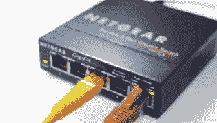

众所周知，计算机无法理解我们的语言。计算机理解的是 0 和 1 的语言，即数字格式。调制解调器（modem）将信号调制为正弦波。这样，这种调制后的数字信号就可以轻松地通过电话线路。然后信号到达 IP 集纽。之后，信号将解调为数字形式。这时你就连接到了互联网。所有这些过程都由调制解调器以极快的速度完成。解调器的速度取决于可用接入线的数量和解调器的技术。今天的解调器速度非常快，但仍有人在使用速度接近 56kbps 的慢速解调器。

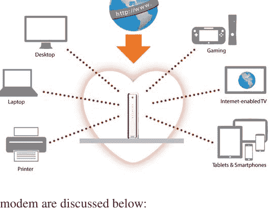

调制解调器的特征如下：

- 调制解调器的速度以每秒比特（bps）衡量。通过使用数据压缩技术可以提高数据传输速度。
- 如果我们使用具有应答功能的调制解调器，那么即使在我们不在场时，解调器也能接听电话。


## 调制解调器工作模式

- 调制解调器基本上以两种模式工作：一个是语音模式，另一个是数据模式。在语音模式下，调制解调器像一个简单的电话；但在数据模式下，它作为一个简单的调制解调器。这类解调器有一个开关，有助于切换模式，即从语音模式切换到数据模式再回到语音模式。对于语音通信，调制解调器内置了扬声器和麦克风。
- 某些解调器具有压缩数据的能力。这些解调器在发送之前会压缩数据以提高数据传输率。但接收端必须有类似的技术来解压缩数据。

## 核心概念：传输损伤

当接收到的信号与发送信号不同时，就会发生传输损伤。众所周知，信号可以作为模拟信号传输也可以作为数字信号传输。在模拟信号中，由于传输损伤，接收到的信号会有不同的幅度或形状。对于数字传输的信号，在接收端我们会得到位（0 或 1）的变化。

在通信系统中，模拟信号通过传输介质传输，这往往会降低模拟信号的质量。这种不完美导致了信号损伤。这意味着接收到的信号与发送的信号不同。

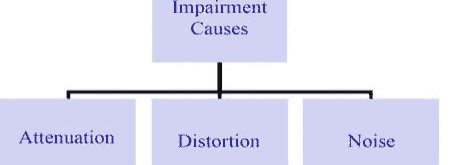

在网络传输数据和信息时，存在多种传输损伤。传输损伤的类型有：

- 衰减（Attenuation）：衰减意味着能量损失。信号强度随任何传输介质的距离增加而下降。对于引导介质，这种强度的降低（衰减）通常是对对数的，因此通常以单位距离的分贝常数表示。图 g 显示了衰减和放大的影响。

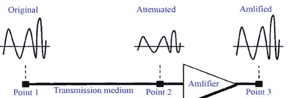

对于非引导介质，衰减是距离和大气组成的更复杂的函数。衰减为传输工程师带来了三个考虑因素：首先，接收到的信号必须具有足够的强度，以便接收器中的电子电路能够检测并解释信号。其次，信号必须保持足够高于噪声的水平才能无错误地接收。第三，衰减是频率的递增函数。

### 失真（Distortion）

失真意味着信号改变了其形式或形状。延迟失真是引导传输介质特有的现象。失真由于由于信号通过引导介质的传播速度随频率变化引起的。对于带限信号，速度在中心频率附近最高，在带的两个边缘处较低。因此，信号的不同频率分量将在不同的时间到达接收器。这种效应被称为延迟失真，因为接收到的信号由于分量的延迟而发生失真。失真效应如图所示：

频率是时间单位内重复性事件发生的次数。它也被称为时间频率，强调其与空间频率和角频率的对比。

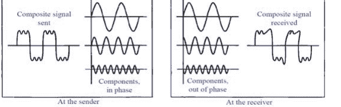

延迟失真对数字数据尤为关键。假设正在使用模拟或数字信号传输一序列比特位。由于延迟失真，一个位位置的某些信号分量会溢出到其他位置，导致码间干扰（ISI），这是传输控制中最大比特率的主要限制。均衡技术也可用于处理延迟失真。

### 噪声（Noise）

噪声是指任何不需要的信号。对于任何数据传输事件，接收到的信号由发送信号（经过传输系统施加的各种失真修改）加上在传输和接收之间某处插入的额外不需要的信号组成；后者不受信号被称为噪声——它是通信系统性能的一个主要限制因素。

### 串扰（Crosstalk）

任何在使用电话时听过另一个人的对话的人都经历过串扰；它是信号路径之间不需要的耦合。它可以通过相邻双线或同轴线之间的电耦合发生；也可以当微波天线接收到不需要的信号时发生；尽管微波能量具有很强的方向性，它在传播过程中仍会扩散。通常，串扰与热噪声处于同一数量级。

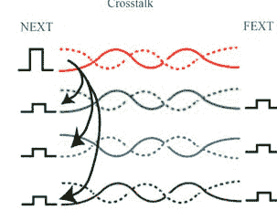 脉冲噪声（Impulse Noise）对于模拟数据通常只是微小的困扰。但在数字通信中，脉冲噪声是错误的主要来源。例如，尖锐的能量脉冲会破坏任何。

## 数据传输模式

传输模式意味着两个设备之间的数据传输。它也被称为通信模式。总线和网络的设计允许设备之间进行通信。

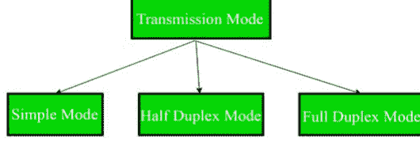

机器之间给定的传输可以通过多种方式进行。传输的特征在于：交换的方向；传输模式（即同时发送的比特数）；以及发送端和接收端之间的同步。传输模式有三种：

- 单向模式（Simplex）
- 半双工模式
- 全双工模式（Full-plex）

数据传输有三种方式：单向、半双工（HDX）、全双工（FDX）。

### 单向

在通信网络，通信可以在一个方向发生，连接到此类电路的是发送或接收设备。没有机制可以将信息传回发送者。通信是单向的。电视广播就是一个例子。单向传输通常涉及专用电路。单向电路类似于电梯、门铃、火警报警和安全系统：

#### 单向模式示例

- 计算机与键盘之间的通信涉及单向传输。电视广播是单向传输的一个例子。
- 另一个单向传输的例子是扬声系统。演讲者对着麦克风说话，他的声音通过放大器发送到所有扬声器。
- 许多火警系统也是这样工作的。

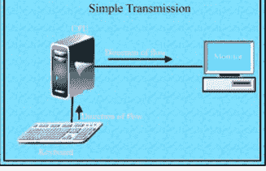

对讲机是一种手持、便携、双向无线收发器。

### 半双工

半双工系统可以在两个方向传输数据，但每次只能方向一个方向，这意味着半双工模式支持双向流量，但每次仅限一个方向。时分系统中的交互式数据传输最适合半双工线路。连接的设备都可以发送和接收，但不能同时进行。当一个设备发送时，另一个只能接收，反之亦然。数据一次从一个方向传输，例如对讲机。

这通常用于相对低速的传输，通常涉及双线模拟电路。由于通信方向的切换，这种模式下的数据传输比全工模式需要更多的时间和处理过程。半双工应用的示例包括行打印机、缓冲区轮询以及现代通信（许多调制解调器也支持全工）。

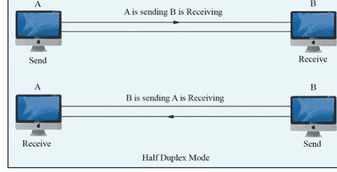

半双工模式示例

- 对讲机运行在半双工模式下工作。在任何给定时刻，它只能发送或接收传输，不能两者同时进行。
- 如图所示，计算机 A 向计算机 B 发信息。传输结束时，计算机 B 向计算机 A 发信息。当计算机 B 传输数据时，计算机 A 不能向计算机 B 发送任何信息。


### 全双工

全工系统可以在传输路径上的两个方向同时传输数据。全工方法用于通过串行通信链路传输数据。

串行通信链路层发送数据需要两根线。全工传输中，信道容量由两个通信设备随时共享。两个连接的设备可以同时发送和接收。因此，它代表了真正的双向系统。链路可能包含两个独立的传输路径，一个用于发送，另一个用于接收。

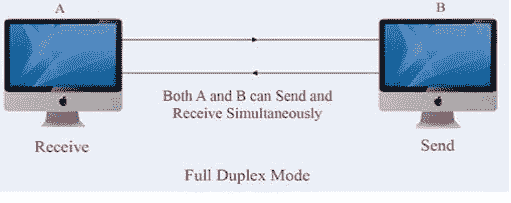

全工模式示例

- 当两个人在电话线上通话时，电话网络以全工模式运行，两人都可以同时听和说。

## 串行与并行传输

传输模式是指通信通道能够同时传输的信息基本单元（比特）的数量。事实上，最近的处理器（因此是一般的计算机）从不一次处理一个比特；通常它们能够处理几个——大多数时候是 8 位：即一个字节——由于这个原因，计算机上的基础连接是并行连接。


### 并行连接

并行连接意味着同时传输 N 个比特。这些比特通过 N 个不同的通道同时发送（通道例如一根线、一根电缆或其他任何物理介质）。PC 型计算机的并行连接通常需要 10 根线：


这些通道可以是：N 条物理线；在这种情况下，每个比特都在一条物理线上发送（这就是为什么并行电缆是由带状电缆中的几根线组成的）；或者通过划分带宽将一根物理线划分为若干子通道（在这种情况下，每个比特以不同的频率发送）。由于带状电缆中的导线彼此靠近，可能会发生干扰（特别是在高速下），并退化信号质量。

### 串行连接

在串行连接中，数据通过传输通道一次发送一个比特。然而，由于大多数处理器以并行方式处理数据，发送器需要将迁入的并行数据转换为串行数据，而接收器需要执行相反的操作：


这些操作由通信控制器（通常是 `UART`，即通用异步收发传输器芯片）执行。通信控制器的工作方式如下。并串转换使用移位寄存器完成。移位寄存器配合时钟工作将寄存器（包含所有并行呈现的数据）向左移动一位，然后传输最有效位（最左侧的一个）并以此类推：


串并转换几乎以相同的方式使用移位寄存器完成。每接收到一个比特时，移位寄存器将寄存器向左移动一位，并在满时并行传输整个寄存器：


### 串行传输与并行传输的区别

在计算机、笔记本电脑之间传输数据使用了两种方法，即串行传输和并行传输。它们之间存在一些相似和不同之处。主要的区别之一是：在串行传输中数据是逐比特发送的，而在并行传输中，发送的是一个字节（8 位）或字符。相似之处是两者都用于连接和与外围设备通信。其他区别见下文。

## 对比图表

| 比较依据 | 串行传输 | 并行传输 |
| :--- | :--- | :--- |
| 含义 | 数据双向流动，逐比特传输 | 使用多条线发送数据，即 |
| 成本 | 经济 | 昂贵 |
| 比特 | 数字 | 1 位 | 8 位 |
| 速度 | 慢 | 快 |
| 应用 | 用于远距离 | 用于短距离 |

## 串行与并行传输的区别

- 串行传输用于远距离，并行传输用于短距离。
- 串行传输的误差和噪声小于并行传输。
- 串行传输需要单线，并行传输需要多条线。
- 并行传输更快，因为数据是一起发送的。
- 串行传输是半工，并行传输是全工。
- 串行传输很可靠，并行传输很复杂。

串行和并行传输各有其优缺点。并行传输提供了更高的速度。

## 数字信号与模拟信号

数据通过电信号从一个点传输到另一个点，信号可以是数字或模拟形式。因此应该了解模拟和数字信号的基本区别。模拟信号的传输相对于声音、光和无线波是连续。

### 模拟信号

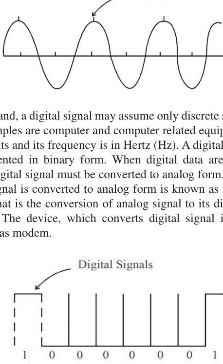

另一方面，数字信号仅取给定范围内的离散值。例如计算机和计算机相关设备。模拟信号以伏特计，频率为赫兹（Hz）。数字信号是以二进制形式表示的电压序列。当数字数据要通过模拟形式发送时，数字信号必须转换为模拟形式。因此将数字信号转换为模拟形式的技术称为调制。而相反的过程，即将模拟信号转换为数字形式，称为解调。将数字信号转换为模拟信号及其相反的设备被称为调制。

### 数字信号

## 数字信号与模拟信号的特性

数字信号和模拟信号是各种电子通信系统和设备中使用的两种不同类型的信号。每种信号都有独特的特性、优点和应用。让我们探索数字和模拟信号的关键特性：

### 数字信号：

- **离散值**：数字信号由离散值表示，通常以二进制位（0和1）的形式。这些离散值使得传输中的错误更容易检测和更正。
- **抗噪声**：数字信号对传输中的噪声和干扰更有免疫，只要噪声水平低于特定阈值。这是因为数字信号只需要区分两种状态（0和1）。
- **精确复制**：数字信号可以再生和复制而不丢失质量，前提是信号保持在指定的范围内
- 数据压缩：数字信号适合数据压缩技术，能够实现信息高效存储和传输。
- 处理与操作：数字信号可以使用数字逻辑电路和算法进行容易的处理、操作和转换，适用于各种数字设备和应用。
- 错误纠正：数字信号可以通过纠错码和算法进行纠正和检测。
- 应用：数字信号广泛用于现代通信系统、计算机、智能手机、数字音频、视频以及通过互联网进行的数据传输。

### 模拟信号：

- 连续值：模拟信号在本质上是连续的，可以取特定范围内的任何值。它们以变化的电压电平或连续波形表示。
- 对噪声敏感：模拟信号在传输过程中更容易受到噪声和干扰，这会导致信号衰减和质量损失。
- 信号衰减：由于衰减和失真等因素，模拟信号在远距离传输中容易劣化。
- 处理限制：模拟信号直接处理和操作更具挑战性，需要模拟电路和专门的技术来进行放大和滤波。
- 无法精确复制：模拟信号在不损失质量的情况下无法完美地再生或复制。
- 应用：模拟信号用于传统电话、音频系统、无线广播、模拟电视以及测量温度、压力等连续物理量的各种传感器。

数字信号在抗噪声、错误纠正和易于处理方面具有优势，适用于现代数字通信和计算系统。

另一方面，模拟信号对于需要物理量连续表示的应用至关重要，但更容易受到噪声和信号衰减的影响。两种信号在当今多样化且互联的电子通信与技术世界都有各自的角色。

## 异步与同步传输模式

数据通过通信设备以固定长度单位（通常为 8 位）倍数传输。例如，如果计算机正在传输源程序，数据将由一组 8 位二进制编码字符块组成。另一方面，如果数据以程序编译目标代码的形式存在，数据将由一组 8 位字节块组成。在接收端，将确定以下参数以正确解码和解释消息：

- 每个位周期的开始。
- 每个字符或字节的开始和结束。
- 每个完整消息块的起始和停止位。

这三个参数分别称为位同步、字符同步或字节同步。通常情况下，有两种传输模式：同步模式和异步模式。在同步模式下，发送端和接收端使用相同的时钟。但在异步模式下，双方使用两个独立的时钟。

### 同步模式

异步传输仅在字符生成速率未知或同步数据速率过低时使用。对于以较高位率传输大块数据，使用同步传输。在同步模式下，发送和接收设备与公共时钟信号同步。这消除了对起始位和停止位的需求。整个数据块以位之间的固定时间间隔进行传输。在传输开始之前，两端时钟需要同步。

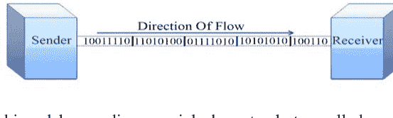

这是通过在发送端和接收端之间发送特殊的字符字节（同步字节或同步字符）来实现。发送端通知接收端数据块的开始。接收端通过知道编码方案确定每个字符的开始。如果发送端处于空闲或未传输任何字符，接收端将寻找下一组同步字符。设备随后重新同步以接收下一块字符。数据块长度从几个字节到数百个字节不等。最常用的协议是 `BISYNC` 或位同步协议。

### 异步模式

异步模式也称为起始-停止模式。这种模式用于以随机间隔生成的待传输数据。例如，当用户使用键盘与计算机通信时，连续击键的时间间隔是随机的。这意味着传输线上的信号在字符之间会有很长时间的空闲状态。对于这种通信，接收端必须能够在接收到每个新字符开始时重新同步。

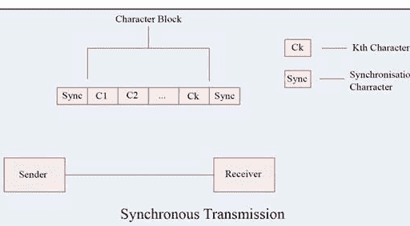

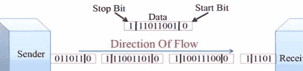

为了实现这一点，每个传输的字符或字节都封装在一个额外的起始位和一个或多个停止位之间。这种模式主要用于键盘和计算机之间的字符传输。异步传输也可用于两台计算机之间字符或字节块的传输。相邻字符之间的时间间隔是一个变量。

在接收端，调制调调器将模拟调回数字数据，允许接收设备解释和处理信息。这种中间设备桥接了数字设备与模拟通信通道之间的差距，实现了远距离通信并促进了传统网络上的数据交换。

## 总结

- 数据通信是通过通信媒介在设备或系统之间交换数据或信息的过程。它是现代通信的骨干，实现了跨本地和全球网络的数据无缝传输和共享。
- 在数据传输过程中，可能会由于噪声或干扰产生错误。因此，采用了错误检测和纠正技术来维护数据完整性。这些方法使设备能够识别错误并请求重传，确保数据的准确交付。
- 安全性是数据通信中的首要问题。加密、防火墙和其他安全措施用于保护数据免受未经授权的访问、拦截或篡改。
- 数据通信是指通过传输介质（如电缆）在源和接收端之间交换数据。

## 单选题

1. 数据通信的首要目的是什么？
   a. 处理数据
   b. 存储数据
   c. 在设备之间传输和交换数据
   d. 安全数据

2. 下列哪是数据通信中的无线通信介质？
   a. 光纤
   b. 同轴电缆
   - c. 双绞线
   d. 射波

3. 哪种信号由离散值（0 和 1）表示？
   a. 模拟信号
   b. 连续信号
   c. 数字信号
   d. 调制信号

4. 协议在数据通信中的作用是什么？
   a. 将模拟信号转换为数字信号
   b. 为了高效存储而压缩数据
   c. 定义数据格式和传输的规则与公约
   d. 放大信号以进行远距离传输

5. 哪种噪声是由导体中电载子的随机运动引起的？
   a. 白噪声
   b. 热噪声
   c. 串扰噪声
   d. 脉冲噪声

## 答案

1. (c) 2. (d) 3. (c) 4. (c) 5. (b)

## 复习题

- 1. 什么是数据通信？写出它的特征。
- 2. 讨论数据通信的组件。
- 3. 简要论述通信介质。
- 4. 解释不同类型的通信业务。
- 5. 调制解调器是如何工作的？请描述。
- 6. 数据通信网络中的传输损伤是什么？
- 7. 不同的传输模式有哪些哪些？
- 8. 区分串行传输和并行传输。

## 参考文献

- 1. ADSL、VDSL 和多载调制，John A. C. Bingham 著。Wiley, 2000。另一本关于宽带的书。
- 2. Behrouz A. Forouzan，“数据通信与网络”，第四版，Tata McGraw – Hill, 2011。
- 3. IP电话的传真、调制和文本，David Hanes 和 Gonzalo Salgueiro 著。Cisco Press, 2008。关于通过电话线路发送非语音数据的全面指南。第一章是对调制解调器工作的极佳介绍，包括简要历史、调制解调器组件概述，以及对调制解调器通话期间发生过程分析。
- 4. James F. Kurose, Keith W. Ross，“计算机网络：自顶向下方法——面向互联网”，第五版，Pearson Education, 2009。
- 5. Nader. F. Mir，“计算机与通信网络”，Pearson Prentice Hall Publishers, 2010。
- 6. 下一代调制解调器，Gilbert Held 著。Wiley, 2000。关于 DSL 和电缆调制解调器的详细技术指南。
- 7. Ying-Dar Lin, Ren-Hung Hwang, Fred Baker，“计算机网络：一种开源方法”，Mc G Hill Publisher, 2011。

# 第 4 章

# 物理层


物理层将从数据链路层接收的数据帧转换为比特位，即 0 和 1。它通过在不同的网络模式下实现所需的协议，并通过使用有线或无线介质的数据传输来维持比特率，从而维护数据质量。

学习本章后，你将理解以下核心概念：

- 网络拓扑
- 交换
- 多路复

## 引言

物理层是数据通信中的一个基本概念，充当 OSI（开放系统互连）模型中的最低层。它处理原始数据位通过各种通信通道（包括铜电缆、光纤和无线介质）的物理传输。物理层的主要目的是在两个设备之间建立并维护可靠高效的物理连接，使其能够交换数据。

物理层的核心包含几个关键方面：

- 1. 物理介质与传输：物理层定义了用于数据传输的物理介质的特性。它包括各种规格，如电缆类型（例如双绞、同轴、光纤）、连接器、信号编码、调制技术和传输速度。每种介质都有自己的优势和局限性，影响数据传输率和覆盖范围等因素。
- 2. 数据编码与信号：来自较高通信层的数据转换为电、光或无线信号，以便通过选定的物理介质进行传输。采用各种编码方案（如曼彻斯特、NRZ 非归零和8b/10b编码）将数字比特表示为特定的电压电、光脉冲或无线波模式。
- 3. 物理拓扑：物理层定义了网络设备和电缆的物理布局。这包括星型、总线型、环型和网型等拓扑，它们决定了设备如何互连以及数据如何从一点传输到另一点。
- 4. 比特同步：比特同步对于确保接收设备通过将其时钟与发送端时钟对齐来准确解释传输的数据关重要。这种同步对于正确的检测和接收是必要的。
- 5. 数据传输模式：物理层支持多种数据传输模式，包括单工（单向）、半双工（一次单向）和全双工（双向同时）。这些模式规定了数据在设备之间的流动方式，以及它们是否可以同时发送和接收数据。
- 6. 错误检测与纠正：虽然错误检测和纠正主要在较高的通信层处理，但物理层可能包含一些基本的错误检查机制，以检测和处理传输错误，特别是在嘈杂信道中。

物理层通过确保数据在物理介质上可靠准确地传输发挥基础作用。它为较高通信层的构建提供了基础，是整个数据通信过程的关键方面。物理层使用了不同的技术和标准，如以太网、Wi-Fi 和 SONET，每种都针对特定需求定制。

## 物理层的属性

物理层在 OSI 模型中实现以下若干属性：

- 1. **信号**：数据首先转换为信号以便高效传输。信号有两种类型：
    - **模拟信号**：本质上是连续波形，用连续波表示。
    - **数字信号**：代表上层数据的离散信号。
- 2. **传输介质**：数据通过传输介质从源传输到目的地。传输介质有两种：
    - **有线介质**：通过电缆建立连接。例如光纤、同轴电缆和双绞线。
    - **无线介质**：通过无线通信网络建立连接。例如 Wi-Fi、蓝牙等。
- 3. **数据流**：描述数据的速率和时间帧。影响数据流的因素如下：
    - **编码**：对传输数据进行编码。
    - **错误率**：由于传输噪声导致接收错误数据。
    - **带宽**：通道中的传输速率。
- 4. **传输模式**：描述数据流的方向。数据可以通过三种传输模式进行传输：
    - **单工模式**：这种通信模式是单向的，设备只能发送数据。例如鼠标、键盘等。
    - **半双工模式**：这种通信模式支持单向通信，即数据可以发送也可以被接收。例如对讲机。
    - **全双工模式**：这种通信模式支持双向通信，即设备可以同时发送和接收数据。例如手机通信。
- 5. **传输噪声**：由于许多原因，传输的数据在传输过程中可能会被损坏。下面列出了一些原因：
    - **衰减**：通信通道上网络信号逐渐退化。
    - 色散：在色散的情况下，数据在传输过程中发生分散和重叠，导致原始数据的丢失。
    - 数据延迟：传输的数据在指定的帧时间之外到达目标系统。

## 核心概念：网络拓扑


网络拓扑是网络布局的示意性描述，通过连接线连接各种节点（发送者和接收者）。

网络拓扑是指网络中的各种节点、设备和连接相对于彼此在物理或逻辑上的安排方式。将你的网络想象成一个城市，将拓扑比作地图。就像城市有许多种安排和维护方式——例如确保大道和林干道方便流量最大的区域之间通行一样——网络也有几种不同的安排方式。根据公司的需求，某些安排可以为你提供更高程度的连接性和安全性。

网络拓扑有两种方法：物理拓扑和逻辑拓扑。物理网络拓扑顾其实名，指的是节点与网络之间的物理连接和交叉——电线、电缆等。逻辑网络拓扑则稍微抽象且具有策略性，指的是对网络如何以及为何这样安排的性性理解，以及数据如何在其中流动的。

由通过发送者和接收者连接节点和连接线组成的网络安排称为网络拓扑。各种网络拓扑包括：

### 总线拓扑

总线拓扑是多点的。一根长电缆充当主干，连接网络中的所有设备。节点通过支线和分接器连接到总线电缆上。支线是运行在设备和主电缆之间的连接。分接器是一种连接器，它可以接到主电缆上或者穿过电缆外壳以与金属芯接触。当信号沿着主干传输时，部分能量会转化为热量。因此，随着传输距离越远，信号会变得越来越弱。因此，总线支持的分接器数量以及分接器之间的距离存在限制。

#### 总线拓扑的本质

计算机网络中总线拓扑的本质可以通过其特征和优势来描述。在总线拓扑中，网络中的所有设备都连接到被称为“总线”的单一通信通道上。总线作为共享传输介质，数据通过它从一个设备传输到网络上的所有其他设备。每个设备接收传输的数据，并只处理针对自己的信息。

以下是总线拓扑的主要本质和特征：

- 1. 简单且具有成本效益：总线拓扑设置相对简单且具有成本效益，因为它需要的布线最少。设备以线性方式连接到总线，使得物理布局直观。
- 2. 共享通信介质：总线拓扑中，所有设备共享相同的通信介质（总线）进行数据传输。当一个设备将数据发送到总线上时，所有其他设备都会接收。每个设备检查地址以确定数据是否是给自己的。
- 3. 被动和主动设备：总线拓扑中的设备可以是被动的或主动的。被动设备只接收数据，而主动设备可以发送接收数据。被动设备不参与信号再生，因此必须定期加强总线以防止信号衰减。
- 4. 终端：总线两端都需要适当终止以防止信号传输异常。在总线的每端添加终端电阻以吸收信号能量。
- 5. 可扩展性挑战：虽然总线拓扑适用于中小型网络，但在较大的网络中面临可扩展性挑战。随着更多设备的加入，总线可能会拥堵，导致网络性能下降。
- 6. 容错性：总线拓扑中的单点故障可能会破坏整个网络。如果总线在任何一点受损或断裂，设备之间的通信可能会受到影响。
- 7. 冲突风险：当两个或多个设备尝试同时传输数据时，总线拓扑中发生冲突。这种冲突会导致数据损坏，并需要冲突检测和解决机制。

由于简单且具有成本效益，总线拓扑常用于小型局域网（LAN）。然而，其局限性（例如对单点故障的脆弱性和可扩展性问题）使其在更大、更关键的网络环境中受欢迎程度降低。


#### 总线拓扑的特征

- 1. 它仅以一个方向传输数据。
- 2. 每个设备都连接到单根电缆。

#### 总线拓扑的优势

- 1. 它具有成本效益。
- 2. 与其他网络拓扑相比，所需的电缆最少。
- 3. 用于小型网络。
- 4. 它很容易理解。
- 5. 易于通过将两根电缆连接来扩展。

#### 总线拓扑的劣势

- 1. 电缆故障则整个网络瘫痪。
- 2. 如果网络流量很大或节点较多，网络性能就会下降。
- 3. 电缆长度有限。
- 4. 它比环形拓扑慢。

### 环形拓扑

在环形拓扑中，每个设备与其两侧的两个设备都有专用点对点连接。信号沿着环路单向从设备传输到设备，直到到达目的地。环中的每个设备都包含一个中继器。当设备接收到给另一个设备的信号时，它的中继器会再生位并传递下去。

网络流量或数据流量是跨网络的数据量。


#### 环形拓扑的特征

- 在节点数量较多的环形拓扑中使用了多个中继器，因为如果有人想向100个节点的环中的最后一个节点发送数据，那么数据必须经过99个节点。因此，为了防止数据丢失，网络使用了中继器。
- 传输是单向的，但通过在每个节点之间建立两个连接可以将其变为双向，这被称为双环拓扑。
- 在双环拓扑中，形成了两个环形网络，数据流在它们中的方向相反的。此外，如果其中一个环故障，第二个环可以作为备份以保持网络运行。
- 数据以逐位的顺序方式进行传输。传输的数据必须通过网络的每个节点直到到达目标节点。

#### 环形拓扑的优势

- 传输网络不受高流量或增加更多节点的影响，因为只有拥有令牌的节点可以传输数据。
- 安装和扩展成本低。

#### 环形拓扑的劣势

- 环形拓扑的故障排除很困难。
- 添加或删除计算机会干扰网络活动。
- 一台计算机的故障会干扰整个网络。

### 星型拓扑

在星型拓扑中，每个设备都有一个中央控制器（通常称为集线器）的专用点对点链路。设备之间没有直接连接。与网状拓扑不同，星型拓扑不允许设备之间的直接流量。控制器充当交换的角色：如果一个设备想向另一个设备发送数据，它将数据发送到控制器，然后控制器将数据转发到另一个连接的设备。

> 星型网络拓扑适用于工作站随机部署在建筑或设施中的情况。由于中心星辐射的设计，添加或删除工作站非常容易，因为所有布线都拉到并连接到中央集线器。


#### 星型拓扑的特征

- 每个节点都有到集线器的专用连接。
- 集线器充当数据流的继器。
- 可用于双线、光纤或同轴电缆。

#### 星型拓扑的优点

- 在节点少且网络流量低时，性能快速。
- 集线器易于升级。
- 于故障排除。
- 于设置和修改。
- 只有故障节点会受影响，其余节点可以正常工作。

#### 星型拓扑的缺点

- 安装成本高。
- 使用昂贵。
- 如果集线器故障，整个网络将停止，因为所有节点都依赖集线器。
- 性能取决于其依赖的集线器的容量。

### 网状拓扑

它是与其他节点或设备的对点连接。所有网络节点相互连接。网状结构具有 n(n-1)/2 个物理通道来连接 n 个设备。

在网状拓扑上传输数据有两种技术，它们是：

- 路由 `Routing`
- 泛洪 `Flooding`

#### 网状拓扑：路由

在路由中，节点根据网络需求具有路由逻辑。例如，通过最短距离将数据导向目的地的路由逻辑。或者具有断开链路信息的路由逻辑，它会避开这些节点等。我们可以拥有路由逻辑来重新配置故障节点。

#### 网状拓扑：泛洪

在泛洪中，相同的数据被传输到所有网络节点，因此不需要路由逻辑。网络是稳健的，极不太可能丢失数据。但这会导致网络产生不必要的负载。


#### 网状拓扑的类型

- 部分网状拓扑：在这种拓扑中，某些系统以与网状拓扑相同的方式连接，但但某些设备仅连接到两个或三个设备。
- 全网状拓扑：每一个节点或设备都相互连接。

#### 网状拓扑的特征

- 全连接。
- 稳健。
- 不灵活。

#### 网状拓扑的优点

- 每个连接都可以携带自己的数据负载。
- 它是稳健的。
- 故障诊断容易。
- 提供安全性和隐私。

#### 网状拓扑的缺点

- 安装和配置困难。
- 布线成本高。
- 需要大量的布线。

### 树型拓扑

它有一个根节点，所有其他节点都连接到它形成一个层次结构。它也被称为层次拓扑。其层次结构至少应三三。


#### 树型拓扑的特征

- 如果工作站分组位于则是理想的。
- 用于广域网 `WAN`。

#### 树型拓扑的优点

- 总线和星型拓扑的扩展。
- 节点扩展可能且容易。
- 于管理和维护。
- 易于错误检测。

#### 树型拓扑的缺点

- 布线密集。
- 昂贵。
- 如果增加更多节点，维护很困难。
- 中央集线器故障，网络失败。

### 混合拓扑

它是指两种或多种拓扑的混合。例如，如果办公室的某个部门使用环形拓扑，而另一个部门使用星型拓扑，连接这些拓扑将导致混合拓扑（环形拓扑和星型拓扑）。

#### 混合拓扑的特征

- 它是两种或多种拓扑的结合
- 继承了各拓扑的优​​和缺点

#### 混合拓扑的优点

- 可靠，因为错误检测和故障排除容易。
- 有效。
- 可扩展，因为尺寸可以容易地增加。
- 灵活。

#### 混合拓扑的缺点

- 设计复杂。
- 昂贵。

### 对比图

| 拓扑 | 架构/组织 | 路由方法 | 复杂性 | 扩展 | 可靠性 | 成本 | 布线问题 | 安全性 | 延迟/响应时间 |
| :--- | :--- | :--- | :--- | :--- | :--- | :--- | :--- | :--- | :--- |
| 星型 | 一种网络拓扑，外围节点连接到作为集线器、交换机或路由器的中心节点，该节点将从任何节点接收的所有传输重播到网络上的所有外围节点，包括源节点也可以通过从发送和仅接收节点与其他所有节点通信 | 所有通过中央连接验证 | 简单（用于局域网） | 从计算机到连接设备添加新节点。 | 当一台电脑掉线时，网络就中断了。 | 拓扑中最昂贵的，比混合网络更昂贵的连接设备 | 使用双线电缆。需要大量电缆。到设备不超过 100 米。 | 拒绝服务攻击 | 在距离方面表现优秀 |


| 总线 | 一根 | 最简单 | 添加一台计算机 | 如果一个 | 较便宜的 | 单连接电缆 | 不安全 | 广播延迟 | 广播延迟 |
| :--- | :--- | :--- | :--- | :--- | :--- | :--- | :--- | :--- | :--- |
| 它是一种拓扑，其中有一条单线（总线），所有节点都连接在上面，节点通过这条总线连接。总线在电缆的末端安装了终端器。终端器防止回波引起网络错误。像一系列管道传输 | 一时一台计算机 | 信息在电缆上容易流动。 | 如果整个网络掉线。 | 这种网络较便宜 | | | | | |

| 环形 | 一种网络拓扑，每个节点都连接到一个星型。星型环形拓扑看起来（完全）是一种拓扑。MAU（多站访问单元）包含一个环形，允许信息从一个节点传递到另一个 | 信息沿环形单向流动直到到达正确的目的地 | 为了添加新设备必须断开网络，直到新设备在线。 | 如果电缆断裂或网络出错，其余环形仍到达故障点。这使得故障排除很容易。 | 其他拓扑中最昂贵的之一。使用双线。 | 单连接电缆连接设备。 | 目标一台机器的信息通过所有机器 | | | |

| 网状 | 一种网络拓扑，其中至少两个节点之间有两个或多个路径。 | 通常用于跨距离。传输取决于不同的方式，取决于其他拓扑。 | 用于广域网 | 连接设备使得组合不同的网络和拓扑成为可能。 | 由于技术的复杂性，故障排除最困难。 | 昂贵、巨大且通常复杂。 | 布线取决于网络类型。可以使用双线和同轴电缆。长距离还整合了光纤布线。 | 网状需要安全的链路、路由和转发 | 与成本 | | |

| 树型 | 节点排列成树。树型拓扑是总线拓扑的推广。传输介质是分支电缆，没有闭环。树型布局有一个被称为头部（根）的点，一个或多个分支开始，每个分支又有分支以允许复杂的布局。 | 从任何到所有的传输在介质中传播并被所有其他站接收。从主树分支的主机称为叶节点。 | 用于广域网 | 最容易安装和扩展 | N. 虽然分区但仍工作。 | 因为严重依赖它所以很便宜 | 每个段的总长度受电缆类型限制。双线。光纤 | 物理安全性低但 | 可能的交通拥堵。 | |

## 核心概念：交换

交换在网络和 IT 领域是指将信号或数据元素导向特定硬件目的地的实践。

交换可以以各种形式应用，并在更大型的网络基础设施中发挥多种功能。


交换是将从一个端口进入的数据包转发到通往目的地的端口的过程。

当数据进入端口时，称为“入口” `ingress`，当数据离开端口或流出时，称为“出站” `egress`。一个通信系统可能包含多个交换机和节点。从宏观上来说，交换可以分为大类：

- *无连接的*：数据根据转发表进行转发。不需要先前的握手，且确认是可选的。
- *面向连接的*：在将要转发的数据交换到目的地之前，需要沿两个端点之间的路径预先建立电路。然后在该电路上转发数据。传输完成后，电路可以保留以备后后用，也可以立即关闭。

> 数据传输利用各种通信媒介在一个或多个节点之间移动数据。

### 交换技术的类型

基本上有三种交换方法可用。在三种方法中，电路交换和分组交换最常用，但报文交换在通用通信过程中被排除，但在网络应用中仍在使用。

- 电路交换
- 分组交换
- 报文交换

#### 电路交换

当两个节点通过专用通信路径相互通信时，这被称为电路交换。需要一个预先指定的路由，数据将在其中传输，且不允许其他数据通过。在电路交换中，为了传输数据，必须建立电路以便数据传输进行。

电路可以是永久的或暂时的。使用电路交换的应用可能需要经过三个阶段：

- 建立电路
- 传输数据
- 断开电路


#### 分组交换

- *在分组交换中，消息被分成固定或可变大小的数据包。
- *数据包的大小由网络和主导协议决定。
- *分组交换中不对数据包进行资源分配。
- *资源按需分配。
- *资源分配基于先来后得原则。
- *每个交换节点都有少量的缓冲区空间来临时存放数据包。
- *如果输出线路忙忙，数据包将留在队列中，直到线路可用。

分组交换方法使用两种路由方法：

#### 1. 数据报分组交换

- *数据报分组交换通常在网络层实现。
- *在数据报网络中，每个数据包都独立地通过网络路由。


每个数据包都携带一个头部，包含关于目的地的完整信息。

当交换节点接收数据包时，会检查包头中的目的地址；查询路由表以找到应该转发数据包的相应端口。


## 2. 虚拟电路分组交换

虚拟电路分组交换通常在数据链路层完成。

虚拟电路分组交换在源和目的之间建立一条固定路径来传输数据包。

它也被称为面向连接的网络。

在虚拟电路分组交换中，源和目的必须经过三个阶段：

I. 建立阶段

II. 数据传输阶段

III. 连接释放阶段

当发送者向接收者发送建立请求，且接收者在同意后向发送者发回确认时，即建立了逻辑连接。

属于同一源和目的的所有数据包都沿相同的路径传输。

信息以发送者传输的相同顺序交付给接收者。

> 计算机用户一直在经历交换；例如，从你的计算机设备访问互联网，每当用户请求打开网页时，请求仅通过数据包的交换进行处理。


## 报文交换

这种技术介于电路交换和分组交换之间。在报文交换中，整个消息被视为一个数据单元，并整体进行交换/传输。

工作在报文交换的交换机首先接收整个消息并缓存，直到有可用资源将其传输到下一跳。如果下一跳没有足够的资源来容纳大尺寸消息，消息将进行存储并等待。


这种技术曾被认为是电路交换的替代方案。由于电路交换中整个路径仅供两个实体占用，报文交换被分组交换所取代。报文交换具有以下缺点：

传输中的每个交换机都需要存储空间来容纳消息。

因为存储-转发技术需要等待资源可用，报文交换非常慢。

报文交换并不是流媒体的解决方案。

> 核心概念：复用


复用是一种流行的网络技术，将多个模拟和数字信号整合到通过共享介质传输的信号中。复用器和解用器用于将多个信号转换为一个。

复用是一种使不同的模拟和数字流能够在共享链路上同时进行处理的技术。复用将高容量介质划分为低容量介质，然后由流共享。

这一过程通过称为复用的技术完成。该技术的引入是为了增加计算机系统和时分系统的通道利用率，并降低通信成本。

### 复用的类型

通信中使用不同的复用类型。讨论以下三种主要的复用技术：

- 频复用
- 波分复用
- 时分复用

## 频复用

在20世纪，许多电话公司使用频复用进行远距离连接，通过同轴电缆系统复用数千个语音信号。对于短距离，使用了廉价的平衡电缆用于如贝尔系统的K和N载波系统，但它们不允许大带宽。FDM是一种模拟复用技术。当链路带宽大于待传输信号之和时，就会应用频复用。


电视信号传输

从源（例如电视节目室、卫星、电缆网络）向家庭或其他地区的电视接收机广播电视节目和内容的过程。

在这种复用类型，通过发送不同的设备调制的载波来产生信号，然后将这些调制信号组合成一个可以由链路传输的信号。为了容纳调制信号，载波频率被足够的带宽隔开，这些带宽范围就是信号传输的通道。这些通道可以根据使用的带宽进行分开。时分复用的例子包括广播和电视信号传输。

# 波分复用

波分复用（WDM）是光纤通信中的一种技术；对于高容量通信系统而言，波分复用是最具前景的概念。该系统在发送端使用复用器来合并信号，并在接收端使用解复用器将信号分开。WDM 的目的是在复用器处将多个光源合并为单一光源；而在解复用器处将单路光转换为多个光源。

解复用器（或称为 demux）是一种接收单输入线并将其路由到多个数字输出线之一的设备。

WDM 的设计旨在利用光纤电缆的高数据率能力。这种电缆的数据率高于金属传输电缆的数据率。从概念上说，波分复用与频分复用相同，区别在于通过光纤通道传输，其中复用和解复用涉及光信号。

# 波分复用


# 时分复用

时分复用是一种用于通过单个通信通道传输信号的技术，它通过将时间帧划分为时隙——每个时隙对应一个消息信号。时分复用主要应用于数字信号和模拟信号，其中若干个低速通道被复用到高速通道中进行传输。根据时间，每个低速通道被分配到一个特定的位置，并在那里以同步模式工作。即：复用器和解复用器定时同步并同时切换到下一个通道。


# 时分复用的类型

时分复用分为四类：

- 同步时分复用
- 异步时分复用
- 交替时分复用
- 统计时分复用

# 同步时分复用

同步时分复用可以同时用于模拟信号和数字信号。在同步 TDM 中，输入连接连接到一个帧上。如果有 ‘n’ 个连接，那么一个帧就会被划分为 ’n’ 个时隙——并且，为每个单元分配一个时隙——对应每个输入线。在同步 TDM 采样中，所有信号的速率相同，这种采样要求发送端和接收端都具有一个公共时钟信号。在同步 TDM 中，复用器始终为每个设备分配相同的时隙。


# 异步时分复用

在异步时分复用中，不同信号的采样率不同，且不需要公共时钟。如果设备没有数据要传输，则其时隙将分配给另一个设备。交叉器（commutator）的设计非常困难，且时分复用的带宽较小。这种类型的时分复用用于异步传输模式（ATM）网络。


# 交替时分复用

时分复用可以直视化为复用端和解复用端两个快速旋转的开关。这些开关以相同的速度旋转并同步，但方向相反。当复用器侧的开关在某个连接前方打开时，它就有机会将一个单元发送到路径中。同样，当解复用器侧的开关在某个连接前方打开时，它就有机会从路径中接收一个单元。这个过程被称为交替。


# 统计时分复用

通信通道简单是指物理传输介质（如线路上的逻辑连接），或复用介质（如电信和计算机网络中的无线信道）。

统计时分复用用于在单条传输电路上同时传输各种类型的数据。这通常用于管理通过局域网（LAN）或广域网（WAN）传输的数据。数据同时从连接到网络的输入设备传输，包括打印机、传真机和计算机。这种复用也用于电话交换机管理通话。统计 TDM 类似于动态带宽分配，在这种类型的时分复用中，通信通道被分为任意数量的数据流。


这些是通信系统中用于高效传输和接收数据的各种不同复用技术类型。如果你感兴趣，文中也提到了这些复用类型的实际示例。

# 星型拓扑的概念

星型拓扑是一种网络拓扑，其中每个设备都连接到一个中央枢纽。它是最常见的计算机网络配置之一，也是迄为止最流行的网络拓扑。在该网络中，

## 总结

- 物理层是 OSI 模型中的最低层。
- 物理层的主要功能是在设备之间建立可靠的连接。
- 在环形拓扑中，数据单向传递。
- 总线拓扑有一根带有支线和分接器的主电缆。
- 交换是将从一个端口进入的数据包转发到另一个端口的过程。
- 复用是一种可以在共享链路上同时处理多个不同模拟和数字传输流的技术。

# 习习题

- 1. 讨论不同的网络拓扑结构。
- 2. 什么是交换？
- 3. 对于网络中的设备，网状型、环型、总线型和星型拓扑结构需要多少条电缆链路？
- 4. 为什么 TDM（时分复用）中需要同步脉冲？
- 5. 频分复用和波分复用有什么区别？

## 参考文献

- 1. Carr, B., Sury, O., Palet Martinez, J., Davidson, A., Evans, R., Yilmaz, F., IPv6 Address Allocation and Assignment Policy, RIPE document ripe-481, September 2009
- 2. D. Andersen; H. Balakrishnan; M. Kaashoek; R. Morris (October 2001), Resilient Overlay Networks, Association for Computing Machinery, retrieved 2011-11-12
- 3. Inductee Details - Donald Watts Davies. National Inventors Hall of Fame. Retrieved 6 September 2017.
- 4. Mohammad Alzadeh, Albert Greenberg, David Maltz, Jitendra Padhye, Parveen Patel, Balaji Prabhakar, Sudipta Sengupta and Murari Sridharan, “Data Center TCP (DCTCP)”, Proceedings of ACM SIGCOMM 2010, September 2010.
- 5. Nanoscale Communication Networks, Bush, S. F., ISBN 978-1-60807-003-9, Artech House, 2010. [2]
- 6. Teletraffic Engineering Handbook (PDF), ITU-T Study Group 2, archived from the original (PDF) on 2007-01-11

# 第 5 章

# 数据链路协议


计算机网络使用协议进行通信，协议定义了通信过程中的参与系统将使用的程序。数据链路协议是一组规则，用于实施和管理二层设备（如线路控制单元和前端处理器）之间有序的数据交换。

学习本章后，你将理解以下核心概念：

- 数据链路协议的功能与要求
- 数据传输模式

## 引言

数据链路协议是一组关键的规则和惯例，用于管理通信网络内设备之间的数据交换。这些协议运行在 OSI 模型的数据链路层（第 2 层），促进了在各种物理传输介质上进行可靠高效的通信。它们解决了数据传输的关键方面，如成帧、寻址、错误检测、纠错、流控制和介质访问。成帧涉及将数据分解为帧帧，使接收方能够识别每个单元的开始和结束。

寻址为设备分配唯一标识符，确保数据准确交付给目标接收者。错误检测和纠错机制识别并纠正传输错误，增强数据完整性。

流控制调节设备之间的数据流，以防止淹接收方。此外，介质访问解决了多个设备在共享信道上同时传输时的冲突问题。

几种常见的数据链路协议包括用于有线局域网的以太网、无线局域网的 Wi-Fi (IEEE 802.11)、点点连接的 PPP、广域网的 HDLC 以及用于远程站点连接的帧中继（Frame Relay）。数据链路协议的选择取决于网络特性、使用的设备以及特定的应用需求。


# 核心概念：数据链路协议的功能与要求

数据链路是电信中连接一个位置到另一个位置的方法，用于传输和接收数字信息。数据传输发生在特定的链路协议上，允许数据从源传输到目的。在计算机网络的 OSI 模型中，数据链路本质上构成了第二层。

计算机网络使用协议进行通信，协议定义了通信过程中参与系统将使用的程序。数据链路协议是一组规则，用于实施和管理两个设备（如线路控制单元和前端处理器）之间有序的数据交换。

数据链路层的目的是在两个相邻设备之间无错传输数据块。相邻设备通过通信通道（如电话线、同轴电缆、光纤或卫星）物理连接。物理链路的含义是数据位按照发送时的完全相同的顺序交付。物理层没有固有的存储能力；因此链路存在传播延迟。

如果从不发生错误，在链路上传输数据将非常简单。遗憾的是，在真实的物理链路中由于许多原因，情况并非如此：

- 自然现象（如噪声和干扰）引入链路，导致数据检测错误。
- 链路中存在传播延迟。
- 发送和接收站需要有限的数据处理时间。
- 因此，数据链路协议的设计必须确保无错传输，并尽可能地提高数据传输的效率。

数据链路协议的功能包括线粒、流控制和错误控制。

线粒（Line discipline）协调跳跳数据交付，其中跳跳是指计算机、网络控制器或某种类型的网络连接设备（如路由器）。

# 数据链路层

| 应用 |
| :--- |
| 表示层 |
| 会话层 |
| 传输层 |
| 网络层 |
| 数据链路层 |
| 物理层 |
| 线粒 |
| :--- |
| 流控制 |
| 错误控制 |

流控制是调节设备之间数据流的过程，以防止接收方过载。此外，介质访问控制解决了多个设备在共享信道上同时传输时的冲突问题。


图 1：数据链路层

# 线粒

线粒协调跳跳数据交付，其中跳是指计算机、网络控制器或某种类型的网络连接设备（如路由器）。

流控制是调节设备之间数据流的过程，以防止接收方过载。此外，介质访问控制解决了多个设备在共享信道上同时传输时的冲突问题。

图 2：数据链路控制的功能

# 线粒

线粒协调跳跳数据交付，其中跳是指计算机、网络控制器或某种类型的网络连接设备（如路由器）。

流控制是调节设备之间数据流的过程，以防止接收方过载。此外，介质访问控制解决了多个设备在共享信道上同时传输时的冲突问题。

图 3：线粒

# 确认 (Acknowledgment)

必要时进行传输，因为消息和确认在发送下一帧之前必须跨越整个数据链路。

- 滑动窗口流量控制（Sliding Window Flow Control）：通过滑动窗口流量控制，源站可以在接收到多个已传输帧的确认之前连续发送多个帧，这与停止-等待技术相比大大缩短了传输时间。“滑动窗口”一术指的是源站和目的站处具有容纳几帧数据能力的虚拟框。在窗口被数据填满之前的任何时候都可以对消息帧进行确认。为了跟踪哪些帧已确认，哪些尚未确认，滑动窗口程序需要一种模 $n$ 编号方案，每个传输的帧都用一个 0 到 $n-1$ 之间的唯一数字标识。使用三位二进制编号方案，共有 8 个数字（0, 1, 2, 3, 4, 5, 6 和 7），且窗口必须具有容纳 $n-1$（七个）帧数据的容量。

确认是通信协议的一部分通信进程或计算机之间传递的信号，表示确认或接收响应。

| 已传输的帧 | 可能传输的帧窗口 |
| :--- | :--- |
| 0 | 1 | 2 | 3 | 4 | 5 | 6 | 7 | 0 | 1 | 2 | 3 | 4 | 5 | 6 |

| 帧序列 | 最后一次传输的帧 | 随着帧的发送窗口缩小 | 随着确认的窗口扩大 |
| :--- | :--- | :--- | :--- |

### 发送窗口

| 发送窗口流量控制。 | 已接收的帧 | 接收端接受的帧窗口 |
| :--- | :--- | :--- |

| 0 | 1 | 2 | 3 | 4 | 5 | 6 | 7 | 0 | 1 | 2 | 3 | 4 | 5 | 6 |

图 4：发送窗口流量控制。

| 最后一次确认的帧 | 随着帧的接收窗口缩小 | 随着确认的发送窗口扩大 |
| :--- | :--- | :--- |

### 接收窗口

图 5：接收窗口流量控制。

滑动窗口流量控制的主要优势是网络利用率。确认越少，浪费的网络时间就越少。主要缺点是复杂性和硬件能力（即缓冲区空间）。

# 错误控制

错误控制包括错误检测和错误纠正。数据链路层的错误检测可以通过 VRC、LRC 或 CRC 完成，而错误纠正通常通过自动重传（ARQ）完成。在 ARQ 中，每当检测到传输错误时，目的站都会向源站发送负确认（NAK），请求重传最后一个帧或几个帧。ARQ 允许对缺失或丢失的帧进行重传。

存在两种类型的 ARQ：

- 停止-等待 (stop-and-wait)
- 滑动窗口 (Sliding window)

停止-等待帧控制实现了停止-等待 ARQ，而滑动窗口流量控制通常以两种变体之一实现 ARQ：回退 n 帧（go-back-n）或选择拒绝（selective reject, SRE）。

使用回退 n 帧时，目的站告诉源站回退 $n$ 帧并重传所有帧，尽管它们并不都包含错误。使用选择拒绝时，目的站告诉源站只重传接收到错误的帧或几个帧。

# 字符和位导向协议

控制信息通过协议在单独的控制帧中或作为开销包含在帧中。数据链路协议通常分类为面向型或位面向型。

# 字符面向型协议

字符面向型协议将数据帧解释为一组连续的位，组合成预定义的长度（通常每组 8 位）。每组位代表一个唯一的字符。控制信息以现有字符集（如 ASCII）的标准字符形式包含在帧中。在 COP 中，作为文本开始（STX）和文本结束（ETX）的唯一链路控制字符无论出现在传输的什么位置都执行相同的操作。这些也被称为字节面向。

传输是通过物理点对点或多点传输介质（有线、光纤或无线）发送和传播模拟或数字信号的过程。字符面向型协议的一些示例包括 XMODEM、YMODEM、ZMODEM、KERMIT、BLAST、IBM 的 83B 异步数据链路协议、IBM 的二进制同步通信。

字符面向型协议根据以下进行分类：

- 单工 (Simplex)
- 半双工 (Half Duplex)
- 全双工 (Full duplex)

# 单工

这是数据传输中使用的简单的协议形式。在该协议中，传输一次向一个方向进行。同一条线路上**不可能**同时传输和接收。当使用单工时，系统被设置为先发送数据，而另一端设置为接收数据，反之亦然。这并不意味着反向没有通信。空闲 RQ 系统在每个数据块后停止并等待确认，但无法向反方向发送数据。这就是它被称为单工的原因。


Kermit 是这种数据传输系统的一个示例。在该系统中，每个用户都启动 `Kermit` 程序并输入 `connect`。这在发送设备和接收设备之间建立了一个链路。在接收设备上输入接收命令，发送系统中的用户使用该命令后跟文件名。发送系统中的 `Kermit` 传输整个文件。该系统用于用户希望通过点对点链路从一个 `DTE` 传输到另一个 `DTE`（例如从一台 PC 传输到另一台 PC）。

面向连接的协议中，帧中的控制字段可能传达多个控制功能。`BOP` 比 `COP` 更具效率，并且能够在更短的帧中传达更多信息。最常见的例子是同步数据链路通信（`SDLC`）和高层数据链路通信（`HDLC`）。

## 基础数据链路协议

### 一种无限制的单向协议

为了理解 `SDLC`、`HDLC` 等高效且复杂的协议的演进过程，我们将从一个简单但不符合实际的协议开始。在这个协议中：

- 数据仅沿一个方向传输
- 发送端（`Tx`）和接收端（`Rx`）主机始终分离
- 处理时间可以忽略
- 备用无限的缓冲区空间
- 不发生错误；即没有损坏的帧也没有丢失的帧（完美通道）

该协议由两个过程组成，发送者和接收者，如下所示：

```c
/* protocol 1 */
Sender()
{
  forever
  {
    from_host(buffer);
    S.info = buffer;
    sendf(S);
  }
}
Receiver()
{
  forever
  {
    wait(event);
    get(R);
    to_host(R.info);
  }
}
```

### 一种单向停止-等待协议

在这个协议中，我们假设：

- 数据仅沿一个方向传输
- 不发生错误（完美通道）
- 接收者只能以有限率处理接收到的信息

这些假设意味着发送器发送帧的速度不能高于接收者处理的速度。

这里的问题在于如何防止发送者淹没接收者。

该问题的通用解决方案是让接收者向发送者提供某种反馈。过程如下：接收者向发送者发送一个 `ACK`，告知最后接收到的帧已处理并传递给主机；随后允许发送下一帧。发送者在发送一帧帧后，必须等待接收者的确认，方可发送另一帧帧。这种协议被称为停止-等待协议。

```c
/* protocol 2 */
Sender() {
  forever {
    from_host(buffer);
    S.info = buffer;
    send(S);
    wait(event);
  }
}
Receiver() {
  forever {
    wait(event);
    getf(R);
    to_host(R.info);
    send(S);
  }
}
```

### 一种用于信道通道的单向协议

在这个协议中，协议 2 中不真实的“无错误”假设被取消。帧可能会损坏或完全丢失。我们假设帧中的传输错误由硬件校验和检测。

一种建议是：发送者发送一个帧，只有当帧被正确接收时，接收者才发送 `ACK` 帧。如果帧出错，接收者直接忽略它；发送器将超时并重传。

上述方案的一个致命缺陷是，如果 `ACK` 帧丢失或损坏，接收者在不知情的情况下接受了重复帧。

想象一种情况：接收者刚刚向发送者回了一个 `ACK` 帧，表示已正确接收并已将帧传递给主机。然而，`ACK` 帧完全丢失了，发送者超时并重传了帧。接收者无法判断该帧是重传帧还是新帧，因此接收者高兴地接受了这个重复帧并将其传递给主机。因此，协议在这一方面失败了。

为了解决这个问题，要求接收者能够区分是第一次看到的帧还是重传帧。实现这一点的方法之一是让发送者在其发送的每个帧的头部放入一个序列号。接收者就可以检查每个到达到达帧的序列号，以判断它是新帧还是需要丢弃的重复帧。

接收者只需要区分两种可能：新帧或重复帧；1 位序列号就足够了。在任何时刻，接收者都期待一个特定的序列号。任何到达接收者的序列号错误的帧都会被作为重复帧丢弃。到达接收者的序列号正确的帧会被接受、传递给主机，并且预期的序列号加 1（模 2）。该协议如下所示：

> 数据链路提供了跨越物理链路的数据传输。这种传输可以是可靠的，也可以是不可靠的；许多数据链路协议没有对成功接收和接受帧的确认，且数据链路协议可能没有任何形式的校验和来检查传输错误。

```c
/* protocol 3 */
Sender()
{
    NFTS = 0;      /* NFTS = 下一个发送帧 */
    from_host(buffer);
    forever {
        S.seq = NFTS;
        S.info = buffer;
        sendf(S);
        start_timer(S.seq);

        wait(event);
        if(event == frame_arrival)
        {
            from_host(buffer);
            ++NFTS; /* 模2 操作 */
        }
    }
}
```

```c
Receiver()
{
    FE = 0; /* FE = 预期帧 */
    forever
    {
        wait(event);
        if(event == frame_arrival)
        {
            get(R);
            if(R.seq == FE)
            {
                to_host(R.info);
                ++FE; /* 模2 操作 */
            }
            send(S); /* ACK */
        }
    }
}
```

> 数据链路提供了跨越物理链路的数据传输。这种传输可以是可靠的，也可以是不可靠的；许多数据链路协议没有对成功接收和接受帧的确认，且数据链路协议可能没有任何形式的校验和来检查传输错误。

## 滑动窗口

### 滑动窗口

当一个主机向另一个发送流量时，理想情况是流量按照发送顺序到达。数据链路应该按照发送顺序交付。

一种灵活的排序概念被称为滑动窗口，接下来的三个协议都是滑动窗口协议。在所有滑动窗口协议中，每个输出帧都包含一个序列号 `SN`，范围从 0 到 `2^n-1`（其中 `n` 是保留用于序列号的位数）。

在任何时刻，发送者都维护一个允许发送帧的连续序列号列表。这些帧被认为落在窗口内。同样，接收者维护一个对应允许接受帧的接收窗口，帧可以在这里进行排序。

在接收节点，任何落在窗口外的帧都会被丢弃。落在窗口内的帧会被接受并排序。一旦排序，窗口左侧的帧将交付给主机，并向其发送者发送交付确认。窗口旋转到左边缘对应于下一个预期帧 `RN` 位置。

每当从主机收到新帧时，它被赋予下一个最大的序列号，发送窗口的上边界增加一。发送者窗口内的序列号代表已发送但尚未确认的帧。

### 回传

在实际情况下，需要双向通信。如果两个主机都在发送数据，发送单独的 `ACK` 帧将是无效的。相反，将确认附加在输出的数据帧中。这种技术被称为回传。这种技术更好地利用了通道带宽。`ACK` 只需几个比特，而一个单独的帧需要一个头部。

产生的一个问题是 `IMP` 等待消息进入的时间段，因为没有方法确切知道消息何时可用。由于这些原因，等待周期通常是一个固定的时期。如果新主机到达，则将 `ACK` 回传到它上面；否则，`IMP` 只发送一个单独的 `ACK`。

### 一比特滑动窗口协议：协议 4

最大窗口大小为 1 的滑动窗口协议使用停止-等待机制，因为发送者发送一帧后必须等待其确认再发送另一帧。

```c
/* protocol 4 */

Send_and_receive()
{
    NFTS = 0;
    FE = 0;
    from_host(buffer);
    S.info = buffer;
    S.seq = NFTS;
    S.ack = 1-FE;
    sendf(S);
    start_timer(S.seq);
    forever {
        wait(event);
        if(event == frame_arrival) {
            getf(R);
            if(R.seq == FE) {
                to_host(R.info);
                ++FE;
            }
            if(R.ack == NFTS) {
                from_host(buffer);
                ++NFTS;
            }
        }
        S.info = buffer;
        S.seq = NFTS;
        S.ack = 1-FE;
        sendf(S);
        start_timer(S.seq);
    }
}
```

## 流水传输 (Pipelining)

在许多情况下，较长的往返时间对带宽利用效率具有重要影响。

例如，考虑一个往返传播延迟为 500ms 的卫星信道。从时间 $t$ 开始直到 $t \ge 500$ ms，确认信号才返回发送者。这意味着发送者在大多数时间内处于阻塞状态，导致效率降低。

另一个例子是，如果以双向交替模式（半双工）运行链路，线路可能为了每一个帧都需要进行“切换”以接收确认信号。这种确认延迟可能会严重影响有效数据传输率。

这些问题产生可以通过允许发送者在接收确认之前传输连续的帧（例如最多 $w$ 个帧）来克服。这种技术被称为流水传输。

在卫星示例中，信道容量为 50kbps，帧长度为 1000 位。当发送者完成 26 个帧的发送时（$t \approx 520$ ms），帧 0 的确认信号将到达，允许发送者继续发送帧。在任何时刻，都有 25 个或 26 个未确认的帧处于处理状态，发送者的窗口大小至少需要为 26。

在不可靠的通信信道上对帧进行流水传输会引发严重的问题。如果长流中间的某个帧损坏或丢失了会怎样？接收者应该如何处理坏帧之后的所有正确帧？以下是处理流水传输中存在错误的两种基本自动重复请求（`ARQ`）方法。

一种方法是 `ARQ` 的普通模式——回 `Go N`（`Go-Back-N`）。如果接收者在帧 `N` 中检测到任何错误，它会通知发送者并丢弃任何后续帧。

发送者在检测到错误时可能正在发送帧 `N+X`，它将重传帧 `N` 以及所有后续帧。

另一种方法称为选择重复（`selective repeat`）。在该方法中，接收者会存储坏帧之后的所有正确帧。当发送者最终发现出现问题时，它只重传那一个坏帧，而不是所有的后继帧。

## 协议 5：流水传输，多个待处理帧 (MaxSeq)

在这一协议中，发送者可以传输多达 `MaxSeq` 个帧而无需等待确认。此外，与之前的协议不同，并不假设主机一直有新消息。相反，当有消息要发送时，主机会触发主机就绪事件。

该协议采用了回 `Go N` 技术。在下面的示例中，接收者的窗口大小等于 1，任何时刻最多可有 `MaxSeq` 个帧处于待处理状态。

自动重复请求是一种数据传输的错误控制方法，它利用确认和超时在不可靠信道上实现可靠的数据传输。

```c
/* protocol 5 */
send_data(frame_number)
{
  S.info = buffer[frame_number];
  S.seq = frame_number;
  S.ack = (FE+MaxSeq) % (MaxSeq+1);
  sendf(S);
  start_timer(frame_number);
}

send_receive()
{
  enable_host();
  NFTS = 0;
  Ack_expected = 0;
  Frame_expected = 0;
  nbuffered = 0;
  forever
{
    wait(event);
    switch(event)
    {
      case host_ready:
        from_host(buffer[NFTS]);
        ++nbuffered;
        send_data(NFTS);
        ++NFTS;
        break;
      case frame_arrival:
        getf(R);
        if(R.seq == Frame_expected)
        {
          to_host(R.info);
          ++Frame_expected;
        }
        if((Ack_expected <= R.ack && R.ack < NFTS)
        ||(NFTS < Ack_expected && Ack_expected <= R.ack)
        ||(R.ack < NFTS && NFTS < Ack_expected))
        {
          --nbuffered;
          stop_timer(Ack_expected);
          ++Ack_expected;
        }
        break;
      case checksum_error:
        /* ignore the bad frame */
        break;
      case timeout:
        NFTS = Ack_expected;
        i = 0;
        do
        {
          send_data(NFTS);
          ++NFTS;
        } while(i<nbuffered);
        break;
    }
    if(nbuffered < MaxSeq)
      enable_host();
    else
      disable_host();
}
```

## 协议 6

该协议采用了选择重复（`selective repeat`）技术。只要这些好帧落在窗口内，协议就不会因为较早的帧损坏或丢失而丢弃好帧。每个待处理帧都关联有一个计时器。当传输器收到任何错误通知时，只重传一个帧，而不是像协议 5 那重传所有待处理帧。

在该协议中，接收者的窗口大小是固定的，最大值为 `(MaxSeq+1)`。选择这个最大值是为了确保新窗口与旧窗口之间不会重叠。窗口重叠意味着接收者将无法区分新帧和重传帧。

接收者为其窗口内的每个序列号预留了一个缓冲区。每当帧到达时，都会检查其序列号判断是否在接收者的窗口内。如果是，且尚未接收，则无论它是否是主机预期的下一个帧，都会被接收并存储。传递给主机的帧必须是有序的。

协议 6 比协议 5 更高效，体现在：

- 协议 6 采用带有计时器的机制来防止延迟。当接收者怀疑发生错误时，会向发送者发送否定确认（`NAK`）。
- 这种帧格式显示了请求重传。

## 核心概念：传输模式 (CORE CONCEPT: DATA TRANSMISSION MODES)

数据从一处传输到另一个处的方式被称为传输模式。它也是数据通信模式。指示了信息的流向。有时这种模式被称为方向模式。


当操作员按键时，字符数据有两种模式：字符模式和块模式。

## 块模式 (Block Mode)

在这里，字符进入缓冲区。当操作员准备好发送时，屏幕上作为一组传输的字符被称为一个块或帧。

## XMODEM 帧格式 (XMODEM Frame Format)

`XMODEM` 的四个字段是 `SOH` 字段、头部字段、数据字段和错误检测字段。`XMODEM` 帧的第一个字段仅仅是一个单字节的起始头（`SOH`）字段。`SOH` 是指示头部开始的数据链路控制字符。第二个字段是一个双字节序列，即当前正在传输帧的编号。第一个头部字节被称为序列号，因为第二个头部字节只是第一个字节的 2 补码，用于验证第一个头部字节的有效性（这有时被称为冗余）。

帧的最后一个字段是一个八位的帧校验序列（`CRC-8`），用于错误检测。当应站（目的站）向始发站（源站）发送 `NAK` 时，数据传输过程开始。目的站每当接收到一个数据帧时，它都会用 `NAK` 或 `ACK` 响应。当目的站未能对帧做出响应时，视为超时，并处理为 `NAK`。如果目的站希望终止传输，它会向源站发送一个取消（`CAN`）信号。

### YMODEM

`YMODEM` 是一种与 `XMODEM` 类似的协议，但有以下例外：

- 信息字段的最大容量为 1024 字节。
- 终止传输需要两个 `CAN` 字符。
- 使用 `ITU-T-CRC 16` 计算帧校验序列。
- 可以连续发送多个帧，然后用单个 `ACK` 或 `NAK` 字符进行确认。

### ZMODEM

`ZMODEM` 是一种较新的协议，简单地结合了 `XMODEM` 和 `YMODEM` 的特性。

`XTRIAPT” KERMIT` 是一种终端仿真程序，也是一种类似于 `XMODEM` 的文件传输协议。`KERMIT` 允许将控制字符作为文本处理。通过在其 ASCII 码上加上一个固定数值并在前面添加 `#` 号，控制字符转换为可打印字符。当接收端检测到 `#` 字符时，它将其丢弃并将下一个字符解释为控制字符。在需要传输 `#` 时，会发送两个 `#`。

### 阻塞异步传输 (BLAST)

`BLAST` 会话协议定义了与远程计算机进行文件传输和文件管理的一规则。它具有全双工传输功能，并使用滑动窗口控制。

### IBM 的 838B 异步数据链路协议

它是最早设计用于带有轮询环境的中央控制多点数据电路的协议之一。在这里，主站是主机，远程站是从站。

`83B` 异步数据链路协议使用垂直冗余校验（字符奇偶）作为错误检测技术，并使用符号替换或 `ARQ`（重传）进行纠错。

使用 `83B` 协议的远程站处于四种工作模式之一：链路监控、发送、接收或本地。在链路监控模式下，该站既不发送也不接收，而是监控电路上的消息以寻找


在网络计算机通信的早期，电话公司不允许提供计算机处理服务，因此网络必须通过私用租赁线路建立。用户向电话公司租用一条线路，然后设置其计算机硬件通过该专用线路建立网络。有了这种可靠的连接，`SNA` 的同步数据链路控制协议能够管理每条线路，并在用户计算机系统之间提供数据通信网络。一种专有协议 `SDLC` 被添加到由 `IBM` 开发的、构成 `SNA` 环境的现代和计算机系统中。后来，`IBM` 将同步数据链路控制共享给标准组织，这些组织随后开发了高级数据链路控制 `HDLC` 协议，其他硬件供应商开始使用该协议。

同步数据链路控制协议是第一种基于字节的传输，负责识别发送的每个数据帧。在 `SDLC` 中，数据传输被分解为帧并在连接上流式传输。每个帧不仅包含正在发送的数据，还包含一系列字节，这些字节携带了帧发送目标地址的信息、如何正确排列所有帧，以及系统双检帧以检查传输过程中可能发生的任何错误的能力。

`SDLC` 帧的第一个和最后一个字节称为标志 `flags`，它们本质上是帧的封装，指示帧的开始和结束。接一个或两个字节组成地址。控制字节根据传输的帧类型可以有多种用途，紧随地址之后，处理帧的排序、传输终止、状态检查、轮询等。数据负载紧随控制字节之后，在数据之后但结束标志之前，有几个字节用于冗余序列检查。

使用同步数据链路控制的 `SNA` 环境非常简单，网络上的每个节点都被标识为为主站或从站。主节点最可能是大型机计算机，而从站是与大型机通信的终端。尽管如此，在 `SDLC` 下运行的网络仍然能够支持几种不同类型的拓扑结构。

在点对点设置中，只有计算机在相互通信：单一主站大型机和一个单一从站终端。在多点模式下，大型机-

图 9：特定轮询的格式。

特定轮询的字符序列与通用轮询相似，仅用两个设备地址 `DA` 字符替换了两个引号。在特定轮询中，站地址和设备地址都被包含在内。因此，特定轮询是邀请给定从站的某一个特定设备传输其消息。再次传输两个 `DA` 字符以进行冗余错误检测。

## 同步数据链路控制 高级数据链路控制

同步数据链路控制 `SDLC` 是 `IBM` 在 20 世纪 70 年开发的一种传输协议，用于替代二进制同步 `BSC` 协议。`SDLC` 等于网络通信中开放系统互连 `OSI` 模型的第二层。该层级的协议确保数据单元成功地从一个点到达另一个点，并到达正确的位置。

同步数据链路控制 `SDLC` 是一种计算机通信协议。

`SDLC` 使用主站-从站的通信模型。通常，在 `IBM` 主机网络中，主机大型机是主站，而工作站和其他设备是从站。每个从站都有自己的地址。通常，多个设备或从站连接到一条公共线路上，这种结构被称为多点或多点结构。`SDLC` 也可以用于点对点通信。`SDLC` 主要用于企业级广域网 `WAN` 上的远程通信。

`SDLC` 是国际标准化组织 `ISO` 标准数据链路协议——高级数据链路控制 `HDLC` 的基础。`SDLC` 本质上成为了 `HDLC` 几种变体之一，即正常响应模式 `NRM`。虽然 `SDLC` 以及正常响应模式是具有专线的封闭私有网络的高效协议，但 `HDLC` 的其他模式用于管理像互联网等共享线交换网络的 `X.25` 和帧继协议。

`SDLC` 成为 `IBM` 系统网络架构 `SNA` 和更全面的系统应用架构 `SAA` 的一部分。在当今的主机环境中，`SDLC` 仍然是一种常见且流行的数据链路协议。

`SDLC` 电路上的所有站都是从站，它们接收命令并返回发送给主站。使用 `SDLC` 的传输站有三种状态：瞬态、空闲态和激活态。瞬态存在于初始传输之前和每次线路反转之后。当接收到 15 个或更多连续的逻辑 1 后，从站认为电路处于空闲态。当主站或任何一个从站正在发送信息或控制信号时，即处于激活态。

## SDLC 帧格式

从主站和从站传输的帧使用完全相同的格式。`SDLC` 帧包含以下主要字段：

- 标志字段 `Flag`
- 地址字段
- 控制字段
- 信息字段 `或文本字段`
- 帧校验字符 `FCC`

| 1 或 2 | 1 或 2 | 变量 | 2 | 1 |
|---|---|---|---|---|---|
| 标志 | 地址 | 控制 | 数据 | FCS | 标志 |
| | | 信息帧格式 | | | |
| | 接收序列号 轮询 结束 | 序列号 | 0 | | |
| 监控帧格式 | | | | | |
| 接收序列号 轮询 结束 | 功能码 | 0 | 1 | | |
| 无编号帧格式 | | | | | |
| 功能码 | 轮询 结束 | 功能码 | 1 | 1 |

图 10：构成 `SDLC` 帧的字段。

- 标志 `Flag`：使用 `0x7E` 开始和结束错误检查程序，其二进制为 `01111110`。
- 地址 `Address`：这仅为从地址，因为所有通信都通过单一主设备进行。地址可以是个体地址、组地址或广播地址。

# 计算机科学核心概念：计算机网络

- 控制 `Control`：识别帧的功能，可以是以下之一：
  - 信息 `I`：它包含序列号即下一个要发送的帧的编号以及接收序列号 `Receive Sequence Number` 即下一个要接收的帧的编号。这还是一个执行错误检查的轮询位 `P/F`。
  - 监控 `S`：它可以报告状态、请求并停止传输，并确认 `I` 帧。
  - 无编号 `U`：它没有序列号因此称为“无编号”，可以用于启动从站，有时可以包含信息字段。
- 数据 `Data`：它包含信息单元 `PIU` 或交换标识 `XID`。
- 帧校验序列 `FCS`：在帧的发送和接收时进行检查。

在轮询中，地址字段识别正在传输、在响应中被轮询的站；该字段实际上是从站的地址。

## 高级数据链路控制 HDLC

`HDLC` 是规定一个伞形协议，许多广域网协议都位于其之下。`ITU-T` 在 1979 年开发了 `HDLC`，在 `HDLC` 中定义了三种类型的站：

- 主站 `Primary Station`：完全控制所有数据链路操作，向从站发布命令，并能够帮助分离不同站之间的会话。
- 从站 `Secondary Station`：只能向一个主站发送响应。从站之间仅通过主站通信。
- 复合站 `Combined Station`：可以发送和接收来自另一个站的命令。

为站配置使用的通道可以通过三种方式之一完成：

- 非平衡 `Unbalanced`：这种配置允许一个主站通过半双工、全双工、交换、未缝合、点对点或多点路径与多个从站通信。
- 对称 `Symmetrical`：当两个站具有点对点链路时，命令和响应在一个信道上进行复用。
- 平衡 `Balanced`：两个站通过点对点链路进行通信。

在传输数据时，站处于三种模式之一：

- 正常响应模式 `NRM`：从站可以在传输数据之前需要获得主站的许可。主要用于多点线路上。
- 异步响应模式 `ARM`：从站可以在不接收主站许可的情况下发送数据。这种模式很少使用。
- 异步平衡模式 `ABM`：任何站都可以在没有对方许可的情况下启动传输。这是点对点链路上常用的模式。

| 标志 7E | 地址 8bit n | 控制 8bit n | 数据 | FCS 16/32 bits | 标志 7E |
|---|---|---|---|---|---|
| | | | 3 | | 3 |
| 信息帧数据 | | 0 | 发送序列号 | 轮询/结束 | 接收序列号 |
| 位 | 1 | 1 | 2 | 1 | 3 |
| 监控帧 | | 0 | 监控码 | 轮询/结束 | 接收序列号 |
| 位 | 1 | 1 | 2 | 1 | 3 |
| 无编号帧链路启动 | | 1 | 无编号位 | 轮询/结束 | 无编号位 |

图 11：`HDLC` 帧格式。

无编号帧用于链路初始化或链路断开。无编号位指示了所正在使用的无编号帧的类型。

## 逻辑链路控制 LLC

用户数据报协议 `UDP` 是互联网协议族的核心成员之一。

逻辑链路控制 `LLC` 是开放系统互连模型 `OSI` 模型第二层数据链路层的一个子层。`LLC` 负责接收数据包并将其放入帧中，这些帧由该层转换为可以在介质上传输的比特。然而，这并不是它的唯一工作，因为 `LLC` 还负责为许多不同的通信协议建立更标准化的接口、控制数据流并确保数据到达目的地。链路层的工作方式是 `OSI` 模型的上层将数据报文或数据包向下传递给模型的其他层，直到到达数据链路层。逻辑链路控制与其兄弟层协作，将数据插入到所谓的“帧”中。帧被交给多路复用访问控制单元 `MAC`，由它为帧分配特定的硬件地址。一旦数据链路层完成工作，它就会将数据传递给 `OSI` 的最底层——物理层，由物理层将数据转换为用于线传输的电信号流。通过这种方式，`LLC` 使任何上层都具备传输数据的能力，而无需知道所处的网络类型。逻辑链路控制有两种操作类型：无连接的和面向连接的。在无连接的 `LLC` 也称为逻辑链路控制类型一或 `LLC1` 中，与接收端之间没有建立保证的链路。`LLC` 类型一仅在其他无连接对等节点之间发送和接收数据流，而它们彼此都不必确认接收。这对于某些不需要预先协商传输的通信协议非常有用，例如用于万网的超文本协议 `HTTP` 以及用于许多其他服务的用户数据报协议 `UDP`。

传输控制协议 `TCP` 是互联网协议族的主要协议之一。

在逻辑链路连接二或 `LLC2` 中，面向连接的传输要求在发送或接收任何数据之前，通信的双方必须确认与对方的链路。在某些数据在途中丢失的情况下，`LLC2` 提供了更好的错误检查和纠正。通过这种预先建立的通信链路，通信的任端都需要确认接收数据并请求任何可能丢失的内容。已知且频繁使用的面向连接协议之一——传输控制协议 `TCP`，实际上运行在无连接的方法之上，即 `IP` 协议 `IP`。它对发送的数据包进行编号，并在接收时按顺序重新排列。

`LLC` 是高级数据链路控制 `HDLC` 的子集，使用 `HDLC` 的异步平衡模式 `ABM` 子类。它位于 `MAC` 层之上的数据链路层，第 3 层协议构成了 `802.2` 规范的重要部分。

`LLC` 有三类：

- `LLC` 类 1：无连接的 `CL`，该服务在不需要确认的情况下发送和接收链路服务数据单元 `LSDU`。它支持点对点、多点和广播通信，适用于由处理所有排序、寻址、路由和恢复的高层协议。这些包括 `IP`、`TCP/IP`、`Vines`、`XNS` 和 `AppleTalk`。`LLC1` 消耗的网络资源少于 `LLC2` 或 `LLC3`，因为这两种方法包含的完整性措施要求较少。数据流和完整性的责任由第 3 层协议承担。`LLC1` 运行类型1 操作，这意味着协议数据单元 `PDU` 在没有连接的情况下交换，没有对 `PDU` 进行排序、确认或错误检查。
- `LLC` 类 2：面向连接的 `CO`，该服务在链路服务接入点 `LSAP` 之间提供点对点链路。虽然 `LLC2` 响应高层协议关于打开和关闭连接的操作，但 `LLC2` 负责流量控制、帧排序和错误恢复。`LLC2` 可以运行类型 1 或类型 2 操作，其中必须建立连接，确认、排序和错误检查都在 `LLC` 子层中进行。在运行 `NetBIOS` 和 `SNA` 等协议的环境中，通常需要 `LLC2`。

链路服务接入点 `LSAPs` 用于 `OSI` 开放系统互连网络模型中数据链路层的逻辑链路控制子层。

- `LLC` 类 3：确认的无连接的 `AC`，这是一种“无连接确认”的实现，很少使用。

**图 12：**`LLC` `PDU` 结构。

| 位域 | 8 | 8 | 16 |
| :--- | :--- | :--- | :--- |
| DSAP | SSAP | 控制 | 数据 |
| 7 | 1 | 7 | |
| 目的地址 | I/G | 源地址 | C/R |
| | | 个体 - 组 | 命令 - 响应 |

**表 1：**`LLC` `PDUs`

| 操作 | 命令 | 响应 | 字段值 |
| :--- | :--- | :--- | :--- |
| 类型 1 CL | 无编号信息 UI | 无编号 U | 03 |
| | 交换标识 XI | 交换标识 XI | 无编号 U | AF, BF |
| | 测试 TEST | 测试 TEST | 无编号 U | E, F3 |
| 类型 2 CO | 信息 I | 信息 I | 00 00 到 00 FF |
| | 接收就绪 RR | 接收就绪 RR | 监控 S | 01 00 到 01 FF |
| | 接收未就绪 RNR | 接收未就绪 RNR | 监控 S | 05 00 到 05 FF |
| | 拒绝 REJ | 拒绝 REJ | 监控 S | 09 00 到 09 FF |
| | 设置异步模式扩展 SABME | 确认 UA | 无编号 U | 6F, 7F SABME 和 63, 73 |
| | 断开 DISC | 断开模式 DM | 无编号 U | 43, 53 DISC 和 0F, 1F DM |
| | 帧拒绝 FRMR | 无编号 U | 87, 97 |
| 类型 3 AC | 确认无连接，序列 0 AC0 | 确认无连接，序列 0 AC0 | 无编号 U | 67, F7 |
| | 确认无连接，序列 0 AC1 | 确认无连接，序列 0 AC1 | 无编号 U | E7, F7 |

`LLC` `SAP` 的工作是支持传入的 `MAC` 帧并将其直接定向到相应的应用程序或上层协议。`NetBIOS` 使用 `SAP` `F0`，`IP` 使用 `06`，而网络管理使用 `F4`。空 `SAP` 地址 `00` 不向任何协议标识任何 `SAP`。

**表 2：**`SAP` 与协议

| SAP | 协议 |
| :--- | :--- |
| 00 | 空 SAP |
| 04 | SNA |
| 05 | SNA |
| 06 | TCP |
| 08 | SNA |
| 0C | SNA |
| 42 | 生成树协议 |
| 7F | ISO 802.2 |
| 80 | XNS |
| AA | SNAP |
| E0 | IPX |
| F0 | NetBIOS |
| F8 | RPL |
| FC | RPL |
| FE | OSI |
| FF | 全局 SAP |

控制字段标识排序和/或命令/响应。共有三种类型：

| 位 | 7 | 1 | 7 | 1 |
| :--- | :--- | :--- | :--- | :--- |
| 信息传输 I | 发送序列号 | 0 | 接收序列号 | P/F |
| 位 | 1 | 1 | 1 | 1 | 1 | 7 | 1 |
| 监控 S | 0 | 0 | 0 | S | 0 | 1 | 接收序列号 | P/F |
| 无编号 U | 1 | 1 | 1 | 1 | 1 | | |
| M | M | P/F | M | M | 1 | | |

P/F - 轮询结束
M - 修改功能位
S - 监控功能位

- 信息传输 `I` `PDU`：在类型 2 操作中执行编号信息传输。
- 监控 `S` `PDU`：在类型 2 操作中执行确认、重传请求和挂 `I` `PDU`。
- 无编号 `U` `PDU`：在类型 1 操作中执行某些控制功能和无序信息传输。

## 子网接入协议 SNAP

`SNAP` 指计算机网络中的一种协议，用于提供在数据链路帧内封装高层网络协议的标准方法。

子网接入协议 `SNAP` 有一种特殊情况，其 `DSAP` 和 `SSAP` 设置为 `AA`，控制字段设置为 `03`。紧接着控制字段之后，有三个字节预留给组织唯一标识符 `OUI`，然后是两个字节用于协议标识符 `PID`。

`SAP` 通常用于符合 `802.x` 标准的协议；然而，`SNAP` 的理念是允许非 `IEEE` 兼容协议在无需大规模重写网络驱动程序代码的情况下实现伪兼容。

# 媒体访问控制 MAC 协议概念

媒体访问控制 `MAC` 协议是计算机网络中数据链路层的一个基本方面，负责调节共享通信信道的访问和使用。在多个设备共享公共传输介质的场景中例如以太网局域网或无线网络，`MAC` 协议确保数据传输的公平与高效，以防止冲突并最大化网络性能。


`MAC` 协议的核心概念围绕着数据传输的协调和管理。配备网络接口卡 `NIC` 的设备在启动数据传输之前会监听介质，并使用载波感听多道接入 `CSMA` 等技术来检测正在进行的传输。如果介质是空闲，设备即可传输数据。然而，当多个设备尝试同时传输时，可能会发生冲突，导致数据丢失和网络效率低下。

为了解决冲突问题，`MAC` 协议利用冲突规避或检测机制，例如以太网中的带有冲突检测的载波感听多道接入 `CSMA/CD`。当冲突发生时，设备会在重试数据传输之前引入随机退避计时器，以减少重复冲突的概率。

## 总结

- 数据链路协议是一组规定通信网络内设备间数据交换的关键性规则和规约。
- 寻址为设备分配唯一标识符，确保数据准确递送给目标接收者。错误检测和纠正机制能够识别并纠正传输错误，增强数据完整性。
- 流量控制调节设备之间的数据流，以防止接收方过载并避免拥塞。
- 计算机网络使用协议进行通信，协议定义了参与通信的系统将使用的程序。
- 链路执律 `Line discipline` 协调跳到跳的数据交付，其中“跳”是指计算机、网络控制器或某种网络连接设备如路由器。
- 链路执律是指协调数据通信网络上的半双工传输。数据通信网络中实现链路执律的两种基本方式是询问/确认 `ENQ/ACK` 和轮询/选择 `poll/select`。
- 流量控制定义了一套程序，告诉发送站在在必须停止传输并等待目的站确认之前可以发送多少数据。

# 多选择题

1. `OSI` 模型中哪一层负责数据传输中的成帧和错误检测？
   - a. 网络层
   - b. 数据链路层
   - c. 物理层
   - d. 传输层

2. 数据链路层中媒体访问控制 `MAC` 子层的主要目的是？
   - a. 数据包成帧
   - b. 错误检测和纠正
   - c. 控制对物理介质的访问
   - d. 在网络之间路由数据包

3. 以下不是逻辑链路控制 `LLC` 子层的常见功能的是？
   - a. 数据包成帧
   - b. 网络设备寻址
   - c. 错误检测和纠正
   - d. 流量控制

4. 在以太网中，`MAC` 地址媒体访问控制地址的标准长度是多少？
   - a. 24 位
   - b. 32 位
   - c. 48 位
   - d. 64 位

5. 哪种协议常用于点对点通信并提供错误检测但不提供错误纠正？
   - a. `HDLC` 高级数据链路协议


- b. PPP（点对点协议）

- c. ARP（地址解析协议）

- d. SLIP（串行链路网协议）

## 答案

1. (b) 2. (c) 3. (a) 4. (c) 5. (b)

## 复习题

1. 你如何理解数据链路协议？

2. 描述字符型协议和位型协议。

3. 解释数据传输模式。

4. 区分异步和同步数据链路协议。

5. 针对以下主题写简要要记：

   a. 链路执律（Line Discipline）

   b. 轮询/选择（Poll/Select）

   c. 错误控制（Error Control）

计算机科学核心概念：计算机网络

182

## 参考文献

1. ABRAMSON N., “The ALOHA system – another alternative for computer communications”, Proceedings of 1970 Fall Joint Computer Conference, pp. 281–285, 1970.

2. ALI M.S., BHAGAVATHULA R., PENDSE R., “Airplane data networks and security issues”, The 23rd Digital Avionics Systems Conference DASC, Salt Lake City, United States, vol. 4, pp. 24–28, October 2004.

3. BARBEAU M., “WiMax/802.16 threat analysis”, Proceedings of the 1st ACM International Workshop on Quality of Service & Security in Wireless and Mobile Networks, Q2Swin ’05, ACM, New York, pp. 8–15, 2005.

4. BESSE F., PIROVANO A., GARCIA F., et al., “Aeronautical ad networks: a new datalink for ATM”, INO 2010, 9th Innovative Research Workshop & Exhibition, EUROCONTROL Experimental Center, Brétigny-sur-Or, France, 7–9 December 2010.

5. BESSE F., PIROVANO A., GARCIA F., et al., “Interference estimation in an aeronautical ad hoc network”, IEEE/AIAA 30th Digital Avionics Systems Conference (DASC) 2011, Seattle, WA, 16–20 October 2011.

6. BESSE F., PIROVANO A., GARCIA F., et al., “Wireless ad hoc networks access for aeronautical communications”, ISS 28th September 2010.

7. Security for securing wireless communication.

8. RFC 6929, April.

9. Transport Layer Security (TLS) Version 5746, August 2008.

10. Digital Video Broadcasting (DVB): Generic Encapsulation (GSE) Protocol, ETSI 102 07, Available at: www.etsi.org.

11. Digital Video Broadcasting (DVB): Generic Encapsulation (GSE) Protocol, ETSI 102 1.1, March 2013.

12. Digital Video Broadcasting (DVB): Generic Encapsulation (GSE) Protocol, ETSI 102 1.1, October 2004.

[195]

# 第6章

# 无线网络安全


无线网络安全是指对无线网络进行设计、实施并确保安全。它是网络安全的一个子集，为无线网络提供保护。无线网络安全也被称为无线安全。

学习本章后，你将理解以下核心概念：

- 无线技术概览

- 无线局域网

## 引言

无线网络安全是指用于保护无线传输数据的机密性、完整性和可用性的措施和协议。随着 Wi-Fi、蓝牙和蜂窝网络等无线技术的广泛应用，保护无线通信对于防止未经授权、数据泄露和其他恶意活动变得至关重要。

无线安全的主要在于无线传输与有线网络相比更容易被拦截。由于信号在空中传播，可能会被附近的设备捕捉，因此，建立强大的安全机制来保护无线通信至关重要。

无线网络的基础安全措施之一是实施加密。最常用的加密协议是无线保护访问 2 (`WPA2`) 或其继者 `WPA3`。这些加密协议对网络上的数据进行扰乱，使得未经授权的用户无法读取。采用强加密可以确保即使攻击者截获了无线数据，如果没有解密密钥也无法破解信息。

身份验证是网络安全的另一个关键方面。适当的身份验证确保只有授权用户才能访问网络资源。对于 Wi-Fi 网络，可以使用预共享密钥 (`PSK`) 或更安全的企业级身份验证（例如带有后端身份验证服务器 `RADIUS` 的扩展认证协议 `EAP`），在授予网络访问之前验证用户身份。

为了防止未经授权的访问，无线网络可以实施 `MAC` 地址过滤等措施，仅允许预注册 `MAC` 地址的特定设备加入网络。然而，仅凭 `MAC` 地址过滤不足以实现强大的安全，因为 `MAC` 地址可以被轻易伪造。

定期更新无线设备（如路由器和接入点）的固件和软件对于修复安全漏洞至关重要。应将设备的默认密码改为强且唯一的密码，以防止未经授权访问网络基础设施。

对于组织而言，实施虚拟专用网络 (`VPN`) 远程访问公司网络可以增加额外的安全层，对加密

远程设备与公司网络之间的数据流量。在当今互互联的世界里，无线网络安全至关重要。实施强加密、稳健的身份验证机制以及定期的软件更新对于保护无线通信至关重要。组织和个人必须警惕不断演变的安全威胁，并采用多层方法来保护其无线网络免受未经授权的访问和潜在的数据泄露。


# 核心概念：无线技术概述

“无线”一词指的是在不需要电线、电缆或其他任何导导体的情况下进行远距离的信息通信或传输。无线通信是将数据或信息传输到其他设备的重要媒介之一。

从最简单的意义来说，无线技术允许一个或多个设备在没有物理连接的情况下进行通信——不需要网络或外围布线。无线技术使用射频传输作为传输数据的手段，而有线技术则使用电缆。无线技术的范围从复杂系统（如无线局域网 (`WLAN`) 和手机）到传感设备（如无线耳机、麦克风以及不处理或存储信息的设备）。它们还包括红外 (`IR`) 设备，如遥控器、无线电脑键盘和鼠标以及无线 Hi-Fi 立体耳机，所有这些设备都需要发射器和接收器之间有视距才能建立链路。


# 无线网络

无线网络是利用无线电频率在计算机和其他网络设备之间进行通信而建立的网络。有时它也被称为 WiFi 网络或 `WLAN`。由于其易于设置且不涉及布线，这种网络在如今变得越来越流行。你可以在家任何地方连接计算机，而不需要电线。


以下是关于其工作原理的简单解释：假设你有 2 台均配有无线适配器的计算机，并且你设置了无线路由器。当计算机发送数据时，二进制数据将被编码为射频并通过无线路由器传输。接收计算机随后将信号解码回二进制数据。

无论你是使用宽带/DSL 调制解调器接入互联网，两种方式在无线网络上都是有效的。如果你听过无线热点，该位置配备了无线设备供你和其他加入网络。

两个主要组件是无线路由器（或接入点）和无线客户端。

如果你还没有设置任何有线网络，只需买一个无线路由器并将其连接到电缆或 DSL 调制解调器上。然后你通过向每台计算机添加无线卡来设置无线客户端，形成一个简单的无线网络。

宽带是指高带宽数据传输，它可以传输多种信号和流量类型。

# 无线局域网

无线局域网 (`WLAN` 或无线 `LAN`) 由两或多台通过无线电波无线通信的计算机组成。这与有线局域网形成对比，在有线局域网中，网络中的每台计算机都通过以太网线物理连接到服务器的网络交换机或集线器。

所有网络的基本结构都由一台主计算机或服务器以及被称为客户端的连接机器组成。服务器通常安装了两个以太网网卡 (`NIC`) 以及可以支持网络的软件。Microsoft Windows 操作系统自 Windows 98 特版 (`SE`) 以来就内置了网络功能，但也可以使用第三方网络软件。在简单的家庭无线局域网案例中，台式机可以是服务器，而笔记本电脑可以是客户端。

假设台式机连接了数字用户线 (`DSL`) 连接——即高速互联网服务。为了通过无线局域网共享互联网连接，台式机将物理连接到无线 `DSL` 调制解调器。无线 `DSL` 调制解调器可能还内置了网络交换机或路由器。这两个设备保持数据流向网络中正确的机器。如果它们没有内置在调制解调器中，则必须单独购买。

数字用户线 (`DSL`) 是一种通过电话线传输数字数据的技术族。


从台式机服务器到 `DSL` 调制解调器、交换机和路由器的连接是通过物理以太网线的。然而，客户端不需要布线。相反，每台机器都必须安装无线网卡。这可能是 `PCMCIA` 网卡、`USB` 设备甚至是内部无线网卡。许多（但不是所有）无线网卡都配有一个天线。

一旦在服务器和客户端上建立了无线局域网，机器就可以通过发送和接收数据进行通信。这使得网络能够在无需整个建筑物理布线的情况下运行。这使得无线网络非常方便，并允许用户在网络范围内移动。

无线局域网的优点之一是安装方便，并且避免了铺设缆的成本。例如，办公室网络通常使用一个工作站连接的服务器。自接网络（Ad hoc networks）是指为特定目的而创建的去中心化网络。

-------...-,, to to to to a the..

- 自接网络比有线网络便宜。

- 无线网络的缺点是需要更多步骤来确保安全，而且速度可能比有线网络慢。然而，随着技术的进步，速度一直在不断提高。

- 无线标准由字母表示。无线 "g" 标准提供的速率为每秒 54 兆。通过如最新的多输入多输出 (`MIMO`) 等增强技术，速率可以达到 100 Mbps。


# 自接网络

自从无线网络诞生以来，有两种网络：基础设施网络（包括一些局域网 (`LAN`)）和自接网络。Ad hoc 是拉丁语，意为“为此目的”。因此，自接网络是指为特定目的而创建的网络。它们通常是临时创建并供使用的。这些网络由一组直接相互通信的工作站或其他设备组成。

- 基础设施网络通过中心枢纽（这可以是硬件设备或计算机上的软件）传递信息。例如，办公室网络通常使用一个工作站连接的服务器。相反，自接网络不通过中心枢纽。

这些网络通常是封闭的，因为不连接互联网，并且通常是在参与者之间创建的。但是，如果一个参与者具有公共或私有网络的连接，该连接可以在网络其他成员之间共享。这将允许自自接网络上的其他用户也能接入互联网。

自接网络在便携式游戏机（如 Sony PSP 或 Nintendo DS）中很常见，因为它们允许玩家进行无线连接。一些零售店甚至在其内部创建网络，允许客户通过商店的自接网络获取新的游戏演示。

自接网络可以被看是无线时代的对等网络。对等网络或工作组网络被用于为早期 Windows 计算机创建网络环境。这允许这些早期计算机相互连接以交换信息，通常是在较小的办公室环境中，不需要域以及随之来的额外管理和开销。

在当今世界，人们非常看重与互联网以及彼此保持联系，因此存在多种类型的无线技术。在家庭和办公室中，内置调制解调器、集线器和交换机的无线路由器会广播局域网（`LAN`），供区域内的计算机接入。广播距离取决于许多因素而差异很大，但局域网通常跨越 300 英尺（91.44 米）或更远。网络上的任何计算机都可以共享连接到网络上的资源，包括高速互联网连接、打印机或其他办公设备。

为了加入无线局域网（`WLAN`），计算机必须安装无线网卡或适配器。网卡是一种内部无线设备，其制造时使用的语言或协议与无线路由器使用的相同。然而，这些协议会定期演变为新标准，这在在此期间会导致兼容性问题。如果路由器使用的协议内部无线设备不支持，则可以在外部端口上使用外部无线适配器。最常见的类型是 `USB` 狗子，但也有 `ExpressCard` 格式的蓝牙网络适配器，为笔记本电脑用户提供了使用何种端口的选择。

另一种类型的无线设备可能是个人局域网（`PAN`）的一部分。`PAN` 通过蓝牙® 技术创建，用于在仅几英尺的极短距离连接个人数字设备，尽管该标准延伸到了 30 英尺（9.14 米）。

蓝牙® 是一种非常灵活且方便的网络类型。它可以将打印作业从笔记本电脑发送到打印机，而无需在局域网上设置共享资源。它还用于将支持蓝牙的手机、个人数字助理（`PDA`）或 Apple 产品相互连接，或连接到其他蓝牙设备（包括耳机、外部扬声器或计算机）。由于蓝牙®使用的频率范围与局域网不同，你可以在局域网“内部”使用蓝牙网络而不产生干扰。

## 个人数字助理

个人数字助理（`PDA`）是一种用于个人组织和通信的便携式电子设备。`PDA` 通常具有用于手指或触笔输入的触摸屏、用于移动存储的内存卡、日历和通讯录等组织软件，以及通过电缆或使用蓝牙® 等无线协议与个人电脑接口的方法。大多数 `PDA` 都具备添加应用程序等的能力。

`PDA` 的种类广泛，在尺寸和功能上填补了手机和笔记本电脑之间的空白。它们通常足够小，可以方便地放在口袋或腰带夹上。具有手机功能的被称为智能手机，这些是市场上最受欢迎的 `PDA` 类别。


用一个方便的设备取代许多笨重的纸质组织工具的能力是 `PDA` 的主要卖点。“个人信息管理器”（`PIM`）一词被用来指代用于个人组织的软件套件。个人数字助理通常包含这样一个套件，尽管某些 `PIM` 运行在个人电脑或其他平台上。此类软件通常包括日历、通讯录、记事本、计算器、待办事项列表以及其他在纸质个人组织器中找到的类似小型应用程序。更复杂的组合包可能包含文字处理和电子表格软件。在设备时代的历史，“，“信息管理器”一词也曾用来代替 `PDA` 本身。

## 个人信息管理器 (`PIM`) 是一种旨在帮助个人以数字格式组织、管理和存储个人信息的软件应用程序或工具。

已经创建了许多专门为 `PDA` 设计的操作系统（`OS`），被称为移动操作系统。许多移动操作系统基于熟悉的熟悉的操作系统——例如 Windows®、Mac OS® 或 Linux®——并经过了大量修改，以便在移动设备的有限硬件和界面元素上运行。另一些则是从一开始就考虑到电子设备构建的。

虽然 PC 市场历史上一直由 Windows® 主导，但没有任何一个操作系统在移动市场占据绝对多数。当数字助理在 20 世纪 90 年代后期和 21 世纪初流行时，Handspring™ 和 Palm®, Inc. 的许多流行设备运行 Palm OS®，该系统具有简单的界面和名为 Graffiti™ 的原始手写识别软件。随着 Palm Pre™ 的引入，该操作系统被 Palm webOS 取代；微软的移动操作系统称为 Windows Mobile；苹果的 iPhone OS。Symbian™ OS 和 Google 发起的 Android™ 是其他移动操作系统。

数字助理的迅速流行，加之其早期作为商务级身份象征的联系，引发了小范围的流行文化反弹。自助作家 Mann 创造了幽默的“Hipster PDA”，那是一包带有装箱夹的索引卡，并配有一支圆珠笔。这个想法在某些人群中得到了共鸣，并出现了一个用户社区来为这种“设备”提供支持。

## 智能手机

智能手机是提供简单通话功能之外功能的电话。虽然该术语可以正确适用于任何类型的电话，但智能手机通常被理解为手机而非固定电话。多年来，随着手持设备变得越来越复杂，智能手机的概念不断扩展。

第一个被认为是智能手机的移动设备是由 IBM 在 1992 年设计的。由于名字是 Simon，该设备在当年的 COMEX 上亮相，而在当时向公众提供的设备仅在桌面式和笔记本电脑上可用，它包含了一些功能。Simon 包含了计算器、简单的记事本、发送和接收传真的能力以及一个电子邮件组件。在短时间内，该设备为用户提供了几个供其享受的游戏，还有一个实用的世界时，允许用户查看世界各大城市的当前时间。


在 20 世纪 90 年代的剩余时间里，各种类型的先进手机设备出现在市场上。触摸屏开始取代许多智能手机的键盘。随着新机型的发布，游戏和电子邮件功能变得更加复杂。许多版本智能手机的免提电话功能开始与耳机扬声器的质量媲美。

通信设备是一种能够在电话上或无线传输模拟或数字信号的硬件设备。

今天，智能手机作为一种功能丰富的通信设备。接入互联网的增加是智能手机技术的最新创新。今天，用户可以像使用笔记本电脑或桌面计算机一样轻松地浏览互联网。同时，许多智能手机线制造商致力于增强手机基本音频信号的清晰度和完整性。这有助于确保即使添加了所有额外功能，仍然可以使用智能手机拨打简单的电话，并预期音质清晰透明。


## 无线安全威胁与风险缓解


《计算机安全导论》通义地将安全威胁分为九类，范围从错误和遗漏到对个人隐私的威胁。所有这些在无线网络中也代表潜在威胁。然而，无线通信更迫切的问题是设备盗窃、拒绝服务、恶意黑客、恶意代码、服务盗用以及工业和外国间谍活动。由于无线设备的便携性，盗窃很容易发生。系统的授权和未授权用户都可能实施欺诈和盗窃；然而，授权用户更有可能实施此类行为。用户知道系统拥有什么资源以及系统的安全漏洞，因此他们更容易实施欺诈和盗窃。恶意黑客（有时被称为破解者/`crackers`）是指在未经许可的情况下入侵系统的个人，通常是为了个人利益或造成伤害。恶意黑客通常是机构或组织外部的人员（尽管机构或组织内部的用户也可能是威胁）。此类黑客通过窃听无线设备通信接入无线网络接入点。恶意代码涉及病毒、蠕虫、特洛伊马、逻辑炸弹或其他旨在损坏文件或崩溃系统的非愿软件。服务盗用发生在未授权用户访问网络并消耗资源时。工业和外国间谍活动涉及从公司获取专有数据或通过窃听获取情报信息。在无线网络中，间谍威胁源于窃听无线广播的相对容易性。


这些威胁引发的攻击如果成功，将使机构的系统——更重要的是，使其数据——面临风险。确保机密性、完整性、真实性和可用性是所有政府安全政策和实践的首要目标。`NIST` 特别出版 (`SP`) `800-26`《信息技术系统安全评估指南》指出，信息必须免受未经授权的、意外的或无意的修改。安全性需求包括以下方面：

- 真实性：第三方必须能够验证消息内容在传输过程中未被更改。
- 不可否认性：第三方必须能够验证特定消息的来源或接收情况。
- 可追溯性：实体的行为必须能够唯一地追溯到该实体。

网络可用性是指“授权实体根据需要能够访问和使用的属性”。

信息技术资源（系统或数据）必须在需要时及时可用，以满足任务需求或避免重大损失。可用性还确保资源仅用于预期目的。

无线网络的风险等于运行有线网络（以及一般的网络运行）的风险加上无线协议弱性引入的新风险之和。为了降低这些风险，各机构需要采取安全措施和实践，以帮助将其风险降低到可控水平。例如，他们需要在实施之前进行安全评估，以确定无线网络将在其环境中引入的特定威胁和漏洞。在执行评估时，他们应该考虑安全策略、已知的威胁和漏洞、法律法规、安全性、可靠性、系统性能、安全措施的生命周期成本以及技术要求。

## 无线网络

是一种使用无线通信技术连接设备并传输数据，而无需物理有线连接的计算机网络。

一旦完成风险评估，机构就可以开始计划并实施将采取的措施，以保护其系统并将安全风险降低到可控水平。机构应定期重新评估其实施的政策和措施，因为技术和恶意威胁在不断变化。截至目前，下述列表包含了无线系统的一些较为显著的威胁和漏洞：

- 传统有线网络中存在的所有漏洞适用于无线技术。
- 恶意实体可能通过无线连接未经授权地访问机构的计算机或语音（`IP`电话）网络，可能绕过任何防火墙保护。
- 在两个无线设备之间传输的未加密信息（或使用低质加密技术加密的信息）可能被截获和泄露。
- 拒绝服务（`DoS`）攻击可能针对无线连接或设备。
- 恶意实体可能窃取合法用户的身份，并在内部或外部企业网络中伪装成他们。
- 敏感数据在不当同步期间可能会被损坏。
- 恶意实体可能侵犯合法用户的隐私并能够跟踪其物理移动。
- 恶意实体可能部署未经授权的设备（例如客户端设备和访问点）以秘密获取敏感信息。
- 手持设备极易被盗，并可能暴露敏感信息。
- 数据可能从配置不当的设备中被无察地提取。
- 病毒或其他恶意代码可能会损坏无线设备上的数据，并随后引入有线网络连接。
- 恶意实体可能通过无线连接连接到其他机构，以发起攻击并隐藏其活动。
- 内部或外部的入侵者可能获得对网络管理控制的连接，从而禁用或中断操作。
- 恶意实体可能利用第三方不可信的无线网络服务来访问机构的网络资源。
- 内部攻击可能通过自持传输（`ad hoc` transmissions）实现。

与有线网络一样，机构官员需要意识到敏感信息丢失或从受损网络发起任何攻击的责任问题。


## 新兴无线技术

鉴于全球移动流量预计在 2013 年至 2018 年之间增长近 11 倍，迫切需要高效的带宽利用和更高的移动速度。无线设备数量已达到 70 亿，而具有高计算资源和网络连接能力的智能设备日益主导市场。随着我们进入物联网（`IoT`）时代，这一数字将增加数量级，智能感知和机器机器通信预计在未来十年内发生爆炸式增长（应用于智能健康、智能环境等）。这一切都指向了基础性的新挑战，需要数学、信息论、计算机科学以及经济学的见解来解决。

物联网（`IoT`）是指相互连接的物理对象、设备和传感器网络，它们能够在没有直接人工干预的情况下收集、交换并对数据采取行动。

## 200

为了应对这些挑战，在未来 5 年内将开发出一种新的无线标准（“`5G`”），其目标是系统容量实现数量级的增长。为了实现这一点，并应对预期的物联网设备泛滥，现有技术将是不够的，需要开发基础性的新需求。本次研讨会将探讨无线网络的基础新思想及其与数学的联系。虽然有很多研讨会和会议致力于无线系统和实现，但据我们所知，还没有会议将无线网络信息论、应用数学、经济学和计算机科学等传统不同领域连接起来。

### 计算机科学的核心概念：计算机网络

编码理论是研究代码的属性及其对特定应用的适用性的。


研讨会将汇聚对未来无线网络产生重要影响的基础方面的研究人员。涉及的数学工具包括信息论不等式、编码理论、概率分析（包括随机算法分析）、凸优化、随机几何、随机矩阵等。

## 联邦信息处理标准

`FIPS 140-2` 为 `NIST` 当前和未来的加密标准定义了框架和方法。该标准为用户提供了：

- 四个安全级别要求的安全特性规范
- 选择安全需求的灵活性
- 确保加密模块包含必要安全性的指南
- 模块符合加密标准的保证

商务部长已将 `FIPS 140-2` 变为美国联邦机构的强制性法律要求。当联邦机构确定需要加密来保护敏感信息时，该标准特别适用。该标准用于设计和实施联邦部门运行或运行过的加密模块。`FIPS 140-2` 适用于模块集成在产品或应用程序中或作为独立设备运行时。根据目前的定义，`802.11` 或蓝牙符合 `FIPS 140-2` 标准。

联邦机构、工业界和公众依赖加密保护关键基础设施、电子商务和其他应用领域的信息和通信。加密模块在这些产品和系统中实现，提供机密性、完整性、不可否认性、识别和认证等加密服务。针对现有标准对加密模块进行充分测试和验证对于安全保障至关重要。联邦机构和公众都从经过测试和验证的产品中受益。如果没有充分测试，设计不良、算法脆弱或加密模块实现错误等问题可能会导致产品不安全。


1995 年，`NIST` 建立了加密模块验证计划（`CMVP`），用于验证加密模块符合 `FIPS 140-2`《加密模块安全要求》以及其他 `FIPS` 加密标准。`CMVP` 是 `NIST` 与加拿大政府通信安全局（`CSE`）共同努力的。经验证符合 `FIPS 140-2` 的产品被两国联邦机构接受用于保护敏感信息。

加密模块供应商使用独立的经过认证的实验室对其模块进行测试。`NIST` 的计算机安全部门和 `CSE` 共同担任该计划的验证机构，对测试结果进行验证。目前有六家国家自愿实验室认可计划（`NVLAP`）认证的实验室执行 `FIPS 140-2` 合规性测试。

## 核心概念：无线局域网

无线局域网（`LAN`）允许移动用户通过无线（无线电）连接到局域网（`LAN`）。`IEEE 802.11` 标准组规定了无线局域网的技术。`802.11` 标准使用以太网协议和 `CSMA/CA`（带冲突避免的多信道访问）进行路径共享，并包含一种加密方法——有线等效隐私（`WEP`）算法。

无线局域网（`WLAN` 或无线 `LAN`）由两个或多个通过无线电波通信的计算机组成。这与有线局域网形成对比，在有线局域网中，网络中的每台计算机通过以太网线物理连接到服务器的网络交换机或集线器。

所有网络的基本结构由一台主计算机或服务器以及连接其的客户端组成。服务器通常安装了两个以太网网卡（`NIC`）以及能够支持网络的软件。`Microsoft Windows` 操作系统自 `Windows 98` 特别版（`SE`）以来就内置了网络功能，但也可以使用第三方网络软件。在简单的家庭局域网中，台式机可以是服务器，而笔记本电脑可以是客户端。

假设台式机连接的是数字用户线路（`DSL`）——即高速互联网服务。为了通过无线局域网共享互联网连接，台式机将物理连接到无线 `DSL` 调制器。无线 `DSL` 调制器可能还内置了网络交换机或路由器。这两个设备确保数据流向网络中正确的机器。如果它们没有内置在调制器中，则单独购买。

从台式机到 `DSL` 调制器、交换机和路由器的连接是通过物理以太网线完成的。然而，客户端不需要布线。相反，每台机器都必须安装无线网卡。`USB` 设备甚至是内部无线网卡。许多但并非所有无线网卡都配有天线。

一旦在服务器和客户端上建立起无线局域网，机器就可以通过发送和接收无线电数据进行通信。这使得无线局域网非常方便，因为客户端可以在网络广播范围内任何地方移动。人们可以在家里的任何房间（大多数情况下是后院）使用笔记本电脑工作，并且仍然共享服务器的网络连接。

在办公室，无线局域网为移动人员提供了即时连接。它还避免了在整个建筑中铺设以太网线的昂贵费用，实现了客户端之间简单、省力的桌面连接。因为没有线连接到客户端，无线局域网的一个主要优势是安装方便。无线局域网比有线局域网更具活性且价格更低。

无线局域网的两个缺点是需要更多步骤来确保免受入侵；它的速度可能较慢，而且在存在干扰时不如有线网络那样可靠。然而，随着技术的进步，加密手段不断改进。无线局域网的某些配置可以与有线网络竞争。

无线技术标准由字母标识表示。无线“`g`”标准提供每秒 54 兆比特（`mbps`）的速率。通过最新型号的多输入多输出（`MIMO`）等增强技术，速率可达到 100 `Mbps`。这大约是平均 `DSL` 连接和硬线网络的速度。之前的无线局域网标准“`a`”和“`b`”是较慢的技术。

多输入多输出（`MIMO`）是一种无线通信技术，它在发射端和接收端都使用多个天线来提高无线系统的性能和可靠性。

## 无线局域网概述

`WLAN` 技术和 `WLAN` 行业可以追溯到 20 世纪 80 年代中期，当时美国联邦通信委员会（`FCC`）首次向业界开放了 `RF` 频谱。在 20 世纪 80 年代和 90 年代初，增长相对缓慢。然而，今天 `WLAN` 技术正经历着巨大的增长。这种增长的关键原因是 `IEEE 802.11` 标准带来的带宽增加。表 1 概述了 `802.11 WLAN` 的一的一些关键特性。

**表 1**：`802.11` 无线局域网的关键特性

| 特性 | 描述 |
| --- | --- |
| 物理层 | 直接序列扩频谱 (`DSSS`)、跳频扩频谱 (`FHSS`)、正交频分复用 (`OFDM`)、红外 (`IR`)。 |
| 频段 | 2.4 `GHz` (`ISM` 频段) 和 5 `GHz`。 |
| 数据传输 | 1 `Mbps`, 2 `Mbps`, 5.5 `Mbps` (`11b`), 11 `Mbps` (`11g`), 54 `Mbps` (`11a`) |
| 数据和网络安全 | 基于 `RC4` 的流加密算法，用于机密性、身份验证和完整性。密钥管理有限。（`802.11i` 考虑使用 `AES`。） |
| 范围 | 室内最高 150 英尺，室外 1500 英尺。 |
| 优点 | 无线的以太网速度；来自不同公司的许多不同产品。无线卡和接入点价格正在下降。 |
| 缺点 | 原生模式安全性差；吞吐量随距离和负载而减少。 |

## 频率和数据速率

`IEEE` 开发了 `802.11` 标准，以提供类似于多年来的线路以太网的无线网络技术。`IEEE 802.11a` 标准是 `802.11 WLAN` 家族应用最广泛的成员。它在许可的 5 `GHz` 频段运行并使用 `OFDM`。流行的 `802.11b` 标准在未许可的 2.4 `GHz`–2.5 `GHz` 工业、科学和医学（`ISM`）频段运行，使用直接序列频谱技术。`ISM` 频段因其在全球范围内可用而在无线通信中变得流行。`802.11b WLAN` 技术允许高达 11 `Mbps` 的传输速度。这相当于平均 `DSL` 连接和硬线网络的速度。之前的无线局域网标准 “`a`” 和 “`b`” 是较慢的技术。

## 802.11 架构

`802.11` 定义了两种服务：基本服务集（`BSS`）和扩展服务集（`ESS`）。`BSS` 是无线局域网的基本单元。`BSS` 由静态或移动无线站以及可能的中心基站（例如 `AP`）组成。当站位于 `BSS` 中时，它可以与 `BSS` 的其他成员通信。


图 1：独立和基础服务集

没有 `AP` 的 `BSS` 是一个独立网络，无法向其他 `BSS` 发数据。此类 `BSS` 被独立服务集（`IBSS`）。参见图 1 (a)。通常，`IBSS` 涉及为了特定目的和短期设置的少量站（例如，在会议室建立会议）。`IBSS` 也称为自接网络。

基础 `BSS` 通过使用 `AP` 与自接网络区分开来。图 1 (b)。`AP` 用于基础 `BSS` 中的所有通信，包括移动节点之间的通信。基础 `BSS` 的范围受限于 `AP` 的覆盖距离。单个 `AP` 的覆盖区域称为小区。`802.11` 允许通过将 `BSS` 链接到 `ESS` 来创建任意巨大的无线网络。`ESS` 是通过骨干网络连接 `BSS` 创建的。`ESS` 中的所有 `AP` 都赋予相同的服务集标识符（`SSID`），它作为用户的网络名称。`ESS` 中的 `AP` 运行使得外部世界可以使用站的 `MAC` 地址与站通信，而无需担心其在 `ESS` 中的位置。图 4 显示了三个 `BSS` 对应三个 `AP`。`BSS 1` 和 `BSS 2` 之间有同等的重叠，`BSS 2` 和 `BSS 3` 之间也是如此。这种重叠对于提供从一个 `BSS` 移动到另一个的无缝连接是必要的。图中，路由器使用站的 `MAC` 地址作为目的向站交付帧；只有与其关联的 `AP` 会交付帧。


**图 2**：扩展服务集。

通常，移动性支持是部署 `802.11` 网络的主要动力。`802.11` 允许在链路层在 `BSS` 之间移动。然而，它感知链路层之上的任何事情。当站在 `BSS` 之间移动时，它们将寻找并尝试关联信号最强且网络流量最少的 `AP`。这一事件通常被称为漫游。

## 无线局域网网络

`WLAN` 由两种设备组成：无线站和接入点。站（客户端）通常是笔记本电脑或配备无线网卡（`NIC`）的笔记本电脑（`PC`）。`WLAN` 客户端也可以是台式机或手持设备（例如 `PDA`，或条码扫描器等自定义设备），或者是制造工厂车间或其他公共区域自助终端机上的设备。支持无线功能的无线笔记本电脑和笔记本电脑与普通台式电脑和笔记本电脑相同，区别在于它们使用无线网卡连接到网络中的接入点（`AP`）。无线网卡通常插入设备的个人电脑内存卡协会（`PCMCIA`）槽或通用串行总线（`USB`）端口。网卡使用无线电信号建立与 `WLAN` 的连接。`AP` 作为无线网络和有线网络之间的桥梁，通常包含无线电台、作为 `802.11` 的有线网络接口以及桥接软件。`AP` 作为无线网络的基站，将多个无线站聚合到有线网络。

> 通用串行总线是一种行业标准，规定了主机（如计算机、外设、键盘和移动设备）与中间节点器之间连接、数据传输和供电的物理接口和协议。

## 范围

远距离无线是无线设备或计算机之间的信息共享。也称为 `WiFi`，无线技术通常以高速传输数据，并允许用户在长 40 英里（约 64.37 公里）的范围内连接。在无线技术中，计算机数据被转换为电波并通过空气传回。无线路由器接收这些电波并将其转换回数据。这一过程与手机、对讲机和其他双向通信设备所使用的技术相似。

由于远距离无线传输速度快，可以在更短的时间内传输更多数据。尽管无线技术很快，但在某些情况下需要更快的速度。连接范围和速度通常可以通过特殊的天线或功率放大器来增强。

添加放大器可能是一个缺点，因为它们不仅能增加速度，还会让连接更容易受到威胁和其他技术问题的影响。远距离无线的另一个微小关注点是视线（`LOS`）的阻挡。这意味着城市用户必须考虑建筑物、微波信号和无线电站等障碍物，而农村地区的用户则更担心树木以及由于位于连接范围之外导致的信号丢失。

全球范围内有数百万人正在使用无线技术。企业和教育机构使用无线技术建立覆盖范围、提供远程支持并完成研究。远距离无线的用户用户包括远程访问、到达农村地区以及本地 `WiFi` 网络。对于不在家或在工作的人来说，公共场所有 `WiFi` 热点，允许用户通过无线发射器连接互联网。

要通过无线连接访问互联网，必须具备必要的设备。2000 年后制造的大多数笔记本电脑都配备了无线发射器。对于可能不支持无线功能的台式电脑和笔记本电脑，用户可以选择购买无线适配器。无线适配器为通用串行总线（`USB`）端口和个人电脑（`PC`）卡槽设计。

## 优势

`WLAN` 提供了四大主要优势：

- 用户移动性：用户无需通过电缆物理连接网络即可访问文件、网络资源和互联网。用户可以在移动的同时，保持对企业局域网（`LAN`）的高速实时访问。
- 快速安装：安装所需的时间缩短了，因为建立网络连接无需添加电缆、穿过墙壁或天花板，也不需要对基础设施电缆布线进行修改。例如，`WLAN` 常被认为使受历史保护规则限制的建筑实现局域网安装成为可能。
- 灵活性：企业还可以根据需要灵活地安装和拆除 `WLAN` 的灵活性。用户可以为临时需求（如会议、贸易展或标准会议）快速安装小型 `WLAN`。
- 可扩展性：`WLAN` 网络拓扑可以轻松配置，以满足特定的应用和安装需求，并从小点对点网络扩展到支持在大范围内漫游的大型企业网络。

由于这些基本优势，`WLAN` 市场在过去几年中稳步增长，且 `WLAN` 变得越来越流行。`WLAN` 现在正成为传统有线方案的可行替代。例如，医院、大学、机场、酒店和零售店已经在使用无线技术进行其日常业务运营。

通用串行总线（`USB`）是一种行业标准，旨在定义个人电脑与其外设设备之间连接、通信和供电的电缆、连接器和协议。

## 802.11 无线局域网的安全

由于无线网络的射频（`RF`）信号特性，很难控制哪些计算机或设备正在接收无线网络信号。因此，无线网络依赖于软件链路保护，特别是通过实现加密来防止窃听和其他网络攻击。原始的 `802.11` 标准仅提供 `WEP` 来保护无线网络。

在受 `WEP` 保护的无线网络中，进入链路层的数据包在空中传输之前会进行加密。数据包的加密执行过程如下：


> 无线网络接口，也称为无线网络适配器或 `NIC`（网络接口卡），是一种允许设备连接到无线网络的硬件组件。

首先，无线网络接口会随机选择一个 `IV`（初始化向量），并与共享密钥拼接形成 `WEP` 密钥（`IV` + 共享密钥）。`802.11` 标准并没有规定无线网络接口必须如何选择 `IV`。因此，无线网络接口选择 `IV` 值的方法取决于制造商。

当 `WEP` 密钥准备就后，该密钥被传递给 `RC4` 加密算法，产生一个与数据包长度相等的伪随机字符串。当无线网络接口对数据包与伪随机字符串执行逻辑异或（`XOR`）操作时，实际加密发生。为了完成受 `WEP` 保护的数据包，会将链路层头部、`IV` 值和加密后的数据包打包并传输到接收者。

加密消息的步骤与解密受 `WEP` 保护的数据包步骤也是相同的。当接收者解密受 `WEP` 保护的数据包时，它首先读取 `IV` 值，然后遵循加密过程的相同步骤。特定的 `WEP` 密钥（相同的 `IV` 和共享密钥）始终会产生相同的伪随机字符串，使得能够重新生成相同的伪随机字符串。

最后，通过对加密数据包与伪随机字符串执行第二次逻辑异或操作来解密数据，消除第一次逻辑异或操作的影响。


**图 3：** `WEP` 加密/解密过程。（黑色）通用步骤，（红色）加密过程，（蓝色）解密过程。

在设计 `WEP` 时，它被认为足够安全，直到研究人员发现了 `WEP` 机制中固有的缺陷。从那时起，已经开发出了多种工具来成功破解 `WEP` 共享密钥，使其变得不再安全。

# WEP 密钥恢复

`WEP` 协议包含一个关键的密码学漏洞，允许攻击者可能恢复共享密钥。这种漏洞在于利用了这样一个事实：某些 `IV` 值会产生较弱的 `WEP` 密钥。当使用弱的 `WEP` 密钥进行加密时，伪随机字符串的前几个字节可能与 `WEP` 密钥包含某些关联性。每个弱密钥有 5% 的概率泄露共享密钥的一个字节。由于确定性水平不高，攻击者必须捕获大量的原始 `WEP` 保护数据包（大约从 500 万到 1000 万个包），以提高成功破解密钥的概率。这由 Fluhrer、Mantin 和 Shamir 在《`RC4` 密钥调度算法中的缺陷》一文中发表。

几种 `WEP` 破解工具已经存在了一段时间。首批利用 `FMS` 漏洞的工具中包括 `Airsn8` 和 `Weperack`。还有其他工具，在减少对 `WEP` 保护数据包的需求和进行暴力破解攻击方面具有更多优化。其中一些工具是：`Airjack`、`dwepacket`、`Aircrack`。通常情况下，这些工具在 `UNIX/Linux` 平台上运行，但某些工具已广泛移植到 `Windows` 系统。

攻击者使用这些 `WEP` 破解工具中的任何一种，有机会通过被动捕获大量的无线网络流量来获取密钥。一旦攻击者成功获取共享密钥，无线网络将完全没有任何防备。

# IV 碰撞

攻击者在未知共享密钥的情况下入侵无线网络的另一种方法也是通过被动捕获大量数据包，但这次是在寻找 `IV` 碰撞。

当两个或多个数据包使用相同的 `IV`（即相同的 `WEP` 密钥）加密时，就会发生 `IV` 碰撞。检测到 `IV` 碰撞时，攻击者对两个加密数据包执行逻辑异或以消除加密。结果是两个数据包的异或结果。如果有足够的时间，并使用分析和统计方法，攻击者能够恢复这两个数据包的内容。

当捕获到更多使用完全相同 `WEP` 密钥加密的数据包并用于恢复时，恢复数据包内容的工作量和所需时间。注意，如果此攻击成功完成，针对特定 `WEP` 密钥的伪随机字符串恢复将是直观的。攻击者随后可以将所有伪随机字符串存储在记录中，用于解密、数据包伪造和访问网络。

一些无线接口卡厂商意识到 `WEP` 密钥漏洞后，为其网卡提供了更新，以通过避免使用 `IV` 进行加密来解决弱密钥漏洞。避免某些 `IV` 会减少 `WEP` 密钥的数量，从而使 `IV` 碰撞漏洞更加严重。

# 动态 WEP

在攻击者访问受 `WEP` 保护的网络之前，他需要捕获大量数据包来破解共享密钥。如果无线网络不是每次都更改共享密钥，导致攻击者总都能获得足够的数据包来破解密钥，这将使得破解密钥变得困难得多。因此，在不产生任何其他漏洞的情况下，防止可能的密钥恢复的方法是频繁更改共享密钥。使用当前的 `WEP` 机制可能会非常麻烦，因为它不包含任何支持此点的自动密钥轮系统。

数据包通过将较大的数据拆分为可以管理的块（这些块可以独立传输并在目的地重组），实现了高效可靠的通信。

实现这一目标的解决方案是 `802.1ix` 协议，它提供自动密钥交付和周期性重新加密。`802.1ix` 处理身份验证和授权。

# WPA（无线保护接入）

`WPA` 是 `Wi-Fi` 联盟发布的一种解决方案。它在解决 `WEP` 安全漏洞的同时，保持了与现有 `802.11` 硬件的兼容。`WPA` 由三个主要部分组成：

- `TKIP`（临时密钥完整性协议）
- `802.11i`
- `MIC`（消息完整性检查）

与 `WEP` 相比，最重要的改进之一是通过逐包密钥混合函数确保每个数据包都使用完全不同的密钥，而不是使用 `IV` 和共享密钥拼接。`IV` 也从 24 位扩展到 48 位，并分配序列计数器以防止重放攻击。

# TKIP（临时密钥完整性协议）

该协议是 `WEP` 的直接替代方案，并解决了大多数关键漏洞。其设计目标是在保持兼容的同时可以通过软件升级。

大多数加密函数硬编码在无线接口中，因此无法更改。由于这些限制，`TKIP` 重用了 `RC4` 加密算法，但改变了共享密钥直接用于加密的方式，使其仅作为生成其他密钥的种子。这种方法减少了共享密钥受到任何攻击的风险。生成的第一个密钥是会话密钥。该密钥用作生成逐包密钥的种子。


# 标准中定义的 IEEE 无线局域网安全特性

`IEEE` 为 `WLAN` 环境定义的三个基本安全服务如下：

- 身份验证：`WEP` 的主要目标是提供一种验证通信客户端站身份的安全服务。它通过拒绝无法通过身份验证的客户端站访问网络，实现了对网络的访问控制。该服务解决了：“只有授权的人员才能访问我的网络？”
- 机密性：机密性是 `WEP` 的第二个目标。它的开发是为了提供“有线网络实现的隐私”。其目的是防止由于从意窃听（被动攻击）导致的信息泄露。该服务通常解决了：“只有授权的人员才能查看我的数据？”
- 完整性：`WEP` 的另一个目标是开发一种安全服务，确保消息在无线客户端与之间传输过程中不被修改

# 计算机科学核心概念：计算机网络

在活动攻击中的接入点。该服务解决了一个问题：“进入或离开网络的数据是否可靠——它们是否被篡改过？”

需要注意的是，该标准并没有解决审计、授权和不可否认性或其他安全服务。`802.11` 提供的安全服务在下文中进行了详细描述。

# 身份验证

`IEEE 802.11` 规范定义了两种“验证”尝试访问有线网络的无线用户的方法：开放系统认证和共享密钥认证。其中一种基于密码学，另一个则不是。开放系统认证技术并非真正的身份验证；接入点在不验证站的身份的情况下接受了移动站。需要注意的是，这种身份验证是单向的：移动站必须相信它正在与真实的 `AP` 通信。图 4 展示了 `802.11` 技术的分类法。

移动站（Mobile station）指的是能够在移动的同时保持连接的无线通信设备。

# 802.11 身份验证


图 4：`802.11` 身份验证技术的分类。

使用开放系统认证，如果客户端在与接入点的两条消息交换期间仅响应 `MAC` 地址，则认为其通过了身份验证。在交换过程中，客户端并没有真正通过验证，仅仅是在消息交换中响应了正确的字段。显然，由于缺乏密码学验证，开放系统认证极易受到攻击，在实践中实际上导致了未经授权的访问。开放系统认证是 `802.11` 规范要求的唯一身份验证形式。

# 无线网络安全


图 5：共享密钥认证消息流。

共享密钥认证是一种用于身份验证的密码学技术。它是一种基于客户端是否已知共享密钥的简单“挑战-响应”方案。在这种方案中（如图 5 概念所示），接入点生成一个随机挑战并发送给无线客户端。客户端使用与 `AP` 共享的密码密钥对挑战（安全术语中称为“nonce”）进行加密，并将结果返回给 `AP`。`AP` 解密客户端计算的结果，只有当解密值与传输的随机挑战相同时才允许访问。用于密码学计算以及生成所使用的 128 位挑战的算法是麻省理工学院的 Ron Rivest 开发的 `RC4` 流加密器。需要注意的是，所描述的身份验证方法是一种原始的密码学技术，它不提供双向身份验证。也就是说，客户端不验证 `AP`，因此无法保证客户端正在与合法的 `AP` 和无线网络通信。同样值得注意的是，单向挑战-响应方案长期以来被认为是弱的的。它们受到多种攻击的影响，包括臭名昭著的“中间人”攻击。最后，`IEEE 802.11` 规范并不要求共享密钥认证。

`IP` 数据包交换（`IPX`）指的是 `Novell NetWare` 网络中用于计算机通信的协议。

# 隐私

`802.11` 标准通过对无线接口使用密码学技术来支持隐私（机密性）。用于保密的 `WEP` 密码学技术也使用 `RC4` 对称流加密算法生成伪随机数据序列。这个“密钥流”简单地与要传输的数据进行模 2 加（异或运算）。通过 `WEP` 技术，数据可以在无线链路的传输过程中防止泄露。`WEP` 应用于 `802.11 WLAN` 层之上的所有数据，以保护如传输控制协议/网协议（`TCP/IP`）、`IP` 数据包交换（`IPX`）和超文本传输协议（`HTTP`）等流量。

根据 `802.11` 标准的定义，`WEP` 仅支持 40 位密码密钥。然而，许多供应商提供了 `WEP` 的非标准扩展，支持 40 到 84 位的密钥。至少有一个供应商支持 128 位的密钥。104 位密钥配合 24 位的初始化向量（`IV`）变成了 128 位的 `RC4` 密钥。通常，在其他条件相同的情况下，增加密钥长度会提高密码学技术的安全性。然而，缺陷的实现或设计可能导致长密钥无法提高安全性。研究表明，对于健壮的设计和实现，大于 80 位的密钥长度会让暴力密码分析（破解代码）成为一项不可能完成的任务。对于 80 位密钥，可能密钥的数量（密钥空间超过 10^24）超过了当今的计算能力。在实践中，大多数 `WLAN` 部署使用 40 位密钥。此外，最近的攻击显示，遗憾的是，`WEP` 的隐私方法无论密钥长度如何，都容易受到某些攻击。然而，密码学标准和供应商 `WLAN` 社区已经开发了增强型 `WEP`，这些作为非标准的供应商特定实现可用。图 6 在概念上说明了 `WEP` 隐私。


**图 6**：使用 `RC4` 算法的 `WEP` 隐私。

# 完整性

`IEEE 802.11` 规范概述了提供消息完整性的方法。该技术使用简单的循环冗余校验（`CRC`）。如所示，每个有效负载在传输之前都会计算 `CRC`。在接收端，重新计算并与原始消息进行比较。如果 `CRC` 不相等，则表明完整性被破坏（存在活动的消息伪造者），数据包将被丢弃。遗憾的是，无论密钥如何，`802.11` 的隐私服务都容易受到某些攻击。总之，`WEP` 完整性方案并不是一种密码学安全的机制，如哈希或消息认证码。

`IEEE 802.11` 规范遗憾地没有确定任何密钥管理方法。材料的生成、分配、存储、审计和销毁留给了 `WLAN` 的部署者。`802.11` 的密钥管理（可能是加密系统最关键的方面）很大程度上是用户的任务。因此，`WLAN` 环境可能会引入许多漏洞。这些漏洞包括不唯一的、从不更改的、出厂默认的或弱密钥（全零、基于猜测的密码或其他类似模式）。此外，由于密钥管理不是 `802.11` 规范的一部分，加上密钥分发尚未解决，加密 `WEP` 的 `WLAN` 扩展性并不良好。如果企业意识到经常更换密钥并使其随机化，在大型环境中这项任务是艰巨的。例如，一个大型校园可能有多达 15000 个 `AP`。在这种规模下生成、分配、加载和管理密钥是一个巨大的挑战。

# IEEE 802.11 标准安全的问题

这是 `802.11 WLAN` 标准安全性中的漏洞。如上所述，`WEP` 协议用于基于 `802.11` 的 `WLAN`。`WEP` 反过来使用具有变长度密钥的 `RC4` 密码算法来保护流量。再次，`802.11` 标准支持 104 位密钥甚至 128 位密钥的 `WEP` 密码密钥。某些供应商实现了 64 位密钥的产品。加上 24 位的 `IV`，`RC4` 算法中使用的实际密钥对于 128 位 `WEP` 密钥为 152 位。值得注意的是，某些供应商在用户按键后生成密钥，这如果处理得当，正确的随机


这些过程可以产生强大的 `WEP` 密钥。然而，其他厂商则将 `WEP` 密钥基于用户选择的密码生成；这通常会减小有效密钥长度。

几组计算机安全专家发现了一些允许恶意用户破坏无线局域网（`WLAN`）安全的安全性问题。这些包括基于统计分析的流量解密密攻击、从未经授权的移动站注入新流量的活动攻击（即基于已知明文）、解密流量的活动攻击（即基于欺骗访问点）以及字典破解攻击。在对繁忙网络进行足够的流量分析后，就可以进行字典破解攻击。

`WEP` 的安全问题包括以下：

- 使用静态 `WEP` 密钥——无线网络中的许多用户在很长时间内可能共享相同的密钥，这是一个众为人知的安全漏洞。这在部分是由于 `WEP` 协议缺乏任何管理规定。如果笔记本电脑等计算机丢失或被盗，该密钥可能会随着其他共享该密钥的计算机一起被泄露。此外，如果每个站都使用相同的密钥，窃听者可能会快速获取大量流量进行分析攻击，如图 2 和图 3 所示。
- `WEP` 中的 `IV`（初始化向量）如图 6 所示，是消息中明文部分发送的 24 位字段。这个 24 位字符串用于初始化 `RC4` 算法生成的密钥，对于加密用途来说是一个较小的字段。在繁忙的网络中，重复使用相同的 `IV` 保证了其在很短时间内就会重复。此外，`802.11` 标准没有规定如何设置或更改 `IV`，来自同一厂商的个人无线网卡（`NIC`）可能会生成相同的 `IV` 序列，或者某些无线网卡可能使用恒定的 `IV`。结果是黑客可以记录网络流量，确定密钥流并解密密文。
- `IV` 是 `RC4` 加密密钥的一部分。窃听者知道每个包密钥的 24 位 `IV` 这一事实，结合 `RC4` 密钥调度中的缺陷，导致在仅拦截和分析了相对较少流量后，就能通过成功的分析攻击恢复密钥。这种攻击已以攻击脚本和开源代码的形式公开。
- `WEP` 不提供加密完整性保护。然而，`802.11 MAC` 协议使用非加密的循环冗余校验（`CRC`）来检查数据包的完整性，并对具有正确校验和的数据包进行确认。非加密校验和与流密码的结合是危险的，并且经常引入漏洞，如 `WEP` 所示。存在一种活动攻击，允许攻击者通过系统地修改数据包和 `CRC` 并发送给 `AP`，同时注意数据包是否被确认，从而解密任何数据包。这类攻击非常微妙，现在认为设计不包含加密完整性保护的加密协议是有风险的，因为可能与其他协议层发生交互，从而泄露有关密文的信息。请注意，上述列出的四个问题中，只有一个问题依赖于加密算法的缺陷。因此，更换更强的流密码无法改进这些问题。例如，上述第三个问题是 `RC4` 流密码实现中的缺陷的结果，而这种缺陷被设计不当的协议暴露了出来。

与 `WEP` 和 `802.11 WLAN` 安全相关的某些问题总结在表 2 中。

# 表 2：现有 802.11 无线局域网的主要问题

| 安全问题或漏洞 | 备注 |
| --- | --- |
| 1. 厂商产品中的安全功能未被充分开启 | 安全功能虽然在某些情况下很差，但在出厂时并未启用，其他在安装时也没有开启。通常糟糕的安全性比没有安全性要好。 |
| 2. `IV` 太短（或静态的）。 | 24 位的 `IV` 导致生成的密钥重复。重复允许更复杂的对手轻松地解密数据。 |
| 3. 加密密钥太短。 | 40 位密钥对于任何系统都是不够的。通常认为密钥长度应大于 80 位。密钥越长，通过暴力攻击泄露的可能性就越低。 |
| 4. 加密密钥是共享的。 | 共享密钥可能会破坏系统。随着共享密钥人数的增加，安全风险也随增长。加密的基本原则是系统的安全性很大程度上取决于密钥的机密性。 |
| 5. 加密密钥无法自动频繁地更新 | 应该经常更换加密密钥以防止暴力攻击。 |
| 6. `RC4` 调度算法薄弱且在 `WEP` 中被不当使用 | `IV` 中暴露的 24 位与 `RC4` 密钥前几个字节的缺陷相结合，导致了恢复密钥的高效攻击。`RC4` 的大多数应用都没有暴露其弱点，因为它们没有泄露密钥位，并且没有每个数据包重启密钥。这种攻击对于中等复杂的对手来说是可以实现的。 |
| 7. 数据包注入能力差。 | `CRC32` 和线性分组码对于加密完整性来说是不够的。可以修改消息。线性攻击不足以防御针对数据完整性的攻击。需要加密保护来防止故意攻击。使用非加密协议便利了针对加密的攻击。 |
| 8. 未进行用户身份验证 | 仅对设备进行验证。被盗的设备可以访问网络。 |
| 9. 未启用身份验证；仅有简单的 `SSID` 识别。 | 基于身份的系统在无线系统中极易受到，因为信号可以被轻易拦截。 |
| 10. 设备身份验证是简单的共享密钥响应。 | 单向挑战-响应认证容易受到“中间人”攻击。需要双向认证以确保用户和网络是合法的。 |
| 11. 客户端不验证 `AP`。 | 客户端需要验证 `AP` 以确保其合法性并防止引入非法 `AP`。 |

# 安全需求——WiFi——威胁

`802.11 WLAN` 或 `WiFi` 行业正在蓬勃发展，目前势头强劲。所有迹象表明，未来几年许多机构将部署 `802.11` 技术。许多机构——包括零售店、医院、机场和商业企业——计划利用“无线化”带来的利益。然而，尽管取得了巨大的增长和成功，但关于 `802.11 WLAN` 的一切并不乐观。已有大量的报告和论文描述了针对 `802.11` 无线网络的攻击，这些攻击使机构面临安全风险。

7 提供了安全攻击的通用分类，帮助机构和用户理解针对 `WLAN` 的某些攻击。


图 7：安全攻击分类。

网络安全攻击通常分为被动攻击和活动攻击。这两大类进一步细分为。

- 被动攻击：未经授权访问资源但不修改其内容的攻击（即窃听）。被动攻击可以是窃听或流量分析。这两种被动攻击在下文中。
- 窃听：攻击者监控传输以获取消息内容。这种攻击的一个例子是监听工作站之间的局域网传输，或调入无线终端与基站之间的传输。


## 流量分析与活动攻击

- 流量分析：攻击者以一种更微妙的方式，通过监控通信模式的传输来获取情报。通信双方之间的消息流中包含了大量信息。
- 活动攻击：未经授权方对消息、数据流或文件进行修改的攻击。这种攻击是可以检测到的，但这可能无法预防。主动攻击可能采取四类型之一（或其组合）的形式：身份伪装、重放、消息篡改和拒绝服务（`DoS`）。这些攻击定义如下。
  - 身份伪装：攻击者仿充成授权用户并获得某些未经授权的权限。
  - 重放：攻击者监控传输内容（被动攻击），并以合法用户的身份重新发送消息。
  - 消息篡改：攻击者通过删除、添加、更改或重新排序消息来篡改合法消息。
  - 拒绝服务：攻击者阻止或禁止对通信设施的正常使用或管理。

与 `802.11` 相关的风险是由于一种或多种此类攻击导致的。这些攻击的后果包括但不限于：所有权信息丢失、法律和恢复成本、形象受损以及网络服务中断。

## 机密性丢失

机密性是指信息不被制作或披露给未经授权的个人、实体或进程的属性。通常情况下，这是大多数组织的基本安全需求。由于无线技术的广播和无线电特性，在无线网络中满足机密性要求是一项更难实现的安全需求。对手不需要接入网络电缆即可访问网络资源。此外，可能无法控制传输发生的距离。这使得传统的物理安全防护措施效果降低。

对原生 `802.11` 无线通信进行被动监听可能会对组织造成巨大风险。对手可能监听并获取敏感信息，包括专有信息、网络 ID 和密码以及配置数据。这种风险的存在是因为 `802.11` 信号传输到了建筑边界之外，或者可能存在“内部人员”。由于 `802.11` 广播范围范围，对手可能检测到来自停车场或附近道路的传输。通过无线网络分析工具或嗅探器进行这种操作特别容易，原因有两点：1) WLAN 技术的频繁认证功能甚至没有启用；2) 因为 `802.11` 技术安全性中存在大量漏洞。

无线数据包分析器（如 `Airsnort` 和 `WEPrack`）是如今互联网上可以获取的工具。`Airsort` 是最早用于自动化网络分析过程的工具之一。遗憾的是，它也被用于破解无线网络。`Airsort` 可以利用为实现 `RC4` 而而提供的密钥调度算法中的缺陷，该算法是原始 `WEP` 标准的一部分。为了实现这一点，`Airsort` 需要任何运行 `Linux` 操作系统的计算机和一个无线网卡。该软件被动监控 `WLAN` 数据传输并计算加密密钥。


计算机科学核心概念：计算机网络

在嗅探到至少 100 MB 网络数据包后。在高度饱和的网络中，收集这些数据可能只需要三到四小时；如果流量较低，则可能需要几天。例如，一个繁忙的数据访问点以 11 Mbps 的速度传输 3000 字节，将在大约 10 小时后耗尽 24 位 IV 空间。如果十小时后攻击者恢复了两个使用相同密钥的密文，数据完整性和机密性可能很容易被破坏。接收数据包后，可以在不到一秒的时间猜出基础密钥。一旦恶意用户知道了 `WEP` 密钥，该人就可以读取通过 `WLAN` 的任何数据包。由于嗅探工具的广泛可用性、易用性和计算密钥的能力，使安全管理员实施安全的无线解决方案至关重要。`Airsort` 可能无法利用预标准实现中 `RC4` 的增强型密钥调度算法。通过简单监听导致机密性问题的另一种风险是广播监控。当接入点连接到集线器而不是交换机时，对手可以使用处于混杂模式的笔记本电脑监控流量。集线器通常将所有流量广播到所有连接设备，这使得流量容易受到未经授权的监控。另一方面，交换机可以配置为禁止连接设备拦截来自其他指定设备的广播流量。例如，如果无线接入点连接到以太网集线器，监控广播流量的无线设备就可以拦截针对有线和无线客户端的数据。因此，机构应考虑使用交换机代替集线器连接无线接入。

无线流量是通过 `802.11a`、`802.11b`、`802.11g`、`802.11n` 或 `802.11i` 无线协议传输的互联网协议数据包。

`WLAN` 在主动攻击后也面临机密性风险。上述嗅探软件可以在用户名和密码通过无线连接发送时获取它们（以及跨越网络的任何其他数据）。对手对手可能伪装成合法用户，并从 `AP` 访问有线网络。在“网络上”，入侵者可以使用购买或公开 easily 获取的工具扫描网络。恶意监听者随后使用用户名、密码和 IP 地址信息访问网络资源和敏感企业数据。

最后，非法 `AP`（`Rogue APs`）构成了安全风险。恶意或不负责任的用户可以物理且偷偷地将非法 `AP` 插入衣帽间、会议室桌下或建筑内的任何隐藏区域。非法 `AP` 随后可被用于允许未经授权的人访问网络。只要其位置靠近 `WLAN` 用户，并且被配置为在无线客户端看来看起来是合法的 `AP`，非法 `AP` 就能成功说服客户端其合法性并导致其发送流量。非法 `AP` 可以拦截授权 `AP` 与无线客户端之间的无线流量。它只需要配置比现有 `AP` 更强的信号即可拦截流量。

第三方网络。例如，会议中心通常为用户提供无线网络，以便他们在会议期间连接到互联网，并随后连接到自己的组织。机场、酒店甚至一些咖啡连锁店也开始为其客户部署基于 `802.11` 的公共访问无线网络，甚至还提供 `VPN` 能力以增强安全性。

# 公共网络

公有网络是指对公众开放并可访问的通信网络。


这些不可信的公共网络引入了三个主要风险：1) 因为它们是公共的，所以任何人（包括恶意用户）都可以访问；2) 它们充当通往用户自身网络的桥梁，可能允许公共网络上的任何人攻击或访问桥接网络；以及 3) 它们使用高增益天线来改进接收并扩大覆盖范围，从而让恶意用户能够更容易监听他们的信号。

用户通过不可信的网络连接到自己的网络时，可能会为公司网络和系统带来漏洞，除非其组织采取措施来保护用户及其自身。

用户通常需要访问其组织认为是公共或私有的资源。机构可能希望使用应用层安全协议（如传输层安全协议 `TLS`，互联网工程任务组对安全套接层 `SSL` 的标准化版本）来保护其公共资源。然而，在大多数机构中，这是必要的，因为信息实际上已经是公开的。对于私有资源，机构应该考虑使用 `VPN` 解决方案来保护连接，因为这有助于防止监听和对私有资源的未经访问。

最后，与任何网络一样，社会工程学和翻找（dump diving）也是关注的问题。企业在规划部署无线网络时应考虑网络安全的所有方面。


# 新兴安全标准与技术

与安全行业一样，标准组织也对 `802.11` `WLAN` 安全问题频发的情况做出了反应。互联网工程任务组 `IETF` 和 `IEEE` 正在开展相关活动。`IEEE` 目前正在致力于三项改进 `WLAN` 安全性的独立倡议。第一项涉及 `IEEE 802.11` 任务组 `i` `TGi`，该小组对现有的 `IEEE 802.11` 标准提出了重大修改，作为安全性的长期建议解决方案。`TGI` 正在根据新发布的高级加密标准 `AES` 定义额外的加密算法。基于 `AES` 的解决方案将为未来提供一个非常稳健的方案，但需要新的硬件和协议更改。`TGI` 目前具有设计需求，以解决 `WEP` 存在的许多已知问题，包括防止伪造和检测重放攻击。


改进 `WLAN` 安全性的第二项倡议——即 `TGi` 的短期解决方案——`WiFi` 保护访问 `WPA`——为了解决 `WEP` 的问题，该小组正在定义临时密钥完整性协议 `TKIP`，以便在不更改硬件（即仅需更改固件和软件驱动程序）的情况下解决这些问题。`IEEE` 的第三项倡议是引入一项新标准 `IEEE 802.1X-2001`，这是一种基于端口的网络访问控制和分发的通用框架，已于 2001 年 6 月批准。通过在 `IEEE 802` 媒介上定义 `EAP`（在 `RFC 2284` 中定义）的封装，`IEEE 802.1X` 使 `AP` 和站点能够相互验证对方。

由于 `IEEE 802.1X` 主要为用于 `IEEE 802 LAN` 而开发，而非 `WLAN`，因此 `IEEE 802.11i` 草案标准定义了在 `802.11` 网络上安全实现 `IEEE 802.1X` 所需的其他功能。这些包括要求使用支持相互认证、密钥管理和抗字典攻击的 `EAP` 方法。此外，`802.11i` 定义了用于 `TKIP` 和 `AES` 加密的层级结构，以及一种“四路”密钥管理握手，用于确保站点已通过 `AP` 以及后端认证服务器（如果存在）的验证。因此，为了提供足够的安全性，在 `802.11` 上实现 `IEEE 802.1X` 时 `802.11i` 增强以及基础 `IEEE 802.1X` 标准是重要的。

`IEEE 802.1X` 可以完全在 `AP` 上实现（通过在 `AP` 内提供对一个或多个 `EAP` 方法的支持），也可以利用后端认证服务器。`IEEE 802.1X` 标准支持如 `RADIUS`、`Diameter` 和 `Kerberos` 等认证协议。在 `RFC 2865-2869` 和 `RFC 3162` 中描述的 `RADIUS` 可为网络接入服务器 `NAS`、拨号、`xDSL` 和 `802.11` 提供认证、授权和计费。


图 8：机构 A 的 `WLAN` 架构。


# 802.1X 与 802.11i 安全

由于 `IEEE 802.1X` 主要为用于 `IEEE 802 LAN` 而开发，而非 `WLAN`，因此 `IEEE 802.11i` 草案标准定义了在 `802.11` 网络上安全实现 `IEEE 802.1X` 所需的其他功能。这些包括要求使用支持相互认证、密钥管理和抗字典攻击的 `EAP` 方法。此外，`802.11i` 定义了用于 `TKIP` 和 `AES` 加密的层级结构，以及一种“四路”密钥管理握手，用于确保站点已通过 `AP` 以及后端认证服务器（如果存在）的验证。因此，为了提供足够的安全性，在 `802.11` 上实现 `IEEE 802.1X` 时 `802.11i` 增强以及基础 `IEEE 802.1X` 标准是重要的。

`IEEE 802.1X` 可以完全在 `AP` 上实现（通过在 `AP` 内提供对一个或多个 `EAP` 方法的支持），也可以利用后端认证服务器。`IEEE 802.1X` 标准支持如 `RADIUS`、`Diameter` 和 `Kerberos` 等认证协议。在 `RFC 2865-2869` 和 `RFC 3162` 中描述的 `RADIUS` 可为网络接入服务器 (`NAS`)、拨号、`xDSL` 和 `802.11` 提供认证、授权和计费。


图 8：机构 A 的 `WLAN` 架构。

# 概念：无线个人网络


个人局域网 (`WPAN`) 是一种用于在极短范围内（例如个人的家中或办公室）设备之间进行通信的网络类型。`WPAN` 中常用的技术包括 `蓝牙`、`Zigbee` 和红外。这些技术允许用户在无需电缆的情况下连接智能手机、平板电脑、笔记本电脑和智能手表。

`WPAN` 用于各种应用程序，包括文件共享、音频流媒体和智能家居自动化。例如，用户可以使用 `蓝牙` 将智能手机连接到无线耳机或车载娱乐系统。`Zigbee` 可用于控制智能灯和恒温器。

随着技术的不断演进，`WPAN` 变得越来越强大和多功能。新的标准和协议正在开发中，以提高 `WPAN` 的数据速率、范围和安全性。这将为该技术在未来带来更多创新的应用。

# 蓝牙概述

如今的自组织网络基于 `蓝牙` 技术。`蓝牙` 是一种短距离数字无线电的开放标准。它被誉为一种低成本、低功耗、外型的技术，提供了一种按需创建小型无线网络的机制。`蓝牙` 被认为是一种无线局域网（`PAN`）技术，为语音和数据提供快速可靠的传输。无绳 `蓝牙` 设备将消除电缆的需求，并为现有网络提供桥梁。

`蓝牙` 可将任何设备连接到任何其他设备。例如 `PDA` 与手机之间的连接。`蓝牙` 的目标是在办公室或家庭等小型环境中将不同的设备（`PDA`、手机手机、打印机、传真机等）无线连接起来。根据该技术的领先倡导者的说法，`蓝牙` 是一种最终将——

- 消除固定设备与移动设备之间的电线和电缆
- 促进数据和语音通信
- 提供自组织网络的可能性并实现个人设备间的同步性。

`蓝牙` 设计用于在免许可的 `ISM`（工业、科学、医学应用）频段运行，该频段在全球大部分地区可用，但在某些地区有所差异。`蓝牙` 的特性总结在表 3 中。支持 `蓝牙` 的设备会自动找到彼此，但与其他设备建立连接和形成网络需要用户操作。

与所有的自组织网络一样，`蓝牙` 网络拓扑结构是在临时和随机的基础上建立的。`蓝牙` 网络的一个特征是网络设备之间维持的主从关系。多达八个 `蓝牙` 设备可以以主从关系连接在一起，被称为“微网”（`piconet`）。在微网中，其中一个设备被指定为网络主设备（`master`）；主设备负责控制和设置网络（包括定义网络的跳频序列）。`蓝牙` 微网中的设备在相同的信道上运行，并遵循相同的跳频序列。每个网络只能有一个设备充当主设备；一个网络中的从设备可以作为其他网络的主设备，从而创建网络链。这一系列微网被称为“散点网络”（`scatter-networks`），允许多个设备在较远距离上进行互联。这种关系还允许在任何会话期间可能变化的动态拓扑结构：当设备靠近或远离网络中的主设备时，拓扑结构以及即时网络中设备的关系就会随之改变。

表 3：`蓝牙` 技术的关键特性

| 特性 | 描述 |
|---|---|
| 物理层 | 跳频扩频频谱 (`FHSS`)。 |
| 频段 | 2.4 – 2.4835 GHz (`ISM` 频段)。 |
| 跳频频率 | 1,600 跳/秒。 |
| 数据传输率 | 1 Mbps (原始)。预计会有更高的比特率。 |
| 数据和网络安全 | 三种安全模式（无、链路级和服务级）、两级设备信任和三级服务安全。用于保密的流加密，用于身份验证的挑战-响应。`PIN` 派生密钥和有限的管理。 |
| 工作范围 | 约 10 米（30 英尺）；可扩展到 100 米。 |
| 吞吐量 | 高约为 720 kbps。 |
| 优点 | 许多接口无需线缆。具有穿透墙和其他障碍的能力。成本正在下降，预计价格为 5 美元。低功耗且硬件简单。 |
| 缺点 | 可能与其他 `ISM` 频段技术产生干扰。数据传输率较低。信号会泄露到预期边界之外。 |


**图 9**：典型的 `蓝牙` 网络——散点网。

`蓝牙` 网络中的移动路由器控制这些网络不断变化的网络拓扑结构。路由器还控制能够支持直接链路的设备之间的数据流。当设备以随机方式移动时，这些网络必须重新配置以处理动态拓扑结构。它们采用的路由协议利用 `蓝牙` 建立和维护这些切换的网络。

`蓝牙` 收发器工作在 2.4 GHz `ISM` 频段，该频段与 `WLAN` 设备和其他符合 `IEEE 802.11` 标准的设备相似。`蓝牙` 收发器使用高斯频率键控 (`GFSK`) 调制，采用跳频 (`FH`) 扩频系统，在 79 个频率上以准随机方式每秒跳变 1,600 次。`蓝牙` 网络的理论最大带宽为 1 Mbps。然而，在现实中，由于通信开销，网络无法支持这样的数据速率。第二代 `蓝牙` 技术预计将提供 2 Mbps 的最大带宽。

`蓝牙` 网络可以支持一个带有最多三个同步语音通道的异步数据信道，或一个同时传输异步数据和同步语音的信道。

`蓝牙` 使用了分组交换技术和电路交换技术的结合。在 `蓝牙` 中使用分组交换的优势是，它允许设备通过同一条数据路径路由多个信息包。由于这种方法不会消耗数据路径上的所有资源，远程设备更容易在整个散点网络中维护数据流。

# 简史

`蓝牙` 的原始架构师是以 10 世纪丹麦国王哈拉尔德·蓝牙（`Harald Bluetooth`）命名的爱立信通信公司（`Ericsson Communication`）。1998 年，`IBM`、`英特尔`、`诺基亚` 和 `东芝` 成立了 `蓝牙 SIG`，它是该规范的制定机构。`SIG` 起初是作为监控无线技术发展以及创建全球性开放标准的手段。如今，有超过 2,000 个组织加入了 `蓝牙 SIG`，其中包括电信和计算行业的领导者，他们推动了 `蓝牙` 的发展和推广。`蓝牙` 最初主要设计作为无线通信的电缆替代方案。然而，成员们计划开发广泛的 `蓝牙` 设备以增强无线连接。预计的设备范围包括手机、`PDA`、笔记本电脑、调制解调器、寻呼机、笔记本电脑、摄像头、电脑传真机和打印机。`蓝牙` 现在由 1999 年形成的 `IEEE 802.15` 个人区域网（`PAN`）工作组进行标准化。`蓝牙 SIG` 网站提供了指向其他信息的链接。`IEEE` 网站提供了 `IEEE 802.15` 工作组的更新。该工作组负责开发短距离无线网络（或 `WPAN`）的个人区域网络共识标准。

# 频率与速率

`蓝牙` 的设计者与 `802.11 WLAN` 标准的设计者一样，将 `蓝牙` 设计在免许可的 2.4 GHz–2.4835 GHz 频段运行。由于许多其他技术也在此频段运行，`蓝牙` 使用跳频扩频 (`FHSS`) 技术来解决干扰问题。该 `FHSS` 方案使用 79 个不同的通道，每秒跳变 1,600 次。一个信道使用 625 微秒，然后按照准随机顺序跳到另一个信道进行 625 微秒的传输；此过程持续进行。如前所述，`ISM` 频段因其在全球可用且无需许可而在无线通信中变得流行。

在 `ISM` 频段中，`蓝牙` 技术允许高达 1 Mbps 的传输速率，实现的吞吐量约为 720 kbps。尽管与 `802.11` 无线局域网相比数据速率较低，但它仍然是后三倍的分别是并行和串行端口的平均速度。这一速率对于 `蓝牙` 设计初衷的许多应用来说已经足够快。此外，预计未来将提供更快的数据速率。

## 蓝牙架构与组件

`蓝牙` 通信发生在主无线电（`master`）和从无线电（`slave`）之间。`蓝牙` 无线电是对称的；同一设备既可以作为主设备也可以作为从设备运行。每个无线电都有一个固定的 48 位唯一设备地址 (`BD_ADDR`)。

两个或多个无线电设备可以检测到称为微网（`piconets`）的自组织网络。微网内的所有单元共享同一个通道。每个微网有一个主设备和一个或多个从设备。一个微网内同时最多可以有七个活动从设备。因此，微网中的每个活动设备都可以通过一个 3 位活动设备地址进行识别。处于未连接模式的非活动从设备可以继续留在微网中。

主设备是唯一可以发起 `蓝牙` 通信链路的设备。从设备可能需要主从切换来成为主设备。从设备不允许直接相互通信。所有通信发生在从设备和主设备之间。微网内的从设备还必须将其内部时钟和跳频频率与主设备同步。每个微网使用不同的跳频序列。无线电设备使用时分复用（`TDM`）。微网中的主设备在偶数时隙上传输，从设备在奇数时隙上传输。

时分复用（`TDM`）是一种通过每条线上的同步开关，在公共信号路径上传输和接收独立信号的方法，使得每个信号以交替模式仅在路路上出现一小部分时间。


具有重叠覆盖区域的多个微网形成了跳网（`scatternet`）。每个微网只能有一个主设备，但从设备可以基于时分复用参与不同的微网。一个设备可以在一个微网作为主设备，在另一个微网作为从设备，或者在多个微网中作为从设备。

## 范围

`蓝牙` 提供了三种不同的功率管理。1 类设备是功率功率设备，工作功率为 100 毫瓦 (`mW`)，工作范围可达 100 米 (`m`)。2 类设备工作功率为 2.5 mW，工作范围可达 10 米。3 类设备是低功率设备，工作功率为 1 mW，工作范围从 1/10 米到 10 米。这三个级别的工作功率总结在表 4 中。

**表 4:** 功率管理分类

| 类型 | 功率 | 功率等级 | 工作范围 |
| :--- | :--- | :--- | :--- |
| 1 类设备 | 高 | 100 mW (20 dBm) | 最大 100 米 (300 英尺) |
| 2 类设备 | 中 | 2.5 mW (4 dBm) | 最大 10 米 (30 英尺) |
| 3 类设备 | 低 | 1 mW (0 dBm) | 0.1–10 米 (少于 30 英尺) |

`蓝牙` 的范围如图 10 所示。所示，最短的范围可能适用于电缆替代（例如鼠标或键盘）、文件同步或名片交换等应用。高功率范围可以达到 100 米，根据数据速率，预计未来将实现更远的距离。


**图 10:** `蓝牙` 工作范围。

## 优势

`蓝牙` 为用户提供了五个主要优势。这种无束连接的自组织通信方法使 `蓝牙` 在今天非常有吸引力，并提高效率并降低成本。这种效率和成本节省对于家庭用户和企业业务用户都具有吸引力。

`蓝牙` 的优势包括——

- 电缆替代：`蓝牙` 技术取代了各种连接的电缆。这些包括外围设备（即鼠标和键盘电脑连接）、12 Mbps (`USB 1.1`) 到 480 Mbps (`USB 2.0`) 的 `USB`；通常为 4 Mbps 的打印机和调制解调器；以及与 `PC` 或手机连接的无线耳机和麦克风。
- 方便文件共享：`蓝牙` 实现了 `蓝牙` 设备之间的文件共享。例如，带有 `蓝牙` 笔记本电脑的会议参与者可以相互共享文件。另一个例子是，兼容 `蓝牙` 的手机充当笔记本电脑的无线调制解调器。通过 `蓝牙`，笔记本电脑与手机连接，手机再次连接到网络，为笔记本电脑提供了全面的网络功能，而无需为笔记本电脑与手机连接提供电气接口。


- 无线同步：蓝牙提供了与其他蓝牙支持设备的无线同步。例如，地址录和日记中包含个人信息可以在 PDA、笔记本电脑、手机和其他设备之间进行同步。
- 自动无线应用：蓝牙支持自动应用功能。与通常发生在本地的同步不同，自动无线应用与局域网（LAN）和互联网接。。例如，离线处理电子邮件的人可能在他们的常规服务区域之外——例如在飞机上。对于笔记本电脑收件箱中队列的电子邮件，回到服务区域后个人可以同步。
- 联网：多种设备都支持蓝牙。这些设备包括手机、PDA、笔记本电脑和台式机。当这些设备加入时，就可以实现联网。例如，使用蓝牙连接的笔记本电脑可以访问互联网。

## 安全需求与威胁

蓝牙提供了若干收益和优势。然而，机构在实施这些技术之前不仅必须解决蓝牙的安全威胁，还必须评估允许参与蓝牙网络的设备的漏洞。具体而言，机构需要解决机密性、数据完整性和网络可用性的安全问题。此外，由于蓝牙设备更有可能由安全意识较弱于管理员的用户来管理，它们更有可能导致非自主的安全疏忽。


### 机密性丢失

请参考 802.11 无线部分的图 7 获取安全攻击的通用分类，以了解针对蓝牙的一些攻击。

对机密性的威胁首先涉及受攻击的蓝牙设备。当网络中的蓝牙设备受到攻击时（例如被未经授权的用户拥有），它可能仍然接收恶意用户不应访问的信息。此外，受攻击的设备可能仍然拥有网络或信息权限，导致更广泛的网络受损。在这种情况下，受攻击的设备不仅可能私有流量，还可能作为定向网络攻击的一部分请求此类信息。蓝牙使这种损害变得独特的特性是，蓝牙网络访问资源需要的是设备验证而非用户验证。一旦设备通过验证，它将自动连接到资源，无需随后的验证。

蓝牙设备本身具有内在的安全漏洞。例如，恶意用户可以使用无线麦克风作为切入设备。虽然由于蓝牙尚未商业普及，尚未记录此类攻击，但已有记录显示有人使用 Back Orifice 和 Netbus 等程序对 PC 了成功攻击。如果恶意用户在蓝牙网络中的设备上安装了 Back Orifice 等程序，该用户就可以访问其他设备。


安全受限或没有安全的蓝牙设备和网络。这些程序也可能被用于攻击蓝牙设备和网络。由于系统验证的是设备而非用户，蓝牙设备更易受到攻击。因此，被攻破的设备可以访问网络，并同时危及网络以及网络上的其他设备。

授权的远程用户对蓝牙网络构成威胁。远程用户并不总是需要遵守与现场用户相同的安全要求。他们在家里或旅行期间经常使用各种无意义的链接。在连接过程中，他们会传输用户 ID 和密码，恶意用户可以使用网络嗅探器捕获这些信息。由于缺乏办公环境中通常提供的安全边界，恶意用户无需处于用户近的范围内即可截获流量。一旦设备或链接被攻破，蓝牙网络中的所有设备都会容易受到攻击。例如，链接被攻破允许恶意用户监控数据流量，而设备被攻破则允许恶意用户请求并接收敏感数据。如果此时恶意用户还获取了目标网络的用户 ID 和密码，则可以使用被攻破的设备访问网络。这种场景在恶意用户访问网络之前需要发生多次安全疏漏。使用安全链接并在蓝牙之上增加额外的安全层可以缓解此类攻击的风险。中间人攻击对依赖单元密钥的蓝牙设备（通常是更简单的“哑终端”设备）构成了额外威胁。在这种攻击中，中间人（设备 C）获取了网络设备（设备 A）用于监控其与另一个网络设备（设备 B）之间流量的加密密钥。攻击的关键在于设备 A 将其单元密钥（每个设备唯一的静态密钥）与设备 C 和设备 B 共享。A 与 B 之间以及 A 与 C 之间的连接原因可能完全无关，且机密水平甚至可能不同。然而，一旦设备 C 知道了单元密钥，它就可以使用伪造设备计算加密密钥，并在设备 A 和 B 不知情的情况下监控它们之间的流量。中间人攻击不需要昂贵或特殊的设备。拥有单元密钥访问权限并模拟蓝牙地址以生成加密密钥的知识用户即可发起攻击。此类攻击利用了对目标蓝牙设备的先验知识。虽然这并不意味着无法阻止恶意用户在设备进入传输范围时对其攻击，但尚未有关于此类攻击的记录。

图 11 展示了这种攻击。受信任的 PDA（设备 A）与受信任的笔记本电脑（设备 B）共享专有信息。在与设备 B 连接期间，设备 A 连接到不可信的 PDA（设备 C），以共享 A PDA 通讯录中的联系人。一旦 C 与 A 连接，C 现在变成了中间人，并可以使用设备 A 的单元密钥和伪造地址监控设备 A 和 B 之间的流量。这种监控最大的危险在于，设备 A 或 B 的所有者可能永远不知道信息正被泄露。


到目前为止，还没有用于监控入侵的软件，且蓝牙设备对网络管理员来说是不可见的。尽管来自不同组织的参与者可能会执行安全策略，但在自组织网络（ad hoc network）中，这影响微其微。参与自组织网络的每个设备都容易受到其他设备安全风险的影响。由于蓝牙设备不太可能由网络管理员管理，用户应该意识到在处理敏感数据的环境中使用蓝牙的安全影响。虽然隐私泄露不直接构成安全威胁，但机构在实施蓝牙技术时需要考虑隐私泄露的可能。每个蓝牙设备都配有唯一的地址（`BD ADDR`），该地址用于记录每个设备对网络的参与情况。安全日志确保了设备验证（即：我们无法证明是谁在操作设备，因此，个人可以否认参与网络，因为记录的地址属于设备而非个人）。然而，它允许组织监控和跟踪个人在网络上的行为。个人的不可否认性需要强有力的身份验证，因为客户端数字签名可以在 `PKI`（公密钥基础设施）中进行验证。

## 完整性丧失

完整性违背源于组织或用户数据的损坏。其直接影响与机密性威胁（或泄露威胁）相似：即涉及一个被攻破的网络。然而，完整性威胁超出了此范围，涉及信息的修改、添加或删除，而这些信息在用户或网络管理员不知情的情况下通过网络传输。易受损坏的信息包括网络上的文件和用户设备上的数据。例如，恶意用户可能使用不可信的设备（如 PDA）来访问另一个 PDA 或笔记本电脑的通讯录。恶意用户并不像泄露威胁那样仅仅是监控信息，而是在所有者不知的情况下修改联系人信息，甚至可能完全删除这些信息。如果未被发现，此类攻击可能导致机构（或用户）对其数据和系统失去信心。用户应该验证其蓝牙产品不允许自动数据同步，以防止在没有设备用户确认的情况下更改任何信息。

## 可用性丧失

`DoS` 和 `DDoS` 攻击导致网络可用性丢失以及授权用户和设备的“按需可用性”下降。`DoS` 攻击阻止授权用户访问系统资源和网络应用程序。除了针对局域网（LAN）和互联网服务的典型 `DoS` 攻击（例如涉及泛洪技术的攻击）外，蓝牙设备还受到信号干扰。蓝牙设备与微波炉、无线电话和其他无线网络共享带宽，因此容易受到干扰。恶意用户可以使用在 `2.4 GHz ISM` 波传输的设备干扰信息流（即通过向网络提供错误信息来破坏路由协议）。破坏路由协议会导致自组织设备无法协商动态拓扑。远程用户遇到干扰的频率比现场用户更高。远程用户必须应对在办公室也会面临的干扰。此外，由于远程环境不受控，远程设备更容易靠近故意或无意干扰信号的设备（例如其他蓝牙和 ISM 波设备）。

与自组织设备相关的另一种是是耗尽攻击。这种攻击试图通过耗尽电池电量使设备失效。恶意用户不断向设备发送数据传输（假设用户是网络拓扑的一部分）或请求设备创建网络。虽然这种攻击不会损害网络安全，但最终会阻止用户访问网络，因为设备无法运行。

## 个人数字助理的概念

`PDA` 的核心功能是协助用户有效地组织和管理其个人信息。`PDA` 通常包含用于维护日历、通讯录、待办事项、笔记和其他重要数据的软件应用程序。用户可以在设备上输入和编辑这些信息，确保关键日期、联系人和任务随手可及。


`PDA` 的一个基本方面是同步，允许用户在多个设备上保持数据更新且一致。`PDA` 可以通过有线或无线方式连接到计算机或其他设备，促进无缝数据传输。这种同步确保在一个设备上进行的更改会反映在所有设备上，消除了手动更新的需求，并降低了数据丢失的风险。

## 摘要

- 无线网络安全指的是为了保护通过无线网络传输的数据机密性、完整性和可用性而实施的措施和协议。
- 无线网络也容易受到攻击，例如中间人（`MITM`）攻击，在类类攻击中，攻击者会拦截并可能更改两个通信方之间的数据。
- 对于组织而言，实施虚拟专用网络（`VPN`）以远程访问公司网络可以增加额外的安全层，对远程设备与公司网络之间的数据流量进行加密。
- 无线个人局域网（`WPAN`）是一种通信网络，能够在有限的地理区域内的个人设备之间实现无线连接。它允许个人在智能手机、笔记本电脑、平板电脑、智能手表和其他便携设备等各种设备之间无缝地连接并交换数据。
- 无线个人局域网（`WPAN`）是现代互联世界的重要组成部分，实现了有限地理区域内个人设备之间的无缝通信和数据交换。
- 无线设备可以指任何不需要物理线缆即可向另一个设备中继信息的通信设备。
- 个人数字助理（`PDA`）是一种用于个人组织和通信的便携式电子设备。
- 智能手机是提供超出简单拨号电话功能的电话。虽然该术语可以准确适用于任何类型的电话，但智能手机通常被认为是移动手机而非固定电话。
- 加密模块的供应商使用独立的、经过认证的实验室对其模块进行测试。`NIST` 的计算机安全部门与 `CSE` 共同担任该计划的验证机构，对测试结果进行验证。

### 多选题

1. 下面哪项是无线网络中的关键安全关注点？

a. 数据加密

b. 物理访问控制

c. 数据中心管理

d. 打印机配置

2. 哪种安全协议为连接无线网络提供了安全方法？

a. `WEP`（有线等效隐私）

b. `WPA`（Wi-Fi 保护访问）

c. `MAC`（介质访问控制）

d. `DNS`（域名系统）

3. 防火墙在无线网络中的主要目的是什么？

a. 放大无线信号

b. 防止未经授权访问网络

c. 管理网络的 IP 地址

d. 启用蓝牙连接

4. 在无线网络安全语境下，什么是“中间人”攻击？

a. 黑客获取了无线路由器的物理访问

b. 黑客窃听无线网络通信

c. 黑客拦截并更改双方之间的数据

d. 黑客从附近的设备中窃取 Wi-Fi 密码

5. 哪种安全措施有助于隐藏网络的 `SSID`（服务集标识符）使其对附近的设备可见？

a. `VPN`（虚拟专用网络）

b. `NAT`（网络地址翻译）

c. 禁止 `SSID` 广播

d. `MAC` 过滤

### 答案

1. (a)    2. (b)    3. (b)    4. (c)    5. (c)

### 复习题

1. 解释新兴的无线技术。
2. 解释蓝牙无线技术。
3. 什么是 Wi-Fi 保护访问？
4. 什么是无线局域网？
5. 解释自持网络（ad hoc networks）中的各种安全问题。
6. 讨论个人数字助理及其用途。
7. 什么是最好的无线技术？
8. 解释无线技术术语。

### 参考文献

1. “Wireless Within Corporate Reach” eWeek, 2000年5月3日 (http://techupdate.zdnet.com/techupdate/stories/main/014179,2530201-100.html)
2. Andy Dorman, “Emerging Technology: Wireless LAN Standards,” 2002/2/06, NetworkMagazine.com (http://networkmagazine.com/article/NMG200202026S00006)
3. Bajwa, M.I. (2004) Wireless Network Security. 导向项目, Strayer University, Herndon.
4. Dale Gardner, “Wireless Insecurities,” Information Security magazine, 2000年1月 (http://www.infosecuritymag.com/articles/january02/cover.html)
5. Dave Molta, “The Road Ahead for Wireless,” Network Computing, 2001年7月9日
6. Dean, T. (2012) Network + Guide to Networks. Course Technology.
7. IEEE WLAN 标准工作组 (http://grouper.ieee.org/groups/802/11/index.html)
8. Joel Coover, “First Things—Top 10 Things to Know about Wireless,” Networking Computing, 2000年7月 (http://www.networkcomputing.com/1113/1113f2side2.html)
9. Joel Coover, “Wireless LANs Work Their Magic,” Networking Computing, 2000年7月 (http://www.networkcomputing.com/1113/1113f2full.html)
10. John Cox, “LAN Services to Go Wireless,” Network World, 2001年8月20日 (http://www.nwfusion.com/news/2001/0820wireless.html)
11. Nikita Borisov, Ivan Goldberg, and David Wagner, UC Berkeley, “Security of the WEP Algorithm,” (http://www.isaac.berkeley.edu/isaac/wep-faq.html)
12. Peter Rysavy, “Break Free with Wireless LANs,” Network Computing, 2001年10月29日 (http://www.networkcomputing.com/1113/1113f2side2.html)
13. Practically Networked, “Mixing Levels” (http://www.practicallynetworked.com/support/mixed)
14. Practically Networked, “Securing Your Network” (http://www.practicallynetworked.com/support/secure)
15. Practically Networked, “Should I Use Netui?” (http://www.practicallynetworked.com/sharing/netui)
16. Practically Networked, “Wireless Help” (http://www.practicallynetworked.com/support/wireless)

# 第7章

# 网络编码基础

网络编码允许网络利用链路并使用多个转发器来交付信息。网络编码数据包从不同节点到达，具有较高的概率恢复信息。


本章后，你将理解以下核心概念：

- 网络编码
- 网络编码的未来

## 引言

网络编码是一种用于提高网络中数据传输效率和可靠性的技术。传统上，数据包是单独转发的，这导致了效率低下。然而，网络编码引入了一个新概念，即中间节点组合数据包以创建复合包。这些复合包包含原始数据的混合，使得网络编码过程类似于代数运算。网络编码的主要优势在于增加吞吐量。通过在中间节点组合数据，网络编码减少了所需的传输次数。此外，网络编码通过创建包含冗余信息的复合包增强了网络的容错能力。网络编码有多种，包括随机线性编码、确定性网络编码、增量网络编码和机会性网络编码。每种类型使用特定的算法来组合并分发数据。网络编码在大规模分布式网络中特别适用，例如点对点网络、无线网格网络和内容分发网络。在某些情况下，网络编码可以显著增强数据分发性能。它应用于多个领域，包括多媒体流、分布式存储系统和无线通信。虽然网络编码带来了巨大的收益，但在复杂性、计算开销安全性方面也面临挑战。实施安全可靠的网络编码对于保护数据完整性和隐私至关重要。总之，网络编码是一种强大的技术，通过允许中间节点组合数据改变了计算机网络的数据传输方式。通过这一过程，网络编码提高了吞吐量，减少了拥塞并提高了网络的容错能力。通过有效利用网络资源，网络编码在大规模分布式网络中证明是极具价值的，有助于更可靠、更高效的通信。

## 核心概念：网络编码


网络编码是一种网络技术，通过对传输数据进行编码和解码来增加吞吐量、减少延迟并提高健性。在网络编码中，代数算法应用于数据以积累各种传输。接收到的传输在目的地进行解码。这意味着传输所有数据所需的传输次数减少了，但这需要中间和终端节点进行处理。

在传统的路由网络中，数据包被缓存并向下转发。因此，如果路由节点从源端接收两个数据包，它会连续转发其中一个，同时将另一个放入队列，即使这两个数据包都通向同一个目的地。这导致每条投递的消息都需要单独传输，降低了网络效率。在网络编码中，算法被用于合并这两条消息，并将累积的结果转发到目的地。目的地在接收到累积消息后，使用相同的算法进行解码。

为了使这项技术生效，目的节点需要与传输节点完全同步。

网络编码被认为在无线网格网络、消息网络、存储网络、多播网络、文件共享对点网络中非常有用，在这些网络中，相同的数据需要传输到多个目的节点。对点网络中发生的定期拓扑变化给网络编码技术带来了挑战，因为它增加了网络同步的复杂性。此外，对点在尝试解码数据时可能需要大量的处理时间。

### 网络编码的意义


网络编码基于一个简单但深远的思想。在数据包网络中，中间节点不再简单地路由数据包，而是计算并传输其收到的数据包的函数。这里回顾了许多现已标准的结论，特别是：网络的多播容量等于将源与其任意一个目的地隔离开最小容量（最小割）；多播容量在足够大的有限域上通过线性网络编码可以实现，并且存在一种计算高效的算法来找到一组达到容量的线性网络编码系数；当线性网络编码系数被随机选择时，在足够足够大的域上可以以高概率实现多播容量。允许网络中的节点执行编码使得网络可以通过线性网络编码实现多播容量，与路由相比，这可能产生无限制的优势。与多播问题的最优路由解决方案相比，最优线性网络编码解可以在项式时间内找到。在实践中，随机线性网络编码方法产生的多播协议对底层网络拓扑的变化具有鲁棒性。尽管线性网络编码在多播方面具有最优性，但事实证明，线性网络编码通常无法实现通用流问题的最优吞吐量。

## 网络编码在P2P内容分中的优势

网络编码对P2P内容分有什么潜在收益？回想一下，P2P内容分的难度在于寻找一种最优的块调度算法，该算法应该以分布式的方式最小化文件下载时间。当覆盖网络发生动态变化时，这变得更具挑战性。

如果没有网络编码，每个对点必须仅根据本地信息决定从哪些邻居下载哪些块。由于缺乏全局视图，这可能是次优的，因为本地最稀缺块可能不是全局最稀缺块。相反，有了网络编码，所有编码块对任何对点来说几乎同样有用，不需要在系统中定位并请求全局最稀缺块。这样就避免了信息瓶颈，从而缩短了文件下载时间。

数据块指的是一起存储的离散信息单元。在各种计算和信息系统中，数据被组织成块以便于高效的存储、检索和管理。

网络编码的另一个重要优势是对对点离开的鲁棒性。如果没有网络编码，由于服务器以及拥有这些数据块的对点的离开，可能会丢失几个数据块。在在这种不幸的情况下，剩余的对点无法重建原始文件。另一方面，通过网络编码，丢失某些数据块的风险不再是问题。直观地说，由于数据块被混合在一起，每一个数据块都扩散到系统中大量的编码块中。

总之，使用网络编码以一种极其简单且高效的方式解决了调度问题，从而缩短了下载时间。此外，它对对点的离开提供了理想的鲁棒性。完全不需要担心丢失某些数据块。所有这些都贡献了网络编码在P2P内容分中的用处。接下来，我们将展示若干理论结果来证明网络编码的这些优势。

## 网络编码背后的理论

该定理指出，在流网络中（信息从一个节点流向下一个节点），从源到汇点的最大流量（最大流）等于当以特定方式从网络中切断/移除时，无法允许任何流从源流向汇点的最小容量（最小割）。基本上，如果所有接收者到源具有相同的最小割，那么网络编码将允许所有节点同时实现最小割。这种容量也对应于如果接收者是网络中唯一的接收节点，它能获得的最大流速率。演示网络编码在多播情况下关键思想和益处的最简单示例是图1所示的蝴蝶网络。

计算机科学核心概念：计算机网络

## 网络编码基础

源：


网络节点：

汇点节点：

图1：蝴蝶网络。

两个源节点（节点1和2）分别拥有消息A和B，这两个消息都需要传输到两个目的地/汇节点（5和6）。该网络中的每条边只能携带单条消息。如果节点只能进行路由/重传，中心链路只能携带消息A或消息B，而不能同时携带两者。假设我们通过节点3和4之间的中心链路发送消息A，那么节点5将接收两次消息A，且永远无法接收消息B。如果我们通过中心链路发送消息B，节点6也会发生相同的问题，即节点6永远无法接收到A。我们可以立即看出，路由不足以将两者都传输到两个汇节点。这就是中继节点上的操作发挥用场的地方；此示例演示了一个简单的线性码，在这个示例中，节点5将同时接收A和A+B，它通过减去这两个值可以解码出B。节点6将在接收到B和A+B后，利用相同的程序解码A。从这个示例中可以看出，其他编码技术可以应用于不同数量的数据包和各种网络配置。这些技术可以大大增加单次实例可传输的信息量，从而显著提高如下所示具有两个同时单播连接的网络的吞吐量功率效率：此结果也可以适用于如下所示的无线网络：

源：


网络节点：

汇点节点：

图2：改进的无线蝴蝶网络。

图2所示的改进无线蝴蝶网络与原始蝴蝶网络的区别在于，数据包传输可以从源节点传输到多个节点。因此，传输使用超弧（hyper-arcs）而不是弧表示。

现在我们对网络编码背后的理论和性质进行一个简要且易于理解的概述。

## 网络编码方案

节点编码和解码其传输/接收包的方式对网络产生的吞吐量有巨大影响。目前使用的大多数网络编码方案都基于代数理论。早期的方案，例如传统的XOR编码方案和确定性线性网络编码方案本质上是确定性的；而更常用的方案是非确定性的，这意味着它们不受需要从所有接收者获取每个传输数据包的反馈信息的限制。

## 随机线性网络编码

在这里，我们将再次利用通用通信系统的网络模型，该系统由源节点、网络节点和汇节点组成，它们通过可能存在损耗的通道连接。我们可以将这样的系统表示为有向图 `G = {V ,`

`$G=(V,E)$` 其中顶点 `V` 代表网络中的各种节点，边集 `E` 由节点之间的弧组成，并表示网络中的链路。在随机线性网络编码（RLNC）中，编码包是原始数据包在大小为 `q` 的有限域上的随机线性组合。每个编码包的格式如下：

```
i=k
\sum_{i=l}^{k} \alpha_i \times P_i
```

`α_i` 和 `P_i` 分别是从伽罗斯域和数据包中随机选择的系数和包，而 `k` 是单传输中编码在一起的数据包数量。伽罗斯域是任何包含有限数量元素的域。接收端获得线性无关组合的概率接近 100%。线性无关性对于确保均匀分布至关重要，从而减少转发到给定节点的冗余信息。规模越小，生成的系统复杂度就越低，这在无线网络中特别具有优势。源节点不是传输原始数据包，而是通过 `k` 个数据包生成并传输随机编码包。为了解码编码包并检索原始数据包，目标节点需要接收 `k` 个线性无关的编码包。它们可以使用高斯消元法来解码编码包。


尽管这种编码方案非常强大，但它确实面临挑战，其中首要问题是：如果接收端的数据包数量不足，它极不可能恢复任何原始数据包。这被称为索引编码问题（index coding problem）。可以通过发送额外的随机线性组合直到接收端收到所需数量的数据包来解决。其他挑战还包括由于高斯-乔丹消元法导致的高解码计算复杂度，以及在编码块中添加大系数向量带来的高传输开销。

## 三角形网络编码

为了从本质上解决上述 `RLNC` 的问题（即接收到的数据包数量不足时无法恢复原始数据包），引入了三角形网络编码。基于三角形模式的数据编码方案分两个阶段进行。首先，在每个数据包的头部和尾部选择性地添加冗“0”位，以确保所有数据包具有相同的位长度。然后逐位对数据包进行异或（XOR）编码，其中“0”位的添加方式使其产生一个三角形模式，称为三角形化（tri-angularization），如图 3 所示。

图 3：三角形模式。

解码过程与 `LNC` 解码过程类似，涉及高斯估计。但在这种情况下，它是简化的，因为编码包呈三角形模式，接收端只需要进行回代，即从最后一行到第一行进行求解。这的计算强度要低得多，并使三角形编码具有 `LNC` 的带宽性能，同时获得异或编码的计算成本。

## 机会网络编码

在机会网络编码（ONC）中，传感器节点可以监听其邻域内的所有传输并存储开销数据包，无论这些包是否针对它们。这样，传感器节点知道每个相邻节点拥有的开销和路由包，并根据这些信息执行网络编码操作。每个节点都有自己的接收未编码包队列 `p_1,p_2,...,p_n`，其目的地由数据包头和节点路由表确定为 `r_1,r_2,...,r_n`。节点随后出队第一个数据包 `p_j`，并在确保所有后续接收者都能立即解码结果组合的同时，通过贪心策略逐步添加包进行组合。如果接收者知道所有一个编码包，它们就可以立即解码组合包。例如，如果 `r_i` 知道 `p_i`，`r_j` 知道 `p_j`，且 `r_k` 知道 `p_k` 和 `p_l`，则组合包 `p_i+p_j+p_k+p_l` 是有效的。

我们现在熟悉了一些常用的编码方案，现在可以发现其中大多数是面向基于包的网络。然而，在无线网络中，在应用层之前的层可以获得巨大的收益，而目前大部分网络编码都位于应用层。

## 物理层网络编码

物理层网络编码（PNC）作为一个概念于 2006 年提出，用于无线网络。`PNC` 的主要思想是利用电磁（EM）波相互叠加时自然发生的网络编码操作。这一简单的想法导致了许多进展，各各研究人员的后续工作在无线通信、无线信息理论和无线网络领域取得了许多新成果。我们等尝试简要概述该概念背后的理论，以及这些结果在上述三个领域的影响。

## PNC 背后的理论

在当今的无线通信网络中，干扰通常被视为一种破坏性现象。当多个发射器向各自的接收器发送无线电波时，接收器可能同时接收来自发射器以及其他发射器的信号。其他发射器的无线电波通常被视为损坏目标信号的干扰，因为发生了叠加。例如在 Wi-Fi 网络中，当多个节点同时传输时，可能会发生数据包碰撞，导致没有数据包被正确接收。`PNC` 利用了这样一个事实：当多个电磁波在同一物理空间内汇合时，它们会叠加并增加幅度。这种电磁波的混合是自然网络编码的形式，被应用于 `PNC` 中。

`PNC` 的概念可以通过名为双向中继道（TWRC）的网络模型得到最好的说明。`TWRC` 是一个三节点线性网络，其中两个节点 `T_1` 和 `T_2` 通过中继站 `R` 通信。如图4 所示：


**图 4：双向中继道。**

此类系统的现实示例是卫星网络，其中 `T_1` 和 `T_2` 是地面站，中继站是卫星。半双工限制通常被施用于无线系统。在半双工限制下，节点不能同时发送和接收。这意味着从 `T_1` 到 `T_2` 的每个包必须占用两个时隙。因此，可能的交换吞吐量为每两个时隙两个包。

## PNC 的优势与挑战

在多跳网络中，`PNC` 通过将交换所需的时隙从四个减少到两个，可能实现 100% 的吞吐量提升。遗憾的是，`PNC` 尚未在无线网络中广泛应用，因为在通用多跳网络中，MAC 层和网络层问题将变得越来越重要，特别是在网络中存在同步流的复杂度管理方面。

`PNC` 的关键问题之一是如何处理两端传输信号之间的异步问题。两端传输的符号可能会带有载波相位偏移到达接收器。这可能会导致性能的严重损失。传输的可靠性也是 `PNC` 面临的挑战之一。通常使用信道编码来解决这个问题，其在 `PNC` 中的应用是目前的研究课题。

## 网络编码在无线网络中的应用

在短期内，在物理层引入网络编码可能是不实际的。然而，将网络编码构建到覆盖网络中是非常可行的。在覆盖网络中，节点运行在计算机上，边是计算机之间的传输级连接。

## 文件下载

从服务器到客户端计算机下载文件是网络通信中最常见的任务之一。虽然下载的文件传统上是从服务器到客户端进行单播的，但如果我们忽略延迟，这也可以被视为服务器到大量客户端的组播，并使用了大量的缓冲。通过这种简化，网络编码可以可能增加吞吐量并缩短平均下载时间。例如，考虑通过所有正在下载该文件的节点组成的 P2P 网络下载文件。在该模型中，新加入的节点通过连接现有节点的一个集加入网络。P2P 内容分发的困难在于找到最优的块调度算法，它应该最小化文件下载时间在

分布式方式。一个现实中的例子是 BitTorrent，它是原始的、仍然是最流行的 P2P 下载协议。在 BitTorrent 中，文件被均匀分成 `h` 个碎片。每个节点从其邻居处获取文件的碎片，直到该节点获得所有 `h` 个碎片并离开网络。当节点获得一个新碎片后，它会向邻居公告这一获取情况，以便每个节点都知道每个邻居拥有哪些碎片。节点通常会请求“稀有块”，即在节点节点的所有邻居中最不常见的块。如果没有网络编码，每个节点将完全根据其从邻居节点处获得的信息来决定下载哪些块。这可能导致块下载效率低下，因为从整个网络来看，某些块是稀缺的。然而，有了网络编码，由于编码块是聚合体，所有编码块对任何节点来说都几乎同等效用，而且不需要在网络中定位和请求稀有块。这防止了信息瓶颈并缩短了文件下载时间。

## 视频点播、直播媒体广播和即时消息 (IM)

点播视频可以被视为文件下载的一种特殊形式，其中下载的文件碎片必须按顺序到达并实时解码，同时考虑到一些小的延迟。网络编码可以通过将文件切分成可以顺序下载的块来实现此目的。类似的技术也可用于直播媒体广播。可以使用早期解码来进一步减少延迟。即时消息与直播类似，但比特率较低，因为只发送文本。文本消息也经常以成簇或突发的形式发送，且延迟限制不那么严格。然而，即时消息经常包含包含图像和音频片段的大型消息。P2P 网络中通常用于即时消息的泛洪算法（Flooding）在处理较大文件时效率很低。网络编码可以应用于所有这些情况，以提高覆盖网络中的效率。


## 无线网格网络

除了应用层覆盖网络外，网络编码还可以作为链路层网络应用于另一个方便的场景。网格网络由网格路由器（提供对现有基础设施的访问）和网格客户端组成，网格客户端既提供到网格路由的多跳连接，又利用其他网格客户端提供的连接。我们已经看到，使用网络编码，两个节点通过中间节点交换数据包的传输次数可以从四次减少到三次。这可以进一步扩展到多跳。如果一个无线节点发送

## 无线传感器网络

通过长一系列跳节点向无线节点 `b` 发送数据流，那么 `b` 就可以反向发送等速率的数据包流给 `a`，且无需额外代价。[注：equalserate 可能意为等速率] 这意味着中间跳节点不需要额外的传输。这可以显著减少需要传输的数据总量。

让我们考虑无线传感器网络，在网络中，非常小的传感器可以分布在表面上，并从环境中收集能量，在内置通信网络之上形成传感表面。节点通常配备无线收发器、微控制器、内存单元和一组转换器，通过转换器可以获取并处理数据。为了减少每个节点的尺寸和能量需求，振荡器被片上共振电路取代。然而，共振电路的中心频率是随机的，这意味着每个节点选择一个随机通道进行传输，选择另一个随机通道进行接收。节点可以自组织形成多跳网络并将数据传输到汇聚节点（sink node）。如果仅使用路由，任何两个节点之间的吞吐量是恒定的；但如果使用网络编码且无线范围是最的，吞吐量将随通道数量线性增长。网络编码在此非常有帮助的原因是，随机数据包可以找到通往目的地的方法，而无需显式告知节点目的地在哪里。这特别有用，因为当图连通性未知时，显式识别路由是非常的。


## 核心概念：网络编码协议的未来

网络编码是一种网络技术，在实践中倾向于代数算法的操作在数据通过网络内节点时对其执行。虽然节点上的数据可以执行任何形式的算法，但 NC 算法倾向于累积通过给定节点的各种传输。在传统的路由网络中，数据包仅被缓存然后转发到网络下游的下一个节点。

因此，如果一个路由节点收到来自两个不同源的两个包，如果这两个包都指向同一个目的地，它将进行合并，同时缓存在此期间收到的任何其他包。这导致节点为每个投递的消息创建单独传输，从而降低了网络效率。网络编码通过在中继节点处使用给定的编码合并相关消息，然后将此累积结果转发到目的地进行解码来缓解这一问题。

网络编码是在无错误链路的网络节点上进行编码。这使网络编码的功能与针对噪声链路的道编码区分来；我们同样可以通过在独立不可压缩源过程的背景下将网络编码的功能与源编码区分来。

自从第一个通信网络（ARPANET、Internet、ALOHANet 等……）诞生以来，网络工程师一直努力工作，提供可靠、高效且快速的通信网络。我们现在可以使用千兆以太网链路，且 WiFi/移动连接速度极快，达到每秒数百兆比特。至少在理论上是如此。

即使在今天，我们经历等待应用程序完全加载内容或视频通话时屏幕冻结、音质糟糕的挫败感也并不常见。为什么会发生这种情况？答案相当简单。虽然我们在过去几十年看到的进步令人印象深刻，但网络使用的增长也是如此，特别是在无线网络上。

通信网络是指允许不同设备、位置或实体之间交换信息和数据的互连系统。

## 网络编码基础


它们的所有都在使用你家庭带宽的一部分。它们也在使用你互联网服务提供商（ISP）带宽的一部分。可能大多数它们都在使用无线连接，这意味着它们将面临延迟、抖动和丢包的挑战。考虑到所有这些事实，我们面临许多网络性能远未理想（或未达到理论承诺）的情况并不意外。

## 数据路径

为了给这篇文章奠定基础，让我首先介绍通信网络上的基本数据流。当两个节点希望通过网络路径进行通信（例如典型的客户端-服务器应用程序）时，来自应用程序的请求（以数据包的形式）被发送到你的无线路由器，然后发送到你的 ISP 网络，ISP 再将其发送到核心网络，最后将其转发到处理你请求的相应服务器。


在所有这些点，网络组件（路由器和交换机）都以存储并转发的方式运行。它们有一个缓冲区，用于存储接收到的数据包，然后将其发送到数据路径中的下一跳。如果使用的带宽过多，这些缓冲区就会溢出，为连接增加延迟和丢包（以及通信路径固有的延迟和丢包）。如果客户端的第一跳是无线连接，情况会更糟糕，由于其特性（由于 MAC 竞争导致的额外延迟，以及由于干扰和信号传播问题导致的丢包）。


所以，到目前应该很清楚，如果我是唯一使用互联网的人，那一切都会很棒！（除了孤独会很糟糕之外）。我会以很快的速率发送/接收数据，设备可以存储并转发它们而不产生任何错误（只要我的发送/接收速率不超过底层的端到端带宽）。

然而事实与此大不相同——带宽竞争非常激烈，这导致对网络产生了意想不到的影响，如丢包和延迟。现在，我确定你正在想，我们可以在扩展网络通信方面做得更好吗？事实证明是我们可以的。

## 网络编码的“回归本质”

网络编码首次描述于世纪之交。这可以通过（现在）闻名的蝴蝶网络示例得到很好的例说明。


假设我们有一个如上图所示的网络。我们有一个源节点（例如服务器），它正尝试向两个目标节点（例如两个移动设备）发送信息（两个数据包）——这是一个典型的组播示例。

在存储-转发网络中，你通过可能的路由发送数据包 1 和 2，并由网络处理这两个数据包递送到每个接收节点。我们可以看到，数据包 1可以通过路由 `s -> r1 -> d1` 到目标节点 1。同样，数据包 2 可以通过路由 `s -> r2 -> d2` 到目标节点 2。然而，为了让目标节点 1 获取数据包 2，我们需要依靠节点 `r3` 将其送到目标节点。同样，为了将数据包 1 递送到目标节点 2，我们依靠 `r3` 将其发送到目标节点。这使得节点 `r3` 了一个瓶颈。

在编码网络中，信息流将非常相似。然而，流经网络的数据将大不同。网络编码提出的是网络中的节点可以将数据包混合在一起（例如创建一个包含多个数据包异或结果的数据包），并将这些数据包发送到下一个节点。下一个节点可以再次混合它收到的数据包并将其发送到下一个节点。这个过程重复，直到数据包到达目的地。

发生了什么变化？嗯，一些相关的事情。首先，网络中的节点不再存储-转发，而是对它们收到的数据包进行操作，生成编码数据包（混合数据包）。其次，目标节点接收到的不再是原始生成的数据包（现在它们接收的是编码数据包！），因此目标节点必须能够“解码”这些数据包。你可能会问，他们将如何做到？让我们来看一个例子。

在网络编码的代数公式中（例如线性网络编码），编码数据包是作为数据包的线性组合而生成的（编码数据包的形式为 `p=al1 + al2 + ... + an`，其中 `a` 被称为编码系数，`p` 是数据包，`n` 是我们混合的数据包总数）。我们的目标是恢复 `p1, p2, ..., pn`。因此，我们需要做的是获取足够的数据包，以便我们求解一个线性方程组。如果你还记得代数课上学过的内容，这等同于接收 `n` 个线性无关的数据包组合（剧透警告：这意味着你选择系数的方式对于实现高效率至关重要）。

所以，让我们回到蝴蝶网络。信息将如何流经网络呢？嗯，就按照我们现在这样做的方式。现在，瓶颈 `r3` 将如何生成编码数据包？

所以，与其使用两个时间隙来发送数据包 1 和 2，节点 `r3` 可以将这两个数据包合并，并将此线性组合发送到下一个节点。节点 `r4` 将此编码数据包发送到目标节点 `d1` 和 `d2`。

在节点 `d1` 发生了什么？嗯，它收到了两个数据包：通过路由 `s -> r1 -> d1` 收到的数据包 1，以及通过路由 `s -> r4 -> d1` 收到的包 3（包含数据包 1 和 2）。由于 `d1` 接收到了两个线性无关的数据包，它现在可以通过求解以下方程组来解码数据包 1 和 2：


`p1 = p1`

`p2 = p3 + p1`

通过允许中间节点对这些数据包编码，我们节省了一个时间隙。

希望到这里，你已经确信网络编码可以有效提高网络吞吐量。

你可能（理解地）担心这只会发生在组播场景中。不用担心，在单播场景中，网络编码也可以增加网络吞吐量。

考虑以下场景：源节点 `s1` 想向目标 `d2` 发送数据包 1，源节点 `s2` 想向目标节点 `d1` 发送数据包 1。不存在直接的路由 `s1 → d2` 或 `s2 → d1`。在存储-转发网络中，`r3` 需要进行两次传输，数据包 1 和 2 将在不同的时间隙发送。然而，如果我们允许 `r3` 对数据包编码，我们就可以从 `s1 → d1` 和 `s2 → d2` 之间的直接链路中受益，发送允许 `r3` 发送单个包的信息。如果 `s1` 向 `d1` 发送数据包 1，`s2` 向 `d2` 发送数据包 2，那么 `r3` 可能只需要发送这些数据包的组合，因为两个目标节点都能从编码数据包以及从源节点收到的另一个包中恢复自己的包。

## 计算机科学核心概念：计算机网络


这太美了，但看起来你似乎在网络上使用简单的纠错码

嗯，你有这种感觉是有原因的。网络编码所做的与纠错码非常相似。然而，网络编码的属性与传统的纠错码相当不同。

点对点通信，也称为 P2P 通信，是一种数据在两个特定端点或节点之间直接交换方式，而不涉及任何中间设备或额外的参与者。

请记住，纠错码是为点对点通信设计的（如果以上内容让你感到陌生，请查看此视频）。它们完全不在乎网络。数据在源端编码，在中间节点重放，并在目的地解码。校验位被添加到原始数据流中，以允许恢复位翻转或丢失（见下）。


消息位 | 校验位

1 0 1 0


在网络编码中，然而，中间节点对包进行操作，生成编码数据包（混合数据包）。这是因为每一跳都是具有丢失概率的链路。这种纠错码的参数化很难泛化。你可以拥有低开销和小纠错能力，或者你有高开销、恢复所有内容，但要承受传输更多数据的效率损失。当考虑网络中的多个链路时，纠错码的底层概念并不适用。你的代码在一条链路上可能非常高效，而在另一条链路上效率低下（甚至不考虑单一链路的波动）。

另一方面，网络编码提出的概念抽象了这一切。你只需要发送包，接收端需要收集足够的包来恢复原始数据。因此，你不一定需要针对链路错误率进行参数化——虽然你必须设计你的代码在生成线性组合方面是有效的，即你必须担心对客户端有用的传输，那是另一个话题。

总之，网络编码的作用与纠错码不同，并且应该根据不同的标准设计。但它们并非相互替代！

### 网络编码带来的优势

嗯，让我们看看网络编码的其他优势：

- 延迟：网络编码实现了低延迟通信，事实是它不需要依赖 ARQ 系统。存储-转发系统通常依赖 ARQ，因此发送者需要等待反馈才能发送新数据（它需要知道哪些包丢失了）。编码解决方案没有这个限制。它们在不知道具体是哪一个包丢失的情况下，也可以从丢包中恢复——“任意”一个包。

编码传输可用于恢复丢失的数据包。因此，我们可以构建出不一定受确认机制阻塞的发送新数据的协议。


可扩展性：网络编码能够更高效地利用网络资源（带宽），从而允许网络具有更好的扩展性。特别在多组播/广播网络中，编码后的数据包可以被多个用户用于从不同的丢失中进行恢复，从而有效利用了可用带宽，这意味着更多的用户可以同时使用网络。


网络韧性：由于其设计，网络编码还实现了高程度的网络韧性。想象一个节点宕线的网络：流经该路径的所有数据包都将丢失，从而强制发送者重新发送。通过网络编码，所有这些数据包都可以从通过其他路由发送的编码路径中恢复，克服了节点故障带来的任何问题。存储系统也是如此。如果数据库使用简单的复制来确保冗余，你可能会产生巨大的开销，甚至无法确保基本的冗余；而如果你使用编码存储系统，在你的存储系统中，你可以在可靠性和开销之间定义一种更有趣的权衡。

数据存储系统包含了硬件和软件组件的组合，它们共同工作，为各种类型的数据提供可靠、可扩展且可访问的存储解决方案。

### 网络编码基础

#### 复制

#### 编码


如果两个节点失效，无法获取 B

如果两个节点失效，仍然可以获取 B

- 分布式存储和 P2P 系统：网络编码还为分布式存储和 P2P 系统提供了直观且易于的设计。通过网络编码，你不需要从特定的服务器或用户获取数据，你只需要从任何数据可用的地方收集足够的数据即可。由于所有数据块都经过了编码，从解码的角度来看，它们拥有相关信息，因此我们可以从找到的任何编码数据中恢复原始数据。


### 现实中的网络编码协议

这是一个很好的问题。我的直觉是：在实践中，网络编码可以实现在 OSI 模型网络层之上的任何层。然而，网络编码的起源恰恰位于网络层。这意味着路由器和交换机必须实现某种形式的网络编码（即它们能够对数据包进行操作并将其它们混合）。除了这些进展之外，你还在全球范围内部署这些设备。你可以看到，替换整个互联网可能是有些不可行的。

你现在可能想，你读的这些都是没用……让我打消你的这些想法。虽然网络编码在全球范围内的普及可能需要“一些时间”，但网络编码的概念可以在更高层（特别是应用层）进行开发。你稍后就会看到。

### 构建一个新互联网（使用网络编码）

网络编码的应用（组播/广播/P2P）代表了某种有限的使用场景，但网络编码可以产生全球性的影响。你可能会问如何做到？很简单：我们可以使用网络编码开发新的传输层协议，这是通信网络的核心之一，并用于每个需要访问互联网的应用程序中。

#### 网络的中心 - 传输层

`HTTP` 让你听起来很熟悉吧？它是一种用于传输多媒体文档和资源的应用程序协议。基本上，它是我们所知的 Web 的基础。在底层，`HTTP` 使用 `TCP`（传输控制协议）在两个端点之间可靠地交换数据。然而，`TCP` 的性能受到数据包丢失和延迟的严重损害。原因有两点：

- `TCP`（通用）将数据包丢失解释为拥塞，并降低其传输速率

- `TCP` 基于 `ARQ`（自动请求队列），因此高度依赖反馈包来维持运行

现在，第一点在当今世界中并不完全成立，特别是在谈到 WiFi/移动网络时。数据包丢失有许多原因！干扰、信号传播问题、硬件故障等。如果你正在经历随机数据包丢失，为什么要降低传输速率呢？这些丢失并不一定意味着你正在拥塞网络……

第二点，我们已经讨论过一下。我们真的需要等待确认才能运行可靠的传输协议吗？如果你发送的是未处理的数据，你需要数据包排序以及其间的一切。但如果你使用编码，就不一定需要了……任何数据包都可以用于恢复有用数据。

因此，我们可能不再将丢失视为拥塞的信号，而是观察通过通道的信息量（有效吞吐量/goodput）。这样，你就能很好地判断自己是否真的在拥塞网络。

而且，在网络编码思维中，有效吞吐量简单来说接收端能够解码的信息量。

网络编码为传输层提供了什么？

- 内生丢失恢复（任何数据包都可以用于恢复流中的数据）

- 基于解码信息设计拥塞控制机制的可能性（数据包丢失可以很容易从方程中排除，我们关注更相关的指标，如有效吞吐量、延迟等……

- 确认数据的新方法（当我们不再需要等待反馈时，数据最终到达）

- 新的流量控制机制（我们可以创建编码方案来优化不同的指标，如即时解码性、纯吞吐量等……

所以，实际上，网络编码允许你设计更好的传输层协议，从而为所有人提供更好的互联网！

如果网络编码无处不在，世界会是什么样？

一张图胜过万言：

- 使用 Wi-Fi/蜂窝/网格的用户将随处获得极佳的性能！


- 使用公共/密集 WiFi 网络的用户将获得极佳的体验

网络编码思维是指一种思维方式，将网络编码作为优化网络内数据传输和通信的基本方法。

### 网络编码基础


- 具有自动容错能力的分布式存储


### 线性网络编码的概念

线性网络编码是信息论和计算机网络中的一个基本概念，它改变了网络内数据传输和交换的方式。网络编码的核心涉及数据包的组合和转换，以提高数据交付的效率和可靠性。与不修改转发数据包的传统路由技术不同，线性网络编码允许节点对输入数据包进行数学运算，生成包含原始数据线性组合的编码数据包。


# 摘要

- 网络编码是一种用于计算机网络的网络，旨在增强数据传输的效率和可靠性。传统上，数据包是逐个通过网络节点转发的，会导致潜在的效率低下和冗余传输。

- 网络编码的核心优势在于它能够增加数据吞吐量并优化网络利用率。通过在中间节点组合数据，网络编码减少了所需的传输次数，从而提高了效率并减少了拥塞。

- 网络编码在大规模分布式网络具有特殊意义，例如点对点网络、无线网格网络和内容分发网络。在这些场景下，网络编码可以显著增强数据传播和对整体网络性能的控制。

- 在传统的路由网络中，数据包被缓存并向下转发。如果一个路由节点接收到来自两个源的包包并相继转发它们，并在期间将其他数据包放入队列，即使这两个数据包都通向同一个目的地。

- 网络编码基于一个简单但深远的想法。在数据包网络中，中间节点不再简单地路由数据包，而是计算并传输它们收到的数据包的函数。

- 为了从根本上解决上述的随机线性网络编码（RLNC）问题（即接收包数量不足的接收端无法恢复原始数据包），采用了三角形网络编码。基于三角形模式的数据包编码分两个阶段执行。

- 在今天的无线通信网络中，干扰通常被视为一种破坏性现象。当多个发射器向各自的接收器发送波信号时，接收器可能同时接收来自其发射器和其他发射器的信号。

- 视频点播可以被视为文件下载的特殊形式，其中下载的文件片段必须按顺序到达并必须实时解码，同时考虑一些微小的延迟。

- 网络编码是在无链路网络节点上进行的编码。这区分了网络编码与用于噪声链路的信道编码的功能；我们也可以通过在独立源过程背景下考虑前者，从而将网络编码的功能与源编码区分来。

## 单选题

1. 网络编码用于什么技术：

a. 错误纠正

b. 数据压缩

c. 数据加密

d. 数据传输

2. 在网络编码中，节点合并多个输入数据包以创建：

a. 冗余包

b. 加密包

c. 复合包

d. 唯一包

3. 网络编码在哪种网络中特别有利：

a. 小局部网络

b. 点对点网络

c. 大规模分布式网络

d. 蜂窝网络

4. 网络编码的主要优势是：

a. 提高网络安全

b. 减少数据传输延迟

c. 增加数据吞吐量

d. 扩展无线网络范围

5. 哪种网络编码允许中间节点合并不同源的数据包：

a. 随机线性网络编码

b. 确定性网络编码

c. 增量网络编码

d. 机会性网络编码

## 答案

1. (d) 2. (c) 3. (d) 4. (c) 5. (d)

## 复习题

1. 网络编码以哪些方式提高了 P2P 网络内容共享的效率？

2. 什么是网络编码方案？

3. 三角形网络编码与其他网络编码方法有什么不同？

4. 如何使用网络编码技术优化数据路径？

5. “网络编码回归”强调哪些基本原则？

6. 网络编码以哪些方式提高了网络性能、效率和可靠性？

## 参考文献

1. Huo, Qiang, et al. “Source and Physical-Layer Network Coding for Correlated Two-Way Relaying.” IET Communications (2016) 160-182, URL: http://arxiv.org/pdf/1602.00132.pdf

2. Liew, Song Chang, Shengli Zhang, L. Lu, “Physical-layer network coding: Tutorial, survey, and beyond.” Physical Communication 6 (2013): 4-42, URL: http://arxiv.org/pdf/1105.4261.pdf

3. Lu, Lu, Song Chang. “Asynchronous physical-layer network coding.” Wireless Communications, IEEE Transactions on 11.2 (2012): 819-831, URL: http://arxiv.org/pdf/1105.3144.pdf

4. Magli, Enrico, et al. “Network coding meets multimedia: A review.” Multimedia, IEEE Transactions on 15.5 (2013): 1195-1212, URL: http://arxiv.org/pdf/1211.4206.pdf

5. Ostovari, Puja, Jie Wu. “Robust wireless transmission of scalable coded videos using two-dimensional network coding.” Computer Networks 95 (2016): 115-126, URL: http://astro.table.edu/~tuc7130/publications_files/Robust%20Wireless%20Transmission%20%Scalable%20Coded%20Videos%20Inter-layer%20Network%Coding

6. Qureshi, Jalaluddin, Chen Feng Ho, and Jianfei Cai. “Optimal solution for the index problem using network coding over GF (2).” Sensor, Mesh and Ad Hoc Communications and Networks Society Conference on. IEEE, 2012, 2012 9th Annual IEEE Communications Conference. URL: http://arxiv.org/pdf/1209.6539v1.pdf


7. Rout, Rashmi Ranjan, Soumya K. Ghosh. “Enhancement of lifetime using duty cycle and network coding in wireless sensor networks.” Wireless Communications, IEEE Transactions on 12.2 (2013): 656-667, URL: http://cs.bgu.ac.uk/-segal/PAPERS/06399490

8. Shen, Hang, et al. “An adaptive opportunistic network coding mechanism in wireless multimedia sensor networks.” International Journal of Distributed Sensor Networks 2012 (2012), URL: http://www.hindawi.com/journals/ijdsn/2012/565604/abs/

9. Vukobratovic, Dejan, et al. “Network coding for multimedia delivery services in LTE/LTE-Adaptive.” Multimedia, IEEE Transactions on 16.1 (2014): 277-282, URL: http://arxiv.org/pdf/1209.6539v1.pdf

# 索引

确认-无连接的 (AC) 176

确认 (ACK) 63

高级加密标准 (AES) 22

自动重复请求 (ARQ) 51

应用层 42

模拟数据 51

带宽 95

二进制面向的 (BOP) 153

广播 77

缓冲区 53

字节 59

电路交换网络 52

电路终止 66

无连接的 (CL) 175

连接控制 (CC) 67

通信通道 63

通信系统 55

通信卫星 2

计算机语言 99

计算机网络 2

计算机 5

校园网 (CAN) 29

拥塞控制 44

铜线 25

数据地址 77

数据通信 75

数据完整性 46

数据链路层 45

数据包 70

数据终端设备 (DTE) 99

数据传输 88

延迟传输 66

文本结束 (ETX) 72

以太网线 14

光纤 20

帧检查 (FCC) 171

分频复用 (FDM) 50

频复用 135

全双工 (FDX) 104

分组无线服务 (GPS) 75

全球局域网 (GAN) 30

全球定位系统 (GPS) 55

半双工 (HDX) 104

硬件和软件资源 11

硬件组件 3

分层拓扑 128

高级数据链路控制 (HDLC) 167, 175

主机计算机 41

超文本传输协议 (HTTP) 174

包括红外 (IR) 187

工业标准体系 (ISA) 9

初始序列号 (IS) 65

互连组件 3

交织时分复用 137

国际标准化组织 (ISO) 170

国际标准组织/

互联网 95

网协议 (IP) 69

互联网 71

IP 分段 71

链路服务 (LS) 74

链路服务接入点 (LSAP) 175

逻辑链路控制 (LLC) 174

逻辑地址 46

本地局域网 (LANs) 30

本地多点分发系统 (LMDS) 75

本地操作系统 (LOS) 11

网格拓扑 126

消息交换 131,134

城域网 (MAN) 30

调制解调器 96, 97

多输入输出 (MIMO) 190

最高有效位 108

多播容量 247

复用模拟 (MAC) 174

否定确认 (NAK) 148

否定确认 (NAK) 151

网络地址 77

网络编码 246, 247, 255, 259, 270, 271, 273

网络接口卡 (NIC) 9

网络层 45, 46, 47, 76

网络操作系统 (NOS) 11

网络安全 78, 79

网络拓扑 119, 122

开放系统互连 (ISO) 166

操作系统 (OS) 194

组织唯一标识符 (OUI) 178

# OSI 模型 41, 42, 76

## P

- 数据包交换 131, 132, 133
- 路径信息单元 (PIU) 172
- 外围组件连接 (PCI) 9
- 个人局域网 (PAN) 193, 231
- 个人数字助理 (PDAs) 193
- 物理层 47, 48, 49, 52
- 点对点网络 22, 24
- 多项式时间 244
- 可编程逻辑设备 (PLD) 56
- 协议数据单元 (PDU) 175
- 协议标识符 (PID) 178
- 公用数字电话网 (PSTN) 97
- 推送功能 (PSH) 63
- 子网络接入协议 (SNAP) 178
- 交换网络 52, 60, 67
- 同步 44, 48
- 同步 (SYN) 63
- 同步数据链路通信 (SDLC) 154
- 同步数据链路控制 (SDLC) 170
- 系统应用架构 (SAA) 171
- 系统网络架构 (SNA) 171

## T

- 时分复用 135, 136, 137
- 传统路由网络 247, 270
- 流量整形 67
- 传输控制协议 (TCP)
- 传输介质 11
- 传输介质 87, 89, 101
- 传输模式 49
- 发送器 88, 89, 94, 103, 104, 108, 112
- 传输控制协议 (TCP) 76
- 传输层 44, 45, 46, 59, 72, 73
- 双线线 92

## R

- 射频 (RF) 192
- 冗余连接 269
- 重置连接 (RST) 63
- 环形拓扑 49, 124, 125, 128, 130
- 路由逻辑 126, 127

## S

- 卫星网络 72
- 半自动业务研究环境 (SABRE) 4
- 半自动地面环境 (SAGE) 4
- 服务器 11, 12, 28
- 服务接入点 (SAP) 71
- 服务等级协议 (SLA) 31
- 会话层 44
- 屏蔽型双绞线 (STP) 92
- 单条传输线 55
- 特别版 (EE) 189, 202
- 高速电路交换数据 (HSCSD) 75
- 测试开始 (STX) 151
- 星形拓扑 125, 128, 130, 142
- 站轮询地址 (SPA) 166, 169
- 统计时分复用 52

## U

- 非屏蔽双绞线 (UTP) 92
- 紧急指针 (UR) 62
- 用户数据报协议 (UDP) 69

## V

- 虚拟专用网络 (VPN) 31

## W

- 波长划分复用 135, 136
- 波长划分复用 (WDM) 50
- 广域网 (WANs) 170
- 无线局域网 (WLAN) 187
- 无线局域网 (WLL) 76
- 无线网络 78, 79

# 计算机科学核心概念：计算机网络

# 第二版

计算机网络在我们现代技术驱动的世界中已变得至关重要。随着当今数字时代的飞猛发展，这些网络在连接各种设备和促进无缝通信方面发挥着至关的作用。从我们每天使用的无处不在的互联网到办公室内的本地网络，牢掌握计算机网络的重要性对于任何寻求获取良好信息的人来说都是本质的。通过理解这些网络如何运行，个人可以轻松地建立连接。计算机网络是指由各种互连设备（如计算机、服务器、路由器和交换机）组成的系统。这些设备通过有线或无线连接交换数据相互通信。网络的主要目的是实现信息和资源的无缝共享，促进个人和组织之间生产力的提高和协作。通过促进高效的数据传输，计算机网络营造了协作环境。

计算机网络具有多种功能，有助于其整体实用性。其主要功能之一是促进连接设备之间的数据共享。这意味着数据和信息可以在设备之间轻松地传输，促进了协作以及关键数据的中心化存储和备份。通过利用中心化平台进行数据交换，网络提升了各种环境下的效率和生产力。这些网络不仅简化了通信，还简化了获取信息的途径。计算机网络在我们的日常生活中扮演着重要角角，特别是在提供互联网访问方面。这种访问现在已成为我们日常生活中不可或缺的一部分。通过利用网络基础设施，个人可以方便地探索广阔的互联网世界、交换图片、享受视频并参与各种在线活动。重要的是，如果没有计算机网络的努力，互联网上丰富的信息对于大多数人来说将仍然是遥不可及的。计算机网络在实现个人之间的通信方面发挥着重要作用。通过利用协议和各种应用程序（如消息平台和视频会议工具），人们无论地理距离远近都可以轻松建立连接。这在当今这个互连的世界中具有巨大的意义，因为人们的朋友和家人分散在世界各地。计算机网络提供的无缝通信有助于弥合鸿沟，并促进个人和职业背景下的互动。

《计算机网络核心概念》是一本全面的资源，涵盖了理解计算机网络所需的基本原理和机制。本书深入探讨了广泛的话题，细致地涵盖了网络架构、协议、数据传输、网络安全以及许多其他关键方面。它涵盖了理论概念和实际应用，确保了对网络有全面的理解。

本书附带源代码以丰富学习体验，包括：

- 1. 每个章节的交互式电子课程。电子课程具有表现力、互动性和说服力，并使用自我探索的工具，使得易于详细学习和理解每个主题。它信息量非常丰富，因为它提供了具体的细节，而且具有趣味性，因为它提供了图形和其他视觉效果使学习过程更具互动性。
- 2. 每个章节的视频课程，通过示例、动画、图像和文本详细解释每个主题——这使得人们能够以更更简单、更好的方式理解主题。
- 3. 每个章节的测验

它也是教师在教室中使用数字资源进行教学的有用工具，并很好地演示了其他难以解释的技能和技术。

Emrah Yirik 是计算机科学领域的著名研究人员。他的专业领域涵盖了蛋白质进化与生物信息学、系统发育学、高性能计算、统计力学和分子建模等多个学科。Yirik 教授在其职业生涯积极参加了多次会议和研讨会。在出版方面，他通过 20 篇研究论文、5 个书籍章节以及编写两本书，对科学界做出了重大贡献。


