# 企业网络安全：识别风险与漏洞赏金计划

## 索引

## 最终用户许可协议

## 插图列表

### 第 6 章

1. 图 6.1 Bugcrowd“立即开始”按钮
2. 图 6.2 Bugcrowd：选择“漏洞赏金项目”
3. 图 6.3 在 Bugcrowd 上选择项目名称
4. 图 6.4 在 Bugcrowd 上添加测试目标
5. 图 6.5 在 Bugcrowd 上添加目标
6. 图 6.6 在 Bugcrowd 上按严重程度添加奖励范围
7. 图 6.7 在 Bugcrowd 上确定目标与顾虑
8. 图 6.8 选择研究人员活动、环境……
9. 图 6.9 上传公司徽标并创建……
10. 图 6.10 漏洞任务标签页
11. 图 6.11 Bugcrowd 文档
12. 图 6.12 项目下拉菜单
13. 图 6.13 人群控制导航栏
14. 图 6.14 漏洞提交面板
15. 图 6.15 项目参与者标签页
16. 图 6.16 项目邀请标签页
17. 图 6.17 项目奖励仪表盘
18. 图 6.18 洞察仪表盘：技术严重程度图表
19. 图 6.19 洞察仪表盘：目标细分
20. 图 6.20 洞察仪表盘：绩效
21. 图 6.21 项目简介设置
22. 图 6.22 范围详情
23. 图 6.23 个人资料下拉菜单
24. 图 6.24 目标标签页
25. 图 6.25 项目下拉菜单
26. 图 6.26 “添加组”按钮
27. 图 6.27 资产组描述
28. 图 6.28 目标组
29. 图 6.29 目标组奖励
30. 图 6.30 目标组列表
31. 图 6.31 集成各种工具以协助报告管理
32. 图 6.32 公告选项
33. 图 6.33 新建公告选项
34. 图 6.34 管理团队选项
35. 图 6.35 邀请团队成员选项
36. 图 6.36 数据字段选项
37. 图 6.37 CVSS v3 选项
38. 图 6.38 修复建议选项
39. 图 6.39 重测选项
40. 图 6.40 Markdown 内嵌附件选项
41. 图 6.41 个人资料与企业侧边栏
42. 图 6.42 个人资料选项
43. 图 6.43 安全选项
44. 图 6.44 事件选项
45. 图 6.45 双因素认证选项
46. 图 6.46 通知设置选项
47. 图 6.47 API 凭证选项
48. 图 6.48 单点登录选项
49. 图 6.49 未验证域名选项
50. 图 6.50 活动摘要
51. 图 6.51 提交存款请求选项
52. 图 6.52 转账选项
53. 图 6.53 项目余额选项
54. 图 6.54 项目设置选项
55. 图 6.55 杂项项目选项
56. 图 6.56 安全页面功能
57. 图 6.57 HackerOne 产品版本
58. 图 6.58 SAML 单点登录
59. 图 6.59 域名验证示例
60. 图 6.60 凭证管理标签页
61. 图 6.61 组管理选项
62. 图 6.62 组管理选项
63. 图 6.63 添加用户选项
64. 图 6.64 审计日志选项
65. 图 6.65 赏金与费用概览
66. 图 6.66 添加资产
67. 图 6.67 CIA 三要素
68. 图 6.68 提交报告表单选项
69. 图 6.69 自定义报告表单
70. 图 6.70 响应目标选项
71. 图 6.71 指标显示选项
72. 图 6.72 设置邮件通知
73. 图 6.73 收件箱视图选项
74. 图 6.74 披露选项
75. 图 6.75 邀请选项
76. 图 6.76 公开启动选项
77. 图 6.77 提交要求选项
78. 图 6.78 给黑客发送消息选项

### 图表

#### 第 6 章

79. 图 6.79 电子邮件转发功能
80. 图 6.80 嵌入式提交配置
81. 图 6.81 赏金选项
82. 图 6.82 常用回复选项
83. 图 6.83 添加常用回复选项
84. 图 6.84 编辑常用回复选项
85. 图 6.85 默认常用回复选项
86. 图 6.86 创建触发器选项
87. 图 6.87 Hackbot 设置选项
88. 图 6.88 导出报告选项
89. 图 6.89 收件箱漏洞报告
90. 图 6.90 示例报告
91. 图 6.91 时间线选项

#### 第 11 章

1. 图 11.1 Shodan 浏览器搜索
2. 图 11.2 Shodan 搜索栏
3. 图 11.3 生成结果
4. 图 11.4 Shodan 资产分析
5. 图 11.5 Shodan 服务分析
6. 图 11.6 Google 搜索结果
7. 图 11.7 Amass 子域名扫描
8. 图 11.8 Nano 中的子域名
9. 图 11.9 使用 crt.sh 进行子域名枚举
10. 图 11.10 nmapAutomator 扫描信息
11. 图 11.11 nmapAutomator 对资产执行全面扫描
12. 图 11.12 nmapAutomator 结果
13. 图 11.13 Sn1per 运行 Metasploit 模块
14. 图 11.14 Sn1per 运行 Nmap 脚本
15. 图 11.15 在 OWASP ZAP 中设置自动扫描
16. 图 11.16 OWASP ZAP 扫描结果
17. 图 11.17 OWASP ZAP 潜在漏洞结果
18. 图 11.18 执行的 XSS 攻击
19. 图 11.19 Dalfox 可用命令
20. 图 11.20 Dalfox 识别出的 XSS 实例
21. 图 11.21 XSS 攻击
22. 图 11.22 Dirsearch 发现文件夹

## 导航

1. 封面
2. 扉页
3. 版权页
4. 序言
5. 致谢
6. 开始阅读
7. 索引
8. 最终用户许可协议

## 页码

1. i
2. ii
3. iii
4. iv
5. v
6. vi
7. vii
8. viii
9. ix
10. x
11. xi
12. xii
13. xiii
14. xiv
15. xv
16. 1
17. 2
18. 3
19. 4
20. 5
21. 6
22. 7
23. 8
24. 9
25. 10
26. 11
27. 12
28. 13
29. 14
30. 15
31. 16
32. 17
33. 18
34. 19
35. 20
36. 21
37. 22
38. 23
39. 24
40. 25
41. 26
42. 27
43. 28
44. 29
45. 30
46. 31
47. 32
48. 33
49. 34
50. 35
51. 36
52. 37
53. 38
54. 39
55. 40
56. 41
57. 42
58. 43
59. 44
60. 45
61. 46
62. 47
63. 48
64. 49
65. 50
66. 51
67. 52
68. 53
69. 54
70. 55
71. 56
72. 57
73. 58
74. 59
75. 60
76. 61
77. 62
78. 63
79. 64
80. 65
81. 66
82. 67
83. 68
84. 69
85. 70
86. 71
87. 72
88. 73
89. 74
90. 75
91. 76
92. 77
93. 78
94. 79
95. 80
96. 81
97. 82
98. 83
99. 84
100. 85
101. 86
102. 87
103. 88
104. 89
105. 90
106. 91
107. 92
108. 93
109. 94
110. 95
111. 96
112. 97
113. 98
114. 99
115. 100
116. 101
117. 102
118. 103
119. 104
120. 105
121. 106
122. 107
123. 108
124. 109
125. 110
126. 111
127. 112
128. 113
129. 114
130. 115
131. 116
132. 117
133. 118
134. 119
135. 120
136. 121
137. 122
138. 123
139. 124
140. 125
141. 126
142. 127
143. 128
144. 129
145. 130
146. 131
147. 132
148. 133
149. 134
150. 135
151. 136
152. 137
153. 138
154. 139
155. 140
156. 141

## 索引

157. 142
158. 143
159. 144
160. 145
161. 146
162. 147
163. 148
164. 149
165. 150
166. 151
167. 152
168. 153
169. 154
170. 155
171. 156
172. 157
173. 158
174. 159
175. 160
176. 161
177. 162
178. 163
179. 164
180. 165
181. 166
182. 167
183. 168
184. 169
185. 170
186. 171
187. 172
188. 173
189. 174
190. 175
191. 176
192. 177
193. 178
194. 179
195. 180
196. 181
197. 182
198. 183
199. 184
200. 185
201. 186
202. 187
203. 188
204. 189
205. 190
206. 191
207. 192
208. 193
209. 194
210. 195
211. 196
212. 197
213. 198
214. 199
215. 200

## 前言

可以毫不夸张地说，信息安全及其周边产业已在全球范围内爆发式增长，成为一个庞大且持续扩张的领域。与技术领域的许多其他职业一样，决定许多组织能否保持相关性（成败的关键）的主要特质，在于其适应能力。就安全而言，我们在不断适应恶意行为者使用的手段，力求做到尽可能安全——目标是在攻击发生前识别（并修复）漏洞。

作为安全专业人员，我们深知问题不在于事件*是否*会发生，而在于*何时*发生。尽管没有任何事物能做到绝对安全，但我们的职责是致力于让安全计划达到一种成熟度，使其能主动应对潜在威胁。尽管零日漏洞始终存在，但我们必须保持知识更新、防护尽可能到位，这可能代价高昂，尤其是对于许多并不完全理解安全、且（在许多情况下）不愿意为实现专业公认的适当防护水平提供合理预算的组织而言。

信息安全（或称网络安全）仍处于起步阶段。对于不在该行业工作的人来说，这可能是个震惊的论断；但这却是事实。直到最近，许多高校才开始开设网络安全领域的学位课程。许多被视为公司纵深防御“必备”的软件，就在短短几年前还根本不存在。

行业内许多专业人士是在先从事通用信息技术工作后，才转岗成为安全专家的。我曾与私营和公共部门的许多组织合作，就我所见，目前只有极小一部分安全专业人员接受过正规的安全教育，他们严重依赖认证来证明自己对该领域的理解。这对那些需要快速获取证书、而不愿经历漫长大学教育的人来说是种福气，但对那些持有证书却缺乏实战经验的人来说却是种诅咒。绝大多数专业人士是在工作中学习的，考虑到许多组织都希望尽快提升成熟度，这着实令人望而生畏。

一个完善的安全计划涉及许多运转的齿轮。安全团队之外的人普遍缺乏对安全的理解，因此安全专业人员最突出的工作程序之一，就是懂得如何分配任务给有限的资源，同时妥善管理安全计划，使其成熟度持续提升。而所有这些都发生在一个每天都可能发现新漏洞的世界里。

软件安全和 Web 应用安全是网络安全领域中快速增长的细分领域，这已不是秘密。每个组织都有 Web 业务存在。每个组织都在使用软件。个人在日常生活中也使用软件和 Web 应用，这些资产存放着个人身份信息（PII），其敏感程度差异巨大。

尽管通过持续测试识别漏洞是一项强有力的活动，但许多组织缺乏资源或预算将其作为一个选项。为了寻找补救之道，我见过许多人探索创建或加入漏洞赏金计划的选项，尽管考虑此类计划的理由不止于此。大型组织积极参与自己的漏洞赏金计划，便清晰地印证了这一点。对于许多大公司而言，拥有漏洞赏金计划（无论是内部自建还是通过第三方）正迅速成为一种标准。

漏洞赏金计划虽新，但凭借其优势远大于劣势，已迅速被寻求更安全的前瞻性组织所采纳。本书写作之时距 2013 年不足十年，那一年 Katie Moussouris 创建了微软的第一个漏洞赏金计划。2016 年 3 月，Moussouris 还参与创建了美国国防部的“黑客攻击五角大楼”试点项目，这成为了美国联邦政府的第一个漏洞赏金计划。本书在写作时旨在成为第一本关于如何创建和管理漏洞赏金计划的广泛发行出版物，书中清楚地解释了这些优势与劣势。

对于寻求理解如何构建和运营漏洞赏金计划的安全专业人员而言，本书是一项关键资产。安全专业人员可将本书作为创建自己漏洞赏金计划的指南。各安全领域的专业人士均可利用本书，快速吸收真实世界经验积累的多年知识，以理解该主题并为团队提供更多价值。

Robert (@rej_ex) Willis

## 致谢

职业生涯中有太多有影响力的人，无法在本节一一列举。我感谢所有让我与他们并肩学习、给我机会、考验我技能的信息安全从业者。一路走来，我学到了许多课程。

特别感谢我的朋友 Christian Bobadilla。Christian 是我认识的最有才华的应用安全专家之一，他的谦逊让他远离了信息安全的聚光灯。通过我，你优秀的建议和指导得以延续。如果不是你，我甚至不会知道我现在所知道的关于漏洞赏金计划的四分之一知识。感谢你成为我生命中积极的榜样。要找到不仅才智敏锐、谦逊，而且还是杰出领导者的人，是极其困难的。这本书献给你对我的能力所寄予的信任。

最后一个献词：献给我的父亲，他鼓励我始终尽最大努力。安息吧。

# 第一部分：漏洞赏金计划概述

## 第 1 章：漏洞赏金计划的演变

### 1.1 创造历史

理解漏洞赏金计划的演变，首先需要熟悉黑客领域的现状，或者正如信息安全领域的许多人所称，渗透测试。安全研究人员并非一直以来都受到尊重或获得展现才华的机会。纵观历史，“黑客”一词总是令公众恐惧，当“被黑”的传言传播时，也会在公司内部掀起恐慌浪潮。有记录以来，首次因“破解”某物而支付的赏金发生在 1851 年。Charles Alfred Hobbs 因撬开一把物理锁，获得了约合 20,000 美元的报酬（[`www.itspmagazine.com/itsp-chronicles/history-and-interesting-facts-about-bug-bounties-an-appsec-usa-2017-panel-recap`](https://www.itspmagazine.com/itsp-chronicles/history-and-interesting-facts-about-bug-bounties-an-appsec-usa-2017-panel-recap)）。

首个真正的赏金计划由 Netscape 运行，始于 1995 年。主要测试范围是其核心产品 Netscape Navigator 2.0 的应用测试。随后，其他企业慢慢开始采纳自己的漏洞赏金计划并提供奖励。漏洞赏金众包平台引入了新浪潮，将企业计划汇编成整齐的目录，安全研究人员可跳入各类计划并开始参与。Bugcrowd 是漏洞赏金历史上首个众包平台，一直是企业漏洞赏金计划管理的关键参与者。先驱者们——Casey Ellis、Chris Raethke 和 Sergei Belokamen——坚信要将潜在能力与未被满足的需求连接起来，总体目标是让安全变得人人易行。此外，Ellis 坚定地致力于协助安全研究人员保持记录清白。Casey Ellis 还表达了帮助教育青年树立道德黑客理念、而非走上犯罪道路的愿望，创立这样一家公司的部分灵感源于消除对安全研究污名化的理想。

实际上，回顾漏洞赏金计划的现状与历史，能给读者带来宝贵的积极视角，但企业适应缓慢。即使自 1995 年以来，全球现存的漏洞赏金计划不足 400 个，漏洞披露计划也不足 1600 个。现存计划数量之少令人惊讶，这代表了合法黑客领域（即安全研究）的抵触与保守。

### 1.2 保守的阻碍因素

当信息安全专家了解漏洞赏金计划时，许多人都渴望参与其中。应用安全是一个不断发展的领域，现代 Web、移动和硬件资产都需要防护。面对保护应用这一必要需求，企业仍抵制将漏洞报告管理作为优先激励措施的绝对必要性。凡事皆无“放之四海而皆准”的答案来解释为何企业会忽视应用安全；然而，许多因素在至今仍普遍存在的抵制中发挥了作用。例如，以下是公司可能决定忽略漏洞赏金计划构想的一些原因：

*   威胁行为者活动增加
*   安全研究人员欺诈
*   应用只是次要考量
*   巨大的预算需求
*   优先考虑其他安全工具

显然，企业认为漏洞赏金计划会带来不必要风险或负面影响的理由还有其他几个。揭穿上述五个明确观点，将有助于人们更好地理解：恐惧是自然的，但它可能损害良好应用安全计划的整体健康。

### 1.3 威胁行为者活动增加


企业可能担心，建立漏洞赏金计划会导致恶意威胁行为者试图入侵或成功利用应用的活动增加。这种逻辑可以表述为：“如果企业建立了漏洞赏金计划，安全研究人员将被允许进行黑客攻击，则无法分辨谁是恶意的。”该陈述假设威胁行为者隐藏在安全研究人员之中，其问题在于一种常见的哲学逻辑谬误：滑坡谬误。

滑坡谬误的最佳定义是：“一种行动过程，似乎必然导致从一个行动或结果推向另一个带有意外后果的结果。”用通俗的话讲，在安全研究场景中，滑坡谬误意为：“如果企业允许安全研究人员开展研究，我们就会被恶意利用。”最好设想一下另一种视角下的威胁行为者活动增加场景。没有漏洞赏金计划，缺陷可能永远不会被发现——这些漏洞可能会危及组织的敏感信息或知识产权。

考虑运营漏洞赏金计划的企业应学习通过日志记录机制和 Web 应用防火墙进行有效的日志记录和防护，本书后面将讨论这些内容。

## 1.4 安全研究人员欺诈

任何依赖另一方提供服务的业务都应时刻警惕欺诈。理解漏洞类型、严重性并评估赔付金额，始终是运行漏洞赏金计划的公司的最佳行动方案。尽管如此，欺诈的想法并非新鲜事。潜在的计划管理者必须学习最佳实践并理解漏洞管理的基础知识。尽管如此，计划保护措施已就绪。漏洞赏金众包平台（如 `Bugcrowd` 和 `HackerOne`）提供的托管服务将成为有用工具。分流团队将协助验证漏洞的合法性，这有助于防止欺诈。计划管理者不应完全依赖验证，但欺诈发生的频率远低于观望中的企业所想象的。

## 1.5 应用只是次要考量

因认为应用只是微小攻击面而避开漏洞赏金计划的企业，是在自找麻烦。当负责公司安全的员工评估漏洞潜力时，显而易见的首选是保护网络及相关资产。然而，Web 和移动应用特别是变得极其复杂。随着多种开发语言和服务器的使用，攻击面远比人们想象的要大。请看以下示例：

> 服务器 → 托管 Web 应用的一个部分 → 一个分配的 IP 地址
>
> Web 应用 → 连接到多个服务器 → 多个 IP 地址

企业资产的部署将永远是攻击面的决定性因素；然而，现代应用程序比以往任何时候都更加互联。很容易将“服务器”视为具有广泛攻击面的资产，在许多情况下这确实如此，且攻击向量将始终各不相同。尽管如此，企业不应将漏洞赏金计划的价值视为微不足道且无效的。此外，有缺陷的应用程序逻辑可能导致网络被利用，而企业可能未曾考虑到这一点。例如，`SQL`（Structured Query Language，结构化查询语言）注入可能导致完整的服务器数据库转储或网络上的远程代码执行。服务端请求伪造可能导致敏感信息泄露，进而导致未经授权的服务器访问或向网络的其他部分进行横向移动。应用程序安全是一项庞大的工程，忽视它可能导致企业的全面沦陷。

## 1.6 巨大的预算需求

漏洞赏金计划具有可扩展性。漏洞赏金计划的规模和运营由企业自行决定。此外，如果公司规模不大，假设企业必须支付一大笔钱才能启动计划是不切实际的。随着漏洞赏金众包成为常态，`Bugcrowd` 和 `HackerOne` 等公司愿意与领导层进行范围界定通话，以确定公平的计划管理定价模型。计划管理的价格远低于识别可能导致数十万甚至数百万美元资产损失或合规违规（如 `GDPR`《通用数据保护条例》或《加州隐私法案》）的漏洞的成本。应用程序安全像安全的任何其他子分支一样，是一项投资——而安全通常看不到丰厚的投资回报。信息安全不会为公司赚钱：它保护公司免受资金损失，从而使公司能够获取资金。

## 1.7 将其他安全工具作为优先事项

在建立计划的所有其他潜在顾虑中，安全工具是一个合理的关注点。平衡预算需要与各级领导协调并对整体安全态势进行评估。例如，如果企业没有 Web 应用程序防火墙，或没有像样的端点保护和响应解决方案，建立漏洞赏金计划可能不是一个好主意。必须与安全团队进行协调，但如果所有其他基础工作都已到位，就没有理由不能建立一个基本的漏洞赏金计划。

## 1.8 漏洞披露计划与漏洞赏金计划的区别

即使对于最专业的技术人员，理解漏洞披露计划（`VDP`）和漏洞赏金计划（`BBP`）之间的区别也可能令人费解。即便如此，运行漏洞赏金计划的工程师也可能犯错，将漏洞赏金计划称为漏洞披露计划，反之亦然。理解两者的区别对于清晰地传达期望以及教育公众了解日常流程至关重要。

### 1.8.1 漏洞披露计划

漏洞披露计划是企业希望促进漏洞披露但不提供任何付费激励时采用的方法。漏洞披露计划可被视为一种善意型的漏洞管理流程。漏洞披露计划分为托管型和非托管型两种。非托管计划是指企业内部提供的漏洞披露计划，基于善意努力。相比之下，托管漏洞披露计划可能是指计划管理员由漏洞赏金众包平台（如 `Bugcrowd` 或 `HackerOne`）的分流团队协助的计划。作为对研究人员的激励，他们将获得积分作为回报，这是升级并受邀参加私有计划的关键部分，私有计划通常竞争较少，研究人员发现漏洞的机会更大。

众包平台也允许私有漏洞披露计划，通过奖励积分而非赏金来降低成本。

### 1.8.2 漏洞赏金计划

漏洞赏金计划通常是更成熟的漏洞披露计划，提供奖金而非积分。当计划管理员希望将漏洞披露计划转换为漏洞赏金计划时，过程通常只需启动针对安全研究的经济激励即可。漏洞赏金计划分量更重，能吸引更多专业黑客。例如，一些最优秀的安全研究人员可能永远不会参与漏洞披露计划，因为他们花在评估漏洞赏金计划上的时间很容易转化为现金流。企业的最终目标应始终是渴望达到付费计划参与的阶段。安全研究消耗大量时间，企业应愿意为研究人员花费的时间付费。如果感到困惑，可以这样想：有多少人愿意免费做全职工作，而不是拿薪水？爱好者永远存在，但只有通过经济激励才能获得一些最优秀安全研究人员的参与。

## 1.9 计划管理员

全书中将频繁出现“计划管理员”一词。计划管理员不应被视为协调员工活动的传统管理者。相反，计划管理员是指任何负责企业漏洞赏金计划配置或管理的员工。例如，员工的头衔无关紧要：应用安全工程师或首席信息安全官都可以是计划管理员。唯一的考量是该员工必须对计划拥有监督权并有能力做出更改。毕竟，即使是修复漏洞的员工，也在管理计划的日常工作流。

## 1.10 法律层面

历史上，法律对安全研究人员并不总是友善。即使在今天，黑客行为在非技术人员眼中仍被视为危险或有争议。社会上很大一部分人不认为黑客技术是一门艺术，而是在任何情况下都将其视为犯罪行为。当大多数人将黑客行为视为压倒性的犯罪活动时，合法研究人员经常发现自己处于敌对环境中，并面临受到惩罚的威胁，这并不令人意外。有许多记录在案的安全研究人员受到法律诉讼威胁的案例。在互联网上快速搜索“security researcher threatened”（安全研究人员受威胁）一词，会出现大量新闻。

重新定义安全研究的期望始于教育社区——而漏洞赏金计划在帮助社会理解黑客行为可以是合乎道德的方面发挥了巨大作用。漏洞披露计划是一个很好的开始，但最终目标是过渡到允许黑客因其努力获得公平补偿的漏洞赏金计划。尽管如此，不利用漏洞赏金计划进行安全研究可能极其危险，并可能危及进行研究的个人的生计。漏洞赏金计划及其包含的安全港条款有助于保障研究人员的安全。漏洞研究改变了黑客所属类别的格局，并允许相当大的灵活性和免受法律惩罚的保护。

## 1.11 重新定义安全研究

在阅读本书的过程中，读者将了解创建、管理和优化漏洞赏金计划所需的技能。阅读本书时要牢记的一个重要方面是，建立或管理漏洞赏金计划只是大局中很小的一部分。历史正在实时书写，而道德黑客向企业领域的扩展，是确保公司资产和用户数据安全的必要组成部分。理解计划的重要性，是以积极方式共享的一种信息安全实践。让成千上万的安全研究人员在黑客攻击并产生影响时，其道德本质受到关注的最佳方式，是以开放的心态运营，并尝试进行诚实披露，同时在每一次场合对流程给予公正的评估。

安全研究，换句话说即黑客艺术，需要运营漏洞赏金计划的企业给予协助——以充分重塑黑客的格局。作为一个社区，我们不能让对黑客的恐惧占据上风，因为羞辱那些关心组织安全的个人，最终弊大于利。重塑世界需要所有参与流程的个人通力合作、相互理解。此外，企业应保持中立的心态。安全研究人员进行黑客攻击的原因多种多样：金钱、信誉、媒体曝光、作品集构建，或仅仅是为了好玩。进行漏洞研究的原因几乎不重要：企业的唯一责任是提供一个安全的环境并修补漏洞。对媒体的恐惧虽属合理担忧，但可转化为奖励和重视研究人员的正能量。如果组织与研究人员公开接触，极有可能产生积极结果，无论是在媒体舆论引导方面，还是作为学习成果。

## 1.12 采取行动

口碑是一种强大工具，这不足为奇。企业领域不断扩展，公司将持续竞争以超越对手。作为一个社会，建立诚实的计划和披露流程能够影响整个企业领域。以下是计划管理者或潜在计划管理者可以协助研究人员和安全研究领域的一些方式。

### 1.12.1 了解安全研究人员

参与研究的社区层面。无论是阅读关于 `CVE`（通用漏洞披露）的出版物或漏洞分析报告，参与 Twitter 对话，还是在 LinkedIn 上与黑客建立联系，了解格局的各个方面都至关重要。

### 1.12.2 公正公平的解决

运营计划并非最终解决方案。管理企业计划需要协作和公平的解决流程。确保计划保持道德并关心安全研究人员，是传播漏洞赏金计划积极面貌的关键部分。

### 1.12.3 管理披露

虽然在计划更成熟之前不建议这样做，但最终企业应致力于在漏洞修复后，协助研究人员向公众披露其发现（如果他们愿意的话）。研究披露有助于激励新一代黑客，也能获得企业乃至媒体的关注。尽管如此，在计划内，如果信息经过足够的编辑删减，或者企业产品上存在 `CVE` / 存在需要公开的用户或客户 `PII`（个人身份信息）泄露，安全研究人员应在任何情况下保留披露的权利。

### 1.12.4 纠正偏见

计划管理者应致力于高度评价研究人员及其提供的卓越服务。“黑客”本质上并非恶意；计划管理者亲身体验了道德行为。当黑客被称为恶意分子时，计划管理者应致力于澄清事实，阐述道德黑客（安全研究人员）与恶意黑客（威胁行为者）的区别。

### 1.12.5 具体的社区参与

加入推动更好披露的运动，是研究人员与计划之间实现更大协作的第一步。Casey Ellis 建立了一个独一无二的社区 Disclose，作为公司参与对话的一种方式。（[`disclose.io`](https://disclose.io)）。

# 第二部分：评估计划

## 2 评估当前的漏洞管理流程

### 2.1 谁来运营漏洞赏金计划？

究竟谁负责启动漏洞赏金计划？理想情况下，漏洞赏金计划管理者应由从事协调应用或 Web 应用安全措施日常工作的人员担任。

并非每位工程师都面临弄清自己在漏洞管理流程中角色的困境。如果工程师被聘为应用安全工程师，理所当然地，他们将负责监控和分类与移动或 Web 应用相关的任何应用漏洞。重要的是要理解，仅负责漏洞管理的工程师通常专注于网络漏洞。漏洞管理团队的安全工程师去识别、修复或管理应用漏洞，这将是不寻常的。

理想的情况是：由一位应用安全经理和至少一位应用安全或通用安全工程师建立并管理漏洞赏金计划。然而，情况并非总是如此。因此，拥有工具来知道如果建立计划的责任落在你身上该怎么做，非常重要。

### 2.2 确定安全态势

为企业执行漏洞赏金计划的整个过程中，最困难的部分是评估风险和风险缓解计划。虽然读者可能不是合规专家，也不是端点检测与响应工程师，但确定在漏洞管理流程中必须扮演哪个角色是不可商量的。工程师在公司受聘填补的职位，将直接帮助人们了解未来的具体期望。

“安全态势”是一个灵活的术语。实话实说，如果不了解涉及哪种业务用例，就不可能推荐深入且彻底的分析。风险分析要求可视化安全团队的所有部分如何协同工作，并合理确定其在应用安全中的作用。根据经验法则，可以从管理或工程的角度进行评估。虽然信息安全还有许多其他方面和子类别，但一个公平的基准将从理解管理和工程职责方面的一些核心差异开始：

### 2.3 管理

认为应用安全经理通常负责评估产品与应用安全团队以及组织中其他部门之间的联系，这并不荒谬。经理的工作是选择合适的人员，以确保企业日常运营的成功。建立运营节奏后，经理必须在创建漏洞赏金计划前，确定需要采取哪些适当的修复步骤。在应用安全领域，漏洞修复沟通发生在广泛的群体之间。作为基准，以下是经理必须协作的一些团队。

#### 2.3.1 软件工程团队

负责开发将在建立漏洞赏金计划时接受测试的应用程序。

#### 2.3.2 安全部门（安全运营、欺诈预防、治理/风险/合规、边缘控制、漏洞管理、端点检测与响应）

构成安全根基的各个子团队，其情况会因组织架构的不同而截然不同。

#### 2.3.3 基础设施团队

负责组织的骨干网络，旨在托管应用程序以及利益相关者和用户/客户操作的各类资产。

#### 2.3.4 法务部

如果发现恶意活动，应用安全经理可能需要与法务部沟通。因此，经理应与法务代表保持密切关系。

#### 2.3.5 沟通团队

视组织架构而定，社交媒体营销可能由沟通团队或市场团队负责。研究人员可能通过社交媒体联系以披露漏洞，应用安全经理应知晓此事，并做好准备通知相关责任团队。

### 2.4 重要问题

务必牢记，本节涵盖的某些问题的答案可能显而易见。如果已知，那绝对是极好的！若未知，未来的项目经理或许能在不干扰团队或工作空间的情况下查明。经理应努力做到待人友善，并对顾虑或异议做出回应。知其然总好过臆测：盲目臆断的操作方式可能为安全问题或无效的漏洞管理流程敞开大门。实际上，后续的问题旨在作为基准，而非企业风险管理指南的完整体现。

在识别风险的过程中，应用安全经理会发现会涌现出许多其他问题——这很好！尽管提问吧！以一种能在各团队与应用安全之间建立对话的方式开展工作，是建立融洽关系与信任的绝佳第一步。维护信任是保障组织安全的关键部分，因为如果其他团队不信任应用安全团队将采取的修复技术，就无法修复漏洞。虽然起初可能无法完全了解每个团队是如何协同工作的，但当应用安全经理能够洞察企业安全的宏观愿景时，应用安全的效果最好。此外，应用安全经理应避免孤立自身、处于“不可触及”的状态。如果经理了解组织内其他主要参与者和创新者，漏洞的解决速度可以提高一倍。以下是一些可供提问的问题，并附有解释说明为何应回答这些问题。

### 2.5 软件工程

#### 2.5.1 有哪些安全编码流程？软件工程师是否理解缓解脆弱代码相关风险的重要性？

再次强调，应用安全经理绝不应假设工程师具备安全编码的实用知识。实现企业安全的最佳途径是了解软件工程师的构建方式，并协助建立最佳实践。没有任何组织是完美的。因此，与企业中存在的所有团队协作都需要时间。安全编码平台（如 `Checkmarx Codebashing`）以及安全意识激励活动（如黑客演示、安全谜题和其他寓教于乐的教育活动）有助于打破应用安全与软件工程之间可能存在的壁垒。（[`www.checkmarx.com/products/codebashing-enterprise-application-security-training`](https://www.checkmarx.com/products/codebashing-enterprise-application-security-training)）。

#### 2.5.2 当前沟通流程的有效性如何？如果将漏洞告知他们，能否快速解决？

对沟通流程和漏洞修复预期的评估将随时间推移而深化。有效沟通与解决的问题，不是用来询问软件工程团队的，而应当被详细记录，并在有更多数据可用时重新评估。

#### 2.5.3 企业的 Web 和移动应用程序范围是否庞大？工程师在软件开发生命周期中使用哪些开发流程？

总之，经理应明确存在多少应用程序，以及软件开发生命周期 (`SDLC`) 的具体模样。预防漏洞始于提前实施适当的应用安全流程。

### 2.6 安全部门

#### 2.6.1 安全运营如何处理事件？如果威胁行为者设法利用应用程序漏洞，安全运营团队会提供员工协助吗？他们部署了哪些工具？

事件对于任何成长中的组织都是不可避免的，仅影响安全运营团队或应用安全团队一方的事件是不切实际的。应用安全经理必须弥合工程师与双方管理层之间的沟通鸿沟，以协作开展调查。建立完善的流程以应对最终波及双方的应用程序事件（例如演变为服务端漏洞利用的客户端 Web 应用漏洞利用）是不容商量的。事件解决过程应在双方团队间保持透明。应用安全经理应了解企业内部存在哪些取证工具、日志解决方案和端点检测响应工具。其他安全团队拥有的许多工具，在调查或预防过程中都能极大地助益应用安全团队。团队协作能培养出一种安全协作的心态，而非推诿协助的心态。

#### 2.6.2 欺诈预防团队采取哪些措施防范恶意活动？他们发现多少账户接管等问题？这些问题是否可能引发应用程序漏洞？

如果企业内设有欺诈团队，应用安全将有大量协作工作要做。例如，欺诈团队关注的安全领域，也是应用安全需要重点审查的领域。如果欺诈团队发现账户接管实例，应用安全工程师将不得不针对登录页面逻辑构思预防方法。或者，如果欺诈团队开始发现礼品卡购买量巨大激增，应用安全可能需要审查礼品卡购买和兑换页面的应用安全性，以确保不存在漏洞。可能性是无穷的。

#### 2.6.3 是否有合规实践？如果有，它们如何影响漏洞管理流程？应用安全团队必须做些什么来协助企业合规？

组织内的合规团队将不得不审查第三方安全关系以及内部安全合规。应用安全经理应了解相关流程，以便在评估和修复可能影响合规达标的风险时提供最大帮助。

#### 2.6.4 部署了哪些边缘工具来防范攻击？是否有企业应用因物联网设备而面临被利用的风险？

物联网是一个巨大的攻击向量。联网设备的安全可能由专门团队（如边缘团队）负责，也可能归安全运营团队管辖。无论如何，物联网设备被利用是应用安全必须考量的重要因素，因为这些设备可能直接连接到企业应用或托管企业应用。

#### 2.6.5 漏洞管理团队推送更新的频率如何？漏洞管理团队如何确保托管企业应用的服务器是安全的？

## 漏洞管理与基础设施团队

漏洞管理流程错综复杂，当有专门的团队致力于此类工作时，攻击面确实会得到缩减。然而，了解流程如何协调以实现修复，对于应用安全经理而言是必不可少的。例如，如果安全研究人员利用 Web 应用中识别出的、因过时而存在漏洞的服务器进行攻击，漏洞管理团队将不得不协助处理，此时了解需要哪种类型的协作显得尤为重要。

### 2.7 基础设施团队

#### 2.7.1 基础设施团队在确保启用最佳安全实践方面做了什么？当服务端 Web 应用被利用或发生子域名接管漏洞时，基础设施团队解决严重问题需要多长时间？


尽管应用安全团队不负责服务器的安全，但攻击者可能会利用服务器进行横向移动，研究人员可能会向应用安全团队报告涉及服务器的漏洞利用。应用安全经理必须了解协调解决问题的工作是什么样子的。此外，与非安全导向的团队协作可能颇具挑战，因此最好在问题被发现之前就制定有效的安全实践。

#### 2.7.2 基础设施、漏洞管理、安全运营和端点检测与响应之间是否存在有效沟通？

有时，一个漏洞最终需要多个团队的关注。强调安全是一场团队战，即使对于非安全类团队也是如此，这将成为应用安全成败的关键。团队越早意识到修复漏洞必须是优先事项，协作就会越容易。

### 2.8 法务部门

#### 2.8.1 应用安全团队与法务部门的关系有多完善？

应用安全团队与法务部门之间的透明沟通是必要的，以便在与安全研究人员的沟通出现问题或识别出威胁行为体时，应用安全团队能获得法务支持。应用安全经理应立即尝试与法务部门建立融洽关系。

#### 2.8.2 问题升级的标准是什么/将是什么？

制定企业针对已识别漏洞升级的规定是一项要求。例如，如果安全研究人员或未经授权的威胁行为体访问了 `PII`（个人身份信息），法务部门将提供建议。

#### 2.8.3 法务部门是否理解漏洞赏金计划管理的必要性？

如果法务部门与应用安全团队之间未曾沟通，当应用安全经理就可能的威胁或入侵场景寻求指导时，可能会产生困惑。应用安全与法务部门关系薄弱，可能导致后者给出威胁安全研究人员等建议。应用安全经理应切实努力向法务部门解释漏洞赏金计划的作用及其提供的帮助——考虑到他们可能不熟悉此类流程。

### 2.9 传播团队

#### 2.9.1 传播团队以前是否打交道过安全研究人员？是否理解其重要性？

询问传播团队成员是否曾与安全研究人员打交道很重要。如果团队曾通过社交媒体处理过安全研究人员的报告，需了解沟通是如何进行的。解释与研究人员进行充分且友好的协作的重要性至关重要。

#### 2.9.2 传播团队是否知晓漏洞赏金计划的预期？

了解管理社交媒体的团队打算如何处理公开披露漏洞或通过私信披露漏洞的研究人员，是必须掌握的关键信息。应用安全经理应与团队重新明确预期，以在应用安全团队和传播团队之间建立直接联络渠道。

作为经理提问的重要性在于，确保企业在建立漏洞赏金计划之前，已为所有风险向量做好准备。建立联盟和获取问题答案可能并非管理层的唯一职责。应用安全经理应与团队中的工程师及各安全部门的其他员工讨论风险评估措施，他们可能能够找到答案，甚至已经掌握答案。

### 2.10 工程师

工程师的主要职责是协助管理层确定所有可能直接关联或影响应用安全团队的漏洞和风险。多问问题无妨，可以说最优秀的工程师都想了解流程的方方面面——正如管理层所愿。阅读本书的许多工程师可能身处非应用安全岗位，若没有经理，可能尚未准备好承担漏洞赏金计划的责任。如果是这种情况，回顾管理章节、透彻掌握漏洞管理及其与应用安全的关联至关重要。

工程师应关注对技艺的热情，以及研究人员将做出的巨大贡献。即使安全工程师拥有投入大量精力了解整个企业架构和应用安全职责的管理层，他们也应渴望吸收所有这些信息。在日常职责中，没有一天安全工程师不需要熟悉各个企业团队和漏洞修复最佳实践。

### 2.11 计划就绪度

漏洞赏金计划是一项极佳的安全工具。一个好的计划能提供有价值的洞见，帮助企业持续测试其资产。重要的是要注意，计划的有效性只能取决于配置它的计划经理有多优秀。未来的计划经理应识别出其组织可能尚未准备好启动漏洞赏金计划的明显迹象。如前所述，各团队间的密切沟通和对预期的精确定义，在建立漏洞赏金计划时必不可少。

经历各种风险评估和信息收集流程以定义企业安全态势，不是可选项，而是硬性要求。企业不能在没有地基的情况下盖房子，跳过任何事前的风险评估练习，无疑会导致最拙劣的漏洞赏金计划。虽然漏洞赏金计划可以是识别漏洞的有用途径，但它不是万能灵药；工程师或管理者若在未先评估安全其他方面的情况下就尝试建立计划，可能会给企业带来灾难。恢复虽有可能，但最好在启动计划前仔细准备并评估安全缺口。即使是有限的漏洞赏金计划，如果在邀请研究人员参与前未填补沟通鸿沟，也会导致安全研究人员感到沮丧。

## 3 评估计划运营

### 3.1 没有放之四海而皆准的方案

未来的项目经理需要了解如何利用现有资源开展工作。在审视不同的项目选项时，重要的是要记住“一刀切”的方法行不通。一家企业可能成功运行公开项目，而另一家企业却难以做到这一点。之所以会出现如此大的适用项目类型差异，是因为企业安全模型、配置以及项目可能具备或不具备的灵活性水平各不相同。在应用安全领域，在处理项目配置时存在理解不足的问题，而在设置期间进行仔细审查，将使企业具备收集相关漏洞并有效管理/解决这些问题的能力。项目经理必须了解设置过程中的关键差异，以实现最大程度的成功。

企业的漏洞赏金项目只有在其声誉良好的情况下才行之有效。如果黑客觉得项目能高效地满足他们的需求，他们就会持续参与其中。作为起点，项目经理需要审查现有项目的各个方面，并根据需要进行扩展或收缩。如果企业没有漏洞赏金项目，那么毫无疑问的目标就是从零开始创建一个有效的项目。

### 3.2 真实的项目场景

与其用要点和图表解释项目选项，不如阅读以下场景：一位道德黑客意外发现了一个漏洞，并从他们的视角来看处理方法会是什么样子。然后考虑如何解释每种选项。通过这样做，可以更好地理解漏洞赏金项目的功能。

一名黑客正在使用他们最喜欢的网站购买电子产品和其他家庭用品。结账流程看起来很标准。他们输入姓名、地址、电子邮件地址等。现在到了付款环节。黑客输入银行卡信息并向服务器提交请求。标准的“感谢您的购买”消息和确认号没有出现。取而代之的是，他们收到了一个内部服务器错误（`500`）。

此时，危险信号高高飘扬。发生了什么？为什么黑客会收到这条消息？黑客的好奇心燃烧着千万个太阳的力量。这位道德黑客退回去，仔细回顾结账流程。他们决定逐个测试每个输入字段，在提交信息的末尾添加一个单引号。他们现在通过在结账表单的姓氏字段添加这个单引号，成功复现了一个可能的 `SQL`（结构化查询语言）注入。他们将 `POST` 请求保存在一个文件中，输入到 `SQLMap` 中并测试 `last name` 参数。几秒钟内，他们现在就可以转储整个 `SQL` 数据库并获得一个反向 shell，访问公司服务器上每一条 `PII`（个人身份信息）。黑客知道他们可以进一步利用这一点。黑客的思绪现在以每秒百万英里的速度飞驰，心跳也失控地加速。他们静静地沉思，自言自语道：“我不是罪犯。我需要报告这个漏洞。如果威胁行为者决定恶意利用这个漏洞怎么办？”

### 3.3 临时项目

临时项目是一种不一定被视为有组织的项目。许多企业设有用于报告漏洞的安全页面，或托管在根域上的 `security.txt` 文件中提供报告说明，还有一些企业则寄希望于黑客以善意报告并联系公司的概率。如果从安全研究人员的角度来看，报告漏洞可能很困难，各种情况可能会阻碍研究人员这样做。首先，即使是经验最丰富的安全研究人员也害怕遭到报复，而临时项目则为猜测留下了空间。研究人员想做正确的事，但未经授权的黑客行为目前是禁忌，这让人非常不满意。

面对种类繁多、未知的企业对黑客响应可能性，研究人员可能会完全避免报告漏洞。假设研究人员想做正确的事，他们首先可能会查看网站，寻找企业安全团队的联系点。如果找不到任何信息，他们可能会通过社交媒体网站联系公司或安全专业人员，或使用网站上的联系表单。如果企业维护的是新建的或不成熟的安全态势，或没有充分突出显示各种联系方式以报告安全问题，漏洞可能永远不会被报告。

企业可能认为利用自发报告方法似乎有用，甚至万无一失。不幸的是，假设安全研究人员会在没有任何项目提及的情况下联系到企业，这可能很危险。安全研究人员形形色色，来自各行各业。语言障碍和文化差异可能导致报告的研究看起来具有恶意或威胁性。如果公司的安全专业人员不了解适当的漏洞管理或安全研究，最终可能会因恐惧而威胁研究人员或举报他们。作为项目经理，了解研究人员在披露过程中面临的潜在威胁，可能是减轻报告痛苦的一种方式。

除了有限的临时报告配置阻碍了充分沟通外，存在各种各样的漏洞，进一步使情况复杂化。例如，客户端错误配置与服务器端错误配置可能由两个完全独立的团队管理。此外，指派专门团队处理所有客户端或服务器端漏洞利用可能不切实际。某一组服务器可能由一个团队管理，另一组服务器由另一个团队管理，以此类推。标准企业模型拥有大量应用程序、服务器、组件等。没有专门漏洞赏金项目的企业，可能会引发大量沟通问题和误解，或因缺乏理解导致研究人员向媒体披露，从而损害公司声誉。

除了公司声誉，许多漏洞可能以关键方式被利用，从而对收入、客户、用户等产生负面影响。研究过程中的一个沟通失误，就可能导致宝贵且合法的漏洞发现丢失。通过建立的项目获得可见性，研究人员的不情愿或撤回发现可能会带来负面后果——而临时项目因现有偏见而缺乏足够的调解机制，漏洞赏金平台则允许研究人员和企业进行有效沟通。

值得注意的是，虽然临时项目可能不适合每家公司，但这并不意味着它完全无效。员工较少或资产较少的小公司可能不需要有组织的第三方项目。然而，安全工程师应牢记这一点，并仍然报出创建第三方漏洞赏金项目的成本。尽管如此，即使公司决定不建立项目，他们也应该准备好以简洁且对研究人员公平的方式响应、验证和奖励临时发现。毕竟，虽然研究人员可能未获得测试许可，但漏洞确实存在，并可能导致全面利用，从而不可挽回地损害企业声誉或造成巨大经济损失。保持开放的心态是利用临时项目的基本要素。

积极方面来看，临时计划是成本最低的解决方案。企业应使用此计划，直到建立基准安全态势，特别是当他们别无选择时。临时计划永远是最便宜的选项，但显而易见，它可能会给研究人员与企业之间的沟通带来负面影响。

临时计划最适合具备处理大量漏洞报告能力的企业。例如，如果企业规模过大，他们可能会发现将报告架构的大部分（如果不是全部）卸载给第三方众包研究平台能取得更好的结果。关心安全状况的大型企业不会选择卸载；否则，可能会使其数据和资产面临风险。设想一下，如果相关企业是一个通过 Web 开发公司运营的电商网站。受托管理企业服务的公司将负责 Web 应用程序及托管该应用程序的服务器的安全态势。一个重要的区别在于对自定义应用程序插件的立场，因为要求客户保持插件更新可能是必须考虑的事项。即使插件必须保持最新，与更标准的预期企业模型相比，这样做通常也不足以成为全面漏洞赏金计划的理由。源自按需应用程序库的插件将由第三方维护。如果研究人员发现影响应用程序的漏洞，将被视为零日漏洞。如果通过 `MITRE` 或其他适当途径报告，第三方提供商将发出通知（在适当场景下），但将大部分基础设施卸载给第三方提供商可能导致合作伙伴公司在发生利用时不通知企业，因此无论使用何种计划模型，企业都必须对风险保持警惕。

### 3.4 注意事项

本书不会重点关注建立自定义漏洞披露计划或漏洞赏金计划的方面。通过自定义计划支付研究人员报酬的合法性容错空间可能会带来不必要的风险，而本书的目的避开任何利用专有平台解决方案的完全自定义计划设置。如果不利用通过漏洞赏金众包平台运行的计划的广泛功能和能力，漏洞管理的整体考量因素将变得多得多。如果建立完全内部的解决方案，请务必谨慎。确保执行风险评估，并且法律协议是最新的，且符合当地、州和政府法律。如果企业有内部律师，请在建立计划前咨询潜在的法律缓解措施。企业漏洞计划管理人员必须记住，完全内部的计划可能还需要延伸至合规领域，因为研究人员可能会提交 `PII` 或敏感信息（如支付信息、家庭住址等），并伴随着税务文件的必要交付。本书不替代任何形式的法律建议，因此无论使用或创建何种平台，任何计划的建立均需自行承担风险。

### 3.5 应用知识

#### 3.5.1 应用知识 #1

设想一下，如果我们早前故事中的黑客获取了已识别的 `SQL` 漏洞，并搜索报告漏洞的方法。如果他们搜索后发现缺少安全邮箱地址，可能会决定改用客户支持邮箱地址。考虑到报告这样一个影响巨大的漏洞存在一定的脆弱性，他们可能会说类似以下的话：

> 您好，
>
> 我叫 `X`，是一名黑客。我发现了一个严重漏洞，允许某人通过简单的利用获取信用卡信息、密码、地址等。请尽快回复。

在现实场景中，一封表达紧迫性的简单邮件相当有效。如果询问安全专业人员在收到上述定义的邮件时该怎么做，他们通常会建议客户服务专员收集更多信息或提出一组问题，然后将黑客转发至指定的安全邮箱地址。

不幸的是，这并非最现实的方法。使用临时计划时，漏洞管理专业人员通常不会就漏洞解决流程与客户支持团队进行协调。沟通中断可能会引发各种安全问题，从而阻碍漏洞的专业解决。作为一个组织，避开研究人员似乎很容易——但没有人有能力让漏洞凭空消失，甚至连政府或高层官员也不行。

##### 3.5.1.1 私有计划

当企业建立基准安全态势后，下一步是进一步强化环境。为此，他们通常会建立私有漏洞赏金计划。私有计划是临时计划的演进。它们展示了致力于奖励和鼓励积极参与的意愿。私有计划可被视为迈向更广泛漏洞披露计划的垫脚石。

与临时计划相比，私有计划有着天壤之别。私有计划不再是等待研究人员主动带着漏洞找上门，而是计划管理人员和工程师有责任也有期望主动寻找研究人员参与他们的漏洞赏金计划。研究人员接纳流程中始终存在一些相似之处。然而，建立一个合法的计划将使管理临时研究人员变得更容易。私有漏洞赏金计划使企业能够管理黑客的流量，并控制测试哪些资产以及测试时间。

尽管如此，运营私有计划也伴随着自身的挑战。例如，配置不当、管理不善或被忽视的计划可能导致与临时计划相同的问题。如果研究人员感觉未被重视，一些人会退出，而另一些人则不会犹豫去攻击公司的声誉。被忽视的计划结果相似。因此，必须牢记：仅仅因为计划是私有的，并不意味着它能容忍管理不善。

#### 3.5.2 应用知识 #2

黑客拿着他们的 `SQL` 漏洞，搜索报告漏洞的方法。在发现没有安全邮箱地址后，他们决定使用客户支持邮箱地址。此场景在一个关键方面有所不同。客户支持知道企业有一个负责漏洞管理的团队。客户支持迅速将邮件转发给安全团队，安全团队通知漏洞赏金计划管理人员。现在可以向黑客发送邮件，并将他们纳入私有计划。

从这个应用知识场景中得出的关键启示是：确保客户支持团队知道转发漏洞相关邮件的适当联系点。作为负责管理工程师的工程师或计划管理人员，要积极主动。负责任的客户支持联系点与漏洞赏金计划管理人员之间越早召开会议，处理所有未来问题就会越容易。

##### 3.5.2.1 公开计划

最危险的漏洞披露计划类型是公开计划，这里的“危险”是指“在启动计划前风险评估不充分”。这并不是说公开计划不好，而是要理解，对于尚未准备好承担随之而来的财务和心理负担的企业来说，面向公众可能是有风险的。公开计划的成本远高于任何其他类型的计划，这不应令人惊讶。知名度意味着更多黑客参与，这会转化为漏洞，进而组织就有责任为安全研究人员的工作支付报酬。

如果组织的工程师没有准备好负责任地处理漏洞，或者无法负责管理过多的漏洞，企业很容易在黑客社区中毁掉自己的声誉。漏洞赏金计划经理往往透过有色眼镜看待计划。不幸的是，对应用程序和网络强度的盲目自信可能导致一个刚刚起步的计划就此夭折。强烈建议企业在进军公开漏洞赏金领域之前，先运行一段时间的私有计划。

对于公开发布没有固定的要求，但重要的是要明白，组织绝不应该从公开计划开始。运行一段时间的私有计划能让工程师有机会了解漏洞赏金流程、磨练技能，并在投身于公开世界之前了解漏洞的全貌。在那里，更多的参与度会增加受到审视和声誉受损的风险。

#### 3.5.3 应用知识 #3

黑客发现了一个 `SQL` 漏洞，并寻找报告它的途径。通过快速搜索安全联系点，黑客找到了一个公开的漏洞赏金计划。沟通问题得以缓解，研究人员能够轻松报告漏洞并因其付出获得奖励。

当黑客找到一个公开计划时，这是研究人员能遇到的最佳情况。能够因其付出获得妥善回复的研究人员，更有可能保持友善，并准备好以建设性的方式与企业合作。

##### 3.5.3.1 混合模型

将多种模型混合使用，往往能成为解决复杂局面的最佳方案——即私有计划被认为过于受限，而公开计划被认为过于暴露。标准模型是一种参与方式私有、但面向公众的计划。虽然“私有但面向公众”听起来令人困惑，但它仅意味着该计划让安全研究人员知道其存在，但并未在漏洞赏金平台上作为可参与的公开计划进行主动组织。企业可以从利用混合模型中获益，因为它有助于结合漏洞赏金计划的最佳特性。即使计划是私有的，计划经理也应在根域的 `/.well-known/` 目录下实施 `security.txt` 文件。

**什么是 security.txt？**（感谢 Duncan McAlynn @infosecwar 的提醒。）

简单来说，它是一种告知安全研究人员漏洞赏金计划存在的手段。想象一下，如果黑客在摸索 Web 应用程序时意外发现了一个漏洞。他们可能会尝试寻找组织的安全联系人却碰壁，这会进一步使情况复杂化。黑客通常从模糊测试 Web 应用程序开始，即使黑客在模糊测试时错过了 `/.well-known/` 目录，如果需要报告漏洞，经验丰富的研究人员肯定会手动检查 `security.txt` 文件。要了解 `security.txt` 文件的最佳实现方式，请访问：[`securitytxt.org`](https://securitytxt.org)。

### 3.6 众包平台

有多家漏洞赏金平台提供商可供选择，但给出具体推荐将是一个错误。提供漏洞赏金平台搭建和管理的主要公司有 Bugcrowd、HackerOne、Integriti 和 Synack。计划经理应根据定价、配置模型和其他功能选项自行决定。归根结底，应用安全工程师及其管理者需要确保对计划提供商进行持续、一致的评估。工程师受雇是为了完成工作：构建、修复、配置和创新——与其他任何工程工具一样，众包平台应定期评估，以实现有效的管理流程。

识别合适的众包平台的过程很简单：预留一个季度（约三个月）来评估选项。在年内再预留一个季度来处理所有后勤工作、快速概念验证，并设定实施日期。平台的调研和实施不包括在扩展企业安全模型之前应进行的风险预评估和漏洞分析。向平台提供商提出正确的问题需要中立的心态。应用安全工程师或通用网络安全工程师通常都有过供应商对比的经验。话虽如此，针对流程改进仍有若干建议，特别是在处理平台评估时：

*   **确保平台同时获得黑客和工程师的认可：** 避免因未按预期获得奖励而产生负面猜测。可以在大多数平台上进行调研，并收集工程师和黑客的各种意见。此外，要保持开放心态，因为每个人都有权拥有自己独特的观点。

*   **不带成见，安排与多家公司销售代表的会议：** 如果您预算严格，请告知他们。

*   **定价几乎总是个问题，请记住平台的每个部分和扩展功能都会产生额外成本：** 在评估平台时，请记住托管分流服务、按需渗透测试和漏洞赏金支出通常不包含在标准计划部署中。


*   **提出尖锐问题，务必插话：** 请记住，如果有机会，销售代表会试图不间断地完成整个演示，略过细节。企业有责任评估承诺的功能，并考虑什么是切合实际的。
*   **不要将技术工作推给销售代表：** 确保“x”功能适配您的企业模型不是他们的工作。相反，应构思准确的问题，并要求联系技术客户经理以获得更细致的理解。

除了上述主要提示外，请记住工程师和管理层应掌握评估的主导权。从第一天起对定价和功能保持透明，将使谈判过程更加彻底。不要害怕告诉供应商您正在与其他供应商洽谈，并寻找最高效的支出计划。当供应商没有竞争对手时，您支付的费用可能远高于透明对比流程时的费用。

总体而言，任何平台都有其优缺点，但一个好的起点是寻找一个奖励安全研究人员、并在项目与研究人员之间公平调解问题的众包供应商。虽然选择一个有利于企业在漏洞判定上占优势的平台似乎有利，实则不然。务必留意在漏洞赏金猎人社区中声誉不佳的解决方案。如果研究人员避开该平台，对你使用该平台将毫无益处。企业最不希望的就是在信息安全社区中获得不良声誉。项目管理不善可能始于错误的平台选择，而开展漏洞披露项目的最佳方式是从一开始就占据优势。

### 3.7 平台定价与服务

正如第 3.5 节所述，项目建立始于支付平台费用。虽然无法详细讨论平台定价的颗粒度，但典型场景是根据企业规模收费。众包平台将填补安全研究管理与负责任披露之间的空白。典型部署无需基础设施，因此相关成本通常按标准基础计算。相对而言，托管服务将产生经常性费用，按需渗透测试服务则根据提供的服务收取固定费用，依此类推。

除了经常性的年度合同费用，项目经理还必须考虑为赏金池分配的缓冲资金。赏金池是承诺用于支付黑客的资金数额，可将其视为预付卡。工程师将验证漏洞，并在适当情况下进行分流和影响评估。如果项目认定提交有效，负责管理漏洞的工程师将奖励安全研究人员资金，该资金将从赏金池中支付。

值得注意的是，尽管赏金池看似简单，但通常伴随相关费用。例如，平台提供商可能要求企业在赏金之外，向众包平台支付“x”百分比的附加费。建立漏洞赏金项目时，必须核算赏金之上可能产生的任何费用及任何额外服务费用。

### 3.8 托管服务

理解初期托管服务必要性的前提是了解其职能。每个安全研究众包平台的服务细节模式各异，但从宏观层面来看：

托管服务通常包括对报告漏洞的初步分流、邀请黑客参与企业项目、沟通建议与评估项目分析，以及协助企业与安全研究人员协作。预算有限的企业可能选择从一开始就不购买任何形式的高级托管服务（视平台提供商而定），但对于建立项目的工程师或管理层而言，至少初期使用所有托管服务功能符合其最佳利益。随着时间的推移，项目经理可降级为使用较少“手把手”指导技术的模式。

漏洞赏金项目并不过于复杂，但许多公司未能有效管理其中涉及的工作流和流程。托管服务可帮助团队在正式投入未知领域前，预热适应各项项目要求和最佳实践。作为另一考量，大多数托管服务项目会在将漏洞传递给企业前先行验证，帮助工程师接触新概念和验证方法。

项目建立期间，可能会讨论添加托管服务的选项。可能存在平台提供商免费包含这些服务的预热期，也可能从一开始就产生累积成本，但请记住，除非另有规定，否则高级托管服务无需完全购买，也不必在给定合同期后维持。

### 3.9 选择退出托管服务

基于经验，最佳建议是除非有理由（如服务差劲或额外托管服务附加组件价值微小，且视提供商而定可能无法退出），否则切勿完全退出高级托管服务。随着时间的推移，从完全托管服务减少到基础分流服务等部分托管服务，将是最明智的举措。

高级托管服务是确保项目获得分析与反馈以推进发展的最佳实践，而标准基础模型通常不提供这些。注意“最佳实践”与“强制要求”的区别很重要，因为建立项目的企业可能完全有能力在无第三方介入的情况下验证、分流和修复漏洞。如果建立项目的组织有能力在不损害声誉或玷污安全研究人员工作成果的前提下，减少提供选项并转向基础级托管服务，请务必运用最佳判断。

此外，通常无法完全退出托管服务。如果项目经理有能力完全退出，他们可能会忽视项目。

### 3.10 按需渗透测试

许多安全研究众包平台提供按需渗透测试。这些平台提供的渗透测试在通常呈现发现结果和修复方法方面，与传统测试方法相似。最好将众包渗透测试人员视为专家级漏洞赏金猎人。分配给渗透测试的研究人员很可能会发现相当数量的客户端和服务端漏洞利用。

毫无疑问，有人会质疑购买应用渗透测试的效率。就合规性而言，没有充分证据表明购买专项测试比运行项目更高效。漏洞赏金项目是一项持续激励：运行该项目的企业将持续接受测试。然而，项目本身无法满足渗透测试合规标准，因为无法对参与你项目的研究人员进行全面监督测试。相反，应聘请第三方渗透测试公司，将应用纳入测试范围。企业可将网络和应用资产捆绑在一起，以最大化测试资金的使用效率，尤其是在预算特别紧张时。

总体而言，通过众包计划提供的应用渗透测试并非一定需要。值得注意的是，如果企业有足够的资金进行各种测试，购买这些服务也无妨。在购买服务之前，请确保漏洞赏金计划已准备好接受测试。为了确定就绪状态，该计划应至少积极接收漏洞报告一年，并已有过一些重大漏洞被报告。在计划足够成熟、能够及时解决任何报告的漏洞之前，不建议开始此类测试。如果初级计划使用上述渗透测试服务，最终可能会浪费钱——特别是当软件开发生命周期未采用最佳应用安全流程时。如前所述，如果目标是建立一个全面且受人尊敬的计划，在计划当前未做好准备的情况下就将企业推入竞技场，这并不合理。

# 第 3 部分：计划设置

# 4：定义计划范围与赏金

### 4.1 什么是赏金？

简单来说，赏金是支付给安全研究人员的奖励。赏金计划为研究人员向组织披露有影响力的漏洞建立了一种途径。企业有能力定义不同的奖励等级以鼓励参与。

赏金绝不应被视为支付漏洞利用的费用，而应视为支付充分且详细的漏洞研究费用。

### 4.2 理解范围

对于某些工程师来说，范围可能是一个令人困惑的话题。历史上，范围一直是定义研究人员被允许攻击目标的一种手段。范围可能比较棘手，因为任何未被定义为“超出范围”的内容，对研究人员来说都可能是“合法目标”。工程师想象中的“合法目标”可能是资产，但现实情况下，它也可能涉及安全研究人员使用的方法论。设想一下：一名研究人员发现了一个计划，而在超出范围的定义中，没有任何内容声明暴力破解攻击（即试图提交大量密码或口令，希望最终猜中正确组合）属于超出范围。该研究人员现在拥有无限时间遍历枚举出的用户名并测试账户接管。作为次要考量，这可能会对应用程序产生负面影响。研究人员花费几天时间对应用程序登录门户进行“凭证填充”，并最终获得了账户的未授权访问权限。企业现在必须根据计划定义，为此向攻击者支付高危或严重级别的赔付。这符合完全账户接管的资格。

如果设置计划的工程师了解应用程序、攻击方法论等，上述场景本可以完全避免。

### 4.3 如何创建范围

许多工程师创建范围的初衷是限制研究人员的攻击面。为研究人员限制攻击面是荒谬的，这与为提高企业应用开发安全性所应采用的方法论完全背道而驰。相反，更好的方法是从少量资产开始，当报告开始减少时，逐步扩大到更大的攻击面。

例如，对比两种范围模型，注意 Web 测试部分范围的细微变化。

#### 4.3.1 模型

**模型 A（计划设置第 1 个月）：**

*范围内*

Web：

1.  `https://example.com/login`
2.  `https://example.com/policies`
3.  `https://example.com/legal`
4.  `https://dev.example.com/about-us`
5.  `https://dev.example.com/login`
6.  `https://dev.example.com/profile`
7.  `https://dev.example.com/customer/support-services`

**模型 B（计划设置第 6 个月）：**

*范围内*

Web：

1.  `https://example.com*`
2.  `https://dev.example.com*`
3.  `https://staging.example.com/join`
4.  `https://staging.example.com/about-us`
5.  `https://testing.example.com`

在对比模型 A 和 B 时，很容易发现暂存和测试环境被添加到了 Web 范围（子域名）中，但为什么总体列出的资产反而更少了？`example.com` 和 `dev.example.com` 子域名现在都使用了通配符。在可能的情况下最终使用通配符是标准做法。

### 4.4 理解通配符

通配符相当容易理解。它们是允许更宽泛攻击面的一种手段。通配符可以帮助计划发现更多漏洞，并给安全研究人员更多灵活性，使其坚持测试企业的计划、了解该计划并愿意在上面进行测试。研究人员最大的抱怨之一就是计划中缺乏通配符。一些研究人员不会参与任何不使用通配符的计划，因为这些计划不具备他们所寻找的广度。

在考虑通配符时，有几种方法论：

*   子域名：`*.example.com`
*   域名：`example.com/*`
*   特定域名路径：`example.com/login/*`
*   特定子域名路径：`dev.example.com/*`

#### 4.4.1 子域名

简单来说，设置通配符域名的计划使用的是最宽松的场景。例如，假设 `example.com` 拥有 `mail.example.com`、`app.example.com`、`dev.example.com` 等子域名；安全研究人员可以测试这些子域名中的任意一个，以及任意 URL 路径。在允许域名的子域名槽位使用通配符之前，一个重要的考量是：管理该计划的工程师是否已尽职调查并评估了所有子域名。如果未评估完整的攻击面，允许子域名通配符将是一个糟糕的决定。

这个例子看起来不切实际吗？它可能发生，且已经发生过。工程师必须确保范围内的子域名得到的评估程度，不亚于 Web 应用的主域名。如果不加控制，有大量攻击可能影响子域名并升级为严重级别。

#### 4.4.2 域名

在域名上使用通配符通常是漏洞赏金计划的折中范围选项。针对基本域名通配符进行测试的研究人员可以对整个域名进行研究，但除非另有说明，否则任何已识别的子域名将不在范围内。如前所述，在不了解所有可能被测试的路径或资产的情况下，使用域名或子域名通配符是不可取的。

#### 4.4.3 特定域名路径或特定子域名路径

除非涉及大量 URL，否则将特定路径资产设为范围内通常保持最不宽松的测试态势。刚刚建立的计划可以通过使用此模型并将特定域名路径设为范围内，来熟悉漏洞赏金计划。必须测试更关键的路径，例如 `/login` 或 `/checkout`，因为恶意黑客会尝试利用这些路径上可能暴露的任何“触手可及”的漏洞。

### 4.5 确定资产分配

# 企业漏洞赏金计划的资产范围与风险管理

企业漏洞赏金计划的具体设置通常会因公司所处的特定领域而有很大差异。例如，一家医疗公司可能关注保护患者记录，并可能采用一种允许医生或护士登录 Web 门户以访问患者记录的模式。哪家理智的公司会允许如此关键的资产暴露在公众面前？现实是，如果必须向公众暴露关键资产，就必须对其进行检查。支付给安全研究人员几千美元的成本，远低于关键信息泄露给公众所造成的损失。

对医疗机构而言，保护患者记录至关重要。Alberto Hill 的案例便是明证：他在某次安全研究中，使用用户名“admin”和密码“admin”登录了一个面向公众的 Web 门户。抛开法律问题不谈，Alberto 访问到了财务记录、医疗记录、药物信息等敏感数据。Alberto 的经历告诉工程师们：将最关键的资产纳入漏洞赏金计划的范围不是可选项，而是必须项。如果管理计划的工程师尚未准备好允许研究人员测试这些资产，那么旅程的第一步已经完成：工程师们知道评估这些资产很重要，并应以某种形式充分进行评估。

资产识别没有放之四海而皆准的方案。以专注于销售数字资产的电商网站为例，此类网站面临的最大风险包括账户接管、通过业务逻辑窃取资产、Web 应用代码不安全等。根据企业模式的不同，可能面临的客户数据泄露风险较小，而资产被盗或被篡改的风险较大。工程师在建立计划时最应做的是：考虑其关键公司资产的逻辑，对其进行测试，并将部分或整个域名、子域名等纳入范围。

Web 应用只是漏洞赏金计划的冰山一角。众包平台允许企业将移动应用和面向公众的网络资产纳入计划测试范围。一些大公司甚至因协调顶尖黑客并发送最新硬件或技术供测试而登上新闻，测试完成后允许研究人员保留硬件。

总体而言，负责建立漏洞赏金计划的人员必须考虑将哪些资产纳入范围。只有建立计划的工程师才能做出此判断。推荐的发布顺序取决于公司是否生产实物商品。例如，如果公司是互联网服务提供商并生产路由器，则允许安全研究人员测试他们自家的路由器是合理的。显然，前提是研究人员不得损坏硬件，否则需自行赔偿。

例如，运行计划的应用安全工程师可以与网络安全、基础设施、移动团队等协作，以确定需测试的重要资产。查看资产分配的最佳心态是：范围可以随时扩大，但很难收缩。如果企业将所有子域名通配符和每个主域名都纳入范围，并在最初 24 小时内收到 100 个漏洞报告，这些资产可以被移出范围。但研究人员的发现依然有效，必须根据计划中定义的服务等级协议（SLA）指南进行处理。SLA 是服务提供商与客户之间的承诺。在此场景下，漏洞赏金计划设定 SLA，研究人员同意在适当的时间框架内解决或修补漏洞。

### 4.6 资产风险

除了确定哪些资产适合纳入计划范围外，理解生产影响至关重要。虽然通常将关键资产纳入范围是个好主意，但漏洞赏金计划管理者必须追问：“为什么它是关键的？”如果是因为敏感信息而关键，这是一种情况；但如果是因为测试可能导致重大影响或财务损失而关键，则不应将其纳入范围，除非计划确定测试不会导致重大问题。

虽然很难评估生产组件可能产生影响的每一种场景，但工程师必须尽可能识别潜在冲突。一旦发生影响，应迅速告知软件工程师并保持透明。隐瞒事实无助于解决可能出现的问题，承担责任才是最佳解决方案。

### 4.7 理解“范围外”

虽然描述“范围外”的含义似乎多此一举，但其内涵远不止定义“不在范围内”的资产。恰当决定哪些资产不应被测试需要谨慎，“范围外”不仅代表不应测试的内容。启动最彻底的计划需要了解现有的攻击类型，并创建一个能防止干扰的范围。

首先，作为基准，重要的是将不希望研究人员测试的测试环境和资产分配到“范围外”部分。在大多数情况下，忘记在“范围外”部分包含某些资产并无大碍。安全研究人员应知晓避免测试未定义为“范围内”的任何内容，他们无疑希望获得报酬。但不要假设所有安全研究人员都会遵守漏洞赏金计划的规则。在许多情况下，研究人员会测试他们想测试的任何内容，希望借此证明其在范围内。此外，研究人员可能通过代理链（每次新请求更换 IP 地址的行为）忽略特定的禁止测试标准，管理漏洞赏金计划的工程师必须牢记这一点。

在考虑禁止事项时，建议将大多数常见的破坏性技术放入“范围外”部分；这属于一种形式。禁止破坏性行为是一种形式，因为如前所述，这无法阻止任何人执行这些操作。作为计划管理者，不要因安全研究人员的测试方法而惩罚他们。归根结底，如果没有造成干扰，就不是问题。这就是那句老话：不要小题大做。

根据经验，以下是一些应包含在“范围外”部分的主要漏洞类型和测试方法，以及理由的简明指南。

### 4.8 漏洞类型

#### 4.8.1 拒绝服务（DoS）或分布式拒绝服务（DDoS）攻击

简而言之，DoS 或 DDoS 攻击可能导致生产影响，并使托管主要服务的服务器瘫痪。即使安全研究人员未实际测试，仅针对“x”服务器或服务展示可能的 DoS 或 DDoS 攻击，这种发现在极少数情况下才有价值。

#### 4.8.2 社会工程学攻击

社会工程学类别下的许多子技术极其有效。但请将这些技术的测试留给受聘的渗透测试人员。通常不建议将社会工程学攻击纳入范围，因为如果员工或客户最终导致敏感数据泄露，可能会引发潜在的法律问题。

除了法律责任，社会工程攻击还会扰乱企业工作流。通过联系表单、电子邮件、电话（或任何其他方式）持续不断的网络钓鱼邮件轰炸，可能导致员工投诉，或根据具体情况造成经济损失。由于可能造成干扰，坚决将社会工程攻击排除在外非常重要。

#### 4.8.3 暴力破解或速率限制

包含尝试闯入用户账户（暴力破解）的攻击也可能导致问题。暴力破解攻击会扰乱应用安全工作流，如果用户账户在安全研究“概念验证”过程中被接管并滥用，还可能引发法律问题。除了法律问题，暴力破解攻击还会对生产环境产生负面影响；如果生产环境宕机，应用安全团队可能需对未将其标记为测试范围外负责。

出于相同原因，速率限制也应列为测试范围外。安全研究人员可能会干扰生产环境并造成影响或其他相关安全问题。此外，其影响程度相当低。

#### 4.8.4 账户和邮箱枚举

构建存在于应用程序中的用户名或邮箱列表，通常对企业没有影响。在当今技术时代，收集用于暴力破解攻击的用户名和邮箱字典变得非常容易。

#### 4.8.5 自我型 XSS

能够产生仅用户自己可见、包括员工在内的其他人均不可见的 XSS（跨站脚本）弹窗，通常不被视为漏洞。自我型 XSS 没有显著影响。然而，项目经理必须了解各种 XSS 类型的区别，以确保理解安全研究人员的报告。

#### 4.8.6 点击劫持

点击劫持是通过在合法可点击内容下隐藏超链接来操纵用户活动的做法，导致用户在不知情的情况下执行操作。点击劫持也称为“UI 重绘攻击”。点击劫持漏洞通常列为测试范围外，因为它严重依赖社会工程学。它可被用来利用用户，但通常不在项目应接受的漏洞范围内。

#### 4.8.7 杂项

实际上，有太多攻击可被视为不予奖励。项目经理应花时间审查所有各类攻击方法，并查看类似漏洞赏金项目中哪些攻击被列为测试范围外，以判断允许该类攻击为何可能会有问题。请记住，范围扩展是持续进行的。项目经理会发现，某些类型的攻击可能过于扰乱其工作流，或影响相当低，不值得评估。根据需要评估项目的测试范围外攻击向量部分，并务必告知黑客任何重大修改。

### 4.9 资产何时真正属于测试范围外？

总体而言，测试范围外报告的目的从来不是阻止安全研究人员报告，而是确保设定基线限制以防止法律或财务影响。考虑到这一点，项目经理理想情况下应公平评估测试范围内外的漏洞。

安全研究人员拉取企业的子域名列表，发现大量资产，其中一些明确声明为测试范围外。研究人员天生或后天习得都充满好奇。他们想知道组件如何工作。在该特定场景中，假设该资产众所周知地属于测试范围外（在企业漏洞赏金项目的测试范围外部分定义）：是否应该对其进行测试？


如果脑海中浮现的答案是*否*，这同时可能是正确也可能是错误的答案。为演示漏洞赏金项目经理可能遇到的场景，请考虑一个（P1）严重漏洞和一个（P4）低危漏洞的例子。

现在，请在记住 P1 示例的前提下，查看下一个场景。

## 4.10 赢家是庄家——真的是这样吗？

目前运行的许多漏洞赏金项目的最终决定通常是：如果漏洞属于测试范围外，则不支付安全研究人员奖励。一些人的想法是：“我们不想鼓励研究人员攻击测试范围外资产只为获取赏金”，或者“如果我们为一个测试范围外的漏洞支付奖励，就必须为每一个测试范围外的漏洞支付奖励。”

对测试范围外研究持反对态度的一个主要问题是，可能导致关键研究被忽视。在确定为报告的漏洞支付奖励是否为正确举措时，请问自己以下问题：

1.  该漏洞的影响级别是什么？是否会导致极其敏感的信息泄露？
2.  如果没有敏感信息泄露，该漏洞是否会严重损害公司声誉？
3.  我们是否重视该研究人员并希望奖励他们？

在支付安全研究人员奖励方面，没有放之四海而皆准的标准。请记住，在管理项目时，规则由项目经理制定。虽然必须始终与领导层保持透明，但关怀是建立强大忠诚的研究平台、在网络安全社区中建立品牌声誉的关键。让我们对前面的严重漏洞和低危漏洞示例进行一次演练，回答上述问题。

在这个管理员接管示例中，很容易判断可能会造成巨大损害。公司信息可能被出售，或直接影响业务连续性，造成收入损失。话虽如此，正确的做法是支付安全研究人员奖励。在所述情况下，泄露场景造成的损失远大于充分支付研究人员奖励的成本。项目应考虑树立道德榜样，为漏洞发现支付奖励。

当报告测试范围外的低危漏洞时，拒绝奖励黑客的发现在技术上并非不道德。流程早期设定的预期是公平的。但是，考虑给研究人员发放少量奖金或发送一件 T 恤。一点点感激之情，尤其是对那些不辞辛劳提供帮助的人，作用巨大。

## 4.11 赏金的公正裁决

作为项目经理，很容易偏离道德正道。有时，为某个问题声称合理的否认似乎很诱人。如果使用托管项目，分析人员仅能从外部视角尽可能了解您的环境。漏洞赏金项目的效率取决于运营项目的工程师和经理。同样，项目的诚实度取决于负责验证漏洞的各方。

存在许多盲目利用路径，这些路径很容易被否认，或从攻击者角度来看存疑，需要研究人员和工程师之间进行充分沟通以确认某些漏洞的存在。

如果研究人员偶然发现组织的 `GitHub` 仓库并找到 `SQL` 凭据，那将是一个极其有价值的发现，特别是如果他们能登录的话。如果登录被限制在内部网络，他们可能无法立即控制服务器。有时，可能需要内部验证。验证可能超出分析团队和研究人员的视野范围。

观察分析团队、项目与黑客之间的以下互动。

## 4.12 事后复盘

在审查报告流程时，这看似无害，对吧？研究人员提交了他们自认为是漏洞的内容，而企业确认相关凭证已不再使用。但如果这些凭证*正在*使用呢？分流员或安全研究人员能分辨出区别吗？不幸的答案很简单：*不能*。除非研究人员有充分证据证明他们能够与服务器进行交互，否则此时无法做太多事情。没有任何事情能阻止应用安全团队向维护凭证的团队进行询问，后者随后决定轮换凭证，并假装该漏洞从未存在过。

安全研究人员的漏洞发现被项目窃取的情况并非虚构。事实上，许多安全研究人员都能证明此类研究被窃取的存在。漏洞赏金项目与安全研究人员之间的问题在于金钱和法律约束。大型企业通常配备律师，可在发生法律后果时提供支持。此外，项目使用统一的保密协议（`NDA`）将研究人员束缚在沉默之中。虽然大多数项目的初衷并非利用 `NDA` 将研究人员困在法律纠纷中并窃取研究成果，但*这种事确实发生过*。确定过错是另一个棘手的情况。响应事件的项目经理可能没有检查凭证是否有效，或者可能因企业限制而无法检查。在这种情况下，沟通对于缓解进一步的问题至关重要。

## 4.13 认知与声誉损害

强调部分安全研究人员将面临的问题，并非为了羞辱项目。作为在项目上工作或运营项目的工程师或经理，关键在于认识到技术无能或不道德行为是不可原谅的。专业人士需要尽自己的责任为更大的利益做贡献，而在漏洞研究被窃取、或报酬被公然拒绝的场景中，这会直接影响企业。

社交媒体已成为新常态。大多数企业都维护着社交媒体页面，高层管理人员频繁使用流行社交媒体网站的情况并不少见。漏洞赏金项目运营不善的一个意外后果是，安全研究人员会在社交媒体网站上升级事态。当研究人员感觉未被倾听，或认定他们的研究成果被窃取时，不要惊讶于他们会在社交媒体上发声表达担忧。通过参与漏洞赏金平台签署的 `NDA` 似乎是一个有效的对策。然而，对研究人员来说，这很少是终极手段。如果这意味着他们有能力追究项目经理的责任，许多人毫不介意甚至不假思索地让自己的漏洞猎人资料被封禁。

漏洞赏金猎捕是一个小众行当。并没有数百万靠研究获利的漏洞赏金猎人。话虽如此，这个圈子足够小，能够形成一份内部“烧毁名单”，列出那些在沟通或解决方面表现明显可疑的项目。问问任何资深漏洞赏金猎人该避开哪些项目，他们极有可能会列出一份像避瘟神一样避之不及的项目清单。研究人员并不总是受害者。不幸的真相在于，有时船长会随船沉没——换句话说，即使安全研究人员有错，他们也可能对抗项目，并造成巨大的声誉损害。

## 4.14 统筹全局

故事的寓意是：运营项目需要耐心和诚实。有时，所需的诚实程度令人震耳欲聋，甚至让人感到自我挫败。没有任何一个项目经理或在项目上工作的工程师拥有所有答案。假设可能出现这样一种情况：漏洞难以理解，或似乎根本无法掌握，这并不无理。在缺乏对漏洞理解的情况下，应联系应用安全领域的其他人士寻求指导。

对报告寻求第二意见无伤大雅，从事网络安全领域工作的人员需要知道何时这样做是合适的。每个人都想成为超级巨星，但成为应用安全专家要求知道何时寻求帮助、何时独自解决问题。研究人员没有义务与企业合作。通过漏洞赏金项目发现的许多漏洞，其被用于金融剥削的潜在价值远超公司为该漏洞支付的任何金额。

## 4.15 漏洞赏金支付

虽然有多种方法来确定合理的支付金额，但现实取决于项目类型、企业预算和项目知名度。支付永远不可能是“一刀切”的场景，因此在确定合适的支付表时，务必牢记这一点。有几个问题和步骤可以协助确定过程，并让项目和安全研究人员都感到愉快。

### 4.15.1 确定支付金额

首先，在创建任何与支付相关的内容之前，请了解这一点：能否为漏洞缓解的价值分配一个货币金额？运营漏洞赏金项目意味着*必须*分配货币价值，或至少提供某种形式的补偿。然而，请记住，安全漏洞造成的损失可能比给安全研究人员的任何形式的支付都要痛苦和昂贵得多。在项目为关键漏洞支付 10,000 美元的情况下，与威胁行为者利用漏洞可能导致的数百万美元损失相比，这可能只是九牛一毛。

考虑到支付金额，有两种选择：设定固定值或设定范围。虽然设定具体的奖励值似乎是个不错的选择，但它限制了范围和确定粒度的能力，特别是在漏洞处于高危和严重评级之间、或中危和低危评级之间的微妙界限时。按漏洞严重程度设定项目奖励范围是应对棘手情况的一个非常有用的选项。

一位安全研究人员发现了一个存储型 `XSS` 漏洞。不幸的是，该载荷只能存储在应用程序中一个范围极其有限的部分。也许它需要一份昂贵的订阅，导致针对其他用户复现攻击的现实性相当低。尽管如此，这种攻击仍有潜力被视为“低报酬”，甚至完全不符合支付资格。现在，想象一下研究人员上报了它，而在报告过程中，负责分流漏洞的工程师触发了该存储型 `XSS` 漏洞，结果获取了一个独立内部用户管理平台的认证令牌。所描述的这种场景并非不可能，过去已在其他公司发生过。

漏洞赏金项目经理现已成功评估了该漏洞，它看起来像是一个自存型 `XSS` 漏洞。管理项目的工程师将此漏洞标记为超出范围。在报告被标记为不合格后，研究人员注意到其 `XSS` 载荷所用域名附带的日志记录机制，并发现了该令牌。研究人员现已成功获得对企业用户管理门户的访问权限。在公司门户内，有数千条个人身份信息（`PII`），且拥有对其他用户执行账户操作的无限权限。

在上述场景中，安全研究人员采取的行动可能被视为超出范围或低报酬行为，但他们将其完全升级为关键漏洞。作为项目经理，必须决定如何支付研究人员报酬——如果有的话。然而，情况已演变成一种进退维谷的局面。项目方应该支付研究人员报酬吗？

本章前面提到，关键研究是有价值的。然而，该行为源于一个特定场景，从多个角度（社会工程学、近乎自助型 `XSS`）来看可能被视为超出范围。当出现想要支付研究人员报酬但可能不想支付全额的情况时，奖励范围就能发挥作用。

具体数值与范围设定的差异影响巨大（见表 4.1）。在所述场景中，研究人员实施了存储型 `XSS` 滥用（可能被视为某种程度上超出范围），想要公平补偿研究人员的项目方可能会陷入困境。他们肯定不想支付 5000 美元，但基于超出范围的工作量和利用所需的复杂度，支付 3000 美元也不太合适。

**表 4.1 设置漏洞赏金奖励数值与范围**

| 设置固定奖励数值 |  |  |  |
| :--- | :--- | :--- | :--- |
| **Critical** | **High** | **Medium** | **Low** |
| $5000 | $3000 | $1000 | $200 |

| 设置奖励范围 |  |  |  |
| :--- | :--- | :--- | :--- |
| **Critical** | **High** | **Medium** | **Low** |
| $3500–$5000 | $1500–$3000 | $400–$1000 | $50–$200 |

奖励范围更合理。项目方知道不想支付 3500 美元到 5000 美元之间的金额，而对于该特定场景，3000 美元无疑略高。幸运的是，范围在 1500 美元到 3000 美元之间变化。项目方最终决定支付研究人员 1500 美元。奖励范围为企业在更复杂的漏洞提交事件发生时提供了缓冲空间。项目方无需为超出范围的事件支付高达 3000 美元的费用，而是可以选择支付 1500 美元——既奖励了研究人员的努力（不打折扣研究价值），又通过给予遵守范围的研究人员获得 3000 美元的潜力，维持了对他们的正向激励。

### 4.15.2 奖金支付

核心问题：“何时应使用奖金支付？”

奖金支付应用于存在特殊情况的实例。例如，如果研究人员发现重复漏洞，但撰写了高度详尽的报告，详细描述漏洞并提供新证据，可考虑奖金支付。奖金支付无需过高或频繁使用，但可以作为向优秀研究人员致谢的一种方式。

奖金支付的另一用例是：当利用方式绕过正常的关键性判定标准，而漏洞赏金项目希望保持公平时。设想一个项目，其最高奖励（Critical）设定为 4500 美元。如果研究人员能从 `Web` 应用跳转到后端，再从后端服务器跳转到域控制器并获取敏感信息，4500 美元算公平奖励吗？奖金支付可以帮助扩大企业奖励能力，而无需项目经理设定极大的奖励范围。对于授予研究人员奖金支付，没有固定答案。请运用最佳判断力，并愿意奖励研究人员在漏洞利用中展现的创造性。

### 4.15.3 非货币奖励

支付流程中常被忽视的一个方面是“周边商品”。许多项目可通过将周边商品作为激励措施而受益。许多安全研究人员喜欢黑客技术是因为有趣，这不足为奇。事实上，大多数 `CVE`（通用漏洞披露）都是安全研究人员投入辛苦时间免费提交研究的结果。漏洞赏金项目中的周边商品应是独特的、无法用金钱在企业服装店购买的东西——想想“力量壮举”或“独一无二”。

周边商品可用于增强项目实力或鼓励安全研究人员参与的实例有很多。较常用的方法包括：

1.  研究人员发现极其关键的漏洞。
2.  经常参与或向项目贡献大量研究的研究人员。
3.  作为评级为“低危”漏洞的替代支付方式。
4.  作为评级为“信息类”但提供原本未知重要视角漏洞的替代支付方式。
5.  作为在特定时间范围内或针对特定漏洞类型进行黑客测试的激励（“找到从我们商店免费购买商品的方法，我们将奖励研究人员报酬 + 特别周边商品”）。

有时会避免使用周边商品，因为企业担心预算限制。毕竟，许多项目经理可能不想购买 50 件或更多 T 恤或连帽衫作为最低印刷量要求。因此，项目经理应考虑按需印刷服务。快速搜索会显示许多按需印刷选项。这是一种提供灵活性的服务，能完全根据用户提供的设计定制产品，且通常无最低订单履行要求。以适度方式将创意融入漏洞赏金项目，有助于项目脱颖而出。安全研究人员可能会在网上发布项目的独特性和创意（这还是免费营销）。

关于周边商品的一个免责声明：尽量避免在所管理项目处于私有阶段、或无意进入公共领域时使用。安全研究人员的欲望是持续不断的。他们可能仅为获取一件服装或物品而攻击公司，若项目是私有的，这可能引发怨恨。听起来虽荒谬，但考虑研究人员心态的所有可能性，直接关系到项目成败。理想情况下，如果项目经理运营私有项目并想发放周边商品，请礼貌告知研究人员勿在社交媒体发布周边商品图片。（但也请考虑：如果研究人员决定无视请求并执行自动化扫描，这种情况也可能发生。）

# 5 理解安全港与服务级别协议

## 5.1 什么是“安全港”？

安全港是漏洞赏金项目向研究人员提供的一种保证：如果研究人员在项目范围和规则约束内善意行事，项目方不会对其采取法律行动。

### 5.1.1 安全港的现实

项目经理在编写安全港协议时可能感到无从下手。安全港包含法律术语，显得令人生畏，尤其是项目方至少有责任起草一个简单的安全港条款。重要的是要注意，情况并非总是如此。大多数现代漏洞赏金平台允许项目经理使用模板化的安全港协议，实际上安全港就是一个模板化的不行动条款。

### 5.1.2 恐惧与犹豫

大多数安全研究人员愿意探测企业资产，无论资产是否在范围内（甚至无论是否有项目）。但并非所有研究人员皆如此。安全研究人员有不同的黑客风格，对某些人而言，这意味着仅以最合乎道德的合法意义行事。项目经理需重视安全港建议。并非每个漏洞赏金项目都有完整的安全港计划，许多情况下甚至完全没有。

# 安全港条款与研究人员关系

不建议在没有安全港计划的情况下运行漏洞赏金项目。安全港条款实际上对项目和研究人员都有益。当安全研究人员寻求保护时，他们会寻找安全港条款；同理，如果研究工作出现偏差，项目方也可以利用它在法庭上保护自己。

### 5.1.3 编写安全港协议

首先，可能没有必要手工编写一个安全港条款。如前所述，许多漏洞赏金平台为项目经理提供了选项，可完全集成一个在法庭上站得住脚的模板化安全港协议。如果确实需要编写安全港条款，很可能是因为企业自行运营项目，而未使用漏洞赏金平台。

以下是编写有效安全港协议的一些提示：

*   让研究人员知晓，他们应遵守其所在国家或地区可能适用的任何黑客相关法律。
*   确保他们理解研究必须基于善意进行，并且只要以这种方式进行，他们就可免受法律诉讼，自由开展研究。
*   重申如果利用的是被视为在范围内的资产，企业不会对其采取任何负面法律行动。
*   传达这一信息：非故意恶意的意外违规行为将被宽恕。
*   在安全港协议中提供联系方式，以便研究人员在有任何疑问时能够联系。

一般来说，上述安全港协议是一个良好的开端——尽管再次强调，建议项目经理使用漏洞赏金平台提供的模板，或在起草定制安全港协议时咨询律师。

## 5.2 对恶意研究人员（网络犯罪分子或威胁/不良行为者）的报复

要区分犯罪活动与犯罪活动并不总是容易。（原文此处疑似有误，意指区分合法研究与犯罪活动）从某种意义上说，过去可能触发所有警报的利用行为，现在可能变成每日、每周或每月都会发生的常态。在启动项目前，了解您通常的攻击模式是什么样子的至关重要，这样才能将合法人员与恶意人员区分开来。通常，可以通过 `SIEM`（安全信息和事件管理）日志或 `Web` 应用安全防火墙来分析攻击模式，希望此时项目尚未在缺少这些关键工具的情况下建立。在项目上工作一段时间后，识别真实攻击与伪攻击会变成第二天性——但决定何时起诉则是另一码事。

在网络安全领域工作不幸的一点是，我们不一定有能力起诉所有被视为威胁行为者的人。获得法律援助取决于组织的架构和发生的攻击类型。每种情况可能各不相同，项目经理需要尝试弄清威胁行为者的行为模式。

例如，项目经理可能曾就一个被视为社会工程学、因此属于范围外的漏洞，与研究人员有过负面沟通。如果研究人员决定转变为威胁行为者，局势就会变得扑朔迷离。漏洞赏金项目的优势在于，这种情况能在该行为者决定背叛时，提供一条良好的证据文档轨迹。然而，在漏洞被泄露到暗网或通过他人获取的情况下，可能更难确定应对措施。

一般来说，当项目因研究而感到受到威胁时，能做的最好的事情之一是收集研究人员利用其漏洞“变节”的物证。这可能包括日志、截图、漏洞赏金平台的报告以及利用证明。透明的保管链可能有助于加快法律流程，并希望将任何威胁带入可执行的状态。但请认识到，作为项目经理，你应该保持警惕，但不应寻找惩罚研究人员的理由。要谨慎行事，但不要寻找惩罚合法研究人员的方法。将一名安全研究人员误判为威胁行为者的一个错误举动，就可能毁掉公司声誉。

另一个风险可能是研究人员通过社交媒体或其他公共渠道泄露漏洞。在这种情况下，项目经理应谨慎行事，以避免陷入“猎巫行动”。研究人员不总是站在理的一方，即使是在合法漏洞的情况下，社区的报复也可能是致命的，而试图掩盖漏洞可能导致“斯特赖桑德效应”。（斯特赖桑德效应是一种社会现象，指试图隐藏、移除或审查信息的行为，导致了无意中进一步宣传了该信息。）尽管如此，请使用企业提供的适当工具。与法务团队磋商有助于防止小失误升级为更严重的事态。与法务团队发起对话应始终作为绝对的最后手段。即使漏洞确实泄露到了社交媒体上，项目经理也必须愿意接受这类事件的发生。项目经理不应默认采用假设黑客是恶意的思维模式，而应始终尝试缓和局势并理解黑客。黑客在社交媒体上泄露漏洞，纯粹是因为他们认为得不到公平或迅速的响应？项目的沟通良好，但黑客想要天价赏金？要公平。当项目经理设身处地为黑客着想时，更容易进行更好的互动——即使他们乍看之下像个威胁行为者。

可能并不总能防止利用行为的发生，在一个精心策划的、研究人员对结果不满意的场景中，后果可能相当严重。因此，建议保持良好的沟通，并妥善保存已报告漏洞及相关信息的文档记录。

## 5.3 服务等级协议（SLA）

服务等级协议，或 `SLA`，是企业向研究人员承诺在适当的时间内响应或修复已报告的漏洞。私有漏洞赏金项目可通过提供报告分诊时间和漏洞修复时间双重保障获益。随着项目发展，时间可能需要调整，或在特定场景下完全取消。关于分诊或解决流程，有一个可靠的断言：无论是否定义了时间，都可以 100% 假设在某个时刻，研究人员会询问他们的漏洞何时会被审查，或已分诊的漏洞何时会被修复。

如何准确建立分辨或分诊时间的模型？大多数众包平台都会为适当的分诊流程提供推荐的最佳实践，特别是当平台将提供托管服务时。然而，如果企业选择不采用托管服务模式，或完全避免使用众包解决方案，则应了解所有可能的场景。

很难确定哪种模型最适合特定企业。请考虑以下因素：


* 项目是私有还是公开？如果是公开的，请设定切合实际的期望。企业能否在七天或更短时间内解决每一个中危漏洞？
* 软件工程师对修补漏洞的了解程度如何？毫不奇怪，漏洞将不得不由这些工程师来修复。如果他们不了解安全编码模型，就不可能提供足够的解决时间框架。
* 项目的统计数据是否已被分析？正如本书前面所述，从一开始就启动公开项目通常不是评估必要调整和建立一个像样项目的有效方式。虽然这并非不可能，但不推荐这样做。如果项目经理从私有项目开始，更容易熟悉工作流并确定 SLA 估算。安全从来不是短跑——而是马拉松。

虽然有多种方式来制定 SLA 协议，但以下是一些示例，可协助头脑风暴过程。

### 5.3.1 解决时间

关于漏洞赏金项目的解决时间存在误解。许多安全研究人员认为，错过解决时间代表着一个灾难性的项目，而纠正这些误解取决于项目经理。定义项目已知工程团队能对其负责的、关于漏洞解决的适当时间范围，是项目管理的重要组成部分。通过创建此类解决范围，项目经理在与研究人员保持透明方面拥有更大的灵活性。

作为补充说明，大多数漏洞赏金平台会自动填充平均解决时间、已解决的问题等。大多数研究人员可以从这些统计数据中推断出项目所付出的努力程度和责任感。然而，提供一个表格有助于研究人员将平均值与 SLA 进行比较，如果做得得当，它可以激发更多的项目参与度（见表 5.1）。

**表 5.1** 已识别漏洞的解决时间。

| **漏洞等级** | **解决时间** |
| --- | --- |
| 严重 | 2–7 天 |
| 高危 | 7–14 天 |
| 中危 | 14–30 天 |
| 低危 | 尽力而为 |
| 信息类 | 不适用 |

最好在企业能够妥善建立 SLA 且无需猜测时，直接在项目中定义 SLA。漏洞脱离团队视野的情况可能发生，错过 SLA 可能损害项目声誉，但这不应成为项目经理的阻碍因素。

### 5.3.2 分流时间

分流时间不同之处在于，如果项目决定采用托管服务模式，大多数漏洞赏金平台可以代表研究人员管理分流时间。尽管如此，如果建立了独立项目，或者企业必须建立自己的解决标准，表 5.2 显示了可能的分流时间示例。除非漏洞赏金项目规模极大，否则分流通常不需要很宽的范围。验证漏洞通常不需要那么长时间。该过程中最困难的部分是解决，因为它需要多方协作。

**表 5.2** 已识别漏洞的分流时间。

| **漏洞等级** | **解决时间** |
| --- | --- |
| 严重 | 2 天 |
| 高危 | 5 天 |
| 中危 | 7 天 |
| 低危 | 14 天 |
| 信息类 | 不适用 |

所有这些流程的时间范围应根据项目需求进行调整。

## 6 项目配置

### 6.1 了解选项

配置项目的时刻终于到了。本章重点介绍所有可用的各种选项。实事求是地说，分步设置过程不太可能像描述所有可用选项的章节那样有用。为了最好地为企业环境配置项目，了解所有可用的各种技术将使漏洞赏金项目更加成功。许多设置项目的工程师会偏离触手可及的选项。具体来说，本章的目的不是专注于某一个众包平台，而是评估选项，以充分准备项目经理进行更成功的设置。尽管如此，`Bugcrowd` 和 `HackerOne` 之间的各种选项仍将呈现。

### 6.2 Bugcrowd

#### 6.2.1 创建项目

当首次在 `Bugcrowd` 平台注册时，项目经理可以选择他们想要使用的项目或服务。在我们的示例中，我们将在漏洞披露和漏洞赏金项目之间进行选择。首先，项目经理将点击蓝色的“Start now”（立即开始）按钮，这会弹出给定的选项列表。

1. 点击“Start now”（图 6.1）

   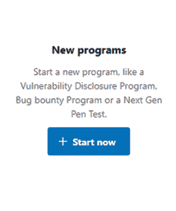

   **图 6.1** Bugcrowd“Start now”按钮。

2. 通过点击“Start now”按钮选择“Bug Bounty Program”（图 6.2）。

   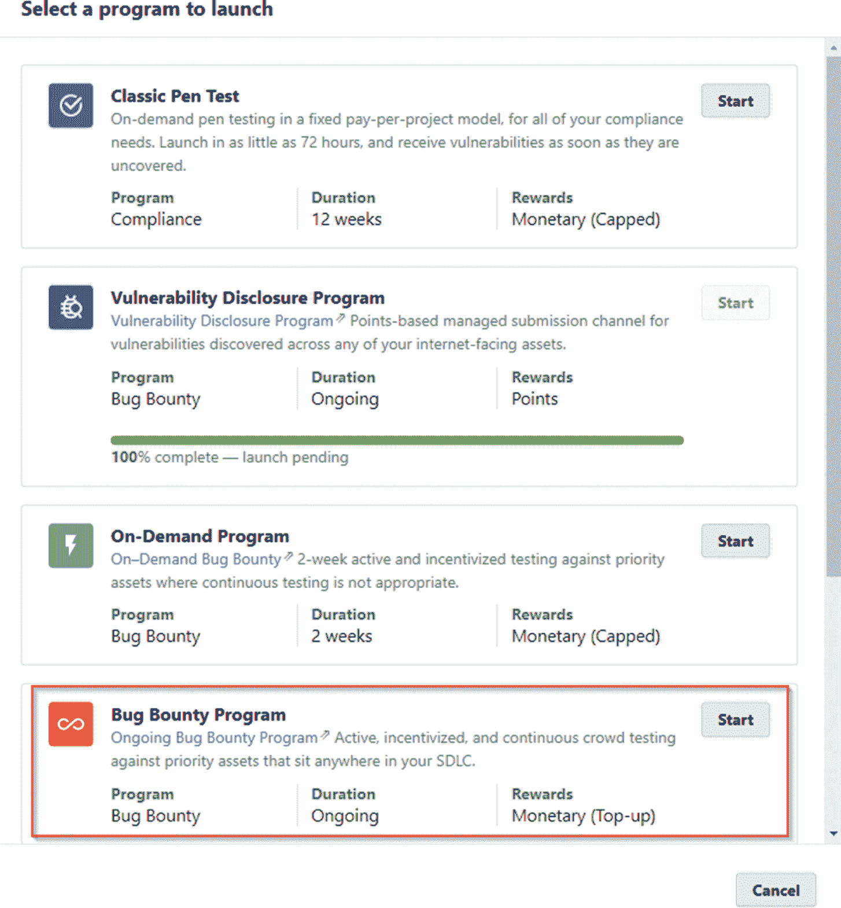

   **图 6.2** Bugcrowd：选择“Bug Bounty Program”。

3. 点击开始按钮后，一个基本的项目配置向导将会弹出。定义的详细信息以后随时可以更改，所以不必太担心一次性把所有事情都做对。

4. 当项目向导出现时，它将显示所有各个步骤。总共有 9 步。第 1 步侧重于命名项目。项目名称应该是项目经理将负责的公司的名称（图 6.3）。

   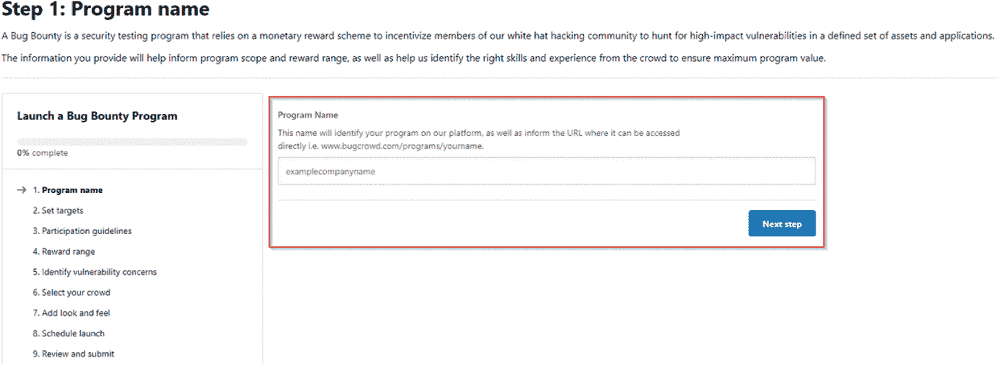

   **图 6.3** 在 Bugcrowd 上选择项目名称。

5. 接下来，将设置目标或“资产”进行测试。同样，如果只添加了有限的资产也没关系。此时，没有必要添加每一个资产（图 6.4）。

   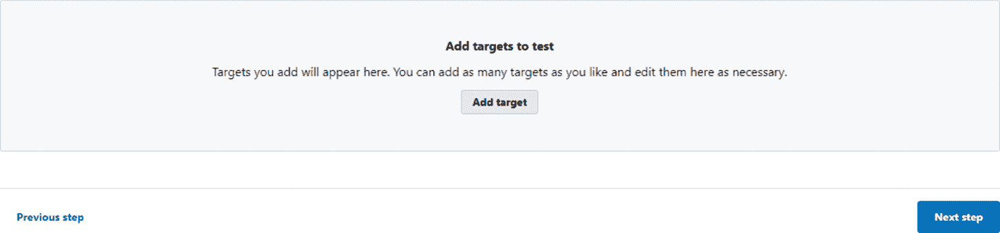

   **图 6.4** 在 Bugcrowd 上添加测试目标。

   点击“Add target”（添加目标）按钮将弹出对话框，允许进行广泛的资产选择。

6. 现在，可以添加目标并从下拉菜单中选择选项（图 6.5）。名称代表您想要给资产起的名字，请记住研究人员将看到这个名字。现在可以选择标签。利用标签至关重要，因为它给了安全研究人员拥有正确专业知识进行研究的最佳机会。接下来，`URL`/位置定义了您期望研究人员开始测试的地方。最后，类别有助于您定义资产的类型。许多研究人员会立即查看类别，并确定这是否是适合他们的研究类型。请务必努力正确标记所有资产；匆忙添加资产毫无用处。点击“Add”（添加），这将在列表中填充目标。根据需要添加任意数量。点击“Next step”（下一步）按钮并继续。

   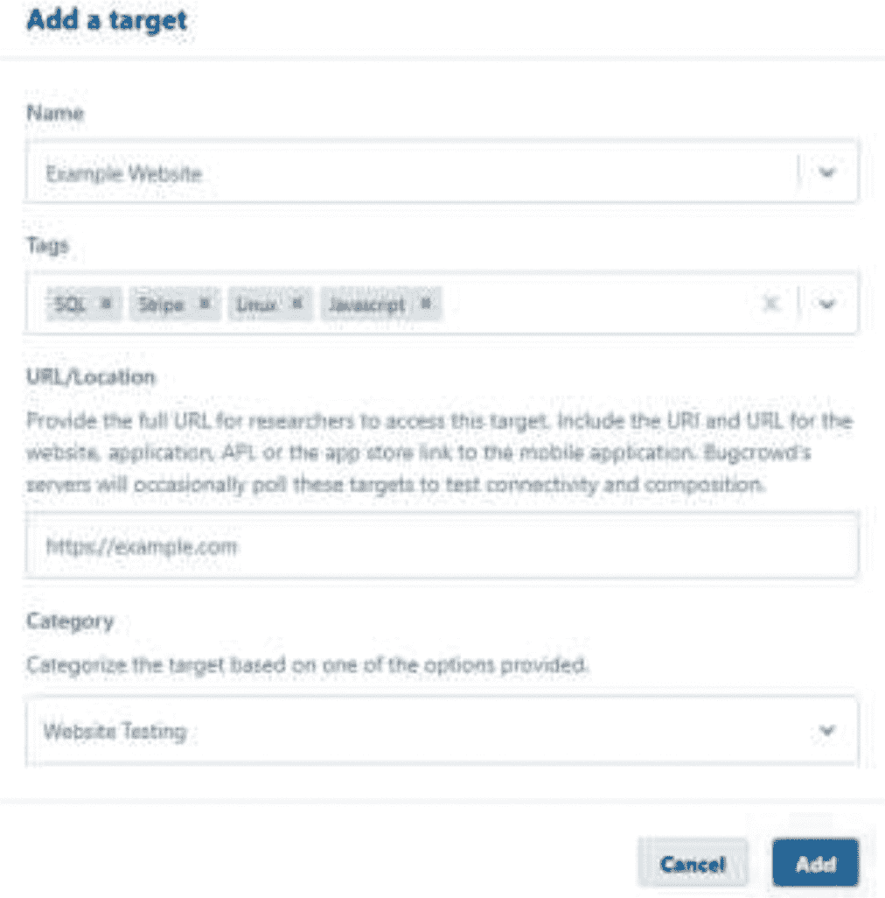

   **图 6.5** 向 Bugcrowd 添加目标。

## 7 步骤 3：漏洞赏金计划参与指南

步骤 3 侧重于漏洞赏金计划参与指南。

* 第一个滑块允许计划管理员启用或禁用 `Bugcrowd` 的评级分类法。概述所有 `Bugcrowd` 评级的具体指南可在文本块下方看到。强烈建议计划管理员使用此分类法评级。`Bugcrowd` 自 2011 年起一直在管理安全研究，他们使用的 `VRT`（漏洞评级分类法）维护良好，随着新漏洞的发现会频繁更新并重新评估。或者，也可以将其关闭并自行维护，但不建议这样做。
* 下一个滑块允许计划接受与非目标问题相邻的报告问题。换句话说，设想一位研究人员在 `www.example.com` 上发现了一个 `API`（应用程序编程接口；一种定义多个软件应用程序或混合软硬件中介之间交互的组件）密钥，该密钥允许他们与 `login.example.com` 进行交互。如果登录子域不在范围内，且此滑块被禁用，研究人员将没有机会报告该漏洞。建议允许研究人员报告超出范围的问题，尽管已注明他们不会因该漏洞获得奖励。
* 第三个滑块用于启用或禁用安全港。如果滑块已启用，计划管理员还可以选择部分或完全安全港。建立漏洞赏金计划的全部意义在于给安全研究人员提供一个安全的避风港进行黑客测试，同时提高企业安全态势的有效性。计划管理员应启用安全港选项。
* 最后，本节的第四个也是最后一个滑块是协调披露选项。启用此滑块赋予研究人员请求将其发现结果公开发布的能力。此选项应开启。在计划上进行黑客测试的安全研究人员付出辛勤工作进行披露是为了获得报酬并向公众披露。如果计划管理员觉得自己尚未准备好让已修补的漏洞向世界披露，那么运行漏洞赏金计划将徒劳无功。沉默恰恰与鼓励黑客与企业之间本就脆弱的关系增长背道而驰。

## 8 步骤 4：定义奖励范围

在步骤 4 中，定义奖励范围（图 6.6）。选择“Basic”（基础）单选按钮，特别是如果这是首次管理漏洞赏金计划。此外，对于刚起步的计划，使用最大广告奖励功能是不必要的。随着漏洞巩固企业安全态势，调整奖励金额将随时间而来。选择单选按钮后，点击“Next step”（下一步）按钮。

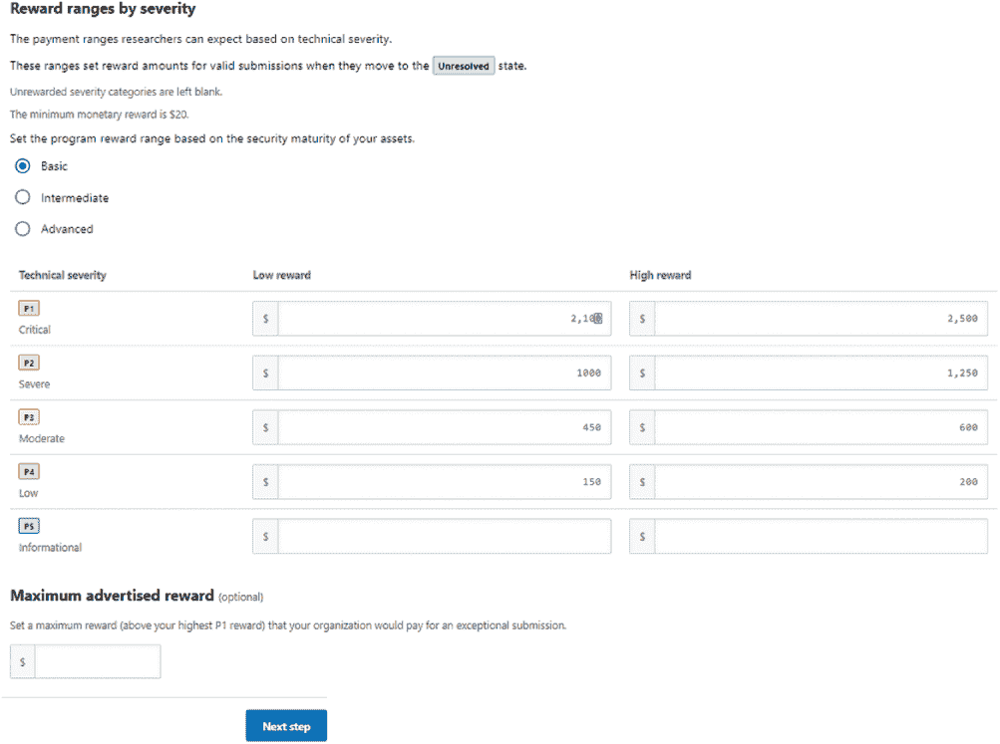

**图 6.6** 在 Bugcrowd 上按严重程度添加奖励范围。

## 9 步骤 5：描述理想研究关注点

在步骤 5 中，计划管理员应描述理想研究关注点的样子。描述关注领域将有助于安全研究人员更好地了解企业试图实现的目标。例如，设想一家零售公司运行一个赏金计划。他们可能会写如下内容（图 6.7）：

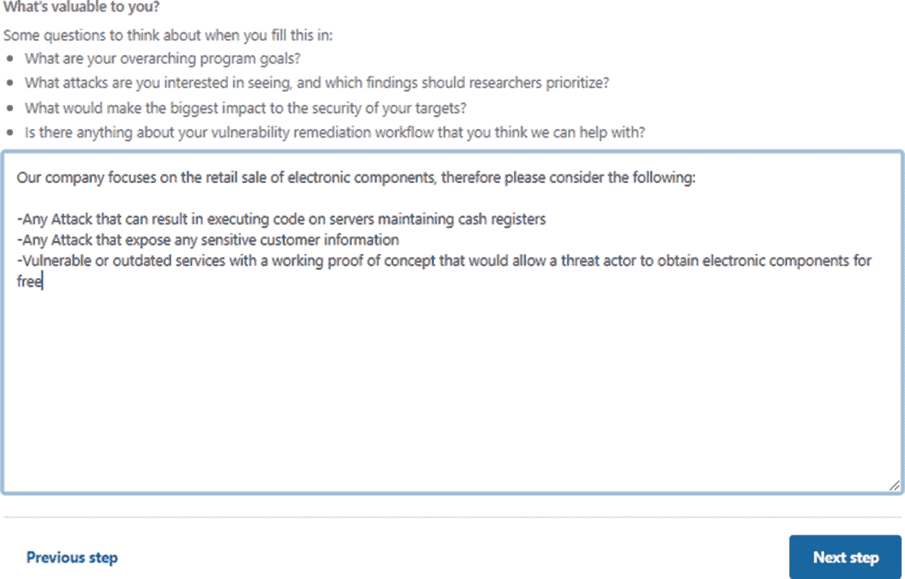

**图 6.7** 在 Bugcrowd 上确定目标和关注点。

## 10 研究关注点考量

作为一个小例子，一些考量关注收银机、敏感客户数据泄露，以及任何可能导致敏感信息被盗的漏洞。告诉研究人员计划在寻找什么至关重要。但请注意，如果未明确声明为超出范围，研究人员仍会尝试研究他们想研究的任何内容（有时即使声明了也是如此）。此外，可以随意关注特定攻击类别，而不是攻击向量，例如告诉研究人员计划对“本地文件包含”或“远程代码执行”等高度感兴趣，等等。这是计划管理员描述所有重要与不重要方面的绝佳空间。

## 11 步骤 6：技术标记

步骤 6 是在定义漏洞赏金计划关注的漏洞后进行的技术标记跟进。标记过程分为四个部分：研究人员活动、资产环境、语言和框架，以及托管和第三方应用程序（图 6.8）。定义这些标记很重要，因为它有助于正确的研究人员参与。例如，如果研究人员看到计划主要关注移动端和 `API` 测试，他们可能会决定这不适合自己，从而节省大量浪费的时间，并鼓励合适的研究人员群体参与。确保定义资产标记、研究需求以及各种框架和期望活动，是有助于确保计划得到充分定义的必要过程。计划可以自由限制提供的信息量，但这往往会损害整体安全态势并浪费研究人员的时间。

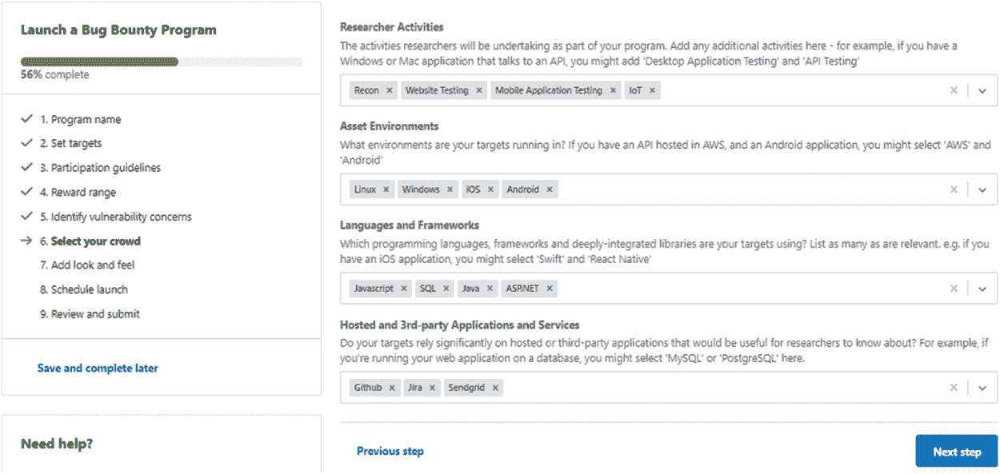

**图 6.8** 选择研究人员活动、环境、语言、框架和应用程序/服务。

## 12 步骤 7：添加外观与风格

接下来是“添加外观与风格”——简而言之，上传徽标、生成将显示在计划下方的标语，并用简短描述欢迎研究人员加入计划（图 6.9）。

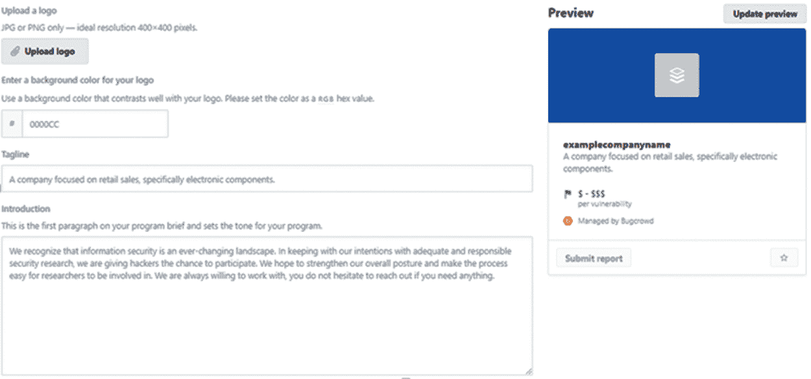

**图 6.9** 上传公司徽标并创建标语和简介。

## 13 徽标和简介详情

此外，可以为徽标选择背景颜色，因此请尽力选择适当的对比度，使其在安全研究人员眼中醒目。简介空间无非是解释计划是谁以及为什么雇佣安全研究人员。该空间也可用于解释公司的业务及其使命。激励研究人员参与是终极目标。

## 14 步骤 8：定义启动时间线

步骤 8 侧重于为私有和公开启动定义时间线。如果计划管理员已达到设置计划的阶段，通常表明具备一定程度的准备度并致力于建立计划。对于“Preferred private launch timeline”（首选私有启动时间线），建议准备“Within a month”（一个月内）启动。正如计划管理员往往会了解到的，公开计划启动是一项大得多的承诺。计划管理员应选择“More than a month after private launch”（私有启动一个月以上）选项，因为要实现公开启动还有大量工作要做。

## 15 最终提交

最后，当在步骤 8 中点击下一步按钮时，将出现一个突出显示所有激励措施的页面。查看所有提交的信息，准备好后点击“Submit”（提交）以进入下一阶段。

#### 6.2.2 计划概览

现在计划已完全设置，了解各种选项和功能是理解如何管理漏洞赏金计划的下一步。计划管理员应熟悉所有不同的页面以及修改现有计划设置的各种方式，以防止计划上线时出现任何问题。

##### 6.2.2.1 计划仪表板

创建漏洞赏金计划后，项目经理将被带回到他们开始时的仪表板。该仪表板允许创建额外的计划，同时也允许项目经理点击“任务”或“欢迎中心”选项卡（图 6.10）。任务选项卡允许项目经理快速查看所有计划中所有待办漏洞的概览，甚至可以按特定计划进行筛选。

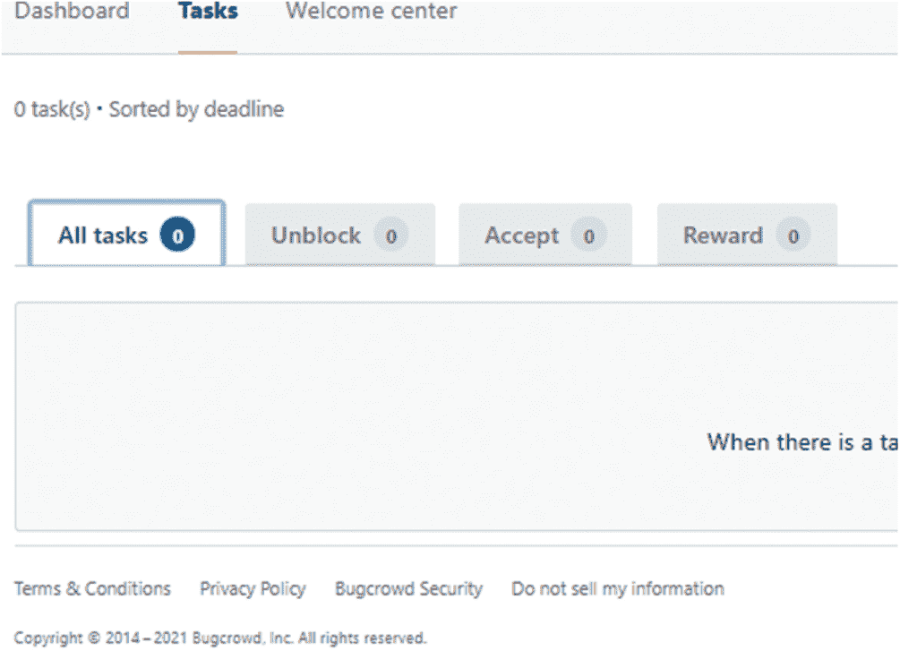

**图 6.10** 漏洞任务选项卡。

如图所示，项目经理可以查看是否存在任何阻碍因素，或需要处理或奖励的漏洞。

欢迎中心推广所有各类 `Bugcrowd` 文档（图 6.11），包括各种视频，帮助项目经理有效运行漏洞赏金计划。欢迎中心可协助将计划引向正确的方向。如果项目经理需要升级计划的想法、修复常见配置问题，或了解漏洞研究领域的广度，欢迎中心就是知识中心。欢迎中心包含数小时的视频、手册、问题和研究，重点介绍管理有效计划的最佳实践。项目经理花时间阅读部分文档并观看附带视频将受益匪浅。虽然最初并非必要，但更好地了解 `Bugcrowd` 的运作方式绝无坏处。

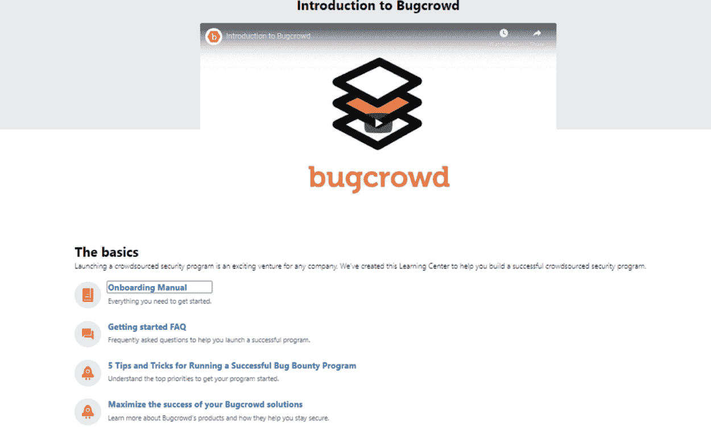

**图 6.11** Bugcrowd 文档。

返回主屏幕后，有一个项目仪表板，项目经理可以点击下拉菜单来选择他们想要管理的漏洞赏金计划（图 6.12）。

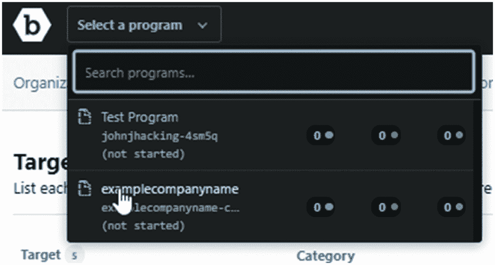

**图 6.12** 项目下拉菜单。

##### 6.2.2.2 群体控制导航栏

当项目经理在下拉菜单中点击其计划时，将被定向到一个界面，该界面允许他们管理漏洞和计划的更多高级配置设置。

顶部面板允许项目经理查看计划摘要、提交内容、查看和管理研究人员、获取计划洞察，以及查看报告/修改设置（图 6.13）。

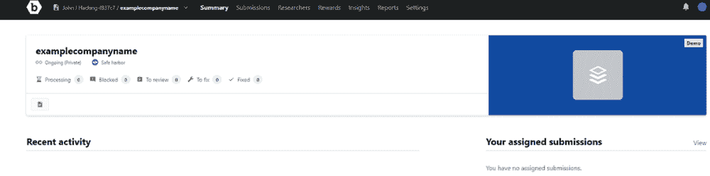

**图 6.13** 群体控制导航栏。

###### 摘要

摘要页面向项目经理显示计划的所有近期活动，以及其分配的提交内容和当前计划中每个提交状态的快照。项目经理可以使用此仪表板作为一种快速方式，导航到需要其关注的问题，并大致了解将计划推向良好状态所需的修复流程和步骤。

###### 提交

提交面板是摘要页面的扩展版本（图 6.14）。此页面可用于对问题进行更高级的筛选，并允许项目经理对所有提交的漏洞拥有更广阔的视野，从而有效地解决它们。项目经理还可以选择将所有提交内容下载为 `CSV` 文件，以便进行跟踪和排序。

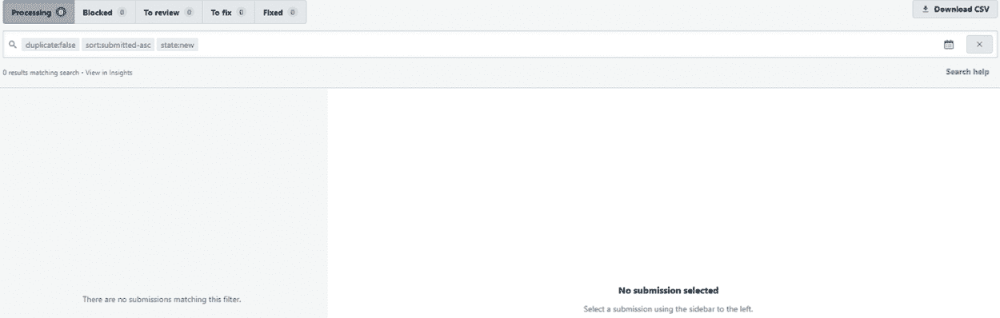

**图 6.14** 漏洞提交面板。

###### 研究人员

研究人员网页显示受邀研究人员总数、向计划提交漏洞的研究人员总数、总提交数和有效提交数。在总计数据下方，项目经理可以看到参与的研究人员（图 6.15）。

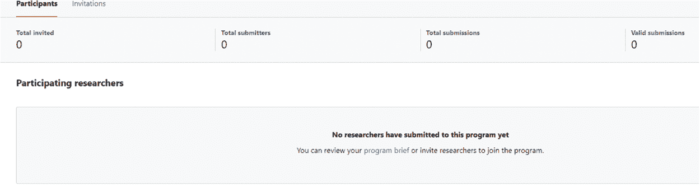

**图 6.15** 项目参与者选项卡。

此外，“邀请”选项卡允许项目经理通过电子邮件邀请研究人员。研究人员的详细信息不会被透露，以保持良好的隐私态势并确保研究人员的安全（图 6.16）。


**图 6.16** 项目邀请选项卡。

###### 奖励

奖励选项卡允许项目经理查看与研究人员奖励相关的各种指标。快速摘要显示发放了多少奖励、达到的最高奖励、平均发放金额以及剩余奖励池。项目经理可以选择更改右上角评估的时间长度，“奖励历史”将提供给定时期内获得奖励的所有研究人员（图 6.17）。项目经理也可以选择将其下载为 `CSV` 文件。奖励选项卡非常有用，因为它允许高层管理人员分析趋势并预测扩展和奖励情况。

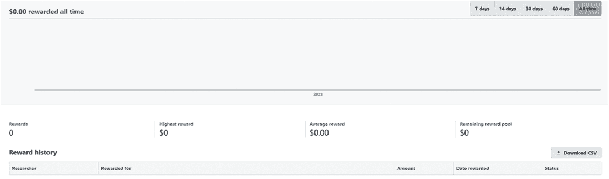

**图 6.17** 项目奖励仪表板。

###### 洞察仪表板

洞察仪表板提供各种趋势的概览，并允许项目经理查看有价值的数据和图表，帮助他们更好地了解漏洞赏金计划（图 6.18）。例如，可以查看报告的严重程度趋势和收到的报告量。此外，还有性能指标、按目标支付给研究人员的金额以及总体目标细分（图 6.19 和 6.20）。

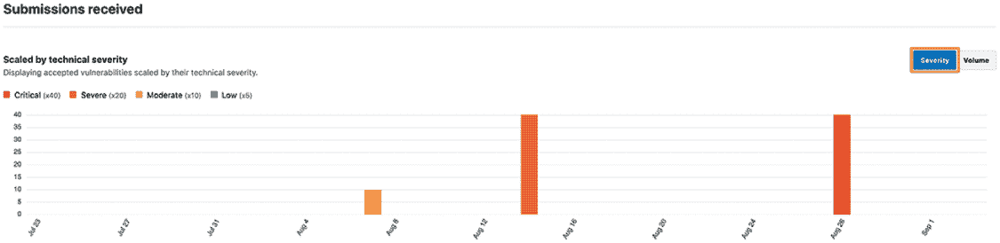

**图 6.18** 洞察仪表板：技术严重程度图表。

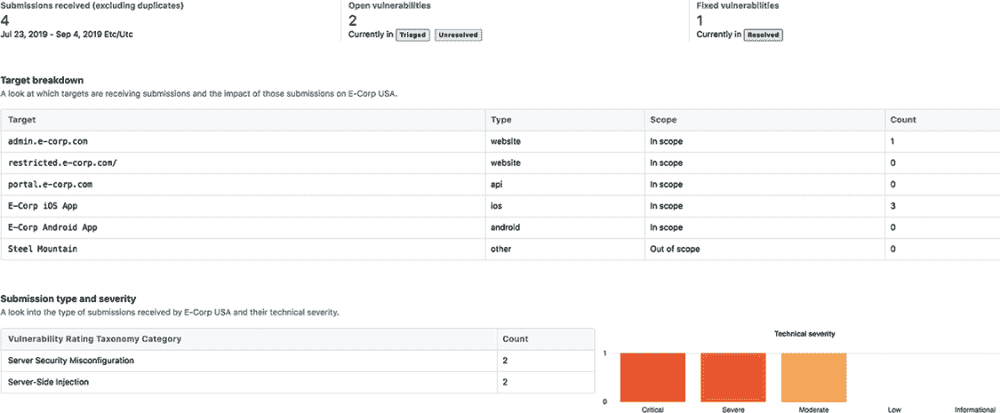

**图 6.19** 洞察仪表板：目标细分。

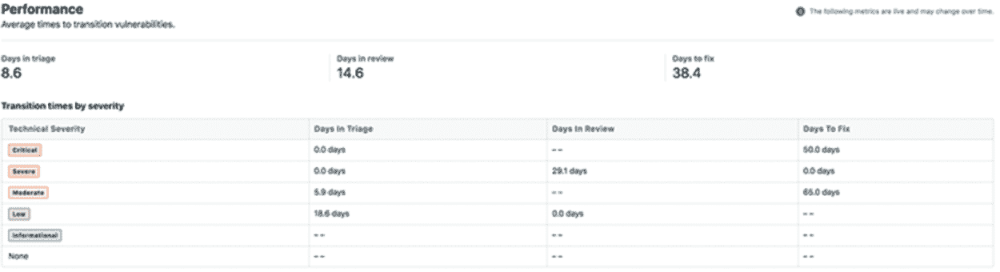

**图 6.20** 洞察仪表板：性能。

###### 报告

在报告选项卡中，项目经理可以生成计划摘要、计划健康状况和支出以及安全态势报告。项目经理应偶尔生成并审查这些报告，因为这将有助于建立其计划各方面的大量信息。

查看 `Bugcrowd` 链接以获取有关报告的更详细概述及操作说明：[`docs.bugcrowd.com/customers/program-management/generating-reports/#program-summary-report`](https://docs.bugcrowd.com/customers/program-management/generating-reports/#program-summary-report)。

#### 6.2.3 高级计划配置和修改

初始设置中的所有计划设置均可修改。虽然“设置”选项卡是群体控制导航栏的一部分，但涉及的方面众多，足以让该选项卡在本章中拥有自己的章节。

##### 6.2.3.1 计划简介

计划简介网页是项目经理点击“设置”选项卡时看到的第一个视图。本质上，计划简介包含漏洞赏金计划的基本设置（图 6.21）。这些设置是在计划首次创建时建立的，例如计划名称、标语、披露政策、安全港条款等。如果需要对常规计划进行任何更新，将使用此部分。

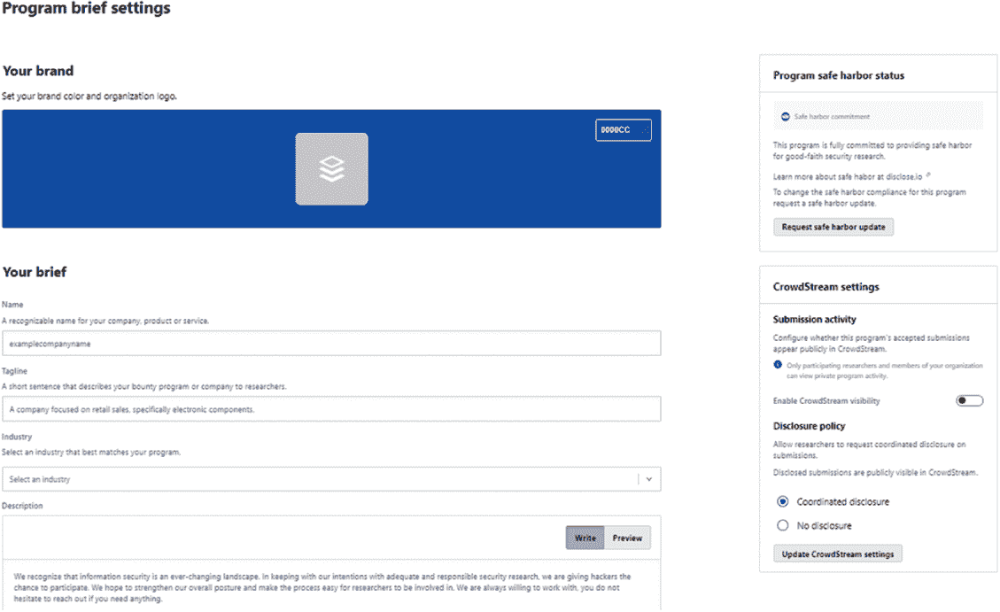

**图 6.21** 计划简介设置。

##### 6.2.3.2 范围与奖励


# 范围与奖励

范围与奖励部分是项目范围细节的更直观呈现。在本部分中，项目经理有特定能力深入了解重点领域的更多细节、哪些资产属于范围外，并根据自身判断修改安全港条款。此外，还可以在此讨论范围内和范围外资产的奖励细节。范围与奖励部分看似冗余，但其目的是表达企业的立场，以确保研究人员知晓所有可能性。例如，在初始配置期间，范围与奖励已设定完毕。然而，这将是一个很好的部分，可用作向研究人员解释范围细节的场所，因为企业可能心中有特定的想法。请查看以下屏幕截图（**图 6.22**）：

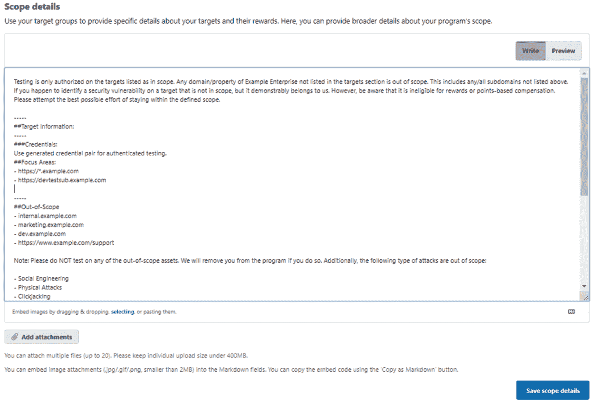

**图 6.22** 范围详情。

正如在**图 6.22**的目标信息部分所见，已提供一组定义的凭据供测试使用。此外，同一图表还以示例形式突出了企业关注的领域。最后，本部分以自定义的“范围外”备注部分结束。范围详情部分不容小觑，因为未能谨慎处理此部分可能导致事故，例如研究人员尝试发起可能危害员工安全或企业环境的攻击。项目经理应努力仔细审查**第 4 章**中理想的范围外攻击，并查看其他一些公开漏洞赏金计划的各种范围外部分，以很好地了解企业应努力避免的内容。在大多数情况下，分流团队将协助向研究人员解释围绕低级漏洞或缺乏影响力漏洞的问题。然而，问题在于企业漏洞赏金计划可能不愿接受的有效漏洞。请想象以下场景。

项目经理知道企业充斥着跨站脚本（`XSS`）漏洞。所有软件工程师都知道该域名上的几乎每个参数都存在 `XSS` 问题。企业仍希望利用私有漏洞赏金计划，但关注重点是那些不为人熟知的漏洞，例如本地文件包含、远程代码执行、HTML 注入等。如果项目经理未考虑到受邀黑客的聪明才智，最终可能会收到大量 `XSS` 报告——因为该漏洞类型未被标记为范围外，可能导致漏洞赏金计划不得不向研究人员支付大量资金。项目管理最重要的方面之一是意识到说“啊，我们本该把这列入范围外部分”绝不是可接受的回应，企业将为此承担责任。

在大多数情况下，预设的安全港部分尚可，应予以保留。尽管如此，项目经理应与管理层沟通，确保所有人达成共识，且安全港充分反映企业需求。尽管如此，项目经理不应让高层管理或法务团队完全控制安全港条款或对此类条款的补充，因为结果可能过于苛刻，从而阻碍想要参与的安全研究人员。

## 目标组

“目标组”部分也存在于本部分中。这是一种组织相似资产的有用方式，可防止研究人员疯狂敲击键盘，试图查看所有标签以寻找他们希望测试的内容。合乎逻辑的是，项目经理在创建组之前会想要添加所有相关资产。遗憾的是，要做到这一点，必须使用应用程序的另一个部分。请遵循以下说明：

1.  点击右上角的个人资料图片，然后在漏洞赏金计划名称下点击“目标”选项卡（**图 6.23**）：

    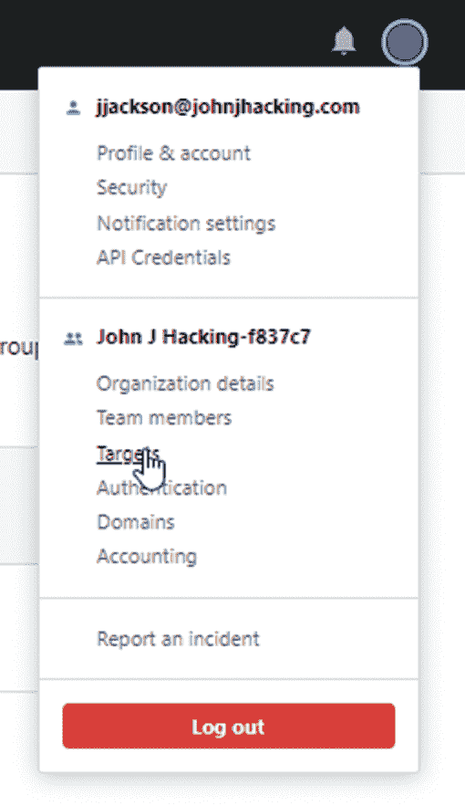

    **图 6.23** 个人资料下拉菜单。

2.  点击“目标”选项会弹出一个网页，其功能类似于项目初始设置时讨论的初始目标页面（**图 6.24**）。这将是添加和标记研究人员应测试的任何额外资产的好时机。

    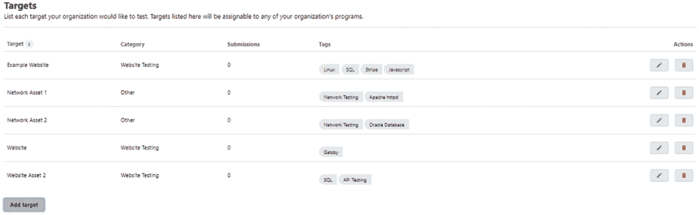

    **图 6.24** 目标选项卡。

    > **注意：** 请记住，并非每个资产都需要一次性添加。如果项目经理最初只有少数目标，或没有许多可以类似分组的资产——这没关系！随着项目扩展，可以利用分组。事实上，按现状建立分组（仅包含极少资产）以便为未来保持一切井井有条，无害无妨。

3.  添加所有相关资产后（如上所示），通过点击“选择项目”下拉菜单并选择该项目，返回范围与奖励部分（**图 6.25**）。

    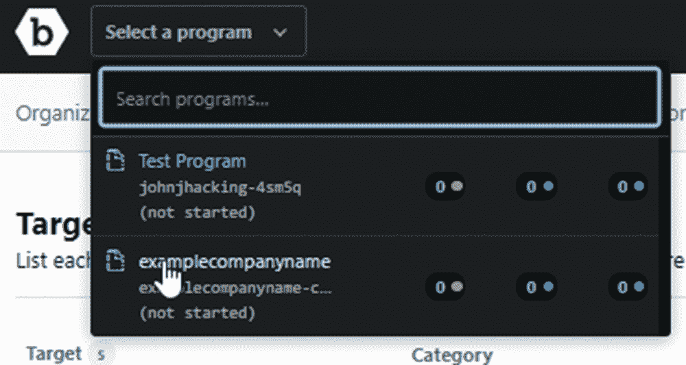

    **图 6.25** 项目下拉菜单。

4.  再次点击众包控制导航栏上的“设置”选项卡（如前所述）。然后点击“范围与奖励”选项卡，最后点击“目标组”选项卡。

如果项目经理准备不足，添加分组可能简单却令人生畏，并演变成一团糟。实际上，分组利用选项对于调整奖励级别很有用，可用于将范围外报告转变为带有奖励的范围内报告。要添加分组，请执行以下操作。

1.  首先，点击“添加分组”按钮（**图 6.26**）。

    

    **图 6.26** “添加分组”按钮。

2.  目标组网页将弹出。对于标题，建议使用较宽泛的名称，以防止创建过多的分组。例如，拥有“Web 应用程序测试”、“网络测试”、“移动应用程序测试”、“API 测试”等通用类别，将使安全研究人员更清楚要测试什么。然而，这并非必需，项目经理可根据具体情况使用更细粒度的名称。添加标题后，资产组的描述对安全研究人员很有用（**图 6.27**）。

    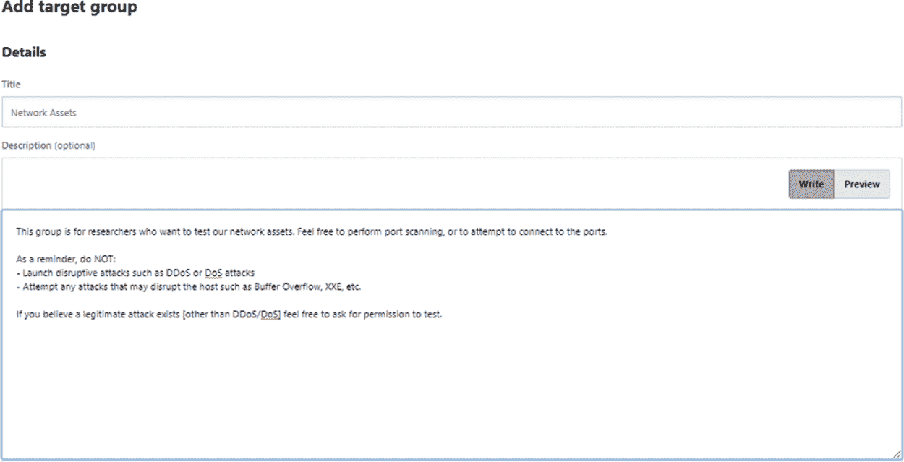

    **图 6.27** 资产组的描述。

### 3. 目标群组范围与奖励

描述框下方的下一部分是一个复选框，询问目标群组是否在范围内（图 6.28）。点击该复选框会显示另一个复选框，询问项目经理资产群组是否“支付金钱奖励”。奖励复选框是目标群组的一个有用组件，因为项目经理可以获取通常被视为超出范围的资产，并提供一个有限的纳入范围选项。例如，如果企业维护的一个域名高度脆弱，保持“支付金钱奖励”选项未勾选但添加资产，可以允许研究人员测试并报告漏洞，而企业无需为该资产付费。官方建议最终是在资产被认为不那么脆弱时将其纳入范围。

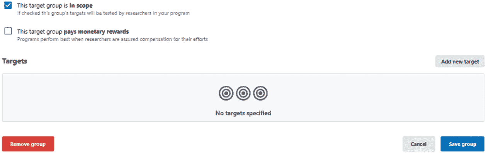

**图 6.28** 目标群组。

在当前示例中，正在创建“网络资产”群组。因此，将展示启用金钱奖励后的结果，以演示创建和修改奖励的过程。

### 4. 配置奖励层级

勾选奖励选项的复选框后，将弹出一个覆盖层，显示该群组的各种奖励选项，例如按高、中、低和自定义排序的层级（图 6.29）。这些区间各自都有价格范围，自定义层级可用于按漏洞严重性分类定义奖励。群组的独特之处在于可以为多个群组分配不同的层级，因此这值得研究人员花时间去攻击移动应用程序而非 Web 应用程序等。

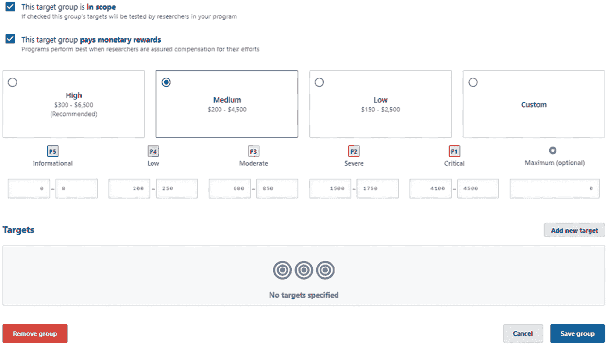

**图 6.29** 目标群组奖励。

### 5. 添加目标并保存群组

选择奖励后，项目经理必须点击“添加新目标”按钮。该界面唯一不同的选项是能够选择预先存在的目标并将其添加到群组中。将每个目标添加到特定群组必须完全单独进行。添加完所有目标后，项目经理可以点击“保存群组”按钮，这将带领项目经理进入下一个网页。

### 6. 查看目标群组列表

最后，群组将填充在“目标群组”页面上，显示之前分配的名称、奖励和所有详细信息（图 6.30）。项目经理必须使用“添加群组”选项来创建任何额外的群组。

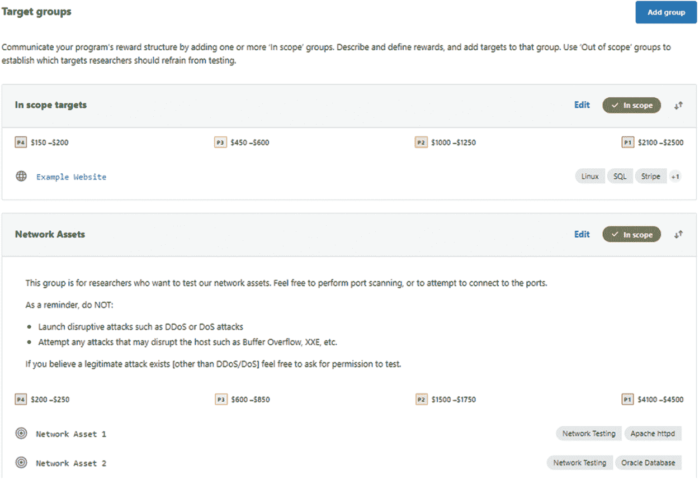

**图 6.30** 目标群组列表。

## 6.2.3.3 集成

设置选项的“集成”选项卡允许项目经理连接其企业可能拥用于管理报告的任何相关工具（图 6.31）。例如，存在各种配置，如 `Jira`、`Slack`、`ServiceNow` 等——从而实现有效的报告和分流工作流。项目经理可以选择不使用这些工具，也可以使用其中的多个。标准的集成流程可能是工单系统工具（如 `Jira`）、`Slack` 通知（以引起项目经理对提交内容的关注），或网站上的嵌入式提交表单（使企业能够接收来自任何人的提交，即使他们不完全了解 Bugcrowd 的服务）。

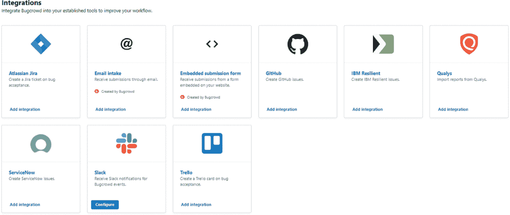

**图 6.31** 集成各种工具以协助报告管理。

与其逐一解释每个集成，不如建议项目经理查阅 Bugcrowd 文档。集成过程将根据 Bugcrowd 要集成的工具类型而有所不同。

## 6.2.3.4 公告

“公告”选项卡用于通知研究人员项目内的重大变更（图 6.32）。公告的适当用法示例包括：增加奖励、扩大范围、要求研究人员测试特定资产等。

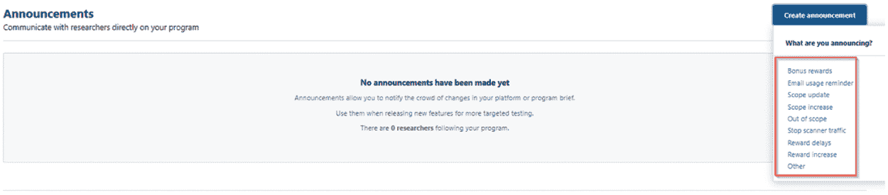

**图 6.32** 公告选项。

此外，Bugcrowd 维护特定的预制模板，可用作通知研究人员的起点，例如电子邮件使用提醒、范围更新、奖励延迟等。正如您在图 6.33 中所见，可以编写预制模板，并按下“发布公告”按钮，向所有研究人员宣布项目的消息。

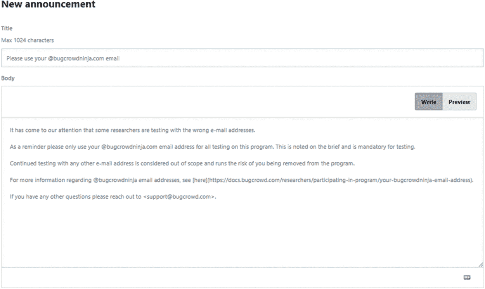

**图 6.33** 新建公告选项。

## 6.2.3.5 管理团队

在“管理团队”部分，项目经理可以邀请团队成员协助管理项目（图 6.34）。此外，设置允许对已分流或关键工单进行自动分配，这有助于员工更快地响应问题，尤其是在需要快速响应时。


**图 6.34** 管理团队选项。

除了查看现有团队成员外，项目经理还可以通过点击“邀请团队成员”按钮来邀请团队成员，并额外分配如讨论的角色（图 6.35）。

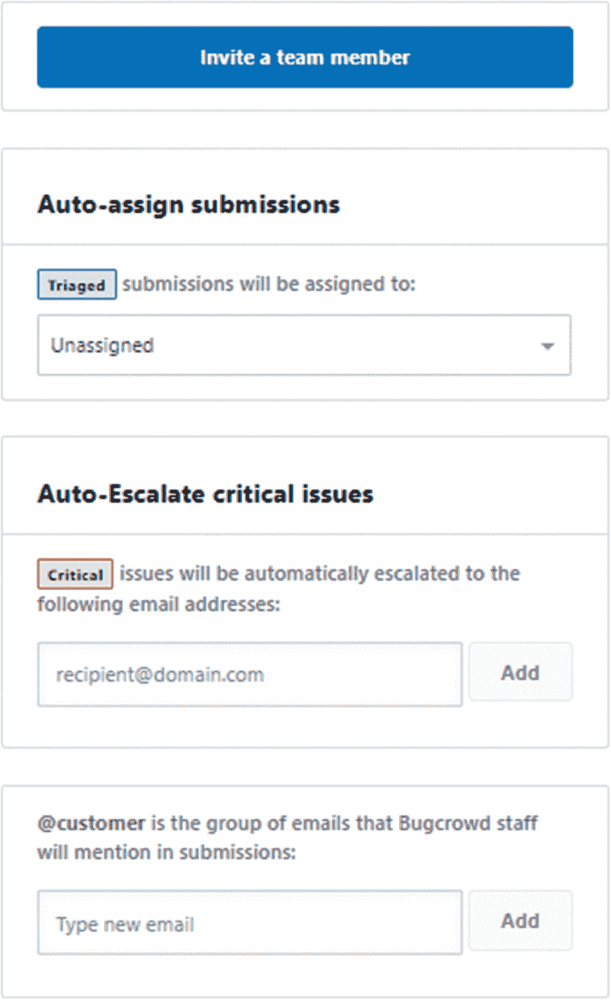

**图 6.35** 邀请团队成员选项。

按下邀请按钮时存在三个独立角色：`Admin`、`Analyst` 和 `Viewer`。`Admin` 角色可以在项目内执行任何操作。`Analyst` 只能管理提交和基本设置，而 `Viewer` 只能查看项目内的提交和选项。

## 6.2.3.6 提交

最后一个项目设置选项卡是“提交”选项卡。可用的选项之一是数据字段选项。这允许项目经理创建仅内部可见的自定义提交字段。在漏洞需要被轻松识别并标记上整个团队都能看到的消息的情况下，这些字段很有用。例如，“无影响”或“特殊例外”等数据字段可用于内部传达：某工单可能是误报，或是一个从范围外转为范围内的漏洞（图 6.36）。选项无穷无尽，项目经理应与团队成员一起尝试和头脑风暴，想出有用的数据字段选项。

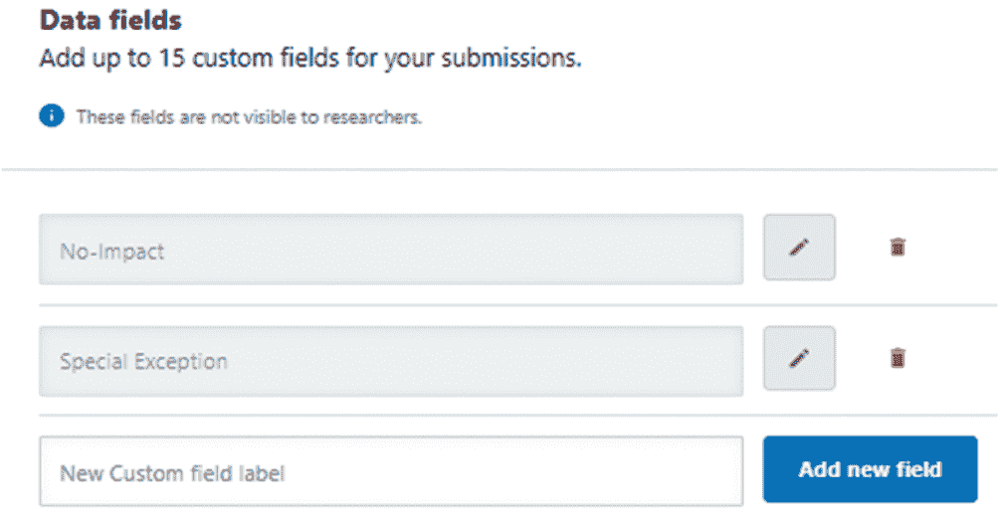

**数据字段选项。**

接下来，CVSS v3 评分选项与项目的初始配置相同（图 6.37）。启用此选项允许使用 Bugcrowd 的评分和指标系统来评估各种漏洞。

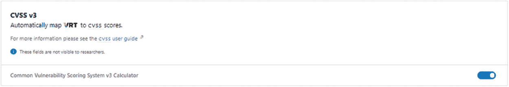

**图 6.37** CVSS v3 选项。

修复建议选项应当启用。没有合理的理由不启用它，因为研究人员看不到该建议，而且它是一个有用的功能（图 6.38）。如果该选项变得多余，可以用开启它的相同方式将其关闭。

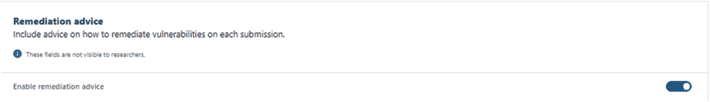

**图 6.38** 修复建议选项。

在修复建议选项之后是启用重测的功能。坦白说，该选项取决于项目经理的酌情决定。随着工程师经验的积累，他们不太可能需要重测方面的协助。尽管如此，这对新项目经理来说可能是一个有用的选项。然而，不应过度依赖它。深入了解项目内情的最佳方法之一是掌握研究人员提交的漏洞测试情况。如果项目经理持续测试漏洞，他们就不太可能需要为重测支付研究人员费用（图 6.39）。

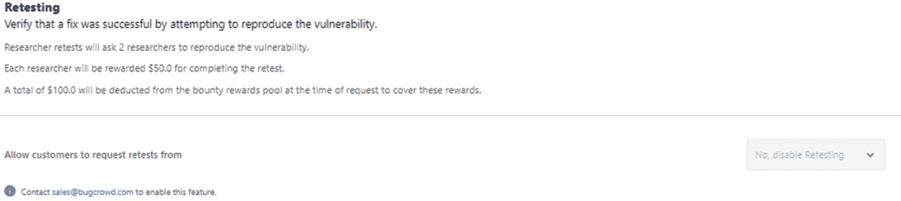

**图 6.39** 重测选项。

最后是“Markdown 嵌入附件”选项（图 6.40）。如果启用此选项，应用程序将需要利用身份验证来查看嵌入图像。如果项目经理重视其企业的安全性，保持此项开启非常重要。

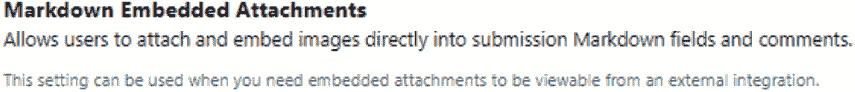

**图 6.40** Markdown 嵌入附件选项。

# 6.2.4 个人资料设置

Bugcrowd 平台的最后一部分（宽泛地说，因为还有很多东西要学）是“个人资料和企业”侧边栏，其中还包含一些支付和日常管理功能（图 6.41）。设置中包括优化账户安全、使用 API 凭据以及管理项目会计功能的能力。项目经理应立即调整其个人资料设置，以充分保护其项目登录。为漏洞赏金项目登录本身维护最佳安全实践，可以说与解决漏洞同等重要。如果威胁行为者获得了漏洞赏金项目登录的访问权限，他们将能够查看所有预先存在的漏洞。因此，保护注册到项目的任何关联账户绝不可掉以轻心。

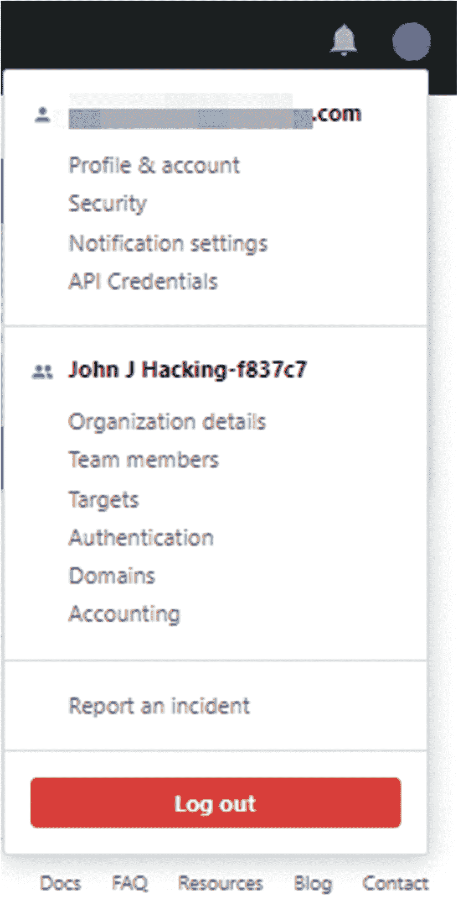

**图 6.41** 个人资料和企业侧边栏。

第一个方面“个人资料”，包括登录到项目的用户电子邮件地址下的设置。在这里，项目经理可以修改个人资料和账户设置、安全设置、通知设置，并生成可与 Bugcrowd API 交互的 API 凭据（图 6.42）。


**图 6.42** 个人资料选项。

## 6.2.4.1 个人资料和账户

此选项卡为默认视图，坦白说，关于此选项卡没什么需要解释的。项目经理可以期待所有基本功能，例如修改个人资料设置（如姓名和显示名称）、更改密码或上传个人资料图片。

## 6.2.4.2 安全性

修改个人资料安全设置是项目经理进行个人资料管理时应首先做的事。“安全性”选项卡允许查看单个会话，换句话说，就是查看账户登录在何处的能力（图 6.43）。

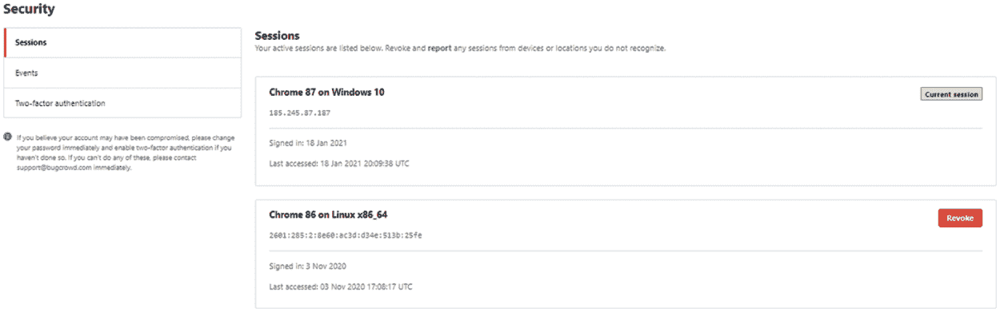

**图 6.43** 安全性选项。

下一个选项卡是“事件”，可用作会话的额外遥测手段，这可能暗示可疑活动（图 6.44）。

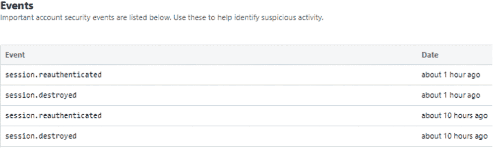

**图 6.44** 事件选项。

最后但同样重要的是，双因素认证是可用的实际安全配置设置（图 6.45）。设置双因素认证相当简单。项目经理将在其移动设备上安装双因素认证应用（如 Google Authenticator），并扫描相应的二维码或手动将代码输入应用。启用的最后一步是输入生成的六位数 OTP 代码，然后点击“启用 2FA 按钮”。虽然使用双因素认证可能显得麻烦，但这样做对于保护企业漏洞报告非常重要，因为一旦泄露，可能会导致资产被攻陷。

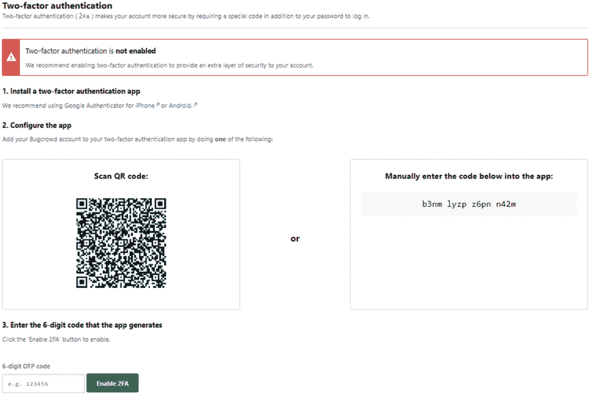

**图 6.45** 双因素认证选项。

## 6.2.4.3 通知设置

项目经理对将从漏洞赏金项目接收到的通知拥有完全的透明度和控制权。调整通知面板应是项目经理的重要优先事项。否则，可能会发生“警报疲劳”，换句话说，就是因有太多东西要看而产生的压倒性感觉（图 6.46）。通过管理通知来防止警报疲劳是工程中经常被忽视的一个方面。想象一个家庭报警系统，它还有摄像头并根据规则集发出警报。如果房主每天收到二十次警报，可能会感到负担沉重，从而导致他们忽略真正需要审查的实际事件。警报管理也需要同样的考量。

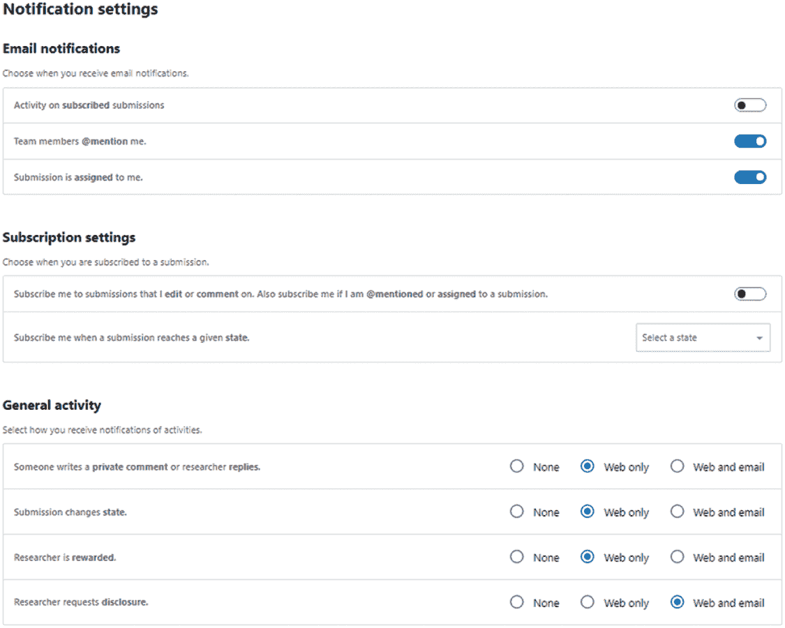

**图 6.46** 通知设置选项。

正如图 6.46 所示，似乎有很多内容需要拆解，但实际上比想象的要少。例如，电子邮件通知选项非常直接，允许项目经理在订阅的提交有活动时、团队成员 @提及 他们时，或提交分配给其项目管理账户用户名时接收电子邮件。是否开启“订阅提交上的活动”取决于项目经理的偏好。如果公司规模不是特别大，或者工程师的近乎全职工作就是管理漏洞赏金项目，那么开启所有通知很可能是最佳决定。作为一个折中考量，可以将“订阅提交上的活动”设为“开启”，并结合“当提交达到给定状态时订阅我”设为“已分类”。启用上述折中考量将允许项目经理在收到已分类工单的重要更新时收到警报。但请注意，有时可能会遇到过于咄咄逼人的安全研究人员，因此尝试调整通知直到合适为止将是项目经理的最佳选择。并非每个项目经理都有相同的偏好。关于通知的建议应因人而异，酌情参考。

## 6.2.4.4 API 凭据

项目经理可能希望开发利用脚本进行 API 调用或各种外部工具的工作流。Bugcrowd 允许这种灵活性，因为安全工程师和软件工程师都可能希望利用此功能。生成 API 密钥很简单。要生成密钥，项目经理只需在“应用程序名称”字段中输入应用程序名称，然后点击“创建凭据”按钮。离开该页面后，凭据将生成且不再可访问（图 6.47）。

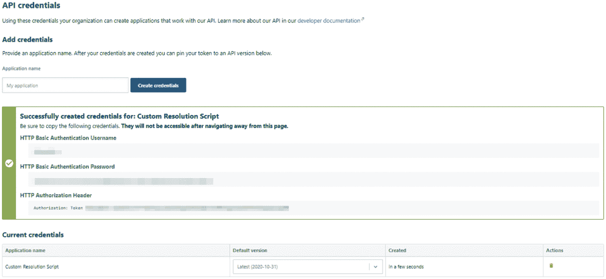

**图 6.47** API 凭据选项。

# 6.2.5 企业“个人资料”设置

## 6.2.5.1 管理和配置

Bugcrowd 的最后一个方面是重新配置、设置项目认证或通过会计设置为项目注资的能力。项目经理将不得不审查并处理其中的几项内容，因为漏洞赏金项目提供奖励和一笔用于提取奖励的资金池，这将需要进行分配。

## 6.2.5.2 组织详情

组织详情网页与初始设置几乎没有区别。此页面允许项目经理为组织上传新徽标、更改背景颜色或为项目添加联系电话。

## 6.2.5.3 团队成员

团队成员页面存在于项目配置的其他部分。因此，项目经理唯一需要知道的是这是另一条访问路径。

## 6.2.5.4 目标

设置首个项目的项目经理已经使用过此页面，因为添加目标是为漏洞赏金项目创建分组的先决条件。

## 6.2.5.5 认证

最初较难就认证方面提供建议，因为这将取决于企业构建其 `IdP`（身份提供商）管理的方式。然而，项目经理应尽可能争取使用 `SSO`（单点登录），因为这对整个企业来说要安全得多。几乎所有现代 `SSO` 解决方案都要求用户启用 `TFA`（双因素认证）才能登录，因此使项目经理的体验更加安全。例如，`Okta` 是一款为各种应用程序启用 `SSO` 使用的应用程序。项目经理应联系其 IT 支持团队，以了解组织内哪个团队负责身份管理配置。`SSO` 集成有两个方面：特定站点配置和 `SAML`（安全断言标记语言）设置。`SSO` 配置需要提供给相应团队，以填写启用该解决方案所需的字段。此外，同一团队将不得不向项目经理提供身份管理提供商的所有 `SAML` 设置，以填写相应字段。完成后，即可保存认证设置。

如图 6.48 所示，需要完成各个字段。如果企业不维护 `SSO` 解决方案，Bugcrowd 默认将使用标准企业电子邮件地址结合密码的方式。

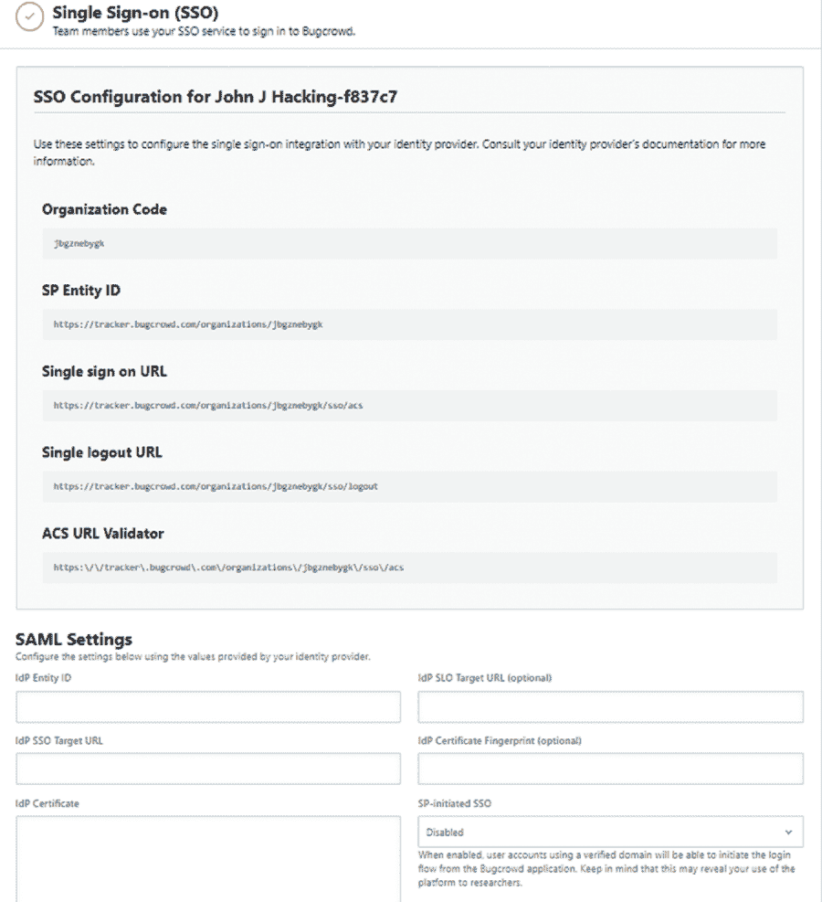

**图 6.48** 单点登录选项。

> **注意：** 需要域验证才能在项目中建立 `SSO`，因此应仔细遵循以下“域”选项卡的设置。

## 6.2.5.6 域


验证添加到项目的任何域都是启用 `SSO` 所必需的。要完成验证过程，可以在文本框中输入所有域并按下“添加域”按钮。添加域后，它将填充到“未验证的域”部分下，项目经理将不得不与负责管理公司 `DNS`（域名服务器）的企业团队进行沟通。项目经理应让负责团队（可能是网络工程团队或类似团队）知道，他们需要验证所有域以设置 `SSO`。未验证的域旁边将有一个验证代码，该代码需要添加到 `TXT`（文本记录，即域名系统 [`DNS`] 中的一种资源记录，用于提供将任意文本与主机或其他名称关联的能力）记录中，并托管在根域上（图 6.49）。可能需要 24 小时才能生效。

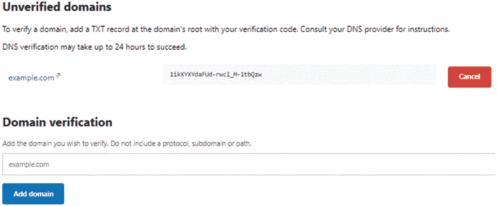

**图 6.49** 未验证的域选项。

### 6.2.5.7 会计

项目经理将利用会计页面作为分配漏洞赏金池的一种手段。漏洞赏金项目经理可以转移资金、存入资金，或查看总体活动或项目余额。如果没有分配赏金池，研究人员就无法获得奖励。项目经理应确保在继续之前设置好此功能。

如图 6.50 所示，提供了活动摘要，包括组织资金池、待存款、项目分配和总支出金额。项目经理可以点击“存入资金”按钮，将资金分配给其赏金池。


**图 6.50** 活动摘要。

点击“存入资金”按钮时，将出现一个询问目的地的文本框，项目经理将在其中选择要分配资金的项目。然后，项目经理可以在文本框中输入金额，勾选“我同意交易的条款和条件”复选框，并点击提交存款请求（图 6.51）。客户经理将随后向项目经理发送发票，以便通过财务团队处理。项目经理将不得不确保管理层正在跟踪支出，并通过正确的流程获得批准。一旦 Bugcrowd 批准待存款，漏洞赏金池将被分配可用于奖励研究人员的资金。

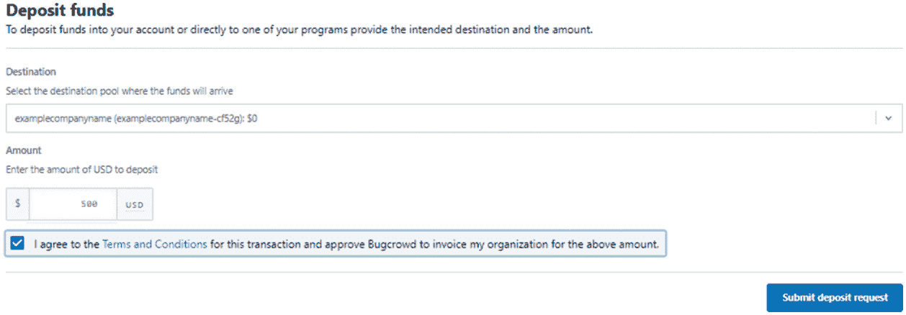

**图 6.51** 提交存款请求选项。

> **注意：** 项目经理永远不应假设资金池里有足够的钱。确保项目经理始终跟踪奖励池是一项基本职责。

如图 6.52 所示，项目经理还可以使用“转移资金”按钮。转移资金允许项目经理在运行多个项目时，将资金从一个资金池存入另一个。转移资金选项与存入资金选项几乎相同。会计选项卡中的最后一个选项是“项目余额”选项卡。项目余额选项卡允许项目经理查看多个项目的漏洞赏金池。例如，一些企业拥有多家公司，可能希望按公司划分漏洞赏金项目以避免混淆。当项目经理运行多个漏洞赏金项目时，他们应定期检查项目余额选项卡，以确保所有项目都有资金（图 6.53）。

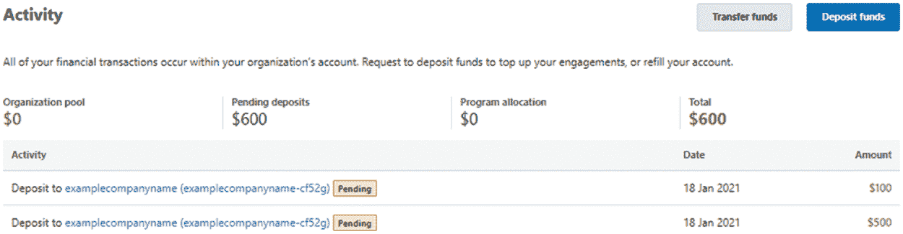

**图 6.52** 转移资金选项。


**图 6.53** 项目余额选项。

## 6.3 HackerOne

另一个众包选项是 HackerOne。使用 HackerOne 的体验会与 Bugcrowd 不同，因为登录后即刻呈现的内容更多。具体而言，Bugcrowd 的登录页面为项目经理提供了一个简单的概览，而 HackerOne 则将安全研究人员和项目经理的视图合并在一起。研究视图与项目视图的合并可能会让人感到望而生畏。新任项目经理可能难以理清这些选项。即使对于经验丰富的项目经理，尝试管理项目也可能感觉笨重。然而，本意是描述 HackerOne 中可用的大部分功能。此外，HackerOne 拥有更多的配置选项。不过，项目经理的专业水平将决定哪个众源平台最适合他们。

遗憾的是，HackerOne 没有一个随时可供任何人使用的、易于上手的演示项目。为缓解这一问题，将利用一个已建立的项目来评估其设置和配置。重点关注的主要标签页是项目仪表盘、项目设置和收件箱标签页；HackerOne 中的其他内容通常专门与研究人员相关。此外，还将评估个人资料的一些配置设置。从头到尾了解项目设置的能力，最终将使项目经理在为使用不同众包平台的公司工作时，能更轻松地完成过渡。

### 6.3.1 项目设置

首先关注的是“项目设置”标签页（**图 6.54**）。项目设置标签页有两个子标签页：常规和项目。作为基准，常规标签页包含信息、产品添加、身份验证、已验证域、凭据管理、用户管理、群组管理和审计日志。此外，还有一个专门用于账单的小节。项目标签页有四个子标题，包含广泛的选项：自定义、黑客管理、奖励和自动化。


**图 6.54** 项目设置选项。

#### 6.3.1.1 常规

常规标签页可被视为项目经理想要配置项目所有杂项选项时使用的标签页（**图 6.55**）。常规标签页的使用至关重要，因为账单信息包含在常规标签页下的“账单”子标题中。

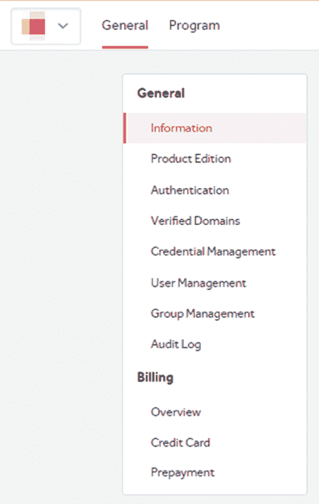

**图 6.55** 杂项项目选项。

#### 6.3.1.2 信息

信息标签页包含漏洞赏金项目的安全页面信息（**图 6.56**）。在此标签页中，项目经理可以为项目命名、分配项目句柄、定义项目的主网站，并在“关于我”标签页下撰写标语。此外，项目经理可以提供相关的 Twitter 账户用户名或更新项目的徽标。

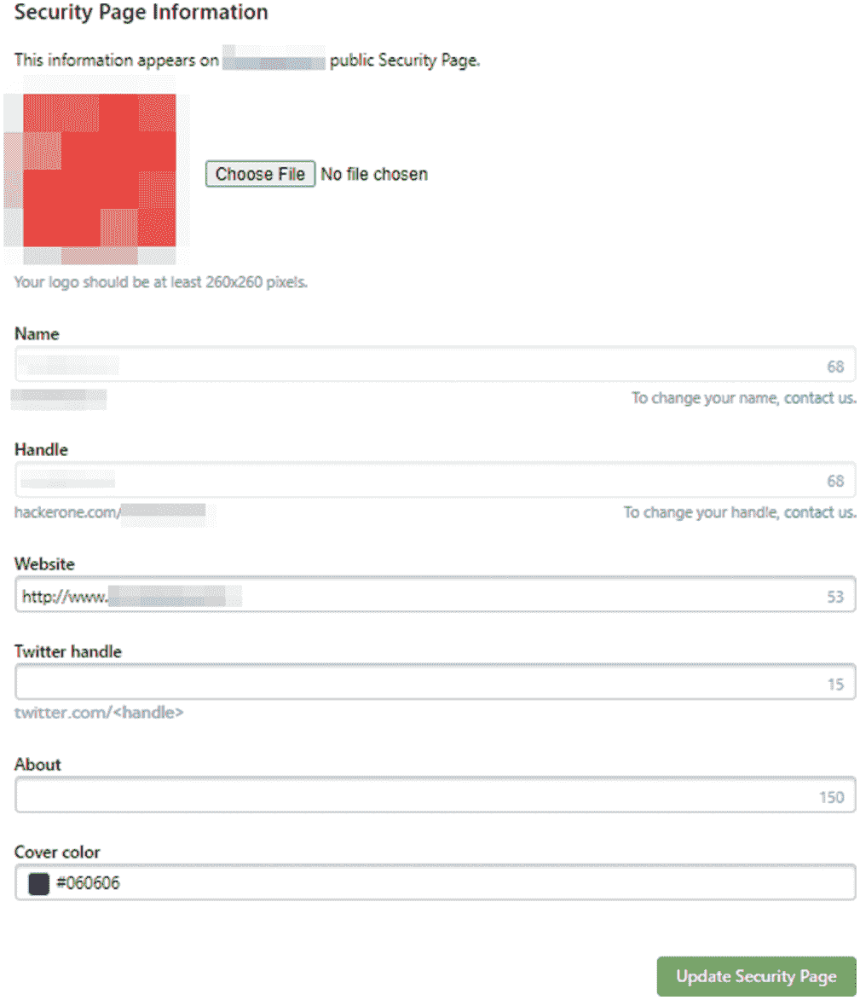

**图 6.56** 安全页面功能。

#### 6.3.1.3 产品版本

HackerOne 有两个不同的产品版本，第一个版本是“赏金专业版”，另一个选项是“赏金企业版”（**图 6.57**）。项目经理可以在两者之间选择，但应咨询管理层和客户经理以确定主要差异和价格考量。给定的价格点可能是一个通用的决定因素，但专业版是基础版本。此标签页允许项目经理查看产品添加统计数据，并联系支持部门以获取不同的产品。

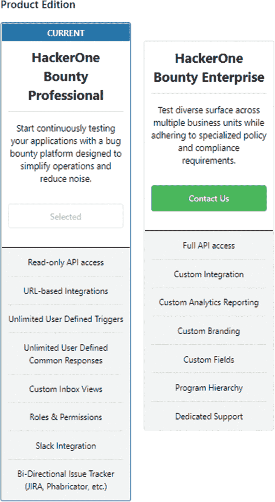

**图 6.57** HackerOne 产品版本。

#### 6.3.1.4 身份验证

与 Bugcrowd 类似，HackerOne 也提供启用 SSO 的选项。项目经理可以点击“启用 SAML”按钮。不过，这在截图示例中目前未显示（**图 6.58**）。项目经理需要通过 IdP 管理团队获取正确的设置来配置 SSO。此外，HackerOne 与 Bugcrowd 不同之处在于，HackerOne 项目经理可以联系他们的客户经理以启用 IP 允许列表功能。IP 允许列表功能将确保只有特定的 IP 地址可以访问项目管理。


**图 6.58** 使用 SAML 进行单点登录。

#### 6.3.1.5 已验证域

“验证域”标签页允许项目经理添加域，这是启用 SSO 的要求。Bugcrowd 的验证与 HackerOne 的验证之间的一个区别在于，除了 DNS TXT 记录外，HackerOne 还允许 HTML 元标签验证和 Web 文件验证（**图 6.59**）。


**图 6.59** 域验证示例。

#### 6.3.1.6 凭据管理

“凭据管理”标签页允许项目经理向黑客提供 CSV 文件，以便对应用程序进行身份验证（**图 6.60**）。在某些情况下，拥有经过身份验证的账户对于测试特定漏洞很有用。


**图 6.60** 凭据管理标签页。

#### 6.3.1.7 群组管理

尽管用户管理在群组管理之前，但设置群组是在设置用户之前必不可少的步骤，以确保项目经理遵循基于角色的访问控制的最佳安全实践，换句话说就是管好他们的项目。项目经理应尽力为“需知”原则和关键角色创建适当的角色群组。作为一个通用的经验法则，应该有一个拥有完全权限的角色、一个拥有大部分权限的角色和一个权限极其有限的角色（**图 6.61**）。维护完整的角色套件将允许项目经理快速分配权限，而不会影响项目。


**图 6.61** 群组管理选项。

要添加角色群组，项目经理应点击群组管理面板右上角的“添加群组”按钮。点击按钮后，将出现添加群组页面，项目经理可以为群组命名并分配适当的权限。默认权限级别允许用户查看报告和发布内部评论。除了默认权限外，项目经理还可以分配报告角色、项目角色、奖励角色或管理员角色。作为一个有限角色的好例子，如果群组管理标签页中尚未设置，项目经理应为群组命名并保留默认权限。可以创建另一个群组，允许响应漏洞但不进行项目管理。为此，项目经理可以分配报告角色并结合奖励角色。最后，项目经理可以勾选所有复选框，以授予其他人对项目的完全管理员权限（**图 6.62**）。


**图 6.62** 群组管理选项。

#### 6.3.1.8 用户管理

角色组创建完成后，可根据合适的角色将用户添加到相应组中，以保持项目的高效运行和良好管理。添加用户是一项相当简单的任务；项目经理只需点击“用户管理”标签页，点击“邀请用户”按钮，然后输入电子邮件地址并选择要分配给该用户的组（图 6.63）。


**图 6.63** 添加用户选项。

#### 6.3.1.9 审计日志

通用子标题的最后一部分是审计日志。审计日志用于查看项目内发生的所有事件（图 6.64）。事件包括团队成员采取的操作，以及用户代理、发生日期和地区。保持项目内操作的可追责性非常重要，尤其是在有大量员工参与管理项目时。此外，HackerOne 允许项目经理按事件、用户或事件发生日期进行搜索。审计日志数据也可以 CSV 格式下载。


**图 6.64** 审计日志选项。

### 6.3.2 账单

账单子标题包括概览、信用卡设置以及漏洞赏金项目奖金池的预付款。正如第 6.3 节所述，尽快设置账单部分并为赏金池注资至关重要。注资延迟可能导致项目启动延迟。

#### 6.3.2.1 概览

概览部分包含项目经理已支付给安全研究人员的赏金和费用的当前余额。在本部分中，提供了活动报告，允许项目经理查看他们奖励研究人员的所有日期以及费用和累计余额（图 6.65）。项目经理可以更改账单周期，并查看当月所有的活动历史记录。此外，项目经理可以将报告导出为 PDF 或 CSV 文件。


**图 6.65** 赏金和费用概览。

#### 6.3.2.2 信用卡

账单部分的信用卡板块非常直观。可以在该部分保存一张信用卡，用于向赏金池注资。

#### 6.3.2.3 预付款

项目经理应咨询负责组织注资的财务团队，或联系其客户经理，以寻求关于申请发票和预付款的指导。特定企业将有内部发票规定。因此，确保遵循正确的程序至关重要。

### 6.3.3 项目

项目设置标签页下的“项目”子标题用于配置项目和管理黑客交互的大部分技术细节。项目经理可以依赖此标签页设置漏洞赏金项目的几乎每一个方面。尽管如此，漏洞赏金众包平台通常具有相似的选项。即使选项有重叠，项目经理也应注意不同平台之间配置的细微差别。

#### 6.3.3.1 策略

HackerOne 的“策略”标签页与 Bugcrowd 的策略配置选项几乎完全相同。鉴于策略用于实时的私有漏洞赏金项目，此处不包含截图。但请放心，这种重叠使得 HackerOne 内的策略配置易于理解。

#### 6.3.3.2 范围

HackerOne 内的范围配置与 Bugcrowd 的范围和资产配置完全不同。项目经理可以点击“添加资产”按钮，从而确定资产的评级和关键性，设置标签、添加说明，并将资产实时添加到项目中。“添加资产”页面允许项目经理针对研究人员测试特定资产的考量进行相当细粒度的设置。此外，项目经理可以将鼠标悬停在大多数标签上以确定标签的含义（图 6.66）。


**图 6.66** 添加资产。

要确定资产的环境评分，项目经理必须了解 CIA 三要素。CIA 三要素代表机密性、完整性和可用性（图 6.67）。机密性影响可通过敏感数据向威胁行为者泄露的程度来确定。完整性通常涉及数据的修改。例如，高完整性影响评级意味着威胁行为者可以修改所有文件。最后，可用性是对资产正常运行时间的判断。项目经理可能会认为可用性是仅受特定漏洞套件影响的环境因素。然而，项目经理必须考虑特定类型的攻击如何影响所有环境因素。例如，远程代码执行可能导致机密性、完整性和可用性的完全丧失。例如，如果威胁行为者获得了服务器的完全根访问权限，他们可以关闭服务器、窃取数据或修改服务器上的任何数据，从而使该漏洞获得最高的环境评分。除了关键性评分的差异外，范围与其他平台使用的大多数项目选项相似。


**图 6.67** CIA 三要素。

#### 6.3.3.3 提交报告表单

“提交报告表单”标签页是项目经理可以自定义提交模板介绍的地方（图 6.68）。项目经理可以自定义提交报告表单，甚至允许或隐藏特定的弱点配置（图 6.69）。然而，强烈建议项目经理仅隐藏那些明显被视为超出范围的攻击向量的弱点配置。项目经理不应仅因为不想处理报告而尝试隐藏合法的弱点配置。如果漏洞是合法问题，允许提交并妥善解决将有利于企业的安全态势。


**图 6.68** 提交报告表单选项。


**图 6.69** 自定义报告表单。

#### 6.3.3.4 响应目标

“响应目标”标签页是项目经理可以设置“首次响应但分析时间”以及基准“赏金发放时间”的地方（图 6.70）。此外，还可以根据相应的关键性，为每个漏洞设置解决时间预测。项目经理设置的所有目标天数仅代表预期的行动日期，并不一定代表实际所需时间。此外，每个操作的目标日期（按工作日计算）意味着周末不计入，或为企业不运营的日期。评估响应目标的一个重要方面是项目经理要诚实。在设置漏洞赏金项目时，配置不应设定为不切实际的响应目标，因为这会阻碍研究人员未来的参与，尤其是在目标持续未达成的情况下。


**图 6.70** 响应目标选项。

准确设定解决目标天数并非最高优先级。然而，项目经理应致力于遵守他们在响应、分级、赏金和解决之间设定的时间线。如果项目经理长期运行漏洞赏金计划，他们最终很有可能会错过某个目标。尽管如此，项目经理不应过于苛责自己，而应从错误中吸取教训。

#### 6.3.3.5 指标显示

指标显示选项卡展示了各种统计数据，这些数据可能会吸引安全研究人员参与漏洞赏金计划（图 6.71）。然而，显示哪些指标完全取决于项目经理。并不存在一种“错误”的指标显示方式。


**图 6.71** 指标显示选项。

#### 6.3.3.6 邮件通知

邮件通知选项卡不言自明。项目经理可以从三个选项中进行选择。提供的选项包括“无内容”、“最少内容”和“完整内容”（图 6.72）。


**图 6.72** 设置邮件通知。

#### 6.3.3.7 收件箱视图

简而言之，这些是快速视图，可以执行应用于收件箱选项卡中报告的筛选器。项目经理可以进入此选项卡以启用或禁用已保存的视图（图 6.73）。


**图 6.73** 收件箱视图选项。

#### 6.3.3.8 信息披露

启用此功能允许黑客在计划中披露报告（图 6.74）。


**图 6.74** 信息披露选项。

#### 6.3.3.9 自定义字段

“自定义字段”选项卡允许项目经理使用键值数据标记报告。遗憾的是，此功能仅对企业版用户可用。相比之下，Bugcrowd 默认包含此功能。

#### 6.3.3.10 邀请

黑客邀请顾名思义：是一种用于邀请黑客加入计划的功能。此选项卡支持通过电子邮件、用户名或声誉进行邀请。此外，还可以设置报告量；报告量允许项目经理设定最低报告期望值（图 6.75）。如果未达到最低值，计划将自动邀请黑客，直到满足月度报告数量。


**图 6.75** 邀请选项。

当项目经理准备好进行公开发布时，可以在此处启动激励计划（图 6.76）。HackerOne 建议计划在公开发布前至少包含 100 名黑客。此外，HackerOne 警告称，漏洞赏金计划在公开的第一周可能会收到多达 200 份报告，且恢复为私有模式可能会对计划和黑客产生负面影响。


**图 6.76** 公开发布选项。

#### 6.3.3.11 提交

提交选项卡利用创建信号限制的能力来限制谁有权访问该计划，这会影响可以提交多少报告（图 6.77）。四种不同的设置允许安全研究人员提交更多或更少的报告。例如，严格的信号设置将是新漏洞赏金计划的最佳选择，特别是当项目经理没有太多漏洞赏金计划经验时。然而，相反地，关闭信号要求适用于最资深的漏洞赏金计划。通常，选择标准信号选项是最佳实践。


**图 6.77** 提交要求选项。


此外，启用“人工增强信号”将允许 HackerOne 授权其分析师对所有传入报告进行分类。这种人工审核可能是一个值得启用的好功能，因为它有助于防止垃圾或不良报告。然而，该功能应谨慎使用。如果报告被拒绝，它将被标记为“不适用”，但不会为漏洞赏金计划生成通知。缺乏生成的通知可能对刚接触漏洞赏金计划的项目经理不利，特别是如果在标记过程中出现错误。

提交部分的最后一项允许强制要求双因素认证和赏金拆分。虽然某些计划可能有合理的顾虑，但强制黑客使用双因素认证并非绝对必要，甚至可能会阻碍计划参与。如果企业能够负担为计划设置预付款，赏金拆分是一项必不可少的功能。鼓励黑客协作和参与可以带来更多独特的、关键的漏洞利用呈现给组织。

### 6.3.3.12 给黑客发送消息

给黑客发送消息的功能是大多数漏洞赏金计划平台提供的又一标准功能。HackerOne 的功能特别允许项目经理选择特定的安全研究人员群组进行消息发送（图 6.78）。


**图 6.78** 给黑客发送消息选项。

### 6.3.3.13 邮件转发

设置电子邮件地址并启用邮件转发的能力允许项目经理接收相关的漏洞报告（图 6.79）。如果企业希望在一定程度上保持其漏洞赏金计划的私密性，启用此功能会很有帮助。在安全页面或 `security.txt` 上提供一个良好的转发邮箱地址可能会很有用。计划将在 HackerOne 收件箱中收到这些邮件。然而，应注意这也可能产生垃圾邮件。因此，建议为 HackerOne 计划使用专用邮箱。


**图 6.79** 邮件转发功能。

### 6.3.3.14 嵌入式提交表单

首先，嵌入式提交表单选项仅适用于拥有 HackerOne 企业版的企业。遗憾的是，由于我的产品型号限制，无法测试此功能。不过，该表单似乎具有与 Bugcrowd 原生计划相同的功能（图 6.80）。项目经理可以在网页上设置并嵌入该表单，供偶然发现漏洞的黑客使用。


**图 6.80** 嵌入式提交配置。

### 6.3.3.15 赏金

奖励研究人员是漏洞赏金计划的核心。在 HackerOne 的“赏金”选项卡中，可以执行多项操作（图 6.81）。首先，可以为每个资产分配特定的货币奖励值。此外，可以创建自定义赏金标题或插入其他行。*不*建议自行制定自定义严重性等级，因为这会让之前习惯使用标准低/中/高/严重等级的黑客感到困惑。可选的描述字段允许项目经理讨论奖励的具体细节，在下方可以查看已支付赏金的历史记录。


**图 6.81** 赏金选项。

### 6.3.3.16 周边商品

在此标签页中，内容不多。提供了一个开启或关闭纪念品奖励的选项。如果你不知道什么是纪念品，它基本上是指公司品牌的服装或物品，项目方可以选择分发给参与项目的黑客。

### 6.3.3.17 常用回复

在管理漏洞赏金项目时，企业会发现超出范围或非漏洞/不合格的漏洞报告是一大烦恼。“常用回复”标签页为项目经理提供了一种简便的方式，可添加自定义回复，以减轻上报给项目的大量无效问题（图 6.82）。


**图 6.82** 常用回复选项。

常用回复自动化功能不仅有助于处理超出范围的漏洞。项目经理可以为任何场景创建自动化，包括工单状态从“打开”变为“分析”，或关闭工单。例如，项目经理可能希望自动化一个常用回复，在研究人员获得奖励时祝贺其参与，等等。

要创建一个流程，请遵循以下步骤。

1.  点击“添加常用回复”按钮（图 6.83）：

    

    **图 6.83** 添加常用回复选项。

2.  创建流程，设置一个易于记忆的标题。例如，将常用回复标题设为“奖励回复”可能是个不错的主意，在消息字段中，项目经理可以输入发送给获得奖励的黑客的消息，例如“感谢您参与我们的项目！我们鼓励您继续挖掘漏洞！”或任何看起来合适的内容（图 6.84）。

    

    **图 6.84** 编辑常用回复选项。

3.  保存回复后，项目经理可以点击“默认常用回复”按钮，将常用回复设置为某个操作（图 6.85）：

    

    **图 6.85** 默认常用回复选项。

如所见，几乎任何工单操作都可以结合常用回复来使用。项目经理可以创建基础回复以协助日常工作流，但这并不是成功项目的必要条件。

### 6.3.3.18 触发器

“触发器”标签页提供的功能与常用回复标签页类似。不过，它提供了更具体的措辞和调整。企业可以配置默认规则，当关键字或字段匹配时引发特定响应。触发器以基本的 `if/then` 语句编写。项目经理可以组合各种选项，甚至多个选项来构成各种触发器。请观察以下示例（图 6.86）：


**图 6.86** 创建触发器选项。

上述内容分解为简单的语句，并添加了两条规则以展示其用法。首先，项目经理必须选择其触发事件。因此，在此实例中，如果报告弱点包含硬编码凭证的使用，且报告严重性包含“严重”，则会向项目中的所有参与者（漏洞赏金项目经理和黑客）添加一条评论，内容为“如果您在三十分钟内未收到回复，请联系我们的应急响应团队，电话：123-123-1234。”触发器有多种用法，可提高项目的有效性。

### 6.3.3.19 集成

总的来说，HackerOne 项目选项允许的集成比 Bugcrowd 更多。此外，与 Bugcrowd 类似，集成的文档也已存在，可作为理解配置细节的手段。同样，由于选项众多且部分相当具体，本章不再逐一讨论。

### 6.3.3.20 API

API 设置简单直接，在许多方面也与 Bugcrowd 的 API 功能相同。

### 6.3.3.21 Hackbot

“Hackbot”标签页中的设置可实现漏洞赏金项目中特定操作和触发器的自动化。在大多数情况下，所有各种设置都很简洁，项目经理可以决定何种级别的选项功能适合其情况（图 6.87）。


**图 6.87** Hackbot 设置选项。

### 6.3.3.22 导出报告

导出报告的功能很简单。项目经理只需输入其电子邮箱，所有报告将通过电子邮件发送给他们（图 6.88）。处理所有漏洞报告需要一些时间，完成后，报告将可作为 CSV 文件供下载。


**图 6.88** 导出报告选项。

### 6.3.3.23 个人资料设置

个人资料设置页面相当标准，总体上与其他配置没太大区别。HackerOne 略显独特，因为它将研究人员和项目经理的偏好设置融合在了一起。

## 6.3.4 收件箱

项目经理将把大部分时间花在收件箱中，处理上报的漏洞。图 6.89 左侧显示项目内所有报告的预览，从新的和未分配的报告开始。有多个标签页用于筛选报告，主要按未处理的新报告、需要解决的报告、需要复测的报告以及被视为“目标遗漏”的报告进行筛选。顶部收件箱面板的最后一个标签页是“全部”标签页。它包含通过项目提交的每份报告的历史内容。


**图 6.89** 收件箱中的漏洞报告。

示例报告如图 6.90 所示。

### 6.3.4.1 报告详情


**图 6.90** 示例报告。

报告包含的字段将根据项目经理使用的平台而变化。不过，许多部分是重复的。例如，“状态”仅定义提交所处的阶段，“严重性”是关键等级，“资产”是黑客报告的对象，等等。

### 6.3.4.2 时间线

报告中黑客向项目证明存在合法的漏洞概念验证的部分是“时间线”。简而言之，时间线是整体的论证依据，包括漏洞描述、推定造成的影响以及复现步骤（图 6.91）。时间线也被用作处理上报漏洞的一种手段。漏洞赏金项目经理可以点击各种功能来奖励黑客、添加评论、关闭报告等。


**图 6.91** 时间线选项。

## 6.4 总结

创建漏洞赏金计划可能会让人感到复杂，虽然有许多计划管理平台可供选择，但它们大多提供相似的功能。总体而言，本文以 Bugcrowd 和 HackerOne 为例，两者各有独特的管理风格和方法论。在我看来，Bugcrowd 在整体易用性、设置和计划管理分割方面表现更佳，而 HackerOne 则拥有更多自动化、过滤功能，以及针对超大型计划的特性。尽管如此，计划管理人员仍应研究所有选项，因为功能会定期发生变化。

# 第 4 部分：漏洞报告与披露

# 第 7 章：分流与漏洞管理

## 7.1 理解分流

分流是审查漏洞并确定报告是否值得在接收流程中采取进一步行动的行为。

1.  **确定资产是否在范围内。**

    如果不在范围内，请评估漏洞的严重性。如果不是严重漏洞，则确定该漏洞是否将被分流。在大多数情况下，即使漏洞被视为超出范围，计划管理人员也会希望对严重漏洞进行分流。

2.  **分析报告。**

    这包括尝试查看提交的概念验证是否有效、确定严重性等。

3.  **请求补充信息。**

    一般来说，除非漏洞符合计划描述中范围内部分规定的所有标准，否则计划管理人员不应对其进行分流。

    确保对提供的任何可疑信息进行澄清，通常涉及漏洞验证方面。漏洞的严重性以及其他细节认定，在后续的解决过程中也可以更改。

4.  **对漏洞进行分流。**

### 7.1.1 验证

漏洞验证过程应审慎处理，尊重生产环境、研究真实性和计划定义。虽然这听起来很复杂，但其含义是确保漏洞处理方式不会损害任何当前的生产流程，并投入足够的时间和精力来验证漏洞。

除了确保在验证过程中迅速处理研究人员的报告外，计划方还必须对验证保持审慎——这既是为了在沟通流程中保护自身，也是为了防范财务操纵。

### 7.1.2 经验教训

未能验证和理解漏洞可能会给组织带来毁灭性打击。影响可能包括金钱损失、软件工程团队的不信任以及整体声誉受损。最好花一点时间进行有价值的评估，确定漏洞的真实影响，然后再迅速对其进行分流。值得注意的是，如果对漏洞影响存在误解，或出现任何奇怪的验证异常迹象，与同行协调从来都无妨。此外，分流评估阶段是向研究人员索要更多信息的绝佳时机。漏洞赏金计划管理人员必须在必要时善用补充信息收集。

### 7.1.3 漏洞失误

当发生漏洞失误时，计划管理人员有责任承认错误。因失误与安全研究人员对质，或提出任何试图追回赏金的请求或威胁，均属越界行为。归根结底，计划未验证漏洞并非研究人员的过错。事实上，我们都是人，分流人员、计划管理人员和研究人员全都犯错并非不可能。成长的一部分在于接受问题，并在领导层询问时保持透明。

计划有很大的改进空间。即使是应用安全领域的专家也知道，不可能事事皆知。安全是动态的，也是团队协作的结果。防止错误再次发生的最佳方法之一，是确保保留了事故记录。失误不是世界末日，但如果不接受错误的责任，就很难知道未来该避免什么。

除了自我问责，研究人员也有可能自我反省并主动告知计划方错误。尽管这种概率显著较低，但切勿接受任何形式的退款，并感谢他们的诚实。任何人都不应因善意犯下的错误而受到惩罚。

### 7.1.4 托管服务

托管服务在第 3 章中有所讨论。不可否认，对于广泛的计划而言，使用托管服务是必不可少的组成部分。然而，如果企业的计划管理人员允许漏洞赏金平台进行分流，漏洞分流流程将呈现何种面貌？当计划因其他网络安全激励措施而陷入泥沼时，拥有一支专业团队将产生天壤之别，让专人验证漏洞并给研究人员吃定心丸，其价值无法估量。

在许多情况下，计划管理人员早上醒来登录后，会发现漏洞已被妥善分流，分流团队已行使自由裁量权清理了研究人员的报告，以便计划管理人员能够充分且快速地复现。可以说，托管服务甚至有助于减少报告流程中的摩擦。大大小小的企业都能从中以多种方式受益。例如，大型计划可能需要通过托管服务获得专门的分流团队，因为替代方案可能是以高得多的费率雇佣员工来管理计划，而非使用漏洞赏金平台的服务。或者，可以减少分流流程的招聘人数，让现有计划管理人员扩展计划，专注于报告流程的验证部分。小型计划通常可以避免使用托管服务，但可以说，复杂漏洞验证的低成本和高价值可以帮助小型企业在不花费太多时间陷入分流循环的情况下扩充安全团队。

尽管如此，无论计划是否包含托管服务，都必须执行相同的验证目标。我们都难免犯错。如果分流验证了漏洞并将其分配给计划进行解决，请重新验证并确保其符合范围标准。

### 7.1.5 自助服务

从报告到结束管理自己的流程并非不可能或不切实际。当企业选择这样做时，可以肯定地说，报告的分流和验证部分几乎可以合并。然而，计划管理人员应意识到区分分流/验证与影响评估的重要性。除非计划管理人员绝对确定这是一个漏洞且毫无疑问，否则不应自动对漏洞进行分流。如果漏洞可以等待，分流应始终优先审视，因为第二意见是更安全的选择。

## 7.2 漏洞管理

整个报告管理流程需要相当多的准备和理解，才能将笨拙的流程转变为顺畅的工作流。尽管流程的每个方面都很重要，但整体漏洞管理部分是企业最关心的部分——这正是计划存在的根本原因。尽量不要对漏洞管理流程抱有消极心态或感到压力。应用安全工程师通常能更有效地处理漏洞赏金计划，因为他们拥有软件开发生命周期（`SDLC`）的经验，但实事求是地说，任何网络安全工程师只要具备正确的组织架构设置，都能管理这一流程。

### 7.2.1 漏洞优先级

即使分诊负责特定报告的初始接收和验证，但内部确定漏洞优先级并非其职责。项目管理中常见的一个误区是对分诊项目的分类。在大多数情况下，漏洞在报告流程中都能得到准确评级。尽管如此，项目经理应当小心，不要将漏洞分类视为一成不变的铁律。

例如，请前往搜索引擎查找以下 CVE 以进行评估：`CVE-2020-14179`。就目前而言，该漏洞在通用漏洞评分系统（`CVSS`）3.x 版本评分标准中被评为中危。显而易见，截至目前已知情况，严重程度将决定赔付金额。问题是，项目中的 CVE 评级与现实中的 CVE 评级相比如何？实事求是地讲，该漏洞可能被评为中危，但通过阅读当前描述可以发现，这是一个信息泄露漏洞，可能处于评分标准的低端。攻击者基本上可以查看 Jira 工单上的字段名称和自定义服务级别协议（`SLA`）名称。回顾来看，该漏洞可能并不太严重。然而，`CVSS` 评分是漏洞赏金项目的典型评分机制。因此，中危漏洞很可能需要支付赔付（或至少建议支付）。建立赏金支付范围而非固定值的重要性在此体现得淋漓尽致，因为 Jira 漏洞现在可以按中危严重程度的低端进行支付。按评分低端支付不应成为项目中的常态。项目经理必须始终坚守赔付准则，并对研究人员保持公平，尤其是当漏洞属于合法问题时。项目不应寻找少付研究人员报酬的方法，而应评估影响，以确定研究人员是否应获得更多报酬。

现在，将 Jira 漏洞与标准的跨站脚本（`XSS`）漏洞进行比较。无论漏洞影响何种资产，只要不被视为自跨站脚本（`Self-XSS`），`XSS` 漏洞的利用场景将永远多于 `CVE-2020-14179`。在几乎所有情况下，信息泄露漏洞的严重性都不如能够钓鱼用户并窃取凭证的漏洞（除非泄露的信息是敏感的，例如密码、`PII` 等）。

请查看以下三个漏洞，并确定其修复优先顺序。在 1 到 3 的范围内进行评级，其中 1 为最高优先级，3 为最低优先级：

### 7.2.2 漏洞示例

#### 7.2.2.1 登录门户上的反射型 XSS

##### 报告与分诊

一名研究人员通过滥用原生参数，在登录门户上发现了一个 `XSS` 漏洞。他们能够弹出警告框，验证手段使用了经典的 `<script>alert(1)</script>` 技术。托管服务将该警报分诊为中危漏洞。

##### 验证

项目方能够验证该漏洞为合法的 `XSS` 漏洞。

#### 7.2.2.2 开放重定向漏洞

##### 报告与分诊

同一研究人员发现了一个漏洞，允许他们将用户重定向到任意网站，且无任何限制。此外，研究人员指出，他们能够通过在路径后附加 `http://127.0.0.1:port` 来检查后端特定端口是开放还是关闭。他们将其报告为开放重定向漏洞，因为他们很难判断端口实际上是开放还是关闭——这只是研究人员的猜测。由于托管服务无法验证任何服务端请求伪造漏洞，该警报被分诊为中危漏洞。

##### 验证

项目方能够验证开放重定向漏洞。此外，他们注意到通过测试，枚举内部端口甚至查看特定文件内容均成为可能。

#### 7.2.2.3 内部结构化查询语言（SQL）服务器凭据泄露

##### 报告与分诊

最后，发现了一个漏洞：企业的公开 GitHub 仓库似乎泄露了通过 3306 端口连接的 My Structured Query Language (`MYSQL`) 服务器凭据。由于凭据似乎仅可从内部子网访问，分诊团队无法验证其真实性。

##### 验证

项目方验证了凭据的存在性，并确定泄露的内部凭据属实。然而，项目方遵循最佳实践，认定该漏洞评级为中危。

## 7.3 答案

在给定的三个场景中，结果按相关性从低到高排序，并附带了相应解释。

### 7.3.1 漏洞评级测试总结

事实是，漏洞处理方式的认知有一定的灵活空间，无法制定严格的准则。分诊团队视为关键的漏洞，对企业可能仅是中危。如果泄露的内部 SQL 服务器凭据示例涉及存储信用卡或 `PII` 等关键资产（如数据库），优先级会改变吗？理解漏洞分类和修复优先级可能会变化/不得不变化，是项目管理的重要组成部分。

#### 7.3.1.1 登录门户上的反射型 XSS

反射型 `XSS` 漏洞的优先级低于可升级为 `SSRF` 的开放重定向。实事求是地讲，利用的便利性和钓鱼窃取凭证的可能性会对业务造成极大干扰，并在企业的安全流程中引发大量纷争和影响。在大多数情况下，`XSS` 最终会被定性为真正的中危，除非研究人员设法将漏洞升级为账户接管实例。


##### 7.3.1.2 开放重定向漏洞

虽然该漏洞最初只是一个低影响的基于重定向的场景，但研究人员通过尝试枚举端口，将其转变为服务端请求伪造漏洞。此外，项目经理能够读取其他文件，将一个低影响漏洞转变为高影响漏洞。在此实例中，建议将研究人员的漏洞评级从低升级为高，因为他们识别出了 SSRF 攻击的可能性。然而，这不应被视为关键，因为研究人员未实现进一步升级。优先解决此问题将是防止关键利用或数据泄露的最佳建议。

##### 7.3.1.3 内部 SQL 服务器凭据泄露

虽然乍一看内部 SQL 服务器暴露似乎是最关键的漏洞，但如果非要比较，它要么与反射型 XSS 实例同等严重，要么危害更小。企业不应掉以轻心，忽视仅可在内部复现的漏洞。在合法内部凭据暴露的情况下，即使研究人员无法访问，也应立即通知受影响团队轮换凭据。关于内部凭据的一个常见误区是，认为因为安全研究人员无法进入网络就不成问题；这与事实完全相反。

#### 7.3.2 复杂性与评级

没有人能详尽定义企业应如何管理不同漏洞。通常存在一条基线。但正如我们所见，基线仅仅是基线：一种推荐方法的大纲。另一种解决各类问题的好方法是比较所有因素，从漏洞的复杂性和评级入手。

*   **复杂性**：复现漏洞的难度，就非技术威胁行为者复现该漏洞的难度而言。设想评分范围从非常容易、容易、中等、困难到极其困难。

#### 评级

**评级**：威胁行为者利用漏洞的严重程度或影响。评级标准可以是现实的，分为以下类别之一：不适用、信息、低、中、高、严重。

评估漏洞复杂度和评级的基准不必使用严格的措辞，也不必包含在漏洞赏金计划的描述中，甚至不必写下来。它旨在作为一个心理备忘，在评估漏洞以确定分类优先级时牢记在心，同时在需要评估金额范围时，帮助梳理处理报告漏洞的逻辑过程。

要理解复杂度和评级标准如何结合使用，请注意以下两个独立示例并进行比较。

##### 示例 1：example.exe 上的基于栈的缓冲区溢出导致远程代码执行

发现一个漏洞，可对 `company.com` 提供的 `example.exe` 文件执行缓冲区溢出利用。

##### 示例 2：本地文件包含 (LFI) 漏洞导致远程文件包含 (RFI)，进而导致远程代码执行

发现一个漏洞，`foo.php?page =` 参数存在本地文件包含漏洞。当将载荷 `../../../../../../../etc/passwd` 追加到参数末尾时，漏洞被利用。此外，将 LFI 载荷替换为 PHP 输入包装器 (`php://input`) 并修改 POST 请求数据以包含 `<? system(‘uname -a’);?>`，导致系统上发生完全的远程代码执行。

#### 7.3.3 预估评级

#### 7.3.4 工单与内部 SLA

在企业内部定义的创建工单和管理内部服务级别协议的过程，是信息安全中一个独特且重要的方面。在工单创建过程中，管理漏洞赏金计划的工程师应使用漏洞赏金平台可能提供的任何工单系统集成。或者，在企业自行管理计划的特殊情况下，工程师应定义 SLA 管理流程，这将在 第 9 章 中进一步讨论。

##### 7.3.4.1 创建工单

漏洞分类和验证过程不一定要求计划管理者在内部创建工单。托管服务和分类员工无法参与此类激励。通常，在验证漏洞并认定其可复现且合法后，首要任务是：*支付研究人员报酬*（如果漏洞有效，且已执行尽职调查以验证该问题）。显然，在支付研究人员报酬前，要确保不存在意外为无效漏洞付款的可能性，如前所述。

研究人员获得报酬后，集成到大多数工单平台的连接器将负责在内部为计划生成报告。然而，在某些情况下，工单集成可能不支持包含完整报告。例如，至少计划需要确保以下几点。

1.  **工单包含完全详细的步骤。**

    如果分类人员或安全研究人员编写的步骤应用安全工程师能理解，并不一定意味着软件工程师也能理解相同的步骤。将任何复杂流程转化为易于理解的复现示例，使技术经验有限的人也能理解。

    （软件工程师技术水平很高，但理解利用过程可能需要不同层面的理解。）

2.  **工单包含相关文件。**

    在安全研究人员使用外部托管文件进行概念验证的利用实例中（例如 HTML 文件），请将其包含在工单中。工程师的时间很宝贵。内部团队不应从头创建任何利用流程。如果研究人员未包含该文件，请索要该文件，或包含用于验证漏洞的文件。

3.  **工单包含证明材料。**

    安全研究人员倾向于包含利用过程的截图/视频。如果有理由认为利用过程过于复杂，无法通过几个可复现的步骤详述，请务必包含用于详述利用过程的材料。

4.  **附加信息。**

    计划管理者应包含任何未通过工单集成功能解析的相关信息。

## 8 漏洞披露信息

### 8.1 理解公开披露

计划管理者通常有权允许安全研究人员在问题修复后披露其发现。允许漏洞公开披露不一定是计划要求，计划管理者应了解因披露而可能产生的任何影响。就漏洞赏金平台而言，公开披露仅仅是允许报告通过公共源填充的行为。可以假设，在源上披露的报告可能会以研究人员网站上的文章、社交媒体帖子，甚至记者撰写的漏洞报道等形式离开平台。

#### 8.1.1 做出决定

最终，是否允许公开披露取决于计划的目标。漏洞修复透明度的控制（允许/拒绝）由计划管理者酌情决定。尽管如此，重要的是要理解公开计划在此过程中有其独特的挑战。

##### 8.1.1.1 私有计划

私有计划处理漏洞披露有两种方式：一种代表标准的内置配置用例，另一种更多是出于对安全研究人员努力的支持而决定的礼节。最终，这也将取决于众包平台确定的配置允许范围。在大多数情况下，私有计划将有能力允许披露，尽管这与计划管理者从公开计划中预期的略有不同。

###### 允许披露

允许披露的选项必须源于对安全研究人员心理的理解，也必须源于对潜在企业影响的理解。例如，考虑以下情况。

一名研究人员与企业漏洞赏金计划合作处理一个严重问题，他们本可以获取数十万条 PII（个人身份信息）。出于善意，该安全研究人员在获得服务器访问权限时停止了操作，以避免任何 PII 意外泄露。

如果允许披露，大多数众包平台都有政策规定，只有受邀并参与该计划的其他安全研究人员才能查看已披露（且已修补）的漏洞。虽然大多数安全研究人员会尊重为防止漏洞在组织外部披露而设立的流程，但情况并不总是如此。计划管理者不应盲目乐观，但应知晓相关风险。

发现漏洞的安全研究人员可能无意在共享该漏洞的“订阅源”或“流”中进行披露。如果企业正在运行私有项目并参与有限的私有披露，另一位研究人员可能会获取该报告或发现，并将报告泄露给记者或在网络其他地方发布。虽然此类泄露发生的风险极低，但没有人应该假设它永远不可能发生。最终，造成的损害将是声誉方面的，而非被利用方面的，因为漏洞终将被修复。然而，现实中，披露不应被视为声誉受损的手段。当项目鼓励披露时，社区会更加尊重该企业。

###### 2. 披露限制

项目管理员可能决定完全避免披露。在任何情况下，企业可能不希望进行有限披露的主要场合，可能是由于担心进一步的利用或信息泄露，且这些情况超出了安全研究人员或项目管理的控制范围。

至少从项目管理员的角度来看，披露限制通常是漏洞赏金领域不成熟的结果。除非报告在项目的私有研究人员订阅源中透露了更多基础设施或内部信息，否则任何已披露报告被利用的可能性都很小。在任何情况下，这些信息通常可以在披露前进行编辑。

###### 3. 临时编辑

参加私有项目的许多研究人员都希望进行披露，无论当前有何政策。安全研究人员可能会要求编辑信息，以便将其包含在他们的报告中。如果企业的项目仅允许私有流披露，或者项目不允许任何披露，则可能会出现请求此类披露的情况。

####### 核心要点

安全研究人员重视他们的研究成果。如果通过编辑可以支持研究人员的披露，这将成为支持他们参与的良好激励措施。项目管理员可以在其项目中编写条款，或在被询问时回复研究人员，内容如下：

> “我们允许在报告中公开披露。但请给我们机会审查报告，以确保不存在潜在的利用向量。我们希望你分享研究成果，但也希望保障公司安全。我们不想过度干涉，因此审查将是轻量级的。如果你不希望我们审查报告，我们理解并尊重你为公司带来的价值。随时披露。”

在大多数情况下，如上所述的支持声明将成为支持安全研究人员发现的充分方法。在不陷入“滑坡谬误”的前提下，完全阻止任何形式的公开披露并非有用的方法论。参与面向公众的漏洞赏金社区的热衷写作的研究人员最终会进行披露，这可能导致在项目视野或控制之外意外披露内部信息或基础设施。尽管如此，虽然要求编辑报告的特定方面是一种选择，但这不应被用作对抗黑客的武器。编辑仅应以防止服务进一步被利用的方式进行。如果项目管理员对研究人员披露其研究感到不适，他们应致力于提高安全性，或避免运营漏洞赏金项目。

##### 8.1.1.2 公开项目

公开项目的主题代表了另一种挑战，即“人人皆可为之”效应。换句话说，如果允许参与的研究人员进行披露，企业漏洞赏金项目管理员可能会发现参与度增加。除了一项专为公开项目保留的额外功能——完全公开披露外，私有项目中披露的几乎所有方面都延续到了公开项目的配置中。

###### 1. 完全公开披露

公开项目有能力完全承诺最宽松的项目状态：完全披露。本质上，当企业项目配置为在公开状态下具有披露功能时，安全研究人员可以请求披露其已修复的漏洞，这意味着漏洞将进入高度可见的状态，即访问众包平台的任何人都可以完全查看报告（包含期望的已编辑信息）。

完全公开披露的主要问题之一在于项目价值的体现以及参与度增加的可能性（“人人皆可为之”效应）。基本上，有几种情况会导致完全公开披露引起参与度的过度激增，主要是在项目披露了导致巨额奖励的漏洞，或项目发布了一系列报告时。

“发薪日混乱”，简而言之，是指研究人员获得巨额奖金的报告被披露，这可能导致媒体关注。记者针对已修复的漏洞进行报道并不罕见，特别是如果该漏洞可能导致严重的利用或用户数据/公司产品泄露。如果记者报道了一个漏洞报告，大量研究人员可能会涌向该项目，希望获得巨额奖金的机会。即使在前一个漏洞披露后发现同样严重的漏洞的可能性不大，但也并非不可能。其次，可能会报告大量较小的漏洞，或者即使没有报告高于平均水平的漏洞，由于大量安全研究活动的开展，也可能造成企业运营中断。漏洞被记者报道并非既定事实，但应考虑所有场景。

报告链披露可能不会导致媒体曝光，但相比之下，在高额奖励场景中看到的一些类似效应可能会发生，特别是安全研究人员参与度增加，或企业尚未准备好管理的破坏性活动水平。

####### 核心要点

项目管理员应允许公开披露，并意识到他们需要准备好应对报告激增，且拥有经过彻底加固的资产。不应阻碍公开披露流程。然而，如果企业对披露感到不适，请意识到这是一个项目管理员必须习惯的不适事件。毕竟，即使企业没有项目，他们也面临黑客向公众披露漏洞的情况。项目至少提供了鼓励围绕报告的积极言论和奖励的机会，给项目管理员带来优势。允许研究人员披露，或者不运行漏洞赏金项目。

### 8.2 CVE 责任

#### 8.2.1 什么是 CVE？

CVE 代表通用漏洞披露（Common Vulnerabilities and Exposures）。CVE 计划于 1999 年开发，由美国国土安全部和网络安全与基础设施安全局赞助。CVE 旨在作为一种标准化漏洞和披露的方式，将许多数据库链接在一起，试图使企业更容易管理和修补新发现的漏洞。

#### 8.2.2 项目管理员职责

> 漏洞赏金计划管理的一个难点是时刻警惕 CVE 的存在

当企业产品涉及其中时，如果需要修补公司外部使用的特定组件，则该产品中存在 CVE 的可能性可能更加明显。然而，存在多种可能被忽视 CVE 的情况，这通常是由于对安全研究领域缺乏了解所致。安全研究人员和项目经理都可能最终忽略已识别漏洞的广泛影响。

#### 8.2.3 硬件 CVE

企业可能提供种类繁多的硬件，例如 ISP 的产品可能是机顶盒或路由器等。如果路由器测试在范围内，研究人员在路由器中发现漏洞很可能已成功识别出一个 CVE，但如前所述，他们可能不知道该漏洞是一个影响范围更广的 CVE。保持警惕对于确保企业降低影响和可利用性非常重要。

在大多数情况下，CNA 并非大多数项目经理能够利用的资源。相反，请遵循 第 8.3.2 节 中概述的指南。

#### 8.2.4 软件和产品 CVE

同一家 ISP 可能拥有一项高级视频流媒体服务，通过用户可能作为月账单附加项购买的应用程序提供。该应用程序通过在互联网上建立的外部连接提供服务，并非基于 Web 的资产。事实上，它作为可执行文件（`.exe`）下载，并有单独的 MAC 版本（`.dmg`）。此外，该应用程序允许用户创建账户、与其他用户共享视频列表，并在其个人资料页面查看近期活动。

#### 8.2.5 第三方 CVE

在前两个场景中，公开漏洞披露和修补的要求直接提交给了组织，但如果情况不明确会怎样？在 ISP 的示例场景中，人们现在可以想象他们的 Web 应用程序正在使用大量第三方软件集成和代码。针对这一特定场景，让我们创建两个虚构的公司名称——ISP 服务商 Ryudar 和其用于链接锚点和重定向的供应商 AppAncors。

### 8.3 提交选项

项目经理是否负责提交漏洞，完全取决于提交的漏洞类型以及发生的协调情况。报告漏洞有多种选项，且可能会发生变化。项目经理应了解报告过程中可能发生的各种场景，并认识到 CVE 管理是动态的。一如既往，应始终将企业漏洞赏金计划和研究人员的最佳利益放在心上。

#### 8.3.1 内部提交

标准内部提交通常最简单，因为它们遵循已建立的内部流程（即 CNA）。如果项目经理不确定其企业是否为 CNA，应参考 CNA 综合名单 (<https://cve.mitre.org/cve/request_id.html#cna_participants>)，并记住企业在安全团队不知情的情况下拥有 CNA 的可能性相当小。如果企业确实拥有 CNA，最佳实践是修补漏洞，并通过 CNA 有权访问的报告系统提交 CVE (<https://cve.mitre.org/cve/cna/Requesting_Blocks_of_CVE_IDs-for_CNAs_only.pdf>)。如果运行计划的企业有足够大的用例成为 CNA，请使用以下表格：

<https://cve.mitre.org/cve/cna.html#become_a_cna>

#### 8.3.2 项目管理提交和放手提交

如果研究人员愿意，企业应允许其自行提交 CVE。然而，应询问研究人员是否允许项目代表其披露。实事求是地讲，由于漏洞赏金计划的保密协议，项目保留代表披露的权利，但不应完全依赖这一点。

##### 8.3.2.1 项目管理提交

如果识别出的易受攻击组件可能影响不止一个用户并需要 CVE 披露，请遵循一组提交步骤。

**提交步骤**

1.  首先，告知研究人员该漏洞已被识别为 CVE（如果计划中未包含此信息）。

2.  告知研究人员您希望企业经历提交流程，但询问研究人员是否同意。

3.  如果研究人员未设定最后期限，提交前为修补流程提供 90 天。如果漏洞很可能更早修复，请务必表达这一点。研究人员很可能会在完整的 90 天期限之前披露，特别是当问题严重时。

4.  项目经理应首先与相应的内部团队协调，要求他们修复问题。接下来，项目应前往 MITRE 网站提交官方 CVE ID 请求表格。

5.  当 MITRE 处理请求后，将分配一个 CVE ID，并等待参考资料，即受影响方确认修复的概念验证或通告。

6.  项目经理可通过回复 CVE 分配邮件提交参考资料，随后 MITRE 将公开发布 CVE。如果时机允许且研究人员采取了负责任的措施，实际的漏洞赏金报告可被披露并用作主要参考。

> **注意：** 社交媒体账号或社交媒体上的临时帖子均不构成充分的参考资料。为保护企业，至少应提交一份来自企业的参考资料，如漏洞赏金报告、补丁通告或 GitHub 拉取请求等。

##### 8.3.2.2 放手提交

如果协作后，项目和研究人员同意采用自我提交方式，安全研究人员即同意管理交互。这会在多种情况下发生。例如，在第三方上识别出的漏洞将构成放手方式，这对研究人员而言很可能是不可协商的，因为披露其不拥有的产品漏洞并非企业的责任。项目经理应让研究人员知道他们将不得不联系受影响方。此外，也存在研究人员希望自行向 MITRE 披露 CVE 的可能性。在这种情况下，讨论如何安全地进行，并礼貌地要求研究人员提供拟提交给 MITRE 的内容。验证提交将使企业漏洞赏金计划能够充分确保安全研究人员有效地描述并捕捉漏洞、受影响版本或严重程度级别。

> **注意：** **不要** 试图激怒安全研究人员或威胁采取法律行动。应尝试理解披露的理由等。缓解负面互动是激发积极研究的重要组成部分，因为存在研究人员可以出售 CVE 的市场。研究人员选择妥善报告一个原本可能价值连城的问题。

表单提交后，通常组织会进行修补，然后向 MITRE 提供补丁通知或写文档（即参考资料），随后 MITRE 会正式向公众发布 CVE。

# 第 5 部分：内部与外部沟通

## 9 开发与应用安全协作

### 9.1 关键角色差异

应用安全角色与开发角色在工作流和职责方面截然不同。显然，根据企业的不同，角色可能会有巨大差异，企业计划可能由信息安全从业人员组成，而不一定是担任漏洞赏金计划经理的应用安全工程师。

#### 9.1.1 应用安全工程师

在计划流程期间，应用安全工程师负责持续评估与企业应用程序（如网站、移动应用和第三方审查）相关的安全计划，特别是当合作伙伴以特权方式使用任何应用程序时。通常，应用安全工程师将负责应用程序开发期间的安全性以及所涉及的所有流程。

#### 9.1.2 开发

主要由软件工程师承担修复已确认漏洞所涉及的大部分工作量。然而，情况并非总是如此。根据已识别的问题，应用安全工程师会发现他们可能必须与其他团队（如云安全或基础设施团队）协作，以解决已识别的漏洞。漏洞的解决并不完全落在软件工程的范畴内。

> **注意：** 即使应用安全工程师负责评估和修复安全问题，各应用程序的创建者和维护者也必须遵循良好的安全编码实践。

### 9.2 面对倒计时

负责任的计划经理在处理漏洞修复时将面临不少障碍，这不足为奇。显然，解决已识别漏洞的期望既来自安全研究人员，也来自企业计划的角度。例如，如果验证了多个已识别漏洞，确保优先处理严重性是绝对必要的，这也将有助于应对倒计时，即服务级别协议（SLA）。研究人员渴望解决问题，计划经理很可能会面临焦虑的研究人员不断询问进度。虽然无法保证在所有场景下都能迅速解决，但重要的是确保研究人员和管理层都了解所需的工作量级。


设想这样一个场景：识别出一个漏洞，其建议修复时间线为整整两周。计划经理应主动推进解决，并向所有相关人员沟通任何阻碍因素。如果研究人员期望在该期间内收到更新却毫无音讯，他们会感到沮丧。如果预期的服务级别协议时间未能满足，他们会更加沮丧。与其在未达标准后道歉，不如在错过截止日期前更新研究人员，解释解决过程中的各种阻碍因素。负责促进沟通的计划经理不一定要透露太多关于阻碍因素的信息，但通常更新会受到欢迎。

除了让研究人员了解进展外，计划经理还必须向领导层优先汇报阻碍因素。如果领导层必须持续询问漏洞进展，会影响工作流，并给负责修补已识别漏洞的团队制造不必要的紧迫感。如果领导层在修复过程中过于频繁地介入，软件工程师或其他负责的开发方在未来协作时可能会觉得漏洞被夸大了。

### 9.3 有意义的漏洞报告

工程师经常犯的一个错误是以过于技术化的方式将报告的漏洞传达给软件工程师。即使软件工程师是高度技术化的个体，利用漏洞是另一门艺术，在某些情况下，如果报告不当，漏洞可能会被忽视或误解。正如任何事物一样，计划经理应了解组织内不同团队的运作方式并做相应调整。如何定义“过于技术化”？首先，软件工程师不太可能承认报告超出了他们的理解范围。报告“过于技术化”没有具体阈值。因此，计划经理应努力以每个人都能理解的方式传达漏洞。不存在报告“太容易理解”这种情况。

对比同一报告中两段摘录，它们被转译成了两份不同的摘要，请注意以下传达报告在有效性上的差异。

尽管两份摘要都是真实的，但报告 2 的摘要更适合呈现给软件工程师或其他开发团队。配合易于理解的步骤，报告 2 的呈现效果将超越报告 1。以简洁的方式传达信息，直击漏洞根因，这对于防止解决过程中的任何失误或延误至关重要。复现步骤的撰写应遵循类似原则。在尝试总结复现步骤时，如果有更简单的解释方式，请避免使用高度技术性的术语。虽然没有固定的方法可以做到这一点，但计划经理可以通过两种方式减轻软件工程师或其他责任方的压力，防止他们感到陷入泥沼：尽量减少复现漏洞所需的步骤数量；或者如果所有步骤都是必要的，则避免使用首字母缩略词并提供该漏洞为何成为特定问题的“原因”。

例如，软件工程师可能熟悉`XSS`这一术语，但当计划经理刚开始工作时，他们应该展开该缩写（跨站脚本）。此外，工程师可能不知道什么是跨站脚本。通常，简短的说明，例如：“跨站脚本（又称 `XSS`）是一种攻击者可通过社会工程学窃取用户信息的方法”，是解释快速风险的好方法。请参阅 OWASP Top Ten 指南以了解更多关于应用程序漏洞的信息 (<https://owasp.org/www-project-top-ten/>)。

### 9.4 沟通期望

计划经理损害企业漏洞赏金计划成功潜力的方式之一，是抱有不切实际的期望或在管理流程上过于松散。计划经理应保持平衡的方法以实现最佳结果，并根据漏洞严重程度进行调整。通常在低严重性漏洞上设定高期望是不明智的，因为这可能会损害计划经理与负责修复方的关系。同样，设定低期望也会对计划声誉造成同等伤害，特别是当工程师认为他们没有被要求对修复问题负责时。无论商定何种时间线，软件开发经理和安全经理都应对修复过程拥有完全的监督权，以防止任何不必要的分歧。

此外，鼓励软件工程师在任何漏洞工单中添加评论，以便向应用安全团队更新进度。虽然并非每位软件工程师的工作流都包含通过评论进行持续沟通，但核心理念是在修复过程中保持开放的对话。没有两位软件工程师是完全相同的，项目经理应努力确定所有有效的沟通流程并做相应调整。

### 9.5 推回、升级与例外

职业问责的责任落在项目经理身上。无论是在讨论给软件工程师的时间线，还是给高管管理层的时间线，关键的一点是要明白：无论发生什么，项目经理都将对任何漏洞的修复负责。既然项目经理需要担责，理解何时对责任方进行升级就是必要的真理，但这不一定要是一种有毒的互动。例如，假设给一位软件工程师两周时间来修复一个 `SSRF` 漏洞。在过程中，项目经理沟通了预期，该软件工程师立即表示：“我没有足够的时间来修复这个问题。这个激励措施需要等到月底。” 现实情况是，由于该漏洞被评为高严重级，且极易演变为严重级，修复过程无法承受过长的等待。虽然谈论如何沟通似乎令人尴尬，但如果项目经理没有推回的权力，漏洞赏金计划就会失败。确保漏洞赏金计划被严肃对待的最有效方法是，在内部和外部定义所有人都可以参考的步骤和方法论。

#### 9.5.1 内部步骤

*   开发团队看板或跟踪修复流程的方式。它可以像工单和截止日期列表那样简单，也可以像完整的故事跟踪那样广泛，例如敏捷方法论带来的能力。

*   创建剧本作为解释流程的手段。高管领导层可能不会深度参与应用安全工作流。剧本可以是展示关键信息的绝佳方式，例如公司关于漏洞修复预期的政策、管理问题或例外情况等。此外，还可以在运行手册中加入更多信息，以详细阐述任何已定义的工作流，供可能从未处理过安全问题的初级工程师参考。

*   向受影响的责任团队重申流程，即使认为该团队可能知道他们在做什么。例如，简单地说：“你好，我们在 X 应用的 X 组件中发现了一个漏洞。预期在（X 周或月）内解决，因为该漏洞的严重性为（低/中/高/严重），如果被威胁行为者利用，可能会导致负面后果。” 如果进行彻底且有用的预期设定和风险分析，并以有意义的方式传达，项目经理将获得更大的成功。

#### 9.5.2 外部步骤

*   在漏洞赏金计划描述中建立 `SLA` 时间，以让内部团队对修复负责，理想情况下应满足或接近内部定义的时间。

*   将安全研究人员排除在内部沟通流程之外。防止项目经理与安全不同开发方面之间的关系受到任何高级监督非常重要。项目经理的主要优先事项是验证、解决并为研究人员的漏洞付费。因此，防止猜测或挫伤积极性至关重要。

#### 9.5.3 升级

坦白说，面对不善于维护良好漏洞修复记录的工程师，可能会感到困难甚至沮丧。作为信息安全专业人员，管理与非安全人员的关系将永远充满挑战。无论大问题是沟通不畅、缺乏动力还是不尊重，猜测都可能有害，并永久损害与同事的关系——这些同事在其领域发现漏洞时不可避免地需要提供协助。请评估以下高级应用安全工程师与软件工程师之间的沟通场景，并阅读各种分析，注意根据项目经理的领导风格、定义的修复时间和偏好，哪些情况可能需要升级。

1.  **场景：沟通不畅** `Shanice` 与 `Ricardo` 谈论一个已识别的 `XSS` 漏洞。她注意到工单未因任何进度而更新，且截止日期显示工单已逾期两天。此外，在截止日期前一周，`Shanice` 告知其经理她认为 `Ricardo` 可能会错过截止日期，且其经理被告知将抄送在 `Shanice` 的跟进邮件中。她曾多次通过邮件与 `Ricardo` 及其经理讨论截止日期，`Ricardo` 的经理回复称将按时完成。

     **分析：** `Shanice` 在整个过程中坚持了正确的原则，但总体上应用安全团队与工程团队之间仍存在脱节。`Shanice` 多次跟进团队以检查工作进度，责任团队向她保证会处理。尽管得到了保证，责任团队甚至在其经理参与互动的情况下，也未联系 `Shanice` 说明可能错过截止日期的可能性。在该特定场景中，`Shanice` 应建议其经理升级至下一级领导。通常，这最好在错过截止日期前几天解决。然而，责任并不总是被认领，项目经理也必须对沟通不畅的失败保持一定程度的责任。

2.  **场景：缺乏动力** `Shanice` 收到 `James` 的消息，称他在解决分配给他的敏感信息泄露漏洞时遇到很多问题。`James` 似乎也因 30 天的修复时间线要求而感到压力很大，表示难以确定优先级并解决此问题。`Shanice` 并不具体知道如何解决该漏洞，但她知道另一位软件工程师 `Rachel` 处理过此问题。`Shanice` 提议召开电话会议并邀请 `Rachel` 提供建议。`James` 勉强接受会议，并允许 `Rachel` 指导他完成修复过程。`Shanice` 在需要时插话谈论时间线和预期。

     **分析：** `Shanice` 做出了正确的决定。她没有因工程师不知道如何修复漏洞而责备他，而是决定善意地联系另一位工程师并与 `James` 协调会议。在该特定场景中，`Shanice` 无需升级，因为修复过程中仍有充足时间，且不存在任何重大问题。

#### 3. 场景：不尊重

周五，一名安全研究人员发现了一个关键的远程代码执行漏洞。`Shanice` 收集了所有信息，并立即向其经理报告，经理也通知了首席信息安全官。受影响的团队——API 开发团队——只有两名员工（一名经理和首席软件工程师 `Jaycee`）。`Shanice` 就该漏洞联系 `Jaycee`，却在数小时内未得到回应。最终取得联系后，`Jaycee` 回复称她不认为该漏洞真的很重要，且她有更高优先级的任务。`Shanice` 以专业的方式解释了其重要性，但 `Jaycee` 升级了矛盾——声称她有更好的事情要做，不愿处理此事，且可以等到周一早上。`Shanice` 试图快速反驳，但 `Jaycee` 停止回复。`Jaycee` 的经理得知情况后，试图与 `Shanice` 协商解决，但最终同意该团队认为这不重要，且团队的工作流程已经很繁重。

**分析：** 在这种情况下，`Shanice` 从专业角度切入场景的方式是正确的，但在适当的升级程序上仍需一些指导。向软件工程师解释漏洞的严重性及其重要性，是所有项目经理必须掌握的基本技能。然而，从 `Shanice` 的角度来看，此场景似乎尤为激烈。当事态恶化到软件工程师认为自己可以拒绝并无视安全团队时，项目经理应立即向领导层升级。当漏洞足够关键时，项目经理应放下对升级的顾虑，转而考虑企业的安全。未能快速修复可能导致组织无法保护用户数据、基础设施或组织的其他关键组件。

#### 9.5.3 总结

示例中描述的场景并非漏洞赏金解决生命周期中可能发生的唯一问题。关键在于理解项目经理必须适当运用批判性思维，以便随机应变、合乎逻辑地解决问题。不必要地升级本可解决的问题，或忽视明显应升级的问题，都是不恰当的。在整个生命周期中，保持善意且公正的方法，是项目经理成功运营漏洞赏金计划的最佳途径。

### 9.6 持续问责

项目经理有义务跟进漏洞修复流程。将漏洞工单分配给受影响团队却不设截止日期，或不实际跟进团队的修复情况，是浪费资金并导致漏洞赏金计划失败的捷径。安全研究人员希望他们的问题得到解决，但如果团队不被问责，这永远不会发生。尽管持续问责与升级类别密切相关，但它完全是项目经理的责任。

#### 9.6.1 跟踪

适当的问责或多或少关乎确保所有已沟通的漏洞从头到尾都被跟踪。强烈建议使用 第 7 章 中描述的工单流程。从技术上讲，项目经理可以按自己的意愿维护漏洞，但像 `Jira` 这样的工单系统是保持对漏洞解决过程中任何阻碍因素全面监督的首选方法。

#### 9.6.2 错过截止日期

现实中，假设漏洞赏金计划在所有场景下都能遵守 `SLA` 是极不公平的。即使是最优秀的项目经理也可能错过截止日期，顶尖软件工程师亦然。意外总会发生，关键的启示是：在错过截止日期时，要保持冷静。以下几个关键步骤可防止错过截止日期演变成灾难：

1.  **首先，通知领导层。** 如果缺乏透明度，漏洞赏金计划就无法有效运行。但是，不要在没有计划的情况下通知领导层；如果有充分理由导致错过截止日期，则无需升级。例如，如果软件工程师因生产环境中的其他故障而延期一天，通常项目经理只需通知领导层截止日期情况即可。但是，如果项目经理忘记了某个漏洞，导致其逾期两个月，则与领导层保持透明至关重要。诚实是重中之重。

2.  **就问题进行沟通。** 与相关团队保持沟通以解决问题。告知他们已逾期，并解释修复漏洞的重要性。

3.  **通知研究人员。** 显然，让研究人员知道解决工作正在进行中很重要。然而，这远不如实际修复问题，或向领导层通报解决过程中的任何阻碍因素重要。

## 10 黑客与项目交互要点

### 10.1 了解黑客

项目经理永远不应自动假设黑客怀有“x”意图。安全研究工作微妙敏感，但普遍的误解是黑客受金钱驱动。许多项目经理在管理漏洞赏金计划一段时间前，都不理解安全研究的价值。理解黑客参与的原因并不总是像表面看起来那么简单。

#### 10.1.1 金钱、道德，还是两者兼有？

黑客的动机各不相同。有些黑客来自美元兑其本地货币汇率极高的国家。因此，即使是较小的奖金也能发挥巨大作用。为金钱而工作的研究人员不一定缺乏道德，也不应被如此看待——毕竟，漏洞赏金猎捕是全球许多人的全职工作。漏洞赏金项目经理应考虑到：报告漏洞的安全研究人员可能将其作为主要收入来源，并应将所有研究人员视为全职专业人士。建议考虑全职赏金猎人的经济需求，并非肯定要为无效漏洞付费，只是在意识到项目经理掌握的权力大小时需要记住的一点。安全研究人员以经济利益为动机并没有错。项目经理不应害怕上来就询问经济奖励的研究人员。研究人员可能初衷良好，这似乎最常见。始终警惕利用尝试，但预设研究人员有坏心眼可能有害。始终先收集信息。

信不信由你，确实存在一些安全研究人员，他们根本不在乎钱。在这方面，有几个组成部分令人担忧。首先，不可否认的是，不在乎钱的研究人员通常性格都很随和。要想足够透明和诚实地向项目披露漏洞，同时明知研究报酬可能不会提供（针对超出范围或不符合资格的漏洞），这需要极大的黑客精神和投入。随和的研究人员可能会让一些项目经理产生一种错觉，认为他们不必在付款方面过于坦诚，这可能会危及漏洞研究的未来。想象一下，项目经理习惯了一小撮随和的研究人员，他们决定报告漏洞，即使这些漏洞超出了范围，也不表达任何对报酬的兴趣。研究人员可能无意中导致项目不扩大范围，或者项目经理选择退出漏洞赏金计划，转而提供不提供奖励的专有计划。有人可能会争辩说这是一种谬误的思维路径，甚至可能是滑坡谬误。但这里的重点是确保安全研究人员获得应有的回报。如果研究人员报告了一个在范围内的漏洞，但说：“你们不必付钱给我”，最好还是回复：“您确定吗？我们非常希望能为您的付出支付报酬。”给研究人员至少获得其工作报酬的机会，有助于避免基于以往与随和研究人员打交道的经验，而产生腐败或不切实际的期望渗透到项目中。

中间派是那些既渴望金钱，又在逼不得已时愿意忽略金钱因素的研究人员。大多数研究人员倾向于属于这一类黑客。不为钱而黑客，也不为纯粹的技艺道德而黑客的研究人员，被称为中间派研究人员。金钱通常不是争论的焦点；然而，中间派研究人员不一定会拒绝合理的报酬。

不过，看到这类研究人员先要钱，如果没有经济利益照样披露漏洞，这并不罕见。

> **注意：** 以下案例研究均为真实事件，但公司名称已隐去，以保护相关组织的匿名性。

#### 10.1.2 案例研究分析

在回顾所有案例研究时，识别所有研究人员之间主要的决定性差异是一项简单的任务。道德和金钱的取向都可能给研究人员的未来带来负面后果，而运营一个公平的项目将确保研究人员获得应有的尽职调查（应得的对待）。例如，在案例研究 1 中，研究人员从一开始显然对金钱感兴趣。缺乏经验的项目经理可能会对研究人员立即讨论付款并拒绝披露细节保持高度警惕。然而，必须理解，认真对待所有报告是项目经理的责任，即使研究人员听起来具有威胁性，企业也有义务在一定程度上回应研究人员。每种情况都应审慎处理，理解研究人员的视角对于理解其黑客意图和参与项目的目的非常重要。

### 10.2 无效化误报

管理漏洞赏金计划最困难的方面之一，就是无效化误报的过程。大多数人不想承担告诉安全研究人员“所识别的问题根本不是问题”这一责任。不幸的是，这是项目经理有责任承担的重担。管理误报一开始可能会让人感到尴尬，但有方法可以专业地处理这一情况。

#### 10.2.1 接收流程与通报坏消息

作为项目经理，如果企业拥有漏洞赏金平台，误报率应该相对较低。平台的分流团队将负责验证以确保这是真阳性，但在某些情况下，误报会意外通过分流。首先，项目经理在验证漏洞合法性之前，绝不应创建工单并将其分配给工程团队。避免走完整个分流流程，将确保如果漏洞无效，项目经理和受影响团队不必承担比必要更多的步骤负担。一旦认定漏洞无效，项目经理应冷静地通知安全研究人员出现了错误，而不应指责分流团队。以下是一个虚构场景的良好示例，展示了管理该情况和回复安全研究人员的适当方式：

`Nick` 是 `X` 公司的项目经理。他管理的漏洞赏金计划在周五晚上收到一份关于跨站请求伪造（`CSRF`）漏洞的报告，该漏洞导致用户敏感数据被窃取。周末期间，分流团队评估了该漏洞，并记录在案认为这是一个真阳性。分流团队清理了报告，生成了一份包含易于遵循的漏洞复现步骤的子报告，并将工单分配给 `Nick` 的团队进行进一步审查。`Nick` 没有太多黑客经验，但擅长代码审查流程。在审查研究人员的概念验证后，`Nick` 难以理解这如何构成漏洞。通常，标准的 `CSRF` 漏洞概念验证将导致安全研究人员能够证明敏感数据可以被窃取。当域的 `access control allow origin` 过于宽松且 `access-control-allow-credentials` 设置为“true”时，可能导致他人窃取凭据。

`Nick` 面临的问题似乎是：返回的敏感信息根本不存在。当 `Nick` 执行研究人员的概念验证脚本时，他注意到返回页面的只有页面源代码和一些其他次要细节，没有任何被视为安全风险的内容。为确保没有遗漏重要信息，`Nick` 决定托管他自己的独立概念验证，并再次注意到没有返回敏感数据。`Nick` 的总体结论是：研究确实能够利用过于宽松的跨源资源共享（`CORS`）策略。然而，利用发生在一个完全没有敏感数据的页面上，且不影响任何用户或企业数据的机密性、完整性或可用性。此外，这种误报的发生早在漏洞赏金计划邀请黑客之前很久就已被识别。事实上，`Nick` 确保在超出范围部分有一条特定条款，规定对没有可证明影响的页面进行利用视为超出范围。`Nick` 没有创建工单，并开始准备与安全研究人员的沟通。

现在已经确定存在误报，`Nick` 必须将这一消息告知安全研究人员。

**Nick：**

经过进一步验证，我们注意到您报告的 `CSRF` 漏洞实际上是一个误报。非常抱歉出现了这场误会，希望您继续参与我们的计划。

**研究人员：**

我不理解。项目显示这是一个已验证的漏洞，我甚至能够从页面中提取敏感信息。

**Nick：**

我理解并为此道歉。不过，我们注意到此漏洞实际上并未显示任何敏感信息。即使登录用户账户并点击外部托管的 `CSRF`，也无法检索到任何敏感信息、令牌或可用于恶意目的的内容。

研究员：

我认为该信息属于敏感信息，我应获得该漏洞的赔偿。这显然是一个 `CSRF` 漏洞。

Nick：

是的，这是一个 `CSRF` 漏洞，但在我们计划的范围外部分，我们强调了以下内容：

研究员：

好的，我看了一下，这似乎是真的。抱歉报告了这个问题。

Nick：

别道歉！我们感谢您的参与，谢谢。


虽然这对 Nick 来说是一次艰难的对话，但确保误报被认定为误报至关重要。为误报付费可能会导致未来出现负面互动，尽管如果是诚实的错误，项目经理不必放在心上。分析员和项目经理同时失误并为非问题付费的情况看似不可能，但无事不成。将误报记在心中，并敢于对安全研究员说“不”，是漏洞赏金计划管理中不可妥协的一个方面。

## 10.2.2 应对有毒黑客

项目经理迟早会遇到变得有毒或极其难以相处的安全研究员。在某些情况下，项目经理可能不必立即应对消极的安全研究员。他们决定制造麻烦的时间点各不相同，例如在工单被处理前、漏洞修复过程中或之后。每种情况都必须谨慎处理，因为它有可能完全对企业或研究员不利，两者皆非理想。如何定义有毒互动？不幸的是，很难定义什么是“有毒”，但通常它是指一种极度消极的互动，迫使项目经理别无选择，只能采取严厉措施来解决该行为。

## 10.3 托管计划注意事项

正如第 3 章（第 3.7 节）所述，托管计划是抵消项目管理中不可避免烦恼的绝佳方式。如果安全研究员报告的漏洞实际上不是问题，分析员可以迅速解决。如果安全研究员决定变得有毒，对于漏洞赏金项目经理来说处理起来甚至更容易，因为他们现在有能力随意进行审核和参与，且情感上不太依恋该情况。漏洞赏金平台解决方案通常有办法相当快速地解决有毒互动。以下是在观察漏洞赏金平台分析团队与安全研究员之间的互动时的一些一般注意事项：

1. 无需询问，项目经理应能通过阅读各种通信内容来判断争议所在。
2. 如果争议关乎漏洞的合法性，验证分析员的回复。例如，分析员可能认为这不是漏洞。然而，这可能是一个合法问题。
3. 确定毒性级别并评估回复的得当性。如果分析员过于敌对或不敢发声，这两种情况都有可能损害未来的互动。
4. 提供评论。不要害怕给分析员更多信息以帮助他们，或纠正分析员计划采取的行动方向。感知是主观的。因此，项目经理应愿意就此事表达意见。
5. 必要时介入。如果情况似乎已恶化到无法挽回的地步（如果尚未发生），告知分析员将研究员从计划中移除可能是个好主意。此外，如果分析员传达了关于企业漏洞赏金计划状态的错误信息，请予以纠正。从私下对话开始是避免意外让分析员尴尬的最佳途径。一句简单的“我注意到你对研究员说了‘x’，但那并非我们的实际做法”，可以挽救分析团队、企业和研究员之间的沟通。
6. 分析员有可能验证了漏洞，随后互动却与项目经理变得恶劣。在这种情况下，请参考：第 10.4 节中的“有毒互动 #2”，以获取解决指导，同时牢记在尝试与研究员处理不敬行为之前，应将托管服务纳入沟通循环。

## 10.4 自营计划

当企业漏洞赏金计划在专用平台上无任何形式的托管服务运行时，有毒互动可能会升级。计划与研究员之间出现意见分歧并不奇怪，项目经理需要了解各种解决选项。话虽如此，尽管计划最终拥有决定权，但理解研究员的立场也是方程式的一部分。然而，计划不应允许表现出露骨或威胁行为的有毒安全研究员肆意妄为。正如误报情况一样，与安全研究员打交道并处理这种情况可能很困难。无论哪种情况，此处提供了两个示例及解释，以帮助阐明理解并正确处理该情况的重要性。

总体而言，所呈现的场景应能充分展示严重有毒互动和相对温和的有毒互动的样子。毒性关乎感知。因此，项目经理在处理计划沟通事务时，应始终将企业安全放在首位，抛开所有个人感受。如果项目经理因消极互动而做出不利反应，可能会进一步升级问题。情商是项目管理中难以处理的课题。安全研究员可能不理解为何他们的语气听起来具有威胁性，漏洞赏金项目经理必须准备好应对此类情况的发生。此外，许多安全研究员的母语非英语，某些翻译可能被视为比实际更具敌意。应努力理解研究员的观点。

## 10.5 勒索或潜在威胁行为者

有毒互动可能难以与实际威胁区分，且在威胁行为者试图利用企业的情况下，可能导致极大的困惑。作为一般准则，看起来极具威胁性的未经请求的邮件应立即转交法务团队处理后续事宜。反之，如果对方因漏洞索要钱财，应谨慎回复并询问其是否愿意受邀加入漏洞赏金计划。如果他们以看似可能的利用尝试表现出极大的敌意回复，立即转交法务团队进一步审查。所有威胁应一视同仁，正如所有看似合法的漏洞报告邮件都应被审查一样。

## 10.6 公开威胁或披露

最敏感的情况是有人公开威胁组织。可能发生多种场景，项目经理应准备好应对每一种——或足够了解项目管理以适应动态情况。以下是计划可能面临风险的一些可能方式：

### 1. 安全研究人员披露未修补的漏洞

研究人员可能会过于热心，在报告漏洞后立即或在漏洞修补前就公开发布相关信息。虽然该行为本身不构成毒性行为，但要求研究人员删除漏洞信息可能会招致恶毒的反击。如果项目经理感到方便，可以尝试直接联系研究人员。无需涉及法务部门。项目经理应挺身而出，告知法务部门由你来处理此事。与研究人员沟通，询问他们是否愿意在漏洞修补前撰写的文章。如果他们拒绝，不要寻求惩罚他们，而是在内部提升修补该漏洞的优先级。最重要的不是黑客披露了漏洞，而是漏洞本身存在。将其修复。

### 2. 威胁行为者勒索或披露漏洞

如果项目经理得知某漏洞在未考虑企业利益的情况下被公开披露，应通知社交媒体经理不要回应，并咨询法务部门后续行动。记录任何利用漏洞的证据，并审查受影响资产的日志。验证漏洞也是此过程不可协商的一部分。然而，如果企业有应急响应团队，应首先且最重要地通知他们，然后再调查数据。不过，在联系法务部门，甚至应急响应团队之前，请务必确认这确实是一次合法的勒索尝试，而不仅仅是研究人员因缺乏联系而感到愤怒。几乎所有漏洞被披露的情况都可以通过协商解决，大多数威胁源于未被倾听的沮丧黑客。

### 3. 安全研究人员威胁在 Open Bug Bounty 上披露

项目经理可能会发现，安全研究人员曾多次尝试联系他们，但可能出现了疏忽。他们可能会通过 `Open Bug Bounty` 等网站报告漏洞，该网站会在 90 天后（行业标准）强制披露漏洞。项目经理应尝试利用其 `Open Bug Bounty` 账户档案中的任何信息联系研究人员。如果未收到回复，项目经理应调查相关资产和漏洞类型，并为披露日期设置提醒，以便查看利用方法论，如果情况严重，尽快解决。如果可能，让研究人员加入漏洞赏金计划并获得报酬是当务之急。鼓励研究是漏洞赏金计划项目经理的使命。通常，通过 `Open Bug Bounty` 报告此类事件的发生，是因为漏洞赏金计划对黑客来说过于难以接触。如果项目经理运行私有计划，可能会观察到这种情况。

### 4. 安全研究人员威胁在社交媒体上披露

通常，安全研究人员在社交媒体上威胁披露的漏洞，其严重程度远低于威胁行为者的披露。上述情况通常始于研究人员询问是否有人拥有该企业的合同，并在 Twitter、Facebook 或 LinkedIn 上@他们。如果得不到回复，紧迫性会增加，视研究人员的容忍度而定，他们可能会威胁公开披露，或转向更像威胁行为者的发布模式。项目经理通常可以以较少的谨慎进行回复，就像电子邮件接收流程一样，邀请研究人员加入漏洞赏金计划。如果他们不愿向企业披露漏洞，请意识到这背后可能有正当理由。计划是否支付研究人员足够的报酬？计划是否在研究人员报告后强制其签署保密协议？平均而言，研究人员想要金钱和公开披露。两者都提供，通常会获得更好的回应。如果研究人员拒绝，不要动用法务团队追究他们——而是着力修复被披露的漏洞。有些研究人员无法讲理，但必须以适当的方式与他们沟通，而不是以威胁的方式。

## 10.7 计划警告消息

安全研究人员是黑客，好奇心既是他们的救星，也是他们的毁灭。安全研究人员通常坚持匿名，这可能包括使用虚拟专用网络 (`VPN`)。例如，企业计划范围可能规定：“请勿使用自动化扫描。”一个优秀的企业安全计划会使用 Web 应用防火墙或其他速率限制和阻断选项，如果安全研究人员决定在测试期间使用真实 IP，尤其是进行扫描时，可能会被迅速封锁。在完美的项目管理世界里，安全研究人员会尊重范围，不使用自动化解决方案。但在现实中，这通常不是问题。然而，在高峰生产期或开发周期中，软件工程师可能会报告大量错误，这种情况可能会发生。如果项目经理没有使用能自动防止此类行为的工具，就必须想出创造性的方法来阻断流量。即使企业拥有工具，发送消息以传达要点也可能是必要的。

## 10.8 威胁行为者还是安全研究人员？

坦白说，“是威胁行为者还是安全研究人员？”这个猜谜游戏非常糟糕，让项目经理和任何其他相关团队在精神上精疲力竭。随着时间的推移，漏洞赏金计划尝试创新独特的方法来应对这种情况，例如要求建立特定的 `VPN` 连接包才能开始研究，或指示研究人员使用特定的用户代理或标头。不幸的是，这在某些情况下可能有效，但对研究人员开始研究的要求越多，产生的摩擦就越大，参与度可能会下降，或者这些要求可能会被完全忽视。在这种情况下制定剧本（`Playbook`）有助于快速解决问题，无论是心理备忘还是实体文档。

首先，询问以下问题：

1. 问题发生在何处？是否已被遏制？
2. 是否对生产环境造成影响？如果是，严重程度如何？
3. 是否需要应急响应团队介入？
4. 请求是否遵循任何基本模式（IP 地址、标头、请求、URL 路径等）？

作为一般依据，上述一些问题可用于开始筛选数据并分析差异。以下是两个不同示例及其建议的解决方案。

情况 #1 看起来像安全研究人员。在这种情况下，模式似乎与过去观察到的行为相符。情况 #2 更像是一个恶意情况，此时联系安全研究人员将是不必要的。上述问题不应被视为应急响应计划，而应作为一种了解项目经理应尝试获取的各类信息的手段，以协助简化流程。

## 10.9 给研究人员发送消息

此时，当出现破坏性模式时，发送一条计划消息提醒参与的研究人员不要进行破坏性测试，这无伤大雅。向所有研究人员发送消息的原因是为了避免单独点名特定研究人员。项目经理应避免可能导致进一步问题或打击安全研究人员积极性的可能性。此外，分析可能不正确，毫无根据或错误的指控可能会损害企业声誉。如果使用内部漏洞赏金计划解决方案，根据设置情况，您可能需要使用 `BCC` 发送群发邮件。大多数托管漏洞赏金平台解决方案都内置了消息传递功能。

### 10.9.1 安全研究人员访谈

漏洞赏金计划极大地受益于安全研究人员通过漏洞研究带来的专业知识。

### 10.9.2 漏洞赏金计划经理访谈

## 10.10 总结

归根结底，底线是：安全研究人员和计划经理是相似的。他们都知道沟通是计划参与和管理的重要方面。特别是，安全研究人员只想被理解——他们希望自己的影响被听到并得到公平评估。计划经理希望研究人员能敞开心扉，稍微放下戒备，以便能妥善评估情况。此外，他们不想不得不告诉研究人员要尊重他们：他们只想打交道有耐心、有礼貌的研究人员。

作为一名既是安全研究人员又是漏洞赏金计划经理的人，我见识过各种问题的双方视角。归根结底，我知道我作为研究人员时曾缺乏耐心，作为计划经理时也曾疏忽大意、不愿听取研究人员的意见。当我发现自己有这些行为时，我会调整。承认错误并调整立场——甚至只是默默地重新校准——无伤大雅。计划经理和安全研究人员都会欣赏这种调整，这才是最重要的。沟通是关键组成部分和驱动力。

# 第六部分：评估与扩展

## 11 内部评估

### 11.1 内部评估简介

计划经理至少必须理解为什么有必要对渗透测试及其相关的漏洞评估阶段有实际的了解。遗憾的是，在某些情况下，企业领导层可能不理解计划经理应具备应用安全和渗透测试背景，如果不具备，至少应具备应用漏洞类型和缓解流程的实际知识。如果雇佣的员工不了解常见漏洞类型，可能会使计划管理变得异常困难。本章介绍了一些有用的速成评估概念和工具，但本章的目的并非要取代正式的渗透测试评估资源。阅读本章时，请理解从应用和网络两个角度进行渗透测试都需要大量的培训和实践。世界上一些最优秀的渗透测试人员仍然不了解黑客技术的方方面面。想要提升水平的有志黑客应寻求其他资源。

### 11.2 主动测试与被动测试

最优秀的漏洞赏金计划经理不会等到漏洞报告接踵而至才开始测试。正如关于船只的俗语所说，不检查船只漏洞、不确保其坚固适航，就不会踏上横渡七大洋的旅程。计划经理应在向哪怕一小群安全研究人员开放计划之前，执行完整的内部评估。一个业余的错误是假设一名甚至两名安全研究人员是在测试前可以开始的合适人数。企业资产需要经过彻底加固，以防止为安全研究人员支付过高报酬，或被迫撤回计划发布。无论执行了多少内部评估，研究人员总会发现安全问题，当收到报告时——即使是针对他们已测试过的资产——计划经理也不应立即惊慌。

### 11.3 被动评估

可以说，内部测试最重要的方面之一是设身处地为威胁行为者着想。恶意黑客不会自动获得一份待攻击资产清单。和其他人一样，威胁行为者需要通过各种手段执行侦察以识别资产。计划经理若能了解被动研究的不同实施方式，将受益匪浅，因为这能在执行任何主动测试之前，让他们更好地了解安全缺口。

> **注意：** 被动评估需要极少或无需与目标交互。本节中的所有 IP 地址范围和域名均可公开访问。请在执行被动评估阶段之后的任何目标测试前获得书面授权。事实上，本书旨在给计划经理提供一些在自己资产上测试的技巧和窍门。不打算用于非计划相关资产。

#### 11.3.1 Shodan

描述 `Shodan` 最好的方式是：一个将主动侦察转化为被动侦察的工具。`Shodan` 持续爬取互联网，并尝试识别端口及这些端口上的开放服务。它是一个搜索引擎，包含它能联系到的任何联网设备。计划经理需要将 `Shodan` 作为一种资源来使用，因为企业可能拥有他们甚至未察觉的暴露资产。

##### 11.3.1.1 使用 Shodan

1. 首先打开浏览器并导航至 `shodan.io`（图 11.1）。


**图 11.1** Shodan 浏览器搜索。

计划经理将看到一个搜索栏和各种功能。强烈建议创建一个免费账户，尤其是如果将经常使用此来源的话。

2. 在搜索栏中，输入需要查找的特定资产的 IP 地址，以查看 `Shodan` 是否有其数据。无论如何，计划经理首次执行侦察时的一个良好做法是，输入企业控制的 Web 应用程序域名，然后点击放大镜进行搜索（图 11.2）：


**图 11.2** Shodan 搜索栏。

3. 搜索将显示许多不同的结果列表（图 11.3）。域名可能显示为链接到各种资产，可按国家、服务、组织和产品进行筛选。此时，所有这些信息均被视为公开且暴露在互联网上。查看这些信息在任何意义上都不违法。建议计划经理仔细核对资产，确保其属于该组织，然后再继续测试。此外，`Shodan` 拥有大量可用的过滤器和逻辑。例如，安全研究人员、威胁行为者或计划经理可能希望了解某服务的使用位置，甚至某服务的特定版本。在此场景中，我们使用 `vsftpd 2.3.4` 作为搜索和生成结果的手段。


**图 11.3** 生成结果。

4. 接下来，如果某资产符合定义的标准，计划经理可以点击它以了解影响并分析企业暴露面。假设标记为 `216.199.146.90` 的资产似乎属于该企业。当计划经理点击它时，会加载一个新页面，突出显示许多额外信息，包括 `Shodan` 识别出的所有开放端口——以及服务，并根据版本尝试识别针对该资产的漏洞（图 11.4）。重要的是要注意，针对服务和版本的某些 CVE 可能未被识别。尽管如此，`Shodan` 提供的洞察力水平可以防止灾难性情况的发生。


**图 11.4** Shodan 资产分析。

###### 深入剖析 vsFTPd 2.3.4 示例

深入观察 vsFTPd 2.3.4 示例（图 11.5），可以看出 `Shodan` 似乎已确认该资产正在运行该服务。如果项目经理发现其资产之一正在运行此版本的 FTP，这可能意味着威胁行为者也能轻易看到此信息，并且在知晓存在多个漏洞利用代码的情况下，利用该过时服务进行攻击。


**图 11.5 Shodan 服务分析。**

###### 风险识别流程

在使用 `Shodan` 时，风险识别流程实质上可分为几个部分：

* 通过域名或 IP 地址查找资产。
* 检查 `Shodan` 对资产拥有哪些信息或额外的测绘数据。
* 识别服务或基础设施上过时的版本。
* 搜索可利用性。
* 确认资产归属。
* 尝试漏洞利用或将漏洞通报给受影响的团队。

例如，在本例中，项目经理可能不知道针对各种服务或暴露端口是否存在任何漏洞利用代码。快速在 Google 搜索“vsFTPd 2.3.4”会弹出多个知名且成熟的漏洞利用代码（图 11.6）：


**图 11.6 Google 搜索结果。**

如果资产确实被确认属于该企业，且经验证正在运行该服务，项目经理现在必须立即联系受影响的团队进行修复，因为该漏洞利用可能导致威胁行为者在服务器上实现远程代码执行。`Shodan` 可以帮助项目经理快速识别易于利用的服务，以及此前可能未被知晓的过时组件或资产。

## 11.3.2 Amass/crt.sh

项目经理常见的误区是“他们了解组织所控制子域名的全貌”。漏洞赏金项目经理会惊讶地发现，基础设施团队遗弃了正在托管应用程序并将其暴露在互联网上的子域名，或造成了不必要的风险。`Amass` 的功能远不止子域名枚举。然而，存在一种快速技术，可帮助项目经理被动快速识别子域名，以寻找额外的攻击面。

此外，`crt.sh` 是一个可用于收集更多子域名并可能枚举组织正在使用的技术的工具。`crt.sh` 会查找包含所提供根域名变体的所有证书，这很有帮助（甚至可能让项目经理大吃一惊）。枚举前未发现的域名可以导入 `Amass`（尽管重要的是要注意 `Amass` 也会执行来自 `crt.sh` 的查询）或首选的子域名枚举工具，以发现更多待测试的资产。

> **特别感谢 Donk 向我展示了 crt.sh（Twitter: @donk_enby）。**

### 11.3.2.1 Amass


按照惯例，`Amass` 预装于 Kali Linux 或大多数其他渗透测试发行版中。首先，收集需要测试的域名列表。作为项目经理，维护所有子域名的列表是一项必要的工作，换句话说，没有子域名监管就等于没有漏洞监管。如果企业规模足够大，获取所有根域名的列表可能比较困难。如果组织使用 Amazon Web Services (AWS)，请与基础设施或网络团队沟通以确定所有资产。

1. 首先，将所有根域名放入一个文件中，例如 `example.com`、`example2.com` 等。完成后，将子域名转储到该文件中可以作为一种额外的测试方法，因为结果可能很有希望。

2. 将域名/子域名放入文件后，使用 `Amass` 运行子域名枚举：

```
amass enum -df test.txt > subdomains.txt
```

（图 11.7）


**图 11.7 Amass 扫描子域名。**

上述命令指示 `Amass` 使用 `-df` 开关对域名/子域名文件执行子域名枚举；随后将输出写入子域名文件（图 11.8）。


**图 11.8 Nano 中的子域名。**

> **注意：如果在将输出写入文件时遇到问题，请确保被写入目录的权限正确。此外，如果 Amass 在运行几分钟后似乎在特定的每秒 DNS 查询速率处停滞，请停止该工具。**

工具运行完成后，子域名将输出到指定的文件中。

### 11.3.2.2 crt.sh

子域名枚举是测试的重要组成部分。尽管 `Amass` 会查询 `crt.sh`，但项目经理可能希望获得关于证书和所用软件的更全面概览。利用 `crt.sh` 是一种快速替代方案，可通过扫描发现可能被忽视的域名（图 11.9）。


**图 11.9 使用 crt.sh 进行子域名枚举。**

## 11.4 主动评估

主动评估是指黑客测试漏洞的过程。如果项目经理不小心，主动阶段可能会对企业造成干扰。应极其谨慎行事，且在项目经理缺乏经验的情况下，不应尝试任何漏洞利用。强烈建议在进入此阶段前熟悉漏洞利用，因为这可能对生产环境造成损害。即使熟悉漏洞利用，一个好的做法是通过“渗透测试”主动看板或帖子通知组织，让大家知道如果发现任何异常流量请联系你。这样可以防止出现“全员出动”式的紧急情况。存在大量用于主动测试的工具。然而，这里将仅涵盖几个小方面（更多面向忙碌专业人士的自动化工具）。

### 11.4.1 nmapAutomator.sh

几乎任何初学者黑客都了解 `nmap`，但 `nmapAutomator` 呢？该工具由 21y4d 设计，可在 GitHub 上找到。它的创建旨在为网络和 Web 应用程序黑客攻击提供一种更简单的方式来组合多个工具集，包括对 tcp/udp 进行完整的 `nmap` 端口和服务扫描、CVE 扫描，随后根据发现的端口/服务运行各种建议的侦察命令。此外，`nmapAutomator` 还将利用 `nikto`、`gobuster`、`sslscan`、`joomscan`、`wpscan`、`droopescan`、`smbmap`、`smbclient`、`enum4linux`、`snmp-check`、`snmpwalk`、`dnsrecon`、`ldapsearch`、`odat` 等工具。该工具可用于各种场景，但最适合用于后端服务器。

正如图 11.10 所示，有许多选项可结合 `nmapAutomator` 使用。项目经理可以使用命令 `./nmapAutomator.sh 10.0.0.212 All` 对资产执行全面扫描。命令执行后，工具将经历多个阶段，包括快速扫描、基础扫描和全面扫描（图 11.11），然后评估给定服务以执行更精细的工具使用和漏洞扫描。所有结果将输出到一个文件夹中，以便以整洁有序的方式维护发现（图 11.12）。


**图 11.10 nmapAutomator 扫描信息。**


**Figure 11.11** nmapAutomator 对资产执行全面扫描。


**Figure 11.12** nmapAutomator 结果。

#### 11.4.2 Sn1per

由 1N3 创建，Sn1per 是另一款自动化漏洞扫描工具。Sn1per 的免费版本可从 GitHub 下载。不过，也有专业版可用，它支持图形用户界面（GUI）视图和工作区管理。免费版本可以高效利用。按照说明下载并配置工具后，项目经理可以获取一个域名的 URL 并开始对其进行测试。Sn1per 拥有许多模式。不过，一个好的起点是使用 "normal"（普通）模式。

下载后，使用命令即可轻松上手：`sniper -t https://example.com`。

该工具将尝试针对该域名利用各种枚举工具，用于 Web 应用程序和网络渗透测试。请注意：如果未指定，该工具可能会尝试各种利用，这可能会对生产环境造成损害；为此做好准备至关重要。（参见 Figure 11.13 和 11.14。）


**Figure 11.13** Sn1per 运行 Metasploit 模块。


**Figure 11.14** Sn1per 运行 Nmap 脚本。

#### 11.4.3 Owasp Zap

在免费的 DAST（动态应用程序安全测试）工具套件中有 OWASP ZAP。该工具专注于 Web 应用程序测试方面，并将针对各种漏洞评估 URL 或参数。ZAP 随大多数渗透测试工具包预装，包括 Kali Linux 和 Parrot。或者，Burp Suite 专业版也有一个不错的 DAST 扫描器。然而，并非每个项目经理都有资金购买许可证。

扫描相当简单：工具加载后，项目经理可以在 "URL to Attack"（要攻击的 URL）字段中输入一个 URL。此时，只需按下 "Attack"（攻击）即可。然而，在更现实的场景中，或根据企业的需求，可能需要修改配置。有大量开源指南解释了当 ZAP 配置为高级用法时可以执行的许多操作。

在 Figure 11.15 所示示例中，我们使用一个故意设置漏洞的域名进行测试。


**Figure 11.15** 在 OWASP ZAP 中设置自动扫描。

点击 "attack" 按钮后，它将开始爬取并测试各种载荷以查找漏洞（Figure 11.16）。


**Figure 11.16** OWASP ZAP 扫描结果。

警报字段显示所有可能的攻击向量，在本例中，爬取和载荷测试发现了一个基于 DOM 的 XSS 漏洞（Figure 11.17）。在已识别漏洞的右侧，通常会提供载荷和攻击描述。如果我们复制该载荷，如下所示：


**Figure 11.17** OWASP ZAP 潜在漏洞结果。

```
https://xss-game.appspot.com/level1/frame#jaVasCript`:/\*-/\*\`/\*\\\`/\*’/\*”/\*\*/(/\* \*/oN cliCk = alert())//%0D%0A%0d%0a// </stYle/ </titLe/ </teXtarEa/ </scRipt/–! >\\x3csVg/ < sVg/oNloAd = alert()// >\\x3e
```

当该载荷输入浏览器时，成功执行了 XSS 攻击（Figure 11.18）：


**Figure 11.18** 执行 XSS 攻击。

不要被迷惑：OWASP ZAP 并非专用的 XSS 工具。它具备模糊测试、编辑和重发请求以及搜索大量漏洞的能力。项目经理可以花费数小时自定义 ZAP，甚至可以导出漏洞报告。

#### 11.4.4 Dalfox

在项目经理用于测试 URL 参数和查找隐藏参数的工具库中，DalFox 是最好的工具之一。由 hahwul 维护，DalFox 可从 GitHub 下载。通过收集 URL 列表，甚至拥有根域名列表，DalFox 已被证明是一款得力工具。文件选项允许测试多个参数，也可以提供单个 URL 进行测试（Figure 11.19）。有大量选项可供使用，因此请在使用前阅读手册。


**Figure 11.19** Dalfox 可用命令。

在该具体示例中，将使用我们之前用 ZAP 测试时的一个已知易受攻击的 URL。

```
/dalfox url https://xss-game.appspot.com/level1/frame
```

运行脚本后很快就通过 query = 参数识别出一个 XSS 实例（Figure 11.20）。输出一个最终载荷，带有 `[POC][V]`，意味着该利用已验证可行——或至少被检测为如此（Figure 11.21）。


**Figure 11.20** Dalfox 识别 XSS 实例。


**Figure 11.21** XSS 攻击。

载荷：`https://xss-game.appspot.com/level1/frame?query=%3CScRipt+class%3Ddalf​ox%3Ealert%2845%29%3C%2Fscript%3E`

#### 11.4.5 Dirsearch

模糊测试也是内部评估的一个重要方面。黑客喜欢直接跳到利用的核心部分，这导致许多人忘记了，有时少即是多。最好的攻击是黑客了解关于目标的一切。因此，项目经理应努力比参与的安全研究人员多了解两倍的信息。模糊测试的理念是在 Web 应用程序上搜索隐藏文件或目录。Dirsearch 简化了这一过程。与大多数工具一样，开始使用需要从 GitHub 下载，除非它已预装在所选的渗透测试操作系统中。Dirsearch 由 maurosoria 创建。再次强调，阅读手册很重要，因为有大量不同的开关可用于创建和微调相关过程。

几个组合开关似乎对快速测试很有效：`-x` 用于包含要忽略的状态码（以避免误报或无关真阳性过载），`-e` 用于标注需要测试的扩展名，`-f` 用于强制将扩展名追加到从默认字典测试的每个单词上。例如，如果测试一个 URL 且工具在寻找 admin 目录，若使用 `-e php -f` 作为开关选项，`admin.php` 也会被测试。如果使用更匆忙的测试，移除 `-e` 和 `-f` 开关将仅测试目录并包含文件路径。

作为示例，假设有以下命令：

```
python3 dirsearch.py -u http://127.0.0.1:8000 -e php,txt,bak,conf -f -x 300,301,302,303,304,400,401,402,403,404,500,501,502,503,504
```

假设 `127.0.0.1` 是域名，例如 [`example.com`](https://example.com) —— 分号后面是首选端口或服务（对于 443 和 80 端口无需追加端口）——该命令将查找文件和目录，并在完成时连同状态响应代码一起输出它们（图 11.22）。


**图 11.22** Dirsearch 发现文件夹。

### 11.5 被动/主动总结

项目经理可用的工具种类繁多，本书的这一部分甚至还没触及可用的免费工具和资源数量的表面，包括可用于支持漏洞赏金计划健康度的手动审查。项目经理不必是拥有卓越智慧和技术的专家级黑客，但他们确实需要知道如何识别“触手可及”的漏洞，且讨论的许多工具在用于表层渗透测试时效果很好。尽管如此，项目经理应立志尽可能多地学习，以识别更广泛的漏洞类型。

### 11.6 其他考量：专业测试与第三方风险

对于没有经验自行进行内部评估的项目经理，他们应外包给值得信赖的渗透测试公司，并要求进行黑盒测试（即不提供任何信息）。即使拥有执行全面渗透测试专业知识的企业，也能从进一步的测试中受益，特别是当工程师不从事全职渗透测试工作时。第三方风险是评估期间需要考虑的另一个因素。人们很容易想到测试公司自有资产的影响，但那些不由运行漏洞赏金计划的企业所拥有的资产呢？

如果企业没有准备好处理大量漏洞的修复，就向安全研究人员开放计划将是不明智的。第三方风险可能是另一个因素，如果在公司间合作的第一阶段未被识别，它会带来被利用的机会，或导致计划不得不为更多漏洞买单。项目经理应与治理、风险和合规部门合作，持续评估收购或合作伙伴。未能做到这一点可能导致组织被攻破。

## 12 扩大范围

本书前面讨论了漏洞赏金计划的范围，一项关键原则是确保所定义的范围不要过宽，以防止试图分类和修复漏洞的项目经理不堪重负。扩大范围的初衷是给研究人员提供更多的攻击面进行测试。毕竟，威胁行为体可能想要企业拥有的东西：在犯罪和非法牟利的世界里，范围是不存在的。

如果添加过多资产，或者企业决定对未经测试的资产提供奖励，开放更多资产进行测试可能会很痛苦。虽然不一定有绝对正确或错误的扩大范围的时机，但可以采取几个步骤来降低失败的可能性，几乎所有步骤都在事先测试和工作量评估的范畴内。

### 12.1 与团队沟通

范围扩大不可商量的方面是向团队充分传达意图。独立的项目经理应与领导层沟通，确保大家对扩大范围达成共识。项目经理绝不应在未与团队中的其他工程师交谈的情况下添加资产。弥合沟通差距是一个相当简单的过程，只要有充分的计划，除非预算无法满足漏洞赏金计划的需求，否则不一定会遇到阻力。

项目经理应关注以下几个方面以进行深入交流：

* **意图**：在过程中，应与项目团队或领导层讨论扩大范围的原因。扩大范围的初衷是允许更多的攻击面。因此，应向相关方传达理由。
* **测试**：在扩大范围前，让团队了解漏洞分析计划。内部渗透测试可能就足够了，但根据攻击面的大小，可能有必要权衡外包渗透测试的利弊。例如，扩大到单个子域名可能是一个小项目，而为子公司增加一个额外的根域名可能会开启相当大的攻击面。
* **价值**：强调扩大范围的价值。在考虑此类扩大时，领导层应已看到一个适当的漏洞发现和解决工作流。因此，价值应不言而喻。如果工作流不尽如人意，考虑临时解决方案，如增加计划中的黑客数量或实现更好的安全态势，可能是更好的选择。
* **目标发布时间**：讨论理想的范围扩大日期。通知至关重要：没有什么比让工程团队措手不及更糟糕的了。此外，适当的通知有助于团队为扩大做准备，在某些情况下，开发团队可能会专门负责监控并确保平稳发布。
* **跟进执行**：解释如果出现问题，回滚或叫停扩大的意图是什么样子的。

### 12.2 扩大范围的成本

项目经理永远不应指望扩大范围（即使只是单个资产）会产生极少的结果或赔付。在扩大之前，绝对有必要评估当前的赏金池，并分析一段时间内的赔付趋势，以尝试粗略估算扩大范围可能对预算造成的影响。此外，如果预算严重受限，或计划接近达到本财年最大额度，则不应进行扩大。如果企业运行的是提供积分而非赏金的计划，仍然必须确保对提交的漏洞报告进行彻底分析，以防止给团队造成负担。

### 12.3 何时扩大范围

不幸的是，永远没有一个正确的方法来真正定义这一点。当然有最佳实践，但实际的企业计划在能够就扩大范围做出决定之前，可能有大量考量因素需要纳入考量。理想情况下，当有充分理由相信当前范围以某种方式过于有限或已耗尽时，最适合进行范围扩大。例如，一个每月平均收到五份或更多报告的企业计划。根据计划的赔付表，超过五份报告最终可能比企业预期的要多，此时增加额外资产可能并不合适。

扩大范围关乎比较在给定周期内收到的当前报告，并分析企业在不无意中损害计划的前提下，准备并安全地提高计划有效性的能力。项目经理在做好准备时扩大范围，而非匆忙行事，会感到非常安心。

### 12.4 扩大范围的替代方案

扩大范围不是鼓励更多计划参与的唯一途径。项目经理可以通过自动化方法和人工方式邀请更多安全研究人员。例如，大多数漏洞赏金管理平台都有选项，可向研究人员发送自动邀请，直到每月达到一定的报告阈值。自动邀请可能会增加计划收到的报告数量。如果受邀黑客数量异常高，最好移除该选项并考虑扩大范围。

详细来说，假设企业有 120 名安全研究人员。如果几周后，人数接近 200 但仍未收到任何报告，可能就是扩大范围的时候了。范围耗尽会让安全研究人员望而却步。过度限制的范围往往也有同样的效果。因此，当项目陷入停滞时，需要在项目管理中运用动态调整。

### 12.5 管理扩范围

适用于建立项目前期考量的那些流程，同样应适用于范围扩展。测试、与团队沟通以及与领导层建立预期，是这一过程的关键环节。在达到基准安全水平之前，项目经理不应尝试制定任何扩展流程。

## 13 公开发布

### 13.1 理解公开项目


归根结底，公开项目是最终状态。大多数正规的漏洞赏金项目都渴望最终向所有人敞开大门。与任何其他扩展激励一样，最大的考量在于做好迎接这一任务的准备。准备不足或过早发布可能导致企业声誉彻底毁灭。公开项目旨在让任何人都有机会进行研究。许多企业可能永远无法达到这一状态，这取决于其项目的规模，但这无疑是大多数人想要达到的最终目标。

## 13.2 “正确”的时机

无论期望如何发布，并没有一个确切的“正确时机”来启动。关键原则是不要启动得太早，以免团队不堪重负。考虑企业是否应该开放项目，远不止是一个简单的“是”或“否”的问题。公开项目意味着始终保持完全透明，即使范围有限，研究人员通常也能发现大量漏洞。考虑公开项目发布的各个方面是绝对必要的：

1.  **员工**：企业是否有足够的员工来管理激励措施（如果变忙的话）？例如，如果应用安全团队有三名员工负责监管数十个高优先级项目，可能就有必要在他们之外建立一个专门的漏洞赏金项目团队。

2.  **分析**：整个项目是否经过了严格测试？在范围扩展中，只需测试新增资产，但在公开发布前，需要进行测试以防止为大量易于识别的漏洞支付赏金。

3.  **团队**：全体团队成员是否支持扩展？每个人是否都清楚自己在流程中的角色，以及所需的工作量和协调程度？

4.  **财务**：企业是否拥有足够灵活的赏金池，以应对大量高影响力漏洞被快速报告的情况？

5.  **统计**：目前项目中有多少黑客？漏洞报告的接收频率如何？在启动公开项目之前，范围是否已扩展过多次？

虽然还有更多方面可以评估，但上述内容强调了一些在如此大规模扩展前应当询问的相关问题。项目经理应花时间诚实地评估，以确保不会因在企业和员工准备好应对工作之前就启动而导致项目失败。

## 13.3 推荐发布方式

托管服务和客户经理的存在自有其理由——要善用它们。有一点是确定的：企业不应公开漏洞赏金项目，直到它能够应对管理 100 多名黑客，并为报告量的巨大激增做好准备。管理项目的公开发布需要周密的计划和谨慎的执行，特别是当项目属于知名大公司时。官方建议是**在准备就绪时**发布，而非基于特定指南。虽然拥有 100 多名黑客似乎是一个不错的里程碑，但这可能不等同于一个准备就绪的企业漏洞赏金项目。

### 13.3.1 要求

为稳妥起见，项目经理应力求完成所有以下任务：

*   有 100 名活跃黑客参与漏洞赏金项目。
*   每周收到多份漏洞报告。
*   分析预算，确保企业能够承担新增成本和相关风险。
*   向管理层提交充分的扩展计划。
*   向同事或受管员工解释任何新的工作流预测。
*   为软件工程师做好发布准备，并通过群发通知告知组织。

确保至少满足上述所有要点。实际上，项目经理可能需要适应变化，并应分析**每一种**可能性。

## 13.4 回滚

之所以要强调所有必要的预防措施，是因为公开项目发布后的回滚并非良好的开端。这会损害安全团队（因为这很尴尬），也会损害软件工程师（取决于发生的问题）。例如，如果公开项目发布后报告量令人应接不暇，项目经理可能最终不得不回滚项目，因为这可能是追赶所有报告进度的唯一途径，尤其是在准备不足或人手不足的情况下。这样做会伤害安全研究人员，并导致他们对报告状态产生大量的不信任和猜疑。最好在公开项目关闭前收集所有已提交的报告，以防止不必要的争议。尽管如此，将项目回滚为私有模式可能是项目经理未做好准备时处理局面的唯一途径。始终要有备选方案。

## 13.5 总结

坦白说，并非每个项目经理都有机会将其项目公开——特别是在持续资金不足和工作过载的情况下。虽然目标始终应该是启动公开项目，但对于没有能力管理此类激励措施的小型资产来说，这可能根本不在计划之内。将项目推向公开状态并不一定是一个非黑即白的硬性要求。在决定之前，先试探一下将项目公开的想法，并维持一段时间有效的私有项目。

## 索引

*   accountability（问责制）, 91
    *   continuous（持续）, 141
    *   professional（职业）, 38
*   account enumeration（账户枚举）, 38
*   active assessments（主动评估）, 173. *See also* passive assessments（被动评估）
    *   DalFox tool, 177–179
    *   Dirsearch, 179–180
    *   nmapAutomator.sh tool, 173–174
    *   Owasp Zap tool, 175–177
    *   Sn1per tool, 175
*   ad hoc program（临时项目）, 22–25
*   ad hoc redactions（临时编辑/遮盖）, 124
*   alert fatigue（告警疲劳）, 79
*   Amass, 171–172
*   Amazon Web Services (AWS), 172
*   American Registry for Internet Numbers (ARIN), 137
*   Apache server status page leaking server information（Apache 服务器状态页面泄露服务器信息）, 40, 41, 114
*   application programming interface (API)（应用程序编程接口）, 58
    *   credentials in Bugcrowd（Bugcrowd 中的凭据）, 76, 77, 80, 80f
    *   hacking（黑客攻击/测试）, 158
    *   settings in HackerOne（HackerOne 中的设置）, 107
    *   testing（测试）, 60
*   applications（应用程序）:
    *   of BBP（BBP 的应用）, 5
    *   enterprise（企业级）, 17, 135
    *   mobile（移动端）, 5, 16, 36, 71

## 索引

### Web

web, 5, 16, 26, 36, 71

### 应用安全

application security, 4–6, 15
*   沟通期望, 137–138
*   持续问责, 141
*   开发, 135
*   工程师, 7, 13, 16, 27, 36, 116, 120, 135, 139
    *   在漏洞管理中的责任, 19
*   升级处理, 138, 139–140
*   例外情况, 138
*   防火墙, 54
*   管理者, 13–19
*   抵制/推回, 138
*   SLA, 136
*   领域/空间, 21, 44
*   漏洞报告, 136–137

### 应用知识场景

applied knowledge scenarios, 24–26

### 资产

asset(s), 57, 67, 68, 109
*   分配, 36–37
*   企业级, 49, 167
*   组, 70–71, 70–71*f*
*   作为“范围外”, 39–40
*   风险, 37
*   用于测试, 57, 57–58*f*

### 审计日志

audit log of HackerOne, 85, 91, 91f

### 澳大利亚女性安全网络

Australian Women in Security Network (AWSN), 160

### 可用性

availability, 94, 146

### 勒索

blackmail of threat actor, 151, 152

### 奖金支付

bonus payments, 46

### 赏金

bounty/bounties, 33
*   企业级, 86
*   公正裁决, 42–43
*   猎人, 143, 159
*   HackerOne 中的选项, 103, 103f
*   奖金池, 28, 83, 84, 92, 182
*   专业级, 86

### 暴力破解攻击

brute force attacks, 33, 38

### 漏洞赏金

bug bounty:
*   众包平台, 3, 5–6, 24, 93
*   赏金猎捕, 28, 44, 143, 159
*   支付, 44
    *   奖金支付, 46
    *   确定支付金额, 45–46
    *   非货币奖励, 46–47
    *   设定漏洞赏金奖励值和范围, 48*t*

### 漏洞赏金计划 (BBP)

bug bounty programs (BBP), xiv, 3, 6, 7, 19, 29, 155, 185
*   应用, 5
*   预算要求, 5–6
*   保守阻碍因素, 4
*   威胁行为者活动增加, 4
*   法律, 7–8
*   计划管理者, 7, 167, 171
    *   面试, 159–164
*   重新定义安全研究, 8
*   运营, 13
*   范围, 181
*   安全研究员诈骗, 5
*   安全工具, 6
*   采取行动, 8–9
*   VDP *vs*., 6–7
*   用于漏洞管理, 19–20

### Bugcrowd

Bugcrowd, 3, 5, 6, 27. *另请参阅* HackerOne
*   高级计划配置和修改, 66
    *   “添加组”按钮, 70*f*
    *   “公告”标签页, 73, 73f
    *   CVSS v3 评分选项, 75, 75f
    *   数据字段选项, 75, 75f
    *   资产组描述, 70*f*
    *   集成标签页, 72–73, 72f
    *   管理团队部分, 74–75, 74f
    *   “Markdown 嵌入附件”选项, 76, 76f
    *   个人资料下拉菜单, 68*f*
    *   计划简介网页, 66–67, 66f
    *   计划下拉菜单, 69*f*
    *   修复建议选项, 75–76, 76f
    *   复测选项, 76, 76f
    *   范围和奖励部分, 67–72
    *   范围详情, 67*f*
    *   “提交”标签页, 75
    *   目标组列表, 72*f*
    *   目标组奖励, 71*f*
    *   目标组, 71*f*
    *   目标标签页, 69*f*
    *   团队成员选项, 74*f*
*   文档, 62*f*
*   企业“个人资料”设置:
    *   会计页面, 83–84
    *   活动摘要, 83*f*
    *   认证, 81
    *   域名, 82
    *   管理和配置, 81
    *   组织详情, 81
    *   计划余额选项, 84, 84f
    *   单点登录选项, 82f
    *   提交存款请求选项, 83*f*
    *   目标, 81
    *   团队成员, 81
    *   转账资金选项, 83, 84f
    *   未验证域名选项, 82*f*
*   个人资料设置, 76
    *   API 凭证, 80, 80f
    *   事件标签页, 78, 78f
    *   通知设置, 79–80, 80f
    *   “个人资料和账户”标签页, 78
    *   “个人资料和企业”侧边栏, 76, 77f
    *   个人资料选项, 77, 78f
    *   安全设置, 78, 78f
    *   双因素认证选项, 78, 79f
*   计划创建, 55–61
    *   按严重程度添加奖励范围, 59*f*
    *   添加目标, 57–58*f*
*   “漏洞赏金计划”选择，56*f*
*   确定目标和关注点，59*f*
*   计划下拉菜单，63*f*
*   计划名称选择，57*f*
*   “立即开始”按钮，55*f*
*   上传公司徽标和标语及创建简介，61*f*
*   漏洞任务标签页，62*f*
*   计划概览，61
    *   众包控制导航栏，63–66
    *   计划仪表盘，61–63
*   漏洞管理，116
    *   预估评级，120
    *   工单处理和内部 SLA，120–121
    *   漏洞：
        *   复杂性 *vs* 评级，119
        *   示例，117–119
        *   优先级，116–117
        *   评级测试摘要，119
*   漏洞撰写报告，9
*   加利福尼亚隐私法案，6
*   连锁报告披露，124–125
*   Checkmarx Codebashing，15
*   CIA 三要素（机密性、完整性和可用性），94，94f
*   点击劫持，39
*   通用漏洞披露（CVE），9，46–47，126，131，169
    *   CVE-2020–14179，116–117
    *   披露，130
    *   硬件，126，127
    *   计划经理职责，126
    *   合作伙伴软件上的远程代码执行，129
    *   软件和产品，128
    *   路由器上的 SQL 注入，127
    *   存储型 XSS 漏洞，128
    *   第三方，128
*   通用漏洞评分系统（CVSS），116–117
    *   v3 评分选项，75，75f
*   沟通：
    *   破裂，24
    *   预期，137–138
    *   信息，137
    *   流程，15–16
    *   团队，14
        *   BBP 预期，19
        *   与安全研究人员打交道，18
    *   漏洞修复，14
*   漏洞复杂性，119
*   合规：
    *   与渗透测试标准，30
    *   实践，17
    *   违规，6
*   机密性，94，146
*   保守拦截器，4
*   凭证填充，33
*   严重漏洞，39–40，45，118，150
*   跨域资源共享策略（CORS 策略），146
*   跨站请求伪造漏洞（CSRF 漏洞），146–147
*   跨站脚本（XSS），39，137
    *   登录门户上的反射型 XSS，117，118
    *   存储型 XSS 滥用，45
    *   存储型 XSS 漏洞，128
    *   漏洞，68
    *   漏洞，117
*   Bugcrowd 的众包控制导航栏，63，63f
    *   洞察仪表盘，65–66*f*
    *   计划邀请标签页，64，64f
    *   计划参与者标签页，64*f*
    *   报告标签页，66
    *   研究人员网页，64
    *   奖励标签页，65，65f
    *   提交面板，63，64f
    *   摘要页面，63
*   众包平台，27–28
*   crt.sh 工具，171，173
    *   使用其进行子域名枚举，173*f*
*   自定义应用程序插件，23
*   CVE 编号机构（CNA），127，130
*   网络安全。*参见* 信息安全（InfoSec）
*   DalFox 工具，177
    *   可用命令，178*f*
    *   识别 XSS 实例，178，178f
    *   XSS 攻击，179*f*
*   截止日期，130，139
    *   错过，136，139–141
*   挫败场景，139，140
*   拒绝服务攻击（DoS 攻击），38
*   目录遍历漏洞，150
*   Dirsearch，179
    *   查找文件夹，180*f*
*   Disclose（社区），9
*   披露。*参见* 漏洞披露
*   不尊重场景，140
*   分布式拒绝服务攻击（DDoS 攻击），38
*   域名系统（DNS），82
*   动态应用安全测试工具（DAST），175
*   边缘工具，17
*   邮件枚举，38
*   企业，4–5
    *   资产，167
    *   安全计划，153
    *   领域，8
    *   漏洞计划经理，24
*   白帽黑客。*参见* 安全研究人员
*   利用，51，121，136，146，179
    *   已披露报告的，124
    *   全规模，23
    *   物联网设备的，17
    *   网络和企业的，5
    *   路径，42
    *   第三方风险与，180
    *   用例，117
*   误报失效，145
    *   应对有毒黑客，147
    *   采集流程和突发新闻，145–147
*   欺诈预防，14，16
*   模糊测试，26，179
*   Galitz, Geoff，161–163
*   通用数据保护条例（GDPR），6
*   图形用户界面（GUI），175
*   黑客，8，9，21，22，143，180
    *   主动评估，173
    *   道德。*参见* 安全研究人员
*   道德动机，143–144。另请参阅 安全研究人员
*   邀请，99，99f
*   SQL 漏洞中的问题，24–26
*   恶意的。请参阅 威胁行为者
*   消息传递，101，101f
*   金钱动机，143–144。另请参阅 威胁行为者
*   有毒的。请参阅 威胁行为者
*   HackerOne，5，6，27，84。另请参阅 Bugcrowd
    *   添加用户选项，91*f*
    *   “审计日志”选项，91，91f


* 认证，87–88
* 账单，92
    * 信用卡部分，92
    * 概览部分，92，92f
    * 预付款标签页，92
* “凭据管理”标签页，89，89f
* 常规标签页，85
* “群组管理”标签页，89–90，89f，90f
* 信息标签页，86
* 杂项项目选项，85*f*
* 产品版本，86，87f
* “项目设置”标签页，85，85f
* 项目副标题，93
    * 添加资产，93*f*
    * API 设置，107
    * “赏金”标签页，103，103f
    * CIA 三要素，94，94f
    * “常用回复”标签页，104–106，104–105*f*
    * “自定义字段”标签页，98
    * 披露标签页，98，98f
    * 邮件转发功能，102，102f
    * 邮件通知标签页，97，98f
    * 嵌入式提交表单，102，102f
    * 导出报告选项，108，108f
    * “Hackbot”标签页，107，107f
    * 收件箱视图标签页，98，98f
    * 收件箱，108，108f
    * 集成，107
    * 邀请选项，99，99f
    * 给黑客发消息选项，101，101f
    * 指标显示标签页，97，97f
    * 策略标签页，93
    * 个人资料设置，08
    * 公开启动选项，99，99f
    * 报告详情，109，109f
    * “响应目标”标签页，96–97，96f
    * 范围配置，93–94
    * 提交标签页，100–101，100f
    * “提交报告表单”标签页，95–96，95f
    * 周边标签页，103
    * 时间线选项，109，109f
    * “触发器”标签页，106–107，106f
* 安全页面功能，86*f*
* 使用 SAML 的单点登录，88*f*
* 用户管理，90
* “验证域”标签页，88，88f

* 黑客攻击，3，7
    * API，158
    * 黑客技艺。请参阅 安全研究
    * 合乎道德的，3，8
    * 类型，49
    * 合法的，3
    * 网络和 Web 应用程序，173
    * 未经许可，22

* “攻击五角大楼”试点项目，xiv
* 放手式提交，131–132
* 硬件 CVE，126，127
* Henry, Jackson，155–156
* “人工增强信号”，100
* BBP 的混合模型，26
* Iman, Ifrah，156–157
* 介于两者之间的研究人员，144
* 信息安全，xviii，3，6，8

* 基础设施团队，14
    * 沟通有效性，18
    * 安全实践，17

* 内部项目，24，148，151
* 内部提交，130
* “范围内”，37，50，9，75
    * 资产，67

* Integriti，27
* 完整性，94，146

* 内部评估，167
    * 主动评估，173–180
    * 被动评估，168–173
    * 主动测试与被动测试，167
    * 专业测试和第三方风险，180

* 物联网，17
* 互联网服务提供商，36，126，128

* Jira（工单系统工具），72，141
    * 漏洞，117

* 赏金判定，42–43
* Kali Linux，172
* Kinser, Jesse，163–164
* 反黑客法律，7–8

* 法务部门，14
    * 问题升级标准，18
    * BBP 管理的必要性，18
    * 与应用安全团队的关系，18

* 本地文件包含，60，68，129
    * 漏洞，119

* Lohani, Sajeeb，159–161
* 低危漏洞，40
* 恶意黑客。请参阅 威胁行为者

* 托管项目，147–148
    * 有毒互动，149–151

* 托管服务，5，28–29，52，115–117，120，148，186
* 高级托管服务，29
* 给研究人员发消息，155
    * BBP 经理访谈，159–164
    * 安全研究人员访谈，155–159

* 沟通不畅，139–140

* MITRE，23，131–132
* My Structured Query Language (MYSQL)，118
* Netscape Navigator 2.0，3
* 网络地址转换 (NAT)，162
* nmapAutomator.sh 工具，173
    * 对资产执行全扫描，174*f*
    * 结果，174*f*
    * 扫描信息，174*f*

* 保密协议 (NDAs)，43，44，130，153
* 非金钱奖励，46–47
* Okta 应用程序，81
* 按需渗透测试，29–30
* Open Bug Bounty，152
* 开放重定向漏洞，114，117–118

* “超出范围”，33，37–38，144，146，149
    * 资产，39–40，67
    * 研究，40–42

* Owasp Zap 工具，175–176
    * 潜在漏洞结果，176–177，176f
    * 扫描结果，176*f*
    * 在其中设置自动扫描，176*f*
    * XSS 攻击，177*f*

* 被动评估，168。 *另请参阅* 主动评估
    * Amass 工具，171–172
    * crt.sh 工具，171，173
    * Shodan 工具，168–171

* Paxton-Fear, Katie，157–159
* 付款，45–46
    * 奖金，46
    * 漏洞赏金，44–47

* “Pentest”活动看板，173
* 个人身份信息 (PII)，18，22，24，45，119
* 平台定价和服务，28

* 私有项目，6，25，26。 *另请参阅* 公共项目
    * 用于漏洞披露，123
        * 临时编辑，124
        * 允许披露，123–124
        * 核心结论，124–125
        * 披露限制，124

* 私有 VDP，7
* 主动测试，167
* 产品 CVE，128
* 专业测试，180

* 项目配置，21。 *另请参阅* 漏洞赏金项目 (BBP)
    * 高级，66
    * Bugcrowd。 *请参阅* Bugcrowd
    * HackerOne。 *请参阅* HackerOne
    * 了解选项，55

* 项目交互要点。 *另请参阅* 漏洞赏金项目 (BBP)
    * 误报失效，145–147
    * 发现勒索或威胁行为者，151
    * 发现公开威胁或披露，151–153
    * 发现威胁行为者或安全研究人员，153–155
    * 内部项目，148
    * 托管项目考量，147–151
    * 给研究人员发消息，155–164
    * 项目警告消息，153

* 项目托管提交，130–131

* 项目经理，5，7，9
    * 允许公开披露，126
    * 阻止贩卖，153
    * 漏洞赏金，26，45，171
    * 与团队沟通，181
    * 企业漏洞，24
    * 未来，15，19，21
    * Geoff Galitz，161–163
    * 邀请安全研究人员，183
    * Jesse Kinser，163–164
    * 在漏洞修复流程中跟进的义务，141
    * 在被动评估中，168
    * 主动，136
    * 公共项目启动，61
    * 在 CVE 中的职责，126
    * 在 API 凭证中的角色，80
    * 在发布 BBP 中的角色，186
    * Sajeeb Lohani，159–161
    * 在范围扩展中，182
    * 调整配置文件设置，76，78
    * 对渗透测试的理解，167
    * 编写安全港协议，49，58

* 项目运营评估：
    * 临时项目，22–23
    * 应用知识场景，24–26
    * 众包平台，27–28
    * 托管服务，28–29
    * 注，24
    * 按需渗透测试，29–30
    * 一刀切行不通，21
    * 平台定价和服务，28
    * 现实的项目场景，21–22

* 漏洞管理中的项目就绪度，19–20
* 项目警告消息，153

* “概念验证”流程，27，131，146
    * CSRF 漏洞，146，147
    * 安全研究，38
    * 时间线，109

* 公开披露，123，153。 *另请参阅* 漏洞披露
    * 决策制定，123–126

* 公共项目，25–26，185。 *另请参阅* 私有项目
    * 启动时间，185–186
    * 推荐发布，186
    * 回滚，186–187
    * 用于漏洞披露，125
        * 核心结论，126
        * 完全公开披露，125–126

* 公共项目启动，61
* 公开威胁，151–153

* 速率限制，38，153
    * 规则，155

* 评级：
    * 高完整性影响，94
    * VRT，58
    * 漏洞评级，53*t*，54*t*，119

* 被动测试，167
* 现实的项目场景，21–22
* 远程代码执行，5，60，68，94，149
* 合作伙伴软件，129
* 基于栈的缓冲区溢出，119
* 威胁行为体实现，171
* 漏洞，140
* 远程文件包含 (RFI)，119，129
* 声誉损害，43–44，115
* 解决流程，9，52，136–138，140，141
* 解决时间，53，53t
* 对恶意研究人员的报复，51–52

* 奖励，85
    * 漏洞赏金计划的，7
    * 非货币性，46–47
    * 安全研究人员，28

* Shodan 中的风险识别流程，170

* 安全港，49，67–68
    * 协议，50，50t
    * 条款，8
    * 恐惧与不情愿，49
    * 现实情况，49

* 范围，33
    * 资产分配，36–37
    * 资产风险，37
    * HackerOne 中的配置，93
    * 创建，34
    * 扩展，181
        * 替代方案，183
        * 与团队沟通，181–182
        * 成本，182
        * 管理，183
        * 时机，182
    * “在范围内”，37
    * 模型，34
    * “超出范围”，37–38，40–42

* 安全外壳版本 (SSH 版本)，114

* 安全：
    * 意识激励，15
    * 运营，14，16，18
    * BBP 的工具，6

* 安全断言标记语言 (SAML)，81
    * 单点登录，88*f*

* 安全部门，14
    * 合规实践，17
    * 边缘工具，17
    * 欺诈预防，16
    * 安全运营，16
    * 解决协调团队，17

* 安全信息和事件管理 (SIEM)，51
* 安全态势，6，13–14，22
    * 基线，25
    * 企业，58，59，96

* 安全研究，3，143
    * 活动，125
    * 众包平台，28，29
    * 期望，7–8
    * 财务激励，7
    * 重新定义，8
    * 有害的，148

* 安全研究人员，9，124，143，153–155
    * 案例研究分析，145
    * 披露未修补漏洞，152
    * Ifrah Iman，156–157
    * 中间层研究人员，144，145
    * Jackson Henry，155–156
    * Katie Paxton-Fear，157–159
    * 诈骗，5
    * 威胁披露：
        * 在 Open Bug Bounty 上，152
        * 在社交媒体上，152–153
    * 移交分流，42

* security.txt，26
* 自助服务，116
* 自我型 XSS 漏洞，39，45

* 服务端请求伪造 (SSRF)，114，118，137
    * 漏洞，138

* 服务级别协议 (SLA)，52–53，117，136，139，141，160
    * 指南，37
    * 解决时间，53
    * 工单与内部，120–121
    * 分流时间，53–54

* ServiceNow（工单系统工具），72

* Shodan 工具，168
    * 资产分析，169，170f
    * 浏览器搜索，168*f*
    * 生成结果，169*f*
    * Google 搜索结果，171*f*
    * 风险识别流程，170–171
    * 搜索栏，168–169，169f
    * 服务分析，170，170f

* 单点登录 (SSO)，81–82，82f，87，88
* Slack（工单系统工具），72
* 滑坡谬误，4，125，144

* Sn1per 工具，175
    * 运行 Metasploit 模块，175*f*
    * 运行 Nmap 脚本，175*f*

* 社会工程学，45，51，138
    * 攻击，38，128

* 社交媒体，44
    * 传播团队通过其处理，18，19
    * 营销，14
    * 研究人员通过其泄露漏洞的风险，51，52
    * 安全研究人员威胁披露，152
    * 临时帖子，131

* 软件 CVE，128
* 软件开发生命周期 (SDLC)，16，30，116

* 软件工程，15
    * 不信任，115
    * 沟通流程有效性，15–16
    * 编码安全流程，15
    * SDLC 流程，16
    * 团队，14

* 软件安全，xiv
* SQLMap，22，154
* BBP 标准模型，26
* 斯特赖桑德效应，51

* 结构化查询语言 (SQL)，5
    * 凭据，42
    * 注入，5，22，154
        * 在路由器上，127
    * 泄露的内部 SQL 服务器凭据，118–119
    * 漏洞，24–26

* 子域名，34–36，129，171
    * 枚举，171–173，173f
    * 在 Nano 中，172*f*

* 接管漏洞，17

* 漏洞披露中的提交选项，130
    * 放手式提交，131–132
    * 内部提交，130
    * 计划管理式提交，130–131

* 纪念品，46–47，103
* Synack，27
* 目标。*参见* 资产
* 文本记录 (TXT)，82

* 第三方：
    * 漏洞赏金计划，23
    * 众包研究平台，23
    * CVE，128
    * 渗透测试公司，30
    * 风险，180
    * 安全关系，17
    * 第三方，149

* 威胁行为者，9，51，52，151，153–155
    * 在服务器上实现远程代码执行，171
    * 活动，4，16
    * 勒索或披露漏洞，152
    * 应对，147
    * 需要执行侦察，168
    * 获取 BBP 登录访问权限的风险，76

* 工单系统，120–121，141
    * 工具，72

* 滴答作响的时钟。*参见* 服务级别协议 (SLA)
* HackerOne 中的时间线选项，109，109f


# 索引

## 有毒黑客
*参见* 威胁行为者

## 跟踪
83，138，141

## 分诊
113

### 评估阶段
115

### 托管服务
115–116

### 对计划
42–43

### 对研究人员
43

### 安全研究人员至
42

### 自助服务
116

### 时间
53，54t，96

### 漏洞
28，120

#### 失误
115

#### 验证
113–114

## 分诊团队

### 协助验证合法性
5

### 评估漏洞
146

### 维持验证责任
145

### 托管漏洞披露计划
6

## 双因素认证 (TFA)
78，79f，81，101

## UI 重绘攻击
*参见* 点击劫持

## 非托管 VDP
6

## 虚拟专用网络 (VPN)
153

## 漏洞
*另请参见* 通用漏洞披露 (CVE)

### 账户和邮件枚举
38

### 认知度和声誉损害
43–44

### 暴力破解或速率限制
38

### 漏洞赏金支付
44–47

### 点击劫持
39

### 披露信息

#### CVE
126–129

#### 公开披露
123–126

#### 提交选项
130–132

### DoS 或 DDoS 攻击
38

### 示例

#### 泄露的内部 SQL 服务器凭据
118–119

#### 开放重定向漏洞
117–118

#### 登录门户上的反射型 XSS
117，118

### 识别
xiv

### 杂项攻击
39

### 失误
115

### 优先级
116–117

### 评级测试摘要
119

### 修复
15–16，141，147

#### 沟通
14

#### 透明度控制
123

### 报告
136–137

#### 管理
4

### 审查报告流程
43

### 自我型 XSS
39

### 社会工程学攻击
38

## 漏洞披露计划 (VDP)
3，6–8，151–153

### 定制构建
24

### 管理
9

### 公开计划
25–26，128

## 漏洞管理流程

### 沟通团队
14，18–19

### 工程师责任
19

### 基础设施团队
14，17–18

### 法务部门
14，18

### 管理层
14

### 计划就绪
19–20

### 其中的问题
15

### 运行 BBP
13

### 安全部门
14，16–17

### 安全态势
13–14

### 软件工程
14，15–16

## 漏洞评级分类法 (VRT)
58

## Web 应用程序
23，26，36

### 用于 Web 应用的 Dirsearch 工具
176

### 防火墙
4，6，51，153

### 用于 Web 应用的 nmapAutomator 工具
173

### 用于 Web 应用的 OWASP ZAP 工具
175–176

### 安全性
xiv

### 服务端
17

### 用于 Web 应用的 Sn1per 工具
175

## 通配符
34–35

### 特定域路径
35

### 特定子域路径
35

### 在域上使用
35

### 在子域上使用
35

---

## WILEY 最终用户许可协议

访问 <http://www.wiley.com/go/eula> 以获取 Wiley 的电子书 EULA。
