# 破解机器学习代码：技术性还是创新性？

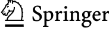

KC Santosh

应用人工智能研究实验室

计算机系

南达科他大学

Vermillion, SD, 美国

Rodriguez Rizk

应用人工智能研究实验室

计算机系

南达科他大学

Vermillion, SD, 美国

Siddhi K. Bajracharya

应用人工智能研究实验室

计算机系

南达科他大学

Vermillion, SD, 美国

# 前言

通常，应用人工智能的案例局限于使用现成的机器学习模型，其范围从医疗保健、金融到自主系统和农业。在机器学习领域探索技术细节与创新的之旅仍在进行中，我们希望这本书能作为指南针，引导读者穿越不断变化的人工智能图谱。算法和技术可能会演变，但人工智能的本质是永恒的。对于在各种应用/用例中利用机器学习模型进行的任何创新，其重点（创新点）通常包括模型选择、参数调优与优化、预训练模型的使用和迁移学习、对有限数据的正确利用、模型解释性和可说明性、特征工程以及 AutoML 的鲁棒性与安全性，以及计算成本效益和可扩展性。

使用现成的机器学习模型并非创新。构建机器学习模型的创新涉及探索、实验和改进的持续循环，重点在于考虑伦理影响和现实世界适用性的同时，推向可行性的边界。创新的机器学习算法通常建立对问题领域的深度理解之上，结合创造性思维，开发出优于传统/基础方法的新方法。这些开创性的架构为各行业的变革性进步铺了道路。对机器学习创新的追求不断驱动着人工智能的演进，推向可能的边界并塑造技术的未来。

本书强调了超越训练模型和现成构建组件的限制以有效解决现实世界问题的重要性。我们引导了三种基本数据类型：数值、文本和图像数据，对它们在各个领域的应用提供了实用的见解。从金融和住房市场的预测分析到来自媒体/新闻来源的文本挖掘，甚至是医学影像信息学中的异常筛选，本书涵盖了广泛的应用领域。在当今数据驱动的格局下，人工智能模型理解数据底层情感的能力是必要的。因此，本书探讨了人工智能模型如何通过理解和解释数据情感来真正证明自己的价值。此外，它强调了多模态学习和表示的重要性。通过整合音频和文本数据，我们旨在捕捉微妙的情绪，从而提升情感分析的性能。这种整合作为连接口语和书面的桥梁，使我们的模型能够准确感知人类情感的复杂性。这种方法通过无缝整合同一源的多种模态，实现了对数据更深层次的理解。

为了方便理解和可重复性，我们提供了 GitHub 源代码，涵盖了基础组件和高级机器学习工具（来源：`https://github.com/2ai-lab/ml-book-technicalities-innovation`）。

Vermillion, USA

KC Santosh

Rodrigue Rizk

Siddhi K. Bajracharya

## 4 实验设置 ..................................................................... 59

## 5 应用 AI 用例——从数值数据到图像数据 ................. 73

## 6 多模态学习与表示 ................ 109

## 7 技术性还是创新性？ ................ 125

# 作者简介

**KC Santosh 教授** 是一位成就卓越的 AI 专家——任南达科他大学计算机科学系主任，也是应用 AI 实验室的创始人兼总监。他曾于国家健康研究院担任研究员。在此之前，他在 LORIAS 研究与工业合作伙伴 ITESOF 直接合作，担任博士后科学家。他在 INRIA Nancy East 获得了计算机科学——人工智能博士学位。他拥有超过 200 万美元的资金，其中包括美国国防部（DOD） 2023 年用于 USD AI 研究能力建设的百万美元资助，涵盖 IEEE Transactions on PAMI。他是 IEEE Transactions on AI、International Journal of Machine Learning and Cybernetics 以及 International Journal of Pattern Recognition & Artificial Intelligence 等多个知名期刊的主编辑。例如，Santosh 教授荣得了 Cutler 教学与研究卓越奖（USD, 2021）、校长研究卓越奖（USD, 2019）以及美国卫生与人类服务部（HHS）的 Ignite 奖（2014）。作为 USD AI 课程的创立者，他在增加研究生人数方面迈了巨大步伐，在三年内实现了超过 300% 的增长。他的领导促进了与生物学、生物医学工程、可持续性和商业分析部门的跨学科合作。Santosh 教授在学术领导方面充满动力，他的贡献使 USD 成为南达科他州内 AI 项目的先驱。更多 `https://kc-santosh.org/`

**Rodriguez Rizk 博士**目前是南达科他大学的教授。Rizk 博士在圣母大学获得计算机通信工程学学士学位，并以 Summer Cum Laude 最高荣誉毕业，是该级的优等生，GPA 为 4.0/4.0。他在路易斯安那大学拉法分校获得了计算机工程硕士和博士学位，期间保持了完美的平均分。他的专业领域涵盖了软件与硬件之间的动态关系。他的研究

他的兴趣包括高层计算系统、人工智能、强化学习、量子与神经形态协同设计、深度学习优化、软硬件协同、异构计算、现场可编程门阵列（FPGA）、AI 硬件加速器以及新兴技术。Rizik 博士与信息学、计算机科学等其他几个领域的学者有着积极合作，并在顶级会议和期刊上发表了多篇论文。Rizik 博士是一位持业注册工程师，拥有丰富的行业知识，并是美国工程师协会（Order of the Engineer）的成员。他是荣誉的 Richard G. and Mary B. Neiheisel 资助奖金获得者、Phi Kappa Phi 社会终身会员，以及 ACM 和 IEEE 的专业会员。Rizik 博士还获得了许多著名奖项，包括总统教育卓越与卓越学术成就奖以及 Ragin 领导学院奖。

Siddhi K. Bajracharya 先生是南达科他大学计算机科学系应用 AI 实验室的研究员。他的研究重点是构建针对多种数据类型（数字、文本和图像）的通用和/或泛化的机器学习模型。

## 缩写词

# 图表列表

- 图 1.1 较大的房子可能具有更高的成本 ............................................ 3

- 图 1.2 新闻文章中的假新闻检测 ................................................ 5

- 图 1.3 X 射线图像中的肺肿块检测 [21] ................................................... 6

- 图 2.1 早期写作示例。埃及象形文字 [19] 和苏美尔粘土板 [20]（从左到右） ............................ 14

- 图 2.2 维度诅咒 ..................................................................... 19

- 图 2.3 新闻分类中的类别不平衡 ................................................... 20

- 图 2.4 分布图中的离群值可视化 ................................................... 21

- 图 2.5 图像中的不同仿射变换 ........................................ 22

- 图 3.1 回归分析（根据房屋面积预测房价） ............................ 26

- 图 3.2 多线性回归中三维特征的表示 ............................ 27

- 图 3.3 多项式回归（红线显示线性回归，蓝线显示多项式回归线） ............................ 28

- 图 3.4 蓝线显示拟合线，红线显示正则化线。正则化线也可以推广到测试集 ............................ 29

- 图 3.5 二分类分类：红色三角形代表类别 0，蓝色圆形代表类别 1 ............................ 30

- 图 3.6 使用 sigmoid 函数的逻辑回归。Sigmoid 函数输出值在 0 到 1 之间 . 31

- 图 3.7 支持向量机显示边界超平面和最优超平面 ............................ 32

- 图 3.8 用于预测泰坦尼号事件死亡情况的决策树 ............................ 33

- 图 3.9 用于分类鸢尾花类型的 K 近邻分类 ............................ 35

- 图 3.10 具有不同配置的不同预测的多个决策树 ............................ 36

- 图 3.11 根据收入和消费行为划分客户类型的聚类分析 ........................... 37

- 图 3.12 K-means 聚类显示五个簇及其质心（星形） ................................................................................. 38

- 图 3.13 DBSCAN 算法 ................................................................................................ 39

- 图 3.14 高斯混合模型 ............................................................................ 40

- 图 3.15 高斯混合模型创建的倾斜簇 ............................................ 41

- 图 3.16 降维 ................................................................................................ 42

- 图 3.17 主成分 ................................................................................................ 44

- 图 3.18 神经元的基本结构 ....................................................... 45

- 图 3.19 ANN 架构 ................................................................................. 48

- 图 3.20 卷积过程 ................................................................................. 50

- 图 3.21 NLP 过程 ................................................................................ 52

- 图 3.22 词向量表示。相似或相关的词相互靠近 ................... 53

- 图 3.23 循环神经网络架构。折叠（左）和展开（右） ................................ 54

- 图 3.25 “Attention is All Need”中描述的 Transformer 架构 [20] ... 55

- 图 3.26 “attention is all you” [20] 中的多头注意力 . 57

- 图 4.1 Jupyter Notebook 交互式终端 ............................................ 60

- 图 4.2 启动 Jupyter Notebook ................................................ 61

- 图 4.3 使用 Anaconda 安装包 ................... 62

- 图 4.4 pandas 特性概述 ................................................ 63

- 图 4.5 使用 Matplotlib 生成简单图表的示例代码 ................ 64

- 图 4.6 用于二分类的混淆矩阵及派生评估指标 ................... 64

- 图 5.1 使用 scikit-learn 加载数据集 ............................ 75

- 图 5.2 指定特征和目标变量 ................... 75

- 图 5.3 数据特征 ................................................ 75

- 图 5.4 目标变量 ................................................ 76

- 图 5.5 将数据集划分为训练和测试集 ... 76

- 图 5.6 封装 LinearRegressor() 类 ... 77

- 图 5.7 创建模型、训练和预测 ................................. 77

- 图 5.8 可视化结果 ................................... 78

- 图 5.9 创建多项式特征 ................... 78

- 图 5.10 替换 LinearModel(with Lasso()) ... 79

- 图 5.11 下载 Wordnet 语料 ... 80

- 图 5.12 加载数据集 ... 80

- 图 5.13 从真实 dataframe 中移除 (Reuters) ... 81

- 图 5.14 创建特征和目标变量 ... 81

- 图 5.15 去停用词并进行词形化的函数 ... 81

# 图表列表

- 图 5.16 对新闻文本进行训练和测试的向量化 ........................... 82

- 图 5.17 模型的训练与测试 ................................................................. . . . . . . . 82

- 图 5.18 RandomForestClassifier 的混淆矩阵 ................................................ 83

- 图 5.19 其他算法 .......................................................................................... 84

- 图 5.20 加载数据 ....................................................................................... 85

- 图 5.21 使用序列模型的双向 LSTM ........................................ 86

- 图 5.22 编译模型 ................................................................................... 87

- 图 5.23 模型的训练与测试 ................................................................. 87

- 图 5.24 加载数据并拼接 ................................................................ 88

- 图 5.25 文本的预处理与验证 ................................................ 88

- 图 5.26 Dataset 类的定义与初始化 ........................................ 89

- 图 5.27 划分数据集 ................................................................................ 89

- 图 5.28 LSTM 分类模型 ............................................................ 90

- 图 5.29 初始化模型、优化器和损失函数 ................ 90

- 图 5.30 PyTorch 中的训练与验证循环 ................................ 91

- 图 5.31 数据加载与预处理 ....................................... 93

- 图 5.32 胸部 X 光的可视化 ................................................... 94

- 图 5.33 RandomForestClassifier 的训练与测试 .............. 94

- 图 5.34 医学图像分类的混淆矩阵 ............ 95

- 图 5.35 使用 ImageDataGenerator 加载数据 ........................ 96

- 图 5.36 创建并编译模型 ................................ 97


- 图 5.37 创建 CNN 模型 ................................................... 97
- 图 5.38 用于加载和预处理的 Dataset 类 ........... 99
- 图 5.39 创建 CNN 模型并设置参数 ................ 100
- 图 5.40 训练与验证循环 ....................................... 101
- 图 5.41 回归的平均绝对误差和均方误差 102
- 图 5.42 绘制验证损失和训练损失 ........ 104
- 图 5.43 PyTorch 中的推理 ................................................ 105
- 图 5.44 绘制混淆矩阵 ....................................... 106
- 图 5.45 分类评估指标的计算 ........... 106
- 图 6.1 显示脚本化和自发会话中每轮单词百分比的直方图（从左到右）[1] .......................................................................... 112
- 图 6.2 分类分类和自发会话中的情感分布（从左到右）[1] ................ 112
- 图 6.3 使用文本和听觉数据的情感分类 .. 113
- 图 6.4 加载包 ................................................... 114
- 图 6.5 针对音频和文本数据的 Dataset 类 ................ 116
- 图 6.6 加载并划分数据集 ....................... 117
- 图 6.7 创建 MultimodalClassifier 类 ............ 118
- 图 6.8 前向传播方法 ....................... 119
- 图 6.9 快速级模型的额外方法 ................ 120
- 图 6.10 训练模型 ....................................... 120
- 图 6.11 使用 BERT 编码器的 TextClassifier ................ 121
- 图 6.12 TextClassifier 的前向方法 ................................................ 121
- 图 6.13 基于文本的模型训练_step 和 validation_step 方法的更改 ........................................ 122
- 图 6.14 基于文本的多模态架构生成训练和验证损失及 f1 分数 ................................................................ 122
- 图 6.15 整个训练迭代过程中训练/验证损失和 f1 分数的趋势 ................................................................ 123

# 表格列表

- 表格 3.1 常见激活函数及其公式及插图 ...................................................................... 46
- 表格 5.1 波士顿住房数据集特征描述 ................................................................................ 74
- 表格 5.2 假新闻数据集描述 ................................................................................................ 79
- 表格 5.3 类别标签分布 ............................................................................................ 92

# 第1章

## 引言

从 AI 的早期开始，其根源可以追溯到20世纪初，该领域经历过炒热和幻灭的时期，即著名的“AI 寒冬”。虽然早期的 AI 先驱们为人工智能奠定了基础，但直到深度神经网络的出现，我们才见证了重大的范式转移，标志着我们现在所知的深度学习的开端。然而，自那些关键发展以来，该领域并没有经历过革命性的核心进展。相反，AI 的轨迹特征是在基于现有基础进行的一系列渐进式改进和累积优化。

AI 的本质上并没有引发另一场工业革命，而是演变成了一种影响我们生活方方面面的变革性力量。这种转变主要发生在 AI 的应用层面，技术已经渗透了许多领域，改变了。

## 1.1 AI 应用案例

作为一个案例研究，在书的后面，我们将使用浅层和深度学习技术，利用著名的波士顿住房数据集 [11] 来研究房价预测。在一个没有许多变量需要考虑的简单情况下，预测房价可以非常容易。假设你正打算买房；你希望希望价格是公平且具有竞争力的。一个朴素的假设是：房子越大比小房子越贵。现在你发现了市场上最大的房子，而它的价格显著低于其他房子。你会考虑购买它吗？还是你也想看看其他因素，如位置或房子的房龄？如果你看中的房子位于一个犯罪事件频发的社区呢？有许多因素必须与其他因素一起考虑，这使得问题变得更加复杂。人类大脑天生并不擅长处理大量数字，更不用说发现其中隐藏的模式了。

让我们分析一下目前为止的思维过程。我们一直依赖于对住房市场的许多假设，而且缺乏具体的证据证明这些数值因素确实影响了房价。另一种方法是请房地产中介并信任他们的专业知识，或者独立做出明智的决策。为了验证我们的假设，我们可以利用可用数据，但处理所有数字并得出一个可靠的结论是挑战性的。通过回归分析等方法，我们可以揭示隐藏的模式，获得对市场的洞察，并做出有根据的选择。例如，图 1.1 显示了房价与房屋面积之间的线性关系。这种关系可以从线性回归模型中提取。

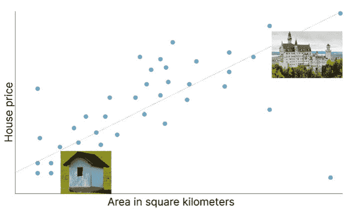

图 1.1 较大的房子可能有更高的成本

### 1.1.1 金融预测分析与决策

这种数据驱动的决策方法非常有前景，且多功能性，足以应用于其他领域。一旦我们掌握了有效处理和利用数值数据的技能，就可以轻松地将这些知识应用到不同的领域和场景。我们用于理解住房市场的相同算法和分析方法也可以被用于预测疾病爆发、评估制造业中的资源需求，并为各种挑战提供解决方案。

### 1.1.2 公平的新闻与媒体

“虚假信息是一个老话题，正受到新技术的推波” [12]。操纵信息并不新鲜，自古以来就有。随着时间的推移，我们发现了传播信息的新方法，甚至是更新的操纵信息的方法。社交媒体是大多数人最大的信息来源之一。但美国三分之一（31%）的成人从 Facebook [13] 获取新闻。这些社交媒体平台是伪造新闻的易事场所，因为来源很多，无法将新闻与真实新闻区分来。

生成式 AI 的进步使得制作虚假内容变得更加容易。最近在孟加拉，AI 生成的深度伪造（deepfakes）影响着 2024 年的。根据多个新闻来源 [14, 15]，亲政府媒体使用 HeyGen 等 AI 工具制作了一个视频，指控美国外交官干预孟加拉的选举过程。AI 生成的主播员“Edward”传播了虚假信息，影响了公众认知。尽管存在威胁，但仍缺乏有效的检测技术。全球科技巨头的努力（如 Google 和 Meta 的披露政策）在较小市场是不够的。这凸显了对高级 AI 检测、监管和国际合作的迫切需求，以保持媒体和新闻的公平。

在第二个案例研究中，我们观察 AI 如何缓解新闻伪造和操纵的问题。早期的新闻在发布之前需要进行人工事实核查 [16]，这是一项手动任务。随着新闻出版数量的增加，核查大多数事实并不困难，而且检查它们的信誉也很容易。然而，正如所讨论的，由于互联网，现在任何人可以在互联网上发布任何内容。轻信的读者会掉入这种欺骗性的设计，而不那么容易利用的读者至少会尝试进行事实核查。但事实核查变得混乱混乱，因为有大量信息被人们当作事实呈现出来。因此，随着 AI 的进步，我们现在可以处理大量的文本来检测虚假信息的模式 [17]。例如，核查新闻文章是 AI 在新闻领域的众多应用之一（图 1.2）。

互联网和社交媒体以文本的形式出现。文本是我们经常遇到的另一种模态，而对于我们的案例研究，我们关注新闻文章中的虚假新闻检测。

**图 1.2** 虚假新闻


新闻分类数据集。这是一个分类问题，但它需要一些预处理的特殊模型，如 transformers [18] 和 RNN，我们将在后续章节中介绍它们。

### 1.1.3 医学影像信息学

医学信息学是指将信息技术、数据科学（例如，预测 [19]）、分析、机器学习和人工智能应用于健康相关数据的管理、分析和解释中，特别关注医学影像 [20]。每天产生的海量健康相关数据包括各种类型的信息，例如来自个人设备（如健身心率监测器、移动端应用程序）、环境传感器、电子健康记录、病理报告、实验室结果、医学影像、语音记录等。

AI 改变了医学影像的格局。机器学习被广泛用于检测 X 光异常 [21–26]、CT 扫描 [25, 27–30] 和 MRI 扫描 [31]。所有的诊断都需要这些类型的影像，如 CT 扫描、X 光、MRI 扫描等。根据世界卫生组织的说法，70% 到 80% 的诊断问题可以通过更廉价的成像技术（如 X 光和超声）解决。近期，计算机视觉和深度学习技术已用于通过 X 光检测新冠肺炎 [33–35]。医学影像涵盖了广泛的应用，包括使用堆叠泛化模型分析 X 光、通过分割方法检测 TB 以及通过深度学习进行脑肿瘤图像分割。AI 的影响也体现在生物医学应用中的 3D 成像等领域 [19]。然而，全球三分之二的人无法获得影像诊断。问题的出现不仅是因为缺乏适当的仪器，还因为放射科医生和专业技术人才的短缺。尽管 AI 可能在提供仪器方面没有帮助，但通过自动化诊断可以缓解劳动力需求。目前已有手持工具，例如 Micro-CXOS [36]，这是一种手持 X 光设备。在这些设备中集成深度学习视觉模型可以有效解决这些问题并帮助资源限制地区。此外，为了确保数据隐私，可以结合联邦学习技术 [24]。

我们在后续章节中看到的最后一个案例是医学影像领域。例如，我们将讨论的最后一种模态，即图像无处不在，研究如何使用浅层和深度学习有效处理图像是有意义的，但最重要的无疑是 CNN（卷积神经网络）[38, 39]。所有的深度学习架构都使用 CNN 作为构建组件。在第 5 章中，我们将学习使用和不用 CNN 开发深度学习模型。目前的实现包括多模态技术和主动医学影像的使用 [20, 40, 41]。

对于我们的案例研究，我们选择了来自 NIH [21] 的各种胸部 X 光图像（见图 1.3）。X 光是许多肺部疾病（如结核、肺癌和肺炎）的主要诊断影像工具 [26, 42]。数据集包含与肺部相关的各种状况，但为了简单起见，我们只考虑两种情况：正常和异常。更多将在第 5 章的实现中解释。

图 1.3 X 光图像中的肺肿检测 [21]

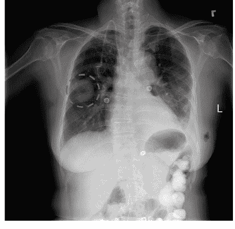

## 1.2 技术细节还是创新？

当涉及到通过将机器学习模型应用于各种场景和问题来进行创新时，创新的重点通常包括：(a) 模型选择、(b) 参数调优与优化、(c) 预训练模型与迁移学习、(d) 有限数据的合理使用、(e) 模型解释性和说明性、(f) 特征工程和自动机器学习（AutoML）、(g) 健壮性和安全性以及 (h) 计算成本——效率与可扩展性。

**模型选择与适配：** 为特定问题选择最合适的模型架构或组合。这涉及到对不同算法、架构或集成方法进行实验以优化性能。类比之，这非常像汽车修理厂的技工工作，意味着获取正确的工具并修复汽车。

**超参数调优与优化：** 在这种情况下，创新在于那些能够高效搜索和优化超参数的技术，例如学习率、正则化参数或网络深度，以增强模型性能。

**预训练模型与迁移学习：** 如前所述，知识迁移是关键。通过利用迁移学习或预训练模型将知识从一个领域迁移到另一个领域，加速模型训练，并提高对新任务或数据集的泛化能力。

**有限数据的合理使用：** 寻找处理有限或不平衡数据集的创造性解决方案，包括数据增强、合成数据生成或半监督学习方法。

**模型解释性和说明性：** 创新方法以使复杂模型更具解释性和可说明性 [43]，为模型决策提供见解，以获得更好的信任和理解。

**特征工程与自动机器学习：** 开发自动化方法执行特征工程、模型选择、参数调优和流水线优化，以简化机器学习流程。

**健壮性和安全性：** 增强模型对对抗性攻击健壮性的创新，确保机器学习系统在现实世界场景中的可靠性和安全性。

在此背景下，机器学习创新涉及不断完善和改进用于解决各个领域问题的方法和工具。重点在于当机器学习模型应用于多样化且具有挑战性的现实世界问题时，提高其性能、泛化能力、解释性和健壮性。

## 1.3 总结

在一个人工智能往往被视为某种神秘和魔法的世界里，理解构建机器学习模型并不想象中那样具有突破性是至关重要的。它是一个需要关注细节的技术过程。本章旨在消除有关 AI 创新的炒作，重新定义它，并揭示其真实本质——算法、数据和计算的结合。在 AI 炒作之外，机器学习关乎技术细节。AI 真正的创新不在于创建模型，而在于它在各个领域的应用。重点应该放在它如何影响我们的生活，而不是背后的技术过程。

在整书中，我们将探索独特的应用 AI 用例，在这些案例中，AI 超越了抽象产生了意义的影响。我们将讨论三个示例：金融预测分析与决策、公正的新与媒体以及精准医学。

在金融预测分析与决策中，AI 算法帮助做出准确预测，并为决策者提供见解，以应对复杂的金融格局。

在公正的新与媒体中，AI 打破了传统叙事，减轻了偏见并确保了多元视角，成为媒体行业透明度和问责的力量。

在精准医学中，AI 成为医疗保健领域的关键伙伴，通过分析基因和临床数据协助医疗专业人员为个体患者定制治疗方案，以实现更有效、更高效的干预。

结论是，AI 创新不在于算法本身，而在于它们在现实世界中的应用。接下来的章节将继续探索 AI，将技术细节与其转型影响隔离开来，正如我们在人工智能时代重新定义对创新的理解一样。

# 第2章 理解数据——模态与预处理


**图 2.1** 早期文字示例。埃及象形文字 [19] 和苏美尔泥石板 [20]（从左到右）

近年来，机器学习取得了巨大进展，仅 Arxiv 每天发表的论文就超过 100 篇。开发的算法数量多不胜数，但它们都围绕着之前讨论的基础数据类型展开。回顾历史，短期内不太可能看到新的数据表示形式出现。作为处理数据的从业者，在数据模态方面拥有坚实的基础至关重要。在本章中，我们将深入探讨这些模态，讨论它们的特征以及如何利用它们从数据中提取价值的见解。通过理解不同的模态，我们可以有效地将适当的技术和算法应用于正确类型的数据，从而实现更有效、高效的数据分析。

## 2.1 数据模态

### 2.1.1 数值型数据

数值数据是机器学习算法中的一种关键数据类型。它以某种方式作为所有算法的基础。当我们在机器学习中讨论数值数据时，我们的重点从计算机内部进行的复杂计算和数字处理，转移到了人类在日常生活中遇到的数字。

数字无处不在，是计数、测量和标记的基本工具。在机器学习中，我们经常遇到数值数据，这使其成为许多模型中不可或缺的组件。使用数值数据构建模型相对简单，只需要极少的额外步骤即可将数据转换为机器学习算法利用的格式。数值数据可以进一步分类为离散型或连续型。离散数值数据通常用于计算物体的数量，通常具有顺序性。在某些情况下，离散数值数据可能具有名义值，例如为医院的患者分配数字，这些数字的意义与给患者标记标签没有区别。名义值的另一个例子是将猫标记为 1，将狗标记为 0。

连续型数字代表了另一类数值数据。金融机构（包括银行、保险公司和股票经纪人）使用连续数字来表示金融交易中的货币价值，并分析其业务的盈利能力。如果没有数字，追踪客户花费了多少钱将是一项挑战性任务。数值数据，无论是离散的连续的，在许多领域都起着至关重要的作用。作为机器学习从业者，区分这两种数值数据并选择合适的机器学习算法来有效分析分析和解释它们至关重要。


# 第2章 数据模态与预处理

## 2.1 数据模态

### 2.1.1 数值数据

回归模型等算法适用于预测连续值，例如房价价格。它们不适用于预测代表标签的离散数值。为了预测此类值（例如代表猫的 `1` 和代表狗的 `0`），我们需要使用分类模型，因为这些数字并不代表猫或狗的实际值。例如，尽管有些人可能更喜欢猫而不是狗，并可能给它们打更高的分，但我们训练的机器学习模型应该对这些偏好保持中立。在这种情况下，分类模型是合适的选择，因为我们并不关心数字所代表的值（即标签）。

### 2.1.2 文本数据

文本数据是我们在书籍、网站、研究文章和报纸中遇到的另一种类型的数据。文本是字母、数字和符号的组合：我们写下的任何内容都可以被视为文本。你现在正在阅读的这本书也是文本数据的示例。鉴于世界上存在大量的文本数据，在使用机器学习算法时，知道如何正确地处理它们至关重要。

与数值数据不同，文本数据没有内在价值，因此在机器学习算法中使用时需要特别注意。了解如何妥善处理和加工它至关重要。为了用机器学习算法处理文本数据，我们必须首先将其转换为数值表示。这种转换有许多技术。

文本数据可以有不同的形状和大小。例如，新闻文章通常由多个句子和段落组成，而药物和疾病的名称通常短小简洁。确保机器学习算法能够区分这些不同类型的文本数据，并将它们转换为适当的数值表示，以便有效用于分析和建模，是非常重要的。

使用机器学习算法处理文本数据的一个示例是经典的虚假新闻分类任务，或垃圾邮件和正常邮件的检测。让我们以虚假新闻分类任务为例。在当今世界，随着互联网的普及，每个人都能轻松地获取信息。不幸的是，这种易于获取的特性也会导致恶意意图，要区分真实信息和虚假信息可能是具有挑战性的，特别是在新闻领域。大部分消费者通过在线源和社交媒体阅读新闻，这为恶意分子利用这些消费者缺乏批判性思维能力或媒体素养来达成自己的恶意目的提供了机会。

从真实新闻中分类虚假新闻的一种通用方法是使用机器学习。由于机器只能理解数字，因此必须将文本数据转换为适当的数值表示。各种技术可以用于此目的，包括词袋模型、`word2vec` 和向量嵌入。这些技术将在本书的后续章节中探讨。一旦我们获得了正确格式的数据，就可以轻松地将其输入任何分类模型。

### 2.1.3 视觉数据

视觉数据可能是对人类来说最有吸引力的数据类型。与计算机相比，我们的大脑具有卓越的图像处理能力。大脑中的神经元对图像优于数字或文本。在上面的例子中，人类无法通过金融交易数据中的所有数字来做出信用审批的决策，分析新闻是否虚假同样具有挑战性。如果我们看到一张猫和狗的照片，我们能够立即从两张照片中识别出猫和狗。

视觉数据可以是静态图像或视频的形式。事实上，视频是快速呈现的静态图像序列。“电影”（motion picture）这个术语非常贴切，因为它通过连续移动多个图片创建。因此，任何适用于图像的技术或算法也可以应用于视频。例如，`YOLO` 是一种在图像检测中效果良好的算法。对于视频，`YOLO` 模型可以用于目标跟踪应用，实现实时目标检测和跟踪。

### 2.1.4 侧重多模态表示

在之前的章节中，我们一直专注于一次只分析一种类型的数据，无论是文本、数字还是图像。然而，这种单模态的方法无法完全捕捉真实生活体验的丰富性。想象一下闭着眼睛在电视上看你最喜欢的肥皂剧。你仍然可以通过音频跟上剧情，但视觉部分为你的理解增了深度和沉浸感。这凸显了在处理各种类型的数据时，有必要拥抱更整体的、多模态的视角，以进行更完整、更有意义的分析。

在此语境下，多模态数据是指从各种来源收集的信息。例如，在像 `[1, 2]` 这样的医学成像应用中，多模态可能包括同一解剖结构的 X 射线检查、CT 扫描或 MRI 扫描。尽管它们都是图像数据，但它们源自不同的传感器，使得它们是真正的多模态，这与上段介绍的示例形成对比。

在深度学习领域，实现这一点涉及从多种数据类型中捕捉不同的特征，将它们合并，并使用这种统一的特征表示来训练模型。鉴于我们已经接触了分别处理这些模态的方法，将它们整合起来以增强模型的质量和稳健性是逻辑所然。

## 2.2 数据预处理

在之前的几个章节中，我们学习了不同的数据模态，并查看了一些使用这些数据类型的真实机器学习应用。每种数据类型在机器学习模型使用它们之前，通常都需要进行某种程度的操作。数据预处理对于任何机器学习模型都是至关重要的，因为向模型输入垃圾只会产生垃圾结果。某些预处理方法对所有数据都是通用的，而另一些则是针对特定数据类型的。

学习爱好者的共同陷阱是忽略了投入数据准备的时间和精力。大多数学习项目都始于清理后的数据，这些数据在某种程度上保证产生良好的结果。在现实应用中，原始数据集几乎从不使用。我们将从一些适用于各种数据的常用数据预处理方法开始，同时讨论特定的数据模态。

### 2.2.1 处理缺失数据

在数据集中出现缺失数据是常见现象。这可能由于许多原因引起。例如，假设你为一个研究项目向一组个人发放调查问卷。某些个人可能会让几个字段为空，因为他们不理解该字段的意思，而另一些人可能会忽略它，甚至漏掉这些字段。作为研究人员，每一个数据点对你来说都是重要的，你不能让它们留空。

在这种情况下，你有两个选择：忽略具有缺失值的数据点或填充数据。如果你收集了大量数据，可能忽略这些数据点也没关系。但如果你的数据点很少，忽略它们可能会导致你丢失潜在的有价值的信息。

对于缺失的数值数据，你可以使用统计方法来填充这些值。使用均值、中位数众数填充缺失数据非常流行。使用这些集中趋势量填充缺失数据是简单且有效的。但是，这些值可能不代表真实值，事实也是如此。填充这些缺失值的更高级方法是通过执行数据分析，检查这些字段与目标变量和其他特征的分布。`Scikit-Learn` 提供了使用 k-最近邻方法填充缺失值的方法。

### 2.2.2 降维

对于任何机器学习模型，特征都是必须的。如果有人想建立一个预测房价的模型，他们可能应该考虑房屋的特征。例如，房子是什么时候建的？房子有多大？有几个房间？位置在哪里？这些都是我们在买房时问自己的一些问题。虽然了解更多房屋的情况是好事，但根据多个因素做决定会变得更加困难。

同样，对于任何机器学习模型，特征并不是越多越好。这被称为“维度灾难”。在图 2.2 中，我们看到了不同维度下的某些数据图表。当我们从高维表示移动到低维表示时，我们注意到数据变得不那么稀疏，数据点的数量可以代表大部分空间。如果我们考虑图 2.2 中的 3 维空间（具有三个特征的数据集），使用这些数据构建的模型将无法在这个维度空间中进行学习。从中得出的启示是，如果我们想使用许多特征，我们必须确保我们有足够大的数据集来表示整个维度空间。

可以通过多种技术减少维度。一种方法是使用特征选择技术，例如删除彼此之间高度相关的特征。另一种流行的技术是使用卡方方法，只保留与目标变量高度依赖的特征。另一种特征选择技术是使用所有特征构建模型，并迭代地删除较不重要的特征。在每次迭代中，移除对模型预测能力贡献最小的特征。这种选择方法被称为后向特征选择。如果我们从一个特征开始迭代地添加特征，那么它被称为正向特征选择方法。

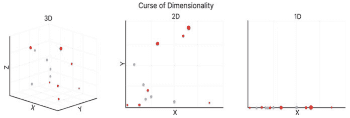

**图 2.2** 维度灾难

### 2.2.3 处理不平衡数据

不平衡数据集是大多数从业者面临的另一个普遍问题。简单来说，数据不平衡意味着你的某些事物的示例比其他示例多。让我们用一个现实生活的例子来说明这个问题。假设我们正在教一个孩子区分三种形状：三角形、正方形和矩形。

### 2.2.4 离群值

数据中的离群值非常常见。这些是那些明显偏离平均值的数据点。在机器学习中，我们将这些在统计上罕见的数据点称为离群值。这些离群值可能是自然产生的，并证明可以改进模型。但有时，这些出现是由于数据收集错误导致的。虽然罕见，但出现百岁老人是完全正常的。然而，年龄超过 `150` 岁的人出现是不可能的，并且可能需要处理此类离群值。这些离群值会损害所收集数据的可靠性，不可靠的数据会产生不可靠的模型。较大的离群值也会偏曲数据分布。

在我们开始处理离群值之前，对其进行适当调查是非常重要的。如果数值不合理（例如，年龄为 `200` 和 `-2`），那么最好是移除离群值或用均值或中位数替换它们。为了过滤离群值，我们可以使用四分位范围（`IQR`）、`z-score` 和改进 `z-score` 等技术 `[4]`（图 2.4）。

**图 2.4** 分布图中的离群值可视化

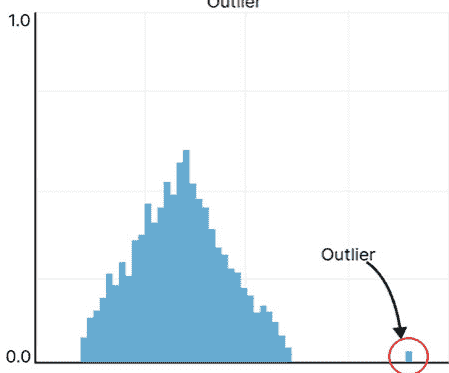

### 2.2.5 数据转换

如前几章节所述，数据以多种模态存在。有必要将数据转换为所使用的机器学习模型能够理解的格式。数据转换可以从简单到非常复杂的技巧不等。数值特征可能是广泛的，并且具有不同的范围。例如，年龄范围可能从 `0` 到 `100`，而薪资范围可能从数百美元不等。在使用这些不同范围的特征构建模型时，模型可能会学习到薪资比年龄重要——这并不一定真实。为了将这些值引入相同的尺度，我们可以使用归一化、标准化和缩放等技术 `[5]`。对于类别值，我们使用标签编码器（`label-encoders`）或独热编码器（`one-hot encoders`）将其表示为数值格式。

文本的转换与数值值有所不同。回想我们讨论过的假新闻分类或检测问题的示例。我们使用的特征是字符串。显然，许多学习模型无法理解字符串。最流行且简易的解决方案之一是使用词袋模型 `[6]`。更复杂的方法是 `word2vec` `[7]` 和 `TF-IDF` 方法。特征也可以使用深度学习方法（如 `BERT` `[8]`）通过嵌入（`embeddings`）提取。然而，在计算词表示之前，文本应该经过一些通用步骤，包括归一化、分词、词形还原/词干提取以及标点/空格/停用词的删除。

正如我们所知，图像是范围从 `0` 到 `255` 或 8 位图像（`0` 到 `2^8-1`）的像素值多维数组。这些值很大，对模型来说可能成本很高。我们通过将每个值除以 `255` 来对其归一化。通常，图像具有代表每个颜色通道（红、绿、蓝）的二维数组。通常，构建模型并不总是需要 RGB 通道，在这种情况下，图像被转换为灰度图——单通道。这进一步降低了计算的复杂性。其他变换如旋转、缩放、裁剪、基于直方图的技术和生成对抗网络也可以应用于图像 `[9]`。此类变换用于从现有图像生成新图像以解决过拟合问题。这些谨慎使用这些方法通常被称为数据增强。尽管在医学影像等敏感领域，数据增强可能并不完全合理 `[10]`（图 2.5）。

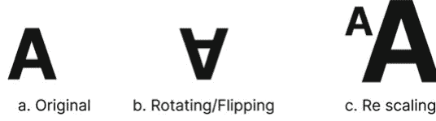

**图 2.5** 图像中不同的仿射变换

## 2.3 总结

在本章中，我们探索了数据模态以及数据预处理的关键过程。我们还介绍了三种核心数据模态——数值、文本和视觉。其中，我们强调了理解这些模态对于更好的学习和/或决策过程的必要性。

这就是我们在机器学习世界中观察不同数据类型的方式。数值数据是机器学习的基础，我们讨论了它的离散连续形式。文本数据具有独特的挑战，我们讨论了将其转换为数值表示的技术，特别是对于分类假新闻等任务。视觉数据对人类来说是直观的，但对机器来说是复杂的，我们讨论了将其转换为像素强度值数组，重点关注卷积神经网络（`CNN`）。数据预处理至关重要，我们涵盖了适用于所有数据模态的常用技术，包括处理缺失数据、降维、处理不平衡数据、管理离群值和数据转换 `[11, 12]`。我们讨论了用于缺失数据的插补策略、用于降维的特征选择，以及处理不平衡数据集和离群值的方法。

以下是所有机器学习科学家在项目（现实世界）中都会看到的典型案例。他们的数据集最初规模较小，但随着时间的推移增长巨大，需要持续的机器学习适应过程。随着数据流入，模型必须动态演变以适应这些变化，确保其相关性和性能（优化）。然而，何时停止集成或添加数据以及 (b) 何时确定模型已就绪 `[13, 14]`。这一关键决策通常基于对数据语义及其目的的理解。此外，这强调了纯数据量之外的模态的重要性（例如医学影像信息 `[13, 18]`）。它带给我们的上下文以及嵌入数据中的目的，除了其大小和复杂性。有效利用数据集和上下文相关性对于构建不仅能管理大量非结构化数据集还能利用其来指导决策过程的方法至关重要。总而言，到此，本章为我们提供了理解和为机器学习应用预处理数据的知识和工具。

# 第3章 基础构建模块：从浅学习到深度学习

在本章中，我们将讨论浅学习和深度学习的基础构建模块。我们将介绍传统的机器学习模型，如回归、分类、聚类和降维。之后，我们还将介绍深度学习，并讨论重要的架构，如卷积神经网络（`CNN`）、循环神经网络（`RNN`）和 `Transformer`。

## 3.1 回归分析

回归模型是许多从业者用于建立因变量与一个或多个自变量之间关系的统计技术。

### 3.1.1 简单线性回归

简单线性回归意味着只有一个自变量。例如，使用简单线性回归模型，我们可以建立房价与房屋面积之间的关系。在这里，房屋面积将是自变量，因变量将是房价。该模型随后可以根据房屋面积预测房价。这种类型的回归模型可以在二维图中轻松可视化。查看图 3.1，回归线可以表示为 $y = mx + C$。

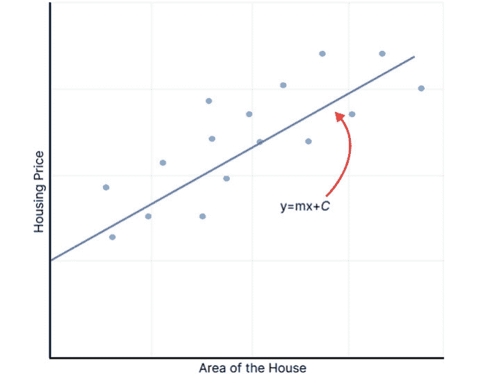

### 3.1.2 多元线性回归

如果存在多个自变量，则回归模型被称为多元线性回归（`MLR`）。我们可以通过引入多个自变量来扩展上述房价检测问题。例如，房价可能不仅取决于面积，还取决于位置、房屋建筑年份，这些变量被称为自变量，它们会影响因变量（即房价），影响可能是正向的也可能是负向的。多元回归模型可以建立这些自变量与因变量以及房价之间的关系。这种模型具有更多维度，因此无法通过肉眼进行可视化（想象图 3.2 中每个特征对应一个轴）。

向模型添加更多特征是可能的，但产生的结果（可视化结果）将变得越来越难以处理。在三维平面上，可以通过近似函数 $y = \beta_0 + \beta_1x_1 + \beta_2x_2$ 来预测价格，其中 $\beta_0$ 是截距项，$\beta_1$ 和 $\beta_2$ 是特征的系数：$x_1$（犯罪率）和 $x_2$（房龄）。

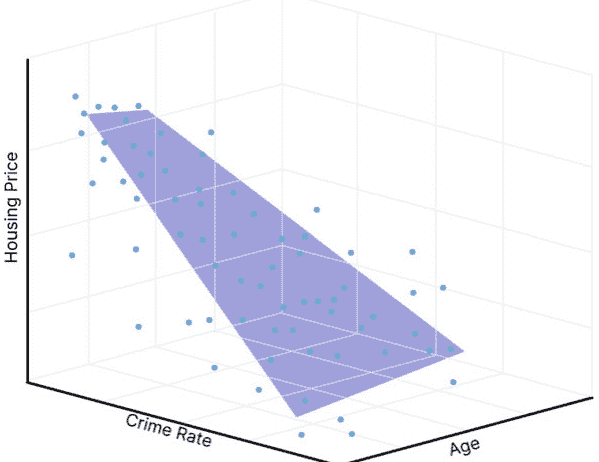

**图 3.2** 多元线性回归中三维特征的表示

### 3.1.3 多项式回归

与线性回归一样，多项式回归是一种统计量，用于建立一个或多个自变量与因变量 $y$ 之间的关系。线性回归只能解决线性问题，但多项式回归正如其名，也可以处理非线性数据。非线性是通过引入 $n$ 次多项项引入的。

让我们了解这些多项式项和多项式阶。假设我们有特征 $x_0, x_1$ 和 $x_2$，且多项式阶为二。我们将拥有 $x_0^2, x_0x_1, x_0x_2$ 等多项项。通过这样做，我们能够研究多个特征对因变量的组合影响。在某些情况下，我们可以忽略 $x^2$ 这样的项，因为它们与 $x$ 高度相关。其他剩余项被称为交互项。

多项式回归模型可以使用方程表示：$y = \beta_0 + \beta_1x_0 + \beta_2x_0^2$，其中 $x_0, x_0^2$ 代表房龄的多项式项，$\beta_0, \beta_1$ 和 $\beta_2$ 代表截距和项的系数。从图 3.3 可以观察到多项式回归捕捉了两个变量之间的非线性关系。

**图 3.3** 多项式回归（红线显示简单线性回归，蓝线显示多项式线性回归线）

### 3.1.4 岭回归

岭回归是带有 L2 正则化的简单线性回归。它用于处理数据集中的多共线性问题。当线性回归器面临过拟合且存在大量特征时，也可以使用它。简单来说，它是一种特征选择方法。其余过程与线性回归相同。在图 3.4 中，拟合模型对测试集的泛化效果不好。通过在模型中引入正则化，我们可以使模型泛化以拟合与训练数据行为不同的未见数据。L1 和 L2 正则化技术超出了本书的范围。然而，它们是经典技术。`[1]`

### 3.1.5 Lasso 回归

Lasso 回归是带有 L1 正则化的简单线性回归。与岭回归一样，它也引入了惩罚因子。Lasso 回归考虑系数的幅度。

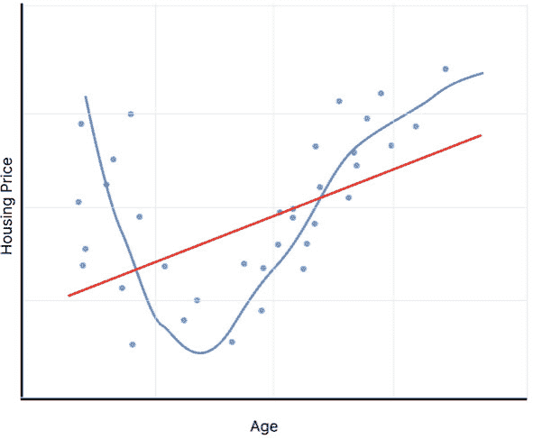

### 3.1.6 弹性网络回归

使用哪种正则化技术有时会令人困惑。为了利用两种正则化的优势，可以使用弹性网络。它同时使用了 L1 和 L2。

### 3.1.7 其他回归器

许多其他回归器可以用于特定场景。某个模型可能无效，而其他模型在相同数据上效果良好。因此，有必要了解回归的底层假设。其他回归模型包括：

- 支持向量回归器
- 决策树回归器
- 梯度提升回归器
- 随机森林回归器
- `XGBoost` 回归器

## 3.2 分类

我们说在回归中我们有一个连续值，如房价。因此回归是处理连续值的算法。但如果值是离散的呢？例如，我们需要判断给定的动物是狗还是猫。猫和狗是两个类别。不一定只有两个类别。

当然，并不是所有算法都能处理像狗和猫这样的类别值，我们用数值表示它：例如，用 `0` 代表狗，用 `1` 代表猫。同样重要的是，`0` 和 `1` 都代表名义数据（类别），而不是有序值。我们可以在图 3.5 中看到二分类的示例。

### 3.2.1 逻辑回归

逻辑回归适用于分类问题，因为它估计了事件发生的概率。当然，概率值范围在 `0` 到 `1` 之间（这类似于我们预测 `0` 到 `1` 连续值时的回归问题）。在逻辑回归中，使用了一种称为 Sigmoid 函数的特殊数学函数：

$$y = \frac{1}{1 + e^{-x}}$$

Sigmoid 函数接受输入 $x$，并输出 `0` 到 `1` 之间的值。然后我们确定一个阈值（例如 `0.5`），高于该阈值的预测类别为 `1`，低于该阈值的预测类别为 `0`（图 3.6）。

### 3.2.2 支持向量机

支持向量机（`SVMs`）是一组用于分类的监督学习方法。它们也可以用于其他的监督学习问题，如回归分析。支持向量机和其他算法一样适用于任意数量的特征（维度），但为了直观起见，让我们以一个二维数据示例为例，如图 3.7 所示。

**图 3.7** 显示边界超平面和最优超平面的向量机

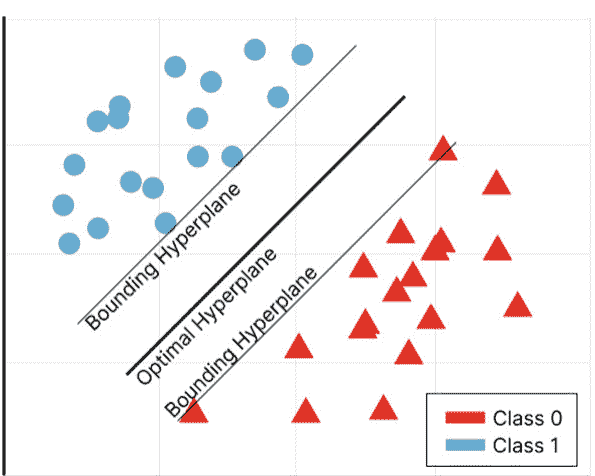

支持向量机试图创建一个最优超平面（称为支持向量），以便尝试最大化与类别之间的间距（如图 3.7 所示）。在图中，我们只考虑了两个特征，因此只得到一条分割两个类别的线。`SVM` 模型（或决策边界）的标准写法方式为：

$$z(x) = w^T x + b,$$

其中 $w^T$ 是计算出的决策边界的权重向量转置，$x$ 是特征向量。我们可以定义分类器 $f(z)$ 为：


$f(z) = \begin{cases} 0 & \text{if } z \ge 0 \\ 1 & \text{if } z < 0 \end{cases}$

该条件确保了特征向量根据其位于超平面的哪侧进行分类。最优超平面是从现有数据得出的，但我们也希望 SVM 模型能够在新的（或未测试的）数据上泛化。为了确信地分类新的观测值，SVM 算法还计算了边界超平面。我们计算决策边界（如图 3.7 所示），使得两个类别之间存在尽可能的空间。这些边界的计算超出本书。鼓励读者阅读 [2]。

## 3.2 分类

### 3.2.3 决策树分类器

决策树是另一种分类算法。与 SVM 一样，它也可以用于回归。但目前我们的重点是决策树分类器。决策树也被称为分类回归树（CART）。决策树创建了一组用于决策的规则。这些规则是非参数算法的示例，这意味着模型对数据没有任何统计假设。

让我们看看图 3.8，使用著名的泰坦尼克数据集来可视化决策树。任务是根据年龄等特征预测个人是否能够幸存。

在图 3.8 中，第一个决策是基于乘客的性别。我们可以从第一个根节点看出，如果乘客是男性，那么他的生存概率较低。决策树清晰地传达了数据中的见解，不需要大量的解释。

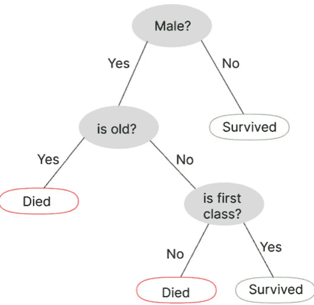

图 3.8 用于预测泰坦尼克号事件死亡的决策树

### 3.2.4 朴素贝叶斯分类器

朴素贝叶斯分类器是一种基于条件概率定理的分类算法。该分类器基于贝叶斯定理：

```
$$P(A|B) = P(A)\frac{P(B|A)}{P(B)}$$
```

让我们看看上面的公式。它给出了在事件 $B$（证据）已经发生的情况下，事件 $A$（假设）发生的概率 $P(A)$。朴素贝叶斯假设特征之间是相互独立的。由于这种宽松的假设，该算法被称为“朴素”（naive）。为了让它更直观，让我们用 $X$ 和 $y$ 重写上面的方程。$X$ 和 $y$ 是输出：

```
$$P(y|X) = P(Y)\frac{P(X|y)}{P(X)}$$
```

因此，我们可以重新描述定义以适应分类问题。朴素贝叶斯分类器为给定的 $X$ 列表（参数/特征）给出了 $y$（预测）的概率。我们可以进一步扩展方程为

```
$$P(y|x_1, x_2, \dots, x_n) = P(y)\frac{P(x_1|y)P(x_2|y) \dots P(x_n|y)}{P(x_1)P(x_2) \dots P(x_n)}$$
```

其中 $x_i$ 对应于特征属性，如花瓣长度（cm）和花瓣宽度（cm）。特征独立的假设是朴素贝叶斯分类器最大的弱点。在现实生活中，这些特征很少是独立的。这阻碍了分类器的性能。

### 3.2.5 K-近邻分类器

K-近邻分类器是另一种监督分类算法，也可以用于回归。这些算法假设具有相似特征的邻近（邻域）。如果我们研究鸢花数据集，许多同种鸢花的样本将具有相似的特征，如果我们在这个多维平面上绘制这些特征，我们将看到这些样本的图聚集在一起。

为了简单起见，我们取两个特征：花瓣长度和花瓣宽度，并绘制散点图。我们看到折鸢花（Iris Setosa）聚集在左下侧。这种花的样本具有相似的花瓣长度和花瓣宽度，并且在这里彼此靠近。其他鸢花也可以看到这一点（但没有像折鸢花那样明显）（图 3.9）。

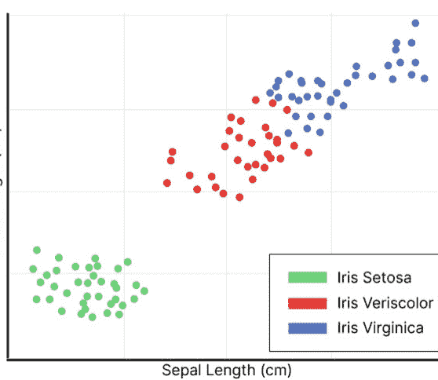

图 3.9 用于分类的 K-近邻

我们可以使用欧几里得距离、曼哈顿距离等距离指标来衡量接近。给定任意两个点 $p$ 和 $q$：$d(p, q) = \sqrt{\sum_{i=1}^{n}(q_i - p_i)^2}$。

### 3.2.6 随机森林分类器

随机森林顾名思义是决策树的集合。简单来说，我们有很多树。但我们如何确保这些树是不相同的呢？随机森林使用了一种名为 bagging（自助聚合）的集成技术。在 bagging 方法中，我们取数据的子样本并将其传递给一棵树。这确保了这些树是不相关的。

随机森林算法还实现了特征随机性。在普通的决策树中，所有特征都被传递给树并被使用。但在随机森林中，每棵树只能从随机特征集中进行选择。例如，假设我们对创建的树强制实施更多的变化。我们可以说有十棵不同的树（在实际实现中数量非常高）。决策树 1 可能从总训练数据集中取子样本，并可能选取特征 1 和特征 2；决策树 2 可能从总训练数据集中取另一个子样本并选取特征 2 和 4，以此类推。

在上面的示例中，我们看到随机森林算法创建了九棵不同的决策树。其中六个预测为球，只有三个预测结果为箱子。由于球比箱子多，球被随机森林分类器投票选为预测结果。

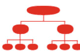

预测的球

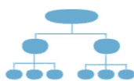

预测的箱子

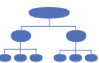

预测的球

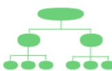

预测的球


预测的箱子

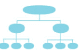

预测的球


预测的箱子

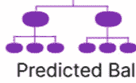

预测的球

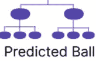

图 3.10 配置下具有不同预测的多棵决策树

### 3.2.7 其他分类器

还有其他各种分类器可以使用。其他分类器有：

- 梯度提升分类器
- XGBoost 分类器
- AdaBoost 分类器

## 3.3 聚类

聚类是一种无监督机器学习技术。在分类和回归中，我们看到数据集需要标签。相比之下，聚类算法作为一种无监督方法，不需要任何标签。聚类算法尝试在没有人工干预的情况下学习数据中的模式，并将数据集划分为不同的簇。

聚类算法虽然很有趣，但很难解释，因为我们不知道算法是基于什么基础创建这些簇的。这取决于领域知识专家来确定这些簇的含义。聚类特别不是一种预测解决方案，而是可以作为一种分析工具使用。

例如，我们可能想使用聚类对金融机构的客户类型进行细分。但如果没有金融知识，我们可能无法根据这些聚类算法的输出做出决策。在图 3.11 中，我们看到簇是根据某个金融机构的数据集创建的，但我们不知道这些簇代表什么。

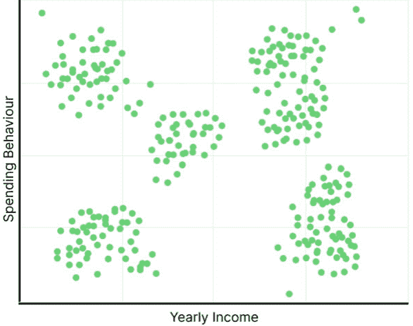

**图 3.11** 基于收入和消费行为划分客户类别的聚类分析

### 3.3.1 K-Means 聚类

K-Means 是一种要求执行者知道可能簇数量的聚类算法。假设簇的数量为 $K$。该算法从随机选择 $k$ 个质心作为簇的质心开始。然后在一个迭代过程中，重新计算质心的位置，最终找到优化的质心。两点 $p(p_1, p_2)$ 和 $q(q_1, q_2)$ 之间的距离可以使用欧几里得距离公式计算：$d(p, q) = \sqrt{(p_1 - q_1)^2 + (p_2 - q_2)^2}$。然后将质心附近的点分配给它们所属的簇。当簇的质心与其他点的距离最小化时，算法停止。算法也可以强制在经过一定次数迭代后停止（图 3.12）。

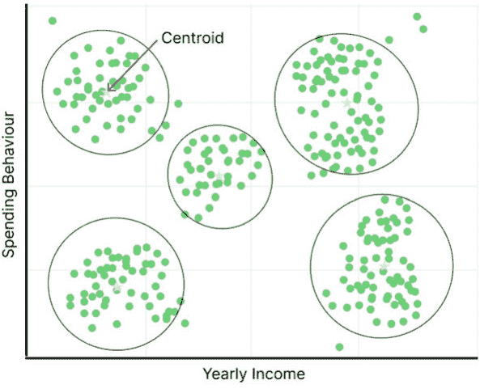

图 3.12 K-means 聚类显示了五个簇及其质心。

### 3.3.2 DBSCAN

DBSCAN 是基于密度的应用空间聚类的缩写。与 K-Means 聚类不同，DBSCAN 是一种不需要执行者指定簇数量的算法。DBSCAN 算法使用两个参数：

- `minPts`：被认为一个簇所需要的最少点数（或阈值）。
- `eps`：两点之间的距离测量，以便它们被认为是一个簇。

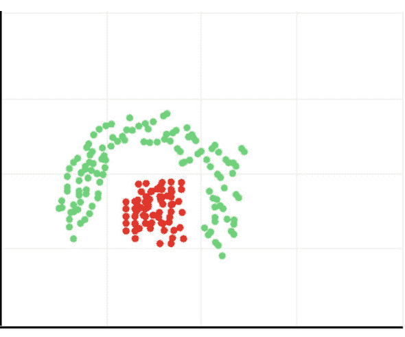

图 3.13 DBSCAN 算法

该算法从在数据集中选取随机点开始，然后开始寻找最小点数。如果满足阈值条件，就会形成一个簇。然后在一个迭代过程中，它通过搜索附近的点开始寻找其他点（图 3.13）。

### 3.3.3 高斯混合模型

高斯混合模型 (GMM) 是另一种使用概率方法进行聚类的无监督方法。正如其名所示，高斯混合包含几个不同的高斯分布（假设为 $k$，其中 $k$ 是簇的数量）。GMM 后面的数学原理相对直观。一个 GMM 由两组集合定义：混合权重 $\pi_k$ 以及分量均值 $\mu_k$ 和协方差 $\Sigma_k$。混合权重表示每个高斯分量的相对重要性，分量均值和协方差定义了每个组件分布的中心和形状。GMM 的概率密度函数由以下方程给出：$p(x) = \sum_{k=1}^k \pi_k N(\mu_k, \Sigma_k)$，其中 $N(\mu_k, \Sigma_k)$ 是 $k$ 的高斯概率密度（图 3.14）。

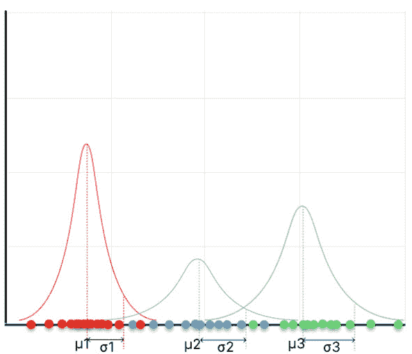

图 3.14 高斯混合模型

我们看到数据集被分为三个簇，每个簇都有自己的均值方差。简单来说，GMM 模型执行软分类（不像 k-means 聚类是在质心周围画一个圆圈，这给出了数据点属于某个簇的概率）。让我们以二维空间为例。k-means 聚类使得处理长方形数据变得困难（在 K-Means 聚类的插图中可以所示）。高斯混合模型可以通过创建长方形簇来处理这个问题。

## 3.4 降维

在机器学习中，维度指的是数据集中特征的数量。虽然我们可能会认为特征数量越多，我们的模型就越好，因为我们现在有更多数据来训练预测器，但我们必须理解机器学习模型是如何工作的，以便使用最优数量的特征。

### 3.4.1 维度灾难

让我们取一个只有一个特征的简单例子（图 3.15 中的第一张图）。我们看到没有稀疏性，图表上的数据点分布均匀，这意味着所有可能的空间都很好地代表了我们拥有的数据点。因此，如果我们在这这样的数据集上训练模型，就可以获得一个覆盖大多数情况的预测器。

让我们增加一个特征（看图 3.15 中的第二张图）。在这个图表中，数据点的数量保持不变，但我们引入了一个新维度。我们看到二维空间是稀疏的。然而，这些数据点仍然能够代表二维空间。当我们向空间再增加一个维度时，情况变得有趣了。由于数据点数量保持相同，我们看到空间非常稀疏，这些数据点无法准确地代表该空间。

### 3.4.2 主成分分析

$Y = X * W$。通常，我们选择 $k$ 以使其能够解释数据中的显著方差（例如 95% 或 99%）。

## 3.5 深度学习

深度学习是一种基于人工神经网络（ANN）的机器学习技术，它模拟了人类大脑的工作方式。神经网络的基本单元称为神经元，它们接收输入并根据数学计算给出输出。这些人工神经类似于人类大脑中的神经元。在经过数学运算后，通过一个激活函数，如果达到某个阈值，该神经元就会激活或点火（图 3.18）。

输入将是数值 $x_1, x_2$ 等。$w_1, w_2$ 等是神经元的权重，告诉我们该输入有多重要：

```
$z = x_0 * b + x_1 * w_1 + x_2 * w_2 + \cdots + x_n * w_n$.
```

我们将输出通过一个称为激活函数的函数，该函数决定神经元是否应该点火，$y = f(z)$。

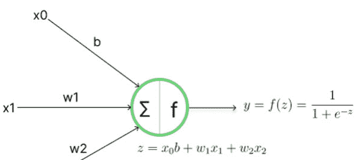

**图 3.18** 神经元的基本结构

这些激活函数为模型引入了非线性，因此如果有足够的神经元层，它们甚至可以处理高度非线性的数据。表 3.1 显示了一些激活函数 [6–9]。从理论上讲，描述的神经元可以以各种方式组合以近似任何函数。这些被称为神经网络，与前面节描述的浅学习技术相比，它们需要大量的数据进行训练。

一旦生成输出，我们必须计算损失，损失是真实值与预测值之间距离的量。损失函数的选择取决于我们处理的数据类型。通常，损失函数 $L$ 表示 $loss = L(y, y_{target})$。一旦计算出网络的损失，就会使用名为反向传播的数学算法。

反向传播是一种用于训练神经网络的数学技术。它涉及计算损失函数关于网络权重和偏置的梯度。该梯度随后被用于调整权重和偏置，旨在最小化损失。为了计算损失相对于输出的梯度，我们使用偏导数：

$\frac{\partial L}{\partial z} = \frac{\partial L}{\partial y} \frac{\partial y}{\partial z}$

使用该梯度，我们可以更新第 $n$ 层的权重，$w_{new} = w_n - \alpha \frac{\partial L}{\partial h_{n-1}}$，其中 $\alpha$ 是学习率，$y_n$ 是最后一层的输出。不可学习的参数 $\alpha$ 决定了算法的学习速度。将其设置过高可能会导致非最优解，并可能导致收敛缓慢。因此，针对不同的问题尝试不同的学习率是明智的。使用这种方法，整个神经网络的权重都会重新计算。重复此过程直到达到所需的损失。

**Sigmoid 函数：** Sigmoid 函数输出范围在 0–1 之间的值。这与二分类配合得很好，因为二分类的输出是 0 或 1。

### 表 3.1 常见激活函数、公式和插图

| 激活函数 | 公式 | 插图 |
| :--- | :--- | :--- |
| Sigmoid | $y = \frac{1}{1+e^{-x}}$ |  |
| ReLU | $y = \begin{cases} x, & x > 0 \\ 0, & \text{otherwise} \end{cases}$ |  |

### 表 3.1（续）

| 激活函数 | 公式 | 插图 |
| :--- | :--- | :--- |
| Leaky ReLU | $y = \begin{cases} x, & x < 0 \\ ax, & \text{otherwise} \end{cases}$ |  |
| Tanh | $y = \frac{e^x - e^{-x}}{e^x + e^{-x}}$ |  |

**ReLU**：修正线性单元（ReLU）在输入大于 0 时输出与输入相同的值。对于负值，ReLU 的输出为 0。某些神经元接收到零作为输入并变得不活跃。这不仅减少了计算的复杂性，还有助于泛化。

**Leaky ReLU**：Leaky ReLU 是 ReLU 的修改版本。它不是消除负输入，而是输出一个所需大小的值。通常该值很小。深度神经网络中的一个问题是梯度在训练过程中会变得极小，使得网络难以有效学习。

**Tanh 函数：** 这是一个双曲正切函数，对于任何输入都输出 -1 到 1 之间的值，使得它对于需要对正负输入进行强分离的任务非常有用。Tanh 激活函数主要出现在 RNN、自然语言处理（NLP）和语音识别任务中 [10]。

一个人工网络由许多相互连接的神经元组成（如图 3.19 所示）。第一层称为输入层，最后一层称为输出层。中间所有的层都称为隐藏层。此类层和神经元的数量与模型的复杂性成正比。这些神经网络也被称为通用函数生成器。

这些神经网络可以像传统算法一样轻松地解决分类和回归等问题，而不需要太多的调优。分类和回归可以使用不同的配置。例如，我们可以为回归设置一个单一输出来预测一个连续值。对于二分类，我们仍然可以使用单个概率值来使其工作。我们甚至可以使用多个输出节点来描述不同的类别。

然而，在使用深度学习模型时，有几点需要注意。这些算法是黑箱，很难解释我们是如何得到结果的；解释性丢失了。这些网络需要比传统机器学习模型多得多的数据。这些深度学习模型也很容易过拟合。

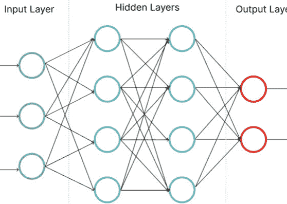

**图 3.19** ANN 架构

对于特定任务，我们需要多少层或多少神经元也没有通用的规则。

### 3.5.1 使用 ANN 进行分类

对于二分类问题，我们将采用单个输出节点。输入层中的节点数将等于特征总数。由于我们正在使用腰痛数据集（链接在下文的节中给出），它只有两个类（正常病例或异常病例）。所有步骤都像传统的机器学习问题一样。我们只需要构建自己的自定义神经网络即可。

ANN 的使用不仅限于分类，还可以用于回归问题以及我们之前讨论过的各种机器学习问题。然而，深度学习在计算机视觉和自然语言处理（NLP）等问题上成功，而在这些领域传统的机器学习模型失败了。

### 3.5.2 图像分类

图像数据或非结构化数据无法由传统的机器学习算法处理，但深度学习网络在任何时候都优于任何经典的机器学习模型。我们可以将图像看作像素的多维数组。一个 $16 \times 16$ 像素的灰度图像。有 256 个唯一的像素代表整个图像。解决图像分类问题的一种简单方法是将这 256 个唯一像素直接输入到全连接神经网络。这意味着对于 $16 \times 16$ 的图像，我们需要 256 个输入层。想象一下如果图像尺寸更大，网络将有多大！或者想象一下所需的计算能力！此外，这些方法将仅适用于简单的二值图像，对于复杂的图像将失败得惨烈。

### 3.5.3 卷积神经网络

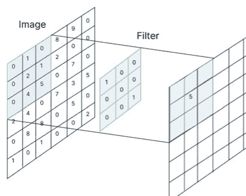

图 3.20 卷积过程


```
y = Image * Filter

0*1+1*0+0*0+
y=0*0+2*0+1*0+
0*0+4+5*1

y=0+0+0+
0+0+0+
0+0+5

y=5
```

信号处理中，$x(t)$ 和 $h(t)$ 是输入信号，类似于 CNN 过程中的图像和滤波器。`*`表示卷积操作，$\tau$ 是代表时间偏移的积分变量，代表了 CNN 中池化的数量（关于池化的更多将在后续章节介绍）。

### 卷积层

**卷积层**是 CNN 的核心模块。在这一层中，滤波器（或特征检测器）在图像上滑动以计算点积（如图 3.20 所示），从而生成特征图。这些是学习图像局部特征的可学习参数。

### 池化层

**池化层**也利用在图像上滑动的滤波器，将特征图划分为多个区域（池），并为每个池提取一个单值（例如，最大值、平均值）。这个单值代表了该位置出现特征的总结。

### 展平层

**展平层**将来自最大池化层的特征图（这些仍为二维数组）展平（变为一维数组），以便输入到模型（全连接 ANN）。

### 全连接层

**全连接层**是我们在第 3.5.1 节中已经讨论过的 ANN。

## 3.6 自然语言处理

自然语言处理（NLP）是人工智能的一个子集（有时也被称为计算机科学的一个分支），旨在教授机器理解和生成人类使用的语言。NLP 帮助从非结构化文本中提取有价值的信息。与其说机器学习或深度学习是一种工具，不如说 NLP 应该被视为一个可以使用机器学习（ML）和深度学习（DL）工具解决的问题。

> “John 吃了一个苹果”

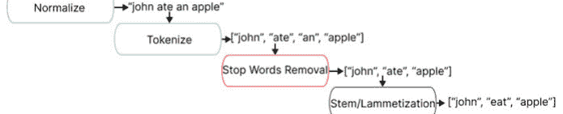

**图 3.21** NLP 过程

解决 NLP 问题需要特定的数据预处理（图 3.21）：

- **归一化**：移除标点符号并将所有单词转为小写。这样做是因为我们每次都需要单词的统一表示形式。例如，如果我们搜索单词 `john`，它也应该返回 `John` 甚至 `JOHN`。

- **分词**：这是 NLP 的第一步。在此期间，整个句子被切分成更小的单元：单词列表。

- **停用词去除**：停用词是语言中出现非常频繁的词。这些词会被过滤掉，因为它们没有提供价值的信息且是冗余的。

- **词干提取/还原**：有时单词会以多种形式出现，例如 `went` 和 `give` 的含义相同。在 NLP 中，含义相同的单词会被还原为同一个词。词干提取为给定的根词使用根词，而词形还原则根据单词使用时的上下文来还原单词。

### 3.6.1 向量化

向量化是指将文本转换为计算机可以理解的数值向量的方法。这是从文本到机器可读格式的特征提取。向量化的输出被馈到机器学习或深度学习算法中。有很多类型的向量化方法。

#### 词袋向量化

**词袋（BoW）**[14] 是最简单的向量化方法。我们构建一个句子（或文档）以及这些句子中单词的稀疏矩阵，并统计这些单词的频率[15]。随着词汇数量的增加，矩阵变得越来越大（图 3.22）。

#### TF-IDF 向量化

词袋模型赋予常用词（如冠词和介词）更高的权重，这可能会产生误导。相反，TF-IDF 使用算法降低常用词的重要性，并增加常见词（通常这些词通常包含更多信息）的重要性[16]。

| | machine | learning | book | textbook | of | life |
|---|---|---|---|---|---|---|
| machine learning book | 1 | 1 | 1 | 1 | 0 | 0 |
| The deep learning textbook | 1 | 0 | 1 | 0 | 1 | 0 |
| The book of the book | 1 | 0 | 0 | 2 | 0 | 1 |

**图 3.22** 词袋

**词频**（TF）可以定义为特定单词的频率与该文档中单词总数之比。它可以被看作是一个归一化分数：

$$TF = \frac{\text{单词在文档中的频率}}{\text{该文档中的单词总数}}$$

**文档频率**（DF）告诉我们包含该单词的文档比例：

$$DF = \frac{\text{包含单词 W 的文档数}}{\text{文档总数}}$$

**逆文档频率**（IDF）是文档频率倒数的对数。随着包含某个单词的文档总数增加，该词重要性就会降低。我们对该值取对数（因为包含该单词的文档总数增加，它的重要性会降低）：

$$IDF = \log\left(\frac{\text{文档总数}}{\text{包含单词 W 的文档数}}\right)$$

#### Word2vec

**Word2vec** 是 2013 年的一种新方法。在之前的方法中，我们看到单词是用数百表示的。Word2vec 的思想是创建词嵌入。从数学上讲，skip-gram 模型定义为

$$P(w_c|w_t) = \frac{\exp(v_c \cdot v_t)}{\sum_{i=1}^{V}\exp(v_i \cdot v_t)}$$

其中 $w_c$ 是上下文词，$w_t$ 是目标词，$V$ 是词汇大小。

### 3.6.2 循环神经网络

**循环神经网络（RNN）**[18] 是处理序列或时间序列数据的神经网络。由于模型的特性，这些模型可以保留记忆。因此，这种模型用于自然语言处理，因为语言也是单词序列。

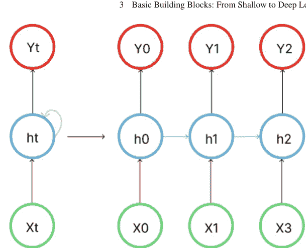

**图 3.24** 循环架构。折叠（左）和展开（右）

图 3.24 的左侧显示了 RNN 的折叠表示，右侧是展开表示。绿色圆表示时间 $t$ 的输入（例如单词序列），蓝色圆表示隐藏层，红色圆表示网络的输出。时间 $t$ 的隐藏状态 $h$ 通过 `h(t) = f(U.x(t) + W.h(t-1))` 计算。其中 `U, W` 分别代表输入与隐藏层之间以及隐藏层之间关系的权重矩阵。

### 3.6.3 Transformer

**Transformer** 是处理序列到序列 NLP 问题的神经网络架构。序列到序列意味着如果给模型一个序列（例如单词序列），它将输出一个序列（例如单词序列）。Transformer 基于自注意力层。正因如此，Transformer 在处理长距离依赖关系方面特别有用。让我们用一个例子来说说明。假设我们想将一个句子从法语翻译成英语。这个问题要求，无论句子有多长，每个单词对于它之前的单词都有上下文和相关性。

## 3.7 Transformer 详解

RNN、LMs 和 GRU 等序列分析方法无法处理较长的句子 [20]。但在计算能力足够的情况下，Transformer 可以处理任何长度的序列。此外，Transformer 并不要求输入是序列形式。因此，它可以实现并行化，而这在 RNN（及其变体）等模型中是一个问题。Transformer 的架构如图 3.25 所示 [20]。

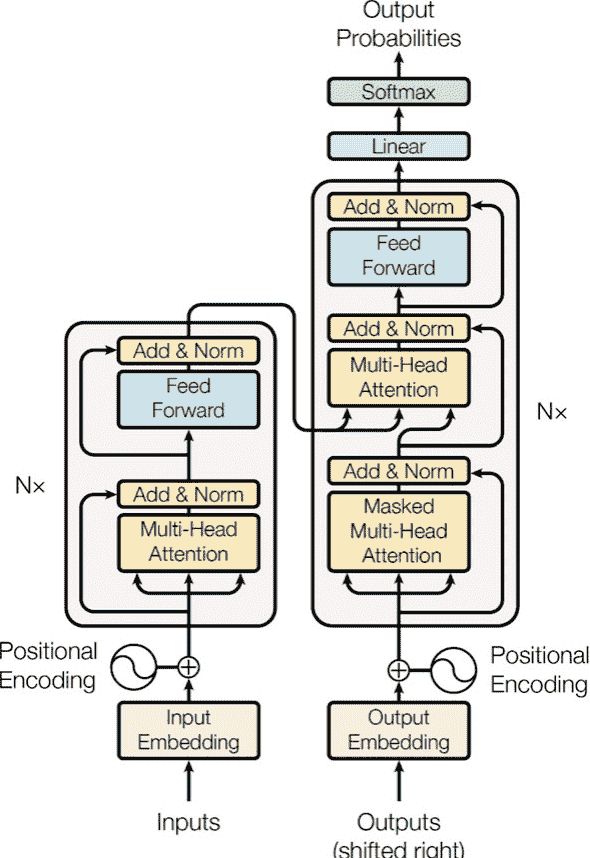

**图 3.25** 论文《Attention is All You Need》中阐述的 Transformer 架构 [20]

Transformer 架构依赖于自注意力机制来处理序列数据。它由一个编码器和一个解码器组成，每个部分都由多个层组成。自注意力机制允许 Transformer 捕捉序列中每个元素之间的关系和依赖关系，无论这些元素的位置如何。这使得 Transformer 在 NLP 任务中表现出色，因为它们能够捕捉长句和复杂句子的上下文。Transformer 的关键组件说明如下。

#### 自注意力机制

**自注意力机制：** 自注意力（也称为缩放点积注意力）是 Transformer 的核心组件，它允许模型对输入序列中的重要部分赋予权重。它允许模型识别并学习序列数据中的复杂关系。有三个可学习参数，分别称为查询 (Q)、键 (K) 和值 (V)。查询代表该标记（token）相对于句子中其他标记的重要性，键向量有助于识别当前标记与所有其他标记之间的关系，而值向量包含有关该标记内容的信息。从数学上讲，对于位置 $i$ 的给定标记的注意力计算如下：

```
Attention(Q, K, V)_i = softmax(QK^T / sqrt(d_k)) V
```

其中 $d_k$ 是键的维度。由于点积的结果可能很大，通过除以 $d_k$ 的平方根进行缩放。

#### 多头注意力

**多头注意力：** 在原始论文中，作者使用了八个注意力头（如图 3.26 所示），通过学习 `Q, K` 和 `V` 的不同表示来增强性能。

#### 编码器-解码器架构

**编码器-解码器架构：** Transformer 通常采用编码器-解码器架构，对于机器翻译任务，编码器接收源语言，解码器输出。

## 3.8 总结

在本章中，我们深入探讨了机器学习的各个方面。从线性回归、多线性回归、多项式回归、Lasso 回归和弹性网开始。

> “标记”（token）是指文本中的一个单位。


我们讨论了逻辑回归、支持向量机、决策树、朴素贝叶斯分类器、随机森林。在聚类方面，我们探讨了 K-means、DBSCAN 和高斯混合模型等技术。降维是一个重要课题。我们的之旅继续到深度学习，涵盖人工神经网络（ANN）和卷积神经网络（CNN）。自然语言处理（NLP）是另一个领域，我们关注了词袋模型、TF-IDF 和 Word2vec。循环神经网络使我们能够处理数据。

最后，本章为我们对机器学习技术提供了全面的理解。

## 参考文献

- 1. 特征选择
- 2. SVM：一种实用应用
- 3. 概率方法
- 4. D. Bei, A. Ng, 利克分配
- 5. (1998)
- 6. 空间中的直线与平面拟合。https://doi.org/10.1080/5254
- 7. Cauchy, 关于函数的导数方法
- 8. A. Maas, A. Hannum, A. Ng, 线性改进神经网络模型，发表在第 30 届机器学习国际会议（ICML-13）上。
- 9. P.-S. Laplace, 概率分析理论
- 10. V. Nair, G. Hinton, 使用受限玻尔兹曼机的修正单元，发表在第 27 届机器学习国际会议（ICML-10）上。
- 11. C. Eynkowski, W. Wojma, A. Gaghan, S. Marshall, 激活函数：深度学习中的实践与研究趋势，2018 [在线]，https://arxiv.org/abs/1811.03781。访问于 2023 年 10 月 19 日。
- 12. Y. LeCun, L. Bottou, Y. Bengio, P. Hacker, 基于梯度的学习应用于文档识别，发表在 IEEE 86(11)，2278–2324 (1998)。
- 13. K. Fukushima, Neon：一种空间识别机制的自组织神经网络模型，发表在 IEEE 68(5)，826–834 (1990)。
- 14. Y. LeCun, 等，基于反传播网络的手写数字识别。神经信息系统进展，396–405 (1990)。
- 15. Z. Harris, 分布假设。第 142–165 页 (1964)。
- 16. N.M. Ali, Sun, J.M. Mars, M.M. Ghazaly, M.S.M. Abbas, 使用词袋 (BoW) 模型的物体分类与识别，发表在 2016 年 IEEE 第 12 国际会议论文集上。

# 4 实验设置


**图 4.1** 带有 Python 环境的 Jupyter Notebook 交互式终端。在本书中我们将使用 Anaconda。你可以参考 Anaconda 官方网站获取安装说明：https://docs.anaconda.com/free/anaconda/install/index.html。你可以按照他们的文档说明来管理 Conda 环境¹¹

> https://conda.io/projects/conda/en/latest/user-guide/manage-environments.html.

### 4.1.2 PIP

**PIP** 是 Python 自带的包管理器。它可以用于从 PyPI 仓库安装各种包。也可以同时使用 PIP 和 Conda 安装相同的包。在本书中，我们将重点关注 Conda 作为包管理器，因为它预装了机器学习包所需的依赖项。

## 4.2 Jupyter Notebook

**Jupyter Notebooks** 是大多数数据科学和机器学习从业者作为集成开发环境（IDE）的首选之一。IDE 是帮助程序员高效编写代码的平台或软件，通常针对特定的编程语言。Jupyter Notebook 是一种交互式的 Web 端 IDE（意味着它们运行在网络浏览器中）。Anaconda 预装了 Jupyter。使用 PIP 也可以轻松安装 Jupyter Notebook。在此了解更多信息：https://jupyter.org/ (图 4.1)。

## 4.3 Colab Notebook

**Colab Notebook** 是 Jupyter Notebook 的云端替代方案，基本上意味着你不需要自己的机器上安装任何东西。你只需要有一个有效的 Google 账号。它的功能与 Jupyter Notebook 非常相似，而且易上手。它还预设了流行的机器学习和深度学习库。你可以根据需要使用 CPU、GPU 或 TPU。在使用 Google Colab 中的 GPU 和 TPU 运行时要小心，因为这些资源不是无限的，最终会耗尽直到你可以再次使用。Google Colab 地址：https://colab.research.google.com/

## 4.4 安装 Jupyter Notebook

Jupyter Notebook 随 Anaconda 安装。一旦你成功安装了 Anaconda，就可以打开 Anaconda Navigator 并启动 Jupyter Notebook 会话。但是，建议出于学习目的使用 Google Colab，因为它不需要配置环境，而且还提供免费的 GPU 和 TPU 实例（图 4.2）。

> 图 4.2 启动 Jupyter Notebook


## 4.5 包

你可以使用 Anaconda Navigator 安装包。通过 Anaconda Navigator 可以使用 Python 模块。你可以通过点击 Anaconda Navigator 右侧的“Environments”（环境）选项卡检查当前安装了哪些 Python 包。要安装所需的包：

- 在同一个选项卡中——即“Environment”选项卡下，使用包的名称搜索该包。
- 点击搜索栏并输入所需包的名称。
- 从包列表中勾选正确的包。
- 点击 Apply（应用）来安装包。

我们将讨论本书中用得最多的几个包（图 4.3）。

### 4.5.1 Pandas

**Pandas** [1, 2] 是一个用于处理表格数据的 Python 包。它可以用于数据分析和操作。它是一个处理表格数据非常快速且高效的包。它提供了名为 `DataFrame` 和 `Series` 的数据结构。`DataFrame` 是 2 维结构，类似于 SQL 表或带有列的电子表格，而 `Series` 是 1 维数据结构。它可以被认为是 Pandas `DataFrame` 中的一列。Pandas 极其快速，因为它构建在极其高效的 `NumPy` 库之上，并且由于其内存执行机制。图 4.4 显示了如何使用 pandas 从各种格式读取/写入数据 [3]。


**图 4.3** 使用 Anaconda Navigator 安装包

| CSV | XLS | PARQUET |
|---|---|---|
| HTML | HDF5 | JSON |
| <> | HDF5 | |
| GBQ | SQL | |

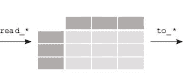

**图 4.4** pandas 功能概览

### 4.5.2 NumPy

**NumPy** [4] 是一个用于多维数组大量数学运算的 Python 库。它可以执行加法、减法和乘法等基本操作，以及更复杂的操作，如三角函数、梯度、傅里叶变换等。你可以参考 NumPy 的官方用户指南获取有关用法的额外信息：https://numpy.org/doc/stable/user/index.html。

### 4.5.3 Matplotlib

在实践机器学习和深度学习时，有必要可视化数据以更好地理解它们，从而构建更好的模型，因为用垃圾数据训练模型很可能会导致垃圾模型。有很多库可用。在许多可视化库中，**Matplotlib** [2] 是最流行的库之一。`Plotly` 和 `Seaborn` 等其他库也被大多数从业者使用。图 4.5 和 4.6 显示了在 Matplotlib 中生成图表的代码示例。该示例取自 Matplotlib 官方网站。

```
import matplotlib.pyplot as plt
import numpy as np

plt.style.use('mpl-gallery')

# make data
x = np.linspace(0, 10, 100)
y = 4 + 2 * np.sin(2 * x)

# plot
fig, ax = plt.subplots()
ax.plot(x, y, linewidth=2.0)
ax.set(xlim=(0, 8), xticks=np.arange(1, 8), ylim=(0, 8), yticks=np.arange(1, 8))
plt.savefig('matplotlib.svg', format='svg')
```

**图 4.5** 在 Matplotlib 中生成简单图表的示例代码

**图 4.6** 示例保存的图像

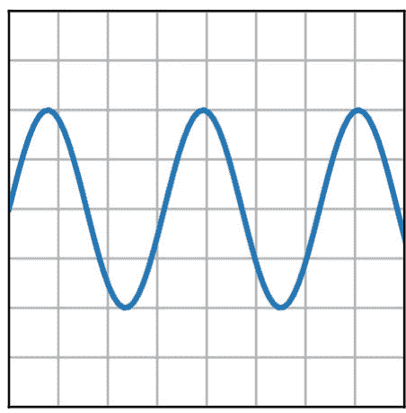

### 4.5.4 Scikit-Learn


涉及传统机器学习时，`scikit-learn` [5] 无疑是最常用的库。它包含许多监督学习和无监督机器学习库。此外，`scikit-learn` 还提供了用于预处理、模型评估、构建机器学习流水线和模型选择的各种工具。

### 4.5.5 TensorFlow

AI 的最新趋势将兴趣更多转向深度学习。`TensorFlow` [6] 可能是对深度学习贡献最大的库之一。它由 Google 在 2015 年开源，很快在数据科学家、机器学习工程师和开发者之间流行起来。`TensorFlow` 可用于构建各种神经网络架构。该框架在工业界普及更高，因为它有许多用于部署和监控的集成功能，如 `TensorFlow Serving` 和 `TensorBoard`。你也可以找到许多预训练的 `TensorFlow` 架构。

### 4.5.6 PyTorch

`PyTorch` [7] 在研究社区中更流行，在 Hugging Face 等仓库中有数千个预训练模型。许多先进模型可以在这些仓库中轻松获得。它由 Facebook 在 2016 年开发。尽管它在 `TensorFlow` 之后发布，但因为它结合了灵性和易用性，成为了 `TensorFlow` 的顶级竞争对手。特斯拉和 Twitter 等公司使用 `PyTorch` 用于自动驾驶和推荐系统。

### 4.5.7 OpenCV

`OpenCV` [8] 是一个库，专门用于计算机视觉应用。它于 2000 年发布，当时机器学习和深度学习尚未达到全盛。它拥有超过 2500 个优化算法，包含了经典和先进的计算机视觉和机器视觉算法。这些包括用于仿射和形态学变换、人脸识别、目标跟踪等算法。

### 4.5.8 NLTK

自然语言工具包 (`NLTK`) [9] 是用于处理自然语言的工具集合。根据功能的不同，它支持多种语言。然而，几乎所有功能都适用于英语。该工具主要用于对文本进行预处理，例如去除停用词、词干提取、词还原、分词和分割等其他功能。

## 4.6 评估

模型训练完成后，有必要测试模型的运行是否符合预期。模型性能不佳可能有潜在原因：欠拟合或过拟合 [10, 11]、模型选择不当或特征选择/工程不良 [12]。分析和调整模型的范围不在本书的范围内。然而，评估模型输出的相关性至关重要，在本章节中，我们将涵盖用于回归、分类和聚类的一些评估技术及其基础数学原理。

### 4.6.1 回归

正如已经提到的，回归模型用于预测连续值。因此，为了评估回归模型，我们使用适用于连续值的指标。用于连续变量的指标是基于距离的指标 [13]，例如均方误差 (`MSE`)、平均绝对误差 (`MAE`)、R方值等 [14]。

- **均方误差 (`MSE`)**：它是最流行且易于理解的指标之一。顾名其实，它计算了实际值 (`y`) 与预测值 (`$\hat{y}$`) 之间差平方和的平均值 `$MSE=\frac{1}{N}\sum_{i=1}^{N}(y_i-\hat{y}_i)^2$`，其中 `$N$` 是预测次数，`$y_i-\hat{y}_i$` 是预测值 `$\hat{y}_i$` 的误差。

- **平均绝对误差 (`MAE`)**：`MAE` 是另一个可评估回归模型的指标。其计算步骤与 `MSE` 相同，但在 `MAE` 中，我们不是取误差的平方，而是直接取绝对值 `$MAE=\frac{1}{N}\sum_{i=1}^{N}|y_i-\hat{y}_i|$`。

- **均方根误差 (`RMSE`)**：`RMSE` 就是 `MSE` 的平方根。平方根确保了误差与预测值的尺度相似。它可以定义为 `$RMSE=\sqrt{\frac{1}{N}\sum_{i=1}^{N}(y_i-\hat{y}_i)^2}$`。

- **R方 (`$R^2$`)**：R方也称为决定系数，衡量特征对因变量方差的解释比例。因此，`$R^2=1-\frac{SSR}{SST}$`，`$SSR$` 是残差平方和，`$SST$` 是总平方和。

不应使用单一指标来评估回归模型。然而，指标的选择取决于用例或当前问题的需求。鼓励考虑选择多个评估指标以获得更好的优化。

### 4.6.2 分类

分类问题处理类别变量。可视化和评估分类模型性能的最基本方法是通过混淆矩阵。混淆矩阵是一种特殊的列联表（如图 4.7 所示），其中行和列代表预测值和实际值的类别。二分类混淆矩阵的示例如图 4.7 所示。对于 N 个类，矩阵将是一个 NxN 矩阵。混淆矩阵的一些重要元素包括：

- **真正例 (`True Positive`)**：正确分类为正类的实例数量。
- **真负例 (`True Negative`)**：正确分类为负类的实例数量。
- **假负例 (`False Negative`)**：错误分类为负类的实例数量。
- **假正例 (`False Positive`)**：错误分类为正类的实例数量。

使用这些元素：

- **(a) 准确率 (`Accuracy`)**：分类模型的整体正确性。
- **(b) 精确率 (`Precision`)**：精确率（或正预测值）是指在所有预测为正的实例中，模型正确预测为正的实例的比例。因此，当你想要最小化假正例时，应该使用它。
- **(c) 召回率 (`Recall` / 灵敏度或真正率)**：它是衡量模型正确预测为正的实际正类实例占的比例。因此，它在应该避免假负例的情况下应当使用。
- **(d) 特异性 (`Specificity` / 真负率)**：特异性是衡量模型正确识别负类实例能力的指标。
- **(e) F1 分数 (`F1 Score`)**：它是召回率和精确率的调和平均数。由于召回率和精确率反相关，F1 分数提供了这两个指标之间的平衡。

| 实际值 \ 预测值 | 正 (1) | 负 (0) |
| :--- | :--- | :--- |
| **正 (1)** | 真正例 TP | 假负例 FN |
| **负 (0)** | 假正例 FP | 真负例 TN |

```
$Accuracy = \frac{TP + TN}{TP + FP + FN + TN}$
$Precision = \frac{TP}{TP + FP}$
$Recall = \frac{TP}{TP + FN}$
$Specificity = \frac{TN}{TN + FP}$
$F1 = 2 \cdot \frac{Precision \cdot Recall}{Precision + Recall}$
```

**图 4.7** 二分类问题的混淆矩阵及导出的评估指标

### 4.6.3 聚类分析

聚类是一种无监督技术，因为没有相关的标签因变量，评估可能会变得模糊。聚类的效果还取决于应用领域的用例。例如，如果对在线商店的客户（商业世界）进行聚类分析，可以根据消费行为形成聚类。

## 实验设置

## 参考文献

- 1. Pandas 开发团队, pandas-dev/pandas: Pandas. Zenodo, 2020年2月. https://doi.org/10.5281/zenodo.3509134
- 2. D.J. Hunter, Matplotlib: 一个 2D 图形计算环境. Sci. Eng. 9(3), 90–95 (2007). https://doi.org/10.1109/MCE.2007.55
- 3. 如何读写表格数据--pandas? 2.1.1 文档 [在线], https://pandas.pydata.org/docs/getting_started/intro_tutorials/read_write.html#min-tut-02-read-write. 访问于 2023年10月17日
- 4. C.R. Harris 等， PyTorch: 一种解释性风格. Nature 585(7825), 357–362(2020). https://doi.org/10.1038/s41586-020-2649-9
- 5. F. Pedrosa 等，Scikit-learn: Python 中的机器学习. J. Mach. Learn. Res. 12(85), 2825–2830 (2011). http://jmlml.org/papers/v12/scikit_learn_a.html. 访问于 2021年10月17日
- 6. M. Abadi 等，TensorFlow: 异构分布式系统上的大规模机器学习 [在线], www.tensorflow.org. 访问于 2023年10月17日
- 7. A. Paszke 等，高性能深度学习，收于神经信息处理系统进展 32 (Curran Associates, Inc., 2019), p. 8024–8035 [在线], https://proceedings.neurips.cc/paper/9015-pytorch-an-interpretative-style-high-performance-deep-learning.pdf
- 8. G. Blackski, The OpenCV Library, 由 Robb's Soft Tools 出 (2000)
- 9. S. Bird, E. Klein, 自然语言处理：使用自然语言工具分析文本 (O'Reilly Media, Inc., 2009).
- 10. J. Volkhri, V.K. Kote, M.B. Prabh, S. Razia: 使用 L1 正则化方法减少机器学习中的过拟合，收于 2020 第44 届电子与信息趋势国际会议 (IEEE ICEI:2020), p. 934–938. https://doi.org/10.1109/ICEI.2020.9142992
- 11. H. Zhang, L. Zhang, Y. Jiang, 深度学习端到端通信系统的过拟合与过拟合，收于 2019 第11 届无线通信与信号处理国际会议 (WSCP) (2019), p. 1–6. https://doi.org/10.1109/WSCP.2019.892876
- 12. J.P Cohen 等， 医疗保健中机器学习模型部署的问题，CMAJ 193(35), E1391–E1394 (2021). https://doi.org/10.1503/CMAJ.2020066
- 13. A. Botachev, 一种衡量机器学习回归算法误差的新型性能指标. Statist. J. Kn. Mag. 14 (2019). https://doi.org/10.28905/4184
- 14. 回归指标全面概述 | NVIDIA 博客 [在线], https://developer.nvidia.com/blog/comprehensive-overview-of-regression-metrics/. 访问于 2023年10月18日
- 15. KC Santosh, L. Bamilor, W. Wendling, 用于机器识别的空间关系聚聚类验证.Int. J. Data Anal. Recogn. (IJDAR) 17(1), 61–78 (2014). https://doi.org/10.1007/s11504-0123
- 16. KC Santosh, L. Wendling, B. Bamilor, 用于关系检索的关联袋模型.Int. J. Pattern Recognition Artif. 28(6) (2014)
- 17. KC Santosh, S. Nakarni, 最小未来流行可能风险的主动学习，Springer 应用科学与技术 (Springer, 2023). https://doi.org/10.1007/978-3-031-42
- 18. F.T. Zahora, S.K. Antani, KC Santosh, 使用归一化交叉相关和无监督聚类在胸 X 光中进行圆形元素检测.Med. Imaging: 105741 (2018)
- 19. A. Sen, S. Chakraborty, D. Mondal, 用于无监督细胞分割的集成框架，收于 CBMS (2022), pp. 345–350
- 20. A. Aryal, R. Dazeley, KC Santosh, 基于随机预测的稳健异常检测器.Int. J. Mach. Learn. Cyber. 12(4), 1137–1150 (2021)
- 21. S. Vajda, KC Santosh, 使用无监督聚类的快速 k-最近邻分类器，收于 RTIP (2016), pp. 185–193
- 22. KC Santosh, AI 驱动的新冠病毒爆发工具：主动学习与持续/多模态数据.J. Med. Syst. 44(5), 93 (2020)
- 23. Roussee, Silhouettes：聚类分析解释与验证的图形辅助.J. Comput. Appl. Math. 20, 53–65 (1987). https://doi.org/10.1016/0377-042
- 24. J.C. Dunn, 分离良好的聚类和最优模糊划分.J. Cybern. 4(1), 95–104 (1974). https://doi.org/10.1080/01962740
- 25. D.L. Davies, D.W. Bouldin, 一种聚类指标.IEEE Trans. Pattern Anal. Mach. PAMI(2), 224–227 (1979). https://doi.org/10.1109/TPAMI.1979.476

# 第5章：AI 应用案例——从数字到图像

在本章中，我们将通过机器学习探讨之前章节中讨论的一些有趣的现实场景。

## 5.1 数字数据：金融与住房

当我们谈论数字时，往往会想到金融。几十年来，统计学家使用了各种统计模型来检测欺诈、为客户提供财务咨询、投资组合、预测房价等。

在本案例中，我们将使用机器学习来研究房价。

为了构建预测房价的模型，我们首先需要获取数据。这类数据通常由金融机构收集，幸运的是我们不需要自己收集数据。常见的机器学习库为我们提供了可以尝试的各种数据集。我们将使用一个通过 `scikit-learn` 提供的波士顿房价数据集。

### 表 5.1 波士顿数据集特征描述

| 特征 | 描述 |
| :--- | :--- |
| CRIM | 城镇的人均犯罪率 |
| ZN | 面积超过 25000 平方英尺的住宅用地比例 |
| INDUS | 城镇非零售商业用地比例 |
| CHAS | 查尔斯河虚拟变量（1 表示区域边界河流，否则为 0） |
| NOX | 氮氧化物浓度（每千万分之一） |
| RM | 住房的平均房间数 |
| AGE | 1940 年以前建造的自住单元比例 |
| DIS | 到波士顿五个就业中心的加权距离 |
| RAD | 径向公路的可及性索引 |
| TAX | 每 10000 美元的全额房产税率 |
| PTRATIO | 城镇师生比 |
| B | 1000 (Bk–0.63)²，其中 Bk 是城镇的黑人比例 |
| LSTAT | 低地位人口百分比 |
| MEDV (Y) | 自住住房的中位价值（单位：千美元） |

### 导入包

使用 `import` 关键字，我们导入所有必要的包。这些包和模块。在我们开始使用这些模块/包之前，必须先导入。

### 读取数据集

幸运的是，`scikit-learn` 已经提供了波士顿房价数据集。我们只需要从 `sklearn.datasets` 导入并调用 `load_boston()` 函数。`load_boston()` 函数返回一个数据集对象（**图 5.1**）。

需要注意的是，加载数据集的方法有很多。幸运的是，我们可以通过检查数据框 的 `head()` 方法来查看 X 和 Y 的内容（**图 5.3** 和 **图 5.4**）。

```python
dataset = load_boston()
```

**图 5.1** 使用 scikit-learn 加载数据集

```python
X = pd.DataFrame(
    dataset['data'],
    columns=dataset['feature_names']
)

Y = pd.DataFrame(
    dataset['target'],
    columns=['Y']
)
```

**图 5.2** 指定特征和目标变量

```python
In[]: X.head()
```

| | CRIM | ZN | INDUS | CHAS | NOX | RM | AGE | DIS | RAD | TAX | PTRATIO | B | LSTAT |
|---|---|---|---|---|---|---|---|---|---|---|---|---|---|
| 0 | 0.00632 | 18.0 | 2.31 | 0.0 | 0.538 | 6.575 | 65.2 | 4.0900 | 1.0 | 296.0 | 15.3 | 396.90 | 4.98 |
| 1 | 0.02731 | 0.0 | 7.07 | 0.0 | 0.469 | 6.421 | 78.9 | 4.9671 | 2.0 | 242.0 | 17.8 | 396.90 | 9.14 |
| 2 | 0.02729 | 0.0 | 7.07 | 0.0 | 0.469 | 7.185 | 61.1 | 4.9671 | 2.0 | 242.0 | 17.8 | 392.83 | 4.03 |
| 3 | 0.03237 | 0.0 | 2.18 | 0.0 | 0.458 | 6.998 | 45.8 | 6.0622 | 3.0 | 222.0 | 18.7 | 394.63 | 2.94 |
| 4 | 0.06905 | 0.0 | 2.18 | 0.0 | 0.458 | 7.147 | 54.2 | 6.0622 | 3.0 | 222.0 | 18.7 | 396.90 | 5.33 |

**图 5.3** 数据集的特征

### 分割数据集

在构建好模型后，我们如何知道预测是否正确？为了测试模型的合理性，我们必须对模型进行测试。

**图 5.5** 将数据集分割为训练集和测试集

在 `predict()` 方法中，我们简单地获取特征并预测结果。在调用 `train()` 之前调用 `predict()` 方法，它会使用提供的训练数据训练模型，然后进行预测（**图 5.6** 和 **图 5.7**）。


虽然不是必须，但处理异常并添加其他功能是一项推荐的做法。我们最终可以通过将训练集传递给我们的模型类来训练模型。然后我们可以通过传递测试集来使用 `predict` 方法进行预测。

**测试模型：** 有很多方法可以测试模型。一些常见的指标包括均方误差 (RMSE)、调整后的平均绝对误差 (MAE) 等。然而，你可以对测试集和预测值进行可视化，快速分析模型的性能（图 5.8）。

```python
class SimpleLinearRegressor:
    def __init__(self, x:pd.DataFrame, y:pd.DataFrame):
        self.x = x
        self.y = y
        self.regressor = LinearRegression()

    def train(self):
        self.regressor.fit(self.x, self.y)

    def predict(self, x:pd.DataFrame):
        try:
            return self.regressor.predict(x)
        except Exception as e:
            if 'LinearRegression instance is not fitted yet' in str(e):
                print("The regression model has not been fitted. regressor will be trained on the provided data.")
                self.train()

        return self.regressor.predict(x)
```

**图 5.6** 封装 `LinearRegressor()` 类

```python
regressor = SimpleLinearRegressor(X_train,y_train)
prediction = regressor.predict(X_test)
```

**图 5.7** 创建模型、训练和预测

测试集 vs 预测集


**图 5.8** 可视化结果

## 5.2 文本数据：新闻

获取非来自路透社（Reuters）的模型总是具有误导性的。因此，移除这个词是必要的。记住，这只是数据预处理的一个预览。可能需要进行彻底的探索性数据分析，以确定还需要哪些预处理（图 5.13）。

在从真实 dataframe 中成功移除重复单词后，可以通过合并 `df_true` 和 `df_fake` 来创建 dataframe 并命名为 `df`。随后，通过从 dataframe 中提取文本和标签来创建特征和目标变量（图 5.14）。

**移除停用词和词形还原：** 下一个重要步骤是移除停用词。我们可以使用 NLTK 包中的停用词集来实现这一点。我们可以创建一个函数来移除停用词并执行词形还原（图 5.15）。

**划分数据集：** 使用 scikit-learn 的预处理方法，我们可以将数据划分为训练集和测试集。这个过程与节 5.1.1 中讨论的相同。

```python
df_true['text'] = df_true['text'].str.replace(
  "Reuters..",
  "", regex=True
)
```

**图 5.13** 从真实 dataframe 中移除 (Reuters)

```python
X=df["text"]
y = df["label"]
```

**图 5.14** 创建特征和目标变量

```python
stop_words = set(stopwords.words('english'))
def lemmatize_func(x):
  """
  移除停用词，转小写并词形还原
  """
  lemmatizer = WordNetLemmatizer()
  return ' '.join(
    [
      lemmatizer.lemmatize(x.lower())
      for x in word_tokenize(x)
      if x.lower() not in stop_words
    ]
  )
```

**图 5.15** 移除停用词并执行词形还原的函数

```python
# create the transform
vectorizer = TfidfVectorizer()
# transforming
tfidf_train = vectorizer.fit_transform(x_train.iloc[:,0])
tfidf_test = vectorizer.transform(x_test.iloc[:,0])
```

**图 5.16** 对训练和测试文本进行向量化

```python
rc = RandomForestClassifier(random_state=7,)
rc.fit(tfidf_train, y_train.values.ravel())
# 在测试集上预测并计算准确率
y_pred = rc.predict(tfidf_test)
score = accuracy_score(y_test, y_pred)
print(f'Accuracy: {round(score*100, 2)}%')
```

**图 5.17** 模型的训练与测试

**向量化：** 既然我们已经确定文本不能直接输入机器学习模型，我们只需要以不同的格式表示文本。对于我们的示例，我们使用 TD-IDF 向量化，将文本转换为向量表示。这可以使用 `sklearn.feature_extraction.text` 中的 `TfidfVectorizer` 实现（图 5.16）。

**训练与测试：** 文本已处于适当的向量化表示，并准备好传递给机器学习算法。训练过程与我们之前看到的类似。我们创建一个 `RandomForestClassifier` 实例并拟合向量化数据（图 5.17）。

我们可以使用精确率（precision）、召回率（recall）、f1 分数和 AUC 分数来检查训练模型的性能。然而，混淆矩阵是分类性能指标中最基础的可视化之一（图 5.18）。

## 5.2.2 其他机器学习分类算法

在 scikit-learn 和其他 Python 库中可以找到许多传统的分类算法。实现这些其他算法的过程与实现 `RandomForestClassifier` 类似。例如，如果你想使用逻辑回归，你应该导入所需的库，并且初始化 `LogisticRegression` 类。

像 XGBoost 和 LightBGM 这样的分类算法在 scikit-learn 库中，需要通过包管理器（如 pip 或 conda）单独安装。幸运的是，`fit` 和 `predict` 方法在所有这些库中都是通用的。因此，在更改导入和初始化分类器的行后，代码可以复用。在图 5.19 中，展示了 `XGBClassifier` 的示例。

- 3 https://xgboost.readthedocs.io/en/stable/get_started.html。
- 4 https://lightgbm.readthedocs.io/en/stable/Python-Intro.html。

```python
from sklearn.linear_model import LogisticRegression
lr = LogisticRegression()
lr.fit(tfidf_train, y_train.values.ravel())
```

```python
# 用于 XGBClassifier
#from xgboost import XGBClassifier
# bst = XGBClassifier(objective='binary:logistic')
# bst.fit(tfidf_train, y_train.values.ravel())
```

## 5.2.3 深度学习方法：LSTMs

与数值数据不同，文本数据是复杂的。深度学习方法能够捕捉文本的序列。在本节中，我们将看到 LSTM。TensorFlow 是其中框架之一。

- TensorFlow
- NLTK
- Pandas

**导入包：** LSTM 层可以从 `tensorflow.keras.layers` 导入。

**数据处理：** 有许多方法可以输入数据。首先，我们将从一些 Keras 开始。TensorFlow 是流行的框架之一。Keras。

## 5.2 文本数据：新闻

之前，我们的数据只有两个文件 `true.csv` 和 `fake.csv`。我们将数据结构安排如下所示：

```
test
  fake
  true
train
  fake
  true
```

这是 Keras 数据加载器接受的格式之一。有两个文件夹：test 和 train。train 文件夹包含两个子文件夹 fake 和 true，随后，这些文件夹包含文件，每个文件都是一篇新闻文章。在预处理期间，你可能还想执行与上一节中类似的预处理操作。

**加载数据集：** 使用 Keras 数据加载器，加载数据集变得轻而易举。它还便于将数据划分为不同的集合、指定批次大小等（图 5.20）。

这是使用数据加载器加载训练数据集的方法。我们设置了 0.2 的验证划分。缓冲区大小为 32，且加载器的缓冲区大小由 `AUTUNE` 设置。将缓冲区大小设置为此值将确保 TensorFlow 根据可用资源动态确定合适的缓冲区大小。我们同样可以加载验证集和测试集。

**训练模型：** 我们最终可以使用 Keras 构建我们的模型。Keras 提供了两种构建模型的方法（序列模型和函数模型）。序列模型构建更简单，层可以堆叠，但缺乏灵活性。然而，为了演示 LSTM，序列模型足够了。

```python
TRAIN_DATA_PATH='resources/keras/train/'
TEST_DATA_PATH='resources/keras/test/'
AUTOTUNE = tf.data.AUTUNE
batch_size = 32
seed = 42

raw_train_ds = tf.keras.utils.image_dataset_from_directory(
  'resources/keras/train',
  batch_size=batch_size,
  validation_split=0.2,
  subset='training', #可以是训练或验证
  seed=seed)
train_ds = raw_train_ds.cache().prefetch(buffer_size=AUTOTUNE)
```

**图 5.20** 加载数据

## 86 5 应用AI案例——从数字到图像数据

```python
VOCAB_SIZE = 1000
encoder = tf.keras.layers.TextVectorization(
    max_tokens=VOCAB_SIZE)
encoder.adapt(train_ds.map(lambda text, label: text))
model = tf.keras.Sequential([
    encoder,
    tf.keras.layers.Embedding(
        input_dim=len(encoder.get_vocabulary()),
        output_dim=64,
        # 使用掩码处理变长序列
        mask_zero=True),
    tf.keras.layers.Bidirectional(tf.keras.layers.LSTM(64)),
    tf.keras.layers.Dense(64, activation='relu'),
    tf.keras.layers.Dense(1)
])
```

**图 5.21** 使用顺序模型的双向 LSTM

新闻的长度不一。为了让它们的长度相同，我们可以使用编码器层将文本编码为固定长度的向量。编码在保持文本序列行为的同时，还实现了特征提取、降维以及将文本表示为数值。我们使用了最大标记设置为 1000 的 `Textization` 编码器，这意味着向量化器只会取 1000 个词（图 5.21）。

模型由我们刚刚定义的编码器组成。第二层是嵌入层，它学习编码后的单词之间的关系。然后我们添加了一个双向 LSTM 层。最后，我们有一个全连接层，后面跟着一个只有一个神经元的输出全连接层，因为输出是 0 或 1。

**编译模型：** 在我们开始训练模型之前，有必要指定模型的配置（或超参数），例如学习率、损失函数、要跟踪的优化器以及其他配置（图 5.22）。

使用 `BinaryCrossentropy`（二分类交叉熵）作为损失函数，因为这是一个二分类问题。不同的任务应该使用不同的损失函数。这里使用了 `Adam` 优化器，准确率是我们要跟踪的指标。请记住，这些参数取决于具体的用例。

**训练与测试：** 最后，我们可以通过调用编译后的模型来训练 `fit` 方法并测试训练好的模型。我们还可以在 `fit` 方法中指定 epoch（迭代次数）的数量（图 5.23）。

## PyTorch

PyTorch 是另一个被研究人员和开发者广泛使用的流行框架。在本节中，我们将学习使用 PyTorch 框架实现双向 LSTM。整个过程是相似的。让我们来看看所需的库：

- 用于深度学习的 `PyTorch`。
- 用于 NLP 任务的 `NLTK`。
- 用于工具类的 `Scikit-learn`。

**导入包：** 像常一样，我们从导入必要的模块和包开始。

**加载数据：** 使用 `pd.read_csv` 加载 CSV 文件。然后我们添加一个标记为 label（0 表示虚假，1 表示真实）的额外列，并将 dataframe 合并成单个 dataframe。记住，我们可以通过多种方式加载数据。保存 dataframe 是可选的，但保存中间数据是一个良好的习惯（图 5.24）。

**文本向量化：** 我们将不使用 `TextVectorization` 层，而是使用 scikit-learn 的 `CountVectorizer` 手动进行向量化。为了对文本进行向量化，我们必须进行一些预处理；删除词汇、词形还原和其他预处理操作。

```python
TRAIN_DATA_PATH='resources/keras/train/'
TEST_DATA_PATH='resources/keras/test/'
AUTOTUNE = tf.data.AUTUNE
batch_size = 32
seed = 42
```

```python
raw_train_ds = tf.keras.utils.text_dataset_from_directory(
    'resources/keras/train',
    batch_size=batch_size,
    validation_split=0.2,
    subset='training', # 训练训练或验证
    seed=seed)
train_ds = raw_train_ds.cache().prefetch(buffer_size=AUTOTUNE)
```

**图 5.2** 编译模型

```python
history = model.fit(train_ds, epochs=100,
    validation_data=val_ds,
    validation_steps=30)
```

```python
test_loss, test_acc = model.evaluate(test_ds)
```

```python
print('Test Loss:', test_loss)
print('Test Accuracy:', test_acc)
```

**图 5.23** 训练与测试模型

```python
true_data = pd.read_csv('True.csv')
fake_data = pd.read_csv('Fake.csv')
true_data['label'] = np.zeros(len(true_data), dtype=int)
fake_data['label'] = np.zeros(len(fake_data), dtype=int)
data = pd.concat((true_data, fake_data), axis=0)
# data.to_csv("raw_data.csv", index=False)
```

**图 5.24** 加载数据并合并

```python
new_text = []
pattern = "^[a-zA-Z]*$"
lemma = nltk.WordNetLemmatizer()

for txt in data:
    txt = re.sub(pattern, "", txt) # 清洗
    txt = txt.lower() # 转小写
    txt = nltk.word_tokenize(txt) # 分词
    txt = [lemma.lemmatize(word) for word in txt] # 词形还原
    txt = " ".join(txt)
    new_text.append(txt)

vectorizer = CountVectorizer(max_features=4000, stop_words="english")
vectorized_text = vectorizer.fit_transform(new_text)
```


## 图 5.25 预处理与向量化

**数据加载器：** PyTorch 的 `dataloader` 在训练、验证和测试期间高效地加载数据。

```python
import torch
from torch.utils.data import DataLoader, Dataset

class Dataset(Dataset):
    def __init__(self, text, labels):
        self.text = text
        self.labels = labels

    def __len__(self):
        return len(self.labels)

    def __getitem__(self, index):
        return torch.tensor(self.text[index]), torch.tensor(self.labels[index], dtype=torch.float)

# 伪代码示例，表示逻辑
# train_loader = DataLoader(dataset, batch_size=32, shuffle=True)
```

## 图 5.26 定义数据集类

**划分数据集：** PyTorch 使用 `random_split` 来划分训练、测试和验证集。

```python
train_dataset, val_dataset = torch.utils.random_split(full_dataset, [0.8, 0.2])
```

## 图 5.27 划分数据集

**创建模型：** 与 Keras 不同，PyTorch 对模型构建有更细粒度的控制。

```python
import torch.nn as nn

class LSTMNet(nn.Module):
    def __init__(self, vocab_size, embedding_dim, hidden_dim, n_layers, bidirectional=True, dropout=0.5):
        super(LSTMNet, self).__init__()
        # Embedding 层将整数序列转换为向量
        self.embedding = nn.Embedding(vocab_size, embedding_dim)
        # LSTM 层处理向量
        self.lstm = nn.LSTM(
            hidden_dim,
            num_layers=n_layers,
            bidirectional=bidirectional,
            dropout=dropout,
            batch_first=True
        )
        # 全连接层预测
        self.fc = nn.Linear(hidden_dim * (2 if bidirectional else 1), 1)
        self.sigmoid = nn.Sigmoid()

    def forward(self, text):
        embedded = self.embedding(text)
        output, (hidden_state, cell_state) = self.lstm(embedded)
        # 合并最后的正向和反向隐藏状态
        if self.lstm.bidirectional:
            hidden = torch.cat((hidden_state[-2,:,:], hidden_state[-1,:,:]), dim=1)
        else:
            hidden = hidden_state[-1,:,:]
        dense_outputs = self.fc(hidden)
        # 最终激活函数
        outputs = self.sigmoid(dense_outputs)
        return outputs
```

## 图 5.28 LSTM 分类模型

**初始化模型：** 随着训练的进行，必须为模型配置损失函数和优化器。

```python
from torch import optim
criterion = nn.BCELoss()
optimizer = optim.Adam(model.parameters(), lr=0.001)
num_epochs = 10
```

## 图 5.29 初始化模型、优化器和损失函数

## 5.2 文本数据：新闻

```python
for epoch in range(num_epochs):
    # Training
    model.train()
    print("EPOCH:
```

## 图 5.30 PyTorch 中的训练和验证循环

注意 `line.to('cuda')`。它在训练和推理时将模型设置为 GPU。注意与 Keras 不同，PyTorch 默认不使用 GPU。

**训练与验证：** PyTorch 的训练和验证并不像 Keras 那么简单。我们已经看到了 PyTorch 允许的控制能力。对于训练过程也是如此。训练需要对 epoch 数量和数据加载器进行循环（图 5.30）。

PyTorch 中有很多样板代码（boilerplate code）。虽然这提供了更多的控制权并易于调试，但也会引入 bug。同样的训练过程在 Keras 中只需通过 `model.fit` 即可完成。在上面的代码中，每个 epoch 都会进行验证。每个 epoch 都进行验证会显著增加训练时间，因此在训练时也应该考虑验证的频率。可以通过一个简单的条件来实现。例如，每 10 个 epoch 进行一次验证。

## 表 5.3 类别标签分布

| 类别 | 数量 |
| :--- | :--- |
| 正常 X 光 | 2245 |
| 有诊断的 X 光 | 2754 |

## 5.3 可视化数据：医学图像

我们研究的最后一种数据模态是图像或视觉数据。图像无处不在，是数据的一种表示方式。机器学习在图像处理领域取得了巨大进展。人脸识别、医学图像识别和遥感图像分类领域一直在持续研究和应用 [7]。

对于我们的案例研究，我们关注机器学习在医学图像中的应用。此对应的数据集是 NIH 胸部 X 光数据集 [8]。该数据集是公开的，可以通过 Kaggle 访问。该数据集包含 112,220 张具有各种状况的 X 光，组织在 12 个文件夹中。为了简单起见以及本示例的考虑，我们只取第一个文件夹。它包含 4999 张胸部 X 光。原始数据集有多个类别，但为了阐明分类问题，我们将数据集分为两类：无发现 (0) 和异常 (1)。所有经过诊断的 X 光都被认为存在异常（表 5.3）。

X 光以 PNG 图像的形式存储在文件夹中。还有另一个 CSV 文件包含通用数据集的元数据。它有几列，但重要的列是“Image Index”和“Finding Labels”，它们分别对应文件名和标签。

### 5.3.1 使用传统机器学习进行分类

与上一节一样，我们将首先使用传统的分类算法构建模型。我们已经看到来自 scikit-learn、XGBoost 和其他框架的模型可以以类似的方式训练。然而，我们仍然需要图像的数值表示。幸运的是，对我们来说，图像已经是像素表示，像素是图像在该位置的强度值。此外，更多的 Python 框架和库使用多维矩阵来表示这些数字。

完成此任务所需的某些重要包列如下：

- Scikit-learn 用于分类算法。
- OpenCV 用于图像处理任务。
- Pandas 用于读取数据集的元数据。
- Matplotlib 用于绘制图像和图表。

**导入库：** 首先，我们必须导入上述所需的库。

**加载并预处理数据：** 首先，我们加载元数据，因为它包含图像文件路径（或名称）。从这个 dataframe 中，我们提取图像名称和标签。我们可以创建一个生成器函数来加载图像并对图像进行缩放和扁平化（图 5.31）。

`return_image` 函数接收图像所在的目录和图像列表。它使用 OpenCV 读取图像并将其转换为灰度图。此外，函数将图像大小调整为 $128 \times 128$ 以降低计算复杂度。需要注意的是，降低分辨率会导致信息丢失。因此，模型的性能可能不会理想。扁平化是必要的，因为每张图像都是分类器的特征向量。我们将无发现的图像映射到 0，将发现发现的图像映射到 1。让我们可视化其中一张图像（图 5.32）：

## 图 5.31 数据加载与预处理

```python
PATH = /path/to/dataset
df = pd.read_csv('dataset.csv')
files = os.listdir(os.path.join(PATH, 'images/'))
files = list(filter(lambda x: x.endswith('.png'), files))
df = df.loc[df['Image Index'].isin(files), :]

label_list = df['Finding Labels']
image_list = df['Image Index']

def return_image(directory, list_image):
    for image in image_list:
        image = cv2.imread(
            os.path.join(directory, image),
            cv2.IMREAD_GRAYSCALE
        )
        image = cv2.resize(image, (128, 128))
        yield image

X = return_image(directory, list_image)
y = label_list
```

## 图 5.32 可视化

```python
image = cv2.imread(
    os.path.join(PATH, 'images',
    '00000000.png'
)
plt.imshow(image)
plt.plot()
```

```python
image = cv2.imread(
    os.path.join(PATH, 'images',
    '00000001.png'
)
plt.imshow(image)
plt.plot()
```

**训练-测试划分：** 使用 scikit-learn 的 `train_test_split` 执行训练-测试划分。

## 图 5.33 训练与测试

```python
X_train, X_test, y_train, y_test = train_test_split(X, y, test_size=0.2)
```

```python
X_train, X_test, y_train, y_test = train_test_split(X, y, test_size=0.2)
cls.fit(X_train, y_train)
pred = cls.predict(X_test)
ConfusionMatrixDisplay(y_test, pred).plot()
```

## 图 5.34 混淆矩阵

### 5.3.2 深度学习方法

我们研究的最后一种数据模态是图像或视觉数据。图像无处不在，是数据的一种非常好的表示方式。机器学习在图像处理领域取得了巨大进展。人脸识别、医学图像识别和遥感图像分类领域一直在持续研究和应用 [7]。

对于我们的案例研究，我们关注机器学习在医学图像中的应用。此对应的数据集是 NIH 胸部 X 光数据集 [8]。该数据集是公开的，可以通过 Kaggle 访问。该数据集包含 112,220 张具有各种状况的 X 光，组织在 12 个文件夹中。为了简单起见以及本示例的考虑，我们只取第一个文件夹。它包含 4999 张胸部 X 光。原始数据集有多个类别，但为了阐明分类问题，我们将数据集分为两类：无发现 (0) 和异常 (1)。所有经过诊断的 X 光都被认为存在异常（表 5.3）。

X 光以 PNG 图像的形式存储在文件夹中。还有另一个 CSV 文件包含通用数据集的元数据。它有几列，但重要的列是“Image Index”和“Finding Labels”，它们分别对应文件名和标签。

## 5.3 可视化数据：医学图像 (续)

```python
sample_batch = next(train_data_gen)
conv_model = tf.keras.models.Sequential([
    layers.Conv2D(128, (3, 3), padding='same',
    activation='relu',
    input_shape=sample_batch[0].shape[1:]]),
    layers.Conv2D(32, (3, 3), padding='same',
    activation='relu'),
    layers.MaxPooling2D(pool_size=(2, 2)),

    layers.Conv2D(64, (3, 3), padding='same',
    activation='relu'),
    layers.Conv2D(128, (3, 3), padding='same',
    activation='relu'),
    layers.MaxPooling2D(pool_size=(2, 2)),

    layers.Flatten(),
    layers.Dense(512, activation='relu'),
    layers.Dense(256, activation='relu'),
    layers.Dense(1, activation='sigmoid')
])
conv_model.compile(optimizer='adam',
    loss=tf.keras.losses.BinaryCrossentropy(),
    metrics=['accuracy'])
```

## 图 5.36 创建并编译模型

输出 1 或 0。模型使用 Adam 优化器和二分类交叉熵作为损失函数进行编译。我们可以根据手头的问题类似地创建更简单或更复杂的架构。

**训练和测试模型：** 我们可以通过调用模型上的方法来开始训练过程（图 5.37）。

```python
training_hist = conv_model.fit(train_data_gen,
    epochs=10,
    steps_per_epoch=len(train_df)
    # batch_size,
    validation_data=test_data_gen,
    validation_steps=len(test_df)
    # batch_size,
```

## 图 5.37 训练 CNN

在 `fit` 方法中传递验证数据允许我们在每个 epoch 中执行验证步骤。为了演示，将 `epochs` 的数量设置为 10。为了获得更好的结果，请对整个数据集进行训练。也可以使用 PyTorch 构建相同的模型。步骤类似于创建我们自己的数据集。我们需要一个额外的名为 `torchvision` 的包来执行图像处理。

**导入包：** 我们从导入包开始。我们需要 `torchvision`、`PyTorch` 和 `Pandas`。

**数据预处理和加载：** 在这个 Dataset 类中，与文本分类不同，我们需要 CSV 文件和数据集的路径。我们也可以使用 Torch 的 transforms 进行预处理。接下来，我们创建一系列变换，将图像数组转换为张量，执行归一化并调整图像大小。正如我们之前做的那样，我们初始化这个 Dataset 并将其分为训练集和测试集。

**编译和运行模型：** 显然，在我们之前还没有显式设置 PyTorch 使用 GPU，而这一次我们可以创建一个变量 `device`，如果 GPU 可用则设置为 `cuda:0`。通过这样做，我们可以动态确定设备，而不是遇到错误（图 5.39）。该模型是一个在 Keras 中是典型的 CNN 架构。第一层的输入大小 16×29 看起来很奇怪，因为 16 是特征图的数量，而 29×29 是每个特征图的维度。初始输入是 128×128，但通过卷积层后接最大池化层，维度被缩小了。

**训练模型：** 首先，我们从数据集对象创建 datalooader。然后与之前的 PyTorch 示例一样，我们执行训练和验证循环。我们可以添加全面的日志或打印语句来理解训练和验证循环中发生了什么。PyTorch 的训练看起来可能令人生畏，但它提供了对底层实现提供了深刻的理解（图 5.40）。

## 5.4 评估


# 5 应用人工智能案例——从数字到图像数据

## 5.4.1 回归

为了计算回归的指标，我们使用了 scikit-learn 的 `metrics` 模块。它拥有广泛问题的评估指标。参考 **5.1 简单线性回归**，我们使用线性回归预测波士顿数据集的价格。在将这些值传递给方法之前，我们确保它们是一维数组、长度相同且为数值。

```python
from sklearn.metrics import mean_squared_error, mean_absolute_error
mean_squared_error(y_test, prediction) #20.72
mean_absolute_error(y_test, prediction) #3.14
```

图 5.41 计算回归任务的平均绝对误差和均方误差

## 5.4.2 分类

与连续数据不同，分类的目标在本质上是类别的。分类的评估指标基于对正确预测和错误预测的计数。在上一章中，我们已经讨论了用于评估分类模型的一些评估指标。在本章中，我们将使用 scikit-learn 模块来计算这些评估指标。尽管深度学习框架对这些指标有自己的实现，但我们在这里不再介绍。例如，我们使用了第 5.3.2 节“深度学习方法：CNN”中的 PyTorch 模型。使用 PyTorch 进行推理并不像 TensorFlow 那么直接，我们将演示使用 PyTorch 进行推理，并利用结果计算分类问题的一些重要指标。随着训练开始，我们可以监控训练损失和验证损失的趋势。理想情况下，两种损失都会逐渐减少直到收敛。除了监控损失，我们可能还想监控训练和验证数据的其他评估指标，如准确率、精确率、召回率等。为了可视化，通用的方法是绘制损失和指标随训练步骤的变化。我们可以使用 matplotlib 来绘制验证损失和准确率，如图 5.42 所示。这是从 epoch 0 到 4 的 `val_loss` 变量。作为一个示例，仅展示了 5 个 epoch 的损失。可以通过编辑图 5.40 所示的代码创建这些变量来存储训练和验证损失。理想情况下，这两条线应该显示出下降趋势，且之间的差距最小。需要注意的是，该模型并未调优以获得良好。此外，此处显示的 epoch 数远少于通常使用的数量。

如前所述，推理 PyTorch 模型并不简单，因此在图 5.43 中，我们演示了显示推理的代码。注意最后两行，它们用于从张量（tensors）中提取值，因为 scikit-learn 不支持张量。

提取出真实值和预测值后，我们可以继续计算评估指标。视觉检查的广泛使用指标之一是混淆矩阵。要生成它，我们可以运行图 5.44 所示的代码。

我们可以计算 scikit-learn 提供的各种指标。例如，我们将查看计算准确率、精确率、召回率和 f1 分数（图 5.45）。

```python
fig, axs = plt.subplots(nrows = 1, ncols = 1)
axs.plot(val_loss_list, label = 'Validation loss')
axs.plot(train_loss_list, label = 'Training loss')
plt.legend()
plt.plot()
```

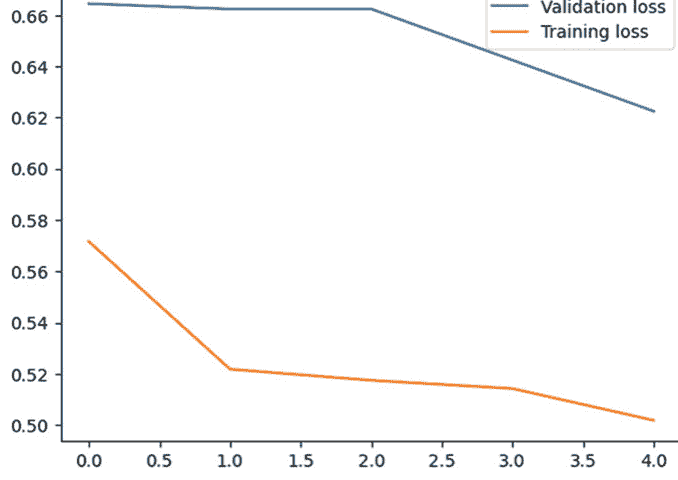

图 5.42 绘制验证损失和训练损失

## 5.5 总结

总之，本章提供了跨越不同数据类型的数据分析和机器学习技术的深度旅程。从关注金融和住房领域的数值数据分析开始。我们引入了简单线性回归的基本概念，然后探索了各种回归算法。转向文本数据，我们的注意力转向新数据以及浅学习技术在文本分类中的应用。本章还涉及文本数据分类的经典方法，并深入探讨了深度学习，重点是用于序列分析的长短期记忆（LSTM）网络。在整个章节中，我们强调了 TensorFlow 和 PyTorch 等流行深度学习框架的重要性。

转向视觉数据，我们的之旅继续深入探讨医学图像分析。我们演示了如何使用浅学习技术和强大的卷积神经网络（CNNs）对视觉数据进行分类。本章最后提醒了 TensorFlow 和 PyTorch 在视觉数据深度学习背景下的关键作用。为了更好地了解医学图像信息学领域的前沿文献，我们参考了 [9–21]，因为我们考虑了该领域所有可能的数据类型。

本质上，本章对数据分析和机器学习方法提供了一个全面且平衡的视角，适合广泛的读者。金融、住房和医学图像的真实案例研究增加了内容的实用相关性，使其对于希望在不同领域应用这些技术的数据科学家和机器学习爱好者来说，是一份引人入胜且信息丰富的资源。有关更详细的深度学习或基于 CNN 的机器学习模型，请参考我们之前的书籍 [9, 22]。

## References

- 1. P. Refailizadeh, L. Tang, H. Liu, Cross-validation, in Encyclopedia of Database Systems (Springer US, 2009), pp. 532–538. https://doi.org/10.1007/978-0-387-3940-9

- 2. H. Ahmed, I. Traore, S. Saad, Detecting opinion spans and fake news using text classification. Secur. Priv. 1(1) (2018). https://doi.org/10.1002/spy2

- 3. H. Ahmed, I. Traore, S. Saad, Detection of Online Fake News using N-Gram Analysis and Machine Learning Techniques (2017), pp. 127–138. https://doi.org/10.1007/978-3-319-691-5

- 4. U. Parida, M. Nayak, K. Nayak. Text categorization using random forest and Nave Bayes, in 2021 1st Odisha International Conference on Electrical Power Engineering, Communication and Computing Technology (ODICON) (IEEE, 2021), p. 1–4. https://doi.org/10.1109/ODICON5056.2021.942895

- 5. M. Sudhakar, Estimation of precision in news detection using Bert algorithm and comparison with random, in 2022 International Conference on Intelligent Computing and Control Technologies (ICICIT) (IEEE, 2022), p. 217–223. https://doi.org/10.1109/ICICIT5457.2022.991762

- 6. T. Shak, X. Tao, C. Dunn, Y. Li. Sentiment and opinion mining over educational data: a survey. Nat. Lang. Process. (2023), https://doi.org/10.1016/j.ipl.2023

- 7. Y. Li, Research and application of deep learning in medical imaging, in 2022 Second International Conference on Electronics, Applications (IPECA) (IEEE, 2022), p. 994–999. https://doi.org/10.1109/IPECA53709.2022

- 8. X. Wang, Y. Peng, Chest-ray, in 2017 IEEE Conference on Computer Vision and Pattern Recognition (CVPR), p. 3462–3471. https://doi.org/10.1109/CVPR.2017

- 9. KC Santos, Covid-19 Virus Analyzing Chest Images Using Deep Ensemble Neural Network. Int. J. Art. Intell. Tools 31(08), 2250349 (2022)

- 10. KC Santos, Covid-19 images: how big is? J. Med. Syst. 45(4), 71 (2021)

- 11. D. Ruikar, KC Santos, CT fractures, J. Med. Syst. 45(4), 51 (2021)

- 12. Aamir, KC Santos, Explainable AI for glaucoma prediction to understand risk factors in treatment planning. IEEE Trans. Med. Health Info 27(3), 1214–1215 (2023)

- 13. KC Santos, S. Rajaraman, Deep learning for tuberculosis abnormalities in chest-rays. Int. J. Mach. Learn. 14(8), 2659 (2023)

- 14. KC Santos, D. Ghosh, A systematic review of deep learning for tuberculosis using X-rays from 2020 to 2022. Healthcare 11(7), 2388 (2023)

- 15. KC Santos, N. Nakami, A systematic review of COVID-19 screening using chest CT. (2022)

- 16. KC Santos, M. Mamun, A systematic review on cough sound for covid-19 diagnosis. Peer Comput. Sci. 8,9 (2022)

## 附录：代码清单

### 图 5.38 用于加载和预处理的 Dataset 类

```python
class Dataset(torch.utils.data.Dataset):
    def __init__(self, df, path, transforms=None):
        self.df = df
        self.path = path
        self.image_paths = self.df['Image Index']
        self.labels = self.df['Finding Labels']
        self.transforms = transforms

    def __len__(self):
        return len(self.df)

    def __getitem__(self, index):
        '生成一个数据样本'
        # 选择样本
        image_path = self.image_paths[index]
        label = self.labels[index]
        image = cv2.imread(os.path.join(self.path, label))
        if self.transforms:
            image = self.transforms(image)
        return image, 0 if label=='No Finding' else 1

transform = transforms.Compose([
    transforms.ToTensor(),
    transforms.Normalize(
        (0.5, 0.5, 0.5),
        (0.5, 0.5, 0.5)
    ),
    transforms.Resize([128, 128]),
])
df = pd.read_csv(os.path.join(PATH, 'dataset.csv'))
ds = Dataset(df, os.path.join(PATH, 'images'), transform)
train_dataset, test_dataset = torch.utils.data.random_split(ds, [0.8, 0.2])
```

### 图 5.39 模型定义与初始化

```python
import torch.nn as nn
import torch.nn.functional as F
device = torch.device('cuda:0' if torch.cuda.is_available() else 'cpu')

class Net(nn.Module):

    def __init__(self):

        super().__init__()

        self.conv1 = nn.Conv2d(3, 6, 5)

        self.pool = nn.MaxPool2d(2, 2)

        self.conv2 = nn.Conv2d(6, 16, 5)

        self.f1 = nn.Linear(16 * 29 * 29, 120)

        self.f2 = nn.Linear(120, 84)

        self.f3 = nn.Linear(84, 1)

    def forward(self, x):

        x = self.pool(F.relu(self.conv1(x)))

        x = self.pool(F.relu(self.conv2(x)))

        x = torch.flatten(x, 1)

        x = F.relu(self.f1(x))

        x = F.relu(self.f2(x))

        x = torch.sigmoid(self.f3(x))

        return x

net = Net()

net.to(device)

criterion = nn.BCELoss()

optimizer = optim.Adam(net.parameters(), lr=0.001)
```

### 图 5.40 训练循环

```python
batch_size = 4
trainloader = torch.utils.data.DataLoader(
  train_dataset,
  batch_size=batch_size,
  shuffle=True,
  num_workers=2)

testloader = torch.utils.data.DataLoader(
  test_dataset,
  batch_size=batch_size,
  shuffle=False,
  num_workers=2)

for epoch in range(EPOCHS):
  running_loss = 0.0
  accuracy=[]
  for i, data in enumerate(trainloader, 0):
    net.train()
    net.to(device)
    inputs, labels = data[0].to(device), data[1].to(device)
    optimizer.zero_grad()
    outputs = net(inputs)
    acc = (outputs.round()) == labels.float().mean()

    accuracy.append(acc)
    loss = criterion(outputs, labels.unsqueeze(1).float())
    loss.backward()
    optimizer.step()
    if i % 100 == 0:
      print(...)
```

### 图 5.43 PyTorch 中的推理

```python
net.eval()
net.to(device)
val_loss = 0
correct = 0
gt_list = []
prediction_list = []
with torch.no_grad():
    acc = []
    for i, data in enumerate(testloader):
        inputs, labels = data[0].to(device), data[1].to(device)
        output = net(inputs).argmax(dim = -1)
        prediction_list.extend(output)
        gt_list.extend(labels)

gt_list = [x.item() for x in gt_list]
prediction_list = [x.item() for x in prediction_list]
```


- 17. KC Santos, S. Ghosh, Ret-GAN: medical image enhancement using generative adversarial networks, in 2021 IEEE 24th International Symposium on Computer-Based Medical Systems (CBMS), Porto, Portugal (2021), p. 79–84. https://doi.org/10.1109/CBMS55027.2021.200682

- 18. KC Santos, S. Antani, Multimodal deep learning in medical imaging informatics. IEEE J. Med. Health Info 27(3), 1214–1215 (2023). https://doi.org/10.1109/JBHL.2023.3241369

- 19. KC Santos, L. Gaur, Artificial Intelligence and Machine Learning in Public Health, Springer in Applied Sciences and Technology (2021). ISBN 978-981-16-6768-8

- 20. KC Santos, S. Antani, Medical Imaging Artificial Intelligence, Image Recognition, and Machine Learning Techniques, 1st edn. (CRC Press, 2019). ISBN 9780402902417

- 21. KC Santos, S. Antani, Multimodal deep learning in medical imaging informatics. IEEE J. Med. Health Info 27(3), 1214–1215 (2023).

# 第 6 章 多模态学习与表示

本章深入探讨了多模态学习与表示的概念，以情感分析为例，并参考了 IEMOCAP 数据集 [1]。尽管这超出了本文的研究范围，但我们也受到了此前关于医学信息学的“多模态学习与表示”工作 [2] 的启发。该数据集 [1] 比我们在前面章节中遇到的数据集更为复杂，为获得真实世界数据的经验提供了宝贵机会。该数据集包含约 12 小时的录音，由 10 名演员展示各种情绪。录音涵盖了动作捕捉、视频和音频数据，以及对话的文本转录。本章的后续章节将介绍更多细节。为了说明这一概念，我们将采用音频信号（数值时间信号数据）和文本转录来演示多模态学习。任务是预测十种情绪状态之一：愤怒、悲伤、快乐、厌恶、恐惧、惊讶、兴奋和中性状态。数据集可以通过其主页申请。

^1 https://sail.usc.edu/imecocap/imecocap-release.html。

## 6.1 情感分析

情感分析（有时被称为意见挖掘）是人工智能中的一个领域，我们试图衡量数据中积极和消极情绪的程度。传统上，情感分析认为与自然语言处理相关 [3–5]。然而，正如我们所论证的，情感和情绪（例如 [6]）不仅可以通过文本表达，还可以通过口语或视觉线索表达——对话中的愤怒可能无法通过文本数据完全覆盖。句子“你喜欢冰淇淋吗？”末尾上扬的语调可能表示提问者对其喜欢冰淇淋感到惊讶，但中性的语调可能表示此人只是好奇想知道你喜不喜欢冰淇淋。句子增加的语气可以提供更多背景，以做出更明智的决策。

近年来，研究人员对利用多模态特征进行情感分析越来越感兴趣 [7–9]。文本特征结合视听特征被广泛用于证明多模态表示学习在情感分析中的稳健性。

## 6.2 目标

收集该数据集的目的是为了研究人类行为，我们可以利用它来开发情感分析模型。为了在保持案例研究简单的同时引入多模态学习的概念，我们将仅关注音频信号和文本转录。音频数据的加入允许模型能够捕捉语音中的模式。情感分析通常不仅取决于所使用的词，还取决于语调、音高、速度以及语音的其他声学特征等因素。通过结合音频，模型可以在确定情感时考虑这些额外因素。同时，文本转录为模型提供了口语内容中词汇和语言。通过结合音频和文本模态，目标是创建一个更稳健、更准确的情感分析模型。这种多模态方法利用了音频和文本的优点来提高模型性能。它可以捕捉语音中表达的情感丰富性，以及文本中所用语言的细微差别，使其能够更好地理解各种语境下的情感。

总而言之，这里的思想是利用一个包含音频和文本数据的数据集来增强情感分析。这种方法承认情感是一个复杂的概念，受到词汇内容和说话方式的影响。通过同时考虑两种模态，模型旨在对人类行为数据中的情感提供更全面、更准确的分析。

## 6.3 数据集

我们用于此扩展部分的数据集是交互式情感双人动作捕捉（IEMOCAP）数据集。该数据集是情感通信研究领域的一个丰富资源。该数据库由南卡罗来纳大学的 SAIL 实验室汇编，是 12 小时视听内容的精选集。数据集涵盖了视频片段、语音记录、面部动作捕捉数据和文本转录，旨在对人类情感表达提供全面的理解。该数据集提供了分析的多样模态，包括动作捕捉面部信息、语音录音、视频、头部运动、头部角度信息和对话转录。

值得注意的是，它提供了不同语言层面的对齐，例如单词、音节和音素。

### 6.3.1 目的

在 IEMOCAP 数据库中，开展了双人会话，演员参与了即兴和剧本化的场景。这些场景经过深思熟虑的选择，以唤起一系列情感反应，对人类表达进行细致入微探索。该数据库的独特之处不仅在于其丰富的内容，还在于结合了多种模态，包括语音、面部表情和肢体语言。

多位标注者提供的细致注释进一步增强了数据库的价值。情绪被分类为愤怒、快乐、悲伤和中性等标签。此外，效价（valence）、激活（activation）和主导（dominance）等维度标签有助于更细致地理解数据集中捕捉的情感图谱。

多模态和表达性人类通信领域的 IEMOCAP 研究人员和从业者将发现该数据库是无价之宝。其详细的动作捕捉信息、使用交互服务诱发真实情感，以及数据集的大规模，共同使其成为研究社区现有资源的重要补充。这一语料库有望促进人类情感通信研究和建模的进一步探索与进展。

数据集可以通过其网站申请和下载。有两个数据集：一个包含视频录制，另一个不包含视频录制。为了演示并简化可重复性，我们访问了包含音频记录的数据集。

### 6.3.2 描述

12 小时的视听录音被分成句子（或轮次）。分割产生了 1039 轮，其中 5255 处是脚本化的，4784 处是自发会话。有两种标注：基于类别的标注（愤怒、快乐、悲伤等）和基于连续值的标注（效价、激活和主导）。在本章中，我们感兴趣使用类别标签对情绪进行分类，并将以此作为使用依据。每轮的平均时长和每轮的单词数如图 6.1 所示。

每个情绪类别的数据分布良好，惊讶和恐惧除外。剧本化和自发会话的分布见

^2 https://sail.usc.edu/iemocap/index.html。

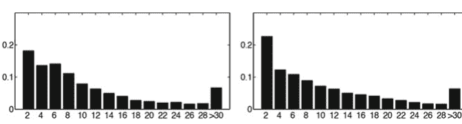

图 6.1 剧本化和自发会话每百分比单词直方图（从左到右）[1]

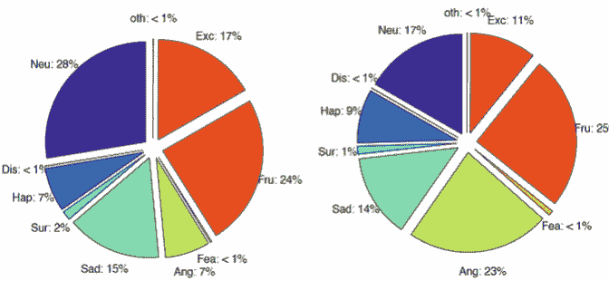

图 6.2 剧本化和自发会话中的情绪类别分布（从左到右）[1] 图表显示，积极情绪（如快乐和兴奋）的比例高于消极情绪（如悲伤和愤怒）。恐惧情绪类别占剧本化和自发会话总情绪类别的比例小于 1%。

## 6.4 实现

原始音频

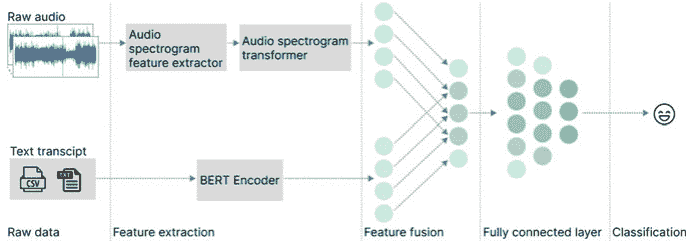

文本转录

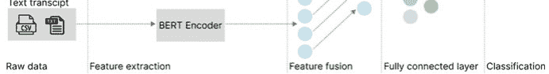

图 6.3 使用文本和听觉数据进行情感分类

### 6.4.1 音频信号

通过语音识别情感的故事已成为情感计算领域的一个重要关注点 [10]，医疗健康也不例外 [11]。

音频信号通常被表示为数值时间序列数据，其中每个数据点对应于特定时间内音频信号的振幅。分析这些数据对于音频分类等任务至关重要，在这些任务中，你希望将音频片段分类到不同的类别（例如，语音识别、音乐流派分类）。传统上，`RNN`（递归神经网络）被用于处理音频信号等序列数据。`RNN` 具有循环结构，可以捕捉时间上的依赖关系。然而，它们也存在一些局限性，包括在处理长距离依赖方面存在困难，以及计算效率问题。

音频频谱图变换器（`ASTs`）[12, 13] 是音频处理领域的一项较新进展。它们基于 `transformer` 架构，该架构是无卷积且基于注意力的，这意味着它们依赖于注意力机制，并且能够完全捕捉数据中的序列关系，而不依赖于卷积层。

### 6.4.2 文本转录

在第一章中，我们探索了使用 `LSTM` 等序列模型进行文本分类。我们还引入了以在 NLP 任务中具有卓越性能而闻名的 `transformers`。对于我们的研究，我们使用了 `transformer` 的编码器部分，特别是 `BERT` [14]。`BERT` 代表“来自 Transformer 的双向编码器表示”。像 `BERT` 这样的预训练模型使我们能够利用迁移学习的优势，减少训练所需的数据量。

利用 `BERT` 等预训练模型的另一个优势是，它们在处理输入文本时，消除了对预训练任务的需求（如分词、移除停用词和标点符号）。该编码器产生的输出与来自 `AST` 的输出特征相结合。

### 6.4.3 PyTorch

我们将通过 `PyTorch Lightning` 应用多模态学习的概念。使用 `Lightning` 类似于 `PyTorch`，但涉及更少的样板代码，同时使我们能够利用 Hugging Face 仓库提供的大量预训练模型。该仓库包含了针对音频频谱图变换器（`AST`）和 `BERT` 的预训练模型。首先，我们确保已经安装了所有必要的包：

- 用于构建模型的 `PyTorch` 和 `PyTorch Lightning`。
- 用于 `BERT` 和 `AST` 的 `Transformers`。
- 用于监控和评估的 `Torchmetrics`。

**导入包：** 导入必要的包，包括 `PyTorch Lightning`（图 6.4）。

```python
import torch
import librosa
import pandas as pd
from torch.nn.utils.rnn import pack_padded_sequence, pad_packed_sequence
import torch.nn.functional as F
from torch import nn
import torch.optim as optim
import lightning.pytorch as pl
from torchaudio.transforms import *
import numpy as np
import torchmetrics
from lightning.pytorch.loggers import CSVLogger
import re
from transformers import AutoFeatureExtractor, ASTForAudioClassification
import glob
from torch.utils.data import DataLoader
from transformers import BertTokenizer, BertModel
from torch.utils.data import Dataset
from torch.utils.data import WeightedRandomSampler
```

图 6.4 加载包

**获取数据集：** 数据集可以从 `https://sail.usc.edu/iemocap/iemocap_release.htm` 免费获取。你可能需要提交请求。数据集由两个主要文件夹组成：用于完整会话，另一个用于从会话中提取的数据集。为了方便使用，我们使用由句子组成的数据集，因为它符合理想的格式。

**数据预处理：** 不需要对数据进行预处理，数据格式已经是我们想要的了。此外，我们选择的模型很少或完全不需要数据预处理。然而，可以为了调优模型进行进一步的数据处理。我们需要构建一个 `dataloader` 和 `dataset` 类来加载多模态数据。`meta_df` 是一个包含文件名、对话和句子类别等重要信息的 dataframe。`directory` 是一个匹配音频文件（以 `.wav` 结尾的文件）的正则表达式。创建 `meta_df` dataframe 需要额外的代码，这里未包含在内，以便我们将重点放在实现的重要方面上。

使用 `torchaudio` 处理音频信号。同样，对话被分词（`tokenized`），并由预训练分词器生成嵌入（`embeddings`）。文本嵌入提取了音频特征，目标在相同的 `_get_time–method` 方法中返回（使用图 6.5）。

**加载并划分数据集：** 在创建数据集后，我们可以使用 `random_split` 方法（如图 6.6 所示）将数据集划分为训练集和验证集。最后，我们为训练和验证集初始化 `DataLoader` 类。

**创建模型：** 我们引入了 `PyTorch Lighting` 来构建模型类。它是基于 `PyTorch` 模型类的，但可以配备额外的实用方法，如 `validation_step()`、`training_step()` 和 `configure_optimizers()`。这些方法的引入减少了 `PyTorch` 中的样板代码。我们首先从 `LightningModule` 创建一个类。默认情况下，`Lightning` 方便在训练期间将指标记录到 csv 文件中，因此我们可以从 `torchmetrics` 模型中初始化各种指标，如图 6.7 所示。我们还初始化了 `BERTModel` 和 `ASTAudioClassificationmodel`。

为了避免对预训练模型的所有层进行训练，我们禁用了它们的训练。随后，我们还指定了所有层。


# 6 多模态学习与表示

## 6.4 实现

### 6.4.1 音频信号

通过语音识别情感的故事已成为情感计算领域的一个重要关注点 [10]，医疗健康也不例外 [11]。

音频信号通常被表示为数值时间序列数据，其中每个数据点对应于特定时间内音频信号的振幅。分析这些数据对于音频分类等任务至关重要，在这些任务中，你希望将音频片段分类到不同的类别（例如，语音识别、音乐流派分类）。传统上，递归神经网络（`RNN`）被用于处理音频信号等序列数据。`RNN` 具有循环结构，可以捕捉时间上的依赖关系。然而，它们也存在一些局限性，包括在处理长距离依赖方面存在困难，以及计算效率问题。

音频频谱图变换器（`ASTs`）[12, 13] 是音频处理领域的一项较新进展。它们基于 `transformer` 架构，该架构是无卷积且基于注意力的，这意味着它们依赖于注意力机制，并且能够完全捕捉数据中的序列关系，而不依赖于卷积层。

### 6.4.2 文本转录

在章节中，我们探索了使用 `LSTM` 等序列模型进行文本分类。我们还引入了以在 `NLP` 任务中具有卓越性能而闻名的 `transformers`。对于我们的研究，我们使用了 `transformer` 的编码器部分，特别是 `BERT` [14]。`BERT` 代表“来自 Transformer 的双向编码器表示”。像 `BERT` 这样的预训练模型使我们能够利用迁移学习的优势，减少训练所需的数据量。

利用 `BERT` 等预训练模型的另一个优势是，它们在处理输入文本时，消除了对预训练任务的需求（如分词、移除停用词和标点符号）。该编码器产生的输出与来自 `AST` 的输出特征相结合。

### 6.4.3 PyTorch

我们将通过 `PyTorch Lightning` 应用多模态学习的概念。使用 `Lightning` 类似于 `PyTorch`，但涉及更少的样板代码，同时使我们能够利用 Hugging Face 仓库提供的大量预训练模型。该仓库包含了针对音频频谱图变换器（`AST`）和 `BERT` 的预训练模型。首先，我们确保已经安装了所有必要的包：

- 用于构建模型的 `PyTorch` 和 `PyTorch Lightning`。
- 用于 `BERT` 和 `AST` 的 `Transformers`。
- 用于监控和评估的 `Torchmetrics`。

**导入包：** 导入必要的包，包括 `PyTorch Lightning`（图 6.4）。

```python
import torch
import librosa
import pandas as pd
from torch.nn.utils.rnn import pack_padded_sequence, pad_packed_sequence
import torch.nn.functional as F
from torch import nn
import torch.optim as optim
import lightning.pytorch as pl
from torchaudio.transforms import *
import numpy as np
import torchmetrics
from lightning.pytorch.loggers import CSVLogger
import re
from transformers import AutoFeatureExtractor, ASTForAudioClassification
import glob
from torch.utils.data import DataLoader
from transformers import BertTokenizer, BertModel
from torch.utils.data import Dataset
from torch.utils.data import WeightedRandomSampler
```

**获取数据集：** 数据集可以从 `https://sail.usc.edu/iemocap/iemocap_release.htm` 免费获取。你可能需要提交请求。数据集由两个主要文件夹组成：用于完整会话，另一个用于从会话中提取的数据集。为了方便使用，我们使用由句子组成的数据集，因为它符合理想的格式。

**数据预处理：** 不需要对数据进行预处理，数据格式已经是我们想要的了。此外，我们选择的模型很少或完全不需要数据预处理。然而，可以为了调优模型进行进一步的数据处理。我们需要构建一个 `dataloader` 和 `dataset` 类来加载多模态数据。`meta_df` 是一个包含文件名、对话和句子类别等重要信息的 `dataframe`。`directory` 是一个匹配音频文件（以 `.wav` 结尾的文件）的正则表达式。创建 `meta_df` `dataframe` 需要额外的代码，这里未包含在内，以便我们将重点放在实现的重要方面上。

使用 `torchaudio` 处理音频信号。同样，对话被分词（`tokenized`），并由预训练分词器生成嵌入（`embeddings`）。文本嵌入提取了音频特征，目标在相同的 `_get_time–method` 方法中返回（使用图 6.5）。

**加载并划分数据集：** 在创建数据集后，我们可以使用 `random_split` 方法（如图 6.6 所示）将数据集划分为训练集和验证集。最后，我们为训练和验证集初始化 `DataLoader` 类。

**创建模型：** 我们引入了 `PyTorch Lighting` 来构建模型类。它是基于 `PyTorch` 模型类的，但可以配备额外的实用方法，如 `validation_step()`、`training_step()` 和 `configure_optimizers()`。这些方法的引入减少了 `PyTorch` 中的样板代码。我们首先从 `LightningModule` 创建一个类。默认情况下，`Lightning` 方便在训练期间将指标记录到 `csv` 文件中，因此我们可以从 `torchmetrics` 模型中初始化各种指标，如图 6.7 所示。我们还初始化了 `BERTModel` 和 `ASTAudioClassificationmodel`。

为了避免对预训练模型的所有层进行训练，我们禁用了它们的训练。随后，我们还指定了所有层。

```python
class MultimodalClassifier(pl.LightningModule):
    def __init__(self, num_classes=10):
        super(MultimodalClassifier, self).__init__()
        self.train_auc = torchmetrics.classification.AUROC(
            task = 'multiclass',
            num_classes=num_classes)
        self.val_auc = torchmetrics.classification.AUROC(
            task = 'multiclass',
            num_classes=num_classes)
        self.val_f1 = torchmetrics.classification.F1Score(
            task = 'multiclass', num_classes=num_classes)
        self.train_f1 = torchmetrics.classification.F1Score(
            task = 'multiclass', num_classes=num_classes)

        self.sp_model = ASTForAudioClassification.from_pretrained(
            'finetuned-audioset-10-10-0.4593',
            return_dict=False)
        self.bert_model = BertModel.from_pretrained("bert-base-uncased")
        for param in self.sp_model.parameters():
            param.requires_grad = False
        self.sp_model.classifier.dense = nn.Linear(768,256)
        for param in self.bert_model.parameters():
            param.requires_grad = False
        self.fc1 = nn.Linear(1024, num_classes)
        self.dropout = nn.Dropout(.7)
        self.relu = nn.ReLU()
```

图 6.7 创建 `MultimodalClassifier` 类

```python
def forward(self,x,y):
    x = x['input_values'].size(0), 1024, 128)
    input_bert = y['input_ids'].view(
        y['input_ids'].size(0), 50)
    atten_bert = y['attention_mask'].view(
        y['attention_mask'].size(0), 50)
    sp = self.sp_model(x, return_dict=False)[0] # 256
    bert, bool = self.bert_model(
        input_ids = input_bert,
        attention_mask = atten_bert,
        return_dict = False)
    sp = self.dropout(sp)
    out = torch.concat([pool, sp], axis = 1)
    out = self.dropout(out)
    out = self.fc1(out)
```

图 6.8 前向传播方法

```python
def configure_optimizers(self):
    optimizer = optim.Adam(self.parameters(),
        lr=0.0001, weight_decay=1e-3)
    return optimizer
```

```python
def training_step(self, train_batch, batch_idx):
    signal, dial, labels = train_batch
    labels = labels.float().to('cuda:0')
    outputs = self(signal, dial).to('cuda:0').argmax(1).float()
    criterion = torch.nn.CrossEntropyLoss()
    loss = criterion(outputs, labels.long())
    self.train_auc(outputs, labels.int())
    self.train_f1(outputs, labels.int())
    self.log('loss', loss, on_step=False, on_epoch=True)
```

```python
def validation_step(self, val_batch, batch_idx):
    signal, dial, labels = val_batch
    labels = labels.float().to('cuda:0')
    outputs = self(signal, dial).to('cuda:0').argmax(1).float()
    criterion = torch.nn.CrossEntropyLoss()
    loss = criterion(outputs, labels.long())
    self.val_auc(outputs, labels.int())
    self.val_f1(outputs, labels.int())
    self.log('loss', loss, on_step=False, on_epoch=True)
```

图 6.9 训练的额外方法

图 6.10 训练模型

图 6.11 使用 `BERT` 编码器的分类器

图 6.12 文本的前向传播方法

图 6.13 文本的 `training_step` 和 `validation_step` 方法

## 6.5 结果与分析

### 6.5.2 可视化训练与验证迭代

虽然我们可以通过日志文件简单地检查模型性能，但使用可视化进行评估会更全面。为了做到这一点，我们像之前一样使用 `Matplotlib` 库。首先，我们指定日志文件的路径（`CSV` 文件）：由 `Lightning` 的 `trainer` 方法生成的文本模型和多模态模型的 `text_path` 和 `path` 路径。

我们随后使用 `Pandas` 加载 `CSV` 文件。加载日志文件并生成趋势图的完整代码如图 6.14 所示。

### 6.5.3 结果分析

结果如图 6.15 所示。图表显示了基准文本模型和多模态架构的训练损失以及验证损失。该图还显示了训练迭代过程中 `F1` 分数指标的趋势。在两种情况下，趋势看起来几乎相似。验证损失和训练损失都呈指数级下降，并达到平台期，且训练损失始终低于验证损失。同样，`F1` 指标先增加后达到平台期。文本模型的训练和验证的 `F1` 分别达到 0.45 和 0.35。同样，在多模态方法中，训练 `F1` 指标达到 0.82 左右，验证 `F1` 指标达到 0.62。

训练线和验证线之间的差距表明两个模型都有改进空间。较大的差距意味着模型在训练数据上学习得更好。理想情况下，我们希望看到训练和验证曲线之间的差距很小，并随着时间的推移而改进。我们可以通过对数据集的不同子集进行多次实验的交叉验证来检查模型的稳健性。可以使用每个实验的平均值来绘制曲线。

## 6.6 总结

本章介绍了情感分析背景下的多模态学习与表示。它使用了 `IEMOCAP` 数据集，该数据集包含 10 位通过音频、视频和文本展示各种情绪的演员。目标是通过结合音频信号和文本记录来提高情感分析的准确性。音频信号使用音频频谱变换器（`AST`）进行处理，而文本记录受益于预训练模型 `BERT`。`PyTorch Lightning` 简化了实现，降低了复杂性。本章涵盖了数据集处理、数据预处理、模型创建（带有参数控制和输出层）以及用于优化训练的各种 `PyTorch Lightning` 功能。本质上，本章探索了音频与文本数据的协同以增强情感分析，并提供了一种使用 `PyTorch Lightning` 的实用实现方法。此外，我们将多模态方法与基准文本模型进行了对比，并观察多模态方法在 `F1` 分数指标上优于单模态方法。然而，我们也看到模型存在改进空间。

## 参考文献

1. C. Basso, 等. IEMOCAP: 交互式双向动作捕捉数据库 (2007)

2. KC Santosh, S. Antani, Multimodal learning in medical informatics informatics. IEEE J. Biomed. Health Info. 27(3), 1214–1215 (2023). https://doi.org/10.1109/JBHI.2023.3241369


## 参考文献

3. T. Nasuka, Y. Ji, 情感分析: 使用自然语言处理捕捉好感, in Proceedings of the 2nd International Conference on Knowledge Capture, K-AP '03 (Association for Computing Machinery, New York, NY, 2003), pp. 70–77. https://doi.org/10.1109/94564.945568

4. M. Shakeel, S. Faizullah, T. Alhamani, I. Khan, 语言理解情感分析, in 2019 International Conference on Advances in Engineering Technologies (IEEE) IEEE Computer Society, Los Angeles, CA, 2020), pp. 1–5. https://doi.org/10.1109/AECT47.2020.9914186

5. S. Phan, B. Keat, 越南语的情感分析, in International Conference on Systems and Knowledge Engineering (IEEE Computer Society, Los Angeles, CA, 2010), pp. 152–157. https://doi.org/10.1109/KSE.2010.33

6. N. Jain, V. Gupta, S. Shubham, A. Madam, D. Chaudhary, KC Santosh, 在大型数据集上使用深度神经网络理解情绪. Appl. 34(24), 2148–2151 (2020)

7. R. Milichea, 多模态情感分析, in Proceedings of the 3rd Workshop on Approaches to Subjectivity and Sentiment Analysis, WASSA '12 (Association for Computational Linguistics, 2012), p. 1

8. L. Lappen, 等. MuSE 2021 多模态情感分析挑战: 情感、情绪、生理-情绪和压力, in Proceedings of the 2nd on Multimodal Sentiment Analysis Challenge-MuSE (Association for Computing Machinery, New York, NY, 2021), pp. 5–14. 使用 RNN 变体进行多模态情感分析, in 2019 IEEE International Conference on Big Data, Data & Engineering (BCD) (Los Angeles, CA, 2019). https://doi.org/10.1109/BCD.2019.888118

9. A. Agarwal, A. Yadav, D. Vishwakarma, 通过 RNN 变体的多模态情感分析, in 2019 IEEE International Conference on Big Data, Data & Engineering (BCD) (IEEE Computer Society, Los Angeles, CA, 2019).

10. H. Mukherjee, H. Salam, A. Athmani, 你的话有多强烈？从语音中理解情绪强度, in ICCT (2021), pp. 1–286

11. KC Santosh, 医疗健康语音处理: 我们能整合吗? Intelligent Speech Processing (Academic Press, Elsevier, 2019), pp. 1–4

12. 音频频谱变换器 [在线], https://huggingface.com/docs/transformers/model_guide/audio#spectrum-transformer. 访问于2023年11月1日

13. Y. Gong, Y. Chung, J. Glass, AST: 音频情感变换器, in Proceedings of the Annual Conference of the International Speech Communication Association, INTERSPEECH, vol. 1 (2021), pp. 56–60. https://doi.org/10.21437/Interspeech.2021-698

14. R.K. Kaliyar, 多层双向变换器, in 10th International Conference on Cloud Computing, Data Science & Engineering (IEEE) (2020), pp. 336–340. https://doi.org/10.1109/CCDE.2020.1025804

## 7 是技术性还是创新？

当我们结束这本书的旅程时，我们花一点时间回顾一下我们所实现的各种细节。在一个充满技术复杂性的世界里，人工智能仅仅是关于算法吗？还是塑造未来的创新力量？我们让读者思考技术细节与人工智能变革力量之间的微妙平衡。

简而言之，不要误解，对于那些一直致力于构建机器学习模型的人，本书旨在提供高水平的机器学习技术和创新。
