# 犯罪科学与数字取证：整体视角

Times New Roman 字体制作

由 Radiant Productions 制作

# 前言

* * *

《犯罪科学与数字取证：整体视角》是一系列文章的汇编，从犯罪科学的角度对取证实践和数字调查的讨论做出贡献。本书还分享了关于网络安全以及保护数据免受未经授权访问和篡改的技术的替代性对话。

禁止化学武器组织（OPCW）和盖特威克机场的丑闻强化了犯罪科学的重要性，以及采取主动安全措施的必要性，而不是目前许多机构所使用的“观望其变”的方法。本书旨在作为一个展示处理网络犯罪和进行数字调查的新方法的平台。它为自主技术以及结合基于证据的学科进行数字取证调查、网络安全策略和政策框架的犯罪分析与预防提供了创新的方法。

本书由 12 章组成，分为犯罪科学、数字取证和网络安全三个领域。每章都包含文献综述、对实践的启示、政策、理论以及对未来方向的讨论。整体视角的核心在于当今业界取证和数字安全专业人员面临的挑战，即传统实践无法提供满意的证据或安全。这本书将对数字安全、取证和网络安全领域的学生、学者和从业者产生很大兴趣。它标志着交叉学科研究的新新路线，即利用各种技术和犯罪科学来应对和预防犯罪。

*编辑*

**Anthony C. Ijeh**

**Kevin Curran**

# 致谢

* * *

编辑认可并感谢所有作者和贡献者的努力和贡献。

作为编辑，我们还感谢 CRC Press 出版社；特别是为本书完成而工作的团队。

最后，编辑感谢所有《犯罪科学与数字取证：整体视角》的读者对本书的关注，并鼓励他们继续发送宝贵的反馈和进一步改进的建议。

我们生活在一个互联的世界里，全球范围内发生的事件往往具有影响我们日常生活的力量。这些事件以视觉和文本内容的形式到达我们并由我们传播，产生了海量的非结构化数据池。一个极其显著的例子是近期发生在巴黎圣母院教堂的大火，那是巴黎一个古老的建筑和宗教象征。2019 年 4 月，一场火灾席卷了教堂，摧毁了其结构和尖塔的大部分（图 1）。全世界的人通过媒体和普通公民分享的数百万张图像和视频关注这一悲剧性事件，与此同时，建筑的部分化为了灰烬。

像巴黎圣母院火灾这样前所未有的事件产生的内容，对于记录我们的历史具有重要意义，也可以作为调查的信息来源。然而，这些内容自然来自异构源，通常缺乏适当的结构，例如它们是在何时何地捕捉的，以及如何与其他信息相关联。理解一个事件的有效方法是为这类数据创建一个结构，构建一个统一的空间，使所有相关信息都能在其中连贯地组织起来。

![图 1：2019 年 4 月，巴黎圣母院教堂发生了一场摧毁其部分结构和尖塔的大火。图片归属：Milliped [CC BY-SA 4.0] 和 Francois Guillot/AFP/Getty。](OEBPS/images/page4_1.jpg)

**图 1：**2019 年 4 月，巴黎圣母院教堂发生了一场摧毁其部分结构和尖塔的大火。图片归属：Milliped [CC BY-SA 4.0] 和 Francois Guillot/AFP/Getty。

通过将数据项置于一个共同的一致性系统中来同步数据的过程被称为`X-coherence`（Ferreira et al. 2019）。其理念是，通过妥善组织事件的数据，可以对其进行导航，理解它在时空中是如何展开的，甚至在同一语境下观察特定人物或物体的时间线。`X-Coherence` 例如可以帮助事实检查和法医调查中的嫌疑人挖掘。

尽管实现一个事件的`X-coherence`有益，但考虑到要在合理的时间范围内处理海量数据，手动执行可能是一项不可行的任务。更糟糕的是，人为通过引入无意识偏见来干扰这一过程，可能导致构建的空间和从此得出的任何结论失效。其中一个例子是 2013 年 4 月波士顿马拉松爆炸案后的一场前所未有的搜捕。在两枚炸弹在马拉松终点附近爆炸后，几人试图通过分析现场捕捉的数千张图像和视频来寻找炸弹客，结果却变成了一场重大失败（Surowiecki 2013）。

克服这些问题的方法是尽可能地自动化`X-coherence`过程，允许对事件产生的所有数据进行有效组织，同时减轻可能的偏见。为此，在本章中，我们展示了如何利用先进的机器学习技术来实现`X-coherence`，通过按空间和时间自动排序非结构化的图像集，同时提供一个联合可视化系统从整体上理解事件。

我们将巴黎圣母院火灾作为研究的背景，为此，我们从社交和主流媒体收集了该悲剧性事件的图像和视频。对于同一事件的给定标注图像集，我们训练了卷积神经网络（CNN）来捕捉重要的视觉线索，以便将每个数据项放置在空间和时间内。训练后的模型随后可以组织新图像，并将它们放置在共同的贯贯空间进行可视化。

文献中的工作关注于与`X-coherence`相关的不同任务。考虑到图像的空间排序，Snavely et al. 2008 了一种探索非结构化照片集的接口，方法是通过计算每张照片的视角以及场景的稀疏 3D 模型。

对于时间排序，Schindler et al. 2007 描述了如何通过提取随时间变化的 3D 模型对跨越多年的照片进行排序。Volokitin et al. 2016 研究了 CNN 特征在预测户外场景一年季节方面的有效性。对于视频序列，Lameri et al. 2014 提出了一种将一组近重复的镜头拼接在一起的方法，从而在时间上对它们对齐，以重建事件的完整视频序列。

一些工作专门关注如何可视化来自事件的数据（Chung et al. 2005; Deligiannidis et al. 2008; Reinders et al. 2001)），避免在分析事件时出现信息过载和无法指示整体趋势的问题。

与这些工作不同，我们的目标是明确且彻底地解决实现事件`X-coherence`的问题。为此，我们的主要贡献是：

*   一种在空间中对事件图像定位的方法，将其分配给相对于事件中心的不同基准方向；

*   一种将事件图像放置于重要子事件决定的特定范围内的方法；

*   一种在空间和时间内连贯表示事件图像的可视化方法。

虽然我们在特定事件（巴黎圣母院火灾）上展示了这些贡献，但我们强调所提的方法和方法论可以适用于类似的事件，即图像在事件期间的不同位置和角度被捕捉。

## 提出的解决方案

为了解决巴黎圣母院火灾的`X-coherence`，我们将该过程分为三个步骤：空间分类、时间分类和可视化（图 2）。

在空间和时间分类步骤中（这两个步骤可以同时进行），通过分析内容将输入图像定位在空间时间和。对于空间分类，根据捕捉图像相对于教堂的位置为图像分配一个基准方向。在时间分类期间，我们的方法检测图像相对于重要子事件（如坍塌和火灾熄灭）的时间。

最后，可视化步骤收集之前推断的所有图像信息，并将它们在连贯的空间中表示，以便更好地理解事件。

### 2.1 空间分类

在重大事件发生期间（例如摧毁巴黎母院大教堂的火灾），人们倾向于从所有可能的俯瞰事件的地点拍摄图像和视频。当这些内容被上传到社交媒体或由媒体发布时，元数据（如拍摄时间和 GPS 坐标）通常会丢失。获取这些信息的唯一方法是根据图像内容进行推断。

在空间分类步骤中，我们的目标是确定输入图像中捕捕捉的教堂立面对应的方位——`south`、`southwest`、`west`、`northwest`、`north`、`northeast`、`east` 或 `southeast`。根据图像中出现的教堂不同部分，由于缺乏空间线索，可能无法可靠地推断空间信息。为了解决这个问题，我们训练了该方法将此类输入归类为“`unknown`”方向。

图 3a 在事件发生地点的地图上显示了事件期间可能拍摄图像的各个，以及每个位置所对应的哪座教堂的立面。图 3b 描述了事件期间捕捉的教堂不同立面的图像示例。

我们这一步骤的解决方案是训练卷积神经网络（CNN），将图像内容（教堂立面）与九种可能性之一（包括“`unknown`”类）关联起来。我们依赖于`Inception-ResNetv2`架构 (Szegedy et al. 2017) 以及其在 ImageNet 数据集上的预训练权重。该架构结合了两种先进思想——Inception 模块和残差连接，允许更深网络进行更快的训练，从而为分类任务带来更好的结果。

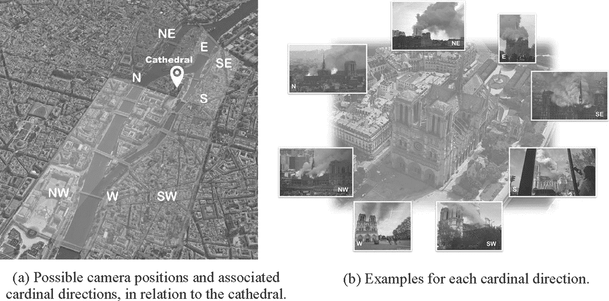

**图 3：** 空间分类步骤的方位：`south, southwest, west, northwest, north, northeast, east, or southeast`。

为了使网络适应我们的任务，我们在网络输出端添加了一个丢弃率为 0.7 的 dropout 层以正则化训练过程，并修改了其全连接层以匹配该任务的类别数量。然后，我们使用训练数据训练最后一个卷积层和修改后的全连接层。众周知，针对不同视觉任务优化的网络初始层会学习识别相似的视觉模式，例如边界和边缘 (Yosinski et al. 2014)。考虑到此，我们固定了网络其他层的原始预训练权重，并且没有对其进行更新。

网络训练完成后，可以使用该模型推断新数据的方位。最后，可以对所有可用图像进行空间排序。

### 2.2 时间分类

时间分类步骤的目标是推断输入图像是在事件时间范围内的何时拍摄的。根据所分析事件的性质，精确定义图像或视频拍摄的时间或时间段可能非常重要。

我们的目标事件——母院火灾，可以通过几个时刻来划分。在时间分类步骤中，我们使用层次化方法来推断图像拍摄的时间。火灾发生后，它蔓延到了不同的地点。

考虑到该事件，我们识别了四个关键时刻：`spire on fire`、`spire collapsing`、`fire continues on roof` 和 `fire extinguished`。为了分类这些时刻，我们使用以下分类器：

1. `C[1]`：“这张图像是在 `spire on fire` 子事件之前还是之后拍摄的？”

2. `C[2]`：“这张图像是在 `spire collapsing` 子事件之前还是之后拍摄的？”

3. `C[3]`：“这张图像是在 `fire continues on roof` 子事件之前还是之后拍摄的？”

每个分类器`C[i]`给出我们图像在某一子事件之前拍摄的概率`p[i]`。为了最终决定图像是在哪个子事件期间拍摄的，我们使用概率模型结合预测结果 (Martin et al. 2014)。考虑到可能的子事件`M` = [`spire on fire, spire collapsing, fire continues on roof, fire extinguished]，索引为`i` ∈ [1,4]，图像`I`在特定子事件`m[i]`中拍摄的概率为：

```
P(m_i | I) = product_{j=1 to i-1} (1 - p_j) * product_{j=1 to |M|-1} (p_j)
```

最后，预测的子事件`y`由下式给出：

```
y = argmax_{m_i in M} P(m_i | I)
```

对于最后一种策略，我们使用了分层方法。我们有一个顶层分类器`C[top]`，首先将问题分为“尖塔倒塌之前和之后”。根据决策，会考虑不同的子分类器。第一个分类器`C*[1×2]`在前两个类别`尖塔起火`和`尖塔正在倒塌`之间做出决定，第二个分类器`C*[3×4]`在后两个类别`火势持续`和`火已熄灭`之间做出决定。其思路是，尖塔倒塌是一个主要的子事件，严重影响了大教堂的外观。首先判断图像是在该阶段发生之前、期间还是之后捕捉的，应该比较容易。随后，使用专门的分类器来区分更难辨别的子事件。

在所有描述的时间分类策略中，分类器的训练都使用了具有足够视觉线索以预测子事件的图像。然而，某些图像是大教堂的放大图，或者是从非常规的角度拍摄的。由于这种情况在实践中也可能发生，我们需要在训练期间解决这个问题。为此，在应用任何策略之前，我们考虑了一个`unknown分类器`，它用于判断输入图像是否更容易被归类为子事件之一。如果图像子事件被视为`known`，则图像将进入描述的策略之一。

对于所有分类器，我们还采用了 Inception-ResNet-v2 架构 (Szegedy et al. 2017) 以及其在 ImageNet 数据集上预训练的权重。我们执行了之前相同的修改，包括 dropout 以及将全连接层更改为每个问题的数量。此外，只训练最后的卷积层全连接层，其余权重保持固定。

### 2.3 可视化

为了实现事件的`X-coherence`，数据需要在联合相干系统中进行结构化，以便于可视化和理解。考虑到所提出的空间和时间分类方法，目标是对初始信息池中的每张图像进行分类，并在空间和时间上对其进行排序。因此，可以结合目标事件的所有视觉数据。

对于这项任务，我们考虑了巴黎母院及其周围的地图。对于每个立面的方位`南`、`西南`、`西`、`西北`、`北`、`东北`、`东`和`东南`，都有一个定义的区域，用于对从任何包含位置捕捉的图像进行分组。

在对图像进行空间排序后，相干系统应允许按时间顺序访问图像。对于每个方位，从该视角捕捉的图像根据主要子事件的顺序进行排序：`尖塔起火`、`尖塔倒塌`、`火势在屋顶持续`，最后是`火已熄灭`。图 6 显示了`X-coherence`空间的相同示例，可以在 [`youtu.be/FeulIDK8xOI`](https://youtu.be/) 查看系统的运行视频。请注意，可以使用界面上的“上一个”和“下一个”按钮按顺序访问图像。

# 3. 数据集

在本节中，我们描述了创建的数据集，并讨论了在创建过程中遇到的某些困难，涉及数据的过滤和标注。

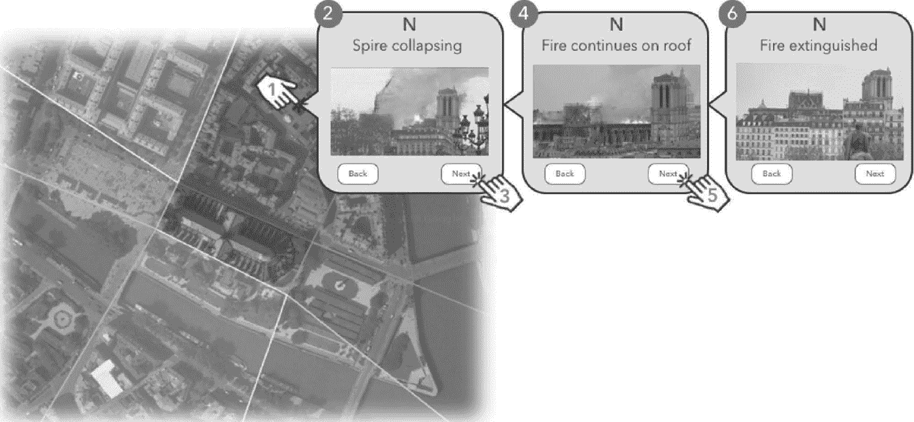

**图 6：** X-coherence 可视化的截图。通过选择地图上的一个区域，它会显示在相应方位捕捉的图像，允许我们穿梭于不同的时间时刻。

### 3.1 描述

在这一悲剧事件期间，数百万图像和视频由用户通过社交媒体以及全球媒体进行分享。为了构建用于训练和测试所提方法的初始数据集，我们使用工具从网上抓取了所有这些公共内容。我们考虑了在事件期间以及火熄灭后不久捕捉的图像。

数据集经过了人工筛选，仅包含有效且相关的数据。我们过滤了抓取的内容，只保留了没有叠加层或用户添加元素的图像，以及仅在事件期间和事后不久捕捉的图像。

第二步是标注数据。对于每张图像，我们定义了其描绘的大教堂立面方位，以及捕捉该图像的子事件。最终筛选后的图像集描述见表 1。

**表 1：** 针对巴黎母院火灾事件的精选数据集。

|    | *尖塔起火* | *尖塔倒塌* | *火势持续* | *火已熄灭* | *未知* | **总计** |

| --- | --- | --- | --- | --- | --- | --- |

| *N* | 68 | 14 | 19 | 3 | 2 | 106 |

| *NE* | 70 | 13 | 30 | 19 | 0 | 132 |

| *E* | 172 | 46 | 101 | 59 | 1 | 379 |

| *SE* | 161 | 5 | 177 | 118 | 4 | 465 |

| *S* | 23 | 1 | 21 | 34 | 1 | 80 |

| *SW* | 4 | 0 | 107 | 46 | 13 | 170 |

| *W* | 0 | 0 | 12 | 14 | 41 | 67 |

| *NW* | 10 | 0 | 3 | 0 | 7 | 20 |

| *Unknown* | 54 | 26 | 53 | 73 | 27 | 233 |

| **Total** | 562 | 105 | 523 | 366 | 96 | 1657 |

预处理后，数据集总计达到 1657 张图像。训练集对应于图像的 50%。从剩余图像中，我们创建了两个大小相近的组——`set[A]`和`set[B]`，用于验证和测试。为了创建这些集合，图像是随机分布的，试图保持与整个数据集相同的类别比例。

### 3.2 人工 vs. 自动数据处理

尽管我们的`X-coherence`执行得很好，但在空间和时间分类任务中，获得良好的准确率取决于数据集的质量。然而，由于我们使用的是社交媒体的数据，无法保证数据是可靠的。在巴黎母院火灾事件的情况下，情况并非如此。在 23683 张初始图像中，只有 5206 张描绘了事件的内容。其余的——18477 张（以下称为`无关`图像）——并没有描绘有关事件的内容——这包括表情包、漫画、作品、随机图像以及火灾之前的教堂图像，如图 7](#ch1.xhtml#fig1_7) 所示。由于我们以有监督的方式执行`X-coherence`，数据的噪声和偏差越小，预期准确率越高。因此，必须尽可能丢弃无关图像。

在数百或几千张图像的范围内，手动丢弃无关图像是可行的。但对于几十或数十万张图像的数据集，即使是专家，这项任务可能是不行的。因此，自动化解决方案可以减少在大范围内挖掘相关图像的时间。然而，设计一个监督解决方案是困难的，因为缺乏针对特定事件的相关性标注。为了尝试解决这个问题，我们实验了两种策略：半监督和基于迁移学习的方法。在接下来，我们将介绍如何执行这两种策略。

第一个想法是请专家选择一组较小的相关和非相关图像，然后使用半监督方法自动标注图像的相关性。为了说明这种方法在巴黎圣母院火灾事件中的应用，我们实验了一种基于最优路径森林（Optimum-path Forest）理论 (Amorim et al. 2016) 的半监督方法，并采用了一个在场景分类 (Zhou et al. 2017) 上预训练的`VGG16` (Simonyan and Zisserman 2014) CNN 作为特征提取器。首先，我们随机选择了一些相关图像和一些非相关图像作为标记数据。为了测试对标记数据集大小的敏感性，我们将标记图像的数量范围在 5 到 50，步长为 5，并对每种设置进行了 20 轮实验。

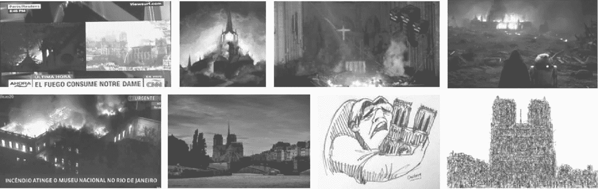


**图 7：** 巴黎圣母院火灾事件的`相关`图像示例。它们包括卡通、剪辑、表情包、电影场景、艺术绘画，以及事件发生前涉及火灾或大教堂的特定事件片段。

半监督方法的结果如图 8 所示。我们观察到，增加标记数据的数量也会提高准确率，但该方法平均只有约 58% 的准确率将标签正确传播到未标记数据中。这种较低的性能可能是由于标记数据与未标记数据之间的边缘概率分布不匹配（Pereira and Torres 2018）。由于专家可能无法接触事件的每一个视角，无法选择覆盖所有未标记数据分布的标记图像集。这导致半监督方法表现不佳（Oliver et al. 2018）。

另一种策略基于这样一个事实：我们对巴黎圣母院火灾事件的图像有一些先验知识：相关图像必须包含一栋建筑。该思路是利用这种知识，以迁移学习的方式训练一个模型，以识别图像是否包含建筑。为此，我们使用两个包含建筑图像的数据集（牛津建筑数据集和巴黎建筑数据集）微调了一个`VGG16` CNN，以及来自 Flickr 100k 数据集的描述与建筑无关内容的图像（Philbin et al. 2007, 2008）。该分类器在巴黎圣母院图像上的结果如图 9 所示。

在准确率方面，该模型取得的准确率比随机猜测（50%）高出 14 个百分点。然而，我们也观察到精确率较低的情况，这意味着假阳性率很高，包括火灾前大教堂的图像以及任何其他描述建筑的图像。相反，高召回率意味着大多数相关图像被正确分类了。这些结果共同表明，如果我们对事件有一定的先验知识，就可以将其作为第一层过滤器，来挖掘一组相关图像集。

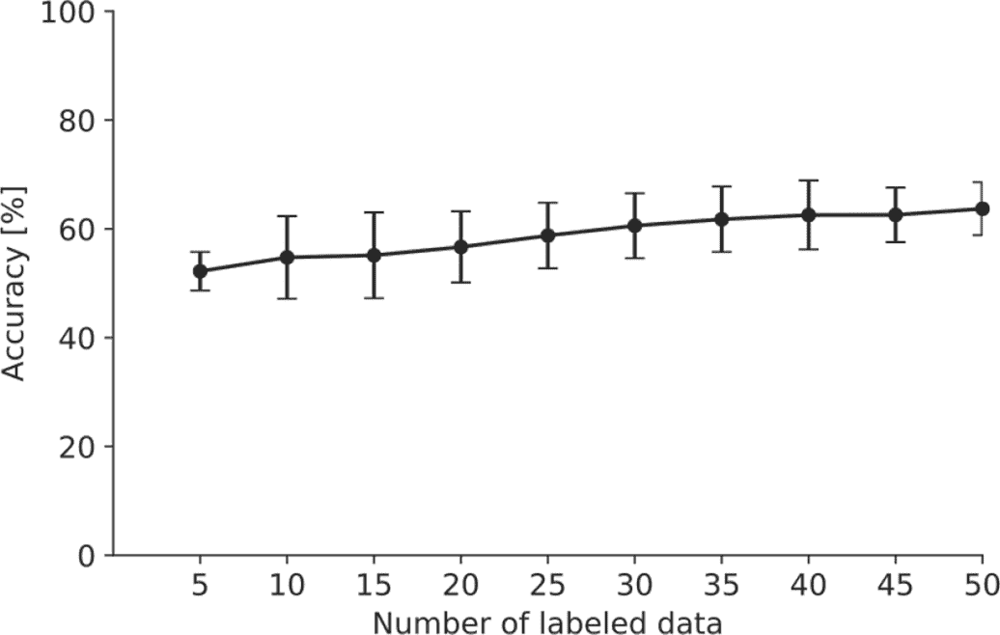

**图 8：** 在考虑不同数量标记图像的情况下，分类`相关`和`非相关`图像的半监督方法性能。

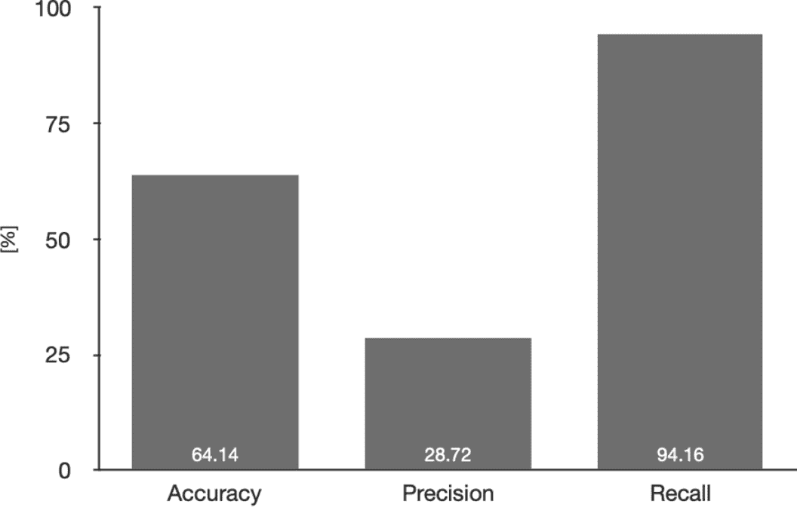

**图 9：** 迁移学习方法在巴黎圣母院图像上识别图像中是否存在建筑的性能。

在挖掘数据集并找到相关图像集后，我们还必须丢弃重复和近重复项。在我们使用的类型的数据集中，重复项非常多，因为社交媒体上的内容分享率很高——可能超过了原创内容。同样，近重复项（Dong et al. 2012）也很常见，因为人们在分享之前会对图像进行处理。最常见的处理是压缩、裁剪以及改变亮度和对比度。

寻找重复和近重复的任务已经过充分研究，因此我们可以利用现有的解决方案，特别是图像哈希方法，如`Difference Hash`、`Perceptual Hash`（Schneider and Chang 1996）和`Wavelets Hash`（Venkatesan et al. 2000）。这些方法实现简单，在寻找重复和近重复项方面有效。

由于我们也对这项任务的自动解决方案感兴趣，遗留的问题是：在近重复项中，我们应该在相关图像集中保留哪一个？一个简单的想法是保留近重复项数量密度最大的图像，或者像素密度最高（高分辨率）的图像。然而，无法保证这张图像在质量和内容方面是最好的。

# 4. 实验评估

在本节中，我们展示了关于用于实现巴黎圣母院火灾事件`X-coherence`的建议方法的实验结果。为了训练和测试这些方法，我们使用了经过筛选的数据集，考虑到相关图像。

对于后续章节的结果，我们根据 3.1 节所示使用训练集训练 CNN。首先，在`set[A]`上选择最佳模型，然后在`set[B]`上进行测试。然后，交换两个集合：在`set[B]`上进行验证，在`set[A]`上进行测试。我们报告平均值和标准差。

CNN 使用平衡批（每类样本数量相同）通过`Adam`优化器（Kingma and Ba 2014）进行微调，初始学习率为`0.0001`。在训练期间，应用了一些增强技术：`[-10°,10°]`范围内的旋转、50% 概率的水平翻转以及随机缩放和裁剪。

对于后两种技术，将图像缩放到其短边在`[340,520]`之间——保持宽高比例——并应用随机裁剪以获得`299 × 299 × 3`的最终尺寸。

测试期间，将图像缩放到其短边为 340 像素，然后进行中心裁剪以获得`299 × 299 × 3`的最终尺寸。此外，测试期间也使用了增强技术。对于每张图像，创建了 10 个旋转和水平翻转的版本。这些版本和原始输入图像由网络处理，并计算平均概率以定义类别。

## 4.1 空间分类

为了对空间进行分类，我们根据标记有相应大教堂正面方位方向的图像来训练和测试我们的空间分类器。我们还利用那些不确定方向的图像来表示`unknown`（未知）类。

我们进行了两个实验：一个考虑八个方位方向（南、西南、西、西北、北、东北、东、东南）以及`unknown`类；另一个仅考虑四个主要方向（南、西、北、东）以及`unknown`类。

表 2 展示了每个实验的准确率。我们还计算了“1 偏移准确率”（1-off accuracy），该指标将相邻类别的预测视为正确。例如，如果一张标记为`North`的图像被预测为`Northwest`或`Northeast`，它仍被视为正确预测。

如预期所示，使用四个方位方向训练的分类器产生了更高的准确率。通过合并图像组以构建这四个方向的集合，我们为每个类别获得了更多图像来训练分类器。此外，由于类别减少，相邻类别之间的混淆也减少了。

为了理解`CNN`正在学习什么来做出预测，我们计算了每个类的激活图（Selvaraju et al. 2017），突出了与预测相关的富信息图像区域（相关区域为红色，不相关区域为蓝色）。图 10 显示了四个主要方位方向的激活图。

通过观察这些映射图，有趣的是，发现`CNN`主要基于可见的立面进行预测。在大教堂周围以及烟雾/火灾区域也有一些区域被激活。这意味着`CNN`经常在寻找正确的视觉线索（立面上的相关特征），并且考虑烟雾和火灾随时间的演变。

**表 2：** 巴黎圣母院火灾事件中空间分类器的实验结果。

|  | `ACC` | `1-off ACC` |
| --- | --- | --- |
| 8 方向 + 未知 | 72.2 ± 6.1 | 86.3 ± 1.2 |
| 4 方向 + 未知 | 83.2 ± 1.2 | 91.3 ± 1.2 |

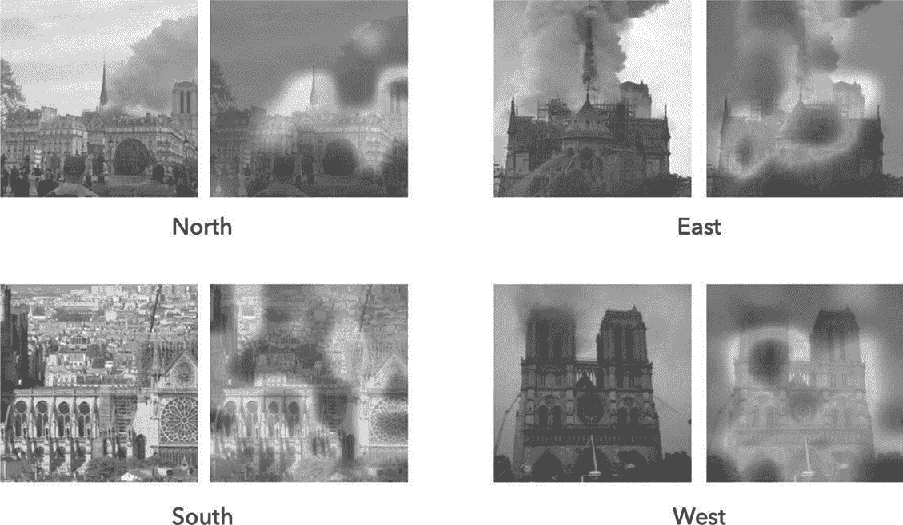

**图 10：** 四个主要方位方向的激活图。图中显示了 CNN 认为图像中哪些区域对做出预测更重要（红色），哪些不重要（蓝色）。

## 4.2 时间分类

为了在时间上对图像进行分类，我们根据拍摄时所处的子事件标注的图像，训练并测试了我们的时间分类器。我们针对所有提出的策略进行了两组实验：多分类、非分层和分层策略。

在第一组实验中，我们只考虑具有足够视觉线索来预测子事件的图像。为了模拟在真实场景中如何实现`X-coherence`，在第二组实验中，我们首先判断输入图像是否具有足够的视觉线索来预测子事件。

为了训练这个`unknown分类器`，我们利用了标记为`unknown`类的图像。这些图像是大教堂的局部放大图或以非常规角度拍摄的照片。对于多分类策略，我们还考虑直接使用五个类别（四个子事件和一个`unknown`类）来训练`CNN`。表 3 和表 4 给出了每组实验的结果。

很显然，当仅考虑具有足够视觉线索来预测子事件的图像时，所有策略都产生了更好的准确率（表 3）。然而，这种假设是不现实的，因为在图像分类之前手动过滤图像是不可靠也不高效的。

在更真实的场景下（表 4）中，我们仍然实现了高准确率，特别是考虑到多分类设置（五个类别）和分层策略时。分层策略受益于`unknown分类器`，因为与使用`unknown`类训练的多分类策略相比，它的假阳性率（`FPR`）低得多。

通过比较非分层和分层策略，我们可以看到后者在两组实验中都提供了更好的准确率。由于整个任务是分层解决的，该方法可以从先解决较简单的子任务中获益：判断捕捉到的子事件是否涉及大教堂的尖塔，这是一个重要的视觉元素。事实上，顶层分类器的准确率为 95.1%，而整体准确率为 84.2%。

**表 3：** 使用三种不同策略的时间分类器的实验结果。仅考虑具有足够视觉线索来预测子事件的图像；即忽略放大图和以非常规角度拍摄的照片。

|  | `ACC` | `1-off ACC` |
| --- | --- | --- |
| 多分类 | 88.3 ± 2.2 | 96.3 ± 0.1 |
| 非分层 | 86.5 ± 2.7 | 97.8 ± 0.1 |
| 分层 | 90.1 ± 2.0 | 97.0 ± 0.4 |

**表 4：** 使用三种不同策略的时间分类器的实验结果，考虑了一个未知分类器，该分类器识别图像是否具有足够的视觉线索来预测子事件。`FPR`和`FNR`分别是该未知分类器的假阳性率和假阴性率。

|  | `ACC` | `1-off ACC` | `FNR` | `FPR` |
| --- | --- | --- | --- | --- |
| 多分类（5 类） | 84.0 ± 1.7 | 90.0 | 0.7 | 1.8 |
| 多分类 | 81.7 ± 2.8 | 88.6 | 0.7 | 7.5 |
| 非分层 | 81.9 ± 1.9 | 89.7 | 0.6 | 5.4 |
| 分层 | 84.2 ± 2.1 | 89.6 | 0.7 | 5.6 |

对于这项任务，我们还观察了每个类的激活图（图 11）。`CNN`激活了图像中对预测子事件重要的区域。

对于`尖塔着火`子事件，`CNN`准确地激活了代表尖塔及其周围区域的区域。对于`尖塔坍塌`子事件，激活了尖顶，这表明`CNN`学习了尖塔坍塌的视觉特征。对于`火持续`子事件，激活区域精确对应于屋顶的火灾。在最后一个子事件`火熄`中，`CNN`利用立面进行预测。我们假设它在寻找火灾或尖塔不存在的线索。

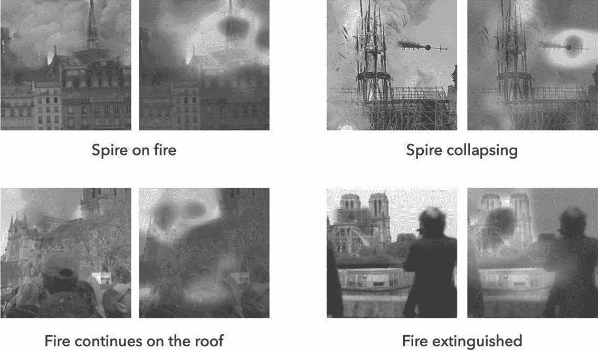

**图 11：** 四个主要方位方向的激活图。图中显示了 CNN 认为图像中哪些区域对做出预测更重要（红色），哪些不重要（蓝色）。

# 5. 结论

从事件发生到事实核查阶段，通过考虑经常被忽略的信息，可以弥合或至少缩小这种差距，即许多公民和媒体捕捉并分享的图像。在本章中，我们介绍了一种机器学习方法，利用这种天然非结构化的信息源在空间和时间上揭开事件，即解决`X-coherence`。

我们假设数据驱动的方法（例如`Convolutional Neural Networks`（`CNNs`））可以学习将视觉信息与空间线索（例如不同的大教堂立面）相关起来，并与时间线索（例如教堂建筑发生的变换以及火灾和烟雾的演变）相关起来。对于这两个任务，我们展示了事实上`CNNs`能够利用图像的相关部分来推断信息。

我们的方法以 72.2% 的准确率对图像进行空间分类。`CNN`主要利用大教堂立面来推断拍摄图像的方位。对于时间分类，我们的方法能够以 84.2% 的准确率推断图像是在哪个子事件中捕捉的。训练后的`CNNs`为每个子事件正确地使用了场景的不同区域，例如在预测`spire on fire`（尖塔着火）子事件时使用尖塔和烟雾区域，在预测`fire continues on roof`（火持续在屋顶上）子事件时使用屋顶和火区域。

尽管我们演示了如何解决特定事件的`X-coherence`（X 相干性），但提出的方法可以很容易地适应其他类似的事件。前提是拥有大量的视觉数据，这些数据是在事件期间的不同位置和时刻捕捉的。

然而，实现`X-coherence`的主要困难之一是缺乏适当的数据标注。这一事实意味着以传统的监督方式从事件图像中进行挖掘是一项挑战。此外，在`X-coherence`流程的后续步骤——空间和时间分类中，如果没有适当标注的数据，将它们建模为监督任务可能是不可行的。因此，必须提出能够在不需要监督的情况下挖掘数据并执行`X-coherence`的解决方案。

在未来的探索中，我们打算研究改进数据预处理和标注的新方法，以实现更自动化且更不易出错的过程。随着从事件中收集更多数据，这些任务变得更加关键。与其在无监督设置中应对标注数据的缺失，不如首先探索迁移学习和弱标签解决方案（Arandjelović et al. 2018）似乎更为合理。

# 致谢

本研究得到了圣保罗研究基金会（FAPESP）的支持，属于主题项目`DéjàVu`，资助号 2017/12646-3、2017/21957-2 和 2018/16548-9；得到了高等教育人员改进协调局（CAPES）的`DeepEyes`资助；以及国家科学技术发展委员会（CNPq）的资助号 #304472/2015-8 和 #423797/2016-6。

## 参考文献

- Amorim, W. P., Falcão, A. X., Papa, J. P. and de Carvalho, M. H. 2016. Improving semi-supervised learning through optimum connectivity. Pattern Recognition 60: 72–85.
- Arandjelović, R., Gronat, P., Torii, A., Pajdla, T. and Sivic, J. 2018. `Netvlad`: `CNN` architecture for weakly supervised place recognition. IEEE Transactions on Pattern Analysis and Machine Intelligence 40(6): 1437–1451.
- Chung, W., Chen, H., Chaboya, L. G. and Atabakh, H. 2005. Event visualization: a usability study of`link spatio-temporal visualizer`. International Journal of Computer Studies 62(1): 127–157.
- Deligannis, L., Hakimpour, F. and Sheth, A. 2008. Event visualization in 3D environment. International Conference on Human Interaction（`HSI`）, pp. 158–164.
- Dong, W., Wang, Z., Charikar, M. and Li, K. 2012. High-confidence duplicate detection. ACM Conference on Multimedia Retrieval（`ACMMR`）.
- Ferreira, A., Carvalho, T., Andaló, F. and Rocha, A. 2019. Counteracting the proliferation of digital forgeries and fake news. Anais Brasileira de Ciencias, 91.
- Kingma, D. and Ba, J. 2014. `Adam`: A method for stochastic optimization. arXiv preprint, arXiv:1412.6980.
- Lamer, S., Bestagini, P., Mellon, A., Milani, S., Rocha, A. and Tubaro, S. 2014. Reconstructing video sequences from partially matching shots. International Conference on Image Processing（`ICIP`）, pp. 5342–5346.
- Martin, P., Doucet, A. and Jurie, F. 2014. Dating color images with ordinal classification. ACM Conference on Multimedia Retrieval（`ACMMR`）, pp. 447.
- Oliver, A., Oden, A., Raffel, C., Cubuk, E. D. and Goodfellow, I. 2018. Realistic evaluation of deep semi-supervised learning. Advances in Neural Processing Systems（`NIPS`）, pp. 3235–3246.
- Pereira, L. A. and Torres, R. S. 2018. Semi-supervised transfer subspace for domain adaptation. Pattern Recognition 75: 235–249.
- Philbin, J., Chum, O., Isard, M., Sivic, J. and Zisserman, A. 2007. Object retrieval.
- Philbin, J., Chum, O., Isard, M., Sivic, J. and Zisserman, A. 2007. Object retrieval.
- Philbin, J., Chum, O., Isard, M., Sivic, J. and Zisserman, A. 2007. Object retrieval.
- Reinders, F., Post, F. and Spoelder, H. 2001. Visualization of time-dependent. The Visual Computer 17(1): 55–71.


- Schindler, G., Dellaert, F. and Kang, S. 2007. Inferring temporal order of 3D structure. IEEE Conference on Computer Vision and Recognition (`CVPR`), pp. 1–7.
- Schneider, M. and Chang, S.-F. 1996. Robust content based digital signature. International Conference on Image Processing (`ICIP`) 3: 226.
- Selvaraju, R. R., Cogswell, M., Das, A., Parikh, D. and Batra, D. 2017. `Grad-cam`: Visual explanations from deep networks via gradient-based localization. International Conference on Computer Vision (`ICCV`), pp. 618–626.
- Simonyan, K. and Zisserman, A. 2014. Very deep convolutional networks for large image recognition. arXiv preprint, `arXiv:1409.1556`.
- Snavely, N., Seitz, S. and Szeliski, R. 2008. Modeling the world from internet photo collections. International Journal of Computer Vision 80(2): 189–210.
- Surowiecki, J. 2013. The wise way to crowdsource a manhunt. The New York Times, <https://www.newyorker.com/news/daily-comment/the-wise-way-to-crowdsource-a-manhunt>.
- Szegedy, C., Ioffe, S., Vanhoucke, V. and Alemi, A. A. 2017. `Inception-v4`, `Inception ResNet` and the impact of residual connections on learning. AAAI Conference on Artificial Intelligence, pp. 4278–4284.
- Venkatesan, R., Koon, S.-M., Jakubowski, M. and Moulin, P. 2000. Robust image hashing. International Conference on Image Processing (`ICIP`) 3: 664–666.
- Volokitin, A., Timofte, R. and Van Gool, L. 2016. Deep features or not: Temperature and time prediction in outdoor scenes. IEEE Conference on Computer Vision and Recognition Workshops (`CVPRW`), pp. 63–71.
- Yosinski, J., Clune, J., Bengio, Y. and Lipson, H. 2014. How transferable are features in deep neural networks? Advances in Neural Processing Systems (`NIPS`), pp. 3320–3328.
- Zhou, B., Lapedriza, A., Khosla, A., Oliva, A. and Torralba, A. 2017. `Places`: A 10 million image database for scene recognition.

（注：由于原文参考文献部分存在重复，此处已按要求处理。）

通讯作者：<enquiry@dascrose.com>

全球每年估计有 50 万人溺水死亡，但除了增强水性能力和传统的救生员搜索与救援外，尚没有广泛的预防措施。溺水仅需三分钟即可进入最后阶段，该阶段是不可逆转的，并占全球所有伤害相关死亡的 7%。为了防止溺水，救援人员必须能够及时识别并接触受害者。

在自然空间进行户外游泳时，救生员及时识别并接触溺水受害者可能面临挑战。本文介绍了一个工作原型，该原型利用手势识别技术进行搜救以防止溺水。在原型方案的设计和开发之前，已完成了全面的文献综述和专利检索。

在原型测试期间，一名模拟溺水行为的救生员在地理围栏内被手势识别技术检测到，并在三分钟内送达了救生衣。测试在天气良好的条件下进行，温度范围在 25 至 40°C 之间。未来的研究应包括大雨和强风等条件下的测试。还应包括对野外游泳区域信号干扰和地理围栏限制的测试。

## 1. 引言

全球每天每小时都有 40 多人死于溺水。溺水是全球非故意伤害死亡的第三大原因。全球估计可能严重低估了与溺水相关的实际公共健康问题。

海洋警察报告说，许多成年溺水死亡是因为受害者在野外游泳时选择不穿救生衣（Barakat 2015）。世界卫生组织（WHO）表示，在船上和游泳时穿救生衣对安全至关重要，并在预防溺水中产生作用（WHO 2014）。

在研究现场，海洋警察对溺水案件的目标响应时间为六分钟，岸边的船只也是如此。然而，挑战在于，溺水只需三分钟即可进入不可逆转并导致死亡的最后阶段。接触溺水者的三分钟差异，要求一种能够在三分钟内可靠、实用且经济的方式到达并拯救生命的干预措施。

作为解决方案，本章介绍了一种发明，该发明为溺水者提供便携式漂浮设备（PFD），该设备由无人机（也称为无人飞行器，UAV）通过手势识别和传感器技术在溺水循环的一分钟内向定义区域内送达。建立了一个规范，以完全自动化类似于救生员将便携式漂浮设备递送到海上溺水者的过程，直到救生员或救援艇到达营救。

该发明的益处在于它允许通过指定运行区域对无人机进行分区，就像救生员在海滩上分区一样。它确保了无人机在执行搜救任务时不会相互碰撞。它可以在离开基站一分钟内向溺水受害者递送便携救生衣。它可以为多个区域的溺水受害者提供持续的救生衣部署。

该发明使用分析的行为手势来检测体质量指数（BMI），并使用全球定位系统（GPS）和深度传感器进行 BMI 的空中对齐。根据距离和视野，该发明在一个视野内最多可以救援六 BMI。它还记录了数据，并具有用于健康、安全和审计的手动干预控制。

本章其余部分的结构如下：第 2 章介绍了手势识别和无人机技术的文献综述。它还查看了现有专利及其原型功能，确定了它们在搜救期间的能力局限性。第 3 章解释了研究中使用的方法论，并说明了为什么没有使用替代方法。第 4 章展示了用于构建原型的软件硬件开发步骤和工作流。第 5 章展示了研究结果。第 6 章描述了研究的益处和局限性。第 7 章给出了结论，第 8 章建议了未来的工作。

## 2. 文献综述

文献检索侧重于原型开发的关键框架。回顾了与预防溺水相关的现有干预措施以及无人机在海滩提供的服务。溺水是最难证明的谋杀之一，通过研究其预防，本研究旨在减少其发生。因此，综述侧重于使用科学方法预防溺水而非其原因。

溺水的阶段和目前的预防策略表明需要一种新的倡措。溺水的五个阶段是：惊讶、自主屏息、意识模糊、缺氧抽搐、临床死亡（Gilchrist et al. 2004; Armstrong et al. 2018）。前两个阶段（惊讶和自主屏息）是溺水受害者在失去意识之前做出任何动作的阶段。

溺水受害者在前两个阶段动作类型在野外游泳区域（如海洋和海滩度假区）很少被捕捉，但在救生员干预防止溺水之前，已经在室内泳池中记录。为了开发有效的解决方案，必须了解涉及的动作类型。这些动作也被救生员用于干预室内或野外游泳区域的游泳者活动。

Parenteau et al. (2018) 提供了一个标准化框架，指导第一响应者评估、诊断和管理常见的水源病变。建议第一响应者的关键步骤是让他们识别并定位受害者（询问是否有多个），并使用最快的方法（如触及、抛、划、拖、去）救援溺水受害者。在救援人员自身安全因进入水中而面临风险或损害的情况下，投放绳索或浮力设备等物体被认为是最安全的选择。

任何解决方案都应该识别并识别游泳者出的手势，并将其与数据库中的数据集进行匹配。Ijeh (2011) 提出了一种安全策略模型，该模型使用地理围栏控制无线设备的活动。设备在预定义的地理区域内运行，并有一个嵌入式系统用于检测、观察和记录其移动。当设备离开地理区域时，其与无线网络的连接就会切断。这种方法确保了设备只能在定义的地理区域内使用无线网络进行通信，并作为安全模型。

### 2.1 手势识别技术

手势识别技术能够捕捉并解释人类手势作为命令。当任何物理运动（无论大小）被运动传感器成功地解释为命令时，就会发生人类手势的识别。关于捕捉和解释人类手势的手势识别工具，已经提出了各种框架、模型和比较研究。关于手势识别工具在捕捉特定命令图像方面的应用，有大量的文献。

Wachs et al. (2008) 提出了一种基于视觉的手势捕获与识别系统，该系统能够实时解释用户的手势，用于电子病历数据库中图像的导航和操作。

Wipfli et al. (2016) 比较了适用于 Kinect 手势控制的图像操作的不同交互模式。该研究展示了能够直接操作图像的口头指令。

Gillian and Paradiso (2014) 介绍了一个开源手势识别工具包，旨在让非专业人士更容易地使用实时机器学习和手势识别。该工具包对构建实时系统提供了广泛支持，包括信号处理、特征提取和自动手势检测的算法。

Nanivadekar and Kulkarni (2013) 评估了手势识别系统部署的各种方法，并指出了它们将作为革命性工具的领域。

Rios Soria and Schaeffer (2012) 开发了一种基于手势的人机交互软件工具。其底层算法利用计算机视觉技术，能够实时识别通过网络摄像头捕获的六种不同手势。

Chen et al. (2014) 提出了一种新的实时手势识别方法。该研究能够使用规则分类器检测并识别手掌和手指，以预测手势的标签。一个包含 1300 张图像的数据集显示该方法性能良好且效率很高。

Khan and Ibraheem (2012) 对手势识别系统进行了比较研究，并解释了它们的分割、建模、分析和特征提取特性的差异。

Sharma et al. (2020) 收集了在不同环境条件下使用标准美国手语的人手图像数据集。该研究根据命令的准确率（百分比）对手势进行分类。预处理后的数据使用了类似的分类器以得出有效结果。

Hoang (2020) 介绍了为手势识别构建的 HGM-4 数据集，展示了其在四个不同位置摄像头上捕获 26 个手势的能力。该研究的目标是改进训练和测试集，以创建一个用于比较实验结果的基准框架。

Oudah et al. (2020) 评估了关于手势技术的文献，并讨论了每种技术在不同情况下的优点和局限性。论文列出了不同方法的性能，重点关注处理相似点和差异点的计算机视觉技术、使用的手部分割技术、分类算法及其缺点、手势的数量和类型、使用的数据集、检测范围（距离）以及使用的摄像头类型。

Wachs (2011) 描述了手势接口的需求以及满足各种应用类型需求面临的挑战。该研究得出，系统需求取决于应用范围；例如，娱乐系统不需要手术系统所要求的手势识别准确度。

Patel and He (2018) 对当前使用的各种手势识别技术进行了最新的综述，并涵盖了所有调查方法的优点和局限性。

Mod Ma’asum et al. (2015) 对几种手势识别方法进行了比较研究，使用了三个主要模块：摄像头和分割模块、检测模块和特征提取模块。

Ambika and Chidananda (2014) 对两种跟踪方法进行了比较研究。结果证明，通过在手上佩戴黑色手套并使用稳健高效的手部跟踪算法，在非控制环境下进行实时手势识别的框架是可行的。该研究还介绍了一种名为 `free hand tracking`（自由手跟踪）的独立算法，它基于皮肤色素。

Trigueiros et al. (2012) 使用两个不同的手部特征数据集对四种静态手势分类算法进行了比较研究。该方法识别每帧中的手像素，提取特征并使用它们来识别特定的手姿势。结果证明，一种方法在特征选择和数据准备方面具有异常出色的性能，这在使用摄像头获取的低分辨率图像时是一个非常重要的阶段。

Nigam et al. (2020) 发现，在调查中，大多数应用 `DTW`（动态时间规整）算法的受访者达到了 75%的准确率，而使用 `LCS`（最长公共子序列）方法识别手势的准确率为 85%。

Al-qaness and Li (2016) 利用由手部动作引起的 Wi-Fi 信号信道状态信息（`CSI`）波动，开发了一种无设备的 Wi-Fi 手势识别系统（`WiGeR`）。该研究通过涉及多种场景的实验实现了该系统的测试。结果显示，`WiGeR` 即使在信号穿过多个墙壁产生干扰的情况下也能以高准确率分类手势。

Haker (2010) 解释了使用 `TOF` 摄像头的计算机视觉如何实现人机交互。研究概述了基于特定类型图像传感器的 `TOF` 摄像头、算法和应用。

Ijeh (2018) 评估了一种监控原型方案的社会影响。该方案持续监控预定义空间内移动设备和通信单元的通信。其用法已广泛应用于不同领域。

Ma’asum et al. (2017) 介绍了一篇关于使用阈值将输入图像转换为新模型的论文。数值满足了预定义的肤色分割，研究得出，与其他类型的分割技术相比，使用阈值在创建手部轮廓方面是高效的。

### 2.2 无人机技术

无人机是一种飞行机器人，可以通过远程控制或使用软件控制的飞行计划、车载传感器、GPS 以及用于交互的嵌入式系统自主飞行。无人机也被称为无人机（`UAVs`）或无人机系统（`UASes`）。

无人机最初用于军事行动，但现在也广泛应用于民用领域，如搜索搜救、监控、交通和天气监测、灭火、摄影、录像、农业甚至递送服务。关于无人机技术及其应用的文献非常多，最近由于英国盖特维克机场和希思罗机场发生的干扰，无人机安全成为了热门话题。

- Euchi (2020) 描述了随着技术的进步，无人机在民用、商业和社会应用中的使用日益增加。在新冠肺炎期间、随后的封锁以及抗击病毒的过程中，无人机在运输必需物资方面的广泛应用通过消除交付过程中的人为接触减少了病毒的传播。无人机还减少了个人和企业的碳足迹，并扭转了它们对气候变化的负面影响。
- Estrada and Ndoma (2019) 评估了无人机在应急响应中的关键作用，以及它们如何在各种场景下帮助伤员。他们的论文得出结论，无人机可以用于空中监测和交付人道主义救援物资。
- Kumar et al. (2020) 开发了一种无人机系统，可以在 10 分钟内于 2 公里范围内实时用于空中热图像采集和患者识别。该研究识别并讨论了在预定义区域内多架无人机工作的局限性，并提出了解决方案。
- Whitelaw et al. (2020) 描述了一个数字技术在疫情规划、监测、检测、接触追踪、隔离和医疗保健中的应用框架。该研究描述了大数据和人工智能（AI）如何通过追踪人员帮助对抗冠状病毒的传播。它还讨论了数字技术在管理紧急情况中的优缺点。
- Chamola et al. (2020) 探索了物联网（IoT）、无人机（`UAVs`）、区块链、人工智能（AI）和 5G 等技术，以帮助减轻冠状病毒爆发的影响。该研究借鉴可靠来源，对当代技术进行了详细回顾，并说明了它们如何用于应对疫情等紧急情况。
- Ruiz (2020) 支持使用无人机进行冠状病毒的空中监测以及物流和货物交付。论文描述了使用无人机将如何实现精确的流行病响应和人道主义救援框架。
- ITF OECD (2020) 报告称，虽然无人机证明是多功能且有效的工具，但其监管仍处于起步阶段，潜力尚未得到充分开发。技术报告强调了需要更新空域法规以促进其在应急响应之外的使用。
- Yang et al. (2020) 支持无人机等机器人在三个广泛领域的潜力，它们可用于产生影响：远程医疗、物流和侦察。
- Skorup and Haaland (2020) 同意无人机技术减少了人与人之间的接触。然而，论文指出，使用无人机交付的主要障碍是监管问题。

### 2.3 专利

目前已有关于无人机向海上遇困人员投送救援设备的专利，但它们都有一个共同点，那就是不是完全自动的。

正如名为“救援系统”且专利号为 `WO 2015144947 A1` 的文章所述，该专利披露了它使用双目镜手动观察体质量指数（`BMI`），专利还披露了无人机通过手动操作进行遥控飞行。实际上，该发明并非完全自动，Marquez et al. (2015)。

该原型机使用了专门编程的无人机技术来定位游泳者并投送救生衣。其目标是让无人机实现全自动化，并在定义的参数范围内运行。这样做是为了确保无人机的行为落入参数范围之内。

目前，无人机是半自动的，即由无人机飞行员手动控制，且未针对特定区域进行地理围栏限制。该发明的新颖之处在于它是全自动的，并且能够提供 24 小时覆盖。该原型的竞争优势在于，除了全自动服务外，无人机还能覆盖定义区域并在 1 分钟内投送救生衣，而研究现场的海上救援队至少需要 6 分钟才能实现。

这一点通过对采用干预措施提供后产生的效益和变化进行记录的总结、对这种变化的严重程度的评估以及对其价值的感知得到了证明。干预措施的概念应用了开发方法论，对未使用的其他方法进行了描述，并对它们在开发情况下的不适用性进行了评估。设计的实现、适当测试策略的开发，以及为交付物开发了适当的用户文档。

文中公开了一种使用不同软件平台集成建模的设备自动化方法。该设备是一种无人机，也被广泛称为无人飞行器（`UAV`）或无人机系统（`UAS`）。集成软件平台被建模用于全自动执行投送救生衣（也称为便携式浮力设备 `PFD`）的过程，正如救生员 [1, 2] 所向海中溺水的人，直到救生员或救援船到达营救（见表 1 和 2）。

**表 1：** 发明描述。

| 步骤 | 建议的原型方案 | 应用模式 |
| --- | --- | --- |
| 1 | 海滩站存在多个原型方案。 | 全自动 |


| 步骤 | 描述 | 应用模式 |
| --- | --- | --- |
| 2 | 每个原型方案离开海滩站飞向其指定海域的中心，在中心悬停并监测体质量指数（BMI）活动。 | 全自动 |
| 3 | 机载原型方案在指定区域中心悬停时进行 360° 旋转，同时其传感器检测并监测体质量指数（BMI）活动。 | 全自动 |
| 4 | 机载原型方案的传感器利用人工智能检测并识别来自体质量指数（BMI）的手势，并将其与通过海中遇险/溺水体质量指数（BMI）训练的存储数据进行比较。 | 全自动 |
| 5 | 原型方案在一个视图内同时测量其位置与最多六个体质量指数（BMI）之间的距离。 | 全自动 |
| 6 | 原型方案直接对准最近体质量指数（BMI）上方。 | 全自动 |
| 7 | 原型方案在同一视图下使用 GPS 坐标服务最近的体质量指数（BMI）。 | 全自动 |
| 8 | 原型方案在服务完一个体质量指数（BMI）后，在同一视图下使用 GPS 坐标重新分配到下一个最近的体质量指数（BMI），否则返回并在指定区域中心继续悬停。 | 全自动 |
| 9 | 原型方案使用 GPS 坐标继续服务下一个最近的体质量指数（BMI），直到其载荷（六件救生衣）投送完毕。 | 全自动 |
| 10 | 一旦载荷（六件救生衣）投送完毕或飞行电池电极低，原型方案返回站点。 | 全自动 |
| 11 | 原型方案通过两架无人机对区域进行持续监测，两者交替进行装载（六件救生衣）和飞行电池充电。 | 全自动 |
| 12 | 所有原型方案数据均被记录，出于安全和审计目的，随时可以从基站进行人工干预。 | 全自动 |
| 13 | 原型方案在飞行服务期间严格遵守健康和安全规则，并具有失效机制。 | 全自动 |

**表 2：** 与救生员救援溺水者的手动流程对比。

| 步骤 | 救生员 | 应用模式 | 建议方案 | 应用模式 |
| --- | --- | --- | --- | --- |
| 1 | 在海滩站 | 手动 | 多个原型方案。 | 自动 |
| 2 | 站在子上 | 手动 | 在指定区域。 | 自动 |
| 3 | 使用望远镜观察海洋 | 手动 | 监测体质量指数（BMI）活动。 | 自动 |
| 4 | 评估溺水者状态 - 判断溺水者是主动还是被动，是在水面上还是淹没，是否有头部、颈部或背部受伤 | 手动 |  |  |
| 5 | 安全进入水中并根据距离判断速度 | 手动 | 在一个视图内测量与最多六个体质量指数（BMI）之间的距离。 | 自动 |
| 6 | 使用便携式浮力设备（PFD）靠近 | 手动 | 对准最近的体质量指数（BMI）。 | 自动 |
| 7 | 重复步骤 6 | 手动 | 在同一视图下使用 GPS 坐标服务的体质量指数（BMI）。 | 自动 |
| 8 | 重复步骤 6 | 手动 | 在服务完一个体质量指数（BMI）后，在同一视图下使用 GPS 坐标重新分配到下一个最近的体质量指数（BMI），否则返回并在指定区域中心继续悬停。 | 自动 |
| 9 | 重复步骤 6 | 手动 | 使用 GPS 坐标继续服务下一个最近的体质量指数（BMI），直到载荷（六件救生衣）投送完毕。 | 自动 |
| 10 | 重复步骤 6 | 手动 | 一旦载荷（六件救生衣）投送完毕或飞行电池电极低，返回站点。 | 自动 |
| 11 | 重复步骤 6 | 手动 | 通过两架无人机对区域进行持续监测，两者交替进行装载（六件救生衣）和飞行电池充电。 | 自动 |
| 12 | 重复步骤 6 | 手动 | 所有原型方案数据均被记录，出于安全和审计目的，随时可以从基站进行人工干预。 | 自动 |
| 13 | 投送便携式浮力设备（PFD） | 手动 | 原型方案在飞行服务期间严格遵守健康和安全规则，并具有失效机制，在系统故障时使其在海面上悬停或安全降落至海中。 | 自动 |

从可用的 `BodyIndex` 列表中删除 `BodyIndex(i)`。

关闭 `GateNumber(i)`。

保存日志状态。

否则，为检测到的身体保存日志状态。

否则，未检测到身体，检测器已暂停。

#### 距离测量与 GPS 的伪代码

`Kinect` 将提供被检测到的 `BodyIndex` 的坐标 `(x, y, z)`，因此，此测量将用于结合关联手势检测器重新定位无人机，使无人机更靠近需要帮助的人。

```text
Function GPS = align

If BodyIndex(i) 为 True 且置信度大于 80%
确定 BodyIndex 坐标 (x, y, z)

确定 BodyIndex 的 GPS 映射
While GPS 对齐 BodyIndex = True:
启动 BodyIndex-手势检测器
Else
检测新的 BodyIndex
```

#### 电机控制器算法伪代码

```text
电机初始化（将电机设置为 0 度角）

While True（从嵌入式系统接收数据）

Try:
If BodyIndex(i) 为 True 且置信度大于 80%
Gate(i) 已初始化
Gate(i) 已打开
电机旋转 30 度
Gate(i) 已关闭
救援设备成功投放
从可用的 BodyIndex 列表中删除 BodyIndex(i)
为下次移动保存电机角度
Else
保存日志“救援设备未加载”
Except:
保存日志“已完成六项救援任务”
将电机转至 0 度角
```

### 4.1 原型系统与组件

构建原型机使用的组件包括机载式 `Embedded System`、`Raspberry Pi 2`、`Portal` 电池（5/12/19 伏特）、`Camera`、红外传感器、舵机电机、`Visual Studio 2015 Pro`、`Kinect SDK 2`、`Linux Debian 2`、`Python`、`Drone` 以及便携浮浮设备。从图 1 到图 15 是在原型系统研究和开发期间收集的图像和图片。

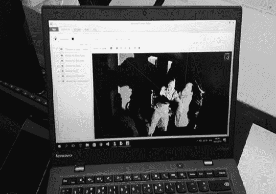

**图 1：** 身体质量指数成像。


**图 2：** IDE 中捕捉的图像。


**图 3：** 共同作者设置无人机 GPS 坐标。

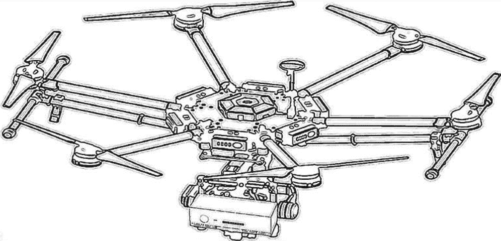

**图 4：** 无人机俯视图。

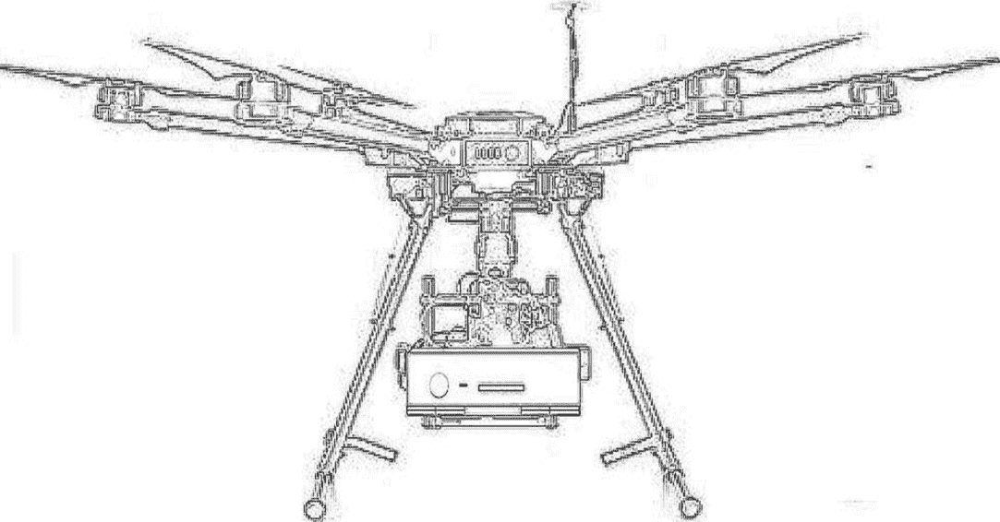

**图 5：** 无人机正视图。

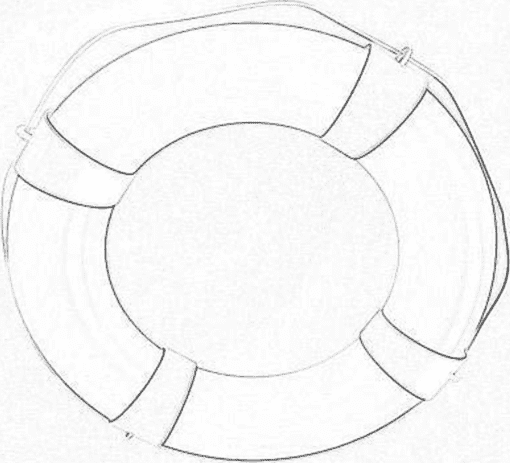

**图 6：** 便携浮设备（救生圈）。

### 4.2 原型系统功能

| 步骤 | 原型系统功能 |
| --- | --- |
| 1 | 原型完全实现了海滩上救生员的角色 |
| 2 | 原型具有地理围栏功能，仅在预定义的海滩区域工作 |
| 3 | 原型通过在海滩区域周边的中心悬停并旋转 360° 来监控 BMI |
| 4 | 原型以 80% 的置信度识别 BMI 溺水者的手势特征 |
| 5 | 原型测量自身与 BMI 之间的距离 |
| 6 | 原型在交付便携浮设备之前，使用其坐标与溺水的 BMI 对齐 |
| 7 | 原型根据与自身的距离，按升序顺序为最近的 BMI 服务 |
| 8 | 原型将继续服务 BMI 或返回圆周中心并悬停 |
| 9 | 原型具有六件救生衣的载荷 |
| 10 | 原型通过返回海滩基站重新装载救生衣或为充电来交替任务 |
| 11 | 原型提供对区域内 BMI 的全自动监控 |
| 12 | 不适用 |
| 13 | 不适用 |

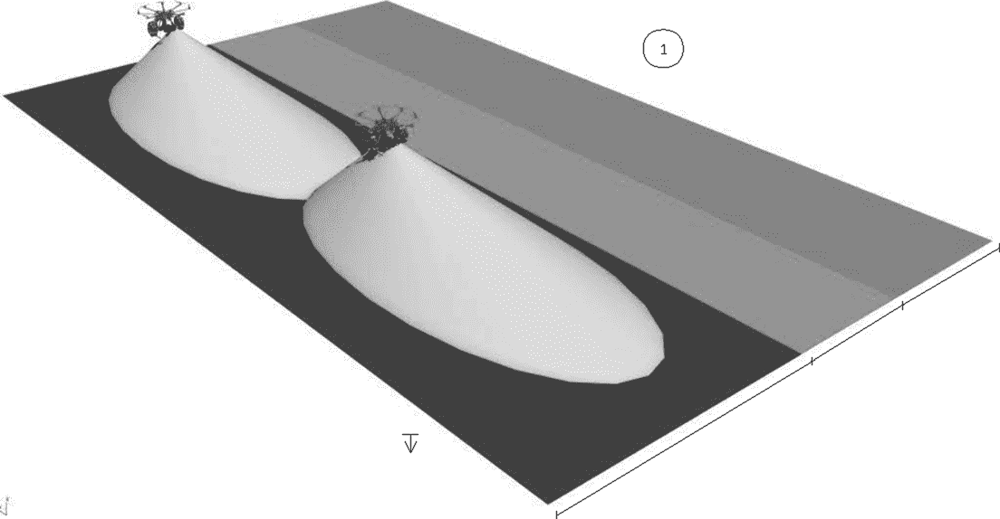

**图 7：** 原型解决方案出现在基站（步骤 1）。


**图 8：** 机载原型解决方案传感器检测并监控 BMI 活动（步骤 3）。


**图 9：** 在指定区域的中心悬停时进行 360° 旋转（步骤 2, 7, 9, 10）。

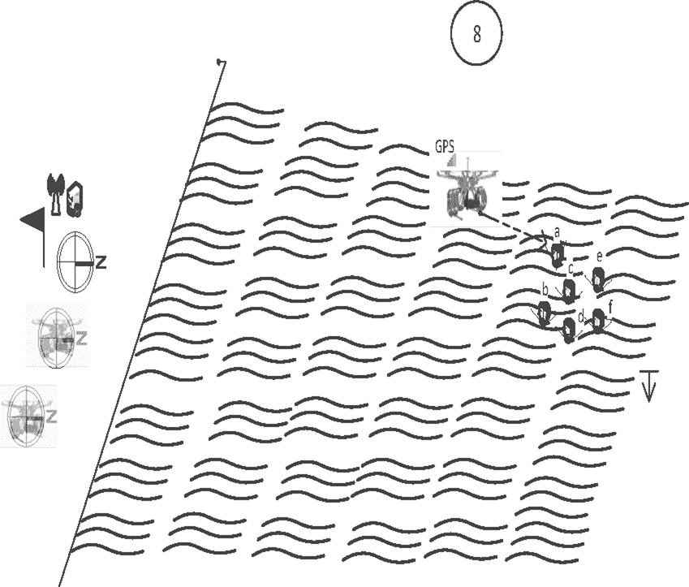

**图 10：** 在服务一个 BMI 后，使用 GPS 重新分配到下一个最近的 BMI（步骤 8）。

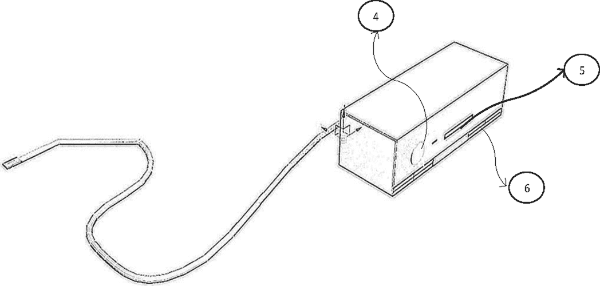

**图 11：** 原型解决方案测量位置与 BMI 之间的距离（步骤 4, 5, 6）。

### 4.3 原型系统工作流

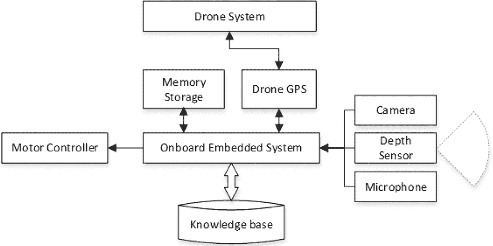

**图 12：** 系统流程图。

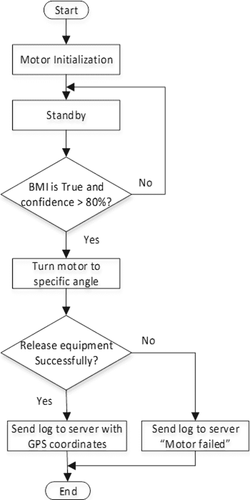

**图 13：** 电机控制器算法。

## 5. 结果

测试表明，所提的干措施可以在三分钟内携带并交付六件救生衣。演示成功遵循飞行路径和参数。这具有商业价值，因为它解决了救生员和海洋警察无法在三分钟内到达溺水者的问题。原型提供了一种新的干措施，可以在一分钟内救起 BMI。测试中发现的局限性可以通过成像和地理信息来克服。

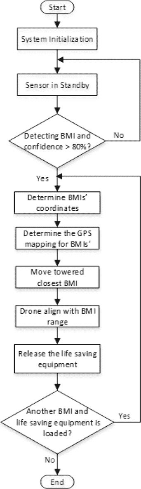

**图 14：** 距离测量与 GPS 重新定位。

## 6. 优点与局限性

优点包括对无人机进行分区以指定运行区域，就像救生员在海滩上分区以控制指定区域一样。无人机被限制在指定区域内以防止碰撞，并在一分钟内向溺水者交付救生衣。无人机可以持续为多个区域的救生衣。无人机使用行为手势检测 BMI。无人机使用 GPS 和深度传感器与 BMI 对齐以测量距离，并在一个视野内救援六个 BMI。出于健康、安全和审计目的，飞行还存在人工干预。

局限性：由于硬件功能限制，覆盖区域半径限制为 5 米。传感器只能在 45 度角内识别 6 个 BMI。飞行电池寿命短，仅为 30 分钟。原型的测试结果基于正常平静天气，温度在 20-40 摄氏度之间，未在极端天气进行测试。

## 7. 结论

本研究开发了一个使用手势识别技术进行搜索和救援以防止溺水的工作原型。研究范围范围提出了以下需要解决的问题：海滩度假胜地溺水的原因以及救援野外游泳者的方法是什么？溺水的阶段有哪些？完成溺水循环到死亡点需要多久？

# 引言

一项可行性研究表明，无人机技术可用于投放救生衣，所得原型能够缩短海事部门从基地位置到达溺水者所需的 6 分钟时间延迟。我们开展了文献综述，以了解溺水的原因以及现有救生员营救溺水者的技术。研究获得的信息被用于开发一个框架，在溺水者保持意识并发生动作（即溺水前两个阶段）的时间内向其递送救生衣。

文献综述为原型方案的开发提供了测试平台和框架，该方案满足了基地地预防溺水的标准。为了实现这一目标，对现有的传统方法和已申请的专利进行了评估，以确保开发具有原创性和商业可行性。原型方案能够识别溺水者，并在从基站出发后 1 分钟内提供救生衣。该全自动原型基于机器学习，能够识别受害者的行为手势。使用 `Kinect` 传感器（红外和深度传感器）识别手势并将信号传输至 `raspberry pi`，随后释放救生衣。在早期的仿真中，无人机在识别出手势后飞向溺水者并递送了便携浮浮设备。

## 8. 未来工作

可以通过在暴雨等极端条件下测试原型来改进改进。还可以通过测试信号的最小干扰来进行改进。未来应使用覆盖范围更广、检测能力更强的传感器，同时可以改进用于图像处理和 BMI 测量的计算机视觉。

## 参考文献

- Al-qaness, M. and Li, F. 2016. WiGeR: WiFi-based gesture recognition system. ISPRS International Journal of Geo-Information 5(6): 92.
- Ambika, L. A. and Chidananda, H. 2014. A Comparative Analysis of Hand Tracking Algorithms for Gesture Recognition. [online] undefined. Available at: [`www.semanticscholar.org/paper/A-Comparative-Analysis-of-Hand-Tracking-Algorithms-AmbikaL.-Chidananda/d4aaf8fcc1f1dd31f4b713b84be7228cbde9e53`](https://www.semanticscholar.org) [Accessed 10 Sep. 2020].
- Armstrong, E. J. and Erskine, K. L. 2018. Investigation of drowning deaths: a practical review. Academic Forensic Pathology 8(1): 8–43.
- Barakat, N. 2015. Fewer cases of drowning at sea in Dubai in 2014. [online] Available at: [`gulfnews.com/news/uae/government/fewer-cases-of-drowning-at-sea-in-dubai-in-2014-1.1451466`](http://gulfnews.com) [Accessed 12 Sep. 2020].
- Chamola, V., Hassija, V., Gupta, V. and Guizani, M. 2020. A comprehensive review of the COVID-19 pandemic and the role of IoT, drones, AI, blockchain and 5G in managing its impact. IEEE Access, pp. 1–1.
- Chen, Z., Kim, J.-T., Liang, J., Zhang, J. and Yuan, Y.-B. 2014. Real-time hand gesture recognition using finger segmentation. [online] The Scientific World Journal. Available at: [`www.hindawi.com/journals/tswj/2014/267872/`](https://www.hindawi.com) [Accessed 9 Sep. 2020].
- Comeau, R., Pterneas, E. and Schnare, D. 2015. Motion capture and analysis system for assessing mammalian kinetics. [online] Available at: [`patents.google.com/patent/WO2015139145A1/en?oq=WO+2015139145+A1+`](https://patents.google.com) [Accessed 13 Sep. 2020].
- Elkjær, C. 2013. Unmanned aerial device and system thereof. [online] Available at: [`patents.google.com/patent/WO2013123944A1/en?oq=WO+2013123944+AI`](https://patents.google.com) [Accessed 13 Sep. 2020].
- Estrada, M. A. R. and Ndoma, A. 2019. The uses of unmanned aerial vehicles –UAV’s- (or drones) in social logistic: Natural disasters response and humanitarian relief aid. Procedia Computer Science 149: 375–383.
- Euchi, J. 2020. Do drones have a realistic place in a pandemic fight for delivering medical supplies in healthcare systems problems? Chinese Journal of Aeronautics.
- Gilchrist, J. Gotsch, K. and Ryan, G. 2004. Nonfatal and fatal drownings in recreational water settings - United States, 2001–2002 (Reprinted from MMWR, 53: 447–452, 2004). JAMA The Journal of the American Medical Association 292: 164–166.
- Gillian, N. and Paradiso, J. 2014. The gesture recognition. Journal of Machine Learning Research, [online] 15: 3483–3487. Available at: [`www.jmlr.org/papers/volume15/gillian14a.pdf`](https://www.jmlr.org) [Accessed 9 Sep. 2020].


- Haker, M. 2010. Gesture-Based Interaction with Time-of-Flight Cameras. [online] Available at: [`www.zhb.uni-luebeck.de/epubs/ediss901.pdf`](https://www.zhb.uni-luebeck.de) [Accessed 9 Sep. 2020].
- Hoang, V. T. 2020. HGM-4: A new multi-cameras dataset for hand gesture recognition. Data in Brief 30: 105676.
- Ijeh, A. C. 2011. Geofencing as a Security Strategy Model. [Thesis] pp.
- Oudah, M., Al-Naji, A. and Chahl, J. 2020. Hand gesture recognition based on computer vision: a review of techniques. Journal of Imaging 6(8): 73.
- Parenteau, M., Stockinger, Z., Hughes, S., Hickey, B., Mucciarone, J., Manganello, C. and Beeghly, A. 2018. 溺水管理。《Military Medicine》，[online] 183(suppl_2): 172–179. 获取自：[`academic.oup.com/milmed/article/183/suppl_2/172/5091146`](https://academic.oup.com) [访问日期：2019 年 10 月 27 日]。
- Patel, N. and He, J. 2018. 手势识别技术、方法和工具综述。《International Journal of Research in Advent Technology》，[online] 6(6). 获取自：[`www.ijrat.org/downloads/Vol-6/june-2018/paper%20ID-66201807.pdf`](http://www.ijrat.org) [访问日期：2020 年 9 月 9 日]。
- Rios Soria, D. J. and Schaeffer, S. E. 2012. 手势识别工具。《Lecture Notes in Computer Science》，第 137–146 页。
- Ruiz Estrada, M. A. 2020. 无人机在大型传染病救援及人道主义援助中的应用：武汉 COVID-19 危机。《SSRN Electronic Journal》。
- Sharma, A., Mittal, A., Singh, S. and Awatramani, V. 2020. 使用图像处理和特征提取技术的手势识别。《Procedia Computer Science》173: 181–190。
- Skorup, B. and Haaland, C. 2020. 无人机如何帮助对抗冠病毒。《SSRN Electronic Journal》。
- Stoppa, M., Hummel, B., Mutto, C. D. and Pasgualotto, G. 2013. 人手运动跟踪初始化的系统和方法。[online] 获取自：[`patents.google.com/patent/US8615108B1/en?oq=US+8615108+B1+`](https://patents.google.com) [访问日期：2020 年 9 月 13 日]。
- Trigueiros, P., Ribeiro, F. and Reis, L. P. 2012. 应用于手势识别的机器学习算法对比。[online] *IEEE Xplore*。获取自：[`ieeexplore.ieee.org/document/6263058`](https://ieeexplore.ieee.org) [访问日期：2020 年 9 月 10 日]。
- Wachs, J. P., Kölsch, M., Stern, H. and Edan, Y. 2011. 基于视觉的手势应用。《Communications of the ACM》54(2): 60–71。
- Wachs, J. P., Stern, H. I., Edan, Y., Gillam, M., Handler, J., Feied, C. and Smith, M. 2011. 基于视觉的手势应用。《Communications of the ACM》54(2): 60–71。（注：Wachs, J. P., Stern, H. I., Edan, Y., Gillam, M., Handler, J., Feied, C. and Smith, M. 2011. 基于视觉的手势应用。《Communications of the ACM》54(2): 60–71。）
- Whitelaw, S., Topol, E. and Gray, L. 2020. 数字技术在 COVID-19 响应中的应用。《The Lancet Digital Health》。
- WHO（世界卫生组织）. 2014. 全球溺水报告。
- Wipfli, R., Dubois, V. and Fahsing, S. 2016. 基于手势的交互。《Plos One》11(4): e01596。
- Yang, G., Nelson, B., Murphy, R., Christensen, H., Collins, S., Dario, P., Goldberg, K., Ikuta, K., Kragic, D., Taylor, R. and McNutt, M. 2020. 对抗冠病毒——机器人技术的作用。《Science Robotics》5(4)。
- Yukun, Z. 2015. 无人机。

我们文明的基础组成部分是《世界人权宣言》（United Nations General Assembly 1948）和《欧洲人权公约》（European Court of Human Rights 2010）中所立的人权。刑事调查和起诉至关重要的是`公正审判的权利`（European Court of Human Rights 2010，第 6 条）和`无法不刑`原则（European Court of Human Rights 2010，第 7 条）。

### 3.2 科学与科学方法的作用

对于刑事调查，数字及其他法医学从业人员和科学家而言，`公正审判的权利`意味着我们作为专业人士赖的基础以及最终在法庭提交的内容必须尽可能真实。科学——特别是自然科学——长期以来一直在寻找普遍或绝对真理。普遍真理很难证明，因为从本质上说，它们必须在任何时间、任何地方都是正确的。

然而，波普尔描述的科学方法——即构建假设并通过重复观察对其进行测试（Popper 1959）——已被证明在许多领域适用，并导致了大量的发现。刑事调查和起诉相比于科学研究的优势在于它不需要绝对真理。这有时被描述为`道德确定性`（Waldman 1959），并被称为布莱克斯顿格言“宁可错漏不放过一个无辜者”（Blackstone 1799，第 299 页），刑事调查中追求的真理被定义为“排除合理怀疑”。

为了实现这些目标并促进公正审判，每项调查都需要确保目标性、透明度和质量。做到这一点，我们需要确定如何描述和衡量刑事质量。并且我们需要了解并描述此类调查是如何进行的。

### 3.3 定义刑事调查

刑事调查是一个发现、描述、记录和解释违反法律事件的过程（Blackstone 1799；Gudjonsson 1992；Innes 2003；Stelfox 2009；Brodeur 2010，第 358–359 页；Sennewald and Tsukayama 2015）。即刑事调查——类似于科学研究——通过一系列目标活动追求事实。

由于科学方法已被证明是工作的合适方法，刑事调查可以如本章所示，使用该模型作为指导模板。过去 15 年警务和数字法医学的研究指出，该模型是调查应遵循的标准（Fahsing 2016；Rachlew 2009；Carrier 2006）。并且通过将科学方法作为调查模型的基础，我们可以应用与科学研究相同的刑事质量原则；可靠性和有效性，作为调查的衡量标准。

本章介绍流程模型将调查过程与科学方法相结合，显示了调查过程如何与其相邻流程相关，概述了调查的内部子流程。该模型显示了无论调查发生的背景如何，也不受调查管辖区的限制，假设检验方法为执行可靠且有效的调查提供了工具和方法。

# 2. 刑事案件

犯罪是指违反法律的行为。刑事案件是指可能违反法律的事件或一系列事件，以及针对这些事件采取的所有行动和决定。刑事案件通常由执法机构、检察机关和法院处理。这一过程的细节取决于事件发生的管辖区，但通用流程独立于法律细节。

### 2.1 刑事案件的三个阶段

如图 1 所示，刑事案件可以分为三个阶段：¹#fn1 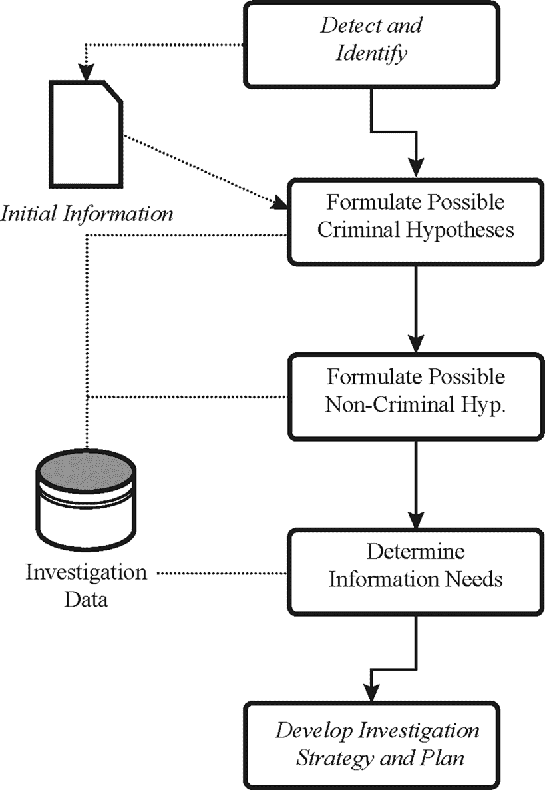

**图 1：**刑事案件流程模型 (BPMN2.0)。

1. 检测与识别
2. 调查
3. 起诉/反应

一个事件要成为案件，首先必须被检测、识别并认定为感兴趣的事件，例如可能的犯罪（第一阶段）。这通常涉及事件被警方或类似的执法机构观察到或报告。根据过程中提供的和揭露的初始信息，决定是否启动调查。

这项调查（第二阶段）的目标是收集足够的信息来描述和解释该事件。基于这些信息，将决定是驳回案件（如果有人可以且应该就犯罪罪被起诉）、或者是否应该启动其他反应。

起诉或反应是案件的第三阶段。尽管这通常涉及法庭听证或类似的程序，但其细节完全取决于管辖区。例如，挪威的刑事程序包括两级上诉（不包括复审）（Straffrosessloven 1981），而《罗马规约》仅包含一级（United Nations 1998）。刑事案件在被驳回、所有指控被放弃或刑事诉讼以无罪、可执行的判决或不同的制裁/反应（例如社区服务或强制心理健康）结束时，即告完成或解决。注意，在起诉/反应阶段可能会出现需要进一步调查的情况。例如，可能会出现新信息，或者法院可能认为案件的某个方面覆盖不足。当发生这种情况时，可以采取进一步的调查步骤，有效地将案件返回调查阶段。

刑事调查旨在确定是否发生了犯罪，并发现、描述和记录关于该事件的充分信息。因此，刑事调查是一个收集、处理、解释和呈现信息的过程，以解释可能的犯罪（Gudjonsson 1992; Innes 2003; Stelfox 2009; Sennewald and Tsukayama 2015）。事件是时间维度上的一个事件，可以通过六个基本要素或情况进行定义和描述：发生了什么、事件发生在何地和何时、事件是如何发生的、谁参与了、以及为什么发生（参见图 2）。亚里士多德首次描述了这些情况，它们在哲学、修辞学以及调查中都占据着重要地位。今天，它们通常被称为调查的“6W”或“5WH”（Sloan 2010; Innes 2003; Stelfox 2009; Fahsing 2016）。只有当收集并理解了关于这些情况的充分信息后，才能对事件进行描述和解释并完成调查。

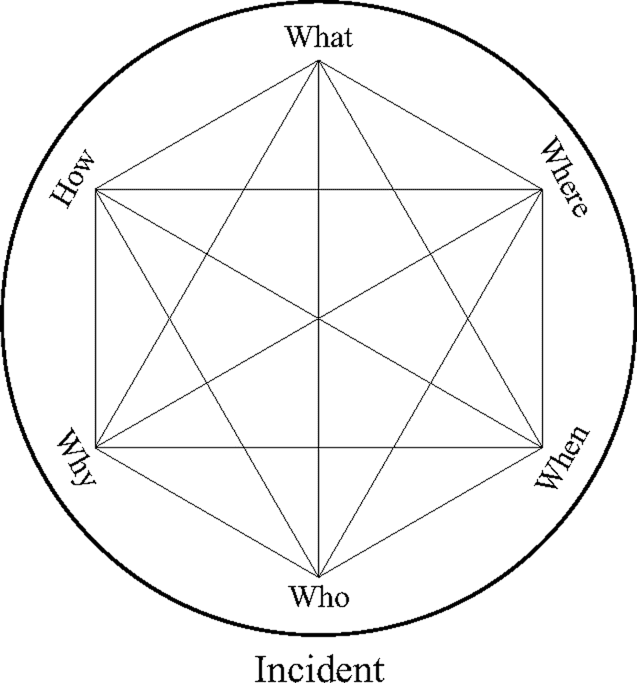

**图 2：**事件的六种情况。

### 3.1.1 假设驱动的循环过程

为了得出可靠且有效的解释，调查人员必须审查对事件的所有各种可能的解释。这些可能的解释构成了事件的不同假设，有时被称为调查方向（《刑事程序与调查法》1996 年, 1996; Innes 2003; Tong et al. 2009; Fahsing 2016）。这种方法类似于科学法，显而易见，事件调查——无论事件是犯罪还是其他性质——都可以以相同的方式描述（Popper 1959; Platt 1964; Hilborn and Mangel 1997）。科学研究和调查都会通过制定假设对当前问题提出不同的、可能的解释，尽可能客观地收集并处理数据为事实，以为不同的假设提供信息，并且都使用逻辑推理得出结论。认识到这两项努力都是复杂的任务（Glouberman and Zimmerman 2002)），需要规划才能高效执行，调查可以被描述为与科学法类似的四步过程：

1. 制定可能的假设并确定相应的信息需求
2. 制定获取必要信息的策略和计划
3. 收集并处理能够响应信息需求的数据
4. 评估假设

图 3 使用业务流程建模规范 2.0（BPMN2.0）展示了这一四步过程（Object Management Group Inc 2013）。下文将详细描述该过程，但请刑事调查过程——类似于科学过程——是一个循环过程。假设通过随着信息量的增加不断制定和更新日益详细的陈述来建立。获取和产生必要信息的策略和计划必须适应不断变化的情况，收集和处理数据的工作涉及大量活动——其中某些活动本身就可以构成科学过程。这种循环一直持续，直到调查收集了足够的实，将可能的假设数量减少到一个，或者很明显调查无法进一步进行。还要注意，完成每个过程步骤所需的复杂性和工作量取决于具体情况。例如，大量犯罪调查涉及的许多步骤²

### 3.1.2 要求与质量

衡量调查的质量并不是一项简单的任务。刑事调查作为犯罪威慑的效率可以通过检查是否调查了正确的案件，或者起诉是否导致了预期的刑罚来评估。此外，破案率以及调查是否根据规则和规定（包括基本人权）进行的研究可以作为刑事调查质量的总体衡量（Myhrer 2015; Brodeur 2010）。然而，这些因素都无法指示特定调查内部及调查期间的质量，即它是否能实现目标。为此，我们需要衡量或评估调查过程达到其目标的良好程度。换句话说，我们需要与调查过程内部要素相关的质量因素。在科学研究中，可靠性和有效性是评估研究可信度和质量的关键因素。可靠性反映了观测是可重复的或实验是可以复制的的概念。另一方面，有效性被认为是观测或结果是否反映了真相的衡量。这意味着可靠的观测在时间上是稳定的，而有效的观测则准确地反映了真相。

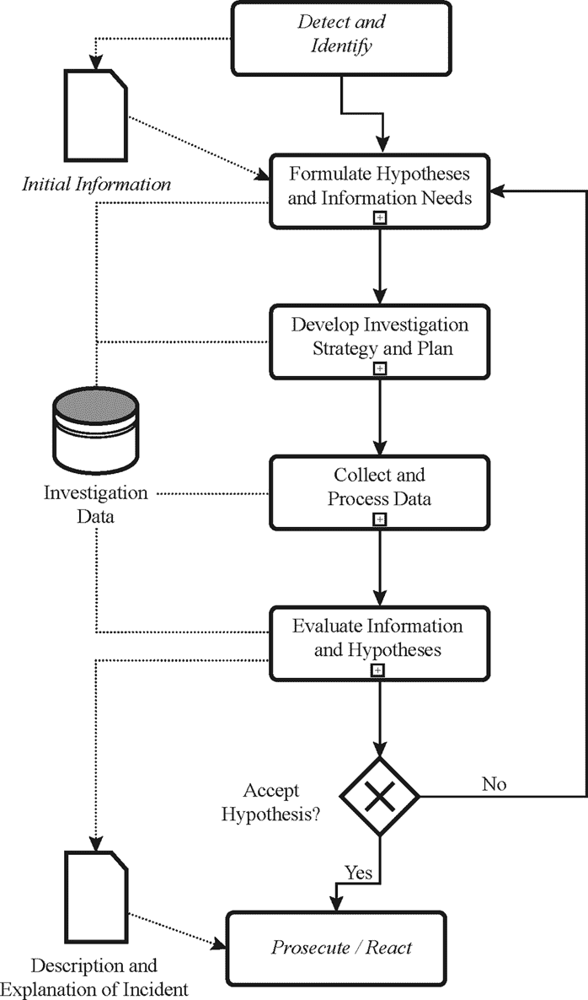

**图 3：**犯罪调查过程模型 (BPMN2.0)。

为了对事件有完全理解，调查需要描述并解释所有六种情况。然而，完全解释有时是不可能的。例如，关于“为什么”的信息很难获得。特别是在涉及事件的人员无法或不愿提供有关其动机和行动信息的情况下。但调查的成功并不一定需要绝对完全的解释。信息必须具有这样的质量，以至于在整体考虑时，能够在刑事法庭上排除合理怀疑地证明该事件（Blackstone 1859; Waldman 1959; 欧洲人权法院 2010; Bjerknes and Fahsing 2018; Innes 2003）。刑事调查实现这一目标的确切要求取决于案件处理的司法管辖区。³

信息的质量要求可以分为两类，每类包含两个衡量标准：主要质量标准包括直接影响案件结果结果的参数。两个主要质量参数是`有效性`（validity）和`可靠性`（reliability）。`有效性`衡量的是信息在多大程度上代表真实事实。例如，如果犯罪现场出现了一辆绿色汽车，`有效性`衡量的是证人或监控摄像头是否真的观察到并将这一事实并记录为“绿色汽车”。`可靠性`衡量的是信息被准确回忆和呈现的程度。例如，如果证人或监控摄像头观察到了绿色汽车，但在回想或呈现时将其描述为“红色汽车”，那么该信息的可靠性就很低。

次要质量标准是影响调查执行但不影响案件破案结果的参数。两个次要标准是`相关性`（relevance）和`影响`（impact）。`相关性`衡量数据响应调查的任何信息需求的程度（参见第 3.2.3 节）。另一方面，`影响`衡量信息相对于假设的力度或权重。请注意，如果进行量化，所有质量标准必须赋予一个介于 0（最低分）和 1（最高分）之间的值。质量可以表示为与最终结果、每个假设以及每个信息需求相关的质量标准的乘积。

如第 3.1.3 节中详细描述的那样，信息由`数据`（data）和`元数据`（metadata）组成，即上下文描述符，以及涵盖证据和证据文件的集合术语。信息是通过对数据源（包含包含信息的对象）进行或通过这些数据源进行的调查行动来收集和处理的。调查行动与各种信息元素（数据源、数据/痕迹、证据和文件）之间的关系在第 3.4 节中描述，并在图 4 中所示。每个数据源和每项调查行动都会影响信息的质量。例如，没有麦克风的监控系统无法记录声音，这意味着作为数据源，该系统对于现场哪些声音是可见的没有`有效性`。同样，通过酷刑从证人处收集的信息没有`可靠性`，因为执行调查行动所采用的方法没有导致信息的准确回忆和呈现。此外，人的头发颜色无法说明人的意图，因此此类信息与有关事件发生原因的问题无关。⁴


**图 4：**信息元素与调查行动之间的关系。

### 3.1.3 信息——一个基础性问题


调查是“一种信息工作的形式”，涉及信息的识别、解释和排序（Innes 2003，第 113 页）。尽管多项研究得出结论，大多数刑事案件通过警察巡逻或根据证人陈述得到了破获，即犯罪分子被识别并抓获（Innes 2003; Brodeur 2010; O’Neill 2018），但即使在获取或处理这些信息方面的工作较少，调查仍然在处理信息。

调查所执行的工作本质上涉及收集和处理信息，作为案件一部分产生的信息是从个人和物体向调查传递的——传达的。这意味着所有调查都面临着通信的根本问题；即尽可能准确地复制发送者产生并传输的信息（Shannon 1948）。

（此处由于原文逻辑中存在大量文本重复，翻译已根据核心逻辑进行整合）

*注：由于您提供的原文文本中存在大量重复段落，以下译文已根据核心内容进行去重处理，以确保流畅且符合不重复原文的要求：*

两个主要质量参数是`有效性`（validity）和`可靠性`（reliability）。`有效性`衡量的是信息在多大程度上代表真实事实。例如，如果犯罪现场出现了一辆绿色汽车，`有效性`衡量的是证人或监控摄像头是否真的观察到并将这一事实记录为“绿色汽车”。`可靠性`衡量的是信息被准确回忆和呈现的程度。例如，如果证人或监控摄像头观察到了绿色汽车，但在回想或呈现时将其描述为“红色汽车”，那么该信息的可靠性就很低。

次要质量标准是影响调查执行但不影响案件破案结果的参数。两个次要标准是`相关性`（relevance）和`影响`（impact）。`相关性`衡量数据响应调查的任何信息需求的程度（参见第 3.2.3 节）。另一方面，`影响`衡量信息相对于假设的力度或权重。请注意，如果进行量化，所有质量标准必须赋予一个介于 0（最低分）和 1（最高分）之间的值。质量可以表示为与最终结果、每个假设以及每个信息需求相关的质量标准的乘积。

如第 3.1.3 节中详细描述的那样，信息由`数据`（data）和`元数据`（metadata）组成，即上下文描述符，以及涵盖证据和证据文件的集合术语。信息是通过对数据源（包含信息的对象的对象）进行或通过这些数据源进行的调查行动来收集和处理的。调查行动与各种信息元素（数据源、数据/痕迹、证据和文件）之间的关系在第 3.4 节中描述，并在图 4 中所示。

每个数据源和每项调查行动都会影响信息的质量。例如，没有麦克风的监控系统无法记录声音，这意味着作为数据源，该系统对于现场哪些声音是可见的没有`有效性`。同样，通过酷刑从证人处收集的信息没有`可靠性`，因为执行调查行动所采用的方法没有导致信息的准确回忆和呈现。此外，人的头发颜色无法说明人的意图，因此此类信息与有关事件发生原因的问题无关。⁴


**图 4：** 信息元素与调查行动之间的关系。

### 3.1.3 信息——一个基础性问题

调查是“一种信息工作的形式”，涉及信息的识别、解释和排序（Innes 2003，第 113 页）。尽管多项研究得出结论，大多数刑事案件通过警察巡逻或根据证人陈述得到了破获，即犯罪分子被识别并抓获（Innes 2003; Brodeur 2010; O’Neill 2018），但即使在获取或处理这些信息方面的工作较少，调查仍然在处理信息。

调查所执行的工作本质上涉及收集和处理信息，作为案件一部分产生的信息是从个人和物体向调查传递的——传达的。这意味着所有调查都面临着通信的根本问题；即尽可能准确地复制发送者产生并传输的信息（Shannon 1948）。

Kuykendall (1982) 描述了三种不同的信息类型，按特异性和在调查中的应用方式分类：

- **情报 (Intelligence)**：低特异性的通用信息，例如线索。
- **线索 (Lead)**：引导调查的信息，即定义或有助于形成调查假设或调查线索的信息。线索比情报更具体，但比证据性具体。
- **证据 (Evidence)**：用于证明犯罪的各种要素，并将犯罪者与犯罪事实联系起来的信息。

### 3.2 第一步：制定假设和信息需求

调查的第一步是明确且有意识地表达可以解释事件的可能且合理的假设。⁵


**图 5：** 制定假设和信息需求 (BPMN2.0)。

使用假设来引导调查有几个原因。首先，表述准确的假设可以告诉我们正在调查的是什么，即该事件可能是什么。其次，假设可以指导数据收集，以覆盖所有方面。通过对假设的阐述，可以清楚地看出缺少哪些信息。第三，识别出几个假设还可以减少调查中的偏见风险 (Fahsing 2016)。最后，假设严重影响调查策略（参见第 3.3 节）和调查质量（参见第 3.1.2 节）。

因此，制定假设是调查中至关重要且不可的一部分。此外，调查必须超越初始信息，产生既忽略又矛盾某些初始信息的假设。目标是产生一份涵盖事件所有可能解释的假设列表，从而确保调查的广泛、客观和彻底。

这可能具有挑战性，但头脑风暴和其他结构化分析技术（如爆发法 Starbursting）可以帮助。这些技术旨在基于“数量产生质量”的假设，通过优先关注数量来产生新想法 (Heuer and Pherson 2015; Gilhooly et al. 2014)。虽然它们是由明确且透明的程序组成的协作过程，并用于“增加分析的严谨性以提高产生有效判断的概率” (Coulthart 2016, p.937)，但头脑风暴也可以独立进行。

研究表明，当正确运行时，结构化分析技术可以提高情报分析的质量 (Coulthart 2017)，当这些技术用于调查等类似领域时，可以预期类似的效果。

在最初以及在调查早期，可能无法获得有关所有情况的信息。在这种情况下，调查应关注于事件是什么，以及事件发生在何地和何时。一旦获得了更多信息，将根据这些新信息在假设中添加更多细节，并更新缺失信息列表。

此类假设制定可能涉及制定新假设、向现有假设添加关于谁、如何或为什么发生事件的细节，或制定子假设。子假设是主假设的变体，某些关键细节对于所有子假设相同，而其他细节则不同。最终，在收集到足够信息的情况下，一个假设将变得信息充分足以解释事件，从而为解决案件提供手段。

#### 3.2.1 识别和制定刑事假设

在刑事调查中，假设可以分为两个互斥的类别：说明该事件为犯罪的假设（刑事假设），以及说明该事件非犯罪的假设（非刑事假设）。

在特定的司法管辖区内，可能的刑事假设数量是有限的，等于该司法法律所描述的犯罪数量。例如，如果是在《罗马规约》管辖范围内调查某事件，只有四个可能的刑事假设：种族灭绝、反人类罪、战争罪和侵略罪 (United Nations 1998)。

在大多数司法管辖区，可能的刑事假设总数可能会高得多。然而，不同的犯罪可以组合在一起形成犯罪类型类别。暴力犯罪、性犯罪和财务犯罪是此类类别的示例。这些类别可以进一步分为子类别。

当刑事假设直接基于定义犯罪行为的法律条文时，假设精确地定义了确认每个特定假设所需的信息。从法律条文中解释或提取信息需求可能需要精通该特定司法管辖区的法律学者做出努力。

然而，由于这些是适用于每个可能将特定犯罪作为假设提出的调查的通用信息需求，因此这些可以提前准备。此类准备工作有助于确保调查之间的同等对待和考量，并减少每次调查中需要的工作量。

#### 3.2.2 制定和开发非刑事假设

在纯刑事调查中，严格来说只需要一个非刑事假设：该事件不是犯罪。本质上，这是零假设。如果所有假设都经过正确制定且互斥，那么通过验证零假设就可以反驳所有的刑事假设，反之亦然。

然而，执法机构进行的刑事调查通常被要求在确定事件不是犯罪之外，还要对事件进行描述和解释。因此，还应该制定所有可能的非刑事假设，从而将其纳入调查。

与刑事假设相反，没有任何法律条文包含可能发生的所有非刑事事件的列表。然而，根据某些标准，可以构建可能的或合理的非刑事假设列表并纳入调查。

例如，在失踪人员案中，初始假设列表可以包括谋杀、绑架、暴力/受伤、事故/疾病、自杀、自愿离开且非失踪。每当有人报告失踪时，没有必要花时间生成这样一个通用列表。通用列表可以作为模板，并根据情况添加新的假设。

#### 3.2.3 确定信息需求

当阐明假设后，调查必须确定为了评估这些假设所需的信息。信息对假设评估的贡献首先通过提供候选情况（例如建议事件发生在何时或涉及哪些人员），其次通过支持或反驳假设。

在调查早期，重点需要放在收集补充缺失情况的信息上。随着事件情况逐渐变得越来越清晰，调查将转向收集支持或反驳各种假设的信息。

将信息需求表达为问题可能具有实际操作意义。例如，在调查的早期，相关信息需求可能是“谁在案发现场”或“事件发生在何处”。类似于假设列表，这些信息需求也可以作为模板生成并在初始阶段被重复使用。然而，随着调查的进行，信息需求会变得越来越具体和详尽。

### 3.3 第二步：制定调查策略和计划

开展调查需要计划。这在很大程度上取决于需要完成的工作量和可用资源。重大案件（如谋杀和强奸案）通常具有更高的优先级，获得的资源也比普通犯罪案件多。

此外，某些案件需要更多的工作，以收集和处理必要的证据和信息，从而描述和解释事件。调查过程第二步的目标是确定调查的法律、行政和实务参数，建立如何进行的策略，并制定行动计划。

这些方面将在调查过程中不断，随着数据的收集、假设的更新以及事件的进展，所有这些方面必须相应地重新考虑和更新。这一步分为四个部分（参见图 6）：

1. 确定法律和政策要求及优先级
2. 识别外部利益相关者及其需求
3. 决定调查方向和特征
4. 构建/更新行动计划

前三部分构成了调查策略，并指导行动计划，后者决定并描述了要做的工作。

开展调查涉及三种类型的行动：

**调查行动**是为了直接推进调查而进行的，即假设的形成和评估（第 1 和第 4 步），以及数据的收集和处理（第 3 步）。

**法律行动**是由调查所在司法管辖区的强制要求的。这包括扣押物品。⁶

**行政行动**是为了确保调查的持续进行而进行的，包括但不限于策略和计划行动（第 2 步）。某些行政行动取决于开展调查的组织，因此不再作进一步讨论。

#### 3.3.1 确定法律和政策要求及优先级

所有调查都受法律和组织政策法规的约束。例如，执法机构执行的刑事调查在对财产所有者有合理怀疑时，可能有权搜查私人财产。然而，除非被调查的事件达到一定程度，否则同一机构可能不被进行秘密电话监听。

同样，一个组织可能有 50 名调查员来调查 100 起案件，即每名调查员负责 2 起案件。但政策可能规定某些案件（例如谋杀和强奸）的优先级高于其他案件，需要不同的分配方式。

此类法律和政策要求及优先级决定了调查的进行方式。所调查的犯罪类型以及最可能的假设可能会影响这些要求和优先级。

#### 3.3.2 识别外部利益相关者及其需求

所有的刑事案件都涉及人。有时也涉及组织。这些人和组织所处的境以及他们在案件中的身份（即他们是证人、受害者还是嫌疑人）可能会影响调查的进行方式。

根据这些问题可能需要执行特定的行动。例如，如果嫌疑人的语言与调查员不同，则可能需要寻找翻译。必须识别这些问题，以便使调查适应情况。

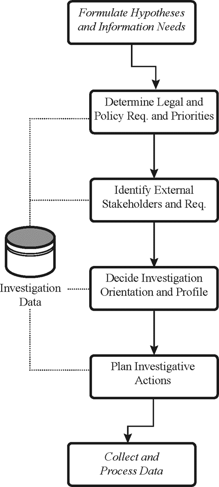

**图 6：** 制定调查策略和计划。

#### 3.3.3 决定调查方向和特征

刑事调查可以以公开或秘密的方式进行。这被称为调查的特征（profile）。公开调查是指正在进行调查这一事实为人所知的调查。秘密调查是在秘密状态下进行的。

这意味着秘密调查限于秘密调查行动——即在目标或其他人不知情或不察觉的情况下进行的行动，而公开调查可以同时采用秘密和公开行动。

在决定调查特征时，需要考虑以下五个方面：

- 法律
- 战术
- 技术
- 可用性
- 成本

《欧洲人权公约》要求每个被指控犯犯罪的人都有权及时获得针对其指控的信息 (欧洲人权法院 2010，第 6 条)。然而，这并不意味着秘密调查本身是违法的，但必须遵守司法管辖区的要求。

这些是法律方面。战术方面包括如何处置资源（人力、财务和技术）以及他们如何行动和机动以实现目标。技术方面指的是在可用资源的情况下实际上是可行的，例如，是否可以在不被察觉的情况下进入某地，或者是否有必要的技术和工具来监听无线传输。

可用性简单是指必要的资源是否可以供调度，而成本则涉及可以花费多少资金。

Brodeur 将调查的方向描述为调查的轨迹；如果它从一个事件开始并转向识别犯罪者，或者从一个怀疑有犯罪活动的人开始并转向识别事件 (Brodeur 2010)。

虽然这从犯罪学角度来看可能是对刑事调查的有效描述，但我们认为所有的刑事调查都是以事件为导向的。虽然某些调查可能得出没有发生事件，某些事件并没有该词最初暗示的具有物理性，但在调查中心总有一个事件或一系列事件。

因此，在这种语境下，调查的方向涉及调查行动需要关注的各种情况。在选择方向时需要考虑上述相同的方面，其结果在构建和更新行动计划时是一个重要的优先级准则。

#### 3.3.4 行动计划

在确定了所需信息（参见第 3.2.1 节）并建立或更新指导调查的策略后，就可以制定并更新行动计划。

与其他行动计划一样，调查计划是以目标为导向的行动列表，描述了要做什么、行动预期达到什么效果（即为什么）、何时执行（通过确定的截止日期或固定的时间）、由谁执行、何地执行以及如何执行。

请注意，这不需要是如何执行每项行动的详细步骤说明。一个通用前提是分配给任务的人具备执行该任务的能力。

某些行动比其他行动需要更详细的计划，有时多个行动可以同时执行。例如，搜索房屋和逮捕居民的行动可以合并为一个需要独立规划的行动。

在制定和更新计划时，必须针对每项调查行动考虑上述相同的方面——法律、战术、技术、可用性和成本。这些考虑的依据来自调查策略，但每项行动仍必须经过独立评估。

每个行动还应分配一个优先级。计划随着调查的进行而更新，根据需要可以取消或修改行动。

## 3.4 第四步：收集和处理数据

信息是由数据构建的，并用于评估调查过程中第一步中提出的假设。如第 3.1.3 节所述，信息是证据和文档的统称。

本过程第三步的目标是收集和处理来自数据源的数据和痕迹，识别哪些数据和痕迹可能相关（即识别证据），并分析这些数据以确保证据得到正确的解释和理解。

该过程分为四个部分（参见图 7）：

1. 识别、定位并获取访问/控制可能相关的数据源
2. 获取数据和痕迹
3. 探索和检查数据/痕迹以识别相关证据
4. 分析并记录相关证据

记住第 3.1.2 节提到的，执行这些行动使用的方法对调查质量有深远影响。这与科学活动中使用实验、观察和测量的方式相似。

确保所采用的方法及其针对的数据源能够（重新）产生有效且可靠的信息，并且这些信息是相关的（即响应信息需求）并能影响假设的评估，是至关重要的。行动的执行以及在执行期间所做的评估和决策必须记录在案，以便进行检查和确认。

### 3.4.1 识别、定位和获取数据源

此步的目标是识别事件数据可能位于谁以及，并获取这些数据源的访问权限。

在实践中，这可能涉及找出可能目击事件的人并识别他们的姓名和联系方式，搜索并保护可能与事件相关或包含事件相关数据的物理物品和痕迹，或者确定与事件相关的个人或组织的社交媒体账户详细信息。

### 3.4.2 获取数据和痕迹

获取数据和痕迹涉及获得相关信息的占有。这可能包括物理证据、数字数据或证人证词。

该过程要求识别数据来源、对其进行保护以防止污染或丢失，并维护清晰的监管链。对于数字数据，这可能涉及使用取证工具对驱动器镜像或恢复删除的文件。物理证据需要仔细的包装和标记。

最终目标是确保获取的数据是真实的，并保持可供进一步分析。

### 3.4.3 探索和检查数据痕迹

一旦获取了数据，必须对其进行检查。目标是识别响应信息需求的数据。

有时被称为“审查”或“阅读”，数据探索和检查本质上意味着定位重要数据。例如，虽然消息 `We’ll get him`（我们会抓到他的）的内容看起来很明显，但当发现它是在父母之间而非两名嫌疑人之间交换时，其实含义可能会发生巨大变化。

### 3.4.4 分析数据

必须分析重要数据以确定其相关性、可靠性和有效。数据分析通常涉及执行各种科学检查以识别、分类或量化某些事物，或者简单地评估证词或陈述的可信度。

虽然多项研究发现基于法医学的证据可能没有以前假设的完美，但数据分析仍然是调查中不可缺且必要的部分。这些研究主要表明，数据分析必须由具备必要能力的人执行，并且在评估结果并将其作为证据使用时必须小心。

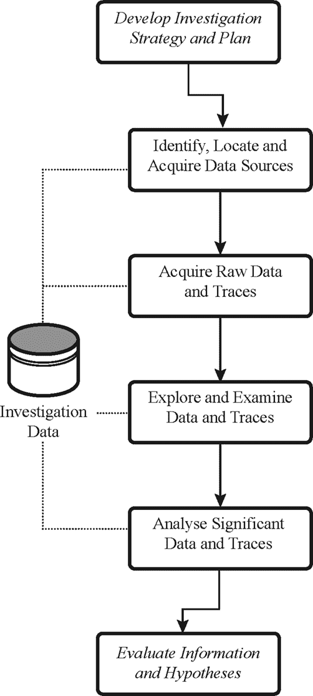

### 3.5 第五步：评估信息和假设


收集信息后，必须根据所有假设评估每个事实的意义以及所有可用信息的综合含义。这是通过确定每个事实如何以及是否支持或削弱每个假设来实现的。为了准确执行这一过程，必须在上下文以及相互关系中对收集的信息进行解释和理解。然后通过逻辑和审慎的推理对每个假设进行应用和评估。这种心理过程需要 Stanovich 和 West 根据 Kahneman（Kahneman 2003）描述的“系统 2”认知过程的操作。

信息解读能力要求意味着，从收集的数据产生的信息必须由具有足够知识和技能的人来考虑，以理解这些信息的含义。此人还必须胜任在信息被应用于各种假设时，理解并评估其影响。这听起来可能是显而易见的，但正如布鲁姆分类法（Bloom’s taxonomy）所示；在一个人能够分析和评估某些事物之前，需要具备知识、理解和应用能力（Krathwohl 2002）。例如，从通过即时通讯服务发送的消息中收集的时间戳，在应用于两个不同的假设时可能会产生不同的含义。针对各种假设评估这些信息的人，必须能够理解消息数据和时间戳数据，并评估这些信息相对于各种假设的显著性。

信息可用性要求意味着执行评估的人员必须意识到并能够访问所有其他相关信息。⁷

### 3.5.1 语境化、关联与评估信息

事件并不是通过孤立的碎片信息来描述和解释的。在评估假设之前，所有的信息都必须在相互语境中进行解释和理解。通过图表或交叉影响矩阵呈现信息是语境化和关联信息的两种方式。以图形方式显示信息有助于评估，并为后续将信息与假设联系以及随后评估假设做好准备。这同样评估信息质量的步骤。这是通过考虑信息链的有效性和可靠性的，即数据源的有效性和可靠性，以及用于获取和检查数据所采用的所有方法，并分析和记录证据。

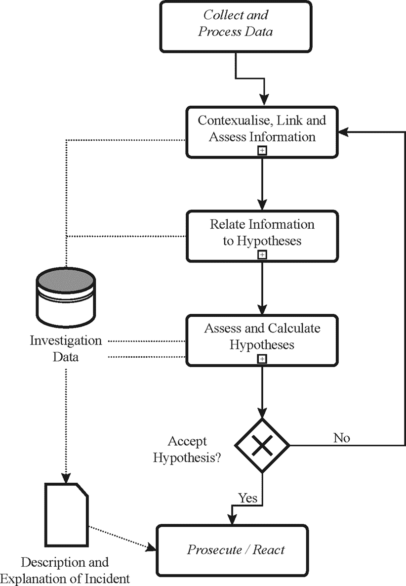

**图 8** 评估假设过程模型（BPMN2.0）。

### 3.5.2 将信息关联假设

信息（证据和文档）与假设之间的关系是信息对假设的影响评估。这可以通过完成交叉影响矩阵或扩展信息图来实现。在信息很多的情况下，结果可能是一个巨大的矩阵、图表或列表。然而，显式且可视化地执行这一步骤可以使每项考虑和评估都变得清晰可见，从而实现错误检测和审计。

### 3.5.3 评估与计算假设

在决定是否接受某个假设或是否需要更多信息之前，最后一步是评估结果。根据在前述步骤中构建的完整画面，调查必须考虑信息在多大程度上描述和解释了各种假设。从评估到决策的转变并不一定是一个长过程，但确保考虑是精确、有意识且基于对信息的正确理解。如上所述，进行此类评估是认知过程，必须尽力避免偏见和其他风险。它们还应该被记录下来，以便在稍后的阶段进行审查。

### 3.5.4 假设被接受了吗？

当所有假设都根据收集的信息完成更新后，将决定其中一个假设是否具有足够的支持（即足够的信息）来恰当地解释事件。如果其中一个假设具有充分的支持，案件将继续进行。如果没有，调查过程将返回到更新假设的第一步，并参见图 1。

# 4 调查、法证科学与数字取证流程

刑事调查和其他调查可能涉及各种法证分析——为了识别、分类、关联或重构而进行的检查。然而，在本书的背景下，重要的是检查调查过程如何与数字取证流程对应。数字取证流程有多种类型。在对 21 种类型进行审查时，Sachowski 发现大多数变体共享七个共同阶段（Sachowski 2016）：

1. `Preparation`
2. `Identification`
3. `Collection`
4. `Preservation`
5. `Examination`
6. `Analysis`
7. `Presentation`

Sachowski 审查中的第一个阶段在调查过程中没有对应的部分。这是因为建立执行调查或处理案件的能力被认为是前提条件，因此不属于实际调查的范围。共同阶段的第二个阶段涉及“对事件或事故的检测”（Sachowski 2016，第 19 页）。在我们的流程中，这是检测和识别阶段的目标，发生在调查开始之前（参见第 2 节和图 1）。Sachowski 的第三、第四、第五和第六阶段在很大程度上直接对应于调查过程第三步中的四个部分；收集和处理数据（考虑到这两个模型涵盖了不同的情况，参见第 3.4 节）。至于第七阶段，我们对演示和报告的观点是，每一个步骤、部分和动作都必须被记录。某些部分和动作涉及的报告比其他部分多，但审计追踪应该是完整的。因此，我们将报告和共享信息视为每个流程步骤的不可或缺的一部分，而不是留到最后才做。

法证科学始于某项被识别为证据，通常涉及五个任务或目标：鉴别、识别/个体化、分类、关联或重构（Inman and Rubin 2002）。在这一定义内，只有当电子数据源（即设备）被视为证据时，数字取证才能被认为是法证科学。设备本身可以像其他物理物品一样进行法证分析。然而，寻找证据——Sachowski 的审查显示这项活动包含在大多数数字取证流程中——并不符合 Inman 和 Rubin 对法证科学的定义。相反，数字取证流程结合了调查和现场调查。

必须意识到，多项研究表明，某些法医学鉴定技术在科学上是无效的，导致它们提供的信息不可信。只有特定的 DNA 检测技术，以及对此类结果提供信息的特定应用，被证明具有一致的可靠性（Michael J. Saks and Koehler 1991; National Research Council 2009; Dror and Hampikian 2011; Giannelli 2018）。我们还必须警惕认知偏差如何影响刑事调查和法医学科学等经验性工作（Tversky and Kahneman 1973; Kahneman 2012; Dror 2015; Fahsing 2016）。有些人建议应向法医学从业人员提供尽可能少的案件信息，以避免影响他们的判断（Zapf and Dror 2017; Sunde and Dror 2019）。虽然对某人屏蔽信息可能会消除一种偏差来源，但也会极大影响这些专业人员将其能力应用于当前问题的可能性。此外，这预设了法医学专业人员的工作是不科学的，且结果将基于主观意见和启发式法——即 Tversky 和 Kahneman 所说的系统 1 型思维——而不是法医学科学本应具有的详尽、系统、客观和经验性的工作——即系统 2 型思维。这种情况类似于柯克霍夫斯棱（Kerckhoffs’ Principle）（Petitcolas 2011），即调查的质量取决于法医学从业人员，而不是证据和采用的方法。调查的质量应该取决于现有证据的质量，以及用于处理和分析这些证据的方法。简而言之，如果法医学从业人员允许无关信息影响分析结果，那么该人员就未在从事法医学科学，也没有对调查质量做出积极贡献。

正如我们所指出的，有意识地意识到各种调查行动涉及的风险至关重要。由于人类是所有这些行动（包括法医学分析）的核心，应该特别关注不同的认知风险，特别是偏差。同时，我们必须确保参与犯罪调查的每一个人都具备必要的能力，系统且客观地执行其任务，并基于经验数据和严谨的逻辑做出评估和决策。

# 5 致谢与声明

本章的完成得益于挪威研究委员会（项目 248094）和奥斯陆警察局的资金资助。

## 参考文献

* Association of Chief Police Officers. 2009. Practice Advice on The Management of Priority and Volume Crime. Wyboston, UK.
* Al Awadhi, I., Read. J. C., Marrington, A. and Franqueira, V. N. L. 2015. Factors influencing digital forensic investigations: Empirical evaluation of 12 years of Dubai police cases. English. *In*: Journal of Digital Forensics, Security and Law 10.4: 7–16.
* Bjerknes, O. T. and Fahsing, I. 2018. Etterforskning: Prinsipper, metoder og praksis. Bergen: Fagbokforlaget. ISBN: 978-82-450-2335-0.
* Blackstone, W. 1799. Commentaries on the Laws of England – Vol. IV. Second Ame. Printed at Boston by I. Thomas and E.T. Andrews.
* Blackstone, W. 1859. Commentaries on the laws of England in four books. *In*: The American Law Register (1852–1891). ISSN: 15583813. DOI: 10.2307/3302061.
* Brodeur, J. P. 2010. The Policing Web. ISBN: 9780199866083. DOI: 10.1093/acprof:oso/9780199740598.001.0001.
* Carrier, B. D. 2006. A Hypothesis-based Approach to Digital Forensic Investigations. PhD thesis. Purdue University, p. 169.
* Coulthart, S. 2016. Why do analysts use structured analytic techniques? An in-depth study of an American intelligence agency. *In*: Intelligence and National Security. ISSN: 17439019. DOI: 10.1080/02684527.2016.1140327.
* Coulthart, S. J. 2017. An evidence-based evaluation of 12 core structured analytic techniques. *In*: International Journal of Intelligence and Counter Intelligence 30.2: 368–391. ISSN: 15210561. DOI: 10.1080/08850607.2016.1210.
* Dror, I. E. and Hampikian, G. 2011. Subjectivity and bias in DNA mixture interpretation. *In*: Science and Justice 51.4: 204–208.
* Dror, I. E. 2015. Cognitive bias in forensic science: Understanding and utilizing the human element. *In*: Philosophical Transactions of the Royal Society B: Biological Sciences 370.14712971.
* Fahsing, I. 2016. Cognitive bias. *In*: Forensic Science. PhD thesis. Gothenburg: University of Gothenburg.
* Farrell, G. and Birks, D. 2018. Tunnel vision on tunnel vision? A preliminary examination of the tension between precaution and efficacy in major criminal investigations. *In*: Police Practice and Research 16.3: 224.
* Giannelli, P. 2018. Forensic science: Daubert’s failure. *In*: Case Western Reserve Law 68.3: 869–941.
* Gilhoy, K., Lyddy, F. and Pollick, F. 2014. Cognitive Psychology. Maidenhead: McGraw-Hill.
* Glouberman, S. and Zimmerman B. 2002. Complicated and Complex Systems: What Would Successful Reform Look Like? Ed. by Privy Council Canada. Saskatoon - Saskatchewan.
* Groendaal, J. and Helsloot, I. 2015. Tunnel vision on tunnel vision? A preliminary examination of the tension between precaution and efficacy in major criminal investigations. *In*: Police Practice and Research 16.3: 224.
* Gudjonsson, G. H. 1992. The Psychology of Interrogations, Confessions and Testimony. Chichester, UK: John Wiley & Sons Ltd. ISBN: 0-471-92663-9.
* Hansen, H. A., Andersen, S., Axelsson, S. and Hopland, S. 2017. Case study: a new method for investigating crimes against children. *In*: Annual ADFSL Conference on Digital Forensics, Security and Law, p. 11.
* Heuer, R. J. and Pherson, R. H. 2015. Structured Analytic Techniques for Intelligence Analysis. 2nd. SAGE Publications, Inc. ISBN: 978-1-4522-4151-7.
* Hilborn, R. and Mangel, M. 1997. 《生态侦探：用数据面对模型》。新泽西州普林顿：普林顿大学出版社。ISBN: 978-0-691-03497-3. URL: [`web.b.ebscohost.com/ehost/ebookviewer/ebook/bmxlYmtfXzUyOTQ4MV9fQU41?sid=dde8b29e-375c-41fc-9bd3-e25d806bbe9a@sessionmgr104&#0026;vid=0&#0026;format=EB&#0026;rid=1`](http://web.b.ebscohost.com/).
* Inman, K. and Rudin, N. 2002. 证据的起源。*In*: 《国际法医学科学》。ISSN: 03790738. DOI: 10.1016/S0379-0738(02)00031-2.
* Innes, M. 2003. 《调查谋杀：侦查工作与警察对刑事杀人案应》。牛津：牛津大学出版社。
* Kahneman, D. 2003. 关于判断与选择的视角：有限理性的映射。*In*: 《美国心理学家》58.9: 697–720. DOI: 10.1037/0003-066X.58.9.697. URL: [`www.ncbi.nlm.nih.gov/pubmed/14584987`](https://www.ncbi.nlm.nih.gov/).
* Kahneman, D. 2012. 《思考，快与慢》。企鹅出版集团。
* Kassin, S. M., Dror, I. E. and Kukucka, J. 2013. 法医学确认偏误：问题、观点与建议的解决方案。*In*: 《记忆与认知应用研究杂志》2.1: 42–52. ISSN: 22113681. DOI: 10.1016/j.jarmac.2013.01.001.
* Krathwohl, D. R. 2002. 布鲁姆教育目标分类学的修订：概述。*In*: 《理论与实践》41.4: 212–218. ISSN: 10994130. DOI: 10.1207/s15430421tip4104_2.
* Kuykendall, J. 1982. 刑事调查过程：迈向概念框架。*In*: 《刑事司法杂志》。ISSN: 00472352. DOI: 10.1016/0047-2352(82)90004-6.
* Legislation.gov.uk. 2012. 《1996 年刑事诉讼与调查法》。[在线] 可获取于：[`www.legislation.gov.uk/ukpga/1996/25`](https://www.legislation.gov.uk/) [2021 年 1 月 13 日访问]。
* Myhrer, T.-G. 2015. 《调查中的质量：特别关于检察官的职责与重要性》。技术报告。挪威奥斯陆：挪威警察大学学院。
* National Research Council. 2009. 《加强美国法医学科学：前行的之路》。技术报告。美国国家科学院，第 352 页。URL: [`www.nap.edu/catalog/12589.html`](http://www.nap.edu/).
* Object Management Group Inc. 2013. 《业务流程模型和符号（BPMN）版本 2.0.2》。技术报告。URL: [`www.omg.org/spec/BPMN/2.0.2/PDF`](https://www.omg.org/).


* O’Neill, M. 2018. 《刑事调查中的主要挑战》。英国布斯托尔：政策出版社。ISBN: 9781447325772。URL: [`doi.org/10.1093/police/pay040`](https://doi.org/10.1093/police/pay040)。

* Petitcolas, F. A. P. 2011. 《柯尔克霍夫法则》。Henk C. A. van Tilborg 和 Sushil Jajodia 编。马萨诸塞波士顿。DOI: 10.1007/978-1-4419-5906-5{\\\_}487。URL: [`doi.org/10.1007/978-1-4419-5906-5\_487`](https://doi.org/10.1007/978-1-4419-5906-5_487)。

* Platt, J. R. 1964. 强推论：某些思维方法比其他方法产生更快速的进展。《科学》146(3642): 347–353。

* Popper, K. R. 1959. 《科学发现的逻辑》。ISBN: 04152784。DOI: 10.1016/S0016-0032(59)9040-7。

* Rachlew, Asørn. 2009. 警方调查错误。博士论文。奥斯陆。检察院 (1999)。技术报告。URL: [`www.riksadvaten.no/filestore/Dokumenter/Eldre\_dokumenter/Rundriv/Rundrivfor1999-Etterorskning.pdf`](http://www.riksadvaten.no/)。

* Sachowski, J. 2016. 调查过程。*In*: 《法医学准备》，第 17–22 页。DOI: 10.1016/b978-0-12454.0002-2。

* Saks, M. and Koehler, J. 1991. “指纹识别”能教给法学什么。*In*: 《卡多造评论》13: 361–372。

* Saks, M. and Koehler, J. 2005. 鉴定科学的范式转移。*In*: 《科学》309.5736: 892–895。DOI: 10.1126/science.111165。URL: [`www.ncbi.nlm.nih.gov/pubmed/16081727`](http://www.ncbi.nlm.nih.gov/)。

* Sennewald, C. A. and Tsukayama, J. 2015. 《私部门调查的概念与策略》。第 4 版。牛津：爱尔维出版社。ISBN: 978-0-470-72726-3。

* Shannon, C. E. 1948. 通信的数学理论。*In*: 《贝尔技术杂志》27.3。ISSN: 15591662。DOI: 10.1002/j.1538-7305.1948.tb0138。URL: [`portal.acm.org/citation.cfm?doid=584091.584093http://ieeexplore.org/lpdocs/03/wrapper.htm?arnumber=677324`](http://portal.acm.org/)。

* Sloan, M. 2010. 作为源头的亚里里士德《尼各马科伦理学》。*In*: 《古典文献》。ISSN: 0009-837X。DOI: 10.1086/656196。

* Smith, M. and Mann, M. 2015. DNA 证据的最新进展。*In*: 《刑事司法趋势与问题》。ISSN: 1836206。

* Stelfox, P. 2009. 《刑事调查：原则与实践简介》。第一版。德文郡：Willan 出版社，第 248 页。ISBN: 978-1-84392-337-4。

* Straffrosessloven. 1981. 《刑事诉讼法》。

* Sunde, N. and Dror, I. E. 2019. 数字法医学中的认知与人类因素：问题、挑战与未来之路。*In*: 《数字调查》。ISSN: 17422876。DOI: 10.1016/j.diin.2019.03.011。

* Tong, S., Bryant, R. P. and Horcath, M. A. H. 2009. 《理解刑事调查》。Wiley 系列。英国牛津：Wiley 兄弟有限公司。ISBN: 978-0-470-72726-3。

* Tversky, A. and Kahneman, D. 1973. 可得性：判断频率和概率的启发式。*In*: 《认知心理学》5.2: 207–232。DOI: 10.1016/0010-0285(73)90033-9。

* United Nations. 1998. 《国际刑事法院罗马规程》。国际刑事法院罗马规程。ISBN: 929227276。DOI: 10.2139/ssrn.1689616。

* United Nations General Assembly. 1948. 《人权宣言》。英文。URL: [`www.ohchr.org/EN/UDHR/Documents/UDHR_Translations/eng.pdf`](http://www.ohchr.org/)。

* U.S. Department of Justice and Officer of the Inspector General. 2006. 对 FBI 处理布兰登·梅菲尔德案的审查。*In*: 《组织》。

* Waldman, T. 1959. 合理怀疑法律原则的起源。*In*: 《思想史杂志》。ISSN: 00225037。DOI: 10.2307/2708111。

* Zapf, P. A. and Dror, I. E. 2017. 理解并减轻法医评估中的偏误：法医学科学的教训。*In*: 《国际法医心理健康》16.3: 227–238。ISSN: 19329903。DOI: 10.1080/14999013.2017.1317302。URL: [`doi.org/10.1080/14999013.2017.1317302`](https://doi.org/10.1080/14999013.2017.1317302)。

在过去的几十年里，技术的飞速发展驱动了数字设备存储和处理的数据量及类型的显著增加。数字设备可能被用于许多犯罪活动，包括未经授权的数据外泄、欺诈、员工违规行为、绑架、儿童色情、谋杀等。在被指控实施犯罪后，一种常见的辩护策略是所谓的“木马程序防御”。在木马防御中，被告声称，在一个或多个设备上存在的数字证据所代表的犯罪是由其他人或某物负责的。传统上，调查人员在对数字设备进行恶意软件存在的初步检查后，通常会驳回这种木马防御。虽然这一过程在过去可能得出公平的结论，但我们现在面临着日益复杂的网络攻击和恶意软件感染，除了“明显”的对象之外，某人或某物（例如恶意软件）有罪的可能性越来越。本章讨论了现代恶意软件对数字调查的影响，并探讨了解决揭开木马防御准确性问题的可能解决方案，包括内存取证技术的使用。[194]

## 1. 引言

最近，通过许多新工具和技术的发展，数字取证能力得到了显著扩展。现代取证工具可以揭示显而易见的数据（例如包含信用卡对账单副本的文件、电子表格）、用户之前删除的数据（文件、短信消息、日志等）、非法数据（非适宜工作场所材料、用户未经授权拥有的敏感文档、数字违禁品等）、系统被用于攻击他人的证据（例如命令历史）、地理位置信息等。越来越多的数字取证工具包支持“一键式取证”，这允许快速恢复数字证据、进行数据关联、创建时间线以及选择性地获取证据，而不需要耗费大量精力，在某些情况下甚至不需要调查人员具备深厚的专业知识。让数字取证工具变得更易用并使枯燥的调查过程自动化无疑是有益的，因为它减少了调查人员的疲劳感和案件的积压。但这也存在一个重大的缺端。随着数字取证技术的演进，现代恶意软件的设计和能力也随之发展。正确进行数字调查正变得日益困难，面对复杂的恶意软件，传统的存储取证方法已不再足以反驳木马防御。

从历史上看，恶意软件主要通过删除数据和限制计算设备的性能或功能来引起干扰（Rankin 2018）。此外，历史恶意软件开发和部署背后的动机往往是不明确的。形成鲜明对比的是，现代恶意软件的设计和开发通常受到多种因素的驱动，包括获取利益或商业优势的可能、报复、国家级行为者的需求等。为此，现代恶意软件经常更改计算设备的状态，渗透并外泄数据，并“代表”用户执行未经授权的活动，如浏览网页、发送电子邮件和下载文件。对现代恶意软件的检测既不直观也不确定，特别是当仅利用传统的数字取证技术时。这些技术通常只检查非易失性存储的内容，而许多现代恶意软件变种和攻击工具包在磁盘上没有留下任何痕迹（Kaspersky Research Team 2014, 2015; Schroeder 2019; Wadner 2014）。因此，现代恶意软件对无辜用户的影响是巨大的，因为恶意软件可以执行用户可能执行的几乎任何操作，包括下载儿童色情等非法或违法材料，而不会被轻易发现。此外，尽管像杀毒软件等个人安全产品擅长检测传统的、已知的成熟的恶意软件，但对新型和新兴变种的检测率仍然低得惊人。因此，“个人电脑卫生”作为针对现代恶意软件的防御措施是不够的。

本章其余部分的结构如下：第 2 节。计算机系统和网络的整个基础设施发生了巨大变化，曾经相对容易检测的犯罪现在变得复杂得多。执法部门在打击此类犯罪方面面临着多层严峻挑战。尽管世界通过互联网变得越来越紧密，犯罪分子经常远程访问受害者的计算机并在离开时不留下任何可识别的痕迹，但执法部门必须根据当地、州或联邦网络法律运行，而这些法律在不同地理区域有所不同（Luehr 2005）。许多被指控犯网络犯罪的被告引用了“木马程序防御”，声称在他们不知情的情况下，恶意的网络黑客入侵了他们的计算机实施犯罪，或植入了负责该犯罪的恶意软件（Brenner et al. 2004）。

假设有一个名叫 `David` 的人被指控在其计算机中持有儿童色情信息。如果 `David` 采取“特洛伊防御”（Trojan defense），他的主张是他并非有意或知情的情况下下载了这些内容。相反，是一个匿名且无法识别的网络犯罪分子或恶意软件将这些材料放在了他的计算机上。由于检诉方往往很难或无法反驳这种辩护（即证明被告对下载非法内容负责），许多人因此逃避了刑事起诉或被定罪。

例如，`Aaron Caffrey` 被指控未经授权修改计算机，原因是其启动（注：此处为指控行为）针对另一位聊天室用户“Bokkie”的 `DDoS`（分布式拒绝服务）攻击。该 `DDoS` 攻击通过了多台服务器，导致休斯顿港的流量陷入了危险的停滞。然而，`Caffrey` 辩称，虽然攻击是从他的计算机发起的，但他本人并没有发起；而是由一个黑客小组发起的，该小组在其计算机上秘密植入了特洛伊恶意软件，并在随后将其抹除。尽管 `Caffrey` 没有证据支持他的理论，但他仍然被判无罪，仅仅是因为检方没有证据反驳这一主张（Brenner et al. 2004）。

### 2.1 特洛伊防御的有效性

尽管特洛伊防御在某些案件中导致了无罪，但它并非总是成功的。有些案例显示被告辩称特洛伊防御后仍然被定罪。例如，在 `Mark Rawlinson` 案中，辩方声称是一个病毒负责下载在其计算机上发现的数千张色情照片。法院在该案中并未接受特洛伊防御，`Rawlinson` 被判有罪（Bowles and Hernandez-Castro 2015）。

学术界、从业人员和执法部门之间存在着持续的争议，即恶意软件攻击是否会导致无辜的人最终对持有儿童色情信息、税务欺诈、`DDoS` 及其他攻击等犯罪承担责任。例如，在 `Miller` 案中，当 `Miller` 被指控持有儿童色情信息时，他联系了负责的 `FBI` 探员，声称是病毒导致了犯罪。负责调查的 `Kyle` 探员反驳了特洛伊防御的论点，认为病毒无法做此类事情（Monterosso 2010）。

这在某些明确的情况下可能是真的，但现代情况已经完全改变了。如今，恶意软件已经变得足够复杂，可以下载儿童色情信息、修改存储在临时缓存位置的浏览器信息、发送垃圾邮件等。考虑 `Matthew Bandy` 案，`Bandy` 最初被指控持有儿童色情信息并面临终身监禁，直到法医调查员 `Tami Loehrs` 在他的计算机中发现了 200 多个受恶意软件感染的文件。经过一些谈判并在 `Loehrs` 发现结果的帮助下，`Bandy` 最终被给予 18 个月的缓刑期，在此期间，他必须注册为性犯罪者（Mcelroy 2007）。因此，特洛伊防御使得网络犯罪案件变得极其复杂。

### 2.2 指控的影响

我们强调，即使被告最终被无罪，也无法抵消已经造成的绝大部分损害。仅仅被指控持有儿童色情信息等犯罪，无论从金钱还是心理角度来看都是非常昂贵的。伤害可能包括严重的情绪压力、名誉损失、失去工作、财务资源和情感支持。当 `Michael Fiola` 被指控涉及儿童色情信息时，他失去了`马萨诸塞州工业事故部门`的工作，并被家人和朋友抛弃。尽管 `Fiola` 最终被判无罪，但他再也没有找回工作，他的许多关系依然处于紧张状态（PCWorld 2008）。

### 2.3 检诉策略与挑战

许多作者讨论了特洛伊防御发挥重要作用的案件，概述了案件结果、各种法律漏洞，以及尽管存在这种防御策略相关的额外复杂性，如何以某种方式确保司法。该领域最具开创性的报告之一由 `Susan W. Brenner` 及其同事撰写（Brenner et al. 2004）。该报告详细讨论了特洛伊防御在 `Aaron Caffrey`、`Julian Green`、`Karl Schofield` 和 `Eugene Pitts` 等人案件，并强调了检方可以采取的步骤。根据作者的观点，在特洛伊防御的情况下，检方有几种可能的处理方式。首先，检方可能坚持认为是“恶意软件”所为，辩方应提供恶意软件存在的证据。出于我们将在后文中讨论的原因，我们的立场是，虽然这在过去可能，但现代恶意软件极其难以检测；检测可能需要大量的技术技巧以及执法部门未常用的取证程序。此外，瞬态内存恶意软件可能不会留下任何痕迹，使得证明其存在几乎不可能。

另一种建议检方使用的策略是确定被告的计算机专业水平，并找出他们拥有足够的足够的知识来避免成为恶意软件的受害者。正如我们在本章后面讨论的，当涉及到复杂的恶意软件时，自我保护的标准极高。最后，`Brenner` 论文中的断言——通过证明不存在恶意软件来“否定辩护的事实基础”，必须远超传统的司法技术和反病毒扫描。

尽管对于检方如何处理特洛伊防御案件中的被告有很多理论，但在实践中，情况可能并非如此简单。每个案件都是不同的，对于如何处理特定案件并没有直观的通用建议。此外，法医调查可能会出现严重的错误，导致恶意软件未被发现。

在 `Julie Amero` 案中，她被指控在课堂上向十二岁的儿童展示猥亵材料。当她在教学时，她的计算机开始显示由 `NewDotNet` 间谍软件下载的猥亵图片。`Amero` 恐慌并寻求帮助，而图片仍在显示。虽然是恶意软件导致了犯罪，但 `Amero` 等了多年才获得正义。

`Paul H. Luehr` 详细阐述了司法调查人员在涉及数字系统的案件中何时以及如何找到相关证据。`Luehr` 指出了诸如启动配置文件、浏览器历史记录等可能发现影响木马防御辩护案件证据的地方（Luehr 2005）。`Haagman` 和 `Ghavalas` 提到，在涉及木马防御的网络犯罪案件中，易失性证据和网络证据的重要性（Haagman and Ghavalas 2005）。论文的第二部分描述了如何使用这些技术来分析后门的存在（Ghavalas and Philips 2005）。`Bowles` 和 `Hernandez-Castro` 发表了几项案例研究，其中被告能够证明在他们不知情的情况下存在恶意软件（Bowles and Hernandez-Castro 2015）。然而，无论结果如何，都需要进行涉及复杂工具和技术的详尽司法调查。

# 3. 传统数字取证调查

数字取证是法医学科学的一个分支，负责处理数字证据的获取、分析、提取、保护和展示（Carrier 2003）。该领域的定义是：一套程序、工具和技术，用于保护和分析从各种数字设备中恢复的数字证据。虽然监管诸如调查权、证据链、专家证人资历要求以及证据可采纳性等问题的相关法律要求非常重要，但在本节中，我们仅关注与获取和分析相关的某些技术问题。

### 3.1 传统获取

在传统的数字取证中，数据的获取和恢复专门针对非易失性存储器，例如硬盘。主要目标是提取存储介质的副本，并使副本尽可能接近“位完美”（bit-perfect）。对于计算机系统中功能完好的介质或已关机的设备，可以使用多种方法较容易地生成位完美副本，例如使用如 `dd` 类的开源工具、商业软件如 `FTK Imager` [AccessData (2019a)] 以及硬件介质复制器。通常建议使用硬件写保护设备，以避免在获取阶段意外损坏证据源。这种获取方式通常被称为“全盘取证”，即在数字取证实验室中（有时在犯罪现场）创建硬盘的完整副本。随着 U 盘、外部硬盘和 SD 卡等新存储设备的广泛使用，使用这些传统技术创建整个存储介质的精确副本的方法一直占据主导地位。通常，原始介质和待分析的介质副本都会通过一个加密哈希处理过程（传统上使用 `MD5` 或 `SHA-1`，但现在更有可能是使用 `SHA-256` 或 `SHA-3` 等较新标准），产生一个关联的数字指纹。该指纹可用于证明介质及其副本在随后的调查过程中未被篡改。

执行此类获取操作的标准程序是使用“死机取证”（dead box forensics）。在进入潜在犯罪现场后，所有数字设备都将关闭，以防止文件系统和存储介质发生进一步变化。根据设备类型，随后会将整个设备运输到取证实验室，或者在某些特殊情况下仅运输非易失性存储介质。这种“先关机后复制”的方法不可避免破坏仅存在于 `RAM` 中的易失性证据。丢失的易失性证据可能包括内存驻恶意软件、未保存的文档等。预计这些证据中可能包含无罪证明，这是完全合理的。我们强调，这些易失性证据正是内存取证的领域，该部分将在第 5 节中进行详细介绍。


除了易失性证据的丢失外，在传统获取过程中还必须克服若干技术障碍。

首先是可能如何对故障介质进行成像。由于物理滥用或正常磨损导致损坏的硬盘和其他介质在复制过程中经常出现错误。根据错误的严重程度，可能需要各种补救措施，从简单地忽略介质的“坏”区域并在副本中用零填充，到尝试物理修复介质，或使用由`Deepspar’s PC-3000`等设备提供的复杂的“深度”成像（DEEPSPAR Data Recovery Systems 2019）。这些设备通过以不同的顺序读取扇区、反复重启驱动器等方法，尝试最大程度地从损坏的硬盘中恢复数据。

在许多情况下，这些修复非常有效；只需极少努力，就能恢复存储设备。作者们直接处理过此类案件：在民事案件中，对方律师声称损坏的介质完全无法使用，但通过简单更换电子组件，即可恢复所有存储的数据。重要的是，受损存储设备上的数据对案件结果产生了至关重要的影响。

如今，调查获取阶段经常遇到的另一个更严重的障碍与现代存储介质容量不断增大有关，这种增长早已跨越了一个关键临界点。当硬盘和其他存储介质显著较小（例如，不超过几十 GB）时，全量获取是可行的而且时间效率较高。随着现在单块商品硬盘已超过`15TB`，允许用户轻松创建具有数百`TB`存储阵列的廉价网络附属存储设备，以及未来有望见到`100TB`的单块硬盘，为介质制作位完美的完整副本可能极其耗时，且在许多情况下不可行。

目前已经提出了此类仅复制存储介质“相关”部分以替代完整副本的获取策略（Grier and Richard 2015），但如果使用这些选择性方法来生成存储设备的主副本，则必须格外小心，否则很容易遗漏关键的无罪证明证据。

### 3.2 传统分析

一旦完成了存储介质的符合取证要求的复制，即可开始取证分析。典型的数字取证调查涉及许多步骤，其中大多数步骤通常在商业取证套件中进行，例如`AccessData` [`AccessData (AccessData)`]提供的工具。

# 4. 现代恶意软件与木马

恶意软件是执行非意愿或非法活动的软件。多年来，恶意软件已从简单的恶作剧演变为针对个人、公司及其他目标的复杂攻击。新的恶意软件攻击专门设计用于破坏目标系统的安全性。

广而言，恶意软件根据其传播模式进行分类；具体分为`viruses (病毒)`、`worms (蠕虫)`和`trojans (木马)`。我们将要探讨这些内容，尽管特定的恶意软件样本通常表现出跨越多种类型的行为：

- `viruses`（病毒）是自我传播但非独立的恶意软件，这意味着它们需要宿主程序才能存在。然而，它们可以通过感染程序并将其复制到另一台机器来从一个系统移动到另一个系统。
- `worms`（蠕虫）是既独立又自我传播的恶意软件。这意味着蠕虫作为独立代码段存在，不需要宿主即可运行。通常，蠕虫通过网络传播到目标机器。
- `trojans`（木马）通常同时具有公开和隐蔽的功能。这类恶意软件通常通过路过下载或社交工程学技巧传播，可能会以合法应用程序的形式安装在用户系统上，但在用户毫无察觉的情况下，它们还内置了恶意功能。

恶意软件也可以根据其有效载荷或恶意行为进行分类。其中一些分类包括：

- `ransomware`（勒索软件）加密用户文件以索取赎金，赎金通常使用加密货币支付。
- `keystroke loggers`（击键记录器）秘密捕获用户在键盘上输入的内容，包括登录凭据和其他私有数据。
- `spyware`（间谍软件）记录并外泄有关用户活动、视频、音频等信息。
- `botnets`（僵尸网络）是大型的受感染机器组，可用于分布式攻击，例如大规模垃圾邮件活动和拒绝服务攻击。
- `rootkits`（根内核包）修改系统配置并可能修改操作系统以隐藏其踪迹，并确保攻击者能够持续访问系统。

根据 PandaLabs 的数据，2015 年每天产生 230,000 份新的恶意软件样本，AV-TEST 研究所报告，从 2010 年到 2019 年注册的恶意软件增加了 20 倍以上（AV-Test 2019）。恶意软件的开发和传播已成为一项利润丰厚的国际业务，网络犯罪分子通过租赁执行网络攻击所需的软件和硬件来提供“恶意软件即服务”（Laing 2018）。

多种机制被用于在用户系统上安装恶意软件，包括电子邮件附件、社会工程学、路过下载、存在漏洞网站等。现代恶意软件以安装后门程序、监视用户行为、实施勒索攻击、挖掘加密货币、下载非法材料等而臭名昭著。

例如，Emotet 木马利用存在漏洞的网络服务窃取财务数据，向受害者机器中注入利用程序，并下载额外的恶意软件作为间谍软件和/或后门（Malwarebytes Labs 2019），这一切都在用户毫无察觉的情况下。

在移动设备上，恶意软件已成为一个关键问题。根据 2018 年年度互联网安全威胁报告（ISTR），新的移动恶意软件变体增加了 54%（Symantec 2018）。例如 Cerberus 等 Android 恶意软件（Doffman 2019）利用假网站并伪装成合法的 Adobe Flash Player 安装。安装后，恶意软件欺骗用户授予非常危险的权限，从而在其他合法应用程序运行时让攻击者访问设备屏幕。凭借这种能力，恶意软件可以窃取用户的击键和敏感数据，例如登录凭据和联系信息。

## 4.1 恶意软件混淆

杀毒软件通常用于检测恶意软件并防止新感染。这通常依赖于对已知恶意软件变体的签名检测。虽然杀毒软件在检测这些病毒方面非常有效，但往往无法检测出新的病毒，特别是针对性的恶意软件以及表现出高级混淆技术的软件，如多态性、变态性、代码和数据加密、内核操纵，以及最令人担忧的纯内存活动。对于新的恶意软件，杀毒软件采用基于启发式的方法来确定已知的恶意特征（Microsoft 2011）。

在分析恶意软件样本之前，必须先检测恶意软件并隔离出适当的样本进行进一步审查。在涉及现代恶意软件的案例中，这是验证或否定木马防御主张时唯一且最紧迫的问题。

在传统计算机上，高级恶意软件（如内核级`rootkit`）可以规避传统恶意软件取证调查中使用的大多数检测形式。鉴于它们对系统的控制权，`rootkit`可以直接选择写入磁盘的内容以及写入方式。`rootkit`利用写入权限尽可能少地向磁盘写入相关数据，并通常选择加密或混淆这些数据。

另一类高度混淆的恶意软件是“无文件恶意软件”。它们不会在磁盘上创建新的可执行文件，而是将恶意脚本嵌入现有文件中，例如快捷方式文件或注册表（Armerding 2013；Majumder 2019）。检测无文件恶意软件需要新的检测算法，因为没有传统的可执行文件可以扫描和分析。相反，杀毒软件和其他安全产品必须实现全新的功能来扫描这些恶意代码的新来源。

近期一个著名的无文件恶意软件攻击示例是对民主党全国委员会（DNC）的黑客攻击，该攻击利用了注入 Windows 管理工具的具有持久化机制的`Powershell`后门（Alperovitch 2016）。

对于传统计算机，最危险的恶意软件形式是纯内存恶意软件，它不会在重启后持续，也不会向非易失性存储写入任何数据。检测此类恶意软件需要使用内存取证，因为传统的取证技术将完全遗失所有迹。`Duqu2`（Kaspersky Research Team 2015）是采用这些技术的著名恶意软件样本之一。

在移动平台上，其他特殊的编程实践（如 Java 反射和动态类加载）正成为移动恶意软件混淆的标准技术。这些技术可以帮助恶意软件规避分析并在安装时混淆其负载。

一种名为“Joker”的最新 Android 恶意软件样本在 2019 年 9 月于 Google Play 商店被发现，下载量超过 40 万次（O’Donnell 2019）。它兼具木马和间谍功能，并利用动态类加载安装具有更增强功能的额外组件，能够订阅付费短信、窃取信息等。

鉴于这些先进的混淆和隐藏机制，显而易见，传统的磁盘恶意软件取证作为网络犯罪后调查的主要技术面临威胁，特别是涉及隐性恶意软件时。我们将在下一节中简要讨论恶意软件分析。评估木马防御主张需要准确地确定恶意软件可以执行的操作。如果没有更好的检测策略，对木马防御主张做出的错误判断可能是不可避免的。

## 4.2 恶意软件分析

随着恶意软件变得日益复杂，人们不仅需要了解恶意软件在执行时的行为，还需要了解其溯源、持久性、动态注入方法以及内部和外部远程通信。因此，为了完整理解网络攻击的因果关系和功能（特别是涉及恶意软件的攻击），安全社区采用了一种名为恶意软件取证的后验调查流程。

这种技术涉及检查恶意软件代码及其影响，以识别攻击是如何发生的、哪些数据和资源被破坏以及执行了哪些操作（Malin et al. 2008）。在案件中识别出恶意软件后，必须精确理解哪些操作可以归于恶意软件，哪些归于人类用户。

一旦获得恶意软件样本，有两种主要方法：静态分析和动态分析，尽管它们经常结合使用以获得额外的见解。

通过静态分析，会检查恶意软件样本的代码以寻找任何恶意功能，通常使用预定义的签名、模式、代码序列、语义和字符串。静态分析通常是一种快速且高效的技术，特别是在理解已知恶意软件的变体时。遗憾的是，深度静态分析通常需要专业的逆向工程技能和丰富的经验，而这些资源是稀缺的。

另一方面，动态分析涉及在受控环境中执行样本，并在运行时监控其行为。通过这种技术，通常可以比深入的静态分析更快速地检测并理解不受欢迎或非法的行为。构建执行和分析环境通常需要专家知识，尽管像`Cuckoo`（Cuckoo Foundation 2019）这样的系统减轻了这种负担。

虽然诸如`污点分析`（Schwartz et al. 2010）这样的动态分析方法论在程序追踪方面表现出色，但其缺点包括巨大的资源开销、分析代码对分析环境的污染以及有限的路径探索。具体而言，动态分析可能无法揭示“隐藏”的恶意软件行为，这些行为仅由特定的用户操作或时间的推移而触发。在这方面，静态分析更为优。

虽然通过运行杀毒软件来评估恶意软件样本并报告结果的在线服务对于判断杀毒软件的准确性很有用，但这种做法并不构成“恶意软件分析”，也不应被用于评估对木马防御的主张。根据我们的直接个人经验，杀毒软件在检测或分类新恶意软件样本方面往往准确得令人糟糕。有时杀毒软件根本无法检测到恶意软件，有时恶意软件被识别为现有恶意软件的变体，而实际上它与该变体没有任何关系。

当然，如果恶意软件根本没有被检测到，那么为了彻底恶意软件样本可能执行的任何操作的分析程序都是徒用的。内存取证为对复杂的恶意软件提供了更好的检测和理解。

# 5. 内存取证 vs 木马防御

内存取证包含了一系列技术，用于首先获取然后在特定时刻对物理内存样本（或快照）进行分析。内存取证的黎明始于恶意软件作者意识到，通过反取证技术，他们能够绕过许多或所有传统的取证分析程序。

例如，安全研究人员记录道，与流行观点相反，应用程序执行时并不非要写入磁盘。公开的研究论文早在 2004 年就记录了应用程序和库的仅限内存执行情况（Skape and Turkulainen 2004; grugq 2004）。这些技术现在已非常常见，并实现在流行的开源攻击性安全项目中，例如`Meterpreter`（Wadner 2014）和`PowerShell Empire`（Schroeder 2019），以及在真实攻击行动中使用的各种恶意软件。

除了在内存中隐藏执行文件外，恶意软件还可以程序化为隐藏其在活动系统上的其余部分。这可以通过名为`API hooking`（API 挂钩）的技术来实现，它允许恶意软件过滤系统终端用户以及系统上运行的其他软件可见和访问的信息类型。

Windows 系统上常见的隐藏技术包括从任务管理器中隐藏恶意软件进程、从资源管理器中隐藏文件以及从`netstat`中隐藏网络连接。其他调查系统资源的工具也会受到挂钩的影响，恶意软件也将对它们隐藏。

我们注意到，运行仅存在于内存中的执行文件以及挂钩`API`的能力在包括 Linux 和 Mac 在内的所有主要平台上都被广泛滥用，而不仅仅是 Windows。

除了恶意软件之外，其他类型的应用程序也同样致力于避免传统的数字取证。最显著的例子是实施了“隐私”使用模式的应用程序，例如不向磁盘记录浏览历史或 Cookie 的无痕浏览模式，以及在网络上使用端到端加密且保留本地聊天历史记录的聊天应用程序。

这些特意规避传统取证分析的努力增加了人们对内存取证需求日益增长的意识，并对该领域的持续进步提出了要求。

### 5.1 获取内存的技术

获取内存的技术分为两类：基于软件的获取和基于硬件的获取。

基于硬件的获取最初很流行，是因为`Firewire`和`PCMCIA`等广泛访问的协议允许通过连接硬件设备并使用`DMA`直接访问物理内存。专门的硬件设备利用这些协议在连接到系统后从系统中获取内存。基于硬件的获取规避了登录系统（这需要有效凭据）或加载自定义软件的需求。

虽然基于硬件的获取最初很流行，但由于`USB`设备等泛普及技术无法访问所有物理内存，以及操作系统对基于`DMA`攻击的防护，基于硬件的获取现在已较少得不那么常用。例如，`Mac OS X`系统在系统锁定期间防止连接的设备执行`DMA`操作。只有在输入有效凭据后，设备才能获得访问权限。对有效凭据的要求大幅降低了基于硬件机制的威力和范围。现在，基于软件的机制的使用更为常见。

基于软件的获取利用内核级代码访问所有物理内存。内存内容通常被写入外部存储设备的文件系统，或通过网络连接安全地传输到远程机器。

基于软件的获取相对于基于硬件的解决方案优势在于，它可以成功从各种操作系统和硬件配置中获取内存，因为它不依赖于特定硬件协议的存在或激活。

尽管得到了广泛支持，但基于软件的获取有两个主要缺点。首先，加载`kernel driver`（内核驱动程序）需要有效的管理员凭据。这在 IT 团队管理用户账户的企业网络中通常不是问题，但在执法行动中是一个主要的障碍，因为嫌疑人可能没有法律义务透露其凭据，或者行动应该是秘密的且不让嫌疑人发现。

其次，获取时运行在系统上的恶意软件具有干扰获取过程的。这种这种在许多研究项目中得到了证实，并且野外发现的恶意软件样本也实现了干扰技术。

### 5.2 分析内存样本

在获取有效的内存镜像后，将在取证实验室中使用适当软件对样本进行分析。相对于木马防御，内存样本的分析提供了许多优势，包括检测隐蔽恶意软件、发现传统分析技术无法获取的精确用户操作，以及帮助证明调查人的意图（或缺乏意图）。

#### 5.2.1 内存取证与现代恶意软件

当内存取证被应用于现代恶意软件的调查时，其真实威力便显露无遗。由于内存取证提供了检查系统整个状态的能力，恶意软件隐藏或以隐蔽方式运行的空间微乎其微。这为调查人员提供了巨大的优势，因为他们可以更有信心地操作，确保任何存在的恶意软件都会被发现。

对于传统取证技术而言本质上是不可见的“仅内存内存恶意软件”，内存取证可以提供三个独特的优势。

首先，基于内存中的活动代码和数据结构未与磁盘上的文件关联这一事实，它可以检测出某些情况“不寻常”。这在合法的应用程序开发实践中是不会发生的情况。

其次，工具不仅可以简单地检测出系统中存在恶意内容，还能精确定位恶意代码在内存中活跃的区域，然后自动将其提取出来进行进一步审查。这允许检索到从未真正写入过被调查机器文件系统的代码和数据。

第三，恶意软件从实时取证和传统取证方法隐藏的数据（例如正在运行的进程和开放的网络连接），在内存取证工具面前是完全可见的。利用这些优势，内存取证不仅提供了检测恶意软件的能力，还提供了深度理解恶意软件行为的机制。

`Volatility`（Volatility Foundation 2017）是最广泛使用且最强大的内存取证框架，包含一整套专门针对 Windows GUI 子系统的分析插件（Ligh 2012a,b）。该子系统驱动了终端用户与键盘、鼠标、显示器和其他设备之间的所有交互。

为了让恶意软件伪造用户按键输入（例如输入非法网站的 URL），必须使用该子系统。为了检测此类行为，`Volatility`拥有多个分析插件，专门寻找执行此类操作的代码。在这些插件报告存在活动代码的情况下，必须对该代码进行调查，以确定其精确操作以及控制硬件设备的原因。

在某些情况下，诸如热键实现或自定义鼠标控制等操作被证明是合法的，但在其他情况下，这种分析最终直接指向负责陷害无辜第三方的恶意软件。

另一种类型的分析涉及程序化为从受害者计算机访问非法网站列表的恶意软件。在评估网站是由用户是有意访问的还是由恶意软件程序化访问的时，通常可以从获取的样本中提取出访问过的 URL 列表。

这可能向调查人员揭许多细节，包括哪些应用程序引用了这些 URL；哪些文件（如果有）包含这些 URL；以及 URL 在应用程序中的上下文，例如它们出现在浏览器显示的广告中，或者出现在用户系统的剪切/粘贴贴板中。

通过分析被非法访问材料的完整上下文，调查人员可以就被调查人员的罪行或清白指控构建一个强有力且经得起推敲的案件。

#### 5.2.2 反取证应用

调查部署了反取证技术的计算机系统可能极其困难。反取证工具的目的是擦除或混淆调查人员执行工作所依赖的数字证物。

在采用木马防御的情况下，反取证的使用确实可以移除传统分析期间信赖的精确证物，而这些证物本可以将活动追溯到终端用户或恶意软件。幸运的是，内存取证并不容易受到反取证技术的影响。即使是已经在磁盘上被破坏的证物，在内存中仍然是可以恢复的。

常见的例子是用户使用第三方擦除工具从磁盘上安全地删除了一个文件。对于正确实现安全删除的工具集，在擦除操作完成后，文件将真正消失且无法从非易失性存储中恢复。然而，使用内存取证技术可以绕过此类删除，因为文件的残留物甚至完整副本可能仍留在内存中。

#### 5.2.3 “隐私”应用

如前所述，网络浏览器、聊天程序和其他常用应用程序惯常实现隐私使用模式。这些操作模式的目的是确保对应用程序网络流量的被动监控，以及对系统硬盘的传统取证调查，都不会揭露或几乎不揭露发生活动的细节。

这对于法律调查中的各方都是一个问题。磁盘浏览器历史的缺失使得调查人员难以将访问特定网站与用户联系起来，反之，也让用户难以证明他们没有访问过那些网站。

与恶意软件和反取证应用一样，内存取证仍然可以恢复在这些隐私使用模式下发生的大或全部活动。这是可能的，因为在应用程序中发生的所有活动——输入文本、查看图片、发送和接收聊天消息、浏览网页、选择文件名等——都会在内存中留下痕迹。

对于只有聊天实际参与者可见的端到端加密聊天，内存中将留下对话的完整明文副本。这是因为在解密后创建用于在聊天窗口中显示明文数据的内存缓冲区保留在了内存中。


浏览器在内存取证技术的审查下也面临类似的命运，即使是使用 HTTPS 发送和接收的数据也是如此。同样，为了让浏览器以可读的形式显示页面内容，加密后的网络流量必须存储在内存中。同样，在浏览器发出加密请求之前，明文数据必须先存储在内存中进行加密。应用程序（如浏览器和聊天程序）生成的数据通常在应用程序关闭后仍留在内存中很久。

许多取证工具利用了传统取证分析可以发现的内容与内存取证可以发现的内容之间的差距。`Bulk Extractor`（Garfinkel 2013）是最广泛使用的工具之一，它分析内存提取的每一个字节以寻找数据，包括 URL、电子邮件、DNS 查询、社交媒体使用、网页搜索和其他证物。通过简单地对内存样本运行`Bulk Extractor`，调查人员可以发现大量传统数字取证无法获取的法证数据。

在对系统检查时，调查人员通常会使用旨在寻找加密容器的取证软件。然而，找到容器只是第一步；必须获取解锁这些容器的凭据。在用户无需向执法部门泄露凭据的国家，这可能会立即导致调查陷入僵局。幸运的是，在凭据未知的情况下，可以使用内存取证来获取加密容器的访问。通过关注击键（例如用户输入密码）以及已打开文件的内容（包括密码的文本文件或密码管理器数据库），工具仍然可以访问内存中受保护的信息。这可能允许调查人员构建一个专门针对被调查用户量身定制的密码破解字典。在许多存在加密容器的案例中，使用内存样本来破解容器是决定罪犯是锒入狱还是逍遥法外的关键。

# 6. 结论

本章探讨了特洛伊马防御，以及传统的取证技术是否足以确定性地检测尖端恶意软件，并将合法用户的行为与恶意软件秘密执行的操作隔离开来。总的来说，答案是否定的。现代恶意软件往往被高度武器化，具有极强的隐蔽性，并且在许多有记录的案例中，它们在非易失性存储器上没有留下任何痕迹。此外，现代恶意软件可以秘密执行用户在计算机系统中可能执行的任何操作，包括导致人类用户面临严重法律风险的行动，例如对其他系统发起攻击或下载非法材料。检测可能影响法律案件的恶意软件的传统方法包括运行防病毒软件以及使用仅针对非易失性存储设备的“拔插头”取证技术。遗憾的是，在许多情况下，当调查人员局限于这些技术时，他们将完全无法检测到恶意软件，更不用说确定恶意软件是否起了实质性作用。当恶意软件确实负责非法活动时，这种工具选择将使天平极度地向无辜方倾斜。

内存取证已经在私营和公共领域的数字取证和事件响应团队中被广泛采用，因为它通常是检测和理解现代恶意软件（尤其是仅内存内存或无文件的变种）的唯一可行解决方案。各机构竞忙培训其调查团队如何使用内存取证，并建立相关流程以增加实际调查中成功的几率。虽然目前使用内存取证工具需要大量的专业知识，但提高其可靠性和易用性是一个活跃的研究领域。遗憾的是，内存取证在执法社区中并不特别广泛，尤其是在规模较小的地方机构和部门。鉴于内存取证能够为调查人员提供正确检测和分析现代恶意软件的可行工具，内存取证必须成为执法部门使用的现代数字取证工具包的一部分。

# 7. 致谢

作者感谢来自 LSU 法学院的 Ken Levy 教授对本章早期版本提供的帮助建议。

## 参考文献

- AccessData. 2019a. AccessData FTK Imager. [`marketing.accessdata.com/ftkimager4.2.0`](https://marketing.accessdata.com).
- AccessData. 2019b. Forensic Toolkit (FTK). [`accessdata.com/products-services/forensic-toolkit-ftk`](https://accessdata.com).
- Alperovitch, D. 2016. Bears in the Midst: Intrusion into the Democratic National Committee. [`www.crowdstrike.com/blog/bears-midst-intrusion-democratic-national-committee/`](https://www.crowdstrike.com).
- Armerding, T. 2013. Advanced Volatile Threat: New Name for Old Malware Technique. [`www.csoonline.com/article/2132995/malware-cybercrime/advanced-volatile-threat--new-name-for-old-malware-technique-.html`](http://www.csoonline.com).
- AV-Test. 2019. Malware. [`www.av-test.org/en/statistics/malware/`](https://www.av-test.org).
- Blackbag Technologies. 2019. Blacklight. [`www.blackbagtech.com/blacklight.html`](https://www.blackbagtech.com).
- Bowles, S. and Hernandez-Castro, J. 2015. The first 10 years of the Trojan Horse Defence. Computer Fraud & Security, vol. 2015.
- Brenner, S. W., Carrier, B. and Henninger, J. 2004. The Trojan Horse Defense in cybercrime cases. Santa Clara High Technology Law Journal, vol. 21.
- Carrier, B. 2003. Defining digital forensic examination and analysis tools using abstraction layers. International Journal of Digital Evidence, vol. 1.
- Carvey, H. 2019. RegRipper. [`github.com/keydet89/RegRipper2.8`](https://github.com).
- Cuckoo Foundation. 2019. Cuckoo Sandbox Automated Malware Analysis. [`cuckoosandbox.org`](https://cuckoosandbox.org).
- Cybercrime. 2019. Bureau of Justice Statistics. [`www.bjs.gov/index.cfm?ty=tp&tid=41`](https://www.bjs.gov).
- DEEPSPAR Data Recovery Systems. 2019. PC-3000 Data Extractor. [`www.deepspar.com/products/pc-3000-data.html`](http://www.deepspar.com).
- Doffman, Z. 2019. Warning as Devious New Android Malware Hides In Fake Adobe Flash Player Installations (Updated).
- Majumder, B. G. 2019. 新型恶意软件感染了数千台电脑，微软和思科 Talos 予以证实。[`www.ibtimes.sg/new-malware-infects-thousands-pcs-confirms-microsoft-cisco-talos-32615`](https://www.ibtimes.sg)。
- Malin, C. H., Casey, E. and Aquilina, J. M. 2008. 恶意软件取证：调查与分析恶意代码。Syngress。
- Malwarebytes Labs. 2019. 2019 年恶意软件状态报告。[`resources.malwarebytes.com/resource/2019-state-malware-malwarebytes-labs-report/?utm_source=blog&utm_medium=post&utm_campaign=0119_ws_stateofmalwareereportq119_mb`](https://resources.malwarebytes.com).
- Mcelroy, W. 2007. 在儿童色情案件中，技术陷害了无辜者。[`www.independent.org/news/article.asp?id=1894`](http://www.independent.org)。
- Microsoft. 2011. 什么是杀毒软件？[`web.archive.org/web/20110411203211/http://www.microsoft.com/security/resources/antivirus-whatis.aspx`](http://web.archive.org)。
- Monterosso, F. S. 2010. 保护儿童：技术世界中因儿童色情案件起诉不一致所导致的挑战及后果。XVI Rich. J.L. & Tech., 第 11 卷。
- O’Donnell, L. 2019. 在 24 个 Google Play 应用中发现 Joker 间谍软件。[`threatpost.com/joker-spyware-google-play-apps/148053/`](https://threatpost.com)。
- OpenText Security. 2019. Encase 取证。[`www.guidancesoftware.com/encase-forensic`](https://www.guidancesoftware.com)。
- PCWorld. 2008. 配置错误的笔记本电脑，毁掉的人生。[`abcnews.go.com/Technology/PCWorld/story?id=5188541`](https://abcnews.go.com)。
- Rankin, B. 2018. 恶意软件简史：其演变与影响。[`www.lastline.com/blog/history-of-malware-its-evolution-and-impact/`](https://www.lastline.com)。
- Richard, G. G. III and Roussev, V. 2005. Scalpel：一种廉价、高性能的文件雕刻工具。数字取证研究会议 (DFRWS)，第 71–77 页。
- Schroeder, W. 2019. PowerShell Empire。[`www.powershellempire.com/`](https://www.powershellempire.com)。
- Schwartz, E. J., Avgerinos, T. and Brumley, D. 2010. 关于动态污点分析和正向符号执行，你想了解的一切（但可能不敢于问）。2010 年 IEEE 安全与隐私专题会议，第 317–331 页。
- Skape and Turkulainen, J. 2004. 远程库注入。[`www.hick.org/code/skape/papers/remote-library-injection.pdf`](http://www.hick.org)。
- Steel, C. 2014. 技术 Soddi 防御：重新审视特洛伊马防御。数字取证、安全与法律杂志，第 9 卷。
- Symantec. 2018. 互联网安全威胁报告，第 23 卷。[`www.symantec.com/content/dam/symantec/docs/reports/istr-23-2018-en.pdf`](https://www.symantec.com)。
- Volatility Foundation. 2017. Volatility 框架：易失内存产物提取工具框架。[`github.com/volatilityfoundation/volatility`](https://github.com)。
- Wadner, K. 2014. 漏洞利用阶段 Meterpreter 分析。[`www.sans.org/readingroom/whitepapers/forensics/paper/35537`](https://www.sans.org)。

# 第二部分：数字取证

# 5. 欧洲执法机构及调查期间对黑客工具的使用

## 某些法律信息学、民权与数据保护问题

Giovanni Ziccardi

米兰大学法律信息学教授，“欧盟数据治理、网络安全与数字基本权利”让·蒙内特主席，信息社会法律中心（米兰大学法律科学“切萨雷·贝卡里亚”系）主任。

如今，数字信息处于文化、社会、技术和政治讨论的核心，尤其是在涉及其保护方面。在大数据时代，信息的自动化处理、算法的大规模使用，以及在执法过程中丢失数据的风险是真实存在的。过去几年里，“欧盟数据治理、网络安全与数字基本权利”的倡议促成了《通用数据保护条例》（`GDPR`）的通过，该条例将个人置于核心位置并对其数据进行保护。在本章中将描述两份文件。

## 1. 引言

欧洲数字取证的未来受若干因素影响。首先是需要统一的策略和共享工具；在如今云计算和大数据时代，使用为模拟时代设计的策略来管理现象是不可想象的。其次，需要使用最好的工具，通常是犯罪分子使用的工具，这些工具是极具侵入性的，会威胁到公民。例如，我们将看到关于执法部门使用黑客工具正在进行的一个有趣讨论。

最后，在欧洲，近年来`GDPR`已已实施：这项规则尽管存在例外并允许执法部门在处理数据时有一定的自由，但它保护了公民。核心问题是，数据如今是信息社会的核心，这一点众所周知。这就是为什么数据保护在过去二十年中成为一个核心话题的原因。近年来，各国和国际立法者指出，一方面，强大的自动化过程导致了对数据流控制的；另一方面，有必要提高水平以保障技术社会中个人的权利。

这种数据广泛扩散的局面也影响了调查世界：如今每个个人都会产生数百万数据（电子邮件、WhatsApp 消息、云端数据），这些数据手动管理变得极其困难，在调查期间，必须使用自动化工具进行收集、分析和筛选。

2016 年，`GDPR`显著更新了传统的保护工具，试图使数据保护规则适应社交网络平台的扩散，以及商业和行为画像的实践（这被视为在线营销的新前沿）。

让我们从一开始就明确一点：`GDPR`并非专门针对数字取证的规范性规定，但对我们来说，它仍然是一个非常有价值的来源，既从欧洲建立的数据保护水平来看，也从安全措施（Schneier 2013）以及可能的数据泄露来看（显然，也涉及为了调查目的而收集的数据）。

一年后，在 2017 年，欧洲议会的`LIBE 委员会`在一项非常复杂且具有创新的研究中，探讨了涉及个人数字数据调查期间的数据保护和信息系统问题（特别针对嫌疑人）。

该研究是应`LIBE 委员会`的要求，由欧洲议会公民权利和宪法事务政策部委托的。它非常有意义，因为它对执法部门使用黑客技术提出了具体的政策建议，最重要的是，这些建议是基于对六个欧盟成员国和三个非欧盟国家执法黑客法律框架的比较研究，并结合了对该问题的国际和欧盟层面辩论以及欧盟在该领域干预的法律依据的分析（Ziccardi 2018）。

这两个文件虽然涉及的领域仅部分重叠，但通过一条主线联系在一起：即在今天的社会，数据必须被视为一种基本资产，与个人权利相关（Perri 2007a）。

事实上，数据保护变成了保障权利保护的工具。

这意味着，今天任何想要分析“未来数字调查”将如何呈现的学者，都必须充分考虑所有这些元素。

对于欧洲各国的法律体系而言，调查的主体并不新鲜。

法院已经通过裁决，试图勾勒使用类似策略和调查行动的限制，既涉及整个调查系统，也涉及所使用的工具，特别是当这些工具特别具有侵入性时。

在某些国家，人们尝试确定允许使用此类工具的犯罪类型，例如黑手党犯罪、腐败或计算机犯罪。随后，出现了特定的法律草案试图监管这些工具管理的技术方面，以便能够控制每一步操作。

在本章中，我们将首先分析`GDPR`中的数据保护概念和个人权利。将特别提到安全措施（Mele 2018a）和数据泄露管理主题，这两个元素可以很容易与数字调查主题联系起来。然后，我们将关注`LIBE 委员会`的文件，它在新的调查技术工具以及针对个人自由权利使用特别具有侵入性策略的限制方面更为具体。最后，我们将尝试从这两个文件中推出对未来调查政策的某些预测。

## 2. 通用取证活动与 GDPR

近年来加入`GDPR`的一个新元素是数字取证的出现，这实际上使数据保护和个人权利问题成为一个具有时效性的话题。

最近的`GDPR`明确地对通过主动方法处理个人数据的公司和公共机构规定了额外义务。这些规则中的许多直接关系到调查的使用。在许多欧洲国家，法院和检察官委托证据收集是一种常见做法。

事实上，`GDPR`的目的是保护信息社会中的个人数据，并自 2018 年 5 月 25 日起在整个欧盟永久适用。这是一项新的重要条例，对日常工作产生影响，并在发生违规时引入了惩罚机制。

罚金由数据保护主管官根据调查或诉求处以；该机构在轻微案件中可以实施警告、正式通知、禁止或罚款，并且始终向法院对数据保护主管官上诉（Ziccardi 2018）。

2018 年 7 月 18 日，意大利数据保护机构向意大利议会明确报告了与实施`GDPR`相关的数据保护问题。

意大利媒体也描述了若干事件，实际上证明了在意大利，私人公司为了调查目的而利用某些软件可能带来的风险，这些软件的特殊特性在主管机构认为应该有专门的学科规范。

报告特别提到了与应用程序连接的计算机程序，这些程序没有直接接种（因此只安装在嫌疑人的设备上），但被放置在平台（如`Google Play Store`）上。在市场上可用时，即使只是由于缺乏限制第三方获取的必要过滤器而误用之——正如意大利事件中出现的那样——这些间谍软件也会变成危险的监控工具（Lyon 2002）。


根据意大利数据保护机构的说法，考虑到可用技术的发展，出于司法目的使用 IT 收集器无疑是有用的。它实际上允许通过在主机设备中直接接种间谍软件，忽略收集设备的物理安装，从而对通信和对话进行拦截。

然而，这些软件典型的创新特征——更广泛地说，在智能手机类型移动终端或类似的 IT 设备上的电报拦截活动——足以导致参考其他现实情况的设计和监管的证据介质（如拦截手段）在效果和潜力发生实质且重大的变化。

意大利刑法典所建立的旨在保护嫌疑人的保障（从法官对调查人员所实施行为的实际确认，到对每项行为符合法律规定条件的遵守，再到对抗性测试），将由于对这些调查方法的未充分限制而受到严重削弱，因为这些方法的特殊性质使得它们难以在传统的法律程序类别中进行归类。

意大利主管机构（the Italian Authority）提醒，这种在教义定性上的困难，此外是最高法院联合部门法庭于 2016 年 4 月构成的解释性分歧的基础，该法庭规定了使用计算机传感器对现场人员之间（也包括家庭环境内）的会话和通信进行截听的条件。

这些方法的特殊特征实际上使得这种在移动设备上安排的“移动式”环境截听，仅此一点就与对地点的指示以及对家庭环境下进行的对话机密性所赋予的特殊保护在本体论上是不兼容的。

通过采纳联合部门法庭的许多指示，意大利立法者近期规定了计算机数据采集器的使用，特别允许仅在现场人员之间进行截听，并将执行此类调查操作的功能性计算机程序的技术要求的定义委托给随后的部长令。

在关于改革窃听法规定的立法法令草案以及实施该规定的部长令草案的意见中，意大利主管机构向政府提供了一些整合文本的建议，有助于为出于调查目的使用 IT 扫描仪提供更完备的保障。

特别是在对立法法令草案的意见中，受邀评估在授权法令中（也包括对地区检察官管辖范围内的犯罪）增加指示采集地点和时间的必要性，以加强这一领域内与法官对调查活动进行更强力控制相关的保障。此外，意见还指出，这种修改将有助于建立“传感器植阶段”与“麦克风实际激活阶段”分离的标准，以尽可能地限制这种寻找证据手段的侵入性，并确保截听操作与授权法令的对象相匹配。

此外，该机构邀请政府明确立法草案中的部分内容，以便通过解释，允许在法官授权法令所规定的时间和空间限制之外获取个人数据（尽管无法在法庭使用）。

最后，文中指出，明确禁止（并在违规时采取相应制裁）对诉讼事实无关的主体进行传感器截听的知情、披露和扩散，这也符合授权的标准。

因此，根据数据保护机构的解释，似乎有必要对这些用于截听软件的使用限制进行反思，同时也评估禁止的可能性，或在其次情况下采取进一步的特定预防措施。

在对部长令草案的意见中，该机构强调有必要更详细地说明哪些软件模块，在通常构成使用 IT 传感器的截听系统的模块中（例如安装在目标设备上进行信息获取的软件、接种系统、管理系统等）。

此外，在这封“给政府的信”中指出，必须明确说明应采取何种技术措施以确保通过计算机执行截听的系统中的数据机密性，例如规定授权操作员访问系统的方法、对处执行的操作进行记录的功能以及通过传感器传输获取数据的方式。

最后，建议排除使用那些运行会降低客体设备安全层级的传感器，以防止第三方对其进行破坏，这可能对其中包含的个人数据保护以及活动本身的机密性产生负面影响。

这些指示中的大部分并未纳入最终批准的文本中。最重要的是，缺乏充分的保障规定，以防止这些调查工具由于其极强的侵入性潜力，从调查机构的宝贵辅助手段退化为大规模监控手段（Campbell 2003），或者反之，成为证据库指数级脆弱性的倍增因子，使其在分配到不安全的服务器上，或者更糟糕的是，在移至国境外时，变得极易被渗透。

媒体报道的某些司法调查实际上证明了在缺乏必要保障的情况下使用 IT 采集器的风险，特别是由于负责公司未根据其特殊性质和特定潜力采取特定的、值得注意的进一步预防措施的风险。

该机构特别提到了为了窃听目的使用与应用程序连接的软件，这些软件并非直接接种在嫌疑人的设备上，而是放置在所有人都可以访问的平台（如`Google Play Store`）上。在市场上可用时，即使由于缺乏限制第三方获取的必要过滤器而导致误操作——正如已知案例中显示的那样——这些间谍应用实际上面临着变成危险的大规模监控工具的风险。

此外，该机构认为，使用云系统存档的数据（即使在非欧洲国家）是极其危险的，即使这似乎是在调查人员调查的案件中进行的。将服务器迁移至不受国家管辖的区域，事实上不仅对相关当方的权利保护是一个明显的缺陷，对于调查行动本身的有效性和机密性也是如此。

因此，这两类系统（应用程序，或任何非直接接种在客体设备上而是从所有人自由访问的平台下载的软件；另一方面，通过位于国领土之外的云系统进行存档）应该是特定禁止的对象。

或者，如果不认为许可明确禁止使用这些技术，也可以设想为（在这种情况下，最好也是通过一条首要规则）——即只有在证实了受软件影响的设备与司法授权条款中考虑的设备之间存在唯一对应关系后，才能实现在便携式电子设备上的实际安装以及随之而来的计算机获取能力。在任何情况下，考虑到用于窃听目的的软件功能特性的快速演进，建议在立法中（甚至仅在披露上述部级令时）明确禁止使用合适的传感器来删除在主机设备上执行的操作留痕迹。

事实上，为了进行正确的证据重建并确保所收集调查材料的完整性和真实性，必须拥有合适的软件来详细重建在主机系统及其存储数据上进行的每项活动，而不改变其内容。

从这个意义上说，可以明确规定对“捕获数据的完整性、安全性和真实性”的要求，即使用的软件必须根据意大利部级令第`4`条第`1`款的要求，从而有效确保“计算机测试取证链”的完整性。

更广泛地说，在应用层面，即使不是通过部级令本身的特定整合，也可以设想采用一种单一的数据传输和管理协议，流向安装在检察院监听室的服务器以进行保存，以避免安全级别可能出现的不一致。

根据当局的意见，还可以考虑提供合适的管理软件，允许私人供应商对用于拦截活动的服务器的访问特征数据进行分析，以实现维护活动。这样，就可以让公司本身能够访问执行拦截活动的设备的访问日志存储系统，从而加强调查文件机密性的保障。

此外，应当由每位检察官对其他司法机关执行的、与案件相关的拦截活动制定管理标准，这些文件的随后已根据权限移交或或其他原因被获取并用于不同的案件。

### 经济罚款与责任

另一方面，对于本章而言，特别重要的一点是`GDPR`显著加强了经济罚款，将其提高至 2000 万欧元或公司上年度全球营业额的百分之四（Ziccardi 2018）。罚款金额取决于数据泄露的性质和严重性、行为时长、行为的过失或故意性质（例如故意忽视不合规的情况）、再犯情况，以及加重或减轻因素的存在。

任何遭受损害的人都可以向相关方（`Data Controller`，数据控制者）和第三方（例如使用该数据的公司）索要赔偿；可以就财产损害（例如财务损失）和非财产损害（例如声誉损失）索要赔偿。

请求应向负责违规的`Data Controller`（数据控制者）或`Data Processor`（数据处理者）提交，`Data Controller`（或`Data Processor`）仅在证明损害事件不能归于其时方可免除赔偿责任。

`GDPR`未直接规定刑事处罚，但为欧盟国家提供了制定针对数据处理违规行为的带有刑事处罚法律的可能性（Ziccardi 2018）。

### 个人保护与数据范围

关于个人保护，`GDPR`适用于涉及自然人的数据（在欧盟境内，无论国籍和居住地如何），包括在欧盟设立的`Controller`或`Processor`范围内控制的数据、在欧盟境内处理的数据以及在公有云中处理的数据（因为无法确定数据的地理位置）。它不适用于法人的数据或为个人（或家庭）使用而处理的数据；出于言论自由和新闻自由的考虑，也存在某些例外。

在`GDPR`的文中，可以通过多种方式意指“数据保护”（Ziccardi 2018）。

第一种解释将数据保护描述为个人对其自身个人数据的主权。个人（“数据主体”）必须始终被“告知”（通过“信息声明”）数据处理情况，并有权根据这些信息做出决策（例如：行使某些权利）。该声明将解释谁在处理所有者的数据、如何处理数据、正在处理哪些数据、在哪里处理数据（地理位置或云端）、处理活动的的目的以及该个人可以行使的权利。

“个人数据”是指任何与已识别或可识别的自然人相关的信息，例如：姓名、姓氏、出生地和日期、位置数据（家庭、个人或工作地址）、身份代码（信用卡、银行账户）、在线 ID（身份代码、`IP address`）以及敏感个人数据（健康状况、习惯、慢性病、遗传性疾病、饮食习惯）、日常活动、加入工会或政党的情况、性生活和取向以及种族或民族起源。

除非数据主体特别同意，否则禁止处理个人数据，但在特殊情况下除外，例如需要行使与工作和社会保障相关的权利、生命保护受到威胁时或出于公共利益的考虑。

特殊类别的个人数据（敏感数据）涉及政治观点、宗教或哲学信仰、工会成员、健康、性取向、种族或民族起源、遗传数据或生物识别数据。同等重要的是与刑事事务相关的数据，例如刑事判决、所犯犯罪、与刑事判决相关的安全措施（例如缓刑、限制令）。

### 风险数据与处理

一类非常有意义的数据是“风险数据”，它们对个人的尊严和自由意味着高风险，并根据“影响评估”（预先检查）采取特定措施。此类数据包括画像分析、大规模数据处理、视频监控、定位、更容易导致身份窃取的数据（例如`IP addresses`、身份代码、银行账户、信用卡信息等）。

处理是对个人数据进行的任何操作或一系列操作，无论是否通过自动化方式，从收集到销毁或删除，包括查询。

每个人都有权不受取决于仅基于自动化处理（包括画像分析）且产生法律影响或类似影响的决策的影响。特别是，`GDPR`中的“画像分析”是指利用个人数据对评估自然人的某些个人方面进行的任何形式的个人数据处理。

数据保护主管是一个独立机构，以完全自主的方式行事，其授权期限因国家而异。数据保护主管负责监督并确保本国规则的实施，提高公众对欧盟条例（EU Regulation）的意识并促进理解，审查利益相关方的诉求，调查规则的执行情况，施加行政处罚，监控可能影响个人隐私的技术发展（Faulkner 2003），并与其他欧盟成员国家的监管机构协作。

一个全新的职业角色——数据保护官（DPO）被置于数据保护框架的核心：DPO 负责公司内部的数据保护工作，且应与其可能被要求履行的职责产生利益冲突。DPO 为数据处理者和数据控制者提供建议，监督其对法规及公司数据处理相关规定的合规性，监督员工的适当培训以及有关数据处理义务的信息传达，并与数据保护主管合作。DPO 必须及时、充分地参与数据保护问题，必须获得必要的资源支持，保持独立且不受指令，并直接向高层管理报告。此外，任何一方都可以直接与其联系，他可以执行其他任务（前提是不存在利益冲突），且不能因履行任务而被免职。DPO 的联系方式将告知数据保护主管，并在所有隐私声明中公布。

该官员由数据处理者或数据控制者任命，且必须是符合专业性要求（法律、IT 及其他技能和知识）、具有隐私领域经验并能够执行分配任务的人员。对于公共实体，此类任命是强制性的；而对于私人公司，仅在特定情况下是强制性的（例如处理大数据的公司，如私立医院或处理大量敏感个人数据的保险公司）。

GDPR 的核心问题之一是数据处理的安全（Schneier 2004）。安全系统必须在处理的每个阶段充分保护个人数据，并必须保护用于处理的公司资产的安全。其目的是防止数据主体遭受损害的风险。

数据控制者和数据处理者必须识别并采取安全措施，必须为参与处理操作的员工提供相关指令和培训，必须检查系统的有效性并持续监控更新安全系统。参与处理操作的员工必须根据收到的指令处理数据，意识到风险并采取相应行动。

最后但同样重要的是，数据的通用保护与安全与“问责制”（accountability）概念相关：必须提供文件和证明，证明按照 GDPR 的规定正确处理了个人数据、数据的可用性、完整性和机密性、系统和服务的韧性、假名或数据加密系统的使用、发生事故时的系统恢复能力以及进行效能测试。

上述总结的 GDPR 各方面将数据保护置于新法律框架的中心。特别值得注意的是对“敏感”数据的引用（例如，在当今社会中已变得特别严重并可能损害个人权利的信息）、对安全和问责制理念的新方法，以及数据保护官的新角色——他作为一名守护者，确保在数据处理活动期间对个人提供更高水平的保护并尊重法律。

GDPR 的目的是在高度自动化的环境下提升信息保护水平，这种环境在许多情况下由算法和人工智能管理，并能够对公民进行极其精确的画像。

## 3. LIBE 委员会 2017 年的研究

2017 年 3 月，欧洲议会（内部政策总局、政策部、公民权利与宪法事务部）发布了一份超过 140 页的研究，题为《执法部门黑客行为的法律框架：实践的识别、评估与比较》。这是一项非常复杂的研究，在 LIBE 委员会成员的敦促下，旨在制定若干具体的立法建议，并在这些建议之前，对六个欧盟国家和三个非欧洲国家的监管框架进行系统化（但准确的）审查。此外，它还对该主题正在进行的政治辩论进行了全面分析，并呼建立建立稳固（且共同的）法律基础，以尊重公民基本权利的方式监管这一现象（Ziccardi 2018）。

整个研究的基础假设是：所谓的“执法部门黑客行为”（即在调查活动中使用黑客技术）被视为信息社会中寻找安全需求与数据隐私保护之间持续平衡的这一传统政治问题中的较新现象（Ziccardi 2018）。

一方面，执法机构和执法从业人员基于以下主张证明使用此类策略（及行动）是合理的：使用黑客技术已成为提供更多安全的不可或缺，代表了应对加密在寻找犯罪要素方面所带来的挑战的唯一解决方案。事实上，这种挑战无法通过系统性地削弱加密（例如引入后门，这一过程不仅在技术上，而且在“政治”上都非常复杂）来克服，而只能通过“预判”问题并直接渗透信息系统来实现。简单来说：如果加密存在并应用于数据，克服它的只有两种方法：要么攻击并削弱它，要么向系统内植入木马，在某人激活加密系统来“关闭”信息之前，在“明文”和“清晰”的通信环境中获取取数据（Ziccardi 2018）。

另一方面，公民社会行动者和更关注隐私及个人权利的学者认为，黑客行为是一种极具侵入性的调查工具，能够严重侵犯基本权利和个人隐私。但不仅如此：使用本应用于“破解”并使系统不安全的工具，还可能对互联网本身的安全以及整个技术基础设施产生直接影响。利用技术、病毒和漏洞来“投毒”公共信息系统将导致广泛的不安全和脆弱性。最近发生的全球范围内流传的病毒、蠕虫和勒索软件案例，感染了一百多个国家的关键系统，这些系统最初是由执法或情报机构开发的：这些国家生产的“技术武器”突然开始流传并攻击整个民用基础设施。

这项研究（这无疑是一个非常好的观点）采取了高度跨学科的方法：首先，它分析了国际层面的辩论，然后从程序角度出发，提出了可能的“法律基础”。最后，通过一种更具务性的方法，分析了六个欧洲国家（法国、德国、意大利、荷兰、波兰和英国）以及三个非欧洲国家（澳大利亚、以色列和美国）的相关监管框架。

我们将在这篇简短文章的后半部分对结论进行评论，其形式为一系列有趣的立法政策建议（附带建议）。研究字里间反复指出，2016 年是计算机国家级木马和黑客工具领域的一个关键年份：所有国家都表现出了监管方面的兴趣（包括特别改革），或者已经开始为可预见的未来起草立法战略（Ziccardi 2018）。

这项研究可能想对这种突然的“转转向”给出一个“答案”，并希望提高所有操作人员、调查人员、政治家、法官、律师和处理人权学者的关注水平。

该研究源的辩论在过去几年里不断发展，从对加密（一般而言）带来的法律挑战的清晰认识，转向了对调查可能性（特别是）的关注。

这种意识引发了一个被研究定义为“入暗”（going dark）现象的时期：在这个框架内，在调查期间“合法”访问数据的能力，以及有效获取和检查如今“驻留”在最常用电子设备上或在通信网络中“不断移动”的源的能力日益缺乏。这种数字源的“黑暗化”将导致调查中断，而加密技术被视为获取这些数据的最强障碍之一。

然而，政治（和商业）分析显示，目前在全球范围内支持强加密的意图仍然很明确，特别是在互联网“大巨头”销售的产品和服务中，而“机构后门”的想法似乎是不可行的。

这在实践中导致了在调查期间使用黑客技术绕过加密，通过借用和完善黑客所使用的操作模式。

与此同时，研究强调了黑客技术对隐私保护以及思想和信息自由等基本权利的明显风险：事实上，黑客技术极具侵入性，特别是与更传统的“侵入性”技术（如拦截、检查、搜查和查押）相比。通过黑客技术，执法机构可以访问设备或系统中的所有数据。这意味着要管理海量数据：研究中提到的荷兰当局近期进行的一项调查活动收集了 7 TB 的数据，约相当于本期刊的 8600 万页。同时，正在处理的数据不仅规模巨大，而且具有特别敏感性：地理位置、日常生活中的活动、当主体传播和接收的通信内容、与其个人生活相关的所有存储数据，包括最私密的内容以及可能对该特定调查并无价值的内容（Ziccardi 2018）。

然而，这些令人担忧的方面并没有阻止政治界将这些工具视为必不可少。特别是，对于在法庭上采纳此类证据的机会（与否），并没有发生过重大的公众辩论。它们缓慢地进入了调查的日常生活，并在许多国家已使用了多年。关于黑客工具适用性的讨论从未上升到真正的政治对抗，也从未直接涉及公民（可能德国和美国除外，这两个国家与此类事项的一些问题也在主流媒体中被提及）。

第二个风险是纯技术性的，要求对互联网本身及其基础设施的安全性进行重新审查：执法机构的黑客活动可能会超出目标系统，并对其他不相关的系统造成损害。这一切还涉及到可能的伦理问题（执法机构是否有义务报告发现的数字武器，而他们更倾向于将其用于调查目的）。

随后可能存在一种涉及更广泛领土主权的风险：设备黑客活动可能位于另一个国家，甚至处于“传输中”。用于进行黑客攻击的相同工具（如“远程管理工具”）可能会出售给对人权漠视的政府或机构，并可能被用于非法目的（调查记者、异见人士或政治对手）。

结论是，执法机构的黑客行为在报告分析的所有国家中都被视为是必要的（并被采纳的）。四个国家（法国、德国、波兰和英国）已经通过了特定规则；意大利和荷兰正处于立法发展阶段，根据研究，这产生了某种“灰色地带”（使用了黑客技术，但缺乏法律框架）。


研究提到了法国，该国在 2011 年对《刑事诉讼法》报告了重大改革，显著增加了拦截权力，并由 2016 年 6 月 3 日第 731 号法律进行了修订，允许远程访问计算机和其他设备。在德国，该问题的出现是因为宪法法院的一项著名裁决（`BvR 370/07`），该裁决确立了计算机系统机性和完整性的新基本权利（`Bundesverungsgericht 2008`）。严格来说，德国法律在《刑事诉讼法》和《联邦犯罪法》中均允许使用黑客工具。在意大利，多年来使用了这些工具，尽管法律没有明确规定。然而，关于该主题有一项特定的法案（具有非常技术性的方法）以及判例。2017 年夏天，对整个《刑事诉讼法》的广泛改革包含了使用黑客工具的通用可能性。在波兰，监管改革发生在 2016 年对《警察法》的修订中，明确规定了攻击系统的可能性。英国自 2016 年 11 月以来也通过《调查权力法》为此类实践建立了一个稳固的监管基础。

这种复杂的法律和技术框架不可避免地必须提供若干保障：报告讨论了“事前保障”以及在某些国家已经实施的“事后保障”。

“事前保障”实际上是关于在、何时以及以何种形式（通过什么种手续）可以使用此类工具的条件。在这种情况下，特别关注的是必须符合比例原则且是必要的，必须有法院决定作为法律依据（报告通常将其定义为`司法授权`），并且必须对期限、目的以及此类调查技术限制在特定范围内提供保障。

“事后保障”涉及监督的存在、查看日志文件的能力以及错误使用此类工具时应采取的补救措施（导致损害赔偿或强制减轻有害影响）。

关于根据犯罪类型或特定罪行的最高刑期来对此类工具的使用进行限制，所有六个州都根据犯罪的严重程度限制了黑客工具的使用。在某些州，法律规定了允许黑客攻击的特定犯罪清单。然而，在其他州，使用此类工具的可能性仅适用于那些最高刑期较长的犯罪（在此种情况下，研究记录了不同州之间存在显著差异）。此外，某些国家或地区还限制了进行黑客活动的时间跨度：从一个月（法国和荷兰）到六个月（英国），尽管允许延长执行时间。

此类“事前”（`ex ante`）保障，辅以额外的、特定的“事后”（`ex-post`）保障（例如对非法黑客行为进行目标通知、保留所有活动的日志文件，以及激活审计和控制系统），应当确保每个人的权利都能得到平衡且尽可能公平的体现。

## 4. 结论

上述描述的两个文件之间存在某些联系，使我们能够对当今社会的数据处理和保护得出一些有趣的见解。

首先，GDPR（通用数据保护条例）背后的理念是以一种更“现代”的方式处理个人数据问题，这种方式与智能手机、健身手环、社交网络、画像算法、数据挖掘活动和自动化决策时代联系得更加紧密。其次，除了保留的传统个人数据概念外，重点还转向了与个人电子生活及其在社交网络上的身份相关的数据，这些数据在今天理应获得同水平的保护。

同时，LIBE 文档强调了数据在我们社会中已经达到的传播程度——这些数据控制着公民，跨越了边界，并且在处理数据时，特别是在发生计算机犯罪或大数据泄露和安全漏洞时，需要公共与私营部门之间的必要合作。

LIBE 报告的结论非常有意义，不仅有助于分析现状，也能分析数字调查的未来。

首先，报告明确了执法机构对黑客技术的使用是有机演变的，旨在解决“黑暗化”（`Going Dark`）的挑战（执法机构使用的一个术语，用于描述其合法访问和检查设备中静态证据以及跨越通信网络的移动中证据的能力日益下降）。加密是获取此类证据的重大障碍。因此，论点认为，无法获取此类证据将使公共安全面临风险，并在某种程度上导致犯罪行为不受法治。克服这一障碍导致了执法部门使用黑客技术来绕过加密技术。

尽管增加数据访问具有调查上的处，但执法黑客行为也带来了多项重大风险。首先，警察黑客行为可能严重影响隐私这一基本权利。此外，它还可能对互联网安全产生潜在影响，在较小程度上对领土主权产生影响。

在报告中，对基本权利的风险列举如下：

1. **对隐私基本权利的风险：** 黑客技术具有极强的侵入性，特别是与传统的侵入性调查工具（例如窃听）相比。因此，它们的使用在本质上与国际、欧盟和国家层面保护隐私基本权利的立法是对立的。
2. **对互联网安全的风险：** 黑客技术从本质上利用漏洞获取对 IT 系统的访问。因此，发现和利用此类漏洞会对被攻击系统以及更广泛的互联网的安全和运行构成风险。

   一个具体的例子，也是该话题辩论的核心，是执法机构发现并利用零日漏洞。公民社会参与者认为，如果发现了可能破坏互联网安全的零日漏洞，政府应立即报告，因为如果此类漏洞被恶意攻击者发现，可能会造成巨大的损害。
3. **对领土主权的风险：** 考虑到互联网的性质、云计算服务的扩张，以及这些服务和通道由私人国际公司拥有和控制的事实，许多服务是跨国提供的。因此，执法黑客攻击的目标数据可能位于世界的任何地方。这种“对位置的缺失”意味着，当使用黑客技术进行调查时，执法机构面临跨境黑客的风险，并违反了主权国际法原则。

其理念是，黑客技术的使用和国家层面特定法律的实施应当受到欧盟和国际基本权利原则的约束（Franklin 2013）。因此，在使用和制定此类技术之前，应根据国家背景、国家警察部队面临的特殊挑战以及上述风险，对执法黑客能力的必要性做出知情决策。因此得出结论：执法机构使用黑客技术的权利不应被视为所当然，而必须在成员国的特定背景下被认为是必要的（Mele 2018b）。

## 参考文献

- Bundesverfassungsgericht, 1 S. 2008. Bundesverfassungsgericht-Decisions-Provisions in the North-Rhine Westphalia Constitution Protection Act on online searches and on the surveillance of the Internet null and void. [online] [`www.bundesverfassungsgericht.de`](http://www.bundesverfassungsgericht.de). Available at: [`www.bundesverfassungsgericht.de/SharedDocs/Entscheidungen/EN/2008/02/rs20080227_1bvr037007en.html`](https://www.bundesverfassungsgericht.de/) [Accessed 7 Jan. 2021].
- Campbell, D. 2003. Il mondo sotto sorveglianza. Echelon e lo spionaggio elettronico globale. Eléuthera, Milan. Italy.
- Faulkner, W. 2003. Privacy. Il sogno americano: che cosa è stato. Adelphi, Milan. Italy.
- Franklin, M. I. 2013. Digital Dilemmas. Power, Resistance and the Internet. Oxford University Press, Oxford. UK.
- Lupária, L. and Zicardi, G. 2007. Investigazione penale e tecnologia informatica. L’accertamento del reato tra progresso scientifico e garanzie. CEDAM, Padova. Italy.
- Lupária, L. 2009. Sistema penale e criminalità informatica. Giuffrè, Milan. Italy.
- Lyon, D. 2002. La società sorvegliata. Tecnologie di controllo della vita quotidiana. Feltrinelli, Milan. Italy.
- Mele, S. 2018a. I principi strategici delle politiche di cybersecurity, [`tinyurl.com/yd94k2w`](https://tinyurl.com/yd94k2w).
- Mele, S. 2018b. Cyber-Weapons: Legal and Strategic Aspects. [`tinyurl.com/`](https://tinyurl.com/).
- Perri, P. 2007a. Protezione dei dati e nuove tecnologie. Aspetti nazionali, europei e statunitensi. Giuffrè, Milan. Italy.
- Perri, P. 2007b. Privacy, diritto e sicurezza informatica. Giuffrè, Milan. Italy.
- Picotti. L. (ed.). 2004. Il diritto penale dell’informatica nell’epoca di internet. CEDAM, Padova. Italy.
- Rodotà, S. 2014. Il mondo nella rete. Quali i diritti, quali i vincoli. Laterza, Roma-Bari. Italy.
- Schneier, B. 2004. Secret and Lies: Digital Security in a Networked World. Wiley, Indianapolis. USA.

# 6. 移动取证

## 工具、技术与方法

*Manish Kumar*

如今，在解决任何犯罪和事件时，手机证据都起着至关重要的作用。数字取证专家需要专业的工具和技术从手机中提取证据进行分析。以符合取证规范的方式从手机中提取证据绝非易事。从手机中提取证据面临许多挑战，因为整个过程必须确保证据的完整性及其在法庭上的可接受性。移动取证有多种工具和技术，并根据其复杂性和物理特性进行分类。在本文中，我们将讨论移动取证中使用的各种当代先进方法和高级技术。文中详细讨论了移动取证的不同层次方法、其优缺点、成本和复杂性。该论文还强调了关键技术问题、研究机会和挑战。[144]

## 1. 引言

数字取证是法医学科学的一个分支，侧重于数字证据提取和分析的科学方法。随着计算机、笔记本电脑和手机设备的指数级增长，对数字取证的需求也日益增加。数字取证过程的目标是在不改变任何内容的情况下，从数字设备和设备中提取证据。整个过程应保持证据的完整性。数字取证是一个非常成熟的领域，拥有多个专业分支，如计算机取证、网络取证和移动取证等。

移动取证是数字取证的一个分支，涉及以符合取证规范的方式从手机中提取和分析数字证据的技术。需要重要的是，只有在整个调查过程中保持了证据的完整性，任何证据在法庭上才是可接受。维护证据的完整性是最挑战性的。取证工具和软件需要与手机接口以提取证据，这可能会更改数据。

在某些情况下，调查人员可能会遇到部分损坏或无法工作状态的手机。在这种情况下，需要更先进的方法，可能涉及拆芯片并在手机上安装引导加载程序。无论采用何种证据提取方法，都应确保证据没有被任何篡改，否则在法庭上将不可接受。

助理教授，计算机应用硕士系，M S Ramaiah 科技学院，班加罗尔 - 54，印度。

邮箱：`manishkumarjsr@yahoo.com`

取证调查遵循标准的搜索和扣押程序。这是任何取证人员采取的初步步骤。调查官员在扣押移动设备时面临许多挑战。官员可能会发现处于开启或关机状态的设备。如果设备处于关机状态，对官员来说步骤很简单，他只需要安全地扣押设备。他可以将设备放在法拉笼中以防止任何意外损坏。然而，如果发现设备处于开启状态，会增加取证人员的任务负担。

从取证的角度来看，开启状态的手机包含许多重要信息，这些信息作为证据非常关键。如果手机处于开启状态，犯罪者可能会远程删除数据。因此，应首先断开设备的所有活动网络连接（Wi-Fi、GPS、蓝牙、热点等）。然而，大多数情况下，手机使用 PIN、密码或生物识别进行锁定，这使得官员难以访问设备并禁用网络连接。因此，必须将设备放入法拉笼中，以保护设备免受任何远程连接的影响并防止数据的意外损坏。一旦设备被安全扣押，就可以将其运输到取证实验室，在那里取证人员可以使用专业的取证获取工具从设备中提取证据。取证人员在扣押设备时还应注意设备中剩余的电池电量。如果证据提取过程延迟，电池可能会耗尽。在开启状态下扣押的手机证据应在开启状态下进行提取。一旦手机关闭，取证人员将丢失关键证据。

手机给取证人员带来了许多其他挑战。手机技术和操作系统的快速变化，使得数据获取成为了一项艰巨的任务。单一的工具和技术无法支持移动取证中的不同品牌和型号。因此，取证人员需要专业的知识和专家技能来进行数据获取和分析。手机品牌是指手机的制造商或品牌，型号指的是特定的手机型号（Chernyshev et al. 2017）。

## 2. 移动取证中的挑战

移动取证与计算机取证不同，为取证人员带来了独特的挑战。移动取证面临许多挑战。移动设备可以在跨多个设备上存储和访问数据。由于移动数据是易失的，它可以被快速删除。它还可以被远程访问，因此在保护数据方面需要极严格的预防措施（Zareen and Baig 2010）。

执法机构和取证人员在从移动设备中获取数字证据方面面临许多关键问题。一些主要挑战如下：

- **硬件差异：** 市场上充斥着各种型号的手机，新机频繁出现。这些手机运行在不同类型的自定义操作系统上，规格各异。取证人员会遇到不同的手机。对于取证人员来说，了解更新型号以及支持新机进行取证检查的工具信息非常重要。
- **移动操作系统：** 市场上有各种移动操作系统，其中只有少数操作系统很流行并被大多数移动设备使用。在所有移动操作系统中，Android 操作系统在移动操作系统市场份额中处于领先。它是谷歌的一个开源移动操作系统，基于 Linux 内核，由于 Android OS 具有许多变体，其取证分析面临许多挑战。尽管只有少数操作系统拥有巨大的市场份额，但这并不能减轻任务。取证工具和取证人员应该能够检查所有类型的移动操作系统和设备，这也增加了挑战。尽管取证工具和软件支持广名的移动操作系统和手机，但有时可能不支持经过修改硬件和固件的自定义操作系统和新手机。
- **移动平台安全功能：** 大多数现代手机都内置了先进的安全功能，以保护用户数据和隐私。通过先进的硬件和软件技术实现了多个层级的安全功能。尽管这些功能对终端用户有利，但它们也为数据获取和分析带来了障碍。
- **防止数据修改：** 司法取证的基本规则之一是确保设备中的证据在调查和分析过程中不被以任何方式修改。换句话说，任何试图从设备中提取数据的尝试，都不应更改该设备上存在的数据。这是最具挑战性的问题之一，因为设备经常需要反复开启或关闭。从一个状态到另一个状态的突然转换可能会导致数据的丢失或修改。
- **反取证技术：** 如高级加密、数据隐藏、数据混淆、安全擦除等反取证技术使得调查变得困难且复杂。
- **出厂重置：** 几乎所有的手机都提供出厂重置选项。手机提供了重置所有内容的功能。在检查过程中不小心重置设备可能会导致数据丢失。
- **密码恢复：** 使用密码或生物识别对移动设备进行保护非常常见。如果设备受生物识别或密码保护，司法取证人员需要在不损坏设备数据的情况下获取访问权限。尽管有许多工具可以绕过密码，但它们并非在所有型号上都有效。
- **通信屏蔽：** 移动设备通过蜂窝网络、Wi-Fi 网络、蓝牙和红外线进行通信。由于可能会远程访问设备并更改数据，因此在提取设备后立即对其进行屏蔽至关重要。
- **资源和工具匮乏：** 市场上存在各种品牌和型号的手机。新的手机型号频繁涌入市场。然而，没有单一软件可以支持所有型号，要保持工具更新以支持对所有最新手机的调查确实是一项具有挑战性的任务。
- **法律问题：** 有时网络犯罪案件和手机调查涉及多司法管辖问题，并跨越地理边界。为了解决这些多司法管辖问题，司法取证人员应该了解犯罪的性质和地区法律。

## 3. 手机分类

我们通常将手机分为两类，即功能手机（Feature 手机）和智能手机。功能手机通常具有通话、短信和用于低到中等质量静态图像和视频录制的基本功能。智能手机增加了许多功能，并配备了高质量摄像头和全球定位系统（GPS），完全可以取代笔记本电脑和台式电脑的功能。

随着技术的进步，手机变得越来越紧凑，功能也越来越多。手机的架构类似于计算机架构，但其目标完全不同。它拥有处理器、内存存储、无线电模块、信号处理器单元、麦克风、扬声器、紧凑屏幕、键盘或触摸屏界面。通常，移动设备操作系统存储在 NAND 或 NOR 内存中，而应用通过 RAM 执行。

市面上的手机具有容量不一的存储，内部内存高达 128 GB。大多数移动设备支持支持高达 2 TB 容量的扩展内存。智能手机支持许多其他通信功能，如红外线、蓝牙、近场通信、Wi-Fi 等（Ayers et al. 2014; Jansen et al. 2007）。功能手机和智能手机的对比分析见表 1。

**表 1：** 功能手机与智能手机功能对比。

| | 功能手机 | 智能手机 |
| --- | --- | --- |
| 处理器 | 速度有限 (~ 52 Mhz) | 速度优异 (2.9 Ghz) |
| 内存 | 容量有限 (~ 5 MB) | 容量优异 (~ 128 GB) |
| 显示屏 | 小尺寸彩色，4k–260k (12-位到 18-位) | 大尺寸彩色，1670 万 (~ 24-位) |
| 内存插槽 | 无，MicroSD | MicroSDXC |
| 摄像头 | 静态、视频 | 静态、全景和视频 (HD, 4K) |
| 键盘 | 数字键盘，QWERTY 样式键盘 | 触摸屏、手写识别、QWERTY 样式键盘 |
| 网络 | 语音和有限数据 | 语音和高速数据 |
| 定位 | 无，GPS 接收器 | GPS 接收器 |
| 通信 | 蓝牙 | 蓝牙、红外线、WiFi 和 NFC |
| 电池 | 固定/可拆卸，可充电锂离子聚合物 | 固定/可拆卸，可充电锂离子聚合物 |


除了内部和外部内存存储外，手机还拥有`SIM`（用户识别模块）卡，其内存存储能力有限，但对取证分析至关重要。`SIM`卡实际上是通用集成电路卡（`UICC`），它帮助手机连接到最近的蜂窝网络进行通信。`SIM`卡包含一个嵌入式`EEPROM`内存芯片。它与优存盘和`SSDs`中使用的内存芯片相似。通常，`SIM`卡的容量为 16 KB 到 64 KB，但最近的市场趋势显示`SIM`卡的存储容量已达到 512 MB 到 1 GB。

# 5. 手机取证物提取

从手机中获取数据基本上取决于手机的品牌、型号和操作系统（`OS`）。许多专业人士和研究人员开发了多种框架和方法论，以简化移动取证的流程。然而，现实情况是，没有单一的框架和方法论适用于所有类型的案件。

为了对移动证据进行完整分析，我们需要对设备进行逻辑提取和物理提取。逻辑提取快速、简单且可靠。它可以提取如联系人、通话详情、短信、聊天文本、图像等数据，但不能提取所有数据。逻辑提取在访问证据时可能会更改设备中的数据。例如，未读的短信状态可能会变为已读。逻辑提取也无法帮助提取删除的数据、日志文件以及许多对调查至关重要的其他物证。

移动获取技术大致分为五个不同的级别，如表 2 所示。所有用于取证目的的数据获取工具都可以根据其数据提取能力分为五个级别。根据案件的复杂性，需要不同级别的提取。每个级别的提取都有其自身的优缺点。不同级别提取方法的比较分析见表 2。

级别 1 是最简单且耗时最短的过程。从级别 1 移动到级别 5，如图 2 所示，数据获取变得越来越复杂、耗时且昂贵。

按分级的方法根据方法的物理特征进一步分类分为破坏性、半破坏性和非破坏性方法。

## 5.1 非破坏性方法

非破坏性或非侵入性方法是在不破坏设备或系统的情况下提取和分析证据的过程。通常，当扣押的设备处于工作状态时，使用非破坏性方法。如果设备有轻微损坏，只要对取证软件、工具和取证工作站有响应，也可以在设备上使用。

**表 2：** 不同级别提取方法的比较分析。

| 级别 | 方法 | 优点 | 缺点 |
| --- | --- | --- | --- |
| 级别 1 | 手动提取 | <ul><li>流程简单。</li><li>不需要太多专业知识。</li><li>工具容易获得。</li><li>复杂度低。</li><li>所需的成本和精力少。</li><li>适用于所有品牌和型号的手机。</li><li>不需要特定的线。</li></ul> | <ul><li>耗时。</li><li>数据修改风险。</li><li>无法恢复删除的数据和元数据。</li><li>对于损坏的设备不可。</li></ul> |
| 级别 2 | 逻辑提取 | <ul><li>快速</li><li>技术复杂度低。</li><li>工具容易获得。</li><li>所需的成本和精力少。</li><li>支持外语和不同时区。</li><li>软件以标准格式生成报告。</li></ul> | <ul><li>数据修改风险。</li><li>数据访问受限。</li><li>日志文件访问有限。</li><li>需要特定的兼容线。</li></ul> |
| 级别 3 | 十六进制转储/联合测试动作组（`JTAG`） | <ul><li>可以分析轻微损坏的设备。</li><li>允许访问删除的数据、元数据和日志文件。</li></ul> | <ul><li>半破坏方法。</li><li>数据解析和解码困难。</li><li>不保证能访问所有内存区域。</li><li>需要更多专业知识。</li></ul> |
| 级别 4 | 芯片提取（`Chip-off`） | <ul><li>提供完整的二进制镜像。</li></ul> | <ul><li>破坏性方法。</li><li>昂贵。</li><li>需要更多专业知识。</li><li>无标准报告格式。</li></ul> |
| 级别 5 | 微读（`Micro read`） | <ul><li>最后的最后选择。</li><li>能够从设备内存中提取并验证所有数据。</li><li>最真实、可靠的信息。</li></ul> | <ul><li>最耗时。</li><li>破坏性方法。</li><li>非常昂贵。</li><li>技术挑战性。</li><li>难以解释/转换。</li><li>无标准报告格式。</li></ul> |

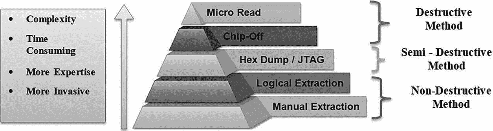

**图 2：** 不同级别的移动数据提取。

### 5.1.1 级别 1（手动提取）

在手动提取技术中，取证人员手动浏览移动设备的数据并搜索重要证据。取证人员还会对手机屏幕上的可见数据进行拍照和录像作为文档记录过程（图 3）。手动提取过程简单，并适用于所有设备。当取证人员可以访问手机时，这种方法具有局限性。如果手机被锁定，手动提取并不容易。手动提取无法帮助获取元数据和日志文件。表 3 代表了关于手动提取的各种事实。手动提取可能无法恢复删除的文件。


**图 3：** 手动提取。

**表 3：** 手动提取（级别 1）。

| 类型和格式 | 通过手动提取收集的证据记录。 |
| --- | --- |
| **优点** | <ul><li>提取简单。</li><li>适用于所有类型的手机。</li></ul> |
| **缺点** | <ul><li>无法获取元数据等所有类型的数据</li><li>日志文件以及</li><li>删除的文件</li></ul> |
| **技能要求** | 探索手机文件和内容的基本技能即可。 |
| **时间和精力** | 完成记录过程的时间取决于设备存储的数据量。相比之下，手动提取所需的时间精力较少。 |
| **工具** | <ul><li>Ramsey’s STE3000FAV</li><li>Eclipse 3</li><li>ZRT</li><li>Project-A-Phone，等。</li></ul> |
| **工具成本** | 约 $200 到 $2800。 |

### 5.1.2 级别 2（逻辑提取）

逻辑提取可以通过使用 USB 线、蓝牙或红外线将设备连接到取证工作站来。有很多专有软件用于逻辑提取，支持不同品牌、型号和操作系统。处理逻辑提取需要一些经验。然而，在少数情况下，这种技术可能会在手机中注入一些代码和数据以方便提取，从而改变证据的完整性。表 4 代表了逻辑提取的优点、缺点和成本因素。

**表 4：** 逻辑提取（级别 2）。

| 类型和格式 | 软件特定的专用格式内存镜像。 |
| --- | --- |
| **优点** | <ul><li>提取简单。</li><li>有很多工具和软件可用。</li><li>标准报告格式。</li></ul> |
| **缺点** | <ul><li>数据访问受限。</li><li>对日志文件的访问受限。</li></ul> |
| **技能要求** | 取证员应具备取证工具和软件知识。 |
| **时间与精力** | 完成分析过程所需的时间和精力取决于设备存储的大小以及取证获取工作站的性能。 |
| **工具** | <ul><li>Paraben’s Mobile Forensics</li><li>Susteen’s Mobile Forensics</li><li>Radio Tactics Aceso（`RTA`）</li><li>Oxygen Forensic Suite</li><li>AccessData Forensic Toolkit（`FTK`）</li><li>Universal Forensic Extraction Device（`UFED`）</li><li>`XRY Logical`</li><li>EnCase Mobile Investigator，等。</li></ul> |
| **工具成本** | $3000 到 $15000（费用根据调查时使用的软件包和软件套件而异。软件成本取决于品牌和功能）。 |

## 5.2 半破坏性方法

通常，移动取证文献中并不讨论半破坏性方法。当`非破坏性`方法无法产生丰硕的结果时，我们需要对设备进行一些手动或物理更改，以获得更深入的内存访问。随着技术的进步，为了取证目的而进行的微改不会完全破坏设备，并且设备可以恢复到可用状态。因此，该过程被称为半破坏性过程。

### 5.2.1 级别 3（十六进制导出/`JTAG`）

**`JTAG`：** 这是一种半破坏性方法。`JTAG`取证是使用`PCB`上的`测试访问端口（TAPs）`的过程。在某些情况下，调查人员会遇到损坏的手机。通常，此类设备无法通过正常的通信通道模式和取证软件与取证工作站同步。在这种情况下，通过连接设备的`测试访问端口（TAPs）`来访问数据，指令处理器从内存芯片中传输原始数据。在此过程中，通常使用`JTAG Box`（`Riff`、`Z3X`、`ATF`等），可以通过焊接、molex 接器或夹具连接到`PCB`上的`TAPs`，如图 4 所示。它是设备制造商通常用于测试设备的低级接口。它是直接访问内存，而不会受到移动操作系统的干扰。

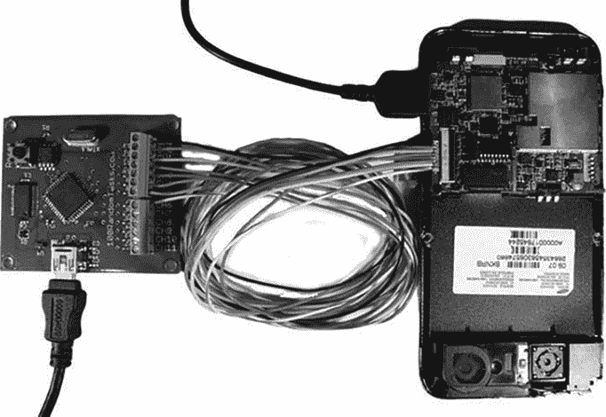

**图 4：** 用于手机证据提取的`JTAG`。

`eMMC`和`eMCP`内存是今天智能手机的标准，`ISP`实践使取证员能够在不拆芯片或损坏设备的情况下直接恢复完整的数据转储。在`ISP`技术中，需要使用万用表识别连接到内存芯片的触点。因此，对于每个证据手机，都需要第二个可以被破坏的相同手机。

**十六进制导出（`Hex Dump`）：** `Hex dump`是另一种用于物理提取设备内存的流行方法。有专门设计用于移动设备维修和维护的专业工具。取证员利用这些工具，允许取证员导出设备内存。图 5 显示了用于内存导出的软件截图。可以使用`hex dump`获取二进制格式的设备内存镜像副本。设备的十六进制导出镜像副本包含大量已删除的数据。

| 特性 |  |
| --- | --- |
| **时间与精力** | 整个过程相当复杂，需要专家参与。由于整个过程并非完全自动化且需要人工干预，因此时间和精力成本非常高。 |
| **工具** | <ul><li>Xeltek</li><li>H-11 芯片拆卸工具包（`Chip-Off`）</li><li>Gillware 芯片拆卸工具等</li></ul> |
| **工具成本** | $1000 到 $5000（`Chip-Off`中使用的工具成本相对较低。然而，专家人员的成本将非常高，这将增加证据提取和分析的总体成本）。 |

## 5.3 破坏性方法

### 5.3.2 第 5 级（微读）

这是一个手动过程，涉及在电子显微镜的帮助下对存储芯片进行物理观察记录。图 7 显示了用于微读的扫描电子显微镜（`SEM`），图 8 显示了微读的`SEM`图像。它需要通过电子显微镜的透镜手动全方位观察，并分析存储芯片上的`NADN`或`NOR`门。毫无疑问，这是非常耗时且成本昂贵的投入。

简而言之，微读是一种需要极高专业知识的方法，它昂贵且耗时，仅保留用于严重的国家安全危机。这种级别的数据获取需要一个专家团队。微读是数据获取的最后手段，通常用于与国家安全相关的高端案件。表 7 代表了微读过程的优点、缺点和成本因素（Courbon 等人 2017）。

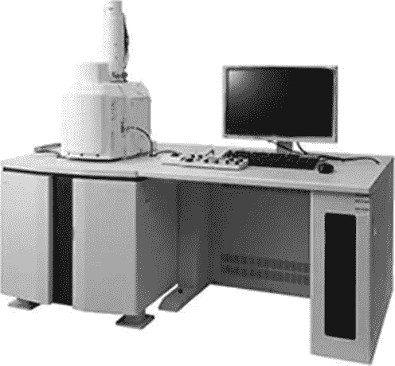

**图 7：** 用于微读的扫描电子显微镜（`SEM`）。

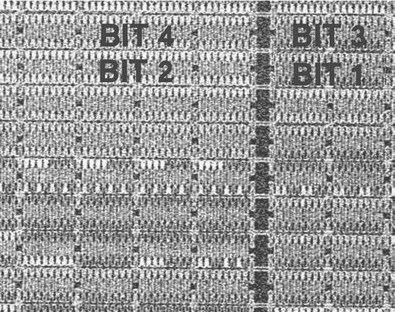

**图 8：** 微读的`SEM`图像。

**表 7：** 微读（第 5 级）。

| 证据类型和格式 | 0 和 1 的字符串。 |
| --- | --- |
| **优点** | <ul><li>可行的最后选择。</li><li>能够从设备内存中提取并验证所有数据。</li></ul> |
| **缺点** | <ul><li>最耗时。</li><li>破坏性方法。</li><li>极其昂贵。</li><li>技术上具有挑战性。</li><li>难以解释/转换。</li><li>没有报告格式。</li></ul> |
| **技能要求** | 鉴定员应具有以下方面的专业知识：<ul><li>解封装。</li><li>逐层处理。</li><li>每一层的`SEM`采集。</li><li>跨层对齐。</li><li>单个元素注释。</li><li>网表重建与分析。</li></ul> |
| **时间与精力** | 这是一个非常耗时的过程。鉴定员使用电子显微镜分析芯片上的物理门，然后将门状态转换为 0 和 1，以确定生成的 ASCII 字符。 |
| **工具** | 日立（Hitachi）扫描电子显微镜（`SEM`）。 |
| **工具成本** | 难以准确估计成本。市场上有价格在 50000 到 100 万美元之间的各种扫描电子显微镜（`SEM`）。证据提取和分析的总体成本取决于数据提取和分析所需的专家力量的时间。 |

# 6. 结论

无论使用何种调查技术和方法论，维护移动设备证据的完整性都是一个主要关注点。最新手机手机强大的安全功能使得访问和数据获取变得困难。通常情况下，被收缴设备的被告可能不会配合调查人员，且不提供`PIN`和密码（Passcode）。在这种情况下，数据获取过程非常具有挑战性。尽管可以使用工具进行暴力破解（`Brute-Force`）并绕过验证，但这对证据的完整性始终是一个风险。与移动设备相关的另一个问题是数据的易失性。移动应用程序不仅将数据存储在本地设备中，还将重要数据存储在云存储中。许多此类应用需要设备验证之外的单独身份验证。在许多情况下，个人应用程序的数据对调查至关重要，但遗憾无法从设备中提取完整证据，需要从云存储中提取。移动恶意软件是另一个日益增长的问题，如果不妥善处理，可能会危证据的完整性。

市场上有不同供应商提供的多种用于取证分析的工具。然而，不同工具针对同一设备和证据分析生成的报告可能并不相同。取证工具是专家开发的软件，两个不同的软件可能使用不同的算法和方法进行开发。因此，结果之间始终存在差异的可能性。在这种情况下，鉴定员选择具有法庭效力的证据是一项具有挑战性的任务。

随着取证技术的不断发展，反取证技术也日益领先。反取证技术被用于数据隐藏、痕迹擦除和轨迹模糊，故意用于误导数字调查。它利用了所有工具和技术来使痕迹变得无法检测，并逃避调查。

在许多情况下，取证鉴定员需要手机制造商和操作系统供应商的支持。通常，供应商出于对客户/用户隐私的考虑，非常不愿意提供支持。尽管供应商的支持可以改进取证证据的提取和分析，但隐私问题被认为更为重要。同样重要的是，设备和操作系统供应商可能来自不同国家，因此需要国际层面的合作。

## References

- Ayers, R., Brothers, S. and Jansen, W. 2014. 移动设备取证指南。[`doi.org/10.6028/nist.sp.800-101`](https://doi.org/10.6028/nist.sp.800-101)。

- Chernyshev, M., Zeadally, S., Baig, Z. and Woodward, A. 2017. 移动取证：进展、挑战与机遇。IEEE Security & Privacy 15(6): 42-51。[`doi.org/10.1109/msp.2017.425110`](https://doi.org/10.1109/msp.2017.425110)

- Courbon, F., Skorobogatov, S. and Woods, C. 2017. 使用扫描电子显微镜反向工程 Flash EEPROM。Smart Card Research and Advanced Applications Lecture Notes in Computer Science 2017: 57-72。[`doi.org/10.1007/978-319-54698_4`](https://doi.org/10.1007/978-319-54698_4)。

- Jansen, W. and Ayers, R. P. 2007. 手机取证指南。[`doi.org/10.6028/nist.sp.800-101`](https://doi.org/10.6028/nist.sp.800-101)。

- Zareen, A. and Baig, S. 2010. 违反 IEEE 出原则通知——手机取证：挑战、分析与工具分类。2010 第五届 IEEE 数字化取证工程系统方法国际会议。[`doi.org/10.1109/sadfe.2010.24`](https://doi.org/10.1109/sadfe.2010.24)。

工业自动化与控制系统也称为信息物理系统（`CPS`），一直是孤立的系统。随着物联网（`IoT`）的出现，设备或“物”具有了相互连接并接入互联网以共享数据的能力，信息物理系统也接受了日益增长的连接性，并转换为工业物联网（`IIoT`）。此外，此类网络日益依赖云资源，例如用于数据存储和大数据处理。`IoT`和`CPS`使用相同的底层技术；而它们与外部网络（互联网/云端）的连接使得它们更容易受到攻击。目前已报告了多起安全事件和网络犯罪，将数字取证调查扩展到`IoT`和`CPS`系统变得日益重要。然而，传统的取证方法可能并不适用于`IoT`环境。本章将介绍与`IoT`和云端环境数字取证相关的挑战，以及为应对`IoT`和云端取证而提出的技术和框架。[167]

## 1. 引言


根据美国国家标准技术研究院的`NIST 2017`，信息物理系统（`CPS`）由物理组件和计算组件的相互作用网络组成，从而通过传感器和执行器使物理世界连接到数字世界，这些传感器和执行器可以在物理世界中感知和行动。在 Greer 等 (2019) 最近的出版物中，由于`CPS`与物联网（`IoT`）之间缺乏一致的区分指标，且`CPS`与`IoT`定义及其使用的底层技术的融合，人们对于`CPS`和`IoT`概念的等效性存在共识。因此，`CPS`和`IoT`术语可以通用。传统上，`CPS`未连接互联网，仅仅是独立系统，而现在随着通信技术的出现，它们具备了接入互联网的能力。今天，`CPS`与第四次工业革命（也称为工业 4.0、工业互联网或工业物联网`IIoT`）密切相关，制造工厂正在采用这些技术来实现先进的自动化、增强本地和远程监控以及组件间的通信，以及对不同层的数据进行自诊断和分析，以显著提高生产力。

`CPS/IoT`特点是计算和存储能力有限，但它们通常会产生海量数据（甚至是大数据），需要大量的存储空间和高处理能力才能对数据进行任何计算。另一方面，云具有能够提供高存储和计算能力的特点。因此，将`CPS/IoT`系统集成到云端是逻辑然的，通常使用“物云（`CoT`）”这一术语（Atlam 等 2017）。因此，`CoT`代表了下一代互联、自主和协作的嵌入式智能系统。此类系统能够实现高效的监控和控制。

`CPS`和`IoT`系统的关键技术趋势包括智能物体之间的大规模机器对通信（`M2M`）、大数据技术和云计算等。预计`CPS`将转变关键基础设施服务以提高整体生活质量。`CPS/IoT`的典型应用领域包括智能交通系统、水净化和分配系统、智能电网、智能家居、智能医疗系统、智能车辆等。`CPS`的应用领域正以快速速度不断发展。例如，许多`CPS`还整合了人类参与，而不仅仅是设备交互，即众源感知应用，人类使用智能手机作为传感器来捕并发送数据（Jian 等 2015; Merlino 等 2016）；以及利用社交关系或其他相关参数帮助在现实网络通信中传播信息，例如在某地区发生自然灾害的情况下（Yaakobi and Goldenberg 2014）。图 1 展示了一个简单的`CPS/IoT`架构。

`CPS/IoT`系统有几个主要优势。Hague 等（2014）确定了`CPS/IoT`的以下优势：

1. 传感器、执行器、多个计算平台和存储网络的网络集成；
2. 支持人类交互，允许捕获人类感知用于决策；
3. 对环境适应性更强，因为`CPS/IoT`可以随着环境参数的变化而演变和运行；
4. 性能更好，因为`CPS/IoT`使用来自器的实时数据和高计算资源；
5. 可扩展性；
6. 自主性，因为`CPS`组件相互作用以评估物理环境并做出决策；
7. 由于计算资源（即云端）处理能力的增强以及`CPS/IoT`组件和网络通信能力的提升，响应时间更短；
8. 灵活性；
9. `CPS`的优化能力。

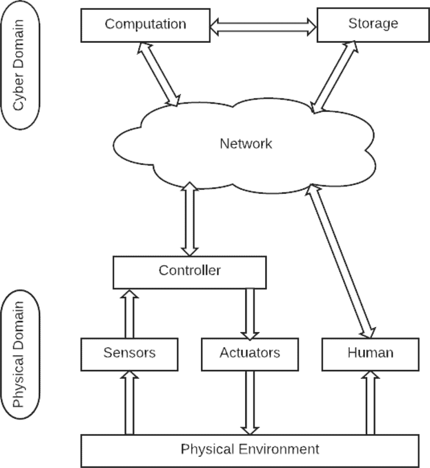

**图 1：** 基础`CPS/IoT`架构。

连接到互联网的`IoT`设备数量将随时间不断增加。Gartner 预测到 2020 年将有 200 亿联网物体（Hung 2017）。尽管许多`IoT`设备是消费设备，如智能汽车、智能电视、冰箱和数字顶盒，但工业物联网也将为连接设备数量的增加做出贡献。预计工业制造`IoT`市场将从 2014 年的 472 亿美元增长到 2020 年的 890 亿美元；医疗领域将从 2014 年的 520 亿美元增长到 2020 年的 1.335 万亿美元（Statista）。根据 GrowthEnabler (2017) [7.2]，全球`IoT`市场份额主要由三个子领域组成：智能城市（26%）、工业物联网（24%）和医疗健康（20%）；其次是智能家居（14%）、联网汽车（7%）、智能公用事业（4%）和智能穿戴设备（3%）。

在第 2 节（`ch7.xhtml#c7_2`）中，描述了`CPS/IoT`环境的安全以及安全事件。第 3 节（`ch7.xhtml#c7_3`）介绍了传统的计算机取证过程及其挑战。在第 4 节（`ch7.xhtml#c7_4`）中，讨论了在`IoT`系统进行取证调查时面临的挑战。`IoT`取证过程见第 5 节（`ch7.xhtml#c7_5`）。与云取证相关的挑战以及不同的云取证框架在第 6 节（`ch7.xhtml#c7_6`）中讨论。最后，第 7 节（`ch7.xhtml#c7_7`）总结本章。

## 2. 针对`CPS/IoT`的攻击

今天，智能电网、水净化和分配系统、化工厂、炼油厂和交通系统等关键基础设施正在现代化并转换为`CPS`以提高效率。然而，由于`CPS`攻击面的增加，这可能导致关键基础设施`CPS`更受到网络攻击。此类攻击会对物理世界和人类生命产生灾难性影响。根据工业控制系统网络应急响应小组（`ICS-CERT`）年度评估报告（2016a）`(ch7.xhtml#ref7_32)`，报告事件最多的部门按降序排列为：关键制造业、通信、能源、水务和废物管理系统、政府设施和交通系统。

针对工业控制系统（`ICS`）基础设施的攻击可以追溯到 2010 年 6 月，当时第一种名为`Stuxnet`蠕虫的网络武器问世。`Stuxnet`病毒感染了伊朗的 14 个工业现场，包括纳坦齐核设施（Kushner 2013）。`Stuxnet`病毒重新编程了可编程逻辑控制器（`PLC`），以接管核电的离心机。2013 年 3 月，一种名为“`DarkSeoul`”的恶意软件瘫痪了韩国的三家主要银行，导致韩国人无法访问 ATM 机和两家最大的新闻广播机构（Sang-Hun 2013）。

`CPS`（物理物理系统）的另一个例子是智能电网。`ICT`基础设施以及运行、控制和监控智能电网的各种智能电网组件容易受到多种攻击。对智能电网的攻击可能导致不便，甚至造成生命损失，例如在最寒冷的冬季月份停电可能导致死亡。2015 年 12 月 23 日，在黑客入侵几个配电中心后，乌克兰有 23 万人被剥夺了六小时电力。“`BlackEnergy`”恶意软件被远程控制电力公司的计算机网络，使配电系统组件离线，导致停电（`ICS-CERT 2016b`）。2016 年，观察到了类似的停电事件，一个变电站（Pivnichna）受影响，导致基辅晚上约五分之一的用电量（BBC News 2017）。这次攻击更加精细且复杂，据测使用了“`Industroyer`”恶意软件（Osborne 2018）。此类攻击可能发生在任何其他国家的智能电网上。

同样，在 2016 年 10 月，针对调节芬兰东部两栋公寓楼供暖控制系统的分布式拒绝服务（`DDoS`）攻击导致居民在寒冷中（温度远低于冰点）度过了大约一周的时间（Kumar 2016）。这种由于网络攻击导致的电力中断也曾于 2016 年 1 月在以色列有所报道（Times of Israel 2016），并于 2016 年 12 月在土耳其有所报道（Ankara and Kocaeli 2016）。2013 年，曾对纽约市北部的小鲍曼水坝尝试进行网络攻击。对美国胡佛水坝等大型水坝的成功网络攻击对数千百万人来说可能是毁灭性的（Charette 2018）。此类攻击可以被视为网络犯罪，甚至是网络战争。Al-Mhigani 等人（2018）检查了 18 起与`CPS`相关的安全事件，并将这 18 起事件归类如下：8 起网络战争案例（最高类别）、5 起网络犯罪事件、4 起黑客主义事件和 1 起网络间谍活动。

根据卡巴斯基实验室（Kaspersky Lab）专家（2016）的数据，约有 13,000 个连接互联网的`ICS`可以被远程访问，令人震惊的是，观察到这些`ICS`主机中有 90%存在已知漏洞。同样，Positive Technologies（2016）报告说，在来自约 500 家`ICS`厂商的组件中发现了 743 个漏洞。在 SCADA 组件、`PLCs`、工业网络设备、软件、人机界面（`HMIs`）以及远程访问和管理终端也发现了大量漏洞。大多数漏洞属于高风险或中等风险（47%为高风险，47%为中等）。据报道，运行在`CPS IoT`设备上的嵌入式固件也存在漏洞，这最终导致大量关键系统和数据面临风险。安全对于`CPS`来说是基础，随着对`ICT`系统依赖性的增加，`IoT`设备必须得到妥善保护，以降低针对`CPS`的破坏性和有害事件的风险。2016 年 10 月，史所未有的`Mirai`僵尸网络`DDoS`攻击利用 360000 个漏洞`IoT`设备对 Dyn DNS 服务商发起攻击，这是不安全`IoT`影响的典型例子（Dignan 2016）。2017 年 1 月，据报道，植入式心脏设备（St. Jude Medical）存在漏洞，可能使攻击者远程访问设备并耗尽电池，或命令设备进行错误的起搏或电击（Larson 2017）。

智能家居变得越来越流行。智能家居由一系列传感器（例如温度、运动、光线、婴儿监视器等）、系统（例如加热、照明、安全等）和设备（例如智能家居电表、智能灯、智能温控器、洗衣机、冰箱、微波炉等）组成，可以通过手机或计算机在本地或远程通过互联网进行监控、控制和自动化。此类数字设备可以根据感应到的家居物理状态进行通信和调节。Atlam 等. (2017）识别了基于`IoT`的智能家居中可能发生的不同攻击，例如物理入侵导致入室或物理勒索、死亡（即在火灾时阻塞信号以触发警报）、行为模式泄露、隐私数据泄露，因为`IoT`设备可能会收集和处理隐私信息，并导致勒索和直接经济损失。2017 年 10 月，Checkpoint 安全研究人员在 LG SmartThinQ 智能家居设备中发现了“`HomeHack`”，这允许黑客非法远程访问并控制数百万台 SmartThinQ 家电，如扫地机器人、冰箱、烤箱、洗碗机、洗衣机/烘干机和空调。黑客可以利用 Hom-Bot 真空机的集成摄像头监视用户。到 2016 年 7 月，已售出超过 40,000 台 Hom-Bot 扫地机器人。2016 年智能家居设备销量增长了 64%，全球交付了约 8000 万台智能家居设备（San Carlos 2017）。网络犯罪分子有可能利用软件漏洞导致用户家中并访问其敏感数据。幸运的是，LG 已针对发现的漏洞修复了安全性以防止被利用。

`CPS/IoT`中不断升级的网络攻击可能性日益增加，使得迫切需要解决此类系统的安全问题。此外，随着网络犯罪和网络攻击在`CPS/IoT`系统中升级，在这些异构网络`CPS/IoT`环境中进行数字取证调查也变得日益重要。在民事和刑事调查中，人伤害和案件案件中的消费级可穿设备数据已被接受和使用（Hauser 2017）。

## 3. 传统计算机取证

数字取证是指在网络事件发生后进行精确调查，以调查导致事件的原因、检索丢失的数据，并收集用于对导致事件的个人或实体追的证据。数字取证涵盖了所有数字技术的取证，并主要侧重于响应性措施。在数字取证中被发现和解释的电子数据应以原始形式保存为证据。传统的数字取证包括来自计算机/服务器、打印机、扫描仪的数据，以及由于日常使用频率增加的平板电脑、智能手机等移动设备的数据。随着对数字化依赖程度的增加，数字证据正在进入世界各法庭，数字取证领域非常新颖但正在不断发展。并非所有调查都是相同的，这在制定取证分析标准程序时可能是一项挑战。2012 年，`ISO/IEC`发布了《数字取证识别、收集、获取和保护指南（`ISO/IEC 27037`）》，并在 2015 年发布了`ISO/IEC 27043`《事件调查原则和过程》，随后的几年里还发布了其他相关标准（`ISO/IEC 27037:2012`）。与任何取证领域一样，保持证据的完整性是基础。鉴于数字取证调查中使用的软件应用程序和工具必须是可靠且重复的，`NIST`正在致力于计算机取证工具测试（`CFTT`）项目，通过开发通用工具规范、测试程序、测试标准、测试集和测试硬件，建立一套测试计算机取证软件工具的方法论（`NIST`）。然而，鉴于数字技术领域变化迅速，如果没有严谨且广泛的框架和标准，要在数字取证领域跟上步伐是非常挑战性的。

根据 Kumari and Mohapatra (2016)，数字取证传统上可以分为五个分支：

1. 计算机取证；
2. 网络取证；
3. 移动取证；
4. 内存取证；
5. 电子邮件取证。

因为它涵盖了法律、伦理、犯罪学、信息与通信技术、计算机科学、计算机工程和法证科学等不同学科，数字取证是多学科且交叉学科的（Losavio et al. 2016）。上述学科在下方的图 2 所示。

Ken Zatyko (2007)定义了一个八步的数字取证科学过程，该过程如图图 3 所示。

数字取证方法论主要包括三个阶段，即：

1. 获取；
2. 认证；
3. 分析。

这与欧盟资助的项目“网络工具在线证据搜索（`CTOSE`）”一致，该项目提出了一种识别、保护、分析和展示数字证据的系统化方法论，正如（Sansurooah 2016; Sriram 2013）所描述。在获取阶段，从现场系统和/或从硬盘等存储系统中捕数据。如果嫌疑计算机处于关闭状态，则将硬盘从计算机中取出并通过写保护器连接到取证分析师的工作站。写保护器确保在获取驱动器的过程中原始驱动器不会发生任何变化。至少制作两份位流拷贝或数据镜像。位流拷贝与仅拷贝活动文件的典型备份拷贝不同，它是硬盘的扇区级/逐位级拷贝，能够精确复制所有文件和环境数据。可以在净化的外部介质存储上执行原始驱动器的位流拷贝，或者执行位流镜像拷贝。

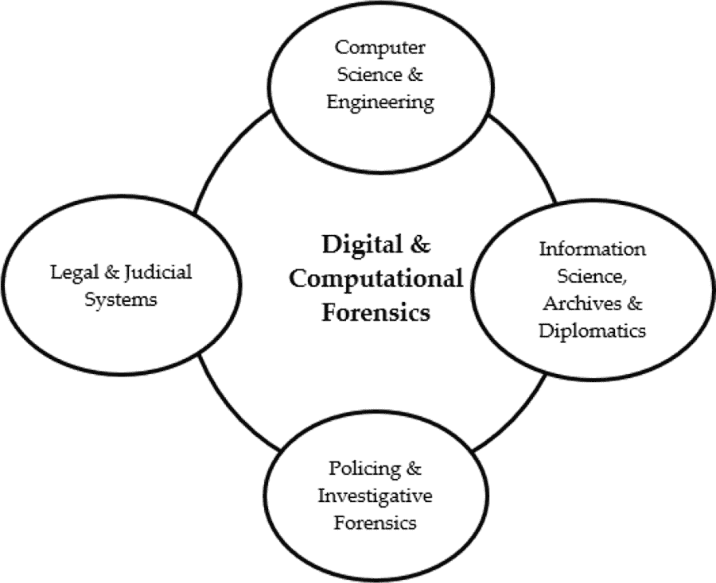

**图 2:** 数字取证的多个领域 (Losavio et al. 2016)。

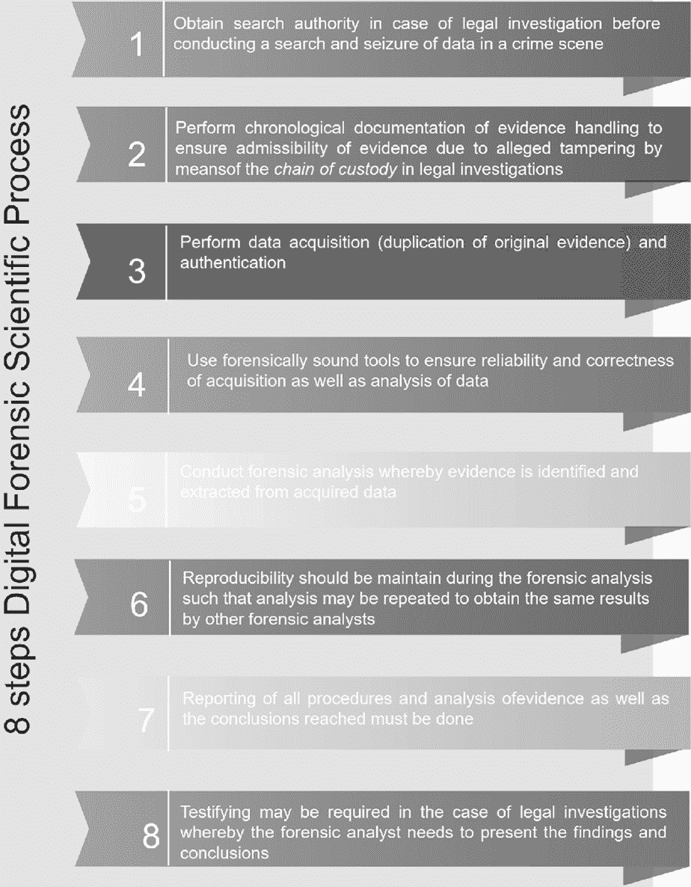

**图 3:** 八步数字取证过程。

如果计算机处于开启状态，从易性内存中提取数据也是很有用的，因为这些数据在计算机电源后将会丢失。内存取证允许在系统运行时捕获快照。使用 Access Data 的`FTK Imager`、`Belkasoft RAM Capture`或`Rekall Forensics`等工具，可以捕获被称为内存转储（`memory dump`）的内存快照。稍后可以检查内存转储，例如使用`Volatility Framework`来分析和解释来自内存转储的数据。此类数据可以提供关于正在运行的进程、打开的文件、系统中运行的可执行文件、剪贴板内容、登录用户、浏览历史、聊天消息、密码、打开的套字和端口、IP 地址以及其他网络信息，而如果只分析硬盘内容，这些信息可能无法获得。在整个硬盘被加密的情况下，内存取证尤为至重要。密码或加密密钥缓存在内存中，可以从内存转储中检索以解密硬盘中的数据。计算机还可能运行实时操作系统，如`Ubuntu Live`或`Knoppix`，此时操作系统未安装在硬盘上，而是从 USB 闪盘在内存中运行。在这种情况下，当对嫌疑机器进行内存获取时，所有数据都在`RAM`中。如今，某些恶意软件和根程序分别被称为无文件恶意软件和内存根程序）从内存运行，不在系统硬盘上留下任何活动痕迹。如果没有内存取证，将无法识别此类恶意软件及其活动。无文件恶意软件的示例包括`Powerliks`、`Angler`、`Meterpreter`和`PHOSPHY`。

对于涉及硬盘获取的事后取证，为了证明所做的副本与原始驱动器数据一致，必须对副本进行认证。这通常通过计算原始驱动器的加密哈希值并与制作的副本哈希值进行比较来实现。如果哈希值相同，则可以确定副本确实与原始驱动器数据完全相同。用于获取的取证工具还支持执行认证的功能，并能生成确认认证的报告。使用符合取证要求的工具至关重要。流行的取证套件包括`Guidance Encase`和`FTK`。用于从手机提取数据的流行工具包括`Oxygen Forensic Suite`、`Cellebrite UFED Physical Analyzer`和`MSAB XRY` (Seung JeiYang et al. 2015)。

分析是在获取到的数据上进行的，而非原始驱动器，以维护原始驱动器的完整性。在分析过程中，会提取证据、分析证据并记录发现结果。通常会对证据进行逻辑提取和/或物理提取。逻辑提取最容易执行，因为它依赖于文件系统来查找和检索证据。此类证据包括活动的用户和系统文件，以及已删除的文件。可以查看文件属性等信息。物理提取则更为困难，耗时更长，并且要求对被调查的系统有深入了解。在这里，数据的提取是在物理层进行的，即存储在扇区中的二进制数据。例如，可以检查计算机的分区表，以识别计算机上不同的分区。为了分析与案件相关的提取数据，可以采用以下几种不同的分析方法，即时间线分析、数据隐藏分析、应用程序和文件分析，以及所有权和占有分析。时间线分析允许了解计算机何时被使用，或者在给定事件之前之后发生了什么事件。在数据隐藏分析期间，法医分析师必须发现并检索任何嫌疑人可能隐藏的数据。嫌疑人可以使用各种数据隐藏技术来在计算机上隐藏信息，例如使用隐写术技术、隐藏分区、在`NTFS`的交替数据流中隐藏数据等。

执行数字取证调查时面临的挑战包括数字信息的过度泛滥、证据的瞬时性、取证调查的跨学科性质（需要具备不同领域的知识），以及嫌疑人利用各种工具和技术隐藏数据的能力（Vincze 2016）。数字证据在本质上也是脆弱的，如果处理不当，非常容易被更改、删除或面临篡改的指控。目前与取证调查相关的标准还不完善，尚未涵盖该过程的某些方面，例如生成数字取证报告（Nickson 2019）。最后，嫌疑人可能会使用反取证技术，这使得难以发现和提取证据。典型的反取证技术包括数据的安全删除、使用隐写和加密、使用`TOR`浏览器以及操控文件属性和头部。Nickson and Venter (2015)) 对数字取证的挑战提出了一种分类法，将挑战分为以下四类：

1. 技术挑战；
2. 法律体系和/或执法挑战；
3. 与人员相关的挑战；
4. 运营挑战。

## 4. IoT 取证的挑战

`CPS/IoT`（物联网）系统已渗透到所有领域，并在社会中发挥着重要作用。此类系统可能会被攻击者劫持和破坏，正如第 2 所示，可能导致危险的后果。`CPS/IoT`系统更加复杂，涉及大量的异构设备、各种通信协议和不同的数据格式，在产生新的安全挑战的同时，传统的安全问题变得更加严重。鉴于`IoT`设备通常是硬件资源有限的小设备，它们的设计目标是提供所需的功能，而非内生性安全。因此，它们很容易成为网络犯罪的目标，因为在这些设备上可能无法安装防病毒软件等安全措施。目前迫切需要开发符合取证科学的方法和程序，以获取和检查在这些`CPS/IoT`系统发现的数字证据。


数字取证调查人员需要能够检测到犯罪者在 CPS/IoT 系统中的入侵和行为，以便发现证据并识别罪犯。随着此类系统在我们社会中的普及增加，此类系统中发现的证据轨迹（自主或响应某些人类行为或事件产生的数据）在取证调查过程中极有可能受到审查。Kebande et al. (2017)) 描述了智能冰箱犯罪传播（SRCP）模型，该模型用于探索 IoT 家电的漏洞如何被利用以获取控制权并实施各种攻击或网络犯罪。调查人员需要能够识别设备的位置并从不同的智能对象中提取数据，这对于调查包括网络攻击和物理攻击在内的任何类型案件都很有用。

尽管智能对象在调查中构成了现实世界 CPS/IoT 应用的宝贵证据来源，但取证鉴定人员仍面临着一些重大挑战。Watson and Dehghantanha (2016)) 强调了 IoT 取证领域研发的重要性，以解决缺乏工具、方法论和标准等严重问题，使取证工作能够跟上新兴技术的发展。

### 4.1 IoT 设备的数量与多样性

IoT 取证的主要挑战之一是用于收集证据的设备种类极其多样；相比之下，传统取证的数据主要从计算机/服务器/笔记本电脑，以及最近的手机中获取以供分析。在 CPS/IoT 系统中，具有证据价值的数据可能存在于各种设备上，例如可穿戴设备（智能手表或健身追踪器）、医疗设备、无人机、连接电器、家用电器、家居自动化设备、3D 打印机、RFID 设备、IP 摄像头、眼镜、智能车辆和传感器网络。识别犯罪现场涉及的设备，以及数据来源或存储的数据属性绝非易事。智能咖啡机或婴儿监视器可能参与了正在调查的犯罪吗？IoT 设备太小、未连接、已关闭或在地理上分散，可能无法被识别。此外，取证调查需要关闭 IoT/CPS 系统。然而，对于关键 CPS（如水处理系统、电网、交通控制系统、制造工厂和医疗系统），这可能不是一个可行的选择。

Oriwoh et al. (2013)) 引入了“下一个优选”（NBT）模型，通过检查手头设备的证据，因为在调查中可能无法从所有设备中获取证据。Harbawi and Varol (2017)) 建议可以使用“现场最后”（LoS）算法来辅助证据定位，该算法首先调查通信链中的最后一个节点，并在当前区域和其他区域内逐步进行调查。包含 LoS 算法的数字过程见图 4。

此类设备上的数据可能存储在板载存储中，也可能仅传输到互联网或云端的服务器。随后，由于设备上可能存在不同的专用硬件软件、操作系统和文件系统，很难使用单一工具或标准方法识别并提取特定 IoT 设备的数据。通常这些设备由微控制器；内存（RAM）、闪存、I/O 外设和网络功能组成。存储在固件上的数据通常由引导加载程序（例如 `U-Boot`）、操作系统（OS）内核和文件系统（例如 `SquashFS`、`JFFS2`、`UbiFS`）以及构成设备功能的不同二进制文件和脚本组成。

在遥控器等低端设备上，固件可能由一个处理设备所有功能的单一二进制文件组成。固件操作系统可以是嵌入式操作系统或 IoT 操作系统。嵌入式操作系统为特定用途设计，并适用于资源受限的设备。嵌入式操作系统的典型示例包括 `embedded Linux`、`Windows CE` 和 `Google Brillo`。IoT 操作系统是一种嵌入式操作系统，但其设计目的是通过互联网进行数据传输以实现连接。一些流行的 IoT 操作系统包括 `Ubuntu Core`、`Contiki`、`RIOT OS`、`TinyOS`、`Windows 10 IoT`、`Amazon FreeRTOS` 和 `WindRiver VxWorks`。许多设备也使用 `Android OS`。

在某些情况下，板数据可能难以访问。如果设备可以连接到计算机，可以使用传统的取证镜像工具（如 `FTK` 和 `X-ways forensics`）以任何格式对内部存储进行取证镜像。获取的数据可以使用传统的取证工具进行分析。

或者，如果数据无法连接到计算机，可以通过 `JTAG` 从固件中提取数据。大多数固件通过 `UART`、`JTAG` 或 `SPI` 等接口支持调试功能。联合测试动作小组（`JTAG`）被标准化为 `IEEE 1149.1` 标准测试访问端口和边界扫描架构。它规定了使用专用的调试端口——标准测试访问端口（TAPS），实现串行通信接口以直接与固件交互。大多数嵌入式设备在引脚足够的情况下支持 `JTAG`。通过连接到设备的 `TAPs`，可以向处理器发送指令，以传输存储在设备内存芯片上的原始数据。数据以原始格式传输，可以解析为可用的格式。`JTAG/Chip-off` 工具示例包括 `easy JTAG Plus` 和 `RIFF` 盒。然而，如果没有发送正确的指令/信号，存在导致修改或损坏设备电路的风险。`JTAG` 通常用于从无法通过其他方法获取手机和其他设备中提取数据（Seung JeiYang et al. 2015）。

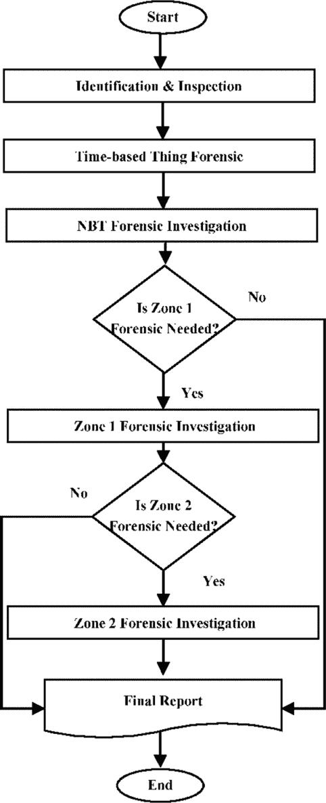

**图 4：** 数字取证程序流程图（Harbaavi and Varol 2017）。

也可以通过 `UART` 从固件中提取数据。通用异步收发传输器（`UART`）简单就是一个串口。大多数 IoT 固件都已启用 `UART` 用于调试，但可以通过 `UART` 接口获取完全根权限并从设备中提取数据。根据 Vasile et al. (2019)，`UART` 是目前 IoT 设备中最常见且最易被利用的调试接口。在检查的 IoT 设备中，45% 被发现容易通过 `UART` 提取固件。

由于 IoT 设备非常小，因此需要高效的存储器来在此类设备上存储固件。`Serial flash` 常用于 IoT 设备中存储固件，因为它具有小型化的、在板上需要的引线连接少，并且使用低功耗闪存。串行外接口（`SPI`）是一种提供访问串行闪存中数据的行业标准协议。通过连接到串行闪存芯片引脚并使用如 `Attify Badge` 或 `Bus Pirate` 等工具，可以捕获闪存的数据 dump。

嵌入式多媒体卡（`eMMC`）——NAND 闪存——也由于其低成本、高速、多种存储尺寸、更小的封装、更低的功耗和集成控制器而常用于 IoT 设备。Etemadieh et al. (2017) 描述了如何识别正确的 `eMMC` 引脚，以及如何将 `eMMC` 引脚连接到适当的 `SD card adapter` 以轻松访问闪存存储的内容。

选择从 IoT 设备提取数据的方法不像从硬盘提取数据那么简单，必须根据具体情况进行。可能需要具有处理此类设备更丰富经验的取证调查人员。Bortas et al. (2015) 描述了从智能电视（即 `Samsung smart TV`）中提取潜在伪迹（如网络信息、应用活动、网页浏览历史和媒体文件）的数字取证程序。Davies et al. (2015) 展示了 `PlayStation 4` 的潜在信息源以及从 `PlayStation 4` 获取信息的方法。同样，Clark et al. (2017) 描述了对 `DJI Phantom III` 无人机的取证分析。Horsman (2016) 描述了测试用 `Parrot Bebop` 无人机内部存储的获取，以提取机载飞行数据、捕获媒体以及操作系统文件。该论文还包括对控制设备进行取证分析的讨论。Kouwen et al. (2018) 描述了无线设备的调查。智能车辆存储了大量的数字信息，如最近目的地的 `GPS` 坐标、收藏路线、通话记录和联系人。Nhien-Anle-Khac et al. (2018) 讨论了与智能车辆数据取证提取和分析相关的挑战。Shin et al. (2017) 描述了如何从以下设备中收集数据：

1. `Amazon Echo`；
2. 由中央控制器、传感器和 `Z-wave` 设备（如 `Thermostat`、`Smart Lockers`（触摸屏或杠杆锁柜）、`Wireless Water Valve` 等）组成的 `Home Area Network`；
3. 家庭路由器。

Li et al. (2019) 也描述了从 `Alexa`（`Amazon Echo`）获取和分析数据的方法。Servida and Casey (2019) 展示了从 `iSmartAlarm`、`Cube One`、`Netgear Arlo Base Station`、`Wink hub` 以及智能手机相应的应用程序中提取智能家居证据。`Almond+` 智能家居系统的取证提取（Awasthi et al. 2018）。

## 4.2 数据格式与通信协议

鉴于物联网（IoT）设备的存储容量有限，设备内部存储的数据非常少；捕获或生成的数据通常通过网络连接直接传输到另一个设备，例如服务器、手机和/或云基础设施。在数据本地存储在 IoT 设备中的系统里，证据的留存时间是一项挑战，因为由于设备存储容量有限，数据在短时间内很容易被覆盖。此外，累积数据集可能存在于多个位置，而用户可能对此并不知。通过分析来自 IoT 设备的网络流量，可以获取从 IoT 设备传输的数据的目的地信息。

在进行取证调查时，数据存储在多个位置（这些位置可能涉及多个司法管辖区，从而适用不同的法律法规）是一个重要问题。根据数据所在国家的不同，可能适用不同的数据保护法。如果调查人员来自一个司法管辖区，而数据位于另一个司法管辖区，那么在访问数据之前必须考虑不同的法律。法律影响的一个案例是美国政府上诉要求微软交其在柏林服务器上持有的电子邮件，这些邮件与一起毒品案件有关。由于该案对云提供商和云客户隐私具有重大影响，该案件已经拖延了四年（Edward 2017）。

同样，如果 IoT 数据存储在云端，对于取证人员来说，物理访问云端以收集证据可能面临挑战。在传统的取证程序中，假设调查人员可以物理访问设备，如计算机/服务器、路由器或移动设备。然而，在云端，调查人员可能很难识别数据存储在云中的具体位置。对存储在云端的数据进行取证调查将在第 6 节中进一步讨论。

## 4.4 海量数据

IoT 系统能够产生海量数据。在某些情况下，数据存储在孤岛中；而在更复杂的 IoT 生态系统中，来自多个系统和组织的 IoT 数据提供了丰富的分析数据集。在取证调查案例中，捕获和分析如此海量的数据并非易事。制作一个 `500 GB` 硬盘的位流拷贝大约需要 24 小时。

可以应用数据缩减技术在采集和/或分析阶段减少数据量。数据缩减包括排除标准操作系统或应用程序文件的提取，因为它们没有证据价值。可以使用针对已知文件的大规模加密哈希数据库丢弃这些已知文件。国家软件参考库（`NSRL`）是一个 `NIST` 项目，旨在从各种来源收集软件，并将从这些软件计算出的文件配置文件整合到参考数据集（`RDS`）中。通过使用 `RDS`，取证人员可以将文件与 `RDS` 中的配置文件进行匹配以实现数据缩减。

因此，仅提取部分关键文件和数据进行分析。此类感兴趣的文件包括注册表、用户文档、电子邮件、浏览器历史和临时文件、日志、图像、视频等。Quick and Choo (2016) 显示，当将数据缩减技术应用到现实世界案例中时，在保留关键证据数据的同时，数据量会大幅减少。这种数据缩减允许及时对数据进行取证分析，并且在绑架和恐怖主义等案件中非常有用。Quick and Choo (2018) 还展示了一个使用数据缩减技术对异构设备数据在内的批量数字取证数据分析流程。

IoT 取证还涉及捕获大量的网络流量进行分析。Chhabra et al. (2018) 建议使用 `Wireshark` 的 `DumpCap` 工具捕获连续的 IoT 流量，并运行在 `Hadoop` 集群上的 `MapReduce` 和 `Apache Mahout`（机器学习）来翻译、提取和分析动态流量特征，以识别网络恶意软件。通过集群而非单机分析数据，速度可以更快。遗憾的是，目前大多数取证工具并非设计为在集群上运行。由于分析 IoT 流量的困难，Koroniotis et al. (2019) 创建了 `BoT-IoT` 数据集，为跨特定 IoT 网络的僵尸网络识别提供了基准。

## 4.5 维护证据完整性

监管链可以证明证据的可靠性。它通过记录证据如何以符合取证的方式被提取和处理，为法庭上的证据完整性提供保障。然而，在 IoT 环境下，证据是动态且易变的，因为由于资源限制，它可能长时间留在一个节点上。数据可能会被较新的数据快速覆盖，或从一个设备传输到另一个设备（例如在自组织无线传感器网络中），直到到达边缘节点，然后数据可能被传输到云存储。此类数据在传输过程的不同点通常会聚合。证明此类动态数据的完整性是有问题的。

传输过程中的数据也可能具有敏感性并带来隐私风险。识别持有私有数据的设备或向陪审团展示从 IoT 环境收集的数据并不容易。为了维护 IoT 数据和证据的隐私与完整性，在他们的 FAIoT 模型中，Zawoad and Hasan (2015) 引入了“安全证据保护模块”和“安全溯源模块”。

安全证据保护模块由证据库组成，安全地保存并存储来自 IoT 设备的证据，同时确保不同所有者的 IoT 数据被隔离以维护隐私。此外，只有取证人员可以访问库中的数据。“安全溯源模块”通过保留证据的访问历史来维护证据的监管链。Nieto et al. (2017) 提出了一种隐私感知 IoT 取证模型（`PRoFIT`），该模型考虑了隐私，并在整个调查生命周期中将隐私纳入 `ISO/IEC 29100:2011` 的要求中。它强调了基于个人协作从周围设备收集数据的重要性。该方法被应用于咖啡馆等公共场所中可能发生的社交恶意软件案例。

## 5. IoT 取证

IoT 取证是指利用来自 IoT 基础设施的证据来确立犯罪或攻击。与计算机取证类似，在 IoT 取证中，IoT 设备可以扮演以下三个角色之一：

1. IoT 设备是犯罪目标；
2. IoT 设备是用于犯罪的工具；
3. IoT 设备是犯罪证人，其捕获了与犯罪相关的证据，例如在谋杀案中作为证据的 `Amazon Echo` 录音。

图 5 描绘了 Li et al. (2019a) 提出的 IoT 取证模型。

此外，IoT 取证遵循传统取证的主要流程，如证据的识别和提取、发现的证据的分析和记录。证据的保存以及维护监管链以提供证据完整性的保证同样适用。区别在于证据来源，因为 IoT 取证中的证据来源包括互联网或云端的计算机/服务器、手机等移动设备，以及智能汽车、传感器、家电器、医疗设备、医疗植入物、标签阅读器等。

Zawoad and Hasan (2015) 提出了一种感知数据的物联网（FAIoT）模型，用于支持物联网环境中可靠的取证调查，该模型如图 6 所示并讨论了不同的云网络取证方法。

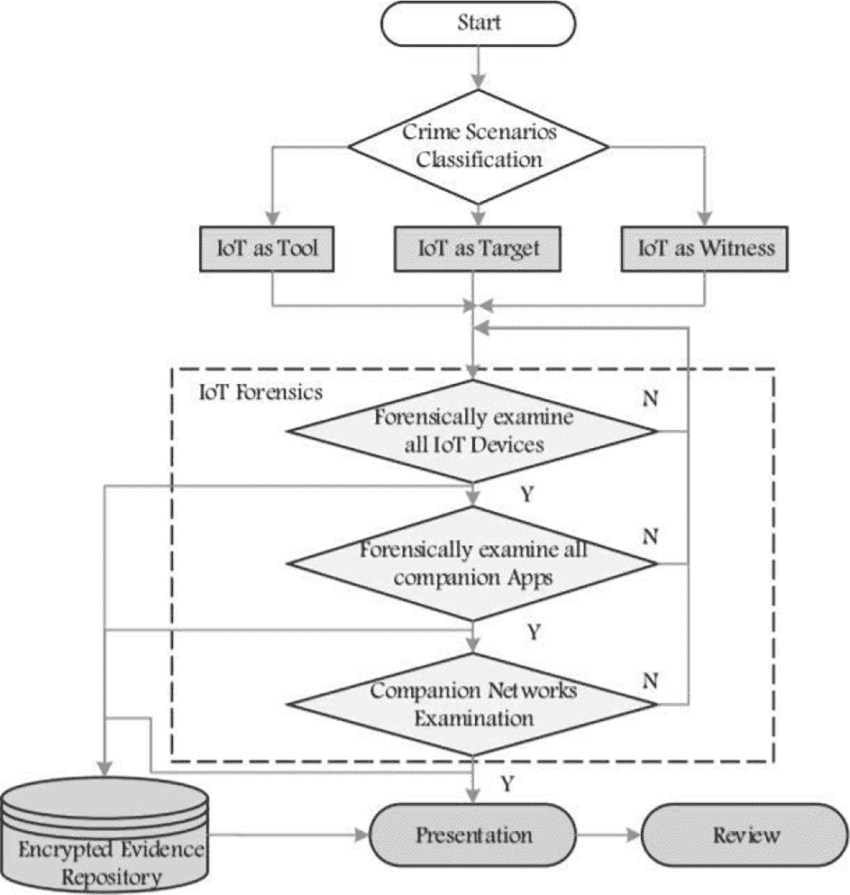

**图 5：** 物联网取证模型（Li et al. 2019a）。

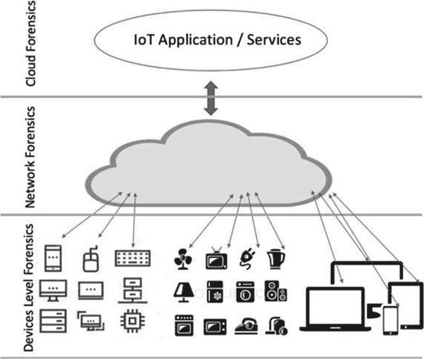

**图 6：** 物联网取证（Zawoad and Hasan 2015）。

Perumal et al. (2015) 提出了一种更全面的基于物联网的数字取证模型，详细描述了从调查开始到证据归档的过程，如图 7 所示。

**图 7：** 基于物联网的数字取证模型（Kebande et al. 2017）。

Kebande and Ray (2016) 同意 Watson and Dehghantanha (2016) 的观点，数字取证领域必须进一步发展以包含物联网基础设施。他们提出了通用的物联网数字取证调查框架（`DFIF-IoT`），该框架符合 `ISO/IEC 27043:2015` 事件调查原则和流程标准，以支持物联网系统的调查。所提出的框架如果纳入未来的数字取证工具中，将有利于物联网系统的有效取证，因为它足够全面，能够涵盖数字取证调查的所有方面。

`DFIF-IoT` 是四个不同模块的结合，如图 8 所示。最后响应过程（Reactive process）侧重于事件/犯罪报告后的实际方法论。它遵循传统方法，由以下三个阶段组成：

- 初始化（事件检测、初步响应、调查规划与准备）；
- 获取阶段（从物联网环境中获取潜在证据）；
- 调查阶段（证据的分析、解释和报告）。

第四个模块即并发过程（Concurrent processes），定义了实现有效调查的概念，并包括此类任务：获取启动调查的法律授权、犯罪现场记录、维护证据链以及作为物理调查一部分实施的记录过程。

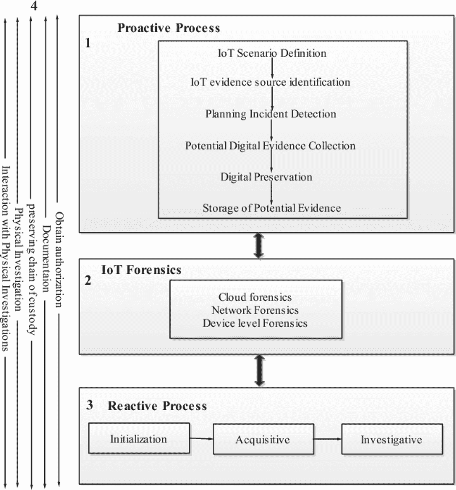

**图 8：** 物联网数字取证调查框架（DFIF-IoT）（Kebande and Ray 2016）。

Kebande et al. (2018) 进一步扩展了框架，并针对物联网生态系统提出了集成数字取证调查框架（`IDFIF-IoT`），该生态系统由相互互联智能对象之间的复杂关系组成，这些关系使得它们之间以及与人类之间具有智能性、可编程性和高度交互性。`IDFIF-IoT` 的高层视图如图 9 所示，详细视图如图 10 所示。

Servida and Casey (2019) 提供了一种由六步骤组成的方法，取证人员可以采用该方法研究新设备，并发现设备上可用哪些产物、在何处以及如何收集它们：

1. 初步分析（对设备现有研究进行调查）；
2. 测试平台搭建（以便在受控环境中研究物联网设备）；
3. 网络分析（研究设备的通信方面）；
4. 智能手机应用分析（研究连接/控制物联网设备的应用程序代码）；
5. 漏洞分析（识别设备如何被利用）；
6. 物理分析（从存储器获取数据）。

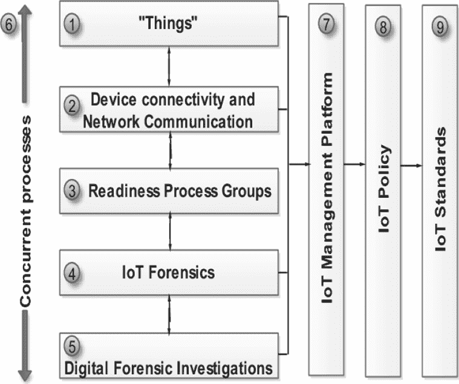

**图 9：** 集成数字取证调查框架（IDFIF-IoT）（Kebande and Ray 2016）。


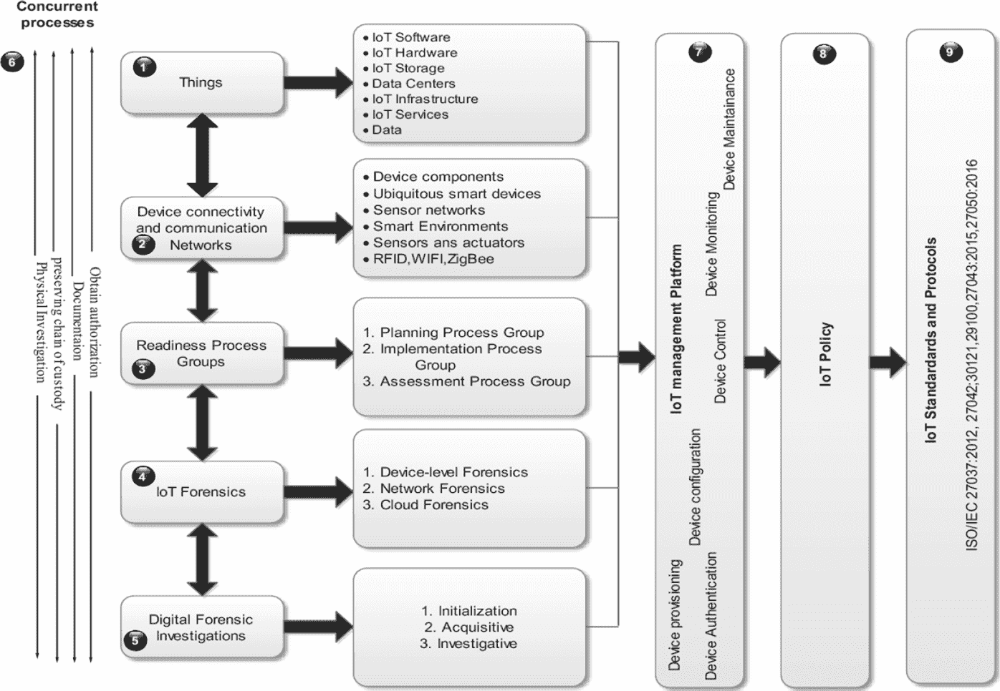

**图 10：** 数字取证调查框架的详细视图（IDFIF-IoT）（Kebande and Ray 2016）。

Hossain et al. (2017) 展示了 `Trust-IoV`，一种用于车联网（`IoV`）的可信取证调查框架。同样，Goudbeek et al. (2018) 提出了一种用于智能家居环境的取证框架，由图 11 所示的七阶段组成。

Rahman et al. (2016) 认为需要一种更主动的物理物理云系统（`CPCS`）取证方法。建议在设计 `CPCS` 时考虑取证就绪，以便在安全事件发生之前持续收集并保存取证数据。收集的数据将减少取证调查所需的复杂性和时间。当取证需求集成到 `CPCS` 设计和实施阶段时，即可实现 `CPCS` 的取证就绪，即“设计取证”。图 12 展示了概念性的设计取证框架，其中包括有助于取证调查的六因素。这些因素包括风险管理原则和实践、取证就绪原则和实践、事件处理原则和实践、法律法规、`CPCS` 硬件和软件需求以及行业特定需求。

同样，Al-Masri et al. (2018) 提出了相关框架。


**图 13：** FoBI 框架架构 (Al-Masri et al. 2018)。

`Probe-IoT`（另一种主动取证解决方案）是一种基于区块链的 IoT 取证调查框架（Hossain et al. 2018），其中 IoT 实体（CSP、用户和 IoT 设备枢纽）实现分布式账本，用于存储各个实体之间发生交互的交易（区块链中的区块）。`Probe-IoT` 中的区块链以安全、机密、不可否认、高可用且防篡改的方式记录 IoT 系统中交互的时间顺序历史。公共账本可以被查询，以便在发生网络攻击和/或网络犯罪时获取证据，并从取证调查人员可以访问的任何实体获取。区块链记录固有的真实性和完整性确保了来自账本的证据是可靠的。同样，Brotsis et al. (2019) 提出了一种基于区块链的 IoT 取证链（`IoTFC`），用于记录证据细节、保护数字证据以及分析 IoT 和社交系统环境中的证据，其中涉及不同司法管辖国家的证据。

## 6. 云取证

鉴于 IoT 设备存储和处理能力有限，IoT 设备通常将数据传输到 IoT 云，该云平台提供大规模存储、按需访问、可扩展性和高处理能力。一些流行的 IoT 云解决方案包括 `Thingworx 8 IoT Platform`、`Microsoft Azure IoT Suite`、`Google Cloud’s IoT Platform`、`IBM Watson IoT Platform`、`AWS IoT Platform`、`Cisco IoT Cloud Connect`、`Salesforce IoT Cloud`、`Kaa IoT Platform`、`Oracle IoT Platform` 以及 `Thingspeak IoT Platform`。

此类 IoT 云解决方案允许云客户通过独立通道收集数据并将传感器数据存储到云端，远程监控智能对象，并通过手机 App 分析并可视化数据。从 IoT 的数据通常以原始形式或处理后的形式存储在云端。Google IoT 平台提供结构化但无模式的数据库，如 `Cloud Datastore` 和 `Firebase Realtime Database`，用于 IoT 数据存储。大多数 IoT 云平台还支持高速消息传递，以便向用户设备发送实时通知。IoT 设备与云之间还可以建立身份验证和安全通信。

通常，有四种基本的云部署模型，即公有云、私有云、混合云和社区云。云服务提供商（CSP）如 `Amazon`、`Google`、`Microsoft`、`Oracle` 在其数据中心拥有大规模基础设施并向公众提供云服务。在公有云中，数据中心的资源在来自不同公司的众多客户之间共享。私有云是专门为单一组织的云基础设施，而社区云是由社区内具有相同关注点和策略的若干组织共享的云基础设施。社区云的一个典型例子是面向多所大学的大学云。混合云由两种或两种云部署模型（通常是私有云和公有云）组成，它们是独立的实体，但通过标准或专用技术实现数据和应用共享。云还支持三种服务交付模型：基础设施即服务（`IaaS`）、平台即服务（`PaaS`）和软件即服务（`SaaS`）。

云环境的另一个特征是使用虚拟化，其中虚拟机运行在云的物理服务器架构上。IoT 云客户可以部署并运行多个虚拟机（`VM`），以实时捕获和分析 IoT 数据。通过虚拟化，多个客户的 `VMs` 运行在同一物理服务器上并共享服务器资源。在这种多租环境中，如果没有云服务提供商（CSP）的支持，很难知道客户的机器运行在何处，以及该物理服务器上的客户邻居是谁。此外，云中的 `VM` 和/或数据并不停留在相同的位置，即 `VM` 可以从一个物理服务器迁移到另一个物理服务器，以实现云的负载均衡。

## 6.1 云取证的挑战

如 Zawoad and Hasan (2015) 所述，云取证背景下的证据包括文件、网络和进程日志。云服务提供商（CSP）通常不提供访问底层日志的工具或支持，并通常鼓励客户在运行于云端的应用程序中实现应用级日志。主要的 CSP 允许客户查看对存储对象的日志访问以及活动记录。亚马逊提供了 `AWS CloudTrail`，它允许客户记录、持续监控并保留与跨客户 AWS 基础设施中各项操作相关的账户活动。`CloudTrail` 提供了 AWS 账户活动的事件历史，包括通过 AWS 管理控制台、AWS SDK、命令行工具和其他 AWS 服务所采取的操作（亚马逊）。同样，Google 的 Stackdriver 管理工具支持 `Cloud Audit Logs`，该工具为每个 Google Cloud Platform 项目、文件夹和组织维护三份审计日志：管理员活动、数据访问和系统事件（Google）。Azure Active Directory（`Azure AD`）会跟踪用户活动和登录指标，并创建审计日志报告。通过使用此类服务，法证调查员可以从云端收集与特定用户活动相关的数据。然而，鉴于日志可能以不同的格式存在，检查云端日志可能会非常繁琐。Marty (2011) 提出了处理此类日志的指南。

虚拟机（VM）基本上由许多文件组成。在 VMware（虚拟化领域的领导者）中，构成虚拟机的主要文件包括：配置文件（`.vmx`），这是一个存储虚拟机设置的纯文本文件；虚拟机日志文件（`vmware.log`）；BIOS 文件（`.nvram`）；磁盘描述符文件（`.vmdk`），这是一个包含虚拟硬盘描述性数据的文本文件；磁盘数据文件（`..flat.vmdk`），存储磁盘实际内容的地方；挂起状态文件（`.vmss`），存储挂起虚拟机的状态；以及快照文件（`.vmsn`、`.vmsd`、`..delta.vmdk`），它们在拍摄虚拟机快照时保留状态和数据。实际虚拟磁盘（`…flat.vmdk`）通常存储在同一物理服务器或集群不同服务器的 `VMFS` 数据存储中。如果虚拟机文件可用，就可以运行虚拟机实例并提取证据。为了确保虚拟机文件的可信，应对其进行验证，即将云端虚拟机文件的哈希值与提供给调查员的虚拟机文件哈希进行对比。然而，目前还不支持对虚拟机镜像进行身份验证。此外，在已终止的虚拟机情况下，CSP 通常不会保留与此类虚拟机关联的文件，因此无法从云端获取与此类虚拟机相关的证据。然而，捕获出入云的网络流量可能允许获取有关正在进行的攻击或其他安全事件的证据。

法证调查员通常依赖 CSP 提供法证数据。为了确保此类证据的法律效力，CSP 必须保护证据并证明其真实性；否则，此类证据的可信度将受到怀疑。例如，如果负责收集数据的云员工与嫌疑云用户勾通，那么该员工可能会向调查员提供不完整的数据或被篡改的数据。

最后，是数据存储的问题。云为其客户提供了巨大且弹性的存储容量。对于法证调查员来说，收集和检查如此大量的数据可能会出现问题。应当提取并分析与案件相关的数据（证据筛选）。最后，与传统方式相比，在云中识别实际嫌疑人可能并不容易。

## 6.2 云取证框架

CSP 的支持对于云端数字取证收集云端日志和数据至关重要。获取此类信息通常需要传票或搜查令，并且需要一种机制来验证此类日志和数据的完整性和可信度。Simou et al. (2018) 提出了一种概念模型，通过使用一组预定义的法证相关任务来设计支持云取证的业务。Zawoad et al. (2015) 提出了开放云取证（OCF）模型以实现可靠的取证，他们考虑了 CSP 在调查中的重要作用，并指出云端需要*持续取证*（Continuous Forensics）以促进数字取证程序的进行。由于云端数据的易失性，持续取证涉及在用户与云服务交互时持续捕获电子存储信息（ESI），并由 CSP 将所有 ESI 转换为可验证的 ESI 以保护其完整性。此类可验证的 ESI 调查员可以访问，并可由法院权威验证。图 14 描述了 OCF 模型。

同样，Pichan et al. (2018) 建议实现 `CFLOG` 日志应用程序，该程序运行在虚拟化层级，并像审计追踪一样在用户隔离的日志文件中记录服务器上所有用户的活动日志。这些日志可以提供非常有用的法证证据，并且由于 `CFLOG` 运行在虚拟化层级，它会在用户不知情的情况下透明地记录。用户无法交互或篡改日志，因此维护了证据的完整性。`CFLOG` 的实现已在开源云平台 `ownCloud` 上通过测试。然而，在专有云平台解决方案中集成 `CFLOG` 可能是不可能的。

**表 1：** 云数字取证面临的挑战 (Grispos et al. 2012)。

| 阶段 | 操作 | 挑战 |
| :--- | :--- | :--- |
| *识别* | 识别非法事件 | 缺乏框架 |
| *保护* | 软件工具 | 缺乏专业工具 |
|  |  | 存储容量不足 |
|  |  | 证据链 |
|  |  | 法律授权 |
|  |  | 介质镜像 |
|  |  | 时间同步 |
|  |  | 法律授权 |
|  |  | 数据完整性 |
| *检查* | 软件工具 | 缺乏经过测试和认证的工具 |
|  | 恢复删除的数据 | 隐私法规和机制 |
|  | 可追溯性与事件重建 | 事件可能发生在多个平台上 |
| *陈述* | 证据文件化 | 记录中多种证据来源的整合 |
|  | 证言 | 向陪审团解释云技术的复杂性 |

Edington 和 Kishore (2017) 也提出了一种主动的持续取证解决方案，但该方案不依赖云服务提供商（CSP），仅涉及捕获和记录用户与云之间的数据流量。云流量的捕获由云外的中心化服务器完成。可以使用现有的网络流量监控和分析工具（如 `E-Detective`）检查流量。然而，网络流量可能仅提供与云端物联网系统中网络犯罪相关的证据子集。存储所有网络流量也可能具有挑战性。

Zawoad 等人 (2013) 提出了一种机制，使 CSP 能够安全地捕获和存储日志，以便日志可以供取证人员使用，同时保护云客户的隐私免受云员工和外部人员的影响。通过使用`过去日志证明 (Proof of Past Log, PPL)`机制，他们还保证了日志的完整性，使日志无法在“事后”被篡改。Dykstra 和 Sherma (2013) 描述了 `FROST` 的设计、实现和评估，这是一种针对 `OpenStack 基础设施即服务 (IaaS)` 云服务的取证工具，它信任 CSP 但不需要与 CSP 交互即可收集证据。Liu 等人 (2017) 提出了一种支持取证的云，在云环境中安装了取证工具，这些工具记录了来自不同层的活动，并在 `OpenStack` 上得以实现。这些日志随后由一个基于 `prolog` 的取证工具进行收集和分析。通过此类日志信息，该工具可以自动关联来自客户端和 CSP 的证据，以构建攻击步骤，从而在云端重现攻击场景。

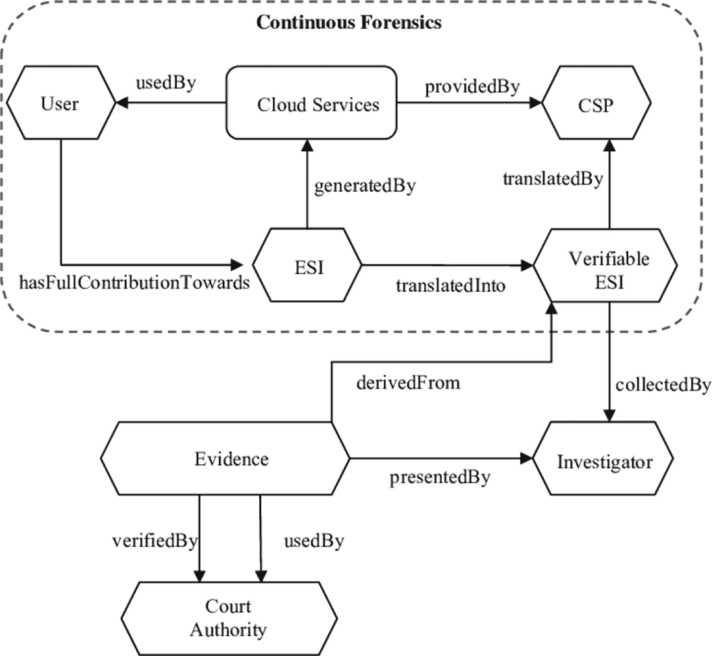

**图 14：** 开源云取证模型 (Zawoad et al. 2015)。

Kebande 等人 (2016)、Kebande 等人 (2017a) 提出了一种基于分布式代理的解决方案，主动在云中收集数据，以使云具备取证就绪。这些数据随后可以供取证人员使用。作者还提出了一种“以云为中心”的框架，用于将大数据作为取证证据从物联网基础设施中分离出来 (Kebande et al. 2017b)。

### 7. 结论

CPS/IoT 系统在变革我们的社会方面具有巨大潜力，随着全球工业物联网、智慧城市、智能家居、智慧医疗和智慧交通解决方案采用的增加，这场革命已经开始。物联网与人工智能（AI）、机器学习、云基础设施、大数据处理框架以及不断提高的网络连接性相结合，将产生更智能、响应更迅速且更高效的系统，并为人类创造新机会。然而，这也增加了网络攻击和网络犯罪的安全风险。在本章中，讨论了物联网取证的挑战，包括设备取证、网络取证和云取证。介绍了人员提出的新框架。显而易见，物联网取证领域还需要进一步的研发以使其成熟，并为复杂的调查提供广泛的工具、标准和流程。

## 8. 参考文献

- Ab Rahman, N. H., Glisson, W., Yang, Y. and Choo, R. 2016. 针对物理物理系统的设计安全取证框架。In `IEEE Cloud Computing` 3(1): 50–59. Jan.-Feb. 2016. doi:10.1109/MCC.2016.5.

- Al-Masri, E., Bai, Y. and Li, J. 2018. 针对物联网系统的基于边缘的数字取证框架。`2018 IEEE International Conference on Smart Cloud (SmartCloud)`, New York, NY, pp. 196–201. doi:10.1109/SmartCloud.2018.0040.

- Al-Mhiqani, M., Ahmad, R., Yassin, W., Abidin, Z., Ali, N. and Abdulkareem, K. H. 2018. 网络安全事件：物理物理系统中的回顾。`IJACSA International Journal of Advanced Science and Applications` 9(1): 49–508.

- Ankara and Kocaeli. 2016. 声称土耳其能源部门遭受重大网络攻击。[Online] 可用于：http://www.hurriyetdailews.com/major-cyber-attack-on-turkish-ministry.aspx?PageID=238&NID=107981&NewsID=348.

- Ariffin, A., Slay, J. and Choo, K.-K. 2013. 从专有 CCTV 硬盘中恢复数据。pp. 213–223. In Peterson, G. and Shenoi, S. (eds.). `Advances in Digital Forensics IX`, Volume 410 of the series IFIP Advances in Information and Technology. Berlin, Heidelberg.

- Atlam, H., Alenezi, A., Alharthi, R. and Wills, G. 2017. 云计算与物联网的集成：挑战与开放问题。In Proceedings of `2017 IEEE International Conference on Internet of Things (iThings) and IEEE Green Computing and Communications (GreenCom) and IEEE Physical and Social Computing (CPSCom) and IEEE Smart Data (SmartData)`, Exeter, UK, 21–23 June 2017; pp. 670–675.

- Awasthi, A., Read, H. O., Xynos, K. and Sutherland, I. 2018. 欢迎 pwn: Almond 智能家居枢纽取证。`Digital Investigation` 26: S38–46.

- BBC News Technology. 2017. 乌克兰停电“是网络攻击”，2017 年 1 月 11 日，可用于 https://www.bbc.com/news/technology-38573074.

- Boztas, A., Riethoven, R. J. and Roeloffs, M. 2015. 智能电视取证：电视上的数字痕迹。In the `Journal of Digital Investigation`, ISSN: 1742–2876, 12(S1): S72–S80, DOI10.1016/j.diin.2015.01.012.

- Brotsis, S., Kolokotronis, N., Limniotis, K., Shiaeles, D., Bellini, E. and Pavue, Clement. 2019. 物联网环境中的区块链解决方案。出现在 `IEEE Conference on Network Softwarization (NetSoft)`，2019 年 6 月巴黎。

- Chhabra, G., Singh, V. and Singh, M. 2018. 使用机器学习的物联网环境网络取证框架。`Multimedia Tools and Applications`, pp. 1–20. https://doi.org/10.1007/s11042-018-6338-1.


- Charette, R. 2018. 美国关键大坝面临内部网络威胁：内政检查长的新报告强调了若干基础安全问题。`IEEE Spectrum`，2018 年 6 月 15 日。

- Clark, D., Meffert, C., Baggili, I. and Breitinger, F. 2017. `DROP (DRone Open source Parser)` 你的无人机：DJI Phantom III 的取证分析。`Digital Investigation` 22(Supplement): S3–S14，ISSN 1742-2876，`https://doi.org/10.1016/j.diin.2017.06.013`。

- Davies, M., Read, H., Xynos, K. and Sutherland, I. 2015. Sony PlayStation 4 取证分析：首次观察。`Digital Investigation`，12(Supplement 1): S81–89，ISSN 1742-2876，`doi:10.1016/j.diin.2015.013`。

- Dignan, L. 2016. Dyn 确认 Mirai 僵尸网络参与分布式拒绝服务攻击，2016 年 10 月 26 日，可用于 `https://www.zdnet.com/article/dyn-confirms-mirai-botnet-involved-in-distributed-denial-of-service-attack/`。

- Dykstra, J. and Sherman, A. 2013. OpenStack 云平台数字取证工具的设计与实现。`Digital Investigation` 10(Supplement): S87–S95，ISSN 1742-2876，`doi:10.1016/j.diin.2013.06.010`。

- Edward, E. 2017. 美国最高法院将就微软搜查令案件进行上诉，《爱尔兰时报》（The IRISH TIMES），2017。[在线]。可用性地址：[`www.irishtimes.com/business/technology/us-supreme-court-to-hear-appeal-in-microsoft-warrant-case-1.3257825`](https://www.irishtimes.com)。

- Etemadieh, A., Heres, C. and Hoang, K. 2017. 使用 10 美元的 SD 读卡器进行硬件攻击。2017，BlackHat USA 会议报告。

- Goudbeek, A., Choo, K.-K. R. and Le-Khac, N.-A. 2018. 一种智能家居环境的取证调查框架。第 17 届 IEEE 计算信任、安全与隐私国际会议/第 12 届 IEEE 大数据科学与工程国际会议（TrustCom/BigDataSE），2018 年 8 月 1–3 日，美国纽约州纽约，DOI：`10.1109/TrustCom/BigDataSE.2018.00201`。

- Greer, C., Burns, M., Wollman, D. and Griffor, E. 2019. 信息物理系统与物联网，NIST 特别出版物 1900-202，2019 年 3 月，[`doi.org/10.6028/NIST.SP.1900-202`](https://doi.org/10.6028/NIST.SP.1900-202)。可用地址：[`nvlpubs.nist.gov/nistpubs/SpecialPublications/NIST.SP.1900-202.pdf`](https://www.nvlpubs.nist.gov)。

- Grispos, G., Storer, T. and Glisson, W. B. 2012. 风暴前的宁静：数字取证中云计算面临的挑战。《国际数字犯罪与取证杂志》（International Journal of Digital Crime and Forensics）4(2): 28–48。

- GrowthEnabler. 2017. GrowthEnablerIoT 市场脉搏报告，物联网（IoT）：发现颠覆性技术与物联网创新的关键趋势与洞察，2017 年 4 月，可用地址：[`growthenabler.com/flipbook/pdf/IOT%20Report.pdf`](https://www.growthenabler.com)。

- Harbawi, M. and Varol, A. 2017. 针对物联网取证的改进数字证据获取模型 I：一个理论框架。2017 第 5 届国际数字取证与安全研讨会（ISDFS）。`doi:10.1109/isdfs.2017.7916508`。

- Hauser, C. 2017. 在康涅狄格州谋杀案中，Fitbit 是一个沉默的证人。《纽约时报》，2017 年 4 月 27 日；[`www.nytimes.com/2017/04/27/nyregion/in-connecticut-murdercase-a-fitbit-is-a-silent-witness.html?mcubz=1`](http://www.nytimes.com)。

- Haque, S. A., Aziz, S. M. and Rahman, M. 2014. 医疗保健领域信息物理系统综述。《分布式传感器网络国际杂志》，[`https://doi.org/10.1155/2014/217415`](https://doi.org/10.1155/2014/217415)，2014 年 4 月 27 日，Hindawi 出版公司。

- Horsman, G. 2016. 无人机：取证挑战的初步分析。《数字调查》（Digital Investigation）16: 1–11，ISSN 1742-2876，[`doi.org/10.1016/j.diin.2015.11.002`](https://doi.org/10.1016/j.diin.2015.11.002)。

- Hossain, M. and Zawoad, S. 2017. Trust-IoV：一种车载网络（IoV）的可信取证调查框架，IEEE 物联网国际会议（ICIOT），2017 年 6 月 25–30 日，美国夏威夷州檀诺鲁，DOI：`10.1109/IEEE.ICIOT.2017.13`。

- Hossain, M., Hasan, R. and Zawoad, S. 2018. Probe-IoT：一种基于公共数字账本的物联网取证调查框架。IEEE INFOCOM 2018 – IEEE 计算机通信研讨会（INFOCOM WKSHPS），美国夏威夷州檀诺鲁，第 1–2 页。`doi:10.1109/INFCOMW.2018.8406875`。

- Hung, M. 2017. 领先物联网，Gartner 关于如何在连接世界中保持领先的洞察，可用地址：[`www.gartner.com/imagesrv/books/iot/iotEbook_digital.pdf`](https://www.gartner.com)。

- ICS-CERT 国家网络安全与通信中心（NCCIC）/工业控制系统应急响应小组（ICS-CERT）。2016b. 警报（IR-ALERT-H16-056），针对乌克兰基础设施的网络攻击，原始发布：2016 年 2 月 25 日，最后修订：2018 年 8 月 23 日，可用地址：[`ics-cert.us-cert.gov/alerts/IR-ALERT-H16-056`](https://www.ics-cert.us-cert.gov)。

- 工业控制系统应急响应小组（ICS-CERT）。2016a. 2016 年年度报告，NCCIC，美国国土安全部，可用地址：[`ics-cert.us-cert.gov/sites/default/files/Annual_Reports/FY2016_Industrial_Control_Systems_Assessment_Report_S508.pdf`](https://www.ics-cert.us-cert.gov)。

- ISO/IEC 27037: 2012 — 信息技术—安全—数字证据识别、收集和保存指南。 [`www.iso.org/standard/52397.html`](https://www.iso.org/standard/52397.html)。

- Israel, T. 2016. 以色列电力局遭受“严重”攻击。[在线] [`www.timesofrael.com`](http://www.timesofrael.com)。

- Yang, S., Choi, J., Kim, B. and Chang, T. 2015. 基于固件的手机取证新方法。《数字调查》14（增录），第 68–76 页。

- Jian, A., Xiaolin, G., Yu, S. and Xin, H. 2015. 用于物联网的移动群体感知技术。IEEE 多媒体国际会议，第 22 页。

- Kaspersky. 2016. 卡巴斯基发现漏洞的工业控制系统。可用地址：[`https://www.kaspersky.com`](https://www.kaspersky.com)。

- Kebande, V. R. and Ray, I. 2016. 云网络取证就绪。IEEE 下一代计算国际会议。

- Kebande, V. R. and Venter, H. 2016. 云环境中的新型数字取证就绪。《取证科学杂志》50(5): 209–238。

- Kebande, V. R., Karie, N. M., Michael, A. and Malapane, S. 2017. 针对物联网的通用云取证框架。IEEE 取证科学国际会议。

- Kebande, V. R., Karie, N. M., Michael, A., Malapane, S., Kigwana, I., Venter, H. and Wario, R. 2018. 面向物联网生态系统的集成数字取证调查框架。IEEE 智能物联网会议。

- Khac, N. A., Jacobs, D., Nijhoff, J., Bertens, K. and Choo, R. 2018. 智能车辆取证：挑战与案例研究。《未来计算机系统杂志》。

- Khan, S., Gani, A., Wahab, A. W., Iqbal, S., Abdelaziz, A., Mahdi, O. A., Abdallaahmed, A. I., Shriz, M., Al-Mayouf, Y. R. B., Khan, Z., Ko, K., Khan, M. K. and Chang, V. 2016. 当前网络取证在云网络中的适用性：SWOT 分析。IEEE Access 4: 9800–9820。

- Kouwen, A., Scanlon, M., Kwang, K., Choo, R. and Le-Khac, N.-A. 2018. 双向无线电通信设备服务的数字取证调查。《数字调查》26（增录，2018）：S77–S86，ISSN 1742–2876。

- Koroniotis, N., Moustafa, N., Sitnikova, E. and Turnbull, B. 2019. 面向物联网网络取证分析的真实僵尸网络数据集开发：Bot-IoT 数据集。《未来世代计算机系统杂志》100: 779–796。

- Kumar, M. 2016. DDoS 攻击在芬兰冬季导致中央供暖系统瘫痪。[在线] 可用于：[`thehackernews.com/2016/11/heating-system-hacked.html`](http://www.thehackernews.com)。

- Kumari, N. and Mohapatra, A. K. 2016. 数字取证分支与工具的洞察。信息与通信技术计算技术国际会议论文集。

- Kushner, D. 2013. Stuxnet 的真实故事。《IEEE Spectrum》53(3): 48，2013 年 2 月 26 日。

- Larson, S. 2017. CNN，FDA 证实 St. Jude 心脏设备可能被攻击，2017 年 1 月 9 日，可用于 [`money.cnn.com/2017/01/09/technology/fda-st-jude-cardiac-hack/`](https://www.money.cnn.com)。

- Li, S., Choo, K. K. R., Sun, Q., Buchanan, W. J. and Cao, J. 2019a. 物联网取证：Amazon Echo 用例。《IEEE Internet of Things Journal》6(4)，2019 年 8 月。DOI：`10.1109/JIOT.2019.2906946`。

- Li, S., Qin, T. and Min, G. 2019b. 物联网和社会系统中的基于区块链的数字取证调查框架。《IEEE Transactions on Computational Social Systems》，1–9。`doi:10.1109/tcss.2019.2927431`。

- Liu, C., Singhal, A. and Wijesekera, D. 2017. 云取证分析的证据识别。In: Peterson, G. and Shenoi, S.（eds.）。数字取证进阶 XIII。数字取证 2017。IFIP 信息与通信技术进展，第 511 卷。Springer, Cham。

- Losavio, M., Seigfried-Spellar, K. C. and Sloan III, J. J. 2016. 为什么数字取证不是一项职业以及它如何成为一项职业。《刑事司法研究》29(2): 143–162。

- Marty, R. 2011. 用于取证的云应用日志。In: ACM 应用计算会议论文集，第 178–184 页。

- Merlino, G., Arkoulis, S., Distefano, S., Papagianni, C., Puliafito, A. and Papavassiliou, S. 2016. 作为服务的移动群体感知：一种用于传感上层应用的平台。《未来世代计算机系统》，ISSN: 0167-739X，56: 623–639，Elsevier。

- National Institute of Standards and Technology（NIST）。2017. 信息技术实验室/软件与系统部门，计算机取证工具程序（`CFT`），可用于 [`www.nist.gov/itl/ssd/software-quality-group/computer-forensics-testing-program-cft`](https://www.nist.gov)，最后访问于 2019.08.13。

- Nickson, M. K. and Venter, H. S. 2015. 数字取证挑战分类。《法科学》60(4): 885–893。`doi:10.1111/1556-4029.12`。

- Nickson, M. K., Kebande, V., Venter, H. S. and Choo, K. R. 2019. 标准化数字报告生成过程的重要性。《法科学国际》，ISSN: 2665-9107，1: 10008。

- Nieto, A., Rios, R. and Lopez, J. 2017. 一种隐私感知的 IoT 取证方法。`Trustcom/BigData/ICESS`，1–4，悉尼。DOI：`10.1109/Trustcom/BigData/ICESS.2017.293`。

- NIST，物理系统工作组。2017。可用于 [`www.nist.gov/el/cyber-physical-systems`](https://www.nist.gov)。

- Oriwoh, E., Jazani, D., Epiphaniou, G. and Sant, P. 2013. 物联网取证：挑战与方法。第九届协作计算国际会议（`Collaborate`）。

- Osborne, C. 2018. Industroyer：深度解析乌克兰电网停电的元凶。这种机器语言的软件对所有关键服务都是威胁，2018 年 4 月 30 日，[`www.zdnet.com/article/industroyer-an-in-depth-look-at-the-culprit-behind-ukraines-power-blackout/`](https://www.zdnet.com)。

- Perumal, S., Norwawi, N. and Raman, V. 2015. 物联网（`IoT`）数字调查模型：自顶向下的方法。第五届数字信息处理与通信国际会议（`ICDIPC`），瑞士苏黎，7–9。DOI：`10.1109/ICDIPC.2015.732300`。

- Pichan, A., Lazarescu, M. and Soh, T. 2018. 实用云取证框架。《信息安全与应用》42: 18–28，ISSN 2214-2126，[`doi.org/10.1016/j.jisa.2018.07008`](https://doi.org/10.1016/j.jisa.2018.07008)。

- Positive Technologies，工业控制系统。2016. 报告：连接与脆弱，2016 年 10 月 7 日，可用于 [`blog.ptsecurity.com/2016/10/industrial-control-systems-2016-report`](http://blog.ptsecurity.com)。


- Quick, D. and Choo, K. K. R. 2016. 大取证数据压缩：数字取证镜像与电子证据。《聚类计算》 19(2): 723–740. doi: 10.1007/s10586-016-0553-1。
- Quick, D. and Choo, K. K. R. 2018. IoT 设备取证与数据压缩。《IEEE Access》 6: 47566–47574. doi: 10.1109/ACCESS.2018.286746。
- San Carlos, C. A. 2017. Check Point 与 LG 合作保护智能家居设备，2017 年 10 月 26 日。[在线]。可用：[`www.checkpoint.com/press/2017/check-point-joins-forces-lg-secure-smart-home-devices/`](https://www.checkpoint.com)。
- Sang-Hun, C. 2013. 韩国计算机网络在网络攻击中瘫痪，《纽约时报》，可用于[`www.nytimes.com/2013/03/21/world/asia/south-korea-computer-network-crashes.html`](https://www.nytimes.com)。
- Sansurooah, K. 2006. 计算机取证方法与数字证据提取程序分类。第四届澳大利亚数字取证会议论文集；2006 年 12 月 4 日；西澳州珀斯，埃迪·考文大学。西澳州：埃迪·考文大学出版社，2006；1–13 页。
- Servida, F. and Casey, E. 2019. IoT 取证对数字足迹的挑战与机遇。《数字调查》 28: S22–S29。
- Shin, C., Chandok, P., Ran Liu, R., Nielson, S. J. and Leschke, T. R. 2017. 物联网数据的潜在取证分析：技术现状与未来可能概述。IEEE 物联网国际会议（`iThings`）以及绿色计算与通信（`GreenCom`）以及 IEEE 物理与社会计算（`CPSCom`）和智能数据（`SmartData`）。
- Simou, S., Kalloniatis, C., Gritzalis, S. 2018. 取证增强服务设计框架（`CFeS`）。《需求工程》。doi:10.1007/s0766-018-289-y。
- Sriram, R. 2013. 数字取证研究：现状。《CSI Trans ICT》 1(1): 91–114。
- Statista. n.d. 2014 年至 2020 年全球物联网市场规模按行业划分（以亿美元计）。
- Taylor, M., Haggerty, J., Gresty, D. and Lamb, D. 2011. 云计算系统的取证。《网络安全》2011(3): 4–10, ISSN 1353-4858, [`doi.org/10.1016/S1353-4858(11)70024-1`](https://doi.org/10.1016/S1353-4858\(11\)70024-1)。
- Vasile, S., Oswald, D. and Chothia, T. 2019. 破解 IoT 设备固件提取技术的系统综述。In: Bilgin, B. and Fischer, J. B. (eds.). 智能卡研究与高级应用。CARDIS 2018. 计算机科学讲义，第 11389 卷。Springer, Cham。
- Vincze, E. A. 2016. 数字取证的挑战。《警察实践与研究》 17(2): 183–194, DOI: 10.1080/15614263.2015.1128163。
- Watson, S. and Dehghantanha, A. 2016. 数字取证：物联网承诺中缺失的一环。《计算机欺诈与安全》2016(6): 5–8。
- Yaakobi, E. and Goldenberg, J. 2014. 虚拟社交网络系统中的社会关系与信息传播：依恋理论视角。Comput. Hum. Behay. 38（2014 年 9 月）: 127–135. DOI: [`dx.doi.org/1.1016/j.chb.2014.05.025`](http://dx.doi.org/1.1016/j.chb.2014.05.025)。
- Zawoad, S. and Hasan, R. 2015. FAIoT：迈向构建取证感知物联网生态系统。2015 IEEE International Conference on Services Computing. doi:10.1109/scc.2015.46。
- Zawoad, S., Hasan, R. and Skjellum, A. 2015. OCF：一种可靠数字取证的开放云取证模型。2015 IEEE 8th International Conference on Cloud Computing, New York, NY, pp. 437–444. doi: 10.1109/CLOUD.2015.65。
- Zawoad, S., Kumar Dutta, A. and Ragib, R. 2013. SecLaaS：用于云取证的安全日志即服务。ASIA CCS 2013 – 第 8 届 ACM SIGSAC 信息、计算机与通信安全研讨会论文。10.1145/2484313.2484342。
- Zatyko, K. 2007. 评论：定义数字取证。Forensic Magazine, 2007 年 1 月 2 日，[`www.forensicmag.com/articles/2007/01/commentary-defining-digital-forensics`](http://www.forensicmag.com)。

# 8 社交媒体犯罪调查与取证分析

Manish Kumar

助理教授，M S Ramaiah 技术学院，计算机应用硕士系，班加罗尔 - 54，印度。

Email: manishkumarjsr@yahoo.com

社交网络服务（`SNS`）极大地改变了我们的生活。世界变得比以前任何时候都更加紧密。尽管它有“光明面”，但也有“阴暗面”。社交媒体是最强大的平台之一，对个人、群体和社区的思想产生巨大影响。滥用这种强大的平台对社会可能是灾难性的。我们正在见证社交媒体平台的武器化。滥用社交媒体传播虚假新闻、进行付费竞选和宣传是社会关注的主要威胁。社交媒体平台如何被用来影响国家大选中的选民，这已不再是一个秘密？世界已经见证了恐怖组织通过战略性地利用社交媒体平台，使青少年激进并加入其组织。社交媒体网络的快速扩散已经达到了不再受个人或组织控制的程度。可以说`SNS`强大到足以远程控制社会。这一点也没有错。（此处原文存在重复句，译文已保留其逻辑结构）。

## 1. 引言

社交网络服务（`SNS`）极大地改变了我们的生活。……可以说`SNS`强大到足以远程控制社会。这一点也没有错。（此处原文存在重复句，译文已保留其逻辑结构）。

...

## 2. 社交网络平台的类型

市场上有许多不同类型的社交媒体平台。每个平台都有独特的特征，吸引用户并将他们聚集在平台上进行社交。社交媒体平台可以根据其功能和服务进行分类。一些常见的类别如下：

- **社交网络：** 社交网络是最流行和最常用的平台之一。通常人们使用它来与朋友、家人和同事联系。然而，它也被广泛用于商业目的以及与客户的建立联系。自从智能手机和移动互联网兴起，它改变了生活的方方面面。人们以许多创意的方式分享他们的生活时刻。`Facebook`、`Twitter`、`WhatsApp` 和`Linkedin`是一些用于社交网络的知名服务。
- **媒体共享网络：** 媒体共享平台被用户用于分享照片和视频。它不仅被普通用户与朋友家人分享生活，还被企业广泛用于品牌推广。`YouTube`、`Instagram`、`Snapchat`等是此类中最著名的服务。
- **讨论论坛：** 它是用于知识共享、讨论论坛、市场研究等古老的平台类型之一。特定领域、学科和主题有各种讨论论坛（例如`Reddit`、`Quora`、`Digg`等）。虽然并非特定，但此类平台通常被学生、学者和技术专家使用。
- **消费者评论网络：** 这些平台专门供消费者表达他们对特定品牌、产品和服务的体验和意见。如今，用户和消费者也用它分享他们的旅行和住宿体验。`Yelp`、`Zomato`、`TripAdvisor`是以消费者评论闻名的流行服务。
- **博客与出版网络：** 博客和出版网站为人们提供了一个开放平台，让他们以自由无畏的方式分享他们的知识经验和想法。博客和微博客平台在博客作者中流行。`WordPress`、`Tumblr`、`Medium`等是知名的博客和出版平台。
- **共享经济网络：** 这些平台通常被用户用于销售、购买、广告等（例如`Airbnb`、`Task rabbit`等）。它并不是电子商务平台的替代品，但为个人用户提供了微观层面的类似功能。
- **匿名社交网络：** 此类平台被人们用于匿名通信。虽然这些平台旨在保护用户身份免受陌生人的侵害，但它们越来越多地被用于非社交活动。`Whisper`、`Secret`、`Yik Yak`是用于匿名社交的一些热门服务。

## 3. 利用社交网络平台的网络犯罪

任何强大的技术都可能被误用，并对社会造成毁灭性影响。每种技术都有优缺点，互联网和社交媒体也是如此。毫无疑问，社交媒体给我们的日常生活带来了巨大的变化，但没有人能排除它也让我们的生活变得非常脆弱。社会是由个人组成的，任何能够从生理上影响公众情绪、思想和感受的系统，实际上在理论上就能控制社会。

社交媒体平台被滥用于各种类型的网络犯罪。它不仅被用于实施网络犯罪，还被用作实施传统犯罪的工具。网络犯罪分子如何利用社交媒体平台进行非法目的，这真的取决于他们的创造力和想象力。一些常见的社交媒体网络犯罪分类为：

- **侦察：** 社交媒体平台是个人信息的宝库。社交媒体用户会有意或无意地在社交网络上分享许多个人信息，即位置详情、喜好、朋友和家人的细节。有时他们还会披露敏感信息，如出生日期、个人联系电话、电子邮件地址等。侦察是一种攻击类型，攻击者被动地收集和分析受者的个人信息，并计划针对性攻击。检测此类攻击非常困难。
- **虚假资料/身份盗用：** 社交网络中最困难的任务是确定用户资料的真实性。虚假社交媒体资料是社交媒体网络中最常见的问题之一。网络犯罪分子通常模仿合法用户的资料。网络犯罪分子以各种创意方式使用这些虚假资料来攻击受害者。通常，网络犯罪分子会创建名人、政客、组织 CEO 或 CFO 的虚假账号，这些人拥有大量的粉丝和朋友。攻击者利用虚假资料与人们建立联系并以各种方式剥削他们。
- **社会工程攻击：** 社会工程是利用人类心理学的艺术。通常在社会工程中，攻击者在心理学上操纵受害者，使其泄露机密信息或敏感数据。例如，攻击者不是破解某人的银行账户，而是伪装成银行员工打电话给受害者。他可能会让受害者相信这是例审计过程，并从那里收集敏感信息，如`ATM Card`详情、`ATM Pin`、过期日期等。收集这些信息后，攻击者很容易进行各种交易。攻击者使用了各种操作模式，如虚假邮件、恶意网页链接、`SMS`等。为了策划此类攻击，攻击者通常从社交媒体平台收集有关其目标的每一个微小细节。此类攻击非常成功，且在社交媒体上最常见。除了提高意识外，对这种攻击没有其他应对措施。
- **虚假新闻：** 社交媒体的阴暗面是其被误用于虚假宣传、宣传、活动和新闻。社交媒体上分享的动态像野火一样蔓延，等某人确定其真实性时，它已经损害了许多事情。由于社交媒体信息流对数百万用户的影响以及其传播方式，网络犯罪分子将其作为远程武器。它在选举活动期间被广泛用于影响用户的情绪。有各种工具和专业服务可用于社交媒体网络上操纵和传播针对特定群体或社区的虚假新闻和宣传。
- **恶意内容：** 许多时候攻击者诱受害者点击特定的网页链接。这些链接将用户带到第三方网站或在用户的系统或智能手机上下载恶意内容。一旦系统或智能手机被破解，攻击者就足以破解用户的社交媒体账户并接管控制权。在今天的情况下，社交网络不仅用于攻击个人，还被用于针对国家、政府、企业、宗教、等级和社区（Krishna et al. 2019）。

### 3.1 社交媒体作为网络武器

通过对社交媒体的利用，行动者可以在战争开始之前通过削弱对国家机构和共识的信任来赢得战争。在社交媒体用户账户被破解及其对国家安全造成的经济损失发生后，对安全的担忧被引起。由于意识到对国家安全的严重威胁，许多国家制定了指南以确保社交媒体的使用。`Twitter`、`Facebook`和`WhatsApp`等社交媒体应用在政府工作场所被禁止。

协调良好、连贯且管理仔细的社交活动对影响人们具有巨大影响力。许多国家正在将社交媒体作为网络武器来针对其敌对国家。近年来发生了一系列事件，发现社交媒体平台被滥用于获取社会、政治和经济利益。它们通常传播虚假新闻、伪造信息、黑入私有通信并将其公开发。一些国家有专业组织以合同形式全职从事此类工作。

## 4. 社交媒体取证

不仅在网络犯罪中，即使在传统犯罪中，社交媒体也是重要的证据来源之一。如前所述，有时社交媒体平台被用于反国家活动。它被策略性地用于针对国家、宗教、政党和知名机构，以毁其名誉并在社会中制造动荡。社交媒体犯罪的指数级增长及其在实施传统犯罪中的滥用增加了对数字取证的需求（`Arshad et al. 2019`）。

社交网络取证是数字取证的应用。然而，其调查方法略有不同。在社交网络取证中，调查速度非常重要。社交媒体产生海量数据和元数据，这使得调查者的工作变得复杂，因为一个微小的错误可能会偏离整个调查。重点在于从`Facebook`、`Twitter`、`Whatsapp`、`Linkedin`等社交媒体平台提取证据。社交媒体产物可以从计算机、笔记本电脑、智能手机中检索，有时通过网络分析获取。从社交网络平台收集的证据对于追踪网络犯罪分子及其在法庭上的判定起着重要作用。

基本上，从调查者的角度来看，社交网络取证将是一个寻找证据所在地并以符合取证规范的方式收集证据且不违反任何法律的问题。调查者需要遵循标准的取证分析方法。

### 4.1 社交网络应用与移动设备

如果没有对智能手机取证的讨论，社交媒体的调查讨论是不完整的。智能手机技术的指数级增长和发展已成为社交媒体的首选平台。截至 2018 年，平均用户每天在社交媒体上花费 136 分钟，而 2017 年仅为 135 分钟。预计到 2021 年，社交媒体用户将达到约 30.2 亿。从事实和数据可以清楚看出，进行社交媒体取证的调查人员很可能会遇到智能手机作为证据来源。然而，智能手机取证面临一些独特的挑战。

#### 4.1.1 移动设备社交网络取证分析的挑战

移动取证与计算机取证不同，对取证人员提出了独特的挑战。移动设备可以跨多个设备和存储介存储并访问数据。由于移动数据是易失的，可能会被快速删除。它还可以被远程访问，因此在数据保护方面需要极其谨慎。

执法机构和取证人员在从移动设备中获取数字证据方面面临许多关键问题。一些主要挑战如下：

- **硬件差异：** 市场上充满了各种品牌和型号的手机。新型号频繁出现。这些手机具有不同的规格，运行在不同类型的定制操作系统上。
- **移动操作系统：** 市场上有各种移动操作系统，其中只有少数操作系统流行并被大多数移动设备使用。取证工具和调查人员应该能够检查所有类型的移动操作系统和设备，这增加了挑战。尽管取证工具和软件支持多种类型的移动操作系统和设备，但这仍然增加了挑战。
- **移动功能：**
  - `硬件差异`
  - `移动操作系统`
  - `移动功能`：
    - `生物识别`
    - `模式`
    - `指纹`
    - `数据`
    - `加密`

### 4.2 数字流程

数字取证现在已经成熟并标准化。数字取证的主要步骤如`Huber et al. 2011`所示。


**图 2：** 数字取证流程。

#### 4.2.1 证据识别

调查者的首要任务是理解社交媒体信息“如何”以及“存储在哪里”。在当今互联的世界中，每个设备和小设备都相互连接，这使得调查人员识别确切来源变得复杂（`Newman 2018`）。社交网络是通过互联网提供的分布式服务，证据本质上是分布、易失且不连续的。为了调查案件，调查人员需要访问嫌疑人的上网历史、电子邮件、下载的内容、Cookie 等。

在许多情况下，证据需要通过访问网站、截图等方式手动收集。调查者可能需要存储原始 HTML 文件并打印。原始 HTML 文件需要以符合取证规范的方式保存。然而，这一点是非常重要的。

#### 4.2.2 证据收集

证据收集是从犯罪现场扣押潜在证据源的过程。如果调查人员有机会进入犯罪现场，他们可能会发现许多潜在证据源。传统上，社交媒体服务通过网络浏览器或手机应用程序访问。因此，信息的潜在来源可能是任何设备，例如`台式机`、`笔记本电脑`、`平板电脑`等。在扣押设备时维护监管链至关重要。监管链基本上记录了从证据提取、传输、分析到处置的时间顺序。在收集证据时，需要记录犯罪现场的每一个细节和设备的详细信息。

#### 4.2.3 证据获取与保护

一旦确定了证据来源，下一步是以符合取证规范的方式从源设备中获取证据。市场上有各种专业工具可以从设备中提取社交媒体产物。

数据获取基本上分为两种类型：

- **现场取证：** 如果发现设备处于运行（开启）状态，则检查员需要进行现场取证。大多数数字设备都拥有主内存（RAM）和次级内存（外部存储）。任何在运行状态下扣收的设备都可能在主内存中包含关键证据。主内存具有易失性，一旦设备关闭，所有信息都将丢失。社交网络（`SNS`）痕迹最可能出现在主内存中。因此，从主内存进行数据采集至关重要。目前有多种开源及专业软件可以从运行内存中转储数据。
- **离线取证：** 这种方法要求关闭系统电源并将存储介质从系统中移除。市场上有专门的硬件和工具，可以对存储设备创建取证级的镜像副本。数据采集的整个过程确保了证据的完整性。与现场取证相比，离线取证相对简单。


智能手机证据采集需要不同的方法。智能手机的硬件架构与笔记本电脑和桌面式电脑略有不同。理解手机的内部和外部内存结构非常重要。操作系统和预装应用程序存储在手机的内部内存中。外部内存被称为扩展内存或可扩展内存，用户通常在其中存放图片、视频或其他重要文件。如果手机操作系统支持，某些移动应用程序也可以安装在外部内存中。一些高端智能手机还支持云存储，以满足用户日益增长的存储需求（Yusoff et al. 2017）。

智能手机的数据采集通常分为两类：

- **逻辑取证：** 在这种方法中，提取工具与设备通信并尝试提取数据。逻辑提取是一种快速且方便的方法，但无法通过逻辑提取恢复已删除的文件和数据。如果设备被锁定或受密码保护，逻辑提取也将变得困难。通过逻辑取证可以检索某些实时数据，例如通话记录、应用程序数据、如 Twitter、Facebook 等活跃社交媒体的密码。
- **物理取证：** 它以位位（`bit-by-bit`）的格式收集设备的所有数据。这就像是对存储介质进行克隆。除了逻辑提取外，物理提取还可以帮助检索已删除的文件、消息、照片、视频、GPS 位置标签等。根据标准的司法取证实践，取证检查员绝不直接在扣收的设备或原始证据上进行任何分析。检查员应始终对证据文件制作副本（次级证据）。分析和检查应在次级证据上进行。

#### 4.2.4 证据提取与分析

证据提取和分析是一项挑战性任务，因为与社交网络相关的潜在数据可能以各种形式散布，如网络日志、Cookie、上网历史等。此外，嫌疑人可能会尝试使用反取证技术删除证据以阻碍调查过程。一旦从目标设备检索到数据，就可以使用司法取证工具进行分析（Cusack and Son 2020）。市场上有专门的工具，有助于从镜像文件（嫌疑设备的司法取证镜像文件）中提取社交媒体痕迹。用于社交媒体分析的一些标准工具如表 1。

### 4.3 社交媒体元数据

在许多情况下，调查人员可能无法访问用于社交媒体犯罪的计算机或设备。只有当罪犯被拘留或调查人员持有搜查和扣押令时，才可能对犯罪现场和设备进行物理访问。然而，情况并非如此，因此调查必须根据在社交网络非社交活动中使用的链接和 URI 来进行（Taylor et al. 2014）。

URI 和社交媒体帖的链接包含大量的元数据。元数据是关于数据的数据。它提供了关于社交媒体证据的额外信息。通常元数据对用户是隐藏的，需要进行分析。

**表 1：** 社交媒体取证工具。

| 产品名称 | 主机操作系统 | 支持的社交媒体平台 |
| --- | --- | --- |
| Belkasoft Evidence Center | Windows | Facebook, Flickr, Foursquare, Google+, Instagram, LinkedIn, MySpace, Pinterest, Skype, Telegram, Tumblr, Twitter, Vkontakte |
| BlackLight | Windows Mac OS | Facebook, Twitter, LinkedIn, Foursquare |
| Internet Evidence Finder (`IEF`) | Windows, Linux, Mac OS | Facebook, Twitter, LinkedIn, MySpace, Google+, Foursquare, Flickr |
| Magnet AXIOM | Windows | Facebook, Twitter, LinkedIn, MySpace, Google+, Flickr |
| UFED Cloud Analyzer | Windows | Facebook, Twitter, LinkedIn, Google+, Skype, Telegram, Vkontakte, Instagram, OKCupid |

Twitter 推文包含大量的元数据，例如推文的唯一 ID、创建日期、回复用户 ID、地理位置（如果已启用）、时区等等，如表 2）。这些元数据对调查人员起着重要作用。同样，Facebook 用户也会被分配一个唯一的用户 ID，该 ID 对用户是隐藏的。Facebook 上的任何帖子或分享都包含用户 ID、发送时间、消息 ID 等元数据，如[表 3](#ch8.xhtml#t8_3）所示（X1 Facebook 2020）。

**表 2：** Twitter 元数据。

| 元数据字段 | 描述 |
| --- | --- |
| `created at` | 推文创建的 UTC 时间戳 |
| `user id` | 推文用户的 ID |
| `Handle` | 用户显示名（与用户名不同） |
| `retweet id` | 转发推文 ID |
| `retweet user` | 转发用户的用户名 |
| `Reply` | 表示该推文是否为回复 |
| `direct message` | 表示该推文是否为私信 |
| `Hashtags` | 推文中的所有标签列表 |
| `Description` | 描述推文的最多 160 个字符 |
| `geo enabled` | 用户是否启地理定位（可选） |
| `Place` | 用户发推时的地理位置 |
| `Coordinates` | 发送推文的地理坐标 |
| `in reply to user id` | 回复用户的唯一 ID |
| `profile image url` | 用户头像文件的位置 |
| `recipient id` | 私信接收者的唯一 ID |
| `recipient screen name` | 私信接收者的显示名 |
| `screen name` | 用户显示名 |
| `sender id` | 私信发送者的唯一 ID |
| `Source` | 发布或私信的应用（例如来自 iPhone 或特定的 Twitter 应用） |
| `time zone` | 用户的时区 |
| `utc offset` | 用户时区与 UTC 时间之间的差 |
| `follow request sent` | 表示已发送关注请求 |
| `Truncated` | 如果内容因过长被截断 |

### 4.4 来自社交媒体服务商的支持

获取部分元数据信息后，调查机构的下一步是从社交网络服务商处收集证据和进一步信息。执法部门应遵循标准程序从服务商处收集信息。大多数社交网络服务商都有专门的法律团队，为执法部门提供全天候支持。在接触服务商时，执法部门必须遵循各个社交媒体服务商提供的说明。

### 4.5 管辖权问题

管辖权是社交媒体取证中最为常见且复杂的问题之一。互联网不受限于任何特定的地理边界，而法律是针对特定的地理边界和领土的。社交网络（SNS）提供的服务在全球范围内即可访问。社交媒体调查的问题在于，证据存储在位于外国（通常是美国）的云平台上。传统的搜查和查封执法模式在这些情况下并不适用。大多数国家签有“司法协助协议”或“双边协议”。根据双边协议条约，执法机构能够寻求调查所需的信息。如果起诉需要，他们还可能寻求证据数据以及其的真实性证明。

**表 3：** Facebook 元数据。

| 元数据字段 | 描述 |
| --- | --- |
| `Uri` | 目标项的统一资源标识符 |
| `fb_item_type` | 识别项目为墙信息、新闻动态、照片等 |
| `parent_itemnum` | 父项目编号-子项目被追踪至父项目 |
| `thread_id` | 消息线程的唯一标识符 |
| `recipients` | 按名称列出的消息所有接收者 |
| `recipients_id` | 按用户 ID 列出的消息所有接收者 |
| `album_id` | 照片或视频项的唯一 ID 号 |
| `post_id` | 墙贴的唯一 ID 号 |
| `application` | 用于发布到 Facebook 的应用程序（例如来自 iPhone 或社交媒体客户端） |
| `user_img` | 用户个人图像所在的 URL |
| `user_id` | Facebook 项目发布者/作者的唯一 ID |
| `account_id` | 用户账户的唯一 ID |
| `user_name` | Facebook 项目发布者/作者的显示名称 |
| `created_time` | 帖子或消息的创建时间 |
| `updated_time` | 帖子或消息的修订/更新时间 |
| `To` | 墙贴指向的用户的名称 |
| `to_id` | 墙贴指向的用户的唯一 ID |
| `Link` | 包含的任何链接的 URL |
| `comments_num` | 帖子的评论数 |
| `picture_url` | 图片所在的 URL |

在向服务提供商寻求任何支持或证据时，调查人员在起草法律文件时应极度小心。法律文件应满足个人服务提供商提到的所有要求。很多时候，服务提供商因为法律用词错误或不包含所需的文本而拒绝请求（Brunty and Helenek 2016）。

#### 4.5.1 服务提供商的服务条款 (ToS)

每个 SNS 服务提供商都有自己的服务条款 (ToS)。服务条款是用户与服务提供商之间的法律协议。服务条款不仅影响用户，还包含了服务提供商可以收集并向外部机构共享信息的限制。通常，服务条款是有利于服务提供商编写的，并限制了外部调查人员可以有效的操作。

许多 SNS 服务提供商限制外部机构在未经事先许可（通过隐私政策）的情况下使用任何手动或自动工具从其网站收集任何信息。重要的是，在任何刑事调查中，如果调查人员违反了任何服务条款，被告的辩方可能会尝试以此为机会损害证据的信誉。因此，调查人员在启动调查之前对服务提供商提出的法律条款和条件有充分的。以下介绍了热门社交媒体服务提供商的一些主要指南、条款和条件：

1. **Twitter：** 除非通过法律程序获得有效的法院命令，否则 Twitter 不会向执法机构披露有关用户的非公开信息。整个过程是繁琐且耗时的，但 Twitter 确实拥有紧急披露机制。执法机构可以通过 Twitter 的法律请求提交网站提交紧急披露请求。执法机构在请求账户信息时必须包含以下信息（[Help.twitter.com](http://www.Help.twitter.com) 2020）。
   - 包含相关 Twitter 账户的 Twitter `@username` 和 URL（例如 [`twitter.com/twittersafety`](https://www.twitter.com) (`@twittersafety`)）或账户唯一的公共用户标识码或 `UID`）。
   - 和/或包含有效的 Periscope 用户名和 URL（例如 `@twittersafety` 和 [`periscope.tv/twittersafety`](https://www.periscope.tv)）。
   - 提供有关请求的具体信息的详情（例如基本订阅者信息）及其与你的调查的关系；
     - **注意：** 请确保你所寻求的信息不是公开的（例如未受保护的推文）。
   - 包含**有效的官方邮箱地址**（例如 `name@agency.gov`）。
   - 必须使用执法部门的抬头纸打印。

2. **Facebook：** Facebook 根据服务条款和适用法律向执法机构披露信息。执法机构需要拥有司法协助条约或委任书来强制披露。Facebook 处理请求需要以下基本最低信息（Safety Center 2020）。
   - 发出机构和代理人的姓名、来自执法域域的邮箱地址以及直接联系电话。
   - Facebook 个人资料的邮箱地址、电话 (`+XXXXXXXXXX`)、用户 ID 号（[`www.facebook.com/profile.php?id=1000000XXXXXXXX`](http://www.facebook.com)）或用户名（[`www.facebook.com/username`](http://www.facebook.com)）。

3. **Instagram：** Instagram 为不同时段存储不同类型的信息（[Help.instagram.com](http://www.Help.instagram.com) 2020）。所有请求必须具有具体性，162 *Crime Science and Digital Forensics: A Holistic View* 包括所请求的具体数据类别和请求的日期限制，以及：
   - 发出机构和代理人的姓名、来自执法域域的邮箱地址以及直接联系电话。
   - 相关日期该 Instagram 账户的用户名，以及所请求的具体信息的详情及其与你的调查的关系。用户名不是静态的，他们无法处理未包含相关日期结合用户名的请求。

4. **WhatsApp：** Whatsapp 仅根据其服务条款和适用法律披露账户记录。此外，他们还会评估请求是否符合国际认可的标准，包括人权、正当程序和法治。可能需要司法协助条约请求或委任书来强制披露账户内容（WhatsApp.com, 2020）。所有请求必须具体识别请求的记录并包含以下内容：
   - 发出机构、负责代理人的徽章或 ID 号、来自执法域域的邮箱地址和直接联系电话。
   - WhatsApp 账户号，包括任何适用的国家代码。

5. **Youtube：** Youtube 是分享视频内容的流行平台之一。许多时候该平台被滥用来分享贬性视频。Youtube 遵循法律程序，对于商标、诽、伪造和其他法律诉讼的任何投诉都需要法院命令。执法机构需要为调查提供视频链接 (`URL`)（[Support.google.com](http://www.Support.google.com) 2020）。

互联网上有许多社交媒体平台，几乎所有平台在发生任何法律诉讼或网络犯罪调查时都会支持执法机构。然而，执法机构应当意识到，社交网络服务（SNS）提供商仅会维护特定时期内的数据和日志。这取决于特定国家的法律和组织政策。法律程序繁琐且需要一定的时间。总的来说，如果整个过程超过了服务提供商数据保留的最长时间，执法机构可能无法获得任何证据信息。因此，执法机构应尽早采取行动。作为预防措施，执法机构可以对可疑账户提出早期数据留存请求。

## 4.6 报告

报告是调查的最后阶段。取证人员需要根据给定的案件背景提交分析中发现的事实。调查人员可能需要通过社交网络服务提供商处的支持文件（电子邮件通信或收到的特定报告）来支持其分析。报告是整个调查的最终结果，必须提交给法庭。因此，报告应该非常清晰准确。报告的真实性是最重要的。

# 5. 结论

总之，市场上有很多工具，能够从各种电子设备中提取并检查社交媒体产物。然而，从电子设备中收集的证据可能不足以进行社交媒体调查。社交媒体服务提供商对执法机构的支持至关重要。目前没有全球性的网络法。复杂的管辖权问题、互助协议或双边协议是调查中的主要障碍。虚假资料、高度加密和匿名通信是引起关注的主要原因。在不损害国家安全的情况下保护个人隐私是一个国家需要做出的战略决策。社交媒体平台带来的威胁是严重的，没有简单的技术解决方案。只有在政策、法律和技术框架的支持下才能解决。

## 参考文献

- Arshad, H., Aman Jantan, A. and Omolara, E. 2019. 社交网络证据收集与取证：研究挑战与方向. Digital Investigation 28: 126–138. [`doi.org/10.1016/j.diin.2019.02.001`](https://doi.org/10.1016/j.diin.2019.02.001).
- Baccarella, C. V., Wagner, T. F., Kietzmann, J. H. and Mccarthy, I. P. 2018. 社交媒体？它很严重！理解社交媒体的阴暗面. European Management Journal 36(4): 431–438. [`doi.org/10.1016/j.emj.2018.07.002`](https://doi.org/10.1016/j.emj.2018.07.002).
- Brunty and Helenek, K. 2016. 执法部门的社交媒体调查. 伦敦: Routledge.
- Cusack, B. and Son, J. 2020. 社交网络证据检查工具. Research Online. 访问于 2020 年 2 月 18 日. [`ro.ecu.edu.au/adf/109/`](https://www.ro.ecu.edu.au).
- 执法指南. Twitter. 2020. Twitter. 访问于 2020 年 2 月 10 日. [`help.twitter.com/en/rules-and-policies/twitter-law-enforcement-support`](https://www.help.twitter.com).
- Huber, M., Mulazzani, M., Leithner, M., Schrittwieser, S., Gilbert Wondracek, S. G. and Weippl. 2011. 社交快照：在线社交网络的数字取证. 社交快照 | 第 27 届计算机安全应用会议论文，2011 年 12 月 1 日. [`dl.acm.org/doi/10.1145/2076732.2076748`](https://dl.acm.org/doi/10.1145/2076732.2076748).
- 执法执法机构信息. 2020. 安全中心. 访问于 2020 年 2 月 10 日. [`www.facebook.com/safety/groups/law/guidelines/`](https://www.facebook.com).
- Instagram 帮助中心. 2020. 执法执法信息 | Instagram 帮助中心. 访问于 2020 年 2 月 12 日. [`help.instagram.com/494561080557017`](https://www.help.instagram.com).


- 律师和电子数据专业人员需要注意的关键 Facebook 元数据字段。2011。X1，2011 年 10 月 11 日。[`www.x1.com/2011/10/11/key-facebook-metadata-fields-lawyers-and-ediscovery-professionals-need-to-be-aware-of/`](https://www.x1.com)。

- 律师和电子数据专业人员需要注意的关键 Twitter 元数据字段。2011。X1，2011 年 10 月 6 日。[`www.x1.com/2011/10/11/key-twitter-metadata-fields-lawyers-and-ediscovery-professionals-need-to-be-aware-of/`](https://www.x1.com)。

本章讨论了从数字取证的角度，利用贝叶斯网络（BNs）来分析和理解网络犯罪。下一节将介绍贝叶斯定理和条件概率的概念，随后将描述贝叶斯网络的构建与运行。接下来的章节将展示贝叶斯网络在香港特别行政区若干实际网络犯罪中的应用，并说明了从中获取的各种量化指标，如后验概率和似然比。文中还讨论了这些指标对贝叶斯网络相关参数变化的敏感性，并强调了它们在构建经济上近优的分诊方案中的用处。在最后一节中，总结了贝叶斯网络分析对数字取证调查过程和法律诉讼过程可能提供的贡献。

## 2. 贝叶斯定理与贝叶斯网络

贝叶斯方法基于托马斯·贝叶斯牧师（Revd. Thomas Bayes）在其著名的遗作出版论文（Bayes 1763）中提出的条件概率定理，最近被引用为在传达数字取证结果的（不）确定程度方面获得量化吸引力的方法之一（Casey 2018）。贝叶斯网络（BNs）由朱迪亚·珀尔（Judea Pearl）开发，用于构建概率推理和推理模型（Pearl 1982, 1988）。

贝叶斯网络被定义为带有节点和弧的有向无环图（DAG）。节点代表变量、事件或证据。两个节点之间的弧代表节点之间的条件依赖关系。弧是单向的，且不允许反馈循环。由于这一特征，可以直观地识别两个节点之间的父子关系或概率依赖关系。

贝叶斯网络基于条件概率运行。例如，如果某些证据 `E` 的发生取决于假设 `H`，则 `H` 和 `E` 同时发生的联合概率由下式给出：

```
Pr (H,E) = Pr (H).Pr (E|H)
```

根据概率乘法法则（表达了交换律），如果 `H` 与 `E` 相关，那么 `E` 也与 `H` 相关。相应的联合概率表达式为：

```
Pr (H,E) = Pr (H).Pr (E|H) = Pr (E).Pr (H|E)
```

因此：

```
Pr (E|H) = Pr (E).Pr (H|E)/Pr (H)
```

这是著名的贝叶斯定理的一种形式。从统计学角度来看，它表示了当 `H` 为真时 `E` 的条件概率。这也被称为在 `H` 为真的条件下 `E` 的似然（likelihood）。它表示了在 `H` 为真的情况下 `E` 发生的置信程度。`Pr(H|E)` 是后验概率，即在检测到 `E` 时 `H` 实际上发生的概率。`Pr(H)` 表示在证据尚未呈现阶段 `H` 的先验概率。`Pr(E)` 是 `E` 的先验概率，有时被称为归一化常数。因此，上述表达式可以形式化为：

```
likelihood = posterior probability × normalizing constant/hypothesis prior probability
```

由于似然与后验概率成正比，较大的后验概率意味着更高的似然度。在证据语境下，也意味着支持假设的证据越多，该假设为真的概率就越大。

对于假设（或命题、或主张）`H`，具有单一的互斥且完备的备假设 `H̅` 以及恢复的证据 `E`，贝叶斯定理可以方便地表示为：

```
\frac{\Pr\left( {H\left| E \right.} \right)}{\Pr\left( {\overline{H}\left| E \right.} \right)} = \frac{\Pr\left( H \right)}{\Pr\left( \overline{H} \right)} \cdot \frac{\Pr\left( {E\left| H \right.} \right)}{\Pr\left( {E\left| \overline{H} \right.} \right)}
```

其中左侧的商代表后验赔率比，右侧的第一个商代表先验赔率比，而第二个商代表似然比。这个简单的表达式可以直观地推广到涉及多个互斥且完备的备选假设的情况。

贝叶斯网络在其节点之间有三种基本连接，代表了三种不同类型的概率分布（见图 1）。对于串联连接，如果 B 的证据状态未知，则 A 和 C 是相互依赖的。换句话说，如果 B 的证据状态未知，则 A 和 C 之间存在证据影响。然而，如果 B 的状态已知，则 A 和 C 相互独立；这意味着在给定 B 的情况下，A 和 C 是相互独立的（条件独立）。

在发散连接中，A 和 C 观察到相同的条件独立性，即如果 B 的状态已知，则 A 和 C 是相互独立的。在收敛连接中，如果 B 的状态未知，则 A 和 C 是相互独立的。换句话说，除非 B 的状态已知，否则 A 和 C 会产生相互影响。


图 1：贝叶斯网络中的基本连接。

这三种基本连接代表了证据通过贝叶斯网络变量传输的不同方式。图 1 展示了这些基本连接。

## 3. 网络犯罪调查

### 3.1 非法 BitTorrent

计算机技术的主要能力之一是通过网络（如私有网络或互联网）在计算机之间共享信息。信息的共享不仅限于文件共享，还包括提供网页内容、向多个客户端同步视频等。一种流行的文件共享工具是 BitTorrent（BT），由 Cohen (2003) 开发的。

为了使用 BT 网络共享文件，文件的所有者（或称为初始上传者）必须执行一系列计算机操作。这些操作正是数字取证分析人员寻找的数字轨迹的基础。因此，有必要理解或者或下载的操作。BT 网络的操作如下：

1. 想要共享数据（例如电影）的上传者必须首先将电影的数字化格式存储在计算机中（即种子机计算机）。

2. 上传者随后需要创建一个扩展名为 `.torrent` 的文件。该 `.torrent` 文件存储了关于跟踪服务器 URL（即网页地址）的信息（跟踪服务器的数量可以是一个或多个）、种子机计算机存储的文件的位置（这可以作为识别种子机的指示）、`.torrent` 文件的创建日期、文件的哈希值等。跟踪服务器负责帮助下载者找到彼此，特别是“种子”（即种子机计算机）。跟踪服务器并不负责跟踪每个节点的文件内容。

3. 上传者随后必须找到发布已创建的 `.torrent` 文件的方法，以便下载者能够定位种子机并下载文件。通常，`.torrent` 文件是通过新闻组消息发布的。

4. 除了将 `.torrent` 文件发布到新闻组外，上传者还必须激活创建的 `.torrent` 文件（有时称为做种，seeding）。通过这种方式，上传者必须通过 `.torrent` 文件将种子者计算机与 tracker 服务器连接起来。tracker 服务器在连接后，将检查 `.torrent` 文件中包含的信息并与连接方进行通信。当 tracker 服务器获知种子者计算机已存储了 100% 的所求文件时，tracker 服务器会将该计算机视为 BT 网络的“种子者（seeder）”。

   事实上，为了在 BT 网络中进行实际的下载，至少需要一个已经拥有完整文件的节点（peer）供他人下载。在此阶段，tracker 服务器将记录种子者的 IP 地址，以供后续的下载者使用。

5. 剩余部分是下载者进行的活动。假设有一个计算机用户 A 想要下载某部电影。下载者 A 必须从例如新闻组论坛等找到 `.torrent` 文件，然后将其下载到他/她的计算机上。

6. 随后，下载者 A 必须激活 `.torrent` 文件。通过这种方式，A 的计算机将调用或激活相关的 BitTorrent 程序，并根据 `.torrent` 文件中包含的信息与 tracker 服务器建立连接。建立连接后，tracker 服务器将返回之前已连接的节点的 IP 地址。如果 A 的计算机是第一个下载节点，那么返回的 IP 地址将是初始种子者的 IP 地址（即种子者计算机的 IP 地址）。

7. 连接建立后，tracker 服务器将从 A 的计算机检索下载状态和相应的下载数据百分比。A 计算机上的 BitTorrent 程序将根据 tracker 服务器返回的节点 IP 地址建立连接（如果 A 是第一个来者，则它将连接到初始种子者，即种子者计算机）。

8. 实际的下载过程将在此阶段发生。同时，假设有另一个用户 B 想要获取同一部电影。B 必须先找到并下载 `.torrent` 文件。B 还需要激活 `.torrent` 文件以便与 tracker 服务器通信。

9. 在从 tracker 服务器接收到节点信息（现有节点的 IP 地址、下载百分比等）后，位于 B 计算机上的 BitTorrent 程序将通过这些节点的 IP 地址与种子者以及 A 计算机建立连接。

10. 随后，目标文件的数据段将同时从种子者和 A 处被下载。BT 下载的一个主要原理是，下载到 A 的数据段可能与下载到 B 的数据段不同。因此，B 也可以将其下载的段贡献给 A，以补充 A 所缺少的部分。因此，网络中出现的节点越多，种子者完成文件上传得越快。换句话说，随着加入 BT 网络的节点增加，网络的整体上传带宽会提高。

曾有一起关于使用 BitTorrent 在线传播 3 部盗版电影的刑事案件。该案件于 1995 年 5 月在香港发生。根据判决理由（2005 年），案件被告被指控使用自己的计算机通过互联网使用 BitTorrent 程序向他人分发盗版电影。法判定被告拥有这些电影的光盘。为了实现分发行为，被告将电影从光盘拷贝到他的计算机上。然后他使用 BitTorrent 程序从电影文件中创建三个 torrent 文件。torrent 文件包含源文件的元数据（即电影文件）和 Tracker 服务器的 URL。它可以方便其他互联网用户加入点对点（P2P）网络。

为了供用户用户，被告将 torrent 文件发送到各种新闻组论坛。随后，他在计算机上激活了创建的 torrent 文件，这使得他的计算机连接到了 Tracker 服务器。连接后，Tracker 服务器将就 torrent 文件的元内容查询计算机。Tracker 服务器将返回一个节点列表，显示网络上现有的 IP 地址以及目标文件在每个节点机器上的百分比。

由于被告的计算机拥有电影的完整副本，因此 Tracker 服务器将其标记为种子者计算机。最后，被告维持了 Tracker 服务器与其计算机之间的连接，以便其他节点可以从他的计算机下载电影。

Chow 及其同事首次将贝叶斯网络定量应用于实际数字取证调查的尝试之一，他们使用了一个针对香港一起非法点对点（BitTorrent）上传案的贝叶斯网络模型（Kwan et al. 2008）。先验概率被视为是非信息的，所需的条件概率（似然性）是通过对 31 位领域专家的调查得出的。

该模型产生了在所有 18 个预期的数字证据项目均被找回的情况下，支持“确实发生了非法上传”这一假设的后验概率约为 `ca.` 92.5%。该案没有可用于比较结果的可靠替代备选假设。然而，它仍然对应于支持控方假设的约为 `ca`. 12.3 的似然比。

在随后的研究中发现，该结果对一个（`ca.` 0.08%）、两个（2.0%）或更多数字证据项目的缺失敏感性始终很小，而其对填充贝叶斯网络节点的条件概率（似然性）值中的不确定性的敏感性也微不足道，约为 `ca.` 0.25%（Overill et al. 2010）。该案的贝叶斯网络随后由该小组进行了精炼和简化（Tse et al. 2012）。图 2 显示了 BitTorrent 贝叶斯网络的连接。


图 2：贝叶斯网络

### 3.2 网络欺诈

网络欺诈已成为一种主要威胁。根据网络犯罪中心（2008 年）的报告，2008 年美国网络欺诈案件的平均损失金额为 931 美元，总损失为 2.646 亿美元。2008 年期间，美国收到了 275,284 起投诉，其中包括拍卖欺诈、未交货以及信用卡/借卡欺诈、计算机入侵、垃圾邮件和儿童色情。

网络拍卖欺诈是最常的犯罪类型，占所有投诉的 25.5%，涵盖了报告总损失的 16.3%。网络拍卖欺诈投诉的平均案件损失金额为 610 美元。

Sakurai 和 Yokoo (2003) 得出的结论是匿名是网络欺诈的一个因素，且不可分割的竞价增加了供需匹配的难度。这是因为卖家或买家可能会假装成潜在的买家或卖家来提交虚假竞价。通过这种方式，他们可能操纵供需链。Chae 等人（2007 年）证实了 Sakurai 和 Yokoo 的发现，并得出在线拍卖欺诈通过信息不对称和匿名问题得以成功的结论。

根据 Ku 等人 (2007) 的研究，欺诈可能发生在买家或卖家身上，但买家比卖家更容易成为受害者。由于互联网拍卖的性质，研究发现在该研究期间，89.0% 的所有卖家-买家对仅进行过一次交易。在对卖家-买家之间最多有四次交易。这意味着同一对卖家-买家对的重复交易率低于 2%（Ku 等人 2007）。该交易率是判断买卖双方之间交易是否正常的一个指标。

如果交易率显著高于 2%，则表明卖家-买家对之间的交易可能存在异常，例如他们可能在进行竞拍抬价（shilling）或掩护行为（shielding）（Ku 等人 2007）。

正如 Kobayashi 和 Ito (2008) 所观察，互联网拍卖欺诈的一种常见手段是欺诈者在开始拍卖初期假装进行诚实交易，但一旦获得信任，就会实施欺诈。在对网络欺诈中欺诈者的行为研究后，Ochaeta (2008) 得出结论，这些犯罪分子在实施实施欺诈行为之前，试图建立足够的声誉，结果导致他们的声誉建立过程与合法用户有所不同。

Ochaeta (2008) 发现，这些欺诈者试图以尽可能快的速度获取大量的单次利润。如果他们的声誉伪造过程被发现，就可以识别出这些欺诈者（Ochaeta 2008）。这些欺诈者用于建立声誉的模式有：

1. 从声誉良好的用户处出售或购买廉价物品；
2. 从同伙处出售或购买价值中或昂贵的物品；
3. 该过程通常在短时间内完成。

为了在短时间内建立声誉，大多数互联网拍卖欺诈者倾向于销售大量低价或廉价的产品。这些行为发生在他们欺诈性拍卖生活的初期。同时，欺诈者还试图从声誉良好的用户处竞标廉价物品。此举目的是通过多次合法交易建立良好的声誉分。

对香港的 278 起案件进行了统计学审查，以揭示与假货相关的互联网拍卖欺诈特征。这些案件是向香港海关及禁税署提交的投诉，关于在互联网拍卖网站上销售假货。海关及禁税署是香港负责保护知识产权的主要执法机构。

在 particular 278 起案件中，我们注意到在互联网拍卖网站上销售假冒或伪造物品的欺诈者具有以下特征：

1. 假货以不合理的低价出售，仅为合法产品的约 10%；
2. 约三分之二（278 例中的 180 例）在建立账户后的 7 天内提供出售这些物品；
3. 他们拥有多个拍卖账户，且信誉值或声誉分未达到 10 分 8 分及以上；
4. 他们的寿命短（少于 10 天），并往往在拍卖期结束前切换到其他拍卖账户；174 *犯罪科学与数字取证：整体视角*
5. 销售多种不同类别的物品（超过 5 种），例如手表、手机、鞋类、运动装等的混合物。

根据在香港特别行政区起诉的 20 起典型互联网拍卖欺诈案件，为控诉方和辩护方分别创建了贝叶斯网络（BN），并计算出针对所获数字证据存在的两种替代解释的似然比（LR）为 164,000，倾向于控诉方假设（Kwan 等人 2010）。这一发现可以被解释为为控诉方假设提供了“非常有力的支持”（ENSFI 2015）。

贝叶斯网络所需的条件概率来源于对参与起诉的香港海关及禁税署数字调查小组成员的调查。虽然在至少存在两个互斥且详尽的假设时，似然比通常被认为是展示取证结果的首选方法，但仍应提到，对于似然比可能产生的（误）解释存在相当争议，这可能导致误导性结论的产生（SciJus 2017）。

由于对这 20 起起诉案件没有详细的判决，因此对该领域的专家进行了访谈，以确定在线拍卖欺诈的司法假设和相关的数字证据。根据 Cleman 和 Winkler (1987)，五位专家足以实现上述目的。因此，对香港海关及禁税署计算机取证实验室的三位数字取证专家进行了访谈。这些专家已对许多在线拍卖欺诈案件进行过取证检查。

此外，还从香港海关及禁税署知识产权调查局选择了并访谈了两名数字犯罪调查员。这些调查员被授权对在线拍卖欺诈案件进行刑事调查，特别是针对在线拍卖网站销售假货的行为。

通过与所选专家的访谈和讨论，识别出以下三个关于在线拍卖犯罪的司法假设。这些假设是：

1. 已上传与拍卖相关的材料（例如物品的图片或描述）；
2. 已对相应的拍卖物品进行操纵（例如价格调整）；
3. 卖家与买家之间就拍卖物品发生了通信（例如电子邮件、即时消息）。

这三个假设证实了在 20 起起诉案件中发生了在线拍卖欺诈犯罪的总体控诉假设，并由 13 条不同的证据支持，这些证据同样来自负责的数字取证专家和数字犯罪调查员，如图 3](#ch9.xhtml#fig9_3) 中的图示所示。

该调查模型并未证实整个控诉案件。调查员还必须物理获取拍卖物品，并由所有者进行检查，以确定物品在性质上是否为假。

为了评估数字证据的相关性，还建立了另一组代表辩护情景的假设和数字证据。虽然这两个模型的根假设看起来相同，但由于分别代表控诉和辩护情景的两组不同子假设，它们实际上是不同的。在两个模型中，使用了同一组证据。图 4 展示了辩方的假设及其相关的证据。

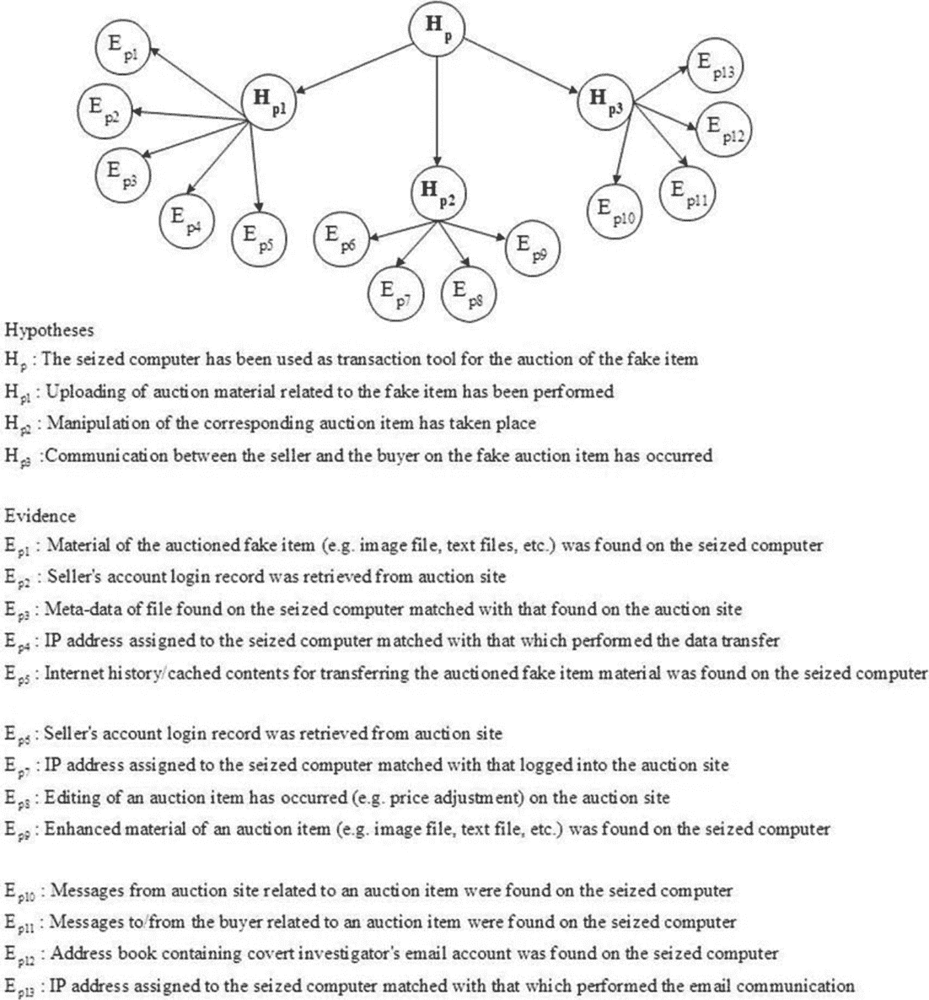

图 3：控诉方假设和相关证据的图示。


尽管已经确定了法庭假设和相关的数字证据，但数字取证鉴定员和数字犯罪调查人员始终难以向认可的实体以概率值的形式表达他们的知识和信念。为此，采用了 Boondao (2008) 提出的概率提取模型来从专家处获取概率。事实上，Boondao (2008) 模型源于 Keeney and von Winterfeldt (1991) 的方法，该方法基于贝叶斯概率理论和决策分析模型，并涉及提取和使用专家判断的技术。

为了将 Boondao (2008) 模型投入实践，必须应用一个包含六个步骤的过程。这些步骤是：在提取法庭假设和相关证据的概率分布后，为控方和辩方案件构建贝叶斯网络。

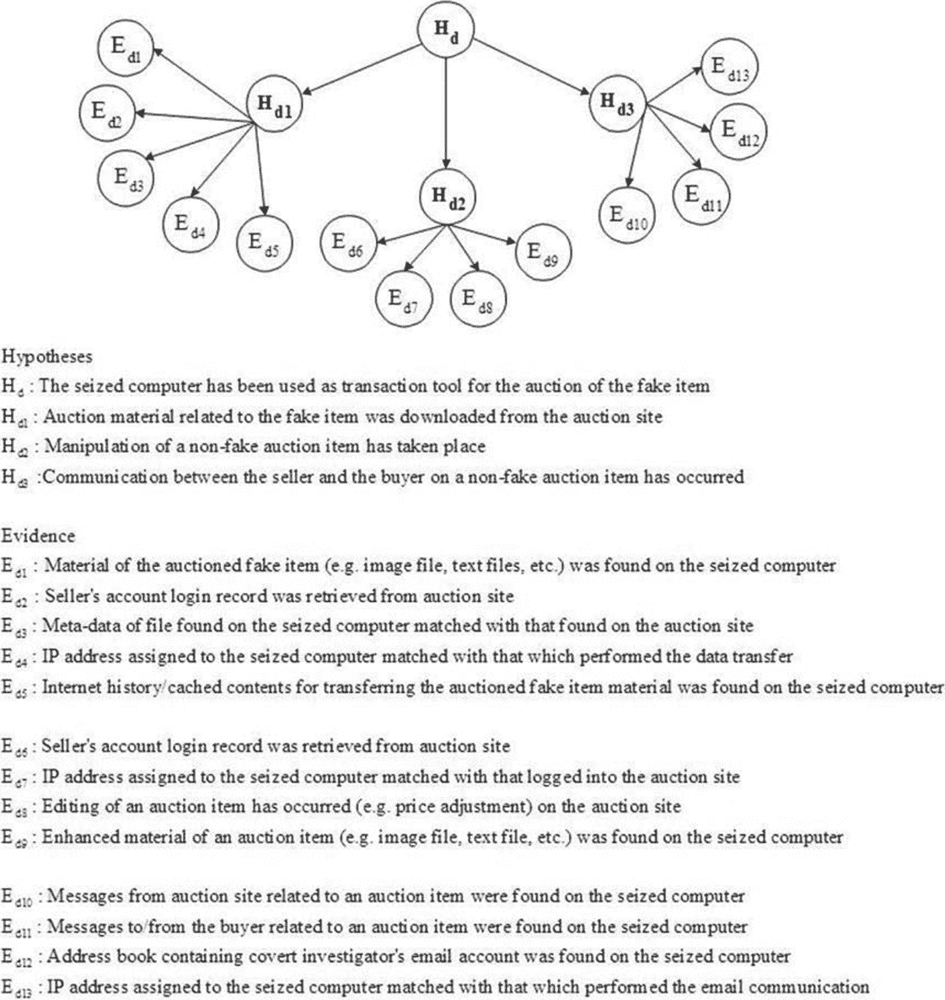

**图 4** 控方假设和相关证据轨迹的图化表示。

1. **识别和选择与案件的问题。** 这是通过对在线拍卖诈骗案件进行广泛审查实现的。同时也考虑了从事该领域的调查人员的意见。

2. **专家选择。** 在当前涉及在在线拍卖网站销售假货的案件中，选取了来自香港海关的三名数字取证鉴定员和两名数字犯罪调查员。这些专家是负责有关在线拍卖网站销售假货取证分析和调查的数字取证鉴定员或数字犯罪调查员。

3. **识别控方和辩方场景的法庭假设及支持证据。** 在过程中，与所选专家进行采访和讨论，以定义要提取的法庭假设及其相关证据。该部分的详细描述见第 3.4.1 节。

4. **准备提取。** 在确定需要提取的假设和证据后，对所选专家进行概率评估概念和提取方法的研讨。

5. **执行提取。** 与专家进行访谈。通过访谈，构建假设和证据的概率值和条件概率表。

6. **分析提取结果。** 在各专家分配概率后，对提取结果进行分析，以获得每个专家针对相关事件或数量的可比较概率分布。为了实现这一目标，对每个专家的概率分布进行聚合，然后取整体分布的平均值。

### 3. Yahoo! 邮件泄露

Bascuas (2008) 对 Yahoo! 事件进行了简要总结。2004 年 4 月 20 日深夜，由于其个人独自身处湖南长沙的办公室里，中国记者石涛使用其个人 Yahoo! 中国账户向位于纽约的台湾同事发送了一封邮件。该邮件总结了一份政府文件，警告不要在即将到来的天安门广场大杀戒十五周年举行具有破坏性的纪念活动，并指示媒体阻碍此类示威。

两天后，北京国家安全局要求雅雅虎控股（香港）有限公司提供石先生所用账户的身份信息、登录时间和邮件内容。通知称，这些信息涉及一项向外国实体提供国家机密的调查。雅雅虎控股（香港）有限公司履行了要求。

七个月后，国家警察在山西太源新家附近的一街上逮捕了石先生。他们将他向南运输 667 英里到达长沙并在那里关押。大约一个月后，中国指控石先生犯有“向外国提供国家机密”罪。在 2005 年 3 月 11 日的审判中，石先生未否指控，但辩称他的披露不涉及“特别严重的情况”，这一主张被法院拒绝了。由于石先生承认罪行且其犯罪未造成严重危害，法院判处其十期徒刑。石先生计划于 2014 年 11 月 24 日从师山监狱释放。

几个月后，石涛在香港的授权代表向个人资料隐私专专员办公室的隐私专专员提出投诉。投诉指控雅虎香港通过向中国当局披露订阅者的个人数据，违反了香港《个人资料（私隐）条例》。隐私专专员启动了调查。

在个人资料隐私专专员办公室 (2007)中，专专员得出 IP 地址本身并不构成个人数据。他认为 IP 地址是 ISP（服务提供商分配给用户计算机的特定机器地址，因此对于特定计算机是唯一的。因此，IP 地址本身（per se）不符合个人数据的定义。

专专员进一步得出结论，无法得出安全结论证明该 IP 地址相应的用户信息属于活体个人而非公司或非法人团体，或涉及真实个人而非虚构个人。因此，IP 地址结合相应的用户信息也不符合个人数据的定义。尽管 IP 地址未被视为个人数据，但它是定罪的原因之一（湖南省长沙市中级人民法院 2005 年一审判决书理由）。

雅雅虎控股（香港）有限公司向北京国家安全局提供的信息是：用户注册信息、IP 登录信息和某些邮件内容（个人资料隐私专专员办公室 2007 和表 1 展示了雅虎案中基于 Web 的邮件传输中不同实体之间的关系和关联。

在刑事案件中，控方被要求在排除合理怀疑的情况下证明犯罪分活动。对于数字取证分析，取证人员需要检索数字证据，以重建一系列活动，从而证明石涛是否执行或未执行发送涉案邮件活动。这些活动如下：

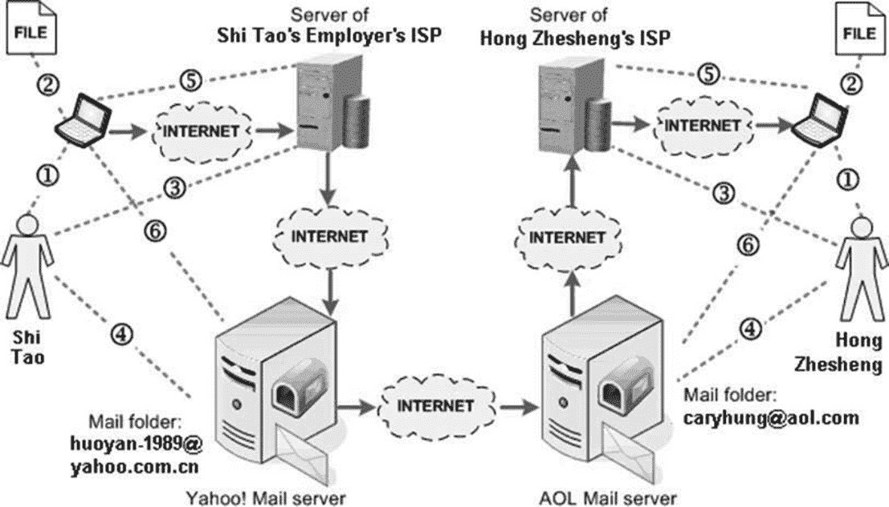

**图 5** 石涛到洪正生基于 Web 的邮件传输中实体之间的关系。

**表 1：** 图 6.3 所示的邮件传输实体间关联关系的描述。

- ➀ 石涛（洪正生）控制着该电脑。
- ➁ 附件存在于石涛（洪正生）的电脑上。
- ➂ 石涛雇主（洪正生）的 ISP 订阅记录。
- ➃ 石涛（洪正生）的 Yahoo! (AOL) 邮箱账户注册记录。
- ➄ 电脑连接到 ISP。
- ➅ 浏览器程序显示 Yahoo! (AOL) 邮箱网页。

1. 石涛能够访问一台连接到互联网的电脑。
2. 电子文件的副本存储在电脑中。
3. 为了获得互联网访问权限，石涛在其电脑与互联网服务提供商（ISP）之间建立了连接。事实上，他使用了其雇主订阅的拨号账户。ISP 检查了石涛雇主账户的有效性和真实性，然后为石涛的电脑分配了一个 IP 协议（IP）地址。石涛的电脑随后记录了分配的 IP 地址并将其用于后续的互联网访问。源自或发往石涛电脑的互联网数据将通过 ISP 的电脑。
4. 石涛启动了浏览器程序。为了连接到 Yahoo! 邮件服务器，石涛在浏览器程序中输入了 Yahoo! 邮箱的统一资源定位符（URL）或网页地址。
5. 浏览器程序随后向 Yahoo! 邮件服务器发送 HTTP 请求。当检索到请求的网页时，由浏览器程序显示。
6. 为了登录邮箱账户，石涛输入了相应的用户名和密码。根据邮件订阅详情，Yahoo! 邮件服务器验证了石涛的身份并允许其登录邮箱文件夹。
7. 石涛编写了邮件，添加了文件并输入了洪正生的 AOL 邮箱账户。他随后“点击”“发送”按钮，将邮件同附件一起发送出去。由于石涛使用浏览器程序编写邮件，邮件内容可能会缓存在石涛的电脑中。
8. Yahoo! 邮件服务器随后存储了邮件（包括附件），并将其放入消息队列，以便通过 SMTP 发送给洪正生的 AOL 邮件服务器。

为了构建贝叶斯网络对该案例进行建模，先验概率被设定为严格非信息性的，而通过询问领域专家获取了条件概率（似然性）。随着每一项预期的数字证据被成功恢复，支持控方假设的后验概率为 `ca`. 97.2%。虽然该案件没有可信的替代假设来与此结果进行比较，但它确实对应于支持控方假设的 `ca`. 34.7 的似然比。此外，对贝叶斯网络进行的单参数和多参数敏感性分析显示，对该值的扰动极小（Kwan et al. 2011, Overill et al. 2012）。

## 4. 性效益调查模型

除了对已恢复的数字证据如何产生的替代假设（例如控方或辩方提出的解释）的合理性提供定量估计外，贝叶斯网络还有潜力通过加速数字调查过程本身，通过对特定刑事调查中单项数字证据的重要性（权重或证明价值）提供定量估计来实现。

单项数字证据的证明价值反映了如果该项证据被恢复，其存在在多大程度上对于创建所有已恢复数字证据过程的假设的整体合理性有所贡献。也许实现这一点的最简单方法是取贝叶斯网络在存在和不存在该项证据的情况下，针对该假设的后验概率之差（Overill and Chow 2018）。

第二种方法是为贝叶斯网络生成所谓的龙风图，该图显示了由于每个证据项目相对于所有剩余项目时，后验概率发生变化的排序范围（Agena 2016）。

另一种更为复杂的方法是使用信息论：香农熵的 Kullback–Leibler 散度提供了信息增，作为衡量具有（`P`）和不具有（`Q`）该项证据的贝叶斯网络概率分布差异的指标：

$$
D_{KL}\left( P \middle| \middle| Q \right) = \sum\limits_{i}{P_{i}\log\frac{P_{i}}{Q_{i}}}
$$

这对上述证据权重导致了若干不同的排序（Schneps et al. 2018）。

在数字取证调查中，通常情况下单项数字证据至少在近似上被认为是相互条件独立的。了解每项数字证据的相对重要性就可以设计出高效的数字调查方案，按顺序首先搜索证明价值最高的证据项目，将重要性较低的项目推到以后。

如果存在关于定位和恢复每项证据的成本（以调查人员时间、设备使用等可变现资源计算），则这种调查方案可以被称为具有成本效益（Overill et al. 2009）；此时可以调用经济领域的领域概念，如投资回报率（RoI），或者相反的成本效益比（CBR），按 RoI 下降或等效 CBR 上的顺序对证据进行排序，以产生近成本最优的调查策略（Overill 2013）。

## 5. 总结与未来工作

本文描述了使用贝叶斯网络量化与恢复的数字证据迹创建相关的假设的合理性，并结合香港真实的刑事案件案例进行了说明。此外，还概述了应用贝叶斯网络量化特定调查中单项证据的相对权重或强度，通过其中任意一种方法，以产生具有成本效益的调查策略。

在未来的研究方面，对各种更一般形式熵的散度进行比较研究，例如应用于证据权重或强度量化的 Sharma–Mittal 熵族（Crupi et al. 2018），将具有很好的意义。

值得注意的是，贝叶斯网络（BNs）的应用最近扩展到了更广泛但相关的背景，即软件作为武器的泛化（Silomon 2019）。

## 参考文献

- Agena Ltd. 2016. AgenaRisk 7.0 User Manual, pp. 99–102.
- Bascuas, R. J. 2008. Property and probable cause: the fourth amendment’s principled protection of privacy. Rutgers Law Review 60: 575–645.
- Bayes, T. 1763. An essay towards solving a problem in the doctrine of chances. Phil. Trans. Roy. Soc. Lond. 53: 370–418.
- Casey, E. 2018. Clearly conveying digital forensic results. Digit. Invest. 24: 1–3.
- Chae, M., Shim, S., Cho, H. and Lee, B. 2010. Empirical analysis of online auction fraud: credit card phantom transactions. Expert Systems with Applications 37: 2991–2999.
- Clemen, R. T. and Winkler, R. L. 1987. Calibrating and combining precipitation forecasts. pp. 97–110. In: Viertl, R. (ed.). International Symposium on Probability and Statistics. Springer-Verlag.
- Cohen, B. 2003. Incentives build robustness in BitTorrent. pp. 68–72. In: Proceedings of 1st Workshop on Economics of Peer-to-Peer Systems, Berkeley, CA. Available online at `www.bittorrent.org/con`.
- Crupi, V., Nelson, J. D., Meder, B., Evolani, G. and Tentori, K. 2018. Generalized information theory meets human cognition: introducing a unified framework to model uncertainty and search. Cog. Sci. 42: 1410–1456.
- ENSFI. 2015. ENFSI guideline for evaluative reporting in forensic science v3.0, p.17. Available online at `http://enfsi.eu/wp-content/uploads/09/guideline.pdf`.
- First Instance for Verdict. 2005. Changsha Intermediate People’s Court of Hunan Province, Reasons for Verdict, Case No. 29, Changsha Intermediate Criminal Division, China. Available online at `www.pcpd.org.hk/english/files/annex.pdf`.
- Keeney, R. L. and Winterfeldt, D. 1991. Eliciting probabilities from experts in complex problems. IEEE Trans. Eng. Mgmt. 3: 191–201.
- Kobayashi, M. and Ito, T. 2008. A transactional relationship system in internet auctions. Studies in Comput. Intell. 110: 87–99.
- Ku, Y., Chen, Y. and Chiu, C. 2007. A proposed data mining approach for internet auction detection. pp. 238–243. In: Proceedings of the Pacific Asia Workshop on Intelligence and Security (PAISI 2007), Chengdu, China. Springer-Verlag.
- Kwan, M., Chow, K. P., Law, F. and Lai, P. 2008. Reasoning about evidence using Bayesian networks. Advances in Digital Forensics IV, Ch. 22: 275–289, Springer.
- Kwan, M., Overill, R., Chow, K.-P., Silomon, J., Tse, H., Law, F. and Lai, P. 2010. Evaluation of evidence in internet fraud investigations. Advances in Digital Forensics VI, Ch. 7: 95–106, Springer.
- Kwan, M., Overill, R., Chow, K.-P., Tse, H., Law, F. and Lai, P. 2011. Sensitivity analysis of digital forensic reasoning in Bayesian network models. Advances in Digital Forensics VII, pp. 213–244, Springer.
- Ochaeta, K. 2008. Fraud detection for internet auctions: a data mining approach, Ph.D. Thesis, College of Technology Management, National Tsing-Hua University, Hsinchu, Taiwan.
- Office of the Privacy Commissioner for Personal Data. 2007. The Disclosure of Email Subscriber’s Personal Data by Email Service Provider to PRC Law Enforcement Agency, in report published under Section 48(2) of the Personal Data (Privacy) Ordinance RO-3619, Hong Kong. Available online at `www.pcpd.org.uk/english/files/annex.pdf`.
- Overill, R. E., Kwan, Y. K., Chow, K. P., Lai, K. Y. and Law, Y. W. 2009. A cost-effective digital forensics investigation model. pp. 193–202. In: Peterson, G. L. and Shenoi, S. (eds.). Advances in Digital Forensics V. Springer Verlag, Berlin Heidelberg, Germany.


* Overill, R. E., Kwan, Y. K., Chow, K. P., Silomon, J., Tse, H., Law, F. W. and Lai, P. K. Y. 2010. Sensitivity analysis of a Bayesian network for reasoning about digital forensic evidence. 4th International Workshop on Forensics for Future Generation Communication Environments, in Proc. 3rd International Conference on Human-Centric Computing, Cebu, Philippines, pp. 228–232, IEEE Press.
* Overill, R. E., Zhang, E. P. and Chow, K. P. 2012. Multi-parameter sensitivity analysis of a Bayesian network from a digital forensic investigation. Proc. ADFSL Conference on Digital Forensics, Security and Law, Richmond, Virginia, USA.
* Overill, R. E. 2013. Digital forensonomics—the economics of digital forensics. In: Blackwell, C. (ed.). Proceedings of the 2nd International Workshop on Cyberpatterns (Cyberpatterns).

本章论证了网络世界光谱内民主的未来。它探讨了各个方面的理论和考量，涵盖了技术进步与互联网世界效用局限之间的微妙平衡。它承认在后新冠（Covid-19）全球大流行时代，必须采纳并适应有关网络安全的等特定监管措施。本章强调了通过整体性且专业化的策略和方法论来加强网络通用安全政策的绝对必要性。本章试图寻求一种平衡，以避免出现奥威尔式的场景——即网络安全可能演变为大规模监控，表现为大规模、广泛的网络隐私侵犯，以及包括“离奇”行为在内的极端压迫。本章考察并分析了伦理和道德价值观、混合政体、社交媒体在网络世界中的作用、网络安全的决定因素以及如何对其进行监管 1154

## 1. 引言：民主、网络安全与新冠-19 全球大流行

2020 年将在人类历史上被铭为 21 世纪首次全球大流行之年，或简单地称为“新冠年”。然而，全球大流行并不新鲜。到此为止，人类已经面对过无数次导致数亿人死亡的大流行。这些大流行包括 14 世纪的黑鼠疫，它消灭了欧洲三分之一甚至一半的人口和牲畜。在 20 世纪，我们见证了同样具有破坏性的疾病——1918 年大流感，它夺走了超过 2000 万人的生命，根据其他估计，在第二波疫情中高达 5000 万。这些数字远超第一次大战的 2600 万受害者。根据全球人口的估计，有 5%的人类丧生（Coppola 2011; Green 2008）。其他大流行还包括寨卡病毒、SARS、HIV 和埃博拉病毒，但与 2020 年当前的新冠大流行相比，它们的传播范围相对较小。弗兰克·斯诺登（Frank Snowden）在新冠爆发前几个月出版的一本书中敏锐地将后两者称为“21 世纪的预演习”（Snowden 2019）。

然而，在新冠之前，没有任何一次大流行需要采取像 2020 年所采取的如此激进的措施，其中一些措施现在被认为对我们的民主构成了威胁。我们产生这种无敌的错觉主要有两个原因：一个世纪以来对大流行的相对快速遏制，以及医学科学的巨大进步。事实上，20 世纪医学领域的巨大进步以及同步的技术进步确实令人宽慰。我们的社会变得日益开放、多元化和全球化，导致了大量无国界的机会，因此没有人预料到可能会让一切陷入停滞的大流行。这场大流行向我们证明，我们离无敌（至少在医学意义上）还差得远。

这场大流行显然引起了全球性的社会动荡。在疫情正式宣布后不久，采取的措施使我们的市场经济陷入了停滞。所采取的措施至少是极其激进的：从禁止活动、禁止公共集会、限制国内活动到全面的宵禁、从小学到高等教育的教育机构的关闭、从非必要商店关门到全面封锁，以及国际及当地的行动限制（全球范围内客航班大多受限），创造了一个无与伦比的局面。

这一新环境受到三个重要因素的支配：

1. 开放市场经济提供的物理接触、效力和服务的局限性。
2. 我们技术部门效用和实用性的增加。
3. 由于广维网提供的效和服务被广泛个人或公共使用而导致的脆弱性增加。

从未有如此多的人通过利用互联网提供的机会来“升级和更新自己”。大量的人突然必须在线工作、在线社交并进行在线交易。许多人躲在在线通信中以应对社交距离。这一事实为各种坏分子提供了肥沃土壤。因此，它引发了关于国家或集体安全以及民主相关的网络安全问题的担忧（Efthymiopoulos 2019）。

本章在网络空间框架内考察并分析了民主的未来。它论证了网络安全的重要性和要求。它探讨了可能的威权主义风险与民防必要性之间的微妙平衡。它了在新的工作和运行虚拟环境框架内加强网络安全的绝对需求。然而，将其范围限制在关于我们社会未来的可靠信息和科学研究，以避免出现奥威尔式的大规模监控、广泛的隐私侵犯以及对“离奇”行为的极端压迫（Orwell 1949）。

本章回答了关于我们民主未来的关键问题和伦理困境：

* 所采取措施是出于必要还是出于选择？
* 在采取明显限制个人自由和限制民主的措施时，有哪些替代方案？
* 关于种族、性别、尤其是信仰的道德和社会规范是否得到了解决？
* 所采取措施的长期社会经济后果是什么？
* 我们的领导人做出影响民主机构的决策是否合法？
* 万维网和互联网是否是我们职业和社交生活的“新常态”？
* 网络安全是否应该成为社会保护的新在线方法论？

本章从整体方法观察这些元素。本章针对政策制定者，在每个子章节提出了关于新冠时代民主和网络安全的建议。

作为声明，本章由两位作者交付，他们的兴趣纯粹是学术和科学。此展示的所有工作均与任何私人或公共实体、政府机构或组织无直接或间接的关系或关联。这些是作者个人的科学成果，仅应视为纯粹的个人科学和学术研究。

## 2. 民主 2.0

对民主术语及其组成部分的深入见解是讨论民主未来的先决条件。该术语由两个希腊词合成，因为民主作为一种政治制度诞生于古希腊。第一个词是“demos”，意为“人民”，第二个词是“kratos”，意为“权力”。有时这个词被错误地翻译为“统治”。因此，民主是人民拥有权力的政治制度，而不是人民统治的制度，因为在任何时候都有民选代表在治理。不言而喻，在民主制度中，统治者取决于并根据人民的愿望和实际需求采取行动，同时存在机制确保人民拥有权力，例如选举、公投等。⁹

此外，在民主社会中，人们拥有某些权利，但也承担着特定的义务。通常，义务会限制某些自由以保护他人的权利，而这正是政府对新冠肺炎（CoVid-19）反应引发许多争议的地方。关于公民权利，民主应当保护个人的民事权利，更深层次地说是保护人权。通常，当我们谈及人权时，我们的参考标准是联合国《世界人权宣言》（UDHR），这是一份由联合国大会（UNGA）于 1948 年 12 月 10 日在巴黎通过的具有具有开创性意义的文件（联合国，1948 年）。上述权利中最基本的是第 3 条所述的，该条款写道：“人人皆享有生命、自由和人身安全的权利”。然而，在疫情期间，大多数民主选举产生的政府为了保护弱势群体的生命，违反了以下权利：

* 第 12 条：“任何人不得受到对其`隐私`的任意干涉……”
* 第 13 条：“每个人都有在每个国家边境内`移动自由`和居住的自由。每个人都有权离开任何国家（包括自己的国家），并返回本国。”
* 第 20 条：“每个人都有`和平集会自由`和结社自由……”
* 第 23 条：“每个人都有`工作的权利`……”

### 2.1 限制自由

关于民主的核心问题在于，在新冠肺炎肺炎期间及之后，至少在人类找到有效疫苗之前，个人自由可能继续以各种方式受到限制。因此，我们在可预见的未来将注意到一种更多基于人类安全的“监控民主”制（Zuboff 2019）。监控将得到加强；因此隐私权将面临贬值。工作权已经萎缩，大量的失业年轻人正在一个我们已经见证了“不稳定无产阶级”（Precariat）兴起的时代——这一术语由盖·斯坦丁丁（Guy Standing）创造，指代那些生活在充满不安全感的全球化世界中、没有社会福利、失业或就业不足且薪资低下的年轻人，他们生活状态极不稳定，这显然暗指了著名的无产阶级阶（Standing 2011）。

关于选举政府在绝大多数人口支持下对集会自由和行动自由的限制。然而，一个非常有争议的是，即使是拥有民意支持的民主选举领导人，是否有权限制上述自由。值得强调的是，行动自由、集会自由以及言论自由，是极权政权首要针对的自由。因此，我们需要评估采取此类非民主措施的必要性。毫无疑问，很大比例的公民缺乏自律和常识导致了这些措施成为绝对必要，即使某些“不自由的民主国家”将其作为进行公然违规的借口。

更令人不安的是关于限制我们自由持续时间的不确定性。许多人都在想：“但，要持续多久？”、“人们的权利何时能完全恢复？”、“对第二波疫情的恐惧会让政府永久地维持上述限制吗？”遗憾的是，答案是“视情况而定”。我们需要强调，即使是那些在最初初了任何限制性政策或试图恢复某些权利的国家，也不得退缩并采取严厉措施。仅在美国，截至撰写本文时，新冠肺炎的死亡人数已超过了第一次世界大战的死亡人数，作为一场灾难，其排名仅次于美国内战和第二次世界大战。¹⁰

### 2.2 混合政体

全球范围内具有极权倾向的民粹主义政权的兴起早在新冠肺炎传播很久以前就被确定为一种趋势，但现在这种趋势进一步恶化了。根据 2020 年 5 月 6 日发布的第 25 届自由之家会年度《转型中的国家》报告，波兰和匈牙利等国经历了剧性的民主倒退，而这并非由于新冠肺炎。事实上，在上述报告所监测的中欧和东南欧 17 个国家中，有十个国家的民主遭受了侵蚀。欧盟的四个成员国，即克罗地亚、保加利亚、罗马尼亚和波兰，被认为是“半巩固民主国家”，而同样作为欧盟成员国的匈牙利则被描述为“混合政体”（Csaky 2020）。这些国家的领导层已经偏离了民主进程，以消除对他们权力的任何制衡，而新冠肺炎后的时代为进一步侵蚀民主提供了黄金机会。显然，正在持续的疫情促进并加速了对民主机构的攻击。一个不可否认的事实是，近期代议民主正在动摇和崩溃，而新兴的社会紧张局势是更广泛系统性危机的症状。日益增长的政治不满和“民主疲劳”（Van Reybrouck 2016; Bauman 2007）^(11

### 2.3 社交媒体的角色

上述“民主疲劳”的催化剂是社交媒体。社交媒体通过说服人们参与民主进程是一场闹剧、政党仅仅是腐败的精英机构、以及决策并非真的由选出的官员做出。其他时候，我们见证了通过社交媒体进行的干预，这些干预变成了宣传和破坏的工具。例如，2016 年美国选举后的国会听证会试图确定 `Twitter` 机器人、`Facebook` 数据操纵、俄罗斯特工（如“互联网研究局”——一个臭名昭著的“水军农场”）对选举结果的影响。由于多种原因，社交媒体被认为是对民主的一种前所未有的巨大危险，特别是在新冠肺炎时代，因居家隔离而受限的人可能更依赖它们来获取“信息”。

此外，社交媒体权力的增长已到足以作为一个能言善辩的恶意挑拨者，对国家构成迫在眉睫的威胁，煽动大众进入不理性的疯狂的自我毁灭螺旋（Shearer and Matsa 2019; Boukes 2019）。^(12

相比之下，在社交媒体主导的时代，每个人无论其学术背景和专业知识（或通常是缺乏这些），都能成为自己的媒体出版者，最重要的是，通过他们的 `Twitter`、`Facebook` 和其他社交媒体账号建立庞大的粉丝，问题正出于此。他们利用了逃避机构性守门职责的社交媒体的全能性，躲在 1996 年美国《电信廉价法》（CDA）第 230 条的保护下。¹³

### 2.4 新冠肺炎与信息泛滥

在审查了社交媒体格局及其对民主制度构成的威胁后，我们需要强调，Covid-19 疫情导致了全球性的虚假信息大流行，虚假信息通过社交媒体平台和其他渠道迅速传播，对全球公共健康构成了严重威胁。埃塞俄比亚人、世界卫生组织总长特德罗斯·阿哈诺姆·格布雷叶苏斯博士强调：“我们不仅在与疫情作斗，还在与一场信息大流行作斗……但现在社交媒体的不同之处在于，这种现象被放大了，它传播得更快、更远，就像随人类移动并传播得更快、更远的病毒一样……疫情爆发期间，关键在于确保人们会采取正确行动来控制疾病或减轻其影响。因此，不仅要确保人们获得信息，还要确保他们在获得信息后能采取恰当的行动”（Zarocostas 2020）。

在这种环境下，普通人几乎无法区分哪些可用信息中哪些是真实的、哪些是伪造的，特别是在能够制作深度伪造（deepfakes）先进技术的时代。只要政府本身不传播虚假新闻，网络安全就可以提供帮助。因此，信息大流行期间的关键问题是：“谁来保护我们免受保护者的侵害？”答案在于个体的责任感，因为他们需要检查所信赖信息源的可信度，并通过大量的信息源对新闻流进行比较和分析。在政府失败、民粹主义领导人或混合政体的情况下，公民对于政府控制的信息源所传播信息的有效性，需要保持谨慎并对其持保留态度。

## 3. 网络空间与网络安全对未来民主的重要性

网络空间是植根于现代社会的重要虚拟形态。网络空间是社会进步的催化剂。它是通过技术创新提供的工具。它是一种服务于包括我们的国家和国际民主体系在内的整合工具。今天，我们无法离开网络空间的用途和利用。

在 21 世纪的前二十年里，我们通过网络空间实现了让全球社会相互靠近的方法。我们成功将许多政府和私人服务集中并上传到互联网的虚拟世界。在此过程中，我们便利了生活方式，也提供了更好的商务和贸易方式。这就是网络空间所提供的：具有无限空间（虚拟和地理）的无限选择。随着互联网和万维网的发展，我们成功地“弯曲了时间和距离”。我们成功实现了真正的技术进步、增长和创新，这些现在正定义着我们 21 世纪的社会。

网络空间在今天可能是最重要的市场资产，可以说它是单一最重要的商品。虽然世界已经进入了“数字化时代”，在基础设施、经营方法、社会和专业意识、教育方面，我们也已经对其产生了依赖。新一代人现在从小起就被整合进一个我们称之为“矩阵”的系统中，我们的年轻一代无法离不开它。

我们的社会和政府、我们的民主制度，正如它们在冷战后（20 世纪后半叶的特征）那样聚在一起一样，在一种新事物中找到了“避难所”，一个他们可以投入的新型“平台”，一个他们可以投资的地方、一个可以投资的地方、一个可以投资的地方、一个可以投资的地方、一个可以投资的地方、一个可以投资的地方、一个可以投资的地方、一个可以投资的地方、一个可以投资的地方、一个可以投资的地方、一个可以投资的地方、一个可以投资的地方、一个可以投资的地方、一个可以投资的地方、一个可以投资的地方、一个可以投资的地方、一个可以投资的（Schwab 2018）。

### 3.1 监管与网络空间

网络空间目前在国家、法律和操作层面上由每个国家进行监管。这意味着我们的国家政府确实控制着虚拟空间。然而，网络空间并不限于一个国家或一个市场（Weiss and Rorden 2019）。无论你是在城市的中心、首都或城镇，还是在某个有电力和互联网的偏远地区，几乎到处都可以网络空间进行查看、访问或操作。

我们的国家电信机构是网络空间的监管者。它们也是“守门人”，允许信息的流入，即我们所熟知的下载；以及信息的流出，即我们所熟知的上传到互联网或又称万维网。

## 4. 2020 年的网络安全

网络安全作为一种数字战略和政策，旨在防御网络空间中当前和新兴的威胁与挑战。网络安全是一个极其复杂的现象。它已成为一门在学校、机构和大学授授的科学。公司、组织和政府也以保护国家公共和私有基础设施以及个人财产的名义运营网络安全工作。网络安全具有战略价值。它不断开发出针对任何恶意或非恶意攻击或黑客活动的安全实施方法和行动（Carayannis et al. 2018）。当威胁和新兴挑战在我们的传统世界中步步紧逼时，它们在网络空间中亦是如此。因此，非对称和混合威胁是生存性的。我们需要不断战斗的方法来应对这些显而易见的威胁。

在国家和国际安全的框架内，各国和政府寻求创建、开发、增强或不断应用网络安全和防御机制。一种健全且不断适应的保护方法，针对所有和任何可能的威胁；无论这些威胁是基础设施性的还是个人的。

### 4.1 网络安全的特征及其韧性

网络安全并不局限于传统的安全形式。这是理所当然，因为它处理的是发生在网络空间中的事件。网络安全已成为一种非常重要且绝对的保护工具。正如我们所说的，随着我们的社会向新的数字世界进步，我们的安全也在进步。当我们的生活现在整合到一个集体的网络矩阵时，我们的集体安全——个人与集体机制——也是如此。

在 21 世纪，网络空间让我们彼此更加接近。它构成了本世纪特征的最重要单一技术创新之一。然而，网络安全已成为防御和保护网络空间最重要的政策和工具。它需要全球和局部的监管及应用状态与框架。撰写关于网络空间安全等话题，需要对互联网本身所有可能的当前安全威胁具有健全的理论和实践能力知识。更何况我们每天都变得越来越互联互通（Carayannis et al. 2018）。

网络安全是一种需要韧性来达到防御威胁和挑战目标的战略。网络安全在本质上是一个操作性防御能力领域，通过针对恶意攻击或威胁采取防御措施来运行。网络安全可以成为技术安全和业务连续性的关键政策框架。跨国合作的方法可以增强民主中的多元主义元素；它将有助于提高互联性，并将加强安全工作以应对所有对称和非对称的安全威胁。

各国政府的坚决基于安全和防御战略。当涉及网络空间时更是如此。民主国家依赖国家的网络安全保护政策和应用方法；合作如何能够以及将如何实现；信息敏捷性如何提升。我们可能使用哪些当前和未来的工具来技术上进步新形式的机制。

在 2020 年及以后，世界比以往任何时候都更加电子互联。在这个新世界中，我们寻求健全且稳健的解决方案来“确保所有通信线路的安全”。日益需要采用和适应新的方法和新思想，这些方法可能会增加安全水平，因为不安全因素在增加，技术在进步，网络空间正成为我们民主的整合元素，而我们的民主正通过它们进行统治和运行（Zuboff 2019）。用于网络保护的新方法和行动将继续并将不断出现，供检查、分析和应用。现有的威胁在现在和未来将继续出现。


网络安全反映了人类安全以及人类资本和能力。在所有防御层面（包括国家和全球以及通过国际组织）增加技术信息和知识、创新、战略和操作（Efthymiopoulos 2016）。

在安全行动中，“未来的类战争行动”以及其他相关措施……“将在比当前复杂得多的军事行动环境中进行，这些战斗将在多个层面和多个维度上进行”（Efthymiopoulos 2009）。反之，在“军事和警察任务中，我们继续需要敏捷、网络化、训练良好且领导良好的部队”（Efthymiopoulos 2014）。更重要的是，是我们将在下文中探索的知识效率和基于知识的民主规则。

## 5. 知识民主

David Campbell 和 Elias Carayannis 同意了“知识民主”和“网络民主”的概念（Carayannis et al. 2014）。他们声称这一概念在实践中是反映的，在那些具有我们所谓的“增强和合作型法治”先进水平的民主国家中：这种制度允许真正的增长、生产、知识创新和应用方法发生。知识民主在创新方面“表现卓越”，并承载着可持续发展的影响（Carayannis et al. 2018）。在我们基于网络空间的现代社会中，知识民主已成为当前和未来增长的先进工具，并最终成为将我们聚集在“全球网络屋檐”下的方法。这是一个全球电子社会的本质。

知识民主是一种增长/进步工具。在网络空间民主治理中，就像在传统民主一样，进步来自于生产、监管、操作、所有部门真正的创造力以及未来创新的不断升级。通过这种方式，在网络空间中，我们都同时受益于全球创新。我们通过推进自己的民主制度来实现平等且普遍的增长。

如今，知识民主也关乎伦理。它有助于建立进步的框架。在这种情况下，它有助于建立通过网络空间进行社会增长和发展的伦理用途和工具。因为为了实现真正的发展和增长，我们需要通过切实的进步过程向前推进：发展。

我们民主国家的未来（这也是本章标题的一部分）取决于原则、观念、道德和行动方法。取决于我们如何在网络空间日常监管和运营。取决于我们如何以及如何与全球社会共享我们创造的成果。

在不久的将来，我们的民主国家将完全数字化。它们将通过网络空间以 100%的容量运行，且没有实体存在。众周知，为了成功，我们需要为网络空间建立健全、可持续、务实的方法、战略和政策。网络空间的未来体现了知识民主的意义。创新将是长期的并始终处于网络空间的前沿。一个超越传统和边界的网络空间。公共空间现在是我们的全球网络空间。

虽然网络空间供我们从何处偏远地区访问，但需要在全球范围内进行建设性和操作性的监管。它应该以相似的方式、地点和平台进行全球治理。在我们的所有社会汇聚并一致的地方，达成比 2020 年所实现的更增强的规则、条例和操作方法等。

如前所述，网络空间需要保护。它的良性运行以及互联网或基于 Web 的格式、应用程序以及其他软件/硬件方法的未来，取决于一套保护和防御框架，该框架旨在应对针对不受监管、非法和恶意的操作、方式、攻击以及混合型非对称挑战的当前及新兴威胁与挑战。“网络安全”是并将始终一直是保护网络空间操作的最佳术语。它将是定义针对网络空间内任何非法、不受监管行为行动的唯一术语。

当我们加强网络安全方法论并在创新我们在网络空间中开展保护或执法行动的方式时，有许多真正的架构变革正在发生，这将塑造我们第四次工业革命和第五次技术革命的未来。

第四次工业革命是由世界经济论坛的克劳斯·施瓦伯（Schwab 2016）提出的术语，它仅仅是某种更宏大、与我们的物理生活及网络空间存在更深度融合的事物的开始。网络空间不仅在规范未来，而且在塑造未来。知识民主不仅在创新未来，也在塑造未来。在技术框架内，截至目前（2020 年），我们尚未看到伟大的创新，除了万维网的创造。我们仍有望在一个完全基于法律、基于经济、政治规模化的、受监管且受网络安全保护的网络空间中，看到全球民主的未来。

在我们未来的网络民主中，将存在一种新的架构。我们将看到一个真正的全球社会以虚拟形式成型，但具有更具物理感的方式（增强现实），而互联网和网络空间通过一个角色在虚拟上让我们彼此距离。这意味着新的嵌入式技术将被创造（Wall 2011）。基于网络空间的技术如控制论、机器人技术、人工智能、云技术、增强现实、大数据和物联网等，将允许网络空间与物理空间融合，呈现出新的形状和形式，这将是一个真正的创新。

当我们越来越依赖技术时，我们在数字层面上变得更加依赖。然而，在传统生活中，我们之间的社会距离却变得越来越遥远。我们也需要关注这一点。虽然我们取得了扭曲时空的巨大成就，但我们需要加小心，不要忘记了我们的现实世界。尽管我们的网络世界似乎更有趣，选项和机会也更多，但它也可能比以往任何时候都更具有资本主义色彩（Collier 2018）。

在我们未来的民主中，在网络安全的框架下，有两个主要元素将刻画我们的全球数字化民主：(1) 知识民主 (2) 监控与安全（Zuboff 2019）。这两个元素将进一步发展我们的网络治理体系。网络治理将受到监管，但在服务、适用性、使用和创新方面具有全球性本质。

## 6. 应用电子治理和加强互联网治理的效率、效能与有效性

无疑，在可预见的未来，电子治理将变得更加普遍，但迫切需要加强互联网治理，即开发规范、规则和流程来监管互联网。网络治理或电子治理在效率（`efficiency`）和效能（`efficacy`）方面是改进后的治理形式。然而，我们需要调查其有效性（`effectiveness`）。通常，我们互换使用这些词汇，但某人可能效率很高，却由于缺乏效能或设定了错误目标而导致无效。另一方面，另一个人可能是有效的，但在资源利用上是浪费的，导致效率低下。这是一个语义问题，因为效能与产生预期效果的能力有关，而互联网/高科技（如前所述）已经为我们提供了广泛的新能力。因此，效能是给定的。效率与努力、时间和程序有关。它关乎如何优化地做正确或错误的事。然而，显而易见的是，高科技的使用减少了任何浪费，未来的电子治理将更加高效。然而，衡量目标实现的程度与有效性有关。“粗略来说（`Grosso modo`）”，我们预测互联网治理履行其潜力的努力也遵循同样的规则。通过网络安全，我们将拥有完成任务的工具和能力，并高效地执行。但我们会是有效的吗？

这两种情况下的有效性都与“做正确的事”而非“把事做对”有关；因此这是一种领导特质而非管理特质，但当然，目标是“正确地做正确的事”（[Stack 2016](ch10.xhtml#ref10_31））。正如 Jeremy Pitt、Ada Diaconescu 和 Josiah Ober 特别描述的，电子治理面临的挑战是“设计自治的社会技术系统，这些系统在民主的基础上建立并从从源上（`ab origine`）构成，并且具有与自决过程中的公民参与相关的数字公民身份概念”（[Pitt et al. 2019](ch10.xhtml#ref10_24））。高科技本身并不能够的，因为有效性包含道德分量，而网络空间没有内在价值。在网络民主中，有效性将取决于“以人为本的设计和迭代软件开发技术——一些领域内人士开始称为‘以人为本的政策制定’”（[Sinai et al. 2020](ch10.xhtml#ref10_28））。

加强互联网治理的成效很大程度上取决于我们的道德伦理标准、规则、习俗和传统。然而，尽管网络是全球性的，这些标准并没有被普遍接受。因此，对于某些人来说，网络空间被视为全球机遇，而对另一些人来说则是全球威胁。共识是，人们在日常生活中享有的权利在网络空间也必须得到保护。然而，显而易见的是，范围内的人并没有相同的权利，甚至对于这些权利应该是什么并没有共同的认知。这就是为什么在理想情况下，互联网治理应该处于一个真正的跨国家层面。不是国家级的，不是区域性的，甚至不是政府间的。它将处于全球化、区域化和碎片化冲突的前沿。互联网治理应该是我们的最首要目标之一，是加强政治、安全或司法等通用机构的组成部分。

我们已经描述了实际上受美国司法管辖的社交媒体是如何缺乏监管的，或者充其是自律的。尽管大多数犯罪活动是通过暗网或深网进行的，但主流互联网经常被误用和滥用，并允许甚至煽动犯罪的发生。针对社区或职业的仇恨言论（首先想到新闻工作和执法部门）、如恋童癖和恐怖组织招募等犯罪偏差行为，都是不受监管的互联网导致严重后果的典型例子。上述大多数犯罪已在由欧洲理事会发起的《网络犯罪公约》中描述，该公约已包括美国、澳大利亚、加拿大和日本在内的 64 个国家签署并批准（欧洲理事会 2001）。伪造、诈骗、儿童色情被包含在公约中，而与仇恨言论、排外主义和种族主义相关的犯罪被包含在其第一个附加议定书中。尽管如此，仍存在许多未开发的领域，从数字赌博到不同的版权法以及信息或数据的所有权，对于什么构成犯罪仍留有很大的解释空间。

诚然，通用互联网治理的概念是复杂的，无疑需要许多安全阀和功能来确保其完整性和公民的安全。各国的倡议，例如法国总统埃马纽埃尔·马克龙于 2018 年 11 月 12 日发起的“网络空间信任与安全巴黎呼”，以及最重要的是多边努力（如联合国互联网治理论坛（`UNIGF`）的成果），都包含了此类原则。后者是一个跨机构、跨政府和多利益相关者小组，自 2006 年以来每年召开，讨论网络空间的问题和可能的解决方案。网络安全几乎一直是首要关注的问题，但我们可以识别出新的关注点，例如互联网基础设施的复杂性、物联网、暗网（互联网的一个黑暗分支）、老年人口对互联网的使用、深度伪造（`Deepfakes`）、数字身份与主权，以及监控资本主义（即商业实体为了营销目的收集个人/隐私数据），这些是在 2019 年提出的（`UNIGF 2019`）。尽管如此，在识别了犯罪和挑战的同时，尽管全球对某种互联网治理达成了共识，在大西洋两岸人们对隐私仍存在许多担忧，我们预测这种担忧将因为安全和卫生问题（如新冠 19 大疫情）而被忽视。直到最近，欧盟还试图通过《欧盟通用数据保护条例》（`EGDPR`）为其公民提供最大的隐私保护。事实上，即使是这项严谨的规定也有缺陷，因为当后者的数据被间接涉及时，某人的个人数据可能会引发涉及他人数据的隐私考虑（Karaboga 2018）。

即使我们识别了要处理的问题，并且在网络犯罪定义方面存在合作，一部通用的网络空间国际法也应该成为互联网治理不可或缺的一部分。然而，即使在采取这一步（目前被认为是乌托邦式的）之后，对于违反该法律的个人、公司甚至国家的处罚，也应该有一个最低的共识。从上述分析中，我们得出结论：未来的网络民主、电子治理和互联网治理将更加高效。尽管如此，它们的效力取决于人类领导因素，尽管它是网络民主成功的关键决定因素，但它实际上极具争议。

## 7. 未来网络民主的影响

我们的分析得出的结论是，在我们所称的“未来网络民主”中，心态、规则和规范的根本性转变是至关重要的。在未来的网络民主中，我们预计出于安全原因，隐私将受到限制，但监控将会增加（Zuboff 2019）。正如新冠 19 所表明的那样，监控在抗疫措施中发挥了至关重要的作用。Isobel Hamilton 在她题为《强制性自拍和接触追踪：世界各地的当局都在使用智能手机追踪冠状病毒，这是全球范围内监控大幅增加的一部分》的文章中非常准确地阐述了这一点（Hamilton 2020）。这种新范式在许多方面类似于奥威尔式的“老大哥”反反乌托邦。此外，网络空间中犯罪活动的持续威胁为普通人带来了困境。鉴于黑客和网络犯罪分子为了邪恶目的侵犯个人隐私，人们发现别无选择，只能自愿就隐私做出妥协。个人希望政府像保护物理空间一样保护他们免受网络空间的任何伤害，但高效的网络安全意味着部分放弃个人隐私权。因此，未来网络民主的显著特征是加强了监控，并可能对我们的隐私产生不利影响。

社交媒体的监管将引导我们进入一个网络民主时代，在那里，言论自由将受到“事实上的控制或限制”。有些人可能会认为，这种发生是有合理理由的，例如公共健康。例如，在大流行期间，发生了几起恐慌言论，人们通过社交媒体传播阴谋论，声称病毒根本不存在，因此无需担心，而整个局势是一场全球社会实验。然而，缺乏批判性思维能力且背景知识有限的人，很容易受到阴谋论和恐慌言论的影响。结果，轻信的人可能不仅无视政府的指南和限制措施，甚至会对这些措施进行反抗。最终，他们要么死亡，要么更糟糕，成为病毒的无症状携带者，从而导致他人的死亡。此类场景引发了一个问题：特定个人是否是唯一的罪祸首，还是说谣言的发者也应该受到惩罚？当谣言通过社交网络病毒式传播时，平台是否也应该承担责任并面临刑事指控？

另一方面，在“非自由民主制”中，¹⁵

未来的网络民主不应侵犯个人自由，特别是结社自由和行动自由。如果在大流行结束后，所有限制未能被完全取消，那些忍受广泛监控和居家隔离等措施的人将感到愤愤。然而，未来网络民主中的行动自由或结社自由并不意味着隐私得到保障。众所周知，通过智能手机和`GPS`，我们所有的活动和关联都可以被监控。此外，在中国已经通过人脸识别技术和人工智能使用的社会评分系统也令人担忧。我们还应该考虑到个人数据在网络空间中是一种商品，这使得政府和私营公司等第三方能够了解个人的购买记录、财务状况、偏好、激情、恶习和美德。一个完整的画像轻而易得，而我们确实是无力的，因为在网络民主中，一切都是通过互联网完成的。尽管如此，言论、结社和行动自由——即使在监控下——也是网络民主与高科技极权主义的区别所在。

治理质量取决于公民的公民教育。我们的未来在很大程度上取决于教育，而教育是未来最重要的行业之一（Ross 2016）。目前的趋势是关注基于硬科学和高科技领域的教育专业化。著名的`STEM`（科学、技术、工程和数学）正在兴起，而人文和社会科学正在衰落，这对于未来的网络民主来说是一个危险的趋势。我们未来的教育将是“网络”教育，从远程学习到距离学习，教育者将扮演不同的角色，即教练和导师的角色。任何信息实际上都可以在互联网上找到，因此教育者不再是知识的唯一守护者。他们的主要任务是检查和过滤可用数据，剔除不科学的数据、公然的谎言、深度伪造，以及通过半真陈述、仇恨言论和极端主义进行的宣传。下一步是让教育者解释他们的学生如何使用一种方法论将过滤后的数据转化为正确的信息。显然，从信息到知识的转化取决于个人的责任感。然而，如果我们在未来只关注硬科学，我们失去的将远比知识多。如果我们在未来教导自由民主的价值观，我们将拥有一个真正的网络民主。古希腊民主、文艺复兴和启蒙运动的价值观必须是我们未来民主的基础（Glassman 2019）。否则，非自由民主将占据主导。随着我们的社会向统一的全球数字治理转型，我们的网络空间世界将变得更加极权主义、民粹主义和权威主义。

## 8. 结论

本章采用了关于网络安全和网络民主的整体方法。本章针对政策制定者在新型网络空间环境和世界中的民主未来提出了问题。它在网络空间的框架内检查并分析了民主的未来、危险和前景。它论证了网络安全在未来网络民主中的重要性和性。它涵盖了各个方面、理论和考量：技术进步与限制自由风险、监控网络威权主义的增加与网络空间民事保护的重要必要性之间的微妙平衡。

更重要的是，本章探讨了在新冠疫情后世界，`新网络空间`框架内网络安全的绝对必要性。它回答了关于我们必须定义的`网络民主`未来的关键问题。在未来，我们必须确保保护`公民权利`以及我们的文化。最后，它无疑将更加专业化，以使市场具有我们应得的更加敏捷的韧性。

## 参考文献

- Bauman, Z. 2007. Liquid Times: Living in an Age of Uncertainty, Polity Press. Cambridge, UK.
- Boukes, M. 2019. Social network sites and acquiring current affairs: The impact of `Twitter` and `Facebook` on the news. Journal of Information Technology and Politics `16`: 36–45.
- Busch, A., Theiner, P. and Breindl, Y. 2018. Internet censorship in liberal democracies: learning from autocracies? pp. 11–28. In: Schwanholz, J., Graham, T. and Stoll, P. (eds.). Managing Democracy in the Digital Age: Internet Regulation, Social Media Use, and Online Civic Engagement. Springer. New York, USA.
- Carayannis, E., Campbell, D. and Efthymiopoulos, M. P. (eds.). 2014. Cyber-Development, Cyber-Democracy and Cyber-Defense. Springer. New York, USA.
- Carayannis, E., Campbell, D. and Efthymiopoulos, M. P. (eds.). 2018. Handbook of Cyber-Development, Cyber-Democracy and Cyber-Defense. Springer. New York, USA.
- Csaky, Z. 2020. Dropping the Democratic Façade, Nations in Transit Report. Freedom House. Washington, USA.
- Coppola, D. 2011. Introduction to International Disaster Management. Butterworth-Heinemann Elsevier. Singapore.
- Cosentino, G. 2020. Social Media and the Post-Truth World Order: The Global Dynamics of Disinformation, Palgrave/MacMillan. London, UK.
- Collier, Paul. 2018. The Future of Capitalism, Harper Collings. New York, USA.


- Council of Europe. 2001. Budapest Convention on Cybercrime. Available online through the CoE site. [Last accessed on May 28, 2020]. [`https://www.coe.int/en/web/conventions/full-list/-/conventions/rms/0900001680081561`](https://www.coe.int/).

- Efthymiopoulos, M. P. 2008. NATO in the 21st Century: The Need for A Renewed Strategic Concept and the Ever Lasting NATO-Russia Relations. Sakkoulas Press. Thessaloniki-Athens, Greece.

- Efthymiopoulos, M. P. 2009. 电子战中的北约安全行动：网络防御政策与联盟的新战略概念。《信息战争期刊》(Journal of Information Warfare) 8: 3.

- Efthymiopoulos, M. P. 2014. 北约的网络防御：一种智能防御方法论。页码 303–319。收录于：Carayannis, E., Campbell, D. and Efthymiopoulos, M. P. (编).《网络发展、网络民主与网络防御》。斯普林出版公司。美国，纽约。

- Efthymiopoulos, M. P. 2016. 《北约智能防御与网络弹性》。Karamanlis 国际事务主席-弗莱彻法律与外交学院。波士顿，美国 1: 16。专著。

- Efthymiopoulos, M. P. 2019. 适用于北约发展、防御与创新的网络安全框架。《创新与创业期刊》(Journal of Innovation and Entrepreneurship) 8: 12。[`doi.org/10.1186/s13731-019-0105-z`](https://doi.org/10.1186/s13731-019-0105-z)。

- Glassman, R. 2019. 《民主的未来》。斯普林出版公司。美国，纽约。

- Green, R. 2008. 《全球视角：大流行病》。Cherry Lake 出版。美国，安娜堡。

- Hamerman, M. and Conger, K. 2020. 特朗普准备签署命令限制社交媒体公司保护措施。《纽约时报》：5 月 28 日。在线访问 [`www.nytimes.com/2020/05/28/us/politics/trump-executive-order-social-media.html`](https://www.nytimes.com/)。最后访问日期：2020 年 5 月 28 日。

- Hamilton, I. A. 2020. 强制自拍与接触追踪：各地当局正在使用智能手机追踪新冠病毒，这是全球监控范围大幅增加的一部分。《商业内幕》：4 月 14 日。在线访问 [`www.businessinsider.com/countries-tracking-citizens-phones-coronavirus-2020-3`](https://www.businessinsider.com/)。最后访问日期：2020 年 5 月 28 日。

- Karaboga, M. 2018. 欧洲数据保护条例的出现与分析。收录于：Schwanholz, J., Graham, T. and Stoll, P. T. (编).《数字时代的民主管理：互联网监管、社交媒体使用与在线公民参与》。斯普林出版公司。美国，纽约。

- Meyer, E. 2015. 《文化地图》。纽约：Perseus Group 公共事务部。美国，纽约。

- Orwell, G. 1949. 《1984》。多家出版社。英国，伦敦。

- Osborne, R. 1985. 《Demos：古典雅提语的发现》。剑桥大学出版社。英国，剑桥。

- Pitt, J., Diaconescu, A. and Ober, J. 2019. 社会技术系统民主治理的知识管理。收录于：Contucci, P., Omicini, A., Pianini, D. and Sirbu, A. (编).《数字民主的未来：跨学科方法》。斯普林出版公司。美国，纽约。

- Ross, A. 2016. 《未来的产业》。西蒙与舒斯特德出版社。英国，伦敦。

- Schwab, K. 2018. 《塑造第四次工业革命的未来》。企鹅兰登书出版社。美国，纽约。

- Shearer, E. and Matsa, K. E. 2019. 《2018 年跨社交媒体平台的新使用》，Pew 研究中心。英国，伦敦。

- Sinai, N., Leftwich, D. and McGuire, B. 2020. 政策制定可以从以人为本的设计和敏捷软件开发中学习。哈佛贝尔费格中心论文。美国，波士顿。

- Sithigh, D. M. and Siems, M. 2019. 中国社会信用体系：其他国家的模型吗？工作论文，LAW 2019/01。欧洲大学学院。意大利，佛罗伦萨。

- Snowden, F. 2019. 《流行病与社会：从黑死病至今》。耶鲁大学出版社。美国，耶鲁。

- Stack, L. 2016. 《正确地做事情：高效执行者如何分配时间》，Berrett-Koehler 出版社。美国，旧金山。

- Standing, G. 2011. 《不稳定的阶级：新的危险阶级》，布鲁姆斯伯学术出版社。美国，纽约。网络安全框架下的民主未来 201。

- 联合国组织。1948. 《世界人权宣言》(UDHR)。通过联合国组织在线访问。[最后访问日期：2020 年 5 月 28 日]。[`www.un.org/en/universal-declaration-human-rights/index.html`](https://www.un.org/)。

- 联合国互联网治理论坛。2019. 通过官方网站在线访问。[最后访问日期：2020 年 5 月 28 日]。

- Vanbrouck, E. 2015. 《数字民主：民主》。美国，纽约。

- Wall, M. 2011. 《民主的未来》。Space.com，4 月 14 日。[`www.space.com`](https://www.space.com)。

- Weiss, T. and Wilkinson, R. 2019. 《反思全球治理》。Polity 出版社。英国，剑桥。

- 世界经济论坛。2016. 《第四次工业革命》。瑞士，日内瓦。

- Zarocost, J. 2020. 如何应对信息疫情。《柳叶刀》(The Lancet) 395:276。[`doi.org/10.1016/S140-6736(20)3145-4`](https://doi.org/10.1016/S140-6736(20)3145-4)。

- Zuboff, S. 2019. 《监控资本主义时代》。Profile 书籍。英国，伦敦。

# 它是社会发展的网络战略吗？

## Anthony C. Ijeh

### 摘要

数字技术持续改变经济；许多发展中国家尚未充分利用其优势。根据世界银行和尼日利亚国家统计局在 2019 年的报告，有 8300 万人生活在贫困线以下。联合国开发计划还报告称，1.3 亿互联网用户（占 2020 年的 66%）面临网络滥用。本文探讨了尼日利亚网络战略的潜力。本文提出的结果是数字技术的使用程度，以及如何适应于教育、医疗和政治进程。文章最后评估了网络战略带来的影响。

为了支持尼日利亚的目标，国家安全顾问办公室（ONSA）制定了一项网络安全框架和政策（ONSA 2014a）。ONSA 意识到网络空间具有深远的影响，因此审查其网络安全战略、能力以及面临的威胁迫在必行。《网络安全战略法案》的目标和范围是为在尼日利亚禁止、预防、检测、起诉和惩罚网络犯罪提供一个有效的法律框架。它还加强了尼日利亚计算机系统和网络、电子通信、数据和计算机程序的网络安全及保护。该法的规定由尼日利亚执法机构在其法定权力范围内强制执行（CSA 2011）。

DASCROSE Limited, 英国伦敦

邮箱：enquiry@dascrose.com

尼日利亚与其他国家在网络防御方面合作，以应对网络不安全问题。尽管还没有单一的框架来概述各国间网络安全合作的最终形式，但近期通过的被广泛引用的《联合国网络安全与网络犯罪框架》提供了参考（Gelvanovska 2013）。

防御发展中国家的网络空间需要理解信息通信技术（ICT）是如何被使用的以及预期如何被使用。正如此，需要理解 ICT 部署的预期收益，为实施网络空间防御设定动力（Weber 2018）。理解 ICT 部署的收益和动力，定义了网络空间防御战略的目标（Osho and Onoja 2015）。

根据 Bidemi (2018) 的说法，尼日利亚 ICT 部署的收益和动力是促进经济、培养发展和缓解贫困，然而文章得出，网络访问和利用必须得到有效控制以防止滥用，并关注生产性参与，如教育、政治参与、经济发展、当地科学技术发明等。

Targert (2010) 强调这是通过确定收益是否受到保护来评估绩效的途径。OECD (2012) 也强调了 ICT 部署的收益与动力之间的关联，最初体现于其 2002 年的安全指南中，经过审查后，产生了《经济和社会繁荣数字安全风险管理建议》以及《联合国 2030 年可持续发展目标》（OECD 2015）。仅凭这些还不足以衡量任何网络安全战略目标的成功实施，还必须确定确保其成功推行的专门机构（Daskin 2019）。

经济和社会发展本质上是一项国家任务，国家在这一任务中发挥着关键作用。正如欧洲、北美、东亚、中国及相似国家的历史所证明，没有其他机构可以取代这一角色（Sarbo 2013）。良好的治理、和平、稳定和安全是任何社会在长期内取得社会经济进步的必要先决条件，只有合法有效的国家才能为这种发生提供框架。对于许多非洲国家来说，如果不对包容大多数成员的经济、政治和社会空间进行重构，它们的合法性将继续依赖没有本地内容的国际体系（Sarbo 2013）。

在第 1 节介绍之后，本章其余部分的结构如下：第 2 节定义尼日利亚的网络空间为关键和非关键基础设施的相互依赖网络，以及互联信息资源的融合。报告指出，尼日利亚的网络空间包含了所有形式的数字参与、互动、社交和交易活动；通过互联网络部署的内容和资源。

网络空间已成为社会经济发展的重要工具，然而，仅仅让公民接入网络空间是不够的，而应该强调人们能够合法有效地利用其访问来实现自身和社会的整体福祉。信息通信技术（ICT）的普及为非洲及世界其他地区的民主和公民参与治理提供了更好的机会。在这方面，数字技术扩大了人们享受表达和结社自由的可能性，这作为享受获取信息权的保障（Bidemi (2018)）。

尼日利亚网络空间战略的动力源于对现有陆、海、空、天等领域的认可，而网络空间被认为是推动经济发展和社会互动等其他支柱的第五大领域（ONSA (2014b)）。尼日利亚网络空间战略的目标是为实现国家网络安全愿景提供统一的路线图、倡议和实施机制（ONSA (2014b)）。在尼日利亚电信委员会（NCC）建立之前，尼日利亚的网络空间历程缺乏规划战略，随着接入用户的增长，网络犯罪也以比例增长（Mbanaso et al. 2015）。部分原因也是因为 NCC 的上一个战略计划已于 2018 年过期（NCC 2020）。

尼日利亚网络空间战略的愿景是提供一个安全、可靠、活力、有韧性且信赖的社区，为公民提供机会，保护国家资产和利益，并促进国民在网络空间中的和平互动和积极参与（ONSA 2014b）。支持网络空间战略的立法通常有助于使命和愿景的实施，并防止国家和非国家对其进行破坏。这在一定程度上是因为立法遵循经过规划且结构化的网络空间战略（Lin and Zegart 2017）。

创建尼日利亚网络空间战略所愿景的繁荣包含了保障和增长国家经济的平台和机会。这是每一个通过互联网连接到尼日利亚网络空间的公民都通过无障碍地访问数字经济而获得赋能。还设想尼日利亚网络空间将具有巨大的能力来弥补流动、商业、创新、教育、减贫和经济赋能方面的差距（ONSA 2014b）。虽然发展中国家的网络空间战略承认互联世界的好处，但他们需要通过双边和多边组织促进其网络安全能力，以便他们有手段保护数字基础设施、加强全球网络，并在开放、互操作、安全和可靠网络的共识下建立更紧密的伙伴关系（Obama 2011）。

为了与所有行业接轨，已经制定了特定部门计划，重点突出绩效水平、目标以及向政府协调机构的反馈。这些部门包括：通信、政府设施、制造业、水坝、国防、化工、电力能源、商业设施、金融服务、食品与农业、应急服务、交通系统、公共健康与医疗保健、水和废水系统以及信息技术。

## 4. 网络空间战略与社会发展

尽管接入网络空间的渠道日益增加且社交媒体的使用普及，但社会经济发展的巨大机会尚未被作为网络空间主要用户的年轻人充分利用，以促进学习、经济和其他生产性活动。上述及其他因素导致了尼日利亚广泛的贫困和经济增长低迷。这种状况表明，需要对通用网络空间与其实际利用之间的差异进行批判性评估。这是因为，在没有适当利用和监管的情况下接入网络空间可能会导致网络空间滥用，从而引发网络欺诈、非法赌博、网络色情、网络恐怖主义和其他非生产性活动。上述内容的后果将阻碍自我发展、经济增长的机会，并进一步加剧尼日利亚广泛的贫困（Bidemi 2018）。

根据尼日利亚电信委员会（NCC）在其战略管理计划中的说法，NCC (2020) 加速数字技术的接入会促进创新、效率和生产力，并带来更大增长和包容的选择与机会。他们的报告显示，许多尼日利亚公民和企业因为宽带接入受限以及缺乏足够的设备（移动设备和电脑）来充分利用互联网，而被排除在数字生态系统之外。报告认为，为了实现政府 2030 年扩大数字经济接入的愿景，并在尼日利亚创造 1 亿个工作的大胆目标，该国需要增加对基础设施的投资，并为数字经济的增长创造支持性的监管环境。NCC 在报告中建议尼日利亚政府进行激进改革，以带来技能的提高和更具竞争力的数字就业市场，支持公私合作伙伴关系以刺激和维持对数字平台的使用需求，并改善当前的商业环境以增加更多投资机会（NCC 2020）。

NCC 支持数字经济进步与经济增长之间的相关性，以及其在促进尼日利亚数字经济发展方面的作用，它认为这是一个关键规划问题（NCC 2020）。新媒体与信息安全部门 NMIS (2016) 在其报告中支持创建一个国家发展计划，用于一个开发国家基础设施的大型投资项目。报告倡导在国家层面进行中央规划和监测，并在微观、局部层面实施，其中目标应侧重于经济基础设施、教育、社会福利、科学和创新的发展（NMIS 2016）。

NCC 表示，其愿景是将尼日利亚经济数字化转型为领先的全球经济体，为所有公民提供优质的生活和数字机会。其使命是建立一个国家，让每个公民、企业和机构都能利用易获取的数字技术来完善自我并发展国家经济（NCC 2020）。然而，环境需要良好，因为战争和政府腐败会对经济产生负面影响。在冲突期间，经济活动会扭曲，腐败会增加业务交易成本并赶走外国投资者（NMIS 2016）。随着尼日利亚的关键基础设施继续连接到计算机和信息网络，国家将依赖这些网络进行基本服务交付。因此，网络空间已成为生产力和发展的动力，这使得保护关键基础设施成为一项国家安全责任，需要政府、公私部门的协作与协同（ONSA 2017）。最近发布的 FMCDE (2020) 将使尼日利亚利用全球数字经济的机会。它承诺将尼日利亚定位为数字技术的早期采用者，并为尼日利亚提供了成为全球数字经济主要参与者的良好机会。数字经济政策与战略文件（参见图 1）基于加速国家数字经济的八大支柱（FMCDE 2020）。

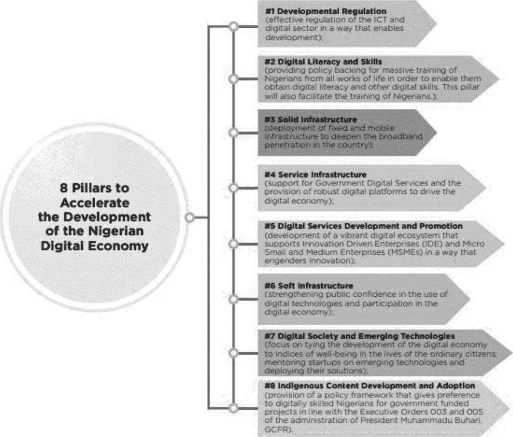

**图 1**: 数字经济政策与战略文件 (FMCDE 2020)。

第 2 号支柱为尼日利亚各行各业的大规模培训提供政策支持，使其能够获得数字素养技能。预计培训计划将以获得全球公认的证书（FMCDE 2020）。

第 6 大支柱强调网络安全以及标准、框架和指南的重要性，这些规范鼓励公民走向数字化。许多尼日利亚人对在线服务缺乏信心，特别是在涉及金融交易时，因为他们认为网络是不安全的。随着身份数字化并与生物识别绑定，诸如国家身份号（`NIN`）、生物识别码（`BVN`）、选民 ID 和 SIM 卡注册详情等倡议可以为识别公民提供渠道以促进可靠的交易，考虑到其巨大的效益（FMCDE 2020）。

第 7 大支柱重点是将数字经济的发展与普通公民生活的福祉指数挂钩。数字和金融包容是该支柱试图解决的问题之一。数字社会与新兴技术支柱将数字经济的发展与与数字经济最相关的 7 个可持续发展目标（SDGs）挂钩，即：(1) 无贫困；(2) 健康与福祉；(3) 优质教育；(4) 体面工作与经济增长；(5) 工业、创新和基础设施；(6) 减少不平等；以及 (7) 可持续城市和社区。新兴技术能够使国家实现这些目标。因此，该国将引入一项新兴技术计划（FMCDE 2020）。

第 8 大支柱旨在识别目前正在外包的工作，并支持将这些工作回流给具备数字技能的尼日利亚人。推广和采用本土内容将使尼日利亚能够从日益全球化的数字技术市场中受益。这有助于为国家节省外汇并促进出口。该支柱的活动将确保“尼日利亚制造”的数字经济产品具有全球认可的质量。该支柱还将努力将尼日利亚打造为全球数字工作外包的目的地（FMCDE 2020）。

### 4.1 网络空间与网络犯罪

网络犯罪对社会造成的成本可能是定性和非定性的。这包括对个人和机构的财务损失（这些数字很少公开），以及为了防止可能的数字入侵而在安全软件和人员上花费的巨额费用。此外，如果一个国家不幸成为网络犯罪的受害者，其品牌形象也将受到损害（NMIS 2016）。


为了实现确保尼日利亚网络空间安全的政府目标，2015 年《网络犯罪（禁止、预防等）法》第 41 (b) 条规定国家安全顾问办公室（`ONSA`）“确保制定并有效实施全面的国家网络安全战略和尼日利亚网络安全政策”。为了履行这一指令，`ONSA` 制定了实施国家网络安全战略的行动。其目的是让政府能够有效利用网络空间固有的巨大潜力，同时减轻网络犯罪的影响，并提高尼日利亚人的安全与保障（ONSA 2017）。

2020 年针对尼日利亚网络空间的许多攻击已从大型机构转向看似不太可能的目标，特别是那些认为自己不会易受网络攻击，或没有足够资源来吸引攻击的公司（Aladenusi 2020）。网络攻击者的主要目标一直是云端系统、用户移动设备、物联网、中小型企业以及非金融部门的机构（Aladenusi 2020）。

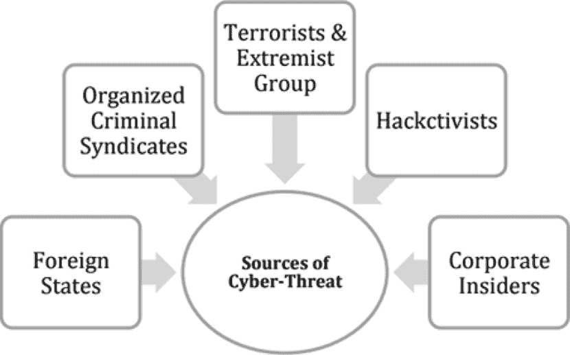

**图 2**：网络威胁来源（ONSA 2014b）。

通过社交媒体广泛使用网络空间为尼日利亚的许多人提供了互动和空间，让他们对与其环境相关的社会经济和政治局势问题表达自己的观点（Oloyede and Elega 2019）。尽管接入网络空间在社交、增强学习机会、沟通、娱乐、政治参与和经济发展方面提供了机会，它对社会文化身份、安全、民主稳定和青年生产力带来了严峻挑战（Bidemi 2018）。在尼日利亚的情况下，由于占该国多数的青少年滥用网络增加，贫困问题变得更加明显。因此，有观点认为，用于非生产性活动（如在线体育博彩、网络色情、网络诈骗、网络暴力及相关网络犯罪）的网络空间阻碍了政府缓解贫困的能力，此外，此类活动损害了国家形象，并阻止了获得国家社会经济和政治机会的机会（Bidemi 2018）。

建立适当的法律基础设施是国家网络安全战略不可或缺的一部分。`ITU` 关于能力建设的相关授权由 `ITU` 全权会议第 130 号决议（2010 年墨西哥会议修订）强调，旨在加强 `ITU` 在建立信息和通信技术使用的信任和安全作用（Gercke 2011）。`ITU` 全球网络安全议程（`GCA`）七大战略目标之首，要求制定网络犯罪立法发展战略，使其具有全球适用性并与现有的国家和地区立法措施具有互操作性，并能够应对 `ITU-D 调查小组 22/1` 下组织国家安全工作的方法（Gercke 2012）。

确保网络安全是一项艰巨且复杂的任务。创建一个促进和鼓励商业及公民交易的技术、商业和社会环境，同时遏制和防止犯罪及恐怖主义活动，面临着许多挑战和障碍。有效网络安全的障碍既根于网络空间的技术的构成，也根于阻碍国际合作的政治、文化、社会和法律差异（Levin 2012）。

网络空间的国际性质本身就是对有效网络安全的一种挑战。由于网络空间本质上是物理上位于许多不同国家和法律管辖区的计算机网络交汇点，没有任何一个国家可以主宰或控制网络空间中的互动。因此，各国尝试签署双边或多边国际协议，以监管网络空间并协调网络安全，但这些尝试往往受到其他利益和所属关系的引导，而这些利益并不总是与应对网络犯罪最有效的措施相符（Levin 2012）。

尼日利亚作为归类为发展中国家之一，自 20 世纪 90 年代中期以来从外国直接投资中受益匪浅。不言而喻，该国近期在信息通信技术方面取得了进展，这可以在其各个行业中看到。这种增长也吸引了无数犯罪，直接或间接地影响了外国直接投资的流入，尤其是以网络犯罪的形式（NMIS 2016）。

对上述主题进行深入分析，提出一些能够为后世提供额外参考的问题是非常恰当且具有极大意义的。网络犯罪的增加是否了了直接投资（FDI）的率？特别是近期，尼日利亚网络犯罪与外国直接投资减少之间是否存在直接相关性？我们是否可以认为网络犯罪的负面影响反过来减缓了国家发展？本项目基于网络犯罪对外国直接投资负面影响的概念性分析。它进一步建立了网络犯罪与技术进步之间的联系，旨在根据目标使答案背景化，并对现状进行评估。网络犯罪问题及其对尼日利亚经济的敌对影响令人担忧，并日益变得令人沮丧。在此范围内，政府必须采取积极态度，专注于持续斗争，以遏制这种威胁并减轻其对公民的影响。尼日利亚若要成为经济突破的沃土，就必须建立在没有犯罪的社会中。但理想的经济几乎是不可能的。随着技术的增长，网络犯罪率也随之上升。网络犯罪将始终跟上任何技术进步。技术确实引发了网络犯罪，我们可以对此听之任，也可以采取重大行动（NMIS 2016）。

## 5. 尼日利亚的网络安全策略

为了更好地理解支持社会发展的有效网络安全策略的全球和区域需求，需要一种全方位的方法，这种方法还兼顾了创新、创业、地缘战略和地缘经济的挑战（Efthymiopoulos 2019; Ijeh et al. 2009; Ijeh 2011）。过去十年，网络空间的行为正向着许多网络安全文献未涵盖的方向发展。虽然许多学术界和政策界关注网络战争，但行动者的实际行为具有更为微妙且不同的性质。网络空间的本质建立在互联互通的结构和持续接触的状态之上。一旦承认这一点，这种结构性环境要求我们不再将网络手段视为战争的促进者（尽管它们确实如此），而是更关键地将其视为战争的战略替代（Harnett and Smeets 2020）。值得注意的是，前沿防御只是几项可被称为主动防御或网络震慑的政策之一（Healey 2019）。

意识到网络力量处于持续接触中无疑是正确的，持续参与是一种合理的反应。但该理论的力量很大程度上取决于参与者之间接触的性质，以至于只有一种反应，即由技术决定的支配策略：在与对手保持密切接触的情况下进行前沿防御，以尽量拦截并阻止他们的行动（Healey 2019）。

世界各国都将网络安全视为公共政策的一个关键问题。他们担心竞争对手可能针对其利益发动网络攻击——破坏其军事力量、经济和政治进程。因此，他们的网络安全工作很大程度上致力于保护重要的信息技术系统和网络免受此类攻击。意识到这一点，《牛津词典》在 2013 年在其词汇表中增加了一个新词——将网络安全定义为“免受电子数据被犯罪或未经授权的使用的状态，或为实现这一目标所采取的措施”。但国家也可以作为故意的政策工具对其他国家发动网络攻击，世界上许多国家也在探索以这种方式使用进攻性网络行动（Lin and Zegart 2017）。

关于网络安全，尼日利亚联邦政府已经了网络安全的重要性并推出了多项倡议。2004 年，建立了尼日利亚网络犯罪工作组（`NCWG`），这是一个由政府和私营部门 15 名成员组成的委员会，负责研究尼日利亚网络犯罪问题的法律和制度框架。委员会制定了第一部《网络犯罪和关键信息基础设施保护法案》，并提交给国会，尽管它是由个人发起的。然而，该法案遭遇了无法解释的挫折。2011 年，国家安全顾问成立了一个国家委员会，负责协调国会待审的各种网络安全法案。《2011 年网络安全法案》草案最终于 2015 年签署成为法律。国家网络安全政策与战略于 2015 年 3 月发布。一些联邦政府机构正在应对与其宪法职权相对应的网络犯罪问题（Mbanaso et al. 2015）。

在信息通信技术（`ICT`）时代，网络安全已成为一项复杂且快速变化的安全挑战。随着全球对 `ICT` 的依赖加深，网络威胁似乎可能渗透到国家经济和基础设施的每一个角落；事实上，对计算机和基于互联网的网络的依赖日益增加，伴随着全球范围内针对个人、企业和政府的网络攻击事件增加。同时，一些政府越来越多地将 `ICT` 视为为了国家安全目的而开发的战略资产，也是可以进行战略冲突的战场。事实上，数字领域跨国日益增长的相互依赖性已促使网络安全成为全球各国国家安全战略的主要组成部分，像印度这样的国家并没有延迟采取相关策略，而是效仿了其榜样（Parmar 2018）。

Senol 和 Karakuha 2020 从震慑的角度提出了一项新的国家网络安全策略（`NCSS`）。为了有效应对和确保网络安全，土耳其正与其他国家一样，研究制定、创建和实施 `NCSS` 应遵循的路径和使用的方法。此外，这种通过确保更好的管理、控制和监督来有效实施网络安全的方法，可以被所有其他国家轻松使用。

世界银行要求发展中国家通过增加研发支出，并以制度改革和设计新的决策制定机构来建立其当地的技术能力（Arroio 2012）。世界银行已经明确，从发达国家转移技术不是当地科学发展的替代方案。世界银行描述道，对于一个没有当地科学、技术和创新能力，特别是缺乏经过培训、能够了解其他地方存在何种有用技术的人才的国家来说，要理解、选择、吸收、适应、操作、维修，并产生新知识，是非常困难的（Arroio 2012）。采用发达国家技术作为当地科学替代方案的主要理由是能够跨越几个发展阶段并实现快速实施（Ndulu et al. 2007）。然而，领先的国际合作组织、多边开发机构和官方开发援助机构的政策文件、指令和使命声明，通常都会提到当地科学在发展中的作用，以及对促进社会可持续发展能力的提升（Arroio 2012）。

对于尼加利亚而言，调查显示该国存在数字鸿沟（Mbanaso et al. 2015）。一些联邦部委和州已处于二阶段在线状态，而 `LGAs`（地方政府区）通常尚未启动电子治理。大多数高等院校已建立网络平台，但极少数中学尚未录入系统。同样，在商业领域，大多数跨国公司和银行正享受着电子商务带来的便利，而微型金融机构则落后了。随着经济和社会活动日益转向互联网，网络空间已成为创新、企业、社交网络、犯罪和战争的平台。尼加利亚和其他一些西非国家已开始向增加在线化发展。对于尼加利亚和其他撒哈拉以南非洲国家来说，从全球最佳实践中学习并合作开发一个具有针对网络犯罪和网络战争必要防御措施的统一框架至关重要（Mbanaso et al. 2015）。

尼加利亚与大多数国家一样意识到网络安全的重要性，并积极参与《全球网络安全议程》的实施，已采取具体措施保障其网络空间。2014 年 12 月，尼加利亚发布了《国家网络安全战略》，清晰地规划了尼加利亚的网络安全愿景以及实现该愿景的策略。此外，2015 年 5 月，尼加利亚联邦共和国总统签署了《尼加利亚网络犯罪（禁止、预防等）法案》。该法案为尼加利亚网络犯罪的禁止、预防、检测、起诉和处罚提供了有效、统一且全面的法律、监管和制度框架。该法案还确保了国家关键信息基础设施的安全，并促进了网络安全以及对计算机系统网络、电子通信、数据和计算机程序、知识产权和隐私权的保护。

## 6. 讨论

尼加利亚是一个接入网络空间人口不断增长的国家。为了保障信息和关键基础设施，尼加利亚参议院于 2011 年提交了一项网络安全法案，该案于 2014 年通过，利益相关者通过国家安全顾问办公室于 2017 年开始实施。为了履行双边和多边交易义务，尼加利亚使用了`联合国网络安全与网络犯罪框架`。需要清晰理解信息通信技术（`ICT`）部署的预期收益，才能为任何网络安全策略设定动力，而这些收益决定了策略的重点。社会发展是一项国家任务，国家在此任务中起着关键作用。这是因为良好的治理、和平、稳定和安全是任何社会在长期内实现社会经济进步的必要前提，而只有合法有效的国家才能为这些发生提供框架。

尼加利亚对其网络空间的定义与国际标准接轨，但 `ICT` 的普及应成为实现言论和结社自由、信息获取权以及民主和公民参与尼加利亚治理的机会。尼加利亚网络空间安全策略的动力在于其作为空、陆、海、天之后的第五领域角色。它被视为经济和社会发展的驱动支柱，但在尼加利亚通信委员会（`NCC`）建立之前，尼加利亚的网络空间之旅一直缺乏规划，随着接入用户的增长，网络犯罪也按比例增长。从政府的设想来看，尼加利亚的网络空间本具有巨大的能力缩小流动、商业、创新、教育、减贫和经济赋能方面的差距，但并未提供支持这些的环境或策略。为了促进网络安全能力，发达国家与双边和多边组织建立了更紧密的伙伴关系，以保护特定领域的数字基础设施，此举使他们能够加强全球网络。

广泛的贫困和经济增长低迷表明，尼加利亚网络空间的用户尚未充分利用社会经济发展的机遇。尽管总体访问量持续增长，但这本身等同于实际利用，且缺乏监管导致网络滥用按比例增长。由于访问受限和缺乏足够的设备，尼加利亚公民和企业的核心部分仍被排除在数字生态系统之外。然而，国家旨在改善目前的商业环境，在 2030 年让所有公民都能参与数字经济，并创造 1 亿个就业机会。这项任务取决于尼加利亚通信委员会和新成立的联邦通信与数字经济部，这两个部门都强调了良好业务环境的重要性，以及叛乱腐败对数字经济的负面影响，这些因素增加了业务交易成本并吓走了外国投资者。

新发布的《数字经济政策与战略》文件包含 8 大支柱，旨在支持社会经济发展。7 号支柱关注将数字经济的发展与普通人生活的福祉指数挂钩。“数字社会与新兴技术”支柱将把数字经济的发展与数字经济最相关的 7 个可持续发展目标（`SDGs`）联系起来，即：

1. 消除贫困；
2. 良好健康与福祉；
3. 优质教育；
4. 体面工作与经济增长；
5. 工业、创新和基础设施；
6. 减少不平等；
7. 可持续城市和社区。

新兴技术能够使国家实现这些目标。

尼日利亚《国家网络安全战略》和《国家网络安全政策》由国家安全顾问办公室管理，旨在减轻网络犯罪的影响并提高尼日利亚人的安全水平。监测网络犯罪的咨询公司报告称，网络攻击将聚焦万物互联（`IOE`）、个人设备以及非金融部门机构。网络犯罪阻碍了政府增强社会经济计划的能力，并继续损害国家形象，阻止外国直接投资的兴趣。

建立适当的法律基础设施是国家网络安全战略不可缺的组成部分。联合国呼吁制定全球适用且与现有国家和地区立法措施具有操作性的网络犯罪立法。这在处理双边和多边组织时至关重要。有效网络安全的障碍既源于网络空间的技术构成，也源于阻碍国际合作的政治、文化、社会和法律差异。

随着许多国家行为者参与网络战争，全球各国已将网络安全视为公共政策的关键问题。包括尼日利亚政府在内的大多数政府都理解需要支持社会发展的有效网络安全战略。

### 7. 结论

尼日利亚正试图利用本地化数字经济带来的收益，并推出了一项使其在 2030 年实现这一目标的战略。该战略与联合国 17 个可持续发展目标保持一致，成员国预计将在 2030 年实现这些目标。尼日利亚与其他发展中国家一样，正通过增加研发支出、辅以制度改革和设计新的决策机构，来建立其本土技术能力。从发达国家向发展中国家的技术转移不是当地科学发展的替代方案。尼日利亚政府加强社会发展的努力，如其第二次《自愿国家审查》（2020 年）、2020-2030 年国家数字经济政策与战略：打造数字化尼日利亚（2020 年）以及《尼日利亚电信委员会战略管理计划》（2020 年），在《2014 年国家网络安全战略》中并未体现因此因此尼日利亚需要制定一个协调的网络安全框架，并对网络犯罪和网络战争提供必要的防御。尼日利亚应继续与伙伴国家和其他社会提供者合作，通过强调开放赋能型空间对公民社会的益处（如经济、实现可持续发展目标、解决社会问题和腐败），来促进其公民空间并反击负面叙事。

## 8. 未来工作

预计用于本研究的《2014 年国家网络安全政策》（2014a）和《网络安全战略》（2014b）将在未来进行更新，以适应尼日利亚不断变化的经济和增长的人口。未来的工作应包括使用任何新的或更新的网络安全政策和战略进行修订研究。

## 参考文献

- Aladenusi, T. 2020. Nigeria Cyber Security Outlook 2020: The Year of Shifts. Deloitte, Predictions. Available 于：[`www2.deloitte.com/ng/en/pages/risk/articles/nigeria-cyber-security-outlook-2020.html`](https://www2.deloitte.com/) [访问日期：2020 年 9 月 2 日]。
- Arroio, A. 2012. Governance of science, technology, and innovation programmes for development: is global financing getting it right? Institutions and Economics 4(2): 45–64. [在线] Available 于：[`ijie.um.edu.my/filebank/published_article/3942/Fulltext3.pdf`](http://ijie.um.edu.my/) [访问日期：2020 年 9 月 3 日]。
- Bidemi, B. 2018. Cyberspace abuse and the proliferation of poverty in Nigeria: investigating the paradox of social-economic development. Africology: The Journal of Pan African Studies 11(8), June 2018. Available 于：[`www.questia.com/library/web/1P4–2071549197/cyberspace-abuse-and-the-proliferation-of-poverty`](https://www.questia.com/) [访问日期：2020 年 9 月 2 日]。
- CSA. 2011. Cybersecurity Bill. Enacted by the National Assembly of the Federal Republic of Nigeria. [在线] Available 于：[`blogs.law.harvard.edu/mcash/files/2012/03/Nigeria-Cyber-Security-Bill-2011.pdf`](http://blogs.law.harvard.edu/) [访问日期：2020 年 9 月 3 日]。
- Daskin, E. 2019. The Turkish cyber security strategy: structure, legislation, and challenges. The Journal of Intelligence and Cyber Security 2(1). Available 于：[`www.academicapress.com/web/v2–1/JICSVolume2Issue1_Daskin.pdf`](https://www.academicapress.com/) [访问日期：2020 年 9 月 2 日]。


# 参考文献

- Efthymiopoulos, M. P. 2019. A cyber-security framework for development, defence, and innovation at NATO. Journal of Innovation and Entrepreneurship 8: 12. 访问地址：[`doi.org/10.1186/s13731–019–0105-z`](https://doi.org/10.1186/s13731–019–0105-z) [访问日期：2020 年 9 月 2 日]。

- FMCDE. 2020. National Digital Economy Policy and Strategy 2020–2030: For a Digital Nigeria (2020).

- Gelvanska, N. 2013. Role of Multilateral organisations in Cyber Security. Internet Forum.

- Gercke, M. 2011. Understanding Cybercrime: A guide for developing countries.

- Gercke, M. 2012. Understanding Cybercrime: Phenomena, Challenges, and Legal Response.

- Mbanaso, U., Chukwudebe, G. and Atimati, E. 2015. 尼日利亚在网络空间不断演变的存在。《非洲信息与通信期刊》，2015 年 1 月，15: 106–113. 访问地址：[`webs.co.za/content/afjic/2015/15/EJC189249`](https://webs.co.za/) [访问于 2020 年 9 月 2 日]。

- NCC. 2020. 尼日利亚通信委员会—战略管理计划 2020–2024。[在线] 访问地址：[`www.ncc.gov.ng/docman-main/industry-statistics/policies-reports/886-ncc-2020–2024-strategic-management-plan-aspire-2024/file`](https://www.ncc.gov.ng/) [访问于 2020 年 9 月 2 日]。

- Ndulu, B. J., Chakraborti, L., Lijane, L., Ramachandran, V. and Wolgin, K. J. 2006. 非洲增长的挑战：机遇、限制与战略方向。华盛顿特区：世界银行。© 世界银行。[在线] 访问地址：[`openknowledge.worldbank.org/handle/10986/6656`](https://openknowledge.worldbank.org/) [访问于 2020 年 9 月 2 日]。

- NMIS. 2016. 网络犯罪对外商投资和国家发展的影响。[在线] 访问地址：[`www.ncc.gov.ng/documents/735-nmis-effects-cybercrime-foreign-direct-investment/file`](https://www.ncc.gov.ng/) [访问于 2020 年 9 月 2 日]。

- Obama, B. 2011. 网络空间国际战略：网络世界的繁荣、安全与开放。[`obamawhitehouse.archives.gov/sites/default/files/rss_viewer/international_strategy_for_cyberspace.pdf`](https://obamawhitehouse.archives.gov/) [访问于 2020 年 9 月 3 日]。

- OECD. 2012. 网络安全政策制定的转折点：分析针对互联网经济的新一代国家网络安全战略，以及对新一代国家网络安全战略的非政府视角。访问地址：[`www.oecd.org/sti/ieconomy/cybersecurity%20policy%20making.pdf`](https://www.oecd.org/) [访问于 2020 年 9 月 2 日]。

- OECD. 2015. 可持续发展目标：相关 OECD 分析、工具和方法的概述。[`www.oecd.org/dac/The%20Sustainable%20Development%20Goals%20An%20overview%20of%20relevant%20OECD%20analysis.pdf`](http://www.oecd.org/) [访问于 2020 年 9 月 2 日]。

- OECD. 2020. 数字化转型与到 2030 年的公民空间未来。OECD 发展论文，第 29 期，OECD 出版集团，巴黎，[`doi.org/10.1787/79b347-en`](https://doi.org/10.1787/79b347-en)。

- Oloyede, F. and Elega, A. 2019. 探索尼日利亚的话标签行动主义：#Ends 案例。[在线] 访问地址：论文集：第 5 届通信与媒体研究会议 (CRPC 2018)。[`crcp.emu.edu.tr/Documents/Books/CRCP%202018%20Approved%20One.pdf`](https://crcp.emu.edu.tr/)

- ONSA. 2014a. 国家网络安全政策。尼日利亚安全顾问办公室。[在线] 访问地址：[`www.cybersecuritynigeria.ng/ncsf/index.php/download-docs`](http://www.cybersecuritynigeria.ng/) [此处不完整]。

- ONSA. 2014b. 国家网络安全战略。尼日利亚安全顾问办公室。[在线] 访问地址：[`www.cert.gov.ng/ngcert/resources/NATIONAL_CYBERSTRGY.pdf`](https://www.cert.gov.ng/) [访问于 2020 年 9 月 3 日]。

- ONSA. 2017. 国家战略实施计划。尼日利亚安全顾问办公室。[在线] 访问地址：[`www.cybertalknai.com/wp-content/uploads/2019/06/action-plan-ncss.pdf`](https://www.cybertalknai.com/) [访问于 2020 年 9 月 3 日]。

- Osho, O. and Onoja, A. 2015. 尼日利亚的网络安全政策与战略：定性分析。《国际犯罪学杂志》，9(1): 120–143。ISSN: 0973–5089-2015 年 1 月–6 月。[在线] 访问地址：[`www.cybercrimeweb.com/Osho&Onoja2015vol9issue1.pdf`](https://www.cybercrimeweb.com/) [访问于 2020 年 9 月 2 日]。

- OSSAP. 2020. 尼日利亚将可持续发展目标纳入国家发展。第二次自愿报告于 [`sustainabledevelopment.un.org/content/documents/26309VNR_2020_Nigeria_Report.pdf`](https://sustainabledevelopment.un.org/) [访问于 2020 年 9 月 3 日]。

- Parmar, S. D. 2018. 网络的网络安全：国家安全的关注。《情报与网络安全杂志》，1(1)。访问地址：[`www.academicapress.com/web/v1–1/Parmar_Cybersecurity-in-India.pdf`](https://www.academicapress.com/) [访问于 2020 年 9 月 2 日]。

- Sarbo, N. D. 2013. 重新概念化区域整合：欧洲模式与非洲的优先事项。[在线] 访问地址：[`www.globaleicgovernance.org/sites/geg/files/Sarbo_GEG%20WP%202013_78.pdf`](http://www.globaleicgovernance.org/) [访问于 2020 年 9 月 3 日]。

- Senol, M. and Karacuha, R. 2020. 创建并实施有效的威慑网络安全战略。《工程杂志》，文章 ID 5267564，19 页。访问地址：[`www.hindawi.com/webs/je/2020/5267564/`](https://www.hindawi.com/) [访问于 2020 年 9 月 2 日]。

- Targert, A. 2010. 发展中国家的网络安全挑战。[论文]第 1–157 页。访问地址：[`kilthub.cmu.edu/articles/Cybersecurity_Challenges_in_Developing_Nations/6715520`](https://kilthub.cmu.edu/) [访问于 2020 年 9 月 2 日]。

- Weber, V. 2018. 将网络战略与大战略联系：美国案例。《网络政策杂志》，3(2): 236–257。访问地址：[`www.tandfonline.com/doi/full/10.1080/23738871.2018.1511741`](https://www.tandfonline.com/) [访问于 2020 年 9 月 2 日]。

# 12. 北约当前与未来的网络防御适应性

*Marios Panagiotis Efthymiopoulos*

---

阿拉伯联合酋长国大学，安全与全球研究学院

本章检查并评估了北约在 2020 年的网络适应性与互操作性政策。考虑到新冠-19 疫情持续影响所带来的不可预见挑战，本章预测了北约网络防御战略在关键时刻的重要性。本章探讨了北约部队在网络空间方面的网络敏捷性，以及军事指挥对于战术协同的网络中心化作战能力的效率，以应对来自何处、何种维度的网络攻击。本章确定了北约成员国军事和民用资产安全事务中网络融合的重要性。本章呼吁北约继续维护网络空间安全，同时增加并适应持续及新兴的混合网络威胁。本章赞赏北约的决定，即在 2023 年前维持网络防御战略和政策应用的同时，在运营上启用北约网络安全运营中心（`CYOC`）。本章为新冠后环境下持续的网络敏捷性提出了建议和方案要素。

## 1. 引言

本章旨在从方法论角度审查北约（NATO）的网络安全政策及其对当前和新兴挑战的适应性。本章考虑了在 2019 年底北约伦敦峰会上决定的最新战略目标：到 2023 年于布鲁塞尔的蒙斯（Mons）建立一个新的网络安全行动中心（《网络防御 2019》）。本章评估并赞扬了北约目前的成就。在评估迄今所取得的成就的同时，考量了北约对当前及新兴威胁的网络适应能力。考虑到新冠肺炎（Covid-19）疫情期间及疫情后安全环境中提出的新持续挑战，本章编写于一个重要的时间节点。本章提出了基于战略和战术层面的措施，以实现全面的网络安全政策效率。

本章呼吁北约增强并持续网络安全的适应能力，以继续应对未来的所有及任何挑战。2020 年是一个网络事务的新世界秩序。2020 年被认为是网络事务的“开眼之年”，这要考虑到我们现在需要多快地向虚拟/数字化世界迈进。毋冗言，新冠肺炎 Covid-19 全球大流行是一场全球性的人类流行。尽管如此，它使我们快速推进到了一个完全依赖万维网所提供的工具及其产生的威胁的状态。

本章评论了北约在持续且多方面的努力（政治、法律和行动方面），以维护明确的目标，即在网络防御层面实现真正的联合综合安全战略。网络防御补充了在采纳北约战略概念时决定的通用防御努力（北约战略概念 2010）。在 2020 年，北约面临的困境在于如何继续保持务实的行动方法，并在北约成员及其盟友之间以及网络空间反映实时的保护和防御方法。

---

阿联酋大学（American University in the Emirates）安全与全球研究学院，国际安全与战略副教授。

电子邮箱：`Marios.panagiotis@aue.ae`

## 网络防御的本质

首先，我们需要指出，网络防御或网络安全并非传统的安全政策形式或框架。它是一种数字现象，需要不断通过数字化增强的互操作性框架以及行动知识（法律、政治、军事、行动层面）来应对。北约必须做到这一点。它需要灵活性，并拥有一个无限、无国界的网络空间供运作。

北约的战略是网络韧性的。它确实需要行动的效能和效率。它在虚拟层面需要战术上的敏捷性和经验上的韧性。网络防御和网络安全被称为一种“承诺”（《网络防御 2019》）。正如我们在下文中解释的，实际上其核心政策理念可以追溯到 2002 年的北约布拉格峰会（北约布拉格峰会 2002）。如今的网络防御政策是一种战略，反映了对数字网络空间任何可能的电子漏洞的保护主义和防御措施。网络安全是一项多维的虚拟努力，旨在保护由北约成员国所有民用和非民用资产和运行的连接到互联网世界的网络、基础设施、软件硬件。

## 战略挑战与未来展望

在一个更加“具有侵略性且不断适应”的世界中，如 2020 年那样广泛使用万维网，漏洞和恶意攻击已经成倍增加。因此，需要在法律和行动层面（包括军事和民用合作层面）对物联网的汇聚以及如何在实时战略中通用地应对这些问题进行要求。这意味着北约的网络安全战略正如目前，可以成为北约最重要的政策支柱之一。它可能整合力量，展示联合效率和协作是如何实现的。这是通往反网络攻击通用框架的一个示例。因此，北约即将建立的行动指挥将在 2023 年运营时，成为北约自身最重要的防御行动支柱之一。

显而易见，由于 2020 年网络空间利用率的提高，更多的恶意和混合攻击已经在发生。如所述，攻击已成倍增加。很可能由于疫情持续超出最初预计的时间范围，我们对互联网的依赖将更大。这意味着在线攻击将继续发生并进一步增加。攻击者将继续利用可能出现的漏洞。考虑到所有需要考虑的可能的通用防御和安全措施，世界过去及现在尚未准备好 100% 依赖万维网。此时，我们显然区分了快速通道的国家政策、战略及服务，这些服务将国家战略和政策转化为数字化世界的格式和运行模式。这意味着我们预计会有越来越多“智能”的操作和互动方法在网络空间中运行。当我们越来越暴露于不受监管的互联网时，网络攻击很可能会增加。这些攻击在性质上可能是恶意的，其目标和目的将始终被认为是混合性的。

在北约准备其网络行动指挥部的同时，同时也需要 (a) 适应当前出现的实时威胁 (b) 展示持续且增强的行动敏捷性 (c) 在行动上的短期和长期战术效率，以确保、保护并创建一个可持续且不断增长的电子安全军事和民用工作环境。北约预计通过行动发生的方式进行创新。在创造行动效能和效率的同时，需要经验知识来帮助更快速地适应我们生存的社会政治电子环境。

惊讶且简单来说，“信任”对于真正的北约协作安全战略在联盟成员之间是必须的。如果北约盟友希望应对未来和新兴威胁，如果他们希望联盟继续保持共识的清晰度。在 2020 年，当我们对抗新冠肺炎病毒时，我们实际上是在寻找措施来 (1) 简化日常运营 (2) 增强军事和民用合作框架下的安全行动，(3) 理解技术的未来和基于网络的创新。反之，建议北约目前的战略概念应由领导者确保继续将其应用于“物联网”，在本章中我将其称为“互联网矩阵”。我们应该清楚地理解第四次工业革命与第五次技术革命之间清晰且整体战略融合的需求，我们现在可以将其称为“第五次工业/技术兴起”。

本章是作者个人阅读和经验的一部分。自 2008 年以来，通过对网络安全作为安全战略这一主题和课题的持续研究和出版，本章得以形成发展。作者在学术、研究和专业层面对北约政策拥有丰富经验。下文介绍的作品与作者在北约当前及未来威胁挑战方面的专业领域相关。

本章具有附加价值。通过对世界各地的实证和工作经验，读者可以得出关于网络安全和北约的战略及运营目标与宗旨。目前，本章旨在澄清北约在网络防御方面的当前及未来选择与机会，考虑到所有混合级别的威胁、漏洞和恶意攻击将会增加，而且北约正通过其网络安全司令部，致力于在 2023 年前实现全面的网络作战能力。本章假设全球大流行病的结果最终将导致更加脆弱的网络安全环境，且这种环境将继续保持其混合性质。正因如此，本章要求北约所有成员国之间进一步加强安全凝聚力与合作。

作为声明，我想强调，本章与任何政府或私营实体、机构或组织均无关系。它与北约作为一个组织无关，相反，其重点集中在科学和学术层面的研究，这些研究目前正在发布，并供读者进行批判性评论。本章未获得任何机构、国际组织、北约成员国、伙伴国、合作国或非合作国家的资助。它在任何层面上（无论是直接还是间接）都与作者目前的职业无关。相反，它与作者过去 12 年来的学术和科学个人研究兴趣有关。

本章表达的观点仅反映了作者的学术和科学观点。这些观点基于作者的实证经验。然而，本章以次级信息源为中心，并对该主题采用了演绎和归纳的理论方法。任何由于本章出版产生的批判性评论和章节内容都将作为来源，推荐即将于 2021 年出版的关于网络安全战略和重要性的著作。

本章具有教育意义。它包含了理论和实践元素，因为它从归纳和演绎两种方法审视了所关注的主题。本章提供的结果和建议可用于实际目的。本章对于安全研究、网络安全科学、战争研究、社会政治科学、信息分析、情报研究和国际关系领域的理论专家以及从业者，也对于国际机构、组织、研究中心和大学等，都是一本“佳作读物”。

本章遵循了截至 2020 年 5 月的各种问题、变量和事件的持续分析和检查。本章包含了深入的话语分析，并得出具体的建议。它强调了 2020 年网络安全和北约的重要性，并建议了实现更快速、更通用的网络安全运营能力的方法，以服务日益增长的网络安全需求，并确保从各种维度的数字漏洞中获得更快的安全。


在本章完成时（2020 年 5 月），剧烈的变化仍在发生。全球 Covid-19 大流行病为网络空间及其在空间内创造了巨大的、丰富的“机会”。讽刺的是，在全球大流行病期间及之后，如何运营、经营业务以及保护全球维网。网络空间现在提供了许多与新固件以及软件工具相关的选择。然而，它也增加了恶意漏洞。新冠病毒全球大流行病让我们从各自的科学和专业角度，反思网络安全应该包含的运营和战术保护机制及方法，这些方法不仅应涵盖个人和民用层面，还应涵盖军事层面，即北约联盟。

## 2. 北约的网络防御“故事”

北约网络防御“故事”的核心可以追溯到 2002 年，当时北约决定加强并重新评估包括网络空间在内的军事能力。一个新的空间将会出现，北约在不久的未来需要在其中开展行动。其目标非常明确：对当时任何新兴和未来的威胁（包括未来的网络攻击）建立清晰的安全理解。

对网络安全的需求最早在 18 年前的 2002 年布拉格北约峰会上得到承认（2002 年北约布拉格峰会）。当时的北约成员国同意确实需要北约的网络政策。基础设施变得更加以网络为中心，而基础设施需要不断更新。网络防御和安全成为日益的需求。网络防御在 2008 年成为一项防御政策，随后在 2011 年延续。然而，它需要经过检查、分析、共同决定和政策采纳。网络防御现在是不断适应的；它对当前和未来的新兴威胁具有运营性和反映性。在所有的北约峰会上，总会对网络安全本身进行重要的引用。

从历史上看，2002 年的布拉格峰会标志着北约任务授权委员会开始负责与网络防御的所有活动。随着技术成就的交付，政策制定者也交付了网络防御的政策成果。这就是为什么盟国领导人在 2006 年里加峰会上承认需要将这些内容纳入，正如其新闻公报中的决策所示：

1. 保护北约的运营信息系统；
2. 保护其盟国免受位于弗吉尼亚州诺福克的、由北约盟军转型司令部（ACT）开发的新形式和手段的电子攻击（或其他网络攻击）。

在 2007 年爱沙尼亚遭受突然网络攻击之后，北约于 2007 年 10 月举行非正式国防部长会议，并导致了北约卓越中心（COE）的成立（2007 年北约非正式国防部长会议）。这演变成了“网络防御盟军转型司令部”，命名为合作网络防御卓越中心，CCDCOE（CCDCOE 2008）。它是基于北约未来政策在应对挑战和威胁方面，对网络韧性的概念和早期理解的，这一点已由北约军事委员会达成共识。

18 年后，北约的网络政策已成为一项战略，现在是北约的防御支柱。正是在 2014 年的威尔士峰会上，网络防御成为了北约集体防御支柱的核心元素（2014 年北约威尔士峰会）。到 2016 年，北约盟国承认并重新确认网络空间是军事行动的新空间（2016 年北约网络防御）。一个新的虚拟区域需要免受虚拟挑战和威胁的保护。盟国承诺继续加强与互联网网络防御和安全相关的网络基础设施，并通过在布鲁塞尔蒙斯建立 CYOC 网络安全运营中心来实现此，该中心将在 2023 年前完全投入运行。其理念是在网络安全保护机制和流程层面实现融合。

2020 年，网络安全已成为北约的优先考虑事项。无论在军事还是民用层面都是如此。网络防御和安全在运营框架内是永远需要的且始终具有战术性。当世界在虚拟上变得更加互联时，北约的网络安全战略、运营能力、持续准备和运营效率显然得到了证明并不断接受测试。现在北约面临的真正挑战是支持民用成员的资产，对抗网络威胁和可能的恶意攻击。

# 全球流行病对网络安全与技术的影响

近期新冠肺炎（Covid-19）病毒在全球范围内的爆发，导致现有技术工具和软件的使用增加，互联网使用率也随之提高。这意味着网络攻击流量增加，涵盖了民用网络空间；意味着漏洞增加以及针对攻击的防御尝试增多；还有来自物联网（IOT）攻击的威胁。这给每个政府在加强安全措施方面带来了额外压力：例如增加安全网络水平以及端到端的通信线路和方法。而这正是北约决定采取联合统一的网络防御形式的所在。

截至 2020 年 5 月，各国政府寻求针对网络空间中所有可能的当前及新的扩展恶意电子漏洞采取控制手段。作为一个军事组织，北约现在可以支持针对互联网保护系统所采取的保护措施。同时，它也在考虑未来网络合作框架下的战略。北约可以作为成员国之间的合作者和协调者，并支持任何级别针对恶意攻击的网络保护。

## 技术推动与演变

如前所述，在 2020 年我们显然看到了强劲的技术推动。万物都在变化，而且变化得很快。有人可能会说，这种速度比预想的还要快。智能系统和智能适应在今天意味着更多内涵。而网络威胁和挑战变得愈发明显。随着攻击变得更加恶意和破坏性，攻击在法律和刑事上的关联也更加紧密。新冠肺炎病毒使数字社会、政治、经济和军事演变的快进步伐成为可能。它引导我们通过“矩阵”——即互联网世界——迈向一个全方位的服务包。然而，这是一次突如其来的“虚拟升级”；个人和职业领域的“互联网升级”。新冠肺炎让互联网可能成为此时最重要的商品和服务之一。它让互联网看起来像是一个在不到几毫秒/几分钟内获取的信息和服务的最优供应链。

如果说互联网及其提供的服务到目前为止并非必需，那么现在它绝对是必须的。如前所述，通过互联网提供的服务包包含了选择、工作创新方法和乐趣。融入“互联网矩阵”是一种社会运动。它趋向于电子社会化，以及在经营业务或提供社交乐趣方面效率的提升。然而，互联网确实需要监管；它需要全球同步的国际和国家法规，并将其置于法律框架体系之下；操作性的国家和国际“保护性监管”，因为互联网在威胁和漏洞的性质上正变得越来越混合化。

## 数字化社会

因此，需要建立一套通用的/全球性的法律和操作管理收集保护机制。应该建设新的基础设施能力，以提供与互联网世界相关的创新软件和硬件措施能力。互联网是一个变革平台。它引领向“数字化社会”迈进。我们的世界现在将比以往任何时候都以更快的速度，永远永远久地变得数字化。随着矩阵的增长，复杂性和漏洞也会随之增加。

我们预期的“矩阵”系统可能会与我们迄今为止在书籍、电影或虚拟游戏中观察、探索和描述的“科幻”相符：关于通过使用互联网所积累的潜力和威胁。我们将很快看到网络机器人学、网络机械学和工程的诞生。我们将看到基因工程与机器人技术的融合，即我们在 80 年代所说的“半机械人”。

## 未来创新与第五次工业革命

高层次的技术创新和进步将喷涌而出。知识传递与创造力、机器人技术与基因工程结合云计算以及下一代人工智能等，将引领第四次工业革命的未来，可能标志着第五次工业革命的开始。事实上，我们将注意到第五次技术革命的汇聚。因此，互联网将继续作为社会、政治、法律、经济和军事变革发生的“空间”，引导我们在个人、集体、机构以及所有民用和非民用政府层面以何种、在何时以及从何处开展业务。

我们将看到社会社区市场发生严重且突然的变化：我们开展业务的方式、购物、入学和教育的方式，以及我们保护健康的方式等。在所有方面，我们将看到一个全球范围内的全互联网线线连接社会。然而，这伴随着一次前所未有的升级，当人们试图找到方法缓解社交距离带来的心理现象时，这种现象在长期社会层面造成的损害可能比新冠肺炎更大，但它将允许新的电子社交方法发生。可以确定的是，我们不知道互联网使用和升级的局限性。我们不知道我们将以何种条件专业和私人的处理和操作电子平台；我们将如何工作以及以何种能力工作；关于物联网的法规及相关应用或其他软件，以及如何保护由互联网网络提供商提供的我们私人网络系统。

互联网正变得越来越可见，在操作上也越来越明显。无论是在贫穷国家还是富国都是如此。易于引导的技术和基础设施铺平了道路，特别是对于贫穷或欠发达国家来说，有利于其在长期内领先并实现升级式增长。对网络及其丰富机会的教育和相关知识将通过一个新的电子创新阶段和对目前被视为发展中国社会的重建来引领世界。我们从未见过这样的变化。现在比以往任何时候都，“高科技”和“智能政策与策略”将成为最集中的应用规范，随之，在新基础设施安装期间和之后将出现更多的安全风险和漏洞。

## 北约在网络安全中的作用

对互联网世界的依赖是有代价的。一个日益脆弱的电子世界正对恶意攻击开放。回到我们的主话题，北约在军事和民用领域都发挥着并将发挥巨大的作用，考虑到上述挑战，以及它需要确保其网络战略在应用时的有效性和操作能力。

北约目前的网络战略和其操作能力显然正在成型。由于新冠肺炎病毒的影响，北约将加快进程。目标仍然是在 2023 年完成操作能力，北约可能需要调整路线，尽早在其位于蒙（Mons）的网络安全运营中心投入，至少承担一定比例的业务，如果盟国共同决定的话。在此期间，北约的网络指挥有大量工作需要协调、同步和接入，为了使盟国之间变得更加共同合作、具有适应性、协调且高效。它在此期间需要应对当前和新的混合威胁环境和漏洞，同时建立供军事和民用资产共同使用的非脆弱安全流程。当世界变得更加互联时，北约要确保其网络防御和网络安全的战略规划，以确保大西洋地区的安全。

因此，从战略角度来看，我们可能会看到网络防御方面以及联合网络行动与协作中更高的韧性、灵活性和适应性互操作性。我们可能会看到更加同步、单一战术协同以及协调的军事与民用战略，以应对各种类型和维度的网络威胁及漏洞，这对于应对现有及未来的新兴威胁至关重要。我们需要一个在性质、法律层面以及军事和政治资产上具有稳固国家和国际合作机制，以保护公民、成员国或相对于北约的伙伴国。

## 3. 网络安全作为一门战略学科

“网络安全是一种预防性和/或先发行动的策略”（Efthymiopoulos 2019）。如果能够评估网络安全的效率和实用性，就可以科学地将网络安全定义为三个支柱：

1. 政策导向；
2. 战略定义；
3. 在网络空间进行方法论应用。

“网络防御和网络安全”的主要目标是不断应对出现的所有威胁、漏洞以及恶意或非恶意攻击。

对于战略决策者而言，以及本章相关的方面，网络安全是一种政策导向。网络防御和网络安全是一项政策建议，更是一项共识，更是一种必要。所有北约成员国通过共识决定，在 21 世纪的应用中将其作为一种新的安全支柱。到 2020 年，考虑到新冠病毒，我们现在变得比以往任何时候都更加互联，同时也比以往更加脆弱。

网络安全是一门涵盖政治、军事和技术（IT）、学术的学科，具有巨大的运营和专业价值。许多人将其职业生涯和工作建立在网络事务上，特别是安全领域。网络安全是一门学科，因为它是一个在运营上具有重要性的框架，其中真正的创造力、研究、开发和创新发挥着主导作用，并对我们的技术和数字世界产生影响。

网络安全是一门信息技术的跨学科科学。然而，其性质和过程反映并直接影响着其他学科。因此，它已成为一门跨学科科学。包括与安全相关的政治、社会学、经济、医学以及其他技术和商业科学专业领域，以及相关水平的创意和创新行业。

在现实中，网络空间已成为数字世界参与的新空间，遗憾的是，它还不如人们想象的那样可靠。网络空间尚未在全球范围内得到通用的有效监管。但人们仍然可以通过网络空间进行创造和实务。通过实践和练习电子市场和电子商务方法来扩展市场知识、创新贸易方法并经营职业。人们无疑可以行使经济商业和贸易力量，也可以行使政府、民用和军事权力投影。

唉，有机会的地方就有网络挑战。网络漏洞和恶意攻击今天显而易见。恶意活动发生在网络空间，尤其是在人们舒适的虚拟活动期间，这种方式是虚拟而非物理的。

## 4. 设定舞台

考虑到 2020 年及以后新冠疫情环境下不断涌出的混合网络威胁，网络空间应当得到通用的监管和控制。因为网络空间提供了充足的机动空间，但也可能制造棘手的局面。

无论我们是否喜欢，网络安全都是最获利的的科学之一，因为它在市场世界中具有广泛的实际效果。它是商业创意和运营的元素组合。它包含了工具、以及针对技术软件和硬件的研究创新。它是一种方法和战略手段。随着万维网的发展，网络安全极具吸引力。网络空间并非显而易见，不需要物理存在。

网络事务，实际上网络防御或安全，深植于我们的社会结构之中，以至于我们的民主、发展方法和过程以及我们的防御系统不断受到影响（Carayannis et al. 2018）。许多伟作者和科学家对网络安全防御的优势、劣势、机会和威胁（SWOT）具有高度兴趣，也对业务设置、教育设置、运营效率（成本）、未来出现的技术的增强机会和创新感兴趣。

在一个极具影响力的地理维度战略环境中，通过日益增加的网络空间利用棱镜观察未来，需要一种详细、全面且现实的通用网络安全战略。新冠病毒简化了威胁方法和评估，加速了恶意和非恶意漏洞的处理过程，并增加了脆弱位置的数量。

考虑到上述，北约的目标是在 2023 年之前实现完全的战术能力，基于一项网络战略计划，该计划提供了考虑到网络空间的新社会、民用和军事现实向前迈。力量的适应性和互操作性现在是需要的，以执行和加速技术创新和创业精神（Efthymiopoulos 2019）。

如前所述，本章是对该主题的持续研究，将之前重要且现场的各种出版物汇总在我们 2014 年的关于《网络发展、网络民主与网络防御》一书中（Carayannis et al. 2014）。其目标是介绍该主题的关键作家和专家，主要目标是实现网络空间方面政策和策略的收敛。此外，通过增加主题、课题和作者，进一步建立了一个不断增长的关于网络空间相关主题的想法、知识和信息的手册汇库（Carayannis et al. 2018）。

网络威胁和恶意攻击是真实的。它们在性质上被视为不对称和混合的。破坏可能会发生并可能导致致命伤亡。电子安全的未来取决于针对特定或近似威胁的全球性合作，由于新冠病毒，现在比以往任何时候都需要，因为我们正进入一个完全的依赖价值集。

北约部队和协作北约的部队需要持续保持敏捷和技术先进。他们需要为自己的国家和跨国家联盟层面的利益提供见解并进行创新。网络空间没有边界。因此，没有限制任何敌可以从哪里进行操作。

我们的世界今天完全并彻底依赖网络空间。然而，如前所述，它是充满挑战和威胁的。我们需要统一的操作方法。我们需要一种通用的法律力量来设定边界并限制未受监管的网络空间。我们需要具有灵活性、适应性、运营和战略指挥结构为特征的网络部队和指挥，基于高科技信息的“输入”，同时在训练或主动行动中使用。北约 2023 年的作战网络防御指挥正朝着这一目标和理由努力。

从理论尺度来看，本章要求采用一种网络安全战略通用框架。通过该框架，北约的韧性、适应性和互操作性战略将为应对网络攻击以及其他可能危及所有北约成员国安全概念的防御行动提供清晰的作战和战术框架，这些是基于《北约华盛顿条约》第 `5` 条和第 `4` 条（1949 年北约华盛顿条约）。

在新冠疫情后的环境下，深思网络空间的现实情况本身就是一种自然的创新。然而，我们需要迈向一个更智能、上更高效的未来，拥有一个清晰的通用和北约结构，基于法律和政治的网络安全指挥与控制进行战略行动，且这种控制在本质上是韧性的。“网络交战规则”在矩阵中不应过于复杂，但随着社会结构的融合以前比任何时候都快的速度进行，它必须保持具有适应性。

## 5. 网络战略的实用性

到 2009 年，我发表了我的第一篇科学/学术网络文章。这篇文章发表于爱沙尼亚遭受网络攻击后不久（Efthymiopoulos 2009）。让我对这一主题感兴趣的是网络攻击的形式。它只需按下一个按钮就让整个国家陷入停滞。这令世界感到震惊。当时，北约新的 21 世纪战略概念身份和政策尚未完成和公布。北约的新战略概念直到 2010 年才出现。一旦北约成员国通过共识通过，网络防御或安全将仅仅是一种可能性、一个行动计划、一种方法和政策，当时并不被视为战略防御支柱和绝对必需。

与北约的行动计划相反，我的科学观点有所不同。我确保了我在这一问题上的立场。其发表远早于战略概念：早在 2008 年，我就主张我们应该预见到“未来的类战争行动将在更复杂的水平（网络和技术方式）上进行”（Efthymiopoulos 2009）。这实际上要求北约从整体战略角度来看待问题，可能使网络防御或安全成为北约的防御支柱。

尽管如此，将网络防御作为战略支柱的要求是存在的。2007 年对爱沙尼亚的攻击显然表明了为什么它应该是防御的核心支柱。现在，唯一的理由就是为什么人们会集中将网络安全作为战略防御支柱。人们需要一个理由来专注于网络安全。反之，为什么人们认为网络行动将会增加呢？12 年后，到 2020 年，原因是显而易见的。

2020 年的市场在网络空间的使用上比以往任何时候都更加融合。这包括民用和军事资产、网络商品和服务等。北约在政治上始终是需要的（保护民用基础设施），在军事上也是如此。北约的网络安全战略要求联盟增强其在作战领域的网络敏捷性，继续保持部队的互操作能力，并适应所有的技术进步。

北约的基础设施和作战指挥将变得不断变化。网络空间的世界在不断演进，随之而来的是北约变得更加敏捷和适应的需求。我们必须为面临的挑战做好准备，必须准备好为保护我们的成员采取行动。网络安全的未来已经到来，北约必须为此做好准备。

不言而喻，当我们进入网络空间世界时，我们也变得更加依赖，同时也变得更加脆弱。我们依赖于互联网的工具、方法和行动。我们正在处理新的方式，体现在云计算、人工智能和区块链管理等能力中。这些工具和元素预测并增强了互联网和网络空间的使用和效用。如果没有使用互联网，我们无法在不到一分钟内知道世界上发生了什么，无法共享信息，也无法在地球上任何地方不到一秒就彼此联系。

因此，非常讽刺的是，爱沙尼亚实际上是一个巨大的“清醒剂”。爱沙尼亚的影响本应该在“战略层面”被理解，并应该被视为当时处于完整编制和组织的北约未来的一项战略挑战。在当时，网络安全本应该成为一个战略目标；作为北约防御的支柱。然而，直到多年以后网络安全才成为核心政策，并在今天 2023 年随着网络安全成为指挥中心，预期实现全面的作战能力。所有国家，即北约成员国，在十年前就应该实现网络互操作性、智能化，并就针对可能的当前和未来的网络安全攻击实现各种用途的战略概念化和应用。

与之形成对比的是，作为当时所有志同道合的未来年轻人，我认为网络空间将成为战略能力的新阵地，因此是未来或至少是持续涌现的竞争之地。但再次，我没有看到其中的原因，除非是黑客感兴趣的技术脆弱性因素。我不理解为什么要实施更强力的攻击。然而，在 2020 年，情况变得截然不同。新冠肺炎大流行使得所有系统和我们的全球社会转向在线变得完全显而易见。这种转变是迅速的，并标志着我们的日常生活，因为我们现在几乎完全移动到了互联网的虚拟世界。

## 6. 北约在网络空间中的战略韧性与行动效率

北约战略和行动防御的每一个支柱都需要战略韧性。对于其网络安全战略规划和行动更是如此。韧性关乎对事业的高效投入。它要求在挑战增加的同时，对当前和未来的行动环境具有灵活性适应性。

北约在安全事务中的警惕和韧性定义了战略计划。它允许对风险进行重新评估，使成员国能够以创业精神和创新思维思考。通过共识提出谈判和适应的方法。它让北约对安全事务的未来更具适应性。


北约正变得越来越基于网络，以至于北约的未来支柱，包括谈判方法和北约扩张等，可以并可能受到影响。许多工作将能够远程完成。军事和民用行动将在更灵活但仍然安全的行动环境中处理，标志着网络安全指挥行动成为网络安全工作和运行网络空间环境最重要的支柱。

只要战略目标明确，未来安全事务的韧性将使北约能够轻松适应新的和未来新兴的威胁。然而，北约的适应过程应该有一个完成日期。它应该符合准备好各种网络行动防御措施的要求。

2016 年，美国大西洋理事会的战略报告`Kramer et al. 2016`提到了北约的战略防御。2020 年，我们仍然假设北约的战略政策可以适应当前和新兴的威胁。预计北约能够在这些威胁出现时进行多维度的应对。

## 7. 北约网络事务的现状

“未来的类战争行动将在军事行动中进行”（`Efthymopoulos 2009`）。当前的军事和战术需求需要良好且敏捷的能力。联合作战本身需要适当的指挥。我们生活在一个越来越多的人接触尖端技术的时代，几乎每个社会、经济或军事资产都变得“安全化”或容易受到来自外部攻击者或内部来源的干扰——无论是暂时的还是持久的。在全球化但更具对抗性的世界中，韧性将仍然是盟国持续关注的问题（`Efthymopoulos 2009`）。

到 2020 年中，行动在最初被称为“矩阵环境”内进行。这种环境需要效率、效能以及在网络空间操作的能力。

### 未来战略展望

当北约领导人首次将网络安全视为一项政策时，人们提出了如何在一个技术快速进步的世界里，找到一种明智且可行的方式，利用技术在行动和战略上都造福。

随着 2023 年网络安全指挥部完全的作战准备，北约部队将全力投入网络行动能力。在此，北约要求在各种可能的网络维度的交战规则下应对威胁和挑战。应对属于《华盛顿条约》（`NATO Treaty 1949`）第 4 条和第 5 条的对称、对称和非对称的威胁或挑战。

自采用《北约网络防御政策（NATO 2011）》以来，北约不断对其部队进行网络防御训练。北约预计到 2023 年将完全投入于预测的联合行动结构。训练可以通过北约的国家、双边甚至多边层面实现，通过成员国协会实现，也可以通过卓越中心层面实现，例如`北约合作网络防御卓越中心`（`CCDCOE 2008`）。到 2023 年，预计北约将完全投入于网络空间的“防御”。通过截至今天 30 个北约成员国的共识决策，应对多维度和多层次的网络攻击（`Hughes 2009`）。

北约任务“将继续需要敏捷且互操作、训练良好且领导良好的军事力量”（`Hughes 2009`）。这种新的技术和行动环境通过网络防御，为北约提供了新水平的技术可能性：用于应对可能威胁的新工具，同时也提供了保护性的“网络目标”。

2019 年 8 月 13 日是一个重要的日期。针对上述，盟国采取了明确的政策决定。他们创造了一种新的行动现实。一项具有战略价值和方向的任务（网络防御 2019）。通过其网络韧性战略进行持续不断的数字和电子行动转型，将能够在未来能力的基础上进行构建。反，北约将满足与其未来及新兴挑战相关的政治卓越性。

北约的目标是在受命应对网络空间国际威胁或挑战时，与其他国际组织合作和/或参与开展运行良好、协调良好的任务。北约 2023 年的网络行动指挥预计将展示北约作为安全提供者的能力，交付一项针对所有可能已知威胁的“在线”安全保护倡议。

如果北约的网络防御能力是高效的，那么我们确实可以谈论未来一种智能且具有韧性的方式，“朝着一个框架化的行动目标”，达到我大约 8 年前所说的“智能防御”：² 这是一个用于战术建议和行动防御的政策框架，其他还用于强调对网络防御政策的需求。

北约在 2016 年 7 月华沙峰会期间通过的《网络韧性》自那时起反映在 2018 年 7 月的北约布鲁塞尔峰会上（2018 年北约布鲁塞尔峰会），以及 2019 年北约伦敦宣言（2019 年北约伦敦峰会）。显然隐含的是，北约预计将其技术机构通过标准化程序在行动有效性、创新开放和适应方面持续采取，以在 2023 年实现全面的行动能力。

因此，北约军事力量应达到适当的行动和战术水平，以便在“第五条及非第五条行动”内部及周围运行（`Sendmeyer 2010`），这意味着不仅包括防御条款行动，还包括反击行动。需要网络保护和网络安全方法。

随着威胁的出现，北约网络防御政策需要不断转型。技术将继续进步，而一个不安全的世界仍在不断出现。爱沙尼亚的网络攻击在当时只是开始。从那以后，整个网络空间发生了许多攻击和威胁。因此，需要一个强大的智能网络防御“伞盖”。如果需要，北约可以提供这种在网络空间中运行的军事和民用能力。其行动中心将保持敏捷性、适应性和对未来所有新兴挑战和威胁的弹性，并以恒定的速度实现。

## 8. 北约的安全适应与责任

考虑到北约目前对其网络司令和行动的战略决策，需要强调网络空间是无限的。尽管北约需要在 1949 年《华盛顿条约》所通过的、基于第四条和第五条行动的法律框架内运行，但网络空间尚未得到普遍监管。这是另一个组织完成的任务，即联合国。在通用法规实施之前，北约的安全责任需要能够应对当前和未来的挑战。为了像前述的那样适应今天及未来的网络空间现实，同时敏捷性、灵活性和行动状态是其不同维度行动环境的特征。

因此，我们可能强调，在达成全球网络空间协议和宪法期间，北约在网络空间中的角色可能可能是远征和预先的，而不仅仅是以防御为导向。它可以是主动的，而不仅仅是被动的。它可以在一个期间应该被普遍接受和监管的环境中运行，预计首先通过联合国的安理会和大会。只有这样，北约才能概述行动并限制什么构成了行动中真正的网络防御。

北约在此方面的作用是明确的：作为一个军事组织，北约是力量投射者、力量规划者、力量倍器、力量发起者应用者。这些行动投影反映了北约维护和确保我们网络空间及环境的战略伦理（`Efthymiopoulos 2019`）。

考虑到多维度挑战的网络漏洞和威胁要求北约在战略和行动上真正保持敏捷。这要求北约适应不可预见的状况。

考虑到技术进步并考虑到我们在后新冠-19 病毒大流行世界面临的挑战，我们尚未使我们的机构、政府和国际组织熟悉一种全新的、网络化的全球治理方法论和电子社会的真实现象。在这个无国界的社会中，电网、信息或设施故障在过去可能仅影响一个国家，现在影响一个地区可能更大的区域。我们指出挑战并面对挑战的能力是无限的。我们也有能力通过方法论方法和利用不断升级的技术安全合作来进行创新。然而，当涉及到决策时，这可能并非易事。

在一个全新的虚拟万物世界中，互联网成功地创新、消除了距离和边界也消除了时间，北约应该符合新的“全球运营业务思维和政治效率的规则和标准”。如果北约要成为一个国际安全管理组织，它应该创建敏捷且无限制的政策、安全基础以及专业的军事民用设施。

## 9. 分析并将网络韧性与北约的“智能防御”相关联：“通过政策适应进行参与”

在网络空间韧性框架方面已经迈了许多步骤。但总体上北约仍然缺乏其“智能防御”能力。需要对联盟及其未来能力进行一个真正智能防御的全面战略重新定位过程。在“智能世界”中，人们应该决定应如何做决策，使用何种沟通方法和途径。这可能意味着一个全新的战略行动计划，而不是对联盟的战略概念进行更新。在后大流行病毒的环境中，这完全可以被视为对北约未来日常行动和管理工作的早期评估。

根据芝加哥全球事务委员会（Chicago Council of Global Affairs 2012），截至目前，财政紧缩是北约成员国投资北约联盟整体智能防御的障碍。在战略上，大西洋理事会进一步强调，“……考虑到新的战略格局，联盟目前正处于某种境地，需要一种新的战略。北约目前的三个核心任务——集体防御、危机管理和合作安全——是‘任务’而非战略——它们没有识别出目标、方式和手段的全方位，因此也没有告诉联盟及其成员应该做什么，或者涉及哪些风险。北约一直以来努力工作，但在其最终目标上缺乏足够的清晰度或共同共识（`ramer et al. 2016`）”。

“20 世纪的防御能力建设需要一种现代的思维方式。这关乎在考虑及区域风险评估的基础上，鼓励预期结果的合作防御。北约仍需加强并维持军事力量和军事能力（`Efthymiopoulos 2019`）。”

北约部队指挥、军事要素和标准中的技术和方法路径不能或无法保持不变。它们需要技术上的进步、方法论的进展并进行创新，以适应日益增长的多维度安全和防御需求。在技术合作安全的时期，北约需要拥有互操作性、能力且装备精良的技术敏捷型部队，并考虑创新和创业思维。

在实现真正合作防御的尝试中，“智能防御”作为一种政策选择脱颖而出。它基于更新作战和战术有效性；为联盟的政治、战术和未来作战协调提供以创新和业务为导向的方向。其核心在于通过技术敏捷实现部队的专业化和互操作性。到 2020 年，在急需战略和战术韧性的时期，智能防御成为地政治能力和能力建设的需求，以便实施作战准备和有效性；这反映在区域和全球规模的行动中，包括在网络空间中开展行动。

智能防御仍是北约的首要政策。但这尚未显而易见。在网络安全扩展范围内，它确实允许防御创业思维和应用。战略和政策的不断变化需要高效的领导和管理技能来运作。因此，北约的网络韧性战略应在 2023 年前以完全能力运行。

智能防御被优先考虑为一种创新方法，更多地与广泛利用技术治国的创新方法相关。它将允许北约部队通过以下步骤增强指挥和作战结构：

1. 对尚未出现的未来进行合理的战略结构和规划。
2. 在演习和实地进行良好的作战协调。
3. 基于可靠的技术效用和敏捷性的部队结构、指挥和作战专业化的新战略。
4. 通过集体努力实现集体防御。
5. 良好的分担。
6. 考虑到网络空间等新兴威胁和挑战的技术创造力、开发和进步。

所有 30 个成员国都需要向前迈出一步，去谈判或缓解现状，并允许创新和预测安全事务的未来。北约应该推动产生关于未来挑战和威胁的更新战略报告。同时，成员国应该更详尽地阐述如何改变日常民用和军事运营，制定未来战略框架。更多地阐述并集中于联盟经济、政治、军事和管理创新的数字化转型，以及在良好的网络安全环境中行政效率的效能。

“智能防御”的框架政策反过来将为防御指挥提供助力。它将允许咨询的发生，并使指挥部在日常运营（不仅是威胁）中更具作战可见性。向未来的转型持续进行。最终，北约的整体数字化转型将降低成员国全面分担的成本，同时吸引更多创新，而技术在长期内实际上将成本至最低。

在全球流行病毒时期，同时随着新紧缩措施的实施，我们预计将看到政治和军事变化：欧大西洋地区内部和外部的新兴挑战、非军事挑战、全球贸易战和新兴军事威胁。北约国家尚未意识到，务实且现实的预测是如何实现的——通过智能和创新的“日常预算”以及长期管理和运营，包括通过安全的网络空间进行的行动。

虽然智能防御降低了整体长期成本，但负担分担成为一个更可行的选择。在数字世界中，可以有较低水平的财政分担、更优的长期结果，并在确保北约网络景观安全方面具有更好的生产可行性。成本将与所提供的价值相等，诸如新的网络安全指挥等作战服务将反映所有 30 个成员国战略管理和规划的需求。

虽然国家和集体防御仍是国家利益的核心，但由于威胁现在已无国界，成员国之间需要一种新的“和解”。

网络防御是一种战略，但它也是导致智能防御本身的核心政策。它像一种“专业化法令”，现在需要适应 2020 年的现状。网络防御政策必须且应该始终作为北约作战成功和北约日常工作的方法论工具。它还应该被创建以应对当前、新兴和持久的威胁。网络防御可以并应该一直是区域和全球合作框架的工具。

随着智能防御的升级和发展，网络防御（……不是一个概念，而是一个现实政治问题……）应仍然是专业化政策的一个元素，是所有韧性成员国具体战略接触的关键。它将成为一种国家间创新统一的政策（政治），也是关于北约未来的业务连续性（战略导向）。

北约在华沙、布鲁塞尔和伦敦峰会后的战略方法，预计反映了在网络安全和防御领域急需的现实行动和参与计划。北约应该继续作为一个力量投射者和保护者的集体。它不应限制自己的角色和行动，而应允许并寻求针对全球和区域需求定制的扩大合作，以应对现有或新兴挑战，考虑到上述挑战现在已无国界。

因此，北约内部的网络防御和技术进步可以视为协作智能防御的核心。智能防御将在 2023 年后的作战框架和标准中实现，而网络安全截至目前拥有作战指挥的完整图景。

随着网络空间（特别是暗网）所带来的挑战，网络防御作为安全事务的一种战略已成为必然选择。这对于联盟的业务连续性、创新、法律、政治和经济框架具有绝对重要性。北约为了其可持续的未来需要实现业务化。从那时起，在安全政策、行动、方向和适应能力方面，定义一个由高科技引领的未来，即如何通过网络空间开展军事和民用业务及行动。

通过技术敏捷性和发展带来的创新变革将使北约面临改变的压力。为了反映市场需求和安全关切；为了在财务和社会新兴市场时期（非成员国需要个人化或定制化的合作，且减少对北约财政和人力资源的影响），北约需要找到“最智能且简单”的运行方式。这将促进北约作为武力投射器、培训者和危机管理运营者的远征角色，通过创新和创业的方法，成为“……和平与安全领域的活跃领导者（`NATO 2016`）”。

## 10. 2020 年北约的网络防御趋势

北约军事委员会决定采用“网络防御概念”（`Kramer et al. 2016`）。军事委员会在 2020 年的目标也是继续在 2020 年及以后提供网络空间领域的业务连续性和军事韧性，并与其他融合方面相结合，包括通信和信息系统（`CIS`）以及技术方面，例如北约通信与信息局-`NCIA`（`NATO NCIA`）、北约系统组-`NCISG`（`NATO NCISG`）等。

北约是集体防御提供者。作为一个全球化且当前不安全的电子世界的集体组织，联盟需要对新的和新兴的挑战保持不断敏捷、适应和灵活性。在全球完全不安全的环境中，联盟交付了新的政策结果，并将新的不对称威胁（如网络攻击）纳入考虑。

北约网络防御战略的实施被认为是最重要的决策，因此也是北约的安全支柱。“网络防御概念”至今仍被视为北约战略概念的增值。

北约的网络战略、政策和活动受到盟国的“鼓励”。其目标是使联盟适应我们现在所知的“混合型”新战略和安全环境，尽可能吸引政府、行业相关市场公司和个人参与。根据其最佳实践政策，北约认为其“运营论坛”可以也应该被视为国家与市场之间最好的联合运营合作，以避免重复劳动，并利用必要的全球知识来实现网络空间内武力行动和指挥的互操作性。

在实践中，北约在通往网络安全完全作战就绪的道路上采取了“实际活动与合作阶段”。

初始阶段包括北约计算机事件响应能力（`NCIRC`）。它的建立是作为北约构建安全风险能力和管理网络威胁要素的“过渡运营能力”。

其第二阶段涉及一个更加现实和务实的视角，这需要所有初始“提供方”国家协调，以尝试在北约国家间的自愿国家贡献协议（`VNC`）下建立网络中心，并将`NCIRC`提升为完全作战能力（`NATO NCIA`）。

这就是目前的情况。`CYOC`预计在 2023 年实现全面运营。

## 11. 北约对网络安全的适应

到 2020 年，在快速变化的世界中，对网络安全及其重要性的意识、准备和适应能力有明确的需求。盟国必须为北约当前和未来的行动（包括网络安全层面）决定一个稳健的长期规划创新和创业战略，考虑到在实地行动中取得强大成功的需求，包括在多维度行动层面针对所有新兴威胁取得成功，同时确保行动具有成本效益并尽可能减少人员伤亡。

北约日益认识到，有组织的网络攻击试图利用“社会系统和市场矩阵”中的“漏洞”，特别是在新冠肺炎和后病毒时代。因此，成员国应要求审查对与电子战、行动网络、情报和网络防御相关的人为因素进行协调日益增长的需求，无论是为了培训、科学交流还是行动。据推，所有培训将按照伦敦峰会的决定，在爱沙尼亚塔林的`CCDCOE`驻地举行。

北约目前正在利用物理参与的人员，通过电子安全人员、IT 工程师、研究人员和处理网络行动及运营中心的军官，以及专业人士和学者，为关于网络未来的更广泛讨论铺平道路。假设在 2020 年及以后这一快速变化时期，战略和战术层面的领域专家应系统地参与到组织的研究、共享、讨论和成果展示中，这反过来将丰富北约的能力、能力和水平，使当前的智能防御和网络防御成为一项关键且成功的韧性与协作防御政策。

## 12. 建议与提

北约在网络防御方面的雄心应考虑到未来。应该起草一份预测报告，以及一份未来的战略。2023 年后北约网络空间和网络防御领域需要一种迫切需要的、具有韧性的政策。应该从军事和民用创新的角度出发，将与其他组织、民用实体以及非军事业务的行动相结合。这反过来应反映下一次北约峰会的网络安全议程部分。应采用针对混合威胁的专门政策。盟国在共享信息和简化与电子战网络公司合作程序方面的专门承诺应增加。

### 北约在战略层面的重点

1. 分享成员国内部以及成员国之间关于网络防御和网络安全事务状况的具体信息。
2. 北约应加强与非成员国在电子安全和安全领域的全球合作，因为与全球外部成员的水平正在增加。
3. 在北约下一次峰会期间，盟国应就未来的行动指挥方法和新兴威胁达成共识。
4. 北约应寻求 2023 年北约部队的互操作水平，使智能防御脱颖而出，使长期可行的运营和财政标准反映通过网络平台实施的效率和行动。
5. 需要北约与非北约但盟友国家在电子战预防、检测以及针对成员盟国攻击的反应层面联合合作。
6. 在法律上，在此期间应实现对何种犯罪的通用网络理解。北约-联合国合作框架可以作为请求平台，审查实现以及如何实现网络防御以及如何阻止犯罪者（物理或虚拟）。

对于北约而言，通过方法论和创新应用来实现部队指挥结构的网络互操作性至关重要。

### 北约在战术层面的重点

1. 适应网络环境下的反射性混合威胁。
2. 通过网络空间环境评估未来的作战行动。
3. 需要一个未来前瞻机构，以便对新兴威胁，以及对包括网络空间在内的未来威胁组合进行不受限制的程序处理和报告。
4. 北约应允许联盟在所有作战层面上通过韧性取得进展。这涉及建立一个互操作的动力控制指挥结构，以及针对电子战中所有层级“模拟与数字”交战的部队建立具备技术敏捷性的网络军事力量。这些力量应该是灵活、可靠的，并能够从偏远地区运行。

## 13. 结论

本章审查了北约关于网络安全的政策及其对 2020 年新兴挑战的适应性。本章建议了基于战略和战术层面的措施，以便在 2023 年其网络安全指挥中心运营时，实现完整的网络安全政策效率。

新冠病毒（`Covid-19`）全球人类大流行使我们的社会快速进入了某种节奏，使我们完全依赖于全球网提供的工具，同时也面临其产生的威胁。在这个新的世界秩序中，网络事务是一个“开眼界”。当我们整合到一个新的矩阵并在更深层次的网络空间中运作时，我们需要继续追求作战和战术上的敏捷性、适应性和灵活性。我们需要超越传统的作战方法以及未来的作战方法。特别是在网络防御和安全领域，这构成了北约的防御支柱之一。


北约的困境实际上在于，在地缘战略和地缘政治事务变化的时期，继续保持务实的作战方法，并在北约成员及其盟友之间以及网络空间内反映实时保护和防御方法。网络防御是北约的一项关键战略。在 2020 年，它是重点任务。它是创新的。然而，在 2023 年网络化中心的北约框架内，确实需要对未来的管理技能和作战效率有良好的理解。

本章显然证明了军事网络防御政策的必要性和需求。本章分析了其网络安全行动框架下的智能防御防御政策。它为读者提供了截至 2020 年 5 月的关于北约网络防御战略和政策的更新信息。它展望了在 2023 年网络运营年后新黎明背景下对韧性网络战略的建议和预期。本章表扬了北约目前的网络运营努力。考虑到后新冠全球大流行时代世界将比以往任何时候都更加紧密连接，本章为未来考虑有效且增强的网络管理制定了建议。北约的网络防御预计将成为北约一个更重要的支柱。它最终将反映未来所有针对和应对任何电子恶意软件攻击的行动和防御。

## 参考文献

- Carayannis, E., Campbell, D. and Efthymiopoulos, M. P. (eds.). 2014. Cyber-Development, Cyber-Democracy and Cyber-Defense. Springer. New York, USA.
- Carayannis, E., Campbell, D. and Efthymiopoulos, M. P. (eds.). 2018. Handbook of Cyber-Development, Cyber-Democracy and Cyber-Defense. Springer. New York, USA.
- Efthymiopoulos, M. P. 2009. NATO’s security operations in electronic warfare: the policy of cyber-defence. Journal of Information Warfare 8: 3.
- Efthymiopoulos, M. P. 2019. A cyber-security framework for development, defense and innovation at NATO. Journal of Innovation and Entrepreneurship 8(12): 26.
- Global Affairs, Council. Conference: Smart Defence and the future of NATO. March 28–30, 2012. Chicago: Council of Global Affairs.
- Hughes, Rex. 2009. NATO and Cyber-Defence: Mission Accomplished? US Army War College N1: 4. Carlisle.
- Kramer, Fraklin D., Binnijk Hans and Hamilton S. 2015. NATO’s New Strategy: Stability. Atlantic Council of International Security. Washington DC. `https://www.atlanticcouncil.org/wp-content/uploads/2015/09/NATOs_new_strategy.pdf`
- NATO. 2016. NATO Operations and Missions: Past and Present. Accessed May 5, 2020. `http://www.nato.int/cps/en/natohq/topics_52060.htm`
- NATO. 2019. NATO’s role in cyber-space. 12 February. Accessed May 20, 2020. `https://www.nato.int/docu/review/articles/2019/02/natos-role-in-cyberspace/index.html`
- NATO London Summit. 2019. 4 December. Accessed May 20, 2020. `https://www.nato.int/cps/en/natohq/official_texts_171584.htm`
- NATO Brussels Summit. 2018. Nato. 18 August. Accessed May 3, 2020. `https://www.nato.int/cps/en/natohq/official_texts_156624.htm`
- NATO NCIA Agency. 2016. Accessed May 24, 2020. `https://www.ncia.int/`
- NATO Cyber-Defence. 2011. NATO Cyber-Defence. Accessed May 20, 2020. `http://www.nato.int/cps/en/natohq/topics_78710.htm`
- NATO Cyber-Defence. 2016. NATO Cyber-Defence Fact sheet. Accessed May 4, 2020. `https://www.nato.int/static/2016/07/27-factsheet.pdf`
- NATO Summit Wales. 2014. NATO Wales Summit. Accessed May 5, 2020. `http://www.nato.int/cps/en/natohq/events_12136.htm`
- NATO Strategic Concept. 2010. NATO Strategic Concept. Accessed May 01, 2020. `https://www.nato.int/strategic-concept/index.html`
- NATO CCDCOE. 2008. CCDCOE. Accessed May 20, 2020. `https://www.ccdcoe.org/`
- NATO Informal Defence Meeting. 2007. Informal Defence Meeting. Accessed May 24, 2020. `http://www.nato.int/docu/comm/2007/0710-mod.htm`
- 生物识别验证码 (BVN) 207
- 块链 24
- 身体质量指数 (BMI) 21, 25, 27, 28, 30, 32–35, 37, 38
- 业务流程建模符号 42, 45

## C

- 摄像头 22, 23, 25, 30
- 拆芯片提取 (Chip-Off) 108, 112, 113
- 公民健康与福祉 207, 213
- 民民权利 87
- 云 208
- 云端取证 119, 131, 138, 139, 141–143
- 集体防御 222, 230, 233–236
- 计算机取证 71
- 计算机视觉 22, 23, 38
- 条件概率 168, 171, 174, 179
- 具有效益的调查方案 180
- 新冠肺炎 (Covid-19) 24
- 刑事调查 41–45, 47, 52–56, 60, 63
- 网络犯罪 152
- 网络犯罪调查 167, 169
- 网络防御与安全 219, 222, 239
- 网络民主 192, 194–199
- 网络欺诈 206, 209
- 网络物理系统 117
- 网络卖淫 206, 209
- 网络安全 183–185, 189, 191–197, 199
- 网络恐怖主义 206
- 网络暴力 209
- 循环过程 44, 45

## D

- 数据准备 23
- 数据保护 87–91, 94–96
- 深度传感器 21, 37, 38
- 破坏性方法 107, 108, 110, 112, 113, 115
- 检测模块 23
- 数字经济 204–208, 213, 214
- 数字经济策略 204, 207, 213, 214
- 数字证据 67, 71
- 数字取证 67, 68, 71–74, 78, 81, 82, 85, 87, 89, 102, 154, 167
- 数字调查 67
- 数字安全管理 203
- 数字技术 206
- 无人机 20, 21, 24–31, 36–38
- 溺水 20, 21, 25–28, 32, 35, 36

## E

- 经济与繁荣 203
- 教育 202, 203, 205–207, 213
- 电子证据 163
- 新兴技术 207, 208, 213
- 事件理解 3, 6, 9

## F

- 特征提取 22, 23
- 飞行电池 27, 28, 38
- 框架 88, 89, 95–99
- 未来混合威胁 238

## G

- 赌博 206
- `GDPR` 87–90, 93–96, 99
- 性平等 202
- 地理围栏 22, 26
- 手势识别 20, 23, 38
- 全球定位系统 (GPS) 21, 24, 27–29, 31, 33, 36, 37
- 政府能力 209, 214

## H

- 骇客工具 87, 97–99
- 十进制转储 110–112

## I

- 事件 42–54, 56, 57, 60–62
- 信息通信技术 (ICT) 203, 204, 211, 213
- 红外传感器 30
- 创新 205–207, 210, 212, 213, 220, 223–229, 232, 234
- 物联网 24, 117, 119, 208
- 互操作性 225, 227, 231, 234, 236
- 物联网取证 119, 125, 130–134, 137–139, 143

## J

- `JTAG` 108, 110–112

## K

- `Kinect` 模型 29
- `Kinect SDK` 30

## L

- 法律信息学 87
- `LIBE` 委员会 88
- 救生衣 20, 21, 25–28, 32, 35–38
- 救生员 20, 21, 26–29, 32, 35, 36, 38
- `Linux Debian 2` 30
- 逻辑提取 107–110

## M

- 机器学习 22, 38
- 恶意软件 67–80, 82
- 内存取证 68, 72, 76–82
- 移动设备 206, 208
- 移动取证 102, 103, 110, 154
- 电机控制器 30, 35

## N

- 国民身份号码 (NIN) 207
- 北约组织 (NATO) 218–239
- `NATO CYOC` 222, 237
- 非破坏性方法 107, 110
- 圣母大教堂火灾 3, 5, 17

## O

- 国家安全顾问办公室 (ONSA) 202, 204–206, 208, 214
- 在线运动博彩 209

## P

- 合作伙伴关系 202, 205, 206, 213
- 和平与安全 202
- 个人浮力设备 (PFD) 20, 27
- 新冠肺炎后 185, 187, 190, 199
- 贫困 202, 203, 205–207, 209, 213
- 伪代码 29, 30
- `Python` 30

## Q

- `Quality` 41, 42, 45, 47, 49, 51, 52, 57, 60, 63, 64
- 生活质量 206

## S

- `Sachowski` 报告 62, 63
- 安全 88, 89, 92–96, 98–100, 119–121, 125, 136, 140, 143
- 安全模型 22
- 分段 23
- 半破坏性方法 108, 110, 112
- 舵服 30
- 信号处理 22
- `SIM` 卡注册 207
- 社交媒体 205, 209
- 社会网络服务 (SNS) 155–157, 159–162
- 社会经济 184, 204, 205, 209
- 社会技术 195
- 策略 218–222, 224–228, 231, 233–237, 239

## T

- 追踪 23–25
- 传统取医 125, 126, 129, 131, 139, 140
- 特洛马防御 67–71, 74–77, 80
- 信任 205

## U

- 无人机 (UAV) 20, 24, 25, 27
- 联合国网络安全与网络犯罪框架 203
- 公用事业 184

## V

- `Visual studio 2015 Pro` 30
- 自愿国家审查 (VNR) 202, 204, 214
- 选民 ID 207
- 漏洞 184

## W

- 基于 Wi-Fi 的手势识别系统 (WiGeR) 23
- 野外游泳区 21, 26
- 无线互真 (Wi-Fi) 23
- 世界卫生组织 20

## X

- `X` 一致性 3, 5, 17, 9, 11, 13, 15

## Z

- 分区 21, 26

## Notes

1. `BPMN`（业务模型和符号）是业务流程建模的标准。
2. `Elections`（选举）是选择代表的过程。
3. `民主疲劳症`是指民主进程的枯竭。
4. `Apathy`（冷漠）是指对政治缺乏兴趣或关注。
5. `Crime investigation`（犯罪调查）是收集和保存证据的过程。
6. `Ancient democracy` 古雅腊民主是一种公民直接参与决策的系统。
7. `Crime scene`（犯罪现场）是犯罪发生的物理地点。
8. `BPMN` 用于对复杂的业务流程进行建模。

## 12

根据皮尤研究中心（PEW Research）2018 年的调查，约三分之二的美国成人（68%）出于方便考虑通过社交媒体网站关注时事，其中约四成的十分（43%）主要依赖 Facebook。YouTube 居第二，占比 21%，Twitter 之后为 12%。然而，尽管有很大比例（57%）的人对社交媒体新闻的准确性表示怀疑，但令人担忧的是，36% 的社交媒体新闻消费者过度低估了这些新闻来源对他们理解时事的影响，而另有 15% 的人则认为这对他们的帮助多于困扰。参见 [Shearer and Matsa (2019). News Use Across Social Media Platforms 2018, Pew Research Centre.]↩

## 13

第 230 (C) (1) 节的内容如下：“交互计算机服务的提供者或用户均不被视为另一信息内容提供者所任何信息的发布者或发言者”。参见 [`www.law.cornell.edu/uscode/text/47/230`](https://www.law.cornell.edu/)。实际上，托管或重新发布言论的在线中间机构免受一系列法律的制裁，这些法律本可能被用于要求他们对他人的言行行为承担法律责任。受保护的中间机构不仅包括常规互联网服务提供商（ISP），还包括任何发布第三方内容的在线服务]↩

## 14

关于社交媒体在制造虚假新闻和民主侵蚀的所谓“后真相”时代中的负面影响，加布里埃尔·科斯滕诺（Gabriele Cosentino）给出了最佳描述：“社交媒体平台通过允许煽动性、极化和误导性内容掩盖更谨慎、客观和清晰的讨论，通过创造一种奖励病毒式传播而非真实性的竞争前注意力经济，并规避其作为问题问题或危险内容载体的责任，正进一步加剧了理性与民主公共讨论以及共识性政治现实的侵蚀”。参见 [Cosentino (2020). Social Media and the Post-Truth World Order: The Global Dynamics of Disinformation, Palgrave/MacMillan, p.140.]↩

## 15

当今非自由民主国家包括俄罗斯、土耳其和匈牙利。参见 [Glassman (2019). The Future of Democracy, Springer, pp. 128–132.]↩
