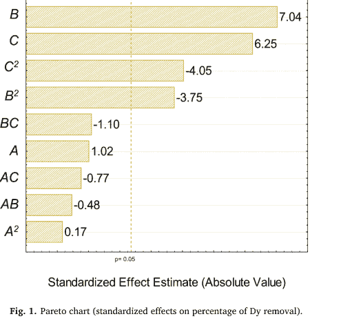
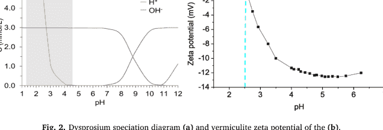
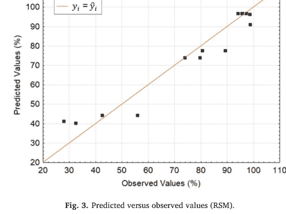
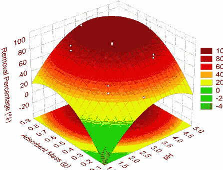
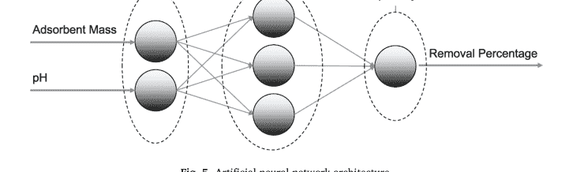
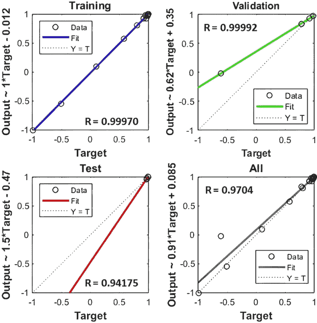
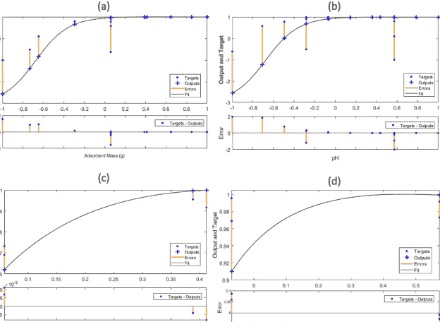
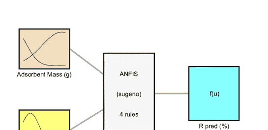
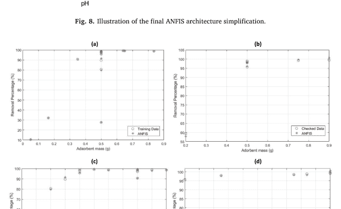
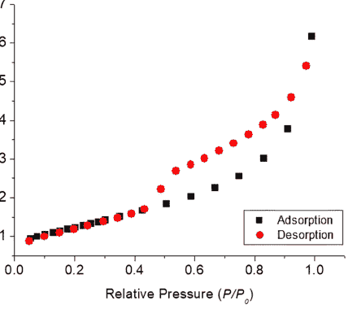

# 膨胀蛭石对关键稀土金属的吸附：响应面法和机器学习技术的精确建模


# 摘要

镝等稀土金属（REM）的循环经济对于清洁能源和高科技领域的可持续未来至关重要。吸附技术因能够回收稀土金属并将其重新整合到生产链中而受到关注；然而，吸附过程的精确建模仍需解决，这阻碍了进一步的放大研究。因此，本文研究了Dy在膨胀蛭石上的吸附，并应用了新型经验方法，如人工神经网络（ANN）、自适应神经模糊推理系统（ANFIS）以及经典响应曲面法（RSM），对镝回收率随吸附剂粒径、质量和溶液pH的变化进行建模，而这些变量在吸附数学建模中常常被忽略。在本研究中，通过RSM方法考察了每个操作参数对Dy去除效率的影响，其中只有吸附剂投加量和pH是显著因素。因此，具有两个输入隶属函数（高斯型）的ANFIS是预测和建模镝去除效率最准确的方法（R² = 0.99681）。此外，在最佳实验条件下（pH约为3.5，吸附剂质量为0.64 g），蛭石对镝的去除效率高达99.2%，表明工艺优化有效。吸附后的载镝蛭石通过织构和热性能表征，证实了材料的稳定性。因此，根据基本操作参数，对Dy在膨胀蛭石（一种低成本、易得且无毒的材料）上吸附的精确建模，可以提高吸附技术在稀土金属再浓缩和回收方面的成熟度。

# 1. 引言

镝（Dy）是一种重稀土金属（REM），主要用于制造风力发电机和电动汽车中使用的永磁体（Nd-Fe-B）（Constantinides, 2012），这意味着镝和稀土金属在发展可再生能源方面发挥着重要作用（Elshkaki and Graedel, 2014）。然而，不断增长的需求和供应风险使得从二次资源中回收稀土金属对于未来实现循环经济和可持续能源部门至关重要（Ambaye et al., 2020）。通过湿法冶金路线回收稀土金属通常对稀溶液体系的分离性能较差，且存在环境问题（Yoon et al., 2016），而吸附是一种可靠、低成本和简单的工艺，可以解决这些问题（Costa et al., 2020）。

吸附效率和经济性与吸附剂的性质直接相关。目前，已有许多吸附剂用于回收稀土金属，例如粘土材料（Sáez et al., 2021）、改性沸石（Yue et al., 2021）、磷石膏（Hagag et al., 2019）、微生物生物质（Shen et al., 2021）、聚合物基吸附剂（Ali et al., 2021; da Costa et al., 2022, 2021a, 2021b; Peng et al., 2021; Zhang et al., 2020）。膨胀蛭石具有作为合适吸附剂的有利特性（Valkov and Simha, 2012），因为这种具有含水镁铝铁层状硅酸盐结构的粘土矿物具有高阳离子交换容量和大比表面积（Li et al., 2021; Udodo et al., 2015）。此外，与合成路线复杂、成本高的工程吸附剂不同，蛭石是一种天然且经济的材料，适合大规模用于稀土回收（Li et al., 2021）。

吸附效率不仅取决于吸附剂的独特特性，还取决于不同的操作条件，如吸附剂质量、粒径、pH、温度、接触时间、吸附质浓度、干扰物存在等（Iftekhar et al., 2018），而对操作参数对吸附性能影响的适当建模是实现工业规模的关键（Dotto and McKay, 2020）。文献中存在非常精确的现象学和经验模型来描述吸附动力学、平衡浓度（等温线）和热力学。然而，吸附剂质量、粒径和pH对吸附潜力的影响通常是通过单独考察每个效应来确定的，缺乏适当的建模。

因此，为了填补这一空白，经验方法和人工智能方法，如响应曲面法（RSM）、人工神经网络（ANN）和自适应神经模糊推理系统（ANFIS），已成功应用于吸附建模（Dolabadi et al., 2018, 2020; Fan et al., 2017; Franco et al., 2020; Gokhale et al., 2020; Igwegbe et al., 2019; Sivamani et al., 2022; Talib et al., 2019）。RSM是一种高效的工具，主要是因为它能仔细考察每个因素对目标响应的影响（Box and Wilson, 1951）。然而，它不够通用，无法描述线性和二次关系之外的行为。而ANN和ANFIS等机器学习技术具有出色的学习算法性能，并能对不同非线性系统的输入输出关系进行高级区分（Franco et al., 2020; Igwegbe et al., 2019; Talib et al., 2019），从而具有更高的预测能力。ANFIS是一种结合了模糊推理系统的神经网络，通常在速度、容错性和适应性方面具有优势（Jang, 1993）。

因此，本工作旨在利用RSM和机器学习方法的优势，通过改变pH、粒径和蛭石质量来研究和建模镝的去除，即通过响应曲面法仔细考察每个变量的影响，并通过机器学习对通常被忽略的操作参数对Dy吸附效率的影响进行精确建模。此外，本研究还打算通过织构和热表征分析评估吸附质-吸附剂相互作用，以评估蛭石在镝吸附中应用的可行性，这将有助于未来稀土回收行业的放大。

# 2. 材料与方法

## 2.1. 吸附实验

按照旋转中心复合设计（RCCD）进行了一系列实验，改变粒径、吸附剂质量和pH，以考察每个变量对Dy吸附效率的影响，并通过响应曲面法确定最佳操作条件。

仅针对RSM指出的显著参数进行了新的实验，这些数据是ANN和ANFIS的输入；这两种方法在稀土金属回收研究领域中很少应用，用于细化显著效应对去除率影响的建模。

本研究中使用的吸附剂——膨胀蛭石，由Brasil Minérios S/A生产。将材料通过一套筛网（40–12目）在振动底座（Produtest）上进行筛分，以分离不同粒度组分。镝溶液（3.0 mmol/L）由储备液制备，其中将5.0 g五水硝酸镝(III)（Aldrich，99.9%）溶解在100 mL酸化水（pH ≃ 5.0）中，并通过添加硝酸（0.1 mol/L）酸化。

在恒温摇床（SI-600R Jeio Tech）中进行搅拌，固定参数为转速（200 rpm）、时间（24 h）、温度（25 °C）、体积（50 mL）和Dy³⁺溶液浓度（3 mmol/L）。加入几滴硝酸（0.1 mol/L）和氢氧化铵（0.1 mol/L）来控制实验的pH。选择吸附剂质量范围是为了确保工艺可行性（低吸附剂用量）。此外，pH范围基于可能含有Dy的废水典型pH（≳2.0）（Gergoric et al., 2019; Riaño and Binnemans, 2015; Zhang and Xu, 2016）以及在水介质中可沉淀物种Dy(OH)₃形成的pH（≳6.0）。通过以4000 rpm离心10 min（CENCE L600离心机）分离固相（吸附剂），并用针头式过滤器（Macherey-Nagel，孔径0.45 μm）过滤上清液。使用原子吸收光谱仪（Shimadzu，AA7000）测量镝浓度。吸附容量（q）和去除率（%R）分别由公式（1）和（2）确定。

```
q = (C₀ − C) Vsol / mads    (1)
%R = (C₀ − C) / C₀ × 100    (2)
```

其中 \(C_0\) 是初始浓度（mmol/L），\(C\) 是特定接触时间后的浓度（mmol/L），\(V_{ol}\) 是金属溶液的体积（L），\(m_{ads}\) 是吸附剂质量（g）。

## 2.2. 响应面方法

多个因素可能影响吸附过程。因此，在本研究中，通过旋转中心复合设计（RCCD）改变粒径（A）、吸附剂质量（B）和pH（C），以优化%R（响应变量）。按照RCCD进行了十七次运行，包括八个析因点、六个轴向点和三个中心点。将RSM应用于该数据集。

RSM被广泛应用于优化产品和工艺，因为它能够发现显著因素、进行精确建模和优化（Costa等，2011）。在本研究中，使用Statistica软件7.0版（StatSoft, Inc.）进行了显著性水平为0.05的方差分析（ANOVA）检验和响应曲面。最初将经验二次模型（方程(3)）拟合到数据上，并进行向后消除以增强拟合效果。

\[
Y = \beta_0 + \sum_{i=1}^{k}\beta_i x_i + \sum_{i=1}^{k}\beta_{ii}x_i^2 + \sum_{i=1}^{k}\sum_{j=1}^{k}\beta_{ij}x_i x_j + \varepsilon
\tag{3}
\]

其中 \(Y\) 是预测响应（去除率），\(x_i\) 和 \(x_j\) 是自变量（CCD因子），\(\varepsilon\) 是随机误差，\(\beta_0\)、\(\beta_i\)、\(\beta_{ii}\) 和 \(\beta_{ij}\) 分别是多项式系数（模型常数、线性系数、二次项系数和交叉项系数）。

进行了补充分析，以理解pH在镝吸附机理中的作用：分析膨胀蛭石的zeta电位和镝的金属形态。使用SurPASS（Anton Paar）在醋酸铵电解质（1 mmol/L）中通过酸滴定（HNO₃ 0.5 mol/L）测量吸附剂的zeta电位。使用Visual Minteq软件模拟了镝的物种分布随pH的变化。

一旦确定了pH、吸附剂质量和粒径的最佳条件，便进行了三次重复实验验证，保持与RCCD相同的转速（200 rpm）、初始浓度（3.0 mmol/L）和溶液体积（50 mL），以验证RSM对镝在膨胀蛭石上吸附进行建模和优化的准确性。

## 2.3. 机器学习技术

ANN和ANFIS的设计考虑了显著影响输出（Dy去除率）的输入变量。网络的开发和训练在MATLAB脚本中进行，共使用24个数据点。根据需要将数据归一化和反归一化。为避免局部最小值，对两种神经网络的不同架构进行了多次可预测性测试。

### 2.3.1. 人工神经网络

人工神经网络（ANN）是一种具有互连节点的计算模型，其灵感来自人脑中的神经元或神经生物学（Izadkhah, 2022），能够追踪输入和输出参数之间的非线性关系。ANN架构由不同的层构成，如输入层、输出层和隐藏层。层中有管理算法训练的激活函数。每个神经元都有特定的权重和偏置值，这些值支配着优化过程（Ghaedi和Vafaei, 2017）。因此，ANN可以用方程(4)进行数学表示（Paulletto等，2020）。

\[
Y = f_1\left(\sum_{j=1}^{n} w_{kj} f_2\left[\sum_{i=1}^{m} w_{ji}X_i+b_j\right]+b_k\right)
\tag{4}
\]

其中 \(Y\) 是输出向量，\(X\) 是输入向量，\(w\) 和 \(b\) 是层间的权重和偏置，\(n\) 是隐藏层的神经元数量，\(m\) 是输入变量的数量，\(i, j, k\) 分别对应输入层、隐藏层和输出层。此外，\(f_1\) 和 \(f_2\) 分别是输出层和隐藏层的激活函数。

本研究通过最小均方误差（MSE）分析了典型浅层神经网络中隐藏层具有不同神经元的ANN架构。Levenberg–Marquardt算法（Levenberg, 1944; Marquardt, 1963）通常是最快的反向传播算法，是MATLAB 2018a软件中开发的网络架构的训练函数，并且作为标准的两层前馈网络，在隐藏层和输出层分别使用了激活函数“tansig”（方程(5)）和“purelin”（方程(6)）。在这种情况下，70%的数据被随机用于训练，15%用于验证，15%用于测试。

\[
f(x)=\frac{2}{1+e^{-2x}}-1
\tag{5}
\]

\[
f(x)=x
\tag{6}
\]

### 2.3.2. 自适应神经模糊推理系统

最常见的神经模糊系统之一是由Jang（1993）提出的ANFIS系统，它结合了模糊逻辑和神经网络。如果模糊系统有期望的输入-输出数据集可用，则可以使用神经网络训练方法设计模糊模型的隶属函数（MF）和规则表（Bose, 2021）。ANFIS结合了ANN和FIS的优点，并避免了它们的缺点。因此，它提供了更好的泛化性能，实现了高度非线性映射，并提供了稳定的解决方案（Shafiullah等，2022）。ANFIS网络由五层组成：模糊层、乘积层、归一化层、去模糊层和总输出层（Kurtgoz和Deniz, 2018）。

在本文中，应用于ANFIS的模糊推理系统是通过MATLAB 2018a的“genfis1”函数实现的，该函数使用所提供的输入和输出数据的网格划分返回Takagi-Sugeno型FIS（Takagi和Sugeno, 1985）。高斯隶属函数（“gaussmf”）被应用于两个输入（方程(7)），因为该MF因其平滑性和简洁表示而被广泛使用（Hameed, 2011; Sadollah, 2018）。

\[
f(x,\sigma,c)=e^{-\frac{(x-c)^2}{2\sigma^2}}
\tag{7}
\]

其中 \(x\) 是输入，\(\sigma\) 和 \(c\) 是函数参数。

评估了与最小MSE相关的隶属函数数量，以确定最佳ANFIS架构。70%的数据用于训练，30%用于随机检查（“randperm”函数）。使用混合方法（最小二乘估计和反向传播算法的组合）对网络进行模拟。去模糊化采用加权平均法；输出隶属函数为线性。

## 2.4. 数据相关性质量评估

用于评估拟合优度的统计标准是决定系数（\(R^2\)）（方程(8)），它表示观测值与预测值之间的关系，以及MSE（方程(9)），它说明数据是否集中在最佳拟合曲线周围，即预测误差（Saber等，2021）。选择MSE标准是因为它是可微的，可以更好地优化，通过平方惩罚即使是微小的误差，并且对异常值非常敏感（Aditya Mishra, 2020）。选择后验指标\(R^2\)来验证目标中的总方差有多少由回归线中的方差解释（Hiregoudar, 2020）。

\[
R^2=1-\frac{\sum_{i=1}^{N}(y_i-\hat{y}_i)^2}{\sum_{i=1}^{N}(y_i-\bar{y})^2}
\tag{8}
\]

\[
MSE=\frac{1}{N}\sum_{i=1}^{N}(\hat{y}_i-y_i)^2
\tag{9}
\]

其中 \(N\) 是实验点的数量，\(y_i\) 和 \(\hat{y}_i\) 分别是观测值和预测值，\(\bar{y}\) 是观测值的平均值。

## 2.5. 吸附剂表征

考虑操作参数影响的吸附现象的精确建模通常被忽略。吸附后对吸附剂进行表征以验证材料稳定性的情况也是如此。在这项工作中，对负载镝的膨胀蛭石（V–Dy），即吸附后收集的固体样品，进行了织构和热性能表征。评估的织构性质包括Brunauer–Emmett–Teller比表面积（\(S_{BET}\)/m²/g）（Brunauer等，1938）（方程S1–S2，补充信息）、真实密度（\(\rho\)/g/cm³）和堆积密度（\(\rho_{bulk}\)/g/cm³）、颗粒孔隙率（\(\varepsilon_p\)，方程A3）。使用的仪器是ANOVA-e比表面积分析仪（Quantachrome）、Auto Pore IV压汞仪（Micromeritics）和Accu-pyc II 1340氦比重瓶（Micromeritics）。使用DTG-60（Shimadzu）进行了热重和差热分析，以研究材料吸附后的热稳定性。有关表征程序的更多细节可在表S1（补充信息）中找到。

# 3. 结果与讨论

## 3.1. 响应面方法

旋转中心复合设计的吸附容量和Dy去除率结果如表1所示，其中%R范围从27.6%（第13次运行）到99.1%（第8次运行），q从0.08 mmol/g（第13次运行）到0.37 mmol/g（第6次运行），表明各因素影响了响应变量（%R）和吸附容量。

独立输入的标准化效应及其与响应变量（%R）的关系如图1（帕累托图）所示，以了解每个因素对响应的影响程度。当t值大于+2.365（自由度为7的学生t检验，且 \(p < 0.05\)）时，效应被认为是显著的。在95%置信水平下显著影响%R的因素是：吸附剂用量（g）和pH，均以线性形式（B, C）和平方形式（B², C²）出现。粒径（A, A²）以及因素之间的所有交互作用（AC, BC, AB）均不显著。估计效应的完整表格可在补充材料（表S2）中查阅。

为了阐明pH对吸附质和吸附剂的影响，评估了Dy物种分布模拟（图2(a)）和材料的zeta电位（图2(b)）。对%R影响最大的是吸附剂质量（g），其次是pH，两者均为正效应。平方效应（B², C²）小于线性效应且为负效应。吸附剂质量对%R的正效应可以得到解释。


### 表 1

RCCD 用于 Dy 在蛭石上的吸附容量 (q) 和去除百分比 (%R)，作为颗粒尺寸 (A)、吸附剂用量 (B) 和 pH (C) 的函数。

| 运行 | A (mm) | B (g) | pH | A (编码) | B (编码) | C (编码) | q (mmol/g) | %R |
|---:|---:|---:|---:|---:|---:|---:|---:|---:|
| 1 | 0.65 | 0.300 | 2.0 | -1 | -1 | -1 | 0.20 | 42.2 |
| 2 | 1.09 | 0.300 | 2.0 | +1 | -1 | -1 | 0.26 | 55.8 |
| 3 | 0.65 | 0.700 | 2.0 | -1 | +1 | -1 | 0.16 | 80.6 |
| 4 | 1.09 | 0.700 | 2.0 | +1 | +1 | -1 | 0.18 | 89.3 |
| 5 | 0.65 | 0.300 | 4.0 | -1 | -1 | +1 | 0.35 | 73.9 |
| 6 | 1.09 | 0.300 | 4.0 | +1 | -1 | +1 | 0.37 | 79.6 |
| 7 | 0.65 | 0.700 | 4.0 | -1 | +1 | +1 | 0.20 | 98.9 |
| 8 | 1.09 | 0.700 | 4.0 | +1 | +1 | +1 | 0.20 | 99.1 |
| 9 | 0.48 | 0.500 | 3.0 | -α | 0 | 0 | 0.27 | 94.1 |
| 10 | 1.30 | 0.500 | 3.0 | +α | 0 | 0 | 0.27 | 97.3 |
| 11 | 0.85 | 0.163 | 3.0 | 0 | -α | 0 | 0.28 | 32.1 |
| 12 | 0.85 | 0.836 | 3.0 | 0 | +α | 0 | 0.17 | 98.8 |
| 13 | 0.85 | 0.500 | 1.3 | 0 | 0 | -α | 0.08 | 27.6 |
| 14 | 0.85 | 0.500 | 4.7 | 0 | 0 | +α | 0.28 | 98.9 |
| 15 | 0.85 | 0.500 | 3.0 | 0 | 0 | 0 | 0.27 | 95.8 |
| 16 | 0.85 | 0.500 | 3.0 | 0 | 0 | 0 | 0.27 | 95.6 |
| 17 | 0.85 | 0.500 | 3.0 | 0 | 0 | 0 | 0.27 | 95.8 |



标准效应估计值（绝对值）

图 1. Pareto 图（Dy 去除百分比的标准效应）。



图 2. 镝的形态分布图 (a) 和蛭石 zeta 电位 (b)。

由于吸附剂用量增加可提供更多吸附金属离子的活性位点。pH 的正效应则归因于随着 pH 增强，蛭石的负电荷增加，从而改善了对阳离子的静电吸引。

在所研究的 pH 范围 (1.3 至 4.7) 内，溶液中的主要形态本质上是 Dy³⁺ 和 H⁺ (图 2(a))。当 pH < 2.9 时，氢是介质中的主要形态，而当 pH > 2.9 时，Dy³⁺ 在介质中的浓度最高。随着 pH 升高，H⁺ 浓度降至零 (pH ~ 5.0)。这种行为解释了 pH 对 Dy 吸附的正效应，因为 pH 的升高减弱了 Dy³⁺ 与 H⁺ 对蛭石已知带负电吸附位点的竞争。在蛭石 zeta 电位分析中 (图 2(b))，等电点确定为 pH = 2.5，即在此 pH 值下，蛭石表面正负电荷之和为零 (Duman and Tunç, 2008)。当 pH > 零电荷电位时，蛭石表面带负电，促进了 Dy³⁺ 阳离子的吸引，这也证实了 pH 对镝吸附的正效应。pH 的效应可通过比较表 1 的结果 (运行 13 和 14) 来证明，其中仅改变 pH；在 pH 1.3 时，%R 为 27.6%，而在 pH 4.8 时，%R 为 98.9%。

表 S3 给出了包含主效应和交互效应的完整模型的方差分析 (ANOVA)。完整模型 (式 (3)) 在 95% 置信度下显著，尽管模型考虑了非显著效应。由 Fcal/Ftab = 3.7 可得出此结论。模型以 R² 为 0.9455 和校正决定系数 (R²adj) 为 0.8755 拟合了数据。然而，简化模型 (表 2) 的 ANOVA 在向后剔除后 (式 (10))，即剔除非显著效应后，显示 Fcal/Ftab = 10.8，R² = 0.9217 和 R²adj = 0.8949。简化模型的估计效应可在表 S4 中获得 (补充材料)。

### 表 2

%R 预测的简化二次模型方差分析 (α = 0.05)。

| 来源 | SS | df | MS | Fcalc | Fcalc/Ftab |
|---|---:|---:|---:|---:|---:|
| 回归 | 9078.4 | 4 | 2269.6 | 35.1 | 10.8 |
| 误差 | 776.9 | 12 | 64.7 |  |  |
| 总计 | 9855.4 | 16 |  |  |  |

a Ftab = 3.26.

F 检验值从 3.7 增加到 10.8，以及 R²adj 从 0.8755 增加到 0.8949，表明简化模型比完整模型更显著。简化模型被选用来表示 %R，因为它呈现 Fcal/Ftab > 10；该比值在文献中被推荐为用于预测目的的有用回归 (de Barros Neto et al., 2010)。基于式 (10) 的 %R 模型对归一化 B 值 (吸附剂质量) 和 C 值 (pH) 的观测值与预测值 (图 3) 以及响应面 (图 4) 。

```
%R = 96.58 + 16.74B + 14.91C − 10.09B² − 10.90C²  (10)
```

图 3 表明模型对高 %R 值的数据预测更好，而对较低值 (<60%) 的预测较差，这意味着模型在解释镝去除最大值的区域时更可靠。图 4 显示了 %R 响应面作为 pH 和吸附剂用量 (g) (显著因子) 的函数，可观察到最大去除百分比的区域。%R 的最高值出现在 pH 约为 3.5 且吸附剂用量在 0.5 至 0.8 g 之间。Statistica 软件获得的临界值为 pH 等于 3.5，吸附剂质量等于 0.64 g。



图 3. 预测值与观测值 (RSM)。



图 4. Dy 去除百分比响应面随 pH 和吸附剂质量的变化。

验证测试在最佳条件下的结果为 q = 0.23 mmol/g 和 %R = 99.2 ± 0.10%。验证测试实验获得的 %R 高于表 1 中显示的 %R，这意味着优化 (最大化 %R) 已实现。模型预测的去除百分比为 106.5%，均方误差 (MSE) 为 53.8。因此，模型不足以精确预测 Dy 去除百分比，表明 RSM 建模的局限性。

表 3 中给出了本研究与其他镝吸附工作之间的比较。表 3 中的数据来自吸附剂质量和 pH 影响的研究。吸附剂质量已重新计算为 50.0 mL 体积 (本研究的溶液体积)。

表 3 显示，膨胀蛭石上 Dy³⁺ 的去除百分比为 99.2%，与其它结果相似，且达到的吸附容量高于大多数。然而，本研究的初始 Dy 浓度远高于其它 Cᵢ。因此，由于溶液中存在更多 Dy 离子，本研究使用了最高质量的吸附剂。将膨胀蛭石 (本研究) 与使用最低初始浓度的功能化二氧化硅进行比较，膨胀蛭石在溶液浓度高 4838.7 倍的情况下实现了相同的去除百分比，仅使用了 2.56 倍的吸附剂质量。

比较最佳 pH 条件，研究在 pH 2.0 至 7.0 的宽范围内进行。非常接近永磁体浸出液的 pH，pH = 3.6 (Brewer et al., 2019)，这意味着蛭石用于浓缩和从富含稀土的二次来源回收稀土元素具有实际应用优势。本研究确定的最佳 pH 为中间值。非常接近永磁体浸出液的 pH，pH = 3.6 (Brewer et al., 2019)，这意味着蛭石用于浓缩和从富含稀土的二次来源回收稀土元素具有实际应用优势。在 pH 7.0 时 (Abdel-Magied et al., 2019b; Kegl et al., 2019)，镝的不溶形式 (Dy(OH)₃) 即使少量也会形成 (图 2 (a))。因此，Dy 的沉淀可能已作为吸附的结果被包含。在 pH 2.0 时 Dy 吸附不常见，因为与 H⁺ 竞争激烈 (Zheng et al., 2016)。无论如何，作者认为该条件为最佳，因为在酸性介质中，吸附剂对 Dy³⁺ 的吸附容量 (IMS) 不仅基于螯合能力，还基于印迹过程赋予的 Dy³⁺ 配位的空间结构。

### 表 3

Dy³⁺ 吸附不同最佳条件的比较。

| 吸附剂 | Cᵢ (mmol/L) | pH | 吸附剂质量 (g) | %R | q (mmol/g) | 参考文献 |
|---|---:|---:|---:|---:|---:|---|
| 离子印迹介孔二氧化硅 | 0.3 | 2.0 | 0.05 | ᵃ34 | 0.10 | Zheng et al. (2016) |
| 化学活化碳 | 0.03 | 4.0 | 0.075 | 94 | ᵃ0.19 | Alcaraz et al. (2019) |
| 物理活化碳 | 0.03 | 4.0 | 0.075 | 100 | ᵃ0.21 | — |
| γ-Fe₂O₃–NH₄OH@SiO₂ 纳米颗粒 | 0.002 | 7.0 | 0.15 | 90 | ᵃ6.0×10⁻⁴ | Kegl et al. (2019) |
| 功能化二氧化硅 | 6.2×10⁻⁴ | 5.0 | 0.25 | 100 | ᵃ2.0×10⁻⁵ | Berijani et al. (2012) |
| 层级沸石咪唑酯框架纳米颗粒 | 0.074 | 7.0 | 0.012 | ᵃ95.8 | 0.28 | Abdel-Magied et al. (2019a) |
| 膨胀蛭石 | 3.0 | 3.5 | 0.64 | 99.2 | 0.27 | 本研究 |

ᵃ 根据报道数据计算得出（原文中未显示值）。

## 3.2. 机器学习

### 3.2.1. 数据集

用于训练网络和预测的数据集 (表 4) 由 24 个实验点组成，其中仅改变了 ANOVA/RSM 指出的重要参数 (蛭石质量和 pH)，并实验评估了其对 Dy 去除百分比的响应。获得了非常不同的去除百分比 (从 10.4 到 99.4%)，证实了蛭石质量和溶液 pH 对 Dy 吸附性能的显著影响。表 4 还给出了归一化数据的值。该数据表现出高质量数据集的特征，如可靠性，因为它们来自严格的实验过程


#### 表 4. ANN和ANFIS数据集。

| 原始数据 | | | 归一化数据[-1,1] | | |
|---|---|---|---|---|---|
| 吸附剂质量(g) | pH | %R(%) | 吸附剂质量(g) | pH | %R(%) |
| 0.164 | 3.0 | 32.10 | -0.73 | -0.28 | -0.51 |
| 0.836 | 3.0 | 98.80 | 0.85 | -0.28 | 0.99 |
| 0.500 | 1.32 | 27.60 | 0.06 | -1.00 | -0.61 |
| 0.500 | 4.68 | 98.90 | 0.06 | 0.44 | 0.99 |
| 0.500 | 3.0 | 95.80 | 0.06 | -0.28 | 0.92 |
| 0.500 | 3.0 | 95.60 | 0.06 | -0.28 | 0.91 |
| 0.500 | 3.0 | 95.80 | 0.06 | -0.28 | 0.92 |
| 0.500 | 2.0 | 80.49 | 0.06 | -0.71 | 0.57 |
| 0.500 | 2.5 | 89.64 | 0.06 | -0.50 | 0.78 |
| 0.500 | 3.0 | 97.75 | 0.06 | -0.28 | 0.96 |
| 0.500 | 3.5 | 98.02 | 0.06 | -0.07 | 0.97 |
| 0.500 | 4.0 | 98.62 | 0.06 | 0.15 | 0.98 |
| 0.500 | 4.5 | 98.52 | 0.06 | 0.36 | 0.98 |
| 0.500 | 5.5 | 98.69 | 0.06 | 0.79 | 0.98 |
| 0.500 | 6.0 | 98.59 | 0.06 | 1.00 | 0.98 |
| 0.050 | 5.0 | 10.45 | -1.00 | 0.57 | -1.00 |
| 0.200 | 5.0 | 59.25 | -0.65 | 0.57 | 0.10 |
| 0.350 | 5.0 | 90.62 | -0.29 | 0.57 | 0.80 |
| 0.500 | 5.0 | 98.21 | 0.06 | 0.57 | 0.97 |
| 0.650 | 5.0 | 99.03 | 0.41 | 0.57 | 0.99 |
| 0.750 | 5.0 | 99.26 | 0.65 | 0.57 | 1.00 |
| 0.900 | 5.0 | 99.40 | 1.00 | 0.57 | 1.00 |
| 0.640 | 3.5 | 99.20 | 0.39 | -0.07 | 1.00 |
| 0.500 | 5.0 | 97.10 | 0.06 | 0.57 | 0.95 |

程序及正确的特征表示（归一化）（Shanker等，1996）。数据集的统计指标见补充信息中的表S5。

### 3.2.2. 人工神经网络

人工神经网络的最佳架构由输入层两个神经元、隐藏层三个神经元和输出层一个神经元组成（图5），用于通过改变蛭石质量和溶液pH预测Dy的去除率。该配置在测试过程中获得了最低的MSE（图S1，补充信息（SI））。学习曲线（图S2）显示，训练和验证误差降低到稳定点，其中训练、验证和测试的MSE分别为2.81×10⁻⁴、8.70×10⁻²和6.92×10⁻⁵。最佳权重为0.008、−0.710和1.302，偏置为1.947、−2.623和1.868。这些低误差意味着ANN得到了良好的训练和验证，从而在测试步骤中获得了良好的拟合。



**图5.** 人工神经网络架构。

图6显示了训练、验证和检验的拟合结果，训练和验证的R分别为0.99970和0.99992，证实网络得到了充分训练。然而，测试中获得的R较低，为0.94175，这意味着尽管上述MSE较低（6.92×10⁻⁵），回归模型仍无法解释实际值与平均值之间的所有变异。因此，ANN通过数据得到了令人满意的训练，能够很好地预测Dy的去除率。然而，回归的泛化能力并不十分接近理想值（R=1）。



**图6.** 预测值与观测值对比（ANN）。

图7展示了两个归一化输入（吸附剂质量和pH）在训练和测试中的函数拟合。对于训练（图7(a)和图7(b)），最佳拟合通常出现在最大去除率区域，即吸附剂用量较高（>0.64 g）且pH在3.0到5.0之间时。在测试中，预测（输出）与目标值之间的误差较小（图7(c)和图7(d)），尤其是在最高去除率时，这与在最佳条件下训练效果最有效一致。此外，网络对蛭石质量对Dy去除率影响的预测能力（误差更小）优于对pH的预测，这证实了RSM所指示的显著性顺序。因此，ANN对数据中Dy去除率的预测是精确的；然而，针对不同吸附剂用量和pH的膨胀蛭石上镝吸附效率的建模仍有待改进。



**图7.** ANN在训练和测试中预测的镝去除率随吸附剂质量（a,c）和pH（b,d）的变化。

### 3.2.3. 自适应神经模糊推理系统

研究了不同数量的输入隶属函数（高斯型），最简单的配置——输入1（吸附剂质量）使用2个MF，输入2（pH）使用2个MF——具有最强的预测能力，即在检验步骤中获得了最低的MSE（图S3和S4，SI）。该ANFIS设计的学习曲线（图S4）显示，训练和检验误差在达到稳定之前不断降低。图8展示了以吸附剂用量和介质pH为变量时，膨胀蛭石上镝去除率的最佳ANFIS架构，每个输入有2个高斯MF，形成4条规则，包含8个非线性参数和12个线性参数。ANFIS拟合的统计参数为：训练和检验的R²分别为0.99936和0.99681，MSE分别为2.71×10⁻⁴和2.61×10⁻⁴，表明与实验数据拟合极佳。

训练（图9(a,c)）和检验（图9(b,d)）步骤中，两个输入的预测值与观测值对比（图9）表明，该网络得到了很好的训练，即ANFIS能够从输入数据中学习，从而产生较小的误差。此外，在检验中，网络在几乎所研究的全部吸附剂质量和pH范围内都精确地预测了Dy去除率，这对实际应用非常有利，因为在从酸性矿山排水、钕铁硼磁体浸出液、赤泥等二次资源中回收Dy的工厂中，pH可能发生突变。



**图8.** 最终ANFIS架构简化的图示。



**图9.** ANFIS在训练和检验中预测的镝去除率随吸附剂质量（a,c）和pH（b,d）的变化。

## 3.3. 总体讨论

RSM是识别特定响应相关自变量的一种强大工具，由于其统计形式体系，可以获得关键信息，例如输入变量对响应变量的影响。本文中，RSM表明蛭石粒径对从水溶液中去除Dy的影响不显著，并指出了吸附剂质量和pH的重要性。此外，最佳的Dy去除发生在pH 3.5和吸附剂质量0.64 g时。然而，将Dy的吸附效率作为这些参数的函数进行建模并不十分准确，而ANN和ANFIS则表现更好，这与其他吸附研究一致（Onu等，2021；Saber等，2021；Shojaeimehr等，2014）。这一结果可能与RSM建模的局限性有关，RSM预先假设了一个二次模型（二阶），而机器学习方法（ANN和ANFIS）则基于生物信息处理系统，由于非线性和对噪声的不敏感性，能够更好地拟合数据（Basheer和Hajmeer，2000；Franco等，2020）。

在比较ANN和ANFIS的预测能力时，文献中反复表明，ANFIS在优化和预测吸附过程方面比ANN具有更好的响应（Onu等，2021；Souza等，2018；Wong等，2020）。由于ANFIS结合了神经网络的学习能力和模糊逻辑的推理能力，它汇集了两种方法的优势（Dolatabadi等，2020）；因此，在本研究中，ANFIS能够更好地预测和模拟镝去除率。

因此，本研究表明，每个输入具有2个高斯MF的ANFIS可以将镝吸附效率建模为吸附剂性质（粒径和质量）和pH的函数。此外，由于ANFIS可以随时用新数据重新训练，这种建模策略对于放大过程具有实际意义。

## 3.4. 吸附剂表征

吸附是一种界面现象；因此，吸附剂的织构性质在吸附潜力中起着重要作用。图10为负载镝的蛭石（V–Dy）上的物理氮吸附等温线，其形状为页硅酸盐滞后回线。它决定了可用于吸附的孔隙的面积、类型、形状和大小（Thommes等，2015），根据国际纯粹与应用化学联合会（IUPAC）的报告，该吸附等温线形状是IV型的一个特例，其中吸附分支为II型，脱附具有H3滞后回线。在高压P/P₀下N₂吸附没有平台，表明存在大孔（Sing和Williams，2004）。H3滞后回线是由板状颗粒的非刚性聚集体引起的，如某些粘土材料，包括蛭石（Boruah等，2019；Lowell等，2004）。

根据压汞体积得到的孔隙分布（图11）是将孔隙视为开放狭缝获得的，这是蛭石等粘土矿物的典型特征（Anovitz和Cole，2015）。图11表明，V–Dy的中位压入体积为0.015 cm³/g，孔径范围为2.5–20 μm，在10 μm处有更明显的峰。因此，在吸附镝之后，该材料表现出多样化的大孔分布。V–Dy的大孔体积为0.74 cm³/g，低于吸附前材料的0.96 cm³/g（Brião等，2020）。

负载吸附剂和原始膨胀蛭石的织构性质总结于表5。所评估的性质包括BET比表面积（S<sub>BET</sub>）、真密度（ρ）和堆密度（ρ<sub>bulk</sub>），以及颗粒孔隙率（ε<sub>p</sub>）。

与吸附镝之前的吸附剂相比，V–Dy的S<sub>BET</sub>降至4.382 m²/g，这意味着比表面积损失了44.36%。V–Dy的真密度和堆密度分别为2.612和0.741 g/cm³，均高于原始材料。材料密度的增加减少了空隙空间，并导致颗粒孔隙率降低至0.72。比表面积和孔隙率的降低以及密度的增加与膨胀蛭石结构的再水化效应（Kawano和Tomita，1991）以及镝在蛭石表面的有效吸附有关。膨胀蛭石是通过在900°C下热处理形成的，该处理使层间水蒸发，扩大了材料的层状空间，从而增加了比表面积。因此，当材料置于水溶液中时，再水化作用轻微压实了“手风琴”形状。此外，



**图10.** V–Dy上N₂吸附-脱附等温线。


因此，V–Dy 的织构表征分析表明，由于再堆积（再水化）以及镝在蛭石表面的有效吸附，吸附剂降低了大孔的表面积和体积，并增加了堆积密度和真密度。热分析表明，层间离子交换机制在膨胀蛭石对镝的吸附中起着重要作用，这影响了材料的热稳定性。

# 4. 结论

操作参数在典型的吸附过程建模中常常被忽略。本研究应用统计学方法（ANOVA/RSM）和人工智能方法（ANN 和 ANFIS），以颗粒尺寸、吸附剂质量和 pH 为变量，使用膨胀蛭石预测水溶液中镝的去除率。此外，通过对负载镝的固体进行表征，对吸附过程进行了评估。

RSM 指出，吸附剂质量和 pH 对镝的吸附效率具有统计学显著性。在 pH 3.5 和 0.64 g 吸附剂条件下获得最佳 %R 值。最终的 RSM 模型（排除了不显著的粒径效应）对数据的拟合 R² 为 0.9217，但较高的验证误差（~7%）表明该模型在根据 pH 和吸附剂用量预测镝去除率时不够精确。采用 Levenberg-Marquardt 反向传播算法训练的具有三个隐含神经元的 ANN 对数据的拟合 R 为 0.94175，比 RSM 更准确地预测了镝的吸附效率。尽管如此，由每个输入两个高斯隶属函数（MF）组成的 ANFIS 在训练（0.99936）和校验（0.99681）中表现出更高的相关系数，显示出优于 ANN 的学习和泛化能力。

关于负载镝蛭石的表征，负载后的吸附剂材料具有典型的层状硅酸盐层状结构，且孔分布不均匀。此外，与原始材料相比，吸附剂降低了 BET 比表面积（4.382 m²/g）和孔隙率（0.72），并提高了堆积密度（0.741 g/cm³）和真密度（2.612 g/cm³）。因此，材料的织构性质（如比表面积）在整个过程中发生了变化；然而，热重分析表明，即使在吸附镝之后，蛭石仍具有较高的热稳定性。

因此，蛭石是一种稳定的层状硅酸盐材料，能够从水溶液中高效吸附镝。ANFIS 能够准确模拟吸附剂质量和 pH 的影响，这有助于在进一步应用中改进过程控制并提高成本效益。

# 作者声明

Giani de Vargas Brião：概念化、方法论、调查、软件、验证、正式分析、写作——原稿。Dison Stracke Pfingsten Franco：方法论、软件、正式分析、写作——原稿。Flávio Vasconcelos da Silva：概念化、方法论、软件、正式分析、写作——审阅与编辑。Meuris Gurgel Carlos da Silva：资源、监督、写作——审阅与编辑。Melissa Gurgel Adeodato Vieira：资源、项目管理、监督、写作——审阅与编辑。

# 利益冲突声明

作者声明，他们没有已知的竞争性经济利益或个人关系可能会影响本文所报告的工作。

# 数据可用性

作者无法或选择不说明使用了哪些数据。

# 致谢

这项工作得到了圣保罗研究基金会（FAPESP）（项目编号 2017/18236-1）、巴西高等教育人员改进协调委员会（CAPES）、巴西国家科学技术发展委员会（CNPq）（项目编号 308046/2019-6）的支持。吸附剂材料由巴西矿业公司（Brasil Minérios S/A）捐赠。

# 附录 A. 补充数据

本文的补充数据可在 https://doi.org/10.1016/j.scp.2022.100938 在线获取。

# 参考文献

- Abdel-Magied, A.F., Abdelhamid, H.N., Ashour, R.M., Zou, X., Forsberg, K., 2019a. 分级多孔沸石咪唑酯骨架纳米颗粒用于高效吸附稀土元素. Microporous Mesoporous Mater. 278, 175–184. https://doi.org/10.1016/j.micromeso.2018.11.022.
- Abdel-Magied, A.F., Abdelhamid, H.N., Ashour, R.M., Zou, X., Forsberg, K., 2019b. 分级多孔沸石咪唑酯骨架纳米颗粒用于高效吸附稀土元素. Microporous Mesoporous Mater. 278. https://doi.org/10.1016/j.micromeso.2018.11.022.
- Alcaraz, L., Escudero, M.E., Alguacil, F.J., Llorente, I., Urbieta, A., Fernández, P., López, F.A., 2019. 利用废弃咖啡渣制备的活性炭去除水中的镝. Nanomaterials 9, 1372. https://doi.org/10.3390/nano9101372.
- Ali, A.H., Dakroury, G.A., Hagag, M.S., Abdo, Sh.M., Allan, K.F., 2021. 某些稀土元素在酸性溶液中在聚(丙烯酸-共-丙烯酰胺/16,16-二甲基十七烷-1-胺)复合材料上的吸附. J. Polym. Environ. https://doi.org/10.1007/s10924-021-02271-7.
- Ambaye, T.G., Vaccari, M., Castro, F.D., Prasad, S., Ritimi, S., 2020. 从报废电子废物中回收稀土元素的新兴技术：进展、挑战与展望综述. Environ. Sci. Pollut. Control Ser. 27. https://doi.org/10.1007/s11356-020-09630-2.
- Anovitz, L.M., Cole, D.R., 2015. 孔隙度和孔隙结构的表征与分析. Rev. Mineral. Geochem. 80, 61–164. https://doi.org/10.2138/rmg.2015.80.04.
- de Barros Neto, B., Scarminio, I.S., Bruns, R.E., 2010. Como Fazer Experimentos, 第四版. Bookman, Porto Alegre.
- Basheer, I.A., Hajmeer, M., 2000. 人工神经网络：基础、计算、设计与应用. J. Microbiol. Methods 43, 3–31. https://doi.org/10.1016/S0167-7012(00)00201-3.
- Berijani, S., Ganjali, M.R., Sereshti, H., Norouzi, P., 2012. 一种选择性改性的纳米多孔二氧化硅作为吸附剂，用于 ICP-OES 测定前水样中镝的分离和预富集. Int. J. Environ. Anal. Chem. 92, 355–365. https://doi.org/10.1080/03067319.2010.551120.
- Bobrowski, A., Kaczmarska, K., Sitarz, M., Drożyński, D., Leśniak, M., Grabowska, B., Nowak, D., 2021. 珍珠岩和蛭石的脱羟基：对改善无机粘结剂型砂和芯砂落砂性能的影响. Materials 14. https://doi.org/10.3390/ma14112946.
- Bock, C.W., Kaufman, A., Glusker, J.P., 1994. 水与镁阳离子的配位. Inorg. Chem. 33, 419–427. https://doi.org/10.1021/ic00081a007.
- Borah, A., Rasheed, A., Mendhe, V.A., Ganapathi, S., 2019. 印度拉尼甘杰盆地含气页岩的比表面积和孔径分布. J. Pet. Explor. Prod. Technol. 9, 1041–1050. https://doi.org/10.1007/s13202-018-0583-8.
- Bose, B.K., 2021. 神经网络及其应用. 见：Power Electronics and Motor Drives. Elsevier, pp. 875–1014. https://doi.org/10.1016/b978-0-12-821360-5.00012-9.
- Box, G.E.P., Wilson, K.B., 1951. 关于实验达到最优条件. J. Roy. Stat. Soc. B 13, 1–38. https://doi.org/10.1111/j.2517-6161.1951.tb00067.x.
- Brewer, A., Dohnalkova, A., Shutthanandan, V., Kovarik, L., Chang, E., Sawvel, A.M., Mason, H.E., Reed, D., Ye, C., Hynes, W.F., Lammers, L.N., Park, D.M., Jiao, Y., 2019. 微生物封装用于从电子废物浸出液中选择性回收稀土. Environ. Sci. Technol. 53, 13888–13897. https://doi.org/10.1021/acs.est.9b04608.
- Brião, G. de V., da Silva, M.G.C., Vieira, M.G.A., 2020. 通过膨胀蛭石吸附/解吸从水溶液中回收钕. Appl. Clay Sci. 198, 105825. https://doi.org/10.1016/j.clay.2020.105825.
- Brunauer, S., Emmett, P.H., Teller, E., 1938. 多分子层中气体的吸附. J. Am. Chem. Soc. 60, 309–319. https://doi.org/10.1021/ja01269a023.
- Constantine, S., 2012. 镝在现代永磁体中的重要作用. [WWW文档]. Arnold Magnetic Technologies Corporation. URL https://www.arnoldmagnetics.com/wp-content/uploads/2017/10/Important-Role-of-Dysprosium-in-Modern-Permanent-Magnets-15906.pdf
- Costa, N.R., Lourenço, J., Pereira, Z.L., 2011. 期望函数方法：不利条件下的综述与性能评估. Chemometr. Intell. Lab. Syst. 107, 234–244. https://doi.org/10.1016/j.chemolab.2011.04.004.
- Costa, T.B. da, Silva, M.G.C. da, Vieira, M.G.A., 2020. 利用非常规材料通过生物/吸附从水溶液中回收稀土金属：柱应用中的近期研究与有前景方法综述. J. Rare Earths. https://doi.org/10.1016/j.jre.2019.06.001.
- da Costa, T.B., da Silva, M.G.C., Vieira, M.G.A., 2021a. 通过丝胶和海藻酸盐生物复合材料生物吸附回收镝. J. Water Proc. Eng. 44. https://doi.org/10.1016/j.jwpe.2021.102388.
- da Costa, T.B., da Silva, M.G.C., Vieira, M.G.A., 2021b. 在连续固定床柱系统中使用丝胶/海藻酸盐/聚乙烯醇珠粒作为天然阳离子交换剂生物吸附镧. Colloids Surf. A Physicochem. Eng. Asp. 627, 127233. https://doi.org/10.1016/j.colsurfa.2021.127233.
- da Costa, T.B., da Silva, M.G.C., Vieira, M.G.A., 2022. 使用交联丝胶-海藻酸盐珠粒通过生物吸附有效回收镱：完整的连续填充床柱研究. J. Hazard Mater. 421, 126742. https://doi.org/10.1016/j.jhazmat.2021.126742.
- Dolatabadi, M., Mehrabpour, M., Esfandyari, M., Alidadi, H., Davoudi, M., 2018. 使用 ANN 和 ANFIS 对锯末从水溶液中同时吸附染料和金属离子的过程进行建模. Chemometr. Intell. Lab. Syst. 181, 72–78. https://doi.org/10.1016/j.chemolab.2018.07.012.
- Dolatabadi, M., Mehrabpour, M., Esfandyari, M., Ahmadzadeh, S., 2020. 四环素类抗生素在改性沸石上的吸附：实验研究与建模. MethodsX 7. https://doi.org/10.1016/j.mex.2020.100885.
- Dotto, G.L., McKay, G., 2020. 水处理吸附的现状与挑战. J. Environ. Chem. Eng. 8. https://doi.org/10.1016/j.jece.2020.103988.
- Duman, O., Tunç, S., 2008. 蛭石和膨胀蛭石的电动性质：pH、黏土浓度和单价与多价电解质的影响. Separ. Sci. Technol. 43, 3755–3776. https://doi.org/10.1080/01496390802219109.
- Elshakre, A., Graedel, T.E., 2014. 镝、平衡问题与风电技术. Appl. Energy 136, 548–559. https://doi.org/10.1016/j.apenergy.2014.09.064.
- Fan, M., Hu, J., Cao, R., Xiang, K., Wei, X., 2017. 使用 ANN-GA 和 ANN-PSO 对 nZVI/rGO 磁性纳米复合材料去除水溶液中铜的建模与预测. Sci. Rep. 7, 1–14. https://doi.org/10.1038/s41598-017-18223-y.
- Feng, J., Liu, M., Fu, L., Zhang, K., Xie, Z., Shi, D., Ma, X., 2020. 钠离子改性蛭石热膨胀的增强与机理. RSC Adv. 10, 7635–7642. https://doi.org/10.1039/d0ra00223b.
- Franco, D.S.P., Duarte, F.A., Salau, N.P.G., Dotto, G.L., 2020. 使用人工神经网络（ANN）和自适应神经模糊推理系统（ANFIS）分析LCD屏幕浸出液中铟(III)的吸附. J. Hazard Mater. 384, 121137. https://doi.org/10.1016/j.jhazmat.2019.121137.
- Gergoric, M., Barrier, A., Retegan, T., 2019. 使用乙醇酸、马来酸和抗坏血酸后接溶剂萃取从钕磁体废料中回收稀土元素. Journal of Sustainable Metallurgy 5, 85–96. https://doi.org/10.1007/s40831-018-0200-6.
- Ghaedi, A.M., Vafaei, A., 2017. 人工神经网络在吸附去除水溶液中染料的应用：综述. Adv. Colloid Interface Sci. https://doi.org/10.1016/j.cis.2017.04.015.
- Gokhale, N.A., Trivedi, N.S., Mandavgane, S.A., Kulkarni, B.D., 2020. 生物质灰作为农药的高效吸附剂：人工神经网络预测吸附容量. Int. J. Environ. Sci. Technol. 17, 3209–3216. https://doi.org/10.1007/s13762-020-02645-9.
- Hagag, M.S., Morsy, A.M.A., Ali, A.H., El-Sheikh, A.S., 2019. 稀土元素在磷石膏（一种废副产品）上的吸附. Water Air Soil Pollut. 230. https://doi.org/10.1007/s11270-019-4362-z.
- Hameed, I.A., 2011. 使用高斯隶属函数提高学生评价系统的可靠性和稳健性. Expert Syst. Appl. 38, 7135–7142. https://doi.org/10.1016/j.eswa.2010.12.048.
- Hiregoudar, S., 2020. 评估回归模型的方法. [WWW文档]. Towards Data Science. URL https://towardsdatascience.com/ways-to-evaluate-regression-models-77a3f45ba70. 11.6.2022.
- Iftekhar, S., Ramasamy, D.L., Srivastava, V., Asif, M.B., Sillanpää, M., 2018. 理解影响使用不同吸附剂吸附镧的因素：批判性综述. Chemosphere. https://doi.org/10.1016/j.chemosphere.2018.04.053.
- Igwegbe, C.A., Mohammadi, L., Ahmadi, S., Rahdar, A., Khadkhodaei, D., Dehghani, R., Rahdar, S., 2019. 使用响应面法（RSM）和人工神经网络（ANN）技术对亚甲基蓝染料在 Ho-CaWO4 纳米颗粒上的吸附进行建模. MethodsX 6, 1779–1797. https://doi.org/10.1016/j.mex.2019.07.016.
- Izadkhah, H., 2022. 神经网络的基本结构. 见：Deep Learning in Bioinformatics. Elsevier, pp. 67–93. https://doi.org/10.1016/b978-0-12-823822-6.00011-1.
- Jang, J.-S.R., 1993. ANFIS：基于自适应网络的模糊推理系统. IEEE Trans Syst Man Cybern 23. https://doi.org/10.1109/21.256541.
- Kawano, M., Tomita, K., 1991. 皂石和蛭石的脱水与再水化. Clays Clay Miner. 39, 174–183. https://doi.org/10.1346/CCMN.1991.0390209.
- Kegl, T., Ban, I., Lobnik, A., Košak, A., 2019. 用于镝吸附的新型 γ-Fe2O3-NH4OH@SiO2(APTMS) 纳米颗粒的合成与表征. J. Hazard Mater. 378, 120764. https://doi.org/10.1016/j.jhazmat.2019.120764.
- Kofod, N., Arppe-Tabbara, R., Sørensen, T.J., 2019. 溶液中镝(III)离子的电子能级：指认可见-近红外区域内的发射态和组态内 4f-4f 跃迁，以及 Dy(III) 在水、甲醇和二甲基亚砜中的光物理表征. J. Phys. Chem. A 123, 2734–2744. https://doi.org/10.1021/acs.jpca.8b12034.
- Kurtgoz, Y., Deniz, E., 2018. 不同气候地点估算全球太阳辐射时 ANN、回归分析和 ANFIS 模型的比较. 见：Exergetic, Energetic and Environmental Dimensions. Elsevier Inc., pp. 133–148. https://doi.org/10.1016/b978-0-12-813734-5.00008-1.
- Levenberg, K., 1944. 一种在最小二乘法中求解某些非线性问题的方法. Q. Appl. Math. 2, 164–168.
- Li, T.-T., Liu, P., Wang, H., Dai, W., Wang, J., Wang, Z., Shiu, B.-C., Lou, C.-W., Lin, J.-H., 2021. 填充...的柔性聚氨酯泡沫的制备与特性


- 膨胀蛭石粉末与凹凸结构板。J. Mater. Res. Technol. 12, 1288–1302. https://doi.org/10.1016/j.jmrt.2021.03.045.
- Lowell, S., Shields, J.E., Thomas, M.A., Thommes, M., 2004. 多孔固体与粉末的表征：表面积、孔径和密度，Particle Technology Series. Springer Netherlands, Dordrecht. https://doi.org/10.1007/978-1-4020-2303-3.
- Marquardt, D.W., 1963. 非线性参数最小二乘估计的一种算法。J. Soc. Ind. Appl. Math. 11, 431–441. https://doi.org/10.1137/0111030.
- Mishra, Aditya, 2020. 评估机器学习算法的指标。[WWW Document]. Towards Data Science. URL. https://towardsdatascience.com/metrics-to-evaluate-your-machine-learning-algorithm-f10ba6e38234. 11.6.22.
- Moraes, D.S., Rodrigues, E.M.S., Lamarão, C.N., Marques, G.T., Rente, A.F.S., 2019. 新型钠活化蛭石工艺。尾矿坝水体中Cu2+去除的测试。J. Hazard. Mater. 366, 34–38. https://doi.org/10.1016/j.jhazmat.2018.11.086.
- Onu, C.E., Nwabunne, J.T., Ohale, P.E., Asadu, C.O., 2021. RSM、ANN和ANFIS的对比分析及改性粘土吸附铬黑T染料的机理建模。S. Afr. J. Chem. Eng. 36, 24–42. https://doi.org/10.1016/j.sajce.2020.12.003.
- Patra, A., Roy, S., Saha, S., Palit, D.K., Mondal, J.A., 2020. 在高电荷密度金属离子（M^z+: z = 1, 2, 3）附近观察到的极弱相互作用OH（~3600 cm−1）：扩展水合壳层中的结构异质性。J. Phys. Chem. C 124, 3028–3036. https://doi.org/10.1021/acs.jpcc.9b09692.
- Pauletto, P.S., Dotto, G.L., Salau, N.P.G., 2020. 用于多组分吸附同时建模的最优人工神经网络设计。J. Mol. Liq. 320. https://doi.org/10.1016/j.molliq.2020.114418.
- Peng, X., Mo, S., Li, R., Li, J., Tian, C., Liu, W., Wang, Y., 2021. 聚氨酯海绵负载氧化石墨烯–磷酸钛对废水中稀土元素镝的有效去除。Environ. Chem. Lett. 19. https://doi.org/10.1007/s10311-020-01073-y.
- Riaño, S., Binnemans, K., 2015. 从废旧NdFeB磁体中萃取分离钕和镝：离子液体在溶剂萃取中用于磁体回收的应用。Green Chem. 17, 2931–2942. https://doi.org/10.1039/c5gc00230c.
- Saber, W.E.I.A., El-Naggar, N.E.A., El-Hersh, M.S., El-Khateeb, A.Y., Elsayed, A., Eldadamony, N.M., Ghonim, A.A., 2021. 可旋转中心复合设计对比人工神经网络用于固定化Pseudomonas alcaliphila NEWG-2对Cr6+生物吸附的建模。Sci. Rep. 11, 1–15. https://doi.org/10.1038/s41598-021-81348-8.
- Sadollah, A., 2018. 引言章节：模糊系统中适合的隶属函数是什么？In: 基于优化方法和控制系统及其应用的模糊逻辑，InTech. https://doi.org/10.5772/intechopen.79552.
- Sáez, P., Rodríguez, A., Gómez, J.M., Paramo, C., Fraile, C., Diez, E., 2021. H-斜发沸石作为高效低成本的吸附剂，用于水溶液中间歇和连续除镓。Journal of Sustainable Metallurgy. https://doi.org/10.1007/s40831-021-00437-0.
- Shafiullah, M., Abido, M.A., Al-Mohammed, A.H., 2022. 人工智能技术。In: 电力系统故障诊断。Elsevier, pp. 69–100. https://doi.org/10.1016/b978-0-323-88429-7.00007-2.
- Shanker, M., Hu, M.Y., Hung, M.S., 1996. 数据标准化对神经网络训练的影响。Omega (Westport) 24, 385–397. https://doi.org/10.1016/0305-0483(96)00010-2.
- Shen, J., Liang, C., Zhong, J., Xiao, M., Zhou, J., Liu, Jun, Liu, Juan, Ren, S., 2021. 粘质沙雷氏菌（Serratia marcescens）对稀土废水中Eu(III)的吸附行为与机理。Environ. Sci. Pollut. Res. https://doi.org/10.1007/s11356-021-14668-x.
- Shojaeimehr, T., Rahimpoor, F., Khadivi, M.A., Sadeghi, M., 2014. 基于响应面法（RSM）和人工神经网络（ANN）的轻质膨胀粘土骨料（LECA）吸附Cu2+优化建模研究。J. Ind. Eng. Chem. 20, 870–880. https://doi.org/10.1016/j.jiec.2013.06.017.
- Sing, K.S.W., Williams, R.T., 2004. 物理吸附滞后回线与纳米多孔材料的表征。Adsorpt. Sci. Technol. 22, 773–782. https://doi.org/10.1260/0263617053499032.
- Sivamani, S., Prasad, B.S.N., Nithya, K., Sivrajasekaran, N., Hosseini-Bandegharaei, A., 2022. 用于优化橙皮生物炭吸附铜的反向传播神经网络建模。Int. J. Environ. Sci. Technol. 19, 4321–4336. https://doi.org/10.1007/s13762-021-03411-1.
- Souza, P.R., Dotto, G.L., Salau, N.P.G., 2018. 人工神经网络（ANN）和自适应神经模糊推理系统（ANFIS）对农业废弃物和商业活性炭吸附镍的建模。J. Environ. Chem. Eng. 6, 7152–7160. https://doi.org/10.1016/j.jece.2018.11.013.
- Takagi, T., Sugeno, M., 1985. 系统的模糊辨识及其在建模与控制中的应用。IEEE Trans. Syst. Man Cybern. SMC-15, 116–132. https://doi.org/10.1109/TSMC.1985.6313399.
- Talib, N.S.R., Halmi, M.I.E., Ghani, S.S.A., Zaidan, U.H., Shukor, M.Y.A., 2019. 人工神经网络（ANNs）和响应面法（RSM）方法对从农业土壤中新分离的抗辐射不动杆菌（Acinetobacter radioresistens）NS-MIE菌株还原铬（VI）的优化建模。Biomed Res. Int. 2019. https://doi.org/10.1155/2019/5785387.
- Thommes, M., Kaneko, K., Neimark, A.V., Olivier, J.P., Rodriguez-Reinoso, F., Rouquerol, J., Sing, K.S.W., 2015. 气体物理吸附，特别涉及表面积和孔径分布的评价（IUPAC技术报告）。Pure Appl. Chem. 87, 1051–1069. https://doi.org/10.1515/pac-2014-1117.
- Udoudou, O., Folorunso, O., Dodds, C., Kingman, S., Ure, A., 2015. 通过工艺矿物学理解中试蛭石膨胀系统的性能。Miner. Eng. 82, 84–91. https://doi.org/10.1016/j.mineng.2015.03.023.
- Valkov, M., Sinha, G., 2012. 蛭石：结构性质和应用实例。In: 自然界中的粘土矿物 - 它们的表征、改性与应用。InTech. https://doi.org/10.5772/51237.
- Wong, Y.J., Arumugasamy, S.K., Chung, C.H., Selvarajoo, A., Sethu, V., 2020. 人工神经网络（ANN）、自适应神经模糊推理系统（ANFIS）和多元线性回归（MLR）用于以红毛丹（Nephelium lappaceum）果皮生物炭吸附水溶液中Cu（II）的建模对比研究。Environ. Monit. Assess. 192. https://doi.org/10.1007/s10661-020-08268-4.
- Yoon, H.-S., Kim, C.-J., Chung, K.-W., Kim, S.-D., Lee, J.-Y., Kumar, J.R., 2016. 从水溶液中溶剂萃取、分离和回收镝（Dy）和钕（Nd）：永磁体加工的废料回收策略。Hydrometallurgy 165, 27–43. https://doi.org/10.1016/j.hydromet.2016.01.028.
- Yue, L., Xie, Q., Yang, Y., Li, J., Li, X., 2021. SBA-15表面镧离子印迹聚合物的制备及其吸附性能。Polym. Bull. 78. https://doi.org/10.1007/s00289-020-03395-x.
- Zhang, L., Xu, Z., 2016. 废弃电子电气设备中金属回收技术的当前进展综述。J. Clean. Prod. 127, 19–36. https://doi.org/10.1016/j.jclepro.2016.04.004.
- Zhang, Yi, Zheng, X., Bian, T., Zhang, Yuzhe, Mei, J., Li, Z., 2020. 磷酸化CNC/MWCNT薄膜对稀土La(III)的高效吸附。Cellulose 27. https://doi.org/10.1007/s10570-020-03012-0.
- Zheng, X., Liu, E., Zhang, F., Yan, Y., Pan, J., 2016. 在酸性体系中利用密封在透析袋中的离子印迹介孔二氧化硅对NdFeB磁体中镝的高效吸附与分离。Green Chem. 18. https://doi.org/10.1039/C6GC01426G.
