# 跨行业网络安全框架应用

 

---

# 信息安全、隐私与伦理进展 (AISPE) 丛书

**丛书编辑：** Manish Gupta (美国纽约州立大学)

**ISSN：** 1948-9730 | **eISSN：** 1948-9749

## 使命

随着数字技术在日常生活中变得更加普及，私营和公共实体以越来越多的方式利用互联网，对数字威胁的担忧也日益普遍。

*Advances in Information Security, Privacy, & Ethics (AISPE)* 丛书提供了关于跨各行业和环境保护和滥用信息与技术的前沿研究。该丛书汇集了关于身份管理、密码学、系统安全、认证和数据保护等主题的学术研究，是 IT 专业人士、学者和高年级学生的理想参考资料。

## 涵盖领域

*   互联网治理
*   安全信息管理
*   网络伦理
*   计算机伦理
*   设备指纹识别
*   安全分类
*   访问控制
*   IT 风险
*   信息安全 CIA 三要素
*   Cookie

> IGI Global 目前正接受本系列出版的稿件。如欲提交本系列卷册的出版建议，请联系我们的采购编辑 `Acquisitions@igi-global.com` 或访问 `http://www.igi-global.com/publish/`。

*Advances in Information Security, Privacy, and Ethics (AISPE)* 丛书 (ISSN 1948-9730) 由 IGI Global 出版，地址：701 E. Chocolate Avenue, Hershey, PA 17033-1240, USA，`www.igi-global.com`。本系列由可单独购买的标题组成；每个标题均经过编辑，以确保在系列内与其他标题具有上下文上的排他性。定价和订购信息请访问 `http://www.igi-global.com/book-series/advances-information-security-privacy-ethics/37157`。邮政总局：请将所有地址变更发送至上述地址。版权所有 © 2022 IGI Global。保留所有权利，包括翻译成其他语言的权利。未经出版商书面许可，不得以任何形式或任何方式（图形、电子或机械，包括影印、录制、录音或信息存储和检索系统）复制或使用本系列的任何部分，但非商业性、教育性使用除外，包括课堂教学目的。本系列表达的观点属于作者，不一定代表 IGI Global 的观点。

## 本系列书目

*   **物联网、5G 和下一代无线网络的信息安全实践**  
    Biswa Mohan Sahoo (印度阿米蒂大学) 和 Suman Avdhesh Yadav (印度阿米蒂大学)  
    Information Science Reference • 版权 2022 • 325 页 • 精装 (ISBN: 9781668439210) • 定价 US $250.00 (我方价格)

*   **全球视角下的信息安全法规合规、控制与保证**  
    Guillermo A. Francia III (美国西佛罗里达大学) 和 Jeffrey S. Zanzig (美国杰克逊维尔州立大学)  
    Information Science Reference • 版权 2022 • 309 页 • 精装 (ISBN: 9781799883906) • 定价 US $240.00 (我方价格)

*   **网络法、数据保护与隐私研究手册**  
    Nisha Dhanraj Dewani (印度 Maharaja Agrasen 管理研究学院, Guru Gobind Singh Indraprastha 大学), Zubair Ahmed Khan (印度大学法学院及法律研究学院, Guru Gobind Singh Indraprastha 大学), Aarushi Agarwal (印度 Maharaja Agrasen 管理研究学院), Mamta Sharma (印度 Gautam Buddha 大学) 和 Shaharyar Asaf Khan (印度 Manav Rachna 大学)  
    Information Science Reference • 版权 2022 • 390 页 • 精装 (ISBN: 9781799886419) • 定价 US $305.00 (我方价格)

*   **网络安全危机管理及从 COVID-19 大流行中吸取的教训**  
    Ryma Abassi (突尼斯迦太基大学 Sup'Com) 和 Aida Ben Chehida Douss (突尼斯迦太基大学 Sup'Com)  
    Information Science Reference • 版权 2022 • 276 页 • 精装 (ISBN: 9781799891642) • 定价 US $240.00 (我方价格)

*   **机器学习和深度学习在隐私与网络安全中的应用**  
    Anacleto Correia (葡萄牙海军学院 CINAV) 和 Victor Lobo (葡萄牙海军学院 Nova-IMS)  
    Information Science Reference • 版权 2022 • 315 页 • 精装 (ISBN: 9781799894308) • 定价 US $250.00 (我方价格)

*   **发展中国家的网络安全能力及其对全球安全的影响**  
    Maurice Dawson (美国伊利诺伊理工学院), Oteng Tabona (博茨瓦纳博茨瓦纳国际科技大学) 和 Thabiso Maupong (博茨瓦纳博茨瓦纳国际科技大学)  
    Information Science Reference • 版权 2022 • 282 页 • 精装 (ISBN: 9781799886938) • 定价 US $240.00 (我方价格)

# 书籍列表

## 恶意软件与数据驱动网络安全进展

**作者**：Brij B. Gupta（台湾亚洲大学）

**出版信息**：Information Science Reference • 2022 年版权 • 304 页 • 精装（ISBN：9781799877899）• 定价 US $215.00（我方价格）

## 现代监控生态系统及其对隐私的影响

**作者**：Ananda Mitra（美国维克森林大学）

**出版信息**：Information Science Reference • 2022 年版权 • 242 页 • 精装（ISBN：9781799838470）• 定价 US $215.00（我方价格）

## 网络犯罪预防的道德黑客技术与对策

**作者**：Nabie Y. Conteh（美国新奥尔良南方大学）

**出版信息**：Information Science Reference • 2021 年版权 • 168 页 • 精装（ISBN：9781799865049）• 定价 US $250.00（我方价格）

## 北约与欧洲和亚洲安全的未来

**作者**：Carsten Sander Christensen（丹麦比隆市政博物馆）和 Vakhtang Maisaia（格鲁吉亚高加索国际大学）

**出版信息**：Information Science Reference • 2021 年版权 • 331 页 • 精装（ISBN：9781799871187）• 定价 US $215.00（我方价格）

## 数字化转型网络安全前沿研究手册

**作者**：Kamaljeet Sandhu（澳大利亚新英格兰大学）

**出版信息**：Information Science Reference • 2021 年版权 • 460 页 • 精装（ISBN：9781799869757）• 定价 US $305.00（我方价格）

## 赋能区块链技术实现安全组网与通信

**作者**：Adel Ben Mnaouer（阿联酋加拿大大学迪拜分校）和 Lamia Chaari Fourati（突尼斯斯法克斯大学）

**出版信息**：Information Science Reference • 2021 年版权 • 339 页 • 精装（ISBN：9781799858393）• 定价 US $240.00（我方价格）

## 现代数字隐写术的多学科方法

**作者**：Sabyasachi Pramanik（印度哈尔迪亚理工学院）、Mangesh Manikrao Ghonge（印度桑迪普基金会技术与研究学院）、Renjith V. Ravi（印度 MEA 工程学院）和 Korhan Cengiz（土耳其特拉基亚大学）

**出版信息**：Information Science Reference • 2021 年版权 • 380 页 • 精装（ISBN：9781799871606）• 定价 US $215.00（我方价格）

## 数字平台安全保障的战略方法

**作者**：Yuri Bobbert（荷兰 ON2IT BV & 比利时安特卫普管理学院安特卫普大学）、Maria Chtepen（比利时 BNP Paribas 集团）、Tapan Kumar（荷兰 Cognizant）、Yves Vanderbeken（比利时 DXC）和 Dennis Verslegers（比利时 Orange Cyberdefense）

**出版信息**：Information Science Reference • 2021 年版权 • 394 页 • 精装（ISBN：9781799873679）• 定价 US $215.00（我方价格）

## 能源互联网的安全与隐私解决方案

**作者**：Mohamed Amine Ferrag（阿尔及利亚盖尔马大学）

**出版信息**：Information Science Reference • 2021 年版权 • 325 页 • 精装（ISBN：9781799846161）• 定价 US $195.00（我方价格）

## 位置感知计算中的隐私与安全挑战

**作者**：P. Shanthi Saravanan（印度蒂鲁奇拉帕利 J.J.工程技术学院）和 S. R. Balasundaram（印度蒂鲁奇拉帕利国家理工学院）

**出版信息**：Information Science Reference • 2021 年版权 • 298 页 • 精装（ISBN：9781799877561）• 定价 US $215.00（我方价格）

## 区块链赋能的隐私与访问控制的革命性应用

**作者**：Surjit Singh（印度塔帕尔工程技术学院）和 Anca Delia Jurcut（爱尔兰都柏林大学学院）

**出版信息**：Information Science Reference • 2021 年版权 • 297 页 • 精装（ISBN：9781799875895）• 定价 US $250.00（我方价格）

## 数字时代伦理的多学科方法

**作者**：Meliha Nurdan Taskiran（土耳其伊斯坦布尔梅迪波尔大学）和 Fatih Pinarbaşi（土耳其伊斯坦布尔梅迪波尔大学）

**出版信息**：Information Science Reference • 2021 年版权 • 369 页 • 精装（ISBN：9781799841173）• 定价 US $215.00（我方价格）

## 数字化转型及数据安全隐私挑战研究手册

**作者**：Pedro Fernandes Anunciação（葡萄牙塞图巴尔理工学院）、Cláudio Roberto Magalhães Pessoa（巴西米纳斯吉拉斯工程学院）和 George Leal Jamil（巴西 Informações em Rede 咨询培训公司）

**出版信息**：Information Science Reference • 2021 年版权 • 529 页 • 精装（ISBN：9781799842019）• 定价 US $315.00（我方价格）

## 量子密码学的局限性与未来应用

**作者**：Neeraj Kumar（印度勒克瑙巴巴萨赫布·比姆拉奥·安贝德卡大学）、Alka Agrawal（印度勒克瑙巴巴萨赫布·比姆拉奥·安贝德卡大学）、Brijesh K. Chaurasia（印度印度信息技术学院）和 Raees Ahmad Khan（印度印度信息技术学院）

**出版信息**：Information Science Reference • 2021 年版权 • 305 页 • 精装（ISBN：9781799866770）• 定价 US $250.00（我方价格）

## 多媒体图像安全与隐私举措的进展

**作者**：Ashwani Kumar（印度瓦德哈曼工程学院）和 Seelam Sai Satyanarayana Reddy（印度瓦德哈曼工程学院）

**出版信息**：Information Science Reference • 2021 年版权 • 278 页 • 精装（ISBN：9781799827955）• 定价 US $240.00（我方价格）

## 物联网安全中的区块链应用

**作者**：Harshita Patel（印度维洛尔理工学院）和 Ghanshyam Singh Thakur（印度毛拉纳·阿扎德国家理工学院）

**出版信息**：Information Science Reference • 2021 年版权 • 275 页 • 精装（ISBN：9781799824145）• 定价 US $240.00（我方价格）

## 网络安全的实时与回顾性分析

**作者**：David Anthony Bird（英国计算机学会）

**出版信息**：Information Science Reference • 2021 年版权 • 267 页 • 精装（ISBN：9781799839798）• 定价 US $215.00（我方价格）

## 风险管理与网络情报的跨学科视角

**作者**：Luisa Dall'Acqua（意大利博洛尼亚大学 & 意大利 LS TCO）和 Irene Maria Gironacci（澳大利亚斯威本科技大学）

**出版信息**：Information Science Reference • 2021 年版权 • 273 页 • 精装（ISBN：9781799843399）• 定价 US $215.00（我方价格）

## 网络犯罪与信息隐私研究手册

**作者**：Maria Manuela Cruz-Cunha（葡萄牙卡瓦多和阿韦理工学院）和 Nuno Ricardo Mateus-Coelho（葡萄牙管理与技术理工学院）

**出版信息**：Information Science Reference • 2021 年版权 • 753 页 • 精装（ISBN：9781799857280）• 定价 US $470.00（我方价格）

## 大规模数据流、处理与区块链安全

**作者**：Hemraj Saini（印度杰普信息科技大学）、Geetanjali Rathee（印度杰普信息科技大学）和 Dinesh Kumar Saini（阿曼苏哈尔大学）

**出版信息**：Information Science Reference • 2021 年版权 • 285 页 • 精装（ISBN：9781799834441）• 定价 US $250.00（我方价格）

## 健康与健身移动应用中个人信息共享引发的隐私担忧

**作者**：Devjani Sen（加拿大阿尔冈金学院）和 Rukhsana Ahmed（美国奥尔巴尼大学，SUNY）

**出版信息**：Information Science Reference • 2021 年版权 • 335 页 • 精装（ISBN：9781799834878）• 定价 US $240.00（我方价格）

## 通过社区网络安全成熟度模型（CCSMM）建立网络安全计划

**作者**：Gregory B. White（美国德克萨斯大学圣安东尼奥分校 CIAS）和 Natalie Sjelin（美国德克萨斯大学圣安东尼奥分校 CIAS）

**出版信息**：Information Science Reference • 2021 年版权 • 221 页 • 精装（ISBN：9781799844716）• 定价 US $215.00（我方价格）

## 物联网隐私与安全的应用方法

**作者**：Parag Chatterjee（阿根廷国家技术大学 & 乌拉圭共和国大学）、Emmanuel Benoist（瑞士伯尔尼应用科学大学）和 Asoke Nath（印度加尔各答圣泽维尔学院）

**出版信息**：Information Science Reference • 2020 年版权 • 295 页 • 精装（ISBN：9781799824442）• 定价 US $260.00（我方价格）

## 无线传感器网络高级定位算法

**作者**：M. Vasim Babu（印度技术与科学学院）

**出版信息**：Information Science Reference • 2020 年版权 • 300 页 • 精装（ISBN：9781799837336）• 定价 US $195.00（我方价格）

## 物联网、云计算与边缘计算技术的社会、法律与伦理影响

**作者**：Gianluca Cornetta（西班牙 CEU 圣巴勃罗大学）、Abdellah Touhafi（比利时布鲁塞尔自由大学）和 Gabriel-Miro Muntean（爱尔兰都柏林城市大学）

**出版信息**：Information Science Reference • 2020 年版权

# 信息科学参考出版物 (2019-2020)

## 面向智能应用的传感器网络方法论


# 书籍列表

## 普适计算中的安全问题与隐私威胁

**编辑：** Salahddine Krit (伊本·佐赫尔大学, 摩洛哥), Valentina Emilia Bălaș (阿拉德阿乌雷尔·弗拉伊库大学, 罗马尼亚), Mohamed Elhoseny (曼苏拉大学, 埃及), Rachid Benlamri (湖首大学, 加拿大), Marius M. Bălaș (阿拉德阿乌雷尔·弗拉伊库大学, 罗马尼亚)

**出版社：** 信息科学参考

**版权：** 2020

**页数：** 279 页

**开本：** 精装

**ISBN：** 9781799843818

**价格：** 215.00 美元 (我方价格)

## 欧盟个人数据保护与法律发展

**编辑：** Parikshit Narendra Mahalle (萨维特里拜·普莱浦那大学, 印度浦那), Gitanjali Rahul Shinde (萨维特里拜·普莱浦那大学, 印度浦那)

**出版社：** 信息科学参考

**版权：** 2020

**页数：** 300 页

**开本：** 精装

**ISBN：** 9781799831044

**价格：** 225.00 美元 (我方价格)

## 数字数据相关的法律法规、影响与问题

**作者：** Maria Tzanou (基尔大学, 英国)

**出版社：** 信息科学参考

**版权：** 2020

**页数：** 375 页

**开本：** 精装

**ISBN：** 9781522594895

**价格：** 250.00 美元 (我方价格)

## 无线传感器网络中用于安全增强的深度学习策略

**编辑：** Margaret Jackson (皇家墨尔本理工大学, 澳大利亚), Marita Shelly (皇家墨尔本理工大学, 澳大利亚)

**出版社：** 信息科学参考

**版权：** 2020

**页数：** 240 页

**开本：** 精装

**ISBN：** 9781799831303

**价格：** 215.00 美元 (我方价格)

## 下一代计算模型中的高级安全策略

**编辑：** K. Martin Sagayam (卡鲁尼亚科技与科学学院, 印度), Bharat Bhushan (HMR 理工与管理学院, 印度新德里), A. Diana Andrushia (卡鲁尼亚科技与科学学院, 印度), Victor Hugo C. de Albuquerque (福塔莱萨大学, 巴西)

**出版社：** 信息科学参考

**版权：** 2020

**页数：** 405 页

**开本：** 精装

**ISBN：** 9781799850687

**价格：** 215.00 美元 (我方价格)

## 核电站仪表与控制系统的网络安全与安全性

**编辑：** Shafi'i Muhammad Abdulhamid (明纳联邦理工大学, 尼日利亚), Muhammad Shafie Abd Latiff (马来西亚理工大学, 马来西亚)

**出版社：** 信息科学参考

**版权：** 2020

**页数：** 300 页

**开本：** 精装

**ISBN：** 9781799850809

**价格：** 215.00 美元 (我方价格)

## 民主国家中的互联网审查与监管系统：新兴研究与机遇

**编辑：** Michael A. Yastrebenetsky (国家核与辐射安全科学技术中心, 乌克兰), Vyacheslav S. Kharchenko (哈尔科夫国立航空航天大学, 乌克兰)

**出版社：** 信息科学参考

**版权：** 2020

**页数：** 501 页

**开本：** 精装

**ISBN：** 9781799832775

**价格：** 215.00 美元 (我方价格)

## 技术基础设施中的安全与安保问题

**作者：** Nikolaos Koumartzis (亚里士多德大学塞萨洛尼基分校, 希腊), Andreas Veglis (亚里士多德大学塞萨洛尼基分校, 希腊)

**出版社：** 信息科学参考

**版权：** 2020

**页数：** 272 页

**开本：** 精装

**ISBN：** 9781522599739

**价格：** 205.00 美元 (我方价格)

## 组织网络安全事件规划与准备

**编辑：** David Rehak (VSB – 奥斯特拉瓦技术大学, 捷克共和国), Ales Bernatik (VSB – 奥斯特拉瓦技术大学, 捷克共和国), Zdenek Dvorak (日利纳大学, 斯洛伐克), Martin Hromada (兹林托马什·巴塔大学, 捷克共和国)

**出版社：** 信息科学参考

**版权：** 2020

**页数：** 499 页

**开本：** 精装

**ISBN：** 9781799830597

**价格：** 215.00 美元 (我方价格)

## 网络伦理与安全合规的现代理论与实践

**作者：** Akashdeep Bhardwaj (石油与能源研究大学, 印度德拉敦), Varun Sapra (石油与能源研究大学, 印度)

**出版社：** 信息科学参考

**版权：** 2020

**页数：** 300 页

**开本：** 精装

**ISBN：** 9781799834915

**价格：** 215.00 美元 (我方价格)

## 多媒体网络安全研究手册

**作者：** Winfred Yaokumah (加纳大学, 加纳), Muttukrishnan Rajarajan (伦敦城市大学, 英国), Jamal-Deen Abdulai (加纳大学, 加纳), Isaac Wiafe (加纳大学, 加纳), Ferdinand Apietu Katsriku (加纳大学, 加纳)

**出版社：** 信息科学参考

**版权：** 2020

**页数：** 302 页

**开本：** 精装

**ISBN：** 9781799831495

**价格：** 220.00 美元 (我方价格)

## 智慧城市发展的安全与隐私应用

**编辑：** Brij B. Gupta (亚洲大学, 台湾), Deepak Gupta (LoginRadius Inc., 加拿大)

**出版社：** 信息科学参考

**版权：** 2020

**页数：** 372 页

**开本：** 精装

**ISBN：** 9781799827016

**价格：** 295.00 美元 (我方价格)

## 未来互联网环境下工业控制系统的网络安全

**作者：** Sharvari C. Tamane (MGM 贾瓦哈拉尔·尼赫鲁工程学院, 印度)

**出版社：** 信息科学参考

**版权：** 2020

**页数：** 300 页

**开本：** 精装

**ISBN：** 9781799824985

**价格：** 215.00 美元 (我方价格)

## 生物特征识别与嵌入式传感器中的数字取证与入侵检测

**作者：** Mirjana D. Stojanović (贝尔格莱德大学, 塞尔维亚), Slavica V. Boštjančič Rakas (贝尔格莱德大学, 塞尔维亚)

**出版社：** 信息科学参考

**版权：** 2020

**页数：** 374 页

**开本：** 精装

**ISBN：** 9781799829102

**价格：** 215.00 美元 (我方价格)

## 入侵检测系统研究手册

**作者：** Asaad Abdulrahman Nayyef (苏丹·卡布斯大学, 伊拉克)

**出版社：** 信息科学参考

**版权：** 2020

**页数：** 320 页

**开本：** 精装

**ISBN：** 9781799819448

**价格：** 235.00 美元 (我方价格)

## 量子密码学与网络安全的未来

**编辑：** Brij B. Gupta (亚洲大学, 台湾), Srivathsan Srinivasagopalan (AT&T, 美国)

**出版社：** 信息科学参考

**版权：** 2020

**页数：** 407 页

**开本：** 精装

**ISBN：** 9781799822424

**价格：** 295.00 美元 (我方价格)

## 数字化转型对安全政策与标准的影响

**作者：** Nirbhay Kumar Chaubey (古吉拉特技术大学, 印度), Bhavesh B. Prajapati (古吉拉特邦政府教育厅, 印度)

**出版社：** 信息科学参考

**版权：** 2020

**页数：** 343 页

**开本：** 精装

**ISBN：** 9781799822530

**价格：** 260.00 美元 (我方价格)

## 智能数据处理与信息安全系统研究手册

**作者：** Sam Goundar (英国越南大学, 越南), S. Bharath Bhushan (VIT 博帕尔大学 SCSE 学院, 印度), Vaishali Ravindra Thakare (阿特里亚理工学院, 印度)

**出版社：** 信息科学参考

**版权：** 2020

**页数：** 215 页

**开本：** 精装

**ISBN：** 9781799823674

**价格：** 240.00 美元 (我方价格)

## 传感器网络与物联网中的安全与隐私问题

**编辑：** Stepan Mykolayovych Bilan (国家基础设施与技术大学, 乌克兰), Saleem Issa Al-Zoubi (伊尔比德国立大学, 约旦)

**出版社：** 工程科学参考

**版权：** 2020

**页数：** 434 页

**开本：** 精装

**ISBN：** 9781799812906

**价格：** 380.00 美元 (我方价格)

## 云安全的现代原则、实践与算法

**作者：** Priyanka Ahlawat (国家理工学院库鲁克谢特拉分校, 印度), Mayank Dave (国家理工学院库鲁克谢特拉分校, 印度)

**出版社：** 信息科学参考

**版权：** 2020

**页数：** 323 页

**开本：** 精装

**ISBN：** 9781799803737

**价格：** 215.00 美元 (我方价格)

## 大数据中的安全、隐私与取证问题

**作者：** Brij B. Gupta (亚洲大学, 台湾)

**出版社：** 信息科学参考

**版权：** 2020

**页数：** 344 页

**开本：** 精装

**ISBN：** 9781799810827

**价格：** 215.00 美元 (我方价格)

## 面向网络安全的机器学习与深度学习应用研究手册

**作者：** Ramesh C. Joshi (格拉菲克艾拉大学, 印度德拉敦), Brij B. Gupta (亚洲大学, 台湾)

**出版社：** 信息科学参考

**版权：** 2020

**页数：** 456 页

**开本：** 精装

**ISBN：** 9781522597421

**价格：** 260.00 美元 (我方价格)

## 基于 LSB、PVD 和 EMD 的高级数字图像隐写术：新兴研究与机遇

**编辑：** Padmavathi Ganapathi (阿维纳什林甘姆家庭科学与女性高等教育学院, 印度), D. Shanmugapriya (阿维纳什林甘姆家庭科学与女性高等教育学院, 印度)

**出版社：** 信息科学参考

**版权：** 2020

**页数：** 482 页

**开本：** 精装

**ISBN：** 9781522596110

**价格：** 325.00 美元 (我方价格)

## 信息安全与网络战、网络安全教育、云基础设施内部攻击检测等相关书籍列表

### *Developments in Information Security and Cybernetic Wars*

**作者：** Muhammad Sarfraz (Kuwait University, Kuwait)

**出版信息：** Information Science Reference • copyright 2019 • 351pp • H/C (ISBN: 9781522583042) • US $225.00 (our price)

### *Cybersecurity Education for Awareness and Compliance*

**作者：** Ismini Vasileiou (University of Plymouth, UK) and Steven Furnell (University of Plymouth, UK)

**出版信息：** Information Science Reference • copyright 2019 • 306pp • H/C (ISBN: 9781522578475) • US $195.00 (our price)

### *Detection and Mitigation of Insider Attacks in a Cloud Infrastructure Emerging Research and Opportunities*

**作者：** T. Gunasekhar (Koneru Lakshmaiah Education Foundation, India) K. Thirupathi Rao (Koneru Lakshmaiah Education Foundation, India) P. Sai Kiran (Koneru Lakshmaiah Education Foundation, India) V. Krishna Reddy (Koneru Lakshmaiah Education Foundation, India) and B. Thirumala Rao (Koneru Lakshmaiah Education Foundation, India)

**出版信息：** Information Science Reference • copyright 2019 • 113pp • H/C (ISBN: 9781522579243) • US $165.00 (our price)

### *Network Security and Its Impact on Business Strategy*

**作者：** Ionica Oncioiu (European Academy of the Regions, Belgium)

**出版信息：** Business Science Reference • copyright 2019 • 289pp • H/C (ISBN: 9781522584551) • US $225.00 (our price)

### *Exploring Security in Software Architecture and Design*

**作者：** Michael Felderer (University of Innsbruck, Austria) and Riccardo Scandariato (Chalmers University of Technology, Sweden & University of Gothenburg, Sweden)

**出版信息：** Information Science Reference • copyright 2019 • 349pp • H/C (ISBN: 9781522563136) • US $215.00 (our price)

### *Cryptographic Security Solutions for the Internet of Things*

**作者：** Mohammad Tariq Banday (University of Kashmir, India)

**出版信息：** Information Science Reference • copyright 2019 • 367pp • H/C (ISBN: 9781522557425) • US $195.00 (our price)

### *Advanced Methodologies and Technologies in System Security, Information Privacy, and Forensics*

**作者：** Mehdi Khosrow-Pour, D.B.A. (Information Resources Management Association, USA)

**出版信息：** Information Science Reference • copyright 2019 • 417pp • H/C (ISBN: 9781522574927) • US $285.00 (our price)


### *Handbook of Research on Information and Cyber Security in the Fourth Industrial Revolution*

**作者**：Ziska Fields (University of Johannesburg, South Africa)

**出版信息**：Information Science Reference • copyright 2018 • 647pp • H/C (ISBN: 9781522547631) • US $345.00 (our price)

### *Security and Privacy in Smart Sensor Networks*

**作者**：Yassine Maleh (University Hassan I, Morocco) Abdellah Ezzati (University Hassan I, Morocco) and Mustapha Belaissaoui (University Hassan I, Morocco)

**出版信息**：Information Science Reference • copyright 2018 • 441pp • H/C (ISBN: 9781522557364) • US $215.00 (our price)

### *The Changing Scope of Technoethics in Contemporary Society*

**作者**：Rocci Luppicini (University of Ottawa, Canada)

**出版信息**：Information Science Reference • copyright 2018 • 403pp • H/C (ISBN: 9781522550945) • US $225.00 (our price)

### *Handbook of Research on Information Security in Biomedical Signal Processing*

**作者**：Chittaranjan Pradhan (KIIT University, India) Himansu Das (KIIT University, India) Bighnaraj Naik (Veer Surendra Sai University of Technology (VSSUT), India) and Nilanjan Dey (Department of Information Technology, Techno India College of Technology, Kolkata, India)

**出版信息**：Information Science Reference • copyright 2018 • 414pp • H/C (ISBN: 9781522551522) • US $325.00 (our price)

### *Handbook of Research on Network Forensics and Analysis Techniques*

**作者**：Gulshan Shrivastava (National Institute of Technology Patna, India) Prabhat Kumar (National Institute of Technology Patna, India) B. B. Gupta (National Institute of Technology Kurukshetra, India) Suman Bala (Orange Labs, France) and Nilanjan Dey (Department of Information Technology, Techno India College of Technology, Kolkata, India)

**出版信息**：Information Science Reference • copyright 2018 • 509pp • H/C (ISBN: 9781522541004) • US $335.00 (our price)

### *Cyber Harassment and Policy Reform in the Digital Age Emerging Research and Opportunities*

**作者**：Ramona S. McNeal (University of Northern Iowa, USA) Susan M. Kunkle (Kent State University, USA) and Mary Schmeida (Kent State University, USA)

**出版信息**：Information Science Reference • copyright 2018 • 170pp • H/C (ISBN: 9781522552857) • US $145.00 (our price)

### *Security and Privacy Management, Techniques, and Protocols*

**作者**：Yassine Maleh (University Hassan I, Morocco)

**出版信息**：Information Science Reference • copyright 2018 • 426pp • H/C (ISBN: 9781522555834) • US $205.00 (our price)

### *Multidisciplinary Perspectives on Human Capital and Information Technology Professionals*

**作者**：Vandana Ahuja (Jaypee Institute of Information Technology, India) and Shubhangini Rathore (IBS Gurgaon, India)

**出版信息**：Information Science Reference • copyright 2018 • 400pp • H/C (ISBN: 9781522552970) • US $215.00 (our price)

### *Security, Privacy, and Anonymization in Social Networks Emerging Research and Opportunities*

**作者**：B. K. Tripathy (VIT University, India) and Kiran Baktha (VIT University, India)

**出版信息**：Information Science Reference • copyright 2018 • 176pp • H/C (ISBN: 9781522551584) • US $155.00 (our price)

### *Critical Research on Scalability and Security Issues in Virtual Cloud Environments*

**作者**：Shadi Aljawarneh (Jordan University of Science and Technology, Jordan) and Manisha Malhotra (Chandigarh University, India)

**出版信息**：Information Science Reference • copyright 2018 • 341pp • H/C (ISBN: 9781522530299) • US $225.00 (our price)

### *The Morality of Weapons Design and Development Emerging Research and Opportunities*

**作者**：John Forge (University of Sydney, Australia)

**出版信息**：Information Science Reference • copyright 2018 • 216pp • H/C (ISBN: 9781522539841) • US $175.00 (our price)

### *Advanced Cloud Computing Security Techniques and Applications*

**作者**：Ihssan Alkadi (Independent Researcher, USA)

**出版信息**：Information Science Reference • copyright 2018 • 350pp • H/C (ISBN: 9781522525066) • US $225.00 (our price)

### *Algorithmic Strategies for Solving Complex Problems in Cryptography*

**作者**：Kannan Balasubramanian (Mepco Schlenk Engineering College, India) and M. Rajakani (Mepco Schlenk Engineering College, India)

**出版信息**：Information Science Reference • copyright 2018 • 302pp • H/C (ISBN: 9781522529156) • US $245.00 (our price)

### *Information Technology Risk Management and Compliance in Modern Organizations*

**作者**：Manish Gupta (State University of New York, Buffalo, USA) Raj Sharman (State University of New York, Buffalo, USA) John Walp (M&T Bank Corporation, USA) and Pavankumar Mulgund (State University of New York, Buffalo, USA)

**出版信息**：Business Science Reference • copyright 2018 • 360pp • H/C (ISBN: 9781522526049) • US $225.00 (our price)

### *Detecting and Mitigating Robotic Cyber Security Risks*

**作者**：Raghavendra Kumar (LNCT Group of College, India) Prasant Kumar Pattnaik (KIIT University (Deemed), India) and Priyanka Pandey (LNCT Group of College, India)

**出版信息**：Information Science Reference • copyright 2017 • 384pp • H/C (ISBN: 9781522521549) • US $210.00 (our price)

### *Advanced Image-Based Spam Detection and Filtering Techniques*

**作者**：Sunita Vikrant Dhavale (Defense Institute of Advanced Technology (DIAT), Pune, India)

**出版信息**：Information Science Reference • copyright 2017 • 213pp • H/C (ISBN: 9781683180135) • US $175.00 (our price)

### *Privacy and Security Policies in Big Data*

**作者**：Sharvari Tamane (MGM’s Jawaharlal Nehru Engineering College, India) Vijender Kumar Solanki (Institute of Technology and Science Ghaziabad, India) and Nilanjan Dey (Department of Information Technology, Techno India College of Technology, Kolkata, India)

**出版信息**：Information Science Reference • copyright 2017 • 305pp • H/C (ISBN: 9781522524861) • US $210.00 (our price)

### *Securing Government Information and Data in Developing Countries*

**作者**：Saleem Zoughbi (UN APCICT, UN ESCAP, South Korea)

**出版信息**：Information Science Reference • copyright 2017 • 307pp • H/C (ISBN: 9781522517030) • US $160.00 (our price)

### *Security Breaches and Threat Prevention in the Internet of Things*

**作者**：N. Jeyanthi (VIT University, India) and R. Thandeeswaran (VIT University, India)

**出版信息**：Information Science Reference

---


701 E. Chocolate Ave., Hershey, PA 17033

在线订购请访问 [`www.igi-global.com`](http://www.igi-global.com/) 或致电 717-533-8845 x100

如需订购该系列新出版的书目，请联系： `Acquisitions@igi-global.com`

周一至周五 8:30 - 5:00 pm (est) 或全天候传真 717-533-8661

## 编辑委员会

*   Sukanta Kumar Baral  
    印度英迪拉·甘地国家部落大学

*   Richa Goel  
    印度阿米蒂大学

*   Md. Mashiur Rahman  
    孟加拉国亚洲银行

*   Jahangir Sultan  
    美国本特利大学

*   Sarkar Jahan  
    加拿大皇家银行

---

数据是最重要的商品，被称为“二十一世纪的货币”，这就是为什么数据保护已成为全球优先事项。数据泄露和安全缺陷可能危及全球经济。随着网络威胁行为在频率、复杂性和破坏性方面不断增长，组织面临着无法实现战略和业务目标的更大风险。泄露事件可能导致数据丢失、业务中断、品牌和声誉受损，以及监管和法律后果。此外，网络安全已演变为国家防御的关键组成部分。其控制范围涵盖了一个国家政府、经济和卫生的所有层面，以及军事领域。各种规模、市场和市场环境的公司都面临着每天保护其关键系统和数据的任务。公司需要一个战略性的、深思熟虑的网络安全策略，以保护其关键基础设施和信息系统，从而克服这些挑战。因此，企业应寻求网络安全框架的指导。

本书深入考察了备选解决方案，首先从认识 ICS 安全在网络威胁、漏洞、攻击和模式、主体、风险以及所有这些对工业环境和依赖它的公司的影响方面的进展入手。这种认识将提高安全知识、能力和有效安全措施的执行，以及利益相关者对建议的接受度。许多安全漏洞和危害已经演变，特别是在制造业，并正在被迅速利用。为了解决这个问题，需要复杂且全面的安全策略和解决方案（结合人员、技术和工艺视角）来提高 ICS 安全性。

## 书籍概述

本书将成为未来读者的深刻洞察，区别于其他书籍，因为它试图触及网络安全最敏感的领域。本书将聚焦于网络安全框架中灾难性问题的精选高质量研究论文。书中将配备网络安全框架最佳实践，涵盖通用实践与建议，这些内容在各种情况下均高度相关且适用。作为一份动态文档，本书旨在服务于各行各业和机构，并将根据行业实施反馈持续更新完善。本书通过为安全专业人员、企业高管及各行业利益相关者提供一份可读性强的指南，助力其了解企业面临的网络安全威胁，并制定有效的防御计划。

本书反映了众多学术领域，包括：

*   网络安全挑战
*   金融科技中的网络安全
*   数据隐私政策
*   数字化
*   法律框架
*   法律影响
*   缓解策略
*   开放银行
*   智慧医疗
*   软件定义网络
*   银行安全

本书《跨行业网络安全框架应用研究》提供了对构成最佳实践网络安全计划的特定、基于标准的安全控制的理解。它是工业 5.0 当前背景下当代发展的综合汇编。

#### 致谢

首先，我们要感谢全能的上帝。在汇编这本书的过程中，我们意识到这份写作天赋是多么真实。您赋予了我们相信热情、追逐梦想的力量。没有对您的信仰，我们绝无法完成此书。

衷心感谢我们的家人，他们在完成这本书的艰辛过程中始终给予支持，是我们坚强的后盾。

编辑谨向所有参与该项目的人员表示感谢，更具体地说，感谢参与审稿过程的作者和审稿人。没有他们的支持，这本书无法成为现实。首先，编辑要感谢每一位作者的贡献。我们衷心感谢章节作者为此书贡献了他们的时间和专业知识。其次，编辑要肯定审稿人在提高质量、连贯性和章节内容呈现方面做出的宝贵贡献。大多数作者也担任了审稿人；我们高度赞赏他们承担的双重任务。


我们对那些对少数章节给予详细且建设性意见、推动我们阐明概念、探索洞察工作层面、并解释特定建议理由的人士负有巨大的感激之情。我们也要感谢多年来帮助我们学习和实践网络艺术与科学的众多人士，以完成这本名为《网络安全框架的跨行业应用》的研究书籍。

# 第 1 章：印度视角

## 作者

*   **Saurabh Tiwari**  
      
    石油与能源研究大学，印度

*   **Rajeev Srivastava**  
      
    石油与能源研究大学，印度

## 摘要

过去几年被称为数字化时代，也聚焦于工业 4.0。一方面，物联网（`IoT`）、大数据分析和区块链（`blockchain`）等最新工具和技术帮助组织针对流程和服务做出更好的决策和未来预测；另一方面，它们也导致了一个被称为网络犯罪的新问题。将数据保存在云端并使用基于云的技术进行处理，给了黑客更多机会滥用数据。许多政府和组织投入巨资培训员工，保护数据免受此类网络犯罪侵害。这些网络犯罪不仅影响组织，也影响国家的女性和儿童。本研究旨在了解印度网络犯罪的现状，并识别网络犯罪对女性和儿童的影响。

## 引言

### 网络安全与网络犯罪：概述

网络安全在信息技术行业至关重要，保护数据已成为我们这个时代最艰巨的挑战之一。网络安全是一系列工具、技术、政策、安全措施、安全准则、风险缓解策略、行动、培训、良好实践、安全保证以及尖端技术的集合，可用于保护网络空间和用户资产（Cheng 等，2013）。

根据 Techopedia 的定义，网络犯罪可被定义为一种犯罪类型，其中计算机被用作实施网络犯罪的对象。网络犯罪直接针对计算机或设备实施，旨在破坏或使其瘫痪、传播恶意软件以及窃取机密信息。正如计算机技术和通信将不可避免地渗透到人类生活的方方面面一样，网络犯罪也正以惊人的速度演变。移动设备的使用呈指数级增长，这导致相应的安全风险也随之增加。网络犯罪的威胁正以天文数字般的速度增长。每一部新智能手机、笔记本电脑或其他移动设备都会创建一个新的网络攻击入口，为公共网络提供一个不安全的网络接入点。潜伏在一旁、利用定向勒索软件和移动应用程序发动攻击的罪犯深知这一令人沮丧的范式。这些新旧创新曾是网络安全预期雷达的一部分，现在也将被纳入计算机丢失和受损这一持续存在的问题之中。

根据美国司法部的定义，网络犯罪现在包括任何涉及使用计算机存储证据的非法活动。当我们谈论网络犯罪时，指的是以任何方式、形状或形式涉及计算机的非法活动。虽然盗窃、骚扰、恐吓和极端主义等传统犯罪仍然是个人和国家面临的问题，但不断增长的网络犯罪清单还包括带有法定刑罚的罪行，如网络入侵和计算机病毒传播。简单来说，网络犯罪是指利用计算机或互联网实施的任何犯罪行为，例如窃取受害者的个人信息、贩卖色情制品或骚扰他人。随着技术在人们日常生活中的使用持续增长，网络犯罪的发生率也将随之上升。各类网络犯罪类型如图 1 所示。

#### 图 1. 各类网络犯罪类型

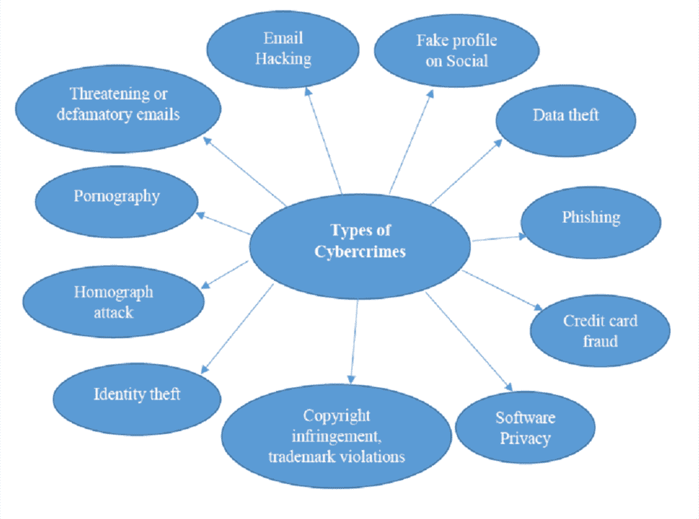

黑客通常通过访问未经授权的交易并将其用于恶意活动来执行此类不道德任务。然而，科技公司正在更新其软件，以保护其数据和交易免遭黑客攻击。但黑客也在制造新目标，并利用最新工具和技术实施不同类型的网络犯罪。这些黑客不仅以组织为目标，也以女性和儿童为目标。已有许多研究涉及威胁情报（Fernandez 等，2012；Jasper，2017）。研究还关注各类网络安全威胁（Tsai 等，2007；Vande 等，2014；Moran，2020；Jaishankar，2020）。鉴于上述问题，本研究的重点是从印度视角了解网络犯罪的现状。本研究旨在了解 2017 年至 2019 年印度网络犯罪的趋势。其目的在于了解网络勒索/威胁、虚假画像、网络色情/托管和发布描绘儿童的淫秽性材料、网络跟踪/霸凌、通过在线游戏实施的互联网犯罪等不同类型网络犯罪的场景。研究还讨论了各州针对不同人群开展的反网络犯罪培训的状况。

### 网络犯罪

学术界尚未就网络犯罪达成一致的定义（Alsmadi，2019）。用于描述它的其他术语包括“计算机相关犯罪”和“电子犯罪”。网络犯罪已被分为不同类型；根据 Krausz & Walker（2013）的观点，当计算机被用作实施犯罪的主要手段，或计算机被专门作为实施犯罪的目标手段时，即构成网络犯罪。这种分类方式不适用于本研究，但对于理解该术语至关重要。

根据犯罪严重程度，网络犯罪可分为两类：I 类和 II 类（Moore，2016）。

*   **I 类** 指黑客攻击等技术性犯罪。
*   **II 类** 涉及人际互动比技术更重要的犯罪。许多传统犯罪因计算机而变得更易实施。例如身份盗窃、信用卡诈骗、骚扰、跟踪和威胁行为。没有计算机，这些类型的犯罪将无法实施。

除了造成人身伤害外，网络犯罪还给公司造成了重大经济损失，导致失业和客户对组织在线活动的信心下降。据估计，每年因损失造成的损失超过 28 亿美元。Facebook、Instagram、Twitter 和 TikTok 等公司因其庞大的用户群而成为常态化的黑客攻击目标。

打击网络犯罪是每个国家的责任，各国应采取措施保护机构并赋能其发起协同缓解行动，以监控网络空间中发生的一切。要将网络罪犯绳之以法，全球必须建立可用且有效的法律来打击这一恶行。还需要采取主动措施来监控和预防网络犯罪攻击（Howard & Gulyas，2014）。

根据 Bernik（2014）的定义，网络犯罪是一种以电子方式实施的犯罪行为，旨在攻击计算机系统及其存储的数据。这些定义表明，网络犯罪发生在虚拟空间中，其中关于人、事物、事件或事实的信息被编码为数学符号，并通过局域网和全球网络传输。根据加拿大外交和国际贸易部的定义，网络犯罪是指通过使用计算机和计算机网络实施的犯罪活动。利用计算机协助传统犯罪也属于网络犯罪范畴。儿童色情制品和网络诈骗是两种更传统的犯罪形式。

### 研究方法

本研究采用定性方法，旨在汇编 2017-2019 年间印度各州网络犯罪和计算机犯罪活动的可比数据。为更好地理解网络犯罪和网络安全，本研究以特定目标开展。商业智能工具 `Tableau` 用于分析从印度 `Statista` 数据库提取的网络犯罪数据，该数据库被公认为政府共享的最权威数据。分析包括 2017 年至 2019 年 9 月的网络犯罪趋势。进行关键分析以了解印度针对妇女和儿童的网络犯罪现状。各州网络犯罪状况经过分析，并使用不同类型的可视化图表进行呈现。

### 结果与讨论

#### 网络犯罪数据分析（2017 年–2019 年中期）

本节呈现并讨论了对从 Statista 数据库收集的 2017 年至 2019 年中期的网络犯罪数据进行分析所得的结果。

1.  **资金拨付与使用**：2017 年至 2019 年中期，印度电子与信息技术部在网络安全方面的资金拨付与使用详情。
2.  **CERT-In 事件趋势**：向印度计算机应急响应小组报告的网络安全事件的月度趋势。
3.  **针对儿童的网络犯罪**：针对儿童的不同类型网络犯罪的分析。
4.  **针对女性的网络犯罪**：针对女性的不同类型网络犯罪的事实与数据。
5.  **培训项目**：各州不同类型培训项目的状态。

#### 资金的使用与拨付

印度电子与信息技术部 2017 年至 2020 年在网络安全方面的资金拨付与使用详情如**表 1**所示。数据清楚地表明，资金的拨付和使用逐年持续增加。

| 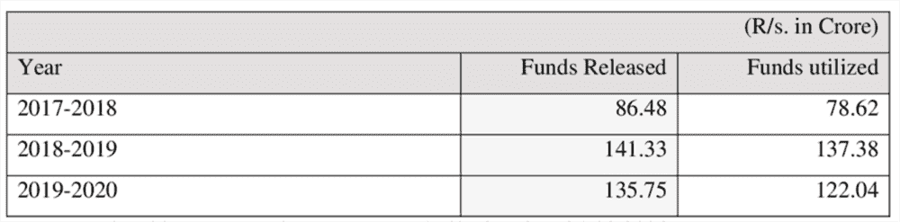 |

#### 按月报告的网络安全事件数量

2017 年和 2018 年向印度 CERT-In 报告的网络安全事件及其月度趋势如**图 2**所示。趋势显示，2017 年和 2018 年 1 月至 2 月事件均有所下降。2017 年 5 月出现显著激增，11 月至 12 月病例从 1,721 例激增至 18,027 例。同样，2018 年 7 月也发生了巨大激增。

| 图 2. 2017-2018 年按月病例数 |
| --- |
| 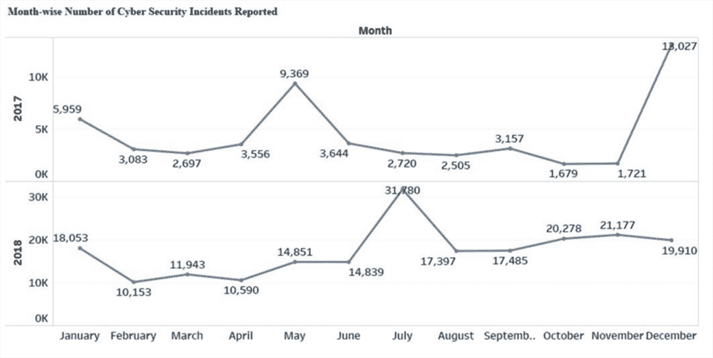 |

2019 年（截至 9 月）印度向 CERT-In 报告的按月网络安全事件如**图 3**所示。趋势显示从 6 月起持续增加，病例从 18,706 例上升至 57,769 例。自 2017 年以来，网络犯罪总数也持续增加：2017 年 53,117 例，2018 年 208,456 例，2019 年截至 10 月达 313,649 例。

| 图 3. 2019 年网络安全事件（截至 2019 年 10 月） |
| --- |
| 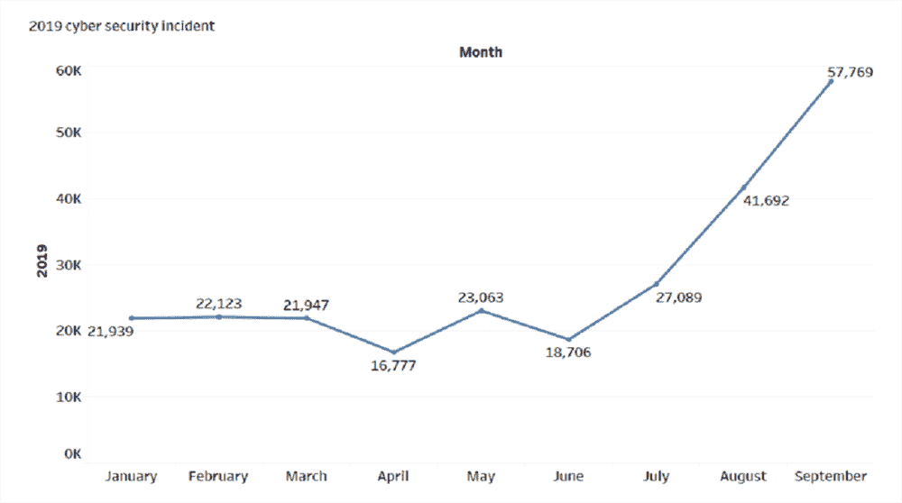 |

#### 针对儿童的网络犯罪

针对儿童的网络犯罪有不同类型。**网络敲诈/威胁**（IPC 第 506、503、384 条 结合 IT 法）、**虚假画像/冒充**（IT 法 结合 IPC/SLL）、**网络色情/托管和发布描绘儿童的淫秽性材料**（IT 法第 67B 条 结合其他 IPC/SLL）、**网络跟踪/霸凌**（IPC 第 354D 条 结合 IT 法）以及**通过在线游戏实施的互联网犯罪**（IPC 第 305 条 结合 IT 法）等类型的详情如**图 4**所示。该图呈现了各州的比较分析。

| 图 4. 针对儿童的不同类型网络犯罪的各州比较 |
| --- |
| 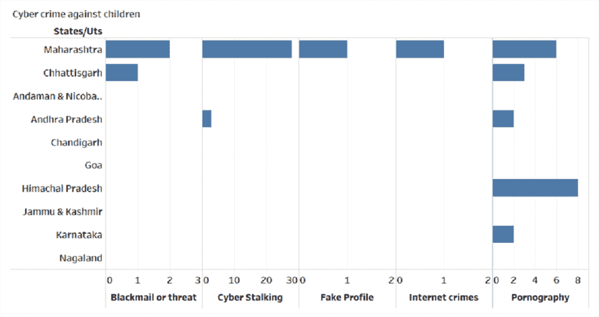 |

分析显示，马哈拉施特拉邦和恰蒂斯加尔邦的网络敲诈/威胁案件最多。马哈拉施特拉邦在针对儿童的各类犯罪中均居首位，包括网络跟踪/霸凌、虚假画像和通过在线游戏实施的互联网犯罪。就网络色情/托管和发布描绘儿童的淫秽性材料而言，喜马偕尔邦排名最高。

#### 针对女性的网络犯罪

与针对儿童的犯罪类似，针对女性的网络犯罪类型多样：敲诈、色情、网络跟踪、诽谤、虚假画像和其他犯罪。事实与数据如**表 2**所示。

| 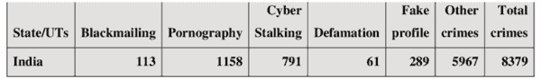 |

##### 敲诈

针对女性敲诈案件的各州情况如**图 5**所示。案件最多的前五个州为安得拉邦、阿萨姆邦、北阿坎德邦、北方邦和马哈拉施特拉邦。

| 图 5. 针对女性的网络犯罪（敲诈）各州情况 |
| --- |
| 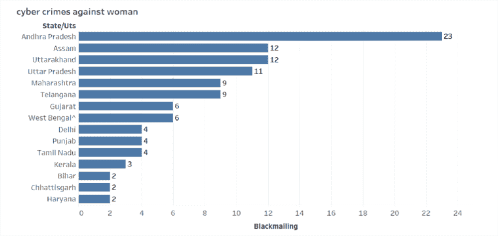 |

##### 网络跟踪

针对女性网络跟踪案件的各州分析如**图 6**所示。马哈拉施特拉邦记录的案件最多（n=427），其次是哈里亚纳邦、北方邦、安得拉邦和特伦甘纳邦。

| 图 6. 针对女性的网络跟踪案件各州情况 |
| --- |
| 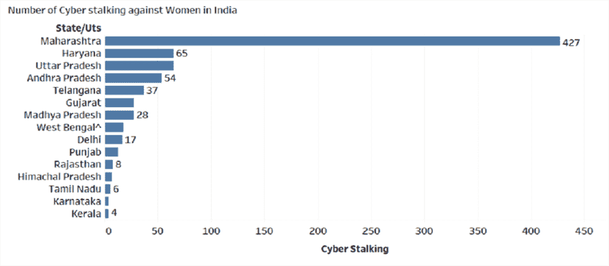 |

##### 诽谤

针对女性诽谤案件的详情如**图 7**所示。奥里萨邦是唯一案件数量较多的州（n=49）。古吉拉特邦、喀拉拉邦、马哈拉施特拉邦和拉贾斯坦邦报告的案件极少。

| 图 7. 针对女性的诽谤案件数量 |
| --- |
| 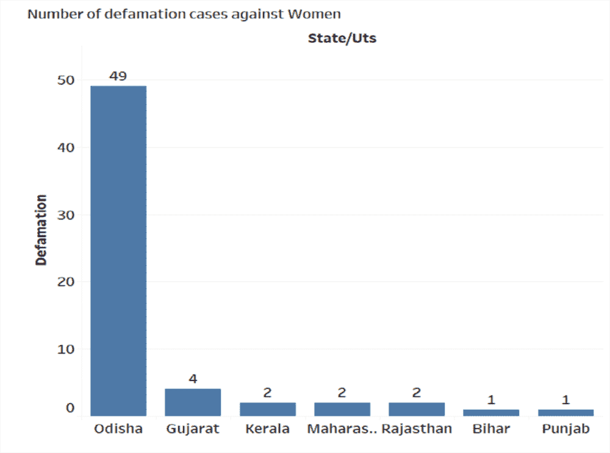 |

##### 虚假画像

针对女性虚假画像案件的分析如**图 8**所示。阿萨姆邦记录的案件最多（n=173），其次是马哈拉施特拉邦、喀拉拉邦、北方邦和拉贾斯坦邦。

| 图 8. 针对女性的虚假画像案件数量 |
| --- |
| 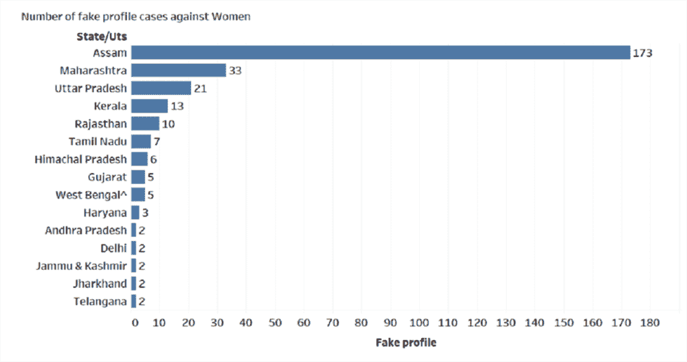 |

##### 色情

虽然互联网和智能设备彻底改变了信息获取方式，但针对女性的色情案件却与日俱增。详情如**图 9**所示。与其他网络犯罪类型相比，色情案件在许多州的数量最高。奥里萨邦以 341 例居首位。北方邦（n=178）和阿萨姆邦（n=148）超过 100 例；卡纳塔克邦、特伦甘纳邦和中央邦超过 50 例。

| 图 9. 针对女性的色情案件数量 |
| --- |
| 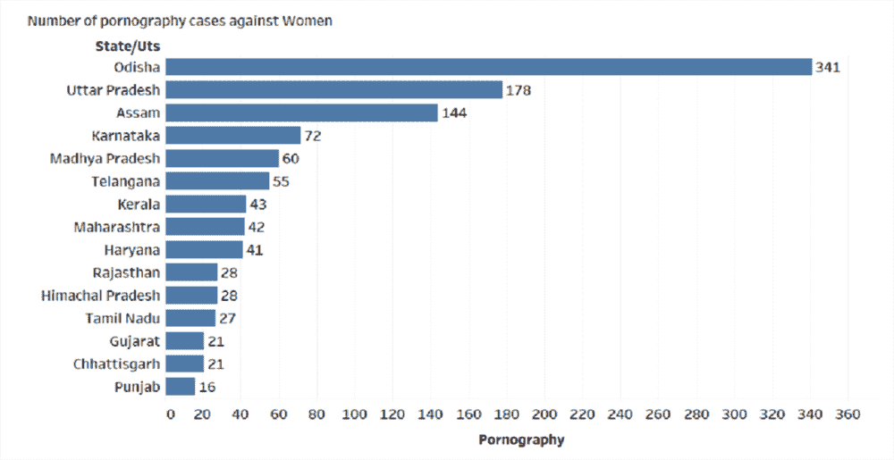 |

##### 其他网络犯罪

除上述主要类别外，其他针对女性的网络犯罪详情如**图 10**所示。卡纳塔克邦以超过 2,600 起登记案件居首位。马哈拉施特拉邦报告约 1,000 起案件。图中显示了前十五个州。

| 图 10. 其他类型针对女性的网络犯罪数量 |
| --- |
| 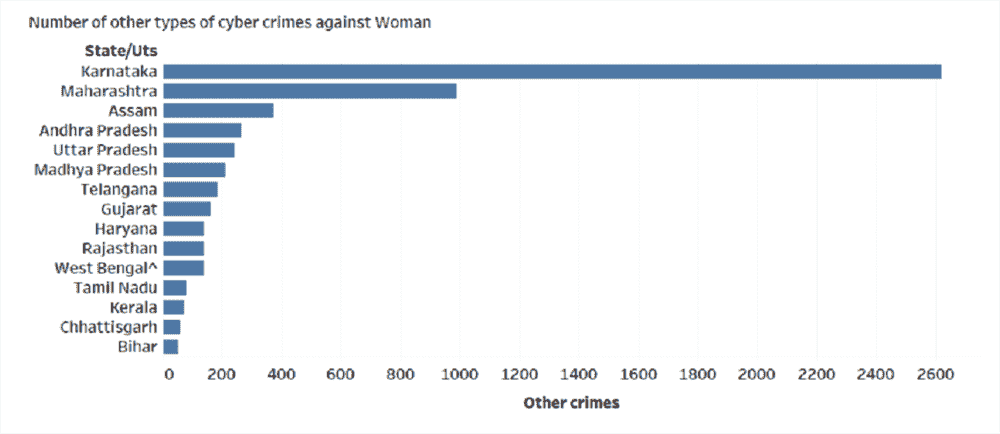 |

#### 网络犯罪调查培训

考虑到上文提到的各州网络犯罪案件数量的增加，政府也在各州组织不同类型的培训项目。印度执法机构已累计培训了 4559 人进行网络犯罪调查（截至 2019 年 3 月 31 日）。图 10 展示了基于各州受训人数的词云。受训人数越多，圆圈的尺寸越大。分析显示，特伦甘纳邦受训人数最多（n=1440）。同样，在安得拉邦（n=561）、中央邦（n=461）、恰蒂斯加尔邦（n=479）等州也有大量人员受训。图 11 显示了前十个州培训状况的详细信息。

| 图 11. 各州/类型网络犯罪调查培训情况 |
| --- |
| 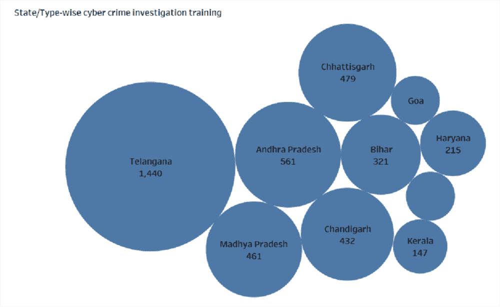 |

## 结论

随着互联网用户、在线支付、社交网站和 App 用户的增长，网络犯罪数量也在增加。一方面，这些在线平台让我们的生活更便捷；另一方面，它们为黑客提供了更多机会，实施针对妇女和儿童的各类网络犯罪。印度电子与信息技术部在网络安全方面拨付和使用的资金详情清楚地表明，资金拨付和使用逐年持续增加。按月统计的网络安全事件报告趋势显示，2017 年和 2018 年 1 月至 2 月网络事件数量有所下降，而 2017 年 5 月出现大幅跃升，11 月至 12 月案件数从 1721 起激增至 18027 起。同样，2018 年 7 月出现巨大跃升，2019 年趋势显示从 6 月起案件数持续增加。第三部分讨论了针对儿童的不同类型网络犯罪详情。包括网络勒索/威胁、虚假画像、网络色情/托管和发布描绘儿童的淫秽性材料、网络跟踪/霸凌、通过在线游戏实施的互联网犯罪等。分析显示，马哈拉施特拉邦和恰蒂斯加尔邦的网络勒索/威胁案件最多。马哈拉施特拉邦在针对儿童的各类犯罪中均居首位，如网络跟踪/霸凌、虚假画像、通过在线游戏实施的互联网犯罪等。喜马偕尔邦在网络色情/托管和发布描绘儿童的淫秽性材料方面排名第一。针对妇女的不同类型网络犯罪分析显示，针对妇女勒索案件最多的前五个州是安得拉邦、阿萨姆邦、北阿坎德邦、北方邦和马哈拉施特拉邦。马哈拉施特拉邦网络跟踪案件也最多，紧随其后的四个州是哈里亚纳邦、北方邦、安得拉邦和特伦甘纳邦。针对妇女的诽谤案件以奥里萨邦最多。其他类型的针对妇女网络犯罪以阿萨姆邦最多，其次是马哈拉施特拉邦、喀拉拉邦、北方邦和拉贾斯坦邦。在色情案件中，奥里萨邦居首位，另有北方邦和阿萨姆邦两州案件超过 100 起。各州不同类型培训项目的状况显示，特伦甘纳邦受训人数最多。同样，在安得拉邦、中央邦、恰蒂斯加尔邦等州也有大量人员受训。

## 参考文献

Alsmadi, I. (2019). *The NICE cyber security framework: Cyber security intelligence and analytics*. Springer. doi:10.1007/978-3-030-02360-7

Bernik, I. (2014). Cyberwarfare. *Cybercrime and Cyberwarfare*, 57-140.

Cheng, M., Crow, M., Erbacher, R. F. (2013, January). Vulnerability analysis of a smart grid with monitoring and control system. In *Proceedings of the Eighth Annual Cyber Security and Information Intelligence Research Workshop* (pp. 1-4). 10.1145/2459976.2460042

Cybercrime. (2020). https://www.techopedia.com/definition/2387/cybercrime

Howard, P. N., Gulyas, O. (2014). Data breaches in Europe: Reported breaches of compromised personal records in europe, 2005-2014. Available at SSRN 2554352. 10.2139/ssrn.2554352

Jaishankar, K. (2020). Cyber Victimology: A New Sub-Discipline of the Twenty-First Century Victimology. In *An International Perspective on Contemporary Developments in Victimology* (pp. 3-19). Springer.


# Jasper, S. E. (2017). US cyber threat intelligence sharing frameworks. *International Journal of Intelligence and CounterIntelligence*, 30(1), 53–65. doi:10.1080/08850607.2016.1230701

# Krausz, M., & Walker, J. (2013). *The true cost of information security breaches and cybercrime*. IT Governance Publishing.

# Krausz, M., & Walker, J. (2013). *The true cost of information security breaches and cybercrime*. IT Governance Publishing.

# Moran, A. (2020). Cyber security. In *International Security Studies* (pp. 299–311). Routledge.

# Tsai, F. S., Chan, K. L. (2007, April). Detecting cyber security threats in weblogs using probabilistic models. In *Pacific-Asia Workshop on Intelligence and Security Informatics* (pp. 46-57). Springer. 10.1007/978-3-540-71549-8_4

# Vande Putte, D., & Verhelst, M. (2014). Cybercrime: Can a standard risk analysis help in the challenges facing business continuity managers? *Journal of Business Continuity & Emergency Planning*, 7(2), 126–137.

# Vázquez, D. F., Acosta, O. P., Spirito, C., Brown, S., & Reid, E. (2012, June). Conceptual framework for cyber defense information sharing within trust relationships. In *2012 4th International Conference on Cyber Conflict (CYCON 2012)* (pp. 1-17). IEEE.

## 第 2 章

*   **Ramesh Chandra Rath**  
    Jharkhand University of Technology, India

*   **Sukanta Kumar Baral**  
    Indira Gandhi National Tribal University, India

*   **Richa Goel**  
    Amity University, India

### 摘要

网络安全在生活的各个方面至关重要，尤其是在数字技术领域。关于人工智能和数据泄露、身份盗窃、破解安全代码、利用远程传感器操控机器等事件屡见不鲜，影响着数百万个人和组织。开发适当的控制和流程，并以最高精度加以应用以打击网络攻击和犯罪的问题，从未停止过。随着人工智能的最新进展，网络攻击和犯罪的日益增长的危险已大幅增加。它已被应用于几乎每一个研究和工程分支。AI 从医疗保健到机器人技术等各个领域引发了一场革命。这团火无法与网络窃贼隔绝，因此，“普通”的网络攻击已演变为“智能”的网络攻击。本章作者试图探讨在网络安全中使用人工智能的前瞻性方法，以期获得与未来研究工作相关的基于结果的结论。

### 引言

AI 和系统机器学习正迅速成为数据安全中不可或缺的一部分，因为这些技术能够迅速比对数百万数据集，并检测从恶意软件威胁到可能导致网络钓鱼攻击的可疑行为等各类网络危险。这些系统不断学习和改进，利用过去和现在的遭遇数据来识别当前或未来可能发生的新型攻击。在本文中，我们将探讨人工智能在网络防护中的应用（利弊皆有），以及专家和管理者对其的看法。

### 文献综述

在文献综述环节，我们研究人员同时采用了两种事实收集方法，但大多数事实来自已发布的资源，并通过在线 `Google Forms` 问卷调查针对印度的 10 家目标公司完成了上述调查。从公司和工作场所的 300 名受访者那里收集了图像。网络安全面临现有挑战，难以应对，这要求通过部署相关安全措施，追求软件与当代解决方案的集成与利用。Mathew (2021) 在人工智能犯罪方面指出，网络犯罪分子有能力利用智能技术改进其攻击手段。网络安全与 AI 并行运行时能产出丰硕成果。ML 目前的方法似乎最适合解决基于规则的传统安全架构的违规问题。AI 收集、分类并研究海量数据，使企业能从数据中挖掘价值。这些属性被应用于网络安全领域。

本研究旨在发掘利用 AI 实现组织级网络安全的持续趋势与应用，这些属性已在行业中应用。本研究旨在阐明当前趋势与应用，以应对网络安全这一不断演变、旨在保护人员和企业免受网络攻击的行业。Web of Things (Zeng, Song, and Cheng, 2011)，隶属于会津大学的计算机科学与工程学院，对网络安全及其控制进行了广泛研究。相关成果还发表在另一期刊“利用区块链、博弈论和机器学习恢复去中心化自适应网络防御”及其著作 (Cybenko and Hallman, 2016) 中，研究发现，在竞争环境中运行的多组件系统为了在保持相同保留能力的同时进行学习，需要使用冗余。本综述论文引用了该文献，解释了愿景、概念、技术、挑战、创新方向及不同的互联网应用。

根据 Misra, Kumar, and Agarwal (2016) 的研究论文“物联网——技术分析与愿景研究”，物联网是一种利用 Web 服务支持能源管理的无线传感网络 (WSN)，它使用网络安全保护来全面管理安全代码，同时避免未经授权的调用，并被发现是云计算研究架构调查报告 (Dinh, 2013) 中的一个案例研究和欺诈活动，该报告隶属于计算机工程学院。获得了网络安全及其在无线通信和移动计算中被接受的应用的基础知识，并由云计算软件创建并控制 (Gubbi, 2013)。

从上述研究文章中，作者们获得了架构流程和要素的完整分步知识，有助于防止和保护机器运行和控制各个环节的网络安全，并防范当前的网络欺诈及其活动。同样，发表了研究文章“物联网 IOT 的定义、特征、架构、实现技术、应用和未来挑战”(Patel and Patel, 2016)，阐述了将不同网络安全软件应用于不同组织以实现成功网络保护的基础属性、架构流程和支撑技术。在此背景下，人工智能 (AI) 是常规网络保护的关键要素，帮助各种规模和行业的企业提高网络安全效率。采用 AI 策略最快、最成熟的行业是信息技术和电信。

根据“物联网架构、协议和应用”(Sethi, Smruti and Sarangi, 2017) 的研究，显示了控制网络安全防御的极其重要的研究。根据研究文章“基于智能系统的物联网综述”(Smys, 2020)，其摘要指出：物联网 (IoT) 是网络的集合，以及与网络安全相关的对象及其控制，这增强了对网络安全网络及其在未来后果中应用的认识。研究文章“支持营销活动的物联网”(Taylor, Reilly, and Wren, 2018) 涉及互联网使用、营销活动与网络安全及其控制的关系。研究论文“物联网战略研究路线图”(Vermesan 2009) 制定了在实际应用中使用物联网并对“现实和物理世界”事件做出自主反应和影响的战略研究路线图。研究论文“未来的网络安全与人工智能应用”(Sahay, Goel, Jadliwala, and Upadhyaya 2021) 进一步评估了物联网及其应用在未来信息安全保护技术中的作用。

根据 Hamdan 撰写的“面向工业物联网的边缘计算架构”(Salman, Elhajj, Kayssi and Chehab, 2020) 研究文章，提到边缘计算使物联网及其控制能够关联未来应用，将极大丰富该领域的积极研究。根据研究文章“人工智能在网络安全和网络防御中的应用”(Sarma, Matheus, and Senaratne, 2021)，探讨了将物联网作为一种方法的进展。涉及与物联网未来应用及其用于预防和控制的软件相关的经济学、商业实践、增长和新兴市场经济政策。结合“物联网架构、协议和应用”(Sethi, Smruti and Sarangi, 2017) 的研究，显示了控制网络安全防御的极其重要的研究。根据研究论文 (Yan, Zhang, and Vasilakos, 2014) “物联网信任管理综述”，聚焦于计算机应用的网络活动及其未来结果，我们获得了与上述研究活动相关的基础知识。

同样，在本研究论文中，研究人员根据引用的参考文献研究和审阅了 70 多篇研究论文，发现如今，算法知识渊博的 AI 和设备能以非人般的速度做出决策，通过活动自动化、信息处理、网络安全增强和三个研究目标，显著减少网络犯罪。

研究人员一致采取了以下研究目标，以证明上述研究主题的合理性：

*   了解网络安全的根本目的，即黑客为何入侵客户的私人账户以及政府和私人组织的账户；
*   发现网络犯罪及其控制的多种解决方法；
*   认识网络犯罪及其控制和意识的法律权利和方法；
*   考察人工智能和数字技术的应用如何预防网络犯罪及其操纵。

#### 网络安全的含义与概念

**Cyber（网络空间）**：术语“Cyber-safety（网络安全）”源自英语单词“Cyber”和“protection”，其中“Cyber”指黑客利用平台或软件在互联网上非法进行的网络空间活动，用于入侵账户、网页、安全代码或窃取他人账户数据，这被印度刑法典视为刑事犯罪，在世界范围内也被视为犯罪。

**Security（安全）**：我们必须保护计算机和数据，就像我们保护家门一样。

### 安全

我们必须以保护我们免受包括时代在内的危险和威胁的方式行事。

### 什么是网络攻击？

在尖端雇主环境中，网络攻击面巨大，并且正在意外地迅速发展。这意味着分析和增强企业的网络安全态势需要的不仅仅是单纯的人工干预。

### 为什么需要网络关注？

由于世界人口的快速增长，机构为那些拥有大量现金的潜在买家改进了许多复杂的商品，而这些买家原本并没有这些钱，其中一些人可能会试图通过不正当手段利用互联网黑客攻击客户账户来获取资金，因此网络犯罪日益猖獗，为了控制它，我们需要网络犯罪意识，如下：

*   a) 网络犯罪是一种不断增长的趋势
*   b) 提高对威胁的关注
*   c) 与大多数犯罪一样，警方无法独自解决这一问题
*   d) 以鼓励举报
*   e) 推广政府资助的“网络基础”计划
*   f) 网络犯罪大量未被报告。

### 网络安全的重要性

由于以下原因，在网络安全攻击发生时出现了以下重要性：

*   a) 互联网允许攻击者在地球上的任何地方工作
*   b) 由于不良的安全信息和实践带来的危险：
    *   1) 身份盗窃
    *   2) 经济盗窃
    *   3) 法律后果（对您自己和您的组织）
    *   4) 如果不遵守规则，将面临制裁或解雇
*   c) 根据 SANS 研究所的说法，网络犯罪分子可利用的主要漏洞载体是：
    *   1) Web 浏览器
    *   2) 即时通讯客户端
    *   3) 互联网程序
    *   4) 过度的用户权限

| 图 1. 网络安全意识用户模型 |
| --- |
| 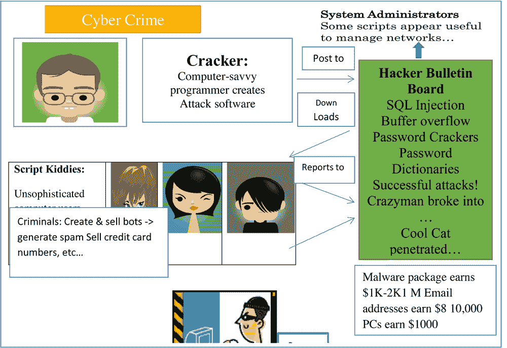 |
| *来源：URL 链接 https://www.slideshare.net/BilmyRikas/usgsecurityawarenessprimerpptx* |

### 主要威胁

*   a) 病毒
*   b) 蠕虫
*   c) 特洛伊木马 / 逻辑炸弹
*   d) 社会工程学
*   e) Rootkit（根工具包/后门工具包）
*   f) 僵尸网络 / 僵尸主机

### 病毒

*   a) 病毒将自身附着到程序、文件或磁盘上。
*   b) 当程序被执行时，病毒被激活并复制自身。
*   c) 病毒可能是良性的或恶性的，但会在未来某个不确定的时间（通常是在接触时）执行其有效载荷。
*   d) 病毒可能导致计算机崩溃和数据丢失。
*   e) 为了恢复或防止病毒攻击：
*   f) 避免访问潜在的不可靠网站/电子邮件。
*   g) 设备修复。
*   h) 重装操作系统。
*   i) 使用并维护防病毒软件。

### 蠕虫

*   a) 独立软件，可复制自身并通过网络连接将副本从一台计算机发送到另一台计算机。
*   b) 到达后，蠕虫可被激活以进行复制

### 逻辑炸弹

恶意软件逻辑在特定条件下执行。该系统常用于其他合法原因。

#### 示例

*   a) 如果未支付维护费则发生故障的软件。
*   b) 员工被解雇时触发数据库擦除。

### 特洛伊木马

*   a. 它破坏数据并控制程序，同时悄悄地销毁数据或损坏您的计算机系统。
*   b. 特洛伊木马漏洞：伪装成良性应用程序，同时悄悄地破坏记录或损害您的设备

| 图 2. 指代特洛伊木马病毒 |
| --- |
|  |

| 图 3. 指代网络安全与控制 |
| --- |
|  |
| *来源：URL 链接 https://www.slideshare.net/BilmyRikas/usgsecurityawarenessprimerpptx* |

### 下载游戏

这可能很有趣，但包含隐藏代码，可在您不知情的情况下收集个人信息。

社会工程学通过操纵人员执行操作或泄露机密信息。这类似于骗取信任的诡计或简单的欺诈，该术语适用于利用欺骗手段获取信息、实施欺诈或访问计算机系统。

### 社会工程学模型

| 图 4. 社会工程学与安全意识 |
| --- |
| 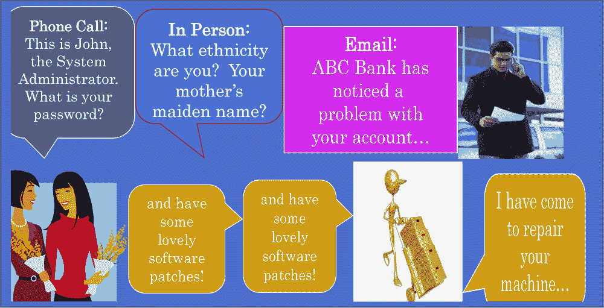 |
| *来源：URL 链接 https://www.slideshare.net/BilmyRikas/usgsecurityawarenessprimerpptx* |

### Rootkit（根工具包/后门工具包）

黑客攻入个人电脑后，可能会部署一组称为 rootkit 的程序包。

*   • 可能启用：
    *   a) 方便黑客（和其他人）进入企业
    *   b) 键盘记录器
*   • 清除入侵证据。
*   • 修改操作系统。

#### 表 1. 网络黑客通过密码破解、字典攻击和暴力破解

| 模式 | 计算 | 结果 | 猜测时间 (2.6x10¹⁸ 次/月) |
| --- | --- | --- | --- |
| 个人信息：兴趣、亲戚 | | 20 | 手动 5 分钟 |
| 社会工程学 | | 1 | 手动 2 分钟 |
| 美国字典 | | 80,000 | < 1 秒 |
| 4 字符：小写字母 | 26⁴ | 5x10⁵ | |
| 8 字符：小写字母 | 26⁸ | 2x10¹¹ | |
| 8 字符：字母 | 52⁸ | 5x10¹³ | |
| 8 字符：字母数字 | 62⁸ | 2x10¹⁴ | 3.4 分钟 |
| 8 字符：字母数字 +10 | 72⁸ | 7x10¹⁴ | 12 分钟 |
| 8 字符：全键盘字符 | 95⁸ | 7x10¹⁵ | 2 小时 |
| 12 字符：字母数字 | 62¹² | 3x10²¹ | 96 年 |
| 12 字符：字母数字 + 10 | 72¹² | 2x10²² | 500 年 |
| 12 字符：全键盘字符 | 95¹² | 5x10²³ | |
| 16 字符：字母数字 | 62¹⁶ | 5x10²⁸ | |

### 僵尸网络

僵尸网络是一系列被攻陷的计算机，用于创建和发送垃圾邮件或病毒，或向网络发送大量消息以发起拒绝服务攻击。

被攻陷的计算机被称为僵尸主机。

| 图 5. 佐治亚大学系统、信息、技术和服务 |
| --- |
| 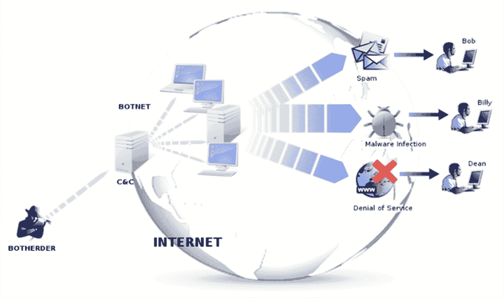 |
| *来源：URL 链接 https://www.slideshare.net/BilmyRikas/usgsecurityawarenessprimerpptx* |

### 中间人攻击

攻击者在网络上伪装成您的最终目的地。当有人尝试连接到特定目的地时，攻击者可以将其误导至另一项服务，并伪装成该网络接入点或服务器。

| 图 6. 佐治亚大学、网络安全、信息、技术和服务 2010 |
| --- |
| 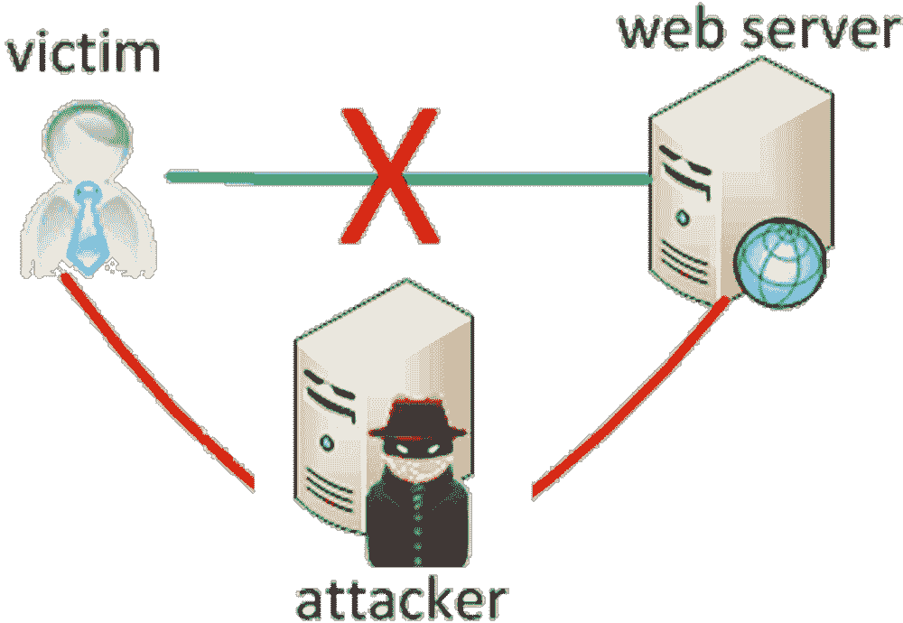 |

### 避免这些威胁的最佳实践

为了避免网络安全攻击，有一种防御机制被广泛使用，即多层防护，以应对技术、人员和操作问题及其挑战。（参见图 7 和 8）

| 图 7. 指代纵深防御层 |
| --- |
| 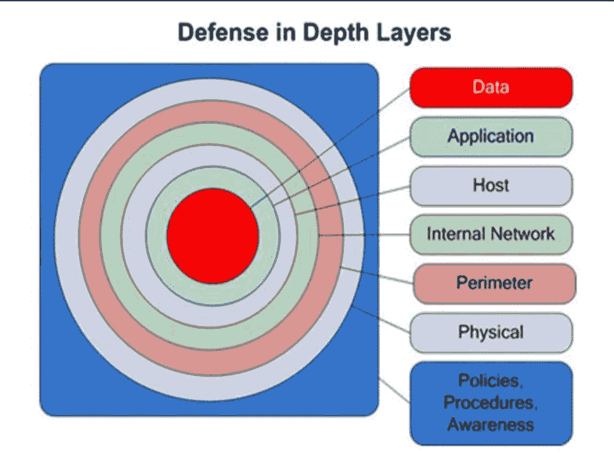 |

| 图 8. 指代网络安全攻击机制 |
| --- |
| 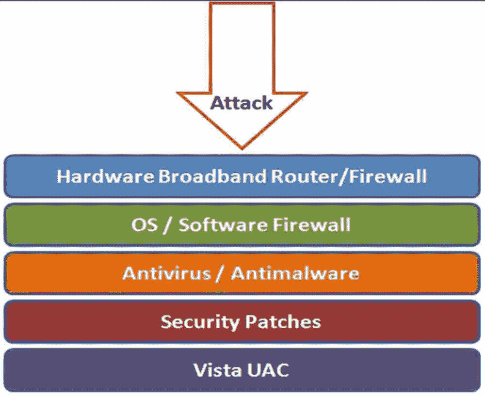 |
| *来源：URL 链接 https://www.slideshare.net/BilmyRikas/usgsecurityawarenessprimerpptx* |

### 防病毒和反间谍软件


# 为了防范网络攻击，我们必须采取事先预防措施或使用防病毒软件，因为：

*   a. 防病毒软件可检测某些类型的恶意软件，并在造成任何损害之前将其销毁。
*   b. 安装并维护防病毒和反间谍软件。
*   c. 确保防病毒软件保持最新。
*   d. 存在许多免费和商业选项。
*   e) 联系您的技术支持专家以获取帮助。

## 研究方法

### 关于本阶段

在本阶段，我们研究人员采用了两种统计收集策略，但大部分记录来自已发布的资源，此外还通过在线 Google 表单调查，从印度各地的 10 家机构和办公室收集了 300 名受访者的信息，以完成上述研究工作。

### 假设

为论证指定的研究工作，研究人员一致采纳了以下假设：

#### 零假设：(Ho)

该假设指出，在当前背景下，数字技术、人工智能 (AI) 和预防性软件的应用**无法**控制网络安全，因为每天都有快速增长的网络问题。

#### 备择假设：(He)

该假设指出，结合大众意识使用预防性杀毒软件和反网络攻击保护软件，是遏制网络犯罪和实现控制的最佳补救措施。

### 检测新威胁

AI 可用于发现网络危险和潜在有害行为。传统软件系统根本无法跟上每周开发的大量新病毒，因此这是 AI 可以真正发挥作用的领域。AI 系统正在被训练以识别恶意软件、运行模式识别，并利用先进算法在恶意软件或勒索软件攻击到达系统之前，检测到其最细微的行为。AI 通过自然语言处理提供更好的预测性情报，它通过抓取文章、新闻和网络威胁研究，自行策划素材。

这可能提供关于新异常、网络攻击和预防策略的数据。归根结底，黑客和其他人一样，也会追随潮流，所以他们青睐的手段也在不断变化。详细且更新及时的 AI 驱动网络安全系统能提供关于了解全球和行业特定威胁的最深入见解，使您能够做出更明智的优先级决策，不仅基于什么**可能**被用来攻击您的系统，还基于什么**最有可能**攻击您的系统。为论证指定的研究工作，研究人员一致采纳了以下假设。

### 对抗僵尸网络

如今，僵尸程序占据了网络流量的很大一部分，且可能致命。僵尸程序可能构成实际危险，从使用窃取的密码接管账户，到欺诈性创建账户和窃取数据。人工回复已不足以应对自动化威胁。AI 和机器学习有助于建立对网站流量的全面了解，并区分良性僵尸程序（如搜索引擎爬虫）、恶意僵尸程序和人类用户。AI 使我们能够评估海量数据，并允许网络安全团队调整其方法以适应不断变化的环境。

### 违规风险预测

AI 系统有助于确定 IT 资产清单，即所有设备、用户和应用的具体且详尽的记录，它们对各种系统拥有不同级别的访问权限。结合资产清单和风险敞口（如上所述），基于 AI 的系统现在可以预测您最可能在何处、以何种方式被黑客攻击，从而允许您规划并将资源分配给风险最大的领域。

### 更好的端点保护

用于远程工作的设备数量正在迅速扩大，AI 将在保护所有这些端点方面发挥关键作用。诚然，杀毒软件和 VPN 可能有助于防范远程恶意软件和勒索软件攻击，但它们通常依赖特征码。这意味着为了防范最新的攻击，特征码定义必须保持更新。如果病毒定义过时，无论是由于未能更新杀毒解决方案，还是软件制造商缺乏了解，这都可能成为一个问题。因此，如果出现一种新型恶意软件攻击，特征码防护可能会失效。

> “AI 驱动的端点安全采用一种不同的方法，通过重复训练过程建立端点行为的基线。” 如果发生异常情况，AI 可以检测到并采取适当行动，包括通知技术人员或在勒索软件攻击后恢复到安全状态。“这无需等待特征码更新，即可实现对攻击的主动防护，” SolarWinds 安全与安全架构副总裁 Tim Brown 解释道。

### 网络安全高管如何看待 AI

卡普杰米尼研究院考察了 AI 在网络安全中的重要性，其题为《利用人工智能重塑网络安全》的报告强烈建议现代企业应利用 AI 改进网络安全防御。调查受访者（来自十个国家的 850 名网络安全、IT 信息安全和 IT 运营高管）认为，需要 AI 赋能的响应，因为网络犯罪分子已经在使用 AI 技术实施网络攻击。

#### 报告的一些关键结论包括：

根据四分之三受访高管的说法，AI 使其公司能更快地响应违规事件；为了应对网络攻击，69% 的企业认为 AI 是必要的。根据五分之三企业的说法，利用 AI 可提高网络分析师的准确性和效率。

随着网络规模扩大、数据日益复杂，AI 为企业的网络安全问题提供了更好的解决方案。简单来说，人类无法独自应对日益增长的复杂性，AI 的采用最终将成为必然。

### AI 在网络安全中的缺点

上述优势仅代表 AI 增强网络安全潜力的一小部分。

然而，凡事皆有两面，在该行业使用 AI 也存在显著缺点。组织可能需要投入更多的资源和资金来建立和运行 AI 系统。

此外，由于 AI 系统是使用数据集训练的，您需要收集大量多样化的恶意代码集、非恶意代码集和异常数据。获取所有这些数据集耗时且涉及大多数组织无法承担的费用。在缺乏大量数据和事件的情况下，AI 系统可能会得出错误结论和/或产生误报。从不可靠来源获取错误数据可能会适得其反。

另一个主要缺点是网络犯罪分子也可以利用 AI 分析其恶意软件并发动更高级的攻击，这引出了下一点……想要更多技术资讯？立即订阅 Computing Edge 通讯！

### 对手对 AI 的利用

网络安全人员可以利用 AI 强化最佳实践、减少攻击面，而不必持续监控可疑活动。相反，网络犯罪分子也可能利用相同的 AI 系统达到恶意目的。根据埃森哲的说法，对抗性 AI “导致机器学习模型误解系统输入，并以有利于攻击者的方式行事。”

#### 例如

iPhone 的“面容 ID”访问功能使用神经网络识别人脸，使其容易受到对抗性 AI 攻击。黑客可能创建对抗性图像以绕过面容 ID 安全功能，并轻松继续其攻击而不引起注意。

### 表 2. 防范网络攻击的受访者模型 (ID Security)

### 统计数据表

| Users | Anti-SOFT ware for Control of cyber attack | Respondent's |
| :--- | :--- | :--- |
| With equal gender equality and equity | % of Positive Response | Negative | Mean value |
| --- | --- | --- | --- | --- | --- |
| M | F | TG | | |
| Central /State Govt. offices | MacAfee | 30 | 12 | 11 | 03 | 04 | 86.67 |
| Tata | Kaspersky | 30 | 14 | 12 | 02 | 02 | 93.33 |
| Reliance | AVIRA | 30 | 13 | 11 | 02 | 04 | 86.67 |
| Hinduja | NOD-32 | 30 | 10 | 13 | 02 | 05 | 83.33 |
| Maruti- | Norton | 30 | 11 | 14 | 01 | 04 | 86.67 |
| Mahindra | TREND | 30 | 13 | 12 | 01 | 04 | 80.00 |
| Hindustan Leaver limited | AVG Antivirus | 30 | 12 | 12 | 03 | 03 | 90.00 |
| Indigo | Bit defender | 30 | 11 | 12 | 02 | 05 | 83.33 |
| NALCO | F-Secure | 30 | 13 | 11 | 04 | 02 | 93.33 |
| Jindal and Ispat | Avasti | 30 | 12 | 13 | 02 | 03 | 90.00 |
| Total | | 300 | 121 | 121 | 22 | 36 | 88.00 |

> **来源**：Data collected from the own sources of questionnaire by authors

### 符号学模型饼图

#### Figure 9. Semiotic models of respondents in bar graph

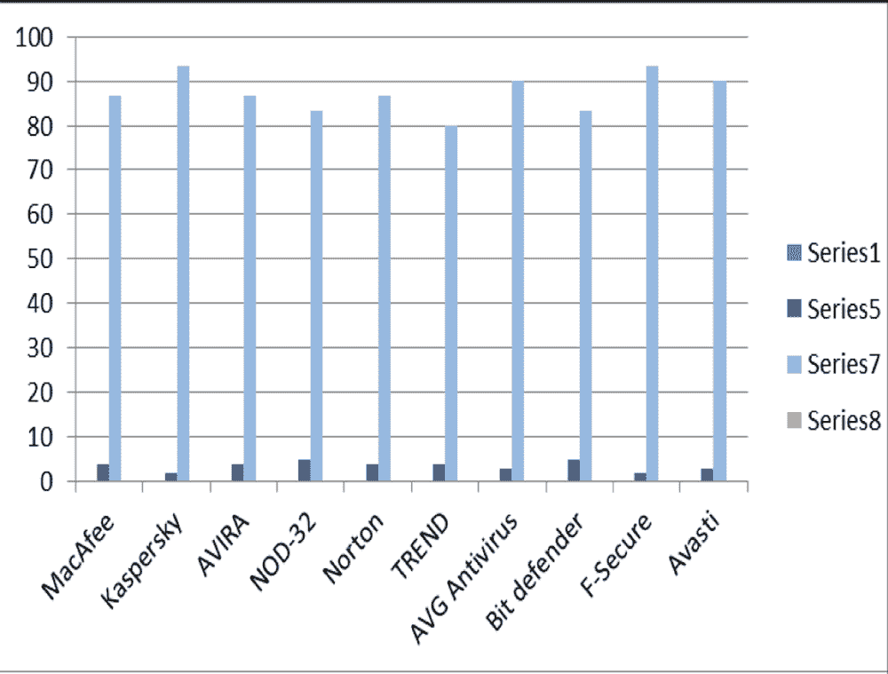

#### Figure 10. Semiotic models of respondents in pie chart

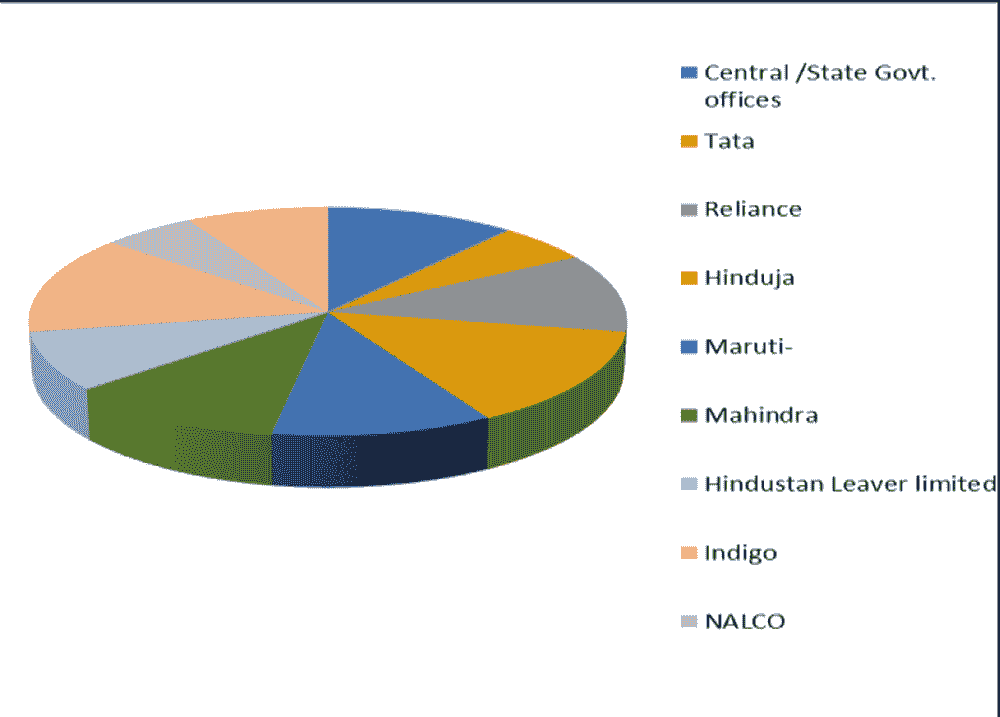

### 假设检验

在此阶段，根据上述统计评估，我们可以看出，上述办公室/组织的每位男性和女性人员/员工/工人群体都使用防病毒软件程序来防范网络攻击，防护比例非常高。原假设完全错误（不正确），在 alpha 0.01 和 0.05 两个显著性水平上均不显著，因此备择假设因其相当积极的价值和显著性而被广泛接受。

### AI 在网络安全中的优势

AI 在各个领域拥有多项优势和用途，其中之一便是网络防护。随着现代网络攻击的迅速增加和设备的快速普及，AI 和机器学习有助于跟上网络犯罪分子的步伐，实现威胁识别自动化，并比传统的软件驱动或手动方法做出更有效的响应。

#### 结论

总之，我们得出的结论是：网络安全是一个广泛的术语，它涉及不同层级的各种组织和政府，通常从个人到国家层面。因此，人工智能 (AI) 结合机器学习 (ML) 技术正被用于整个安全领域。这些技术大多拥有各自的未来前景，并通过减少数字交易中的欺诈等方式为社区提供安全保障。因此，前述论述表明，人工智能 (AI) 正迅速成为提高 IT 安全团队有效性的必备技术。人类无法大规模地彻底保卫企业级攻击面，AI 提供了急需的分析和威胁识别，安全专业人员可利用这些分析和识别来最小化违规风险，并通过优先使用防病毒软件和网络攻击预防软件，以及增强公众对网络黑客的认识（避免在社交媒体上与其接触）来改善安全态势。

总之，我们得出的结论是：网络安全是一个广泛的术语，它涉及不同层级的各种组织和政府，通常从个人到国家层面。因此，人工智能 (AI) 结合机器学习 (ML) 技术正被用于整个安全领域。这些技术大多拥有各自的未来前景，并通过减少数字交易中的欺诈等方式为社区提供安全保障。因此，前述论述表明，人工智能 (AI) 正迅速成为提高 IT 安全团队有效性的必备技术。人类无法大规模地彻底保卫企业级攻击面，AI 提供了急需的分析和威胁识别，安全专业人员可利用这些分析和识别来最小化违规风险，并通过优先使用防病毒软件和网络攻击预防软件，以及增强公众对网络黑客的认识（避免在社交媒体上与其接触）来改善安全态势。此外，AI 有助于识别和优先处理风险、响应事件以及识别恶意软件攻击。因此，尽管功能上存在不足，AI 仍增强了网络防护，并帮助组织改善其安全机制。

## 参考文献

1. Bandyopadhyay, S., Sengupta, M., Maiti, S., & Dutta, S. (2011). Role of middleware for internet of things: A study. *International Journal of Computer Science & Engineering Survey*, 2(3), 94–105. doi:10.5121/ijcses.2011.2307

2. Cybenko, G., & Hallman, R. (2021). Resilient distributed adaptive cyber-defense using block-chain. *Game Theory and Machine Learning for Cyber Security*, 22, 485–498. doi:10.1002/9781119723950.ch23

3. Dinh, H. T., Lee, C., Niyato, D., & Wang, P. (2013). A survey of mobile cloud computing: Architecture, applications, and approaches. *Wireless Communications and Mobile Computing*, 13(18), 1611. doi:10.1002/wcm.1203

4. Gubbi, J., Buyya, R., Marusic, S., & Palaniswami, M. (2013). Internet of things (IoT): A vision, architectural elements, and future directions. *Future Generation Computer Systems*, 29(7), 1645–1660. doi:10.1016/j.future.2013.01.010

5. Juneja, A., Juneja, S. V., Bali, V., Jain, & Upadhyay, H. (2021). Artificial intelligence and cyber security: Current trends and future prospects. *The Smart Cyber Ecosystem for Sustainable Development*, 27, 431–441. doi:10.1002/9781119761655.ch22

6. Mathew, A. (2021). Artificial intelligence for offence and defense-the future of cyber security. *Educational Research*, 3(3), 159–163.

7. Misra, G., Kumar, V., Agarwal, A., & Agarwal, K. (2016). Internet of things (IOT)–a technological analysis and survey on vision, concepts, challenges, innovation directions, technologies, and applications (an upcoming or future generation computer communication system technology). *American Journal of Electrical and Electronic Engineering*, 4(1), 23–32.

8. Patel, K. K., & Patel, S. M. (2016). Internet of things-IOT: definition, characteristics, architecture, enabling technologies, application & future challenges. *International Journal of Engineering Science and Computing*, 6(5).

9. Sahay, S. K., Goel, N., Jadliwala, M., & Upadhyaya, S. (2021). Advances in secure knowledge management in the artificial intelligence era. *Information Systems Frontiers*, 23(4), 807–810. doi:10.1007/s10796-021-10179-9

10. Salman, O., Elhajj, I., Kayssi, A., & Chehab, A. (2015). Edge computing enabling the internet of things. *2015 IEEE 2nd World Forum on Internet of Things (WF-IoT)*, 603–608. doi:10.1109/WF-IoT.2015.7389122

11. Sarma, M., Matheus, T., & Senaratne, C. (2021). Artificial intelligence and cyber security: a new pathway for growth in emerging economies via the knowledge economy. In *Business Practices* (pp. 51–67). Growth and Economic Policy in Emerging Markets.

12. Sethi, P., & Sarangi, S. R. (2017). Internet of things: Architectures, protocols, and applications. *Journal of Electrical and Computer Engineering*, 2017, 9324035. doi:10.1155/2017/9324035

13. Smys, S. (2020). A survey on internet of things (IoT) based smart systems. *Journal of ISMAC*, 2(4), 181–189. doi:10.36548/jismac.2020.4.001

14. Taylor, M., Reillya, D., & Wren, C. (2020). Internet of things support for marketing activities. *Journal of Strategic Marketing*, 28(2), 149–160. doi:10.1080/0965254X.2018.1493523

15. The use of Artificial Intelligence and Cyber security. (n.d.). *www.computer.org/publications/tech-news/trends/the-use-of-artificial-intelligence-in-cybersecurity*

# 第 3 章

### 作者


# SDN 安全问题及缓解策略综述

**Aswani Kumar Aswani Cherukuri**  
  
维洛尔理工学院，印度

**Sushant Sinha**  
维洛尔理工学院，印度

## 摘要

过去十年电信技术的快速发展催生了一系列复杂的安全威胁。软件定义网络（`SDN`）是一种新的网络范式，它将网络控制平面与数据平面分离。这提供了网络可编程性，从而降低了运营成本并促进了业务增长。然而，这项新技术存在若干安全威胁，这是其应用中的一大顾虑。本章对 `SDN` 的安全问题及缓解策略进行了全面综述。

## 简介

`SDN` 的概念并非完全新颖；它几十年前就已存在。当时采用特定基础设施将数据平面与控制平面解耦。这种解耦是高速、大规模计算系统所必需的。传统上，计算机网络被划分为三个平面：数据平面、控制平面和管理平面。

**数据平面**负责处理流量，由转发数据包的设备组成。**控制平面**包含转发表，并启用数据平面功能。**管理平面**包含用于配置控制功能的软件服务。通过这种方式，网络基础设施可以被虚拟化。从而简化了网络的集中配置和管理。

`SDN` 使用运行在服务器或虚拟机上的集中式控制应用程序，以允许对网络流进行控制。控制平面决定数据包需要发往何处，数据平面将数据包转发至目的地。控制器定义规则，规定数据包如何被处理和路由。当这些规则被安装后，路由器和交换机就成为由应用驱动的控制器的“从属设备”。

从成本角度来看，`SDN` 要便宜得多。这归因于数据转发交换设备的通用性，它们遵循特定标准，且比传统网络设备提供了对网络流量更多的控制。

`SDN` 的分层架构遵循“关注点分离”原则。这意味着，理论上它应该提高网络的安全性。

| 图 1. SDN 架构 |
| --- |
| 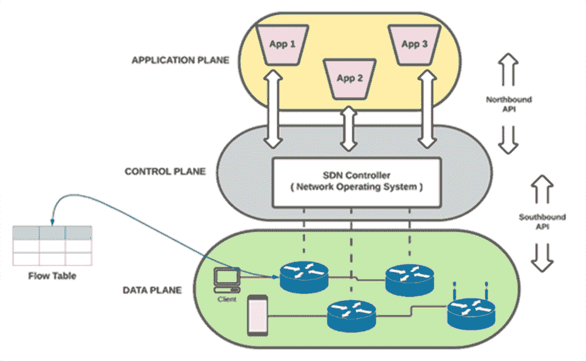 |

`SDN` 扩大了攻击面，且缺乏诸如授权等适当的安全机制。采用集中式方法对许多策略类型（包括集中式路由算法、防火墙和网络监控技术）有积极影响。负面影响包括中心单元故障时的情况。这会降低分布式系统的弹性。由于 `SDN` 是集中式的，外部攻击者可能只需攻破较少的脆弱 `SDN` 组件即可获得完整的网络控制权。

由于 `SDN` 维护着完整网络拓扑的全局视图，该信息可结合流量分析，用于可靠地检测现有的拒绝服务（`DoS`）攻击。

由于集中式控制器负责决策，一种新型的拒绝服务（`DoS`）攻击向量应运而生。控制器正在为传入的数据包持续进行决策。攻击者可向网络注入大量数据包，耗尽控制器的资源和内存。

## SDN 架构

`SDN` 架构包含三个主要层：数据平面、控制平面和应用平面。以下各节概述了这三个层（图 1）。

### 数据平面

数据平面由交换机和路由器等数据包转发元素组成。然而，与传统网络的转发元素不同，这些元素不具备做出自主决策的嵌入式智能。此处 `OpenFlow` 接口发挥作用。不同设备通过 `OpenFlow` 接口与控制器通信。这确保了不同设备之间的配置和通信兼容性。

支持 `OpenFlow` 的转发设备维护一张包含三个部分的转发表：规则匹配、匹配数据包执行的动作，以及匹配数据包统计的计数器。规则匹配字段包括交换机端口、源 MAC、目的 MAC、以太网类型、VLAN ID、源 IP、目的 IP、TCP 源端口、TCP 目的端口。

### 南向 API

这是转发设备与控制平面之间的桥梁。它为上层提供标准接口，使控制器能够使用不同的南向 API（如 `OpenFlow` 和 `OpenState`）以及协议插件（如 `SNMP` 和 `BGP`）来管理新的或现有的物理或虚拟设备。`OpenFlow` 向网络操作系统提供三种主要类型的信息：`Packet_in` 消息、基于事件的消息，以及转发设备生成的流统计。当转发设备在流表中没有数据包的匹配流或数据包的显式规则时，会发送 `Packet_in` 消息。每当触发链路或端口变化时，会发送 `Event_based` 消息。

### SDN 控制器

控制器执行抽象底层细节的任务，并通过网络拓扑等基本服务和面向开发者的标准 API 将其提供给应用平面。

`SDN` 控制器提供以下功能：用于转发的最短路径、拓扑管理器、状态管理器、设备管理器、通知管理器，以及提供服务隔离和应用隔离等服务的安全机制。

控制器架构有三种可能性：集中式、去中心化或分布式。

在集中式控制器中，仅有一个实体负责管理所有转发设备。这种架构有两个主要局限：扩展性局限，以及单点故障威胁。

分布式控制器具有更好的扩展性支持，且对故障具有高弹性，因为独立的控制器分布在不同的网络段中。控制器还拥有 `Westbound APIs` 和 `Eastbound APIs`。这些 API 允许控制器交换数据、监控信息和一致性算法。

### 北向 API

`北向 API` 为开发应用程序提供标准接口。南向接口用于编程转发设备的低级指令集被 `北向 API` 抽象化。它提供安全、路由、数据路径计算功能，并包含全局自动化和数据管理应用程序。

该 API 尚无标准化，现有控制器均使用不同的编程语言和规范实现各自的 `北向 API`。或许正是可以安装在应用平面的不同类型应用程序导致了该 API 缺乏标准化。

### 应用平面

应用程序定义转发设备的行为。这些应用程序向控制平面提交高级策略，控制平面随之将其作为流规则强制执行在网络转发设备上。该平面可能包含不止一个网络应用程序，如安全和可视化应用。

## 参考文献

Vermesan, O., Friess, P., & Guillemin, P. (2011). Internet of things strategic research roadmap. *Global Technological and Societal Trends*, 1, 9–52.

Yan, Z., Zhang, P., & Vasilakos, A. V. (2014). A survey on trust management for internet of things. *Journal of Network and Computer Applications*, 42, 120–134. doi:10.1016/j.jnca.2014.01.014

Zeng, D., Guo, S., & Cheng, Z. (2011). The web of things: A survey. *Journal of Communication*, 6(6), 424–438.

## SDN 漏洞与攻击向量

### 概述

SDN 的大多数应用属于以下类别：移动性、无线、测量与监控、安全与可靠性、数据中心网络与流量工程。策略执行即服务（PEPS）具备跨层和跨域访问控制，实现了“纵深防御”保护模型。在此模型中，不成功的访问请求在甚至与数据提供服务器交互之前就被丢弃。这标志着下一代防火墙的发展，旨在改善针对拒绝服务（DoS）攻击的边界安全。

| 图 2. 存在安全问题的安全相关特性 |
| --- |
| 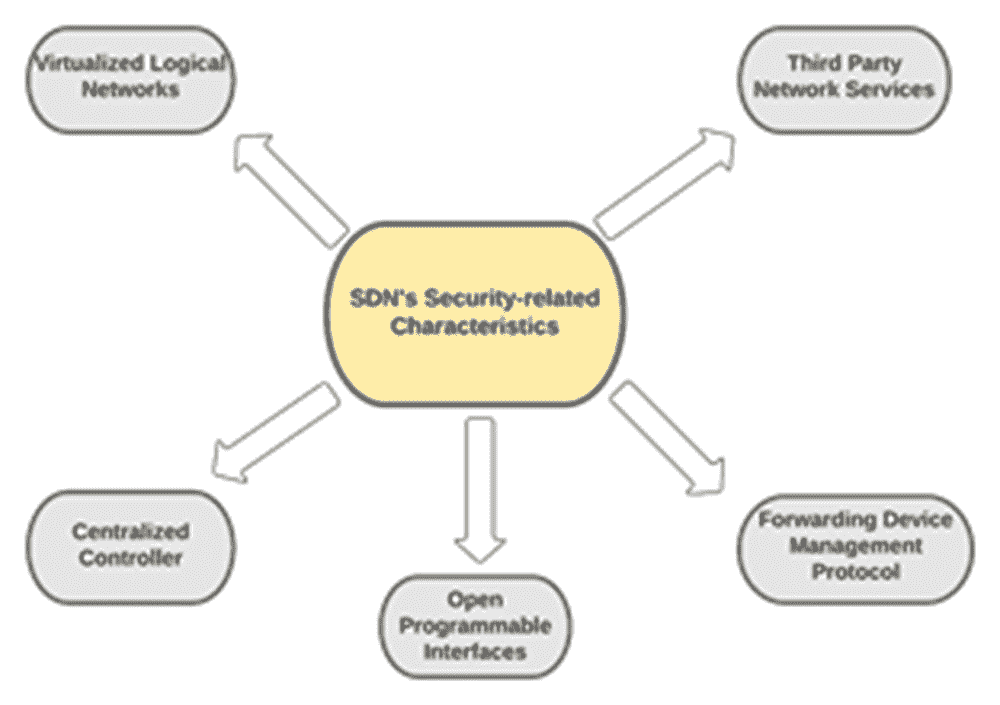 |

### SDN 漏洞

SDN 的以下特性增加了网络中的漏洞数量：虚拟化逻辑网络、第三方网络服务、集中式控制器、开放可编程接口和转发设备管理。以下章节将分析上述五个特性（图 2）。

#### 虚拟化逻辑网络

SDN 和网络功能虚拟化（NFV）高度相互依赖，即高度互联。NFV 用于虚拟化先前基于硬件组件的服务。像 `DNS` 这样的网络功能被解耦，以优化网络服务。SDN 可关联服务于虚拟化。这是通过使用多个在物理设备上共享的转发设备来完成的。

#### 第三方网络服务

SDN 控制器能够安装各种第三方网络服务，也能执行它们。

应用程序可以在运行时实例化，如 `OpenDayLight (ODL)`。`ODL` 是用于定制网络的模块化开放平台。`ODL` 的其他替代品包括 `UniFi`，它完全免费；`Beehive SDN Controller` 和 `Wi-5` 也是一些免费开源的替代方案。

应用程序也可以作为控制器模块的一部分进行编译，如 `NOX` 和 `POX`。`NOX` 是第一个 `OpenFlow` 控制器，用 `C++` 编写，也提供 `Python API`。`POX` 被称为 `NOX` 的“幼年兄弟”，是 `NOX` 的纯 `Python` 版本。

#### 集中式控制器

控制器维护整个网络拓扑的全局视图。控制器最初设计为唯一设备，即单独使用。但由于可扩展性和可靠性问题，最近开始使用分布式控制器。

在分布式控制器中，一个控制器被分配一组特定的转发设备。控制器与转发设备之间遵循 `Master/Slave`（主/从）部署模型。

#### 开放可编程接口

由于存在以下三种可编程接口，SDN 具有可编程性：

1.  **北向 API**，位于应用平面和控制平面之间。`REST API` 就是一个例子。它使 SDN 应用能够向网络的控制平面提交策略。
2.  **东西向 API**，允许不同互联控制器之间进行通信，这些控制器可能使用同一个域，也可能不使用。
3.  **南向 API** 是所有 SDN 接口中讨论度最高的接口。控制器被允许对转发设备进行编程，而不管控制器或转发设备中使用的硬件和软件。`OpenFlow` 是用于控制器到数据平面通信的标准。

#### 转发设备管理协议

转发设备使用 `OpenFlow` 配置和转发设备管理协议进行配置和管理。

`OF-Config`（`OpenFlow 配置和管理协议`）是一组特殊的规则，定义了 `OpenFlow` 控制器的机制。这些规则用于访问和修改 `OpenFlow 交换机` 上的配置数据。

| 图 3. SDN 五大主要组件与攻击范围的关系 |
| --- |
| 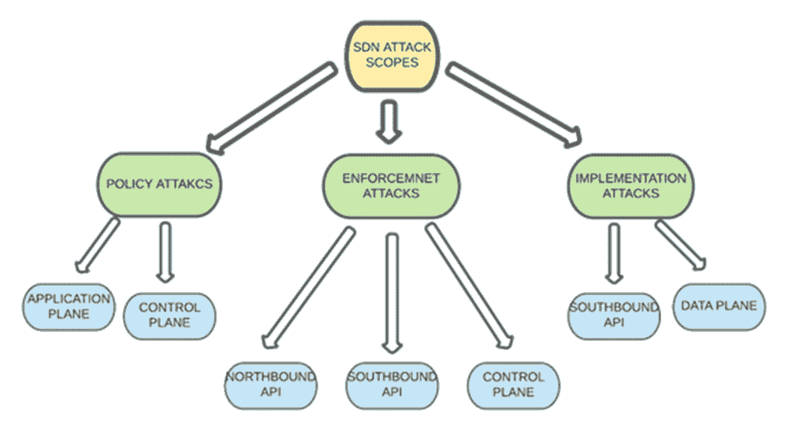 |
| *(Gupta, B. B., Perez, G. M., Agrawal, D. P., & Gupta, D. (2021) pp. 341-387)* |

### 攻击向量与影响

在 SDN 架构中，网络策略的定义和存储与其实现是分离的。因此，基于其对策略、执行和实现的影响，针对 SDN 的攻击被分为五大主要类别（图 2 和图 3）。

#### 实现攻击

这些攻击针对数据平面和南向 API。

##### 数据平面

数据平面可能通过以下方式被攻破：设备攻击、侧信道攻击或协议攻击。

1.  **设备攻击** 涉及利用支持 SDN 的交换机的漏洞。这些漏洞可以是软件或硬件方面的。固件攻击针对软件缺陷，因此此类攻击属于软件漏洞范畴。对于硬件，转发设备的 `TCAM` 存储器可能被利用。
2.  **侧信道攻击** 涉及攻击者通过观察转发设备的性能来推断网络的转发策略。例如，如果输入缓冲区被用于识别规则，攻击者可以通过分析数据包处理时间来推断转发策略。
3.  **协议攻击** 针对数据平面。此攻击涉及利用转发设备的网络协议漏洞。支持 `OpenFlow` 的交换机实现独立且定制的交换机固件，潜力各异。文献（Gupta, B. B., Perez, G. M., Agrawal, D. P., & Gupta, D. (2021) pp. 341–387）中提到的一个此类攻击示例涉及 `HP 3500yl` 和 `3800` 交换机型号，它们不支持 `OpenFlow` 规定的 `TCAM` 流表中所有 12 元组匹配字段。这是一个可被恶意应用利用的漏洞，用于安装精心构造的规则，这些规则可用硬件不支持的匹配字段（MAC 匹配）覆盖现有的流规则（IP 匹配）。

##### 南向 API

主要攻击（Gupta, B. B., Perez, G. M., Agrawal, D. P., & Gupta, D. (2021) pp. 341–387）针对南向 API 的有：窃听攻击、可用性攻击、TCP 攻击和拦截攻击。

1.  **窃听攻击** 涉及攻击者作为更大攻击计划的一部分，获取控制平面和数据平面之间交换的信息。
2.  **可用性攻击** 意味着拒绝服务（DoS）攻击。南向 API 被大量请求淹没，导致网络无法处理合法请求。通过检查和分析数据包以及评估探测数据包的延迟时间并将其分类，可以发现流规则。随后，发送大量匹配规则的数据包，触发 `packet-in` 数据包。这些 `packet-in` 数据包随即使 SDN 控制器过载。
3.  **拦截攻击** 涉及通过修改交换的消息来破坏网络行为。Brooks, M., & Yang, B. (2015, September) 展示了一个中间人攻击的例子。此处使用 `ARP` 投毒来拦截 SDN 控制器与客户端之间的流量。这些攻击可进一步扩展以破坏网络行为。

#### 执行攻击

此类攻击的目的是阻止 SDN 正确指导策略如何、何时、何地执行。因此，针对南向 API、北向 API 和控制平面的攻击可能与针对策略执行的攻击相关联。

## SDN 安全威胁

SDN 面临以下安全威胁：

1.  链路洪水攻击
2.  分布式拒绝服务攻击
3.  数据包注入
4.  虫洞攻击
5.  拓扑投毒攻击

### 链路洪水攻击 (LFA)

**参考文献：** Scaranti, G. F., Carvalho, L. F., Barbon, S., & Proenca, M.L. (2020); Rasool, R. U., et al. (2019)

图 4 展示了无攻击状态下的 SDN，而图 6 展示了链路洪水攻击 (LFA) 模型。在此模型中，连接目标服务器的链路遭受洪水攻击，导致链路高度拥塞。这种拥塞使得合法流量难以到达目标服务器。

使用 Traceroute 命令在目标服务器周围创建链路拓扑图。然后，在目标链路的路径周围放置称为诱饵服务器的特定主机。接着，利用一组僵尸网络产生足够的流量来淹没该链路。最终，诱饵服务器被僵尸网络操控，相互发送低速流量，以制造足够的拥塞，使目标服务器与网络其余部分断开连接。

Rasool, R. U., 等人 (2019) 提出了 **CyberPulse** 作为解决方案。它在 SDN 控制器上检测并缓解 LFA。CyberPulse 使用深度学习进行洪水流量分类。

| 图 4. SDN 中的正常流量场景 |
| :--- |
| 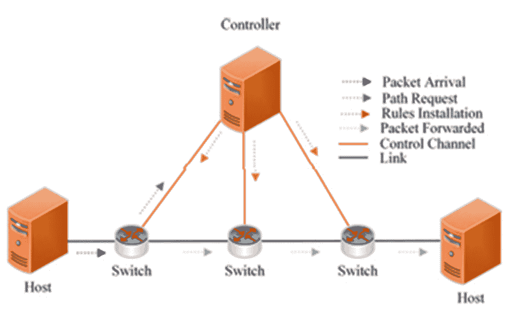 |
| *(Rasool, R. U., et al. (2019))* |

| 图 5. 使用 MLP 进行 LFA 分类 |
| :--- |
| 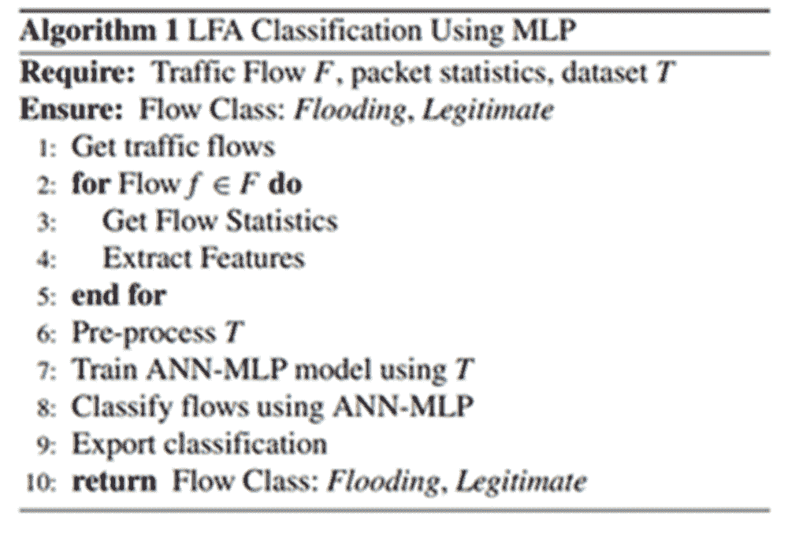 |
| *(Rasool, R. U., et al. (2019))* |

SDN 使用 `OpenFlow (OF)` 协议进行控制器与数据平面之间的通信。`OF` 包含称为流规则的流表，用于将流量发送至目的地。所有传入的数据包都与流表中的条目进行比对。如果没有匹配的流表项，则向控制器发送控制数据包以进行后续处理。该数据包称为 `PACKET_IN`；它包含数据包的头部信息，并被转发给控制器以获取如何处理的进一步指令。随后，控制器发送包含流规则的 `PACKET_OUT` 给 `OF` 交换机，交换机随即将数据包转发至目的地并更新流表。

攻击者向目标链路周围选定的服务器（即诱饵服务器）发送低速合法流量。起初网络变慢，随着时间的推移，网络变得无响应。LFA 模仿正常流量产生的同类活动，并利用其低速特性逃避检测，从而成功淹没整个网络。低速流量难以检测，并被发送至诱饵服务器，直到整条链路完全拥塞。

在 CyberPulse 中，选择 `ANN` 技术对 LFA 进行分类（图 5），因为它能准确分类恶意流量，从而便于缓解攻击。

CyberPulse 使用 SDN 的 `Northbound REST API` 与控制器通信。它与 SDN 的所有其他模块并发工作。它包含三个模块，分别为：

1.  链路监听模块
2.  洪水检测模块
3.  洪水缓解模块

##### 链路监听模块

链路监听模块持续检查控制信道并生成流量统计数据，发送给洪水检测模块。`Floodlight` 暴露了基于 Java 的 `REST API` 以提取网络统计数据。

##### 洪水检测模块

该模块检查链路监听模块提供的数据并执行洪水分类。预处理包括消除数据包头部，仅将流量数据呈现给洪水检测模块。该数据被输入深度学习子模块，该子模块使用 `人工神经网络 (ANN)` 对网络流量数据进行分类。

##### 洪水缓解模块

来自上一模块的处理后数据被发送到此模块，该模块使用空路由技术缓解攻击。

## 针对 SDN 平面的攻击

### 1. 针对南向 API 的攻击

针对南向 API 的攻击也可能对策略执行产生不利影响。例如，在中间人攻击中，攻击者可能修改消息交换，如 `packet-in` 消息或 `flow-mod`。这种修改会篡改控制器对数据平面需求的理解。缺乏明确定义的标准以及南向 API 的不断修订，可能导致恶意介入策略执行过程。这体现在这样一种场景中：配置不当的消息交换最终导致无效或冲突的指令被设置或分发到数据平面。

### 2. 针对北向 API 的攻击

针对北向 API 的攻击性质与针对南向 API 的攻击几乎相同。然而，攻击者需要更高级别的系统访问权限，且可能潜伏在应用平面。北向 API 缺乏任何标准化，这与假定 `OpenFlow` 为标准的南向 API 不同。每个控制器都有自己的北向 API 规范，导致开发不安全。恶意应用可利用北向 API 中的缺陷，通过驱逐活动会话、篡改控制消息交换等方式操纵其他应用的行为。鉴于控制单元与应用平面之间交换的信息影响网络范围的策略，北向 API 被攻破的后果要严重得多。

### 3. 针对控制平面的攻击

针对控制平面的攻击是对 SDN 最严重的威胁。这些攻击可分为三类：

*   **可用性攻击**


*   **操纵攻击**
*   **软件破解**

### a) 可用性攻击

在可用性攻击中，目的是使控制器在一段时间内对网络的所有部分都不可访问。这可以通过向控制器发送大量 `packet-in` 消息来实现——因为这些消息未经过认证。

### b) 操纵攻击

操纵攻击涉及颠覆控制器对数据平面的理解，最终导致错误的决策。

### c) 软件破解

软件破解涉及修改系统变量，使控制器有效地离线。

---

### 策略攻击

策略攻击涉及对 SDN 定义和存储正确网络策略能力的威胁。旨在攻击网络策略层面的攻击者，意在攻破 SDN 的应用平面和控制平面。攻破控制器赋予攻击者修改与应用共享的信息并破坏其决策的能力。

#### 1. 控制消息攻击

在控制消息攻击中，恶意应用可能通过传输修改或清除交换机流表项的控制消息，使整个网络瘫痪。因此，应用程序发出的一个错误消息可能造成灾难性后果。Shin, S., & Gu, G. (2013) 陈述了此类攻击的一个示例。条件是应用程序生成的控制消息没有限制。因此，SDN 应用程序可以随时生成任何控制消息。恶意应用程序持续生成流规则以反复填满交换机的流表，导致交换机无法处理更多下发的流规则。

#### 2. 资源攻击

资源攻击涉及恶意应用程序耗尽内存和 CPU 等系统资源，从而严重阻碍控制器的性能。在极端情况下，控制器实例可能被恶意 SDN 应用程序解除。

#### 3. 存储攻击

存储攻击涉及操纵内部数据库以利用网络行为。之所以可能发生这种情况，是因为 SDN 应用程序被批准拥有共享存储的访问权限。

#### 4. 访问控制攻击

访问控制攻击是指所有违反所需访问授权的攻击的统称。当前控制器仅对认证、问责和授权拥有一定程度的控制。上述三种策略攻击（即控制消息、资源和存储攻击）均涉及访问违规。

### 匹配空路由的数据包将被丢弃

空路由会创建一个黑洞，这是一个通向无处的内核路由表条目。

#### 图 6. LFA 模型

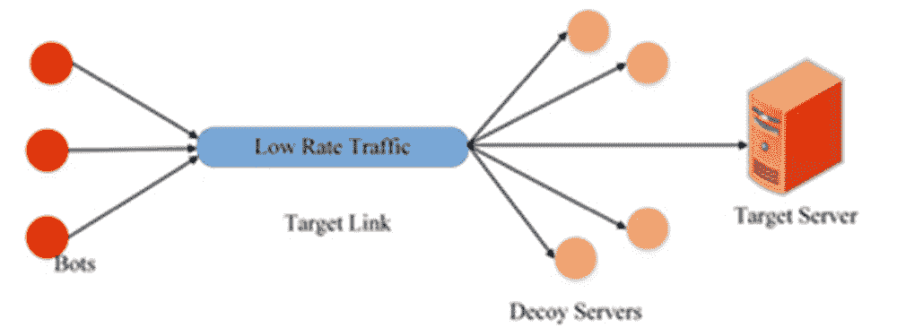

*(Rasool, R. U., et al. (2019))*

MLP 的特点是具有一个输入、一个输出，以及一个或多个相互连接的隐藏层。相反，同一层中的节点之间没有连接，也没有桥接连接。

##### 输出层

输出层是数据集中期望预测的可能类别的数量，用 `y` 表示。这里它等于二，即合法流量和洪泛攻击。

##### 隐藏层

隐藏层对应于实验中使用的中间连接数量，默认情况下，该数字选择为 1。隐藏层的数量取决于输入层和输出层的平均值。当数据线性可分时，使用的隐藏层数量为 0。这些层实际上将单层感知机转换为多层感知机，用 `h: (h1, h2, . . ., hn)` 表示。其中隐藏层可以包含 1 到最大 `n` 层。

##### 反向传播

它用于持续更新各层的权重，以最小化生成输出与期望输出之间的差异。利用此方法，可以计算梯度下降，进而用于计算权重并训练 MLP 模型。

在 Scaranti, G. F., Carvalho, L. F., Barbon, S., & Proenca, M.L. (2020) 中，提出了基于人工免疫系统和模糊逻辑的洪泛攻击检测方法（图 7）。

AIS-IDS 是一种生物启发式的 IDS。它利用模糊逻辑实现网络异常的自动检测和缓解。该方案部署在控制平面，包含三个具有特定功能的模块。这三个模块分别负责流收集、检测和缓解。

利用正常流量行为，可以识别异常流量。模糊推理系统用于解决异常检测中的不确定性。

缓解模块将识别可疑的 IP 地址和端口，以确定缓解/阻断攻击的缓解策略。

#### 图 7. AIS-DIS

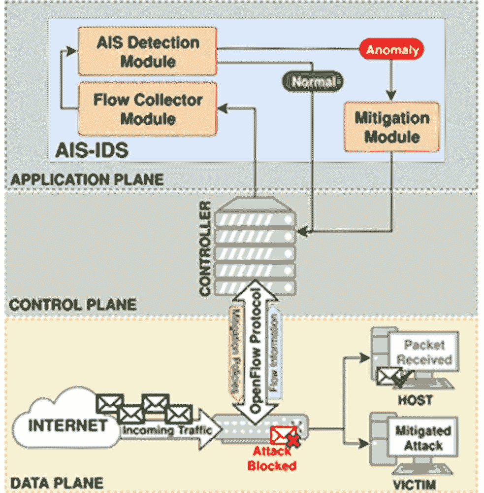

*(Scaranti, G. F., Carvalho, L. F., Barbon, S., & Proenca, M. L. (2020))*

为了评估 AIS-DIS 的效率，将该模型与 `KNN`、`LOF`（局部异常因子）和 `Naive Bayes`（朴素贝叶斯）进行比较，用于模拟的 DDoS 攻击。

AIS-DIS 在 SDN 控制器中有三个模块：流收集器、AIS 检测和缓解。第一个模块使用 `OpenFlow (OF)` 协议定期从数据平面获取 IP 流。这些数据进一步被处理并发送给后续模块，即 AIS 检测。该模块将网络行为分类为正常或异常。如果发现行为异常，缓解模块将通过创建转发规则来阻断流量。

#### 图 8. 流收集器模块

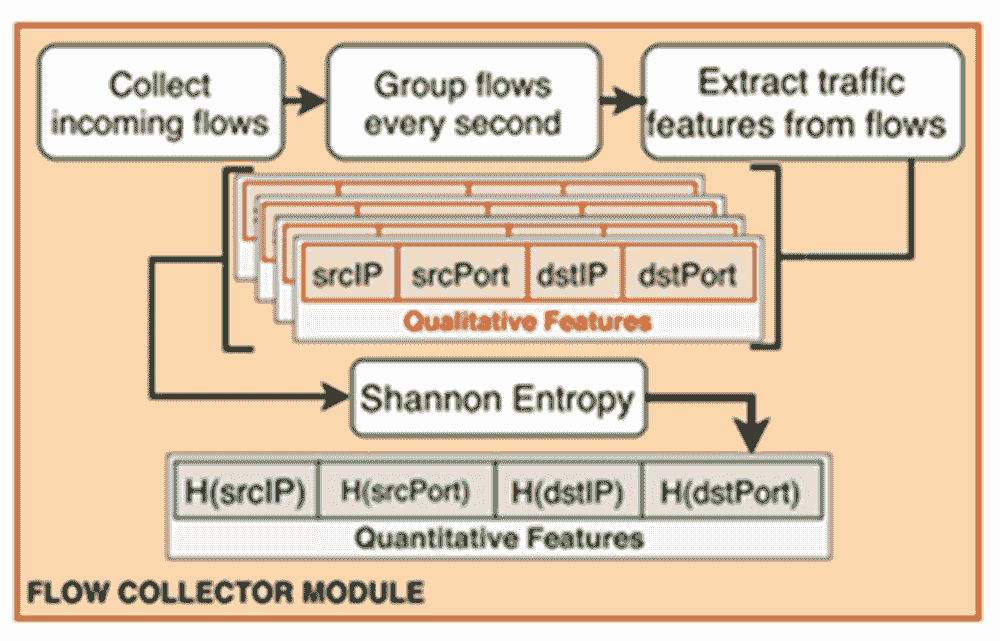

*(Scaranti, G. F., Carvalho, L. F., Barbon, S., & Proenca, M. L. (2020))*

这三个模块描述如下：

*   **A. 流收集器模块（图 8）** 收集 AIS 检测模块（图 9）所需的数据。使用 `OpenFlow` 协议。在 SDN 中，每一瞬间都会创建和过期许多流。如果流信息收集更频繁，异常检测将更准确，并能采取更快的行动来缓解攻击。但周期性数据收集有一个缺点，即被分析的流量大小。在此，创建一个在检测威胁时能准确实时反应的 IDS 是一个具有挑战性的问题。

*   **B. AIS** 受生物免疫系统启发。AIS 最著名的算法之一是负选择算法（`NSA`）。它模拟生物抗体对自身和非自身分类工作的识别。`NSA` 是一种生成免疫检测器的计算模型（图 10）。这种方法的优势在于无需使用数据集中的异常样本训练模型即可检测威胁。只有当每个检测器的特征与训练数据集的相似度值大于最小相似度时，该检测器才算完整。这个新检测器被添加到检测器集合中，当该集合达到 `n` 个检测器时，生成过程终止。随后进行分类。

*   **C. 缓解模块（图 11）** 获取由 AIS 检测模块（图 9）路由的所有异常流量。然后缓解模块应用丢包策略以缓解检测到的攻击。根据异常类型：DDoS 或端口扫描攻击，有两种缓解策略。

#### 图 9. AIS 检测模块

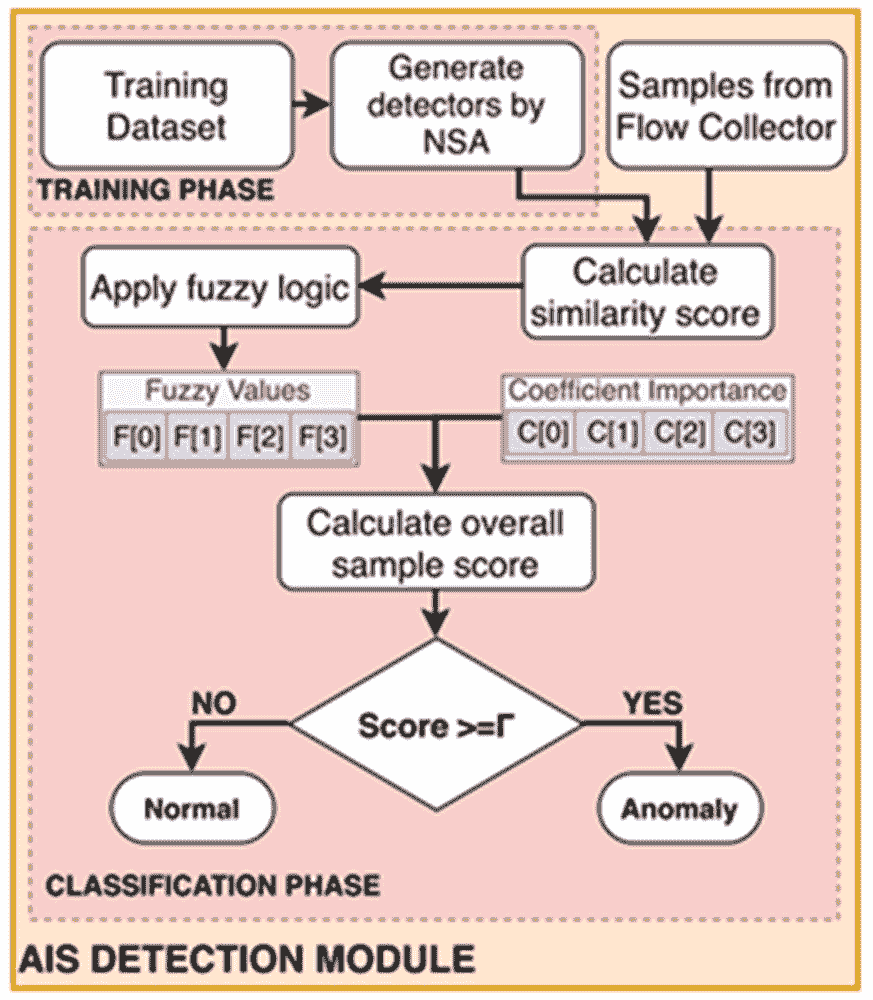

*(Scaranti, G. F., Carvalho, L. F., Barbon, S., & Proenca, M. L. (2020))*

#### 图 10. 检测器生成伪代码

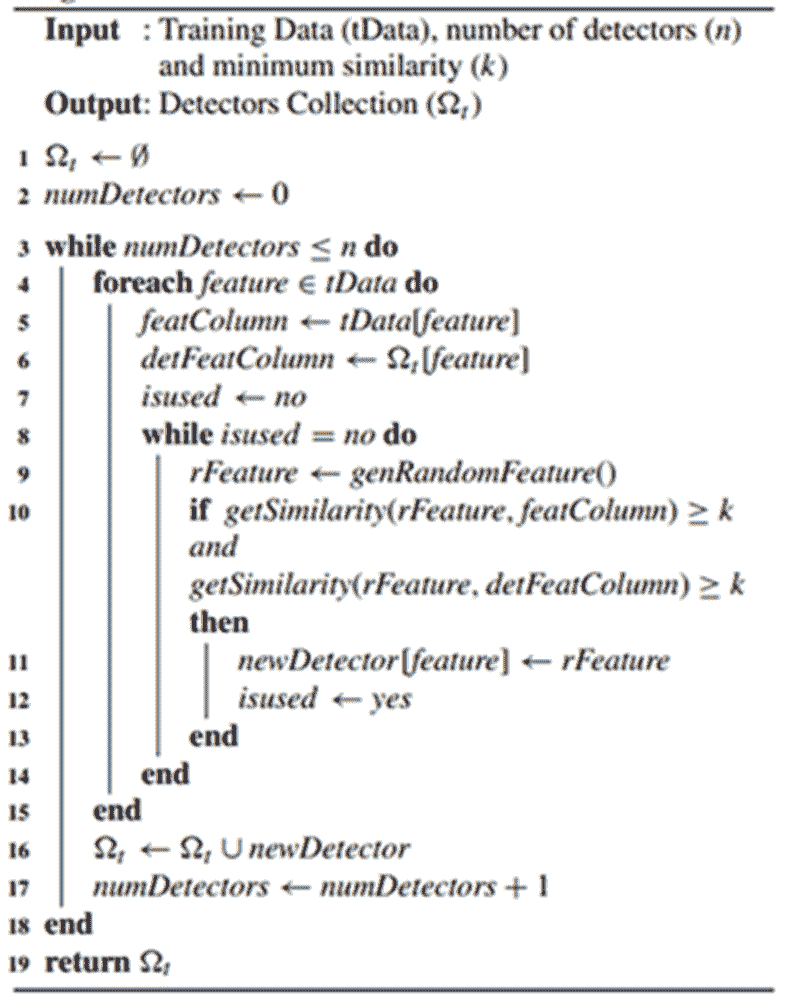

*(Scaranti, G. F., Carvalho, L. F., Barbon, S., & Proenca, M. L. (2020))*

实验结果表明，AIS-IDS 的 F 值超过 99.9%，说明作者提出的 IDS 可靠地保护网络。在公共数据集测试中，F 值发现超过 92%。缓解模块也能够丢弃异常数据包并阻断攻击。因此，AIS-IDS 已被证明对检测和缓解 SDN 中的洪泛攻击是有效的。

#### 图 11. 缓解模块伪代码

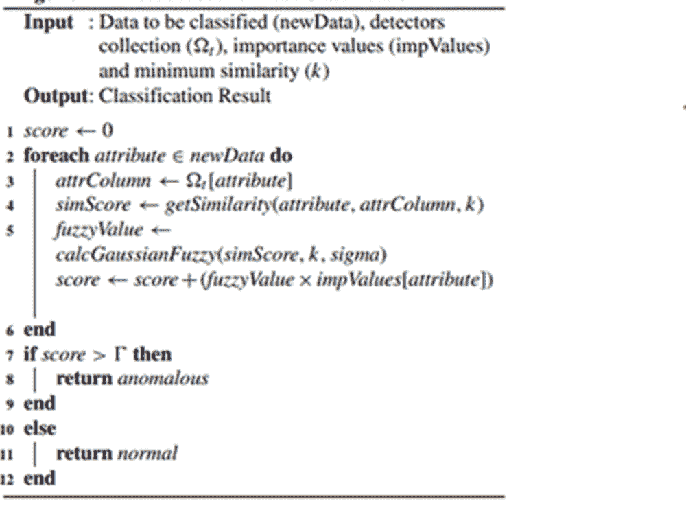

*(Scaranti, G. F., Carvalho, L. F., Barbon, S., & Proenca, M. L. (2020))*

### DDoS 攻击

DDoS 攻击涉及向目标发送大量数据包。如果攻击成功，控制器将与网络其余部分断开连接。控制器的分离导致其失去集中控制。这种单点故障可以通过 Tan, L., et al. (2020) 提出的架构来解决。

Tan, L., et al. (2020) 提出的架构包含检测和防御机制。它由四个部分组成：A) 可编程数据平面上的 DDoS 检测触发机制，B) 流特征提取，C) DDoS 检测算法，和 D) DDoS 防御机制。这四个部分描述如下：

*   **A) 可编程数据平面上的 DDoS 检测触发机制：** 用于 DDoS 攻击检测的方法使用固定时间间隔来检测网络流量。DDoS 攻击检测的效率和控制器的性能很大程度上受检测周期的影响。如果时间间隔设置得太大，响应时间将过高。这也会增加控制器和交换机的工作负载。如果时间间隔太小，控制器将频繁启动攻击检测，这会增加控制器的工作负载。

    解决 SDN 环境中 DDoS 攻击检测周期性触发上述问题的方案是引入一个检测触发机制，该机制通过触发机制确定 DDoS 攻击检测的开始时间。这种方法成功打破了定期触发检测方法的问题。

    检测触发机制部署在数据平面，通过在交换机上计数 `packet_in` 消息来实现。当 DDoS 攻击发起时，`packet_in` 消息的数量将出现巨大峰值，`packet_in` 的这种异常增加被用作 DDoS 攻击发起的迹象（Tan, L., et al. (2020)）。

#### B) 流特征提取

算法的准确性在很大程度上受到特征选择的影响，因为流特征决定了攻击流量与正常流量分类的基础。

首先，由于攻击旨在耗尽网络资源或占用链路带宽，攻击者会在短时间内向网络发送大量流量。

其次，在主机间的通信中，网络流量大多是双向的。因此，流量百分比高度对称。但是，当发生 DDoS 攻击时，随着单向流量（来自攻击者）急剧增加，对称性会降低。

第三，为了确保为合法用户提供正常服务，有必要能够区分合法网络流量和 DDoS 攻击流量。

为了解决上述问题，Tan, L., 等人 (2020) 引入了非对称流量的变化率。如果流量突增是合法的，那么网络流量的对称性将相应增加。而在 DDoS 攻击中，请求等待服务器无响应。因此，流量将高度不对称。

攻击者需要在短时间内发送大量数据包以快速瘫痪网络。如果具有少量数据包的流数量过大，则极有可能发生 DDoS 攻击。而在合法流量中，发送有效信息需要大量数据包。因此，具有少量数据包的流的比率可用于反映 DDoS 攻击的强度。

交换机检测到异常流量后，控制器通过交换机检测异常流量。然后控制器向交换机发送 `OFPT_FLOW_MOD` 消息，要求交换机缓冲来自异常流量的数据包，并将这些数据包发送给控制器进行分析。随后提取流的基本信息，控制器使用以下公式计算流的五个特征值（图 12）。这些值存储在数据库中。

| 图 12. 5 个特征的计算 |
| --- |
| 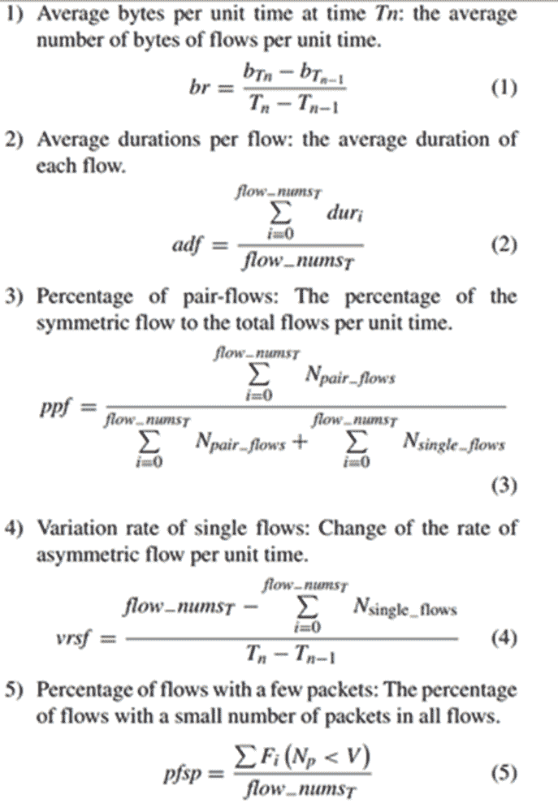 |
| *(Tan, L., et al. (2020))* |

| 图 13. K-means 算法伪代码 |
| --- |
| 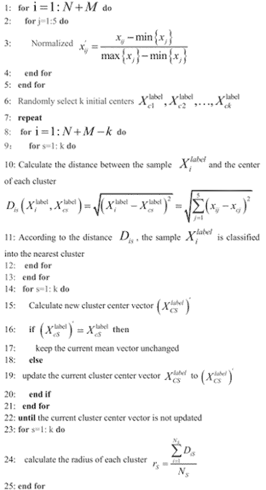 |
| *(Tan, L., et al. (2020))* |

#### C) DDoS 检测算法（图 13）

DDoS 检测算法使用了基于 K-Means 的训练数据处理模块和基于 K-近邻的流量检测模块。K-means 用于对数据进行聚类，以便在使用 KNN 算法进行检测时，比较检测点与各个聚类中心之间的距离。通过将 k 个最近的点分类为正常组或攻击组，来判断该流是正常流还是攻击流。

传统上，在 KNN 算法中，需要计算待测点与所有其他训练数据之间的距离。然后，选择 k 个最近的点来确定待测点的类型。Tan, L., 等人 (2020) 提出的算法降低了检测的计算成本，从而减少了特殊数据对检测算法结果的影响。该检测算法仅用于训练阶段，不影响检测时间。

使用 K-means 算法的目的是将具有相似特征的流量数据分离到多个类别中。这使得 KNN 能非常方便地实现流量特征的快速匹配，并能减轻检测模块的工作量以及特殊数据对检测结果的影响。

#### D) DDoS 防御机制（图 14）

缓解 DDoS 攻击的常用技术是转发、修改或阻断攻击流量。即使攻击成功缓解后，由攻击流量生成的大量恶意流表项仍将保留在交换机中。这些表项会影响合法流量的流动，因为流表项持续占用交换机的存储资源。因此，在阻断攻击产生的流量后，应删除恶意流表项。

图 15 基于精确率、召回率和误报率展示了不同方法的对比。性能指标使用 NSL-KDD 数据集进行评估。该数据集包含 41 个特征，如 `duration`、`src_bytes`、`dst_bytes`、`protocol_type` 等。

| 图 14. DDoS 防御机制 |
| --- |
| 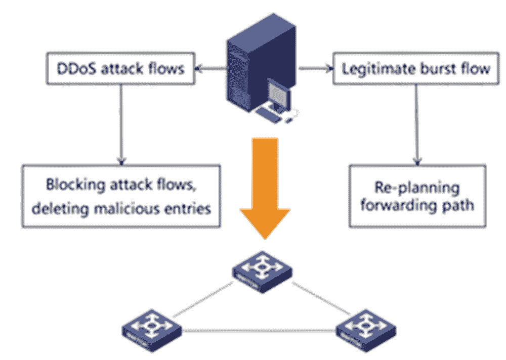 |
| *(Tan, L., et al. (2020))* |

| 图 15. 不同方法的对比 |
| --- |
| 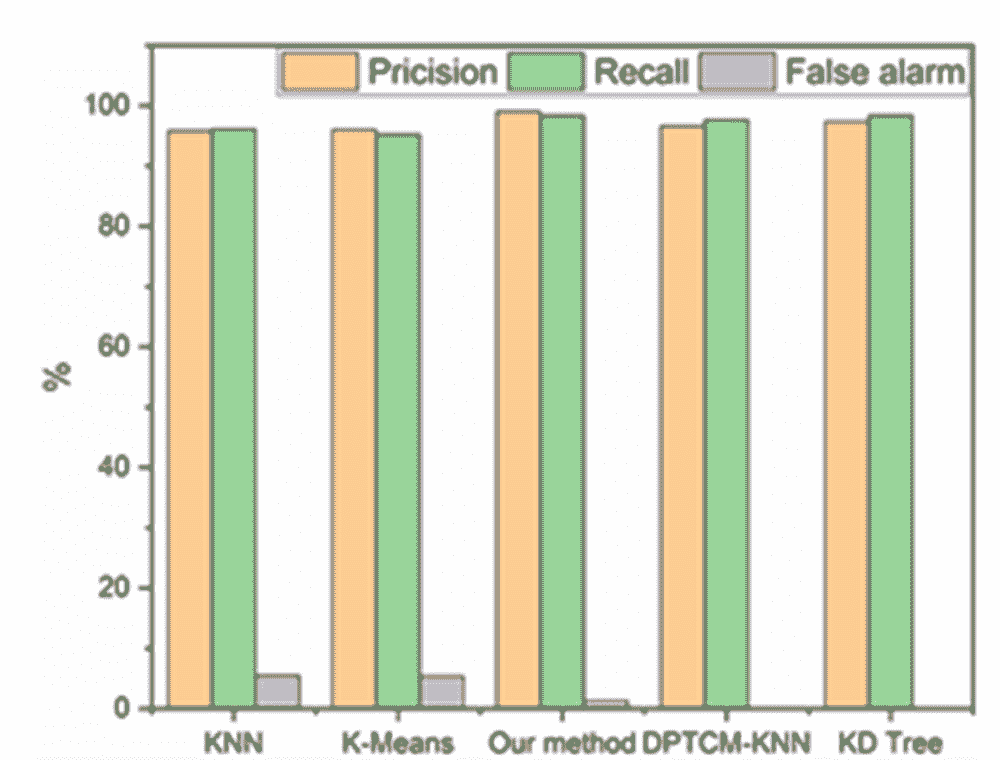 |
| *(Tan, L., et al. (2020))* |

Wang, Y., Hu, T., Tang, G., Xie, J., & Lu, J. (2019) 提出了安全防护方案（SGS），该方案结合了数据平面的异常流量检测和控制平面的控制器动态防御。此处异常流量检测模块采用了一种流监控方法。为了将攻击流与合法流量区分开来，异常检测模块基于速率特征和不对称特征，从交换机的流中提取四元组向量。此处改进了反向传播神经网络（BPNN）方法。

图 16 是管理整个 SGS 系统的有限状态机。

##### A) 初始状态

此处网络正在运行。SGS 从主机接收数据包并将其传输至交换机。

##### B) 检测状态

此处执行潜在 DDoS 攻击的识别。如果检测到异常流量，系统进入防御状态。否则，系统返回安全状态。

##### C) 防御状态

该状态主要运行在控制平面。在此状态下，系统确认控制器遭受 DDoS 攻击，并启用控制器动态防御模块。控制器向交换机发送访问控制消息，以从源头阻断异常流，并清理受影响交换机的恶意流表项。

##### D) 安全状态

系统转发数据包并返回初始状态。

| 图 16. 管理 SGS 系统的有限状态机 |
| --- |
| 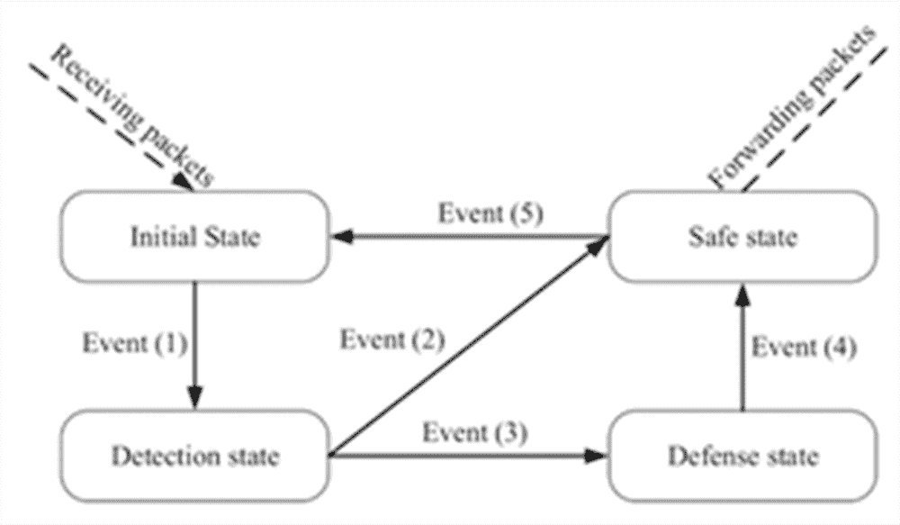 |
| *(Wang, Y., Hu, T., Tang, G., Xie, J., & Lu, J. (2019))* |

异常流量检测模块（图 17）运行在交换机的数据平面上。该模块具有三大功能：特征提取、检测响应和结果执行。

图 18 展示了用于 DDoS 攻击检测的四元组向量的验证结果。四元组分别为：（a）字节速率，（b）对称流百分比，（c）非对称流变化率和（d）小数据包流百分比。

在将 SGS 与基线方案的性能评估对比中，结果表明 SGS 能快速检测并响应 DDoS 攻击。SGS 的控制器响应时间至少减少了 42.1%，流建立时间平均减少了 30.4%。

| 图 17. 异常检测模块 |
| --- |
| 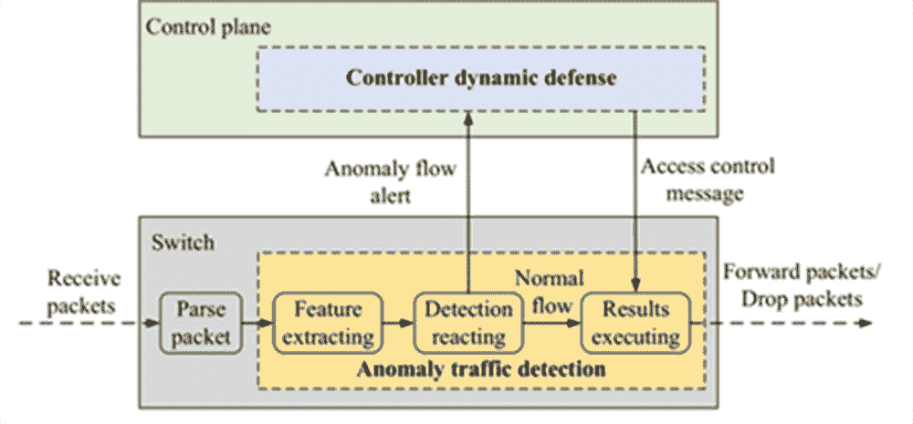 |
| *(Wang, Y., Hu, T., Tang, G., Xie, J., & Lu, J. (2019))* |

### 数据包注入

数据包注入攻击涉及攻击者控制多台主机以注入篡改过的数据包。此外，攻击者无需除普通用户之外的额外权限即可攻破控制器系统。

### 网络拓扑与数据包注入攻击

通过监控 `packet-in` 消息，拓扑管理服务学习主机信息，并连同主机配置文件一起更新拓扑信息。由于控制器中缺乏此类机制，由未匹配数据包引起的 `packet-in` 消息的合法性无法得到保证。这意味着任何未匹配的数据包都可以触发 `packet-in` 消息。攻击者利用这一事实，控制终端主机发送大量伪造数据包，从而发起数据包注入攻击。当这些数据包到达 OpenFlow 交换机并尝试与流表项匹配时，表中未找到匹配的流表项。这导致交换机通过 OpenFlow 信道向 SDN 控制器发送 `packet-in` 消息。伪造数据包没有目的地，因此控制器指示交换机以 `packet-in` 消息的形式将这些数据包泛洪到除来的端口以外的其他端口。拓扑信息的爆炸性增长导致构建在 Rest API 之上的应用程序性能大幅下降。

| Figure 18. Validation results |
| --- |
| 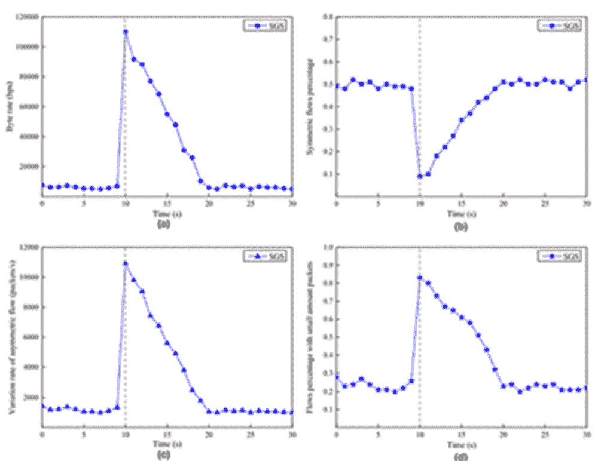 |
| *(Wang, Y., Hu, T., Tang, G., Xie, J., & Lu, J. (2019))* |

| Figure 19. Flow diagram for packet-in messages |
| --- |
| 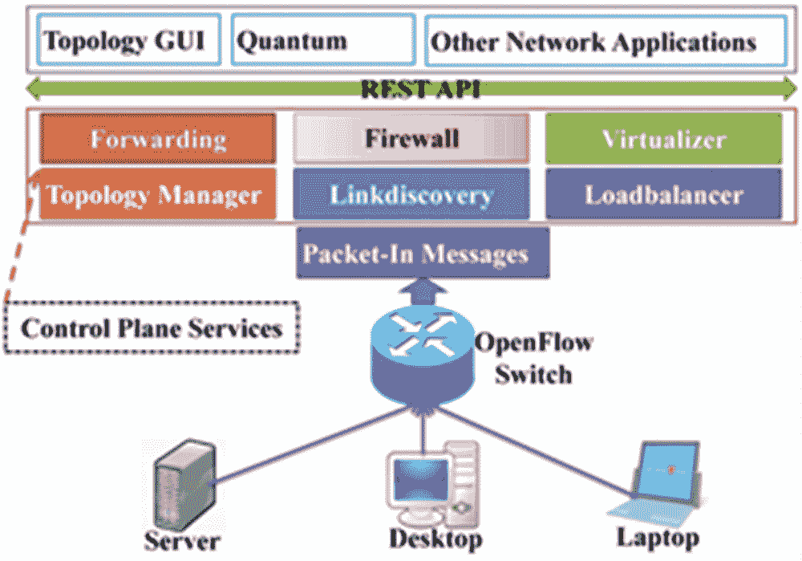 |
| *(Deng, S., Gao, X., Lu, Z., & Gao, X. (2018))* |

### PacketChecker 机制

Deng, S., Gao, X., Lu, Z., & Gao, X. (2018) 提出了 **PacketChecker**，作为一种扩展来协助 SDN 控制器处理伪造数据包。PacketChecker 是现有 SDN 控制器的一个扩展。


攻击检测模块识别恶意 `packet-in` 消息并将其发送给攻击解决模块。攻击解决模块丢弃恶意消息，并通过分发 `Flow-Mod` 消息指示交换机丢弃后续数据包。合法消息按常规处理。图 19 显示了当 SDN 控制器接收 `packet-in` 消息时，链路发现模块收集链路信息。随后，拓扑管理模块（图 19 中的 Topology Manager）利用链路信息构建拓扑。设备管理模块维护设备信息。SDN 控制器基于拓扑和设备信息制定转发策略。一旦检测到恶意数据包，即将其发送给攻击解决模块进行处理。只有合法消息能被链路发现模块处理，恶意消息直接丢弃。这种设计使 PacketChecker 能够作为现有控制器的扩展工作，而无需改造 SDN 硬件。

### INSPECTOR 解决方案

Alshra’a, A. S., & Seitz, J. (2019) 提出了 **INSPECTOR** 作为一种解决方案。它向网络架构中添加了一个隔离组件（INSPECTOR），在所有新数据包到达控制器之前对其进行检查。

所有复杂的网络逻辑仅存在于边缘/极端交换机上。这些交换机是入口和出口交换机，其余核心交换机保持尽可能简单。核心交换机执行数据包转发任务，而边缘交换机需要终端主机地址（如 IPv4 或 IPv6）进行转发。

INSPECTOR 维护一个数据库，包含所有已认证主机的信息，如 IP 地址、入端口号、连接边缘交换机的数据通路标识符（DPID）。每当主机首次请求服务时，边缘交换机向 INSPECTOR 发送一个 `packet_in` 消息。INSPECTOR 随后检查数据包头字段信息，以确保主机的请求有权使用网络资源。特别是在数据包注入攻击期间，数据包负载在控制器和 INSPECTOR 之间分配。

每个新的源地址要么首次通过 INSPECTOR，要么在连接的边缘交换机中的指令因超时被删除时通过。Alshra’a, A. S., & Seitz, J. (2019) 提出的方法的复杂性在主机通过网络资源认证时对网络性能没有影响。

INSPECTOR (Alshra’a, A. S., & Seitz, J. (2019)) 与 PacketChecker (Deng, S., Gao, X., Lu, Z., & Gao, X. (2018)) 进行了比较，展示了 200% 和 400% 的三元内容可寻址存储器（TCAM）改进率。OpenFlow 信道负载降低了 85%，内存使用量减少了 22% 到 38%。CPU 使用率约为零，最坏情况下达到 2%。这是因为 INSPECTOR 阻止伪造数据包进入控制器，而 PacketChecker 必须处理所有伪造数据包。

INSPECTOR 本身可能被攻破，因此需要可信的第三方来确保这种情况不发生。如果能在常数时间内搜索已认证主机，则可以进行改进。如果使用更智能的数据结构，就可以实现这一点。

### 蠕洞攻击

蠕洞攻击针对无线网络的路由控制平面。它涉及将蠕洞链路一端节点的数据包在链路的另一端重放。这造成了一条较短路径存在的假象，用于进一步转发。受影响的节点随后通过恶意节点转发流量。这些被转发的流量可能被记录、篡改甚至丢弃。

SDN 中用于发现网络拓扑的最广泛使用的控制器之一是链路层发现协议（LLDP）。然而，已证明 LLDP 不保证其消息的完整性。

LLDP 存在两个主要漏洞 (Hua, J., Zhou, Z., & Zhong, S. (2021))：

1.  缺乏认证机制以确保 LLDP 数据包的完整性。
2.  LLDP 简单的语义使其易于伪造 LLDP 数据包。

这些漏洞可被利用来伪造 LLDP 数据包，声称存在一条连接两个实际上未链接的交换机的虚假链路。因此，SDN 控制器将获取错误的网络拓扑，并将数据转发到虚假链路。这可能导致极其严重的攻击，如 DoS、窃听甚至劫持攻击。

由于虚假链路在现实中并未连接，导致 100% 的丢包，因为不存在传输。控制器可利用此信息检测攻击。Hua, J., Zhou, Z., & Zhong, S. (2021) 通过在两个受损交换机之间建立带内隐蔽信道，展示了一种“真正的”蠕洞攻击。该信道通过在两个作弊交换机之间引入一个中继主机来建立。基于实验分析，得出结论：随着中继主机位置的改变，对网络影响的程度也会变化。

Hua, J., Zhou, Z., & Zhong, S. (2021) 基于延迟提出了一种检测措施，用于检测链路是否为虚假。该检测措施为蠕洞攻击提供了高效且可扩展的保护。当 SDN 未受攻击时，流量通过最短路径转发。但在蠕洞攻击下，流量被转发到中继主机，然后由中继主机转发给目的地。

大多数情况下，包含中继主机的路径比原始路径更长。因此，延迟时间可用于检测蠕洞攻击的存在。蠕洞攻击有两种情况：

1.  当链路运行一段时间且控制器收集了网络的所有数据时。检测算法分三步：
    a. 控制器保存所有交换机对之间的平均延迟时间。
    b. 当新链路添加到现有网络时，控制器找到所有流经新链路的流。将新流的新延迟与之前的延迟进行比较。

#### 蜗牛洞攻击检测（续）

*   **c)** 如果超时流的百分比超过预定义的阈值，则该新链路被视为伪造链路。如果链路被识别为伪造链路，控制器会通知伪造链路两端终端的邻居，将该链路从网络中隔离。
*   **2)** 在这种情况下，链路正在首次配置。控制器没有关于延迟的数据。新的检测算法如下：
    *   **a)** 每对交换机之间的最短延迟存储在控制器中。
    *   **b)** 当一个交换机可以通过直接链路向另一个交换机转发数据包时，该链路预期为正常链路。如果不存在直接链路，则控制器选取第二短的延迟链路并将其与原始延迟进行比较。如果原始延迟长于后者，则这两个交换机之间的链路必须被标记为恶意链路。使用阈值来减少误判的数量。

根据测试，阈值设置为 20%。这是因为在 1000 次测试中，95% 的延迟没有比正常延迟增加超过 20%。此外，随着数据流量的增加，网络中可能会出现更多拥塞。这种拥塞导致延迟在更宽的范围内变化，因此检测可能会遗漏某些攻击。当从中继主机到受感染交换机的跳数增加时，防御成功率也会增加。这是因为随着跳数的增加，受影响的流将具有更大的延迟，从而使攻击更容易被检测到。当从中继主机到受感染交换机的跳数为 11 时，成功率达到 100%。

### 拓扑投毒攻击

拓扑投毒攻击可以在攻陷网络中的某个主机后实施。此类攻击之一是 **LLDP 欺骗攻击**，它可以误导控制器的拓扑视图。

正如蠕洞攻击部分所讨论的，**LLDP** 缺乏用于测试接收数据包完整性的认证机制。这导致接收到随机数据包，其中也包括伪造的数据包。在网络监控工具的帮助下，攻击者可以获取并分析 **LLDP** 数据包以实施篡改。基于伪造的 **LLDP** 数据包，控制器会更新网络拓扑。这可能会影响未来的管理，导致严重的网络瘫痪。

Wang, J., Tan, Y., Liu, J., & Zhang, Y. (2020) 讨论了关于车辆边缘网络中拓扑投毒攻击的两种攻击策略。这两种策略分别是：伪造 **LLDP** 数据包注入和 **LLDP** 数据包中继。

#### 伪造 LLDP 数据包注入

在伪造 **LLDP** 数据包注入中，顾名思义，伪造的 **LLDP** 数据包被制造并注入网络以投毒网络拓扑。攻击者可以通过监控流量获取 **LLDP** 数据包及其帧结构。数据包分析工具可用于了解数据包中每个字段的含义。在下一阶段，攻击者可以修改 **LLDP** 数据包的内容以达到其目的。

#### LLDP 数据包中继

在 **LLDP** 数据包中继中，基于威胁模型，攻击者可以控制至少两个连接目标的主机。受感染的主机可以通过有线或无线介质相互通信。通过将虚假的 **LLDP** 数据包封装进 `packet-in` 消息并发送给控制器，建立了一条伪造链路。

伪造 **LLDP** 数据包注入与 **LLDP** 数据包中继之间有两个区别因素：

*   **1)** 伪造 **LLDP** 数据包注入方法需要两个受感染主机，而 **LLDP** 数据包中继方法只需要一个。
*   **2)** 伪造 **LLDP** 数据包注入方法需要对 **LLDP** 数据包进行修改和分析。而 **LLDP** 数据包中继方法只是简单地使用从受感染主机拦截的数据包。

Wang, J., Tan, Y., Liu, J., & Zhang, Y. (2020) 还提出了一种基于深度强化学习（**DRL**）的新型攻击容忍方案，该方案对现有方案起到了补充作用。该方案的未来展望旨在完善容忍方案。

### 总结与结论

本章介绍了软件定义网络（**SDN**）的架构及其漏洞。讨论了导致 **SDN** 漏洞增加的因素及其攻击目标。**SDN** 的安全威胁被分为五大类：链路泛洪攻击（**LFA**）、分布式拒绝服务攻击（**DDoS**）、数据包注入、蠕洞攻击和拓扑投毒攻击。针对相应的攻击类型，展示了各研究人员提出的检测和缓解策略及其优缺点。**SDN** 在保障网络安全方面具有许多优势。同时，由于其攻击面增加，也催生了许多新的漏洞。保持 **SDN** 简单有助于其安全。但保持 **SDN** 简单却很复杂。保持清晰的安全路线图很重要，否则其安全问题可能会掩盖其优势。

## 参考文献

Abdullaziz, O. I., Wang, L. C., & Chen, Y. J. (2019). HiAuth: Hidden Authentication for Protecting Software Defined Networks. *IEEE Transactions on Network and Service Management*, 16(2), 618–631. doi:10.1109/TNSM.2019.2909116

Aladaileh, M. A., Anbar, M., Hasbullah, I. H., Chong, Y. W., & Sanjalawe, Y. K. (2020). Detection Techniques of Distributed Denial of Service Attacks on Software-Defined Networking Controller–A Review. *IEEE Access: Practical Innovations, Open Solutions*, 8, 143985–143995. doi:10.1109/ACCESS.2020.3013998

Alshra’a, A. S., & Seitz, J. (2019). Using INSPECTOR Device to Stop Packet Injection Attack in SDN. *IEEE Communications Letters*, 23(7), 1174–1177. doi:10.1109/LCOMM.2019.2896928

Brooks, M., & Yang, B. (2015, September). A Man-in-the-Middle attack against OpenDayLight SDN controller. *Proceedings of the 4th Annual ACM Conference on Research in Information Technology*. 10.1145/2808062.2808073

Comer, D., & Rastegarnia, A. (2019). Externalization of Packet Processing in Software Defined Networking. *IEEE Networking Letters*, 1(3), 124–127. doi:10.1109/LNET.2019.2918155

Deng, S., Gao, X., Lu, Z., & Gao, X. (2018). Packet Injection Attack and Its Defense in Software-Defined Networks. *IEEE Transactions on Information Forensics and Security*, 13(3), 695–705. doi:10.1109/TIFS.2017.2765506

Dong, S., & Sarem, M. (2020). DDoS Attack Detection Method Based on Improved KNN With the Degree of DDoS Attack in Software-Defined Networks. *IEEE Access: Practical Innovations, Open Solutions*, 8, 5039–5048. doi:10.1109/ACCESS.2019.2963077

Eom, T., Hong, J. B., An, S., Park, J. S., & Kim, D. S. (2019). A Systematic Approach to Threat Modeling and Security Analysis for Software Defined Networking. *IEEE Access: Practical Innovations, Open Solutions*, 7, 137432–137445. doi:10.1109/ACCESS.2019.2940039

Gao, S., Peng, Z., Xiao, B., Hu, A., Song, Y., & Ren, K. (2020). Detection and Mitigation of DoS Attacks in Software Defined Networks. *IEEE/ACM Transactions on Networking*, 28(3), 1419–1433. doi:10.1109/TNET.2020.2983976

Gupta, B. B., Perez, G. M., Agrawal, D. P., & Gupta, D. (2021). Handbook of Computer Networks and Cyber Security: Principles and Paradigms. In *Software-Defined Network (SDN) Data Plane Security: Issues, Solutions, and Future Directions* (pp. 341–387). Springer.

Haider, S., Akhunzada, A., Mustafa, I., Patel, T. B., Fernandez, A., Choo, K. K. R., & Iqbal, J. (2020). A Deep CNN Ensemble Framework for Efficient DDoS Attack Detection in Software Defined Networks. *IEEE Access: Practical Innovations, Open Solutions*, 8, 53972–53983. doi:10.1109/ACCESS.2020.2976908

Hua, J., Zhou, Z., & Zhong, S. (2021). Flow Misleading: Worm-Hole Attack in Software-Defined Networking via Building In-Band Covert Channel. *IEEE Transactions on Information Forensics and Security*, 16, 1029–1043. doi:10.1109/TIFS.2020.3013093

## 参考文献

Imran, M., Durad, M. H., Khan, F. A., & Abbas, H. (2020). DAISY: A Detection and Mitigation System Against Denial-of-Service Attacks in Software-Defined Networks. *IEEE Systems Journal*, 14(2), 1933–1944. doi:10.1109/JSYST.2019.2927223

Kim, S., Yoon, S., Narantuya, J., & Lim, H. (2020). Secure Collecting, Optimizing, and Deploying of Firewall Rules in Software-Defined Networks. *IEEE Access: Practical Innovations, Open Solutions*, 8, 15166–15177. doi:10.1109/ACCESS.2020.2967503

Phan, T. V., Nguyen, T. G., Dao, N. N., Huong, T. T., Thanh, N. H., & Bauschert, T. (2020). DeepGuard: Efficient Anomaly Detection in SDN With Fine-Grained Traffic Flow Monitoring. *IEEE Transactions on Network and Service Management*, 17(3), 1349–1362. doi:10.1109/TNSM.2020.3004415

Qureshi, K. I., Wang, L., Sun, L., Zhu, C., & Shu, L. (2020). A Review on Design and Implementation of Software-Defined WLANs. *IEEE Systems Journal*, 14(2), 2601–2614. doi:10.1109/JSYST.2019.2960400


# 参考文献

Rasool, R. U., Ashraf, U., Ahmed, K., Wang, H., Rafique, W., & Anwar, Z. (2019). Cyberpulse: A Machine Learning Based Link Flooding Attack Mitigation System for Software Defined Networks. *IEEE Access: Practical Innovations, Open Solutions*, 7, 34885–34899. doi:10.1109/ACCESS.2019.2904236

Sallam, A., Refaey, A., & Shami, A. (2019). On the Security of SDN: A Completed Secure and Scalable Framework Using the Software-Defined Perimeter. *IEEE Access: Practical Innovations, Open Solutions*, 7, 146577–146587. doi:10.1109/ACCESS.2019.2939780

Scaranti, G. F., Carvalho, L. F., Barbon, S., & Proenca, M. L. (2020). Artificial Immune Systems and Fuzzy Logic to Detect Flooding Attacks in Software-Defined Networks. *IEEE Access: Practical Innovations, Open Solutions*, 8, 100172–100184. doi:10.1109/ACCESS.2020.2997939

Shin, S., & Gu, G. (2013). Attacking software-defined networks. *Proceedings of the Second ACM SIGCOMM Workshop on Hot Topics in Software Defined Networking - HotSDN ’13*. doi:10.1145/2491185.2491220

Tan, L., Pan, Y., Wu, J., Zhou, J., Jiang, H., & Deng, Y. (2020). A New Framework for DDoS Attack Detection and Defense in SDN Environment. *IEEE Access: Practical Innovations, Open Solutions*, 8, 161908–161919. doi:10.1109/ACCESS.2020.3021435

Varadharajan, V., & Tupakula, U. (2020). Counteracting Attacks From Malicious End Hosts in Software Defined Networks. *IEEE Transactions on Network and Service Management*, 17(1), 160–174. doi:10.1109/TNSM.2019.2931294

Wang, J., Tan, Y., Liu, J., & Zhang, Y. (2020). Topology Poisoning Attack in SDN-Enabled Vehicular Edge Network. *IEEE Internet of Things Journal*, 7(10), 9563–9574. doi:10.1109/JIOT.2020.2984088

Wang, Y., Hu, T., Tang, G., Xie, J., & Lu, J. (2019). SGS: Safe-Guard Scheme for Protecting Control Plane Against DDoS Attacks in Software-Defined Networking. *IEEE Access: Practical Innovations, Open Solutions*, 7, 34699–34710. doi:10.1109/ACCESS.2019.2895092

Xu, Y., Sun, H., Xiang, F., & Sun, Z. (2019). Efficient DDoS Detection Based on K-FKNN in Software Defined Networks. *IEEE Access: Practical Innovations, Open Solutions*, 7, 160536–160545. doi:10.1109/ACCESS.2019.2950945

Yoon, S., Cho, J. H., Kim, D. S., Moore, T. J., Free-Nelson, F., & Lim, H. (2020). Attack Graph-Based Moving Target Defense in Software-Defined Networks. *IEEE Transactions on Network and Service Management*, 17(3), 1653–1668. doi:10.1109/TNSM.2020.2987085

Zhang, P., Zhang, F., Xu, S., Yang, Z., Li, H., Li, Q., Wang, H., Shen, C., & Hu, C. (2021). Network-Wide Forwarding Anomaly Detection and Localization in Software Defined Networks. *IEEE/ACM Transactions on Networking*, 29(1), 332–345. doi:10.1109/TNET.2020.3033588

Zhijun, W., Qing, X., Jingjie, W., Meng, Y., & Liang, L. (2020). Low-Rate DDoS Attack Detection Based on Factorization Machine in Software Defined Network. *IEEE Access: Practical Innovations, Open Solutions*, 8, 17404–17418. doi:10.1109/ACCESS.2020.2967478

# 第 4 章

## 作者

*   **Saila Sarmin Rapti**
    孟加拉国央行，孟加拉国
*   **Nabila Fahria**
    孟加拉国央行，孟加拉国
*   **Sunita Rani Das**
    孟加拉国央行，孟加拉国

## 摘要

在 COVID-19 疫情爆发之后，世界面临着获取金融服务的另一项日益严峻的挑战。通过限制 COVID-19 的传播，金融科技加速了社会各阶层获取金融服务的进程，使个人能够更灵活、便捷地使用金融科技。然而，网络攻击可能通过攻击任何类型的银行渠道（包括传统银行、网上银行、信用卡、ATM、代理银行和移动银行）来阻碍这一演变进程。从中央银行风险管理的角度来看，本章探讨了金融科技及其相关的网络安全领域。

## 引言

COVID-19 大流行为金融科技公司创造了众多机遇。为了乘上人人都想参与的数字化转型浪潮，客户渗透率达到了新高。但必须记住，每一项优势都伴随着一定的风险。安全危险、隐私泄露、服务差异、网络犯罪、系统性风险等均与数字银行的广泛使用相关。在提供金融服务方面，金融技术（FinTech）是一种试图与传统银行业务方法竞争的技术和创新。这一相对较新的行业利用技术来推进金融交易。该技术包括在银行服务中使用智能手机（有时称为手机银行）、通过手机提供的投资服务以及加密货币，旨在让大众能够获得金融服务。

金融科技公司由初创项目、金融机构和成熟的技术企业组成，它们致力于改进或替换现有金融公司提供的金融服务。许多现有金融机构正在利用金融科技解决方案和技术来改进和简化其运营，以提升服务并巩固市场地位（Peters 等，2015）。因此，我们了解到，金融技术的改进努力提高金融体系对所有公共和私营部门、企业及消费者的效率，但这也使金融技术面临金融风险和损失。政策制定者、法规和监管制度试图保护参与金融创新的所有各方，并支持这些服务的扩展，以促进金融创新并鼓励这些服务的增长（Philippon，2016；Shah 等，2018）。

### 技术进步对金融部门的影响

Technological advancement has driven the evolution of the financial sector. Thanks to FinTech innovations, consumers' ability to access services in payments, lending, insurance, savings, and investment has improved significantly over the past decade, at an unprecedented speed and scope (Kim et al., 2015). However, this has also raised privacy concerns, such as whether technology applications will expose and leak customer data, and whether related technologies like machine learning and artificial intelligence will be used for bank risk management (Kareem et al., 2020). As these technologies advance, cyberattack methods are also evolving and becoming more prevalent. Attack operators are dedicated to refining their methods to achieve breakthroughs. Crucially, it is essential to identify threat types faster than security teams, understand cybersecurity risks and their impact on financial services, in order to cope with increasingly sophisticated attack techniques. With the rising importance of FinTech, more robust cybersecurity solutions are indispensable to safeguard the dividends of FinTech. This requires preparation in multiple areas, including cyber governance, which demands enhanced awareness and research on internet technologies and security facts, as well as the establishment of security partnerships. The core issue is that as financial and banking businesses have developed recently and become highly capable, enormous risks have followed; these services are accompanied by fierce attacks, for which institutions must be prepared. Banking regulators should supervise regulatory frameworks adapted to the rise of e-banking and its associated risks, as financial companies are most vulnerable to these threats.

### 论文结构

This paper is organized as follows: Section 2 presents the literature review; Section 3 defines FinTech; Section 4 focuses on the evolution and growth of FinTech and digital payment systems in Bangladesh's monetary system; Section 5 describes Bangladesh's performance in FinTech and cybersecurity; Section 6 depicts cybersecurity issues in Bangladesh's FinTech sector; Section 7 highlights the Central Bank of Bangladesh's anti-fraud measures and FinTech cybersecurity; Section 8 concludes.

### 文献综述

Al Duhaidahawi et al. (2020) measured the relationship between FinTech variables and cybersecurity, where FinTech variables were the explanatory variables and cybersecurity was the explained variable. The observation results showed a significant relationship between the dependent and independent variables at the 5.00% significance level, with 90.80% complementarity among FinTech variables.

Ng, Artie W. et al. (2017), in their study on Hong Kong's FinTech service policy formulation and cybersecurity, indicated that technological fitness and ethical fitness are crucial for reducing cybersecurity risks brought by FinTech; the efficient implementation of both policies helps explore the field of fraud risk, thereby promoting FinTech development.

Vucinic M. (2020) linked FinTech with market structure through financial stability, risk, and return. The study pointed out that FinTech brings opportunities and risks to market participants, which may threaten financial stability from both micro and macroeconomic risk perspectives; simultaneously, cyber risks will increase as technology access point solutions may become targets for hackers.

Rahman Benazir et al. (2021) presented the ecosystem, opportunities, and challenges of FinTech in Bangladesh. Through a primary survey, the study found that FinTech is growing rapidly in Bangladesh's financial sector, having a significant impact on the financial sector; there are various improvement activities, but also different obstacles hindering FinTech growth, verified through four Chi-square (`χ²`) tests.


Jayalath J A R C & Premaratne S. C. (2021), in their study titled "Analysis of Key Digital Technology Infrastructure and Cybersecurity Consideration Factors for FinTech Companies," depicted: as financial platforms open to the public via the internet, cyber threats have increased sharply; therefore, FinTech companies, banks, and financial institutions need well-structured digital technology infrastructure to provide digital solutions to mitigate cyber threats.

Khan Mr. Ashraf & Malaika Majid (2021) mentioned that the central bank is a key decision-maker, but decision-making bodies have not fully kept pace with the situation regarding cybersecurity and FinTech improvements, while FinTech has exposed central bank operations (financial supervision, reserve management, and currency management) to risks. The International Monetary Fund (IMF) recommends that central banks establish an "appropriate hierarchical structure," "committee structure," and clearly separate the investment department from the risk management department to reduce cybersecurity risks.

### What is FinTech

**FinTech** is an acronym for Financial Technology, referring to the combination of technology and financial services (Schueffel, 2016). It demonstrates how modern internet-related technologies such as cloud computing, mobile internet, and big data analytics relate to business activities like payments, lending, mortgages, loans, and stock markets. FinTech is short for financial technology, referring to enterprises that use technology to conduct financial transactions.

FinTech has become a distinct technical term, primarily representing the financial technology field of enterprises or organizations in a wide range of activities, focusing on improving service quality through the application of Information Technology (IT) (Schueffel, P., 2016).

Mr. Abraham Leon Bettinger, Vice President of the bank manufacturer Hanover Trust Company, gave the following definition in an academic article, which detailed his model for analyzing and solving problems encountered daily by banks (Prabook, 2016): "**FINTECH** is an acronym for financial technology, combining banking expertise with modern management science technology and computer technology." (Bettinger, p.62, 1972)

### Evolution and Growth of FinTech and Digital Payment Systems in Bangladesh's Monetary System

Payment and settlement systems are considered key to the efficient operation of a country's financial system. These systems support fund transfers among financial institutions, enterprises, and individuals. As the regulatory authority, the Central Bank of Bangladesh (`BB`) encourages scheduled banks to maintain smooth and robust e-banking operations. `BB` has taken necessary initiatives to launch e-commerce, e-banking, Automated Clearing House Systems (`ACHS`), mobile banking, etc. Currently, banks can conduct online fund transactions, utility bill payments, fund transfers, import/export trade payments, etc., through electronic channels such as the internet, ATMs, mobile phones, or other electronic devices. Other major successful projects of `BB` include `NPSB`, `BACPS`, `BEFTN`, `CIB`, data warehouses, etc.

The figure below illustrates the evolution of FinTech and digital payment systems in Bangladesh's monetary system:

| Figure 1. Evolution of FinTech and digital payment |
| --- |
| 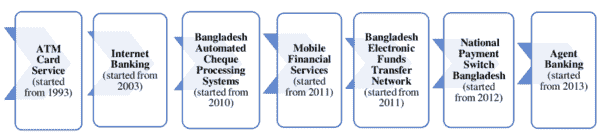 |

### 孟加拉国央行与政府的协作努力

孟加拉国央行与政府已采取协作努力，以便孟加拉国的计划银行能够开展银行间在线交易，并在孟加拉国运营不间断的全功能在线银行业务。孟加拉国央行在该领域开展了多项操作：

#### 网上银行

荷兰-孟加拉银行是孟加拉国首家提供电子银行业务的全自动化银行。自动化于 2003 年完成，但新功能和增补内容正在定期添加和修改。银行通过各自的银行在线网络提供任意分行银行服务，其中包括：通过各自银行在线网络下的任意分行进行交易；支付支付指令或支付指令兑现、汇票兑现、在同一银行的任意分行开立或赎回定期存款（FDR）；同一银行分行间的远程资金转账、取款、存款、账户对账单、清算和余额查询；以及开立信用证（L/C）。（来源：孟加拉国央行）

#### 代理银行

孟加拉国央行于 2013 年通过发布指导方针在国内引入了代理银行。代理银行被定义为在合法代理协议下，由受聘代理人在传统银行网点之外提供的银行服务。代理人至少必须提供现金存款和现金取款服务。主要目标是为弱势群体和服务不足人群提供一条安全的替代银行服务交付渠道，这些人群通常位于地理上孤立、标准银行网络触及不到的地区。（来源：孟加拉国央行代理银行指导方针）

通过代理人，银行可向客户提供多项金融服务，包括储蓄、贷款、汇款发放以及各类支付服务（如水电费、税款和政府转移支付福利）。截至 2021 年 9 月，孟加拉国有 29 家银行通过 13,470 名代理人的 18,077 个网点开展了代理银行业务。截至 2021 年 9 月，代理人数量增长了 4.32%，网点数量增长了 5.44%。（来源：孟加拉国央行代理银行季度报告）

#### ATM 卡服务

是渣打银行（SCB）在孟加拉国引入了 ATM。第一个亭于 1993 年在达卡的巴纳尼设立。自动柜员机（ATM）是一种允许金融机构用户进行自动化金融交易的设备。客户可使用 ATM 访问其银行账户，并进行取现、现金预支、账户间资金转账和查询账户余额。孟加拉国央行已发布白标 ATM 和白标商户收单服务指导方针，以帮助以可负担的成本在全国推广银行服务。

#### 移动金融服务（MFS）

孟加拉国央行于 2011 年在孟加拉国推出了高效的离柜移动金融服务（MFS），得益于该国拥有无处不在的移动电话网络、庞大的手机用户群和改善的 IT 基础设施。在短短十年内，这种呈指数级增长的银行主导型 MFS 模式已成为全球最大的 MFS 市场。孟加拉国央行允许通过 MFS 在国内提供现金存入、现金取出、个人对个人（P2P）、个人对商户（P2B）、商户对个人（B2P）、个人对政府（P2G）和政府对个人（G2P）支付服务。该服务不允许跨境资金转账。但是，允许通过银行渠道在本地发放入境外汇汇款。任何成年人均可凭照片和合法身份证件，在代理网点或银行网点向任一服务商开立 MFS 账户。在这种情况下，不允许同一人在同一服务商处开立多个 MFS 账户。

#### 孟加拉国自动支票处理系统（BACPS）

自 2010 年 10 月启动以来，BACPS 是唯一最先进的支票清算设施。它采用支票影像与截留（CIT）技术，对纸质票据（即支票、支付指令、股息及退款授权书等）进行电子呈现和支付。BACPS 以批处理模式运行。

#### 孟加拉国电子资金转账网络（BEFTN）

BEFTN 于 2011 年 2 月推出，是该国首个无纸化电子银行间资金转账系统。作为支票清算系统的先行者，它允许进行贷记和借记交易。工资发放、国际和国内汇款、社会保障支付、公司股息、账单支付、企业支付、政府税收支付、社会保障支付以及个人对个人支付均可通过该网络完成。水电费支付、保险费支付、俱乐部/协会会费支付、分期付款（EMI）等借记交易也可受理。BEFTN 处理大部分政府工资、社会福利和其他政府支付。

#### 孟加拉国国家支付转换系统（NPSB）

NPSB 自 2012 年起投入运行，旨在建立参与银行间账户和卡基交易的互操作性。目前，它支持银行间自动柜员机（ATM）、销售点终端（POS）和网银资金转账（IBFT）交易，而移动金融服务互操作性正在积极研究中。目前已有 53 家银行通过 NPSB 实现 ATM 交易互联。目前，可通过 NPSB 进行四类银行间 ATM 交易（即取现、余额查询、资金转账和迷你对账单）。截至 2021 年 10 月，53 家银行可进行 POS 交易互操作，30 家银行互联开展 IBFT 交易。个人和机构 IBFT 交易有不同限额。对个人而言，单笔交易最大金额为 300,000 塔卡，每日最高频次 10 次，每日累计不超过 1,000,000 塔卡。对企业而言，单笔交易限额为 500,000 塔卡，最高频次为每日 20 次，每日累计 2,500,000 塔卡。参与银行必须确保任何在线/电子商务/银行间/持卡人不在场交易采用双因素认证（2FA）。

### 孟加拉国金融科技与网络安全的表现

| 图 2. 孟加拉国金融科技随时间的使用情况 |
| --- |
| 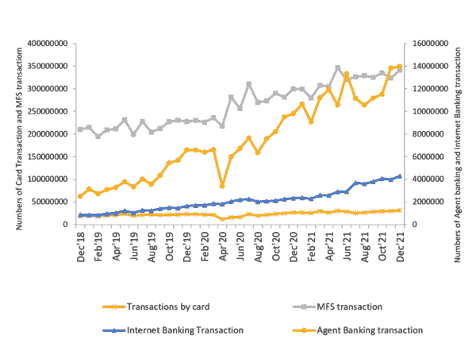 |

图 2 描绘了金融科技在三年期间（始于 2018 年 12 月，止于 2021 年 12 月）的使用情况。该图表展示了金融科技行业的趋势，表明金融科技的使用随时间增加。例如，2018 年 12 月信用卡交易总数约为 1800 万笔，到 2021 年 12 月几乎翻倍至 3100 万笔。这一变化主要归因于消费者更倾向于使用塑料货币而非纸币。网上银行亦是如此，三年内总交易量从 80 万笔攀升至 420 万笔。

#### 移动金融服务与代理银行业务增长

在移动金融服务（MFS）和代理银行业务方面，变化最为显著。从 2018 年到 2021 年，MFS 交易量从 2.1 亿激增至 3.41 亿，而代理银行业务交易量则从 240 万激增至惊人的 1300 万。从图表中还可以注意到，在大多数情况下，交易量的增长并非均匀的，即上涨/增长并不总是稳定的，趋势中也存在低谷。自 2020 年以来，世界一直处于 COVID-19 的笼罩之下，疫情让我们所有人都经历了封锁，这解释了这种交易趋势。由于当时人们居家隔离，实体交易基本不存在，这在图表中有所体现。随着人们越来越熟悉技术并停止面对面交易，上升趋势始于 2020 年 2 月，并持续适用于图中所示的所有交易类型。金融科技正变得越来越流行，并开始取代传统金融交易。

#### 孟加拉国网络安全排名提升

在爱沙尼亚电子治理学院基金会发布的国家网络安全指数（NCSI）中，孟加拉国排名上升了 27 位。在考察全球 180 个国家网络安全水平和数字发展水平的调查中，孟加拉国上升至第 33 位。国家网络安全指数评估的是该国中央政府的网络安全能力。根据 NCSI 网站数据，希腊以 96.10 分位居第一，而孟加拉国以 67.53 分位居第二。孟加拉国是南亚地区排名最高的国家，而印度排名第 46 位。

##### 表 1. 根据电子治理学院基金会对孟加拉国的总体评估

| 指数得分 | 网络安全指标 |
| --- | --- |
| 第 33 位 国家网络安全指数 | 数字服务保护（5 分制得 1 分） |
| 第 53 位 全球网络安全指数 | 基本服务保护（6 分制得 5 分） |
| 第 147 位 信息通信技术发展指数 | 电子身份识别与信任服务（9 分制得 7 分） |
| 第 95 位 网络准备度指数 | 网络事件响应（6 分制得 5 分） |

来源：NCSI 由爱沙尼亚电子治理学院基金会持有并开发

##### 图 3. 孟加拉国历年登记的网络攻击事件

```
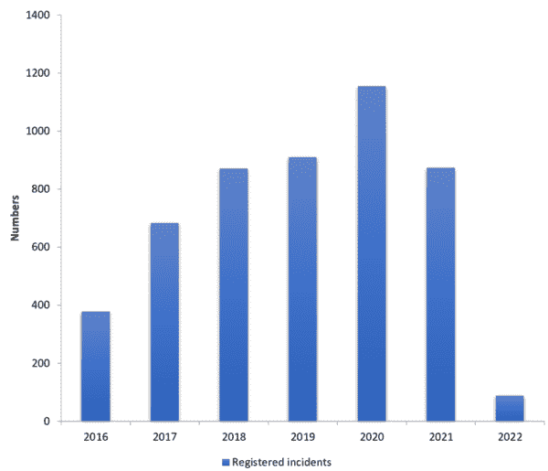
```

图 3 展示了 6 年期间登记的网络攻击事件数量。此处可见的趋势是上升趋势，2016 年登记攻击数量最少，2020 年最多。随着 2020 年疫情爆发，人们为了避免身体接触，更倾向于在线和无纸化交易。这就是黑客实施信用卡欺诈、幽灵交易、身份盗窃和许多其他类型网络犯罪的时机和场所。此外，在此期间，政府/央行更加意识到网络安全威胁，并在消除此类威胁方面更加积极。因此，人们向执法部门登记的案件也增多，以抓捕罪犯。我们可以看到，2021 年登记案件数量下降，这是由于政府对犯罪分子的打击，以及执法部门在遏制各种形式的网络犯罪方面更加积极。

#### 孟加拉国金融科技领域的网络安全问题

大流行增加了网络风险，因为更多员工远程工作，银行限制网点聚集，担心病毒传播等。主要攻击目标将是任何经常访问敏感数据的人，例如掌握客户信息的员工和技术知识较少的客户。十多年来，银行不得不应对各种威胁，包括员工失误、国家资助的攻击、第三方供应商失误以及复杂技术的使用。以下是危及网络安全的一些最典型方式：病毒、特洛伊木马、间谍软件、勒索软件和广告软件是恶意软件的例子。僵尸网络、SQL 注入、网络钓鱼、语音钓鱼、短信钓鱼、DNS 钓鱼、域名劫持、中间人攻击、拒绝服务攻击和其他网络攻击也包括在内。Dridex 恶意软件（2019 年 12 月）、恋爱诈骗（2020 年 2 月）和 Emotet 恶意软件（2019 年底）只是世界上最新的网络威胁中的一小部分。这些威胁的定义包含在附录（附件一）中。金融科技领域存在不同类型的网络安全威胁，可能是人为造成的，也可能是机器造成的。现在我们将了解孟加拉国金融科技领域的几种网络安全风险：

##### 一、 技术漏洞

技术漏洞包括因技术系统故障而产生的风险。以下是金融机构面临的一些最普遍的技术相关漏洞。

###### 杀毒软件及其他防护系统缺乏更新

杀毒软件版本过时、操作系统和应用程序未打补丁、从不可信来源安装程序和软件、终端安全不足，是金融机构最常见的错误。这些漏洞大多是由于网络安全系统缺乏资金投入而发生的。

###### 服务器和网站连接不安全

URL 重定向到恶意网页和网站是金融机构用户端常见的问题。掌握机密数据的员工可能会不知不觉地使用恶意网站，从而危害安全。与其他类型的攻击不同，恶意软件可以通过多种渠道进入，包括电子邮件、弹窗、恶意网站、第三方软件等。这些攻击特别危险，因为它们具有高数据传输率，并可能瘫痪整个网络。

##### 二、 人为漏洞


即使采取了所有这些技术预防措施，但它们都可能因人为漏洞而失效。人为弱点比技术缺陷破坏性大得多。设想一位客户想使用移动金融服务汇款。即使移动银行软件安全且资金交付安全，人为输入收款人号码错误或泄露密码，也可能导致资金转账错误或资金损失。这也会给网络犯罪分子可乘之机。为谋取经济利益或制造破坏而攻击系统的个人或团体被称为网络犯罪分子。存在多种类型的人为漏洞。在 ATM 卡伪造案件中，欺诈涉及磁条复制，即将卡片磁条上的真实数据电子复制到另一张卡上。在移动金融服务中，欺诈者窃取 PIN 码。网上银行用户若成为受害者，通常会被犯罪分子通过看似来自合法来源的电子邮件引导至虚假网站。受害者随后被诱骗透露个人信息，包括银行详细信息。

### 密码相关风险

有些人可能会保存登录凭据而不是记住它们。网络犯罪分子一旦窃取这些凭据，便可轻松入侵系统并窃取所有者的资金。

### 缺乏技术教育

有些人可能认为：银行家或金融机构不一定需要精通 IT 相关知识。然而，IT 相关知识和网络使用意识对每个人都至关重要，尤其是银行家和用户。

## 网络安全意识与机构漏洞

### 用户层面的漏洞

*   **网络安全意识薄弱**：许多用户习惯点击可疑邮件，并在公开网站填写个人身份信息。许多人与朋友、同事和家人共享密码，使其容易受到网络犯罪分子的攻击。用户会成为广告软件的目标，后者以免费礼品、证书和度假优惠为诱饵。这些虚假优惠旨在诱导人们点击虚假广告，从而进入有害网站。

*   **计算机未锁定**：员工短暂离开办公室时，往往不锁定计算机，给黑客提供了可乘之机。

*   **交易相关问题**：如今大多数金融交易通过基于云的服务器完成。如果用户不了解交易漏洞，黑客可以轻松窃取信息并转移资金。

### 机构层面的漏洞

应设计适合组织规模的网络安全治理和风险管理计划。组织内部适当的 IT 治理程序也至关重要。

*   **基于云的风险**：数字银行、支付网关、网上银行服务及其他金融服务越来越依赖基于云的基础设施。云计算的优势毋庸置疑：速度、可访问性和可扩展性，仅举几例。然而，云中有大量数据流动，这使其成为攻击者的理想“烟幕”。因此，寻找一家拥有主动且最新安全策略的信誉良好的云服务提供商至关重要。如果安全性受到威胁，通过云服务器发送或接收的每一条数据都可能被泄露。无论有意还是无意，向任何不可信人员泄露敏感或机密数据的行为称为数据泄露。

*   **合规标准**：根据金融机构类型（专业银行、电子货币机构、支付机构），所有者除其他要求外，还需遵守不同的安全和数据保护标准。未能遵守法规可能导致高额罚款，但更关键的是会引发严重的安全问题。黑客已发起攻击。用于访问单一账户的设备越多，该账户被攻破的可能性就越大。移动银行、ATM 卡和网上银行的使用放大了这种风险。虽然速度在金融科技领域很重要，但仅在彻底的安全测试后才添加新的支持平台也是明智之举。客户希望快速获得银行服务。金融科技公司深知必须在便利性和安全性之间频繁抉择。然而，随着金融科技领域监管机构和合规要求的增加，企业将被迫在推出新产品前在便利性和安全性之间取得平衡。

---

## 孟加拉国央行针对金融科技领域的反欺诈措施与网络安全

网络安全是保护计算机、服务器、移动设备、电子系统、网络和数据免受恶意攻击的技术。它也称为信息技术安全或电子信息安全。该术语用于从商业到移动计算的各种应用，并可分为几类。

*   **应用安全**旨在保护软件和设备免受恶意攻击。

*   **网络安全**是保护计算机网络免受入侵者（无论是有针对性的攻击者还是机会主义恶意软件）侵害的过程。

*   **信息安全**保障数据在存储和传输过程中的完整性和隐私。

*   **运营安全**包括处理和保护数据资产的流程和决策。这一统称涵盖了规定数据如何以及在何处存储或共享的协议，以及用户访问网络时的权限。

随着每年数据泄露事件的增加，全球网络威胁持续演变。根据 Risk Based Security 发布的调查，2019 年前九个月，数据泄露暴露了 79 亿条记录。这比前一年同期披露的记录数量增加了 112% 以上。随着网络威胁范围的扩大，国际数据公司 (IDC) 预测，到 2022 年，全球网络安全解决方案支出将高达 1337 亿美元。为了应对日益增长的网络危险，世界各国政府已制定建议，协助企业制定强有力的网络安全战略。美国国家标准与技术研究院 (NIST) 创建了网络安全框架。为防止有害病毒传播并协助早期检测，该框架鼓励对所有电子资源进行持续的实时监控。

**端点安全**（通常称为终端用户保护）是网络安全的重要组成部分。毕竟，个人（终端用户）无意中将恶意软件或其他类型的网络威胁下载到其计算机、笔记本电脑或移动设备上的情况很常见。网络安全措施通过以下方式保护终端用户和系统：

首先，使用加密协议对电子邮件、文件和其他敏感数据进行加密。这不仅保护数据在传输过程中的安全，还防止数据丢失或被盗。

以下是一些保持在线安全的实用提示：

*   更新软件和操作系统
*   使用防病毒软件
*   使用不易猜测的强密码
*   不要打开未知发件人的电子邮件附件（可能包含恶意软件）
*   不要点击未知发件人邮件中的链接等

孟加拉国央行在金融科技领域网络安全方面的职责如下：

1.  **《银行及非银行金融机构 ICT 安全指南》，2015 年 5 月**：ICT 环境易受各种形式的攻击。此类攻击的频率和恶意程度正在增加。银行或非银行金融机构必须在数据、应用、数据库、操作系统和网络层面实施安全解决方案，以充分应对相关威胁。必须采取适当措施保护存储和处理在系统中的敏感或机密信息，如客户个人信息、账户和交易数据。在访问在线交易、敏感个人或账户信息前，必须对客户进行适当认证。银行或非银行金融机构必须拥有经批准的灾难恢复计划。

2.  **ATM 与 POS 设备安全**：ATM 和销售点 (POS) 设备为持卡人提供了取现以及向商家和账单机构付款的便利。然而，这些系统是窃取银行卡信息攻击的目标。为确保消费者对使用这些系统的信心，银行或非银行金融机构应考虑采取多项措施，以应对欺诈者对 ATM 和 POS 设备的攻击。例如，银行或非银行金融机构应在 ATM 设备上安装防窃密解决方案，以检测放置在读卡槽上方或附近的未知设备。

3.  **《电子资金转移条例 - 2014》**：个人识别码 (PIN)、密码/一次性密码 (OTP)、生物识别、代码或任何其他提供经认证方式访问客户账户的设备，用于（除其他事项外）发起电子资金转移。

4.  **孟加拉国自动支票处理系统 (BACPS) V 2.0，操作规则与程序**：“公钥基础设施 (PKI)” 是保护系统各方通信的加密和网络安全框架。PKI 确保数据的真实性、完整性和不可抵赖性。它通过使用两个不同的加密密钥（公钥和私钥）工作，并基于数字证书。

5.  **NPSB 开关操作规则与用户手册：争议管理规则**

    向 NPSB 报告欺诈活动。如果发生欺诈交易或由发卡行报告，BB 负责解决投诉。

6.  **孟加拉国实时全额结算系统规则-2015**

    负责在 RTGS 技术上接受支付指令进行处理后，该支付指令在发送给接收方之前的完整性、安全性和机密性。作为 BD-RTGS 的系统运营商，BB 管理每日业务周期的运作，管理报表和图表的生成，并负责 RTGS 数据、中央软件/服务的安全，包括管理中央系统的备份和故障切换情况。

7.  **认证与安全基础设施**

    此外，孟加拉国银行已发布 PCI DSS 认证的 EOI，评估工作正在进行中。此外，ISO 27001 认证正在进行中。IT 部门和 PSD 都在致力于此事。根据 ICT 部和财政部的指示，孟加拉国银行要求所有银行和 NBFI 在规定期限内获得 PCI DSS 和 ISO 27001 认证。孟加拉国银行即将实施安全运营中心 (SOC)。安全信息与事件管理 (SIEM)、反高级持续性威胁 (Anti-APT)、特权访问管理 (PAM) 解决方案即将实施。

8.  **Fin-CERT 启动**

    孟加拉国银行即将为金融部门启动计算机应急响应小组，以防范网络攻击，五年前黑客曾设法从其在纽约联邦储备银行的账户中窃取 8100 万美元——这是该国银行业历史上最大的数字抢劫案。

9.  **网络安全单元 (CSU)**

    网络安全单元 (CSU) 于 2019 年 7 月在孟加拉国银行成立。该单元的活动从 2020 年 5 月开始，当时 Md. Mehedi Hasan 入职，他被首席信息安全官 (CISO) 指定为孟加拉国银行 CSU 负责人。

    网络安全单元将涵盖以下具体安全关注领域（来源：孟加拉国银行 2019-20 年度报告）：

    #### i. 信息安全基础设施

    设计并实施 BB 的信息安全基础设施，以监控 IT 设施和系统，检测和防止未经授权的访问和使用；推动 BB 正在进行的网络安全加强计划完成，并每年进行审查，以识别、评估并协调修复 BB IT 安全系统中的弱点。

    #### ii. 安全工程与运营

    在安全工程 (SE)、安全威胁与漏洞管理 (STVM)、信息安全运营中心 (ISOC)、安全信息与事件管理 (SIEM)、金融部门关键事件响应小组 (CIRT) 和网络安全情报 (CSI) 等领域采取必要措施，在所有这些领域建立充分的文档化流程、程序和内部技术控制。

    #### iii. 能力建设

    评估 CSU 新员工的知识/技能提升需求，建立适当的网络安全能力建设培训机制，并保持对信息安全技术新兴趋势的最新了解。

    #### iv. 事件响应准备

    通过制定和定期演练事件响应流程和程序，确保 BB 对 IT 安全事件的响应准备就绪，预测在跨部门/跨机构团队环境中推动事务完成的领导技能。

    #### v. 安全文化

    在 BB 所有办公室和部门的全体员工中培育和促进网络安全风险意识文化，并确保对所有 BB 信息资产进行有效、高效且平衡的保护。

    #### vi. 安全标准

    开发符合 BB IT 架构、风险概况和政策要求的 IT 平台安全标准。

    #### vii. 利益相关者接口

    与业务单元和 IT 利益相关者对接，识别需求并评估其对 BB IT 基础设施的适用性。

    #### viii. 绩效改进

    识别提高 BB 安全工作计划绩效和响应能力的效率措施。

    #### ix. 采购要求

    审查并就 IT 设备/耗材采购中的技术要求设定提出建议，以符合 BB 的信息安全架构和风险概况。

    #### x. 政策规划

    为 BB 设计短期和长期的安全政策及实施计划。

    #### xi. 基础设施维护

    根据实施计划，采取必要措施升级和维护 BB 的安全基础设施。

    #### xii. 安全测试与审计

    协助安排对 BB ICT 基础设施的定期安全测试，审计现有系统并提供全面的风险评估。

    #### xiii. 日志监控

    确保定期审查用户活动日志，以识别可疑行为。

    #### xiv. 欺诈检测

    设计基于自动（机器学习）监控和金融欺诈检测政策。

    #### xv. 实施监控

    设计孟加拉国银行和 NBFI 安全政策实施过程的监控计划。

    #### xvi. 预防指导

    指导孟加拉国的银行和 NBFI，在孟加拉国任何金融机构或国外相关组织发生任何安全威胁/事件时，采取适当的预防措施。

    #### xvii. 意识提升计划

    定期为银行全体员工开展安全意识提升计划。

    #### xviii. 数字取证

    组建数字取证调查团队以调查任何事件。

    #### xix. 系统集成

    协助集成 IT 系统以进行开发，使其符合安全政策和信息保护策略。

    #### xx. 风险管理

    与关键利益相关者合作，建立 IT 安全风险管理计划。

    #### xxi. 威胁情报

    预判新的安全威胁，并随不断演进的基础设施保持最新状态。

## 结论

人工智能和网络安全等新技术极大地促进了金融科技创新的繁荣。金融科技为金融部门提供了新的机遇。由于更多业务在线进行，其价值在 COVID-19 疫情期间显著增长。人们利用技术开展在线业务并保持社交距离。数字银行正迅速取代传统银行，成为我们现代生活不可或缺的一部分。在当今世界，非接触式支付被广泛接受为一种全球支付方式。在交通、医疗、杂货、银行、商业和教育等各个领域，金融科技已触达大众。金融科技环境正在迅速变化，未来几年我们将看到更多变化，这带来了若干危害、挑战和安全问题。根据这项研究，可以认识到，任何关于可能被破坏或已被破坏的所有安全属性的清晰认识，都将对银行业构成巨大威胁。孟加拉国银行已建立多种网络安全措施。孟加拉国银行的 IT 部门现在定期组织各种培训和意识提升计划。该行已成立独立的网络安全单元 (CSU) 以引领银行业网络安全工作。此外，孟加拉国银行已发布 PCI DSS 认证的 EOI，并要求所有银行和 NBFI 根据国际标准获得 PCI DSS 和 ISO 27001 认证。其他措施如安装安全运营中心，以及安全信息与事件管理、反高级持续性威胁和特权访问管理解决方案将很快推出。为了保护宝贵的数据和系统免受恶意攻击，漏洞评估和渗透测试也将得到实施。此外，BB 将推出 Fin-CERT，该机构将高度关注金融机构的应急安全，并将快速响应以遏制任何迫在眉睫的网络攻击。

## 致谢

*文中表达的观点和意见仅为作者个人责任，不一定反映孟加拉国银行的立场。*

## 参考文献

Al Duhaidahawi. (2020). Analysing the effects of FinTech variables on cybersecurity: Evidence form Iraqi Banks. *International Journal of Research in Business and Social Science*, 9(6), 123–133.

Ashraf & Majid. (2021). Central Bank Risk Management, Fintech and Cybersecurity. *International Monetary Fund Working Papers*, 2021(105), 6–55.

Benazir, R., Oeshwik, A., & Shireen, S. (2021). Fintech in Bangladesh: Ecosystem, Opportunities and Challenges. *International Journal of Business and Technopreneurship*, 11, 73–90.

Callen-Naviglia, J., & James, J. (2018). *Fintech, regtech and the IMP*. Academic Press.

Gai, K., Qiu, M., & Sun, X. (2018). A survey on FinTech. *Journal of Network and Computer Applications*, 103, 262–273.

Jayalath & Premaratne. (2021). Analysis of Key Digital Technology Infrastructure and Cyber Security Consideration Factors for Fintech Companies. *International Journal of Research Publications (IJRP)*, 84(1), 128–135. doi:10.47119/IJRP100841920212246

Kareem, H. M., Duhaidahawi, A., Zhang, J., Abdulreza, M. S., & Sebai, M. (2020). An efficient model for financial risks assessment based on artificial neural networks; Evidence from Iraqi Banks (2004-2017). *Journal of Southwest Jiaotong University*, 55(3). Advance online publication. doi:10.35741/issn.0258-2724.55.3.8

Khan, M. A., & Malaika, M. (2021). *Central Bank Risk Management, Fintech, and Cybersecurity*. International Monetary Fund.

Kim, Y., Park, Y.-J., Choi, J., & Yeon, J. (2015). An Empirical Study on the Adoption of “Fintech” Service: Focused on Mobile Payment Services. *Advanced Science and Technology Letters*, 114(26), 136–140. doi:10.14257/astl.2015.114.26

Milena, V. (2020). Fintech and Financial Stability Potential Influence of FinTech on Financial Stability, Risks and Benefits. *Journal of Central Banking Theory and Practice*, 9(2), 43–66.

Najaf, K., Mostafiz, M. I., & Najaf, R. (2021). Fintech firms and banks sustainability: Why cybersecurity risk matters? *International Journal of Financial Engineering*, 8(02), 2150019. doi:10.1142/S2424786321500195

Ng & Kwok. (2017). Emergence of Fintech and cybersecurity in a global financial centre: Strategic approach by a regulator. *Journal of Financial Regulation and Compliance*.


# 参考文献

Ng, A. W., & Kwok, B. K. (2017). Emergence of Fintech and cybersecurity in a global financial centre: Strategic approach by a regulator. *Journal of Financial Regulation and Compliance*.

Peters, G. W., Panayi, E., & Chapelle, A. (2015). Trends in Crypto-Currencies and Blockchain Technologies: A Monetary Theory and Regulation Perspective. *SSRN Electronic Journal*, 3(3). doi:10.2139/ssrn.2646618

Philippon, T. (2016). The Fintech Opportunity. *National Bureau Of Economic Research*, 8(3), 6–10. https://www.nber.org/papers/w22476

Schueffel, P. (2016). Taming the beast: A scientific definition of fintech. *Journal of Innovation Management*, 4(4), 32–54.

Shah, S. S. H., Xinping, X., Khan, M. A., & Harjan, S. A. (2018). Investor and manager overconfidence bias and firm value: Micro-level evidence from the Pakistan equity market. *International Journal of Economics and Financial Issues*, 8(5), 190.

# 附录

## 威胁类别

金融科技机构面临最普遍的网络威胁。本节定义了对金融科技初创企业的重大网络威胁。

*   **恶意软件**：恶意软件是专门设计用于破坏、损害或未经授权访问计算机系统以窃取敏感信息的恶意软件。恶意软件可分为：广告软件、勒索软件、风险软件、恐吓软件、间谍软件、特洛伊木马、病毒、蠕虫和零日漏洞利用。

*   **广告软件**：广告软件代表广告恶意软件。它是一种在用户屏幕上弹出不需要的广告的恶意应用程序。广告软件通过闪烁的广告引诱用户，这些广告提供诱人的产品并吸引他们点击广告。

*   **勒索软件**：勒索软件是一种加密机器上的文件和目录以使其对用户不可访问的恶意软件。它索取巨额赎金以提供用于解锁数据的解密密钥。

*   **风险软件**：风险软件是对设备上的安全漏洞构成潜在风险的合法程序。尽管它是真实的程序，但它被用来从设备窃取信息并将用户重定向到恶意网站。

*   **恐吓软件**：恐吓软件是一种制造恐惧的手段，它在用户心中制造恐惧，以鼓励他们下载或购买恶意应用程序。

*   **间谍软件**：间谍软件是一旦安装在设备上就能窃取敏感信息的恶意软件。间谍软件收集的数据会被传递给广告商、外部机构或公司。

*   **特洛伊木马**：特洛伊木马是狡猾的伪装者，表现得像合法程序。它们可以隐藏在后台并从设备窃取信息。

*   **病毒**：病毒是一种通过修改其他程序并插入自身代码来自我复制的计算机程序。

*   **蠕虫**：蠕虫是一种不需要宿主程序的计算机程序。它通过自我复制传播到其他计算机系统。蠕虫利用目标机器感染网络上的其他机器。

# 第 5 章：评估

**Diptirekha Mohapatra**  

桑巴尔普尔大学，印度

## 摘要

由于数字世界的存在，网络犯罪已成为一种全球现象。印度的网络犯罪也不例外。因此，确保网络安全变得非常困难。这不仅对个人，而且对公司、政府以及整个社会都产生了不利影响。由于此类犯罪导致大量数据丢失，印度颁布了一项名为《2000 年信息技术法》的法律，旨在预防所有与网络安全相关的犯罪类型。相应地，其他法律也进行了修订，如《1860 年印度刑法典》、《1881 年可转让票据法》和《1882 年印度证据法》。但是，尽管有这些严格的法律，国家犯罪记录局的数据显示，与网络犯罪相关的各个方面呈上升趋势，从而难以确保网络安全。

## 引言

在信息时代，网络犯罪最近才引起世界的关注。网络犯罪随着信息技术在日常生活中的引入和发展而演变。作为一种白领犯罪类别，它伴随着数字世界的出现而出现。网络犯罪是由 Sussman 和 Heuston 于 1995 年提出的一个综合概念。它范围广泛，从在线欺诈、计算机黑客攻击、伪造、信用卡欺诈到儿童色情、网络跟踪、网络恐怖主义等。网络犯罪是一种非法活动，其中计算机被用作实施此类犯罪和存储证据的主要手段（美国司法部）。

为了控制和预防社会中的此类犯罪，许多国家出台了严格的法律。印度也不例外。《2000 年信息技术法》即为此目的而颁布。相应地，许多法律，特别是刑法，也根据《2000 年信息技术法》进行了修订。即便如此，像印度这样的许多国家仍无法遏制此类犯罪。

安全可以定义为“一种通过维护有关对象的信息的高度机密性和完整性，并在需要时使信息可用，来保护对象免受物理损坏、未经授权的访问、盗窃或丢失的过程。”（Kizza, 2013）

网络安全在数据技术领域发挥着关键作用。网络空间中数据的保护和保存已成为当今的一大挑战。结果，网络犯罪正在急剧增加（Samuel & Osman, 2014）。

确保安全意味着保护物联网设备和服务免受来自设备内部以及外部的未经授权的访问。安全应保护服务、硬件资源、信息和数据，无论是在传输过程中还是存储状态下（Mohamaad and Gair, 2015）。

### 网络安全：法律框架与国际文书

#### 威胁态势

网络攻击者主要攻击政府网站、金融系统、新闻媒体网站、军事网络以及公共基础设施系统。这些攻击者的动机范围从身份盗窃、知识产权盗窃和金融欺诈到关键基础设施攻击。（Mohammad and Gair, 2015）

在计算环境下，网络安全包含网络安全和物理安全，企业利用两者来防范未经授权的数据控制访问和其他计算机化系统访问。旨在维护数据机密性、完整性和可用性的安全，是网络安全的一个子集。（Seema et.al., 2018）

安全是网络安全的主要问题，必须建立在适当的政策基础上并严格执行。这是云计算面临的一大挑战，涉及刑事诉讼管辖权的问题，这反过来又给治理和领土管辖权带来了诸多挑战。有效的高质量安全水平将确保这些新服务被接受。（Joshi and Singh, 2013）

#### 目的

本章的主要目的如下：

1.  探讨国家和国际层面为应对网络犯罪而制定的法律框架，因为网络犯罪已成为全球性问题。
2.  认识实施网络犯罪的各种动因。
3.  分析国家犯罪记录局记录和报告的选定数据。
4.  考察印度选定法律在解决网络犯罪问题方面的成效。

#### 关于网络安全的国际文书

《2001 年网络犯罪公约》（即《布达佩斯公约》）是首个关于网络犯罪的公约，旨在解决与网络犯罪相关的问题。它涉及改进调查程序、协调国家法律以及促进此方面的国际合作。截至 2020 年，该条约有 67 个签署国。但印度尽管致力于建设“数字印度”，尚未签署或批准该条约。欧洲委员会（COE）于 2001 年联合 47 个国家推出了首个关于网络犯罪的国际公约，美国、日本和连同 46 个成员国一同签署。然而，仅有 25 个国家批准了该公约。（Ahmed et.al., 2008）

亚太经合组织（APEC）电信与工作组（TEL）于 2002 年 8 月发布了应对网络安全的网络安全战略，后于 2005 年纳入《利马宣言》。该宣言提出了网络安全相关问题，并重申建立计算机应急响应小组。（Ajayi, 2016）

由 34 个国家组成的经济合作与发展组织（OECD）发布了《信息系统和网络安全指南：走向安全文化》，以确保社会的网络安全。

英联邦于 2002 年提交了一部根据《2001 年网络犯罪公约》起草的示范法。（国际电信联盟，2009），该法提供了一个法律框架，协调英联邦国家内部的立法并保障国际合作。

由 15 个成员国组成的西非国家经济共同体（ECOWAS）于 2009 年通过了《打击 ECOWAS 网络犯罪指令》，为成员国提供法律框架，其中包括实体刑法和程序法。（Nicholas, 2008）

联合国（UN）大会于 1990 年通过了一项处理计算机犯罪立法的决议。2000 年，通过了一项关于打击犯罪性滥用信息技术的决议；2002 年，又通过了第二项关于犯罪性滥用信息技术的决议。（Nicholas, 2008）

八国集团（G8）于 1997 年公布了一份部长级公报，包含打击网络犯罪、保护数据和系统免遭未经授权损害的行动计划和原则。它进一步强制要求所有执法人员必须接受培训并装备起来应对网络犯罪，并指定所有成员国在每天 24 小时、每周 7 天的基础上设立联络点。（Chang et.al.）

国际电信联盟（ITU）将电信与网络安全问题交织在一起，联合国于 2003 年推出了《日内瓦原则宣言》和《日内瓦行动计划》，其中强调了打击网络犯罪措施的重要性。

#### 印度防止网络犯罪和维护网络安全的法律框架

##### 《2000 年信息技术法》（以下简称《I.T.法，2000》）下的条款

根据《2000 年信息技术法》处理网络犯罪的主要条款如下：

**第 65 条：篡改计算机源文档。**——“任何人明知或故意隐藏、销毁或篡改，或明知或故意导致他人隐藏、销毁或篡改任何计算机源代码，该源代码用于计算机、计算机程序、计算机系统或计算机网络，且根据现行法律规定必须保存或维护该计算机源代码时，应处以最高三年监禁，或最高二十万卢比罚金，或两者并罚。”¹

**第 66 条：计算机相关犯罪。**——“如果任何人以不诚实或欺诈方式实施第 43 条所述的任何行为，应处以最高三年监禁，或最高五十万卢比罚金，或两者并罚。”²

**第 43 条：对计算机、计算机系统等造成损害的罚款和赔偿。**——“如果任何人未经所有者或负责计算机、计算机系统或计算机网络的任何其他人许可，——（a）访问或获取对该计算机、计算机系统或计算机网络[或计算机资源]的访问权限；（b）从该计算机、计算机系统或计算机网络下载、复制或提取任何数据、计算机数据库或信息，包括存储在任何可移动存储介质中的信息或数据；（c）向任何计算机、计算机系统或计算机网络引入或导致引入任何计算机污染物或计算机病毒；（d）损坏或导致损坏任何计算机、计算机系统或计算机网络、数据、计算机数据库或驻留在该计算机、计算机系统或计算机网络中的任何其他程序；（e）中断或导致中断任何计算机、计算机系统或计算机网络；（f）以任何方式拒绝或导致拒绝任何获授权访问计算机、计算机系统或计算机网络的人员的访问；（g）提供任何协助以便于某人违反本法、规则或其下制定的法规的规定，获取对计算机、计算机系统或计算机网络的访问权限；（h）通过篡改或操纵任何计算机、计算机系统或计算机网络，将某人享用的服务费用记入另一人账户；（i）销毁、删除或篡改驻留在计算机资源中的任何信息，或降低其价值或效用，或以任何方式对其造成有害影响；（j）窃取、隐藏、销毁或篡改用于计算机资源的任何计算机源代码，或导致任何人窃取、隐藏、销毁或篡改该源代码，意图造成损害；应承担向受影响人支付损害赔偿金的责任。”³

### 《信息技术法》相关条款：网络犯罪与惩罚

#### 第 66A 条：通过通信服务发送攻击性信息的惩罚等

> “任何人若通过计算机资源或通信设备发送——
>
> (a) 任何严重冒犯性或具威胁性质的信息；或
>
> (b) 任何其明知为虚假的信息，但为造成恼怒、不便、危险、阻碍、侮辱、伤害、刑事恐吓、敌意、仇恨或恶意，持续利用此类计算机资源或通信设备发送；或
>
> (c) 任何电子邮件或电子邮件消息，旨在造成恼怒或不便，或欺骗、误导收件人关于此类消息的来源，
>
> 处最高可达三年有期徒刑并处罚金。”⁴

**注：** 第 66A 条已根据 2015 年 3 月 24 日最高法院在 *Shreya Singhal 诉印度联邦案* 中的命令被废除。⁵

#### 第 66B 条：不诚实接收被盗计算机资源或通信设备的惩罚

> “任何人不诚实地接收或保留任何被盗的计算机资源或通信设备，且知晓或有理由相信其为被盗财物，处最高可达三年有期徒刑，或处最高可达十万卢比罚金，或两者并罚。”⁶

#### 第 66C 条：身份盗窃的惩罚

> “任何人欺诈性或不诚实地使用他人的电子签名、密码或任何其他唯一识别特征，处最高可达三年有期徒刑，并处最高可达十万卢比罚金。”⁷

#### 第 66D 条：利用计算机资源冒充他人实施欺诈的惩罚

> “任何人通过任何通信设备或计算机资源冒充他人实施欺诈，处最高可达三年有期徒刑，并处最高可达十万卢比罚金。”⁸

#### 第 66E 条：侵犯隐私的惩罚

> “任何人故意或知情地在侵犯他人隐私的情况下，未经其同意拍摄、发布或传输其私密部位影像，处最高可达三年有期徒刑，或处最高可达二十万卢比罚金，或两者并罚。”⁹

#### 第 66F 条：网络恐怖主义的惩罚

> “(1) 任何人——
>
> (A) 企图威胁印度的统一、完整、安全或主权，或在民众或任何群体中制造恐怖，通过——
>
> (i) 拒绝授权人员访问计算机资源，或导致此类拒绝；或
>
> (ii) 企图未经授权渗透或访问计算机资源，或超越授权访问权限；或
>
> (iii) 引入或导致引入任何计算机污染物，
>
> 并因该行为导致或可能导致人员伤亡、财产损毁，或扰乱/明知可能扰乱维持社区生活必需的供应或服务，或对第 70 条规定的关键信息基础设施造成不利影响；或
>
> (B) 明知故犯地未经授权渗透或访问计算机资源，或超越授权访问权限，并借此获取因国家安全、外交关系等原因而受限的信息、数据或计算机数据库；或获取任何受限信息、数据或计算机数据库，且有理由相信该等信息可能被用于损害印度主权与完整、国家安全、对外友好关系、公共秩序、风化或道德、或涉及藐视法庭、诽谤、煽动犯罪，或有利于任何外国、团体或个人，
>
> 即构成网络恐怖主义罪。
>
> (2) 任何实施或密谋实施网络恐怖主义者，处可终身监禁。”¹⁰

#### 第 67 条：以电子形式发布或传输淫秽材料的惩罚

> “任何人以电子形式发布、传输或导致发布、传输任何淫秽、引起性欲或足以使可能阅读、观看、听闻该内容的人员堕落腐化的材料，初犯处最高可达三年有期徒刑并处最高可达五十万卢比罚金；再犯或后续定罪处最高可达五年有期徒刑并处最高可达一百万卢比罚金。”¹¹

#### 第 67A 条：以电子形式发布或传输含有性行为露骨材料的惩罚

> “任何人以电子形式发布、传输或导致发布、传输任何包含露骨性行为或举止的材料，初犯处最高可达五年有期徒刑并处最高可达一百万卢比罚金；再犯或后续定罪处最高可达七年有期徒刑并处最高可达一百万卢比罚金。”¹²

#### 第 67B 条：以电子形式发布或传输描绘儿童性行为露骨材料的惩罚

> “任何人——
>
> (a) 以任何电子形式发布、传输或导致发布、传输描绘儿童从事露骨性行为或举止的材料；或
>
> (b) 创建文本或数字图像、收集、寻找、浏览、下载、广告、推广、交换或分发以任何电子形式描绘儿童以淫秽、猥亵或露骨性方式的材料；或
>
> (c) 诱导、引诱或强迫儿童建立在线关系以进行露骨性行为，或以在计算机资源上可能冒犯理性成年人的方式；或
>
> (d) 协助在线虐待儿童；或
>
> (e) 以任何电子形式记录自己或他人涉及儿童露骨性行为的虐待，
>
> 初犯处最高可达五年有期徒刑并处最高可达一百万卢比罚金；再犯或后续定罪处最高可达七年有期徒刑并处最高可达一百万卢比罚金。”¹³

#### 第 67C 条：中介机构对信息的保存与留存

> “(1) 中介机构应按中央政府规定的期限、方式和格式保存和留存指定信息。
>
> (2) 任何中介机构故意或知情违反第 (1) 款规定，处最高可达三年有期徒刑并处罚金。”¹⁴

---

##### 立法评析

《信息技术法》的条款主要涉及数据提取等方面。因此，公司无法仅依靠该法获得其数据的全面保护。为此，它们必须签订单独的协议（Sharma, 2016）。

《信息技术法》（2000）颁布后，对《印度刑法典》（1860）、《印度证据法》（1872）和《可转让票据法》（1881）进行了必要的修正。

### 1860 年《印度刑法典》（以下简称 IPC, 1860）下的规定

1860 年《印度刑法典》也包含处理网络犯罪威胁的规定。

#### 第 469 条 以损害名誉为目的的伪造

> “任何人实施伪造，意图使伪造的文件或电子文件损害任何一方的名誉，或知悉其可能被用于该目的，应处以任何一种描述的监禁，期限可延长至三年，并应处以罚款。”¹⁵

#### 第 470 条 伪造的文件或电子记录

> “全部或部分通过伪造制作的虚假文件或电子记录，称为伪造的文件或电子记录。”¹⁶

#### 第 499 条 诽谤

> “任何人通过言语（无论口头还是意图供阅读）、符号或可见的表现形式，对任何人作出或发表任何指控，意图损害，或知悉或有理由相信该指控将损害该人的名誉，即称为诽谤该人。”¹⁷

#### IPC 第 503 条 刑事恐吓

> “任何人以对其人身、名誉或财产造成损害，或对该人关心之人的身份或名誉造成损害相威胁，意图使该人产生恐惧，或迫使该人实施其法律上无义务实施的行为，或不实施其法律上有权实施的行为，作为避免执行此类威胁的手段，即构成刑事恐吓。IPC 第 503 条涵盖了利用电子邮件和其他电子通信手段威胁或恐吓任何人或其财产或名誉的刑事恐吓犯罪。根据第 504 条，可处以可延长至 2 年的监禁，或罚款，或两者并罚。该罪行属于非可逮捕罪、可保释罪和可和解罪。”¹⁸

### 1881 年《可转让票据法》（以下简称 NI Act, 1881）

1881 年《可转让票据法》也相应地就网络犯罪进行了修正。

#### 第 64 条 为付款而提示

*   “(1).........
*   **第(2)款** “尽管第 6 条有任何规定，若提示电子影像形式的截留支票以请求付款，付款人银行有权在对票据外观条款的真实性有任何合理怀疑的情况下，要求持有截留支票的银行提供关于该截留支票的任何进一步信息；若怀疑存在任何欺诈、伪造、篡改或毁坏票据的行为，有权进一步要求提示该截留支票本身以供核实：前提是付款人银行要求的该截留支票，若已据此付款，应由其留存。”¹⁹


##### 第 81 条 付款时交付票据，或遗失时的担保

*   “(1)............. 

    *   (2) 如支票为截留支票的电子影像，即使付款后，收到付款的银行家仍有权保留该截留支票。 (3) 由付款银行家在截留支票电子影像的打印件底部出具的证明书，应作为该付款的表面证据。”²⁰

##### 第 89 条 就外观无变更的票据付款

*   “(1) ................ 

    *   (2) 如支票为截留支票的电子影像，该电子影像的外观条款与截留支票之间的任何差异，均应视为实质性变更，而在截留和传输影像过程中，确保截留支票电子影像的外观条款准确无误，应为该银行或票据交换所（视情况而定）的义务。 (3) 接收传输的截留支票电子影像的任何银行或票据交换所，应向传输该影像给其的一方核实，其接收到的传输影像与传输给其的影像完全相同。”²¹

#### 1872 年《印度证据法》与网络犯罪

1872 年《印度证据法》也已修正，以纳入必要的变更，从而认定电子性质证据的证明力。

##### 第 45A 条 电子证据检查员的意见

> “在诉讼中，法院需就与任何计算机资源或任何其他电子或数字形式中传输或存储的任何信息有关的任何事项形成意见时，2000 年《信息技术法》（2000 年第 21 号）第 79A 条所述电子证据检查员的意见，为相关事实。”²²

##### 第 47A 条 关于电子签名的意见，何时相关

> “法院需就任何人的 2 ［电子签名］形成意见时，已签发 3 ［电子签名证书］的认证机构的意见，为相关事实。”²³

##### 第 65A 条 关于电子记录证据的特别规定

> “电子记录的内容，可依据第 65B 条的规定予以证明。”²⁴

##### 第 65B 条 电子记录的可采性

#### 法律条文与网络犯罪动因分析

##### Section 65B. 电子记录的可采性

(1) 不论本法其他条款如何规定，电子记录中包含的任何信息，如果打印在纸上、存储、记录或复制在计算机产生的光学或磁性介质中（以下称为“计算机输出”），应被视为文件，前提是满足本节所述条件，且与相关信息和计算机有关。此类输出可在任何程序中被采纳为证据，无需进一步证明或出示原件，用以证明原件的内容或其中所述的任何事实（前提是该事实的直接证据本可被采纳）。

(2) 第(1)款所述条件针对计算机输出如下：

(a) 该计算机输出包含的信息，是在计算机被合法控制使用者定期用于存储或处理信息以进行定期活动的期间内，由计算机产生的；

(b) 在上述期间内，电子记录中所含类别的信息，或由此衍生出该信息的类别信息，在上述活动的正常过程中被定期输入计算机；

(c) 在上述期间的实质性部分中，计算机运行正常；如运行不正常，则该不正常运行或停机期间不得影响电子记录或其内容的准确性；

(d) 电子记录中包含的信息，复制自或衍生自在上述活动正常过程中输入计算机的信息。

(3) 在某一期间内，如第(2)款第(a)项所述为定期活动目的存储或处理信息的功能，由计算机定期执行，无论是：

(a) 由一组计算机在该期间组合运行；或

(b) 由不同计算机在该期间继承运行；或

(c) 由不同计算机组合在该期间继承运行；或

(d) 以涉及一个或多个计算机及一个或多个计算机组合在该期间按任何顺序继承运行的任何其他方式；

则该期间内用于该目的的所有计算机，为本节目的应视为构成单一计算机；本节中对计算机的提述应据此解释。

(4) 在任何程序中，如欲依据本节以陈述作为证据，一份证明书若做以下任何事项，即可作为证明书中所述任何事项的证据：

(a) 识别包含该陈述的电子记录，并描述其产生方式；

(b) 给出涉及产生该电子记录的任何设备的详情，以表明该电子记录由计算机产生；

(c) 处理第(2)款所述条件涉及的任何事项，并声称由相关设备操作或相关活动管理的负责任官方职位人员签署；

就本小节而言，某事项据陈述人所知所信陈述即属充分。

(5) 为本节目的：

(a) 如以任何适当形式向计算机提供信息，无论直接提供或借助任何适当设备（无论是否有人工干预），均视为向计算机提供信息；

(b) 在任何官员从事活动过程中，为使信息由非在该活动过程中操作的计算机存储或处理而提供信息，如该信息已妥善提供给该计算机，视为在该活动过程中向其提供；

(c) 计算机输出无论由计算机直接产生，或借助任何适当设备（无论是否有人工干预）产生，均视为由计算机产生。

---

##### Section 67A. 电子签名的证明

除`安全电子签名`的情况外，如主张某订户的`电子签名`已附于电子记录，则该`电子签名`属于该订户这一事实必须被证明。

---

##### Section 81A. 电子形式公报的推定

法院应推定：凡外观为官方公报，或外观为任何法律指令任何人保存的电子记录的电子记录，若大致按法律要求形式保存且来自适当保管，均为真实。

---

##### Section 85A. 电子协议的推定

法院应推定：凡外观为包含当事人`电子签名`的协议的电子记录，系通过附加当事人的`电子签名`而订立。

---

##### Section 85B. 电子记录和电子签名的推定

(1) 在涉及`安全电子记录`的任何程序中，除非证明相反，法院应推定该`安全电子记录`自其安全状态所涉特定时间点起未被篡改。

(2) 在涉及`安全数字签名`的任何程序中，除非证明相反，法院应推定：

(a) `安全电子签名`是由订户以签署或批准电子记录的意图附加的；

(b) 除`安全电子记录`或`安全电子签名`的情况外，本节不产生任何关于电子记录真实性和完整性或任何`电子签名`的推定。

---

##### Section 85C. 电子签名证书的推定

除非证明相反，法院应推定：`电子签名证书`中列明的信息是正确的，但作为订户信息且未经验证的信息除外，前提是该证书已被订户接受。

---

##### Section 88A. 电子消息的推定

法院可以推定：由发件人通过电子邮件服务器转发给自称收件人的电子消息，与输入其计算机待发送的消息一致；但法院不得就发送该消息的人作出任何推定。

---

##### Section 90A. 五年以上电子记录的推定

凡外观上或经证明为五年以上的电子记录，从法院在特定案件中认为适当的任何保管处提出时，法院可以推定：自称属于某特定人的`电子签名`，系由其本人或其授权人附加。

---

#### 网络犯罪分子的动因因素

网络犯罪分子受多种因素极大驱动，包括经济利益、情感稳定、社会规范以及缺乏立法和惩罚（Alansari et al., 2019）。

根据 Seema et al., 2018 的研究，网络犯罪分子可按其作案动机分为三类。

##### Type 1: 渴望获得认可的网络犯罪分子

他们包括：

- 业余黑客
- IT 专业人员
- 政治动机黑客
- 恐怖组织

#### 网络犯罪类型分类

##### 类型 2：不寻求认可的网络罪犯

此类包括：心理不稳定人员、以经济利益为目的的黑客、从事间谍或破坏活动的国家资助黑客以及有组织犯罪集团。

##### 类型 3：内部网络罪犯

此类包括：寻求报复的前雇员以及通过破坏手段谋取经济利益的竞争对手公司。

#### 网络犯罪激增的主要原因与动因

网络犯罪激增的主要原因或动因是利润驱动，犯罪分子实施犯罪所获得的经济利益超过了他们所受到的惩罚。许多研究人员正试图探究此类犯罪在印度乃至全球呈上升趋势的可能原因，尽管已有严格的法律法规。创建网络安全既是挑战也是立法策略，而另一方面，网络犯罪需要更广泛和安全的实践来应对。

根据 Ajayi (2016) 的研究，网络犯罪的主要动因是利润驱动和经济利益。此外，身份识别的困难进一步助长了网络犯罪分子的气焰。在某些情况下，他们不仅仅是受经济利益驱动，还从未经授权访问计算机及其网络中获得满足感。最后，是他们接受挑战、侵入他人隐私的心理。

#### 网络犯罪发生率

电子犯罪事件数量不断增加，从而给政府、公司、个人和社会造成巨大损害 (Broadthrust and Grabasky, 2005)。

印度多次遭遇网络威胁，如 2013 年英迪拉·甘地国际机场网络攻击；2008 年 11 月 26 日孟买袭击案；2010 年瓦拉纳西爆炸案；2010 年巴基斯坦网络军入侵 CBI 网站。此外，巴基斯坦网络罪犯每天几乎篡改并入侵 60 个印度网站 (Raman and Sharma, 2019)。

在网络安全、战略和行动方面保持同步是一项挑战，特别是在政府和企业网络中，网络威胁往往以其最创新的形式瞄准一个国家或其人民的秘密政治和军事资产。一些常见威胁包括网络恐怖主义、网络战和网络间谍活动 (Seema et al.)。

从战略角度来看，网络犯罪被视为对网络安全的犯罪，即为了夺取控制权、瘫痪甚至摧毁对政府和战略重要部门至关重要的基础设施而对数字网络发动的攻击 (Joshi and Singh, 2013)。

#### 国家犯罪记录局数据分析

作者收集了 2013 年至 2020 年国家犯罪记录局的数据。通过分析这些数据，不仅能揭示报告案件的发生率，还能关注不同网络犯罪类别下的定罪率和案件积压率。

##### 表 1：印度网络犯罪发生率

| 年份/网络犯罪总数 | 2010 | 2011 | 2012 | 2013 | 2014 | 2015 | 2016 | 2017 | 2018 | 2019 | 2020 |
| --- | --- | --- | --- | --- | --- | --- | --- | --- | --- | --- | --- |
| 印度 | 966 | 1791 | 2876 | 5693 | 9622 | 11592 | 12317 | 21796 | 27248 | 44735 | 50035 |

来源：国家犯罪记录局 (NCRB)

国家犯罪记录局 (NCRB) 报告的 2010-2020 年十年数据如上表所示。很明显，印度的网络犯罪每年都在稳步增加。2010 年为 966 起，2011 年增至 1791 起，2012 年再升至 2876 起。随后 2013 年增至 5693 起，2014 年 9622 起，2015 年 11592 起，2016 年 12317 起，2017 年 21796 起，2018 年 27248 起，2019 年 44735 起，最终 2020 年达到 50035 起。在大多数年份，增幅超过前一年的 100%，如 2011 年、2012 年、2013 年和 2019 年。无法将这种增长归因于某一特定原因。不仅网络犯罪总数在上升，主要类别的网络犯罪也在增加，这从下表中可见一斑。

##### 表 2：主要罪名下的案件发生率

| 罪名 | 2013 | 2014 | 2015 | 2016 | 2017 | 2018 | 2019 | 2020 |
| --- | --- | --- | --- | --- | --- | --- | --- | --- |
| 篡改计算机源文档 (第 65 条) | - | 89 | 88 | 78 | 233 | 257 | 173 | 338 |
| 计算机相关犯罪 (第 66 条) | - | 5548 | 6567 | 6818 | 10108 | 14141 | 23612 | 21926 |
| 网络恐怖主义 (第 66F 条) | - | 5 | 13 | 12 | 13 | 21 | 12 | 26 |
| 未经授权访问/企图访问受保护计算机系统 (第 70 条) | - | 0 | 8 | - | 2 | 0 | 2 | 2 |

来源：国家犯罪记录局 (NCRB)

从上表可以看出，根据犯罪分类，2013 年的数据甚至连印度政府专门维护和报告各类犯罪数据的专门机构 NCRB 都没有。但 NCRB 报告了 2013 年的网络犯罪总数。进一步如果我们审视特定的网络犯罪类别，会发现从 2014 年到 2020 年没有规律可循。例如，根据《2000 年信息技术法》(ITA) 第 65 条规定的篡改计算机源文档罪，2014 年报告 89 起，2015 年减少至 88 起，2016 年进一步降至 78 起。但 2017 年显著跃升至 233 起，2018 年为 257 起。随后 2019 年降至 173 起，2020 年迅速增至 338 起。然而，数据显示篡改计算机源文档罪在 2014 年至 2020 年间大幅增加，即在短短六年内从 89 起增至 338 起，犯罪率几乎增长了四倍。

##### 表 3：第 65 条篡改计算机源文档罪的警方处理情况

| 项目 | 2013 | 2014 | 2015 | 2016 | 2017 | 2018 | 2019 | 2020 |
| --- | --- | --- | --- | --- | --- | --- | --- | --- |
| 报案数 | - | 89 | 88 | 78 | 233 | 257 | 173 | 338 |
| 提交起诉书 | - | 18 | 36 | 32 | 54 | 122 | 42 | 76 |
| 起诉率 | - | 54.5% | 50% | 39.6% | 35.5% | 45.4% | 29.8% | 43.7% |

来源：国家犯罪记录局 (NCRB)

注：起诉率 = 提交起诉书的案件数 × 100 / (提交起诉书的案件数 + 未提交起诉书但认定属实的案件数)

上表显示了 2014-2020 年《信息技术法》2000 第 65 条篡改计算机源文档罪的起诉率，2013 年数据不可用。

2014 年起诉率为 54.5%；2015 年 50%；2016 年 39.6%；2017 年 35.5%；2018 年 45.4%；2019 年 29.8%；2020 年 43.7%。上表数据揭示，除 2014 年和 2015 年外，大多数年份的起诉率甚至低于 50%。

##### 表 4：第 66 条计算机相关犯罪的警方处理情况

| 项目 | 2013 | 2014 | 2015 | 2016 | 2017 | 2018 | 2019 | 2020 |
| --- | --- | --- | --- | --- | --- | --- | --- | --- |
| 报案数 | - | 5548 | 6567 | 6818 | 10108 | 14141 | 23612 | 21926 |
| 提交起诉书 | - | 1094 | 1841 | 2018 | 2091 | 2730 | 3702 | 6435 |
| 起诉率 | - | 51.9% | 43.9% | 37.1% | 29.2% | 35.1% | 36% | 46.6% |

来源：国家犯罪记录局 (NCRB)

注：起诉率 = 提交起诉书的案件数 × 100 / (提交起诉书的案件数 + 未提交起诉书但认定属实的案件数)

#### 数据分析与结论

##### 计算机相关犯罪（I.T. Act, 2000 第 66 条）的起诉书提交率

上表给出的数据提及了根据 I.T. Act, 2000 第 66 条，关于计算机相关犯罪的起诉书提交率，其中 2013 年数据不可用。2014 年起诉书提交率为 51.9%；2015 年记录为 43.9%；2016 年为 37.1%；2017 年起诉书提交率为 29.2%；2018 年为 35.1%；2019 年为 36%，2020 年为 46.6%。表格还显示，除 2014 年外，其他所有年份的起诉书提交百分比均低至 50% 以下。

##### 表 5：第 66F 条网络恐怖主义案件的警方处置情况

| Particulars | 2013 | 2014 | 2015 | 2016 | 2017 | 2018 | 2019 | 2020 |
| :--- | :---: | :---: | :---: | :---: | :---: | :---: | :---: | :---: |
| Cases Reported | - | 5 | 13 | 12 | 27 | 10 | 12 | 26 |
| Chargesheeted | - | 0 | 1 | 6 | 0 | 5 | 3 | 4 |
| Rate of Chargesheeting | - | 0 | 25% | 15% | 12.5% | 33% | 33.3% | 33.3% |

**来源**：National Crime Records Bureau (NCRB)

**注**：Rate of charge sheet = Cases in which charge sheet were submitted * 100 / (Cases in which Charge sheet submitted + Cases in which Charge sheet not laid but as true as submitted)

上表数据清楚地显示了根据 I.T. Act, 2000 第 66-F 条关于网络恐怖主义犯罪的起诉书提交百分比的严峻图景。2013 年数据不可用，2014 年起诉书提交率为 0。其他年份的表现也相当不尽如人意。2015 年起诉书提交率为 25%，2016 年为 15%；2017 年为 12.5%；2018 年为 33%，2019 年和 2020 年均为 33.3%。

##### 表 6：第 70 条未经授权访问/企图访问受保护计算机系统案件的警方处置情况

| Particulars | 2013 | 2014 | 2015 | 2016 | 2017 | 2018 | 2019 | 2020 |
| :--- | :---: | :---: | :---: | :---: | :---: | :---: | :---: | :---: |
| Cases Reported | - | 0 | 8 | 7 | 0 | 0 | 2 | 2 |
| Chargesheeted | - | 0 | 3 | 0 | 0 | 0 | 2 | 0 |
| Rate of Chargesheeting | - | 0 | 60% | 100% | 100% | - | 100% | - |

**来源**：National Crime Records Bureau (NCRB)


**注**：Rate of charge sheet = `Cases in which charge sheet were submitted * 100 / (Cases in which Charge sheet submitted + Cases in which Charge sheet not laid but as true as submitted)`

关于未经授权访问/企图访问受保护计算机系统的犯罪，上表数据清楚地显示，大多数年份（如 2013、2014、2018 和 2020 年）记录不可用。但在其他年份，起诉书提交的表现不仅超过 50%，在某些年份甚至达到 100%。

### 表 7：第 65 条篡改计算机源文档案件的法院处置情况

| Particulars | 2013 | 2014 | 2015 | 2016 | 2017 | 2018 | 2019 | 2020 |
| :--- | :---: | :---: | :---: | :---: | :---: | :---: | :---: | :---: |
| Rate of Conviction | - | NA | 50% | 63% | 22.2% | 33.33% | 100% | 90.9% |
| Rate of Pendency | - | 67% | 94.6% | 84.3% | 92.9% | 95.3% | 99.2% | 95% |

**来源**：National Crime Records Bureau (NCRB)

该表显示了根据 I.T. Act, 2000 第 65 条犯罪案件在法院的定罪率和未决率。就定罪率而言，2013 和 2014 年数据不可用。2015 年为 50%；2016 年为 63%；2017 年为 22.2%；2018 年为 33.33%；2019 年为 100%；2020 年为 90.9%。但相反地，法院案件的未决率记录了很高的比率。2014 年为 67%；2015 年为 94.6%；2016 年为 84.3%；2017 年为 92.9%；2018 年为 95.3%；2019 年为 99.2%，甚至在 2020 年仍高达 95%。

### 表 8：第 66 条计算机相关犯罪案件的法院处置情况

| Particulars | 2013 | 2014 | 2015 | 2016 | 2017 | 2018 | 2019 | 2020 |
| :--- | :---: | :---: | :---: | :---: | :---: | :---: | :---: | :---: |
| Rate of Conviction | - | NA | 41.2% | 30.5% | 17.6% | 61% | 39.0% | 68.5% |
| Rate of Pendency | - | 67% | 88.1% | 90.8% | 94.8% | 90% | 94.2% | 79.6% |

**来源**：National Crime Records Bureau (NCRB)

上表揭示了根据 IT Act, 2000 第 66 条即计算机相关犯罪的定罪率和未决率数据。每年未决案件均超过 60%，而定罪率低于 50%。

### 表 9：第 66F 条网络恐怖主义案件的法院处置情况

| Particulars | 2013 | 2014 | 2015 | 2016 | 2017 | 2018 | 2019 | 2020 |
| :--- | :---: | :---: | :---: | :---: | :---: | :---: | :---: | :---: |
| Rate of Conviction | - | - | - | - | - | - | - | 00 |
| Rate of Pendency | 100% | 33.3% | 100% | 100% | 100% | 100% | 100% | 100% |

如上表所示，第 66F 条即网络恐怖主义案件的法院处置数据相当不尽如人意。2013 年至 2020 年所有年份的定罪率均为零，除 2014 年外，所有年份的案件未决率均为 100%。

### 表 10：第 70 条未经授权访问/企图访问受保护计算机系统案件的法院处置情况

| Particulars | 2013 | 2014 | 2015 | 2016 | 2017 | 2018 | 2019 | 2020 |
| :--- | :---: | :---: | :---: | :---: | :---: | :---: | :---: | :---: |
| Rate of Conviction | - | - | - | - | - | 0 | - | 100% |
| Rate of Pendency | - | 0 | 100% | - | 90.0% | 100% | 100% | 100% |

**来源**：National Crime Records Bureau (NCRB)

上表清楚地显示，I.T. Act, 2000 第 70 条项下的犯罪，就定罪率而言，大多数年份数据不可用，除 2020 年定罪率为 100% 外。同时，2015、2018、2019 和 2020 年的未决率为 100%，2017 年为 90%。其他所有年份数据均不可用。

## 结论

在分析了各种防止网络犯罪的国际和国内法律文书、国家犯罪记录局报告的数据后，作者得出以下结论性意见。

尽管不仅在印度而且在全世界都有大量防止网络犯罪的立法和公约，但报告案件数量居高不下。尽管采取了严厉措施，网络犯罪的发生率仍以惊人的速度增长。在某些情况下数据不可用，在其他情况下定罪率非常低，案件未决率非常高，显示即使经过五年多时间，案件仍在审理中。在许多情况下，起诉书提交率非常令人沮丧，表明在大多数情况下甚至未提起诉书。即使在网络恐怖主义等高调案件中，起诉书提交百分比也低至 33% 甚至更低。定罪率要么不可用、要么为零，且大多数年份案件未决率为 100%。由此推断，执法机关对网络犯罪问题相当漠不关心。经过彻底分析，作者得出以下观察结果：

1.  应对网络犯罪问题的严厉措施并不缺乏，而是需要加强执法机制。
2.  NCRB 必须建立设施，以提供和维护网络犯罪的适当数据和记录。
3.  应规定调查和审判案件的时间框架，以便及时处理案件，因为拖延的正义就是被拒绝的正义。

## 参考文献

Ahmed, M., Amster, D., Barette, M., Cross, T., & Heron, G. (2008). Emerging Cyber Threats Report for 2009. Georgia Tech Information Security Centre.

Ajayi, E. F. G. (2016). Challenges to Enforcement of Cyber Crime Laws and Policy. *Journal of Internet and Information Systems*, 6(1), 1–12. doi:10.5897/JIIS2015.0089

Alansari, M. M., Aljazzaf, Z. M., & Safraz, M. (2019). On Cyber Crimes and Cyber Security. In Sarfraz, M. (Ed.), *Developments in Information Security and Cybernetic Wars* (pp. 1–41). IGI Global. doi:10.4018/978-1-5225-8304-2.ch001

Ambohara, M., & Koien, G. M. (2015). Cyber Security and the Internet of Things: Vulnerabilities, Threats, Intruders and Attacks. *Journal of Cyber Security*, 4, 65–88. doi:10.13052/jcsm2245-1439.414

Camqc, N. (2008). Emerging Trends in Cyber Crime. In *13th Annual Conference. New Technologies in Crime and Prosecution Challenge and Opportunities*. International Association of Prosecutors. http://www.odpp.nsw.gov.ahe/default-source/speeches.by.nicholas.cowdery/emerging-transformation-cyber-crime.pdf

CCDCOE. (n.d.). The NATO Cooperative Cyber Defence Centre of Excellence is a multinational and Interdisciplinary Cyber Defence Hub. Retrieved from https://ccdcoe.org/ https://ccdcoe.org › organisations › apec

Chang, W., Chung, W., Chen, H., & Chou, S. (2003). An International Perspective on Fighting Cyber Crime. *ISI Proceedings of the 1st NSF/NIJ Conference on Intelligence and Security Informatics*, 379-384.

Joshi, Y., & Singh, A. (2013). A Study on Cyber Crime and Security Scenario in India. *International Journal of Engineering and Management Research*, 3(3), 13–18.

Kizza, J. M. (2013). *Guide to Computer Network Security*. Springer. doi:10.1007/978-1-4471-4543-1

National Crime Records Bureau. (n.d.a). Retrieved from https://ncrb.gov.in/en/Crime-in-India-2020

National Crime Records Bureau. (n.d.b). Retrieved from https://ncrb.gov.in/en/Crime-in-India-2019

National Crime Records Bureau. (n.d.c). Retrieved from https://ncrb.gov.in/en/Crime-in-India-2018

National Crime Records Bureau. (n.d.d). Retrieved from https://ncrb.gov.in/en/Crime-in-India-2017

National Crime Records Bureau. (n.d.e). Retrieved from https://ncrb.gov.in/en/Crime-in-India-2016

Samuel, K. O., & Osman, W. R. (2014). Cyber Technology Attack of the Contemporary Information Technology Age: Issues, Consequences and Panacea. *International Journal of Computer Science and Mobile Computing*, 3(5), 1082–1090.

Seema, P. S., Nandini, S., & And Sowmiya, M. (2018). Overview of Cyber Security. *International Journal of Advanced Research in Computer and Communication Engineering*, 7(11), 125–128. doi:10.17148/IJARCCE.2018.71127

Sharma, M. (2016). Issue and Legal Consequences. *International Journal of Scientific and Engineering Research*, 7(12), 168–172.

The Indian Evidence Act, 1872 (Act I of 1872) [印度证据法，1872 年（1872 年第 I 号法案）]

The Indian Penal Code, 1860 (Act 45 of 1860) [印度刑法典，1860 年（1860 年第 45 号法案）]

The Information Technology Act, 2000 (Act 45 of 1860) [信息技术法，2000 年（1860 年第 45 号法案）]

The Negotiable Instruments Act, 1881 (Act 16 of 1881) [可转让票据法，1881 年（1881 年第 16 号法案）]

## 尾注

1. 第 65 条，信息技术法，2000 年（2000 年第 21 号法案）
2. 第 66 条，信息技术法，2000 年（2000 年第 21 号法案）
3. 第 43 条，信息技术法，2000 年（2000 年第 21 号法案）
4. 第 66A 条，信息技术法，2000 年（2000 年第 21 号法案）
5. Shreya Singhal vs. Union of India, AIR 2015 SC1523 [Shreya Singhal 诉印度联邦案，AIR 2015 SC1523]
6. 第 66B 条，信息技术法，2000 年（2000 年第 21 号法案）
7. 第 66C 条，信息技术法，2000 年（2000 年第 21 号法案）
8. 第 66D 条，信息技术法，2000 年（2000 年第 21 号法案）
9. 第 66E 条，信息技术法，2000 年（2000 年第 21 号法案）
10. 第 66F 条，信息技术法，2000 年（2000 年第 21 号法案）
11. 第 66A 条，信息技术法，2000 年（2000 年第 21 号法案）
12. 第 67A 条，信息技术法，2000 年（2000 年第 21 号法案）
13. 第 67B 条，信息技术法，2000 年（2000 年第 21 号法案）
14. 第 67C 条，信息技术法，2000 年（2000 年第 21 号法案）
15. 第 469 条，印度刑法典（1860 年第 45 号法案）
16. 第 470 条，印度刑法典（1860 年第 45 号法案）
17. 第 499 条，印度刑法典（1860 年第 45 号法案）
18. 第 503 条，印度刑法典（1860 年第 45 号法案）
19. 第 64 条，可转让票据法，1881 年（1881 年第 16 号法案）
20. 第 81 条，可转让票据法，1881 年（1881 年第 16 号法案）
21. 第 89 条，可转让票据法，1881 年（1881 年第 16 号法案）
22. 第 45A 条，印度证据法，1872 年（1872 年第 I 号法案）
23. 第 47A 条，印度证据法，1872 年（1872 年第 I 号法案）
24. 第 65A 条，印度证据法，1872 年（1872 年第 I 号法案）
25. 第 65B 条，印度证据法，1872 年（1872 年第 I 号法案）
26. 第 67A 条，印度证据法，1872 年（1872 年第 I 号法案）
27. 第 81A 条，印度证据法，1872 年（1872 年第 I 号法案）
28. 第 85A 条，印度证据法，1872 年（1872 年第 I 号法案）
29. 第 85B 条，印度证据法，1872 年（1872 年第 I 号法案）
30. 第 85C 条，印度证据法，1872 年（1872 年第 I 号法案）
31. 第 88A 条，印度证据法，1872 年（1872 年第 I 号法案）
32. 第 90A 条，印度证据法，1872 年（1872 年第 I 号法案）

# 第 6 章

## 作者

*   **Tilottama Singh**
    
    Amity University, India [阿米蒂大学，印度]

*   **Richa Goel**
    Amity University, India [阿米蒂大学，印度]

*   **Sukanta Kumar Baral**
    
    Indira Gandhi National Tribal University, India [英迪拉·甘地国家部落大学，印度]

## 摘要

数据隐私（也称为信息隐私或数据保护）是指数据主体访问、使用和收集数据的合法权利。对于数字经济的发展，隐私保护和身份管理至关重要。从法律角度来看，现行监管框架的有效性已受到审视。在工业界和学术界，大数据已成为研究的热门议题。本章对数据生命周期所有阶段的数据安全和隐私问题进行了简明而全面的考察。随后，本章概述了一些当前的解决方案。最后，本章讨论了与数据安全和隐私保护相关的未来研究项目。它进一步探讨了隐私问题的其他方面，这些方面被证明对隐私增强技术的广泛采用至关重要，从而提供了更全面的局面图景。

## 引言

### 通过伦理视角审视隐私


# 通过伦理视角审视隐私

通过伦理视角审视隐私，有助于企业制定和完善其行为准则。通过从伦理角度考量隐私并制定行为准则，组织中的所有员工（而不仅仅是安全人员）都要对保护敏感信息负责。

技术不仅极大地扩展了个人数据收集的数量，还增强了存储、处理和分发这些数据的能力。云计算和社交网络加速了个人数据的采集、共享和处理，导致了多起隐私泄露事件。因此，隐私——广义上定义为独处权——正成为一种日益普遍的担忧。

由于社会技术风险，一种新的安全问题，数据隐私保护变得复杂。这种危险源于数据存储和处理技术的滥用。以违背伦理价值观的方式使用技术会导致伦理风险，这是一种新型风险。在考虑商业和个人机密可能泄露时，除了技术和财务风险外，还会产生伦理风险。这种危险与技术和人都有关，使其成为一种技术与社会交织的风险，即社会技术风险。

在大数据时代，人们是互联网技术的受益者。对于互联网服务提供商而言，数据具有极高的财务价值，但其分析和使用将更加复杂且难以监管，从而使个人隐私面临风险。得益于互联网的迅猛扩张，人们每天在互联网上留下大量数据足迹。这使得犯罪分子能够在互联网上获取信息，并将其用于转售、欺诈等非法目的，不仅给人们的生活带来困难和经济损失，还破坏社会稳定与和谐。如何在大数据背景下应对安全和隐私问题，是人们在大数据时代获得妥善解决方案的必要前提。

## 本文的目的

本文的目的是阐述隐私和身份管理领域最迫切的法律关切，在前人研究的基础上，并考虑到社会经济和技术进步。

## 法律行动的途径

以下部分提出了该领域两条法律行动的途径。

### 主要领域：监管选项

主要领域涉及法律和其他类型的监管选项，即如何确定不同类型监管工具和流程的正确组合，以确保对实践产生真实影响。

### 第二领域：监管与技术进步

第二个可能的法律行动领域是监管与技术进步之间的关系。我们提出四个可能的方向：

1.  如何避免和监控侵蚀隐私的技术和应用领域的发展。
2.  与使用隐私增强技术相关的监管关切。
3.  关于（多重）身份的管理和使用的立法。

重要的是要注意，法律专业人士在所有未来进步中的一项关键“横向”任务，是确保隐私和身份管理技术得到妥善监管。许多研究和论文得出的结论是，技术和监管在各自的发展上几乎没有或没有相互影响，因此应设计解决方案来弥合技术和监管之间的差距。为避免出现技术实际上规管个人数据处理的局面，应从法律和技术双方采取举措，并实现相互参与。

在大数据时代，信息以惊人的速度传播。由于对数据信息监管不足、缺乏技术支持、监管体系低效以及信息丢失的脆弱性，数据信息的使用价值不高，且在信息传播的同时数据也在减少。由于数据本身的价值，个人、企业甚至社会都将遭受多种不利和负面后果，导致更高的经济损失。

## 文献综述

数据隐私问题并非无解。可以采用技术和社会策略来实现数据隐私。保护数据免受未经授权或意外的访问或丢失，是技术解决方案之一。客户必须能够以公开和保密的方式接受并理解其数据是否以及如何被使用。

**Raghunathan (2022)** 强调了“数字印度”的各个方面、支柱、网络治理、各邦的网络警务以及网络外交。他基于实地走访和对各类组织、机构及其他机构的访谈，考察了喀拉拉邦网络警务的案例研究。文章讨论了建立组织和治理结构、全国范围内不断演变的网络风险，以及与世界各国和国际机构开展的国际网络治理合作。

**Nayak (2021)** 解释并分析了印度近期的网络法律管辖权。他还提出了增强网络安全的必要且相关的建议。

**Halder and Jaishankar (2021)** 强调了《2000 年信息技术法》的局限性，该法坚持仅接受电子文档，并得出结论：政府必须考虑对数据处理者进行培训和敏感化教育；预期如果采纳此类建议，现有法律将能得到妥善实施和执行。

**Pujari et al. (2020)** 梳理了通过互联网或网络空间发生的犯罪或违规行为的相关知识，以及针对这些不法行为和犯罪者强制实施的法律。他们强调了网络安全的重要性。

**Malodia et al. (2020)** 将电子政府概念化为一个多维结构，包含三个潜在维度：赋权公民、高度整合的网络和演进式系统架构。

**Monika and Sahu (2019)** 采用分类法呈现了电子治理（e-governance）的文献综述。结果显示，针对不同领域开展了大量累积的电子治理研究。分类法得出了电子政府的五个子领域。子领域包括：(1) 认知度，(2) 识字水平，(3) 用户接受度，(4) 法律，以及 (5) 数字化。

**Anjali Jolly (2019)** 解释并强调了印度现行的网络法律及其重要性和不足。

**Singh and Singh (2018)** 强调了在印度实施电子治理面临的主要挑战。我们还给出了一些重要建议和未来研究的范围。本文简要描述了电子治理的影响、挑战与机遇、当前研究的必要性、研究目标。

因此，电子手段的数据隐私不仅应建立在传统司法管辖权之上，还应建立在软法基础上，例如现有的数据隐私标准等自我约束规则。硬性立法可能不如软法有效。数据保护的第二个问题是，这些标准在国际上未实现协调，导致严重的跨境问题（特别是美国和欧盟之间），这在现代商业中是常态而非例外。数据隐私立法，特别是在欧洲，倾向于依赖传统的人权方法，忽视了数据现在通常是自愿提供以换取合同这一事实。用户在使用 Google、Facebook 等公司的服务时，即同意其条款和条件。数据隐私不仅应考虑数据保护，还应考虑契约规范，这指的是一种在给予与获得之间存在特定平衡的契约。

### 大数据安全问题

虽然个人享受着大数据带来的便利，但也面临着诸多弊端。如果在使用过程中不能有效保护用户数据，大数据将直接危害用户隐私和数据安全。根据保护内容的不同，可分为匿名标识符、匿名保护和隐私保护。大数据时代人们的数据安全挑战，更多地取决于对人们数据的分析研究，以及对人们状况和行为的聚焦预测，而非传统的个人隐私问题。然而现实是，仅靠匿名保护无法妥善实现隐私保护。例如，在三个月内，一家公司可能会以匿名方式使用其部分搜索历史记录供消费者使用。尽管其中包含的身份信息已被仔细处理，但其中许多记录的内容仍可被正确刻画。虽然数据在一定程度上能解释一些问题，但普遍认为数据本身就是事实。然而现实是，如果数据无法被成功甄别，个人就会被数据所欺骗。其一，犯罪分子可利用大数据创建和伪造数据。这些数据是大数据分析的基础，错误的数据必然导致错误的结果。自大数据时代诞生和互联网爆发式增长以来，这种网络环境对移动数据和智能数据终端的安全变得日益重要。中国已超越美国，成为全球最大的智能移动终端市场。这些海量的移动终端不仅占用了人们的精力和时间，还使他们能存储更多个人数据。人们目前对大数据安全感到担忧，认为其不安全。大数据并非问题的唯一来源。个人携带的智能终端的安全问题也是主要担忧来源。我们近年来目睹的众多隐私侵犯事件表明，一方面，大量隐私保护研究尚未转化为产品；另一方面，隐私问题的解决似乎超出了实施有效技术手段的范畴。

### 技术挑战

*   **透明度与监控工具。** 就需求而言，在这一方向上几乎没有付出努力。然而，正如下文法律要素所详述，在新法规出台之前，我们不太可能看到能够整合并显示多个来源存储的个人信息的有效工具。
*   **结合多种方式，在隐私、效率和服务质量之间建立良好的平衡。** 我们认为，将密码学的当前改进（例如高效的私有集合求交和私有集合求并）与基于混淆的方法相结合，旨在平衡效率和功效，是一个有前景的方向。
*   **数据的使用。** 任何隐私保护系统都面临一个重大问题：如何协调用户的隐私偏好与服务提供商所需的数据效用。应仅披露提供良好服务水平所绝对必要的数据，防止向不可信方发布无关数据。
*   **对抗者知识的精确建模在某些情况下难以预测，仍是一大难题。** 过于保守的假设可能导致高成本的过度保护策略和服务准确性不足；而如果对抗者拥有比预期更多的外部知识，则可能发生隐私泄露。文献中有许多此类后一种场景的例子。

### 用户体验与问题的各个方面

无论是对何为敏感信息的定义，还是隐私增强技术的实际采纳，都深受用户体验影响。个人对可共享信息及共享对象的认知，因其当前处境、社会地位及各种其他情况而异。

### 法律问题与困难

基于过去十年发生的事情，仅靠隐私保护技术不太可能赢得这场斗争，对抗的是技术所助长的个人数据不受控制的大规模泄露和滥用。

### 大数据安全与隐私保护

在社交网络中，全面监管数据信息。大数据时代兴起的网络媒体，已成为人际交往最重要的途径。加强数据信息监管的重要性不言而喻。首先，有必要改进数据监管和管理，并为匿名社交媒体匿名保护网络数据；其次，有必要开展社会信息监管和管理，确保个人信息安全不被犯罪分子利用，造成更大损失。此外，还需要自我预防意识和警惕陷阱，以提高用户的安全防范意识，减少个人关键信息的填写。最后，政府应尽快制定更严格的大数据使用法律法规，并强化法律框架。大多数西方国家已设立专门的隐私保护机构以保护公民隐私和信息。设立隐私保护机构，不仅能有效监管人们的网络行为，还能起到普法的目的。因此，有必要设立专业的隐私保护机构处理隐私事务，使其充分发挥作用，保护公民隐私，有效打击侵犯公民隐私的行为，构建安全和谐的生活。隐私和身份管理领域的法律行动路线图，必须从对现状的简要描述开始。本节总结了政府和企业在隐私保护和身份管理领域的当前法律驱动力。政府在隐私保护中扮演双重角色，这也是其始终令人困惑的原因。政府必须确保法治得到维护，但也必须积极参与福利国家的建立。在这两个现代国家职能之间找到适当的平衡，将始终是该领域建立监管框架面临的最困难挑战之一。在民主社会中，隐私权被视为一项基本原则。它在所有主要国际人权条约和协定中，以及世界上大多数国家的宪法中（无论是明文还是间接），均被承认为一项基本权利。隐私法规无疑是企业在隐私和身份管理方面的主要驱动力。一个关键问题是：法律规则应如何制定，以鼓励企业制定强有力的隐私政策和身份管理方案，并能无缝融入其运营中。定期的调查和民意测验表明，仅靠法律法规不足以确保企业（特别是中小企业）充分遵守和实施数据隐私法规。

在涉及 GeoCities 和微软等领先企业的大型法庭案件之后，大公司终于意识到，不遵守数据保护标准存在固有风险。尽管如此，大多数企业仍将数据安全视为合规问题，而非商业问题。

### 数据分析与解释

### 研究方法

本研究论文采用二手研究方法。因此，数据从各种来源收集，并根据本研究主题进行解读。

## 引言

在当今的数字时代，大量数据记录在大数据中，数据库分析可能为解决医疗保健等重大社会问题提供机会。

### 图 1. 大数据生命周期阶段

即数据生成、存储和处理。

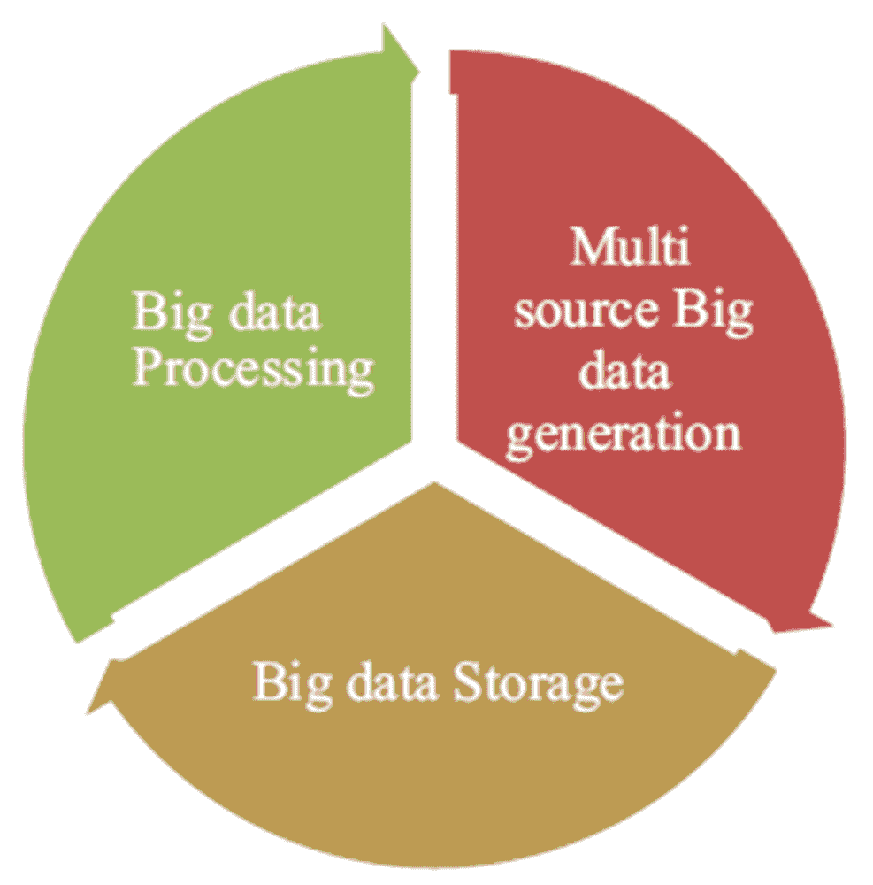

*来源：CISCO CYBERSECURITY SERIES 2020 - Consumer Privacy Survey*

我们整理了 2020 年的数据隐私和数据安全统计数据，包括统计数据、消费者研究、ROI、数据泄露统计等，以提供更清晰的图景。

然而，这些数字揭示了年轻一代隐私意识的趋势和积极变化（**61% 的积极关注隐私的个体年龄在 45 岁以下**）。

最重大的发展之一将是隐私意识的提升，这将迫使政府出台数据保护法规，规范企业如何管理个人数据以及必须包含哪些价值观以在市场中竞争。

另一方面，参与隐私计划的公司似乎正在获得运营效率和敏捷性等收益。**40% 的受访者获得的收益至少是其隐私投资价值的两倍**。**84% 的受访者表示关注隐私、自己的数据、社会中他人的数据，并希望对其数据的使用方式拥有更多控制权**。该群体中 **80% 还表示愿意采取行动保护数据**。由于数据规则或数据共享做法，**48% 的注重隐私的受访者表示已更换公司或供应商**。**79% 的受访者表示非常或比较担心企业如何使用其收集的信息，而 64% 担心政府数据收集**。**81% 的受访者认为他们对收集的信息几乎没有或完全没有控制权**。**46% 的客户认为他们已失去对自己数据的控制**（来源：Cisco Consumer Privacy Survey 2020）。

### 图 2.

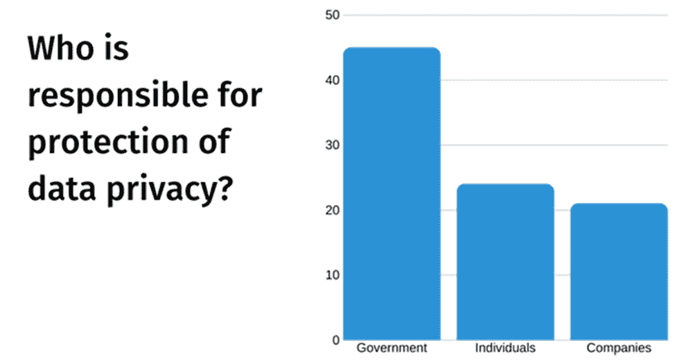

**45% 的受访者认为联邦政府对数据隐私保护负责**（Cisco Consumer Privacy Survey 2020）。**24% 的受访者认为个人用户对数据隐私负责**（Cisco Consumer Privacy Survey 2020）。**21% 的受访者认为公司应对保护数据隐私负责**（Cisco Consumer Privacy Survey 2020）。目前，**43% 的所有受访者表示无法妥善保护其个人数据**（Cisco Consumer Privacy Survey 2020)。

## 发现

大数据时代的到来不仅带来了社会进步的重大前景，也带来了大量新的信息安全威胁，使个人数据隐私保护成为一大关注点。不仅需要许多专业的私人信息安全技术来确保大数据信息的安全和隐私，还需要提高我国公民的隐私保护意识，以便落实隐私信息安全。

## 结论

考虑潜在法律挑战的最佳切入点是审视隐私和身份管理领域的现状。人们经常发现现有监管形式存在缺陷，这引发了一个问题：是否应采取全新的策略以确保对实践产生有效影响，还是仅评估现有法律框架就足够了。本报告探讨了这两种方法。本研究系统筛选了通用数据保护指令的核心概念。我们认为，关键的法律问题是需要开发各种监管工具和流程的适当组合以保护隐私。规则的制定和应用是本分析的两个最重要方面。

立法与技术进步之间的关系是潜在法律行动的第二大主要领域。隐私技术领域的以往研讨会反复得出结论：技术和监管对彼此的发展几乎没有影响，应设法弥合技术与监管之间的差距。因此，未来的一个关键研究挑战是增加多学科参与，以避免在缺乏适当监管的情况下技术事实上主导隐私问题，或反之亦然。我们认为，任何未来的法律行动都应与技术密不可分。

此外，为促进透明度和法律安全，需要为隐私技术的“自由”使用开发适当的法律支持。目前这似乎尚缺乏，这可能解释了增加某些技术需求时面临的明显挑战。最后，促进在线身份使用的技术进步尚未找到充分的法律回应，特别是在在线身份基本概念、在线匿名性、多重身份使用、身份管理器监管以及身份持有者控制工具等方面。

总之，拟议的法律问题必须公开且适应性强，以便能直接关联并定期根据不断变化的社会经济和技术进步进行审查。

## 未来建议

我们涉及了数据隐私的许多跨学科组成部分所带来的障碍，这些组成部分必须被考虑以提出可行的解决方案：它们包括相关的社会、经济和法律问题。由于关于数据隐私和安全的现有文献庞大、数据隐私问题的多面性，以及至关重要的无处不在的应用世界正处于演变早期阶段，我们的工作必然存在不完美之处。

## 参考文献

Bettini, C., & Riboni, D. (2015). Privacy protection in pervasive systems: State of the art and technical challenges. *Pervasive and Mobile Computing*, 17, 159–174. doi:10.1016/j.pmcj.2014.09.010

Boerman, S. C., Kruikemeier, S., & Zuiderveen Borgesius, F. J. (2021). Exploring motivations for online privacy protection behavior: Insights from panel data. *Communication Research*, 48(7), 953–977. doi:10.1177/0093650218800915

Chen, D., & Zhao, H. (2012, March). Data security and privacy protection issues in cloud computing. In *2012 International Conference on Computer Science and Electronics Engineering* (Vol. 1, pp. 647-651). IEEE. doi:10.1109/ICCSEE.2012.193

Dumortier, J., & Goemans, C. (2004). Legal challenges for privacy protection and identity management. *Nato Science Series Sub Series III Computer And Systems Sciences*, 193, 191–212.

Edwards, L. (2004). Reconstructing consumer privacy protection on‐line: A modest proposal. *International Review of Law Computers & Technology*, 18(3), 313–344. doi:10.1080/1360086042000276762

Feng, D., Min, Z., & Yu, L. (2014). Big Data Security and Privacy Protection. *Chinese Journal of Computers*, 37(1), 246–258.

Huo, H. (2016). Exploration of Security and Privacy Protection Technology in the Big Data Era. *Cyber Security Technology and Applications*, 11(5), 79–88.

Jain, P., Gyanchandani, M., & Khare, N. (2016). Big data privacy: A technological perspective and review. *Journal of Big Data*, 3(1), 25. Advance online publication. doi:10.1186/s40537-016-0059-y

Lee, W. W., Zankl, W., & Chang, H. (2016). An ethical approach to data privacy protection. *Isaca Journal*.


## 参考文献

Oomen, I., & Leenes, R. (2008). Privacy risk perceptions and privacy protection strategies. In *Policies and research in identity management* (pp. 121–138). Springer. doi:10.1007/978-0-387-77996-6_10

Peng, L., & Fang, W. (2015). Heterogeneity of inferring reputation of cooperative behaviors for the prisoners’ dilemma game. *Physica A*, 433, 367–378. doi:10.1016/j.physa.2015.03.053

Romanosky, S., & Acquisti, A. (2009). Privacy costs and personal data protection: Economic and legal perspectives. *Berkeley Technology Law Journal*, 24, 1061.

Schilit, B., Hong, J., & Gruteser, M. (2003). Wireless location privacy protection. *Computer*, 36(12), 135–137. doi:10.1109/MC.2003.1250896

Shin, S. Y. (2021). Privacy protection and data utilization. *Healthcare Informatics Research*, 27(1), 1–2. doi:10.4258/hir.2021.27.1.1

Singh, N., & Singh, A. K. (2018). Data privacy protection mechanisms in cloud. *Data Science and Engineering*, 3(1), 24–39. doi:10.1007/s41019-017-0046-0

Wei, K., Jian, W., & Kui, R. (2016). A survey of big data security protection technology. *Journal of Network and Information Security*, 2(4).

Yan, F. (2016). Big data security and privacy protection. *Electronic Technology and Software Engineering*, (1), 227.

Yang, P., Xiong, N., & Ren, J. (2020). Data security and privacy protection for cloud storage: A survey. *IEEE Access: Practical Innovations, Open Solutions*, 8, 131723–131740. doi:10.1109/ACCESS.2020.3009876

Ying, L. (2016). Research on big data security and privacy protection. *Information Communication*, (1), 162–163.

Zhang, D. (2018, October). Big data security and privacy protection. In *8th International Conference on Management and Computer Science (ICMCS 2018)* (Vol. 77, pp. 275–278). Atlantis Press.

# 第 7 章：技术与网络安全挑战

## 作者

*   **Navita Mahajan**  
      
    阿米蒂大学，印度

*   **Seema Garg**  
    阿米蒂大学，印度

*   **Shreyas Pandita**  
    阿米蒂大学，印度

*   **Geetansh Sehgal**  
    阿米蒂大学，印度

## 摘要

本研究聚焦于当前盛行的技术网络安全挑战。内容涵盖医疗保健领域使用的技术，以及数字化如何开启了一个新时代。研究探讨了将影响数字化医疗保健的网络安全挑战，因为网络威胁和安全漏洞可能危及患者受保护的健康信息，并干扰医疗专业人员的工作。最后，研究涵盖了解决技术和网络相关问题的方案，这些方案可被视为可能的解决路径。

## 引言

在保持实际成本低廉的前提下，提升医疗服务质量并改善健康记录的获取便利性，是全球医疗企业面临的挑战。全球人口的快速增长，特别是老年人（65 岁及以上）的增长率，进一步加剧了这一问题。根据世界卫生组织（WHO，2018）的数据，到 2050 年，老年人口将增加至约 15 亿。人口老龄化意味着慢性疾病的增加，这需要频繁就医，且住院需求升高。需要持续护理的患者数量激增，大幅增加了医疗费用。

过去几十年来，信息与通信技术（ICT）已在医疗环境中得到广泛采用，旨在使医疗获取和服务交付更加便捷、高效。在考量技术在数字医疗未来中的角色时，必须权衡改善患者预后的收益，与因实施不善和复杂性增加导致医生职业倦怠风险加剧的弊端（Agrawal and Prabakaran, 2020）。ICT 的应用促成了电子健康记录（EHR）系统的发展。EHR 包含完整的患者健康史（当前用药、免疫接种、实验室结果、现代诊断等），并可在多个提供者间轻松共享。它们已被证明能增强医患互动。医疗部门采用 ICT 通常被称为数字医疗。部分临床医生、患者和医疗服务提供者对技术的突然涌入持谨慎态度，而缺乏可靠的管控机制使这一担忧更加复杂（Duggal and Bagenal, 2018）。

多年来，数字医疗已从主要保存数字患者记录和提供患者网络门户，扩展为在医疗管理中提供更大的灵活性和便利性，通常称为连接健康。健康食品消费和体态管理正快速增长（Shen, Y. 2019）。连接健康利用智能手机和移动应用程序，结合无线技术（如蓝牙、Wi-Fi 和长期演进技术），使患者无需频繁就诊即可轻松与提供者联系。例如，一名标准高血压患者通常每六个月看一次医生汇报每日血压读数。借助监测应用，患者可传输每日或每周血压读数，从而让医生及早发现问题并干预。连接健康已演变为智慧健康，即将传统移动设备（如智能手机）与可穿戴医疗设备（如血压计、血糖仪、智能手表、智能隐形眼镜等）及物联网设备（如可植入或可吞服传感器）结合使用，实现患者即使在家也能持续监测和治疗。智慧健康有望降低住院成本，并通过在健康监测设备上部署物联网传感器，为多种疾病提供及时治疗。这些微芯片积累的数据可发送至任何远程终端。例如，可穿戴传感器（如温度传感器和心跳传感器）可作为数据采集单元，收集患者的生理信号。收集的数据通过 Wi-Fi 网络转发至本地网关服务器，使终端系统（如医生的笔记本电脑）能从网关服务器检索累积数据。定期的服务器更新让医生能访问患者的实时数据。这些设备协同工作，创建可由多个提供者访问的统一医疗记录。这些数据不仅对患者有益，还可汇总用于研究和预测跨文化、跨国家的医疗趋势。尽管近期的封锁和企业关闭加剧了对数字化健康资源的需求，但残障人士始终需要可从家中轻松访问的安全数字化健康资源，且在 COVID-19 爆发前很久，他们就本应从更广泛、更便捷的锻炼资源获取中受益（Stratton et al., 2020）。

### 物联网在医疗健康领域的应用：大数据、人工智能与智慧医疗架构

将智能健身设备与物联网传感器相结合产生的信息量巨大。此类数据通常被称为“大数据”。将精细的分析技术应用于大数据，可为医疗从业者提供重要信息，帮助他们做出更及时、更明智的决策，并采取主动措施以实现更好的健康管理。医疗服务提供者必须配备完善的基础设施，以系统地创建和分析大数据，从而为改善公共卫生提供相关解决方案。有效的大数据管理、分析和解读能够改变游戏规则，让现代医疗探索新的可能性（Senthilkumar 等，2018）。

#### 人工智能与网络安全

人工智能（AI）在医疗领域的应用及网络安全威胁目前备受关注。网络攻击利用 AI 变得更加复杂，以突破网络防御。AI 也被用于持续管理并严密保护不断增长的医疗物联网（IoT）传感器节点和网络物理系统（CPS）设备，当它们连接或断开医院网络时。CPS 是一种由网络和物理元素组成的智能设备，由 AI 算法管理和监控。随着智能多传感系统、感官媒体、智能物品和云技术的发展，“智慧医疗”受到了学术界、政府、工业界、护理人员和医疗社区的极大关注。在 COVID-19 期间，国际和国家监管机构强调了医疗服务提供者和大学保护自己免受网络攻击的迫切必要性，因为越来越多的网络犯罪分子正试图利用医疗行业的弱点（Muthuppalaniappan，2021）。

#### 智慧医疗与 5G 网络

随着世界人口的不断增长，传统的医患预约模式已失去其有效性。因此，智慧医疗变得至关重要。智慧医疗可应用于所有层面，从幼儿体温监测到老年人基本生命体征监测。实施的复杂性和成本因所需设备精度、功能性及所用软件的复杂程度而异。5G 网络的构想与建设旨在满足物联网医疗应用的不同通信需求。使用 5G 的智慧医疗网络由需要更高网络速度和蜂窝覆盖的物联网设备组成。当前的物联网连接解决方案面临诸多困难，如支持大量设备、标准化、能源效率、设备密度和安全性（Ahad 等，2016）。

#### 物联网在医疗健康领域的应用

随着“物联网”的引入，在物理传感器系统之后，可以区分医生在分析和诊断中的“健康数据”。“物联网在医疗中的应用”最大的优势是减轻维护负担，其次是增加医疗风险（注：原文此处“increase in the danger”疑为笔误，通常语境应为“减少风险”或“增加保障”，译文忠实原文）。许多基于物联网的智慧医疗设备和系统已可供购买。这些设备在患者监测、保持与医生联系、提高康复表现等任务中做出了重大贡献（Yuehong，2020）。个人和在线医疗社区的增加曾是极好的学习体验，并预期移动数据和通用技术终结应用将推动云健康服务的发展。物联网已作为神经认知监测的主要平台提供。由于缺乏有效的监测设备，可能面临更多风险。物联网等技术在此发挥作用。患者的最佳利益在于这种预警。使用多个传感器分析患者详情。护理人员可提供充分的医疗指导。需要对常用于残障患者的物联网设备加强监测。在传感器协助下，监测策略被汇总以保持患者持续的物理活动，供护理人员参考。这反过来又提高了护理质量。最终，这将降低护理成本。

#### 物联网在医疗健康领域的架构

物联网是一个由物理对象连接的设备网络，允许远程设备进行感知、分析和监控。将计算机硬件连接以允许传感器与智能缝纫设备（注：原文“smart sewing equipment”疑为“smart sensing equipment”之误）通信的计算机制。物联网在物联网数据处理中的实现很大程度上依赖于中间件层。

##### 1. 感知层

感知层识别感官和物理设备。感知层传感器设备指向并检测对象，收集对象信息。根据传感器类型，可收集温度、移动性、位置、湿度、振动、距离、速度、化学变化等信息。数据随后传递给下一处理层。

##### 2. 网络层

“网络层”通常如此命名，其关键目的是连接各种服务器、智能对象和网络设备。经过网络层封装后，来自核心层的数据被移至中间件层，后者将数据从核心层传输至应用层（原文“working layer”意指应用/工作层）前端。

##### 3. 中间件层

中间件层是处理来自网络层海量数据的大规模处理层，负责存储数据。数据库通信和资源管理是其职责，因其位于中心层，向下层提供服务层。

##### 4. 应用层

该层的一个基本要素是为最终用户提供面向应用的服务。因为该层通过拥有应用层（原文重复表述）与最终用户显式交互。当在女性戒指（原文“jewelry of a lady”结合语境推测指智能首饰/可穿戴设备）上获取数据时，告知您发烧了，您可以通过应用程序表单联系相关女性。这是一个通过发送关于流感的智能手机消息与用户通信的层。

##### 5. 业务层

业务层控制物联网的整个生态业务模型。它帮助最终用户更高效地做出决策。

#### 物联网在医疗健康领域的应用场景

医疗应用使患者和老年人能够独立生活。在此期间，物联网传感器用于诊断和复查他们的健康状况，并在异常情况下发送警报。可持续发展、能源效率和公共卫生是相互关联的特征，能够为造福人类和世界而改变系统或生态系统。应集成传感器和智能设备，以提高能源效率并确保达到可持续发展目标（Ahmadi 等，2019）。

##### 血糖敏感性监测

糖尿病是一种代谢状况，指长期血糖水平高于平均值。血糖控制系统生成某种血糖数据，有助于开具健康饮食、适当检查和药物。目前提出了一种不基于葡萄糖（原文“not approved primarily based on glucose”语义模糊，译文忠实原文）的 m-IoT 配置程序。

为此，通过正确的 IPv6 连接供应，将特殊传感器连接在患者体内。在运行系统中，它创建一个基于物联网的通信单元，将收集的数据传输至血糖水平。该套件包含葡萄糖收集器、计算机或智能手机和处理器。一种典型的基于物联网的葡萄糖水平检测器也被提出。

### 物联网医疗应用

#### 血压监测系统

高血压意味着心脏有力地将血液泵送至全身。物联网技术促进了包括血压（BP）、血红蛋白（HB）、血糖水平和异常细胞生长在内的健康问题的诊断和治疗。一种用于血压、糖尿病和肥胖症治疗的物联网设备。

#### 体温监测

体温控制和监测是健康应用中不可或缺的组成部分。稳态的变化取决于体温，基于 m-IoT 原理。Telos Bmote 软件体传感器具有清晰高效的内部性能。在物联网单元之上，体温控制系统建立在主端口上。它支持红外测温和 RFID 模块的控制与计算。

#### 血氧饱和度监测系统

脉搏血氧仪用于连续测量血液中的氧含量。将物联网与脉搏血氧测定法结合使用有利于技术应用。基于物联网的脉搏血氧测定法的优势通过基于 CoAP 的医疗保健系统研究得以解决。

#### 心电图（ECG）监测系统

心电图监测单元具有显示用户/患者心电图波形的选项。通过收集心电信号并将数据上传至云网络，发布患者的病历。根据收集的信息提供用户输入。

#### 轮椅管理系统

专家建议使用舒适的轮椅以维持老年人和残疾人士的生活质量。物联网在加速该领域这一进程方面发挥着重要作用。智能轮椅配备了各种传感器，以追踪座椅运动并显示患者/用户的状态。

#### 康复系统

借助物联网，可以延缓人口增长问题和生活技能丧失的进程。肢体残疾人士的能力可以得到增强。为了强化康复机制，引入了体域传感器网络。

#### 基于智能手机的医疗解决方案

带有传感器的数字设备控制系统迄今已在智能手机上出现。医疗领域提供特定的移动应用程序，以帮助患者、提供医疗指导和初步培训。各种将智能手机描绘为医疗保健有用工具的软硬件产品正在开发中。另一项促进物联网在医疗保健领域未来发展的技术是 5G 网络的引入，其连接速度比普通 4G 网络快一百倍。尽管 5G 具有满足未来物联网需求的特性，但也带来了一系列新的研究挑战，例如 5G-IoT 架构、设备间可信通信、安全问题等（Li 等人，2018）。

物联网设备依赖连接性在患者和护理提供者之间通信和传输数据。更快的移动数据传输使物联网在可交换的数据量和更快的速率方面具有了灵活性。随着这些改进，新的医疗物联网用例包括：帮助患者在家坚持服药的设备；可追踪高危患者心率、氧气水平和活动的睡眠监测设备；远程温度监测工具；以及连接移动设备并提醒患者和临床医生血糖水平变化的连续血糖监测传感器。

### 智慧医疗的关键应用科学

智慧医疗包含多个参与主体，如医生和患者、医院及科研机构。它是一个有机整体，涉及疾病预防与监测、诊断与治疗、医院管理、健康决策和临床研究等多个维度。物联网、移动互联网、云计算、大数据、5G、微电子和人工智能等信息技术，连同前沿生物技术，共同构成了智慧医疗的基石。这些技术广泛应用于智慧医疗的各个环节。从患者角度来看，他们可以使用可穿戴设备随时监测健康，通过虚拟助手寻求医疗援助，并利用远程住宅实现远程服务；从医生角度来看，各种智能临床决策支持系统被用于辅助和改进诊断。医生可以通过集成信息平台管理医疗数据，该平台包含实验室信息管理系统、影像归档与通信系统（PACS）、电子病历等。借助手术机器人和混合现实技术，可实施更精准的手术。从医院角度来看，射频识别（RFID）技术可用于管理人员物资和供应链，利用集成管理平台采集数据并辅助决策。移动医疗平台的使用可改善患者体验；从科研机构角度来看，可以利用机器学习等方法替代人工药物筛选，并利用大数据寻找合适的受试者。通过使用这些技术，智慧医疗能有效降低医疗程序的成本和风险，提高医疗资源利用效率，促进不同地区的交流与合作，推动远程医疗和自助医疗服务的发展，最终使个性化医疗服务无处不在。

### 数字医疗采用面临的挑战

利用电子健康记录（EHR）并采用物联网和大数据等技术的数字医疗系统，预计将在不同医疗系统间无缝连接患者和提供者。这些系统也正日益通过互联网与各类医疗可穿戴技术相连，用于实时健康监测。

然而，在数字医疗能够构建稳定、灵活且互操作的系统之前，仍需解决若干挑战。

#### 安全与隐私

物联网设备可能对用户的安全和隐私构成威胁。对物联网设备的未授权访问可能对患者健康及其个人信息造成严重威胁。拒绝服务（DoS）攻击可能影响医疗系统并危及患者安全。虽然针对 DoS 的常见防御是冗余（在网络上使用多个设备），但在医疗环境中，资源复制并不总是可行，因为某些设备是植入式的生命关键系统。由于新兴软硬件漏洞的数量和复杂性，快速检测潜在安全威胁仍是一项挑战。随着越来越多设备连接互联网，这一问题日益严重。如今，默认认证依然普遍存在，不安全的基于 Web 的接口访问进一步扩大了攻击面。医疗专业人员有多种理由不信任云，包括无法放弃对医疗记录的控制权。云的使用伴随许多安全漏洞，包括虚拟用户隔离失败、身份盗窃、权限滥用和加密不足（Al-Issa 等人，2018）。


#### 医疗保健中的无线网络技术

最近，许多无线网络技术也已部署在医疗保健环境中。这些技术包括 `Wi-Fi`、`BLE` 和 `ZigBee`，它们被用于为各类临床设备和传感器提供连接。必须对这些无线和传感器技术实施安全防护，以抵御窃听、女巫攻击、黑洞攻击和睡眠剥夺攻击。个人信息、家庭病史、电子病历和基因组数据的集中式数据集也必须免受黑客和恶意软件的侵害，以确保安全和隐私。

保密性和隐私也是医生的基本关切。由于健康数据的敏感性（例如癌症或艾滋病毒检测结果），患者可能也不愿共享其临床档案。人们担心将联网技术集成到尖端临床统计系统中，可能会损害健康数据的机密性。这些隐私担忧源于这样的担心：数字化和联网技术可能会吸引黑客。此外，研究人员有时认为，联网健康技术的实施将是不完美的，从而允许安全漏洞被利用。

#### 健康统计数据交换障碍

健康信息交换（HIE）通过提供在不同医疗保健组织之间以可靠且安全的方式电子共享医疗保健数据的能力，增强了医疗保健服务的提供。目前，HIE 是通过以下方法之一实施的：消费者中介交换、定向交换和基于查询的交换。

- **消费者中介交换** 让患者能够访问自己的数字记录，从而允许他们追踪健康状况、确定是否存在错误的账单或临床数据，并更新其自我报告。

- **定向交换** 发生在医疗保健组织将实验室检测结果和药物剂量等关键信息传输给参与同一患者护理的其他专家时。

- **基于查询的交换** 通常发生在非计划医疗护理中，当医疗保健机构需要新患者的既往健康数据时。这是通过 HIE 系统请求访问这些文档来完成的。

来自医疗保健合作伙伴的数据对公共卫生至关重要，信息技术使这比以往任何时候都更容易。然而，数据通常使用多种术语和格式进行构建，使得数据接口复杂且成本高昂（Shapiro 等，2011）。

##### HIE 系统部署中的障碍

HIE 系统部署中的障碍通常归因于安全和隐私担忧。当前 HIE 系统相关的一些问题如下：

1.  **获批内部人员滥用访问权限。** 这通常发生在医疗保健机构出于不负责任、个人原因或为了某种利益，与未经授权的个人共享患者医疗文档时。例如，名人和政客的临床信息经常从医疗信息管理系统（HIMS）泄露到媒体上。

2.  **未经授权的内部人员违规**，他们可能有权访问系统本身，但无权访问记录。例如，不提供直接患者护理的医院人员，或尚未被电子方式限制数据检索的前员工。前一组人员可以利用现有访问权限入侵个人信息数据库，而后一组人员可能决定通过破坏 HIMS 的安全性来报复前雇主。

3.  **未经授权的入侵者尝试** 通过直接攻击系统或冒充医疗团队成员来进入设备。

尽管互联网上有大量健康相关资料，但关于其可访问性、质量或阅读水平却知之甚少（Cline 和 Haynes，2001）。

#### 设备通信

实施智能或联网健康面临的重要挑战之一是通信。许多设备现在都有传感器来收集数据，它们经常用自己的语言与服务器通信。每个制造商都有其自己的专有协议，这意味着不同制造商制造的传感器并不总能相互通信。这种碎片化的软件环境，加上隐私担忧，经常将宝贵的数据孤立在信息孤岛上，破坏了物联网背后的核心理念。

多种设备的存在也引发了使用无线网络技术连接医疗设备的相关问题。例如，使用无线个人区域网（WPAN）设备的人员预期可以自由移动，但当在相似频道上运行的 WPAN 处于近距离范围内时，移动性可能导致碰撞。WPAN 中的碰撞会产生多种破坏性后果，因为它会降低性能，并可能导致灾难性后果，特别是在涉及医疗保健服务时。因此，必须确保医疗设备在使用各种无线通信技术连接时能精确运行。

智能健康系统并不总是便于医生使用。大量功能的存在有时会使设备变得复杂，进而打击医护人员学习如何使用它的积极性。用户和服务提供商都需要在各个物联网领域内部以及相互之间实现互操作性。这造成了复杂的挑战，因为物联网涵盖的各个学科受到一群不同的监管机构的监管。在联网健康场景中，由于临床要求需要特别严格的法规，这种复杂性进一步加剧。希望在临床领域构建智能健康应用的公司必须考虑食品药品监督管理局、医疗保险和医疗补助服务中心以及联邦通信委员会施加的政策。

一个真正可互操作的联网健康系统是指信息在一对一和一对多连接中流动，从而在需要系统相互协作的多个接口之间实现数据交换。在医疗保健环境中，设备与多种传输格式以及用于认证和加密的协议兼容非常重要。设备管理将需要设备功能、协议、术语和标准合规性的目录。非医疗领域常见的“即插即用”级别的互操作性，对于医疗设备而言仍是一项挑战。

#### 数据的收集与管理

利用物联网传感器设备的数字医疗保健面临各种数据管理挑战。数据源自临床传感器，这些传感器佩戴在人体上或植入人体内。由于人体状态持续变化，会源源不断地产生数据流入。此外，采集到的数据是异构的。

#### 数字健康系统中的数据驱动学习策略

数字健康系统希望采用适当的数据驱动学习策略进行设计，以处理其不断变化的网络物理组件。对信息的适当分析可以提供关于患者健康状况的宝贵记录。当大量患者事实未被分析且未从中提取理解时，我们无法获得该数据的最大效用，且其收集也会浪费计算资源。由于缺乏标准化的信息收集格式以及医疗环境中生成数据的规模和速度，存在若干挑战。完整性对于大数据同样至关重要。不准确的统计数据可能导致不合适的决策和长期战略规划失误。由于医疗信息经常来自多个来源，因此需要强大的认证系统，以确保医疗数据由真实注册的诊所、医院和科研机构提交。

收集整洁、格式化、详尽且具体的医疗系统统计数据具有挑战性。此外，医疗定义复杂，且医疗行业的指标在持续变化。医疗行业数据的复杂性使得大数据集成充满挑战。虽然某些信息（如健康变量）必须频繁更新，但地理位置和联系信息等较为被动的数据则无需如此频繁地更新。更新信息时必须维护数据完整性。不当的报告控制可能对数据完整性构成威胁。由于维护成本高昂，维护这些数据库颇具挑战。

#### 基于多学科知识的设计与实施

数字健康（包括相关健康和智慧健康）利用嵌入式系统、网络设计、数据分析和生物工程等众多领域的知识进行开发。此类异构系统的设计与实施需要在多学科领域具备深厚的专业知识。系统还需要持续演进，以应对不断变化的需求。例如，目前智慧健康系统与某些医疗系统（如超声和 CAT 扫描成像）的集成仍然有限。

#### 技术时代的医疗网络安全

医疗行业是网络安全方面最脆弱的行业之一。全球医疗体系在技术时代变得更容易遭受网络攻击。许多网络安全公司报告称，自 COVID-19 大流行开始以来，网络攻击急剧增加。包括养老院在内的医疗体系始终是网络攻击的主要目标。近期多家大型医院和医疗系统接连遭受攻击，暴露了最受信任的医疗机构存在的安全漏洞。技术的特点是网络攻击陡然上升，攻击者多样，动机各异，医疗领域也未能幸免。由于技术在医疗系统中的广泛集成，网络安全事件已成为医疗行业日益严重的问题（Tully, 2020）。

安全和隐私在医疗行业至关重要，因为它们涉及患者/用户的个人记录和私人临床记录。在过去几十年里，医疗服务提供者扩大了先进技术的使用，如人工智能（AI）、机器学习方法以保护患者健康档案、云端数据存储、先进医疗设备等。这些技术进步减轻了医疗服务提供者的工作量，并实现了无纸化环境。但随之而来的是网络攻击风险的增加。在大多数情况下，缺乏合适的安全架构来保护诊所数据库，且医疗服务提供者往往未察觉潜伏的网络安全威胁。医疗系统中的信息技术（IT）脆弱到甚至可能需要数周才能发现网络攻击。工业 4.0 是因快速技术进步而在当代演变出的新现象。信息技术与运营技术的融合带来了新问题，特别是在网络安全领域（Ervural and Ervural, 2018）。医疗机构在不知情的情况下继续运行被黑客入侵的系统。这可能导致每年花费数十亿美元并影响数百万患者。突如其来的 COVID-19 灾难对医学教育和患者护理造成了严重破坏。尽管困难重重，医疗体系和患者在设计可靠的“临时”补救措施方面表现出了机智和韧性。目前尚不清楚部分 COVID 时代的过渡性流程未来是否会保留在医学教育和远程医疗中（Shah et al., 2020）。

##### 内部威胁

除了外部网络安全威胁，医疗机构有时还面临内部威胁。这些内部威胁源于人为错误或违反雇佣合同。根据各类案例研究，内部攻击主要分为三类：员工或承包商的疏忽/过失、恶意内部人员、以及凭证窃贼（冒充风险）。

##### 医疗设备劫持

医疗设备劫持是指以伤害患者为目的，攻击和操纵医疗设备和仪器的行为。医院和/或诊所的任何医疗设备故障都令人极度痛苦，并可能导致严重的致命后果。任何医疗仪器的错误诊断结果可能导致错误处方。如果任何医疗设备运行不正常，可能会伤害患者致死，而非提供帮助。

##### 人工智能

人工智能（AI）让计算机执行通常被认为需要人类智能的任务，目前几乎在科学和工程的每个领域都被讨论。ImageNet 大规模视觉识别挑战等重大科学竞赛证明，计算机可在图像识别方面达到人类水平的能力。AI 还推动了语音识别和自然语言处理的巨大增长。所有这些进步都引发了一个问题：此类能力如何支持甚至增强人类在健康和医疗护理中的决策。大多数领域的利益相关者抗拒颠覆，因为他们偏好现状。然而，医疗行业目前急需颠覆。随着生态系统各环节成本飙升和时间浪费，医疗领域必须演进以提供优质、持续的护理和价值。因此，涌现出多种 AI 应用，包括药物发现、寻找临床试验患者、为电子健康记录（EHR）转录笔记、向患者提供初级护理前信息、预测心脏病恶化、呼吸暂停或过敏，并在“代码蓝”紧急情况发生前数小时提醒临床医生。

人工智能（AI）可赋予设备或软件解读复杂数据（包括图像、视频文本、语音或其他声音）并基于该解读实现目标的能力。由于 AI 驱动的计算机被编程为在极少人工干预下做出决策，有人担忧机器是否将很快做出我们目前委托给医生的那些艰难决策。

#### 医疗保健领域的 AI：应用、网络安全挑战与物联网集成

##### 医疗保健领域的 AI 应用

AI 已被应用于癌症研究、心脏病学、糖尿病、心理健康、阿尔茨海默病识别、卒中相关研究以及心血管疾病识别等多个医疗保健领域的应用中。与机器人技术不同，医疗保健领域的 AI 通常指医生和医院能够访问包含潜在救命信息的海量数据集。医疗保健行业必须保护患者的个人信息，因为黑客可能访问并利用这些信息实施临床欺诈和其他牟取暴利的犯罪。网络安全有助于保障数据安全，并为防范犯罪目的而保护受影响人员的信息隐私。此外，预防网络犯罪是当务之急（Thyagarajan, 2017）。

计算能力的最新进展能够从多感官信息中分析不同要素，用于预测分析，通过机器学习技术发现可预见的健康后果。人工智能和机器学习方法利用统计方法分析传入的感官和网络统计数据，以识别模式和安全隐患，并在极少人工干预的情况下做出决策。

##### AI 时代的物联网 (IoT) 与网络物理系统 (CPS)

医院/诊所的医疗保健系统是攻击者实施针对物联网 (IoT) 和网络物理系统 (CPS) 的网络攻击的主要目标之一。从医疗机构安全的角度来看，最关键的终端设备包括患者健康监测、通气、麻醉和输液泵。

网络物理系统 (CPS) 是一组相互交互、通信以执行其功能的物理世界系统或设备。对于操作和控制，CPS 融合了计算、通信和控制的原理。物理系统受到监控，网络物理系统可能是动态且交互式的，由分散的子系统组成，具备自动连接和自主运行的能力（TR, R., 2021）。

医疗保健环境中物联网的使用日益增长，包括移动设备、可穿戴设备、机器人、无人机和非接触式设备。物联网正在助力新冠病毒的管控。新冠肺炎的早期检测、感染者隔离以及潜在接触者追踪对于阻止病毒传播至关重要。物联网和 CPS 协议、GPS 及 Wi-Fi 为距离和可及性带来的挑战提供了解决方案。

利用物联网应对病毒爆发在新冠疫情期间显示出优势。互联技术设备（如用于检查患者体温的智能体温计）被用于构建独特数据集，以实现更准确的分析和诊断。隔离合规性也通过物联网的使用得到了实质性辅助。通过使用患者现有的智能手机或可穿戴设备，更容易确保遵守隔离政策，并通过追踪溯源方法建立模式。

##### 明智网络安全面临的挑战

网络安全是国家标准网络物理保护和经济利益的首要问题。各组织的安全分析师面临着与网络安全相关的诸多挑战，包括保护联邦和州的专有数据。在制定 AI 在网络安全领域的长期分析、开发和应用时，必须区分近期目标和长远愿望。

AI 可以直接应用于网络安全的方法多种多样。目前，存在需要智能解决方案的紧迫网络安全问题。未来，用户将看到全新信息处理概念应用的广阔前景。AI 的一个关键应用领域是网络威胁的信息管理。基于 AI 的系统已用于多个应用，如隐藏在软件内部的防护措施。然而，随着医疗保健系统海量数据库的建立，AI 将获得更广泛的应用。许多技术通常被称为……因为大多数医疗保健数据库都在为网络安全引入 AI。然而，存在许多不同的技术，如果它们达到高度复杂，将带来比人类更聪明的智能的诞生。

##### 如何增强 AI 的网络安全

AI 和机器学习技术的改进将以多种方式影响网络安全。安全行业已成功采用了一些基于 AI 的技术（Bertino et al., 2021）。网络攻击者可随时随地攻击网络系统。观察到网络安全应用在过去几年获得了巨大的技术发展。

增强 AI 网络安全有许多方法：

- 利用机器学习改进网络威胁检测

- AI 和机器学习在缓解网络钓鱼攻击中发挥必要作用

- 自动化网络安全

- 强行为分析

AI 和机器学习使更智能的网络安全成为可能，这些新兴技术在医疗保健、金融、零售等领域具有巨大的潜在应用。关于 AI 系统在用于增强累积医疗数据和计算机网络安全性时如何保持无懈可击，存在若干可比较的问题。将 AI 安全解决方案应用于应对快速演变的威胁，使得保护 AI 本身的需求更加迫切。如果我们依赖机器学习算法来检测和防御网络攻击，那么保护这些算法免受干扰、妥协或滥用就显得更加必要。对关键功能和服务日益增长的 AI 依赖，不仅会为攻击者以这些算法为目标创造更大的动机，还会增加每次成功攻击造成更严重后果的可能性。

增强网络安全和 AI 安全是关键挑战之一。AI 已成为包括医疗保健行业在内的许多不同领域中更流行、应用更广泛的技术。政策制定者发现越来越有必要考虑网络安全与 AI 的交叉领域。最近，多位研究人员致力于降低对手在新冠疫情期间访问医疗保健系统中私有 AI 训练数据或模型的机会。如上所述，AI 系统面临的关键安全威胁之一是对手破坏其决策过程完整性的机会。当对手直接控制 AI 设备以决定系统生成的输出和做出的决策时，就会发生这种情况。攻击者可能试图通过向 AI 模型提供恶意输入或训练数据来直接影响这些选择。

##### 利用物联网和大数据技术提升数字医疗保健的采纳

###### 循证护理

物联网设备产生的医疗数据量呈指数级增长，使得信息处理极具挑战性。大数据可通过聚合来自不同来源的数据集提供循证护理。数据分析可授予检测异常和为患者提供适当补救措施的有用见解。利用新策略进行智能分析可提供数百亿美元量级的显著财务节约，约占国家医疗开支的 8%。

###### 利用高效策略研究健康相关数据可促进疾病模式的早期识别，从而扩大公共卫生监测范围

这确保了能对特定疾病的治疗做出恰当且及时的决策，从而降低患者死亡率。大数据提升了患者获得的护理质量，因为治疗方案是基于对海量数据集的分析而制定的。计算机科学与电子学领域已融合，催生了最重大的技术突破之一——物联网（IoT）的现实应用。（Yeole, A. S 等，2016）尽管仍处于早期阶段，物联网已对医疗保健产生了重大影响。

###### 早期发展阶段已被证明至关重要

####### 自学习与自我改进

物联网传感器实现了数据收集，但物联网本身无法提供康复治疗。基于快速的患者评估，以及与临床调查相对应的康复流程改进，可以做出准确及时的治疗决策。提供特定治疗需要考虑许多因素。计算机设备纯粹依赖传感器收集的数据和过往病例研究，而自学习策略能够自适应地分析并提出新的治疗方案。一些自学习算法适用于数据分析和挖掘。基于拓扑和基于本体的启发式算法有助于为大规模医疗系统发现最优解。

####### 标准化

标准化是改革医疗保健任务的核心：在不损害患者预后的前提下实现成本效益。争论的焦点不是预后与效率的对立，因为二者并非对立力量。我们对现有文献的评估证明标准化行之有效，但前提是正确实施。为此，我们建议遵循以下建议：

1.  医疗卫生主管部门重视循证语言，因此务必采用循证流程指导标准化进程，并对其进行描述。

2.  确保尽早咨询当地医疗专家，并给予他们主导权的机会。

3.  关注实施与共享经验。作者不仅应报告标准化协议，还应报告实施挑战及其解决方法。

4.  理想情况下，除标准化协议描述外，还应提供本地化定制实施指南。

5.  未来研究者应收集一系列对所有利益相关者（包括患者、付费方和提供方）至关重要的结局信息。

6.  需要更多、更高质量的研究，涵盖 ICT（信息通信技术）、人员配置问题和采购等方面。

####### 安全与风险

物联网与生物传感器的快速发展为人类带来了诸多益处，如智能医疗系统（SHS）。SHS 为医疗专业人员和医院提供了远程监测患者健康的大量机会。物联网设备与医疗环境日益网络化的特性相结合，使医疗专业人员能更高效、更有效地为患者提供紧急和预防性医疗服务。SHS 收集的健康数据性质高度敏感。然而，SHS 使患者健康数据面临各类攻击的威胁。维护患者健康数据的安全性和隐私性是智能医疗系统面临的最大挑战。

只有用户保持安全，基于物联网的系统才具有益处。在物联网系统中，所有类型的数据收集和挖掘均通过互联网进行。因此，个人数据可在多个层面（收集、传输等过程中）被访问。必须通过防止任何形式的追踪或非法识别来考量患者安全。物联网设备的自主性和智能化水平越高，身份和隐私保护就越困难。由于无线通信易于窃听，基于物联网的应用也容易受到攻击。此外，物联网设备通常功耗低、算力弱，这增加了实施复杂算法以保障安全的难度。随着大数据在医疗系统中变得更加普及，将出现更多安全挑战。需要严谨的研究来确保整个医疗环境中的隐私、信任和安全。

####### 交互式报告与可视化

世界充满了数据，且数据正呈指数级增长。从气候变化到空间科学再到经济学，大数据不仅对各类专业群体，而且对个人和社区都变得至关重要。大数据有助于了解形势、识别深层问题、规划解决方案，并在各领域对实施计划进行对比。在个人层面，大数据提高了对各类事物的认知，并为日常活动提供现成的解决方案。医疗领域也见证了来自数百万人的数据呈现爆发式增长，这些数据或唯一标识，或匿名汇总。当数据经过妥善整理和分析时，能揭示未被发现的问题、关系、趋势和成因，从而找到解决方案。它赋能研究人员、管理者、决策者、公共卫生机构和临床医生等专家做出更优决策。


# 大数据应用需区分分析与报告

大数据应用需区分分析与报告。若数据仅被写入报告，大数据应用不会成功。应用必须从海量数据中提炼有价值的洞见，并仅指出特定亮点。训练算法根据可用信息生成独特洞见也至关重要，否则报告的可信度将受到质疑。通过包含图表和统计数据，报告可以变得生动且实用。

应用还应专注于开发可视化功能，使从报告中获取洞见变得容易，并能轻松识别医疗板块中的趋势与挑战。

## 未来方向

### 智能医疗的前景与挑战

无针且低成本的医疗解决方案始终备受追捧。随着巨额资金投入和对智能医疗领域日益增长的兴趣，市场上涌现出大量面向用户的产品和功能。由于智能医疗具有多维度的应用，它为研究人员不断创新新产品和改进现有架构提供了广阔空间。向智能医疗服务的转型是一个缓慢而稳定的过程。这主要是因为医疗专业人员需要持续接受培训并适应数字化时代。通过弥合研究人员与医疗专业人员之间的鸿沟，可以解决更多研究问题和疾病，并适应更智能的生活方式。尽管由物联网支持的智能医疗方案能够增加收入、提高生活质量，但如果安全性受到威胁，这些优势很容易被掩盖。需要采取额外措施来应对威胁，并保障用户端和开发者端潜在数据的安全。因此，这个动态发展的行业的愿景与长远成功，取决于研究人员、医疗权威机构和公众的协同合作。未来的智能医疗网络很可能由 5G 和物联网设备的组合构成，这将改善蜂窝覆盖、提升网络性能并解决安全问题。（Tian, 2019）

技术在不断演进，保持在前沿至关重要。未来，引入混合软件将是保护健康数据的一个明智之举。网络安全专业人员智能地管理系统，因为人工智能和机器学习仍然容易受到攻击。建议未来将数据治理和合规策略作为首要任务，因为更多的安全和隐私立法即将出台。许多网络安全应用可以通过机器学习算法变得更简单、更有效。未来，这项技术将凸轻繁重的网络安全工作负担，并减少人为错误。

同样的减少人为错误的效果也适用于健康诊断。据统计，医疗错误（其中一些是误诊）每年可能导致约 251,000 人死亡。此外，每年还有更多人因无法及时获得治疗而死亡。引入人工智能参与诊断过程的医疗系统，以及智能医疗行业，可能会见证这些死亡人数的下降，因为人工智能能更精准地诊断患者，并更早地发现问题。

### 结论

总而言之，智能医疗的前景广阔。对于个人用户，智能医疗可促进更好的健康自我管理。可在需要时获得及时有效的医疗服务，且医疗服务内容将更加个性化。对于医疗机构，智能医疗可降低成本、缓解人员压力、实现物资与信息的统一管理，并改善患者的就医体验。对于研究机构，智能医疗可降低研究成本、缩短研究时间、提高整体研究效率。就宏观决策而言，智能医疗可改善医疗资源不平等的现状、推进医疗改革进程、促进预防策略的实施，并降低社会医疗成本。42 然而，发展过程中仍存在一些问题。解决这些问题不仅依赖于技术进步，还依赖于患者、医生、医疗机构和技术公司的共同努力。

我们正见证着信息通信技术的飞速发展。公认的事实是，这些技术在医疗保健领域的实施和部署，为所有医疗利益相关者带来了巨大收益（负担得起的医疗保健、经济实惠的医疗服务等）。在本文中，我们讨论了一些在国家和国际层面减缓数字医疗采用的主要障碍，以及一些可加速数字医疗部署的潜在解决方案。虽然医疗保健行业越来越有兴趣利用物联网和大数据技术以变得更高效，但在数字医疗成为普遍现实之前，仍有各种挑战需要解决。

人工智能是一个快速发展且应用广泛的领域。近期针对医疗系统的网络安全事件凸显了网络安全漏洞，这些漏洞损害了受影响机构数据的机密性、完整性和可用性。此外，这些事件表明，即使谨慎行事，一次失误也可能让企业或组织损失数百万美元，并花费数年时间来彻查问题。此外，COVID-19 大流行凸显了医疗领域需要改进，以使诊断更准确、更高效。一种提议的方法是将人工智能同时集成到网络安全和医疗保健中。人工智能已被用于医疗领域诊断多种癌症以及许多其他疾病。进一步将人工智能融入智能医疗领域，可带来更快的治疗，并使诊断过程更高效。人工智能也已在网络安全领域找到用武之地，用于发现威胁或协助专业人员识别和应对威胁。网络安全领域持续融合人工智能，将催生更精细、更强大的系统，能够应对不断演变的网络威胁。

在大数据时代，公共卫生影响和实施需求可通过不同的交互式可视化技术以多种方式进行评估。当可视化做得好时，大数据能识别实施差距和差异，并加速实施进程，以触达最需要干预的群体。要使精准公共卫生取得成功，需要预测分析的进步，以及用于数据集成和可视化的实用工具。由于卫生管理者可能来自不同专业，大多数人（包括公共卫生背景的人员）并不精通大数据科学，因此，针对公共卫生大数据的扎实培训和职业发展迫在眉睫。

## 参考文献

Agrawal, R., & Prabakaran, S. (2020). Big data in digital healthcare: Lessons learnt and recommendations for general practice. *Heredity*, 124(4), 525–534. doi:10.1038/s41437-020-0303-2

Ahad, A., Tahir, M., Aman Sheikh, M., Ahmed, K. I., Mughees, A., & Numani, A. (2020). Technologies trend towards 5G network for smart health-care using IoT: A review. *Sensors (Basel)*, 20(14), 4047. doi:10.3390/s20144047

Ahmadi, H., Arji, G., Shahmoradi, L., Safdari, R., Nilashi, M., & Alizadeh, M. (2019). The application of internet of things in healthcare: A systematic literature review and classification. *Universal Access in the Information Society*, 18(4), 837–869. doi:10.1007/s10209-018-0618-4

Al-Issa, Y., Ottom, M. A., & Tamrawi, A. (2019). eHealth cloud security challenges: A survey. *Journal of Healthcare Engineering*.

BertinoE.KantarciogluM.AkcoraC. G.SamtaniS.MittalS.GuptaM. (2021, April). AI for Security and Security for AI. In *Proceedings of the Eleventh ACM Conference on Data and Application Security and Privacy* (pp. 333-334). 10.1145/3422337.3450357

Cline, R. J., & Haynes, K. M. (2001). Consumer health information seeking on the Internet: The state of the art. *Health Education Research*, 16(6), 671–692. doi:10.1093/her/16.6.671

Duggal, R., Brindle, I., & Bagenal, J. (2018). Digital healthcare: Regulating the revolution. *BMJ (Clinical Research Ed.)*, 360.

Ervural, B. C., & Ervural, B. (2018). Overview of Cyber Security in the Industry 4.0 Era. In *Industry 4.0: Managing The Digital Transformation*. Springer Series in Advanced Manufacturing. Springer. doi:10.1007/978-3-319-57870-5_16

Li, S., Da Xu, L., & Zhao, S. (2018). 5G Internet of Things: A survey. *Journal of Industrial Information Integration*, 10, 1–9. doi:10.1016/j.jii.2018.01.005

Muthuppalaniappan, M., & Stevenson, K. (2021). Healthcare cyber-attacks and the COVID-19 pandemic: an urgent threat to global health. *International Journal for Quality in Health Care*, 33(1).

Senthilkumar, S. A., Rai, B. K., Meshram, A. A., Gunasekaran, A., & Chandrakumarmangalam, S. (2018). Big data in healthcare management: A review of literature. *American Journal of Theoretical and Applied Business*, 4(2), 57–69. doi:10.11648/j.ajtab.20180402.14

Shah, S., Diwan, S., Kohan, L., Rosenblum, D., Gharibo, C., Soin, A., & Provenzano, D. A. (2020). The technological impact of COVID-19 on the future of education and health care delivery. *Pain Physician*, 4S(23), S367–S380. doi:10.36076/ppj.2020/23/S367

Shapiro, J. S., Mostashari, F., Hripcsak, G., Soulakis, N., & Kuperman, G. (2011). Using health information exchange to improve public health. *American Journal of Public Health*, 101(4), 616–623. doi:10.2105/AJPH.2008.158980

Shen, Y. (2019, July). An Empirical Study on the Influential Factors of User Loyalty in Digital Fitness Community. In *International Conference on Human-Computer Interaction* (pp. 550-559). Springer. doi:10.1007/978-3-030-22219-2_40

Stratton, C., Kadakia, S., Balikuddembe, J. K., Peterson, M., Hajjioui, A., Cooper, R., Hong, B.-Y., Pandiyan, U., Muñoz-Velasco, L. P., Joseph, J., Krassioukov, A., Tripathi, D. R., & Tuakli-Wosornu, Y. A. (2020). Access denied: The shortage of digitized fitness resources for people with disabilities. *Disability and Rehabilitation*, 1–3. doi:10.1080/09638288.2020.1854873

Thyagarajan, C., Suresh, S., Sathish, N., & Suthir, S. (2020). A typical analysis and survey on healthcare cyber security. *Int. Journal of Scientific & Technology Research*, 9(3), 3267–3270.

Tr, R. (2021). Internet of Things (IoT) and Cyber Physical Systems (CPS) for Smart Applications. *International Journal of Sensors, Wireless Communications and Control*, 11(3), 262–262. doi:10.2174/221032791103210310141755

Tully, J., Selzer, J., Phillips, J. P., O’Connor, P., & Dameff, C. (2020). Healthcare challenges in the era of cybersecurity. *Health Security*, 18(3), 228–231. doi:10.1089/hs.2019.0123

Yeole, A. S., & Kalbande, D. R. (2016, March). Use of Internet of Things (IoT) in healthcare: A survey. In *Proceedings of the ACM Symposium on Women in Research 2016* (pp. 71-76). doi:10.1145/2909067.2909079

Yuehong, Y., Zeng, Y., Chen, X., & Fan, Y. (2016). The internet of things in healthcare: An overview. *Journal of Industrial Information Integration*, 1, 3–13. doi:10.1016/j.jii.2016.03.004

# 第 8 章：孟加拉国银行业评估

**Ayon Dutta**  
达卡大学，孟加拉国

**Partho Ghosh**  
北南大学，孟加拉国

**Avishak Bala**  
北南大学，孟加拉国

## 摘要

互联网已成为我们日常生活中不可或缺的一部分。网上银行发挥着重要作用。但风险始终存在：作恶者时刻准备利用其不道德和非法的手段实施犯罪。网上银行是服务客户的更新型沟通媒介。最近，互联网在孟加拉国银行业的应用迅速增加。通过网上银行系统，银行取得了显著增长，但欺诈案件数量也随之增加。与其他国家一样，孟加拉国也面临安全问题。它并非完全免受风险和欺诈活动的侵害。本章揭示了网上银行犯罪手法及现有安全系统的局限性。为缓解互联网安全问题，应在客户和银行之间确保多层安全系统。网上银行安全架构及其多层安全系统已通过专家评估法进行开发和评估。

## 引言

网上银行是银行业最快捷、最廉价的服务体系。但互联网也是风险的新成因。互联网使银行系统更加用户友好且高效。当今银行业面临着网上银行问题、威胁和攻击，并批判性地探讨了在孟加拉国银行业实施强有力安全措施的重要性，建议应基于银行端和客户端两个视角建立安全强制措施和手段。当局应采取一些举措，使服务体系安全可靠（Milic, 2016）。如今互联网是我们日常生活中不可或缺的一部分。现代世界无法想象没有互联网的样子。当今，互联网对银行业有重大影响（Josanov, 2011）。它能使银行业务变得简单、廉价且具成本效益。由于互联网系统的快速发展，缺乏具体的控制措施来降低风险。

技术为我们提供了如此多的选择来操作金融活动。它使银行业具有成本效益且速度最快。借助互联网，银行提供不同类型的在线服务，如缴纳账单、查询账户余额、开户、申请贷款等。网上银行发挥着主要作用。但没有什么是没有缺点的。所以风险始终存在：黑客时刻准备利用其不道德和非法的手段实施犯罪。整个银行业都面临在线欺诈活动的风险，这可能对银行、其客户及整个经济造成损害（Worobec, 2021）。

除了技术进步，互联网也为银行业带来了新的挑战。在互联网的帮助下，孟加拉国的现代银行系统开始引入自动取款机、网上银行、短信、呼叫中心和移动银行。

简而言之，大多数研究表明，网上银行系统中的大多数攻击以社会工程学手段为目标，窃取客户的个人信息，并植入恶意软件破坏客户的网上银行访问设备，在未经客户授权的情况下执行银行交易。通常发现，各银行将信息技术资源集中在服务器上，严格保护网络边界，并在服务器周围维护内层安全（Scarfone, 2009）。因此，入侵者正在密切监视客户端平台。因此，创建一个适当的安全框架以期建立合理的防护体系，抵御在线渎职和威胁至关重要。本研究阐述了一个能够在此方面提供适当保障和安全的安全框架。与其他国家一样，孟加拉国也面临安全问题。它并非完全免受风险和欺诈活动的侵害。创建一个适当的框架以保护孟加拉国银行业免受在线欺诈工程的风险至关重要。

## 讨论

### 研究论文：客户端易感性与互联网银行安全框架

#### 摘要

本文重点关注`客户端易感性`；这通常由设备上的未授权软件引起。互联网银行是服务客户的更新通信媒介（Danaiata, 2014）。最近，孟加拉国银行业对互联网的使用迅速增加。通过互联网银行系统，银行取得了显著增长，但欺诈案件数量也随之增加。使用不安全的应用程序是另一个客户端风险。入侵者利用不安全应用程序的机会访问或操纵客户的敏感信息，并劫持用户的应用程序会话。

客户端和服务端的`多层安全`均可降低风险，保护敏感信息免受黑客攻击。本研究论文通过构建一个`多层安全系统框架`，揭示了互联网银行犯罪手法及现有安全系统的局限性。

互联网银行的多种选项对银行和客户均构成威胁。有效的安全系统是保障其金融和非金融资源安全的必要条件。

通过法律框架（政策、结构和流程），互联网银行安全已获得一套合适的控制措施。为达到银行安全目标，必须启动、监控、维护、实施、控制、审查和更新`多层安全展望`。


研究表明，互联网银行系统侧重于网络安全和服务端（即在银行服务器与用户计算机之间发起安全媒介）。

互联网银行的大多数威胁是通过窃取用户 ID 和数据造成的，通常称为**社会工程学钓鱼攻击**。

为缓解互联网安全问题，应在客户和银行之间确保**多层安全系统**。互联网银行安全结构及其多层安全系统已通过专家评估法进行开发和评估。

为实现适当的互联网银行安全目标，银行业需要银行、金融机构、服务提供商、当局、监管机构、客户和其他相关利益相关者的协调一致的观点，以在一个框架下适当应用全面的适当互联网银行安全严格措施。

## 论文结构

本文共六部分：

1.  **第一部分**：介绍研究思想，概述研究历史、背景和现状。
2.  **第二部分**：阐明研究目的。
3.  **第三部分**：简要介绍相关领域的现有相关文献。
4.  **第四部分**：分析现有局限性或研究空白，并阐释解决方案。
5.  **第五部分**：详细讨论和解释框架。
6.  **第六部分**（最后部分）：阐述研究结论。

## 研究目的

主要目的是开发一个适当的安全框架，以期形成针对在线渎职和威胁的适当保障形式。本文通过构建**多层安全系统框架**，揭示互联网银行犯罪手法和现有安全系统的局限性。论文阐述了有效的安全系统是保障金融和非金融资源安全的必要条件。为达到银行安全目标，**多层安全展望**必须被启动、监控、维护、实施、控制、审查和更新。为缓解互联网安全问题，**多层安全系统**应在客户和银行之间得到确保。

## 文献综述与比较分析

已有许多研究致力于寻找有效的银行系统。我们提及其中部分以便进行比较分析。基于现有理论、知识、文献综述观点及调查，本研究绘制出了一种应用于银行业的新框架结构，用于安全地实践互联网银行安全实施。

研究表明，互联网银行系统侧重于网络安全和服务端（即在银行服务器与用户计算机之间发起安全媒介）。互联网银行的大多数威胁是通过窃取用户 ID 和数据造成的，通常称为**社会工程学钓鱼攻击**。为缓解互联网安全问题，**多层安全系统**应在客户和银行之间得到确保。

### Stawowski 的研究

Stawowski 进行了一项聚焦于**客户端威胁**的研究。该研究指出了一些测试工具，如 `Apache Tomcat`、`SSL-explorer` 等。该研究与我们的研究相似，尽管其主要焦点仅在于针对客户端威胁的测试、检查指南和标准。他们建议采用能够提供适当保障和安全的安全框架。

### Thorsten 和 Weigold 的研究

Thorsten 和 Weigold 对**安全在线银行授权**进行了广泛研究。他们得出结论：渎职者时刻准备着非道德和非法的犯罪手段。整个银行业均面临在线欺诈活动的风险，这可能损害银行、其客户及整个经济。该研究的主要目的是解释认证和授权威胁。它还提出了两种有组织的解决方案，以创建针对未来可能攻击的保障，尽管这只是应对相应攻击的肤浅想法。此外，缺乏安全结构图景的设计，且缺乏从客户端进行的风险和漏洞分析。

### Wüeest (2005) 的研究

Wüeest (2005) 总结了“在线银行的潜在威胁”，指出目前攻击互联网银行交易的有害恶意软件和应用程序数量显著增多，并阐述了恶意有害应用程序实施两种攻击：

1.  **载体本地攻击**：发生在本地计算机上。
2.  **远程攻击**：将受害者重定向到另一个站点。

由于该研究主要集中于将攻击载体表征为本地类型攻击或远程类型攻击，这可能有助于我们的研究工作集中于分析在线银行安全风险中的主要威胁，但无法完全满足我们研究的主要结论。

### Gemechu 的研究

Gemechu 进行了一项调查，考察电子银行的建立及其障碍，确定电子银行采用的障碍为：安全风险、缺乏信任、缺乏监管框架和 IT 专业知识。它并非完全免于风险和欺诈活动。由于他们主要将电子银行的安全风险确定为采用率较低的主要原因，因此无法满足我们的核心和具体目标。该研究强调，互联网银行系统侧重于网络安全和服务端。通过互联网银行系统，银行取得了显著增长，但欺诈案件数量也随之增加。使用不安全的应用程序是另一个客户端风险。入侵者利用不安全应用程序的机会访问或操纵客户的敏感信息。

## 综合分层互联网银行安全框架

### 概述

此外，Reba 发现互联网银行系统中的大多数攻击都利用社会工程学手段，以客户的个人信息为目标，并安装恶意软件，从而危及客户的互联网银行访问设备，并在未经客户授权的情况下执行银行交易。通常情况下，每家银行都将重点放在服务器上的信息技术资源上，严格保护网络边界，并在服务器周围维护一层内部安全防护。在缺乏规定规则、法规和政策以建立强有力的安全原则的情况下，网络安全研究和政策无法得到适当执行。

整个银行业都面临在线欺诈活动的风险，这可能会对银行、其客户以及整个经济造成损害。因此，建立一个适当的安全框架以防范在线渎职和威胁至关重要。本研究阐述了一个能够在这方面提供适当保障和安全的安全框架。必须建立一个适当的框架，以保护孟加拉国银行业免受在线欺诈工程的风险。互联网银行的多种选项对银行和客户都构成了威胁。一个有效的安全系统对于保护其金融和非金融资源至关重要。本文通过构建一个多层安全系统框架，揭示了互联网银行犯罪手段和现有安全系统的局限性。

### 利益相关者与法律框架

本文指出，对于孟加拉国的银行而言，全面的多层集成安全系统是确保互联网银行渠道安全的必然选择，这需要关键利益相关者的参与，如银行、客户、当局、监管机构、组织和服务提供商，以采用建议的多层安全解放框架。通过法律框架（政策、结构和流程），互联网银行安全获得了一套合适的控制措施。为了达到银行安全目标，必须启动、监控、维护、实施、控制、审查和更新多层安全展望。

根据调查结果和文献综述，我们可以提出一个框架，该框架为孟加拉国银行业的互联网银行安全实现整体方法，在这种情况下，我们认为主要利益相关者是政府和私营银行、当局和监管机构。

### 框架设计与结构

我们的互联网银行安全框架新版本的设计方式是从通用框架开始，然后转到适当的组件结构。

互联网银行安全结构及其多层安全系统是通过专家评估方法开发和评估的。为了实现适当的互联网银行安全目标，银行业需要银行、金融机构、服务提供商、当局、监管机构、客户和其他相关利益相关者协调一致、同步的观点或视角，以在一个框架下应用适当互联网银行安全结构的百科全书式章节（正确实施）。

此外，建议的框架由两层组成：内层和外层。内层包含五个主要模型和十五个额外的子组件，在研究中被标记为整体多层安全方法同等重要的要素。内层的关键模型，即本研究中概述的互联网银行安全框架的要素，包括：

- 互联网银行客户端站点安全模型
- 网络银行 AAA 模型
- 网络银行风险管理模型
- 互联网银行安全防御与进攻模型
- 互联网银行安全检查清单

然而，外层包含国家监管机构。多层安全系统旨在克服目前已识别的局限性，这些局限性已由安全专家和分析师通过口头考试和交谈指出。因此，建议的多层互联网银行安全框架由外层安全（由国家反欺诈组织/机构/部门组成）和内层（由银行和客户端站点安全组成）的结合形成，通过从不同角度结合和协调不同的安全层系统，确保治理和透明度。从银行方面来看，本研究建议基于通过短信、电话和电子邮件进行监控的适当安全方法和交易认证。所有这些都应在国家金融情报中心和网络应急响应小组的合作与监督下进行。

### 形态学基础：蛋形解剖结构

图 1 所示的新版多层互联网银行安全框架是基于网络银行安全框架设计的，具有蛋形解剖结构。虽然蛋壳安全具有柔软光滑的中间部分，但它拥有坚固坚硬的外壳部分，这在多层互联网银行安全框架中有所体现（即外层部分和内层部分）。一旦外壳被打破，整个系统将被有效且高效地警报。

| 图 1. 互联网银行安全框架 (INSF) |
| :---: |
| 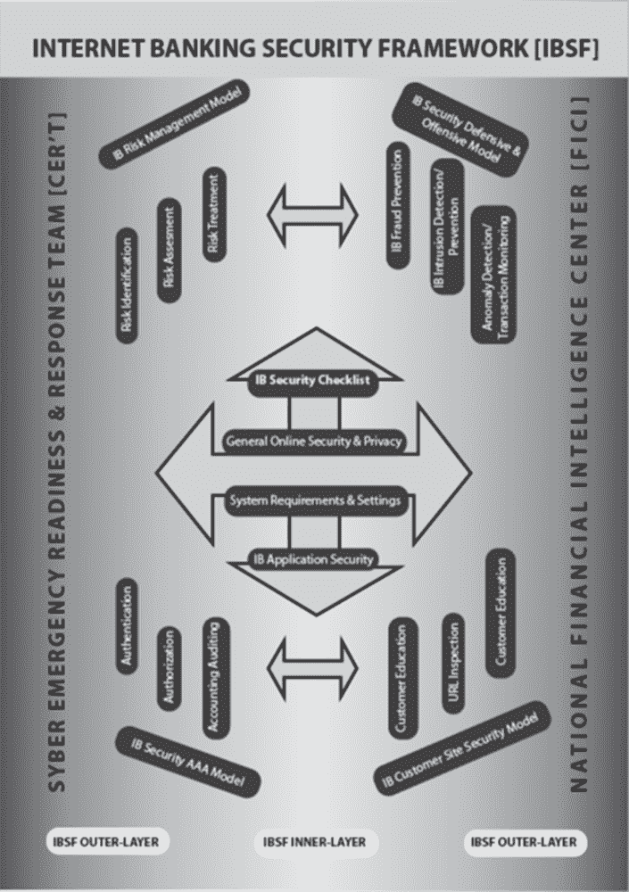 |

### 客户端与服务端安全

在本研究中，通知指出孟加拉国的银行在启动互联网银行服务时，其安全步骤的设计仅关注银行站点安全的视角，并相信和假设客户站点安全掌握在客户手中，由客户决定是否保护。客户端和服务端的多层安全均可降低风险。它可以保护敏感信息免受黑客攻击。本文通过构建多层安全系统框架，揭示了互联网银行犯罪手段和现有安全系统的局限性。然而，社会工程学领域及其局限性——客户站点安全，已被检测为主要的潜在安全威胁。本文通过构建多层安全系统框架，揭示了互联网银行犯罪手段和现有安全系统的局限性。互联网银行安全结构及其多层安全系统是通过专家评估方法开发和评估的。为了实现适当的互联网银行安全目标，银行业需要银行、金融机构、服务提供商、当局、监管机构、客户和其他相关利益相关者协调一致、同步的观点或视角，以在一个框架下应用适当互联网银行安全结构的百科全书式章节（正确实施）。

### 核心模型与外层机制

本研究有可能建议孟加拉国银行业采用多层集成安全系统，通过公共网络提供网络银行服务。多层互联网银行安全系统的内层部分由五个主要模型组成：

- 互联网银行客户端站点安全模型
- 风险缓解模型
- 互联网银行验证、委派、授权和审计模型
- 互联网银行防护模型
- 互联网银行安全验证清单

而外层由金融情报中心和网络应急响应小组组成。多层互联网银行安全框架是基于网络银行安全框架设计的，具有蛋形解剖结构。虽然蛋壳安全具有柔软光滑的中间部分，但它拥有坚固坚硬的外壳部分。一旦外壳被打破，整个系统将被有效且高效地警报。

## 互联网银行安全框架

### 文献综述与问题陈述

从所审阅的文献中我们发现，银行业的安全系统仅关注银行网站安全的视角。银行业需要银行、金融机构、服务提供商、当局、监管机构、客户及其他相关利益相关者的协调一致的展望，以便在一个框架下应用适当互联网银行安全严格措施的百科全书式全方位实施（妥善实施）。应开发一个特殊程序，将入侵者发送给客户的消息重定向（Kok 2016）。该程序将通过工具或由认证团队人工识别，自动识别针对银行专用服务器的假冒 URL，以最大限度地减少财务损失和声誉损失。

### 研究目标与贡献

本研究协助银行构建和实施互联网银行安全，以降低并最小化与网上银行服务相关的威胁和攻击。具体而言，本研究建议应基于银行网站视角和客户端视角双重视角建立安全执行和措施。

本文探讨了银行业面临的互联网银行问题、威胁和攻击，并通过建议基于银行网站和客户端视角的安全执行和措施，批判性地讨论了在孟加拉国银行业实施强有力安全的重要性。

本研究阐述了一个能够提供适当保障和安全的安全框架。研究通过构建一个多层安全系统框架，揭示了互联网银行犯罪手法和现有安全系统的局限性。

### 拟议的多层安全系统

为缓解互联网安全问题，应确保客户和银行之间建立多层安全系统。为实现适当的互联网银行安全目标，银行业需要银行、金融机构、服务提供商、当局、监管机构、客户及其他相关利益相关者的协调一致的展望，以便在一个框架下应用适当互联网银行安全严格措施的百科全书式全方位实施（妥善实施）。

本研究的主要目的是为银行业建议一个多层互联网银行安全系统。为实现这一目的，研究选择了孟加拉国银行业，通过调查该银行服务中的安全实施情况并识别影响安全实施的因素，以了解当前的互联网银行安全实践。基于现有理论、知识、所审文献的观点及实施的调查，本研究为银行业安全实施互联网银行绘制了一种新的框架结构。

本研究设计了一个多层安全系统，以克服安全专家和分析师通过口头考查和交谈所指出的当前已识别局限性。建议的多层互联网银行安全框架由外层安全（由国家反欺诈保护组织/机构/部门组成）和内层（由银行和客户端安全组成）构成，通过整合和协调来自不同视角的不同安全层系统，确保治理和透明度。

#### 内层组件

多层互联网银行安全系统的内部层由五个主要模型组成：

*   互联网银行客户端安全模型
*   风险缓解模型
*   互联网银行验证、授权、委托与审计模型
*   互联网银行防护模型
*   互联网银行安全验证清单

外层由金融情报中心（FIC）和计算机应急响应小组（CERT）组成。

毫无疑问，这种框架结构使银行能够通过实现多层安全系统，采取适当的方法来缓解互联网银行安全风险。

## 建议

从银行方面来看，本研究建议基于通过短信、电话和电子邮件的监控，采取适当的安全方法和交易认证。所有这些都应在国家金融情报中心（FIC）和计算机应急响应小组（CERT）的合作与监督下进行。

此外，应升级客户的统一资源定位符（URL）评估工具，以确保真实性。应针对可用性问题进行充分测试。

应开发一个程序，如果通过工具自动识别或由认证团队人工识别出针对银行专用服务器的假冒 URL，则将入侵者发送给客户的消息重定向，以最大限度地减少财务损失和声誉损失。

## 参考文献

*   Al-Sharafi, M. A., Arshah, R. A., Abu-shanab, E., & Elayah, N. (2020). 安全与隐私感知对客户信任接受互联网银行服务的影响，TAM 的扩展。*工程与应用科学杂志*, 10. 10.3923/jeasci.2016.545
*   Bultum. (2017). 埃塞俄比亚银行业电子银行系统的采用：障碍与驱动因素。学术出版社。
*   Jolly, V. (n.d.). 互联网银行对银行客户效率与成本节约的影响 国际。*社会科学与管理杂志*, 3(3), 163–170. 10.3126/ijssm.v3i3.157
*   Khrais, L. T. (2019). 强调在线银行系统的漏洞。*互联网银行与商业杂志*, 20(3)。
*   Kleemans, E. R., & Stol, W. P. (2016). 网络犯罪网络、社会纽带与在线论坛：钓鱼和恶意软件网络中的社会纽带与数字纽带。*英国犯罪学杂志*, 1–19. 10.1093/bjc/azw009
*   Konstantin, B. (2017). 钓鱼威胁规避行为，一项实证研究。*计算机与人类行为*, 60, 185–197. https://doi.org/10.1016/j.chb
*   Peotta & Holtz. (n.d.). 互联网银行攻击与漏洞的正式分类。*计算机科学与信息技术国际杂志*, 3(1)。
*   Reba. (2018). 埃塞俄比亚网络安全现状。埃塞俄比亚电信局，标准与检查部，标准处。
*   Safeena, R., Hema, D., & Abdullah. (2019). 电子商务价值的客户视角，互联网银行案例研究。*互联网银行与商业杂志*, 15, 1–8。
*   Stawowski. (n.d.). 客户端漏洞评估。检索自 `http://www.clico.pl/services/Clientside_Vulnerability_Assessment.pdf`
*   Thorsten & Weigold. (n.d.). 安全互联网银行认证。学术出版社。
*   Wong, D., Kuen, H., Loh, C., & Randall, B. (2015). 信任还是不信任，消费者在电子银行中的困境。学术出版社。
*   Wüeest. (2015). 在线银行面临的威胁，赛门铁克安全响应。学术出版社。

# 第九章：网络安全对零售运营的影响

**Rabinarayan Patnaik**


管理与信息科学学院，印度

## 摘要

### 在技术与贸易主导的时代……

在技术与贸易主导的时代，业务流程已开始着眼于创新与不断变化的应用。这种思维模式的范式转移并不局限于任何特定行业。因此，网络实践已开发出各种工具、实务以及用于实时情境的应用途径。随着这些技术平台的进步，智能手机等各类小工具也对其应用起到了补充作用。零售流程与其他商业实践一样，也因这些技术干预而发生了变革。作为一个负责创建直接客户触点的流程，零售在其运营层面需对因技术采用而带来的威胁、不安全性、隐私丧失及挑战保持警惕。因此，一个系统且设计完善、包含所有可能组成部分的数据隐私政策，能够营造出安全的环境。

## 引言

在当今的数字化世界中，信息以最快的速度从一个源头流向另一个源头，不受框架界限或边界的限制。无论职业或专长如何，任何个体都会不时遇到大量数据，无论相关与否。因此，在如此动态的环境中，组织机构需照管与其利益相关者有关的数据的真实性、相关性及机密性。为保护数据免受自然或人为引发的紧急情况侵害，公司需具备适当的设施（无论是硬件形式还是云端形式），以适当的数量通过适当的渠道进行数据的收集、存储、检索及使用。因此，这要求系统地构建一个框架，确保数据隐私完好无损，久而久之，这便转化为一项政策。视行业及所涉及的个体而定，该数据隐私政策包含多个考量维度。

当涉及数据安全及随之而来的信息安全时，首要关切的“保护多少”及“谁来负责”这两个问题亟待解答（Kang, 1998）。因此，待量化与保护的数据需要网络介入。网络数据的支持不止于此。在遭受损害或面临不当窃取、伪造风险之时，一项完善的数据隐私政策能为组织机构提供巨大帮助。与任何个人（如消费者）相关的信息范围，有时因其暴露于外部世界的程度——从公开到私密——而显得危险（Gordon & Loeb, 2002）。主要是服务业或零售运营等商业实践，因数据泄露等原因，频繁陷入此类意外且不受欢迎的境地。对任何类型威胁的妥善评估及后续缓解措施，可用于分析数据使用的有效性及其隐私保护（Hoo, 2000）。

谈及零售运营前沿，正如我们所理解的，零售是任何经济活动的最终阶段，零售框架中的运营指代前端活动。该流程的本质包含顾客、员工、库存及交易等个体及交互活动，这些被视为门店运营的指标参数。每个参数均需特别关注，以保护其附带的敏感特性。例如，顾客及员工的私人数据、库存/存货的真实性、为实体及数字支付模式创造的安全环境等。因有组织零售及电商的兴起，维护隐私及后续安全的必要性愈发增强，因为在这些零售运营模式中，数据处理不当与管理失误的脆弱性自然更高。在最近十年中，多条复杂供应链及物流模式的加入，为技术应用创造了空间，也要求建立一套保障产品及供应商数据安全的稳健体系。将有四大关键赋能因素支撑这种数字化赋能的零售运营，其隐私保护将至关重要。

*   i) 组织架构
*   ii) IT 基础设施
*   iii) 数据与决策
*   iv) 财务状况


尽管在线业务或电子零售显著增长，实体门店仍贡献了大量业务。实体零售的消费者数据隐私与保护因多种原因长期是主要关切，其中包括信用卡/借记卡支付背景下的欺诈活动，以及零售商使用的受恶意软件感染的支付设备（Alberts & Dorofee, 2002）。鉴于顾客追踪等多种自然及系统性原因，在当今零售语境下制定数据隐私政策显得更为重要。因此，理解网络安全在稳健零售运营语境下的各个侧面，并提出一个包含通用指南的框架以规避数据点隐私与安全的任何潜在威胁，至关重要。本研究聚焦于这些议题的若干维度，并尝试构建一套政策要点框架。

## 背景

随着我们从实体店世界向“点击即付付”零售世界过渡，将有许多变化标志着零售流程的未来全貌。支付、电商、物流等技术赋能系统在零售领域的融合，已开始重塑商业。以客户为中心与协作重新定义了全球零售的发生方式（Deloitte, 2017）。未来零售运营及数据安全与隐私的各维度将发生巨大转变（表 1）。

### 表 1. 零售运营中的网络转型

| 关键资源领域（KRA）的范式转移 | 网络数据的介入 |
| --- | --- |
| **精准客户群**<br>基于人口的营销将转向定制化主张，从而增值服务将掌握关键。 | 随着人工智能的使用，细分市场将变得更小、更聚焦，体验创造将基于实时客户数据。 |
| **战略业态**<br>消费者领地或商贸区将不再固定。相反，商业战略将基于通过独特设计的交付系统触达广泛区域。 | 通过客户注册与订阅收集的海量数据将成为运营效能的赋能因素。 |
| **体验式购物**<br>重心将从实体店布局与视觉陈列转向基于潮流与当代风格构建数字化客户体验。 | 基于购物各阶段（如规划、试用、实时购买）的客户反馈数据，设计数字化体验。 |
| **支付与促销**<br>传统促销工具（如会员卡计划等）及 POS 机前的实体支付，将通过电子设备与高级应用变得便捷。 | 收集客户数据的实体窗口将更加技术化，整个购买周期将依据客户数据展开。 |

*资料来源：作者编制*

从根本上说，与网络安全相关的任何数据隐私政策主要有两个维度，即：制定标准与保护数据。这两个维度同样适用于零售运营。在构建此数据隐私政策框架前，有若干前言事项需予核查与确保（图 1）。

### 高层管理干预

#### 管理信息隐私与安全

这通常包括高层管理人员有效领导和坚定承诺的声明，以确保信息安全管理的顺利实施。这应当聚焦于隐私与安全政策的目标，使其与组织战略同步。这整合了资源以及支撑信息隐私与安全的流程。它还传达并推广与数据和信息隐私相关的政策及体系的重要性。

#### 管理信息风险

这要求持续识别、评估和审核信息风险。这还将执行缓解措施，并根据其效率、可行性和经济性评估这些措施的有效性。在此过程中，需要任命信息资产所有者（在与业务负责人充分协商后）。在组织框架内，信息资产所有者定期监控并实施属于公司的所有信息资产的控制措施。

#### 图 1. 制定数据隐私政策的组织要求

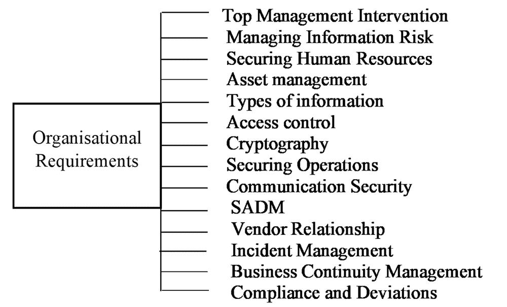

*来源：作者编制*

#### 保障人力资源安全

在制定数据隐私与安全标准时，至关重要的是，注入组织架构的人力资源必须从入职前一直融入到离职的整个信息系统框架中。某些安全政策工具，如员工敬业度管理、正式签署的保密协议（包含专有信息以及商业信息）等，大有裨益。

#### 资产管理

此过程要求识别并列出各信息资产所有者所列举的所有类型的信息资产。随着时间的推移，必须审视这些信息的严肃性和敏感性，以了解其价值，进而防范任何形式的失误。

#### 信息类型

任何组织（包括零售公司）都有此类要求，即根据保护安全与隐私所需的保密程度，建立不同层级的信息。这另一方面将帮助决策者在成本和保存可行性等方面做出果断决策。

#### 访问控制

这是构建安全数据环境最重要的维度之一。这包括对试图使用组织数据的每位个人（用户）进行身份验证。例如，可以为用户分配唯一 ID 和密码、生物识别机制，使其在访问数据和信息时对每项活动或其行为负责。

#### 密码学

这通常是指通过正确且授权地使用加密算法、密钥长度、密钥管理协议等来维护安全协议。一旦数据在同一业务集团的各个垂直领域间共享，此过程变得更为重要。

#### 保障运营安全

业务围绕数据点进行规划和实施，重点关注商业秘密及其隐私保护。IT 负责人对各类服务器、网络和端点的安全负责。这需要对整个系统进行持续监控，并提供针对威胁、漏洞、恶意软件等的安全防护。它还能有效地执行变更管理、日志记录与监控、安全分析和保障。

#### 通信安全

这是一个多维度的过程，其中所有类型的网络通信都受到适当级别的安全控制保护，从而保护信息和系统。基于与各类网络相关的风险程度，这还在各个服务层级建立通信安全控制机制。这还在公司不同业务垂直领域间进行信息交换时提供保护。

#### SADM

系统获取、开发和维护的首字母缩写，这在信息的获取、开发和维护的各个阶段实施适当的安全控制。这消除了未经授权和不当访问对机密性、完整性和隐私造成的负面影响。

#### 供应商关系

这是确保监控和审查提供给供应商的信息访问权限的重要领域之一。访问权限的程度以及针对任何不当行为的控制机制，始终通过妥善评估相关风险以及所考虑的供应商类别来加以处理。

#### 事件管理

这要求建立一个框架，通过识别、记录和妥善恢复，及时保障情势或事件的安全。该框架应作为赋能者，让员工、承包商、第三方用户等各类用户了解各种数据类型及其对隐私关切的后续影响。

#### 业务连续性管理

在任何危机或逆境中，业务流程的延续不应受阻。必须建立记录、实施和维护信息隐私与安全流程的机制。这需要在适当的时间间隔内进行，以确保流程的连续性。

#### 合规与偏差

组织各职能领域的员工或集团不同业务垂直领域的员工，必须确保遵守安全合规要求，具体取决于相应部门或员工关联的风险等级，依据政策执行。在这方面，控制与审计部门的作用变得更为重要，因为他们需要确保运营完整性，并在出现偏差时使其具有可操作性。然而，偏差背后必须有充分且相关的理由，并配备相应的适当控制机制。

## 技术触点

正如我们所理解的数据隐私的动态性及其后续保护，我们也需要认同这样一个事实：技术创新和贸易实践带来的环境变化（针对零售流程）会持续挑战和影响政策。基于 ICT 的发展，新兴技术需要被理解并全面实践，以用于数据隐私保护。在技术领域中显著改变其他商业实践的“三巨头”，同样也导致了零售运营的变革（图 2）。这些技术的每一种应用都蕴含着在界定数据隐私及其后续保护方面的深层挑战（Roberts & Grover, 2012）。

### 图 2. 零售运营中的技术采用

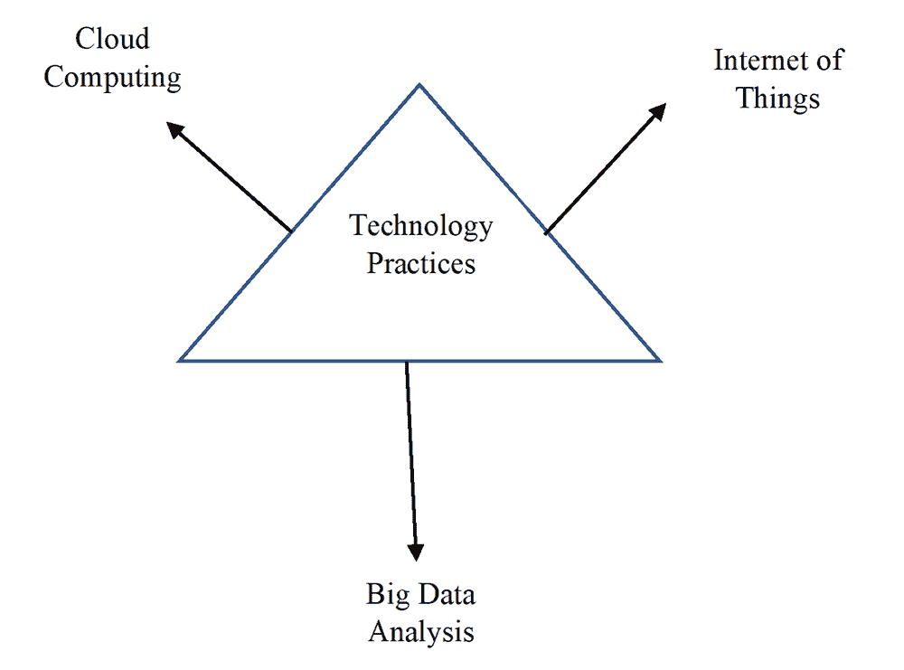

*来源：作者编制*

### 云计算

#### 技术赋能服务与云计算

这通常是一种技术赋能的服务，可根据客户的需求和要求随时提供给他们。通常，拥有联网设备的技术用户（例如零售商）可以灵活地访问包含可度量数据存储库的网络。在适当管理下，这些数据也可在各个用户群体间共享。目前该云计算行业规模达 1500 亿美元，有望快速增长，并对零售等客户行业产生重大影响。然而，目前在数据保护方面，使用该技术仍存在一些挑战。例如，缺乏足够的法律监管机构来处理因在更广阔的地理区域内使用此类服务而产生的疏漏。一些国家还对在其各自贸易区内自由使用通过云端获取和传输的该技术和服务设置了本地化限制。监管程度也在上升，这促使公司思考并着手制定更广泛、更具战略性的数据隐私政策。这些挑战的另一面则促使人们更好地理解该技术并优化其组件，从而在未来几年建立更好、更高的网络安全标准。

### 物联网

物联网，通俗缩写为 IoT，通常是一种促进性技术，用于将多个组件和设备连接到互联网，以实现数据通信。该技术的执行涵盖可视化、监控、分析、存储等各个维度，最重要的是连接各种网络。该技术的本质要求理解其流程并制定管理手段（例如数据管理）。该技术的应用范围涵盖安全工具、各类民用产品，如汽车、家用电器、手机、个人电脑等。在目前的零售运营实践中，该技术支持物流和供应链功能。该技术型产业增长迅速，在未来几年也有望成为零售等用户行业的颠覆性力量（例如在数字支付、防止盗窃等领域）（Bandyopadhyay & Sen, 2011）。然而，各种研究表明，使用该技术的挑战巨大，现有的网络安全法律框架难以完全解决这些问题（例如，因消费者对联网工具和组件的隐私和安全担忧而导致信心下降所带来的挑战）。

### 大数据分析

该技术平台有助于理解各种模式、趋势因素以及多个业务组件之间的关联。它基于数据的收集和存储以供未来使用。该技术的应用范围广泛，可为经济和社会问题提供解决方案。然而，在采用和使用该技术时存在一些挑战。收集的数据量极大，这给实时确保其隐私带来了实际困难。同时，某些数据源和数据本质上是公开的，无法真正做到安全保密。此外，大数据分析涉及特定的算法和决策工具，这些工具尚不够完善，无法在需要时确保数据透明度。因此，这给零售运营一线的决策者带来了实时问题，在数据挖掘时也经常出现这种情况。

### 其他新兴技术工具

除此之外，增强现实等其他一些最新技术工具在维护数据隐私和建立相关框架方面也大有裨益。然而，这些工具的局限性在于它们在零售运营层面很少被使用。但考虑到先进网络的普及和流程中数字化创新的增加，这些工具在未来几年大有可为。随着这些技术进步及其在包括零售运营在内的业务流程中的应用，在降低风险和为用户及整个组织增加效益方面将面临相应的挑战。因此，要求始终是建立基准并确保受保护数据的隐私。

### 零售环境中的技术安全维度

在零售环境中，所采用的技术必须用于保障三个运营维度，即：1）保障系统安全，2）保障网络安全，3）保障数据安全。流程、产品和人员构成了零售运营环境。另一方面，网络是指公司使用的所有可能网络，从局域网到互联网。数据是指所有可记录的要素，可根据决策需要随时收集、存储、分析和检索。这在涉及连锁店的零售运营中尤为明显和突出。因此，技术环境的新兴变化和近期变化必须与组织保障私人数据安全的政策和目标相兼容。

### 销售点系统

在有组织的店铺式零售中，POS 是一个通用节点，基于技术的系统有助于记录销售信息。由于条形码的强制使用，无论规模和产品供应如何，各零售组织都借助该编码数字来确定产品规格。激光扫描仪用于读取产品上的条形码，以记录与产品和交易相关的数据。此外，在 POS 或更具体地说是 EPOS（电子销售终端），记录的信息也可打印出来生成交易收据。整个过程由门店的中心系统控制，与促销规划、库存管理、广告费用等相关的数据隐私变得非常重要（Jones, 1985）。除了交易外，该系统在创建客户数据存储库方面同样有用，因为交易详情包含相关客户信息。近来，许多零售商开始结合自助服务相关技术使用 EPOS 系统。这使得数据隐私的关注度更加增强，因为交易完全由顾客自行完成，其数据及交易数据自动传输。因此，如果使用得当，EPOS 可以帮助零售运营更精准、高效地开展，并对大量存储的客户数据进行妥善分析。

### 电子设备与零售业的数据安全挑战

#### 智能手机与移动应用的影响

十多年来，主要以智能手机形式出现的电子设备彻底改变了顾客的购物方式。智能手机行业凭借各种最新技术，在零售商与顾客之间创造了多个交互触点。顾客能够利用浏览、消息传递、编辑、视频摄像等多种功能。随着各类 App 的加入，这些设备在可见程度上进一步改变了顾客的购物行为。顾客因这些技术进步而获得了比较价格、优惠和评论等机会 (Taylor & Levin, 2014)。然而，随着这些进步，数据和信息的流动几乎跨越了所有边界。零售运营变得极其复杂，且对外部世界高度透明，零售商必须采取一切可能的措施，在如此动荡的局势下保护数据的机密性。

此外，这些 App 启用的支付系统也增加了这一现实。由于数字支付流程，顾客的支付遵循无线通信技术，这要求在银行和个人详细信息方面提供重要的数据安全保障。二维码的使用增加了零售支付的这一技术流程。由于二维码包含位置、网页链接等信息，通过扫描代码传输信息会将其发送到不同的地方并通过不同的路由。通过使用二维码，顾客可以轻松了解零售商的各种贸易做法，如产品的原产国或产地，从而使这些信息成为零售商需要保护的敏感信息。对竞争品牌的评论、评分和信息分享已成为顾客几乎常规的做法。尽管这一过程的好处很多，如在对价格进行评论和分析后付款等，但技术滥用的危险仍然是一个关注点。由于其稳健性，这也可能增加零售商的成本和维护预算（关于 IT 系统）。适当的安全政策可以作为这种技术驱动流程的保障（对零售商和顾客而言），同时可以使零售商相对于同行处于有利地位，例如为零售商建立信任因素 (Tarjan et al., 2014)。

#### RFID 标签

RFID 是射频识别的首字母缩写，在零售运营中被广泛用于追踪，借助微芯片、读取器和天线。这一技术工具对零售商定位物体以及收集价格、交易日期等相关数据非常有用。这些标签可用于电子商品监控 (Electronic Article Surveillance) 等保护性流程 (Roberts, 2006)。然而，由于这可用于在系统、货物、车辆等各种组件之间共享信息，人为因素使用的敏感性造成了数据隐私的隐患。在更新时，用户必须对数量、项目编号、目的地等相关信息负责。在标签因受潮等原因发生畸变或自然损坏时，数据安全变得更加重要。

#### 电子商务

数据安全重要性的最新体现是通过在线空间购物。购物通过电子模式进行，借助移动设备（笔记本电脑/平板电脑/智能手机/个人电脑）。由于启动流程需要顾客的位置和需求，这种零售运营形式促进了相同信息向各利益相关者（如供应商、电商网站和物流提供商）的传递。尽管顾客在购物场所没有实体参与，但信息以批量且真实的方式流动 (Burt & Sparks, 2003)。保护信息的必要性再次变得至关重要，因为顾客进行支付，无论是货到付款 (COD) 还是借/贷记卡/网银支付。必须确保金融交易的安全性。此外，追踪顾客（访问网页）的 Cookie（小文件和程序）对隐私构成威胁，特别是当 Cookie 负责公司收集顾客信息（第三方 Cookie）时。通过这种机制，还可以进一步追踪与地理位置、收入等相关的非常敏感的信息 (Kaplan, 2012)。

#### 社交媒体的扩散

得益于各种界面触点，传统或大众媒体最近正缓慢而稳步地被社交媒体取代。这种媒体使事物以最快的速度在不同的共享观点、意见、文章、事件等中病毒式传播。零售商也不例外，作为商业实体，零售商也利用博客、播客、社交网站等传统工具，用于产品发布、促销优惠、庆祝活动、成就展示、顾客联络计划等各种目的 (Drury, 2008)。

在过去十年左右，由于活跃互联网用户的增加，各大社交媒体公司开始以惊人的速度增长。Facebook、YouTube、WhatsApp、Instagram 等知名社交媒体网站多年来吸引了大量活跃用户，并被列为社交媒体领域的全球领导者（图 3）。各商业机构使用这些媒体网站最大的好处在于，这些网站能够为公司创建强大的界面，与顾客和潜在客户建立联系、沟通并就各种商业价值及独特性展开对话 (DREAMGROW Report, 2021)。同时，零售商可以与公司的供应商、商业伙伴等其他利益相关者建立联系。在社交媒体上建立关系并维护关系对零售商来说变得容易。然而，所有这些过程听起来令人鼓舞，但陷阱依然存在，表现为数据和信息的重复与黑客攻击。同时，如果公司品牌管理和公共关系出现任何疏漏，若不在虚拟或数字平台上妥善处理和维护，可能会适得其反。由于信息可以很容易地通过社交媒体网站获取和访问，公司必须拥有保护技术，以保障顾客、员工等信息的隐私，防止竞争对手利用先进技术不当追踪。此外，某些媒体网站以言论自由之名制造的反宣传活动（如 Twitter 拒绝遵守印度政府法规的案例）可能损害网站声誉，进而损害订阅者（买方和卖方）的声誉。可能会出现社交媒体平台维护的隐私政策与当地网络安全规则发生冲突的情况，例如 WhatsApp 近期质疑印度政府消费者保护规则的案例。因此，零售公司在决定社交媒体网站上推广的客户创建和保留流程的有效性之前，需要评估其利弊。

##### 图 3. 领先的社交媒体网站及活跃用户

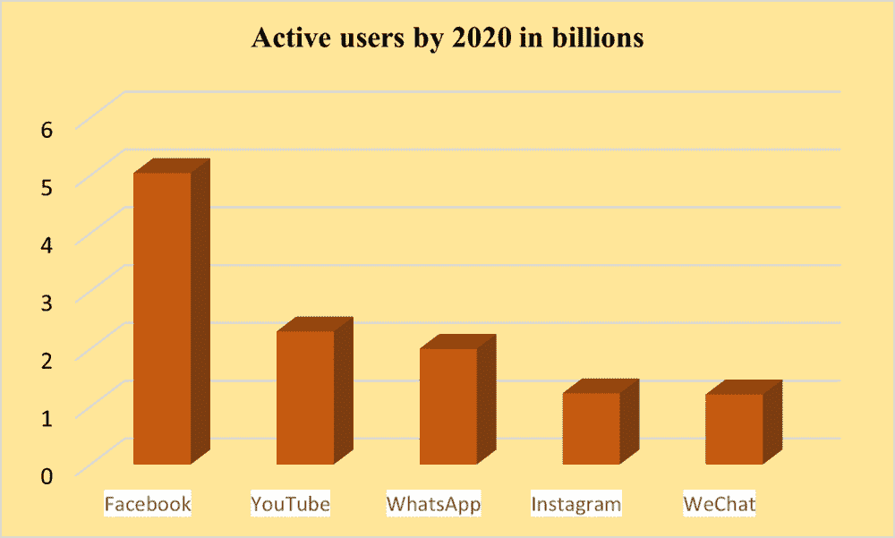

*来源：作者编译*

## 标准制定

### 数据隐私与安全框架

在每个零售组织中，个人信息的隐私与安全涵盖员工、客户以及供应商等各方利益相关者。根据以下流程图，可执行不同的职能/任务以保障其隐私。

#### 任务 1：确定组织隐私目标

这将包括定义个人信息，并明确每个数据要素所承载的重要性级别。

#### 任务 2：数据收集

必须在数据来源和提供方知情的前提下，以公平合法的方式进行收集。

#### 任务 3：获取同意

在收集、使用及后续披露任何个人数据时，需事先或自发地获得信息提供方的同意。

#### 任务 4：通知

需向相关利益相关者发送适当且及时的通知，告知公司关于数据安全等方面的隐私政策和程序。

#### 任务 5：数据仓库

必须根据数据的重要性和隐私级别，规定数据组件的存储条款。

#### 任务 6：披露

在获得个人事先同意的前提下，可向第三方提供或披露个人信息。

#### 任务 7：框架维护

建立一个兼顾数据安全和隐私目标的框架，可确保实践、标准和政策落地到位。这要求防范未经授权的访问，并定期进行审查。

#### 任务 8：培训与更新

为不时确保各利益相关者充分理解隐私要求、原则及影响，必须安排针对性的培训和研讨会。

## 政策框架与指南

在明确识别数据隐私的要求与应用后，零售商必须制定一个框架，该框架包含多个组件，用于系统化构建并后续维护。总体而言，可包含以下程序以建立系统化框架。

### 1) 信息覆盖范围

框架主要基于个人性质的信息，经识别后可根据信息的量和性质进行收集、存储、传输或处理。这可包括密码、财务信息（如银行账户、信用卡等）。还可包括与身体及精神状况、性取向、医疗记录、生物特征信息等相关的信息。

### 2) 信息收集

为用于特定目的，通常仅收集框架范围内所需的最少信息。这必须符合公司要求。例如，若公司需要提供婚庆系列的供应商名单，收集时应注意使用该信息的理由和时间跨度。收集的信息必须在组织内部传达给用户以实现最大效益，并在传输前核实其真实性。

### 3) 信息更正


当需要更新或修改特定信息时，必须由系统管理员或授权人员进行访问操作。这也将清除个人从不同场所（如公司内部网等）提出的某些个人和敏感信息。

### 4) 信息处理

为遵守法律程序和强制性要求，框架应按数据存储和保留的方式进行处理，仅针对特定时间段。必须确保信息资产获得管理、技术、操作及物理安全控制措施。为确保数据处理速度，这些清理和维护措施必须定期执行和评估。

### 5) 信息披露

政策框架必须安排仅披露为同一原因而收集的信息类型。披露前，必须评估和监控披露的法律和法定要求程度。例如，在将供应商相关信息传递给供应商同行群体时，必须权衡其利弊。

因此，用户多项指南的要求可构建数据隐私政策框架，并涵盖各类信息资产及其保护。主要包含所有可能利益相关者和公司维度的安全与隐私方面。

## 密码安全

*   登录必须使用自己的用户 ID 和密码，并对使用其凭证在公司信息系统上执行的所有操作负责。
*   必须设置强健、复杂且不易猜测的密码，以登录企业应用程序。
*   任何人不得与他人共享保护公司信息系统的密码、`PIN` 码/`OTP` 等，也不得将其记录在易被发现的地方。
*   严禁将公司域凭证（用户名和密码）用于任何其他在线/公共账户。为不同账户使用唯一密码是首选做法。
*   需实践应用程序的多因素认证（如适用），通过自己的移动设备使用自己的手机号码或电子邮件地址进行验证。

## 杀毒软件

*   任何人不得禁用已安装的杀毒软件或更改计划扫描的设置。
*   严禁用户在系统上安装公司批准的杀毒软件以外的任何其他杀毒软件。
*   必须确保系统上安装了授权的杀毒软件，并通过最新特征库保持更新。

## 互联网使用

*   所有用户只能通过组织渠道访问互联网。用户不得绕过企业代理或使用代理规避网站浏览互联网。
*   不得利用互联网进行骚扰、辱骂、反社会或非法活动。
*   任何人不得通过下载或分发受保护或受版权保护的材料来违反任何版权或许可协议。
*   不得允许赌博、访问淫秽材料或曲解公司政策等非法或不道德活动。
*   必须制止从互联网下载和安装未经授权、盗版或受版权保护的软件。
*   除非获得特别授权，否则任何人不得代表公司发表观点。
*   应限制点击在线网站上的广告或弹窗，因为这些可能包含恶意代码。
*   应避免使用在线文本格式转换器（如 `PDF` 转 `Word` 转换器）更改机密文件的格式。
*   若发现此类互联网滥用行为，用户应承担唯一责任并接受问责，可能面临纪律处分。
*   用户应确保不安装或集成未知或不必要的浏览器扩展，因为这可能导致间谍工具、恶意软件被部署在系统中。

## 电子邮件和消息使用

拥有公司电子邮件/消息账户的用户，应对其账户发出的站内外信息内容负责。

*   必须确保公司提供的电子邮件/消息功能仅用于业务目的。允许个人使用的前提是：不影响个人业务绩效、不以任何方式损害公司利益、不违反雇佣条款和条件、不使个人或组织违反法定或其他法律义务。
*   组织保留监控用户电子邮件/消息活动的权利。

## 防范网络钓鱼攻击的保障措施

*   每位用户都需核实来自外部域（带有外部标签）的所有邮件的发件人地址。
*   用户必须确保不点击未知发件人发送的邮件中的链接，也不打开其中的附件。
*   任何人不得通过点击未知发件人邮件中提供的链接，泄露密码、银行账户信息等敏感信息。

## 设备使用规范

*   为业务目的在用户办公笔记本电脑上提供的特权（如本地管理员权限、`USB`、`MTP` 权限、特权互联网访问等）不得被滥用。
*   用户必须确保不修改或移除预装的安全功能，不更改台式机/办公笔记本电脑上的硬件/软件配置、操作系统设置或任何已安装的应用程序。
*   为执行不道德活动而安装在设备上的安全软件/代理不得被绕过。
*   不得在办公笔记本电脑上存储未经授权、非法、盗版、非法或淫秽的内容或个人内容。
*   差旅时，必须确保存有信息的设备具备额外的物理安全防护。
*   公司管理设备被盗或遭遇未经授权的访问，应立即向相关团队报告。
*   如发生疑似安全事件，公司保留没收设备以进行取证调查的权利。

## 社交媒体

*   任何人不得在社交媒体、评论类网站或博客上透露公司的机密或专有信息、商业秘密或任何其他资料。
*   应避免在社交媒体上发布在工作区域及敏感信息处理设施拍摄的照片。
*   必须明确规定：在博客中表达个人信仰和/或观点时，须显著声明该言论为个人观点，不代表公司立场。

## 保持桌面整洁与屏幕安全

*   要求用户在离开系统无人看管时必须锁定系统。
*   任何人不得在桌面上留置机密信息。
*   公司业务机密信息在不使用时应安全存放在上锁的柜子里。
*   用户必须防止屏幕上的公司信息被未经授权的用户窥视。

## 零售运营层面的数据隐私级别：图示说明

任何零售流程在门店运营层面的数据安全和隐私通用实践，均可包含多个组件。其流程图如图 4 所示。

在保护区域 I，任何零售流程的运营层面都会涉及多个窗口，例如 `POS` 窗口、库存窗口和耗材窗口。

顾名思义，`POS` 窗口负责所有类型的交易和支付及其记录。它还确保将这些数据传输至数据点的处理窗口。

库存窗口记录所有类型的库存、收货和补货详情。它还追踪供应商和制造商以及其他库存详情。此处存储的信息将导向门店的处理窗口。

耗材窗口确保已售出、拟售出或准备好销售的产品。它存储零售商从整批商品中挑选用于销售的那些商品的信息。与其他窗口一样，这些信息也会传递至处理场所。

| 图 4. 门店运营层面的数据隐私流程 |
| --- |
| 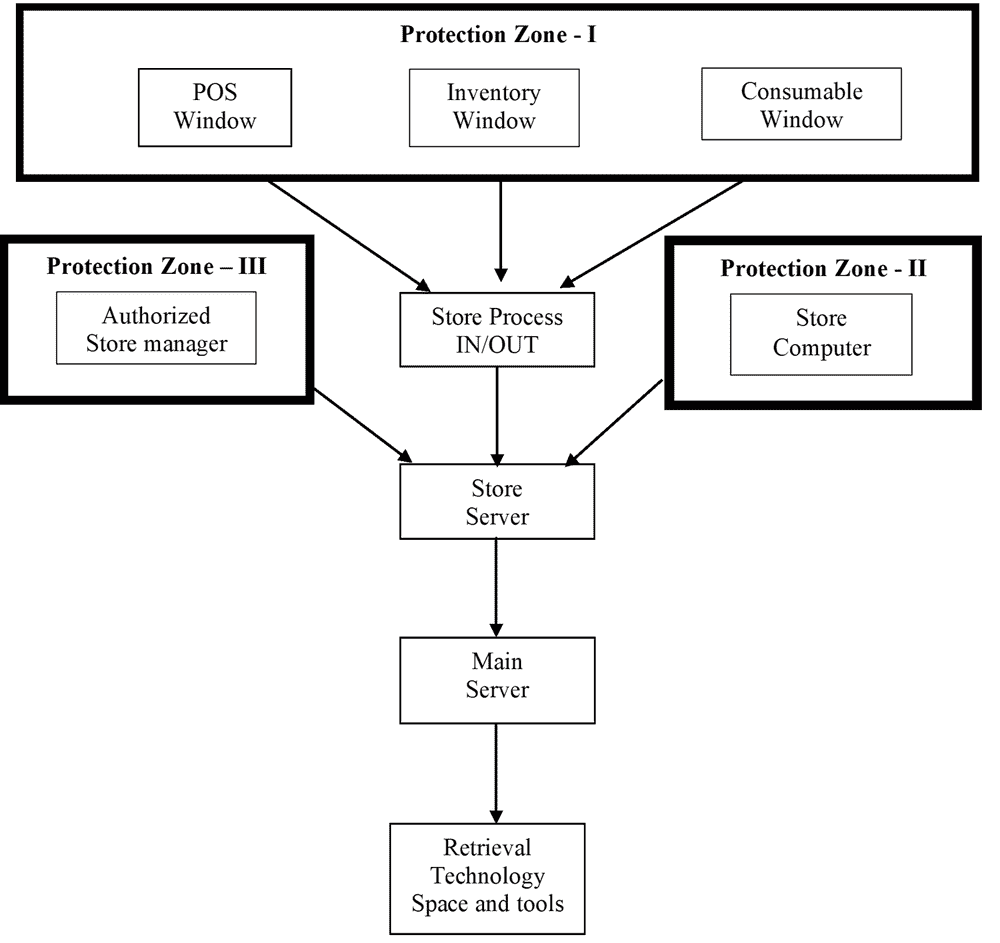 |
| *来源：作者编制* |

在保护区域 II，仅有相应的门店经理获得授权，可使用和访问门店服务器上的数据。事实上，门店经理权限范围内的信息本身就受到保护和安全管控，因为这些信息对零售商具有极高的战略价值。

在保护区域 III，门店内部的门店计算机已与各类设备断开连接，无法进行任何形式的信息检索，并通过防火墙等手段与其他系统隔离保护。

信息流向为：从门店服务器流向主服务器，随后由总部使用 `Tableau` 等特定工具在必要时进行检索。然而，检索过程在总部进行身份验证，运营层面无自主权限执行此操作。当然，仅基于特定请求和需求，门店层面人员才可能获得执行权限。此类情况非常少见。

## 结论

显而易见，零售运营需要在多个客户接触点开展复杂且富有成效的活动。正因如此，业务流程多个领域的技术视角（如电子商务、数字支付、客户追踪等）都需要得到妥善且系统性的配置。随着我们站在从单纯交易向体验构建过程范式转变的十字路口，技术已成为成功商业实践不可或缺的一部分。得益于技术的介入，供应链与物流、营销与定价等各职能领域均得到赋能，效率大幅提升。即使零售业务和模式的竞争日益加剧，先进及更新技术的采用也为创新与发展创造了空间。

要使技术基础设施有效运行，必须建立完善的数据隐私政策，以保护所有可能的客户接触点，以及与其他利益相关者和商业实践相关的敏感信息。这需要各国政府改变观念并保持开放，支持并制定网络法律，以保护消费者和贸易数据的隐私与安全。完善的政策将始终为企业、个人及投资者采用更新、更适宜的技术提供助力。各国、各州和各大陆需达成共识，创造足够的灵活性以适应技术变革，并让商贸企业为下一个重大变革做好准备。

回到运营层面的技术实践，员工和整个组织都需要领会问责制的考量，以确保任何政策（无论技术性还是非技术性）的有效性。当我们谈论网络安全时，这变得更为关键。用户必须学习网络变革的原则，并在确保有效高效实践之前更新其认知水平。尽管由于零售运营层面的固有特性，确保问责制至今仍是一项挑战，但企业正竭尽全力使其成为现实。

还有一个需要保障的方面是与品牌、标签及产品/服务所有权相关的知识产权。由于零售商对自有品牌（通常称为私有品牌）的依赖度增加，与这些维度相关的数据需要得到最高级别的保护。这反过来将帮助零售商在竞争中保持优势，并在未来几年维持可持续增长。

一项安全的数据隐私政策将包含所有可能的维度，如技术差距、数据威胁性质的检测、现有的法律和网络保护措施、疏漏对商业实践成功的影响等。因此，前提是已反复对此进行了充分的实时研究和学习，一个框架在这方面将提供巨大的帮助。

## 参考文献

Alberts, C., & Dorofee, A. (2002). *Managing information security risks: the OCTAVE Approach*. Addison Wesley.

Bandyopadhyay, D., & Sen, J. (2011). Internet of Things: Applications and Challenges in Technology and Standardization. *Wireless Personal Communications*, 58(1), 49–69. doi:10.1007/s11277-011-0288-5

Burt, S., & Sparks, L. (2003). E-commerce and the retail process. A review. *Journal of Retailing and Consumer Services*, 10(5), 275–286. doi:10.1016/S0969-6989(02)00062-0

Deloitte & Indian Chamber of Commerce. (2017). *Disruptions in Retail through Digital Transformation Reimagining the Store of the Future*. Author.

Dreamgrow Report. (2021). The 15 Biggest Social Media Sites and Apps. Available at: https://www.dreamgrow.com/top-15-most-popular-social-networking-sites/

Drury, G. (2008). Opinion piece. Social media: Should marketers engage and how can it be done effectively? *Journal of Direct, Data and Digital Marketing Practice*, 9(3), 274–277. doi:10.1057/palgrave.dddmp.4350096

Gordon, L., & Loeb, M. (2002). The economics of information security investment. *ACM Transactions on Information and System Security*, 5(4), 438–457. doi:10.1145/581271.581274

Hoo, K. S. (2000). How much is enough? A risk management approach to computer security. Retrieved October 25, 2006. Available at: http://iis-db.stanford.edu/pubs/11900/soohoo.pdf

Jones, P. (1985). The Spread of Article Numbering and Retail Scanning in Europe. *Service Industries Journal*, 5(3), 273–279. doi:10.1080/02642068500000042

Kang, J. (1998). Information Privacy in Cyberspace Transactions. *Stan. Law Review*, 1193, 1198.

Kaplan, A. M. (2012). If you love something, let it go mobile. Mobile marketing and mobile social media 4x4. *Business Horizons*, 55(2), 129–139. doi:10.1016/j.bushor.2011.10.009

Roberts, N., & Grover, V. (2012). Leveraging Information Technology infrastructure to facilitate a firm’s customer agility and competitive activity: An empirical investigation. *Journal of Management Information Systems*, 28(4), 231–270. doi:10.2753/MIS0742-1222280409

Tarjan, L., Šenk, I., Tegeltija, S., Stankovski, S., & Ostojic, G. (2014). A readability analysis for QR code application in a traceability system. *Computers and Electronics in Agriculture*, 109, 1–11. doi:10.1016/j.compag.2014.08.015

## 第 10 章：现有与未来的方法

**Lopamudra Hota**


印度国家理工学院，Rourkela，印度

**Dhruba Charan Hota**

印度 Maharaja Bir Bikram College

### 摘要

去年，大流行促使人们更加依赖技术，并采用互联设备和混合工作模式。因此，我们比以往任何时候都更容易遭受网络攻击。本章简要介绍了开放银行和网络安全概念，阐述了开放银行兴起的原因。同时也介绍了印度开放银行的见解。在印度，非银行金融公司是负责开放银行和客户同意管理的中介机构。从近年来描绘了开放银行系统的趋势。讨论了各种威胁的简短描述和关键安全措施。进一步阐述了开放银行中网络安全的必要性和实施。最后，描述了未来展望和研究挑战，以拓展开放银行中网络安全机制的工作。

### 引言

开放银行的出现为金融科技公司和其他金融服务提供商创造了一个竞技场。通过开放银行，客户和提供商可以建立更安全、更便捷的关系。随着“开放银行”的出现，它允许第三方金融服务提供商通过应用程序编程接口（`APIs`）访问来自银行和非银行金融公司（`NBFCs`）的消费者银行、交易和其他财务信息，这项金融技术的最新趋势正在迅速普及。这一创新提供了多项优势，但也伴随着高风险，因为必须共享和交易大量数据。此外，新冠疫情在过去几年里促进了印度金融技术的巨大增长（Baret et al., 2020）。据报道，`UPI` 在 2021 年 1 月处理了价值 4.3 万亿卢比的交易，而 2020 年 1 月为 2.1 万亿卢比，这说明了构建一个开放、高效且安全的强大银行系统的必要性。技术在生活的方方面面都得到广泛应用，从教育到房地产再到旅行。`App`、`UPI`、刷卡交易等也越来越受到银行的青睐（Thomas & Chatterjee, 2017）。在线银行最初用于收付款等，但自大流行开始以来，越来越多的人开始使用在线/刷卡银行系统，取代现金和支票。

进一步的技术变革无疑将推动银行业的未来。“数字化”银行是未来的方向。目前，开放银行服务于 300 万至 400 万客户，预计到 2026 年底将增长 46%（Puppala, n.d.）。除了在国家和国际层面赋能金融科技公司外，它正处于上升期。这被称为金融科技革命。技术在过去 10 年里改变了我们的银行业务方式。然而，银行业务很可能在 2030 年之前完全实现数字化。在银行业，`APIs` 并不新鲜。它们就像其他工具一样被用来将任务委托给应用程序；然而，由于全球银行允许持牌第三方访问其 `APIs`，它们成为了一条全新的创新途径。许多银行，如 Kotak Mahindra、SBI、ICICI、HDFC，已经采用了开放银行模块，该国现在正在缓慢适应这项新技术（Premchand & Choudhry, 2018）。

#### 究竟什么是开放银行？

在开放银行中，第三方金融服务在获得用户同意的情况下，可以访问用户的交易、银行和其他经济活动数据。消费者活动数据可以从银行和金融机构获取，并通过应用程序编程接口（`APIs`）共享（Zachariadis & Ozcan, 2017）。通过允许第三方创建满足客户需求的定制产品和服务，开放银行将推动银行业的严肃创新。人们普遍认为，开放银行将确保卓越的客户体验，因为它重塑了竞争格局。金融服务公司可以利用宝贵的客户数据向他们推销金融服务，收集汇总数据以创建细分营销活动，并协助客户从一家银行转移到另一家银行（Brodsky & Oakes, 2017）。尽管如此，采用开放银行的银行和金融机构以及第三方必须从一开始就重视安全。

#### 开放银行中的数据泄露与人为错误

数据泄露和人为错误是与开放银行相关的两大主要风险（Mansfield-Devine, 2016）。如果第三方提供商的 `API` 未能满足安全要求，可能会发生数据泄露，从而影响其数据已与消费者共享的银行。第三方公司的网页或移动应用程序可能包含黑客可利用的漏洞，以实施欺诈活动。例如，黑客可能冒充个人用户并请求虚假付款。许多人不了解其个人选择对其数据安全的影响。网络攻击最常针对个人，其中 81% 的攻击以弱密码或重复密码为目标。由于 61% 的用户在所有账户中使用相同的密码，因此跨许多不同数字位置攻击数据变得容易得多。通过开放银行 `API`（应用程序编程接口），第三方提供商可以访问财务数据。这有助于改善面向消费者的金融服务 [6]。

此外，它允许公司提供更定制化的服务，并有助于利用金融科技创新和客户洞察的力量。金融监管机构和国家当局已认识到通过数字媒介进行金融数据交换的必要性。在获得客户许可的情况下，可以收集和使用数据以减少系统低效。因此，可以开发新的产品和服务模式。因此，利用这些数据构建了便于更快、更易管理支付的数字应用程序。

#### 开放银行兴起的一些原因


自 2020 年以来，由于 COVID-19 疫情爆发和非接触式服务需求，开放银行以惊人的速度增长。图 1 描绘了自 2020 年以来及未来几年开放银行兴起的趋势。

| 图 1. 开放银行兴起趋势 |
| --- |
|  |
| *(数据来源：eMarketer, 2021 年 3 月)* |

### 客户期望的攀升

客户期望的攀升主要推动了金融行业的创新。消费者期望服务全天候（`24x7`）可用。可以在用户旅程的每个阶段提供创新解决方案。也可以提供无缝的交易旅程。为了换取定制化服务，客户愿意交换个人数据。通过为客户数据提供真实价值回报，可以增加客户忠诚度和信任度。根据最近的一项研究，48% 的客户期望银行在其在应用程序或网站上采取行动后，向他们提供产品信息。客户可及性也是必需品。根据 PwC 的一项调查（Drigă & Isac, 2014），15% 的银行客户更喜欢在移动设备上进行银行业务。这些客户期望在这些应用程序上提供银行和金融服务。可以提供一系列服务，从全自动仪表板到实时交易状态更新。

### 金融科技竞争

人们普遍认为，没有银行，金融科技提供商就无法生存。这些公司充当银行和金融科技公司之间的中介（He et al., 2020）。这些公司通过技术增强金融服务。然而，技术进步将不可避免地提高客户期望。然而，企业银行解决方案并未为批量支付提供对客户友好的流程，且基于过时的系统。企业银行解决方案可能包含离线流程和银行网点办理业务。

此外，可能存在技术限制，因为它们可能不支持现代浏览器，或者可能仅支持上传 Excel 文件。像 Cash-free 这样的金融科技公司提供的服务则提供对客户友好的解决方案。这些公司提供即时激活、完全在线 KYC、用于自动驾驶的 `API` 支持等服务。由于这种竞争，金融科技参与者和银行对开放银行和 `API` 的使用也有所增加。目前，银行有意对其解决方案进行现代化改造，以便能够触达更多客户。

### 监管环境的变动

显而易见，不同地区的法规差异很大。一些国家寻求增加竞争和创新，例如英国和中国。在欧洲，`PSD2` 监管电子支付。欧盟通过协议强制执行规则（Petrović, 2020）。在这些国家，第三方也可能访问客户数据。在印度，由印度储备银行监管。下文将详细讨论所采取的举措。

## 印度的开放银行

一般来说，开放银行监管框架要求第三方遵守隐私和披露要求、许可或授权第三方，并实施对客户许可数据的第三方访问。此外，许多框架包含关于数据共享和转售、将数据用于超出客户初始同意范围的目的，以及第三方因共享其数据而获得补偿的可能性的规定。除了对数据存储和安全的期望外，开放银行框架可能还包含相关要求。

印度的开放银行始于创建一个中介机构，该机构将负责管理客户同意。此类中介机构可以作为 `NBFC`（非银行金融公司）运营。印度储备银行于 2016 年 9 月宣布，已创建一种名为“账户聚合器”（`AA`）的新型持牌实体，使其能够整合分散在各金融机构中的客户信息。`AA` 是金融信息提供方（`FIP`）（如银行、银行公司、非银行金融公司、资产管理公司、存管参与者、保险公司、养老基金等）和金融信息使用方（`FIU`）之间的中介。应用程序编程接口（`API`）促进信息交换（Scraping, n.d.）。

在将此类信息传输给他们之前，客户、`AA` 和金融信息提供方受适当的协议和授权约束。聚合器不得存储或使用除执行其职能所需数据以外的任何数据。账户聚合器被禁止从事任何其他活动，主要是为了保护客户利益，除非遵守明确且稳健的数据安全和申诉补救措施。

## 数字交易面临的风险

金融机构数字化战略的目标是在优化资源的同时确保客户满意度。技术和软件公司等供应商被外包以确保客户满意度。金融活动最终由内部部署的金融机构或外部组织管理，两者均在其直接控制之下。金融机构在选择外包服务供应商时，必须确保考虑安全性、隐私、数据治理和组织完整性（Gozman et al., 2018）。图 2 展示了开放银行的一些威胁。

| 图 2. 开放银行中的网络安全威胁 |
| --- |
|  |

为了更好地管理各种运营和安全风险，金融机构需要建立适当的架构和安全协议。由于系统设计或技术不当，机构风险可能导致银行投资损失和客户服务效率低下。在线交易的普及可能导致欺诈和账户接管风险增加，因为身份验证变得更加困难。此外，金融机构必须不断更新其系统并定期培训人员，以跟上技术领域的快速变化，避免其安全系统暴露任何漏洞。经验丰富的机构肩负着使这一愿景成为现实的角色。虽然低市场准入门槛鼓励创新，但也给新手银行带来了降低重大金融犯罪风险的巨大责任。

## 银行数字化转型中的技术应用与风险

作为数字化转型工作的一部分，银行利用 `API`、生物识别、`AI`、机器学习、智能投顾和区块链来增强服务。此外，金融机构正在实施开放银行计划以缩短交易时间。同时，它们也需要意识到这些技术在不同地域可能缺乏统一监管，因此采用它们可能带来监管风险。系统故障、安全漏洞以及导致客户难以理解流程和政策的沟通问题，都会损害银行信誉并造成损失。如果因实施这些技术而未能提供最优客户服务，银行可能陷入法律纠纷。

如果这些关键功能无法执行或偏离客户预期，银行将面临声誉受损风险。最终导致资金流失、客户流失或两者兼有。随着移动银行持续扩展，消费者可能会下载不安全的第三方应用、使用不安全的无线网络、点击手机或邮件中的可疑链接，甚至完全失去对移动设备的控制。这些行为为欺诈者提供了多种可利用的漏洞（Lynn et al., 2020）。随着更多银行和金融机构转向数字化，管理此类风险已成为避免在疫情第二波中被竞争对手挤垮的关键。

虽然数字银行并非没有风险，但它确实允许地理扩张，甚至可能跨越国界。这为银行和金融机构提供了巨大机遇，但也伴随着风险。少数因素加剧了跨境业务相关的法律、运营和信用风险。某些国家可能存在特定的国家法律和管辖权模糊地带。海外服务提供商可能导致交易处理错误、数据完整性受损、客户隐私泄露，并使银行面临各种高风险交易。跨国审批客户申请十分复杂，疫情更使信用风险凸显。

## 开放银行面临的挑战

开放银行可让消费者获取金融数据和服务，同时降低金融机构成本。适用于开放银行的风险包括：

### 数据隐私与安全风险

在开放银行框架中，个人数据丢失或被盗可能源于安全措施薄弱、数据保护违规、洗钱或恐怖融资担忧。因此，强有力的数据保护和隐私法应先于开放银行框架的大规模采用。数据应以所有权为基础，其使用应由同意管辖。此外，应限制第三方使用、数据下游传输给第三方以及数据转售。印度通过引入《2019 年个人数据保护法案》已推动这一发展（Datwani & Raman, 2020）。该法案旨在通过建立数据保护局来保护个人个人信息。

### 客户责任

若缺乏解决客户申诉的明确安排，以及在错误或欺诈情况下限制客户责任的机制，开放银行框架可能仍将是不可接受的专有体系。因此，地方政府应考虑制定法律解决第三方访问客户数据的问题。印度储备银行（`RBI`）于 2014 年 12 月发布了《客户权利宪章》，列举了隐私权和申诉救济权等权利。除非客户向金融服务提供商给予特定同意、法律要求提供该信息或因强制性业务目的，否则应对客户个人信息保密（Stiefmueller, 2020）。

### 运营与网络安全风险

开放银行架构涉及增强数据共享，增加了网络欺诈可能性。开放 `API` 除给予客户无限制访问其所有银行数据（如交易和余额）的权限外，还可能带来一系列严重的网络安全威胁。金融机构因网络事件遭受损失时，有义务赔偿客户。`API` 使用除可能导致账户黑客攻击、欺诈、数据泄露和拒绝服务攻击外，还可能在机构间引发运营和网络安全问题（Mohammed, 2015）。

### 声誉风险与合规

合规银行在确保遵守所有适用的隐私法和审慎监管法规方面负有极大责任。开放银行在拓展传统银行视野、提供独特机遇的同时，也带来了极大的合规责任。第三方服务提供商因疏忽或作为，可能面临监管行动和私人和解导致的罚款、处罚或惩罚性赔偿。

### 申诉机制修订

开放银行模式涉及更多参与方和中介机构，使投诉责任归属更难界定。如果管理客户申诉救济的法规未更新以适应开放银行业务模式，国家当局可能难以提供充分的客户保护。印度储备银行于 2019 年 1 月推出了印度数字交易申诉专员计划（`OSDT`）。近年来，`OSDT` 收到的与数字银行采用相关的投诉有所增加（Pazarbasioglu et al., 2020）。

与开放银行框架相关的监管挑战不限于上述内容。开放银行模式允许广泛的第三方参与，包括金融科技公司、聚合商等，这些实体可能缺乏受监管机构管辖的与银行的合同协议。此外，其中一些公司可能不受任何金融行业监管机构的监管。监管机构在设定要求、描述规范和行使管辖权方面面临困难。

在大多数司法管辖区（包括印度），银行和其他受监管实体有明确法规管辖外包安排，且受监管机构监督。如果开放银行关系超出现有监管边界，标准和审慎政策可能难以执行。

## 开放银行中的网络安全

无论您是在网站输入信用卡信息，还是登录网上银行账户，与数字产品共享敏感信息始终存在风险。尽管存在这些风险，大多数平台用户因对产品有一定信心而未因此停止使用。开放银行必须遵循相同路径。为实现开放银行效益，金融参与者和消费者都应拥抱它。相反，他们应自我教育并建立促进安全的框架（Nicholls, 2019）。

## 开放银行中的数据安全

此外，用户应当学习如何负责任地处理自己的数据，并确保其在互联网上的安全。为确保数字金融服务的安全，必须创建强密码且绝不共享，同时应在每个环节实施多因素认证（`MFA`）。禁用 `MFA` 毫无意义，因为它能防止 99.9% 的账户接管攻击（Mansfield-Devine, 2016）。除了在数据共享或存储时保护数据外，加密技术也至关重要。此外，机器学习（`ML`）算法能进一步增强金融机构和第三方对可疑活动的监控。过去，`ML` 系统已能识别欺诈实例、标记异常情况并提出适当的应对措施。随着区块链技术的推进，已宣布银行和金融行业将在开展业务和建立客户关系的方式上迎来变革；提供高安全性的交易框架（Dong et al., 2020）。与以往的人工方法不同，自动化威胁响应系统能跟上尝试性攻击的速度。网络安全政策必须从一开始就主动实施所有这些措施，而非事后诸葛亮般地修补问题。

所有第三方必须遵守数据保护规则。基于国家安全考量，监管机构应挺身而出，制定标准以确保开放银行不受阻碍。只有通过包括银行、金融科技公司和监管机构在内的各方沟通，才能制定出协调一致、强有力的框架和最佳实践。此外，这些组织在向消费者保证收集其数据的服务的合法性方面发挥着关键作用。开放银行运动不会消退；事实上，它已在重写金融行业的规则（Huang & Madnick, 2020）。开放银行的前景大到不容忽视，它有潜力为客户提供更好的价值、服务和便利，并允许银行和第三方创新其产品和服务。所有各方必须致力于网络安全，以创建一个安全的生态系统，保护所有人的金融信息安全——从政府和监管机构一直到个人用户。这是开放银行获得支持并在构建未来金融世界中发挥重要作用的唯一途径。

### 开放银行中的数据安全实施

随着“开放银行”的出现，该模式允许第三方金融服务提供商通过应用程序编程接口（`APIs`）访问银行和非银行金融机构的消费者银行、交易及其他金融信息，这项金融科技的最新趋势正迅速普及。尽管这有诸多益处，但该创新也是一种高风险实践，因为它涉及海量数据的共享和交易。印度在过去几年金融科技领域取得了巨大增长；然而，近期新冠病毒的爆发更是推动了更大的激增。据报道，`UPI` 支付系统在 2021 年 1 月的在线交易额达 4.3 万亿卢比，而 2020 年 1 月为 2.1 万亿卢比，这凸显了开发提供强大数据安全协议的开放银行平台的迫切需求。

印度储备银行发布了数字银行和支付指南。这些指南要求受监管实体（`REs`）——即计划商业银行、小型金融银行、支付银行，以及定期发行信用卡的非银行金融机构——评估应用程序及相关第三方服务（Omarini, 2018）。`REs` 还必须评估网络风险参数，如技术栈、运营风险和存储。为有效管理网络风险，`REs` 还须聘用受过培训的人员，并在外包情况下遵守关于第三方合作的政策。`REs` 还将被要求进行严格的第三方定期测试，若不遵守要求将面临处罚。

以下是银行和其他非银行金融机构必须立即采纳的一些最关键的数据安全流程：

1.  **`API` 的安全与访问管理**：`APIs` 或应用程序编程接口如今无处不在，它们在保护基于应用的交易、访问控制和整体 `API` 安全方面发挥着关键作用。`API` 安全旨在通过实施 `API` 网关、加密、签名和配额使用等程序，创建一个安全可靠的 `API` 平台。为确保 `API` 安全成功有效，需考量 `APIs`、其关键功能及其在网络上的交互，并需及时开展安全评估以追踪和修复任何漏洞。

2.  **严格的 `KYC` 与加密**：数据透明度是开放银行的核心特征。当客户对其数据拥有更大控制权时，能更好地了解其数据如何被使用。然而，数据透明度也可能带来安全风险，因为它可能导致数据窃盗和盗版。敏感信息的安全传输和存储需要使用加密技术。这能保护数据免受黑客攻击，因为数据实现了端到端加密。`KYC` 也是银行维护最新数据、确保其妥善加密和管理的重要工具。

3.  **基于 `AI` 的认证协议**：加密 `KYC` 信息和保护数据是确保数据安全的第一步。认证是该过程中的重要一环。在数据安全和 `API` 安全中使用 `AI` 和 `ML` 已有一段时间了。通过使用基于人工智能的技术，`KYC` 和认证可更快、更高效地完成，从而带来更好的用户体验。

4.  **基于 `AI` 和 `ML` 的网络安全**：网络威胁多年来一直瞄准银行业，开放银行也有其自身的脆弱性。通过在网络安全流程中使用 `AI` 和机器学习，可缓解威胁。利用 `AI` 和机器学习的网络安全平台能使开放银行成为金融交易最安全、最高效的渠道之一（Wewege et al., 2020）。一旦发生网络攻击，拥有更多数据访问权将使银行能做出更有效的响应，因为它们不会被动地等待攻击发生。

风险和不确定性是任何新技术固有的。同样明显的是，开放银行平台能改变银行与客户的互动方式。借助数据安全技术，有可能实现资金的顺畅、安全且以客户为中心的管理。通过开放银行，客户和服务提供商可利用技术建立更可靠、更安全的关系。

### 缓解网络攻击

多家金融科技公司正拓展至银行业务领域，迫使银行重新思考开放银行，以便与非传统参保持竞争力。非传统参与者提供量身定制的服务，旨在满足客户不断变化的偏好。现有银行正开发新技术和新商业方法，以应对这种数字化颠覆。商业模式正在被重塑，开放技术正获得投资，数据管理正被重新定义。同样，数字支付已成为当今最首选的交易方式，具有商品属性。消费者需求、新技术、市场竞争和监管压力也推动了电子支付行业的发展。一方面，银行正积极利用开放 `APIs` 结合新兴技术，开发跨平台设备支付选项。另一方面，银行正引入将现有能力与金融科技合作伙伴相结合的产品（Nicholls, 2019）。

## 网络安全在 BFSI 行业：挑战与关键措施

### 不断演变的 IT 环境中的挑战

此外，由于 `IT` 和网络风险环境的快速演变及其快速变化的本质，`BFSI` 行业因数字化转型而面临诸多网络威胁，这使得 `CEO`/`CIO` 难以识别 `IT` 安全漏洞（Kulkarni & Patil, 2020）。因此，他们面临着一个不断演变的多维环境，其中涌现出各种新技术，例如采用云基础设施、订阅 `SaaS` 服务，以及允许集成分析、机器学习和其他工具成为其业务流程的辅助手段。为了解决这些问题，需要一个涵盖所有资源和活动的银行资源与活动概览。通过全面的风险管理方法，将展现出管理业务风险和监管合规的效率。银行可以通过构建强大的网络安全骨干和培训人员来实现这一点。在发达国家，银行和金融机构雇佣了大量熟练专业人员来预防网络犯罪。然而，在印度，亟需大幅改善。

### 印度储备银行数字支付指南

印度储备银行（`RBI`）于 2021 年 2 月 18 日发布了一套详细指南，旨在帮助加强印度蓬勃发展的数字支付生态系统。受监管实体（`REs`），包括附表商业银行、小型金融银行、支付银行和发行信用卡的非银行金融公司（`NBFCs`），现在将被要求遵守这些新指南，以确保为使用数字支付产品的客户提供更安全、更可靠的环境。目前，世界上大部分钱币已转化为数字形式，因此我们每天赚取和花费的所有资金都存在于网络空间的某个地方。因此，新的 `RBI` 指南将开启数字经济业务增长的新时代，因为它们将建立客户信心并加速印度数字支付的采用，更不用说改善支付行业的整体数据安全态势。我们认为，最近发布的 `RBI` 指南也是一个良机，可以从长远角度审视印度银行如何在应对新兴风险的同时维护消费者信任。因此，银行和金融机构必须利用跨职能协调来开发全面的网络安全体系，在专注于通过扩展数字支付保护来推动盈利的同时，确保消费者体验和偏好得到保护（Laplante & Kshetri, 2021）。

### 安全关键措施

#### 标准化与协作

为了使数字银行蓬勃发展，开放银行必须得到保障。`API`（应用程序编程接口）和 `VPN`（虚拟专用网络）正在为最终消费者（无论是个人还是企业）改变协作方式，并为他们创建一个安全的生态系统。

除了银行及其金融科技合作伙伴外，政府机构和监管机构也参与了这种协作。为了制定强有力的指南和最佳实践，生态系统各方之间的沟通至关重要。此外，协作增加了标准化，使每个人都更容易遵循相同的规则。通过提供可信服务，如 `KYC`（了解你的客户）标准和监管合规工具，可以确保安全。此外，这使公司能够将资源从非竞争性活动中解放出来，专注于创新和面向消费者的产品。

#### 加密与透明度

开放银行的开放性使其成为一种高度安全的银行方式。当消费者对其数据拥有更大控制权时，他们能更好地了解自己的数据是如何被使用的。


建立与消费者信任的关键在于服务提供商的透明度。在金融科技市场，公司和新兴品牌有法定要求告知客户其数据为何以及如何被使用、如何被控制、如何被存储，以及公司如何被监管和审计。此外，服务提供商在处理这些数据时，可能会更主动地向客户推销更高的透明度并鼓励客户参与。为了鼓励消费者共享数据，教育他们了解开放性的价值将至关重要。反之，如果要共享用户数据，就必须保护用户数据。数据通常被认为掌握在银行手中，但最终，消费者必须是掌控者。当敏感信息被传输或存储时，加密技术对于保护其免受网络犯罪分子侵害至关重要。既然开放银行的核心是赋予客户对其数据的控制权，客户可以随时决定是否愿意为这些平台：这也应促使银行确保强有力的数据保护标准。

## 利用 AI 提升安全性

防止非法活动或洗钱通过数字银行系统进行，是金融机构面临的最大挑战之一。通过将严格的 `KYC` 控制与开放银行流程（如数字护照）相结合，客户将能够发送和接收可信的 `KYC` 信息。银行及其合作伙伴通常协同工作，通过交易监控，在每天全球数十亿笔转账中查找并标记可疑行为。`AI` 系统可以从开放银行中受益，获得跨机构的更广阔客户视角和可用的更广泛数据池。通常会为监控构建用户的匿名“画像”，并根据该画像标记任何异常情况。

总体而言，这应带来更好的交易监控，从而使存款人、企业客户和银行业更加安全，并让银行对与监管合规相关的风险更有信心。

## 认证与授权

当条款和条件非常冗长时，用户通常会点击“接受”。未来，随着消费者意识到自己可能已授予应用程序访问比自己意识到的更多信息的权限，他们在同意共享财务数据时可能会更加谨慎。然而，强有力的监管机构可以确认任何请求个人数据的应用程序或服务的合法性。英国的金融行为监管局（`FCA`）负责定义 `API`、基础设施和治理，而开放银行实施实体（`OBIE`）负责实施它们。消费者可以通过这些监管机构检查数据收集服务的真实性，从而增强信心。

消费者还必须确信，他们允许访问其数据的公司和应用程序是合法的，并且确信只有他们自己有权共享这些数据。多因素认证增加了额外的安全性和信任度。生物识别技术将安全性与物理领域联系起来，让消费者知道他们掌握着主动权。

## 主动网络安全

行业范围的网络安全标准保护客户和企业。此外，公司将能够更轻松地共享情报和信息，其自动化威胁系统将能够自动对最新攻击做出反应。安全性已从弹性演变为主动威胁检测，追踪系统漏洞以在攻击者获得控制权之前加以解决。通过利用银行业生态系统中的协作情报，银行将从每家公司的经验中学习，并更广泛地实施必要的变更。拥有更多数据，银行可以获得更好的洞察，并借此主动应对任何针对其利益的敌对势力，而不是被动等待网络攻击发生。

## 区块链的应用

### 区块链技术在开放银行中的应用

区块链技术作为工业革命中的主导力量，其知名度日益提升，这绝非偶然。除了解决这些问题外，区块链技术还为基于信任与透明的新一代数字金融系统铺平了道路。区块链技术被用于在传统银行 `API` 之上叠加分布式账本技术，从而创建一个新的数字金融生态系统。通过构建该平台，第三方能够在不直接访问核心银行系统的前提下，安全地与银行及其数据进行交互。金融机构可在该平台上在无信任环境中进行安全交易。共享平台还允许团队协作、构建网络并交换信息。通过使用区块链技术，我们能够聚合并存储全行业范围的数据，据此开发针对客户财务状况量身定制的新产品和服务，如贷款、投资组合、养老金计划等。

银行受益于区块链技术增强的数据安全性与保护，从而将黑客攻击和数据泄露的风险降至最低。分布式账本是一种仅基于交易和记录的系统。区块链中的数据可被层级化地组织和管理。这些数据被分为高度机密、私有、银行敏感和第三方使用数据。通过为每个类别建立访问和披露控制，智能合约增强了数据安全性并最小化了风险。利用这项技术，用户可生成单一数字身份，用于通过其银行访问数字银行生态系统，而无需向第三方披露个人数据。同时，区块链允许客户隐私披露方案。各方可指定其用户信息的使用方式以及跨不同应用共享的方式，确保客户知晓其数据是如何被使用的。通过区块链控制数据隐私，开放银行政策确立了用户对数据的权利。这使客户能够控制其信息的使用方式，并根据给定条件授权访问。

### 未来展望

新技术总伴随着风险和不确定性。然而，开放银行平台的潜力巨大，以至于我们无法忽视彻底改变银行与客户关系的机遇。资金管理可能变得更加便捷、更加安全、更具成本效益。通过提供新的互动渠道，银行将能够与客户建立关系，为创新和服务铺平道路，这些将成为开放银行的核心。开放银行生态系统的所有参与者都必须理解，开放银行并非试图随机地将新技术引入现有的客户-银行关系中。其目标是基于技术的使用，使客户与服务提供商之间的关系更加紧密、响应更迅速、更加透明和安全。

图 3 描绘了竞争对手、监管机构、客户需求和近期技术的要点。苹果支付等大型科技公司、金融科技公司及其他保险和金融公司等竞争对手，正在对开放银行服务构成竞争挑战。监管机构如支付服务指令 2 (`PSD2`) 赋予银行独家数据访问权；通用数据保护条例 (`GDPR`) 赋予用户数据保护权；电子身份识别、认证和信任服务 (`eIDAS`) 提供电子验证标准。客户需求包括产品和服务开发，如即时贷款、提供交易的中心化平台等、数字服务的单一联系点。应用近期技术用于安全、自动化和增强服务。

### 未来研究范围与挑战

必须防止银行网络和客户记录中的数据盗窃、篡改或泄露。一旦发生监管违规，未能妥善保护客户数据将导致严重后果 (Hsiao, 2021)。

1.  **数字竞争**：金融公司正利用软件提供核心银行功能，且无需任何人工交互。在金融领域技术领先的第三方创新者，可利用开放银行与传统金融机构展开更直接的竞争。银行和金融机构通过开放银行授予第三方访问其财务信息的权限。

2.  **大数据**：金融服务公司产生海量数据，这些数据往往孤立存在且未被充分利用。企业系统的数据有助于改进产品设计、承销利润管理和资源配置。拥有遗留系统和孤岛数据的银行，相较于拥有支持更好数据管理系统的小型公司处于劣势 (Hassani et al., 2018)。这些巨大的数据量对维护和安全均构成挑战。

| 图 3. 开放银行概览 |
| :--- |
|  |

3.  **监管机构**：监管格局已演变为监管更加大胆和干预性更强的局面，推出了开放银行、了解你的客户 (`KYC`) 和客户认证等举措。监管负担日益加重，这使得不合规更容易发生。随着技术的演进，跟上技术步伐的监管变化体现在从数据共享责任模型到将可持续性原则纳入监管指引的演变中。如果银行不遵守相关举措，也可能损害其声誉。

4.  **认证机制**：监控个人信息、密码、泄露信息警报是主要挑战之一，交易过程中高效加密解密技术的设计亦是如此。区块链等新安全机制的使用及其落地极具挑战性，也是最受关注的研究领域之一 (Zhang et al., 2019)。基于 `AI` 技术的安全机制，如威胁识别、安全检测和预测分析，也是蓬勃发展的研究领域，可实时修复安全漏洞。这些机制可防止第三方入侵者和黑客利用脆弱性发动攻击。

### 结论

开放银行仍是一项合理的愿景。竞争性市场有利于消费者，也有利于能够提供有竞争力的金融产品并向新客户进行向上交叉销售的银行。通过在保持传统银行安全标准的同时促进新选择，“超越银行”环境将增强信任。事实上，开放银行已准备好重写金融行业的规则。除了提供更好的客户价值、体验和便利性外，开放银行还允许第三方公司和银行推动其服务和产品的创新。从政府和监管机构一直到个人用户，所有各方都需要致力于网络安全，以构建安全的金融生态系统。本章结合背景阐述了开放银行的网络安全问题、挑战和未来方向。此外，还简要介绍并详细洞察了开放银行和网络安全。如果获得对最新技术增强和实施的支持，开放银行将收获应有的成果，并在构建明天的金融世界中发挥关键作用。

## 参考文献

1.  Baret, S., Celner, A., O'Reilly, M., & Shilling, M. (2020). COVID-19 potential implications for the banking and capital markets sector. *Maintaining Business And Operational Resilience*, 11(8), 74–88.

2.  Brodsky, L., & Oakes, L. (2017). Data sharing and open banking. *McKinsey & Company*.

3.  Datwani, L., & Raman, A. (2020). India's New Approach to Personal Data Sharing. *Document de travail*. Washington, DC: CGAP. https://www.cgap.org/research/publication/indiasnew-approach-personal-data-sharing

4.  Dong, C., Wang, Z., Chen, S., & Xiang, Y. (2020, September). BBM: A Blockchain-Based Model for Open Banking via Self-sovereign Identity. In *International Conference on Blockchain* (pp. 61-75). Springer. https://doi.org/10.1007/978-3-030-59638-5_5

5.  Drigă, I., & Isac, C. (2014). E-banking services–features, challenges and benefits. *Annals of the University of Petrosani. Economics*, 14, 49–58.

6.  Gozman, D., Hedman, J., & Olsen, K. S. (2018). *Open banking: emergent roles, risks & opportunities*. Academic Press.

7.  Hassani, H., Huang, X., & Silva, E. (2018). Digitalisation and big data mining in banking. *Big Data and Cognitive Computing*, 2(3), 18. https://doi.org/10.3390/bdcc2030018

8.  He, Z., Huang, J., & Zhou, J. (2020). Open banking: credit market competition when borrowers own the data (No. w28118). *National Bureau of Economic Research*.

9.  Hsiao, Y. (2021). *Opportunity Exploration and Evaluation: in the Trend of Open Banking*. Academic Press.

10. Huang, K., & Madnick, S. (2020). Cyber securing cross-border financial services: calling for a financial cybersecurity action task force. *Available at SSRN 3544325*.

11. Kulkarni, M., & Patil, K. (2020, March). Block Chain Technology Adoption for Banking Services-Model based on Technology-Organization-Environment theory. In *Proceedings of the International Conference on Innovative Computing & Communications (ICICC)*. https://doi.org/10.2139/ssrn.3563101

12. Laplante, P., & Kshetri, N. (2021). Open Banking: Definition and Description. *Computer*, 54(10), 122–128. https://doi.org/10.1109/MC.2021.3055909

13. Lynn, T., Rosati, P., & Cummins, M. (2020). Exploring open banking and banking-as-a-platform: Opportunities and risks for emerging markets. In *Entrepreneurial finance in emerging markets* (pp. 319–334). Palgrave Macmillan. https://doi.org/10.1007/978-3-030-46220-8_20

14. Mansfield-Devine, S. (2016). Open banking: Opportunity and danger. *Computer Fraud & Security*, 2016(10), 8–13. https://doi.org/10.1016/S1361-3723(16)30080-X

15. Mohammed, D. (2015). Cybersecurity compliance in the financial sector. *Journal of Internet Banking and Commerce*, 20(1), 1–11.

16. Nicholls, C. C. (2019). Open banking and the rise of FinTech: Innovative finance and functional regulation. *Banking & Finance Law Review*, 35(1), 121–151.

17. Omarini, A. E. (2018). *Banks and FinTechs: How to develop a digital open banking approach for the bank's future*. Academic Press.

18. Pazarbasioglu, C., Mora, A. G., Uttamchandani, M., Natarajan, H., Feyen, E., & Saal, M. (2020). *Digital financial services*. World Bank.

19. Petrović, M. (2020). PSD2 influence on digital banking transformation-Banks' perspective. *Journal of Process Management. New Technologies*, 8(4).

20. Premchand, A., & Choudhry, A. (2018, February). Open Banking & APIs for Transformation in Banking. In *2018 International Conference on Communication, Computing and Internet of Things (IC3IoT)* (pp. 25-29). IEEE. https://doi.org/10.1109/IC3IoT.2018.8668107

21. Puppala, V. K. (n.d.). *Digital technology–The 4th industrial revolution & beyond*. Academic Press.

22. Scraping. (n.d.). *Open Banking, APIs, and Liability Issues*. Academic Press.

23. Stiefmueller, C. M. (2020, July). Open Banking and PSD 2: The Promise of Transforming Banking by 'Empowering Customers'. In *International Conference on Applied Human Factors and Ergonomics* (pp. 299-305). Springer. https://doi.org/10.1007/978-3-030-51057-2_41

24. Thomas, R., & Chatterjee, A. (2017). Unified payment interface (UPI): A catalyst tool supporting digitalization–utility, prospects & issues. *International Journal of Innovative Research and Advanced Studies*, 4(2), 192–195.

25. Wewege, L., Lee, J., & Thomsett, M. C. (2020). Disruptions and Digital Banking Trends. *Journal of Applied Finance and Banking*, 10(6), 15–56.

26. Zachariadis, M., & Ozcan, P. (2017). The API economy and digital transformation in financial services: The case of open banking. *Academic Press*.


# 第 11 章

## 作者

*   **Shivani Choudhary**
    Amity School of Economics, Amity University, India
*   **Neeru Sidana**
    Amity School of Economics, Amity University, India
*   **Richa Goel**
    Amity International Business School, Amity University, India

## 摘要

本研究旨在考察互联网用户对信息敏感度的感知，并评估个人的隐私态度、隐私侵犯经历以及可能影响互联网用户隐私担忧的风险因素。由于每个人对信息敏感度的感知不同，因此会出现这样一个问题：信息是否被个人视为敏感，以及什么因素影响这种敏感度感知。本研究采用在线调查法，利用结构化问卷收集数据，德里的 385 名互联网用户参与了研究，通过 39 个不同类别的数据来评估他们的感知敏感度。本研究的发现有助于更好地理解在线网站如何在不侵犯个人隐私权的前提下构建其隐私政策，并额外开发创新的沟通策略，教育客户了解在网站上负责任地共享数据的重要性。

## 引言

消费者隐私担忧是参与电子商务（`e-commerce`）活动的主要障碍之一，这些活动要求客户共享个人信息，如地址、个人号码、信用卡信息等（Raja, 2016）。因此，保护消费者隐私是电子商务成功的重要因素（Liu, Marchewkab, Luc, & Yu, 2004）。然而，获取客户数据对于电子商务洞察消费者偏好也是必需的。在线环境下选择性披露（自我）的行为被称为在线隐私。在线隐私通常被定义为互联网用户对其在在线活动期间对信息收集的控制以及对该信息使用的控制的关注（Buchanan, Paine, Joinson, & Reips, 2007）。

许多人低估了在线隐私的重要性，但他们应该意识到自己透露了多少信息——不仅是在流行的社交媒体平台上，甚至仅仅是通过浏览。在其他情况下，用户直到信息被收集后才意识到有关他们的信息已被收集。通常当消费者收到收集过其信息的实体发来的某种营销传播时，他们才会意识到这一点（Sheehan & Hoy, 2000）。另一方面，一些互联网用户担心在线隐私，却完全不了解风险（Mekovec, 2010）。不仅您的隐私受到威胁，个人安全也是如此，尤其是当您利用互联网执行重要且机密的任务时，如网上银行和传输关键业务信息。根据研究，用户意识到关于他们的数据收集量不断增加，以及与数据处理相关的潜在威胁。然而，在这种情况下，客户处于弱势地位，因为他们几乎无法控制电子营销人员如何获取和使用信息，而这些用途超出了最初收集信息的目的。

用户认为更具个人识别性的项目更敏感（Malheiros, Preibusch, & Sasse, 2013）。然而，随着技术的进步，不能假设大多数用户理解数据如何被关联以识别个人。用户对数据收集的担忧程度不仅取决于哪个人或组织在收集他们的数据，或收集数据的目的是什么，还取决于所涉及信息的类型（Ortlieb & Garner, 2016）。关于信息是否被视为敏感以及什么影响这种敏感性感知的话题由此出现，因为每个人对信息敏感性的感知都不同。

因此，本研究在个体层面考察消费者，以确定他们对在线活动期间共享信息敏感性的感知。主要数据收集方法是通过结构化问卷收集数据，重点关注德里地区的人口。

研究人员选择德里作为研究区域，因为它拥有印度最高的互联网接入比例。根据印度电信管理局（TRAI）的报告，2020 年 3 月德里的互联网用户基数达到 4024.2 万，使其成为该国最大的城市互联网用户基数。在每 100 人中的互联网用户数方面，德里排名第一，达到 199.88，几乎是印度其他地区的两倍。

随着数字化浪潮和每天产生的海量数据，隐私侵犯在所难免。数据泄露在全国范围内激增，数据保护正成为消费者和组织的首要关注点（De', Pandey, & Pal, 2020）。根据一家顶级 VPN 服务公司的研究，截至 2021 年 11 月，印度在全球隐私泄露方面排名第三，受害者达 8663 万。

因此，本研究的发现有助于更好地理解在线网站如何在不侵犯个人隐私权的前提下构建隐私政策，并制定创新的沟通策略，教育客户了解在在线网站上负责任地共享数据的重要性。

研究人员还试图评估个人的隐私态度、隐私侵犯经历以及可能影响互联网用户隐私担忧的风险。此外，识别影响互联网用户隐私担忧的因素，允许对其相互依赖性进行详细研究。在线销售服务或产品的公司可能能够根据此类评估的结果改进或调整其产品。最后，公共和私营政策制定者可以初步了解影响消费者在线行为的要素。

## 文献综述

许多组织正在研究在线隐私对消费者的影响，包括联邦贸易委员会（FTC）。在该领域的一项先前研究中，研究人员（Sheehan & Hoy, 2000）考察并分析了 FTC 审查的标准对客户在线隐私担忧的影响。研究人员发现，有三个主要特征会引发在线用户的隐私担忧，同时也存在其他影响或调节隐私担忧的因素。研究结果表明，人们的隐私担忧受收集的信息类型、收集信息的组织以及收集目的的影响。那些认识到互联网用户隐私担忧并通过营销传播来缓解这些担忧的营销人员，在电子商务方面取得了成功。

尽管涉及电子商务的后果，但消费者感知到的与在线零售相关的风险鲜少受到关注。（Miyazaki & Fernandez, 2001）在其研究中试图调查互联网用户关于在线购物风险的感知，以及不同互联网经验下的风险感知。研究结果显示，在线经验水平、购买方式（如邮购）、消费者在线购物时感知到的风险及其购买活动之间存在相关性。研究结果评估表明，如果消费者拥有较高的在线经验水平，他们感知到的在线风险往往较低，且对安全性和欺诈的担忧较少。

（Belanger, Hiller, & Smith, 2002）在进行在线交易时，考察了四种常用信任指数的相对重要性：第三方隐私印章、隐私声明、第三方安全印章和安全功能。根据研究结果，消费者对安全方面的重视程度远高于其他三个信任指数。该研究还探讨了这些信任指数与消费者对营销商可信度判断之间的联系，以及消费者向在线和线下商店提供私人信息的意愿。研究结果表明，无论商家是纯电子化还是实体与电子并存，用户在决定是否共享个人信息时，都依赖于他们对可信度的看法。

尽管有必要更好地了解互联网用户对数据隐私的担忧，但这一问题在信息系统领域一直未被重视。这项研究（Malhotra, Kim, & Agarwal, 2004）关注互联网用户信息隐私担忧（IUIPC）的多维性。作者试图提出一种因果方法，解释互联网用户担忧与其向网络营销商披露私人信息的行为意图之间的关系。本文开发了一个包含十个项目的 IUIPC 量表，发现其能准确代表隐私担忧的维度，这些维度被分类为收集、控制和知情。利用这一测量工具，作者还解释了客户的隐私担忧如何影响他们与在线公司建立合作伙伴关系的意愿。

多年来，互联网用户始终将隐私视为首要关注点。需要对消费者隐私担忧的感知进行更全面、更具心理学依据的评估。（Ashworth & Free, 2006）为数字隐私辩论做出了两项重要贡献。首先，作者利用正义理论更好地理解客户如何感知和应对隐私担忧。他们基于这样一个观点得出研究结论并提出了一套建议，致企业和政府机构：客户对感知到的隐私侵犯的反应，类似于他们对不公平贸易的反应。根据这项研究的发现，企业应主动起草隐私政策。消费者不仅越来越意识到互联网隐私泄露，而且越来越有能力避免隐私入侵，并对被认为行为不公的公司进行报复。

对于政策制定者而言，在线隐私正成为一个“热门”问题。商业利益希望最大化并增强消费者数据的重要性，而消费者则对市场侵犯权利和管控个人信息的能力表示担忧。尽管存在批评，但这表明消费者自由提供个人信息。这项研究（Norberg, Horne, & Horne, 2007）探讨了“隐私悖论”，即消费者释放个人详细信息的意图与其真实个人数据披露行为之间的关系。作者进行了两项实验，均采用重复测量设计，以比较披露意图与实际披露。

### 文献综述：在线隐私感知与影响因素

#### 用户行为与隐私保护需求

(Castañeda & Montoro, 2007) 探讨了用户熟悉网站赞助商、对所请求信息的控制程度以及所请求数据的敏感性如何影响用户行为。研究发现，信息隐私的不同方面对吸引客户访问网站具有不同的显著性和影响程度。具有强烈隐私保护需求的个体可能成为电子商务企业的吸引力目标。

#### 互联网用户隐私感知的多维分析

Some authors (Mekovec, 2010) 概述了互联网用户在多个隐私维度上的感知要素。鉴于在线购物和电子银行是两大最流行的电子服务，研究者考察了这些服务用户的隐私感知。研究发现，互联网用户的在线隐私感知受多种因素影响：

*   用户在在线活动中对所收集信息的控制权
*   完成交易所请求的信息类型
*   对收集信息被不当访问的担忧
*   用户对银行服务使用期间或在线网站收集数据的感知
*   用户对政府制定的在线隐私规则和法规的感知

#### 在线医疗网站的健康信息披露

互联网用户常在在线医疗网站披露健康信息，以获取医疗建议或个人健康评估等收益。(Bansal, Zahedi, & Gefen, 2010) 讨论了个人信息处置在在线健康信息披露中的作用。根据概念模型，个人分享此类信息的意图由多种个人倾向决定，这些倾向作为基本信任前因。数据收集与分析聚焦于个人倾向的重要性，可用于改进医疗网站、提升在线健康服务交付成功率。研究发现通过证明个人倾向应在评估隐私顾虑和在线披露健康信息的行为意图时予以考虑，为隐私与信任文献做出了贡献。

#### 印度消费者的在线隐私顾虑

消费者感知敏感度受互联网知识水平和对信息及其使用的感知控制影响。(Bandyopadhyay, 2011) 探究了影响互联网用户在线隐私顾虑的要素。研究发现印度客户的隐私顾虑对其向网站披露个人详情的意愿及参与电子商务活动的意愿均产生负面影响。报告指出，需探究印度客户互联网隐私顾虑对数字营销人员的负面效应。面向印度市场的数字营销人员必须识别并处理影响变量，以解决消费者在线隐私问题，消除互联网用户在线分享个人信息和参与电子商务活动的顾虑。

#### 印度客户隐私顾虑与购买行为

既往研究者尝试识别和探究在线隐私问题及其对印度客户情绪和在线购买行为的影响。这些发现对希望收集印度客户个人信息以提供更个性化服务的在线企业具有鼓舞意义 (Kansal, 2014)。研究发现，印度消费者倾向于表达在线隐私顾虑，若得不到重视将犹豫购买。因此，面向印度客户的企业须制定营销策略宣传其电商平台安全性。研究揭示了消费者行为与其在线隐私顾虑的关联。企业必须投资补救措施，因为研究表明印度消费者倾向于表达和投诉隐私顾虑。

#### 东亚学生的电子学习隐私感知

大量既往研究针对东亚学生的电子学习隐私感知。(Yang & Wang, 2014) 于 2009 年首次在日本开展调查。2012 年在两国以不同参与者重复研究，探究文化因素是否影响电子学习隐私态度。该研究将每三年重复一次，以评估电子学习隐私观点是否随时间演变。尽管学生担心个人数据在线泄露，但研究发现他们希望教授为教学目的获取和分享其个人信息。东亚学生认为个人照片、手机号码和街道地址高度私密，不愿在电子学习平台提供这些详情。

#### 隐私与安全的整合框架

需明确区分隐私与安全问题，并提供整合安全与隐私顾虑的综合框架。(Raja, 2016) 试图回答隐私与安全顾虑如何关联消费者态度、以及这些因素如何影响消费者参与电子商务意图等研究问题。该研究的管理启示在于：网站可用性特征不仅可在美学上改进，还可通过融入安全层面加以提升。

#### 克罗地亚的在线隐私顾虑模型

既往研究 (Anica, Škareb, & Milakovićc, 2019) 提出模型将个体变量和政府立法与在线隐私顾虑（简称 OPC）关联，并探究克罗地亚客户对隐私顾虑的感知（该领域在克罗地亚仍相对未被充分探索）。采用结构方程模型检验假设。研究发现，受访者希望对共享的个人信息拥有更多控制权，政府在线监管被视为薄弱，这加剧了 OPC。研究表明 OPC 与个人信息盗窃相关，并对信息披露意愿产生负面影响。

#### 信息敏感性概念的扩展

本研究作者 (Wirth, Maier, Laumer, & Weitzel, 2019) 扩展了信息敏感性概念，纳入对他人的不利后果。研究发现，扩展信息敏感性概念加深了对隐私相关概念的理解，特别是在互联隐私情境下。研究者试图通过建立广义信息敏感性概念、并得出如何在未来隐私研究项目中应用该概念的结论来推进理论。

#### 数字时代技术与信息安全、隐私、个人数据保护

有必要探讨现代数字时代技术与信息安全、隐私、个人数据保护概念的关系。(Romansky & Noninska, 2020) 针对数字时代的组织和结构组成部分及其现存问题和风险，讨论了信息安全和数据保护。此外，研究揭示了数字时代对用户隐私的主要风险问题，特别是现代技术方面，并提出了减轻其对用户负面影响的具体措施。

### (Wang, Zhang, & Wang, 2021)

强调了用户隐私相关问题的跨学科性质，并建立了一个以解决方案为重点的统一视角框架。基于对多个领域文献的深入研究，提出了一种在线隐私本体，并描述了新兴研究领域。最后，作者提供了一些观察，例如有必要审视数字技术对保护空间和隐私的更广泛后果。研究的目的应是获得对隐私担忧的长期行为和经济后果更全面、更科学的理解。

## 背景

本节概述了隐私担忧、信息敏感度、人口统计学差异及其之间潜在的相互关系。

### 信息隐私

隐私在研究中引起了相当大的关注，特别强调其成因和后果，以及其复杂的性质 (Castañeda & Montoro, 2007)。用户参与电子商务涉及做出判断，即使在隐私及其相关风险和信任担忧等变量相互冲突的情况下也是如此。有必要考察这些因素对客户决策的影响，因为他们每天都在从事电子商务活动 (Raja, 2016)。

### 信息敏感度

感知信息敏感度作为一个主要的情境因素，影响着隐私担忧。数据被认为越敏感，用户的担忧就越大。研究表明，人们特别关注医疗数据，且认为健康数据更敏感的人也更关注健康数据。此外，当高度敏感数据处于风险中时，隐私担忧对提供信息意愿的负面影响比数据敏感度较低时更大。但究竟什么是敏感信息？个人的观点对此有很大影响。

用户认为更具个人识别性的事物更敏感。然而，随着技术的进步，指望每个用户都了解数据如何被关联以识别个人是不现实的。此外，消费者的风险评估高度主观。使用环境对感知风险和感知互联网安全需求有相当大的影响。同样，将数据敏感度定义为与其披露相关的潜在损失，凸显了确定敏感度的复杂性。

(Markos, Milne, & Peltier, 2017) 在其研究中考察了消费者如何感知数据的敏感度，以及用户所在国家、年龄、感知隐私控制力、所提供信息的类型及其数据关系等各种因素如何影响其提供信息的意愿。研究人员在美国和巴西消费者中进行了跨国调查以了解他们的看法。根据研究结果，与美国样本相比，巴西消费者对其数据被收集的敏感度低得多，且更愿意披露其信息。最敏感的信息是处于高隐私区段且与未知营销人员共享的信息。当研究人员比较两国之间的个别数据项目时，敏感项目的排名结果相似。

此外，不同形式的数据与各类危害相关联。例如，信用卡号码更多与货币风险相关，而社交网络档案更多与社会和心理危险相关 (Markos, Milne, & Peltier, 2017)。通过实验对 52 种信息类型进行评分，基于消费者感知的总体敏感度建立了信息敏感度连续体，并将这种敏感度感知与披露该信息的意愿联系起来。总之，信息敏感度在在线隐私感知中至关重要，且取决于信息的性质以及个人特征。

### 人口统计学差异

不存在具有固定特质的单一客户类型。例如，用户在隐私价值的感知、对管理其个人数据实体的信任程度以及威胁评估方式上存在差异。这些个人属性，以及过往经验甚至当前情绪，都可能影响敏感度评估。

隐私倾向显示了个体对隐私的需求，是一种对隐私感知和感知信息敏感度有重大影响的个性特质。隐私倾向影响私人空间被闯入是否被视为侵犯。此外，过往的在线隐私泄露经历和风险感知与隐私感知有显著关联。

在隐私行为和态度的框架中，信任扮演着至关重要的复杂角色。信任信念缓解了对信息的隐私担忧。然而，信任已被证明是行为的预测因子，也受用户隐私影响，并在态度和行为之间起调节作用。

根据以往研究可得出结论，年龄、教育资历和性别等人口统计学因素影响隐私感知。尽管一些研究表明年龄对数据敏感度和隐私态度没有明显影响 (Markos, Milne, & Peltier, 2017)，但大多数研究表明年轻群体披露大量信息，且较不担心信息隐私。研究人员还发现，年轻成年人会区分不同类型的信息，谨慎对待可识别个人身份信息的披露，但不谨慎对待匿名信息。一项研究发现，在医疗环境中，年龄敏感度的正面和负面发现均存在：高度私密的数据（如精神疾病数据）在任何情况下都不应披露。另一方面，年长用户在有助于社会福祉时，更愿意披露一般健康和身体疾病数据。

大多数研究显示，女性比男性更谨慎对待个人信息。然而，其他研究发现，对敏感度感知的性别差异仅存在于特定情境和信息类型中。谈到教育方面，结果好坏参半：虽然一项综述研究发现基于教育水平的隐私担忧无差异，但其他研究显示教育水平较低的消费者关注度较低。因此，因教育和性别导致的敏感度感知变化可能解释了隐私担忧实证研究中部分差异。

## 研究方法论

### 方法

本研究采用在线调查法收集数据，利用实验问卷让 385 名德里互联网用户参与研究，通过 39 个不同数据类别评估其感知敏感度。本研究对数据进行了统计评估，并将其与美国、巴西和德国用户的结果进行了比较。

## 调查方法论

调查在线进行，分为三个部分。

### 第 1 部分：人口统计因素

考虑了年龄、性别、教育水平和社会地位等人口统计因素。

### 第 2 部分：信息类型的感知敏感度

参与者评估了 39 种不同形式信息的感知敏感度。受访者被问到：“以下数据类型对您有多敏感？”他们使用 6 点李克特量表对敏感度进行评分，范围从“完全不敏感”(1) 到“极其敏感”(6)。为避免顺序效应，所有数据类型均以随机方式呈现。

### 第 3 部分：隐私态度、经历与风险


最后一部分评估个人的隐私态度、隐私侵犯经历和风险。所有项目均在 6 点李克特量表上评分（1 = “我完全不同意”，6 = “我完全同意”）。对机构的信任（如政府机构、保险公司）在 6 点量表上评估，范围从 1（“我完全不信任他们”）到 6（“我完全信任他们”）。为进行信度分析，计算了 `Cronbach's Alpha` 系数。“隐私侵犯经历”量表的信度未达令人满意的水平 (.7)，因此从进一步考虑中移除。

## 信息类型的选择

本研究基于 Markos、Milne 和 Peltier (2017) 提出的假设。它采用与其他研究相同的数据类型，以便对德里用户与美国、巴西和德国用户进行描述性比较。研究人员检查并更新了数据类型，以选择适合德里参与者的项目，估算哪些信息类型在全球范围内符合德里的法律和文化。

Markos、Milne 和 Peltier (2017) 进行了定性研究，以考察数据类型的叙事连贯性并识别额外的敏感信息类型。在简短介绍后，参与者思考了他们在使用互联网或智能设备时共享哪些数据。所有分析的信息类型均通过在线问卷提供；参与者评估其敏感度并在 6 点李克特量表上评分。

部分项目对德里在线用户而言难以理解。由于翻译问题以及某些信息类别在文化间重要性存在显著差异（例如社会安全号码，因为这种身份证件在德里不普遍），额外的项目被省略。为保证可比性，最终列表包含 39 个信息类别，与 Markos、Milne 和 Peltier (2017) 的研究（《信息敏感度与提供意愿连续体：美国和巴西的比较隐私研究》）中的项目相同。

最后一部分评估参与者的隐私倾向、隐私侵犯经历和风险倾向。所有项目均在 6 点李克特量表上评分（1 = “我完全不同意”，6 = “我完全同意”）。对组织的信任（如政府部门、保险公司）在 6 点李克特量表上评分，范围从 1（“我完全不信任他们”）到 6（“我完全信任他们”）。为进行信度分析，计算了 `Cronbach's Alpha` 系数。

### 表 1. 不同构念下的项目

| 构念 | 项目 | 平均值 | 标准差 |
| :--- | :--- | :---: | :---: |
| **重视隐私倾向** | | | |
| | 与他人相比，我更愿意在网上与公司分享我的个人信息 | 2.89 | 1.788 |
| | 我有兴趣保护我的在线隐私 | 4.18 | 1.643 |
| | 与他人相比，我倾向于更关注对个人隐私的威胁。 | 4.08 | 1.598 |
| **风险倾向** | | | |
| | 我不倾向于在个人数据或在线隐私事务上冒险。 | 3.90 | 1.609 |
| **隐私侵犯经历** | | | |
| | 我曾有过不好的在线隐私经历。 | 3.36 | 1.380 |
| | 我经历过朋友或家人数据被滥用的情况。 | 3.21 | 1.535 |
| **对机构的信任** | | | |
| | 我信任政府机构使用我的私人数据 | 3.36 | 1.520 |
| | 我信任非政府私人机构使用我的私人数据 | 3.05 | 1.561 |

## 统计分析

德里结果与 Markos、Milne 和 Peltier (2017) 结果的比较是描述性的。数据类别的排名使用等级相关进行评估。层次聚类分析根据感知敏感度对数据类型进行分类。回归研究考察用户特征对敏感度印象的影响（方法：进入法）。所有分析的显著性水平均设定为 5%。

## 结果

本节总结了德里互联网用户对信息敏感度的感知及其隐私态度的描述性发现。它将德里结果与美国、巴西和德国的结果进行比较。此外，它考察敏感度结果，强调其特征，并确定影响德里互联网用户敏感度的因素。

### 德里互联网用户的信息敏感度

结果显示，基于调查结果，每种信息类型按平均敏感度评分 (`M`) 从高到低排序。

*   **密码**：最高敏感度 (`M = 9.64`)。
*   **生物识别信息**：`M = 9.23`。
*   **财务信息**：`M = 9.01`。
*   **宗教**：`M = 3.2`。
*   **职业**：`M = 4.12`。
*   **最低项目**：`M = 2.27`。

德里互联网用户对跨国家共享的所有 39 个值表现出高敏感度，包括密码、指纹、数字签名、护照号码、信用评分、经济水平和政治立场。在七个项目上，他们的敏感度低于美国、巴西和德国的对应群体：车牌号、邮政编码、母亲婚前姓氏、出生地等。

德里、巴西和德国的密码敏感度得分最高（分别为 9.67、9.2 和 9.34）。社会安全号码是美国消费者最敏感的形式 (9.6)。与其他国家的用户相比，德里用户对验证信息（密码、指纹、数字签名、护照号码）明显更敏感。在比较德里用户与其他国家时，政治立场类别显示出最大的差异。

根据这些数值，信息敏感度的相关性显示，德里与德国之间存在 `r = 0.97` 的强相似性，德里与美国之间为 `r = 0.81`，德里与巴西之间为 `r = 0.77`。特别是，可以在德里用户与其他国家用户之间划分出若干差异。德里与巴西用户之间最大的差异在于执法部门，两者分别相差 7.9 和 3.8 分。德里与美国用户之间最显著的差异在于母亲婚前姓氏，两者分别相差 4.2 和 8.1。德里与德国用户之间最大的差异在于私人电话号码，两者分别相差 6.1 和 7.6 分。

### 对感知敏感度的影响

除了跨国比较外，研究还试图衡量各种用户特征，以探究其对个体敏感度感知的影响。隐私倾向对所有数据类型均有显著的正向影响，表明重视隐私的人认为大多数信息敏感得多。风险倾向被发现会影响所有数据类型；然而，其在中等敏感度簇中最为明显。正如预期的那样，较高的风险倾向导致较低的感知敏感度。

信任机构的用户认为极度敏感的材料更敏感，而信任指数对其他信息簇没有影响。年龄对信息敏感度的感知有轻微影响，但对其他数据类别的看法无影响。除最不敏感的信息外，较高的教育水平会增加敏感度。性别对感知敏感度没有实质性影响。所考察的个人因素仅解释了很小一部分变异性。

问卷的最后一部分评估了德里用户对各种隐私问题的态度，包括隐私倾向、冒险倾向、隐私泄露经历和对机构的信任。参与者高度重视维护其隐私（`M = 3.78, SD = 1.48`）。在冒险倾向方面，他们更倾向于冒泄露个人信息的风险（`M = 6.18, SD = 1.49`）。就互联网隐私侵入经历而言，多名参与者报告了负面或误导性经历（`M = 2.01, SD = 1.84`）。最后，参与者基于机构类型表现出不同程度的机构信任。

## 讨论

本研究旨在通过聚焦德里的在线消费者作为案例研究，调查印度有限地区内的信息敏感度观点。研究人员将结果与其他国家（具体为美国、巴西和德国）进行了比较。基于研究发现，研究人员推断/发现了德里用户与美国人、巴西人和德国人之间的各种相似点和差异。总体而言，与其他国家相比，德里用户在这些类别的敏感度上显示出较低的平均值。此外，那些没有任何危险实例的信息类型也被纳入考量；这些数据类型在德里不为任何安全目标而处理。

本研究发现，德里、美国、巴西和德国的互联网用户在信息敏感度感知上存在细微差别。尽管如此，我们的研究结果揭示了全球信息敏感度感知模型中的共性。德里互联网用户的感知与德国用户相似，但与巴西用户差异最大。除个人身份信息外，与美国和德国相比，德里互联网用户的敏感度水平较低，但在巴西的情况下则较高。

## 局限性与未来研究方向

迄今为止，本研究呈现的敏感度印象仅限于对各类数据的情境评估。未来的步骤将是在各种情境下（例如医疗服务、IT）调查信息敏感度，以评估情境影响。此外，参与者先前的情绪状态或对情境的当前框架可能会导致数据中的系统性变异。可在实证测量报告的敏感度和隐私感知之前利用情绪刺激来操纵情绪状态。本研究的另一个局限是时间限制。研究仅持续了几个月。更长的持续时间将给研究人员更多时间深入探索主题并呈现深度图景。此外，研究仅在德里邦进行。如果研究人员扩大样本目标，在全印度范围内开展研究，而非聚焦于单一邦，则能更准确地呈现所有样本，并在研究的比较部分获得更好的结果。

鉴于未来的人口统计学问题，理解为何年龄和代际给适当的互联网活动带来独特困难至关重要。在考察类似研究时，用户年龄对隐私观点和行为的影响呈现出复杂的图景。研究人员在本研究中未发现年龄对敏感度感知的影响。人们可能会假设，年长的互联网用户因其长期经验和因媒体定期曝光该话题而产生的更高意识，对数据敏感度有可接受且充分的理解。未来研究应将儿童和青少年纳入作为脆弱的互联网和媒体用户，以考察其对信息敏感度的态度。

在各种时间跨度内，可以观察到长期变化的模式，从而创建动态细分。未来研究应侧重于在较长时期（如 5-10 年）内研究关键变量，以观察一个国家或多个国家的互联网消费者不断变化的优先事项的演变。

## 结论

本研究的目的是评估互联网用户对信息敏感度和在线隐私的态度。研究人员利用在线问卷，考察并比较了 385 名德里参与者的结果与美国、巴西和德国用户的结果。根据研究发现，德里、美国、巴西和德国的互联网用户在信息敏感度印象上存在细微差别。

尽管如此，数据的等级顺序表明各国是相似的。本研究聚焦于世界的一个关键区域。总体而言，亚洲国家，特别是印度，在此类研究中一直被忽视。因此，本研究有助于更好地理解信息敏感度的国际视角。本研究通过提供一个次大陆（印度）的感知，为信息隐私、敏感度和网络安全领域做出了贡献，这与典型的西方同行研究文章有所不同。

## 参考文献

Anica, I. D., Škareb, V., & Milakovićc, I. K. (2019). The determinants and effects of online privacy concerns in the context of ecommerce. *Electronic Commerce Research and Applications*, 36.

Ashworth, L., & Free, C. (2006). Marketing Dataveillance and Digital Privacy: Using Theories of Justice to Understand Consumer's online Privacy Concerns. *Journal of Business Ethics*, 67(2), 107–123. doi:10.1007/s10551-006-9007-7

Bandyopadhyay, S. (2011). Online Privacy Concerns Of Indian Consumers. *International Business & Economics Research Journal*, 10(2).

Bansal, G., Zahedi, F. M., & Gefen, D. (2010). The impact of personal dispositions on information sensitivity, privacy concern and trust in disclosing health information online. *Decision Support Systems*, 49(2), 138–150. doi:10.1016/j.dss.2010.01.010

Belanger, F., Hiller, J. S., & Smith, W. J. (2002). Trustworthiness in electronic commerce: The role of privacy, security, and site attributes. *The Journal of Strategic Information Systems*, 11(3-4), 245–270. doi:10.1016/S0963-8687(02)00018-5

Buchanan, T., Paine, C., Joinson, A. N., & Reips, U. D. (2007). Development of Measures of Online Privacy Concern and Protection for use on the internet. *Journal of the American Society for Information Science and Technology*, 58(2), 157–165. doi:10.1002/asi.20459

Castañeda, J. A., & Montoro, F. J. (2007). The effect of internet general privacy concern on customer behaviour. *Electronic Commerce Research*, 7(2), 117–141. doi:10.1007/s10660-007-9000-y

De’, R., Pandey, N., & Pal, A. (2020). Impact of digital surge during Covid-19 pandemic: A viewpoint on research and practice. *International Journal of Information Management*.

Kansal, P. (2014). Online privacy concerns and consumer reactions: Insights for future strategies. *Journal of Indian Business Research*, 6(3), 190–212.

Liu, C., Marchewkab, J. T., Luc, J., & Yu, C. S. (2004). Beyond concern- a privacy trust behavioral intention model of electronic commerce. *Information & Management*, 42(2), 289–304.

Malheiros, M., Preibusch, S., & Sasse, M. A. (2013). “Fairly truthful”: The impact of perceived effort, fairness, relevance, and sensitivity on personal data disclosure. *LNSC*, 7904, 250–266。

Malhotra, N. K., Kim, S. S., & Agarwal, J. (2004). Internet User’s Information Privacy Concerns (IUIPC): The Construct. the scale, and a Casual Model. *Information Systems Research*, 15(4), 336–355。

Markos, E., Milne, G. R., & Peltier, J. W. (2017). Information Sensitivity and Willingness to Provide Continua: A Comparative Privacy Study of the United States and Brazil. *Journal of Public Policy & Marketing*, 36(1), 79–96。

Mekovec, R. (2010). Online privacy: Overview and preliminary research. *Journal of Information and Organizational Sciences*, 34(2)。

Miyazaki, A. D., & Fernandez, A. (2001). Consumer perceptions of privacy and security risks for online shopping. *The Journal of Consumer Affairs*, 35(1), 27–44。

Norberg, P. A., Horne, D. R., & Horne, D. A. (2007). The privay paradox: Personal information disclosure intentions versus behaviours. *The Journal of Consumer Affairs*, 41(1), 100–126。

Ortlieb, M., & Garner, R. (2016). Sensitivity of personal data items in different online contexts. *Information Technology*。

Raja, A. G. (2016). Online privacy and security concerns of consumers. *Information & Computer Security*。

Raja, A. G. (2016). Online privacy and security concerns of consumers. *Information & Computer Security*, 24(4), 348–371。

Romansky, R. P., & Noninska, I. S. (2020). Challenges of the digital age for privacy and personal data protection. *Mathematical Biosciences and Engineering*, 17(5), 5288–5303。

Schomakersa, E. M., Lidyniaa, C., Mullmannb, D., & Zieflea, M. (2019). Internet users’ perceptions of information sensitivity – insights from Germany. *International Journal of Information Management*, 46, 142–150。


## 参考文献

1. Baret, S., Celner, A., O’Reilly, M., & Shilling, M. (2020). COVID-19 potential implications for the banking and capital markets sector. *Maintaining Business And Operational Resilience*, 11(8), 74–88.

2. Thomas, R., & Chatterjee, A. (2017). Unified payment interface (UPI): A catalyst tool supporting digitalization–utility, prospects & issues. *International Journal of Innovative Research and Advanced Studies*, 4(2), 192–195.

3. Puppala, V. K. (n.d.). *Digital technology–The 4th industrial revolution & beyond*. Academic Press.

4. Premchand, A. & Choudhry, A. (2018, February). Open Banking & APIs for Transformation in Banking. In *2018 International Conference on Communication, Computing and Internet of Things (IC3IoT)* (pp. 25-29). IEEE. doi:10.1109/IC3IoT.2018.8668107

5. Zachariadis, M., & Ozcan, P. (2017). *The API economy and digital transformation in financial services: The case of open banking*. Academic Press.

6. Brodsky, L., & Oakes, L. (2017). *Data sharing and open banking*. McKinsey & Company.

7. Mansfield-Devine, S. (2016). Open banking: Opportunity and danger. *Computer Fraud & Security*, 2016(10), 8–13. doi:10.1016/S1361-3723(16)30080-X

8. Sheehan, K. B., & Hoy, M. G. (2000). Dimensions of privacy Concern among online consumers. *Journal of Public Policy & Marketing*, 19(1), 62–73.

9. Drigă, I., & Isac, C. (2014). E-banking services–features, challenges and benefits. *Annals of the University of Petrosani. Economics*, 14, 49–58.

10. He, Z., Huang, J., & Zhou, J. (2020). Open banking: credit market competition when borrowers own the data (No. w28118). *National Bureau of Economic Research*.

11. Petrović, M. (2020). PSD2 influence on digital banking transformation-Banks’ perspective. *Journal of Process Management. New Technologies*, 8(4).

12. Scraping. (n.d.). Open Banking, APIs, and Liability Issues. *Academic Press*.

13. Gozman, D., Hedman, J., & Olsen, K. S. (2018). Open banking: emergent roles, risks & opportunities. *Academic Press*.

14. Lynn, T., Rosati, P., & Cummins, M. (2020). Exploring open banking and banking-as-a-platform: Opportunities and risks for emerging markets. In *Entrepreneurial finance in emerging markets* (pp. 319–334). Palgrave Macmillan. doi:10.1007/978-3-030-46220-8_20

15. Datwani, L., & Raman, A. (2020). India’s New Approach to Personal Data Sharing. *Document de travail*. Washington, DC: CGAP. https://www.cgap.org/research/publication/indiasnew-approach-personal-data-sharing

16. Stiefmueller, C. M. (2020, July). Open Banking and PSD 2: The Promise of Transforming Banking by ‘Empowering Customers’. In *International Conference on Applied Human Factors and Ergonomics* (pp. 299-305). Springer. doi:10.1007/978-3-030-51057-2_41

17. Mohammed, D. (2015). Cybersecurity compliance in the financial sector. *Journal of Internet Banking and Commerce*, 20(1), 1–11.

18. Pazarbasioglu, C., Mora, A. G., Uttamchandani, M., Natarajan, H., Feyen, E., & Saal, M. (2020). Digital financial services. *World Bank*.

19. Nicholls, C. C. (2019). Open banking and the rise of FinTech: Innovative finance and functional regulation. *Banking & Finance Law Review*, 35(1), 121–151.

20. Dong, C., Wang, Z., Chen, S., & Xiang, Y. (2020, September). BBM: A Blockchain-Based Model for Open Banking via Self-sovereign Identity. In *International Conference on Blockchain* (pp. 61-75). Springer. doi:10.1007/978-3-030-59638-5_5

21. Huang, K. & Madnick, S. (2020). Cyber securing cross-border financial services: calling for a financial cybersecurity action task force. *Available at SSRN 3544325*.

22. Omarini, A. E. (2018). *Banks and FinTechs: How to develop a digital open banking approach for the bank’s future*. Academic Press.

23. Wewege, L., Lee, J., & Thomsett, M. C. (2020). Disruptions and Digital Banking Trends. *Journal of Applied Finance and Banking*, 10(6), 15–56.

24. Kulkarni, M. & Patil, K. (2020, March). Block Chain Technology Adoption for Banking Services-Model based on Technology-Organization-Environment theory. In *Proceedings of the International Conference on Innovative Computing & Communications (ICICC)*. doi:10.2139/ssrn.3563101

25. Laplante, P., & Kshetri, N. (2021). Open Banking: Definition and Description. *Computer*, 54(10), 122–128. doi:10.1109/MC.2021.3055909

26. Hsiao, Y. (2021). *Opportunity Exploration and Evaluation: in the Trend of Open Banking*. Academic Press.

27. Hassani, H., Huang, X., & Silva, E. (2018). Digitalisation and big data mining in banking. *Big Data and Cognitive Computing*, 2(3), 18. doi:10.3390/bdcc2030018

28. Zhang, Q., Zhu, J., & Ding, Q. (2019, October). OBBC: A blockchain-based data sharing scheme for open banking. In *CCF China Blockchain Conference* (pp. 1-16). Springer.

29. Wang, C., Zhang, N., & Wang, C. (2021). Managing privacy in the digital economy. *Fundamental Research*, 1(5), 543–551.

30. Wirth, J., Maier, C., Laumer, S., & Weitzel, T. (2019). Perceived information sensitivity and interdependent privacy protection: A quantitative study. *Electronic Markets*, 29, 359–378.

31. Yang, F., & Wang, S. (2014). Student’s perception towards personal information and privacy disclosure in e-learning. *The Turkish Online Journal of Educational Technology*, 13(1), 207–216.

32. Changa, Y., Wongb, S. F., Libaque-Saenz, C. F., & Leed, H. (2018). The role of privacy policy on consumers’ perceived privacy. *Government Information Quarterly*, 35(3), 445–459. doi:10.1016/j.giq.2018.04.002

33. Dinev, T., & Hart, P. (2006). Privacy Concerns and Levels of Information Exchange: An Empirical Investigation of Intended e-Services Use. *e-Service Journal*, 4(3), 25–59. doi:10.2979/esj.2006.4.3.25

34. Markos, E., Labrecque, L. I., & Milne, G. R. (2018). A New Information Lens: The Self-concept and Exchange Context as a Means to Understand Information Sensitivity of Anonymous and Personal Identifying Information. *Journal of Interactive Marketing*, 42, 46–62. doi:10.1016/j.intmar.2018.01.004

35. Milne, G. R., Pettinico, G., Hajjat, F. M., & Markos, E. (2017). Information Sensitivity Typology: Mapping the Degree and Type of Risk Consumers Perceive in Personal Data Sharing. *The Journal of Consumer Affairs*, 51(1).

36. Tolsdorf, J., Reinhardt, D., & Iacono, L. L. (2022). Employees’ privacy perceptions: Exploring the dimensionality and antecedents of personal data sensitivity and willingness to disclose. *Proceedings on Privacy Enhancing Technologies*, 2022(2), 68–94. doi:10.2478/popets-2022-0036

37. Yang, S., & Wang, K. (2009). The Influence of Information Sensitivity Compensation on Privacy Concern and Behavioral Intention. *The Data Base for Advances in Information Systems*, 40(1), 38–51. doi:10.1145/1496930.1496937

38. Abdullaziz, O. I., Wang, L. C., & Chen, Y. J. (2019). HiAuth: Hidden Authentication for Protecting Software Defined Networks. *IEEE Transactions on Network and Service Management*, 16(2), 618–631. doi:10.1109/TNSM.2019.2909116

39. Agrawal, R., & Prabakaran, S. (2020). Big data in digital healthcare: Lessons learnt and recommendations for general practice. *Heredity*, 124(4), 525–534. doi:10.1038/s41437-020-0303-2

40. Ahad, A., Tahir, M., Aman Sheikh, M., Ahmed, K. I., Mughees, A., & Numani, A. (2020). Technologies trend towards 5G network for smart health-care using IoT: A review. *Sensors (Basel)*, 20(14), 4047. doi:10.3390/s20144047

## 附录

| 构念 | 项目 | 平均值 | 标准差 |
| :--- | :--- | :---: | :---: |
| **重视隐私的倾向** | | | |
| | 与他人相比，我更渴望在网上与公司分享我的个人信息 | 2.89 | 1.788 |
| | 我有兴趣维护我的在线隐私 | 4.18 | 1.643 |
| | 与他人相比，我倾向于更关注对我个人隐私的威胁。 | 4.08 | 1.598 |
| **风险倾向** | | | |
| | 我不倾向于在个人数据或在线隐私问题上冒险。 | 3.90 | 1.609 |
| **隐私侵犯经历** | | | |
| | 我曾有过关于在线隐私的不良经历。 | 3.36 | 1.380 |
| | 我经历过朋友或家人的数据被滥用。 | 3.21 | 1.535 |
| **对机构的信任** | | | |
| | 我信任政府机构使用我的私人数据 | 3.36 | 1.520 |
| | 我信任非政府私人机构使用我的私人数据 | 3.05 | 1.561 |


# 参考文献

Ahmadi, H., Arji, G., Shahmoradi, L., Safdari, R., Nilashi, M., & Alizadeh, M. (2019). The application of internet of things in healthcare: A systematic literature review and classification. *Universal Access in the Information Society*, 18(4), 837–869. doi:10.1007/s10209-018-0618-4

Ahmed, M., Amster, D., Barette, M., Cross, T., & Heron, G. (2008). *Emerging Cyber Threats Report for 2009*. Georgia Tech Information Security Centre.

Ajayi, E. F. G. (2016). Challenges to Enforcement of Cyber Crime Laws and Policy. *Journal of Internet and Information Systems*, 6(1), 1–12. doi:10.5897/JIIS2015.0089

Al Duhaidahawi. (2020). Analysing the effects of FinTech variables on cybersecurity: Evidence form Iraqi Banks. *International Journal of Research in Business and Social Science*, 9(6), 123–133.

Aladaileh, M. A., Anbar, M., Hasbullah, I. H., Chong, Y. W., & Sanjalawe, Y. K. (2020). Detection Techniques of Distributed Denial of Service Attacks on Software-Defined Networking Controller–A Review. *IEEE Access: Practical Innovations, Open Solutions*, 8, 143985–143995. doi:10.1109/ACCESS.2020.3013998

Alansari, M. M., Aljazzaf, Z. M., & Safraz, M. (2019). On Cyber Crimes and Cyber Security. In Sarfraz, M. (Ed.), *Developments in Information Security and Cybernetic Wars* (pp. 1–41). IGI Global. doi:10.4018/978-1-5225-8304-2.ch001

Alberts, C., & Dorofee, A. (2002). *Managing information security risks: the OCTAVE Approach*. Addison Wesley.

Al-Issa, Y., Ottom, M. A., & Tamrawi, A. (2019). eHealth cloud security challenges: A survey. *Journal of Healthcare Engineering*.

Al-Sharafi, M. A., Arshah, R. A., Abu-shanab, E., & Elayah, N. (2020). The Effect of Security and Privacy Perceptions on Customers Trust to Accept Internet Banking Services, An Extension of TAM. *Journal of Engineering and Applied Sciences*, 10. doi:10.3923/jeasci.2016.545

Alshra’a, A. S., & Seitz, J. (2019). Using INSPECTOR Device to Stop Packet Injection Attack in SDN. *IEEE Communications Letters*, 23(7), 1174–1177. doi:10.1109/LCOMM.2019.2896928

Alsmadi, I. (2019). *The NICE cyber security framework: Cyber security intelligence and analytics*. Springer. doi:10.1007/978-3-030-02360-7

Ambohara, M., & Koien, G. M. (2015). Cyber Security and the Internet of Things: Vulnerabilities, Threats, Intruders and Attacks. *Journal of Cyber Security*, 4, 65–88. doi:10.13052/jcsm2245-1439.414

Anica, I. D., Škareb, V., & Milakovićc, I. K. (2019). The determinants and effects of online privacy concerns in the context of ecommerce. *Electronic Commerce Research and Applications*, 36.

Ashraf & Majid. (2021). Central Bank Risk Management, Fintech and Cybersecurity. *International Monetary Fund Working Papers*, 2021(105), 6-55.

Ashworth, L., & Free, C. (2006). Marketing Dataveillance and Digital Privacy: Using Theories of Justice to Understand Consumer’s online Privacy Concerns. *Journal of Business Ethics*, 67(2), 107–123. doi:10.1007/s10551-006-9007-7

Bandyopadhyay, S. (2011). Online Privacy Concerns Of Indian Consumers. *International Business & Economics Research Journal*, 10(2).

Bandyopadhyay, D., & Sen, J. (2011). Internet of Things: Applications and Challenges in Technology and Standardization. *Wireless Personal Communications*, 58(1), 49–69. doi:10.1007/s11277-011-0288-5

Bandyopadhyay, S., Sengupta, M., Maiti, S., & Dutta, S. (2011). Role of middleware for internet of things: A study. *International Journal of Computer Science & Engineering Survey*, 2(3), 94–105. doi:10.5121/ijcses.2011.2307

Bansal, G., Zahedi, F. M., & Gefen, D. (2010). The impact of personal dispositions on information sensitivity, privacy concern and trust in disclosing health information online. *Decision Support Systems*, 49(2), 138–150. doi:10.1016/j.dss.2010.01.010

Belanger, F., Hiller, J. S., & Smith, W. J. (2002). Trustworthiness in electronic commerce: The role of privacy, security, and site attributes. *The Journal of Strategic Information Systems*, 11(3-4), 245–270. doi:10.1016/S0963-8687(02)00018-5

Benazir, R., Oeshwik, A., & Shireen, S. (2021). Fintech in Bangladesh: Ecosystem, Opportunities and Challenges. *International Journal of Business and Technopreneurship*, 11, 73–90.

Bernik, I. (2014). Cyberwarfare. In *Cybercrime and Cyberwarfare* (pp. 57-140).

Bertino E., Kantarcioglu M., Akcora C. G., Samtani S., Mittal S., & Gupta M. (2021, April). AI for Security and Security for AI. In *Proceedings of the Eleventh ACM Conference on Data and Application Security and Privacy* (pp. 333-334). doi:10.1145/3422337.3450357

Bettini, C., & Riboni, D. (2015). Privacy protection in pervasive systems: State of the art and technical challenges. *Pervasive and Mobile Computing*, 17, 159–174. doi:10.1016/j.pmcj.2014.09.010

Boerman, S. C., Kruikemeier, S., & Zuiderveen Borgesius, F. J. (2021). Exploring motivations for online privacy protection behavior: Insights from panel data. *Communication Research*, 48(7), 953–977. doi:10.1177/0093650218800915

Brooks M. Yang B. (2015, September). A Man-in-the-Middle attack against OpenDayLight SDN controller. *Proceedings of the 4th Annual ACM Conference on Research in Information Technology*. 10.1145/2808062.2808073

Buchanan, T., Paine, C., Joinson, A. N., & Reips, U. D. (2007). Development of Measures of Online Privacy Concern and Protection for use on the internet. *Journal of the American Society for Information Science and Technology*, 58(2), 157–165. doi:10.1002/asi.20459

Bultum. (2017). *Adoption of Electronic Banking System in Ethiopia Banking Industry: Barriers and Driver*. Academic Press.

Burt, S., & Sparks, L. (2003). E-commerce and the retail process. A review. *Journal of Retailing and Consumer Services*, 10(5), 275–286. doi:10.1016/S0969-6989(02)00062-0

Callen-Naviglia, J., & James, J. (2018). *Fintech, regtech and the IMP*. Academic Press.

Camqc, N. (2008). Emerging Trends in Cyber Crime. In *13th Annual Conference. New Technologies in Crime and Prosecution Challenge and Opportunities*. International Association of Prosecutors. http://www.odpp.nsw.gov.ahe/default-source/speeches.by.nicholas.cowdery/emerging-transformation-cyber-crime.pdf

Castañeda, J. A., & Montoro, F. J. (2007). The effect of internet general privacy concern on customer behaviour. *Electronic Commerce Research*, 7(2), 117–141. doi:10.1007/s10660-007-9000-y

CCDCOE. (n.d.). The NATO Cooperative Cyber Defence Centre of Excellence is a multinational and Interdisciplinary Cyber Defence Hub. Retrieved from https://ccdcoe.org/ https://ccdcoe.org › organisations › apec

Chang, W., Chung, W., Chen, H., & Chou, S. (2003). An International Perspective on Fighting Cyber Crime. *ISI Proceedings of the 1st NSF/NIJ Conference on Intelligence and Security Informatics*, 379-384.

Chen D. Zhao H. (2012, March). Data security and privacy protection issues in cloud computing. In *2012 International Conference on Computer Science and Electronics Engineering* (Vol. 1, pp. 647-651). IEEE. 10.1109/ICCSEE.2012.193

Cheng M. Crow M. Erbacher R. F. (2013, January). Vulnerability analysis of a smart grid with monitoring and control system. In *Proceedings of the Eighth Annual Cyber Security and Information Intelligence Research Workshop* (pp. 1-4). 10.1145/2459976.2460042

Cline, R. J., & Haynes, K. M. (2001). Consumer health information seeking on the Internet: The state of the art. *Health Education Research*, 16(6), 671–692. doi:10.1093/her/16.6.671

Comer, D., & Rastegarnia, A. (2019). Externalization of Packet Processing in Software Defined Networking. *IEEE Networking Letters*, 1(3), 124–127. doi:10.1109/LNET.2019.2918155

Cybenko, G., & Hallman, R. (2021). Resilient distributed adaptive cyber-defense using block-chain. *Game Theory and Machine Learning for Cyber Security*, 22, 485–498. doi:10.1002/9781119723950.ch23

Cybercrime. (2020). https://www.techopedia.com/definition/2387/cybercrime


## 参考文献

De’, R., Pandey, N., & Pal, A. (2020). Impact of digital surge during Covid-19 pandemic: A viewpoint on research and practice. *International Journal of Information Management*.

Deloitte & Indian Chamber of Commerce. (2017). *Disruptions in Retail through Digital Transformation Reimagining the Store of the Future*. Author.

Deng, S., Gao, X., Lu, Z., & Gao, X. (2018). Packet Injection Attack and Its Defense in Software-Defined Networks. *IEEE Transactions on Information Forensics and Security*, 13(3), 695–705. doi:10.1109/TIFS.2017.2765506

Dinh, H. T., Lee, C., Niyato, D., & Wang, P. (2013). A survey of mobile cloud computing: Architecture, applications, and approaches. *Wireless Communications and Mobile Computing*, 13(18), 1611. doi:10.1002/wcm.1203

Dong, S., & Sarem, M. (2020). DDoS Attack Detection Method Based on Improved KNN With the Degree of DDoS Attack in Software-Defined Networks. *IEEE Access: Practical Innovations, Open Solutions*, 8, 5039–5048. doi:10.1109/ACCESS.2019.2963077

Dreamgrow Report. (2021). The 15 Biggest Social Media Sites and Apps. Available at: https://www.dreamgrow.com/top-15-most-popular-social-networking-sites/

Drury, G. (2008). Opinion piece. Social media: Should marketers engage and how can it be done effectively? *Journal of Direct, Data and Digital Marketing Practice*, 9(3), 274–277. doi:10.1057/palgrave.dddmp.4350096

Duggal, R., Brindle, I., & Bagenal, J. (2018). Digital healthcare: Regulating the revolution. *BMJ (Clinical Research Ed.)*, 360.

Dumortier, J., & Goemans, C. (2004). Legal challenges for privacy protection and identity management. *Nato Science Series Sub Series III Computer And Systems Sciences*, 193, 191–212.

Edwards, L. (2004). Reconstructing consumer privacy protection on‐line: A modest proposal. *International Review of Law Computers & Technology*, 18(3), 313–344. doi:10.1080/1360086042000276762

Eom, T., Hong, J. B., An, S., Park, J. S., & Kim, D. S. (2019). A Systematic Approach to Threat Modeling and Security Analysis for Software Defined Networking. *IEEE Access: Practical Innovations, Open Solutions*, 7, 137432–137445. doi:10.1109/ACCESS.2019.2940039

Ervural, B. C., & Ervural, B. (2018). Overview of Cyber Security in the Industry 4.0 Era. In *Industry 4.0: Managing The Digital Transformation*. Springer Series in Advanced Manufacturing. Springer. doi:10.1007/978-3-319-57870-5_16

Feng, D., Min, Z., & Yu, L. (2014). Big Data Security and Privacy Protection. *Chinese Journal of Computers*, 37(1), 246–258.

Gai, K., Qiu, M., & Sun, X. (2018). A survey on FinTech. *Journal of Network and Computer Applications*, 103, 262–273.

Gao, S., Peng, Z., Xiao, B., Hu, A., Song, Y., & Ren, K. (2020). Detection and Mitigation of DoS Attacks in Software Defined Networks. *IEEE/ACM Transactions on Networking*, 28(3), 1419–1433. doi:10.1109/TNET.2020.2983976

Gordon, L., & Loeb, M. (2002). The economics of information security investment. *ACM Transactions on Information and System Security*, 5(4), 438–457. doi:10.1145/581271.581274

Gubbi, J., Buyya, R., Marusic, S., & Palaniswami, M. (2013). Internet of things (IoT): A vision, architectural elements, and future directions. *Future Generation Computer Systems*, 29(7), 1645–1660. doi:10.1016/j.future.2013.01.010

Gupta, B. B., Perez, G. M., Agrawal, D. P., & Gupta, D. (2021). Handbook of Computer Networks and Cyber Security: Principles and Paradigms. In *Software-Defined Network (SDN) Data Plane Security: Issues, Solutions, and Future Directions* (pp. 341–387). Springer.

Haider, S., Akhunzada, A., Mustafa, I., Patel, T. B., Fernandez, A., Choo, K. K. R., & Iqbal, J. (2020). A Deep CNN Ensemble Framework for Efficient DDoS Attack Detection in Software Defined Networks. *IEEE Access: Practical Innovations, Open Solutions*, 8, 53972–53983. doi:10.1109/ACCESS.2020.2976908

Hoo, K. S. (2000). How much is enough? A risk management approach to computer security. Retrieved October 25, 2006. Available at: http://iis-db.stanford.edu/pubs/11900/soohoo.pdf

Howard P. N. Gulyas O. (2014). Data breaches in Europe: Reported breaches of compromised personal records in europe, 2005-2014. Available at SSRN 2554352. 10.2139/ssrn.2554352

Hua, J., Zhou, Z., & Zhong, S. (2021). Flow Misleading: Worm-Hole Attack in Software-Defined Networking via Building In-Band Covert Channel. *IEEE Transactions on Information Forensics and Security*, 16, 1029–1043. doi:10.1109/TIFS.2020.3013093

Huo, H. (2016). Exploration of Security and Privacy Protection Technology in the Big Data Era. *Cyber Security Technology and Applications*, 11(5), 79–88.

Imran, M., Durad, M. H., Khan, F. A., & Abbas, H. (2020). DAISY: 面向软件定义网络中拒绝服务攻击的检测与缓解系统。 *IEEE Systems Journal*, 14(2), 1933–1944. doi:10.1109/JSYST.2019.2927223

Jain, P., Gyanchandani, M., & Khare, N. (2016). 大数据隐私：技术视角与综述。 *Journal of Big Data*, 3(1), 25. 网络先行出版。 doi:10.1186/s40537-016-0059-y

Jaishankar, K. (2020). 网络受害者学：二十一世纪受害者学的一个新分支学科。载 *An International Perspective on Contemporary Developments in Victimology*（第 3-19 页）。 Springer。

Jasper, S. E. (2017). 美国网络威胁情报共享框架。 *International Journal of Intelligence and CounterIntelligence*, 30(1), 53–65. doi:10.1080/08850607.2016.1230701

Jayalath & Premaratne. (2021). 金融科技公司关键数字技术基础设施与网络安全考量因素分析。 *International Journal of Research Publications (IJRP)*, 84(1), 128-135. doi:.10.47119/IJRP100841920212246

Jolly, V. (n.d.). 网上银行对银行客户效率与成本节约的影响 国际。 *Journal of Social Sciences and Management*, 3(3), 163–170. 10.3126/ijssm.v3i3.157

Jones, P. (1985). 物品编码与零售扫描技术在欧洲的推广。 *Service Industries Journal*, 5(3), 273–279. doi:10.1080/02642068500000042

Joshi, Y., & Singh, A. (2013). 印度网络犯罪与安全形势研究。 *International Journal of Engineering and Management Research*, 3(3), 13–18。

Juneja, A., Juneja, S. V., Bali, V., Jain, & Upadhyay, H. (2021). 人工智能与网络安全：当前趋势与未来前景。 *The Smart Cyber Ecosystem for Sustainable Development*, 27, 431–441. doi:10.1002/9781119761655.ch22

Kang, J. (1998). 网络空间交易中的信息隐私。 *Stan. Law Review*, 1193, 1198。

Kansal, P. (2014). 在线隐私担忧与消费者反应：未来策略的洞见。 *Journal of Indian Business Research*, 6(3), 190–212。

Kaplan, A. M. (2012). 如果你爱它，就让它移动起来。移动营销与移动社交媒体 4x4。 *Business Horizons*, 55(2), 129–139. doi:10.1016/j.bushor.2011.10.009

Kareem, H. M., Duhaidahawi, A., Zhang, J., Abdulreza, M. S., & Sebai, M. (2020). 基于人工神经网络的金融风险评估高效模型：来自伊拉克银行的证据 (2004-2017)。 *Journal of Southwest Jiaotong University*, 55(3). 网络先行出版。 doi:10.35741/issn.0258-2724.55.3.8

Khan, M. A., & Malaika, M. (2021). 中央银行风险管理、金融科技与网络安全。 *International Monetary Fund*。

Khrais, L. T. (2019). 揭示网上银行系统的脆弱性。 *Journal of Internet Banking and Commerce*, 20(3)。

Kim, S., Yoon, S., Narantuya, J., & Lim, H. (2020). 软件定义网络中防火墙规则的安全收集、优化与部署。 *IEEE Access: Practical Innovations, Open Solutions*, 8, 15166–15177. doi:10.1109/ACCESS.2020.2967503

Kim, Y., Park, Y.-J., Choi, J., & Yeon, J. (2015). “金融科技”服务采用的实证研究：聚焦移动支付服务。十二月。 *Advanced Science and Technology Letters*, 114(26), 136–140. doi:10.14257/astl.2015.114.26

Kizza, J. M. (2013). *计算机网络安全指南*。 Springer. doi:10.1007/978-1-4471-4543-1

Kleemans, E. R., & Stol, W. P. (2016). 网络犯罪网络、社会关系与在线论坛：钓鱼与恶意软件网络中的社会纽带与数字纽带。 *British Journal of Criminology*, 1–19. 10.1093/bjc/azw009

Konstantin, B. (2017). 网络钓鱼威胁规避行为，一项实证研究。 *Computers in Human Behavior*, 60, 185–197. https://doi.org/10.1016/j.chb

Krausz, M., & Walker, J. (2013). *信息安全漏洞与网络犯罪的真实成本*。 IT Governance Publishing。

Lee, W. W., Zankl, W., & Chang, H. (2016). 数据隐私保护的伦理方法。 *Isaca Journal*。

Li, S., Da Xu, L., & Zhao, S. (2018). 5G 物联网：综述。 *Journal of Industrial Information Integration*, 10, 1–9. doi:10.1016/j.jii.2018.01.005

Liu, C., Marchewkab, J. T., Luc, J., & Yu, C. S. (2004). 超越关注——电子商务隐私信任行为意向模型。 *Information & Management*, 42(2), 289–304。

Malheiros, M., Preibusch, S., & Sasse, M. A. (2013). “相当真实”：感知努力、公平性、相关性与敏感度对个人数据披露的影响。 *LNSC*, 7904, 250–266。

Malhotra, N. K., Kim, S. S., & Agarwal, J. (2004). 互联网用户信息隐私关注 (IUIPC)：构念、量表与因果模型。 *Information Systems Research*, 15(4), 336–355。


## 参考文献

Markos, E., Milne, G. R., & Peltier, J. W. (2017). 信息敏感度与提供意愿连续体：美国与巴西的比较隐私研究。 *Journal of Public Policy & Marketing*, 36(1), 79–96。

Mathew, A. (2021). 用于进攻与防御的人工智能——网络安全的未来。 *Educational Research*, 3(3), 159–163。

Mekovec, R. (2010). 在线隐私：概述与初步研究。 *Journal of Information and Organizational Sciences*, 34(2)。

Milena, V. (2020). 金融科技与金融稳定：金融科技对金融稳定、风险与收益的潜在影响。 *Journal of Central Banking Theory and Practice*, 9(2), 43–66。

Misra, G., Kumar, V., Agarwal, A., & Agarwal, K. (2016). 物联网 (IOT)——技术分析与愿景、概念、挑战、创新方向、技术及应用综述（一种即将到来或未来世代的计算机通信系统技术）。 *American Journal of Electrical and Electronic Engineering*, 4(1), 23–32。

Miyazaki, A. D., & Fernandez, A. (2001). 消费者对网上购物隐私与安全风险的感知。 *The Journal of Consumer Affairs*, 35(1), 27–44。

Moran, A. (2020). 网络安全。载 *International Security Studies*（第 299–311 页）。 Routledge。

Muthuppalaniappan, M., & Stevenson, K. (2021). 医疗网络攻击与 COVID-19 大流行：对全球健康的紧迫威胁。 *International Journal for Quality in Health Care*, 33(1)。

Najaf, K., Mostafiz, M. I., & Najaf, R. (2021). 金融科技公司与银行的可持续性：为何网络安全风险至关重要？ *International Journal of Financial Engineering*, 8(02), 2150019. doi:10.1142/S2424786321500195

National Crime Records Bureau. (n.d.a). 取自 https://ncrb.gov.in/en/Crime-in-India-2020

National Crime Records Bureau. (n.d.b). 取自 https://ncrb.gov.in/en/Crime-in-India-2019

National Crime Records Bureau. (n.d.c). 取自 https://ncrb.gov.in/en/Crime-in-India-2018

National Crime Records Bureau. (n.d.d). 取自 https://ncrb.gov.in/en/Crime-in-India-2017

National Crime Records Bureau. (n.d.e). 取自 https://ncrb.gov.in/en/Crime-in-India-2016

Ng & Kwok. (2017). 全球金融中心金融科技与网络安全的出现：监管者的战略方法。 *Journal of Financial Regulation and Compliance*。

Ng, A. W., & Kwok, B. K. (2017). 全球金融中心金融科技与网络安全的出现：监管者的战略方法。 *Journal of Financial Regulation and Compliance*。

Norberg, P. A., Horne, D. R., & Horne, D. A. (2007). 隐私悖论：个人信息披露意图与行为的对比。 *The Journal of Consumer Affairs*, 41(1), 100–126。

Oomen, I., & Leenes, R. (2008). 隐私风险感知与隐私保护策略。载 *Policies and research in identity management*（第 121–138 页）。 Springer. doi:10.1007/978-0-387-77996-6_10

Ortlieb, M., & Garner, R. (2016). 不同在线情境下个人数据项的敏感度。 *Information Technology*。

Patel, K. K., & Patel, S. M. (2016). 物联网-IOT：定义、特征、架构、关键技术、应用与未来挑战。*International Journal of Engineering Science and Computing*, 6(5)。

Peng, L., & Fang, W. (2015). 囚徒困境博弈中合作行为声誉推断的异质性。*Physica A*, 433, 367–378. doi:10.1016/j.physa.2015.03.053

Peotta & Holtz. (n.d.). 互联网银行攻击与漏洞的形式化分类。*International Journal of Computer Science and Information Technology*, 3(1)。

Peters, G. W., Panayi, E., & Chapelle, A. (2015). 加密货币与区块链技术趋势：货币理论与监管视角。*SSRN Electronic Journal*, 3(3). 10.2139/ssrn.2646618

Phan, T. V., Nguyen, T. G., Dao, N. N., Huong, T. T., Thanh, N. H., & Bauschert, T. (2020). DeepGuard：基于细粒度流量监控的 SDN 高效异常检测。*IEEE Transactions on Network and Service Management*, 17(3), 1349–1362. doi:10.1109/TNSM.2020.3004415

Philippon, T. (2016). 金融科技机遇。*National Bureau Of Economic Research*, 8(3), 6–10. https://www.nber.org/papers/w22476

Qureshi, K. I., Wang, L., Sun, L., Zhu, C., & Shu, L. (2020). 软件定义无线局域网设计与实现综述。*IEEE Systems Journal*, 14(2), 2601–2614. doi:10.1109/JSYST.2019.2960400

Raja, A. G. (2016). 消费者的在线隐私与安全顾虑。*Information & Computer Security*, 24(4), 348–371。

Raja, A. G. (2016). 消费者的在线隐私与安全顾虑。*Information & Computer Security*。

Rasool, R. U., Ashraf, U., Ahmed, K., Wang, H., Rafique, W., & Anwar, Z. (2019). Cyberpulse：面向软件定义网络的基于机器学习的链路洪泛攻击缓解系统。*IEEE Access: Practical Innovations, Open Solutions*, 7, 34885–34899. doi:10.1109/ACCESS.2019.2904236

Reba. (2018). 埃塞俄比亚网络安全现状。*埃塞俄比亚电信管理局，标准与检查部，标准处*。

Roberts, N., & Grover, V. (2012). 利用信息技术基础设施促进企业的客户敏捷性与竞争活动：实证研究。*Journal of Management Information Systems*, 28(4), 231–270. doi:10.2753/MIS0742-1222280409

Romanosky, S., & Acquisti, A. (2009). 隐私成本与个人数据保护：经济与法律视角。*Berkeley Technology Law Journal*, 24, 1061。

Romansky, R. P., & Noninska, I. S. (2020). 数字时代对隐私与个人数据保护的挑战。*Mathematical Biosciences and Engineering*, 17(5), 5288–5303。

Safeena, R., Hema, D., & Abdullah. (2019). 电子商务价值的客户视角：互联网银行案例研究。*Journal of Internet Banking & Commerce*, 15, 1–8。

Sahay, S. K., Goel, N., Jadliwala, M., & Upadhyaya, S. (2021). 人工智能时代安全知识管理的进展。*Information Systems Frontiers*, 23(4), 807–810. doi:10.1007/s10796-021-10179-9

Sallam, A., Refaey, A., & Shami, A. (2019). SDN 安全性：基于软件定义边界的完整安全可扩展框架。*IEEE Access: Practical Innovations, Open Solutions*, 7, 146577–146587. doi:10.1109/ACCESS.2019.2939780

Salman, O., Elhajj, I., Kayssi, A., & Chehab, A. (2015). 边缘计算赋能物联网。*2015 IEEE 2nd World Forum on Internet of Things (WF-IoT)*, 603–608. 10.1109/WF-IoT.2015.7389122

Samuel, K. O., & Osman, W. R. (2014). 当代信息技术时代的网络技术攻击：问题、后果与对策。*International Journal of Computer Science and Mobile Computing*, 3(5), 1082–1090。

Sarma, M., Matheus, T., & Senaratne, C. (2021). 人工智能与网络安全：通过知识经济为新兴经济体增长开辟新路径。载于*商业实践*（第 51–67 页）。*新兴市场的增长与经济政策*。

Scaranti, G. F., Carvalho, L. F., Barbon, S., & Proenca, M. L. (2020). 用于检测软件定义网络中洪泛攻击的人工免疫系统与模糊逻辑。*IEEE Access: Practical Innovations, Open Solutions*, 8, 100172–100184. doi:10.1109/ACCESS.2020.2997939

Schilit, B., Hong, J., & Gruteser, M. (2003). 无线位置隐私保护。*Computer*, 36(12), 135–137. doi:10.1109/MC.2003.1250896

Schomakersa, E. M., Lidyniaa, C., Mullmannb, D., & Zieflea, M. (2019). 互联网用户对信息敏感度的感知——来自德国的洞见。*International Journal of Information Management*, 46, 142–150。

Schueffel, P. (2016). 驯服野兽：金融科技的科学定义。*Journal of Innovation Management*, 4(4), 32–54。

Seema, P. S., Nandini, S., & And Sowmiya, M. (2018). 网络安全概述。*International Journal of Advanced Research in Computer and Communication Engineering*, 7(11), 125–128. doi:10.17148/IJARCCE.2018.71127

Senthilkumar, S. A., Rai, B. K., Meshram, A. A., Gunasekaran, A., & Chandrakumarmangalam, S. (2018). 医疗管理中的大数据：文献综述。*American Journal of Theoretical and Applied Business*, 4(2), 57–69. doi:10.11648/j.ajtab.20180402.14

Sethi, P., & Sarangi, S. R. (2017). 物联网：架构、协议与应用。*Journal of Electrical and Computer Engineering*, 2017, 9324035. doi:10.1155/2017/9324035

Shah, S. S. H., Xinping, X., Khan, M. A., & Harjan, S. A. (2018). 投资者与管理者过度自信偏差与企业价值：来自巴基斯坦股票市场的微观证据。*International Journal of Economics and Financial Issues*, 8(5), 190。

Shah, S., Diwan, S., Kohan, L., Rosenblum, D., Gharibo, C., Soin, A., & Provenzano, D. A. (2020). COVID-19 对教育未来与医疗服务交付的技术影响。*Pain Physician*, 4S(23), S367–S380. doi:10.36076/ppj.2020/23/S367

Shapiro, J. S., Mostashari, F., Hripcsak, G., Soulakis, N., & Kuperman, G. (2011). 利用健康信息交换改善公共卫生。*American Journal of Public Health*, 101(4), 616–623. doi:10.2105/AJPH.2008.158980

Sharma, M. (2016). 问题与法律后果。*International Journal of Scientific and Engineering Research*, 7(12), 168–172。

Sheehan, K. B., & Hoy, M. G. (2000). 在线消费者隐私担忧的维度。*Journal of Public Policy & Marketing*, 19(1), 62–73。

Shen Y. (2019, July). 数字健身社区用户忠诚度影响因素实证研究。载于*国际人机交互会议*（第 550-559 页）。Springer. 10.1007/978-3-030-22219-2_40

Shin, S. Y. (2021). 隐私保护与数据利用。*Healthcare Informatics Research*, 27(1), 1–2. doi:10.4258/hir.2021.27.1.1

Shin S. Gu G. (2013). 攻击软件定义网络。*第二届 ACM SIGCOMM 软件定义网络热点研讨会论文集 - HotSDN ’13*. 10.1145/2491185.2491220

Singh, N., & Singh, A. K. (2018). 云环境中的数据隐私保护机制。*Data Science and Engineering*, 3(1), 24–39. doi:10.1007/s41019-017-0046-0

Smys, S. (2020). 基于物联网(IoT)的智能系统综述。*Journal of ISMAC*, 2(4), 181–189. doi:10.36548/jismac.2020.4.001

Stawowski. (n.d.). 客户端漏洞评估。检索自 http://www.clico.pl/services/Clientside_Vulnerability_Assessment.pdf

Stratton, C., Kadakia, S., Balikuddembe, J. K., Peterson, M., Hajjioui, A., Cooper, R., Hong, B.-Y., Pandiyan, U., Muñoz-Velasco, L. P., Joseph, J., Krassioukov, A., Tripathi, D. R., & Tuakli-Wosornu, Y. A. (2020). 访问被拒：残疾人数字化健身资源的短缺。*Disability and Rehabilitation*, 1–3. doi:10.1080/09638288.2020.1854873

Tan, L., Pan, Y., Wu, J., Zhou, J., Jiang, H., & Deng, Y. (2020). A New Framework for DDoS Attack Detection and Defense in SDN Environment. *IEEE Access: Practical Innovations, Open Solutions*, 8, 161908–161919. doi:10.1109/ACCESS.2020.3021435


# 参考文献

Tarjan, L., Šenk, I., Tegeltija, S., Stankovski, S., & Ostojic, G. (2014). A readability analysis for QR code application in a traceability system. *Computers and Electronics in Agriculture*, 109, 1–11. doi:10.1016/j.compag.2014.08.015

Taylor, M., Reillya, D., & Wren, C. (2020). Internet of things support for marketing activities. *Journal of Strategic Marketing*, 28(2), 149–160. doi:10.1080/0965254X.2018.1493523

1872 年印度证据法（1872 年第 1 号法案）

1860 年印度刑法典（1860 年第 45 号法案）

2000 年印度信息技术法（1860 年第 45 号法案）

1881 年印度可转让票据法（1881 年第 16 号法案）

The use of Artificial Intelligence and Cyber security. (n.d.). *www.computer.org/publications/tech-news/trends/the-use-of-artificial-intelligence-in-cybersecurity*

Thorsten & Weigold. (n.d.). *Secure Internet Banking Authentication*. Academic Press.

Thyagarajan, C., Suresh, S., Sathish, N., & Suthir, S. (2020). A typical analysis and survey on healthcare cyber security. *Int. Journal of Scientific & Technology Research*, 9(3), 3267–3270.

Tr, R. (2021). Internet of Things (IoT) and Cyber Physical Systems (CPS) for Smart Applications. *International Journal of Sensors, Wireless Communications and Control*, 11(3), 262–262. doi:10.2174/221032791103210310141755

Tsai F. S. Chan K. L. (2007, April). Detecting cyber security threats in weblogs using probabilistic models. In *Pacific-Asia Workshop on Intelligence and Security Informatics* (pp. 46-57). Springer. 10.1007/978-3-540-71549-8_4

Tully, J., Selzer, J., Phillips, J. P., O’Connor, P., & Dameff, C. (2020). Healthcare challenges in the era of cybersecurity. *Health Security*, 18(3), 228–231. doi:10.1089/hs.2019.0123

Vande Putte, D., & Verhelst, M. (2014). Cybercrime: Can a standard risk analysis help in the challenges facing business continuity managers? *Journal of Business Continuity & Emergency Planning*, 7(2), 126–137.

Varadharajan, V., & Tupakula, U. (2020). Counteracting Attacks From Malicious End Hosts in Software Defined Networks. *IEEE Transactions on Network and Service Management*, 17(1), 160–174. doi:10.1109/TNSM.2019.2931294

Vázquez, D. F., Acosta, O. P., Spirito, C., Brown, S., & Reid, E. (2012, June). Conceptual framework for cyber defense information sharing within trust relationships. In *2012 4th International Conference on Cyber Conflict (CYCON 2012)* (pp. 1-17). IEEE.

Vermesan, O., Friess, P., & Guillemin, P. (2011). Internet of things strategic research roadmap. *Global Technological and Societal Trends*, 1, 9–52.

Wang, C., Zhang, N., & Wang, C. (2021). Managing privacy in the digital economy. *Fundamental Research*, 1(5), 543–551.

Wang, J., Tan, Y., Liu, J., & Zhang, Y. (2020). Topology Poisoning Attack in SDN-Enabled Vehicular Edge Network. *IEEE Internet of Things Journal*, 7(10), 9563–9574. doi:10.1109/JIOT.2020.2984088

Wang, Y., Hu, T., Tang, G., Xie, J., & Lu, J. (2019). SGS: Safe-Guard Scheme for Protecting Control Plane Against DDoS Attacks in Software-Defined Networking. *IEEE Access: Practical Innovations, Open Solutions*, 7, 34699–34710. doi:10.1109/ACCESS.2019.2895092

Wei, K., Jian, W., & Kui, R. (2016). A Survey of Big Data Security Protection Technology. *Journal of Network and Information Security*, 2(4).

Wirth, J., Maier, C., Laumer, S., & Weitzel, T. (2019). Perceived information sensitivity and interdependent privacy protection: A quantitative study. *Electronic Markets*, 29, 359–378.

Wong, D., Kuen, H., Loh, C., & Randall, B. (2015). To trust or not to trust, the consumers dilemma with e-banking. Academic Press.

Wüeest. (2015). *Threats to Online Banking, Symantec Security Response*. Academic Press.

Xu, Y., Sun, H., Xiang, F., & Sun, Z. (2019). Efficient DDoS Detection Based on K-FKNN in Software Defined Networks. *IEEE Access: Practical Innovations, Open Solutions*, 7, 160536–160545. doi:10.1109/ACCESS.2019.2950945

Yan, F. (2016). Big Data Security and Privacy Protection. *Electronic Technology and Software Engineering*, (1), 227.

Yang, F., & Wang, S. (2014). Student’s perception towards personal information and privacy disclosure in e-learning. *The Turkish Online Journal of Educational Technology*, 13(1), 207–216.

Yang, P., Xiong, N., & Ren, J. (2020). Data security and privacy protection for cloud storage: A survey. *IEEE Access: Practical Innovations, Open Solutions*, 8, 131723–131740. doi:10.1109/ACCESS.2020.3009876

Yan, Z., Zhang, P., & Vasilakos, A. V. (2014). A survey on trust management for internet of things. *Journal of Network and Computer Applications*, 42, 120–134. doi:10.1016/j.jnca.2014.01.014

Yeole A. S. Kalbande D. R. (2016, March). Use of Internet of Things (IoT) in healthcare: A survey. In *Proceedings of the ACM Symposium on Women in Research 2016* (pp. 71-76). 10.1145/2909067.2909079

Ying, L. (2016). Research on Big Data Security and Privacy Protection. *Information Communication*, (1), 162–163.

Yoon, S., Cho, J. H., Kim, D. S., Moore, T. J., Free-Nelson, F., & Lim, H. (2020). Attack Graph-Based Moving Target Defense in Software-Defined Networks. *IEEE Transactions on Network and Service Management*, 17(3), 1653–1668. doi:10.1109/TNSM.2020.2987085

Yuehong, Y. I. N., Zeng, Y., Chen, X., & Fan, Y. (2016). The internet of things in healthcare: An overview. *Journal of Industrial Information Integration*, 1, 3–13. doi:10.1016/j.jii.2016.03.004

Zeng, D., Guo, S., & Cheng, Z. (2011). The web of things: A survey. *Journal of Communication*, 6(6), 424–438.

Zhang D. (2018, October). Big data security and privacy protection. In *8th International Conference on Management and Computer Science (ICMCS 2018)* (Vol. 77, pp. 275-278). Atlantis Press.

Zhang, P., Zhang, F., Xu, S., Yang, Z., Li, H., Li, Q., Wang, H., Shen, C., & Hu, C. (2021). Network-Wide Forwarding Anomaly Detection and Localization in Software Defined Networks. *IEEE/ACM Transactions on Networking*, 29(1), 332–345. doi:10.1109/TNET.2020.3033588

Zhijun, W., Qing, X., Jingjie, W., Meng, Y., & Liang, L. (2020). Low-Rate DDoS Attack Detection Based on Factorization Machine in Software Defined Network. *IEEE Access: Practical Innovations, Open Solutions*, 8, 17404–17418. doi:10.1109/ACCESS.2020.2967478

# 作者简介

## Sukanta Kumar Baral

Sukanta Kumar Baral 拥有 Utkal University（印度奥里萨邦布巴内斯瓦尔）授予的 M. Com、PGDBA、LL. B、MBA 和 Ph.D.（1999 年授予）学位。他撰写了 18 本书，提供最新、最全面且最前沿的分析，以满足商业与管理专业的学生、专业人士及相关领域高管的需求。他曾荣获 17 项享有盛誉的国家级和国际级奖项。作为资深学者，他担任 24 个著名印度组织的终身会员，并与多所印度及外国大学保持密切联系。自 2013 年起，他担任《Splint International Journal of Professionals》（季刊国际期刊，ISSN 2349–6045 (P) 2583-3661 (O)）的主编，该期刊被 ProQuest (USA)、J-Gate、Indian Citation Index 及 International Scientific Indexing 收录并编入索引。他已在各类国家级和国际级核心期刊上发表 137 篇研究论文，现任 Indira Gandhi National Tribal University（印度中央政府中央大学）商学院商业系教授，位于印度中央邦 Amarkantak。

## Richa Goel

Richa Goel 是 Amity International Business School、Amity University Noida 的助理教授（经济学与国际商务）。她拥有管理学博士学位，拥有近 18 年的学术经历，始终致力于创造具有挑战性和吸引力的学习环境，使学生成为终身学者和学习者。她采用不同的教学策略进行授课，是一位热衷于教学、研究和指导的教师。她在知名国内外期刊上发表了多篇论文，并参与了多次会议。她担任会议期刊评审委员会成员，并担任 Annual International Referred Journal 的主编以及 Amity International Business School 的研究协调员。她的研究兴趣领域包括经济学、商法、人力资源管理和多元化管理。

## Avishak Bala

Avishak Bala 拥有 North South University 的 BBA 学位，主修金融与会计，是一位企业家、艺术家和体育爱好者。大学期间，他参与了大量课外活动。他是 North South University Shangskritik Shangatha (NSUSS) 的终身核心成员和前音乐协调员。此外，他连续三年担任 North South University Annual Cultural Evening (ACE) 的音乐协调员。2017 年，他最初涉足服装生意，随后与朋友逐渐开始了餐饮生意。然而，他在学业压力下成功管理了所有这些活动。此外，Avishak Bala 在 The US Embassy (The American Centre Dhaka)、The EMK Centre 和 North South University Language Club 参与了各种志愿活动，并获得了感谢证书。目前，他在一家总部位于英国的跨国公司 (Quantanite) 工作。

## Aswani Kumar Cherukuri


# 作者简介

## Aswani Kumar Cherukuri

Aswani Kumar Cherukuri 是印度 Vellore Institute of Technology (VIT) 的教授。他的研究兴趣包括信息安全和机器学习。Dr. Ch. Aswani Kumar 获得了 Tamilnadu State Council for Science and Technology 的青年科学家奖学金，并荣获 The Indian Express（印度领先的英语日报）颁发的“鼓舞人心的教师奖”。他参与了多个由印度政府科学技术部、原子能部和人力资源开发部资助的研究项目。Dr. Ch. Aswani Kumar 在各类国内外期刊和会议上发表了 150 多篇经过同行评审的研究文章，并担任多个国际期刊的编委会成员。他是 Association for Computing Machinery (ACM) 的高级会员和杰出演讲者，Institute of Electrical and Electronics Engineers (IEEE) 会员，以及 IEEE Educational Data Mining 任务组的副主席。Dr. Ch. Aswani Kumar 在 VIT 获得了信息检索、数据挖掘和软计算技术方向的博士学位。

## Shivani Choudhary

Shivani Choudhary 出生并成长于德里，毕业于 Amity University, Noida，获得工商经济学硕士学位。她在 Jamia Millia Islamia 完成了经济学本科学习，隶属于德里中央大学。她的研究兴趣领域包括工业 4.0、加密货币、网络安全和人力资源。在此之前，她曾在由 Amity School of Economics、Amity University 主办的第 5 届国际混合会议“Harnessing Innovation, Technology and Society 5.0”上展示了她的研究成果。她旨在培养自己和周围人的学术与研究好奇心、韧性；并相信在未来的技术领域科学研究中，采取人文关怀与数据驱动方法相结合的和谐方式。

## Sunita Rani Das

Sunita Rani Das 在 Bangladesh Bank 总部货币政策部担任助理主任。

## Ayon Dutta

Ayon Dutta 拥有 MBA(DU) 和 BBA(DU) 学位，是一位银行家、经济思想家、审计师和期刊编辑。在其 5 年的银行业生涯中，自 2018 年起一直在 Bangladesh 的 Bank Asia Limited 担任信贷分析师。他曾在 Bangladesh Overseas Employment and Services Limited 担任助理经理（审计）。Ayon Dutta 自 2019 年起从事国内期刊写作。他曾在组织 Somajer Jonne Jagoron (Sojja) 担任协调员，也曾在 2014 年至 2016 年期间在名为 Shapnoroth 的机构担任教师。他是一名辩论者、经济思想家，也是 Barapukuria Coal Mine School WF 基金管理委员会的成员。他曾在旅游平台 "Travelindream.com" 担任财务会计主管。他获得过 DBBL merit scholarship award、PB merit scholarship award、Board Merit Scholarship Award 2010、Anirbaan Srutilekhok Sommanona 2016，并因科学项目展览受到 DC 表彰。

## Nabila Fahria

Nabila Fahria 自 2016 年 11 月起在 Bangladesh Bank 货币政策部担任副主任。加入 Bangladesh Bank 之前，她在 Robi Axiata Limited 担任定价专家。她在 North South University 获得了经济学学士和硕士学位，并拥有教学助理的工作经验。在央行任职期间，她广泛使用各种二手数据源，详细分析所有经济指标。同时作为 Economic Model Forecasting Unit 的团队成员工作。她曾从事宏观经济和预测模型工作，目前的研究兴趣包括货币和财政政策、金融包容性、发展部门等。

## Seema Garg

Seema Garg 是 Amity International Business School、Amity University 的副教授。她在 Delhi University, Delhi 获得 M.Sc 和 M.Phil 学位，在 Jamia Millia Islamia University, Delhi 获得博士学位。她的专业领域是决策科学。她拥有超过 19 年的学术和教学经验。她的出版物涉及数据包络分析、建模和效率优化以及数据包络分析的应用。她在真正跨学科的领域开展研究。她在知名国内外期刊上发表了多篇论文。她是 Central Board of secondary education 的 Merit certificate 持有者，也是因学业表现获得 National Scholarship 的获得者。她还曾获得 Delhi MLA 颁发的 Best teacher award。

## Partho Ghosh

Partho Ghosh 拥有 BBA (North South University) 学位，是一位企业家、审计师和经济思想家。他在 2014-2017 年期间在 Hope Foundation CCDB 担任审计师，为 International Labor Organization 工作。他是一位企业家和商业人物。Partho Ghosh 在 2017 年本科期间，在 Dhaka 的 Kuratoli 最初创办了名为 Wake ‘n’ Bite 的餐厅生意。他还开始作为零售商销售服装产品和书籍。他还是在线营销专家，在疫情期间创办了名为 “Hello Online” 的在线业务，以服务大众并激励他们居家抗疫。他还是家族甜点生意 “New Gouronodi Mistanno Bhandar” 的 CEO，该生意已有 40 多年历史，并已开展在线服务。

## Rabinarayan Patnaik

Rabinarayan Patnaik 现任 Institute of Management and Information Science (IMIS) 市场营销与战略管理教授，2012 年获得印度 North Orissa University 商学博士学位。在获得采矿工程学士学位后，他成功完成了印度 Pune 的工商管理硕士学业。作为一名 Six Sigma Black Belt，他的每项行动都体现了精准与简练。他作为顾问与各类政府及非政府机构紧密合作，主要涉及科技、农村、农业及教育领域。他撰写了多篇出版物及四本书籍，以满足其对写作的不懈热情，并用实时知识丰富他人生活。

## Saila Sarmin Rapti

Saila Sarmin Rapti 于 2016 年在 Bangladesh Bank 研究部担任 Assistant Director 开启职业生涯。她拥有 Jahangirnagar University 经济学硕士及学士学位。职业生涯伊始，她便积极参与 Bangladesh 及 SAARC 国家宏观经济指标的数据分析工作。通过参加国家及国际层面的多项宏观经济专题培训项目，她积累了宝贵知识。她目前的研究兴趣领域包括：宏观经济建模与预测、区域发展、金融普惠、货币政策分析等。

## Ramesh Chandra Rath

Ramesh Chandra Rath 是管理教育（市场营销与人力资源）及临床心理学领域享誉国际的资深教授兼学者。他在 Odisha 及海外的各类政府学院和大学累计服务 24 年。他获得过 SCB Medical College（隶属 Utkal University, Vanivihar, Bhubaneswar）临床心理学研究生学位，Sambalpur University 心理学硕士学位，1996 年于 Delhi University 获得 MBA 学位，2000 年于 Birla Institute of Technology, Mesra, Ranchi 获得博士学位（研究方向：绿色营销与供应链管理），2003 年于 Patna University 获得博士后学位 (D.Litt.)。现任 Guru Gobind Singh Educational Society's Technical Campus, Bokaro Steel City (Jharkhand), India 的 Dean (R&D) 兼 MBA 系主任。Dr. Rath 指导过来自 Odisha 及海外各大学的 17 名博士研究生。他拥有 32 篇国际期刊论文、38 篇国家级期刊论文及两部著作。

## Neeru Sidana

Neeru Sidana 在学术领域拥有逾 12 年综合教学经验，个性充满活力且勤奋，是职业生涯中一颗耀眼的明星，树立了良好的标杆。现任职于 Amity School of Economics (ASE), Amity University – Noida。曾任职于 Kurukshetra University 附属的知名教育集团，也曾在 Lovely Professional University, Jalandhar-Punjab 担任 Associate Professor – Economics Domain。她对教学与培训充满热情，参加过 50 余场研讨会、工作坊、会议、FDP 与 MDP，并在国家及国际知名会议上发表过研究论文。她阅历丰富，外向的性格与气质赋予了她制胜优势。

## Tilottama Singh

Tilottama Singh 是一名认证 HR 分析师，也是受过专业训练的学者、研究员和培训师，在人力资源与工作动态领域拥有 9 年经验。现任 Amity University, Noida, UP 的 Assistant Professor。专业领域为：人力资源与战略，教学侧重于人力资源、战略与法律。她还参与各类管理主题的课程与大纲设计开发，涵盖分析、福祉及管理课程。她担任 AIMA 成员，致力于在学生群体与行业代表间搭建桥梁并引领联络，对培训有浓厚兴趣。

## Sushant Sinha

Sushant Sinha 是 Vellore Institute of Technology, Vellore 信息技术专业的本科生。研究兴趣为 Security and Software Defined Networks。

## Rajeev Srivastava

Rajeev Srivastava 拥有逾 16 年经验，其中约 12 年在 IMS Unison University, Dehradun 担任 Dean IT 兼 Head IT Department，以及在 UPES Dehradun 担任 Head Decision Sciences Department。专长科目包括：使用 Tableau 进行数据可视化、使用 WEKA 进行机器学习、使用 MongoDB 进行大数据分析。从事教学、科研与管理工作 16 年。发表 30 余篇出版物，含 Scopus 收录、国际及国家级期刊论文。多篇论文被 PAN IIM 及 AMCIS (American Conference of Information Systems) 等知名会议录用。作为协调人组织过多场会议、研讨会、FDP，并在多次会议中担任分会场主席。担任多家国际及国家级期刊审稿人。在 OIL Assam、HPCL Pune 等机构开展过 "ML and IT related issues" 全天培训。与 Oracle University、NIIT、HPES 等机构签署 MOU。完成 Coursera、edX、Google Analytics Academy 等多项认证。

## Saurabh Tiwari

Saurabh Tiwari 在物流与供应链管理领域拥有逾 14 年教学经验，并在制造业拥有 3 年经验。在知名国际期刊上发表多篇论文，并以印度精益制造实践为方向完成博士学位。目前研究兴趣多元化，涵盖运输、可持续制造、Industry 4.0 与创新。现任 University of Petroleum and Energy Studies, Dehradun, India School of Business 物流与供应链管理领域 Associate Professor。
