# 工业4.0中的跨行业区块链技术：机遇与挑战

## 前言
- 前言
- 贡献者名单

| --- |

## 前言

本书旨在揭示区块链技术，这是当前的热门话题，并吸引了大量潜在最终用户。区块链技术带来的兴奋感充分体现了其在促进和使用加密货币方面的伟大特性。比特币和以太坊是两个最杰出的例子，为加密货币的美好未来奠定了基础。

区块链是一种开放的分布式账本，可以高效地记录两方之间的交易，并以可验证和永久的方式进行。作为实现去中心化共识的一种有前途的技术，区块链有助于实现对企业至关重要的优势，并为企业以新方式聚集在一起创造了非凡的机遇。

本书涵盖了区块链在金融、大数据、健康行业、水培和车载自组网络等领域的不同应用。编辑们感谢作者为完成本书所做出的贡献。

**Rajesh Singh**  
Uttaranchal University  
Dehradun, Uttarakhand  
India  

**Anita Gehlot**  
Uttaranchal University  
Dehradun, Uttarakhand  
India  

**Bhavesh Dharmani**  
Lovely Professional University  
Punjab  
India  

&  

**Kamal Kumar**  
National Institute of Technology, Srinagar (Garhwal)  
Uttrakhand  
India  

# 贡献者名单

| Aayush Vats | 机电工程，石油与能源大学，印度 |

| --- | --- |

| Arpit Jain | 电气与电子工程系，石油与能源大学，德哈拉敦，印度 |

| Chaitali Choudhary | 计算机科学学院，石油与能源大学，比多利，德哈拉敦 248007，印度 |

| Charanjeet Singh | 可爱专业大学，法格瓦拉，印度 |

| Hardik Chaurasia | 电气与电子工程系，石油与能源大学，德哈拉敦，印度 |

| Harpreet Singh Bedi | 电子与电气工程学院，可爱专业大学，旁遮普，印度 |

| Himanshu Sharma | 电气与电子工程系，石油与能源大学，德哈拉敦，印度 |

| Inder Singh | 计算机科学学院，石油与能源大学，比多利，德哈拉敦 248007，北阿坎德邦，印度 |

| Kamal Kumar | 计算机科学与工程，北阿坎德邦国家技术学院，斯利那加尔（加尔瓦尔），印度 |

| Kamal Kumar Sharma | 电子与电气工程学院，可爱专业大学，旁遮普，印度 |

| Manoj Sindhwani | 印度勒夫利专业大学电子与电气工程学院，旁遮普邦 |
| Mohammad Shafiq | 中国广州大学网络空间先进技术学院，广州 |
| Nazir Ahmed | 印度德哈拉敦石油与能源大学电气与电子工程系 |
| Raghav Gupta | 印度勒夫利专业大学电子与电气工程学院，旁遮普邦 |
| Rajesh Singh | 印度勒夫利专业大学，旁遮普邦 |
| Rajeshwar Singh | 印度纳万沙赫尔道巴学院集团 |
| Sachin Sharma | 印度马赫里希马尔卡内什瓦尔（被认定为）大学计算机科学与工程系，穆兰纳，安巴拉 |
| Shaik Vaseem Akram | 印度勒夫利专业大学，旁遮普邦 |
| Yasir Afaq | 印度勒夫利专业大学，旁遮普邦 |

## 区块链在物联网安全与隐私方面的应用：挑战、应用领域与实施问题

**Chaitali Choudhary**^(1, *)**, **Inder Singh**^(1, *)**, **Mohammad Shafiq**^(2)

¹ 印度北阿坎德邦德哈拉敦比迪霍利 248007，石油与能源大学计算机科学学院

² 中国广州大学网络空间先进技术学院，广州

## 摘要

区块链和物联网是当今世界最令人兴奋的技术，将这两者结合起来可能解决许多问题。在当前场景中，我们几乎在所有事物中都在使用物联网设备。到这个时代结束时，我们可以推断，我们日常使用的所有设备都将变得智能。但由此可能出现各种问题，例如智能设备的安全性、安全性和性能问题。为了解决这些问题，区块链技术已成为一种非常强大的工具。在本章中，讨论了区块链的基础知识及其架构和涉及的算法。还讨论了物联网挑战和相关文献，并结合区块链作为解决这些问题的高效技术进行讨论。本章还包括在物联网设备中使用区块链的挑战。

**关键词：** 区块链，加密货币，分布式账本，物联网，权益证明，工作量证明。

* * *

(*) **通讯作者 Chaitali Choudhary & Inder Singh：** 印度北阿坎德邦德哈拉敦比迪霍利 248007，石油与能源大学计算机科学学院；电话：+919827180073；

电子邮件：chaitali.choudhary@gmail.com & inderddn@gmail.com

## 引言

本章包括两项新兴技术，区块链和物联网（IoT）。区块链是一种分布式账本技术，维护不可更改的记录，从而实现高度安全的数据，而物联网是已成为我们日常生活不可或缺的一部分的技术。物联网应用用于智能家居、智慧城市、工业生产、智能电网、*etc.*。在这里，我们分别讨论各种物联网相关问题和区块链技术，然后讨论区块链可以用于解决这些物联网关键挑战的方式。在物联网的各种挑战中，最关键的是安全性和保密性，可以使用区块链来解决。区块链赋予不断变化的数字基础设施力量，可以帮助物联网发展，从分析到安全。IBM 发起了区块链在认知物联网中的使用倡议 \[1\]。他们在复杂的贸易航线和物流中使用了它，其中智能合约可以使用区块链技术注册表进行整合。根据 IBM 的说法，三个关键好处是：首先，使用基于分布式账本的身份验证系统建立信任并减少碰撞和篡改的风险；其次，通过消除中介或第三方来降低成本；第三，通过将结算时间从几天缩短到即时决策来加速交易速度。

### 区块链及其关键概念

区块链之所以重要，是因为它为网络带来了信任，这是其在基于信任因素的各个领域广泛应用的主要原因。区块链基于对等信任因素的基本概念运行，第三方零干预。区块链是对等网络中所有交易的去中心化账本，这意味着它能够在无需第三方干预的情况下转移数字资产。区块链正在广泛应用于下列工业应用中：

1. 最著名的一个是加密货币，每个区块链都有一个。目前，存在各种加密货币。其中最著名的是比特币。其他一些包括以太币、USD Digital、比特币现金、泰达币、恒星币、*etc.*。

2. 它用于金融行业的交易安全，因为交易应当公开并以不可更改的账本形式存在。

3. 患者的数据由医疗保健中的各种设备收集。此类数据高度机密，在任何情况下都不应被篡改。

4. 政府供应的一个主要问题是它们无法送达指定人员或部门。为了保持这一点，政府目前在供应链管理中使用区块链，以确保必需物品的正确交付。

5. 区块链在供应链管理中也用于制造和分销，以确保生产和分销物品的不可更改账本。

6. 它在将数据计算点从一个位置移动到另一个位置时也很有用。在这样做时，我们的数据应当得到保护，这可以使用区块链轻松完成。

7. 其他一些示例包括电子投票、密钥分发、资金生成、保护公共记录 *etc.*。

区块链中最著名的术语是比特币。人们常将区块链与比特币混淆，但实际上比特币只是基于区块链的一种加密货币。无论比特币是否生存，区块链的概念和算法构成了各种关键安全领域的基本背景。2008-09 年出现过一种情景，主要金融系统面临问题，导致股市崩溃。随后，一位名叫中本聪的人引入了数字货币。数字货币是一种可以安全通过互联网转移的资产。中本聪引入的这种新货币被称为比特币 \[2\]。加密货币存在争议，原因是它不需要像银行这样的中央机构来转移资产 \[3\]。因此，许多人和国家仍然不认可它。比特币使用各种算法对每笔交易进行验证、确认和共识协议。

### 区块链的工作原理

## 集中式与去中心化系统

考虑这样一个场景：任何人都想使用信用卡购买某物。这个过程有许多阶段，包括信用卡机构对交易的验证、支付网关、涉及的银行 *etc.* 这是一个集中式系统的示例，其中每个人都通过某种法律流程相互连接。现在考虑另一个场景：一个人想直接与另一个人交易，无论其位置如何。这里这两个人将成为对等方，我们需要以去中心化的方式在他们之间建立交易，这意味着两个不在同一位置、不属于集中式系统且互不认识的人之间的交易。这是去中心化系统的基本概念。此类系统的主要问题是信任。我们可以通过制定一个过程来验证、核实和确认交易来建立信任，该过程应具有防篡改性。这样做的总体过程将包括在分布式账本系统中记录交易、使其防篡改、创建链，最后实施共识协议以就将验证的交易添加到账本达成一致。这个单独的交易称为区块，为了使其安全，会创建一个区块链，这就是这个概念被称为区块链的原因。每当一个人向另一个人转账一定金额时，他们会保存该交易的账本，但为了提供信任，称为对等方的另一个人会进入图景。所有这些相关人员也保存一份账本副本。这是区块链过程中定义的不可变分布式账本的基本概念。同样，验证方法也涉及其中，并使用对等方实施。总结，区块链使用去中心化的点对点系统，采用集体信任模型来验证和核实分布式交易。

## 区块链结构及其操作

区块链的基本结构以交易为核心元素，称为未花费交易输出，缩写为 UTXOs。它是电子货币的抽象，在不同货币中具有不同的价值。每当任何用户想要发起交易时，他们首先通过创建 UTXOs 或使用以 UTXOs 形式存在的硬币创建账本来开始。这些在交易完成前被锁定的加密货币。这些无非就像加密货币中的硬币。每笔交易都需要经过验证，然后广播。这些经过验证和广播的交易通过数字数据链形成链 *via*。验证工作由称为矿工的特殊对等节点完成。矿工是执行特定区块链协议（称为工作量证明协议）的计算速度快的计算机。图 (**1**) 显示了区块链的基本操作。

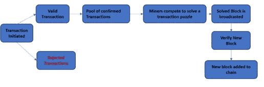**图 (1))**

区块链的基本操作。

对等方及其计算节点有责任执行每个操作。区块链中有两类参与者：发起交易的人和验证这些交易的人，后者称为矿工。如果有人想要转账，他们会发起一笔交易，其账本由双方维护。然后，为了验证、核实和广播，矿工会进入图景。这些交易被添加到交易池中，每个矿工都可以查看。如果所有矿工都验证区块并传输它，那么将会有多条链，而区块链是一条单一且一致的链式流动，这具有挑战性。所有矿工都竞争解决谜题以验证这些交易区块，为了赢得挑战，他们的节点计算能力应当很高。一旦某个矿工获胜，该节点就会将区块发送以进行共识验证。这是通过将信息广播到所有其他矿工来完成的。大多数矿工，至少 51% 应该同意这个新区块的添加。一旦验证通过，这笔交易就可以以区块的形式添加到原始区块链中。在成功添加此区块交易后，它就完成并被记录。这种解决谜题并最终能够添加区块的算法称为工作量证明协议。该协议需要大量计算能力。这是区块链工作量证明协议的最大缺点之一。因此，目前使用了各种其他协议，如权益证明，但它们都还没有像该协议一样成功。那么，矿工能获得什么呢？矿工通过管理区块链来赚取比特币。权益证明协议使用赚取的比特币来再次解决谜题以添加区块。因此，在这种情况下，他们不使用节点的计算能力，而是使用他们的收益。这看起来不错，但这里出现了双重支付问题。如果一个人拥有大量比特币，这些可以用来操纵原始区块链。

## 算法和技术

有两种技术用于高效的验证和核实：哈希和非对称密钥加密。

1\. 区块链的主要问题是它是一个分布式账本系统。因此，我们无法使用常规方法对其进行验证。必须有一种机制来在对等方之间建立信任。为此，可以使用公钥加密。公钥加密使用对称密钥的概念，这意味着加密和解密使用的密钥相同。对称密钥存在一些主要问题，例如从发送的数据中推导密钥以及秘密分发密钥。这种密钥分发是一项非常关键的任务，在对称加密中，它应该传递给每个参与者。区块链是一个分布式框架，这使得密钥分发更加困难。公钥加密通过使用两个不同的密钥而不是只使用一个密钥来解决这个问题。必须有两个密钥：一个必须是公开的，另一个应该是私有的。在这里，从消息中提取数据是可能的，因为使用公钥-私钥对加密的数据只能使用公钥来提取或解密。例如，如果一个人想要发送消息，那么该人应该使用其私钥加密数据，然后再使用接收者的公钥加密。接收者使用其私钥解密数据，然后再使用发送者的公钥。这确保了只有发送者可以发送数据，接收者可以接收数据。公钥-私钥对策略的一个流行算法是 Rivest Shamir Adleman (RSA) 算法。另一种算法是椭圆曲线加密，它比 RSA 更强大，因为它使用更多的位数，从而增加了安全性和复杂性。ECC 用于各种区块链技术，如比特币和以太坊，用于区块生成，作为区块链的补充。

2\. 哈希：它在区块链的数据完整性和保密性中起着关键作用。哈希函数将输入数据转换为唯一的固定长度值。为哈希函数选择的算法应该是单向函数，并且应该是抗碰撞的，或者表现出极低的碰撞概率。第一个要求是确保没有人可以从哈希值中推导出被哈希的原始项目。第二个要求是确保哈希值唯一地代表被哈希的原始项目。两个不同的数据集映射到相同哈希值的概率应该极低。这些要求可以通过选择强大的算法（如安全哈希）以及在哈希值中使用适当数量的位数来实现。最常见的哈希大小是 256 位，常见的函数是 SHA-3、SHA-256 和 Keccak。

### 3\. 交易完整性

它通过唯一保护账户地址来工作；发送方应在交易前使用数字签名进行身份验证，并确保所发送消息的内容。在区块链中，哈希和公钥加密都被使用。第一步是使用公私钥生成地址。最初取一个 256 位随机数并将其保留为私钥，使用代码对其进行保护。其次，使用 ECC 算法从公钥生成私钥，之后，用户将拥有公私钥对。最后，使用哈希函数从公钥中提取账户地址。任何交易都需要验证其完整性。为此，需要对交易应用数字签名，并对数据进行哈希和加密。接收方分别获得这两样东西：原始数据和经过数字保护的哈希键。接收方随后需要从原始消息中重新计算哈希，并将其与接收到的安全哈希键进行比较。如果匹配，则接收方可以确保数据完整且未被更改，因此用户可以接受它。否则，接收方可以拒绝该交易。原始键和检索到的键仅在消息完整时匹配，如果消息被更改，则键将不匹配并导致接收方拒绝。在接收方端，还会验证各种其他内容，如时间戳、余额和 gas 余额，`etc.` 使用此完整流程，可以检查完整交易的完整性。

### 信任要素和共识协议

可以通过使用特定协议在去中心化系统中建立信任。这可以通过验证交易和区块以防止篡改、验证交易资源的可用性以及执行和确认交易来实现。信任轨迹由以下操作定义：验证交易、验证 gas 和资源、累积交易、执行交易以获取新状态、形成区块、朝着共识努力、由出价者最终确定区块、以及每个人将区块添加到其链中并确认交易。安全链是具有单一主链和一致状态的链。添加到此链中的每个有效区块都会增加链的信任级别。

**共识机制：** 这是矿工之间达成共识以验证交易的一种方式，因为这是一个分布式账本环境，用户无法集中验证或验证它 \[4\]。共有两种已知的共识机制：

**工作量证明：** 在区块链中，每个矿工都必须竞争，成为第一个在链中添加区块的人。每个矿工都会竞争在最短时间内获得唯一的哈希键。为此，他们必须在 PoW 中使用其核心计算资源。然后，用于哈希计算的此类获胜解决方案交易将被批准，并向区块链添加新区块。这些矿工使用大量计算资源以创纪录的时间评估哈希函数。PoW 协议用于以最小计算资源计算哈希函数。

**权益证明：** 由于挖矿涉及大量计算能力，权益证明根据持有的比特币份额分配挖矿能力。这将确保只有授权人员才能挖矿并攻击链。唯一使用此技术的加密货币是山寨币。该算法的一个主要问题是，用户可能滥用其高份额的权力。

### IOT 安全

物联网（IOT）是智能设备之间的互连，它们相互通信。当我们谈论智能设备时，这意味着它们能够以某种方式监控、控制、优化和自动化流程。这些设备可以是任何东西，例如网络设备、家用电器、可穿戴设备、传感器、工业仪器/机器、车载传感器或任何嵌入式设备。

**IOT 中的挑战** 随着周围智能设备数量的增加，IoT 是连接所有设备的新兴技术。由于 IoT 是目前最受关注的技术，旨在连接设备。由于设备的这种异质性，当前 IoT 系统面临着各种挑战。一方面，IoT 是各种企业和行业追捧的技术，但它也导致了各种挑战。IoT 中的挑战 \[5\] 基本分为两类- 技术挑战和安全挑战 \[6\]。技术挑战主要关注对等节点或节点的计算能力、它们的互连、带宽消耗以及各种性能参数调整。这些问题可能与硬件相关，也可能与软件相关。而安全问题可以从安全数据存储、数据传输、密钥分布、`etc.` 范围不等。一些主要挑战在图 (**2**) 中列出。

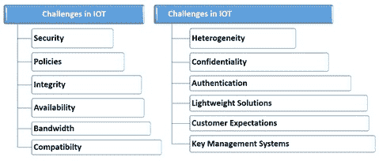**Fig. (2))**  

IoT 的主要挑战。

1.  **安全性：** 问任何专家这个时代最大的挑战是什么，他们都会立即说是 IoT 设备的安全性。随着设备数量的增加，IoT 增加了攻击表面。攻击者不攻击主设备，而是利用存在安全漏洞的设备。例如，在 2017 年，一家赌场是通过鱼缸中的恒温器被攻击的。大多数常见且具有破坏性的攻击是通过家用监控设备进行的，例如基于 IoT 的婴儿或老年人监控设备。有各种报告的案例，攻击者通过玩具、健康监控设备、可穿戴设备、`etc.` 进行攻击。

2.  **监管政策：** 必须制定标准政策，以便以非常有效的方式妥善管理、保护和传输数据。缺乏此类强有力的政策是 IoT 安全问题的主要原因之一。由于使用了如此多的设备，攻击表面扩大，使得这种情况变得更加复杂，而且这些设备可以是任何东西，例如玩具、医疗仪器、汽车、调制解调器 `etc.` 所有当前制定的政策在各种 IoT 场景中都不起作用。应制定政策来促进和标准化 IoT。IoT 中的质量控制可能非常复杂，由于从其他国家进口了各种传感器和设备，此类政策应在全球范围内被接受。

3.  **完整性：** 完整性是指在端到端设备之间安全地传递消息。数据在传输过程中可能会损坏。应确保消息安全传递。IoT 节点是计算能力非常低的设备，因此无法保证端点安全。唯一能做的就是在传输过程中保护消息。为此，可以使用端到端加密算法。有大量此类算法可用，但唯一的问题是这些算法应该是轻量级的。

4.  **可用性：** 有大量的 IoT 数据需要在需要时随时可用。IoT 的一个重要特性是时序数据，它旨在按时可用以实现所需的结果和分析。

5.  **带宽：** IoT 设备基于分布式模型工作，而传统内容分发系统基于中央服务器模型。随着越来越多的设备定期加入，这种情况会变得更糟。此外，每个设备的带宽要求各不相同，可能会出现一种情况：一个高带宽设备导致其他设备出现带宽短缺。这可以通过在各种移动设备之间智能切换带宽来管理。

## 6. 兼容性

市场上有如此多来自不同制造商的设备，兼容性是一个大问题。我们都在家中安装智能设备时遇到过这些问题。为了解决这个问题，可以借助公司提供的软件补丁来获得一些帮助。但这同样是一个问题，因为我们无法确保每个设备都具备自动更新系统。当设备运行在不同版本时，这些问题会加剧，导致性能下降和安全问题。因此，大多数设备需要保持自身维护。

## 7. 异构性

IoT 设备可以是网络设备、家用电器、可穿戴设备、传感器、工业仪器/机器、车载传感器或任何嵌入式设备，它们具有广泛的功能、连接性和供应商。如此广泛的设备之间进行网络互连是一个高度复杂的问题。因此，IoT 的主要问题之一是建立连接，连接这些具有不同工作协议和连接问题的异构设备。

## 8. 机密性

智能设备可以是人或任何参与收集数据、管理数据或分析数据的设备。此类数据可能非常关键，因为它可能包含非常敏感的数据，例如个人信息、健康信息、`etc.` 这些数据不仅需要防止外部世界的访问，还需要防止其他节点的访问。机密性还意味着数据应仅由真实设备接收和处理。

## 9. 身份验证

IoT 网络中可能有大量设备，所有设备都应经过身份验证，因为有许多攻击者可能伪装成网络的真实部分。网络中的所有设备都应最初经过身份验证，然后每个试图加入的节点应由中央权威机构或通过相互同意进行验证。

## 10. 轻量级解决方案

这可以被视为一个方面或约束，因为所有设备都应节能且与 IoT 算法和协议兼容。另一方面，我们可以说，为 IoT 设备设计的所有算法都应是轻量级网络协议。因为高能耗协议与 IoT 结构不兼容。

## 11. 客户期望

IoT 市场是一个面向客户的细分市场，除非它不是一个完整的基础设施设置，在大多数场景中我们处理的是小型手持设备或日常使用的电器。在日常使用中，设备数量正在迅速增加，在如此竞争激烈的环境中，客户满意度是一个非常重要的因素。应满足用户的期望，否则竞争非常激烈，各种制造商会推出同类设备。产品应是市场上最好的，并符合用户的期望。

## 12. 密钥管理系统

IoT 设备的信息传输应使用加密策略进行保护。这里的一个约束是，它必须是一个轻量级密钥管理系统，以实现可信的数据交换。密钥分发应消耗最少能量，以延长设备的使用寿命。有各种加密算法可以非常高效地运行，但我们需要具有计算能力的节点。因此，使用轻量级密钥管理进行安全数据管理是一个关键问题。

## 正在进行的研究

### 使用区块链的 IoT 安全

区块链通过安全的数据传输来保护 IoT 设备之间的数据通信。Rathee G. `et al.` `[7]` 建议使用区块链技术保护 IoT 中的无线通信。为了确保设备是经过身份验证的设备，跟踪任何设备活动，并在对等节点之间保持保密性和透明度，所有对象都被添加到区块链中。所建议的方案还用于从各种节点提取信息，并将提取的数据保存到区块链中。这确保了提取数据的安全性以及分布式节点之间的透明度。它的工作方式与我们在前面部分讨论的区块链工作原理相同。任何试图加入网络的设备都应由网络中的现有节点进行身份验证。如果超过特定阈值数量的用户接受该节点，那么其中一个节点可以将新用户添加到现有区块链中。同样的概念也适用于生成的消息。添加节点或传递消息的过程会产生交易，每个交易都可以按顺序编码的哈希方法维护为不可更改的成功交易链。只有成功的交易才会出现在链中。所有消息都作为不可修改的不可更改账本发布，每个 IoT 节点/对等体都维护共同账本，就像网络中的所有其他对等体一样 `[8]`。Agrawal, R. `et al.` `[9]` 提出了一种基于区块链的 IoT 结构，其中信任通过不可更改的去中心化区块链来维护。由于区块链本质上是分布式的，使系统更能抵御故障，这提出了一种使用设备身份验证来保护系统的方法，无需任何外部干预。每个节点交互都保存为区块链块，使其使用经过身份验证，并保存为 IoT 区块链。使用各种预测模型为用户身份验证生成加密令牌。这些加密令牌随后使用集成方法进行改进，这些方法使用最有效的模型。Huh, S. `et al.` `[10]` 使用公钥-私钥对加密数据，并将公钥保存在以太坊区块链上，私钥存储在各个设备中。这样他们就可以以高效的方式轻松构建密钥管理和分发系统。使用区块链管理密钥是一件非常常见的事情，但他们明确使用了以太坊，因为他们希望以细粒度的方式进行管理。这可以与部分 IoT 实现与完全规模的 IoT 系统进行比较。结论表明，结果显示性能更好，因为完整系统没有兼容性问题，而部分设备与部分结构集成则存在兼容性问题。他们的案例研究是关于智能电表的。他们使用来自智能电表和智能手机的数据。使用以太坊智能合约，他们不断分析来自智能电表的数据，智能手机用于向空调和灯泡发送指定策略。这些设备不断检查以太坊智能合约中的策略更新以保持更新，并在必要时切换到节能模式，然后根据需要切换回正常模式。他们只创建了一个小规模的实验设置，需要检查是否可以与多个设备一起扩展。与多个设备可能面临的主要问题是，随着设备数量增加，可能会出现同步问题，进而导致请求增加 `[11]`。此外，我们的轻量级 IoT 设备将无法并行处理如此多的请求，这会导致拒绝服务。

### 使用雾计算的 IoT 安全

## 雾计算是与物联网技术和应用框架兼容性最好的技术之一

Tange K. *et al* 提出了雾计算启用的身份验证 \[12\] 以保护物联网网络。这可以通过使用雾节点作为身份验证系统，而不是任何第三方身份验证服务器要求来实现。雾节点满足物联网网络的所有要求，因为它轻量级、位于网络本地，从而导致通信开销极低且响应时间快。此外，雾节点可以充当网络的一部分，同时也可以用于第三方通信和数据传输，而不会出现任何安全漏洞问题。这还通过将部分身份验证控制权转移到雾节点来增强我们的网络，从而减少了轻量级物联网节点的计算量。在物联网安全中使用雾节点的一个开放挑战是出于安全目的隔离雾节点。与传统系统一样，安全措施非常差，在这些系统中，雾节点隔离是一项困难的任务，也是研究人员面临的开放挑战。

## 基于机器学习的物联网安全

物联网网络具有异构性，包含各种设备、不同种类的协议和算法，大规模部署，使用低功耗和低成本的通信在近距离内进行连接，且不涉及中央机构。它还应具有自组织和自愈特性，这些特性应以高安全性和智能性进行动态管理。对于这种受限网络，机器学习是最合适的技术之一。机器学习算法可以在任何外部干扰 \[13\] 下自行训练。此类网络可以相应地适应，并基于运行时收集的动态数据进行未来预测。它可以响应随时间变化的特定问题。它可以用于检测威胁和恶意软件。例如，Google 使用 ML 来识别移动设备和终端中的潜在威胁。但 ML 并不是足够好的解决方案，因为存在误报和漏报，但我们仍然可以信任基于 ML 的强化学习或无监督学习技术 \[14\]。基于 ML 的解决方案需要监控模型修改和错误预测。Hasan, M. *et al* 使用了各种机器学习算法进行异常和攻击检测，并比较了各种技术在准确率、召回率、精确率、F1 分数、*etc.* 等参数上的表现。他们使用了各种技术，如决策树、深度神经网络、人工神经网络、随机森林、支持向量机，并得出结论：随机森林技术是早期预测各种攻击的最佳方法。但他们只研究了经典方法，而不是集成方法。此外，他们尚未制定完整的框架。

## 基于边缘计算的物联网安全

物联网与边缘计算是一个高度研究的领域，因为它融合了云计算，而物联网与云计算从研究角度来看是当前技术。Wang, T. *et al.* \[15, 16\] 提出边缘网络在实现基于信任的消息传递框架以满足特殊服务要求方面非常可靠。他们得出结论，基于边缘的安全框架可以帮助增强基于云的物联网结构的安全性、效率和性能。Bhardwaj K. *et al.* \[17\] 建议可以使用边缘节点来减少网络中的 DDoS 攻击。众所周知，在我们的物联网网络中，设备非常轻量级，计算能力低，因此容易受到 DDoS 攻击。这些攻击之所以成功，是因为我们的网络计算能力非常低。在基于边缘的网络中，为边缘节点提供了高计算能力，其计算能力可以用于抵御此类攻击。这导致此类攻击的早期检测，从而减少损失。他们的实验研究证明，检测速度提高 10 倍可以减少 82% 因 DDoS 攻击造成的互联网流量。边缘计算可以帮助解决安全漏洞问题、数据合规性问题、安全问题和带宽问题。数据泄露问题通过将数据保留在网络内部来解决。使用边缘网络，我们不需要将数据发送到外部世界，从而最大限度地降低数据泄露的可能性。此外，在许多国家，数据合规性法律规定数据不得移出网络，我们正在非常高效地使用边缘节点来维护这一点。安全问题是物联网设备的主要关注点之一，如果将数据传输到决策节点时出现哪怕一点延迟，可能会导致各种安全问题。例如，如果我们正在为可穿戴设备创建一个带有 SOS 按钮的女性安全应用程序，如果传输该数据时出现哪怕一点延迟，可能会导致各种危险。在物联网中，由于各种节能策略，我们无法将每个数据都传输到中央云节点。边缘节点通过在本地分析数据并仅以安全的方式传输关键数据来帮助我们减少通信开销，该方式通过位于物联网网络内外的边缘节点与中央计算云节点之间的点对点身份验证实现。

## 基于密码学/隐写术的物联网安全

密码学在物联网中并不是一种常用的技术，因为密码学算法过于复杂，无法在轻量级物联网节点上执行，但仍有一些学者尝试了这种方法。Henriques S. *et al.* 提出了一种同时使用非对称和对称密码学的身份验证方法，以保护物联网设备之间的通信。这导致了时间消耗的减少，尽管采用了非对称方法。每次都会取一个随机会话密钥，这提高了对称加密方法的安全性。这使得系统更具抗攻击性，并解决了会话密钥分发问题。可以通过使用更复杂的加密技术或使用哈希来进一步改进，但唯一的障碍是物联网节点的计算能力较低，无法执行高端加密算法。Sridhar S. *et al.* \[18\] 提出了轻量级双重身份验证密码学方法。使用轻量级非对称密码学来在传感器节点和设备网关之间提供身份验证。传感器节点的唯一 ID 和设备网关的唯一 ID 被用于使用 AES 算法创建秘密密钥/数字证书。设备网关和云服务使用公钥加密数字签名进行相互身份验证。他们提出了一种双重身份验证方案，通过消除有故障和虚假的数据块来减少流量，从而提供了安全性，并通过减少带宽使用提高了性能。Khari M. *et al.* \[19\] 研究了椭圆伽罗瓦密码学算法，该算法加密了来自各种医疗来源的机密数据。然后使用矩阵 XOR 编码隐写术技术，将其嵌入低复杂度图像中。它还使用自适应萤火虫算法优化块选择，以降低计算成本。使用这种技术，任何数据都可以使用图像层以高效的方式安全传输。

## 区块链作为物联网安全的关键

我们可以得出结论，区块链是一项非常有助于物联网安全的赋能技术。它在区块链的其他各种挑战中也非常有帮助，例如完整性、保密性、身份验证和密钥管理解决方案。区块链的主要特点之一使其成为物联网安全理想解决方案，即其去中心化的特性，这使得攻击者的工作变得困难。由于物联网框架具有分布式特性，因此更容易受到攻击，这意味着由于设备数量庞大，攻破任何一台不受重视的设备都非常容易。我们也可以总结地说，物联网框架的攻击面更大，并且随着每增加一台设备而不断扩大，这无疑将继续增加。相反，区块链利用这种分布式特性来确保事物的安全。由于区块链是一种分布式账本系统，它维护不可更改的账本记录。这就是在区块链中保护数据的方式。分布式框架提高了系统的信任度。物联网和区块链相辅相成，使物联网容易受到攻击的因素是其分布式特性，而区块链利用同一因素使其更加安全。使用区块链去中心化物联网网络还有助于解决单点故障等问题，以及降低维护网络基础设施的成本。两家大公司 IBM 和 Samsung 合作开发了 ADEPT \[20, 21\]（Autonomous Decentralized Peer-to-Peer Telemetry），这是一个基于区块链的物联网系统。区块链系统用于创建分布式物联网系统，生成智能合约和点对点消息传递系统。ADEPT 的一个用途可以是各种智能家居电器。例如，一台完全自动化的洗衣机可以与其他设备通信，例如，如果许多设备同时插电，它可以推迟洗衣，从而实现电力负载平衡。如果机器出现问题，它可以根据需要创建维护或维修请求。目前，这看起来像是一个非常未来主义的项目，但它在不久的将来可以实现。当处理自己工作的智能设备被黑客攻破时，问题就出现了。一种解决方案是，家中所有其他设备都验证一台设备的真实性。让我们举个例子：所有设备都基于网络，所以假设我们的第一个智能设备，或者说我们区块链中的第一个区块是调制解调器。每当添加新设备时，其密钥是调制解调器密钥和新设备密钥的组合。维护一条链，其中区块的数量与家中智能设备的数量相同。如果任何一台设备被黑客攻击，那么所有使用其密钥生成的设备也将失去功能。这是区块链在保护智能家居物联网网络方面的基本用途之一 \[22\]。区块链应用不仅限于此，它们可以在物联网的不同领域有多种用途。

### 区块链物联网安全：实施挑战

区块链和物联网集成仍然存在各种问题。主要问题之一是所有其他设备对每个操作进行验证，这有时会非常耗时。此外，在拥有数千台设备的网络中，要获得大多数节点的同意将非常困难。对于每笔成功的交易，矿工需要相互竞争以验证交易。在这里，我们的对等节点和矿工节点都是轻量级设备，不具备如此高端的计算能力。解决此问题的一个可行方案是拥有一个定制框架来维护区块链。但同样，问题是要为此寻找不同的第三方平台供应商。即使有如此多的安全功能，我们也不能确定我们的网络没有任何安全漏洞。如果设备恶意或被黑客攻击，我们也需要大多数设备的同意。因此，我们可以说，如果进入这个网络很困难，那么将某人踢出网络也同样困难。组织应彻底调查其隐私要求，并选择合适的区块链类型，或请求开发定制区块链，直到现成的解决方案出现在大众市场上。

## 结论

本章探讨了两个最受关注的技术：区块链和物联网（IoT）。区块链是一种分布式账本系统，它创建不可更改的记录，从而产生高度安全的数据，而物联网是一种已融入我们日常生活的技术。区块链是一种去中心化的账本，记录点对点网络上发生的所有交易，这有助于在不涉及第三方的情况下移动数字资产。区块链技术已被广泛应用于各种工业和研究应用及领域，包括加密货币、金融交易、供应链管理、健康记录管理和研究、电子投票、密钥分发、融资创造以及保护公共数据。随着我们周围智能设备的普及，物联网是一项新兴技术，用于连接这些物品。安全性、监管政策、完整性、可用性、带宽、异质性、兼容性、身份验证、保密性、轻量化、消费者期望和密钥管理系统是物联网的主要问题。它对其他区块链相关困难也非常有益，例如完整性、保密性、身份验证和关键管理解决方案。区块链的主要方面之一使其成为物联网安全的合适选择，即其去中心化的特性，这使得攻击者的工作变得具有挑战性。由于物联网框架的分散性质，它们更容易受到攻击。这意味着，由于设备数量庞大，攻破甚至一台不受重视的设备也将非常简单。

## 出版同意

不适用。

## 利益冲突

作者声明不存在任何利益冲突，无论是财务上的还是其他方面的。

## 致谢

无。

## 参考文献

|  ||  |

| --- | --- |

| \[1\] || Alladi T., Chamola V., Parizi R.M., Choo K.K.R.. Blockchain Applications for Industry 4.0 and Industrial IoT: A Review.IEEE Access2019717693517695110.1109/ACCESS.2019.2956748 |

| \[2\] || Nakamoto S.. Bitcoin: A Peer-to-Peer Electronic Cash System.Cryptography Mailing2009 [`https://metzdowd.com`](https://metzdowd.com) |

| \[3\] || Narayanan A., Clark J.. Narayanan\_Clark\_2017\_Bitcoin’s Academic PedigreeAcmqueueNarayanan\_Clark\_2017\_Bitcoin’s Academic Pedigree201715130 |

| \[4\] || Zhu L., Gai K., Li M.. Blockchain technology in internet of things.Springer International Publishing201910.1007/978-3-030-21766-2 |

| \[5\] || Atlam H.F., Wills G.B.. IoT Security, Privacy, Safety and Ethics.Springer International Publishing202010.1007/978-3-030-18732-3\_8 |

| \[6\] || Mahalle P.N., Anggorojati B., Prasad N.R., Prasad R.. Identity authentication and capability based access control (IACAC) for the internet of things.J. Cyber Secur. Mobil.201214309348 |

| \[7\] || Rathee G., Balasaraswathi M., Chandran K.P., Gupta S.D., Boopathi C.S.. A secure IoT sensors communication in industry 4.0 using blockchain technology.J. Ambient Intell. Humaniz. Comput.202112153354510.1007/s12652-020-02017-8 |

| \[8\] || Minoli D., Occhiogrosso B.. Blockchain mechanisms for IoT security.Internet of Things20181-211310.1016/j.iot.2018.05.002 |

| \[9\] || Agrawal S.. R., Verma, P., Sonanis, R., Goel, U., De, A., Kondaveeti, S. A., & Shekhar, “Continuous Security in IoT Using BlockchainIEEE Int. Conf. Acoust. Speech Signal Process.64236427.201810.1109/ICASSP.2018.8462513 |

| \[10\] || Huh S., Cho S., Kim S.. Managing IoT devices using blockchain platformInt. Conf. Adv. Commun. Technol. ICACT464467.201710.23919/ICACT.2017.7890132 |

| \[11\] || Lone A.H., Naaz R.. Applicability of Blockchain smart contracts in securing Internet and IoT: A systematic literature review.Comput. Sci. Rev.20213910036010.1016/j.cosrev.2020.100360 |

| \[12\] || Tange K., De Donno M., Fafoutis X., Dragoni N.. A Systematic Survey of Industrial Internet of Things Security: Requirements and Fog Computing Opportunities.IEEE Commun. Surv. Tutor.20202242489252010.1109/COMST.2020.3011208 |

| \[13\] || Xiao L., Wan X., Lu X., Zhang Y., Wu D.. IoT Security Techniques Based on Machine Learning: How Do IoT Devices Use AI to Enhance Security?IEEE Signal Process. Mag.2018355414910.1109/MSP.2018.2825478 |

| \[14\] || Hussain F., Hussain R., Hassan S.A., Hossain E.. Machine Learning in IoT Security: Current Solutions and Future Challenges.IEEE Commun. Surv. Tutor.20202231686172110.1109/COMST.2020.2986444 |

| \[15\] || Wang T., Zhang G., Liu A., Bhuiyan M.Z.A., Jin Q.. A secure IoT service architecture with an efficient balance dynamics based on cloud and edge computing.IEEE Internet Things J.2019634831484310.1109/JIOT.2018.2870288 |

| \[16\] || Sha K., Yang T.A., Wei W., Davari S.. A survey of edge computing-based designs for IoT security.Digital Communications and Networks20206219520210.1016/j.dcan.2019.08.006 |

| \[17\] || Bhardwaj K., Miranda J. C., Gavrilovska A.. Towards IoT-DDoS prevention using edge computingUSENIX Work. Hot Top. Edge Comput. Hot Edge, co-located with USENIX ATC2018 |

| \[18\] || Sridhar S., Smys S.. Intelligent Security Framework for IoT Devices.Int. Conf. Inven. Syst. Control Intell.201715 IEEE.. |

| \[19\] || Khari M., Garg A.K., Gandomi A.H., Gupta R., Patan R., Balusamy B.. Securing Data in Internet of Things (IoT) Using Cryptography and Steganography Techniques.IEEE Trans. Syst. Man Cybern. Syst.2020501738010.1109/TSMC.2019.2903785 |

| \[20\] || Summary E.. Empowering the edge.201418 |

| \[21\] || Corporation I.B.M.. Empowering the edge - Practical insights on a decentralized Internet of Things IBM Institute for Business Value2015 [`https://www-01.ibm.com/common/ssi/cgi-bin/ssialias? subtype=XB&infotype=PM&htmlfid=GBE03662USEN&attachment=GBE03662USEN.PDF`](https://www-01.ibm.com/common/ssi/cgi-bin/ssialias?subtype=XB&infotype=PM&htmlfid=GBE03662USEN&attachment=GBE03662USEN.PDF) |

| \[22\] || Dorri A., Kanhere S.S., Jurdak R., Gauravaram P.. Blockchain for IoT security and privacy: The case study of a smart home.IEEE Int. Conf. Pervasive Comput. Commun. Work. PerCom Work.201761862310.1109/PERCOMW.2017.7917634 |

## 分布式账本技术及其潜在应用——金融领域

**Sachin Sharma**^(1, \*)****,** **Kamal Kumar**^(2)**

¹ Computer Science and Engineering, Maharishi Markandeshwar (Deemed to be) University, Mullana, Ambala, India

² Computer Science and Engineering, National Institute of Technology Uttarakhand, Srinagar, Garhwal, India

## 摘要

区块链的概念在过去十年中展现出了巨大的潜力和增长。区块链和分布式账本技术等术语被混用。许多研究工作致力于解释和利用分布式账本技术在金融领域的优势。数字货币或加密货币是一种基于区块链概念的技术货币。

**关键词：**`Bitcoin`, `Blockchain`, `Digital Currencies`, `Digital Ledger Technology`, `Financial Inclusion`, `Financial Sector`, `Smart Contracts`。

* * *

^(\*) **通讯作者 `Sachin Sharma`：**Computer Science and Engineering, Maharishi Markandeshwar (Deemed to be) University, Mullana, Ambala, India; E-mail: `er.sachinsharma@gmail.com`

## 引言

DLT 利用现有的对等技术，例如互联网电话、电子邮件、文件共享和互联网。匿名人士“中本聪”于 2008 年撰写的一篇基准论文《比特币：一种点对点电子现金系统》，介绍了一种名为“比特币”的 P2P 技术的资金转移独特方法。中本聪论文中描述的技术被称为区块链，它解释了一种存储和组织信息及交易的新方式。其他形式的信息传输和交易技术被设计出来，“分布式账本技术”这一术语被创造出来。DLT 在账本（多个数据存储）之间记录和共享数据，每个账本由分布式计算设备控制和管理，并拥有相同的数据记录副本。这些计算设备被称为节点。DTL 可以理解为一种具有独特属性的分布式数据库。区块链是一种特殊的 DLT，它利用算法和密码学技术生成和验证仅追加的增长数据结构。该数据结构以交易块（链）的形式充当账本，被称为区块链。其中一个节点创建一个新的数据块，该块包含多个交易记录。

其中一个节点发起数据库添加，进而生成一个包含多个交易记录的新数据“块”。此新块信息（以加密格式）分布到整个网络以维护数据隐私。此块的有效性由每个网络参与者使用共识机制（算法验证方法）来确定。验证后，新块被添加到所有参与者的各自账本中。使用此方法，账本的每次更改都会导致整个网络中的账本复制，整个相同的账本随时可供每个网络成员使用。该技术可用于任何数字交易记录。参见 Fig. (**1**)（“迪拜旨在成为基于区块链建造的城市”。作者：Nikhil Lokhade，2017 年 4 月 24 日，《华尔街日报》 [`https://www.wsj.com/articles/dubai-aims-to-be-a-city-built-on-blockchain-1493086080`](https://www.wsj.com/articles/dubai-aims-to-be-a-city-built-on-blockchain-1493086080)）。

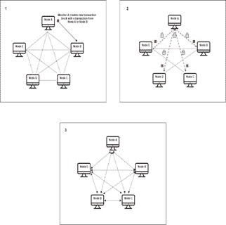**Fig. (1))**

基于区块链的 DTL 工作原理。

1\. 基于区块链的 DLT 系统构成一个仅追加的数据块链。其中一个节点发起数据库的新添加，并创建一个包含多个交易记录的新数据块。

2\. 关于新数据块的信息在整个网络中共享。交易详情包含加密数据。

3\. 所有网络参与者使用“共识机制”来确定块的有效性。验证后，每个参与者将新数据块添加到各自的账本中，以便整个账本的完整相同副本在整个网络中复制。

基于 DLT 的解决方案的两个特征是：

1. 它消除了集中式记录保存、存储、记录和分发数字信息的需求，这些操作在自管理的交易对手之间进行。

2. 它还消除了双重支付，这意味着同一个代币不能分发给多个交易对手。

## DLT 的近期工作

## 经济的货币政策由中央银行控制

经济的货币政策由中央银行控制。中央银行控制经济的相关经济管理工具。中央银行的职责是控制经济中的货币供应量以及包括利率管理、保持基本商品价格稳定在内的货币政策的部署 \[1\]。中央银行对特定经济体的货币发行拥有垄断权 \[2\]。2009 年比特币的出现 \[3\] 推动了将替代货币模式作为数字货币或加密货币的概念。这种新形式的替代货币可以由私营部门参与者或个人管理。比特币发明后，私营部门组织或个人在过去十年中发行了五千多种加密货币 \[4\]。这些货币的共同属性是它们基于数字账本技术，且不受任何有形资产控制。这些货币包括比特币 \[3\]、恒星 \[5\]、瑞波币 \[6\]、以太坊 \[7\]、泰达币 \[8\] 等。

针对金融市场的严格法规和当地法律要求，正在为去中心化数字货币带来挑战。考虑到数字货币的增长和机遇，中央银行正在投资于由中央银行和政府支持的数字货币的研发，以保持货币政策和金融市场稳定 \[9, 10\]。国际清算银行（BIS）最近进行了一项调查 \[11\]，以分析中央银行在中央银行数字货币研究项目方面的努力。绝大多数中央银行（>70%）回复称，他们正在投资于发行中央银行数字货币（CBDC）的可能性。这项调查涵盖了不同司法管辖区的多样化地理区域，覆盖了全球超过 70% 的人口 \[11]。35% 的参与者来自发达经济体，65% 的调查参与者来自发展中经济体。中央银行数字货币组织的级别分类为 a) 早期采用者，b) 跟随者和 c) 新进入者。

## 早期采用者

早期采用者是指在 2015-2016 年期间开始投资该技术的组织。英格兰银行于 2015 年发布了其“单一银行研究议程” \[12\]。英格兰银行于 2016 年与伦敦大学学院合作开展其 RS Coin CBDC \[13\] 框架开发。中国的中央银行“中国人民银行（PBoC）”于 2016 年开始其 CBDC 之旅，旨在控制中国的货币供应量并优化支付系统的效率 \[14, 15\]。加拿大银行于 2016 年开始投资 CBDC，参与 R3 Project Jasper 和 Payments Canada \[16\]，随后开始分析 DLT 以用于该国的支付转型。德国中央银行“德国联邦银行”于 2016 年初启动“BLOCKBUSTER”项目，以利用数字账本进行德国的银行间结算 \[17\]。法国银行于 2016 年 6 月中旬启动“MADRE”项目，用于数字货币。巴西中央银行于 2016 年 9 月启动了“SALT”项目 \[18\]。美国联邦储备系统于 2016 年 9 月发布了其首份中央银行数字货币报告 \[19\]。2016 年 11 月，新加坡中央银行和金融监管机构启动了 Ubin 项目。日本银行和欧洲央行于 2016 年 12 月启动了 Stalla 项目 \[14\]。

## 跟随者

在 2017-2018 年期间开始投资分布式账本技术的组织被归类为跟随者。香港金融管理局（HKMA）于 2019 年 3 月启动了数字货币项目 LionRock \[20, 21\]。其目标是利用分布式账本技术进行香港国内市场的银行间结算。芬兰银行分析了通用型中央银行数字货币与现金之间的异同，并于 2017 年 5 月发表了一篇研究论文 \[22\]。为解决瑞典现金使用量下降的问题，瑞典中央银行于 2017 年 9 月启动了 e-Krona 项目 \[23, 24\]。为解决乌拉圭的金融包容性问题，乌拉圭中央银行于 2017 年 11 月启动了其中央银行数字货币项目“e-Peso” \[25\]。为分析数字货币 e-Shekel 的好处，以色列银行组建了一个研究团队。丹麦国家银行对中央银行数字货币及其对丹麦金融市场基础设施的影响进行了高层次探索，并于 2017 年 12 月发布了其中央银行数字货币报告 \[26\]。南非储备银行（SARB）于 2018 年 1 月启动了 Khokha 项目，以利用 DLT 在银行间支付结算领域带来好处。SUPCAVEN 在委内瑞拉启动了 Petro 项目，以克服对美元的依赖并对抗美国和欧盟的制裁 \[27\]。为促进立陶宛的金融服务业，2018 年 3 月引入了一个名为 LBChain 的基于 DLT 的沙盒 \[28^(\-)30\]。瑞士国家银行于 2018 年 4 月分析了 DLT 在瑞士金融部门的适应性 \[31\]。挪威银行（Norges Bank）于 2018 年 5 月揭示了中央银行数字货币的第一阶段 \[32\]。新西兰储备银行于 2018 年 5 月发布了一份报告，探讨了 DLT 在优化支付系统效率方面的作用 \[33\]。泰国银行于 2018 年 8 月启动了 Inthanon 项目 \[34》，以探索 DLT 在泰国金融市场基础设施领域的潜力。

## 新进入者（2019）

2019 年 2 月，韩国银行发布了一篇研究论文，评估基于账户的通用型 CBDC（GA-CBDC）对金融市场稳定的影响，采用了两种不同的货币一般均衡模型 \[35\]。日本银行发布了其首份官方论文 \[36\]，评估 CBDC 对 FMIs 支付效率的潜在影响。

2019 年 5 月，加拿大银行和 MAS 发布了 Jasper-Ubin 项目 \[37\] 报告，这是世界上第一个 CBDC 实验，实现了在两个不同的 DLT 平台上以两种不同货币计价的跨境银行间支付结算。Jasper-Ubin 项目基于一种替代的跨境银行间支付结算模型 \[38\]。在 ECB 的主持下，ECB 加密资产特别工作组于 2019 年 5 月发布了关于加密资产的分析 \[39\]。该论文为加密资产提供了标准化定义，并从货币政策角度考察了它们对更广泛经济的影响。

## DLT 特性与属性

本节介绍了本研究工作的初步内容以及模拟环境。

### 基于 DLT 的区块链在数字货币中的应用

DLT 自发明以来就与数字货币密切相关，因为它被预期为比特币的底层技术。中本聪发表了一份白皮书，将该技术描述为“基于加密证明而非信任的电子支付系统，允许任何两方在无需可信第三方的情况下直接相互交易” \[40\]。

比特币的区块链技术作为解决“双重支付”问题的方案出现，而双重支付曾是货币数字化转型的挑战。在比特币发明之前，交易验证由可信的中央机构处理以避免双重支付。DLT 的妙处在于，它通过由匿名各方管理且彼此之间无需建立信任的去中心化账本，利用加密解决方案保护系统完整性并提供安全性。设计比特币区块链的动机是创建一种基于数字平台、不受政府控制并隐藏网络参与者身份的虚拟货币。与 HTML 或 HTTP 不同，比特币在最初是一个意识形态项目，深深植根于其诞生的在线社区（被称为“密码朋克”）的反审查意识形态中，该社区推崇一种激进的技术自由主义 \[41\]。除了数字货币，DLT 技术还有许多潜在应用。由于“匿名性”特性，比特币在犯罪分子中变得流行，并被用于金融欺诈和其他非法活动。交易双方的匿名性得以维持，但所有比特币交易对公众可见，并记录在分布式账本中。一笔比特币交易可以与特定的匿名实体关联。这种匿名过程类似于电子邮件地址的匿名性。所有比特币交易都包含假名，其中包含发送方和接收方的钱包地址。就像电子邮件一样，交易地址是已知的，但所有者可以保持匿名。

比特币区块链的许多特性引起了监管机构和政府的警觉，并影响了加密货币的声誉。使用计算机恶意软件的赎金要求显著增加，且赎金要求以比特币形式支付以实现交易匿名性。比特币交易所缺乏监管，比特币的数据丢失问题是一个重大挑战。丢失钱包的私钥可能导致钱包中全部资金的损失。

### DLT 特性

具有基于角色权限的集中式账本，可由网络中授权参与者编辑，长期以来一直在使用。不可变且分布式账本的概念是通过 DLT 提出的。DLT 有三个关键特性：分布式账本、加密方法和共识机制。DLT 并非定义明确的技术；相反，它正在开发中，其设计取决于利益相关者的要求。

### 账本的分布式属性

DLT 的妙处和创新在于，单个实体不控制账本，而是由网络节点或决定的若干节点控制。这意味着在数字账本中，过去的数据条目不能被修改，或者对账本的新增内容不能由单个实体批准。为了在账本中形成新条目，使用共识机制（去中心化的性质）将新条目添加到区块链中。成功验证后，新交易将被修改到相应的账本中，以维持网络级别的数据一致性。

分布式账本技术的这一特性允许点对点网络参与者在不依赖可信中央机构的情况下，在其相应的账本中验证和记录数据。消除对中央机构的要求通过控制与账本对账和维护相关的工作来优化成本和速度。在没有单一攻击点的情况下，它也大大增强了安全性。网络中的大多数服务器必须被攻击者攻破才能损坏账本。损坏单个或部分网络参与者不会对系统的完整性产生任何影响。但是，如果设计不当，分布式账本之上的软件层可能容易受到攻击。软件层的设计问题给日本的 Mt. Gox 和 Bitfinex 带来了重大财务损失 \[42\]。

### 使用“共识机制”进行验证

网络中的节点需要就新数据条目的有效性达成一致。因此，在分布式账本的算法设计中引入了一种称为“共识机制”的机制。在分布式账本中，任何节点都可以提议向账本添加新交易。在分布式账本中，也可能只有少数节点被允许提议向账本添加新交易。利用数字账本共识机制的加密验证，验证特定交易的合法性。共识机制在同时出现竞争条目时也有助于解决冲突。在无许可数字账本的情况下，共识机制确保准确的交易排序并防止不良行为者接管。排序和共识机制有助于处理双重支付问题。“工作量证明”概念用于全球去中心化网络中以建立共识。在向链中添加每个新块时，“工作量证明”协议是必须的。这是一个难以解决但易于验证的复杂挑战。它涉及大量的计算能力和处理时间。工作量证明通过执行单向加密哈希算法（重复执行）直到产生满足预定义条件的数字字符串来实现。在比特币区块链的情况下，该数字包含前导零，工作量证明生成过程被称为“挖矿”。解决这个“工作量证明”谜题在计算上非常困难。没有昂贵的计算资源，网络中单个节点生成所需工作量证明的机会较小。比特币系统的设计方式是每十分钟产生一个有效的工作量证明。优先权给予难度分数更高的协议，这意味着如果同时生成两个工作量证明，则难度分数更高的协议被视为有效。实体“矿工”会以比特币形式获得奖励，以产生有效的工作量证明。这种奖励有助于维护系统完整性。网络安全性取决于大量被激励的节点，它们准确验证账本更改和共识建立，以维持网络中的数据一致性。“工作量证明”对参与者维护数字账本施加了沉重的计算成本。它在不信任参与者的系统中是必需的。

比特币矿工的电力消耗相当高。如果比特币网络扩展到类似万事达卡和维萨的水平，电力需求将超过全球现有的电力消耗。这个问题主要存在于比特币区块链中。以太坊数字货币使用的另一种 DLT 系统具有更快的共识机制，并需要显著更少的计算资源。在许可区块链中，网络参与者是受信任且预先选定的，因此他们不需要困难的“工作量证明”作为共识机制。还有其他共识机制提供优先于计算能力的机制，并要求某些资产的所有权证明，例如权益证明。图 (**2**) 解释了集中式账本和分布式账本（有许可和无许可）。

### 数字签名和哈希函数

每个新数据条目都使用原始消息上的哈希函数进行加密。这意味着一个原始输入只有一个哈希值，且不可能有另一个输入具有相同的哈希值 \[43\]。“交易块”包含这个经过哈希处理的交易，并有大小限制 \[44\]。哈希有助于检测交易数据篡改，因为哈希是在接收端计算的，如果发生篡改，生成的哈希将与原始哈希不同。图 (**3**) 解释了数字签名中的公钥加密。

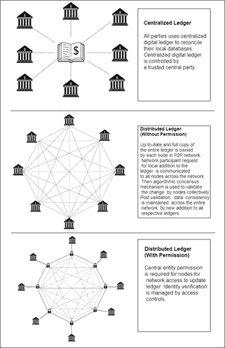**Fig. (2))**  

分布式账本。

交易块使用数字签名进行数字签名。“公钥加密”用于 DLT 中的数字签名。形成了“交易块”的仅追加链，其中包含要添加到账本的数字消息（哈希摘要）、共识机制输出（工作量证明）、使用发送方私钥对哈希的数字签名、发送方公钥以及交易的预期接收方。图 (**4**) 解释了区块链结构示例：在 4 个块的区块链中，最后一个块（块 5）被添加。块 1 是“创世块”。每个块包含对前一个块的引用以保持块的时间顺序，一个经过哈希处理的交易系列摘要和一个数字签名。

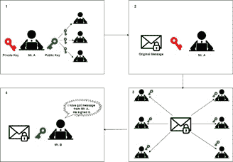**Fig. (3))**  

数字签名公钥加密。

在图 (**3**) 中，块 5 代表这个区块链的最新添加，用于更新账本。

一旦新块通过指定的共识机制添加到链中，链就不能追溯更改，除非对每个块重新执行工作量证明协议，否则块不能被删除或修改。这意味着随着链长度的增长，这变得越来越困难，因为所有节点都在不断竞争解决工作量证明难题并将新块添加到链中。在这样做时，他们只考虑反映最大计算工作量的交易区块链。每次成功添加到链中都会广播到整个网络，所有节点都拥有整个区块链的最新副本。

1\. A 先生有两个密钥：一个公钥，他与整个网络共享，以及一个只有 A 先生知道的私钥。

2\. A 先生使用他的私钥对数字消息的“哈希”进行加密，然后将其传播到整个网络。加密后的哈希被称为“数字签名”。

3\. 网络参与者接收带有数字签名的数字消息。

4\. B 先生然后可以使用 A 先生的公钥（他已与 B 先生共享）来验证数字消息是否使用了 A 的私钥进行加密，并且 A 先生是消息的发送方。

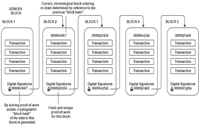**Fig. (4))**  

区块链结构。

## DLT 优势

分布式账本相对于集中式账本具有许多优势。优势如下。

### 无中间人且去中心化

DLT 消除了对中央机构的需求，并使双方能够在去中心化记录保存的情况下进行数字价值转移。这节省了成本，提高了可扩展性和速度。

DLT 通过编程实现自动化，在某些事件发生时自动执行预先商定的条件，*例如* 货物到达时自动支付发票。在数字账本中，交易对手方在交易完成时商定定义的条件，所有各方都拥有同一组交易记录。此外，“智能合约”的执行结果将导致对账的旧账本系统。

### 改进的可审计性和增强的透明度

每个网络节点都有加密分布式账本的完整相同副本。更改只有在实时网络传播的共识机制下才有可能。此功能有助于管理对账成本并减少欺诈。

### 永久性和可测试性

DLT 对任何资产都具有不可更改/永久且可测试的交易审计轨迹。交易的永久性并不意味着不能创建相反的有争议的交易。在这种情况下，原始交易记录仍然可用。

### 速度和效率提升

DLT 通过消除中介和自动化流程来优化效率并提高速度。

### 降低成本

DLT 消除了对账的需求，从而降低了成本，因为每个 DLT 都包含“共享真理”，不需要与另一个交易对手方验证一个“真理”。DLT 降低了账本维护的基础设施成本并减少了欺诈的可能性。分布式账本技术可以为金融行业节省 150 亿至 200 亿美元 \[45\]。

### 改进的网络安全弹性

DLT 提供了比集中式系统更灵活的系统，并且由于其分布式特性和没有单一攻击点，能更好地抵御网络攻击。与集中式设计范式相比，DLT 是去中心化运营模式和业务的替代设计范式。这将导致更高程度的自动化、可扩展性和更快的处理潜力。我们将通过比较集中式抵押品登记处与基于 DLT 的抵押品登记系统来理解这一点。在建立抵押品登记处的集中式方法中，由中央实体设立专用平台，然后建立会员资格标准并制定规则和程序。所有交易和操作均由集中式平台发起。该平台使用标准化软件开发工具开发，以满足特定业务要求。

相比之下，基于 DLT 的方法涉及点对点交易的抵押品登记处，具有对等方定义的条件，例如发布日期以及定义交易失败情况下规则的协议。基于交易对手方的协议，基于 DLT 的抵押品登记系统可以针对特定抵押品进行定制，而无需建立集中式系统。在基于 DTL 的系统中，管理员的作用微乎其微。业务操作可以在没有外部干预的情况下触发，并且是事件驱动的。由于管理员级别的资源需求有限，建立基于 DLT 的抵押品登记系统更快且可扩展。所有参与者共享处理负载，抵押品交易业务逻辑可以根据交易对手方的要求进行定制。

## DLT 风险和挑战

该技术正在发展，许多问题有待解决，包括监管和法律问题。有许多与迁移支付、金融基础设施和分布式账本技术相关的问题。安全结算系统和中央对手方需要紧密的协作和协调。DLT 的常见挑战包括监管、技术和法律，如下所示：

### 技术问题

#### 技术不成熟

DLT 仍处于婴儿期发展阶段，关于 DLT 的灵活性和稳健性存在复杂挑战。此外，还存在关于大量交易、熟练专业人员供应、软件应用程序可用性和标准化硬件的担忧。然而，顶级 IT 组织和金融巨头已开始投资开发 DLT 产品和服务，以提供与现有 IT 系统相同的信心。

#### 交易响应时间和可扩展性

当前无需许可的分布式账本在验证速度和交易量方面面临着区块链可扩展性问题。由于区块大小限制为一兆字节，比特币每秒仅处理 4-5 笔交易。有限的区块大小在比特币社区中一直是争议的焦点。增加区块大小可能会在网络中传播耗时，并导致分叉。以太坊 DLT 系统支持更高的交易吞吐量。许可型区块链透明度较低，更加集中化，但具有处理大量交易的更高能力。许可型区块链无法从开放性的分布式公共 DLT 系统中获得太多好处。

### 集成与兼容性

DLT 系统应与现有技术集成，并与其他账本兼容。将 DLT 集成到现有金融系统中的成本涉及巨额费用。目前正在开发一些框架，例如 `CORDA framework` 和 `Fabric framework`，以解决特定行业问题：

*   允许交易对手之间进行点对点交易；需要对交易对手的身份进行验证；
*   需要了解基础交易可见性；需要让监管机构访问交易；
*   保持原始法律流程与智能合约之间的等效性；
*   各种分布式账本之间的互操作性；
*   利用现有软件工具；
*   支持多种共识机制。

这些框架探索了与现有监管和行业惯例相一致的数字账本方法。`hyperledger framework` 最初专注于金融领域，并进一步扩展到供应链，而 `CORDA framework` 专门用于金融领域。

#### 网络安全

研究表明，每 1000 行代码中大约有 15-50 个错误 \[46\]。以太坊区块链上的 DAO 攻击证明，软件应用中的任何弱点都可能被利用造成有害影响。账本的分布式特性使得网络安全成为一个重要方面，以便保护 DLT 系统的核心规则免受攻击者侵害。在一种称为“51% 攻击”的攻击类型中，黑客控制了 51% 的网络资源，操纵共识并欺骗网络。网络的鲁棒性取决于其不允许任何实体控制特定区块链一半资源的能力。与这些数字账本交互的软件应用程序需要仔细监控和审查。当攻击者控制无需许可的系统，拥有身份详细信息并继续控制大多数网络参与者时，可能会发生这种情况。最近对多个以太坊节点使用标准分布式拒绝服务 (`DDos`) 攻击的攻击表明，现有的网络攻击技术可用于 DLT 系统。

需要注意的是，即使在 DLT 访问接口遭受成功攻击后，比特币和其他区块链系统的核心技术也从未被攻破。

#### 有效治理

缺乏中央实体或集中式基础设施对基础设施的整体有效治理提出了疑问。在 DLT 基础设施中做出关键决策非常困难。金融组织依赖于集中式监管机构来实现有效治理。在无需许可的 DLT 中，治理安排的适用性不明确。在许可型 DLT 中，管理员可能拥有也可能不拥有足够的权限和工具来确保网络节点之间的治理安排。

### 法律和监管问题

#### 行业标准和监管评估

行业标准和监管评估仍处于发展的初级阶段。全球金融监管机构积极参与技术分析，但实际的监管 DLT 框架尚缺失。

#### 管辖权和所有权 - 法律清晰度

在支付和结算系统中，关于交易“最终性点”存在明确的担忧。在数字账本环境中，如何描述“最终性点”是一个重大问题。跨境数字账本系统中未定义数据和交易管辖权。由于数字账本没有中央管理实体，因此对开放无需许可的分布式账本系统设置监管协议既棘手又困难。由于许可型账本中有中央管理员，因此监管框架的设置和维护相对简单且可行。

#### 客户尽职调查和了解你的客户

DLT 系统应强制遵循并整合客户尽职调查 (`CDD`) 和了解你的客户 (`KYC`) 实践，以打击资助恐怖主义 (`CFT`) 并防止洗钱 (`AML`)。无需许可的 DLT 系统的身份伪装特性使得遵守现有关于 `AML/CFT` 的监管指南变得非常困难，并允许未经审查的各方进行交易。一些 DLT 交易所通过提供优先交易时间和验证来推广 `KYC` 要求，前提是用户提供 `KYC` 信息。在许可型 DLT 系统中，由于集中式控制，遵守 `AML/CFT` 指南很容易。

#### 争议解决机制

在分布式账本的情况下，需要建立争议解决机制；尤其是在发生错误交易的情况下。一种解决方案是整合反向交易框架。在反向交易框架中，会发起一笔单独的交易以向原始发送方提供权限。为此，需要一套规则，这些规则可以在特定情况下执行以发起撤销。如果没有一套规则，错误交易可能会在访问资金时遇到问题。这些规则由一个称为方案所有者的中央实体管理，在传统系统（如 Visa、MasterCard `etc.`）中也是如此。在许可型数字账本中，此角色由数字账本管理员处理。在无需许可的数字账本系统中，智能合约自动化该角色。关于由于数字账本弱点而可能产生的损失责任存在担忧。在许可型系统中，这些问题比在无需许可的系统中更容易有效处理。

#### 隐私

在以太坊和比特币等无需许可的账本中，用户的身份不会被暴露。在某些情况下，可以根据交易模式等标记推断用户的身份。在许可型数字账本中，问题也是一样的。这是将数字账本技术应用于金融基础设施时面临的主要挑战，许多组织正在致力于其设计。

#### 基础设施成本

利用共识机制和工作量证明需要巨大的计算资源/基础设施，这导致挖矿的巨大功耗。

## DLT 应用

## 数字分类账技术在金融应用中的应用

数字分类账技术在包括金融行业在内的广泛行业中有许多应用。DLT 应用的两个潜在领域是：1) 金融科技公司正在探索利用区块链基础设施开发用于多种用途的数字应用程序；以及 2) 行业领导者正在投资研究，开发专有许可区块链，以解决特定于行业的企业解决方案的需求。金融行业对 DLT 及其概念证明有着巨大的兴趣。“Hyperledger” - 一个开源联盟拥有超过 170 个组织作为其成员；而“R3CEV” - 金融行业的区块链研发组织，拥有超过 100 名成员，包括商业银行、监管机构和其他贸易协会 \[47\]。包括纳斯达克、纽约证券交易所和伦敦证券交易所在内的证券交易所正在探索 DLT 以提高交易安全性 \[48\]。DLT 有能力改变每种股票的交易和发行方式，并有可能取代现有的证券交易所系统。

*   IBM 和东京证券交易所正在探索在低交易市场中使用区块链进行交易监控和记录。

*   美国证券交易委员会于 2015 年批准了一项计划，使用比特币区块链发行过剩公司股票 \[49\]。

*   “德国证券交易所” - 德国的证券交易所和中央银行正在开发一个用于数字资产交易的区块链框架 \[50\]。

*   韩国交易所 KRX 为初创公司股权股份推出了一个基于区块链的市场。这与韩国初创公司“Blocko”合作，名为韩国初创市场（KSM） \[51\]。

*   一家名为“数字资产控股”的初创组织和澳大利亚证券交易所正在测试 DLT 以优化清算和结算流程。

*   一个基于区块链的系统已开发用于交易后处理模式中的信用欺诈。该系统由三家技术组织开发 - IBM 和两家区块链初创公司 - R3 和 Axoni \[52\]。

## DLT 与金融包容性

DLT 有能力提高金融行业及其基础设施的韧性、可靠性和效率。尽管金融包容性得到了强劲扩张，但将被排除在外的社区纳入金融系统仍面临挑战。DLT 系统的好处可能会被金融机构和金融科技组织所利用。DLT 有潜力通过解决以下金融问题来增强金融包容性：

*   交易和抵押品证券的安全框架不完善。

*   合理的金融服务。

*   缺乏包括 KYC 可验证身份系统在内的尽职调查要求。

*   差劲的信用和支付基础设施。

*   国际汇款去风险化影响。

用于改善金融包容性的 DLT 应用：

*   资产登记

*   跨境汇款

*   数字货币

*   数字身份系统

## 跨境汇款与支付

跨境支付通常由一系列代理银行网络进行，涉及长时间延迟、高成本和不确定性。这些交易涉及多点交易费用，并且仅限于银行的营业时间。涉及的费用包括跨境转账费用（涉及支付基础设施的代理银行和其他中介组织）、接收机构收取的费用以及发送机构收取的费用。

非银行机构有自己的专有框架，涉及在接收机构预先资金以结算定期汇总金额并实现更快的发放。由于金融机构之间的合作和联系、成熟的系统以及对流程的高级优化，跨境汇款有了巨大的改善。然而，其中涉及的创新不多，服务费用继续占总成本的很大一部分 *i.e.* 20% \[53\]。DLT 可以取代代理银行系统，并通过在银行间跨境交易中提供成本降低来消除现有系统中的低效率。DLT 可以通过提高银行间和跨境转账的效率以及降低结算成本来进一步降低汇款价格。DLT 可以为代理银行系统开辟新方法，这可以进一步解决去风险问题。下面列出了一些示例：

## Ripple

Ripple 专注于跨境商业支付结合的跨币种资金结算。Ripple 使用一种独特的方法，涉及“路径”识别，用于特定货币中发送方资金流向接收方特定货币，利用一系列参与机构提供的服务（针对该货币）。这可以扩展微型汇款公司对外汇服务的访问，并发现更好的外汇价格。XRP 是 Ripple 自身的加密货币，已在许多加密货币交易所注册交易。Ripple 有自己的交易所，涉及欧元、美元、人民币和日元等主要货币的交换。该交易所还积极进行以太坊和比特币等加密货币的交换。上海华瑞银行宣布将在中美网络中使用 Ripple 进行其汇款产品 \[54\]。

## Abra

Abra 将实体银行柜员与加密货币相结合，提供点对点模式下的即时资金转账且无交易费用。在 Abra 中，跨境支付不需要银行账户；收款人的电话号码是唯一要求。除了比特币，Abra 还支持全球超过 50 种货币。

## Bitpesa

它为中国和一些非洲国家（如肯尼亚、尼日利亚、坦桑尼亚、乌干达）之间的个人和企业提供跨境支付 \[55\]。

## Bitt

它是加勒比地区的比特币交易所组织，专注于为 CARICOM 地区创建统一的支付结算网络。

## 智能合约

在 DLT 的背景下，“智能合约”是在底层分布式账本上开发并由网络节点自动执行的程序。智能合约可以执行计算机可以执行的任何指令。智能合约由分布式账本上的交易触发，结果存储在账本中。智能合约“允许在区块链交易之上编程逻辑” \[56\]。非区块链的数字账本也可以执行智能合约。相同的数据必须对所有网络节点可用，因此每个节点都应验证智能合约。

智能合约一词最早由 Nick Szabo 于 1997 年提出，他以自动售货机为例来解释智能合约的概念 \[57\]。自动售货机管理资产所有权，并在投币时转移资产所有权。自动售货机确保遵循“合同”条款，该条款定义了条件、底层资产、其输入和后续操作。计算机程序将自动执行预定价格的证券销售或购买。智能合约的应用可能包括并购、衍生品市场和证券交易。

DLT 系统为智能合约提供了一个平台，用于控制股票、土地所有权等现实世界资产，而无需第三方（如土地登记管理员或经纪人）的参与。之所以可能，是因为分布式网络节点能够执行代码和合同强制执行。图 (**5**) 解释了智能合约在贸易金融中的应用。类似的基于 DLT 的方法可以应用于其他领域，如抵押品登记或抵押贷款流程。

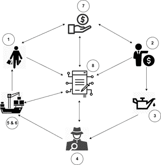**图 (5))**

贸易金融智能合约。(ING/《华尔街日报》– “银行转向虚拟世界以现代化实物商品交易”，作者：Stephanie Young，2017 年 4 月 4 日，《华尔街日报》[`www.wsj.com/articles/banks-`](https://www.wsj.com/articles/banks-) turn-to-virtual-world-to-modernize-physical-commodities-trading-1491 303623)

智能合约吸引了商人，因为它们有助于实现自动化组织的理念，该组织除资金支持人员外，不依赖任何人工输入。在世界上最大的公共区块链中，以太坊是针对智能合约应用进行良好优化的平台。去中心化自治组织（DAO）已在以太坊平台上为自动化业务推出了风险投资基金。DAO 的运作方式如下：

*   智能合约由一群人制定，用于运行组织。

*   人们提供资金（在初始资金期）购买代币，以向 DAO 表示所有权。这被称为首次代币发行（ICO）或众筹。它使组织能够建立所需资源。

*   资金期结束后，DAO 开始运行。

*   人们可以建议 DAO 投资资金，成员有权投票批准/拒绝 \[58\]。

DAO 实体“以太坊”系统于 2016 年 6 月遭到攻击。在攻击中，入侵者转移了 350 万“以太币”加密货币（价值约 50 万美元）。入侵者发现了 DAO 软件中的一个漏洞，但基础以太坊区块链未受损害。这次攻击是区块链之上应用层存在的安全漏洞的一个实例。为了追回被盗资金，以太坊社区决定对以太坊区块链进行“硬分叉”。以太坊区块链分裂为两种活跃的加密货币，分别称为 Ether/Ethereum One/Ethereum Core 和 Ethereum Classic。前者包含恢复被盗资金的硬分叉，后者包含黑客控制下的被盗资金原始交易。DLT 与自动化智能合约的使用除了技术漏洞之外，还引发了一系列监管和法律问题。这些问题与管辖权、责任、合同的可撤销性和修订有关。

## 实验实践

本节讨论了最佳实践，包括银行在其央行数字货币计划中采用的方法。

### Jasper 项目

该项目由加拿大银行、加拿大支付清算协会、几家其他加拿大组织和区块链组织 R3 于 2016 年 3 月启动 \[59\]。

#### 第一阶段

JASPER 第一阶段于 2016 年 3 月启动，旨在基于 DLT 技术构建银行间结算的概念验证 \[16\]。对于每个参与的以太坊实体，都创建了分布式节点。加拿大银行使用基于自主交易代理的智能合约来批准或拒绝交易。Jasper 第一阶段的每笔交易都在每个节点上同步和更新 \[60\]。

#### 第二阶段

为解决 Jasper 第一阶段的问题，第二阶段于 2016 年 9 月引入，旨在探索并在不同的 DLT 平台上重新创建 Jasper 第一阶段原型。Jasper 第二阶段在 Corda 上开发。Jasper 第二阶段在第一阶段参与者的基础上引入了两个新参与者。与 Jasper 第一阶段实现相比，第二阶段实现了基于 Corda 的流动性节约机制（LSM）和原子结算能力。Jasper 第二阶段具有向后兼容性，以支持第一阶段的功能，包括延期和原子净额结算选项。

#### 第三阶段

2017 年 10 月，加拿大银行启动了 Jasper 第三阶段，以利用 DLT 功能进行多种资产类型交换。参与 Jasper 第三阶段的组织包括加拿大银行、TMX 集团、加拿大支付清算协会、R3 和 Accenture。TMX 是一家加拿大金融组织，为许多证券交易所提供服务，并拥有加拿大证券存管处 \[61\]。CDS 是加拿大证券存管处的结算中心和全国清算中心 \[62, 63\]。Jasper 第三阶段的目标是开发基于 DLT 的概念验证，允许多种资产类型在共享账本上交换。Jasper 第三阶段在集成平台上实现了代币化金融资产和原子结算能力。该原型托管在 Microsoft 云上，并在 Corda v2.0 上实现。

### BLOCKBASTER 项目

BLOCKBASTER 项目由德国交易所集团和德国 Bundesbank 于 2016 年 3 月启动，受金融服务行业技术能力的推动 \[64\]。

该项目的目标是利用区块链改善德国证券结算 FMI 后台服务。德国中央银行是德国联邦银行 \[65\]，也是世界上最大的证券交易中心之一 \[66\]。它管理并运营一家位于卢森堡的结算所“Clearstream”。BLOCKBASTER 项目启动旨在开发基于 DLT 的现金证券结算原型。BLOCKBASTER 项目使用了名为 Hyperledger Fabric 和 Digital Assets 的两个分布式账本平台，以实现生命周期管理原型和全面的银行间债券发行。现金资产和代币化债券在 BLOCKBASTER 项目上进行证券结算。BLOCKBASTER 项目仅限于基于 DLT 的结算，仅匹配现金或证券交易，以便评估 DLT 的适用性并快速原型设计。银行利率支付功能已在 BLOCKBASTER 项目中构建。做市、债券定价和 LSM 结算功能不在 BLOCKBASTER 项目范围内。

### SALT 项目

SALT 项目由巴西中央银行于 2016 年 9 月启动，旨在探索中央银行的 DLT 用例。确定了四个用例，以选择其中一个进行实施。确定的系统是交易结算替代系统（SALT），作为巴西 RTGS 系统的备用系统，基于多个 DLT 平台。SALT 项目的第一阶段是于 2016 年 9 月开始，在六十天内在以太坊分叉系统上实现概念验证 \[67\]。在 SALT 的第二阶段，它于 2017 年 1 月开始，在四十五天内在 Quorum 和 Fabric 上实现 \[67\]。除此之外，SALT 项目还实现了代币化的巴西雷亚尔（BRL）央行数字货币资产。

### UBIN 项目

## Project Ubin

Project Ubin 于 2016 年 11 月启动，由新加坡 PSP、MAS 及行业合作伙伴共同实施。这是一项旨在探索 DLT 及其在新加坡金融市场基础设施中适用性的新加坡中央银行数字货币计划 \[68\]。MAS 是新加坡的金融监管机构和中央银行。MAS 管理和控制 MAS 电子支付系统 (MEPSC) 和新加坡的 RTGS 系统。MEPSC 是一种金融市场基础设施，用于无纸化新加坡政府证券 (SGS) 以及 MEPSC 成员的新加坡国内批发间银行支付结算 \[69\]。Ubin 第一阶段实施了基于以太坊 DLT 平台的中央银行数字货币，用于国内批发间银行支付结算 \[69\]。第二阶段在 Quorum、Fabric 和 Corda 上增加了额外功能，以解决第一阶段出现的结算功能和数据隐私挑战 \[70\]。Ubin 第三阶段开发了跨不同 DLT 平台的银行间支付结算和证券 DvP 功能。Project Ubin 的最终目标是为基于分布式账本技术的新加坡元存托凭证或代币化新加坡元提供功能，并分析其对新加坡金融市场基础设施的影响。

## Project Stella

欧洲央行和日本银行启动了 Project Stella，以分析 DLT 在两个司法管辖区金融市场基础设施中的可行性 \[71\]。欧元区货币政策由欧洲央行实施。在欧元区，TARGET2 系统（高价值银行间交易结算系统）用于货币政策操作 \[72\]。TARGET2 系统由欧元体系拥有和运营，欧元体系包括欧盟成员国国家中央银行和欧洲央行 \[73\]。日本货币政策由日本银行（日本中央银行）实施。它管理日本的批发 LVTS 和 BOJ-NET。Project Stella 使用多个 DLT 平台，并分三个阶段实施。在第一阶段，核心 RTGS 功能和中央银行数字货币在 Fabric DLT 平台上实施。Project Stella 第二阶段实施了 Corda、Fabric 和 Elements 上代币化证券结算的 DvP 功能 \[74\]。Project Stella 第三阶段旨在利用 DLT 提高跨境交易效率 \[75\]。Fabric DLT 平台用于实施 Project Stella。

## Project Khokha

Project Khokha 于 2018 年 1 月由普华永道、南非储备银行、ConsenSys 和七家南非 CMB 共同启动，旨在利用 DLT 进行南非国内批发间银行支付结算 \[76\]。Project Khokha 的目标是建立一个基于 DLT 的 RTGS 系统，使用代币化兰特资产进行南非银行间支付结算。其原型采用了 Quorum DLT 平台。在南非，RTGS 系统被称为南非多选项结算系统 (SAMOS)。SARB 拥有并管理 SAMOS，SAMOS 用于银行间零售支付义务、高价值银行间支付和南非证券结算。SAMOS 有能力在 RTGS 框架下每天处理约 70,000 笔交易（批发银行间），并在系统故障和紧急操作情况下，具备在两小时内处理每日交易的能力 \[76\]。

## Project INTHANON

泰国银行与 R3 及其他组织合作，于 2018 年 8 月启动了 Project Inthanon，以评估 DLT 对泰国金融市场基础设施的能力 \[34\]。Project Inthanon 分为两个阶段。Inthanon 第一阶段开发了一个基于 DLT 的分布式 RTGS 原型，针对泰国国内批发间银行支付结算 \[34\]。在 Project Inthanon 第二阶段，开发了一个证券结算平台，用于管理、发行和结算泰国银行发行的代币化现金资产和代币化债券。

# SUMMARY

本章解释了分布式账本技术 (DLT) 及其在金融领域的应用。本章详细介绍了基于区块链的数字账本技术及其工作原理。已研究和分析了现有工作，以利用银行和金融领域的数字账本技术。研究了中央银行推荐的数字货币，以便更好地理解其适用性。讨论了分布式账本技术在金融服务背景下的工作原理。已探讨了 DLT 的优势、风险和挑战。详细阐述了 DLT 潜在应用的详细分析，包括金融包容性、跨境汇款和支付、智能合约。已突出介绍了银行和金融领域当前的 DLT 实践。简而言之，本章解释了 DLT 与金融领域的各个方面，以便更好地理解其在银行和金融领域的适用性。

# CONSENT FOR PUBLICATION

不适用。

# CONFLICT OF INTEREST

作者声明不存在任何利益冲突，无论是财务上的还是其他方面的。

# ACKNOWLEDGEMENT

无。

# REFERENCES

|  ||  |

| --- | --- |

| \[1\] || Lien K.. The Major Central Banks [`www.investopedia.com/articles/forex/06/centralbanks.asp`](https://www.investopedia.com/articles/forex/06/centralbanks.asp) |

| \[2\] || Segal T., Potters C., Kvilhaug S.. What Is a Central Bank, and Does the U.S. Have One? [`www.investopedia.com/terms/c/centralbank.asp`](https://www.investopedia.com/terms/c/centralbank.asp) |

| \[3\] || Nakamoto S.. Bitcoin v0.1 released.[`www.metzdowd.com/pipermail/cryptography/2009-January/014994.html`](https://www.metzdowd.com/pipermail/cryptography/2009-January/014994.html) |

| \[4\] || Coin Market Cap. Cryptocurrency Market Capitalization. Accessed: Nov. 15, 2019. [`coinmarketcap.com/`](https://coinmarketcap.com/). |

| \[5\] || Mazieres D.. The Stellar Consensus Protocol: A Federated Model for Internet-Level Consensus [`www.stellar.org/papers/stellar-consensus-protocol.pdf`](https://www.stellar.org/papers/stellar-consensus-protocol.pdf) |

| \[6\] || Schwartz D., Youngs N., Britto A.. 2014The Ripple Protocol Consensus Algorithm. [`www.cs.yale.edu/homes/jf/Schwartz.pdf`](http://www.cs.yale.edu/homes/jf/Schwartz.pdf) |

| \[7\] || Buterin V.. Ethereum White Paper: A Next-Generation Smart Contract and Decentralized Application Platform.2015[`github.com/ethereum/wiki/wiki/White-Paper`](https://github.com/ethereum/wiki/wiki/White-Paper) |

| \[8\] || Tether Ltd. Tether: Fiat Currencies on the Bitcoin Blockchain[`tether.to/wpcontent/uploads/2016/06/TetherWhitePaper.pdf`](https://tether.to/wpcontent/uploads/2016/06/TetherWhitePaper.pdf) |

| \[9\] || Fung B.S.C., Halaburda H.. Central Bank Digital Currencies: A Framework for Assessing Why and How.Ottawa, ON, CanadaBank of Canada2016 [`www.bankofcanada.ca/wpcontent/ uploads/2016/11/sdp2016-22.pdf`](https://www.bankofcanada.ca/wpcontent/uploads/2016/11/sdp2016-22.pdf) |

| \[10\] || World Economic Forum[`docs.google.com/document/d/1c8iGtoG7BkPr-iufnIPELEWvtZi NtouOyJp2IYjhAEY/edit`](https://docs.google.com/document/d/1c8iGtoG7BkPr-iufnIPELEWvtZiNtouOyJp2IYjhAEY/edit) |

| \[11\] || Barontini C., Holden H.. Proceeding With Cautiona Survey on Central Bank Digital Currency.Bank for International Settlement2019[`www.bis.org/publ/bppdf/bispap101.pdf`](https://www.bis.org/publ/bppdf/bispap101.pdf) |

# 参考文献

| \[12\] | 英格兰银行 | One Bank Research Agenda. 2015 [`https://www.bitcoinnews.ch/wp-content/uploads/2013/12/discussion.pdf`](https://www.bitcoinnews.ch/wp-content/uploads/2013/12/discussion.pdf) |

| \[13\] | Danezis G., Meiklejohn S. | Centrally banked cryptocurrencies Proc. Netw. Distrib. Syst. Secur. Symp. San Diego, CA, USA 2016 114 |

| \[14\] | 中国人民银行 | Digital Currency Symposium Held in Beijing. 2016 [`http://www.pbc.gov.cn/goutongjiaoliu/113456/113469/3008070/index.html`](http://www.pbc.gov.cn/goutongjiaoliu/113456/113469/3008070/index.html) |

| \[15\] | Varshney N. | 中国人民银行计划推出自己的数字货币。 [`https://cointelegraph.com/news/peoples-bank-of-china-plansto-launch-its-own-digital-currency`](https://cointelegraph.com/news/peoples-bank-of-china-plansto-launch-its-own-digital-currency) |

| \[16\] | 加拿大支付清算协会 | 加拿大银行和 R3. 2017 [`https://www.payments.ca/sites/default/les/29-Sep-17/jasper_report_eng.pdf`](https://www.payments.ca/sites/default/les/29-Sep-17/jasper_report_eng.pdf) |

| \[17\] | SUPCACVEN | 2018 [`https://whitepaperdatabase.com/venezuela-petro-cryptocurrency-ptrenglish-whitepap er/`](https://whitepaperdatabase.com/venezuela-petro-cryptocurrency-ptrenglish-whitepaper/) |

| \[18\] | Mills D., Wang K., Malone B., Ravi A., Marquardt J., Chen C., Badev A., Badev A., Brezinski T., Fahy L., Liao K., Kargenian V., Ellithorpe M., Ng W., Baird M. | 支付、清算和结算中的分布式账本技术。Finance and Economics Discussion Series 2016-095. 美国联邦储备委员会华盛顿特区 2016 10.17016/FEDS.2016.095 |

| \[19\] | 欧洲中央银行和日本银行 | 2016 [`https://www.boj.or.jp/en/announcements/release_2019/data/rel190604a2.pdf`](https://www.boj.or.jp/en/announcements/release_2019/data/rel190604a2.pdf) |

| \[20\] | 香港金融管理局 | 2017 年最佳金融科技奖欢迎辞 [`https://www.hkma.gov.hk/chi/news-and-media/speeches/2017/03/20170327-1/`](https://www.hkma.gov.hk/chi/news-and-media/speeches/2017/03/20170327-1/) |

| \[21\] | 香港立法会委员会 | 金融科技发展。2017 [`https://www.legco.gov.hk/yr1617/english/panels/fa/papers/fa20170418cb1-777-3-e.pdf`](https://www.legco.gov.hk/yr1617/english/panels/fa/papers/fa20170418cb1-777-3-e.pdf) |

| \[22\] | Grym A., Heikkinen P., Kauko K., Takala K. | 2017 年中央银行数字货币。 [`https://pdfs.semanticscholar.org/9fa6/e095fa409d199e7aec8b50b657a7075fbe9e.pdf`](https://pdfs.semanticscholar.org/9fa6/e095fa409d199e7aec8b50b657a7075fbe9e.pdf) |

| \[23\] | 瑞典央行 | 瑞典央行 e-Krona 项目（报告 1）。斯德哥尔摩，2017 [`https://www.riksbank.se/globalassets/media/rapporter/ekrona/2017/rapport_ekrona_uppdaterad_170920_eng.pdf`](https://www.riksbank.se/globalassets/media/rapporter/ekrona/2017/rapport_ekrona_uppdaterad_170920_eng.pdf) |

| \[24\] | 瑞典央行，斯德哥尔摩 | 瑞典央行 e-Krona 项目（报告 2），2018 [`https://www.riksbank.se/globalassets/media/rapporter/e-krona/2018/the-riksbanks-e-krona project-report-2.pdf`](https://www.riksbank.se/globalassets/media/rapporter/e-krona/2018/the-riksbanks-e-kronaproject-report-2.pdf) |

| \[25\] | Licandro G. | 乌拉圭 e-Peso 在金融包容性背景下的应用，乌拉圭中央银行，蒙得维的亚，乌拉圭，2018 年 11 月。de-france-blockchain-project.. 2018 |

| \[26\] | 丹麦国家银行 | 丹麦的中央银行数字货币？ [`http://www.nationalbanken.dk/en/publications/Documents/2017/12/Analysis%20-%20Central%20bank%20digital%20currency%20in%20Denmark.pdf`](http://www.nationalbanken.dk/en/publications/Documents/2017/12/Analysis%20-%20Central%20bank%20digital%20currency%20in%20Denmark.pdf) |

| \[27\] | 半岛电视台 | 委内瑞拉的新 Petro 加密货币是什么？ [`https://www.aljazeera.com/news/2018/02/venezuela-petro-cryptocurrency-180219065112440.html`](https://www.aljazeera.com/news/2018/02/venezuela-petro-cryptocurrency-180219065112440.html) |

| \[28\] | 立陶宛银行 | Pre-Commercial Procurement [`https://www.lb.lt/en/pre-commercialprocurement`](https://www.lb.lt/en/pre-commercialprocurement) |

| \[29\] | 立陶宛银行 | [`https://www.lb.lt/en/news/lbchain-project-six-nancial-products-already-beingtested`](https://www.lb.lt/en/news/lbchain-project-six-nancial-products-already-beingtested) |

| \[30\] | 立陶宛银行 | 立陶宛银行征求开发区块链平台的提案。2018 [`https://www.lb.lt/en/news/bank-of-lithuania-calls-for-proposals-todevelop-a-blockchain-platform`](https://www.lb.lt/en/news/bank-of-lithuania-calls-for-proposals-todevelop-a-blockchain-platform) |

| \[31\] | Maechler A.M. | [`https://www.snb.ch/en/mmr/speeches/id/ref_20180405_amr/source/ref_20180405_amr.en.pdf`](https://www.snb.ch/en/mmr/speeches/id/ref_20180405_amr/source/ref_20180405_amr.en.pdf) |

| \[32\] | 挪威银行 | 中央银行数字货币。挪威银行论文 1/2018。2018 可获取： [`https://static.norgesbank.no/contentassets/166efadb3d73419c8c50f9471be26402/nbpapers12018centralbankdigitalcurrencies.pdf?v=05/18/2018121950&ft=.pdf`](https://static.norgesbank.no/contentassets/166efadb3d73419c8c50f9471be26402/nbpapers12018centralbankdigitalcurrencies.pdf?v=05/18/2018121950&ft=.pdf)。 |

| \[33\] | Bascand G. | 寻找黄金：探索中央银行发行的数字货币 The Point Conf 2018 110 |

| \[34\] | 泰国银行 | Project Inthanon Phase 1. 2019 Available: [`https://www.bot.or.th/Thai/PaymentSystems/Documents/Inthanon_Phase1_Report.pdf`](https://www.bot.or.th/Thai/PaymentSystems/Documents/Inthanon_Phase1_Report.pdf). |

| \[35\] | Kim Y. S., Kwon O. | 中央银行数字货币与金融稳定。韩国银行，韩国首尔，BOK 工作论文 2019 10.2139/ssrn.3330914 |

| \[36\] | Yanagawa N., Yamaoka H. | 数字创新、数据革命与中央银行数字货币。日本银行，日本东京，工作论文系列 19-E-2。2019 |

| \[37\] | 加拿大银行和新加坡金融管理局 | Jasper-Ubin 设计文件：使用分布式账本技术实现跨境高价值转账。访问： [`https://www.mas.gov.sg/-/media/Jasper-Ubin-Design-Paper.pdf`](https://www.mas.gov.sg/-/media/Jasper-Ubin-Design-Paper.pdf)。 |

| \[38\] | 新加坡金融管理局 | [`https://www.mas.gov.sg/schemes-and-initiatives/Project-Ubin`](https://www.mas.gov.sg/schemes-and-initiatives/Project-Ubin) |

| \[39\] | 欧洲中央银行 | [`https://www.ecb.europa.eu/pub/pdf/scpops/ecb.op223~3ce14e986c.en.pdf`](https://www.ecb.europa.eu/pub/pdf/scpops/ecb.op223~3ce14e986c.en.pdf) |

| \[40\] | Nakamoto S. | "Bitcoin: A Peer-to-Peer Electronic Cash System" [`https://bitcoin.org/bitcoin.pdf`](https://bitcoin.org/bitcoin.pdf) |

| \[41\] | Chen A. | 我们需要知道中本聪是谁 《纽约客》，2016 年 5 月 9 日 [`http://www.newyorker.com/business/currency/we-need-toknow-who-satoshi-nakamoto-is`](http://www.newyorker.com/business/currency/we-need-toknow-who-satoshi-nakamoto-is) |

| \[42\] | 欧洲中央银行 | 虚拟货币方案。2012 可获取： [`https://www.ecb.europa.eu/pub/pdf/other/virtualcurrencyschemes201210en.pdf`](https://www.ecb.europa.eu/pub/pdf/other/virtualcurrencyschemes201210en.pdf)。 |

| \[43\] | Nakamoto S. | Bitcoin v0.1 已发布。访问日期：2018 年 10 月 7 日。 [`https://www.metzdowd.com/pipermail/cryptography/2009-January/014994.html`](https://www.metzdowd.com/pipermail/cryptography/2009-January/014994.html)。 |

| \[44\] | Coin Market Cap. | 加密货币市值。访问日期：2019 年 11 月 15 日。CoinMarket Cap. Available: [`https://coinmarketcap.com/`](https://coinmarketcap.com/). |

| \[45\] | Buterin V. | 以太坊白皮书：下一代智能合约和去中心化应用平台。访问： [`https://github.com/ethereum/wiki/wiki/White-Paper`](https://github.com/ethereum/wiki/wiki/White-Paper)。 |

## 区块链技术在大数据中的实现

**Yasir Afaq**^(1)**, **Shaik Vaseem Akram**^(2, \*)**, **Rajesh Singh**^(2)**, **Mohammad Shafiq**^(3)

¹ Lovely Professional University, Phagwara, Punjab, India  
² Uttaranchal University, Dehradun, India  
³ Department of Cyberspace, Institute of Advanced Technology, GuangZhou University, Guangzhou, China  

## 摘要

本章的重点是提供关于大数据与区块链技术集成的概念和优势的简要知识。由于我们关注区块链和大数据，在探索其与区块链的交互之前，适合先介绍大数据。区块链技术被介绍，然后重点关注区块链技术与大数据之间的交互，以便清楚地了解区块链技术如何用于大数据。此后，探索了区块链和大数据的不同应用。

**关键词：** 大数据，大数据分析，区块链。

* * *

^(\*) **通讯作者 Shaik Vaseem Akram：** Uttaranchal University, Dehradun, India；  
电子邮件：vaseemakram5491@gmail.com

## 引言

## 参考文献

| \[46\] || Schwartz D., Youngs N., Britto A.. The Ripple Protocol Consensus Algorithm. Ripple Labs. Available: [`http://www.cs.yale.edu/homes/jf/Schwartz.pdf`](http://www.cs.yale.edu/homes/jf/Schwartz.pdf). |

| \[47\] || CoinDesk, State of Block Chain, Q3 2016.. |

| \[48\] || [`http://www.coindesk.com/10-stock-exchangesblockchain/`](http://www.coindesk.com/10-stock-exchangesblockchain/) |

| \[49\] || [`http://www.wired.com/2015/12/sec-approvesplan-to-issue-company-stock-via-the-bitcoinblockchain/`](http://www.wired.com/2015/12/sec-approvesplan-to-issue-company-stock-via-the-bitcoinblockchain/) |

| \[50\] || [`http://www.coindesk.com/german-central-bankblockchain-trading/`](http://www.coindesk.com/german-central-bankblockchain-trading/) |

| \[51\] || [`http://www.coindesk.com/korea-exchangelaunches-blockchain-powered-private-marketservice/`](http://www.coindesk.com/korea-exchangelaunches-blockchain-powered-private-marketservice/) |

| \[52\] || [`http://www.forbes.com/sites/laurashin/2017/01/09/dtcc-selects-partnersfor-blockchain-solution-for-credit-defaultswaps/#1ebe0994ad88`](http://www.forbes.com/sites/laurashin/2017/01/09/dtcc-selects-partnersfor-blockchain-solution-for-credit-defaultswaps/#1ebe0994ad88)2017 |

| \[53\] || Based on analysis of the remittance prices recorded at World Bank remittances price database [`remittanceprices.worldbank.org`](http://remittanceprices.worldbank.org) across a range of corridors.. |

| \[54\] || [`https://ripple.com/insights/several-global-banksjoin-ripples-growing-network/`](https://ripple.com/insights/several-global-banksjoin-ripples-growing-network/) |

| \[55\] || [`https://www.bitpesa.co/blog/connectingpayments-with-africa-and-china/`](https://www.bitpesa.co/blog/connectingpayments-with-africa-and-china/) |

| \[56\] || Autonomous Research LLP Block chain: backoffice block buster. [`https://www.autonomous.com/fintech/d9335db1-bf1a-4ab2-8d1d-a36cb747a6ae`](https://www.autonomous.com/fintech/d9335db1-bf1a-4ab2-8d1d-a36cb747a6ae). |

| \[57\] || Szabo N.. The idea of smart contracts.1997[`http://szabo.best.vwh.net/smart_contracts_idea.html`](http://szabo.best.vwh.net/smart_contracts_idea.html) |

| \[58\] || CoinDeskUnderstanding The DAO Attack2016[`https://www.coindesk.com/understanding-dao-hackjournalists/`](https://www.coindesk.com/understanding-dao-hackjournalists/) |

| \[59\] || R3 The R3 Story. Accessed: Mar. 15, 2019. Available: [`https://www.r3.com/about/`](https://www.r3.com/about/). |

| \[60\] || Payments Canada, the Bank of Canada, TMX Group, Accenture and R3. Jasper Phase III: Securities Settlement Using Distributed Ledger Technology |

| \[61\] || TMX Group TMX Group Companies. [`https://www.tmx.com/tmx-group/tmx-group-companies`](https://www.tmx.com/tmx-group/tmx-group-companies). |

| \[62\] || Chen J.. Canadian Depository For Securities Limited (CDS). Investopedia. [`https://www.investopedia.com/terms/c/canadian-depository-for-securities-limited.asp`](https://www.investopedia.com/terms/c/canadian-depository-for-securities-limited.asp). |

| \[63\] || TMX GroupThe canadian depository for securities. Available: [`https://www.cds.ca/`](https://www.cds.ca/). |

| \[64\] || BLOCKBASTER. Deutsche Bundesbank and Deutsche Börse Group2018[`https://www.bundesbank.de/en/press/press-releases/`](https://www.bundesbank.de/en/press/press-releases/) |

| \[65\] || Deutsche Börse GroupDeutsche Börse group company prole. [`https://www.deutscheboerse.com/dbg-en/our-company/deutsche-boerse-group`](https://www.deutscheboerse.com/dbg-en/our-company/deutsche-boerse-group) |

| \[66\] || Deutsche Bundesbank Organization. Accessed: [`https://www.bundesbank.de/en/bundesbank/organisation`](https://www.bundesbank.de/en/bundesbank/organisation). |

| \[67\] || Central Bank of BrazilDistributed ledger technical research in Central Bank of Brazil.[`https://www.bcb.gov.br/htms/public/microcredito/Distributed_ledge_technical_research_in_Central_Bank_of_Brazil.pdf`](https://www.bcb.gov.br/htms/public/microcredito/Distributed_ledge_technical_research_in_Central_Bank_of_Brazil.pdf) |

| \[68\] || Monetary Authority of Singapore Project Ubin: Central Bank Digital Money Using Distributed Ledger Technology. Available: [`https://www.mas.gov.sg/schemes-and-initiatives/Project-Ubin`](https://www.mas.gov.sg/schemes-and-initiatives/Project-Ubin). |

| \[69\] || Monetary Authority of Singapore Project Ubin: SGD on Distributed Ledger. Accessed: [`https://www.mas.gov.sg/-/media/MAS/ProjectUbin/Project-UbinSGD-on-Distributed-Ledger.pdf`](https://www.mas.gov.sg/-/media/MAS/ProjectUbin/Project-UbinSGD-on-Distributed-Ledger.pdf). |

| \[70\] || Monetary Authority of Singapore Project Ubin Phase 2 Report: Re-Imagining RTGS. Accessed: Jul. 8, 2018. Available: [`https://www.mas.gov.sg/-/media/MAS/ProjectUbin/Project-UbinSGDon-Distributed-Ledger.pdf`](https://www.mas.gov.sg/-/media/MAS/ProjectUbin/Project-UbinSGDon-Distributed-Ledger.pdf). |

| \[71\] || European Central Bank and Bank of Japan2017 [`https://www.ecb.europa.eu/pub/pdf/other/ecb.stella_project_report_september_2017.pdf`](https://www.ecb.europa.eu/pub/pdf/other/ecb.stella_project_report_september_2017.pdf) |

| \[72\] || European Central Bank TARGET2. Accessed: [`https://www.ecb.europa.eu/paym/target/target2/html/index.en.html`](https://www.ecb.europa.eu/paym/target/target2/html/index.en.html). |

| \[73\] || Monetary Authority of Singapore Delivery *versus* Payment on DLT. Accessed: [`https://www.mas.gov.sg/-/media/MAS/ProjectUbin/Project-Ubin-DvP-on-DistributedLedgerTechnologies.pdf?la=en&hash=2ADD9093B64A819FCC78D94E68FA008A6CD724FF`](https://www.mas.gov.sg/-/media/MAS/ProjectUbin/Project-Ubin-DvP-on-DistributedLedgerTechnologies.pdf?la=en&hash=2ADD9093B64A819FCC78D94E68FA008A6CD724FF). |

| \[74\] || European Central Bank and Bank of Japan2018 Securities Settlement Systems: Delivery-*versus*\-Payment in a Distributed Ledger Environment. [`https://www.boj.or.jp/en/announcements/release_2018/data/rel180327a1.pdf`](https://www.boj.or.jp/en/announcements/release_2018/data/rel180327a1.pdf). |

| \[75\] || European Central Bank and Bank of Japan2019 Synchronised Cross-BorderPayments. ECB and Bank of Japan. Available: [`https://www.ecb.europa.eu/paym/intro/publications/pdf/ecb.miptopical190604.en.pdf`](https://www.ecb.europa.eu/paym/intro/publications/pdf/ecb.miptopical190604.en.pdf). |

| \[76\] || Bank of Thailand Project Inthanon Phase II. [`https://www.bot.or.th/English/FinancialMarkets/ProjectInthanon/Documents/Inthanon_Phase2_Report.pdf`](https://www.bot.or.th/English/FinancialMarkets/ProjectInthanon/Documents/Inthanon_Phase2_Report.pdf). |

技术的发明引发了一场重要的革命性改革时期。当前时代正在不断向技术和环境两个方向转变。因此，信息系统（`IT`）环境应采用研究和应用策略，以应对未来的变化，无论变革的环境和速度如何。最新的 IT 发展可以概括为大流，例如区块链、机器学习和大数据。区块链是一种数据交换处理系统，它分发并保存由网络活跃参与者处理的所有数据。区块链、加密货币和大数据是数字世界中颠覆性的三大领域，充满强烈热情，并挑战着全球范围内的商业策略和活动。自引入以来，大数据的出现通过将数据转化为优质来源，创造了各种挑战和机遇。

此外，区块链技术本身正在被研究作为使业务流程更具盈利能力和效率的可能基础。从技术上讲，区块链是一个公共分布式账本，包含程序中执行的所有交易。它可在 P2P 网络上使用，其中区块链账本的副本存储在每个完整节点上。没有中央机构负责管理区块链数据库。这种仅在系统实际且平等的用户之间获取数据库的概念，为创建所谓的“去中心化忠诚度” \[1\] 奠定了策略。区块链具有去中心化、不可篡改性和完全可编程性的特点，可以肯定地解决大数据存储的安全问题，特别是对于拥有大量机密信息的个人信息的安全，必须由政府和大型公司控制和支持 \[2^(\-)4\]。区块链由许多数据块按孵化期顺序连接在一起组成，块大小可以由每个节点的共识协议创建，并通过加密技术确保保护。如果节点试图篡改某个区块，很难想象该区块能通过共识过程传播到整个网络 \[5\]。每个区块的操作历史可以通过 Markel 树和时间戳进行追溯 \[6\]。

## 区块链的类别

区块链按进入方式分为三种类型，即公共区块链、私有区块链和区块链联盟 \[7, 9\]。公共区块链是第一种，也许也是最广泛使用的区块链。比特币是一种社区区块链代理。其特点是去中心化，不受任何组织的管理或监管。任何人都可以访问公共区块链 \[8\]。

私有区块链是一个不对外社区开放的框架，仅由组织使用 \[10\]。区块链联盟介于私有区块链和公共区块链之间，通常用于多个用户同时工作的领域，例如企业、州和银行 \[11\]。图 (**1**) 包含了区块链的不同类别。表 **1** 从访问权限、交易速度、性能、保护、不可篡改性、共识机制、网络和资产等方面描述了公共、私有和联邦区块链。

### 区块链的代际

虽然区块链已经出现了三代，但这并不意味着任何后续代际比前一代更受欢迎。有趣的是，在高度重叠的空间中，三代区块链都在继续发展，并在行业中建立自己的地位，并试图脱颖而出成为赢家。不同的因素可以决定哪一代拥有最佳机会。三代区块链在图 (**2**) 中进行了讨论。

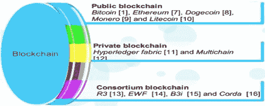**Fig. (1))**  

不同类别的区块链 \[9\]。 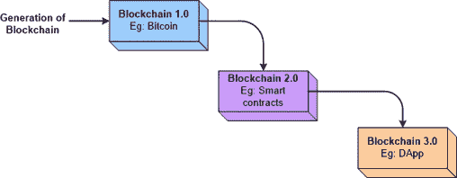**Fig. (2))**  

区块链的代际

#### 区块链 1.0

在此过程中，每笔交易都以分布式账本形式存储，因此对分布式网络中的任何成员都公开。比特币是第一种数字去中心化货币，也是一种区块链 1.0 技术。比特币的基本技术是挖矿、密码学和群体账本。矿工是本世纪中通过解决数学问题查询区块的个人，并因区块验证获得 12.5 比特币作为奖励。自身身份安全、资金控制、快速自动交易是区块链 1.0 的特点。

#### 区块链 2.0

第二代区块链技术（区块链 2.0）是数字经济。虽然数字经济的概念 20 年前就已实施，但重点在于从数字经济中获益以实现其完全实施。智能合约是两个实体之间用于构建数字合同的一系列指南。以太坊是运行在 \[12\] 上的一种智能合约网络。

#### 区块链 3.0

对于两代区块链的兴趣，它们主要为制造业、商业和金融领域做出贡献。包括医疗保健、医疗记录 \[12\] 资源管理、供应链、身份验证、智慧城市、电力行业和系统管理在内的系统现在都是区块链 3.0 组织。

### 区块链技术的重要性及去中心化及其影响

#### 安全性

数字世界充满了黑客，他们寻找漏洞以泄露详细信息或窃取数据。区块链技术中包含的文件具有强大的保护功能，使得任何人都无法入侵。

#### 透明度

由于一切都在网络上显示，产生任何差异的可能性非常小。

#### 低成本

市场上大多数传统金融结构成本高昂，但区块链更便宜。

#### 交易时间

一个人可以在几分钟内发送和接收活动及有价值的文件，这最大限度地减少了等待数小时的压力。

#### 财务效率

去中心化区块链允许个人在没有第三方干预的情况下进行交易，而传统银行进行交易则耗费大量时间。

#### 保护企业免受欺诈

区块链是开源账本，因此很容易确定欺诈是如何发生的，因为所有交易都记录在其中。

### 区块链技术的应用

在过去几年中，区块链被应用于不同领域并取得了更好的效果。区块链技术应用的一些领域如下-。

#### 医疗保健

区块链技术的特点，例如数据库中数据的绝对可靠性，吸引了医疗保健行业的关注，针对许多可能的情况，正在探讨乐观的可能性。区块链技术必将增强医疗记录管理和保险索赔流程，加速生物和临床前科学，并更新生物医学和医疗保健数据 \[13\]。这些标准侧重于区块链技术的关键方面，例如去中心化、不可更改的审计追踪、数据来源、稳健性以及增强的保护和隐私。在探讨了许多可能性之后，通过区块链技术可以实现的最重要的突破是保护数据主体的权利。图 (**3**) 说明了区块链中的医疗交易。除医院以外的数据主体收集和使用医疗数据应当被允许。这是以患者为中心的互操作性的核心原则，与由组织指导的传统互操作性不同。除了技术相关问题之外，以患者为中心的互操作性还存在许多担忧，例如数据质量、安全性和隐私性。

这是以患者为中心的互操作性的核心原则，与由组织指导的传统互操作性不同。除了技术相关问题之外，与以患者为中心的互操作性相关的许多担忧，例如数据质量、安全性和隐私性。区块链技术使从层级标准化向以患者为中心的互操作性过渡变得更加简单 \[14\]。区块链允许患者为其医疗数据授予访问规则，允许不同的研究人员，例如在有限的时间跨度内访问其数据的部分。区块链技术在不断演进而非完成，并且有许多可能的障碍需要解决，以便生物医学和医疗保健应用得以实施。第一个挑战涉及保密性和问责制。在区块链网络中，几乎每个人都能看到一切。有些人认为健康记录保存在链下，而在区块链中，仅保留标签信息的哈希值。第二个问题涉及速度和可扩展性。在概念验证测试中，预计交易处理速度（例如信用卡或借记卡）将仅为传统方式的几千分之一。鉴于医疗保健行业的交易数量巨大，人们期望区块链技术取得突破。最后的挑战是 51% 攻击的可能性。这是一个理论上可行的风险，应提出一个简单的解决方案。

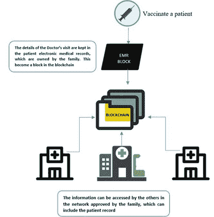**Fig. (3))**  

区块链中的医疗交易。  

#### 教育

图 (**4**) 展示了教育领域的变革。我们正在目睹机器学习、智能教室和远程学习的进步，得益于新技术。很有可能，在未来的几年里，区块链将成为学校不可或缺的一部分。让我们探讨这项技术的潜在影响以及它可能为学习过程带来的变化。一些组织将区块链视为存储、监控和使用学生凭证的绝佳平台。

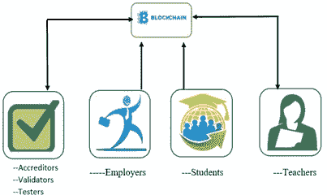**Fig. (4))**  

区块链在教育领域的应用。  

区块链将允许学习者轻松便捷地访问其记录，并与潜在雇主共享任何信息。因此，雇主无需联系大学和学院来收集毕业生的成就信息。区块链在高等教育中最有趣的用例是将资格、证书和文凭的“记录保存”转变为数字化，并由学习者掌控，无需中介来验证。区块链增强电子记录的能力也使其成为解决知识产权管理问题的良好选择。区块链可用于决定某个想法或创新是否独特，并可将其注册为知识产权、版权和专利。它可以作为解决一些一般情况的方案：多传感器卫星的安全且优先的分布式数据交换，以及电源和控制事件的监控和记录。在项目过程中，进行了多项实验，揭示了这项技术在与卫星多传感器架构相关方面的明显优势和劣势 \[15\]。然而，区块链技术有许多用途，其中一块数据可以在共享的同时使用加密安全框架进行修改。直到最近，研究人员才开始考虑在实施区块链技术用于地球观测和空间技术方面可能有用的内容。最近，欧洲空间署呼吁提出地球探索区块链的新概念和实现方案。欧盟最近资助了使用区块链技术进行科学的倡议，例如科学数据的共享和同时使用，通过这些方式，欧洲空间署旨在建立跨不同机构使用知识的方法 \[16\]。

#### 公共服务

政府机构创建的数据在内部是分散的，并且对个人和企业不透明。使用区块链技术时，数据记录可以轻松生成和检查，确保数据保护和问责制。区块链技术，例如数字签名和时间戳，预计将在公共服务中提供各种好处，使人们能够在不需要律师、政府官员和其他第三方的情况下管理交易和创建个人账户。多个政府已采用区块链技术为其人民提供不同的公共服务。例如，爱沙尼亚政府已使用区块链技术通过其身份证执行各种任务，例如投票、注册公司、订购医疗处方和缴纳税务。事实上，英国工作与养老金部已开始引入区块链用于福利支付 \[17\]。此外，瑞典已进行实验，将房地产交易放在区块链上。

#### 网络安全

## 对于所有新旧技术，保护是最重要的问题之一

广为人知的企业面临着各种安全挑战。例如，剑桥分析公司违反了超过 5000 万个 Facebook 账户，以便向其投放定向政治广告，影响美国选民对总统大选的最终决定。同样，在 2016 年，流行的搜索引擎 Yahoo 遭遇了一次重大攻击，导致约十亿个 Yahoo 账户被泄露。当安全公司分析常见的安全弱点时，他们发现 65%的数据泄露是由于默认、弱或被盗密码造成的。他们还注意到网络钓鱼电子邮件窃取机密数据，例如密码、用户名和财务信息 \[18\]。区块链具有一系列优势，可用于解决网络安全问题。其次，区块链是一个不信任框架，其中不存在信任。这意味着任何内部人员或外部人员都可以攻击该框架，因此它完全独立于人类伦理。其次，区块链是不可更改的，这意味着任何人都可以使用各种加密功能（如哈希和数字签名）来存储和保护数据。一旦数据作为区块链中的一个块创建，就无法更改或删除。第三，区块链需要网络上有许多用户，因此修改或添加一个块需要由大多数用户检查，这使得攻击非常难以实现 \[19\]。

## 大数据

大数据是海量数据的集合。这些数据可以是受监督或无监督的，用于描述特定的模式、兴趣和趋势，例如人类活动和态度，以便为其提供定制化的服务。大数据是世界上发展最快的领域之一。每个企业都需要了解其消费者的使用模式。因此，大型数据集是使用复杂的统计模型和数据提取来检查的。在不久的将来，这些大数据集将更加普遍。大数据的增长为大型企业和普通消费者带来了一系列问题。随着数据的增长，良好的分析变得更加棘手。大数据处理和分析问题包括所谓的脏数据、不可靠数据和隐私问题。随着大数据的增长和连接设备网络的扩大，更多的公司数据暴露于潜在的安全漏洞中 \[20, 21\]。在对现有概念进行审查和分析后，介绍了大数据的共识定义。结论是，“大数据是由如此高的容量、速度和多样性定义的详细资产，需要专门的技术和分析方法将其转化为价值”。系统地总结大数据的概念，包括其 5V 属性，至关重要 \[22\](Fig. **5**)。根据一项研究 \[23\]，容量指数据严重性；多样性指系统分层；速度指信息被分析的速度以及将被处理和采取行动的速度；价值指大数据应具有的准确且有价值的洞察；真实性指特定数据源中固有的不确定性和不准确性。此外，还讨论了几个特征以进一步改进大数据概念 \[24, 25\]。愿景（一种有目的且信息丰富的面向结果的分析）、验证（与处理的数据相匹配的要求）、验证（旨在实现目的）、复杂性（数据之间复杂的关系）和不可更改性（永久处理并妥善处理）。由于这些特征经常被列出以定义大数据的含义，尽管事实复杂，但它们无疑在不断增加的大数据理解中发挥着重要作用，特别是当没有广泛定义的跨时代定义时。

## 大数据的重要性

大数据不在于组织拥有多少数据，而在于组织如何收集数据并以自己的方式使用数据；如果企业使用数据更有效，那么其扩张能力就一定越强。公司将从任何来源收集和分析数据以找到答案。

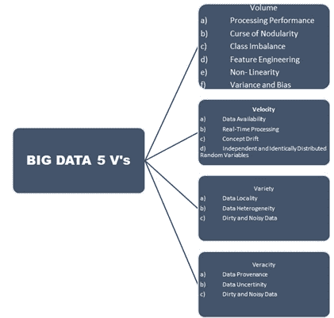**Fig. (5))**  

大数据的五个 V。  

### 成本节约

一些大数据工具，如 Hadoop 和基于云的分析，可以在需要处理海量数据时为企业提供成本节约，这些工具还可以帮助找到更有效的开展业务的方式。

### 时间缩短

Hadoop 和内存分析等工具的高速性可以轻松识别新的数据来源，帮助企业快速分析数据并做出基于学习的快速决策。

### 了解市场状况

通过分析大数据，可以更好地了解现有的业务动态。通过观察消费者的购买习惯，公司可以找出销售最好的商品，并根据这种模式制造产品。

### 控制在线声誉

大数据工具可以评估情绪。因此，您可以了解谁在谈论您的业务。如果您想跟踪并增强公司的在线形象，那么大数据工具将对此提供帮助。

### 使用大数据分析提升客户获取和保留

客户是任何公司依赖的最重要资产。没有一家公司能在没有强大的消费者基础的情况下宣称成功。但是，即使拥有客户基础，公司也无法忽视其面临的激烈竞争。如果公司迟缓地了解消费者想要什么，它就会开始销售质量差的商品。最终，消费者不满将会发生，这将对业务绩效产生整体不利影响。大数据帮助组织识别特定于消费者的不同模式和趋势。为了培养忠诚度，观察客户行为非常重要。

### 使用大数据分析解决问题并为广告商提供促销洞察

大数据分析可以帮助改变任何企业。这包括满足消费者期望的能力、改变公司的产品线，当然还要确保营销策略强大。

### 大数据分析作为产品创造和创新的催化剂

大数据的另一个巨大好处是能够帮助企业创新和重新开发其产品。

## 大数据面临的挑战

现有文献通常试图通过关注处理大数据的流程来总结大数据的问题。与信息发现过程相关的五个领域的大数据问题是：数据捕获和存储、数据处理、数据整理、数据解释和数据可视化 \[26\]。其他人采用了共同框架，解决了四个领域的问题：数据管理和支持、模型创建和评分、可视化和用户参与、以及市场模型 \[27, 28\]。然而，大数据的问题以更详细的方式得到解决，即大数据管理、清洗、聚合、系统容量不平衡和大数据分析不平衡。他们还解决了大数据机器学习问题，包括数据流学习、深度学习、增量学习和集成学习以及粒计算。

## 大数据挑战与数据挖掘技术

大数据的挑战包括数据表示、冗余减少与数据压缩、数据生命周期管理、分析过程的进步、数据保密性、能源管理与可持续性、可扩展性与伸缩性以及协作 \[29\]。它将问题转化为数据复杂性、计算复杂性和系统复杂性。导致大数据的三个因素：大数据复杂性（*i.e.*，数据形式、大小、架构、*etc.*）。模式、关系、不足性、不稳定性和分布导致计算复杂性增加以及新的计算概念。系统复杂性的不断增加，使得难以满足先进节能计算和大数据处理的需求。

## 大数据的数据挖掘技术

数据挖掘方法与数据仓库协作已有多年，随着大数据的出现，现在获得了更大的普及。数据分析以及结构化和非结构化数据的增长，推动了数据挖掘技术的改进，因为企业现在处理的数据集更广泛，内容更加多样。数据挖掘方法通过人工智能和机器学习进一步实现自动化 \[30\]。图 (**6**) 说明了大数据的数据挖掘技术。

### 聚类

聚类的主要目的是通过数据发现聚合数据对象，使分组后的对象彼此相同或紧密关联，但与其他类别区分开来 \[31\]。聚类的基本原理是计算数据对象之间的距离。已开发出许多技术，以满足处理更复杂数据类型或结构的要求。关键的聚类方法包括层次聚类、k-均值（分区聚类）、高维方法、基于密度的聚类、基于共现的聚类以及其他进化方法。通过将具有最近均值的对象分组，常用的 k-均值聚类技术将观测值划分为不同的聚类‘k’。值得注意的是，由于数据挖掘技术的持续增长，存在替代方法和发展。

### 分类

分类是数据挖掘最基本的技术，旨在将数据对象分类到预定义的类别中。为了准确优化分类器以有效执行给定的分类任务，需要一些通过数据探索定义的规则。算法背后的分类的正式定义 \[32\]。分类有几种不同的方法，每种都有其自身的优点 \[33\]。决策树 \[34\]、支持向量机（SVM）\[35\]、朴素贝叶斯代码 \[36\]、神经网络和 k-最近邻 \[37\] 是一些最著名且常用的分类技术。

### 关联规则挖掘

关联规则挖掘是在超市数据集上引入的 \[38\]，目的是调查数据项之间的共现。它是一种检测同时发生频率高于数据集中平均共现水平的技术。它区分了数据对象之间存在的关系。

### 回归

由于其降维、提取信息、提供估计和预测的能力，回归也被视为一种重要的数据挖掘技术。回归的基本原理是分析两个或多个变量之间的关系，以协助预测和决策。回归分析广泛应用于各种主题，迄今为止也进行了多项发展，因此在本章中无法总结所有内容。数据挖掘中经过验证的回归技术包括线性和非线性回归、Lasso 回归、逻辑回归和树回归。

### 社交网络分析

这里概述的一种相对较新的数据挖掘技术是社交网络分析（SNA），基于图论原理。要构建社交网络，它调查大量知识堆栈中对象之间的关系和内容。评估社交网络行为最广泛使用的度量技术是“度” \[39^(\-)41\]。

## 大数据的应用

### 医疗保健领域

大数据在医疗保健方面取得了显著改进。它增加了过去几年收集的信息量。技术发展也使得从保险公司、医院、实验室和医生办公室等各种来源收集和分析数据变得更加容易。医生历史上一直使用自己的酌情权，近年来，这已转变为更基于证据的治疗。现代方法包括分析临床记录，并根据现有最佳证据提出治疗建议。在大数据的使用方面，医疗保健领域往往落后于金融服务和销售等其他行业。

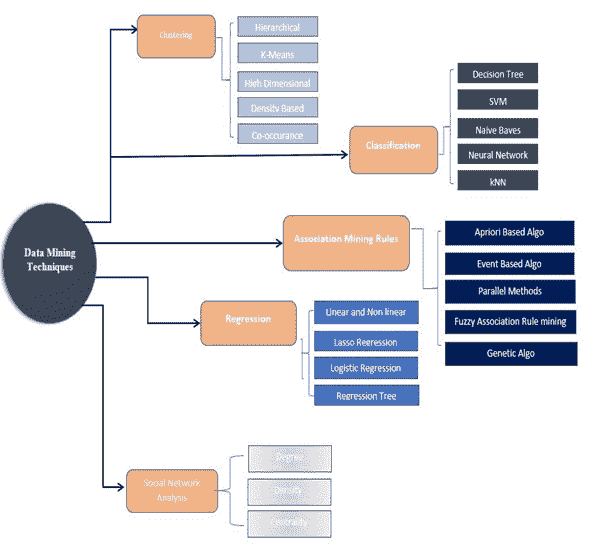**Fig. (6))**  

数据挖掘技术。 

大数据在医疗保健中用于预测流行病、治愈疾病、提高护理质量并防止过早死亡，健康领域中大数据的不同应用在图 (**7**) 中有所说明。最近，许多健身设备已上市，如 Fitbit、Samsung Gear Fit 和 Jawbone，帮助我们监测进展。最终，我们将能够与医生共享数据，医生在我们因疾病就诊时，可以将其作为临床诊断的一部分使用。当收集越来越多的数据时，医生将能够为患有特定疾病、遗传因素和生活方式的某些患者提供治疗选择。大数据存储在众多医生的计算机系统、医院和诊所的孤岛中 \[42, 43\]。为了在未来高效利用所有这些数据，需要将信息向所有人开放。

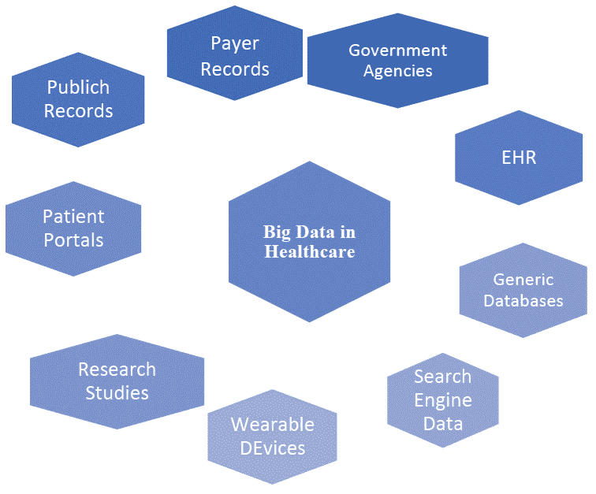**Fig. (7))**  

大数据在医疗领域的实施。 

由于大数据在医疗保健领域的巨大影响，其使用正在与日俱增。但将这项技术付诸实践的道路上仍面临挑战。让我们来看看一些经常遇到的问题。最困难的问题之一是数据收集。患者的知识通常分布在不同的部门、医院、计算机和文件柜中。需要做好充分准备，将所有这些融合在一起并组织起来，以便进行潜在的协作。此外，所有协作实体都将对他们希望检查的大数据的格式和形式达成共同理解和同意。除了确保数据的准确性和一致性之外，还需要进行数据清洗和管理。保护健康数据的程序和政策通常涉及不同的问题。这些问题应在数据汇总和验证后得到解决。由于没有对数据从处理开始的清晰监控，IT 公司可能会面临与资金、安全和结果相关的困难。医疗保健数据的数量随时间增长，执行团队通常面临管理场所数据存储成本和后果的挑战。维护本地数据存储系统可能是一项复杂且昂贵的事情。这意味着通过各个部门分发数据的方法也可能很复杂。

对于医疗保健组织来说，数据安全至关重要。当医疗系统开始采用大数据时，他们应获得医疗保健提供者授予的数据访问权限。当组织授予某些专家访问权限时，没有问题，但如果大量团队涉及患者的个人详细信息，则可能出现隐私侵犯问题。医疗保健组织将依赖于可靠的数据提供商，其提供稳定且结构良好的交付，以提供安全的大数据解决方案来防止这些问题。最后，理解大数据在医疗保健公司中的潜力需要改变开展业务的方式。除了熟练的 IT 工人之外，还需要数据科学家来进行分析。如果没有适当的 IT 基础设施，组织可能难以充分利用大数据。

## 教育领域

学生数据处理仅在过去十年才成为主要的教育趋势 \[44\]。此外，使用大数据帮助学生学习可以追溯到 ITS 和人工智能研究，如图（**8**）所示。在教育领域，当今使用教育数据的主要目的是定义创建最佳教育环境的方法 \[45\]。大数据是教育中的一个新概念 \[46\]，大多数学术讨论集中在使用数据来提高教学和科学的质量。特别是，广泛教育数据的可用性为教育研究人员提供了使用数字方法和技术大规模调查新兴教育趋势的能力。为大数据提出了三个教育用例：促进学习、教学和管理。

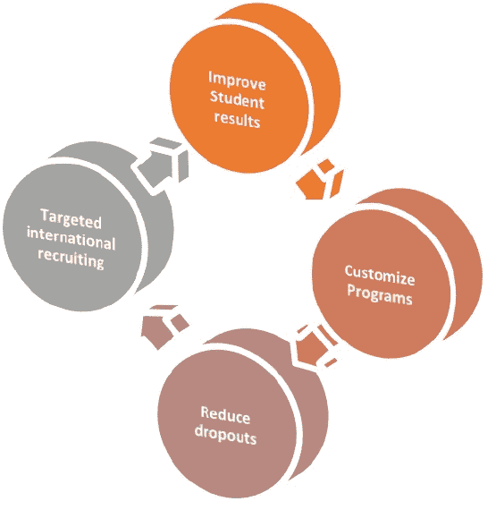**Fig. (8))**

教育领域大数据的实施。

教育领域的大数据为教育工作者提供了以新方式接触学生并教授他们的独特机会。它将为他们提供更好的教育体验，从而帮助他们决定教育系统的状况。

## 关于教育领域大数据应用的挑战

与其他大型组织相比，学校和大学依赖大量数据。从所有数据中提取信息始于提出正确的问题。它还始于识别大数据可以发挥作用的地方以及不需要任何可能影响的地方。教育中以不同格式生成大量数据。

任何大数据项目固有的困难之一是，大多数项目都始于需要清理数据。如果公司使用现有来源或众多第三方数据库，总是存在错位。数据科学家花费大量时间清理数据并进行枯燥、耗时的清洁工作。

为了从大型数据集中提取有用价值，需要确保它们能够相互通信，无论是通过 API 还是算法，或是部分手动实现，都需要做大量工作来充分清理数据，以允许共享和交互。

## 遥感

遥感一直是以高效方式获取信息的最有效工具之一。近年来，遥感数据在许多科学领域发挥了重要作用，包括大气科学、生物多样性、土壤退化、水污染和环境地质学 \[47\]。遥感技术清楚地展示了大数据的特性。大数据遥感正在引起政府项目、商业应用和学术领域的兴趣 \[48\]。图（**9**）说明了遥感数据的循环。

美国政府于 2012 年 3 月启动了“大数据”计划。这可能是第一个专注于增强我们从大型复杂数字数据集中提取信息能力的大数据政策倡议。地球观测系统数据和信息系统（EOSDIS）是美国政府为卫星图像大数据承担的最雄心勃勃的任务之一。它提供来自不同来源的端到端功能，用于处理 NASA 的环境科学数据。在欧洲，欧洲空间局于 2017 年举办了“来自太空的大数据”会议。该会议旨在促进互动，并汇集参与利用来自太空的大数据的研究人员、开发人员、消费者、网络和服务提供商。大数据分析指的是如此广泛且动态的数据集阵列，以至于常规数据处理算法和模型难以采用。涉及的挑战包括数据收集、存储、搜索、交换、交付、处理和分析。遥感大数据具有许多独特和特殊的特征 *i.e.*，数据具有多源、多分辨率、高维、动态、对映体和非线性特征。遥感大数据通常代表动态状态，因为地表在变化，卫星始终在移动。遥感大数据转换点涉及静态组件和非静态组件。

遥感中的大数据困难包括应对海量数据 \[49\]。与数据收集、存储、分析和报告相关的挑战往往会导致遥感方面的问题。图（**10**）说明了我们在收集遥感数据时面临的一些常见挑战。

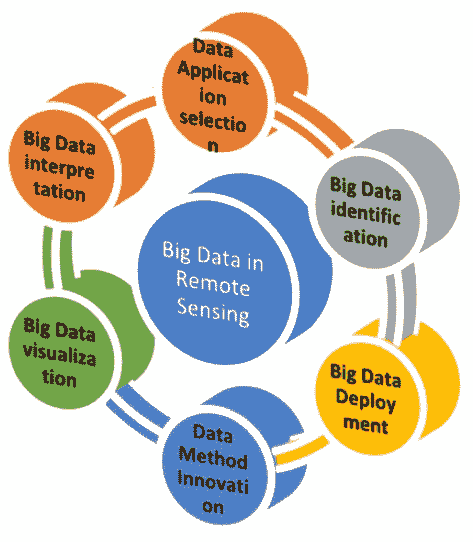**Fig. (9))**

遥感数据中的大数据。 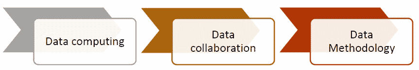**Fig. (10))**

遥感数据中的挑战。

## 大数据分析工具和技术

大数据是一个描述海量数据集的概念——包括结构化和非结构化数据，具有多样性和复杂结构，存在诸如数据收集、存储、分析、可视化和处理困难等问题。它需要新的大数据工具和技术，以及用于提取和分析数据以获得洞察力、从而做出更好决策和战略业务步骤的技术方法。图（**11**）中提到了一些最实用和重要的工具。

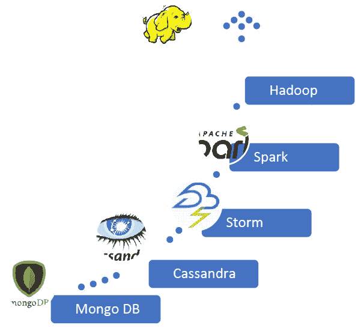**Fig. (11))**

# 不同的大数据分析工具

## Hadoop

Hadoop 是开源的大数据处理软件，具有多种属性：可扩展性、可靠性、容错性、高可用性、本地处理和存储、分布式和并行计算以及性价比。它使用基本的编程模型通过计算机集群处理海量数据集 \[49\]。

### Spark

Spark AB 是一种开源工具，旨在处理大型数据集。Spark 的开发旨在解决 Hadoop 的磁盘 I/O 和性能问题。它具有许多特性（例如内存计算），使其独具特色，并提供内存数据缓存功能。Spark 支持多种编程语言来处理大量数据（Python、Java 和 Scala）\[50\]。它比 Hadoop 和 Mongo DB 快十（10）倍。

#### Storm

Apache Storm 是一种开源的、实时的、分布式计算框架，用于大数据处理。它简单明了；可以由任何脚本语言使用，并支持 YARN 用于机器学习、ETL、持续操作跟踪、去中心化远程过程调用（`RPC`）和实时分析 \[51\]。

#### Cassandra

Apache Cassandra 是一种分布式数据库，在不牺牲质量效率的前提下提供高灵活性和可靠性。它是最好的大数据工具之一，可以满足所有类别的结构化、半结构化和非结构化数据集。

#### Mongo DB

MongoDB 是一种开源的数据分析产品，为 NoSQL 数据库提供跨平台功能。对于需要快速移动和实时数据来做出决策的企业，它是典范。MongoDB 是寻找数据驱动解决方案的人的完美选择。它用户友好，因为它使安装和维护更加容易。MongoDB 既可靠又经济高效。

## 大数据技术

大数据需要特殊的策略，以便在短时间内有效地处理大量数据 \[52\]。这些领域有不同的方法，并且相互交互。一些工具和技术在图中讨论（`12a` 和 `b`）。

## 区块链与大数据的集成

区块链技术与大数据的集成可能提供一些迷人的可能性。区块链有许多方式可以帮助处理大数据，加上数据分析。这项技术在数据质量方面具有最大的潜力。这意味着大型企业在区块链上收集和验证的数据可以对公司变得更加有用。区块链会让你更加相信查看结果的合法性。不可更改的条目、基于共识的时间戳、审计追踪以及关于数据来源（*例如*，自助终端或传感器）的清晰度，都是随着区块链技术变得更加普遍可以看到进展的领域。

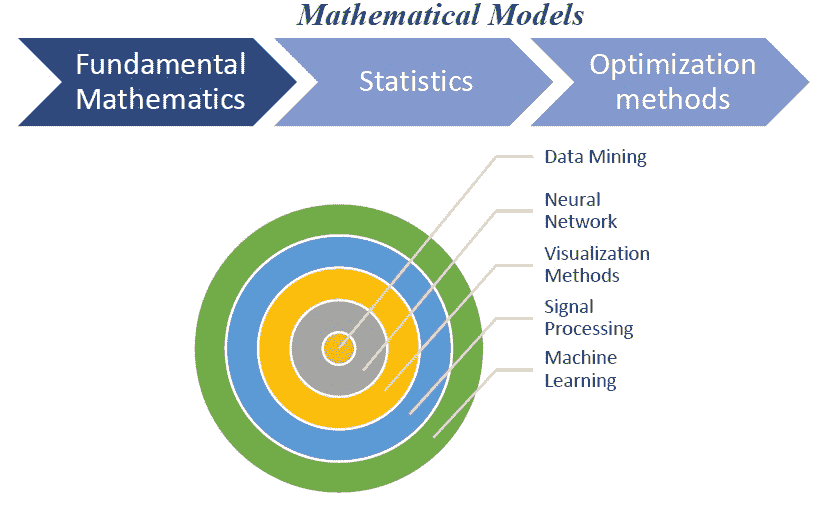**图 (12))**

(**a** 和 **b**) 不同的大数据分析工具和技术。

## 数据完整性

对所谓的脏数据（或错误信息）的监管是区块链可以对数据分析领域产生积极影响的环境。区块链提供了一种透明的方法来执行数据完整性和审计追踪，因为它识别其连接链中数据的来源。区块链通过保持共享账本来维护数据完整性。存储在区块链上的数据是可信的，因为它们必须经过验证过程的审查，该过程保证了其准确性。当源信息和数据块交互保存在区块链上并在可以使用之前自动检查（或批准）时，数据完整性得以维护。它还允许问责，因为它可以跟踪区块链网络上发生的事件和交易。

## 管理数据共享

基于区块链的大数据框架将允许提供商与任何其他有兴趣的部分交换记录，而不会因不同数据孤岛的网络而带来指数级增加的风险因素。从数据研究中收集的数据可以在这方面在区块链网络中处理。这样，项目团队不应重复其他团队已经执行的数据分析，或重复使用已经被错误使用的数据。区块链平台还可以帮助数据科学家变现他们的工作，可能通过交换存储在数据库中的分析结果。

## 防止恶意活动

在这方面，项目团队不应重复其他团队已经执行的数据分析，或重复使用已经被错误使用的数据。区块链平台还可以帮助数据科学家变现他们的工作，可能通过交换存储在数据库中的分析结果。要更改区块链的规则，需要汇集大量节点来建立共识。因此，大规模访问和操纵数据对网络犯罪分子来说几乎是不可能的工作。

## 预测分析

可以分析区块链数据（就像其他数据类型一样）以揭示关于习惯、模式、*等等*的有用洞察。因此，它们可以用于以合理的准确性预测事件的潜在结果，例如消费者欲望、客户终身价值、波动价格和公司流失率。借助区块链，银行和其他组织需要大规模的实时数据分析，可以实时跟踪数据变化，从而快速做出决策。

# 结论

区块链和大数据是两种不同的技术，在数据管理与安全方面显示了显著影响。出于这种动机，本章简要介绍了区块链和大数据在重要性和应用方面的相关信息。本章清楚地说明了区块链与大数据的集成，并从数据完整性、预测分析、防止恶意活动和管理数据共享方面讨论了集成的好处。

# 出版同意

不适用。

# 利益冲突

作者声明不存在利益冲突，无论是财务上的还是其他方面的。

# 致谢

无。

# 参考文献

|  ||  |

| --- | --- |

| \[1\] || Review"IEEE EUROCON 2017-17^(th) International Conference on Smart Technologies".IEEE2017763768 |

| \[2\] || Dunphy P., Petitcolas F.A.P.. A first look at identity management schemes on the blockchain.IEEE Secur. Priv.2018164202910.1109/MSP.2018.3111247 |

| \[3\] || Beck R., Avital M., Rossi M., Thatcher J. B.. Blockchain technology in business and information systems research.Business & Information Systems Engineering.20175938138410.1007/s12599-017-0505-1 |

| \[4\] || Wang X., Feng L., Zhang H., Lyu C., Wang L., You Y.. Human resource information management model based on blockchain technology.IEEE symposium on service-oriented system engineering (SOSE).IEEE201716817310.1109/SOSE.2017.34 |

| \[5\] || Puthal D., Malik N., Mohanty S.P., Kougianos E., Yang C.. The blockchain as a decentralized security framework.IEEE Consum. Electron. Mag.201872182110.1109/MCE.2017.2776459 |

| \[6\] || Karame G., Capkun S.. Blockchain security and privacy.IEEE Secur. Priv.2018164111210.1109/MSP.2018.3111241 |

| \[7\] || Zahid J. I., Ferworn A., Hussain F.. Blockchain: A technical overview.IEEE Internet Policy News2018113 |

| \[8\] || Nakamoto S.. "Bitcoin: A peer-to-peer electronic cash system", 2018 |

| \[9\] || Akram S.V., Malik P.K., Singh R., Anita G., Tanwar S.. Adoption of blockchain technology in various realms: Opportunities and challenges.Secur. Priv.20203510910.1002/spy2.109 |

| \[10\] || Dinh T.T.A., Wang J., Chen G., Liu R., Ooi B.C., Tan K.L.. Blockbench: A framework for analyzing private blockchains.Proceedings of the 2017 ACM International Conference on Management of Data20171085110010.1145/3035918.3064033 |

| \[11\] || Lei K., Zhang Q., Xu L., Qi Z.. Reputation-based byzantine fault-tolerance for consortium blockchain.IEEE 24^(th) International Conference on Parallel and Distributed Systems (ICPADS)IEEE201860461110.1109/PADSW.2018.8644933 |

| \[12\] || Chan K., Liebowitz J.. The synergy of social network analysis and knowledge mapping: a case study.Int. J. Manag. Decis. Mak.200671193510.1504/IJMDM.2006.008169 |

| \[13\] || Kuo T.T., Kim H.E., Ohno-Machado L.. Blockchain distributed ledger technologies for biomedical and health care applications.J. Am. Med. Inform. Assoc.20172461211122010.1093/jamia/ocx06829016974 |

| \[14\] || Gordon W.J., Catalini C.. Blockchain technology for healthcare: facilitating the transition to patient-driven interoperability.Comput. Struct. Biotechnol. J.20181622423010.1016/j.csbj.2018.06.00330069284 |

| \[15\] || de La Beaujardiere J., Mital R., Mital R.. Blockchain Application Within A Multi-Sensor Satellite Architecture.In IGARSS 2019-2019 IEEE International Geoscience and Remote Sensing Symposium.IEEE20195293529610.1109/IGARSS.2019.8898117 |

| \[16\] || 关于区块链以及欧洲如何寻求进一步将区块链应用于地球观测的更多信息，请参阅 [`https://eo4society.esa.int/2019/04/09/blockchain-and-earth-observation-a-white-paper/`](https://eo4society.esa.int/2019/04/09/blockchain-and-earth-observation-a-white-paper/)。 |

| \[17\] || Hathaliya J., Sharma P., Tanwar S., Gupta R.. Blockchain-based remote patient monitoring in healthcare 4.0.In 2019 IEEE 9th International Conference on Advanced Computing (IACC)IEEE20198791 |

| \[18\] || Boucher P.. How blockchain technology could change our lives: In-depth analysis.European Parliament2017 |

| \[19\] || Atlam H. F., Walters R. J., Wills G. B.. Fog computing and the internet of things: a review.Big Data and cognitive computing20182210 |

| \[20\] || De Mauro A., Greco M., Grimaldi M.. What is Big Data? A consensual definition and a review of key research topics.AIP Conference ProceedingsMelvilleNY: AIP20151644197104 |

| \[21\] || De Mauro A., Greco M., Grimaldi M.. A formal definition of Big Data based on its essential features.Libr. Rev.201665312213510.1108/LR-06-2015-0061 |

| \[22\] || Demchenko Y., De Laat C., Membrey P.. 2014Defining architecture components of the Big Data Ecosystem.2014 International Conference on Collaboration Technologies and Systems (CTS)104112Piscataway, NJIEEE10.1109/CTS.2014.6867550 |

| \[23\] || Gandomi A., Haider M.. Beyond the hype: Big Data concepts, methods, and analytics.Int. J. Inf. Manage.201535213714410.1016/j.ijinfomgt.2014.10.007 |

| \[24\] || Kacfah Emani C., Cullot N., Nicolle C.. Understandable Big Data: A survey.Comput. Sci. Rev.201517708110.1016/j.cosrev.2015.05.002 |

| \[25\] || Oussous A., Benjelloun F.Z., Ait Lahcen A., Belfkih S.. Big Data technologies: A survey.Journal of King Saud University - Computer and Information Sciences201830443144810.1016/j.jksuci.2017.06.001 |

| \[26\] || Chen M., Mao S., Liu Y.. Big Data: A Survey.Mob. Netw. Appl.201419217120910.1007/s11036-013-0489-0 |

| \[27\] || Assunção M.D., Calheiros R.N., Bianchi S., Netto M.A.S., Buyya R.. Big Data computing and clouds: Trends and future directions.J. Parallel Distrib. Comput.201579-8031510.1016/j.jpdc.2014.08.003 |

| \[28\] || Hajjaji Y., Boulila W., Farah I.R., Romdhani I., Hussain A.. Big Data and IoT-based applications in smart environments: A systematic review.Comput. Sci. Rev.20213910031810.1016/j.cosrev.2020.100318 |

| \[29\] || Jin X., Wah B.W., Cheng X., Wang Y.. Significance and challenges of Big Data research.Big Data Research201522596410.1016/j.bdr.2015.01.006 |

| \[30\] || Bhadani A.K., Jothimani D.. Big Data: challenges, opportunities, and realities.Effective Big Data management and opportunities for implementation.IGI Global201612410.4018/978-1-5225-0182-4.ch001 |

| \[31\] || Tan P.N., Steinbach M., Kumar V.. Introduction to data mining.Pearson Education India2016 |

| \[32\] || Hassani H., Huang X., Silva E.S., Ghodsi M.. A review of data mining applications in crime.Stat. Anal. Data Min.20169313915410.1002/sam.11312 |

| \[33\] || Kotsiantis S.B., Zaharakis I., Pintelas P.. Machine learning: a review of classification and combining techniques.Artif Intell Rev261591902007 |

| \[34\] || Quinlan J.R.. Induction of decision trees.Mach. Learn.1986118110610.1007/BF00116251 |

| \[35\] || Cortes C., Vapnik V.. Support-vector networks.Mach. Learn.199520327329710.1007/BF00994018 |

| \[36\] || Langley P., Iba W., Thomas K.. An analysis of Bayesian classi er.proceedings of the Tenth National Conference of Artificial Intelligence1992 |

| \[37\] || Richard M.D., Lippmann R.P.. Neural network classifiers estimate Bayesian a posteriori probability.Neural Comput.19913446148310.1162/neco.1991.3.4.46131167331 |

| \[38\] || Agrawal R., Imieliński T., Swami A.. Mining association rules between sets of items in large databases.Proceedings of the 1993 ACM SIGMOD international conference on Management of data199320721610.1145/170035.170072 |

| \[39\] || Sparrow M.K.. The application of network analysis to criminal intelligence: An assessment of the prospects.Soc. Networks199113325127410.1016/0378-8733(91)90008-H |

| \[40\] || Wasserman S., Faust K.. Social network analysis: Methods and applications.Cambridge university press1994Vol. 810.1017/CBO9780511815478 |

| \[41\] || Bhuiyan M.Z.A., Wang G., Tian W., Rahman M.A., Wu J.. Content-centric event-insensitive Big Data reduction in internet of things.In GLOBECOM 2017-2017 IEEE Global Communications ConferenceIEEE20171610.1109/GLOCOM.2017.8254997 |

| \[42\] || Son J., Park J., Oh H., Bhuiyan M., Hur J., Kang K.. Privacy-preserving electrocardiogram monitoring for intelligent arrhythmia detection.Sensors (Basel)2017176136010.3390/s1706136028604628 |

| \[43\] || Lodge J. M., Corrin L.. What data and analytics can and do say about effective learning?npj Science of Learning20172112 |

| \[44\] || Mor Y., Ferguson R., Wasson B.. Editorial: Learning design, teacher inquiry into student learning and learning analytics: A call for action.Br. J. Educ. Technol.201546222122910.1111/bjet.12273 |

| \[45\] || Picciano A.G.. The evolution of Big Data and learning analytics in American higher education.Online Learning201216392010.24059/olj.v16i3.267 |

| \[46\] || Liu P., Di L., Du Q., Wang L.. Remote sensing Big Data: theory, methods and application.201810.3390/rs10050711 |

| \[47\] || Eynon R.. The rise of Big Data: what does it mean for education, technology, and media research?Learning, Media and Technology.201328323724010.1080/17439884.2013.771783 |

| \[48\] || Gartner I., Beyer M.. Gartner says solving ‘Big Data’challenge involves more than just managing volumes of data. Gartner Special Report Examines How to Leverage Pattern-Based Strategy to Gain Value in Big Data.Stamford, CT, USGartner2011 |

| \[49\] || Spark A.. Apache spark: unified analytics engine for Big Data.2018 |

| \[50\] || Apache StormApache Software Foundation. Accessed: [`http://storm.apache.org/`](http://storm.apache.org/)。 |

| \[51\] || Daniel B.. Big Data and analytics in higher education: Opportunities and challenges.Br. J. Educ. Technol.201546590492010.1111/bjet.12230 |

| \[52\] || Khan M.A., Salah K.. IoT security: Review, blockchain solutions, and open challenges.Future Gener. Comput. Syst.20188239541110.1016/j.future.2017.11.022 |

## 基于物联网和区块链的水培监测系统

**Harpreet Singh Bedi**^(1, \*)**、 **Raghav Gupta**^(1)**、 **Manoj Sindhwani**^(1)**、 **Kamal Kumar Sharma**^(1)

¹ School of Electronics and Electrical Engineering, Lovely Professional University, Phagwara, Punjab, India  

## 摘要

由于区块链是比特币的核心技术，近年来区块链备受关注。其应用正在扩展到各个领域，包括物联网（IoT）防御、银行业、工业和医疗中心。此外，由于物联网在全球智能家居和城市发展中的广泛应用，其受欢迎程度不断提高。本文介绍了一种主要面向水培的温室自动化系统的设计。除了设计之外，本研究的目的是监控、控制和可视化数据。该项目解决了传统农业中的一些问题。诸如因土地面积小且分散而无法进行农业、使用粪肥和农药的风险以及缺乏机械化等问题。该项目的组成部分包括主模块（以下简称 `AGMS`）、云端和最终用户。数据可视化通过一个网站实现，该网站将通过 Wi-Fi 模块通过 `API`s 获取数据。该研究还包括向 Twitter 和邮件等社交媒体平台发送警报。

**关键词：** `API`, `Blockchain`, `MCU`, `Server`。  

* * *

^(\*) **通讯作者 Harpreet Singh Bedi：** School of Electronics and Electrical Engineering, Lovely Professional University, Phagwara, Punjab, India；电子邮件：harpreet.17377@lpu.co.in  

## 引言

众所周知，农业是首要需求，而传统做法正随时间推移而退化。印度农业部门占国内生产总值（GDP）的 18%，然而，该国农业实践并没有重大进展。不过，也有一些现代技术，如水培、气培和垂直农业。

农业是世界主要的粮食来源。在历史上，它一直是文明进步的关键参数。根据联合国（UN）的数据，世界人口将增加 20 亿，达到 78 亿

亿人，到 2050 年，这意味着到本世纪末，地球需要养活约 110 亿人。

如图 (**1**) 所示，农业发展经历了四次不同的革命：1）以人力和畜力为主的传统农业时代，2）以轰鸣声为特征的机械化农业时代，3）以高速发展为特征的自动化农业时代，4）以新兴技术为特征的智慧农业时代。因此，智慧农业为可持续发展提供了一条技术辅助的道路。它涉及在农场管理的网络物理循环中使用 ICT，利用物联网（`IoT`）、云计算、机器人技术和人工智能（`AI`）等技术。

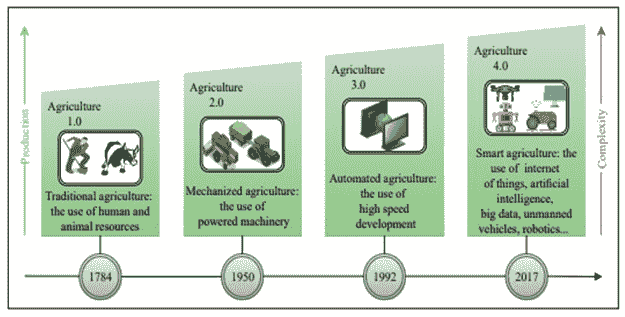**图 (1)**  

农业四次革命。

智慧农业是一种可持续的农业技术，通过为每种植物或动物提供其茁壮成长所需的一切，以最佳方式提高运营精度，在最大化整体性能的同时减少浪费、投入和污染物。虽然智慧农业是一项先进技术，但它仅仅考虑了田间条件。另一方面，智慧农业更进一步，通过数据管理责任来实现，这由情境和情境意识加强，并由实时事件驱动。

智慧农业在早期受益于物联网、低成本且性能增强的传感器、执行器和微处理器、高带宽无线技术、基于云的 ICT 系统、大数据分析、人工智能和机器人等新技术的进步。农场设备不再是唯一的数据来源；存在将数据转化为行动的新服务。在农业中使用 `IoT` 旨在为农民提供所需的工具，帮助他们做出更好的决策并自动化流程，通过提供改善生产力、质量和利润的商品、知识和服务。

水培是一种在水面上种植植物而无需土壤的方法。植物在土壤中种植时所获得的营养，是根据需要手动给予的。这种方法的主要优势是生长所需的时间短，且过程中不需要任何肥料。当在非常小的区域进行时，水培不需要自动化系统，但当进行大规模生产时，自动化系统至关重要。自动化温室监控系统为水培提供自动化、控制和可视化。自动化是由连接各种植物生长所需传感器的可编程 `Microcontroller Unit` 完成的。控制是由 `MCU` 连同最终用户界面完成的。整个过程通过云服务器运行，该服务器将始终处于活动状态，并向最终用户界面发送警报和警告，最终用户界面包括一个网站以及通过数字和图表进行的数据可视化。

云端的主要工作是以非常低的数据速率进行数据传输，以便该项目具有广泛的覆盖范围。最终用户部分很简单，考虑到农民可以零努力地使用它。该系统解决了无需人工干预即可监控和控制任何自动化系统的问题。

## 讨论

### 水培

有多种水培方法，其中最好、最高效的是 NFT（`Nutrient Film Technique`）方法。这种技术因其简单而高效的设计而非常流行。NFT 常用于种植生长快的植物，如生菜和菠菜。除此之外，商业上，绿色香草和草莓也可以用这种方法种植。

在这种技术中，非常浅的营养液被倒入管道中。该管道倾斜放置，并在房子的上方有一个孔，需要小容器来放置种子/幼苗。这些容器是网状花盆，用于容纳植物和生长介质，如椰子纤维和干草。NFT 系统的各个部分包括营养液储液罐、将营养液输送到管道的营养泵、从泵向生长花盆分配水的管道、容纳植物/种子的花盆以及回收系统，用于收集溶液并将其送回管道以循环该过程。

在 NFT 过程中，生长托盘和储存装置是除所有其他组件之外的两个最重要的部分。生长托盘由网状花盆组成，用于容纳植物和营养液，以及椰子、珍珠岩和 Rockwool 等生长介质。然而，某些植物种类不需要这些溶液，因为它们从系统中获得足够的水分、营养和氧气。植物根系在通道中形成密集的垫层，而叶片位于顶部，在某些情况下由支架系统支撑（类似于种植葡萄藤的系统）。要构建最佳的 NFT 系统，需要合适的坡度、流量和通道长度。此外，植物根系必须得到适当暴露，以收集足够的氧气、水分，最重要的是营养 \[1\]。

该系统所需的营养素分为 12 部分和两种不同的溶液。溶液‘A’由 19% 的钙、15% 的硝酸盐或 45% 的钾和 13% 的硝酸盐组成。它还将含有`EDTA`作为螯合剂。溶液‘B’以硫酸镁、磷酸二氢钾和硫酸钾为主要营养素，并以硼砂作为硼源，以及硫酸锌、硫酸镁、硫酸铜和钼酸盐作为微量元素。总体而言，所需的营养素包括氮、钾、磷、钙、镁、硫酸盐、铁、锰、铜、锌、钼、硼和氯。这些营养素可通过上述溶液轻松获得。用作生长介质的材料将根据要求使用椰糠、岩棉或泥炭藓。至于水，则使用蒸馏水、RO 水或降低 ppm 的自来水稀释液。水需要每周左右（有时每 4 天）更换一次，每次 19 升。

## BLOCKCHAIN SOLUTIONS FOR IoT

区块链是一种点对点网络，其中每个节点都拥有所有数据的相同副本。当发起一笔交易时，发起节点使用其私钥对其进行签名，并将其发送到网络的其余部分以进行确认。所有其他矿工节点都参与其中。尝试通过无效化过程找到一个`nonce` \[2\]。在区块链技术中，所有已完成的交易都记录在区块列表中，这被称为公共账本。随着新区块定期添加到其中，该区块链将继续演变。为了用户保护，实现了公钥加密和分布式共识算法。

在区块链网络中，联盟链用于提供数据保护。每个侧链监督其自身的 IoT 数据。每个 IoT 设备都会获得一个唯一的`id`来监控区块链网络中的数据。从计算机获得的数据与其`id`相关联，在对其计算哈希后，数据会发送到整个网络。这作为可信数据的基础。基本存储成本将与 IoT 网络信息共享的规模同步增长。因此，信息集位于远程位置，并维护一个集中式服务器仅存储这些位置的引用。

### Features

区块链技术提供了最高级别的透明度，各行各业都在测试它，以查看它是否可用于数据传输、记录保存和其他后端流程 \[2\]。它逐渐允许人们跟踪文档并以不可更改的记录形式数字化认证资产所有权。以下是使区块链成为技术革命的基本要素，如图 (**2**) 所示。

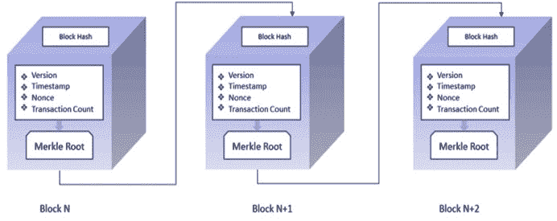**Fig. (2))**  

基本区块链结构。  

*   **Transparency:** 一般来说，对于以太坊和比特币等公共区块链系统，用户拥有与区块链网络的平等访问权和通信权。此外，每笔交易都经过验证并记录在分布式账本中，所有用户可以同时访问该账本。因此，区块链上的数据对每个节点都是透明的，以便验证区块链中的已提交交易。

*   **Decentralization:** 在现有的支付管理系统中，例如银行，中央机构执行交易验证，导致性能瓶颈、昂贵的设计和单点故障。另一方面，区块链允许两个节点之间验证交易，而无需任何干预、管辖权或中央机构。因此，整体服务成本、性能瓶颈和单点故障的风险都得以降低。

*   **Immutability:** 由于区块链基于一系列链接的区块，每个区块包含前一个区块头的哈希值，因此对数据的任何篡改都会使所有后续区块失效。任何突变都会被快速检测到，因为对任何交易的微小更改都会导致生成新的 Merkle 树数据结构。

*   **Pseudonymity:** 无论区块链交易的透明度如何，系统可以通过为用户提供匿名地址来保持一定程度的匿名性。但是，由于这些地址可能被追踪，区块链系统只能在一定程度上保持机密性。因此，区块链只能提供假名性，而不能提供完全的机密性。

*   **Non-Repudiation:** 区块链交易过程中的每个节点都会获得一个私钥。其他节点随后可以使用该节点的相关公钥来访问和验证此信息。因此，使用加密技术数字签名的交易不能由交易的源节点否认。

*   **Traceability:** 分布式账本中的每笔交易都有一个与其关联的时间戳，该时间戳在交易时记录。因此，在分析带有关联时间戳的区块链数据后，用户可以轻松验证和追踪交易的来源以及更改情况。

### Blockchain Types

参与者可以将区块链用作写入者或读取者。读取者在交易过程中扮演被动角色，而是专注于分析记录内容或验证区块链。另一方面，写入者在交易过程中扮演主动角色，并可以使用共识技术来扩展链。基于授予用户与账本交互的权限，区块链分为三种类型。以下小节将介绍这些类别。

### Public Blockchain

无许可区块链被称为公共区块链。这些区块链使参与共识过程变得更加容易，并赋予任何实体（作为读取者或写入者）对主链的完全访问权限。在挖矿中通常使用激励措施来诱导矿工挖掘区块。因此，公共账本中的交易成本高于私有账本。

### Private Blockchain

分布式账本是私有区块链的另一个名称。此类别中的矿工节点数量有限，且其身份已知。因此，只有有限数量的矿工节点被允许参与交易。此外，用户访问与其相关数据的权限可能受到限制。与公共区块链相比，私有区块链中用户数据的保密性更高。

### Consortium Blockchain

联盟区块链的基本目标是扩大合作效应，以解决某个行业面临的挑战。因此，建立了一个涵盖盟友和商业竞争对手的有利框架。这种区块链是半去中心化的，意味着它由一小群人监督。

区块链完全由单一群体控制，但不存在垄断。这种控制允许每个节点在每个节点达成一致后建立自己的指令、编辑或删除错误交易、更改账户余额等等。另一方面，联盟区块链的集中式特性使其易受敌对实体的攻击。金融、银行、医疗保健、保险和物流是联盟区块链可应用的一些行业。

### Greenhouse

温室是一个用于种植植物的受控环境。它由用于墙壁的透明介质和用于屋顶的半透明介质组成，以控制阳光。需要受控气候条件的植物在温室中种植。

温室使得复制不同的大气环境成为可能，从而培育出在该地区通常无法生长的作物。此外，将苗圃机械化使人们能够在家中无需持续照料即可种植自己的食物或植物。温室的目的是利用温度控制系统，将苗圃温度维持在适合植物理想生长的理想范围内。另一个目标是探究灌溉系统是否可靠，以获得所选植物的理想土壤湿度水平 \[3\]。

室温被认为在 15 - 21°C 之间。另一个假设是，温室外的温度将始终低于或等于温室内的温度。放置在温室中的植物偏好室温或以上的温度。探究问题的结果取决于时间有限的实验。这一结果在长期内可能会有所不同，因此在这种情况下不具备有效性。土壤被视为过湿或过干的阈值取决于所使用的土壤类型。这些数值不能应用于其他类型的土壤，后者必须通过测试单独设置。

至于水培领域，需要温室，并且许多优势与之相关。部分优势如下。

1. 它将有助于根据所种植的植物维持最佳条件。

2. 它将通过提供所需条件来确保光合作用的最大性能。

3. 它提供了改进的水资源利用。

4. 它缩短了作物周期 `i.e.` 与传统耕作方法相比，植物生长更快。

5. 它将有助于解决土壤贫瘠引起的问题。

对于本研究，实施了 2x2 米以下的更经济且紧凑的温室，其中包含了 1.5x1.5 米以下的水培系统。

该监测系统包括将传感器与主 MCU 接口，并根据植物的需求对其进行控制，例如，水位传感器与电机接口，通过控制水泵速率来保持水位低于阈值。与此同时，所有数据都使用服务器发送到云端，并以图表、图形和数字的形式在网站上显示 \[4\]。

### 硬件

该系统的硬件部分分为三部分 - AGMS 模块、水培系统和温室。水培系统和温室已在 Fig. (`3`) 中讨论并显示。

上述所有传感器相互同步工作。一个传感器电容的每个阈值变化都会直接影响另一个传感器。

AGMS 模块由嵌入防水外壳中的微控制器单元组成，该单元连接到各种传感器，列表如下：

`DHT22`：一种精度高的数字温湿度传感器，误差为 ±1^oC。

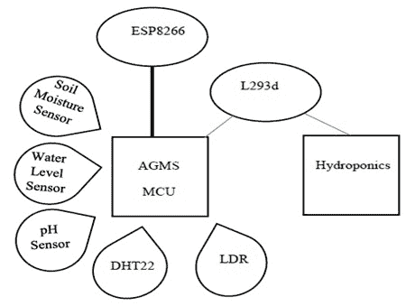**`Fig. (3))`**

项目框图。

`Water level sensor`：水位传感模块提供水高度的模拟读数，并需进一步转换为厘米 \[5\]。

`pH sensor`：检测溶液的 pH 值。

`Buzzer`：每当输入端有高电平时发出声音。

`L293d`：用于控制水泵的电机驱动器 IC。

`Touch Screen`：以多种形式显示各种传感器的值。它是可编程的。

`ESP8266`：用于将数据发送到服务器。它是一个在 2.4 GHz 下工作的 Wi-Fi 模块。

`LDR`：它是一种光敏电阻，根据落在其上的光强提供模拟输出值。

所使用的微控制器单元是 Arduino Mega。由于 Mega 的端口数量和内存，Arduino Uno 尽管熟悉但未在此使用。

### 服务器和云

对于任何高效的监测系统，所有数据都必须被可视化并在任何设备上显示。为此，我们使用一个可编程的服务器，例如 Digital Ocean Droplet 或预制的 Thingspeak，如 Fig. (`4`) 所示。

传感器的数据通过 Arduino 使用 API 密钥和 ESP8266（一个 Wi-Fi 模块）处理并发送到 Thingspeak \[6\]。此过程很简单，只需提供 API 密钥即可获取数据，如 Fig. (`4`) 所示。Thingspeak 的唯一局限性是它不可编程且功能非常有限，而在 Digital Ocean 的情况下，它从内存、处理器核心数量到服务器的操作系统类型均可完全定制。服务器的数据随后由网页使用 JS 中的 API 密钥捕获并在其中显示。网站可以从头开始构建，也可以使用互联网上随时可用的自定义模板。需要牢记的主要事项是用于传输数据的 API \[7\]。

每个传感器数据都独立发送到云端，没有任何交叉依赖。每个传感器将是模块化的 `i.e.` 它们可以在需要时轻松断开和更换，如 Fig. (`5`) 所示。传感器将连接到模块外壳的端口，并且可以借助任何蓝牙或任何 Wi-Fi 模块变成无线，如 Fig. (`6`) 所示。

## 工作原理

整个系统与水培系统同步工作。为了简化，我们将程序和工作分解为步骤。第一步是选择要种植的植物类型。然后，选择营养素以及所有其他参数，如湿度、最佳温度、水位、水流、生长介质 `etc.` 得到处理。其次，所有这些都通过 NFT 技术组装到水培系统中。整个水培系统被温室包围，温室中也包含主模块。现在，带有所有传感器的模块将在自定义间隔内感知数据并将其发送到云端。

每个传感器的阈值已在编程中馈送到模块。当任何传感器超出阈值时，警报将被激活。在此情况下，警报是蜂鸣器和警报 `i.e.` 网站警报、GSM 警报、Twitter 警报和邮件警报。此外，一些模块将自动调整阈值，`e.g.` 当水位高于最佳水平时，电机的流速会降低。对于湿度，使用排气扇和喷雾器，而对于温度，使用高瓦数白炽灯泡。

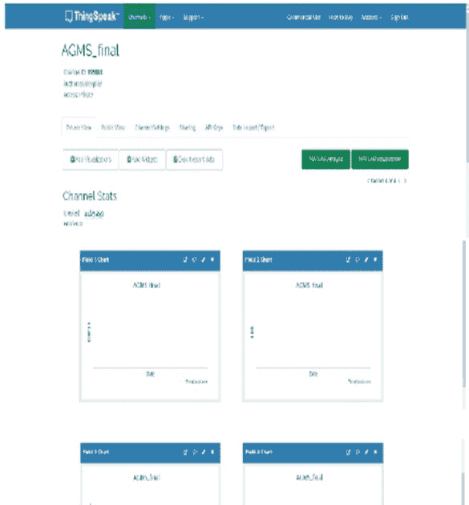**`Fig. (4))`**

Thingspeak 网站 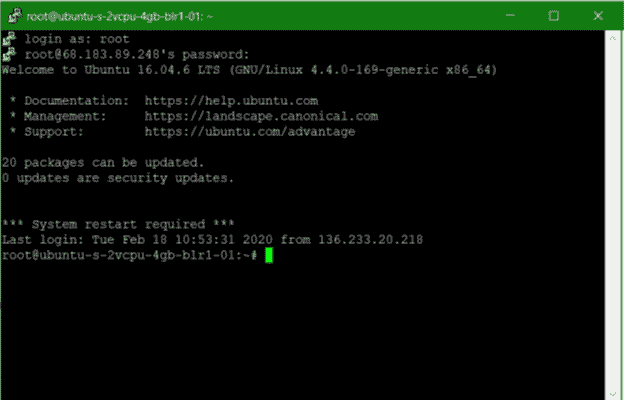**`Fig. (5))`**

Ubuntu 服务器 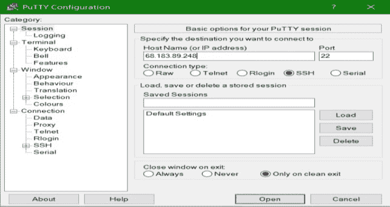**`Fig. (6))`**

设置配置

## 结论

农业是人类的第一职业；它是所有工业的基础。世界人口日益增加，对食物的需求也在增加。在印度，每天有 3000 名儿童死于营养不良。

温室监测系统提供了在任何季节种植作物的灵活性。这提高了季节性蔬菜全年的适度成本和可用性。使用水培和鱼菜共生等技术种植且不含农药的作物如今被称为有机食品。

鱼菜共生和水培技术为土壤提供了灵活性，因为这些过程不需要任何土壤，因此任何作物都可以在世界任何地方种植，温室可以在世界任何地方建造，因此进出口将大大减少。它可以用于任何新鲜蔬菜。

## 出版同意

不适用。

## 利益冲突

作者声明不存在任何利益冲突，无论是财务上的还是其他方面的。

## 致谢

无。

## REFERENCES

|  ||  |

| --- | --- |

| \[1\] || Nemali K.S., van Iersel M.W.. An automated system for controlling drought stress and irrigation in potted plants.Sci. Hortic. (Amsterdam)2006110329229710.1016/j.scienta.2006.07.009 |

| \[2\] || Kim Y., Evans R.G., Iversen W.M.. Remote sensing and control of an irrigation system using a distributed wireless sensor network.IEEE Trans. Instrum. Meas.2008577 |

| \[3\] || Mei F.. —Smart planet and sensing china—analysis on development of IOT‖.Agricultural Network Information20091257 |

| \[4\] || Sun Qi-Bo, Jie Liu, Shan Li, Fan Chun-Xiao, Sun Juan-Juan. Internet of things: Summarize on concepts, architecture and key technology problem, Beijing Youdian Daxue Xuebao.Journal of Beijing University of Posts and Telecommunications201033319 |

| \[5\] || Xing Z., Guiping L., Shi X., Cheng C., Wen L.. —Construction of agricultural service mode in IOT and cloud computing environment‖.Nong-ji-hua Yanjiu20124142147 |

| \[6\] || Saha Tanu, Verma Ashok. Automated Smart Irrigation system using Raspberry Pi.International Journal of computer applications20171726 |

| \[7\] || Veera Vanitha D., Nivitha S., Pritha R., Saranya J., Shobika T.. Automatic Drip Irrigation System using Raspberry PI and Wireless Sensor Networks.IJIRSET2011 |

## 基于 IoT 医疗的区块链解决方案的最新趋势

**Himanshu Sharma^(1)****，** **Hardik Chaurasia^(1)****，** **Arpit Jain^(2, \*)****，** **Nazir Ahmed^(1)**  

¹ 石油与能源大学电气与电子工程系，印度德哈拉敦  

² QpiAI India Pvt. Ltd. AI 从业者，印度班加罗尔  

## 摘要

本综述围绕将医疗保健的所有可能优势纳入并融合的理念展开，这些优势可由区块链技术（BCT）进行管理和处理。回顾医疗保健领域涉及的所有陈旧系统，整个过程非常缓慢，并且经常导致任何过程出现显著延迟，无论是患者报告、从智能手表跟踪数据、取消医生预约、药物处方等。BCT 与物联网（IoT）相结合，能够产生一个完全革命性且强大的系统，其范围从极其微小的细节扩展到全新的视野。据预测，到 2022 年，全球将有超过 180 亿台设备；因此，管理与医疗保健相关的数据，为其制定 BCT，可以在医疗保健领域的进步中产生一些指数级的结果。这些医疗保健数据非常容易受到各种网络攻击，所有收集的宝贵信息可能面临巨大风险；因此，通过部署 BCT，安全性可以大大提高。BCT 无非是不可更改的时间戳记录系列，就像数组的工作方式一样；即使其中一个块被初始化为任何信息值，该信息也将永远保留在那里。本综述试图将所有这些不同领域归纳在一个单一的伞形下，涵盖可以由 BCT 根据 IoT 进行管理的领域范围，以促进医疗保健领域的发展。

**关键词：** 区块链技术，物联网，哈希码，医疗保健，协议。  

* * *

^(\*) **通讯作者 Arpit Jain：** QpiAI India Pvt. Ltd. AI 从业者，印度班加罗尔；电子邮件：ajain@ddn.upes.ac.in  

## 引言

加密货币账本系统（即区块链技术（BCT））的最新进展在 IoT 和医疗保健领域取得了巨大飞跃。由于一切都受网络控制，因此利用 BCT 和 IoT 来管理医疗保健领域，将是使整个医疗保健系统更加强大和高效的绝佳机会。物联网（IoT）无非是设备通过互联网互连的领域，以便每个设备都可以通过网络进行控制。它涵盖了广泛的应用，例如健康管理、智能家居、交通、农业和天气监测等，仅举几例，因为其增长速度非常惊人。IoT 设备非常轻量 \[1》，因此能耗极低。仅凭这少量能量，大部分能量都完全用于设备执行的主要功能。因此，留给安全和隐私等应用的能量非常少。这就为 BCT 开辟了道路，因为 BCT 克服了上述问题，它是安全、分布式、不可更改、透明的 *等*。管理 BCT 的协议以块交易的形式使信息安全，这些块交易与相应的应用程序相关联。一旦这条块链完全填满，它就会通过称为挖矿的过程附加到其他链上，该过程由称为矿工的特定节点执行。虽然 BCT 的部署并不像看起来那么容易，因为与之相关的各种问题。为医疗保健等应用部署 BCT 和 IoT 非常有前景，并且设备齐全。一个针对远程患者监护（RPM）的系统提案 \[1》主要侧重于提供医院以外的医疗保健服务。整个概念是关于患者佩戴的 IoT 可穿戴设备，该设备通过受 BCT 保护的云将所有生命体征信息传输到相应的医疗保健中心。虽然与 IoT 相关的各种问题，例如网络开销延迟、数据管理不善等，但 BCT 非常有效地克服了所有这些问题。BCT 包含各种优点，包括隐私、可信度、智能合约、DDoS 通知和缓解，但其他问题可能仍然存在，例如带宽限制、网络问题等。在对迄今讨论的每个方面进行批判性分析之前，让我们深入了解其基本原理。

### 医疗保健

## 医疗保健与区块链技术

A professional field, particularly of science that is a sheer management and improvement of health through appropriate history taking, prevention, diagnosis, standard procedures, treatment, and ensuring recovery of various ailments in people is known as Healthcare \[2\]. We have witnessed the advancement trend in the medical sector and it is enumerated to have the most impact on the business and society for the next 35 years. Healthcare has a very wide spectrum – from having large glass like structures providing every medical facility in the urban areas to struggling for a decent treatment in rural areas. Looking on the development being made in the Healthcare sector, this gap is expected to widen in the future years \[3\]. There is a buzz that a day will come when AI (Artificial Intelligence) driven robots will operate on patients. For now, it may seem as a long shot but nevertheless steps have already been taken so as to proliferate this domain of AI for decisions in treatment \[4\]. New and automated technologies are being introduced in the hospitals that work using IoT and are able to analyze the patient’s health status every time. Now we are taking into account various new factors emphasizing on health, like steps per day, water intake per day, number of floors climbed, and average walking speed \[5\]. Finding new and innovative reforms in this paradigm is quite tedious and requires huge deal of iterations. So, discovering new reforms has now extended beyond the boundaries for healthcare practices as they are being developed since 1950s. Although these prior reforms just focused on improving the safety and quality of healthcare, now the reforms are made to improve the quality of service ranging from local organization level to decision level organizations. More importantly, these are not only the tools that are driving healthcare sector to reach greater heights, but the organizational factors are also important to implement and sustain the new paradigm \[6\]. The most important factor affecting healthcare is diversity of the people. This brings in the theme of World Health Organization (WHO) for 2018 “Universal Health Coverage – Everyone, Everywhere”. Many factors like social, political, financial, geographical and cultural, affect the availability of all facilities for the people \[7\]. Even if somehow or someway, all these facilities are made available, what guarantees that it is given to them regularly and a constant check is kept on the patients? The first idea that strikes our mind is ‘Manpower’ and more or less many may run out of ‘Manpower’. So, the follow up solution is ‘Accountability’ – `the patients expect a certain standard of treatment due to a particular conduct`. They should be able to trust the personnel in front of them with their sensitive information.

In recent years, with digitization creating an umbrella in this tech world, many health care centers are now shifting towards Big Data and IoT for the welfare of their patients and monitoring them continuously – `remote patient monitoring` \[8\]. This remote monitoring is increasing at a very faster rate from 7.1 Million in 2016 to an estimated 50.2 Million in 2021 \[9\]. The information and data so gathered may be vitals or records, is being stored and monitored on a regular basis thus in return giving birth to HIE – `Healthcare Information Interchange`. Determining which trials and methods are used on one patient at a place makes it useful for a doctor to implement it at another place on a person having the same problem, by checking the records \[10\]. By implementing this method, new treatments can be found and doctors can learn more about the disease, thus developing a `precision medicine`. This new paradigm of healthcare is preventing and predicting diseases beforehand using the data being collected from regular monitoring of the patients. By training multiple Machine Learning models, we can predict for which disease the patient is more vulnerable and doctors can treat that beforehand. We are no longer going to wait for the patient to get sick, instead we will be able to predict and prevent the disease before it will even get its grip on the human body \[4\]. This provides us with a gist of what has been so far implemented and what are the types of approaches being followed in the healthcare sector.

## Blockchain

With the increase of cloud storage, Internet of Things and cyber-attacks, it is important to adapt methods capable of ensuring the security of the sensitive data being collected \[11\]. IoT can become more complicated in the future when it will be connected with `Network of Plentiful Things` (NPT). If we are stuck with the centralized structure of IoT, we will not only increase the traffic in the network but will also have no scalability in our network \[12\]. A blockchain like protocol, being first introduced by David Chaum in 1982 and further worked upon by multiple individuals in the upcoming years, has emerged as an alternate to overcome various challenges put forward by IoT. If we turn back the pages of history, the first blockchain was conceptualized in 2008 by Satoshi Nakamoto and was a core component in Bitcoin, a `crypto-currency` – where it worked as a ledger for all the transactions taking place \[13\]. In past few years, the concept of crypto currency has gained a huge deal of fame and importance because of the quirk it possesses. Blockchain is a decentralized, distributed and an immutable ledger containing all the transactions and data in blocks. It has three main parts – Block, Miner and Node. Not only being smart and secure, it ensures that no additive noise is added up and thus bringing no disruption to data, which was a problem in other security methods \[14\]. Furthermore, it enables integrating several core technologies like cryptographic hash, digital signature and distributed consensus mechanism \[13\]. Moreover, it can be private or public depending on the user. Blockchain creates an immutable ledger of the blocks in which each block contains timestamps of all the transactions taking place (Fig. **1**) \[8\]. Each block in Blockchain has two main headers – the block header and policy header. The block header contains information regarding the previous block, thus making the ledger immutable and the policy header is used to authorize the devices involved.

每个数据都由提供给用户的 `Public Key` 授权；只有这样，智能设备才能访问或使用区块链和存储 \[15\]。正如一项研究所预测的那样 \[16\]，BCT 可能会通过加密货币的这种增加，完全改变人们支付商品或任何购买商品的方式。与 BCT 相关的各种风险，例如私钥安全、犯罪活动、双重花费、交易隐私泄露、犯罪智能合约、智能合约漏洞、优化不足的智能合约以及定价过低的操作，已在 \[17\] 中得到非常有效的解释，但在过去几年中，针对这些问题，还提供了同时解决方案、各种拟议框架和改进算法，这些方案非常有效地解决了这些问题。虽然 BCT 可以应用于任何地方以造福社会，但更重要的是，它在安全和金融行业中找到了其价值，因为它已经在各行业触发了多个项目。BCT 承诺克服非常微妙的方面，代表着“从信任人转向信任数学” \[16\]。智能家居矿工管理大部分事情，例如生成交易、分发和更新密钥、管理本地存储（用于本地存储数据 – 使用先进先出 (`FIFO`) 和集群。此外，它还将交易收集到一个块中，然后将其追加到区块链。每当外部设备需要从网络获取数据时，矿工会分配一个特殊密钥。矿工首先检查策略头，然后分配一个密钥，以便设备可以访问数据。工作完成后，它还可以声明密钥无效，以便设备无法再访问网络。这种方法有两个优势——矿工可以跟踪网络中涉及的所有设备，并且设备之间的通信使用共享密钥进行保护。即使访问本地存储也需要权限 \[15\]，我们可以实现分布式云存储，使其难以造成中断 \[11\]。IoT 设备可以通过智能合约进行自主交易。结合人工智能 (AI) 和大数据解决方案，可以产生更显著的影响 \[18\]。

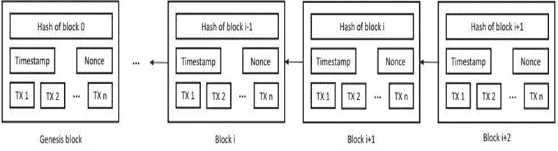**Fig. (1))**  

BCT 的框图。 

如表 **1** 所示，已讨论了各种类型的 BCT 及其属性。区块链检查每个数据包或交易，以识别任何异常行为。如果我们考虑多个矿工来验证添加到链中的新数据包，这肯定会增加延迟，因为现在每个矿工都必须验证正在添加的数据包，但它增强了整个网络的鲁棒性。它解决了中心化问题，因为多个矿工控制/验证正在添加的数据。区块链要求每个矿工进行加密检查并解决一个复杂的数学问题，以完成交易，这可能会增加能源消耗，但使用人工智能，这个问题也可以得到解决 \[19\]。区块链可能是安全的未来，因为许多新公司已经开始使用它来赢得用户的信任，例如 `Provenance`。博世和思科等大公司已经开始实施区块链的功能来保护 IoT 应用程序。区块链与加密货币密切相关。GridCoin 和 Ripple Labs 在金融服务中找到了区块链的精妙实现 \[20\]。

Table 1 **BCT 类型。**  

| ***属性*** || ***公共 BCT*** || ***联盟 BCT*** || ***私有 BCT*** |

| --- | --- | --- | --- |

| **确定共识** || 每个矿工 || 仅选定的 || 特定机构 |

| --- | --- | --- | --- |

| **读取请求** || 公共 || 公共/受限 || 公共/受限 |

| **不可更改性** || 几乎不可能干扰 || 可以干扰 || 可以干扰 |

| **效率** || 截断 || 相当高 || 相当高 |

| **中心化** || 无 || 初级 || 是 |

| **共识过程 (PoC)** || 不需要确认 || 需要权限 || 需要权限 |

## IoT

IoT 创造流行语的方式非常值得称赞，并让许多研究者感到满意。IoT 无非是物体之间通过互联网的互连。它不仅旨在将一切统一在一个伞下，还试图解决只需点击一下就能控制周围事物的问题。IoT 没有唯一定义，因为它可以根据需求和参考进行塑造 \[21\]。此外，IoT 已成功吸引了全球用户、商人和当局的关注，不仅要在各自领域使用这一概念，还要将其触角更深地延伸到知识领域。IoT 的第一个已知应用是 20 世纪 80 年代初卡内基梅隆大学的一台可乐机，自那以后，它的发展就一飞冲天。为了成功实施物联网 (IoT)，先决条件是 (a) 动态资源需求 (b) 实时需求 (c) 需求的指数级增长 (d) 应用程序的可用性 (e) 数据保护和用户隐私 (f) 应用程序的高效功耗 (g) 在靠近最终用户的位置执行应用程序以及 (h) 访问开放且可互操作的云系统 \[22\]。

到目前为止，当我们考虑广泛用于部署基于 IoT 的产品和服务的主要关键技术时，我们得到的最明显的解决方案是 RFID、WSN、中间件、云计算和 IoT 应用程序软件。2010 年至 2020 年之前 IoT 的趋势在表 **2** 中得到清晰说明。

Table 2 **IoT 趋势**  

|  || **2010 年之前** || **2010-2015** || **2015-2020** || **2020 年之后** |

| --- | --- | --- | --- | --- |

| **网络 (N/W)** || ▪ 基于 WSN || ▪ 自主  

▪ 网络位置透明。  

▪ 接受延迟  

▪ 存储和电源网络  

▪ 混合技术 || ▪ 基于上下文的网络感知。 || ▪ 网络感知  

▪ 自学习和自修复网络。 |

| --- | --- | --- | --- | --- |

| **软件和算法** || ▪ 关系数据库的融合。  

▪ 面向 IoT。  

▪ 面向事件的平台。  

▪ 定位算法。 || ▪ 大规模开源  

▪ 可组合算法  

▪ 下一代社交导向  

▪ 下一代应用 || ▪ 期望结果导向。  

▪ 分布式 AI  

▪ 物对物协作 || ▪ 用户为基础  

▪ 透明 IoT  

▪ 易于部署  

▪ 物对人协作。  

▪ 面向所有人。 |

| **硬件** || ▪ RFID、传感器  

▪ 集成到智能手机。  

▪ 智能手机中的 NFC。  

▪ 截断且负担得起的  

MEMs 技术 || ▪ 各种协议和标准导向。  

▪ 增加传感器和执行器。  

▪ 安全且负担得起的标签和 || ▪ 智能传感器  

▪ 在非常小的空间内增加截断的传感器。 || ▪ 纳米技术和新  

创新材料 |

| **数据处理** || ▪ 串行和并行  

▪ 服务质量 (QoS) || ▪ 频谱感知数据处理  

▪ 基于上下文的数据处理，可  

▪ 适应 || ▪ 基于上下文的数据处理和输出。 || ▪ 自适应、基于 AI 的认知优化。 |

Table 3 **BCT 解决 IoT 挑战。**  

| **挑战** || **解释** || **区块链解决方案** |

| --- | --- | --- |

| 成本/容量限制 | 随着物联网使用量的突然增加，物联网设备的使用量将激增。物联网在日常生活中的更多应用涉及使用更多设备。 | 智能合约可以实现网络上的顺畅通信。去中心化方法将有助于可扩展性和安全性。 |

| --- | --- | --- |

| 传统方法 | 以前的安全方法采用集中式方法，可能会危及整个系统的安全性。可扩展性非常有限，且无法抵御 DDoS 等恶意攻击。恶意软件可能被引入，整个网络可能会被攻破。 | 去中心化方法消除了对单一位置的依赖。数据在添加到链之前会先经过用户的加密验证，因此无法添加恶意软件。区块链已被证明对许多恶意攻击很有用。 |

| 对云的依赖 | 由于采用集中式方法，云服务器出现任何问题都会影响整个网络，服务将停止运行。 | 没有单一的依赖点。数据分布在云服务器上。如果任何一台服务器宕机，数据可以发送到另一台服务器。 |

| 可变性 | 数据可以轻易被操纵，甚至可以添加恶意软件来破坏整个服务。 | 不可变链，每个区块都带有时间戳。无法在中间添加数据，且必须经过所有用户的加密验证。数据分布在云上，由于加密，无法被篡改。 |

我们，作为人类，已经意识到这个世界上没有什么是完美的，或者实现那个乌托邦式的世界只是我们的梦想，因此我们讨论物联网面临的挑战，即数据管理挑战、数据挖掘挑战、隐私、混乱，最后是安全性（表 **3**\]。

## 使用 BCT 和 IoT 的集成解决方案

数字创新是当务之急，该领域需要各种新的改革。数字创新无非就是使用数字技术进行广泛的创新。制度理论的早期历史提供了一个特定的变革版本，即组织由于合法性和社会文化压力的力量而变得越来越相似。一个核心过程是同构，即组织通过规范性、模仿性和强制性压力而变得越来越相似。从制度视角研究数字创新和转型，关注的是数字化支持的制度安排如何在领域和组织中出现和扩散。同样，思想和关键核心概念可以在与 IoT 融合的 BCT 中可视化。在深入探讨这一连贯概念之前，首先让我们简要了解一下它在惊喜包中为我们准备了什么 \[24\]。

物联网（IoT）正在破壳而出，并演变为完全成熟，从而确立其作为未来一部分的地位。据预测，到 2022 年，全球将有超过 180 亿台设备，随着物联网涵盖这个技术世界，注定会在物联网领域创造更多新的挑战 \[25\]。IoT 是各种设备的底层背景，这些设备负责生成和交换信息以及私人敏感信息，因此容易受到各种网络攻击。此外，与物联网相关的新设备重量轻，必须将大部分能量用于多任务处理，因此将 BCT 纳入物联网安全是一种独特而有效的解决方案。区块链可以帮助注册物联网设备，并对设备进行定期完整性检查 \[26\]。物联网具有广泛的应用范围，设备需求不断增加，互联网普及到每个人，为研究和新发展打开了大门。自物联网功能放大以来，其安全性和隐私方面出现了一些缺陷和困难，涵盖了各种威胁，例如缺乏中央控制、设备资源异质性、多个攻击表面、特定上下文风险以及规模 \[27\]。不断增加且日益普及的 BCT 在物联网的演进和微型化方面具有良好而强大的地位，其路径可追溯到非常原始和传统的用途。这不仅带来了巨大的进步，还催生了各种新兴技术，如无线传感器网络（WSNs）、射频识别（RFID）、*等等* \[28\]。

物联网突然席卷全球，定期收集大量实时数据。传统方法对于如此庞大的数据无法高效处理，直接将数据存储在云上也不是很好的做法 \[11\]。数据应随时可用，提供低延迟，且设备应具备可扩展性。集中式数据很容易被篡改，我们永远无法信任这些物联网公司处理我们的敏感数据。我们需要一个分布式、去中心化的系统，网络中添加或修改的每个数据都必须先经过该网络中所有系统的验证。

除此之外，物联网的多样性和普及导致对互联网、安全以及许多其他重要方面的需求不断增加，物联网与 BCT 的融合现在成为一个主要关注点。物联网不仅让用户利用其资源，甚至为最终用户创建创新应用程序的创建者也将 BCT 作为增强结果的完美工具。物联网最基本、最主要的挑战无非就是安全性，或者可以称之为*“隐私问题”》。由于 BCT 与 IoT 的集成已经克服了这一挑战，因此集中式公司使用两者的集成来管理数据和隐私。BCT 有潜力克服与物联网相关的挑战，因为其分布式、安全和私密的特性。

如前所述，区块链是一个去中心化、不可变、透明且安全的所有信息账本。考虑到 BCT 的优势，2016 年前 9 个月在 BCT 上投资了超过 14 亿美元 \[29\]，且这一数字仍在呈指数级增长。区块链仍是一个正在发展的领域，因此仍有很大的改进空间。例如“GHOST”的加入将提高区块创建速度，我们将能够创建大块数据 \[30\]。内容分发网络（CDN）的实现将能够提高 BCT 中数据传播的速度，从而消除由于分布式方法产生的任何不一致，并且还能保护网络免受双重支付攻击 \[31\]。

虽然直接将 BCT 采用于 IoT 并非易事，因为它涵盖了诸如高资源需求、长延迟和低可扩展性等各种挑战。此外，考虑到 Gartner 进行的研究，2018 年 IoT 安全支出达到 15 亿美元，到 2022 年，一半的 IoT 安全预算用于故障修复、召回和安全故障，而非保护。因此，如果实现 `secure by design` 系统，IoT 将经历其发展的指数级增长。BC 的需求源于 IoT 面临的关键挑战在于其分布式架构，这可能导致各种问题，如安全性、通过 `via` 网络攻击的利用、快速崩溃、中央云服务提供商管理不善、机密性和身份验证、保持数据完整性等。除此之外，另一个例子加强了 BCT 与 IoT 融合的观点，Big chain DB 是将区块链与大数据相结合的一个例子 \[32\]。将区块链与人工智能（AI）结合使用将通过其对数据的操作减少计算过载 \[19\]。IoT 是使用各种技术将日常设备相互连接。IoT 可以简单到我们的车一进入车库就打开咖啡机，也可以复杂到监控医疗保健中人体的生命体征并提供这些信息以供进一步分析。公司正在为工业应用投资数十亿美元用于工业物联网并解决其问题 \[33\]。由于 IoT 应用的增加及其实时监控数据的能力，它容易受到连接到我们存储数据的云上的设备的攻击和安全问题。我们的设备信号在公共场所运行，这使它们暴露于黑客，黑客可以轻易损坏设备或控制正在发送的数据。此外，它已经容易受到网络层攻击，如 DoS、非法访问网络、中间人攻击，这个列表还在继续。在存储方面，我们可能会遇到与非法访问数据、存储恶意软件或被篡改的数据，有时甚至数据丢失相关的威胁 \[34\]。此外，BCT 已证明它是不可更改的、分布式的，并且对大多数涉及欺诈的攻击具有免疫力，主要是 `double spending` 和 `record hacking`。要解释被称为 `Double spending` 的术语，它是指一方使用同一资金池购买多个资产，因为处理付款时存在一些延迟。区块链要求矿工在确认任何交易之前解决 PoW，这需要一些时间。这为付款处理提供了时间，从而轻松解决了问题。BCT 的去中心化方法保护存储的数据免受黑客攻击 \[35\]。DDoS 攻击正在使用去中心化方法进行处理，Gladius 项目的方法专注于阻止 DDoS 攻击 \[36\]。IoT 网络涉及分布在大面积上的大量传感器以全面监控它。我们不使用点对点连接，因为它无法帮助模块化、去中心化并降低网络的可扩展性。IoT 网络由控制器和执行器节点组成，这有助于使系统自动化。IoT 网络产生大量数据，这导致一些延迟并使网络难以管理。将区块链与自适应控制算法结合使用，可以解决许多这些问题。自适应控制算法分析队列，并通过进行适当更改不允许队列饱和。区块链增强安全性并存储 `HashMap`，这有助于在数据库中快速搜索，从而提高 IoT 网络的效率。以分布式、去中心化和防篡改的方式创建/存储/转移数字资产的能力对 IoT 系统具有巨大的实际价值。性能分析清楚地表明，延迟是该地区的主导因素 \[37\]。

与此同时，IoT 和 BCT 融合的不断增强，这两个概念在同一个伞下已经作为低功耗损耗网络（LLNs）的主要标准迈出了巨大的一步，这些网络资源受限。这种融合的未来意义非常明显，因为它不仅对商业方面有用，而且在社区服务中也具有重要意义 \[38\]。理解 IoT 面临的传统问题，可以将其列为 ‘`Resource Consumption, Centralization, Lack of Privacy, Not Scalable, Mutable, etc.`’，这些问题使 BCT 成为 IoT 缺陷的救星 \[39\]。

因此，将 BCT 与 IoT 集成的主要目标就是让所有这些挑战消失或减少到非常微不足道的程度。不应将 BC 与比特币或更广泛地说与加密货币混淆，因为它只是 BCT 的一个应用或杠杆。简单地说，BC 只是一个基于共识规则的分布式数据库系统，允许实体之间转移价值。BC 是唯一同时享有三个属性的实体：

1. `Trust-less` 意味着不需要拥有经过认证的数字身份，双方不需要了解彼此，但仍可以交换数据。

2. `Permission-less` 意味着没有人有权操作 BC 网络，因此没有权限，没有控制者。

3. `Censorship resistant` 意味着任何人都可以使用和在 BC 上进行谈判 \[40\]。

可以得出结论，IoT 生态系统有许多漏洞。BCT 作为拯救者出现，从而为许多未来的发展和研究铺平了道路。即使在非常具体的领域，如智慧能源、智能制造、数据隐私等，也可以进行大量的研究。随着 IoT 设备的普及和数据产量的增加，尝试开始货币化数据，催生了机器经济。BC 可以简化谈判过程，消除对可信中介的需求。

倡导同样的观念，IoT 和 BCT 的进步和日益受到关注，这种融合是不可避免的。人们总是期望 BCT 将彻底改变 IoT，而采用法规是将 BCT 和 IoT 作为政府基础设施一部分的关键。

## BCT 和 IoT 用于医疗保健的集成

医疗保健是注定会以如此指数级速度增长的行业，在未来，它将成为最负盛名的行业。整个行业将要发生的革命，无疑注定会为那些致力于将上帝的计划变为现实的研究人员和爱好者带来荣誉。

## 医疗演进与技术融合

医疗已从起步阶段走得很远。如果我们观察医疗的发展趋势，从最初用草药治疗一切，到后来使用化学药物治疗各种疾病，医疗无疑发生了转变。某种程度上，战争让各国意识到需要更加关注战友的健康。新方法开始实施——使用青霉素来降低感染的严重程度和传播，这最终导致其在未来几年实现大规模生产。此外，医疗领域取得了更多进步——脊髓灰质炎疫苗（1952 年）、首例成功肾移植（1954 年）、抗病毒药物（1960 年）和免疫疗法（1970 年代）\[41\]。

问题导向型病历（POMR）的概念起源于 20 世纪 60 年代初，由劳伦斯·L·威德博士提出。这是医学科学研究领域的一项突破，因为现在关于某个特定主题的所有数据都集中在一个地方，这种方法彻底改变了研究团队的整体认知。为每位患者创建了一个单独的数据库，包含问题、所接受的治疗和检验报告，这将有助于推进治疗 \[42\]。

迄今为止，我们已经讨论了 BCT 和 IoT 的关键特性，以及它们的独立性如何为新的技术进步打开大门。本节的主要重点是考虑将 BCT、IoT 和医疗领域统一在一个页面下。在未来几年，医疗模式将变得更加以患者为中心。我们将寻求患者及其敏感数据的有效性和安全性方面的进步 \[43\]。

在最近一年，COVID-19 的传播让我们关注每个人的医疗。我们必须减少接触，因此传统方法在这里不太适用。我们需要能够收集人们的数据，并能够远程访问这些数据，以了解哪些地区受疫情影响更严重，同时也在收集 POMR 以更好地了解疾病。更多的重点放在通过 IoT 而非物理方式收集这些数据上。感染者的记录正在被分析，他们访问过的地方正在被隔离，以防止任何形式的传播 \[44\]。正在开发应用程序来帮助定位人员并提醒他们注意环境，同时，他们的隐私也需要得到保护。使用 BCT，我们可以提高数据传输的效率，并确保这些数据免受攻击者的威胁。IoT 将有助于收集数据的无线传输，而 BCT 将确保这些数据不会被篡改。BCT 创建了所有发生的交易的账本，我们将能够识别每个添加的数据块以及连接到这些数据的用户 \[45\]。

## 医疗数据、IoT 和 WBAN

随着医疗领域的指数级增长，医疗保险及其他相关重要方面现在已成为人类生活不可或缺的一部分，从而导致大量医疗数据的收集。这些数据可能包括诊断和治疗过程、可穿戴技术数据、记录和患者数据历史，从而不可避免地需要使用 BCT 和 IoT 来分析和保护这些非常重要的数据。由于我们这一代人已经见证了数十亿个传感器与各种其他设备融合，因此保存记录和分析这些数据现在已成为一项不可或缺的工作，这当然需要巨大的关注，更需要安全和隐私，而这只能通过在其中部署 BCT 和 IoT 来实现。如果收集到的这些医疗数据在正确时刻不可用，或者数据接收出现甚至显著的延迟，可能会导致治疗过程延迟，甚至更糟的是危及患者的生命 \[8\]。

随着 IoT 的巨大应用和广阔前景，医疗领域也出现了巨大趋势，并且对无线体域网络（WBANs）也给予了相当大的重视。主要在 WBAN 中，患者配备了各种专门用于跟踪和测量各种实时健康指标（如心率、脉搏、血糖水平、*etc.*）的健康可穿戴设备。所有这些设备都由一个主设备（如智能手机）控制或支持，该设备自主工作并将这些数据发送给可信赖的医疗服务提供商。这不仅有助于减少医生的预约，还能帮助患者以 utmost caution 过上健康的生活。这些设备的受欢迎程度呈指数级增长，预计到 2021 年将达到近 5000 万台。随着远程患者监测领域的扩展，显然对这种数据更安全、更可靠传输的需求也在增加。处理此类工作的最佳管理者非 BCT 莫属，因为这些医疗数据对黑客来说非常有利可图 \[46\]。

医疗物联网（IoMT）将在未来几年彻底改变医疗。IoMT 是 IoT 与医疗领域的结合，使能医疗设备、软件和健康系统。同样，为了分析这些数据，它涉及 WBAN，通过使用可穿戴设备，我们将能够远程监测患者的生命体征，甚至可以将这些信息提供给医疗中心以供进一步评估。我们将能够使用这些设备在患者家中进行治疗。这将改善医院的患者流量，并使医疗团队能够治疗更多患者。传统医疗方法正在使用 IoT 支持设备向数字化转型 \[47\]。这种远程监测方法不仅能帮助患者并避免就诊，节省医疗团队和患者的时间，而且根据高盛的数据，对于美国这样的国家，还可以节省高达 3000 亿美元 \[48\]。想象一下它对其他国家可能产生的影响！IoMT 由于其多样性和无线方式而面临安全和漏洞问题，这可以通过 BCT 来解决。BCT 网络可以充当中间件，能够以高效的方式分配资源 \[49\]。

## BCT 框架与安全

因此，为了让黑客的生活变得痛苦，或者让他们的所有计划都走上死胡同，可以设计一个由 BCT 驱动的复杂框架。BCT 还能够实现智能合约，这些合约是可以根据预定义的条件触发器自动执行的代码片段，这些触发器可以根据患者的需求和条件进行设计。此外，在处理受保护健康信息（PHI）时，隐私和真实性至关重要，而有用的工具是 BCT，因为没有任何机密医疗信息会存储在 BCT 或这些智能合约中；所有测量数据本身都将转发到指定的存储数据库。这种身份验证不仅有助于防止和检测篡改，而且在发生任何意外或故意篡改时，也有助于纠正这些篡改。BCT 有潜力提高远程患者监测系统的安全性，从而自动化交付与合规问题相关的健康通知。它可以通过向 EHR 和医疗数据湖添加格式化和清洁的数据来解决患者数据管理不善的当前问题，使医疗能够使用更可靠的信息利用大数据，从而产生更显著的结果。

## BCT 在安全与医疗领域的应用

BCT 之所以能在安全领域发挥作用，是因为其去中心化、不可篡改等天然特性，如前所述，它已被证明能够抵御各种恶意攻击。BCT 能够提供隐私保护，因为所有交易都使用加密密钥保存，攻击者无法定位数据来源。区块中的时间戳不允许任何人在中间添加数据，从而突显了 BCT 的不可篡改性 \[50\]。BCT 在数据传输方面也有益处。不会出现数据丢失，数据的整合性和安全性更高。添加数据需要网络中其他节点的验证，因此任何恶意软件都无法潜入 \[51\]。

人们甚至可以考虑将 BCT 的核心思想应用于健康应用网络，其中收集的数据可以以非常安全、可靠且私密的方式向经过身份验证的医疗服务提供者生成重要警报。到目前为止很明显，各种智能 IoT 设备以互联网层的夹层形式被使用。从这些层中收集数据，进行分析，随后用于医疗服务提供者。由于 IoT 设备轻量且占用空间小，往往会留下非常微小的能量足迹。这种少量的能量不足以支持涉及安全或隐私的任务，因此 BCT 应运而生。IoT 有很多缺点，但其广泛使用往往有时会导致可扩展的方法，很多时候，这可能变得相当具有挑战性，因此部署 BCT 可能会成为一项非常有利可图的交易 \[52\]。

2020 年无疑充满了惊喜和意想不到的情况，但世界在进步方面无疑被病毒 COVID-19 向后推了。这种病毒的前所未有的传播引发了各种挑战，尤其是在医疗领域，因此技术进步必须成为人类的救星，这些进步无非是 AI、BCT、ML 和 IoT 等新兴技术。从主旨演讲来看，欧洲议会研究服务处（EPRS）已将 BCT 发现为对抗 COVID-19 的关键新兴技术之一。在 BCT 所具备的所有关键特性中，当与 IoT 结合时，它可以大大进步，以克服这种病毒带来的所有考验。这一伞形范围可以扩展到各种应用，例如接触者追踪、患者信息共享、供应链管理、电子政务、灾害救援和保险、在线教育、各种自主服务、制造业、农业和食品分销 \[53\]。

到目前为止，我们已经探讨了我们主题的三大要素在单一伞形下的可能结果或领域，但仍然过时的是数据的真实性和安全性，如果支持整个网络的系统或框架不是 BCT 具备的，这些问题仍将存在。此外，有害的是针对医疗系统的网络攻击和频繁攻击，导致毁灭性的数据丢失。因此，当整个数据由一个非常强大、不可篡改、不可攻破的系统处理时，它不仅对医疗部门或组织有帮助，而且系统现在将对患者的个人数据丢失负责。如果现在处理这个整个框架的系统以加密格式存储数据，即使系统以某种方式关闭或面临任何技术故障，数据仍然会受到保护并存储在安全的地方 \[54\]。

在 2020 年，面临的挫折数不胜数，但如果问任何数字爱好者是什么导致了他们公司的数字化转型，一个简单的答案就是 COVID-19。各种智能应用程序的开发，如 Aarogya Setu、Kwarantannadomowa、Trace Together、LetsBeatCOVID、COVID Watch、`etc.`，受到 IoT 和 BCT 结合的启发，当然还有迄今讨论过的其他新兴技术，例如可靠的数据共享、患者监测以及检查提供给患者的费用，都可以简单地由在后台运行的 BCT 提供支持。此外，它还可以为用户提供透明度 \[55\]。虽然这场大流行确实带来了几种限制，但它也为许多数字创新打开了大门。此外，在过去几年中，人们已经意识到即使检查占用率也可能导致错误，因此可以提出一个框架来保护从该占用率收集的数据。收集的数据可以进一步提供给相关利益相关者，以进行更多认知研究工作 \[56\]。

考虑到当今的情况，医疗领域被认为非常复杂、重要且发展迅速，该领域投入了大量资金。COVID-19 就是一个突出的例子。毫无疑问，多媒体已经采取了复杂的形式，两者之间存在着巨大的共生关系，从改善患者与医疗服务提供者之间的互动质量，到使用各种智能对象通过在线方式以图像、文本和音频等多种形式传输患者数据 `via`。但如果我们非常仔细地看待整个画面，我们会注意到管理整个数据并不容易，因为它不仅存在存储问题，而且人力成本和安全风险都相当严峻。这些 IoT 设备中出现的威胁也是由各种入侵者发起的，可能导致患者数据泄露和滥用。为了克服上述所有问题，BCT 可以被有效部署，因为它不仅提供了一个安全的框架，而且在实时场景中保护整个控制系统。当整个结果被模拟时，在 BCT 首次部署中看到了高达 86% 的成功率峰值，涵盖了产品丢失比率、伪造攻击、虫洞攻击和概率性身份验证场景等各个方面 \[57\]。

IoT 应用程序和医疗系统使用非常精细的互连设备生态系统来改善医疗设施。我们非常熟悉，患有慢性疾病的人比非慢性病患者更频繁地使用医疗服务，这导致与前者患者相关的记录创建了不可篡改的印记。尽管技术进步或多或少，但为这个生态系统建立一种通用编程语言或通用通信协议仍然难以捉摸。因此，提出了一种系统，确保具有改进互操作性的 IoT 系统也可以在该特定基础设施中保护和保证节点之间的机密性，从而将整个工作量交给 BCT 使整个系统更加高效 \[58\]。表 **4** 提供了以前整合区块链和 IoT 以解决医疗问题的研究比较。

## 表 4 医疗对比表

| 序号 | 问题陈述 | 提出的解决方案 | 参考文献 |
| :--- | :--- | :--- | :--- |
| 1. | 医疗人员没有记录遇到的问题及针对这些问题提出的解决方案。 | 开发一种面向问题的医疗记录，能够存储医疗数据，并可由医疗团队和研究人员从任何地方轻松访问。 | \[42\] |

## 表格内容

| 序号 | 问题/背景 | 解决方案/方法 | 参考文献 |
| :--- | :--- | :--- | :--- |
| 2 | 早期，医疗保健与我们今天所见的截然不同。价格上涨，医护人员不足以照顾患者等等。 | 医疗保险和必要药物的大量生产。在医疗保健中引入自动化系统，在很大程度上有助于跟踪患者。人工智能和机器学习将塑造未来 | \[43\] |
| 3 | 冠状病毒的突然引入及其特征。它对我们呼吸系统的直接攻击以及无法应对它。 | 提出一种方法，能够在不危及他人生命的情况下有效解决问题。对患者进行隔离和持续监测。使用口罩防止病毒传播。 | \[44\] |
| 4 | 通过物联网共享安全信息缺乏信任，网络不够高效，无法处理数据的流动和存储。 | 使用雾计算来存储和管理网络中连接的所有设备。使用云计算安全地存储数据。实施区块链，结合雾计算和云计算，创建数据的超级账本并增强安全性。 | \[45\] |
| 5 | 与医疗数据相关的安全和隐私问题，其接收，以及遇到的延迟。 | 一种新型框架，使用必要的物联网设备的修改后的 BCT 模型，依赖于分布式特性以及其他额外的隐私和安全属性。 | \[8\] |
| 6 | 物联网设备的指数级增长导致数据传输和记录的安全问题日益增加。 | 基于以太坊协议的 BCT 智能合约，用于促进受保护的健康信息（PHI），从而提供实时患者监测和医疗干预。 | \[9\] |
| 7 | 因为需要定期跟踪每个患者，医护人员的负担加重。一个人频繁前往进行治疗并检查生命体征。 | 使用物联网与医疗设备，以便轻松跟踪患者。创建可穿戴设备，以便随时随地监测患者。医护人员可以轻松管理多名患者，患者去医院的次数将减少。 | \[47\] |
| 8 | 昂贵的医疗设施和减轻医护人员的压力。 | 高盛认为数字医疗可以节省大量资金。它可以减少双方的努力，使生活更轻松。医护人员可以轻松跟踪“高风险患者”。 | \[48\] |
| 9 | 应对冠状病毒的突然爆发并能够追踪它。确保医疗专业人员的安全。 | 使用传感器来追踪每个人的生命体征并检测任何阳性病例，以及使用传感器监测患者而无需过于接近他们。使用区块链解决这种敏感信息的安全性，并能够安全地存储数据。 | \[49\] |
| 10 | 目前用于收集和存储医疗数据的方法不足。 | 使用区块链、摘要链和安全的 P2P 网络来解决面临的大部分问题。 | \[50\] |
| 11 | 以前的方法在传输医疗数据方面非常缓慢且不够安全，并且无法让任何需要的人获取这些数据。 | 使用区块链和深度学习创建一个能够更高效、更安全地传输数据的模型。这将导致可靠的数据分析，并使数据不可更改且准确。因此，能够正确诊断患者。 | \[51\] |
| 12 | 为了克服物联网面临的问题，如可扩展性很低、资源需求高、流量过载。 | 一种针对物联网设备优化的新型区块链模型，通过实施轻量级区块链来考虑医疗设施，从而提高隐私和安全性。 | \[52\] |
| 13 | COVID-19 对世界的影响以及由此遇到的挑战。 | 将区块链作为关键的使能技术，并从高层次展示区块链如何被利用。 | \[53\] |
| 14 | 黑客对网络攻击的兴趣日益增加，尤其是在医疗大数据方面。 | 基于区块链的以患者为中心的数据管理系统，以实现隐私。使用加密函数来保护患者的数据。 | \[54\] |
| 15 | 构建 COVID-19 监测框架并通过互联网寻求相关信息。 | 开发了一个框架或四层架构，以帮助人们应对这场大流行病，使用物联网和区块链通过智能设备。 | \[55\] |
| 16 | 监测和跟踪 COVID-19 的实时占用率，以确保公共安全 | 一种新型占用系统，允许使用基于自主无线设备的精确技术进行估算。 | \[56\] |
| 17 | 管理大量健康数据会导致人力增加和潜在风险。 | 一种通过区块链保存医疗多媒体的安全框架已开发成功，成功率为 86%。 | \[57\] |
| 18 | 物联网医疗中缺乏适当的语义，主要涉及机密性、可访问性和可靠性。 | 一种面向物联网医疗的区块链去中心化互操作性信任框架，克服了物联网医疗的缺点。 | \[58\] |

# CONCLUSION

技术进步是映射任何领域进步的关键里程碑。当我们映射所有这些技术进步所采取的转折时，我们意识到物联网与区块链的整合并非令人惊讶的新事物，而是当务之急，它确实给科学界带来了巨大冲击。意识到医疗领域的进步，区块链甚至磨利了它的利爪，也为爱好者和研究学者开辟了道路，去发明和探索这种融合形式。这篇综述试图吸收所有这些改革，并为开发更多新框架和应用程序奠定基础性的未来导向方法，这些框架和应用程序将从物联网与区块链融合中提取出最好的东西应用于医疗领域。毫无疑问，将所有这些概念整合在一起并非易事，但一旦完成，就能开辟发现之路，并成为发明的必然性。这个世界无疑即将转变为一个虚拟世界，尽管它已经走上了这条道路，但仍然存在一定的阻力，然而，区块链与物联网的这一协同工作，尤其是在医疗领域，无疑可以改变这段旅程的整体愿景。

# CONSENT FOR PUBLICATION

不适用。

# CONFLICT OF INTEREST

作者声明不存在任何利益冲突，无论是财务上的还是其他方面的。

# ACKNOWLEDGEMENT

无。

# REFERENCES

| 序号 | 参考文献 |
| :--- | :--- |
| 1 | Dwivedi A. D., Malina L., Dzurenda P., Srivastava G.. Optimized Blockchain Model for Internet of Things based Healthcare Applications.42^(nd) International Conference on Telecommunications and Signal Processing (TSP).HungaryBudapest201913513910.1109/TSP.2019.8769060 |
| 2 | Greenfield Sheldon, Nelson Eugene C.. Recent developments and future issues in the use of health status assessment measures in clinical settings.Medical Care1992305MS23MS41 JSTOR. [`www.jstor.org/stable/3766227`](http://www.jstor.org/stable/3766227). |

| \[3\] | Betz U.A.K., Betz F., Kim R., Monks B., Phillips F.. Surveying the future of science, technology and business – A 35 year perspective.Technol. Forecast. Soc. Change201914413714710.1016/j.techfore.2019.04.005 |

| \[4\] | Jiang F., Jiang Y., Zhi H., Dong Y., Li H., Ma S., Wang Y., Dong Q., Shen H., Wang Y.. Artificial intelligence in healthcare: past, present and future.Stroke Vasc. Neurol.20172423024310.1136/svn-2017-00010129507784 |

| \[5\] | Sloan T., Fitzgerald A., Hayes K.J., Radnor Z., Sohal S.R.A., Sohal A.. Lean in healthcare – history and recent developments.J. Health Organ. Manag.201428213013410.1108/JHOM-04-2014-006425065106 |

| \[6\] | Goldner E.M., Jenkins E.K., Fischer B.. A narrative review of recent developments in knowledge translation and implications for mental health care providers.Can. J. Psychiatry201459316016910.1177/07067437140590030824881165 |

| \[7\] | Kasthuri Arvind. Challenges to healthcare in India.Indian Journal of Community Medicine.201843314114310.4103/ijcm.IJCM194186166510 |

| \[8\] | Dwivedi A., Srivastava G., Dhar S., Singh R.. A Decentralized Privacy-Preserving Healthcare Blockchain for IoT.Sensors (Basel)201919232610.3390/s19020326 |

| \[9\] | Griggs K.N., Ossipova O., Kohlios C.P., Baccarini A.N., Howson E.A., Hayajneh T.. Healthcare Blockchain System Using Smart Contracts for Secure Automated Remote Patient Monitoring.J. Med. Syst.201842713010.1007/s10916-018-0982-x29876661 |

| \[10\] | Jiang S., Cao J., Wu H., Yang Y., Ma M., He J.. BlocHIE: A BLOCkchain-Based Platform for Healthcare Information Exchange.IEEE International Conference on Smart Computing (SMARTCOMP)2018495610.1109/SMARTCOMP.2018.00073 |

| \[11\] | Sharma Pradip, Chen Mu-Yen, Park Jong. A software defined fog node based distributed blockchain cloud architecture for IoT.IEEE201710.1109/ACCESS.2017.2757955 |

| \[12\] | Kumar N.M., Mallick P.K.. Blockchain technology for security issues and challenges in IoT.Procedia Comput. Sci.20181321815182310.1016/j.procs.2018.05.140 |

| \[13\] | Zheng Z., Xie S., Dai H.N., Chen X., Wang H.. Blockchain challenges and opportunities: a survey.Int. J. Web Grid Serv.201814435237510.1504/IJWGS.2018.095647 |

| \[14\] | Dorri A., Kanhere S., Jurdak R.. Blockchain in internet of things: Challenges and Solutions.ArXiv, abs/1608.051872016 |

| \[15\] | Dorri A., Kanhere S., Jurdak R., Gauravaram P.. Blockchain for IoT security and privacy: The case study of a smart home.IEEE International Conference on Pervasive Computing and Communications Workshops (PerCom Workshops)201761862310.1109/PERCOMW.2017.7917634 |

| \[16\] | Nofer M., Gomber P., Hinz O., Schiereck D.. Blockchain.Bus. Inf. Syst. Eng.201759318318710.1007/s12599-017-0467-3 |

| \[17\] | Li X., Jiang P., Chen T., Luo X., Wen Q.. A survey on the security of blockchain systems.Future Gener. Comput. Syst.202010784185310.1016/j.future.2017.08.020 |

| \[18\] | Kshetri N.. Can Blockchain Strengthen the Internet of Things?IT Prof.2017194687210.1109/MITP.2017.3051335 |

| \[19\] | Singh S.K., Rathore S., Park J.H.. BlockIoTIntelligence: A Blockchain-enabled Intelligent IoT Architecture with Artificial Intelligence.Future Gener. Comput. Syst.202011072174310.1016/j.future.2019.09.002 |

| \[20\] | Pilkington Marc. "Blockchain Technology: Principles and Applications (September 18, 2015)", *Research Handbook on Digital Transformations*, F. Xavier Olleros and Majlinda Zhegu (eds.). Edward Elgar, 2016, Available at SSRN: `https://ssrn.com/abstract=2662660`. |

| \[21\] | Casado-Vara R., Chamoso P., De la Prieta F., Prieto J., Corchado J.M.. Non-linear adaptive closed-loop control system for improved efficiency in IoT-blockchain management.Inf. Fusion20194922723910.1016/j.inffus.2018.12.007 |

| \[22\] | Lee I., Lee K.. The Internet of Things (IoT): Applications, investments, and challenges for enterprises.Bus. Horiz.201558443144010.1016/j.bushor.2015.03.008 |

| \[23\] | Yousuf T., Mahmoud R., Aloul F., Zualkernan I.. Internet of Things (IoT) Security: Current Status, Challenges and Countermeasures.International Journal for Information Security Research20155460861610.20533/ijisr.2042.4639.2015.0070 |

| \[24\] | Hinings B., Gegenhuber T., Greenwood R.. Digital innovation and transformation: An institutional perspective.Inf. Organ.2018281526110.1016/j.infoandorg.2018.02.004 |

| \[25\] | Novo O.. Blockchain Meets IoT: An Architecture for Scalable Access Management in IoT.IEEE Internet Things J.2018521184119510.1109/JIOT.2018.2812239 |

| \[26\] | Li D., Peng W., Deng W., Gai F.. A blockchain-based authentication and security mechanism for IoT.27^(th) International Conference on Computer Communication and Networks (ICCCN)20181610.1109/ICCCN.2018.8487449 |

| \[27\] | Dorri A., Kanhere S., Jurdak R.. Towards an Optimized BlockChain for IoT.IEEE/ACM Second International Conference on Internet-of-Things Design and Implementation (IoTDI)201717317810.1145/3054977.3055003 |

| \[28\] | Reyna Ana, Martin Cristian, Chen Jaime, Soler Enrique, Diaz Manuel. On blockchain and its integration with IoT - challenges and opportunities.Future Generation Computer Systems201888173190 |

| \[29\] | Kennedy J.. 1.4bn investment in blockchain start-ups in last 9 months, says PwC expert.Silicon Republic2016 |

| \[30\] | Sompolinsky Y., Zohar A.. Accelerating Bitcoin's transaction processing.Fast Money Grows on Trees, Not Chains. IACR Cryptol. ePrint Arch.2013881 |

| \[31\] | Stathakopoulou Chrysoula. Faster bitcoin network.ETH Zurich. 32 – Features and Use Cases of Big Chain DB2015 |

| \[33\] | Vashi S., Ram J., Modi J., Verma S., Prakash C.. Internet of Things (IoT): A vision, architectural elements, and security issues.International Conference on I-SMAC (IoT in Social, Mobile, Analytics and Cloud) (I-SMAC)201749249610.1109/I-SMAC.2017.8058399 |

| \[34\] | Tailor J., Patel A.D.. Comprehensive Survey on Security Problems and Key Technologies of the Internet of Things (IoT).International Journal of Research and Scientific Innovation 4 (VIS)2017107110 |

| \[35\] | Xu J.J.. Are blockchains immune to all malicious attacks?Financial Innovation2016212510.1186/s40854-016-0046-5 |

| \[36\] | Maderia Antonio. Gladius: How Blockchain Technology Is Making the Web Safer and Faster.Bitcoinist2017 |

| \[37\] | Samaniego M., Jamsrandorj U., Deters R.. Blockchain as a Service for IoT.2016433-43643343610.1109/iThings-GreenCom-CPSCom-SmartData.2016.102 |

| \[38\] | Khan M.A., Salah K.. IoT security: Review, blockchain solutions, and open challenges.Future Gener. Comput. Syst.20188239541110.1016/j.future.2017.11.022 |

| \[39\] | Dorri A., Kanhere S.S., Jurdak R., Gauravaram P.. LSB: A lightweight scalable blockchain for IoT security and anonymity.J. Parallel Distrib. Comput.201913418019710.1016/j.jpdc.2019.08.005 |

| \[40\] | Panarello A., Tapas N., Merlino G., Longo F., Puliafito A.. Blockchain and IoT Integration: A Systematic Survey.Sensors (Basel)2018188257510.3390/s1808257530082633 |

| \[41\] | Ellis Monique. Medical advances in history. Procinical.Top (Madr.)201710 |

| \[42\] | Wright A., Sittig D.F., McGowan J., Ash J.S., Weed L.L.. Bringing science to medicine: an interview with Larry Weed, inventor of the problem-oriented medical record.J. Am. Med. Inform. Assoc.201421696496810.1136/amiajnl-2014-00277624872343 |

| \[43\] | Karuppan Corinne M., Dunlap Nancy E., Waldrum Michael R., Sutcliffe Kathleen M.. Healthcare- Past, Present and Future. Operations Management in Healthcare.Springer Publishing Company201610.1891/9780826126535.0001 |

| \[44\] | Singhal T.. A Review of Coronavirus Disease-2019 (COVID-19).Indian J. Pediatr.202087428128610.1007/s12098-020-03263-632166607 |

| \[45\] | Alam T.. IoT-Fog: A communication framework using blockchain in the internet of things.International Journal of Recent Technology and Engineering (IJRTE)20197833838 |

| \[46\] || Chen Y., Ding S., Xu Z., Zheng H., Yang S.. 基于区块链的医疗记录安全存储和医疗服务框架.J. Med. Syst.2019431510.1007/s10916-018-1121-430467604 |

| \[47\] || 先进生物医学工程联盟，Frost & Sullivan。*医疗物联网正在彻底改变医疗保健。* 访问日期：2020 年 7 月 19 日。\[在线\]。可用：https://aabme.asme.org/posts/internetof-medical-things-revolutionizing-healthcare。 |

| \[48\] || Stern Corey. 高盛表示数字医疗革命即将到来——这可能为美国节省 3000 亿美元.Business Insider India2015 |

| \[49\] || Dai H-N., Imran M., Haider N.. 基于区块链的医疗物联网应对 COVID-19.IEEE Internet of Things Magazine202033525710.1109/IOTM.0001.2000087 |

| \[50\] || Shen B., Guo J., Yang Y.. MedChain：基于区块链的高效医疗数据共享 *via* 区块链.Appl. Sci. (Basel)201996120710.3390/app9061207 |

| \[51\] || Rakic D.. 区块链技术在医疗保健中的应用.ICT4AWE2018 |

| \[52\] || Dwivedi A., Malina L., Dzurenda P., Srivastava G.. 针对基于物联网的医疗应用的优化区块链模型。第 42 届电信与信号处理国际会议 (TSP)201913513910.1109/TSP.2019.8769060 |

| \[53\] || Kalla Anshuman, Hewa Tharaka, Mishra Raaj, Ylianttila Mika, Liyanage Madhusanka. 区块链在抗击 COVID-19 中的作用.IEEE Engineering Management Review. PP202010.1109/EMR.2020.3014052 |

| \[54\] || Omar A., Rahman S., Basu A., Kiyomoto S.. MediBchain：基于区块链的隐私保护医疗数据平台。安全、隐私与计算、通信和存储中的匿名性，Springer International Publishing20173353454310.1007/978-3-319-72395-2\_49 |

| \[55\] || Alam T.. Benaida, Mohamed，基于物联网和区块链的冠状病毒（COVID-19）疾病框架（2022 年 4 月 25 日）。国际在线和生物医学工程杂志 (iJOE)，即将出版，可在 SSRN 上查阅：https://ssrn.com/abstract=3660503 或 http://dx.doi.org/10.2139/ssrn.3660503。 |

| \[56\] || Fernández-Caramés T.M., Froiz-Míguez I., Fraga-Lamas P.. 基于物联网和区块链的实时占用监控与跟踪系统，用于 COVID-19 公共安全。Engineering Proceedings.202026710.3390/ecsa-7-08207 |

| \[57\] || Rathee G., Sharma A., Saini H., Kumar R., Iqbal R.. 基于区块链技术的 IoT-医疗多媒体数据处理混合框架。Multimedia Tools Appl.20207915-169711973310.1007/s11042-019-07835-3 |

| \[58\] || Abou-Nassar Eman, Iliyasu Abdullah, Elkafrawy Passent, Song Oh-Young, Bashir Ali, El-Latif Abd. DITrust Chain：面向可持续医疗物联网系统的基于区块链的信任模型。IEEE access.202010.1109/ACCESS.2020.2999468 |

## 基于区块链技术的车载自组织网络系统

**Manoj Sindhwani^(1)****，** **Charanjeet Singh^(1, \*)****，** **Rajeshwar Singh^(2)**  

¹ 爱丽丝专业大学，旁遮普邦法加瓦拉，印度  

² 道巴学院集团，纳万沙赫尔，印度  

## 摘要

在构建工程领域支柱的各种技术中，自组织网络是主要的研究领域之一。从历史角度看，移动自组织网络（MANETs）在战场通信及其他重要应用中发挥了突出作用，但另一种名为车载自组织网络（VANETs）的新兴网络提供了无线通信，从而广泛应用，导致自组织网络大规模部署。然而，在 VANET 中，安全消息传输仍然是一个挑战，因此我们提出了一种本地区块链，用于在车载网络中传播消息以改善安全问题。VANET 中的公共区块链技术确保了车载自组织网络中基于信任的安全消息传输。

**关键词：** 区块链，消息传播，安全网络，车载网络。  

* * *

^(\*) **通讯作者 Charanjeet Singh：** 爱丽丝专业大学，旁遮普邦法加瓦拉，印度；电话：+919463569976；  

电子邮件：charanjeet.21882@lpu.co.in  

## 引言

Ad-hoc 源自拉丁语，意为“专门为……而组成”。一个由各种独立的单个设备组成、通过共享和交换信息相互通信并形成多跳无线网络的网络 \[1\] 称为自组织网络。在通信过程中，如果一方（有兴趣与远方的另一方通信）需要中介来交换信息，为此，自组织网络应运而生。这意味着，如果目标节点位置遥远且无法直接访问，则消息将通过其他节点 *via* 传输。通常，自组织网络采用多跳通信方式，每个主机也可以充当路由器。除了动态拓扑及上述问题等后果之外，无线自组织网络以 MANET 和 VANET 的名义为世界带来了巨大的应用 \[2, 3\]。这些网络具有优势，因为它们可以使用无许可频率频谱并拥有良好的网络；因此，发送和分发信息也变得非常容易。所讨论的聚类算法将消除网络中的许多问题。一条高速公路分为两条车道，车载节点（汽车/其他车辆）以不同速度行驶。图 (**1**) 展示了自组织网络结构。

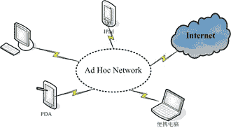**图 (1)**  

自组织网络结构。  

车辆开始使用聚类技术形成集群，集群中的节点称为集群成员（CM），其中一个节点通过聚类算法被选为集群头（CH）。聚类算法可以减少网络中各种与效率相关的问题。各种研究人员提出了许多聚类技术，通过应用不同的聚类算法来促进集群的形成。

## VANETs 的架构

由于 VANET 使用其移动节点创建自组织无线网络，因此还存在包括 RSU、OBU 和 AU 在内的完整架构。VANET 是智能交通网络的主要组成部分，旨在提高交通效率，从而提供更好的道路安全。VANET 具有动态拓扑 \[4, 5\]，车载节点频繁连接和断开连接。

VANET 确保：

*   交通管理

*   安全管理，以及

*   互联网服务

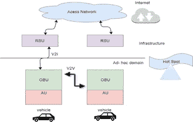**图 (2)**  

VANET 通用架构。  

图 (**2**) 展示了 VANET 的通用架构。VANET 架构遵循基于 802.11 标准协议 \[6\] 并用于 ITS 的车载环境无线接入（WAVE）。WAVE 是一种专门为车载环境设计的标准协议，支持 5.9 GHz 频段（该频段专为 ITS 许可）中的 V2V 和 V2I 通信。它使用 OFDM 正交复用技术来分割信号。WAVE 包括 RSU 和 OBU，因此后来采用了 WAVE。车载自组织网络中使用的单元 \[7\] 在表 **1** 中表示。

它的出现是因为由于车载场景的动态环境，需要快速通信，从而要求高速传输率 \[8\]。此前，802.11a 面临的问题是其低数据率为 54 Mbps，最终导致多种开销。这些协议允许车辆在加入网络前无需身份验证即可进行直接通信。研究人员进一步强调出于安全原因提供身份验证和机密性保障。

## 表 1 VANET 架构单元描述

| 单元 | 缩写 | 描述 |
| --- | --- | --- |
| 车载单元 | OBU | • 实现 V2V 通信 • 与其他 OBU 通信 • 数据可靠性 • 网络拥塞控制 • 无线接入 |
| 身份验证单元 | AU | • 通过 OBU 与网络 `via` 通信 • 职责：   - 移动性   - 网络运行 |
| 路侧单元 | RSU | • 基于 IEEE 802.11p 无线技术 • 为 OBU 提供互联网连接。 |

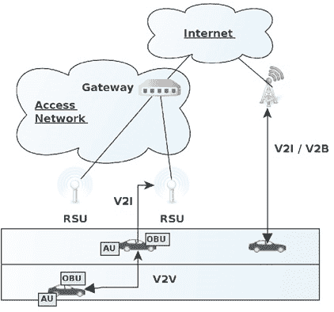

**图 (3)**

通信架构。

## VANET 的通信架构

VANET 在动态车载场景中频繁断连，车辆不可预测的运动会阻碍网络稳定性机制。一旦网络建立，信息可以通过数据包传播和共享。由于车辆本身具有移动性，因此连接维护对移动车辆来说是一项艰巨任务，邻居节点也可能超出传输范围。作为解决方案，可以预先部署中继节点作为接入点以维持网络连接 \[9\]。车辆配备了全球定位系统（GPS），因此车辆可以监控网络和节点，这对于避免碰撞和获取位置信息将非常有用。通信架构如图 (**3**) 所示。

每个车载节点都需要完全处理原始信息，为此，它直接需要大容量存储。因此，它使用可充电电池持续产生电力，从而在功率和能源方面使网络更加高效。表 **2** 表示通信架构。

## 表 2 通信架构表示

| 通信 | 功能 |
| --- | --- |
| 车内通信 | • 车辆性能检测 • 驾驶员身体状况 • 车辆内部环境（出于安全目的） |
| V2V 通信 | • 两辆或多辆车辆之间的通信 • 共享信息：   - 路由信息   - 警报   - 驾驶员与驾驶员之间的信息 • 天真广播（周期性） • 智能广播（克服因生成大量广播消息而导致的开销） |
| V2I 通信 | • 车辆与道路基础设施之间的通信 • 车辆密度 |
| 车辆到宽带云计算 | • 用于主动驾驶员辅助 • 用于车辆跟踪 |
| 基于路由的通信 | • V2I 和 V2V 的组合 • 提供单播方法 • 消息以多跳方式传输，直到与目标车辆连接。 |

## 区块链与 VANET

已进行多项研究以解决 VANET 的安全问题，为此广泛使用区块链技术。VANET 与区块链相结合使用 \[10\]。区块链技术用于确保数据防篡改且安全。在某些算法中，车辆必须向注册机构注册。道路基础设施与车辆和 RSU 构成区块链网络，从而减少安全问题。车载网络生成的数据保存在云中，以提供数据支持相关应用 \[11\]。区块链还为智能交通系统引入了隐私保护的概念。图 (**4**) 表示区块链系统。

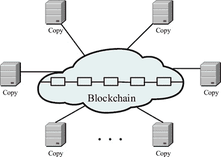

**图 (4)**

区块链系统

区块链系统使用一种分布式网络，由各种独立节点组成，它们通常没有基于信任的网络 \[12\]。每个节点都参与数据管理。在实现中，新块由各种节点参与形成，该新块被包含在区块链系统中。系统中的所有节点都管理信息，以确保区块链系统中数据的安全性。区块链可以管理车辆中的信息，因为任何节点在使用公共区块链时都可以访问之前的历史记录。在大多数基于区块链的算法中，新块通常与所有车载节点共享。但在某些情况下，块不会在国家边界之外共享，因为有些国家可能没有直接道路连接，因此一个国家车辆的信息可能不适用于另一个国家的车辆。算法可以基于各种参数设计。区块链网络是基于网络中存在的车载节点达成一致而建立的 \[13\]。VANET 中形成的集群 \[14\] 有时在区块链系统中很有用，因为集群头负责管理区块链系统。因此，VANET 中的聚类 \[15\] 通过使用区块链系统增强了网络的安全性。

## 基于区块链技术的 VANET 信任模型

存在三种基于信任的模型。

* 基于实体的信任模型
* 数据中心信任模型
* 混合模型

图 (**5**) 表示 VANET 中的基于信任的模型 \[16\]。在基于实体的模型中，其他节点的意见很重要，因为这里需要使用任何指定算法来确定节点的可信度。但其局限性是车载节点的高移动性，因为在动态拓扑中信息传递困难 \[17, 18\] 且移动性高。然而，数据中心模型关注节点共享的事件信息，而不是基于实体模型中的节点详细信息，因为在车载节点之间共享准确信息很重要 \[19, 20\]。而混合方法使用基于实体和数据中心模型的组合。因此，这里既重视车辆的可信度，也重视事件信息。

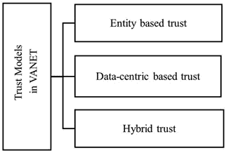

**图 (5)**

基于信任的模型

## 结论

VANET 具有智能特性，包括智能车辆，这些车辆能够为双方（即发送方和接收方）之间的通信做出自适应决策。面临的主要挑战可能是在如此恶劣的交通条件和受限移动性参数下，将消息传递到目的地。VANET 是一种实时应用，但缺乏安全性、可扩展性、高效路由和聚类协议。本章的重要部分是强调基于区块链系统的安全性。区块链技术用于车辆节点之间的准确信息传播。这里我们得出结论，将区块链系统的方法与车载自组网相结合，确保了传输过程中数据的安全性。

## 发表同意

不适用。

## 利益冲突

作者声明不存在任何利益冲突，无论是财务上的还是其他方面的。

## 致谢

无。

## 参考文献

|  ||  |

| --- | --- |

| \[1\] || Martuscelli G., Boukerche A., Bellavista P.. Discovering traffic congestion along routes of interest using vanets.IEEE Global Telecommunications ConferenceIEEE GLOBECOM201310.1109/GLOCOM.2013.6831125 |

| \[2\] || Nakamoto S.. Bitcoin: A Peer-to-Peer Electronic Cash SyNakamoto, S.Bitcoin: a peer-to-peer Electronic Cash System. J. Gen. Philos. Sci.200839536710.1007/s10838-008-9062-0stem |

| \[3\] || Zheng Z., Xie S., Dai H.N., Wang H.. Blockchain Challenges and Opportunities: A Survey.Work Pap201619 |

| \[4\] || Antonopoulos A.M.. Mastering BitcoinFirst Edit.OReilly Media, Inc.,United States of America2015 |

| \[5\] || Aitzhan N.Z., Svetinovic D.. Security and privacy in decentralized energy trading through multi-signatures, blockchain and anonymous messaging streams.IEEE Trans. Depend. Secure Comput.201815584085210.1109/TDSC.2016.2616861 |

| \[6\] || Ostermaier B., Dotzer F., Strassberger M.. Enhancing the security of local danger warnings in vanets-A simulative analysis of voting schemes.The 2^(nd) International Conference on Availability, Reliability and Security2007422431 |

| \[7\] || Shrestha R., Nam S.Y.. Access point selection mechanism to circumvent rogue access points using voting-based query procedure.IET Commun2014811629432951 |

| \[8\] || Lei A., Ogah C., Al E.. A Secure Key Management Scheme for Heterogeneous Secure Vehicular Communication Systems.ZTE Communication Magazine2016Vol. 111 |

| \[9\] || Leiding B., Memarmoshrefi P., Hogrefe D.. "Self-managed and blockchain-based vehicular adhoc networks," in Proceedings of the 2016 ACM International Joint Conference on Pervasive and Ubiquitous Computing: Adjunct, ser. UbiComp '16. New York, NY, USA: Association for Computing Machinery, 2016, p. 137-140.. 10.1145/2968219.2971409 |

| \[10\] || Dorri A., Steger M., Kanhere S.S., Jurdak R.. BlockChain: a distributed solution to automotive security and privacy.IEEE Commun. Mag.2017551211912510.1109/MCOM.2017.1700879 |

| \[11\] || Rowan S., Clear M., Gerla M., Huggard M., Mc Goldrick C. Securing Vehicle to Vehicle Communications Using Blockchain through Visible Light and Acoustic Side- Channels eprint arXiv:1704.02553.. |

| \[12\] || Morgan Y.L.. Notes on DSRC and WAVE standards suite: its architecture, design, and characteristics.IEEE Commun. Surv. Tutor.201012450451810.1109/SURV.2010.033010.00024 |

| \[13\] || Raya M., Papadimitratos P., Gligor V.D., Hubaux J-P.. On data-centric trust establishment in ephemeral ad hoc networksIEEE INFOCOM 2008 - The 27th Conference on Computer Communications20081238124610.1109/INFOCOM.2008.180 |

| \[14\] || Fan W.. Yan Shir, Shanzhi, Chen, Longhao Zou, “Amobility metrics based dynamic clusterinh algorithm for VANETsProc. IET InterInternational Conference on Communication Technology and Applications (ICCTA- 2011)752756 |

| \[15\] || Rasmeet S.B., Neeraj K., Joel J.P., Rodrigues C.. An Intelligent Clustering Algorithm for VANETs.Proc. Connected Vehicles and Expo International Conference2015 |

| \[16\] || Li W., Zhang X., Shen Z., Zhang M., Yang D.. Density based threshold algorithm in vehcular ad- hoc networksProc. IEEE International conference on Communication Workshops (ICC)675680. |

| \[17\] || Li W., Zhang X., Shen Z., Zhang M., Yang D.. VANET: Architectures, Research Issues, Routing Protocols, and its ApplicationsProc. International Conference on Computing, Communication and Automation555561. |

| \[18\] || Ahizoune A., Hafid A.. A New Stability Based Clustering Algorithm (SBCA) for VANETsProc. IEEE conference on Local Computer Networks843847.10.1109/LCNW.2012.6424072 |

| \[19\] || Saleha Mubarak AlMheiriHend Saeed AlQamzi, “MANETs and VANETs Clustering Algorithms: A SurveyProc. 8th IEEE GCC Conference and Exhibition16. |

| \[20\] || Azizian M., Cherkaoui S., Hafi A.S.. A Distributed D-hop Cluster Formation for VANETProc. IEEE Wireless Communications and Networking Conference16.10.1109/WCNC.2016.7564925 |

