# 生产车间物体 RGB-D 语义分割跨模态 Transformer

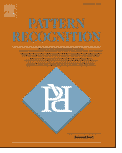

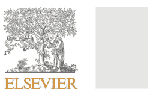

# 针对车间物体RGB-D语义分割的跨模态 Transformer


Ru Qingjun, Chen Guangchen, Zuo Tingyu, Liao Xiaojiao

成都理工大学计算机与网络安全学院

# 文章信息

# 摘要

* **关键词:**
  * 生产车间物体
  * RGB-D
  * 语义分割
  * Transformer

生产车间的场景理解是提高其智能化水平的一项技术，生产对象的语义分割是实现场景理解的有效方法。考虑到车间环境的变化，充分利用互补的RGB图像和深度信息可以提高生产对象的语义精度。针对车间物体的多尺度和实时处理，我们提出了跨模态 Transformer（Cross-Modal Transformer），一种基于 Transformer 的语义分割方法。其关键特征提取和融合部分由多尺度自注意力修正（MS-CAC）模块和特征聚合（FFA）模块组成。通过实现 RGB 图像与深度之间的多头交互，我们构建了长距离交互并在 CM-MSHA 模块之上设计了 MS-CAC 模块和 FFA 模块，以实现空间和通道维度上的跨模态信息融合。其中，MS-CAC 模块利用 RGB 和深度特征提取每个通道的多尺度特征，同时在空间维度和全局局部特征上进行融合。在 NIV 深度数据集上的实验中，CMformer 达到了 68.00% 的 mPixel Accuracy 和 57.69% 的 mIoU（平均交并比）。在生产车间数据集（SOF）上，CMformer 达到了 96.74% 的 mPA、92.58% 的 mIoU 以及 43 FPS（每秒帧数），具有高精度和实时性能。代码可用：https://github.com/FaultAI/CMformer

# 1. 引言

随着工业互联网技术的发展，制造业正向制造自动化发展。作为制造业的一部分，对车间物体的准确理解是实现智能制造的核心。场景理解技术可以感知车间运行情况、提高效率，并提升生产和制造质量。

机器人导航任务要求对车间场景物体进行语义视觉识别和识别，即根据识别结果识别类型、形状和位置以进行决策。大多数语义分割方法基于单模态 RGB 图像 [1, 2]，无法适应高复杂和光照不均匀的环境，难以实现对生产对象的准确理解。在深度信息的帮助下，深度信息已被辅助语义分割 [3]。将深度信息整合到 RGB 图像中更有区分图像中的混淆区域。对于实现生产车间场景的 RGB-D 语义分割方法具有重要意义。然而，寻找 RGB 特征与深度特征的融合模式是一个挑战性问题。FCN 仅将图像作为 RGB 图像的第四部分，并将其作为卷积神经网络（CNN）的输入进行拼接。其他方法 [5] 使用两个 CNN 作为编码器从 RGB 图像和深度图中提取特征，并了多阶段特征并最终进行了融合。

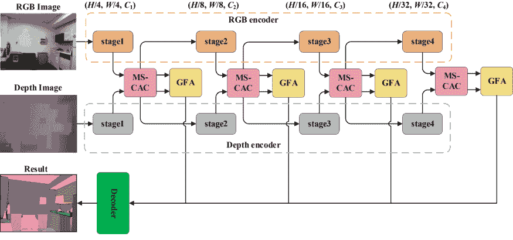

图 1. CMformer 的整体架构。CMformer 由三部分组成：两阶段特征提取器用于分别提取 RGB 和深度特征，其中阶段 4 执行不同模型编码器的每个下采样阶段。跨模态交互部分由 MS-CAC 模块和 GFA 模块组成，用于连接和聚合不同的特征。解码器用于融合不同阶段的特征以生成最终结果。

只有四个 MLP 层。EX-VIT [341] 提出了一种可解释多注意力机制（Explainable Multi-Attention）和属性引导器（Attribute-Guider），以利于模型可解释的注意力特征并识别用于物体级标签的属性特征。Semantic [35] 在编码阶段采用了 VIT [26]，将图像分割成补块（patches），并在编码阶段后对嵌入序列进行标记，在这些嵌入序列之后通过逐点线性解码器或 Transformer 解码器对类别进行标记。

## 2.2. RGB-D 语义分割

随着深度传感器的出现，我们可以轻松地获取场景的深度信息。RGB 和深度特征的有效方法可以提高语义分割的准确性。一些早期工作手动设计了分割方法来提高 RGB-D 语义分割的性能 [56]。随着计算机视觉的发展，CNN [54] 自然地在 RGB 语义分割中占据了主导地位。FCN 将深度通道拼接作为 CNN 的四通道输入。然而，由于深度通道信息有限，它并没有为语义分割带来显著的特征。Gupta 等人 [38] 提出了 HHA（水平深度、高度、表面角度），通过将深度分解为三个通道来改进深度分割方法，并将 RGB HHA 图像合并到 CNN 中进行特征提取，并在网络的最终阶段进行融合。FSEN [39] 使用两阶段 CNN 编码器提取 RGB 和深度特征，然后从 RGB 特征中融合不同层次的特征以实现 RGB-D 语义分割。[56] 提出了层学习的概念，以有效提取 RGB 特征和互补深度特征，并通过多级融合方案对它们进行融合，从而获得更好的分割预测结果。

ACNet [9] 用于提取 RGB 图像和深度图像中的重要特征，并通过三个并行分支在不同模型之间融合它们。SA-Gate [10] 和 CMX [14] 都使用了结合 CAM 和 SAM 的方法来实现不同模型之间的特征连接。即 SA-Gate

## 3. 跨模态融合

### 3.1. 整体架构

为了精炼 RGB 和深度特征之间的交互，并由 ACNet [19] 改进，CMformer 的整体架构是一个标准的编码器-解码器架构。

我们使用并行编码器提取 RGB 图像和深度图像的潜在特征，并解码特征并输出最终的分割结果。模型的整体结构如图 1 所示。深度图像包含一些噪声，由于数据范围有限，深度值是不准确。在 RGB 图像中，某些相似颜色和纹理的边界无法很好区分。我们使用注意力机制来获取更准确的边界。在编码阶段，高效的跨模态交互方法可以利用两种模态的信息并识别它们每个模态的优势。因此，本文提出了 CMformer 模型。MS-CAC 模块在每个下采样阶段修正两个模型的特征，补充另一个模态的特征，并将输出结果输入到下一

在本节中，我们首先在第 3.2 节介绍 CMformer 的跨模态交互模块。然后分别在 3.3 节和 3.4 节介绍用于跨模态特征融合和聚合的 MS-CAC 模块和 GFA 模块。最后，在第 3.5 节介绍了系列不同尺寸的 CMformer，CMformer-Medium 和 CMformer-Large。

Q. Liu 等人

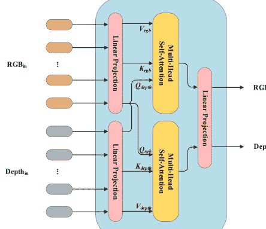

注意力。上述内容计算如下：

$Q_{RGB}, K_{RGB}, V_{RGB} = RGBW_{Q}, RGBW_{K}, RGBW_{V}$ (1)

$Q_{Depth}, K_{Depth}, V_{Depth} = DepthW_{Q}, DepthW_{K}, DepthW_{V}$ (2)

$Attention_{RGB} = Softmax(\frac{Q_{RGB}K_{RGB}^T}{\sqrt{d_{head}}})$ (3)

$Attention_{Depth} = Softmax(\frac{Q_{Depth}K_{Depth}^T}{\sqrt{d_{head}}})$ (4)

$RGB_{ij} = LP(Attention_{RGB})$ (5)

$Depth_{ij} = LP(Attention_{Depth})$ (6)

其中 $d_{head}$ 代表头，$LP$ 代表线性投影，$T$ 代表转置。

阶段。此外，我们设计了 GFA，它调节空间维度，并将输入的特征聚合到单张特征图中。

### 3.2. 跨模态自注意力

为了获得更好的跨模态信息，我们设计了 CMformer 模型。MHSA 的细节如图 2 所示。首先，处理输入 $RGB_{in} \in \mathbb{R}^{N \times C_{RGB}}$ 和 $Depth_{in} \in \mathbb{R}^{N \times C_{Depth}}$，其中 N 代表 token 的数量，C 代表每个 token 的维度。处理过程将在 3.3 和 3.4 节中详细描述。然后，计算不同模态的 Query、Key 和 Value 如下：$Q_{RGB}, K_{RGB}, V_{RGB} = RGBW_{Q}, RGBW_{K}, RGBW_{V}$ 以及 $Q_{Depth}, K_{Depth}, V_{Depth} = DepthW_{Q}, DepthW_{K}, DepthW_{V}$。通过跨模态交互，我们交换两个模型的 Q，并使用另一个模型的 K 计算自注意力矩阵，通过线性投影获取 RGB 特征和深度特征。

### 3.3. 多尺度通道注意力

在图像中，每个通道包含不同的信息，通过权重分配可以实现更好的特征提取。然而，CAM 是全局池化和全连接层实现的，这会丢失局部特征。在实践中，多尺度特征是检测物体和尺放的关键。我们提出了 SAC 模块，一种通道注意力方法。该模块分为两部分：Image to Tokens

#### 3.3.1. Image to Tokens

IPT 的目的是是将图像特征转换为一维 token，使得图像形状为 $H = H \times W \times C$ 以满足 Transformer 的输入格式，其中 $C$ 代表图像的通道数，$H, W$ 代表图像的尺寸。

首先，对 $RGB_{in} \in \mathbb{R}^{N \times C_{RGB}}$ 和 $Depth_{in} \in \mathbb{R}^{N \times C_{Depth}}$ 通过多尺度池化操作进行下采样。我们使用四种不同的池化尺寸来捕捉多尺度特征。图像池化特征的尺寸分别设置为 $N_1, N_2, N_3, N_4$。池化和合并操作也被用于保留丰富的信息。模块 $RGB^{M-C}$ 的池化结果被平展为 $RGB^{M-C}$ 且 $RGB_{ij} \in E^{C-1}, RGB_{ij} \in E^{C-2}, Depth_{ij} \in E^{C-3}, Depth_{ij} \in E^{C-4}$，其中是

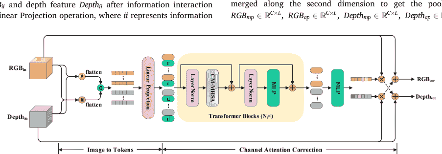

+   多尺度平均池化
+   多尺度最大池化
+   拼接
+   通道级相乘
+   逐元素相加

图 3. 多尺度通道注意力修正。

4

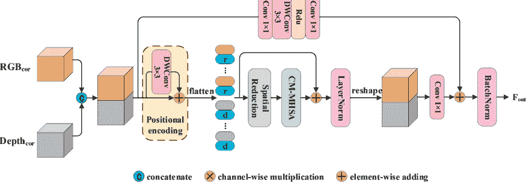

$L = M_1N_1 + M_2N_2 + M_3N_3 + M_4N_4$，下标 $ms$ 和 $ap$ 分别代表多尺度和平均池化。

然后，我们将相同模型维度的多尺度特征合并，以获得两个模块的多尺度特征：$RGB_{md} \in \mathbb{R}^{C_1 \times L_1}$ 和 $Depth_{md} \in \mathbb{R}^{C_2 \times L_2}$，其中下标表示多尺度特征。

$RGB_{md}$ 的特征通过线性投影（Linear Projection）操作映射到更高维 $C_1$，以标记化特征（tokenized features）：$RGB_{tokenized}$ 和 $Depth_{tokenized} \in \mathbb{R}^{C \times L'}$。上述步骤可以公式化：

```
$Concat(mspi(RGB_{md}), Flatten(mspi(RGB_{md})))$
```

```
$Depth_{md} = Concat(mspi(Depth_{md}), Flatten(mspi(Depth_{md})))$
```

```
$RGB_{tokenized} = LP(RGB_{md})$
```

```
$Depth_{tokenized} = LP(Depth_{md})$
```

其中下标 $ms$ 和 $ap$ 分别代表多尺度平均池化和最大尺度池化。

### 3.2. 通道注意力

将每个通道的特征转换为 Transformer 结构进行学习后，我们使用两个通道的注意力向量，并使用共享 MLP 操作增强注意力向量。对于标记化的两个模型 $RGB_{attention} \in \mathbb{R}^{C \times L'}$ 和 $Depth_{attention} \in \mathbb{R}^{C \times L'}$，在特征中添加了可学习的模型类型操作，以便在执行空间交互时能够区分不同的模型。然后，将它们转换为 $N$ 个特征，获得通道信息交互后的特征 $RGB_{features} \in \mathbb{R}^{C'}$ 和 $Depth_{features} \in \mathbb{R}^{C'}$。

注意力的计算过程可以公式化为：

```
$z = CMHSA(LN(z)) + z$,
```

```
$y = MLP(LN(z)) + z$,
```

其中 $z$ 代表第 $i^{th}$ 块的输入，$LN$ 代表 LayerNorm，CMHSA 代表交叉多头自注意力（Cross Multi-Head Self-Attention）。

在通过 Transformer 对所有通道进行全局建模后，我们通过信息交互的结果上通过 MLP 计算两个模块的注意力向量 $RGB_{att} \in \mathbb{R}^{C' \times L'}$ 和 $Depth_{att} \in \mathbb{R}^{C' \times L'}$。我们使用两个模块的原始特征图 $RGB_{maps} \in \mathbb{R}^{W' \times H'}$ 和 $Depth_{maps} = R^{W}-C$ 与通道注意力向量进行逐通道相乘。最后，对获得的结果和原始特征图执行跨模块注意力边缘操作，以获得修正后的输出：$RGB_{out} \in \mathbb{R}^{W' \times H'}$ 和 $Depth_{out} \in \mathbb{R}^{W' \times H'}$。上述步骤可以公式化为：

```
$RGB_{out} = RGB_{att} \odot Depth_{att}$
```

```
$W_{out} = MLP(RGB_{att} \odot Depth_{att})$
```

```
$RGB_{final} = RGB_{out} \odot W_{out}$
```

其中 $\odot$ 代表注意力级乘法和逐通道乘法，MLP 代表模型类型编码。

在 Transformer 结构中，由于 MHSA 部分与 MHSA 部分之间的正相关性，输入 tokens 在 MC-module 模块中计算空间自注意力时会带来更强的相关性，通道数较小以减少其计算量。

### 3.3. MS-CAC 模块的工作流

总结来说，MS-CAC 模块的工作流如下：

- (1) 通过多尺度池化操作获取两个模块的多尺度特征；
- (2) 将两个模块的多尺度特征映射到高维空间并添加模型类型编码；
- (3) 通过 Transformer 对两个模块的通道特征进行全局建模；
- (4) 使用 MLP 操作计算两个模块自身的注意力向量；
- (5) 将两个模块的注意力向量相互相乘；
- (6) 最后，通过跨级边缘操作，分别获得修正后的 RGB 特征和深度特征。

### 3.4. 全局聚合

#### 3.4.1. GFA 模块原理

在对 RGB 和深度特征进行通道注意力修正后，我们设计了 GFA 模块在空间维度上交换信息，并将两个模块的特征融合进单个特征图用于解码。通过传统的空间

|  | 输出模块名称 | CMformer-S | CMformer-M | CMformer-L |
| :--- | :--- | :--- | :--- | :--- |
| Stage 1 | $W/4 H/4$ | MS-CAS | $N_1=2, E_1=4, R_1=1$ | $N_1=3, E_1=4, R_1=1$ | $N_1=3, E_1=4, R_1=1$ |
| | GFA | $N_2=2, E_2=4, R_2=1$ | $N_2=3, E_2=4, R_2=1$ | $N_2=3, E_2=4, R_2=1$ |
| | Output-64 | | | |
| Stage 2 | $W/8 H/8$ | MS-CAS | $N_3=2, E_3=4, R_3=1$ | $N_3=3, E_3=4, R_3=1$ | $N_3=3, E_3=4, R_3=1$ |
| | GFA | $N_4=2, E_4=4, R_4=1$ | $N_4=3, E_4=4, R_4=1$ | $N_4=3, E_4=4, R_4=1$ |
| | Output-128 | | | |
| Stage 3 | $W/16 H/16$ | MS-CAS | $N_5=2, E_5=4, R_5=1$ | $N_5=3, E_5=4, R_5=1$ | $N_5=3, E_5=4, R_5=1$ |
| | GFA | $N_6=2, E_6=4, R_6=1$ | $N_6=3, E_6=4, R_6=1$ | $N_6=3, E_6=4, R_6=1$ |
| | Output-320 | | | |
| Stage 4 | $W/32 H/32$ | MS-CAS | $N_7=2, E_7=4, R_7=1$ | $N_7=3, E_7=4, R_7=1$ | $N_7=3, E_7=4, R_7=1$ |
| | GFA | $N_8=2, E_8=4, R_8=1$ | $N_8=3, E_8=4, R_8=1$ | $N_8=3, E_8=4, R_8=1$ |
| | Output-512 | | | |
| | Encoder decoder | ptv2_b1 128 | ptv2_b2 256 | ptv2_b3 512 |


注意力机制，`GFA` 模块可以捕捉感受野上的图像特征，并避免 `CNN` 无感受野限制。`GFA` 模块的详细结构如图 4 所示。对于输入特征 $R_{GFA}^{in} \in \mathbb{R}^{W \times C}$ 和 $D_{GFA}^{in} \in \mathbb{R}^{W \times C}$，由于 `GFA` 模块执行空间特征交互，必须注入位置信息。如 [37] 所示，通过卷积大小为 $3\times3$、步长为 1、填充为 1 的深度卷积引入位置信息，然后通过残差连接与输入特征相加以获得 $R_{GFA}$。将其表示为位置编码。除了位置编码外，还可以添加可学习的时间编码。

上述步骤可以公式化为：

```
$R_{GFA} = dw(R_{GFA}^{in} \oplus R_{GB}) \oplus MTE_{pos}$
```

```
$D_{GFA} = dw(D_{GFA}^{in}, (D_{GFA}^{in})_{\theta})$
```

其中 `subset` 代表位置-时间编码，`DWC` 执行深度卷积。

在获得 $R_{GFA} \in \mathbb{R}^{W \times C}$ 和 $D_{GFA} \in \mathbb{R}^{W \times C}$ 后，我们通过带有残差连接的 `CMHSA` 模块构建信息交互。然而，当我们在空间维度计算注意力时，计算复杂度与图像分辨率相关，会消耗大量的计算资源内存。空间采样过程需要实时获取。因此，我们使用 `PVT` [27] 中的空间采样过程通过共享机制减少计算量。空间采样比例 $R$ 缩小特征图分辨率，然后在采样图上取 `K` 和 `V` 向量，可以将复杂度降低 $R^2$ 倍。在 `LayerNorm` 中获取特征后，我们使用残差连接通过 $1\times1$ 卷积将两个模块的特征合并为单个特征图。在语义分割中，局部特征和全局特征都很重要。为了避免冗余，我们使用原始特征图通过深度卷积 $DWC_{local}$ 获取局部特征，通过残差连接获取全局特征。最后，通过批归一化获得最终输出 $F_{out}$。

上述步骤可以公式化为：

```
$R_{GFA} = LN(MHSA(SR(R_{GFA}))) \oplus (SR(R_{GFA}))_{\theta_{pos}})$
```

```
$F_{global} = Conv_{1}(Conv_{1}(R_{GFA}))$,
```

```
$F_{local} = LN(Conv(Conv(R_{GFA})))$
```

```
$F_{out} = BN(F_{global} \oplus F_{local})$
```

其中 `SR` 代表空间采样，`LN` 代表全局特征，`Conv` 代表一系列计算过程，$DWC_{local}$ 代表局部特征，`BN` 代表批归一化。

#### 3.4.2. GFA 模块的工作流

总结，`GFA` 模块的整体工作流如下：

- 1) 合并两个模块的特征以结合通道维度，并添加位置编码和时间编码；

### 3.5. CMformer 的详细设置

为了提供不同尺寸的 `CMformer`，总结起来 `CMformer-S`、`CMformer-M`、`CMformer-Medium-CMformer-M` 以及 `CMformer-Large-CMformer-L`，`CMformer` 系列的参数所示于表 1：

- `N`: Stage $i$ 中 `MS-CAS` 的块数；

- $H_i$: Stage $i$ 中每个模块的头数；

- $E_i$: Stage $i$ 中 `MS-CAS` 的 `MLP` 的扩展因子；

- $R_i$: Stage $i$ 中 `GFA` 的缩放比例

# 4. 实验

在本次实验中，我们在 `SOP` 数据集和 `NYU` 数据集（`RGB-D` 语义分割数据集）上评估 `CMformer` 系列的性能。

## 4.1. 数据集与指标

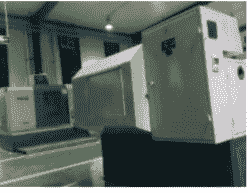

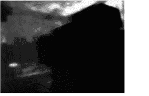

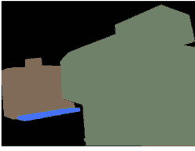

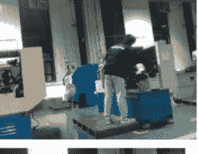

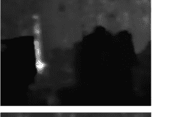

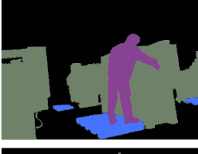

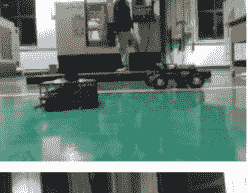

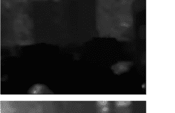

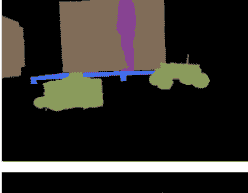

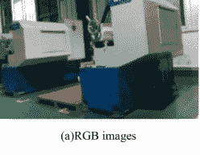

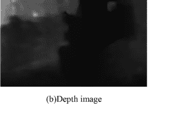

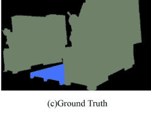

图 5. `RGB` 图像、深度图和真值（`ground truth`）的示例。

实验环境。

| 名称 | 版本/型号 |
|---|---|
| `CPU` | `Intel i9-12900K` |
| `GPU` | `RTX 3090` |
| `RAM` | `36000MHz` |
| 操作系统 | `Ubuntu 18.04` |
| 深度学习框架 | `PyTorch 1.8.2` |
| 统一计算架构 | `CUDA 11.1` |

超参数的具体细节。

| 名称 | 输入 | 数值 |
|---|---|---|
| 优化器 | | `AdamW` |
| 学习率 | | `0.00006` |
| 学习率调度 | | 带有衰减的策略 |
| 预热轮数 (`Epochs`) | | 5 |
| 训练总轮数 | | 100 (在 `SOP` 数据集和 `NYU Depth v2` 数据集上) |

真值见图 5。在该数据集上，我们使用 500 个实例进行验证，100 个实例进行训练；在另一个数据集上，使用 96 个实例进行验证，共包含 40 类语义对象。

`NYU Depth v2` [19]：该数据集包含由 `Kinect` 采集的 1449 个室内场景 `RGB-D`，我们使用 795 个实例进行训练，654 个实例进行测试。

使用语义分割领域的两种常用方法 [4] 来评估我们的方法，包括平均像素准确率 (`MPA`) 和平均交并比 (`mIoU`)。

数据增强方面，我们使用了 `ACNet` [9] 中的相同方法：对 `RGB` 图像和深度图进行随机裁剪、翻转并进一步归一化。对于 `RGB` 图像，我们使用了在 `ImageNet` [21] 上预训练的 `ptv2` [41]。

在 `SOP` 数据集上与其他模型的对比结果。

| 方法 | 输入 | `MPA()` | `mIoU()` |
|---|---|---|---|
| `FESNet` [39] | `RGB-D` | 94.08 | 84.19 |
| `REDNet` [5] | `RGB-D` | 94.05 | 87.56 |
| `ACNet` [9] | `RGB-D` | 94.95 | 87.77 |
| `ESNet` [43] | `RGB-D` | 93.63 | 88.38 |
| `CMFormer-S` | `RGB-D` | 95.73 | 90.99 |
| `CMFormer-M` | `RGB-D` | 96.34 | 91.93 |
| `CMFormer-L` | `RGB-D` | 96.74 | 92.98 |

## 4.2. 实现

我们在 `RTX 3090` `GPU` 上使用 `PyTorch` 深度学习框架构建了 `CMFormer` 系列，详细环境如表 2 所示。

## 表 5

`SOP` 数据集上所有类别的对比结果。

| 模型 | 人 | 机器人 | 椅子 | 桌子 | 其他 |
|---|---|---|---|---|---|
| `FSNet` (39) | 78.37 | 83.54 | 76.88 | 91.25 | 77.86 |
| `REDNet` (5) | 85.49 | 86.56 | 81.07 | 94.07 | 93.67 |
| `ACNet` (9) | 84.50 | 85.87 | 81.79 | 94.18 | 93.21 |
| `ESNet` (43) | 83.74 | 83.58 | 84.76 | 94.25 | 95.32 |
| `CMFormer-S` | 70.27 | 89.61 | 94.95 | 97.25 | 98.41 |
| `CMFormer-T` | 71.91 | 90.83 | 94.52 | 97.78 | 97.18 |
| `CMFormer-L` | 78.38 | 82.54 | 92.68 | 98.50 | 98.68 |

`NYU Depth v2` 数据集上与先进模型的对比结果。

| 方法 | 输入 | `mIoU` (%) |
|---|---|---|
| `Gupta et al.` [38] | `RGB-D` | 35.1 | 28.6 |
| `Den et al.` [44] | `RGB-D` | 46.3 | 31.5 |
| `FCN` [9] | `RGB-D` | 46.1 | 34.0 |
| `ACNet` (9) | `RGB-D` | 55.7 | 43.1 |
| `REDNet` (5) | `RGB-D` | 62.8 | 50.1 |
| `ShapeNet` [45] | `RGB-D` | 65.2 | 51.3 |
| `CANet` [46] | `RGB-D` | 64.4 | 51.5 |
| `ESNet` (43) | `RGB-D` | 61.6 | 52.4 |
| `NANN` [11] | `RGB-D` | 52.3 | 50.2 |
| `SA-Gate` [10] | `RGB-D` | 54.2 | ( 待定) |
| `CMFormer-Seg` [42] | `RHA` | 55.3 | ( 待定) |
| `UFormer` (`UC-Tr-Enc.` [16]) | `RHA` | 55.4 | ( 待定) |
| `Trans-Fusion` [23] | `RHA` | 63.2 | 60.2 |
| `CMFormer-S` | `RHA` | 68.0 | 67.5 |
| `CMFormer-L` | `RHA` | (待定) | (待定) |

## 4.4. NYU Depth v2 实验结果

为了验证我们所提方法的泛化能力，我们在 `NYU Depth v2` 数据集上对其进行了测试，并与当前的先进模型进行了比较，结果见表 7。如上，我们的方法达到了 66.36% 和 54.12% 的 `mIoU`，超过了所有基于 `CNN` 方法。此外，随着模型规模的扩大，`CMFormer-L` 达到了 68.00% 的 `mIoU` 和 55.75% 的 `mIoU`。我们排除了 `UFormer` [16] 是由于其参数不确定性。我们使用 `FPN` [42] 作为解码器，使用 `CNN` [14] 作为编码器。具体的超参数见表 5。

## 4.3. SOP 实验结果

在 `SOP` 数据集上将 `CMFormer` 系列与其他模型进行了对比，结果见表 4。遵循全局注意力机制，`CMFormer` 与 `ESNet` [43] 相比，`mIoU` 提升了 2.1% 和 4.8%。如表 5 所示，对于“人”这一类，相比 `CMFormer-S`，其 `mIoU` 提升了 5.2%。由于多尺度特征的保留，从 `CMFormer-S` 到 `CMFormer-L`，性能显著提升（达到了 89%）。我们评估了每个每个类别，结果见表 7。相反，`CMFormer-S` 仅关注局部特征。

## 4.5. 消融实验

我们在 `NYU Depth v2` 数据集上进行了消融实验以验证方法的有效性。我们移除了所有模块并使用了两个并行的……

`NYU v2` 数据集上所有类别的对比。

| 模型 | 墙 | 地板 | 柜子 | 沙发 | 窗 | 书架 |
|---|---|---|---|---|---|---|
| `FC` | 69.9 | 50.3 | 56.0 | 47.5 | 53.2 | 22.1 | 39.0 |
| `Gorta et al.` [30] | 68.0 | 81.3 | 44.9 | 45.0 | 29.7 | 20.3 | 32.6 | 39.0 |
| `Pinnen` [26] | 65.4 | 75.2 | 51.9 | 43.1 | 52.6 | 35.3 | 23.0 | 23.2 |
| `RDFNet` [6] | 79.7 | 87.0 | 60.9 | 73.4 | 64.6 | 65.4 | 50.7 | 39.9 |
| `CANet` [16] | 79.8 | 89.2 | 65.6 | 72.8 | 62.4 | 64.7 | 47.6 | 49.1 |
| `Wang et al.` [21] | 79.5 | 88.9 | 72.6 | 68.4 | 61.4 | 69.8 | 49.0 | 48.1 |
| `CMformer-M2` | 72.5 | 88.54 | 66.90 | 73.89 | 68.58 | 61.30 | 51.2 | 48.27 |
| `CMformer-M1` | 73.1 | 89.02 | 75.73 | 69.28 | 68.53 | 53.44 | 48.21 | 50.19 |
| `PNet` [25] | 76.5 | 91.4 | 80.2 | 81.5 | 79.7 | 77.2 | 76.8 | 75.4 |
| `Dips` [44] | 70.5 | 54.2 | 45.8 | 11.5 | 32.6 | 31.5 | 30.7 | 27.5 |
| `Deng et al.` [44] | 46.4 | 51.3 | 53.6 | | | | | |
| `Deng et al.` [46] | 64.4 | 51.5 | 61.4 | 52.4 | | | | |

重复实验结果，平均值和标准差

| 数据集 | 模型 | `MPA`(%) | `mIoU`(...) |
| --- | --- | --- | --- |
| `SOP` | `CMFormer-S` | 96.25 ±0.30 | 96.37 ±0.34 |
| | `CMFormer-M` | 96.66 ±0.37 | 96.98 ±0.51 |
| | `CMFormer-L` | 96.51 ±0.26 | 92.54 ±0.33 |
| `NYU Depth v19` | `CMFormer-S` | 61.79 ±0.28 | 49.99 ±0.52 |
| | `CMFormer-M` | 65.48 ±0.41 | 54.13 ±0.63 |
| | `CMFormer-L` | 67.50 ±0.47 | 55.25 ±0.39 |

将特征图的维度调整为三个通道以便显示。然而，黄色框表示 `RGB` 特征模糊但蓝色特征清晰的区域；红色框表示 `RGB` 特征清晰但模糊的。通过应用 `MS-CAC` 模块和 `GFA` 模块，纹理特征在图像中被清晰地呈现。例如，第一行的靠背由于深度相机距离不足，只能在 `RGB` 图像中清晰显示。对于椅子，在光线下可以清晰看到。通过 `MS-CAC` 模块和 `GFA` 模块，我们可以在特征图中清楚地看到是椅子还是长凳，它的特征与墙壁并不突出，深度相机无法捕捉到细微的凸起，因此在深度图像中并不明显。对于椅子和灯柱，`RGB` 图像无法清晰显示但通过 `MS-CAC` 模块和 `GFA` 模块可以在特征图中显示。同样，对于第四行的电视，其特征在深度图像中无法清晰获取，但在特征图中可以准确清晰地显示。

模糊了 24%，准确率提升了 87%，`mIoU` 的差异忽略不计。随后我们在我们的环境中（`CPU`: `Intel i9 12900K`, `RAM`: `64GB`, `GPU`: `RTX 3090`）测试了每个模型的 `FPS`，`CMFormer-S` 的 `FPS` 可达到 `34fps`（满足生产场景的实时需求）。尽管 `CMFormer-L` 具有更高的精度，但 `CMFormer-S` 更适用于生产场景，因为。

为了评估随机性对结果的影响，我们对每个模型进行了五次重复实验，以确保结果的统计显著性。重复实验的平均值和标准差如表 11。可以看到标准差在范围内，数据增强和网络参数初始化的随机性不会产生显著影响。

## 4.7. 可视化

为了直观地反映 `MS-CAC` 模块和 `GFA` 模块的作用，我们对 `NYU Depth v2` 数据集上 `CMFormer-S` 第一阶段的特征图进行了可视化处理，结果如图 6 所示。我们使用主成分分析(`PCA`) 来减少

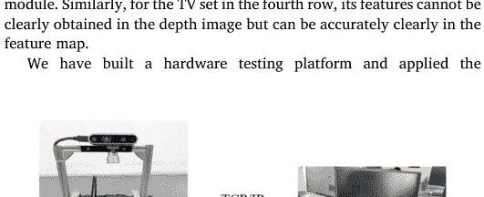

`TCP/IP`

`TurtleWaffle Pi`

`Laptop`

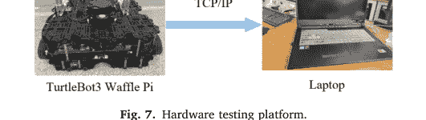

图 7. 硬件测试平台。

(a) `RGB` 图像

(b) 深度图像

(c) 特征图

(d) 真值 (`Ground Truth`)

(e) 我们的结果

图 6. `CMFormer-S` 在 `NYU Depth v2` 数据集上的可视化结果。对于每一行，我们展示了 (a) `RGB` 图像，b) 深度图像，c) 经过 `MS-CAC` 模块和 `GFA` 模块后的特征图，d) 真值，e) 我们的结果。

- [1] `Z. Wang`, `S. Pang`, `D. Xian`, `L. Yi`, `EFNet`: enhancement-fusion network for semantic segmentation, `Pattern Recognition`, 9 (2021), 108023, https://doi.org/10.1016/j.patcog.2021.108023.

- [2] `T. Singh`, `S. Das`, `P. Krishna`, A real-time semantic segmentation model using iteratively featured multi-sub encoders with deep learning, `Pattern Recognition`, 140 (2023) 19, https://doi.org/10.1016/j.pat.2022.109361


# 参考文献

- [3] C. Wang, G. Wang, W. Liu, A survey on RGB semantic segmentation using deep learning, *Displays*, 71 (2022), 103550; https://doi.org/10.1016/j.disdis.2022.103550

- [4] J. Long, E. Shaererer, T. Darbro, Fully convolutional networks for semantic segmentation, in Proceedings of the IEEE Conference on Computer Vision and Pattern Recognition (CVPR), 2015, pp. 3409–3418, https://doi.org/10.1109/CVPR.2015.7297

- [5] J. Yuan, J. Liu, Z. Zheng: Residual encoder-decoder for RGB-D semantic segmentation with spatial attention, arXiv preprint:1810.04654 (2018).

- [6] S.J. Park, K. Hong, S. Lee, J. Kim, RGB-D multi-level feature fusion for robust semantic segmentation, in Proceedings of the IEEE/CVF Conference on Computer Vision and Pattern Recognition (CVPR), 2019, pp. 7175–7184, https://doi.org/10.1109/CVPR.2019.0713

- [7] H. Wang, J. Guo, and S. Gao, Spatio-attention networks, in Proceedings of the IEEE/Computer Vision and Pattern Recognition, 2018, pp. 7225–7234.

- [8] S. Woo, J. Park, Lee, Y. Kim, Attention is all you need: Attention for complex scene, in Proceedings of the IEEE/Computer Vision and Pattern Recognition (CVPR), 2018, pp. 3823–3832.

- [9] W. Hu, K. Peng, and L. Li, Attention-based network to exploit complex dependencies for semantic segmentation, in Proceedings of the 2019 IEEE International Conference on Image Processing (ICIP), 2019, pp. 2592–2596.

- [10] C. Chen, Y. Liu, Y. Wang, and C. Han, BiFNet: Bidirectional fusion network with aggregation for real-time semantic segmentation, in Proceedings of the IEEE/Computer Vision and Pattern Recognition (CVPR), 2020, pp. 561–570, https://doi.org/10.1109/CVPR.2020.00570

- [11] G. Zhang, J. Huang, X. Xie, and S. Wang, Non-local Gated Attention for RGB-D semantic segmentation, IEEE Letters, 28 (2022), 688–692, https://doi.org/10.1007/978-3-063-09785-5

- [12] A. Vaisnavi, N. Sharma, P. Turkowski, J. Gonzalez, and C. Tu, Transformer for scene segmentation, in Proceedings of the IEEE/Computer Vision and Pattern Recognition (CVPR), 2017, pp. 3050–3057, https://doi.org/10.1109/CVPR.2017.3550

- [13] X. Wang, Y. Zhang, J. Liu, and W. Wu, Transformer for RGB-D robust semantic segmentation, Transactions on Vision Systems (2022), 11852.

- [14] L. Hu, K. Wang, and X. Shi, Cross-modal feature fusion for RGB-D semantic segmentation with attention, arXiv preprint:2203.02625 (2022)

- [15] T. Yu, Q. Mao, and J. Belong, FCN: Fully convolutional networks for semantic segmentation, in Proceedings of the IEEE/International Conference on Computer Vision (ICCV), 2015, pp. 344–352.

- [16] Y. Wang, M. Chu, Y. Xu, UCTrans: Cross-modal transformer network for RGB-D semantic segmentation, in Proceedings of the IEEE/CVF International Conference on Computer Vision and Pattern Recognition (ICCV), 2021, pp. 8185–8194, https://doi.org/10.1109/ICCV.2021.08118

- [17] T. Zhang, G. Chen, L. Liu, and Y. Yu, Multi-scale RGB-D multi-modal 3D semantic segmentation for indoor scene understanding method, in Proceedings of the IEEE/CVF International Conference on Computer Vision (ICCV), 2022,

- [18] N. Silberman, D. Holtz, P. Koller, and R. Fergus, Semantic segmentation and support for indoor scene understanding, in Proceedings of the IEEE/Computer Vision and Pattern Recognition (CVPR), 2018, pp. 7446–7455.

- [19] A. Dosovitskiy, J. Beyer, A. Kolesnikov, D. Weiszfeld, M. Zaydeov, X. Thomas, M. Minderer, G. Gelly, K. Heuker, and U. Hosayn, Attention is all 16x16: Transformers for image recognition worth 16k words, arXiv preprint arXiv:2010.11929 (2020). https://doi.org/10.48550/arXiv.2010.11929

- [20] C. Sun, A. Biratowski, S. Singh, and J. Chao, ResUNet for medical image segmentation, in Proceedings of the IEEE/Computer Vision and Recognition, 2020, pp. 8432–8450, https://doi.org/10.1109/CVPR.2020.008437

- [21] L. Yuan, Y. Chen, T. Wang, W. Wu, Y. Shi, J. Zhang, F. Feng, J. Sheng, and Y. Sun, and Transformer for robust RGB-D semantic segmentation, in Proceedings of the IEEE/CVF International Conference on Computer Vision (CVPR), 2021, pp. 10013–10022.

- [22] K. Han, A. Xiao, E. Liu, J. Cao, C. Wang, and Y. Wang, Transformer in attention, Advances in Neural Information Processing Systems (NeurIPS), 2021 (34) 10451–10462.

- [26] C.F. Chen, Q. Sun, and F. Panda: Cross-attention multi-scale vision transformer for image classification; in Proceedings of the IEEE/CVF

# 作者简介

QUING RENU 是中国郑州工业大学工程系的学生。现在他是一名研究生，来自成都理工大学的信息。他的研究方向专注于计算机视觉。

陈广修（GUANGZHIU CHEN）在中国四川大学获得计算机工程博士学位。现为成都理工大学教授。他的研究方向专注于计算机视觉、工业数据、网络安全。

左廷钰（TINGYU ZUO）在中国成都信息技术大学获得网络工程学士学位。现为成都理工大学电子信息专业硕士研究生。她的研究方向专注于计算机视觉。

廖晓娟（XIAOJUAN LIAO）在中国电子科技大学获得计算机工程博士学位。现为成都理工大学副教授。她的研究方向专注于计算机视觉、工业数据。
