# 初学者加密货币：关于区块链革命与加密货币投资创造跨世代财富的简单非技术指南

This book is dedicated to my mom and dad, for always standing behind me helping me see world different angles.

# INTRODUCTION

> *Cryptocurrency investing is either the most excellent investment opportunity available or the most significant scam since Bernie Madoff's Ponzi scheme.*

You've been wondering whether it's worth it, but you have also been watching record numbers of people change their lives, fortunes, futures by successfully investing in crypto. You also know that governments, banks, financial institutions are making moves to accept/create their own cryptocurrencies. So if most prominent players in local global economies are moving into crypto, shouldn't you?

Well, that's why I'm here. We're still on the fence about whether crypto investments suit you and what they can do for you. Here is an excellent place to answer questions, get answers, learn how to invest in crypto markets, limit potential losses intelligently.

## How Can This Help?

With this eBook (or book), learn about the following:

- Cryptocurrency fundamentals
- Blockchain basics
- How to invest intelligently
- How to keep secure, find best tokens, strategies to analyze performance, trading strategies, maximize gains, minimize taxes
- Plant seeds for multi-generational wealth

After reading, you will be the next expert, listen to experts talk, understand them, converse with other investors, concerns market unprepared, follow social media sites, news media stories, podcasts focus on blockchain technologies, essential foundation for becoming a developing financial system changing everyday lives.

**"Who are *you* to teach me about cryptography blockchain technology?"**

Don't waste time on random thoughts from a writer who lacks experience understanding the world, don't you? I understand. Time is a limited resource, should use wisely.

My name is Hudson Lee. I got into crypto several years ago. I was a successful stock investor, applied these skills to crypto investing, performed technical analysis on market data, trading systems to determine if right solution for institutional banks to thrive for years to come. This type of analysis determines best technology to fulfill business needs. Required years of experience in deep low-latency, high-throughput architecture, functionality, resiliency, robustness, code quality, hours of rigorous validation testing. Similarly, skill set provides insight into success in blockchain. Shortly became investor after researching, analyzing market over time, realized profitable investors fantastic way to plant seeds for multi-generational wealth. Satoshi Nakamoto, pseudonym creator of Bitcoin, wanted to democratize wealth accumulation. He also wanted to remove parasitic go-betweens who provide nothing but basic services yet siphon funds while in transit between sender and receiver on a peer network—the blockchain. It moves across all borders, political systems, social religions, out of reach of third-party parasites, watchmen with no business telling you what you can do, spend, access. It's your money!

### Build Your Income & Wealth

After studying equity markets for years, I took knowledge of finances, want mouthwater profits others earning, suitable tokens at the right time, my strategy worked! Not only higher profit than traditional investments, building faster, secure environment imagined could be done. Desire to share potential technology grew steadily, ultimately blossomed. Now reading. Let me address reservations those with experience might wonder: wake up screaming terror in bear market (unfamiliar) when invested, lose value quickly, difficult decision to sell your position or wait for price to go back up? Well, manage risks so you don't lose money, endanger family assets, lifestyle. Crypto is not an all-or-nothing deal. Option to tailor to lifestyle needs. Whether short or long term, get what you want coming from ahead.

### Why Am I Writing This eBook?

- 简单来说，我想让更多人进入加密市场并从中获利。投资人越多，使用的代币越多，加密市场就能更快发展、盈利能力也会提升；我们可以像使用现金一样便捷地使用 crypto 代币。当你和其他人在加密市场投资并成为爱好者时，其他 crypto 投资者也将受益。

与传统的投资本质不同，**cryptoworld** 不是那些精英、富裕且特权分子试图把财富集中于小圈子里而只留给其余人的碎片。**The cryptoworld is something new and different. It's accessible to everyone, and everybody's chance to create more new lines of income and wealth with it.**

这本书旨在帮助 **everyday people like you** 理解 **cryptocurrency blockchain technologies**，不仅仅是知道它们如何工作——而是教导您如何 **invest**，赢钱、**build wealth for future generations**。我曾努力向每个人解释这些概念：一面看到对方充满恐惧、不确定性以及惊慌失措的表情；另一面则观察到人们匆忙跟风进行冒险性 crypto impromptu investment 决策后因经济损失而痛苦。**Moreover, it is even worse to watch people latch onto crypto impromptu investment decisions that financially devastate them.** 您完全可以通过花时间熟悉该领域及其实施方式（包括优缺点）来消除 FUD (fear, uncertainty, doubt) 对 crypto investing 的担忧：**you can cast away this FUD if you take the time to familiarize yourself with the ideas, their implementation; the pros and cons of the market; how you can take calculated risks when investing in it**. 本书正是为了实现这一点。

> *"What can crypto investing do for me?"*

Crypto investing has led to some of the most amazing rags-to-riches, heartwarming stories ever told. But my favorite is how it helped a friend:

My friend Janie (her real name) needed money to pay for her son's private school tuition. But unfortunately, she was a little short of funds. Janie needed a day's worth of tuition or her son couldn't have the education she wanted him to have, to hopefully afford him a better life situation.

Janie complained about her financial woes. I proposed a solution. Yep, you guessed it: crypto investing. After working with me, Janie read the numbers, figured out how much money she needed to earn in the crypto market to pay for tutoring and the taxes on crypto investments. Since each crypto token granted its own personality characteristics; we worked together to pick the crypto tokens which would give her the need within the timeframe required.

Finally, Janie's crypto token reached market price levels necessary to reach her financial goal and sold all her holdings. So Janie's son attended his private school that year. Janie's investment returns paid her son's tuition before he started classes.

### CRYPTO INVESTING VS GAMBLING IN LAS VEGAS

Crypto investing is not like going to a Las Vegas betting everything on a lucky turn of dice (I'm not saying it cannot feel like though). But no, it is like any other investment. You study the market, the assets available for purchase or trade; make your move(s) when the time is right. The key remains: dispassionate, rational, disciplined, focused on your short-and/or long-term goals. Prolific returns are possible, you make them. Crypto millionaires and billionaires are doing it right now.

### Nothing Worse than Regret

Investing into the upcoming blockchain revolution is your opportunity to learn about crypto, currency, blockchain, what they can offer for you. If you are willing to discover and understand it, it may be ready to change your life, fortune, future by investing in this. This time will never come again. Find out if there is more that you can do for yourself and your family today.


# CHAPTER 1: DISCOVER THE CRYPTOCURRENCY WORLD

## Take-Home Message

> *Your mindset is critical to making success when you begin investing in crypto coins. If perspective is off, you're significantly more likely to veer towards erroneous information, bad investment, to lose money.*

## The Elephant in the Room

You begin your crypto journey. You may feel overwhelmed by everything you think you need to know about crypto. Hesitation to dive into crypto because of reservations. Most people have resisted the desire to invest in crypto for the following reasons:

- Fear of losing money caused by bad experience
- Fear of unable to understand coin, hacking, group processed daily life circumstances overwhelm due to current situation, lack of time, responsibilities (i.e., too many irons in the fire)
- Comfortable current financial situation sufficient, why change?
- Ready to learn, fearless but don't know where to start

## SECRET BLUEPRINT FOR CRYPTOCURRENCY DISCOVERY

This book will teach you to quickly increase understanding without hours of technical study, jargon, learning confusion. Before starting adventure, consider four key factors affecting success in implementing: Simplify technique, factors, decision, effort, purpose, tribe.

### Decision

It would be best to decide that makes crypto work, serve purposes. Understand, choose, focus on one thing, ignore everything else, use free will, zero in on priority, making experiencing successful, profitable crypto investor. Always emotional? If been financially struggling, suffering from needs, crying, joining cause emotion turmoil. With free will, dial frequencies of emotions, successes do not focus on fear, negativity, bad past experiences. When you begin your journey, mindset should be: "I make it serve my financial purpose." Be clear decision, know already decided what happens in mind, think "I decide to measure, make it serve financial purpose I want."


Highly recommend reading Law Attraction EstherJerichicks to get better understanding manifest things consistently same concept applied here with exchange our discovery journey investment. Make decision focus put in effort make working yourself-motivation next profitable transactions. Even simple trad `$makegood` keep motivated next transaction `Effort`.

After deciding commit effort required master Investing first must commit learning little daily. So mindset must take small time time new learn something day won't give up amazed at amount learned months years studying co. You acquire materials to pro help learn what want stock videos books podcast newsletters etc teaching way why? Material complex technical dry whatever soon lose drive because overwhelmed.

- [费曼学习法](https://wiki.example.org/feynmans_learning_method)的灵感源于诺贝尔物理奖获得者`理查德·费曼`。

1. 运用费曼技巧，你只需花上`20 min`就能深入理解知识点，而且记忆深刻，`难以遗忘`。

```
if (condVar > someVal) {console.log("xxx")}
```

---

Ultimately, you must decide to keep encouraging yourself to learn about the crypto world. Your passion should be to keep learning about crypto and making it serve your purpose. Don't give up on your mission to have crypto help you.

If you are reading this book, then you are halfway to making cryptocurrency investing work for you. This is because `you already` have taken the initiative and have the right mindset `to start` learning about cryptocurrency investments. And remember that `you are at an incredibly early stage in the cryptocurrency world and are way ahead of mass adoption period`. Your focus now is continue to learn about different crypto investment opportunities and ways reduce losses; You should be proud that `You` come down this path [be] an early adopter of revolutionary blockchain.

### Your Purpose

Clarity of purpose key sustaining effort staying true decision begin process must list reasons why want invest in cryptocurrency. Many people choose do following:

- Make new purchases such as car or home
- Renovate homes
- Pay children's educational fees/tuition
- Pay off debt (home mortgage student loans medical expenses)
- Start businesses
- Diversify investments
- Achieve individual financial sovereignty freedom
- Generate monthly residual income
- Quit jobs
- Generate multi-generational wealth

### Your Tribe

Find tribe! Tribe powerful key success. Who tribe?

Tribe group like-minded people who want learn share similar goals meet designated time place (in person online) 30 minutes hour twice month monthly. As group encourage support teach one another during respective journeys members can avoid potential problems share experiences propose ideas never occurred lastly with tribe shocked quickly learn investing trading.

#### Example: Effectiveness of a Tribe

Real estate investor join real estate club even if don't own property plans purchase provide excellent opportunities industry how make money. Plus when ready buy first piece real estate cheered warn potential problems later issues solved room full people benefit everyone more likely succeed less mistakes.

## HOW CAN YOU BENEFIT FROM CRYPTOCURRENCIES?

### BE YOUR BANK

Cryptocurrencies allow being bank. When hold currencies use borrow tokens collateral loan other holders interest cross-border payments fee utilize blockchain token. Let's look some things can do having currency:

- Borrow up US$1 million `Coinbase` largest exchange platform `Bitcoin(BTC)` collateral no credit check service.
- Peer-to-peer loan using collaterals lender charge interest no credit check short-term varying rates immensely helpful quick close deal.

### FINANCIAL INDEPENDENCE

Financial independence government central bank regulatory agencies. Right now some cannot remove substantial amounts from without approval officer send tens thousands worldwide business friend tuition frustration delayed stopped guidelines agency understand doing. The independence offers chance decide `how will spend`, `when spend`, `with whom spend`. Additionally gives access 24/7 cash electronic device password wallet liberating total control finances money investments access cash asking permission.

### FREEDOM TO LIVE ANYWHERE

Crypto accessed anywhere world any time need device Internet. Blockchain redeem tokens many currencies companies assist saving transferring destinations banned particular currency.

使用加密货币，你可以随时随地居住、旅行并过上最佳生活，无需任何人许可。传统的金融状况常限制人们在哪里以及如何生活，因为对财务的获取受到束缚。使用加密货币消除了这些障碍，使您能够凭借自己的经济能力自由居住和旅行，`随时`访问资产并保持财务安全。

### FREEDOM FROM BIG BROTHER

`Satoshi Nakamoto` 于 2009 年创建比特币是为了让财富积累更民主化。**实现这种民主化的最好方式是**：当大监视者（Big Brother）在旁观察时，**排除政府银行为个人提供服务**，这给个体追求自身利益或破坏现状的人造成困难；而通过加密货币完全去除这一约束。

中间商机构不调控 `crypto` 的交易、`investments`、`redemption tokens`、跨国移动等活动。这种灵活性为超越传统金融带来了无拘一物的机会——其他人必须面对高额费用、繁琐监管、错失良机以及欺诈分子慢速运作等问题。

### ABILITY TO EARN EXTRAORDINARY RETURNS

长期以来，`cryptocurrency`（即数字代码/虚拟货币）**已成为许多亿万富翁与百万 millionaires 的财富来源**。投资还允许偿还抵押贷款、`student loans`（学生贷款）、`credit card debt`（信用卡债务）、孩子教育费（`children school fees`）等等。

这些投资者通过积累财产来清偿债务并实现目标：`extraordinary returns on investment`（极高回报率），管理资产以应对经济低迷 (`manage downturns`)，实现异于寻常 (`realize exceptional returns`)，再投入收益进一步增值 (`reinvest earnings`, earn more money)。即便市场出现熊市(`bear markets`)，价格可能翻倍甚至三倍( double maybe triple value ) — 优秀投资者会及时进场创造组合多元化(diversify portfolio)，包含新型硬币(new coins)，从而获得显著回报( significant return)。

透过增加选项提升潜力收益(experience growth)、社群支持(support innovation adoption technology scalability sustainability regulatory compliance global acceptance mainstream integration fintech banking decentralized ledger smart contracts tokenization NFT digital art virtual worlds metaverse gaming DeFi lending staking yield farming governance voting privacy anonymity censorship resistance borderless accessibility interoperable cross-chain bridges layer two scaling solutions zero knowledge proofs quantum resistant future outlook optimistic resilient adaptable evolving dynamic ecosystem thriving participants worldwide inclusive empowerment sustainable long term vision prosperity shared benefit humanity)。

- 许多在线公司创建加密货币和法定货币账户，供人们日常使用。这些账户允许用户设置联名账号，以便将加密代币兑换并存入法定货币账户。例如，你可以使用法定货币买取加密代币，然后存入加密钱包。

此外，这类公司越来越多地让人直接把工资存入这些账户，**并**自动将检查款项转为比特币。**一些服务甚至提供** 自动支付功能：持卡人可让账单从账户中自动扣除。`这类服务的最佳之处是`，`部分提供保险计划`——即若 `fiat` 账户余额不足以覆盖费用时，*公司会将您的数字资产抵销并利用已储备金额结清剩余欠款*。

### CRYPTO‑AND FIAT‑SUPPORTED CREDIT/DEBIT CARDS

Crypto and fiat currency credit card class exist! At this time, `Visa has more than 50 different partners` and connects its customers connect `s merchants around world`. Visa cards allow Visa customers using both types currencies payment purchases. `This service so popular first two quarters 2021 processed US$1 billion worth payments.`

`Coinbase Card` debit allows holders spend any merchant global network earn rewards. The card marriage traditional blockchain finance seamlessly ties together worlds. The marriage guarantees token holder opportunities available person using fiats. Card expand build each other reward options. Additionally features make them competitive classic cards.

**Note:** The above sentence contains multiple errors; please refer back.

### BLOCKCHAIN INNOVATIONS

Blockchain technology `Ethereum` source impressive technological innovations. Moreover technologies continue advance become accepted trusted by ever-increasing community user. Section look notable innovation helpful.

```
if (condVar > someVal) {console.log("xxx")}
```

### SMART CONTRACTS


# Smart Contracts

Smart contracts are self-executing contracts without third parties. Instead, code in smart contracts decides the conditions and terms that must be met before payments transfer between them. People prefer them over traditional contracts because they do not require a lawyer after being coded and executed. Most costs are incurred during creation, while the process of finding expert programmers and lawyers to work with a programmer to finally distill legal language into computer code takes time, effort, and skill. They are non-negotiable, inflexible, and cannot adjust during execution; mistakes have horrific consequences for those involved, so one must pay to get the best job done. They have severe limitations: non-negotiable, unalterable, immutable, difficult legality, stringent, and challenging to maintain relationships in a volatile, unstable, changing climate.

# 边玩边赚（P2E）游戏

边玩边赚（P2E）游戏是区块链上的去中心化应用程序（dApps），主要基于以太坊。人们在玩这些游戏时可以获得加密货币，这些代币可以存储在玩家的加密钱包中。加密钱包是存储加密货币的电子位置。要玩 P2E 游戏，玩家必须拥有加密钱包。

某些 P2E 游戏允许玩家对锦标赛、比赛和排名进行下注；如今，有些人通过游戏获得额外收入，而另一些人则支付费用或使用原生代币供应加入新的游戏。


# 第二章：对加密货币世界持有正确的观点

## 核心要点

* 加密货币是金钱的最新演变。
* 区块链技术实现了无边界、去信任的点对点交易。
* 它还开启了传统金融之外的许多交易类型。

## 为什么加密货币如此重要？

加密货币为普通人提供了真正的财务主权和跨越世代的财富创造潜力。那些意识到收益机会的人会在合适的时刻进行投资；随着采用率的增长，它获得了社会动力，直到加密货币变得无处不在——惠及任何寻求财务独立或通过战略投资实现跨代财富积累的人。

## 货币的定义

货币作为社会对劳动生产力价值的共同衡量标准，适用于人类和物品；被共识接受的货币作为商品和服务的介质，因此社区使用这种社会认可的货币来评估物品价值。

## 货币的历史

货币系统从物物交换向数字货币演进⁴。让我们看看社会是如何从交换服务/商品转向通过互联网传输电子数据的：

### 物物交换

在广泛的物物交换系统下，参与者直接交换其他商品/服务，例如：鞋匠用鞋子换木匠的木桌子，但供应限制防止了直接交换，需要多个中间步骤，例如寻找愿意交易牛的人，然后进行一系列交易，最终在收到牛后再次交换目标物品，例如鞋匠可能需要找到接受鞋子的人收到牛，最后获得想要的桌子。当首选商品不可用时就会出现问题，需要间接路线，导致效率低下、时间、精力和能量资源的浪费，整个系统效率低下，阻碍了经济增长和繁荣。普遍需求需要改进，因此转向了自然物品、主权国家货币、金属、纸质金本位等，每种货币解决了之前方法的特定缺点，现代经济继续完善了更可靠、可扩展、高效的替代方案。

在 19 世纪下半叶，各国政府决定以黄金作为货币 backing。与其他国家的纸币相比，由黄金支持的纸币更易于交换；因此，这些国家比未依赖黄金背书的本地发行纸币更广泛接受 **gold-backed paper money**。原因在于：持有 `gold`-backed 纸钱时，可前往银行或财务机构将该 `paper` 换成对应价值的 `gold`。

### Fiat Currency – Paper Money without the Gold Standard

20 世纪初至 30 年代，**the** [standard](https://en.wikipedia.org/wiki/Gold_standard) 被一些国家退出。这些民族希望 **[to] increase** `[amount]` 的流通量而不必增加 `[need]` 的储备——即无抵押印钞。**By this decade**，所有国家均已放弃 fractional reserves（仅部分流通额度被资产担保）。简言之：**does not support entire supply**。

这种新型 fiat-based 体系使中央银行为所欲为地打印大量货币却毫无实物后盾。其核心问题：政府可以随意增发票据导致购买力衰减，举例说明快速资本缩水引起通胀，社会长期拥有能力下降。

### Credit Cards

二十世纪初，金融机构推出信用卡，最初主要服务富裕、名声显赫且人脉关系密切的人士，随后逐步向全社会开放。信用卡公司先垫款，相信持卡人最终会偿还，从而获利。多家提供商开始提供高息低余额选项，特别面向收入较低阶层。这类群体常把刷卡视为基本生活费、娱乐、紧急支出，但因收入难以覆盖花销导致债务累积。持有提前付款/高息刷卡者没有还款计划，今天造成了普遍性家庭负担。

### Digital Money (Digitized Currency / Cryptocurrency)

最新演进展现数字形态，包括加密货币。首先是支付媒介原始 `Bitcoin`、`Ethereum` 作为公共效用型资产。某些代币虽受法定货币、大宗商品、贵重金属、房地产等实体资产作为后盾，并非同类化法币式数位货币。美国与中国正研发电子版本，这种形式相当于实体现钞，受到国家机关监督，具备较强安全性和可靠性。即使硬币亦会影响数位版本，任何情况下硬币变动也会波及数位对应物。

## What Is Bitcoin?

`Bitcoin` 最早问世之加密货币，公开发行，设计分散、匿名。`Satoshi Nakamoto` 于 2009 年推出。需求决定价格，上涨意味成本作业成本。第二个重要平台于 2015 年启动，合著者包括 `Vitalik Buterin`、`Gavin Wood`、`Charles Hoskinson`、`Anthony Di Lorio`、`Joseph Lubin`。区块链功能弹药：智能合约、去中心化应用、游戏、收益模式、元宇宙理念、经济互操作。原生代码 `ETH` 不仅限存值功能，还包含投资、被动收入、挖矿、质押、市场中转角色，不同于 `BTC` 仅单纯储值单元素使用工具。

## Are Bitcoin and Ethereum Real Money?

答案取决您选择何种“真”概念。若将“real”解释为可直接进行消费达成目标，则两者皆符；否则无此说明。另一描述方式频繁提出问题集如稍后章节所述。

## What Is Cryptocurrency?

加密技术确保防范假冒交易、隐匿性。由于区块链阻断连接双方而在传递过程中的身份辨识，显著优势允许秘密交易，外界难知悉细节。`Stablecoins` 需要吸引企业与个人，受惠于市场波动稳定，加入基础加密资产随时升跌激烈，确保恒重不失控制点，进入门槛减少恐惧损失，即便整体趋势改变，私营部门、公众、个人采纳愈来愈便捷，威胁感小于风险。替代品包括 `bitcoin`、`ethereum`、`Cardano`、`XRP`。

此外，稳定币是一种将财富从传统经济体系转移到数字世界的绝佳方式。稳定币持有者保留其资产价值，但可以随时访问这些资产。更重要的是，你可以在无需政府批准、政府干预以及支付政府费用的情况下执行这些转账。

## Are Blockchains and Cryptocurrency the Same?

区块链是让用户能够进行加密货币交易的平台。**加密货币** 是人们希望在区块链上执行交易所使用的 `payment`（支付手段）。例如，**比特币**（Bitcoin）区块链使用 **BTC** 作为其支付媒介；然而以太坊 blockchain 则接受其原生代币 **Ether (ETH)**，并且任何兼容以太坊的加密代币也存在。

因此您可以通过多种兼容代币在以太坊上进行交易。

## Is Crypto a Ponzi Scheme?

庞氏骗局是一种欺诈性投资计划，向投机者承诺高回报且风险最小化——它通过利用后期投入资本来向早期参与者派发高额回报。但是当新增投机者不足导致难以为过度承诺返还时，这种模式终将崩溃。

有人认为 crypto 是 Ponzi 骗局，因为更多人购买 crypto tokens 随之推升价值。这可能对短线炒作而言属实，但并不能构成 ponzi 框架：潜在收益方知晓操作风险极大且具有猜测性，不论之前获得何等“空前”的回报都不是被明确或担保的。参与者主要盼望的是全新发布项目。Crypto 支持群体指出，虽然法定货币本身波动剧烈，却不应受限于同一类别/形式下称之为 “ponzi” 的情形。参与其中的人必须面对监管变化、限制及其他因素，才能透过高风险资产获取更大利润。故此前述各项特征均未符合先前描述内容，无须再进一步探讨。接下来我们深入分析什么使不同种类具备差异评价标准 — 各自创造值赖而非相同。Not all created equal. Would rather own 10 Bitcoins or Dogecoins? Of course opt-in prefer BTC over Doge. Reason being overall getting better with Bitcoin：首先单个 coin 值 $40k USD，Dogecoin 小于几美分，同时拥有自己独立链，主要建立于 eth Blockchain，能证明为 store-of-value 长久累积记录，与 meme 唯靠社群趋势新闻扩张相反。一些人认为某些项目价值实质满足条件并服务目的，满足需求，有坚固社区，大量创办团队，高度设计良好，包含链接、功能多元、与数量稳健供应。这类型往往带来内禀风险 — fiat 中纸币则提供安全感，尤其是当经济体衰退如土耳其、委内瑞拉、泰国时，纸币仍可维系。除贵金属矿物玉石外，若无必要依赖也不具备绝对信任。若银行倒闭、战争、饥饿、食品超越金属矿产价格即失去兑现能力。如此 cryptos 本就带著必须接受危害才得进行防护掉自己的财力。黑客试图窃取硬盘私钥导致永远无法复原。

- [费曼学习法](https://wiki.example.org/feynmans_learning_method)的灵感源于诺贝尔物理奖获得者**理查德·费曼**。

1. 运用费曼技巧，你只需花上 `20 min` 就能深入理解知识点，而且记忆深刻，`难以遗忘`。

```
if (condVar > someVal) {console.log("xxx")}
```

Needless to say, these risks are similar to someone stealing your credit card number and using it to make fraudulent charges. But with cryptocurrency in your possession, there is no customer service to dispute these charges or withdrawals. Later in the book, we will learn about how to safely secure your cryptocurrencies so that this would most likely never happen. But you should understand and be aware of these when you invest in cryptocurrency.

The advice given **to all crypto investors** is `never` to invest more than you can afford to lose. `Or`, put another way, never invest more than you can comfortably walk away from with no regrets.

## Why Are There So Many Cryptocurrencies?

Each `cryptocurrency` has a unique value that serves a specific purpose and caters to certain types of businesses or interests. So people create them **to fill those niches (e.g., privacy, fast transaction processing, gaming tokens)**. Other `cryptocurrencies` are joke or meme coins (e.g., Dogecoin). Still other `cryptocurrencies` are poorly designed and launched as investment scams.

You should know that crypto scams increase at least tenfold each year. The extraordinary increase is due to the large amounts of money and its abundance of inexperienced investors. Unfortunately, the crypto world is an irresistible target for scammers & fraudsters. Many people eager are willing... They cannot discern legitimate investments from outright scams.

## Is Now the Right Time to Get Into Cryptocurrency?

Yes, **this** is the perfect time to get into crypto. If prices **of crypto** are running fairly high as you think of investing in cryptocurrency, remember that the mass adoption period has not yet occurred. And if you make right picks based on fundamental analysis (will discuss in later chapters), you’ll be ready for massive returns when mass adoption takes place. Remember, crypto is gambling, and with gambling there are inherent risks. But if you start to understand revolutionary blockchain technology's impact on society, rest assured sound tech.

If price market down, this is an even better reason to buy.

## Is Crypto a Bubble?

Market experienced several bubbles. At writing, the market is correcting itself. When it corrects itself, crypto tokens drop markedly; sudden decline in valuations scares people; naysayers use it as proof = scam. However, well-known modern markets go into bubbles: hot mortgage, real estate, dotcom, savings loans.

Suppose you ask me if current bubble bursts and disappears: answer = No. The market is doing correction. After correction completes, it will still exist; people still invest and earn yields.

Like Internet in 1990: hot, sexy, exciting, flush with cash, also overheated, fueling imaginations and greed. Like dotcom crash cleared bad, poor performing web companies, bubble washes away poorly performing tokens, leaving behind quality, high-performing tokens.

## Mass Adoption of Crypto Has Not Yet Occurred

Although you hear and read about it everywhere, it is not integrated into traditional economies worldwide. Small percentage of people/well-capitalized businesses invested. Growth opportunities and innovation attracted some because of new potential; others saw great returns. Lately, many institutional investors/govs are now investing. Competitor overall tiny compared to other investments. Note rates of integration vary by region/country; therefore populations differ in acceptance. Payment worthwhile investment continues as part of economic system future.


# CHAPTER 3: THE BLOCKCHAIN REVOLUTION IS MAKING IT ALL POSSIBLE

## Take-Home Message

Before investing, **you** should understand essential parts of blockchains. As knowledge grows, it helps compare and evaluate distinct types.

## WHAT IS A BLOCKCHAIN?

A blockchain is like a digital ledger that publicly displays anonymous transactions processed and logged as a permanent record. It is similar to a ledger used in a checkbook. The ledger section records debits and credits. Blockchain transactions occur only between sender and receiver, called **peer-to-peer (P2P)**. There are no third parties involved. P2P is trustless because the transaction is supervised by trustees. No intermediaries. Trustless gives participants independence from oversight, governmental regulation, and censorship by non-involved parties. The transaction is handled entirely without assistance from any intermediary.

- The trustless transaction provides independence from third-party oversight, governmental regulation, and censorship by parties not involved in the transaction.

## WHY CALLED A CHAIN?

Let's look from the perspective of Bitcoin and Ethereum, the original blockchains. Programmers launch miners to create blocks of data by solving complex equations. Miners run a program to allow this to occur; the first miner to solve the equation wins the right to process the next set of transactions.

Miners store transactions in blocks. A block is like a USB memory stick with limited memory; it can keep only a few transactions that fit within the block memory. Miners select transactions from the **mempool** (pool of submitted transactions stored for execution).

The miner processes transactions then adds their block to the most recently completed one. All blocks have timestamps. The chain filled with data transactions is called the **blockchain**.

### DECENTRALIZED NODES

Blockchains operate 24 hours a day, 7 days a week, lacking a central location. Nodes are spread across computers globally. Networks are global; government authoritative bodies cannot shut down nodes processing trusted transactions. In addition, if problems occur in one part of the network, other computers continue to process network transactions. Computers on a blockchain network are called **nodes**. There are two types: full nodes and light nodes.

- **全节点** 拥有区块链的完整副本，可以向区块链添加新块。全节点独立运行，可位于世界任何地方。由于它们能够处理所有交易，政府无法关闭区块链。它不受政府、监管机构、警察部门或传统金融系统中任何形式干预的影响。
- **轻量级节点** 是部分节点。`blockchain` 本身并未完全提供给轻量级节点访问权限。`light nodes restrict access to regions of blockchains`。Blockchains 使用轻量级节点来提高链上交易处理速度；在 `light node` 已经处理一个 Block 之后会将其发送到 `full node`，该 `full node` 再检查 `Light Node` 对同一工作进行了什么操作后再把下一个 Block 添加到自己的本地账簿。

除了 Full Nodes 和 Light Nodes 外，`blockchains employ numerous security personnel who work keep them safe secure reliable`，他们的主要目的是观察 **sketchy transactions**（可疑交易）、防止恶意行为和质疑网络中的异常情况；如果怀疑这些事情发生时要通知其他 Network Personnel（网络人员）；当被警告后与 Transactions 一起调查可疑活动。

如果 watchdogs 调整奖励原生代币并在发现用户参与非法、恶意或腐败行为时予以惩罚——惩罚措施包括扣押已锁定代币、**ban**（禁止）以及排除出共识机制之外；

此外若受过惩罚的人支持另一人使用借入的 crypto tokens 作为验证者角色（**validator**），则协助他的人的也会面临相应刑责；Anyone facilitating, supporting, coordinating or enabling inappropriate behavior will be penalized via protocol enforcement rules enforced through smart contracts within decentralized governance framework.

## IMMUTABILITY

Blocks added contain time and date stamps minted prior to being appended. All full-nodes maintain identical copies requiring agreement when appending New Blocks. Because records must match exactly across every participant, immutability defines a trustworthy public ledger absent in traditional finance systems. Someone could theoretically replace existing blocks, though it would require massive coordination of many participants simultaneously with perfect timing, making such tampering virtually impossible once cemented.

## TRANSPARENCY

Any computer internet user can view publicly visible immutable records; even non-transacting parties can observe data while anonymity protects identities, yet transparency remains intact.

## CRYPTOGRAPHY

Cryptography hides transactors' identity. Crypto wallet addresses are unrelated to the owner; private keys are unlinked to personal info. Payment is encoded end-to-end. Suppose a centralized exchange (CEX) collects personal information during registration allowing identification (assuming accurate self-reporting). However, a DEX does NOT collect PII. Decentralized exchanges operate peer-to-peer without intermediaries, equivalent to a public payphone with no logs or audit trail; a quarter inserted cannot trace fund ownership. It is merely a service providing zero-personal-data capability; thus platforms cannot disclose usage details.

## BLOCKCHAIN SECURITY: 51% ATTACKS

Main concern is preventing a single entity from controlling majority hashpower. A successful attack requires >50% control over total computing power needed for mining hardware or staking coins, coordinating execution across multiple geographic locations to avoid detection. Watchdog mechanisms monitor suspicious patterns; operators intervene to terminate attempts early. Those outside the attacker group may notice anomalies and report findings, causing immediate shutdown. Opportunity for loss and success probability is extremely low due to high costs of equipment acquisition, long-term staking, bribery expenses, potential legal consequences, plus community backlash resulting in blacklisting and permanent exclusion from future participation beyond the current ecosystem. Ethereum and Bitcoin costs are astronomical. Additional penalties include frozen assets, banned accounts, reduced liquidity, reputation damage, and irreversible harm to the overall value proposition.

Consensus algorithm protocol verifies transaction validity, ensuring correctness and consistency throughout the distributed database via state machine replication method, preventing divergence between replicas and maintaining a unified truth source.

例如，在用于挖矿加密货币（如比特币、以太坊）的工作量证明（Proof of Work, PoW）共识算法下，矿工们竞争解决复杂的数学方程，以获得区块链分发一个新区块的权利。矿工使用能耗巨大且计算能力强大的电脑来猜测答案。

当矿工将错误的猜测提交给网络后，其他矿工会利用这些错误改进自己的猜测机会——因为通过更好的概率可以增加找到正确答案的确定性。最先成功进行了正确推断的一名玩家已经看到类似解决方案接近其思路；在这种方式下他们相互检查彼此所做出的工作。

一旦某个玩家发现了正确的 solution 就把事务打包进入 block 并将它们永久记录在 blockchain 上。由于构建过程中有多个参与者同时尝试完成同样的任务，**只有**经过 minting 流程之后才能添加至链中。**不允许任何单一方独自完成整项操作**，但必须在此之前对信息和交易确认进行核实；随后若发现问题需由另一位运营人员调查，**否则奖励代码可能无法被正常分配**。这种监督保护机制是维持 chain 安全可靠运行不可或缺的一部分。

## TRANSACTION SPEED

Transaction speed 指的是 Blockchain 在处理并确认已执行 transaction 时所表现出的 rate。TPS 是指每秒 transactions 数量 (transactions per second)，即系统在高负载情况下仍然快速处理数据时发生拥堵几率降低、手续费变化以及吞吐量上升等情况，使得该技术更像传统金融体系比如 Visa 或 Mastercard。

让我们看具体数字：
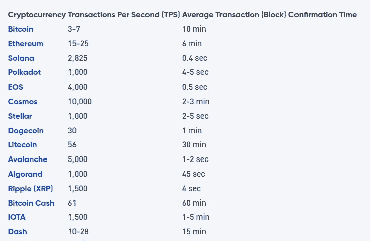

## THE BLOCKCHAIN CHALLENGE: DECENTRALIZATION AND HIGH TPS RATE

要成为日常生活中的应用并且集成到现有金融架构里面，需要显著提升 tps 效率、**reliability**（可靠性）、**scalability**（伸缩性），并且具备 handle 大批次 txns（**transaction handling**） 的能力——即使是在重度交通状况下也要保持 high efficiency 和 decentralized security（去中心化安全）。然而中央化部署虽然提供 centralization servers 带来安全、人力支持 staff、主导地点及计算资源集中管理从而实现在千 p s 左右 throughput，却因 trade‑off 不足：**decentralized** 架构往往伴随一些功能上的弱点——比如安全层不够完善、不能轻松 scale、效果低下甚至 unsafe database 出错/受攻击风险增高等等。

如果存在 any block problems reporters operators investigation why? Because mined found issue minted processed resulting rewards token being vigilant protecting。

一个软分叉的例子是比特币区块链上添加了 Segregated Witness (SegWit) 协议。SegWit 允许用户通过减少每笔交易中所携带的数据量，在一个区块中添加更多交易。然而，区块大小分配的变化使得比特币社区对将其作为永久功能进行争论。最终达成的妥协是让 Bitcoin 用户在设置交易时自行选择实现该选项。

### Example: Hard Fork vs Soft Fork

使用真实世界示例来看硬分叉与软分叉之间的差异。

#### Hard Fork

原始区块链就像一条沿河而建的人行道；部分社群希望跨过河流但属于少数派，而多数派则希望继续在道路上运行；想要跨越的人决定开发自己的网络并使用船只（因为交通方式不兼容、需要完全不同代码），导致两种形式无法相互执行预定义事务或处理其他人的操作。

#### Soft Fork

有许多贯穿各个社區街道代表如何执行 transactions。Group A 想要构筑桥梁以便更快地通过人员拥堵路段缓解高费问题，But others disagree not wanting to become part. So group reaches compromise: design overpass members can use if they choose; otherwise simply elect not to have processed that way. In case no substantive changes remain same name, develop token since remains part of original.

## COMMUNICATING BETWEEN DIFFERENT BLOCKCHAINS

### Ethereum


# Ethereum

Ethereum 是最具灵活性的加密货币生态系统，它支持智能合约、去中心化应用（dApps）、代币和 NFTs。DeFi 项目进一步提升了其吸引力；随后推出了众多 Ethereum-compatible 区块链，这些新链能够运行 dApp 原生令牌访问服务。用户偏好这种较新且通常速度更快、TPS 较低费率仍然可访问所有 ethereum 服务。For example, someone created a dApp and wanted to move it from Ethereum without any problem; the reverse is also possible. Additionally, games are available on both chains without requiring code changes. The best aspect is executing smart contracts uniformly across either chain as long as you utilize `ethereuncompatible` means—this allows taking full advantage of more applications beyond those hosted solely on your own chain.

# Polkadot

Polkadot enables incompatible blockchains to communicate value and data with each other—for instance between bitcoin and ether networks. Its native DOT token serves governance, staking, payment medium, transfer value functions. Another key benefit is its high TPS rate; scalability through parallel parachains reduces congestion while maintaining performance by processing most operations within them. Note that parachain works within polkaidt they application-specific full consensus security features main relay connects para processes receive confirm then send info checks adds its bock.

简而言之，加密货币对（crypto pairings）是不同区块链代币之间的交换比率。例如，如果你想用比特币购买莱特币（Litecoin），需要在支持这两种数字资产的中心化交易所（CEX）进行查找。然后根据该 `crypto pairing` 及其汇率决定是否在此 CEX 上将 Bitcoin 兑换为 Litecoin。

# SELECTING THE BEST CENTRALIZED CRYPTO EXCHANGE FOR YOU

所有中央化 `CEXs` 不提供相同的服务供用户使用，因此加密持有者应当调查每个考虑中的 `CEX` 是否适合自己进行 crypto 交易。

让我们来看一些 `crypto holders` 在评估 `CEXs` 时应关注的因素：

## ACCESSIBILITY

你希望能够轻松访问自己的 `CEX`。For example, China has banned all exchanges from operating within its borders. In other places like the US maybe prohibited in certain parts of country e.g., New York state.

## SECURITY

Because FDIC does not federally insure token like bank account use secure When checking out potential security look how recently often hacked lost funds due fraudulent conduct Also check social media forums Reddit Discord Twitter complaints platform about security scams operating platforms

## INSURANCE

Another consideration is whether insurance covers assets Example Coinbase offers against hacking If hackers steal then policy covers up $255 million combined user base value stolen less than this amount holder lose none

## STORAGE

Now let's storage practices specifically what percentage kept offline cold The more significant portion held offline harder it is theft For instance only keeps online active trading remainder %98% kept cold backed by insurance

```
if (condVar > someVal) {console.log("xxx")}
```

*Image from “11 Best Crypto Exchanges and Apps of August 2022.”²*

- ETH BTC Cash LTC USDT BCH USDT *popular pairings*
- Videos quizzes articles courses earn via completing activities such quiz.
- Some provide tax statements e.g., but traditional may log transaction track private wallet off-CEX cannot file correctly because can't tracking leave platform transfer them own wallet.

### DECENTRALIZED CRYPTO EXCHANGES

去中心化加密交易所（DEXs）是数字市场平台，允许加密资产持有者购买、出售和交易代币。它们与受托交易所（CEXs）的区别在于用户无需为 DEXS 注册账号，且 DEXS 在交易过程中不对其加密资产进行保管。一些知名的 DEXS 包括 Uniswap、`PancakeSwap` 和 SushiSwap。

DEXS 对那些希望在几乎没有监管监督下最大程度保护自身财务隐私的人非常理想。此外，他们还提供其他吸引用户的服务——例如自动做市商（帮助您交换代币），以及钱包扩展功能，可优化代币价格并降低滑点费用。

DED 尤其有价值，因为它通常会列入刚推出但尚未拥有高额流通量或具有较小估值、波动性大且风险极高等新型 token；此类 token 往往不符合 CEX 的上架标准而难以在传统平台上被批准。**Token Options**

DEDs 能够列出任何由其底层区块链支持的 token，**因此**必须先发布 new launchd TOKEN **before listing on CE X**，但实际上该领域充斥许多诈骗项目，**platform users must be careful when trading tokens on a D Ex**。

*Anonymity*

There is no account registration process, KYC protocol or anti-money-laundering (AMI) protocol; instead, Dedsonstead enables private P2P transactions via smart contracts. The platform does not identify contracting parties nor store personal information. Consequently, for holders seeking absolute anonymity, Deds are the best cryptocurrency exchanges.

Reduced Risk Of Hacking Platform Users only need to keep their crypto assets under control until they transfer them to another wallet—there is never any risk of hackers stealing your crypto during an transaction on a DED. Crypto holders maintain custody of their assets until transferring them elsewhere; at no time do they relinquish control over session-based user’s crpoto assets.

Reduced Transaction Risks

DED contractsmart-contractsthe way smar tconttractssmart cont ract s if two Contractingparties fulfilltheir obligations,thetransactioncompletes Ifthattwo Contractings party doesn't fulfil its responsibilities ,theagreementexpires SmartContractsdoesnallowforpartial completionofthecontract Therefore.onded thereisa reduced riskOf contract problemsif thereisinappropriateconduct by eitherparty tothet agreement .

# EVERYTHING YOU WANTED TO KNOW ABOUT CRYPTO WALLETS

## WHAT IS A CRYPTO WALLET?

CRypocurrency wallets also known as blockchainwallets are placeswhereyou storeyour crytocurrencies NFT'sTheyhelpminthe following activities:

Storing cryptocurrency

Sellling buyingandsellingtrading Cryptocurrenoy Tradingnon crossexchangeTradesOncoinexcahngeTronkets Non-fungible-tokens TockensellbuynFts TradenoncryptoexchangewltnsalebuytradeNonfungiblenons fungibles non-tradeable-nontokenstradablesales-Buy-and-salewithout-the needforsomeoneelsesto use itwithaneachother . The private seed phrase allows you torecover your crypcrptovolte walletofpasswordIf yuo forgetyour passwordandt loseysecretseedphrase,youloseaccessyoourcrogerwallerandeverythinginit Youm ustkeepwyourtpalletepasswardsecretseeddphraseprivatYou m never tell anyoneanyyouselfwrinklesay our wpalette paswdorsedyourd sepases crequtefoeconfidentialnessneccasarrybecauseanyon cant accessexyouraccoassetswerelyuse eithers these pieces off infoormation.

## CUSTODIAL VS.NON-CUSTODIAL WALLETS

A cointainermaintined ona CXE(e.g., Robinhood Kraken Binance Coinbase )iscustodial wallat.SCXsoroperatedabyacentral authorityjustlikabank.Thecentralauthoritiescanpossessiofs assetdeni withdrawalsorreceiptsofcryptocoins tomakercustodiualet ort evenremovetyoufromtheplatfoem.Non-custo dcialwa lloots independent privates criptaawallateSomeexamplesofnon - custodial wa llats Trezor Ledger Nano X Exodus Coinbase Wallet Mycelium Electrum Thesewalls canspecialize todeliiveroptimalperformancedindifferent situations.For example,somescripsaresexcellentcellphones desktops.Othersdesignsgodesbeginningcoinvestorin DeFi investorsInvestors whowants investinn FTs。

**PRIVATE KEYS**

Theshould beseenure secureFor examp le,wuyoue maywtouseUSBdrive wit apasswortstoreprivkey.In addition,,you shouldback upany informatiom storedonyouth USB,becauseiyoudloseyourgri keyforever 。

**PUBLIC KEYS**

Public keys has public address.Public keys composesa string random letter numbers toto identify crogiro vult public key like bank acc number freely share others. Yu use public key destination address in cryto transact. As real world analogy pubic Key Is like bank account number People with my bank account numbers enjoy money without personal details. public Key Is like bak account number receive therapy-compatible-token As real-world analogy, vulgar pubickye like bank account number. Likewise the Wallets public hack count number receive therapy-compatible-token As real-world analogy, vulgar pubickye like bank account number receive therapy compatible-token As real-world analogy vulgar dpwd is like token credit debit card 公钥匙是银行账户号码钱包秘书 PIN 。

### Single-Chain Wallets

- [单链钱包](https://wiki.example.org/feynmans_learning_method) 是用于单一公共区块链的钱包。这种钱包对投入度高或需要与特定公共区块链保持紧密联系的人最有益。例如，使用 `单条 Chain 钱夹`（single-chain crypto wallet）的人包括交易者、矿工和偏好使用某个特定公共区块 chain 的 dApp 开发人员。**如果一个人拥有一个单条 Chain 加密货币钱夹**，该加密货币仅具备一个 `public address（public 地址）` 或一个 `public key`，因为它是基于同一种 `public blockchain（公开区块链）`。

### Multi-Chain Wallet

多连接 (multi‑chain) 硬件允许其所有者在一次加密资产中存储来自多种 `public blockchains（公有区块链）` 的数字资产。


# 多链钱包示例

例如，多链钱包可以存储比特币、以太坊、EOS 和 DOT。加密货币持有者若要在不同区块链上使用单链钱包，必须在其电子设备（如手机、台式机、笔记本电脑、平板电脑）上持有多个单链钱包。然而，使用多链钱包时，加密货币持有者只需在电子设备上安装一个钱包即可访问多条公共区块链。

您的多通道加密钱包将为其中存储的每种加密货币类型拥有唯一地址。简而言之，您的多通道加密钱包将为您的以太坊、比特币和 DOT 代币提供单独的地址。

当您想要从不同区块链接收加密代币时，您需要复制 25 到 30 个字符的地址字符串并将其粘贴到交易框中。这些地址使您能够从其他账户接收此类代币。

# 加密钱包的类型

加密钱包主要分为两大类：热钱包和冷钱包。热钱包（例如 Web、桌面端）是连接互联网的软件钱包。另一方面，冷钱包（硬件、纸质）不连接互联网。

热钱包的吸引力在于易用性、便利性和适合日常交易。热钱包易于设置，资金易于访问，且随时可供交易者和加密投资者使用。

冷钱包不连接互联网。这些钱包防黑客，因为黑客无法访问它们。它们非常适合 HODLers（即长期持有加密货币的人）和不进行日常交易的人。但是，您必须确保在将冷钱包连接互联网时使用安全连接。如果加密交易者未保护连接，黑客可能在交易过程中劫持其连接并窃取加密资产。

## 硬件钱包

硬件钱包是一种您可以连接到台式机或笔记本电脑并存储您公钥和私钥的设备。它看起来像 USB，没有电池，且可以访问您所有的桌面应用程序。

这些设备比纸钱包更安全但不如纸钱包便捷；市场上提供了各种不同价格的型号。

初学者常发现它们难以上手。一些例子：`Ledger Nano S`、`Trezor` 和 `PaperWallet` 是受欢迎的项目，要求严格遵守安全措施。

此外，**纸钱包不能部分转移资金**。要使用这些冷存储，必须下载并打印二维码。

虽然有些纸钱包允许用户下载代码在离线状态下生成新地址，但其他一些则不允许。

但在投资本地之前，建议研究成本并了解通过纸钱包能进行多少笔交易。

## 桌面钱包

例如：`Exodus`、`Bitcore`、`Electrum`。

## 移动钱包

类似桌面钱包但针对手机性能优化设计。不幸的是，尽管设计良好，日常交易仍易受恶意软件感染。它们也必须加密，这样任何黑客攻击手机都不易访问加密资产。如果对移动钱包感兴趣，请查看 `Coinomi`、`Mycelium`。

## Web 钱包

通过互联网浏览器访问，易受在线攻击、网络钓鱼、恶意软件、浏览器扩展风险。可能托管也可能非托管，托管的更容易被攻击，最好使用非托管，因为您直接控制资金。适合小额投资、NFT。一些例子：`MetaMask`、`Coinbase`。

# 在中心化加密货币交易所创建账户

准备好在 CEX 开户了吗？如果还没开户，本教程将帮助您完成。本教程教您如何在 `Coinbase` 开户，在其他 CEX 开户流程类似。

## 开户前核对清单

在创建 CEX 账户前，请核对清单，所有问题回答“是”即可开户：

*   年满 18 岁？
*   拥有政府签发的身份证件（驾照、护照）？
*   拥有连接互联网的电脑/手机？
*   拥有连接手机的电话号码？（您需要接收 Coinbase 短信）
*   使用最新版本的互联网浏览器？

## 设置您的 Coinbase 账户

### 第一部分

1.  访问 `https://www.coinbase.com` 或下载手机 App。
2.  点击“Create free account”按钮（桌面端为“Sign Up”按钮）。
3.  选择“Individual”。
4.  输入以下信息：
    *   全名
    *   电子邮箱地址
    *   密码（妥善保管副本）
5.  阅读用户协议和隐私政策。
6.  勾选同意框，点击“Create free account”。
7.  **验证邮箱**：接收邮件，请求确认邮箱 -> 点击“Confirm Email” -> 登录（建议使用同一邮箱）。
8.  **添加电话号码**：网站提示时选择国家/地区 -> 输入电话号码 -> 点击“Send code” -> 输入 7 位数字代码 -> 点击“Submit”。如未收到可点击“Resend code”（最多两次）。

### 第二部分

1.  选择您的国籍所在国家。
2.  输入您的政府身份证明中的以下信息：
    *   名字
    *   姓氏
    *   出生日期
    *   社会安全号码（SSN）后 4 位
    *   地址。
3.  回答以下问题：
    *   您将主要把 Coinbase 用于什么？
    *   您的资金来源是什么？
    *   您的就业状态如何？
    *   您预计在未来 12 个月内转入 Coinbase 账户的总价值（包括现金和加密货币）是 `cash + crypto` 的**总和**。

## 第 4 节

### 添加支付方式

- 点击“添加支付方式”将支付方式链接到账户；例如：银行账户、借记卡、电汇、PayPal、Apple Pay、Google Pay 或即时提现。
- 当 Coinbase 通过 Plaid 提示时，点击“继续”。
- 选择机构 -> 输入凭据 -> 验证身份（短信/电话/电子邮件）。
- 选择银行账户 -> 选择继续。

## 第 5 节 - 登录步骤

登录 ▸ 个人资料与设置 ▸ 在手机上开启 PIN/面容 ID 开关 ➜ 设置 PIN / 选择设置


如有需要安装身份验证器应用（Google Authenticator/Duo/Microsoft）✓ 返回安全设置 > 更改安全设置 ✓ 导航至双步验证 ☐ 选择安装选项 ☐ 复制 QR 种子到剪贴板 打开身份验证器应用 🔑 粘贴密钥（Coinbase）生成代码 返回并复制代码 启用双步验证 —— 防止未经授权访问的额外保护

```
if (condVar > someVal) {console.log("xxx")}
```

# 案例研究 - 健康丰收园艺者与区块链革命

让我们通过社区园艺者用农产品交换加密货币的视角，来看看我们学到的区块链知识。Liam 是当地社区园艺小组 Wholesome Bounty Gardeners 的成员，成员之间互相交易农产品。他创建了名为 `WBG Blockchain` 的区块币交易，被称为“花园币”。

## 区块链如何提供帮助？

他知道需要存储不可篡改的交易数据，防止被黑客更改硬币数量，链引用之前的标识符，一旦创建就无法更改，称为不可篡改账本。他不想只在自己的电脑上运行，因此将其写入多台计算机，实现去中心化控制，节点点对点无需权威。

那么，他为什么没有权限呢？所有账户都在区块链上，去信任的设计显示了生成的私钥对接收公钥，对等发送、分发、私用查看、发送链接。`PrivateKeyExample` 示例看起来像 `[8efe77fc...bcbce]`[有人猜到重复密钥是不可能的，因为空间大小与沙子和原子相比]

> 在已知、可观测的宇宙中，原子数量估计在 1 × 10⁷⁸ 到 1 × 10⁸³ 之间。

因此，私钥组合的数量远多于沙粒、星星以及整个宇宙中的原子总和。这意味着私钥组合极其庞大；要复制或猜测它们几乎是不可能的。

**So**，猜测他人的 **private**（密钥）也几乎是不可能，**但如果有人丢失了自己的 private key 呢？**

Liam 意识到因为 **private** 钥匙一旦丢失就无法恢复，**于是向 WBG（Wholesome Bounty Gardeners）社区通报了保护自己 **private keys** 的若干方法。**

### 第一步

他告诉大家除了他的 **Private** 键外，还会有一个由十二词秘密种子短语（**seed phrase**）生成该 **Private Key**，这样他们比记住 **Private Key** 更容易记忆单词。（Members could commit this Seed Phrase **（seed-phrase）** to memory so they will not lose access **【their】** garden coins on WGB blockchain.）

### 第二步

Liam 建议成员把这个 **Seed Phrase** 写下来 / 拷贝至 USB 隐藏在安全地点。

现在 WBG Members 已经拥有他们的 **Private Keys**，（那他们打算怎么使用这些键呢？） Liam 推断出存在一个门户让 WBG Members 能查看/发送园艺硬币（garden coin）。然而，Liam 不想任何“获取者”能够访问任何人（**in any way**）的 **Private Keys**。所以 He 构建了一套非托管钱包选项供用户访问他们的园艺硬币余额——即 **non‑custodial wallet** option for members to access their garden coin holdings。He 有好几款非托管钱包：`web-wallet`、`desktop-or mobile-wallet`。

团队将 **Their PrivateKeys** 输入 **Wallet**，然后 **Wallet** 调用 `WBG Blockchain`，允许 Member 查看或转移 **garden-coins** 给其他 **members**；**Wallets** 中还有 **receiving-address** —— 用来给其他人接收 **garden coins**。

---

### Liam’s 区块链如何与 Wholesome Bounty Gardeners Community 水果蔬菜产量相结合？

> Say community gardener trades fruits & vegetables amongst one another. Participant didn't produce enough crops year wanted exchange something other than vegetables group. So Oliver wanted three bags potatoes Sally. Oliver could now send Sally public receiver-key three garden‑coins (Liam express new blockchains)

Oliver 想从另一人手里换三袋土豆给 Sally。由于没有足够作物可以直接交换蔬菜，**Oliver 把公开接收关键（public receiver-key）** 三枚花园代币发送给 Sally.（Liam express 新区块链）。

#### Oliver 在哪儿得到这三枚 flower-gardencoin？

- 他通过运行全天候节点并在桌面电脑上投资时间来维持网络。
- 每当发生交易时，他的机器就会解决一种与该笔交易挂钩的数学问题；
- 一次成功后获得新铸造的确认奖励 ———— **Proof-of-work**；

#### 苹果公司 Node 故障怎么办？（What if Oliver‘s or Liam‘s node went down? Or both went down?）

Olivia 和 Joel 提出担心：**如果所有节点都掉线会不会导致全部事务消失？**
Liam 指出：

> “这是区块链最重要特性之一：数据永不丢失。”

即使账本被篡改或损毁，‘hard work’仍然值得坚持。‘我了解』, ‘If ledger lost ownership all hardwork effort forfeited.’ – he knew that if the ledger lost its ownership, all efforts would be wasted.

为了防止这种情况，

> “Algorithm copied ledger onto Liam's node. Two live copies exist transaction ledger.”

两台活跃设备同时存储完整账本：‘Joel asked What if both computers are down?’ → Liam replied:

> “No one can transact if both computers down but Ledgers still on them hard drive once computer back up Ledger accurate. Olivia said Wait second That good fine replica ledger on two Computer not mean missing data when Oliver return online？”

也就是说只要至少有一台副本仍然正常工作，「缺少」并不会影响真实状态；等待主机重启后账本依旧准确。

---

### 对称性与共识

LIAM 引入强调数据的一致性更新日期及共识算法：

| 主题 | 描述 |
|------|------|
| integrity data consistent update-datetime block chain consensus algorithm | LIAM 说明区块链必须确保数据始终如一且时间戳记准确 |
| lian explained group that blocks compare copies transaction ledger nodes use greatest number transactions chain replicate longest transaction leader to the other nodes Olivia thought more about consensus realized indeed keep integrity data true | Lian 说明节点会比较各自复制品质并以「最大笔数／最长链段」决定最终版本作基础来维护资料完整与否 |

Olivia 虽未完全满意而再度发问：「你们两个暗里修改过购买单嗎？」<br>
众多人惊呼同意后她又说：「Public Ledger.」 <br>
这意味著透过公开分布式账簿（「Public Ledger」）每项操作皆可被观察并具备不可篡改之信任感。「All nodes again oliv saw merits final response Touché.」

---

## 本文结语

It's fine for mint new garden coins now other WB Members little did folks know liam been putting hours week writing

社区成员中的一人对区块链感到非常不满——在每一个层面上都是如此。他和那五代同堂对如何经营一个高效的花园了如指掌。然而，詹姆斯对技术一窍不通，也不想运行 `node`。因此，Liam 和花园社区的区块链构建者们决定，帮助詹姆斯的方法是在成员的后院建立一个市场，可以在那里交易和储存蔬菜。随后，詹姆斯带着 100 磅蔬菜来到市场，作为回报，他获得了 100 个花园币。

**詹姆斯仍然不开心；他拿着 100 个花园币能做什么呢？**

在市场上，詹姆斯认为 Liam 欺骗了他，因为只给了他 100 个数字花园币——他认为这基本上是看不见的硬币——而他却交易了 100 磅蔬菜。因此，在市场上表达了自己的意见后，负责堆肥的卢卡斯找到詹姆斯说：“我用 100 磅堆肥来换你的花园币。”詹姆斯是一个热衷的园艺爱好者，喜欢种植，但不喜欢堆肥业务，因为他不喜欢处理蠕虫和腐烂食物。于是，詹姆斯迅速同意并与卢卡斯完成了交易。卢卡斯随后在市场用他的花园币为家人和孙辈购买了水果和蔬菜。

**区块链为丰饶花园者们（Wholesome Bounty Gardeners）解决了问题。**

最后，我们可以看到区块链的独特特性如何促进并协助创造价值或财富的存储，并在没有第三方信任盈利的情况下进行点对点的价值交换。我们可以看到 WBG 花园者的区块链如何不断进化和扩张，以适应社区的需求。

**免责声明**

*本章中的故事为虚构作品。姓名、人物、业务、事件和事故都是作者想象的产物。与实际人物或事件的任何相似之处纯属偶然。此处提到的任何第三方商标仅用于描述目的，除非明确说明，否则不构成或暗示此类第三方对此材料的任何赞助或认可。*

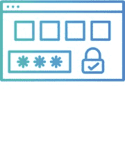 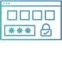 第 6 章

# 构建你的加密货币防御

## 核心要点

*加密货币诈骗逐年增加。你必须保持警惕并采取安全措施，以确保你的加密资产安全。你有许多方法可以保护你的加密资产。采取对你有效的方法。记住，一旦黑客盗走了你的加密货币，它就彻底消失了。*

## 加密货币诈骗正在增加

加密货币诈骗每年增长十倍以上。投资者投入加密市场的资金越多，对诈骗者和欺诈者的吸引力越大。

人们每天都在加密市场上亏钱。遗憾的是，新投资者很容易通过诈骗、糟糕的投资和黑客攻击损失大量资金。加密投资者知道这些诈骗是为了吸引你的兴趣并偷取你的加密资产。遗憾的是，这些诈骗变得越来越具有吸引力和说服力，看起来类似于合法的报价和投资。

这些诈骗类似于银行账户和信用卡诈骗。主要的区别在于加密货币诈骗使用了计算机编程、互联网通信和黑客技术。此外，犯罪者很难被抓住，因为加密货币无国界，可以从世界上任何地方访问。所以，祝你好运让执法部门追回加密资产。

本章将为你简要概述最常见的加密货币诈骗。在我们开始之前，让我直说吧：没有办法可以判断一个加密代币、区块链、加密交易所或其他类型的加密货币相关产品是否完全合规。你所做的最多就是寻找迹象，证明广告中的加密货币或区块链投资确实如其描述。

## 虚假加密交易所

虚假加密交易所提供与合法交易所类似的服务。区别在于，欺诈交易所针对特定的加密代币。虚假交易所运营者的目标是在关闭交易所并消失之前，收集尽可能多的加密代币私钥。

当你无法将加密代币移动到另一个地址、兑换它们或将其交换其他加密代币时，你会发现欺诈交易所存在问题。虚假交易所的操作会将问题归咎于技术，然后带着你的加密资产溜走。不幸的是，你和其他平台用户将永远无法找回被盗的加密资产。此外，虚假交易所运营者可能永远不会被发现，也不会被强制为其犯罪负责。

### 识别虚假加密交易所

当你研究加密交易所时，问问自己几个问题。如果你无法对这些问题找到满意的答案，请远离该交易所。

问题如下：

*   你能找到有关加密交易所运营人员的详细信息吗？
*   你能看到交易所运营者的社交媒体账户和简介吗？
*   交易所运营者的简介和账户是否活跃并保持更新？
*   该交易所具有高流动性吗？
*   加密交易所是否有足够的资金投入来支持其增长、扩张和维护？
*   加密交易所是否有中等到高交易量？
*   加密交易所是否存储了你的加密代币的私钥？
*   加密交易所是否要求你提供个人信息？
*   该加密交易所在加密爱好者中声誉良好吗？
*   是否有关于该交易所客户服务的投诉？
*   该加密交易所在 `Twitter`、`Discord` 或 `Reddit` 上有讨论吗？
*   加密爱好者在该交易所进行交易时遇到过问题吗？

## 如何保护自己

如果你没有使用知名的 `CEX`，请将你的加密货币从 `CEX` 账户转移到你的私人钱包。此外，在注册账户时限制给予 `CEX` 的信息。注意，有些人的身份在使用提供给加密交易所的信息时被盗了。最后，如果一个交易所便宜得离谱且看起来令人不可置信，它可能是一个虚假交易所。

## 虚假加密钱包

加密投资者可能会因将加密货币存储在虚假加密钱包而被盗。这些钱包可以从互联网下载或从网上商店获得。问题在于，这些钱包并不是合法的软件程序；它们是诈骗者创建的，旨在窃取你的加密资产。它们的名称通常与著名的加密货币和加密交易所相似。他们这样做是为了利用成熟加密公司的信誉。

### 识别虚假加密钱包

在选择加密钱包之前：

*   研究该公司。
*   查看其性能历史、投诉记录和社交媒体论坛上的相关信息。
*   如果你发现任何红旗或可疑物品，请远离它。

## 隐藏钱包

隐藏钱包是黑客放在你的电脑或智能手机中的加密钱包，用于偷取你的加密货币。部署隐藏钱包是通过黑客访问你的电子设备，在上面创建一个钱包，并给隐藏钱包一个与你的加密钱包地址相似的地址。然后黑客会进入你的电脑，定位你复制过加密钱包地址的地方，并将地址更改为隐藏钱包的地址。

隐藏钱包骗局之所以能成功，是因为人们经常复制自己的加密货币钱包地址，但很少检查（以确保其无误）。因此，在购买加密代币时，他们会将代币存入该隐藏钱包，因为他们没有意识到复制的地址不再是他们加密货币钱包的地址。他们只有在检查加密钱包余额并发现余额不正确时才会发现问题。

请注意，受害者无法访问隐藏钱包（例如，提现存入的代币、在交易中使用代币），因为只有黑客可以访问隐藏钱包的内容。

## 拉高出货计划（PUMP-AND-DUMP SCHEMES）

一群人决定从加密货币中赚快钱。首先，他们都在低市场价格购买了大量的特定加密代币。然后，在购买完加密代币后，他们来到自己的社交媒体账户（例如 `Twitter`、`Discord`、`Reddit`），将最近购买的低价值加密代币推广为下一个重大投资机会。

骗子通过虚假新闻人为提高市场价格，从而增加对加密代币的需求。当市场价格持续上涨时，会有更多人关注并购买该加密代币。随着时间的推移，由于代币热度越来越高，其价格将继续增长。在某个时刻，拉高出货计划的组织者将开始慢慢出售他们的代币以获取丰厚利润。随后，计划组织者会将所有持仓抛向市场。在他们离开后，代币的市场价格将急剧下跌。随着价格下跌，新投资者将开始出售他们的加密货币，因为他们担心失去初始投资。遗憾的是，随着更多投资者出售持仓，代币价格会跌得更快。结果，代币价格可能会回到最初的低市场价值，甚至跌得更低。在价格上涨时购买加密代币的投资者可能会损失他们的初始投资。

### 识别拉高出货计划

在你根据从社交媒体论坛或“朋友”那里获得的建议开始购买加密代币之前，请仔细研究该加密代币。将这些建议看作是在深夜走过路时，一个看起来可疑的随机陌生人给你的信息。简而言之，不要假设你在社交媒体论坛上听到或读到的所有内容都是真实的，或有研究支持。这些地方也是寻找拉高出货计划替代品（又称受害者）的好地方。

在将资源投入这项可能获利的投资之前，请问自己以下问题并获得满意的答案：

*   为什么这个加密代币会有需求？
*   为什么这个加密代币的市场价格在上涨？
*   是谁在推动这个加密代币？
*   你能验证收到的关于该加密代币的任何信息吗？
*   研究该加密代币后，它对你来说似乎是一项合理的投资吗？

## 托销骗局（SHILLING SCAM）

加密货币持有者传播他们所持有代币的虚假信息以增加其需求。他们的目标是将代币价格推高到他们可以卖币并获得丰厚利润的水平。被骗购买加密货币的人创造了需求，这也是其价格随时间推移增加的原因。在某个时刻，托销（shills）将出售他们的持仓（即将其抛向市场），导致代币的市场价格像落石一样下跌。新投资者将无法获得预期的利润，或者会失去初始投资。由于他们不是骗局的一分子，他们不会成为该骗局成功的受益者。

### 识别托销骗局

为了防止自己成为托销骗局的受害者，在你购买他人推销的热门代币之前，请问自己几个问题并获得满意的答案。问题是：

*   是谁提供了关于加密货币的信息？
*   你能验证收到的关于该代币的任何信息吗？
*   人们为什么想拥有这种加密货币？
*   该代币的市场历史是否表明其目前的价值增长是自然增长的？

因为回答这些问题并获得满意的答案可能具有挑战性，仅仅因为你无法回答并不意味着该代币没有被托销（[纠正注：由于回答这些问题并获得满意的答案可能很困难]）。在购买他人推销的热门代币时（例如 `Dogecoin`），在这种情况下，你可能需要放手一搏并希望结果良好。

新投资者将无法获得预期的利润，或者会失去初始投资。因为他们不是骗局的一部分，他们不会成为该骗局成功的受益者。

## 网络钓鱼骗局（PHISHING SCAMS）

骗子利用电子邮件和短信欺骗你向他们提供加密货币资产。在电子邮件或短信中，他们会试图获取你的个人信息、加密钱包密码和其他信息。他们通常使用看起来正式的电子邮件或短信发送这些信息。

在对潜在的钓鱼骗局做出回应之前，请执行以下操作：

*   研究提供优惠的机构。
*   研究该优惠以及类似的优惠。
*   了解信息要求哪些信息，以及这些信息是否可能被用于窃取你的资产。
*   确定哪些信息是你不会给一个无名陌生人的。

记住，生活中没有免费午餐！！

## 名人/网红冒充者（CELEBRITY/INFLUENCER IMPERSONATORS）

警惕收到的所谓名人或网红的任何邮件。除非你与这些人及其社交圈有联系，否则他们不会向你发送私人邮件说服你参加加密赠送或活动。你现在应该意识到，你收到的邮件很可能是冒充名人或网红的人发的。骗子希望你因为收到著名人物的邮件而印象深刻并兴奋，以至于忽略邮件中的可疑之处，信任他们并给你他们想要的东西。例如，如果你收到一封来自你崇拜但从未谋面的人的邮件，那是你崇拜的人概率有多大？

任何向你提供投资建议的垃圾电子邮件或短信都是可疑的。将它们看作来自意图不明的陌生人的建议。在回复此类信息时，不要提供可以被用来对你不利或窃取身份的个人信息（例如母亲的姓氏、社会安全号码）。

## SIM 卡攻击（SIM HACK）

许多加密货币投资者使用手机进行加密货币交易和交易。他们还使用手机检查加密钱包余额、购买加密代币并执行其他加密相关任务。

想要访问受害者加密货币代币或加密钱包的黑客可能会通过破解智能手机来实现。黑客只需要对你的 SIM 卡进行一次破解。在那一次性攻击中，他们可以向你的手机下载病毒，甚至翻阅你的文件。此外，他们可以在你的智能手机上放置代码，让黑客查看你手机上的活动、从你的手机将信息发送给他们，并允许他们更改你手机上的信息。他们还可以加密你的文件，然后向你索要赎金。

黑客喜欢攻击 SIM 卡，因为大多数智能手机用户从未意识到他们的手机被黑客破解了。诈骗者之所以能从 SIM 攻击中逃脱法律制裁，是因为通常人们不会定期检查手机是否有病毒、恶意软件或奇怪的软件。此外，他们在检查加密钱包余额并发现金额不正确之前，通常并未意识到问题的存在。

### 它是如何实现的

黑客可以通过联系手机运营商并冒充你的身份来访问你的智能手机。他们会向你的手机运营商提供你的出生日期、社会安全号码、母姓等信息，以便他们获取你的账户信息并进行更改。他们获取你信息的另一种方法是贿赂手机运营商的员工来提供线索。不幸的是，他们从大多数手机运营商员工那里花费不到 200 美元就能获得你的数据。

### 识别 SIM 攻击

为了避免 SIM 卡被破解导致加密资产被盗，请采取以下措施：

*   永远不要将手机连接到你的加密账户。
*   仅使用座机或免费的 `Google Voice` 号访问你的加密账户。
*   使用发送到手机的代码确认你的加密账户。
*   在你的加密账户上使用双重身份验证系统。
*   如果你使用手机，请为你的加密账户设置唯一的 PIN 和安全问题。
*   在你的加密账户上使用强密码或获取密码管理器。
*   使用虚拟专用网络（`VPN`）来隐藏你的互联网连接。

`VPN` 会加密你的 IP 地址。当你的 IP 地址被隐藏时，政府机构、公司、广告商和潜在的黑客将难以在网上定位你的电子设备（例如笔记本电脑、智能手机、台式电脑）。由于他们无法快速识别或跟踪你的 IP 地址，他们就不可能窃取你的个人信息、干扰你的加密交易或在你的电子设备上放置 Cookie 和恶意软件。`VPN` 在公共网络和私有网络上均可工作。它有一系列价格和计划。有关 `VPN` 的更多信息，请查看 `ExpressVPN`、`Mullvad`、`Nord VPN`、`SurfShark`、`hide.me` 和 `Proton VPN`。

## 非对称赠送活动

诈骗者喜欢利用社交媒体活动设置非对称赠送活动。在这些骗局中，诈骗者承诺向先给他们发送加密代币的人赠送免费加密代币。然后，诈骗者告诉潜在受害者，在交出加密代币后将获得更多的加密代币作为回报。不幸的是，现实是，在收到你的加密代币后，你再也不会收到他们的任何消息了。

### 避免非对称赠送

永远不要将你的加密代币发送给某人的加密钱包，并期望他们会还给你并通过更多的加密代币作为奖励。为什么会有人这样做呢？他们从中能得到什么？世界上没有免费的午餐。如果有人给你提供免费的午餐，请寻找猫腻。

## 避免通过黑客或诈骗被盗加密货币的通用规则

*   不要告诉所有人你有加密货币，特别是在社交媒体上。
*   避免与你不认识的人在聊天中进行私信。通常情况下，攻击者会先联系你。
*   不要下载或点击你不确定安全的软件或链接。
*   永远不要给任何人你的秘密助记词（**seed phrase**）、私钥或加密钱包密码。
*   为不同用途准备多个电子邮件账户（例如：一个用于访问交易所，一个用于通信等）。攻击者可能会尝试使用你的电子邮件并查看是否有结果，来访问你在不同加密交易所的加密货币账户。

## 保护你的托管加密账户、私钥和秘密助记词

对于中心化交易所（`CEX`）上的托管钱包和加密钱包，你应该使用三部分账户授权系统。不幸的是，最常见的双重身份验证（**2FA**）系统是不安全的，因为它容易受到攻击。黑客仍然可以破解这三部分系统，但需要更长的时间且更具挑战性。

让我们检查 **2FA** 系统，然后看看支持它的第三部分。

### 2FA

在 **2FA** 系统中，如果不输入至少两项安全数据，你就无法访问加密账户。首先，加密账户持有者将输入用户名和密码，然后被要求输入发送到其电子邮件账户或智能手机的代码。

### 破解电子邮件账户

电子邮件账户长期以来一直容易受到攻击。我们经常读到数据泄露或黑客入侵电子邮件账户的新闻。如果你只使用 **2FA**，黑客可以进入你的电子邮件，点击“忘记密码”链接（谁没有忘记过一次密码呢？），并在你的账户内部重置密码。重置密码后，黑客将获得你加密账户的完全访问权限。

### SIM 卡劫持

短信信息有问题，因为 **SIM 卡劫持** 已变得常见且简单。在 **SIM 卡劫持** 中，黑客联系你的手机运营商，声称由于丢失 SIM 卡或智能手机而陷入困境。黑客会要求手机公司将你的号码切换到新的 SIM 卡或智能手机。在运营商将你的号码更改到黑客的 SIM 或智能手机后，黑客可以快速完成访问加密账户所需的 **2FA** 验证过程。

### 身份验证器应用

如果你使用 `Google Authenticator`、`Microsoft Authenticator` 或 `Authy` 等身份验证器应用，黑客必须额外努力才能进入你的账户。这些应用并不困难也不费时间，但你必须在每个交易所账户上设置它们。关于身份验证器应用设置最重要的点是，你必须存储你的账户备份密码。如果你丢失了手机或电子邮件的访问权限，可以使用账户备份密码重新生成你的 `Authy` 账户。为了防止身份验证器应用备份密码和加密账户秘密助记词出现问题，请采取以下措施：

*   将屏幕上显示的备份密码抄在纸上。确保它易于阅读，并使用不易褪色的墨水或不会随时间快速降解的纸张（例如，墨水遇水后无法识别）。
*   将备份密码复制两次，并将每个副本放在不同的安全位置（例如，保险箱内）。
*   将密码刻在防酸、防火、防震的不锈钢上。
*   将备份密码存储在受密码保护的 `USB` 闪存盘中。
*   设置一个你仅用于加密相关活动的电子邮件地址。这样，如果黑客获取了你的主电子邮件账户的访问权限，他们无法获取你的加密账户。
*   永远不要给任何人你的秘密助记词或备份密码。
*   永远不要将秘密助记词或备份密码存储在计算机、智能手机、平板电脑等设备上。

## 强加密钱包密码指南

使用长度为 12 个字符或更长的密码。随着长度的增加，它们变得更加健壮和安全。强密码应混合大写字母、小写字母、特殊字符和数字。模式应该是随机的，输入时的键盘路径不应该是易记的。它们也不应包含你的个人信息、位置或任何黑客可以根据你的背景或对你的熟悉程度所推测的内容。此外，不要在相同或不同账户上重复使用旧密码。

## 生成强密码

如果你不确定如何生成强密码，这里有一些你可以采用的方法⁴：

*   使用如 `NordPass` 等密码生成器应用程序创建你的密码。
*   使用短语并对其进行缩写。
*   从字典中选择随机单词，并使用不同的特殊字符和数字将它们组合起来。
*   使用缩写的名言。
*   在密码中使用表情符号。表情符号是特殊字符、标点符号和数字的组合。例如：

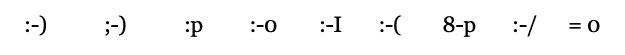

*   为所有账户使用相似的密码，但更改开头或结尾，使其针对每种类型的账户进行专门化。

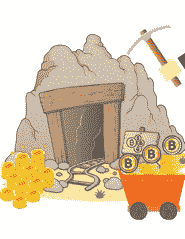  第 7 章

# 如何寻找加密货币明珠

## 核心信息

投资者主要使用基本面分析和技术分析来决定想要交易或购买哪些加密货币。基本面研究侧重于研究加密项目并估计其增长、寿命和市场价值。相比之下，技术分析侧重于观察历史价格波动，并利用资产的市场趋势对未来价格波动做出预测。最终，你应该选择一种反映你的风险承受能力和对资产认知的投资/交易策略（例如，购买公司的一部分与交易公司的股份）。

## 基本面分析 VS 技术分析

### 基本面分析

基本面分析（**FA**）要求投资者花费大量的时间、精力和努力研究公司，并确定其“真实”（又称内在）市场价值和增长潜力。这种分析最适合计划购买并持有资产超过一年的人。

根据“奥马哈神谕”、最著名的 **FA** 投资者沃伦·巴菲特的说法，基本面分析被认为是想要积累家族财富并实现财务独立的人的最佳投资策略。

### 技术分析

技术分析（**TA**）通常由短期投资者/交易者使用，因为他们的市场成功取决于在最佳价格点进行交易。**TA** 关注资产在市场中的历史表现，并利用其之前的表现来预测未来的价格波动。其工具使用价格波动的趋势、总结随时间波动的数学方程，以及交易者可以使用计算机分析识别的其他类型的市场信号。

使用 **TA** 工具做出交易决策的投资者通常使用多个工具来确定市场趋势以及他们应该何时入场和离场。最著名的 **TA** 投资者是那些在 2021 年成功交易 `DOGE`（狗狗币）、`AMC` 和 `COSS`（加密一站式解决方案）并从低市值短暂飙升至平流层发财的人。

在本章中，我们将回顾 **FA** 和 **TA** 的基础知识。虽然两种分析技术都无法保证作为加密货币交易者或投资者在市场上的成功，但你应该选择适合你的一种。

## 加密货币基本面分析 (FA)

**FA** 查看加密项目的运营、管理、分配和潜力。此外，它还衡量了可能影响加密货币市场估值的方面。

## 定性与定量分析

投资者审查加密货币的关键特征。考虑的因素包括：

*   管理
*   治理
*   组织结构
*   专利
*   专有技术
*   品牌
*   市场利基
*   市场规模
*   竞争对手
*   市场周期
*   财务报表（例如：资产负债表、利润表、现金流量表）

### 运营：管理、治理

作为投资者，你希望决策者有技能和经验做出对价值产生积极影响的决策。

### 技术优势：专利、专有技术、共识算法

加密公司可以在不同的区块链上发行加密代币（例如 `USDT`、`USDC`）或主要发行（例如 `BTC`、`XRP`、`DOT`）。代币的用途越高，其市场价值和需求越大。用途有限的加密代币必须产生高需求，因为否则没有人会购买它们。为了让限量代币产生高需求，它必须占据一个未开发的市场利基（例如 `XRP`）。

融入加密代币生态系统运营、发行、被动投资机会或程序中的技术也会影响其声誉。加密货币投资者通常倾向于获取不太可能被黑客攻击、因运营规划或维护失误而无法使用、或过时的公司发行的加密代币。总之，所有这些问题可能会显著减少对加密货币的需求，如果更严重，还会消除其需求。

### 代币经济学

**Tokenomics** 指代币的供应、销毁和使用。此外，投资者/交易者应该了解代币是否有自己的生态系统、它是否可以在多个区块链上使用、是否在加密货币交易所交易，以及公司如何向公众分配代币。

### 代币供应

供应有限的代币可能会随时间增值，特别是公司每年销毁相当比例的代币。此外，如果加密货币的代币供应无限，你想知道代币是如何发行的：

*   公司每年铸造多少代币？
*   公司每年销毁多少代币？

### 代币获取性

在 `CEXs` 上购买的代币比只能在 `DEXs` 上购买的代币更有信誉，因为 `DEXs` 对加密代币的上市要求比 `CEXs` 低。由于标准宽松，`DEXs` 有比 `CEXs` 更多低价值和欺诈性的代币。

如果该代币进行过首次币发行（**ICO**）或正计划进行，请仔细考虑创始人、开发团队和外部投资者所持有的代币比例。如果公众没有拥有大部分代币，那么这是一个红旗，表明代币的创建者对其没有信心，并且他们认为该代币随着时间的推移（即多年后）将没有价值。

当公众不持有大部分代币或只有少数人持有时，该代币的价值很容易被操纵，并迅速抛售获利。认为其代币具有价值和盈利未来的代币发行者，分配给创始人和开发团队的代币占比较小。他们通过不同的发行将大部分代币释放给公众，供利益相关者购买。

### 品牌

品牌指的是代币或区块链的声誉。如果一个品牌广为人知且声誉良好，其价值可能会高于市场特征所合理的水平。品牌情绪可能会导致人们购买并持有用途有限、开发糟糕且缺乏独特性的代币（例如，`DOGE`、`SHIB`）。因此，如果你正在考虑投资这些币，你应该知道该代币的市场价值多大程度上取决于人们的情感因素。

### 品牌强度

`Bitcoin` 的市场价值取决于其社区对代币的情感投入。尽管该代币可能永远不会回到其在第一季度达到的价格水平，但其持有者渴望投入他们的财务资金。对于这两种代币，它们的品牌非常强大，以至于在投资者没有仔细研究它们的情况下仍继续吸引投资者。就像 `Coca-Cola`、`Pepsi`、`Amazon`、`Nike` 和 `Apple` 一样，品牌驱动了客户忠诚度。

### 社区支持与参与

在评估代币的价值及其未来增长潜力时，其社区支持和参与是决定其真实价值的关键因素。活跃、参与且不断发展的在线社区对于加密代币的大规模采用至关重要。如果没有大规模采用或不断发展的社区，代币的价值或可用性可能无法增加。代币社区的讨论驱动了兴趣和需求。当人们对加密货币的兴趣和需求很高时，其他潜在投资者/交易者将产生兴趣并投资该代币。此外，区块链开发者更有可能创建一个将加密货币整合到项目中的应用程序。

### 市场特征：利基、规模、监管

在估计代币价值的潜在增长时，你必须考虑市场规模、市场估值、市场的独特性以及监管如何影响其运营。例如，如果你可以轻松用其他代币替代感兴趣的特定币，那么它的利基市场就过于普通且受到严格监管，因此可能不会有高需求。另一方面，如果对该代币的需求或需求很低，你不应该期望其市场价值会上升。

### 财务报表

投资者和交易者还会审查加密代币发行公司的资产负债表、利润表和现金流量表。

#### 资产负债表

资产负债表记录了公司的资产、负债和权益。公司控制公司资产，包括现金、库存和建筑。公司的负债包括短期和长期贷款、公司债券和其他类型的公司债务。权益由公司拥有的公司股份组成。

#### 利润表

公司利润表包括关于公司在特定期间收益、支出以及业务利润的报告。公司可以使用它来评估公司从运营以及投入运营的资金产生收入和利润的效率。

#### 现金流量表

该表单是公司在一段时间内现金流入和流出的记录。此表单包含以下信息：
1. 投资活动现金（**CFI**）：用于购买资产的现金以及出售其他资产（例如设备、建筑、业务）的收益。
2. 筹资活动现金（**CFF**）：发行和贷款资金的现金收益。
3. 经营活动现金流（**OCF**）：日常经营产生的现金收益。

## 白皮书审查

在评估代币时，财务部分列出的大部分或所有信息应出现在代币的白皮书中。如果白皮书中没有这些信息，或者开发团队没有发布关于这些信息的发布稿，你应该警惕投资。

你必须判断该加密项目看起来是合法的还是骗取投资者资金的手段之一。白皮书写得不好并不意味着加密项目会失败。相反，一份完美的白皮书并不能保证加密项目会成功。

### 白皮书与虚假首次发行

请注意，首次发行和其他公开代币发行是骗取新手投资者资金的流行方式。骗子产生的白皮书看起来非常有吸引力，通常具有精美的图形，并且往往复制其他项目。

假的 **ICO** 往往：
*   资金薄弱
*   缺乏活跃和参与的在线社区
*   在技术原理方面存在巨大空白
*   将大部分代币分配给项目相关人员
*   没有完成任何实质性里程碑
*   有短期展望

这些是它们的主要缺点，因为它们不计划让代币增值、实用或长期“生存”。因此，它们想将代币卖给公众，并带着投资者的资金消失。

## 链上分析

在评估区块链时，你应该将以下因素纳入其收益产生能力和性能分析：
1. 交易数量：区块链在特定时期处理的交易表明了区块链的活跃程度及其服务的需求。交易总数将包括加密钱包之间的资金转移，因此你不能直接接受这个数字。
2. 交易价值：交易或一组交易中的资金价值。
3. 活跃地址数量：计算活跃地址的方法不同。最简单的方法是计算在此期间内发送和接收地址的数量。
4. 交易费用：查看平台用户支付的交易费用。大型用户在拍卖中竞出的成本越高，平台就越成功。
5. 区块链攻击：如果一个区块链被反复黑客攻击，你可能想要避开它。具有足够支持、良好代码和流量的区块链通常不容易被破解。请注意，加密货币区块链不同于加密交易所，因此你不能将同样的逻辑应用于加密交易所。尽管如此，你应该对被攻击过的加密交易所保持警惕，特别是当它被攻击过多次时。
6. 区块链停机：如果区块链因为交易过载或由于平台用户过度使用其服务导致崩溃而不得不暂停活动，你可能想要避开它。在流量大时，区块链处理交易的速度可能会慢很多，但它们不应该崩溃。如果区块链中断超过一次，你应该仔细研究开发团队以及他们采取了什么措施来防止这种情况再次发生。
7. 区块链补丁：无论区块链的代码有多完美，总会有某些遗漏并导致问题。你寻找的不是代码完美的区块链，而是具有良好代码、警觉的编码人员和安全人员，并且有证据表明运营商和开发者能够在问题给平台用户造成麻烦之前发现并修复区块链代码中的问题。

## 基本面分析的 4 个基本假设

基本面分析（**FA**）有四个基本假设，只有当这些假设有效或合理真实时，**FA** 才能反映公司的“真实”价值：

1. 当前股价没有反映公司的实际价值。
2. **FA** 值更好地反映公司的“真实”股票价值。
3. 随着时间的推移，股价将反映计算出的 **FA** 值。目前尚不知道公司股价需要多久才能反映 **FA** 估值。这可能需要几天、几个月，甚至几年。
4. 关注特定行业及其公司的投资者可以计算该行业公司的内在价值，并找到以折价买入股票的机会。

## 技术分析 (TA)

加密货币的技术分析（**TA**）基于道氏理论，该理论有六个基本原则。这六个原则是：

1. 资产的市场价格代表了资产的“真实”价值（包括交易者的预期和市场情绪）。
2. 你应该根据以下市场趋势判断价格波动：
3. 主趋势/大趋势，持续几个月到一年以上。
4. 你可以在主大趋势中找到次级趋势；这些趋势持续几周，是主大趋势的市场修正。
5. 次要趋势/短期趋势，持续 1–2 周。
6. 主趋势有三个连续阶段，分别是：
7. 积累 – 买家买入资产，或卖家卖出资产。他们的市场活动不影响投资价格。
8. 公众参与 – 更多交易者注意到并遵循新的市场趋势，他们的交易活动导致资产价格迅速变化。
9. 分发 – 在投机狂热的时期，经验丰富的交易者会派发持仓。
10. 不同的 **TA** 指标必须相互确认市场信号。加密货币对之间运动的相关性是你可以在加密市场中观察到的。
11. 价格移动时成交量必须增加。如果成交量随价格波动而增加，价格遵循市场趋势。然而，如果成交量随价格波动而减少，价格则背离市场趋势移动。
12. 趋势会一直持续，直到市场出现明显的信号表明它将发生反转。价格通常遵循趋势，而不是改变趋势。

主趋势中的反转可能很难识别，并且往往类似于次级波动。

## 技术分析 (TA) 工具

**TA** 工具主要分为五大类。这些类别是：

1. 交易统计（例如，成交量）
2. 蜡烛图分析
3. 图表形态
4. 阻力位和支撑位
5. 技术指标

交易者经常结合使用 **TA** 工具来解读市场。他们这样做是因为如果工具给交易者提供相同的信号，它们就相互确认。如果有两个或更多工具相互确认，交易者就可以确信对价格波动的市场预测是正确的，或者更有可能是准确的。此外，这些工具可以指示市场趋势的强度，市场趋势越强，交易者正确读取或解读它的几率就越大。

**TA** 工具帮助交易者减少市场风险和交易错误。然而，它们不能消除所有的交易风险。例如，交易者永远无法确定自己对市场趋势的预测是正确的，因为这些趋势在某种程度上是相似的。此外，交易者永远不知道一个趋势会持续多久，以及变化得有多快。

### 加密货币并不完全适合 TA

此外，你无法根据之前的市场表现完全预测加密货币市场的波动。此外，你不能简单地将加密资产的价格波动与真实的全球事件、经济或投资相关联；因此，它的波动性更加不可预测。

## 通用 TA 工具组件

本节将回顾大多数 **TA** 工具用于确定市场趋势的关键因素。回顾的元素包括分析时间框架、成交量、蜡烛图、支撑和阻力位以及图表形态（例如看涨、看跌、反转、突破）。

### 分析时间框架

观察加密货币价格移动没有理想的周期，这意味着观察期主要取决于你的交易策略。

交易者关注不同长度的时间，是因为他们从事的是短期或长期交易。所以，让我们看看观察时间如何根据交易者的类型而变化。

*   **剥头皮交易者**：快速进出的交易者（在 1–5 分钟内）。
*   **日内交易者**：在一天内进出。他们通常查看 5 分钟、15 分钟和 60 分钟的市场图。
*   **持仓交易者**：偏好长期交易，持续时间从 1 天到几周不等。

在简短的时间框架内交易通常对于波动大、高投机性的市场更好。

### 成交量

成交量是指特定时期内交易的加密货币数量，用于指示市场趋势的强度。更强劲的趋势成交量更高，弱势的趋势成交量较低。

## 蜡烛图

蜡烛图深受经验丰富和缺乏经验投资者的欢迎。蜡烛图显示了资产在特定期间内的价格移动。蜡烛有实体，颜色为红色或绿色，最多有两个影线。

*   **绿色蜡烛图**：底部是开盘价，顶部是收盘价。收盘价高于开盘价，因此被视为看涨。
*   **红色蜡烛图**：底部是收盘价，顶部是开盘价。因为开盘价高于收盘价，因此被视为看跌。

## 蜡烛强度

资产价格的变化源于市场中激进的买卖和订单量。如果当前价格有许多卖单，价格将会下降。然而，如果当前价格有很多买入单，价格将会上涨。

简而言之，当卖单超过买入单时，资产价格下跌。但相反，当买方订单超过卖方订单时，价值就会上升。

由于大量的市场买卖是基于情绪的，因此说明资产买卖积极性的 K 线（蜡烛图）展示了投资的价格走势以及交易该资产的人的情绪状态。

你可以从 K 线的结构中看出其强度；它们有一个实体，以及零到最多两根影线（烛芯）。影线是从 K 线的顶部和底部延伸出的线条。

让我们回顾一下不同的 K 线强度。

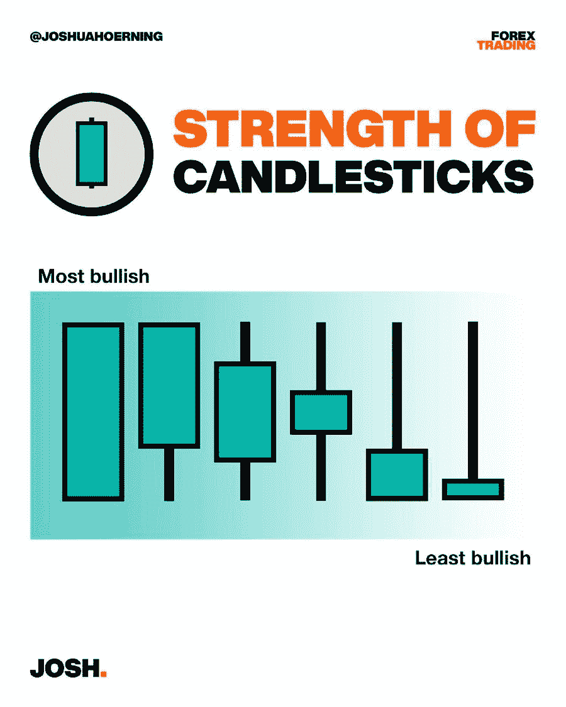

*来自 Financial Freedom Trading 的图片“K 线强度”。⁸*

1. 最强的 K 线具有长长的实体，且没有上影或下影。这种类型的蜡烛标志着当前价格走势将持续。价格走势仍可能改变方向，但可能性较低。（**极强信号**）
2. 这仍然是强 K 线，它具有长长的实体，且在价格走势相反的方向上有较短的上/下影。价格可能会继续向相同方向移动，但有微小的概率改变。（**强信号**）
3. 蜡烛实体中等大小，上下影也都是中等大小。这是一个中等信号。当前价格走势可能会持续。然而，价格方向发生变化的风险很大。（**中等强信号**）
4. 实体比中等小但不是短实体，且有两根中等长度的上下影，这种中等信号在平均强度范围内前景最不利。价格方向发生变化的机会很大，但更有可能继续向相同方向移动。（**弱中等信号**）
5. 这根 K 线具有较小的实体和一根沿着价格走势方向延伸的长上/下影。K 线的开价、收盘价和接近信号较弱。价格走势改变方向的机会极佳。
6. 最弱的 K 线信号。它有一个纤细的实体和一根沿着价格走势方向延伸的长上/下影。这种 K 线标志着投资者应该为价格方向的变化做好准备。（**最弱信号**）

# 图表模式

K 线创建了交易者可以用来衡量、读取和预测市场的图表模式。随着你阅读和解读图表模式能力的提高，你将进行策略性交易并降低交易风险。最重要的是，你将更有机会获得更获利的交易。交易者寻找的交易模式有：

### 看涨 K 线模式

这种交易信号意味着资产价格正在上涨。如果交易者以良好的位置、低成本进入市场，并在主要价格峰值处卖出，你在最大化价格峰值或刚达到峰值后将从交易中获利。

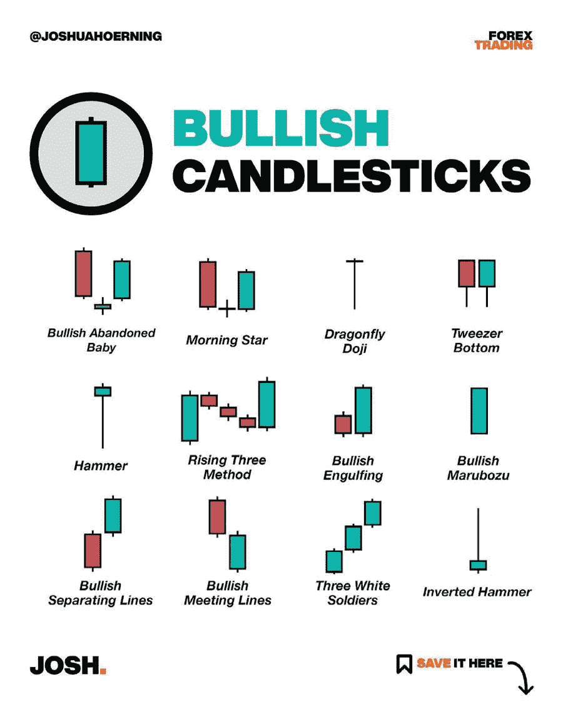

*来自 Financial Freedom Trading 的图片“看涨 K 线”。⁹*

## 看跌 K 线模式

此模式标志着资产价格正在下跌，现在不是买入的时机。如果可能，在价格下跌到让你亏损、无利或获利极少之前卖出该投资。相反，当资产价格触及最低点时，那是买入该资产的完美时机，然后在价格再次达到峰值时卖出。

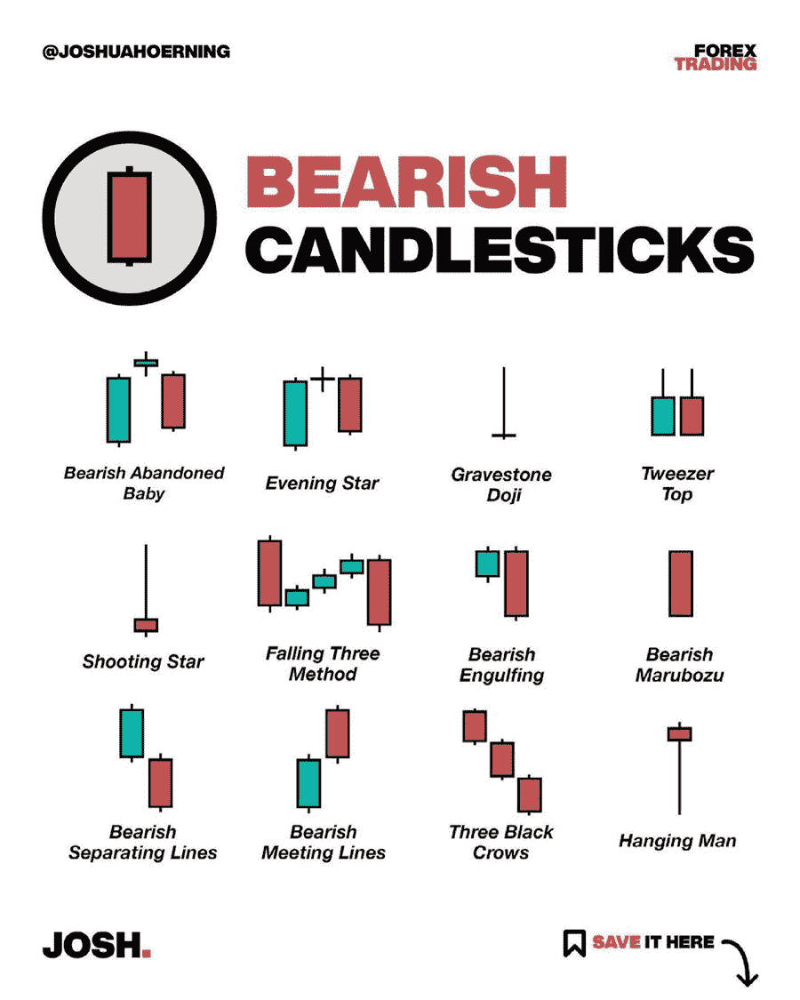

*来自 Financial Freedom Trading 的图片“看跌 K 线”。¹⁰*

## 看涨反转模式

看涨反转模式标志资产下跌的价格将改变方向并上涨。它是一个反转模式，因为熊市趋势变成了牛市趋势。

## 看跌反转模式

看跌反转模式标志资产上涨的价格将改变方向并下跌。它是一个反转模式，因为牛市趋势变成了熊市趋势。

头肩底图表模式向你展示了看涨和看跌反转模式。此外，在比特币市场数据也可以找到头肩底图表模式。

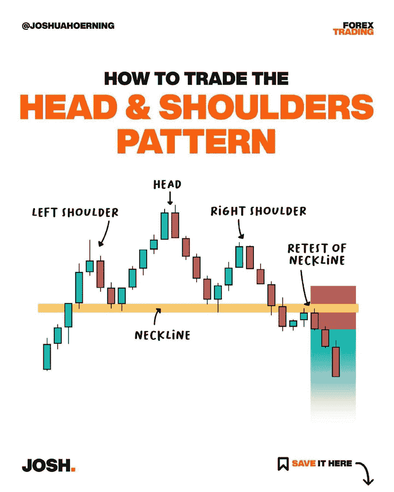

*来自 Financial Freedom Trading 的图片“如何交易头肩底模式”。¹¹*

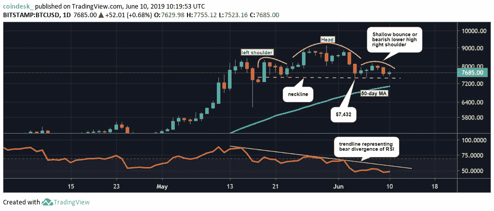

*来自 Crypto News，2019 年 6 月 10 日的图片。¹²*

## 持续趋势模式

此信号意味着市场趋势将持续一段未知的时间（即超过一根 K 线）。它允许交易者进入/退出头寸并建立丰富的交易。

在上面的头肩底图表模式中，价格突破了支撑线并继续向下移动（熊市趋势）。

## 支撑位与阻力位

带有 K 线的市场图表具有支撑线和阻力线。支撑线是你沿着 K 线底部绘制的线。它代表了一段时间内低价的总体方向。阻力线是你沿着 K 线顶部绘制的线。

支撑象征着资产抵御价格下跌市场压力的强度。支撑越强，价格跌破它的可能性就越小。

阻力象征着资产防止价格上涨的强度。阻力越强，资产价格高于它的可能性就越小。

支撑线和阻力线在市场图表上形成常见的形状。起初，你可能很难在图表中“看到”形状，但随着时间的推移和练习，你将能够识别不同的图表形状以及它们告诉你关于资产市场趋势的信息。

你可以在下面的图中观察到主要和次要的支撑与阻力。

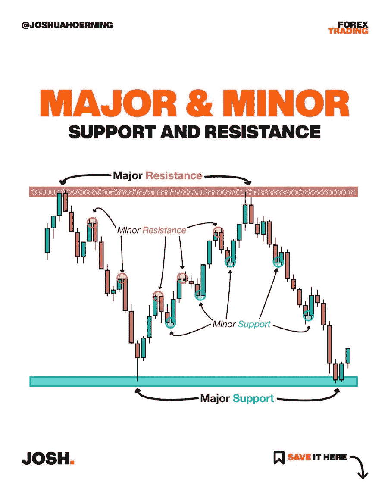

*来自 Financial Freedom Trading 的图片“主要与次要支撑阻力”。¹³*

## 突破模式

当资产价格跌破支撑线或突破阻力线时，价格突破了趋势。如果你能预测突破，你就可以进行获利的交易。下面的图表显示了一些突破模式。

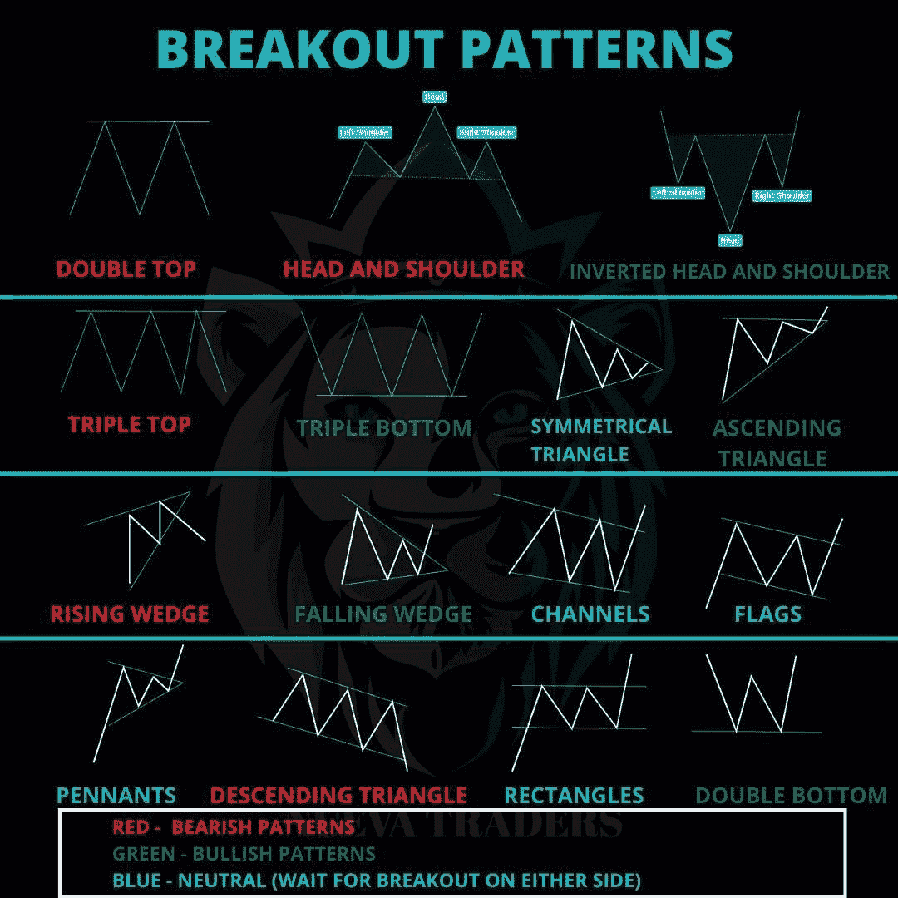

*来自 Financial Freedom Trading 的“突破模式”。¹⁴*

## 其他 TA 工具

还有其他 **TA** 分析工具可以用来读取和解读加密市场。虽然我们在这里无法介绍它们，但你可以研究这个最流行的列表。你应该使用你感到最熟悉、信任并有信心引导加密决策的工具。

常用的 **TA** 指标有：

*   能量潮指标 (`OBV`)
*   累积分布线 (`A/D Line`)
*   平均方向指数 (`ADX`)
*   阿润指标
*   移动平均收敛发散 (`MACD`)
*   相对强度指数 (`RSI`)
*   随机指标

## 模拟交易

准备好交易加密货币了吗？

如果你有一个可以使用虚拟货币交易的演示账户，你会感到更舒服吗？

那么，可以使用模拟交易来练习交易技巧。模拟交易是使用虚拟资金交易的演示账户。交易后，你可以观察市场决策的结果并制定策略以优化市场表现。

许多公司提供免费演示账户，因此你不应该付费。如果可能，从你未来感兴趣合作的公司获取一个演示账户。记住，许多公司允许在其平台上交易加密货币。

如果你决定开设模拟交易，你可能考虑的一些公司有：

*   `Webull`
*   `eToro`
*   `AvaTrade`
*   `Interactive Brokers`
*   `TradeStation`
*   `Thinkorswim`
*   `Capital.com`
*   `Tradier`
*   `FOREX.com`

## 在大海中寻找你的针

你现在准备好开发你的加密货币交易技能了。市场上有成千上万种加密货币，因此你有很多选择。如果你倾向于处理具有历史记录和大量市场数据的加密货币，请考虑市值最高的那些。

使用你的模拟交易账户或你选择的任何方式来练习和测试你的交易策略，请关注以下一个或多个加密货币：

*   比特币原生币 (`BTC`)
*   比特币现金原生币 (`BCH`)
*   以太坊原生币 (`Ether`)
*   波卡币原生币 (`DOT`)
*   去中心化世界原生币 (`MANA`)
*   狗狗币原生币 (`DOGE`)
*   卡尔达诺原生币 (`ADA`)
*   泰达币原生币 (`USDT`)

# 现在就开始积累你的加密货币财富！

你拥有开发和提高加密货币交易技能所需的一切。从今天开始吧！当你对模拟交易感到自在且自信时，就开始投资加密货币。

注意，不要做一个一劳永逸的模拟交易者！

在某个时刻，你必须投入加密货币交易并投入你自己的资金。

如果你在开始积极交易方面遇到困难，请设定一个交易日期，并在交易中投入少量资金。最终，你必须“破釜沉舟”，让自己暴露在加密市场中，无论好坏。

记住：凭借经验和（一些）运气，会出现巨大的机会和财富。 

# 第 8 章 从加密货币中获利以及创造跨代财富的钥匙

## 核心信息

想要成为百万富翁并创造跨代财富的加密货币投资者必须是自律、冷静且注重记录的投资者，以设定目标、里程碑和市场出场策略。总的来说，加密货币投资者积累财富的最佳计划是投资具有长期前景的资产。

## 什么是跨代财富？

当你实现了跨代财富时，意味着你在储蓄和投资中积累了一笔巨额财富，这笔财富具有韧性、自我维持能力，更重要的是它是安全的。因此，你的子孙后代将从你一生创造的财富中受益。

如今，普通人可以通过加密投资的倍数效应创造跨代财富。机会仍然存在；在 2021 年，有更多的加密货币增加了价值。然而，创造跨代财富不是一种暴富计划。你必须长期坚持；实现它需要坚持下去，不要让情绪误导你。

历史上第一次，加密货币使成为富翁的机会民主化。此外，在财富保护方面，加密货币可以成为保持家族财富完整并将其传给后代的基石。由于市值超过 4000 亿美元，估计由于比特币的并行上涨，产生了 18,000 名新的百万富翁。此外，比特币的崛起可能仅处于婴儿阶段，并且是在全球范围内发生的，这意味着积累巨额财富是一个稀有机会；从历史上看，财富转移主要发生在区域规模上。

由于加密货币具有不可预测且防黑客的 `SHA` 加密密钥——一种将数据字符串转换为精确 256 位数据的哈希算法——加密货币是保护跨代财富的不可思议的工具，因为它们几乎不可能被没收。你可以记住生成加密货币钱包的秘密种子助记词，这个种子助记词可以传给后代，也许甚至不需要第三方信托。此外，特定加密货币发行的代币数量是有限的，这是对抗通货膨胀的重要对冲。你能想象将比特币留给孙辈，并让其价值随着时间的推移积累，在他们成年时价值 100 万美元或 500 万美元吗？通过将你积累的财富存储在加密货币中，你更有机会保护和增加你的家族财富，并抵御未来多年的通货膨胀。

通过确保你的财富树拥有深根，让你的财富树持续生长。深根源于对具有良好投资回报的增长领域进行合理的投资。加密货币、区块链技术和加密相关行业不会消失。它们正在演变，以满足不同市场未满足的需求，并更有效地管理商业交易。

现在，你可能怀疑加密货币作为长期投资的可行性，因为它的市场突然起伏，而没有明显的原因作为市场转变的诱因。好吧，这种情况在股市中也会发生。然而，股市的变化有一些潜在的解释，因为股市与现实世界的有形资产和服务相钩。尽管有关于上市公司的信息以及 24/7 全天候播放可能影响它的每个国际事件的新闻广播，但对于大多数投资者来说，战胜股市很难。

明智的投资者知道，当市场动荡且他们不确定如何处理他们的加密货币投资时，他们应该什么都不做。你在选择加密货币投资时的尽职调查、对市场活动的研究、你（理想情况下）与其抽离，以及你预定的投资出场计划将告诉你该做什么。但在大多数时候，你应该什么都不做。只需静候并观察市场的自我重置。

具有长期心态的投资者不在乎市场的每日波动。相反，他们关注大局、他们随时间的投资表现，以及向投资组合中增加有价值投资的机会。例如，沃伦·巴菲特是一个非常成功的投资者，他进行长期投资（几十年）。当资产价值突然下跌或出现熊市时，他并不会卖掉资产。相反，当市场处于谷底时，他会寻找随时间产生良好可持续回报的绝佳投资。简而言之，你的意图和行动之间必须保持一致。出于恐惧做出选择与长期投资策略是不一致的。

到此为止，你已经决定采取长线策略并创造跨代财富（否则，你为什么要读这本书呢？）。然而，你保持抽离自信、实践尽职调查并观察市场的决心促使你继续前进，并掌握加密富翁的技术和心态。

# 制定长期投资游戏计划

## 你的决策过程

花些时间研究并为你寻找最适合的加密货币投资。找到适合你的投资意味着，如果你对风险的承受能力较低且投入加密货币市场的资金有限，你就不想投资衍生品、差价合约（**CFDs**）或高风险加密货币代币（例如首次代币发行 [**ICOs**]）。然而，如果你有很多钱可以花，并且能够忍受高风险投资而不会感到沮丧，那么高风险、高投机性的加密货币投资可能是一个不错的选择。同样，如果你是进入市场并希望投资于风险较低且具有市场历史的保守资产，请将资金投入传统代币（例如：`Bitcoin`、`Ether`）。

# 投资目标

投资目标首位，其次弄清楚投资什么以及何时卖出就会变得容易。每次进行投资时，都要写下该投资的目标。例如，如果你的目标是投资 1,000 美元并偿还 4,500 美元的债务，以此为重点。然而，如果你的目标是创造跨代财富，你必须找到合适的项目，战略性地投入你的资金，并寻找有前景的长期投资。此外，跟踪每种资产的进展，以便识别出哪些是最盈利的，以及你未来可能想要退出或避开的资产。

## 交易与持有 (HODLING)

大多数人倾向于三种加密货币投资策略之一。这三种策略是日交易、`HODLing` 以及混合。

## 交易

交易通常指日交易或短期加密货币投资。交易者试图在特定时间进入和退出仓位以快速获利。在建立特定立场之前，交易者会确定交易时机、买卖的市场价格，以及在寻求短期收益时对高水平市场波动的承受能力。

尽管交易对某些人来说可能非常获利，但大多数人都会亏钱，或者收益被损失抵消。此外，交易的成功取决于在正确的时间、正确的地点做出正确的决定。它要求交易者在执行交易策略时保持冷静、独立行动，并置于市场混乱之外。简而言之，成功的加密货币交易者通常不成群行动或不随大流。

## 持有 (HODLing)

`HODLing`，或称“拼了死也要持有”，是指加密货币投资者长期投资加密货币代币。长期可能是 1 年、10 年或更久。无论投资期多久，他们都承诺持有加密货币代币，并等待代币成熟或达到预定的卖出时间。`HODLers` 以观察市场、做出明智的投资决策以及不受大多数日交易者的市场驱动决策的影响为荣。

加密货币 `HODLing` 是建立和保持跨代财富的三大支柱之一，其他支柱还包括房地产、贵金属、股票、债券和人寿保险。

最传奇的 `HODLers` 是加密货币世界的沃伦·巴菲特。他们从 `ICO` 之后购买后就一直持有他们的 `Bitcoin` 和 `Ether` 代币。多年持有代币让其中一些人成为了亿万富翁、更多百万富翁，并且大量人获得了丰厚的利润。

# 通过持有创造跨代财富

如果你想通过 `HODL` 创造跨代财富，你必须首先找到值得投资的加密货币代币，这里有一些你应该完成的标准事项。做以下事情将增加你找到值得 HODL 的代币的机会。

### 阅读白皮书

加密项目的白皮书应该详细说明区块链开发者为何创建该项目、其目的、随着时间的推移如何发展、哪些人感兴趣，以及开发团队计划如何维护。虽然区块链的推广者使用白皮书进行营销，但它们也应该是详尽的文章。如果白皮书缺乏关于代币的详细信息，说明它写得不好，可能是项目无法持久的信号。最后，如果它与另一个代币的白皮书太相似，应该引起警惕。新的区块链开发者不应该复制白皮书或模仿他人。白皮书缺乏真实性是一个巨大的危险。

### 研究创始人和开发团队

为了推动代币的发展、发布和维护，你需要具有愿景、加密货币和区块链技术背景以及某些行业人脉的创始人和开发团队。他们还应该拥有可以追溯的在线形象。例如，他们应该在 `LinkedIn` 上拥有简介，成为在线加密论坛的一部分，并参与过至少一个加密项目。创始人和开发团队不需要拥有完美的技术背景；作为一个整体，他们应该互补，并提供开发、发布和维护加密货币代币所需的技能、人才、知识和专业知识。

### 评估项目的里程碑

区块链开发者创建加密项目是为了长期投资、实用性和价值，并且在启动区块链之前应该列出里程碑。开发者应该已经实现了一些初步里程碑；此外，应该有证据表明团队正在积极迈向下一个里程碑，并为获得更多里程碑奠定基础。简而言之，开发者应该留出资金用于代币的维护和开发、一个产生更多收入以投资代币的系统，以及积极努力将资金重新投入代币及其为用户提供的服务。缺乏这种对代币的财务投入，它很可能不是一个优秀的长期投资。

### 调查代币社区

能够持久的加密代币需要一个支持它们、传播其信息、为其创造需求并对其持有感兴趣的社区。你可以在 `Twitter`、`Reddit`、`Discord` 和 `Facebook` 上找到加密社区。如果你想投资某种代币，请关注关于该代币的言论和讨论。然而，你不应该假设听到或读到的关于感兴趣代币的一切都是真实的。论坛讨论中可能混杂一些金子般的信息，将为你提供关于去哪里研究该代币、项目的预期寿命以及是否有人认为该代币是骗局的线索。

请注意，如果你发现社区正专注于炒作代币并推高其需求，你应该保持警惕。诈骗者炒作代币通常通过“拉高后出售”（pump-and-dump）计划或其他诈骗手段，其目的是推高代币价值，以便使持有大量代币的少数投资者能够以高于市场合理价格将其卖出。这些骗局只奖励那些在市场崩盘前套现的人。在代币价值大幅增加后买入，或在市场价格下跌前未卖出的投资者，往往会亏损或获利极微。

### 追踪资金流向

在投资代币之前，先研究谁持有大部分代币。如果创始人和开发团队计划项目增值、进行长期投资并拥有庞大的社区，那么他们需要公众持有大部分（大于 50%）的代币。

远离那些创始人、开发团队和大投资者持有大部分代币的代币和项目。如果公众仅持有 30% 的代币，项目利益相关者可能会在价值上升到一定水平时抛售代币。此外，如果创始人和开发团队要求投资者用高价值代币兑换他们新推出的代币，这可能是一个骗局。在足够的投资者用 `Bitcoin`、`Ether`、`XRP` 等兑换新代币后，项目运营者可以关闭项目并带着高价值代币消失。遗憾的是，在这种情况下，投资者将持有毫无价值的代币，且无法获得任何正义。

### 代币的实用性

具有长期市场未来的代币必须是有用的。代币应该满足加密市场某些未满足的需求。如果某个代币主导了其设计的细分市场，就会产生需求。此外，该代币及其区块链的独特之处将使其能够建立并保持强大的市场地位。

例如，`Ether` 的创建是为了用于交易、价值存储和作为奖励。此外，随着 `Ethereum` 区块链演变托管 `NFTs`、智能合约和 `DeFi` 交易，`Ether` 的价值和需求持续增长。而且，`Ether` 的开发团队和创始人不断推动 `Ether` 在后开发的区块链和加密代币面前保持竞争力。

最后，后来区块链开发者开发了与 `Ethereum` 兼容的代币和区块链，以便其用户能够从新的创新区块链中受益，而不会失去访问 `Ethereum` 区块链的收益。因此，很明显，将 `Ether` 作为长期投资是有意义的。

## 如何长期持有（HODL）

如果你计划通过长期持有（**HODLing**）成为百万富翁或创造跨代财富，你必须以正确的心态对待。在这一节中，我列出了作为加密货币投资者建立财富思维必须做的事情。

## 长期考虑

记住，这是一种长期投资策略，而不是一种暴富计划。这里的真正秘密在于市场时间。你对技术的投资将服务于大众，并每年创造复利价值。因此，你现在的投入在未来可能会带给你 10 倍、100 倍甚至 1000 倍的回报。

## 你必须播下财富的种子

你对加密货币的初始投资就像种下一种子，让它生根，并随着时间的推移收获增长回报。

## 值得持有的加密货币

以下是几种值得持有的加密货币，它们符合在我们基本分析中得分极高的标准，并有望为长期投资产生巨大的倍数效应。请参考书开头的链接获取我们的免费礼物。该报告对这些非凡的加密货币及其革命性区块链的独特品质进行了深度分析。

*   `Bitcoin Cash (BCH)`
*   `Cardano (ADA)`
*   `Theta (THETA)` & `Theta Fuel (TFUEL)`

本书中的信息仅代表观点，仅供参考。本书中的信息仅代表观点，仅供参考。

在任何市场，尤其是数字资产市场，理解你投资的风险和动态是至关重要的。如果你不了解这些信息或不确定如何保护你的资产，请寻求专业的投资建议。为了确保你的长期成功和生存，请不要过度暴露风险，并记住注意你的风险。

## 通过定投进行长期持有

由于长期持有（**HODLing**）是一场持久战，而不是为了一夜暴富，因此你的策略是对你选择的区块链进行定投。什么是定投？`Forbes` 杂志将其定义为“一种在购买股票、交易交易基金（**ETF**）或共同基金时管理价格风险的策略。与其一次性以单一价格投资某特定证券，不如通过定投将你想要投资的金额分成若干份，并在定期内分次买入小额。”

这种策略是以固定的间隔小额买入你值得持有的加密货币，而不是试图择机入市。当市场下跌时，多买一点；当出现大幅下跌时，买得更多。但永远记住，这些是你可以承受损失的钱，或者是你出于任何原因不需要的钱。

## 准备好应对高低

加密货币市场波动剧烈。如果你想获得长期持有的回报，你必须在市场波动期间坚持航向，并在目睹代币市值急剧上升或下跌时无所作为。但对投资策略的坚定是基于稳健的研究，正如前面所述。由于加密货币市场与基本世界的波动并不挂钩，很难择时和预测。简而言之，为你购买的每种代币制定一个投资策略，除非市场条件或其他因素值得你改变计划，否则请坚持。记住，你的成功取决于你何时买入和卖出的决定。因此，你的成功最终是你自己的责任。

## 现金

将 20% 的投资资金保留为法币（例如 `USD`、`EUR`、`GBP`），以便在市场下跌或出现其他绝佳机会时购买代币。

## 获利卖出目标

设定你的卖出目标并坚持。记住，你的卖出目标基于你试图实现的财务目标（例如还债、交学费）。不要把目标定得太离谱（例如 10 亿美元、买一支 NBA 球队）。

请注意，这是盈利投资的关键之一。*成功的投资取决于设定正确的卖出目标，而不是在正确的时间出售。*¹⁸ 因此，当加密货币价格上涨时，请密切关注你的卖出目标。当市场价格达到你的卖出目标时，**SELL** 持仓比例的 10% 到 20%。请注意，某些加密货币交易所提供自动卖出选项，按指定价格卖出。然而，**不要卖掉全部仓位**，因为币价可能会再次上涨。例如，假设你投资了一个代币 $1,000，当市场上涨时，你的投资现在变成了 $2,000，而不是卖掉全部 $2,000 的仓位。你卖出仓位的 20%，即 $400，你仍然持有价值 $1,600 的投资。当你的币价再次翻倍并达到 $3,200 时，再次卖出 20%，赚取 $640 的利润。因此，你的收益是 $400 和 $640，超过了你最初的 $1,000 投资——而你仍持有价值 $2,560 的投资。随着币价持续上涨，继续增量地卖出 10% 到 20% 的持仓。一旦市场开始下跌，你可以决定是否通过定投将收益投回，或者使用利润偿还或购买你为财务目标设定的任何东西。记住，这是一个长战；可能需要几个月甚至几年才能达到卖出目标。保持耐心，要知道你已经种下了财富的种子并正在收获回报。

你必须记住，你的卖出目标是基于币价值的。如果你有一个低价值代币，期望其市场价格上涨到比特币的水平是愚蠢的。当然，这可能会发生，但你应该根据代币的潜在市场成功和需求为它们设定现实的卖出目标。

### 加入社区

不要单打独斗！全球数百万加密投资者正刚刚开始，学习市场，并尝试建立跨世代的财富。你可以从他们那里学习、获得支持并鼓励，但你必须努力成为加密社区的一部分。你可能会在线或当地发现一些优秀的投资小组、投资大师或讨论论坛。敞开自己，去结识加密爱好者并扩大你的加密网络。

让我们回顾你的 HODL 计划：

*   进入 HODL 计划的最佳方式是对你的加密货币投资进行定投。不要一次性全部投入。
*   在市场大幅上涨之前，尽早设定你的卖出目标。始终跟踪你加密货币的原始购买价格。
*   记住，现金也是一种资产。始终保留现金储备，以便在价格下跌时买入。

## 再投资你的利润

再投资对投资者来说是一个巨大的挑战，因为这意味着投资者已成功从市场中获利。然而，这也意味着你必须决定何时获得了足够的利润，以及何时等待更多利润。

在从投资中提取利润之前，问自己以下问题：

*   我为什么要买这个代币？
*   我对这个加密代币的投资目标是什么？
*   我持有这个代币感到舒适吗，还是卖掉部分投资对我更好？
*   在什么程度我对获利感到舒适（50%、100%、300%、500% 等）？
*   我的收益是否有更好的投资机会？

当你决定从投资中提取出一部分利润后，应该立即对其进行再投资。然而，在再投资之前，你应该对你的选择进行彻底研究，并根据你的目标、财务状况和时间限制做出最佳决策。

再投资利润时，你可能考虑的一些投资包括：

*   加密挖掘
*   投资新的加密代币
*   租赁物业
*   偿还你当前的债务（例如：信用卡、房贷、学贷款）
*   **HODLing**（长期持有）

如果你不想出售你的加密代币，并希望在持有它们的同时从中获利，你可以采取以下操作：

*   将你的加密代币借给其他加密投资者（即 `P2P loans`）
*   参与短期加密交易以获取快速利润，即在一个交易所低价买入代币，并立即在另一个交易所高价卖出（即 `arbitrage`）

## 投资组合多元化

当你再投资利润时，你的目标应该是收益最大化、损失最小化并降低整体风险。为了对冲市场低迷，尝试投资受不同市场状况影响的资产。此外，通过在股票和加密市场之外的资产类别中分散你的投资也将受益。

## 投资加密货币时不要的事

大多数加密投资者失败是因为他们在管理加密货币投资时没有保持冷静、中立的心态。尽管他们打算坚持投资策略，但他们往往会成为 **FUD**（恐惧、不确定、怀疑）和 **FOMO**（错失恐惧）的受害者。让我们检查 **FUD** 和 **FOMO**，看看你是否正落入圈套。

### FUD

大多数加密投资者是情绪化交易者。他们的情绪往往决定了他们对市场变化的反应。有趣的是，**FUD** 可以影响个人、投资小组和社区——甚至可以成为一种市场特征的感觉。

*   **恐惧** – 恐惧源于过度担心你会遭受财务损失或无法实现财务状况最大化。这也是由于对自己的投资策略、直觉或过程缺乏信心引起的感觉。
*   **不确定** – 不确定性是加密投资中一种难以抑制和隔离的感觉，因为加密市场具有波动性、不可预测性、与现实需求脱节且具有高度投机性。加密世界中没有人能确定任何事情。此外，加密代币的价值可以在不到一个月内增加 1000%，然后在几周后下跌超过 5000%。不知道代币价格是否会再次反弹、何时反弹以及它将保持强势多久，这种瘫痪的不确定性阻碍了一些最优秀的投资计划和策略。
*   **怀疑** – 怀疑是一种隐性的感觉，尽管有些人竭力以理性、经过计算的方式进行投资，仍受其困扰。投资者可能会执着于自己是否做得足够以保护投资、最小化损失和最大化收益。此外，当加密市场的波动性和不可预测性使你深思熟虑的投资计划和策略变得毫无意义时，这种感觉很难根除或抑制。不幸的是，极具潜力的投资者会因为自我怀疑而妥协，因为他们想避免过去遭受的市场损失，并做出那个最后一时刻的投资决策，以避免像某些加密投资同行一样遭受财务毁灭。

#### 击败 FUD

你可以通过以下方法击败 **FUD**：

*   设定清晰可行的投资目标和里程碑。
*   保持多元化的投资组合。
*   识别 **FUD** 何时占据你，并为此制定应对机制。你的目标是显著减少——如果不是消除——并控制它。
*   设定在市场中采取特定行动的指南，除少数情况外否则不要偏离计划。
*   记录你何时交易资产、为什么交易以及交易的结果。
*   关注市场以及你投资组合中的加密资产的动态。你对加密市场的知识和市场交易经验将帮助你远离 **FUD**，并防止你成为其受害者。

### FOMO

**FOMO**，或“错失恐惧症”，驱动了大量的加密货币投资。大多数投资者梦想通过购买加密货币代币（例如 `Bitcoin`、`Ether`、`Dogecoin`、`Shiba`）将几千美元变成数百万。这是一种强大的驱动力，随着普通人成为加密货币投资者，它导致了一些受害者，并可能引发巨大的混乱。

## FOMO 为诈骗者和欺诈者创造了完美猎物

加密货币诈骗者和欺诈者从 **FOMO** 中获取巨额利润，他们推销庞氏骗局、金字塔骗局、地毯攻击（**rug pulls**）、拉高出货（**pump and dump**）、推广计划和其他欺诈方案。遗憾的是，人们不想被排除在活动之外。这种欲望会让他们抛弃顾虑，利用有限的知识做出错误的决定。

## FOMO：经济不确定性的虚假良药

**FOMO** 本质上是一种群体心理，它剥夺了投资者做出明智决策的正确心态。**FOMO** 迫使普通投资者在不理解区块链技术的情况下进行加密货币投资。在这些动荡和全球低迷的时期，人们正在寻找替代收入来源来支持自己、资助退休，并为后代留下什么。

## FOMO 迫使普通投资者进行不负责的投资

当普通人读到加密货币投资者还清了房贷、贷款和信用卡债时，他们也想获得赚那种钱的机会。遗憾的是，大多数进入加密货币市场的普通投资者并不了解风险，没有仔细研究他们的投资，也没有明确的投资策略和目标。简而言之，他们是寻找易于猎物的老练诈骗者和欺诈者的完美受害者。此外，许多人甚至负债投资加密货币（例如从银行取款）。遗憾的是，信贷投资是一种禁忌策略，因为加密货币投资者可能随时失去所有投资资金。现在，遗憾的是，我们看到投资者冒着损失退休资金和支付生活费用能力（例如房贷、公用事业）的风险，换取可能获利的机会。

## FOMO 降低了投资者的抑制力

**FOMO** 降低了投资者做出风险决策的抑制力。作为 **FOMO** 的反应，他们更有可能做出冲动决定，承担超出承受能力的风险，并参与缺乏理性推理的行为。因此，虽然加密货币爱好者对越来越多的人购买加密货币感到兴奋，但人们非常担心新投资者正在冒过度的储蓄风险。新手和缺乏经验投资者无法在极端遗憾的情况下放弃他们的加密货币损失，并在不负责任地参与加密货币市场。

## 击败 FOMO

要击败 **FOMO**，你必须接受你无法抓住每一个加密货币浪。你必须承认加密货币投资是赌博，市场和其他所有投资者一样存在风险，而且最好的投资计划和策略并不总是有效。尽管如此，你不能仅仅盲目跟随他人，因为他们看起来表现良好并精通市场。接受你必须考虑投资目标和里程碑，做出经过充分推理和仔细研究的决定以击败 **FOMO**。对于加密货币投资者要成为百万富翁并创造跨代财富来说，**YOLO**（人生只有一次）和 *carpe diem*（及时行乐）也不是你应该拥抱的投资口号。

## 决定行动

信息的质量和来源声誉取决于你的感知。当建议是免费的时，人们往往会忽视它而不采取行动。然而，当他们必须牺牲时间、金钱和能量来获取时，它就会变得更有价值，人们更有可能采取行动并赋予其巨大的价值。因此，当你投入某事中时，你更有可能付诸行动。

此时，你已经投入了时间、金钱和思想来学习加密投资以及如何创造跨代财富。然而，为了完成实现目标的旅程，你必须做一件事：

**现在就行动！！！**

# 第 9 章：你的加密货币税务指南

## 核心信息

*美国国税局（**IRS**）期望加密货币投资者对其加密货币投资交税。虽然税务报告要求、征税和税务触发因素仍在完善中，但根据法律，你需要报告你的加密货币资产、持仓和清算情况。*

本章提供的信息是税务教育，而非税务建议。本加密货币投资入门指南只能为你提供开始加密货币投资之旅的基础知识。在本章中，你将回顾加密货币税收的基础知识，以及在美国为了税务合规你必须做的事情。与其他任何重要事项一样，你应该寻求具有处理加密货币经验的税务律师、税务会计师或报税人员的税务指导。

## 美国国税局与加密货币税务

美国国税局（**IRS**）（又称老山姆）想要从你的加密利润中分一杯羹。幸运的是，你可以从资本利得和所得税中扣除加密货币损失。你将支付的最高资本利得税为 20%，支付的最高所得税为 37%。虽然某些关于加密货币的税务指南是清晰的，但其他是模糊的。例如，目前尚不清楚 **IRS** 短期内会对某些交易（例如 `DeFi protocols`）征税。

## 加密货币带来了税务义务

加密货币为你提供了积累巨大财富的极大机会。但遗憾的是，它也可能让你陷入税务审计，并因为未缴税而支付巨额费用。

与所有投资一样，**IRS** 想要从你的财富中分一杯羹并了解你的资产。为了正确报告这些信息，你必须记录你在加密货币账户上进行的一切（例如：购买、卖出、交易、质押、挖矿）。此外，你甚至可以选择使用加密货币税务软件来报税。

你的加密货币、加密钱包、加密交易和加密货币投资并不属于一个能产生税务报表或表格或具有内置会计系统的组织系统。

建立财富并避免与 **IRS** 产生问题的部分在于记录你的加密货币交易、持仓和投资。为了做到这一点，你必须建立一个有组织的系统，可以在其中输入有关加密货币投资的信息。

如果你组织良好，有一套完善的系统，记录所有的交易数据，并对投资组合有清晰的了解，你在报税期间会表现良好，且不会因为错误报告税务而亏钱。

## 加密货币税务基础

你有义务对你的加密货币收益纳税，并允许从收入和投资利得中扣除损失。目前，**IRS** 无法完全追踪你的加密税务义务。然而，**IRS** 仍然可能知道你从加密货币投资中赚了多少钱。

美国政府已开始要求加密交易所记录谁向谁发送了资金，以及你以法币货币发送和兑回的金额。其目的是防止加密货币投资者参与非法交易和资助恐怖主义。为了实现这一点，他们开始要求加密交易所报告兑回的加密货币，并对在加密交易所提现的交易保留记录。

由于你是初级加密货币投资者，我们将关注你可能需要支付的加密税：资本利得税和普通所得税。请注意，美国税务局（**IRS**）将加密货币视为财产。

即使你以盈利的价格出售证券，也会产生资本利得税。如果你持有证券的时间少于一年，则属于短期资本利得，被视为收入。然而，在出售前持有加密货币超过一年则属于长期资本利得。因此，长期资本利得的税率低于所得税。

长期资本利得税率取决于你的所得税层级，在联邦层面可能为 0%、15% 或 20%。此外，高收入纳税人可能需要对其资本利得或其他款项缴纳 `3.8%` 的净投资收益税。

## 应纳税加密货币交易

### 交易加密货币

当你使用法币购买加密货币时，这不属于纳税事件。然而，如果你用一种加密货币交易另一种加密货币，例如用一种加密代币交易另一种加密代币（例如，用 `Bitcoin` 购买 `Ether`），这被视为纳税事件。此外，如果由于加密交易导致你的资产价值增加，这些收益可能需要纳税。

### 兑回加密货币

如果你将加密货币兑换为法币、贵金属或宝石、房产或其他资产，则会触发纳税事件。如果你在兑回加密货币时获利（卖价高于买价），你必须为资本利得纳税。但是，如果你在出售加密货币时亏损（卖价低于买价），你可以使用亏损来减少你的资本利得税或所得税。

### 应纳税普通所得

如果你因提供服务或商品而获得加密货币报酬或奖励，你的收益将作为普通所得征税。例如，如果你的工作以加密货币支付工资，这些资金将作为普通所得征税。此外，通过质押和挖掘加密货币获得的任何收入都被视为普通所得。此外，作为质押和挖掘活动奖励而获得的任何加密货币将作为普通所得征税。

### 用于商品和服务的加密货币

用于支付商品和服务的加密货币可能作为普通所得或资本利得征税，这取决于你购买和花费加密代币的时间。此类支付可能包括创建 `smart contracts` 的费用、支付区块链交易费、支付加密相关服务费用以及任何其他可以证明为合理加密相关支出的费用。

### 非纳税加密事件

某些加密交易不会触发加密货币税的缴纳。在参与这些交易时，你必须保留良好的记录，以便你的税务律师/会计师能够充分说明每个加密事件，并在 **IRS** 审计你时，你可以提供相关的书面证据。

- **捐赠**
假设你捐赠了加密货币，且没有收到任何服务、商品或其他价值作为交换。在这种情况下，你可以将你的加密货币捐赠申请慈善税抵扣，前提是你的捐赠对象是 `501(c)(3)` 慈善机构。

- **赠与**
你可以向家人及他人赠送加密货币，而无需为赠与纳税。但是，你可以送给接收者的金额有终身限制。

- **购买并持有加密货币**
对于选择购买并持有（又称 `HODL`）加密货币的人，**IRS** 不要求你在出售或交易所购买的加密货币之前支付任何税。相反，你的税费将基于你持有加密货币的时间、该年度资本利得与亏损的差额、税收抵扣以及普通所得税率。

- **在加密钱包/账户之间传输加密货币**
在不同的加密钱包/账户之间传输加密货币不是纳税事件。因此，将你的加密代币从中心化交易所移动到你的加密钱包不会触发税务事件，将加密货币从一个钱包移动到另一个也不会触发税务事件。

## 可能纳税的加密货币交易

- 以加密货币支付的工资
- 以加密货币支付商品和服务（例如，转账费）
- 将加密代币兑换为法币
- 使用加密代币支付商品和服务
- `P2P` 加密贷款的利息
- 通过挖掘、质押和流动性池获得的加密代币
- 推荐奖励（例如，`Binance` 推荐）
- 从“学习赚币”活动获得的加密代币（例如，`Coinbase Earn`、`CoinMarketCap Earn`）
- 从看视频赚币平台获得的加密货币（例如，`Odyssey`）
- 从浏览赚币平台获得的加密货币（例如，`Permission.io` 浏览器扩展、`Brave browser`）
- 从玩游戏赚币 (`P2E`) 游戏获得的加密货币
- 从购物赚币平台获得的加密货币（例如，`Lolli`）
- 从共享地址赚币平台获得的加密货币（例如，`Moon Faucet`）
- 使用稳定币购买加密代币
- 在加密钱包之间移动加密货币收取的传输费
- 通过空投和区块链硬分叉获取的加密代币
- 通过出售、交易和花费通过空投和区块链硬分叉获取的加密代币而获得的代币和法币
- 在你收到赠送代币后，对其进行兑回、交易和用于支付商品服务的交易

## 免税加密货币交易

加密货币持有者不需要对以下内容纳税：

- 使用法币购买加密代币（例如，`USD`、`GBP`、`JPY`、`EUR`）
- `HODLing` 加密货币
- 在加密钱包之间传输加密货币（但是，费用可能需要纳税）
- 向 `501(c)(3)` 批准的慈善机构捐赠加密货币
- 在以下条件下向他人赠送加密货币：
    - 2021 年最多赠送 `$15,000`，2022 年为 `$16,000`
    - 每位接收者的终身限制：2021 年为 1170 万美元，2022 年为 1216 万美元
- 创建 `NFTs`

注意：此外，区块链硬分叉不征收税，因为平台用户在硬分叉启动时不会收到新代币。

对于传统的股票投资，如果你想在亏损卖股时进行税收扣除，你不能在 30 天内卖出该股票并以更低的价格买回。同样，如果你在 30 天内买回了你亏损卖出的同一股票，你将被不允许从税款中扣除该损失。

在加密资产方面，美国国税务局（**IRS**）尚未禁止在 30 天内亏损出售加密货币并在价格较低时买回相同的加密货币代币。然而，如果你这样做，**IRS** 可能会对你进行审计。如果 **IRS** 审计了你并认定你的加密货币交易缺乏“经济实质”，那么你将无法使用这些扣除项来抵消你的税务义务。

最终，你必须决定是否愿意为了在卖出亏损代币后不到 30 天内买回该代币而承担 **IRS** 审计的风险——或者你是否准备好放弃在不到 30 天内买回亏损卖出的加密货币可能获得的潜在利润。

## 短期与长期资本利得税率表

### 短期资本利得定义

短期资本利得是指获得资产后不足一年即出售所获得的利润，并按普通收入征税。例如，日内交易者持有加密货币代币不足一年的所获利润将按常规收入征税。

如果你对加密货币代币的处置符合短期资本利得/损失的定义，那么它将被视为普通收入。因此，你应该将这些收益/利润加入你的普通收入，并从你的普通收入中扣除损失。

2021 年和 2022 年的联邦普通税率表列如下。

### 长期资本利得定义

长期资本利得是指持有一年或以上后出售的资产（例如：兑换为法币、交易或用于支付商品和服务）。根据你纳税年度的普通收入税率档和资本利得情况，它们将按 0%、15% 和 20% 的税率征税。

长期资本利得税率表列如下。

只有当纳税人的普通收入和资本利得少于 0% 税率档列出的最高金额时，才适用 0% 的税率。

### 通用加密货币税务信息

*   所有属于应税事件的加密交易都必须向 **IRS** 报告。
*   当你在钱包之间转移加密货币、持有（**HODL**）加密货币、向 `501(c)(3)` 慈善机构捐赠加密货币、赠送加密货币（适用某些条件）或使用法币购买加密货币时，你不需要为这些交易纳税。
*   所有在美国获得许可的主要加密交易所必须对其平台用户完成了解您的客户（**KYC**）协议。
*   当你使用法币购买加密货币代币时，加密交易所会收集并存储你的银行信息。
*   当你将加密货币代币转入交易所的托管加密钱包时，加密交易所会将托管加密货币钱包与其所有者进行匹配。
*   许多加密交易所正在向 **IRS** 及其平台用户发送 `1099` 表格。
*   **IRS** 将加密货币代币视为财产。当你出售、交易或使用加密货币支付商品和服务时，你必须对这些交易纳税，并且必须支付资本利得税和所得税。
*   **IRS** 在针对几家加密交易所的诉讼中胜诉（例如 `Kraken`、`Poloniex`、`Coinbase`）。法官在这些案件中裁定，加密交易所必须与 **IRS** 共享其平台用户的数据。

## 通用加密货币税务报告基础

在确定你纳税年度的税务责任时，你必须小心执行以下操作：
*   仔细检查你每笔加密交易详情。
*   了解每个加密货币代币的成本基础（原始购买价格）。
*   了解每个加密货币代币的公平市场价值（**FMV**）。
*   计算在处置每个加密货币代币时是赚了钱还是遭受了损失。
*   识别每笔交易应分配为长期或短期资本利得/损失。
*   填写正确的税务表格并将其提交给 **IRS**（附带所需的证明文件）。
*   将你的加密货币记录保留至少 6 年，因为 **IRS** 可以在你报税后对你进行长达 6 年的审计。

### 确定加密货币代币的成本基础

代币的成本基础是你获得代币当日的成本。如果你通过加密投资获得了奖励的加密货币（例如：空投），那么你必须使用该代币在授予时的 `FMV`。对于被赠送或捐赠给你（或你的组织）的代币，你应该使用原始加密货币代币持有者记录的成本基础，或赠送/捐赠给你当天该加密货币代币的 `FMV`。

请注意，你对加密交易只能使用一种会计方法。加密货币持有者最常用的会计系统类型是先进先出（**FIFO**）、后进先出（**LIFO**）、高进先出（**HIFO**）和指定日期法。

请咨询税务会计师、律师或税务专业人士（例如：税务申报、记账员）。他们可以解释各种方法的优缺点。

为了方便记录加密交易，请确定交易应按资本利得还是普通收入征税，并提交相应的税务表格。

## 缴纳加密货币税

加密货币税在你缴纳年度税时缴纳。但假设你受到其他税务安排（例如：海外纳税人），在这种情况下，你应该咨询会计师或律师了解如何缴纳加密货币税。税务专业人士可以帮助你避免欠交税务义务而产生的罚款和利息。

## 你需要的税务表格

### 8949 表

*   适用人群：在财年内有资本利得或亏损的纳税人。
*   所需信息：必须输入所有加密处置数据。你需要将数据分为短期和长期持有期。

### D 表（1040 表）

*   适用人群：在财年内有资本利得或亏损的纳税人。
*   所需信息：该表汇总了 `8949 表`，并包含了当年的短期和长期资本利得/损失。

### 1 表（1040 表）

*   适用人群：在财年内从加密货币获得某种形式收入的纳税人。
*   所需信息：在表格第 8 行输入你的加密交易总收入。

### FBAR（海外银行和金融账户报告）

*   适用人群：在财年内任何时间，非美国交易所的法币或特定外国金融资产总价值超过 10,000 美元的纳税人必须提交 `FBAR`。
*   所需信息：必须输入外国账户详情以及你在财年内的最高法币价值。

### FATCA（海外账户税务合规法）

*   适用人群：在财年最后一天法币或特定外国金融资产价值超过 50,000 美元，或在财年内任何时间在非美国交易所超过 75,000 美元的纳税人。
*   所需信息：必须输入外国账户详情，以及你在财年内的最高法币价值和期末余额。

如果你拥有的加密货币交易较少或数量很少，可以手动填写 `Form 8949`。然而，假设你在一年中通过多个交易所进行了多次加密货币交易，并使用了大量的钱包。在这种情况下，要将所有交易整合在一起以确定你的盈亏可能是一项非常耗时的任务。因此，你可以利用在线加密货币税收服务，它可以帮助你整合所有的加密货币交易并自动生成 `Form 8949`。

## 手动申报加密货币税款

*   填写 `Form 8949`。要做到这一点，你必须输入在纳税年度内处置的所有应纳税加密货币。
*   在 `Form Schedule D` 上报告来自 `Form 8949` 的所有净加密货币资本收益和亏损（包括短期和长期收益和亏损）。
*   在 `Form Schedule 1` 上报告你来自空投、区块链硬分叉、流动性池、奖金、推荐奖励等的加密货币收入。
*   自雇或经营加密货币业务且有加密货币收入的纳税人必须填写 `Form Schedule C`。
*   完成你的纳税表 `Form 1040`，并将你完成的其他表格附在你的税务申报中。
*   将填写后的表格提交给 **IRS**（美国国税务局）。

## 使用加密货币在线报税软件

你可以参考本书的附录部分获取关于加密货币税收申报软件的建议。但为了准备使用在线报税软件，你需要将所有的交易数据组织在一个地方。请参阅下方关于创建文件夹文件系统以整合所有加密货币交易所和钱包交易详情的建议。

## 管理原始加密货币交易数据

1. 下载你加密货币交易所和钱包的所有交易数据。
2. 在该文件夹创建一个名为 `Tax Year`（纳税年度）的文件夹。在 `Tax Year` 文件夹中，为当年使用过的每个加密交易所创建一个文件夹。`DOWNLOADED-RAW` 文件夹将包含你直接从交易所或钱包下载的所有交易数据。其理念是让下载的数据完全不经修改。`MODIFIED-IMPORT` 文件夹将包含税收软件为了正确导入所需的任何格式更改。

示例：

```
Tax Year
├── Exchange1
│   ├── DOWNLOADED-RAW
│   └── MODIFIED-IMPORT
├── Exchange2
│   ├── DOWNLOADED-RAW
│   └── MODIFIED-IMPORT
└── Wallet1
    ├── DOWNLOADED-RAW
    └── MODIFIED-IMPORT
```


- `2022/Coinbase/DOWNLOADED-RAW`
- `2022/Coinbase/MODIFIED-IMPORT`
- `2022/EXODUS-WALLET/DOWNLOADED-RAW`
- `2022/EXODUS-WALLET/MODIFIED-IMPORT`


在每个 `MODIFIED-IMPORT` 文件夹中，使用文件名格式 `{exchange/wallet}-{tax year}-{today’s date in mm-dd-yy}-IMPORT.xls` 包含年度交易数据。

**示例：** `Coinbase-2022-04-01-2023-IMPORT.xls`

不要更改 `DOWNLOADED-RAW` 文件夹中从交易所或钱包下载的文件名。以下是加密货币交易所或钱包存储在交易日志中的示例（例如列标题）：

*   日期（格式）（例如 `01 Jan 2022 12:00:00 GMT`）
*   交易类型（买/卖/交易/挖矿奖励）
*   出售的币数量
*   出售的币价格
*   出售的币名称
*   购买的币数量
*   购买的币种名称
*   以美元计算的购买币价格（成本基准）
*   交易费用
*   加密货币交易所
*   加密货币交易所所在的司法管辖区（例如美国、加拿大、瑞士）

将所有的交易数据归档到这些文件夹中，当税季到来时，你将拥有一个所有税务数据的仓库，可以将其导入到报税软件中。加密货币税软件会自动生成您的 `Form 8949`，然后你可以将其发送给会计师或使用可以完成该表的软件。你必须将所有表格提交给 `IRS`。可以考虑 `TurboTax` 和 `TaxAct`。

## 创建您的加密货币主组合

跟踪加密货币持仓量、收益和亏损的一种极佳方法是创建一个主组合，以便在完成纳税表所需的记录。然后，你可以参考以下内容来解决加密货币问题。

创建主组合的过程如下：

*   使用加密货币服务创建主组合以查看代币总额。其中一些网站提供免费服务，如 `CoinGecko`。
*   通过代币跟踪网站准确记录您的交易，这将帮助您保持信息更新。

## 结论

我们刚刚经历了一场精彩的加密货币发现之旅！自从从第一章开始，这是一段非常棒的旅程。首先，我们有了一个秘密蓝图，帮助您处于正确的状态，以进行加密货币投资冒险。此外，我们决定让加密货币投资主要服务于我们的目标，并且我们不会怀疑自己或让情绪控制我们的决策。我们学习开始建立基础知识。

为了帮助建立加密货币的基础知识，我们回溯了过去，看看社会和国家传统是如何使用物品作为财富的。随着我们进入现代，解决方案正在变得变得数字化。了解货币如何随时间推移保持财富价值以及这些货币经历的所有挑战，是帮助您评估并找到可以投资的区块链和加密货币的第一步。

此外，我们研究了评估和选择加密货币交易所的方法，以及中心化交易所与去中心化交易所之间的差异。更重要的是，我们发现了保护加密货币免受骗子或试图获取我们私钥的黑客侵害的方法。所以，如果某个名人给你发邮件，要求你分享私钥以参加抽奖，现在你知道要 `stay far away` 了！我们还学习了通过不落入硬销（shilling）诈陷阱或不参与骗子的不对称赠送活动来保护我们的加密投资。如果一件事好得不可真实，那么它很可能不是真的。

当你开启加密货币之旅时，所有这些基础知识都关重要。你不希望错过这些保护数字资产的方法，否则这将是一次非常昂贵的经历。

随后，我们评估了通过基本面分析和技术分析投资加密货币的方法。对于技术分析，如果你花时间练习阅读 K 线图以识别看涨或看跌指标，将帮助你提升交易技能，并为让加密货币投资成为实现财务目标和梦想的一种提供新见解。然后我们进入了一个关键且兴奋的话题：利用区块链的独特特性创造跨代财富的可能性和机会。加密货币尚未实现大规模普及，其巨大的倍增效应仍然广泛可用。总而言之，区块链革命和这些投资倍增器的可用创造了一个独特的机会，普通人可以创造巨额财富并将其传下一代。

最后，我们采取了必要的预防措施，学习了加密货币税收以及整合和组织所有交易所交易日志的重要性，以便在纳税季到来时，你准备好为会计师生成所需的税务文件。此外，我们还学习了管理税收的方法，这样我们不必花费无数小时来创建报表。现在，我们可以通过不断构建概览投资组合来跟踪加密货币的盈亏，从而避免所有的头疼问题。

最后，我恳请你采取行动！继续你的加密货币探索之旅，继续建立你的投资技能和专业知识。我保证，正如我们在开头说的那样，一旦你下决心、投入努力、获取最佳信息并不断练习，你将在实现财务和个人目标方面变得越来越出色。你将拥有巨大的能力，让这个时代的革命性技术为你的财务需求、目标和梦想服务。

我们代表整个团队，致力于为客户提供最高质量的材料。我们付出了巨大努力确保这本书的内容包含最关键的信息，帮助你完成加密货币探索之旅并超越你的预期。我们希望你喜欢它！衷心感谢你对这本书投入的时间和精力。在这个数字世界里，在线评论对我们非常重要。如果你能抽空在 Amazon 上对我们的书提供反馈，我们将不胜感激。这是你为我们产生巨大影响简单快捷的方式！

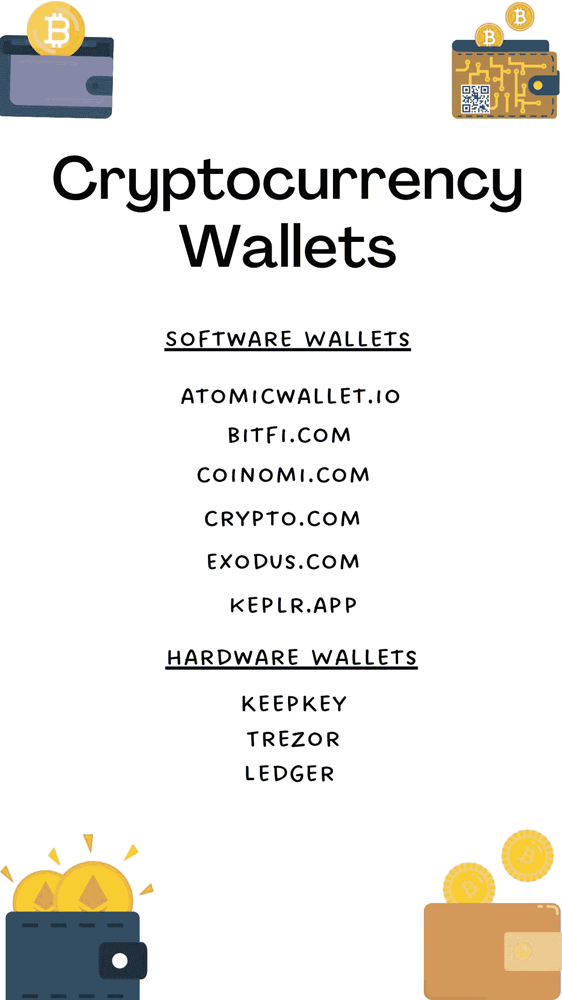

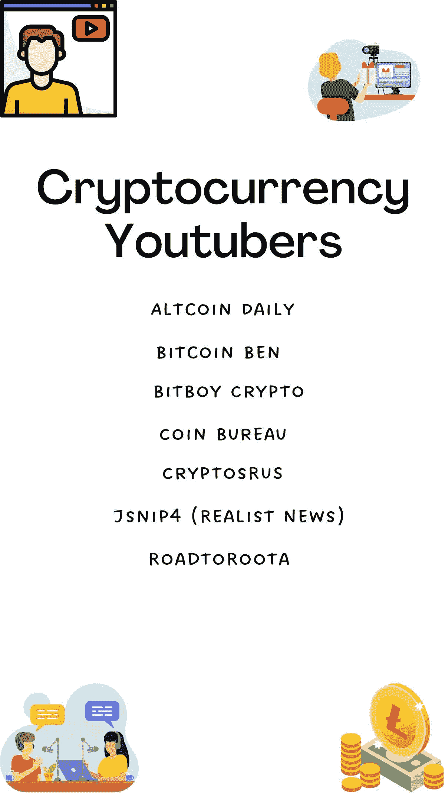
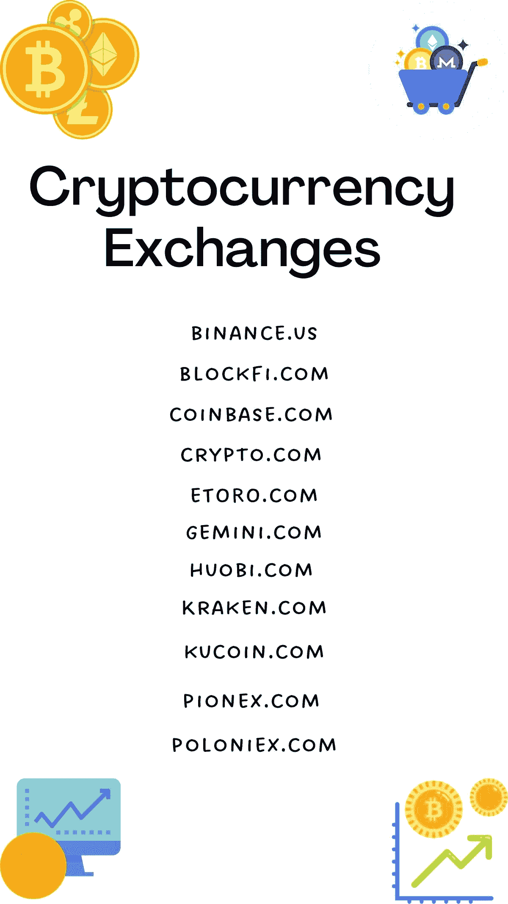
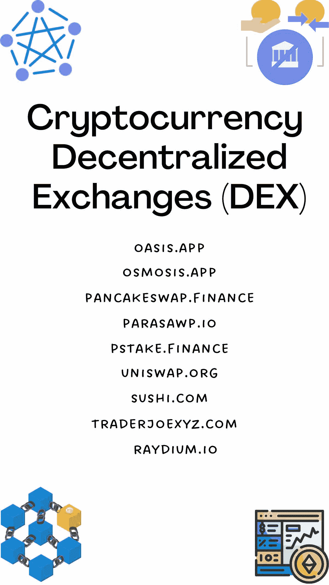
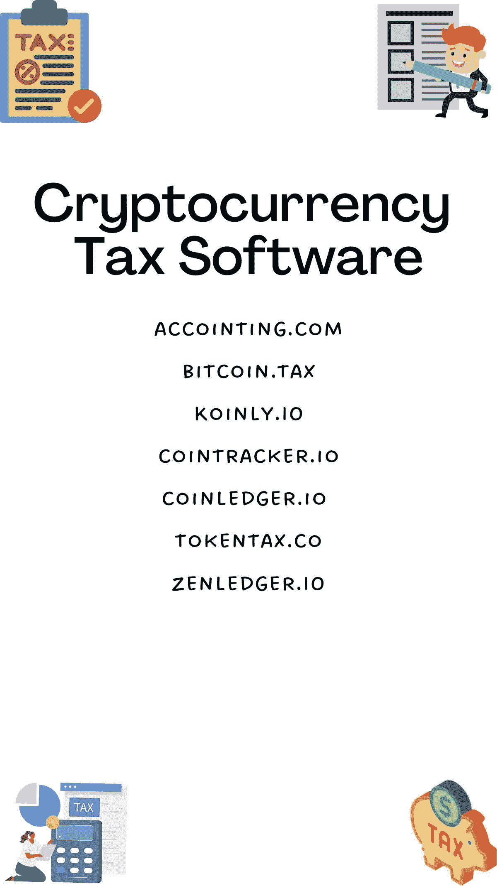

### References

1. Craig, Jeffrey. “What Is Transactions Per Second (TPS): A Comparative Look at Networks.” *Phemex*, November 2, 2021. https://phemex.com/blogs/what-is-transactions-per-second-tps.
2. Voigt, Kevin. “11 Best Crypto Exchanges and Apps of August 2022.” NerdWallet, August 1, 2022. https://www.nerdwallet.com/best/investing/crypto-exchanges-platforms.
3. “All You Need to Know about 2²⁵⁶.” Talkcrypto.org, April 8, 2019. http://www.talkcrypto.org/blog/2019/04/08/all-you-need-to-know-about-2256/.
4. Jančis, Mindaugas. “How to Create a Good and Strong Password.” *Cybernews*, August 4, 2022. https://cybernews.com/best-password-managers/how-to-create-a-strong-password/.
5. Wikipedia. 2013. *Candlestick Chart Scheme*. May 12, 2013. Originally By Probe-Meteo.com. https://commons.wikimedia.org/w/
9. Scott, Elizabeth. “什么是吸引力法则？”VeryWellMind, 2022 年 8 月 8 日. https://www.verywellmind.com/understanding-and-using-the-law-of-attraction-3144808.
10. Lielacher, Alex. “如何使用 Trust Wallet 投资代币化股票。”Trust Wallet, 2021 年 11 月 10 日. https://trustwallet.com/blog/how-to-invest-in-tokenized-stocks.
11. “加密衍生品 101：加密期货、加密期权和永续合约新手指南。”CoinTelegraph. https://cointelegraph.com/trading-for-beginners/crypto-derivatives-101-a-beginners-guide-on-crypto-futures-crypto-options-and-perpetual-contracts.
12. “什么是加密交易所产品？”Ficas. https://ficas.com/blog/crypto-exchange-traded-products/.
13. “法币货币对比加密货币。”Gemini, 2022 年 6 月 28 日. https://www.gemini.com/cryptopedia/fiat-vs-crypto-digital-currencies.
14. Mehta, Rishi. “哈希算法，区块链的大脑（SHA-256, SHA-512 及更多）。”`Medium`, 2019 年 8 月 18 日. https://medium.com/@rishi30-mehta/hashing-algorithms-the-brain-of-blockchain-sha-256-sha-512-and-more-7b5f80b99b00.
15. Hooper, Anatol. “交易费用详解。”Cointelegraph, 2020 年 11 月 2 日. https://cointelegraph.com/explained/transaction-fees-explained.
16. Spade, Jack. “比特币分叉的完整历史。”CryptoVantage, 2022 年 6 月 16 日. https://www.cryptovantage.com/guides/a-complete-history-of-bitcoin-forks/.
17. “什么是 DEX（去中心化交易所）？”Chainlink, 2022 年 5 月 10 日. https://blog.chain.link/dex-decentralized-exchange/.
18. Frankenfield, Jake. “首次货币发行（ICO）。”Investopedia, 2022 年 7 月 7 日. https://www.investopedia.com/terms/i/initial-coin-offering-ico.asp.
19. Wood, Jackson. “理解 DeFi 及其在加密经济中的重要性。”`CoinDesk`, 2022 年 1 月 20 日. https://www.coindesk.com/tech/2022/01/20/understanding-defi-and-its-importance-in-the-crypto-economy.
20. Little, Kendall. “想买加密货币？在加密交易所中需要寻找这些。”`NextAdvisor`, 2022 年 5 月 3 日. https://time.com/nextadvisor/investing/cryptocurrency/what-are-cryptocurrency-exchanges/.
21. “什么是单链钱包和多链钱包。”`Medium`, 2019 年 5 月 14 日. https://medium.com/@support_34903/what-are-single-chain-and-multi-chain-wallets-dc0ce4f21f71.
22. Lielacher, Alex. “热钱包与冷钱包：区别在哪里？”`Alexandria`, 2021. https://coinmarketcap.com/alexandria/article/hot-wallets-vs-cold-wallets-whats-the-difference.
23. Rosson, Maxi. “保护你的加密钱包助记词的最佳方法。”`Medium`, 2022 年 4 月 15 日. https://medium.com/the-crypto-bookstore/the-best-ways-to-protect-the-seed-phrases-of-your-wallets-150bb10ea1da.
24. Bitcoin Wiki. 2022. “助记词。”2022 年 7 月 12 日. https://en.bitcoin.it/wiki/Seed_phrase.
25. “什么是双重身份验证 (2FA)？”Authy. https://authy.com/what-is-2fa/.
26. Lodha, Chandan. “2022 加密交易所费用对比。”CoinTracker, 2022 年 7 月 22 日. https://www.cointracker.io/blog/2019-crypto-exchange-fee-comparison.
27. “加密货币安全终极指南。”`Medium`, 2021 年 11 月 3 日. https://fintelics.medium.com/the-ultimate-guide-on-cryptocurrency-security-7738d1aafc74.
28. “保持加密安全的 9 种方法。”`Medium`, 2021 年 9 月 30 日. https://medium.com/coinmonks/9-ways-to-keep-your-crypto-safe-d969aa791070.
29. “加密安全 101：保护你的钱包。”`Medium`, 2022 年 2 月. https://noahjd.medium.com/crypto-security-101-securing-your-wallet-d324a95c2d.
30. Samuel, Andy. “如何保护优盘？3 种方法。”PassFab, 2020 年 11 月 28 日. https://www.passfab.com/password/how-to-protect-flash.
31. Jančis, Mindaugas. “如何创建一个强密码。”`Cybernews`, 2022 年 8 月 4 日. https://cybernews.com/best-password/how-to-create-a-password/.
32. Sarkar, Arij. “Trezor 调查用户导致的数据泄露。”Cointelegraph, 2022 年 4 月 3 日. https://cointelegraph.com/news/trezor-investigates-data-breach-as-users-cite.
33. “Mt. Gox 怎么了？谁偷了比特币？”Productmint. https://productmint.com/what-happened-to-gox/.
34. Ferber, Lisa. “加密投资者如何避免涉及 28 亿美元的骗局。”`NextAdvisor`, 2021 年 4 月 19 日. https://time.com/nextadvisor/investing/cryptocurrency/protect-yourself-from-crypto/.
35. “加密货币中的基本分析是什么？”`Medium`, 2021 年 9 月 17 日. https://medium.com/exmo-official/what-is-fundamental-analysis-in-crypto-b72a25bfba.
36. “如何对加密货币进行技术分析。”`Medium`, 2021 年 3 月 11 日. https://medium.com/stormgain-crypto/how-do-technical-analysis-for-cryptocurrency-e1aedf765.
37. Hussey, Matt. “加密增长最快的社区有哪些？”`Decrypt`, 2021 年 4 月 16 日. https://decrypt.co/66740/who-are-the-fastest-growing-communities-in-crypto.
38. “什么是市值 (Market Cap)？它为什么重要？”Bitpanda. https://www.bitpanda.com/academy/en/what-is-market-capitalisation-market-cap-and-does-it-matter/.
39. Frankenfield, Jake. “首次货币发行（ICO）。”Investopedia, 2022 年 8 月 18 日. https://www.investopedia.com/terms/i/initial-coin-offering-ico.
40. “RSI 是什么？如何应用于加密交易？”Bybit Learn, 2021 年 5 月 18 日. https://learn.bybit.com/indicators/what-is-rsi-and-how-do-you-apply-it-to-crypto/.
41. “什么是 MACD 指标？（如何在加密交易中使用）。”Bybit Learn, 2021 年 4 月 3 日. https://learn.bybit.com/indicators/explained-macd-indicator-how-to-apply-it-in-crypto-trading/.
42. “HODL 这个词的背景是什么？”`Medium`, 2017 年 4 月 30 日. https://medium.com/hackernoon/whats-the-backstory-on-the-word-hodl-27756392b698.
43. Klemens, Sam. “如何 HODL：比特币 (BTC) 持有指南。”`Crypto News`, Exodus, 2021 年 5 月 18 日. https://www.exodus.com/news/guide-to-saving-in-bitcoin/.
44. “以太坊——一种代际投资。”`Medium`, 2022 年 1 月 22 日. https://medium.com/@halp1120/1-the-only-other-large-assets-that-arguably-have-structural-demand-are-luna-and-bnb-cdcf8b2a8281.
45. DiLallo, Matthew. “理解投资多元化。”The Motley Fool, 2022 年 6 月 30 日. https://www.fool.com/investing/how-to-invest/portfolio-diversification/.
46. Warren, Rachel, Travis Hoium, and Connor Allen. “3 位投资者讨论投资组合中现金的方法。”The Motley Fool, 2021 年 12 月 19 日. https://www.fool.com/investing/2021/12/19/3-investors-discuss-their-approach-to-holding-cash/.
47. “使用定投法随时间积累财富。”Investopedia, 2021 年 12 月 5 日. https://www.investopedia.com/investing/dollar-cost-averaging-pays/.
48. Daly, Lyle. “65% 的美国人在投资加密货币后犯了这个错误。”The Ascent, 2021 年 7 月 17 日. https://www.fool.com/the-ascent/cryptocurrency/65-of-americans-make-this-mistake-after-investing-in-crypto/.
49. “FOMO 是什么？它如何影响加密货币？”`Medium`, 2022 年 1 月 18 日. https://guardian.ng/news/what-is-fomo-and-how-does-it-affect-crypto/.
50. Brooks, Miles. “终极加密税收指南 (2022)。”CoinLedger, 2022. https://coinledger.io/crypto-taxes.
54. “使用 CoinGecko 管理你的投资组合：入门指南”。Publish0x，2020 年 10 月 3 日。https://www.publish0x.com/hobbyist-crypto/managing-your-portfolio-with-coingecko-a-how-to-guide-xvrxzwj。
55. A., Julija. “最佳加密货币税务软件解决方案评测”。Fortunly，2022 年 8 月 5 日。https://fortunly.com/investments/best-crypto-tax-software。
56. Chandrasekera, Shehan. “如何选择最佳加密货币税务软件”。福布，2020 年 1 月 7 日。https://www.forbes.com/sites/shehanchandrasekera/2020/01/07/how-to-pick-the-best-crypto-tax-software/?sh=121615bd76fb。
