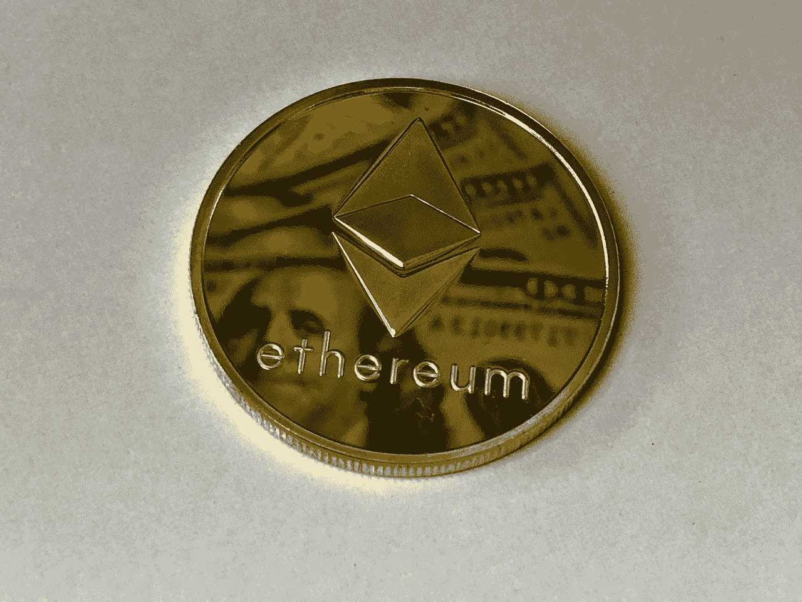

# 初学者的加密货币投资指南：利用区块链技术、加密货币和其他重要数字资产赚钱的技巧与窍门

## 简介

2009 年，首个加密货币比特币诞生。如今，加密货币已超过 2,000 种，2017 年比特币价值飙升 1300% 以上，引发了主流社会的极大关注。然而，与瑞波币等数字资产相比，比特币的这一涨幅微不足道，后者上涨了 36,000%。这种回报率是投资者毕生梦寐以求的，但鲜有人能登顶。围绕这些加密货币的炒作引发了兴趣的显著上升，导致许多人选择投资数字资产而非传统股票。2018 年，加密货币泡沫轰然破裂，高位接盘的后进投资者落得个两手空空。这让新投资者斥其为骗局，纷纷回归传统投资或彻底放弃投资策略。然而，尽管遭遇挫折，加密货币市场仍持续演变并趋于稳定，这才引起了世界上一些最大金融机构的关注。随着更多加密货币被售出，接受其作为支付形式的交易者数量也随之增加，朋友们，这就是加密货币市场至今蓬勃发展的原因和过程。

这些加密货币基于区块链技术，这是一种新型颠覆性技术，据称其影响力远超互联网的发明。如今区块链的用途远不止加密货币，正如互联网不只是用来发送电子邮件。加密货币的交易和投资过程在许多方面与传统交易投资相似。但它也独具特色，因为加密货币兼具货币（如欧元、美元、英镑）和资产（如公司股票）的属性。这种投资方式在分析加密货币基本面方面截然不同。传统估值方法失效，因为加密货币数据大多不是中心化的。区块链技术的核心理念是其及其加密货币去中心化，因此交易中无中介参与。取而代之的是，一个成员网络被赋予了区块链的控制权。

这大致勾勒了本书的内容。撰写本书时，我假设你至少听说过加密货币，甚至可能已经迈出了购买的第一步。但你知道它们如何运作吗？你知道如何通过投资获利吗？即使你目前投资股市或其他市场，也不意味着能直接跨入加密货币交易。我相信你拥有电脑并会使用互联网，但在考虑加密货币交易前，你必须确保拥有高速互联网接入——如果你不想在交易中吃亏，这至关重要！除此之外，让你涉足数字资产和加密货币投资交易的，仅需这本书，那么让我们开始吧。

### 第 1 章 什么是加密货币？

除非你是圈内人，否则你可能在纳闷什么是加密货币。当然，你听说过比特币——谁没听说过？你可能也听说过以太坊、莱特币、瑞波币等，但不确定它们是什么。

简单来说，加密货币是数字货币。传统货币（如欧元或美元）可以数字化转账，但这与数字货币截然不同。目前，你可以像使用传统货币进行电子支付一样，用比特币支付某些商品和服务。随着时间的推移，加密货币将变得更加主流，接受它的地方会更多。

加密货币与传统现金的根本区别在于其底层技术。大多数人只关心手中的现金，而不关心其背后的技术，但传统系统问题重重。这些问题包括：

*   电汇、信用卡和其他支付系统已过时
*   中介导致交易缓慢且昂贵
*   金融领域的全球平等性快速增长
*   30 亿人无法获得金融服务

加密货币的初衷是解决这些问题及其他更多问题。

#### 加密货币

你目前使用的货币由政府担保、存放在银行。你需要 ATM 或网银向他人转账或取款。加密货币旨在摒弃这一切，依靠区块链技术运行。区块链去中心化，无中介，无单一控制者。取而代之的是，计算机网络确认每笔交易——区块链如何运作将在后续章节详述。首先，让我们进一步了解加密货币。

#### 什么是货币？

要被视为有价值，货币需具备以下特征：

*   足够多的人持有货币
*   必须被接受为支付形式
*   必须被社会信任为当前有价值且将保持价值

早期不存在实体硬币和纸币，人们通过易物贸易交换物品。然而，真实货币的出现——纸币、硬币，甚至我们今日依赖的信用卡——改变了信任模式。交易便利性也是主要因素，货币发明的主要原因之一是黄金条在国家间转移的物流困难。信用卡随之而来，但同样基于政府担保的法币。世界联系越紧密，人们越担心掌权当局是否顾及我们利益。因此，加密货币将提供可行的替代方案。

#### 加密货币简史

我们都知道比特币是首个加密货币，其诞生源于中本聪（至今身份匿名）于 2008 年发布的一份白皮书，详述了“电子货币的点对点版本”。此后，诞生了许多其他加密货币，有成有败。比特币及其他加密货币仅通过一种方式创建——挖矿。但这不同于开采贵金属、矿石、宝石的传统方式，加密货币挖矿由强大计算机解决数学谜题完成。本书后文将深入探讨挖矿。2011 年，有人发现比特币存在缺陷，从而催生了山寨币以改进比特币设计——它们更快、更安全、更匿名等。莱特币是首个山寨币，此后已创建数千种，如今我们有数千种可供选择。稍后我将介绍一些最热门的币种。

#### 加密货币优势

以下是加密货币通过去中心化旨在解决的一些问题：

##### 1. 更便捷的交易

加密货币交易比传统交易更廉价、便捷、安全。你可以用手机 App、加密钱包或交易所钱包收发加密货币，甚至能在比特币 ATM 购买，随后转入手机 App 或加密钱包，无需银行账户。

##### 2. 更安全

加密货币深度依赖区块链和加密技术，确保更高安全性。安全性主要基于算力——算力越高，攻破网络所需算力越大。比特币拥有所有加密货币中最高的算力。失去存储加密货币访问权的唯一真正途径是丢失私钥或私钥被盗——稍后详述密钥。

##### 3. 可及性

虽然由于各种原因，许多人被排除在银行系统之外，但加密货币并非如此。只要你拥有一部智能手机或一台网速快的电脑，就能快速设置加密货币钱包，无需身份证或信用检查。

##### 4. 隐私

开设银行账户时，你需要提供身份证件、通过背景调查、信用检查并提供收入证明。使用加密货币则无需进行这些操作，确保你的隐私安全。每笔交易都被归类为“伪匿名”，这意味着你的钱包地址是一个标识符，不包含任何可识别你身份的具体信息。

##### 5. 透明度

每笔加密货币交易都发生在区块链账本上。该账本公开分发，允许网络上的每个人查看。一些工具允许你查看交易数据，包括从钱包发送了多少加密货币、何时发送以及发往何处。你还可以查看钱包中有多少加密货币。所有这些都有助于降低欺诈几率，因为资金的收发可以轻松被证明，人们也能证明他们有能力支付交易费用。

##### 6. 分散投资

加密货币为投资者提供了一种远离股票、债券和其他金融资产的分散投资方式。很大程度上，这种分散化源于价格与其他市场不相关。当你组合关联性极低或无关联的资产时，你的回报会稳定得多。如果你的股票投资组合下跌，你可能从加密资产中获利。但请记住，加密货币波动性极高，因此不要在投资组合中过度配置加密货币。

##### 7. 抗通胀保护

许多人认为加密货币是一种抗通胀手段。`Bitcoin` 总量有限，流通中的硬币数量固定——当最后一个被挖出时，将不再产生新币。随着货币供应量增长超过 `Bitcoin` 供应量，其价格应会上涨。其他加密货币也提供总量上限和抗通胀保护。

#### 入门指南

在享受这些及更多优势之前，你需要做些功课，并准备好所需工具：

*   **钱包** - 虽然一些加密钱包类似于 `PayPal`、`Apple Pay` 和其他数字支付服务，但它们不同于你口袋里的实体钱包，且有多种格式。你需要一个钱包才能进入加密货币市场，应选择安全的钱包，如纸钱包或硬件钱包。我们将在第 7 章讨论钱包。
*   **交易所** - 拥有钱包后，你可以开始购买加密货币，最佳去处是加密货币交易所。这些网络服务允许你用法币购买加密货币、将一种加密货币兑换为另一种，并存储购买的加密货币。然而，交易所存储风险极高，因为存在被黑客攻击的风险，因此最好将购买的资产转移到你的钱包中进行安全存储。交易所类型繁多，我们将在第 6 章详细介绍。

#### 加密货币社区

加密货币社区是帮助你驾驭复杂的加密货币和投资世界的绝佳场所。有大量聊天室和丰富的新手支持，考虑通过以下方式参与：

*   **Telegram 群组** - 在桌面端或移动端下载 `Telegram` 即时通讯应用，加入任意加密货币频道。
*   **聊天室** - `Reddit` 和 `bitcointalk` 上有两个优秀的聊天室。部分主题无需注册即可查看，但最好注册账号以获得最佳体验。`Tradingview` 是一个优秀的交易平台，提供聊天室供投资者和交易者分享想法、观点并提问。
*   **警告** - 骗子倾向于以此类平台为目标，因此请保持警惕。如果某事好得令人难以置信，那通常就是假的。

#### 制定计划

毫无疑问，你想立即投入购买一些加密货币并为未来存储。或者你可能已决定参与交易以获利。无论你想做什么，最重要的是制定计划。你需要知道：

*   购买哪种加密货币
*   何时购买
*   购买多少
*   何时卖出

以下简要概述你需了解的内容：

*   **选择你的加密货币** - 目前有数千种加密货币可供选择，有些将长期存在，而有些可能无声无息地消失。第 8 章将介绍一些可用的不同加密货币，帮助你做出选择。有许多因素可供参考，这是一个雷区，但我希望能帮你简化选择。但你必须记住，加密货币市场相对较新，我们尚无法确定长期表现。这就是分散投资的作用；持有多种加密货币可能使风险管理更容易。然而，不要过度分散，否则可能引发更多问题。
*   **分析 + 投资 = 利润** - 分析每种加密货币至关重要，确定正确的购买时机同样重要。2017 年，`Bitcoin` 开始大幅走红，许多人想要购买。然而遗憾的是，不少人买错时机，在价格峰值时买入。这意味着他们买得少，只能坐等价格再次飙升才能获利。在正确的时间买卖是获利的唯一途径，而分析是关键部分。我们将在第 12 章讨论最小化损失和最大化收益。

下一章将探讨加密货币的优缺点。

### 第 2 章：优势与劣势

鉴于加密货币有可能大幅颠覆当前的金融世界，它们在过去几年中的重要性日益增加，这并不令人惊讶。事实上，这甚至可能让我们质疑我们所了解的当前金融基础设施的方方面面，尤其是在安全性和隐私方面。

大多数潜在投资者都想了解加密货币的优势，但了解其劣势同样重要。这样，你才能做出公正且明智的决定。

#### 优势

加密货币相对较新，但没有任何迹象表明它们会失败。相反，它们的受欢迎程度持续上升，这在很大程度上归功于它们提供的益处。加密货币有很多优势，从获得可观回报的潜力，到能够在一个高度安全的平台上全天候、每天 24 小时进行交易。以下是主要优势：

##### 高风险，高回报

有数千种加密货币可供交易，每种都有其自身的特性和怪癖。然而，它们都有一些共同特征——例如，它们的价值都可能经历突然飙升和急剧下跌。加密货币的价值主要由供需关系驱动，从而产生可观的回报。例如，以太坊的价格在 2021 年 7 月至 12 月间翻了一番——对于在价格低时投资的人来说，这是巨大的回报。

##### 安全的底层技术

最大的优势之一与支持基础设施有关，而非加密货币本身。区块链是一个去中心化的分布式账本，每笔交易都在上面公开追踪。一旦交易被记录在区块链上，就无法被移除。而且因为成千上万台计算机存储着同一个区块链，黑客无法访问并篡改交易或窃取货币。因此，所有交易都是完全安全的。

##### 更透明的系统

当前的金融系统有中央权威机构和中介负责处理交易。每当进行一笔交易时，你都要信任该权威机构或中介以确保其顺利完成。当 2008 年经济衰退来袭时，许多人开始怀疑这种信任是否可能被错置了。有了加密货币和区块链技术，我们有了一个可行的替代方案。网络上的任何人都可以查看所有交易——大多数区块链上都有成千上万的人——这让你无需中介或中央权威即可参与金融市场。

##### 可全天候交易

另一个巨大的优势是加密货币市场从不关门，而银行和传统股票市场会关门。币种全天候被挖掘，交易持续被记录，因此无需等待交易所开市即可开始买卖和交易加密货币。这产生了巨大的影响，以至于股票交易所现在正考虑在银行营业时间之外进行交易，尽管我们可能还要等一段时间才能看到那一天到来。当然，全天候交易的事实也意味着，无论你身在世界何处，都可以开始获取回报，而不分昼夜。

##### 抗通胀潜力

因为加密货币不与某个经济体或其他货币挂钩，其价值反映的是需求而非通胀。然而，许多潜在投资者也担心加密货币通胀，但你无需为此担心。因为每种加密货币都限制了流通中的币种数量，可用数量永远不会失控，这意味着不存在通胀潜力。比特币有硬性上限，意味着最多只会创造 2100 万枚，而以太坊有每年 1800 万 ETH（以太币）的年度上限。无论货币是硬性上限还是年度上限，通胀都被拒之门外。

##### 交易快速

通过加密货币发送付款比传统支付系统快得多。例如，如果你汇款到美国，传统机构最多需要五天处理，电汇需要 24 小时或更久，股票交易需要三天。使用加密货币，交易可在几分钟内结算。当包含你特定交易的区块被添加到区块链时，资金即可用，交易即告结算。

##### 交易费用更低

与传统金融服务相比，加密货币的交易成本通常低得多。例如，电汇可能花费 20 到 40 美元，如果你需要汇款到国外，费用可能会大幅上升。虽然有时加密货币费用可能因区块链上的需求水平而略高于平时，但它们仍远低于电汇收取的费用。

##### 加密货币更易获取

目前约有 30 亿人处于银行服务不足或完全无法获得银行服务的状态。部分原因是个人选择，因为他们生活在政府和金融机构腐败的国家。然而，任何拥有电脑或智能手机的人都可以访问加密货币。设置加密货币钱包比开设银行账户更快，而且你不需要验证身份或通过信用检查。加密货币为无银行账户和银行服务不足人群提供了一种使用金融服务的方式，无需先通过中央权威机构的审核。并非每个人都想要银行账户，主要是因为他们不信任银行替他们保管钱，而加密货币能确保你的钱安全，并能轻松将其发送到需要的地方。

##### 更安全

加密钱包为你提供公钥和私钥。公钥顾名思义是公开的，但你的私钥才是解锁钱包的关键。如果你丢失密钥、忘记密钥或密钥被盗，他人就能访问你的资金，且无法追回。妥善保管它，你的钱就比存在传统银行账户里安全得多。区块链还凭借其去中心化的本质以及交易需要由整个网络验证的事实来保障交易安全。网络中增加的节点（计算机）越多，每笔交易就越安全。最后，要攻击网络，需要大量的算力来确保在网络其余部分验证准确性之前，多个欺诈区块被验证通过。在大多数情况下，这种算力成本太高，从而限制了风险。你无疑听说过账户被黑，但这主要归因于交易所安全性不足。这就是为什么你应该将加密货币存储在安全的钱包中，而不是交易所。

##### 隐私保护更好

因为进行加密货币交易不需要银行账户，所以你的隐私得以保障。交易可能关联到一个公共标识符，即你的钱包地址，但它们不会泄露任何个人信息。

##### 更透明

因为每笔交易都在一个公开的分布式账本上进行，每个人都能看到数据；他们知道发送了多少货币、何时发送、从何处发送，也能看到给定钱包里有多少货币。这几乎杜绝了欺诈交易。此外，加密货币持有者可以在交易被允许进行前证明他们拥有该货币，从而消除了双重支付的可能性。

#### 劣势

正如你所见，优势有很多，但劣势呢？肯定不是全都是金子和闪光？你说得对，并非如此，让我们来看看劣势：

##### 加密货币难以理解

理解加密货币可能需要时间和相当大的精力，特别是如果你不是数字技术高手的话。当你试图投资你不理解的东西时，你承担了巨大的风险，这极不可能获得回报。本书将帮助你理解加密货币，网上也有大量资源可以提供帮助。然而，最重要的是投入时间彻底理解加密货币，包括其所有优缺点。

##### 极高的波动性

我们都见过比特币价格惊人地飙升——2021 年 10 月，它突破了 60,000 美元大关，这对在正确时机投资的人来说是个好消息。然而，到 2022 年 1 月，价格已暴跌至略高于 37,000 美元，这在加密货币中时有发生。大幅下跌通常紧随大幅飙升之后，所以如果你在寻找安全的投资和快速回报，加密货币可能不是你的最佳选择。加密货币市场高度投机，且因为它比传统非数字市场小得多，所以更容易受到波动影响。反过来，这可能摧毁一种币种的价值，这是这一现代奇迹最大的劣势之一。

##### 作为长期投资尚未被验证

加密货币可能很流行，但它们只存在了约 12 年。这还不足以判断它们作为长期投资的价值。相比之下，股市拥有数百年的历史——伦敦证券交易所自 1801 年起就已存在——黄金也有悠久的投资历史。没人能预测加密货币未来会怎样，涉足这片未知水域需要勇气。

##### 存在可扩展性问题

如果你认为数字货币速度快，没人会责怪你，在某种程度上它们确实快。然而，在某个节点上，它们会遇到阻碍大规模推广的问题。提供方从未回避承认这一点，以太坊平台背后的团队表示区块链在容量上存在局限，降低了交易处理速度。这对参与交易的人来说无异于一种折磨，也有可能导致财务损失。

##### 加密货币新手可能面临安全问题

虽然加密货币不像中心化机构那样有风险，但它们并非没有问题，尤其是对新投资者而言。如果你丢失私钥或私钥被盗，你将失去对所有存储加密货币的访问权，且无法挽回。私钥不同于传统密码，如果你记不住，可以恢复或更改——如果你忘记了，就无法再获取一个。你也可能丢失虚拟钱包或意外删除你的持仓——同样，无法挽回。除此之外，你还得应对窃取你加密货币的恶意尝试，新投资者更容易受害，因为他们不知道该提防什么。

##### 无中央权威或监管

虽然这是一个主要优势，但一些人视其为劣势。FCA（金融行为监管局）不监管加密货币，因此没有任何措施来保护你的资金。大多数银行、政府和其他金融机构将去中心化视为劣势，因为它们不再拥有控制权。加密货币凭借其去中心化本质、匿名性和强加密技术得以保障安全，这使得政府几乎无法知晓谁在使用它。虽然这对个人很有利，但缺乏监管使得洗钱和犯罪活动变得更容易。

##### 无退款

也许最大的缺点是你无法追回资金。如果你误付给了错误的人，那就麻烦了——你的钱没了。遗憾的是，加密货币获得了一种名声，主要是因为围绕比特币的“一夜暴富”故事，这吸引了骗子。因为你无法追回资金，骗子可以毫无顾忌地窃取它。

#### 最佳加密货币

无法说哪种加密货币是最佳投资选择，因为这是个人选择。然而，有几个方面你应该留意：

##### 选择加密货币前的自我评估

*   **风险承受能力** – 如果投资贬值，您能舒适地承受多少资金损失？您能否承受持有投资并等待其价值回升？
*   **投资目的** – 您购买加密货币的唯一理由是为了快速获利，还是希望用它进行购物支付？
*   **价值取向** – 您纯粹关注金钱回报，还是在寻找具有环境或社会影响力的代币？

或许最简单的方法是选择表现最好的加密货币之一，例如 `Bitcoin`。毕竟，它是第一个加密货币，并拥有最大的客户群和信息库。稍后我们将讨论一些值得投资的最佳加密货币，但下一章将深入探讨区块链技术。

### 第 3 章 区块链技术详解


# 区块链与加密货币基础

## 什么是区块链？

简单来说，区块链是一种存储数据的数字化方法。所有数据都存储在区块中，然后这些区块被链接在一起，确保数据不可篡改，即无法被更改。录入区块链的所有数据始终公开可用，任何人都可以随时查看，且完全按照录入区块链时的原貌呈现。这使其成为一项革命性技术，因为这意味着几乎任何事物的记录都可以被保存和追踪，包括身份、财产权、医疗记录等，且无需担心这些记录被篡改。假设我去购买一栋房子，拍摄房产权证照片并将该照片添加到区块链上，我将永远拥有证明我在某个时间点拥有这些房产权的证据。一旦信息上链，就无法被更改。

听起来很棒，但区块链究竟是如何工作的？其工作原理如下：

### 第一步——交易数据

为了便于理解，我们以比特币区块链为例，因为它是首个被创建且目前仍在使用中历史最悠久的区块链。该区块链上的每个区块大约包含 1 兆字节的数据。目前，比特币区块链存储了约 525,000 MB 的数据，相当于 525,000 个区块。这些数据以比特币交易数据的形式存在，是一份海量的记录，囊括了自第一笔交易以来发生的每一笔比特币交易。为了本章其余部分的叙述方便，我们将假设所有区块链都存储交易数据，尽管许多区块链也存储其他数字资产——然而，无论存储何种内容，区块链的工作原理保持不变。

### 第二步——使用哈希值链接区块

假设我们有几个包含交易数据的区块：

此处我们有三个包含交易数据的区块。目前，它们毫无特别之处，类似于每份都包含一些交易数据及对余额影响的文档。每个区块描述最多 1 MB 的交易，现在需要将它们链接在一起。这要求每个区块都拥有一个数字签名，且必须唯一，对应该区块内的数据。如果区块内的任何内容发生变化，必须生成一个新的签名。这个过程称为哈希运算，将在下一步中解释。

假设第一个区块中有两笔交易，总计 1 MB（在真实区块链中，1 MB 数据包含的交易会多得多）。该区块会被赋予一个引用其内部数据字符串的唯一签名。假设 `X32` 是该签名，它看起来会像这样：

现在，如果该区块中的一个数字被更改，就会生成一个新的签名，这正是交易无法被篡改的根本原因。区块 2 包含区块 1 的签名，从而将二者链接起来，并使区块 2 部分基于区块 1 的签名。这一过程贯穿整条链，每个区块都通过签名与前一个区块相链接。

现在，假设区块 1 的数据被更改了。原本是 Daniel 发送 100 BTC 给 Gary，数据被篡改为 500 BTC。这意味着区块 1 现在包含不同的数据，需要一个新签名——我们称之为 `W10`。问题在于，区块 2 现在持有的是区块 1 错误的签名——它存的是 `X32`，而新签名是 `W10`。因此，前两个区块现在处于“未链接”状态，这会通知区块链网络数据已被篡改。区块链被设计为不可变，因此网络不会验证该变更，会拒绝它，并恢复到之前链接到区块 2 的区块链记录。这就是为什么很难更改区块中的信息。除非用区块 1 的新签名替换掉区块 2 中当前的签名，否则该变更无法在未被发现的情况下生效。

如果区块 2 的数据发生变化会怎样？它也需要一个新签名——我们称之为 `PP4`，而原来是 `9BZ`。结果是区块 2 不再与区块 3 链接，以此类推贯穿整个区块链。任何人都可以看到区块链上的每一个区块，因此，要想让篡改行为不被发现，必须确保每个区块都正确链接在一起。一旦某个区块被篡改，其后每一个区块都必须生成新签名，一直延续到区块链的末尾。这在实际操作中几乎是不可能的，但要理解原因，需要知道这些签名是如何生成的。

### 第三步——如何创建哈希值（数字签名）

让我们看一个新的区块 1，其中只有一笔交易——Tony 发送 100 BTC 给 Donald。该区块现在需要一个签名，该签名通过加密哈希函数创建，这是一种复杂的公式，可将任意输入字符串转换为一个 64 位的输出字符串——且完全唯一。你可以使用 <https://passwordsgenerator.net/sha256-hash-generator/> 自行尝试。

如果我们在哈希生成器中输入单词 "Unicorns"，将得到以下输出：

`C3BFAD747914BB49344B9477A561CD3E0162CACB3E31B55EBE23C0F14DA7A504`

如果我们仅更改输入中的一个字符，哪怕只是将大写字母改为小写、添加一个句号或一个空格，都会得到完全不同的输出。在此例中，我们将单词首字母的大写改为小写，得到的输出为：

`B660C5090EC2685B8BC11100BA183C0243497D95F91F78AAD987686EFB5F06B5`

改回大写字母，又会得到最初的输出。当你使用加密哈希函数时，相同的输入永远会产生相同的输出，但输入一旦改变，输出就会完全不同。比特币区块链使用的就是这种哈希函数，区块数据作为输入数据，与区块相关的签名作为输出。

那么，回到我们的区块——Tony 发送 100 BTC 给 Donald。

数据字符串看起来会像这样：

```
Block 1
Tony -100
Donald +100
```

将此字符串输入哈希函数，得到的签名为：

`6CC40EDA53664491E8123EFC867A5FC17A8AD946FD190F23E08E56F572FE05E3`

现在该签名被添加到第二个区块中。现在假设 Donald 发送 100 BTC 给 Simon。区块 2 将如下所示：

数据字符串现在为：

```
Block 2
Donald -100
Simon +100
6CC40EDA53664491E8123EFC867A5FC17A8AD946FD190F23E08E56F572FE05E3
```

将此字符串输入哈希函数，我们得到区块 2 的数字签名：

`7763361E1940E7FB3C357976D236370E148AD70DF800D9F68DF9BBD0F4078EB9`

问题是，这些数字签名如何防止某人在篡改一个区块后，为每个后续区块输入新签名？简单的答案是，区块链有特定的要求，只有通过这些签名才能满足。这被称为挖矿，将在下一步中解释。

### 第四步——谁对区块签名？何时签名才算合格？

我先回答这个问题的后半部分——并非所有签名都合格。只有当数字签名以特定内容开头时，区块才能被区块链接受，即以特定数量的连续零开头，例如 10 个。然而，每个数据字符串只对应一个唯一的哈希值，但如果该哈希值开头没有那 10 个零怎么办？唯一的办法是反复更改区块的字符串数据，直到签名以 10 个零开头。话虽如此，交易数据必须保持原样，元数据（时间戳、区块数据等）也必须保持原样。在这种情况下，一小段特定数据会被放入每个区块。这段数据只有一个目的——被反复更改以寻找合格的签名，它被称为 `nonce`（一次性数字，number used once）。区块 `nonce` 是一个仅包含数字的随机字符串。

总结一下，区块 1 包含三样东西：

- 交易数据
- 前一个区块的签名
- 一个 `nonce`

通过反复更改 `nonce` 并对区块数据进行哈希运算以寻找合格签名的过程，被称为**挖矿**——这就是区块链矿工所做的工作。矿工以电力的形式使用算力，反复更改 `nonce` 并对其进行哈希运算，以获得该签名。算力越高，区块组合（`nonce`）的哈希速度越快，找到合格签名的速度也就越快，这个过程无非是反复试错。参与区块链的任何人都可以进行这个过程——你只需下载相应的挖矿软件并启动它。这样，你就为网络贡献了算力来解决区块的 `nonce`。

如前所述，哈希签名必须以特定数量的零开头——目前这个数字是 19。要找到一个开头有那么多零的哈希值并不容易，需要巨大的算力、大量的时间和不小的运气。有时，矿工会走运，很快找到正确的签名。例如比特币区块链上最近的一个区块。一位算力很小的小矿工找到了正确的签名，而当时网络其余部分的总算力是他的 7 万亿倍。为了更直观地感受这种概率，中强力球彩票头奖的几率是 2.92 亿分之一——比那位矿工战胜整个网络找到正确答案的难度低 24,000 倍。无论如何，最重要的结论是：找到一个合格的签名并不容易。

### 第五步——这一切如何造就了不可变的区块链？

如前所述，当你更改一个区块时，它会与后续区块“断链”。网络只有在该区块与后续区块链接时才会接受更改后的区块。一次更改意味着所有其他后续区块也需要获得新签名，且必须全部满足特定要求。要确保更改后的每个后续区块都有新签名，需要大量的时间和算力。理论上这可行，但实践中几乎不可能，原因如下。

假设我们有一个作恶的矿工。他篡改了一个交易区块，现在需要为每个后续区块获取新签名，以便网络接受他篡改的区块。关键在于——在作恶矿工做这件事的同时，网络正在为后续区块生成新签名。这意味着我们的作恶矿工还必须为那些新区块以及在此期间添加到链上的任何其他区块生成新签名。为了让他篡改的区块被接受，他必须确保其后的每个其他区块保持链接，包括在此期间新增的每个区块。除非他拥有比整个网络其他部分加起来显著更多的算力，否则他无法追上。目前，比特币区块链拥有数百万矿工，可以安全地假设一两个作恶矿工的算力远不及网络其余部分的总算力。这意味着他们做出的任何更改永远不会被接受，从而确保了区块链的不可变性。

然而，正如我们之前提到的，存在一个例外。它被称为 **51% 攻击**，且历史上已发生过。51% 攻击也称为双花攻击。一个或多个矿工试图用他们的比特币进行两次购买，即双重花费。例如，我用 15 个比特币购买一辆汽车。汽车交付后，我的比特币从我的钱包转移到卖家钱包——这可能需要几天时间。如果我实施 51% 攻击，我有可能撤销这笔交易，既保留我的 15 个比特币，又得到汽车。这意味着我可以将这些比特币花在别处。完整解释超出了本书范围，但简而言之，这种攻击极不可能再次发生。

### 第六步——区块链如何治理以及规则如何确定

所有区块链都遵循民主治理模型，交易记录的更新基于网络大多数节点的共识。这是由区块链协议自动完成的，方法是遵循最长的区块链记录，前提是大多数节点已就此达成一致。这意味着网络大部分算力被用于延伸最长的区块链版本，这也是篡改区块被拒绝的原因——仅仅因为该区块不再链接到最长链上。众所周知，比特币区块链上的所有交易和钱包余额都是公开的，任何人都可以查看任何钱包或发生过的任何交易。然而，虽然我们可以看到任何人的钱包，但无法知道钱包所有者是谁。他们的隐私依然安全。

## 其他加密货币怎么样？

所有其他加密货币都基于比特币，仅仅是首个数字货币的变体形式。大多数拥有自己的区块链协议，其规则可能与比特币区块链不同。比特币被设计为一种货币，意味着它只有一个目的——作为货币发挥作用。门罗币是另一种具有该功能的加密货币，但其区块链协议上有额外规则，确保门罗币具有更强的隐私性，交易难以追踪。然而，任何加密货币都可以拥有任何价值，完全取决于发行方。有些被称为代币，允许持有者做某些事——例如获得游戏许可、访问社交媒体网站、获取水、电等资源。无论是什么，每一笔代币交易都记录在区块链上，并可通过加密货币交易所在线兑换。简而言之，它们是互联网的货币。

区块链技术可能颠覆的一个行业例子是股票市场。随着时间的推移，股份和其他公司财产权很可能会以代币形式存储在区块链上。然而，区块链的用途不限于此。它们还可用于存储医疗数据、历史记录、身份信息、税务记录等。这就是为什么区块链技术具有革命性，并将对我们所知的世界产生巨大影响。下一章将探讨加密货币是如何运作的。

# 第 4 章 加密货币是如何运作的？

在上一章中，我们了解了区块链及其运作方式，因此接下来探讨加密货币如何运作是顺理成章的。从你在加密货币投资旅程中可能遇到的一些基本术语入手，则更加合情合理。

## 基本术语

正如你所知，加密货币通常被称为数字货币，但它们与你每天随身携带的实体硬币截然不同。主要区别在于，数字货币不依附于任何权威机构，如国家、政府或银行，且不受监管。让我们通过一个例子来看看这一点。假设你想购买最新的畅销小说，于是前往当地的书店。以下是使用借记卡支付时的运作流程：

1.  你将卡片递给收银员，或使用如今大多数商店都支持的非接触式支付功能
2.  你的银行账户信息会被核实，商店实质上是在询问银行你是否有足够的资金支付此次消费
3.  银行在核对当前记录后，会给出同意或拒绝的答复
4.  如果余额充足，银行会允许交易通过，并更新自己的记录以显示资金已从你的账户转移至另一个账户
5.  因为你的银行是交易中的中间人，他们会从中抽取一笔手续费

现在，假设你不想让银行参与其中。谁来为你保存记录？你能信任谁不会篡改记录或骗走你的钱？大多数人或许能说出一个他们信任的人来做这件事，但还有另一种选择——信任网络上成千上万甚至数百万人来为你完成这项工作。正如我们在上一章所见，区块链技术基于去中心化，即不存在中间人。当你使用加密货币进行交易时，技术本身会维护一份中央交易记录。不是由银行持有你的记录副本并进行更新，而是你的交易账本会分发给区块链网络上的每一个人。每个持有你交易账本副本的人都会将你最近的购买记录为一笔交易。以下是使用加密货币购书的运作流程：

1.  你不再刷借记卡，而是将你的加密货币详细信息提供给收银员
2.  商店随后会询问所有网络成员，查看你是否有足够的数字货币进行购买
3.  每个网络成员都会查看自己的记录（网络成员被称为节点——稍后详述）
4.  如果你有足够的货币，每个网络节点都会同意该购买
5.  所有节点随后会更新自己的记录
6.  一个随机节点将获得奖励

所有这些意味着没有任何单一组织或个人在追踪你的数字货币，但这也意味着没有人在调查潜在的欺诈行为。如果没有整个节点网络（本质上是记账员）以及一个虽小但至关重要的东西——密码学，比特币和其他加密货币将无法存在。

## 密码学

加密货币中的“加密”源于密码学，在此语境下，它意味着“匿名”。“Cryptography”（密码学）一词源自希腊语“krypto logos”，字面翻译为“秘密书写”。它长期以来被用于发送加密消息——使用密钥对消息进行加密，只有接收者知道解密密钥。例如，1799 年，拿破仑的士兵在埃及罗塞塔附近发现了罗塞塔石碑，19 世纪的学者们破解了上面的埃及圣书体文字。如今，我们可以发送数字加密消息，并使用算法和加密服务进行解密。密码学内嵌于加密货币中，以确保匿名性和安全性。尽管数字货币是去中心化且不受监管的，但密码学是其保持安全、防止双重支付的一种方式。主要使用三种加密方法：

1.  **哈希** —— 在上一章区块链技术中，我曾告诉你哈希类似于签名。哈希函数接收输入数据，执行运算，并返回一个代表输入数据但具有较小、固定大小的输出。加密货币哈希函数用于解决一个类似于猜测挂锁组合的数学问题。哈希用于编码账户地址、维护区块链数据结构，并确保区块挖掘成为可能。我们将在第 8 章详细讨论挖矿。
2.  **对称加密密码学** —— 这是最简单的加密方法，交易双方仅使用一个共同的秘密密钥。然而，它有一个缺点——交易参与方必须交换密钥，发送方用它加密数据，接收方用它解密数据。
3.  **非对称加密密码学** —— 这种加密使用公钥和私钥。接收方的公钥可用于解密数据，但发送方只能使用其私钥进行加密。

## 节点

节点是网络成员，是运行网络并保存所有交易记录的设备。这正是区块链能够去中心化的原因。该设备可以是台式机或笔记本电脑、平板电脑、智能手机，甚至是一台打印机——唯一的要求是拥有快速的互联网连接并能访问区块链。

## 挖矿

节点所有者通过贡献电力和计算资源来存储和验证交易，从而协助运行网络。在此过程中，他们有机会获得奖励并赚取交易手续费。这被称为挖矿，所有者被称为矿工。然而，值得注意的是，并非所有加密货币都可以挖掘。比特币可以，其他一些主要货币也可以，但瑞波币等一些货币不参与挖矿，因为它们不希望平台依赖大量电力来挖掘加密货币。以下是该过程的运作方式：

*   矿工需要使用软件来解决数学（密码学）难题，以将交易区块添加到账本上；他们相互竞争，以赢取相关加密货币的奖励。
*   之所以称为挖矿，是因为它“开采”出加密货币。
*   任何人都可以参与，只要他们拥有连接互联网的设备和合适的软件。你的设备需要通过猜测一个随机数来解决区块链生成的难题。
*   为此，你的设备必须计算多个 256 位哈希值或 64 字符字符串，并确保得出正确答案——方程会验证这一点。这就是为什么需要强大设备的原因——算力越强，每秒能尝试的次数越多，获胜几率就大得多。如果你获胜，你将获得加密货币奖励，并将交易区块添加到链上。

## 工作量证明

希望将其交易和区块添加到区块链的矿工，必须为一个特定谜题提供答案，但这并不容易，这也是为什么需要如此多算力的原因。然而，网络中的其他节点很容易通过一个称为工作量证明的过程来验证正确答案。

例如，如果你设法猜中了挂锁的密码，这就是对挑战的证明。开始并不容易，因为你需要尝试大量的组合，但验证很简单——只需输入密码，如果挂锁打开了，那就是正确的。加密货币挖矿也是同理。在其他人之前解决问题的矿工将获得奖励。这是一种激励矿工继续挖矿并为他们之间提供良性竞争的方式。

一些加密货币使用工作量证明来确保网络未被篡改。然而，就区块链技术而言，这一概念也有缺点。最大的缺点之一是进行相当于随机猜测的操作所需的巨大电力和算力。许多新的加密货币摒弃了工作量证明，转而支持一种称为权益证明的不同概念。

## 权益证明

权益证明的概念不同于工作量证明，因为你必须证明对特定权益或金额的所有权。这意味着拥有最多加密货币的人拥有最大的挖矿算力，从而消除了对大量算力的需求。在这个概念中，很容易证明计算过程，因此你拥有所有可用加密货币的一定百分比所有权。

该系统的另一个不同之处在于不提供区块奖励。相反，“获胜”的矿工将获得交易费。这就是该系统比工作量证明高效许多倍的原因。

然而，权益证明也有其缺点。可以说该系统奖励那些囤积代币的人。每个矿工只能挖掘与其加密货币权益相关的交易百分比。例如，如果一个权益证明矿工拥有总可用加密货币的 20%，他们只能挖掘 10% 的网络区块。这种限制为节点提供了一个极好的理由去储蓄而非花费他们的代币。这也可能导致富人越来越富，因为他们可以挖掘更大比例的网络区块。

## 重要性证明

重要性证明的概念最早出现在 NEM 平台上，用于支持其加密货币 XEM。它与权益证明相似，因为只有持有特定数量加密货币的节点才被允许挖矿。然后网络对所有满足要求的节点进行评分，创建一个与评分成比例的区块。


然而，节点并非仅仅因为拥有更多加密货币就获得更高分数。相反，评分会考虑各种变量，以解决权益证明中出现的囤积问题。

NEM 社区使用收割机制，Investopedia 将其定义为：“每个矿工不是以累积的方式将其挖矿算力贡献给计算节点，收割参与者只需将其账户链接到现有的超级节点，并利用该账户的算力代表其完成区块。”

## 综合概述

总之，这是加密货币的工作原理：

1.  当你使用加密货币购买商品时，你的网络和钱包将检查你的交易历史，以确保你有足够的加密货币进行购买。这需要你的公钥和私钥，我们将在第 6 章讨论钱包时详细介绍。
2.  交易被加密，发送到网络，并添加到队列中，等待记入分布式账本。
3.  挖矿过程将交易添加到账本中。发送方和接收方的地址是与钱包绑定的哈希值或 ID。这些不关联任何特定的用户 ID，允许用户保持匿名。
4.  在工作量证明加密货币中，网络矿工必须在交易上链前解开一个谜题。在权益证明中，每个节点的挖矿算力与其持有的代币数量直接相关，而非实际算力。这解决了比特币面临的问题，即需要大量电力和昂贵的计算机来猜测随机数字。重要性证明使用不同的变量来选择哪些节点拥有挖矿算力，从而解决了权益证明引发的囤积问题。

## 更多重要的加密货币概念

虽然我将在接下来的几章中详细介绍钱包、交易所、经纪商以及一些不同的加密货币，但我将在这里介绍一些你可能会遇到的更多概念。还有一些其他因素确保了加密货币与法定货币的区别。

### 自适应缩放

这是人们选择投资加密货币的主要原因之一，这意味着随着时间的推移，挖掘加密货币变得更加困难。它还确保加密货币在小规模和大规模上都表现良好。这就是为什么加密货币有供应上限，从而制造稀缺性，并且随着更多代币进入公开流通，挖矿奖励也会减少。自适应缩放确保挖矿难度根据代币受欢迎程度和区块链情况升降，从而确保加密货币享有市场长久性。

### 去中心化

区块链最大的优势在于该技术是去中心化的，意味着没有单一组织或个人控制它。有人认为瑞波币及其他类似加密货币并不真正属于去中心化，他们的理由是它们不遵循比特币使用的挖矿协议。瑞波币没有任何矿工，通过使用中心化区块链确保交易系统更快、更可靠。瑞波币开发者选择这条路线，是因为它希望拥有与大型银行合作的选项，将区块链技术和加密货币的优势与法定货币的优势相结合。

关于瑞波币及任何其他非挖矿加密货币是否被视为真正的加密货币，存在一些争议，但这并不妨碍你投资它们，它们可能证明相当有利可图。

### 收割

收割是一种用于维护网络完整性的替代挖矿方法。NEM 平台设计它来生成 XEM，即他们的加密货币。收割的工作方式如下：

*   当一笔交易发生时，第一个看到该交易并验证它的设备会通知所有附近的节点。这创造了一个信息级联。
*   这个过程就是区块生成的方式。当一位持有 10,000 枚或更多 XEM 的矿工生成一个 NEM 区块时，他们将通过该区块的交易费获得报酬。

## 开源加密货币

开源加密货币被归类为开源，这意味着任何人都可以加入并参与网络以及挖矿或收割过程，而无需支付费用。

## 公共账本

账本是保存记录的标准方法，即记录数据和其他信息。加密货币仍然使用账本，但它是公开的。任何人都可以查看公共区块链，并看到其中发生的任何交易。值得注意的是，公共账本并非区块链的必然属性，因为并非所有区块链都会使用它。有些会选择私有账本，从而向公众隐藏交易。然而，这与区块链的核心理念相悖。

## 智能合约

智能合约也被称为数字合约、区块链合约或自执行合约，它们类似于书面合约，但完全数字化，去除了传统合约中的中间人。使用智能合约，你可以设置投资产品、自动支付和其他类似功能，而无需使用银行或其他中央机构。智能合约不是写在纸上的；它们被编写成存储在区块链上的小型计算机程序，并从那里运行。通过这些合约的每一笔交易都是分布式的，且没有中央机构控制交易的任何方面。并且因为区块链被用来存储程序，这使得智能合约具有不可篡改性，意味着一旦记入区块链就无法更改。然而，不可篡改性也有缺点。因为智能合约无法以任何方式更改，如果代码中存在任何错误，它们就无法被修复。这意味着智能合约周围的安全性相当难以保障。一些公司选择审计其智能合约来规避这一问题，但这可能很昂贵。随着时间的推移，我们预计开发生命周期会改进，更好的编码实践将有助于解决这些安全问题。归根结底，尽管目前很成功，智能合约仍处于非常早期的阶段，有大把时间来证明自己。

## 加密货币分叉

加密货币分叉有可能带来丰厚利润。当今一些较流行的加密货币都是加密货币分叉或分裂的结果，但这究竟是什么？有时，网络上的并非所有开发者都同意规则变更或加密货币的发展方向。通常，他们会决定脱离主区块链并启动一个分叉。想想你吃饭用的叉子——一个手柄和几个叉齿。这就是加密货币分叉的样子。一些加密货币构建在开源软件之上，它们都有一个所有网络成员都应遵循的协议。网络应遵循的规则示例包括：

*   交易区块的大小
*   给予“获胜”网络参与者、收割者或矿工的奖励
*   交易费用的计算方式

然而，加密货币不太可能永远完成开发，因为它们无非是构建在软件上的项目。与任何事物一样，总有改进的空间，开发者经常发布更新以提高其加密货币的性能或修复问题。有些可能是小更新，而另一些则会改变加密货币的运作方式——就是他们最初开发时所热爱的那同一个加密货币。在所有关系中，我们要么共同变强，要么渐行渐远。当开发者或网络成员在某事上强烈意见不合时，他们有两个选择——忍气吞声维持现状，或者另起炉灶创建自己的协议。

### 硬分叉与软分叉

分叉从来不只是分叉；它可能是软分叉，也可能是硬分叉。大多数加密货币包含一个协议（规则）和区块链。如果部分网络决定想要自己的协议，他们会复制原始代码然后进行修改——这只有在加密货币完全开源的情况下才能做到。一旦更改到位，开发者决定希望他们的分叉从何处开始，这将是一个特定的区块号。当原始加密货币在区块链上达到该区块号时，网络将会分裂。部分网络选择留在原链，其余的则转向新分叉。每个独立网络随后将开始向其分叉添加新的交易区块，导致两条链不兼容。这就是硬分叉，两条生成的区块链将永不再交互，甚至不会确认旧区块链的交易或节点。

软分叉则有些不同。想象一段分手但仍做朋友的关系——这就是软分叉。开发者或网络可能决定分裂区块链，同时确保其新的协议更改与原始协议兼容。假设开发者选择第 800 个区块进行软分叉。大多数网络可能会选择遵循同时遵守两套规则的更强区块链。如果双方达成共识，新规则将在整个网络中实施。任何选择不遵循并继续挖矿的节点只是在浪费时间和资源。社区重新聚合，大家都很开心，直到下一次分歧出现。

### 免费的钱

当区块链分叉时，新链基于旧链，因此之前记录的所有交易也将存在于分叉链上。简单来说，当链分叉时，开发者会在选定分叉发生的区块处对账本进行“快照”，新链是旧链直到该时间点的副本。因此，如果你在链分叉时钱包里持有 10 个 BTC，分叉后你仍然拥有 10 个 BTC。那么如何获得免费的钱呢？当区块链分叉时，你必须在分叉支持的平台上持有加密货币，且必须在分叉发生前的选定区块号之前持有——这被视为免费的钱。然而，其价值完全取决于新分叉的表现及其后续的受欢迎程度。

### 示例 - 比特币 vs. 比特币现金

比特币过去曾经历过分叉，其中最著名的一次发生在 2017 年 8 月 1 日，比特币的生日。开发者在区块大小上存在分歧——有人主张增加到 2 MB，而另一些人主张 32 MB。部分网络成员被宏大的想法吸引，但其余的人认为将区块大小设得那么大简直是疯狂。最终，两派分道扬镳。比特币现金由此诞生，并获得了新符号——BCH。那些跟随分叉且已持有 BTC 的人，在他们的钱包中获得了等量的 BCH。如今，BCH 价值略高于 287 美元，而 BTC 价值接近 40,000 美元。还需要时间来观察 BCH 是否能超越原始协议的价值，但跟随分叉的网络成员至少为他们的麻烦得到了一些回报。

接下来，我们将通过深入探讨加密货币交易所和经纪商，来了解如何参与加密货币投资。

# 第 5 章 交易所与经纪商

既然你已更深入地了解加密货币、其优缺点，以及它与区块链的运作方式，你就已准备好开启投资之旅。由于加密货币属于数字资产，大多数加密货币交易和投资都在网上进行，尽管也存在使用现金购买加密货币的有限途径。

你应该知道，两种主要的交易方式是使用交易所或经纪商。但你也应该意识到它们之间存在差异。

## 交易所 vs. 经纪商

首先要注意的是，交易所的流程与股票交易所非常相似。加密货币交易所是买卖双方聚集在一起交易法币和加密货币的场所。交易所作为中介，收取费用以促成交易。加密货币交易所的两种常见用法是：使用法币购买加密货币，以及不同加密货币之间的交易 —— 例如，用 `BTC`（比特币）购买 `Ether`（以太坊）。每个交易所都有自己的交易对，因此使用哪一个完全取决于你和你的需求。

让我们举个例子说明其运作方式。假设你是一名投资者，你将 `USD` 存入某交易所。这意味着在你能开始交易任何其他山寨币之前，你只能使用与 `USD` 相关的交易对，即 `USD/ETH`、`USD/BTC` 等。加密货币交易所是交易加密货币最常见的方法，尤其是在仅涉及少量资金的情况下。

经纪商在市场与交易者之间进行调解。简单来说，如果你使用经纪商进行加密货币交易，你将资金存入他们的账户。这使你能够访问他们提供的产品。你不局限于交易你存入的法币或加密货币，可以使用任何其他交易对。经纪商寻找交易对手方 —— 交易中的另一方 —— 在某些情况下，甚至可能自己充当对手方，执行交易。

这里有个例子帮助你理解。你向经纪商存入 `BTC`，但选择 `Ethereum/XRP` 交易对进行杠杆交易。你可以根据存入的 `BTC` 数量来交易该交易对。如果你想在交易所交易 `Ethereum/XRP`，你的 `BTC` 必须先兑换成 `Ether`。

那么，主要区别是什么？由于经纪商拥有更好的流动性和安全性，它们更适合大额资金交易者。一旦你的资金存入，你可以根据所选经纪商提供的服务，从多种机会中进行选择，例如杠杆头寸。另一方面，交易所让加密货币交易变得更加容易，使用由存入的法币或加密货币决定的交易对订单簿。你应该记住，当你使用交易所时，交易资产会实物交割，而使用经纪商时，你只是在交易标的资产。

经纪商与交易所的另一个主要区别在于目标受众。加密货币交易所更多地被寻求中长期投资的加密货币 `HODLers`（长期持有者）使用，他们购买特定加密货币，然后等待价格上涨。经纪商更多地被投机性投资者使用，他们进行不同的交易并利用经纪商提供的各种工具。他们通常关注短期或中短期利润，并将经纪商作为获利的中介。

## 注册与验证

每个交易所都有自己的注册流程。有些只要求客户提供电子邮件地址，随后进行验证确认并要求你设置密码。其他交易所，尤其是涉及法币业务的，则要求身份验证。这可能包括扫描身份证件、视频通话、手持身份证拍照，或者可能是完整的 `KYC` 流程，尽管这通常只在你想获得更高的存取款额度时才需要。`KYC` 是金融机构在你开户时用于识别和验证你身份的“了解你的客户”流程。`Binance` 是最大的交易所，你可以在未完成完整 `KYC` 的情况下交易；不过，你每天只能提取 2 `BTC`。验证可能需要数小时至数天，所以要有心理准备，不要指望开户当天就能开始交易 —— 这不一定能实现。

经纪商也有相当简便的验证流程，但这至关重要，因为经纪商受官方法规监管。大多数情况下，你需要提供带照片的身份证件和居住证明，通常是水电费账单或租赁合同。经纪商的验证时间也不会太长，你可以在同一天完成注册、存款和交易。

## 存款与取款

加密货币交易所提供两种存取款方式。第一种是法币，但这并不容易 —— 并非所有交易所都接受法币，所以你可能需要存入加密货币。此外，法币往往会产生更高的费用。请注意，从银行账户向加密货币交易所账户添加法币会产生费用，使用借记卡或信用卡也会产生费用。就取款而言，费用高于存款费用。你还必须确认你的银行是否接受加密货币交易所的转账 —— 并非所有银行都接受。

如果你存取加密货币，费用往往要低得多，尤其是存款，因为许多交易所不收取加密货币存款费。经纪商提供更多存款选择 —— 他们接受借记卡和信用卡、银行账户、电子钱包，当然也包括加密货币，且通常不收取存款费。他们的取款费往往较低，通常在 0% 到 3% 之间，而一些交易所收取高达 6% 的费用。

## 交易

交易所是易于使用的加密货币交易平台，大多数使用订单簿，允许你进行限价单、市价单或两者兼施。每个交易所的流动性不同，基于 `DOM`（市场深度）。流动性高的交易所，买单和卖单之间的价差通常较小。大多数交易所仅提供基础功能，这通常足够新手或普通用户使用。更专业的交易所提供高杠杆工具，如永续合约或期货。然而，最大的优势是交易所提供种类繁多的加密货币供交易。

经纪商提供额外的交易工具，如 `CFD`（差价合约）和衍生品。他们还提供交易工具帮助客户进行交易，如指标和移动平均线。有些甚至提供自动化机器人和策略，帮助交易者优化风险管理并改进交易。就 `CFD` 交易而言，敞口通过杠杆放大。例如，如果交易者所选加密货币的 `CFD` 杠杆比率为 1:2，价格波动 5%，则 `CFD` 交易者将盈亏 10%，具体取决于波动方向和交易者选择的仓位类型。简单来说，`CFD` 交易者可以快速获得巨额利润，但也可能非常快地亏损。杠杆交易最好留给经验更丰富的人。

## 安全性

经纪商的点差通常比交易所更紧，这是保证金交易者使用它们的原因之一。你无疑听说过加密货币交易所被黑客攻击的事件，例如 2014 年的 `Mt. Gox` 黑客事件，导致数千枚比特币被盗。即使是最大的交易所也是攻击目标 —— `Binance` 在 2019 年遭遇 `KYC` 黑客攻击，数千名客户的验证详情泄露。加密货币交易所也将继续成为黑客攻击和诈骗的薄弱环节，经纪商也可能成为目标。然而，经纪商受到监管，并为客户提供一定的财务保护，如果发生最坏的情况，可以获得赔偿。经纪商也往往经过彻底审计，选择资金存放地时请记住这一点，并寻找受 `FCA` 或 `SEC` 监管的经纪商。经纪商还将你的资金存放在传统银行账户中，这也受金融法规保护。根据你的需求做出选择，但请记住还有另一种选择 —— 你可以将资金存储在硬件钱包中，如 `Ledger` 或 `Trezor`。这样做的理由很充分 —— 拥有钱包意味着你拥有私钥，可以随时访问你的资金。如果你将加密货币存放在交易所，你就没有私钥 —— 交易所掌握着私钥。这里有一句非常相关的加密货币格言 —— “`Not your keys, not your crypto.`”（私钥不在你手中，币就不属于你。）

## 收入

经纪商和交易所在许多方面相似，但在收入来源方面也有差异。当然，两者都收取费用，但他们对待客户的方式不同。交易所提供广泛的交易对，吸引了许多交易者。这些交易对为交易所带来了广泛的价差，因为市场深度相当小且流动性强。他们的取款和交易费用通常较高，有时存款费用也较高。经纪商的交易和取款费用要低得多，但交易金额大得多，因此费用金额可能与交易所处于同一水平。

## 对比表

下表展示了交易所和经纪商的主要区别，应该能让你更容易看出哪种更适合你的情况。

### 经纪商与交易所对比

| 功能 | 经纪商 | 交易所 |
| :--- | :--- | :--- |
| 流动性 | 深度高 | 一般 |
| 市场深度 | 可能很高 | 有限 |
| 客户服务 | 经验丰富 | 有限 |
| 功能 | 面向更有经验的交易者 | 面向普通用户 |
| 法币 | 支持 | 支持/不支持 |
| 支持的加密货币数量 | 少 | 多 |
| 点差 | 窄 | 宽 |
| 资金安全 | 受保护 | 半保护 |
| 监管 | 是 | 取决于所在地 |

那么，你该选择哪一个？我无法建议你使用经纪商或交易所中的任何一个。两者适合不同的客户群体，你的选择取决于你的交易目的和需求。

如果你进行大额货币交易，请选择经纪商服务。它们受到监管和审计，因此你的资金更安全，并且它们将你的资金存放在其银行账户中。如果它们遭受黑客攻击，客户有机会获得赔偿。专业交易者还可以使用一系列技术工具。对于想要参与中短期保证金交易的交易者来说，经纪商也是理想选择，因为他们可以充分利用价格波动。

然而，交易所伴随着更高的风险，从而带来潜在的更高收益。尽管它们的费用较高，但它们提供广泛的交易对，甚至提供一些较新的山寨币的访问权限，这些币种波动性极大，并有获得巨额利润的潜力。交易所非常适合进行实物加密货币投资的人群——他们直接拥有资产——这些人旨在买入并等待中长期以获取价格上涨。

我能给出的唯一建议是，在决定之前确保进行彻底的研究，并始终根据你的需求量身定制你的选择。没有什么能阻止你对某些交易使用交易所，对其他交易使用经纪商。

## 五大加密货币经纪商

由于所有经纪商各不相同，你需要研究哪一个/哪些适合你作为投资者或交易者的需求。以下是目前可用的五家顶级经纪商：

### eToro

`eToro` 允许你在不支付佣金的情况下交易加密货币，但你必须根据所交易的加密货币支付点差。例如，如果你交易比特币，加价为 75 个基点，但对于较新、不太知名的加密货币，该数字高达 500 个基点，相当于 5%。`eToro` 提供一项名为 `CopyTrader` 的功能，允许交易者关注 `eToro` 平台上的顶级交易者并复制他们的交易。然而，请先做大量研究——虽然你能获得他们的收益，但也要承担他们的损失。

*   **佣金** - 0 美元，并根据交易的加密货币收取点差加价
*   **账户最低金额** - 50 美元

### TD Ameritrade

作为最好的全方位服务交易商之一，`TD Ameritrade` 提供债券和股票等标准产品，现在也提供比特币期货。然而，你无法直接交易 `BTC`，如果你想参与期货交易，则需要满足账户最低金额要求。

*   **佣金** - 每份合约 2.25 美元
*   **期货账户最低金额** - 25,000 美元

### Binance.US

`Binance` 是较为专业的平台之一，允许购买和出售数字货币。这包括以太坊、比特币和其他大型知名币种，以及大量较小的币种——总共约 60 种。佣金较低，且交易越多费用越便宜。交易手续费起步为交易价值的 0.1%，即每交易 10,000 美元收费 10 美元，此后费率取决于你过去 30 天的交易量。

*   **佣金** - 交易价值的 0.1% 或更低
*   **账户最低金额** - 0 美元

### Coinbase


# Coinbase

Coinbase 是一个专注于加密货币和直接交易的专业平台，支持超过一百种加密货币。你还可以选择将加密货币存储在提供延时提款功能的保险库中，从而提供额外保护。然而，它们的佣金结构相当繁重。点差加价为 0.5%，在此基础上还会根据交易金额和资金来源添加交易手续费。加入其专业版平台会更便宜。

## Interactive Brokers

Interactive Brokers 允许以极低的佣金直接交易四种加密货币。你也可以购买以太坊和比特币期货，而非直接购买加密货币。Interactive Brokers 还允许在芝加哥商品交易所购买比特币期货。比特币合约费用为 11.02 美元，包含 5 枚硬币；以太坊合约费用为 9.02 美元，包含 50 枚硬币。它们还提供全方位的投资产品，允许你购买几乎任何在任何交易所交易的资产。

*   **佣金** - 交易价值的 0.12% 至 0.18% 以及每份期货合约 10.02 美元
*   **账户最低金额** - 0 美元

## 最佳加密货币交易所

以下是你能在网上找到的一些最佳加密货币交易所：

### Crypto.com

作为最大的交易所之一，它也是增长最快的交易所之一。尽管其总部位于香港，但它为美国客户提供了大量支持。它在全球提供超过 90 种加密币和代币的访问权限，为美国客户提供 50 种。它们还提供极佳的加密储蓄利率，利息每周支付一次，并为你的账户提供借记卡。然而，目前没有桌面平台；它纯粹基于应用程序。费用结构也相当复杂，客户支持有些有限。

### Voyager

Voyager 广受欢迎的平台是最早上市的加密货币交易所之一。与 Crypto.com 一样，它们基于应用程序而非桌面端，并提供免佣金的交易结构。支持大多数主流加密货币，资产利息按诱人的利率支付。最大的优势之一是，当你交易了 100 美元的加密货币后，可以获得 25 美元的 BTC 奖励。最大的缺点是提款可能需要一天或更长时间。

### BlockFi

作为一个加密投资平台，BlockFi 让你出借持仓并赚取利息。你可以不卖出加密代币和硬币，而是以它们作为抵押品进行借贷。有时它们会提供高达 250 美元的奖金，条件是你存入 25 美元（推测为 25,000 美元或特定金额，原文为 "deposit 25"）并将其放置一段设定的时间。它们不收取任何佣金或费用，且总部位于美国。BlockFi 受到全面监管，确保了一定程度的保护。然而，它们支持的加密货币不多，且你只能进行有限次数的免费提款，超出后将开始收费。

### Binance

虽然 Binance 不是列表中最易用的平台，但它是 Neo 和 Cardano 等加密货币的最佳平台之一。它们也是最知名、最稳健的交易所之一。它们的移动应用不是特别好用，但它们有网页平台。还有两个版本——`Binance.com` 是国际版，拥有许多用于投资的代币和硬币；`Binance.us` 是美国版，提供的内容相对有限，且并非在所有美国州都可用。客户支持略显有限，但与其他平台相比，它们的交易速度很快。

### Kraken

Kraken 是最早的加密货币交易所之一，它们为交易和投资目的提供了一系列不错的代币和硬币选择，并支持保证金交易。不过请注意，Kraken 是一个真正的交易所，可能不像其他顶级平台那样用户友好。它是少数交易 DOGE 和其他一些高风险代币的平台之一。同样，美国客户可选择的代币和硬币比国际客户少得多。


现在你了解了经纪商和交易所的方方面面，是时候了解加密货币钱包了。

# 第 6 章 加密货币钱包详解

正如您将实体钞票和硬币存放在实体钱包中一样，加密货币钱包是您存放加密货币和其他数字资产的地方。将加密货币作为投资资产使用正变得越来越流行，数字支付也是如此。如果您打算加入这一不断增长的趋势，您需要了解什么是加密货币钱包以及如何使用它们。本章将带您了解不同类型的钱包，并提供一些关于如何根据您的需求选择合适钱包的建议。

## 什么是加密货币钱包？

加密货币钱包是一种存储您的加密货币（如以太坊和比特币）以及您可能拥有的基于区块链的其他数字资产的方法。这些钱包允许您管理资产、花费它们或将其用于交易其他加密货币。加密货币钱包主要分为两种类型——硬件钱包和软件钱包。软件钱包有三种类型——基于网页的、桌面端和移动端，而硬件钱包是用于在离线状态下安全存储您加密货币的物理设备。让我们逐一了解。

### 基于网页的钱包

基于网页的钱包简单易用，通常由加密货币交易所托管，允许您轻松购买、存储和出售您的加密货币。钱包提供商存储并管理您的安全密钥。假设您使用 Coinbase Global 交易所购买加密货币。在这种情况下，您的安全密钥存储在一个始终连接互联网的网页钱包中——这被称为热存储。然而，这伴随着一些安全问题。例如，如果交易所被黑客攻击，您就有丢失资产的风险，而且始终保持连接互联网的状态永远存在风险。不过，网页钱包为管理和购买加密货币提供了便捷的选项。

### 移动钱包

移动钱包只是您平板电脑或智能手机上的一款软件。有些是非托管的，这意味着保存您的私钥并确保其安全的责任在您自己手中——一旦丢失，您就失去了对资产的访问权。一些较受欢迎的选择包括 `Coinbase Wallet`、`Trust Wallet` 和 `Mycelium`。移动钱包通常被归类为热存储，因为您可以将它们链接到交易所，但有些提供额外的离线安全性或冷存储功能。

### 桌面钱包

桌面钱包与移动钱包类似，是安装在台式电脑上的小型软件。其中一些最好的包括 `Exodus`、`MetaMask` 和 `Electrum`，大多数提供热存储或冷存储的选择。

### 硬件钱包

硬件钱包比软件钱包更安全，因为它们允许您在离线状态下将数字资产的访问权限存储在硬件设备上。您可以通过 USB 端口将钱包连接到计算机以进行交易和转账，然后断开连接，以便在冷存储中保持您的访问安全。这是您在加密货币钱包中能获得的最高安全级别，但跟踪您的安全密钥的责任在您自己手中。最受欢迎的两款硬件钱包是 `Trezor` 和 `Ledger`。

## 加密货币钱包如何工作？

您的加密货币和其他资产存储在分布式账本上，您需要互联网才能访问它们。因此，如果您打算长期存储加密货币，您需要注意网络安全风险，而设置加密货币钱包应是您的首要任务。加密货币钱包并不实物持有加密货币。相反，加密货币存储在区块链上，因为它们是数字资产，而区块链是一个存储和管理这些资产的分布式数字账本。加密货币钱包只不过是一种存储“密钥”的方式，该密钥允许您访问您的加密货币。

### 功能特点：

*   它们为我们提供了一种长期管理加密货币的方法。
*   您可以在一个钱包中存储多种类型的加密货币。
*   您将获得一个公钥来帮助您进行加密货币交易。
*   有些会为您提供私钥以增加额外的安全性。

## 加密货币钱包指南

### 密钥基础知识

根据您选择的钱包类型，您通常会获得两个密钥：**公钥**和**私钥**。

*   **公钥**：在您设置加密货币钱包时自动创建，用于执行交易。它类似于网址，当您进行购买、接受加密货币付款或向另一个钱包发送加密货币时，需要提供它。
*   **私钥**：类似于密码，是您必须妥善保管的唯一密钥。它用于管理您的加密货币。除非您选择托管钱包选项，否则保管私钥安全、防止他人获取是您的责任。

### 使用您的加密货币钱包

当您决定使用哪种钱包后：

1.  如果使用硬件钱包，需要设置账户；如果使用软件钱包，则需下载所需的软件或应用程序。
2.  您将被要求创建安全密钥并妥善保管。部分钱包还提供**双因素认证 (2FA)** 作为额外的安全层。
3.  钱包和账户设置完成后，您应将从交易所购买的加密货币转入您的钱包。

以 **Coinbase** 为例，您会找到一个“发送”选项。随后您需要提供钱包地址和发送数量。

大多数加密货币钱包免费下载并提供免费存储。但预期需要为某些交易支付费用。硬件钱包不免费，但成本合理——为安全支付这笔小额费用是值得的。

### 最佳加密货币钱包推荐

我无法推荐任何特定的加密货币钱包，因为这取决于您的具体需求。您需要考虑是仅想安全存储加密货币，还是打算进行投资、交易和其他交易。

为了让您了解市场选择，我将介绍一些当前较受欢迎的选项。值得注意的是，文中报价为撰写时的价格，如需获取最新价格，请访问相关官网。

---

#### Trust Wallet

**官网**：[`trustwallet.com`](https://trustwallet.com)

**Trust Wallet** 是一款热钱包和移动应用，免费下载和设置。最初由 Victor Radchenko 开发，2018 年被 **Binance** 收购，现为 Binance 官方钱包。如果您投资 **Binance Coin (BNB)**，则需要使用 Trust Wallet。但它也支持许多其他加密货币，并提供众多功能以确保优秀的安全性。

您可以选择使用 **Google Authenticator**、**双因素认证 (2FA)**、电子邮件或短信验证等功能。虽然 Trust Wallet 是热钱包，但它通过将大部分存款存储在冷存储服务器上，为用户提供了冷钱包的安全性。

使用钱包本身无费用；唯一的费用与区块链交易相关，这些费用支付给矿工，而非 Trust Wallet。您可以通过 Trust Wallet 直接购买加密货币，尽管平台上仅支持 **Simplex** 和 **MoonPay** 两个交易所。或者，您可以从任何地方购买加密货币并发送到您的 Trust Wallet。

---

#### Huobi Pro

**官网**：[`www.huobi.com`](https://www.huobi.com)

另一款免费钱包，**Huobi Pro** 是一款多链钱包，也被称为轻钱包。这意味着验证交易时不会下载整个区块链，而是使用区块头。

在功能方面，Huobi Pro 非常全面——对某些用户而言，界面可能显得过于繁杂。它支持超过一千种加密货币，并提供在 **Huobi Global** 交易所或 P2P 市场直接从其他交易者处购买的选项。它还支持大多数法币，是全球增长最快的公司之一。

Huobi Pro 提供丰富的安全功能。虽然用户完全控制自己的私钥，但 Huobi 提供担保，并曾在因错误导致损失时向客户退还资金。

---

#### Coinbase Wallet

**官网**：[`wallet.coinbase.com`](https://wallet.coinbase.com/)

成立于 2012 年，**Coinbase** 主要是一款移动应用。虽然他们声称支持桌面端，但这仅限于 Chrome 浏览器扩展。Coinbase 在美国受监管并持有牌照，除夏威夷外可在全美各州使用。它与 **Coinbase 交易所** 绑定，如果您选择 Coinbase 作为交易所，使用起来非常简单。

最初仅支持比特币，现在 Coinbase 支持包括 **Bitcoin Cash (BCH)**、**Litecoin (LTC)**、**Ethereum (ETH)** 在内的多种加密货币，未来预计会增加更多。该应用界面简洁，非常适合新手，但其费用高于许多竞争对手。

---

#### Luno Wallet

**官网**：[`www.luno.com/wallet/`](https://www.luno.com/wallet/)

**Luno** 是一家拥有全球实体办公室的成熟公司。它非常适合新用户，只需下载应用并设置账户即可。随后您可以快速购买和交易加密货币。在 Luno 设有实体办公室的地区，您只需前往银行向本地账户存入资金。

由于 Luno 与某些法币紧密关联，它是使用网上银行管理传统账户人群的绝佳选择。Luno 同时支持网页端和移动端，网页界面与移动应用界面一致。目前加密货币支持范围尚窄，仅支持五种：**Bitcoin**、**Litecoin**、**Ethereum**、**Bitcoin Cash** 和 **Ripple (XRP)**。

---

#### Exodus

**官网**：[`www.exodus.com`](https://www.exodus.com)

**Daniel Castagnoli** 和 **JP Richardson** 于 2015 年创立了 **Exodus**。它不仅是一个安全钱包，还试图将自己定位为“非极客的加密货币钱包”，意味着任何人都能轻松使用。它声称设计直观，旨在简化这一原本复杂的主题。

Exodus 被归类为混合钱包，拥有移动端和桌面端两种形式。它最初作为一个基础钱包，允许您通过应用扩展所需功能，例如加入奖励系统、使用实时图表等。最大的缺点是应用系统相对较新，不如我们列出的许多其他钱包全面。

---

#### Trezor

**官网**：[`trezor.io/`](https://trezor.io/)

**Trezor** 是由 **SatoshiLabs** 生产的硬件钱包。硬件钱包归类为冷存储，因为它们仅在连接互联网时才上线。有人认为硬件钱包是为“偏执狂”准备的，但实际上，它们是保护加密货币访问安全的更可靠方式。

Trezor 有两款硬件钱包：**Trezor One**（略低于 $80）和 **Model T**（$250 起）。两者均支持多种加密货币，包括 **Zcash**、**Litecoin**、**Bitcoin**、**Monero** 和 **Dash**。设置钱包仅需两样东西：**PIN 码**和**恢复种子**。

---

#### Ledger

**官网**：[`www.ledger.com/`](https://www.ledger.com/)

**Ledger** 是一家多元化公司，总部遍布全球，是生产硬件钱包的较成功公司之一。同样有两款型号可选：**Nano X**（$179 起）和 **Nano S**（$70 起）。

它们是极其小巧的设备，却都包含支持各自应用所需的必要硬件。Ledger 设备支持超过 **1800 种加密货币**，并能与许多其他钱包良好配合。

许多人不满的一个功能是增加了 **蓝牙**，因为它不是最安全的通信方式。不过，可以将其禁用。

---

下一章将深入探讨一些更流行的加密货币。

# 第 7 章：不同的加密货币

2009 年，第一种数字货币比特币在万众瞩目中发布。当时，它几乎没有竞争对手，一统天下，但这种情况很快就会改变。到 2011 年，随着底层技术——区块链——的采用开始增加，其他加密货币开始涌现。如今，我们有数千种加密货币可供选择，每一种都提供自己独特的功能和特性。然而，它们大多数都是建立在与比特币相同的原则之上的：

*   没有任何加密货币受到银行、政府或任何其他中央机构的监管、发行或担保。
*   它们都是在区块链上创建并通过 P2P 审核的。
*   许多加密货币通过密码学进行加密。
*   加密货币被视为资产，通常存储在加密钱包中，钱包可以是硬件或软件。这些钱包允许加密货币所有者管理他们的币并进行交易。

截至目前，有 6,000 到 10,000 种不同的币可供交易，总市值达 2 万亿美元。

## 加密货币的不同类型

加密货币通常分为两类：

*   **币**，如比特币和山寨币。
*   **代币**，平台区块链上的可编程资产。

这三个词——加密货币、代币、币——经常混用，但你应该了解它们之间的区别，以便理解加密货币。任何不是比特币的区块链货币都是山寨币——稍后会详细介绍。

### 币 vs. 代币

代币和币都是加密货币的形式，但它们的运作方式不同。加密货币币是内置在其区块链中的一种货币形式。例如，`BTC`（比特币）构建于比特币区块链上，而 `ETH`（以太坊）构建于以太坊区块链上。代币也是构建在区块链上的，但它们不是货币。它们是可编程资产，允许用户创建智能合约并执行它们。智能合约用于确立区块链网络之外特定资产的所有权。代币也用于代表某种价值，如货币、电力、数字资产等，并且可以被接收和发送。例如，`BAT`（基本关注代币）是一种用于数字广告的以太坊代币。

### 山寨币

山寨币是“比特币替代品”的简称，是指除比特币以外的任何数字货币。大多数山寨币的创建是为了改进比特币的某些方面，例如包括以太坊、莱特币、USDC、Namecoin 和 Peercoin。比特币有硬性上限，这意味着流通中的币数量是固定的，其他加密货币也是如此。这确保了需求和感知价值的上升。如今的大多数山寨币共享比特币构建时的基本框架，以及比特币的一些特性。然而，它们都提供了一些不同的东西。有些做着与比特币相同的事情，生成交易区块并验证它们，但它们有不同的流程来完成。其他的则提供全新的功能，例如智能合约。

### 代币

通常，代币是通过 `ICO`（首次代币发行）创建和分发的，这类似于传统的股票发行。代币可以通过以下方式表示：

*   作为价值代币，如比特币。
*   作为证券代币，这很像股票。
*   作为实用代币，用于特定用例。

所有代币都代表某种价值描述，但它们本身并没有价值。同样，你钱包里的纸质美元可能并不值它面值所说的那么多。然而，代币可以用于在不同事物中进行交易。代币与币的主要区别在于，代币是构建在已为数字货币（如以太坊或比特币）存在的区块链之上的。

## 市值排名前 12 位的常见加密货币

现在来看一些按市值排名较受欢迎的加密货币。市值是在拥挤的市场中识别高价值加密货币的最佳方式之一。

> **注意** - 价格在撰写时是正确的，但会定期变动。

### 1. 比特币 (BTC)

*   **当前价格** - $39,000
*   **市值** - $7410 亿

作为我们今天所知所有加密货币的先驱，比特币仍然是人们提到数字货币时谈论最多的那一个。它于 2009 年诞生，自那以后，它的历程一直是急剧上涨和急剧下跌。2017 年，当人们开始关注并投资它时，它突然变得更加流行。

### 2. 以太坊 (ETH)

*   **当前价格** - $2584
*   **市值** - $3100 亿

以太坊是一个加密货币平台，是加密货币世界中第二大知名的名字。平台上使用的货币是 `ETH`（以太币），你可以用它执行不同的功能。然而，使以太坊如此受欢迎的是它的智能合约功能。

### 3. 泰达币 (USDT)

*   **当前价格** - $1
*   **市值** - $800 亿


泰达币被归类为稳定币，其价格将始终为每币 1 美元。所有稳定币都与资产价值挂钩，对于泰达币来说，该资产是美元。交易者在不同加密货币之间转换时，倾向于使用泰达币作为媒介；他们不需要将一种加密货币换回美元再购买另一种，而是使用泰达币稳定币。然而，有人担心泰达币并没有由储备美元安全担保，而是似乎使用了短期无担保债务。

### 4. 币安币 (BNB)

*   **当前价格** - $368
*   **市值** - $620 亿

`BNB` 是币安的加密货币币，来自全球最大的加密货币交易所之一。最初，它被创建为一种代币，旨在作为一种支付形式用于享受交易折扣，但现在它可用于购买服务和商品以及进行支付。

### 5. USDC (USDC)

*   **当前价格** - $1
*   **市值** - $520 亿

另一种稳定币 `USDC` 与美元挂钩，意味着其价值应保持稳定。其创始人称该币拥有完全储备资产作为支持，这些资产具有等值的公允价值，存储在美国境内受监管的机构中。

### 6. 瑞波币 (XRP)

*   **当前价格** - $0.73
*   **市值** - $340 亿

创建于 2012 年，XRP 过去被称为瑞波。它提供了一种以多种现实世界货币进行支付的方式，并在跨境支付中很受欢迎。支付通过无信任机制进行。

### 7. Terra (LUNA)

*   **当前价格** - $102
*   **市值** - $340 亿

Terra 平台使用 `LUNA` 货币来支持基于欧元、美元和其他法定货币的稳定币。Terra 确保稳定币价格稳定，并提供对智能合约的支持。

### 8. Solana (SOL)

*   **当前价格** - $82
*   **市值** - $260 亿

Solana 相对较新，仅于 2020 年推出。其最大的特点是其交易速度和其网络规模平台的稳健性。`SOL` 硬性上限为 4.8 亿枚。

### 9. 卡尔达诺 (ADA)

*   **当前价格** - $0.80
*   **市值** - $250 亿

卡尔达诺平台使用 `ADA` 加密货币，由查尔斯·霍斯金森创立，他是以太坊的联合创始人之一。卡尔达诺使用智能合约来帮助管理数字身份。

### 10. Avalanche (AVAX)

*   **当前价格** - $72
*   **市值** - $190 亿

Avalanche 是最快且低成本的基于智能合约的平台之一。其重点主要在于构建 `DApps` 并帮助开发者构建他们自己的定制区块链。交易可以通过平台代币 `AVAX` 进行处理。

### 11. 币安美元 (BUSD)

*   **当前价格** - $1
*   **市值** - $180 亿

另一种由美元支持的稳定币，币安美元来自币安交易所与 Paxos 的合作伙伴关系。`BUSD` 于 2019 年推出，完全受 `NYDFS`（纽约州金融服务部）监管，并运行在以太坊的区块链上。

### 12. 狗狗币 (DOGE)

*   **当前价格** - $0.11
*   **市值** - 150 亿美元

狗狗币最初是在比特币价格飙升后作为一个玩笑发布的。其名称源自互联网上一张展示柴犬的表情包。狗狗币没有硬性上限，因此发行量没有限制。DOGE 用于汇款和支付。



以上是目前一些最流行、最有价值的加密货币，但鉴于市场的波动性，这些情况可能会发生变化，且经常确实会变。下一章将讨论加密货币是如何挖掘的。

## 第 8 章：加密货币挖矿详解


你可以随意问尽可能多的人，看他们如何看待加密货币挖矿。有些人会用仿佛你长了颗脑袋的眼神看着你，而许多其他人会说这只是获取更多加密货币的一种方式。从某种程度上说，确实如此，但它涉及的内容远不止于此。挖矿还关乎验证区块链上的交易，并将它们以区块的形式添加到账本中。不过，它或许最重要的工作是防止双重支付。

想想你花费的实体法定货币。当你进行购买时，你的银行会更新你的账户，显示款项从你的账户支出并进入另一个账户。加密货币的运作方式相同。当进行加密货币购买时，数字账本会更新，显示从一个账户借记、向另一个账户贷记。然而，数字平台不断遭到黑客攻击或篡改。比特币账本通过创建一种系统克服了这一挑战，在该系统中，交易只能由经过验证的矿工在账本上更新。这确保了这些矿工负责保证双重支付不会发生。

在矿工维护网络安全的同时，新的加密货币也在被生成。这些币作为奖励发放给矿工，以酬谢他们的工作。因为分布式账本上没有中央权威机构，挖矿对于确保交易得到验证至关重要，因此矿工有参与的动力——如果他们验证了交易，就能获得奖励。共识协议确保只有经过验证的矿工才能进行工作。这被称为**工作量证明**协议，它还能保护网络免受外部攻击。

### 工作量证明

你可以将加密货币挖矿比作开采珍贵宝石或金属。虽然那些矿工会发掘钻石、黄金、白银等，但加密货币矿工则发掘新币并使其进入流通。矿工需要使用强大的机器来解决复杂的数学问题——加密哈希，以赚取提供的奖励。**哈希** 是代表交易中数据的缩短数字签名，生成它是为了保障公共网络上数据的安全。矿工们相互竞争，以解决每笔交易生成的**哈希值**——最先解出者将交易区块添加到区块链并获得奖励。每个交易区块的**哈希函数**都包含对前一个区块的引用。这一直延续回第一个区块，即**创世区块**，从而形成一条完整的链。这就是为什么网络中的每个节点都能验证和确认区块，并能核实获胜的矿工是否正确解出了哈希值。随着更多矿工加入网络并使用更强大的计算资源，方程变得更难求解。这加剧了竞争，并增加了加密货币的稀缺性。

### 如何开始挖矿

要在任何加密货币区块链上开始挖矿，你需要一台配备正确软件的强大计算机，该软件旨在解决加密方程。在区块链技术的早期，你可以用一台包含简单 CPU 芯片的家用电脑挖掘简单的加密货币。然而，随着这些年难度等级的上升，那些 CPU 芯片已无法胜任。如今，你需要以下两样东西之一：

*   一台 **ASIC**（专用集成电路）矿机
*   一块专用 **GPU**

GPU 还必须连接到快速、可靠的互联网连接，全天候在线。每个加密货币矿工还必须加入一个在线矿池。

### 不同的挖矿方法

你选择的挖矿方法将决定所需的时间长度。在早期，**CPU 挖矿**是首选方法。然而，它极其缓慢，且因积累微薄利润所需时间过长而不再实用——可能需要数月，而且挖矿设备消耗大量电力和散热成本。成本往往远超利润。

**GPU 挖矿**现在是一种更常见的方法，在单个挖矿设备中使用一组 GPU 以最大化算力。该设备还需要主板和有效的散热系统。

**ASIC 挖矿**也越来越流行。ASIC 挖矿设备**仅**设计用于挖掘加密货币，这与 GPU 设备不同，后者还可作为普通（尽管强大）的计算机使用。因此，ASIC 矿机能产出更多加密货币单位，但价格更昂贵——挖矿难度越大，这些设备被淘汰的可能性就越大。

**云挖矿**正逐渐占据主导地位，消除了 ASIC 和 GPU 挖矿不断上升的成本。进行云挖矿的人可以利用专用挖矿设施和大型企业的算力。作为个人矿工，你可以找到付费和免费的挖矿托管商，并租用设备一段设定的时间，使其成为一种“甩手掌柜”式的挖矿方式。

### 矿池

虽然你完全可以独自挖矿，但许多人选择加入**矿池**。所有矿工的资源被整合在一起，提供更多算力以增加解出方程并获得奖励的机会。如果矿池成功，奖励将按每位成员贡献的资源比例在所有成员中分配。

大多数加密货币挖矿应用程序已经内置了矿池，但你也可以选择通过在线联合其他志同道合的爱好者来创建一个矿池。一旦加入矿池，你并不必须一直留在里面——你可以随意在不同矿池之间切换，许多人会因为某些矿池收益更高而转移。然而，许多矿工认为官方矿池更好——它们更可靠，提供技术支持，并由托管公司定期更新。如果你认为加入矿池适合你，可以看看 **CryptoCompare**，根据盈利能力、可靠性和不同加密货币来比较可用的不同矿池。

### 加密货币挖矿值得吗？

挖矿是否适合你取决于个人选择，有几个因素会影响你的决定。无论你选择哪种类型的挖矿——CPU、ASIC、GPU 或云挖矿——或许最重要的考虑因素是：

*   挖矿设备产生的**哈希率**
*   功耗
*   总成本

通常，一套好的加密货币挖矿设备价格在 3000 美元到 10000 美元以上不等。它们还会散发大量热量并消耗高额电力。例如，一台典型的 ASIC 矿机每 10 分钟创建一个比特币，将消耗大约 72 太瓦的电力——1 太瓦足以同时为 100 亿个 100 瓦的灯泡供电，这只是让你了解那有多大功率！随着区块链技术的进步和挖矿难度的增加，功耗数字也会发生变化。你还需要考虑保持设备冷却的成本，尤其是在使用 ASIC 或 GPU 设备时。最后，你必须考虑你想挖掘的加密货币所面临的难度等级，以决定其中是否有足够的利润空间。

### 税务影响

税收也是你需要考虑的因素。我将在后面的章节中更详细地介绍这一点，但目前你需要知道，加密货币矿工通常在两种情况下需要纳税：

1.  当他们收到挖矿的加密货币奖励时，以及
2.  当他们兑换或出售奖励代币或硬币时

### IRS 2014-2021 通知与加密货币挖矿税收

在第一种情况下，美国国税局（IRS）发布了 2014-2021 号通知，以解决围绕加密货币挖矿的税务问题。根据该通知，矿工必须为他们获得的每一份加密货币奖励申报一笔总收入金额；该金额必须能公允反映收到时该币或代币的价值。如果挖矿被视为商业活动的一部分，则代币或币被视为自雇收入，并须缴纳相关税款。同样，如果矿工为他人工作，其加密货币报酬将被视为工资，并受所得税法、预扣失业税、医疗保险税和社会保障税的约束。

#### 挖矿合法吗？

目前，管辖加密货币的法律寥寥无几，因此在大多数国家，挖矿是否合法尚不明确。根据金融犯罪执法网络（FinCEN）的规定，矿工被归类为“资金传输人”，这意味着管辖该活动的法律可能适用于他们。例如，在以色列，加密货币挖矿被视为一项商业活动，适用企业所得税法。在其他地方，监管不确定性很大，尽管美国和加拿大等一些国家似乎对此持开放态度。然而，除了极少数将加密货币相关活动定为非法的司法管辖区外，很少有国家阻止人们进行挖矿。

#### 加密货币挖矿可持续吗？

大多数加密货币矿工都拥有强烈的好奇心和求知欲，这两点是任何想要加入该领域的人必备的素质。新技术不断涌现，挖矿领域也在时刻变化。获得最佳回报的矿工是那些研究并优化其方法和策略以持续改进的人。然而，一些气候变化倡导者对加密货币挖矿消耗的化石燃料水平表示担忧。此类担忧促使一些社区（如以太坊）从工作量证明（Proof-of-Work）框架转向更可持续的机制，例如权益证明（Proof-of-Stake）。

我没有过多深入挖矿的细节。对于大多数考虑投资加密货币的人来说，最简单的途径是买卖交易，而不是花费数千美元搭建设备，而回报可能微乎其微。公平地说，真正从挖矿中获益的只有那些在比特币早期、价格低廉时就进行挖矿的人。下一章将深入探讨一些短线交易策略。

## 第 9 章：短线交易策略

投资加密货币是一项高风险的活动，风险可能甚至高于传统交易。加密货币是数字资产，一种历史较短的新资产类别，任何考虑投资的人都必须意识到他们的投资可能迅速归零。

作为投资者，你应该花时间熟悉围绕加密货币税收和盈利的规则和法规。如果你选择最流行的短线策略——日内交易，加密货币出售将面临短期资本利得税。在探讨一些策略之前，以下是加密货币交易的一些优缺点：

### 优点

*   如果你能访问加密货币交易所，就可以自由交易加密货币。除了验证身份和向账户存入资金外，短线交易者进入市场几乎没有障碍。如果你想拥有比特币但买不起当前的整币价格，你可以买卖其零碎份额。
*   加密货币市场全年无休，每天 24 小时运作。买卖没有时间限制，你可以随时进行交易。
*   加密货币和区块链技术均是去中心化的，确保了匿名性且无中介费用，从而保持了低廉的交易成本。

### 缺点

*   交易入门的容易程度意味着新手亏大钱的容易程度，与赚大钱的容易程度一样高。
*   市场全天候开放并不总是好事。这意味着可遵循的交易模式很少，尤其是如果你选择日内交易。你可能会发现自己盯盘的时间比在传统市场长得多，以确保在正确的时间执行交易。趋势不易察觉，一次快速的交易时段可能会变成通宵守候。
*   尽管 FinCEN 和其他政府监管机构正逐步加强反洗钱（AML）和了解你的客户（KYC）要求，但加密货币领域在很大程度上仍处于无监管状态。这种缺乏监管的状况意味着交易者和交易所无法获得针对黑客和骗子的保护。如果你选择的交易所遭受攻击，除非他们有保险（极不可能），否则你的资金极有可能永远追不回来。
*   你还面临虚假交易（wash-sales）或拉高出货（pump-and-dump）骗局的风险。这些情况发生在人们人为抬高某种加密货币价格以吸引交易者时。当交易者获利了结抛售该加密货币时，价格会迅速下跌。

### 让我们看看一些最佳策略，助你开启短线交易之旅

#### 选择你的平台

虽然在加密货币交易方面你可能急于像孩子进糖果店一样大显身手，但你必须花时间选择合适的交易平台。请记住，如果你身处美国，你只能使用受国内监管的平台。有几个因素将决定你选择的平台——资产和交易所流动性、费用等——你还需要考虑波动性，因为币值可能毫无预警地暴涨暴跌。如果你是为了快速获利，你必须在需要时能迅速行动。无益的是，加密货币交易所之间存在诸多差异，因此以下是你需要考虑的最重要事项：

*   **交易所运营时长** - 运营时间越长，其可靠性、稳定性和信誉度的可能性就越大。
*   **支持的加密货币** - 这是交易者最有价值的工具之一；加入一个交易所却发现你对支持的加密货币毫无兴趣，或者它只提供有限的支持，那就毫无意义了。
*   **费用** - 这些是每笔交易收取的费用，也是交易所盈利的方式。不同交易所的费用结构各异——例如，有些交易所对超过 10,000 美元的交易不收取任何费用，以此激励对大额交易感兴趣的交易者。
*   **存款方式** - 你需要将资金存入交易所账户，因此提供的支付方式很重要。有些接受电汇和银行转账，但只有少数允许你用信用卡、礼品卡或 PayPal 为账户注资。
*   **评价** - 在加密货币社区查找关于交易所的评价和反馈。这些论坛上的大多数用户都会提供诚实的反馈，无论好坏。
*   **交易所流动性** - 这涵盖了交易所转换资产的简易度和速度，且不影响价格。最好的交易所拥有高流动性，意味着它们能以买卖价差极小（无明显差异）的价格立即买入和卖出。

#### 选择你的投资标的

交易所只是第一步。接下来，你需要决定投资什么。如果你选择日内交易，请牢记波动性——让买入持有（长期）投资者望而却步的市场状况，可能正是日内交易者获取可观利润所需要的。建议新交易者投资主流币种或代币，但这并不总是奏效。关键在于，你需要对照投资金额研究可用的标的，并判断风险是否值得承担。你只能通过仔细研究特定币种或代币的过往表现和现状来做到这一点。决定投资哪种加密货币时，请考虑以下因素：

##### 选择加密资产

###### 资产流动性

资产流动性指资产能否在不影响价格的情况下轻松转换。加密货币价格可能在交易执行与交易所完成订单之间发生变化，这种价格差异称为滑点。在加密货币交易中，一两分钟可能就是盈亏的分界线。

###### 理解波动性

加密货币市场波动剧烈，影响因素包括研究报告、新闻和经济数据，有时会造成剧烈冲击。相比于市值较大、更稳定的加密货币，山寨币（尤其是小市值币种）波动性更大。

###### 理解交易量

交易量衡量市场整体关注度，交易量较高的加密货币通常流动性更好。同理，高流动性加密货币价格通常较高。但并非所有加密货币都同等优质，应始终仔细考察交易量，以确定资产能否快速变现获利。

寻找合适的加密资产意味着寻找兼具波动性和流动性的资产，这对日内交易者尤为重要。但也应考虑其他因素：加密货币如何铸造或挖矿？是否被炒作包围？若价格在设定时限内不上涨，何时止损离场？

#### 选择交易策略

短线交易者有多种技术可用，制定正确策略需要充分研究和计划。部分交易所允许跟随知名交易者并复制其交易，但这意味着同时承担盈亏。以下是几种流行的短线交易策略：

##### 套利交易

套利交易是指在一个交易所购买加密货币，随即在另一平台卖出获利。此法最适合加密货币交易对，尤其是包含比特币和鲜为人知的山寨币且不同交易所价格不一的交易对。虽然套利比许多其他金融机制更复杂，且价格监控软件通常自动化该过程，但它确实倾向于稳定交易所间的资产价格。

##### 机器人交易

交易机器人是交易者用于在设定时间或满足预设条件时自动交易以获取最佳利润的软件工具。加密货币交易机器人专为降低风险、削减亏损、增加收益而设计。它们能让研究手续费、价格走势和获利机会的过程更加流畅。如果你有 `API` 和软件编程经验，这绝对是必备工具。

##### 长跨式组合

长跨式组合（亦称期权跨式、买入跨式或跨式）要求交易者同时买入看跌和看涨期权。两单必须针对同一加密货币，且具有相同的行权价和到期日。加密货币市场的波动性使其成为绝佳的短线交易选择。简而言之，你是在押注加密货币价格会变动；在日内交易中，无论价格涨跌，交易者均可获利。仅当价格维持不变时，交易者才会亏损。

##### 区间交易

通过研究图表寻找阻力位和支撑位，区间交易可让你从非趋势市场中获利。该技术允许你识别特定时段：在超卖时低价买入，在超买时高价卖出以获利。可使用在线筛选器确定适合该技术的资产，因其进出场点明确而被广泛使用。交易者可在短时间内获取小额利润，将市场状况和利空消息造成的损失降至最低。

##### 刷头皮交易

刷头皮交易是所有短线策略中周转最快的。交易者利用大量流动性杠杆，从微小价格波动中获利。该策略要求在数小时内买卖山寨币或比特币，并于日终以小幅百分比获利兑现。或者，可使用机器人监控技术指标或信号，执行频繁的高强度交易。这是使用自动化机器人最简单、风险最低的方式之一。虽然日收益可能很小，但随时间累积可变得相当可观。

##### 技术分析


# 技术分析是任何交易策略的重要组成部分

技术分析是任何交易策略的重要组成部分。它涉及研究加密货币的财务数据，如交易量数据点和历史价格。简而言之，它为你提供寻找正确交易机会、赚取最大利润的科学依据。技术分析师可在任何拥有历史交易数据的证券或市场中应用其策略。在加密货币交易中，它帮助你利用过往表现预判未来。然而，技术分析在加密货币交易中的应用存在争议。有人认为它与加密货币去中心化、无监管的本质不兼容；也有人认为部分指标值得使用，如 `RSI`（相对强弱指标）。该指标可判断证券或资产是否超卖或超买，辅助区间交易策略的交易者。另一个值得使用且应与 `RSI` 配合的指标是 `MFI`（资金流量指标）——二者结合可判断比特币是否正走向看跌或看涨背离。技术分析切勿单独使用，应始终结合其他策略以获得最佳效果。

# 第 10 章 策略

## 长期投资

虽然交易可以是短期或中期的，但投资往往倾向于中长期。其背后的理念是将资金投入一种或多种资产，并让其赚取利息，或在价格高时卖出。长期投资者可以提前数年规划，并以此方式增值储蓄，但加密货币市场并不使长期投资变得容易。

对于加密货币而言，长期投资意味着至少投资一年，并且比短期交易需要更深入的知识。因为您的投资应至少持有一年，获得高回报涉及一定风险。就加密货币而言，这些风险要高得多，部分原因是这是一个陌生且相当新的市场。然而，随着时间的推移，它变得更为人所知，一些大型金融机构也开始关注它。对于希望进行投资组合多元化的传统交易者来说，长期加密货币投资是一个绝佳的机会。

### 长期投资详解

长期投资策略通常通过持有资产至少一年（但通常超过三年）来寻求利润。假设公司 A 持有公司 B 的大量股份，但没有多数投票权股份。股份购买成本应计入资产负债表，而短期投资应计入损益表。当长期投资被出售时，通常与损益无关，而是被归类为另一种综合收益。

这里有个更好的例子：我们有一对姐妹——贝琳达和简。她们每人都虔诚地每月存下 100 美元用于长期投资。20 年后，她们各自有 24,000 美元可供投资，年化收益率为 8%。贝琳达在 36 岁开始投资，简在 46 岁开始。当贝琳达达到 56 岁时，她将拥有 131,613 美元，而简将拥有 59,295 美元。在这个例子中，收益是原始投资的两倍，因为贝琳达比简早十年开始储蓄。这表明，由于每年累积的利息，长期投资比短期投资能让您获益更多。

当您在加密货币市场持有长期投资时，这被称为 `HODL`。这是单词 `HOLD` 的拼写错误版本，在 2013 年该拼写错误被发布在 Bitcointalk 上后变得流行起来。

### 为什么要在波动市场中进行长期投资？

长期投资是最大化稳定资产回报的最可靠方法。许多不知道如何进行适当技术分析、或对市场行为知之甚少的交易者，倾向于依赖长期投资。如果不需要每日、每周或每月监控，它确实有一个独特的优势——它可以简单地被搁置，直到时机成熟。长期投资被认为是利用新兴市场（如加密货币）进行投资组合多元化的好方法，同时在股票和其他传统市场进行短期投资。

### 适合长期投资的加密货币类型

您可以通过两种方式投资加密货币市场：

*   `HODL`
*   主动交易

当投资者选择第一种方式时，他们通常会购买比特币等加密货币并长期持有。他们忽略短期市场波动，等待价格足够高以实现利润最大化。并非所有加密货币都适合这种投资类型，但一些在 2018 年加密货币崩盘中相对安然无恙的货币，因其明显的稳定性和投资者的认可，被认为是最佳选择。以下是五种幸存下来并被认为是长期投资绝佳选择的货币：

*   比特币
*   以太坊
*   莱特币
*   门罗币
*   XRP（前身为瑞波币）

其他值得长期投资的加密货币是那些产生股息的货币。当您进行长期投资时，不仅要选择那些希望价格上涨的加密货币，还可以选择那些支付股息且希望价格也上涨的货币。其中一些最好的包括：

*   Decred (DCR)
*   Komodo (KMD)
*   Navcoin (NAV)
*   Neblio (NEL)
*   Neo (NEO)
*   PIVX (PIVX)
*   Reddcoin (RDD)
*   VeChain (VET)

然而，您必须意识到，投资加密货币市场需要系统的方法，并且必须拥有正确的策略才能成功。

### 投资策略

无论我们在生活中想要什么，制定计划对于确保成功至关重要。长期投资也不例外。您的策略必须包含涵盖以下要点的投资计划：

*   您的投资目标
*   您计划持有投资的时间
*   税务影响
*   入场/出场计划

您的策略必须经过充分研究且有效，并有提供回报的历史记录。不过，对于加密货币投资，您还需要更多内容，包括一些有效的独家策略。其中最有效的是 `HODL`，即投资者仅持有资产。另一种称为定投（dollar-cost-averaging），即投资者定期分配资金金额。这对于难以一次性筹集所需资金的小额投资者来说是理想选择。成功完全取决于您如何执行交易和管理风险。最大产出要求投资者提供打算撤资的时间及其风险评估。简而言之，长期投资者必须知道他们想持有投资的时间长度以及他们个人的风险承受水平。

### 长期加密货币投资需要多少成本？

长期投资总比短期交易便宜，但在您涉足加密货币市场之前，仍有一些高昂成本需要考虑。以下是您计划中需要考虑的一些成本：

*   **费用比率** - 这代表运营费用，如管理成本。为了降低成本，请寻找费用比率低的加密货币。
*   **财务顾问费** - 这是您支付给交易中涉及的专业人士的费用。加密货币顾问公司提供排名或指导，可以帮助您找到适合长期投资的机会。
*   **复利** - 如果您使用信用卡或贷款筹集资金，必须将复利纳入您的计划。如果您从资产中获得的收益少于利息成本，则不值得投资。

## 市场回调利于长期投资吗？

当你“逢低买入”时，你是在加密货币价格下跌时购买，假设它未来会再次上涨。这要求你长期仔细观察市场，以便在加密货币突然跌至显著低价时——这是短期下跌——及时发现。对加密货币感兴趣的任何人都知道 2018 年的崩盘，当时比特币从 19675 美元暴跌至 5933 美元。如果你在那个较低价格买入，就像许多人所做的那样，这被视为逢低买入。然而，金融市场的本质意味着它们到处波动，给我们带来波动低点和波动高点。寻找回调往往并不容易，因此最好的方法是寻找看跌压力，因为这些往往会带来数个低点。你也可以参考分析师报告，了解专家对价格走势的看法。那些长期从事该行业并拥有专业技术分析知识的人能更好地解读这些报告。最后，考虑使用费用低廉且价格可靠的交易所，作为逢低买入的最佳资源之一。你的成功取决于相关加密货币未来是否有可能再次上涨。同样，比特币是一个绝佳的例子。在大流行期间，其价格崩盘，而那些当时选择买入的人现在正坐享潜在的巨额利润。只有选对投资的加密货币，长期投资才能成功且有效。虽然这需要知识和技巧来了解你在做什么，但考虑到市场行为不可预测且加密货币波动剧烈，也包含一定成分的好运。也许最好的策略之一是长期投资与短期交易相结合，确保你全方位获益。你还应具备良好的技术分析知识，以确保你理解市场在做什么。

# 第 11 章 在获利的同时限制损失

我们经常在新闻中听到加密货币，许多人称其为无情的市场。然而，这种名声很大程度上可能源于 2017 年入场的投资者，那时加密货币炒作达到最高点。在 FOMO（错失恐惧症）和贪婪的驱使下，投资者盲目地扎堆进入市场。大多数人不了解加密货币市场的基本面，就开始买入能买的一切。毫不奇怪，加密货币周围出现了泡沫，到 2017 年底比特币达到 20000 美元的历史高位。然而，这没持续太久，泡沫在 2018 年破裂，导致漫长的熊市，所有那些在最后一刻因贪婪入场的投资者为此付出了惨痛代价。情况已有所改变，加密货币市场目前看起来相当光明。然而，虽然轻易说“冲进去投资”很简单，但你需要确保自己不会像那些早期投资者那样落得个灰头土脸。为了帮助你，我将提供一些关于最大化收益和最小化损失的建议。

## 最大化你的收益

### 1. 只投资你承担得起损失的资金

这是任何类型投资的第一铁律，无论是加密货币、股票还是任何其他金融市场。为什么？主要有两个原因，尤其是投资加密货币时：

*   加密货币市场是世界上**波动性最大**的市场之一。
*   加密货币市场**全天候 24/7 运行**，意味着交易从未停止。

许多新投资者陷入的第一个陷阱就是持续监控价格。这只会让你身心俱疲，导致压力，并大大增加做出错误操作的几率。精疲力竭的投资者也更敏感于那种 FOMO 情绪。为避免暴露于这种情绪并做出糟糕的交易决定，你应该只投资你能舒适承受损失而不危及生活和财务的金额。最好的方法是每月制定预算。列出所有收入和支出，以及每月剩余多少。然后，决定一个投资加密货币市场的数字并严格坚持。

### 2. 将比特币作为你的优先投资

比特币经常出现在新闻中，主要是因为有人在批评它，通常来自金融界、监管机构或经济学家。然而，一些攻击也来自币圈内部。这是因为无论其他加密货币如何声称不竞争，它们都在与比特币竞争。以太坊、比特币现金、瑞波币、EOS 或其他众多币种，都追求同一个目标——将比特币从顶峰拉下来。永远不要忘记这一点，也永远不要忘记比特币仍凭借 **65% 的市场份额**主导市场。比特币永远是人们想到的第一个加密货币，也是所有加密货币中**去中心化程度最高**的。所有这些因素加起来，使比特币成为最佳投资，因为它具有巨大的长期资本增值潜力，并为你投入其中的资金提供深度安全保障。因此，它应该是你的投资优先项。如果你买不起整枚比特币，一些交易所允许你购买和交易比特币的碎片（聪）。

### 3. 确保你的加密货币投资组合多元化

虽然你应该将比特币作为优先项，但也应通过投资其他加密货币（尤其是有前景的）来实现投资组合多元化。尝试 **70% 比特币和 30% 山寨币** 的分配比例。在此基础上，你可以做两件事之一——根据情况增加比特币份额，或减少比特币份额并投资其他有前景的山寨币。这个选择只能通过评估你当前的风险厌恶程度和计算你能承担多少投资来做出。如果你认为能舒适承担更多风险，可将比特币降至 60%，将山寨币投资提高到投资组合的 40%，前提是你只选择未来有良好增值机会的币种。你必须记住一件重要事——**定期再平衡你的山寨币**，并在必要时**调整比特币比例**。这样，你可以适应影响市场的经济新闻和事件，获得更好的利润。

### 4. 听听沃伦·巴菲特关于恐惧与贪婪的教诲

我料想你没指望在一章关于最大化加密货币利润的内容中看到沃伦·巴菲特的名字。金融界的大佬们不怎么看好加密货币并非秘密。毕竟，他曾说“比特币是老鼠药的平方”。一个拥有 850 亿美元以上财富的人在金钱问题上有时也会犯错，这有多让人安心！然而，同一个男人也说过一句极其聪明的话，所有投资者都应铭记——“**别人贪婪时我恐惧，别人恐惧时我贪婪**。”巴菲特此言针对传统市场投资者，但同样适用于加密货币市场。无论你投资什么市场，人类心理都是一样的。这意味着当大多数其他投资者处于 FOMO 模式并推着你冲进去买入时，要非常小心。如果你上当，将面临巨大失望和不小的损失。反之，当许多投资者因新闻事件恐慌并抛售持仓时，准备走出舒适区，让贪婪发挥作用。这是你可以做出极佳投资的时机，极有可能在未来获得丰厚回报。如果拿不准，回想 2018 年，当泡沫破裂达到高潮、投资者为减少损失而抛售时，有人选择买入比特币。那些坚持持有（即 **HODLers**）的人现在正赚得盆满钵满。当市场在 2018 年 12 月触底时，恐慌的投资者以略高于 3000 美元/枚的价格抛售比特币。那些比特币现在价值超过那个金额的十倍。

### 5. 研究——且要大量研究

## 将损失降至最低

由于比特币和加密货币市场总体上波动极大，当你开始投资和交易时，必须信任自己的直觉。为确保你大多数时候都能处于有利位置以进行最佳交易，你需要保持信息灵通，而有一条适用于所有投资者的基本规则，尤其是在加密货币领域——**DYOR - Do Your Own Research（自行调研）**。因此，首先你必须训练自己如何进行技术分析。这样，你就可以分析想要投资的特定资产的价格预测，而不必依赖他人的分析。你还需要花时间了解想要投资的资产。阅读它们的白皮书，搜遍互联网并查看社交媒体，特别是 Reddit，因为那里是有用加密货币信息的宝库。因为你将基于自己的研究而非他人的研究做出投资决策，所以你不应为任何投资感到后悔。从那里，你可以轻松地转向下一笔交易，而不会为上一笔交易的结果而恐慌。

自比特币诞生以来的这些年里，加密货币市场一直像溜溜球一样上下波动，即使在牛市和熊市趋势中也是如此。虽然我们可以诚实地说，到目前为止，加密货币市场的所有跌势之后都伴随着上涨，有时涨幅巨大，但这些下跌会造成无尽的压力，大多数投资者，尤其是新手，发现它们难以驾驭。因为这些是你最有可能遭受最大损失的时候，特别是如果你不小心的话，以下建议将帮助你守住价值，将损失降至最低。

### 1. 不要被 FUD 和 FOMO 所左右

虽然及时了解最新的加密货币趋势和新闻至关重要，但信息过载也是可能的。当市场下跌时，这一点更加明显，此时很容易失去冷静，让本能占据上风，从而做出错误的决定。**FUD**（恐惧、不确定性和怀疑）和 **FOMO**（错失恐惧症）是加密货币投资中常用的术语，两者都能强烈影响我们在错误的时间买入和卖出。**FUD** 通常围绕负面情绪，通常由利空消息、谣言或知名人士对某资产或市场表达担忧引起。这可能导致一些交易者抛售投资，因为他们预期价格将继续下跌。这会对价格产生负面影响。另一方面，**FOMO** 更多是关于交易者在看到利好消息后冲昏头脑。他们倾向于忽视基本信号，过于急切地想要跟风入场，瞄准的“飞向月球”可能不过是海市蜃楼。未来是不可预测的，尤其是在加密货币市场，没有任何一个人能给你比你自己调研并做出自己的决定更好的建议。请记住一点——一些发行商和影响者通过制造 **FOMO** 或 **FUD** 来推动市场朝他们想要的方向发展，从中获利。当你听到或读到关于你感兴趣的加密货币或整个市场的消息时，尝试用多个来源来验证，而不仅仅是一个来源。

### 2. 设定明确目标、构建多元化投资组合、仅投入你承担得起的资金

你可以对某个加密资产充满信心，但如果你投入的资金超出了你的承受能力，你将会陷入巨大的痛苦。没有人想陷入情绪过山车，眼睁睁看着投资组合价格下跌，却还要等待它们回升。此外，任何优秀的投资者投资组合中也会持有多种资产，一些是短期的，一些是长期的，通常是加密货币和股票的混合体。由于市场波动极大且全年无休（24/7，365 天）运行，投资者应确保在投入任何资金之前就制定好交易策略，包括设定你的入场点和出场点。说句公道话，你可能看到了关于加密货币的每一条信息，但只需一件事——一条推文、一次黑客攻击等——就能让价格自由落体。这就是为什么提前规划至关重要，以便在崩盘发生时减轻损失。在上一章中，我们探讨了一些你可以遵循的策略，**定投（Dollar-Cost Averaging，DCA）** 是一种很好的方式，能帮助你在不使用情绪、无需时刻盯着图表的情况下进行交易。**定投** 的核心是定期以小额资金买入和卖出。别忘了——当你持有波动性资产时，很容易发现自己冲动行事。任何类型的交易都是高风险的，特别是当市场处于熊市时期。投资者应设定目标，在潜在收益和潜在损失之间创造平衡。

### 3. 长期投资与 HODL（长期持有）

有句俗语大致是“卖出前都不算亏损”。虽然这不是 100% 正确，但其中有道理。如果你的资产自购买以来价值下跌了，这被称为**未实现亏损**。如果你以低于买入价的价格卖出，它们就变成了**已实现亏损**。多年来，比特币一直处于近乎持续的上升趋势中。即使价格暂时下跌或熊市持续，从历史上看，我们可以看到价格最终会上涨——在加密货币的情况下，这种上涨通常由稀缺性和其他因素驱动。稀缺性是导致许多人相信加密货币价格将继续上涨的一个因素。如果你的投资时间框架是长期的，你可以将负面波动视为暂时的，并等待其过去。长期持有资产，被称为 **HODL（长期持有）**，是一种久经考验的策略，比特币绝对已证明自己是过去 10 年中最成功的资产。别忘了，在某些国家（如美国），长期持有在税务方面也能帮到你，即持有至少一年比提前卖出更有利。

### 4. 做好获利了结或熬过下跌的准备

也许避免波动并在下跌期间保持安全的最稳妥方法，是将波动性持仓转换为稳定性持仓。这样，你可以锁定余额，将风险降至最低。这也减少了主动管理投资组合的必要性，并在牛市期间降低你的压力水平。**USDC** 和其他稳定币试图保持其价值固定，在市场下跌时投资一些此类稳定资产，可以将你面临的价格变动风险降至最低。然而，当你同时卖出所有资产时，这被称为**投降（Capitulation）**，如果市场突然再次飙升，这会导致加密货币投资者遭受重大损失。这就是为什么你需要一个计划，详细规定你能接受的大致盈亏水平，**在你承受压力需要做决定之前**就制定好。许多投资者选择在投资组合中使用稳定资产，根据围绕市场撤离和回购策略的节奏进出它们。通过这种方式，只要他们把握好时机，他们的投资组合就会逐渐增值。然而，这并不容易，绝对不适合新投资者；即使是经验丰富的投资者也会把握错时机。

### 5. 发现机会

## 即使市场自由落体，你也总能找到机会

即使市场自由落体，你也总能找到机会——你只需要知道去哪里寻找。有人眼中尽是厄运与阴霾，敏锐的投资者眼中却能看到一线曙光，以合适的价格买入合适的资产，静待利润滚滚而来。

### 应对市场下跌的策略

#### 逢低买入

最流行的方法之一就是逢低买入。这能让你入场，或帮你加仓。即使在下跌趋势中，市场依然波动，价格有时也会上涨。只要你具备技术分析技能，就能利用知识预测这些波动，低买高卖。

#### 做空

市场下跌时另一个好策略是做空，即押注某资产价格将下跌。

#### DeFi 收益耕作与质押

DeFi 收益耕作和质押也能平滑你的收益，确保当他人像多米诺骨牌般倒下时，你的加密货币余额持续增长。

#### 定投（DCA）

最后是定投，特别是当你确信某资产必将上涨时，因为无论市场涨跌此策略均有效。事实上，定投在市场下跌时能让你获益更多。

### 风险警示

别忘了这些活动不适合胆小者，操作不当可能让你损失惨重。它们还可能导致你花费过多时间盯着价格图表，徒增压力。

---

# 第 12 章：IDDA 策略


# IDDA：投资女神钻石分析法

**IDDA** 代表 **Invest Diva Diamond Analysis（投资女神钻石分析法）**。在执行你新制定的策略前，你需要用多种方法分析市场，许多交易者只选一两种。但这很危险；IDDA 建议用五点分析市场，我们现在来讨论：


## 第一点 - 基本面分析

这是指利用每条新闻、经济事件、传闻，以及你想投资的加密货币的财务状况，并考虑可能影响市场的潜在未来事件。基本面分析师利用所有这些数据，通过分析影响加密货币供需的政治、社会和经济力量，来决定是否投资某资产。然而，尽管这些数据都很有价值，但可能令人不知所措，你应关注以下内容：

*   来自 `Yahoo Finance`、`Motley Fool`、`NASDAQ` 等来源的公司和行业信息。
*   来自 `WSJ` 和 `Barron's financial journals`、`Washington Post`、`New York Times`、`Bloomberg`、`CNBC` 等来源的经济和时事新闻。

然而，我们都知道互联网充斥着骗局，避免假新闻至关重要。两种最常见的骗局是：

*   承诺一夜暴富的骗局（在大多数投资中不存在，尤其是加密货币投资）
*   拉高出货——推广者买入特定加密货币，制造大量炒作拉高价格，再在高位抛售，导致价格回落。

你可以在 [`www.sec.gov`](http://www.sec.gov) 找到大量避免这些骗局的信息。

## 第二点 - 技术分析

这要求你查看交易图表，分析价格行为历史，核心在于尝试预测特定加密货币的未来走势。这与基本面分析的主要区别可用购物举例。基本面分析师想买婚礼礼物，会问朋友对几家店产品的看法，再亲自去每家店看产品决定买什么。技术分析师则坐在那里观察每家店，分析每位购物者手里提着什么、进店前后的面部表情等，并据此发现的模式做决定。俗话说“历史会重演”——这就是技术分析的核心。简而言之，你寻找过去的模式，并以此制定策略，押注加密货币重复那些价格走势。最好的方法是查看每种加密货币的图表，因为你能很容易地看到价格走势和趋势。

## 第三点 - 市场情绪分析

这围绕交易者对特定加密货币的态度和情绪，是对多头和空头的研究。当交易者预期价格上涨时，市场情绪为看涨；反之，预期下跌则为看跌。所有交易者都有自己的直觉或感受，单纯研究价格无法告诉你太多。他们的观点通过在市场中持有看跌或看涨头寸来表达，从而构成整体情绪。

## 第四点 - 资金分析

这极可能是五点中最重要、却最被散户交易者忽视的一点。资金分析要求你研究风险、资金和潜在回报。这是计算风险承受能力的地方，也是在决定交易策略前最重要的步骤之一。你必须计算可用资金、最合理的杠杆，以及所选经纪商的点差；否则你将遭遇不可预测的损失。这也被称为风险管理。你的交易策略将完全取决于账户资金和资本。当你进出交易时，经纪商收取称为点差的费用——这是买价和卖价的差额。不建议在风险事件前投机或交易——如果你做了基本面分析，就会心中有数。

## 第五点 - 综合分析

这是对前四点的综合分析。你需知道两件事：

*   第一，前四点中是否有 90% 或以上告诉你交易会成功？
*   你是否放心执行交易，还是直觉让你暂缓？

我们都听过“女性直觉”，有大量研究表明女性能通过一种类似心灵感应的能力察觉他人感受。但在交易中，这不意味着你必须拉上妻子/母亲/姐妹帮忙，因为男人也用直觉——如果你信任它，它很少会误导你。直觉或第六感能做两件事——它可以是你分析的起点，也是决定是否继续的最终指标。我能给你的建议只有一条——如果你不确定，如果有什么告诉你别做这笔交易，就别做。永远不要仅凭直觉执行交易，并始终确保不将其与贪婪和/或恐惧混淆。始终使用所有五点，确保交易适合你。

下一章将讨论税收制度与加密货币投资。

# 第 13 章 关于税收的几句话

过去几年，加密货币市场可谓风起云涌。超过 10% 的美国人参与了交易，不少人都在纳闷税务方面该怎么算。许多新晋加密货币投资者以为自己免税，但遗憾的是，事实并非如此。凡是从事加密货币交易的人，都必须向州税务机关和美国国税局（IRS，如适用）申报兑换、出售、支付以及从加密货币获得的收入。更棘手的是，每种类型的交易适用不同的税收规则。本章将为您介绍这些规则，让您清楚知道需要申报什么。但在继续之前，我必须提醒您：请咨询一位精通加密货币税务的税务专业人士，以确保您的申报准确无误。

## 我需要为加密货币缴税吗？

在美国，加密货币被视为一种数字资产。因此，美国国税局（IRS）对待它的方式与对待债券、股票和资本资产相同。这意味着，您从加密货币获得的任何收益都将按不同税率征税，具体取决于您获取加密货币的方式以及持有时间。那么，如何判断自己是否需要缴税？最关键的是查看您在上一年（本例中为 2021 年）是如何使用加密货币的。需要缴税的加密货币交易称为“应税事件”，而无需缴税的则称为“非应税事件”。让我们逐一拆解：

### 非应税事件

*   **购买并持有加密货币** - 如果您只是购买并持有加密货币，无需申报税款。税务义务在稍后出售并“实现”收益时产生。
*   **向非营利或免税慈善机构捐赠** - 只要该慈善机构是注册的 501(c)(3) 组织，您捐赠加密货币无需缴税，甚至可能申请慈善捐赠扣除。
*   **作为礼物接收加密货币** - 如果有人送您加密货币，除非您将其出售、质押或参与其他应税活动，否则无需缴税。
*   **作为礼物赠送加密货币** - 您每年向每位接收人赠送价值 15,000 美元或以下的加密货币无需缴税——配偶的额度更高。如果超过 15,000 美元，必须提交赠与税申报表。不过，这通常不会产生赠与税负债。无论何时您将加密货币发送给他人，且该转账不被视为支付服务或商品款项，均可能被视为赠与，即使最初并无此意。
*   **在自己的钱包/账户间转账** - 这不被视为应税事件。为未来的交易或出售做准备，您可以转移原始成本基础和资产获取日期，以便追踪税务影响。

### 应税事件 - 资本利得

*   **出售加密货币换取现金** - 如果您出售加密货币并收到美元，任何高于您购买资产成本的金额均需缴税。例如，您以 1000 美元购买加密货币，以 1500 美元卖出，则需就额外的 500 美元缴税。但是，如果售价低于买价，您可能可以将其作为损失申报。
*   **将一种加密货币兑换为另一种** - 例如，您用比特币购买以太坊。从技术上讲，您的比特币必须先被卖出才能购买以太坊，美国国税局（IRS）将此视为一次应税销售。如果售价高于原始买价，您必须就价差缴税。
*   **使用加密货币购买商品和服务** - 任何使用加密货币购买服务或商品的交易均需缴税。根据美国国税局（IRS）的规定，花费加密货币与出售加密货币几乎没有区别——在这些交易中，加密货币在兑换服务或商品前先被出售，从而构成应税交易。

### 应税事件 - 收入

*   **以加密货币形式收取薪资** - 如果您以加密货币形式领取薪水，需缴纳所得税，因为它被视为报酬，并按您的税级征税。
*   **以加密货币形式收取服务或商品款项** - 这属于应税收入，因为其处理方式与销售相同。它被视为收入，您必须按此申报。
*   **挖掘加密货币** - 如果您是加密货币矿工并获得区块奖励/交易手续费，可能需要缴税。这基于您收到币时的公允市场价值计算。如果您将挖矿作为商业活动，必须将其登记为自雇收入。
*   **收取质押奖励** - 与挖矿收益类似，这些收益需缴税，基于您收到奖励当天的公允市场价值计算。
*   **其他收入** - 如果您持有加密货币并从中获得收益，这被视为收入并据此征税。虽然这可能是针对您持仓支付的利息，但美国国税局（IRS）并不将其视同银行账户利息收入。
*   **接收空投** - 加密货币空投是指您作为赠品或营销活动的一部分免费收到代币。这被视为应税收入，必须按此申报。
*   **接收其他奖励或激励** - 这可能来自激励计划、向交易所推荐好友等——任何此类收益都必须作为应税收入申报。

## 我需要缴纳多少税？

至此，您大概已经确定自己的某些加密货币活动需要缴税。接下来该怎么办？您可以通过计算收入、亏损和收益来估算税款。

### 计算您的收入

作为美国纳税人，您习惯看到州税和联邦所得税直接从工资中扣除。任何作为收入获得的加密货币资产必须申报为收入并缴纳税款。然而，这些收入的处理方式与薪金收入不同，即税款不会自动扣除，您必须在年度所得税申报表中申报。该收入的应缴税款根据您的税级确定。但请注意一点——如果您从加密货币资产获得了高额额外收入，您可能会跨入更高的税级，从而不得不对您的收入（包括法币收入，如薪水）缴纳更高的税款。

### 计算您的资本利得和亏损

在计算之前，您必须知道纳税年度初您持有的加密货币数量。这称为您的成本基础。购买加密货币时，成本基础基于您为资产支付的金额。但是，如果您的加密货币来自质押或挖矿，则使用收到加密货币时的公允市场价值来计算成本基础。至于作为礼物收到的加密货币，这取决于赠送人的成本基础以及您收到当天的公允市场价值。如果您出售加密货币，用售价减去成本基础，即可确定是获得资本利得（售价高于成本基础）还是资本亏损（售价低于成本基础）。

### 短期与长期资本利得

这些税款在州层面（如适用）和联邦层面征收，分为短期和长期。您持有资产的时间长短决定了您需缴纳多少税。如果您持有至少 12 个月，税率通常低于持有不足 12 个月的情况。

*   **长期利得** - 通常按较低的资本利得税率征税。在联邦层面，这些税率为 0%、15% 和 20%，基于您的总收入确定。处于较高所得税级的纳税人可能还需就收入和利得缴纳净投资收入税，目前为 3.8%。
*   **短期利得** - 通常按您当前的所得税率征税，税率通常较高，这使得持有资产至少一年后再出售变得划算。

# 开始前需考虑的事项

到此为止，你已经了解了什么是加密货币以及它是如何运作的。我们讨论了不同类型的加密货币，研究了区块链的工作原理，甚至探讨了一些你可以使用的长期和短期策略。在上一章中，我们探讨了税收问题，因此你现在应该知道自己是否已准备好继续进行加密货币投资。在你迈出最后一步之前，我为你列出了一份在你全力以赴前应考虑的事项清单。

## 不要过度兴奋

开始一项新冒险总是令人兴奋的，无论它是什么，在某些情况下，抢占先机能让你领先于其他人。然而，加密货币投资与其他任何类型的投资并无二致。事实上，或许更甚，它要求严格的风险管理、纪律，以及不止一点点的耐心。加密货币投资绝不应被视为一夜暴富的捷径——当然，你曾目瞪口呆地看着比特币在过去飙升至惊人价格，但那是否会重演则是另一码事。加密货币泡沫已然破裂，再次达到那些令人眩晕高度的可能性很低。投资者比 2017 年时更懂行，他们的投资决策更加冷静理智、经过深思熟虑——你的也应该如此。

## 了解你的风险承受能力

在全身心投入之前，问自己以下几个问题：

*   加密货币投资适合你吗？
*   你应该投入多少资金？
*   你能承受多少损失？
*   你能承受加密货币市场高度波动的特性吗？
*   你有足够的耐心熬过下跌行情吗？

任何投资的第一步都是了解你的风险承受能力，它围绕着你应对风险的能力和承担风险的意愿。风险承受能力关乎了解你能接受何种程度的风险。鉴于加密货币市场波动剧烈，投机成分不小，风险承受能力是决定你策略的最重要因素之一。面对现实吧，正如我们所见，加密货币价值可能一夜之间腰斩，你可能丢失私钥，黑客可能从交易所窃取存款，等等。然而，你的承受度不应是你投入市场总金额的一个固定百分比；而必须是你投资组合中总投资金额的一个百分比。简而言之，就是你能承受多少损失而不影响你的日常生活和财务状况。

## 保护好你的加密货币钱包

当你开始投资加密货币时，你应该设置一个加密货币钱包来保障你的购买资产安全。有多种类型可供选择，甚至一些交易所也提供自己的钱包。然而，这些并非最安全——曾发生过这些交易所被黑客攻击、导致大量加密货币损失的案例。我们在前面的章节讨论过不同类型，所以请务必做好功课，选择一个安全的钱包来保管你的加密货币。

## 选择最佳的经纪商或交易所

经纪商和交易所是购买和交易加密货币的热门场所，但它们参差不齐。有些仅提供少数几种加密货币，而另一些则提供范围广泛得多的选择。有些收取低廉甚至零交易手续费；另一些则高得多。有些安全性更高，有些允许你使用法币为账户充值，而另一些则只允许使用数字货币。我们之前讨论过经纪商和交易所，所以，就像选择钱包一样，请做好功课，确保选择一个符合你需求和情况的平台。有时，拥有不止一个平台，或者同时拥有一个交易所和一个经纪商会更好，这同样取决于你的需求。

## 决定是想进行长期还是短期投资

这将取决于以下几个因素：

*   你的风险承受能力
*   财务/投资目标
*   当前财务状况
*   你有多少时间？

例如，如果你有一份全职工作，你不会想把剩下的时间都花在担心管理短期投资组合上。首先你没那个时间，其次如果你把所有休闲时间都花在上面，你就无法胜任你的主业。长期投资需要的关注度低得多，风险通常也较低。大多数人选择两者平衡——几笔短期投资和几笔长期投资。别忘了长期投资还享受较低的税率。

## 不要一头扎进深水区

换句话说，从小额开始。如果你只是试探性地涉足，尚未制定财务计划，那么把一大笔钱扔进市场毫无意义——那是铁定赔光的捷径。设定一个限额——也许是几百美元——并坚持执行。开始时也只投资一种加密货币，而不是把资金分散得太薄。此外，如果这是你的第一次，不要把所有资金都用于加密货币；要分散投资，也配置一些股票、外汇或交易所交易基金（ETF）。最终，你会把投资组合调整得恰到好处，清楚地知道该投资什么以及投多少。

## 明确你的初衷并坚持下去

如今几乎每一种可用的加密货币都基于一个解决特定世界或社会问题的区块链应用。无论是为那些无法获得或银行服务不足的人提供银行服务，还是帮助防止选举舞弊，总有一款符合你的意愿。当你将资金投入具有吸引力愿景的特定加密货币时，你就在助力其实现目标。这确保了加密货币投资对你有所意义，也帮助你从众多可选项中挑选出你想投资的加密货币。

## 考虑挖矿

许多加密货币依赖挖矿投入流通。以比特币为例；没有挖矿，就不会有比特币货币或市场。挖矿要求网络节点利用电力和强大的计算机解决复杂问题。如果你成功解决一个问题，就能获得加密货币奖励。然而，许多人发现成本太高，因为建立挖矿设备所需的投资和运行所需的电费都很高。很大程度上取决于加密货币的价值。如果你的建造成本和电费账单低于你通过加密货币可能获得的收益，这可能值得考虑。或者，你可以加入一个矿池。

## 在加密货币之前考虑其他资产

### 如果你是投资新手

如果你是投资新手，不仅限于加密货币，而是任何投资，你可能会觉得事情有些令人不知所措。在了解加密货币领域的同时，找到正确的投资策略并不总是容易的，所以从外汇或股票开始可能是最好的选择。一旦你熟悉了投资的方方面面，就可以考虑进军加密货币并扩充你的投资组合。外汇交易通常是最简单的入门方式——用一种货币兑换另一种货币，即美元兑欧元或日元。

## 确保你有一个支持群体

大多数人独自坐在电脑或手机前进行交易，但这非常孤独，尤其是当你身边没有其他人在做这件事时。你没有人可以交谈，而且当一切似乎都对你不利时，事情会变得令人沮丧。有时，你需要别人告诉你何时该退出市场。技术分析和深入研究可以帮助你确定进出场点，但当你是投资新手时，这些可能会让你感到有点应接不暇。与处境相同的人聚在一起会非常有帮助，有很多论坛，如 Reddit 和 Telegram 频道，你可以在那里与其他投资者联系并互相帮助。你还会在这些频道上发现许多专家交易员，他们通常能指点你正确的方向。这些论坛对于帮助你寻找合适的投资资产、了解交易所也很有用，其他人甚至可能会提出你从未考虑过的问题——这些都很有用。事实上，我建议你在开始投资前就加入这些论坛，只是为了了解有哪些帮助可用，并从内行人士那里获得建议。

# 第 15 章 挑战与机遇

最后一章将向你介绍加密货币投资可能带来的一些挑战与机遇。我将它们放在一起是有充分理由的，仅仅是因为障碍并不总是坏事——善加利用，它可能会变成一个带来利润的机会。

## 1. 新加密货币

世界上第一种加密货币比特币现在已经近 24 岁了，但虽然它仍然是最受欢迎的一种，但也有大量的替代品可供选择。好坏参半，如今新加密货币以越来越高的频率出现，这种情况短期内不会改变。诚然，其中许多将归于沉寂，再无踪迹，但少数有望有所建树，甚至有几种可能接近比特币和以太坊的地位。甚至可能此刻就有一种正待开发，它可能震惊世界并将比特币从头把交椅上拉下来。你可以将其视为一种挑战，也是一种机遇。加密货币投资要求你保持开放的心态，并描绘你对未来的愿景。你需要能够看透新加密货币，挑选出那些具有潜力的，如果你只盯着主流加密货币，就无法做到这一点。

## 2. 寻找经济数据

这被视为一个行业范围内的挑战，因为尽管有许多组织专注于加密货币新闻，但很难找到驱动加密货币市场的真实经济数据。行业的经济体系尚未建立，这意味着媒体似乎可以自由地凭空制造贪婪、恐惧和歇斯底里，却没有任何实质性依据来支持他们的主张。你想避开这些陷阱，所以不要只关注单一的加密货币新闻机构。相反，要关注多家，但对所读的一切都要**持保留态度**。而且，正如我在这本书前面所说，如果你听到或读到关于某个特定加密货币的消息，在将其视为**不容置疑的真理**之前，要找到其他几个来源来佐证。

## 3. 市场监管

目前，围绕加密货币的监管还非常新。虽然一些国家已经迈出了巨大步伐，给其居民提供了进入市场的良机，但其他国家并没有。不要指望一蹴而就；这些事情需要时间。监管（或缺乏监管）是行业最大的担忧之一，但它可以通过允许你在加密货币价格低时入场而对你有利。随着全球范围内更多加密货币监管的出台，这些价格可能会上涨，尤其是当政府和银行将其接受为官方金融工具时。

## 4. 黑客


虽然大多数人将黑客攻击视为一大挑战，但你也可以将其视为一种机会。当然，如果你被黑客攻击并丢失了加密货币，这是一个巨大的挑战，但你可以采取措施保护自己免受此害，即选择合适的交易所，将你的加密货币从交易所转移到安全的钱包，等等。黑客攻击短期内不太可能消失，但其对加密货币市场的影响通常较小，且对价格造成的负面影响通常只是暂时的。那就是它变成机会的时候。这时你可以介入，以较低价格购买加密货币，存入钱包并等待——价格会再次上涨。然而，你绝不应该做的一件事是自动投资于被黑客攻击的公司。确保你先做研究，看看导致黑客攻击的情况。如果交易所或加密货币以一种无法逆转的方式被黑客攻击，那么向其中投入资金就没有多大意义。然而，它可能会对其他加密货币产生连锁效应，没有其他特定原因，仅仅是因为共享同一个行业。当一种加密货币下跌时，往往也会影响其他币种，所以在投资资金前请做好研究。

## 5. 加密货币泡沫

加密货币泡沫可能在 2017 年破裂，加密货币市场正在平静下来并趋于稳定。但这并不意味着不会有另一个泡沫，无论是现有的加密货币还是新的。通过扎实深入的研究和分析不同的加密货币，你可以学会如何识别泡沫可能发生的位置，通常是在一种加密货币价格快速增长却没有合理理由支撑的时候——基本上就是市场炒作在起作用。那就是你应该做两件事之一的时候——卖出你可能持有的任何加密货币以获取高价，或者避而远之，直到一切平静下来。后者才是挑战所在，尤其是当`错失恐惧症（FOMO）`发作时。

## 6. 下跌市场

一件能动摇你自信的事是当你的加密货币投资组合下跌时，它很容易让积极的心态变酸。然而，请不要允许自己认为这在任何方面都是你的错；市场始终在不断变动，它们一直在涨跌。将其视为一个机会，以较低价格买入其他表现良好的加密货币，在不超出风险承受能力的情况下建仓。这绝不意味着你不擅长投资，不知道如何盈利。另一方面，当你的投资组合上涨表现良好时，并不自动意味着你非常擅长此道，是投资大师——即使是经验丰富的投资者也会发现他们的投资组合有时会下跌。区别在于他们有经验度过难关，这是你需要学习的。

## 7. 新项目和加密货币

### 新经济体系与加密货币投资指南

毫无疑问，新的经济体系正在形成一股巨大的浪潮，但无法预测它是否会最终汇聚成一系列由区块链支持的加密货币。其中一个较为著名的项目称为`Initiative Q`。该项目始于 2018 年，最初纯粹是一项社会实验，其经济模型基于一个不争的事实——所有货币之所以有价值，是因为人们持有该货币，且商店接受它作为一种支付形式。`Initiative Q`自诩为“明天的支付网络”，目前正在试验一种名为`Q`的货币，这种货币未来可能会出现，也可能不会。早期采用者可以邀请他人并获得`Q`作为奖励；这鼓励受邀者进一步邀请更多人，以此类推。该项目背后的理念是：持有`Q`的人越多，就越容易使其成为一种合法货币，从而能够取代法币（如美元），并实现全球通用。

此类项目既是机遇也是挑战。你可能会偶然发现一个风险极高的未来模型，也可能发现它并不具备你所需的条件。例如，`Initiative Q`被许多人视为无非是一个传销骗局，因而被当即拒之门外。然而，该项目的风险水平较低，因为除姓名和有效电子邮件地址外，不要求提供其他个人信息。根据公司政策，若项目不成功，数据将被销毁。它是否成功是你必须考虑值得承担的风险，但其他项目会索要更多个人信息，包括银行详细信息——请做些调查，与他人交流，并据此做出明智决定，判断你是否准备好承担该风险。

### 8. 分散投资

分散投资是成功投资组合的关键，但好事也可能做过头。过度分散意味着将资金分散到多种资产上，当价格合适时，你可能会发现资金不足，无法投资于表现最好的资产。对大赢家投入过少意味着回报率低。如果你已对某个加密货币做了充分调查并认为它会成为赢家，考虑将更多投资组合资金配置给它，而不是投资于许多可能表现好也可能表现差的小型项目。有时，要想真正站稳脚跟，唯一的办法就是对几个大型加密货币进行较大额投资，以确保达成目标。

### 9. 让情绪主导投资决策

投资时，无论投资何种资产，你都需要做出一些艰难的决定，这需要严格的自律。当然，你可能会觉得某个加密货币很有魅力，但如果让情绪干扰决策，可能弊大于利。如果你投资的加密货币曾表现优异但现在不再如此，你可能需要决定放手。不要仅因为它曾让你赚钱就继续持有——如果它正在走下坡路，最终会让你亏损，这违背了投资的初衷。投资的核心在于盈利，所以切勿让感性支配理性——至少不能过度。直觉固然重要，但仅凭直觉行事可能导致财务灾难。

### 10. 使用 IDDA 方法

最后，无论你是哪类交易者或投资者，都应始终使用`IDDA`（见第 12 章）来辅助和指导决策。你需要了解市场并保持极大的耐心，但如果你投入时间，这套策略将带来丰厚回报。没有侥幸可言。仅仅因为你喜欢的电影明星推广某个加密货币，并不意味着你应该倾尽所有资金买入。分析是关键。你可能自认为发现了一个强劲趋势，但那可能仅基于单一时间框架——除非你寻找更多指标确认，否则不能说你已完成了技术分析。在做出投资决策前，确保所有`IDDA`要素都指向同一方向。

## 结语


感谢您抽出时间阅读我的指南。虽然您可能精通传统市场的交易与投资，但对数字资产进行同类操作则是完全不同的局面。本书旨在为您提供入门所需的信息，包括对加密货币是什么、如何运作以及区块链技术的透彻理解。我们还讨论了为何要投资加密货币、其优缺点，以及可供投资的不同加密货币类型。我们探讨了加密货币挖矿，并考察了短期和长期的交易与投资策略。我们还研究了两个重要课题——如何在最大化收益的同时最小化损失，以及税务问题，随后介绍了`IDDA`策略。最后两章提供了一些建议，您现在应该已掌握开始加密货币投资之旅所需的所有信息。

临别赠言：如果您缺乏信心或从未进行过任何交易，请考虑开设模拟账户。大多数交易平台都提供此功能，让您在冒真金白银的风险前了解运作机制。最后，**切勿投入超出您舒适承受范围的资金**。

感谢您购买并阅读/收听本书。如果您觉得本书有用/有帮助，请花几分钟时间在 Amazon.com 或 Audible.com（如果您购买的是有声版）留下评价。

## 参考文献

*   “3 Popular Short-Term Crypto Trading Strategies.” 2020. AAX Academy. 2020 年 3 月 30 日。https://academy.aax.com/en/3-popular-short-term-crypto-trading-strategies/。
*   “11 Best Cryptocurrency Brokers in March 2022 • Benzinga.” 2022. Benzinga. 2022 年 2 月 16 日。https://www.benzinga.com/markets/cryptocurrency/best-cryptocurrency-brokers。
*   “45 Blockchain Statistics & Facts That Will Make You Think.” 2019. Fortunly. 2019 年 7 月 12 日。https://fortunly.com/statistics/blockchain-statistics/#gref。
*   Ashford, Kate. 2020. “What Is Cryptocurrency?” Edited by John Schmidt. Forbes Advisor. Forbes. 2020 年 11 月 20 日。https://www.forbes.com/advisor/investing/what-is-cryptocurrency/。
*   “Crypto Trading Strategies You Need to Know.” n.d. Www.moneycontrol.com。https://www.moneycontrol.com/msite/wazirx-cryptocontrol-articles/crypto-trading-strategies-you-need-to-know/。
*   “Cryptocurrency Exchange vs Broker: What Should You Know before Choosing?” 2020. Soft-FX. 2020 年 11 月 25 日。https://www.soft-fx.com/blog/cryptocurrency-exchange-vs-broker/。
*   Farrington, Robert. 2020. “Top 10 Bitcoin and Crypto Investing Sites and Exchanges.” The College Investor. 2020 年 8 月 7 日。https://thecollegeinvestor.com/21245/top-10-bitcoin-crypto-investing-sites/。
*   following, Full Bio Luke Conway has been, Researching the Cryptocurrency, fintech space for over five years Luke is an expert on blockchain, and cryptocurrency Learn about our editorial policies Luke Conway. n.d. “Best Bitcoin Wallets of 2021.” Investopedia。https://www.investopedia.com/best-bitcoin-wallets-5070283。
*   Freeman, Jason B. 2020. “Mining Explained: A Detailed Guide on How Cryptocurrency Mining Works.” Freeman Law. 2020 年 11 月 14 日。https://freemanlaw.com/mining-explained-a-detailed-guide-on-how-cryptocurrency-mining-works/。
*   “From Avoiding FOMO to Having a Plan, 5 Key Ways to Manage a Crypto down Cycle.” n.d. Www.coinbase.com。https://www.coinbase.com/learn/tips-and-tutorials/how-to-minimize-your-losses-during-a-falling-market。
*   Haar, Ryan. 2021. “Cryptocurrency Terms to Know before You Invest: A Beginner’s Guide.” Time. 2021 年 7 月 7 日。https://time.com/nextadvisor/investing/cryptocurrency/crypto-terms-you-should-know-before-investing/。
*   Kaspersky. 2019. “What Is Cryptocurrency? Cryptocurrency Security: 4 Tips to Safely Invest in Cryptocurrency.” Www.kaspersky.com. 2019 年 1 月 11 日。https://www.kaspersky.com/resource-center/definitions/what-is-cryptocurrency。
*   L, Editor. 2021. “Major Pros and Cons of Cryptocurrency in 2021.” The European Business Review. 2021 年 10 月 16 日。https://www.europeanbusinessreview.com/major-pros-and-cons-of-cryptocurrency-in-2021/。
*   Levy, Adam. 2022. “8 Benefits of Cryptocurrency.” The Motley Fool。https://www.fool.com/investing/stock-market/market-sectors/financials/cryptocurrency-stocks/benefits-of-cryptocurrency/。
*   “Long-Term Crypto Investment Strategies That Work.” 2021. Bybit Learn. 2021 年 5 月 14 日。https://learn.bybit.com/investing/guide-to-long-term-crypto-investment/。
*   News, General. 2021. “3 Short-Term Cryptocurrency Investment Strategies.” EU Reporter. 2021 年 10 月 21 日。https://www.eureporter.co/videos/cryptocurrency/2021/10/21/3-short-term-cryptocurrency-investment-strategies/。
*   Nibley, Brian. 2021. “12 Benefits of Cryptocurrency in 2021.” SoFi. 2021 年 9 月 28 日。https://www.sofi.com/learn/content/benefits-of-crypto/。
*   “Pros and Cons of Cryptocurrency: A Beginner’s Guide.” 2022. N26.com. 2022 年 1 月 17 日。https://n26.com/en-eu/blog/pros-and-cons-of-cryptocurrency。
*   Reiff, Nathan. n.d. “Top Bitcoin Myths Debunked.” Investopedia。https://www.investopedia.com/tech/top-bitcoin-myths/。
*   Rossolillo, Nicholas. 2021. “What Is a Blockchain Wallet?” The Motley Fool. 2021 年 11 月 1 日。https://www.fool.com/investing/stock-market/market-sectors/financials/blockchain-stocks/blockchain-wallet/#:~:text=There%20are%20two%20basic%20types。
*   S, Jimi. 2021. “Blockchain Explained: How a 51% Attack Works.” Medium. 2021 年 10 月 22 日。https://medium.com/coinmonks/what-is-a-51-attack-or-double-spend-attack-aa108db63474。
*   Saurel, Sylvain. 2019. “Top 5 Strategies for Maximizing Your Profits with Cryptocurrencies.” The Startup. 2019 年 11 月 20 日。https://medium.com/swlh/top-5-strategies-for-maximizing-your-profits-with-cryptocurrencies-142b82d7aa69。
*   “SHA256 Hash Generator Online.” 2012. Passwordsgenerator.net. 2012。https://passwordsgenerator.net/sha256-hash-generator/。
*   “Understanding the Different Types of Cryptocurrency.” 2021. SoFi. 2021 年 1 月 15 日。https://www.sofi.com/learn/content/understanding-the-different-types-of-cryptocurrency/。
*   “Understanding Your 2021 Crypto Taxes.” n.d. Www.coinbase.com。https://www.coinbase.com/learn/crypto-basics/understanding-crypto-taxes。
*   “What Is Cryptocurrency? Here’s What You Should Know.” n.d. NerdWallet。https://www.nerdwallet.com/article/investing/cryptocurrency。
*   Www.thetimes.co.uk. n.d. “Cryptocurrency Tips (and Mistakes to Avoid).” https://www.thetimes.co.uk/money-mentor/article/crypto-tips-mistakes/。
*   Www.thetimes.co.uk. n.d. “How Does Cryptocurrency Work?” https://www.thetimes.co.uk/money-mentor/article/how-cryptocurrency-works/。
