# 加密货币与区块链技术应用

## 10. 终端用户许可协议

## 表格列表

- 表 13.5 回归模型中的性能预测因子。

# 第 10 章

# 第 11 章

1. 图 11.1 各州深陷农业循环的农民们...

## 页面

*Publishers at Scrivener*

Martin Scrivener（`martin@scrivenerpublishing.com`）

Phillip Carmical（`pcarmical@scrivenerpublishing.com`）

This edition first published 2020 by John Wiley & Sons, Inc., 111 River Street, Hoboken, NJ 07030, USA and Scrivener Publishing LLC, 100 Cummings Center, Suite 541J, Beverly, MA 01915, USA

For more information about Scrivener publications please visit [www.scrivenerpublishing.com](http://www.scrivenerpublishing.com).

111 River Street, Hoboken, NJ 07030, USA

### 美国国会图书馆编书出版数据

献给我们的朋友和家人，感谢他们在本书创作期间的一贯支持

| --- | --- |


| ID | Description |
| :--- | :--- |

# 前言

随着比特币和其他加密货币热度升升，区块链概念近期引起了广泛关注。区块链是加密货币背后的底层原理。区块链的核心是一个记录所有发生交易的分布式账本。区块链网络通常被描述为去中心化的，因为它复制于许多网络参与者中，每个参与者都协作进行维护。除了去中心化和协作性，区块链上记录的信息还是不可篡改的，这保证了一旦交易被添加到账本，就无法被修改。这种不可篡改的特性确保了参与者的信息是安全可靠的。

该技术本身在时间戳、关键事件记录、可信的电子治理等领域拥有着更大的前景。

许多研究人员正在致力于多种用途，例如去中心化公钥基础设施、自主主权身份管理、注册表维护、健康记录管理、去中心化认证、去中心化 `DNS` 等。此外，像 `IBM` 和微软等公司也正在物联网（`IoT`）等多个领域开发自己的应用程序，甚至在云端上实现区块链平台。

凭借所有顶级的专业知识和见解，编辑们提供了一份完整且全面的章节汇，探讨了区块链技术的各个方面，例如去中心化计算、内容提取自动化，以及使用机器学习、演化算法和其他技术在区块链中的各种业务应用。

读完本书后，读者将了解区块链技术所需的所有知识，并准备好将这些信息应用于未来的应用和投资中。

Nguyen Thanh Thuy 教授

越南河国立大学工程技术学院

2020 年 4 月

# 前言

区块链正处于发展的早期阶段，开发者正在现有系统上进行实验，以降低成本并加快用户活动。他们的支持在计算能力方面是有限的，网络中的节点数量也较少。现状是，解决方案通常设计用于解决去中心化系统何处做决策的问题。通过智能合约实现的区块链技术所发行的代币，可以在去中心化网络上提供高价值的解决方案，网络中的每个节点对系统做出的决策具有同等重要性和控制权。未来，真正的权力将由智能合约赋予，先进技术将实现更快的交易速度。中本聪（Satoshi Nakamoto）于 2008 年 10 月发表了名为《比特币：点对点电子现金系统》的论文，并于 2009 年 1 月发布，这是金融和银行业即将发生变革的明确信号。由于这是一种带有技术限制实用解决方案，其成功和全面实施似乎不太可能有缺陷。除了金融领域外，医疗保健、供应链和政府正期待着实现改变游戏规则的结果。作为中介进行业务的公司可以使用这种技术被消除。因此，他们正期待着利用区块链技术来消除对网络的中央权威。它使我们能够实现变革性的变化，但解决现有的用户扩展性和交易复杂性挑战仍需时间。因此，区块链技术可以被想象成大气中的臭氧层，它的存在使得我们可以阻止计算机技术领域的许多恶意活动，它充当了用户数据免受攻击者的保护盾。

## 本书目标

本书涵盖了最新的加密货币、区块链技术及其应用。它讨论了区块链和加密货币相关的问题，并解释了如何通过算法、框架、方法、技术和机制提供不同的安全性。本书探讨了区块链与物联网（`IoT`）、大数据、人工智能等其他技术的关系。

## 本书结构

本书由 15 章组成，分为两个部分。书的第一部分包含 8 章，主要关注区块链技术及其对物联网和社交网络的影响。第二部分由 7 章组成，主要集中在加密货币和区块链应用上。以下是各章节的简要描述：

#### [第 1 章](#c01.xhtml）：在本章中，作者讨论了区块链技术的出现如何改变人们的生活，赋予了他们新的维度。它改变了看待网络事视角，变得更加以用户为中心且用户友好。区块链凭借其广泛的技术提供了更强的数据安全。用于安全参数的哈希算法在控制世界上发生的行的网络犯罪方面具有广泛的多样性，还解决了数据泄露以及金钱、财产相关问题。借此，数字广告、网络安全、预测、供应链管理、物联网和网络等领域拥有光明的未来。它对新职业行业具有全面的视角。在客户端-服务器架构中，用户会经历单点故障，而且它容易受到攻击者的侵害，因此提供了更好的解决方案。分布式网络的使用提高了系统的效率，并为系统提供了更多的安全性。交易活动可以执行得更快并被高效地使用。区块链技术为性能不佳且安全性不可靠的服务结构提供了持续高效的方法。作者讨论了区块链技术未来将用于更多领域，例如政府系统，因为这些系统缓慢、密集且容易受到腐败的影响。在政府系统中实施区块链技术可以使其运行更加安全和高效。

#### [第 2 章](#c02.xhtml）：在本章中，作者讨论了区块链技术架构以及涉及其中的共识算法。还讨论了区块链系统的及其应用，例如声誉系统和物联网（`IoT`）。同时也讨论了区块链领域的未来方向。

#### [第 3 章](#c03.xhtml）：在本章中，作者讨论了区块链降低业务成本、简化各种流程和互动的能力。区块链可以为用户提供更快速、更安全的方式来验证基本信息并建立信任。随着 5G 技术的出现（提供了更快的速度和通信），其影响无处不在。本章还讨论了区块链如何使供应链变得可信且可追溯。由于区块链的巨大潜力，它可以被视为未来的操作系统。它还有助于简化流程并消除中间环节。

#### [第 4 章](#c04.xhtml）：本章讨论了各种基于区块链的社交媒体平台。当今主要关注的问题是社交媒体平台的安全和隐私。基于区块链的社交媒体提供的益处不仅是安全和隐私。它帮助获得用户内容的控制权，并实现电子商务、众筹交易以及智能应用和合约。本章还突出了区块链社交网络面临的研究挑战和问题。

# 第 5 章 (c05.xhtml)

在本章中，讨论了联网和自动驾驶车辆技术的飞速发展。基于协作自适应巡航控制（`CACC`）的编队被作为一个案例研究。基于 `CACC` 的编队可以提高安全性和行驶舒适度，增加交通吞吐量，并减少燃料消耗和污染物排放。各种编队动作，如合并、分离、换道、离开等，已整合到基于 `CACC` 的编队中，以实现上述目标。在这样的编队中，领队在执行同步、避障、协调和更好的路径规划等各种功能方面起着关重要的作用。然而，如果恶意车辆成为领，可能会可能会整个编队陷入危险。因此，车辆必须选出一个受信且声誉良好的领导者来引导编队。`CACC` 的非加密广播车辆间通信使车辆面临多种安全威胁。在车辆之间建立信任是一项关键挑战。作者指出，区块链去中心化、不可篡改性、安全性和高可用性的核心特征是解决这一挑战的有力竞争者。支持智能合约的区块链平台有助于在不信任双方之间建立信任并增强决策过程。

# 第 6 章 (c06.xhtml)

在本章中，作者讨论了物联网（`IoT`）的各种应用，随后讨论了安全和隐私问题。物联网（`IoT`）在工业中发挥着重要作用，并通过为社会带来经济和社会效益，鼓励研究以开发各种应用。物联网的影响可以在各种环境中，如任务关键应用、医疗、交通系统、视频监控、银行等。本章讨论了安全物联网面临的挑战，随后介绍了区块链技术，以及区块链对物联网的各种优势。作者讨论了区块链技术在物联网中的应用领域、区块链协议针对物联网网络考虑的威胁模型分类，以及关于区块链的最先进安全模型的比较。物联网对象相互互连，但这些功能各不相同，这导致传统方法无法获得更好的安全性。为了解决安全和隐私疑虑，消除了中央服务器概念，并将区块链技术作为物联网-区块链的一部分引入，它用于在与物联网技术类似的点对网络中提供安全保障。

# 第 7 章 (c07.xhtml)

在本章中，作者讨论了加密病毒学中蠕虫传播的动力学。采用非线性流行病模型来研究网络网络系统中蠕虫的病毒传播，并分析了蠕虫感染率对模型动力学的影响。在本章中，作者讨论了互联网如何被用作通信、网络交易和网络的强大工具；大多数计算机通过相同的操作系统相互互连。此外，在当今，互联网已成为网络犯罪的主要媒介。网络犯罪是通过开发恶意代码或程序实施的，这些程序侵入私人和公共计算机，收集信息并构成安全威胁。计算机网络面临的最大风险来自针对软件漏洞的病毒恶意软件或蠕虫传播。在加密病毒学中，密码学被用于设计强大的恶意软件。关键网络的安全成为攻击目标，其性能中引入了混乱或无常的行为，导致整个系统的中断。此外，近期区块链安全漏洞已成为分布式账本技术的一个问题。

# 第 8 章 (c08.xhtml)

在本章中，作者展示了比特币价值的强度，尽管它面临许多安全威胁。通过案例研究的帮助，识别了导致比特币价值下降的主要安全违规事件。此外，还关注了比特币未来价值的预测。比特币是世界上第一个虚拟货币。

## 第二节：加密货币与区块链应用（第 9 章 (c09.xhtml) - 第 15 章 (c15.xhtml））

### 第 9 章 (c09.xhtml)

在本章中，讨论了可以用于开发许多应用的区块链技术，这类似于互联网。记录在区块链上的信息可以是任何形式，无论是表示资金转账、所有权、交易、某人的身份、双方之间的协议，甚至是灯泡消耗了多少电。这可以通过从网络上的多个设备（如网络计算机）获取确认来实现。在没有这些记录者以及更广泛社区知识和许可的情况下，任何人无法删除或更改这些数据。在区块链技术中，并不是像传统记录方法那样将信息保在一个点，而是将相同数据的多个副本存储在不同的位置和不同的设备上（如计算机或打印机），这被称为点对点网络。如果其中一个存储点损坏或丢失，其他地方的多个副本仍能保持安全；如果某条信息在没有合法所有者同意的情况下被更改，则存在无数其他实例证明原始信息是正确的，使得虚假记录过时。区块链的名称源于它的工作方式和数据存储方式，这意味着信息被封装在区块中，这些区块与相似的区块连接形成一条链。通常，每个区块包含它正在记录的数据。它还包括一个与记录记录账户关联的数字签名，以及一个指向链中前一个区块的唯一标识链接，形式为 `hash`（可以将其想象为数字指纹）。正是这种链接使得任何信息都无法被更改，也无法在两个现有区块之间插入一个区块。要这样做，所有的后续区块都必须经过编辑。结果是每个区块都加强了前一个区块以及整个区块链的安全性，因为这意味着篡改任何信息需要更改更多的区块。结合在一起，所有这些因素创建了不可置疑的信息存储，这种存储无法被否认或宣布为不真实。本章讨论了区块链的工作原理。

### 第 10 章 (c10.xhtml)

本章分别对大数据和区块链提供了展望，并结合图表、工作原理和内部实现，就大数据和区块链共同共存以确保各个领域（包括网络、医疗、教育和政府）数据质量的各种情况提出了观点。还讨论了区块链大数据对国家发展的重要性，以及其在工业 4.0 中的各个方面，以及一些需要解决的其他未来方面。本章旨在对加密货币、区块链和大数据的各个方面提供见解，这些要素结合起来以执行任何私人或公共组织或机构的特定任务的操作。

## 第 11 章 ([c11.xhtml)

在本章中，作者提出了一种基于人工智能（`AI`）和区块链技术的智能农业环境。人工智能可以被用于自动化和管理农业及相关任务，而区块链技术可以帮助加强农业食品和供应链的强化。一种轰目的基于 `AI` 的方法有助于开发智能农业环境，该环境能够高效地收集和监控数据以进行实时监控，以解决农业社区面临的不确定性问题。由于全球人口的快速增长，到 2050 年，农业产量将增加近 70%，以满足人们日益增长的需求。为了开发具有效益的农业解决方案，需要在技术耕作上进行 90% 的强化，以实现农业投入和市场需求。如今，农业部门受到劳动力成本增加、人口增加、作物歉收、产量预测、极端天气、气候变化、市场波动等各种因素的影响。所有这些因素直接或间接地影响了农民的社会经济地位。面对如此多的挑战和日益增长的需求，需要实施一种基于人工智能的方法来开发智能农业环境，对农业问题进行实时监控和管理。区块链可以用透明和信任的方式处理农产品需求增加相关的问题。它伴随着品牌农产品的多种认证方案，这些产品面临着与声明、标签和掺假有关的问题。区块链可以证明是农产品安全、质量和可持续性的有效解决方案。区块链确保了数据共享过程中记录的永久性。农业部门的 `ICT` 技术为有效的水和土地利用提供了更高效的解决方案，实现了农业产量的最大化。作者提出了一种结合基于区块链的人工智能的新型智能可持续农业环境。

## 第 12 章 ([c12.xhtml)

在本章中，作者指出许多国家已经量化了他们的目标，即创建一个企业可以成长的生态系统，这意味着在可预测的未来该行业将持续增长。同时，电子货币的促进减少了法币支付和转账的摩擦。这推提高了虚拟货币和加密货币市场的门槛。比尔·盖斯曾认为：“银行是必不可少的，银行不是。”21 世纪初见证了金融科技和分析公司的激增，提供了广泛多样的服务，从支付、本地和国际汇款到通过 `P2P` 贷款和众筹进行融资。2014 年，英国金融科技相关业务的风险投资资金增加到 5 亿美元以上，而估计该行业对经济的贡献超过 200 亿英镑。加密货币从其相对模糊的起源走了很远。尽管金融机构对数字货币作为犯罪、、分子或对传统货币感到沮丧的反叛者的工具表示担忧，但该行业在建立其潜在合法性方面取得了显著进展。

## 第 13 章 ([c13.xhtml)

在本章中，作者讨论了区块链技术如何由于其加密分布式账本在投资银行生态系统中产生连锁反应。作者评估了投资银行应用区块链技术时监管框架的适应可行性并预测了其性能。根据收集的首手数据，对在班加罗尔城市运营的投资银行进行了样本量为 50 名受访者的随机抽样。变量包括法定影响（`SI`）、合规政策（`CP`）、财政政策（`FP`）、竞争优势（`CE`）和服务水平协议（`SLA`）。用于测试结构方程模型（`SEM`）结合验证因子分析（`CFA`）、多元线性回归分析和单向 `ANOVA`（方差分析）的统计软件是 `SPSS` 和 `SPSS AMOS`。`SI` 是影响力最大的变量，对接受度有更显著的影响，在 0.001% 的显著水平下 beta 值为 `0.899`，卡值为 `3.14`，采用后的估计可靠性为 81%。`SI`、`CP`、`SLA` 和 `CE` 是性能的显著预测因子，银行性能与监管框架指标之间的关联性较高，显著性在 0.01% 水平。

## 第 14 章 ([c14.xhtml)

在本章中，作者讨论了区块链技术如何由于其加密分布式账本在投资银行生态系统中产生连锁反应。作者评估了投资银行应用区块链技术时监管框架的适应可行性并预测了其性能。根据收集的首手数据，对在班加罗尔城市运营的投资银行进行了样本量为 50 名受访者的随机抽样。变量包括法定影响（`SI`）、合规政策（`CP`）、财政政策（`FP`）、竞争优势（`CE`）和服务水平协议（`SLA`）。用于测试结构方程模型（`SEM`）结合验证因子分析（`CFA`）、多元线性回归分析和单向 `ANOVA`（方差分析）的统计软件是 `SPSS` 和 `SPSS AMOS`。`SI` 是影响力最大的变量，对接受度有更显著的影响，在 0.001% 的显著水平下 beta 值为 `0.899`，卡值为 `3.14`，采用后的估计可靠性为 81%。`SI`、`CP`、`SLA` 和 `CE` 是性能的显著预测因子，银行性能与监管框架指标之间的关联性较高，显著性在 0.01% 水平。

## 第 15 章 ([c15.xhtml)

在本章中，作者从应用角度讨论了区块链，提供了矿矿机制、区块链系统参与者以及组织化的用例，同时除了相关的迷信。区块链是一种奇特的技术，它是当今最受推崇、最少被理解且最具破坏性的技术。

## 致谢

首先，我们要感谢作者们为本书贡献了精彩的章节。没有他们的贡献，这本书是不可能完成的。感谢所有朋友在项目开始时分享我们的快乐，并在看起来太难完成时给予鼓励。

我们想感谢并感谢我们生活中最重要的人，我们的父母，最后感谢上帝。这本书是我们长期以来的梦想，如果没有家人的支持和爱，这个梦想无法变为现实。

| `CACC` | 协作适应巡航控制 |
| `CE` | 竞争优势 |
| `CFA` | 验证性因子 |
| `CFI` | 比较拟合指数 |
| `CP` | 合规性政策 |
| `C-DAC` | 高级计算发展中心 |
| `CSS` | 跨站脚本 |
| `CPU` | 中央处理器 |
| `CoAP` | 约束性应用协议 |
| `DApp` | 去中心化应用 |
| `DHT` | 分布式哈希表 |
| `DPoS` | 委托权益证明机制 |
| `dBFT` | 委托拜斯庭容错 |
| `DLT` | 分布式账本技术 |
| `DNS` | 域名系统 |
| `DOSN` | 分布式在线社交网络 |
| `DoS` | 拒绝服务 |
| `DDoS` | 分布式拒绝服务 |
| `DTSL` | 数据报传输层安全 |
| `DSRC` | 专用短程通信 |
| `EVM` | 以太坊虚拟机 |
| `ECDSA` | 椭圆曲线数字签名算法 |
| `EHR` | 电子健康记录 |
| `ERP` | 企业资源计划 |
| `EMR` | 电子医疗记录 |
| `FIR` | 初步信息报告 |
| `FP` | 财政政策 |
| `GFI` | 拟合优度 |
| `GUID` | 全局唯一标识符 |
| `HDAC` | 现代数字访问货币 |
| `HTTP` | 超文本传输协议 |
| `HTML` | 超文本标记语言 |
| `HD` | 高清 |
| `IANA` | 互联网分配编号机构 |
| `IB` | 投资银行 |
| `ICT` | 信息与通信技术 |
| `IoT` | 物联网 |
| `IPFS` | 星际文件系统 |
| `I2V` | 基础设施到车辆 |
| `IP` | 互联网协议 |
| `IPv6` | 互联网协议第 6 版 |
| `IT` | 信息技术 |
| `ICO` | 代币发行 |
| `IoV` | 价值互联网 |
| `IPO` | 首次公开募 |
| `JSP` | `Java` 服务器页面 |
| `KYC` | 了解您的客户 |
| `LPoS` | 租赁权益证明机制 |
| `LoWPAN` | 低功耗无线个人区域网 |
| `LWM2M` | 轻量级 `M2M` |
| `M2M` | 机器对机器 |
| `MBD` | 异常检测 |
| `MQTT` | 消息队列遥测传输 |
| `NAV` | 净资产值 |
| `NIFTY` | 国家证券交易所指数 |
| `NFI` | 标准化拟合指数 |
| `NHTSA` | 美国国家高速交通安全局 |
| `NSA` | 国家安全局 |
| `OBC` | 开源区块链 |
| `OS` | 操作系统 |
| `OBM` | 原始品牌制造 |
| `PKI` | 公钥基础设施 |
| `PHP` | 超文本预处理器 |
| `PC` | 个人电脑 |
| `P2P` | 点对点 |
| `PoW` | 工作量证明 |
| `PoS` | 权益证明 |
| `PBFT` | 实用拜斯庭容错 |
| `PoET` | 历时证明 |
| `PoA` | 活跃证明 |
| `PoB` | 燃烧证明 |
| `PL` | 车队领队 |
| `RMSEA` | 近似均方根误差 |
| `RMR` | 均方根残差 |
| `RF1` | 法定影响 |
| `RF2` | 合规政策 |
| `RF3` | 竞争优势 |
| `RF4` | 财政政策 |
| `RF5` | 服务水平协议 |
| `RFW` | 监管框架 |
| `REST` | 表示状态转移 |
| `RPC` | 远程过程调用 |
| `RSU` | 路侧单元 |
| `RAT` | 无线接入技术 |
| `RPL` | 低功耗无损网络路由协议 |
| `RFID` | 射频标识 |
| `RBAC` | 基于角色的访问控制 |
| `SIS` | 易感、感染 |
| `SEIR` | 易感、暴露、感染 |
| `SEI` | 易感、暴露 |
| `SC` | 智能合约 |
| `SCMS` | 安全凭证管理 |
| `SIR` | 易感、感染 |
| `SI` | 法定影响 |
| `SLA` | 服务水平协议 |
| `S&P` | 标准指数 |
| `SEM` | 结构方程模型 |
| `SQL` | 结构化查询语言 |
| `SSL` | 安全套层 |
| `SCP` | 星座共识协议 |
| `SO` | 社会叠加 |
| `SHA` | 安全哈希算法 |
| `TA` | 受信权威 |
| `TCS` | 塔塔服务 |
| `TSL` | 传输层安全 |
| `TCP` | 传输控制协议 |
| `UGV` | 无人地面车辆 |
| `UI` | 用户交互 |
| `URL` | 统一资源定位符 |
| `UTXO` | 未花费交易输出 |
| `UNL` | 唯一节点列表 |
| `VANET` | 车载自立网络 |
| `VVP` | 易感与保护 |
| `V2X` | 车路万联 |
| `V2V` | 车对车 |
| `V2I` | 车对基础设施 |
| `XHTML` | 可扩展超文本标记语言 |
| `XMPP` | 可扩展消息和存在协议 |
| `XAMP` | 跨平台 |
| `XSS` | 跨站脚本 |
| `W3C` | 世界维网联盟 |
| `WAVE` | 车载环境中的无线接入 |
| `WSN` | 无线传感器网络 |

# 第一部分：加密货币与区块链技术

# 第 1 章：区块链：技术的时代

Gururaj H L,*(∗)* Manoj Athreya A, Ashwin A Kumar, Abhishek M Holla, Nagarajath S M, Ravi Kumar V

Vidyavarhaka College of Engineering, Mysuru, India

**摘要**

随着整个世界转向数字支付、以太坊和快速交易方式，信息被存储在`网络`中的`区块链`中。`分布式网络`是一种将数据、软件和计算机程序分布在多个`节点`中的网络系统，这些节点相互依赖。`区块链`是一个通过密码学技术链接的不断增长的记录列表，称为“块”。它是一种去中心化、分布式且不可篡改的账本。其数据库通过点对点网络进行管理，网络中的所有节点都是平等的，这是网络架构的主要关注点。`共识协议`用于节点之间的交易和通信。

关键词：`区块链`、`星际文件系统`、`以太坊`、`Web 3.0`、`共识协议`、`挖矿`、`分布式 P2P 网络`、`以太坊交易`、`SHA-256 算法`、`去中心化应用`

区块链是计算机技术领域最热门的词汇之一，它拥有像过去二十年互联网那样的改变人类生活的力量。如果我们坚持这项技术，区块链已准备好对人们的生活产生巨大影响。它是互联网基础且并行的部分，而不仅仅是电子邮件、电子商务等用例。当人们听到区块链这个术语时，许多人会得出一个结论，认为它主要涉及加密货币和比特币，但事实并非完全如此。加密货币和比特币可以比作电子邮件，其背后的核心技术是互联网。因此，区块链是一种技术。

区块链可以广泛地描述为数字形式的账本，你可以在其中存储任何想要的数据，之后通过收到的哈希值访问它。这就像你生成某些文档时收到的回执号一样。考虑这样一个场景：某 `x` 需要向住在另一个国家的人 `y` 转账；由于转账至少需要 5-6 个工作日，因为我们有银行这样的中间机构，它们需要时间来处理。涉及到区块链时，我们有一个不可篡改的全局账本，它在区块中存储所有人的交易详情。当交易发生时，它会在系统中现有的区块集中添加一个新区块，并由所有人进行验证。

在安全性方面，它使用了最好的加密算法，且难以被破解。它使用 `SHA-256` 算法来保持哈希值的安全。当黑客试图破解区块链系统时，首先，他需要超过全球超级计算机 50% 的计算能力，而且还需要更改所有区块，因为它们在加密上是相互链接的；此外，区块存储在分布式节点中，每次都会与其他节点检查，以查看它们是否拥有基于共识协议的相同细节。由于它是链式区块的集合，你可以通过逐个区块地回溯到已发生的交易。

它们还衍生了智能合约，这是构建在大多数区块链中的逻辑，当某个事件发生时，它会触发另一个事件。最后，所有的区块都不由任何银行或任何信赖机构拥有。区块链属于我们所有人，而为了维护它，我们需要资源、电力、计算能力、时间、金钱等。因此，对于维护这些资源的人，中本聪在 2008 年引入了比特币的概念作为他们的激励，而维护区块链的人通过挖掘来获得它，因此他们被称为矿工。在区块链中，“信任”这个词起着重要的作用。考虑这样一个例子：十个人每人出一千卢比，从箱子里抽取一个名字；这个幸运的人将获得全部金额。在这里，这十个人之间的信任起到了区块链的作用，并将信任从中心化平台带到去中心化平台。

区块链基于四个主要特征工作：

1. 共识
2. 安全
3. 溯源
4. 信任

使用这项技术的国家有日本、加拿大、迪拜、爱斯尼亚等。迪拜正在转型为世界上第一个由区块链驱动的政府。爱斯尼亚被称为“以太坊岛”。提到印度，我们有一些特定的区块链信息，如：

1. 印度银行与 `BankChain` 和 `Intel` 合作开发区块链解决方案。
2. 西孟加拉邦和安得拉拉邦正在过渡到使用区块链软件来解决土地财产问题。
3. 海得堡高级计算开发中心 (`C-DAC`) 正在致力于区块链项目。
4. 区块链专利由印度人和许多人申请。

当前行业中炒作的一些近期区块链技术如下：

1. `Google` 正在将区块链技术引入其云服务中。
2. `Facebook` 有基于区块链的身份验证计划。
3. `Microsoft Azure` 允许开发、测试和部署安全的区块链应用。
4. `IBM` 现在正在全球提供区块链服务。
5. 沃尔玛已与 `IBM` 合作，创建一个通过供应链在全球范围内跟踪食品的区块链。
6. 万事达已开始构建自己的基于区块链的支付网关。
7. 华为的区块链技术为移动运营商订阅者提供了极佳的机会。

图 1.1 显示了使用区块链技术的领域。

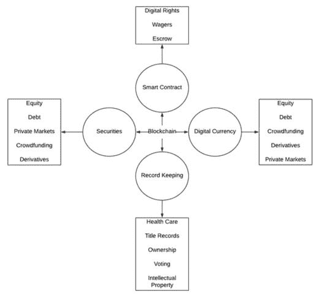

**图 1.1** 区块链的领域。

区块链正在进入农业、发电、教育、银行、投票等许多领域。以发电为例，如果你在家里安装了太阳能电池板并发电，多余的电可以发送给他人，反之你通过区块链获得钱；我们还可以使用物联网（`IoT`）。基本上，当你能够防止数据造假并在分布式网络中建立信任时，区块链就出现了。互联网解决了许多更多问题，如信息搜索（`Google`、`Yahoo`）、分发（`YouTube`、`Amazon Prime`、`Netflix`）和通信（电子邮件、聊天应用程序），但它还没有解决两个主要问题：信任和中介。在互联网上，我们发现虚假新闻和虚假资料，这些是不可信赖的；而在中介方面，像 `Google`、`Amazon`、`Facebook` 等大公司占据了市场，且对所有人开放开放，这意味着生产者和消费者之间存在中间人。但随着区块链的出现，我们可以解决所有这些问题并带回一个受信任的环境。

## 1.1 Web 3.0 简介

随着网络进入一个新的演进阶段，`Web 3.0` 准备成为下一个大趋势，标志着开发者创建方式以及人们与网站交互方式的根本变化。互联网专家声称，这些变化将使互联网更智能，从而让我们的生活更容易[2]。

### 1.1.1 Web 1.0

这被称为第一代网页，由蒂·伯纳斯-李发明。它通常被称为“只读网页”，因为只有少数人为其他客户创建内容。常用的技术有 `HTTP`、`XHTML`、`HTML`、`CSS` 等。它支持服务器端脚本（如 `JSP`、`PHP` 等）和客户端脚本（`JavaScript`、`VBScript` 等）[3]。

`Web 1.0` 有很多漏洞，其中包括：

1. 它极其缓慢。
2. 每当将新内容推送到网页上时，它都需要刷新。
3. 它不支持双向通信，因为它只能由客户端发起（`HTTP`）。

### 1.1.2 Web 2.0

这也被称为“读写网页”，因为用户可以根据输入与具有预定义行为的网站交互。随着 20 世纪博客的出现，小部件以及即时且通用的授权工具和网站随时准备好接受内容。这些在网页的民主化中发挥了重要作用。常用的技术有 `Ajax`、`DOM`、`REST` 等[6]。

`Web 2.0` 有很多漏洞，包括：

1. `SQL` 注入
2. 信息泄露
3. 跨站请求伪造
4. 身份验证和授权缺陷
5. 跨站脚本

### 1.1.3 Web 3.0

这个术语是由《纽约时报》的记者约翰·马科夫在 2006 年提出的。它允许在线应用程序从网络上接收信息并向用户提供新信息（结果）[4]。

`Web 3.0` 由这 4 个基本属性组成：

- `Semantic Web`（语义网）：处理数据所传达的含义或情感。
- `3D graphics`（三维图形）：用于为网站提供真实的感。
- `Universal`（通用性）：允许从任何地方访问网络上的内容/服务。
- `Artificial intelligence`（人工智能）：将允许网站过滤并向用户展示尽可能优的数据。

## 1.2 区块

区块链的概念最早由 Stuart Haber 和 W. Scott Stornetta 提出，当时他们试图构建一个文档时间戳无法被修改的系统。

这后来在 2008 年由 Satoshi Nakamoto 实现，他的真实身份仍然不为人知。

区块链可以被定义为一个不断增长的记录列表，这些记录被称为“区块”，它们使用密码学技术进行链接和存储。链的第一个区块被称为创世纪区块 [11]。

每一个区块都包含以下细节：

1. `Data`（数据）：存储的字符字符串。
2. `Nonce`（随机数）：一个与挖掘相关的唯一数字。
3. `Previous hash`（前一个哈希）：当前区块之前的区块的哈希值。该字段建立了与后续区块的密码学链接。
4. `Hash`（哈希）：区块中存储的某些数据的指纹。

如图 1.2 所示，区块的哈希值是使用其他三个字段计算出的，即数据、随机数和前一个哈希字段。

通过以下几点，可以理解区块链的概念：

1. 哈希密码学
2. 不可变账本
3. 分布式 `P2P` 网络
4. 挖掘
5. 共识协议

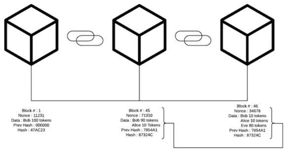

**图 1.2** 密码学链接的区块。

### 1.2.1 哈希密码学

这个世界上每一个人都有独特的指纹，而两个指纹相同的概率极低，即 6000 万分之一。同样地，像操作系统、视频等数字文档，可以使用使用 `SHA-256` 算法计算出的哈希值进行唯一标识 [5]。这最早由国家安全局（`NSA`）开发，其扩展如下：

- `SHA` 代表安全哈希算法（secure hash algorithm）。
- `256` 是内存中消耗的比特总数。

任何哈希算法的要求如下：

1. `One-way`（单向性）：每个数字文档都有一个关联的哈希值。可以通过数字文档检索该哈值，但无法实现反向操作。
2. `Deterministic`（确定性）：每个数字文档都有由哈希算法生成的唯一哈希值，只要文件内容不改变，该哈值将保持不变。
3. `Fast computation`（快速计算）：哈希值的生成应该是瞬时的，且不能是缓慢的。
4. `Avalanche effect`（雪崩效应）：输入文件的任何变化都会导致之前生成的哈希值发生剧烈变化。
5. `Must withstand collisions`（必须能够抵抗冲突）：如果哈希函数为两个数字文档生成相同的值，这被称为冲突。数据完整性使得防止此类冲突成为强制性。

图 1.3 展示了使用 `SHA-256` 算法将消息转换为哈希值的过程，对于每个字符的变化，它都会生成不同的哈希值。其重要特征是我们无法从哈希值获取消息。

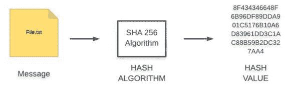

**图 1.3** 哈希函数。

### 1.2.2 不可变性

不可变性指的是一旦记录就无法更改的任何事物。例如，发送给一群人的邮件是无法撤回的。一个名为“时间戳”的额外字段被记录在区块中。如果有人尝试修改数据，区块间的密码学链接就会断裂 [7]。数据完整性使得防止此类冲突成为强制性。为了修复链接，必须重新计算区块的哈希值。这种特性需要大量的计算能力。因此，不可变性确保了数据不会被篡改。这种特性在某些数据库中是可用的，从而允许删除。这种不可变性为审计提供了保障，它为整个业务提供了历史记录可能。

图 1.4 展示了不可变性。

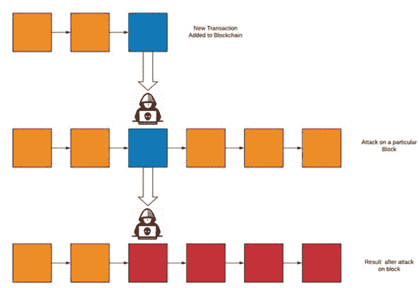

**图 1.4** 不可变性。

### 1.2.3 分布式 P2P 网络

区块链的骨干是通过分布式 `P2P` 网络实现的。所有的节点都拥有区块链的副本，因此任何人修改任何值都是不可能的 [10]。`P2P` 网络成员之间共享资源，包括带宽和磁盘存储。这是通过对所有人定义的最小资源贡献阈值来实现。对等网络使能够解决客户端-服务器架构面临的所有障碍，例如单点故障和扩展性问题 [13]。表 1.1 展示了两种架构的对比特征。

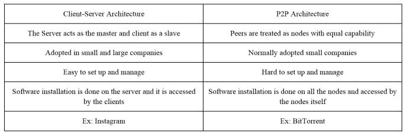

**表 1.1 客户端-服务器与 P2P 的对比。**

### 1.2.4 挖掘

这个术语由于最近比特币的兴起而闻名。它可以被定义为通过预测 `nonce` 的值向分布式系统添加新交易，使得生成的哈希值小于目标范围。矿工之间相互竞争，通过解决数学问题来计算哈希值，并获得代币或交易费作为奖励。使用的一种解决方案或挖掘算法是 `proof-of-work`（工作量证明） [15]。这就像是一个证明，证明矿工花费了大量的时间和资源来解决问题。

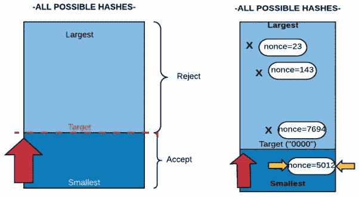

**图 1.6** 挖掘过程。

区块链共识协议在跨分布式网络的各个节点之间创建了一个不可争疑的理解系统。这允许我们保持网格中所有节点之间的相互同步 [16]。由于分布式系统的特性，在整个网络中维持相同的区块链是强制性的。这面临着两个主要因素的挑战：

1. `Attackers`：当攻击者想要通过暴力方法破坏分布式链时，这种性质的攻击非常普遍。攻击者有两种可能的手段：

    1. `在链之间添加新区块`：假设攻击者在链的区块之间添加了一个新区块，那么整个加密链接将被破坏。分布式链将感知到它包含的链与网络中所有其他副本不同。节点将立即识别出这一点并替换整个链副本，从而整合整个网格的数据。

    2. `在链的末尾添加新的恶意区块`：每个节点在向矿工确认区块之前，都会对新挖掘的区块进行一系列检查。在此过程中，如果某个节点认为该区块是恶意的，它将迅速通知网络，并对其采取必要的措施。

2. `Competing chains`：当两个节点在几乎相同的时间内向链中挖掘出一个区块时，就会出现这个问题。由于分布式网络中存在大量节点，随着两条竞争链的发展会产生冲突，因此必须做出决定 [17]。这一困境的解决方案取决于一个简单的概念，即接受添加下一个区块的链。现在，很大程度上取决于节点的哈希算，哪一组节点拥有更高的功率，就更有可能挖掘出下一个区块。竞争链中被接受链的完整副本现在会在网络中传输，以取回所谓的“孤儿区块”（orphan blocks）。这些通常是包含矿工奖励的现在不再是链的一部分的区块 [18]。

这构成了区块链技术存在并有规律运行的核心。

## 1.3 Bitcoin

比特币于 2008 年以 Satoshi Nakamoto 之名发布，是一种克服了银行低效和贪婪的数字货币。比特币的本质对银行和政府的侵入具有韧性。它使用 `P2P` 技术，在没有中心化对手的情况下运行，交易由网络参与者相互批准 [22]。在这里，私钥保护对个人账户资金的访问，这在法币情况下是矛盾的。此外，比特币的铸造数量限制在 2100 万个，与授权的中央银行机构发行的传统货币不同。区块链是底层技术，在全局共享账本中存储比特币网络上的每笔交易，该账本可由全球计算机群进行验证、访问并不断更新。一旦交易完成，其细节将在全球范围内记录，提供任何逆转交易的方法。同时，比特币参与网络不需要个人身份信息，因此除非他/她愿意透露，否则无法追溯到个人。

## 1.4 Ethereum

以太坊是一个与智能合约工作的去中心化开源平台。它由 Vitalik Buterin 于 2013 年引入。它与比特币类似，但侧重于构建去中心化应用（`DApps`）。

### 1.4.1 Ethereum Network

以太坊的基础设施由相互作用的节点组成。它围绕智能合约展开。存在许多网络，其中：

1. `Main Network`：生产环境应用部署在这里，以太具有价值。
2. `Rinkeby, Kovan, Ropsten Test Network`：这些为我们在部署代码和合约之前提供免费的以太进行测试。
3. `localhost`：用于开发的本地网络。

### 1.4.2 Interfacing with Ethereum

接口指的是与网络交互的过程。这可以通过两种方式实现：

1. `Web3`：这是一种开发者主要用于与网络交互的 `API`。它允许执行如创建智能合约、发送以太等众多操作。它通过 `JSON RPC` 与区块链通信。
2. `MetaMask`：这是用户用于与网络交互的浏览器扩展。通常，它受到没有以太坊以前知识的用户欢迎。

### 1.4.3 Ethereum Account

`MetaMask` 创建了两种不同类型的账户：

1. `Externally owned accounts`：这些账户由私钥生成并管理。它们没有关联的代码，但有助于触发合约代码。
2. `Contract accounts`：这些账户由代码生成并监管。它们的代码实现由交易触发。

2. `Nonce`: 对于外部拥有账户，它描述了从特定账户地址执行的交易次数；而对于合约账户，它说明了该账户生成的合约数量。

3. `CodeHash`: 该账户 `EVM` 代码的哈希值。这些代码存储在数据库中，并支持相应的哈希值以备未来检索。

4. `StorageRoot`: 一个 256 位的值，表示存储在链上的数据编码后的版本。

### 1.4.4 以太坊网络交易

以太坊网络中的任何类型的交易都应该拥有一个 `MetaMask` 账户并在其中包含一些 ethers。如果用户下订单，他们将被自动重定向到支付网关以使用 ethers 确认并支付。确认后，后端服务器将检查其余额，以确认是否符合相应要求。如果满足要求，将进行 ethers 交易。当用户点击提交按钮时，它会将以太坊地址发送到后端服务器进行验证。然后，后端服务器使用 `web3` 库创建一个交易对象。为了演示目的，研究人员使用了测试网络，而在现实世界中是在主网上完成的。交易成功后，后端服务器会将成功消息推送到用户屏幕上。用户需要等待几秒钟，因为生成的交易对象需要添加到网络中。这将由矿工通过随机生成 `nonce` 值来批准，并作为新区块添加到网络中。该区块将被分配一个唯一的哈希值，从而确保了数据的完整性。

下方的 图 1.9 详细展示了整个过程中遵循的所有步骤。

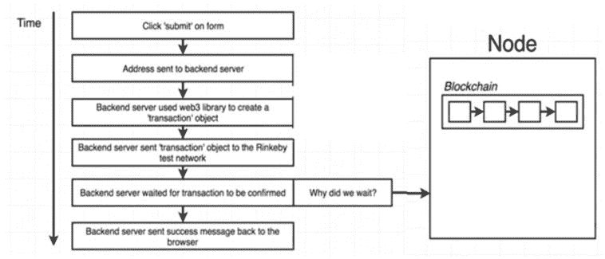

**图 1.9** 以太坊网络中的交易。

## 1.5 星际文件系统 (IPFS)

`HTTP` 无法与最近发明的的文件发行技术合并。由于当前 `HTTP` 模型和网页的高度参与，在不影响当前网络的情况下进行升级几乎是不可能的。为了克服这些挑战，`IPFS` 网络运行在分布式对等点网络上，该网络具有类似于 `Merkle DAG` 的相似文件数据结构。`IPFS` 的工作方式类似于 `BitTorrent`，使用了 `bitswap` 协议。客户端可以使用 `bitswap` 协议设置自己的 `Bitswap` 策略。`Bitswap` 策略告诉节点它应该如何向其对等点请求和发送数据块。通过分布式技术的集体使用，`IPFS` 以去中心化的方式实现了独特的文件和数据共享。`IPFS` 具有全局挂载的文件系统或目录，并提供高性能和集群持久性，这足够存储和组织世界信息了 [23]。

`IPFS` 作为分布式网络还提供以下功能：

1. `内容寻址`：`IPFS` 中的地址数据是通过对网络中文件或文档的内容进行寻址，而不是对位置进行寻址（后者是使用 `IP` 地址进行的寻址）。`IPFS` 地址解析为 `IPFS` 对象，即包含链接列表和正在被寻址的内容数据的实体。当大文件被添加到 `IPFS` 时，文件被分解为许多更的数据表示形式，并存储在指向原始数据碎片的链接数组中。这种寻址方式确保了特定地址始终会查询到同一个文件。内容寻址相较于节点托管的内容也有优势，因为只要文件托管在网络中，就可以从 `IPFS` 网络中检索内容。因此，文件的单副本就足以从网络中检索该文件。

2. `分布式哈希表 (DHT)`：`DHT` 是分布在网络上的数据库，可用于在由节点组成的对等点网络中以键值对的形式存储数据。当键值对在网络中出现重复或无法访问时，分布式哈希表会触发容错机制。为了在整个网络中均匀共享信息，`DHT` 使用了哈希概念，其中哈希函数作为随机函数接受键。由于 `DHT` 节点不存储所有数据，路由层必须执行必要的功能，使用户能够联系网络中存储特定键的其它对等点，然后可以检索值并访问内容。`DHT` 路由层中显著使用的两种路由协议是迭代查找和递归查找，它们根据处理完整请求的方式进行分类。

3. `版本控制文件系统`：`IPFS` 允许使用版本控制文件系统，该系统被用于 `Git` 版本控制，能够维护同一份文件的不同版本，并可以使用 `commit` 对象轻松追溯到原始文件。版本控制文件系统中的 `commit` 对象有指向名称 `ID` 的链接（该 `ID` 指向最后提交的对象），以及一个指向该 `commit` 所启动的全局挂载文件目录对象的链接。

## 1.6 去中心化应用 (DApps)

去中心化应用是完全开源的应用程序，完全运行在区块链上的智能合约代码上。它们是一种软件程序，其设计旨在使其不受任何单一实体控制，而是由被称为智能合约的代码块控制。`DApps` 使用去中心化存储来存储数据和代码。去中心化应用是基于区块链的应用程序，智能合约允许其连接到区块链 [1]。

Satoshi Nakamoto 的比特币与 Vitalik Buterin 的以太坊之间的主要区别见 表 1.2 。

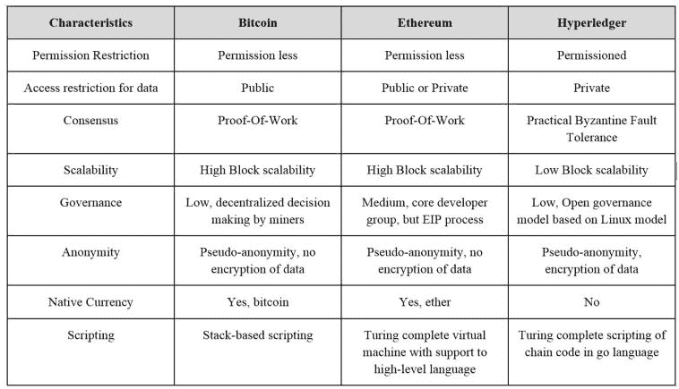

**表 1.2** 比特币、以太坊和 `Hyperledger` 的区别。

第一信息报告（`FIR`）是警察部门维护的一份书面文件，记录了有关任何犯罪行为的信息。它通常是可认知罪行的案件受害者或其代理人向警方提交的诉状，但任何人都可以通过口头或书面形式向警方提交此类报告，随后警方将启动调查。提供信息的人有权查看所提及的内容，并必须在其上签名确认准确无误。现有的系统是手写的，耗时且且安全性较低；而且没有方法追踪事件是否被正确记录。`FIR` 充当敏感数据，并为调查提供线索。因此，一旦报告编写，存储的数据必须确保安全，不能被篡改或受到外部压力的影响。`FIR` 的详情存储在账本中，在那里可能会被操纵。因此，为了缓解这一点，一旦数据存储在区块中，我们可以使用区块链，因为它具有哈希值并且相互链接。每当任何人尝试更改即使是一个微小的字符甚至空格时，由于雪崩效应，哈希值会立即改变，表明数据已被篡改。这提供了数据的高安全性，并消除了信息的操纵。提供信息的人可以通过添加数据块时生成的哈希值来跟踪它。`FIR` 的优势在于降低了成本和时间，消除了人为错误，任何人都可以查看在线信息。`FIR` 包含地点、时间、日期和详细描述等信息，所有信息都存储在区块链区块中，并向用户提供哈希值以检查提供的详情是否正确，确保没有信息被误读。因此，通过使用区块链技术，解决了一个重大问题并确保了数据的完整性。

## 1.7.1 项目描述

`FIR dApp` 是一个基于去中心化和开源技术的可证明的公开透明平台，利用区块链确保用户提交的报告的真实性。它的目标是成为去中心化项目通信的标准。通过此应用程序，用户可以提交投诉，还可以保护自己的身份并发布对他们真正重要的内容。此应用程序允许根据提供的 `ID` 搜索 `FIR`。该应用程序是永恒的，无法被任何人或任何事物停止。所有数据在离开浏览器之前都经过了安全加密。此外，运行 `dApp` 的代码所有人可见，且不受政治和人为错误的影响，因此它是安全、可靠且任何人都可以访问的。

**安全**：以坊区块链是完全去中心化的。由于区块链的不可篡改性，通过此应用程序添加的任何记录都无法删除。该系统无法被任何单一对手或机构控制。

**可靠**：所有文档都汇集在以坊上并附带时间戳。文档的内容或时间都无法以任何方式更改或错误处理。

**任何人都可以访问**：用户提交的投诉可以被任何人查看，无需支付任何交易费用。访问任何应用程序信息所需的所有关键数据都是公开的。

该分布式应用程序能够：

*   在星际文件系统（`IPFS`）上保存任意文档。
*   接收提交后的的收据。
*   证明提交时间（通过区块时间戳）。

## 1.7.2 使用的工具

开发该项目需要下文提到的工具。

### 1.7.2.1 Node.js

`JavaScript` 运行时环境构建在 `Chrome` 的 `V8 JavaScript` 引擎之上。`Node.js` 主要策略是使用非阻塞和事件驱动的 `I/O`，这使得在主要作为实时应用程序运行的数据密集型应用中，能够保持轻量级状态。`Node.js` 带有默认的包管理工具和一个名为 `NPM` 的工具，该工具在每次安装 `Node.js` 时都会被安装。可以通过在线仓库提供的安装程序安装 `Node.js`，并具备版本和依赖管理功能。

### 1.7.2.2 Truffle

`Truffle` 是一个智能合约开发环境和框架，用于部署以坊 `DApps`，它使得以坊开发者开发智能合约变得简单。由于 `Truffle` 是一个具有开发和测试能力的完整框架，它默认内置了 `Web3.0` 库，这使得对具有 `Web 3.0` 开发背景的用户更有吸引力。`Truffle` 在 `Terminal`（终端）中运行，在开发 `dApp` 的不同阶段使用各种命令。可以使用 `Mocha` 和 `Chai` 等流行的测试框架对合约进行。`Truffle` 支持 `Web` 应用和控制台应用的开发。它还具有迁移功能，有助于在开发期间快速重建资产。合约编译和部署可以使用 `RPC` 客户端完成。

### 1.7.2.3 Ganache

`Ganache` 是区块链节点的模拟器，用于设置本地以坊节点，在该节点上可以编译智能合约并使用诸如 `Truffle` 等开发工具进行迁移。使用 `Ganache` 不需要额外设置 `geth` 客户端和其他依赖项。它提供了总共 10 个虚拟账户，每个账户加载了 100 ether，可用于开发目的，这些虚拟账户在区块链上运行交易时用于支付 gas 费用。除了虚拟账户外，还提供了私钥，通过这些密钥对交易进行签名并写入区块链。`Ganache` 同时具有视觉用户界面和命令行界面，允许用户查看所有账户的当前状态，包括地址、私钥、交易和余额。除了这些功能，`Ganache` 还提供了区块链日志输出，显示 `Ganache` 内部区块链的日志输出，包括响应和关键调试信息。

### 1.7.2.4 Infura

`Infura` 提供了一系列工具，将应用程序连接到以坊平台。这些工具能够安全、可靠地访问以坊 `API` 和星际文件系统（`IPFS`）。通过 `Infura`，用户可以使用其平台提供的 `API` 密钥在以坊去中心化网络中托管他们的应用程序。`Infura` 还托管了连接到 `IPFS` 网络的 `IPFS` 节点，用户也可以使用提供的 `URL` 与它们连接。`Infura` 具有可扩展的基础设施，每月能够传输 2.5 PB 数据，并处理每日超过 100 亿的用户请求。

### 1.7.2.5 MetaMask

`MetaMask` 是一个浏览器扩展，提供加密钱包和为 `DApps` 签名交易的接口。通过 `MetaMask`，可以在不实际运行完整以坊节点的情况下在以坊网络上签名交易。`MetaMask` 还允许用户像任何其他以坊钱包一样存储钱包相关数据（如公共地址和私钥），用户还可以与运行 `DApps` 和智能合约的网站交互。`MetaMask` 包含一个名为安全身份库的功能，提供了一个用户界面来处理他们在不同网站上的身份并在区块链上签名交易。

### 1.7.2.6 Solidity

`Solidity` 是一种用于编写智能合约的面向合约的高级语言。`Solidity` 代码运行在以太坊虚拟机 (`EVM`) 上，一旦部署便无法更改或操纵。它提供了继承和库等功能，并支持复杂的用户定义类型。`Solidity` 的编程风格受到 `C++`、`JavaScript` 和 `Python` 的影响，并且是静态类型语言。`Solidity` 还拥有许多开发工具，例如 `Solidity REPL`（一个带有命令行 `Solidity` 控制台的 `Solidity` 解释器）以及 `solgraph`（一个用于控制流可视化并突出显示潜在安全漏洞的可视工具）。

### 1.7.3 项目运作

1. `提交投诉 (Lodge Complaint)`：这方便用户通过指定所需的琐碎信息来注册新的指控。信息一旦提交便无法更改，从而让终端用户能够信任系统并提交案件，而无需担心外部影响。

2. `获取投诉 (Fetch Complaint)`：此元素允许我们使用最初加载到链上时提供的唯一 `ID` 号来检索特定指控的详细信息。

3. `近期投诉 (Recent Complaints)`：此元素有助于检索所有最近添加的投诉，从而确保系统的公开可用性。

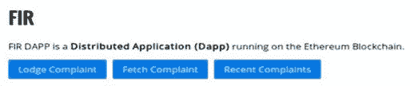

**图 1.10** 应用程序首页。

图 1.10 展示了用户如何通过指定以下强制性细节在这一分布式式应用程序上提交投诉：

1. 警局名称
2. 标题
3. 投诉的详细描述

所有上述内容均被视为交易的输入，并通过支付 `0.001 ETH` 的象征费用获得批准。

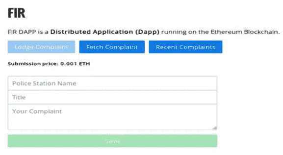

**图 1.11** 投诉的字段。

图 1.12 展示了当点击保存按钮时 `MetaMask` 浏览器扩展程序是如何弹出的。账户将扣除 `0.001 ETH` 的总费用作为验证信号，交易将在挖矿后被包含在区块中。用户可以选择确认或拒绝交易。

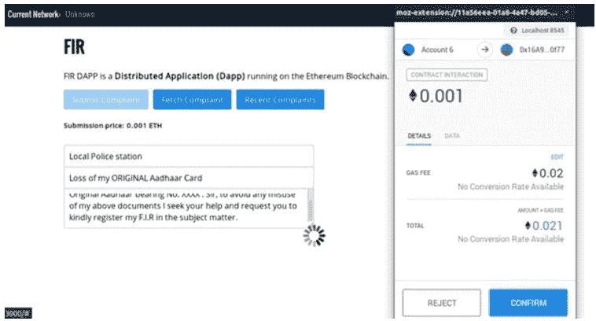

**图 1.12** 提交投诉。

图 1.13 说明了用户如何使用 `ID` 号获取网络上关于任何投诉的详细信息。在满足要求后，将检索到带有以太坊哈希值和时间戳的完整报告。还会显示 `IPFS` 哈希值，证实了报告已存储在网络中。

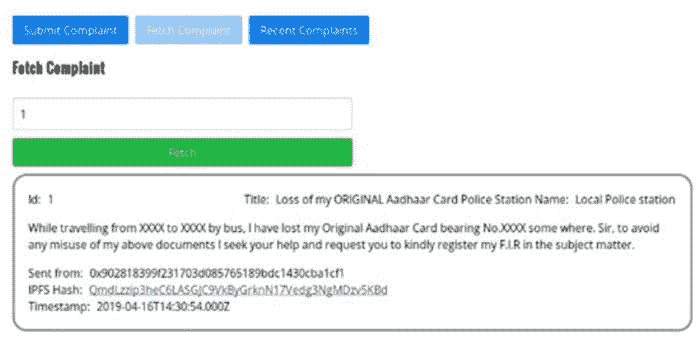

**图 1.13** 通过 `ID` 获取投诉。

系统的这部分组件用于在保持伪匿名性的情况下建立透明度。任何用户都可以检查此选项下最近提交的投诉。这为用户提供了查看网络中待处理案件的可能性。

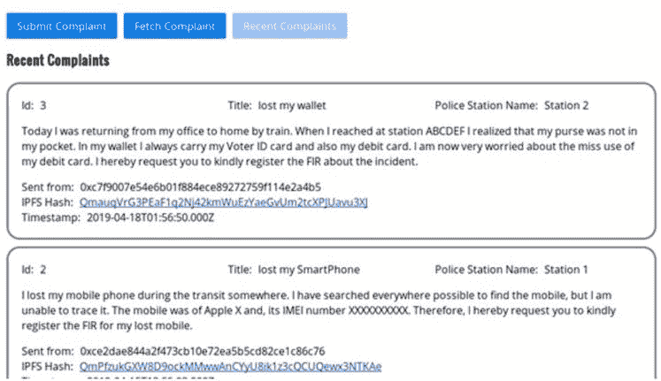

**图 1.14** 获取近期投诉。

## 1.8 结论

区块链技术的出现改变了人们的生活，赋予了其新的维度。它改变了看待网络事物的视角，变得更加以用户为中心且用户友好。凭借其广泛的技术范围，如上述关于其工作原理、哈希算法、安全参数等主题所述，区块链提供了更多的数据安全。此外，它在控制世界上发生的网络犯罪方面具有广泛多样性，并解决了数据泄露以及资金和财产相关问题。借此，数字广告、网络安全、预测、供应链管理、物联网和网络等领域拥有光明的未来。区块链对于行业中新兴的新职业也有广阔前景。通过这些，我们可以将整个世界变成一个更小的地方。在客户端-服务器架构中，用户可能会单点故障，而且容易受到攻击；因此，为了提供更好的解决方案来防止这些攻击，使用分布式网络提高了系统效率并为系统提供了更高的安全性。使用区块链可以更快、更高效地执行交易活动。区块链技术未来将用于更多领域，例如政府系统，因为这些系统运行缓慢、冗余且容易受到腐败影响。在政府系统中实施区块链技术可以使其运行更加安全和高效。尽管在区块链上存储数据是一个缓慢且昂贵的过程，但在某些情况下，其收益大于成本，而且未来以太坊网络将会更快、更便宜。区块链技术为现有的服务结构提供了一种可持续且高效的方法，而其他某些方法表现不佳且安全性不可靠。区块链处于早期阶段，开发者正在现有系统上进行实验，以降低成本并加快用户活动。在计算能力方面，他们的支持是有限的，网络中的节点数量也较少。目前的解决方案通常设计用于解决去中心化系统产生的问题。使用智能合约实现的区块链技术进行的代币发行可以为去中心化网络上的解决方案提供高价值，在网络中，每个节点对系统做出的决策都具有同等重要性和控制权。Satoshi Nakamoto 名为 `Bitcoin: A Peer-to-Peer Electronic Cash` 的论文于 2008 年 10 月发表，并于 2009 年 1 月发布，这是金融领域遭受变革的清晰信号。

# 第 2 章

区块链：通往未来之路

Avinash Kaur, Anand Anandyar,² Parminder Singh

¹ 印度旁遮普邦爱职业大学

² 越南岘港美仁大学

> **摘要**

> 区块链由中本聪（Satoshi Nakamoto）发明，用于作为比特币的公共交易账本，引起了广泛关注。区块链允许以去中心化的方式执行交易。目前，它已应用于信誉系统、物联网（`IoT`）和金融服务等多个领域。区块链仍面临许多待解决的挑战，例如安全性和扩展性。本章介绍了区块链技术架构以及涉及其中的共识算法。此外还讨论了区块链系统的类型及其应用。最后，探讨了区块链领域的未来方向。

> ***关键词***：区块链、共识算法、比特币、以太坊、联盟链、挖矿、比特币智能合约

## 2.1 引言

如今，工业界和学术界的热词是加密货币。极其成功的加密货币比特币是一项巨大的成功，其市场价值高达 100 亿美元 [1]。比特币具有特定的数据存储结构，且交易在没有第三方参与的情况下发生。比特币的核心技术是区块链。区块链于 2008 年提出，并于 2009 年实现 [2]。

## 参考文献

1. Ming, Z., Yang, S., Li, Q., Wang, D., Xu, M., Xu, K., & Cui, L. Blockcloud: A Blockchain-based Service-centric Network Stack.

2. Ehmke, C., Wessling, F., & Friedrich, C. M. (2018, May). Proof-of-property: a lightweight and scalable blockchain protocol. In *Proceedings of the 1st International Workshop on Emerging Trends in Software Engineering for Blockchain* (pp. 48-51). ACM.

3. Sambra, A., Guy, A., Capadisli, S., & Greco, N. (2016, April). Building decentralized applications for the social Web. In *Proceedings of the 25th International Conference Companion on World Wide Web* (pp. 1033-1034). International World Wide Web Conferences Steering Committee. [http://dx.doi.org/10.1145/2872518.2891060]

4. Dinh, T. T. A., Liu, R., Zhang, M., Chen, G., Ooi, B. C., & Wang, J. (2018). Untangling blockchain: A data processing view of blockchain systems. *IEEE Transactions on Knowledge and Data Engineering*, 30(7), 1366-1385. [https://doi.org/10.1109/tkde.2017.2781227]

5. Bartoletti, M., Lande, S., Pompianu, L., & Bracciali, A. (2017, December). A general framework for blockchain analytics. In *Proceedings of the 1st Workshop on Scalable and Resilient Infrastructures for Distributed Ledgers* (p. 7). ACM. [https://doi.org/10.1145/3152824.3152831]

6. Wichtlhuber, M., Heise, P., Scheurich, B., & Hausheer, D. (2013, October). Reciprocity with virtual nodes: Supporting mobile peers in Peer-to-Peer content distribution. In *Proceedings of the 9th International Conference on Network and Service Management (CNSM 2013)* (pp. 406-409). IEEE. [https://doi.org/10.1109/cnsm.2013.6727866]

7. Nakamoto, S. (2008). Bitcoin: A peer-to-peer electronic cash system, [http://bitcoin.org/bit-coin]

8. Dai, P., Mahi, N., Earls, J., & Norta, A. (2017). Smart-contract value-transfer protocols on a distributed mobile application. URL: [https://qtum.org/uploads/files/cf6d9348ca50dd985b6042ccf2f]

9. Wright, C., & Serguieva, A. (2017, December). Sustainable blockchain-enabled services: Smart contracts. In *2017 IEEE International Conference on Big Data (Big Data)* (pp. 4255-4264). IEEE. [https://doi.org/10.1109/bigdata.2017.8258452]

10. Eyal, I., Gencer, A., Sirer, E., & Vanesse, R. (2016). Bitcoin-ng: A scalable protocol. In *Proceedings of the 1st International Workshop on Scalable and Resilient Infrastructures for Distributed Ledgers* (p. 7).

区块链支付可以在不涉及任何中介的情况下进行，因此它可以用于汇款、数字资产和在线支付等多种金融服务 \[3, 4\]。它还可用于其他许多领域，如公共服务、智能合约 \[5\],安全服务 \[6\],信誉系统 \[7\],物联网 \[8\]等。这些领域从多个方面青睐区块链。在区块链中交易信息无法被篡改。对隐私和安全有高要求的企业使用区块链来吸引用户。它采用了分布式计算的形式，避免了单点故障的出现。智能合约中的合约一旦部署在区块链上，就会自动执行。区块链技术未来在互联网的应用面临着许多技术问题。首先是扩展性的挑战。`Bitcoin` 的区块大小被限制在 `1MB`，而区块的大小每 `10 minutes` 就会增加一次。`bitcoin` 的网络限制是每秒 `7 transactions`，不具备处理高频交易的能力。因此，区块越大，所需的存储空间就越大，在网络中的扩散也越慢。因此，区块链对去中心化的需求产生了。最困难的挑战是安全与大小之间的权衡。其次，矿工可以通过自私挖掘策略获得更高的收益 \[9\]。为了获得更高的收益，矿工会隐藏自己的区块。这阻碍了区块链的发展，因为可能会频繁发生分支。需要提出方案来解决这一问题。此外，如果用户使用私钥 \[10\]和公钥，可能会发生隐私泄露。此外，目前的 `proof-of-stake` 或 `proof-of-work` 共识算法面临着一些严重的问题。例如，`proof-of-work` 浪费了大量的电力，而在 `proof-of-stake` 共识中可能会出现贫富差距扩大。关于区块链的文献有很多，涵盖了百科、期刊文章、博客、论坛帖子和代码等多种模式。针对 `Bitcoin` 去中心化数字货币进行了一项技术调查 \[11\]。本文研究侧重于区块链技术。

## 2.2 区块链架构

区块链是由相互连接的计算机网络，而不是与中央系统连接。网络中计算机的协议是同意并定义共享数据的状态，并遵守施加在数据上的限制。区块链中的每一个区块都会对共享状态进行更改。

包含完整交易列表作为公共账本的区块序列被称为区块链。图 2.1 展示了区块链。一个区块只有一个父区块，其区块头中包含前一个区块的哈希值。`Ethereum` 区块链由叔区块（区块祖先的子区块）组成。没有父区块的第一个区块被称为创世区块 \[12\]。下文将对区块链进行进一步解释。

### 2.2.1 区块

区块由区块头和主体组成。区块头包含有关区块的元数据，而主体包含实际的交易。

### 2.2.2 数字签名

数字签名用于确保交易的真实性和完整性。在区块链中，每个用户都有一对私钥和公钥。为了对交易签名，用户使用其私钥创建数字签名。其他用户可以使用发送者的公钥验证该签名。用于此的常用算法是椭圆曲线数字签名算法 (`ECDSA`)。

### 2.2.3 区块链的主要属性

区块链具有以下属性：

1. **去中心化**：没有单一实体控制网络；数据分布在许多节点上。
2. **持久性**：一旦交易记录在区块链上，就极难删除或更改。
3. **匿名性**：用户可以使用伪名地址而非真实世界的身份进行交互。
4. **可审计性**：每笔交易都可以在公共账本上进行追踪和验证。

3. `联盟链` (Consortium Blockchain)：这是一种部分去中心化的区块链，因为只有部分节点被选中用于确定共识。示例包括 `EWF`（能源）、`R3`（银行）、`Corda` 和 `B3i`（保险）。
4. `混合链` (Hybrid Blockchain)：它是私有链和公有链的结合。它决定了哪些信息是私有的或公开的。示例是 `Dragonchain`。

## 2.4 共识算法

区块链 [16] 中提出了拜占庭将军问题的变体。在拜占庭将军问题的案例中，部分拜占庭军队随同一群指挥将军包围了城市。指挥将军们有两种观点：有些人想要撤退，另一些人想要进攻。然而，如果只有部分将军进攻，任务就会失败。因此，必须就选择进攻还是撤退达成一致。同样，在分布式环境中达成共识是一项挑战。因此，区块链也面临同样的挑战，因为它同样包含分布式环境。区块链中不存在决定分布式节点上账本相似性的中心化节点。为了确保不同节点间账本的一致性，需要遵循某些协议 [16]。本节将进一步解释区块链中达成共识的不同方法。

在本节中，将讨论基于证明的共识算法。第一个算法是工作量证明（Proof of Work）。文中介绍了工作量证明的不同替代方案并对这些算法进行了解释。

### 2.4.1 工作量证明 (PoW)

工作量证明是应用于比特币网络的一种共识策略 [2]。为了在去中心化网络中记录交易，必须选择某人。最简单的方法是随机选择法，但这种方法容易受到攻击。因此，为了验证发布交易的节点，需要一个巨大的过程来验证该节点，以防止其攻击网络。计算机中的计算量被称为 `work`。每个节点都会计算区块头的哈希值。区块头由矿工和 `nonce` 组成。矿工通过频繁更改 `nonce` 来获得不同的哈希值。共识的要求是生成的值需要等于或小于某个给定的值。当一个节点达到目标值时，就会将一个区块广播给其他节点；因此，哈希值的正确性将由所有节点确认。如果区块通过了验证，矿工会将新区块附加到他们自己的区块链中。矿工是计算哈希值的节点，而 `PoW` 过程在比特币中被称为挖矿。

几乎同一同时，当多个节点和相应的 `nonce` 被选中时，去中心化网络中就会生成有效区块。分支的产生如图 [图 2.4] 所示。

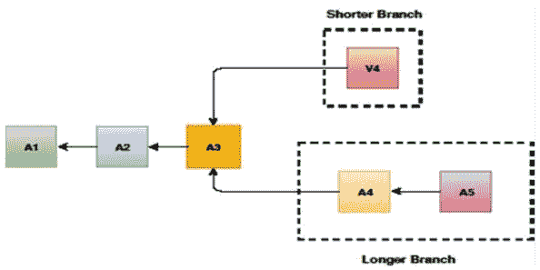

**[图 2.4]** 区块链分支场景。

然而，两个分叉是不可能同时生成分支的。在 `PoW` 中，如果链之后变长，则它就是真实的。考虑由同时通过验证的区块 `V4` 和 `A4` 创建的两个分支。矿工会一直挖矿，直到找到更长的链。更长的链由 `A4` 形成。矿工执行挖矿直到找到更长的链。由于 `A4` 之后形成了更长的链，因此该链是真实的。拜占庭问题的变体在区块链 [16] 中被提出。由于如此，为了确保不同节点间账本的一致性，需要遵循某些协议 [16]。由于 `A4` 之后形成了更长的链，因此该链是真实的。

如果没有提供私签名，矿工必须解决额外的工作量证明（`PoW`）难题。为了克服矿池挖的局限性，Miller *等人* [26]] 提出了一种方法，将原始难题修改为不可外包难题，以增加矿工在任何努力下获胜的机会。签名密钥用于演化这种谜题。除了安全性问题外，`PoW` 适用于实时支付 [27]]。例如，一个人去买杯咖啡，但必须等待 15 分钟才能获得区块生成速度，因为支付必须由卖家验证。因此，降低交易延迟是很有必要的。之前介绍的解决方案是增加区块大小以执行更多交易，从而降低求解谜题的复杂度。引入了一种名为 `Bitcoin-NG` 的新共识模型，其中传统区块分为两种类型：微区块（micro block）和密钥区块（key block）[27]]。如果矿工为他的谜题找到了最合适的随机数（`nonce`），那么该矿工成为所有其他矿工的领导者。当矿工成为领导者时，节点将发布包含交易信息的微区块。`Ghost` 技术被建议用于减少在链中添加新区块的时间。该技术防止了双重花费问题并处理了分叉 [28, 29]]。它选择贡献最大的分叉而不是最长的分叉。图 2.6 描述了 `Ghost` 技术的协议。

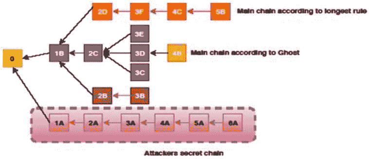

**图 2.6** 出现分叉时选择主链的技术。

Liu *等人* [30]] 提出了另一种策略。这是工作量证明的一种通用形式，其中委员会根据运气选择添加区块。它寻找与每个成员算力相对应的随机数数量。随机数随区块发送给委员会进行批准。经过验证的区块被放入临时数组中。在每轮结束时选择一个随机数。区块中的矿工索引与允许添加区块的随机数匹配。在每轮完成后，奖励将平均分配给所有委员会成员。

### 2.4.1. 权益证明 (PoS)

权益证明是 `PoW` 的一种节能型替代方案。矿工必须证明货币数量的所有权。那些拥有极大量货币的人攻击网络的几率较低。基于账户余额选择候选人是不公平的，因为最富有的人将占据主导地位。因此，提出了多种解决方案，结合权益大小（stake size）来决定下一个铸造的区块。特别是 `BlackCoin` [31]] 使用随机化来预测下一个生成者。所使用的公式结合了最低哈希值与权益大小。例如，`Ethereum` 计划从 `Ethash` [33]] 转换为 `Casper` [34]]。基于币的筛选过程受到 `Peercoin` [32]] 的青睐。在 `Peercoin` 中，挖掘下一个区块的概率更高取决于更老、更大的币集。与 `PoW` 相比，`PoS` 节省了能量且更有效。

### 2.4.2. 基于纯权益的共识

`NextCoin` [35]] 是 `PoS` 的纯形式。矿工可获得的权益越大，矿工挖掘区块的机会就越多。例如，如果硬币总数为 `n`，矿工拥有的数量为 `a`，那么矿工 `M` 挖掘的概率就是 `a/n`。另一种方法是基于纯权益寻找矿工。此外，还应用了 `follow-the-satoshi` 规则。考虑了比特币的最小单位 `Satoshi`。`Satoshi` 索引作为输入提供 `Satoshi` 过程。`Satoshi` 索引的值在 0 到 `Satoshi` 总数之间。找到创建该 `Satoshi` 的区块。这些是创建 `Satoshi` 的矿工的奖励。将区块添加到链上的那是 `Satoshi` 的最后一个所有者。`Satoshi` 根据 `hash` 函数选择。输入基于链的当前状态获取。第一个输入从 `comb` 函数以位的形式获取。链中的当前区块提供第二个输入，第三个输入是一个随机整数。

提出了另一种方法 [36]] 来处理该问题。在其中，区块由 `Satoshi` 所有者在其期间创建。提供了三次机会选择 `Satoshi`。如果错过了这些机会，所有者将被列入黑名单且不允许添加区块。`follow-the-satoshi` 程序用于执行 Po 识 [37]]。根据它，应该使用熵值随机选择领导者。该值需要安全保障，以模拟协议并预测操控 [36]] 的值。提取了每个权益持有者的快照（Epoch）。在每个代中选择权益持有者数量以执行硬币抛掷协议。

### 2.4.3. 租赁权益证明 (LPoS)

租赁权益证明是 `Waves Platform` (7) 引入的 `PoS` 变体。它在限制消耗的情况下提供了更好的支持。`PoS` 的缺点是币量有限的用户无法参与质押。该算法克服了这一缺点，允许小持有者获得质押机会。

### 2.4.4. 委托权益证明 (DPOS)

`DPOS` 是代议民主，而 `PoS` 是直接民主。委托人由权益持有者选举以生成和验证区块。由于用于区块验证的节点较少，交易确认速度快。此外，网络参数区块间隔和区块大小由委托人进行调整。不诚实的委托人可以很容易被投票出去。`bitshare` 的骨干是 `DPOS` [38]]。

### 2.4.5. PoS 和 PoW 的混合形式

`Peercoin` 也称为 `PCoin`，它是使用 `PoW` 的 `PoS` 变体。它使用矿工的“币龄”，其计算方法为权益乘以持有时间。为了获得将新区块添加到链中的优先级，矿工创建权益币用于添加区块。权益持有许多交易，但其中一条来自矿工自己的特殊交易。花费金额越大，机会就越大。

### 2.4.6. 实用拜占庭容错 (PBFT)

实用拜占庭容错是处理拜占庭故障的复制技术之一 [39]]。它被 `Hyperledger Fabric` [40]] 作为共识算法使用。`PBFT` 可以处理三分之一的恶意拜占庭副本。

此外，还会进行区块区块确定。在每一轮中，根据协议选择一个主节点由它对交易进行排序。整个过程分为三个阶段：预准备（pre-prepare）、准备（prepare）和提交（commit）。在这些阶段中，如果收到来自 80% 以上节点的投票，节点将进入下一个状态。因此 `PBFT` 的要求是网络必须已知每个节点。星链共识协议（`SCP`）[41]也是一种拜庭节点协议。在 `PBFT` 中，每个节点都会被查询，但在 `SCP` 中，参与者有权选择另一组参与者进行信任。授权拜庭容错（`dBFT`）由 `Antshares` 基于 `PBFT` 实现 [42]。在 `dBFT` 中，某些专业节点被投票用于记录交易。

### 2.4.7 Ripple

`Ripple` [23] 是共识算法之一^(8)。在较大的网络中，它使用集体受信任的子网络。网络中有两种节点：用于参与共识过程的服务器节点和用于资金转移的客户端节点。每个服务器都有一个唯一的节点列表（`UNL`），这对于服务器至关重要。将交易放入账本的决定取决于 `UNL` 中节点查询的响应。如果 80% 的节点达成共识，交易就会放入账本。只要故障节点少于 20%，账本在节点中就能保持有效。

### 2.4.8 Tendermint

`Tendermint` [24] 是一种共识算法。由选定的提议者在网络中广播一个未确认的区块。它分三个步骤进行：

1. `Prevote` 步骤：验证者决定对提议的区块广播他们的 `prevote`。
2. `Precommit` 步骤：如果针对所提议区块收到了超过 80% 的 `prevotes`，则为该区块广播 `precommit`。如果收到 80% 的 `precommits`，则节点进入 `commit`（提交）步骤。
3. `Commit` 步骤：区块由节点验证，并为该区块广播 `commit`。如果收到 80% 的 `commits`，则广播该区块。与 `PBFT` 不同，节点必须锁定代币以成为验证者。被发现不诚实的验证者将受到惩罚。

### 2.4.9 Proof of Elapsed Time

等待时间证明（`PoET`）[43] 是许可链区块链网络上使用的最好的共识算法之一。许可链网络根据投票或挖矿权的原则做出决定。整个网络具有透明度。系统登录是安全的，因为矿工在加入之前会经过身份识别。因此，胜者仅通过公平手段被选出。在这种情况下，个人的等待时间限制是随机的。完成公平份额等待时间的参与者可以分配一个账本来创建一个新区块。一个例子是 `Intel SGX` 系统^(9) [44]。

### 2.4.10 Proof of Activity

活动证明（`PoA`）[45] 是 `PoW` 和 `PoS` 的结合。许可链网络根据投票或挖矿权的原则做出决定。整个网络具有透明度。系统登录是安全的，因为矿工在加入之前会经过身份识别。因此，胜者仅通过公平手段被选出。在这种情况下，个人的等待时间限制是随机的。完成公平份额等待时间的参与者可以分配一个账本来创建一个新区块。一个例子是 `Intel SGX` 系统^(9) [44]。

### 2.4.11 Proof of Burn

燃烧证明（`PoB`）[46] 是许可链区块链网络上使用的最好的共识算法之一。许可链网络根据投票或挖矿权的原则做出决定。整个网络具有透明度。系统登录是安全的，因为矿工在加入之前会经过身份识别。因此，胜者仅通过公平手段被选出。在这种情况下，个人的等待时间限制是随机的。完成公平份额等待时间的参与者可以分配一个账本来创建一个新区块。一个例子是 `Intel SGX` 系统^(9) [44]。

## 2.5 正在改变社会的区块链应用

### 业务

`Business` [58]：资产管理与结算。传统系统较慢且昂贵。解决冲突需要中介机构。区块链消除了对中介的需求。全球支付部门容易受到洗钱的影响。此类问题的解决方案由 `Align Commerce` 和 `Abra` 等公司提供。区块链与支付应用结合 [59]。

### 智能属性

`Smart Property`：所有无形或有形财产，如产权证、公司股份或专利，以及房屋或汽车，都可以嵌入智能技术。注册细节的存储可以在账本上同所有权详情进行。智能属性降低了欺诈风险并提高了效率 [4]。

### 物联网 (IoT)

`Internet of Things (IoT)`：连接互联网的对象网络被称为物联网。当一个物体连接到计算机网络时，它就变成了一个物。物联网以多种方式影响用户。例如，当打印机墨盒缺低时，可以通过打印机从任何购物网站自动订购。区块链和物联网可以应用于智能电器、供应链传感器等 [60, 61]。

### 智能合约

`Smart Contracts`：这些是嵌入了“如果就那么”（`IFTTT`）代码的数字合约，可自动执行。在现实环境中，中介确保协议的遵守。区块链消除了对中介的需求，所有合约详情对用户可用。它也可以应用于区块链医疗保健。所有个人健康记录都可以私密钥在区块链上存储并编码。访问权限将向特定个人开放。账本可用于药物监管、医疗用品管理和检测结果 [5]。

### 区块链身份

`Blockchain Identity`：通过加密数据并防止受垃圾邮件发送者攻击来保护用户身份。一个例子是护照。数字护照于 2014 年推出，帮助用户识别身份。区块链确保了记录出生、死亡、周年纪念等信息的可靠性。它加密了出生和死亡的信息 [62]。

### 金融服务

被称为分布式账本技术（`DLT`）的区块链技术允许金融行业通过安全、高效的方式共享数据来优化业务流程。区块链技术正在作为数字现金交易的核心机制，重塑金融服务的格局。目前低效的利润池和业务模式将面临低效区块链金融平台的风险。分布式账本利用区块链技术提升了后台运营的安全性和透明度。这从监管和审计的角度来看是备受青睐的。资本市场现有的基础设施既昂贵又迟缓，并且需要中间机构。资本市场的新型区块链发明正在改进工作流并降低开销。

### 政府服务

区块链是改进政府服务的潜在流程之一。它促进了公民与政府之间的透明关系。它通过安全共享数据优化了业务流程。它在公共部门有许多应用。通过区块链技术，政府可以改进服务交付方法、减少浪费、消除官僚主义并防止税务欺。区块链在政府流程中的干预对医疗服务、社会保障福利等产生了巨大影响。政府程序变得更加精简化。

## 2.6 未来展望

区块链在学术界和工业界具有潜力。未来的发展方向如下：

1. **区块链测试**：存在不同类型的区块链，且有超过 700 种加密货币 [63]。投资者可能会被开发者利用区块链的高性能误骗。此外，要将其引入业务，需要对区块链有了解。因此，需要区块链测试程序对区块链进行测试。它包含两个阶段：第一是标准化阶段，第二是测试阶段。在标准化阶段，必须满足并对所有协议达成一致。引入的区块链需要测试其是否遵循了开发者所要求的协议。

2. **限制中心化倾向**：区块链的设计是一个去中心化系统。在矿池中，矿工是中心化的。在比特币网络中，51%的总哈算力由 5 个矿池拥有 [42]。在自私挖矿技术中，拥有 25%计算能力的矿池会获得更多份额。因此，需要为其他个人引入区块链方法。

3. **大数据分析**：区块链和大数据可以结合。数据分析和数据管理的类别可以结合。在数据管理中，重要数据可以通过区块链存储，因为它是安全且分布式的。它还确保了数据的原始性。例如，篡改和窃取存储的患者信息将变得困难。在分析方面，交易可以用于大数据分析。例如，用户可以描绘出最合适的模式 [64]。

4. **区块链应用**：已经存在许多金融应用，但更多应用正在被引入。区块链可以应用于不同领域以增强系统。例如，在区块链上存储用户声誉。新行业可以使用区块链来提高性能。智能合约是计算机化的交易协议，可以执行合同条款 [65]。这可以通过区块链实现。

## 参考文献

1. Hileman, G. (2016), *State of blockchain Q1 2016: Blockchain funding overtakes bitcoin*. Coin-Desk, New York, NY, May 2016; 11.
2. Nakamoto, S. (2008). *Bitcoin: A peer-to-peer electronic cash system*.
3. Peters, G., Panayi, E., & Chapelle, A. (2015). Trends in cryptocurrencies and blockchain technologies: a monetary theory and regulation perspective. *Journal of Financial Perspectives*, 3(3).
4. Foroglou, G., & Tsilidou, A. L. (2015, May). Further applications of the blockchain. In *12th Student Conference on Managerial Science and Technology*.
5. Kosba, A., Miller, A., Shi, E., Wen, Z., & Papamanthou, C. (2016, May). Hawk: The blockchain model of cryptography and privacy-preserving smart contracts. In *2016 IEEE Symposium on Security and Privacy (SP)* (pp. 839-858). IEEE.
6. Akins, B. W., Chapman, J. L., & Gordon, J. M. (2014). A whole new world: Income tax considerations of the Bitcoin economy. *Pitt. Tax Rev.*, 12, 25.
7. Sharples, M., & Domingue, J. (2016, September). The blockchain and kudos: A distributed system for educational record, reputation and reward. In *European Conference on Technology Enhanced Learning* (pp. 490-496). Springer, Cham.
8. Zhang, Y., & Wen, J. (2015, February). An IoT electric business model based on the protocol of bitcoin. In *2015 18th International Conference on Intelligence in Next Generation Networks* (pp. 184-191). IEEE.
9. Eyal, I., & Sirer, E. G. (2018). Majority is not enough: Bitcoin mining is vulnerable. *Communications of the ACM*, 61(7), 95-102.
10. Biryukov, A., Khovratovich, D., & Pustogarov, I. (2014, November). Dean's attack on bitcoin.

25. Bastiaan, M. (2015, 1 月). 预防 51% 攻击：比特币两阶段工作量证明的随机分析。可用于 [`referaat.cs.utwente.nl/conference/22/paper/7473/preventingthe-51-attack-a-stochasticanalysis-oftwo-phase-proof-of-work-in-bitcoin.pdf`](http://referaat.cs.utwente.nl/conference/22/paper/7473/preventingthe-51-attack-a-stochasticanalysis-oftwo-phase-proof-of-work-in-bitcoin.pdf)。

26. Miller, A., Kosba, A., Katz, J., & Shi, E. (2015, 10 月). 用于阻止比特币挖矿联盟的不可外包刮刮谜题。收于*第 22 届 ACM SIGSAC 计算机与通信安全会议集* (pp. 680-691)。ACM。

27. Eyal, I., Gencer, A. E., Sirer, E. G., & Van Renesse, R. (2016). Bitcoin-ng: 一种可扩展的区块链协议。收于*第 13 届 USENIX 网络系统设计与实现会议 (NSDI 16)* (pp. 45-59)。

28. Sompolinsky, Y., & Zohar, A. (2013). 加速比特币交易处理。快钱长在树上，而不是在链上。

29. Sompolinsky, Y., & Zohar, A. (2015, 1 月). 比特币中高速率交易处理。收于*金融密码学与数据安全国际会议* (pp. 507-527)。Springer, Berlin, Heidelberg。

30. Tang, S., Liu, Z., Chow, S. S., Liu, Z., Long, Y., & Liu, S. (2017). 基于泛化活动证明的无叉混合共识。*IACR 学学预印本*, 2017, 367。

31. Vasin, P. (2014). Blackcoins 权益证明协议 v2。URL: [`blackcoin.co/blackcoinpos-protocol-v2-whitepaper.pdf`](https://blackcoin.co/blackcoinpos-protocol-v2-whitepaper.pdf) 2014; 71。

32. King, S. (2013). *Primecoin: 基于质数工作量证明的加密货币*。7 月 7 日，1, 6。

33. Wood, G. (2014). 以太坊：一种安全的去中心化通用交易账本。*以太坊项目黄皮*, 151(2014), 1-32。

34. Zamr, V. (2015). 引入友好幽灵 Casper。以太坊博客 URL：[`blog.ethereum.org/2015/08/01/introducing-casper-friendly-ghost`](https://blog.ethereum.org/2015/08/01/introducing-casper-friendly-ghost)。

35. dos Santos, R. P. (2019). 共识算法：复杂性问题？收于*区块链经济学：分布式账本的意义——市场、通信网络与算法现实*，(1, 147)。

36. Bentov, I., Gabizon, A., & Mizrahi, A. (2016, 2 月). 无工作量证明的加密货币。收于*金融密码学与数据安全国际会议* (pp. 142-157)。Springer, Berlin, Heidelberg。

37. Kiayias, A., Russell, A., David, B., & Oliynykov, R. (2017, 8 月). Ouroboros：可证明安全的权益证明。收于*年度密码学会议* (pp. 357-388)。

38. Chauhan, A., Malviya, O., Verma, M., & Mor, T. (2018, 7 月). 区块链的可扩展性。收于*2018 IEEE 软件质量与安全性国际会议 (QRS-C)* (pp. 122-128)。

39. Castro, M., & Liskov, B. (1999, 2 月). 实用拜占庭容错。收于*第三届操作系统设计与实现会议 (OSDI ’99)* (Vol. 99, pp. 173-186)。

40. Androulaki, E., Barger, A., Bortnikov, V., Cachin, C., De Caro, A., & Muralidharan, S. (2018, 4 月). Hyperledger fabric：用于许可链的分布式操作系统。收于*第十三届 EuroSys 会* (p. 2)。

41. Mazieres, D. (2015). Stellar 共识协议：一种互联网级的联邦模型。Stellar Foundation，32。

42. Zheng, Z., Xie, S., Dai, H., Chen, X., & Wang, H. (2017, 6 月). 区块链技术概述：架构、共识与未来趋势。收于*2017 IEEE 大数据大会 (BigData Congress)* (pp. 557-564)。

43. Chen, L., Xu, L., Shah, N., Gao, Z., Lu, Y., & Shi, W. (2017, 11 月). 关于过期时间 (poet) 的安全性分析。收于*分布式系统稳定性、安全与可靠性会议* (pp. 282-297)。Springer, Cham。

44. *共识算法：区块链的根源*。URL: [`101blockchains.com/consensus-algorithms-blockchain/6`](https://101blockchains.com/consensus-algorithms-blockchain/6) 2019。

45. Bentov, I., Lee, C., Mizrahi, A., & Rosenfeld, M. (2014). 活动证明：通过权益证明扩展比特币工作量证明。*IACR 学术预印本*, 2014, 452。

46. Milutinovic, M., He, W., & Kanwal, M. (2016, 12 月).高效的区块链共识协议。收于*第一届可信执行系统工作会议* (p. 2)。ACM。

47. Vukoli, M. (2015, 10 月). 可扩展 fabric 的追求：工作量证明 vs. BFT 复制。收于*网络安全开放问题会议* (pp. 112-125)。Springer, Cham。

48. Saleh, F. (2019). 无浪费区块链：权益证明。可用于 SSRN 3183935。

49. Alharby, M., & van Moorsel, A. (2017). 基于区块链的智能合约：映射研究。*arXiv 预印本 arXiv:1710.06372*。

50. Sukhwani, H., Martnez, J. M., Chang, X., Trivedi, K. S., & Rindos, A. (2017, 9 月). 许可链网络的 pbft 共识过程建模。收于*2017 IEEE 第 36 届可靠分布式系统会议 (SRDS)* (pp. 253-255)。IEEE。

51. Mingxiao, D., Xiaofeng, M., Zhe, Z., Xiangwei, W., & Qijun, C. (2017, 10 月). 区块链共识算法综。收于*2017 IEEE 系统、人与控制学国际会议 (SMC)* (pp. 2567-2572)。IEEE。

52. Bashir, I. (2017). *精通区块链：深层见解*。

53. Atton M (2018). *区块链——对法律实践的影响*。

54. Laurence, T. (2019). *傻瓜区块链*。

55. Baliga, A. (2017). *理解共识模型*。

56. Dhillon, V., Metcalf, D., & Hooper, M. (2017). Hyperledger 项目。收于*区块链驱动的应用* (pp. 139-149)。Apress, Berkeley, CA。

57. Dubovitskaya, A., Xu, Z., Ryu, S., Schumacher, M., & Wang, F. (2017). 使用区块链进行安全且可靠的医疗记录共享。收于*AMIA 年度会议论文集* (Vol. 2017, p. 650)。American Medical Informatics。

58. Rosic, A. (2019). 改变社会的 17 个区块链应用 [`blockgeeks.com/guides/blockchain-applications`](https://blockgeeks.com/guides/blockchain-applications)。

59. Mougayar, W. (2016). *商业区块链：下一代互联网技术的承诺、实践与应用*。John Wiley & Sons。

60. Huckle, S., Bhattacharya, R., White, M., & Beloff, N. (2016). 物联网、区块链与共享经济应用。*计算机科学*, 98, 461-466。

61. Kaur, A., Gupta, P., & Singh, M. (2019). 云计算科学工作流的混合平衡聚类算法。*可扩展计算：实践与经验*, 20(2), 237-258。

62. Rivera, R., Robledo, J. G., Larios, V. M., & Avalos, J. M. (2017, 9 月). 区块链上的数字身份如何为智慧城市环境做出贡献。收于*2017 国际智慧城市会议 (ISC2)* (pp. 1-4)。IEEE。

63. Bariviera, A. F., Basgall, M. J., Hasperue, W., & Naiouf, M. (2017). 比特币市场的一些统计特征。*Physica A: 统计力学及其应用*, 484, 82-90。

64. Liu, P. T. S. (2016, 11). 使用区块链、大数据和代币化的医疗记录系统。收于*信息与通信安全国际会议* (pp. 254-261)。Springer, Cham.

65. Szabo, N. (1997). 智能合约的概念.*Nick Szabo’s Papers and Concise Tutorials*, 6. URL [`www.fon.hum.uva.nl/rob/Courses/InformationInSpeech/CDROM/Literature/LOTwinterschool2006/szabo.best.vwh.net/idea.html`](http://www.fon.hum.uva.nl/rob/Courses/InformationInSpeech/CDROM/Literature/LOTwinterschool2006/szabo.best.vwh.net/idea.html)

# Notes

1. `∗`通讯作者::annandnayyer@duytan.edu.vn
2. 1 [`ethereum.org`](https://ethereum.org)
3. 2 [`litecoin.org`](https://litecoin.org)
4. 3 [`www.energyweb.org`](https://www.energyweb.org)
5. 4 [`www.r3.com`](https://www.r3.com)
6. 5 [`b3i.tech`](https://b3i.tech)
7. 6 [`dragonchain.com`](https://dragonchain.com)
8. 7 [`wavesplatform.com/`](https://wavesplatform.com/)
9. 8 [`ripple.com/`](https://ripple.com/)
10. 9 [`software.intel.comen-ussgx`](https://software.intel.comen-ussgx)
11. 10 [`slimco.in/`](http://slimco.in/)

# 第 3 章 5G 中的区块链

C. Mageshkumar,¹ J. Rajeshkumar,² L. Godlin Atlas,¹ P. Hamsagayathri¹

¹ Department of Computer Science & Engineering, Sri Shakthi Institute of Engineering and Technology, Coimbatore, India
² Department of Information Technology, SNS College of Technology, Coimbatore, India

> **摘要**
> 5G 是所有技术最大化其影响的推动者。5G 的惊人速度将帮助设备进行近乎实时的通信，并嵌入了连接智能。数字空间的数据爆炸开启了一个机会，让丰富的见解可以解决大问题。它可以极大地地转型业务，并为客户提供丰富、有意义且沉浸式的体验。随着数据经济的充分发挥，工作和生活将发生根本性的变化。自动驾驶汽车、远程医疗和精密制造机器人等新应用终于拥有足够的带宽来实现其真实潜力，从而使企业运行得更高效。工人将花费更少的时间在运营上，花费更多的时间关注创新和业务增长的方法。那些充分准备理解 5G 技术的人将通过为其终端客户提供独特体验而大获其，这将颠覆市场并为他们的企业创造战略差异。区块链有能力解决世界上许多最紧迫的问题。在最基本的范围内，区块链是一种去中心化的不可篡改账本，为用户提供了一种更快速、更安全的方法来验证关键信息并建立信任。
> 区块链有能力改变我们买卖、与他人互动以及验证从投票到财产记录，甚至是我们蔬菜来源的一切方式。它允许我们简化流程、降低成本，并让企业和相互负责。由于其巨大的潜力，我们预计区块链将是未来的操作系统。对区块链的很大兴奋来自于关于消除中间环节和简化数据管理过程。区块链可以实现业务的转型，以预测现代供应链。由于涉及多个方，供应链是碎片化且极其脆弱的。区块链使供应链变得可靠且可追踪。
> ***关键词***：比特币、5G、密码学、数据爆炸、准协议

## 3.1 引言

区块链是一个不断增长的记录列表，称为“区块”，使用密码学进行连接。每个区块包含前一个区块的加密哈希、时间戳和交易数据（通常表示为*Merkle 树*）。根据设计，区块链对数据的修改具有抗性。它是一个“开放的、分布式的账本，可以高效地、以可验证且永久的方式记录两个双方之间的交易。”通过允许数字信息分发但不被复制，区块链技术创建了一种新型互联网的骨干。这项技术最初为数字货币比特币设计，技术社区现在发现了该技术的其他潜在用途。


**图 3.1** 区块链 – 无形技术。

当前时代的技术发展不再是单线性的。它涉及多种技术的结合——尤其在区块链、5G 以及物联网（`IoT`）的情况下。区块链恰好属于并参与了我们越来越多的日常交易和记录，将数据不可篡改的分发进行转型，使在线注册更加安全。无论是合同、文档还是证书，存储在公共或私有空间，它们都是不可更改的。1].

### 3.1.1 什么是区块链技术？

在他们的书籍《区块链革命》中，Don 和 Alex Tapscott 将区块链定义为“一种不可损坏的数字经济账本，可以编程记录不仅是财务交易，还几乎一切价值” [62]。

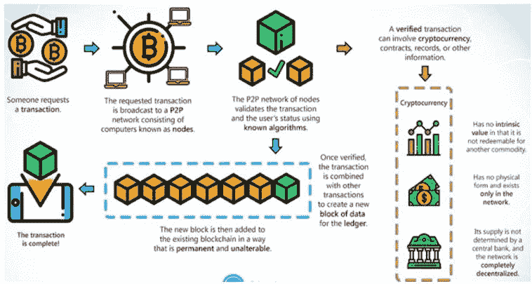

**图 3.2** 区块链的交易周期。

从简单来说，区块链是一系列带有时间戳的绝对记录，由不属于任何单一实体的计算机集群管理。这些数据块（即`block`）使用密码学原理（即`chain`）保护并相互绑定。

那么，区块链有什么特别之处，为什么我们说它有颠覆某些行业的能力？区块链网络没有中央权威——它是民主化系统的定义。由于它是共享的绝对账本，其中的信息对任何人可见。因此，构建在区块链上的任何东西本质上都是透明的，每个参与者都对自己的行为负责。3-(5](#c03.xhtml#bib_5)].

区块链是一个不可否认的明发明——一个被称为中本聪明的个人或群体的结脑晶。但从那以后，它已经演变成更强大的东西，每个人都在问的问题是：*区块链是什么？*

与物联网一起，区块链是过去几年另一个另一个热词，充满了前景，但在加密货币之外的实际成果较少。区块链是一种不可篡改的分布式账本。

区块链技术作为加密货币的应用（包括最著名的比特币）已得到广泛接受，尽管并不总是被很好理解。我们仍在寻找非加密货币应用的“杀手级应用”。许多初创公司和大型企业在这一方面已取得了巨大进展。2].

### 3.1.2 实时世界中的区块链

区块链不产生任何交易成本。区块链是一种简单而巧妙的方法，以全自动且安全的方式将信息从 `A` 传递到 `B`。交易的一方通过创建一个区块来启动过程。该区块由分布在网络各处的数千、甚至数百万台计算机进行验证。经过验证的区块被添加到链中并存储在整个网络中，这不仅创建了一个独特的记录，而且是一个具有独特历史的独特记录。伪造单条记录就意味着要在数百万个实例中伪造整个链。这在实际上几乎是不可能的。比特币使用这种模型进行货币交易，但它也可以部署在许多其他场景中。

想象一家铁路公司。我们在应用程序或网页上购买车票。信用卡公司会为处理交易收取一笔手续费。有了区块链，铁路运营商不仅可以节省信用卡手续费，还可以将整个票务流程转移到区块链上。交易的双方是铁路公司和乘客。车票就是一个区块，它将被添加到票务区块链中。正如区块链上的货币交易是一条独特的、独立可验证且不可篡改的记录（如 `Bitcoin`），你的车票也可以是。顺便说一下，最终的票务区块链也是某条特定铁路线甚至整个铁路网的所有交易记录，包含了已售出的每一张车票、每一段旅程。但这里的关键在于：它是免费的。区块链不仅可以传输和存储资金，还可以取代所有依赖于对双方之间的交易或其他任何交易收取小额手续费的流程和业务模式。

零工经济平台 `Fivver` 对个人间买卖服务的每笔交易收取 0.5 美元的费用。使用区块链技术，这笔交易就是免费的。因此，`Fivver` 将不复存在。拍卖和其他和其他基于做市者原则的业务实体也将如此。即使是最近的进入者如 `Uber`^(1) 和 `Airbnb`^(2) 也正面临着区块链技术的威胁。你只需要对乘车或过夜住宿的交易信息进行编码，你就拥有一种完美安全的方式，打破了那些刚刚开始挑战传统经济的公司业务模式。我们不仅在剔除处理费用的中间人；我们还在消除对匹配平台的需求。

由于区块链交易是免费的，你可以收取极小的金额，例如观看视频或阅读文章收取 1/100 美分。如果我可以在 `Facebook` 或我最喜欢的聊天应用程序上按文章付费，我为什么还要给《经济学人》或《国家地理》支付年度订阅费？再次记住，区块链交易不产生交易成本。你可以以任何金额对任何事物收费，而不必担心第三方侵入你的利润。

区块链可能通过消除音乐公司以及如 `Apple` 或 `Spotify` 等分销商，让艺术家销售录制音乐再次盈利。你购买的音乐甚至可以被编码在区块链本身中，成为已购买歌曲的云存档。由于收取的金额可以非常小，订阅和流媒体服务将变得无关紧要。

在金融领域，应用更加明显，革命性的变化也迫在眉睫。区块链将改变股市运作的方式、贷款组合的方式以及保险合同的方式。它们将消除银行账户和银行提供的几乎所有服务。一旦这种无交易费的安全账本的优势被广泛理解和实施，几乎所有的金融机构都将破产或被迫发生根本性变化。毕竟，金融系统的建立是基于在提供交易便利的同时收取你钱财的一小部分费用。银行家将仅仅是顾问，而不是金钱的守门人。股票经纪将不再能够赚取佣金，买卖差也将消失。

### 3.1.3 区块链的工作流程

想象一个在计算机网络中复制了数千次的电子表格。然后想象这个网络被设计为定期更新这个电子表格，而你对区块链有了基本的了解。区块链上存储的信息以共享且持续对账的数据库形式存在。这是使用网络的一种具有显而易见的优势的方法。区块链没有存储在任何单一位置，这意味着它保留的记录是真实公开且易于验证的。不存在此类信息的中心化版本可供黑客篡改。由于数据由数百万台计算机同时托管，互联网上的任何人都可以访问其数据 \[6\]。

根据他的研究报告，风险投资顾问、四次企业家、营销人员、战略家和区块链专家 William Mougayar 描述了区块链与传统的协作共享文档方式相比的优势。传统的协作共享文档方式是将 `Microsoft Word` 文档发送给另一个接收者并要求他们对其进行修改。这种场景的问题是，你必须等待收到返回副本后才能查看或进行其他更改，因为在对方完成之前，你无法对其进行编辑。这就是今天数据库的工作方式。两个所有者不能同时处理同一条记录。这就是银行维持余额和转账的方式；它们在转账时会锁定访问（或减少余额），然后更新另一方，最后重新开放。使用 `Google Docs`^(3)（或 `Google Sheets`），双方可以同时访问同一份文档，且该文档的单一版本对双方始终都是可见的。它像一个共享账本，但它是一份共享文档。当共享涉及多个人时，分布式部分就发挥了作用。

想象一下本该以这种方式使用的法律文件数量。与其将它们相互传递、丢失版本跟踪并与另一个版本不同步，为什么“所有”业务文档不能变成共享而不是来回传输呢？许多类型的法律合同非常适合这种工作流。你不需要区块链来共享文档，但共享文档的类比是非常有力的。

区块链之所以获得如此赞誉的原因是：

*   它不由单一实体拥有，因此它是去中心化的；
*   数据经过加密存储在内部；
*   区块链是不可更改的，因此没有人可以篡改内部数据；
*   区块链是透明的，因此人们可以追踪数据。

## 3.2 区块链与 5G 的数据经济

5G 是下一代（第五代）无线网络。与之前的代际网络一样，我们应该会在手机和平板电脑上看到常见的速度提升。然而，这次与不同之处在于，除了速度提升之外，5G 还承诺降低延迟（以获得更快的响应）并提高容量（以便连接更多设备）。这还增加了必要的安全性增强。在 5G 的所有新功能中，连接大量设备（包括更小、更廉价、低功耗的设备）的能力具有真正改变我们生活方式潜力。期待已久的物联网“革命”终于可以发生了！

5G 不仅仅是宽带网络的演进，更是一个具有全新特性的独特网络。这些特性将从网络容量增加、更短延迟、更高移动性以及增强网络可靠性和安全性方面为用户提供多种性能增强 [7\-[9]]。

让 5G 更令人兴奋的是，这种从 4G 的演进将允许移动运营商降低成本，每 GB 的成本大约比我们目前的 4G 网络低 10 倍。这意味着他们可以扩展到服务不足的郊区地区，并在不到两年内收回扩张投资。这使得扩张决策变得简单。

这种面向家庭和企业的新连接方式将让更多的人连接起来，从而参与这一不断增长的创新。这不仅意味着视频将在移动设备上无缝播放，您的 `Skype` 或 `FaceTime` 通话声音将变得更加清晰且没有中断，而且现在更多的人将接触到区块链将提供的未来创新。

区块链有潜力成为业务开展的框架，而 5G 将是其运行的网络。网络是加速数字转型的核心，功能完善的 5G 网络将带来前所未有的生产力提升，重新定义竞争优势并重塑每个垂直行业 [10]]。简单来说，5G 是所有技术实现影响最大化的推动者。5G 的惊人速度将辅助设备进行几乎实时的通信，并嵌入了连接智能。数字空间的数据爆炸开启了一个机会，丰富的洞察可以解决大问题。它可以帮助业务巨大的转型，并为客户提供丰富、有意义且沉浸式的体验。随着数据经济的充分发挥，工作和生活将发生根本性的变化 [11]]。

自动驾驶汽车、远程医疗和制造机器人等新应用将拥有满足其真实潜力的带宽，结果企业运营将更加高效。工人将花更少的时间在运营，而花更多的时间专注于创新和业务增长。那些做好充分准备以理解 5G 技术的人将通过为终端客户提供独特体验而大获益，这将冲击市场并为他们的企业创造战略差异化。

## 揭秘区块链——未来的操作系统

区块链有解决世界上许多最紧迫问题的能力。在最基础的形式，区块链是一种去中心化的账本，它是不可篡改的，并为用户提供了一种更快、更安全的方式来验证关键信息并建立信任。

区块链能够改变我们买卖物品、与他人互动以及验证从投票、房产记录到甚至我们的蔬菜产自何处的一切方式。它允许我们简化流程、降低成本，并让企业和相互负责。由于其巨大的潜力，我们预计区块链将是未来的操作系统。对区块链的很大兴奋源于消除中间环节和简化数据管理流程。

在现代供应链中，没有比区块链能够转型业务的更好的例子了。由于涉及多个方，供应链是碎片化且极其脆弱的。区块链使供应链变得可信且可追溯。过去几十年的创新速度是惊人的，我们正处于世界生活、工作和娱乐方式发生里程碑式变化的边缘。虽然 5G 和区块链仍处于早期阶段，但它们将显著地塑造我们的生活。5G 和区块链经济已经到来，现在是时候让我们发挥作用了 [12]]。


**图 3.3** 区块链与 5G 的协作。

今天我们有许多区块链解决方案，有些运行在快速的可信网络上，另一些则声称在那些不可靠的网络上运行得更快，有些甚至快得多。如果新的区块链确实可以在不可靠且不安全的网络上快速高效地运行，那么 5G 将不会对区块链操作产生任何实际影响。然而，目前还没有独立的数学证明说明这些快速解决方案将有效，而且我们已经见证了与推出更快的 `Ethereum` 相关的重大挑战，因此我们最好的服务可能是依赖于通过受信且快速的网络连接的受信节点——这样 5G 就可以提供帮助 [14]]。

像 Ben Whittle 这样的分析师已经预判了物联网（`IoT`）的影响多年。然而，其成功一直面临着两个主要阻碍：容量和安全。但现在，新技术的引入可能会改变这一点。今年，`AT&T` 和 `Verizon` 等主要运营商将引入 5G，这是最新一代蜂窝移动通信。根据分析师的说法，5G 平台带来了高数据传输率、低延迟、节能、降低成本、更高的系统容量和海量设备连接。

5G 和区块链技术的结合潜力释放巨大的经济价值。为了理解 5G 和区块链之间的这种联系，必须将这种关系视为多层面的。5G 覆盖通过其低延迟、高速度和容量允许物联网设备被广泛使用。同时，这些设备可以利用区块链的安全性、去中心化、不可篡改性和共识仲裁作为基础层。这意味着智能城市、无人车辆、智能家居和其他传感器驱动的增强将最终拥有能够处理它们需求的技术 [15]]。

## 3.3 区块链技术与 5G 移动连接的结合

区块链技术现在涵盖了多个领域，从农业到医疗，从虚拟游戏到媒体，从银行到外汇。区块链的大规模采用继续彻底改变各行业的业务流程。然而，在过去的几年里，该领域对创新的需求一直存在。特别是随着人工智能、机器学习和物联网等现代技术的日益普及，对区块链技术新发展的需求被深切感受到。

此外，5G 预计显著降低延迟，这将进一步帮助区块链实现更短的区块时间，从而提高可扩展性。这些特性将有助于与物联网（`IoT`）相关的项目，这是一个近期备受关注的未来派概念。欧洲的公司已经开始通过机器学习为自动驾驶汽车开发传感器。5G 可以加速传感器中底层区块链的运行，使其更加安全和可靠。除了这些之外，还有几个基于区块链的项目旨在创建智能城市、智能家居以及其他类似概念，这些项目在很大程度上依赖物联网 [16]`。

透明性、安全性和不可篡改性是区块链技术的主要特征，而 5G 将更多地关注数据速度、大规模数据传输和低延迟，而这些正是区块链领域某种程度上缺乏的。对分布式账本技术表现出浓厚兴趣的大型公司拥有资本和基础设施对该技术进行研究：例如像 `IBM`、`TCS` 和 `Microsoft` 等科技巨头可能会测试区块链与 5G 的集成。过去几年中，对区块链的需求呈指数级增长。2018 年，投资公司向基于区块链的初创公司投入了超过 52 亿美元，这一金额远高于上一年的 15 亿美元。

`HSBC` 和 `JPMorgan` 等银行巨头也分别建立了各自的区块链部门。仅 `HSBC` 一家在 2019 年就利用区块链执行了价值超过 2500 亿美元的外汇交易。随着区块链使用的扩大，数据传输量也将随之增加。

目前，传输的数据量远少于未来的预期。这对区块链来说是一个潜在问题，因为传输大量数据将阻碍区块速度，产生延迟。与 5G 连接的集成将有助于解决这一问题，因为最新一代移动连接技术能够以闪电速度传输海量数据。

## 3.4 如何结合使用 5G 和区块链

区块链技术可以在这一层面上运行，凭借其不可更改性和内在安全性的特性，允许数据传输和支付活动以安全且非侵犯的方式进行。然而，此时的问题在于区块链的可扩展性：如果被广泛应用于物联网，`DLT` 必须能够承受每秒极高数量的交易，而我们知道这是这类技术的弱点。

5G 将允许区块链上的实现在保持所需的安全环境的同时，顺畅且高效地运行。新的移动数据标准将成为数据传输的基础设施，区块链——作为准协议——将在其运行。

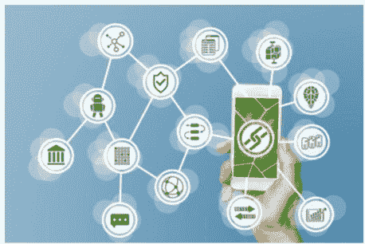

图 3.4 区块链与 5G 的融合

5G 和区块链技术的交点在于通过物联网（`IoT`）实现的微数据级。一些著名的区块链项目，如 `IOTA`，^(4) `VeChain`^(5) 和 `Walton Chain`^(6) 正在追求供应链管理和新兴机器机器（`M2M`）经济的用例。这些项目旨在从供应链沿将产生的大量传感器中收集数据。

例如，`Bitcoin` 可以支持 7 `TPS`，`Litecoin` 支持 56 `TPS`，`Ethereum` 支持 25 `TPS`，`BCH` 支持 61 `TPS`，`Tron` 支持 2000 `TPS`。然而，选择可能不会直接落在主链上，而是落在与主链重叠的二层区块链上，如 `BTC` 或 `LTC` 上的 `Lightning Network` 所示，能够提供主链无法提供的可扩展性。公共区块链可以作为城市、家庭和交通工具中广泛物联网与 5G 网络之间的接触元素，从而成为我们隐私和支付的保护者。

这种技术仍处于起步阶段，但如果没有 `DLT` 的配合，5G 将不会产生深远影响。当然，必须对 5G 网络在可能的健康损害水平上进行评估，正如最近布鲁塞尔的实验被封锁所强调的那样，该事件是由于对长期电磁波可能危险性的担忧引起的，而在需要深度覆盖的网络中，这种波要危险得多。但一旦这些问题得到解决，我们可能会看到人们生活中一场真正的革命。

## 3.5 区块链与 5G 的应用

### 3.5.1 智能合约

分布式账本允许编写简单的合约，这些合约将在满足指定条件时执行。`Ethereum` 是一个开源区块链项目，专门为实现这种可能性而构建。`Ethereum` 仍处于早期阶段，但潜力在真正改变世界的范围内利用区块链的有用处。在目前的技术水平下，智能合约可以被编程执行简单的功能。例如，当金融工具达到某些基准时，可以支付衍生品，利用区块链技术和 `Bitcoin` 可以实现支付的自动化。

### 3.5.2 数据管理

在今天，人们为了交换个人数据可以免费使用 `Facebook` 等社交媒体平台。未来，用户将有能力管理和出售其在线活动产生的数据。由于它可以很容易以小额分数的形式进行分发，`Bitcoin` 或类似的货币最可能是用于此类交易的货币。

目前，传输的数据量远少于未来的预示。这对区块链来说是一个潜在问题。`MIT` 的项目 `Enigma` 理解到用户隐私是创建个人数据市场的关键前提。`Enigma` 使用加密技术允许将数据数据集拆分到节点之间，同时对整个数据组进行批量计算。数据的碎片也使 `Enigma` 具有可扩展性（不像那些在每个节点上复制数据的区块链解决方案）。承诺在六个月内推出 `Beta` 版本。

### 3.5.3 供应链审计

消费者日益希望知道公司对其产品的伦理主张是真实的。分布式账本提供了一种简单的方法，来证明我们购买的物品的背景是真实的。透明性通过区块链对伦理钻石进行基于时间戳标记来实现，例如，这对应于一个产品编号。

位于英国的 `proven` 为一系列消费品提供供应链审计。利用 `Ethereum` 区块链，`Provenance` 试点项目确保在日本寿司店出售的鱼是由其印度尼西亚的供应商可持续采集的。

### 3.5.4 娱乐与多媒体

5G 将在手机上提供一个高清的虚拟世界。4K 视频的高速流只需要几秒钟，并支持水晶清晰的音质。现场活动可以通过无线网络进行高清直播。高清电视频道可以在移动设备上访问而无中断。娱乐业将从 5G 无线网络中极大获益。

5G 可以提供每秒 120 帧的高分辨率和更高动态范围的无中断视频流。在 5G 无线驱动的最新技术之后，视听体验将被改写。增强现实和虚拟现实需要低延迟的高清视频。5G 网络强大足以为 `AR` 和 `VR` 提供惊人的虚拟体验。高清虚拟现实游戏正变得流行，许多公司正在投资 `VR` 游戏。高速 5G 网络可以通过高速互联网提供更好的游戏体验。

### 3.5.5 智能家居

智能家用电器和产品正在追赶市场潮流。智能家居概念将利用 `5G` 网络进行设备连接和应用监控。智能电器将利用 `5G` 无线网络，可以从远程进行配置和访问，而闭路电视摄像头将为安全目的提供高质量的实时视频。

### 3.5.6 物流与航运

物流和运输行业可以利用智能 `5G` 技术进行货物追踪、车队管理、集中数据库管理、人员调度以及实时交付跟踪和报告。

### 3.5.7 无人机操作

无人机正变得流行，涵盖了从娱乐、视频采集、医疗和应急救援、智能交付解决方案、安全和监控等多种操作。`5G` 网络将通过高速无线互联网连接为广泛应用中的无人机操作提供强有力支持。在自然灾害等紧急情况下，人类进入许多区域的能力非常有限，而无人机可以到达并收集有用信息。

## 3.6 结论

全球联网世界技术进步的速度、社会挑战的兴起以及对稀缺资源竞争的加剧，加速了向数据驱动世界的转型。在这个生态系统中，区块链可以提供一个 `5G` 平台，分发超越协作组织结构的信任信息。

对于任何听过 `5G`（换句话说，第 5 代移动互联网）但尚未使用或尝试过的人来说，可能直接跳到 `6G`，而 `6G` 已经在接入区块链移动网络。未来，我们将依赖许多使用区块链的交易。技术的未来很大程度上取决于数据管理；因此，区块链与 `5G` 的集成可以在技术驱动型行业中创造奇迹。

## 参考文献

1. Downes, L., and Nunes, P (2014), `Big-Bang Disruption`, vol. 91. New York, NY, USA: Penguin Group
2. Mougayar, W. (2016). `The Business Blockchain: Promise, Practice, and Application of the Next Internet Technology`. John Wiley & Sons.
3. Whittle, B. (2019). Reinsurance blockchain: Simplifying the complex insurance industry. CoinCentral.
4. Shrivastava, G., Peng, S. L., Bansal, H., Sharma, K., & Sharma, M. (Eds.). (2020). `New Age Analytics: Transforming the Internet through Machine Learning, IoT, and Trust Modeling`. Apple Academic Press.
5. Ahokangas, P., Matinmikko, M., Yrjola, S., Okkonen, H., & Casey, T. (2013). Simple rules for mobile network operators’ strategic choices in future cognitive spectrum sharing networks. `IEEE Wireless Communications`, 20(2), 20-26.
6. Jaffrey, H. (2015). `Crypto 2.0 Lenses`. LinkedIn Pulse blog, April, 17. Available: [`www.linkedin.com/pulse/crypto-20-lenseshyder-jaffrey`](https://www.linkedin.com/pulse/crypto-20-lenseshyder-jaffrey)
7. Amit, R., & Han, X. (2017). Value creation through novel resource configurations in a digitally enabled world. `Strategic Entrepreneurship Journal`, 11(3), 228-242.
8. Kumar, P., Shrivastava, G., & Tanwar, P. (2020). Demistifying Ethereum technology: Application and benefits of decentralization. In `Forensic Investigations and Risk Management in Mobile and Wireless Communications` (pp. 242-256). IGI Global.
9. Backman, J., Yrjola, S., Valtanen, K., & Mammela, O. (2017, November). Blockchain network slice broker in 5G: Slice leasing in factory of the future use case. In `2017 Internet of Things Business Models, Users, and Networks` (pp. 1-8). IEEE.
10. C. P. Gurnani, Managing Director and CEO of Tech Mahindra.
11. Mattila, J. (2016). ETLA-Res. Inst. Finnish Economy, Helsinki, Finland, ETLA Working Papers. `Industrial blockchain platforms: An exercise in use case development in the energy industry`. [Online]. Available: [`pub.etla.fi/ETLA-Working-Papers-43.pdf`](http://pub.etla.fi/ETLA-Working-Papers-43.pdf)
12. Gupta, R., Shrivastava, G., Anand, R., & Tomazic, T. (2018). IoT-based privacy control system through android. In `Handbook of e-Business Security` (pp. 341-363). Auerbach Publications.
13. Tim Sloane (2019). Will The Melding of 5G And Blockchain Add Enormous Economic Value? [Online]. Available: [`www.paymentsjournal.com/5g-and-blockchainadd-economic-value/`](https://www.paymentsjournal.com/5g-and-blockchainadd-economic-value/)
14. Kumar, P., Quadri, M., Sharma, K., Gia, N. N., & Ranjan, P. (2018). Persistent cellular telephony: Enhanced secure GSM architecture. `Recent Patents on Engineering`, 12(1), 23-29.
15. BOND. (2019). Blockchains Boosting Industry Web Pages. [Online]. Available: [`www.vtt.fi/sites/BOND`](https://www.vtt.fi/sites/BOND)
16. Shrivastava, G., Kumar, P., Bala, S., & Dey, N. (Eds.). `Handbook of Research on Network Forensics and Analysis`.

# 第 4 章 区块链社交网络

过去十年，社交媒体平台已成为许多用户建立连接、分享内容和社交交互的入口。如今，通过洞察用户的习惯、偏好、关系、行为、内容和位置来利用客户信息已非常普遍。登录社交媒体网站为成为广告营销活动的目标铺平了道路。首先，目前存在的大社交媒体网站都是中心化的，并提供了充分利用用户内容的机会。隐私和数据安全是社交媒体平台关注的焦点。区块链凭借分布式账本和去中心化概念，通过加密来保护用户内容。`Whatsapp`、`iMessage`、`Signal`、`Wire`、`Threema` 等社交媒体平台为了安全遵循端到端加密。当元数据随消息一起交换时就会出现问题，从而为第三方窃取用户个人提供了机会。基于区块链的社交媒体提供的收益不仅限于安全和隐私：加密货币用于通过点对点营销中的支付和购买内容来实现安全通信。区块链有助于用户控制自己的内容。社交网络中区块链技术的去中心化方法确保了隐私，并实现了电子商务、众筹交易以及智能应用和合约。如今，`Facebook`、`LinkedIn`、`Instagram`、`Twitter`、`Reddit` 等数字社交媒体平台提供免费访问。显然，开发和服务器基础设施对于社交网络平台至关重要，而它们的利润重点在于社交网络业务时代的广告和分析。社交网络面临的基础性问题包括假新闻（`Facebook`）、过度的网络攻击（`Twitter`）、审查和取消盈利（`YouTube`）。

**关键词**：区块链，社交网络，社交数据

## 4.1 区块链与社交网络平台概述

`Obsidian Messenger` 遵循 `Stratis` 区块链去中心化的方式存储数据，并使用 `256-bit` 加密算法的端到端加密对图片、视频、文件、支付和消息进行加密。它适用于 `Windows`、`Linux`、`macOS`、`iOS` 应用和 `Android` 应用，并通过维护具有弹性、可靠的网络来获取加密货币。`Steemit` 是一个去中心化的网络，支持带有加密货币奖励的社交互动，用户因其贡献付费。`Nexus` 是一种去中心化的区块链方法，处理社交媒体中的许多操作。由于 `Kickstarter`、`Indiegogo` 等众筹网站存在内部货币，区块链消除了外部支付机制。`Synereo` 采用了使用 `WildSpark` 的区块链，用户因创作获得报。`Indorse` 等同于 `LinkedIn`，构建在以太区块链之上，用户可以拥有创建自己的内容、建立个人资料、连接的权利，并因贡献获得报。它还通过提供 `Indorse` 奖励和 `Indorse` 评分声誉系统来鼓励构建改进用户数据隐私和安全的平台。

区块链社交网络提供：

1. 透明度和治理；它实施了透明的民主进程，允许不同的服务器和开发者验证交易。
2. 内容变现；使用加密货币时无需第三方干预。
3. 数据控制；确保“安全的身份生态系统”。
4. 由于采用了去中心化概念，避免了单点故障。

区块链社交网络必须专注于克服抄袭、机器人、代币经济学和先发优势。区块链从以下方面改变了社交媒体：

1. 验证在线身份。
2. 市场验证。
3. 结合加密货币与区块链技术。
4. 加密货币收藏品。
5. 区块链智能合约拦截虚假内容。

根据高特最近的《新兴技术热周期》报告，区块链正进入“幻灭期”。根据高特专家 Mike Walker 的说法，区块链平台预计将在未来 10 年内成熟。德勤进行的一项调查显示，44% 的“精通区块链”的美国高管和 39% 的来自英国、德国、法国、中国和加拿大的高管认为“区块链被过度炒作”。本章概述了各种基于区块链的社交媒体平台。它强调了区块链社交网络面临的研究挑战和问题。

### 4.1.1 区块链的基本结构

在线货币交易的潜在增长为对信任结构的需求铺平了道路。由于限制，金融机构面临着不可避免的争议。这导致了小额交易的停止以及部分欺诈交易。通过引入一种可以在没有中介的情况下相关双方之间进行安全交易的加密方法，对第三方的需求被认为是不必要的。在考虑了所有优缺点后，中本（Nakamoto）定义了一种“电子币”，它是一种数字签名链。这一独特概念将上一次交易哈希与下一个所有者的公钥作为数字签名附加，以实现安全支付。区块（Block）或节点是指示流程中每个部分的名称。在 2008 年的主要工作中，利用 `SHA-256` 展示了这种创新方法的有效性。网络从新的交易信息传递所有节点开始，随后由节点将交易形成区块。当一切完美时，区块被传输到所有节点，并且只有在有效且未曾使用过时才会通过。该过程随着哈希概念流动。加密货币是在数字格式中实现端到端现金交易的一种简单方式。对替代货币的需求是因为局部性、金融机构的低效、投机、技术以及其他政治经济的不确定性。各种区块链利益相关者，包括研究人员、投资者、监管机构和商户。加密货币的成功是因为开源软件是全球、快速、安全、可靠、自动化、点对点、灵活、可扩展并具有高度说服力的集成。比特币是第一种加密货币，随后是各种国家级如 `SpainCoin (SPA)`、`IrishCoin (IRL)` 等，以此类推。

比特币震撼了资本市场。因此，在没有任何第三方的情况下，交易发生了。图 4.1 展示了持有序列区块的区块链概念。

```


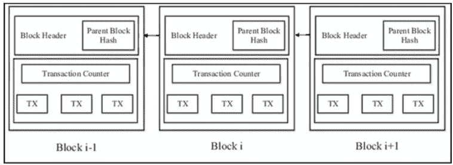

图 4.1 示例

区块结构由区块头和区块体组成。区块头包含区块版本、梅克尔根哈希、时间戳、随机数和父区块。同样，区块体包含交易计数器和交易。区块链的初始区块俗称为创世区块。图 4.2 描述了区块的结构。

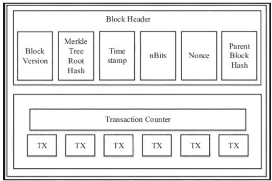


# 图 4.2 区块结构

根据共识确定、读取权限、不可篡改性、效率和共识过程的属性，区块链被分为公有链、联盟链和私有链。不同的算法支配着不同类型的区块链。

区块链通过去中心化的方式运行，包含六层以执行不同的服务。数据相关的操作（如收集和整理）由数据层和网络层执行。共识层和合约层涉及通过工作证明（`PoW`）、权益证明（`PoS`）和重要性证明（`PoI`）概念在区块链用户之间进行同步决策以及合约相关的事务。最后，区块链的实现和部署由服务层和应用层完成。

区块链中的数据和信息按时间顺序排列。由于区块是顺序同步的，数据结构类似于链。在私有链类别中，完全分布式系统在本质上权限较 own，任何节点都可以参与任何文件操作。在联盟链中，它是中心化的并由权威控制，因此专门用于小型目标群体或组织。联盟链是公有链和私有链的混合 [4]。

区块链是一项热门研究，应用于各个领域，如公共服务、娱乐（特别是音乐行业）、教育、医疗保健、网络安全、投票等。它最初部署在商业和工业领域，并逐渐进入所有主题领域。它嵌入了物联网（`IoT`）、大数据概念和深度学习思想，使系统具有高度的信息量且充满趣味 [5, 6]。

## 4.1.2 社交平台综述

社交平台的功能使得具有相似兴趣和活动的人之间能够建立关系。它大致分为四类：朋友聚会的社交网络、用户通过互联网连接的分布式社交网络、非社交的人际关系链接，以及基于特定资源搜索的社交导航 [7]。

社交网络在多功能领域找到了自己的道路，并使用了不同的人群，如政府机构、商业、约会、教育、金融、众包、医疗健康、社交和政治。社交网络的普及可以从用户参与度的提高以及在网站上花费更多时间的人数增加推断出来。统计收集的数据以图的形式给出图 4.3 中；^(3) 比较使用了 Facebook 和 YouTube。

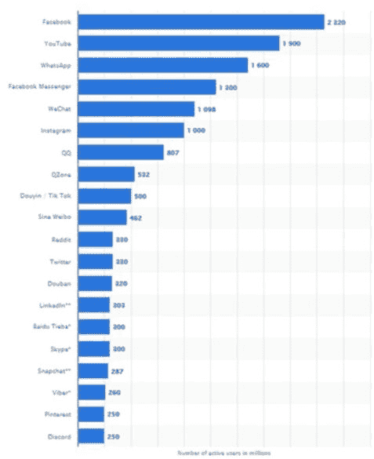

**图 4.3** 2019 年 4 月的热门社交网络。

社交网络连接个人或组织，并有助于与相同或不同领域的人合作。它还有助于解决复杂问题，例如在大范围内提供评论、引用和会议邀请。统计分析帮助社交网络研究人员深入了解子网络和个体的模式。邻接矩阵法用于出版，并让作者们可以在同一主题上结合工作。对称和非对称方法被应用于邻接矩阵的分析。通过类比，用户可以更好地理解社交平台的最终目标 [8]。

Muller 和 Peres 论述了人们如何对创新产品产生热情，以及分销商如何通过营销其产品来达到其目标。这一过程主要通过建立对产品的认知和了解该产品来完成。社交网络理论的动力是构建一个高性能的网络。二元连接的创建使得大量的关系连接到大量的节点。种子策略是实现目标最重要的方式。推荐计划有助于带来新客户 [9]。

## 4.1.3 社交媒体与区块链之间的关系

内容是社交媒体中的核心元素，通过赋予其区块链特性，可以优化对内容的控制并提高安全水平。通过对事件流的持续监控，热门帖子将得到突出。虚假实体受到控制，从而可以获得高度认证的合法内容。在线实体的验证是通过适当的检查完成的。社交媒体的未来将受到加密货币的极大影响。基于区块链的发展的用户控制机制非常值得赞。众筹和 `P2P` 销售实现了最大化。

# 4.2 去中心化在线社交网络

## 4.2.1 分布式在线社交网络架构

在线社交网络是这一代的流行术语。随着社交网络的发展，全球范围内的互动水平不可避免地增加，导致了其使用的利弊。通过这种社交网络产生的数据呈指数级增长。《数据永不睡眠》（Data Never Sleeps）展示了通过在线社交网站产生的海量数据。每分钟产生的数据如图 4.4 所示。

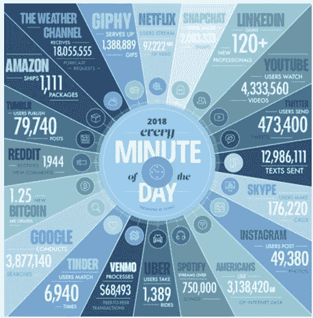

**图 4.4** 每分钟产生的数据（由 Domo, Inc. 提供）。

分布式在线社交网络（`DOSN`）是从传统的中心化架构升级为，根据社交网络的需求部署不同的分布式模型 [10]。社交网络由各种利益相关者治理，从用户、提供者、广告公司和其他媒体消费者开始 [11]。

通过去中心化过程，与在线社交网络相比，获得了所有权方面的益处，如隐私、资源的动态选择和开放性。分布式在线社交网络是三层模型。

图 4.5 展示了核心和扩展部分的组件，由两个子层组成。核心组件包括访问控制、配置存储和覆盖层。扩展层持有 `API`、推荐系统、搜索方案和社交网络连接器 [12]。推荐系统是感知社交、基于标签和感知位置的 [13]。

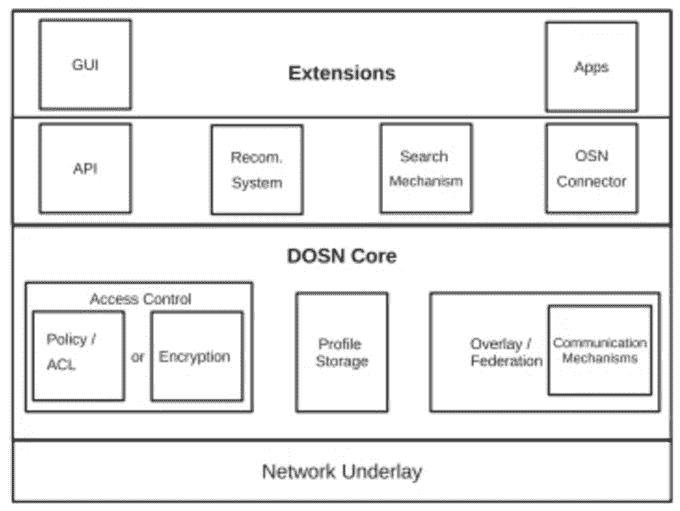

**图 4.5** DOSN 架构。

该结构从顶部的社交网络层开始，提供聊天、帖子、邮件等功能。中间层帮助数据的对点事务。底部是通信和传输层，持有互联网和其他相关基础设施。

分布式在线社交网络根据对等分为三类：基于分布式哈希表（`DHT-based`）、基于社交覆盖（`SO-based`）和基于外部资源。`DHT` 中的数据管理是加密的，而其他则利用信任节点进行存储。数据管理服务围绕数据可用性、信息扩散、隐私和安全的理念展开 [14-(16](#c04.xhtml#bib_16)]。

## 4.2.2 社交数据表示

与社交网络结构类似，`DOSN` 也围绕具有独特配置身份的用户运行，以展示其个性。社交数据的表示是分布式社交网络环境中一种有趣的现象。它的特殊之处在于它由多个以互操作方式工作的社交网站组成。

社交配置以分级的方式维护，每个节点都持有社交内容。根节点是入口。每个节点包含一个二进制分支，一个持有唯一标识符，另一个持有隐私策略。`图 4.6` 显示了各种活动的流程。

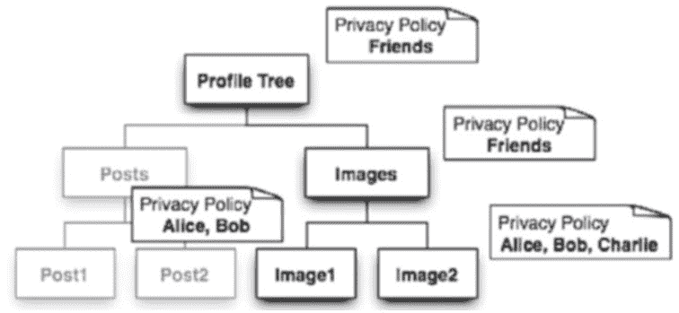

**图 4.6** 社交内容的分级组织。

在线社交网络的架构具有高度的革命性，因为它以极快的速度为全球用户提供最佳输出。用户隐私是一个备受关注的问题，可以认为是在线社交网络中的主要问题。频繁发生的泄露事件使得必须拥有一种最优的设计来解决社交网络中的所有障碍。

`DECENT` 架构中部署了分布式哈希表（`DHT`）以确保安全性和机性性设计阶段的模块化有助于将加密执行从基础对象模型中分离，并利用任何类型的 `DHT`。每个对象拥有三种访问策略，即基于属性的、基于身份的或两者的混合。参与者排列在 `DHT` 中。版本号用于确保新或新鲜节点的加入。写入策略考虑了数字签名算法。`DECENT DHT` 保证了读、写和追加等请求。为了说明一个序列，它从 `join` 开始以建立联系，随后通过 `post` 和 `comment` 处理每个对象。

`图 4.7` 显示了对象结构的一个实例 `[17]`。在 `LifeSocial.KOM` 中，部署了分布式链表来存储到唯一原子对象的对象。引入了多个插件，并且它是 `P2P` 网络中第一个具有各种功能的、完全可执行的社交网络 `[18]`。在离散网络中，使用悬停卡（`hCard`）来存储用户配置文件。市场上各种 `P2P` 网络的兴起证实了增长，以及在竞争和交互的世界中对多功能用户的需求。

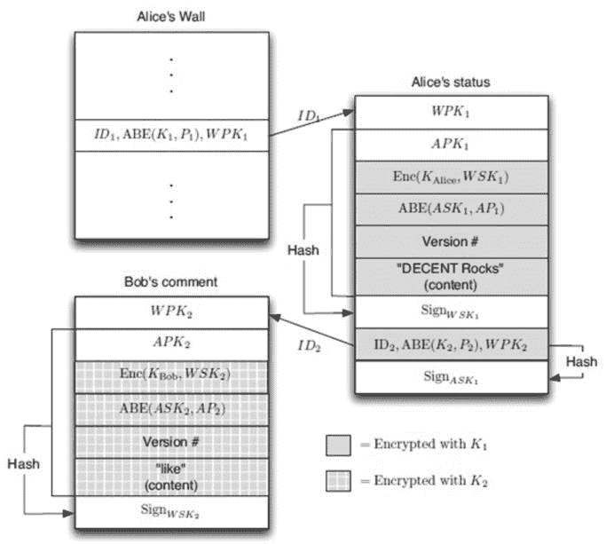

**图 4.7** 对象结构的一个实例。

## 4.2.3 安全问题

互联网时代的典型威胁包括垃圾邮件攻击（不受欢迎的消息）；恶意软件（恶意程序）；网络钓鱼攻击（入侵者入侵并获取个人详情）；以及跨站脚本。

现代威胁包括点击劫持（UI 伪装攻击）；去匿名化攻击（基于数据挖掘方法的策略、虚假个人资料、身份克隆和推理攻击、信息和位置泄露）；网络跟踪（通过互联网骚扰个人或设置）；以及用户画像（利用机器学习概念分析普通用户，并对监控人类活动进行监控，导致用户隐私被陷阱在其中）。

部署区块链共识延迟会向节点发送错误信息，例如拒绝服务（`DoS`）和双重交易 `[19, 20]`。

# 4.3 基于区块链技术的可信社交网络

大规模系统中的谣言传播将对电子经济和电子社交平台产生巨大影响。然而，在理论和实践方面都需要有效的谣言传播机制。在区块链的帮助下，可以限制谣言的传播。

特别是，推动了一种配备区块链技术的社交媒体新范式。它结合了去中心化合约以确保信息交换并激励可信网络。设计了一种基于区块链的顺序算法，它使用虚拟信息信用进行所有的点对点信息交换。验证了其在基于区块链的社交网络中减少谣言传播的有效性。

千年来，谣言在人类历史中在世界范围内持续存在。谣言被定义为一种未经证实的信息单元，这种信息在人之间传播，涉及特定的事件、对象或公众关注的问题 `[21]`。快速传播率和更紧密的连接为谣言的触发铺平了道路，导致更多的恐慌 `[22]`。近期研究强调了防止和避免谣言传播的技术。

社交网络的多样性、动态谣言传输的复杂性、信息媒体的剧增以及谣言爆发的根源尚未确定，且缺乏有效的方法来消除谣言 `[23]`。因此，区块链技术非常适合，并在金融领域取得了成功。信息交换过程必须重新设计为基于合约的过程。基于区块链的成对谣言传播风格更适用于信息的交换和传播。

基于区块链的智能合约设计被引入信息交换；为参与社交网络的每个成员分配了虚拟累计信用。收集的信用是成员的信誉以及社交网络中的相应信息。为了避免在大范围内传播虚假新闻，设计了一个具有非线性系统的图模型。

个人对基于区块链的点对点信息的交换真实性更加谨慎。所提出的方法有效减少了由于虚信息交换和传播造成的经济和社会损害。引入了区块链特性以解决社交网络中的谣言传播问题。基于区块链的信息交换架构如图`图 4.8`所示。

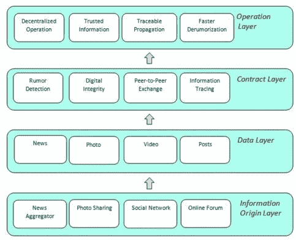

**图 4.8** 基于区块链的信息交换架构。

## 4.3.1 谣言传播模型

谣言是社交网络中传播的未经证实的信息部分。过去对谣言的研究涉及了社会学、物理学和心理学的跨学科努力。讨论了用于谣言建模和管理其严重性的各种方法 `[24, 25]`。谣言在异质社交网络的经典谣言模型中传播。在他们的综述中，Moreno 等对用于模拟谣言传播的随机过程提供了更好的理解 `[26]`。

社交网络中存在许多影响力谣言传播者 `[27]`，且传播不信任信息的概率更高。`SIR`（易感、感染、恢复）被提出作为谣言传播模型，以控制社交媒体和网络中的谣言严重性。

在 `SIR` 过程中，易感节点被感染节点感染，并恢复到移除状态。在这项工作中，假设无知者极受传播者的影响，而传播者实际上转变成了抑制者。

区块链技术被应用于社交网络，并研究了其对谣言传播的影响。区块链技术具有由不断增长的区块列表组成的相互连接的链 [28]。每个区块都包含记录和时间戳。它是一个纯粹的点对点网络，每个节点中的记录都会传播到其他节点。

这种模型防止了未经验验证的数据修改，并作为比特币的核心组成部分。区块链的显著优势在于其高安全性、去中心化和可信性，这为比特币作为一种创新货币铺平了道路。实施基于区块链的协议以构建一个去中心化的网络 [29]。

区块链被应用于供应链管理以实现更好的质量和可信度；在这种场景下，追溯性问题得到了解决 [30]。区块链在电网行业中也受到青睐 [31]，消费者通过在分布式网络中可靠且廉价地验证信息从中受益。

同时，物联网（`IoT`）与区块链的融合通常会增加云存储的使用 [32]。它在身份管理、公证和在线交易等许多应用中也发挥着作用 [29]。

了一种 `SIR` 流行病模型用于分析社交网络中一组固定参与者的谣言传播动态。在该随机模型中分析了峰值、收敛速率和最终状态等时间特征。讨论了现实场景中的实际问题以及区块链技术的影响如何减少谣言的传播 [33]。

考虑一个无向图 `G` = (`V`, `E`)，其中 `V` 和 `E` 代表社交网络中个人和社交交互的顶点和边集。假设同质人口数量是固定的，图 `G` 中所有节点的度分布符合泊松分布：

(4.1)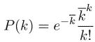

其中  表示图 `G` 的平均度，`P` (`k`) 指在顶点集 `v ∈ V` 中观测到度 `k` 的概率。

基于规则的分类方法将顶点分为 3 个可转换的集合，例如传播者集合 `S`、无知者集合 `I` 和抑制者集合 `R`。这三类如下：

### 4.3.1.1 密度为 `I(t)` 的无知者

在经典的 `SIR` 模型中，易感个体被称为无知者。当一个无知者在时间 `t > 0` 与一个与谣言真假密切相关的传播者接触时，它有概率 `λ` 形成传播者。同时，无知者有 `η` 的概率变成抑制者，即对谣言不再感兴趣。

### 4.3.1.2 密度为 `S(t)` 的传播者

传播者的贡献在于 `G` 内部的谣言传播。如果一个参与配对会面的传播者试图用谣言感染其他个体，且该传播者在时间 `t > 0` 时正在与抑制者通信，则该传播者有 `γ` 的概率转换为抑制者。在某一时刻，传播者可能会忘记谣言，然后以 `δ` 的速率转换为抑制者。

### 4.3.1.3 密度为 `R(t)` 的抑制者

抑制者的重要贡献在于对谣言的最终清除。它在该随机模型中被视为吸收状态，抑制者的密度通过将无知者和传播者都转换为抑制者来积累。

分别推导了 `I(t)`、`S(t)` 和 `R(t)` 的微分方程：

(4.2)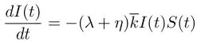

(4.3)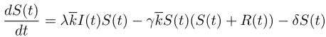

(4.4)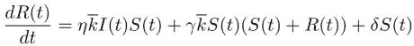

## 4.3.2 用于谣言传播的区块链协议

提出了一种集成到用于信息交换的社交中的区块链协议。社交网络采用区块链技术来实现隐私和安全，从而防止大规模谣言的传播。实施基于区块链的协议以构建去中心化网络。

通过包含私有合同和公共合同，该协议的主要目标是防止或避免未信任信息的传播。为了激励信任信息的传播，为每个参与者引入并分配了累积虚拟信用。

### 4.3.2.1 私有合同

对于双方之间的信息交换，私有合同在传播者和接收者之间协商并达成。私有合同在时间戳 `t` 进行。例如，如果接收者的愿望实现，则向传播者 `s` 支付虚拟信用 `credrs`，同时传播者向接收者发送 `infosr`。一旦一旦验证为可信，就可以支付信用。因此，接收者的累积信用将增加。假设信息被验证为未信任信息（谣言），则接收者的累积信用将减少。

点对点信息交换的私有合同算法如下：

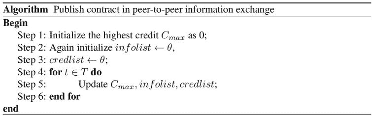

最初，此类信任合约的初始参与者密度记为 `I[B]`，未签署合约的参与者记为 `I[N]`。`I[N]` 符合无知者动力学，将无知者转换为传播者和抑制者的概率分别表示为 `λ[N]` 和 `η[N]`。

如果两个成员之间存在信息交换，且至少有一人属于 `I[B]`，则使用可靠且安全的共识协议来对信任合约中参与者的预定义信用额度达成共识。因此，来自 `I[B]` 的个体参与者具有访问区块链合约中定义的公共信息的权限；成员们在信息交换期间对彼此虚拟信誉的估计不同。因此，`I[B]` 和 `I[N]` 的动力学将会存在差异，概率分别表示为 `λ[N]` 和 `η[N]`。

`S(t)`、`R(t)`、`IN` 和 `IB` 的动力学是基于区块链的社交网络得出的：

(4.5)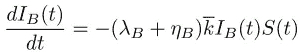

(4.6)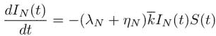

(4.7)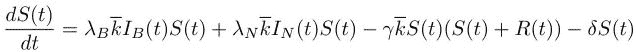

(4.8)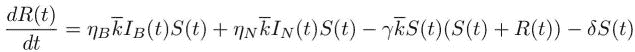

## 4.3.3.1 谣言传播率

如果个体成员签署了信任合约，他在整个网络中的区块链交易中有一条额外记录。通过累积虚拟信用来计算信息交换的额外估计值，这为某些交易中缺失的额度提供了更好的验证。

通常，如果两个个体成员之间的私有合约达到较高的值，来自 `I[B]` 的参与者应对当前的信息交换非常小心。那么，来自 `I[B]` 的参与者就不会受到谣言传播的影响。同时，在条款方面失去兴趣的成员将直接转换为抑制者。

来自 `I[B]` 类别的无知者对抑制者 `R` 做出了良好的贡献，但对传播者 `S` 的贡献有限。

(4.9)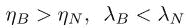

## 4.3.3.2 遗忘机制

区块链 `SIR` 模型下的遗忘机制同时考虑了传播者和传播者的“忘记”过程。因此，它减少了虚假信息留在公共记录中的可能性。对于通过区块链技术的给定群体 `G`，`δ` 更高的值。因此，基于区块链的社交网络可以获得从传播者 `S` 到抑制者 `R` 更高的吸收率。

# 4.4 社交网络的隐私保护服务

现代世界由于智能能源网和城市、物联网（`IoT`）、无处不在的移动计算以及社交媒体的普及，正受到海量数据的驱动。用户之间的交互已经进行，他们之间的数据共享也在发生。区块链的概念吸引了许多用户和研究人员关注采用各种加密技术以提供对系统的控制。

在 2013 年，设计了一种基于交易的状态机以太坊来编程区块链技术。区块链独特且显著的特征，如安全性、数据的不可篡改性、完整性、授权、系统透明度、可审计性和容错性，已应用于多个领域，如工业 4.0 \[34-35\]、农业 \[36\]、智能交通 \[37-39\]、身份管理 \[40\]、移动群体感知 \[41\]、以及关键任务系统中的安全 \[42\]。

区块链加密货币吸引了用户并受到了广泛关注。其安全性取决于计算能力而非中央权威，这反过来消除了某人控制系统的风险 \[43\]。

通常，信息传播是自然界中的常见现象。在过去，人们遵循线下通信等传统方法。但随着网络技术的进步，通过在线社交媒体进行的信息传播本质上是快速的。最近，社交网络已成为人们相互交流的常见平台。许多研究人员分析了由于社交网络结构导致的信息传播 \[44\]。

在公共场合传播的错误信息被识别为谣言 \[45\]。避免谣言传播的机制 \[46\] 是目前吸引研究人员的建模技术。谣言的产生和传输是在长时间内完成的。由于由于，信息的真实性至关重要。通常，区块链技术的发展是在点点之间的金融交易中实现的。因此，这可以扩展到在社交网络上实现基于信任合约的传播。必须开发一种技术，借助区块链技术评估社交媒体中信息的真实性，这样就不会有传播谣言的可能性。

SocialX 是一个去中心化的区块链平台，每个人都可以获得加密货币 `SOCX` 令牌奖励。它允许用户在安全的平台上拥有自己的视频、照片和群组。此外，它还内置了许可管理功能。这一功能为用户提供了保留自己的照片或将其出售给其他用户的便利条件。如果用户愿意将照片出售给他人，就可以用照片权兑换 `SOCX` 令牌。

### 4.4.1.3 Indorse

Indorse 是一个基于区块链的社交网络。它主要为专业人士构建，类似于 LinkedIn。用户验证通过区块链技术辅助完成，并支持匿名对特定用户的技能支持。此外，参与者可以通过所付出的努力增加声誉。用户可以使用在平台上获得的 `IND` 令牌购买广告和公司页面。平台已部署聊天机器人以进行自动实时验证。

### 4.4.1.4 onG.Social

通过 `onG.social` 这种基于区块链的社交媒体，中心化和去中心化的社交媒体网络都可以被轻松地控制，此外它还通过加密货币奖励和社区建设来支持社交互动。它运行在两条区块链上，即 Ethereum（以太坊）和 Waves Platform（波场平台）。

其显著特征是个人内容可以通过该媒体同时分享到所有网络中。参与者的努力在网络内部实现了货币化。通过确定提交内容的全球影响来对帖子进行真实性认证。此外，公众可能会极大的动力去创作高质量内容，从而消除虚假新闻。

### 4.4.1.5 Minds

Minds 是一个去中心化且开源的社交网络，用户可以通过其对网络做出的贡献获得加密令牌。该媒体是根据隐私、自由表达和透明的原则构建的。通过区块链技术，提供了安全性和透明度。此外，它还构建了一个以移动为优先的商业基础设施，在用户之间营造了顺畅的用户体验和直观的界面。

## 4.4.2 区块链在社交媒体中的影响

### 4.4.2.1 way 与新闻的验证

区块链可以执行身份和信息验证以及对发布的数据进行检查等活动。通过 `0xcert` 协议开发的框架构建了去中心化应用，使用户能够在区块链上身份验证并管理他们的数字资产，例如教育证书或游戏物品。该框架可用于验证在线上共享的数据和新闻。

### 4.4.2.2 更好的用户控制机制

信息操纵、提供给第三方的信息以及为社交媒体所有者建立收入流（而这些收入不应与那些信息被出售的用户共享），有时会导致个人和财务信息的黑客攻击。实施区块链可能会干扰所有这些活动。

选择访问信息的人员是用户的选择。此外，用户可以通过支付费用直接联系广告商和第三方来共享信息。

### 4.4.2.3 区块链杠杆与众筹

通过众筹，运行在区块链上的社交媒体可以筹集资金。支付处理、合同跟踪和用户验证可以通过区块链提供的基础设施完成。用于存储信息的去中心化账本为每笔交易提供了安全性和透明度，从而使用户能够众筹或出售他们的产品和服务。

区块链技术的市场价值在未来几年内将实现巨大增长；在全球范围内，它到 2023 年可能达到 233 亿美元。专注于区块链技术的潜力及其防篡改的分布式账本特性，它在不同领域提供了巨大的用途。从 2018 年到 2023 年的区块链技术市场规模如图所示。

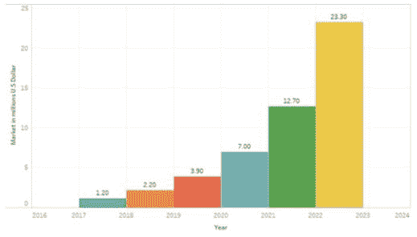

**图 4.10** 区块链技术市场规模。

# 4.5 区块链在社交网络面临的问题与挑战

数据采集、隐私和内容审查等问题在 Facebook、Instagram、Twitter、LinkedIn 等社交网络中极具挑战性。区块链技术解决了传统社交网络出现的主要瓶颈。

1. **对数据的控制**：目前对社交网络中流传的内容没有控制权。如果用户在社交网络中有个人账户，他们将控制自己的个人信息和内容。社交网络所有者对用户查看或不查看的内容拥有完全控制权。区块链的去中心化本质消除了中间环节的角色，社交网络上发布的内容可以被轻松追踪。它永远不允许复制且内容由特定用户删除；未经的第三方无法访问并从被删除的内容中获。
2. **近期**，参与社交网络的用户受到不同类型的攻击，这可能会暴露用户的个人信息。
3. **传统社交网络**由于其中心化的本质，极易受到各种攻击。
4. **区块链通过其分布式特性消除了单一实体的影响**。每笔交易都通过区块链进行清晰的追踪和审计，避免了数据篡改。
5. **一旦用户在社交网络平台上获得了对其内容的控制**，无关的内容（如不需要的广告）将不可见。

区块链使社交媒体变得更有两个主要趋势：

- 在线身份得到验证和确认。
- 虚假内容通过智能合约受到限制。

# 4.6 结论

讨论了有区块链和无区块链的社交网络中的谣言传播动态。阐述了区块链技术如何结合虚拟积分。因此，区块链技术避免了大规模谣言传播并鼓励了信任信息的交换。社交网络的使用快速增长导致了确保隐私和前景方法的方法的构建。此外，电子商务交易和众筹交易也是可能的。

# 参考文献

1. Nakamoto, S. (2008). *Bitcoin: A peer-to-peer cash system*.
2. Chuen, D. L. K. (Ed.). (2015). *Handbook of Digital Currency: Bitcoin, Innovation, Financial Instruments, and Big Data*. Academic Press.
3. Zheng, Z., Xie, S., Dai, H., Chen, X., & Wang, H. (2017, June). An overview of blockchain technology: Architecture, consensus, and future trends. In *2017 IEEE International Congress on Big Data (BigData Congress)* (pp. 557-564). IEEE.
4. Lu, Y. (2019). The blockchain: state-of-the-art and research challenges. *Journal of Industrial Information Integration*.
5. Atlam, H. F., & Wills, G. B. (2018). Technical aspects of blockchain and IoT. In *Advances in Computers* (pp. 1-39). Elsevier.
6. Casino, F., Dasaklis, T. K., & Patsakis, C. (2018). A systematic literature review of blockchain-based applications: current status, classification and open issues. *Telematics and Informatics*.
7. Thelwall, M. (2009). Social network sites: Users and uses. *Advances in Computers*, 76, 19-73.
8. Dunn, T. J., Baguley, T., & Brunsden, V. (2014). 从 alpha 到 omega：解决普遍性内部一致性估计问题的实用性解决方案。*British Journal of Psychology*, 105(3), 399-412.
9. Muller, E., & Peres, R. (2019). 社交网络结构对创新性能的影响：综述与研究方向。*International Journal of Research in Marketing*, 36(1), 3-19.
10. Tanenbaum, A. S., & Van Steen, M. (2007). *分布式系统：原理与范式*。Prentice-Hall。
11. Falch, M., Henten, A., Tadayoni, R., & Windekilde, I. (2009, 11 月). 社交网络中的业务模型。在*CMI Int. Conf. on Social Networking and Communities*.
12. Paul, T., Famulari, A., & Strufe, T. (2014). 去中心化在线社交网络综述。*Computer Networks*, 75, 437-452.
13. Campana, M. G., & Delmastro, F. (2017). 在线和移动社交网络的推荐系统：综述。*Online Social Networks and Media*, 3, 75-97.
14. Strufe, T. (2009). Safebook：一种利用现实信任的隐私保护在线社交网络。*IEEE Communications Magazine*, 95.
15. Mega, G., Montresor, A., & Picco, G. P. (2011, 8 月). 去中心化社交网络中的高效传播。在*2011 IEEE International Conference on Peer-to-Peer Computing* (pp. 338-347). IEEE。
16. Guidi, B., Conti, M., Passarella, A., & Ricci, L. (2018). 去中心化在线社交网络中的社交内容管理：综述。*Online Social Networks and Media*, 7, 12-29.
17. Jahid, S., Nilizadeh, S., Mittal, P., Borisov, N., & Kapadia, A. (2012, 3 月). DECENT：一种用于强制在线社交网络隐私的去中心化架构。在*2012 IEEE International Conference on Pervasive Computing and Communications Workshops* (pp. 326-332). IEEE。
18. Graffi, K., Gro, C., Mukherjee, P., Kovacevic, A., & Steinmetz, R. (2010, 8 月). LifeSocial. KOM: 一个基于 P2P 的安全在线社交网络平台。在*2010 IEEE Tenth International Conference on Peer-to-Peer Computing* (P2P) (pp. 1-2). IEEE。
19. Taylor, P. J., Dargahi, T., Dehghantanha, A., Parizi, R. M., & Choo, K. R. (2019). 区块链网络安全的系统文献综述。*Digital Communications and Networks*.
20. Ali, S., Islam, N., Rauf, A., Din, I., Guizani, M., & Rodrigues, J. (2018). 在线社交网络中的隐私与安全问题。*Future Internet*, 10(2), 114.
21. Peterson, W. A., & Gist, N. P. (1951). 流言与舆论。*American Journal of Sociology*, 57(2), 159-167.
22. Bordia, P. (1996). 研究互联网上的言语交互：流言传播的案例。*Behavior Research Methods, Instruments, & Computers*, 28(2).
23. Doerr, B., Fuzhi, M., & Friedrich, T. (2012). 社交网络中的流言传播。*Communications of the ACM*, 55(6), 70.
24. Allport, G., & Postman, L. (1947). 流言的心理学。New York: Holt。
25. Rosnow, R., & Fine, G. (1976). 传闻的心理学（The Psychology of Hearsay）。
26. Moreno, Y., Nekovei, M., & Pacheco, A. (2004). 复杂网络中的流言动力学。*Physical Review E*, 69.
27. Brito, J., & Castillo, A. (2017). 社交网络中的流言传播。*Journal of Statistical Mechanics: Theory and Experiment*.
28. Zyskind, G., & Nathan, O. (2015). 区块链：面向决策者的入门。George Mason University。
29. Chen, S., Wang, J., Yu, R., Deng, D., & Zhang, Y. (2017). 工业物联网中的区块链解决方案。*IEEE Transactions on Industrial Informatics*, 14(8), 3690-3700.
30. Tian, F. (2016, 6 月). 区块链技术创新。在*2016 13th International Conference Technology & Engineering Management (TEMSCON)* (pp. 137-141). IEEE。
31. Ahram, T., Sargolzaei, A., Sargolzaei, S., Daniels, J., & Amaba, B. (2017). 利用区块链实现电网现代化。*Harvard Business Review*.
32. Chen, Y., Li, Q., Kang, J., Ye, D., Bouhhel, M. S. (2018). 基于区块链的可审计存储与共享。*arXiv:1801.0276*.
33. Huang, X, Xu, C., Wang, P., & Liu, H. (2018). LNSC：基于区块链生态系统的电动汽车充电桩管理。*IEEE Access*, 6, 13565-13574.
34. Dorri, A., Steger, M., Kanhere, S., & Jurdak, R. (2017). 区块链：汽车安全隐私的分布式解决方案。*IEEE Communications Magazine*, 55(12), 119-125.
35. Lei, A., Cruickshank, H., Cao, Y., Asuqu, P., Ogah, C. P., & Sun, Z. (2017). 用于异构智能交通系统的区块链动态密钥管理。*IEEE Internet of Things Journal*.
36. Jin, F., Dougherty, E., Saraf, P., Cao, Y., & Ramakrishnan, N. (2013, 8 月). 推特上新闻与流言的流行病学建模。
37. Srivastava, S. R., Dube, S., Shrivastaya, G., & Sharma, K. (2017). 智能手机触发的安全挑战问题、案例与预防。*Cyber Security in Parallel and Distributed Computing: Concepts, Techniques, Applications and Case Studies*, 187-206.

# 第 5 章：区块链与 CACC 的集成用于信任与车队管理

Pranav Kumar Singh,^(1*,2) Roshan Singh, Sunit Kumar Nandi,^(1*,3) Sukumar Nandi

¹ 计算机科学与工程系，印度理工学院，古特瓦西，印度  
² 计算机科学与工程系，中央技术学院，阿克拉贾尔，阿萨姆  
³ 计算机科学与工程系，国立技术学院，阿鲁纳恰尔邦，印度

## 参考文献

50 Sharma, K., & Shrivastava, G. (2014). 公钥基础设施与基于 Web 的知识发现信任。*Int. J. Eng., Sci. Manage.*, 4(1), 56-60.
51 Sharma, K., Rafiqui, F., Attri, P., & Yadav, S. (2019). 一种跨云存储数据的双层安全解决方案。*Recent Patents on Computer Science*, 12(3), 191-201.

## 注释

1. 通讯作者：`tpoongodi2730@gmail.com`; `r.sujatha@vit.ac.in`; `sumathi.research28@gmail.com`; `psuresh2730@gmail.com`; `kadavulai@gmail.com`
2. `https://www.kickstarter.com`
3. `https://www.indiegogo.com`
4. `https://www.statista.com/statistics/272014/global-social-networks-ranked-by-number-of-users/`
5. `https://steem.com`
6. `https://socialx.network`
7. `https://indorse.io`
8. `https://www.ongcoin.com`

## 摘要

随着连接和自动车辆技术的快速发展，基于协作自适应巡航（`CACC`）的车辆车队化应用正日益广泛。基于 `CACC` 的车队化可以提高安全性和舒适度，增加交通吞吐量，并减少燃料消耗和污染物排放。

为了实现上述目标，各种车队操作（如合并、分离、换道、退出等）已到基于 `CACC` 的车队化中。在这样的车队中，车队领袖在执行同步、避障和更好的路径规划等功能方面起着关键作用。然而，如果恶意车辆成为领袖，可能会让整个车队陷入危险。因此，车辆选择受信任且声誉良好的领袖来引导车队至关重要。

`CACC` 的未加密广播车辆间通信使车辆面临多种安全威胁。建立车辆之间的信任是一项关键挑战。区块链凭借其去中心化、不可篡改、安全性和高可用性的核心特性，成为解决这一挑战的有力竞争者。支持智能合约的区块链平台有助于在不信任双方之间建立信任并增强决策过程。

在本章中，我们针对基于 `CACC` 的车队化中的挑战（例如领袖选举和车队管理，这些功能目前很大程度上是中心化的），并贡献了一个基于区块链的信任与车队管理框架。为了实现这些目标，我们建议维护两个区块链：路侧单元（`RSU`）层基于 `PoW` 的区块链以及车队内车辆之间的许可链。

基于 `PoW` 的区块链将用于车辆信任和声誉管理以及实施 ITS 相关服务，而车辆层面的许可链将用于车队内的协作决策和领袖选举。此外，我们还提供了实验结果以及对所提方法的详细分析。

**关键词**：协作自适应巡航，车对车通信

## 5.1 引言

协作自适应巡航（`CACC`）是自适应巡航（`ACC`）的扩展 [1]，它通过车一切物（`V2X`）通信实现自动化控制。车队由一组在相同方向行驶的车辆组成。车队化在卡车和货车等重型车辆中很常见。

通常，车队由属于同一组织或运输公司的车辆组发起。在基于 `CACC` 的车队化中，车辆间的协作主要通过车对车（`V2V`）通信实现 [2]。一旦选定车队成员，车队就开始前往目的地。然而，车队应该允许任何最初不是成员的具备 `CACC` 功能的车辆加入、成为成员，并在到达目的地后允许离开车队。

多年来，美国、欧洲和日本启动了多项与 `CACC` 相关的项目。其中一些包括：1996 年的“Chauffeur”[4]和 2004 年的“Chauffeur2”[5]处理欧洲道路上的卡车耦合问题。在这些项目中，领队车辆由人工驾驶，而后续车辆（卡车）则是部分或全自动的。项目的主要目标是展示卡车编队，估计燃料消耗的减少情况，并估计相关的成本及其效益。

“California PATH”计划 [6] 于 2000 年初启动，对卡车编队进行实验。其主要目标是评估其对公路容量和节能的影响。2011 年，他们用三辆卡车以 6 米米的间距进行了测试。该实验注意到，油耗平均减少了 10% [7]。

“KONVOI”项目于 2005 年在德国启动 [8]。在该项目中，德国科学家开发了一个由四辆卡车组成的编队。主要目标是提高道路容量并减少燃料消耗。

“Energy ITS”是一个 2008 年启动的日本卡车编队项目 [9]。该项目的主要目标是节能并从而减少 `CO2` 排放。

“SARTRE”项目 [10] 于 2009 年启动并由欧盟委员会资助。与其他项目不同，SARTRE 项目考虑了混合车辆编队，即重轻型车辆。然而，领队车辆将是重型车辆（如卡车或巴士），并且必须由经过培训的专业司机驾驶。后续车辆需要全自动，但驾驶员需要应对突发情况。还有其他几个热门项目，如“GCDC 2011”（大协作驾驶挑战）、“COMPANION 2013”、“INFLO 2012”（智能网络流优化）等。关于这些项目的更多细节可以在 [1] 中找到。

`V2V` 通信在基于 `CACC` 的编队中发挥着至关重要的作用，因为它实现了车辆之间的信息共享，提高了后续车辆自动驾驶的能力，并帮助控制器做出更好的决策。因此，它增强了安全性、效率、稳定性和整体性能。

在美国、欧洲和日本地区实现 `V2V` 和 `V2I` 通信的三个常用协议栈分别是：车载环境无线接入（`WAVE`）、协作式智能交通系统（`C-ITS`）和基于 `ARIB` 的协议 [3]。这些协议栈运行在专用短距离通信（`DSRC`）之上。尽管这些通信协议栈随着时间的推移已经趋成熟，但它们仍然面临安全问题。安全凭证管理系统（`SCMS`）架构是 `V2V` 安全的领先候选之一。

误行为检测（`MBD`）、信任管理和声誉模型已经在车载异构网络（`VANET`）中得到了广泛研究 [24-26](#c05.xhtml#bib_26)]。目前已经针对 `MBD` 提出了若干以数据为中心和节点为中心的机制，针对声誉和信任管理了许多中心化和去中心化的模型 [17, 27, 28]。

然而，尚未以此去中心化方式对声誉管理建模并为安全通信提供机制的研究。在本文工作中，作者利用区块链的力量来实现其目标。目前有一些基于区块链的研究 [29, 30]，为 `VANET` 中的信任和隐私问题提供了解决方案。然而，据我们所知，这是首次将区块链用于 `CACC` 自适应协同巡航编队的工作。

## 5.3 背景

在接下来的章节中，我们将讨论所用技术的基础细节以及该技术应用的用例。

### 5.3.1 CACC 编队

`CACC` 的核心概念是利用 `V2X` 通信将协作能力集成到 L1 级车辆中。其核心是带有两个协作元素的自动化纵向控制，即 `V2V` 或基础设施到车辆（`I2V`）通信。

`V2V` 通信模式提供关于其他车辆的移动性信息，如速度、方向、位置和其他相关信息。`I2V` 模式提供前方交通状况或由于拥堵导致的限速等信息。因此，`CACC` 的关键信息源是车载传感器（激光雷达、雷达和摄像头）、道路基础设施（`I2V` 信息）以及其他车辆（`V2V` 信息）。

实现 `V2V` 通信的关键无线接入技术（`RAT`）是专用短距离（`DSRC`）。`DSRC` 专为 `VANET` 设计，并在 IEEE 802.11p 标准中进行了标准化 [31]，它是基于 `CACC` 编队的关键使技术之一。

另一种即将出现的 `RAT` 是蜂窝化 `V2X`（`C-V2X`），它正处于演进阶段，可能是未来的潜在促进因素之一。支持 `CACC` 的车辆之间的主动通信通过信标发送（beaconing）实现，使用纵向控制所需的必要参数，这些参数通过 `DSRC` 进行交换。它是编队车辆发送的周期性单跳消息广播。

基于 `CACC` 的编队有三种主要变体：单车前瞻通信、具有队长通信的 `CACC` 编队以及双向辅助编队。然而，第三种并不流行。前两种变体如图图 5.1。

**图 5.1** CACC 编队变体。

### 5.3.2 区块链

区块链是 21 世纪的前沿技术之一。比特币 [32, 33] 区块链是一种点对点、去中心化且经过加密安全的支付系统，是该技术的首次成功实现。区块链是一种基于计算机科学、数学和密码学中长期存在的核心原理的新技术。

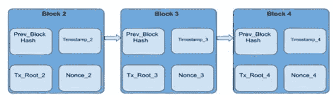

**图 5.2** 区块链。

如图图 5.2 所示，区块链由通过加密哈希值连接的区块组成。交易是区块链的基础组件。区块链交易表示区块链状态的变化。交易被打包并放置在区块中。区块链利用 `PKI`（公钥基础设施）提供安全性。它通过加密签名确保真实性，并利用哈希概念来提供数据完整性。

### 5.3.3 智能合约

智能合约 [34] 是一组定义良好的、通过程序实现的条件和动作，可以部署在区块链上。智能合约允许集成用于管理区块链交易的逻辑。凭借其自执行和不可篡改的特性，它确保了用例逻辑的无偏见执行，从而消除了对第三方的需求。它可以作为不受信任环境中无需中介即可进行自动决策过程的工具。

### 5.3.4 以太坊

以太坊 [35] 是一个全球性的、公共的无许可的区块链平台。这意味着任何人都可以自愿地进入、加入和离开网络。它为用户提供读取和写入权限。用户可以下载区块链的完整副本并独立执行交易。

智能合约的支持使得该平台面向各种用例。该平台对于希望为特定问题用例实现其智能合约的开发者来说是理想的。以太坊区块链基于基于状态转换的模型，每个节点按相同的顺序执行一组交易以达成共同共识。

以太（Ether）是一种加密货币，用于以太坊区块链上的交换媒介。平台在处理交易时使用 GAS（计算复杂度衡量单位）的概念和 GAS LIMIT。GAS 的概念用于遏制可能在智能合约中嵌入无限循环并执行交易的攻击者。缺乏 GAS 和 GAS LIMIT 将导致区块链出现停机问题，并可能导致链崩溃。

以太坊平台目前为以下两种账户提供支持。

#### 5.3.4.1 外部所有账户

这些是区块链上用户拥有的账户。外部所有账户与一组公钥/私钥对相关。这些密钥用于用户签名和验证交易。

#### 5.3.4.2 合约账户

这些是存储智能合约代码的账户。它作为合约的地址。可以通过合约地址访问智能合约。外部所有账户可以与其他外部所有账户或合约账户发送接收以。合约账户无法独立执行操作。它依赖于从外部所有账户执行的交易，这些交易触发合约账户内代码的执行。

# 5.4 区块链中的共识

区块链节点需要对区块链的特定状态达成一致。这种对特定状态的一致被称为共识，达成一致的机制或算法被称为共识机制。虽然区块链有多种共识机制可用，但在本文中我们考虑两种主要的共识机制，即工作量证明（`PoW`）和权威证明（`PoA`）。

## 5.4.1 工作量证明（Proof-of-Work）

工作证明是一种基于挑战-响应的共识机制，理想用于在公共和无许可区块链中达成共识。`PoW` 使用实际资源利用的概念来保护区块链免受网络中恶意和欺诈节点的影响。

为了在 `PoW` 中达成共识，维护区块链的节点（称为矿工节点）相互竞争求解一个密码学难题。第一个解决该问题的节点被允许提议一个区块。提议节点还需要在网络中广播该区块，以确保其他节点已对区块进行检查。一旦节点发现区块是有效的，区块就会添加到链中；否则，区块将被丢弃，重新开始。

密码学难题被分配了一个难度级别，该级别根据对一段时间内之前添加区块的分析而不断变化。矿工节点独立执行解题任务。如果两个或多个矿工节点同时挖掘出一个区块，区块链可能会发生分叉。

网络中的节点可能会验证并添加来自 `miner A` 的区块，而另一些节点可能添加来自 `miner B` 的区块。节点从矿工处接收区块取决于地理位置和网络性能等多个参数。

分叉在区块链中是不希望的，因此需要尽快解决。`PoW` 算法通过最长链规则解决分叉。这意味着在 `B1` 和 `B2` 中，在接收到的区块之上添加有效区块的那个区块链被视为有效区块链，而另一个被视为原始链的分叉并被忽略。此过程持续进行。

## 5.4.2 权威证明（Proof-of-Authority）

权威证明是一种用于许可和私有区块链中建立共识的区块链共识算法。该算法使用了权威（具有特殊权限的节点）的概念，其中权威被赋予了在区块链中创建和添加区块的权利。

这些权威有时也被称为验证者；他们收集网络用户生成的交易，然后将这些交易打包并封装在一个区块中。然后该区块在网络中传播以进行添加。

区块添加到链的操作是轮流进行的，每轮由一个允许提议一次区块的权威负责。一旦权威提议了区块，提议下一个区块的责任将交给下一个权威。这种循环持续下去，每个权威都获得提议区块的平等机会。

在将区块添加到链之前，该区块必须经过网络中其余验证节点的有效性检查。一旦区块被验证节点通过，就会进行添加。如果在有效性检查期间发现区块无效，它将被丢弃，验证节点将投票淘汰提议者，从而通过不允许其提议更多区块来限制提议者。

`PoA` 的轻量级和低功耗特性使其成为物联网（`IoT`）用例区块链共识机制的理想竞争者。

# 5.5 提出的框架

本节描述了我们在 `CACC` 中基于区块链的方法。我们提议引入两个区块链：一个位于车队内的车辆层，用于队内通信和车队管理；另一个位于路侧单元（`RSU`）层，用于信任和信誉管理。我们将车队管理和信任管理的逻辑整合到智能合约（`SC`）中，并将其部署在两个区块链上。

## 5.5.1 车辆层用于车队通信的区块链

在车队成员之间维护一个权威性区块链有助于减少和防止此类攻击，而且将使车队管理更高效。我们提议在车队成员之间维护一个私有区块链。

特别地，我们让车队的初始成员维护一个私有的权威性区块链。我们称该区块链为私有的，是因为我们不允许任何未经认证的节点加入区块链；称其为权威的，是因为我们只允许一组经过授权的实体来验证和提议区块。

车队的永久成员将维护车队内的私有权威区块链，这意味着区块链将从车队离开源地前往目的地开始就一直被维护。允许车队初始成员维护区块链的另一个良好理由是，初始成员属于同一个组织，因此他们之间的信任度更高，被认为比进入车队的任何随机车辆更真实。

车队中交换的每条消息都被视为区块链层级的一条交易。图 5.3 显示了车辆层的框架。

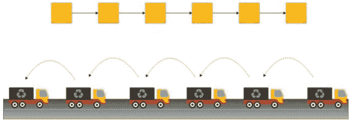

**图 5.3** 车队中用于队内通信和车队管理的区块链。

发送消息的车辆将对消息进行签名，然后将消息广播到区块链。假设车辆 `V1` 想与其直接后续车辆 `V2` 分享消息 `M`，那么 `V1` 将使用其私钥对消息进行签名，就像区块链交易中通常发生的那样。随着消息 `M` 的广播，车队中的所有车辆都将能够接收消息。

包括 `V2` 在内的每个车辆将检查签名的有效性和消息 `M` 的完整性。如果发现 `M` 是真实的且有效的交易，每个作为区块链节点的车辆都将该交易放入各自的待处理交易池中，交易 `M` 将在那里等待轮提交。

直观地说，其中一个封装者（sealer）会将交易 `M` 放入其区块中，从而该区块被提交。然而，消息中的信息可能是具有时间敏感性的，并要求接收者尽快或在收到消息后立即采取行动。等待交易在区块链上提交，然后对提交的交易采取行动，将成为我们在车队成员中引入区块链方法的瓶颈。

我们引入区块链的目的是使车队管理更加高效，但不是以人类生命为代价。为了解决这一问题，我们敦促信息的实际接收者在发现交易真实后应立即对接收到的交易中的信息采取行动。

由于验证 `signature` 所需的时间较短，如果发现 `signature` 是有效的，那么 `signature verification` 的时间也可以被认为是忽略不计的，因为这隐含地保证了该交易早晚会被提交到区块链。

因此，通过在车队车辆之间引入私有 `blockchain`，车队中的每个初始车辆都能够记录车队中发生的所有事件。由于区块链具有权威性，车队中的每个初始成员都可以被指定为 `signer`。每个初始车辆都将获得密封区块的机会。

区块密封将按轮进行，每轮将选定一辆车辆作为密封者并允许其密封区块。密封车辆将收集来自车队成员的交易并尝试形成一个区块。密封区块后，密封者需要确保其密封的区块被提交到链上。

为了实现这一点，密封车辆将其密封的区块发送给维护区块链的其他车队成员。接收区块后，每辆车辆都将验证区块的有效性和真实性。如果车辆发现区块是有效的，那么它们中的每一个都将收到的区块提交到它们本地的区块链副本中。

由于所有节点都提交了该区块，就对该区块达到了全局共识，并允许下一个密封车辆密封下一个区块。然而，如果密封车辆提出的区块被发现为无效或违反了区块的任何预设属性，则检测节点会在车队内的密封节点之间发起投票。

如果大多数密封车辆反对该提议车辆，则该提议车辆被认为已受损，并被踢出密封者列表，因此不再被允许密封任何区块。

车队中的每辆车辆定期执行一次 `status-update transaction`，如图图 5.4 所示。这包含了其当前系统状态的信息，包括剩余燃料、轮胎压力、发动机状态等实时信息。执行的交易会更新部署在车队内维护的本地区块链 `smart contract` 中的车辆信息。

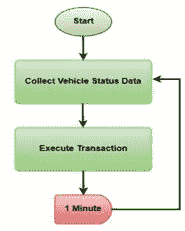

**图 5.4** 车辆在智能合约中由车辆进行的周期性自状态更新。

正如我们之前提到的，车队中的区块链仅在车队的初始成员之间维护。然而，这并不限制来自外部的成员加入车队。

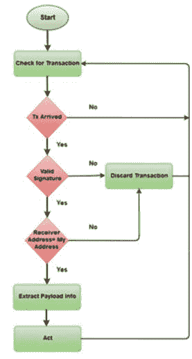

**图 5.5** CACC 车队中初始车辆（验证节点）执行的操作。

图 5.5 显示了车队初始成员执行的操作，而图 5.6 显示了非初始或新加入的 `CACC` 执行的操作。

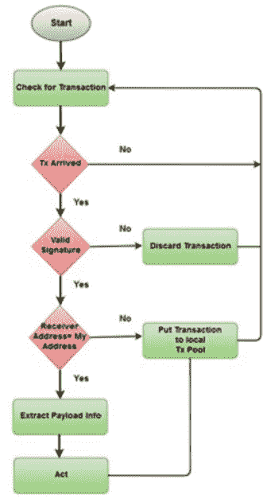

**图 5.6** 非初始成员执行的操作。

任何具备 `CACC` 功能、拥有有效区块链账户并满足车队对其加入要求（如位置、目的地等）的车辆，都可以选择合并入车队。合并请求应发送给车队领。

### 5.5.1.1 新车辆合并

在收到来自 `CACC` 车辆的合并请求后，车队领查询维护在车队成员之间的智能合约以获取车队相关细节，如空间、加入位置等。

根据从智能合约获取的信息，车队领决定是否接受合并请求。如果满足加入车辆的要求，车队领开始验证请求车辆的信任分；为此，车队领查询维护在 `RSU` 级别的区块链。

如果信任分满意，则允许请求车辆加入车队。信任分代表车辆在参与车队时的行为。而声誉分规定车辆在单独运行时时的行为，例如遵守交通规则、交通违规案例以及肇事逃逸案例。随后，车队领向请求车辆发送加入指令。相应，车队领修改智能合约中的车队配置详情以反映新成员的加入。

### 5.5.1.2 车辆离开车队

正如 `CACC` 车辆加入车队一样，它也可能想离开车队，因为它可能已经到达目的地或自愿离开。在离开车队之前，车辆需要通知车队领。

一旦 PL 接受了离开请求，将执行修改智能合约状态的交易。PL 还会以信任分的形式为离开的车辆提供评分。这些评分取决于车辆在车队中的贡献和行为，如对消息转发的贡献、维护车队稳定性等。

### 5.5.1.3 车队领选举

`RSU` 级区块链用于发现车队中每辆车辆的信任度和声誉分，而车队级区块链则用于检查车辆在车队中的行为、贡献和状态，以及其他所需信息，如燃料水平、胎压等。

我们将一个初始最大分视为默认最低分，任何车辆都不可能该分数。基于这些信息，每辆车辆都会提议其青睐的车队领导。获得提议最多的车辆被临时选为新车队领导。

一旦所有车队成员都同意新选出的车队领导，该临时选出的领导将立即被确认。一旦完成新 PL 的选举，当前车队领导会将权限移交给新车队领导，由其管理和控制车队。这种交接是通过智能合约实现的。我们开发了一个基于两个区块链上数据的领导者选举 `Algorithm 5.1`。

## 新领导者选举算法

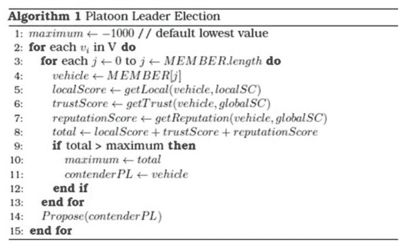

- `V`：车队中所有车辆的集合。
- `localSC`：部署在车队内部维护的区块链上的智能合约，用于车队管理。
- `globalSC`：由 `RSU` 维护的区块链上的智能合约，用于信任和声誉管理。
- `MEMBER`：维护在 `localSC` 中的一个列表，包含车队成员的地址。

## 车队中的权威区块链如何提供帮助？

正如我们已经所看到的，在车队层面实施区块链有助于更好地管理车队，因为它允许每辆车辆都了解其他车队成员的行为。

此外，我们看到了区块链如何帮助高效地进行 PL 选举并做出诸如新车辆合并等编队决策。此外，车队成员之间通信的基于签名的交易概念使得整个通信变得安全，无论是否存在任何显著延迟。无效交易将永远不会被接受。

通过允许车队中的车辆通过智能合约访问车队中的有效地址列表（`MEMBER`），可以大幅提高性能。接收来自列表中某个地址交易的车辆可以开始检查签名。否则，它可以直接在不验证签名的情况下丢弃交易。

## 5.5.2 RSU 平面上用于信任和声誉管理的区块链

如前所述，我们的方法旨在为 `CACC` 车队带来透明度和安全性。`CACC` 车队的效率很大程度上取决于车队内车辆的行为意图。

在一个节点对通信开放且不受持续监控的车辆环境中建立信任是一项挑战性任务。车辆网络中存在多种信任管理的方法。然而，这些方法中的大多数是以数据为中心或以节点为中心的。这些方法高度中心化，并具有单点故障等缺点。

如果中心机构不可用或篡改了其中存在的数据怎么办？认为第三方永远不会篡改你的数据且不会利用其来获取个人利益是不切实际的。此外，一旦数据被篡改，要追踪对数据所做的更改是非常困难的。可能需要引入另一个法律且受信任的第三方作为中介来解决问题。这不仅浪费了时间和精力，而且同时导致了严重的财务损失。我们通过在 `RSU` 平面上引入无许可区块链来解决这个问题。

`图 5.7` 显示了该框架。


**图 5.7** 用于信任和声誉管理的区块链。

# 5.6 实验

我们在区块链上进行了实验。测试平台的细节见 `Table 5.1`。

## 5.6.1 实验 1：用于车队通信和车队管理的区块链

我们使用原型机实现了基于区块链的车队内通信方案。我们使用树莓派作为处理单元。我们使用 `Geth` 展示了一个包含三辆车辆的车队。我们使用了 `Clique` 以太坊权威证明共识机制。区块生成时间设置为 `2` 秒。这意味着每隔 2 秒就会向区块链添加一个新区块。三辆车中的其中一辆被选为车队领导，区块链配置由该车队领导完成。

## 5.6.2 实验 2：用于信任和声誉管理的区块链

为了实现信任和声誉管理，我们在原型设置上进行了实验。我们使用 PC 代表 RSU。实验是在代表 3 个 RSU 的 3 台 PC 上进行的。所有 PC 运行 `Geth`（以太坊客户端）。我们使用 `Ethash`（基于以太坊工作证明的共识机制）来达到区块链共识。

选择的 `geteth` 版本为 `1.8.17-stable release`。我们使用 `autodiscovery` 模式来连接和对接 RSU。这两个实验的测试平台设置分别如图 `5.8` 和 `5.9` 所示。

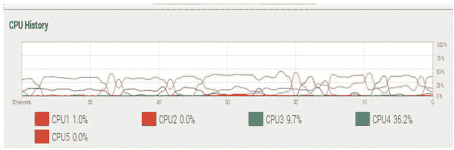

**图 5.10** 运行 `PoA` 区块链共识机制时区块链节点（车辆）的 CPU 利用率。

这证明了 `PoA` 算法作为维护车队区块链共识机制选择的可性。

我们通过分析其中一个区块链节点（RSU）的系统性能，评估了我们基于区块链的信任与声誉管理方法的性能。我们比较了系统在空闲模式和参与挖掘过程时，在 CPU 利用率、温度、功耗和时钟频率方面的系统性能。

图 5.11 显示了 RSU 处于空闲模式时的性能图表，而图 5.12 显示了 RSU 参与挖掘过程时的性能图表。

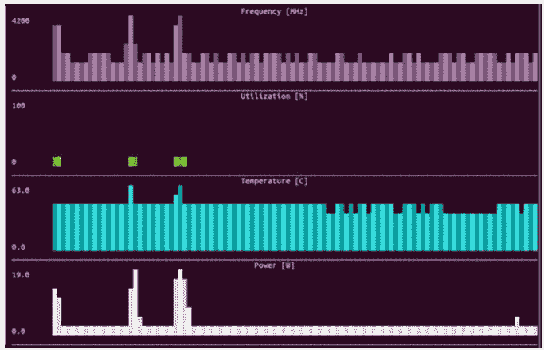

**图 5.11** 空闲状态下区块链节点（RSU）的系统性能。

从图 5.12 可以观察到系统资源正以最大功率利用。这是因为为了维护区块链选择了计算密集型且耗能的 `PoW` 共识算法。

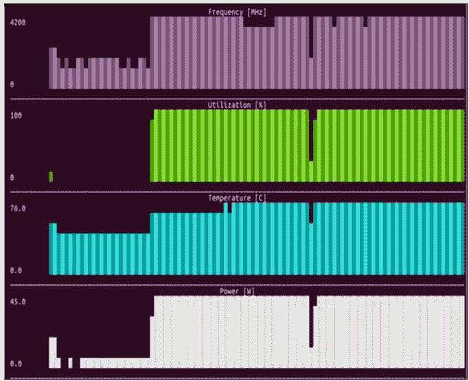

**图 5.12** 挖掘状态下区块链节点（RSU）的系统性能。

# 5.8 结论

在本文工作中，我们首先提出了一种新型基于区块链的队内通信和车队管理方法，其次提出了一种用于车辆信任与声誉管理的去中心化基于区块链方法。

通过在车辆平面引入权威区块链，我们增强了通信安全性，并为车队管理提供了更好的平台。完全去中心化公有链的引入确保了车辆信任和声誉评分的完整性，并保证了评分数据始终可用。

我们还通过适当的测试平台实现，执行并分析了两种方法在不同平面的性能。车辆平面上区块链节点用于队内通信的较低 CPU 消耗证明了该方法的可行性。但，RSU 平面的区块链实现在系统性能和功耗方面似乎相当昂贵。

正如已经解释的那样，这是因为选择了适用于开放公有链的先进且成熟的共识机制。然而，通过在 RSU 平面选择使用的共识机制，可以保证完全的去中心化，这是维护数据完整性最核心诉求。

# 第 6 章：区块链对物联网安全的影响

Bhawana Rudra

卡纳塔克国家学院信息技术系，印度

## 摘要

> 物联网（`IoT`）在工业领域正发挥着重要作用，并通过为社会带来经济和社会效益，鼓励研究人员开发各种应用。通过传感器网络（`WSN`）设备实现了常见的运行视图，这些设备能够相互通信以交换信息。信息通过云或雾中心服务器在设备之间交换，这引发了各种漏洞。
>
> 不仅是服务器，物联网设备本身也存在漏洞，可能会被设备欺骗、虚假认证等攻击所利用。考虑到未来几年物联网预测演进，需要向用户提供信心，确保他们存储或交换的数据以及用于安全目的设备得到了保护。
>
> 物联网对象之间相互互连，但其功能各不相同，传统方法无法产生更好的安全结果。为了解决安全和隐私问题，消除了中心服务器的概念，并将区块链技术作为物联网的一部分引入。

**关键词**：区块链、物联网、安全与隐私

## 6.1 引言

据估计，通过 `IoT` 连接的在单一网络下运行的物理实体数量到 2020 年将达到约 280 亿个 [1]。Gartner 甚至预测，到 2017 年，将有 20%的企业将部署安全解决方案来保护其 `IoT` 设备 [2, 12, 13]。

全球范围内设备的连接性使得以更高粒度收集信息变得易容易。这有助于在医疗保健、智能城市等广泛应用中提供复杂的服务。这些设备收集的数据被存储并可用于为用户提供广泛的高级服务。

随着 `IoT` 使用量的日益增长，与所有通信网络一样，`IoT` 也面临着各种漏洞和安全问题。`IoT` 正在与无线传感器网络、移动网络等技术相结合，而设备在没有任何外部因素的情况下与环境交互的灵活性导致了安全和隐私问题，并使其难以管理 [3]。

安全挑战源于缺乏中央控制、设备资源异构性和多种攻击。由于这些原因，许多研究人员研究了 `IoT` 的各种安全和隐私挑战 [4, 5]。一些人讨论了可能的威胁及其应对措施，另一些人为 `IoT` 使用的协议提供了解决方案 [2, 3]，还有人针对某些特定机制。许多人建议对敏感信息进行访问控制 [6]。

`IPsec` 和 `TLS` 用于提供认证和隐私保护。提出了一种隐私管理方法来衡量风险 [7]。研究人员建议机密性、完整性、可用性和真实性等安全原则作为 `IoT` 的安全需求。

研究人员针对 `LoWPAN` 上的 `IPv6`、低功耗丢耗网络路由协议（`RPL`）以及受限应用协议（`CoAP`）提出了应对措施。他们研究了各种技术，如 `Bluetooth`、`ZigBee`、`Z-Wave` 等，以高效的方式提供安全。

Celebucki *et al.* 提出了增强 `IoT` 系统隐私性和健壮性的方法 [8]。专家们对八种不同的 `IoT` 框架的安全协议进行了研究，并提供了详细的调查 [9, 10]。

尽管他们根据原则建议了许多应对措施，但这仍然是一个持续存在的问题。网络设备将从其所属的应用中获取大量数据。这些设备将使用各种通信协议和分析平台在网络内部进行通信，这是通过互联网和一个中央存储服务器完成的。这为它们之间丰富的交互产生海量数据提供了空间。这确保了实体与中央服务器之间交互的可靠性和信任。由于交换信息而互连的实体所提供的数据敏感性，将引发安全和隐私问题。

## 6.2 IoT 中的挑战与问题

尽管他们根据原则建议了许多应对措施，但这仍然是一个持续存在的问题。网络设备将从其所属的应用中获取大量数据。这些设备将使用各种通信协议和分析平台在网络内部进行通信，这是通过互联网和一个中央存储服务器完成的。这为它们之间丰富的交互产生海量数据提供了空间。这确保了实体与中央服务器之间交互的可靠性和信任。由于交换信息而互连的实体所提供的数据敏感性，将引发安全和隐私问题。

### 6.2.1 IoT 攻击

物联网的攻击大致分为四类，即物理和数据链路攻击、网络攻击、软件攻击和加密攻击。以下是这些类别的简要说明 [14, 15]。

#### 6.2.1.1 IoT 的物理数据链路攻击

在这些攻击中，攻击者关注硬件系统，因为攻击者靠近设备。这会影响设备的寿命或改变系统功能。攻击的主要类型是非侵入式攻击和侵入式攻击。

非侵入式攻击是指攻击者非常设备以感知电气特性并能够改变设备的行为。某些攻击包括侧信道分析、光学、`EMFI`、`BBI`、篡改攻击、电源脉冲、时钟或重置脉冲、频率篡改、电压攻击、温度攻击等。在侵入式攻击中，设备的芯片被替换或操纵。以下解释了一些物理和数据链路攻击。

- **节点篡改**：通过物理损坏节点或部分/完全替换节点来获取敏感信息。它甚至会影响通信层的操作 [15]。
- **RFID 射频干扰**：通过用于 `RFID` 通信的射频向 `RFID` 标签发送噪声信号。可以使用射频实现拒绝服务攻击 [15, 16]。
- **节点攻击者**：攻击者将通过不允许节点之间的通信来干扰射频。这由于设备无法遵循任何协议，导致了网络恶化。这将影响合法用户发送或接收的数据，导致系统行为发生改变 [17-19]。
- **恶意节点注入**：一个恶意节点可以进入网络，并能够控制进出网络的数据流及其相关操作 [15]。
- **物理破坏**：这种攻击会完全破坏系统。这种攻击通常发生在特定区域或带有 IoT 系统的建筑缺乏安全防护。它与节点篡改攻击不同，因为攻击者会破坏系统以影响服务的可用性 [14, 15]。
- **不安全初始化**：设备的安全初始化将确保系统在不违反隐私规则的情况下正常运行。物理层需要通过使其在未经许可的情况下无法访问来保护。这种攻击会破坏物理层 [20, 21]。
- **睡眠剥夺攻击**：使 IoT 设备保持唤醒状态，从而消耗其能量。设备在不使用时会进入睡眠，但攻击者会唤醒它们，导致功率消耗和电池耗尽。当分配大任务执行时，设备性能将无法理想。这将影响 IoT 系统的链路层 [22, 15]。
- **社会工程学**：IoT 系统中的用户会被操纵，敏感信息会被提取。攻击者将与 IoT 用户进行物理交互以实现其目标 [15]。
- **女巫攻击与欺骗攻击**：这类攻击是由网络中存在的伪造节点引起的，会导致 IoT 功能下降。女巫攻击者使用伪造的 `MAC` 值伪装成不同的设备，旨在耗尽资源。这影响 IoT 的物理层 [23, 24]。
- **恶意代码注入**：通过注入恶意代码使节点受到破坏，允许攻击者访问系统 [15]。

#### 6.2.1.2 网络攻击

攻击者集中于 IoT 设备的路由、会话管理以及通信。攻击在 IoT 的网络层和传输层执行。下面讨论了一些可能的攻击。

- **重复攻击**：这些由于由于使用小帧的 `IEEE 802.15.4` 设备需要对 `IPv6` 数据包进行分片。在 `6LoWPAN` 层构建数据分片字段有时会导致资源耗尽、缓冲区溢出和设备重启。恶意代理发送的重复数据包会影响数据包重组，从而阻止合法数据包。这种攻击将影响 `6LoWPAN` 适配层和网络层 [25, 26]。
- **不安全的邻居发现**：网络中的每个设备将有唯一标识，且发生的通信必须安全。端到端通信应该是安全的，并安全地到达目的地。在执行传输之前，将根据路由器发现并使用地址解析发现邻居。邻居发现包会进行验证，但可能导致严重后果以及 `DoS` 攻击。这种攻击会影响 IoT 的网络层 [27]。
- **缓冲区保留攻击**：接收节点必须为来自另一侧的数据包重组留出缓冲区空间。在这种攻击中，攻击者可以通过发送不完整的数据包来利用缓冲区空间。由于拒绝服务攻击的发生，分片包被丢弃。这将影响 `6LoWPAN` 的适配层和 IoT 的网络层 [26]。
- **RPL 路由攻击**：低功耗丢耗网络路由协议（`RPL`）面临各种攻击。黑客可以耗尽资源或破坏网络中的设备并进行窃听攻击。这影响 `IPv6` 网络层 [29, 30]。
- **洞点与虫洞攻击**：攻击者在双方之间建立连接。发送者的信息必须通过攻击者节点传递给接收者。攻击获取信息并在网络中执行恶意活动。`6LoWPAN` 的操作可能被虫洞攻击利用。在这种攻击中，节点之间创建了一个隧道，以便数据包到达另一个节点后立即接收。某些攻击是窃听、隐私侵犯和 `DoS` 攻击。这些攻击将影响网络层 [31-33](#c06.xhtml#bib_33)]。
- **网络和传输层的女巫攻击**：网络中部署的女巫节点会降低性能并侵犯数据隐私。女巫节点使用虚假身份导致垃圾邮件攻击、钓鱼攻击等，影响网络层 [34, 35, 49]。
- **认证与安全通信**：设备使用网络中的系统进行认证。任何漏洞都会导致安全问题。由于资源受限，必须最小化 `DTLS` 的开销。设备必须确保数据的安全通信。这种攻击影响 `6LoWPAN` 适配层以及传输层和网络层 [36-38](#c06.xhtml#bib_38)]。
- **传输级端端安全**：从发送节点到目标节点提供可靠的安全。为此，必须对消息通信提供全面的认证。传输层和网络层将受到此类攻击的影响 [39, 40]。
- **会话建立与恢复**：会话劫持会导致 `DoS` 攻击。节点身份冒充可以继续两个节点之间的会话。节点可能会修改传输中的序列号。网络层将受到此类攻击的影响 [41, 42]。
- **基于云的 IoT 隐私侵犯**：通过侵犯攻击很容易破坏云隐私，暴露用户的身份和位置。恶意云节点将访问在目的地传输和接收的机信息 [43, 44]。
- **汇洞攻击（Sinkhole Attack）**：攻击者引诱流量并创建一个汇洞。由于这种攻击通过拒绝服务并丢弃所有数据包而不是转发到目的地，会导致机密性泄露 [47]。
- **中间人攻击（Man-in-the-Middle Attack）**：黑客将通过监控、监听和控制两个节点之间发生的通信，来访问受限数据。攻击者将利用网络协议进行攻击 [48]。
- **拒绝服务（Denial of Service）**：向 IoT 设备发送更多流量，使其无法满足其他请求，从而导致成功的 `DoS` 攻击。
- **路由信息攻击（Routing Information Attacks）**：Hello 攻击和黑洞攻击是这类攻击的示例。这些是通过修改信息、重放路由信息、创建路由循环、丢弃流量、发送标志错误消息等方式实现的直接攻击 [15]。

#### 6.2.1.3 软件攻击

这类攻击主要发生在 IoT 设备上执行的应用程序上。软件攻击可以通过使用木马、蠕虫等基于代码的程序进入系统，下文将对其进行讨论。

- **基于互联网的受限应用协议（`CoAP`）安全**：`CoAP` 是一种用于受限设备的 Web 接口，使用 `DTLS`。`DTLS` 与多种安全模式结合提供端到端安全。它遵循特定的格式传递信息，这些信息将为了安全通信而被加密。多播支持需要身份验证机制来执行安全通信。应用层和网络层将受到此类攻击的影响 [50-52]。
- **不安全的接口（Insecure Interfaces）**：用于 IoT 设备之间通信的接口（如 Web、移动端和云）容易受到影响数据隐私攻击。这影响了 IoT 的应用层 [53]。
- **不安全的软件/固件（Insecure Software/Firmware）**：IoT 使用的不安全软件可能导致漏洞。为了确保 IoT 的运行，必须以安全的方式进行测试。更新应在安全环境中执行和实施。由于不安全的软件/固件引起的攻击会影响 IoT 的应用、传输和网络层 [53]。
- **中间件安全（Middleware Security）**：中间件旨在以安全的方式交付各种设备之间的通信以提供各种服务。不同的环境使用不同的中间件技术，它们必须能够安全通信。IoT 系统的应用、传输和网络层将受到这种攻击的影响 [54, 55]。
- **钓鱼攻击（Phishing Attacks）**：黑客将通过网络中使用钓鱼网站伪造用户凭据来获取数据 [15]。
- **恶意脚本（Malicious Scripts）**：控制网关的用户可能会被骗运行可执行的 ActiveX 脚本，这可能导致系统的完全损坏 [15]。
- **拒绝服务（Denial of Service）**：`DoS` 或 `DDoS` 通过应用层在受影响系统中实现。它通过不允许完全应用层访问来阻止合法用户，并允许黑客访问数据库和敏感数据 [15]。

#### 6.2.1.4 加密攻击

这些攻击旨在破解网络中 IoT 设备所使用的加密方法 [15]。

- **旁信道攻击（Side-Channel Attacks）**：通过关注一组设备中的特定方法并观察数据模式，黑客可以重新获得用于信息加解密的加密密钥。
- **密码分析攻击（Cryptanalysis Attacks）**：在这些攻击中，黑客将执行已知明文攻击、选择明文攻击、选择密文攻击和仅密文攻击。

随着物联网作为主流行业的出现，挑战也随之产生。IoT 不仅仅是数据，还取决于你如何、为什么以及何时收集它。网络能够与其他设备交互并请求服务而无需人工干预，这引发了许多问题。

与物联网的关键领域之一是设备识别。考虑集中式模型成本高昂，因为攻击者很容易针对单点故障，导致信息的巨大破坏。由于节点在地理上分布，实施集中式网络非常困难。为了克服这些攻击，专家建议将区块链与物联网相结合。

## 6.3 区块链

区块链是一种分布式账本，提供安全、透明的交易并对所有人开放。这种技术是由密码学、算法组成的技术，并结合数学具有经济效益。区块链使用共识算法来解决点对点网络中分布式数据库的同步问题 [56-58]。

实际内容将使用私钥保护。它不包含主节点，参与节点将拥有链的副本以便通信。数据记录将持续添加到链中，但数据库中存在的记录无法更改。交易由系统中的参与者创建。系统将维护时间戳以验证何时添加交易。

区块通过记录交易来验证交易，检查是否存在正确的顺序。一旦信息进入区块链，就很难更改或修改 [59, 60]。

区块链由包含数据或信息的区块组成。名为 `Bitcoin` 的数字加密货币由 Satoshi Nakamoto 在 2008 年普及 [59]。`Blockchain` 中的区块包含一个带有其前一个区块某些信息的 `hash`。`Hash` 是一种唯一的数学代码，不同的区块其哈值不同。

如果信息被更改，`hash` 必须随之改变。所有区块通过 `hash` 密钥连接在一起，确保了区块链的安全性。当网络中发生交易时，相应的节点会验证这些交易。

如果我们使用 `Bitcoin`，网络中的节点被称为 `miners`，它们基于工作量证明验证交易。为了验证网络中的交易，将引用前一个节点的 `hash`，如果 `hash` 正确，则交易发生。如果黑客进行了任何更改，`hash` 也会随之改变并无法通过验证，从而检测到违入。

这种技术确保了区块链的不可篡改性，因为区块中的任何更改都会反映在整个网络中。为了产生 `hash` 值，`Blockchain` 使用了 `Merkle tree` 函数和表示当前区块 `hash` 值的 `Merkel root` 字段 [61, 62]。

`Blockchain` 中的交易流程如下：

- `Blockchain` 使用公钥和私钥形成数字签名以确保安全性。
- 通过这些密钥实现身份验证并赋予授权。
- 它允许参与者对网络进行数学验证，并对任何特定值达成共识。
- 发送者使用私钥并在网络上发布交易。区块包含用于执行交易的 `timestamp`、数字签名和接收者的公钥。
- 一旦信息被广播，该过程的验证便开始了。
- 网络中的节点尝试解决与交易相关的谜题以进行处理。节点消耗计算能力来解决谜题。
- 一旦谜题被解决，节点将以奖励的形式接收 `bitcoins`。这种工作被称为 `proof-of-work` 问题。
- 一旦共识中的节点对解决方案达成一致，`timestamp` 就会被添加到现有区块中。区块可以包含任何内容，从金钱到数据。
- 如果链中添加了新区块，网络中的现有节点将得到更新。新数据将广播到网络中，所有节点都将更新。

网格网络可以使用 `Blockchain`，允许 `IoT` 安全可靠地连接，避免伪欺和身份冒充攻击。每个设备都将获得一个唯一的 `ID` 以连接网络中的其他设备。`Blockchain ID` 可以作为 `URL` 使用，其 `wallet` 可用于发起身份请求 [64, 65]。

该 `wallet` 将创建一个经过数字签名的请求，并转发到目标设备。因此，设备使用发送者的公钥验证签名。如果设备受到资源限制，它们可以连接到 `proxies`，在那里可以创建 `wallet` [66-68](#c06.xhtml#bib_68)]。

`Blockchain` 中存在两种 `peers`：`endorsing peers` 和 `committing peers`。

### 6.3.1 特性

在 `IoT` 场景中，`smart contracts` 在管理和控制方面起着重要作用。`Blockchain` 的一些基本特性包括 [59, 72]：

- **去中心化**：区块链是去中心化的，这意味着没有人可以修改它。区块链的特性提供了透明度和可扩展性。
- **点对点网络**：参与者在没有第三方的情况下进行 `P2P` 交互。它使用 `P2P` 协议……
- **不可篡改性**：数据一旦写入 `blockchain`，无法更改。账本存储 `data`。`data` 的任何更改都会导致不同的 `hash`。
- **防篡改**：由于不可篡改的属性，很容易检测到 `data` 的任何篡改。`hash` 函数将反映这一更改。
- **地址空间**：`Blockchain` 采用 160 位地址空间，而 `IPv6` 地址空间为 128 位。`Blockchain` 地址由由圆曲线签名算法生成的公钥的 20 字节 `hash` 组成。它可以一次分配 $4 \times 10^{46}$ 个设备。地址冲突的概率为 $10^{-48}$，这被认为提供全局标识符是安全的，且不需要在网络上注册。不需要像 IANA 管理 IPv4 和 IPv6 那样的中心权威机构。`Blockchain` 提供了 43 亿个地址，为 `IoT` 提供了可扩展的解决方案。设备内存和计算能力受限，因此无法运行 `IPv6` 栈。

### 6.3.1.1 IoT 环境中的物体身份

物体识别和访问控制管理必须以高效安全的方式处理。主要挑战与 `IoT` 设备的所有权和身份有关。所有权的生命周期从生产者变为商主再到购买者。

如果设备用于转售、报废或被攻击者攻破，消费者所有权是可以改变的。`IoT` 关系包括人机、机机或机服务。这些设备与人类之间的关系可以进行部署、使用、销售、升级和维修等。

**身份验证与完整性**：数据由发送者进行加密签名。发送者持有公钥和全局唯一标识符（`GUID`），确保了信息的身份验证和完整性。所有使用 `blockchain` 执行的交易将得到安全地记录和跟踪。

### 6.3.1.2 身份验证、授权与隐私

区块链为物联网设备提供了单方和多方身份验证。与传统方法相比，智能合约提供的授权具有更低的性。用于授权的一些协议包括基于角色的访问管理（`RBAC`）、`OAuth 2.0`、`OpenID`、`OMADM` 和 `LWM2M`。

通过使用某些规则、条件以及个人或用户组进入网络的时间可以实现隐私保护。

### 6.3.1.3 安全通信

如 `MQTT`、`HTTP`、`XMPP` 和 `CoAP` 等应用协议的设计并未包含安全特性。这些协议被封装在 `DTLS` 或 `TLS` 等其他协议中以提供安全通信。

由于中心化管理的存在，密钥管理 ID 是通过 `PKI` 协议实现的。在区块链的帮助下，消除了密钥管理，物联网设备在安装到网络后使用 `GUID` 和非对称密钥对。

这不需要处理 `DTLS`、`TLS` 等协议以及 `PKI` 证书的交换。适用于物联网设备的轻量级安全协议栈使得计算和内存管理变得可行。`GUID` 的使用简化了通常用于交换 `PKI` 证书的安全协议。

`Filament` 是一种用于基于 `Bitcoin` 和物联网智能合约支付的硬件和软件解决方案。`Filament` 设备支持的一些协议有 `Blockname`、`Telehash`、`Pennyback` 和 `Bittorrent`。`Blockname` 用于识别设备，`Telehash` 是 `Kademlia DHT` 的开源项目，智能合约定义了设备用途。

## 6.3.2 可扩展性

通过使用新的拜占庭容错协议提高了延迟共识，因为共识对扩展性有直接影响。`Litecoin` 与 `Bitcoin` 相同，允许快速交易确认并提高存储效率。它使用了 `scrypt`，这是一种内存密集型、基于密码的密钥派生函数。

`GHOST` 是另一种通过更改链选择规则来提高可扩展性的协议。`BigchainDB` 并没有增加扩展性，而是增加了大数据的区块链特性，即具有不可变性的分布式数据库。

星际文件系统（`IPFS`）用于存储去中心化和共享文件，实现了点对点文件系统。`IPFS` 提高了效率并消除了重复，有助于跟踪每个文件的版本历史。

## 6.3.3 匿名性与隐私

区块链中的所有交易都是透明的，每一笔交易都可以从第一层开始检查和跟踪。这有助于在钱包和个人之间建立信任，因为它们之间没有直接关系。

为了解决 `Bitcoin` 中的这个问题，使用了 `Zerocash` 和 `Zerocoin`，它们支持匿名交易，可以隐藏发送者和接收者的细节以及相关信息。为了使交易不可追踪，`Monero` 使用了环签名。

`Bitcoin` 提供的混合服务（如 `Bitcoin Fog` 和 `Bit Laundry`）将带来匿名性。服务被分成小交易并根据费用进行安排。有很多协议可以增加安全性，如 `DarkWallet`、`Dash`、`MixCoin`、`CoinShuffle` 和 `CoinSwap`。

为了增加隐私，数据被加密，`Hawk` 存储加密后的交易。为了限制敏感数据的可见性，使用了名为 `Quorum` 的许可区块链。`Rockchain` 使用了基于 `Ethereum` 的以数据为中心的方法，在私有数据上进行公共计算。这种方法允许分布式文件系统管理数据隐私 [70, 73]。

## 6.3.4 持久性

由于交易将遍布整个网络，因此无法篡改信息。在网络中广播的每个区块都会经过验证、记录和检查，因此交易中不存在伪造。

## 6.3.5 可审计性

由于每笔交易都带有时间戳进行验证，用户可以使用网络中的任何节点追溯之前的记录。需要时可以追溯交易。存储数据的追溯性和透明度得到了提高。

### 6.3.6 区块链类型

根据用户需求，有两类区块链用于网络交易。无论使用哪种区块链，去中心化系统中存在某些相似之处。网络中的所有节点都会维护一个账本副本。账本通过共识进行更新。不可变性和安全性的规则应用于网络中 [69, 70, 72]：

1. **公有区块链**：这是一种无许可账本，任何人都可以访问。连接互联网的人可以下载并访问公有区块链。区块链会奖励参与者。这种区块链最好的例子是 `Bitcoin` 和 `Ethereum`。初始设定的规则修改空间较小。每个人都可以检查和验证每笔交易。
2. **私有区块链**：这种类型的区块链在信任方之间共享。控制权在网络所有者手中。规则可以根据权限级别进行更改。它们独立运行，也可以与网络中的其他区块链集成。这种区块链有助于同一实体的公司之间使用。

根据对用户服务的依赖，某些交易需要私有区块链，其他需要公有区块链。

## 6.4 物联网区块链方法

已有许多研究检查了区块链在物联网中的适用性。Marco Concenti 进行了一项调查并建议区块链在物联网中的应用提供了更高的安全性 [77]。

基于区块链的物联网部署对于大规模现实部署增加了巨大的价值，在提供安全性方面取得了良好效果。这有助于理解网络延迟，在边缘和云之间，发现边缘性能更好。Huh 等人建议使用 `Ethereum` 账户管理网络物联网取得了良好结果 [79]。

Dorri 等人将智能家居作为案例研究 [76]，他们解释了区块链如何为涉及交易的各种应用提供安全和隐私。物联网可以利用区块链并为其服务提供安全性。物联网的区块链方法和分层机制如下 [69, 77-80]：

- **端到端区块链**：在这种方法中，源端创建包含数据的第一个交易区块。其他网络元素将附加到下一个区块并继续该过程直到到达目的地。在云端收集的数据被用于分析该过程。这些是特定应用程序的，包含广泛的应用领域。
- **分析/存储级区块链**：分析引擎分析来自数据源的交易。信息的存储并不要求完整性，但对于某些应用来说，完整性是必要的。数据中心化和数据分析这两层将使用这些区块链。区块链被用于基于存储和分析的应用。这些层描述了核心网络功能。该功能包括行业拥有的局外网。该功能通过运营商提供的有线和无线网络连接性来实现。
- **网关级区块链**：一旦网关接收到数据，区块链将连与其他用户的数据一起整合其中。网络中存在数据汇总点，支持 IoT 设备与其他设备连接。这在数据聚合层工作，在该层进行协议转换，并具备边缘计算网络能力。网关设备处理数据聚合功能。边缘网络代表了采用网络协议采用的网络基础设施。
- **雾网网络**：它支持雾计算，雾计算是一种具有 IoT 用户第一跳连接的本地网络。雾网优化了 IoT 运行环境，有时可能会使用特殊协议。这可以通过有线或无线链路进行连接。该网络支持设备使用的初始通信链路。
- **站点级区块链**：特定站点的设备产生的数据不需要立即保护完整性。一旦本地节点接收到数据，它将与来自其他站点用户的区块链整合。这涉及到授权和身份验证的聚合。数据采集层由传感器、嵌入式设备、传感器集线器等组成。
- **设备级区块链**：网络中的每个设备都可以为数据构建区块链以保护数据。这包括设备级的授权和身份验证。它包括加密和密钥管理，并处理信任和身份管理。所有连接到互联网的设备都需要这些安全特性。这一层包含了所有受 IoT 自动化处理的对象。这是一个巨大的领域，包括人员、可穿戴设备、智能手机、家电器、监控摄像头、智能家居和建筑等。

### 6.4.1 用于 IoT 的区块链平台

区块链是一种通过提供安全服务可能影响许多行业的技术。这项技术在不同领域提供了许多优势。由于存在许多不断变化的可用平台，很难一次性分析所有平台。IoT 领域中一些知名且适合的平台如下 [14, 70, 80]：

- **比特币（Bitcoin）**：这是第一个区块链平台，支持货币交易。它快速、廉价且可靠，并可以集成到……
- **以太坊（Ethereum）**：……
- **Hyperledger**：……
- **IBM 开源区块链（IBM Open Blockchain）**：……
- **IBM 的 Bluemix**：……
- **莱特币（Litecoin）**：……
- **Lisk**：……

**注：**

- `Bitcoin`
- `Ethereum`
- `Hyperledger`
- `IBM Open Blockchain (OBC)`
- `IBM’s Bluemix`
- `Litecoin`
- `Lisk`
- `Quorum`

## 区块链平台

- `HDAC`：该系统同时使用公有链和私有链，为了确保交易安全，它使用了量子随机数生成。它可以用于物联网合约和基于区块链的机机（`M2M`）交易。为了启用公有链，`HDAC` 可以与多个私有链结合使用。智能合约被应用于许多交易，实现了除加密货币交易之外的应用。根据应用需求，可以使用或不使用加密货币的区块链。`Ethereum` 为物联网应用提供了所需的基础设施。它可以部署在云基础设施上，也可以通过亚马逊云服务（`AWS`）或谷歌云平台（Google Cloud Platform）。不基于加密货币的 `Hyperledger Fabric` 加入联盟并启动区块链。这允许联盟和全球化应用的创建。
- `Eris`：`Eris` 使用 `Ethereum Virtual Machine`（以太虚拟机），并使用 `Solidity` 或 `Serpent` 编程语言。它需要寻找参与者来找到自己的密钥签名守护进程（signers daemons），这需要对特定领域的了解。它与应用程序的推荐组件配合良好。这是一个模块化平台，使用 `docker` 来支持网络的各种组件。`Eris` 支持的默认组件是 `Tendermint socket protocol` 和 `Ethereum Virtual Machine`，用于多客户端支持和共识协议。`Eris` 的文档非常昂贵。`Eris` 的可扩展性取决于组件。`Eris` 可以作为过程审计员而非交易审计员；它跟踪过程，例如它们何时被创建和执行。
- `Tendermint`：它是一项用于在许多机器上开发应用程序副本的软件。它包含两个组件，即区块链共识引擎和通用应用程序接口。共识引擎是 `Tendermint` 的核心，确保交易记录在所有机器上。应用程序接口允许使用任何编程语言运行交易。它设计得易于使用、简单理解，并用于许多分布式应用。

`Ethereum` 和 `OBM` 的使用比其他平台更多。两者都可以通过多种方法进行交互，并在近期计划了更多功能。`OBC` 合约用 `Java` 和 `JavaScript` 编写，并需要具备 `Solidity` 和 `Serpent` 的知识，因为这些是专门为 `Ethereum VM` 设计的。

`Ethereum` 拥有广泛的文档并支持所有平台的选项。这两者曾是 `Linux Hyperledger` 项目的一部分，其中 `Ethereum` 是最早的平台。由于模块化，`Eris` 是一个高度灵活的平台。`Ethereum` 平台不可扩展或模块化，但正如数百个应用程序证明的那样，它们是非常灵活的。动态限制允许调整以满足网络和区块的需求。

`Ethereum` 给参与者奖励，并不像，即使是不成功的参与者也会因为网络添加区块而获得奖励。发行代表网络其他价值的代币。`Eris` 的货币取决于逻辑及其组成方式。

### 6.4.2 应用

`Bitcoin` 和加密货币是区块链首次引入的，但它们并非唯一。区块链凭借其特性和优势，慢慢进入各种应用，导致了全球范围内企业、行业和创业者的连接。透明度以及隐私和信任的想法在市场上引起了巨大的热潮。

区块链对物联网具有许多优势，如防篡数据、无信任 `P2P` 通信、对分布式文件共享的强大可靠的支持、维护历史操作记录、消除单一控制机构、提供信任等。

除了 `Bitcoin` 和 `Ethereum` 之外，还出现了用于金融应用的替代加密货币，如 `Ripple`、`Litecoin` 等，它们鼓励了市场开启新的支付形式和投资。这为这些新货币鼓励了新的交易基础设施模式。

对于基于追溯的系统，无信任账本被确定为解决方案。链存储将允许对对象进行追溯，并完全可靠地记录发生的变化。一些项目仍在进行，由 `IBM` 等公司跟踪车辆、历史维护等；`Unilever`（联合利华）、`Nestle`（雀巢）利用区块链进行食品追溯。

身份验证也是一项著名的技术，区块链提供了开放账本来存储身份。迪拜使用区块链进行护照验证、爱沙尼亚的电子身份、伊利诺伊州的出生证明数字化以及印度的土地注册都是区块链著名的例子。

智能合约的整合为许多行业开辟了道路，如能源、房地产、博彩等。其他区块链应用如云存储、教育或电子健康已被提出。

区块链可以应用于物联网的各个领域，以及金融应用，其他应用包括农业（收集土壤数据、安全数据处理、农产品运输）、商业（维护进出口数据、能源原材料、按需供应和金融价值）以及配送（食品、金融、医疗等）。

- **数字货币**：`Bitcoin` 已成为一种数字货币和在线支付模式，不需要任何中央机构。`Bitcoin` 用户使用伪名而非真实姓名。`Bitcoin` 使用交易、共识协议和通信网络三个组件。它使用加密技术进行资金转移，并独立于中央银行运行。
- **智能合约**：`Ethereum` 用于服务或产品的交换，以及发生在社会或网络中用户之间的业务交易。双方将签署合同或协议的条款和条件。纸质合同容易出错，且信任可能会引发双方争议或遭受欺诈，增加了风险。智能合约可以解决此类问题。智能合约的工作与纸质协议相似。唯一的区别在于它们是数字化的且自动执行的。当合约满足某些条件时，它们会被部署到系统中。这将控制用户的数字资产，制定用户的权利和限制，并由系统自动执行。这可以看作是对系统接收并存储的消息的响应。

## 医疗物联网

物联网（`IoT`）已进入电子医疗领域，处理与患者和医疗提供者相关的信息。数据由医疗提供者存储，这种电子数据存储被称为电子病例（`EMRs`）。患者可以通过电子健康记录（`EHRs`）获取便携数据。这些 `EHRs` 的格式比 `EMRs` 更具结构化。

Sicuranza 和 Esposito 利用分布式数据库的概念设计了一种基于区块链的物联网医疗模型 [91]。该模型在实例化新的医疗数据时会创建一个新区块。这为患者的记录提供了隐私保护和信任保障。

Liang *et al.* [92] 将区块链网络用于移动医疗应用并保护记录的完整性。智能合约可用于将药品运送到药剂师处。智能合约将包含有关药物、数量、创建数据等信息。该合约将负责整个供应链中不同药剂师之间条目的维护。合约根据某些条件运行运行，因此无人可以修改或更改，从而确保了真实性和信任度。

## Hyperledger

Hyperledger 由 Linux 基金会托管，自 2015 年起以开源形式提供给所有用户，支持分布式账本。它可用于全球业务，包括希望提高性能和可靠性的主要技术、金融和供应链公司。其模块化框架可以支持用户的不同组件。它可以用于设备的识别、访问控制和合约。

## 智慧城市能源消耗

区块链是一个强大的概念，可以应用于智慧城市，因为它基于自动运行的物联网。区块链创建了一个开放账本，使得物联网设备之间的交互和协调变得容易，增加了设备的自主性。可以可靠地查询受信的信息，并有利于创建新的物联网市场 [85, 87-89]。

以太坊因物联网区块链应用而闻名。与比特币相比，它拥有更多功能，智能合约的使用扩展了可能的应用范围。LO3 Energy 在布鲁林、德国南部和澳大利亚展示了区块链的使用，并取得了良好结果。

LO3 使用的微网根据发电、储能和负载的本地化进行分组。它建立了一个能源社区市场，在边界电网的帮助下开发了一个去中心化的 `P2P` 能源网络。这种强制区块链允许电网边缘的设备在微网参与者之间安全可靠地进行能源交易。

混合设备可以测量建筑在使用中的产产，并将此类信息发送到网络。Liang *et al.* [91] 提出了一种基于区块链概念的架构，能够抵抗数据操纵攻击。Li *et al.* [85] 提出的能源区块链基于共识和塔克伯博弈（Stackelberg game）。Aitzhan 和 Svetinovic 提出了一种基于令牌的私有去中心化交易系统，可应用于能源互联网 [93]。

## 政府选举

当前的投票系统依赖区块链来提供隐私和安全，确保真实性和信任。

## 身份管理

在进行交易时，区块链提供认证。为了保护物联网设备，Lee *et al.* 建议对请求节点的响应和来自响应节点的响应执行响应验证。

## 知识产权保护

在区块链的帮助下，数字化内容可以很容易地复制。为了保护版权，研究人员提出了基于区块链的框架，称为区块链。区块链在本质上是不可变的；一旦执行了任何条目，就无法更改。

## 智能合约：自主去中心化点对点测量（ADEPT）

该项目由 IBM 和三星启动 [80]，旨在提高设备自主性并在最后使用区块链。该项目使用的三种协议是 `Telehash`、`Torrent` 和以太坊，用于消息传递。

## 5G 时代的物联网

5G 网络将成为连接数十亿对象的全功能移动网络。为了解决 5G 中的隐私问题，Fan *et al.* [94] 开发了一种基于区块链的隐私保护共享方案。

## 车联网

这允许车车、车路、车人以及广义的车万物通信（`V2X`）。为了提供隐私和安全，研究人员提出了基于区块链的框架，称为区块链生态系统。

为了不跟踪车辆位置，Dorri *et al.* [76] 提出了一个隐私保护框架，由覆盖节点管理区块链。Lei *et al.* [95] 开发了一种用于车载通信的动态密钥管理协议。Kang *et al.* [96] 提出了名为 `PETCON` 的 `P2P` 电力交易系统。Li *et al.* [85] 提出了信用币概念用于匿名发送公告。

## 物联网设备

Gu *et al.* [98] 提出了一种名为 `CB-MDEE` 的恶意软件检测，该方法在联盟链上运行。该方法使用模糊比较和多标记函数来减少误报，从而提高检测能力。

### 物联网中的访问管理

Noor 等人 [98] 提出了一种基于区块链的分布式访问控制方法，用于物联网设备的管理。基础框架由传感器节点、管理器、代理节点、智能合约、区块链网络以及枢纽管理组成。这提供了移动性、访问性和轻量化，同时也具有扩展性和透明性。

### 协作视频传输

Herbaut 和 Negru [99] 提出了一种基于区块链的协作视频传输去中心化代理系统，该系统依赖于先进的网络服务。所提系统由内容代理、传输监控和配置区块链组成。它部署在开源平台 Hyperledger Fabric 平台上，获得的结果显示为：如果节点数量略有增加，则收敛时间会发生增加。

### 云存储

如果智能建筑或智能城市设备希望在云端存储信息，可以根据存储的数据进行分析以提供智能服务。用户数据以带有唯一 `block ID` 的相同块的形式存储。

为了进行用户身份验证，使用了 `block ID` 和数据的哈希值。如果用户使用 `block ID` 和 `hash` 获取数据，则用户通过验证。从用户处接收的数据包以 `Queue` 形式（即先入先出顺序以及哈希值一起存储。

一旦数据存储，新的 `block ID` 将使用从 Diffie-Hellman 算法派生的共享密钥进行加密。如果密钥已知，同一个人将知道 `block ID`，且由于此处使用的哈希具有抗碰撞性，只有真实用户才能知道 `block ID`。

这保证了只有真实用户能够访问特定块并将新数据链到现有账本中。网络中的每个用户都可以为每个设备或所有设备创建新账本或更新现有的账本。

### 入侵检测

利用机器学习，针对物联网提出了入侵检测技术。为了改进系统，引入了一种基于区块链的协作入侵检测系统（`IDS`），它可以保护警报的交换 [53]。Bhattasali 等人 [22] 讨论了区块链在 IDS 中的应用。

由于数据共享和信任计算的需求，未来的 IDS 应基于分布式系统之间的协作。区块链可以用于解决隐私问题并抑制内部攻击。

### 软件网络

这用于提供智能路由。决策过程由 `SDN` 控制器简化。基于区块链的分布式物联网网络架构 `DisBlockNet` 提供了扩展性和灵活性，无需任何中央服务器。它使用验证码并维护一个更新的流表以及在区块链网络中更新流规则的请求响应节点。

### 雾计算

也称为边缘计算，是一个高度可视化的平台。它基于传统的云计算在用户和数据中心之间实现了存储。区块链可用于提供雾节点和物联网设备之间的链路。Ibrahim 为雾设备的外包建议了一种公平的支付方案 [41]。

### 分布式 P2P 应用

物联网设备将自组织并协作。工作包括 He 等人 [100] 提出的电子商务和诚实机制。物联网设备将自组织并协作。工作包括电子商务和诚实机制。这是基于区块链和交易。

### 众感知应用

这些基于移动物联网应用。利用区块链加密货币，Wang 等人 [34] 提出了一种保护群体的机制。这基于去中心化搜索并处理隐私问题。

### 数据存储

处理异构数据资源会导致安全问题。利用区块链技术，Li 等人 [85] 提出了用于去中心化存储的 `Searchain`。它基于点对点结构，提供隐私、可审计性和不可区分性。

### AIig

AIig 是物联网资产的自主保险网络。智能合约部署在 `Ethereum` 测试平台上以自动发布保单、检查风险评估并处理理赔。这创建了一种虚拟自定义货币 `AIX`，提供了使用不同风险水平投资各种产品的机会。

智能合约用于连接设备与底层保险策略，其中维护和支付自动完成。在 Oracle 的帮助下，事件报告和理赔处理将变得简单。

### MyBit

MyBit 计划开发一个能够跟踪小组所有物联网资产的系统，以便相应分配收入。这是一种人人都可以投资的新金融模型。可以使用 `Ethereum` 来自动化该过程，以便当物联网产生收入时，投资者可以收到他们的份额。

合约负责控制和更新平台以及维护系统。一旦平台安装，信息将通过 `API` 进行发送和请求。设备可以使用 Oracle 的云服务进行连接。

### AeroToken

AeroToken 为其提供的低空无人机服务开发了实时导航以及一个属性访问系统。这些服务是自愿提供的，通过解决权限问题来共享空域。物业所有者使用区块链智能合约，服务提供者为访问付费。该应用基于 `Ethereum` 和智能合约。

### Maru

Maru 开发于 Chain of Things 的物联网实验室中，这是一种集成区块链和物联网硬件的解决方案。它专注于为物联网提供基于区块链的安全保障、通过 Chain of Solar 将太阳能板连接到区块链以存储产生的能量，以及一个改进运输和物流行业安全性的 Chain of Shipping。

概念证明使用 `Ethereum` 开发，数据日志设备用于向网络发送数据。

### Chronicled

Chronicled 发明了许多集成加密功能的物联网产品，以创建最可信的物联网供应链生态系统。该平台由一个区块链同步服务器组成，具有同步多个系统的能力。设备的注册和验证通过智能合约完成。

Modum.io 传感器设备为实体产品提供完整性，改进了供应链流程。Modum.io 传感器用于记录运输过程中的环境状况。它们被设计用于各种平台。

以太坊用于医疗产品的分发，有助于有助于货物所有权变更时验证数据。为了运行此类应用并在运输期间收集测量数据，使用了移动应用程序激活传感器并与其连接，同时结合仪表板上的所有权变化来分析收集的数据。

物联网区块链正用于工业物联网的集成。许多行业正在使用 `Catenis`，这是一种用于快速比特币区块链集成及加密的 Web 服务。它可以被 `Ethereum`、`Hyperledger` 以及其他区块链采用。

每个物联网设备都是相应枢纽和网关中的虚拟设备。该虚拟设备将负责为物联网托管 `Catenis` 服务。

除了这些应用外，智能城市中使用的其他应用还有：

- `智能支付`：用于城市计划、援助、福利等的基于区块链的市政支付解决方案。
- `身份识别`：使用区块链存储和验证用户，用以减少身份盗窃和欺诈。
- `政府服务`：通过消除纸质文件并以更安全的方式将其数字化，实现智能合约用于身份识别、财产所有权跟踪、税收等。
- `废物管理`：物联网设备和预测模型的使用可以提高效率。

# 6.5 研究挑战

本节讨论了提高基于区块链的物联网设备效率的各种挑战和问题 [14, 70, 72, 74]。

- **区块链漏洞**：尽管区块链为物联网设备提供了稳健的方法，但这些系统也存在漏洞 [136]。矿工哈希可以通过共识机制被破坏，从而允许攻击者托管并创建区块链。私钥由于其局限性可能会被利用。为了确保隐私，需要解决有效的机制以避免攻击，例如在执行交易时导致双重花费的竞态攻击。
- **基于身份的攻击**：攻击者将伪造身份以装成授权用户，以获取访问权限并执行修改攻击。基于身份的攻击类型包括密钥攻击、重放攻击、冒充攻击和女巫攻击。
- **基于操控的攻击**：此类攻击涉及数据篡改或未经授权的访问，分为四类。攻击类别为：虚假数据注入攻击、篡改攻击、叠加攻击和修改攻击。
- **密码分析攻击**：量子攻击旨在从椭圆曲线数字对数公钥推导出私钥。利用这一点，攻击者将通过伪造所有所需的交易对未经授权的交易进行签名。Yin *等人* 提出的基于格签名方案 [101] 允许从区块链确定性钱包的种子推导出许多子私钥。
- **基于声誉的攻击**：网络中的中间者可以操纵其声誉从负面变为正面，这可以通过 `Whitewashing`（洗白）或 `Hiding Blocks`（隐藏区块）攻击来实现。
- **基于服务的攻击**：在这类攻击中，服务变得不可用，或使设备行为与其特征不符。属于此类且需要解决的某些攻击包括 `DDoS` 攻击、拒绝签名攻击、双重花费攻击和密钥碰撞攻击。
- **针对组合攻击的韧性**：基于区块链的物联网安全解决方案处理不同的安全问题，但挑战仍然存在：如何在考虑低功耗受限设备解决方案可行性的情况下，设计一种针对组合攻击的韧性。
- **动态且自适应的安全框架**：部署的物联网设备从低功耗到高端服务器不等。需要多层安全而非单一的安全解决方案。安全解决方案必须能够适应现有资源，并在提供服务之前对解决方案的选择做出决策。动态自适应安全机制需要资源的标准化。
- **能效挖矿**：由于区块链随交易而增长，需要强大的矿工。这消耗了存储资源，且功率限制的物联网设备无法满足处理需求。需要高效的能量共识协议，这是一项重大的研究挑战。
- **社交网络与信任管理**：谣言的大规模传播会对组织造成经济损害。区块链可以作为限制谣言的手段。
- **区块链特定基础设施**：区块链存储的数据对于交易本身没有用。大型区块的去中心化存储是一个具有挑战性的问题。
- **车载云广告发布**：许多匿名方案已被用于通过联网（`IoV`）隐藏车辆身份。主要挑战包括设计基于属性的访问控制协议、保护隐私的秘密共享方案以及基于区块链的物联网低复杂度身份验证方案。
- **轮廓查询处理**：这是数据库研究领域的一个关键问题。目前仍在研究在区块链中使用轮廓查询的可行性。如果为区块链上的许多处理查询构建轮廓数据库，则需要解决安全和隐私问题。
- **硬件/固件漏洞**：由于设备无处不在且成本低，硬件方面存在漏洞。在部署任何设备之前，必须对路由算法、安全算法和数据包处理机制以及物理故障进行验证。部署后发现的漏洞很难避免或检测。需要标准的验证协议来利用物联网安全。

# 6.6 结论

物联网（`IoT`）设备极易受到许多类型的攻击。物联网在智能城市、医疗保健、工业、农业等各种应用中的普及日益增加，间接上助长了攻击者获取敏感数据。

这些漏洞源于资源受限、标准不成熟以及缺乏保护硬件和软件的适当方法。我们从安全角度讨论了涉及物联网的各种攻击和挑战。这些问题是根据物联网各个组件之间交互的观察得出的。

`Blockchain` 被认为是解决物联网问题的一种解决方案。尽管 `blockchain` 最初是为货币设计的，但其特性对各种应用具有吸引力。通过为新兴技术提供完整性、隐私性和信任，它可以与物联网集成，为物联网设备及其通信提供安全保障。

本文讨论了 `Blockchain` 与物联网的集成以及基于 `blockchain` 的各种应用，同时也介绍了开放挑战，以鼓励研究社区在该领域提供可靠、高效且扩展的物联网安全解决方案。

# 第 7 章：区块链中密码学的混沌控制动力学

Rashmi Bhardwaj¹ 和 Saureesh Das²

¹ 非线性动力学实验室，基础与应用科学大学，Gobind Indraprastha 大学，Dwarka, 印度  
² 基础与应用科学大学，德里，印度

## 摘要

本章讨论了区块链增强的微电网网络中的能源需求侧管理。该研究提出了一种依赖高级网络服务链的协作视频传输模型。本章研究了密码学中区块链的混沌动力学。通过 SEI 模型分析了区块链网络中的病毒传播。通过网络分叉分析，确定了异构智能交通系统的动态密钥管理。

通过仿真观察了在 `d`、`b`、`k` 等值下系统的脆弱性（`d` 5，`b` 1，`k` 1，`T` 0，`d` 0，`U` 0，`b` 16）。通过同步技术控制混沌状态。利用李普诺夫函数控制区块链中的密码学。

**关键词**：安全，区块链

## 7.1 引言

如今是互联网时代；互联网被用作通信的强大工具。此外，互联网已成为网络犯罪的主要媒介。网络犯罪通过开发恶意代码或程序收集信息并构成安全威胁。通过加密技术设计恶意软件。

Kephart 等人的研究详细讨论了计算机流行病学 [1]；他们从生物疾病传播中类比，表明计算机病毒的传播可以建模。该研究还阐明了在有效的集中防御系统中计算机病毒传播可以被控制。

May 和 Lloyd 研究了感染对无标度网络的影响 [2]，表明种群规模有限的情况下感染无法传播。在网络犯罪中，关键网络受到攻击，其性能引入了混沌或异常行为，导致系统中断。

在大多数情况下，恶意软件通过电子邮件发送到网络目标计算机。Newman 等人研究了邮件网络中计算机病毒的传播 [3]；Zhou 等人建模并分析了隔离防御下的蠕虫传播 [4]。Keeling 和 Eammes 的工作讨论了网络与流行病模型之间的联系 [5]。袁和陈分析了点对点感染情况下的网络病毒流行病模型。仿真表明，所提模型对于理解网络中的病毒流行病具有重要意义 [6]；Drief 等人讨论了病毒网络中的阈值情况 [7]；Picqueria 的研究通过加密引入了改进的计算机病毒流行病模型 [8]。

比特币货币未被认为是理想的支付手段，这是因为在短期内比特币价格波动很大，而长期来看价格倾向于进一步上涨。在 Saito 和 Iwamura 的工作中，提出了一种稳定比特币价格的措施，并通过简单仿真开发了相应的设计检查 [12]。

但除了定价问题外，诸如比特币等区块链系统的安全性也面临严峻威胁。近期，区块链安全漏洞已成为分布式账本技术的一个问题。分布式账本技术并不能免疫恶意软件或蠕虫传播漏洞的影响，尽管区块链固有的安全特性使其能够抵抗攻击。

恶意软件通过网络中的电子邮件发送给用户 [3]。病毒的传播可以被比作生物病毒的传播，整个系统可以基于 SEI（易感-暴露-感染）模型进行建模。

Li 和 Zhen 研究了具有一般接触率的 SEI 流行病模型的全局稳定性 [13]。通过建模研究恶意软件的传播具有重要意义，因为病毒的传播可以在时间范围内被控制，从而优化由于网络计算机受损而造成的成本。

Kim 等人分析了具有成本优化的蠕虫感染 SIS 模型 [14]。识别系统中的混沌对于防止网络中计算机病毒的传播达到随机状态至关重要。Lorenz 首次对混沌进行了数学观察 [15]。混沌存在于科学不同领域的不同类型的非线性系统中，例如化学 [26]、物理 [17-20](#c07.xhtml#bib_20)] 以及金融 [21, 22]。

另一个重要方面是流行病网络的同步，以便通过同步来控制混沌。Bai 和 Lonngren 展示了使用主动控制实现两个洛伦兹系统的同步 [23]。不同类型的同步对于控制混沌来说是可行的。

Bhomick 等人的工作中讨论了使用标量耦合的混合同步概念 [24]。在 Das 等人的工作中 [15]，展示了使用主动控制方法在相同和非相同系统之间的混合相位同步。Sundarapandian 和 Sivaperumal 在一项研究中证明了通过滑动控制实现四维系统的反同步，以实现混沌的控制 [25]。

主动控制是同步相同和非相同系统最常用的方案之一。在 Ablay 和 Aldemir 的研究中，通过广义主动控制研究了不同混沌系统的同步 [26]。Daskiwicz 的工作中讨论了仅通过主动控制同步的相同 Sprott 系统 [27]。同步有助于在受到病毒攻击时恢复混沌状态下网络网络的稳定性。

本研究基于 SEI 非线性流行病模型，探讨了密码病毒学中蠕虫传播的动力学。该非线性流行病模型 [10] 用于研究网络系统中蠕虫的病毒传播，并分析了蠕虫感染率和节点崩溃率对模型动力学的影响。

通过 Routh-Hurwitz 定理进行稳定性分析，以确定平衡点及其稳定性条件。通过数值仿真获得极限周期和混沌状态的相图。进行分叉分析以随着节点崩溃率作为分叉参数的变化，观察动力学发生的变化。

计算李雅普诺夫指数和赫斯特指数以证实分叉分析的观测结果。为了控制混沌动力学，使用主动控制方案同步了两个相同的混沌系统。为了稳定同步误差并控制混沌控制器，使用了李雅普夫函数。

将控制器应用于系统，并通过仿真观察到混沌的控制。蠕虫感染率的增加导致系统进入混沌状态，通过使用基于李雅普夫函数的控制器与另一个稳定状态的相同系统同步，可以恢复系统的稳定性。

提出的控制器对于将区块链密码病毒中的混沌状态控制到稳定状态很有用 [28-30](#c07.xhtml#bib_30)]]。

## 7.2 数学建模与稳定性分析

在本节中，解释了区块链分布式账本技术的基本系统以及研究系统的建模。对于区块链系统中的恶意软件传播进行建模，首先理解系统网络中的参与者及其交互非常重要。

区块链系统是一种公共、数字、分布式且去中心化的账本，用于处理几台计算机之间的交易记录。在不更改所有后续块的情况下，块中的任何记录都无法被更改。

区块链通过共同遵守节点间的通信协议并在点对点网络的基础上验证新块进行管理，供作为分布式账本使用。恶意软件传播是区块链系统的潜在威胁之一。2016 年，主要用于获取加密货币的勒索软件家族激增。

对于比特币等加密货币，区块链技术用于维护所有比特币交易的分布式去中心化公共账本。验证后，新一批比特币交易会被上传到区块链。由于区块链是去中心化账本，这些数据会被下载到运行比特币软件的每台计算机上。

问题是除了比特币交易外，各种包括恶意软件在的文件都可以上传到区块链。一旦文件上传到区块链，并在比特币网络的每台计算机上，很难删除。

区块链网络具有抵抗恶意软件病毒攻击的安全特性，但随着恶意软件的演变，系统仍然脆弱，因此基于生物模型的类比来建模和分析此类网络中病毒传播的动力学具有重要意义。

现在让我们考虑一个比特币网络，其中计算机作为网络节点相互连接，其交易被记录在区块链去中心化账本中。当恶意文件被上传到区块链时，它会传播到连接到比特币网络的所有计算机。

某些计算机可能安装了杀毒软件，该软件能够处理恶意软件攻击并保护系统。这类计算机在模型中被定义为**受保护计算机**。与之相反，网络中可能存在带有杀毒软件但版本更新不足、无法应对恶意软件并保护系统的计算机。此类系统属于模型中的**易感类**。

恶意软件文件通过宿主计算机的漏洞有效地确保自身的生存，并且进化迅速。因此，恶意软件和系统中的易感类计算机促进了彼此的存在和增长。

如果系统中易感类计算机的数量较高，恶意软件就会传播得更广并影响网络。随着网络系统中恶意病毒数量的增加，会有更多高易感性的计算机进入易感类。随着新型恶意病毒的引入，旧的恶意病毒会离开网络。

假设恶意病毒的衰减率较高，因为它们会被新变更快地取代。网络中的每个系统都有一个崩溃或衰减率，无论是否存在恶意软件，它们都会离开网络。

一方面，恶意病毒与易感类计算机之间发生了直接相互作用；另一方面，恶意病毒在网络中与受保护类计算机发生了遭遇。如果恶意病毒与受保护类计算机的遭遇频率很高，那么易感类计算机的数量就会减少。

而如果病毒与易感类计算机之间的相互作用增加，会导致受影响易感系统的防御系统升级为受保护类计算机，从而增加网络中受保护系统的数量。

因此，区块链网络中病毒传播的整个模型由恶意病毒类、带有旧杀毒软件的易感类计算机以及带有有效应对恶意软件杀毒软件的受保护类计算机组成。

本研究的 VVP 模型基于病毒-易感类与受保护类之间的基础 I 型种群相互作用。它与其他流行病学模型（如 SEIR（易感、暴露、感染和恢复）、SIR（易感、感染和恢复）或 SIS（易感、感染和再次易感））不同，因为它还考虑了病毒类随时间的演化，这在建模区块链时至关重要，因为恶意软件病毒类具有高度进化性，增加了比特币等加密货币网络的安全风险。

在图 7.1 中展示了该模型的示意图。

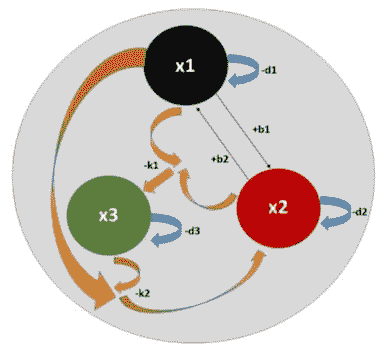

**图 7.1** VVP 模型的示意图。

让 `x[1]`、`x[2]` 和 `x[3]` 代表恶意病毒、易感系统和受保护系统类这三个种群水平。该模型由以下方程描述：

(7.1)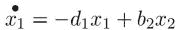

(7.2)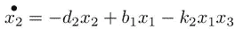

(7.3)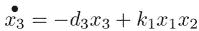

其中参数定义如下：

- `d[1]` 是病毒的衰减系数；
- `d[2]` 是易感系统的衰减系数；
- `d[3]` 是受保护系统的衰减系数；
- `b[1]` 是易感系统的易感性系数；
- `b[2]` 是易感系统的可用性系数；
- `k[1]` 是病毒与受保护系统的遭遇系数；
- `k[2]` 是病毒与易感系统的相互作用系数。

由于该模型基于恶意病毒类之间的相互作用，低效杀毒软件的易感类计算机和高效杀毒软件的受保护类计算机正在被开发。观察上述参数值变化时系统动力学如何演化将是非常有趣的。

应用基本非线性工具研究系统演化，如稳定性分析、相空间分析、时间序列分析、分叉分析和李雅普夫指数分析。方法简述如下：

- 稳定性分析产生控制系统稳定性的参数条件。
- 之后，在相空间分析和时间序列分析中，绘制相空间图和时间序列。
- 当检测到混沌阶段时，我们下一步进入分叉分析。
- 分叉分析为我们提供了混沌发生的参数条件。
- Hurst 指数有助于验证系统随机性的增加。
- 李雅普夫指数的评估给出了轨迹发散的速率。
- 最后，通过系统系统来控制混沌。

### 7.2.1 固定点分析

上述系统方程描述了一个非线性系统，因此需要对其进行固定点分析。在开始固定点分析之前，回顾稳定性的基本概念是重要的。让我们考虑给定的一阶常微分方程：

(7.4)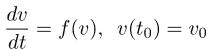

其中 `v` ∈ `D`，`t` ∈ `R+`。`D` 是 `R^n` 的开子集，在大多数情况下 `D` = `R^n`。由于系统对 `t` 没有显式依赖，该微分方程组是自的。点 `v*` 是的固定点，即 `f(v*)` = 0。

在分析固定点时，在邻域内进行线性化是重要的。假设 `f` 是解析的，因此可以在 `v*` 邻域进行泰勒展开。在性化过程中，忽略了高阶项。对于的情况，在 `v*` 邻域内可以写为：

(7.5)

其中研究的是线性微分方程。雅可比矩阵或函数矩阵定义为矩阵。固定点通过进行平移以简化符号。这意味着，导致系统在 `v*` 邻域内的线性化形式为：


其中 `A` 是具有常数系数的 *n × n* 矩阵。

在稳定性分析中，第一步是确定系统的固定点或平衡点。然后评估模型的雅可比矩阵和特征方程。通过雅可比矩阵形成特征方程。通过将固定点代入雅可比矩阵和特征方程，利用 Routh-Hurwitz 判别推导出雅可比矩阵固定点稳定性的参数条件。

(7.6)

那么固定点 `v^∗` 是稳定的，当满足：

- 条件 1：`e[1] > 0`
- 条件 2：`e[3] > 0`
- 条件 3：`e[1]e[2] − e[3] > 0`

方程 (3.1) 中系统的固定点通过同时令方程 (3.1) 中的所有微分相等来评估。

评估出的三个固定点如下：

- 固定点 1：`(0*, 0*, 0*)`
- 固定点 2：
- 固定点 3：

方程 (3.1) 中系统的雅可比矩阵给出如下：

(7.7)

现在将这些固定点代入雅可比矩阵，以确定固定点稳定性的参数条件。固定点 2 和固定点 3 显示在变换 `(x, y, z) → (−x, −y, −z)` 下具有不变性，且对于相同的行为和稳定性条件下结果相同。

#### 7.2.1.1 情况 I

对于固定点，雅可比矩阵推导如下：


对应的特征方程给出如下：


其中：

- `e[1] = (d[1] + d[2] + d[3])`
- `e[2] = (d[2]d[1] + d[2]d[3] + d[1]d[3] − b[1]b[2])`
- `e[3] = d[1]d[2]d[3]`

根据劳斯-霍尔维茨判据，固定点 `(0*, 0*, 0*)` 稳定的条件是：


当 `b[1] < b[α]` 时，系统渐近稳定；当 `b[1] = b[α]` 时，临界稳定；当 `b[1] > b[α]` 时，不稳定。

#### 7.2.1.2 情况 II

固定点  和  显示出不变性，因此具有相同的稳定性条件。这些固定点的雅可比矩阵如下：


该固定点的特征方程给出如下：


其中：

- `e[1] = (d[1] + d[2] + d[3])`
- `e[2] = d[2]d[1] + d[2]d[3] + d[1]d[3] − b[1]b[2]`
- `e[3] = d[1]d[2]d[3]`

因此，稳定性的条件是：


其中：

- 
- 
- `b[κ]` 是 `b[1]` 的阈值临界值。当 `b[α] < b[1] < b[κ]` 时，系统渐近稳定；当 `b[1] = b[κ]` 时，临界稳定；在 `b[κ]` 时不稳定。

### 7.2.2 相空间

相空间是系统所有可能状态的图形化表示。相空间中的每一个点都代表系统在给定时刻的一个可能状态。系统在相空间中的轨迹显示了系统随时间运行的路径。

相空间分析可以揭示关于系统稳定性和行为的宝贵信息。例如，可以在相空间中识别固定点和极限环。这些特征对于理解系统的长期动力学至关重要。

在本研究中，利用离散分析法确定了 `b[1] = 6`、`b[1] = 11` 和 `b[1] = 16` 时时间序列的赫斯特指数 `H`。离散分析是计算赫尔斯特指数的方法之一，涉及对时间序列划分后的不同组别计算标准差或方差。

首先，将时间序列分为大小为 `m` 的组。确定每个组的平均值并计算其标准差。继续计算直到组数达到 `n ≤ 4`。一旦确定了不同大小组别中平均值的标准差，通过绘制标准差的对数值与相应组大小的对数值之间的图，利用其幂律的斜率即可得到赫尔斯特指数。

对于在 `b[1] = 6` 时获得的时间序列，赫斯特指数 `H` 为 0.65。随着 `b[1]` 增加到 `b[1] = 11`，`H` 变为 0.53。最后，当 `b[1]` 设置为 16 时，满足条件 `b[κ] < b[1]`，系统变得混沌，这在时间序列中大量的随机波动中显而易见，此时 `H = 0.34`。这表明随着 `b[κ] < b[1]`，系统过渡到混沌状态。

因此，进行分叉分析是非常重要的，因为 `b[κ] < b[1]` 时混沌开始，且霍夫分叉与通往混沌的路径有关，即极限环从固定点开始演化。通过进行分叉分析，可以确定 `b[1]` 的参数条件，在该条件下可能发生霍夫分叉，导致系统动力学进入混沌随机阶段。

### 7.2.4 分叉分析

分叉分析被认为是对给定族拓扑结构或定性结构变化的数学研究，该族可以是微分方程组的解，也可以是向量场族的积分曲线。对于非线性动力系统的研究，应用了此类研究。

数学中的“分叉”一词由亨利·庞加莱于 1885 年首次引入。动力系统随参数变化的平衡解或稳态解图称为分叉图，该参数称为分叉参数。

当对选作系统分叉参数的参数值引入任意连续变化时，会导致系统的拓扑行为在定量上发生剧变变化。分叉大致分为局部分叉和全局分叉两大类。

局部分叉完全通过分叉参数跨越临界阈值值时，平衡点、周期轨道或其他不变性的局部稳定性特性的变化来研究。当系统固定点或平衡点的稳定性随分叉的变化而改变时，就会发生局部分叉。

对于连续系统，这意味着平衡点的特征值实部穿过零。随着参数值趋向于分叉点，系统相图中的拓扑变化被限制在分叉固定点的任意小邻域内，因此这种分叉称为局部分叉。

现在，当特征值的实部变为零时，发生局部分叉。如果特征值为非零且为纯虚数，则称为霍夫分叉；如果特征值为零，则称为稳态分叉。除了霍夫分叉外，局部分叉进一步分为鞍点分叉、跨临界分叉和叉叉分叉。

如果特征值的模等于 1，则为倍周期分叉。另一方面，当特征值相互碰撞时，发生全局分叉。与局部分叉的情况相反，拓扑变化并不局限于分叉固定点的小邻域内，因此这种分叉称为全局分叉。

如果分叉是极限环，则称为霍夫分叉。如果分叉是同宿的，则为同宿分叉。如果分叉是蓝天分叉，则为蓝天分叉。在前节中，它是分叉发生且系统正走向混沌状态的点。

#### 7.2.4.1 情况 I

对于固定点 `(x[1], x[2]) = (0, 0)`，特征方程为：

```text


λ² + d[1]λ + d[2] = 0

根据上述方程 `λ = (-d[1] ± sqrt(d[1]² - 4d[2]))/2`，如果 `d[1]² - 4d[2] < 0` 则特征值为复数，且 `d[1] > 0` 时可能发生霍夫分叉。如果 `d[1]² - 4d[2] = 0` 且 `d[1] > 0`，可能发生霍夫分叉。如果 `d[1]² - 4d[2] > 0` 则特征值为实数，如果其中一个为负，则可能发生鞍点分叉。如果 `d[1]² - 4d[2] > 0` 且两者均为正数，则可能发生跨临界分叉。如果 `d[1]² - 4d[2] > 0` 且均为负数，则可能发生叉叉分叉。如果 `d[1]² - 4d[2] = 0` 且 `d[1] < 0`，可能发生叉叉分叉。如果 `d[1]² - 4d[2] = 0` 且 `d[1] > 0`，可能发生跨临界分叉。如果 `d[1]² - 4d[2] = 0` 且 `d[1] = 0`，可能发生鞍点分叉。

对于所考虑的系统，当 `b[1] < α` 时，固定点 `(x[1], x[2]) = (0, 0)` 亚临界分叉；当 `b[1] = α` 时临界稳定；当 `b[1] > α` 时不稳定。

### 7.2.4.2 情况 II

对于固定点 `(x[1], x[2]) = (0, 0)`，特征方程为：

```
λ³ + d[1]λ² + d[2]λ + d[3] = 0
```


根据上述方程，如果 `d[3] = 0` 且 `d[1]d[2] > d[1]²`，可能发生霍夫分叉。如果 `d[3] = 0` 且 `d[1]d[2] < d[1]²`，可能发生跨临界分叉。如果 `d[3] = 0` 且 `d[1]d[2] > d[1]²`（此处原文逻辑重复，已按字面翻译），可能发生叉叉分叉。如果 `d[3] = 0` 且 `d[1]d[2] = d[1]²`，可能发生跨临界分叉。如果 `d[3] > 0` 且 `d[1]d[2] > d[1]²`，可能发生鞍点分叉。如果 `d[3] > 0` 且 `d[1]d[2] < d[1]²`，可能发生叉叉分叉。如果 `d[3] > 0` 且 `d[1]d[2] = d[1]²`，可能发生鞍点分叉。如果 `d[3] < 0` 且 `d[1]d[2] > d[1]²`，可能发生叉叉分叉。如果 `d[3] < 0` 且 `d[1]d[2] < d[1]²`，可能发生鞍点分叉。如果 `d[3] < 0` 且 `d[1]d[2] = d[1]²`，可能发生叉叉分叉。


**图 7.4** `b[1]` 参数变化的分叉图。

该分叉图验证了稳定性分析、相空间分析和时间序列分析的发现。然而，识别系统动力学中混沌发生的工具中，最后一种也是最强大的工具之一是李雅普诺夫指数，它将在下一节中讨论。

## 7.3 李雅普诺夫指数与混沌

对于对初始条件具有敏感依赖性的确定性系统，系统的非周期长期行为被定义为混沌。识别系统动力学中混沌发生的最有效方法是确定李雅普诺夫指数的值。李雅普诺夫指数以俄罗斯数学家 `A. M. Lyapunov` 命名，他在 1892 年的研究工作中处理了这个问题，并提出了两种方法，其中一种是基于运动方程线性化的李雅普诺夫指数。混沌动力学的关键组成部分之一是邻近轨迹发散的速率。李雅普诺夫指数衡量收缩和扩张的速率，到目前为止，它是研究人员验证非线性系统动力学中混沌的最佳技术。

李雅普诺夫指数是固定点特征值的泛化。系统的线性方程为方程 ，其中 `v ∈ D ⊂ R^n` 且对初始条件具有敏感依赖性可以写为：


其中 `v[0] = v(t = 0)`。对于该系统，解可以表示为：


其中对于线性方程  是满足链式法则  的基础矩阵，随后的指数可以表征基础矩阵的渐近行为：


解的特征值表示为 `p[1], ..., p[n]`。现在，当


其中 。

只要极限存在，对于 `x[0]` 的李雅普诺夫指数表示为 。

在固定点附近，扩张速率（`λ[i] > 0`）或收缩速率（`λ[i] < 0`）由李雅普诺夫指数指示，因为它们等于临界点特征值的实部。

从数学角度可以解释，对于动力系统，李雅普诺夫特征指数或李雅普诺夫指数是表征无限近轨迹分离速率的度量。如果两条轨迹在相空间中的初始分离由 `δX[0]` 表示，那么 `δX[0]` 以以下速率发散：


其中 `λ` 代表李雅普诺夫指数。

为了区分耗散系统和保守系统，李雅普诺夫指数被用作标准，因为它衡量了收缩和扩张的速率。如果 ，系统是保守的，因为在相空间中解的体积保持不变。如果 ，则相空间被收缩，这表明系统是耗散的。

从数学角度来看，李雅普诺夫指数是表征混沌分离速率的关键。当指数为正时，混沌就会出现：


对于 VVP 模型，李雅普诺夫指数的细节如下：

- **情况 I**：`b[1] = 6`，李雅普诺夫指数为 `λ[1] = -0.21`、`λ[2] = -0.21`、`λ[3] = -6.58`，系统观测到处于稳定状态，在点 `(1.8, 1.1, 5.2)` 处。
- **情况 II**：`b[1] = 11`，李雅普诺夫指数为 `λ[1] = -0.04`、`λ[2] = -0.04`、`λ[3] = -6.91`，因此在点 `(2.5, 2.0, 10.2)` 处处于临界稳定。
- **情况 III**：`b[1] = 16`，李雅普诺夫指数为 `λ[1] = 0.40`、`λ[2] = -0.00`、`λ[3] = -7.40`，因此系统处于混沌状态，在点 `(3.0, 2.0, 15.0)` 处。

## 7.4 混沌控制

通过李雅普诺夫指数的确定可以清楚看出，当 `b[1] > b[κ]` 时混沌会发生。现在，问题的下一个部分是控制混沌并恢复系统稳定性。

同步有许多方案和方法，但主从方案是最常用的方案，而主动控制是控制混沌最广泛的方法。其目的是使具有不同状态和参数值的两个系统同步，通过将其连接到稳定的主系统来恢复混沌系统的稳定性。

误差系统给出了误差演化的微分方程。

使用控制器 1 和控制器 2，主从系统实现了同步以进行混沌控制。

从图 7.6 可以看出，源于主从系统同步的 `Condition 1` 和 `Condition 2` 派生的 `Controller 1` 和 `Controller 2` 正在完美地同步并控制混沌状态。

进一步观察到，由于存在更多的迁移项，`Controller 1` 比 `Controller 2` 快三个时间单位。这突显了接触在稳定人口水平、确保系统稳定性方面的重要性。


**图 7.6** 在 `t = 1000` 激活 `Controller 1` 和 `Controller 2` 时，案例 1 中的同步以及案例 2 中的混沌控制与同步。

## 7.5 结论

在本章中，讨论了利用生物和流行病学模型类比对区块链系统进行建模的问题。提出了一种病毒易感与受保护（VVP）模型，该模型考虑了恶意软件病毒类、易感类和受保护类计算机之间的 `Type I` 相互作用用于研究系统的建模。该模型考虑了恶意软件病毒从现有网络中快速移除，并将其替换为新类型，同时也考虑了易感类和受保护类计算机的衰减率。与其他网络病毒学模型相比，所开发的模型考虑了恶意软件病毒类人口水平的变化。

通过稳定性分析，推出了系统的平衡点或稳态解。观察到存在平凡平衡解和地方性平衡解。对于所研究的系统未观察到无虫平衡态。

通过稳定性分析，确定了不同固定点的稳定性参数条件，并通过在相空间分析中利用四阶 `Runge-Kutta` 方法进行数值仿真以获得相图验证了这些条件。评估了参数 `b[1]` 的临界阈值并将其定义为 `b[k]`。一旦参数 `b[1]` 超过值 `b[k]`，系统的动力学就会进入混沌阶段。在相图中清晰地观察到动力学的稳定、临界和混沌状态。

通过时间序列分析计算 `Hurst` 指数（`H`），观察到随着系统动力学向混沌演化，系统变量时间序列中的反持续行为逐渐上升。分叉分析证实了当 `b[1] > b[K]` 时存在 `Hopf` 分叉，以及动力学从稳定态到混沌态的转变，这在分叉图中也得到了观察。通过确定 `Lyapunov` 指数，最终确认了混沌的发生。

一旦确认混沌，则进行模型混沌控制以恢复其稳定性。利用 `Lyapunov` 稳定性理论设计了控制器，使处于不同动态状态的两个相同的区块链系统同步，并通过应用主动控制通过主从方案实现同步。

一旦通过多状态控制器实现了不同动力学状态下相同系统之间的同步，就可以通过将其同步到稳定态下的相同系统，来控制混沌区块链系统中的混沌。设计了两个控制器，其中由于网络中恶意软件病毒类与具有有效反病毒软件应对恶意攻击的受保护类计算机之间存在更多的交互项，观察 `Controller 1` 在控制混沌方面比 `Controller 2` 快。可以得出，这种接触在稳定人口水平和恢复易受网络恶意攻击影响波动的系统稳定性方面起着至关重要的作用。

### 未来工作范围

在本章中，考虑了一种基于恶意软件病毒类、易感类计算机和受保护类计算机相互作用的三维模型。通过包含康复、暴露类和其他类计算机，该系统可以扩展为四维或更高维模型。在当前模型中，假设了 `Type I` 相互作用。

## 致谢

感谢提供资金支持和设施的作者，印度古宾德·普拉斯斯坦大学。

## 参考文献

1. Kephart, J., White, S., & Chess, D. (1993). 流行病学。*大气科学杂志*, 20(2).
2. May, R. M., & Lloyd, A. (2001). 无尺度网络传播。*皇家学会杂志*, 2(4), 295–307.
3. Drief, J. R., Ganesh, A. (2008). 网络病毒传播。*应用概率年报*, 18(2), 359–378.
4. Kim, J., Krishana, R., & Jang, J. (2006). SIS 感染模型中的成本优化。*ETRI Journal*, 28(5), 692–695.
5. Lorenz, E. N. (1963). 确定性非周期流。*大气科学杂志*, 20(2), 130–141.
6. Das, S., Srivastava, M., & Leung, A. Y. T. (1997). 使用主动控制方法实现相同与非相同三维混沌系统之间的混合同步。*非线性动力学*, 73, 2261–2272.
7. Li, G., & Zhen, J. (2004). 具有一般接触率的 SEI 模型的全局稳定性。*混沌、孤子与分形*, 23, 997–1004.
8. Ham, X., & Tan, Q. (2010). 计算机病毒动力学。*应用数学与计算*, 217(6), 2520–2526.
9. Mishra, B. K., & Prajapati, A. (2014). 虫传播模型。*国际先进科学技术杂志*, 63, 83–94.
10. Memon, R. A., Li, J. P., & Ahmad, J. (2019). 使用队列理论模拟区块链。*电子学*, 8, 234.
11. Saito, K., & Iwamura, M. (2018). 如何在区块链上使数字货币稳定。*ArXiv, abs/1801.06771*.

## Notes

1. 通讯作者：`murugeswari.k@klu.ac.in`；`kadavulai@gmail.com`。

- **链表**：链表是数据结构中最重要的条目之一。图 9.1 显示了链表的样子。


**图 9.1** 链表。

它是一个块的序列，每个块包含数据，这些数据通过 `pointer` 与下一个块连接。`pointer` 变量包含了下一个节点的地址，从而建立了连接 [32]。最后一个节点有一个 `null pointer`，这意味着 `pointer` 没有值。

每个块内部的 `pointer` 包含下一个块的地址。在这里，第一个块可以被称为“创世纪区块”，它的 `pointer` 存在于系统本身之中 [40]。其表示方式如图 9.2 所示。


**图 9.2** 哈希函数。

在这里，哈希指针（hash pointer）包含了之前区块的哈希值。因此，区块链技术的结构是基于链表中的 `pointer`，如图 9.3 所示。


**图 9.3** 简化的比特币区块链。

区块链是一个包含数据和 `hash pointer` 的链表。`hash pointer` 指向它的上一个区块以创建链。如前所述，`hash pointer` 存储了上一个区块内数据的哈希。这个概念使得区块链技术变得惊人、可靠且具有开创性 [40]。

### 9.1.2 去中心化

网络包含通用的客户端-服务器结构。正常的客户端-服务器模型由一个中央服务器组成，如图 9.4 所示。


**图 9.4** 客户端-服务器模型。

网络中的每个人都可以通过发送查询来连接服务器以获取所需信息。但这种模型的问题是整个系统都依赖于服务器，服务器必须一直运行系统才能正常工作。假设如果主服务器停止工作，网络中的每个人都会受到影响 [28]。此外，安全性是该模型的另一个问题，因为服务器处理所有客户端的敏感数据。任何人都可以攻击服务器并获取敏感信息。此外，审查也是一个问题。

为了应对所有这些问题，引入了一种不同的网络架构，它将整个工作负载分配给称为 `peers`（节点）的参与者，他们都具有平等的权限。在这里，重要的概念是此后不会有中央服务，而是会有多个分布式的、去中心化的节点。这被称为点对点网络 [31]。


**图 9.5** 点对点连接。

人们使用点对点网络（如图 9.5 所示）进行文件共享，这也被称为下载。直接使用客户端-服务器架构下载数据通常非常慢且依赖于服务器。


**图 9.6** 中心化与去中心化的下载。

### 9.1.3 不可篡改性

不可篡改性意味着一旦某些内容进入区块链，就无法被篡改。简单来说，如果我们更改了数据，哈希值会自动改变。这正是区块链实现不可篡改性的方式。

## 9.2 区块链的应用

### 9.2.1 食品行业中的区块链技术

在现代，区块链在许多领域都发挥着巨大的作用。最主要的应用是食品行业，它是生物所需食物的主要来源。关于食品，我们应该知道的最基本点是它的来源。人们对他们所食的食物变得漠不关心。

## 概述

区块链（Blockchain）是一种去中心化的账本技术，它通过加密学、哈希算法和共识机制，实现了数据的不可篡改、可追溯性和安全性。区块链的核心特征包括去中心化、透明性、不可篡改性和安全性。

## 核心特征

- **去中心化（Decentralization）**：区块链不依赖于单一的中央机构，而是通过网络中的多个节点共同维护一个账本。这种结构减少了单点故障的风险，增强了系统的可用性和抗攻击能力。
- **透明性（Transparency）**：区块链上的所有交易记录对网络中的成员都是透明的。每个参与者都可以查询历史记录，这有助于建立信任并进行审计。
- **不可篡改性（Immutability）**：一旦数据被写入区块链并获得共识，就极难修改或删除。这确保了数据的真实性和完整性，防止了伪造。
- **安全性（Security）**：区块链使用复杂的加密技术和共识算法来保护数据。由于数据存储在多个节点上，攻击者想要篡改数据必须控制网络中的多数节点，这在实践上是非常困难的。

## 区块链的工作原理

区块链的运作通常遵循以下几个步骤：

1. **交易发起**：当用户发起交易（如发送加密货币）时，该交易会被打包成区块。
2. **广播交易**：这笔交易会被广播到区块链网络的各个节点。
3. **验证与共识**：各个节点根据预设的共识算法（如工作量证明 `PoW` 或权益证明 `PoS`）对交易进行合法性验证。
4. **区块生成**：通过验证的交易会被与其他交易一起打包成一个新的区块。
5. **链式链接**：新区块包含前一个区块的哈希值，从而将其链接到现有的链中。
6. **完成交易**：一旦区块加入链，交易即完成且不可篡改。

## 应用场景

区块链技术的应用非常广泛，涵盖了多个行业：

- **金融服务**：这是区块链最早的应用领域，包括加密货币（如比特币）、跨境支付和去中心化金融（`DeFi`）。
- **智能合约（Smart Contracts）**：存储在区块链上的自动代码，当满足预设条件时会自动执行，减少了中介成本。
- **供应链管理**：通过追踪产品从原材料到消费者的整个流程，提高供应链的透明度并防止伪冒品流入。
- **身份认证**：提供一种更安全的身份验证方式，减少身份盗用和数据泄露风险。
- **非同质化代币（`NFTs`）**：用于证明数字艺术品、游戏道具或实物资产的唯一所有权。

## 结论

区块链作为一种变革性技术，正在逐渐改变我们存储和交换价值的方式。尽管目前在可扩展性和监管合规性方面仍面临挑战，但随着技术的不断成熟，它将在未来发挥更加重要的作用。

尽管这些问题受到了爱沙尼亚信息系统管理局的批评和质疑，但事实是，使用中心化服务器来处理投票可能会受到多种攻击和黑客入侵。

上述问题的解决方案由区块链技术提供。

在这里，像 `Follow My Vote` 这样的公司正在使用区块链技术和椭圆曲线加密将投票带入 21 世纪。他们的目标非常简单：让选举过程尽可能透明。在这里，通过集成区块链，投票过程可以被隐藏。任何潜在的选民可以使用他们的摄像头和政府颁发的身份卡安全地登录。投票完成后，任何人都可以使用他们的投票 ID 来跟踪自己的投票，并检查是否已正确投出。此外，选民甚至可以在截止日期前无限次更改投票。

椭圆曲线加密（`ECC`）用于创建这些投票。`ECC` 是非对称加密的一种。非对称加密使用两个密钥（公钥和私钥）对数据进行加密和解密。`ECC` 基本上是 `Bitcoin` 和 `Ethereum` 用于加密的算法。需要注意的是，私钥不应向用户以外的任何人公开，而公钥会生成一个与所有人共享的公共地址。

在选民注册期间，选民会创建两个 `ECC` 密钥对。选民将身份透露给验证者，由验证者认证第一对密钥对。完成后，选民匿名注册第二个密钥对，并将其属于第一对。第一对密钥对被称为“身份密钥对”，而第二对被称为“投票密钥对”。

选民随后可以创建一个交易（这基本上就是他们的投票），并用他们的投票私钥对其进行签名。一旦投票完成，任何人都可以验证签名是否有效，并确保没有任何投票被篡改。他们只需通过使用选民的公钥进行验证，以检查投票是否确实是由该选民投出的。

## 9.2.4 土地登记

印度已经在研究区块链技术作为解决其土地登记问题的可能解决方案。房产欺诈是印度最大的问题之一。

考虑一下这一点：在 2013 年，仅新德里就报告了 181 起房产欺诈案件，而孟买也紧随其后，有 173 起。因此，为了应对这一问题，安得拉·普拉什邦和特伦甘邦政府与瑞典初创公司 `ChromaWay` 合作，将他们的土地登记放在区块链上。

执行过程将非常简单。该系统将有一个区块链后端和一个 Web 应用前端。前端将辅助整个系统的抽象。`ChromaWay` 将使用他们自己的名为 `Postchain` 的数据库平台。他们可能正在进行的许多有趣创新之一，是引入加密安全的数字指纹。

其可能的运作方式如下：

- 对地理坐标以及土地的多边形描述进行 `hash`（哈希）处理。该 `hash` 与所有者的 ID 绑定，结果会被再次进行哈希处理并添加到区块链中。
- 由于 `hash` 始终是一个值，每个人都将有一个唯一的 ID。此外，由于区块链的不可篡改性，没有任何人可以篡改记录。

## 9.2.5 医疗保健中的区块链应用

区块链技术具有颠覆医疗行业中心化运营的潜力，为优化业务和服务交付开启了大门。分布式账本技术（`DLT`）是一项充满了提高透明度、安全性和效率可能的创新。区块链上的智能合约自动运行，不需要第三方人员使用纸笔流程来验证文件或特定步骤。随着自动化的到来，目前阻碍患者获得最佳护理、臭名昭著的官僚主义也将有所减少。

可以实时分析和更新的不可变数据存储正在完全重塑医疗保健格局。现有的中心化模型已被证明在为人口提供负担得起的优质医疗服务方面是低效的。当社区更健康时，我们都将受益。高效的基于区块链的应用已准备好部署，重新定义从国家医疗系统到私立医院的医疗机构运营方式。不仅直接的医疗干预可以得到改进，处方合从性和医疗保险模型也是如此。名单还在列不穷。

当 `DLT` 致力于大幅提高过时行业的透明度和效率时，患者和提供者之外的各方也从中受益。监管和审计变得更容易管理。引入顶级技术还改进了业务运营，并使医疗关键参与者在私营部门竞争对手中具有明确的优势。

当我们现有的医疗框架运行缓慢、昂贵且需要十个不同的中间介时，我们就知道存在问题。政府和医院希望提供全面、管理负担得起且公众易于获取的护理。现在有了区块链技术，已经有了实现这一使命的工具。作为早期采用者的小型初创公司和大型公司正在寻找减少开支、提供更好的护理、简化保险覆盖流程的方法，从而提高大多数人的整体生活质量并延长预期寿命。

### 9.2.5.1 中心化医疗系统的陷阱

我们今天所知的中心化医疗系统因国家而异。大多数国家都有国家医疗系统，通过政府中心化分配护理。美国有一套私营营利性医疗系统，以及针对低收入个人和老年人的政府计划。国家医疗系统、政府管理计划和私营营利性医疗由于去中心化和技术过时而面临相似的痛点。以下是中心化医疗交付的一些主要问题：

- 信息泛滥
- 数据不安全
- 普遍低效
- 昂贵
- 速度缓慢
- 运营和定价不透明

### 9.2.5.2 医疗去中心化的优势

部署分布式账本技术可以从许多方面改进医疗供应链。医疗保健极度依赖数据，当关键信息在混乱中丢失时，会极大地改变患者的结果。正如在前一节讨论中心化医疗运营的陷阱时提到的，正是这种对技术的误用和缺乏适当的技术基础设施阻碍了医疗服务的成功交付。缺陷主要在于医疗机构无法为患者数据创建线性信息存储，从而无法实现快速方便的信息共享并提高患者的获取能力。

- *互操作性*：更复杂、更健壮的 `APIs` 可以允许电子健康记录（`EHR`）互操作，这意味着健康信息系统可以跨组织边界工作，以提供更先进、有效的医疗干预。区块链网络是互操作的理想平台，可以帮助解决困扰行业的患者数据信息泛滥问题。

## 概览

- **改进数据存储与分析**：区块链可以帮助创建一个以患者为中心的环境，让人群可以在许可链区块链上控制自己的数据。可以从实际的医疗数据中移除身份信息以改进统计数据，同时提供实时的、防篡改的分析，以改进医疗干预。
- **不可篡改性**：当每个患者都有唯一的不可篡改文档时，数据就是防篡改的，并保证了准确性。当数据更准确时，数据分析变得几乎可靠。不可篡改性还有助于保护文档并防止欺诈行为。
- **更高的安全性**：去中心化的数据存储和支付平台从设计本质上天然更安全。服务器和云存储非常脆弱，且所有信息都是集中的，容易受到攻击。区块链很难破解，因为它们依赖加密和私钥系统来保护交易。这些加密签名极难以操纵。此外，当数据去中心化时，它不再存储在具有单一入口的地点，而是存储在点对点网络上的多个副本，难以渗透。
- **降低成本**：区块链技术致力于简化昂贵的流程。在医疗领域，患者和提供者为了实施即使最基础的医疗干预也需要经过无尽的官僚程序。消除阻碍患者接受及时有效护理的非必要步骤将有助于降低成本。供应链中的每个人都能节省费用。
- **更快的护理交付**：医疗行业的去中心化可以帮助患者和提供者减少等待延误。当数据在公共账本上可用并共享时，初级保健医生、健康保险公司和专家之间的转诊流程将简化，患者可以更快地获得护理。改进后勤运营通常会使所有领域运行顺畅。
- **透明性**：当医疗行业中的所有参与者都能平等访问区块链上的防篡改信息时，技术就变成了伟大的均衡器，为那些此前处于信息真空状态的人提供了机会。更透明的医疗系统更具负担能力。

### 9.2.3 区块链在医疗领域的主要应用领域

医疗不仅限于诊所；有无数机构、直接护理人员和患者参与到单一医疗生态系统中。医疗生态系统也因国家而异。在美国，“医疗”一词的涵盖范围广泛得多：制药公司、健康保险公司、初级保健提供者、私立医院、公立医院、Medicare（联邦医疗保险）和 Medicaid（医疗补助）。所有这些机构必须和谐工作，为普通人群提供充分的护理。

以下是区块链应用可能改善整体医疗交付的一些领域列表：

- 健康保险
- 制药
- 私立医疗提供者
- 国家医疗系统
- 医疗研究
- 养老院和老年护理
- 牙科
- 医疗管理

### 9.2.4 区块链在医疗中的应用案例

以下是更多建议的医疗区块链应用案例，其中一些已经在开发中：

- **电子病历**：区块链上的电子病历是区块链在医疗领域应用的第一用例。为什么？因为得益于分布式账本技术，可以实现单一纵向且防篡改的患者记录。这将所有疫苗、实验室结果、治疗策略和处方历史置于存储去中心化点对点网络上的中央账本。
- **代币化医疗**：用户可以个人医疗信息进行共享、学习和赚钱。通过代币化可以激励患者进行预防或治疗。使用代币激励社区成员改善公共健康状况不仅有助于建立更健康的人口，还将成为参与者的收入来源并刺激经济。
- **处方药合规性**：由于患者合规性不当，每年在处方药事件上的花费数以百万。药物依从性问题对于痛苦的个体患者和整个医疗系统都是普遍且成本高贵的。提高药物依从性的激励可以通过 `APIs` 进行代币化，帮助将用药过程游戏化（见上一个用例）。存储在区块链上的依从信息可以成为医生和患者长期沟通和随访药物干预的更便利的地方。
- **自动化健康保险（理赔审定）**：通过使用区块链上的智能合约编程，理赔可以通过 P2P 网络进行验证并自动执行。在没有偏见的中央权威的情况下，可以通过无信区块链环境消除理赔欺诈，这将有助于加速理赔流程。
- **个性化护理**：区块链可以根据改进的 `EHRs` 为个人提供更具个性化的治疗。随着时间的推移，建立了优质且易于的数据，甚至可以导入家族史以鼓励更具定制的干预。没有两个患者是相同的，医疗提供者也知道这一点，但还没有足够的资源让即使是最常规的检查也个性化。
- **医疗产品供应链追踪**：通过医疗系统向患者销售产品的公司必须应对极其复杂的供应链，特别是当涉及处方时。当物品或药物需要召回时，很难将产品追溯到源头。当使用区块链应用记录商品和服务交换时，就会创建一个整洁且线性的审计追踪。交易历史可以自动验证产品，以减少伪品产生，并更好地召回具有有害副作用的药物。
- **远程医疗提供者资质认证**：随着远程医疗成为一种更可行的远程护理选择，患者正在寻找验证在线护理提供者是否真实的证明。引入区块链来自动验证执照并向用户发送更新可以帮助降低远程医疗成本。当名单上有新的接收患者的健康执业人员时，也可以发送通知。
- **患者同意书管理**：所有患者同意书文件都可以在区块链上进行验证，而不是依赖办公室人员进行身份验证。在拜访诊所之前，患者可以使用区块链门户记录他们的症状并以不可篡改的方式对治疗表示同意。这些带有时间戳且安全的文档具有以更及时、更具负担能力的方式解决医疗事故诉讼的潜力。

区块链技术是解决物联网（`IoT`）中扩展性、隐私性和可靠性问题的缺失环节。根据思科的数据，到 2020 年将有 500 亿台设备上线。随着如此多连接设备不断发送、接收和处理开启、调低和移动的指令，即将上线的海量数据可能会带来前所未有的成本。其他问题还包括我们究竟如何追踪和管理数以亿计的连接设备、存储这些设备产生的元数据，并以可靠且安全的方式完成所有工作。在主流物联网消费者真正接纳之前，这些问题需要得到解决。

区块链技术或许是物联网行业所需的“灵丹妙药”。区块链技术可用于追踪数亿个连接设备，实现设备之间的交易处理和协调，并为物联网行业制造商节省大量成本。这种去中心化的方法将消除单点故障，为设备运行创建一个更具韧性的生态系统。区块链使用的加密算法还将帮助使消费者数据更具隐私性。物联网去中心化的优点非常多，且明显优于目前的中心化系统。然而，区块链是一项新发明，与物联网类似，目前的应用程序在扩展性和集成方面有时仍力不从心。随着技术专业人员开始排除故障，并进一步创新基于区块链或物联网行业的应用程序和解决方案，他们迅速意识到区块链在支持物联网以及缓解当前系统遭受的许多显性痛点方面的潜力。许多技术专业人员认为区块链和物联网是完美结合。

### 9.2.6.1 什么是物联网（`IoT`）？

在提到物联网（`IoT`）时，设备、车辆、家用电器、手持电子设备、恒温器、手机和传感器统被称为“物”。基本上，物联网是一个伞用术语，用于描述能够连接到更大通信网络的日益增长的数字设备。

物联网早在 20 世纪 80 年代就作为一种智能设备网络被讨论。现在，它涵盖了人工智能（`AI`）、实时分析、机器学习、传感器、追踪系统和云存储。家用和可穿戴自动化引入了比以往任何时候更多的日常个人使用和企业使用设备。随着越来越多的技术创新加入列表，设备之间的相互作用方式变得更加层次化和复杂，但又变得日益交织。

物联网行业旨在连接这些物理实体，以增强我们现有的基础设施和运营系统。之前列出的大多数设备都可以连接到互联网，或者离线进行远程控制和监控。现在，随着我们引入越来越多的自动化“物”，网络继续扩展，网络承担的责任也随之增加。

设施管理、公路系统和制造设备都属于物联网。许多特定行业的功能需要这些物理实体之间进行高功能的交互。虽然物联网听起来像是一个技术专属术语，但它是一个非常广泛的术语，指的是搅拌机、洗衣机或耳机——任何可以连接到互联网的物品——尽管它可以被缩小到定义在线相互通信的对象。

利用物联网为几乎无尽的组合和可能性打开了大门，通过利用连接性来构建一个凝聚且运行优的物联网网络。虽然物联网的未来看起来光明，但忽视必须解决的问题区域至关重要。

## 9.2.6.2 物联网目前面临的问题

自 20 世纪 80 年代首次被构想以来，物联网已经走了很远的路，到达了我们今天所处的边缘技术前，那里甚至有了“自动驾驶汽车互联网”。预计到 2022 年，每个家庭物联网设备的数量将从约 10 个跳到接近 500 个。

以下是中心化物联网最显著的问题：

- `Security`：这个问题被反复提及。随着连接设备的增多，漏洞和安全威胁也越来越多。这使得云提供商成为黑客易于攻破的目标。
- `Cloud Attacks`：正如本节引言所述，大多数物联网具有云架构。在明显位置有汇总数据的地方，就存在潜伏的安全威胁。
- `Expensive`：目前物联网的管理和部署成本高昂，而且世界经济论坛估计，如果云提供商被黑客攻击，可能会造成 500 亿到 1200 亿美元的损失。物联网能力的成本也将上升。
- `Privacy and Data Storage`：公司将对海量数据负责，这些数据可以被出售，也可以留在不安全的存储中。在云中囤积已被证明是一种冒险策略，加剧了个人身份信息（`PII`）的蔓延。
- `Consumer Skepticism`：中心化物联网的采用速度缓慢，很显然，所有参与方对前进都有合理的顾虑。消费者对物联网服务提供商会保护他们表示怀疑，也不一定信任物联网设备本身。
- `Inadequate Infrastructure`：物联网和服务器-客户端模型存在重大的连接问题。虽然目前可行，但它缺乏长期可扩展性。看看 2022 年预测的需要网络支持的物联网设备数量，很难想象一个由目前已经低效且不安全的中心化模型所支持的运行网络。

## 9.2.6.3 去中心化带来的物联网优势

中心化服务目前可能有效，但它们并不是足够的长期物联网解决方案，以支持未来大规模的设备设计。将数据后端从中心化服务器移出去，将是物联网能力以安全方式发挥全部潜力的关键。

去中心化的物联网将通过无需中心化机构运行的节点，实现设备连接和数据存储的去信任。分布式模型更高效、更安全、更廉，并将为物联网解锁甚至尚未预见的额外收益。

- **防篡改数据**：去中心化应用遭受篡改和欺诈活动的风险要低得多。为什么？因为分布式账本技术（`DLT`）使用非对称加密对交易数据和其他相关信息进行时间标记，并将其不可篡改地存储在账本上。
- **更具廉性**：通过将物联网（`IoT`）部署在分布式网络上并通过分布式账本技术和区块链存储数据来消除安全漏洞，物联网变得更加廉价。目前服务提供商对物联网和设备支持成本拥有垄断。去中心化将使物联网更易获取，并且攻击造成的损失可以更容易地预防或完全避免。通过去中心化，运行中心化物联网系统的中间环节及其所有成本也将被消除。
- **去信任**：使用物联网的所有方和设备之间的信任将通过分布式账本进行验证，并使用智能合约实现自动化，无需信任中心化服务提供商或其他主体来存储数据或控制其设备连接。`DLT` 可以通过代码自动化服务，充当数据流的中间人。
- **自主性**：区块链使智能设备能够独立运行并自我监控。这些微型“分布式自治公司”可能由去中心化的物联网组成，能够根据特定家庭或行业的预设逻辑自主运行。例如，这可以完全消除中间商和中央权威，实现完全自动化的金融服务或保险理赔分配。

### 9.2.6.4 区块链物联网（`IoT`）用例

在区块链领域，物联网应用有潜力渗透到日常生活的几乎每一个部分。随着我们对设备的依赖日益增加，我们对物联网的依赖也越来越大。随着物联网转向基于区块链的去中心化未来，区块链应用将成为我们每小时都在使用的东西，甚至没有意识到自己正在使用“物联网中的区块链应用”。只要有需要从设备中收集并部署的数据，就有物联网。为这些设备连接枢纽创建加密安全的数据库将成为我们下文探索的区块链物联网用例的核心。下面介绍了一些物联网区块链应用的创新用例。

### 9.2.7 汽车行业

汽车行业有很多区块链的用例，因为它是一个部件密集型行业。中心化的供应链和基于信任的分销模式是目前我们制造和获取日常使用车辆的模式。物联网可用于自动更新基于区块链的账本，以保持透明且不可篡改的车辆记录。这将提高整个行业的透明度，并使买到“柠檬车（缺陷车）”几乎成为不可能。部件源自许多不同的供应商，实施区块链应用和物联网来帮助在防篡改和认证的系统中追踪这些移动部件，将改进车辆的买、卖、造和分销方式。

### 9.2.8 智能家电

智能家电是未来的趋势。新的房屋和建筑都拥有可以连接到其他家电、手机 App 和互联网的电器。与其将这些数据存储在中央服务器或云存储解决方案中，智能家电数据可以存储在区块链上。这将有助于保护个人信息并保持家庭物联网网络的安全。数据可以用于改进整个电网的能源成本，而无需通过公/私钥加密将信息关联到特定个人或特定家庭，同时保持数据的真实性。

### 9.2.9 供应链

全球供应链是多层的，涉及跨越时区的数百个实体。分布式账本爱好者经常讨论将供应链迁移到区块链。从食品分销商到制药企业，许多供应链可以受益于使用物联网和区块链相结合来简化流程。通过对部件编号进行设备身份验证并创建来源和历史，可以帮助供应链变得去信任。所有权的转移和位置可以在物联网仪器、货物本身或每个对象之间进行实时跟踪。利用物联网中“物”的连接能力并将连接及相关数据迁移到区块链，可以实现供应链验证和交易的自动化。

## 9.3 结论

区块链应用不仅限于加密货币，它们可以影响比金融领域多得多的行业。区块链的革命性技术在许多不同行业和领域具有巨大的应用潜力。虽然某些行业已经开始在业务中使用区块链，但许多行业仍在探索最佳的开始方式。区块链是技术领域的一个新名字，但它绝对是一个长寿的趋势。即使在早期阶段，这项技术从首次应用加密货币开始就获得了巨大的关注。随着时间的推移，越来越多的应用领域正被发现和测试。一旦这项技术在全球范围内被采用和接受，它将改变我们现在的生活方式。

## 参考文献

1. Sharma, K., Rafiqui, F., Attri, P., & Yadav, S. K. (2019). A two-tier security solution for storing data across public cloud. *Recent Patents on Computer Science*, 12(3), 191–201.
2. Sharma, K., & Shrivastava, G. (2014). Public key infrastructure and trust of web-based knowledge discovery. *Int. J. Eng., Sci. Manage.*, 4(1), 56–60.
3. Shrivastava, G., Kumar, P., Gupta, B. B., Bala, S., & Dey, N. (Eds.). (2018). *Handbook of Research on Network Forensics and Analysis Techniques*. IGI Global.
4. Ahmad, F. A., Kumar, P., Shrivastava, G., & Bouhlel, M. S. (2018). Bitcoin: Digital decentralized cryptocurrency. In *Handbook of Research on Network Forensics and Analysis Techniques* (pp. 395–415). IGI Global.
5. Srivastava, S. R., Dube, S., Shrivastaya, G., & Sharma, K. (2019). Smartphone-triggered security challenges – Issues, case studies. In *Cyber Security in Parallel and Distributed Computing: Concepts, Techniques and Case Studies* (pp. 187–206). Wiley-Scrivener.
6. Amit, R., & Zott, C. (2015). Crafting business architecture: The antecedents of business model design. *Strategic Entrepreneurship Journal*, 9(4), 331–350.
7. Stevenson, T. (2002). Anticipatory action learning: Conversations about the future. *Futures*, 34(5), 417–425.
8. Inayatullah, S. (2006). Anticipatory action learning: Theory and practice. *Futures*, 38(6), 656–666.
9. Coghlan, D. (2019). *Doing Action Research in Your Organization*. SAGE Publications.
10. Reason, P. (2006). Choice and quality in action research practice. *Journal of Management Inquiry*, 15(2), 187–203.
11. Tsoukas, H., & Shepherd, J. (Eds.). (2009). *Managing the Future: Foresight in the Knowledge Economy*. John Wiley & Sons.
12. Ramos, J. M. (2006). Dimensions in the confluence of futures studies and action research. *Futures*, 38(6), 642–655.
13. Floyd, J. (2012). Action research and integral futures studies: A path to embodied foresight. *Futures*, 44(10), 870–882.
14. Bell, E., Bryman, A., & Harley, B. (2018). *Business Research Methods*. Oxford University Press.
15. Yin, R. K. (2017). *Case Study Research and Applications: Design and Methods*. Sage Publications.
16. Nakamoto, S. (2008). Bitcoin: A Peer-to-Peer Electronic Cash System. [Online]. Available at [`bitcoin.org/bitcoin.pdf`](https://bitcoin.org/bitcoin.pdf).
17. Yli-Huumo, J., Ko, D., Choi, S., Park, S., & Smolander, K. (2016). 当前区块链技术研究现状——一项系统性回顾。*PloS One*, 11(10), e0163477.
18. Vukolic, M. (2015, October). 对可扩展区块链架构的探索：工作量证明与 BFT 复制。收于*网络安全开放问题国际研讨会* (pp. 112–125). Springer, Cham.
19. Christidis, K., & Devetsikiotis, M. (2016). 物联网的区块链与智能合约。*IEEE Access*, 4, 2292–2303.
20. Baliga, A. (2016). *区块链版图*. Persistent Systems.
21. Sirmon, D. G., Hitt, M. A., Ireland, R. D., & Gilbert, B. A. (2011). 创建竞争优势的资源编排：广度、深度和生命周期效应。*Journal of Management*, 37(5), 1390–1412.
22. Adner, R., & Kapoor, R. (2010). 创新生态系统中的价值创造：技术相互依赖结构如何影响新技术世代的企业绩效。*Strategic Management Journal*, 31(3), 306–333.
23. Demil, B., & Lecocq, X. (2010). 商业模式演进：寻找动态一致性。*Long Range Planning*, 43(2–3), 227–246.
24. Johnson, M. W., Christensen, C. M., & Kagermann, H. (2008). 重新发明你的商业模式。*Harvard Business Review*, 86(12), 57–68.
25. Osterwalder, A., & Pigneur, Y. (2010). *商业模式设计：愿景者、游戏改变者和挑战者的手册*. 美国新泽西州霍霍肯：Wiley.
26. Chesbrough, H. (2010). 商业模式创新：机遇与障碍。*Long Range Planning*, 43(2–3), 354–363.
27. Zott, C., & Amit, R. (2013). 商业模式：一种用于战略分析的理论锚定的稳健结构。*Strategic Organization*, 11(4), 403–411.
28. Messerschmitt, D., & Szyperski, C. (2003). *软件生态系统：理解不可或缺的技术与行业*. 美国马萨诸塞州剑桥市：MIT Press.
29. Samdanis, K., Costa-Perez, X., & Sciancalepore, V. (2016). 从网络共享到多租户：5G 网络切片代理商。*IEEE Communications Magazine*, 54(7), 32–39.
30. Wang, J., Conejo, A. J., Wang, C., & Yan, J. (2012). 智能电网、可再生能源整合与气候变化缓解——未来的电力系统。*Applied Energy*, 96, 1–3.
31. Pereira, A. C., & Romero, F. (2017). 工业 4.0 概念的含义及其启示回顾。*Procedia Manufacturing*, 13, 1206–1214.
32. Smit, J., Kreutzer, S., Moeller, C., & Carlberg, M. (2016). *政策部门 A：经济与科学政策——工业 4.0*. 欧洲议会，欧盟, 1–94.
33. Wang, A., Yu, L., Mudesir, A., Zhu, D., Zhao, B., & Siew, T. (2017). *5G 网络切片：架构、管理与编排*. Springer.

# 第 10 章：大数据对加密货币的影响

Sandeep Kr. Sharma¹, Rajiv Kumar Modan², N. Gayathri², 以及 C. Ramesh

¹ Bannari Amman 技术学院, Sathyamangalam  
² Galgotias 大学, 葛诺，北方邦

## 摘要

加密货币的流行在于其巨大的应用前景和先进的技术架构。加密货币使用区块链技术取代了传统的加密方法。尽管对其应用性的研究仍在进行中，但本章将讨论加密货币对大数据的影响。世界正迈向信息时代，“数据是新黄金”，随着数据的快速产生，其管理变得混乱。因此，大数据技术变得派上用场，它能够有效处理海量数据（从处理到存储），之后对安全有迫切需求，这可以通过区块链轻松解决。区块链架构的设计是为了解决去中心化、隐私、身份和数据所有权等主要问题，其独特的架构提供了管理这些问题的卓越特性。本章从不同视角概述了大数据和区块链共存的情况，以确保数据质量。我们还将讨论区块链和大数据在国家发展、工业 4.0 的意义以及其他需要解决的未来问题。

关键词：区块链，人工智能，智能与可持续

## 10.1 引言

加密货币和大数据在过去十年中一直是热门话题，事实上，它们在过去几年已成为研究人员、发明者和开发者关注的焦点之一。加密货币和大数据结合了巨大的技术力量，并且在全球范围内也吸引了从数十亿到数万亿美元的投资。加密货币使用区块链技术，而该技术也处于蓬勃发展阶段。

区块链可以作为所有其他计算机技术的核心。它在加密上是安全且稳健的，并充当处理、传输、接收和存储数据的分布式数据库。数据库中的一条记录被称为“区块”，它包含了交易详情、日期、时间以及对其前一个区块的引用。

区块链的核心组件是其去中心化属性 [45]，在这一属性下，没有任何中央实体或机构可以控制数据及其形式，尽管网络上的许多计算机在不断进行检查。相同的数据可以由不同的机器持有。此外，在某台机器上被损坏或被操纵的数据无法进入区块链，因为它将无法与其他计算机所持有的相同数据匹配。因此，我们可以简单地说，只要连接到网络，信息就会保持在相同的状态。

`区块链不具有任何中心化的账本来存储交易。在区块链网络中，每个用户都会验证交易块，之后将其添加到链中进行处理，以确保存储的数据是不可变的，没有人可以修改它。`

区块链中的账本或数据记录可以与贸易、房地产以及数十种其他领域相关。由于大数据分析在工业 4.0（侧重于数据）中被广泛使用和实践，且区块链是透明的，两者的结合可以以透明的方式增强数据分析的流程。例如，它可以用于市场欺诈的检测和预防，因为区块链技术允许同一网络上的所有个人实时捕捉每一笔交易。因此，与其搜索已经发生的欺诈记录并对其进行分析，不如过滤掉欺诈或高风险交易，以防止欺诈的发生。通过这种方式，我们可以在欺诈发生之前阻止它。最近有很多关于欺诈和波动的加密货币新闻，但大数据和实时分析的影响可能会在未来几天内改变现状。

## 10.2 相关研究

区块链和大数据是 21 世纪的新兴技术，它们如此流行，以至于涵盖了广泛的应用，其中许多应用正在各种实际和科学场景下进行研究。由于这些是顶尖趋势且有趣的技术，因此有大量的研究正在进行，互联网上充斥着与这些主题的信息。如果区块链和大数据独立来看非常有趣，那么当它们汇聚时会发生什么呢？

这个问题的答案在本章中，本章将向你介绍与大数据相关的加密货币的一些案例研究和提案，以及它的介绍、工作原理、应用和未来。

下一代大加密货币将是大数据、加密货币和区块链技术的结合，它们相互协作，以最高的精度和效率实现共同目标。像管理健康记录并使用区块链通过无密钥签名确保安全这类有趣的应用，可以在 [46] 及其相关工作中找到。

关于区块链在大数据中应用的一些近期综述可见 [40]。正如各种来源提到的，区块链和大数据是各自领域中的顶尖话题，且单项而言就已经非常高效。那么，如果它们相互汇聚会发生什么；最终结果是更优还是仅仅更好？这个问题的答案将在接下来的主题中看到。

在我们开始之前，让我们分析下面的图表。很明显，存在不受限制的数据增长，从 GB 增长到 ZB。该图是根据 AWS 亚马逊云服务的。


**图 10.1** 大数据从 GB 到 ZB 的增长。

## 10.3 加密货币

加密货币是 21 世纪趋势技术之一，使用了该时代的另一种新兴技术——区块链。它是一种加密格式的数字货币，使用加密技术来确保其安全性。中本聪 [8] 在 2008 年发明了名为比特币的第一个加密货币，并从 2009 年起一直流通。比特币自 2009 年以来一直是市场上最著名的加密货币，并已成为加密货币的象征 [4]。

加密货币交易是不可追踪、匿名的，并为非法毒品交易、非法购买等非法交易制造了障碍。由于货币没有中央存储，比特币账户及其支付过程没有司法管辖。对于加密货币支持者来说，这项技术的主要优势是它的隐蔽性，尽管存在非法滥用的可能，但因为它实现了权力从机构转移到个人。


**图 10.2** 基于历史数据的比特币预期增长。

图 10.2 显示了市场上流通的比特币数量及其在过去几年中的增长。比特币发明于 2008 年，但从 2009 年起开始流通，并且每天增长。

### 10.3.1 加密货币交易是如何工作的？

在加密货币交易中，发送者在系列哈希值中创建一个电子币。然后，它在网络上的其他用户（通过区块链连接）之间流通。每个用户随后通过使用下一个用户的公钥对电子币进行数字签名，并使用上一笔交易的哈希值，将其添加到最后一个电子币中，然后将其重新发送给另一个用户。为了验证所有权链，受益人可以选择验证数字签名。一个大问题是受益人无法验证用户是否花费了两次电子币。这里有一个该问题的解决方案：加密货币持有者可以建立一个中央监控团队，跟踪电子币的所有传输。当交易完成后，电子币将返回给发行者或机构以发行新的电子币。仅由中央机构发行的电子币直接保证了不会被滥用。这种解决方案导致了一个所有交易都通过公司拥有的中央机构的系统，就像银行系统一样。我们需要找到一种方法，让受益人能够检查一个用户是否对最早的交易进行过签名。验证交易不存在的唯一方法是拥有关于所有交易的所有信息。在这个模型中，中央机构拥有所有交易的知识，例如哪些先发生或后发生等。为了在没有可信第三方的情况下实施这种模型，账本是公开的，我们需要建立一个系统，让所有者按照交易接收的顺序对交易达成一致。我们需要确保接收第一笔交易的时间以及大多数节点达成一致。[17]

### 10.3.2 加密货币市场

加密货币市场出现于 2008 年，当时经济危机影响了全球，并迫使投资者寻找其他能够确保资金安全的其他选择。在 2008 年之前，人们将钱存入银行，期望它们是安全且增值的；但银行体系的主要问题是，银行还会将我们的资金投资到各个地方，并向其他人发放贷款来盈利。在某些情况下，银行面临无法偿还的巨额损失或直接宣布破产。在这种情况下，在印度，投资者从 `Reserve Bank of India`（印度储备银行）获得的最多只有 1 万（1 lakh）含利息，无论你投资了多少。由于所有这些问题，投资者开始寻找一个可以在不产生任何亏损风险的情况下进行投资的新领域。当名为 `Bitcoin` 的加密货币首次上市时，投资者开始对其产生兴趣，这是其增长的关键原因。一旦加密货币市场开始增长，就无法回头。目前，市场上共有 2,322 种加密货币，市值为 3490 亿美元；其中前 10 种加密货币的市值为 2820 亿美元。`Bitcoin` 以 2037 亿美元的价值（截至 2019 年 7 月 8 日）[42] 领先加密货币市场。此外，`bitcoin` 比其他加密货币受欢迎得多。根据数据，目前总共有 17,951,237.5 个比特币存在；比特币的数量每 10 分钟变化一次，直到新区块被产生，每个区块包含 12.5 个比特币。根据一份报告，每天产生 144 个新区块。这意味着每天有 1800 个新比特币进入市场，总剩余 3,048,762.5 个比特币等待挖掘 [41]。一个 `bitcoin` 的市值在 2017 年底达到了 20,000 美元，目前维持在 8,000 美元的平均值 [1]。

许多研究人员现在正在寻找加密货币的参数，并考虑了许多因素，如监管、政策模糊性 [18]、经济过程 [19]、世界不确定性 [20]、生产成本 [21]、用户特征 [22]、货币法律 [23] 以及货币压力 [24]。

### 10.3.3 印度等国家加密货币的未来

印度共和国通过加密货币进行的新型同行评审商业主义，在鼓励个人形成投资和获取利润方面竞争着至关重要的角色。货币服务体系最重要的作用是在完全不同的经济活动之间分配经济资本。本质上，由于所有这些问题，投资者开始寻找一个可以在不产生任何亏损风险的情况下进行投资的新领域。


**图 10.3** 区块链工作原理图。

如图 10.3 所示，如果客户端想要发起交易，则客户端需要请求该交易的区块，如第二步所示。随后，区块广播到连接到网络的所有其他节点；一旦节点接收区块，它们就会进行认证，之后区块被添加到链中执行。

## 10.5 大数据

### 10.5.1 引言

“大数据是一个研究分析、系统地提取信息或处理规模过大或复杂以至于无法用传统数据处理软件处理的数据集的领域” [27]。

“大数据”一词指的是海量数据，这些数据大多是实时的，并且以指数级速度增长，且没有保持任何适当的格式。该词由约翰·马西（John Mashey）普及，自 20 世纪 90 年代以来一直被使用。大数据在处理和分析任何普通软件或工具无法处理的巨大数据方面发挥着非常广泛的作用。使其成为处理海量数据的高效技术的另一个特点是，它能够处理和分析任何类型的数据，无论是结构化的、半结构化的还是非结构化的。它可以高效地完成工作。简而言之，大数据如此庞大且复杂，任何普通的工具和软件（如数据库管理系统）都无法快速对其进行处理和存储。根据福布斯（Forbes）的一份报告，全球每分钟有互联网用户观看 415 万段 YouTube 视频，在 Twitter 上发布 45.6 万条推文，在 Instagram 上发送 4.67 万张照片，Facebook 上产生约 51 万条评论和 29.3 万条状态更新！每天产生数十亿万万字节的数据，其增长速度迅速增加。产生此类数据的技术之一是物联网（`IoT`），在其中，每个连接到互联网的设备都会以极高的速率捕捉、共享和处理数据。

下面的图表显示了不同人员以不同格式的大数据研究的指数级增长。从图中可以看出，研究变得日益深入，并持续反映在研究论文中。


**图 10.4** 不同人员以不同格式的大数据研究增长图。

### 10.5.2 大数据的重要性

大数据本身具有巨大的价值，因此它从根本上改变了我们工作、思考和生活的方式。以下描述了大数据在各个领域的重要性。

#### 10.5.2.1 对国家发展的重要性

我们生活在数据时代，数据是最宝贵的资产。我们每秒进行约 63,000 次 Google 搜索。广而言，物联网设备、互联网、新兴 IT 技术和云技术的使用是有价值的资产。我们需要这样的数据 [44]。

### 10.5.2.2 工业 4.0 的方面

工业 4.0 通常被认为是第四次工业革命。数据是这场革命的焦点，俗话说“数据是新石油”，这意味着它是最大的资产。例如，在机器学习中，数据被用于训练和测试；在物联网中，数据被创建和处理；许多其他应用将数据作为主要来源。

下方的图 10.5 展示了工业 4.0 的数字化转型以及当前行业如何运作和降低成本。


**图 10.5** 使用大数据的 4.0 数字化转型。

## 10.6 大数据与区块链的共存

大数据和加密货币以相互融合的方式实现共存。数据在过去被收集，未来也将继续被收集，但现在是利用这些数据预测市场走向的时候了。新的初创企业和业务现在正在利用这种数据的能力。

目前，世界面临着用户和机器合成的数字或虚拟数据数量和种类的大幅增加；科学家们正在积极寻找存储和组织数据的有效方法，大数据和区块链等技术将在其中发挥至关重要的作用。一些常见的应用如数据的本地化管理、虚拟财产解决、物联网通信 [43] 以及公共机构，都需要区块链与大数据相结合带来的利益 [28]。

大数据时代给世界带来了巨大挑战的同时也带来了巨大的利益。广泛领域的进步和创新都是由大数据的分析过程推动的；一些应用领域的示例包括犯罪 [30]、关系分析 [31]、电力/能源 [32]、天气预报 [33] 以及银行业 [37]。Hassani *等人* 描述了大数据分析如何帮助银行业进行安全管理、风险因素管理、客户关系管理和销售，这极大地优化了他们的运营能力和利润 [37]。

比特币和以太坊等加密货币是数字形式的货币，因此它们带有数字信息，这使得能够结合大数据使用它们以提高整体质量和安全性。货币的数字性质及其交易程序在本质上是透明的，不需要任何中心化机构即可进行，这使得交易更加安全。这种组合可以用于许多目的，例如，以医院为例。医院可以使用这项技术确保患者的记录得到保护，同时保持隐私完整无缺且信息更新。通过将区块链与大数据相结合，医院可以维护健康和疾病数据库，确保所有员工对所有记录和数据都拥有单模式且不可篡改的访问权限。通过这种方式，医院可以消除由于测试结果丢失或损坏而导致患者误诊或治疗不当的风险。此外，治疗同一位患者的两个不同医生可以访问其整个医疗史，以便开具恰当处方。


**图 10.6** 区块链和大数据在医疗机构的应用。

由于加密货币的特性，它们与区块链和大数据技术形成完美的组合，这种组合不仅使得对未来做出预测成为可能，还可以用于增强整体系统安全工作效率。该技术能够以极高的精度跟踪可疑数据项，并能够在网络攻击实际发生之前预测出其中的 51%。

由比特币和其他加密货币驱动的技术以及区块链与大数据的结合具有改变我们所处世界的潜力。这就是为什么许多研究人员和科学家正在组织大型数据集供这种组合使用。像 `Filecoin`、`Sia` [38] 以及许多其他项目也在为存储可以被高效访问的海量数据集寻找最佳解决方案。

## 10.6.2 带大数据的加密货币可以用在哪里？

### 10.6.2.1 在教育领域

大学、学院、学校和其他教育机构拥有大量与其教职员工、学生和员工相关的数据，这些数据每天呈指数级增长，因此迫切需要使用最新技术进行处理和存储。这就是大数据发挥用场的地方，因为它处理此类海量数据的效率足够。由于数据存储在服务器中，机构内部还需要万无一失的安全性和透明度，以便高层部门防止任何外部或内部代理对数据进行操纵。数据分析在分析数据以提高教育机构运营效率方面也起着重要作用。三者结合使我们接触带大数据的加密货币，它可以轻松地存储、管理和保护这些机构所拥有的重要数据，如学生信息、成绩、教师信息等。由于安全是任何存储系统的支柱，区块链是轻松消除隐私和数据滥用案例风险的最佳选择，例如操纵学生成绩、考勤和课堂记录等。这种高安全性背后的原因在于区块链技术的工作原理，它使用分布式账本的概念来提供远优于其他加密技术的额外安全保障 [35]。

### 10.6.2.2 在政府部门防止腐败和保护机密信息

腐败是发展中国家面临的最大问题，因为它直接影响该国家的经济。如果不采取行动，腐败的根源可能会蔓延到整个部门。许多国家正因在此问题上的无作为而受苦，并正努力克服这一问题。那么，腐败是如何发生的？在发展中国家，数据要么存储在传统的归档系统中，要么以无组织的方式存储在计算机中。即使是机密信息也是使用传统方法存储的。由于政府存储最机密的信息，必须使用更新的工具和技术对其进行保护。

那么，带大数据的加密货币如何解决这个问题呢？为了解决这个问题，首先我们需要以组织的方式存储数据，因为数据如此庞大，只有使用大数据技术才能处理它，其中数据以有效的方式进行处理和存储，以提供额外的安全的区块链，区块链可以与大数据共存，从而解决腐败问题并为机密记录提供全面的安全性。然而，访问此类重要信息需要一些额外的努力。方法非常简单：如果有人想访问某些凭证信息，他们需要提交请求，产生一个 `block`，然后该 `block` 被传输到所有连接的节点。如果所有节点都允许该请求，该请求将进入进一步处理。如果任何腐败官员想要批准与公共利益相关的文件，他们必须遵循区块链不可侵破的过程。

### 10.6.2.3 在网站中防止网络攻击

随着技术的进步和数字化，网络犯罪正在迅速增加。随着犯罪的增加，需要一些能够确保不可侵破安全性的有效解决方案。

如今，网站通常托管在中心化服务器上，这使得攻击者很容易进入并访问网站凭据，以窃取并操纵存储在相应服务器中的数据。为了确保此类网站在存储和处理方面具有更高效率的安全性，开发者可以使用带大数据的加密货币，利用区块链轻松处理网站数据的整体处理和存储。

## 10.7 带大数据的加密货币的未来前景

金融领域的人不断寻找不同市场的未来并据此做出预测。尽管对短期和长期目标非常关注，但仍然需要能够更有效地预测未来的模型。随着市场的增长，由于这种增长，大数据已经找到了自己的位置，并被用于获取加密货币世界的更深入见解，加密货币预计到 2025 年将增长到 67.0 亿美元，复合年增长率为 31.3%。

在本节中，我们将探讨带大数据的加密货币的未来前景，以揭示其背后的秘密，这些秘密可以使市场现状发生巨大变化。

大数据与加密货币（即大数据与加密货币的交互）被视为一个研究课题，这也是为什么目前在执行或采用区块链等技术方面还没有明确的路线图 [39]。该领域的大部分研究集中在利用大数据提取知识、通过结合使用这两种技术来增强额外的安全层、管理大数据中的访问控制、风险分析和预防措施等方面。然而，该领域仍有许多未开发的领域，这为未来研究提供了极大的探索机会。一个应该指出的问题之一是缺乏对应用程序接口（`API`）的使用，导致交易记录没有得到充分利用。加密货币的一些主要缺点，如计算可扩展性、模型能量效率低下、市场准入层面的障碍以及官方或政府层面的挑战，可以通过加密货币结合大数据数据分析来找到有效的解决方案。其他此类方面可以在研讨会、新闻、会议等处找到。

我们知道，加密货币与大数据的共存通常处于研究阶段，因此关于将加密货币作为主流货币使用以及与之结合区块链的使用，目前还没有充分的信息 [39]。正在研究的一些主题包括利用大数据进行知识提取和理解市场波动性；以及利用加密货币和大数据增强大数据管理以实现额外的安全增强。未来仍留有许多可能性并在后续研究中进一步探讨。例如，交易记录尚未通过加密货币和大数据得到充分探索。这可能是由于参与者对这些领域的兴趣较小，或者对这些场景的了解较少。加密货币的一些缺点，如能源效率低下、市场准入障碍、计算方面的可扩展性以及各种其他权威性挑战，可以通过大数据分析过程得到解决。对此类主题的学术研究也存在缺陷，其中许多是发表在研讨会、媒体新闻、工作坊和会议上。因此，这可以被视为一个涵盖广泛的话题，并可以在未来的研究中轻松找到应用。

## 10.8 结论

现在，我们已经到达了本章的末尾，但这段旅程尚未结束。是时候总结一下我们到为止讨论的内容了。在本章中，我们回顾了加密货币的关键发现，并了解它的工作原理以及其在市场中的应用和未来。然后，我们讨论了区块链的工作机制及其实现加密货币的架构。接着，我们引入了大数据的概念，并讨论了它在国家发展以及工业 4.0 各个方面的重要性。最后，我们讨论了数据与区块链的共存，以及这种结合如何用于解决一些传统技术难以处理的现实问题，包括为医疗、教育、政府和网站等不同经济部门维护数据质量和安全。

除此之外，其他未来的工作还包括利用大数据提取知识、通过结合使用这两种技术来增强额外的安全层、管理大数据中的访问控制、风险分析和预防措施等。然而，该领域仍有许多未开发的领域，这为未来研究提供了极大的探索机会。

## REFERENCES

1. Hassani, H., Huang, X., & Silva, E. (2018). Big-Crypto: Big data, blockchain and cryptocurrency. `Big Data and Cognitive Computing`, 2(4), 34. DOI: 10.3390/bdcc2040034.
2. Angel, J., & McCabe, D. (2015). The ethics of payments: Paper, or bitcoin? `Journal of Business Ethics`, 132(3), 603–611.
3. Weber, B. (2014). Bitcoin and the legitimacy of money. `Cambridge Journal of Economics`, 40(1), 17–41.
4. Mourdoukout. (2014). Some major drawbacks of cryptocurrency like computational scalability, energy inefficiency of the model, barriers in market entry level, and official or governmental challenges, can find effective solutions by the use of big data analytics in combination with cryptocurrency. Other such aspects can be found in workshops, news, conferences, etc.

We know that the coexistence of cryptocurrencies and big data is generally under research, so there’s no proper information about the use of cryptocurrencies as the mainstream currencies and use of blockchain with it [39]. Some of the topics being researched are the use of big data for knowledge extraction and to understand market volatility; and enhancement of big data management using cryptocurrency and big data for additional security enhancement. There are a lot of possibilities still remaining and can be researched further in future studies. For example, transaction records have not been well explored through cryptocurrency and big data. This may be due to the participants having less interest in these domains or having lesser knowledge about these scenarios. Some of the disadvantages of cryptocurrencies like inefficient energy, entry barriers in markets, scalability in terms of computation, and various other authoritarian challenges can be solved through the big data analytics process. There are also flaws in academic research on such topics, many of which are due to publication in seminars, media news, workshops and conferences. So, it can be seen as a topic that covers a wide range and can easily find applications in upcoming research.

## 10.8 Conclusion

So, now we have arrived at the end of this chapter but this journey is not over yet. It’s time to summarize what we have discussed so far. In this chapter, we went through the key findings of cryptocurrency and got to know how it works, along with its applications in the market and its future. Then we discussed the workings of blockchain and its architecture for the implementation of cryptocurrency. We then introduced the concept of big data and discussed its importance in national development and various aspects in Industry 4.0. Finally, we discussed the coexistence of big data and blockchain and how this combination is used to solve some of the real-life problems that are hard to be handled by the traditional techniques, which include maintaining data quality and security for the various sectors of the economy like health, education, government, and websites.

Apart from these, other future work includes the use of big data for extracting knowledge, enhancing an extra layer of security by using both technologies together, managing access controls in big data, risk analysis, and preventive measures, etc. However, there are many stones left unturned in this field that can provide great opportunities to explore more in future research.

## REFERENCES

1. Hassani, H., Huang, X., & Silva, E. (2018). Big-Crypto: Big data, blockchain and cryptocurrency. `Big Data and Cognitive Computing`, 2(4), 34. DOI: 10.3390/bdcc2040034.
2. Angel, J., & McCabe, D. (2015). The ethics of payments: Paper, or bitcoin? `Journal of Business Ethics`, 132(3), 603–611.
3. Weber, B. (2014). Bitcoin and the legitimacy of money. `Cambridge Journal of Economics`, 40(1), 17–41.

## 参考文献补充

24. Bouri, E., Gupta, R., Lau, C. K. M., Roubaud, D., & Wang, S. (2018). 比特币与全球金融压力：一种基于 Cop 函数的分位数依赖与因果关系方法。*The Quarterly Review of Economics and Finance*, 69, 297–307.
25. [`rbi.org.in/scripts/BSPressReleaseDisplay.aspx?prid=43574`](https://rbi.org.in/scripts/BSPressReleaseDisplay.aspx?prid=43574)（访问于 2019 年 9 月）。
26. [`www.academia.edu/38109797/CRYPTOCURRENCY_EVOLUTION_IMPACTS_AND_FUTURE_IN_INDIA`](https://www.academia.edu/38109797/CRYPTOCURRENCY_EVOLUTION_IMPACTS_AND_FUTURE_IN_INDIA)（访问于 2019 年 9 月）。
27. [`en.wikipedia.org/wiki/Bigdata`](http://en.wikipedia.org/wiki/Bigdata)（访问于 2019 年 9 月）。
28. Karafiloski, E., & Mishev, A. (2017, 7 月). 针对大数据挑战的区块链解决方案：文献综述。在*IEEE EUROCON 2017—17th International Conference on Smart Technologies*（pp. 763–768）。IEEE.
29. [`refhub.elsevier.com/S2214-5796(15)00007-6/bib4D617965433133s1`](http://refhub.elsevier.com/S2214-5796(15)00007-6/bib4D617965433133s1)（访问于 2019 年 9 月）。
30. Hassani, H., Huang, X., Silva, E. S., & Ghodsi, M. (2016). 犯罪领域数据挖掘应用综述。*Statistical Analysis and Data Mining: The ASA Data Science Journal*, 9(3), 139–154.
31. Hassani, H., Huang, X., & Ghodsi, M. (2018). 大数据与因果关系。*Annals of Data Science*, 5(2), 133–156.
32. Hassani, H., & Silva, E. S. (2018). 大数据：石油和石化行业的巨大机遇。*OPEC Energy Review*, 42(1), 74–89.
33. Hassani, H., & Silva, E. S. (2015). 利用大数据进行预测：综述。*Annals of Data Science*, 2(1), 5–19.
34. Chuen, D. L. K. (编). (2015). *数字货币手册：比特币、创新、金融工具与大数据*。Academic Press.
35. Karafiloski, E., & Mishev, A. (2017, 7 月). 针对大数据挑战的区块链解决方案：文献综述。在*IEEE EUROCON 2017—17th International Conference on Smart Technologies*（pp. 763–768）。IEEE.
36. Jin, X., Wah, B. W., Cheng, X., & Wang, Y. (2015). 大数据研究的意义与挑战。*Big Data Research*, 2(2), 59–64.
37. Hassani, H., Huang, X., & Silva, E. (2018). 银行业的数字化与大数据挖掘。*Big Data and Cognitive Computing*, 2(3), 18.
38. [`www.forbes.com/sites/shermanlee/2018/06/08/blockchain-is-critical-to-the-future-of-data-storage-heres-why/#280a5a0e33e9`](https://www.forbes.com/sites/shermanlee/2018/06/08/blockchain-is-critical-to-the-future-of-data-storage-heres-why/#280a5a0e33e9)（访问于 2019 年 9 月）。
39. Mendling, J., Weber, I., Aalst, W. V. D., Brocke, J. V., Cabanillas, C., Daniel, F., ... & Gal, A. (2018). 区块链用于管理：挑战与机遇。*ACM Transactions on Management Information Systems (TMIS)*, 9(1), 4.
40. Karafiloski, E., & Mishev, A. (2017, 7 月). 针对大数据挑战的区块链解决方案：文献综述。在*IEEE EUROCON 2017—17th International Conference on Smart Technologies*（pp. 763–768）。IEEE.
41. [`www.buybitcoinworldwide.com/how-many-bitcoins-are-there/`](https://www.buybitcoinworldwide.com/how-many-bitcoins-are-there/)（访问于 2019 年 9 月）。
42. [`finance.yahoo.com/news/top-10-cryptocurrencies-market-capitalisation-160046487.html`](https://finance.yahoo.com/news/top-10-cryptocurrencies-market-capitalisation-160046487.html)（访问于 2019 年 9 月）。
43. Kumar, P., Shrivastava, G., & Tanwar, P. (2020). 解析以太坊技术：去中心化的应用。在*Forensic Investigations and Risk Management in Mobile and Wireless Communications*（pp. 242–256）。IGI Global.
44. Shrivastava, G., Kumar, P., Gupta, B. B., Bala, S., & Dey, N. (2020). 解析以太坊技术：去中心化的应用。在*Forensic Investigations and Risk Management in Mobile and Wireless Communications*（pp. 242–256）。IGI Global.

# 印度农业

农业被认为是印度经济主要的收入来源，但全印度及全球范围内农民的处境仍然非常不确定，且完全取决于天气和其他相关条件。印度约 13.7% 的国内生产总值（GDP）源于农业，这一比例相对较低，尽管作为一个农业国家，印度提供了全球总农产品产量的 7.6%。此外，农业养活了 60% 的人口，印度是全球第 7 大的农产品出口国。尽管印度 52% 的人口参与农业生产，但农业部门对 GDP 的贡献仅为 13.7%。以上所有统计分析表明，需要利用目前的智能技术将农业转型为数字农业（e-agriculture）。在过去的二十年里，据观察约有 30 万从事农业部门的人自杀，每天还有约 2,000 人改变主意，转向其他收入来源，离开农业部门 [1, 2]。

## 农民面临的挑战

印度及全球各地的农民因市场风险、气候变化、生产因素和价格波动导致农业部门存在巨大的财务不稳定性而遭受财务困扰。农民的作物受到不利气候状况、天气反复无常、降雨特征以及供应不足和分配不均的影响。此外，灌溉用水严重匮乏，由于土地面积缩小和土地持有量不足，作物失败逐渐发生。

面积 1.4 亿公顷的农田中，约 80% 是小农田，60% 是大农场，都遭受着干旱和洪水灾害的侵害。由于持有量少，农户收入较低，其作物价格无法得到合理实现，贫困农民无法在不规则的市场上出售作物以获得体面的价格。

## 财务与结构性障碍

由于供应链效率低下和缺乏透明度，中间人获得了利润而农民遭受损失。此外，如果农民获得高产，存储设施也相当匮乏，由于冷藏系统的不足和不可用，导致 30–40% 的产量受损。约 90% 的印度农民面临负债问题并自杀。约 60% 的农民缺乏信贷体系渠道，因此他们陷入了高利贷者的陷阱，利率高达 40–60%。此外，基于合作的信贷体系利率也高，导致农民无法偿还贷款。

由于农业投入价格快速上涨而生产价格下降，农民面临巨额负债。作物反复失败，农民无法获得信贷支持。由于高利贷者提供高利率，农民涌向政府支持，但政府政策的改变导致了对农民援助的撤销 [3, 4]。


**图 11.1** 各州深陷农业债务循环的农民。

根据研究，2020 年计算机化耕作及相关的农场管理已影响了印度 7000 万个农场，从而为农民工资增加了 90 亿美元。2017 年，全球园艺中人工智能（`AI`）展示的市场规模为 2.4 亿美元，预计到 2025 年底将达到 11 亿美元，且从 2018 年至 2025 年的复合年增长率（`CAGR`）为 20.8%。就此看来，通过这种方式，提高农村地区熟练水平的活动可以被视为在不远的未来倍增农民薪资的武器。农业市场 `AI` 销售的驱动者包括 Ag Leader Technology、Trimble、John Deere、Iteris、AGCO、aWhere、Gamaya、Granular 和 Raven Industries。人工智能的承诺是在一个必须用更少的资产提供更多食物的世界中，实现农业革命的关键。NatureFresh Farms 正在开发和研究一项技术，这是一家拥有 20 年的公司，在安大略省和俄亥俄州之间的 185 亩土地上种植蔬菜。在那里，机器人镜头对准番茄苗的黄花，植物图像流入 `AI` 算法，该算法能精确预测从花朵变成成熟可采摘、包装并运往市场的番茄需要多久。根据 NatureFresh Farms IT 经理 Keith Bradley 的说法，确切知道未来将有多少番茄可以出售会让销售团队的工作变得更简单。这只是 `AI` 改变耕作的一个案例，这种不断发展的模式将导致农业的转型。从检测害虫到预测哪些农作物将产生最佳回报，人工智能能使人类克服其最大的困难之一：在 2050 年之前养活额外的 20 亿人口，即使气候变化正在破坏生长季节、将可耕地变成沙漠，并用海水淹没曾经肥沃的三角洲 [9]。

> “农耕业正处于重大变革的边缘。”——Gayle Sheppard，Intel AI 副总裁兼总经理。

农耕行业将通过信息科学和基于 `AI` 的计算机推理发生改变。农民将拥有设备来使每亩土地价值最大化。从每亩土地获得最大收益并不是学术问题。联合国估计，到本世纪中期，食品产量必须增加约 50%。从 1960 年至 2015 年，随着世界人口从 30 亿增长到 70 亿，农业产量显著增加。虽然杀虫剂、肥料和机器的创新对农业增长做出了贡献，但这些增长大部分可归功于耕种更多土地、砍伐森林并将淡水引入农田、果园和稻田 [10]。

> “行业将通过数据科学和人工智能发生转型。农民将拥有工具从每亩土地获得最大收益。”——Gayle Sheppard，Intel AI 副总裁兼总经理。

## 11.2.2 AI 对抗蝗虫

农民一直深受害虫困扰。在农业创新近万年后，甲虫、蝗虫和其他食粮性昆虫仍然通过吃掉本可以养活人类的粮食来侵蚀利润。然而，AI 为生产者提供了一种对抗食粮虫的武器。不久前，德克萨斯的一个农民检查了风向，判断一群蝗虫可能会降临他农田西南角。但在他检查农田之前，他收到了他雇佣监控农场的 AI 公司发来的手机警报。通过将新的卫星图像与过去五年内同一区域的拍摄图像进行对比，AI 算法识别出蝗虫已降落在农民农田的另一个角。农民调查了该区域，确认警报准确，并将这些昂贵的害虫从他几乎成熟的玉米地中驱逐。在 NatureFresh Farms，育苗番茄生长在碎椰子壳基质中。这是一种无添加剂的状态，使生产者能够完全控制进入植物的物质。传感器监测天然产品的进展，这种补充剂免费的状态使生产者能够完全控制进入植物的内容。NatureFresh Farms 利用这种技术来确保 [11]。

> “在技术领域内，农耕业正面临重大变化。”——NatureFresh Farms 这种技术内部的 13。

## 11.3 区块链技术（`BCT`）及其对农业的影响

区块链技术最初设计用于支持和改革金融领域，如今已改变了农业方式。区块链是基于允许任何人查看的不断增长的区块列表的。这些区块通过哈希函数连接，从而确保了信息的安全性。每当新块添加到链时，都会由百万用户进行验证 [14]。

### 11.3.1 区块链的类型

区块链可以被大致分为三类，正如图 11.2 所示。公开区块链网络供任何人访问，无需任何参与许可。所有人都被允许添加区块。公开区块链的一些显著特征是透明性、可变性、分布式特性和不可篡改性。联盟区块链（也称为协会区块链）由一组领导控制。这些是去中心化的系统，并不是每个人都有权加入和参与，相反这一过程需要适当许可。私有链类似于中心化系统。对于私有链的状态存在争议，一些人认为它们没有遵循区块链的本质。私有区块链网络像联盟一样需要适当许可才能访问网络 [16]。


**图 11.2** 区块链的类型。

### 11.3.2 区块链的代际

自 2008 年诞生以来，区块链技术不断演进，并在行业的多个领域开辟了利基市场，如表 11.1 所示。尽管这项技术只有十年的历史，但它已经经历了三代更迭，第四代即将发布。第一代区块链由比特币组成，它基于工作量证明算法。其理念是使用一种既匿名又透明的点对点（`P2P`）分布式系统来增强现有的货币体系。

第二代区块链是在创者意识到除了货币外，其他几种基于信任的交易也能从区块链中受益之后引入的。2015 年，随着 `Ethereum` 的引入，第二代区块链问世。引入了一个可以用于多个去中心化项目的数字生态系统。代币发行（`ICO`）就是在第二代区块链中出现的。智能合约的引入使得能够以安全、可靠、公平、快速和自动的方式处理复杂的信任协议，而无需任何第三方。尽管前两代区块链提供了许多优势，但它们存在许多问题，包括扩展性问题。


**表 11.1** 区块链的代际。

为了克服这一问题，第三代区块链出现了。它提供了更高的扩展性和跨链交易能力。工作量证明共识机制被权益证明机制所取代 [17]。

### 11.3.3 农业中的区块链：智能农业的助力

在过去的十年里，农业部门采用了现代技术改革，以实现自动化并增强其关键功能，如图 11.3 所示。


**图 11.3** 全球农业区块链的主要组件。

智能手机应用程序的使用进一步促进了农田和其他设备的远程监控和控制。信息通信技术（`ICT`）在农业部门的应用帮助农民和其他利益相关者在管理和预警系统、监控和资源管理方面提供了支持。区块链技术在农业领域的引入可以增强产品供应、定价、产品追踪等。从购买种子到作物实际收获和销售，一切都可以记录在区块链上。由于区块链记录具有高度安全性且不可篡改，它可以帮助农业利益相关者监控和控制风险，并最大限度地减少印度等发展中国农民的困苦 [18, 19]。

区块链在农业领域的一些应用包括：

- **食品安全**：如今，随着人们对消费食品质量的怀疑日益增加，迫切需要开发一种能够追踪和监控食品安全的机制。随着食品相关过敏和其他健康危害的增加，客户要求对其消费的食品质量提供保证。全球食品业也遭受了食品欺诈带来的损失。今天，大型食品链和其他基于农业的行业正在寻找能够解决这一问题的技术改革。区块链技术证明是确保食品产品质量、真实性、可追性和追踪的一站式解决方案。区块链在食品质量和维护领域具有巨大潜力 [20, 21]。
- **原材料或农业投入品的真实性**：农业投入品的盗窃导致大型农业投入品相关行业损失了数百万美元，并对其品牌形象产生了负面影响。区块链技术可以帮助确保投入品的真实性。从制造商到最终买者的所有产品都可以追溯其真实性。农民可以通过他们的智能手机扫描区块链条形码，了解他们所购买产品的来源。这有助于确保在整个过程中剔除伪产品。
- **食品供应链**：区块链可以整合到食品供应链中，以实现效率、透明度、安全和快速交易。区块链技术可以将食品供应链的所有利益相关者（包括农民、物流提供商、零售商、消费者等）聚集起来，并确保整个过程的审计。从初始阶段，农民就可以将与作物的所有信息放在区块链上，食品加工行业接收这些信息并进行补充。这一过程可以持续到食品到达终端用户。终端用户随后可以通过追踪食品供应链来确保他们消费食品的安全。
- **物流与支付**：物流和支付在农业供应链中起着重要作用，特别是在涉及易腐作物且环境条件不确定的情况下。在这种情况下，涉及大量资金。在供应链中实施区块链可以极大地简化交付流程。首先，可以去掉中间环节。其次，可以消除不必要的延迟，并确保向农民准时付款。
- **政府补贴**：在像印度这样的国家，农业部门高度依赖政府补贴。政府在年度预算中花费大量资金用于补贴。在 2017–18 年，印度政府向农民提供了约 3200 亿卢比的农业相关补贴。一方面是政府补贴每年增加，另一方面农民的情况日益恶化，这引发了关于这些补贴是否真正到达需要者手中的问题。今天，紧迫的问题是这些帮助有多少实际上到达了真正的目的地。世界各国正在寻找监控和追踪补贴发放及其他形式政府援助整个过程的机制。随着区块链技术的引入，整个过程可以放在区块链上，以便以透明的方式追踪分发过程。
- **营销与销售**：区块链技术具有将生产者和消费者聚集在一起并重新定义目前涉及多个中间商的整个买卖过程的潜力。卖双方的联合将消除过程中的中间商，并最大限度地减少给农民的价格与终端消费者为该商品支付的价格之间的差异。区块链有助于营造一个有利的环境，让农民可以在中间商参与最少的情况下直接与消费者交易 [21, 22]。

除了上述所有优势外，区块链还可以彻底改变土地记录的维护方式。当局可以使用区块链进行所有类型的记录工作，并使整个过程透明化。印度安得拉普拉邦已经在这一方向迈出了一步，通过与瑞典初创公司 `ChromaWay` 合作，构建土地记录保存解决方案 [24, 25]。随着消费者和其他利益相关者对食品安全和其他副产品真实性的日益关注，区块链技术可以通过解决农业社区目前面临的挑战来帮助，如图 11.4 所示。


**图 11.4** 区块方法论面临的挑战。

# 11.4 一种结合区块链人工智能方法的新型智能可持续农业环境

所提的方法利用了两种最流行且具有响应导向的方法——`AI` 和 `区块链` 技术，来提供可持续农业或电子农业。通过 `AI` 和区块链方法变革农业方法论的图表分别在图 11.5 和图 11.6 中所示。


**图 11.5** 通过人工智能方法将农业方法论变革为可持续农业和电子农业。

所提的方法论将为农民带来巨大的益处，包括：

- 精准农业
- 牲畜监控
- 智能温室
- 作物监控
- 智能物流
- 智能灌溉
- 资产监控
- 土壤质量监测
- 天气预报

所提的电子农业 `AI` 和区块链方法侧重于实现以下目标：

1. 为小生产者提供作为专家协会的交易所来改进其水平。
2. 在清洁化的推动下，加强零售终端、整个交易市场和收购固定的基础。
3. 通过依赖合同种植的聚合促进系统将农民与买家连接起来，该系统通过智能合约实现，并鼓励虚拟销售、商店网络资金以及 `BCT`-启用智能合约中的所有保护。
4. 创建一个从农民到买家的包含所有参与者的信息通信技术（`ICT`）基础。
5. 集成基于 `AI` 的物联网（`IoT`）驱动的质量检测和调查，用于存储沿整个网络的所有全面数据。


**图 11.6** 电子农业中通过区块链提供的潜在收益和机会。

区块链和电子农业有助于实现中心价值链，以获得以下收益：

- 将不同的伙伴聚集在一起并安排农业业务连接是价值链的基本能力。
- 价值链中的不同成员为了协作，需要有效地共同做出选择并进行交易。

区块链技术（`BCT`）和人工智能策略为提高供应链透明度、可追溯性以及降低交易成本提供了巨大的机会。区块链利用了不可篡改、带有时间戳且防篡改的加密信任机制，以及一个近乎实时的分布式账本。这项技术的进一步改进使得基于算法的智能合约成为可能，这些合约通过自我确认和自我执行协议，赋予了具有法律约束力的关系和交易。IBM 报告已与全球最大的集装箱运输公司 `Maersk Line`（马士基）合作，帮助货运人、港口、传统工作场所、银行以及全球供应链中的不同合作伙伴利用 `BCT` 追踪货物。中国的 `点融`（Dianrong）和 `FnConn` 报告已推出 `链融`（Chained Finance），该技术允许供应链资金将所需资金传输给网络提供商，并利用 `BCT` 为全球制造商提供更高的可见性和透明度。一些如 `Provenance`、`Monegraph`、`Skuchain`、`GateChain`、`Hijro`、`Wave`、`Ripple` 和 `R3 CEV` 等新创企业已开始实施一系列项目，其中一些已成功转化为成熟的产品和服务。IBM 和一组领先的食品组织正朝着利用 `BCT` 使食品供应链逐渐变得更加透明化迈出重要的一步。

利用 `BCT` 和 `AI` 方法的建议方案将有助于实现下面描述的用例：

### 基于 BCT 和 AI 的用于处理电子农业中数据准备和合约处理的方法

在传统的库存网络中，已经开展了电子农业的重要供应链活动。这些活动考虑了订单准备、交付和物流、计费和开开发票以及付款。买方的采购订单、产品可用性检查和供应商的销售订单是订单处理层的手段。供应商的发货单、显示源头库存和目标库存的转运请求、供应商的销售订单、承运单、与供应商发货单协调的买方货物收货单以及买方采购订单是农业运输和物流的手段。根据供应商发货单和供应商销售订单生成的供应商账单单据被发送给买方。买方采购订单、买方货物收货单和供应商发票之间的三方确认得到协调，并扣除买方账户。买方选择支付程序并根据批准的供应商发票进行银行付款。

### 基于 BCT 和 AI 的生产网络已整合多个层，包括多方合约、供应链数据和融资

基于 `BCT` 和 `AI` 的集成供应链订单处理从买方处准备一份采购订单（`PO`）。带有已注册运输记录的买方 `PO`、来自承运人的提单等可以随后通过智能合约进行协调。经批准的供应商发票触发付款交易并包含智能合约。物流流与数据流的总组合可以通过基于 `AI` 的 `IoT` 框架实现，该框架本身是完整的。供应链资金融资和应收账款融资对于当今商业成功至关重要。与过时的信用相比，目前的供应链金融包括交易资金工具，如保理、反转融资、应付融资和动态限额。买方在企业资源计划（`ERP`）过程中驱动多金融专家的证券化流程。初始阶段是买方和供应商之间的隐藏交易。当买方确认应付款时，他会将收据转移给供应商，该收据可以一直持有直到付款期限结束且买方支付收据。如果发行和支付专员收到了提前付款选择，结算中心将开具票据。如果证券得到有效结算，特殊目的载体（`SPV`）将规定限制收据金额的付款。此后，供应商将应收款分配给 `SPV`，货物入库。当供应商和买方之间约定的付款期限结束时，买方向收据所有者（即 `SPV`）付款。

### 基于 AI 的 `IoT` 和基于 `BCT` 的农产品供应链涵盖数据准备和多商户合约处理可见性

## 11.5 结论与未来工作

本章展示了区块链技术需要应用于农业活动，以建立一个更加透明和经济的供应链。

# 第 12 章

## 加密货币、区块链分布式系统理论及其环境影响

P. Mary Jeyanthi  
商业分析与信息系统，管理技术学院，纳格普尔，马哈哈哈特拉邦，印度

## 摘要

区块链本质上是一个开源数据库，任何人都可以更改底层代码并查看操作状态。它实际上是一个点对点网络。将其想象为运行在数百万台计算机上的巨大数据库。它不需要任何控制中介来验证交易。加密货币和区块链技术是当代最具破坏性的技术。区块链的范围具有打破效率、承诺和扩展关键障碍的潜力。它可以端到端地记录任何结构化信息。

## 注

1. 通讯作者：`zafarsherin@gmail.com`、`gautami1489@gmail.com`、`aalam@jamiahamdard.ac.in`

# 引言

本章旨在提供关于加密货币、密码学前沿、区块链和分布式系统的具体知识，并强调对新颠覆性技术发展所引发的环境问题的概述性描述。如果区块链要在环保领域发挥作用，必须关注一些关键挑战；例如，区块链系统（尤其是加密货币的使用）是极耗能的。此外，在将这些技术纳入全球框架时，还有许多涉及中低收入国家的自然资源和环境服务考量。

**关键词**：加密货币、区块链技术、能源消耗、比特币、环境影响、分布式系统

## 12.1 引言

比尔·盖茨曾认为“银行是必不可少的，银行并非如此”。21 世纪初见了金融科技和分析公司的激增，它们提供了广泛且多样化的服务，从支付、本地及国际汇款到通过 2P 贷款和众筹进行融资。2014 年，英国针对金融科技相关业务的风险投资已增加到超过 5 亿美元，而估计该行业对经济的贡献超过了 200 亿英镑。许多国家已经量化了其旨在创建一个能够让此类业务在其中成长的生态系统的目标，这在可预见的未来只能意味着该行业的持续增长。同时，在电子货币的推动下，法币支付和转账的摩擦有所减少，这将推高虚拟货币和加密货币市场的门槛。

根据比特币开发者中本聪（Satoshi Nakamoto）的说法，加密货币无非一种基于密码学证明而非信任的电子支付系统，允许任何两个自愿的双方直接进行交易，无需信赖的第三方。新币是通过嵌入密码学的算法创建的。加密货币从其相对模糊的起源已经走了很远。

尽管金融机构对数字货币作为犯罪分子、恐怖分子或对传统货币感到不满的反叛个人的工具表示担忧，但该行业在建立其合法潜力方面已取得进展。截至 2019 年，由于去中心化的点对点网络，数字资产和支付系统的趋势已经升温。

2017 年，日本成为世界上第一个在官方层面允许 `Bitcoin` 和 `Ethereum` 等加密货币合法化的国家。这使得该国许多在线商店能够接受代币支付。其他国家也不愿排除这一全球趋势之外。G20 目前正在研究加密货币市场监管的可能性。然而，仍有一些国家在其领土上禁止加密货币。例如，中国的金融公司不允许持有加密货币或引导任何代币发行（`ICOs`）。在委内瑞拉，加密货币矿工受到起诉。

世界上最大的发明之一是电力。现在，电力的使用日益扩展到更大的水平。我们的大部分电力来自不可再生资源，污染了我们的空气和水。随着对电力的需求增加，对地球的损害也在增加。尽管我们关心我们的世界，但并不愿意放弃电力带来的便利。加密货币挖掘需要极高且不断增加电力。绿色能源生产是世界的使命之一，特别是对于区块链和加密货币营销者而言。

一个主要问题仍然没有得到有效解决，即行业中许多最大的区块链网络进行交易的能源消耗。这一问题在过去几年中呈指数级增长，没有任何放缓迹象，并持续导致环境恶化。尽管被杰米·迪蒙（Jamie Dimon）等人物称为骗局，`Bitcoin` 仍持续增长到 1800 美元以上。除了被担心是泡沫或犯罪工具外，加密货币还引起了环保主义者的相当关注。尽管具有虚拟性质，`Bitcoin` 挖掘需要大量的处理能力，反过来也需要能量。

根据 `Digiconomist` 的数据，截至 2020 年 3 月 17 日，`Bitcoin` 的估计年耗电量为 77.78 TWh。为了方便理解，如果 `Bitcoin` 网络是一个国家，它的全球能源消耗将排名第 60 位，与保加利亚齐平。单笔 `Bitcoin` 交易使用的能量可以供美国平均家庭使用八天。


**图 12.1** 比特币能耗指数。

这种每日消耗相当于每笔交易排放 118.36 公斤 `CO2`，或每年 11083 万吨。如果我们按照 EPA 的估计，平均汽车每年排放 4.7 公吨 `CO2`，那么 `Bitcoin` 每年的环境影响相当于约 235.8 万辆。这些统计数据导致许多环保人士担心 `Bitcoin` 和其他加密货币的崛起，因为产生了排放并阻碍了应对全球气候变化的努力（见图 12.2）。


**图 12.2** 加密货币与环境关系的图片描述。

区块链是世界数字货币的骨干。挖掘加密货币所需的能量是巨大的。目前大多数矿场使用来自不可再生、温室气体排放源（煤炭、石油燃料和其他化石燃料）的电力。区块链技术的利用不等同于环境恶化和高能源成本。我们需要通过技术创新创造来丰富自己，而不对空气和水产生有害影响。开发创新加密货币和区块链项目的人最终责任创建一个盈利的解决方案，让区块链构建更绿色、更可持续的未来。利用绿色能源和可再生能源驱动的数据中心专注于自筹网络，我们有责任不仅为加密货币挖掘提供创新解决方案，还要为所有形式的绿色可持续能源提供。目前，绿色能源和环境可持续部门一直在投资绿色能源实体资产，并通过促进、鼓励和资助对新型可再生技术和可持续实践的研究来孵化创新，使世界未来成为一个更安全的地方。这在现有监管环境与 `Blockchain` 生态系统之间提供了一座桥梁。区块链和加密货币为这一代的工业革命铺平了道路，如果我们要把接棒交给千禧一代使其繁荣，我们必须给它最好的生存机会。

本章的重点是加密货币增长的当前趋势，以及环境问题的影响。它还旨在探索区块链和分布式系统的局限性。除了描述加密货币和区块链的影响与应用外，还详细讨论了这些概念，并结合加密货币、区块链和分布式系统的理论以及未来的发展及其影响。

## 12.2 文献综述

根据美国参议员托马斯·卡珀（Thomas Carper）的说法，“虚拟货币，也许最著名的是比特币，已经引起了一些人的想象力，让另一些人感到恐惧，并让我们其他人搞得一头雾水。”尽管关于加密货币环境可持续性的问题在媒体中仍有争论（《卫报》，2017 年 11 月），但学术界在解决这一紧迫问题方面进展相对缓慢。只有少数论文讨论了这些数字资产类别的增长对环境的影响。Vranken [45] 从环境和经济角度分析了可持续性，其结果与关于比特币矿硬件发展的流行观点相反，该观点认为硬件的发展简要概述了对能量需求更低的替代方案。最后，他查看了其他区块链应用，并认为能源消耗不是他研究的主要关注点。Harwick [21] 指出，加密货币的可持续性取决于环境、经济、财务和伦理方面的综合作用。


**图 12.3** 比特币的环境影响。

尽管存在这些问题，中国面临的主要障碍仍然是成本。这种情况持续多年，因为印度和中国的平均电价一直维持在每千度 8 美分左右，远低于丹麦等国家每千度 41 美分的水平。虽然华盛顿州的摩西斯湖（Moses Lake）因其每千度 1.7 美分的电价吸引了大量矿池而登上新闻，但在中国，一些运营商可以以每千度 3 美元获得电力。在所有已部署的共识算法中，工作量证明（proof-of-work）实现了最高程度的信任最小 [2]。然而，在未来，加密货币可能会在这种环境中蓬勃发展，因为与纸币不同，它们允许用户进行数字支付。在肯尼亚，许多人没有银行账户但拥有手机，沃达丰的 M-Pesa 系统大获成功 [8]。如果现有货币特别不稳定，这些用户可能会选择使用手机转移加密货币。O’Dwyer 和 Malone [5] 研究了比特币挖掘的能量消耗，并考虑了比特币挖掘与执行挖掘的能源成本相比何时盈利，并得出通常需要专用硬件才能使比特币盈利的结论。他们报告说，目前比特币挖掘使用的电力与爱尔兰的耗量相当。Rogojanu 和 Badea [38] 探索了比特币的优缺点，并与其他替代货币系统进行了比较。

Ciaian、Rajcaniova 和 Kancs [11] 通过关注供需市场力量和数字货币的特定因素，研究了比特币的价格形成。

## 12.3 加密货币、区块链和分布式系统的理论

### 12.3.1 区块链理论

> “区块链是一个带有时间戳的区块序列，它是不可更改且透明的。”——《区块链革命》作者 Don & Alexscott（Don & Alexscott）。

从最简单的角度来说，区块链是一种不归任何单一实体拥有的分布式账本。由于它是共享且不可更改的账本，其中的信息对所有人开放。因此，没有中央机构。区块链被定义为在点对点网络中组合了若干台计算机的账本。该网络内部的通信遵循密码学。该网络的成员被称为节点。

### 12.3.2 区块链的定义

区块链的技术定义是：区块链是一个使用哈希指针而非普通指针构建的链表。区块链是一个不断增长的记录列表（区块），通过密码学连接。每个区块包含前一个区块的加密哈希值、时间戳和交易数据（通常表示为默克尔树）。

从设计上，区块链能够抵抗数据的修改。它是一个开放账本，可以高效且永久地记录双方之间的交易。


**图 12.4** 简单区块链模型。

分布式账本技术将分布式账本定义为跨多个站点、国家或机构的复制、共享数字数据的共识。没有中央管理员或中心化的数据存储。

### 12.3.3 分布式账本技术（`DLT`）与区块链

分布式数据库跨越多个参与交易/数据复制节点或计算设备。分布式账本技术是去中心化的，并具有不同类型的共识机制（见图 12.5）。

第一个完整的分布式账本技术结合了现有的成熟分布式数据库和密码学概念。它是区块链，提供了安全有效的分布式共识，并在 `DLT` 中具有仅允许追加的数据结构。因此，区块链技术非常适合记录事件、管理记录、处理交易、追踪资产和投票。


**图 12.5** 分布式账本技术（`DLT`）。

# 12.3.4 随技术演进的术语：去中心化与分布式

正如我们大家所知的，随着对比特币热度的提高以及对没有中心控制点或故障点的技术的理解增加，`decentralize`（去中心化）一词多年来变得越来越流行。


**图 12.6** 分布式通信网络。

图 12.6 中的插图试图传达并临时修改 `decentralized`（去中心化）和 `distributed`（分布式）术语的使用。

## 12.3.4.1 为什么区块链将改变世界

- **增强安全性**：区块链通过去中心化数据存储层抵抗黑客。它将数据分散，使得攻击变得困难。攻击单一中心数据库比攻击去中心化数据库的多个副本要容易。
- 没有更新和删除操作，使其成为历史事实的不可篡记录。提供权益证明（Proof of Stake）。
- 可以用于存储任何数字化的有价值物品。
- 提高交易结算效率，特别是在涉及多个机构时。
- 降低交易手续费。
- 没有中心机构就意味着没有中心化信任。区块链本身提供数字信任。它是去信任的（trustless）。
- 开放且透明。历史上的所有交易都可以被任何人查看、追踪和验证。
- 可能成为价值所有权的终极证明，绕过政府、公司、个人和犯罪分子。
- 提供强大的审计追踪。

## 12.3.4.2 区块链在何处

- 它是去中心化的。
- 网络上的节点持有区块链的副本（并非所有节点都需要拥有完整副本）。
- 当新区块被中继时，其他节点对其进行验证并将其添加到自己的区块链中。
- 你可以将其认为每个节点（参与者）都拥有一个整个交易数据库的副本。
- 任何篡改数据库历史的尝试对所有其他节点都是显而易见的，它们将立即拒绝该更改。
- 所有节点都遵循管理交易创建和验证的相同共识规则。否则，其他节点将拒绝违规交易（见图 12.7）。


**图 12.7** 区块链结构。

## 12.3.4.3 权益证明（Proof of Stake）

区块链中的权益证明包括：

- 存在性：带有时间戳的记录系统。
- 所有权：谁拥有什么。
- 完整性：数字资产不被双花费。
- 来源：所有者的历史。
- 可追溯性：移动轨迹。

## 12.3.4.4 区块链是如何构建的？

Alice 向 Bob 发送了一笔交易。该交易通过区块链网络广播到其他节点。节点验证交易。如果交易有效，节点将其进一步传播。一个（志愿者）节点收集有效交易并将它们放入区块中。该区块包含上一个区块的哈希值（指纹）。然后将该区块广播到网络中。其他节点验证并将新区块附加到自己的区块链中。区块链只能追加。对区块链历史的更改是易于篡改的，在某些情况下是不可篡改的。网络中的每个人现在知道 Alice 向 Bob 发送了一笔交易（见图 12.8）。


**图 12.8** 区块链如何工作。

## 12.3.4.5 比特币：“我们信任我们”，“信任代码”

比特币是一项天才发明。它以一种完全独特的方式结合了技术的若干进步，如图 12.9 所示。


**图 12.9** 比特币结合技术进步的图表。

2008 年 10 月 31 日东部时间下午 2:10，中本聪在 `bitcoin.org` 上发布了《比特币：一种点对点的电子现金系统》论文。该论文解释了点对点网络解决了一个复杂的对账概念。关系型数据库提供完整性。事实的排序保证了 `P2P` 网络上的完整性。区块链实现了工作量证明共识。每个区块都引用上一个区块。

论文作者还宣布了点对点去中心化的比特币：一种点对点的电子现金系统是非中心化的托管在区块链上。

## 12.3.5 区块链的主要属性

- 点对点（`P2P`）网络去中心化。
- 分布式共识——去中心化。
- 公钥加密术。

### 数字签名

区块链成员交换事实。点对点（`P2P`）网络去中心化。每个所有者通过对上一个区块的哈希进行数字签名来转移货币（见图 12.11）。


**图 12.11** 数字签名。

### 事实排序

区块对网络中的事实排序。当事实分组在区块中时，单一链复制了整个网络。

### 挖掘

寻找区块的过程被称为挖掘。区块带来了某种形式的货币。在区块链上运行节点被称为 `矿工`。这是一个将节点变为矿节点的自愿过程。

### 货币与加密货币

每个区块链都有自己的加密货币。比特币网络中被称为比特币，以太坊网络中被称为以太坊。区块链产生自己的货币。加密货币可以很容易转换为真实的货币。

### 合约

区块链能够执行程序。一些区块链允许每个事实带有微程序。这些程序与事实一起复制。合约和数据库在所有节点中复制。与现实世界交互并向所有人广播的预设被称为 `智能合约`。它在技术上是强制性的。最终，智能合约将扩展到智能财产或其他物品。

### 它如何工作

区块链主要依靠三个概念（见图 12.12）：

- 点对点网络
- 分布式共识
- 公钥加密


**图 12.12** 区块链如何工作。

区块链是分布式账本，我们每个人都保存着一个不断更新的副本。在私有链中，例如支持委内瑞拉“petro”货币的区块链或瑞银（UBS）为银行交易提出的区块链，由一个中心化机构决定谁可以记录新的“交易”；从经济理论的角度来看，这并没有什么新意，尽管一些重要的技术进步使得私有链比现有的分布式账本技术更高效。大多数普通人的关注点在公有链上，它是去中心化的，且参与者是匿名的。这些区块链是比特币或以太坊等加密货币产生的核心技术进步。

为了让这一过程产生一个稳定且可用的区块链，成功的矿工必须始终希望将他们的新区块连接到最长的现有链。从原则上说，矿工可以选择将他们的区块连接到另一个链上；也许最近的一个区块包含一笔我把所有的钱都用来买披萨的交易，我现在后悔了这一决定，并希望通过回到不包含该交易的较短链来消除它。这是公有链面临的第二个挑战：确保每个人都遵循现有的交易链。我们将不遵循现有链的原因分为两种：(i) 恶意的，例如双重花费和篡改，我们稍后会提到；以及 (ii) 良性的，基于广泛的分歧，我们现在讨论这一点。工作量证明（proof-of-work）似乎几乎完美地解决了第一种，但仅部分解决了第二种（参见图 12.13）。


**图 12.13** 公有链与私有链。

经济学理论学家则将矿工视为理性利润最大化者，并分析他们遵循在最长现有链上协调均衡的激励 [4]。他们发现，在最长现有链上的协调是一个马尔可夫完美均衡，但这种均衡并不是唯一的，其他均衡代表了区块链的分叉。在简单的模型环境中，这种分叉仅由于某些随机的外部事件（如黑点冲击）产生。将模型环境扩展到允许信息延迟和挖矿软件更新等现实元素，就创造了分叉均衡的可能性，而无需黑点冲击。

区块链中存在两种重要的经济力量，它们决定了矿工是否会将他们的新区块连接到最长的现有链。首先，矿工的行为具有策略互补性：在假设区块链的价值取决于其稳定性和信誉，且矿工根据该区块链获得加密货币奖励的情况下，可以推导出矿工应该专注于单一区块链。矿工通过执行中本聪（Nakamoto）建议的“最长链规则”策略来实现这一点 [33]，最终在单一区块链上的协调是一个帕累托最优均衡。然而，如果由于任何原因（例如黑点冲击），某位矿工认为其他矿工将在不同的链上协调，那么最优策略也是遵循那条新链，从而导致分叉，并且所有矿工现在都将在那条新链上协调。因此，多均衡是可能的，虽然稳定的区块链是这些均衡之一，但其分叉是另一种。这种由于矿工对比特币的未来产生广泛分歧而导致的分叉示例包括比特币金和比特币现金。

### 12.3.5.2 工作量证明 vs. 权益证明

公有（去中心化）区块链分配“谁有权更新区块链添加新交易区块”的标准方法是“工作量证明”。所有矿工都尝试解决在计算上很困难的问题，当某矿工找到解决方案时，他们就可以添加一个区块；这些问题的特点使得其解决方案可以被其他矿工轻松验证。对于解决这些问题的矿工来说，算力越高，解决的问题就越多，但问题的难度设置方式是：所有矿工的总算力越大，问题就越困难。由于在给定时间内创建的区块数量是相同的，而且算力是昂贵的（无论是从电力成本还是相关的碳排放来看），从社会利益来看，使用最少的电力是必要的。对于单个矿工来说，增加算力会增加他们成功挖矿的概率。任何矿工增加算力都意味着总算力增加，导致其他人的成功挖矿概率降低：这是对他人的负外部性。这种负外部性导致了算力的过度使用和资源的浪费。如果所有矿工都能同意签署一份减少算力的约束性协议，他们会愿意这样做。

工作量证明的替代方案有哪些？一种是中心化区块链，但这些实际上是另一个问题。去中心化区块链主要的建议替代方案是权益证明（Proof-of-Stake）。权益证明的工作原理是根据当前对加密货币的持有量，随机向当前的加密货币持有者分配添加新区块的权利。区块将按固定间隔添加，例如，持有所有现有货币 5% 的人有 5% 的概率被选为添加新区块的人。这种方案在概念上的主要问题在于没有风险（stake），因此如果发生了分叉，就没有理由不继续向两条链都贡献区块，而不是定位于其中一条“真实”区块链。人们担心这会导致不同区块链的泛滥，这对于加密货币来说会稀释其价值，而对于其他区块链应用则会使其变得毫无用处。

经济学和计算机科学中存在一些理论，探索了分配编辑权的权益证明机制在何种条件下有效；例如，Saleh [41] 显示，在最终所有人都会同意单一区块链的假设下，权益证明（proof-of-stake）将迅速让所有人在该区块链达成共识，但这很大程度上通过忽略备用区块链永远存在的可能性，从而回避了“无风险”（nothing-at-stake）问题。以太坊长期一直讨论切换到权益证明，而 Peercoin 已经实现了一种基于权益证明的加密货币。然而，现有的实现仍然处于边缘地位。实现一种具有实际用处的权益证明，或其他工作量证明的去中心化替代方案（例如贡献证明或网络中心性证明），将解决许多由于过度消耗电力导致的低效率问题，以及对加密货币更广泛的去中心化区块链的主要环保反对。

### 12.3.5.3 区块大小与交易成本

截至 2018 年初，比特币能够处理的交易数量仅限于每秒 3–4 笔，而 Visa 每秒可处理 30,000 笔信用卡交易。由于对比特币交易的需求大于这一（自设的）限制，交易费应运而生，以决定哪些交易被处理。2017 年，比特币交易支付的交易费总额为 2.771 亿美元。

比特币交易数量的限制是自设的，这是由于每个区块的最大限制，目前设置为约为 `2mb`。没有理由不改变这一点，使得每个区块占用更多的存储空间，从而记录更多交易。这只需要对实现比特币协议的代码进行技术调整，而且这种更改会定期提出，只需简单多数的矿工采纳即可。（这种变化有时会发生；事实上，在 2010 年之前，区块大小为 36mb。）反对此的主要理由是，区块大小的任何增加都会使区块链变得大且存储成本更高，并增加带宽需求。情况尤其如此，因为交易数量与区块大小成线性关系，因此每个区块从 `2mb` 增加到 `20mb` 将使每秒交易量从 3–4 笔增加到 60–80 笔。对于那些希望将比特币视为货币的人来说这是一个问题，但对于那些将比特币视为黄金数字替代品的人来说这并不是问题。

交易供应的有限，加上交易需求的增加，直接导致了交易费的产生和增长，矿工通过收取这些费用将特定交易包含在区块中。这些交易费使比特币交易的需求与固定供应相匹配，并在交易需求高涨期间增加 [14]。虽然这些交易费确实通过减少需求量来使供需匹配，但值得重复的是，它们并没有帮助增加供应量，因为供应量严格限于实现比特币的协议中编码的区块大小。然而，交易费确实增加了挖矿的收益，导致更多的计算力被用于处理相同数量的交易；矿工解决的数值问题的难度会增加，以确保区块添加的速率不会因挖矿的增加而改变。

这种使用交易费来决定处理哪些交易的做法是预见到的，也是比特币协议中刻意的一部分。其理念是，比特币在早期将通过给予比特币来奖励成功的矿工，但这种奖励的大小将随着时间推移而减少，以确保存在的比特币数量最终达到平衡，而成功矿工的奖励将转而以他们可以收取的交易费的形式获得。

这些围绕交易费的问题在原则上存在于所有公共（去中心化）区块链实现中，因为它们涉及到对每个区块大小以及新区块添加到区块链的速率的固定限制。原则上，可以通过调整区块大小或新区块的到达速率来响应交易需求（交易被放在 `mempool` 队列中），从而避免交易费，这就像目前协议根据挖矿努力自动调整数值问题难度的方式一样。经济理论表明，用代币而非交易费来奖励矿工更有效，因为它将相同的成本分摊到更广泛的基础上——内存池中的所有交易，而不仅仅是经过处理的交易——因此扭曲较小 [10]。虽然交易费确实具有效率优势，可以减少高优先级交易的等待延迟，即人们愿意付费以缩短延迟的交易 [26]。哪种效应占主导地位取决于待处理的交易队列有多大。

### 12.3.5.4 双花的威胁：防止篡改

艾莉给鲍勃发送了一张自拍照。艾莉又给查理发送了同一张自拍照。艾莉双花了她的自拍.jpg 文件！对于一种货币要成功，必须没有双花。数字资产如何不被双花呢！


**图 12.14** 双花的威胁。

中本聪发明的最重要的突破是解决了双花问题，而不需要信赖的中介（仲裁者）。之前的数字货币尝试需要中央服务来验证交易并防止双花。

这种创新可以扩展到其他非货币资产，例如土地证。由于任何加密货币中的硬币不是物理对象，可以将同一枚硬币发送给两个不同的人。然而，交易记录只会显示这些交易之一，另一个将是非法的。双花正涉及这一点，即使用一个硬币进行两次购买，但只有一次将是合法的，因此两个卖家中只有一个会收到钱。实用的加密货币必须防止此类攻击。2013 年，`GHash.io` 使用双花从赌博网站 Betcoin Dice 盗了约 10 万美元的比特币。他们通过发起比特币交易来支付赌注，如果赢了比赛就什么都不做，但如果输了比赛他们就会发起双花攻击。这之所以可能，是因为 Betcoin Dice 没有等待交易结算，而且由于当时 `GHash.io` 占了所有挖矿量的 35%，因此往往会获得添加新区块的权利。

在基于区块链的加密货币中执行双重花费攻击，你需要花费一个硬币，该花费会被记录在一个区块中，然后再次花费同一枚硬币，并用一个记录第二次花费的新区块来替换之前记录第一次花费的区块。实施双重花费攻击的难点之处在于，你必须获得编辑该区块的权利。对于通过工作量证明（proof-of-work）分配编辑权的区块链来说，这意味着如果矿工数量很多（如果你自己的算力相对于所有矿工的总算力较小），且自第一次花费以来产生的区块数量越多（你必须替换所有区块才能成为最长链），那么实施双重花费攻击就越困难。双重花费攻击成功的收益取决于支付金额的大小（花费两次 10 美元回报是 10 美元，花费两次 100 美元回报是 100 美元）。

Chiu 和 Koeppl [10] 提供了更详细的描述。防止双重花费的方法主要有两种形式：等待交易添加到区块链后经过一段时间，这样双重花费攻击就必须编辑更多的区块；以及区块链拥有更多矿工，使得实施双重花费攻击的成本更高。此外还提出了一些让双重花费更容易检测、从而更难实施的技术更改（见图 12.15）。


**图 12.15** 什么是区块链技术？

让我们定义一个良好的加密货币为：交易可以快速且以最低成本（更少的等待和更少的挖矿）处理，但能防止双重花费（更多的等待和更多的挖矿）。这为良好的加密货币给出了几条准则，以及加密货币最适用于哪些交易。良好的加密货币用新币奖励挖矿努力，而不是交易费。这样，支付鼓励挖矿的成本由所有交易分担，而不仅仅是成功的交易，从而抑制了双重花费。加密货币最适合处理小额交易，因为处理大额交易意味着双重花费的动机更大，因此结算大额交易需要更多的时间。基于此，Chiu 和 Koeppl [10] 估计，一种以 2% 年度货币增长率发行新币的加密货币，在交易成本和处理时间上可以与处理零售购买的现有支付系统竞争。

该理论聚焦于区块链的“经济”和交易方面，而不是代码和计算方面。

通过允许数字信息分布但不被复制，区块链技术创建了一种新型互联网的骨干。

在图 12.16 中，我们使用哈希指针（hash pointers）构建了一个链表。我们将这种数据结构称为区块链。在普通链表中，你拥有一系列区块，每个区块都包含数据以及指向列表中上一个区块的指针；而在区块链中，上一个区块指针将被替换为哈希指针。因此，每个区块不仅告诉我们上一个区块的值在哪里，还包含该值的摘要，使我们能够验证该值没有发生过变化。我们存储列表的头部，它只是一个指向最新数据区块的普通哈希指针。


**图 12.16** 区块链：区块链是用哈希指针而不是指针构建的链表。

## 12.4 加密货币市场对环境的影响

即使单一交易也会消耗巨大的能量。以比特币为例，Digiconomist 编制了比特币能源消耗指数，用于追踪数字货币的能源消耗。根据 `BECI`，每笔比特币交易消耗 251 KWh 的电。这能量足够让 8.49 个美国家庭使用一整天。考虑到每天有约 30 万笔比特币交易，这等同于有很多家庭可以供电。

### 12.4.1 关键统计数据

- 42.67 TWh：比特币和以太坊的年能消耗。
- 0.19%：比特币和以太坊占世界电量的百分比。
- 8.49：单笔比特币交易的相同能量可以供 8.49 个美国家庭使用一整天。

比特币在 2017 年真正引起了主流意识的关注。得益于 2017 年价值惊人的 11 倍增长，每个人突然都在谈论比特币和加密货币。这种现象之所以引起全世界的关注是显而易见的——在 12 个月内价值飙升引发了对即将到来的监管以及不确定未来的讨论。

据广泛报道，比特币网络消耗的电量超过了 159 个国家。为了防止欺诈，没有中心化机构来验证交易。相反，它们由矿工验证以获得币形式的奖励。处理区块涉及解决复杂的计算问题，只有强大的计算系统才能完成。而且，计算系统越强大，消耗的能量就越多。每笔加密货币交易都是这样运作，这意味着每笔交易都需要大量的电力（见图 12.17）。


**图 12.17** 加密货币市场对环境的影响。

对于仅次于比特币的加密货币以太坊，其能源消耗仍然极高。总体消耗了 11.07 TWh 的电，仅是比特币的三分之一多。虽然三分之一听起来不错，但每笔以太坊交易使用的能量仍足够让 1.77 个美国家庭使用。当你将比特币和以太坊的能耗相加时，每年超过了香港。加密货币的批评者指出，Visa 等效支付系统的消耗率仅为其一小部分。但这一事实并不会阻止人们使用这种新方法。

如果这就是加密货币目前的能源消耗，那么未来将会如何？随着越来越多的人涌入这个新市场，矿工的数量只会增加，消耗的能量也会随之增加。让加密货币具有可持续性吗？

针对能源问题，有一些可能的解决方案正在讨论。奥地利初创公司 HydroMiner 正在使用再生水电运行其挖矿服务器。同样，NastyMining 正在利用太阳能和风能绿色挖掘比特币。还有 Harvest 项目，它利用风能挖掘加密货币，这些货币将用于气候变化研究。这些解决方案在规模上是有限的，考虑到大多数主要的比特币挖矿中心位于中国，而那里使用的电力主要通过燃烧化石燃料产生，那么这可能不是一个万能的解决方案。

减少每笔加密货币交易消耗的能量是使其更具可持续性的另一种方法。以太坊正通过切换到不同的验证模型来实现这一目标。比特币社区也致力于闪电网络（lightning network），它能够在不增加能耗的情况下在网络上实现更多交易。然而，这些变化尚未迫在眉睫，这意味着目前能耗率仍锁定在高水平。

加密货币的热潮没有出现减退的迹象。即使比特币泡沫破灭，仍然会有高能耗的挖矿活动进行。这是一个不容易解决的问题，而且它将长期存在。

## 12.4.2 能源消耗

挖矿是将交易记录添加到比特币过去交易公共账本的过程。区块链用于向网络其他部分确认交易的已发生。比特币节点使用区块链来区分合法的比特币交易与试图在其他处花费已花费硬币的尝试行为。这一过程是高能耗的，通常会导致能耗问题（请参见图 12.18 和表 12.1）。


**表 12.1** 比特币能源消耗。


**图 12.18** 确定比特币能源消耗的步骤。

## 12.4.3 接下来是什么？

区块传播已经通过矿工使用的中继网络和针对普通节点用户的紧凑区块得到了高度优化。尽管如此，研究人员仍在努力消除系统开销，使其尽可能精简。只有当开发者认为在当前吞吐量下带宽要求已降至最低时，增加吞吐量才会进入考虑范围。区块链技术迷人且令人兴奋。它具有取代所有中间机构的巨大潜力。现在是投资区块链的关键时期。

区块链背后的技术采用了先进的密码学、性能优化和自定义网络协议。区块链是世界数字货币的骨干。挖掘加密货币所需的能量是巨大的。大多数目前的矿场在使用来自不可再生、排放温室气体来源的电力（煤炭、石油燃料和其他化石燃料）。区块链技术的使用不应等同于环境恶化和高能源成本。我们需要通过技术创新和创造来丰富自己，而不对空气和水产生不利影响。最终，那些创建创新加密货币和区块链项目的人有责任创建一个盈利的解决方案，允许区块链利用绿色能源和可再生能源驱动的数据矿中心在一个自给资金的网络上构建一个更绿色、更可持续的未来。我们有责任不仅为加密货币挖矿提供创新解决方案，还要为所有形式的绿色可持续能源提供解决方案。目前，绿色能源和环境可持续部门正在投资绿色能源实体资产，并通过促进、鼓励和资助对新型可再生技术和可持续实践的研究来孵化创新，使未来的世界成为一个更安全的地方。它在现有的监管环境与区块链生态系统之间搭建了一座桥梁。区块链和加密货币为这一代的工业革命铺平了道路，如果我们想将接棒交给千禧一代使其繁荣，我们必须给它最好的生存机会。

## 12.5 结论

区块链是世界数字货币的骨干。挖掘加密货币所需的能量是巨大的。大多数目前的矿场在使用来自不可再生、排放温室气体来源的电力（煤炭、石油燃料和其他化石燃料）。区块链技术的使用不应等同于环境恶化和高能源成本。我们需要通过技术创新和创造来丰富自己，而不对空气和水产生不利影响。这最终是那些创建加密货币和区块链项目创新者的责任。需要创建一个盈利的解决方案，允许区块链构建一个更绿色、更可持续的未来。通过绿色能源和可再生能源驱动的数据矿中心在一个自给资金的网络上，我们有责任不仅为加密货币挖矿提供创新解决方案，还要为所有形式的绿色可持续能源提供解决方案。目前，绿色能源和环境可持续部门正在投资绿色能源实体资产，并通过促进、鼓励和资助对新型可再生技术和可持续实践的研究来孵化创新技术，使未来的世界成为一个更安全的地方。它在现有的监管环境与区块链生态系统之间搭建了一座桥梁。区块链和加密货币为这一代的工业革命铺平了道路，我们必须给它最好的生存机会，以便将接棒交给下一代，在那里繁荣。

## 参考文献

1. de Vries, A. (2018). *Digiconomist*. [Online]. Available: [`digiconomist.net/bitcoinenergy-consumption`](https://digiconomist.net/bitcoinenergy-consumption).
2. Baron, J., O’Mahony, A., Manheim, D., & Dion-Schwarz, C. (2015). The current state of virtual currencies. In *National Security Implications of Virtual Currency: Examining the Potential for Non-state Actor Deployment* (pp. 5–22). Rand Corporation.
3. Baur, D. G., Lee, A. D., & Hong, K. (2015). Bitcoin: Currency or Investment?
4. Biais, B., Bisiere, C., Bouvard, M., & Casamatta, C. (2019). The blockchain folk theorem. *The Review of Financial Studies*, 32(5), 1662–1715.
5. Bhme, R., Christin, N., Edelman, B., & Moore, T. (2015). Bitcoin: Economics, technology, and governance. *Journal of Economic Perspectives*, 29(2), 213–238.
6. Bonneau, J., Miller, A., Clark, J., Narayanan, A., Kroll, J. A., & Felten, E. W. (2015, May). Sok: Research perspectives and challenges for bitcoin and cryptocurrencies. In *2015 IEEE Symposium on Security and Privacy* (pp. 104–121). IEEE.
7. Bouri, E., Jalkh, N., Molnr, P., & Roubaud, D. (2017). Bitcoin for energy commodities before and after the December 2013 crash: Diversifier, hedge or safe haven? *Applied Economics*, 49(50), 5063–5073.
8. Burns, S. (2015). Mobile money and financial development: The case of M-PESA in Kenya. Available at SSRN 2688585.
9. Chapron, G. (2017). The environment needs cryptovernance. *Nature News*, 545(7655), 403.
10. Chiu, J., & Koeppl, T. (2017). The economics of cryptocurrencies bitcoin beyond. Available at SSRN 3048124.
11. Ciaian, P., Rajcaniova, M., & Kancs, D. A. (2016). The economics of Bitcoin price formation. *Applied Economics*, 48(19), 1799–1815.
12. Corbet, S., Lucey, B., Urquhart, A., & Yarovaya, L. (2019). Cryptocurrencies as a financial asset: A systematic analysis. *International Review of Financial Analysis*, 62, 182–199.
13. De Vries, A. (2018). Bitcoin’s growing energy problem. *Joule*, 2(5), 801–805.
14. Easley, D., O’Hara, M., & Basu, S. (2019). From mining to markets: The evolution of bitcoin transaction fees. *Journal of Financial Economics*.
15. Gasser, S., Eisl, A., & Weinmayer, K. (2014). Caveat Emptor: Does Bitcoin Improve Portfolio Diversification? Doctoral dissertation, WU Vienna University of Economics and Business.
16. Farell, R. (2015). 加密货币行业分析。*Wharton Research Scholars*, 130.
17. Gandal, N., & Halaburda, H. (2014). 加密货币市场中的竞争。*加拿大银行工作论文*.
18. Giungato, P., Rana, R., Tarabella, A., & Tricase, C. (2017). 比特币及相关区块链技术可持续性的当前趋势。*Sustainability*, 9(12), 2214.
19. Glaser, F., Zimmermann, K., Haferkorn, M., Weber, M. C., & Siering, M. (2014). 比特币资产还是货币？揭示用户的隐藏意图。*Revealing Users’ Hidden Intentions*. ECIS.
20. Guadamuz, A., & Marsden, C. (2015). 区块链与比特币：对加密货币的监管应对。*First Monday*, 20(12-7).
21. Harwick, C. (2016). 加密货币与中介问题。*The Independent Review*, 20(4), 569–588.
22. Hileman, G., & Rauchs, M. (2017). 全球加密货币基准研究。*剑桥替代性金融中心*, 33.
23. Hive Blockchain Technologies. (2018). *Hive 财务报告*. [在线]. 可用：`https://www.hiveblockchain.com/investors/reporting`.
24. Hoy, M. B. (2017). 区块链简介及其对图书馆和医学的影响。*Medical Reference Services Quarterly*, 36(3), 273–279.
25. `https://www.coinspeaker.com/new-york-state-now-wants-levy-tax-bitcoin-mining/`
26. Huberman, G., Leshno, J. D., & Moalleni C. (2017). 没有垄断者的垄断：比特币支付系统的经济分析。*Research Discussion Papers* 27/2017. 芬兰银行。
27. Iwamura, M., Kitamura, Y., & Matsumoto, T. (2014). 比特币是镇上唯一的加密货币吗？加密货币经济与弗里德里希·A·哈耶克。*SSRN 电子期刊*. DOI: 10.2139/ssrn.2405790.
28. Krafft, P. M., Della Penna, N., & Pentland, A. S. (2018, April). 加密货币市场动态实验研究。在*2018 年计算系统人类因素 CHI 会议论文集*（p. 605）。ACM.
29. Lim, J. W. (2015). 新加坡加密货币监管的促进性模型。在*数字货币手册*（pp. 361–381）。学术出版社。
30. Luther, W. J. (2016). 比特币与数字支付的未来。*The Independent Review*, 20(3), 397–404.
31. Krause, M. J., & Tolaymat, T. (2018). 加密货币挖掘的能量与碳成本量化。*Nature Sustainability*, 1, 711–718.
32. Jiansheng, M. (2017 年 3 月 8 日). 中国智能电网。[在线]. 可用：`http://www.chinasmartgrid.com.cn/news/20170308/622441.shtml`.
33. Nakamoto, S. (2008). 比特币：点对点电子现金系统。
34. O’Dwyer, K. J., & Malone, D. (2014). 比特币挖掘及其能源足迹。
35. Poelstra, A. (2015 年 3 月 22 日). 论权益与共识。[在线]. 可用：`https://download.wpsoftware.net/bitcoin/pos.pdf`.
36. Popper, N. (2015). *数字黄金：比特币与试图重新发明货币的边缘人与百万富翁的内部故事*。HarperCollins.
37. Rogojanu, A., & Badea, L. (2014). 竞争货币问题。案例研究——比特币。*Theoretical & Applied Economics*, 21(1).
38. Rysman, M. (2009). 双边市场的经济学。*Journal of Economic Perspectives*, 23(3), 125–143.
39. Das, S. (2018). CCN。[在线]. 可用：`https://www.ccn.com/australian-blockchainfirm-strikes-190-million-crypto-mining-deal/`.
40. Saleh, F. (2019). 无浪费的区块链：权益证明。可用于 SSRN 3183935.
41. Swanson, T. (2014). 比特币：中国制造。*Bitcoin Magazine*, 12.
42. Tiwana, A., Konsynski, B., & Bush, A. A. (2010). 研究评论——平台演进：平台架构、治理与环境动态的协同演进。*Information Systems Research*, 21(4), 675–687.
43. Truby, J. (2014). 比特币去碳。*Sustainability*.

# 第 13 章：区块链技术：投资银行的范式转移

R. Vedapradha,¹*（通讯作者），Hariharan Ravi,¹*（通讯作者），Arockia Rajasekar²

¹ 商与管理学院，St. Joseph’s College of Commerce（自治制），班加罗尔，卡纳塔克邦，印度  
² 商学院，St. Joseph’s College（自治制），特里，印度

## 摘要

**目的**：由于其加密分布式账本的特性，区块链技术可能会对整个投资银行生态系统产生影响。本章旨在评估投资银行应用区块链技术时监管框架的适应可行性，并预测其性能。

**设计/方法论/途径**：基于收集的原始数据，对在班加罗尔城市运营的投资银行 50 名受访者进行随机抽样。变量包括法定影响（`SI`）、合规政策（`CP`）、财政政策（`FP`）、竞争优势（`CE`）和服务水平协议（`SLA`）。使用 `SPSS` 和 `SPSS AMOS` 统计软件，通过验证性因子分析（`CFA`）、多元线性回归分析和单因素方差分析（`ANOVA`）来测试结构方程模型（`SEM`）。

**发现**：基于拟合指数值，模型拟合良好。`SI` 是影响最大的变量，对可接受性的影响最大，Beta 值在 0.001% 显著性水平下为 `0.899`，卡方值为 `3.14`，采纳后的估计可靠性为 81%。`SI`、`CP`、`SLA` 和 `CE` 是性能的显著预测因素，银行性能与监管框架指标之间存在更强的关联，显著性处于 0.01% 百分比水平。

> **原创性/价值**：该技术可以降低中后台的运营成本，提高透明度并防止洗钱，因为它是防篡的且所有方都可以同时访问。
>
> **关键词**：服务水平协议（`SLA`）、反洗钱（`AML`）、投资银行周期、竞争优势

## 13.1 引言

区块链技术有助于投资银行在参与投资银行的各方之间创建一种加密分布式账本，以验证交易。交易由数据组成，这些数据非常普遍且不断创建出更高效的信息交易，通过消除中间机构增强了监管控制并提高了可靠性。它可以应用于客户的 `KYC`（*了解您的客户*）、数据共享的 `AML`、抵押品管理、交易与结算，以及通过交易云进行清算。

区块链技术可以帮助银行降低基础设施成本，因为计算机网络在互联网平台上维护交易，无需中央机构的批准。它还帮助降低基于后台流程的运营成本，如清算、交易支持、合规和证券结算，因为由于交易是分布式的且几乎不可篡改的，它可以消除对账工作。

投资银行通过集成数据库管理可以降低银行成本，因为他们在数据库维护方面投入了大量资金。数据库的创建是为了存储、验证和转换有关客户、金融交易和文档的信息。区块链技术通过为数据库提供中心化平台，允许交易双方之间访问数据并带有高度安全的访问系统，在提供更透明、高效的服务方面发挥着关键作用 [1]。

### 13.1.1 技术演变

该技术概念为各行业提高效率、生产力并制定长期维持的游戏计划创造了优势。中大卫（Wei Dai）是一位著名的研究人员，他通过 `Bitcoin` 推出了数字货币概念，专注于在技术平台上为各种问题提供解决方案，该平台还可以根据去中心化的共识产生资金。中本聪（Satoshi Nakamoto）在 2008 年以加密货币的形式让世界熟悉区块链技术，引发了一场革命，这是一种点对电子现金系统。它的开发是为了设计一种运行在不受个人控制的可信网络上的去中心化账本。用于该技术的首选语言是 `C++`、`Java`、`Python`、`Solidity` 和 `Ruby`。最初，`Bitcoin` 的概念仅出现在新闻中，但由于它提供的巨大机会，它开始发生转变，并在 2014 年后开始引起轰热，最终在 2017 年后变得重要 [2]。

### 13.1.2 应用范围

这种变革性技术适用于所有可能的行业，并可以根据其需求进行定制。基础设施创建了一个数据库，通过该数据库数据可以通过机制进行共享、存储和传输，因为它具有多个级别的权限。用户执行的这些任务只能读取和执行，但某些只能读取交易，从而促进了安全和隐私。

下面讨论了其产生更大影响的一些神奇应用领域。除了金融机构外，它还适用于许多行业。这里，根据图 13.1 详细讨论了其中的应用。


**图 13.1** 区块链技术的应用。

- **数字货币**：由于监管框架的失败，`Bitcoin` 的使用受到限制。然而，先进的技术为下一水平留下了空间，数字身份的可靠性已经根据跨服务行业的在线认证标准通过批准、应用和测试，用于识别客户。
- **金融机构**：银行和其他金融机构极易受到洗钱、身份盗窃、资金数字传输等许多攻击，这些攻击会损害客户关系并影响所提供的服务。现在，金融机构正在通过强大的技术进行转型，使其能够降低成本、提高效率并提供更安全的交易。
- **保险**：针对不确定损失的保险保护如果没有相应的覆盖，可能会使企业在秒钟内陷入麻烦。保险公司容易受到非法索赔和数据操纵。因此，区块链技术对他们来说是一个福音，因为完全的数字化转型可以可靠地处理文档形式的数据，从而有助于简化文档流程以及保费和理赔金的支付。
- **政府机构**：由于各种政治和经济因素，政府系统经常因腐败和低效运营而遇到障碍。为了给公民提供更好的民政，可以使用区块链技术通过数字世界创建一个连接管理当局与普通民众的透明平台，从而处理交易，促进将无效的服务转换为有效的公共服务交付，并承诺优化资源利用。
- **媒体与通信**：物联网（`IoT`）为无数用户轻松从互联网平台访问信息打开了大门，这需要保护参与艺术和大众媒体开发的不同方，如研究作者、演员、音乐家、歌手和剧院艺术家，他们的作品和贡献未经许可或认可的情况下被盗版。区块链技术通过让所有方与消费者直接接触，解决了这一访问和使用问题。
- **电力交易**：各种商品在交易所进行行业交易，从产品到资产类别，在所有权转移过程中涉及现金交易和数字文档，以确保透明度。区块链技术应用于交易和传输资源的结算过程。

### 13.1.3 区块链技术在银行的优点

区块链是最稳健的颠覆性技术之一，有助于重塑银行的所有业务。图 13.2 显示了采用该技术的一些优点。


**图 13.2** 提供更好的客户体验的区块链。

由于以下属性，区块链技术可以帮助在大范围内提高透明度和有效性：

- **稳健性**：由于基于云交易的分布式账本，它可以通过强有可靠性提高交易质量。
- **监管框架**：通过“了解您的客户”文档，它能够创建更好的透明度和安全性，从而防止洗钱活动。
- **降低成本**：通过资源利用和简化中台和后台部门的部分运营流程，它可以降低成本。
- **自动化**：区块链技术增加的优势在于它在创建创新和定制化产品和服务方面具有更好的意义，能够实现更好的客户关系管理。
- **安全且共享的交易**：交易基于所有参与方的验证，除非获得所有批准，否则无法篡改。由于云计算的应用，它确保了更好的数据安全 [3]。

### 13.1.4 投资银行

专业银行通常专注于为各类客户提供资产管理、财富管理、咨询服务和顾问服务，客户涵盖了从金融机构到央行的各类类型。这些业务分为前台、中台和后台三个部门进行管理。除了商业银行和零售银行外，这是银行业最关键的部门之一，因为它们促进了资本形成、产生外汇、促进外国直接投资并创造就业机会。该部门的一些主要参与者包括金融机构、金融市场、授权经纪人、结算中心和法律机构。他们通过在新兴国家设立自有公司，投入大量资金在中、后台运营，以获得成本优势和时间差。一些领先银行，如摩根士丹利、高盛、北方信托、道街银行、富国银行，其总部位于美国、英国及其他多个欧洲国家 [4]。

### 13.1.5 理论框架

投资银行在资本形成、产生外国直接投资和促进国家外汇储备方面发挥着关键作用。它们已被证明是向增长和发展方向迈进的新兴国家的希望所在。投资银行为多个客户提供不同层级的各种运营服务，包括前台、中台和后台运营。投资银行的理论框架如图 13.3。

**图 13.3** 投资银行的理论框架。

- **咨询**：客户大部分是金融机构、中央银行和高净值个人，他们寻求这些银行的资产管理服务。部分客户仅寻求咨询服务的指导。大多数人在此阶段期待进行投资。他们通常通过高效的互动与前台人员直接接触。
- **启动**：营销顾问为对投资感兴趣的客户开辟渠道。相关人员协助客户在进行之前完成初步的文档审核。负责初始化的不同部门之间存在有效的整合，这些部门参与到决策过程中，以验证和评估激活情况。客户将确认投资组合中不同资产类别所占的百分比。
- **组合激活**：投资组合经理根据客户的需求为其设计定制化的投资组合，并选择合适的货币、金额、基准货币和本地货币。所有部门将获得通知，以确保在资金进入金融市场交易之前做好准备。
- **运营**：包括投资组合的对账、会计报表的编制、净资产值（`NAV`）的计算，并在会计系统中进行会计调整，作为托管人与投资银行（`IBs`）之间记录的真实证明。
- **绩效**：投资组合的绩效与基准或指数（如标普 500 和 NIFTY 50）进行比较，以检查投资银行跨资产类别运行的投资组合。策略主要分为两类，即主动策略和被动策略。当投资银行运行的投资组合预计优于或高于市场投资组合的基准水平时，采用主动策略。被动策略侧重于平衡投资银行拟定的投资组合，仅模仿市场指数。
- **批准/拒绝**：当投资组合绩效与预期市场指数表现匹配时，投资组合经理批准结果以进行进一步报告。在相反的情况下，经理会立即拒绝报告。
- **组合重组**：当基金预期绩效低于（主动策略下）或高于（被动策略下）市场指数表现时，投资组合经理将重新安排当前投资组合结构中不同资产类的组合。
- **客户报告**：根据服务水平协议（`SLA`）的要求生成并格式化最终报告（如每周、每季、每月、半年或年度），并发送给客户，为他们提供投资状况、资金分配、投资组合组合和收益生成的摘要视图 [5]。

### 13.1.6 投资银行运营级别

银行根据提供服务的性质，大致分为不同的运营级别，即前台、中台和后台运营。这些层级是互相关联的，第一层级的输出成为下一层级的输入。

### 13.1.6.1 前台运营

这一级局限于银行授权人员与寻求投资建议和指导的客户之间的直接互动。客户接触新业务团队，该团队负责推广银行提供的定制化产品和服务。专业人员向各客户介绍各种产品和服务。一旦客户确认，他们将进入 `KYC`（了解您的客户）文件的审核程序以进行后续处理。文件将根据其可靠性和真实性状态被批准或拒绝。最后一步是在报告获得授权后启动投资组合。

图 13.4 反映了前台办公桌的操作流程。


**图 13.4** 前台运营流程。

### 13.1.6.2 中台运营

根据客户需求设计的启动投资组合将由投资组合管理部门进一步处理，该部门负责基金激活以及与交易和股东服务部门整合的交易。图 13.5 显示交易部门向托管人和经纪人公司通知所有已记录的交易（买入和卖出），以便托管人在结算期间准备好实股和现金。经纪人公司负责作为授权代理执行交易，并为提供的服务收取特定费用。

风险管理部门始终致力于监控跨投资组合交易产生的风险，以保护银行免于破产、组合透支、资金闲置等多种风险。该部门在促进活动平稳运行方面发挥着重要作用。股东服务部门负责记录客户从其投资组合中存入和提取的现金。客户在首次对金融市场进行实时交易的投资组合时，将投入特定数量的现金。该金额基于客户所属国的币种，并用于激活资金。这些活动具有不同的性质，涉及银行向客户提供的多项服务，在业务中起着关键性作用。然而，如果分析师或风险管理团队有任何疏忽，也将面临极大的挑战和风险。风险情况示例包括：客户投入投资组合但未投资的闲置资金、过度交易，或在市场收盘时评估投资组合中的可用余额。一笔大风险交易包括大量使用美元、欧元、英镑、日元等全球通用货币但尚未在结算中心的资金由于第三方资金不足导致的交易失败等。


**图 13.5** 中间业务流程。

### 13.1.6.3 后端业务

图 13.6 反映了后端业务的流程，这是最重要且稳健的服务层次之一，银行可以通过此产生效率和透明度，从而生成批准的客户报告。一旦投资组合激活，必须在投资组合的不同货币和证券层面进行对账，以检查托管人与投资银行（`IB`）之间维护的交易和会计账目的准确性。在会计系统的对账工具中，投资组合对账之后是净值对账。

银行根据合同维护会计系统，而托管人根据实际结算反映交易。因此，由于交易失败、第三方延迟和时间差等原因，托管人与银行之间的交易结算始终存在差异。投资组合对账涉及现金和股票操作。`NAV` 对账局限于托管人记录与投资银行记录之间，根据每个证券层面、货币层面、交易和收入分别计算投资组合的总 `NAV`。组合管理部门在每个月最后一个工作日结账后确认 `NAV`。将计算基金业绩，以验证结果是否与市场指数匹配、跑赢或跑输市场。投资组合经理调整基金内证券的组成以满足客户需求。客户报告是操作的最后阶段，为客户创建投资总结和投资组合业绩并发送给他们，以满足服务水平协议（`SLA`）的要求 [6]。


**图 13.6** 后端业务流程。

### 13.1.7 概念框架

区块链技术可以根据监管框架内精细调整的战略和运营模型来转型业务流程。它具有通过采用分布式账本技术来取代现有基础设施的潜力，重点改进短期或长期目标中的运营流程。必须批准一个专门团队来学习新技术，探索其潜力并评估实施后的积极结果。银行必须通过研究能够创造优势的流程转型的可行性和准备情况，优先解决其紧迫的痛点。必须开发并模拟蓝图，以衡量可能的成功或失败，以确保最大的可扩展性，并减少对客户、运营和市场参与者的干扰。大多数银行在中间和后端业务领域投入了巨额资金，以利用资源、成本要素和劳动力可用性，这也迫使他们在发展中国家设立子公司或自营公司。这项技术仍处于接受阶段，因为当金融市场交易的双方之间进入智能合同时，另一端具有匿名性，身份识别变得非常有挑战性。因此，在实施和展望执行之前，必须对其应用范围进行验证。

图 13.7 描述了投资银行的概念框架。一些软件公司正致力于开发一种万无一失的机制来克服身份障碍 [7]。

图 13.7 中的流程图反映了采用时的概念框架；通过其对遏制客户相关流程、洗钱、合规和法律实践（这些实践易受到各种挑战）的影响，它具有更高的接受度。如果投资银行将他们的基层研究投入到克服障碍，缺点就可以转化为机会，虽然短期内肯定会面临困难，但可以证明其是有效的。因此，本研究试图通过结构方程模型测试适应性模型，并通过单因素方差分析（`ANOVA`）和多元线性回归模型对银行实施后的整体性能结果进行验证 [7]。


**图 13.7** 概念框架流程图表示。

### 13.1.8 挑战

每一个机会都创造了面临和解决挑战的空间，从而推动目标的实现。采用区块链技术包含几个实施前必须分析的问题。其中一些如下：

- **标准**：软件路线要求通过结合权力和责任，在框架内确定授权的运行技术规则。
- **治理模型**：在技术实际实施之前，必须开发并测试一个良好的模型，以验证挑战和后果，确保适用性和可扩展性。
- **资产转移**：当市场双方之间存在双向流出流入时，资产的逻辑交易其管理问题必须得到解答和决定。
- **监管机构**：必须设计一个平衡计划，以确保参与者交易之间的隐私和透明度。
- **接受度**：由于结构变化、技术变革以及在培训和发展方面的努力，大多数员工不接受变化。可能会有少数员工总是不愿接受变化。银行必须解决这些问题。
- **定位**：必须预测并测试最适合技术实施的完美时和流程，然后才能采用，这需要时间、成本和精力。
- **位置**：必须对能够促进流程的改进区域进行分析，以实现成本效益和资源优化，并通过合适的策略将其放在正确的流程中。
- **数字人才**：为投资银行寻找合适的人才极具挑战性，因为这些人才被要求同时精通技术和投资银行概念。
- **客户体验**：客户对这项技术的接受可能会有复杂的反应，因为他们可能并不了解它，并可能认为与早期的技术或流程相比它是多余的；对于银行来说，说服客户对技术产生信心是一项艰巨的任务。
- **云概念**：银行必须愿意向云概念转型，使所有交易都是安全且透明的，这意味着客户的服务费用中不会再收取任何隐藏成本。
- **研究**：研发是任何企业的生命线，投资银行始终努力创造新的产品和服务，以获得竞争优势。这涉及到成本、时间和资源 [8]。

## 13.2 文献综述

研究人员已尝试探索，通过在智能城市中提供安全的通信平台，在公民与其当地政府之间建立智能协作，探索实施集成云和区块链平台是否能为公民提供更好的解决方案 [9]。物联网中创新技术的应用提供了服务，这些服务已通过云技术测试性能以增强存储容量、支付系统并确保交易不可篡改 [10]。数据可以通过网络云系统进行存储和保护，以确保交易的验证。计算机网络通过创新的基础设施运行，供公司和个人处理和管理其数据。数据在云计算中起着至关重要的作用，并通过硬件和软件结合提高安全性，更好地保护记录，特别是在商业和军事团体中。Liang *等人* 的一项研究表明，云环境中基于区块链的数据溯源架构确保了数据操作，并增强了用户的安全和隐私 [11]。它能够处理智能合约，在交易期间与第三方提供更好的安全性和透明度，降低运营成本，并提高网络安全，特别是在应用于具有可扩展性和效率提升的工业部门时 [12]。目前已提出了一项颠覆性技术，该技术能够通过道路网络规划彻底变革运输业，并根据用于构建智能、安全和自决运输系统的网络模型，通过提供安全措施和舒适驾驶为驾驶员提供便利。作者们建议车辆网络架构在智能城市中运行 [13]。

Tosh *等人* 指出，在基于云概念的技术适配过程中，存在实际的问题，以及其在结构化框架内处理安全问题的性能问题。该技术通过云平台确保数据安全和私密，从而增强性能 [14]。Stanciu 的一项研究试图评估监控层基于智能合约的分布式和分级控制系统，在服务架构的微观层面集成边缘节点 [15]。电子政府是一种被采用的新概念，旨在确保去中心化和标准化模型，以便基于云基础设施的结合实施来解决国家问题，促进有效且优的资源管理，并侧重于分析国家数据中心 [16]。应用于通信的智能车辆信任点机制侧重于提高信誉、可靠性和数据准确性。由于通信中基于奖励的系统，这带来了更好的法律共识 [17]。

Singh 和 Lee 提出，新兴创新技术可以应用于满足业务中的服务水平协议（`SLA`）标准，确保数据准确性、安全性并进一步提高标准质量。比较研究通过信任第三方为安全问题提供了解决方案 [18]。通过集成主动和卓越系统，解决了风险管理、洗钱等许多问题，以改进跨金融机构的身份验证、校验和安全性 [19]。Kocsis *等人* 强调了该技术在各种复杂系统中的应用以结果结果，尝试进入 Hyperledger Fabric 服务的新颖领域 [20]。进行了实验以确认基于 Paillier 加密系统的安全共享交易，这也可以根据数据共享机密性促进市场中各种参与者进行有用的交易 [21]。智能合约已被证明在交易各参与方之间的去中心化信息共享中非常有影响力，通过应用这项创新技术在共识中保护信息，使涵盖广泛经济表现的可持续金融市场成为可能并保持数据质量 [22]。Biais *等人* 测试了协议游戏形式的技术应用，以评估链中理性和策略性矿工的策略，确保基础技术概念的保留，导致产生具有过度计算能力的孤块和持久叉链 [23]。数据可以通过网络云系统进行存储和保护，以确保交易的验证。计算机网络通过创新的基础设施运行，供公司和个人处理和管理其数据 [24–28]。

## 13.3 问题描述

投资银行容易受到客户关键数据被窃、洗钱以及证券结算和清算的影响，这些在风险管理和审计中起着至关重要的作用，并创造了行业基准。法规非常严格，用于仲裁和缓解交易欺诈或当交易对手失败时的风险。银行必须遵守法律在客户入驻前执行 `KYC`（了解您的客户）。因此，采用所提技术可以减少许多与监管相关的障碍并提高投资银行的性能，促进更好的客户关系管理。它还确保在最大生产力的情况下减少运营成本和资源。

### 13.3.1 目标

本研究关注以下目标：

- 评估投资银行对监管框架对区块链技术的适配性。
- 评估投资银行在实施区块链技术后的性能。

### 13.3.2 假设

- *H*[0]：投资银行的适配与监管框架之间没有关联。
- *H*[0]：采用对投资银行的性能没有显著影响。

### 13.3.3 抽样

实施了随机抽样技术，根据概率获得了 50 名受访者的样本量。

### 13.3.4 数据收集与来源

该研究是探索性的，基于通过标准问卷获得的初级数据。受访者为在班加罗尔城市运营的各类外资银行的员工。

### 13.3.5 使用的变量和统计工具

变量包括法律影响、`compliance policy`、`fiscal policy`、`auditing` 以及 `service-level agreement`。研究采用了社会科学软件包（`SPSS`）和 `SPSS AMOS`（结构分析）作为统计软件。执行的统计检验包括包含验证因子分析（`CFA`）的结构方程模型（`SEM`）、多元线性回归分析和单方 `ANOVA`（方差分析）。

### 13.3.6 局限性

本研究局限于基于外资银行的班加罗尔城市地理区域。未来还有进一步的空间，即对人工智能、机器学习和云计算技术赋能的后台和中台操作，进行实施前后的对比研究。

## 13.4 结果

结构方程模型（`SEM`）是评估因变量与自变量之间结构关系的多元分析技术之一。所设计的模型基于概念框架，旨在测试区块链技术在其监管框架内的适应性。

表 13.1 显示了基于投资银行适应性的模型拟合组成部分。由于模型拟合的所有参数均反映在阈值范围内，因此这是一个评估创新技术适应性的完美模型。`SEM` 模型反映的 `P = 0.535`（`P > 0.05`），表明模型拟合完美。拟合度指数（`GFI`）值为 0.975，调整后拟合度指数（`AGFI`）为 0.906，证实了良好的拟合。计算出的拟合指数（`NFI`）值为 0.959，比较拟合指数（`CFI`）值为 1.000。它还显示均方根残差（`RMR`）值为 0.020，近似均方根误差（`RMSEA`）值为 0.000。


**表 13.1** 投资银行区块链技术适应性结构方程模型拟合摘要。

图 13.8 显示了用于测试其监管框架适应性拟合度的 `SEM` 模型，以提高业务交易的透明度。该模型由 5 个观测变量组成，即 `RF1`（`Statutory impact`）、`RF2`（`Compliance policy`）、`RF3`（`Competitive edge`）、`RF4`（`Fiscal policy`）和 `RF5`（`Service-Level Agreement`），用于衡量构念变量监管框架。测量误差代表特定观测变量的其他变化及其估计。因子载荷代表因子与其指标之间的关系。`e[1]`（`Legality`）、`e[2]`（`Ownership`）、`e[3]`（`Cost`）、`e[4]`（`Access`）和 `e[5]`（`Clients`）代表在运行模型时将这些因素视为误差项。


**图 13.8** 显示标准化估计的路径图。

执行了单因素方差分析（`ANOVA`），以比较监管变量对投资银行绩效的影响。结果显示，上述技术具有显著影响，如 `RF1`（`F = 4.337, p = 0.000`）、`RF3`（`F = 3.633, p = 0.001`）、`RF4`（`F = 2.074, p = 0.036`）、`RF5`（`F = 3.479, p = 0.001`）。然而，`RF2` 不显著，因为 `p` 值为 0.335，`F` 值为 1.178。因此，基于技术的监管变量与银行绩效之间存在较高水平的相关性。

线性回归模型根据自变量预测因变量，以评估并预测研究中所选变量之间存在的线性关系。

表 13.4 显示了在评估采用区块链创新技术时性能对银行影响测试的多元线性回归模型的拟合优摘要详情。因此，基于已知的自变量，可以成功预测 77% 的因变量。


**表 13.4** 多元线性回归模型的拟合优摘要。

表 13.5 反映了用于基于自变量测试这些投资银行绩效的回归模型中的性能预测因子，即：法律影响、合规政策、竞争优势、财政政策和服务水平协议。因变量是银行绩效。


**表 13.5** 回归模型中的性能预测因子。

绩效是因变量，而监管框架的自变量为 `X[1]`、`X[2]`、`X[3]`、`X[4]` 和 `X[5]`。预测是基于根据表 13.5 使用“输入”方法开发的回归模型进行的。应用多元线性回归方程来根据技术支持的指标变量预测银行绩效。方程如下：

```text


(13.1)


其中，

- `Y` = 因变量，`X[1]`、`X[2]`、`X[3]`、`X[4]` 和 `X[5]` 是自变量。
- `X[1]` = 法律影响
- `X[2]` = 合规政策
- `X[3]` = 竞争优势
- `X[4]` = 财政政策
- `X[5]` = 服务水平协议

`Y` 反映投资银行的绩效，16.790 是常数值。显著回归方程为 (`F` (5, 44) = 13.027, (`p < .000))，`R2` 为 0.597。因此，预测的绩效等于 16.790 + 5.594 (法律影响) + 4.311 (合规政策) + 1.631 (竞争优势) − 0.463 (财政政策) + 3.908 (服务水平协议)。

根据服务水平协议，每增加 5.594 项法律决策策略、4.311 项合规策略、1.631 项竞争优势和 3.908% 的质量报告，银行绩效就会随之增加。然而，基于财政政策的决策质量每一项会减少 0.463。误差项包括实施成本、员工的抵触情绪以及培训员工采用该技术所需的资源。因此，法律影响、合规政策、服务水平协议和竞争优势是银行绩效的显著预测因子，由于采用了加密账本，其具有积极影响。然而，财政政策不是显著预测因子，因为 `p` 值为 0.612。监管网络执行的影响力对输出绩效有显著影响，因为 `R` 值为 0.773。

## 13.5 结果讨论

法律影响受误差项 `e[1]` 的影响，这是基于涉及区块链的交易对手之间的法律识别范围；以智能合约形式生成的用于金融资产的代码质疑了其应用，引发了对法律实体的担忧。合规政策影响误差项 `e[2]`，该项要求将所有权赋予客户，提供财务数据的访问权限并允许在金融机构之间共享；对于在该平台上确定性转移的非加密货币金融资产的所有权仍存在担忧。

银行可以通过采用这项技术建立竞争优势，这可以降低其近 50% 的运营成本，但实施成本 (`e[3]`) 会影响结果。培训人力资源以适应现有系统的成本和实施成本是非常昂贵的。这取决于银行是否能够负担如此金额的投资。

投资银行的财政政策侧重于通过不同群体提供的各种服务产生现金流，并包括其满足资本要求的投资。人工智能驱动的技术促进了交易结算；透明的合约计算损益，并相应调整抵押。误差项 (`e[4]`) 影响可调节性，因为根据账本版本的开放或受控，存在技术访问和控制的问题。

SLA（服务水平协议）是服务提供商与客户之间的法律合同协议，规定了预期的服务水平、报告、监控、未达到标准的后果、可靠性、服务标准、质量、可用性以及在指定时间内的责任。它受误差项 (`e[5]`) 的影响，这可能是由于客户隐私和安全问题、可扩展性的处理速度以及采用区块链技术时涉及的网络风险引起的。方差分析（ANOVA）测试证明了与绩效之间存在显著关联。回归分析确认法律影响、合规政策、服务水平协议和竞争优势确实是绩效的显著预测因子。SEM 模型在银行的监管框架内完美拟合。所有执行的参数检验均正面地证明了技术的应用令人印象深刻，并为银行的运营带来了巨大的变化。

## 13.6 结论

区块链是一种降低服务行业运营、基础设施和人力成本的极具前景的技术。它对基础设施的兼容性、专业技能、计算能力和数据中心管理具有巨大影响。因此，本章表明银行可以在其监管框架内采用这项技术，因为数据共享、安全交易和防篡数字协议合约促进了真实性。区块链将随着技术扩展性的提高而不断改进。

## 参考文献

1. 您是否正在为投资银行探索区块链技术？(2019)。检索自 [`www.accenture.com/in-en/insight-perspectives-capital-markets-blockchain`](https://www.accenture.com/in-en/insight-perspectives-capital-markets-blockchain)。
2. Narayanan, V. (2018). 区块链技术平台演进的简史。获取自 [`hackernoon.com/a-brief-history-in-the-evolution-of-blockchain-technology-platforms-1bb2bad8960a`](https://hackernoon.com/a-brief-history-in-the-evolution-of-blockchain-technology-platforms-1bb2bad8960a)。
3. 森哲咨询报告. (2017). 投资银行面临的 10 大挑战。（访问于 2019 年 2 月 4 日）。[`www.accenture.com/t20180418T063906Z_w_/us-en/_acnmedia/Accenture/Designlogic/16-3360/documents/Accenture-2017-Top-10-Challenges-10-Distributed-Ledgers-Blockchain.pdf`](https://www.accenture.com/t20180418T063906Z_w_/us-en/_acnmedia/Accenture/Designlogic/16-3360/documents/Accenture-2017-Top-10-Challenges-10-Distributed-Ledgers-Blockchain.pdf)。
4. Vedapradha, R., 等人. (2016). 投资银行 - 银行业经济发展的万灵药。*International Journal of Business Quantitative Economics and Applied Management Research*, 3(4), 46-48。
5. Guo, Y., & Liang, C. (2016). 区块链在银行业的应用与展望。*Financial Innovation*, 2(1), 24。
6. Vedapradha, R., & Ravi, H. (2018). 人工智能在投资银行中的应用。*Review of Economic and Business Studies*, 11(2), 131-136。
7. Nead, N. (6 月). 区块链对投资银行的影响。获取自 [`investmentbank.com/blockchain/`](https://investmentbank.com/blockchain/)。
8. Shrivastava, G., Kumar, P., Gupta, B. B., Bala, S., & Dey, N. (编辑). (2018). *网络取证与分析技术研究手册*. IGI Global。
9. Biswas, K., & Muthukkumarasamy, V. (2016,12 月). 使用区块链技术保障智能城市。在*High-Performance Computing and Communications; IEEE 第 14 届智能城市国际会议; IEEE 第 2 届数据科学与系统国际会议 (HPCC/SmartCity/DSS)*，2016 IEEE 第 18 届国际会议 (pp. 1392-1393)。IEEE。
10. Samaniego, M., & Deters, R. (2016,12 月). 针对物联网的区块链服务。在*Internet of Things (iThings) and IEEE 绿色计算与通信 (GreenCom) and IEEE 网络、物理与社会计算 (CPSCom) and IEEE Smart 数据 (SmartData)*，2016 IEEE 国际会议 (pp. 433-436)。IEEE。
11. Liang, X., Shetty, S., Tosh, D., Kamhoua, C., Kwiat, K., & Njilla, L. (2017,5 月). Provchain: 一种在云环境中增强隐私性和可用性的区块链数据溯源架构。在*第 17 届 IEEE/ACM 集群、云与网格计算国际研讨会* (pp. 468-477)。IEEE Press。
12. Ahram, T., Sargolzaei, A., Sargolzaei, S., Daniels, J., & Amaba, B. (2017,6 月). 区块链技术创新。在*技术与工程管理会议 (TEMSCON)*，2017 IEEE (pp. 137-141)。IEEE。
13. Sharma, P. K., Moon, S. Y., & Park, J. H. (2017). Block-VN: 智能城市中基于分布式区块链的车辆网络架构。*Journal of Information Processing Systems*, 13(1), 84。
14. Tosh, D. K., Shetty, S., Liang, X., Kamhoua, C., & Njilla, L. (2017,10 月). 基于区块链的数据溯源共识协议：挑战与机遇。在*泛在计算、电子与移动通信会议 (UEMCON)*，*2017 IEEE 第 8 届年度* (pp. 469-474)。IEEE。
15. Stanciu, A. (2017,5 月). 用于边缘计算的区块链分布式控制系统。在*2017 第 21 届控制系统与计算机科学国际会议 (CSCS)* (pp. 667-671)。IEEE。
16. Chibuye, M., & Phiri, J. (2017). 区块链 – 其在国家数据中心的实际用途。*Zambia ICT Journal*, 1(1), 57-62。
17. Singh, M., & Kim, S. (2017). 基于区块链的物联网安全。*IEEE Internet of Things Journal*。
18. Singh, M., & Kim, S. (2017). 区块链技术综述：应用与挑战。*IEEE Access*。
19. Cong, L., & He, S. (2019). 区块链与去中心化金融。*Review of Financial Studies*。
20. Shrivastava, G., 等. (2018). 区块链技术综述：应用与挑战。*IEEE Access*。
21. Liang, X., 等. (2017). Provchain: 一种在云环境中增强隐私性和可用性的区块链数据溯源架构。
22. Ahram, T., 等. (2017). 区块链技术创新。*TEMSCON*。
23. Sharma, P. K., 等. (2017). Block-VN: 智能城市中基于分布式区块链的车辆网络架构。

在本章中，我们通过提出基于区块链的能源市场来解决智能电网去中心化问题，允许产需者之间以点对点（P2P）的方式进行交易。我们讨论了区块链技术如何促进此类市场的实施，使能量转化为可追踪和交易的数字资产。本文讨论了区块链技术带来的主要优势，例如能源溯源、交易隐私和不可篡改性，并提供了这些技术在我们设想的能源市场中实现的细节。为了实现能源市场管理操作（如产需者注册和权限控制、出价/报价匹配以及财务结算），使用了自执行的智能合约。同时，还利用产需者级智能合约来自动完成出价和报价注册，并监控其发电量和需求。这是一项正在进行的研究工作，此类能源市场的概念验证实现将在未来几个月在选定的微电网中测试。

**关键词**：区块链、能源市场、作为数字资产的能源、交易隐私、权限控制、智能合约、P2P 能源交易

## 14.1 引言

配电系统的架构需要重新设计，以应对日益复杂的运营需求，并需要采用新的去中心化管理模型 [1-4]。事实上，集中化能源系统没有考虑局部状况，且无法从用户需求角度进行优化，通常无法为消费者提供激励。如今，集中化能源系统正在采用低碳、合作和去中心化政策，其中能源管理可以在局部层面有效进行，同时为主电网提供价值服务，以避免电网加固，并促进长线的电压管理和网络平衡。分布式能源产需者的能源价格、改进的经济效益和可用技术促使了更面向本地的能源系统组织替代方案，这种方案可以通过向主电网提供有效服务，同时增加当地社区的能源自给自足；因此可以产生并整合局部和电级价值流，旨在实现更有负担的本地能源管理，并降低当地社区采购和运行本地能源系统的上游投资成本 [8-10]。通过这种方式，智能局部电网产需者的去中心化市场协调 [5-7] 使得自供给本地能源需求成为可能，并开启了将当地社区视为仍缺失利益相关者的可能性。

同时，从 ICT（信息通信技术）的角度来看，区块链技术在过去几年引起了研究界和工业界的关注，因为它在去中心化复杂能源系统管理方面具有巨大潜力。目前，P2P（点对点）交易平台被认为是降低交易成本并让小型供应商与大型供应商竞争的有效方法。P2P 能源交易可以方便地适用于高波动性和多样性的市场 [11]。P2P 交易系统包括中心化的 P2P 系统（在服务提供者和采购者之间设有中央机构，如 Uber 和 Airbnb），以及完全去中心化的 P2P 系统（没有中间人负责管理交易）。能源交易平台提供不同的价值流，即：协调互补灵活性资产的能源匹配，市场机制可以考虑产需者的个人偏好、由于灵活性聚合减少的不确定性，并更好地捕捉对偏好的满足。即使电力被视为同质化资产，但近期产需者表现出了（除经济因素之外的）偏好，例如环境和当地社区偏好 [12, 13]。在这种背景下，P2P 交易平台可以视为个人产需者和社区级利益相关者的异构偏好 [14]，为能源交易提供了一种新的模式，考虑了隐私、自主、信任、控制和协调等问题。在这种场景下，基于产需者的动态联盟机制被设想为高度自动化，并且也是目前的研究课题 [15-17]。同时，目前正在开发几个能源交易试点项目，激励发展中国家农村微电网的创建，作为一种有趣的潜在应用 [18]。区块链分布式账本提供了不可篡改的防篡去中心化数据存储，这为 P2P 交易系统带来了市场透明度、交易可追性和交易验证，使得所有参与的利益相关者同时获取有关灵活性报价相同信息 [19]。智能合约是运行在参与产需者节点区块链网络上的软件，管理并执行产需者之间、产需者与聚合器以及/或电力网络运营商之间的能源交易，且无需或在受信任第三方的监督下进行。事实上，能源代币化和智能合约包含了计单和财务交易结算，且微交易是可行的，从而降低了交易成本。公共区块链智能合约已被定义，允许在没有受信第三方参与的情况下进行产需者能源交易 [20]。现有初创公司正在开发基于区块链的去中心化能源市场解决方案，但还没有一个足够成熟；这些包括 SolarCoin [21]、Grid Singularity [22] 和 Grid+ [23]。仍然，必须解决多个技术问题，主要在数据隐私、挖矿和验证、扩展性等方面。

在整合许多小型分布式能源产消者的背景下，这一点至关重要，以便为竞争或合作采购模式提供机会。市场将把消费者与能源生产者匹配，并将绿色能源代币作为使用可再生能源的奖励。为了创建能源代币，我们建议使用 `ERC-721`开放标准，它允许将能源资产表示为区块链中的非同质化代币。代币的生成将根据本地系统级预测的可再生能源产量成比例，使能量成为一种可交易的资产。产消者在参与电力市场环节时将使用这些代币。

市场将利用自动执行的智能合约来实现潜在的 P2P 产消者能源交易。这些合约为每个加入市场的产消者分发，并规定预期的能源产量/需求水平、以代币计的能源价格，或为了在可再生能源可用时奖励消耗这些产消者的相关代币激励措施等。在市场交易期间，每个产消者将提交出价和报价（即来自其合约），代表他们愿意购买或出售的能量数量。智能合约的使用允许他们自动提交出价/报价，并由智能合约本身进行有效性检查，以确保遵守市场交易规则。

市场级智能合约将程序化地处理市场运行流程，例如出价和报价之间的匹配以及每场交易的清结算价格计算。对于清结算价格计算，市场级智能合约将汇总并对能源供应报价升序和能源需求出价降序。两条曲线的交点即为市场清结算价。出价/报价的匹配方式如下：低于清结算价的报价（供应）和高于清结算价的出价（需求）。产消者可以接受或拒绝匹配的报价/出价。如果报价/出价被接受，则市场参与者承诺在特定时间窗口内获取/提供报价/出价中约定的能量（或部分接受的相应份额）。结果是生成了能源交易，在所有节点中复制并经过验证，但在包含这些交易的新区块添加到区块链之前，它们不会被完全确认。

市场的财务清结算利用了基于共识的验证。一旦发行，能源交易将注册在网络节点未来的区块链区块中。区块链共识机制感知这些变化并可以验证现有的状态更新。因此，不再依赖于单一机构和中心化的能源交易（DSO；分布式系统运营商），在区块链版本中，每个网络对节点都是平等的。每笔交易都会由每个节点在本地进行跟踪和验证，然后在历史中一致地接受。市场使用了一种高度可靠且完全复制的去中心化验证过程，其中网络节点负责市场行为的完整性检查：发布的代币、出价、报价、清结算价格计算、监控值、结算价格、绿色能源消费者奖励和棕色能源消费者惩罚。每个产消者节点的计算结果将决定区块中包含的动作是否有效，以及该区块将作为有效区块添加到链历史中。

对于能源市场的实现，我们考虑了具有三层架构的区块链架构 [25]：应用层、网络层和协议层。协议层是运行在产消者节点上的软件实现，包含了管理能源市场分布式账本的所有规则，为实际的区块链创建过程建立协议：能源交易区块初始化、配置、演进等。网络层负责在协议层之上创建产消者的点对点网络，网络中的每个产消者对节点都加入并成为市场的参与者。顶层是应用层由在网络层之上构建并运行的能源交易智能合约组成，提供了定义和实现能源领域特定业务规则的可能性。

## 14.3 用于能源追踪的分布式账本

区块链分布式账本由不可更改的交易能源数据组成，存储在称为区块的链接包中 [26]。在电网背景下，我们认为网络中交易的数字资产是现实生活中实际交易能量的虚拟表示。分布式账本消除了在构建于等节点点对点网络时需要中央权威的需求。在能源网的情况下，可以对节点图进行建模，其中每个节点可以代表一个对交易能源感兴趣的产消者或其他利益相关者（如能源聚合器或 DSO）。能源交易和区块在网络中从节点到节点进行分发和复制（参见图 14.2）。

![图 14.2 P2P 网络分布式账本示例 [26]。](Images/cc14f002.jpg)

**图 14.2** P2P 网络分布式账本示例 [26]。

每当一个新的产消者加入区块链网络时，可能会创建一个新节点（即轻量节点或全节点），并将连接到预定义的种子节点列表。这些种子节点将提供关于它们所知的所有产消者对等节点的信息，该过程与新发现的节点重复，直到新节点建立自己的节点等列表。节点可以是轻量的或全量的，取决于它们存储的信息量。最常见的节点是全节点，它们在本地保留整个区块链（即复制），并可以独立进行区块和交易验证，而不依赖于网络的任何其他实例。此外，它们是通过参与共识算法来积极参与区块链一致性和完整性的节点。然而，由于整个区块链需要巨大的内存空间，轻量节点（也称为简化支付节点）不持有整个区块（例如节点 5），而仅持有区块头，将存储空间减少了 1000 倍。当一笔新的能源交易注册时，发行节点（例如图 14.2中的节点 1）将将其传播到所有对等节点（图 14.2中的节点 2、4 和 5）。反之，接收交易的节点将验证并将其转发给自己的对等节点，以此此类推，直到交易被网络中的所有节点已知。同样，当一个节点成功挖掘出一个能源交易区块时（例如图 14.2中的节点 3），它将将其传播到其对等节点（例如节点 2、4），每个接收节点将对其进行验证，然后进一步发送。如果交易已经注册，节点可以决定不再转发它，以防止在整个网络中产生循环。

溯源属性（Provenance property）能够将能量交易追溯到其在区块链中创建的时刻。这一属性由创建区块链时使用的数据结构提供保障。分布式账本是块的集合，使用哈希指针（hash pointers）链接，每个块中存储了一组有效交易（参见图 14.3）。这种数据结构是一个只追加的链表。如果先前注册的节点出现变化，就会产生不一致性（区块哈希指针也会随之改变）。在这种情况下，如果必须更改上一个节点，则所有后续节点都需要重新计算哈希并链接以保持一致性。通过这种方式，数据结构对于所有块交易都是防篡的。此外，由于是一种只追加类型的数据结构（新块始终添加到链的头部），该结构提供了可靠的历史信息，以及能量交易注册的主流顺序。攻击者修改块中交易能量资产值的概率随后续区块数量的增加而按比例降低。


图 14.3 区块链中注册的能量交易。

发电的产消者（prosumer）可以根据关联电表提供的信息，通过签署接收者为资产管理智能合约地址的注册交易，在分布式账本注册能量资产。产消者之间的能量流将在区块链中表示为产消者账户之间的能量交易（参见图 14.3）。要进行能量交易，管理生产者账户的合约将发出类型为 `transfer` 的操作并指定生产者地址、要传输的资产以及接收方（即消费者的地址）。为了证明能量的所有权，产消者提供指向先前交易的哈希指针，证明该资产属于他/她，并对当前交易进行签名以验证传输。

三个哈希函数的属性使其适用于在分布式账本中以安全、防篡的方式存储能量交易数据：

- **抗碰撞性属性（Collision-Free Property）**：对于任意两个输入能量交易 `T[X]` 和 `T[Y]`，极高概率产生两个不同的哈希值 `H(T[X]) ̸ H(T[Y])`。由于输入数据规模大于输出数据规模，碰撞是可能的；但一个良好的哈希函数设计使得，在已知哈希码的情况下，除了尝试所有可能性之外没有更好的方法可以找到输入值。这一属性对于存储的能量交易数据的安全性具有重要意义。考虑到攻击者已知能量交易的哈希码 `H(T[X])`，确定实际交易信息 `T[X]` 的概率极低，因为尝试所有可能需要花费无法实现的极长时间。
- **数据隐藏性属性（Data Concealing Property）**：允许任何产消者实体通过提供该数据的哈希值来隐藏其能量交易数据（考虑到攻击者提供另一段具有相同哈希的数据是不可能的）。
- **数据绑定属性（Data Binding Property）**：能量交易中哈希码与输入数据之间的绑定协议，允许产消者实体在未来的任何时候通过对原始数据段应用哈希函数，来证明能量数据的来源和所有权。哈希值可以进一步用于识别和验证数据完整性。当根据指定的哈希指针检索数据时，可以检查数据自创建以来是否发生过变化。

能量市场可能会在短时间内发生许多 P2P 能量交易。从性能角度来看，一种良好的解决方案是使用 Merkle 树在单个块中聚合更多交易（参见图 14.4）。


图 14.4 用于存储多个能量交易的 Merkle 树和 Merkle 路径。

因此，块的能量交易两两配对，哈希值用于以自下而上的方式创建 Merkle 树（叶节点包含交易）。如果考虑的交易数为奇数，则最后一个交易将被复制。在构建这种二叉树后，底层的任何变化都将触发到 Merkle 根的更新。

通过在 Merkle 树根中编码能量交易，可以确保记录交易的有效性和完整性。Merkle 树根哈希被添加到区块头中，并用于创建区块哈希，该哈希进一步用于标识区块。此外，区块从未保存在区块链存储中，而是由每个节点通过头部信息计算出来的。然而，出于性能考虑，区块哈希可以存储在另一个表中以便快速索引。标识区块的另一种方法是区块在链中的高度。这由距离原始区块（高度为零区块）的距离决定。想要修改区块交易值的第三方需要重新哈希整个区块，以提供正确的 Merkle 树根。重新计算区块哈希需要巨大的能量，目前单个节点计算它可能花费数年。

Merkle 树用于提供区块链中每个块存储的能量交易集合的数字足迹。树根哈希提供了更小的足迹，这对于不具备必要计算能力的小产消者至关重要。这种产消者节点仅存储区块头，而实际的能量交易远程存储。此外，这种轻量产消者节点可能会询问其他节点是否进行了能量交易，并寻找存储实际交易的区块。由于网络可能包含诚实和不诚实的节点，轻量节点不能依赖简单的肯定回答，而是会要求证明能量交易在特定区块中。重新哈希整个树以获取根哈希是验证能量交易存储在区块中的良好方法。当计算出的根哈希与小型产消者区块头中的哈希相等时，说明特定的能量交易已成功挖掘。

在区块链 P2P 能源市场中，交易在网络对等节点中进行复制和共享。因此，使用稳健的方法来保护市场注册产消者（prosumers）的隐私至关重要。产消者的生产/消耗模式不应对网络中的其他对等节点可见。能源概况和交易的隐私具有极其意义，因为它们被视为个人数据，可进一步用于提取有关产消者不同日常模式的信息。

公钥加密对于确保能源数据所有权、所有能源交易的安全性以及身份验证和授权非常重要。产消者将使用其私钥对自己的能源交易进行签名，这些交易在网络中仅通过其公钥访问。密码签名利用数学函数进行公钥计算，但无法通过公钥计算出私钥，从而确保了区块链能源市场中的不可否赖性。

为了强化能源资产所有权，每笔能源交易条目都与产消者的身份关联，且产消者必须至少拥有一对公私钥。通过对公钥应用多种哈希和编码算法，产消者的身份被生成为 34 字符的字符串。由于能源交易受加密脚本保护，证明能源所有权并执行交易的唯一方法是拥有配对的私钥。同时，分布式账本利用公私钥对构建了身份验证和授权机制。交易中涉及的能源资产并非直接发送到接收产消者的地址，而是发送到包含接收者公钥的锁定脚本/智能合约中。锁定脚本/智能合约包含一组规则，每当未来能源资产再次转移时必须执行这些规则。因此，能源资产被锁定，涉及它们的下笔能源交易必须通过解锁脚本提供使用私钥创建的签名签名。交易的能源资产使用相应接收产消者的公钥通过锁定脚本进行锁定，而要解锁它们，则需要一个只有持有配对私钥的产消者对等节点才能提供的密码签名。一旦交易被挖矿，接收产消者将获得能源资产的所有权。

零知识证明方法可以用于确保 P2P 能源市场中的隐私保护。它们允许验证者以某种方式检查证明者是否秘密信息，而证明者不会泄露这些信息 [27]。数字货币已使用零知识证明来创建无需第三方的匿名交易，这是通过将交易与支付源解耦来实现，但仍会暴露支付金额和目的地 [28]。我们认为，零知识证明机制（主要是 `zkSnarks`）可以被适配以确保能源令牌交易的隐私。`zkSnarks` 依赖于三个不同的函数，允许：

- `G - key Generator`: 密钥生成函数 `G` 的输入是一个 lambda 参数，程序函数 `F` 用于验证秘密。作为输出，生成器发布两个密钥：证明者用于运行程序 `F` 并发布持有正确秘密证明的证明密钥 `p[k]`，以及验证者用于验证公值确实对应于公值的验证密钥 `v[k]`。
- `P - Prover`: 证明者函数 `P` 被证明者用于生成证明。它以秘密信息作为输入并使用证明密钥 `p[k]` 进行操作。
- `V - Verifier`: 验证函数 `V` 被验证者用于验证公值确实对应秘密。它以验证密钥 `v[k]` 和证明作为输入进行验证。

每次发行交易时，发送方和接收方除了提供公共信息外，还提供该信息的证明，以便每个节点都有机会进行验证。如果交易通过验证，该交易将被记矿，并根据哈希值更新余额，如图 14.5 所示。


图 14.5 使用零知识证明的能量令牌私有交易。

## 14.4 用于能源市场管理的自执行智能合约

### 14.4.1 产消者的注册与权限控制

对于我们的能源市场实现，可以考虑两种区块链基础设施部署方式：公共区块链或私有区块链。它们之间的主要区别在于微电网新产消费者进入能源市场的访问控制，以及他们可能赋予的读写权限（参见表 14.3）。


表 14.3 用于能源市场实现的公链与私有链对比。

当然，配电运营商（DSO）希望对产消费者接入电网以及隐含接入能源市场保持某种程度的控制，这限制了适用于我们情况的区块链部署。

第一种方案是将私有区块链部署作为管理能源市场产消费者访问权限的解决方案，并将部分权限限制在单一市场运营商的所有者组（例如大型产消费者组）。在这种情况下，能源市场可以由一组在市场运营中拥有重要权益的大产消费者、零售商或聚合商管理，也可以由像 DSO 这样的实体管理。在授予产消费者访问权限之前，对其进行已知和审核至关重要，因为这一决策对能源市场的运行在安全性和共识方面都产生巨大影响。由于市场参与者是已知的，因此可以对其行为负责，因此并不需要像工作量证明那样高能耗共识算法。在这样的私有生态系统中，验证者承担法律责任，因此节点之间可以考虑某种程度的信任。因此，更具能源效率的共识算法可能适用于私有区块链生态系统（例如权威证明 [31]或实用拜斯庭容错 [32]）。然而，私有区块链至少需要受信实体来验证新的产消费者并在链上发布新区块。

第二种方案是使用公共许可链部署，并使用智能合约来管理新产消费者的注册验证。在验证之前，产消费者将能够从链上读取数据，但他们无法写入新交易以及记矿/验证区块链区块。权限管理在公共区块链系统中实现，通过在产消费者接入能源市场之前对其进行验证，或者在每个去中心化应用层面建立某些权限规则（维护每个去中心化应用的注册）。我们的目标是改变能源市场，从而改变系统的开放性。我们定义了一个控制能源市场产消费者的智能合约（参见图 14.6）。


图 14.6 控制能源市场中产消费者的智能合约。

首先，合约跟踪能源市场中的所有产消费者并注册账户信息。一旦注册，产消费者即可通过智能合约访问市场。权限由公共区块链系统管理，确保了安全性。考虑到这些限制，智能合约定义了新能源市场的规则。然而，公共链的开放性可能被许多机构认为是不，引发了治理和隐私担忧。

### 14.4.2 产消费者能源交易

所提出的能源市场是一个民主且开放的市场，允许任何消费者和生产者参与市场，并获得比能源零售商更低的价格。这非常重要，因为在过去的几年里，分布式能源增加了，为竞争性采购带来了挑战和机遇。同时，通过本地化方式将小型产生产者与消费者匹配，有助于微电网能量平衡，使能量尽可能在产生区域被消耗。

我们将能量定义为无形且非同质的资产。同质性是描述资产与其他资产无区别的属性（即在没有检测到差异的情况下可以交换）。对于给定的能量，有几个方面可以使其相互区分。例如，能量来源（太阳能、风能、燃料等）是一个清楚区分未来令牌的方面。此外，能量产生的时间或电网区域也可用于区分能量令牌。以太坊社区定义了多种关于使用区块链表示现实资产的标准以及特定的发行、跟踪、传输和销毁规则。然而，这些标准中只有一种适用于非同质资产。因此，我们建议采用 `ERC721` 标准 [33]在基于区块链的能源市场表示能量资产为非同质能量令牌。基于 `ERC721` 的能量令牌合约通过 `tokenURI` 为每个令牌实例提供描述，允许对令牌属性进行规范和配置（参见左侧的图 14.7）。同时，每个能量令牌的元数据使用 JSON Schema 定义，包含有关能量类型、产生时间以及生产者位置的信息。在我们的实现中，每个令牌对应 `1 Wh` 能量。


图 14.7 基于 ERC-721 合约（左侧）和元数据（右侧）。

如今，能源市场基于两种时间跨度：用于日前交易或日内交易的短期合同，以及长期合同（例如：远期、期权、衍生品）。我们的点对点能源市场侧重于短期合同，并依赖智能合约来定义产销者在日前和日内交易市场环节中的行为。

在每个市场环节开始之前，每位生产者需要获取若干与其预测发电量成正比的代币。这些代币将作为一种义务，支付这些代币的费用被设置为保证金（即质押），以防生产者未履行义务。根据预测曲线，这些代币将映射到相应的预测发电时间。在市场环节期间，通过个性化的智能合约，每个注册市场的产销者将能够提交能源报价或出价，并为由环节类型定义的每个时段（日前交易为 24 小时，日内交易为 4 小时）指定价格-数量对。在发布报价时，生产者还需要指定出售其能源所需的单价，并证明对能源代币的所有权。在发布出价时，消费者将指定所需的能量以及他愿意为每个能源代币单位支付的价格。产销者在市场环节中注册的所有能源报价/出价都被建模为由区块链跟踪的智能合约。图 14.8 展示了此类用于建模产销者级市场行为的智能合约。


图 14.8 定义能源出价（左）和报价（右）的产销者级智能合约。

能源市场环节还通过智能合约进行管理，该合约收集所有提交的出价/报价（图 14.9）。

图 14.9 用于市场环节管理的智能合约。

系统中定义了两个映射。第一个映射跟踪链上每每小时注册的所有能源出价，而第二个映射则以类似的方式处理能源报价。每当能源市场环节中注册一个新的产销者能源出价时，消费者需要存入与请求数量及消费者愿意支付的价格成比例的能源代币。这些货币将被锁定在智能合约中直到市场环节结束。在环节结束之前，每个出价必须根据运营商的市场规则进行验证，并运行确定能源清结算价的算法。能源供应报价按升序存储，而能源需求出价按降序存储。两条曲线的交点即为市场环节的清结算价。这是所有匹配行为将进行交易的价格。出价/报价的匹配考虑了低于清结算价的能源报价（供应）和高于清结算价的能源出价（需求）。对于当前市场环节中未匹配的任何能源出价或报价，质押的能源代币将解锁并返回给相应的产销者。对于已匹配的，仅返回存入的能源代币与在建立清结算价下交易能量成本之间的差额，其余部分将由合约保护直到交易结算时刻（即实际能量产生、被监控、交付且证明在区块链中注册的时刻）。

一旦出价和报价匹配成功，用于市场环节结算的智能合约将负责验证承诺已履行，并相应地进行能源交易（参见图 14.10）。生产者通过提供特定的代币 ID 证明其持有了同意生产的锁定能源资产，而消费者地址作为能源代币传输的接收方。在成功完成能量监控并在区块链中注册后，消费者的代币将交付给生产者，作为交付能量的支付。


图 14.10 用于市场环节财务结算的智能合约。

消费者代币将作为产销者活动和消耗能源类型的证明，供未来评估和验证使用。然而，如果承诺值与匹配的出价/报价之间存在任何偏差，产销者将受到处罚，并需要为造成的不平衡支付额外费用。

## 14.5 结论

在本章中，描述了一种基于区块链的点对点能源市场的实现，该市场允许能源作为数字资产进行交易。我们讨论了区块链方法在确保能源来源、交易不可篡性和安全性方面的主要优势。此外，我们展示了这种能源市场模型的初步实现，该模型依赖智能合约来实现产销者的潜在活动以及能源市场管理操作。这是一项正在进行的研究工作，我们预计在未来几个月内将在 eDREAM 试点微电网背景下测试能源市场的概念实现，以证明其有效性。

## 致谢

这项工作是在 eDREAM H2020 项目（资助号 774478）背景下进行的，由欧盟委员会通过 H2020 框架计划（H2020-LCE-2017-SGS）共同资助。

## 参考文献

1. Mendes, G., Loakimidis, C., & Ferraro, P. (2011). On the planning and analysis of integrated community energy systems: A review and survey of available tools. *Renew Sustain Energy Rev*, 15(9), 4836-54.
2. van der Schoor, T., & Scholtens, B. (2015). Power to the people: Local community initiatives and the transition to sustainable energy. *Renew Sustain Energy Rev*, 43, 666-75. DOI: 10.1016/j.rser.2014.10.089
3. Frantzeskaki, N., Avelino, F., & Loorbach, D. (2013). Outliers or frontrunners? Exploring the (self-)governance of community-owned sustainable energy in Scotland and the Netherlands. *Renew Energy Gov Lect Notes Energy*, 23, 101-16.
4. Avelino, F., Bosman, R., Frantzeskaki, N., Akerboom, S., Boontje, J., & et al. (2014). The (self-)governance of community energy: challenges & prospects. *DRIFT Practice Brief*. DOI: 10.13140/2.1297.0242.
5. Burger, C., & Weinmann, J. (2013). *The Decentralized Energy Revolution*. London: Palgrave Macmillan.
6. Burger, C., & Weinmann, J. (2016). European utilities: strategic choices and cultural prerequisites for the future A2. In: Sioshansi, F. P. (Ed.). *Future of Utilities–Utilities of the Future*. (Ch. 16, pp. 303-22). Academic Press, Boston, MA.
7. CSIRO. *Change and Choice: The Future Grid Forum’s Analysis of Australia’s Potential Pathways to 2050*. CSIRO Energy.
8. Giotisas, C., Pazaitis, A., & Kostakis, V. (2015). A peer-to-peer approach to energy production. *Technol Soc*, 42, 28-38. DOI: 10.1016/j.techsoc.2015.02.002.
9. Rathnayaka, A. J. D., Potdar, V. M., Dillon, T., & Kuruppu, S. (2015). Framework to manage multiple goals in community-based energy sharing network in smart grid. *International Journal Electronic Power Energy System*, 73, 615-24. DOI: 10.1016/j.ijepes.2015.05.008.
10. Wolsink, M. (2012). The research agenda on social acceptance of distributed generation in smart grids: Renewable as common pool resources. *Renew Sustain Energy Rev*, 16, 822-35.
11. Einav, L., Farronato, C., & Levin, J. (2016). Peer-to-peer markets. *Annual Review of Economics*, 8, 615-635.
12. Yang, Y., Solgaard, H. S., & Haider, W. (2015). 追求价值、价格敏感还是绿色？分析丹麦居民能源用户的偏好异质。*Energy Research & Social Science*, 6, 15-28.
13. Boait, P. J., Snape, J. R., Darby, S. J., Hamilton, J., & Morris, R. (2017). 使旧热储能加热适配智能电网。*Energy Build*. 138, 630-640.
14. Da Silva, P. G., Karnouskos, S. & Ilic, D. (2012). 智能电网社区居民产销者的综述。在 *IEEE PES Innov. Smart Grid Technol*. Eur. [`doi.org/chm3`](http://doi.org/chm3).
15. Fleiner, T., Janko, Z., Tamura, A., & Teytelboym, A. (2018). 带有双边合同的交易网络。可用于 SSRN 2457092.
16. Baeyens, E., Bitar, E. Y., Khargonekar, P. P., & Poolla, K. (2013). 风电的联盟聚合。*IEEE Transactions on Power Systems*, 28(4), 3774-3784.
17. Lee, W., Xiang, L., Schober, R., & Wong, V. W. (2014). 智能电网中的直接电交易：联盟博弈分析。*IEEE Journal on Selected Areas in Communications,* 32(7), 1398-1411.
18. Robert, F. C., Ramanathan, U., Durga, P., & Mohan, R. (2016, 10). 当学术界遇到 rural India：微电网实施的经验教训。在 *2016 IEEE Global Humanitarian Technology Conference (GHTC)* (pp. 156-163)。 IEEE.
19. Pop, C., Cioara, T., Antal, M., Anghel, I., Salomie, I., & Bertoncini, M. (2018). 智能电网中基于区块链的需求响应程序去中心化管理。*Sensors*, 18(1), 162.
20. Aitzhan, N. Z., & Svetinovic, D. (2016). 通过多签名、区块链和匿名消息流实现去中心化能源交易的安全与隐私。*IEEE Transactions on Dependable and Secure Computing*, 15(5), 840-852.
21. Gogerty, N., & Zitoli, J. (2011). DeKo：一种电力支持的货币提案。*Social Science Research Network*。在线：[`ssrn.com/abstract=1802166`](http://ssrn.com/abstract=1802166)
22. Grid Singularity，在线：[`gridsingularity.com`](http://gridsingularity.com)
23. Grid +，在线：[`gridplus.io/`](https://gridplus.io/)
24. eDREAM H2020 项目 - [`edream-h2020.eu/`](http://edream-h2020.eu/)
25. Hileman Garrick and Rauchs Michel, 2017 全球区块链基准研究，2017 年 9 月 22 日，可用于 SSRN：[`ssrn.com/abstract=3040224`](https://ssrn.com/abstract=3040224)
26. Pop, C., Cioara, T., Antal, M., Anghel, I., Salomie, I., & Bertoncini, M. (2018). 智能电网中基于区块链的需求响应程序去中心化管理。*Sensors*, 18(1), 162.
27. Seijas, P. L., Thompson, S. J., & McAdams, D. (2016). 为分布式账本技术编写智能合约脚本。*IACR Cryptology ePrint Archive, 2016, 1156*.
28. Miers, I., Garman, C., Green, M., & Rubin, A. D. (2013, 5 月)。Zerocoin：来自比特币的匿名分布式电子现金。在 2013 *IEEE Symposium on Security and Privacy* (pp. 397-411)。 IEEE.
29. [`media.consensys.net/introduction-to-zksnarks-with-examples-3283b554fc3b`](https://media.consensys.net/introduction-to-zksnarks-with-examples-3283b554fc3b)
30. ERC Token 标准，[`theethereum.wiki/w/index.php/ERC_20_Token_Standard`](https://theethereum.wiki/w/index.php/ERC_20_Token_Standard)
31. 为什么区块链需要“权威证明”而非“权益证明”。Cointelegraph。2017 年 12 月，[`cointelegraph.com/news/why-blockchain-needs-proof-of-authority-instead-of-proof-of-stake`](https://cointelegraph.com/news/why-blockchain-needs-proof-of-authority-instead-of-proof-of-stake)
32. Sukhwani, H., Martnez, J. M., Chang, X., Trivedi, K. S., & Rindos, A. (2017, 9 月)。许可链区块链网络（hyperledger fabric）的 pbft 共识过程性能建模。在 *2017 IEEE 36th Symposium on Reliable Distributed Systems (SRDS)* (pp. 253-255)。 IEEE.
33. ERC-721 非同质化令牌标准，在线获取：[`github.com/ethereum/EIPs/blob/master/EIPS/eip-721.md`](https://github.com/ethereum/EIPs/blob/master/EIPS/eip-721.md)

# 第 15 章：面向区块链的应用视角：揭秘迷话

## 摘要

区块链是一项独特的技术，同时它也是最受推崇却最不被理解的。它仍处于婴儿阶段。在本章中，我们尝试从应用视角来看待区块链，对一些迷话提供见解。

> **关键词**：区块链、比特币、应用

## 15.1 引言

加密安全货币的概念最早由 S. Haber 和 W. Stornetta 于 1991 年发布。随后，去中心化货币的概念在 20 世纪 90 年代后期出现。接着，中本聪提出了比特币的革命性想法。在这些成功应用之后，一场新的文艺复兴开始了，现在正扩散到所有领域。区块链的名称源于它存储数据的方式，即以块的形式连接在一起形成块链。交易数量的增加导致了区块链的增长。表 15.1 显示了市场上提供的各种流行加密货币：

¹Utkarsh Chitranshi, Sunil Kumarlala（通讯作者）
²ICAR-印度大豆研究学院，印多尔，马哈哈布拉什邦

### 15.1.1 当前系统的问题

- 依赖现金。
- 交易所需的时间太长。
- 在中介存在的情况下，第三方验证增加了混乱性。
- 欺诈和网络攻击。
- 信用卡机构费用高昂。
- 第三世界国家中没有银行账户的人可以很容易进行并行交易。
- 透明度有限。

### 15.1.2 定义

为了更好地理解主题内容，让我们回顾一些相关定义。

### 15.1.2.1 Web 3.0

Web 3.0 的优势是：

- **语义网 (Semantic Web)**：语义网与人工智能（`AI`）共同成了 Web 3.0 的基础。语义网有助于机器理解数据的含义以及如何使用这些数据。其主要目标是创建一个全球性的知识网络，通过搜索和分析来处理内容。
- **人工智能 (Artificial Intelligence)**：人工智能允许网站筛选信息并为消费者提供可能的数据分析。
- **3D 图形 (3D Graphics)**：Web 3.0 正在改变互联网的轨迹，从旧的 2D 世界演变为更真实的 3D 世界。目前的案例包括在线游戏、电子商务、房地产等所有涉及第三方的行业。
- **无处不在 (Ubiquitous)**：Web 3.0 无处不在，正如“无处不在”一词所定义的那。
- **连接性 (Connectivity)**：由于元数据的存在，信息更加连接。因此，用户的体验提升到了更高的水平。

### 15.1.2.2 价值网 (Internet of Value, IoV)

价值网是指一种在线框架或社区，用户可以在其中从一个节点向另一个节点立即传输价值/货币，从而消除中间人并降低成本。任何具有金融或社会价值的东西都可以双方之间移动，包括货币、财产甚至投票。

从更合理的角度来看，价值网完全由区块链技术支持，支持数字货币。这项技术改变了银行、娱乐等许多行业的运营方式，并开始影响房地产和电子商务等传统领域。因此，区块链在品牌、消费者和贷款人之间创建了一个公平的领域。技术的影响是，高价值交易将不再需要昂贵的第三方中间人来确保安全。这是通过透明且分布式的账本实现的，不由任何权威处理，且全球可用。

因此，这种被称为“价值”的实体允许实时交易，减少了不确定性，同时也消除了中间人成本。从消费者的观点来看，价值网意味着数字时代的下一个回，通过赋予去中心化和自主机构权力，减少了银行、贷款人和大型公司的影响力。在金融领域，价值网将在 2007-2008 年金融危机之后成型，当时填补了银行收紧贷款标准后留下的空白。然而，行业和服务务提供商可能会从不同的角度看待价值网，因为这项发展在提高利润率和保留市场份额方面具有优势。价值网的确切含义尚待观察，但毫无疑问，这种演变长期将影响多个行业和市场。

### 15.1.2.3 代币发行 (Initial Coin Offering)

对于传统公司来说，存在收集开发和扩张所需资金的方法，例如众筹。公司最初可以是一个小型企业，并随着收入允许而增长，仅对所有者负责；但同时，他们必须等待外部资金到位。因此，公司可能会寻求外部投资者的帮助，他们提供快速资金流入，但通常要求获得股权。公司获取资金的其他方式是通过出售股份以及通过首次公股（`IPO`）出售债券。代币发行（`ICO`）是加密货币行业传统投资生态中的 `IPO`。`ICOS` 充当融资；此外，想要创建新币、应用程序或服务的公司可以启动 `ICO`。发布后，感兴趣的投资者可以使用法币或现有数字令牌（如“ether”）购买发行。作为交换，投资者获得特定 `ICO` 的新加密货币令牌。股东还期望代币在未来表现良好，为他们提供极佳投资回报。持有 `ICO` 的公司将投资者资金用于资助其目标、启动产品或开启自己的数字货币。初创公司使用 `ICOS` 来避免风险投资家或银行要求的困难且受控的融资。

### 15.1.2.4 重要术语

下面提到了一些相关的重要术语：

- **共识 (Consensus)**：为了使交易有效，所有参与者必须对其有效性达成一致。
- **溯源 (Provenance)**：参与者了解资产的来源以及其所有权随时间的变化。
- **不可篡改性 (Immutability)**：交易记录到账本后，任何参与者都不能进行篡改。如果交易出现错误，必须使用新交易来撤销错误，然后两笔交易都是可见的。
- **终性 (Finality)**：单一、共享的账本提供了一个判定资产所有权或交易完成情况的唯一场所。
- **分布性与可持续性 (Distributed and Sustainable)**：账本是共享的，随每笔交易进行更新，并在参与者之间进行近乎实时的选择性复制。由于它不被任何单一组织拥有或控制，区块链平台的持续存在不依赖于任何个人实体。
- **安全、隐私且不可磨灭 (Secure, Private, and Indelible)**：加密和密码学检查对网络的未经授权访问，并确认贡献者是其声称的身份。通过标准的加密实践和/或数据分区方法维护机密性，赋予参与者对账本的选择可见性；交易和涉及方的身份都可以被掩盖。在条件结算后，参与者无法篡改交易记录；错误只能通过新交易翻转。
- **透明与可审计性 (Transparent and Auditable)**：由于交易的参与者可以访问相同的记录，他们可以在不需要第三方中间人的情况下验证交易和身份。交易带有时间戳、排序，并可以近乎实时进行验证。
- **共识与交易性 (Consensus and Transactional)**：每个相关的贡献者必须对交易的合法性达成共识。完成交易或进行交换所需的设置由每个参与者建立。
- **协调与灵活 (Coordinated and Flexible)**：由于业务规则和智能合约可以构建在平台上，区块链业务网络可以随着其成熟而演进，支持端到端的业务流程和各种事件。

### 15.1.2.5 许可链发行 (Permissioned Blockchain Offer)

- **增强的隐私 (Enhanced Privacy)**：通过 ID 和同意，用户可以声明他们希望其他参与者能够看到的交易细节。审批可以针对特定用户延长；例如，审计员可能需要特殊权限才能查看交易详情。
- **改进的可审计性 (Improved Auditability)**：通过共享作为单一事实来源的账本，提升了监控和审计交易的能力。
- **提高运营效率**：资产的全面数字化使所有权的转移更加精简。交易可以以与业务节奏更匹配的速度进行。

注意：在需要第三方监督的情况下，区块链通过让审计师和监管人员更容易审查相关交易细节并验证合规性，减轻了监管系统的负担。

### 15.1.2.6 区块子部分：目的与不可变性

典型区块链区块包含以下三个部分，如图 15.1 所示：


**图 15.1** 区块链中区块的部分。

- 哈希值（数字指纹或唯一标识符）
- 最近有效交易的时间戳批
- 上一个区块的哈希

## 15.2 区块链不能取代的内容

区块链不能取代：

- 数据库
- 消息技术
- 交易计算
- 业务流程

相反，区块链提供了交易的认证证明。

- **权益证明 (Proof of Stake)**：为了验证交易，验证者必须持有网络总价值的一定比例。权益证明通过减少攻击激励并使执行攻击变得极其昂贵，可能为防止恶意攻击提供更强的保护。
- **多签名 (Multisignature)**：大多数验证者（例如五分之三）必须同意交易是有效的。
- **实用拜占庭容错 (PBFT)**：PBFT 是一种算法，用于当一组节点（网络参与者）中的一个节点产生的输出与组内其他节点不同时，解决节点之间的争议。
- **基于状态的通信 (State-Based Communication)**：如今，银行通过 `SWIFT` 等安全消息平台互连以完成交易；每个伙伴在自己的个人服务器上本地保存任务状态。通过区块链，他们可以发送区块链上共享作业状态的消息，每条消息都推动任务在其生命周期中进入下一个状态。
- **点对点（P2P）交易**：在业务网络区块链上，参与者直接交换资产，无需通过中间人或中央控制点处理交易，从而减少了与使用中间人相关的成本和延迟。
- **共识 (Consensus)**：区块链使用“共识算法”而非调解人来验证和认证交易。参与者可以以更符合商业和专业选择的速度进行业务 [10]。

## 15.3 挖矿机制

当参与者身份未标识时（例如在比特币世界中），承诺几乎是无法负担的。“在比特币网络上，共识通过工作证明达成。”网络会测试每台保存账本副本的机器，测试一个基于账本版本的复杂谜题。具有相同账本副本的机器联合破解它们被要求解决的谜题。第一个回答谜题的团队是赢者，所有其他机器都更新其账本以与获胜团队一致。这种理念是多数获胜，因为它拥有最高的计算能力来首先解决谜题。工作证明在无限制/开放的区块链（如用于比特币的区块链）上很有价值，但它消耗大量的计算力和电力，是实现共识的一种优雅方式 [5]。

## 15.4 区块链系统的各种参与者

- **区块链开发者**：区块链开发者是计算机程序员，负责构建应用程序和智能合约，使区块链用户能够在区块链网络上进行交易。应用程序充当用户与区块链之间的桥梁。
- **区块链用户**：区块链用户是拥有加入区块链网络并与其他网络参与者进行交易权限的参与者（通常是业务用户）。该技术在后端运行，因此区块链用户感知不到它。任何单个业务网络通常都有多个用户。
- **传统处理平台**：区块链可以使用现有的计算机系统来增强处理。该系统也可能需要向区块链发起请求。
- **区块链网络运营商**：拥有特殊许可和权限来定义、构建、操纵和监督区块链网络的人。区块链网络上的每项业务都有一个区块链网络运营商。
- **监管者 (R)**：监管者是具有特殊权限以监督网络内发生交易的区块链用户。监管者可能被禁止进行交易。
- **证书机构 (CA)**：发行和管理运行真实区块链所需的不同类型证书的个人；例如，可能需要向区块链消费者或不同的交易颁发证书。
- **传统数据源 (DS)**：现有的数据系统可能提供数据影响智能合约的行为，并帮助定义通过 `API` 调用、`MQ` 风格的云消息或两者在传统应用程序/数据与区块链之间如何进行通信和数据传输。

不同加密货币的市场价值可以根据图 15.2 所示所示使用这些货币执行的交易来查出。目前领先加密货币的总市值为 3234.3 亿美元。


**图 15.2** 主要加密货币的市场价值；目前总市值为 3234.3 亿美元。

## 15.5 组织化的用用例

1. 国际规则组织
2. 供应链管理
   - 食品安全
   - 国际贸易
3. 医疗保健
   - 电子医疗记录
   - 支付认证
4. 金融服务
   - 交易
   - 交易结算
   - 国际交易
   - 提供重要的数字证明
5. 政府

## 15.6 Hyperledger

Hyperledger 由 Linux 基金会发起，是一个非常适合企业的开源社区。Hyperledger Fabric 是一个专门的区块链框架，用于实现 Linux 基金会提出的 Hyperledger 方案。它也是一种容器技术，使用模块化技术提出了链接架构以及可插拔、可替换设施 [4]。

其他功能包括：

- 减少涉及工作证明概念的昂贵计算。
- 创建许可性和分布式共享账本。
- 遵循现行的法律和规则。
- 遵循验证的身份和私有交易。
- 提供隐私性、扩展性、性能、安全性和可审计性。
- 将具有可持续要求的各种企业用例链起来。

与其他区块链应用相比，Hyperledger Fabric 完成了私有链区块链的所有五个主要基本要素：

1. **可编程性**：影响智能合约中的固定逻辑，使跨网络的业务流程机械化。
2. **许可网络**：展示了业务系统内部的关联和访问权限。
3. **机密交易**：为商业提供了弹性和安全性，使交易对具有正确加密顺序的选定部分可见。
4. **FIPS 140-2**：高级别信息处理协议，支持区块链在政府、金融服务和医疗保健等受监管行业的使用。
5. **不依赖加密货币**：不需要挖矿和复杂的计算来保证交易。

## 15.7 创建自己的应用程序的步骤

去中心化应用（`DApps`）是运行在对点节点网络而非单个节点（即计算机）上的应用程序。它们是一类软件程序，其设计方式使其存在于互联网上，并由一个分布式实体进行控制。

创建 `DApps` 的步骤如下：

1. 确定区块链（`Blockchain`）如何融入该行业。
2. 识别商业流程中的漏洞。
3. 定义区块链如何发生变化。
4. 为区块链应用选择合适的用例。
5. 确定所需区块链的目标。
6. 识别对消费者优先事项起重要作用的依赖关系。
7. 选择最佳区块链提供商以及合适且易用的平台。

## 15.8 广告行业

区块链技术在广告行业被广泛应用。21 世纪的一个新问题是数据窃取，即公司寻找用户和客户的个人信息主要是为了数据分析，这将增加公司的销售额和市值 [8]。剑桥分析数据丑闻是失去个人用户数据控制权的最好。广告有三种类型：

1. 品牌广告：客户付费在任何种类的印刷或数字媒体上投放广告，以提高品牌意识。
2. 直接销售广告：出版者在博客、报纸、网站或 `YouTube` 频道等媒体上打印/发布广告。这个过程非常简单，但包含了第三组成部分或对系统的入侵，即：如果一个广告商想要出售他的手机，他会联系第三方，然后由第三方选择如何以及何地以数字方式发布广告，并考虑买家最可能在哪里看到产品以及购买有多方便等因素。这种模式的问题在于第三方的参与和高昂的背书成本。最成功的第三方是 `Alphabet`，它利用 `Google` 搜索引擎和 `YouTube` 频道推广用户产品。`Google` 使用搜索引擎优化（`SEO`）和其他技术对顶级网站进行列排名 [7]。
3. 广告交易平台：该平台质疑为什么用户需要向第三方搜索引擎支付额外费用，因为人们完全可以创建自己的预定义营销策略和明确观众范围，从而以极低的成本获得更好的销量。广告交易平台（如 `USAs NYIAX`）目前拥有最大的市值，并正在将其平台扩展到其他国家。

了解您的客户系统，通称为 `KYC`，是许多公司发起的一项活动，以便只有经过验证和授权的用户进入系统。我们可以通过区块链保证一个透明的系统。已经开发了许多浏览器，允许广告商支付小额费用，而访问网站的观众将获得激励。区块链有望帮助媒体和娱乐公司，因为它可以创建一个数字权利数据库；例如，如果一位艺术家创作了一张专辑，他/她可以通过数字权利直接卖给用户。可以使用 `smart contracts` 向艺术家支付金额，而无需使用第三方。这一切都导致了更好的数据隐私，用户对之拥有控制权。此外，它通过区块链创建了一个透明的系统。

使用分布式账本可以防止选民欺诈，这为我们提供了不可破解的电子投票技术。它可能是比传统电子投票机（`EVM`）更好的替代方案。政府效率也可以得到提高。印度政府应该采用阿联酋政府的方法，目标是在办公工作和公共利益中实施区块链。通过接受这项技术，官僚机构将消除腐败，欺诈将变得可预测。此外，印度的一些邦份已经接受了将所有土地记录转换为单一链的建议。区块链已成为网络安全领域一项极具价值的技术。机构的机密数据和重要记录现在可以以数字形式保存。国防和航空天等处理高度敏感信息的行业需要一种万无一的数据存储方法；可以使用区块链来实现。


表 15.3 全球一些使用区块链的成功初创公司及其基本工作领域。

其他感兴趣的领域包括金融（交易、交易组织、股票、结算、对点贷款）、保险（理赔申请、欺诈预测、远程信息和评分）、媒体（数字版权管理、艺术品鉴定、票务购买、商品跟踪、使用机器人的广告点击欺诈以及实时销售）、计算机科学（DNS、市场扩张、API 平台游戏）、医疗（记录共享、合规性、DNA 测序、处方共享）、资产所有（钻石、汽车租赁与销售、房屋抵押贷款）、政府（投票、车辆注册、版权）、身份（个人、物体、数字资产、难民追踪、员工评估）、物联网（设备目录、电网监控、智能家居、水流等操作）、支付（B2B、微支付、税收）、消费者（Uber、Apple Pay、P2P、数字奖励、跨公司、会员奖励跟踪）以及供应链管理（农食品认证、药品追踪、运输和物流管理）（请参见表 15.3）。

收入趋势图在过去十年中显著增加。预计到 2025 年将达到 20000 亿美元。由于互联网的支持，区块链由于其技术的社区具有优势，该社区非常活跃并支持该项目的开发。如`Hyperledger`、链操作标准 1 和`R3`联盟等项目在开发和研究方面非常突出。印度创业者在意识到这项技术的潜力后，也在努力创造变革。他们中的大多数人位于大都市。这些初创公司急于在不久后推出它们的产品。印度初创公司也在全力开发基于区块链的应用程序。最近，New Street Technologies 支持了 200 万美元的资金。一些初创公司的列表[14]已列在表 15.4 中：


表 15.4 一些成功的印度初创公司及其基本应用和产品。

## 15.11 误区

- **误区 1**：只有一个区块链：不，有很多区块链，如`Ethereum`、`Bitcoin`等。这些是区块链的应用，它们使用相同的原理创建自己的链。
- **误区 2**：区块链上的数据是不安全的：由于其多功能和加密特性，区块链上的数据是完全安全的。
- **误区 3**：区块链等同于任何数据库或类似于云：区块链不是数据库或任何云系统的替代品，它是一种具有优缺点的自声明技术。
- **误区 4**：智能合约与现实世界中的普通合同相似：智能合约是一组指令的编程单元，专门设计用于区块链应用。

## 15.12 结论

简而言之，区块链提供了关键的业务效益，在减少交易所需的时间和成本的同时，加强了安全性。隐私性的增强、共享账本带来的审计性提高以及运营效率的提升是该技术的重大收获。在网络上建立信任是一个重要问题，医疗保健、金融服务（如银行）、政府部门（如国防）和药物是一些著名的区块链应用。区块链的许多领域仍需要研究，例如基础设施、协议、环境、策略等。许多问题和挑战尚待解决。

## REFERENCES

1. Nakamoto, S. (2008). Bitcoin: A peer-to-peer electronic cash system. [`bit-coin.org/bitcoin.pdf`](https://bit-coin.org/bitcoin.pdf).
2. Poon, J., & Buterin, V. (2017). Plasma: Scalable autonomous smart contracts. *White Paper*,1-47.
3. Buterin, V. (2014). A next-generation smart contract and decentralized application platform. *White Paper*, 3, 37. [`www.ethereum.org/pdfs/EthereumWhitePaper.pdf`](https://www.ethereum.org/pdfs/EthereumWhitePaper.pdf)
4. Cachin, C. (2016, July). Architecture of the `hyperledger` fabric. In Workshop on distributed cryptocurrencies and consensus ledgers (Vol. 31, p. 4). [`www.zurich.ibm.com/dccl/papers/cachin`](https://www.zurich.ibm.com/dccl/papers/cachin) dccl.pdf.
5. Blockchain Investopedia. Archived from the original on 23rd March 2019, [`en.wikipedia.org/wiki/Blockchain`](https://en.wikipedia.org/wiki/Blockchain).
6. Staff, E. (2016). Blockchains: The great chain of being sure about things. *The Economist*, 18.
7. Web 3.0 [Online] Available: [`www.expertsystem.com/web-3-0/`](https://www.expertsystem.com/web-3-0/)
8. Four Ways the Blockchain could be applied to digital advertising [Online] Available: [`www.econsultancy.com/blog/69712-four-ways-the-blockchain-could-be-appliedtodigital-advertising`](https://www.econsultancy.com/blog/69712-four-ways-the-blockchain-could-be-appliedtodigital-advertising)
9. Technology choices when building your own blockchain [Online] Available: [`blog.cosmos.network/technology-choices-when-building-your-own-blockchain-a1538cfbd`](https://blog.cosmos.network/technology-choices-when-building-your-own-blockchain-a1538cfbd).
10. Blockchain is a new model that makes the existing model obsolete [Online] Available: [`medium.com/future-crunch/blockchain-is-a-new-model-that-makes-the-existing-model-8671ee6dd252`](https://medium.com/future-crunch/blockchain-is-a-new-model-that-makes-the-existing-model-8671ee6dd252).
11. Bitcoin vs. Ethereum driven different purposes [Online] Available: [`www.investopedia.com/articles/investing/031416/bitcoin-vs-ethereum-driven-different-purposes.asp`](https://www.investopedia.com/articles/investing/031416/bitcoin-vs-ethereum-driven-different-purposes.asp).
12. Amazing real world examples how blockchain is changing our world [Online] Available [`www.forbes.com/sites/bernardmarr/2018/01/22/35-amazing-real-world-examples-of-how-blockchain-is-changing-our-world/2/#3fa034bf132`](https://www.forbes.com/sites/bernardmarr/2018/01/22/35-amazing-real-world-examples-of-how-blockchain-is-changing-our-world/2/#3fa034bf132)
13. Ethereum Foundation. (2018). Ethereum: Blockchain app platform. [Online]. Available: [`www.ethereum.org/`](https://www.ethereum.org/)
14. 印度区块链初创企业观察 [在线] 可：[https://inc42.com/features/watchlist-indian-blockchain-startups/]
15. Jeon, J. H., Kim, K. H., & Kim, J. H. (2018, 1 月). 基于区块链的数据安全增强物联网服务器平台。在*2018 年国际信息网络会议 (ICOIN)* (pp. 941-944)。IEEE。
16. Yang, Z., Yang, K., Lei, L., Zheng, K., & Leung, V. C. (2018). 车联网中基于区块链的去中心化信任管理。*IEEE Internet of Things Journal*, 6(2), 1495-1505.
17. Gu, J., Sun, B., Du, X., Wang, J., Zhuang, Y., & Wang, Z. (2018). 移动设备中基于联盟链的恶意软件检测。*IEEE Access*, 6, 12118-12128.
18. Kumar, P., Shrivastava, G., & Tanwar, P. (2020). 解秘以太坊技术：去中心化的应用与优势。在*移动与无线通信中的法医调查与风险管理* (pp. 242-256)。IGI Global。
19. Shrivastava, G., Kumar, P., Gupta, B. B., Bala, S., & Dey, N. (编). (2018). *网络取证与分析技术研究手册*。IGI Global。
20. Ahmad, F. A., Kumar, P., Shrivastava, G., & Bouhlel, M. S. (2018). 比特币：数字去中心化加密货币。在*网络取证与分析技术研究手册* (pp. 395-415)。IGI Global。
21. Srivastava, S. R., Dube, S., Shrivastaya, G., & Sharma, K. (2019). 智能手机触发的安全挑战——问题、案例研究与预防措施。在*并行与分布式计算中的网络安全：概念、技术、应用与案例研究* (pp. 187-206)。John Wiley & Sons。
22. Sharma, K., & Shrivastava, G. (2014). 公钥基础设施与基于 Web 的知识发现信任。*Int. J. Eng., Sci. Manage.*, 4(1), 56-60.
23. Sharma, K., Rafiqui, F., Attri, P., & Yadav, S. K. (2019). 一种跨公云数据存储的双层安全解决方案。*计算机科学最新专利*, 12(3), 191-201.
24. Gupta, M. (2017). *区块链傻入门，IBM 限量版*。Wiley Publications, 美国，ISBN: 978-1-119-37123-6。
25. Kumar, P., Shrivastava, G., & Tanwar, P. (2020). 解秘以太坊技术：去中心化的应用与优势。在*移动与无线通信中的法医调查与风险管理* (pp. 242-256)。IGI Global。

## Notes

1. ^* 通讯作者：`sunil.3550@cgc.edu.in`

# WILEY 终端用户许可协议

访问 `www.wiley.com/go/eula` 获取 Wiley 的电子书用户许可协议 (EULA)。
