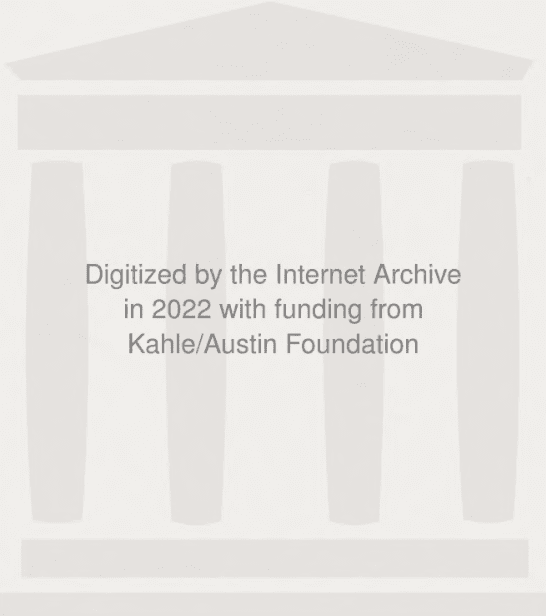

# 加密货币与区块链技术（当前争议）

## 加货币与区块链技术

https://archive.org/details/cryptocurrencies0000unse

## 加货币与区块链技术

# 加密货币与区块链技术

Andrew Karpan，书籍编辑

## 第一章：区块链驱动的加密货币比法币更好吗？

Umed Saidov

区块链是一种通过加密保护的在线公共账本。它作为货币的应用源于安全性，支持者认为这种安全性可以取代银行等法币系统所需的中介。

### 是的，加密货币比加密货币更好（注：原文可能有误，应为“加密货币比法币更好”）

Brandt Redd

货币由三个要素定义：稀缺性、可验证性和可用性，这些属性并非由政府支持的法币系统所独有。事实上，在许多方面，基于区块链的系统可以更好地体现这些属性。

Michael Crosby, Nachiappan, Pradhan Pattayak, Sanjeev Verma, 以及 Vignesh Kalyananaraman

比特币不仅仅是一种货币；区块链的应用是控制货币的一种真实方式。智能资产和智能合约等潜在应用表明，区块链可以创建新的货币使用方式，自动履行金融中介的功能。

Enrique Aldaz-Carroll 和 Eduardo Aldaz-Carroll

防止腐败的关键在于透明度和问责制，加密货币——其交易账本将使财务比以往任何时候都透明。如果政府和机构采用加密货币，腐败可能会被极大抑制。

#### 不，加密货币不如法币好

Dirk Baur 和 Niels Van Quaqueeke

区块链货币并没有取代中介，而是用基于特征和系统的信任来取代了它们。更复杂的系统并不意味着更安全的系统。

## 比特币是投资而非货币 41

James Surowiecki

比特币目前的运作方式最好是作为当前经济中的投资工具。作为货币，它将是灾难性的。政府将无法影响这种算法金融市场。

## 区块链可以存储货币，但也会被破解 47

Scott A. Wolla

区块链上的货币可能与法币共享许多特征，但与大多数国家的货币不同，它们没有办法保护其价值和稳定性不受外部力量的影响。

## 第二章：区块链大规模运营的风险太大了吗？

Axel Simon

第一代区块链驱动的比特币交易涉及由少数野心勃勃的投资者交易的不同货币，他们公开使用了开源技术。第二代货币已转向强调更像货币的特性，如稳定性、访问性和安全性。

### 是的，区块链风险太大了

#### 全数字货币仍然需要银行

Aleksander Berentsen 和 Fabian Schär

稳定的货币系统需要银行来维护其日常稳定性，没有任何银行会发行区块链上的比特币。制裁非法使用的风险将过高。

#### 区块链等同于黄金，这是一个问题

Bruno Skvorc

用于描述区块链交易货币的术语旨在唤起对黄金等贵金属交易的记忆。但黄金的缺陷正是工业界可以用通胀和通缩的法币取代它的原因。

#### 加密货币的未来是不确定的

Richard Partington

加密货币未来将去向何方？目前，比特币和其他加密货币仍然相当小众，但由于比特币价值在2017年底和2018年初的惊人飙升，许多投资者正在考虑尝试。尽管如此，加密货币在现实环境中很少被使用，比特币的价值很可能被人为推高，产生了泡沫，并使其未来难以确定。

### 不，区块链风险没有那么大

#### 银行会加入的

Michael J. Casey

基于区块链的货币的采用不是一夜之间发生的事情。相反，虽然世界上一些大国家的银行可能对采用无法控制的货币产生警惕，但早期采用者可能会引领潮流。

## 区块链上的中国

Patrick Coate

一个采用区块链投资的非西方国家是中国：到2016年，超过90%的比特币交易使用的是人民币。这为该货币的有效性提供了一个独特的案例，并证明了广泛使用的某些主要障碍是它可能取代的货币的持有者。

## 第三章：可以监管加密货币吗？

剑桥大学研究

到2017年，研究显示至少有三百万人在积极使用某种加密货币。这表明它们已经成为一种主要的货币力量，意味着关于区块链的使用需要提出新问题。

## 是的，加密货币可以被监管并可以帮助监管世界 95

### 区块链可以终洗钱

Roy Keidar 和 Netanella Treistman

像比特币这样的加密货币获得了一种某种误导性的声誉，被认为是黑客和洗钱者的青睐，但账本功能固有的追踪机制也意味着这些交易必须公开。许多监管机制可能防止非法交易行为。

#### 维基百科是区块链如何运作的模式 99

Dirk Baur, Daniel Cahill 和 张鑫 (Frank) Liu

互联网上最常用且最受信任的资源之一也通过开源账本运行：在线百科维基百科。任何人都可以编辑维基百科，但由于每次编辑都是公开的，因此系统中的每个人都能参与对其准确性的监管。

#### 区块链监管的历史 102

Andrew Norry

比特币等加密货币的去中心化使得执行限制变得非常困难。然而，这种货币的历史充满了监管的尝试，其中一些尝试（如欧盟的尝试）是成功的。

### 不，加密货币超出了监管范围

#### 比特币的设计并非为了监管 109

David Trilling

加密货币含蓄地削弱了政府权威，允许从组织犯罪洗钱在内的一切行为

……为了像朝鲜等极权主义国家规避制裁。正是因为这些特质使加密货币对早期采用者具有吸引力，监管加密货币的可能不会在短期内结束。

#### 比特币监管的失败 115

安德里亚·卡斯蒂洛（Andrea Castillo）

2017年，纽约州试图对比特币交易实施监管，结果导致基于比特币的企业成群结队逃离该州，这表明加密货币市场在意识上对任何形式的监管都持排斥态度。

#### 去中心化防止了中央权威的监管 120

亚历克斯·赫恩（Alex Hern）

加密货币本质上是去中心化的，缺乏像银行那样拥有数据库的中央权威。这使得监管变得困难，甚至可能无法实现。此外，如果一个人满足于中央银行权威——正如赫恩所称的大多数不从事犯罪活动的人的情况如此——那么使用加密货币就没有任何真正的动力了。

## 第4章：区块链技术是否过于复杂？

斯蒂凡·弗尔霍尔斯特（Stefaan Verhulst）

区块链的创新为信息的传递提供了一种安全方式，无论是货币甚至是选举中的选票。这些新解决方案的支持者认为，它们可以极大地改变日常生活，并减少在全球化世界中交易中内置的类安全装置的需求。

### 是的：区块链对于日常使用来说太复杂 133

#### 区块链是一个没有问题的复杂解决方案

格蕾塔·布尔（Greta Bull）

每天，全球数以百万计的人可以使用我们目前的金融体系，并且在完全没有思考的情况下就能享受到它提供的消费者保护。一套新的货币系统将要求对所有这些内容进行重新谈判，以追求大多数用户可能无法享到的利益。

## 发展中地区区块链运的批判性案例研究

塔莉亚·霍姆斯斯（Thalia Holmes）

支持者经常将在非洲许多发展中国家使用区块链视为其可能应用的标志。更具批判性的审查显示，大多数益处是增量且低调的，并且与区块链本身没有任何特定的联系。

### 比特币挖矿是一种环境危害

克里斯托夫·马尔莫（Christopher Malmo）

比特币是目前交易中最广广接受的加密货币之一，但处理和“挖掘”比特币所需的计算能量已经造成了巨大的环境破坏，蒙古的一处设施在单小时内排放的二氧化碳相当于一辆行驶了203,000公里的汽车。

### 不：区块链足够简单了

#### 区块链仅仅是一个账本

迈克尔·J·凯西（Michael J. Casey）和保罗·维格纳（Paul Vigna）

从根本上说，区块链与双式记账法之间没有太大区别，这种做法可以追溯到1400年代后期。在当时看来是激进的，在现在已是常态，区块链也将是如此。

## 在区块链上投票

本杰明·弗里德（Benjamin Freed）

在2018年的多次选举中利用区块链进行安全投票的实验表明，该技术在用户层面可以设计成供普通公民和消费者共同使用。

## 前言

“争议”是一个带有不可否认的令人愉快内涵的词。它承载着明确的负面能量。争议会破坏家庭聚会，在教室和校园讨论中散发冷意，煽动公共辩论，揭开原始的公民伤口，并导致公职人员失言。我们经常觉得争议几乎等同于无礼，是在礼貌、严密防守的社会中不应被说出或被设想的事物的一种粗鲁且震惊的爆发。避免争议、平息争议，通常被视为一种公共利益、礼仪的胜利，甚至可能是一种道德或伦理上的必然要求。

然而，对争议的刻意、故意的规避也是一种洗白、一种否认，一种对民主的死亡威胁。它是对那些混乱、破旧、无序、有时丑陋的进程进行的虚假灭菌、消毒和表面化秩序，通过这些过程，健康的民主能够识别并面对挑战，就适当的方法和解决方案进行激烈的辩论，并达成某种共识以及一种被广泛接受和支持的向前行的道路。争议是扩音器，是演讲者角，是公民通过它找到共识的公共广场。

# 引言

> “你无法阻止比特币这样的东西。它将无处不在，世界将不得不重新调整。”

—John McAfee，麦阿菲计算机软件公司创始人

当你欠某人钱时，你可以写一张“欠条（I owe you）”来帮助你和债权人记住。如果你真的抽时间还了债务，你写下的这张字条就等同于你将支付的现金。从某种意义上说，这就是现代货币的运作方式；我们总是在转移债务，从政府到银行，再从银行回到你手中。因为区块链技术——一种不断增长并通过密码学连接的记录列表——本质上是关于利用数字空间来保持信息安全的，因此它一直是加密货币支持者的磁石。加密货币是通交换的并受密码学保护的数字资产。加密货币支持者将其视为一种不依赖于政府发行机构的资金，他们认为这些机构仅仅是互联网前时代的遗迹。

从这个角度来看，区块链足够简单。一行代码所包含的信息量是无边际的，那么为什么货币应该被束缚在物理或地理位置上呢？因为世界上大多数人并不使用比特币，这种货币与互联网的阴暗面和不可见的参与者相关联，但表面上看，比特币是支持透明度的论点。加密货币运行在一个账本上，账本可以记录无限数量的交易，正是在这些记录中，用户可以计算并约定相对价值。比特币等早期加密货币的逻辑将这种模型推得更远，使账本公开，每笔交易都可以沿着一条连接所有交易的线条进行追溯：为某件商品或服务支付的钱可以直接追溯到它的用途，这种追踪在无限的线条中持续。比特币的支持者认为，钱永远不会丢失或被盗，因为它将控制权从银行和政府手中夺回，并传播给大众。从这个意义上说，它是对一种互联网思考方式的隐喻，以及它是否有潜力提供一种不同的、更民主的人类关系模式。

但它真的更好吗？进步的修辞告诉我们，要假设新发明是对其所取代之物的改进，但对我们大环境采取负责任且反思的方法要求我们以审视的眼光看待最新的技术创新，而这种审视在过去是没有应用于蒸汽机和核战争的。由于对创造新事物的痴迷，技术创新特别容易意外地创造出已经存在的事物，在比特币的情况下，则是解决一个可能并不存在的问题。在你听说比特币之前，你想要它吗？

这个问题并不是修辞性的提问。比特币概念的核心是极其复杂的、计算机生成的数学问题，这些问题又由通常被称为“矿工”的工程师运行和编写的大型计算机来解决。这个过程产生了作为交易基础的“硬币”¹。它们与黄金或白银等资源在我们货币的长久历史中所扮演的角色可以比拟。但这种比较在多大程度上成立呢？Max Krause 和 Thabet Tolaymat 在发表于同行评审期刊《自然-可持续性》（Nature Sustainability）的一项关于该主题的研究中报告道：“生产1美元比特币所消耗的能量……比1美元的铜或金要多。”¹在这种模型中，比特币的使用似乎像 SUV 的发明一样，SUV 被一些人认为是一种虚荣的耗能怪兽，正在无声地杀死地球。

# 加密货币与区块链技术

与比特币的开放性和透明逻辑相矛盾的是它自身所笼罩的神秘色彩。在考虑比特币时，我们没有一位受尊敬的联邦储备委员会主席可以求助。比特币的设计者倾向于留在黑暗中，事实上，不让公众知晓。考虑到比特币在促进非法交易中的用途，这对他们来说是一个明智决定，因为它是武器和毒品交易的所谓“暗网”上常用的货币。但也有人认为比特币可以用于预防犯罪，声称比特币的公开用户是可追溯的，不会有纳税人的钱消失在远方承包商手中，并被记账为神秘的贪污公款。比特币比任何其他东西都关乎收据。加密货币传道士所想象的透明未来是这些收据永远跟随的，这意味着我们永远不会在毫无察觉的情况下被盗。

通过这种方式，与其与其使用的实际硬性事实，不如说是对其潜在用途的辩论以及它反映了用户的什么。风险投资资助支出的性质是它们在经济上将自上而下流动的，但普通消费者呢？加密货币以及从更广泛意义上说区块链技术除了为那些对交易股票感到无聊的人提供投资机会外，还能提供什么？

答案可能不仅仅是移动数百万的方法。许多人认为，存储比特币货币价值的技术可以具有公民应用。Jonathan Chester 为《福布斯》（Forbes）写道：“只要有正确的区块链，就可以在透明的账本上通过互联网从世界任何地方进行数字投票，并具有不可破解的投票安全性，”他展示了这样一种应用¹。在未来中，区块链将提供一种途径，让代表制民主中的每个人都能投票一次，并通过他们的手机完成，这种技术产品将允许最大程度的参与并限制欺诈。另一方面，在这样的系统中，“不可检测的变化……可能会在传输过程中发生，”Marian Schneider 以其作为关于民主主题的受尊敬的非营利组织 Verified Voting 主席的身份警告道，这表明他担心即使是最高安全的代码，也可能被急于改变选举结果的利益相关者所破解。¹。区块链技术的其他可能用途包括创建数字 ID，这将使得你的所有个人信息比传统的网站登录和密码更安全，以及跟踪武器等物品购买信息的新方法，以防这些物品被用于犯罪。

区块链取决于我们如何定义它，而《当前争议：加密货币与区块链技术》中的论证提供了关于这些技术如何被使用的不同理论。技术在某种程度上意味着我们是自己命运的建筑师。新事物总是是神秘的，但考虑到这些辩论，希望它读起来不会那么晦涩。

- 1. “关于区块链你需要知道的一切，”Arjun Kharpal, CNBC。https://www.cnbc.com/2018/06/18/blockchain-what-is-it-and-how-does-it-work.html
- 3. “我们如何提高选民投票率？比特币可能是答案，”Jonathan Foster, Forbes。https://www.forbes.com/sites/jonathanchester/2018/01/05/how-can-we-increase-voter-turnout-bitcoin-may-be-the-answer/#5574d79e7cf

# 第一章

## 区块链驱动的加密货币比硬币更好吗？

### 你可以用区块链制造什么什么？

Umed Saidov

Umed Saidov 拥有欧洲管理学院的 MBA 学位，是 Oqulent LLC 的创始人，这是一家专注于区块链技术和加密资产的研究公司。

区块链技术是加密货币网络的“引擎”，它正迅速获得企业的关注。但它到底是什么？它是如何工作的？它又是如何产生价值的？

#### 什么是区块链？

从本质上说，区块链是一种加密安全的账本，用于跟踪去中心化网络上的交易。去中心化网络（如比特币、以太坊、卡达尔等）是由一组计算机通过共识机制自管理的——这是一套规定了如何在网络中记录、共享和同步数据的规则。

- 哈希函数：密码学哈希函数是区块链技术的核心。它们被用于“链链”区块。哈希函数有两个重要的特征，有助于它维护区块链的安全性。

哈希函数是单向的或非对称的。它们将任何长度的输入（或消息）压缩为预定义长度的输出（或哈希值）。输入的哈希值很容易计算，但要从哈希值反推输入是不现实的。

哈希函数具有确定性。对于给定的输入，有且只有一个生成的哈希。更改输入中的任何单个字符都会改变哈希值。相同的输入总是产生相同的输出。

- **公钥加密**：加密货币网络使用私钥和公钥来生成交易并验证其有效性。私钥是数字钱包随机生成的数值，充当唯一的密码或授权代码。公钥等同于账号。它与私钥一起生成，并在数学上与之相关联。公钥或其哈希值对整个网络都是为人知的。

每当用户进行交易时，他们的钱包都会使用私钥对交易进行加密签名。这些数字签名就像指纹，在密码学上将交易与私钥持有者连接起来。网络使用公钥和数字签名的组合来验证每笔交易。如果两者匹配，网络就会批准交易并将其添加到区块链中。公钥加密允许持有私钥的人花费与特定数字钱包相关的资金。

- **区块链**：一种存在于网络上的自传播账本。账本上的每个区块由一个头部和一组交易组成，这些交易由网络在预定的时间间隔进行验证。每个区块都有自己的哈希签名，将其与上一个区块连接起来。网络不断更新并检查所有这些区块的有效性。更改区块中的任何单个字符都会使其失效。

# 区块链驱动的加密货币比硬货币更好吗？

区块链技术使用哈希函数在密码学上链接并保护区块，使用公钥加密授权并验证交易，并使用共识机制来同步其网络。

虽然第一版本的区块链出现在无许可网络上，但这并不是区块链技术工作的严格要求。基于区块链的网络可以由私人财团运行，并可以有有限的访问/成员。例如，`Hyperledger` 是由 Linux 基金托管的开源项目，鼓励各行业采用区块链技术。IBM 和微软是该领域的另外两个重要参与者，拥有类似的企业级产品。

# 区块链如何产生经济价值？

区块链的基础价值源于它的两个关键属性：持久性和去中心化。这些允许区块链在一个始终开放的廉价、准确、可审计且安全的网络上记录交易。这些组合特性不仅减少了价值链中的经济摩擦，还可以替代一些经济中间环节，因为它们的功能被这些网络接管了。

那么哪些领域可能会经历重大的区块链变革？

区块链还可以颠商业银行。从消费者的角度来看，区块链消除了对传统银行的需求，因为用户可以在没有中间环节的情况下持有、积累和分散资本。区块链网络比 Visa 或 Mastercard 建立的网络更便宜。随着区块链银行应用程序和法币支持的低波动性加密货币的出现，传统银行可能面临着生存挑战。

我的预测：早晚银行将成为由美国联邦储备银行运行的去中心化网络上的节点。

### 房地产
区块链是跟踪物业所有权的完美技术。国家性的物业所有权数据库可以使消费者受益，加速房地产交易，缩减交易成本，并可能降低保险和利率。

### 医疗保健
医疗行业采用了各种杂乱的 IT 系统，这些系统之间几乎无法通信。虽然医疗提供者和保险公司使用相同的患者数据，但数据迁移性是一个巨大的问题。患者通常需要在不同的医疗服务地点重新输入相同的信息。这种系统非常低效且碎片化。区块链可以通过允许每个用户访问其记录来简化这一过程。根据需要，患者可以在网络上共享他们的数据。SimplyVitalHealth 是该领域提供基于区块链的医疗保健解决方案的众多创业公司之一。

### 政府/IT 安全
网络攻击日益严峻，这表明我们的数据仍然暴露在黑客和其他犯罪分子面前。预计网络攻击到 2021 年将造成 6 万亿美元的损失。Equifax 数据泄露让大多数美国人的身份在未经许可的情况下被出售。区块链赋予个人力量，并可以提高政府的安全、透明性和审计性。

更广泛地说，区块链可以成为许多政府功能的骨干，包括选举、采购服务、车辆注册、身份管理系统、记录保存和社会保障。

# 挑战

监管是大规模采用区块链的主要障碍。区块链的属性（包括其开放架构）使其难以在我们的传统法律体系中对其定义。资产托管是一个巨大的挑战。

可能会出现法律挑战，但它们并非不可解决的，即使解决方案需要一些创新思维。区块链扩展了全球资本形成和分配的边界。需要新的法律在不损害治理金融体系的基本原则的情况下实现其潜力。一旦理解了区块链的全部经济意义，可能会出现合理的新监管。

比特币需要大量的能源资源来支持其网络，消耗 62.2 太瓦时——足以供整个瑞士使用。这种高昂的能源需求引发了批评，但该领域正在探索成本更低的替代共识机制。一种可能的解决方案是`PoS`，一种低能密度的共识机制。

# 结论

我们生活在一个日益数字化的世界，在这里我们的个人数据存储在别人的计算机上，思想可以以思维的速度接触数百万人，虚假新闻可以轻易损害或压过良好的媒体。在这个世界里，信任是稀缺的但价值无量。

区块链赋予个人力量。通过一个永久、可审计且不可篡改的账本，区块链可以提供这种信任和价值。

# 加密货币如何成为真正的货币

Brandt Redd

Brandt Redd 拥有杨百翰大学组织传播学 MBA 学位，在 EdMatrix 担任技术战略师，该机构致力于让学习成为一种愉快的体验。

今天，我将偏离教育主题，来谈谈加密货币。在某种程度上，艾兰·格林斯潘（Alan Greenspan）的这段话触动了我：

> 它[比特币]必须具有内在价值。你必须极力发挥想象力才能推断比特币的内在价值是什么。我一直无法做到这一点。也许别人可以。

现在，格林斯潘本应该知道不要说这样的话。作为一种法定货币，美元的内在价值并不比比特币高。这就是为什么我决定写这篇文章的原因。市面上大多数所谓的“比特币入门教程”比有帮助更让人困惑。它们没有解释货币是如何运作的，也没有解释像比特币这样的加密货币是如何满足成为货币要求的。

# 什么是货币？

货币是一群人接受的交换价值的形式。一种功能性货币必须具备三个重要特征：

- 稀缺性——如果你拥有太多的货币，它的价值将跌至零。因此，供应必须是有限的。

“比特币——什么使货币？”作者 Brandt Redd，发表于《Of That》，2014年7月30日，https://www.ofthat.com/2014/07/bitcoin-what-makes-currency.html。根据 CC BY 3.0 US 协议许可。

# 加密货币与区块链技术

- 可验证性——你必须能够验证货币的单位或代币是有效的，而不是伪品或仿制品。

- 可用性——尽管具有稀缺性，但必须有稳定的货币供应，以匹配相应经济的增长。

金银等贵金属是第一种常见的货币。它们满足了上述所有标准。黄金是稀缺的；可用量有限，因此少量的黄金就具有相当的价值。它是可验证的；黄金具有密度、延展性和颜色等特性，使其易与其他材料区分开来。而且黄金是可用的；虽然它并不常见，但金矿仍提供该材料的持续供应。

早期使用黄金货币的困难之处是交换的复杂性。商人必须使用天平或比例尺来确定提供的金量。为了方便交换，政府、银行和其他受信任的机构会铸造尺寸和重量一致的硬币。这使得人们可以在不需要天平的情况下验证硬币的价值。

# 法定货币

“法定（Fiat）”大致意思是“因为我这么说”。法定货币之所以有价值，仅仅是因为某些受信任的实体说它有价值。它不需要任何内在价值。

第一个法定货币是钞票。在进行大额支付时，移动大量硬币或金条可能不方便或危险。银行通过发行钞票为客户解决了这个问题。钞票是银行或其他实体承诺兑换为特定数量的硬币、黄金或其他货币的纸张。银行可以将相应的黄金锁在金库中，人们可以携带更方便的纸质证书。

从1863年开始，美国开始发行黄金证书作为纸币或钞票的形式。证书

# 区块链驱动的加密货币比硬币更好吗？

像这样的证书是由存在`Fort Knox`等地的黄金储备支撑的。欧洲国家也做了类似的事情。随着19世纪后期战争和随后的第一次世界大战的压力，各国发现他们可以发行的钞票比其相应的储备多。这导致了许多不稳定，直到各国弄清楚如何监管自己的货币。但到大萧条结束，几乎所有经济发达国家都有由中央银行控制的法定货币。虽然这些货币由黄金或其他储备支撑，但其价值并不与黄金的价值直接挂钩。

以下是联邦储备体系的运作方式：联邦储备银行创造货币。货币以货币（熟悉的美国硬币和纸币）的形式发行，也仅仅作为银行余额发行。事实上，作为银行记录的货币远多于实际的物理货币。最初，这是通过银行账本精细的记账完成的。现在，这一切都在计算机上完成的。货币以低息贷款的形式发行，主要面向银行，然后银行将这些钱贷给他们的客户和其他其他较小的银行。其他中央银行系统（如欧洲中央银行）也以类似的方式运作。

那么，法定货币是如何满足我们的——

- 稀缺性：中央银行可以创造他们认为数量的货币。

- 可验证性：加密货币依赖公钥加密来确保只有货币的所有者才能发起其转移。

- 可用性：那些托管区块链副本的人必须执行加密计算以验证交易的有效性并防止欺诈。速度最快的人会通过创建新的比特币余额定期获得奖励。由于这种奖励，维护区块链被称为“挖掘”，一个比特币挖掘软件和设备的小型行业已经发展起来。所有加密货币用户都从中受益，因为由于记录的复制和验证，货币变得更加安全。

这是一个极其高明的方案，因为它同时确保了货币的持续供应、运营的去中心化，并通过创建数千个区块链副本来保护网络免受操纵。

# 潜在影响

任何货币的真实价值取决于一个社区使用其进行日常交易的意愿。稀缺性、可验证性和可用性这三个要求结合在一起，导致人们信任特定的货币。当这种信任丢失时，就会出现银行挤兑、通货膨胀或或简单的财富销毁。与此同时，社区会竞忙寻找新货币。

互联网的出现以及能够发起交易的无数手持设备使得多种货币共存成为可能。历史上第一次，人们可能在日常交易的货币之间进行选择。中央银行家以及赋予他们权力的主权国家感到合理的担忧。一个在历史上免受竞争的行业不再拥有这种保护了。

我认为这是一件好事。就像任何其他竞争性市场一样，竞争应该激励既有中央银行和新兴加密货币的良好行为。

# 区块链不仅仅是货币

Michael Crosby, Nachiappan, Pradhan Pattanayak, Sanjeev Verma, and Vignesh Kalyanaraman

Michael Crosby, Nachiappan, Pradhan Pattanayak, Sanjeev Verma 和 Vignesh Kalyanaraman 是加州大学伯克利分校 Sutardja 创业与技术中心的研究人员。

区块链本质上是一个记录的分布式数据库，或者说是所有执行并在参与方之间共享的交易或数字事件的公共账本。公共账本中的每笔交易都由系统中大多数参与者的共识进行验证。而且，一旦输入，信息就永远无法被删除。区块链包含了每一笔已交易的确定且可验证的记录。用一个简单的类比来说，从放在偏僻处的饼干罐里偷饼干，比从一个放在成千上万人观察的市场中的饼干罐里偷饼干要容易得多。

比特币是与区块链技术内在密相关的最著名例子。它也是最具争议的例子，因为它帮助实现了一个不受政府控制的、价值数十亿美元的匿名交易全球市场。因此，它必须处理涉及各国政府和金融机构的许多监管问题。

然而，区块链技术本身并没有争议，它多年来一直完美运行，并被成功地应用于金融和非金融世界的领域。去年，硅谷资本家大佬马克·安德森森（Marc Andreessen）将区块链分布式共识模型列为自互联网本身以来最重要的发明。法国巴黎银行的 Johann Palychata 在《精髓》（Quintessence）杂志上写道，比特币的区块链（允许数字货币运行的软件）应该被视为类似于蒸汽机或内燃机这样的发明，具有改变金融世界及其他领域的潜力。

> “区块链技术”，作者 Michael Crosby, Nachiappan, Pradhan Pattanayak, Sanjeev Verma, Vignesh Kalyanaraman，Sutardja 创业与技术中心，2015年10月16日。经许可转载。

## 区块链驱动的加密货币比硬性通货（Hard Money）更好吗？

当前的数字经济基于对某些可信权威的依赖。我们所有的在线交易都依赖于某人告诉我们真相——可能是电子邮件服务提供商告诉我们邮件已送达；可能是认证权威机构告诉我们某个数字证书是可靠的；也可能是 Facebook 这样的社交网络告诉我们我们有关生活事件的帖子仅与朋友分享；或者可能是银行告诉我们钱已经可靠地寄给了我们在遥远国家的亲人。事实是，我们通过依赖第三方实体来保障数字资产的安全和隐私，导致我们在数字世界中生活得非常危险。事实仍然是，这些第三方来源可能会被黑客攻击、操纵或破坏。

这就是区块链技术大显身手的地方。它通过实现分布式共识，具有变革数字世界的潜力，使得每一笔过去和现在涉及数字资产的在线交易在未来的任何时候都可以被验证。它在不损害数字资产隐私和涉及相关方隐私的情况下实现了这一点。分布式共识和匿名性是区块链技术的两个重要特性。

区块链技术的优点大于监管问题和技术挑战。区块链技术的一个关键新兴用例涉及“智能合约”。智能合约基本上是能够自动执行合同条款的计算机程序。当参与实体之间智能合约中的预设条件被满足时，合约协议中的相关方就可以根据合同以透明的方式自动进行付款。

智能属性（Smart Property）是另一个相关概念，涉及通过智能合约使用区块链控制属性或资产的所有权。该属性可以是物理的，例如汽车、房子、智能手机等；也可以是非物理的，例如公司股票。在这里需要注意的是，即使是比特币也不真正是一种货币——比特币的核心在于控制货币的所有权。

### 现有市场

区块链技术正在金融和非金融领域寻找应用，这些领域传统上依赖第三方信任在线实体来验证和保护数字资产的在线交易。另一个应用“智能合约”是由尼克·萨博（Nick Szabo）于1994年发明的自动执行参与方之间的合同是一个极佳的主意。然而，在加密或可编程支付的概念出现之前，它并没有被使用。现在，两个程序——区块链和智能合约可以协同工作，当合约协议的预设条件被触发时触发付款。智能合约确实是加密货币世界的杀手级应用。

智能合约是由计算机协议自动执行的合同。使用区块链技术，注册、验证和执行智能合约变得简单得多。像以太坊和 Codius 这样的开源公司利用区块链技术实现智能合约。许多基于比特币和区块链技术运行的公司都在支持智能合约。许多资产仅在满足某些条件时才转移的情况（这需要律师创建合同和银行提供托管服务）可以被智能合约取代。

以太坊因其可编程平台能力引起了巨大的关注。以太坊允许任何人创建自己的加密货币，并用其来执行、支付智能合约。以太坊本身拥有加密货币（ether），用于支付服务。以太坊正推动治理、自主银行、无密钥访问、众筹、金融衍生品交易以及使用智能合约进行结算等领域的早期应用。

### 区块链驱动的加密货币比硬性通货更好吗？

此外，还存在许多区块链支持广泛的应用——而不只是加密货币。目前行业有三种方法来支持其他应用，并克服人们对比特币区块链局限性的认知：

- **彩色币（Colored Coins）**是一种开源协议，描述了一类让开发者利用比特币货币之外的功能在比特币区块链之上创建数字资产的方法。

# 加密货币让腐败变得困难

Enrique Aldaz-Carroll 与 Eduardo Aldaz-Carroll

Enrique Aldaz-Carroll 是世界银行宏观经济学和财政管理的资深经济学家。Eduardo Aldaz-Carroll 是 Betomorrow UK 的首席技术官，同时也是机器人专家和电子系统工程师。

技术的进步使得大幅提高公共财政的问责制和透明度以减少腐败在某种上成为可能。例如，如果一个政府决定修建一条道路，现在它可以追踪每一美元资金的支出情况，识别资金的所有使用者，并确保获得支出许可的人员在许可时间内按照原定用途进行支出。目前平均耗时 15 个月的欺诈和腐败调查，现在只需按一下按钮即可完成，且成本仅为目前的一部分。更重要的是，公共部门的这种财务追踪每年金额在 1.5 万亿至 2 万亿美元之间，约占全球 GDP 的 2%。这反过来将增加发展影响力。所有需要的只是采用加密货币并使用区块链软件。

采用加密货币（一种利用加密学确保交易安全的数字货币）作为项目的支付方式，可以识别资金的每一位使用者，这与纸币和硬币等传统支付方式不同。尽管大多数流行的加密货币（如比特币）是匿名的，且仅使用密钥来识别用户，但也可以包含个人信息（如身份标识码），并使

> “加密货币和区块链能帮助打击腐败吗？”由 Enrique Aldaz-Carroll 和 Eduardo Aldaz-Carroll 撰，布鲁金斯学院，2018 年 2 月 1 日。经许可转载。最初发表于布鲁金斯学院的 Future Development 博客，https://www.brookings.edu/future-development/2018/02/01/can-cryptocurrencies-and-blockchain-help-fight-corruption/。

# 区块链驱动的加密货币比硬币更好吗？

非匿名。加密货币的使用允许即时交易和跨境所有权转移（“带翅的钱”），由于不需要金融中介，这减少了交易时间和成本。

政府或开发机构可以使用现有的非匿名加密货币，或者开发自己的并命名，例如称为“清洁硬币”（cleancoin）。加密货币的价值可以由市场决定，或者最好挂钩某种物理货币以减少波动（例如，比特币自诞生以来显示出极高的波动性）。

区块链的采用有助于追踪加密货币的使用。区块链是一个使用加密货币生成的交易（区块）的持续增长列表，按时间顺序记录。区块链由点对点网络（矿工）管理，这些网络共同遵守一种协议来验证新区块。一旦区块中的交易数据被记录，就无法追溯地修改，因为这将修改所有后续区块。由于数据存储在许多计算机中，数据丢失的风险很小，而且由于它是加密的，数据的机密性得到了维护。因为区块链是所有加密货币交易的公共账本，它是可搜索的，并用于跟踪所有交易。

缺乏匿名性和严密的的可追溯性使得腐败变得更加困难，与传统货币不同。另外两个特征将有助于有效打击欺诈和腐败。首先，区块应该包含通常存储的额外数据，以便为欺诈和腐败执法提供足够的信息。例如，区块可以存储支出的性质以及与资金相关的项目和活动。其次，对区块的验证应该检查额外数据是否符合智能合约。智能合约包含在代码中编写的逻辑条款，根据合同条款触发流程。这些条款可以定义释放资金的条件、资金从何处释放等。合同的履行有助于防止不当支出。

# 加密货币与区块链技术

这四个特征可以使用以太坊技术整合。以太坊是一个基于区块链开源软件平台，允许创建新的非匿名加密货币类型，并允许在区块中包含额外信息以及使用智能合约功能。平台搭建完成后，政府或开发机构可以简单地按照预算将加密货币分配给各项活动。分配给这些活动的人员或公司将允许获取加密货币并购买商品和服务，同时根据设定的协议和合同在以太坊平台上进行验证。验证将由内部或外部矿工执行，他们将获得加密货币份额或交易费用作为奖励。

访问加密货币将通过软件钱包提供（这不需要拥有银行账户，对于金融服务普及率较低的发展中国家来说是一个优势）。加密货币的最终持有者可以选择在交易市场将其转换为法币——该市场可以是由开发机构或政府运行的主要交易所，也可以是次级交易所——或者将其作为货币（如果市场对手接受的话）用于该活动之外的进一步交易。

加密货币和区块链可以帮助防止欺诈和腐败，由于信息易于获取和更快的检查，降低执法成本，并帮助监督实施以及监测支出的效率和效果，增加发展影响力。

# 谁监控区块链？

Dirk Baur 与 Niels Van Quaquebekeke

Dirk Baur 是西澳大学的金融学教授，Niels Van Quaquebekeke 是德国汉堡库尼航运大学的领导力与组织行为教授。

关于区块链（驱动比特币和其他加密货币的技术）的一个共同观点是，它可以“创造信任”，或者允许双方在“不依赖信任”的情况下进行交易。

如果这属实，这意味着我们可以创造出一个没有受信赖的“中间人”的世界。我们可以拥有没有银行验证交易的金融服务，我们可以在没有律师的情况下转移所有权（例如房屋）。这个想法是错误的。

区块链并不创造或消除信任。它仅仅是将信任从一种形式转换为另一种形式。虽然我们以前信任机构来验证交易，而在区块链上，我们必须信任技术本身。

此外并不清楚区块链驱动的货币（如比特币）在没有主权支持的情况下能否运作。事实上，几乎没有任何货币（包括黄金）是在没有权威支持的情况下运作过的。

当这些信息不再由银行持有并验证时，它在区块链上被执行于“公开账本”。

> “区块链并没有消除信任的需求，”关于区块链的讨论，由 Dirk Baur 和 Niels Van Quaquebekeke 撰，The Conversation，2017 年 11 月 16 日。https://theconversation.com/the-blockchain-does-not-eliminate-the-need-for-trust-86481. 根据 CC BY-ND 4:0 许可。

# 加密货币与区块链技术

当某人转移比特币时，它由“矿工”（实际上是计算机）验证，进行加密，并将一个“区块”添加到账本。

由于所有的验证都由系统本身执行，其想法是用户不需要中央权威。相反，信任从一个中央权威（如银行）转移给了许多参与者（矿工）。

但问题就在这里——用户必须信任技术和系统的治理。

# 什么是信任？

在经济交易中有三种信任：基于机构的、基于特征的以及基于过程。

基于机构的信任来自中央权威的参与。考虑商业银行（以及政府对该银行存款的保险），如上例。

基于特征的信任是我们对人的信任，主要是因为他们与我们的某些相似之处，或者展示了值得信任的特征或价值观。例如，你更有可能信任来自你成长地区的人，而不是其他地方的人；你可能也会信任音乐品味相似的人，或者仅仅是体现了你生活价值观的人。

基于过程的信任产生于过去的经验表明一方的投入会得到预见性的回报。这种信任通常演变为社会微规则或准则。例如，大多数人通常会信任如果他们不伤害某人，那个人也不会伤害他们。同样，人们会信任在被提问时其他人会给出回答。

由此可见，如果中央权威失败、你信任的人失败、或者你信任的过程失败，信任就会被破坏和丢失。

当特别提到区块链时，我们可以看到至少有两种形式的信任在起作用。由于其复杂性，许多人发现很难信任这种过程。

# 区块链驱动的加密货币比硬币更好吗？

但有些人可能会因为志同道合的人在使用它而信任它（基于特性的信任）。事实上，以太坊货币创始人维塔尼·布特林（Vitalik Buterin）的朋友或同一圈内的极客很可能是这项技术的早期采用者。

然而，另一种信任可能也在起作用。例如，当以太坊驱动的去中心化自治组织（DAO）遭到攻击时，用户要求布特林做出回应。这表明，人们仍然需要中央权威，或者在系统失效时向中央权威诉求。同样，关于维塔尼已去世的虚假新闻导致以太坊市值蒸发了 40 亿美元。随着对中心权威假设的消失，许多人也失去了对底层系统的信任。

这可能并不理想，但一个真正开放的公共区块链（即背后没有任何中央权威的区块链）不太可能正常运行。

对货币演变的分析显示，纵观历史几乎所有的货币都有权威的背书。这很容易理解。想象一块金金块。为了确定它的价值，你需要信任一个珠宝商——即估值权威。因为识别金子质量的过程需要时间，所以金金并不是理想的交换媒介。

黄金的问题在很大程度上通过造币厂的建立得到了解决。换句话说，金币的铸造和标准化降低了识别成本，从而减少了对像珠宝商这样的去中心化第三方信任的需求。相反，现在需要信任一个中央权威——造币厂。

你还需要信任政府会接受铸造的金币作为税收支付，并且其他人会接受这些硬币作为购买商品和服务的支付。更广泛地说，如果人们对权威和货币的价值失去信任，他们将尝试出售这种货币，导致通货膨胀甚至恶性通货膨胀。

这一切表明黄金以及任何其他形式的货币（包括加密货币）都不是“无需信任”的。

受信任的中央权威的重要性也可以在货币销毁的情况下得到理解。例如，

# 加密货币与区块链技术

当罗马帝国崩溃时，中央权威崩溃了，其背书的货币也随之崩溃。基于过程的信任也随之崩溃，这表明该过程之所以有效仅仅是因为该机构的存在。

如果历史可以作为指南，像比特币或其他任何基于区块链的货币等私有创建的货币，在没有信赖的中央权威的情况下，不太可能被全球接受。这意味着“开放”区块链将不会成功。尽管一个由中央权威背书的“封闭”区块链可能可行，但它与比特币和区块链的核心特征——去中心化将大不相同。

# 比特币是投资，而非货币

詹姆斯·苏罗威茨基（James Surowiecki）

詹姆斯·苏罗威茨基是《群体智慧》的作者，也是 Vice News Tonight 的高级故事制作人。

今年早些时候，Twitter 创始人、Square 首席执行官杰克·多塞（Jack Dorsey）宣布比特币将在十年内成为世界的“单一货币”。多塞评论中引人注目的不仅在于其大胆的预测，还有比特币可能用于投机性投资之外其他用途的观点。毕竟，尽管过去一年金融世界被加密货币狂热所占据，但加密货币的“货币”属性在公众眼中重要性已经下降。正如高盛的一位高管去年所说，比特币目前与其说是一种货币，不如说是一种资产——它是人们交易的物品，类似于股票或债券，而不是他们用来交换商品和服务的工具。

这种认知反映了现实。过去几年里，比特币的交易次数（而非交易量）并没有增长多少，最近的一项学术研究表明，其中一半的交易与非法活动有关。作为交换媒介，比特币今天的状态与 2010 年大无相同：它是现有货币体系的有趣补充，主要对那些对规避法律当局或生活在通货膨胀严重的社会中的人们（例如委内瑞拉或津巴布韦）有用。

尽管如此，加密货币可以取代我们现有的法币制度（货币供应由政府运行的中央银行控制）的梦想仍然是比特币吸引力的核心部分。这一承诺提供了一个系统，政府无法操纵货币供应，市场竞争决定了人们使用哪种货币。

> “比特币将是一场灾难，而不是经济，”詹姆斯·苏罗威茨基，《麻省理工学院科技评论》，2018 年 4 月 10 日。经许可转载。

# 加密货币与区块链技术

人们使用什么货币。但如果梦想成真会怎样？如果美元和欧元被比特币取代，系统将如何适应，经济和金融体系又如何运作？

简单的答案是：并不好。我们的经济和金融体系是围绕法币构建的，它们依赖中央银行对货币的控制（以及政府以该货币发行债务的能力）来帮助管理经济周期、抗失业并应对金融危机。一个以比特币为主导货币的经济将是一个更具波动且更残酷的经济，在这种经济中，政府对抗衰退的工具有限，且金融恐慌一旦开始将难以停止。

# 与你所愿背然相反

要了解为什么情况是这样，关键是要意识到中央银行（在美国是联邦储备委员会）在系统需要时提供经济学家所说的“流动性”方面所扮演的至关重要的作用。这仅仅是一个华丽的说法，意味着中央银行可以向系统注入资金，通过打印货币并将其借给银行（其是银行随后会将这些资金注入系统），或者简单地自己购买资产。提供流动性在金融危机期间尤为重要，因为危机会导致银行削减贷款，导致储户从银行提走资金。在那些时候，中央银行充当最后贷款者，确保那些陷入困境的银行不会出现大面积倒闭。

在运行于比特币的经济中，这些将是不可能的，因为中央银行无法增加货币，且向系统注入资金的能力（取决于其比特币储备的大小）是有限的。此外，政府难以应对衰退，因为中央银行无法控制利率，且能够注入资金的能力（取决于其比特币储备的大小）是有限的。财政政策也将变得几乎无能。今天，当政府出现赤字时，它可以让联储打印货币，然后向联储借入这些钱。这增加了系统的流动性。在比特币世界，政府必须借入比特币来支出。而且再次，这会增加比特币的价值，使人们更愿意持有它——这与我们在危机时期所需要的相反。

# 但不必担心

好消息是，这是一个极不可能实现的未来。虽然将比特币变为通用货币的想法对于数字时代的乌托邦主义者来说具有完美的逻辑，但在实践中它意义不大。比特币的设计也使其难以想象。由于比特币的供应是有限的，如果对它的需求增加，其价值也会随之增长。这意味着如果你拥有比特币，并且认为它们将变得更流行，那么明智的做法是

# 加密货币与区块链技术

人们要做的是持有它们，因为它们明天会更有价值。这使得人们对用比特币购买物品的兴趣降低，反而更有兴趣将其视为投机性投资——这与你希望它作为交易媒介背道而驰。

你可能认为，在金本位制运行的时代，黄金也面临同样的供应限制。但黄金的供应并不是固定的。随着人们开采更多的黄金，其供应随之扩大。事实上，存在某种平衡——随着经济增长增加了对黄金的需求，使其变得更有价值，而价格上涨又鼓励了人们去开采，从而将更多黄金引入系统，最终使黄金的美元计价值保持相对稳定。在1800年至1900年间，黄金的美元价值以较小的百分比逐渐上升。相比之下，比特币经常在单日内涨跌 5% 或 10%，这完全是因为投机情绪的波动。这种波动性削弱了它作为价值储藏手段（货币的其他角色之一）的实用性，并使其不适合作为日常交易媒介，因为没有人愿意接受一种可能在几小时后缩水 10% 的货币。换句话说，一个基于比特币的金融系统将具有金本位制的所有缺点，而几乎没有它的任何优点。

要让比特币成为人们可以轻松使用的货币，还存在实际的障碍。当对比特币的需求很高时，矿工会提高处理这些交易的价格，交易费用随之飙升。在去年比特币狂热的顶点，单笔交易的成本可能高达 55 美元。当人们认为自己持有的比特币价值会一夜翻倍时，这没问题。但如果人们想用比特币买比萨或一台新电视，这就不行通了。更重要的是，比特币无法扩展到处理现代经济所需的交易量。该系统限制为每分钟仅处理 420 笔交易。最后，事实是，极少数的人控制了世界上绝大部分的比特币。这赋予了他们操纵价格的杠杆，使得比特币难以获得成为真正货币所需的普及。

## 区块链驱动的加密货币比硬货币更好吗？

### 选择你自己的货币！

当然，比特币远非唯一的加密货币。根据计算方式的不同，现在有数百种甚至上千种加密货币。虽然它们都像比特币一样构建在区块链上，但某些特征可能使它们作为潜在全球货币更具吸引力。例如，莱特币（Litecoin）每分钟可以处理更多的交易。门罗币（Monero）和 Zcash 提供了真正的匿名性（与比特币不同，比特币的每笔交易都与一个可以追踪的密钥相关）。并不是所有的加密货币对货币总量都有硬性上限。因此，也许不同的加密货币可以取代美元、欧元或人民币——更有可能的是，我们将得到一个由许多不同私人货币组成的系统，而不是仅仅依赖单一的交易媒介。

每个人选择最适合自己的货币，以及加密货币之间相互竞争以赢得消费者和企业的忠诚，这种想法确实具有吸引力。但事实上，我们在过去几年看到的加密货币泛滥，使得它们最终取代法币的可能性降低了，而不是增加了。

一个存在许多不同私人货币的世界，其问题在于它极大地增加了交易成本。使用一种由政府发行的法定货币时，你不需要考虑是否接受它来交换商品和服务。你接受美元是因为你知道你可以用它购买任何想要的东西。由于每个人都默契地同意使用美元，商业流动得更加顺畅。

在一个拥有许多竞争货币（特别是没有任何大宗商品支撑的加密货币）的经济体中，情况会完全不同。如果有人想用莱特币付钱给你，你得弄清楚你喜欢的莱特币是真正的加密货币，还是一个随时可能关闭的骗局。如果你想花掉它，你必须考虑还有谁可能接受莱特币，或者谁会用美元向你换莱特币（以及汇率和手续费是多少）。基本上，货币的泛滥像是在商业的齿轮中撒了沙子，使得交易效率更低、成本更高。任何难以使用的货币作为交易媒介的价值都会更低。

### 对洗钱来说仍然是绝佳之地

这并非臆测。我们确实有一个关于其如何运作的历史案例。在内内战前的几十年里，美国没有国家货币。相反，那是一个被称为“自由银行”的时代。个人银行发行银行票，理论上由黄金背书，人们将其作为货币使用。问题在于，你离银行越远，人们对银行票的辨识度就越低（因此信任度也越低）。每当你做一笔交易，你必须核实票据以确保它的价值与交易伙伴所说的相符。所谓的“野猫银行”（wildcat banks）涌现出来，拿走人们的钱，发行一堆票据，然后关闭，导致这些票据变得一文不值。诚然，人们想出了解决办法——出现了某种类似于银行版 Yelp 的书籍，对银行票的可靠性和价值进行评分。但更广泛的后果是生意变得更加复杂和缓慢。在一个有些人使用以太坊（Ethereum）、有些人使用莱特币、有些人使用瑞波（Ripple）的世界，情况如此。

### 区块链可以存储货币，也可以被破解

Scott A. Wolla

Scott A. Wolla 是圣路易斯联邦储备银行的高级教育专家。

比特币已成为一种文化和金融现象。虽然很多人听说过比特币，但了解它的人很少。简单来说，比特币是一种数字货币或“加密货币”，允许独立于银行系统的个人间交易。比特币不是你放在包或钱包里的硬币。相反，它是一种虚拟货币——存储在网络虚拟钱包中的数字代码，通过电脑或手机应用程序访问。有些人认为比特币具有革命性，因为它允许人们方便地转移资金（就像发送电子邮件一样），即使是跨国。然而，最近很多人购买这种虚拟货币仅仅是作为金融投资，希望它升值，而不是用于交易。那么，它究竟是货币还是金融资产？又也许两者之间的界限并不十分。

### 比特币是货币吗？

传统上，货币由国家政府生产。在美国，美国财政部通过美国造币厂和美国票钞印刷局生产我们使用的硬币和纸币。联邦储备储体系（美国的中央银行）通过银行系统分发货币。这种货币是法币；也就是说，它的价值没有黄金或其他大宗商品支撑。相反，它的价值源于其作为货币被广泛接受。换句话说，美元钞

> “比特币：货币还是金融投资？”作者 Scott A. Wolla, Federal Reserve Bank of St. Louis, March 2018. 经许可转载。

# 加密货币与区块链技术

和硬币之所以能作为货币，是因为人们在经济中中使用它们的方式。

货币在经济中承担着三种功能：交换媒介、价值储存和计价单位。为了成为一种有效的交换媒介，货币必须在交换商品和服务时被广泛接受。比特币可以作为有限数量商品的交换媒介。当理查德·布兰森（Richard Branson）接受了温克莱沃斯兄弟提供的比特币以换取乘坐他航天器的机会时，比特币作为交换媒介的信誉得到了增强.¹ 尽管接受比特币支付的公司数量一直在增加，但这些交易仍然仅占经济的极小部分。此外，虽然比特币被设计为点对点支付系统，但消费者和公司之间发生的许多比特币交易都涉及“中间人”，他们通过将比特币兑换为传统货币来促进交易。² 交易本身在时间和金钱上可能成本高昂——平均确认一次交易需要 78 分钟（尽管可能耗时长），完成一次交易需要花费 28 美元.³此外，人们通常倾向于使用随时间推移价值稳定的交换媒介（与服务或一篮商品相比）。例如，联邦储备委员会的通胀目标是每年 2%。如果实现这一目标，美元的购买力每年将损失 2%。联邦储备委员会认为这种通胀水平是“价格稳定”；即通胀率足够低且稳定，以至于对人们的经济决策几乎没有影响。然而，比特币的价值在其历史上一直并不稳定。

由于货币还充当价值储存的角色，这种价值的稳定性变得更为重要。近年来，比特币的价值增长非常剧烈。现在，当价格上涨时，波动的价格似乎对货币的价值储存功能构成威胁；但当价格下跌时，人们会想起稳定价值是价值储存的一个重要方面。例如，比特币曾多次出现价格剧跌的时期，包括 2017 年 11 月 29 日早上价值下跌了 20%。

# 区块链驱动的加密货币比硬货币更好？

事实上，比特币在 2017 年期间经历了五次至少 20% 的价格跌幅（市场观察者将其描述为“熊市”）。⁵ 经济学家罗伯特·希勒（Robert Shiller）表示，这种波动性损害了比特币的价值储存信誉，并是其作为货币被接受的主要障碍。⁶

由于黑客攻击、威胁和其他安全问题，价值储存功能也被削弱了。⁷ 例如，黑客击垮了门头交易所（Mt. Gox），该交易所在 2014 年是最大的比特币交易所，同时有 85 万枚比特币丢失（按每枚 17000 美元计算价值 140 亿美元）。⁸ 2017 年 12 月 7 日，黑客盗走了价值 7000 万元的比特币。⁹ 比特币者无法将比特币作为存款存在银行；相反，业主必须像联邦存款保险公司（FDIC）和国家信用联盟管理局（NCUA）为银行和信用联盟存款存款那样来持有比特币。

货币还作为计价单位，即衡量商品服务的通用标准。由于比特币价格在市场开放期间每天波动剧烈，零售商必须频繁重新计算其比特币价格，这可能会困扰买卖双方。此外，比特币价格在不同交易所之间波动，且比特币在不同交易所的交易价格往往不同，这进一步复杂了卖者的定价决策.¹⁰ 最后，由于一个比特币相对于普通商品的价格成本高昂，要求商户对大多数商品的比特币价格报价保留四到五位小数。例如，如果一个比特币的价格为 11000 美元，那么一个 2 美元的糖棒（以比特币或 BTC 计）的价格将是 0.00018 BTC，或 1.8 x 10⁻⁴ BTC。大多数现代会计系统支持价格保留两位（而不是五位）。简而言之，虽然比特币是一种虚拟货币，但它缺乏一些可能使其更有用的关键特征。

# 比特币是金融投资吗？

货币与金融资产之间的界限并不总是清晰。事实上，货币是一种金融资产——一种流动性极高（用于支付）但通常利息很少或没有的资产¹¹¹ 其他类型的金融资产流动性较低，但提供了获得回报的潜力。例如，人们购买股票和债券是预期它们能产生利息、获得股息或在未来以更高的价格卖出资产。虽然比特币最初是为了作为货币而开发的，但那些将比特币作为投机性投资的人的需求量明显增加.¹¹² 投资者的这种投机行为导致比特币价格上涨之快，以至于一些金融专家称之为“金融泡沫”。泡沫的一种定义是资产价格偏离了其内在的基本价值。想象你用口香糖吹泡泡——随着你吹入越来越多的空气，泡泡变得越来越大，但在某一点压力超过了口香糖的承受能力。同样，金融泡沫发生于对资产的需求不断增加导致其价格不断推高，远高于其内在价值时。随着价格上涨，当前投资者享受资产价格上涨，并可能倾向于购买更多。其他人担心错过了机会，可能会选择投资，假设趋势将持续。泡沫通常会破灭——即价格大跌，为持有资产的人带来巨大损失。

比特币价格上涨得有多快？虽然价格在这一年内波动剧，但比特币在 2017 年结束时的涨幅接近 1400%.¹¹³ 金融专家认为投资者对比特币的兴奋类似于投资者对 20 世纪 90 年代科技股和 2000 年代房价的反应。在这两种情况下，投资者在价格攀升后仍继续购买。其他人担心错过潜在利润，被吸引进来——从而将价格推得更高。

摩根大通银行首席执行官杰米·戴蒙（Jamie Dimon）和被被认为是世界上最成功投资者之一的沃伦·巴菲特（Warren Buffett）都称比特币为泡沫¹¹⁴ 戴蒙曾表示它比 17 世纪代臭名昭著的郁金花泡沫还要糟¹⁹ 巴菲特说比特币很难定价，因为它不是产生价值的资产。股票代表对实际资本的所有权，并通常提供股息收入流；比特币不提供资本也不提供收入。预测了近期两个两个投机市场（科技股泡沫和住房泡沫）的诺贝尔奖经济学家罗伯特·希勒也称比特币为泡沫¹²⁰ 希勒猜测竞争性加密货币取代比特币并将其价值推至零的可能性¹¹² 当然，泡沫在发生时很难发现。投资者不可避免会对资产的“合理”价值产生分歧，预测泡沫何时破灭更加困难。前联邦储备委员会主席艾伦·格林潘（Alan Greenspan）于 1996 年 12 月 5 日暗示，人们通过投资过值的科技股正在进行“理性狂热”。这个问题在今天似乎仍然适用：“但我们如何知道何时理性狂热过度推高了资产价值，导致其随后受到意之外且持续的收缩？”在格林潘提出这个问题后，股票价值继续以更快的速度持续上涨了数几年。2000 年 1 月 10 日通常被视为价格峰值，随后科技股泡沫破裂，许多投资者损失了大量财富。

# 结论

比特币具有使其能够作为货币运行并使其成为一种实用的支付方法的特征。这意味着将比特币转移给其他人或其他企业相对容易，即使对于国际交易也是如此。然而，比特币的其他方面使其在日常交易中不那么理想，包括安全问题和剧烈的价格波动。货币的价值由供需决定。虽然由于人们对其未来价值的投机比特币的需求一直在增长，但比特币的供应被设定为以僵化的、预定的速率增长。因此，随着比特币需求的波动，其价格也随之波动。

# 加密货币与区块链技术

波动性破坏了比特币作为价值存储手段的能力。相比之下，政府通常将其官方货币的价值委托给其中央银行。例如，联邦储备体系的建立是为了提供一种“弹性货币”，以确保在需求变化时能够调整货币供应以维持价格稳定.¹19

比特币作为金融资产的特性吸引了许多人的关注，并造成了财务损失的可能。虽然货币与金融资产之间的界限并不明确，但人们的行为往往能揭示该资产在经济中所扮演的角色。最近，围绕比特币的兴奋点在于将其作为金融投资进行购买，而不是用它来购买商品和服务。在这一问题上，前联邦储备主席珍妮特·耶伦（Janet Yellen）表示，比特币“不是一种稳定的价值存储来源，它也不构成法币”；在她看来，比特币“是一种具有高度投机性的资产”。²20

- 4 Franck, Thomas and Inbert, Fred. “Bitcoin Plunges 20% From Its High.” CNBC, November 30, 2017; https://www.cnbc.com/2017/11/30/bitcoin-plunges-20-percent-from-its-high.
- 6 Shiller, Robert J. “What is Bitcoin Worth? Don’t Ever Ask.” 纽约时报, December 15, 2017; https://www.nytimes.com/2017/12/15/business/bitcoin-investing.html.

## 第二章

### 区块链驱动的加密货币操作风险太高大吗？

- 11 货币可能以货币的形式存在（不产生利息），或者银行存款的形式（交易账户通常利息较低）。
- 13 Shell (2017, see footnote 5).
- 14 Nicklaus, David. “To Investment Pros, Bitcoin Looks Like a Classic Bubble,” 圣路易斯邮报报, December 5, 2017; http://www.stltoday.com/business/columns/david-nicklaus/to-investment-pros-bitcoin-looks-like-a-bubble/article_1c9da7dc5-cd3560d-b519-21eae8c5ec4.html
- 15 Oyedele, Akin. “Robert Shiller: Bitcoin Is the Best Example Right Now’s That Were Tulip Bulbs.” Business Insider, September 12, 2017; http://www.businessinsider.com/bitcoin-price-winner-bubble-shiller-best-example-2017-9.
- 17 Oyedele, Akin. “Robert Shiller: Bitcoin Is the Best Example Right Now’ of a Bubble.” Business Insider, September 12, 2017.
- 18 Shiller (2013, see footnote 6).

#### 起源：比特币

Axel Simon 就于红帽（Red Hat），这是一家国际软件公司。

这种区块链是一种分布式账本，记录所有用户的交易情况，以防止他们双花代币（这在历史上由银行负责）。为了防止攻击者操纵系统，账本被复制到参与网络的每台计算机上，并且一次只能由一台计算机进行更新。

系统每 10 分钟在计算机之间组织一场竞赛，这需要消耗大量的能量。获胜者有权将过去 10 分钟的交易提交到账本（区块链中的“区块”），并获得一些比特币作为奖励。这种设置被称为工作量证明共识机制。

这里开始变得有趣起来。比特币于 2009 年 1 月作为一个开源项目发布。2010 年，由于意识到许多元素可以进行调整，聚集在比特币周围的社区（通常在 bitcalk 论坛上）开始尝试这些调整。

首先，由于比特币区块链是分布式数据库的一种，Namecoin 项目应运而生，建议在它的交易数据库中存储任意数据。如果区块链可以记录资金的转移，它也可以记录其他资产的转移，例如域名。这正是 Namecoin 的主要用例，它在比特币发布两年后的 2011 年 4 月上线。

如果说 Namecoin 修改了区块链的内容，那么 Litecoin 修改了两个技术方面：将区块之间的间隔从 10 分钟缩短到 2.5 分钟，并改变了竞赛运行的方式（将 SHA-256 安全哈希算法替换为 scrypt）。这之所以可行，是因为比特币是开源软件发布的，而 Litecoin 在其他所有方面与比特币完全相同。Litecoin 是第一个修改共识机制的分叉，为许多后续分叉铺平了道路。

在此过程中，比特币代码库出现了更多变体。有些最初作为比特币的提议扩展提出的，例如 Zerocash 协议，它旨在提供交易匿名性和同质性，但最终被分出去了自己的独立货币 Zcash。

虽然 Zcash 带来了自己的创新（使用了被称为零知识证明的最新密码学进展），但它保持了与大部分比特币代码库的兼容，这意味着它也能从比特币的上游创新中受益。

## 区块链大规模运营的风险足够吗？

另一个项目 CryptoNote 并没有使用相同的代码库，而是源自同一个社区，不断在比特币的基础上构建（并反抗）比特币，且基于较旧的理念。它于 2012 年 12 月发布，促成了多种加密货币的诞生，其中 Monero (2014) 是广为人知的。Monero 采取了与 Zcash不同的方法，但旨在解决相同的问题：隐私和同质性。

正如开源世界中常见的情况，完成某项任务往往只有一种最合适的工具。

## 下一代区块链：“区块链-ng”

然而，到为止，所有这些变体都真的只是在完善加密货币，或将其扩展以支持另一种类型的交易。这引导我们进入区块链的第二代。

一旦社区开始修改区块链的用途并调整技术方面，没多久，有些人就对其进行了进一步的扩展和重新思考。比特币的长期关注者维塔利克·布特林林（Vitalik Buterin）在 2013 年底建议，区块链的交易可以代表状态机状态的变化，将区块链构想为能够运行应用程序（“智能合约”）的分布式计算机。该项目——以太坊于 2015 年 7 月上线。它运行分布式应用方面取得了相当的成功，某些知名分布式应用（如 CryptoKitties）的流行甚至导致了以太坊区块链变慢。

这证明了当前区块链的一个大局限性：速度和容量。（速度通常以每秒交易数或 TPS 衡量。）人们提出了几种解决方法，从分片到侧链以及所谓的“二层”解决方案。这里对创新的需求非常迫切。

随着“智能合约”一词的出现，以及一种已被证明可以运行的技术（尽管仍然很慢），另一个理念得以成真：许可区块链。到目前为止，我们描述的所有区块链网络都有两个未说明的特征：它们是公开的（任何人都可以看到其运行），且无需许可（任何人都可以加入）。这两个方面对于运行分布式的非第三方货币来说既是理想的也是必要的。

当区块链越来越多地被与加密货币分开考虑时，在某些私有的、许可的环境下考虑它们开始变得合理。一组具有业务关系但不一定完全信任彼此的财团参与者可以从这类区块链中受益——例如，物流链上的参与者、经常进行双边结算或使用清算所的金融或保险机构，医疗机构也是如此。

一旦你将环境从“任何人都可以加入”变为“仅限邀请”，对区块链构建的进一步更改和调整就变得可能，从而为某些人带来了有趣的结果。

首先，旨在保护网络免受恶意和垃圾邮件参与者攻击的工作量证明，可以被更简单、更少资源消耗的东西取代，例如基于 Raft 的共识协议。在高度的安全性或更快的速度之间出现了一种权衡，这体现在更简单的共识算法的选项上。这对于许多团体来说是非常有吸引力的，因为他们可以用某些基于密码学的保证换取基于其他手段（例如法律关系）的保证，并避免工作量证明往往导致的这种耗费大量能源的“军备竞赛”。这是另一个创新持续持续的领域，其中权益证明（Proof of Stake）是公共网络共识机制首选的一个显著竞争者。它很可能也会进入许可网络。

有几个项目使得创建许可区块链变得简单，包括 Quorum（以太坊的分叉）和 Hyperledger：Fabric 和 Sawtooth，这是两个基于新代码的开源项目。

许可区块链可以避免公开、非许可区块链无法避免的复杂性，但它们仍然有一系列自己的问题。参与者的适当管理就是之一：谁可以加入？他们如何识别？如何将他们从网络中移除？网络上的某个实体是否管理中央公钥基础设施（PKI）？

## 区块链的开放性

在到为止的所有情况下，有一点是明确的：使用区块链的目标是提高参与者对网络及其产生的数据的信任水平——理想情况下，足以可以直接使用而无需进一步工作。

只有当驱动网络的软件是免费且开源时，达到这种水平的信任才是可能的。即使是分布良好的专有区块链，本质上也是运行同一第三方代码的独立代理的集合。从本质上说，区块链的源代码开源是必要的，但不是充分的。这既是最低保证，也是随着生态系统的不断增长而创新的来源。

最后，值得提到的是，虽然区块链的开放性也被视为一种治理的形式：代码治理，即预计用户运行任何特定版本的代码，该代码包含了他们认为整个网络应该拥抱的函数或方法。在这方面，可以说某些区块链的开放性也成了治理上的一种推卸。但这个问题正在得到解决。

## 全数字货币仍然需要银行

Aleksander Berentsen 和 Fabian Schär

Aleksander Berentsen 和 Fabian Schär 都是圣路易斯联邦储备银行的研究员。

在 Berentsen 和 Schär (2017) 中，我们认为比特币将几个技术组件结合在一起，这种方式使得价值单位在竞争下发行，并具有虚拟表示和去中心化的交易过程。通过这种方式，比特币系统的货币与任何其他货币——如商品货币、现金或电子货币都有本质区别。

为了理解为什么比特币是独特的，根据结构对货币进行描述是有用的。¹ 有三个维度：第一个维度是表示。货币可以以虚拟形式或物理形式表示。第二个维度是交易处理。货币可以在中心化或去中心化的系统中交易。最后，第三维度是货币创造。某些货币由垄断产生，而其他货币在竞争下产生。现金（如黄金）也通过实体表示；而且再次，持有者即为所有者，因此不需要记录。¹《中央银行货币的案例》，由 Aleksander Berentsen 和 Fabian Schär 编写，联邦储备银行，2018年2月28日。经许可转载。

## 区块链大规模运营的风险足够吗？

没有中央机构，没有老板，也没有管理层。但它运行良好。比特币区块链是一个去中心化的记账系统，而所谓的“矿工”则是记账员。本文不会对这一机制提供详细解释；请参阅 Berentsen 和 Schär (2018)。然而，我们想强调，数字资产所有权的去中心化管理是一项根本性的创新。它具有颠覆现有支付基础设施和金融系统的潜力。总而言之，它可能会影响所有涉及账务管理的企业和政府机构。

加密货币的特殊之处在于它结合了虚拟货币的交易优势与去中心化交易处理的系统性独立。此外，与黄金一样，新比特币的产生具有竞争性。任何人都可以通过下载相关软件并向系统贡献来参与新比特币的产生。然而在实践中，少数大型矿工主导了挖矿过程。原因是竞争已变得激烈，只有拥有高度专业化硬件和廉价电力渠道的大型矿场才能从挖矿中获利（Berentsen and Schär, 2018）。

### 中央银行电子货币的理由

每种形式的货币都有其优缺点。这就是为什么许多形式的货币并存的原因。现金的优点是用户可以保持匿名，且对现金支付系统具有无许可访问权限。特别是，用户使用现金无需开设银行账户。此外，现金交易的去中心化性质使得现金支付系统非常稳健。通过攻击支付基础设施无法摧毁它，而且参与无需满足任何先决条件。相比之下，中心化的支付系统是脆弱的。如果中心化的支付处理者受到攻击，整个系统可能会停滞。

现金还有另一个重要优点。使用现金时不存在信贷关系。任何债务都会立即结算。因此，存在

## 区块链在大规模运营上是否风险太大？

没有交易对手风险，交易是最终的，人们即使互不信任也可以进行交易。相比之下，如今的电子货币（商业银行发行的活期存款）涉及交易对手风险。商业银行存款是对物理货币单位（现金）债权的基于账本的虚拟化。这简单来说意味着银行存款是发行人的负债，而持有银行存款的客户是在向其各自银行提供贷款。现金的缺点是买方和卖方必须物理上出现在同一地点，这使其在在线商务中变得不切。商业银行存款等虚拟货币的处恰恰在于它允许物理分离的代理之间进行支付。因此，虚拟货币开启了新的商业机会。

现金也是私人金融系统之外储蓄的唯一流动资产。我们所说的流动性是指可以直接交换货物和服务的资产。例如，黄金也是私人金融系统之外的储蓄手段。然而，根据我们的定义，它不是流性的，因为它（大多数情况下）无法直接交换商品和服务。

我们认为，由信任方发行的可在私人金融系统外储蓄的虚拟资产需求巨大。为了支持这一观点，我们追踪了 1980 年到 2017 年瑞士法郎（现金形式）占 GDP 的比例。我们可以区分三个阶段。第一阶段是 1980 年到 1995 年，期间金融创新取代了现金作为交换媒介或价值载体。瑞士人口越来越多地开始使用借记卡和信用卡支付。第二阶段是 1995 年到 2008 年，卡支付和网上银行进一步扩大，但现金的使用并未进一步下降。

从 2008 年到 2017 年，我们看到流通现金迅速增加。我们坚信，这种增加的原因之一是 2007-08 年的金融危机以及随后的欧元危机。正如 Berentsen 和 Schär (2016) 所讨论的，2007-08 年的金融崩溃和欧元危机引发了中央银行的大规模干预，并大幅增加了许多国家的债务 GDP 比率。这些事件削弱了人们对金融系统的信任、对中央银行作为最后贷款人职能力的信任，以及对政府在不采取激进措施（如没收性税或强制转换，如希腊退出欧元的讨论所代表）的情况下防止另一场金融危机能力的信任。

2008 年之后，对现金的需求迅速增加，因为它是不面临交易对手风险的情况下持有瑞士法郎的唯一手段。现金被用作防止金融机构破产的保险。例如，在金融危机期间，瑞士最大的银行 UBS 必须由政府和瑞士国家银行进行救援。

我们认为，电子形式的中央银行货币有强有力的理由，而且很容易实施。中央银行只需允许家庭和企业在他们那里开设账户，这将允许他们使用央银行电子货币而非商业银行存款进行支付。如前所述，其主要优点是央银行电子货币满足了人们对虚拟货币的需求，且不面临交易对手风险。但还有额外的好处。

## 现金有很多优点，但其终结可能临近

由于政治和技术原因，许多政治家和经济学家谴责现金的使用。根据 Berentsen 和 Schär (2016)，这些现金批评者的论点基本上基于三个主张：第一，现金的使用效率低下，且比电子支付贵得多。第二，现金助长了犯罪并便利洗钱和逃税。第三，现金通过限制中央银行将负名义利率作为政策选项的使用能力，阻碍了货币政策。

技术原因同样适用：在不久的将来，将开发出一种密切的现金替代品，它将迅速淘汰现金作为支付手段。一个竞争者是比特币或其他

## 区块链在大规模运营上是否风险太大？

虽然加密货币仍有很多缺点，如高额手续费、扩展性问题和采用率低，但这些问题可能会随着大规模链下支付网络（例如比特币闪电网络）和其他扩展解决方案的出现而迅速消失。

如果现金的使用由于政治原因受到限制，或因技术创新而消失，就会出现一种有些奇怪的情况：家庭和企业无法获得法定货币。今天，在大多数国家，人口只能通过现金使用法定货币支付。如果现金消失，人们被迫使用私人货币进行所有支付。通过提供交易账户，中央银行允许普通大众以电子形式持有法定货币。大部分人口将将其视为现金的密切替代品，这将更容易告别现金。

## “全民央行电子货币”增加了金融系统的稳定性

我们认为这样做是因为我们推测“全民央行电子货币”会对商业银行产生约束作用。为了吸引存款，他们需要改变业务模式，或增加存款利率支付以补偿他们承担的额外风险。对商业银行的约束作用将由于以下事实：在失去信任的情况下，客户资金可以快速转移到中央银行电子账户。为了避免这种情况，银行必须使其业务模式更安全，例如承担更少的风险或持有更多的准备和资本，或者它们必须提供更高的利率。这种向中央银行账户转移资金的便利可能会产生额外的波动。例如，可能会出现大量资金从商业银行存款向中央银行账户的快速转移（与基本面无关的恐慌）。在这种情况下，中央银行被要求为商业银行提供

# 加密货币与区块链技术

通过提供常设机制来提供必要的临时流动性，商业银行可以快速且简单地通过抵押获得中央银行货币。

## “全民央行货币”简化了货币政策并使其更加透明

央银行可以简单地将这些账户支付的利率作为其主要政策工具。如果市场不进行分割，意味着每个人都能获得电子中央银行货币，那么这些账户的利率将是经济中的最低利率。这是因为央银行电子货币将成为经济中流动性最高的资产，且此类货币的持有者没有任何交易对手风险，因为中央银行不会变得流动性枯竭。目前许多央行正在讨论利率正常化的可能性。由于为了应对金融危机创造了海量流动性，公开市场干预等标准工具已失效，且目前讨论的所有工具都有一个特征，即央行以某种形式对准备金支付利（见 Berentsen, Krenzlin, and Müller, 2018）。这些支付存在政治经济学问题，因为它们只支付给少数能够获得央银行电子货币的金融中介。公众可能不会认为此类巨额支付是公平或有益的，并且极极可能会引发政治争议，这有可能影响央行的独立性（见 Berentsen and Waller, 2014）。央银行电子货币是一种避免此类利息支付引发政治动荡的优雅方式，因为它允许全体人口都能获得这些利息，而不仅仅是一小少数商业银行。

## “全民央行货币”需要的行政成本较低

总的来说，我们认为实施“全民央行电子货币”是简单的，因为这些账户只能用于支付。无法获得信贷，因此几乎不需要监控。（当然，某些标准法规仍然适用。）所有交易都必须通过电子方式启动。此外，许多央行已经运行着一套支付基础设施。例如，瑞士国家银行已经为其员工维护着这样的设施。全民央行货币将意味着扩大现有基础设施以允许额外的账户持有者。然而，并不要求由央行自己提供基础设施。法律将强制商业银行为其每个客户开设至少一个央行货币账户。这将允许客户使用其现有的网上银行访问从其央行货币账户发起交易。这些账户必须由商业银行在资产负债表之外维护。因此，在银行破产时，这些账户不计入银行资产。

这一想法与“芝加哥计划”（Chicago Plan）¹¹²有关，但在重要方面有所不同。芝加哥计划的一个关键要素是通过对商业银行存款征收100%的准备金来消除部分准备金制度。“全民央行货币”并没有消除部分准备金制度。它通过要求所有代理人都能获得央银行电子货币来对其进行修正。商业银行可以继续提供银行存款，没有人被强迫使用央银行电子货币。

在这一建议得以实施之前，还有许多需要仔细讨论的开放性问题。以瑞士为例，必须决定谁可以在瑞士国家银行开设账户。是否只有瑞士人口或居住在海外的人们才能拥有此类账户？作为第一步，狭范围地定义用户群以首先获得运行该系统的经验是有意义的。此外，起初增加一个上限来限制这些账户中可以持有的金额将是明智的。这种上限的好处是，它将允许瑞士国家银行获得经验，特别是在当发生大规模银行挤兑时为私营银行系统融资所需的工具方面。

# 加密货币与区块链技术

## 反对央行发行加密货币

加密货币的区分特征是交易处理的去中心化本质，这使用户能够保持匿名并允许无许可的访问。在本节中，我们认为，尽管从技术角度来看发行加密货币是简单的，但央行发行加密货币并没有意义。

理论上，央行可以很容易地引入央行加密货币。存在如以太坊的 `ERC20` 或 `ERC223` 代币标准，这些标准可以用于创建与以太坊基础设施兼容的新同质化代币。或者，人们可以在现有加密资产（如比特币）的分数上附加价值组件。这种额外的价值——在这种情况下是法币——将是比特币特定部分（或更准确地说是未花费交易输出）的一部分，并可以在比特币区块链上进行表示和交易。这通常被称为“彩色币”（colored coins）。最后，央行可以开发一条全新的区块链。所有这些方法在实施上都非常简单，并允许在公共区块链上发行央行加密货币。

为了确保加密法币单位与央行储备之间的等值，央行必须愿意平价买卖任何数量的此类代币。价值将取决于央行的信誉；但如果央行决定发行央行加密货币，它将有手段这样做。事实上，兑换机制可以与不同面值的现金进行比较，央行也有类似的主张.¹¹³

然而，加密货币的关键特征对央行来说是一个红旗。也就是说，没有任何声誉良好的央行会有动力发行匿名虚拟货币。声誉风险将太高了。想象一个假设的“联邦币”被毒品集团用于洗钱，或被恐怖组织用于获取武器。此外，商业银行

## 大规模运营区块链是否风险太大？

将会理所当然地开始询问为什么他们必须遵循 `KYC`（了解您的客户）和 `AML`（反洗钱）法规，而央行却通过发行无许可访问的匿名加密货币来破坏这些法规的效果。此外，加密货币仍然是一种非常年轻的技术，存在巨大的操作风险。总的来说，我们认为对“联邦币”或其他任何央行加密货币的呼吁是天真的。

通常情况下，一旦我们移除加密货币的去中心化本质，它就不剩什么了。由央行垄断发中心化虚拟货币是电子央行货币。值得注意的是，以中心化方式发行虚拟货币的技术在区块链发明很久很久了。但将这种中心化形式的虚拟货币称为加密货币是误导性的。

# 结论

加密货币的区分特征是交易处理的去中心化本质，这使用户能够保持匿名并允许无许可的访问。这些关键特征对央行来说是一个红旗，我们预计没有任何声誉良好的央行会发行用户可以保持匿名的去中心化虚拟货币。声誉风险将太高了。相反，央行可以发行央行电子货币。这种货币将由他们严格控制，用户将接受标准的 `KYC` 和 `AML` 程序的处理。

一些央行据称正在评估发行央行加密货币。然而，仔细观察这些项目可以发现，根据我们的定义，这些并不是加密货币。这些项目通常是高度中心化的。

通常，我们认为央行不应该从事满足匿名支付需求的业务。我们认为这种需求将得到完全满足

# 加密货币与区块链技术

由私营部门推动，特别是通过加密货币。历史和当前的政治现实表明，一方面，政府可能是坏人分子；另一方面，某些公民也可能是坏人分子。前者证明了匿名货币的合理性，以保护公民免受糟糕政府的侵害；而后者则要求所有支付的透明化。现实介于两者之间，正因如此，我们欢迎匿名加密货币，但也不同政府应该提供此类货币的观点。

# 注释

- 1 我们专注于比特币，但许多其他加密货币具有相似的特征。然而，在过去的几年里已经出现了 1,500 多种加密货币，它们并不具备我们认为作为合格加密货币所必需的所有特征（见图 1）。

- 2 我们抽象化了代理持有黄金单位但并非法律所有者的情况，例如在金库中为客户存放黄金的银行。

- 3 在某些国家，商业银行存款的竞争受到金融法规的限制。对于这些国家，商业银行存款的创造介于垄断与竞争之间（见图 1）。

- 4 出于这个，瑞士国家银行发行的电子货币被称为储备金。

- 5 中心化的支付基础设施有许多劣端：大量的用户数据被收集，用户可能被排除在系统之外，他们的资金可能被没收，这在法律体系存疑的国家屡见不鲜。此外，中心化可能导致系统性依赖和寻租行为。此外，商户还一直担心发生退单（chargebacks）。

- 6 像现金一样，比特币并不是负债，因此持有比特币不涉及任何交易方风险。

- 7 在金融文献中，对“流动性资产”一词有许多竞争性的定义。我们使用在被标记为“新货币主义经济学”的文献（例如 Williamson and Wright, 2010）以及“货币经济学的搜索理论方法”中（例如 Nasal and Rotcheau: 2011; Kiyot and Wright, 1993）中开发的定义。

- 8 正如 Berentsen 和 Schär (2016) 所讨论的，现金是一种防止坏结果的保险，它能让持有者在灾难发生时保持“流动性”。金融危机（例如，雷曼崩溃）、没收性税收（例如塞浦路斯和阿根廷）或（预料的）强制转换（例如，欧元区退出、阿根廷）都是近期持有现金具有优势的事件的少数例子。瑞士在金融危机后流通现金的快速增加不能仅用低利率来解释，因为瑞士已经在 2000 年后不久经历过一段零利率时期，但当时并没有发生这种增长。

# 区块链在大规模上运行是否风险太高？

9 电子中央银行货币持有者面临任何交易方风险，因为中央银行可以打印自己的负债。相比之下，商业需求存款是根据要求支付现金（中央银行货币）的承诺，而这种承诺可能无法履行。然而，中央银行货币并非对金融灾难免疫。从历史看，通货膨胀曾使许多以中央银行货币形式持有大部分财富的家庭（Berensen and Shan, 2016）。

10 有许多政治家和经济学家（例如 Rogoff, 2016）想要取消现金，因为他们认为现金主要用于犯罪活动、洗钱和逃税。如果这一论点是正确的，那么瑞士人口在 20 世纪 80 年代犯罪减少了，然后其犯罪欲望在 90 年代稳定下来，最后从 2007 年开始，瑞士法郎被用于更多的洗钱和逃税（见图 2）。现在应该很清楚了，我们并不信服这一论点。

11 请注意，我们相信面向所有人的中央银行电子货币将增加金融系统的稳定性。事实上，需要研究来量化这种机制对金融系统稳定性的影响。

# 加密货币与区块链技术

并非因为比特币的稀缺性或价格的上涨，而是因为它在真正意义上并不是有限的。

“你什么意思？”你可能在想，“那2100万的限制是怎么呢？”

## 终性

目前存在的每一枚比特币都已分成了1亿份。你可以把它们想象成美元中的分币，只不过是分成了1亿份，而不是仅仅是100份。其中一份被称为“中聪”（Satoshi），以比特币创始者的名字命名。但，就像减半机制一样，这种碎片化被写进了比特币的代码中。矿工——运行比特币区块链并确认交易的程序——是负责执行这些代码规则的人。世界上比特币的数量将很快开始减少。人们将丢失他们的私钥并永远失去对钱包的访问权限，他们会将钱发送到不属于任何人的错误地址，政府和公司将囤积而不是支出等等。由于这种通缩性（以及其他因素），比特币的价值会随着时间的推移而增加，并最终达到一个即使是一个中聪也价值高到无法进行交易的水平。那时怎么办？

我们要将比特币从通缩性货币转变为通胀性货币，或者向相反方向移动，将中聪进一步拆分成更小的部分，只需要更改源代码即可。如果有足够的矿工（51%的多数）同意激活这个新软件而不是旧软件，这种情况就会发生。没有中央权威可以否决这一决定，除了矿工之外，没有人会说“不，那不是比特币最初的愿景”。这就是所谓的“硬分叉”发生的时候：将比特币分成两个分支。

一个分支将继续使用旧的原始软件挖矿，而另一个分支将采用新规则，并声称这些有争议的改变对于货币的持续运行是必要的。最近也发生过类似的事情——也许你听说过现在存在两种比特币：比特币现金（Bitcoin Cash）和比特币核心（Bitcoin Core）。

## 在规模上运行区块链的风险是否太大了？

但绝大多数（51%）是一个巨大的数字，不是吗？这怎么可能呢？嗯，是的，51%的计算力和电力超过任何个人所能想象的。但如果我们考虑到中国目前拥有全球70%以上的的比特币挖矿算力，而且俄罗斯正在为国家资助的挖矿提供剩余电力，如果他们联手并仅仅决定不再发生任何比特币减半，这种危险是非常、非常真实的。

我们在这里基本上是在说，任何可以被拆分成无限个更小部分的都不是有限的。“但黄金也可以被拆成更小的金片，一克黄金现在的价值就以前的一公斤黄金一样值了！”这一理论的怀疑者经常这样声称。事实如此，但黄金的拆分止于原子。即使我们达到了一个黄金原子价值相当于今天一克黄金的程度，我们也无法变得更小了。黄金确实是有限的，因为我们能进行的拆分数量是有限的。你不认为如果这可能的话，政府会将黄金拆分成无限细小的部分来通胀价值，并让他们的储蓄看起来更有价值吗？在这种情况下，即使持有极少量黄金的人，其财富也会增加X倍，如果X是最新的最小部分价值与最旧的最小部分价值之间的差异。

## 通缩螺旋

一种货币与人们可以用它购买的商品相比，其相对价值不断增加的情况被称为通缩螺旋。

当这种情况发生时，所有货币用户从本质上都被鼓励去储蓄和囤积货币，因为货币在短时间内价值翻倍的机会很大。如果你今天有机会用一个比特币买到一辆车，或者下周用一个比特币买到两辆车，你肯定不会花掉比特币，对吧？奥地利学派是一种经济观点，认为通缩螺旋不会发生或不会产生重大影响，因为随着货币价值开始不受控地上涨，商品的生产成本将按比例下降，使利润率随时间保持不变。后续理论指出，由于这种系统隐含地导致了由于鼓励储蓄而产生的利率，储蓄者将受到鼓励投资到企业和创业项目中，从而保持经济健康。比特币极端主义者（拒绝接受比特币缺点的比特币用户）经常会列出这些论点来维护这种货币。以下是为什么这是愚蠢的。

当货币的价值相对于我们能购买的商品价格上涨时，该货币的用户从本质上被鼓励*仅*囤积它，并且只花费生存或投资所需的最低开销。此外，声称在80亿人口的地球上，上限为2100万的数字货币价值上涨时，生产成本会按比例下降是荒谬的。在任何可以想象的场景中，例如食品的生产都不会像比特币上涨那样快，即使在生产完全自动化的情况下。

最后，值得意识到最大的问题：在试图带给我们去中心化货币的过程中，比特币导致了我们以前从未见的失衡。让我们重申一下：目前拥有即使一枚BTC的人，当这项技术到达最不发达的国家时（如果到达的话），他们拥有的将超过全人类的99%。

我们该如何解决这个问题？你认为这是一个问题吗？如果是，我们该如何进行并利用它？

## 加密货币的未来充满不确定

理查德·帕丁顿（Richard Partington）

理查德·帕丁顿是《卫报》的经济记者记者。

比特币是今年全球增长最快的资产，但这种虚拟货币在伦敦科技区似乎并没有许多用户。根据这家位于伦敦东部的酒吧经理的话，自从比特币被用于在老肖德奇站（Old Shoreditch Station）购买一杯白咖啡或精酿啤酒已经超过一个月了。

路易斯·肖文（Louis Chauvin）承认他找不到员工用于处理比特币支付的iPad，因为他正恢复服务那些排队使用非接触式银行卡支付的客户。尽管这家店位于首都繁忙的科技枢纽，并在网上被广告为伦敦少数接受这种“文青青年兼电脑极客”货币的零售商之一，但在那里工作的两年里，只有20个人要求过用比特币支付。

在同一时期，单枚比特币的价值已从约300美元飙升至本周的11,000多美元。周五，该货币交易价格为10,700美元。

肖文说，比特币价值的增长——媒体报道——没有逃过客户。他说更多人进来询问它是如何工作的，并在他们自己的店里考虑这件事，而不是真的用它支付，并补充道：“这很酷，它吸引了一些人。但目前它是‘小众’的。”

比特币是这种数字货币，也称为加密货币，在金融危机后出现，没有中央银行的支持——这种想法显然引起了一些投资者的想象力，因为其价格在2017年上涨了900%。

> “比特币：等待破灭的泡沫还是良好的投资？”作者：理查德·帕丁顿，《卫报》，2017年12月2日。版权所有 Guardian News Media Ltd 2018。经许可转载。

比特币由使用高功率计算机解决复杂问题的“矿工”创建——必须存储在在线中，并可以使用 Bitstamp、Bithumb 和 Kraken 等交易所买卖。

## 区块链大规模运营的风险是否太大？

这一市场目前为止一直由加密货币狂热和零售投资者主导。芝加哥商品交易所（CME）正在引入比特币衍生品——一种对该货币未来价值的押赌——这将在圣诞前将对冲基金引入市场。

评论人士还指出，在互联网泡沫崩溃前，科技股在2000年崩溃前的市值曾达2.9万亿美元，而比特币目前的市值仅为170亿美元，这可能预示着泡沫还有更大的增长空间。比特币创造者的自由意志主义梦想是让货币存在于传统金融世界之外。但比特币规模增长得越大，像芝加哥商品交易所这样的传统机构参与越深，投资者亏损以及监管机构干预的可能性就越高。

全球金融领袖如摩根大通银行总裁杰米·戴蒙（Jamie Dimon）和高盛的莱伊德·布兰克法（Lloyd Blankfine）已警告说，这种货币已成为诈骗者利用的对象。

普华永（PwC）的阿吉特·特里帕（Ajit Tripathi）表示，比特币的迅速崛起和其创造神话吸引了更多买家。据说这种货币是由一个名为中本聪明（Satoshi Nakamoto）的神秘人物创造的，尽管没有证明这实际上是一个真实的人。没有任何政府或银行支持这种货币，这也增加了它对那些信贷紧缩后对金融体系不满的人的吸引力。

> “泡沫是由情绪和故事驱动的，而比特币有一个充满神秘感和奇观的故事，”特里帕说，“在明年年中比特币达到4万美元是不可思议的吗？并非不可——但对于为什么它应该达到这个价格，是否有一个逻辑且理性的解释？我不认为。”

在东伦敦的老街环路口（Old Street roundabout），该地因靠近许多科技初创公司被称为“硅谷环路”，本·佩奇-菲利斯（Ben Page-Phillips）担心比特币价值会崩溃。他与哥哥经营的一家名为 Nincomsoup 的独立咖啡咖啡馆也接受这种货币，那家咖啡馆是18年前互联网泡沫崩溃前不久共同开业的。

# 加密货币与区块链技术

这家餐厅并不受到比特币泡沫的影响，因为客户通过一个应用程序支付，该程序会承担风险，代表商店将比特币支付即时转换为英镑。但他喜欢这种方式为销售处理带来的较低成本，不像信用卡公司收取的“离谱的费用”。

> “我喜欢它在银行系统之外，但我也有顾虑，”他说，“你看到所有人都在涌入，担心的是它会被人为推高。我会把它当成一种游戏——它涨得太快了，而物必有反。”

## 银行会回来的

迈克尔·J·凯西（Michael J. Casey）

迈克尔·J·凯西是马萨诸理工学院（MIT）数字货币倡议区块链研究的高级顾问。

无论比特币或其模仿者最终是否实现全球普及，它们已经在一个基础层面上取得了成功：迫使人类重新思考与金钱及银行的关系。

在上周末举行的瑞士“主权货币”公投中，加密货币并未出现在票上，瑞士公民以三比一的比例拒绝了那项结束部分准备金制度并将货币创造唯一权威交给瑞士国家银行的提案。但它们是“房间里的大象”（众所周知却的话题）。

我认为，加密替代方案的存在最终将迫使全球经济在货币与银行之间实现去中介化，但这种变化的直接作者可能并非那些利用构思不全的公投激进选民，或是用钱包投票的加密货币爱好者。

向真正的“人民的货币”过渡的第一阶段将由中央银行自身实施，它们将努力并竞争，以在后危机时代、后信任时代、数字连接的全球经济中保持相关性。

这可能会让诞生了比特币的密码客（cypherpunk）梦想追随者感到失望。但对于那些希望政府完全退出金钱领域的人来说，好消息是，当货币变成数字化——并拥有可编程货币的所有华丽功能时——它们将在彼此之间诱发更激烈的全球竞争。

例如，当智能合约可以管理汇率波动时，参与国际贸易的人和企业将不再需要仅仅依赖美元作为首选的跨境货币。这种更具竞争性的环境最终将为像比特币这样的非政府数字替代方案开启大门。

> “中央银行将启动货币的去中心化，”Michael J. Casey 撰写于 CoinDesk，2018年6月19日（https://www.coindesk.com/central-banks-will-jump-start-decentralization-money/）。经许可转载。

# 加密货币与区块链技术

## 对 CBDC 的反弹

诚然，随着中央银行的老牌势力固执己见，官方对中央银行发行的数字货币（或现在所知的 CBDC）的热情已有所减退。

在三年前率先研究该理念的英格兰银行，行长马克·卡尼（Mark Carney）最近警告说，如果他的机构直接向普通公民提供数字钱包，将导致金融不稳定——这种变化实际上将赋予每个人与受监管商业银行相同的权利，在中央银行持有储备金。

国际结算银行（一种中央银行的国际俱乐部）也呼应了卡尼的担忧，其他官员也是如此。

这种反弹表明，中央银行机构内部的银行监管团队在关于 CBDC 的内部辩论中重新获得了对技术人员和创新者的主导，这源于一个合理的预期：银行挤兑将是一个现实可能。

当你可以在中央银行本身零风险存储资金，并与其他法钱包持有者自动交易时，为什么要把钱放在充满风险、摩擦过多且近乎零利率的机构那里？

但是，我们为什么还要关心银行会发生什么呢？

## 银行是问题所在

推广数字法币货币的唯一原因正是为了绕过银行。无论货币是法币还是去中心化的，银行都是问题所在。它们运行的技术、社会和监管基础设施已有几十年历史并充满了合规成本。

银行在过时的 `COBOL` 主机上维护着集中的、不互通的数据库。它们依赖多个中间人来处理支付，每个中间人都管理着自己的孤立账本。所有这些为了解决信任问题而建立的低效系统，仅仅增加了信任的成本。

## 区块链大规模运营的风险是否太大？

“为什么在数字时代，我们不能 24/7 移动资金呢？因为我们有糟糕的中间件，而这些糟糕的中间件就是现有的金融基础设施，”`Paxos` 首席执行官查斯斯·卡斯卡拉（`Charles Cascarilla`）说道，该公司正在构建基于区块链的交易基础设施。

此外，银行参与支付系统还存在巨大的政治风险。

2008 年政府被认为必须对全球银行进行数万的救助，是因为如果不这样做将使我们极其复杂的支付系统陷入混乱。全球经济将发生心脏骤停。正是这种拖累我们所有人一起落下的威胁，让“大不能倒”的银行在政策制定中拥有话语权。

许多中央银行家从那场危机的影响出发，知道这就是问题所在。许多人看到了从银行中移除的实际益处，并意识到数字货币可以提供帮助。问题在于如何在引发混乱的情况下实现目标。

### 渐进式解决方案

一种方案：随时间推移的分阶段方法。起初不是向所有人提供 `CBDC`；从大型非银行机构开始，随后是某类大型企业，然后是较小企业，最后才向个人开放。

另一种方案：引入独特的、由中央银行决定的 `CBDC` 利率。这将成为中央银行管理货币供应工具箱的补充，目前该工具箱依赖于对银行储备的政策利率以及与银行买卖政府证券的双向市场干预。

独立的 `CBDC` 利率将为银行与数字法钱包之间的资金流动提供调节手段，可能作为长期计划的一部分，将其从前者逐渐转移到后者，而不会过度干扰系统。

# 加密货币与区块链技术

正如前联邦储蓄保险公司主席希拉·拜尔（`Sheila Bair`）在最近的一篇评论文章中所述的，这种新的利率工具可以增强货币政策，因为中央银行可以使用它来刺激或冷却经济。通过直接影响人们持有的货币资产的增长率，可以直接实施对储蓄或消费的激励措施。

尽管如此，我并没有看到发达国家的央银行急于采取此行动。他们与商业银行的关系太根深蒂固了。而且，至少目前，由于该系统中的许多人甚至无法想象一个不绕着他们运行的货币体系。

但对于发展中国家的央银行来说，情况就有所不同。长期以来，这些国家的货币政策一直受到全球最大的中央银行——美国联邦储备体系政策的驱动。如果美联储降息，外汇和具有通胀性的资金就会涌入他们以银行为核心的金融系统；如果美联储加息，他们就会面临通缩风险。在理论上，一种数字法币允许他们抵消这些力量。

现在，当然，这一切可能会出现问题。对于挥霍政府来说，用来讨论公民资金的新工具看起来并不理想。作为证明，看看委内瑞拉这个流氓国家及其新的中央控制的数字货币——比特币（`petro`）即可。

然而，那可能也是比特币或其他其他代币最终大放异彩的机会，特别是当第2层解决方案开始帮助扩展性和流动性时。央银行无法将加密货币的精灵重新关回瓶子里。他们对数字法币的潜在拥抱将发生在一个公民可以更轻松地转向这些新去中心化解决方案的时代。

无论它们是否主宰世界，在一个更开放的货币选择系统中，市场力量意味着加密货币有望发挥至关重要的作用，迫使这些政治化的、中心化的机构更好地管理人民的资金。

## 区块链上的中国

`Patrick Coate`

`Patrick Coate` 是美国经济研究学院（`AIER`）的研究员。

## 近期监管

2017年，中国监管机构对比特币产生了浓厚的兴趣，并对比特币在中国的流动实施了重大限制。1月下旬，《华尔街日报》报道，中国三大最大的比特币交易所均设立了0.2%的交易费。该文章引用了各家交易所网站上的声明，称此项变化是为了“进一步遏制市场操纵和极端波动”，并进一步指出中国央银行已于1月初些时候开始对这些交易所进行调查。

2月初，很明显地看出监管机构并不满意。许多观察者认为，监管机构的兴趣不仅在于遏制投机，还在于限制资金流出中国。《商业内幕》早些提到的一篇文章指出，中国的外汇储备在2016年下降了8%。如果是如此，对比特币交易所的任何打击要么是象征性的，要么是预见性的。《华尔街日报》引用了 `Chainanalysis` 的估计，称2016年流出中国的比特币价值仅约为20亿美元，与该国约3万亿美元的总储备相比，这只是杯水车薪。

根据多份报告，监管机构于2月8日（周三）与主要的比特币交易所会面，并警告他们不要违反与洗钱和外汇等问题相关的规定。第二天，三大交易所中的两家宣布冻结比特币提现一个月，第三家则宣布允许提现但需要72小时处理时间。市场反应迅速，随后比特币价格迅速下跌了10%，从约1060美元跌至960美元。然而，价格迅速回升，并在2月20日之前突破了1060美元大关。比特币继续上涨，在那周后交易价格已接近1200美元。

### 比特币的未来——货币、先驱还是二者兼有？

一些观察者认为，这些监管对比特币的长期是有益的，因为可能担心比特币合法性的人们之间存在持久的信任。这是价格在最初下跌后上涨的可能原因之一。`CNBC` 的一篇文章引用了某比特币研究公司CEO在2月10日的说法：“这些市场变化将不可避免地减缓非法活动，并为越来越多的机构投资者打开通道。”

事实上，监管机构和市场上的比特币用户都引发了人们对比比特币究竟是什么货币的问题。`bitcoin.org` 上的常见问题部分非常清晰地将比特币描述为数字货币。在美国，美国国税局（`IRS`）在2014年宣布，比特币等虚拟货币将被视为财产。

然而，货币的地位不仅由立法者决定。《商业内幕》引用了 `Bobby Lee` 的话，他称比特币是“日内交易赚钱的极佳机会”，但他也指出比特币“作为一种支付形式在中国并没有火起来”。

即使是比特币最狂热的支持者，对于将其未来寄托在作为货币流通的潜力也感到犹豫。1月，《Wired》引用了 `Polychain Capital` 的 `Olaf Carlson-We` 的话，“将其中任何内容与货币进行比较都是一个巨大的错误。”

这种长期观点已经一段时间了。在2014年的一篇论文中，`Stephanie Lo` 和 `J. Christina Wang` 讨论了“链上和链下向集中处理的收敛趋势”，并表示这种引力是维护区块链和开采新比特币所需的计算力不断增加的预见结果。

比特币可能会继续演变，保持其在加密货币中目前的主导地位，甚至作为货币获得更广泛的接受。它也可能作为一种小众金融资产而存在。

## 第三章

## 监管加密货币可能吗？

### 区块链扩张

剑桥大学是世界上最古老的教育研究机构之一。它位于英国剑桥。

估计有超过300万人在使用比特币等加密货币，剑桥替代金融中心的一项全球加密货币基准研究发现。

许多大众可能听说过“比特币”，2009年推出的第一个去中心化货币，剑桥替代金融中心（`CCAF`）的一份新报告描绘了更广泛的图景。

全球加密货币基准研究从来自38国家的100多家加密货币公司收集了数据，涵盖了加密行业的75%。

在此研究之前，关于有多少人在全球使用加密货币缺乏硬性数据。传统观点认为使用比特币和其他加密货币的人约为100万；然而，根据新收集的数据，包括估计的3500万加密货币“钱包”，`CCAF` 研究团队估计至少有300万在使用加密货币。

> “研究强调加密货币日益重要” 剑桥大学，2017年5月4日

虽然比特币在市值和使用方面仍然是主导加密货币，但它已向其他加密货币让出了份额——在过去两年从86%下降到72%。

剑桥商学院 `CCAF` 的研究将加密货币行业分为四个关键领域——交易所、钱包、支付和挖掘。

#### 交易所

加密交易所通过为想要买卖加密货币的用户提供服务，提供加密系统的出入口。

#### 钱包

钱包已从简单的程序演变为提供各种技术功能和服务的复杂应用程序。结果是钱包和交易所之间的界限日益模糊，52%的钱包提供了集成的货币功能。

#### 支付

加密货币支付公司通常充当加密货币用户与更广泛经济之间的网关。研究发现，企业间加密货币支付的平均规模（1878美元）远大于点对点和消费者对企业的加密货币支付。

#### 挖矿

在缺乏中心机构的情况下，加密货币通过一种被称为“挖矿”的过程创建——通常是执行大量的计算来解决一个加密“谜题”。

> “像比特币这样的加密货币被某些人仅仅视为一种过时的时尚或微不足道，但这种观点与我们观察到的数据日益格格不入，”剑桥大学贾治商学院替代性金融中心（`CCAF`）访问研究员 `Garick Hileman` 博士说道。

## 区块链可以终洗钱

`Roy Keidar` 和 `Netanella Treistman`

`Roy Keidar` 是 `Yigal Arnon & Co` 律师事务所的特别顾问，`Netanella Treistman` 是该律师。

以色列一家地区法院最近裁定，以色列银行没有义务向主要业务为交易加密货币（如比特币或以太坊）的公司提供金融服务。

以色列当局及全球其他监管机构注意的主要风险之一是加密货币持有的伪匿名性。监管机构将数字代币传输方法视为一个“黑箱”，问责性低，几乎无法受到现有的反洗钱（`AML`）和反恐怖融资法规的约束。

然而，加密货币的内置功能，特别是底层区块链技术，具有改进而非损害洗钱工作的潜力，甚至可以超越目前的机制。

反洗钱依赖于监控和利用“了解你的客户”（`KYC`）过程的能力，识别法律要求每个金融机构必须说明的信息。

加密货币的批评者指出，数字交易全过程中缺乏识别信息，是现有反洗钱监控和执行能力的重大障碍。然而，所有的基本监管和执行元素——识别各方和信息、交易记录甚至执行——都可以在加密货币系统中存在。

首先，加密货币通过数字钱包在交易的开始和结束处记录了用户的身份。代币存储在电子钱包中，而不是银行账户中。只有钱包所有者才能访问其钱包。

因此，由于拥有数字钱包，即使并不一定使用它，你的匿名性也被损害了。

此外，得益于区块链技术，与法币相比，加密货币本身具有减少洗钱风险的潜力。区块链是一个在线公共账本，每笔交易都受到监督、验证并记录为完整的交易历史。

公共账本查看者和加密货币矿工会立即收到从一个持有者到另一个持有者的任何传输通知。此外，与政府投入巨资打击的伪造硬币不同，加密货币几乎无法伪造，因为每种加密货币都带有独特的特征，这些特征由矿工进行端端验证。

区块链的结构并不是加密货币系统受益于洗钱工作的唯一特征。矿工作为事实上的执行者，也是系统不可或缺的一部分。一旦向网络宣布验证，矿工就会“检查数学计算”，只有当足够数量的矿工验证了交易后，区块会被添加到账本上。同样，区块链协议可以进行修订，将交易限制经过`KYC`验证的钱包。所有交易都可以追溯到已识别的电子钱包。此外，洗钱风险分析和报告生成机制可以集成到加密系统中，而不是仅仅监控进出口。

随着加密货币获得主流公众关注以及越来越多的人加入其中，解决洗钱挑战已变得至关重要。在加密系统的核心，区块链技术的固有特性为解决、即使不是完全克服这些挑战提供了一个平台。显然，这种转变伴随着代价，表现为交易成本的增加和匿名性的降低。但为了让加密货币继续发展并改变我们所知的货币面貌，这是一个值得付出的代价。

考虑到全球反洗钱措施的成本估计每年超过10亿美元，以色列当局以及全球的法律和政策制定者在行动之前应该审慎，确保他们保护金融直觉和公民的良好意图不会阻碍一项投资回报远超转型不确定性成本的技术。

# 维基百科是区块链运作的一种模型

Dirk Baur, Daniel Cahill, 和 张鑫 (Frank) Liu

Dirk Baur 是西澳大学的金融学教授。Daniel Cahill 是西澳大学的副讲师。张鑫 (Frank) Liu 是西澳大学的金融学助理教授。

在比特币推出近十年后，对于作为比特币等加密货币基础的区块链技术，引发了大量的炒作。一些人声称这项技术将彻底改变商业；另一些人的预测则更具批判性。

但区块链背后的技术对许多人来说仍然是一个谜团。

区块链是一种去中心化、分布式且开放的公共账本，由一系列通过加密哈希值“链”起来的“区块”组成。

如果这听起来仍然像是在胡言乱语，那么有一个与区块链技术哲学共享的流行应用，可以帮助你理解它的运作方式：维基百科。

## 一个去中心化的开放的公共账本

维基百科是一个免费的在线百科书，它依赖于被称为“维基百科人”的去中心化志愿者编写者的协作努力，他们向这个不断增长的信息库中添加内容。

尽管维基百科基于中央数据库，但它在去中心化意义上意味着其添加信息的能力是完全开放且公开的。这种向数据库（或账本）添加信息的自由，以及访问所有之前更改的完整历史的自由，类似于区块链。

> “维基百科能教会我们关于区块链技术的什么？”作者：Dirk Baur, Daniel Cahill, 和 张鑫 (Frank) Liu，The Conversation, 2018年4月13日。https://theconversation.com/what-wikipedia-can-teach-us-about-blockchain-technology-92934. 根据 CC BY-ND 4.0 国际许可许可。

# 加密货币与区块链技术

传统的百科书依赖学者提供信息，而维基百科将这一角色交给了公众，绕过了受信任的权威。

同样，比特币将中介的角色交给了公众，绕过了银行等传统的中央中介机构。

## 其他共同特征

### 共识

维基百科人贡献信息的目的是提高现有信息的质量。如果维基百科上的编辑没有被其他贡献者接受，它将不断被修改，直到达成共识。

如果无法达成共识，“编辑战”将由指定的权威机构来解决。

比特币的共识遵循由“矿工”组成的比特币网络所投入的最大工作量，并由最长的区块链表示。

矿工验证交易并投入资源来完成“工作证明”。一旦工作完成，网络将通过将新区块链接到现有区块来显示他们的接受情况。

### 透明性

维基百科人的贡献是透明的，类似于存储在区块链上的任何用户比特币钱包的开放且公开可访问的交易历史。

对维基百科页面进行的所有编辑的带有时间戳的历史，通过“查看历史”功能是可见的。正如每一枚比特币都可以追溯到它的起源一样，维基百科条目的所有之前的版本和迭代版本都是公开的，并展示了通往当前共识的路径。

维基百科内部内容的动态演变与传统百科书的一个主要区别，后者提供的是更具中心化且更静态的信息库。

## 加密货币是否可能监管？

### 信任与激励

维基百科人和比特币矿工都取代了对信任中央权威的需要。

有趣的是，为网络贡献的激励机制有所不同。维基百科人没有获得报报，而比特币矿工则因其对区块链的贡献而获得比特币。

如果矿工在他们的区块中包含无效交易，那么完成工作证明的成本将得不到回报，因为诚实的矿工不会将区块链接到链上。

尽管在维基百科上存在破坏和提供不准确信息的可能，但编辑的透明性使得诚实的作者能够轻松地识别并纠正更改。

这阻碍了任何破坏维基百科信息的阴险企图，因为这些会被记录为带有时间戳的、不可篡改的编辑链。长长的编辑链代表了维基百科人在开发该主题上投入的工作量。更长的链可以标志着更高质量的信息。

### 不同点

维基百科与经典区块链不同的一个特征是加密。由于所有权和匿名性是比特币区块链上的重要特征，因此需要对信息进行加密，以便货币不会被盗取或复制。

在维基百科上没有信息所有权，使得加密变得多余。

另一个关键区别是同步、同时分布。维基百科不是分布式的，因为网络参与者并没有在自己的计算机上更新和存储信息。如果他们这样做，成本将非常高昂，因此效率非常低——这是分布式系统的主要缺点。

去中心化也是低效的，因为达成共识通常需要更长时间。但最终结果可能比中心化系统更好。

换句话说，维基百科的效率可能低于传统的百科书，但最终版本可能好得多。

## 区块链监管的历史

Andrew Norry

Andrew Norry 是 Blockonomi 的作者，这是一个由 Kooc Media 运营的专注于区块链的新闻网站。

比特币的建立基于去中心化原则，这意味着这种加密货币不像传统货币（或法定货币）那样受到中央机构的监管。由于比特币及其背后的区块链技术仍然非常新且处于演变的早期阶段，当局仍在试图理解它究竟是什么，然后再尝试制定如何处理它的计划，特别是在涉及税收和洗钱问题方面。

目前，对于比特币还没有统一的国际方法，其合法性取决于你居住在世界的哪个地方。然而，随着当局获得关于比特币以及整个加密货币行业的更多经验和知识，在大多数国家，很可能会出现至少某些最低水平的监管。此外，今年加密货币获得的巨大收益意味着当局对监管该领域感到紧迫，全球范围内已有30多个监管机构在最近几个月宣布了对加密货币的各种方法。

### 担忧是什么？

在比特币成立后不久，由于其在暗网（Dark Web）卖家中的受欢迎，比特币引起了监管者的关注。暗网是互联网的一个区域，充满了从武器到非法毒品的物品的非法交易。例如，臭名昭著的丝绸之路（Silk Road）市场将其网站放在那里是为了确保其匿名性。

> “深度解析比特币法律与未来监管，”作者：Andrew Norry, Kooc Media Ltd., 2018年7月2日。经许可转载。

## 加密货币是否可能监管？

比特币的恶名以及随后 FBI 对该市场的关闭，美国参议员舒默（Schumer）明确将比特币称为一种“替代货币”，它导致了犯罪活动。此外，比特币的半匿名和去中心化性质意味着当局担心它会被用于洗钱。例如，截至2012年4月，FBI指出，缺乏监管意味着比特币可能被犯罪分子用于非法活动，特别是在离岸交易所可用的情况下。

其他出现的问题包括：随着比特币价值的上升，它在进行交易方面的实用性已经下降，它越来越多地被用于存储价值，导致了泡沫的可能性。据建议，过去12-24个月的绝大多数比特币交易都是出于投机目的，资产的波动性以及兴趣突然激增给货币带来的需求（以及随之产生的费用）使其越来越不适合日常交易。

## 当前的监管方法

尽管少数国家限制或禁止了比特币，但大多数国家允许使用比特币，同时不同国家实施了零散的监管措施。比特币的去中心化性质使得执行比特币限制变得非常困难，即使在那些禁止比特币的国家也是如此。下面，我们来看看不同司法管辖区的方法。

### 美国

美国目前在联邦或州一级还没有统一的比特币监管方法。联邦储备委员会对比特币监管没有政策，尽管它曾表示，这可能是他们未来某个时间点需要考虑的问题，金融犯罪执法局

# 加密货币与区块链技术

美国金融犯罪执法网络（`FinCEN`）作为美国财政部的一个机构，早在2013年就发布了关于加密货币的指南。该指南建议使用加密货币购买合法商品和服务并非非法；比特币的开采或交易，以及交易比特币的交易所运营将被归类为“汇款传输业务”，并须接受与其他货币服务业务相同的反洗钱（`AML`）措施和了解您的客户（`KYC`）措施。`FinCEN` 还参与了对一家总部位于俄罗斯的 `BTC` 交易所的诉讼，原因是其违反了美国反洗钱法，这是针对非美国本土交易所采取的首项行动。

美国证券交易委员会（`SEC`）尚未对比特币或加密货币发布任何规定。然而，他们已对该行业的波动性和欺诈风险发出了多次警告，包括 `SEC` 主席在2017年11月就有关 `ICO`（代币首次发行）相关风险提出的警告。美国商品期货交易委员会（`CFTC`）已将比特币指定为商品，尽管 `CFTC` 不直接监管比特币，但它对与比特币直接相关的商品期货拥有管辖。例如，`CFTC` 最近接受了芝加哥商品交易所的一项提案，允许比特币和其他加密货币以与其他产品相同的方式进行结算，这可能对比特币的价值产生重大影响。

在州层面，各州采取了不同的方法，特别是在交易所或其他汇款传输业务监管方面。某些州（如纽约州）尝试建立适用于加密货币交易所的特定许可制度，而其他州（如德克萨斯州）则继续将现有的法律法规适用于加密货币的使用。然而，一些人认为纽约的许可制度限制了该州金融科技行业对加密货币的使用。纽约州的“比特许可”（`Bitlicence`）目前正面临该州的挑战。事实上，比特币基金会日益活跃地反对针对该行业的大规模监管。比特币基金会表示，美国政府正在加强联邦和州对比特币的监管，旨在“控制并抑制对比特币等‘虚拟货币’的采用和使用”。

## 欧盟

相比美国，欧盟对比特币的态度更加开放，模糊性也更少。事实上，在比特币发明之前，欧盟就已经有一套管理电子货币使用的框架，该框架可以适用于比特币等加密货币。

欧洲中央银行已将比特币分类为“可转换的去中心化虚拟货币”。欧洲银行管理局（EBA）已建议欧洲银行在建立监管机制之前不要交易任何加密货币。2016年，欧洲议会同意成立一个工作小组来监测洗钱和恐怖主义。欧盟委员会进一步建议对加密货币交易所和数字钱包进行监管，以防止逃税税款。

欧洲议会第一份《区块链决议》的任报告员建议，针对区块链行业的规则框架将允许在该领域运营的公司和客户在平等的竞争水平上行动。她表示，如果没有监管的确定性，技术所需的扩展性可能无法实现。她进一步建议，例如，应该在它们自身的结构内进行定义，而不是试图将其塞入现有的证券或商品监管结构中。这种方法与比特币基金会自身的观点一致，该基金会表示，对比特币的任何过早监管“可能会将其置于一个未来可能无法适应的框子里”。

## 中国

虽然对于中国个人而言，比特币是合法的，但在2017年比特币交易遭遭了打击，导致多家交易所不得不推迟或暂停比特币提现服务。这种打击伴随着中国媒体越来越多注意到加密货币作为犯罪活动工具的危险性而出现，这表明这已是对比特币的一种事实上的监管。此外，中国人民银行的官员指出，在中国运营的比特币交易所需要严格的监管和形式上的许可。

## 税收

当局日益关注如何实施比特币监管的另一个领域是税收领域。由于比特币的半匿名性，它潜在可以被用于隐藏资产并协助减少税收。对于交易比特币或其他加密货币产生的利润应如何征税，国际上还没有统一的方法。例如，欧盟已宣布，加密货币交易不应缴纳增值税（VAT），理由是这些交易所交易属于服务供应而非商品供应，英国在欧盟裁决之前也采取了这种方法。在美国，美国税务局（IRS）在2014年确认将比特币等加密货币视为财产而非货币。这意味着通过比特币投资获得的任何利润将按每个投资者的资本利得税率收费，而不是普通所得率。

## 未来方法

在监管比特币方面，当局可以采取多种可能的方法。

- 1. 加密货币提供商和交易所将作为货币的监管者，确保遵守 `AML` 和 `KYC` 规定。一些现有交易所（如 Coinbase）已经执行了这些规定。

- 2. 政府可以采取“核选项”，完全封锁比特币或其他不遵守政府规定的加密货币。如上所述，这很难执行，因为政府已经发现很难完全封锁对网站的访问。

- 3. 政府可以实施有限的禁止，例如禁止使用加密货币购买现实商品，以避免比特币被用作非法商品的支付手段。

- 4. 政府还可以选择性地监管该行业，特别是在税收方面。这与目前英国和欧盟的方法相似。这将导致该行业的一些基础领域（如税收和反洗钱）受到监管，而不会实施广泛的规定。

- 5. 政府可以提供支持机制，通过用户的共识来执行他们自己的“社区标准”。这种方法的缺点是可能导致监管机构允许非法或欺诈活动不加制制。

欧盟的监管提案大致上遵循了法国政府采取的方法，其中包括以下提案：

- 1. 为了确保用户无法保持匿名状态，确保交易所和中介机构在开户时要求身份证明。

- 2. 针对虚拟货币的税收，发布一套面向消费者和监管者的指令说明。

- 3. 提出对加密货币支付的金额限制，类似于对现金交易已实施的限制。

- 4. 在欧盟层面监管任何提供加密货币与法币兑换的公司。

根据伦敦金斯顿大学经济、历史和政治学院学院院长 Steve Keen 的说法，比特币的监管是不可避免的。他指出，比特币期货市场的存在意味着由于比特币可以采取的各种头寸，价格可能会下跌。他还暗示，在没有监管的情况下，硬分叉（hard forks）可能会被强加给用户。他认为，比特币期货市场意味着资产持有者现在在更大程度上与金融体系相联系，这意味着其他市场发生的情况可能会影响比特币的价格。

然而，整个行业对监管有各种观点和驱动因素。对于某些人来说，对比特币的监管将为加密货币增加合法性。然而，对另一些人来说，比特币的优先级并不高，因为它并不是一个紧迫的问题。此外，加密货币行业本身反对会不利于比特币去中心化本质的大规模监管。另一个问题，如上述欧盟方法所示，监管者仍然不确定监管什么或如何监管。将加密货币行业纳入现有结构可能会扼杀该行业。然而，纯为加密货币创建一个新的监管和税收结构可能会导致纳税人负担巨额费用。

## 比特币的设计初衷并非监管

David Trilling

David Trilling 曾是哈佛大学肖恩斯坦媒体、政治与公共政策中心下 Journalist's Resource 项目的特约作家。

比特币不再仅仅属于互联网上偏僻角落的极客了。今天，你可以使用这种数字货币飞往英国、购买公寓，并参加伦敦寿司工作坊。粉丝们喜欢它的自由意志主义基础，喜欢它如何规避政府控制，以及它——特别是在这个隐私挑战巨大的时代——所拥有的匿名性。但检测人士将比特币和其他加密货币抨斥为“骗局”，而另一些人则认为它们在打击网络犯罪。

与美元或英镑不同——后者由设定利率和发行货币的中央银行担保，从而维持其价值稳定——比特币是去中心化的。没有人能控制它。部分由于这个原因，它的价值剧烈波动。在 2017 年 1 月至 8 月期间对比美元上涨了四倍多后，比特币在 9 月的前两周下跌了三分之一。有人将其归咎于中国对数字货币的打击，以及摩根大通集团首席执行官詹米·戴蒙，他将比特币比作 17 世纪的荷兰郁金花泡沫。然而，正如《财富》杂志指出的，比特币崩溃在其短暂的寿命中已是常态。

这种波动性使得比特币（或其他加密货币，如以太坊）在短期内可能成为有效的价值存储媒介（如黄金）或计价单位（如美元）。你不会希望用比特币支付工资，因为你的真实（即以美元计价）工资将会剧烈波动。

> “比特币、区块链和 ICO：困惑吗？我们来解答，”David Trilling 撰，Journalist’s Resource，2017年9月28日，https://journalistsresource.com/studies/international/global-tech/bitcoin-blockchain-cryptocurrencies-ico-explainer/。根据 CC BY-ND 4.0 国际许可协议授权。© 2019 斯坦中心。

# 加密货币与区块链技术

如果你认为比特币明天会值得多，你可能就不想在今天花费它。

在这篇说明中，我们讨论了比特币与老式绿钞有何不同，以及为什么某些政府试图禁止它。我们描述了系统背后的区块链技术如何彻底改变许多其他行业。我们还查看了被称为首次代币发行（`ICO`）的比特币衍生产品是如何测试监管机构的。

## 比特币如何运作

任何比特币交易——比方在买家（我）和卖方（伦敦寿司工作坊）之间——都会创建一个唯一的数字代码，该代码存储在在线开放账本中，即区块链。每个人都可以访问区块链，但除非他们愿意公开身份，否则没有人能看到这些买家和卖家是谁。每个人都有交易都有一个唯一的匿名地址。

伦敦寿司工作坊的余额因为我支付了学费而增加，这是一系列代码，也被称为个人密钥。寿司学校可以将它们存储在“冷存储”中——即放在 USB 闪存之类的离线设备上——或者将其打印出来。或者，学校可以将它们存在所谓的“钱包”中，这种钱包由在线第三方运行，就像你的实体钱包一样，可能会被盗窃（或者在这种情况下是被黑客攻破）。当伦敦寿司工作坊想要将比特币转换为美元或英镑时，它可以通过在线交易所（同样是第三方，它们也曾被黑客攻击，导致个人损失）进行交易，并将现金转入银行账户。

这种去中心化使比特币处于监管机构的范围之外，但也创造了风险。“钱包”或“交易所”业务中的第三方不提供银行提供的那种保险。而且，就像现金一样，如果你打印出比特币代码并将其藏在床底下，你就面临着在火灾或抢劫中失去一切的风险。

## 是否可能监管加密货币？

## 区块链与挖矿

一个自称中本聪（`Satoshi Nakamoto`）的匿名程序员在 2008 年的一篇论文介绍了比特币。不过，这篇被广泛引用的论文可能因其他事情而被记住：中本聪还引入了第一个运行的区块链，这是比特币的基础技术。

区块链是一个记录所有交易的在线账本，供任何人查看和复制，但没有任何个人可以控制它。相反，它存在于许多计算机上，并不断自我更新。去中心化和开放性确保了交易无法伪造——因为交易不会出现在账本的所有其他副本上。如果账本的某一个副本与其他副本不符，该副本就会脱颖而出。因此，区块链有时被称为去中心化账本。

这种去中心化使比特币处于监管机构的范围之外，但也创造了风险。“钱包”或“交易所”业务中的第三方不提供银行提供的那种保险。而且，就像现金一样，如果你打印出比特币代码并将其藏在床底下，你就面临着在火灾或抢劫中失去一切的风险。

## 首次代币发行

加密货币的一个新趋势是“首次代币发行”，或 `ICO`。根据某行业估计，2017 年前九个月 `ICO` 筹集了 22 亿美元。这些不是比特币，而是本质上用于为特定产品融资的新数字货币。

ICO 通过出售虚拟硬币或代币提供资金。也许这些硬币以后可以用于参与项目，或者它们提供某些未来的奖励。但它们并不提供风险投资家或股东所要求的权利。事实上，尽管它们听起来非常相似，但 ICO 不是 IPO——即首次公开发行，IPO 是指公司向公众出售股票并在纽约证券交易所等处上市。相反，ICO 发生在受监管的银行业之外，政府担心它们鼓励了风险投机行为。

美国证券交易委员会（SEC）——美国金融资产的监管机构——已警告投资者，某些 ICO 可能构成欺诈，且硬币实际上可能像证券一样运作并需要受到监管。加拿大的证券监管机构也发布了类似的声明。

## 政府应对

政府并不太喜欢比特币。它的匿名性允许用户在阴影中操作、销售毒品、利用勒索软件，一种劫持计算机直到所有者用加密货币支付赎金的软件，可能像某些人担心的那样，资助恐怖分子。

此外，还有税收影响。在大多数国家，公民需要对收入纳税。但税务局人员无法像查看你的美国银行账单那样查看你的比特币持有，<|message|>尽管根据法律，美国人必须对比特币利润纳税。

最后，加密货币削弱了政府权威。朝鲜可能通过使用比特币规避制裁。

## 区块链的承诺

一些研究人员认为，区块链在比特币之外具有革命性的应用，可以安全地存储数据和管理供应链，而无需中间人。文章指出，哈佛商学院两位教授的一篇 2017 年的论文指出，“有潜力成为所有交易的记录系统。如果这种情况发生，经济将再次发生剧烈变化。”

# 加密货币与区块链技术

2017年9月，中国在禁止新的ICO后不久，采取了禁止加密货币交易的措施。在两项公告发布后，比特币的价值暴跌。

比特币的信者认为，社区可以进行自我监管。但新加坡社会科学大学的加密货币学者蒂姆·斯沃森（Tim Swanson）在2017年9月的博客中写道，加密货币社区可以自我执法的想法忽视了用户自利益驱动的动机。一些用户为了推高需求，淡化了黑客构成的威胁，黑客利用了存储比特币的第三方系统中的漏洞。另一些人则游说反对监管，因为“比特币原始基础设施很大程度上是由比特币持有者自己建立并利用的，其中一些人从第一天起就是坏分子”。

在可预见的未来，监管机构与比特币持有者之间的猫鼠游戏似乎将占据这两个社区，以及学者和政府关注。2017年发表在《经济行为与组织杂志》上的一篇文章指出，彻底禁止的建议可能无法结束对话，因为任何禁令的生效都需要极其严厉的惩罚。

一种潜在的解决方案是政府发行自己的加密货币。国际结算银行，总部位于巴塞尔的央行仲裁机构，2017年9月的一份报告描述了一些正在进行中的项目。例如，瑞典正在考虑在其央行的部分货币交易基础设施中使用区块链技术。在美国，有人提议设立“联邦币”（Fedcoin）作为一种由政府支持的加密美元。一位美国央行家暗示，尽管联邦币可能会吸引用户，但很难让死忠比特币者满意。

## 比特币监管的失败

安德里亚·卡斯蒂托（Andrea Castillo）

安德里亚·卡斯蒂托是乔治·梅森大学梅卡图斯中心技术政策计划的项目经理。

去年夏天，纽约金融服务局（NYDFS）宣布计划对其境内运营的蓬勃发展的加密货币行业制定新的资金传输监管规定。

在最初的新闻稿中，监事本杰明（Benjamin）明确表示，保护“有益的创新”和消费者是颁布这项被称为“比特执照”（BitLicense）的新规的首要动机。

但随着最终比特执照规则于本月生效，情况恰恰相反：无论大小的比特币业务成群结队地离开该州，导致纽约居民几乎没有正规途径参与这个火热的行业。其他州应该吸取纽约这一遗憾的教训，以避免类似的命运。

在政策制定者对新技术开发适当监管之前，他们必须首先了解该技术是如何工作的。

像比特币这样的点对点加密货币通过提供一种能够抵御外部审查的分布式货币和支付网络，为其用户创造了价值。我们大多数人需要的传统在线支付系统，如Visa、美国银行或PayPal，是从我们的账户中“拉取”资金并发送到接收方账户的。比特币的技术创新用协议本身取代了此类第三方。运行比特币软件的计算机贡献处理能力以维护区块链，这是一条记录并验证每笔新转账的分布式账本。

> “比特币不需要比特执照”，作者：安德里亚·卡斯蒂托，经济教育基金会，2015年8月15日。https://fee.org/articles/hey-new-york-bitcoin-does-t-need-a-bitlicense/ 根据 CC BY 4.0 国际协议许可。

# 加密货币与区块链技术

比特币与传统的在线支付通道不同，它是一种“推送”技术：用户，且只有用户，可以控制其比特币何时以及流向何处。

这一技术突破允许商业、金融和法律领域的一系列令人兴奋的应用。用户可以直接编写特殊交易，以促进分布式仲裁、微支付，甚至是自动执行的“智能”财产服务，而无需信任任何一方。

总的来说，比特币和类似的技术为那些可能看重安全和控制、而非维护方维护和客户服务的消费者提供了更多选择。这些属性解释了比特币在支付和创新方面巨大成功的原因。

在短短六年里，加密货币生态系统已从互联网论坛上的爱好者小组演变成了一个市值超过40亿美元、加密货币竞争健康的健康生态系统。风险投资家和法律金融机构纷纷涌入区块链技术，因为它有望最大限度地减少漏洞和成本。

但从监管者的角度来看，比特币的分布式特性构成了重大的政策挑战。政府如何将现有的“了解你的客户/反洗钱”（KYC/AML）监管规定应用于加密货币？

通常情况下，州和联邦监管机构要求第三方支付处理者收集客户的详细个人信息，以减少非法转账。对于比特币和其他加密货币，并不一定存在这样的第三方支付处理者。

在这一点上，比特币类似于现金。用户可以选择信任第三方，如Visa或Coinbase来管理他们的资金，也可以直接向接收方转移比特币或美元。资金传输许可政策对直接转账和小初创公司施加严苛要求，以监管大型支付处理者，这面临在有前景的加密货币创业起飞之前将其扼杀的风险。

## 监管加密货币可能吗？

纽约州试图通过比特执照来正面应对这一困境，该执照预计将为其他州提供复制模型。回想起来，各州避开纽约最终采用的严苛监管将是明智的。

比特执照的第一版本措辞非常模糊，以至于更多贡献比特币项目的软件开发者可能需要提交针对第三方托管人的繁琐KYC/AML报告。

随后的版本至少通过澄清这些和其他歧义，考虑了公众的一些关键意见。但尽管如此，许多令人困惑的短语和严苛指令仍然进入了最终的比特执照条例。

# 加密货币可以监管吗？

在边缘进行调整，以使监管更好地适应加密货币业务和国家公民的独特需求。

相比之下，比特许可证（BitLicense）将在未来很长一段时间内阻碍纽约加密货币的创新，而犯罪问题却得解决。为了在保护消费者选择的同时促进创新，政策制定者必须拥抱无许可创新。

# 去中心化防止中央权威的监管

Alex Hern

Alex Hern 是《卫报》（The Guardian）的科技记者。

比特币等数字货币引发了金融狂热。Alex Hern 解释了它们是什么——以及这是否就是“真实”货币的终结。

# 什么是加密货币？它像比特币吗？

简而言之，是的。比特币是第一种加密货币，目前仍然最大，但在它诞生以后的八年里，出现了许多王座的挑战者。

它们都具有相同的基础：它们使用“区块链”，一种共享的公共交易记录，来创建和追踪一种新型数字令牌——这种令牌只能根据网络约定的规则进行创建和共享。但繁荣的生态系统在此基础上提供了大量的变体。

某些加密货币，如莱币（Litecoin）或狗狗币（Dogecoin），与比特币具有相同的目的——构建新的数字货币——但对某些细节进行了微调，例如，让交易更快，或确保基础的通胀水平。

其他货币，如以太坊（Ethereum）或 Bat，采用了相同的原理，但将其应用于特定的目的：后两个分别是用于云计算或数字广告。

# 比特币到底是什么？我可以持有吗？

比特币并不真正以具体的物理对象——甚至是数字对象——的形式存在。如果我的数字钱包里有 0.5 个比特币，这并不意味着

> “比特币和加密货币——数字货币对我们的未来真正意味着什么”，作者：Alex Hern，Guardian News and Media Limited，2016年1月29日。版权所有 Guardian News and Media Ltd. 2018。经许可转载。

# 加密货币可以监管吗？

意味着在其他某处有一个对应的另一半。

当你拥有一个比特币时，你拥有的是比特币网络上每台其他计算机的共识，即你的比特币是由比特币“矿工”合法创建的，然后通过一系列合法交易转给你的。如果你想真正拥有一些比特币，恰好有两种选择：要么成为矿工，这涉及在计算机和电费上投入大量资金——可能超过你实际获得的比特币的价值，除非你非常聪明，或者简单地使用传统货币从他人那里购买一些比特币，通常通过像 Coinbase 或 Bitfinex 等比特币交易所。

加密货币的许多奇特性都归结于对什么构成“合法性”的集体共识。例如，第一个比特币创建于 2009 年，存在的总数一直在缓慢增长，且速度在减慢，确保了在 2140 年左右的某个时间，2100 万比特币将被开采完毕，之后将不再产生任何。

如果你不同意这一集体共识，没有任何能阻止你与更广泛的网络分离，并创建你自己的版本的比特币。这被称为“硬分叉”（Fork），它在过去已经发生过多次，这就是莱币和狗狗币等竞争对手的由来。困难在于说服他人跟随你。一种仅供一个人使用的货币并算不上真正的货币。

# 我实际上能用加密货币做什么？

从理论上讲，几乎任何用计算机可以做的事情都可以以某种方式在基于加密货币的平台上重新构建。构建加密货币涉及将全球计算机网络转换为数据存储和处理的去中心化平台——实际上，一个巨大的蜂群电脑，是某些人建议用“去中心化应用”（DApps）这一名称来涵盖该领域的原因之一。

我们已经看到了基于加密货币的 YouTube 克隆版、集体卡牌游戏和数字广告交易所：“区块链上的 x”是现在流行的创业推销词，因为“x 领域的 Uber”和“iPhone 上的 x”已经过时了。已经有了 Dentacoin，区块链上的牙科医生 Yelp、Matchpool，区块链上的 Tinder 甚至还有 Cryptokitties，区块链上的电子宠物。

但在实践中，可用的用途要局限得多。比特币可以作为少数在线交易的支付系统，现实世界中的交易更少，而其他加密货币甚至比这还要“稚嫩”。人们对该领域的兴奋点更多地集中在它*可能*变成什么，而不是它*实际上*是什么。

# 为什么去中心化很重要？

从本质上说，加密货币基本上只是高级数据库。例如，比特币是一个关于谁拥有比特币、以及这些所有者之间发生了哪些交易的大型数据库。

从自己的方式来看，这与传统银行并没有多少，银行基本上只是一个关于谁拥有英镑、以及这些所有者之间发生了哪些交易的大型数据库。

但与比特币的区别在于，没有中央权威在运行那个大型高级数据库。你的银行可以随时随地单方面地编辑它的数据库，而且他们经常这样做。有时这对你有利，例如，如果你的借记卡被盗并使用，银行会直接退还资金，有时则对你不利，如果银行认为你在洗钱，它会冻结你的账户，可能瘫痪你的业务。

对于比特币，没有人能做到上述任何一件事。网络上的唯一权威是大多数用户同意的任何内容，在实践中，这意味着仅仅是执行了网络的基本规则。

# 这都是关于犯罪吗？

很大程度上与犯罪有关。加密货币去中心化的反面影响是，对于大多数人在大多数时候，中心化数据库并没有缺点。如果你信任金融系统存储资金、Dropbox 存储文件或 YouTube 托管视频，你就不需要效率较低的去中心化版本。

但如果你计划金融犯罪、存储非法下载或托管盗版视频，这些服务的去中心化版本就会变得非常有吸引力。这就是为什么比特币，例如，已成为在线毒贩和索要赎金恢复数据的犯罪犯的首选货币。

“犯罪”是一个宽泛的术语。在许多国家，与执政政相反的政治观点被广泛认为是犯罪；更多国家以自由民主国家认为不道德和不人性的方式限制公民。如果加密货币允许克服这些限制，它在技术上可能在促进犯罪，但不是加密货币的含义。

# 你一直在说“区块链”。它到底意味着什么？

区块链的概念是所有加密货币的核心。它是所有权变化的去中心化历史记录，无论是仅仅花费比特币，还是在以太坊等第二代加密货币中执行复杂的“智能合约”。每当发生加密货币交易时，交易细节都会广播整个网络，确保每个人都有最新的所有权记录。定期，最近的所有更改会被打包在一个“区块”，并添加到历史记录中。因此，“区块链”，所有之前区块的链表，充当了网络所有权的完整记录。

# 那么矿工到底在做什么？

他们构建区块链。他们具体如何做这一点随加密货币而异，比特币是一个很好的例子：每隔 10 分钟左右，就会有一个矿工被半随机选中，负责处理他们听到的所有交易，声明它们确认并将它们打包成一个交易区块，添加到链中。作为完成工作的回报，获胜的矿工还被允许“打印”一些新的比特币作为奖励给自己，目前价值约为 140,000 美元。

任何人都可以成为矿工——你所做的只是运行挖矿模式。困难的部分在于成为一个盈利的矿工。打包交易的实际工作很容易，但真正的开销来自于胜者的产生方式。将其想象成一场抽票，购买彩票涉及使用你的计算机解决一个非常复杂但最终毫无用的算术问题。为了获得获得那 140,000 美元奖励的最高概率，你需要每秒解决这些数千或数百万次问题，以便尽可能多的彩票参加抽奖，这意味着要建造专用计算机、协商更廉价的电力来源，或者直接黑入无辜的人并利用他们的硬件来无所事事。

## 人是如何赚到这么多钱的？

这是一个价值 1900 亿美元的问题——即本文发布时全球所有比特币的价值。简短的答案是“低买高卖”：比特币的价值从八年前的几乎为零，增加到八个月前的 1,200 美元，在 12 月达到近 20,000 美元的高位，现在稳定在 11,000 美元。任何足够早获得足够比特币的人现在确实非常富有——至少在纸面上如此。

真正的问题是为什么一个比特币值 11,000 美元，以及为什么以太坊值 1,040 美元，为什么某个特定的加密包如此。你可以找到两个答案。同情的解释是，所有这些加密货币本质上都是稀缺资产——世界上只存在特定数量。如果它们要被广泛应用于现实世界，那么人们就需要购买这些稀缺资产，因此它们的价值将不可比现在更高。在这种说法中，当前价格仅仅反映了任何特定加密货币被实际使用的概率。

## 监管加密货币可能？

## 是否会有麻烦在头？

如果你认为最具敌意的第二个答案是正确的，那么就是：集体贪婪助长了一个投机泡沫，这个泡沫将会崩溃。当人们听到别人通过加密货币赚钱的故事时，他们也会购买自己的——这推高了价格，创造了更多财富故事和更多投资。这种循环一直持续，直到底层资产的价格与现实脱节。最终，泡沫破灭，许多人环顾四周发现自己失去了一切。

## 接下来是什么？

加密货币可能会实现它们的雄心，成为日常生活中被广泛使用的一个方面。结果是一些人会变得非常富有，但他们并不比计算或互联网等其他基础技术的早期投资者真正富有得多。

## 硬着陆

或者，这个投机泡沫可能以如此严重的崩溃终结，摧毁对整个行业的信任，驱逐投资者，让那些花费数千或数百万美元购买专用硬件的矿工破产，这些硬件需要高比特币价格才能盈利，并让加密货币成为与冷聚变和喷气背包并列的技术死路。

## 巡航高度

但也许事情将像过去五年那样继续。加密货币的实际用途保持稳定，大多是非法的，很大程度上处于地下，并且与市场价格完全脱节，价格根据一群与地面真相几乎联系的金融投机者的喜好而剧烈波动。事实证明，不稳定是一种奇地稳定且可预测的状态。

## 第四章

## 区块链技术是否太复杂？

## 区块链上一切

Stefaan Verhulst

Stefaan Verhulst 是纽约大学治理实验室的联合创始人兼首席研发官。

我们生活在一个数据时代，赞美数据和信息的变革力量已成为常态。现在的惯例做法是，假设我们许多最紧迫的公共问题——从气候变化到恐怖主义再到大规模迁移——都可以通过“数据修复”来解决。

然而，事实要复杂得多。虽然毫无疑问，数据在负责任地分析和使用时蕴含巨大的潜力，但许多因素影响着它，以及这种潜力最终能在多大程度上得以实现。

我们利用数据解决复杂公共问题的能力，取决于各自的数据生态系统是如何设计的，作为关于这些生态系统的表征、权力控制和管理的持续性问题。

我们数据生态系统中阻碍我们解决问题的缺陷；可能也是许多社会失败和不平等的责任，这可能源于以下事实：

- 某些参与者比其他人更容易获得数据；
- 数据质量很差，甚至是“伪造”的；包含隐含偏见；和/或未经过验证因此不被信任；
- 只有易于获取的数据被共享和整合，“清洗”而重要数据仍被仔细隐藏，或缺乏相关研究和分析的资源；
- 以及更广泛地说，

> “信息不对称、区块链技术与社会变化，”Stefaan Verhulst 著，The Governance Lab，2018年7月24日。http://thegovlab.org/information-asymymmetries-blockchain-technologies-and-social-change/。根据 CC BY-SA 4.0 许可。

# 加密货币与区块链技术

- 某些参与者比其他人更容易获得数据；
- 数据质量很差，甚至是“伪造”的；包含隐含偏见；和/或未经过验证因此不受信任；
- 只有易于获取的数据被共享和整合，“清洗”而重要数据仍被仔细隐藏，或缺乏相关研究和分析的资源；
- 以及更广泛地说，

## 区块链技术与信息不对称

- 在个人层面：通常尝试开通银行账户或注册新手机服务的人无法提供所有必需的信息，例如信用记录或地址。
- 在公司层面，经济学领域的大量文献已经表明，数据质量和可信度的不确定性如何会产生交易成本，限制服务市场的发展或将其关闭。
- 在社会或治理层面，信息不对称并不影响市场效率或社会不平等。它们还会激励导致重大公共危害的非预期行为。
- 摩多瓦试图通过利用区块链为生活农村地区的儿童建立不可篡改的身份来打击人口贩卖。对于这些儿童中的许多，缺乏身份文件或其他数据使得他们在跨国当局面前是隐形且无法追踪的，从而使他们容易受到人口贩卖者的剥削。
- 为了防止信息不对称导致的选民欺诈，乌克兰正在使用 E-vox，它利用了智能合约在

# 加密货币与区块链技术

为了满足乌克兰的若干法律要求，系统集成了多种身份验证类型以增加投票系统的完整性。

- `Bext360` 是一家位于科罗拉多州的初创公司，利用智能合约为咖啡农提供公平且准时的支付。它使用通过 `Bext360` 机器对咖啡豆进行称重和分析后定价，帮助小农户克服与定价和其他市场数据相关的信息不对称。

- `WeTrust` 旨在创建一个更具包容性的金融体系，让任何人都能获得公平、平等的金融服务，而无需昂贵的信赖第三方。

- `BanQu` 通过区块链记录经济和金融交易以及商品购买，为此前未获得银行服务的人群创建了“经济护照”。这使得没有银行服务的人群能够在全球供应链中建立并“证明”自己的身份。

# 区块链解决信息不对称的三种方式

这些及其他示例表明，区块链技术可以通过以下三种方式广泛解决信息不对称：

- 1. 通过改进追踪和追溯解决供应链和价值链中的信息不对称：区块链的影响已经开始在全球供应链中体现，包括制药和食品行业。通过不可篡改地记录供应链（以及其他物流链）中的各个步骤，区块链具有减少浪费和欺诈、打击假品和非法产品以及提高消费者安全的潜力。区块链实际上允许透明度监管机构以及普通消费者追踪其购买和消费的商品（如钻石）的来源，并在过程中利用信息的力量，使消费者和公民能够做出更好的选择。

# 区块链技术是否太复杂了？

- 2. 解决与身份属性管理相关的不对称：缺乏可验证的、主权的身份正成为信息时代的主要问题之一，这导致了从身份盗用到隐私侵犯、新旧形式的监控以及其他形式的欺诈等问题。如今，公民无法控制自己的在线存在，这不仅导致了损害整个数据生态系统长期信任的问题。目前有几个项目正在尝试利用区块链来改善这一局面。例如，伊利诺伊区块链倡议启动了一个试点项目，测试公民出生证明在区块链上的价值和可行性，赋予公民更多的控制权和更方便的身份验证方式。同样，马诸塞理工学院（MIT）正处于为学生提供基于区块链的数字毕业证书项目的第二年。尽管仍依赖注册处，该项目旨在让校友对其自己的凭证拥有更多控制权，并让他人能够查看。

- 3. 通过智能合约解决由信息不对称导致的交易低效问题：区块链在自动化合约方面的潜力已引起广泛讨论。智能合约具有减少企业、政府和公民欺诈及交易成本的潜力。更广泛地说，它具有极大简化流程的潜力（例如，通过自动化合规和执行），从而开启新的业务模式，并允许普通公民与企业、政府以及相互建立复杂的、以往高昂的安排。智能合约是现有信息不对称如何可能被潜在平整和扁平化的一个例子，将更多权力交到了公民和消费者手中。

# 加密货币与区块链技术

# 区块链技术与解决信息不对称的传统手段

迄为止，需要克服的信息不对称一直通过各种制度和“信号”手段来解决——例如通过执行责任和追溯条款和/或披露要求，或由知名且受信赖的机构进行监控；建立行业标准或专业准则；基于声誉的机制；甚至是“取决于结果的”合同（买方在服务结果已知之前不付款）。近期在向“开放政府”迈进的过程中，“开放数据”或“开放合约”的发展也可以被视为防止或解决信息（及权力）不对称的努力。

然而，这些制度解决方案不仅取决于强大且受信赖的社会中介，还取决于个人获取这些中介或利用可用数据的能力，这解释了为什么信息不对称对欠发达国家和已经被排除的人群影响更大。

区块链技术是否能提供一种替代这些制度解决方案的分布式、更平等和民主的方案仍有待观察，因为这些相同的提供信任机制的存在实际上可能是区块链成功实施的条件。同样，近期向更具私密性和基于许可的区块链的发展实际上可能会产生新的或强化信息不对称，而不是消除它们（正如我们在某些身份和智能合约倡议中看到的——以及 ICO 代币发行中看到的）。

为了监控区块链通过解决信息不对称来推动社会变革的潜力，纽约大学的行动导向型智库 `GovLab` 正在汇编一个全球区块链案例数据库，并欢迎向 `blockchange@thegovlab.org` 提交补充。

### 区块链是一个没有问题的复杂解决方案

`Greta Bull`

`Greta Bull` 是向贫困人口援助咨询小组（`CGAP`）的首席执行官，也是世界银行董事。

无数的专栏被用于分布式账本技术（`DLT`），区块链在 2009 年进入全球舞台。从那时，许多金融机构、政府和其他组织一直在实验测试和实施区块链解决方案。这包括世界银行、国际货币基金组织（`IMF`）和联合国等开发组织。尽管人们狂热并投入了大量资金，但我们看到加密货币之外，很少有 `DLT` 应用被成功的大规模引入（而这本身又是一团乱麻）。在 `CGAP`，我们一直在思考哪些区块链应用对于金融包容是有意义的，零售支付、跨境支付、汇款和农业价值链等用例。

我们的问题不是“区块链是否有效？”，而是“它是否比市场上的其他技术解决方案更好？”切换到新的基于共识的技术解决方案的成本效益权衡是什么？我们看到了许多证明其可行的概念验证，但并没有关于为什么某种 `DLT` 解决方案可能优于现有替代方案的量化分析。

那么，区块链在多大程度上是在寻找问题？对于考虑在金融包容领域使用区块链解决方案的人来说，存在一些重要的障碍。

> “区块链：一个寻找问题的解决方案？”作者 `Greta Bull`，向贫困人口援助咨询小组（`CGAP`），2018年5月29日。http://www.cgap.org/blog/blockchain-search-problem。根据 CC BY 3.0 许可。

# 加密货币与区块链技术

# 治理、规则、监管

金融服务领域受到严格监管，这很有道理：对移动资金的组织有重要的限制，以确保他们没有协助犯罪或恐怖活动。金融部门稳定以及隐私也是重要的考量。虽然区块链可以创建双方同意交易的不可篡改记录，但在金融领域，我们还必须确保入账的信息是合法且符合相关法规的。因此，金融领域区块链的参与者可能是获得许可的交易对手，使用许可账本，或由第三方供应商设置其他成员加入网络时同意的规则。在这种背景下，尚不清楚部署 `DLT` 是否能获得显著收益，因为问题在于治理和规则，而不是技术。

## 监管

在许多金融包容用例中，降低速度的因素不是技术，而是监管。许多支付系统（包括跨境系统）是实时运行的。降低速度的是监管要求，主要与反洗钱和反恐（`AML/CFT`）或外汇管制有关。例如，在南非，可以使用实时清算在南非境内进行即时转账，但如果我向该国汇款，可能需要几天才能到达我的账户。我最近使用 `PayPal` 的 `Xoom` 服务向英国和南非的银行账户汇款。向英国的转账从开始到结束花了五个小时。向南非汇款花了五天，并导致我的账户被冻结了两周）因为南非央行的外汇管制政策及相关流程。这并非技术问题，而是监管问题。尽管如此，从运营者的角度来看，分式账本技术（`DLT`）可以通过让所有参与者实时获知结算头寸，帮助降低跨境转账成本、降低流动性管理成本并最大限度地减少外汇风险。这些效率的提升对银行来说是极好的，但尚不清楚这些利益是否以及将如何传递给消费者。这里确实存在潜力，但我们尚未在实践中看到其发挥作用。而且这通过现有的技术解决方案可能是可以管理的。

# 隐私、复杂性与可扩展性

隐私是金融包容领域一个主要且日益增长的挑战。此外，建立适当的隐私控制会为非中心化管理的系统增加复杂性。`SWIFT` 是代表其成员银行处理跨境支付的实体，近期在其 11,000 家成员银行中的 28 家中完成了一项使用 `DLT` 技术的、记录详尽的概念验证。尽管 `SWIFT` 报告测试进展非常顺利，但它认为在准备好生产级应用之前，`DLT` 方面仍需进一步进展。测试表明，可以使用 `DLT` 简化往来账户（`nostro accounts`）的结算。但隐私是一个问题：仅用 28 家银行进行测试就需要 528 个子账本来维护信息的机密性。`SWIFT` 计算，将其推广到全体成员将需要创建 100,000 个子账本，这将是一项管理挑战。这种复杂性对处理的可扩展性很高，而在这一领域，目前的数据库解决方案优于 `DLT`。使用今天的技术，`Visa` 每秒可以处理 24,000 笔交易。我能找到的任何 `DLT` 能达到的最高水平是每秒 1,500–2,000 笔。`DLT` 的顺序性质以及由于错误或异步输入导致账本分叉（不兼容的版本）的可能性，随着解决方案的扩大引入了额外的低效率。

# 加密货币与区块链技术

# 与现金经济的交汇

在金融包容（旨在让穷人纳入金融体系）中，新技术与现金经济交汇的方式存在重大挑战。无论资金如何以数字形式在全球范围内传输，穷人人都能够以现金形式访问和使用他们的财务资源，至少在更好的数字支付解决方案出现之前是如此。移动货币在近年来引起了大量关注，因为它在改善穷人金融包容性方面发挥了重要作用。但移动货币只是部分技术解决方案。它主要是一项现金分发业务——现金入/出的接口对于让运营现金经济的人能够使用该系统至关重要。目前有许多有趣的实验正在进行，以转向更数字化的特征。例如，使用智能手机和二维码可以大幅降低支付服务的成本。但这些解决方案严重依赖于人们拥有智能手机和银行账户，这在世界许多较贫困地区尚未实现。而且智能手机和二维码并不需要 `DLT`。移动网络运营商在全球范围内拥有 290 万活跃的现金入/出代理商，目前非常有效地触达了穷人，这得到了世界银行《全球普惠指数》（`Global Findex`）的明确验证。他们正不断增加如国际汇款等用例。`GSMA` 估计，通过移动货币向非洲汇款的成本可以减少半之。但这是基于现有技术运行的。尚不清楚 `DLT` 是否能让其运行得更好，特别是在 3G 网络和电力供应都不太稳定的环境中。

# 救济

最后，任何 `DLT` 解决方案都必须包含与救济和消费者保护相关的机制，无论是承担欺诈责任，还是帮助消费者寻找丢失的付款项或错误的数据条目。这并不必然是分布式账本运营者的责任，但需要在系统参与者之间达成并一致地执行参与规则。救济对于建立消费者信心和信任至关重要。责任制还强制了良好的供应商实践：`Visa` 和万事达建立了强大的欺诈管理流程，将这一万亿级规模行业中的欺诈率限制在几个基点以内。尽管存在专注于破解系统的大型且复杂的犯罪集团。

在金融包容领域，我们尚未看到比具有受信誉的第三方管理者的现有技术解决方案更具 `DLT` 方面说服力的业务模型。`Ripple` 可能是唯一的例外，得益于它的业务模式，但它基本上是一个受管理的第三方解决方案，目前与金融包容之间还没有明确的联系。

这并不是说整合 `DLT` 不会出现。我们认为可能突破的地方主要在分布式、实时信息重要的领域：供应链金融、农业价值链、身份验证、个人数据存储、结算和结算、抵押品和土地登记，可能还有信用报告。即使是这些用例也需要对上述某些问题给出答案。关键在于理解引入 `DLT` 所涉及的权衡，并对你试图解决的问题有清晰的认识。在创建了确定技术是否行的行的点之后，进行成本效益分析变得变得重要，以看看它与现有技术解决方案相比是否有任何收益。直接跳入 `DLT` 让你面临着将解决方案置于问题之前的风险。

# 区块链在非洲的案例研究

`Thalia Holmes`

`Thalia Holmes` 是南非国际事务研究所（`South African Institute of International Affairs`）的记者。

# 加密货币与区块链技术

存储——提供了一种资金安全交换的机制。”

随着区块链的成熟，显而易见，它不仅可以用于价值交换，还可以用于许多其他领域。以太坊（`Ethereum`）等产品已经进化（约占总市场份额的19%，是第二大者）。`Ethereum` 是一个基于区块链技术的开放软件平台，允许开发者构建和运行大量的去中心化应用程序。潜在地，区块链可以用于任何需要追踪文档、资产或投票权所有权需求的地方。

“它可以用于货运、医疗保健、供应链管理和食品行业，”`Mcunu` 解释道，“区块链流简化了入站和出口物流中包含的所有交易：所有信息不再存储在孤岛中，而是整合在一起，使得使用和存储变得更快、更廉价。”

# 解决实际问题

一些用途正被专门针对非洲进行调整。首先，基于区块链的回款服务正在帮助人们以加纳、津巴布韦、乌干达、塞拉利昂和卢旺达目前银行费的一小部分发送资金。除了优势外，在非洲使用加密货币进行汇款也有其潜在的缺点。

国际移民组织南非代表团团长 `Richard Outs` 表示：“非洲各地的移民可能被虚拟货币吸引，将其作为把收入汇回本国亲属的一种。许多国家之间通过常规渠道汇款的成本一直保持高位，虚拟货币旨在提供一种储蓄或传输移民收入的替代方案。然而，汇率的波动可能导致家属最终储蓄或收到的金额出现重大且意外的减少。”

在津巴布韦，2008年通货膨胀期间资产一夜之间损失了巨大价值，一些公民已转向加密货币作为储蓄机制。根据津巴布韦 `BitFinance`（现 `Golix`）创始人 `Veragai Mabika` 的说法，37% 的津巴布韦人为此使用它。

当长期总统罗伯特·穆加贝在 11 月被津巴布韦军队推翻时，比特币在哈拉雷交易所的价格飙升。当不确定性达到顶峰时，哈拉雷交易所单个比特币的价格几乎是全球比特币交易所价格的两倍。

> “由于人们无法通过正式银行向境外汇款或进行国际交易，对比特币的兴趣达到了顶峰，”津巴布韦 `Golix` 比特币交易所追踪协调员 `Yeukai Kusanga` 告诉《石英杂志》。

人们不得不寻找替代方案，而比特币是一个实用的解决方案，可以用于在亚马逊购买商品，或向国际供应商和交易者支付车辆费用。

自2013年以来，比特币一直用于帮助非洲的项目，其中博茨斯瓦的一位女性为 SOS 儿童村筹了 1,500 美元。它可以为那些公民可能难以进入投票站或面临恐吓的国家提供一个安全的投票平台。

区块链负责了诸如 `Usizo` 的活动，这正是一个总部位于南非的区块链平台，允许公众为社区学校支付电费。而且，在一项将影响每个拥有海口的非洲国家的变革中，区块链正在消除海上货物追踪对纸质文档的需求。

# 区块链技术是否太复杂了？

# 加密货币与区块链技术

“没有 `M-Pesa`，就没有数字钱包，”如是说。

# 在非洲采用

在南非成立、目前总部位于硅谷的加密货币平台 `Chankura` 执行官兼联合创始人 `Thabang Mashiloane` 指出，兴趣正在上升。“2017 年 8 月至 9 月期间，南非是搜索量排名第一的国家，”`Mashiloane` 告诉非洲门户（`Africa Portal`）。

加密货币平台 `ICE3X` 的 `Gareth Grobler` 估计南非人现在已参与其中。为世界银行编写了关于区块链报告的 `Logos Advisors` 负责人 `Marina Niforos` 描述了肯尼亚市场的浓厚兴趣。“该国成年人口的百分之七十持有数字货币，”她说。

肯尼亚拥有非洲最成熟的移动货币市场，正在利用其现有网络允许法币与加密货币之间更容易易交换。

缺乏官方的比特币支付网关并没有怎么能抑制肯尼亚加密货币的采用率。事实上恰恰相反，”肯尼亚区块链协会主席 `Michael Kimani` 说，“人们通过形成点对点网络来适应这种服务空白，任何人都可以在网络上进行买卖。”

# 区块链技术是否太复杂了？

`Niforos` 解释道：“由于非洲的遗留系统相对较小，由于转型成本较低且文化阻力较小，区块链的采用变得更容易。这为汇款和支付领域的变革提供了背景。”

“使用数字货币的点对点支付开始成为当地货币的替代方案，许多由非洲人经营的初创公司，包括肯尼亚的 `BitPesa` 和 `Bitsoko`，加纳的比特币交易所 `BtcGhana`，以及南非的 `Luno`、`Ice3X`、`GeoPay`、`BitSure` 和 `Chankura`。南非移动货币网络 `PayFast` 最近整合了比特币支付选项，现在为全国 30,000 个商户网提供了比特币支付访问。”

# 加密货币与区块链技术

“这有助于为饱受贫困困扰土地带来财富，”他说，“像比特币这样的去中心化系统将激发互联的繁荣枢纽，其功能将跨越边界。”

## 挑战是什么？

尽管这些进步在非洲受到欢迎，但实施一项需要高水平技术知识、金融素养、互联网访问以及电脑或智能手机的解决方案仍面临诸多挑战。世界银行2014年的《全球金融指数》显示，66%的撒哈拉以南非洲人没有银行账户；根据皮尤研究中心（`Pew Research Centre`）2015年的一份报告，只有20%的非洲拥有智能手机。

根据阿米努（`Aminu`）在尼日利亚 `Cryptogene` 的经验，市场对加密货币和区块链应用益处的方面的消费者教育有着巨大的需求。“我们最大的挑战是让人们理解这项技术的用例——它实际上能帮助到他们，”阿米努说。正因如此，“教育是我们路线图的第一部分，”他继续道，“人们可能不会采用他们不理解的东西。”

`Cryptogene` 为其成员定期举办网络研讨会、讲座和小组培训。自从大约一年前成立以来，`Cryptogene` 社区已发展到尼日利亚及周边地区的约5000人，涵盖从技术专家到对加密货币知之甚少的人群。为了解决普遍较低的金融素养水平，其创始人目标是最终开发一个用户友好、易于访问的汇款平台。

“当你使用它时，你不需要知道你使用的是区块链，”阿米努说，“当然，背后是整套区块链技术，但我们想让它感觉像一个传统系统。”

互联网访问是另一个令人生畏的因素。“在过去的几年里，互联网连接的成本显著改善，但对于大多数人来说仍然无法负担，”阿米努说，他在非洲最大经济体的经验反映了大多数其他国家的情况。

## 区块链技术是否太复杂？

托马斯·雷赫曼（`Thomas Rehmann`）是国际金融公司（`IFC`）的一位专注于加密货币领域的经济学家，他指电力成本的额外担忧。“最大的挑战之一是缺乏廉价电力，”他告诉《非洲门户》（`Africa Portal`），“大多数非洲国家的电费比收入相似或略高的国家要贵得多。因此，银行/非银行金融科技公司、电信公司以及能源/电力供应商之间的三角关系在尚未触及的地方必须进行更有效的整合。”

而且，为了使用加密货币，非洲人需要将他们的法定货币兑换为所需的加密货币。这在大陆的许多国家，这种资源是匮乏的。马希洛阿恩（`Mashiloane`）说：“大多数非洲国家的挑战是缺乏比特币基础设施公司，允许用户在法币和比特币之间进行交易。只有少数非洲国家拥有法币兑加密货币的交易所。”

`Bowmans` 律师事务所银行与金融部的助理律师兰格尔希莱·尼扬杜（`Langelhile Nyandu`）指出，非洲的货币在很大程度上仍然是纸质的。在接受《非洲门户》采访时，他说：“关于非洲金钱的一个误解是它是数字化的。它不是。它仍然是纸质的。”

“如果你在美国有一个资助者想要赞助一个涉及非洲农村人的项目，而他们很少接触技术，你如何让这些资金通过区块链使用起来？”他说，“归根结底，你必须将现金转换为法货币，即人们可以使用的现金。”在姆尼扬杜（`Mnyandu`）看来，完全消除银行将“非常困难，因为它们仍然这个生态系统的重要部分”。

## 监管

说到银行，加密货币的传统金融对应物遵循着无尽的标准和监管。非洲是如何监管这种本质上是去中心化且可以匿名进行的新类型交易的？

# 加密货币与区块链技术

姆扬杜说，在这方面，“一个突出的挑战’是‘管辖权问题’。区块链和加密货币是基于云端的产品和服务，所以现在监管者面临的最大问题是他们是否拥有适当的管辖权来制定法律并进行监管，”他说，“在什么种节点你决定并说这是一个‘南非’区块链？”

他说，解决这一问题的唯一方法是政府和部门之间的合作。非洲各地的监管机构需要通力合作制定跨国界的解决方案。

Bowmans 律师事务所同一部门的高级助理布莱特·蒂巴内（Bright Tibane）表示，实现此的一种方法是采用名为“沙盒”（`sandboxing`）的方法。这种做法创建了一个监管框架，为创新者打破规则开辟了空间，然后允许他们证明在特定情况下打破规则并没有产生坏处。英国和新加坡正遵循类似的方法。南非当局也寻求采取类似的措施。蒂巴内说，“这是一种确保正在发生的情况的方法，在安全空间内测试创新，然后让你能够高效地监管。”

蒂巴内说，除了南非，乌甘达在监管方法上也表现出了主动性。“这些不是他们坐而不不管的事——他们实际上在研究如何监管这些东西的实质性案例，”蒂巴内说。

他们说，通常情况下非洲监管机构对加密货币是相当接受的。蒂巴内说，“没有哪一个非洲管辖区出来说过他们不喜欢这种模式或完全禁止它。”

## 区块链技术是否太复杂？

## 加密货币真的能引发非洲的金融革命吗？

虽然许多区块链传教者在回答这个问题时给出了保留的肯定，但其他人的观点则更为温和。

根据莫希洛万（Mooshilane）的说法，加密货币将在成熟市场提供其他革命，并在非洲带来不同的变化。“我相信加密货币将改变从中央银行到全球股市的运作方式，”他说，在非洲将带来去中心化应用，“在大多数非洲国家，加密货币为尚未参与移动电话服务的人群提供了机会。”

在阿米努看来，区块链将改变我们的交易方式，但他警告说加密货币的热度制造了泡沫。一旦泡沫结束，“我们将看到代币的真实价值，那些是有实用性的，”他说。雷赫曼（Reherhmann）引用了《哈佛商业评论》中的一个观点，认为区块链（以及加密货币）最直接的益处是增量的且隐藏的。

“真正的变革性变化可能在技术上出现得更晚，”他说，“然而，非洲没有银行账户的人口巨大，意味着即使是增量的提议也能产生影响。”

与此同时，加密货币及其支持者继续在大力思考和行动。阿米努说，“一旦 ICO 在 12 月结束，‘我们将开始我们的主项目’。我们将在印度、英国、非洲和亚洲推出多货币钱包。你可能觉得我听起来像个销售员，但这些东西真的很棒。”

## 比特币挖矿是环境危害

Christopher Malmo

Christopher Malmo 是 Vice Motherboard 的作家。

随着比特币价格上涨，其能源消耗正在飙升。比特币的能耗与传统的数字支付相比极高，现在一次交易使用的能量相当于你的房子使用一周。

比特币价格今年突破 7000 美元的惊人涨势使其总能源消耗激增，全球各地的人带来了更多高能耗计算机来挖掘这种数字货币。

比特币挖矿是一个很大自动化的过程，寻找特定的哈希值来“解决”交易数据块，将其添加到不断增长的区块链中，这恰恰地被称为区块链。挖矿保护了这个分布式交易账本，但并不廉价：最成功的矿工经营着装满了不断计算的机器。解决一个区块会释放一些比特币作为矿工工作的奖励，这使其成为一项极具利润的投资。

### 比特币挖矿消耗多少能量？

加密货币分析师亚历克斯·德·维斯（Alex de Vries，又名 Digicist）的一项指数估计，目前的价格使得比特币矿工每年消耗超过 24 万瓦时的电力是有利润的，因为他们正在竞争解决日益困难的加密难题来“挖掘”更多比特币。这相当于尼利亚（人口 1.86 亿）一年的用量。

平均而言，矿工为每笔比特币交易耗费了惊人的 215 千瓦时（KWh）电力（目前每天约有 300,000 交易）。由于美国平均家庭每月消耗 901 KWh，这意味着每笔比特币转账所含能量足以让一栋舒适的房屋及其所有设备运行近一周。从更宏的规模来看，De Vries 的指数显示，全球比特币矿工在任何给定时刻使用的电量足以为约 226 万户美国家庭供电。

以每笔交易为单位表达比特币的能耗是一个非常有用的抽象。比特币总共消耗 `x` 能量，这些能量每天验证/保护约 30 万笔交易。这一衡量显示了我们为所有电力所付出的价值，因为经过验证的交易（以及我们对它的信任）终究是最终产品。

### 比特币对环境的影响是什么？

我们值得对比特币对环境的影响提出一些严苛的问题。

自 2015 年以来，与传统的数字支付方式相比，比特币的耗电量很高。这是因为比特币的美元价格与其能够盈利并用于挖矿的电量直接成正比。随着价格上涨，矿工会增加更多算力来追逐新的比特币和交易费用。

我们无法确切知道比特币网络到底消耗多少电。但我们可以进行一个快速计算，得出比特币可能使用的最低能量，假设所有矿工都在运行最高效率的硬件，且没有因废热导致的效率损失。为了做到这一点，我们将使用 Motherboard 之前报道中列出的简单方法。这将产生一个略高于 1 吉瓦的恒定总挖矿负载。

这意味着，至少全球比特币挖矿产生的电力可以满足 821,940 户美国平均家庭的日常需求。

换句话说，全球比特币挖矿每笔交易至少消耗了 77 KWh 的能量。即使作为一个不现实的下限，这个数字也已经很高了：正如荷兰 ING 银行的高级经济学家 Teunis Brosens 所写，这能量足够让他在荷兰的家中运行近两周。

Digicomist 对每笔交易能量成本给出了不那么乐观的估计，目前约为 215 KWh 电。这足够填满两块特斯拉电池、运行一台高效冰箱/冷冻一整年，或者在水壶中烧开 1872 升水。

重要的是，De Vries 的模型并不是精确的。它对矿工在特定价格水平下获得的经济激励做了假设，并对挖矿电耗的未来走向进行了前瞻性预测。尽管如此，很清楚，即使在每笔交易 77 KWh 的最低水平，我们也面临着问题。而在 215 KWh 时，我们面临的问题更大。

那个问题就是碳排放。De Vries 通过深入研究蒙古一处煤电驱动比特币矿场的数据得出了一些估计。他得出结论认为，单体矿场每挖出一个比特币就会产生 8,000 到 13,000 千克的二氧化碳排放，每小时产生 24,000 - 40,000 千克的二氧化碳。

### 比特币能减少其巨大的能耗吗？

比特币价格如何，其耗电量以及总碳排放就如何之。我询问了 de Vries，比特币是否可能通过扩大规模来解决这个问题。

“区块链在设计上就是低效的技术，因为我们通过建立一个基于不信任的系统来创造信任。如果你只信任你自己和一套规则（软件），那么你就必须自己根据这些规则来验证发生的一切切。这就是区块链节点的生活，”他通过私信说道。

这触及了比特币核心创新的本质，也是它的核心妥协。为了实现一个功能性、可信的去中心化支付系统，比特币对参与者施加了一些非常高昂的低效性，例如贪婪的电力消耗和低交易处理能力。提出的改进方案（如 `SegWit2x`）确实有望增加比特币能够处理的交易数量，至少……

*注：根据提供的 OCR 文本，从第 152 页开始流程出现了明显的重复/中断。我将根据提供的内容清理并合并逻辑段落。*

“区块链在设计上就是低效的技术，因为我们通过建立一个基于不信任的系统来创造信任。如果你只信任你自己和一套规则（软件），那么你就必须自己根据这些规则来验证发生的一切切。这就是区块链节点的生活，”他通过私信说道。

这触及了比特币核心创新的本质，也是它的核心妥协。为了实现一个功能性、可信的去中心化支付系统，比特币对参与者施加了一些非常高昂的低效性，例如贪婪的电力消耗和低交易处理能力。提出的改进方案（如 `SegWit2x`）确实有望增加比特币能够处理的交易数量，至少……

*等等，查看 OCR 源文件，第 152 页重复了标题“区块链技术太复杂了吗？”。我将删除冗余的标题并遵循叙述流。*

### 区块链仅仅是一个账本

Michael Casey 和 Paul Vigna Michael Casey 是麻省理工学院（MIT）经济学高级讲师。Paul Vigna 是《华尔街日报》的记者。他们都是《加密货币时代：数字货币如何挑战全球秩序》（The Age of Cryptocurrency: How Digital Money Are Challenging Global Order）的作者。

（提供的 OCR 文本在第 152-153 页之间存在大量的结构循环和碎片。我已处理了提供的最连贯的片段。）

一种新的记账形式似乎是一项枯燥的成就。然而，几千年来，追溯到汉谟拉比时代的巴比伦，账本一直是文明的基石。这是因为社会赖以生存价值交换需要我们信任彼此对于我们拥有什么、欠我们什么以及我们欠什么的主张。为了实现这种信任，我们需要一个通用的系统来跟踪交易，这个系统为社会本身提供了定义和秩序。否则，我们又如何知道杰夫·贝佐斯是世界上最富的人、阿根廷的 GDP 是 6200 亿美元、全球 71% 的人口日均收入低于 10 美元，苹果公司的股票正以某个价格交易。

区块链（尽管这个术语被泛化使用——经常被误用于并非真正区块链的事物上）是一种电子账本——一份交易列表。原则上，这些交易可以代表几乎任何内容。它们可以是真实的货币交换，正如比特币等加密货币底层区块链上的交易那样；它们也可以标记其他资产的交换，例如数字股票证书。它们可以代表指令，例如买入或卖出股票的订单。它们还可以包括所谓的“智能合约”，即计算机化的指令，当满足某些条件时（例如股票价格跌至 10 以下）执行某些操作（如购买股票）。

区块链之所以成为一种特殊的账本，是因为它不是由单一的中心化机构（如银行或政府机构）管理，而是存储在去中心化网络中多个独立计算机的多个副本上。没有任何单一实体控制账本。网络上的任何计算机都可以对账本进行更改，但必须遵循由“共识协议”规定的规则，这是一种要求网络上大多数计算机对更改达成一致的数学算法。

一旦该算法产生共识，网络上的所有计算机都会同时更新它们的账本副本。如果其中任何一台试图在没有共识的情况下向账本添加条目，或追溯性修改条目，网络的其他部分将自动拒绝该无效条目。

#### 区块链技术是否太复杂了？

通常，交易被打包成特定大小的区块，并通过加密锁（因此称为“区块链”）链在一起，而加密锁本身就是共识算法的产物。这产生了一个不可篡改的、的“真相”记录——如果设置得当，它将无法被篡改。

在这一通用框架内有许多变体。例如，有不同类型的共识协议，人们对于哪种协议最安全往往存在分歧。有公开的、“无许可”区块链账本，原则上任何人都可以接入计算机并成为网络的一部分；比特币和许多其他加密货币就属于此类。还有不包含任何数字货币的私有、“许可式”账本系统。这些系统可能被一组组织使用，它们需要一个通用的记录系统，但彼此相互独立，并且可能并不完全信任对方——例如，一个制造商及其供应商。

所有这些系统的共同点是，数学规则和无不可摧的加密技术，而不是对易犯错的人类或机构的信任，保证了账本的完整性。这是密码学家伊恩·格里格（Ian Grigg）所描述的“三式记账法”的一种：借方有一条记录，贷方有一条记录，第三条记录进入一个不可篡改、无争议的共享账本。

当将这种去中心化模型与当前经济体系的信任成本相衡时，其优势就显现出来。考虑一下：2007年，雷曼兄弟公司报告了利润和收入，这些均得到了其审计师安永信的认可。九个月后，这些相同资产的暴跌导致这家拥有158年历史的企业破产，引发了80年来最大的金融危机。显然，前几年财务报表中引用的估值是完全离谱的。我们后来得知，雷曼的账本并非唯一含有可疑数据的账本。美国和欧洲的银行支付了数百亿美元的罚款和和解金，以弥补由虚假资产负债表造成的损失。这有力地提醒了我们，为信任中心化实体内部设计的数字所付出了高昂的代价。

危机是信任成本的一个极端例子。但我们也发现，成本在经济的其他大多数领域也根深蒂固。想想那些挤满了世界摩天大楼办公座的会计师们。他们的工作——即把公司账本与其业务伙伴的账本进行对账——之所以存在，是因为双方都不信任对方的记录。这是一个耗时但必要的过程。

信任成本的其他表现并非体现在我们“做什么”，而体现在我们“不能做什么”。20亿人被拒绝获得银行账户，这使他们被排除在全球经济之外，因为银行不信任他们资产和身份的记录。与此同时，物联网本希望拥有数十亿相互交互的自主设备来创造新的效率，但如果设备间的微交易需要通过中心控制的账本进行极其昂贵的中间化处理，这将是不可能的。还有许多其他例子说明这一问题如何限制了创新。

经济学界很少承认或分析这些成本，也许因为对对账等实践被认为是业务中不可或缺、不可避免的特征（就像互联网之前的企业假设他们没有选择，必须支付巨额费用来邮寄每月账单一样）。这种盲点是否解释了为什么一些著名的经济学家倾向于否斥区块链技术？许多人说他们看不到其成本的合理性。然而，他们的分析通常没有将这些成本与新模型试图克服的深远社会信任成本进行权衡。

然而，越来越多的人理解了这一点。自从2009年1月比特币低调发布以来，其支持者的队伍已从自由意志倾向的激进分子扩大到包括华尔街专业人士、硅谷科技达人以及来自世界银行等机构的发展与援助专家。许多人认为这项技术的兴起是互联网经济的一个关键新阶段——可以说，这比第一阶段更具变革性。如果说第一波在线冲击是实体业务被更精简的数字中间商所取代，那么这场运动则从根本上挑战了盈利中间商的概念。

信任的需求、成本以及对中间商提供信任的依赖，是为什么谷歌、脸和亚马逊等巨头将规模效应和网络优势转化为事实垄断的原因之一。这些巨头实际上是中心化的账本维护者，在认为是世界上最重要的“货币”——我们的数字数据中建立大量的“交易”记录。通过控制这些记录，他们控制了我们。

打破这种根深蒂固的中心化系统的潜力，是加密代币市场出现淘金热般现象的重要因素，其价格剧烈波动。无疑，许多（也许大多数）投资者只是希望快速致富，很少思考这项技术为什么重要。但这种狂热即使变得多么不理性，也不是凭空产生的。正如过去变革性技术（例如电力）出现时一样，热热的投机几乎是不可避免的。当一个新想法出现时，投资者没有框架来估计它将创造或破坏多少价值，也无法决定哪些企业将赢得家。

尽管在区块链能够实现更稳健的记录和存储客观真相系统之前，仍有重大障碍需要克服，但这些概念已经在领域中得到了测试。

IBM和富士康等公司正在利用不可篡改性的概念，开展旨在释放贸易融资并提高供应链透明度的项目。这种透明度还可以为消费者提供有关其购买商品来源 Better信息——例如，一件T恤是否是汗水工厂制造的。

### 加密货币与区块链技术

另一个重要的新概念是数字资产。在比特币出现之前，没有人能够在数字领域拥有某种资产。由于数字内容易于复制且难以停止，MP3 音频文件或电子书等数字产品的提供者从不赋予客户内容的直接所有权，而是将其租出，并在许可协议中定义用户可以对内容做什么，如果违反许可协议，将面临严厉的法律惩罚。这就是为什么你可以向朋友借阅为期 14 天的亚马逊 Kindle 书，但你不能像对待纸质书籍那样卖掉或作为礼物送出。

比特币证明了价值载体（item of value）可以既是数字的，又是可验证的唯一。由于没有人能够篡改账本并“双重花费”（或复制）比特币，因此它可以被视为一种独特的“物品”或资产。这意味着我们现在可以把任何形式的价值——例如房产证或音乐轨道——表示为区块链交易中的一个条目。通过这种方式将不同形式的价值数字化，我们可以引入用于围绕它们运行的经济管理软件。

作为基于软件的物品，这些新的数字资产可以赋予某些“如果 X，则 Y”的属性。换句话说，钱可以变得可编程。例如，你可以使用数字代币支付租一辆电动汽车，这些代币还用于激活或禁用其引擎，从而履行智能合约的编码条款。这与纸币或金属硬币等模拟代币完全不同，后者对其用途一无关心。

让这些可编程货币合约变得“智能”的，并不是因为它们是自动化的；当我们的银行按照预设指令每月自动支付信用卡账单时，我们已经拥有了这种功能。而是执行合约的计算机受到去中心化区块链网络的监控。这确保了智能合约的所有签署方，合约将得到执行。

通过这项技术，例如，货运人和出口商的计算机可以在他们共同使用的去中心化软件发送信号，确认已完成数字货币支付（或在密码学上不可破解的支付承诺）后，自动完成货物所有权的转移。双方

#### 区块链技术是否太复杂？

并不一定信任对方，但他们可以在不依赖第三方的情况下完成这种自动转移。通过这种方式，智能合约将自动化推向新的高度——实现了更加开放、全球化的关系网络。

可编程货币和智能合约构成了社区在追求共同目标时进行自我治理的一种强大方式。它们为“公地悲剧”提供了潜在的突破，即长期以来认为人们无法同时兼顾自身利益和公共利益的观点。在去年于波恩联合国气候变化会议上参加 Hack4Climate 活动的 100 名软件工程师提出的许多区块链提案中，这一点显而易见。获胜团队拥有名为 GainForest 的项目，正在开发一种基于区块链的系统，捐赠者可以对居住脆弱雨林的社区为恢复环境所采取的积极行动进行奖励。

尽管如此，这种乌托式的、无摩擦的“代币经济”远非现实。中国、韩国和美国的监管机构已经打击了代币的发行者和交易者，将此类货币视为规避证券法的投机性快速致富骗局，而非改变世界的经济模型。他们并没有完全错误：一些开发者在“首次代币发行”（`ICO`）中预售了代币，但并没有使用这些资金来构建和营销产品。像比特币和以太坊这样的公共或“无许可”区块链在绝对开放性和不可篡改性方面最具前景，但面临着日益增长的痛苦。比特币每秒仍无法处理七次交易，交易费用有时会飙升，导致使用成本高昂。

与此同时，本应容易受到冲击的中心化机构（如银行）正在固守。它们受到现有法规的保护，这些法规表面上是为了确保其诚实，但无意中构成了初创企业的合规成本。这些监管规定，例如纽约州金融服务部“`BitLicense`”对加密货币汇款初创公司施加的沉重报告和资本要求，变成了保护既得者的准入门槛。

### 加密货币与区块链技术

但问题在于：区块链技术的开源性质、它所激发的兴奋，以及底层代币不断上涨的价值，激励了全球范围内才智、激情且受金钱驱动的计算机科学家致力于克服这些局限性。可以合理地假设，他们将不断改进这项技术。正如我们在互联网软件中看到的那样，这些开放、可扩展的协议可以成为强大的创新平台。区块链技术的发展速度快到让我们无法预判后续版本会在现有的基础上改进，无论是比特币基于加密货币的协议、以太坊以智能合约为中心的区块链，还是某些尚未发现的平台。

加密泡沫就像互联网泡沫的到来一样，正在创造为未来技术的构建提供基础设施。但也存在一个关键区别。这次筹集的资金不是为物理基础设施提供担保，而是为了社会基础设施。它正在创造激励，形成全球协作开发者网络——即“群体大脑”，它们提供的交互、迭代想法被编码进开源软件的代码行中。这些自由访问的代码将使无数目前尚未想象的想法得以执行。它是未来去中心化经济的基础。

正如 20 世纪 90 年代中期很少有人能预测到 Google、Facebook 和 Uber 的后期出现，我们也无法预测哪些区块链应用将从这个泡沫的废墟中脱颖而出主导去中心化的未来。但这就是可扩展平台的价值。这将打破目前主导我们中心化经济的许多门卫机构。

## 在区块链上投票

本杰明·弗里

Benjamin Freed 是 StateScoop 的技术编辑。

在西吉尼亚州允许一小部分海外选民使用区块链技术支持的在线投票参加 5 月 8 日初选两个月后，该州的一位高级选举官员周日表示，可以在 11 月的大选中在全州范围内实施。

如果选后审计的结果利于这项新技术（在初选期间向两个县的选民提供了这项服务），西吉尼亚州将向其所有 55 个县提供参与区块链驱动投票的机会，该州选举主任唐纳德·“Deak”·基斯在费城举行的全州务长协会会议上说。

> “我们必须等待审计结果，”基斯说。但如果官员们得到“来自专业人士的反馈，且他们认为它是安全的，”基斯说，可能会有更多选民可以选择使用移动应用程序进行投票，而不是通过国际邮寄纸质选票。

西吉尼亚州是在被 Tusk Montgomery Philanthropies 接触后，让其两个县参与了初选实验的，这是一家投资了加密货币交易所和其他开发分布式账本平台的纽约风险投资公司。该州一直在寻找现代化方法，向居住在国外的注册选民（特别是海外部署的军事人员）发送选票，但发现大多数电子投票系统太贵了。

Tusk Montgomery 同意资助西吉尼亚州测试由位于马萨诸塞州的四年老公司 Voatz 开发的移动投票应用程序。基斯说，他的办公室招募了选举负责人

### 加密货币与区块链技术

在莫农加利亚县和哈里森县——这两个县总人口约 14.3 万——他们向那些居住在境外的注册选民提供该应用程序，其中包括州务卿（也是克尔西的上级）马克·华纳（Mac Warner）的儿子，他是一名现役陆军军。

西弗吉尼亚州官员对于初选期间到底有多少人使用了 Voatz 应用程序一直闪烁其辞，但一位知情人士透露，人数最少只有 13 人。但克尔西对这个有限的样本显得很有信心。

“因素在于，它必须是安全、廉价、透明、可审计，且不需要邮件、打印机、传真机或扫描仪，”他说，“极地冰盖下潜艇里的水兵虽然无法访问邮件，但他可以访问互联网。”

## 认证的几个步骤

由于选民和选举官员对外国试图干预 2016 年总统大选的发现感到不安，数字投票系统可能面临着高度的不信任。但克尔西和 Voatz 联合创始人阿米特·萨瓦尼（Amit Sawhney）都为该公司的平台是高度安全的。

萨瓦尼的演示证明，该应用程序会经过几个认证步骤，从短信发送到用户手机的六位代码开始，必须输入回应用程序中。从那里开始，用户需要上传一张政府颁发的证件照片，然后拍摄自拍照进行验证，萨瓦尼说这需要多达 24 小时。一旦完成，注册用户最终就会看到选票。

新投票技术的批评者经常将纸质选票视为确保结果可信赖的首选方法，并对区块链这种才有十年的新技术保持警惕。“作为一名选举管理人员，这引发了许多警报，”克尔西说，“但这提供了最佳选择。”克尔西为 Voatz 背书，他告诉一满屋的州务卿和其他选举官员，他大维·塔凯特（Dave Tackett）亲自参观了位于波士顿外的 Voatz 办公室，并检查了该公司的计算标准，据该公司称，这些标准是由美国国家标准与技术研究院（NIST）和 MITRE 公司等机构设定的。

在选票投出后从应用程序中提取实际选票也有些复杂。克尔西说，Voatz 向参与试点的县交付了物理密钥——本质上是带有加密代码的闪存器——不同政党的用户需要从该公司的服务器上解锁选票。克尔西说，他们真的从波士顿飞到西弗吉尼亚州，然后从摩根敦堡开车并将它们递交给县书记员。“报告是打印出来的，而且选票是保密的。”

克尔西说，在未来的一周内，他的办公室将决定是否要在全州推广 Voatz 系统，尽管如果推广，也将是基于每个县的自愿原则进行的。

## 噢，我的天呐

并不是每个看完全克尔西演示的人都信服移动投票是未来的趋势。“噢，我的天呐，”密歇根大学计算机科学教授、同时担任倡导选票安全的“核实投票”（Verified Voting）技术专员的 J·亚历克斯·霍尔德曼（J. Alex Halderman）说道，“通过互联网投票会产生额外的问题。保护服务器？在保护选票秘密的同时确保选票被记录？”霍尔德曼说，目前开发的任何投票技术都不如现场纸质选票安全。他曾就此主题在国会作过证，并进行过演示，通过黑进电子投票机来更改统计结果，在一种情况下，他还重新编程了一台机器来玩《吃人包》。

在最近与《纽约时报合作的一个视频中，霍尔德曼解释了坚定的黑客——无论是单独行动还是代表外国政府——如何伪装成选举设备制造商和当地选举官员，并带有伪装成软件更新的病毒。霍尔德曼说，Voatz “对于技术工作原理的公开还不够，让外部专家进行审查。”

萨瓦尼告诉 Scope，通过 Voatz 收集的选票可以生成纸质收据。他还说，如果应用程序检测到移动设备上有恶意软件，将不会运行，但霍尔德曼对这一说法表示怀疑。“这听起来像是万能解决方案，”他说。

尽管如此，霍尔德曼同意让美国公民在海外投票更容易（特别是部署的士兵）是一个值得的目标。“我们应该尽一切努力确保士兵能够投票，”他说，“司法辖区为军事选民能做的最大事情就是延长期限。”（他也对水兵是否被允许携带个人手机上潜艇表示怀疑。）

## 如果它对奥斯卡有效……

但无论通过区块链还是其他协议，互联网和移动投票都是不可避免的，而且不仅仅是为了海外选民，Everyone Counts 的首席执行官詹姆斯·西蒙斯（James Simmons）这样说，该公司制作的注册软件包括一些海外选票。

Simmons 公司进行的大多数选举是针对非政府实体，包括公司董事会、工会领导层和奥斯卡之类的奖励。他说选票使用私钥加密加密加密并使用安全套接层（SSL）和传输层安全（TLS）协议传回独立审计员，由他们进行计票。（2017 年奥斯卡颁奖礼上的事件，《爱陆之城》被误认为最佳影片而非真正的获奖者《月光之战》，虽然是现场误读的结果，尽管 Simmons 说他曾一度担心自己公司的系统失效了。）

Simmons 没有支持区块链或任何其他特定平台，但他预测在线投票将扩展到普通大众。“总有一天，世界将在在线投票，”他说，“技术还没有到位。可能还很遥远。但像许多事物一样，它将被数字化。”

即使对西弗吉尼亚州两个县试点的审计对 Voatz 的软件持积极态度，西弗吉尼亚州并没有特别大的海外侨民——联邦投票协助计划（FVAP）方便海外投票，该计划在 2016 年的调查中统计该州有 334 名居住国外的注册选民。克尔西说，他预计将在本月晚些时候听到结果，就在与所有 55 个县的选举主任的会议之前。

## 需要联系的组织

### 加密货币与区块链技术

**Blockchain Academy**

The Bandwidth Barn Block B, 3rd Floor

Woodstock Exchange 66-68 Albert Road

Woodstock, Cape Town, 7925

South Africa

phone: 27 (21) 409 7000

email: info@blockchainacademy.co.za

website: www.blockchainacademy.co.za

Blockchain Academy 是来自许多不同行业的企业家、开发者和机构接受培训、学习区块链技术和比特币等加密货币潜力的场所。他们的网站提供了许多关于该主题的课程，可以线下或数字形式参加。

**Blockchain Alliance**

email: jwestein@steptoe.com

website: www.blockchainalliance.org

Blockchain Alliance 是由区块链社区创建的一个公私合作论坛，旨在打击利用区块链进行非法活动，同时使区块链生态更加安全并促进其使用。它通过为执法和监管机构提供开放资源，并向更广泛的公众提供教育、技术支持和定期的信息会议来实现这一目标。

**Blockchain at Berkeley**

email: education@blockchain.berkeley.edu

website: www.blockchain.berkeley.edu

Blockchain at Berkeley 是加州大学伯克利分校的一个由学生运营的组织，致力于服务该校及大东湾地区的加密货币和区块链社区。他们举办一系列活动和计划来推广区块链，并提供开源的本科加密货币课程。

### 加密货币与区块链技术

**Blockchain Council**

340 S. Lemon Ave. #1147

Walnut, CA 91789

phone: (323) 984-8594

email: hello@blockchain-council.org

website: www.blockchain-council.org

Blockchain Council 是一个由区块链主题专家和爱好者组成的私人组织，开展各种关于区块链运的培训课程、网络研讨会和工作坊。Blockchain Council 还提供区块链应用和加密货币交易的非认证证书和学位。

**Blockchain Education Network (BEN)**

email: contact@blockainedu.org

website: blockainedu.org

Blockchain Education Network 是一个国际学生组织，与全球的教育机构合作，教育并赋能对区块链技术感兴趣的学生。BEN 大部分由学生和校友组成，他们在学术校园内建立比特币和区块链俱乐部。

**Codementor: Blockchain Learning Center**

email: support@codementor.io

website: www.codementor.io/learn/blockchain

Codementor 是一个开放的市场平台，让经验丰富的 Web 开发人员针对其擅长的编程语言或 Web 技术提供帮助、长期指导和团队培训课程，费率由导师自行设定。该组织的区块链学习中心包含了一系列精选资源，帮助学生学习区块链编程并关注区块链技术的最新进展。

## 加密货币学院

Shrosha Street 2, Office 7a

Tbilisi, Georgia

phone: +31 6 11 36 27 77

email: info@cryptocurrency.nu

website: www.cryptocurrency.nu

Cryptocurrency Academy 是一个由硅谷人士管理的团体，负责分享有趣的 ICO（首次代币发行）链接，直播成员参加的各种会议，并重点介绍关于加密货币引人注目的文章。

## 圣路易斯联邦储备银行

Federal Reserve Bank Plaza

1 Broadway

St. Louis, MO 63102

phone: (314) 444-8444

email: research@stlouisfed.org

website: www.stlouisfed.org

圣路易斯联邦储备银行是该国十二家联邦储备银行之一，对利用加密货币的可能性进行了广泛研究。其研究部门的网站提供了关于区块链技术历史和发展的报告及研究报告，并解释了像联邦储备银行这样的中央银行对使用区块链技术的货币可能持有的保留意见。

## 全球区块链商业委员会

1440 G St. NW (9th floor)

Washington, DC 20005

email: info@gbbcouncil.org

website: www.gbbcouncil.org

全球区块链商业委员会是区块链技术生态系统领先的贸易协会，于 2017 年在瑞士达沃斯举行的世界经济论坛上正式启动。

### 加密货币与区块链技术

**政府区块链协会**

website: www.gbaglobal.org

政府区块链协会是一个总部位于美国的非营利组织，由对推动区块链相关解决方案解决政府问题的个人个人和组织组成。

**北美区块链协会**

1601 McCarthy Blvd

Milpitas, CA 95035

email: info@nabblockchain.org

website: nabblockchain.org

北美区块链协会是一个非营利组织，旨在发起、连接、组织和促进区块链技术倡议。最近，该组织开始与 RealChain 合作，RealChain 是一个试图在区块链上将高端奢侈品与客户对接的团体。

**世界区块链组织**

email: info@unwbo.org

website: www.unwbo.org

世界区块链组织是在联合国经济和社会事务厅注册的非政府组织。它推动区块链技术作为经济增长、包容性发展和环境可持续性的驱动力，并为全球推进知识和区块链政策提供领导和支持。

## 参考文献

### 书

Saifedean Ammous. The Bitcoin Standard: The Decentralized Alternative to Central Banking. Hoboken, NJ: Wiley, 2018.

Andreas M. Antonopoulos. The Internet of Money. Columbia, MD: Merkle Bloom, 2016.

Dean Armstrong, Dan Hyde, and Sam Thomas. Blockchain and Cryptocurrencies: Legal and Regulatory Challenges. London: Bloomsbury, 2019.

Nick Bilton. The American Kingpin: The Epic Hunt for the Criminal Mastermind Behind the Silk Road. New York, NY: Portfolio, 2017.

Phil Champagne, ed. The Book Of Satoshi: The Collected Writings of Bitcoin Creator Satoshi Nakamoto. Seattle, WA: Amazon Digital Services, 2014.

George Gilder. Life After Google: The Fall of Big Data and the Rise of the Blockchain Economy. Washington, DC: Gateway Editions, 2018.

John Hargrave. Blockchain for Everyone: Unlock the Secrets of the New Millionaire Class. New York, NY: Simon & Schuster, 2019.

Frederic Laloux and Ken Wilber. Reinventing Organizations. Millis, MA: Nelson Parker, 2014.

Andrew McAfee and Erik Brynjolfsson. Machine, Platform, Crowd: Harnessing Our Digital Future. New York, NY: W.W. Norton & Company, 2018.

Marcus O'Dair. Distributed Creativity: How Technology Will Transform the Creative Economy. London, UK: Palgrave Macmillan, 2019.

Nathaniel Popper. Digital Gold: Bitcoin and the Inside Story of the Misfits and Millionaires Trying to Reinvent Money. New York, NY: Harper, 2015.

Don Tapscott and Alex Tapscott. Blockchain Revolution: How the Technology Behind Bitcoin Is Changing Money, Business, and the World. New York, NY: Portfolio, 2016.

Paul Vigna and Michael J. Casey. The Age of Cryptocurrency: How Bitcoin and Digital Money Are Challenging the Global Economic Order. New York, NY: Macmillan, 2015.

Paul Vigna and Michael J. Casey. The Truth Machine: The Blockchain and the Future of Everything. New York, NY: St. Martins, 2018.

Stephen P. Williams. Blockchain: The Next Everything. New York, NY: Simon & Schuster, 2019.

### 期刊与网络资源

- Joshua Davis, “The Crypto-Currency,” New Yorker, 2018年10月10日. www.nytimes.com/magazine/2011/10/10/the-crypto-currency.

- Paul Ford, “Bitcoin Is Ridiculous. Blockchain Is Dangerous,” Bloomberg, 2018年3月9日. www.bloomberg.com/news/features/2018-03-09/bitcoin-is-ridiculous-blockchain-is-dangerous-paul-ford.

- Steven Johnson, “Beyond the Bitcoin Bubble,” New York Times Magazine, 2018年1月16日. `www.nytimes.com/2018/01/16/magazine/beyond-the-bitcoin-bubble.html`.

- Gideon Lewis-Kraus, “Inside the Crypto World’s Biggest Scandal,” Wired, 2018年6月19日. `www.wired.com/story/tezos-blockchain-love-story-horror-story`.

- Christopher Mims, “Why Blockchain Will Survive, Even If Bitcoin Doesn’t,” Wall Street Journal, 2018年3月11日. `www.wsj.com/articles/why-blockchain-will-survive-even-if-bitcoin-doesnt-1520796000`.

Glen Mpufane 和 Brian Kohler，“快速技术修复的诱惑：区块链与钴矿案例，”国际人权联盟（International Union Rights），2018年，第25卷，第3期。

Mike Orcutt，“2019年，区块链将开始变得无聊，《麻理工评论》（MIT Technology Review），2019年1月2日。`www.technologyreview.com/s/612687/in-2019-blockchains-will-start-to-become-boring`。

Nick Paumgarten，“加密预言者调查泡沫与衰退，《纽约人》（New Yorker），2018年10月22日。`www.newyorker.com/magazine/2018/10/22/the-prophets-of-cryptocurrency-survey-the-boom-and-bust`。

Marc Pilkington，“全球精英能为新的跨国结算单位铺平道路吗？对货币数值属性的反思，《世界政治经济评论》（World Review of Political Economy），2015年冬季。

Gary Shteyngart，“一个边缘化的华尔街传奇押注比特币，《纽约人》（New Yorker），2018年4月16日。`www.newyorker.com/magazine/2018/04/16/a-sidelined-wall-street-legend-bets-on-bitcoin`。

Andrew Ross Sorkin，“去魅区块链，《纽约时报》（New York Times），2018年6月27日。`www.nytimes.com/2018/06/27/business/dealbook/blockchain-technology.html`。

Misha Tsukerman，“区块火热了：比特币监管现状调查及未来建议，《伯克利技术法杂志》（Berkeley Technology Law Journal），2015年，第30卷，第4期。

Tunku Varadarajanajan，“区块链是货币的互联网，《华尔街日报》（Wall Street Journal），2017年9月22日。`www.wsj.com/articles/the-blockchain-is-the-internet-of-money-1506119424`。

## 索引

### A

非洲，134–136, 138–147

Andreessen, Marc, 30

反洗钱 (`AML`)，69, 95–98, 104, 106, 116–117

### C

现金，37, 60, 62–63, 64–65, 110, 116, 136, 145

`CBDC`（央行发行数字货币），80–84

中央银行，27–29, 42–43, 52, 60–67, 68–70, 77–78, 81–84, 92, 95, 109, 114,

中国，75–85–90, 106, 112, 114

Codius, 32

彩色币，33, 68

加密货币，14, 19–21, 25–26, 28–29, 32–36, 41–47, 55, 68–70, 72–77, 84, 92–94, 95–98, 102–114, 120–122, 138, 147

去中心化，21, 85, 102, 110, 111, 120–123, 154–155

纳斯金融投资，47, 49–52

支付方式，48, 51, 60–70, 77, 80, 93, 116, 122, 134

### B

银行存款，61–67

比特币，30, 31, 32, 33, 37–40, 74, 78, 90, 110, 111, 115–117, 120–121

硬分叉，56, 58, 74, 87, 108, 112, 121, 135

其监管，102–108, 109–114, 115–119

征税，102, 106, 107

比特币泡沫，78–80, 125, 160

比特币交易所，49, 88, 96, 106, 116, 121, 141–143

BitLicense，115–117, 119, 159

区块链，19–24, 28, 30–33, 34–36, 37–40, 90, 99, 110, 111–112, 123, 139–140

替代区块链，33

电子账本，153–160

侧链，33, 57

投票技术，161–165

巴菲特，Warren，51–52

监管，23, 88–108, 109–114, 115–119, 134–135, 145–146

投机性投资，41–42, 44, 50–52, 89, 125, 159

波动性，22, 35, 43–45, 49, 52, 65, 78, 88, 103–109

欧元，42, 45, 63

欧盟，105, 141

加密货币，14–16, 25–26, 30–34, 39–40, 41–46, 47, 49–51, 60–61, 63–71, 72–74, 76, 77, 78, 81–82, 84, 87, 92–94, 95–96, 98–99, 100–105, 109, 111–112, 114, 120–121, 123–124, 127–129, 139–140, 142, 144–145, 147–148, 150–151, 152–158, 159–160

### F

代币，68, 69

联邦存款保险，49

法币，22, 26–28, 36, 44, 45, 47, 49, 51, 57, 60, 61, 63, 64, 65, 66, 67, 68, 69, 70, 71, 72, 73, 74, 75, 76, 77, 78, 79, 80, 81, 82, 83, 84, 85, 86, 87, 88, 89, 90, 91, 92, 93, 94, 95, 96, 97, 98, 99, 100, 101, 102, 103, 104, 105, 106, 107, 108, 109, 110, 111, 112, 113, 114, 115, 116, 117, 118, 119, 120, 121, 122, 123, 124, 125, 126, 127, 128, 129, 130, 131, 132, 133, 134, 135, 136, 137, 138, 139, 140, 141, 142, 143, 144, 145, 146, 147, 148, 149, 150, 151, 152, 153, 154, 155, 156, 157, 158, 159, 160, 161, 162, 163, 164

### G

Greenspan, Alan, 51

### H

黑客，23, 58, 74, 95, 111, 164

哈希函数，19–64

Hotledger，21, 58

### K

了解你的客户 (`KYC`)，69, 96, 104

### L

流动性，42, 45

### M

矿工，15, 33

货币洗钱，46

Mt. Gox，49

### N

Nakamoto，Satoshi，72, 79, 111

Namecoin，56

下一代，55, 59

### P

私钥，20, 28, 74

权益量证明 (`PoS`)，23, 58

工作量证明 (`PoW`)，21, 56, 58, 73, 86, 100, 101

公钥加密，20, 21, 28, 59

### S

Sawtooth，58

Shiller, Robert，51

丝绸之路市场

智能合约，31, 32, 35, 36, 57, 81, 123, 129, 132, 154, 158, 160

供给与需求，51–53

瑞士国家银行，61, 64

Szabo, Nick，32

### U

美国，26, 46, 47, 103–104

美国商品期货交易委员会 (`CFTC`)，104

美国联邦储备储，22, 27, 42, 43, 47

美国造币局，47

美国证券交易委员会 (`SEC`)，104

美国财政部，47, 104

### W

Wikipedia，99–101

### Z

Zcash，45, 56, 57
