# 加密货币基础：比特币入门指南

## 初学者的区块链与加密货币技术

## 引言

比特币是一种无形货币，或称加密货币，它允许持有者在互联网或现实生活中购买商品和服务。与传统货币不同，比特币与所有虚拟货币一样，没有中央银行或任何中央机构或金融机构来监管。相反，比特币依赖于互联网上的大型场外交易网络。在某种意义上，比特币是 P2P 网络（场外交易）、加密技术和货币概念结合的结晶。结果是：比特币以及随之而来的其他加密货币，可能会引发一种全新的金融系统——一种完全去中心化、完全自由的替代货币体系。

比特币的底层技术是区块链或区块链系统。它由以安全、透明且不可侵犯的方式存储和传输数据组成。每个交易都是一个区块，被添加到不断增长的区块链中，用于记录所有的交易。

这种区块链之所以存在，得益于计算机节点网络，这使得比特币作为一种去中心化的点对点数字货币成为可能。任何连接到比特币接口的计算机或设备都可以被视为节点。

它通过传输交易和区块信息与其他节点进行通信。

比特币是一个自称中本聪聪（`Satoshi Nakamoto`）的天才的作品。这就是我们知道的全部。它可能是一个男性，也可能是一个女性，甚至是几个人，没人知道。

你可能在想世界上有多少比特币。到 2019 年底，全球约有 1800 万比特币流通（相比之下，2016 年为 1600 万比特币，2013 年为 1000 万比特币），货币供应量约为 6600 亿，而 229 亿中的 229 亿（对比）。

## 引言

比特币是一种无形货币，或称加密货币，它允许持有者在互联网或现实生活中购买商品和服务。与传统货币不同，比特币与所有虚拟货币一样，没有中央银行或任何中央机构或金融机构来监管。相反，比特币依赖于互联网上的大型场外交易网络。在某种意义上，比特币是 P2P 网络（场外交易）、加密技术和货币概念结合的结晶。结果是：比特币以及随之而来的其他加密货币，可能会引发一种全新的金融系统——一种完全去中心化、完全自由的替代货币体系。

比特币的底层技术是区块链或区块链系统。它由以安全、透明且不可侵犯的方式存储和传输数据组成。每个交易都是一个区块，被添加到不断增长的区块链中，用于记录所有的交易。

这种区块链之所以存在，得益于计算机节点网络，这使得比特币作为一种去中心化的点对点数字货币成为可能。任何连接到比特币接口的计算机或设备都可以被视为节点。

它通过传输交易和区块信息与其他节点进行通信。

比特币是一个自称中本聪（`Satoshi Nakamoto`）的天才的作品。这就是我们知道的全部。它可能是一个男性，也可能是一个女性，甚至是几个人，没人知道。

你可能在想世界上有多少比特币。到 2019 年底，全球约有 1800 万比特币流通（相比之下，2016 年为 1600 万比特币，2013 年为 1000 万比特币），货币供应量约为 6600 亿，而 229 亿中的 229 亿。

# 比特币是如何产生的？

这里变得有点技术性了。比特币是按照预定义的算法被“挖掘”的。制造比特币的人被称为矿工。

算法的作用是确保比特币的增长速度变慢，每四年奖励减半。因此，在 2017 年初，奖励下降到 12.5 单位，然后在 2020 年下降到 6.25 单位。同时，解决数学问题的难度水平随之增加，这使得网络达到饱和。

算法的设计使得比特币的行为恰恰像一种稀有商品。就像黄金或石油（起初寻找很容易，然后变得困难且昂贵）。

结果是：尽管是虚拟的，比特币的供应是受限的。算法使比特币免受通货膨胀的影响。在此，比特币与虚拟世界中的林币（Linden dollar）货币完全相反，后者由中央机构生产，实际上是垄断的，没有任何限制。

# 什么是比特币减半？

比特币减半是指奖励每四年大约减半的现象，或者说是每 210,000 个区块减半。上一次发生在 2020 年 5 月 11 日，之前发生过两次：2016 年 7 月 9 日，以及 2012 年 11 月 28 日。2020 年 5 月 11 日的减半将奖励从 12.5 增加到 6.25 比。

# 如何挖掘比特币？

你可能被挖矿的活动所吸引，并好奇如何挖掘比特币，以及你可以挖掘多少比特币以及需要多久？

如果在加密货币发布的后几年里，挖矿可能相对容易，但现在挖掘比特币所需的计算能力已经足以让一个人成为矿工。

首先，你需要为你的计算机配备用于挖掘比特币的软件。然后，你需要足够的计算机设备，以便在继续使用计算机的同时运行软件，这并不容易。

因此，比特币矿工首先是一群专业人士。他们甚至是拥有庞大计算机系统的巨型实体。事实上，比特币挖掘在近年来变得更加专业化，比特币现在是在“矿场”中挖掘的，也就是说，在面积几千甚至几十万平方米的仓库里，安置着全速运行的服务器计算机。这些矿场位于相对寒冷的地区，以防止服务器过热。

比特币在中国正经历前所未有的成功，尽管那里已经不再有这种著名加密货币的矿场了。大多数比特币矿工都是中国人。因此，估计中国在全球比特币挖掘中的占比例在 70% 到 80% 之间。

比特币被用作直接的在线支付方式。然而，它们可以在为此类目的提供的市场上转换为美元或欧元。甚至已经发行了实体币，可以通过虚拟比特币或传统的支付方式在 eBay、`BitMit`、`Memory Dealers` 甚至 `Hard BTC` 上进行在线购买。

## BitMit 如何获取比特币（BITCOINS）

要以既简单又快速的方式获得比特币，你必须求助于在线平台，在这些平台上你可以用欧元或其他货币购买它们（`coin base`、`binance`……）。

在大多数此类平台中，购买比特币分为三个步骤。

首先，需要在 `Bitcoin Central` 网站上通过创建用户名和密码开设账户。然后，可以通过银行转账用欧元或其他货币为该账户注资。

用户随后必须咨询网站的订单簿。订单簿列出了比特币出售者愿意用虚拟货币兑换欧元或其他货币的价格。最后，你必须通过提议买入限价价格来下单，该价格是你愿意购买比特币的价格。只有当比特币出售者提供的价格小于或等于买入限价价格时，订单才会被执行。一旦订单执行，用户的账户将获得比特币，而其持有的欧元或其他货币将转让给比特币出售者。

你也可以通过下卖出订单将比特币出售为欧元或其他货币。`Bitcoin Central` 网站账户中的欧元随后可以通过转账转到银行账户。

因此，这意味着购买比特币并不是不可逆的。然而，请注意比特币价格的波动，根据情况，这种波动可能对用户有利，也可能不利。

## 如何花费你的比特币（BITCOINS）？

要用比特币向商品或服务卖家付款，必须从他那里获得一个“地址”。地址是一系列字母和数字，买家向该地址发送欠的比特币数量。

要接收此类地址，需要一个软件钱包。

你可以在计算机上安装软件钱包（例如使用 `Bitcoin-QT` 软件）或在智能手机上（`Bitcoin Wallet`）。

软件钱包不仅允许在你作为买家时接收这些地址，还允许在你作为卖家时生成它们。因此，每个用户都必须有自己的软件钱包。

智能手机钱包有时可以通过简单地扫描屏幕上显示的代码在实体店中付款。极少数的商店、餐厅或酒店接受比特币支付，但它们的数量正在稳定增长。

还有网络钱包：网络钱包不是安装在特定的计算机上，而是可以从任何计算机在线访问，前提是拥有用户名和密码。然而，这些钱包的安全性远低于软件钱包。

因此，比特币转账是通过这种地址交换游戏进行的：交换比特币可比于交换电子邮件。但是，甚至比电子邮件更重要的是，确保你的比特币钱包安全至关重要，特别是通过对钱包进行定期备份。

## 比特币的新用途：ICO

公司在股票市场的上市在英语中被称为 `IPO`（首次公开发募）。`ICO`（首次代币发行）是一个非常相似的过程，不同之处在于是以虚拟货币进行融资，其中比特币是最广为人知的，且并不获得公司的所有权。在大多数情况下，这涉及为新的区块链或基于现有区块链的应用提供资金。这种融资类型可以与众筹相比，因为公众可以直接资助一家比特币初创公司。这些 ICO 在不受监管的市场中运行，导致投资者的风险增加。

## 比特币是如何创建的？

在为此类目的提供的平台上购买并不是获得比特币的唯一方法，尽管它简单又快速。事实上，互联网用户也可以参与创建新比特币的过程，而支付者的真实性和资金的可用性也必须通过获取来实现。这被称为“比特币挖掘”。

一个满足于仅通过计划平台购买比特币的新用户并不需要知道比特币是如何创建的。

为了确保系统的信誉，在用比特币付款时，必须验证支付者的真实性和资金的可用性。

这就是为什么建立了一个监控过程：具体来说，作为网络成员的互联网用户——“比特币矿工”——投资计算机设备并将其提供给系统以供正常运行和安全。这些互联网用户的计算机将进行竞争，以开发复杂的数学函数，从而能够验证交易的有效性。赢得验证的人将获得新创建的比特币作为奖励。

## 如何在全球范围内花费比特币（BITCOINS）？

一旦你通过 `BYKEP` 和你的烟草店购买了比特币，你可能在想如何像使用普通货币一样花费比特币购买商品和服务。随着比特币在全球范围内的逐步采用，现在使用你的比特币购买商品似乎变得越来越容易。记住，比特币的设计目的不是投机对象，而是一种全球货币。

在 10 年前首次比特币交易时，用比特币购买商品非常困难，情况已经发生了很大变化。虽然并不是所有的商店都接受比特币支付，但这种趋势正在进行中。最好的例子是在 `Amazon` 上可以使用比特币，很快 `Domino’s` Pizza。星巴克也在考虑接受比特币。意大利超级跑车制造商 `Lamborghini` 也已经采用了比特币。

还有一些解决方案可以间接使用你的比特币，通过将其转换为各国货币。这通过许多如 `Coin base` 或 `Binance` 的交易所实现。最近，我们还看到一些方案，允许使用与比特币钱包直接关联的银行卡。`Coin base` 最近在欧洲发布了其卡片，`Wirex` 和 `Monaco` 公司也开发了类似的项目。最后，许多网站允许购买比特币礼品卡，购买的代金券访问广泛的产品和服务。这些网站例如 `regifter`；`Gyft` 和 `purse io.Gyft`。

### 电子商务

在比特币背后的白皮书中，创始人 `Satoshi Nakamoto` 已经将电子商务的发展作为创建完全数字货币的因素之一提过。因此，该领域的一些巨头采取了有利的定位，并接受比特币。以下是一些例子。

**Amazon**：最著名的电子商务平台，提供几乎所有的商品，它接受比特币支付！这是一个极好的消息，无疑将推动交易者采用加密货币。

### Overstock

这是一家直接接受 `Bitcoins` 支付的公司。在该网站上，你可以找到家具、电视，甚至是电脑。

### Newegg

这家在线电子产品商在其大部分库存上接受 `Bitcoin` 支付。

### 视频游戏

视频游戏行业，正如 `Ubisoft`（育碧）最新宣布正在开发一个区块链项目所示，是一个非常拥抱加密货币支付的成熟行业。

- `Xbox`：在这里你可以购买优质游戏和在线网络订阅服务。
- `PlayStation Network`：适用于 `PlayStation` 游戏和订阅。
- `Zynga`：这家在线和移动游戏开创者也接受 `Bitcoin`。

### 旅游业

旅游预订网站竞争非常激烈。接受 `Bitcoin` 是网站脱颖而出的良好方法。因此，我们发现了许多参与者，例如：

- `Expedia`：这是全球最大的旅游预订网站之一，你可以花费 `Bitcoins` 购买机票、预订酒店、参加游览，甚至租车！
- `Virgin Galactic`：如果你想用 `Bitcoin` 购买太空之旅，这是可能的！`Richard Branson`（理查德·布兰森）的公司很好地接受 `Bitcoins`。
- `Air Baltic`：首家提供可用 `Bitcoin` 支付航班的航空公司。

# 比特币是真正的货币和真正的支付手段吗？

这是一个宏大的准哲学辩论，但我们将尝试为你提供一些反思的角度。

为了成为一种广泛接受的支付手段和价值存储手段，货币必须具有以下属性的对象：不易腐烂、可识别、难以伪造、易于运输、易于存储、同质且可分割。

让我们看看 `Bitcoin` 是否具有这些属性：

- **不易腐烂**：显然是可以的。
- **可识别**：像银行币一样，每个 `Bitcoin` 都有它自己的编号。所以是的，它是可识别的。
- **难以伪造**：无法伪造，但拥有足够计算资源的人可能会尝试使用同一种 `Bitcoin` 进行多次支付。
- **易于携带和存储**：只要你有智能手机或电脑，就易于存储和运输大量的 `Bitcoins`。
- **同质性**：就像金条可以与金条相互交换，一个 `Bitcoin` 也可以与另一个 `Bitcoin` 交换。因此，它是非常同质的。
- **可分割性**：一个 `Bitcoin` 可以被细分为 1 亿个单位，称为 `Satoshi`（聪）。

乍一看，`Bitcoin` 具有货币的所有属性。但这不能保证它的成功。事实上，要获得成功，货币必须激发信任，最重要的是要有用。这两者也是紧密相连的。

为了激发信任，`Bitcoin` 必须深刻说服其用户，他们能够随时将自己的 `Bitcoins` 换成商品和服务。货币的用户是一个巨大交换网络的一部分，该网络的价值由于构成该网络的人数而增加。为了变得真正有用，`Bitcoin` 必须被足够的人接受。

`Bitcoin` 与所有货币一样，都有一个缩写（欧元为 `EUR`，瑞士法郎为 `CHF` 等）。它通常被指定为缩写 `BTC`，但我们也发现缩写 `XBT` 来指代加密货币之首。

这个金融名称即使不是正式的，也对应于金融市场实行的系统。因此，在 `XBT` 中，`BT` 对应 `Bitcoin` 的缩写，而前面的 `X` 提醒我们，该资产不属于任何国家，正如 `XAU` 中的 `X` 指代黄金一样。

# 你用比特币买到什么？

一些国家已正式承认 `Bitcoin` 为一种支付手段，例如 `日本` 在 2017 年 3 月的做法。事实上，加密货币在那里非常流行，`Bitcoin` 支付相对常见。然而，在世界其他地方并非如此。

在法国，很少有交易者接受 `Bitcoin` 付款。大多数接受它的业务都在互联网上。特别是 `Overstock` 或 `Shopify` 商家网站，接受 `Bitcoins` 支付。`WordPress` 博客平台也接受 `Bitcoins`。但也有几家实体店可以花费你的 `Bitcoins`。请注意，在法国，它们几乎都位于巴黎。

因此，购买电脑硬件、软件和 IT 解决方案是可能的，还可以购买家具、装饰品、服装等日常消费品。

你可以通过将货币（欧元、美元等）兑换为 `Bitcoins` 来购买 `Bitcoins`，也可以通过以 `Bitcoin` 设置价格来出售商品或服务。

在任何情况下，你都需要创建一个加密货币钱包来持有你的 `Bitcoins`。随后就会著名的钱包问题出现了。选择哪种 `Bitcoin` 钱包？倾向于哪个网站来持有 `Bitcoins`？考虑到影响该行业许多玩家的黑客攻击或破产，这个问题远非易事。为了保留你的 `Bitcoins`，你必须有一个钱包，也就是说一个系列数字形式的地址，可以使用密码访问。地址和密码可以在专用平台上免费且方便地创建。

然而，要用加密货币支付或接收支付，你需要下载软件或使用交易所平台。最后，要用加密货币支付（或接收加密货币支付），需要一个中间环节。你可以在类似于经纪人的交易所平台或可下载软件之间进行选择。

# 如何用比特币支付？

用 `Bitcoin` 支付有三种方法，无论是购买商品还是服务。

1. 首先，你可以使用卖家提供的 `QR Code`。你只需用智能手机扫描它，就会打开你的钱包。然后你只需验证发送地址和金额即可完成支付。
2. 但你也可以在电脑上在线商家点击“用比特币支付”。在这种情况下，你的钱包会自动打开。同样，你需要在验证接收地址和金额后进行支付。
3. 最后，你也可以选择手动发送。你随后必须打开在线钱包，并将商家的地址复制到“发送至”字段中，并指定金额，然后进行你的支付。

# 为什么要购买比特币？

正如我们所见，`Bitcoin` 支付仍然有限，很少商家接受用 `Bitcoin` 交换他们提供的商品和服务。那么，为什么要投资 `Bitcoin`？`Bitcoin` 的意义在哪里？`Bitcoin` 是如何增长的？为什么 `Bitcoin` 爆发了？在这里我们解释购买 `Bitcoin` 的原因，以及如何通过它赚钱，同时注意风险。

事实上，围绕这种珍贵代币的狂热根本上是基于投机的，并没有真正考虑到其内在价值。必须说，`Bitcoin` 的波动性以及其长期的显著增长足以让交易者们梦寐以求。

# 如何投资比特币？

尽管它的形象非常极客，但在 2015 年 9 月，美国大商品市场监管机构——商品期货交易委员会（`Commodity Futures Trading Commission`）正式宣布 `Bitcoin` 属于大商品类别。

因此，这是虚拟货币监管的第一步，也是金融机构对加密货币的某种认可。

现在，`Bitcoin` 的金融交易和专门平台上的交易必须按照管理原材料交换的规则进行。

有许多网络平台提供比特币和加密货币投资，本书的后续章节将解释在下方提到的任何加密交易网站上可以执行步骤：

- `Coinbase`（`https://www.coinbase.com/`）
- `Gemini`（`https://www.gemini.com/`）
- `BlockFi`（`https://blockfi.com/`）
- `Kraken`（`https://www.kraken.com/`）
- `Robinhood`（`https://robinhood.com/`）
- `eToro`（`https://www.etoro.com/`）
- `Bitcoin IRA`（`https://bitcoinira.com/`）
- `Binance`（`https://www.binance.com/en`）

但我们也正看到美国出现了专门从事加密货币的信托公司，如 `LLC` 和 `IT bit`。

这两家公司除了满足纽约州对资本、储备、合规、消费者保护和网络安全的要求外，还为计算机存储系统和安全系统提供担保。为著名的 `GABI` 基金的 `Bitcoin` 持仓提供冷存储库。`GABI` 基金的经理提供了将这些特定的可转证券交换为 `Crypto Delta One`（`CRYDO`）的可能。

因此，`CRYDO` 可以在电子交易平台上交易其证券，该平台提供对 `Bitcoin` 价格的间接或合成敞口，而无需传输 `Bitcoin` 的明确所有权。

# 比特币正在成为独立的金融产品！

现在是投资的时机。人们确实会想知道何时投资 `Bitcoin`。如果你想投资 `BTC`，那就去吧。也许你认为考虑到加密货币已经如此高的价格太晚了，或者认为由于其在实体经济中的渗透率仍然较低，还早早。避免从市场时机的角度来看待你的投资。

预测这种超波动性资产的价格，以及 `BTC` 的价格在一个月、一年、甚至两个月后将处于什么水平是不可能的。如果你被这种冒险所吸引并想投资 `XBT`，就去做吧。但要多元化你的投资并使用你不需要的资金。

你是否在考虑如何在法国投资 `Bitcoin`？在哪里投资 `Bitcoin`，通过哪些平台和哪些经纪商？投资虚拟货币，你有两种方案可用：通过 `Polonium`、`Circle` 或 `Coinbase` 等专门平台将欧元兑换为 `Bitcoins` 直接投资。你也可以通过自最知名虚拟货币的金融产品对 `Bitcoin` 进行投机。几家在线经纪商提供 `Bitcoin` 的 `CFDs`。事实上，在线经纪商 `eToro`、`IG` 甚至 `XTB` 允许你通过电子货币的 `CFD` 投资 `Bitcoin`。请注意，在将储蓄投入加密货币之前，问问自己要投资多少 `Bitcoin`。在涉及到投资和个人多元化时，衡量是必要的。

再次感谢选择本书，如果您喜欢，请务必在亚马逊上留下简短的评论。

我非常想听听您的想法。

# 1. 加密货币

自从欧元引入以来，我们欧洲人已经习惯了出国度假，而不必考虑汇率和其他当地货币的特殊性。然而，并非所有人都是如此：在欧洲以外的任何地方，稍微跨越边界就会产生不必要的费用，旅行结束时，我们经常发现口袋里多了一堆无法使用的票据。通用货币的迷人想法比欧元早得多，但直到最近，我们才见证了一个真正原型的诞生：`Bitcoin`。然而，许多问题随之而来。比特币能成为全球货币吗？其他加密资产呢？根据什么标准判断加密货币？它们的未来将如何？

为了回答这些问题，我们必须观察 `Bitcoin` 的诞生及其前身，还要观察整个加密资产生态系统的发展。

然后，我们将研究加密货币的本质和哲学，以反思 2018 年遇到的问题。

加密货币既指加密货币，也指点对点支付系统。因此，这些数字货币在意义上是虚拟货币，因为它们的特征是缺乏物理支撑：既没有硬币或钞票，也不可能支票或银行卡进行支付。

这些是替代货币，在世界上任何国家都不是法币货币。它们的价值不挂钩于金价或传统货币，也不受中央机构或金融机构的监管。它们的背后没有中央银行。然而，安全和透明是它们的主要资产！因为事实上，加密技术保护了交易，所有交易均在公共领域内进行验证并记录，得益于 `Blockchain` 技术确保了机性和真实性。

# 区块链：基础的基础技术

## 加密货币

所有加密货币都基于同一个原理：`Blockchain`。加密货币是以区块链的形式存储在计算机上一系列数字。

这个原理实际上非常简单，在《回声》（Les Echos）发表的《比特币与加密货币：新数字币》章节中解释得非常清楚：“取一个数据库。允许任何人对该数据库进行更改，唯一的条件是声明自己为‘成员’。设置一套非常长且复杂的控制程序，每当请求一定数量（‘区块’）的更改时就必须执行。该程序不是由单一控制者执行，而是由所有自愿的‘成员’执行。一旦通过验证，更改‘区块’就会被标记并添加到注册表的其他区块中。最后，让所有人读取注册表，你就拥有了一个 `blockchain` 数据库”。因此，由网络（所有节点）来验证和确认每笔交易。

这项技术和系统是大多数加密货币的基础，但 `Blockchain` 的应用并不止于此。事实上，它可以通过消除对信任第三方的需求，颠覆整个金融部门，还可以影响法律或行政部门等某些部门。有了这种分布式注册技术，不再需要公证行为、户籍登记甚至地籍登记，这种技术有助于使数据更安全、更透明。毕竟，`Blockchain` 技术是一种在不满足某些条件的情况下无法更改其数据库的技术。

### 加密货币是如何制造的？

制造加密货币的人被称为矿工。人们也说他们在挖掘加密货币。矿工是这一过程中不可或缺的一部分。没有他们，`Blockchain` 就会冻结。例如，想象 Peter 给了 Paul 一些 `Bitcoins`。

然而，只有在一段时间之后，交易才会由所谓的 `nodes` 组成的 `network` 确认。在 `Blockchain` 的背后，矿工负责验证交易。为了确认交易，矿工必须找到一个将新区块与其前一个区块连接起来的加密函数。

这被称为 `proof of work`（工作量）。作为他们服务（以及计算力）的回报，他们获得形式为加密货币 `tokens` 的奖励。

### 如何挖掘加密货币？

要挖掘加密货币，通常只需要在计算机上使用 `processor` 或 `graphics card`（甚至两者都有）安装软件，以便解决需要较大计算能力的加密问题，这将让你接触到相关加密货币的新单位。但请注意，主要的加密货币对于个人来说已经变得太难挖掘了。许多货币的挖掘在很大程度上已专业化，并发生在中国矿场——即数万服务器日夜运行以挖掘加密货币（`Bitcoin`、`Litecoin` 等）的数千平方米建筑中。面对这种竞争，云矿解决方案运而生。不需要投资特定的硬件。你只需要联系一家投资了必要设备的公司，“租赁”你的计算力即可。

### 挖掘哪种加密货币？

显然，个人渴望挖掘利润最高的虚拟货币，如 `Bitcoin`，以及 `Dash`、`Ethereal`、`Monero`、`Litecoin` 等。

然而，今天通过挖掘加密货币来赚钱非常困难。投资虚拟货币以期获利通常更有趣。

### 矿工/开发者：谁制造了加密货币？

因此，加密货币矿工的角色是验证执行的交易。

开发者的角色则完全不同。

加密货币开发者将开发加密货币基础计算机协议，该协议特别定义了流通中的代币数量、流通速度、存储能力等。他某种意义上是网络的架构师。

## BITCOIN、ETHEREAL、RIPPLE：主要的加密货币

有多少种加密货币？这个经常被问的问题听起来很简单，但实际上，很难知道虚拟货币的确切数量。没有网站列出所有它们。

经济和财政部在 2019 年统计了 2,871 种，此后没有进行过更新。今天可能有近 3,000 种，但这并不是最有趣的地方。应该注意的是，加密货币非常多，但只有几十种可以被认为是流行的加密货币。

加密货币比特币由中本聪（Satoshi Nakamoto）于 2008 年创立（我们不知道他是谁，是男性还是女性，甚至是一个人还是几个人），它是加密货币之首。它某种程度上是加密货币领域的数字黄金标准，是该领域的基准。这种主要的加密货币在 2017 年 8 月经历了一次“分叉”。比特币社区对交易速度的分歧导致了新货币的诞生：`Bitcoin Cash`，它立即升至加密货币前十名中的第三位，并从那时起一直保持在前十名中。

事实上，与比特币并行的还有许多其他加密货币，例如 `Ethereal`（以坊），它在 2016 年夏天也经历了一次“分叉”。`Ethereal` 比比特币更完善，基于所有的区块链应用程序，因为它不仅可以处理交易，还能处理复杂的合约和程序。我们还可以提到 `Ripple`，它不仅是一种加密货币（`XRP`），还是一个独立于 `XRP` 代币运行的传输系统。

它本质上是一种旨在促进银行间支付的数字支付协议。`Litecoin`、`Cardano`、`NEM`、`Monero`、`Stellar` 或 `Iota` 也是经常进入十大重要加密货币列表的货币。自从中本聪创立比特币以来，已经出现了约 3000 种加密货币。需要注意的是，加密货币数量众多，新货币会不断出现并挑战该领域的巨头，但社区内部的分歧也可能导致“分叉”（法语为 fork），即社区内部的分裂以及基于旧技术但经过修改而创建的新货币。

# 加密货币今日价格

尽管新冠病毒危机也影响了加密货币的价格（这些货币在封锁人口以遏制 Covid-19 疫情期间经历了大幅下跌），但它们在年底很大程度上追回了损失。比特币及随后的其他虚拟货币在圣诞期间的涨势至少可以说是令人印象深刻的。

在这种动荡的背景下，加密货币终于成功立了其作为避风港的地位。正如 NEOMA 商学院经济学家、教师兼研究员娜塔莉·詹森（Nathalie Janson）在 2020 年 12 月初强调的：“激进的经济不确定性、负利率、美元疲软”都是导致加密货币价格上涨的因素。

比特币在 2021 年初创下了超过 40,000 美元的新纪录，在市值方面领先于加密货币。

请记住，比特币的价格与全球经济状况部分相关，更多是遵循动量效应，而且大多数其他虚拟货币在首个加密货币期间是相关的。但这种情况越来越不再成立，挑战者们成功地取得了显著的突破，例如 `Tether` 或 `Litecoin`。除了宏观经济背景外，还可能存在与加密货币演变相关的上升因素，例如比特币减半，它大约每 4 年发生一次，上一次发生在 2020 年 5 月 11 日。

这种现象表现为每隔 210,000 个交易区块，矿工奖励减半，并几乎系统律性地导致价格上涨。

# 虚拟货币排名

## 根据 2021 年市值排名

你可能在想知道买哪种加密货币，或者正在寻找关于投资哪种加密货币或交易哪种加密货币的信息。投资者通常青睐市值庞大且价格较高的加密货币，这反映了对该货币的某种信心以及代币的相对强度。

根据市值发现这 10 大最重要虚拟货币排名，市值即所有流通代币的总价值（代币 `X` 的价格乘以流通量）。

1. `Bitcoin (BTC)`

   - 创建日期：2009 年
   - 截至 2021 年 1 月 7 日的市值：6,380.6 亿美元
   - 一年价格波动（美元）：约 +336%

2. `Ethereum (ETH)`

   - 创建日期：2015 年
   - 截至 2021 年 1 月 7 日的市值：1,296.35 亿美元
   - 一年价格波动（美元）：约 725%

3. `Tether (USDT)`

   - 创建日期：2015 年
   - 截至 2021 年 1 月 7 日的市值：221.81 亿美元
   - 一年价格波动（美元）：约 -0.03%

4. `Ripple (XRP)`

   - 创建日期：2015 年
   - 截至 2021 年 1 月 7 日的市值：113.99 亿美元
   - 一年价格波动（美元）：约 18%

5. `Litecoin (LTC)`

   - 创建日期：2013 年
   - 截至 2021 年 1 月 7 日的市值：102.18 亿美元
   - 一年价格波动（美元）：约 267%

6. `Cardano (ADA)`

   - 创建日期：2017 年
   - 截至 2021 年 1 月 7 日的市值：91.02 亿美元
   - 一年价格波动（美元）：约 705%

7. `Polkadot (DOT)`

   - 创建日期：2020 年
   - 2021 年 1 月 7 日市值：886.8 亿美元
   - 一年价格波动（美元）：约 242%

8. `Bitcoin Cash (BCH)`

   - 创建日期：2017 年
   - 2021 年 1 月 7 日市值：801.2 亿美元
   - 一年价格波动（美元）：约 85%

9. `Stellar (XLM)`

   - 创建日期：2014 年
   - 2021 年 1 月 7 日市值：665.8 亿美元
   - 一年价格波动（美元）：约 539%

10. `Chainlink (LINK)`

    - 创建日期：2017 年
    - 2021 年 1 月 7 日市值：638.6 亿美元
    - 一年价格波动（美元）：约 684%

# 加密货币的用途

虚拟货币是用于购买商品和服务的支付手段。使用加密货币的原因是什么？像任何货币一样，加密货币可用于购买商品和服务。由于不受中央机构的影响并逃避监管，它们长期以来一直是非法交易（勒索软件、毒品交易等）的领地，但通过民主化和吸引更广泛的观众正逐渐消除声声。现在，加密货币越来越多地用于合法交易。

虚拟货币（如 `Bitcoin`）可以购买许多普通消费品。例如，可以使用 `Bitcoin` 购买电脑设备，也可以购买食物、珠宝、装饰品、文化产品等。

`Overstock` 是一个综合性网站接受 `Bitcoin` 支付。

使用其他加密货币支付日常用品较为困难，但并非不可能。例如，`Ether` 可以购买 2017 年春季在 `La Chomping (Paris X)` 出出的年轻艺术家作品。

## 作为投资资产的加密货币

加密货币必须在支付手段和金融资产之间找到平衡。因为在近年来，这确实是投资者们大量布局的优质领域。对于许多涌入这类新型金融资产的人来说，加密货币首先也是最后是一项可能获利的投资。

然而，虚拟货币是否也和其他其他投资形式一样呢？可以确定的是，数字替代货币可以构成一种新的投资形式，同时参与新的数字经济。将加密货币归类为各种商品和其他非典型投资是常见的做法。这种分类法之所以意义在于，它要求人们保持谨慎，并且仅将资本的一部分投入此类资产中。

`Bitcoin` 在 2017 年 12 月的价格约为 `$20,000`，在那段记录性的一年之后，这种著名的加密货币其美元价格翻了 15 倍。`Bitcoin` 最近再次登上新闻，因为它在 2020 年底经历了爆发性的增长，并持续到 2021 年初，在 1 月 7 日触及超过 `$40,000` 的高点。

即使这些令人目的的价格增长伴随着随之而来的波动，我们仍然理解虚拟货币所能引发的兴趣，它们展现出了令人印象深刻的性能，这种性能与其波动性相当。交易量的增加和虚拟货币市值的巨大增长清楚地表明了投资者对这些新型金融资产的兴趣。

然而，请记住，购买加密货币某种程度上等同于对创新技术的下注。如果你投资的数字货币变得占据主地位（它们都在尝试以不同程度的成功来取代 `Bitcoin` 的地位），你将获得一笔丰收益。`Ethereal` 仍然是 `Bitcoin` 的主要挑战者，其市值接近最著名的加密货币。

还要注意，在线经纪商已开始提供如 `Bitcoin` 等加密货币的交易，特别是通过 `CFDs`。

洲际交易所（`ICE`），即纽约证券交易所（`NYSE`）的母公司，是 `Bakkt` 平台的起源。该平台专门从事 `Bitcoin` 和加密货币业务，允许“购买、出售、花费甚至存储比特币”。其 `Bitcoin` 期货在受联邦监管的市场上市。这一倡议清楚地反映了主要金融参与者对加密货币的兴趣。

有些人甚至不犹豫地将加密货币与黄金相比，考虑到在这两种情况下，它们都是避险港湾。我们甚至可以认为，`Bitcoin` 和其他加密货币是年轻一代的数字黄金，他们与前代人对待贵金属的关系并不相同。

### 加密股权众筹：加密货币的另一种用途

最后，加密货币还有另一种功能，虽然小众但同样重要：通过向人们（个人、机构投资者或商业天使人）筹集资金为项目提供融资。

你可能会奇怪：什么是加密货币 `ICO`？它无非是以加密货币进行募资。

加密货币确实也可以通过加密股权众筹（虚拟货币众筹）为公司提供融资。这一过程自 2014 年以来发展显著，主要包括通过虚拟货币进行股权众筹融资。这种做法被称为 `ICO` 或“初始代币发行”（Initial Coin Offering）。

多个平台提供这种解决方案，例如 `Swarm`。

# 是什么决定了加密货币的价值？

为什么加密货币会下跌？为什么加密货币在下跌？加密货币是如何升值的？找出影响加密货币价格的因素。

## 对虚拟货币的信心

首先，与任何货币一样，其基础元素是信任。人们需要信任加密货币，但这是可能的。这取决于网络。决定虚拟货币价值的是其网络。加密货币的用户越多，其价值就越高。两个基本因素将推动人们购买虚拟货币：在实体经济中的渗透率以及购买的便利性。投机仍然是加密货币发展的主要驱动力，由于实体经济保持疲软，其价格波动很大。虚拟货币日益民主化正在推高加密货币的价格。虚拟货币的民主化反映了大众日益增长的信心。个人现在可以通过他们的 `PayPal` 账户或未来的 Facebook 代币 `Diem` 通过虚拟货币支付商品和服务。

政府和央银行也表现出更多采用虚拟货币的倾向，这对加密货币的监管以及央行数字货币的出现。最后，金融市场似乎也在为加密货币留出空间。许多经纪商现在提供投资虚拟货币。几家大型投资银行设有加密资产部门，越来越多的传统基金和对冲基金正在布局加密资产。上一个值得注意的事件：美国加密货币交易所平台 `Coinbase` 即将上市。

## 如何投资加密货币？

根据 Pipit 协会 2018 年 2 月的一项研究，四个人中就有一人买过加密货币。根据该研究，94% 的 60 以上的人不打算购买；而 `Odoxa-Linxea` 在 2018 年 1 月对 `Les Echos` 进行的调查显示，四分之一的 18-24 岁年轻人正在考虑购买，36% 的人甚至认为他们有一天将取代官方货币。

根据加密交易所 `BitFlyer` 在 2019 年 4 月进行的一项研究，在调查的 10,000 名欧洲人中，三分之二认为加密货币在十年后仍然存在。然而，受访者中只有少数十分之一押注未来将加密货币作为货币使用。

要将欧元兑换为比特币，您必须在该平台注册，提供身份证明文件的电子副本以及近期的发票（燃气、电力、互联网）以证明您的地址。

# 选择您的加密货币交易所

## 平台或虚拟货币经纪商

为了避免诈骗并更清晰地识别加密货币中间商的服务，《Pacta 法》设立了一项新的特定制度来监管这些数字资产服务供应商（`PSAN`）。根据法国金融市场管理局（AMF）的说法，这些 `PSAN` 汇集了所有“提供加密资产投资相关服务的金融中介机构”。自 2020 年 12 月起，为了提供加密资产托管服务或访问加密资产或以法定货币买卖加密资产，这些 `PSAN` 必须在金融市场监管机构进行注册，由后者确保服务提供者的可靠性。任何未注册的参与者都可能被列入 AMF 黑名单。此外，`PSAN` 还可以申请可选的许可，获得许可后将拥有招揽新客户的权利。

在进行任何投资和交易之前，请检查您计划交易的实体是否在 AMF 黑名单上，其是否已在“金融市场管理局”（`Attire des Marchés Financiers`）注册，并且如果您被招揽，该实体是否拥有赋予此类权利的许可。请注意，通过在线经纪商提供的衍生品进行加密货币交易也是可能的。

## 创建一个加密货币钱包

无论您采用何种获取方式，都必须创建一个“钱包”来存放您的余额。

加密货币钱包是以系列数字形式存在的地址，可以通过密码访问。

您可以免费且简单地在如 `BitAddress.org` 之类的专用平台上为自己创建一个 `Bitcoin` 地址和密码。对于其他加密货币，还存在其他特定平台。例如，`Cryptoryptanor` 就支持多种货币。

最后，要使用加密货币支付（或接收加密货币支付），需要一个中间商。您可以在以下之间选择：

- 类似于经纪商的交易平台；
- 可下载的软件。

请注意，这些中间商通常会收取佣金。我们再如何强调仔细选择中间商都不为，其中许多已经破产了。

此外，还要警惕网络上盛行的各种诈骗，以及拒绝退还您账户内资金的“经纪商”。

# 如何交易加密货币？

在全球范围内，涌现出许多投资加密货币市场的新举措。因此，正如我们所看到的，纽约证券交易所（`NYSE`）的母公司洲际交易所（`ICE`）于 2018 年 8 月宣布创建“Bakkt”平台，该平台允许您购买、出售和存储 `Bitcoins`。

美国也出现了一些专门从事加密货币的信托公司，如 `LLC` 和 `TITbit`。这两家公司除了满足纽约州政府在资本、储备、合规、消费者保护和网络安全方面的要求外，还为著名的 `GABI` 基金的 `Bitcoin` 持仓提供了计算机存储系统和冷存储库系统的保障。

想在加密货币市场立足的个人可以转向专门的在线经纪商，他们通过 `CFDs` 提供虚拟货币交易。

例如，`eToro` 允许您交易 `Bitcoin`、`Ethereal`、`Ripple`、`Bitcoin Cash` 和 `Cardano`。

`IG` 允许您交易 `Bitcoin`、`Ethereal`、`Ripple` 和 `Litecoin`。您的杠杆比例也将受到限制。事实上，加密资产的 `CFD` 杠杆不能超过二倍。

回想一下根据金融市场管理局（`Attire des Marchés Financiers`）基于 2009 年至 2013 年间近 15,000 名法国零售交易者的结果进行的 `CFDs` 和 `Forex` 交易结果研究，89.4%的零售交易者亏损了资金。

AMF 还指出，销售此类 `CFD` 的金融中介必须经过批准。

## 2021 年加密货币税务：如何计算资本利得并申报

### 虚拟货币收益

由于买卖加密货币活动产生的资本利得，自 2019 年 1 月 1 日起已作为“数字资产”征税。这是适用于加密货币交易活动收益的 30%固定税率。尽管如此，纳税人每年拥有 305 欧元的转让免税额。

注意：仅在将虚拟货币转换为传统货币（如 `euro`、`dollar` 或瑞士法郎）时才需要纳税，包括资金留在交易所平台未移动的情况。

资本利得的数量必须在所得税申报表中的“数字资产利得或亏损”栏中注明，并必须附上提供应税交易详情的 `2086` 表。

## 投资加密货币的 6 个建议

1. **理解区块链技术**：在投资此类货币之前，请确保您理解这项创新，特别是其背后的技术。这归根结底涉及充分研究加密货币起源的 `Blockchain` 技术。此外，特别要关注不同货币之间差异的细节：编程语言、`blockchain` 验证系统、治理，例如货币适应需求数量级变化的能力。

2. **考虑代币通胀限制**：加密货币的单位称为 `token`。创建的 `token` 数量可以是限制的，正如 `Bitcoin` 一样，总量限制为 2100 万 `Bitcoins`，这使得产品相对稀缺，从而有助于提高其价值。但加密货币也可能遵循通缩模式。在这种情况下，流通量是无限的，随着时间的推移可能会导致价格停滞甚至下降。

3. **检查加密货币的透明度**：优先选择拥有明确投资者和开发者的网站、项目介绍以及可能的路线图的加密货币。如果所有这些信息都无法获取，请小心，您可能正在投资庞氏骗局。

4. **关注加密货币网站**：为了在这一小众且极客的领域保持信息更新，并确保在最佳条件下进行投资，最好在信息所在处进行查找，即扩展到 `Reddit` 或 `Slack` 等社区网站，这些网站允许您发布、浏览板块、讨论并分享问题和观点。`Bitcoin talk`论坛的功能类似，但它专门用于加密货币（不仅是 `Bitcoin`，因为它有专门的 `altcoin` 板块）。

5. **了解开发者的质量及其资金来源**：加密货币成功的关键在于开发这项创新的开发者质量。因此，请检查他们的经验、教育、工作背景等。他们是否形成了一个关系良好的紧密团队？您可以验证他们在 `Slack` 或 `Reddit` 社区中的互动是否友好且具有建设性。

   最后，您必须知道谁在支付开发费用：是公司还是加密货币以外的私募股权？开发者是否用他们的加密货币？重要的是能够评估开发者的动机和潜在的利益冲突。

6. **限制对这些波动高风险资产的投资**。

波动是加密货币的主要特征之一。因此，加密货币的价值（即其价格）可能会以一种不可预测的方式快速增加或减少。问题在于：它年轻的经济、其非常的本质，尤其是其流动性不足的市场。

平台的数量进一步加剧了代币的流动性缺乏。因此，到 2019 年底，“Les Echos”网站报告道，“143 个比特币的交易量足以让 Bitstamp 平台的价格波动 1%。Coinbase 和 Kraken 的流动性要高得多，要让加密货币领军者的价格波动 1%，分别需要交换 456 个和 672 个比特币”。

因此，不建议具有强烈风险厌恶倾向的谨慎型人群投资加密货币。对于其他人，同样也请务必考虑不要将你的大部分储蓄放在比特币或其他仍属于高风险资产的货币中。

以这种方式投资存在着损失大量资金的真实风险。

如果加密货币的冒险吸引了你，请用你准备好损失的钱去尝试。它必须是一项代表你财务资产中极小部分的投资。与其说加密货币是为了多元化配置而进行的理性投资，不如说它更像是一种在你感兴趣时尝试的实验。想要真正快速赚钱绝不是投资加密货币的良好理由。

## 加密货币的原理

顾如名，加密货币（也称为比特币、莱币等）是加密货币和虚拟货币。但是，既然你可以通过互联网访问自己的银行账户，为什么还要使用虚拟货币呢？事实上，你可以进行转账、在线支付……匿名性是这种货币出现的首要原因。你确实可以在完全匿名的情况下支付购买费用，并避免当前银行账户被黑客攻击。此外（这也是某些人认为加密货币有趣的地方），它逃避了任何现有的银行系统。这意味着没有东西在控制它，也没有人有足够的权力对其进行监管。

### 这种货币何处使用？成本如何？

每天，允许购买比特币的网站和商户列表都在增加。因此，你可以轻松地购买皮具、美容产品、电脑设备、视频游戏甚至服务。比特币正在入侵在线支付。它的优势是什么？它不依赖于任何监管机构或任何银行实体。因此，你可以支付、收款、向第三方（即使是国际性的）付款，而无需支付任何费用。对于许多商户来说，这种现实正变得非常有吸引力，因为他们现在每使用银行卡进行交易都必须向银行支付营业额的一定比例。

### 一个撼动银行世界的真实替代系统

显然，这种系统引起了银行系统专业人士的怀疑或好奇。这并不是一个复杂且盈利的系统被加密货币扫除。

整个金融世界将受到震动。这就是为什么许多人正在研究这种货币，因为它在纸面上只有优势。但现在，谁说“匿名性”和“去监管化”时，也意味着“洗钱”、“组织犯罪”和“平行市场”。

这令人担忧的是，如果交易是不可追踪的，你如何确保自己没有在洗钱，没有购买非法产品？这是问题的所在。

## 加密货币的优势

### 它们是全球性货币

这些虚拟货币不受任何类型的政府组织（如国家、银行、金融机构或公司）的监管。这使得可以在世界任何地方使用它们的可能性。例如，`Bitcoin` 声称“就像没有人控制电子邮件背后的技术一样，比特币也没有所有者”。因此，这种加密货币由所有用户控制。因此，尽管程序员在改进他们的软件，但如果没有所有客户的同意，他们无法做出更改。

### 它们是安全的

根据专家的说法，由于经过证明的加密技术的复杂组合，加密货币的伪造或复制是不可能的。在这种意义上，每个人都拥有执行任何类型数字操作所需的加密密钥。

### 某些加密货币是通缩的

`Bitcoin` 或 `Litecoin` 等加密货币限制了其虚拟货币的发行。比特币为 2100 万，莱币为 8400 万。这使得它们成为通缩货币，因为发行量随时间的推移而减少。

### 交易具有不可逆性

它们的另一个优势是交易不可逆。也就是说，如果使用了加密货币，没有第三方可以取消或修改已完成的交易。这是因为没有可以访问它们的中心机构。

### 它们的特点是即时性

它们在电子商务领域的优势之一是即时性。如果我们有国际客户，这种支付方法可以大大加快交换过程，特别是对于没有协议且必须通过中央银行的银行，会导致支付流程延迟几天。

### 它们是透明的

通过 `Blockchain` 进行的所有交易都是公开的。`blockchain` 文件存储在网络多个计算机上，而不是在一个地方。因此，这种存储方式允许所有用户读取，使其具有透明性且难以篡改。

## 加密货币的劣势

同时，我们发现了加密货币的一系列劣势，这些可能是导致它们在社会中无法建立以及潜在和未来用户不信任的原因。

### 可能损失资金

它的主要危险之一也是风险最大的特征是，如果你丢失了访问钱包的私钥，你就会丢失其中所有的钱，因为它是虚拟货币。因此，建议对钱包进行备份以避免这种致命局面。

### 变化和缺乏监管

目前，正在对其进行监管工作，有几项欧盟指令等待批准。

### 对潜在用户的不信任

尽管加密货币的趋势近年来日益增长，但许多公司尚未胆于使用这种虚拟货币。

比特币官方网站注册于 2008 年 8 月。2008 年 10 月，中本聪（Satoshi Nakamoto）发布了比特币白皮书，他在书中向比特币员工描述了其的操作及其背后的技术。第一个比特币区块，广为人知的“创世区块”（`Genesis Block`），于 2009 年 1 月 3 日挖出。`Bitcoin Block`创建的那天现在通常被认为是比特币生日。第一笔比特币交易发生在 2009 年 1 月 12 日，双方是中本聪和软件开发者哈尔·芬尼（Hal Finney）。中本聪在大部分时间内挖矿了比特币区块链上大部分早期的区块。他为自己收集了超过 100 万个比特币的资金。在当时，挖矿难度很低，可以很快地挖出新的比特币。

## 20 世纪 10 年代初

中本聪在完美的时机创造了比特币。2008 年和 2009 年，世界遭遇了一场前所未有的金融危机。这场经济危机是各国银行鲁莽货币政策的结果。人们对传统银行的信任已经崩溃，而人们正在等待一种新的货币系统。

在 2010 年代的前半叶，比特币的流行程度开始大幅增长，人们首次可以在现实世界中使用比特币进行购物。第一笔现实世界中的购买发生在 2010 年 5 月 22 日，当时一位名叫莱斯洛·哈尼耶兹（Laszlo Hanyez）的人用 10,000 个比特币购买了两个披萨。

这一天现在被称为“比特币披萨日”。2010 年，许多围绕比特币的新服务开始发展。其中最知名的服务是名为“门客”（Mt. Gox）的比特币交易所。这个交易所的故事在 2014 年遭受大规模黑客攻击后结束。门客的黑客事件仍然是今为止比特币历史上最具戏剧性的事件之一。比特币创始人中本聪的最后露面是在 2011 年，他在一封邮件中表示他将转向其他领域。

中本聪将项目的责任交给了一个名叫加文·安德森（Gavin Andersen）的程序员，后者也成为了比特币基金会的首席开发人员。2011 年，世界看到了第一个比特币价格泡沫，比特币价格从不到 1 美元飙升至 30 美元，然后回落到 2 美元。

## 比特币增长的岁月

自早期以来，比特币的流行程度经历了巨大的增长。比特币的用例不断增加，全球越来越多的投资者意识到了比特币作为投资工具的潜力。比特币在历史上经历了三次价格泡沫。其中一次发生在 2013 年底，当时比特币价格在短短几个月内从 100 美元飙升至 1,000 美元以上。之后，比特币价格一直处于下降趋势，直到 2015 年 1 月，当时一个比特币的价格低于 200 美元。然而，人们对比特币和区块链技术的兴趣增加了。2016 年，比特币确立了其作为银行无法忽视的现象的地位。对比特币的兴趣爆发式增长，这也反映在比特币的价格上。比特币价格从 2015 年初到 2017 年稳步上升。2017 年底，比特币经历了历史上的第三次价格泡沫，比特币价格涨至近 20,000 美元。正如预期的那样，价格的急剧上涨也导致了媒体关注度的增加。在 2017 年和 2018 年年初，人们对比特币的兴趣比以往任何时候都要大。比特币价值的剧烈增长也导致了比特币监管的收紧。

比特币的监管已经收紧，例如在中国和韩国。

比特币在整个历史中经历了不同的硬分并接收了 d. H. 升级。比特币最著名的硬分之一是 2017 年执行的比特币 `SegWit`（机性支出）更新。`SegWit` 更新通过改变网络保护比特币交易的方式改进了比特币网络的容量。在 `SegWit` 更新之前的这段时间在比特币社区内也存在争议。比特币社区被分为两个不同的群体。一组人希望通过增加区块链的区块大小来提高比特币网络的容量。相比之下，另一方则希望通过闪电网络（`Lightning network`）技术提高比特币的可扩展性。在实践中，闪电网络技术意味着较小的比特币交易是在完全独立的网络上传输的。最终，关于比特币可扩展性的争议升级到了程度：一个要求更大区块大小的群体在 `SegWit` 更新生效之前退出了比特币社区，创建了属于自己的加密货币。这种加密货币今天被称为比特币现金（`Bitcoin Cash`）。2010 年代，对比特币日益增长的兴趣加速了新型加密货币的交换并引入了更多与比特币相关的投资产品，如期权和证书。

与此同时，比特币已成为越来越多私人投资者和机构投资组合的一部分。比特币和其他加密货币的日益普及也导致了近年来对加密货币市场监管的加强。

比特币是世界上第一种数字货币，在十多年前被引入。尽管比特币最终完成了开创性工作，在此之前也曾尝试引入数字货币。

中本聪（即比特币背后的个人或团体，确切身份仍不清楚）挖出了名为“创世”的第一个比特币区块。下一个大事件发生在 2010 年，当时莱斯洛·哈尼泽用 `BTC` 支付了两个披萨。`BTC` 首次被用于在现实世界购买实物。

# IPO

在同年，第一批加密货币交易所上线。2013 年，已经有十多种不同的加密货币可以交易。在过去的几年里，创建了数千种加密货币，市场从那时起稳定增长。

随着加密货币世界的不断扩张和普及，越来越多的商店、品牌和网络开始接受作为支付方式。

随着加密货币日益流行和使用，加密货币的价值以及交易利润金额也在增加。

## 交易软件

用于交易数字资产（如比特币时代）的交易软件让没有交易经验的人更容易买卖数字货币并从这些交易中获利。

### 比特币时代

比特币时代是一种可以手动或自动交易加密货币的交易系统。该软件提供的手动和自动模式让比特币和其他加密货币的盈利交易变得异常简单。

### 交易机器人

如今，许多团队为比特币和其他加密货币提供付费和免费的交易机器人。了解更多关于交易机器人：交易机器人可以轻松执行最聪明的交易者复杂的且看似不可能的策略。

比特币通过引入加密交易验证系统，消除了对信任第三方的需求。交易直接从用户 A 执行到用户 B，几乎是瞬间完成，且不会产生交易费用。

此外，比特币的创建初衷是让你不再需要依赖银行来完成交易。

交易通过加密技术进行验证。换句话说，卖家不再需要担心买家违约不付款。

最后，比特币的诞生也是对名为“B-money”的首次数字货币尝试所遇到的技术问题的响应。这个问题就是“双花费”问题。通过电子邮件发送附件副本没有关系；但当你想要发送钱时，就会变成一个巨大的问题！在保留 1 欧元的同时发送 1 欧元是不可能的！比特币通过引入区块链技术从技术上解决了这个问题，该技术对网络上进行的所有交易进行精确记录。因此，所有用户随时都知道比特币的所有者！

# 加密货币的特性

在加密货币的特性中，我们发现：

### 加密货币的波动性

尽管加密货币市场相对较新，由于巨大的短期投机利益，它经历了剧烈的波动。例如，在 2017 年 10 月到 2018 年 10 月之间，比特币的价格攀升至 19,378 美元，然后跌回 5,851 美元。其他加密货币相对稳定，但新技术往往倾向于产生投机兴趣。加密货币的波动性是让这个市场如此兴奋的原因之一。其日内价格的快速波动使得买入或卖出成为可能，但也增加了亏损风险。

所以，如果你决定探索加密货币市场，请确保你已经提前做好研究并制定了风险管理策略。

### 加密货币交易时间

由于缺乏中心化治理，加密货币市场通常每周 7 天每天 24 小时开放。交易在遍布全球的交易平台上个人之间直接进行。然而，当市场适应基础设施更新（称为“分叉”）时，可能会出现停机时间。

通过 `IG`，你可以与美元等法币进行加密货币交易，交易时间为从周六早上 5 点到周五晚上 11 点（巴黎时间）。

### 更好的流动性

流动性是衡量加密货币转换为现金的速度快慢和容易程度，且不影响市场价格。流动性是实现更好价格、更短交易时间以及提高技术分析精确性的重要因素。

通常，加密货币市场被认为流动性较差，因为交易分散在多个交易所中，这意味着相对较小的交易可能会对市场价格产生巨大影响。这是加密货币市场如此波动的原因之一。

然而，通过 `IG`，你在交易加密货币时可以获得更好的流动性，因为我们使用来自多个交易所的数据获得更优价格。换句话说，你的交易通常执行得更快，成本更低。

### 建立购买或卖出头寸的可能性

购买加密货币意味着提前购买资产，并希望其价值上涨。但当你交易加密货币的价格时，你可以从市场的下跌和上涨中获利。我们将分别称之为“空头”或空头头寸，或“多头”头寸。

### 多头寸

例如，假设你决定对以太（Ether）开一个空头 `CFD` 头寸，因为你认为它的价格会下跌。如果以太对美元价值下跌，你将获利。然而，如果以太对美元价值上涨，你将遭受损失。

### 杠杆敞口

`CFD` 交易是一种杠杆产品，允许你仅用交易价值的一小部分就开仓。换句话说，你可以在锁定相对较小部分资本的同时，获得加密货币市场的巨大敞口。

你加密货币交易的利润或亏损将反映平仓时头寸的全额，因此使用杠杆交易让你有机会从较小投资中获得巨大收益。然而，亏损也可以被放大，甚至超过你每笔单独交易的初始存款。这就是为什么在下 CFD 订单之前，仔细考虑杠杆头寸的总价值至关重要。建立适当的风险管理策略同样重要，这应该包括适当的止损和限制。

## 快速开户

买卖加密货币涉及通过交易所，这需要创建货币账户并将加密货币存储在你自己的数字钱包中。这个过程可能受到限制且耗时。相比之下，通过 IG 交易加密货币不需要直接访问交易所，因为我们代表你接触底层市场。你不需要开设或管理货币账户，因此可以更快地准备好交易。事实上，开户申请在线完成，完成耗时不超过 5 分钟。

# 比特币的特性

当你明天通过 BYKEP 在烟草店购买比特币时，了解它的特性对你很有意义。比特币特别具有货币的所有特性：

- **统一性**：所有的比特币都是统一的，它们是平等的。没有人能区分一个比特币和另一个。每个比特币具有相同的价值。
- **可分性**：比特币是可分的。它们的可分性比传统货币更重要。比特币的最小单位被称为 `Satoshi`。
- **便携性**：比特币可以通过数字（在线）或物理（离线）钱包轻松携带。它们也容易交换。
- **长期性**：一旦比特币通过挖掘活动发行，它就不会在系统中消失。持有者可以改变，但比特币本身保持独特且不变。
- **识别性**：很容易将比特币与其他加密货币区分。比特币的加密代码是唯一的。
- **安全性**：比特币通过不可篡改的比特币区块链协议从上防止篡改和盗窃。安全漏洞从未源自区块链，而是来自交易平台。

通过观察这些特性，我们看到比特币具备成为今天和明天全球货币的一切。与传统货币的主要区别在于，比特币不绑定国家或中央银行，因此其价格随供需自由波动。用户信任基于交易验证协议的数学和加密过程。

## 1. 去中心化

比特币网络不受中心中心机构控制。每个挖掘比特币和处理交易的机器都是网络的一部分，这些机器共同工作。这意味着在理论上，中心当局无法干预货币政策并引发灾难——或者像欧洲中央银行在 2013 年初塞浦路斯所的那样扣除他们的存款。而且如果网络某部分由于原因离线，资金也会继续流动。

## 2. 易于设置

传统银行让你为了开一个银行账户而重重关关。设置商户支付账户是另一项卡夫式的任务，充满了官僚主义。然而，你可以在几秒钟内设置比特币地址，无需询问且免费。

## 3. 它是匿名的

在某种程度上是。用户可以拥有多个 `bitcoin` 地址，这些地址与姓名、地址或其他个人身份标识信息无关。

## 4. 它是完全透明的

`Bitcoin` 将网络中发生过的每一笔交易详情都存储在一个巨大的通用账本中，被称为 `blockchain`（区块链）。`blockchain` 记录了一切。如果你有一个公开的 `bitcoin` 地址，任何人都可以查问到该地址中存储了多少个 `bitcoins`。他们并不知道那是你的。

然而，人们可以采取一些措施来使他们在 `bitcoin` 网络上的活动变得不透明，例如不持续地使用相同的 `bitcoin` 地址，或者不向单个地址转账大量 `bitcoin`。

## 5. 交易手续费不取决于交易金额

你的银行可能会对国际转账收取费用。但 bitcoin 并非如此。

## 6. 它是快速的。你可以向任何地方发送资金，只要 `bitcoin` 网络处理了付款，资金就会在几分钟后到达。

## 7. 它没有信誉机制

当你发送 `bitcoins` 时，除非接收者将其寄回给你，否则将无返回。它们会永远消失。

总结一下，这里是你关于 `Bitcoin` 需要了解的知识：

* **第一**，`bitcoin` 是无法伪造的。
* **第二**，你可以向世界上任何人发送或接收资金，且费用极低。`Bitcoin` 付款无法被拦截或禁止，`bitcoin` 钱包无法被冻结。
* **第三**，通过 `Bitcoin`，你对自己的资金拥有完全控制权，无需通过银行或 `PayPal` 等第三方。
* **第四**，`Bitcoin` 交易无法撤销或退款。你应该只与你信任的人进行交易。
* **第五**，为了确保有效，`Bitcoin` 交易必须至少被网络确认一次（最好是至少至少 `6` 次确认）。
* **第六**，`Bitcoin` 并不是匿名的。所有交易都存储在 `blockchain` 中，任何人都可以随地进行查看。可以随时查询任何地址的余额。
* **第七**，你可以通过各种方式获得 `bitcoins`，例如将其作为服务或商品的付款方式，或者从你爱的人那里购买。你也可以在专业网站上使用银行卡或通过转账购买。
* **第八**，接受 `Bitcoin` 的服务和企业每天都在增加。你可以使用你的 `bitcoins` 来支持这些通过加密货币维护诚实和透明形象的企业。
* **第九**，`Bitcoin` 行业在不断演变，新的 `Bitcoin` 相关服务定期出现，请保持关注。
* **第十**，注意其他与 `Bitcoin` 相似的加密货币，它们可能会引起混乱：`Bcash`、`BCH`、`Bitcoin Cash` 等……

# 比特币投资流程

在 `bitcoin` 的热潮中，涌现许多提供虚拟货币购买服务的经纪商和交易所。以下是一些最耗时的平台，可以被归类为获取 `bitcoins` 和其他加密货币的安全页面：

* **Coinbase**：它是最大的网站之一，也是知名度最高的网站之一。它的优点是易于使用且非常直观。缺点是进行任何交易时收取的佣金（`3.5%`）。允许通过卡片和转账支付。
* **Kraken**：它比 `Coinbase` 便宜，也是最大的平台之一。购买 `bitcoins` 的佣金低于 `0.3%`，并且允许在欧洲进行免费转账。
* **Bit stamp**：另一家大型平台，其佣金与交易量挂钩。
* **Cex.io**：他们接受欧元和英镑。

Ripple 是市值仅次于比特币（Bitcoin）、以太坊（Ethereum）或比特币现金（Bitcoin Cash）的最大货币之一。在去年第四季度，它的增长速度低于其他货币，但具有巨大的潜力。

Ripple 并非新手，因为它已经拥有 5 年的历史。它基于某项技术，每秒可支持高达 1,000 次交易，比比特币快得多。此外，它的技术还可以作为一种协议使用。

# IOTA

IOTA 是加密货币领域野心勃勃的项目之一。它的目标是将虚拟货币整合到物联网中，它是通过忽略大多数此类货币所使用的区块链技术来实现这一点的。

IOTA 基于 `Tangle` 技术，从理论上讲，比区块链更具扩展性、速度更快且更轻量。

# NEO

NEO 被称为“中国的太坊”，它的未来将与这个亚洲巨头对加密货币未来的决定挂钩。中国政府已经宣布将加强对该领域的控制。

# Litecoin

Litecoin 是该领域的老兵之一。它创建于 2011 年，旨在与比特币相比缩短交易时间。与比特币一样，Litecoin 的上限是 8400 万枚，其中已有约 5500 万枚在流通。

# Reddcoin

Reddcoin 或 `RDD` 是低成本加密货币之一。它自定义为一种趋势货币，其用途限于社交网络。

Reddcoin 拥有自己的社交打赏平台，现在可以在 Twitter 和 Reddit 上使用。

# Monero

Monero 是一种匿名加密货币。通过它，货币交易的细节无法被追溯。这是它与其他选项相比的主要优势，也是它价值的所在。

# 如何阅读比特币价格图表

无论你是从事股票、货币还是大宗商品交易，都会习惯看图表。加密货币的世界与其他任何类型的交易无异。

任何特定货币或资产的图表看起来取决于其他交易者的行为。当价格下跌时，人们开始出售。当人们开始出售时，价格会跌得更多。

反之亦如此；价格上涨吸引更多买家，反过来又推高价格。

本质上，技术分析（`TA`）观察当前市场状况以预测未来趋势的过程。它侧重于使用价格图来识别趋势、支撑和阻力位，以及动量，以帮助交易者（西班牙语为 traders）进入和退出高概率的交易。它的运行前提是价格按趋势移动，而这些运动通常遵循既定模式，这部分归因于市场心理。这种行为假设是基于操作者在面对类似情况时反应类似的信念。技术分析并不试图衡量加密资产的内在价值。它使用数学指标和认可的图表模式来预测未来移动的概率。

# 加密市场情绪：多头与熊头

比特币及整个加密货币市场朝着三个方向移动：上涨、下跌和横盘。上涨的市场被视为牛市，而下跌的市场被视为熊市。侧向市场被视为局限或整合。在涉及加密货币图表时，最贴切的说法是：价格方向在反转之前，更有可能遵循当前趋势。市场情绪也追踪这一点，因为长期趋势并不经常改变。比特币的牛市和熊市可能持续几年，最终才会反转。在一个趋势内，可能会出现几次反弹、回调或看似反转的时刻，但过一段时间后又恢复原始趋势。毕竟，价格不是直线运动的。使用加密货币价格分析和图表模式可以揭示不同时间框架内趋势中可能的变化。

## 移动平均线

移动平均线是加密价格图表中最广泛使用的技术指标之一。它们的作用是过滤掉短期随机价格波动的“噪声”，并提供一个跟随趋势的滞后指标。加密货币图表中使用两种类型的移动平均线：简单和指数。

- `SMA`：简单移动平均线使用特定时间内的价格算术平均值。
- `EMA`：指数移动平均线使用加权平均，对近期数据赋予更高权重，使其对新信息更敏感。

移动平均线通常结合使用，以提供趋势何时反转的更好指示。计算移动平均线的天数也所不同。

加密货币图表中最常用的两条移动平均线是 50 日线和 200 日线，它们有助于识别长期趋势、支撑位和阻力位。当这两条移动平均线交叉时，是一个重要的信号，它们被命名如下：

- `金叉`（Golden Cross）：当 50 日线向上穿过 200 日线时发生。上涨趋势模式。

- `死叉`（Death Cross）：当 50 日线向下穿过 200 日线时发生。下跌趋势模式。

移动平均线通常提供支撑和阻力区域，当价格突破这些区域时指示该方向有更大的动量。

## 支撑与阻力

支撑和阻力位是理解加密货币图表的关键概念，它们是最广泛使用的指标之一。市场随时间波动，因此价格回撤的区域被称为阻力位，而从下跌后的反弹则处于支撑位。当价格反复回到同一水平而不突破时，阻力会得到增强。相反，当价格反复跌到同一水平但不低于时，支撑会得到增强。

当价格穿过这些区域时，被称为突破，随后会在上方或下方寻找下一个支撑或阻力位。识别这些支撑阻力区域有助于你根据市场趋势做出更好的交易决策。

## 斐波纳契

斐波那契回撤位也是加密交易者工具箱中的重要工具。

简单来说，列奥多·斐波那契是一位意大利数学家，他发现了一个简单的数字序列，该序列产生的描述了宇宙万物的自然比例。该序列产生了关系（`0.236`、`0.382`、`0.500`、`0.618`、`0.764`），这些关系可以应用于加密货币图表以识别回撤水平。这些水平用于预测支撑和阻力区域。斐波那契回撤位基于这样一个理论：在某个方向发生大规模价格运动后，价格会回撤部分路径回到之前的价格水平，然后返回原始方向。

上面的比特币价格图表显示了过去一年记录的两次斐波那契位实例。因此，在观察到这些模式后，价格在后续几个月中相应地增加或减少。

注意它们滞后于趋势的实际顶部底部，因为这种确认模式通常出现在反转之后。

## 其他技术指标

除了移动平均线和斐波纳数值外，其他技术指标也可以应用于加密货币图表，以进行各自的技术分析。

### 技术指标

**RSI**: `相对强弱指数`（Relative Strength Index）是一种衡量资产是超买还是超卖的指标。它被用于帮助交易者衡量市场强度。

该指标通常运行在图表下方，范围从 `1` 到 `100`。数值低于 `30` 表示超卖状态，而高于 `70` 则表示资产超买。

**MACD**: `移动平均线收敛发散`。`背离`（Divergence）是交易者喜欢的另一种指标，它通过结合多个移动平均线的差值来获得更准确的趋势识别。还有一个直方图代表了快速移动平均线和慢速移动平均线之间的差异。

**随机指标**: 这种简单的动量震荡器衡量收盘价之间的变化程度，以预测当前方向趋势的持续性。它也可以用于发现加密货币资产是否超卖或超买。

**抛物线 SAR**: `停损与反转`（Stop and Reversal）在图表上的蜡烛上方或下方标记点，指示价格运动可能反转以及趋势的结束。

**布林带**: 该工具衡量市场波动性，因此当价格处于侧边时，带带会收紧；当价格飙升或回调时，带带会张宽。

上带和下带也作为阻力位和支撑位。还有无数指标，如`一目均衡表`（`IKH`）、`平均方向指数`（`ADX`）和`蔡林震荡器`，但它们超出了本指南的范围。

某些指标专门针对比特币，例如交易量和流动性、`Hash Ribbons`、`Puell Multiple`、`动态范围 NVT 信号`、`梅菲定律`、`UTXO 指标`以及 `BTC 能量值震荡器`。然而，它们也超出了看图的基础范围，属于分析和链上指标领域。

### 蜡烛

了解构成加密货币图表的日本蜡烛也是一种优势。每根蜡烛都用于描述特定时期内的价格波动。它们通过所选时间的开盘价、最高价、最低价和收盘价（`OHLC`）形成。蜡烛的实心部分称为“实体”，延伸的部分称为“芯”。这些蜡烛构成了许多不同的模式和信号，与上述描述的一些技术指标结合使用，也可以帮助确定价格方向。下方的信息图显示了一些最常见的模式。

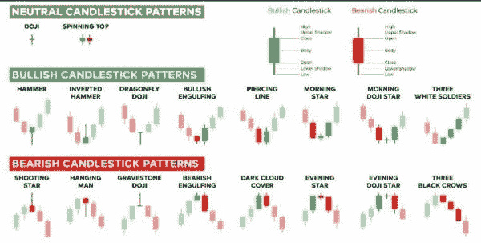

### 时间框架

这是阅读加密货币图表的一个非常重要的方面。图表可以显示不同时间框架下的市场快照，这会改变技术指标的信号。

这就是为什么使用多个时间框架交易加密货币非常重要。最流行的图表软件通常会显示从`1 秒`到一个月不等的时间框架图表。

你使用的术语取决于操作者的类型。寻求快速小利润的零售商会在较短的时间框架内交易——一分钟或更短——而日内交易者可以使用`15 分钟`、`一小时`和`四小时`图表。长期交易者和卖家只会对`日`、`周`和`月`图表感兴趣。在不同周期阅读图表可以更好地观察全局和整体趋势。记住说：“趋势是你的朋友”！

### 加密货币图表模式

加密货币图表上经常出现模式，这些模式可以导致最可预测的未来价格波动。图表中的这些形成可以识别趋势的反转和持续，以及看涨或看跌动能。比特币和加密货币一些最广认的图表模式如下：

1. **反转模式**: `头肩顶`、`头肩底`、`杯柄`、`双顶/双底`、`上升下降楔形`。
2. **持续模式**: `三角旗`、`矩形`、`旗形`、`上升下降楔形`。
3. **双线模式**: `对称三角形`、`上升或下降三角形`。

双边图表模式可能导致向任何方向的价格突破。许多用于货币交易的图表模式也适用于加密货币。

还有其他方法可以识别趋势将继续维持还是即将反转。

* **更高高、更高低**: 一种看涨模式，表示价格继续上涨且上升趋势完整。价格继续超过之前的高点，且回调深度没有之前那么深。
* **更低、更低**: 一种看跌模式，表示价格正在下跌且下降趋势完整。价格无法超过之前的高点，每次回调都会形成新的低点。在交易比特币和其他加密货币时，关注这些非常重要。

当指标和价格之间出现分歧时，可以观察到背离。在上升趋势中，当价格上涨但指标没有时，就会发生这种情况；在下降趋势中，当价格达到较低点但指标没有时，就会发生背离。

`ICOs` 是所有人都可以的，除了美国或中国等少数国家，这些国家禁止其公民参与（尽管取得了相当的成功）。我们通常通过支付 `Ethereal` 或 `Neo` 等其他加密资产来购买代币。

这种组织募资的方式几乎没有受到监管，或者说完全没有监管。已经发生了许多欺诈性的 `ICOs`，其唯一目标是偷取天真的人决定投资到该项目的资金。

## 代币与操作

在加密货币世界，有几种不同的代币（或“令牌”）。一方面是实用型代币（utility tokens），它们为用户提供访问特定服务。另一方面，我们发现了所谓的“证券代币”（security tokens）和“股权代币”（equity tokens）：

- “股权代币”（我们可以翻译为标题代币）实际上是相关公司的一部分，转到了区块链上。

换句话说，该代币是与发行公司相关的金融证券的加密表示。因此，它赋予了在上述公司股东大会上投票的权利，就像通过交易所收购的公司股份一样。

- 对于“证券代币”，情况要复杂得多。这是一个随着加密货币出现的独立类别。这些代币给人们以某种权力幻觉，但实际上并没有赋予持有者对管理相关加密资产的人（无论是否为公司）决策的任何权利。它们仅仅是代币化，其价值源于相关加密资产的成功。

因此，它们与证券代币完全没有可比性，因为它们被剥夺了相关的投票权。最后，如果翻译成法语，我们可以称之为投资者代币，这是一个不包含任何具体权利的通术。

关于代币的更多信息，请参见我们关于该主题的完整指南：证券代币与实用型代币——股票市场对比。股票始终提供相同的保障：

- 社会的一部分。
- 根据以下标准享有的投票权：1 股 = 1 票。
- 公司产生利润的股红。
- 每年参加一次股东大会的权利。

各种代币都不提供这些保障，证券代币目前在今天仍然非常稀少。因此，这些投票权和分红通常适用于你在交易所购买的股票。

实用型加密资产根据项目的不同提供不同的服务：

- 交易信号。
- 交易费折扣。
- 访问去中心化应用的可能。
- 等等。

投资者代币型加密资产通常什么都不提供，除了对未来价值增长的希望。

## 分红

正如我们在上一点中看到的，分红是股市系统特有的。如果一家公司盈利并且没有决定重新投资所有利润以增加增长，它将向股东发放分红。

然而，某些加密货币可以提供各种形式的伪装分红：

- 通过发放去中心化投资基金表现的版税。例如 `NapoleonX` (`NPX`) 就是这种情况。
- 通过中心节点系统（主节点），用户可以锁定他们的代币并向公众提供持续运行的服务器以获得被动收入。`TOMO` 或 `DASH` 等加密资产就是这种情况。
- 某些加密货币持有者可以免费获得一些 `ICOs` 代币，这些代币使用他们的区块链来完成这一过程。这种机制被称为“空投”（airdrop）。以 `Wanchain` 及其 `CryptoCurve` 项目为例：

`Wanchain` 币持有者根据持有的 `Wanchain` 币数量比例收到了免费的 `CryptoCurve` 代币。

某些交易所代币（即由加密货币交易所公司创建的代币），如`COSS`、`KuCoin Shares`或`Cryptopia Shares`，允许其持有者定期获得用户向交易所公司支付费用的部分。这种收入取决于公司的利润，从法律角度来看并不等同于分红，但它无疑是整个加密货币宇宙中最接近分红的收入。然而，应该注意的是，能够获得这些“准分红”的代币完全没有赋予在相关公司股东大会上投票的权利：持有者不是公司成员，他们没有投票权，即使他们不喜欢该网站的某些地方。此外，从词汇角度来看，所获得的分红价值不能称为分红，但在实践中，它基本上是一回事的。

## 波动性的差异

一个年轻的市场本质上是一个极不成熟的市场。因此，价格波动可能是巨大的。看到一种加密货币在一天内损失 30% 的价值，或看到其市值翻倍，并不罕见。

在股市中，如果一种资产在单日内波动几个点点，我们会称之为灾难。

然而，我们注意到加密货币市场的波动往往会急剧下降。例如，2016 年`bitcoin`的波动性小于一桶油。早年的极端波动将逐渐消失，让位于一个加密货币稳定性不亚于传统股票市场的世界。

## 专业水平

股市本质上是一项专业人士的业务。所有大银行、所有最大的机构、养老基金、保险公司都在股市中。

极其强大的专业交易员在市场中运作。许多机器人帮助决策或自己做出决策。强大的算法根据特定标准指示最佳决策。简而言之，股市本质上是有经验领域的人的业务。个人在股市中的寿命非常短，因为他无法与这些人、机构或程序竞争。

在加密货币领域，情况不同。市场目前由业余人士组成。这些者通常缺乏技术技能，并对情绪反应强烈。讽刺的是，有些人说加密资产市场是一个猴子市场。

许多在传统股市中可能无法募集到一分钱的项目，例如，通过加密货币已经成功地募集了数百万美元（甚至数十亿美元）。

金融大鳄之所以尚未非常活跃，唯一的原因是这个市场很小。

因此，一旦加密货币不断增长并变得广为人知，市场将按比例变得更加危险。因此，对于这些人来说，完全的监管将比完全没有监管要获利得多。

## 投机规模

批评声层出不穷，声称加密货币建立在空之上，而且没有财富创造来支持这种增长。

在目前的市场状态下（2018 年 11 月），我们无法证明这些人人是错误的。几乎所有的加密资产仍处于计划阶段。极少数资产已经拥有可以供目标客户使用的可行产品。

因此，目前加密货币的价值几乎完全是投机性的。

在取得具体进展之前，情况将保持如此。

在股市中，所有公司都有产生利润的经济活动。尽管有时会发生破产，但整个股市创造了财富。

在股市上运营的公司价值，虽然包含部分投机价值，但主要基于这些公司通过其经济活动产生利润的能力。这种利润的能力在传统上被分析为大量参数函数，正如下文“基本面分析”章节中所解释的那样。

与此相反，加密货币的价值通常只是没有任何逻辑的群群运动的结果，或者是在股市上属于违法的操纵。只有大头者解决了这个问题；即使在排名靠前的加密货币中，许多货币仍然认为其价格至少部分受到完全不理性波动的影响。

尽管如此，这并不意味着加密货币没有内在价值。它们的目标和用户可能会时间的推移而改变，带来不同的估值标准。这最好的例子是比特币，因为它被设计为人民的货币，而今天它只作为价值标准，就像黄金一样。

## 监管水平

股市受到严格监管。尽管任何人可以使用任何市场，但不同的市场适用不同的法律。例如，法国的规定与美国或日本不同。

加密货币世界除了少数小小的监管或禁令外，本质上是一个不受监管的市场。没有设定的规则允许或禁止某些活动。因此，它让许多丧心良的人在这个市场中随心所欲。

然而，情况正开始缓慢变化。越来越多的国家开始想要清理一下，该主题甚至在 2018 年阿根廷举行的 G20 峰会期间被列入议程。

## 市场开放时长

由于股市的监管，有必要定义开放时间和关闭时间，以便验证一切操作都是根据现行规则进行的。最大的交易所在周一至周五的办公时间内开放。

考虑到亚洲、欧洲和美国之间的时差，可以在任何时候找到开放的股市。但我们无法在那些因为办公时间而关闭的交易所进行交易。

加密资产市场 24/7 开放。它从不关闭，人们可以任何时间访问所有交易所网站而不受任何限制。交易所网站仅在网站更新或遇到技术问题（维护）时才会无法使用。

## 代币和股份持有者的身份识别

在股市中，主要有两种类型的股票：

- 记名股票，这使得能够识别出拥有这些股票的个人。
- 无记股票，不允许为此类股票的持有者命名。

尽管由于打击洗钱、逃税和恐怖主义而采取的措施日益严格，无记股票倾向于消失，但这种形式仍然存在并保证了某些匿名性。对于加密资产，在实践中要了解加密资产持有者的确切身份相对困难。当加密货币不是匿名时，我们可以知道哪个`wallet address`拥有特定的加密资产，但需要进一步调查才能将姓名与钱包地址联系起来。

然而，在以下过程中需要提供个人身份：

- 参与 ICO 时。主要为了验证你不是美国或中国人。
- 如果你想在某些交易所网站上增加提现限额。

除了这两个可以将你的名字与某些操作联系起来的措施外，我们因此认为大多数代币可以被视为无记。

## 技术分析

技术分析是一种通过加密资产或股票的价格走势图来研究价格演变的方法。该工具使得根据一组指标检测各种趋势成为。

一旦检测到这些趋势，你将能够实施一种产生利润的策略。

技术分析在股票上效果非常好，因为市场几乎完全由这一过程的用户占据，这使得他们所有的动作都变得可预测。

涉及到加密货币，观点相当分化。有些人认为技术分析有用，而另一些人认为它完全没有必要，因为加密资产市场被少数巨头高度操纵，而且恐慌人群的运动可能会产生不可预测的影响。此外，还必须考虑所研究市场的流动性。某些加密资产的市值和交易量极低，这意味着只有几百或几千美元的人就能显著推高或推低价格。

技术分析需要上限和最小量，以便指标反映某些现实。如果没有它，微小的买卖订单将完全扭曲对图表的分析，指标将毫无用处。

## 基本面分析

基本面分析是研究整个项目的过程。无论是在股市上市的公司还是在加密货币世界运营的公司，其推理逻辑本质上是相同的。只是记录方式存在一些显著差异。

与技术分析不同，基本面分析基于项目的本质。这是一种有助于理解公司如何实现其目标的分析。我们研究它提供的不同策略、负责特定任务的人员、新功能的实施日期、公司资产价值等。

有些人认为只有基本面分析在评估加密资产潜力方面有意义。

另一些人认为基本面分析应该与技术分析结合。但所有人都同意基本面分析对于加密货币项目是重要的。

## 与加密货币的主要区别

正如我们所见，在股市运营的公司和通过加密货币融资的公司具有相同的目标：通过提供对人们有用的产品和服务来创造价值。

但我们还没有谈论上市公司与加密货币之间的根本区别：区块链！

一家在加密货币领域运营的公司利用区块链来执行其项目。

如果它希望能够募集资金，这甚至是一项义务。公司产品或服务的开发只能通过区块链技术完成。

在某些情况下，当公司发现通过`ICO`融资比通过`IPO`更容易时，事实证明区块链对于完成项目并非必不可少。这只是为了更容易获得资金而设置的手段。因此，在投资之前你必须小心，仔细检查区块链对该项目是否真的有用。如果不是，它很可能是一个骗局。

## 骗局的数量

股票市场受到严格监管，你不能在上面随心所欲。许多法律的设计旨在通过法律惩罚那些不遵守规则的人。

但这种监管并非一 overnight 之间形成的。证券交易所首次制度化发生在 1409 年的布鲁日（比利时）。第一个有组织的法国交易所可以追溯到 1540 年，发生在里昂。这意味着股市已经存在了 600 多年。

在这一超过六世纪的漫长时期里，规则逐渐出现，以建立一个严格的框架来规范这些行为。但事情是一点点发生的，最大的进展往往发生在丑闻或重大危机之后，以确保未来不再发生此类。

`bitcoin`白皮书的发布于 2008 年 10 月。

因此，加密货币只有十年的历史。监管措施几乎不存在，结果是许多骗局已经发生并持续不断发生。

这甚至是一种损害个人对加密资产可能拥有的信心的灾祸。

如果你想查看最常见骗局的列表，请尽管咨询我们在关于该主题的章节：`Bitcoin`与骗局 - 自我教育！

## 沟通方法

围绕加密货币的交流几乎完全通过互联网进行。存在不同的媒介：

- `Twitter`。
- 专业论坛。
- `Telegram`、`Discord`或`Skype`上的讨论组。
- 加密货币网站。
- 加密资产会议期间。
- 等。

即使从长远来看，股市信息也应该趋向于一个类似的系统，但也有专门的报刊杂志、向交易员传输信息的呼叫中心、与投资者的会议等。这些通信手段对于加密资产来说并不存在（或者微不足道）。

这里我们到了本章节的结尾，该章节解释了股市和加密货币之间的共同点和差异。

正如我们所看到的，我们可以说，在这两种情况下，它们都是试图创建产品或服务以产生收入的公司，特殊之处在于加密货币需要区块链来执行其项目。

这两个市场之间的相似性远大于差异。然而，应该注意到，如果你想成为这些每个市场中胜任的投资者，就不应该忽视其中的一些主要差异。

加密货币市场仍然年轻，该领域的发展非常快。因此，有必要密切关注新闻，以便尽可能定期跟上变化。

同样重要的是理解，加密货币所需的技能与购买股票所需的技能相似。

加密资产市场并不比传统证券交易所更容易处理。诚然，目前的公众中业余者的比例比传统证券交易所高。

## 区块链技术

加密资产市场并不比传统证券交易所更容易处理。诚然，目前的公众中业余者的比例比传统证券交易所高。

### 区块技术

区块链是一种分布式账本，它在许多计算机上记录交易，因此在不更改所有后续区块且不经过网络共识的情况下，记录无法被追溯修改。这使得区块链变得透明且安全。

CFD 是一种衍生产品，允许您对加密货币的价格波动进行交易，而无需持有其底层的虚拟货币。如果您认为某种加密货币的价值将会增加，您将进行买入（即“持有”）。如果您认为它将下跌，您将建立卖出头寸（即“做空”）。由于 CFD 是杠杆产品，您只需要占用一小部分资金（即`hedge`保证金）即可获得全部的市场风险敞口。然而，您的盈亏是根据您的总头位计算的。因此，杠杆效应会放大收益，也会放大亏损。

## 如何通过交易所平台买卖加密货币

当您通过交易所获取加密货币时，您购买的是货币本身。要通过这种方式交易数字货币，您首先需要开设账户，然后锁定整个头位，最后将您的代币保存在加密货币钱包中，直到您决定转售它们。

并不是所有交易所的操作方式都相同，因此您需要熟悉它们所使用的技术，并学习如何提取您感兴趣的信息。许多平台都有存款限制，而且运营账户的成本有时可能是惊人的。

## 加密货币市场是如何运作的？

加密货币市场是去中心化的，这意味着这些货币不是由中央机构（例如国家）发行的。相反，它们通过计算机网络传输。加密货币可以在交易所平台（一种虚拟股票交易所）上买卖，并存储在专门的组合（或钱包）中。

与传统货币不同，加密货币只是存储在`blockchain`（区块链）上的数字所有权证明。当一个用户想要将加密货币单位卖给另一个用户时，他必须将其发送到后者的虚拟钱包。

只有当交易通过矿过程验证并添加到`blockchain`中时，交易才被认为完成。这通常也是新代币创建的方式。

`blockchain`是一种用于数据传输和存储的数字账本。在加密货币的境下，它存储了每个加密货币单位的交易历史，从而跟踪随时间变化的所有权变化。`blockchain`以区块的形式记录交易，最新的区块被放置在链的前端。

`blockchain`技术使用的安全设备比简单的计算机文件强大得多。

### 去中心化网络

`blockchain`文件对任何人开放，它们并不是存储在一个地方，而是同时由数以百万计的计算机进行托管。这使得`blockchain`既具有透明性又具有抗改性，不会留下任何易受人为或 IT 错误影响的弱点。

### 密码学

区块使用复杂的数学和计算机公式通过密码学链接在一起。任何篡改数据的尝试都会导致区块之间连接的中，网络上的计算机可以很容易识别。

### 什么是加密货币挖矿？

挖矿是验证近期加密货币交易的过程，随后新单位将进入流通。

### 交易验证

矿工（负责挖矿的计算机）处理待处理交易，确保发送者有足够的资金完成交易。

交易详情与存储在`blockchain`中的交易历史进行比较。当发送者使用其`private key`（私钥）时，他即授权进行资金转移。

### 创建新区块

矿工在新区块中收集有效交易，并尝试通过解决复杂的算法生成一个与上一个区块连接的密码学链接。

当其中一个矿工成功生成该链接时，它将其发送到网络的其余部分进行验证。

### 哪些因素影响加密货币市场？

加密货币市场根据供需演变。然而，作为去中心化的市场，它们通常能更好地受到通常影响传统货币的经济和政治变化的保护。

除了自身的不确定性外，以下因素可能对数字货币的价格产生重大影响：

- **供应**：部分的总数及其发行、销毁或丢失的速率
- **市值**：所有现有货币的价值以及该数字增加、减少或停滞的概率
- **压力**：媒体对加密货币的报道（正面、负面、强力或弱力）
- **整合**：加密货币融入现有基础设施（如在线支付系统）的能力
- **关键事件**：重大事件，如监管变化、安全漏洞和经济困境

## 加密货币交易是如何运作的？

通过 IG，您可以通过`CFDs`交易加密货币，这种衍生产品允许您对感兴趣的加密货币价格涨跌进行交易。这些货币以美元等传统货币报价，您永远不会拥有加密货币本身。

`CFDs`是杠杆产品，这意味着您只需锁定总价值的一小部分即可建立头寸。

### 加密货币交易中的价差是什么？

价差是买入价格和卖出价格之间的差。正如许多金融市场一样，当您建立加密货币头寸时，会看到两个价格。

如果您想做多，则以买入价交易，该价格略高于市场价格。相反，如果您想建立做空头寸，则以要要价交易，该价格略低于市场价格。

### 加密货币交易中的“手”是指什么？

加密货币以“手”（lots）进行交易，即用于订单的代币集合。由于数字货币波动性大，订单通常很小。一手通常对应一个参考加密货币。然而，某些加密货币以较大的手进行交易。

### 什么是杠杆加密货币交易？

杠杆效应允许您在无需预先支付全部价值的情况下，从大量加密货币的敞口中获利。相反，您只需要占用部分较小资金作为保证金。当您关闭杠杆头寸时，您的盈亏是根据头总价值计算的。

杠杆会放大您的收益，也会放大亏损。因此，在开始交易之前了解其运作方式至关重要。

### 加密货币交易中的对冲是什么？

保证金（`hedge`）是杠杆交易的关键部分。这是您在开启并保持开放头寸时支付的金额。通过`CFDs`交易加密货币时，请注意所需的覆盖率可能会根据经纪商和订单的大小而异。

覆盖率通常以总价值的百分比表示。例如，为了开启`bitcoin`头寸，您只需要支付其总价值的 50%。与其说支付 5000 欧元，您只需支付 2500 欧元。

### 加密货币交易中的 pip 是什么？

Pip 是用于定义加密货币价格波动的单位。它们代表数字货币价格的一个数字的波动。

通常，流行的加密货币以美元为基交易。例如，如果加密货币从 $190.00 涨到 $191.00，这意味着它增加了一个 pip。一些不流行的加密货币使用不同的刻度，其中一个 pip 可能是一个分，甚至是十分分之一分。

为了避免任何意外的惊喜，在下单之前，请务必阅读交易平台上关于价格波动衡量的说明。

# 你应该投资加密货币还是交易它们？

在决定是倾向于购买还是交易加密货币之前，考虑这两种方法之间的差异是非常重要的。详情请下表。

## 如果符合以下情况，你可能对购买加密货币感兴趣……

- 你想拥有整个加密货币。
- 你准备好预付资产的全部价值。
- 你希望每个账户都能直接获得底层市场的收益。
- 你愿意等到拥有货币账户后才能进行买卖。
- 你对被施加介绍额度限制或最大存款限制没有异议。
- 你不需要担心存款或取现的额外费用。

## 如果符合以下情况，你可能对加密货币交易感兴趣……

- 你希望在不拥有数字资产的情况下对加密货币的价格进行投机。
- 你希望通过仅支付初始成本的小部分来杠杆你的。
- 你希望通过一个账户获得多个底层市场的间接收益。
- 你希望立即开始交易。
- 你不想受到最高资金存款限制。
- 你不想支付存款或取现费用。

# 加密货币市场

加密货币诞生于新技术。它们诞生于被称为`Blockchain`（区块链）或`blocks`（区块）的技术。这是一种允许所做操作被所有人看到的编程类型。正是在这里，就在这里，为加密货币提供了安全性。

谁生产加密货币？它们是由矿工生产的，矿工通常是拥有非常强大的计算机设备的程序员，他们需要满足生成这种`blockchain`技术所需的要求。当一种新的加密货币产生时，结果是整个社区都能看到它，因为计算机之间存在的连接防止了其中一台计算机抹掉在互联网上留下的该加密货币创建痕迹。

那么，加密货币是什么？它们是我们将作为支付手段或接收资金的虚拟货币。这使得所进行的收银和支付可以在没有金融中介的情况下完成。

因此，它是一种不受国家控制的货币。没有国家的中央银行或社区（如欧洲经济共同体）的中央银行可以对加密货币的本质发表支持或反对意见。因此，它们没有法律控制。

这有其优点，但显然也有其缺点。不方便的地方在于人感到并不很安全，因为他如果不太了解`blockchain`技术是什么，他可能会很害怕把钱投入一家提供数字的私人公司，而这个数字将标识你的加密货币。

它们是字母和数字的快速修正，让你成为该虚拟货币的所有者。那么，它们是什么？它们是既让我们用于收钱又用于支付的虚拟货币，而且由于在市场中报价，由于买卖效应，它们有时会涨得更高，有时会跌得更多，因为人们可以购买或卖出它们，这会在该加密货币与其汇率（无论是另一种加密货币还是法定货币）之间产生波动。

让我们记住，美元或欧元等法定货币硬币也是与加密货币交叉的货币，而这正是他们意图盈利的地方。

嗯，我想我们必须制造加密货币有一个非常简单的理由，因为它们将会留下来。随着越来越多的国家接受它们，并在很大程度上，特别是像亚马逊这样的大公司开始例如接受它们作为支付形式，对于加密货币来说不留在我们身边将变得非常困难。

`blockchain`技术在多大程度上改变了看待风险的方式。我之前提到的，它们目前没有控制，没有国家或中央银行在监管它们，但是是`blockchain`系统所有成员的信任让加密货币被认为或或少安全。

当然，已经出现过一些情况，人们人们开始初出现过问题，但每次都在不断改进，这是他们有利的一个积极点。如何制作它们？我们有两种可能。

1. 如果你是一名计算机程序员，你可以把自己组织成矿工，并考虑自己生产它们的可能性。这显然获得服务报酬就足够了。

2. 或者另一种可能就是购买它们。要购买加密货币，我们必须去一家卖给我们的机构。它必须是这些生产者或拥有大量加密货币的私人公司之一。

## 投资哪些加密货币？

嗯，我们有好几种。尽管有一个非常脱颖而出，被称为 `Bitcoin`（比特币）。`Bitcoin` 是第一种加密货币。它们于 2008 年出现。起初，很多人认为这不会是什么会留下的东西，也不会真正产生利润，那是一种暂时的时尚。

然而，情况随着硅谷的一些人而改变了，特别是像比尔·盖茨这样非常有名的人开始对它们产生很大兴趣。那是加密货币 `Bitcoin` 价格大约在 200 多美元的一年，正是硅谷大人物的进入让加密货币 `Bitcoin` 重新出现并开始上涨。给你一个概念，自 2008 年以来，`Bitcoin` 已经达到了 `$6,000`，大约是它的市场天花板。想象一下，那些在开始就押注 `Bitcoin` 的人赚了多巨大的财富。

在它起源时，他们无法制造加密货币，也没有其他程序员也考虑再次制造不同的加密货币的可能性。所以 `Ethereum`（以太坊）也出现了，它目前的交易价格大约在三百美元左右。

我们还有另一种加密货币，可能是 `Mitocoin` 或者 `Litecoin`（莱特币）也是加密货币，它是那些真正理解其质量的人认为价值最高之一。

加密货币的质量很大程度上取决于用于生产它们的 `blockchain` 技术。因此，随着技术的进步，加密货币也变得更加强大。这里我们有 `Bitcoin`，它现在已经分叉了，产生了所谓的 `fork`。

一个 `fork` 是什么？抱歉，我的英语不是很好，但这个词是这样写的。嗯，这被称为 `fork`，`Bitcoin` 之分叉主要是由于 `Bitcoin` 变得非常昂贵。对于那些想要获取像 `Bitcoin` 这样的单一加密货币并支付一万五千多元的人来说，这并不是每个人的能力，而这也是它们现在的价格。

在获取这些资产时，指南可以为你提供支持。你必须生成一个所谓的“钱包”，并将你的比特币存放在其中；但我建议你不要将它们留在网络中，而是将你的加密货币代码提取出来，即放在离线硬件上。

在这些离线硬件上，我们要做的是将你的货币从服务器中取出。我知道我的一些朋友的情况，他们在早期购买了比特币，当时投资了像 500 欧元或 1000 欧元这样的资金，现在他们拥有一笔小财富。

然而，他们遇到了一个问题，他们没有保存好密码，而你是唯一可以访问该代码的人。没有那个代码，你就无法重新进入、恢复你的比特币、将其转给他人或将其兑换为其他货币。

如果你还没有 100% 地理解这一点，如果你从未投资过股市，如果你从未接触过图表，我求你，请不要接触加密货币。对于外行来说，加密货币可能非常危险。这是由于它们存在巨大的波动，具有极高的波动性。如果通过 CFD（差价合约）进行操作，要求你是一个专家交易员，而且在任何情况下，都不要用你支付电费、孩子学费或生活必需支出所需的钱来购买它们。

# 投资加密货币

在考虑投资加密货币之前，拥有基础知识是非常重要的；因此在给出 3 种策略之前，我将与你分享一些必要的指南，这些将帮助你更好地理解加密货币生态系统。

## 进行个人调查

令人惊讶的是你可以在互联网上获得大量关于加密货币的优质信息，在 `Crypto Trend` 这里你会获得很多。

花时间彻底研究加密货币市场是极其重要的。

在这个生态系统中欺诈横行；并不是很难避免，但如果没有基础知识，你很容易掉入陷阱。

在上面亏钱完全是你的错，所以你得到什么取决于你自己。在学习了基础之后，你可以寻找有助于高级学习过程的课程和导师；在涉及金钱时，知识永远是不够的。

不要投资加密货币超过你愿意承受的损失金额。

加密货币市场波动巨大。获得 2000% 利润的诱惑导致人们承担超过债务的风险；但你必须理解，如果利润如此高，风险也会之高。

然而，波动性也是加密市场的优势之一，因为你损失的永远不会超过你投资的金额；另一方面，你可能正处于正确的时机，让你组合中的加密货币增值 1000%。

## 多元化你的投资组合

这个市场的风险非常高；因此，如果你已经决定投资，考虑这一建议很重要。

不建议将所有资金都投资到一种货币中。当你进行多元化时，你就降低了风险。例如：如果你所有的资金都投资了 `Ripple`，如果其价格突然下跌，你会遭受很大。另一方面，如果你的投资组合分散在 `Bitcoin`、`Ripple` 和 `Ethereum` 中，那么在下跌后的冲击将小得多。

## 杠杆

杠杆是一把双刃剑。它赋予用户以超过其存款资金的开仓的能力。在使用它时，你应该极其小心，因为它可以增加利润，也可以增加损失。

## 过度交易极其危险

新投资者往往容易被情绪左右，导致他们过度交易。这并不意味着你会赚钱；相反，它会让你暴露在风险之中。

## 投资策略

### 1. 持有加密货币

在加密货币生态系统中，`HOLD` 指的是长期持有，希望资产具有更高的价值。这是风险最低的投资方式之一。

货币价值可能会下降，但你的代币数量将保持不变；如果货币指数级增长，你的投资资本也会如此。例如，如果你投资了 1 美元，交易价格为 100 美元，你每个代币赚了 99 美元。如果货币价值下降到 0.20 美元，你每个代币将损失 0.80 美元。

### 2. 交易

由于风险风险，交易是金融市场中风险最大的投资形式之一。它分为三类：

*   **头线交易 (Scalping)**：包括在短时间内进出市场，通常不超过 2 小时。

*   **日内交易 (Day Trading)**：包括在建立仓位的当天进出市场。

*   **波段交易 (Swing trading)**：在超过一天的期间进出的操作。这是三者中风险最低的。

### 3. 量化分析

量化分析包括实施数学和统计技术来做出投资。这种分析试图通过预测或解释不同的经济变量来增加优势。那些使用量化分析评估投资机会的专家被称为 `Quants`。

任何股票或房地产投资者都不会在心血来潮时才进行投资。他们知道这是一个冒险的步骤，不应该听天由命。在投资某项业务之前，有必要理解并确定投资目标以及如何实现这些目标。必须对将实现的 `profits`（利润）以及投资持续的时间有一个大致的概念。

这也是加密货币投资者也应该具备的心态。让我们看看加密世界中两种主要的投资策略是什么。

## 加密货币的长期投资

这是当我们预期其价格随时间推移而增长时进行的加密货币投资。这听起来非常直观。在这种情况下，我们讨论的是一种应该维持 6 个月到 1 年的投资。但这取决于个人，因为有人会维持 5 到 10 年的投资。投资可以分阶段进行，也可以一次性完成。

### 长期投资策略

在投入任何资金之前，我们必须明确投资目标：

● 你会在加密货币达到某个价格或在某个时间后卖出吗？

● 你会在不同时间分批卖出还是一次性卖出？

● 你是否愿意为了短期投资而放弃你的长期愿景？例如，如果赌博策略改变或实施了可能影响你投资经济状况和长期价格的新法律，那么你可能应该在卖出之前重新考虑。

你应该做一些研究，以决定哪些加密货币最方便或最适合长期投资。检查以下项目是有好的：

● 你是否有一支强大的开发者和创始人团队？

● 加密技术是否比它的竞争对手更好？

● 你的路线图或计划有多好？

● 他们是否在解决现实世界的问题？

如果你对你投资的加密货币真的有信心，即使在价格趋势向下时也应该保持冷静并坚持你的投资。这很重要，因为许多投资者由于“恐慌”而亏了钱。那时只剩下遗憾了。

### 进行长期投资的理由

● 无需关注市场的每日波动，你会变得更冷静。压力更小更健康。

● 你坚信加密货币长期来看将带来更好的回报。

● 你是那些押注加密货币是经济未来的人之一。

这听起来可能像是一种“希望”，但事实是，这些是每个人长期看好加密货币的合理理由。

## 投资短期加密货币

短期加密货币投资到底有多短？我们必须记住，这些是在短时间内进行的投资，希望获得快速回报。这些时期可能短至几秒、几分钟、几天、周甚至几个月。

### 短期加密货币投资是如何运作的？

与长期加密投资一样，你必须对你的投资有明确的目标。你必须问问自己：

● 你愿意接受多大的损失？如果在加密货币价格突然下跌时帮助你控制损失。

● 你希望从这项投资中获得什么收益？这将让你对应该买入/卖出加密货币的价格有一个概念。

● 你是否有足够的耐心和时间来跟踪和研究加密货币市场的起伏以及相关新闻？

● 你是否有能力对加密货币市场进行技术分析？这非常重要，所以你在投资之前最好先学习。

● 你的短期策略是否更好，也就是说，它是否会比你长期投资给你提供更好的红利？

研究哪种是适合短期投资的最佳加密货币是非常重要的——

一个可以给你提供思路的非常简单的指南是检查你的加密货币是否符合以下短期投资的条件：

● 它有高交易量，也就是说，每分钟都有很多人买卖它。

● 市值较低。

● 它们在社交媒体和新闻中处于趋势中。

● 你拥有 `ICO` 或刚完成你的 `ICO`。最好在低价买入。

我们很清楚 `Ethereum` 和 `Bitcoin` 可以在短期内交易，但在较新的加密货币中承担一些“不心疼”的风险是好的。

在 `Stellar`、`NEM`、`IOTA` 和 `NEO` 等近期加密货币中承担风险的投资者已经在短期内获得了巨额利润。

通过短期投资，你拥有短时间内获得大量资金的优势。然而，这是一把双刃剑。其缺点包括：

### 缺点

● 它们需要大量的精力和时间，因为必须不断监控价格和市场波动。

● 这是一项高风险投资，可能会损失更大，因为价格可能在短期内下跌。

● 它可能会你的健康，因为可能非常情绪化且压力巨大。

### 哪种是最佳策略？

这不是一个准确的答案，因为它完全取决于你在加密货币世界的经验和目标。

如果你完全相信一个项目，那么我们可以建议长期投资。但如果你看到某种加密货币获得了大量关注，那么进行短期投资可能是一个好主意，会给你带来丰厚的利润。

加密货币具有巨大的潜力，但不应该忘记一个重要的细节：你可能会亏钱。在加密世界中，没有什么是肯定的，没有人能预见到会发生什么。

有一句加密货币专家反复的格言：你只需要投入你不害怕失去的钱。我们认为，时刻记住这一点是好的。

# 11

## 第十三章：投资规则

通过这些初步问题，我们可以了解这究竟是一次真正的创新和改进，还是相反，他们只是想强制将区块链推入一个并不需要它的系统。从这里开始，我们需要评估一系列参数，以便我们获得该项目的一个基本概览。

主要参数包括：

- **白皮书质量**：这份文档是项目的 DNA。为了区分高质量项目与其他项目，有必要阅读已经证明了其稳健性的项目白皮书，并将它们与我们正在检查的新项目进行比较。在基础层面理解项目的运作方式并能够可视化其技术可行性至关重要。参考如 `bitcoin` 等论坛可能有助于更好地理解项目。

- **团队**：这是一个非常重要的元素，就像任何初创公司一样，背后的人类团队以及他们克服复杂情况的能力决定了项目的成功或失败。在网络上看到他们的“脸”是有意义的，因为这表明他们通过置个人声誉对自己的工作表示信任。此外，他们在区块链生态系统中拥有参与项目合作的、受认可的“顾问”也是重要的。

- **市值 / 用户数 ^ 2**：这个指标非常值得考虑，因为大多数与加密货币相关的项目都有社区效应，也就是说它们的价值应该与用户数量的平方成比例增加。小于 1 的值是理想的，尽管在许多情况下看到超过一百甚至一千的数值，这将是远离该关键货币的指标，显示出被值过高的症状。

- **有限单位**：创始人不能具备在他们想要时创建新单位的能力，这是至关重要的。

- **路线图**：所有项目必须对中中长期将遵循的步骤有良好结构且合理的规划。

- **Github**：这是一个协作开发平台。大多数主要项目在该平台上都有一个主题，开发者社区会验证代码质量并做出新的贡献以改进项目。我们必须查看该社区的规模。

我们建议根据这些参数的相对重要性进行权衡，并获得总分。

***寻找良好的买入时机。***

尽管我认为加密货币必须通过基本面筛选才能被视为购买选项，但这并不是充分的理由。

价格必须确认购买决策。如果一个优质项目的价格无法摆脱下降趋势，那么投资它是徒劳的，这一事实可能意味着该项目并没有我们想象的那么好，或者可能存在我们未知的公开或私有信息。我们可以将价格理解为加密货币长期基本面状态的反映或代表。这样一来，我既不想投资那些上涨但没有良好基本面的货币，也不想投资那些上涨但下跌的货币。如你所见，我只想投资那些基本面良好且价格正在上涨的货币。

为了做到这一点，在基本面分析之后，我们必须优化入场和退出点以及投资金额。事实上，即使筛选出了最好的货币，如果没有良好的入出选择或风险管理，金钱仍然会损失。

我们将简要解释该策略的基础。

***入场规则。***

查看日线图表，从右（现在）向左（过去）。

查看日线图表，从右（现在）向左（过去）。

查看日线图表，从右（现在）向左（过去）。

查看日线图表，从右（现在）向左（过去）。

查看日线图表，从右（现在）向左（过去）。

查看日线图表，从右（现在）向左（过去）。

查看日线图表，从右（现在）向左（过去）。

查看日线图表，从右（现在）向左（过去）。

查看日线图表，从右（现在）向左（过去）。

查看日线图表，从右（现在）向左（过去）。

查看日线图表，从右（现在）向左（过去）。

查看日线图表，从右（现在）向左（过去）。

使用优惠码 `borjag0894` 即可在通过应用注册获得 5 美元的免费加密货币。这是一个非常有趣的选项，他们提供无佣金的免费信用卡用于支付加密货币消费。

***仅限通过应用访问。***

## Electroneum：进入免费加密货币世界的最简单方法。

通过完成某些数字任务获取 `ETNs`。这是一种为在线支付设计的加密货币，你可以直接从应用中获得奖励。

世界上有超过十亿人没有银行账户或数字支付形式。他们没有 Visa。他们不拥有任何以下物品：`MasterCard`、`ApplePay`、`PayPal` 等。

Electroneum (`ETN`) 每天帮助世界各地的人在实体商店和在线上支付商品和服务。安装后，前往 `Rewards` > `Generate more` > `See Referral program`，并在下方添加代码 `7884C5` 即可获得额外 1% 的 `ETN` 奖励。

你可以直接通过手机应用上挖掘加密货币。

## 币安 (Binance)：全球领先的加密货币交易所。

在几分钟内交易 `BTC`、`BNB` 和数百种其他加密货币。超过 100 种加密货币。

它允许你执行不同的任务来赚取某些加密货币。

有时 `Google Chrome` 网页会失效，我必须使用其他浏览器。提现费用取决于加密货币的类型。

注册过程更简单更快捷，因为他们最初不需要身份信息，但随后是必要的，就像在所有情况下出于法律考虑，这样才能购买 `Bitcoins`。它不支持直接提现 `Bitcoins`。

你必须将 `Bitcoins` 转到另一个应用程序的钱包，该应用允许你将资金转入你的银行账户或 `Paypal` 账户，这是一个缺点。

## Wirex：你可以使用卡片购买、出售和使用加密货币。

如果你投资 100 美元的加密货币，通过此链接注册即可获得 5 美元的 `Bitcoins`。

## Uphold：另一个有趣的选择。设计优秀且简单。英文界面。

## Bitstamp：我也使用这个网站，并在 `Ripple`、`Ether` 和 `Litecoin` 中投入了一些钱。注册时可获得 50 美元手续费奖励。转账支付时间不到 24 小时，非常快。买卖过程有 0.5% 的佣金，使用顶部栏的操作过程非常简单。

## Kraken：同样很有名。你们的网站非常好，因为它能引导各种类型的人，无论他们知识多还是少。安全的平台，买卖加密货币的条件非常优。

## Revolut：我还没有尝试过，但它很有名。对于住在海外的人很有趣，而且允许你购买加密货币。

## Bitnovo：我没有尝试过。

## Robinhood：我没有尝试过。

## BRD：我没有尝试过。

## Bitpay：接受加密货币支付。类似于 `Paypal`。

其中一些公司甚至提供了使用与加密货币关联的信用卡并在任何场所使用的。

## 如何购买 Ether、Bitcoin Cash、Ripple 或 Stellar 等其他加密货币

在大多数情况下，流程是先购买 `Bitcoins` 或存款欧元或美元，然后将部分 `Bitcoins` 或欧元或美元转移或兑换你想要的其他加密货币。

通过你使用的应用或网站本身操作都非常简单。

### 如何获得免费加密货币

许多买卖加密货币的平台提供分销系统，允许你邀请他人，这样你和这些注册的人都可以获得他们的第一笔免费加密货币。

此外，`Coinbase` 提供了一个系统，通过观看关于不同加密货币的视频，你可以自动在账户中赢得一定数量的免费加密货币。

我们说论的是每看一组视频可以获得 6 美元到 50 美元不等的金额。总的你可以通过这个系统赢得超过 100 美元。

### 在比特币和其他加密货币中投入多少钱？

这是一个非常个人的决定，但没有最低或最高限制。从 10 欧元到 100,000 欧元甚至更多。

在这种情况下经常说的是，你永远不要将储蓄的 10% 投入这种高风险投资，而且你追求的资金是你现在或永远不需要的钱。这样，你就不会担心了，即使亏了也不会影响你的日常生活。

另一方面，看到 `Bitcoin` 和其他加密货币多年来的演变，考虑到它们使用的技术以及世界的发展方向，像本文中讨论的这些官方网页上的此类投资是见以来最有利的投资，在中长期内增长 100 倍、1000 倍或更多。

### 如何将比特币转到我的银行账户。

如果你想将 `Bitcoins` 转换为欧元或美元或任何银行账户，你只需要选择转移（英文为 withdraw）或从网页或应用中提取资金（我建议始终在网页上执行这些操作）。

你之前必须在你使用的网页或应用程序的设置中添加你的银行详情。

在某些加密网站和应用中，你必须先将资金从较为人知的加密货币转换为更为人知的加密货币（如 `Bitcoin` 或 `Ether`），从那里移动到允许该交易的页面。

### 过程需要几天时间。

`Coinbase`、`Blockchain`、`eToro`、`Bitstamp` 等应用允许你将加密货币转换为欧元或美元，从你的银行账户或 `Paypal` 提取，甚至你可以通过 `ATM` 直接提取本地货币。

### 在哪里可以使用比特币进行购买？

现在有很多实体店和在线商店提供使用`Bitcoins`支付的可能性，但尚未非常普及。

像`Namecheap`这样的公司允许使用`Bitcoins`支付域名。

有些人甚至使用`Bitcoins`购买或卖房屋。

总之，目前我将加密货币视为高风险投资，因此我不会使用这种支付方式。

如果你在虚拟钱包之间转移加密货币，没有办法知道这些交易，因此在你将资金转入银行之前，国库无法干预。

## 购买比特币和加密货币安全吗？

`Bitcoins`与任何当前货币一样甚至更安全。你应该小心的是如何使用它们以及在哪里购买它们。

记住，你传统银行账户中的欧元或美元并不真实存在。银行拥有的资金只有 1% 以物理形式存在。听听《Strange Days》播客的这一集《奇异经济：钱从哪里来？》。

因此，一旦了解了，加密货币只是另一种具有良好安全系统的货币。

整个资本主义体系建立在对系统本身的信任之上。500 欧元钞票只是纸。

然而，就像在任何在线商店购物一样，你必须小心并检查它是否是安全的官方网站。

如果你通过`Amazon`购买，你可以开设一个`Gmail`账户或从你的银行进行在线操作，将不会有任何问题。

另一方面，还有一些带有金字塔系统的程序，它们以加密货币为借口，试图让人们投入资金，并让其他人参与以赚取佣金。

务必提高警惕，防范这些骗局，只有少数先进入金字塔系统的人会获利。

过段时间，这种自动套利系统会更改名称，系统本身会随资金消失，并创建另一个类似的程序继续欺骗人们。你遇到过的例子包括`Arbistar`、`Nimbus`、`Bitcoin Vault`的加密挖掘以及`Mine City`等……

甚至我认识的一些所谓的专家当时也向我推销过这是一个绝佳的机会。

我也关注过像`Kuailian`这样的项目。质押服务、主节点、套利、交易，特别是当业务的核心不在于产品而在于通过邀请他人赚钱时，请务必小心。

如果有人自动提供超过 10% 的高回报，且几乎不需要做任何事情或投入资金。如果你在 Google 上搜索`"观点 + 品牌"`或`"骗局 + 品牌"`，并看到许多使用如`品牌是骗局吗？`等标题的章节和视频，但它们最终还是会推荐该项目，那么它们是在利用 SEO 技术引导你加入骗局。

因此，如果你打算购买或投资`Bitcoins`或其他加密货币，我建议你只在实际购买加密货币的官方页面进行，永远不要使用那些保证固定月利润或带有奇怪名称的自动系统，你永远无法确保加密货币的购买是否正确。

# 投资加密货币可以赚多少钱？

很多钱。数千欧元。但你也可能失去一切。

我建议投入你永远需要的钱。这意味着即使你失去一切也不会对你的生活产生任何影响。

我不是投资或加密货币专家，但我只想和你们分享我的经验。

## 购买加密货币时的佣金

就像银行对你执行转账、在股市购买股票或取款等各种操作收取佣金一样，加密货币也是如此。管理加密货币的公司将根据每次操作收取一定金额的费用。

好处是，与买卖股票相比，佣金要低得多。

我建议你比较不同的购买`Bitcoins`的公司并查看它们的佣金，因为在某些情况下，有些公司不收取管理费，仅根据金额收费。平均费用通常是购买金额的 0.5%。

例如，要查看`Coinbase`的佣金可以在这里看到，总结来说，欧洲地区的情况如下：

- 买卖加密货币：1.49%
- 使用借记卡直接购买：3.99%
- 银行转账（SEPA）：向`Coinbase`发送资金购买加密货币免费，入账收取 0.15 欧元。

顺便说，如果你想通过`ValueInvesting`投资股市，我推荐`Investment Academy`和`Value Investing FM`播客。你也可以使用`Degiro`、`Interactive Brokers`或`Revolut`应用，它们的佣金较低。

# 如何向税务局申报加密货币收入

目前，加密货币处于法律之外，因为只要你不将加密货币转到银行账户，并且不将其转换为美元或欧元等（传统货币被称为`FIAT`，属于一种类型）。

# 比特币提示

首先，在购买`Bitcoin`之前，你需要一个存储它的地方。在加密货币世界，那个地方被称为钱包。

## 钱包类型

五种主要的 BTC 钱包类型是`desktop`（桌面钱包）、`mobile`（手机钱包）、`online`（在线钱包）、`hardware`（硬件钱包）和`paper`（纸钱包）。

### Desktop

桌面钱包安装在用户的计算机上，提供对资金的完全控制和相对安全性。有健壮的桌面钱包，允许用户下载区块并提供独立管理。另一方面，轻量级钱包不需要下载区块。

### Mobile

手机钱包的主要优势是用户的资金随时随地可用。这是一种通过扫描二维码支付产品非常方便的方式。在某些情况下，用户可以利用手机的近场通信（NFC），让他们只需将手机贴近读卡器而无需输入任何信息。

所有手机钱包的共同特点是它们不是完整的比特币客户端。这是因为完整的比特币客户端必须下载整个`Blockchain`，而它在不断增长，需要几个 GB 的存储空间。

### Online

如果你使用基于网络的钱包，用户的私钥存储在由他人控制的服务器上，并连接到互联网。虽然它们让人们可以从世界上任何地方的任何设备轻松访问资金，但始终存在服务器被黑，甚至提供服务的组织控制你比特币的风险。

### Hardware

硬件钱包是专用的便携设备，可以存放私钥并协助支付。有不同类型的硬件钱包，但它们都允许用户在口袋里随身携带任何金额的钱。

### Paper

纸钱包可能是存储`Bitcoin`最安全的选项之一，它基本上是由指定服务生成的两个二维码。其中一个是公钥，即一个可以接收`BTC`的地址；另一个是私钥，你可以用它花费存储在该地址的比特币。

# 在哪里购买比特币？

购买`Bitcoins`并不像人们希望的那样简单。然而，选项正在不断增加。每个人都可以选择适合自己需要的加密货币购买方案，某些甚至不需要访问互联网或 BTC 钱包。

## ATMs

尽管这是一个非常新的概念，但比特币 ATM 机已经出现在世界各地城市，且数量正在不断增加。这些机器在正常汇率的基础上收取 3% 至 8% 的手续费，但为用户提供了最私密的比特币购买体验。

你只需要向 ATM 机中插入现金，并扫描移动钱包上的二维码，或者接收一张带有代码以及如何将资金转入你钱包说明的纸质收据。随着比特币的普及，此类 ATM 机有望成为购买加密货币最常见的方式之一。

不言而喻，比特币 ATM 机不太可能在禁止比特币或其违法的国家出现。你可以使用如`CoinATMRadar`等地图服务找到离你最近的比特币 ATM 机。

### 礼品卡

比特币经常被用于购买礼品卡，因为它们具有匿名性，有时比使用现金更便宜。但礼品卡本身可以兑换为`BTC`。你只需要从零售商处购买任何礼品卡，登录到某些接受礼品卡的比特币交易所之一（例如`Paxful`、`LocalBitcoins`等），并完成购买。

取决于特定的卖家，他们可能想要看到卡片背面礼品码的实际图像以及购买该卡片的商店收据，而另一些则仅对在线或电子代码表示满意。一旦你启动交易，你想要购买的`BTC`数量将自动在网站上锁定，因此向卖家提供你的礼品卡信息是安全的。

许多在线零售商以低至价值 60% 的折扣出售礼品卡，因此通过这种方式购买比特币可以节省大量的钱。考虑到其价值的波动，礼品卡也是存储`BTC`的极佳方式。然而，与其他任何购买比特币的方式一样，你应该始终警惕试图窃取钱款的骗子，因此确保你只与信任的卖家进行交易。

### 交易所

每一个比特币的新潜在买家都会发现有各种交易所正在竞争他们的业务。选择正确的交易所取决于许多不同因素，地理位置可能是最重要的。交易所必须受到政府监管，并满足“了解你的客户”（KYC）和反洗钱的要求。因此，要在任何现有交易所创建账户并开始交易，你必须经过漫长的官僚程序。

例如，大多数交易所要求你在开始交易之前先添加现有的银行账户，这通常需要提供详细的个人身份信息，从而规避了比特币买家的匿名性。

然而，交易所提供了无与伦比的交易选择。无论你是在寻找一个适用于机构交易者的完整平台，还是为一次性交易寻找更简单的解决方案，你都能找到适合你交易所。

此外，大多数平台可以通过桌面和移动设备访问，允许用户在任何地方进行交易。交易所所在接受的支付选项、安全级别、购买限制、费用、验证要求等方面各不相同。

#### 比特币交易所

根据加密货币市值划分的交易所列表。

| 名称 | 支付方式 | 安全性 | 验证级别 | 手续费 |
| :--- | :--- | :--- | :--- | :--- |
| Bitfinex | 银行转账、Ethereum、Dash、Monero、Zcash | 二步验证、通用双因子、提现保护、高级密钥权限 | 无需充值加密货币，支持美元存款 | 0%-0.1% |
| BitFlye | 银行实账户 | 转账、信用卡 |  | 0.01% |

- `Bitfinex`：`Bank transfer, Ethereum, Dash, Monero, Zcash`、`2-Step Verification, Universal Second Factor, Withdrawal Protection, Advanced Key Permissions`、`not required to make a crypto currency deposit, deposits in USD`、`0%-0.1%`
- `BitFlye`：`Bank Real Account`、`transfer, credit card`、`0.01%`

比特币投资信托是同此类首个，这在很大程度上导致了其估值过高。虽然市场上有关于其他类似结构基金进入的传言，但`BIT`仍然是游戏中唯一的大玩家。然而，随着加密货币市场的演变，类似的基金无疑会进入市场，这不仅会减轻`BIT`的压力，还将巩固比特币作为全球认可货币的地位。

## 购买比特币的困难

### 信用卡或 PayPal

这可能让你感到惊讶，但无论你正在使用哪种具体的交易方法，要用信用卡或`PayPal`购买比特币并不容易，这取决于你所在的地区。交易所避开了这些支付方式，而是要求用户连接他们的银行账户。大多数私人卖家对此类交易持警惕态度，更倾向于使用现金。这是由于所谓的“退款”。大多数信用卡或`PayPal`交易都可以通过拨打发卡公司轻松撤销。比特币交易是不可逆的，而且要证明比特币转账中确实有产品易手极其困难，因此这种支付方式通常被避开。

## 关于购买比特币的警告

### 你所在国家的法律问题

比特币确实吸引了执法机构、税务机关和法律监管机构的兴趣。他们试图理解的是加密货币如何融入现有的框架中。

你的比特币活动的合法性取决于你是谁、住在哪里以及你对它做了什么。基本上，对大多数国家的答案是简单的：如果你没有将你的比特币花在任何非法活动上，你就没有违反任何法律。

比特币已经存在了一段时间，因此大多数政府都有足够的时间决定其合法性。截至 2017 年 9 月，`BTC`仅在`越南`、`冰岛`、`玻利维亚`、`厄瓜多尔`、`吉尔吉斯斯坦`和`孟加拉`非法。其他一些国家尚未立场，而`泰国`和`俄罗斯`最初禁止了所有数字货币，但不久后又取消了。最近，俄罗斯当局甚至考虑正式承认比特币及所有数字货币以打击非法交易。

### 保护风险

值得注意的是，尽管大多数交易所和钱包对用户实施了身份验证要求，但这些服务并不提供与银行同水平的保护。例如，如果交易所破产或被黑客盗，他们对用户资金的保险通常非常有限或完全不存在。臭名昭著的中国交易所`Mt Gox`就是这种情况，它正式提交了破产保护申请，并承认了客户的 75 万比特币不可挽回的损失。由于比特币在世界大部分地区不具备法律货币地位，当局通常不确定如何处理盗窃。

此外，如果由于用户端的安全漏洞或密码泄露导致加密货币被盗，则没有保证的方法可以回资金。由于监管的不确定性，一些银行甚至拒绝处理通过数字货币交易获得的资金。

## 购买比特币的技巧

在交易比特币时，将你的私钥（类似于`ATM 密码`）视为受保护的秘密至关重要，并仅使用它来授权`BTC`交易。

私钥保存在你的钱包中，因此保护它是一个好主意。

例如，你可以用强密码加密钱包、备份你的钱包或选择冷存储选项，这基本上意味着将其保持离线状态。一些交易所甚至提供“多重保险箱”选项来存储你的密钥。

多签名地址允许这些人通过公钥部分控制该地址。因此，当有人想要花费存储在该地址的某些比特币时，他们除了自己之外，还需要这些人对他们的交易进行签名。

所需的签名数量通常由创建该地址的人员达成共识。

最后，尽管大多数交易所为用户提供钱包功能，但非常重要的是记住这不是他们的主要活动。此外，加密货币的历史上充满了交易所关闭并卷走用户资金的案例。

由于这些原因，如果你决定在交易所购买比特币，请记住这并不是他们的首要任务。

# 比特币的未来

随着加密货币变得更容易交易，比特币作为支付手段的普及将在人群中扩散，加密货币在国际支付中提供了明显的优势。

然而，比特币价格剧烈波动使其作为支付手段变得困难，或许关键在于其价格的稳定。加密货币正受益于此。另一方面，投资者发现比特币是极具吸引力的利润来源。

比特币的产生上限为 2100 万（在`中本`的手中流通），这使其成为一种稀缺资产。

最终，比特币或任何其他加密货币缺乏像黄金那样的内在价值且没有国家背书，导致其价格完全由供需决定。

对于黄金的粉丝来说，黄金的吸引力是显而易见的。贵金属在现实世界中使用以金币、珠宝和其他装饰品的形式可见，并且拥有悠久的历史。比特币的怀疑者反复指出加密货币内在价值的缺失是其最大的弱点。

专家认为 2021 年将是黄金的好的一年。`Enigma Securities`研究总监`Joseph Edwards`认为，“千禧一代和 Z 世代看到比特币已经存在了十年，它在技术上得到了维护，从市场冲击中恢复了过来，而且他们非常喜爱（加密货币）”。

对于`bitcoin`的未来，质疑依然非常明确。`Oanda`交易集团高级市场分析师 Edward Moya 认为，“黄金可能会经历暂时的挫折，但在该年的剩余时间里将有清晰的上涨路径。”另一方面，Razazada 预计这种原材料将创历史新高，这指向了“央行廉价资金供应的持续增长”。

许多人预测`bitcoin`的价格在未来几个月内将回调，投资者将在价格维持高位时抛售。此外，Moya 和其他分析师认为黄金将是强劲的一年：“此外，随着世界经济逐渐从大流行中复苏，黄金珠宝的需求可能会反弹。”关键在于流动性。

显而易见，黄金已经存在了这么久，不会突然消失。Edwards 说：“尽管过去的一年充满了恐怖，但在实践中，趋势是地理和时间界限正变得越来越缩小。我们不再生活在一个对缺乏流动性感到不安的世界里了；`bitcoin`现在是地球上流动性最强的资产。”

因此，其他加密货币（如`Ethereum`）也可能增加其流行程度和价值。一些中央银行在开发自己的数字货币方面也取得了进展。

## 比特币的经济理论

从经济理论的角度来看，`Bitcoin`不是未来，而是过去。Paul De Grauwe 教授分析了`Bitcoin`的兴起，以及为什么它的泡沫似乎没有界限，足以与历史上的大泡沫相媲美。所有泡沫的逻辑总是一样的：对商品价值的过度乐观，以及对其价格将继续上涨的预期。当泡沫破灭时，价格就会崩塌。对`Bitcoin`等的预期基于什么？这种观点认为它们是未来的货币，但“这与事实相差甚”。事实上，De Grauwe 指出，`Bitcoin`是一种古老的货币，像黄金一样使用稀缺资源。因此，`bitcoin`与其说是未来的加密货币，不如说是过去的货币；相反，生产成本日益低廉的电子货币才是未来的货币。尽管`Bitcoins`可以降低其生产成本，但它们与现有的技术相比得非常糟糕。

## 为什么它不能成为硬币？

还有其他相关原因导致加密货币作为支付手段和记账单位（即货币的主要功能）没有未来。

首先，`Bitcoins`的供应是渐近固定的，并不响应对这种货币供应日益增长的需求和需求。那么，基于`Bitcoin`的经济将面临永久性的通缩，并对投资者、企业家和未来增长产生深远的经济影响。沿着此思路，《华盛顿邮报》的 Matt O'Brien 也否认`Bitcoin`作为货币的角色，并强调了这一方面：这种货币的神秘创造者决定只有 2100 万个`Bitcoins`。

这解释了为什么当需求增加时，价格也会增加。但他疑惑，“一种货币的价值像`Bitcoin`那样从去年的`$775`增加到今天的超过`$17,000`mean 什么？”好吧，用同样的货币，你可以买到比以前多 22 倍的东西。这意味着“以`Bitcoin`衡量，一切的价格都暴跌了。”也就是说，再次是通缩：准确地说，是 95.4%。

而这非多也不少，就是一种货币的死亡。那么，我们真的在看未来的加密货币吗？你会申请一笔原始金额为`$200,000`但一年后可以变成`$3.4 million`的`Bitcoin`贷款吗？

De Grauwe 还指出了第二个方面，这对于`Bitcoin`的未来更为相关，它使得`Bitcoin`成为一种危险的货币，因为它面临着所谓的理想化世界（一个`Bitcoin`将处于核心的世界）与现实世界之间的冲突。

`Bitcoin`不由最后贷款人（中央银行）支持，当危机来临时（而危机总会来临），所有人都会追求流动性，但这种流动性是不复存在的。如果没有中央银行提供流动性，它就会陷入通缩和破产。

`Bitcoin`经济并不灵活。但这种中央银行的缺失对于“市场基本主义者”来说是最引人注目的。对某些人来说，`Bitcoin`已经成为“自由市场世界的象征”，在那里，摆脱了政府控制的财富将为许多人创造，自发调节的市场将避免危机。在那里，`Bitcoin`将发挥核心作用。但 De Grauwe 结论说，在现实世界中并非如此。但是，如果它不是硬币，它是什么？O'Brien 同样持有批评态度：它不仅是一个失败的货币，还是一个失败的支付系统，由于其缓慢和高成本（例如执行交易所需的带宽），使其变成了一个新的而非改进的`PayPal`。

# 为什么会有加密货币狂热？

正如 Scott Rosenberg 在 `Wired` 中指出的，所有新技术在初期都会经历一个扩张期，因此这种技术被认为能够解决所有可能和想象的问题，直到某时刻看到更清晰的优缺点。这种情况特别发生在电子货币 `Bitcoin` 身上，也发生在一般的加密货币以及 `blockchain` 上。

基本上，`blockchain` 技术是由加密系统保护的分布式账本。任何可以列清单的东西都可以通过 `blockchains` 管理。由于这个原因，许多企业家正试图将其用于无数用途，从财务到土地管理再到医学。正如作者所说，“这些想法中有些是天才的，有些是荒谬的。”但由于创新系统和风险投资的逻辑，事实正是如此。通过它，技术决定了服务于什么。

2018 年将是“加密货币无处不在”的一年。事实上，过去一年中已经募集了超过 `4 billion` 的资金——用于引入加密货币。我们每个人拥有自己的货币的未来是不可能的。但大型科技公司发行自己的代币可能并不遥远。但在那，必须解决三个问题：

1. 加密货币主要是投资还是工具？目前，有的模型将这些硬币作为投资——模仿其他产品的特征，而其他创新模型将这些代币投入平台以继续开发。在不久的将来，这两种模型将有一个胜出。

2. 我们能放弃加密货币是新物种的观点吗？虽然最初这些类型的货币被设定为“数字货币”，但事实并非如此。有必要远离这种想法：“这种新技术看起来像硬币，但其实不是。”

3. 开发者能否解决围绕 `Bitcoin` 和其他加密货币的众多问题？以及出售和存储 `Bitcoins` 的困难，这使得大多数人支付给第三方来操作。这些中间服务是系统最大的故障点和脆弱点，2018 年这些提供者将努力赢得用户的信任。

# 1. 比特币采用将在 2021 年早期突然加速

根据领先的比特币支付处理商之一 `BitPay` 最近发布的数据，2021 年处理的加密货币交易额超过了 10 亿美元，其中 `Bitcoin` 在量和价值方面均处于领先。

`Coinbase Commerce` 则指出，他们同时为成千上万商户处理了超过 2.2 亿美元的交易，比上一年增长了 600%。

虽然与信用卡公司处理的数十亿美元相比，这些数字还很小，但值得注意的是，采用仍处于非常早的阶段，而且对于更通用的支付处理解决方案的问题正在从各个角度、由几家不同的公司迅速且激进地进行解决。

虽然许多如 `Subway`（赛百味）、`Burger King`、`KFC` 等知名的零售连锁已经在有限范围内尝试过直接接受 `Bitcoin`，但 2021 年可能会看到一个由 `Starbucks` 与您在该项目中的合作伙伴 `Bakkt` 合作驱动的、非常重大且资金充足的加密货币采用计划。

目标是到 2021 年 7 月，所有 30,000 家 `Starbucks` 商店都能够通过 `Bakkt` 的新消费者 App 直接接受 `Bitcoin`。`Starbucks` 经典的客户统计特征与典型的 `Bitcoin` 用户群体高度契合，这一点并未被市场分析师忽视。`Bakkt` 还得到了 `Microsoft` 和 `ICE` 的支持，如果这次实验成功，迅速激进地推广到其他主要零售商的影响是不可避免的。

# 2. 比特币将其主导地位恢复到 ICO（代币发行）之前的水平

对于许多专家来说，该领域存在数千种加密货币是没有必要的，其根本原因是 `Bitcoin` 已经作为加密货币世界的全球储备货币根深蒂固。它是衡量访问一切的价值标准。

`Bitcoin` 区块链的每日确认交易量最多可达 5 个月。在这种情况发生之前（而且目前行业内还没有任何实际行动可以做到这一点），这一地位不会受到威胁。因此，逻辑结论是，主导地位将随着时间的推移而增加，`Bitcoin` 的重要性将会增长而非减少。

# 3. 闪电网络将改变一切

尽管这是一个在 2018 年启动并持续持续开发和改进的项目，但最近成功获得足够资金以加速其采用的事实，可能意味着其实用性将发生突然变化。

尽管目前对许多人来说存在技术上的复杂性，但它仍有可能成功。如果这一方面和安全性得到提高，下一代钱包和支付机制将必然通过 `lightning` 网络。在这种情况下，`Bitcoin` 将迅速从价值存储手段转变为交换媒介，或者更准确地说，成为两者的更好版本。

这可能的效应是如上所述，消除对许多山寨币的需求，并消除承受冲击的最大的障碍之一。这将推动使用量的指数级增长。

然而，这不太可能立即发生。可能需要一到三年的时间成为现实。

# 4. Facebook 的 Libra 不会发生

自从 `Facebook` 在 2019 年中宣布其提议的加密货币以及对 `Bitcoin` 的“切入”以来，人们对此进行了大量讨论。但一切迹象表明，`Bitcoin` 将胜出，而 `Libra` 不会发生，至少不会按照最初提议的方式发生。

首先，政府无法将其货币政策的任何部分让给私营部门。其次，`Libra` 需要拥有许可证。第三，`Facebook` 存在极端问题。最后但不是最重要的，可以认为他们可能更青睐黄金。

等待，后续要点的提供的文本：

- SEC 将批准 `Bitcoin`
- `Bitcoin` 将越来越多地视为价值存储手段和避风港
- `Bitcoin` 将越来越多地作为支持慈善机构的手段
- `Libra` 以及 `Mastercard`、`Visa`、`PayPal`、`Stripe`、`eBay`

# 5. SEC 将批准 Bitcoin

到目前为止，美国 `SEC` 在采用 `Bitcoin` 方面是著名的缓慢。获得批准的 `ETF` 为想要投资的机构提供了额外的安全保障。一次批准可能会导致其他批准，这种法律将为机构投资打开大门，尽管是在 2020 年。

# 6. 比特币将越来越多地视为价值存储手段和避风港

尽管许多人声称负面市场与将 `Bitcoin` 作为避风港之间已经存在相关性，但除了 `委内瑞拉` 等案例，证据仍然不确定。很明显，这个南美国家的一些人由于该国正在经历的经济状况，将其部分法货币转换为 `Bitcoin`。因此，比特币是一个显而易见的选择。

# 7. 比特币将越来越多地作为支持慈善机构的手段

这看起来可能是一个伟大的预测，因为一些慈善机构已经在过去一年左右开始接受 `Bitcoin`。英国的皇家国家救生艇协会（RNLI）、`UNICEF`、`The Water Project` 和 `Teach Africa` 都是已经在做的机构。这种观点仅仅是，这在未来将会增加并变得更加“正常”。

# 8. 比特币的价格将升至新的历史新高

上述列出的许多因素已被认为是 `Bitcoin` 价格达到历史新高所需的充分基础。此外，还有计划在 2021 年 5 月进行的下一次减半。随着目前每日流入生态系统的 `1800 BTC` 减少一半，这种供应短缺状况将加剧，并对 `Bitcoin` 的价格产生上行影响。

数学模型和完善的经济理论为支持未来价格大幅上涨提供了强有力的论据。

加密货币行业正在快速增长和变化。资金、资源和专业知识正以自互联网发展早期以来未见的方式进入这一领域。当然，这并不意味着你一定会成功，仍然有许多问题需要解决。然而，我们可以确定的一点是，接下来的几年将极其有趣。

# 实战交易指南

欢迎来到我们在这个数字经济时代追求加密货币利润最大化旅程的实操部分。是的，这是一段旅程，因为这本书是第一本书《比特币财富指南》（Bitcoin Wealth Guide）的延续和补充。在第一书中，我们考虑了加密货币的理论方面，涉及 `bitcoin` 的历史、其特性以及描述数字货币现象的其他理念。

但仅仅有理念的理论层面是不够的，因为你还需要知道如何利用获得的信息为你的财务经验增值。

所以，是的，`Bitcoin` 现在是一件大事，每个人都在争夺拥有一席之地，但你知道如何购买 `bitcoin` 吗？通过加密货币有哪些投资选择？加密货币还有其他你可能不知道的方面吗？

这些材料将提供这些问题的答案以及更多内容。这是一本实战指南，意味着只要你采取行动，你所读到的一切都可以实施。如果你以前登录过加密交易所，但因为不懂而无法取得进展，别担心！在阅读完这些材料后，你回到交易所，并将由于附在章节中的图文指南而享受这一过程。

关于加密货币投资，许多人只读过它、听过新闻，但没有参与。是的，加密货币具有波动性，但听着，如果你想从中发财，你必须通过交易和投资积极地参与市场。

那些从加密货币中获得最佳收益的人，是那些在两个方面都非常积极的人：**学习**和**执行**！

这本书提醒我们，仅仅了解世界上正在发生什么是不够的；在你参与之前，你将仅仅是一个旁观者。尽管加密货币已经存在很长时间，但它们最近经历了飞速增长，在本书撰写时，一个 `Bitcoin` 的价格曾定在 59,592.40 美。

全球范围内有一股数字浪潮，各国和人民正意识到 `Bitcoin` 以及整个加密货币的巨大潜力。你可以从下方的章节和内容中汲取信息并顺这波浪潮。现在就下定决心以开放的心态去学习，迈出第一步，进入所有魔迹发生地的加密货币投资世界。

你准备好开始了吗？我们将从一个基础章节开启这一过程，详细介绍如何购买 `Bitcoin` 的步骤。

# 购买比特币的实操步骤

任何想要成为严肃、成功且持续的加密货币投资者，必须首先购买币，即 `bitcoin`。即使你已经学习了许多关于加密货币市场的知识，只有在你购买第一枚币时，所获得的知识才会产生益处。

本章介绍了如何在 `Coinbase` 上购买你的第一枚 `bitcoin` 的分步指南。市场上有很多加密货币交易所，但我们将使用 `Coinbase`，因为它受欢迎且对初学者友好。

### 第一步：下载钱包

首先，你需要一个用于购买的加密货币的钱包 App，特别是如果你想在出售之前持有一些的话。首先，你需要一个为你所购买的加密货币准备的钱包 App，特别是如果你想在出售之前持有一些的话。`Coinbase` 也可以提供钱包。你可以下载钱包。首先，你需要一个为你所购买的加密货币准备的钱包 App，特别是如果你想在出售之前持有一些的话。`Coinbase` 也可以提供钱包。的。你可以从应用商店下载或使用其他钱包。(Images/image0141.jpeg)

### 第二步：在 `Coinbase` 上创建账户

首先，在 `Coinbase` 上创建一个账户。输入你的名字、邮箱并设置密码。(Images/image0142.jpeg)

### 第三步：添加你的支付方式

接下来，通过银行账户或借卡添加你的支付方式。你可以关联 0000 0000 0000 0000 到 00000000000000 的账户。(Images/image0143.jpeg)

### 第四步：点击交易以购买比特币

在 `Coinbase` 上点击交易，选择你想要购买的 `bitcoin` 数量。(Images/image0144.jpeg)

### 第五步：购买前确认你的详情

最后，确认你的详情以购买。交易所将向你收取费用。(Images/image0145.jpeg)

可能需要一段时间，钱包才会显示你的购买记录，如果你仍然看到 0，不要担心。(Images/image0146.jpeg)

然后你会收到一封购买确认邮件。在确认后，你可以启用“发送和接收”以接收 `Bitcoin`。(Images/image0147.jpeg)

如果你想将 `bitcoin` 兑换为法币存入银行账户，请点击交易图标。(Images/image0148.jpeg)

我们使用 `Coinbase` 来演示如何购买 `bitcoin`。因此，这并不是背书，因为你可以使用其他交易所。请始终对这些交易所进行研究，结合你从材料中学中学到的知识，做出正确的决定。

为了结束这个基础章节，我们将考虑除 `Bitcoin` 之外市场上的十大加密货币；让我们开始吧！(Images/image0149.jpeg)

## 加密货币

### 1. 以太坊 (ETH)

以太坊（`ETH`）是 `Ethereum` 区块链的货币，通常被认为仅次 `Bitcoin` 的加密货币。`Ethereum` 也是 `bitcoin` 的技术先进版本，具有指数增长的潜力。(Images/image0150.jpeg)

### 2. 瑞波 (XRP)

`Ripple` 的创建是为了通过其平台实现跨境支付，它拥有 `XRP` 币。`XRP` 币被认为是仅次于 `Bitcoin` 和 `Ethereum` 的第三大加密货币（根据市值）。`XRP` 与其他货币一样也有起伏，但保持了作为全球领先加密货币之一的地位。(Images/image0151.jpeg)

### 3. 恒星 (XLM)

(Images/image0152.jpeg)

Stellar XLM 也是一种蓬勃发展的加密货币，旨在用户创建和交易从法币到加密货币的所有数字资产。Stellar 的目标是让全球所有的金融系统在一个网络上协同工作。

### 4. Tether (USDT)

Tether 被称为稳定币，它声称为用户提供了两重世界的优势：开放的区块链技术和传统货币。Tether 还以用户熟悉的货币提供各种商品和服务，从而鼓励他们留存在该平台上。

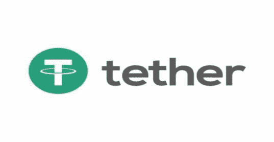

### 5. Cardano (ADA)

Cardano 及其加密货币 ADA 在加密市场中日益受欢迎。该交易所是一个去中心化的、基于权益证明且技术驱动的平台。由于该平台使用智能合约，你可以像监控比特币一样监控交易，并像以太坊一样处理支付。

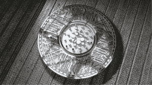

### 6. Celsius (CEL)

这是一个具有成为银行潜力的加密货币。在 2018 年完成了筹集 2000 万美元的成功众筹活动后，该币在 2020 年飙升增长，获得了令人印象深刻的收益。

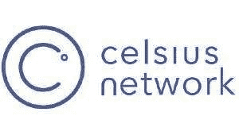

### 7. Dogecoin (DOGE)

狗狗币的市值达 70 亿美元，它经历了重重挑战，成为市场上最流行的币之一。用户对其区块链完成交易的速度赞赞有加，而且该币注将达到更高的高度。

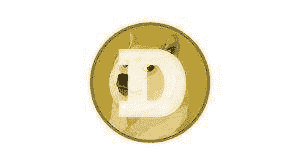

### 8. Monero (XMR)

Monero 以其隐私性闻名：其他区块链是公共账本，而它拥有一个更不透明的处理系统。如果你注重加密货币的隐私，发送者和接收者的身份是匿名的，那么你会喜欢使用 Monero。

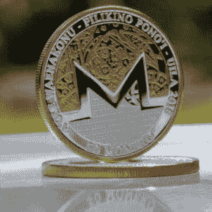

### 9. Tron (TRX)

波是一个去中心化系统，其货币 TRX 在市场上表现良好。凭借超过 1700 万个账户和 14 亿次完成的交易，波被描述为增长最快的加密货币和公链之一。

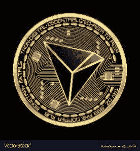

### 10. Zcash (ZEC)

Zcash 也以其机密性和基于隐私的系统闻名，它为用户提供两个地址。第一个地址是公开可见的透明地址，第二个地址是私密的屏蔽地址。该币的市值超过 10 亿美元。

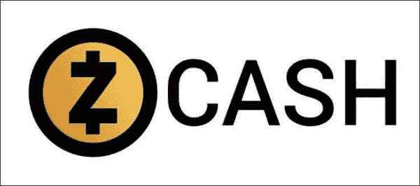

请注意，这些币并没有按照特定顺序排列。加密货币市场也高度波动，这意味着根据其涨跌情况，某种币今天可能位列前十，明天就消失了。

比特币目前处于市场顶端，并将保持这种状态很长时间，但上述货币在市场多元化方面也表现出色。虽然建议购买比特币，但也再次与这些货币进行交易：通过与它们交易，你可以降低投资风险并享受其他货币提供的价值。

想象一下将所有的加密货币投资都只放在一种币上？当这种币在市场中崩盘时会发生什么？只交易一种币绝不是明智之举！现在，让我们通过分析一些市场顶级交易所来讨论加密货币交易所是如何工作的。

# 不同交易所是如何运作的

我们刚刚讨论了加密货币交易所是如何工作的。现在我们将分析一些市场顶级交易所。

## 1. Coinbase

Coinbase 是一个非常流行的交易所，成立于 2012 年。它非常安全且具有许多功能。

### 优点

- 它是一个安全的平台。
- 它有一个良好的用户界面。
- 它提供高级功能。

### 缺点

- 它们收取的费用高。
- 它不支持所有的加密货币。
- 美国 Coinbase 的交易对比其他平台少。

## 2. Cash App

Cash App 是一种允许用户交易比特币的银行。它非常棒，因为它提供了许多支付方式。

### 优点

- 它提供点对点转账。
- 用户可以提取比特币。
- 它有一个简单的界面。

### 缺点

- 该平台仅支持某些加密货币。
- 它对交易收取费用。
- 比特有提现限制。

## 3. Binance

币安成立于 2017 年，专注于山寨币交易。当你使用币安的原生加密货币 `BNB` 时，费用会降低。

### 优点

- 有多种加密货币和交易对。
- 它的费用比其他交易所低。
- 它提供高级图表功能。

### 缺点

- 美国的大约 22 个州（包括纽约州）不支持币安的支持。
- 该平台对用户更友好。
- 它的交易对比国际交易所少。

## 4. Bisq

Bisq 是一个无论用户的国籍或位置都可以访问的交易所，无需身份识别。在该平台的交易费用可用 `BTC` 或 `BSQ` 支付。

### 优点

- 它是一个去中心化平台。
- 它有许多支付选项（包括 Zelle）。
- 它有适用于 Android 和 iOS 的移动应用程序。

### 缺点

- 该平台并非为活跃交易设计。
- 交易量有时较低。
- 交易速度取决于支付方式，可能会缓慢。

## 5. EToro

EToro 是最流行加密货币的首选。它是一个多资产平台，你可以在这里交易股票。

### 优点

- 它是一个多资产平台，你可以交易股票。
- 你可以和专家一起投资并复制顶级交易员。
- 股票 0 佣金且交易费具有竞争力。

### 缺点

- 客户服务可以改进。
- 非交易费用较高。
- 身份验证过程缓慢。

总而言之，所有加密用户最首要的问题都是：安全！无论一个交易所拥有多么华丽且功能多样，如果平台不安全，用户就不会信任与其进行交易。没有人希望因为交易所的疏忽而亏钱，这就是为什么你应该确保自己坚持使用`BEST platform`。

安全不仅关乎你使用的交易所，也关乎你使用的钱包。你的比特币有多安全？确保钱包安全的步骤有哪些？我们将在下一章中提供这些问题以及更多问题的答案。

# 比特币安全

你在现实生活中能保护好实体钱包免受盗窃吗？嗯，我们每个人都必须这样做；毕竟，我们不希望最后以钱包丢失或被盗而终场。就像你保护自己的实体钱包安全一样，你也需要确保你的比特币钱包安全。加密货币最令人兴奋的特征之一就是你可以完全掌控自己的资金，并可以在任何地方完成交易。

随这些独特特性而来的是严重的安全威胁，未受保护的比特币钱包将很容易受到攻击。本章将深入介绍如何确保你的比特币获得最大程度的安全性，使你在交易和投资时不会面临风险。

## 留意在线服务

尽管所有的交易所和在线钱包公司都向用户保证其平台是安全的，但其中一些在过去曾遭受安全泄露。是的，信任服务提供商是可以的，但在使用这些服务时也应该保持警惕。采取所有必要的安全措施，更新你的应用程序，并警惕可疑链接。

日常交易使用小额金额。将`你所有的比特币都放在一个钱包里`是不安全的：准备一个单独的钱包用于存放较小数量的币进行日常交易。此外，在手机和电脑上只保留少量硬币进行日常交易也是安全的。较大的金额应该保存在离线钱包中。

## 始终备份你的钱包

备份过的钱包可以保护你免受公司突然倒闭或崩溃的影响，这些可能会让你的硬币面临风险。有些人遇到了电脑故障，因为他们没有备份钱包，结果失去了一切。备份钱包也至关重要，因为它能帮助你在电脑被盗时，依然保持钱包的加密和安全状态。

## 使用双重身份验证

大多数在线钱包都提供这项服务，你必须在所有合作的平台上（从交易所到钱包服务）都使用它。

双重身份验证的过程简单且有效。

## 加密你的钱包

这项安全措施非常重要！如果你在智能手机上加密钱包将大有帮助，而且这个过程允许你为提现设置密码。

这个过程也保护你的钱包免受小偷侵害。以下是加密的一些关键点：

- 当你在手机上加密钱包时，你将与密码打道道，请不要忘记你的密码。与传统银行不同，加密货币的密码找回选项有限。这一事实解释了为什么在安全保险箱中保留一份密码的私密纸质副本是关重要的。

- 始终使用`STRONG passwords`，不要使用只包含字母或易于识别单词的密码。

一个强密码应该包含字母、标点符号、数字，并且长度`至少为 16 个字符`。强密码也很难记忆，所以请尝试记住它们并妥善保管。

## 使用离线钱包进行储蓄

离线钱包也被称为“冷存储”（Cold Storage）；它们为比特币储蓄提供了最高形式的安全。通过冷存储，你将钱包存储在一个安全的地方，该地方`没有连接到互联网`，如果你操作得当，你的电脑将免受漏洞的影响。

使用离线钱包进行储蓄有两种方案：

### 离线交易签名

这一过程涉及拥有两台电脑，它们共享同一个钱包的某些部分。其中一台断开任何网络连接，持有整个钱包并可以签署交易；而另一台连接到网络，并拥有一个监控钱包，只创建未签名的交易。

由于连接到网络的电脑无法签署交易，即使它被攻破也无法提取资金。只需在在线电脑上创建一个新交易并保存到`USB key`上。然后在在线电脑上对交易签名，并在在线电脑上完成整个交易的签名。

### 硬件钱包

硬件钱包在极高安全性和易用性之间提供了最佳平衡。极少数设备没有互联网连接，这意味着你的硬币将免受网络盗窃。你可以开启备份功能并在该设备上恢复资金。

## 保持你的软件更新

如果你使用最新版本的比特币软件，将获得高度保护，因为这些版本自带了更新的安全补丁。更新还能保护你免受旧版本可能存在的各种问题，所以当屏幕上弹出“更新”时，不要忘记点击。

## 使用安全的互联网连接

有时比特币用户会通过受损的互联网连接遇到安全问题，这在公共域和公共网络中很常见。如果你通过笔记本电脑访问比特币钱包，请使用手机热点而不是公共 Wi-Fi 服务。每次访问钱包时，请使用你的个人且信任的连接。

## 不要访问未知或可疑的链接

在线进行比特币交易既快速高效但也存在风险，所以你在接受和打开链接时应该小心。始终检查你在线上使用的网站，因为网络骗子正在向毫无防备的比特币用户发送欺诈链接。在使用比特币详情登录之前，请验证所有网站，并留意提示你提供交易信息的诈骗邮件。如果你不信任一个链接，就不要打开。

## 不要交出你的私钥

你的钱包私钥仅供自己查看，你不应该与任何人共享。

如果其他人获得了你的密钥并获得了对你币的访问权限，你可能会永远失去它们。在在线进行比特币交易时，忽略所有要求你向第三方共享私钥的请求。

你投入了大量的时间、资源和精力来学习比特币以及如何最大化加密货币，因此了解如何保护你的投资也是明智之举。脆弱的投资是你随时可能失去的资产，而这就是比特币的挑战：一旦丢失，就永远丢失了。

通过上述步骤，你可以确保钱包安全，并在交易和投资加密货币时受到保护。现在让我们来谈谈趋势！下一章涵盖了你了解加密货币趋势所需知识。

# 加密世界中趋势趋势？

加密货币投资者，你必须紧密关注市场动态，以便更容易做出明智的决策。加密货币世界的趋势随着加密货币的逐年演变而变化；因此，在 2018 年流行且可获得的物品，在 2021 年可能不再可行。

精明的投资者理解趋势对他们投资成败的影响，这就是为什么他们像你现在这样做一样密切关注的原因。所以，这些是本季的顶级加密趋势：

## 稳定币的季节

由于新冠肺炎以及人们对数字经济力量的认识，2020 年加密市场中稳定币的数量增加了 500%。趋势显示，一些已经存在的代币将变成稳定币，以满足投资者寻求投资组合多元化的需求。

## 更多 IPO

`Coinbase` 已经在通过其雄心勃勃的上市项目。对于加密货币公司来说，上市是一件大事，随着`Coinbase`的引领，其他加密品牌也将效效仿。

### 以太坊大意义的一年

与比特币一样，以太坊正在崛起，其代币`ETH`已成为全球第二大加密货币。以太坊曾达到每币 1,432 美元的高点，预测随着比特币价值增长，它将跳跃至 2,000 美元甚至 9,000 美元。现在是买入并持有以太坊的好时机，同时密切关注市场。

### 中国正处于中心位置

过去一年，中国一直在致力于数字人民币，已有几项试点进行中。该国表示乐观，其数字货币将及时在 2022 年北京冬奥会期间推出。这一趋势使中国成为关注焦点，因为一种国家采用的数字货币将在全球范围内震撼加密货币市场。

### 随着比特币上涨，对 Ripple 来说可能是糟糕的一年

`Ripple` 曾是次于以太坊和比特币的领先加密货币之一。然而，在美国证券交易委员会对其提起诉讼后，其代币在市场表现开始不佳。

因此，加密货币市场的趋势之一是`Ripple`的挣扎，这也是为什么一些投资者尚未在该代币上押注的原因。当然，这并不意味着该硬币永远不会再次上涨（趋势会变化），但目前它看起来没有太大的前景。

### 我们将感受到 PayPal 的存在

`PayPal` 在美国推出了其加密服务，允许买卖比特币、以太坊、莱币和比特币现金。研究显示，20% 的`PayPal`用户已经使用了其加密功能，这意味着`PayPal`将成为加密货币交易者和投资者的支付关之一。其他国际支付公司将随其后，从而对整个加密货币行业引起冲击。

## 加密货币项目

加密货币项目也被区块链项目，这些是加密投资者在投资时产生影响的机会。虽然有许多加密项目通过 ICO 出生，但并非所有项目都是合法的，因此在加入某个项目之前，请记住考虑这两点：合法性与影响力！

以下是 2020 年影响力相当的前五个加密货币项目：

### Brave 浏览器

`Brave` 浏览器旨在通过提供最安全的浏览器体验并停止在线监控来确保人们的安全并保护他们的隐私和安全。你可以通过他们的“Brave 奖励”功能赚取代币，并将代币用于礼品卡、高级内容和许多其他物品。

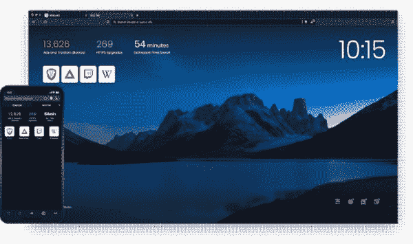

### AidCoin

通过`AidCoin`，网站可以通过任何加密货币通过小组件接受捐赠。提供的资金被转换为`AID`代币（这是一种稳定币），并资助慈善项目。

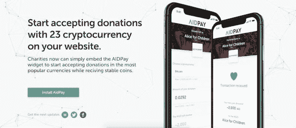

### Power Ledger

`Power Ledger` 也是一个著名的加密货币项目，旨在通过关注再生能源来颠覆能源领域。该软件实现了三个主要功能：

1. 能源交易允许用户使用`Power Ledger`将其太阳能电池板的剩余能量出售给邻居。

2. 可再生资产所有权让无法获得自身可再生能源的人可以投资碎片所有权。

3. 环境商品交易帮助你追踪你的可再生能源额度。

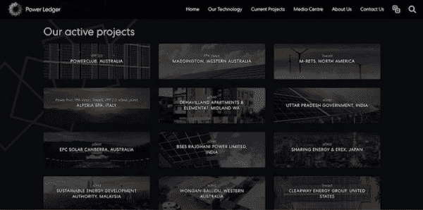

### 币安慈善

币安是全球领先的加密货币交易所，准备通过其加密货币项目“币安慈善”产生影响。通过币安慈善，平台会将投资者为慈善事业捐赠的 100% 加密货币捐赠出去。

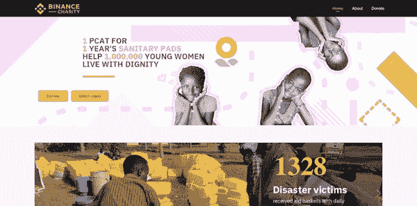

### KARMA App

`KARMA App` 于 2019 年出现，提供一个去中心化的社交网络，激励用户行善。用户还鼓励在网上记录他们所做的善事，在世界上创造积极的强化浪潮。

该应用已获得相当多的用户，并一度成为区块链上最常用的加密应用。通过在应用上发布，查看者可以赚取加密货币：这创造了一个子经济，发展中国家的加密投资者从中获得额外的收入。

加密货币趋势就像指南针，帮助投资者导航加密货币市场。虽然并非所有趋势都是 100% 准确的，但它们提供了一条路径，并对我们在特定加密季节预期提供了见解。你可以通过订阅加密公司和交易所的新通讯、加入社交媒体上的加密货币群、关注新闻以及听取专家意见来保持更新。

不要忘记持续参与市场，因为你可以依靠的最佳趋势是在你在加密货币市场进行投资和交易时观察到的。下次，我们将讨论如何利用比特币挖矿来获得更多加密货币。

# 比特币挖矿的概念

我们仍在探索投资和最大化加密货币的方法，以便你可以获利，而挖矿就是此类投资途径之一。加密货币挖矿吸引了投资者，因为作为矿工，他们的工作获得了加密代币奖励。当你考虑挖矿时，请将其视为一种涉及加密货币的创业体验，带有风险和回报。

加密挖矿指的是用户之间的交易如何被验证并添加到区块链（公共账本）中。挖矿过程负责向加密货币市场引入新币，使硬币持续供应。

加密货币的基本特征之一是它们的去中心化点对点网络，这使得系统可以在没有重大第三方的情况下运行。

为了让这个点对点过程有效运行，必须启用挖矿，这样矿工才能获得系统的进步奖励。比特币是最流行的币，因此它是最“可挖矿”的币，因为并非所有货币都可以被挖矿。那么它是如何工作的？

作为矿工，你作为审计员获得报酬，因为你的职责涉及验证合法的比特币交易。这一过程旨在确保比特币用户是诚实的，它由比特币的创始人中本·纳科托创立。矿工防止双花费问题，并帮助比特币用户增加对系统的信任。

双花费发生在比特币所有者两次花费同一枚比特币时。对于法币来说这不是问题，因为如果你用一张 5 美元钞买冰淇淋，你不能再次使用同一张钞。

但对于数字货币，存在潜在风险，所有者可以制作数字代币的副本，并在保留原始版本的同时与另一方交易。

然而，矿工会检查交易以确保用户不会尝试两次花费同一枚比特币。在矿工验证了比特币交易（称为“区块”）后，他们将获得数量的比特币作为奖励。

但只有当矿工验证了高达 1MB（兆字节）的比特币交易时，才能获得奖励。

这一实现意味着并不是每个矿工都能获得奖励，因为比特币创始人将标记设定为 1MB。在矿工获得比特币之前，必须完成两个条件：

- 你必须验证了价值 1MB 的交易。

- 你必须是第一个获得某个数字问题正确答案或最接近答案的人，这个过程被称为“工作量证明”。

### 矿池

有时两个竞争的矿工可能会同时广播有效区块，由于只有一人能获得奖励，他们将开始挖掘区块集以确定谁获胜。解决问题的概率等于网络总算力的份额。

因此，算力占比较小的矿工发现下一个区块的机会非常有限。为了给这些矿工提供优势，矿池应运生，使得矿工能够更容易汇总资源并在单一网络上共享处理能力。然后，矿工根据他们为寻找区块所贡献的工作量，与池内的所有人平均分配奖励。

## 比特币矿工能赚多少钱？

2009 年比特币首次被挖出时，矿工因成功挖出比特币获得了 50 BTC。2012 年，该奖励减半，使得当年的矿工赚了 25 BTC；2016 年，该金额再次减半，变为 12.5 BTC。2020 年 5 月，奖励调整为 6.25 BTC。

2020 年 11 月，比特币价格飙升至每枚 17,900 美元的位值，这意味着如果你在 2020 年 5 月进行挖矿，你可能赚了高达 111,875 美元。随着比特币价值的增加，即使奖励减少，矿工也将不断赚得更多，因为现在比特币已经上涨到 50,000 美元，现在想想如果你是一个矿工，你会赚多少钱。

## 如何成为比特币矿工

### 第一步：获取比特币挖矿硬件

如果你能获得一台矿机来开始，将会很有帮助，因为这是用于挖掘比特币或其他加密货币的特殊硬件。这种设备被称为`Application-Specific Integrated Circuit Chips`（`ASIC`），它挖掘比特币的速度更快、能耗更低、非常强大且价格昂贵。

在购买矿机之前，请考虑以下因素：

- 价格（比较价格）。

- 哈希性能率和尝试破解区块的能力。

- 耗电量。

在根据性能而非价格进行选择之前，阅读不同矿工的评论将会有帮助。

请注意，由于需求巨大，获取这种矿机非常困难。

在购买之前，你也可以查看`ASIC WEB PAGE`获取有关新矿机的详细信息。

### 第二步：获取你的比特币钱包

接下来，你需要设置一个比特币钱包来接收你的比特币并管理你的地址。作为一名新手矿工，你应该使用软件钱包，因为它易于操作、下载方便且安全。

你也可以使用诸如`BITCOIN CORE`这样的完整版钱包，它可以帮助你确定包含合法交易的区块链。

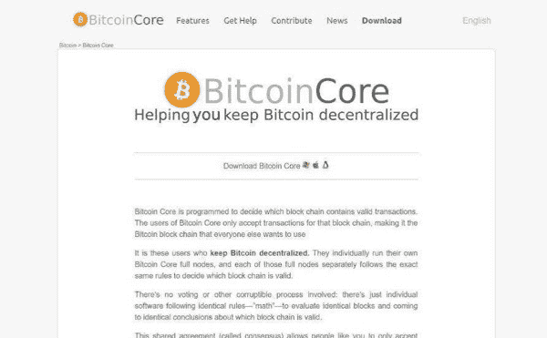

图：源自 Master Data in Motion 的 Bitcoin Core 图像

### 第三步：加入矿池

即使你拥有最好的挖矿硬件，你仍然需要加入矿池，因为单台硬件无法与全球其他矿工孤立竞争。当你进入矿池时，解决数学问题和更快挖矿的概率更高，然后你将与池中的其他人共享奖励。

你可以找到适合初学者的不同比特币矿池，如果你不确定加入哪一个，请访问`BITCOIN WIKI`查看可靠的矿池。选择好矿池后，在网站上注册并设置账户，然后等待你的“工人 ID”。

### 第四步：获取挖矿程序

获取硬件、比特币钱包并加入矿池后，你必须为电脑获取一个挖矿客户端。挖矿客户端（挖矿软件）将你连接到区块链和比特币网络，同时向矿工派发任务并收集他们工作的完整结果。然后完整信息会被添加到区块链中。

有很多免费的比特币挖矿程序，有些矿池也有自己的软件。在使用任何软件之前，请查阅它们的优缺点。

### 第五步：你现在可以挖矿了！

现在你准备好挖掘比特币了。将你的矿机硬件连接到电源，将其与电脑连接并安装软件。填写所有关于你的钱包和你加入的矿池的信息，然后选择一个设备并开始挖矿。

要成为一名成功的矿工，你必须关注加密货币新闻，因为市场瞬息万变，你始终需要知道发生了什么。

获取额外的比特币有多种方法，挖矿就是其中一种过程，在保持比特币系统活跃的同时奖励矿工。本章提供了你理解挖矿工作原理、收益以及如何开始所需的所有信息。

请记住，作为一份实用指南，你应当遵循书中分享的步骤和方法。从挖矿世界，我们将进入本书的最后一章，将将考虑比特币的未来。

## 经纪商

### 总结所介绍的理念……目前最好的经纪商是

**eToro 是非常适合新手和半专业投资者的经纪商。**过程非常简单，只需向你的账户存入美元，然后选择你想要购买的加密货币。购买后，你可以在投资组合标签页中查看你的资产，从那里你可以跟踪价值变化并在需要时卖出。这个简单的系统对于想要购买少量范围加密货币并采取长期策略的人来说是理想的。然而，由于交易对数量和实时数据的限制，如果你想进行严肃的日内交易，它就并不是理想的。如果你想尝试一些娱乐性交易，那么`etoro`是一个不错的选择，但当需要扩大交易规模时会有更好的选择。

**eToro 确实有一个酷炫的功能，允许你完全复制热门交易者的操作，这意味着你可以自动化你的投资策略。eToro 的社区也增加了许多价值，你的新闻动态将充满来自不同交易者的有趣帖子，他们分享了对市场运动的观察和预测。

你的资金在`eToro`将享有高水平的安全，它们不仅在美国受监管，而且是跨国公司。`eToro`的费用取决于资产，但通常具有竞争力。`eToro`提供演示账户，你可以在其中用虚拟资金测试决定，这是一个很棒的功能。

- **轻松存入美元**并立即购买加密货币。设计简单。

- **使用跟单过滤系统**寻找要复制的投资者组合。你可以匹配符合你理想投资回报率、风险承受能力和复制人数的组合。

- **服务 14 种加密货币**，你可以通过信用卡、银行转账或 PayPal 购买。

- **有帮助的演示账户培训功能**

[访问 eToro](https://med.etoro.com/aw.aspx?A=101127&Task=Click&TargetURL=https%3A%2F%2Fwww.etoro.com%2Fcrypto%2Ftrading-platform%2F&SubAffiliateID=)

[阅读我们的 etoroor](https://marketplacefairness.org/brokers/etoro/)

### 最安全的经纪商：Gemini

`Gemini` 由温克维斯兄弟于 2014 年创立，是最安全的加密经纪商。它受纽约州金融服务局（`NYDFS`）监管，其美元享有`FDIC`保护。他们一直将安全视为首要任务，这使其成为一个人们信任资金安全的受欢迎经纪商。`Gemini`提供了便捷的购买；你可以通过美元直接购买加密货币，美元可以通过`ACH`、电汇或借记卡存入。

- **安全优先理念**意味着对监管和合规性的高度关注；您的资金非常安全，并有保险覆盖。

- **提供 50 多种**[加密货币](https://marketplacefairness.org/cryptocurrency/best-broker/javascript%3Avoid\(0\))，您可以使用银行转账（`ACH`）、电汇转账或借记卡使用美元和其他其他流行法币进行购买。

针对加密货币被盗提供**保险覆盖**。

**免费的法币**提现以及每月十次免费的加密货币提现。

[访问 Gemini](https://gemini.sjv.io/z6EGG)

[阅读我们的完整测评](https://marketplacefairness.org/cryptocurrency/gemini-review/)

## 军最佳经纪商：Coinbase

Coinbase 是美国最大的加密货币交易所，为其 6800 万用户提供 70 多种加密货币。[Coinbase](https://coinbase-consumer-sjv.io/c/2392168/830078/9251) 成为最受欢迎经纪商之一的特征包括易于使用的平台、便捷的注册、多种存款选项以及针对网络安全漏洞的犯罪保险覆盖。众 own Coinbase 的费用比某些竞争对手高，但作为回报，您获得了易用性、先进的安全功能以及保险覆盖带来的安心感。

费用：`0.5% - 4.5%`，视交易类型而异。

- **Coinbase 私人**为其平台投了保险，因此在发生黑客攻击时您的资金是安全的。
- **提供**对 70 多种加密货币的访问权限。
- **存款方式**：银行转账 (ACH)、信用卡、借记卡、银行转账 (SEPA)、电汇转账。
- **旨在让**加密货币购买尽可能简单。

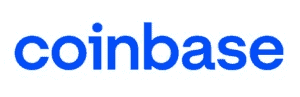

[访问 Coinbase](https://coinbase-consumer-sjv.io/c/2392168/830078/9251)

[阅读我们的完整测评](https://marketplacefairness.org/cryptocurrency/coinbase-review/)

## 速度与便捷性最佳经纪商：Coinmama

Coinmama 非常适合那些想要快速方便地购买比特币的人。他们确实收取高额费用 (5.5%)，但没有提现费，这很好。他们提供所有最流行的加密货币，在全球范围内拥有数十万满意的客户。由于他们的速度和便利性，尽管费用和缺乏 App 令人失望，我们将 [Coinmama](https://go.coinmama.com/visit/?bta=63642&brand=coinmama) 排在第三位。

- 提供五种不同法币的**支付选项**。
- **为 200 多万客户提供**10 种加密货币。
- **无提现费**。
- **存款方式**：信用卡、借记卡、银行转账 (SEPA)、SWIFT、电汇转账。

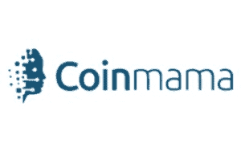

[访问 Coinmama](https://go.coinmama.com/visit/?bta=63642&brand=coinmama)

[阅读我们的完整测评](https://marketplacefairness.org/cryptocurrency/coinmama-review/)

## 加密货币经纪商与交易所之间的区别

- **加密货币经纪商**是充当加密货币市场与其客户之间中间人的个人或实体，以促进加密货币的买卖。
- **加密货币经纪商**按其设定的价格提供加密货币的买卖服务。
- **加密货币交易所**为买卖双方提供在线平台，让他们根据当前市场价格相互交易加密货币，他们通过收取交易费来盈利。

### Iq Option

Iq Option 是初学者最常用的比特币经纪商之一。它提供了一个特别简单且直观的平台，每个人都可以顺利地使用。它也是唯一允许您仅需 10 欧元的最低存款即可的比特币经纪商。其他经纪商通常要求在 100 到 250 欧元之间存款。

Iq Option 还提供了一个大型教育板块，其中有数百门高质量的视频课程免费提供。这些课程大部分大部分针对比特币（或新兴加密货币交易），但也有许多针对交易原则和策略的课程。

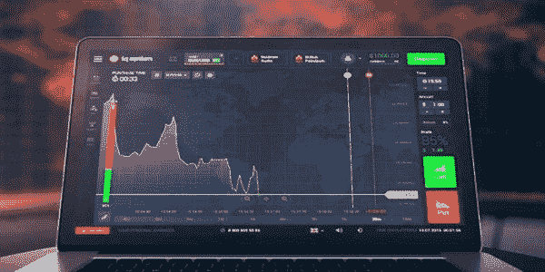

Iq Option 还提供演示模式：演示是免费且无限制的，不受任何限制。

### Plus500

Plus500（点击此处打开免费演示账户）是长期以来最好的比特币经纪商之一，是一个全球知名并因其易用性而受到青的平台。

交易者可以免费注册，您只需要存最低 100 欧元。选择该经纪商的人可以交易比特币，以及其他资产，如国际股票、货币、指数和 ETF。

该经纪商在比特币交易方面毫无疑问的优势是可以开设演示账户。这意味着您可以在不使用真实资金的情况下进行练习，或者在熟悉之后切换到实际账户。

点击此处在 Plus500 注册。

## 通过经纪商进行加密货币交易

通过经纪商进行比特币交易的交易者必须首先选择符合其独特需求的经纪商。这涉及到对经纪商的评估。

评估经纪商时，必须考虑多种因素，如监管、资产范围、账户类型及其功能、费用和佣金、存款。

选择经纪商时，重要的是选择受信誉良好的机构的经纪商，这确保了安全性。

- 提供的加密货币对。
- 提供的货币种类。
- 可访问且可靠的支付方式，包括传统方式和在线支付。
- 平台的质量和易用性及其功能。
- 客户支持的水平和质量，以及及时性、信息深度等。

## 通过交易所进行加密货币交易

考虑到没有单一或官方的交易所可以进行比特币的交易、交换、买卖，有很多交易所可以使用。

在评估交易所时，交易者和投资者需要考虑以下关键因素：

- 流动性以及市场的深度必须足够。这确保了订单可以成交，并减少了可能出现导致重大损失的快速下跌的可能性。
- 交易所收取的费用。这些费用需要足够低，以便交易者能够在波动中退出交易并获得利润。
- 交易所所在地以及是否允许法币存款。这很重要，因为它允许交易者使用当地货币存款资金，也便于提现。
- 监管和信任——交易所大多不受监管。这并不意味着它们不可信。交易者需要彻底评估交易所的历史。

## 比特币在哪些方面优于传统支付方式

比特币的一个特点是可以作为支付方式。因此，评估比特币与其他支付方式相比是非常重要的。

比特币变得日益流行，与其他支付方式相比，比特币具有以下优点和优势：

- 比特钱包之间的交易与个人银行账户无关，这使得身份盗用等行为难以发生。
- 任何人都可以使用比特币，而且涉及的账户验证不像经纪商那样严格。
- 比特币账户既无法被没收也无法关闭；用户是唯一对其拥有控制权的人。
- 使用比特币时，用户的隐私得到了极大增强。
- 比特币传输可以立即完成，而银行转账可能需要数几天。
- 比特币没有国界。它可以在世界上任何地方进行发送和接收。
- 它并不像使用银行转账那样涉及巨额费用。
- 访问不受限制，用户可以从世界任何地方完全控制自己的资金。
- 涉及最大或最小交易金额的限制非常少。
- 购买是匿名的，用户的姓名与交易没有关联。
- 商户也可以放心，因为交易一旦处理完成就无法撤销，这消除了[对信用卡退单的担忧。](https://bestonlinebitcoinbrokers.com)

[在线比特币经纪 (BEST ON LINE BITCOIN BROKERS)](https://bestonlinebitcoinbrokers.com)

[术语表](https://coinmarketcap.com/alexandria/glossary)

21

# 比特币的未来

通过我们目前所学的所有知识，你一定对比特币的未来感到好奇。你可能在想它在未来是否仍然具有相关性，以及今天进行某项值得的投资是否在未来将具有价值。在最后一章中，我们将考虑加密货币领域专家对未来可能发生的事情的一些预测。

正如本材料中所提到的，加密货币具有高度波动性，这意味着没有人能给你一个关于预期的确定图景。从开始我们就必须坚持这一事实，以便在交易和投资时保持警惕：市场可能会飙升到最高，也可能低于你的预期。精明的投资者通过在期待最好的同时为最坏的情况做好准备来保持就。

然而，通过对今日比特币特性的观察、分析和专家见解，我们可以分享比特币未来的某些可能性。这些是世界顶级比特币专家的预测，我们同意他们的分析，因为有一点是肯定的：比特币未来将保持相关性。

比特币可能面临一系列监管威胁。尽管比特币将上涨并作为投资者的首选货币而日益突出，监管威胁也可能扼杀它。寻求保护其法币免受加密货币影响的国家将制定各种法律来抑制加密货币的持续使用。

尼日利亚和印度等国家已经在打击比特币，一个大问题是：“如果世界上其他地方也效仿怎么办？”大多数专家认为，答案在于世界是流动的，在其他国家使用比特币开展业务是很容易的。

虽然专家坚持禁止和监管将是有效的，但你应该知道，在禁止比特币的国家，规则可能会限制使用比特币投资的便利性。请注意你居住国关于加密货币的颁布法律，因为这将作为你投资的指南。

## 更多企业（在线和线下）将接受比特币作为支付网关

根据加密货币领域目前的现状，这一预测是更大比例的比特币和加密货币专家所认可的。随着用户数量的增加，越来越多的企业将开始接受比特币作为支付网关。

供需法则将这一预测在未来变为：对比特币的需求将飙升，而供应将通过销售、购买和交易来实现。

## 比特币可能成为全球货币

一些专家认为比特币将成为全球货币，但预计比特币将演变未来。

## 比特币和法币将并行使用

这一预测非常有趣，因为我们已经在并肩使用了。商户也可以放心，因为交易一旦处理完成就无法撤销，这消除了担忧。

## 威胁和安全性的增加

尽管难以被黑客具有确定性，但比特币仍然是未来，因此专家警告持有者保持其钱包安全。

另一方面，随着威胁的增加，比特币的安全性将加强。现在我们有双因子认证，但会有更稳健的安全措施来降低风险。

## 新用户和风险资金

随着新冠肺炎疫情，比特币市场见证了新用户的涌入，以实现其价值。机构投资者重新投资了比特币。

尽管金融市场存在不确定性，比特币被评为“对冲工具”，未来可能保持现状以实现投资多元化。

## 国际贸易的首选货币？

一些专家预测加密货币将成为国际贸易的首选货币，而比特币处于这一预期的核心。PayPal(`PYPL`)和特斯拉(`TSLA`)已经对加密货币进行了投资，特斯拉购买了 15 亿美元的比特币。

随着特斯拉和 PayPal 采取此类举措，可以安全预测人们可以通过 PayPal 获取报酬或接收资金。特斯拉执行官埃隆·马斯克也并未排除接受比特币付款的可能性。

比特币是安全的，交易时间非常快，可以在任何拥有加密货币的国家被接受。如果各国不能跟上监管威胁，比特币将蓬勃发展，它可能成为未来。

比特币的未来无疑是非常光明的。尽管对于投资者和交易者来说可能会有波折，但这不会改变比特币正在成为我们金融现实一部分的事实。

# 常见问题

**什么是比特币？**

比特币是一种数字货币，是世界上第一此类货币。

**谁创建了比特币？**

该概念的官方规范和证明由中本聪聪于 2009 年发布，尽管大卫链（Wei Dai）早在 1998 年在密码朋克邮件列表上首次描述了加密货币的概念。

## 谁控制比特币网络？

没有单一实体控制着比特币网络。比特币合法吗？在大多数司法管辖区，没有禁止比特币的法律，但某些司法管辖区对外国货币有严格限制，或者在这些管辖区内被禁止。

## 比特币可以监管吗？

由于其去中心化的本质，比特币本身无法被监管。

然而，许多提供加密货币交易的经纪商都经过监管和授权，一些交易所可能受到监管，或者至少在相关机构获得了许可或注册。

## 我能通过比特币赚钱吗？

比特币不是一种在短时间内赚取巨款的方法。它确实允许获得利润，但仍然存在风险，可能导致重大损失。

## 比特币的使用和交易安全吗？

是的，但必须考虑的是其安全程度取决于各种因素，尽管采用了许多安全功能，但在涉及在线活动时，仍然存在与网络安全威胁相关的持续风险。

## 如果我丢失了比特币会怎样？

当比特币丢失时，它们仍然留在区块链上，但它们将永远处于休眠状态，因为没有办法找到私钥或多个私钥来允许硬币再次被花费。

做得好！！你在阅读这本实用指南方面表现出色，这证明了你致力于最大化加密货币经济力量的决心。我们学习了如何购买比特币，理解了交易所的运作方式，并揭示了比特币安全的见解。

我们还考虑了加密货币市场的当前趋势以及挖矿的概念，并对比特币的未来想法进行了总结。你拥有了一套带图片指导的完整实用指南包，借此，你可以自信地进入加密货币市场准备好获胜。无论金融行业未来发生如何，有一点是肯定的：加密货币将一直存在下去。

通过这些材料我们取得了一个巨大的里程碑，但这仅仅是一个开始，因为你现在知道了比特币具备的潜力，你还需要采取行动。知道该做什么是好的，但付诸行动并坚持下去直到你获得的结果会更好。

有些人读到书的“结论”部分时会觉得：“噢是的，我们已经到结尾了，所以现在可以放下这本书去读下一本了。”

对你读的每一本书都这样做意味着你对许多不同的机会“知道”很多，但结果很少。你一路走到这里不是为了现在获得很少的结果，对吧？你读了第一本书，现在这本显示了你利用数字货币趋势并从中发财的意愿。

你的阅读和学习努力应该与你对所获得信息采取行动的决心相匹配：这是你获得真实价值。

加密货币市场将不断演变，这意味着那些从中获利的人会密切关注市场。

只有当你积极参与你的加密货币时，你才能保持接近市场：交易、买入、卖出、投资、持有等。今天，有很多人知道加密货币的潜力，但这个比例远比从市场中获利的人要大得多。

虽然我对你坚持阅读的决心表示赞赏，但我还想把这个结论部分作为一个行动的号召，提醒你你将学到的最重要的教训来自于在市场中活跃。

加密货币市场仍然是一个波动巨大的市场（这是一个残酷的事实，但你必须接受它）。所以，你有时会赢，有时会输；这都是过程的一部分：但有一点是肯定的，你将会学习！随着你的学习，你将习惯投资过程；你将更理解市场，了解交易所的运作方式，甚至预测趋势。

保持积极、专注并致力于了解更多关于加密货币的知识，你永远不会落在。记住你在上面的章节和节中中学的所有内容，用闲资金进入市场进行实践，并逐渐建立加密货币投资组合。

感谢

Helene Kiiker

# 关于作者

Helene Kiiker 致力于通过比特币和加密货币帮助个人、品牌获得成功和财富。她是一位独立的成功的商人，在投资和个人财务领域拥有十年经验。她曾与全球成功的组织合作，培训他们关于投资以及如何在业务中获利。

她的目标是帮助并教育人们财务状况以及他们如何通过投资获得突破。考虑到以最低成本为大量服务的最佳方式，她决定写一本书揭示加密货币交易和盈利秘密的书。Helene Kiiker 的《加密货币基础》适用于初学者以及任何对比特币和其他加密货币交易感兴趣的人。
