# 加密货币：概念、技术与应用


## 献辞

我将此书献给我的妹夫 Michael Zeide 博士，他鼓励我将加密货币作为一个新兴热门话题来写作。


## Taylor & Francis

Taylor & Francis Group

http://taylorandfrancis.com

Taylor & Francis Group
http://taylorandfrancis.com

Taylor & Francis Group
http://taylorandfrancis.com

## 前言

2012 年，《*福布斯*》杂志有一篇封面文章称，数据科学家是“21 世纪最性感的职业”。尽管数据科学多年来地位不断提升，对数据科学家的需求仍然超过数据科学人才的供给，但最近一位新的“热门”参与者进入市场，争夺这一新头衔。这位新参与者是“加密货币”或数字货币分析师。

近来我所读之内容无不涉及比特币、加密领域、加密货币、区块链、数字资产等。无论来源更侧重行业还是学术研究，加密货币领域显然正日益受到关注。

*《纽约时报》* 2022 年 3 月 24 日发表了一篇题为“进入加密区的时间到了吗？”的封面文章，文中提到机构投资者向数字代币投入数十亿，薪水以比特币发放，甚至连杂货店都设有比特币 ATM。诚然，我们看到加密货币经历过起伏，但它具有一种诱人的吸引力，诱使人们将加密货币纳入自己的投资组合。那些“加密货币好奇”的首批投资者通常熟悉科技/流行文化，并希望在这个快速变动的市场中稍作多元化投资。

即使是大学也开始开设更多课程并成立“加密货币中心”。有些大学甚至要求选修加密课程的学生用加密货币支付学费。

鉴于对加密行业及加密货币整体日益增长的兴趣和着迷，我认为现在是适当的时机，汇集众多全球领先的贡献者，编纂一本书，讨论与加密货币相关的概念、技术和问题。因此，我们涵盖了广泛的加密相关话题，包括区块链、NFT、数据分析与 AI、加密犯罪、加密行业、加密监管、期权、加密货币与公共选择、消费者信心、比特币等、加密研究挑战与机遇等。我们就加密行业的未来走向提出了各种观点，并指出了这一新兴领域的优势与局限性。

加密货币重要性的进一步证据体现在白宫正在制定加密货币政策方法上。2022 年 3 月 9 日，拜登总统签署了一项关于“确保数字资产负责任发展”的行政命令。截至 2022 年 3 月 25 日，欧盟也正顺利朝着通过管理由加密资产的里程碑式监管框架《加密资产市场（MiCA）》迈进。

因此，出版此书的时机已经成熟！我想感谢本书的杰出贡献者，以及评审人员和 Taylor & Francis 的所有人员提供的宝贵帮助，还要感谢 DerryField Publishing Services 的 Theron Shreve 和 Susan Culligan 在制作方面的帮助。此外，我还要感谢 Seton Hall University 和 Columbia University（我的新归属）允许我在探索这一新兴话题时进行创造性思考。当然，我的妻子和家人始终给予我精力与爱，让这一切变得值得！

Jay Liebowitz, D.Sc.
Executive-in-Residence for Public Service
Columbia University Data Science Institute


## 贡献者名单

Andrew M. Bailey
新加坡耶鲁-新加坡国立大学

Usman Waqqas Chohan
巴基斯坦航空与安全研究中心

Huijian Dong
美国新泽西城市大学商学院；美国哥伦比亚大学教师学院

Christopher Droussiots
美国塞顿霍尔大学

Hossein Hassani
伊朗德黑兰大学

Anthony Lovisek
美国塞顿霍尔大学

Peterson K. Ozili
尼日利亚中央银行，尼日利亚

Federico Paesano
意大利巴塞尔治理研究所

Lee Smales
澳大利亚西澳大学

Evrim Tan
比利时鲁汶大学

Arianna Trozze
英国伦敦大学学院

Stephan Unger
美国安塞尔姆学院

Craig Warmke
美国北伊利诺伊大学

David Waugh
美国经济研究所

Ryan Yonk
美国经济研究所

Taylor & Francis
Taylor & Francis Group
http://taylorandfrancis.com

## 关于编辑

Jay Liebowitz 博士是哥伦比亚大学数据科学研究院的公共服务驻院专家。此前，他曾任美国塞顿霍尔大学斯蒂尔曼商学院访问教授，以及 MS-商业分析结业课程与联合课程主任（对外关系）。他还曾担任美国哈里斯堡科技大学（HU）应用商业与金融杰出讲席教授。在加入 HU 之前，他曾任美国马里兰大学大学城分校（UMUC）研究生院奥尔坎德管理与技术讲席教授。

Liebowitz 博士曾任美国约翰斯霍普金斯大学凯里商学院正教授。他在全球 11,000 名知识管理研究人员/从业者中被评为前 10 名，并根据 2010 年 1 月《知识管理杂志》的排名，在全球知识管理战略方面位列第 2。在约翰斯霍普金斯大学期间，他是竞争情报研究生证书项目的创始项目主任，以及 MS-电信与商业信息系统项目的结业课程主任，在此期间他参与了工业、政府和非营利组织的 30 多个结业项目。

在加入约翰斯霍普金斯大学之前，Liebowitz 博士是美国宇航局戈达德空间飞行中心的首位知识管理官。在 NASA 之前，Liebowitz 博士曾任美国马里兰大学巴尔的摩分校信息系统罗伯特·W·多伊奇杰出讲席教授，乔治华盛顿大学管理科学教授，以及美国陆军战争学院人工智能系主任。

Liebowitz 博士是《专家系统与应用：国际期刊》（Expert Systems With Applications: An International Journal，由爱思唯尔出版，排名为顶级期刊；2021 年 6 月汤森路透影响因子为 8.665）的创刊主编。他是富布赖特学者、IEEE-USA 美国联邦通信委员会行政院士，以及年度计算机教育家（国际计算机信息系统协会）。他在知识管理、分析、金融素养、智能系统和 IT 管理方面出版了 45 多本书籍以及大量期刊文章。

Liebowitz 博士曾任《Procedia-CS》（爱思唯尔）的主编。他也是 Taylor & Francis 出版的《数据分析应用》丛书编辑，以及世界科学出版公司出版的新丛书《数字化转型：加速组织智能》（Digital Transformation: Accelerating Organizational Intelligence）的丛书编辑。2011 年 10 月，国际计算机信息系统协会在 IACIS 年度会议上设立了“Jay Liebowitz 杰出学生研究奖”，用于表彰最佳学生研究论文。

Liebowitz 博士曾于 2017 年夏季担任加拿大女王大学富布赖特商业访问研究主席，并于 2019 年 5 月担任瑞典达拉纳大学富布赖特专家。根据 2019 年斯坦福大学的一项研究，他位列全球前 2% 的顶尖科学家之列。

截至 2021 年，他是斯洛文尼亚国际社会与商业研究院的客座杰出教授。他的近期著作包括《数据分析与人工智能》（Taylor & Francis，2021）、《知识管理与分析研究议程》（Elgar Publishers，2021）、《大流行病的商业：COVID-19 故事》（Taylor & Francis，2021）以及《面向未来大学的数字化转型》（世界科学出版公司，2023）。他曾在全球范围内演讲和咨询。

## 第 1 章

## 加密货币行业：当前与未来趋势综述

Huijian Dong

美国新泽西城市大学商学院
美国哥伦比亚大学教师学院

本章总结了加密货币的现状，并展望其发展轨迹，以揭示行业前景。各主题介绍每种加密货币的性质，将加密货币作为金融资产进行评估，并将其作为货币进行评估。本章每个主题均从当前趋势回顾开始，并在特定领域以未来趋势结束。

第一个主题，_不同的加密货币：发展时间表_，回顾了主要加密货币的发展路径，并展望了它们未来十年的地位。该主题还通过阐明利益相关者混用的多个概念，奠定了基础。此类基础通过识别时常出现的误读，避免了模糊讨论中的问题。

第二个主题，_加密货币：市场发展_，说明了市场参与者，并解释了相关金融工具。关键要素包括一级市场、二级市场、交易所以及交易服务提供商（如钱包）。相关金融工具包括加密货币及其衍生品，包括期货合约、期权、交易所交易基金（ETF）和加密货币代币。该主题将加密货币视为金融资产，而非货币。

第三个主题，*加密货币、金融市场和货币政策*，回顾了加密货币价格与其他金融资产和货币政策之间的相互作用。这些回顾有助于清晰展望加密货币价格和交易。该主题从计量单位功能的角度探讨加密货币作为货币。

第四个主题，*加密货币商品和服务市场及要素市场的发展*，盘点了加密货币在传统商品和服务市场中的现有应用。该市场通常被称为 *实体经济*。该主题的主要焦点是观察加密货币在世界各地个人和组织之间提供非货币效用的交易中被接受的情况。

次要焦点是指出阻止加密货币被广泛接受为准法定货币的问题。此外，将加密货币视为要素市场的一个要素，通过考察加密货币相对于三种要素（人力资本、金融资本和资源资本）（Myers and Czarnezki 2021）的当前和未来地位，开启了一个新的视角。

与第二个主题不同，第二个主题将加密货币视为金融资产，而本主题探讨了加密货币作为孵化金融资产的基础设施的未来趋势。该主题从交换媒介功能和价值存储功能的角度探讨加密货币作为货币。

最后也是第五个主题，*加密货币发展前景*，展望了未来十年加密货币的预期路径。它从不同类型的加密货币数量、市值和交易量出发，预测了加密货币的金融市场发展。该主题还标记了加密货币作为准法定货币获得认可需要征服的几个重要里程碑。本章通过描绘加密货币的理想特征来结束。

### 不同的加密货币：发展时间表

尽管货币已被人类开发和使用数千年，但货币只有两种类型：实物货币和书写货币。前者指贝壳、贵金属甚至香烟；后者指价值微不足道但被信赖拥有实物价值的纸币，该实物价值被赋予


由发行方发行。加密货币是代币货币，其信用建立在去中心化的技术产出之上，并期望此类产出将被广泛接受，尤其是受信任的机构（例如，2021年9月，萨尔瓦多总统纳伊布·布克莱宣布萨尔瓦多将成为世界上第一个接受比特币作为法定货币的国家，与美元并行）和大型机构（例如，J.P. Morgan Chase于2019年2月14日宣布开发JPM币，Meta（当时名为Facebook®）于2019年6月18日宣布开发Libra）。

根据Howarth (2022)，截至2013年底，存在50多种不同的加密货币。截至2014年底，这一数字增加了约10倍，超过500种。截至2022年3月，流通中的加密货币总数为18,465种，尽管其中三分之二没有具有货币影响力的显著价值。它们主要在北美、欧洲和亚洲交易。根据Howarth (2022)，作为一个大洲，亚洲的加密货币用户数量是任何其他大洲的四倍多。截至2022年4月，市值最大的加密货币如表1.1所示。

### 表1.1 市值最大的加密货币

| 加密货币 | 符号 | 排名 | 2022年4月市值（十亿美元） |
|---|---|---|---|
| Bitcoin | BTC | 1 | 735.83 |
| Ethereum® | ETH | 2 | 340.29 |
| Tether® | USDT | 3 | 83.23 |
| Binance Coin | BNB | 4 | 66.15 |
| USD Coin | USDC | 5 | 49.29 |
| Ripple® | XRP | 6 | 31.46 |
| Solana® | SOL | 7 | 29.49 |
| Cardano® | ADA | 8 | 29.44 |
| Terra® | LUNA | 9 | 25.94 |
| Avalanche® | AVAX | 10 | 17.86 |

前10种加密货币市值占总市值的百分比：81%。

Vantage Market Research (2022)预计，在2020年代，加密货币的复合年增长率将为6.9%，主要市场参与者包括Bitmain®（中国）、Nvidia®（美国）、Xilinx®（美国）和Intel®（美国）。

全球加密货币市场可按技术关注点、市场阶段、币种类型和地区进行分类。按技术关注点，市场分为硬件和软件。按市场阶段，市场分为挖矿（一级市场）和交易（二级市场）。按币种类型，市场包括表1.1中突出的币种以及更多币种。按地区，市场由三大中心参与：北美、欧洲和亚太地区。

加密货币基于交易监控的去中心化。矿工作为交易监控过程的一部分，记录并验证所有用户进行的交易。为了在该过程中对交易进行身份验证，通过生成哈希代码对交易进行加密时需要大量计算机资源。因此，硬件细分市场已占据加密货币市场的重要份额（Cai and Gomaa 2019），尽管据Vantage Market Research (2022)称，软件细分市场被认为发展最快，因为它有助于处理正在生成的海量数据。

下一个主题侧重于市场的发展，并提供关于一级市场和二级市场的详细信息。本书的其他章节侧重于不同加密货币的技术细微差别和区域进展。

### 加密货币：市场发展

本主题说明市场参与者，并解释相关金融工具。关键要素包括一级市场、二级市场、交易所以及钱包等交易服务提供商。相关金融工具包括加密货币及其衍生品，如期货合约、期权、ETF和加密货币代币。本主题将加密货币视为金融资产，而非货币。

一级市场发行加密货币。本章以最具代表性的加密货币比特币为例。其发行通过执行计算机协议实现高度去中心化。任何人都可以作为矿工参与比特币网络，并通过提供帮助保障网络安全的计算资源获得新创建的比特币作为奖励，该机制称为工作量证明（PoW）。其他加密货币使用挖矿作为其共识机制来进行货币供应。除了挖矿之外，替代共识机制还包括权益证明（PoS）、权威证明（PoA）和拜占庭容错（BFT）。

此外，加密货币内置政策以防止货币供应过剩和价值稀释。例如，比特币以递减且可预测的速率创建。每个区块生成的比特币数量设定为按几何级数递减，每210,000个区块（或约四年）减少50%，直到比特币发行完全停止，总量为2100万个比特币。

二级市场进行加密货币交易。表1.2记录了加密货币市场总价值的历史总市值。它反映了不同加密货币类型的规模不断增长、每种加密货币供应量的不断增长，以及全球中央银行和政府法币供应量的不断增长。2021年11月8日，总市值达到历史最高点3.08万亿美元。

### 表1.2 加密货币总市值的演变（美元）

| 时间线 | 总市值 | 增长率 |
|---|---|---|
| 2013年4月28日，星期日 | $1,661,441,770 | |
| 2014年4月28日，星期一 | $6,245,216,902 | 276% |
| 2015年4月28日，星期二 | $3,629,975,807 | -42% |
| 2016年4月28日，星期四 | $8,493,068,640 | 134% |
| 2017年4月28日，星期五 | $36,218,911,230 | 326% |
| 2018年4月28日，星期六 | $425,767,902,838 | 1076% |
| 2019年4月28日，星期日 | $171,280,493,716 | -60% |
| 2020年4月29日，星期三 | $250,867,781,548 | 46% |
| 2021年4月27日，星期二 | $2,137,859,254,115 | 752% |
| 2022年4月27日，星期三 | $1,900,988,713,740 | -11% |
| 2013年至2022年的平均市值 | $494,301,276,031 | |
| 预计* 2025年总市值 | $666,927,408,200 | |
| 预计 2035年总市值 | $1,810,094,904,673 | |

* 预计市值基于标普500指数的平均年回报率10.5%。

二级市场的投资由基本面分析、统计分析和建模指导，同时也受市场参与者和媒体进行的技术分析指导。这与外汇市场（FOREX）使用的分析框架类似，将加密货币视为外国法定货币。然而，存在一些重要差异。表1.3提供了此类差异的一些示例。

### 表1.3 将加密货币视为外币时不同的市场分析重点

| 外汇市场分析 | 加密货币市场分析 |
|---|---|
| 货币政策变化很重要。 | 仅与现金流入和流出相关的货币政策才重要。 |
| 财政政策变化值得关注。 | 政府支出相关性较低。 |
| 经济数据变化很重要。 | 大经济体的经济数据只有在影响现金流入和流出时才相关。 |
| 地缘政治条件变化很重要。 | 地缘政治事件相关性较低。 |
| 名人相关性较低。 | 名人推文和态度显著影响市场。 |
| 政府接受度不是问题。 | 政府接受度显著影响市场。 |
| 社交媒体和个人投资者影响力较小。 | 社交网络和个人投资者影响力很大。 |

二级市场交易由金融服务提供商促成。两个最重要的提供商群体是钱包和交易所。加密货币钱包允许投资者存储其加密货币并管理交易。它意味着为交易目的直接和活跃使用加密货币的用户。另一方面，加密货币交易所是指一个人可以出售或购买数字货币或将法币转换为数字货币的网站或服务。

广泛使用的钱包包括Coinbase®、Mycelium®、Exodus®、Electrum®、Ledger®和Trezor®，以及PayPal®、Venmo®和Robinhood®等传统投资服务提供商。另一方面，加密货币用户数量在2017年至2022年间急剧增加。数字资产托管平台Blockchain.com记录了唯一加密钱包的数量，如表1.4所示。该表还提供了未来唯一加密钱包数量的预测。

钱包用户数量不应与拥有加密货币份额的人口混淆。后者人数更多，因为它包括将加密货币作为金融资产持有而非在实体经济交易中将其作为交易媒介的投资者。与钱包用户相关的更全面的回顾是加密货币交易所，它们既服务于投资目的，也服务于交易目的。


表 1.4 加密钱包数量的演变

| 时间线 | 加密货币独特钱包数量（百万） | 增长率 |
|---|---|---|
| 2017年11月 | 18.36 | |
| 2018年11月 | 29.80 | 62.31% |
| 2019年11月 | 43.15 | 44.80% |
| 2020年11月 | 55.59 | 28.83% |
| 2021年11月 | 78.74 | 41.64% |
| 预计* 2022 | 100.23 | |
| 预计 2025 | 201.67 | |
| 预计 2035 | 862.43 | |

* 基于2020年11月的预计年增长率，衰减率 = 1.54%

根据 Chu (2018)，加密货币交易所组织为经纪商和交易商之间的场外交易（OTC）市场。它们以集中式交易所（由一个组织管理）和去中心化交易所（由成员组织）的形式存在。一些广泛使用的加密货币交易所包括 Coinbase、Upbit®、Kraken® 和 Bitfinex®。根据 Tepper (2022)，截至2022年5月，全球有近600家加密货币交易所邀请投资者交易比特币、以太坊和其他数字资产。

从用户角度看，这些交易所竞争在各项指标上提供更好的结果，例如对新手友好、对移动端友好、安全性、低费用和货币兼容性。从业务角度看，这些交易所竞争支持更多的加密货币类型、代币类型和法币选择。从金融服务角度看，这些交易所竞争提供紧密点差、避免滑点、更快的执行速度、更大的流动性和多样化的资金转账选项。表 1.5 展示了加密货币交易量的演变及未来趋势预测。交易量是超过6,000种不同加密货币以及加密货币与法币之间形成的250,000多个交易对的总和。

表 1.5 加密货币交易量的演变（The Block 合法指数）a

| 时间线 | 月度交易量（4月、7月、10月） | 月度交易量（5月、8月、11月） | 月度交易量（6月、9月、12月） | 季度交易量（十亿美元） |
|---|---|---|---|---|
| 2018Q2 | 66.92 | 115.18 | 70.59 | 252.69 |
| 2018Q3 | 69.72 | 66.61 | 67.18 | 203.51 |
| 2018Q4 | 44.62 | 56.31 | 49.66 | 150.59 |
| 2019Q1 | 34.85 | 33.91 | 37.64 | 106.40 |
| 2019Q2 | 59.18 | 102.8 | 115.19 | 277.17 |
| 2019Q3 | 97.12 | 58.13 | 49.82 | 205.07 |
| 2019Q4 | 52.17 | 44.87 | 39.55 | 136.59 |
| 2020Q1 | 67.12 | 93.76 | 115.66 | 276.54 |
| 2020Q2 | 85.83 | 103.4 | 71.36 | 260.59 |
| 2020Q3 | 108.22 | 190.62 | 168.89 | 467.73 |
| 2020Q4 | 125.55 | 294.52 | 385.53 | 805.60 |
| 2021Q1 | 923.40 | 1,610.00 | 1,070.00 | 3,603.40 |
| 2021Q2 | 1,610.00 | 2,230.00 | 979.32 | 4,819.32 |
| 2021Q3 | 662.66 | 1,100.00 | 1,250.00 | 3,012.66 |
| 2021Q4 | 1,290.00 | 1,400.00 | 1,040.00 | 3,730.00 |
| 2022Q1 | 833.64 | 683.07 | 739.40 | 2,256.11 |
| 预计 b 2025Q2–2026Q1 全年 | | | | 3,505.79 |
| 预计 2035Q2–2036Q1 全年 | | | | 34,100.38 |

a 数据来源：CRYPTOCOMPARE

b 基于2019Q2–2020Q1总交易量及假设25.54%的年增长率进行的预计年增长率。

第二种重要的衍生品是加密货币的*期货合约*。加密货币期货是买卖双方之间的合同，用于在预先确定的日期和时间以特定未来价格交易标准数量的加密货币。该合约可使交易对多种加密货币获取风险敞口并进行风险对冲（Matkovskyy 和 Jalan，2021）。

表 1.6 记录了两种交易最活跃的加密货币——比特币和以太坊——的现货与期货交易量比率。平均而言，期货市场的规模是现货市场的四倍。后者在加密货币价格较高时更常被使用，暗示更多

表 1.6 比特币和以太坊的现货与期货交易量比率

| 时间 | BTC 现货与期货交易量 | ETH 现货与期货交易量 |
|---|---|---|
| 2021年6月30日 | 0.17 | 0.22 |
| 2021年7月31日 | 0.16 | 0.19 |
| 2021年8月31日 | 0.16 | 0.21 |
| 2021年9月30日 | 0.19 | 0.25 |
| 2021年10月31日 | 0.2 | 0.23 |
| 2021年11月30日 | 0.2 | 0.22 |
| 2021年12月31日 | 0.18 | 0.23 |
| 2022年1月31日 | 0.14 | 0.18 |
| 2022年2月28日 | 0.12 | 0.16 |
| 2022年3月31日 | 0.13 | 0.18 |
| 2022年4月30日 | 0.14 | 0.18 |
| 2022年5月31日 | 0.15 | 0.21 |
| 平均值 | 0.16 | 0.21 |

活跃投机日内交易。期货交易量的前景与表 1.5 中所示总交易量成正比（80%）。

第三种重要的衍生品是加密货币*期权*。加密货币期权是一种特权凭证，但买方没有义务在预先确定的日期和时间以特定未来价格购买标准数量的加密货币。与期货类似，这种工具可使交易对多种加密货币获取风险敞口并进行风险对冲。

只有少数加密货币拥有活跃的期权市场和已组织的合约；其中最重要的两个是针对比特币和以太坊的。其交易量小于期货市场和现货市场。表 1.7 记录了比特币和以太坊的期权交易量，并展示了市场发展前景。

为加密货币开发的一些快速增长衍生品包括交易所交易基金（ETF）、交易所交易票据（ETNs）以及其他结构化产品，例如灰度比特币投资信托。加密货币ETF是一种跟踪一个或多个数字代币价格的基金。它以较低的投资和交易成本（Cohney 等人，2019）提供加密货币的准入，带来分散化的好处，并提供对新用户友好的交易流程。

表 1.7 比特币和以太坊每月期权交易量（十亿美元）

| 时间 | BTC期权交易量 | ETH期权交易量 | 时间 | BTC期权交易量 | ETH期权交易量 |
| :--- | :--- | :--- | :--- | :--- | :--- |
| 2020年7月 | 4.17 | 0.5 | 2021年7月 | 10.99 | 4.18 |
| 2020年8月 | 4.57 | 1.19 | 2021年8月 | 18.1 | 7.39 |
| 2020年9月 | 4.26 | 1.05 | 2021年9月 | 19.98 | 8.49 |
| 2020年10月 | 5.81 | 0.7 | 2021年10月 | 31.21 | 10.25 |
| 2020年11月 | 14.27 | 1.83 | 2021年11月 | 26.27 | 13.69 |
| 2020年12月 | 16.87 | 2.15 | 2021年12月 | 22.53 | 15.81 |
| 2021年1月 | 31.03 | 4.4 | 2022年1月 | 21.89 | 15.81 |
| 2021年2月 | 26.93 | 4.63 | 2022年2月 | 17.14 | 12.06 |
| 2021年3月 | 30.55 | 4 | 2022年3月 | 20.78 | 11.45 |
| 2021年4月 | 35.13 | 8.12 | 2022年4月 | 15.81 | 12.27 |
| 2021年5月 | 29.1 | 17.24 | 2022年5月 | 21.22 | 15.12 |
| 2021年6月 | 14.93 | 4.99 | 平均每月交易量 | 19.28 | 7.71 |
| 预计 2025年5月 a | 26.13 | 10.45 | 预计 2035年5月 | 72.03 | 28.80 |

* 基于滚动十二个月交易量增长率10.67%的预测。

者。有两种加密货币ETF：第一种由实物加密货币支持，第二种是追踪加密货币衍生品（如期货合约和加密货币交易所交易产品（ETPs））的合成变体。然而，Todorov (2021)指出，当基于期货的ETF对基础资产有较大影响时，可能加剧价格波动并产生额外的波动性。

第一只加密货币ETF于2021年10月开始交易。截至2022年4月，已有20多种加密货币ETF。加密货币ETF的管理资产（AUM）价值低于上述衍生品。在2021年11月加密货币价格达到高峰时，全球最大的加密货币ETF是Amplify Transformational Data Sharing ETF (BLOK)，AUM为17亿美元。只有三只加密货币ETF的AUM超过10亿美元。然而，预计加密货币ETF将成为增长迅速的金融工具，并成为提供市场准入的主导工具。

### 加密货币、金融市场与货币政策

正如 Warren (2020) 所指出的，加密货币的价格和交易量受监管和政府认可的显著影响。由于这是整个行业的主导因素之一，本章将其留待单独章节详细阐述，此处仅提醒读者注意其重要性。

加密货币的价格和交易量也与全球货币供应量高度协同整合。这意味着加密货币仍被广泛视为投资目标而非外币。通常而言，法币仅被视为参与高杠杆交易的投资目标。如果某种法币供应量显著增加，其他法币的价值会同时升值，其他条件不变。然而，对于加密货币而言，法币供应过剩会为加密货币带来增量现金流入。图 1.1 报告了加密货币的价格及其他主要指标的演变，以比特币和以太坊作为加密货币的代表。

表 1.8 记录了加密货币与金融市场关键指标之间的相关系数。

表 1.8 所述资产价格的相互作用也证明了这一结论：在当前阶段，加密货币被视为投资目标而非外币。它们与货币供应量高度相关（0.86 和 0.84），类似于标准普尔500指数（0.98）。它们


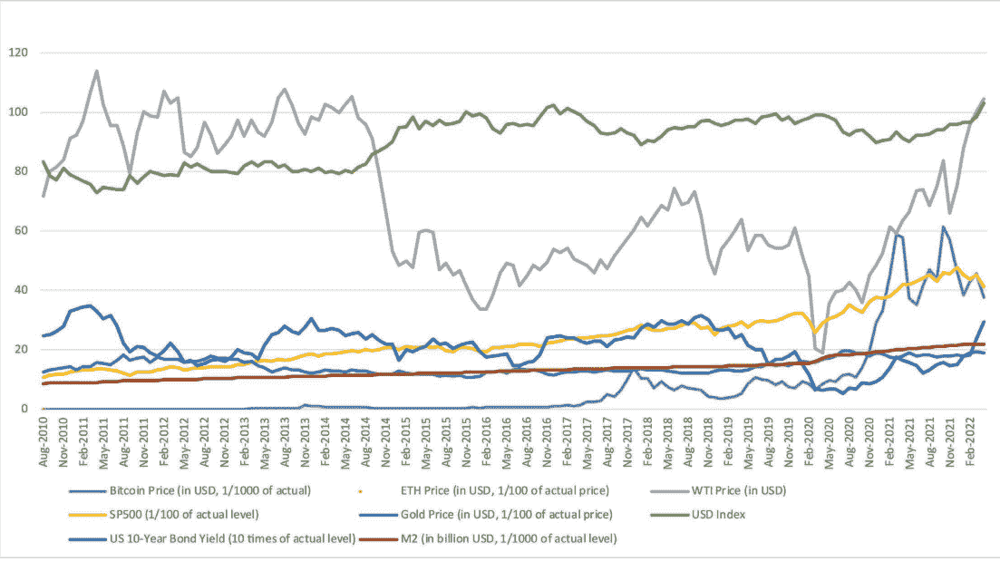

图 1.1 加密货币与金融市场关键指标的交互

### 表 1.8 加密货币与金融市场关键指标之间的相关性

| | 比特币 | 以太坊 | WTI | 标普500 | 金价 | 美元指数 | 10年期收益率 | M2 |
|---|---|---|---|---|---|---|---|---|
| 比特币 | 1.00 | 0.93 | -0.06 | 0.87 | 0.58 | 0.30 | -0.34 | 0.86 |
| 以太坊 | | 1.00 | 0.63 | 0.92 | 0.58 | -0.19 | -0.12 | 0.84 |
| WTI | | | 1.00 | -0.37 | 0.20 | -0.81 | 0.46 | -0.40 |
| 标普500 | | | | 1.00 | 0.42 | 0.63 | -0.40 | 0.98 |
| 金价 | | | | | 1.00 | -0.18 | -0.57 | 0.49 |
| 美元指数 | | | | | | 1.00 | -0.31 | 0.63 |
| 10年期收益率 | | | | | | | 1.00 | -0.50 |
| M2 | | | | | | | | 1.00 |

比特币是以美元计价的比特币价格，ETH 是以美元计价的以太坊价格，WTI 是以美元计价的原油价格，金价是每盎司的现货黄金价格，美元指数是相对于一篮子外币的美元价值指数，10 年期收益率是美国财政部债务义务票据的利率，M2 是美国的流动性货币供应量。这些相关性是根据 2010 年 8 月至 2022 年 4 月的月度数据计算得出的。

在通胀环境下，它们不被视为像原油（−0.40）那样既能储存价值又能提供实用性的资产；也不被视为像黄金（0.49）那样的避险资产。

这些关系的前景有所不同。随着加密货币在商品和服务市场流通中得到更多接受，且随着中央银行在疫情后岁月恢复正常化货币政策轨迹，加密货币稳定的价值可能有助于增强其作为价值存储手段的作用。加密货币价格也可能较少受货币供应量影响，并与其他风险资产更加独立，从而为投资者提供分散投资收益。

### 加密货币商品与服务市场及要素市场的发展

截至 2022 年夏季，加密货币在商品和服务市场及要素市场中的使用仍在全球高级政府官员和名人（如 Elon Musk）之间讨论之中。此类讨论常常透过不同视角发出混杂信号，并带有不同动机地被接收和解读。一个主要共识是：在强化监管和大胆尝试的前提下拥抱加密货币；另一个共识则集中于谴责其邪恶本质。

就撰写本文时，美联储主席杰罗姆·鲍威尔（Jerome Powell）声称他无意在美国禁止以太坊等加密货币，而证券交易委员会（SEC）主席加里·根斯勒（Gary Gensler）主张 SEC 和商品期货交易委员会（CFTC）在监管该行业方面发挥作用。根斯勒认为，如果缺乏更严格的监管，投资者将处于不利地位。此外，美国国税局（IRS）强调了加密货币收入的纳税申报要求。有些人将预期中的监管视为加密货币的一大障碍的清除；例如，据 Haar (2022)、Jeffery Wang（Amber Group）、Shehan Chandrasekera（CoinTracker.io）和 Ben Weiss（CoinFlip）称。

投资加密货币以及加密货币在商品和服务市场和要素市场中的使用并未得到广泛推崇。据 Prater (2022) 称，传奇投资者沃伦·巴菲特曾有著名评论：“……如果你告诉我说你拥有全世界所有的比特币，并以 25 美元的价格卖给我，我也不会要，因为我拿它做什么呢？”

巴菲特关于拿比特币做什么的问题，反映了加密货币在商品和服务市场及要素市场中使用有限的事实。

截至 2022 年夏季，加密货币流通正在缓慢增长，约有 2,300 家美国企业接受加密货币。使用加密货币主要有两条路径：一种是“免干预”路径，即企业仅利用加密货币促进支付；另一种是“亲力亲为”路径，即企业在运营和财库职能范围内推广加密货币采用。

“免干预”路径的示例包括：仅有少量在线零售商（如 Overstock.com）接受比特币；AMC® 接受比特币、以太坊、比特币现金和莱特币® 作为在线支付；Tesla® 对比特币的接受程度不稳定；Sheetz®（一家主要的中大西洋地区餐饮和便利店连锁）接受数字货币支付。“亲力亲为”路径的示例包括：在 eGifter®，比特币可以兑换流行商品的礼品卡；一名为 BitPay 卡的借记卡可以将加密货币资产转换为美元用于日常购买。Luther (2016) 记录了更多示例。

总体而言，加密货币在全球商品中的使用仍然极其有限。根据国际货币基金组织（IMF）的数据，2021 年全球 GDP 为 94 万亿美元，而 2013 年至 2021 年间所有加密货币的总市值平均为 0.494 万亿美元。这意味着价值比率为 0.53%。然而，假设加密货币市值的增长率为 10.5%（如表 1.2，第 3 页所示），到 2035 年市值将达到 1.81 万亿美元。根据世界银行的数据，1961 年至 2020 年世界 GDP 的年平均增长率为 3.43%。这意味着全球 GDP 将达到 145.7 万亿美元，加密货币价值比率为 1.24%。作为参考，截至 2019 年，俄罗斯卢布、南非兰特、土耳其里拉和巴西雷亚尔的价值比率均约为 1.1%，分别是第 17 至第 20 大交易货币（国际清算银行，2019）。

本章还将加密货币视为要素市场中的一个要素——这是一个新视角，用于考察加密货币在三大要素（人力资本、资源资本和金融资本）方面的现状和未来。与将加密货币视为金融资产的第二个主题不同，本主题探讨了加密货币作为孵化金融资产的基础设施的未来趋势。

加密货币在与人力资本的接触上，尚未超越作为提供就业机会的研究和投资领域这一更深层次。加密货币的未来里程碑将是其在人力资本发展中的广泛应用，从对其功能领域的教育，到将加密货币作为激励计划的组成部分予以采用。

截至 2020 年代初，加密货币不被视为一种可与土地、商品（Tiwari 2018）和战略储备相媲美的典型资源资本。这部分是因为加密货币价格的波动，也因为变革性认知需要更长的时间。加密货币的另一个里程碑将是主要经济体将领先的数字货币纳入战略国家储备，并根据公认会计原则将其确认为现金及现金等价物，而非作为需摊销的投资。

加密货币正在作为金融资本发展。这应与被承认为金融资产区分开来。前者是指作为金融资产发展的基础设施。尽管正如主题二所介绍，多种衍生品已从加密货币中衍生出来，但作为独立资产类别的加密货币尚不成熟。

### 加密货币的发展：前景总结

1995 年至 2000 年间的 dotcom 泡沫是由概念驱动的投资、故事驱动的商业、低利率环境和充足的流动性推动的。在此期间，纳斯达克综合指数从不足 1,000 点上升至超过 5,000 点，泡沫于 2001 年破裂，纳斯达克指数下跌了 77%。该泡沫不可持续，原因在于互联网连接带宽的技术限制、互联网公司盈利前景暗淡、流动性收紧以及利率上升。

与 dotcom 泡沫类似，从 2020 年 3 月到 2022 年底的加密货币价格飙升也是由概念驱动的投资、名人效应、低利率环境和充足的流动性推动的。到 2022 年 5 月，现实经济中仅有少量商品和服务可用任何一种加密货币购买。美联储于 2022 年 3 月开始加息，并计划于 2022 年 6 月缩减其庞大的资产组合。在融资成本升高和流动性降低的情况下，加密货币价格泡沫的破裂将朝向疫情前价格水平发展。除非加密货币的两个关键障碍被清除，即货币价值稳定且货币流通得到政府机构广泛接受，否则这一情况将持续（据 Davoodalhosseini 和 Rivadeneyra (2020)）。

正如第一个主题所提及，加密货币是代币货币。代币货币的问责制需要以创新方式与加密货币一同诠释，其中包括价值问责、波动性问责和技术问责。

价值问责是指发行控制和流通管理。当用户有理由确信货币供应量将稳步增加且不会导致恶性通胀时，一种加密货币就具有问责性。


2022年5月初泰达币（USDT）的闪崩证明，即使所谓的稳定币也可能无法与价值以金本位为锚的货币相媲美。此外，加密货币需要让用户相信，流通不会被阻断且发行不会被伪造。这一担忧与本行业的监管密切相关。

波动性问责制是指加密货币相对于全球金融和商业市场中其他主要法定货币的购买力稳定性和汇率稳定性。与Harwick (2016)的观点一致，加密货币需要拥有相当大的市值，以便在应对重大现金流入和流出时具备价值韧性。任何法定货币，即使由较小经济体发行，都有其经济产出以及政治、军事、文化和外交支持作为支撑。另一方面，加密货币并非由这些资源支撑，而是由去中心化技术协议及其接受度的非组织化预期支撑。因此，波动性问责制是行业需要攻克的最重大障碍之一。

技术问责制是指交易、存储和流通中的易用性。与法定货币相比，加密货币需要更高的知识门槛，这限制了其在2020年代初期较小的技术娴熟人群中的应用。在交易网络和银行系统的基础设施得到显著发展之前，它无法被广泛人口和组织所采用。

需要澄清的是，虽然媒体和研究人员经常将广泛的商业接受度和庞大的用户基础列为加密货币成为准法定货币的里程碑，但本章将此类结果视为行业成熟度的结果，而非其原因。原因是上述从价值、波动性和技术角度提出的问责制。

根据Fireblocks (2022)的一份报告，加密行业近期的里程碑如下：
- 更多机构将拥抱加密货币；
- 科技巨头将投资于加密货币解决方案；
- 发展中经济体将尝试央行数字货币（CBDCs）；
- 加密货币将通过元宇宙传播；
- NFTs将开启Web 3.0时代；
- 欧洲将在监管方面领先，美国紧随其后；
- 私钥管理将侧重于可扩展性。

具体而言，关于加密货币需要攻克以被认可为准法定货币的里程碑，表1.9提供了预计的时间表和路径。不同加密货币类型的数量、市值和交易量将演变为动态均衡状态，并与加密货币金融市场的成熟度相互作用。人们合理地认为，该行业将逐渐具备加密货币的理想特征：稳定的记账单位、在商品和服务市场中广泛接受、被机构投资者作为价值储存手段吸收、对货币政策影响的波动性韧性、分散化收益以及避险资产属性。当这些因素在2035年左右实现时，一些领先的加密货币可能能够挑战主要法定货币的地位。

### 表1.9 未来几十年加密货币的里程碑：一项预测

| 内容 |
|---|
| 更多来自监管机构的认可 |
| 政府和公共机构将其认可为法定货币凭证。 |
| 政府将其认可为外汇储备和战略储备。 |
| 更多政府和国家将其视为法定货币，并视其为弯道超车、成为社会创新的机会。 |
| 更多来自商业和行业的认可 |
| 更多企业接受其作为商品和服务结算以及人力资本报酬。 |
| 企业为特定工业用途开发更多新的加密货币和代币。 |
| 更成熟的金融市场 |
| 不同类型加密货币的总数将大幅减少，低于2022年夏季的18,465种。 |
| 前10种加密货币的总市值甚至超过2022年夏季整个加密货币市值的81%。 |
| 整个加密货币市场的总市值为1.8万亿美元。 |
| 加密货币钱包数量约为8.6亿个。 |
| 加密货币交易所数量将从2022年的600家增长至几乎全球所有商业银行。 |
| 加密货币季度交易量将增长至34万亿美元。 |
| 加密货币期货市场的规模保持为现货市场的四倍。 |
| 加密货币期权市场的交易量将增长至1万亿美元。 |
| 加密货币ETF数量将从2022年的20个大幅增长。 |
| ETF出现多样化功能，例如加密货币债券ETF、加密货币波动性ETF和杠杆加密货币ETF。 |
| 加密货币价格与货币供应量和其他风险资产的相关性降低。 |
| 更多来自社区的认可 |
| 在K12教育阶段引入加密货币机制和用途。 |
| 加密货币用户的平均画像与全球人口的平均画像一致，尤其是从教育水平角度来看。 |

### 参考文献

- Bank for International Settlements (2019年9月16日). 2019年4月央行三年期外汇周转调查. Bank for International Settlements Report, 10.
- Cai, J., and Gomaa, A. (2019). 以行为学视角通过首次代币发行融资风险投资. The Journal of Private Equity, 22(3): 93–101.
- Chu, D. (2018). 虚拟货币经纪商-交易商：监管加密货币钱包和交易所. Columbia Law Review, 118(8): 2323–2360.
- Cohney, S., Hoffman, D., Sklaroff, J., and Wishnick, D. (2019). 投币式资本主义. Columbia Law Review, 119(3): 591–676.
- Davoodalhosseini, S. M., and Rivadeneyra, F. (2020). 电子货币政策框架. Canadian Public Policy / Analyse de Politiques, 46(1): 94–106.
- Haar, R. (2022年5月3日). “突破性”2021年后，5位专家对加密货币未来的预测. NextAdvisor. https://time.com/nextadvisor/investing/cryptocurrency/future-of-cryptocurrency/
- Harwick, C. (2016). 加密货币与中介问题. The Independent Review, 20(4): 569–588.
- Howarth, J. (2022年3月25日). 2022年有多少种加密货币：Exploding Topics. https://explodingtopics.com/blog/number-of-cryptocurrencies/
- Industry Insights (2022年1月4日). Fireblocks预测：2022年的7个预测. Fireblocks. https://www.fireblocks.com/blog/fireblocks-forecast-7-predictions-for-2022/
- Luther, W. J. (2016). 比特币与数字支付的未来. The Independent Review, 20(3): 397–404.
- Matkovskyy, R., and Jalan, A. (2021). 比特币能作为通胀对冲工具吗？基于分位点对分位点模型的证据. Revue Économique, 72(5): 785–798.
- Myers, C., and Czarnezki, J. J. (2021). 可持续商业法？公司治理与金融的关键作用. Environmental Law, 51(4): 991–1040.
- Prater, E. (2022年4月30日). 伯克希尔·哈撒韦副主席芒格称比特币“愚蠢且邪恶”. Fortune. https://fortune.com/2022/04/30/bitcoin-stupid-evil-berkshire-hathaway-vice-chair-munger-says-warren-buffett-cryptocurrency/
- Tepper, T. (2022年5月1日). 2022年5月最佳加密货币交易所. Forbes Advisor. https://www.forbes.com/advisor/investing/cryptocurrency/best-crypto-exchanges/
- Tiwari, N. (2018). 加密货币的商品化. Michigan Law Review, 117(3): 611–634.
- Todorov, K. (2021年12月6日). 首个美国比特币ETF推出：机制、影响与风险. BIS Quarterly Review. https://www.bis.org/publ/qtrpdf/r_qt2112t.htm
- Vantage Market Research. (2022年4月11日). 全球加密货币市场规模超过2300万美元，预计2022–2028年期间年复合增长率将超过6.9%.


Vantage. https://www.globenewswire.com/en/news-release/2022/04/11/2419956/0/en/23-Million-Global-Cryptocurrency-Market-Size-is-Expected-to-Grow-at-a-CAGR-of-over-6-9-During-2022-2028-Vantage-Market-Research.html

Warren, J. M. (2020). 一笔过于便捷的交易：比特币及其进一步监管。《法律与网络战争期刊》，8(1)：5–29。

## 第 2 章
## 加密货币市场中的投资者注意力

李·史梅尔斯

西澳大学

### 引言

人类在执行任务和做出决策时面临认知约束。对一项任务的关注会转移对另一项任务的关注，尽管将注意力集中在单一任务上可能相对容易，但在多项任务之间分配注意力则更加困难（Kahneman 1973）。选择最优投资组合是投资者面临的一项尤其复杂的任务。在做出此决定时，他们面临无数选择，这在加密货币市场中同样适用——目前该市场有超过 10,000 种加密货币上市——如同在传统股票和债券市场中一样。理论上，理性投资者在做出投资决策前会计算每一种可能资产组合的成本和收益。在现实中，几乎无限的潜在组合数量意味着投资者会采用心理捷径（或启发式）来简化决策过程。

关注吸引投资者注意力的资产是此类捷径的一个例子，这种捷径可能会给投资决策带来偏差。由于文献中这些术语有时会被（错误地）混用，因此区分*投资者注意力*与*投资者情绪*的概念非常重要。Smales（2021）解释，*注意力*发生在投资者知晓信息存在时，而*情绪*是对该信息及其对资产价格可能影响的情绪偏差解读。Lim 和 Teoh（2010）指出，在投资者注意力更高的情况下，情绪对价格的影响可能会加剧。

由于投资者的注意力有限，他们会更多地关注显著、易于获取且易于处理的信息。不显著且难以处理的信息会被忽略。除非有重要新闻（例如由重大价格变动触发的新闻），否则投资者通常不会关注特定资产。在加密货币方面，显著的价格波动、爆炸式的市场增长以及偶尔的市场暴跌，已经吸引了大量关注。事实上，加密货币不仅吸引了投资者的注意力，还吸引了学者（图 2.1）和全球媒体（图 2.2）的关注。

研究诸如投资者注意力等行为因素对加密货币市场的影响尤其重要，因为与传统资产相比，加密货币通常缺乏内在价值，因此价格无法用基本面来解释。本章旨在提供有关投资者注意力主题的研究概述，特别是关注加密货币市场。

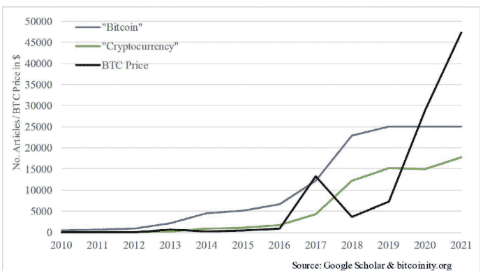

图 2.1 提及比特币和加密货币的学术文章。一张折线图，显示 2010 年至 2021 年每年提及比特币或加密货币的学术文章数量以及比特币价格。从 2016 年起，文章数量迅速增加，接近 25,000 篇的峰值，与此同时比特币价格飙升。

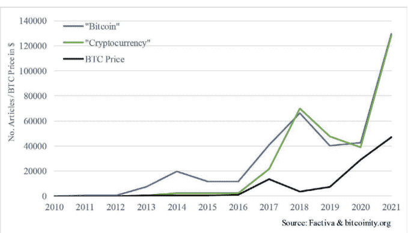

图 2.2 提及比特币和加密货币的媒体文章。一张折线图，显示 2010 年至 2021 年每年提及比特币或加密货币的媒体文章数量以及比特币价格。从 2016 年起，文章数量迅速增加，接近 129,000 篇的峰值，与此同时比特币价格飙升。

本章内容安排如下：下一节介绍了几种最常用的投资者注意力代理指标，涵盖间接和直接措施。随后一节简要介绍了股票市场背景下投资者注意力影响的相关研究。这为理解投资者注意力可能如何影响加密货币的机制提供了框架。接下来的一节讨论了专门针对加密货币市场投资者注意力的新兴研究，包括各种注意力指标及其对回报、流动性、波动性和崩盘风险的影响。最后，提供了一些结语。

### 投资者注意力的衡量方法

已有多种不同的指标被用作投资者注意力的代理。最初，使用与市场活动和吸引注意力的事件相关的间接措施。近年来，技术创新使得可以使用直接的或揭示式的投资者情绪措施。

先来看间接措施，因为投资者在关注时更可能进行交易，因此异常交易量提供了一个代理指标（Gervais et al. 2001；Barber and Odean 2008；Hou et al. 2009）。同样，投资者更可能关注发布重要新闻、产生极端回报（Barber and Odean 2008）或触及上涨价格限制（Seasholes and Wu 2007）的股票。Grullon et al.（2004）在将公司的整体曝光度（以广告支出衡量）与股票市场流动性相关联时，提供了另一种投资者注意力的间接代理指标。具体到加密货币，Sabah（2020）认为，接受加密货币作为支付形式的新场所数量是注意力的一个新颖代理指标，并可与回报率波动相关联。

然而，市场活动可能由许多与投资者注意力无关的其他因素驱动。投资者也未必会在阅读之前就意识到新信息。近年来，加密货币市场中最常用的投资者注意力措施是那些利用基于网络的工具的措施，例如 Google® 搜索量（例如，Philippas et al. 2019；Liu and Tsyvinski 2021；Liu et al. 2022；Smales 2022a）、Twitter® 频次（例如，Shen et al. 2019；Al Guindy 2021；Choi 2021）和 Wikipedia® 页面访问量（Kristoufek 2013）。由于谷歌搜索、发推特或访问维基百科页面都需要采取行动，这些代理指标可以被视为投资者注意力的直接措施。通过社交媒体传播的新闻可能被认为对加密货币市场更为重要，原因在于受众属性相似，且传统媒体被认为对这些新兴市场缺乏报道（Kraaijeveld and De Smedt 2020）。

### Google搜索量

Da et al.（2011）是最早将 Google 搜索量作为散户投资者注意力衡量指标的研究者之一，此后广泛使用。该指标基于特定关键词的 Google 搜索频率。有人认为，Google 搜索量提供了一种直接的注意力衡量指标，因为在 Google 上搜索特定关键词的投资者无疑在关注该事项，或者在搜索资产名称的情况下，正在关注该资产。由于 Google 约占全球互联网搜索量的 90%（Smales 2022a），搜索量应该能反映广大人口的搜索行为。

可从 Google Trends（https://trends.google.com/）获得 Google 搜索量，目前数据自 2004 年 1 月起提供。搜索查询数据已归一化，使得数字在 0 到 100 之间（包含两端），并基于特定地理区域内该主题的搜索频率与所有主题总搜索频率的比例。这意味着较低的 Google 搜索量得分并不总是表明该主题的搜索次数更少，而只是表明该主题搜索次数相对于其他所有主题的比例下降了。值为 100 表示该搜索查询在特定时间和地点极其活跃。在某些情况下，专注于特定国家或大陆是有意义的，但也可以考虑全球搜索。Google Trends 应用过滤器来删除重复搜索、包含特殊字符的搜索以及极少数人进行的搜索。

使用 Google 搜索量时应考虑两个问题。首先，随着样本期的延长，Google Trends 提供的数据频率会降低。最多三个月的期间提供每日数据，最多五年的期间提供每周数据，更长间隔提供每月数据。由于 Google 搜索量是根据所选时间间隔进行标准化的，因此在使用不同时间间隔时可能需要调整数据。例如，在两年样本期内使用每日数据或在 10 年样本期内使用每周数据时，需要进行归一化处理。Bleher and Dimpl（2019a,b）详细讨论了这一过程，并提供了一个算法作为一种解决方案。

其次，搜索词或关键词的选择很重要。Da et al.（2011）指出，互联网用户可能出于与投资无关的原因搜索公司名称（例如，网上购物），这会产生可能的歧义，如果名称有多重含义（例如，“Apple”），问题会更严重。投资者也可能使用其名称的不同变体来获取特定公司的信息。Da et al.（2011）通过使用股票代码克服了这种歧义。对于加密货币来说，这是一个同样棘手的问题，因为加密货币采用了阿瓦兰奇、恒星和泰达币等含义不明确的名称，而且名称往往容易相似（Cahill and Liu 2021）。

图 2.3（见下一页）说明了比特币（BTC）价格与“比特币”和“加密货币”搜索词的 Google 搜索量之间总体呈正相关关系。本章后续部分将更详细地讨论这种关系的含义。

### 其他直接措施

Twitter 提供了另一种基于互联网的投资者注意力指标，已被用于解释加密货币市场活动（例如，Philippas et al. 2019；Shen et al. 2019；Al Guindy 2021；Choi 2021；Liu and Tsyvinski 2021）。Al Guindy（2021）认为，Twitter 是一个良好的指标，因为除了在推文被点赞时显示关注正在发生之外，它还揭示了投资者在推文被转发时传播信息的程度。Shen et al.（2019）认为，由于他们的推文涉及评论和市场预测，Twitter 更可能被拥有加密货币知识的知情投资者使用。Twitter 也被（一些）投资专业人士和新闻机构用于宣传他们的其他服务。


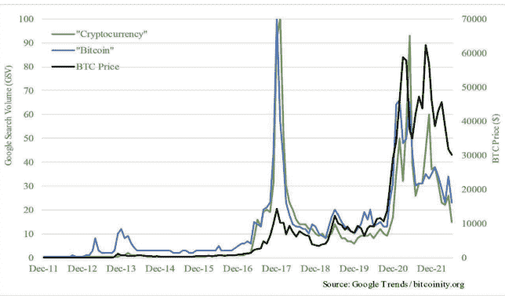

图 2.3 谷歌搜索量与比特币价格。一张折线图，显示从2011年到2021年每月的比特币价格以及比特币和加密货币的谷歌搜索量。搜索量高峰出现在2017年底和2021年初，这与比特币价格高点吻合。

由于机构投资者可以获取专业新闻服务，例如 Bloomberg® 和 Reuters®，因此谷歌搜索量很可能最适合作为散户投资者注意力的代理指标。Ben-Rephael et al. (2017) 提出了一种关注机构投资者的替代指标。通过使用 Bloomberg 终端上的新闻搜索和阅读活动，他们构建了一种异常机构投资者注意力的衡量指标。他们报告称，机构注意力领先于散户注意力，并能更及时地回应股市新闻事件。

### 股票市场中的投资者注意力

研究表明，投资者注意力对股票市场产生了重大而广泛的影响，有两种相互竞争的理论试图解释市场反应：选择不对称和信息发现。

选择不对称 (Odean 1999; Barber and Odean 2008) 认为，投资者在购买股票时面临从庞大投资宇宙中选择的问题，因此只购买引人注目的股票——即最近经历极端收益或异常高交易量的股票。相比之下，在考虑出售股票时，投资者通常只出售他们持有的股票，因此面临的问题不那么严重。这一理论不一定适用于机构投资者，因为他们拥有更多资源来应对注意力有限的问题，并且做空能力意味着他们在出售股票时也可能面临显著的搜索问题。

信息发现提供了另一种解释。Andrei 和 Hasler (2014) 开发了一个理论模型，解释了投资者注意力对股票收益率波动率和风险溢价的影响。他们的模型表明，当投资者关注新闻时，这些新信息会迅速体现在价格中，从而导致更高的波动率和更大的风险溢价。在这种情况下，更大的关注有助于提高市场效率，使收益率更难以预测 (Vozlyublennaia 2014)。这一理论也与市场仅在投资者关注新闻时才做出反应的观点一致 (Huberman and Regev 2001)。

相关地，市场反应也可能取决于竞争信息（或刺激）的数量。例如，Peress and Schmidt (2020) 发现，当散户投资者被不相关的新闻事件（例如 O. J. Simpson 审判）分散注意力的日子，波动率较低；而在许多其他公告发布的日子（Hirshleifer et al. 2009）以及机构投资者未予关注时（Ben-Rephael et al. 2017），收益率漂移更为强劲。

实证结果并不确定。一方面，若干文章指出投资者注意力与个股收益率之间存在正相关关系。Barber and Odean (2008) 表示，购买引人注目的股票会刺激更高的交易量，导致更大的价格压力并放大对新闻事件的反应，这与 Gervais et al. (2001) 和 Jiang et al. (2021) 的结论一致。Da et al. (2011) 表明，更高的投资者注意力与积极的股票收益率和首日 IPO 收益率相关。

相比之下，有证据表明全球股票指数收益率 (Chen 2017; Smales 2021) 和美国股票板块收益率 (Smales 2020a) 与投资者注意力呈负相关。Smales (2020a; 2021) 认为，这是因为散户投资者在搜索信息以解决其家庭担忧的不确定性，而非专门为了购买股票，因此这与信息发现推理一致。

在专注于加密货币之前，讨论两个额外概念是有价值的，这些概念为股票市场和加密货币市场之间的投资者注意力提供了联系。首先，Peng 和 Xiong (2006) 指出，由于注意力容量限制，投资者倾向于关注市场和板块层面的新闻，而非特定公司的信息。对加密货币市场的一个潜在含义是，投资者将注意力集中在市场层面的新闻上，或使用整体市场的代理指标，例如比特币。这或许可以解释为什么比特币对于解释加密货币市场的收益率如此重要 (Smales 2020b)。

其次，投资者可能有意识地尝试关注特定信息。Peng (2005) 构建了一个模型，表明投资者会将更多注意力分配给波动率更高的资产，因为这些资产能产生更大的潜在回报。考虑到加密货币表现出的更高收益率波动率，这或许可以解释为什么如此多的注意力集中在加密货币市场上。

### 加密货币市场中的投资者注意力

如前几节所述，加密货币市场具有若干特征，使其特别容易受到行为因素的影响，尤其是有限的投资者注意力。首先，加密货币几乎没有内在价值，因此收益率更可能由行为影响决定。

其次，直到加密货币开始在机构投资者中获得合法性（可能伴随2017年比特币期货的推出），市场的投机性质主要吸引了散户投资者。Lucey et al. (2022) 表明，这些投资者对信息的解读方式可能与机构投资者有所不同。由于谷歌搜索量常被视为衡量散户投资者注意力的指标，因此它可能对加密货币市场尤其相关。

第三，加密货币数量庞大，其中许多在短时间内消失，随即被新产品取代，这在选择时造成了困境。最后，投资者（和媒体）关注加密货币市场，因为该市场经历高水平的波动，因此经常产生大量新闻。

与股票市场一样，加密货币市场也考虑了多种不同的投资者注意力代理指标。尽管文献中也提到了维基百科页面访问量和接受场所，但最常用的代理指标是谷歌搜索量以及 Twitter 推文和转推。

在考虑投资者注意力对加密货币市场的影响之前，有必要思考这些新型工具中投资者注意力的原因。Urquhart (2016) 提出，至少部分比特币的关注源于其创新特性、简单性和透明度。与股票市场文献一致，有证据表明投资者注意力与积极的过往收益率 (Lin 2021) 和实现波动率 (Urquhart 2018) 相关，并倾向于集中在产生最多新闻的加密货币上 (Subramaniam and Chakraborty 2020)。

关于这种关系是单向还是双向，似乎存在不一致的证据。Urquhart (2018) 显示从收益率到注意力存在单向因果关系，而 Dastgir et al. (2019) 和 Smales (2022a) 指出存在双向因果关系，前者认为这种关系集中在分布的尾部。

此前已指出，加密货币名称常常相似。比特币于2008年推出，是最初的加密货币，至今仍占据了大约40%的市值。Cahill 和 Liu (2021) 指出，大量名称与比特币相似的“山寨币”加密货币（例如 Wrapped Bitcoin、Bitcoin Cash、Bitcoin SV），如今搜索至少会发现100个产品。这些山寨币具有较高的初始回报但较低的生存率。Cahill 和 Liu (2021) 建议，投资者关注这些加密货币是因为它们的名称较不复杂（更熟悉），因此信息更容易处理。

由于加密货币是一种新兴技术，其估值比成熟市场更不确定，因此名称可能成为投资者的信号工具。这与 Cooper et al. (2001) 记录的“dotcom”效应并无不同，该效应发现公司名称变更公告周围股价出现显著反应。他们认为，投资者害怕错过新技术，因此购买与该技术仅有松散关联的公司股票。在“历史押韵”的一个例子中，Cahill et al. (2020) 指出，承认对区块链感兴趣的公司出现了积极的异常收益率。作为一个相关的旁注，在观察到加密货币频繁出现泡沫和崩盘后，Harris (2003) 表明，泡沫往往始于买家对新市场增长和新技术潜力过度乐观的时候。

我们现在考虑投资者注意力对加密货币市场特定方面的影响。由于早期推出和市场主导地位，许多早期研究集中于比特币，但最近评估更广泛的加密货币范围已变得普遍。

#### 收益率

大量研究致力于理解投资者注意力与加密货币收益率之间的关系。考虑到一旦确定盈利交易策略就有可能获得可观回报的潜在机会，这并不令人惊讶。不幸的是，目前实证证据参差不齐，估计结果取决于所选样本期间、使用的方法以及考虑的加密货币集合。

聚焦比特币，Urquhart (2018)、Bleher and Dimpfl (2019a) 和 Smales (2022a) 发现收益率并非由投资者注意力引起，而 Kristoufek (2013) 和 Philipas et al. (2019) 发现投资者注意力与价格之间存在强烈的因果关系，尤其是在不确定性较高的时期。


将考虑集扩大到更广泛的加密货币范围，似乎能更好地证实投资者关注与收益之间存在统计学上显著的关系。Subramaniam 和 Chakraborty (2020) 发现，投资者关注的高分位数尖峰导致回报增加；Li 等人 (2021) 利用小波分位数格兰杰因果关系指出，投资者关注与回报之间存在相互依赖性；而 Lin (2021) 发现，使用格兰杰因果检验时存在双向因果关系，但使用向量自回归模型时则不存在。Smales (2022a) 考察了 20 种主要加密货币，发现投资者关注与回报之间存在正相关关系，且在 COVID-19 大流行期间该效应更为显著。Liu 和 Tsyvinski (2021) 利用基于谷歌搜索量和 Twitter 生成的代理变量发现，高投资者关注能预测未来六周内的高回报。类似地，研究表明投资者关注会在加密货币市场中产生动量效应（Sockin and Xiong 2020）。Liu 等人 (2022) 发现，动量出现在投资者关注度高的时候，并且对于受到更多关注的大型知名币种，这种动量更大。总体而言，这种正向的关注–收益关系与“选择非对称”股市文献以及购买吸引注意力的资产（Barber and Odean 2008）相一致。

相关地，Ibikunle 等人 (2020) 研究了投资者关注对比特币价格发现过程的影响。他们发现，尽管知情交易与关注无关，但在关注水平较高时，非知情交易活动往往更频繁。因此，在关注度高涨的时期，价格效率往往会下降。

### 波动率与崩盘风险

识别投资者关注与加密货币回报之间的关系可能有助于制定有利可图的交易策略；然而，理解此类投资相关的风险也同样重要。理解投资者关注对波动率（及相关崩盘风险）的影响，可以帮助投资者把握固有风险，也有助于监管机构（及其他政策制定者）识别高风险情形。

除了 Urquhart (2018) 之外，一般经验发现是投资者关注与加密货币波动率呈正相关。Bleher 和 Dimpfl (2019a) 认为，散户投资者通过谷歌搜索获取信息，从而引发交易活动并导致比特币回报波动率相应增加。同样，Shen 等人 (2019) 发现，推特帖子频率推动了比特币交易量和已实现波动率。

Al Guindy (2021) 和 Smales (2022a) 表明，对于 20 大加密货币，投资者关注与波动率呈正相关，而更大的分心程度与较低的波动率相关（Al Guindy 2021）。同样，Sabah (2020) 发现，接受加密货币的新商业场所增加一个标准差会使波动率上升近 20%。

Smales (2022b) 研究了投资者关注与加密货币崩盘风险是否存在联系，发现存在显著关系，但该关系集中在崩盘风险分布的两端。当崩盘风险较低时，关注–崩盘风险关系为正；当崩盘风险较高时，则为负。正向的关注–波动率关系与 Andrei 和 Hasler (2014) 的理论股市模型一致。也就是说，投资者关注水平的提高会导致波动率升高，因为更多关注使信息能更快地反映在价格中。

### 流动性

流动性是市场活动的另一个重要组成部分。如果没有足够的流动性，就无法轻松或快速地买卖加密货币，任何交易策略的实施都将成本高昂。

Smales (2022a) 发现，较高水平的投资者关注可能会降低流动性，这在很大程度上是因为与此关注相关的波动率更高。相反，Choi (2021) 发现推特活动增加会带来短期流动性改善，而 Yao 等人 (2021) 发现，投资者关注通过增加流动性降低了加密货币的特有风险。这一效应对于更新、更小的加密货币更为明显，这些币种未纳入 Smales (2022a) 使用的样本中。

### 结语

自 2009 年诞生以来，加密货币市场发展迅速，市值接近 1.2 万亿美元（曾接近 3 万亿美元），是一个不可忽视的市场。类似于此前出现的新技术（例如铁路、电话和互联网），加密货币具有巨大潜力，但难以理解。其独特特征可能会重塑整个金融生态系统，在此过程中使系统民主化，但关于这一过程的确切机制存在巨大不确定性。

由于加密货币本质上是一段通常不产生现金流的代码，因此有人认为它们缺乏内在价值，因此赋予它们的任何价值很可能由行为因素驱动。加密货币展现出的巨大价格涨幅和极端回报波动吸引了各类投资者的关注，表明投资者关注是一个特别重要的行为因素。

最初，加密货币投资者主要是个人——散户投资者，他们可能对行为偏差认知较少，但更容易受其影响。近年来，机构投资者在加密货币市场中开始扮演更大角色，因此行为因素的影响可能会随时间演变。因此，更好地了解加密货币市场中的投资者行为非常重要。这将帮助投资者确定资本配置的最佳方式，并协助政策制定者考虑如何在市场持续增长的过程中避免系统性风险的积累。

看来，股市中关于投资者关注的度量和理论也有助于解释投资者关注在加密货币市场中的影响。使用了多种间接（极端回报、异常交易量）和直接（谷歌搜索量、推特频率、维基百科页面访问量）代理变量。针对广泛加密货币的最新经验研究发现，存在正向的关注–回报关系，与购买吸引注意力的股票（Barber and Odean 2008）相一致，以及正向的关注–波动率关系，与信息发现模型（Andrei and Hasler 2014）相一致。

### 参考文献

- Al Guindy, M. (2021). 加密货币价格波动与投资者关注. *国际经济与金融评论*, 76: 556–570.
- Andrei, D., and Hasler, M. (2014). 投资者关注与股市波动率. *金融学评论*, 28: 33–72.
- Barber, B. M., and Odean, T. (2008). 闪光的不全是金子：关注和新闻对个人和机构投资者买入行为的影响. *金融学评论*, 21: 785–818.
- Ben-Rephael, A., Da, Z., and Israelsen, R. D. (2017). 取决于你在哪里搜索：机构投资者关注与对新闻的反应不足. *金融学评论*, 30: 3009–3047.
- Bijl, L., Kringhaug, G., Molnar, P., and Sandvik, E. (2016). 谷歌搜索与股票回报. *国际金融分析评论*, 45: 150–156.
- Bleher, J., and Dimpfl, T. (2019a). 今天我赚了百万，明天我未可知：利用谷歌搜索量预测加密货币. *国际金融分析评论*, 63: 147.
- Bleher, J., and Dimpfl, T. (2019b). 恢复谷歌丢失的频率：一种编织多年高频搜索量时间序列的算法. *SSRN工作论文*. https://ssrn.com/abstract=3357424


- Cahill, D., Baur, D. G., Liu, Z., and Yang, J. W. (2020). 我也是区块链：市场如何回应公司对区块链的兴趣？*银行与金融杂志*，113：105740。
- Cahill, D., and Liu, Z. (2021). 模仿的局限：来自另一个比特币抄袭者的教训。*公司财务杂志*，68：101992。
- Chen, T. (2017). 投资者注意力与全球股票回报。*行为金融杂志*，18：358–372。
- Choi, H. (2021). 投资者注意力与比特币流动性：来自比特币推特的证据。*金融研究快报*，38：101555。
- Cooper, M. J., Dimitrov, O., and Rau, P. R. (2001). rose.com之别名。*金融杂志*，56：2371–2388。
- Da, Z., Engelberg, J., and Gao, P. (2011). 寻找注意力。*金融杂志*，66：1461–1499。
- Dasgir, S., Demir, E., Downing, G., Gozgor, G., and Lau, C. K. M. (2019). 比特币关注与比特币回报之间的因果关系：来自基于Copula的Granger因果检验的证据。*金融研究快报*，28：160–164。
- Gervais, S., Kaniel, R., and Mingelgrin, D. H. (2001). 高交易量回报溢价。*金融杂志*，56：877–919。
- Grullon, G., Kanatas, G., and Weston, J. P. (2004). 广告、所有权广度与流动性。*金融研究评论*，17：439–461。
- Harris, L. (2003). *交易与交易所：从业者市场微观结构*. New York: Oxford University Press.
- Hirshleifer, D., Lim, S. S., and Teoh, S. H. (2009). 被迫分心：无关事件与对财报新闻的反应不足。*金融杂志*，64：2287–2323。
- Hou, K., Xiong, W., and Peng, L. (2009). 两种异常的故事：投资者注意力对价格和收益动量的影响。*工作论文*，Princeton University.
- Huberman, G., and Regev, T. (2001). 传染性投机与治愈癌症：让股价飞涨的非事件。*金融杂志*，56：387–406。
- Ibikunle, G., McGroarty, F., and Rzayev, K. (2020). 与其说是启发，不如说是干扰：投资者注意力与比特币价格发现。*国际金融分析评论*，68：101459。
- Jiang, L., Liu, J., Peng, L., and Wang, B. (2021). 投资者注意力与资产定价异常。*金融评论*，26：563–593。
- Kahneman, D. (1973). *注意与努力*. Englewood Cliffs, NJ: Prentice-Hall.
- Kraaijeveld, O., and De Smedt, J. (2020). 公共Twitter情绪预测加密货币价格的预测能力。*国际金融市场、机构与货币杂志*，65：101188。
- Kristoufek, L. (2013). 比特币遇见Google趋势与维基百科：量化互联网时代现象之间的关系。Scientific Reports, 3: 1–7.
- Li, R., Li, S., Yuan, D., and Zhu, H. (2021). 投资者注意力与加密货币：来自小波分位数Granger因果分析的证据。Research in International Business and Finance, 56: 101389.
- Lim, S. S., and Teoh, S. H. (2010). 有限注意。In: H. K. Baker and J. R. Nofsinger (Eds.), Behavioral Finance, 295–312. New Jersey: Wiley & Sons.
- Lin, Z. Y. (2021). 投资者注意力与加密货币表现。Finance Research Letters, 40: 101702.
- Liu, Y., and Tsyvinski, A. (2021). 加密货币的风险与回报。Review of Financial Studies, 34: 2689–2727.
- Liu, Y., Tsyvinski, A., and Wu, X. (2022). 加密货币中的常见风险因子。Journal of Finance, 76: 1133–1177.
- Lucey, B. M., Vigne, S. A., Yarovaya, L., and Wang, Y. (2022). 加密货币不确定性指数。Finance Research Letters, 45: 102147.
- Odean, T. (1998). 投资者交易过度吗？American Economic Review, 88: 1279–1298.
- Peng, L. (2005). 在信息容量约束下的学习。Journal of Financial and Quantitative Analysis, 40: 307–329.
- Peng, L., and Xiong, W. (2006). 投资者注意力、过度自信与类别学习。Journal of Financial Economics, 80: 563–602.
- Peress, J., and Schmidt, D. (2020). 紧盯电视：分心的噪声交易者与股票市场流动性。Journal of Finance, 75: 1083–1133.
- Philippas, D., Rijba, H., Guesmi, K., and Goutte, S. (2018). 媒体关注与比特币价格。Finance Research Letters, 30: 37–43.
- Sabah, N. (2020). 接受加密货币的场所、投资者注意力与波动性。Finance Research Letters, 36: 101339.
- Seasholes, M. S., and Wu, G. (2007). 可预测行为、利润与注意力。Journal of Empirical Finance, 14: 590–610.
- Shen, D., Urquhart, A., and Wang, P. (2018). Twitter能预测比特币吗？Economics Letters, 174: 118–122.
- Smales, L. A. (2020a). 投资者注意力与美国股票市场部门对COVID-19危机的反应。Review of Behavioral Finance, 13: 20–39.
- Smales, L. A. (2020b). 一种加密货币足以解释所有吗？理解比特币在加密货币回报中的重要性。Economic Papers: A Journal of Applied Economics and Policy, 38: 118–132.
- Smales, L. A. (2021). COVID-19危机期间的投资者注意力与全球市场回报。International Review of Financial Analysis, 73: 101616.
- Smales, L. A. (2022a). 加密货币市场中的投资者注意力。International Review of Financial Analysis, 78: 101972.
- Smales, L. A. (2022b). 投资者注意力与加密货币价格崩盘风险：一种分位回归方法。*经济学与金融研究*，38：490–505。
- Sockin, M., and Xiong, W. (2020). 加密货币模型。*NBER工作文件*，26816。
- Subramaniam, S., and Chakraborty, M. (2020). 投资者注意力与加密货币回报：来自分位因果方法的证据。*行为金融杂志*，21：103–115。
- Urquhart, A. (2016). 比特币的低效性。*经济学快报*，148：80–82。
- Urquhart, A. (2018). 什么导致了比特币的关注度？*经济学快报*，166：40–44。
- Vozlyublennaia, N. (2014). 投资者注意力、指数表现与回报可预测性。*银行与金融杂志*，41：17–35。
- Yao, S., Kong, X., Sensoy, A., Akyildirim, E., and Cheng, F. (2021). 投资者注意力与加密货币市场中的特定风险。*欧洲金融杂志*. https://doi.org/10.1080/1351847X.2021.1989008

## Taylor & Francis

Taylor & Francis Group

http://taylorandfrancis.com

## 第3章

## 比特币该投资多少，如果有的话？

Anthony L. Loviscek

Seton Hall University

### 引言

由于2008–2009年全球金融危机的动荡削弱了人们对金融机构的信任，中本聪（一个人或一个团体的化名）于2009年1月3日创建了比特币，从而开启了加密货币运动。比特币是一种不与任何金融中介挂钩、也不受任何组织控制的交易媒介，它依赖于“区块链”技术，该技术类似于其合作参与者之间的多边合同义务。其结果是一个点对点交易活动网络，进而催生了目前流通的超过18,000种加密货币。作为使用最广泛的加密货币，比特币有1900万个单位，占据了市场超过40%的份额。

然而，无论比特币作为一种不受通胀压力和货币刺激影响的货币是多么革命和持久，它更强大的吸引力在于作为“价值储存”或投资工具。例如，其从2010年12月264,000笔交易时的0.20美元，飙升至2021年12月的42,587美元和370亿笔交易，使其市值在2021年底达到1.3万亿美元的顶峰，实现了205.1%的非凡年化复合回报。其回报率几乎是同期高表现、高知名度股票Amazon®和Apple®的近七倍，也是基准标准普尔500指数（S&P 500）的近14倍。* 其高水平表现促成了对2022–2023年达到100,000美元（DeMatteo, 2022；Asford and Curry, 2022）、到本世纪末达到500,000美元，以及长期最高可达1,000,000美元的乐观预测（Kharpal, 2021）。

然而，这种超额高回报并非没有付出重大代价：巨大的波动性。例如，比特币2013年12月收盘价为455美元，到2月飙升至991美元，随后在3月暴跌至263美元，又于7月跳升至564美元，到2014年12月回落至303美元，一年波动率达123.61%。相比之下，作为标准普尔500指数准确近似值的先锋500指数（Vanguard 500 Index）的波动率为8.18%，低93%。即使同期Apple和Amazon相对较高的24%波动率也低了80%。更近期，投资者目睹价格从2021年7月的29,361美元飙升至2021年11月的68,789美元，却又在2022年5月暴跌至26,350美元。这种波动性对准确预测回报构成了严峻挑战。Zweig（2022）将其描述为“在试图从其波动中获利时，‘对加密货币判断正确，但操作方式错误’”。

在经典投资回报与风险范式的视角下，这些观察引出了以下问题：比特币在多大程度上（如果有的话）应成为资产配置策略的一部分？这一问题促成了本研究。

尽管截至目前比特币的回报表现令人印象深刻，考虑到交易量和所得收益，忽视比特币——或者任何证券——的波动性所付出的代价可能是巨大：就比特币而言，是高亏损概率，即风险，特别是考虑到有据可查的厌恶损失效应。研究表明，投资者对负回报带来的效用损失感受，超过了正回报带来的满足感增益，这往往导致过早卖出盈利头寸，却又持有亏损头寸太久（Kahneman, Knetsch, and Thaler 1991；Gal and Rucker 2018；Merkle 2020）。换句话说，亏损金钱的感觉可能非常痛苦。为支持这一观点，Glumov（2013）显示，在2007–2009年全球金融危机之后，风险承受能力降至历史最低水平，接受调查的个人投资者中，不足10%可被归类为具有高于平均水平的风险承受能力。

虽然比特币的波动性和潜在的厌恶损失效应对其资产配置构成压力，但关于百分比配置的看法依然乐观，范围从2%–10%（Kassar 2022；Krueger 2022），已报告的权重最高可达

* 同期，Amazon和Apple的年回报率各约为30%，而标准普尔500指数的增幅约为16%。


占比约为 20%（Stankiewicz 2022）。然而，对这些分配的客观评估并不明显。此类评估或收集经验证据，将包括例如基于优化策略的结果，例如在给定预期收益率下最小化风险。在没有此类证据的情况下，投资者只能得到零星的主观观点，这些观点无法增强信心。此外，求助于学术和专业投资文献以寻求严谨而有说服力的指导，大多令人失望。最相关的研究探讨了加密货币的分散投资潜力（例如，Wu 和 Pandy 2014；Guesmi、Saadi、Abid 和 Ftiti 2019；Liu 2019；Li、Jiang、Wei 和 Wang 2021）。尽管这些研究在证明加密货币的潜在分散投资效益方面具有建设性，但它们并未提供关于百分比分配的处方。

为解决这一问题，本研究应用现代组合理论，从标准普尔 100 指数（一个广泛的股票市场指数）中构建一系列股票组合，这些组合还包括比特币。该应用基于均值-方差优化。它在至少两个方面具有独特性：首先，它使用 Black 和 Litterman（1992）模型——该模型在组合分析应用中广为人知——来构建一系列组合，以确定是否存在对比特币的分配。其次，基于第一阶段的结果，它将组合的表现与单独比特币的表现以及广泛市场指数的表现进行比较，以确定（如有）能够指导投资决策的百分比分配策略，考虑到文献中表达的各种资产配置建议。

重点关注活跃的个人投资者——即那些构建期望实现跑赢市场表现的组合的人。在本研究中，绩效通过应用 Sharpe（1994）广为人知的“回报率-波动率”组合绩效比率来评估。*因此，重点不仅关注收益，还关注风险，风险以收益率的波动率为近似。核心问题是，比特币的风险收益比是否足够高以提升组合表现，这体现在分配给它的权重中。较高的权重意味着潜在的高附加值，而较低的权重则指向低附加值。

### 文献概览

由于比特币仅从 2009 年才存在，文献仍处于早期阶段；然而，研究正在加速。Sharma、Jain、Mahendru 和 Bansal（2019）在其关于比特币和加密货币研究的综述中提供了一个有价值的起点。他们审查了 121 篇文章，发现价格、收益率、波动率、金融指标和监管等主题主导了文献。尽管比特币确实作为一种（有限的）交易媒介，类似于传统货币，但 Glaser 等人（2014）得出结论，比特币的更大用途是投机投资。这一观察，迄今为止的证据继续支持，有助于将本文献综述聚焦于比特币，无论是作为跑赢市场的资产，还是作为组合的补充。

在一篇开创性论文中，Gandal 和 Halaburda（2014）研究了加密货币的共同走势，旨在识别三角套利机会，即寻找超过“市场”表现的异常表现。尽管他们发现很少套利证据，但他们发现了该潜力存在的迹象。Urquhart（2016）采用五种不同的时间序列检验，得出结论称比特币定价效率低下，这指向基于历史数据的盈利机会，这一结果与信息效率市场的概念不一致。然而，Nadarajah 和 Chu（2017）基于比特币收益率的幂变换研究结果，反驳了这一结论。

尽管如此，Hong（2017）在比特币交易中发现了时间序列动量的证据，发现价格在均值回归下跌前持续长达八周，这表明市场效率低下，从而存在获得超额收益的机会。Bariviera（2017）得出了相同的结论，尽管在更长的时间范围内，向有效定价的趋势是明显的。Caporale、Gli-Alana 和 Plastun（2018）发现过去价格与未来价格相关的证据，这是定价效率低下的又一迹象。Cheah、Mishra、Parhi 和 Zhang（2018）在比特币定价中发现了长期记忆的证据，这也是与市场信息效率不一致的结果。

Hattori 和 Ishida（2020）调查了投资者如何通过芝加哥交易所在比特币现货和期货市场中寻求套利。预料之中，在正常条件下，套利机会难以发现，但在“崩盘”期间并非如此，那时会出现巨大的盈利机会。除了比特币在交易所的交易行为外，Holub 和 Johnson（2019）还研究了本地平台上的买卖价差和收盘价。他们发现与交易所价格存在显著偏差，指向市场效率低下，并预示着异常回报的机会。

使用高频数据，Nazir 和 Kumar（2019）得出相同结论，即随着频率增加。然而，Vidal-Tomás（2020）发现，低效仅发生在一分钟和每周的频率上，得出结论称每日数据提供了最有效的频率。除了用于市场效率的时间序列检验之外，Hu、Hwang、Jain 和 Washam（2020）发现，在 5.19 亿个订单中存在比特币价格操纵的证据，这构成了与有效定价相悖的进一步证据。其他指向误定价的研究包括：Day 等人（2021）关于使用布林带（一种基于绘制股票价格的方法）的盈利性；Hung、Liu 和 Yang（2021）关于散户比特币交易者的破坏稳定行为；以及 Nepp 和 Karpeko（2022）关于“集体歇斯底里”对比特币定价的影响。

相关研究的另一领域涉及投资者行为的一种特征，称为“跟从行为”。跟从行为被归类于“行为金融学”这一领域——即研究心理学对财务决策影响的学科——其发生于投资者倾向于有意识或无意识地朝着市场一方进行交易，而非自行进行分析。此类行为可能导致市场误定价。作为股票市场的证据，Dorn、Huberman 和 Sengmueller（2008）、Barber、Odean 和 Zhu（2009）以及 Merli 和 Roger（2013）各自发现散户投资者中存在跟从行为，这种倾向在专业投资者中似乎更为突出。无论如何，证据表明，投资者模仿自己的过去活动，无论这些活动在估计预期收益时是多么不准确。

同一观察也适用于加密货币市场。Ballis 和 Drakos（2020）发现了跟从行为的明确信号，将其归因于与个人投资者观点无关的非理性投资。他们的结论与 Nepp 和 Karpeko（2022）关于比特币交易者中“集体歇斯底里”的结论一致。Junior、Palazzi、Taveras 和 Klotzle（2020）获得了类似证据，发现跟从行为存在于各种市场条件下，这在价格和波动性中都有体现。Yarovaya、Matkovskyy 和 Jalan（2021）承认加密货币市场中存在跟从行为，但警告其普遍性，因为他们无法在全球大流行期间找到“黑天鹅”的证据。

Gemayal 和 Preda（2022）提供了牛市和熊市中跟从行为的证据，但发现跟从行为在熊市期间显著更为普遍。他们还表明，当信息零散且难以找到时，跟从行为几乎是自然而然的。他们还发现证据表明，投资者最初会根据基本面信息行事，随后才会被基于“错失恐惧”的情绪反应所淹没。

集体证据指向定价效率低下——这一发现与“弱式”效率的例外相一致，后者指出，无论过去价格和成交量数据多么有说服力，都无法系统地用于实现超越市场的表现。这表明将比特币纳入投资组合存在动机。然而，尽管证据可能如此有说服力，迄今为止的研究集中于比特币的行为，但并未为投资者提供关于百分比分配的指导。

作为一种加密货币，比特币是一种独特的资产。因此，它可能具有分散投资潜力。在一项早期研究中，Wu 和 Pandy（2014）通过使用优化技术推进了分析，以展示来自比特币的效率收益


就货币、商品、股票、债券和房地产组成的投资组合而言，在更高回报和更低风险方面。Briere、Oosterlinck 和 Szafarz (2017) 考察了比特币与其他资产类别之间的相关性，并发现了支持分散投资收益的证据。Kajtazi 和 Moro (2018) 使用时间序列数据和优化方法，应用于美国、欧洲和中国投资组合，得出结论：比特币具有提升回报的潜力，但不具备降低风险的潜力。他们承认，比特币的波动性对其降低风险的有效性提出了质疑。使用时间序列建模，Guesmi 等人 (2019) 发现，比特币降低了股票、黄金和比特币投资组合的风险。此外，做空比特币也可以是一种有效的对冲。Li、Jiang、Wei 和 Wang (2021) 实施一种新的投资组合优化方法，表明比特币在提升投资组合回报的同时降低风险的效果，从而带来更高的夏普比率。

总体而言，这些研究支持比特币分散投资潜力的有效性，表明了提升回报-风险表现的机会。当与支持提升回报潜力的证据相一致时，尤其是在定价低效的情况下，将比特币纳入投资组合的动机是充分的。然而，正确的配置问题再次未得到解决。

### Portfolio Analysis and the Black-Litterman Model

Portfolio analysis rests on three fundamental equations, as follows*:

```
E(R_p) = \sum_{i=1}^n w_i E(R_i)
(1)
```

```
\sigma_p^2 = \sum_{i=1}^n \sum_{j=1}^n w_i w_j \sigma_i \sigma_j \rho_{ij}
(2)
```

```
\sum_{i=1}^n w_i = 1,
(3)
```

* Although the equations are in mean-variance form, convention has led to the use of standard deviation in place of variance as a measure of risk, which is frequently referred to as volatility.

where,

\( E(R_p) \) = expected rate of return on a portfolio of securities;

\( \sigma_p^2 \) = variance of the portfolio as a measure of risk;

\( \sigma_i \sigma_j \rho_{ij} \) = covariance of the returns of the securities comprised by the portfolio; and

\( w_i \) = weight assigned to each security.

Because the analysis in this study is restricted to “long-only” portfolios, \( w_i \ge 0 \).
This is to state that “shorting” of securities does not apply. The objective is to minimize portfolio risk subject to an expected return—namely, minimizing equation (2) subject to equation (1). It leads to the positive relationship between expected return and risk. Although this quadratic is relatively easy to optimize, the results are often out of step with reality, as Benninga (2008, 349) expresses:

> It is possible to come away from a standard textbook discussion of portfolio optimization with the impression that a fixed set of mechanical optimization rules, combined with a bit of knowledge about personal preferences, suffices to define an investor’s optimal portfolio. Anyone who has tried to implement portfolio optimization using market data knows that the results are often a nightmare.

Why is this so? Although historical data are useful for estimating portfolio risks, the same does not apply for expected returns. In other words, past results are often not an accurate indicator of future returns, as cogently expressed by Elton (1999). This is the motivation for the model of Black and Litterman (1992). Rather than relying strictly on historical returns, it estimates expected returns from the capital asset pricing model (CAPM), which models expected returns, as follows:

\( E(R_i) = \beta_i [E(R_m) - R_f], \)

(4)

where,

\( E(R_i) \) = expected rate of return on security \( i \);

\( E(R_m) \) = expected rate of return on “the” market;

\( [E(R_m) - R_f] \) = the reward for assuming additional risk, a risk premium;

\( R_f \) = a “risk-free” rate of return; and

\( \beta_i \) = index of systematic, or market, risk normalized around 1.0, defined as the covariance of the rates of return on security \( i \) relative to the variance of the rates of return on “the” market.

The model, which relies on one factor only, is simple, stating that the only variable driving expected return is the beta, with the risk premium measuring the incremental gain per increase in beta.

There is precedent in the literature for the Black-Litterman application, as seen, for example, in Wu and Pandy (2014); Bessler, Opfer, and Wolff (2014); and Loviscek (2021). It has a two-step Bayesian foundation. The first one is the estimation of the CAPM to determine the expected returns. This begins with the estimation of the beta for each security from a simple time series model of volatility, or risk, as follows:

```
(R_{i,t} - R_f) = \beta_i (R_{m,t} - R_f) + e_{i,t} \quad (5)
```

where all terms are defined as before and \( e_{i,t} \) is an error term. In this equation, beta is the coefficient, whereas it is the variable in the CAPM. Again, the beta is the index of systematic risk, and as such, the model is one of risk, where the variance of \( e_{i,t} \) measures idiosyncratic, or unpredictable, risk—that is, risk that is unique to the security (e.g., unexpected death of a CEO, loss of a key patent, underperformance relative to expectations, failed product, etc.). This risk is diversifiable; however, its counterpart, systematic risk, is not diversifiable because it is linked to market conditions. Although multi-factor modeling is often a preferred choice, Frazzini and Pedersen (2014), Cederberg and O'Doherty (2015), and Kolari, Liu, and Huang (2021) support the CAPM when applied within a portfolio framework.

The estimated returns align with equilibrium expected returns that replace the expected returns based exclusively on historical data. After the estimation of the CAPM returns, a “reverse optimization” determines the market-capitalized weights (Idzorek 2011), which lead to the implied returns consistent with portfolio optimization. To explain, after the estimation of the CAPM expected returns, along with the risks and covariances, the model maximizes a reward-to-variability ratio attributed to Sharpe (1994), leading to the respective weights for each security.

To get to the final step—the CAPM equilibrium returns—an investor has two choices: either use CAPM returns in the optimization process or supplement the CAPM returns with additional information in the optimization, such as private information, mean reversion, momentum, or mispricing estimates. This study uses the first choice, effectively assuming that markets are informationally efficient.

These returns are considered to be the “prior” estimates within the Bayesian framework because they do not include the additional information that occurs in the second choice (i.e., the posterior estimates), in which an investor assumes that markets are inefficient by “tilting” the expected return on the portfolio to capture the additional information.

Either way, the optimization process includes an estimate of a risk-aversion coefficient (\(\lambda\)). It can be estimated by the CAPM risk premium, \([E(R_m) - R_f]\), relative to the variance of the portfolio. It represents a return–risk tradeoff that is central to portfolio analysis. During the reverse optimization, it scales the estimates of the variance–covariance matrix. Combined with the capitalized market weights, the result is the implied vector of equilibrium returns, as follows:

```
\(\Pi = \lambda\Sigma w_m\) (6)
```

where,

- \(\Pi\) is the implied excess equilibrium return vector ($N \times 1$ column vector);
- \(\lambda\) is the risk-aversion coefficient, which incorporates the expected return-risk tradeoff;
- \(\Sigma\) is the variance–covariance matrix of excess returns ($N \times N$ matrix); and
- \(w_m\) is the market capitalization weights ($N \times 1$ column vector) of the assets.

The optimization procedure used here is standard, as opposed to those that rely on “shrinkage” of the data or other means of data arrangement (Jorion 1991). Incorporated into the optimization, the estimates from equation (4) embody an exponentially weighted moving average (EWMA) coefficient of 0.97, as reportedly used by major financial institutions (Hoadley 2017). It weighs more recent observations more heavily than older observations, helping to capture any possible momentum effects. It is defined as follows:

```
EWMA_{i,t} = \gamma R_{i,t} + (1-\gamma)EWMA_{i,t-1} (7)
```

where,

- \(EWMA_{i,0} = \) arithmetic average of the historical rates of return;
- \(R_{i,t} = \) rate of return on security \( i \) at time \( t \);
- \(n = \) number of observations, including \(EWMA_{i,0}\); and
- \(\gamma = 0 < \gamma \le 1\), which determines the length of the memory, in this case, 0.97.

* Formally, $N$ assets make up the market, with $M_p$ representing the market portfolio and \(\Sigma\) representing the variance–covariance matrix. The equilibrium expected returns on the securities, in the form of a vector, have a mean of $\mu$, with $\lambda$ reflecting risk tolerance. The equilibrium CAPM expected returns are \(\Pi = \lambda \Sigma P_M\). The optimal portfolio $M_p^* = \Sigma^{-1} \mu / \lambda$.


### Data

股票数据来自标准普尔100指数，这是标准普尔500指数的一个子集。它记录了大市值公司的股价，包括苹果、亚马逊、埃克森美孚、默克®和沃尔玛®等最大公司。出于对个人投资者的关注，这些股价来源于Yahoo® Finance，按月记录，时间跨度从2010年12月至2021年12月。与现有文献相比，该时期是迄今为止最长的时期之一，与仅基于三年数据的研究相比，增强了可信度。此外，它涵盖了2008–2009年全球金融危机后的完全复苏、2020年全球大流行病导致的金融市场下滑以及随后的复苏。

为估计方程（4），Vanguard 500指数代表市场回报率，即Rm。三个月期美国国库券利率近似表示无风险回报率，即Rf，数据来自圣路易斯联邦储备银行。构建每个Black-Litterman投资组合都使用了三年的月度数据。例如，第一个投资组合包含2011年1月至2013年12月各公司的回报率。下一个投资组合基于2012年1月至2014年12月的回报率，依此类推，直到2019年1月至2021年12月。

虽然大多数在2010年上市的公司也在2011年上市，例如苹果、亚马逊和默克，但并非所有公司都如此，例如Meta Platforms（即此前的Facebook®）直到2015年才上市，Tesla®直到2021年才上市。

在其他情况下，最初上市的公司后来被剔除，例如Alcoa®、Allstate®和Baker Hughes Holdings。因此，数据必须逐年相应调整。此外，还发生了并购，例如AbbVie®收购Allergan®（Allergan®是2015年至2019年第一季度标准普尔100指数的成分股），或Bristol Myers Squibb®在2019年收购Celgene®（Celgene®也是标准普尔100指数的前成分股）。在这些情况下，无风险回报率取代了收购当年剩余月份的数据。例如，在Celgene的情况下，其最后股价出现在2019年11月。因此，其12月的回报率为2019年12月的每月美国国库券利率。

### Results

表3.1提供了Black-Litterman模型（PORT）、Vanguard 500指数（VAN）和Bitcoin（BIT）从2011年1月至2021年12月（共11个单独年份）生成的年度常规汇总统计数据。就整个期间的（几何）平均回报率而言，BIT表现突出，达到205.06%——主要由2013年惊人的3568.55%最大回报率产生——远高于PORT的20.42%（超过十倍），也远高于VAN的16.21%（超过十二倍）。

然而，如所指出，这些异常高的回报率伴随着更高波动率（或风险）的代价，由年度标准差衡量。波动率达到152.46%，超过PORT和VAN的11倍。此外，其最大波动率为387.76%，几乎是PORT和VAN最大波动率的15倍。其最低回报率为–66.28%，比VAN低超过14倍，比PORT低66倍。这些更高的波动率也体现在BIT的Beta值2.22上，超过其对手方系统性风险指数的两倍。

作为参考，VAN回报率平均每变动10%，BIT回报率平均变动22.2%，这是BIT价格大幅波动的进一步证据。这些结果应给风险厌恶型投资者（尤其是强烈风险厌恶的投资者）敲响强烈警钟：Bitcoin的准确预期回报率难以估算，预示着投资者可能面临显著的损失厌恶（Kahneman, Knetsch, and Thaler 1991）。

综合来看，回报率和波动率得出的Sharpe比率十分耐人寻味。PORT的比率最高，为1.46，尽管其回报率远低于BIT，

#### 表3.1 年度汇总统计数据，包括平均回报率、波动率（按年度标准差衡量）、Beta值以及Sharpe回报率-变动率比率，分别针对Black-Litterman投资组合（PORT）、Vanguard 500指数（VAN）和Bitcoin（BIT），2011年1月至2021年12月

| 指标 | PORT | VAN | BIT |
|---|---|---|---|
| 平均回报率 | 20.42% | 16.21% | 205.06% |
| 最大回报率 | 38.42 | 32.38 | 3,568.55 |
| 最小回报率 | −1.01 | −4.60 | −66.28 |
| 平均波动率 | 13.57 | 13.66 | 152.46 |
| 最大波动率 | 26.54 | 26.55 | 387.76 |
| 最小波动率 | 4.22 | 4.57 | 58.00 |
| Beta | 1.01 | 1.00 | 2.22 |
| Sharpe比率 | 1.46 | 1.15 | 1.34 |

Bitcoin为1.34，VAN为1.15。*基于这一层面的结果，尤其是PORT和BIT之间的对比，Bitcoin为优化投资组合增加价值的程度——即对回报率的贡献多于对风险的贡献——似乎相当有限。因此，风险厌恶型投资者可能希望寻找其他实现跑赢市场表现的途径。然而，在得出明确结论之前，还需要更多证据。

* 虽然本研究并非关注此点，但PORT的Sharpe比率高于VAN，表明优化应用在投资组合分析中的有效性。两者的风险大约相同，但PORT的回报率超过了VAN 413个基点。

表3.2从更微观的层面提供了BIT表现的洞察。它展示了PORT在整个期间（2011–2021）的构成，也反映了每个三年期间的投资组合构成。这些公司构成了PORT，即在将Black-Litterman模型应用于2021年12月标准普尔100指数中所有公司时得到的结果。样本量为132个月。该应用生成了一个包含45只股票的投资组合，其中15只股票占主导地位，外加Bitcoin。Microsoft® (MSFT)权重最高，为6.96%。Accenture® (ACN)、Alphabet (GOOG)、Apple (AAPL)、Goldman Sachs® (GS)、NextEra® (NEE)、Union Pacific® (UNP)和U.S. Bancorp® (USB)权重均超过4%，紧随其后。Amazon (AMZN)、Berkshire Hathaway® (BRK-A)、Comcast® (CMCSA)、Danaher® (DHR)、Gilead® (GLD)、MasterCard® (MA)和Medtronic® (MDT)的权重至少为3%。

相比之下，BIT的权重仅为0.19%。尽管其年度回报率非常出色，但其高波动率削弱了其对投资组合的贡献。如表3.1所示，其平均波动率为152.46%。然而，其中超过84%是特有风险，即不可预测的风险。不可预测性程度越高，通过分散投资而降低的证券权重就越多。只有可预测的、即市场风险才会被定价；所有其他风险都会被分散掉。这一点也体现在另一项高风险投资Netflix® (NFLX)中。尽管其期间回报率为33.50%，但其55.4%的波动率中有92%（是Amazon和Apple波动率的两倍多）是特有风险，导致其权重仅为0.26%。

BIT的回报率与股票回报率的相关性也影响BIT的资产配置。表3.3展示了BIT与PORT以及BIT与VAN每年的相关系数。先前的研究表明Bitcoin与其他资产类别的相关性较低，有些实例呈现负相关。然而，表3.3的结果表明，这种说法并非毫无保留。虽然BIT与PORT之间存在五个负相关系数的实例，创下的低点为

#### 表3.2 基于2011–2021回报率的PORT构成，其中“权重”是分配给每家公司每只股票和比特币的百分比

| 公司 | 权重 | 公司 | 权重 |
| :--- | :--- | :--- | :--- |
| Abbott Labs (ABT) | 0.53% | General Motors (GM) | 0.99% |
| Accenture (ACN) | 4.44% | Gilead (GLD) | 3.98% |
| Adobe (ADBE) | 1.67% | Goldman Sachs (GS) | 4.18% |
| Alphabet (GOOG) | 4.53% | Home Depot (HD) | 2.09% |
| Amazon (AMZN) | 3.03% | Honeywell (HON) | 1.44% |
| Apple (AAPL) | 4.49% | Johnson & Johnson (JNJ) | 0.71% |
| Berkshire Hathaway (BRK-A) | 3.67% | MasterCard (MA) | 3.44% |
| Biogen (BIIB) | 1.75% | Medtronic (MDT) | 3.63% |
| BlackRock (BLK) | 1.66% | Williams (WMB) | 2.11% |
| Bookings Holdings (BOOK) | 0.09% | Microsoft (MSFT) | 6.96% |
| Charter Communications (CHTR) | 1.07% | Netflix (NFLX) | 0.26% |
| Chevron (CVX) | 2.80% | NextEra (NEE) | 4.41% |
| Comcast (CMCSA) | 3.17% | Nike (NKE) | 0.44% |
| Costco (COST) | 1.59% | Nvidia (NVDA) | 1.43% |
| CVS (CVS) | 1.65% | Pfizer (PFE) | 2.97% |
| Danaher (DHR) | 3.59% | Qualcomm (QCOM) | 0.81% |
| Dupont de Nemours (DD) | 0.81% | Raytheon (RTX) | 0.70% |
| Emerson Electric (EMR) | 1.52% | Union Pacific (UNP) | 4.84% |
| Exelon (EXC) | 0.60% | United Healthcare (UNH) | 1.09% |
| ExxonMobil (XOM) | 0.62% | U.S. Bancorp (USB) | 4.77% |
| FedEx (FDX) | 0.88% | Verizon (VZ) | 0.16% |
| Ford (F) | 0.33% | Halliburton (HAL) | 2.34% |
| General Dynamics (GD) | 1.57% | Bitcoin (BTC-USD) | 0.19% |

–0.18（2013年），以及BIT与VAN之间的六个实例，2013年创下的低点为–0.30，另外两个实例显示出强烈的正相关，分别为0.76和0.78。它们表明相关性较高，这不利于BIT的分散投资效果。逐年的变化，例如PORT从2011年到2013年的–0.10到0.50再到–0.18，或VAN从2018年到2021年的–0.09到0.78再到–0.10，只会增加保留意见。


虽然表格中未显示，BIT 与 PORT 所含证券之间的平均相关系数为 0.22，低于 PORT 所含证券的 0.35。然而，这表明 BIT 与 PORT 中证券之间存在正向波动，限制了 BIT 的分散化效果。此外，从更微观的层面来看，0.22 并不是最低相关系数。例如，Biogen® (BIIB)、Gilead (GLD)、Netflix (NFLX) 和 NextEra (NEE) 都记录了更低的相关系数，其中 BIIB 最低，为 0.07。

表 3.3 2011–2021 年 BIT、PORT 和 VAN 收益率之间的逐年相关系数

| 相关系数 | 2011 | 2012 | 2013 | 2014 | 2015 | 2016 |
|---|---|---|---|---|---|---|
| BIT 与 PORT | −0.10 | 0.50 | −0.18 | 0.07 | 0.41 | 0.22 |
| | 2017 | 2018 | 2019 | 2020 | 2021 | |
| | −0.01 | 0.21 | −0.06 | 0.76 | −0.12 | |
| BIT 与 VAN | 2011 | 2012 | 2013 | 2014 | 2015 | 2016 |
| | −0.15 | 0.36 | −0.30 | −0.16 | 0.39 | 0.18 |
| | 2017 | 2018 | 2019 | 2020 | 2021 | |
| | −0.23 | 0.16 | −0.09 | 0.78 | −0.10 | |

表 3.1、3.2 和 3.3 的结果表明，投资者应对比特币的大额配置保持特别谨慎。高层次风险和相关系数的变化表明，这是一项大多具有投机性的投资。从角度来看，图 3.1 显示了公司在投资前沿图形描述中的位置，投资前沿是投资组合收益与波动率（即方程 [1]、[2] 和 [3] 的应用）之间的关系。位置越靠近前沿，该公司基于布莱克-利特曼模型中资本资产定价模型应用结果，越有可能成为“最优”投资组合的一部分。尽管紧密集群使大多数公司的精确位置难以辨别，但与所有公司相比，比特币的位置离前沿最远。这降低了比特币获得显著权重（例如财经媒体列出的 2%–10% 范围）的可能性，相对于其他证券的位置而言。

### 算术有效前沿

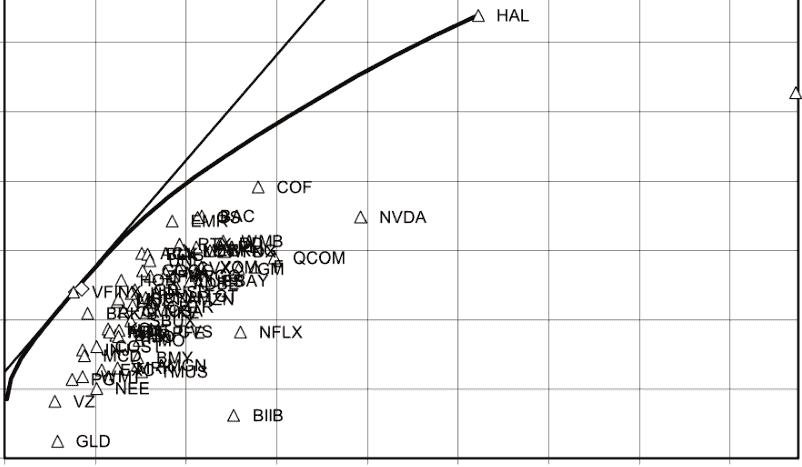

图 3.1 基于布莱克-利特曼模型对标准普尔 100 指数进行投资组合优化的应用示例，2011–2021 年，其中收益率位于垂直轴，波动率或风险位于水平轴。

然而，这些结果仅适用于整个时期。在得出更确定的结论之前，有必要检查投资组合构建时期的结果。

表 3.4 按投资组合构建时期（即 2011–2013、2012–2014，直至 2019–2021）显示投资组合结果。正如预期，BIT 记录了最高平均收益率 120.65%——2011 至 2013 年期间的最大收益率为 1,281.56%——是 PORT 16.99% 的七倍，是 VAN 14.94% 的八倍。然而，它也具有最高波动率 193.22%，大约是 PORT 和 VAN 的 15 倍，这些结果更符合 Kajtazi 和 Moro (2018) 的观点，而非例如 Wu 和 Pandy (2014) 关于比特币有限风险降低潜力的观点。这也体现在 BIT 收益率的变化中，范围从 6.12% 到 1,281.56%。

结果是平均 Sharpe 报酬率与变动率比值为 0.62，在各组中远远最低，而 PORT 和 VAN 分别为 1.28 和 1.09。此外，逐时期比较显示，BIT 的 Sharpe 比率仅在 2011–2013 年超过 PORT，且仅在两次超过 VAN，即 2011–2013 年和 2016–2018 年。

BIT 的业绩表现不佳解释了其较低的百分比配置，范围从三个时期的 0% 到 2018–2020 年的高点 1.95%。与表 3.1、3.2 和 3.3 以及图 3.1 的结果相结合，表 3.4 的结果表明，BIT 的投资组合配置或权重较低。平均值为 0.37%，与表 3.2 中的 0.19% 权重相比没有显著差异，两者均远低于财经媒体建议的 2%–10% 范围。

### 其他注意事项

结果暗示了经典的“买入并持有”策略。尽管结果仅指向对比特币的非常小的配置，但其高波动性可能为短期投资者和交易者提供获利机会，鉴于比特币中引用的价格无效性（例如，Urquhart 2016；Hong 2017；Bariviera 2017）。这意味着可能高于本研究中发现的权重。然而，短期交易伴随着税务影响，实现的收益按普通收入税率征税，通常远高于适用于实现长期资本收益的 15% 美国税率。因此，在纳入州和地方所得税时，税前收益可能减少超过 40%。税务影响只会进一步削弱本已较低的 Sharpe 比率。

本研究的结果为“仅做多”。鉴于其波动性，比特币可能用于涉及“做多”与

表 3.4 PORT、VAN 和 BIT 在各投资组合构建期间的收益率、波动率（按年标准偏差衡量）和 Sharpe 报酬率与变动率比值，包括每期分配给 BIT 的权重

| 投资组合构建期间 | PORT 收益率 | VAN 收益率 | BIT 收益率 | BIT 权重 | | |
|---|---|---|---|---|---|---|
| 2011–2013 | 18.95% | 15.96% | 1,281.56% | 0.51% | | |
| 2012–2014 | 20.28 | 20.24 | 304.51 | 0.00 | | |
| 2013–2015 | 16.01 | 15.00 | 216.87 | 0.21 | | |
| 2014–2016 | 10.34 | 8.69 | 6.12 | 0.00 | | |
| 2015–2017 | 15.64 | 11.29 | 9.15 | 1.04 | | |
| 2016–2018 | 16.97 | 9.12 | 105.10 | 0.79 | | |
| 2017–2019 | 15.93 | 15.16 | 95.49 | 0.00 | | |
| 2018–2020 | 11.47 | 14.03 | 27.85 | 1.95 | | |
| 2019–2021 | 28.25 | 25.96 | 17.91 | 0.43 | | |
| Mean | 16.99 | 14.94 | 120.65 | 0.37 | | |

| 投资组合构建期间 | PORT 波动率 | VAN 波动率 | BIT 波动率 | PORT Sharpe | VAN Sharpe | BIT Sharpe |
|---|---|---|---|---|---|---|
| 2011–2013 | 11.97% | 12.56% | 355.53% | 1.58 | 1.27 | 3.60 |
| 2012–2014 | 8.40 | 9.24 | 295.58 | 2.41 | 2.19 | 1.03 |
| 2013–2015 | 10.55 | 11.08 | 297.47 | 1.52 | 1.35 | 0.73 |
| 2014–2016 | 10.86 | 10.84 | 63.08 | 0.95 | 0.80 | 0.10 |
| 2015–2017 | 9.43 | 10.28 | 17.77 | 1.66 | 1.10 | 0.51 |
| 2016–2018 | 11.60 | 11.10 | 88.61 | 1.46 | 0.82 | 1.19 |
| 2017–2019 | 10.94 | 12.44 | 94.83 | 1.46 | 1.22 | 1.01 |
| 2018–2020 | 19.86 | 19.23 | 81.14 | 0.58 | 0.73 | 0.34 |
| 2019–2021 | 16.73 | 17.78 | 77.71 | 1.69 | 1.46 | 0.23 |
| Mean | 12.74 | 13.14 | 193.22 | 1.28 | 1.09 | 0.62 |

“卖空。”这种主动投资形式仅适用于小部分投资者，卖空仅占总市值的约 2.5%（Pisani 2021）。

投资者还应意识到比特币中数字未体现的一种非系统性风险：非监管风险。因为比特币不在股票、债券和商品等已建立的交易所交易，且其活动不受促进平稳透明运作的中央机构监管，因此容易遭受盗窃。例如，2020 年 2 月 8 日，司法部揭露了一起洗钱 45 亿美元被盗加密货币的阴谋。这种情况并非独一无二，因为加密货币交易所本质上是（未受监管的）平台，是犯罪分子的易攻目标。

然而，非监管风险不仅限于安全问题。例如，由于比特币所有权高度集中，它面临价格操纵的威胁。截至 2022 年，前 10% 的比特币矿工控制了估计 90% 的挖矿量，50 个矿工主导了 50% 的算力。这种集中不仅引发了价格无效性的幽灵，如果发生操纵（甚至只是其感知），还引发了价格“不公平”的幽灵，这在已建立的交易所中很少是一个主要问题。另一个担忧是，由于比特币在没有中央管理机构的平台上交易，投资者无法找回丢失的密码（在受监管的交易所可以找回）。不幸的结果是永久丧失对投资收益的访问。

### 结论

比特币以近来任何资产都无法比拟的方式吸引了投资者的注意，其十年期收益率超过 200%，每日交易活动高达数十亿美元。然而，这种收益是以高波动性为代价的，平均波动率是标准普尔 500 指数的 15 倍。因此，对预期收益进行准确估计可能尤其困难，这提出了本研究的核心问题：应该投资多少比特币，如果有的话？财经媒体的访谈以 2% 到 10% 的资产配置范围回答了这个问题。然而，这个范围在很大程度上是主观的，缺乏客观证据，例如来自在预期收益下最小化风险的优化方法的证据。此外，学术和专业文献的参考价值有限。

本研究通过将布莱克-利特曼投资组合分析模型应用于包含比特币的标准普尔 100 指数股票来解决这个问题。分析从 2011 年 1 月持续到 2021 年 12 月，是迄今为止对加密货币进行考察的最长期分析之一。一系列三年期优化投资组合（在预期收益率下最小化风险）显示，配置非常小：平均 0.37%，远低于已发表观点。


这表明。此外，九个时期中有三个时期的权重为 0%，表明该投资不具备足够的附加值以被纳入投资组合，这也体现在相对较低的夏普回报-变动性比率中。令人印象深刻的回报在很大程度上被高波动性所削弱，表明这是一种在很大程度上具有投机性的资产，尤其是考虑到非监管风险。因此，比特币仅适用于风险承受能力高的个人，而这一特质仅由少数投资者所具备。

### 参考文献

- Ashford, K., and Curry, B. (2022). 比特币可能在一年内达到100,000美元，加密货币公司首席执行官预测. https://www.cnbc.com/2022/04/14/Bitcoin-btc-price-could-hit-100000-within-a-year-crypto-ceo.html
- Ballis, A., and Drakos, K. (2020). 检验加密货币市场中的跟随行为. 金融研究快讯, 33: 101210.
- Barber, B. M., Odean, T., and Zhu, N. (2009). 系统性噪音. 金融市场杂志, 1(4): 547–569.
- Bariviera, A. (2017). 再探比特币的低效性. 经济学快讯, 161 (12月): 1–4.
- Benninga, S. (2008). 财务建模，第3版. Boston: MIT出版社.
- Bessler, W., Opfer, H., and Wolff, D. (2014). 多资产投资组合优化和样本外绩效：对Black-Litterman、均值-方差和天真分散化的评价. 欧洲财务杂志, 23(1): 1–30.
- Black, F., and Litterman, R. (1992). 全球投资组合优化. 金融分析师杂志, 48 (9–10月): 28–43.
- Briere, M., Oosterlinck, K., and Szafarz, A. (2015). 虚拟货币，有形回报：比特币的投资组合分散化. 资产管理杂志, 16(6): 365–373.
- Caporale, G. M., Gil-Alana, L., and Plastun, A. (2018). 加密货币市场中的持续性. 国际商务与金融研究, 46(C): 141–148.
- Cederberg, S., and O'Doherty, M. S. (2015). 企业层面的资产定价异常. 计量经济学杂志, 186(1): 113–128.
- Cheah, E.-T., Mishra, T., Parhi, M., and Zhang, Z. (2018). 比特币市场中的长记忆相关性和低效性. 经济快讯, 167 (6月): 18–25.
- Day, M.-Y., Huang, P., Cheng, Y., Lin, Y.-T., and Ni, Y. (2022). 基于连续看涨（看跌）K线的比特币期货盈利日内交易. 应用经济学快讯, 29(10): 947–954.
- DeMatteo, M. (2022). 专家称比特币可能在2022年达到100,000美元。投资者应该知道什么. https://time.com/nextadvisor/investing/cryptocurrency/Bitcoin-price-predictions/
- Dorn, D., Huberman, G., and Sengmueller, P. (2008). 相关交易与回报. 金融杂志, 63(2): 885–920.
- Elton, E. J. (1999). 预期回报、实现回报和资产定价检验. 金融杂志, 54(4): 1199–1220.
- Frazzini, A., and Pedersen, L. H. (2014). 逆β值投资. 金融经济学杂志, 111(1): 1–25.
- Gal, D., and Rucker, D. D. (2018). 损失厌恶的丧失：它是否会比其收益更具影响力？. 消费者心理学杂志, 28(3): 1–20.
- Gandal, N., and Halaburda, H. (2014). 加密货币市场中的竞争. CESifo工作论文系列, 4980. https://papers.ssrn.com/sol3/papers.cfm?abstract_id=2506577
- Gemayel, R., and Preda, A. (2022). 加密货币市场中的跟随行为：一项交易层面分析. 伦敦国王学院，伦敦. (于财务学会年会上发表，芝加哥，伊利诺伊州，3月23–25日.)
- Glaser, F., Zimmermann, K., Haferkorn, M., Weber, C., and Siering, M. (2014). 比特币——资产还是货币？揭示用户的隐藏意图. 第22届欧洲信息系统会议论文集，特拉维夫，6月 2014.
- Glumov, D. (2013). 大金融危机如何影响投资组合配置和风险态度？消费者财务调查的证据. https://papers.ssrn.com/sol3/papers.cfm?abstract_id=2293189
- Guesmi, K., Saadi, S., Ilyes, A., and Ftiti, Z. (2019). 利用虚拟货币进行投资组合分散化：比特币的证据. 国际财务分析评论, 63(C): 431–437.
- Hattori, T., and Ishida, R. (2020). 期货和现货市场中的套利与比特币价格波动之间的关系：比特币市场的证据. 期货市场杂志, 41(1): 105–114.
- Hoadley, P. (2017). Hoadley交易和投资工具. https://www.hoadley.net/options/options.htm
- Hong, K. (2017). 比特币作为替代性投资工具. 信息技术管理, 18(4): 265–275.
- Holub, M., and Johnson, J. (2019). 比特币价格异常：LocalBitcoins上的点对点交易. 另类投资杂志, 22(1): 127–139.
- Hu, B., Hwang, J. H., Jain, C., and Waham, J. (2020). 应用经济学快讯, 29(2): 140–144.
- Hung, J.-C., Liu, H.-C., and Yang, J. (2021). 比特币期货市场中的价格发现. 实证金融杂志, 62 (6月): 107–120.
- Idzorek, T. M. (2011). Black-Litterman模型逐步指南：纳入用户指定的置信水平. In: S. Satchell (Ed.). *金融市场预期收益预测*. New York: Elsevier, 17–37.
- Jorion, P. (1991). 均值的Bayesian和CAPM估计器：对投资组合选择的影响. *银行与金融杂志*, 15(3): 717–727.
- Junior, G., Palazzi, R. B., Tavares, R., and Klotzle, M. C. (2020). 市场压力和跟随行为：加密货币市场的新方法. *行为金融杂志*, 23(1): 43–57.
- Kahneman, D., Knetsch, J. L., and Thaler, R. H. (1991). 异常：禀赋效应、损失厌恶和现状偏差. *经济学观点杂志*, 5(1): 193–206.
- Kassar, N. (2022). 你的投资组合中应该包含多少加密货币？. Washington Post. https://www.washingtonpost.com/business/how-much-crypto-should-be-in-your-investment-portfolio/2022/02/18/4ce9b92a-90b7-11ec-8ddd-52136988d263_story.html
- Kajtazi, A., and Moro, A. (2018). 比特币在良好分散投资组合中的作用：一项比较性全球研究. *国际财务分析评论*, 61 (1月): 143–157.
- Kharpal, A. (2021). 比特币将达到100万美元？一些分析师看涨，但其他人警告前方风险. https://www.cnbc.com/2021/02/18/Bitcoin-btc-gets-1-million-price-call-but-there-are-risks-ahead.html
- Krueger, P. (2022). 2022年投资比特币有正确的方法吗？是的. https://www.kiplinger.com/investing/cryptocurrency/604070/is-there-a-right-way-to-invest-in-Bitcoin-in-2022-yes
- Kolari, J. W., Liu, W., and Huang, J. Z. (2021). *一种新的资本资产定价模型：理论与证据*. New York: Palgrave Macmillan.
- Li, Y., Jiang, S., Wei, Y., and Wang, S. (2021). 将比特币纳入你的投资组合：面向广泛商品资产的新颖投资组合优化框架. *金融创新*, 7(1): 2–26.
- Liu, W. (2019). 加密货币间的投资组合分散化. *金融研究快讯*, 29 (6月): 200–205.
- Loviscek, A. (2021). 投资多少，如果有的话，贵金属？21世纪的视角. *投资杂志*, 20(4): 95–111.
- Merkle, C. (2020). 财务损失厌恶错觉. *金融评论*, 24(2): 381–413.
- Merli, M., and Roger, T. (2013). 什么驱动个体投资者的跟随行为？. *金融*, 34(3): 67–104.
- Nazir, F., and Kumar, Z. D. (2019). 比特币的信息低效性：基于高频数据的研究. *国际商务与金融研究*, 47(C): 344–353.
- Nepp, A., and Karpeko, F. (2022). 炒作作为全球市场的一个因素：比特币案例. *行为金融杂志*. DOI: 10.1080/15427560.2022.2073593
- Nadarajah, S., and Chu, J. (2017). 论比特币的低效性. *经济学快讯*, 150(C): 6–9.
- Pisani, B. (2021). 1月份卖空者亏损910亿美元，因为GameStop引发了他们押注下跌股票的短期挤压. https://www.cnbc.com/2021/01/26/short-sellers-are-down-91-billion-in-january-as-gamestop-leads-squeeze-in-stocks-they-bet-against.html
- Sharma, G. D., Jain, M., Mahendru, M., Bansal, S., and Kumar, G. (2019). 比特币作为投资替代品的出现：系统性综述和研究议程. *商业与信息杂志*, 14(1): 47–84.
- Sharpe, W. F. (1994). 夏普比率. *投资组合管理杂志*, 21(1): 49–58.
- Stankiewicz, K. (2022). Kevin O'Leary称他已将20%的投资组合投入加密货币，包括代币和区块链公司. https://www.cnbc.com/2022/03/11/kevin-oleary-20percent-of-my-portfolio-is-in-crypto.html
- Urquhart, A. (2016). 比特币的低效性. *经济学快讯*, 148 (11月): 80–82.
- Vidal-Tomás, D. (2020). 比特币市场中的所有频率都重要：一项效率分析. *应用经济学快讯*, 29 (12月): 212–218.
- Wu, C., and Pandy, V. K. (2014). 比特币的价值：提高投资者投资组合效率. *财务规划杂志*, 27(9): 44–52.
- Yarovaya, L., Matkovskyy, R., and Jalan, A. (2019). “黑天鹅”事件（COVID-19）对加密货币市场跟随行为的影响. *金融研究快讯*, 29 (6月): 200–205.
- Zweig, J. (2022). 你可以做对加密货币，但仍然可能操作失误. *华尔街日报*. https://www.wsj.com/articles/Bitcoin-you-can-get-crypto-investing-right-and-still-play-it-wrong-11643990277


## 第 4 章：全球央行数字货币研究与进展：对加密货币的启示

Peterson K. Ozili

尼日利亚中央银行

### 4.1 引言

央行数字货币（CBDC）是现代金融体系中正在进行的变革和颠覆性金融创新的一部分。从历史上看，金融创新属于私营部门代理人（如受监管的金融机构和金融科技公司）的范畴。他们开发创新理念并创造创新金融产品，这些产品可能会被中央银行或监管机构批准或禁止。这意味着，颠覆性金融创新的发起者主要是私营部门代理人，而不是中央银行。这种历史理解很重要，因为它有助于理解为什么为任何中央银行发行 CBDC 是一项重大的举措，因为发行 CBDC 为中央银行提供了创新的机会，尽管中央银行天生并不具备创新性。

关于 CBDC 的讨论最早出现在 2017 年。政策和学术界关于 CBDC 的讨论在 2019 年中期以及 2020–2022 年 COVID-19 大流行期间变得流行。在此期间，人们乐观地认为 CBDC 将为中央银行提供创新和扩大货币作为交换媒介、支付替代品以及改善货币政策执行工具的有用性的机会。发行 CBDC 的其他广泛认可的好处包括其促进跨境支付、降低现金管理成本、增加金融包容性以及在 CBDC 金融交易中提供相对较低交易成本的潜力（Mancini-Griffoli et al. 2018; Ozili 2022a）。

要充分了解 CBDC 今日存在的原因，我们需要了解加密货币的迅猛崛起。第一种加密货币开发于 2008 年。此后，加密货币从 2012 年到 2017 年开始获得关注，并在 2019 年在全球范围内声名鹊起。大量金融活动是使用加密货币（也称为私人数字货币）进行的。许多加密货币不可控制的上涨、社会成员的广泛使用以及其规避所有形式监管的能力，已成为许多国家金融体系监管机构的重大担忧（Ozili 2022b）。

监管机构和中央银行严重担心加密货币活动可能对金融体系构成系统性风险并威胁金融稳定（Kim and Kwon 2022）。来自加密货币活动的感知威胁为中央银行提供了额外动力，以将发行央行数字货币的可能性作为对加密货币崛起的一种应对反应予以认真对待（Berentsen and Schär 2018）。此后，许多中央银行已宣布正在研究 CBDC，而其他中央银行表示将迟早启动 CBDC 试点项目（Barontini and Holden 2019）。

中央银行推动发行和采用 CBDC 遭到了褒贬不一的反应。有些人认为中央银行不具备以可持续方式开发和运营 CBDC 所需的技术成熟度（Panetta 2018）。另一些人认为，既然现有的货币替代品，如借记卡和信用卡，运作良好，如果中央银行将 CBDC 作为支付替代品发行，很多人将不会使用 CBDC；因此，中央银行没有强烈的理由这样做（Emery 2019）。另一些人还认为，现有的法律和政治瓶颈可能会挫败中央银行开发 CBDC 的努力（Bossu et al. 2020）。

尽管中央银行在发行和采用 CBDC 方面可能遇到潜在的好处和瓶颈，但毫无疑问，CBDC 正在快速成为一种必要的发明或创新，不能抗拒太久。目前不感兴趣发行 CBDC 的中央银行最终将对稍后发行 CBDC 产生兴趣——这只是时间的问题。需要提出的问题是，CBDC 能否与加密货币共存，还是加密货币必须被禁止，以便让 CBDC 在以加密货币为代价的社会中繁荣，或者应该受到监管，这意味着它将失去一些匿名特征。

但要回答这些问题，首先需要了解 CBDC 的定义以及它与加密货币的比较。同样重要的是，识别世界上的重要 CBDC 研究以及影响 CBDC 发行和采用的因素。本章的目的是介绍关于央行数字货币的讨论。本章从 CBDC 的定义开始，并将 CBDC 与加密货币进行比较。它还回顾了文献中的最近 CBDC 研究，并对世界上 CBDC 研究的现状提供了全球视角。此后，它识别了影响 CBDC 发行和采用的因素。最后，本章对最近 CBDC 发展对加密货币的影响得出了一些启示。

CBDC 研究在文献中不断增长，尽管它仍然只占金融创新文献的一小部分。最近 CBDC 文献中的著名研究包括 Kim and Kwon (2022); Allen et al. (2020); Auer and Böhme (2020); Ward and Rochemont (2019); Ozili (2022a); 和 Agur, Ari, and Dell’Ariccia (2022)。CBDC 文献中的大部分关注点都放在 CBDC 设计以及如何将 CBDC 用于零售和批发目的上（参见，例如，Allen et al. 2020; Auer and Böhme 2020; Agur, Ari, and Dell’Ariccia 2022; Ward and Rochemont 2019）。

文献中的政策研究已考察了同时使用现金和 CBDC 而非仅使用 CBDC 或现金的好处（参见，例如，Davoodalhosseini 2021; Armelius, Claussen, and Hull 2021）。其他研究识别了 CBDC 可能对金融体系稳定性构成的风险，例如可能出现商业银行存款挤兑和网络安全风险（参见，例如，Kim and Kwon 2022; Bindsell 2020）。

更重要的是，几项研究强调中央银行在开发有效的央行数字货币方面合作的必要性，这也为中央银行提供了相互学习的机会（Barontini and Holden 2019）。

本章的讨论对文献的贡献体现在以下几个方面：它提供了对 CBDC 必要性的视角，它识别和讨论了世界各地的全球 CBDC 研究，并且它将 CBDC 识别为一种旨在与加密货币共存或对抗加密货币增长的创新。

本章其余部分的组织安排如下：第 2 节介绍概念背景，定义 CBDC，并描述 CBDC 与加密货币之间的相似性和差异性。第 3 节介绍最近的 CBDC 研究和世界各地各地区的研究。第 4 节对加密货币得出了一些启示。结论在第 5 节中介绍。

### 4.2 概念背景

本节介绍央行数字货币的简单定义。它还介绍了文献中 CBDC 的一些技术定义。本节介绍了 CBDC 与加密货币之间的相似性和差异性。

#### 4.2.1 CBDC 定义

简单来说，CBDC 是法定货币的电子形式。文献中有 CBDC 的技术定义。例如，Meaning et al. (2018, 4) 将 CBDC 定义为“可用于结算支付或作为价值储存手段的中央银行电子法定负债”。Kiff et al. (2020, 9) 将 CBDC 定义为“由中央银行发行的主权货币的数字表示，是司法管辖区中央银行或其他货币当局的负债”（意译）。Ward and Rochemont (2019, 3) 将 CBDC 定义为“与传统准备金或结算账户中的余额不同的中央银行货币的数字形式”。Kumhof & Noone (2018, 4) 将 CBDC 定义为“中央银行电子货币，（i）比准备金可访问性更广，（ii）相对于现金可能具有更大的零售交易功能，（iii）具有与其他形式的中央银行货币分离的运营结构，从而可能服务于不同的核心目的，（iv）可以承付利息，在现实假设下支付的利率将与准备金利率不同。”

#### 4.2.2 CBDC 与加密货币之间的相似性和差异性

CBDC 和加密货币之间的一个相似之处是，它们都是电子形式的货币。其次，它们都基于区块链和分布式账本技术进行交付。第三，它们都可以私下用于促进双方同意进行的交易。

CBDC 与加密货币之间的差异如下：

- CBDC 是由中央银行发行的一系列广泛的数字货币，而加密货币是一系列私人发行的数字资产或私人发行的数字货币（Richards 2021; Ozili 2022a）。


- CBDC 的价值始终与实体货币等值挂钩 1:1，而大多数加密货币并未与任何实体货币挂钩 1:1（稳定币除外）（Klein, Gross, and Sandner 2020）。
- CBDC 的计价单位为主权发行方的货币，而加密货币则不是。
- CBDC 由发行中央银行支持，并依赖对中央银行或政府的信任，而加密货币不由任何发行方支持，而是依赖用户对控制系统的软件协议的信任（Kiff et al. 2020）。
- 所有 CBDC 都可以作为完美的货币替代品，而包括稳定币在内的加密货币则不是完美的货币替代品，因为它们不具备货币的关键属性：在日常生活中，它们很少被用作或接受为零售购买的支付手段，它们不被用作记账单位，而且其价格通常波动较大（Richards 2021）。

### 4.3 世界各地的 CBDC 研究与发展

本节简要概述了世界上几个地区最近的央行数字货币研究与进展。它还展示了人们对相对于加密货币的 CBDC 信息的关注。

#### 4.3.1 文献中的最近 CBDC 研究

最近的 CBDC 研究（如 Virtanen 2021）表明，推动全球对 CBDC 兴趣的主要因素是现金使用量的下降以及对更好清算系统的需求。Khiaonarong 和 Humphrey（2022）在其实证分析中证实了这一观点。他们考察了 2012 年至 2019 年间 25 个国家的情况，并表明，在 CBDC 采用之前，现金作为支付手段的使用量多年来一直在下降。他们认为，各国中观察到的现金使用量减少，如果中央银行发行 CBDC，可以加速零售 CBDC 的采用。

文献中的其他近期研究指出了发行 CBDC 的益处，例如降低交易成本、减少逃税、减少金融犯罪、提高金融包容性、加强对非法活动的保护、降低移民汇款成本、降低铸币税收益成本、改善货币政策的执行、使跨境交易更加顺畅，以及更高效地为支持循环经济等可持续发展目标提供融资（参见，例如，Taskinsoy 2021；Jossey 2022；Ozili 2022a；Edwards 2021；Ozili 2022d）。

关于 CBDC 设计，Taskinsoy（2021）和 Sethaput 与 Innet（2021）认为，CBDC 应具备现金或纸币的属性，应使用区块链技术来执行和结算点对点交易，应尽量减少侵入性，并且其益处应大于成本。然而，Edwards（2021）和 Soderberg（2022）指出，在所有国家顺利推出 CBDC 将会面临困难，但这种困难可以通过国际合作与协调来克服。

文献中的几项近期政策研究呼吁在发行 CBDC 时保持谨慎。例如，Jossey（2022）指出，CBDC 可能会成为政府用于对公民生活施加不当经济和社会控制的强大工具，许多中央银行推动采用 CBDC 是为了在数字时代寻求自我保存和重要性，而不一定是因为 CBDC 在公民生活中带来了任何持久的益处。

Rizk（2022）表明，发行 CBDC 可能会带来法律问题，尤其是当中央银行法律未授权向公众发行 CBDC 时。Taskinsoy（2021）和 Ozili（2022a）还确定了与 CBDC 采用相关的其他挑战和风险，例如 CBDC 设计权衡、可能的银行存款挤兑、数据隐私问题、私人商业银行中介作用的减少，以及 ATM 使用量的下降。

根据对上述近期研究的回顾可以看出，尽管 CBDC 可以提供许多益处，但为了使 CBDC 对社会产生持久的积极影响，还应理解和缓解重要风险。

#### 4.3.2 非洲的 CBDC 发展

对公开可获取信息的审查表明，很少有非洲国家对发行 CBDC 表现出兴趣。肯尼亚、加纳、津巴布韦、坦桑尼亚、埃及、摩洛哥、乌干达和赞比亚等非洲国家已表示有兴趣探索发行 CBDC。与此同时，尼日利亚已发行 CBDC。2021 年尼日利亚加密货币活动的高水平是影响尼日利亚中央银行发行 CBDC 的主要因素。尼日利亚中央银行禁止尼日利亚银行促进加密货币交易和活动；随后，中央银行发行了一种名为 eNaira 的 CBDC（Ozili 2022c）。

其他非洲国家（如加纳、毛里求斯和南非）已启动试点 CBDC 项目并正在进行测试。尚未决定是否发行 CBDC 的非洲国家包括卢旺达、喀麦隆、圣多美和普林西比以及吉布提。导致非洲中央银行对 CBDC 兴趣不大的因素包括智能手机渗透率低、缺乏政治支持中央银行发行 CBDC、支付系统不发达、数字文盲普遍、商家拒绝接受数字支付，以及现有技术基础设施遭受网络攻击的增加（Ozili 2022a）。

#### 4.3.3 欧洲的 CBDC 发展

最近，欧洲出现了关于 CBDC 的政策讨论。欧洲现有的关于 CBDC 的政策讨论表明，有计划为欧盟国家开发数字欧元。Boonstra（2022）认为，创建一个完善的数字欧元将有助于恢复欧元在过去十年中停滞不前的国际地位，数字欧元可以改善欧元区外的跨境贸易。

Grünewald、Zellweger-Gutknecht 和 Geva（2021）表明，欧洲央行（ECB）计划发行数字欧元，该数字欧元将由欧盟所有国家使用，发行数字欧元将帮助欧盟国家履行其货币政策职责以及作为最后贷款人的角色（Panetta 2021）。推动发行数字欧元很大程度上是由于科技巨头构成的潜在威胁，这些公司也在发行自己的私人数字货币以与传统货币竞争（Mayer 2019）。欧洲央行的数字欧元将能够追踪用户，这与不允许追踪用户的加密货币形成鲜明对比（Mayer 2019）。

欧盟以外的欧洲国家，如英国、土耳其、冰岛、阿尔巴尼亚、乌克兰和俄罗斯，也在研究和探索发行 CBDC。欧洲国家研究和探索发行 CBDC 的目的是发展关于 CBDC 的先进知识和专业知识，使欧洲国家能够确定适合其经济体的 CBDC 的确切用例。

#### 4.3.4 美洲地区的 CBDC 发展

根据公开可获取信息的观察表明，仅巴哈马和东加勒比货币联盟在本地区发行了 CBDC，而该地区的其他国家仍在探索发行 CBDC 的可能性。巴哈马发行了沙元 CBDC，主要目的是提高金融包容性并防止非法资金流动。东加勒比货币联盟发行了一种数字货币，以提高支付效率并增加金融包容性。这些国家有大量无银行账户的成年人，预计发行 CBDC 可以帮助金融服务提供商触达这些国家中更多无银行账户的成年人。美国、墨西哥、秘鲁和加拿大等其他国家仍在构建专业知识和知识，以确定其国内适当且最佳的 CBDC 用例，而巴西和牙买加等国家已启动 CBDC 试点测试。

#### 4.3.5 亚洲的 CBDC 发展

与欧洲和非洲相比，世界上最先进的 CBDC 位于东南亚的中国，该地区是唯一发行运营型 CBDC 的国家。Wang（2022）表明，中国发行了双层 CBDC“e-CNY”，它将成为流通中现金的替代品，并将与实体货币共存。然而，Wang 认为，e-CNY 的可持续性将受到中国经济、政治经济、法律、监管和治理因素的影响。

Didenko 和 Buckley（2021）认为，尽管中国走在该地区发行 CBDC 的前列，但中国 CBDC 也存在一些需要妥善理解的风险。他们表示，现在不是该地区国家发行 CBDC 的时候；相反，该地区的中央银行应开始打基础，以构建关于 CBDC 的特定知识和专业知识。印度、柬埔寨、新加坡、菲律宾、韩国、阿联酋和香港等其他亚洲国家正在探索发行和运营 CBDC 的论证依据。

#### 4.3.6 大洋洲的 CBDC 发展

大洋洲地区的几项政策讨论指出，目前对发行 CBDC 普遍缺乏兴趣，大洋洲地区的中央银行认为，目前没有强有力的政策理由这样做。例如，澳大利亚的央行官员（根据 Richards et al. 2020；Emery 2019；以及 Richards 2021）认为，目前发行 CBDC 的政策依据薄弱。这是因为澳大利亚现有的电子支付系统（也称为新支付平台 NPP）已经为家庭和企业提供了安全、快速、便捷、低成本的广泛支付服务，而 CBDC 也承诺提供此类服务。因此，在澳大利亚发行 CBDC 作为支付替代方案将是对现有支付系统的不必要的重复。

与此同时，在新西兰，Hawkesby 和 Wadsworth（2020）断言，新西兰央行（或储备银行）目前没有发行 CBDC 的计划，但将密切监测全球 CBDC 发展以确定合适的时机。该地区的其他国家未显示出发行 CBDC 的强烈意愿。


#### 4.3.7 全球对 CBDC 信息的兴趣

在前一节中已识别出 CBDC 发展的一些进展，评估全球对 CBDC 信息或知识的兴趣至关重要。进行此类评估的一种方法是，观察 CBDC 作为 Google® 等主要搜索引擎上的搜索关键词的趋势。数据来自 Google Trends 数据库，时间跨度为 2017 年 1 月至 2022 年 3 月，共五年。

图 4.1 显示，全球对 CBDC 互联网信息的兴趣在 2017 年开始升温，并在 2019 年至 2022 年间显著增加。同时，与加密货币相比，图 4.2（见下一页）显示出关于 CBDC 和加密货币信息的相反兴趣，即从 2018 年到 2022 年，全球对加密货币信息的兴趣越高，全球对 CBDC 信息的兴趣越低。这表明，对 CBDC 信息更感兴趣的人对加密货币信息的兴趣较少，反之亦然。

此外，图 4.3（见第 69 页）显示，牙买加、新加坡、肯尼亚、阿联酋和尼日利亚记录了对 CBDC 互联网信息最高的兴趣。总体而言，这些数据表明，对 CBDC 日益增长的兴趣可能导致对加密货币的兴趣降低。

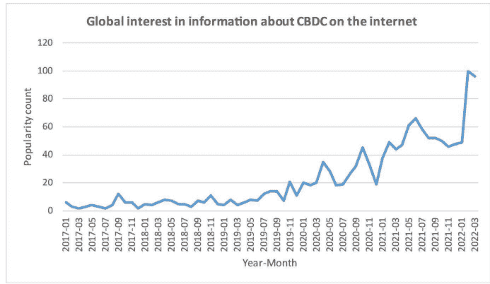

图 4.1 互联网上关于 CBDC 的全球兴趣

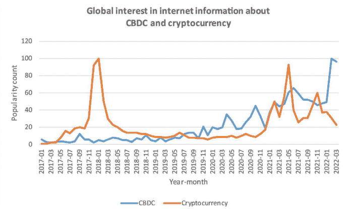

图 4.2 关于 CBDC 和加密货币的互联网信息全球兴趣（来源：Google Trends）

### 4.4 CBDC 采用：对加密货币的影响

CBDC 的出现对加密货币的生存有多重影响。第一个影响是 CBDC 可能取代加密货币（Allen, Gu, and Jagtiani 2022）。如果加密货币开发者不能确保加密货币的负责任和有序发展，一个发展良好的 CBDC 可以完全将加密货币从社会中取代。最近，加密货币（或称加密资产）更适合作为投机资产而非货币使用（Nguyen et al. 2019）。加密货币的高估值和高波动性使其不太适合作为货币使用。这可能导致人们对在日常零售交易中使用加密货币失去信心。

CBDC 的出现对加密货币的另一个影响与在正式支付系统中监管所有类型的数字货币的需求有关。CBDC 的采用引发了关于是否应通过加密货币监管使 CBDC 在正式支付系统中与加密货币共存的严重争论（Bolt, Lubbersen, and Wierts 2022）。这是一个敏感话题，因为此类监管可能要求加密货币失去其一些或全部匿名功能或加密属性，而这是使其成为加密货币的基本特征。如果监管完全移除了

关于 CBDC 信息兴趣最高的国家
（2017 年 1 月 - 2022 年 3 月）

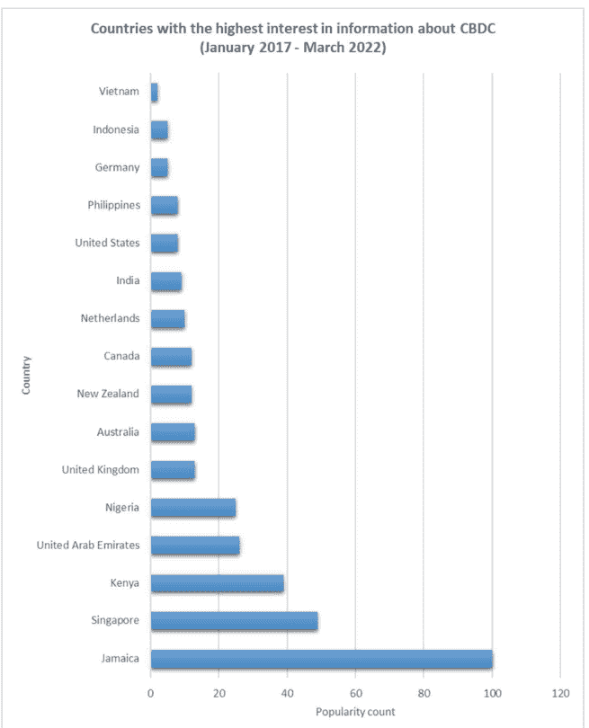

图 4.3 关于 CBDC 信息兴趣最高的国家（来源：Google Trends）

加密货币的匿名功能或加密技术，那么它就不再是加密货币，这可能导致其崩溃。

CBDC 出现对加密货币的另一个影响是稳定币的出现，稳定币使加密货币对政府和社会成员更具吸引力（Bullmann, Klemm, and Pinna 2019）。

稳定币是与硬通货按 1:1 比例挂钩的加密货币。稳定币可以解决加密货币的一些问题；例如，它们可以缓解加密货币的波动性问题（Smales 2021）。

然而，它们也在金融系统中造成低效率和流动性风险，这是金融系统监管机构不希望看到的。出于这一原因，许多 CBDC 倡导者认为，CBDC 而非稳定币将成为现代金融体系及未来的运营货币，仅仅是因为 CBDC 设计提供的益处超过了稳定币的益处（Allen, Gu, and Jagtiani 2022）。

最后，CBDC 也面临自身的挑战。例如，带息 CBDC 可能导致银行存款挤兑，给商业银行带来资金风险（Garratt and Zhu 2021）。此外，许多国家的数字支付基础设施薄弱，如果利用技术基础设施不足部署 CBDC，可能导致许多人被排除在金融服务之外。同样，如果利用技术基础设施不足部署 CBDC，还存在网络攻击的风险，以及政府对个人和企业 CBDC 交易进行不必要和不当监控的风险（Atako 2021）。

尽管存在这些挑战，CBDC 似乎提供了比其风险更具吸引力和优势的更多好处。例如，它们可以使支付更便宜、更安全、更快速、更可靠。相比之下，加密货币和稳定币尚未证明自己能提供更便宜或更快的支付。这使得 CBDC 在日常交易中比加密货币和稳定币更具吸引力。

### 4.5 结论

本章介绍了关于中央银行数字货币研究与发展的讨论。它定义了 CBDC，并强调了 CBDC 与加密货币之间的差异和相似之处。对近期 CBDC 研究的回顾表明，CBDC 可以带来诸多好处，但也伴随着一些风险。已有呼吁在开发和采用 CBDC 时保持谨慎。中央银行被敦促在开发 CBDC 时寻求国际合作与协调。就 CBDC 发展而言，只有少数几个国家已经发行了 CBDC。许多国家对研究发行 CBDC 的可能性表现出兴趣，而其他国家在决定这样做之前，正在积累关于 CBDC 的特定知识和专业知识。

公众对 CBDC 信息的兴趣也在增长，这种兴趣可能导致对加密货币的兴趣下降。

CBDC 的出现对加密货币有许多影响。首先，它可能导致对加密货币监管的呼吁；它可能导致对稳定币的接受，尽管稳定币的益处并不超过发行 CBDC 的益处；最后，CBDC 对社会的整体益处可能超过其风险，从而使其比加密货币更具吸引力。

未来，中央银行将寻求对金融和货币体系保持更大控制权，即使社会中现金使用越来越少。中央银行希望通过发行自己的数字货币进行创新，这为私人数字货币描绘了一个黯淡的未来。这是因为中央银行有权在金融体系中禁止使用私人数字货币。

然而，中央银行禁止加密货币的权力可能会因政治和法律瓶颈而减弱，因为法律规则可能阻止中央银行禁止用于私下协商交易的私人数字货币。这些瓶颈为加密货币创造了不确定的未来，但为 CBDC 留下了更确定的未来。只有未来才能揭晓 CBDC 和加密货币是否会共存，或者 CBDC 是否会终结私人数字货币（也称为加密货币）的时代。

### 参考文献

- Agur, I., Ari, A., and Dell’Ariccia, G. (2022). 设计中央银行数字货币。*货币经济学杂志*, 125: 62–79.
- Allen, F., Gu, X., and Jagtiani, J. (2022). 金融科技、加密货币和 CBDC：中国的金融结构转型。*国际货币与金融杂志*, 124: 102625.
- Allen, S., et al. (2020). 中央银行数字货币的设计选择：政策与技术考量（编号 w27634）。国家经济研究局。
- Armelius, H., Claussen, C. A., and Hull, I. (2021). 关于类似现金 CBDC 的可能性。*瑞典央行工作备忘录*。
- Atako, N. (2021). 超越所有权的隐私：解决数字美元中的访问难题。*范德比尔特娱乐与技术法杂志*, 23(4)。
- Auer, R., and Böhme, R. (2020, March). 零售中央银行数字货币的技术。*BIS 季度评论*。
- Baronitini, C., and Holden, H. (2019). 谨慎行事——关于中央银行数字货币的调查。*BIS 论文*, 第 101 号。
- Berentsen, A., and Schär, F. (2018). 中央银行电子货币的理由与中央银行加密货币的非理由。可在 SSRN 3194981 查阅。


- Bindseil, U. (2020). 分层 CBDC 与金融体系。可在 SSRN 上获取 3513422。

- Bolt, W., Lubbersen, V., and Wierts, P. (2022). 取得平衡：加密货币、稳定币与央行数字货币。*支付策略与系统杂志*，16(1): 39–50.

- Boonstra, W. (2022年3月) CBDC 与欧元的国际地位。*SUERF 政策简报*，第 269 期。

- Bossu, W., 等人. (2020). 央行数字货币的法律方面：中央银行与货币法考量。可在 SSRN 上获取 3758088。

- Davoodalhosseini, S. M. (2021). 央行数字货币与货币政策。*经济动态与控制杂志*，104150.

- Didenko, A. N., and Buckley, R. P. (2021). 央行数字货币：应对太平洋地区金融包容性挑战的潜在回应。*新南威尔士大学法律研究论文*，21–63.

- Edwards, S. (2021). 央行数字货币与新兴市场：货币替代挑战。*挑战*，1–12.

- Emery, D. (2019). *澳大利亚的金融科技与央行数字货币*（第 1028 号）。ADBI 工作论文系列。

- Garratt, R., and Zhu, H. (2021). 关于与异质银行的附息央行数字货币。可在 SSRN 上获取 3802977。

- Grunewald, S., Zellweger-Gutknecht, C., and Geva, B. (2021). 数字欧元与欧洲央行权力。*共同市场法律评论*，58(4): 1029–1055.

- Hawkesby, C., and Wadsworth, A. (2020). 通力合作，做到“精准”。新西兰储备银行论文。在惠灵顿新西兰皇家钱币学会年会上的演讲。

- Jossey, P. H. (2022). 央行数字货币威胁全球稳定与金融隐私。竞争企业研究所。*议题分析*，第 1 号。

- Khiaonarong, T., and Humphrey, D. (2022). 现金使用下降与零售央行数字货币的需求。*IMF 工作论文*，第 027 号。

- Kiff, M. J., 等人. (2020). 零售央行数字货币研究调查。*IMF 工作论文*。

- Kim, Y. S., and Kwon, O. (2022年1月). 央行数字货币、信贷供给与金融稳定。*货币、信贷与银行杂志*。

- Klein, M., Gross, J., and Sandner, P. (2020). 数字欧元与分布式账本技术在央行数字货币中的作用。法兰克福金融与管理学校 GmbH。*FSBC 工作论文*。

- Kumhof, M., and Noone, C. (2018). 央行数字货币——设计原则与资产负债表影响。*英格兰银行员工工作论文*，第 605 号。

- Mancini-Griffoli, T., 等人. (2018). 阐释央行数字货币。*IMF 员工讨论笔记*，18(08).

- Mayer, T. (2019). 与天秤币竞争的数字欧元。*经济学家之声*，16(1).

- Meaning, J., Dyson, B., Barker, J., and Clayton, E. (2018). 扩宽狭义货币：带有央行数字货币的货币政策。*员工工作论文*，第 724 号。

- Nguyen, T. V. H., Nguyen, B. T., Nguyen, K. S., and Pham, H. (2019). 货币政策对加密货币市场的非对称影响。*国际商业与金融研究*，48: 335–339.

- Ozili, P. K. (2022a，2月). 世界各地的央行数字货币研究：文献综述。*洗钱控制杂志*。

- Ozili, P. K. (2022b). 央行数字货币可能导致加密货币崩溃。可在 SSRN 上获取 3850826。

- Ozili, P. K. (2022c). 尼日利亚的央行数字货币：机遇与风险。可在 SSRN 上获取 3917936。

- Ozili, P. K. (2022d). 循环经济与央行数字货币。*循环经济与可持续发展*，1–16.

- Panetta, F. (2018). 21世纪现金：中央银行、技术创新与数字货币。*我们是否需要央行数字货币*，28–31.

- Panetta, F. (2021). 满足欧洲人期望的数字欧元。SUERF，*SUERF 政策简报*，95.

- Richards, T., Thompson, C., and Dark, C. (2020). 零售央行数字货币：设计考量、理由与影响。澳大利亚储备银行。

- Richards, T. (2021). 支付的未来：加密货币、稳定币还是央行数字货币？在澳大利亚企业财务协会发表的演讲。

- Rizk, A. (2022). 央行数字货币：法律与监管问题。可在 SSRN 上获取 4073218。

- Sethaput, V., and Innet, S. (2021). 央行数字货币（CBDC）的区块链应用。载于：2021年第三届区块链计算与应用国际会议（BCCA），3–10. IEEE.

- Smales, L. A. (2021). 加密货币间的波动性溢出。*风险与金融管理杂志*，14(10): 493.

- Soderberg, G., 等人. (2022). 央行数字货币幕后：新兴趋势、洞察与政策启示。*FinTech 笔记*，第 004 号。

- Taskinsoy, J. (2021). 告别实体现金，欢迎央行数字货币。可在 SSRN 上获取 3972858。

- Virtanen, P. (2021). 央行数字货币：瑞典与大不列颠案例。于维斯凯拉大学商学院与经济学院，*工作论文*。

- Wang, H. (2022). 中国的央行数字货币方法。可在 SSRN 上获取 4036466。

- Ward, O., and Rochemont, S. (2019). 理解央行数字货币（CBDC）。精算师学会与学院。

Taylor & Francis
Taylor & Francis Group
http://taylorandfrancis.com

## 第 5 章

## 区块链治理：治理还是不治理？

Evrim Tan

比利时鲁汶大学

数字技术领域的颠覆性创新是我们时代的决定性特征。区块链与人工智能、大数据、机器人技术、量子计算机以及许多其他新兴技术将成为创建自动化、去中心化和人机混合系统的关键组成部分，这些系统很可能在不久的将来定义商业、社会和政府领域的交易体系。

但是，为什么区块链是这一转型中的关键技术呢？这项技术的重要性在于，它为代理问题提供了一个可行的解决方案——权力委派与对代理人行为控制之间的权衡。当治理中的合法行为者将部分权力委托给可信赖方，并因此放弃部分治理控制权时，代理问题便会发生。在区块链中，信息被归档在分布式账本上，该账本在用户网络中共享，每个参与者（称为节点）都持有账本副本并记录所有交易。

通过就一种共识机制达成一致，节点验证交易，提供不可更改（或几乎不可更改）的交易记录，并确保可追溯性。通过这种方式，区块链确保了几乎不可攻破的加密数据去中心化系统，无需中央机构来确保系统的连续性。

通过创建自治、透明、安全的分布式系统，基于区块链的系统可能使任何治理体系中的中介机构被移除，并以算法置信系统取而代之（Tan and Rodrigo Müller 2021; De Filippi et al. 2020）。

这一特性具有巨大潜力，以更透明、高效、有效的方式重塑全球金融体系、选举制度和政府（Tapscott and Tapscott 2016）。理论上，区块链可以颠覆任何控制合法性位于更高制度权威或组成者手中的交易体系。

区块链的这一技术特征使得治理问题成为一个矛盾而复杂的概念，因为并非所有人都认为没有中央控制的治理是可行或可取的。天秤币协会*的失败，或区块链系统在公共部门采用率低（Lindman et al. 2020），便是例证。全球体系建立在政府和大企业的主导地位之上，它们掌控着货币政策和法规。

政府和商业领域的集权结构希望享受这项技术的好处，例如因交易成本降低而提高效率、通过分布式账本提升安全性，同时不一定失去对治理手段和权力的控制。与此相反，社群倡议和加密无政府主义社群认为，这项技术的真正价值在于创建一个没有政府或大公司主导游戏规则的新全球金融和社会秩序。这些倡议的真正挑战是围绕代码设计治理体系，并确保社区为每个人的利益而采取去中心化的行动。

另一层复杂性在于，作为一种技术，区块链重新确立了在初始政策和系统设计阶段（而非实施阶段）中信任和合法性的重要性。交易规则在设计阶段确定，一旦做出决定，对系统的更改需要获得授权用户的同意。此外，区块链可以确认交易的真实性，但交易中给定的输入是否真实，或交易规则是否公平制定，超出了区块链的技术范畴。因此，“谁将被授权对系统进行更改？”以及“在系统变更中应遵循什么规则/程序？

system)”是区块链治理的关键问题。Vili Lehdonvirta 将区块链治理的这些固有矛盾称为“治理悖论”，因为一旦你解决这些治理问题，区块链相对于传统数据基础设施就失去了其价值，因为你已经在信任某个组织或流程来制定规则（Werbach 2018）。

作为一种最显著特征是在无需可信第三方的情况下在治理过程中建立信任的技术，了解治理什么以及如何治理对于区块链技术的应用至关重要。本章的核心焦点将是这一问题。首先，将讨论不同学科中关于区块链治理的各种理论方法。然后，将审视基于区块链的系统中治理包含什么，接着是系统设计者需要做出哪类治理决策。

### 区块链治理的理论方法

区块链治理的概念范围在不同学科中差异很大。例如，在信息与计算机科学文献中，区块链治理通常关注区块链网络中如何安排决策权、激励和问责机制，以鼓励在资源使用中出现理想行为（例如，Beck et al. 2018; Rikken et al. 2019; Van Pelt et al. 2021）。

在商业管理文献中，区块链治理被概念化为具有持续关系的个人和群体就如何在制度环境中适应变化进行讨价还价的过程（例如，Allen et al. 2020; Daluwathumullagamage and Sims 2020; Gruin 2020）。

在经济学文献中，更具体地说是在共同体研究中，区块链治理与在多种不同交互层面同时运行的多中心系统相关联，治理决策被视为类似于社区共用资源的治理（例如，Howell, Potgieter, and Sadowski 2019）。

在早期的一项研究中，我们发现文献中关于如何操作化区块链治理的研究分为三类（Tan et al. 2022）。

- 第一类研究关注区块链的基础设施（例如，Ertz and Boily 2019; Ozdemir, Ar, and Erol 2020）。在这些研究中，区块链治理嵌入区块链基础设施的技术设计中，研究重点是阐明系统设计者关于区块链架构、区块链应用程序和技术标准的不同选择如何塑造区块链治理。

- 第二类涉及区块链治理的运营过程，并捕捉影响用户之间信息交换、交易和集体行动的技术设计选择和算法（例如，De Filippi and Loveluck 2016; Reijers et al. 2018; Van Pelt et al. 2021）。通过链上和链下方法、提案以及共识机制进行的决策是此类研究的重点。

- 在第三类中，区块链被视为一种治理技术，它允许去中心化的、算法的和自动化的治理形式来实施政策决策（例如，Allen et al. 2020; Yeung and Galindo 2019）。在这些研究中，区块链治理关注在特定制度框架内对基于区块链的系统进行监管、组织和控制。

基于 Tan et al. (2022) 发表的系统文献，我们开发了一个概念框架，将这些不同的方法整合为一种整体方法。该框架识别了微观、中观和宏观层级，以及基于区块链的系统中需要解决的总共九种治理决策类型。其假设是，各层级的治理决策是相互关联的，一个层级的决策可能决定另一个层级的选择。在本章其余部分，将使用此框架来阐明各治理层级中区块链治理的复杂性。

### 微观层级治理

微观层级治理是关于系统设计者对基于区块链的系统基础设施的选择。涉及区块链基础设施架构、智能合约和去中心化应用的模块化应用程序，以及基于区块链的系统与现有 IT 基础设施的互操作性的决策均属于此类。

#### 基础设施架构

区块链可以有无许可/许可和公有/私有形式（Hileman and Rauchs 2017）。公有链和私有链之间的区别在于谁拥有数据基础设施。无许可系统和许可系统之间的区别在于对网络参与者在读取、写入和审计/提交功能方面施加的限制。在前者中，任何人都可以参与网络并验证平台上发生的交易；在后者中，只有选定的实体被授权验证交易。

这些分类并非互斥，可以拥有具有不同程度许可模型的公有和私有区块链（参见 Hileman and Rauchs 2017）。例如，两个最著名的区块链平台，比特币和以太坊²，是公有且无许可的区块链。Hyperledger Fabric、R3Corda 和 Quorum 是一些提供用于许可系统的内置工具的技术开发者示例，这些系统适用于公有和私有区块链。

不同类型区块链的优劣在去中心化、安全性、可扩展性、速度、吞吐量、隐私/保密性、信任和最终性等维度上的技术表现各有不同。一方面，公有且无许可的区块链为数据基础设施提供了更好的信任和安全性，但同时面临可扩展性不足和性能问题。另一方面，私有且许可的区块链在很大程度上由私营企业（例如，IBM®, Microsoft®）开发和偏好，因为它们允许对数据隐私和系统治理有一定程度的控制。

区块链基础设施的选择要求做出与多种权衡条件相关的价值驱动型治理决策。这些权衡条件与区块链基础设施交付预期价值的性能相关。根据 Kannengießer et al. (2019)，在七个 DLT 属性（可用性、性能、灵活性、安全性、透明度、法律与监管、社区）之间存在 23 种内生权衡条件，这些条件根据基础设施架构的设计选择而有所不同。例如，如果基于区块链的系统的目的是增强用户之间的信任，系统架构应优先考虑透明度，但这可能以牺牲其他属性（例如，可用性、性能、灵活性）为代价。关键结论是，区块链基础设施的选择需要对交易系统的预期附加价值进行自我评估。

#### 应用架构

区块链基础设施在区块链治理方面存在特定的局限性。然而，通过使用去中心化应用程序（DApps）和智能合约，可以缓解这些局限性。

DApps 是基于开源代码编写的数字应用程序或程序，存在并运行在区块链或 P2P 计算机网络上。通过 DApps，用户可以访问区块链网络并为不同目的与其他用户交互（例如，存储数据空间）。每个 DApp 都有某些优点和缺点（例如，最终性、速度、可扩展性、能源消耗等），这些取决于其共识和激励机制，因此选择 DApp 本质上是一项治理决策。此外，还可以通过模块化 DApps 将非区块链系统或私有区块链中的值锚定到公有区块链上。因此，可以通过使用 DApps 来规避 DLT 属性之间的某些权衡（例如，性能 vs. 安全性）。

智能合约是包含两个或多个相关方数字资产的机制，当触发条件满足时，资产将根据预定义的响应操作自动分配（Governatori et al. 2018）。DApps 通过智能合约访问区块链网络，智能合约执行双方之间协议的条款。通过智能合约和 DApps 的组合，可以创建去中心化自治组织（DAO），其运营规则以智能合约形式编码在区块链上，DAO 可以在没有集中控制或第三方干预的情况下自主或半自主运行（Wang et al. 2019）。这些新形式的组织可以重新定义治理系统中的控制和协调机制。

#### 互操作性

区块链互操作性是指区块链网络在公共和私有领域的现有数据管理系统之间共享、查看和访问信息的能力，而无需中介进行交换。

区块链互操作性挑战有三种类型：

- 第一是从技术协议到智能合约缺乏标准化，这些标准用于连接区块链平台中的辅助技术，如 AI、可验证凭证和钱包解决方案（Janssen et al. 2020）。

- 第二，区块链在设计上彼此不互操作（Lafourcade and Lombard-Platet 2020）。已提出多种解决方案以促进跨链交易，例如通过管理链促进消息传递、使用跨链加密货币进行原子资产转移，或通过使用 TLS 或智能合约的硬件连接进行直接通信，每种方案都有其独特的一组问题需要解决（Johnson et al. 2019）。

- 第三，互操作性挑战可能源于特定应用领域的需求。例如，Zhang et al. (2017) 在医疗保健领域识别了特定的互操作性挑战，涉及各种数据提供者之间数据交换的可演进性、灵活性、范围和连续性。

互操作性挑战可能以两种可能的方式影响区块链治理选择。第一，它们可能阻碍基于区块链的解决方案的可扩展性，从而将区块链的使用仅限于特定功能（例如，通过可验证凭证进行数据验证）。可扩展性不足可能进一步削弱去中心化和无许可系统的适用性。第二，区块链生态系统中利益相关者组织的技术选择可以将一种区块链基础设施及其相关治理选择置于


其他网络，并使其事实上成为跨行业和地域的系统架构选择。因此，跨区块链网络的互操作性要求可能会限制微观层面可用的治理选择。

### 中观层治理

中观层治理关注区块链基础系统所依赖的网络社区之间的互动。区块链基础系统依赖于不同类型用户之间的互动，例如矿工、验证者（或节点运营商）、核心开发者、代币持有者、内容生产者和网络用户。中观层治理决策规定了这些参与者之间决策过程的管理方式、支持系统维护的激励机制类型，以及共识机制如何影响参与者在区块链治理中的角色。

#### 决策机制

决策机制在链上治理和链下治理流程之间有所不同（Reijers et al. 2018）。在链上治理中，利益相关者通过协议本身参与讨论和决策，当通过投票程序达成决策或超过阈值用户数量时，协议会自动适应该决策。在链上治理中，参与和决策的方式被直接编码在底层基础设施中。例如，在向比特币引入软分叉激活协议（即BIP 8或BIP 9）期间，矿工使用链上方式表示对拟议升级的支持。当95%的区块表示支持该升级时，更改会在短时间后自动强制执行。链上治理的优势在于其强制执行机制——当决策达成一致时，通过遵循代码中嵌入的规则来实现。

链下治理是指围绕协议的内生和外源规则及审议流程，这些规则和流程有助于区块链基础系统的运作和发展（Reijers et al. 2018）。例如，比特币开发者通过邮件列表分享他们的改进提案（BIPs），而以太坊在Github上收集改进提案（EIPs）（Ehrsam 2017）。矿工可以决定是否在实践中采纳这些改进提案。

虽然链下治理提供了一种更民主的替代方案并允许渐进式适应，但它在无许可系统中保留了固有的安全风险。系统的矿工是寻租者，他们不一定具备评估提案所需的技术专长。因此，由恶意行为者发起的起初看起来良性的软件修改可能在未来造成安全风险（Finck 2018）。

两种治理流程都为系统设计者带来一些权衡。链上治理在高效决策与过渡流程之间带来权衡，同时面临政治分歧导致系统不稳定的风险。链下治理在决策与过渡流程中增强政治共识与使系统安全性面临矿工寻租行为脆弱性之间带来权衡。

还可以开发混合系统，其中某些决策可以通过链上流程作出，而其他决策则可以通过链下流程作出。或者，可使用投票加权方面的创新解决方案来缓解与投票机制相关的风险。例如，二次投票——一种允许用户投资额外票数以更强烈地表达对特定问题支持的投票机制——可以提高链上治理决策流程的合法性。

此外，取决于区块链协议，某些参与者可能对某些决策拥有否决权，或者某些决策仅向特定参与者开放投票。在此，制度框架、应用领域和特定国家条件可能决定不同参与者在链上和链下治理流程中扮演更突出的角色。

由于区块链的核心附加值在于在缺乏信任的流程中建立信心，决策机制可能需要优先考虑相关参与者的参与，并提高区块链应用程序设计和运营中的透明度水平。挑战在于建立一种包容性的决策机制，在不使系统陷入僵局（例如，比特币区块大小争论）的情况下，为区块链治理创造合法性。可能需要一部区块链治理的民主宪章来确立系统中验证者、开发者和用户的规则和角色。

### 激励机制

在比特币白皮书中，中本聪（2008）引入了一种激励机制，以确保比特币用户持续参与网络维护。在比特币和以太坊区块链中，这种机制都依赖于以区块链加密货币形式提供的货币奖励，这使个人寻租行为与平台的整体利益保持一致。或者，分配授予用户增强平台功能访问权限和决策流程中加权投票权的代币和声誉评分，可以是某种非货币化奖励。

不仅激励方法，而且共识协议激励矿工和验证者的方式，都可能对整体区块链治理产生深远影响。例如，比特币的PoW机制连同货币激励机制，为采矿集中化铺平了道路。因此，全球出现了大型矿池，矿工之间使用的专用硬件也已普及。目前估计，比特币网络上的四大矿池和以太坊网络上的两个矿池控制了超过50%的交易（De Filippi and Wright 2018, 40）。这种权力集中削弱了区块链网络（甚至包括比特币和以太坊等大型网络）的分布式和去中心化特征，并危及人们对链上治理机制投入的合法性和信任。

另一项相关的治理决策涉及交易费用的抑制作用。交易费用是特定区块链中操作的成本，例如交易或智能合约执行（如以太坊中的“gas”）。交易费用的抑制作用与给予矿工的奖励的激励作用，共同构成了用户和矿工参与区块链时的权衡条件和理性选择计算。例如，在2011年5月，期间狗狗币危机和NFT项目的涌入，以太坊网络上的交易费用在短期内增长了七倍。* 如果成本超过参与的预期收益，某些区块链应用可能会失去吸引力，或者矿工可能发现支持区块链的价值降低，从而不利地影响区块链的安全性（De Filippi and Wright 2018, 41）。

### 共识机制

共识机制是区块链基础系统的核心，用于协调用户的去中心化行动，以决定哪些信息可以添加到区块链。存在不同的共识机制，但大多数区块链要么依赖将采矿能力与计算能力相关联的中本聪共识（或PoW），要么依赖使用质押来分配矿工的拜占庭共识，例如权益证明（PoS）和委托权益证明（DPoS）。还存在权威证明（PoA）系统，其中较少数量的节点或主节点担任交易验证者的角色。这些共识机制各自相较于其他机制都有优势和劣势，并且其对去中心化或中心化治理结构的亲和力各不相同。

PoW主要用于无许可的公共区块链，如比特币和以太坊，* 其中用户通过硬件的计算能力解决复杂的数学难题来验证交易。PoW系统的优势在于其稳定性，可以在保持分布式系统治理的同时阻止网络攻击（例如，拒绝服务攻击）。然而，其对51%攻击的脆弱性、高昂的能源成本、采矿操作日益集中化以及较低的交易吞吐量，是PoW基础系统面临的一些重大挑战。特别是，PoW基础系统高能源需求对环境造成的日益增加的压力，降低了其在公共部门项目中被优先选择的可能性。¹⁰

在PoS中，采矿能力根据节点持有的代币（或币）的比例分配给节点，而不是根据其计算能力。节点运营商锁定质押以获得参与区块创建的权利，持有更大质押的节点被选中验证交易的机会更高。节点运营商因交易验证而获得交易费用。在发生欺诈交易或任何不当行为的情况下，节点将失去参与质押的权利。

DPoS的区别在于，代币持有者通过向不同候选人质押代币，选出少量节点作为代表。如果代表被选中进行区块创建，一部分奖励将分配给为该代表投票的人。在某些系统中，决策权与代币委托相关联，代表可能有能力监控和修改网络参数，例如费用、区块大小、区块奖励和交易周期长度（Karjalainen 2020）。PoS的优势在于它较少受到51%攻击的影响，并且具有更高的交易吞吐量，更具可扩展性，但被认为不如完全去中心化的PoW系统安全（EdChain 2018）。

在PoA系统中，与PoS和PoW系统不同，验证者的身份是已知的，并且假设验证者的声誉发挥着质押的作用。PoA系统的优势在于，由于验证者数量较少，它们可以实现更高的吞吐量，并且适用于私有网络和公共网络。然而，缺点是PoA不具备源自去中心化共识机制的安全感，因此节点需要保持未被攻破。因此

* 2020年，以太坊启动了一系列名为以太坊2.0的升级，其中包括向PoS过渡。

† 例如，在欧洲区块链服务基础设施（EBSI）的初始设计过程中，欧洲委员会宣布拟避免为预期系统采用PoW。


比特币或以太坊典型的算法信任在基于PoA的区块链中不存在，而是节点选择需要事前信任。

### 宏观治理

宏观治理关注影响区块链网络中权力分配、协调和控制的规则和规范。更具体地说，决策权在网络参与者之间如何分配、存在哪种类型的问责机制，以及谁控制和监督实施过程，都属于宏观治理的范畴。

#### 权力分配

区块链网络中的权力分配体现为不同程度的去中心化。当特定人群或组织做出治理决策时，就会发生集中式治理，决策过程可以通过链下或链上过程组织。

半集中式或混合治理发生在某些治理决策（例如，冲突解决）仅由集中式董事会作出，而其他一些治理决策（例如，涉及用户网络或平台功能的决策）可以通过平台用户的额外链上投票程序作出的情况下。

多中心治理发生在不同的参与者群体（例如，矿工、开发者、节点）在区块链治理中拥有不同的角色和职责，且治理需要考虑其他参与者在做什么（Stephan et al. 2019）。

去中心化治理发生在决策过程不由单一参与者或一组参与者主导；相反，决策由在区块链网络中运行的大多数用户作出，可以通过链上投票过程或协调的挖矿行动。在这里，投票过程的选择架构和提案对公众的开放性可能会影响治理结构的去中心化性质。此外，在开源去中心化系统中，改进提案和去中心化应用（DApps）可以直接由网络用户提出，无需中介参与者（例如，开发者）的干预。

需要强调的是，某些组织结构可能对微观或中观层面的特定治理选择有不同的亲和力。例如，虽然集中式治理可能更适合许可型区块链系统，但多中心或去中心化治理可能更适合非许可型系统。或者，虽然PoA可能更适合半集中式系统，但PoS和PoW可能更适合多中心或去中心化系统。

也有可能，参与者的权力关系会将一个最初看起来不同的治理结构转变为另一种。例如，如果在PoW或PoS系统的链上治理过程中，少数控制大部分挖矿资源和/或代币持有量的大型运营商占主导地位，那么最初的去中心化治理结构可能表现为半集中式或多中心治理结构。或者，如果链下治理过程由少数专业有影响力的参与者主导，集中式治理结构可能表现得像半集中式或多中心结构。

#### 问责机制

问责是关于治理规则（例如，争议解决、变更管理）如何被制定和执行。根据Treib等人（2007）的类型学，可以在区块链治理中识别出四种问责机制形式：强制、自愿、靶向和框架监管。这四种类型沿两个维度区分：所适用工具的类型（具有法律约束力的立法或软法）以及执行方式（灵活或严格）。

强制的特征是具有约束力的规范性工具在实施中规定详细且固定的标准。在区块链语境下，强制可以通过“lex cryptographica”概念来体现（de Filippi and Wright 2018）。Lex cryptographica意味着交易规则是内置代码，因此代码成为区块链治理中的法律。通过使用智能合约，奖励和制裁会自动执行，创建一个确定性的治理体系。将法律转化为代码的挑战在于，代码是事先用严格和形式化语言编写的，因此基于代码的规则需要可预测且不留解释空间（de Filippi and Wright 2018）。这从根本上限制了基于代码的规则在无法事先确定或然性和条件性的领域中的适用性。

自愿基于不具法律约束力的工具，并在实施中定义广泛目标。在区块链语境下，这种治理模式由软分叉体现。软分叉不改变区块链的结构，但会修改区块链的功能。软分叉的实施依赖于大多数用户的协调行动来实施建议的更改。只有当网络中大部分算力采纳这些更改时，更改才会生效。否则，软分叉失败，旧链保持不变。在区块链网络中不同用户群体之间出现政治分歧的情况下，软分叉是一种修改系统的灵活工具。例如，当区块链社区未能就更改比特币区块大小（即1兆字节规则）达成政治共识时，通过用户激活的软分叉采用了隔离见证。鉴于比特币的共识规则由经济多数控制，经济多数能够自行激活隔离见证，绕过阻挠的矿工。

靶向使用非约束性建议，但不同于自愿，它依赖于法规的详细描述。在区块链语境下，靶向做法常用于在区块链网络中引入改进提案和去中心化应用（DApps）。通过改进提案（例如，BIPs），任何人都可以提出软件更改，随后由网络社区进行评估和辩论。如果提案达到社区共识，则被视为最终方案。在改进提案的实施中，用户行使主体权决定是否安装新软件。

最后，框架监管为用户创建具有约束力的规则，但不同于强制，用户有权选择是否接受政策选项。这种区块链语境下的问责机制最好由硬分叉体现。当区块链协议中采纳规则更改，且最新版本的区块链节点不再接受旧版本区块链时，就会发生硬分叉。在硬分叉的情况下，所有节点都应按照新规则升级软件。否则，会从区块链的先前版本发生永久分叉，并创建两个不同的区块链。

2016年DAO被攻击后，以太坊区块链上发生了一个著名的硬分叉事件，当时平台持有价值5000万美元的资金因利用系统漏洞而被劫持（Finck 2018）。攻击发生后，社区就正确行动方案展开了一场哲学辩论。不干预派认为，更改代码将破坏代码的不可篡改性，从而破坏治理系统中“代码即法律”的观念。另一些人主张通过在系统中创建硬分叉来重写交易历史，以减少司法干预的可能性。最终，大多数矿工接受了硬分叉，实际上创建了一条基于攻击发生前较旧版本交易历史的新链（Finck 2018）。然而，这次分叉导致创建了两个区块链——即以太坊经典（Ethereum Classic）和以太坊（Ethereum）。

#### 控制机制

最后一个宏观治理问题是关于在决策实施中采用什么类型的控制机制以及在多大程度上


治理决策是自动化的。决策自动化可以涉及系统性变更（例如，硬分叉和软分叉）、运营规则或系统功能（例如，DApps）。区块链治理中可能出现三种形式的自动化：受限治理、半自治治理和自动化治理。

在*受限治理*中，人类代理人拥有所有决策权，决策由行为者的同意和协作行动实施。目前，大多数区块链平台都在采用受限治理，其中运营（例如，验证、交易顺序、投票等）由人类控制，无论是集中式还是去中心化。

在*半自治治理*中，自动代理人提供某些治理功能。在这里，通过预言机*访问链下数据，以及平台功能与人工智能和物联网等其他数字技术的融合，可以补充自动代理人的作用。例如，通过在区块链网络中注入人工智能技术，可以改进智能合约管理能力，并引入更高效的挖矿流程以减少能源消耗（Hassani 等人，2018年）。一个典型案例是QTUM区块链，在某些操作（例如，处理区块的gas价格高于创建区块）出现问题时，智能合约可以暂时提高这些有问题操作的gas价格，以减轻对网络的恶意攻击。这些所谓的去中心化治理协议（DGP）为热修复提供了硬分叉和软分叉的替代方案，且不会影响用户体验（Bosankic，2018年）。

在*自动化治理*中，由外源数据源补充的新数字技术和先进数据分析技术可以创建复杂的自动化治理机制。例如，荷兰的terra0项目旨在利用遥感、人工智能、代币和区块链技术，为公有自然资源（如森林）的管理创建自治生态系统。† 该项目设想了一个DAO，其中通过智能合约的卫星影像确定在过度损害森林之前可以采伐的树木，并自动将砍伐树木的许可证交易给买受人。产生的收入以代币形式用于从实际土地所有者处购买地土地股份，创造出一种非人类拥有的、能够利用其经济单元的财产。

消除人为因素的决策与应用领域中嵌入的价值密切相关。效率和成本效益原则的凸显可能暗示用非人类控制的DAO或自动代理人取代公共服务中的某些职能和组织。同样，文化和行为上的保留可能表明某些可自动化的角色和决策应留给实际人士。此外，自动化解决方案的适应需要符合用户层面的现有能力和实践。这里的一个核心考量是评估人们在多大程度上可以管理其数字身份和资产，以及他们是否需要在治理中依赖托管组织。

### 结论

治理既是核心挑战，也是区块链技术的核心价值主张之一。在本章中，我阐述了在基于区块链的系统中处理治理问题的关键维度。每种治理决策类型在技术社会层面上相互关联。系统设计者需要意识到各种治理决策之间的这些关联。这并不意味着可以从所提出的模型中推导出治理决策的层级或序列。相反，区块链治理的设计将需要一个评估的迭代过程，其中不仅IT专家，业务和伦理专家也可能参与。

根据应用领域，立法、市场、政治-行政和社会技术框架条件可能会强化区块链治理中的某些选择。关于数据隐私、代币技术、智能合约和DAO的监管框架的存在或缺失可能会限制治理设计中的可用选择。此外，区块链网络中的信任动态与应用领域相关的公共价值对于评估基于区块链的解决方案的设计选择也至关重要。这些社会因素相互补充，并受用户网络中技术手段和能力存在与否的影响。

最后，与治理问题相关的多方面且充满价值的挑战正在推动区块链社区中创新和技术驱动的方法。有界曲线、二次投票和代币经济模型是调节区块链网络中用户和社区行为的一些不断发展的创新解决方案。这些解决方案目前在主流企业应用之外的边缘网络中进行测试和开发。然而，它们在解决“治理悖论”中的某些难题以及金融和制度体系挑战方面的创新性，对于这项技术的未来应用来说似乎充满希望且颇具趣味。

### 参考文献

Allen, D. W. E., and Berg, C. (2020). 区块链治理：我们可以从公司治理经济学中学到什么。*SSRN电子期刊*。https://doi.org/10.2139/ssrn.3519564

Beck, R., Müller-Bloch, C., and King, J. L. (2018). 区块链经济中的治理：一个框架和研究议程。*信息系统协会期刊*，19(10): 1020–1034。https://doi.org/10.17705/1jais.00518

Bosankic, L. (2018). *区块链治理：九个项目的启示*。Medium。https://medium.com/@leo_pold_b/blockchain-governance-takeaways-from-nine-projects-8a80ad214d15

Daluwathumullagamage, D. J., and Sims, A. (2020). 区块链支持的公司治理与监管。*国际金融研究杂志*，8(2): 1–41。https://doi.org/10.3390/ijfs8020036

De Filippi, P., Mannan, M., and Reijers, W. (2020). 区块链作为信任机器：信任问题与治理挑战。*社会中的技术*，62: 101284。https://doi.org/10.1016/j.techsoc.2020.101284

De Filippi, P., and Wright, A. (2018). *区块链与法律：代码法则*。剑桥，马萨诸塞州：哈佛大学出版社。

EdChain (2018). POW vs. PoS。两种区块链共识算法的比较。Medium。PoS。

Ehrsam, F. (2017). *区块链治理：编程我们的未来*。Medium。https://medium.com/@FEhrsam/blockchain-governance-programming-our-future-c3bfe30f2d74

Finck, M. (2018). *欧洲的区块链监管与治理*。英国剑桥郡：剑桥大学出版社。

Governatori, G., Idelberger, F., Milosevic, Z., Riveret, R., Sartor, G., and Xu, X. (2018). 关于法律合同、命令式和声明式智能合约以及区块链系统。*人工智能与法律*，26(4): 377–409。https://doi.org/10.1007/s10506-018-9223-3

Gruin, J. (2020). 市场权威的认识论演变：大数据、区块链以及中国对新自由主义的新统治主义挑战。*竞争与变革*。https://doi.org/10.1177/1024529420965524

Hassani, H., Huang, X., and Silva, E. (2018). *大加密：大数据、区块链与加密货币*，2: 34。https://doi.org/10.3390/bdcc2040034

Hileman, G., and Rauchs, M. (2017). 2017年全球区块链基准研究。可在SSRN 3040224查阅。

Howell, B. E., Potgieter, P. H., and Sadowski, B. M. (2019). 区块链和分布式账本技术项目的治理。*SSRN电子期刊*。https://doi.org/10.2139/ssrn.3365519

Janssen, M., Weerakkody, V., Ismagilova, E., Sivarajah, U., and Irani, Z. (2020). 区块链技术采用分析框架：整合制度、市场和技术因素。*国际信息管理杂志*，50: 302–309。https://doi.org/10.1016/j.ijinfomgt.2019.08.012

Johnson, S., Robinson, P., and Brainard, J. (2019). 侧链与互操作性。ArXiv。http://arxiv.org/abs/1903.04077

Kannengießer, N., Lins, S., Dehling, T., and Sunyaev, A. (2019). *注意差距：分布式账本技术特征之间的权衡*。http://arxiv.org/abs/1906.00861

Karjalainen, R. (2020). 去中心化网络中的治理。*SSRN电子期刊*。可在SSRN 3551099查阅。

Lafourcade, P, and Lombard-Platet, M. (2020). 关于区块链互操作性。*信息处理快报*，161: 105976。https://doi.org/10.1016/j.ipl.2020.105976

Lindman, J., 等人 (2020). 区块链对政府的不确定承诺。*OECD公共治理工作文件*，第43号。巴黎：OECD出版。https://doi.org/10.1787/d031cd67-en.

Nakamoto, S. (2008). *比特币：一种点对点电子现金系统*。https://bitcoin.org/bitcoin.pdf

Reijers, W., 等人 (2018). 代码现在自己运行了：区块链技术的链上与链下治理。*Topoi*，37: 17。https://doi.org/10.1007/s11245-018-9626-5

Rikken, O., Janssen, M., and Kwee, Z. (2019). 区块链和去中心化自治组织的治理挑战。*信息政策*，24(4): 397–417。https://doi.org/10.3233/ip-190154.

Tan, E., Mahula, S., and Crompvoets, J. (2022). 公共部门的区块链治理：公共管理的概念模型。*政府信息季刊*，39(1)。

Tan, E., and Rodriguez Müller, A. P. (2020). 数字共同生产中区块链技术的使用：巴塞罗那案例。《国际会议EGOV-CeDEM-ePart 2020持续研究、从业者、研讨会、海报和项目论文集》，125–134。CEUR。

Tapscott, D., and Tapscott, A. (2016). *区块链革命：比特币背后的技术如何改变金融、商业和世界*。企鹅图书。

Treib, O., Holger, B., and Falkner, G. (2007). 治理模式：走向概念澄清。*欧洲公共政策杂志*，14(1): 1–20

Van Pelt, R., Jansen, S., Baars, D., and Overbeek, S. (2021). 定义区块链治理：分析与比较的框架。*信息系统管理*，38(1): 21–41。https://doi.org/10.1080/10580530.2020.1720046


Wang, S., et al. (2019). 分散自治组织：概念、模型与应用. IEEE Transactions on Computational Social Systems, 6(5): 870–878. https://doi.org/10.1109/TCSS.2019.2938190

Werbach, K. (2018). 区块链与信任的新架构. Cambridge, MA: The MIT Press.

Zhang, P., White, J., Schmidt, D. C., and Lenz, G. (2017). 将软件模式应用于解决基于区块链的医疗应用中的互操作性问题. ArXiv. http://arxiv.org/abs/1706.03700

## 第6章

## 加密货币犯罪

Arianna Trozze

伦敦大学学院

### 引言

自2008年比特币诞生以来，加密货币日益流行，与之相关的犯罪也随之增加。2021年，受害者因加密货币犯罪损失约140亿美元，较前一年增长79%（Chainalysis 2022）。该数字包含本章详细讨论的许多，但并非所有类型的犯罪。2018年的研究估计，当时46%的比特币交易涉及非法活动——归因于当时26%的用户——每年总计760亿美元（Foley et al. 2019）。许多对近期数据有贡献的犯罪还涉及更广泛加密货币领域的新兴细分领域，例如去中心化金融（DeFi）和非同质化代币（NFTs）。

本章概述了涉及加密货币的犯罪。首先介绍加密辅助犯罪和加密依赖犯罪的概念，为对本章后面讨论的犯罪类型进行分类提供了框架。同时描述了可能助长犯罪分子使用加密货币的特征。本章接着概述了各种涉及加密货币的犯罪类型，包括各类欺诈、网络犯罪、加密货币挖矿犯罪、洗钱、恐怖主义融资、制裁规避、逃税、暗网市场、贿赂和腐败以及加密货币相关犯罪。最后，我们考虑与更大加密货币生态系统特定领域相关的犯罪——即DeFi和NFTs——并对加密货币与犯罪活动发表结论。

### 加密辅助犯罪和加密依赖犯罪

许多涉及加密货币的犯罪并非新事物；犯罪分子以新方式利用加密货币实施洗钱和欺诈等犯罪。因此，学者们区分了加密辅助犯罪和加密依赖犯罪。加密辅助犯罪仅由加密货币促成（例如，制裁规避或庞氏骗局），而加密依赖犯罪则需要加密货币（例如，虚假加密货币服务或与加密货币挖矿相关的犯罪）。犯罪分子通常以新颖的方式实施加密辅助犯罪——例如，编写进智能合约的庞氏骗局（Kamps et al. 2022; Trozze et al. 2022）。

### 促进犯罪的加密货币特性

加密货币的特性使其使用对犯罪分子具有吸引力。该生态系统门槛低（用户仅需要一台联网设备）。加密货币也是伪匿名的，许多加密货币服务提供商不收集反洗钱（AML）或了解你的客户（KYC）信息。目前，没有全球性的集中监管机构监管加密货币，这进一步鼓励其使用。国际和国内加密货币交易成本低且不可撤销。其安全性也可能诱使犯罪分子。最后，存储加密货币最安全的方式是使用不大于闪存驱动器的硬件钱包，这使得它们比实物现金携带起来要轻便得多（Kethineni and Cao 2020）。

### 加密货币犯罪类型

有证据表明加密货币被用于各种类型的欺诈，包括欺诈性投资计划、市场操纵、社会工程学

### 加密货币犯罪

#### 欺诈
- 身份盗用
- 电汇诈骗
- 其他欺诈
- 内幕交易
- 证券欺诈
- 商品欺诈
- 庞氏骗局
- 高收益投资骗局
- 投资骗局
- ICO骗局
- 传销骗局
- 预付费诈骗
- 其他诈骗
- 套利骗局
- 赠品骗局
- 敲诈勒索及其他勒索
- 约会诈骗
- 捐赠诈骗
- 矿业骗局
- 假交易所
- 空投骗局
- 欺诈性服务和代币
- 假混币服务
- 假代币
- 假钱包
- 冒充诈骗
- 钓鱼诈骗
- 社会工程学
- SIM卡劫持
- 市场操纵
- 猎杀止损
- 拉高出货
- 自洽交易
- 欺骗交易
- 行情塞满

#### 其他网络犯罪
- 勒索软件
- 黑客攻击

#### 挖矿犯罪
- 挖矿劫持
- 矿工可提取价值
- 隐蔽预挖

#### 洗钱

#### 恐怖主义融资

#### 制裁规避

#### 逃税

#### 暗网市场

#### 贿赂与腐败

#### 挖矿劫持相关犯罪

#### NFT犯罪
- 知识产权犯罪
- 跑路骗局

#### DeFi犯罪
- 治理攻击
- 闪贷攻击
- 预言机攻击

图6.1 加密货币犯罪类型[描述见下一页。]

欺诈性服务和代币以及其他各类诈骗和欺诈。涉及加密货币的其他犯罪类型还包括勒索软件和黑客攻击等网络犯罪、加密货币挖矿犯罪、洗钱、恐怖主义融资、制裁规避、逃税、暗网市场、贿赂和腐败，以及我们所谓的加密相关犯罪。图6.1（上方）对这些犯罪类型进行了可视化摘要。

### 欺诈

### 投资骗局

庞氏骗局和高收益投资骗局在加密货币领域司空见惯，Bartoletti et al. (2019) 发现2019年仅以太坊上就存在184个庞氏骗局的证据。在庞氏骗局中，骗子向投资者承诺荒谬的高额投资回报率。他们通过使用新投资者的资金向最初投资者支付这些回报，直到该计划无法再找到新受害者为止（Bartoletti et al. 2018; Baum 2018; Przyzmont 2016; Reddy and Minnaar 2018; Vasek 2017; Vasek and Moore 2015）。

首次代币发行（ICO）骗局是另一种流行的基于加密货币的欺诈性投资骗局。ICO类似于传统的首次公开募股，只是它们向投资者出售新的加密货币而非股份以筹集资金。欺诈性ICO也可能涉及盗窃、拉高出货骗局或庞氏骗局（Barnes 2018; Baum 2018）。投资者仅从10个热门ICO骗局中就损失了6.874亿美元（Karimov and Wójcik 2021）。

学者们还观察到基于加密货币的传销骗局。这些骗局涉及参与者通过招募其他成员赚钱，而不是通过公司声称提供的商品和服务赚钱（Jiaying 2020）。

### 市场操纵

各种操纵行为在加密货币市场中猖獗，特别是对于市值较低的代币。市场操纵是指市场参与者试图改变加密货币价格的任何行为（ur Rehman et al. 2020）。加密货币市场存在以下类型市场操纵的证据：拉高出货骗局（Kamps and Kleinberg 2018）；自洽交易（Cong et al. 2021）；行情塞满（Nomics 2019）；欺骗交易（Twomey and Mann 2020）；以及猎杀止损（Banton 2021; CoinBureau 2018）。

拉高出货骗局涉及一方购买大量市值较低的加密货币，随后发起协调的虚假信息运动，诱骗受害者也购买该加密货币。需求的增加反过来提高了资产价格（“拉高”）。在此价格上涨后，骗子出售其持有资产（“出货”）以获利，导致价格崩盘（Barnes 2018; Baum 2018; Chen et al. 2019）。一项对2018年和2019年412个拉高出货骗局的研究发现，它们每月产生约600万美元的“聚合虚假交易量”（Xu and Livshits 2019）。

自洽交易是指一方在其控制的账户之间（或与串通的各方之间）出售加密货币（Financial Conduct Authority 2021）。初步研究表明，非受监管交易所高达70%的交易量可能涉及自洽交易（Cong et al. 2021）。行情塞满是一种相关的欺诈类型，骗子通过伪造交易行情上的交易量指标来实施（Nomics 2019）。

欺骗交易是一项由美国《多德-弗兰克法案》于2010年定为犯罪的行为，也发生在加密货币市场中。一方下达其打算取消的订单以操纵价格（Commodity Futures Trading Commission, n.d.）。最后，猎杀止损是指大规模加密货币持有者操纵价格以达到止损水平（交易者设定的自动出售资产的价格水平）。如果他们成功——从而触发这些止损——加密货币价格将进一步暴跌，骗子可以以更低价格购买（Banton 2021; CoinBureau 2018）。

### 社会工程学

社会工程学攻击——存在于传统网上银行和网络空间的其他领域，如钓鱼诈骗、SIM卡劫持和冒充诈骗——也发生在加密货币市场中。钓鱼诈骗是指骗子制作现有加密货币网站、电子邮件或其他通信的假冒版本，诱骗受害者在假网站上输入私人信息（Chen et al. 2020）。例如，这可能涉及来自加密货币钱包提供商的假电子邮件，要求受害者提供其私钥或种子短语。SIM卡劫持涉及攻击者利用社会工程学获取足够的受害者信息，以说服其移动电话服务提供商将受害者的SIM卡转移到攻击者控制的卡上（Lee et al. 2020）。随后，攻击者可以完成涉及受害者手机号码的多因素身份验证，并访问受害者的加密货币账户。

2020年，警方逮捕了一名涉嫌以这种方式窃取5000万美元加密货币的男子（Duhaime 2020）。最后，在冒充诈骗中，骗子可能冒充权威人士（例如联邦雇员）或名人，诱使受害者加入加密货币投资骗局（Australian Competition & Consumer Commission 2020; Lucking and Aravind 2020）。


### 欺诈服务和代币

欺诈性加密货币服务和代币是加密货币依赖型诈骗（Kamps et al. 2022）。假冒加密货币交易所和假冒加密货币钱包通常会窃取转移给它们的加密货币（Vasek et al. 2017; Vasek and Moore 2015）。它们还可能涉及钓鱼应用程序，其中假冒加密货币交易所和钱包模仿现有交易所和钱包，试图诱骗受害者使用它们（Xia, Wang, Zhang, et al. 2020）。还存在假混币服务，同样会窃取用户资金（Möser et al. 2013）。

最后，假代币可能涉及彻头彻尾的骗局（开发者通常会“跑路”（rug pull）项目，见下文“去中心化金融犯罪风险” [Xia et al. 2021; Xu et al. 2022]），试图冒充现有代币（同样，通常使用传统的钓鱼技术 [Higgins 2017]），或宣传声称与现有项目相关的诈骗代币，而这些项目目前尚未发行代币。Xia et al. (2021) 发现，在其研究时，去中心化交易所 Uniswap® 上 50.14% 的代币都是诈骗代币。

### 其他诈骗和欺诈

加密货币领域还存在各种其他类型的诈骗和欺诈，学者们对此至少有轶事证据。这些包括：

- 抽奖诈骗。骗子承诺如果受害者向其发送加密货币，就会给予受害者有价值的东西。受害者永远收不到礼物（Xia, Wang, Luo, et al. 2020）。

- 捐赠诈骗。骗子冒充慈善机构，声称使用加密货币为某个事业筹款。

- 空投诈骗。空投涉及加密货币项目转移免费加密货币（通常在该项目的原生治理代币中）以奖励早期采用者。在空投诈骗中，骗子可能会向受害者发送伪造代币（Gao et al. 2020），或试图诱导受害者批准访问其在线钱包（以此声称授权空投转账），然后盗取其资金。

- 预付诈骗。预付诈骗是旧式诈骗，现在有时会使用加密货币实施。骗子要求受害者向其发送加密货币，承诺归还原始金额及更多。相反，骗子会盗窃转移给他们的原始资金（Phillips and Wilder 2020）。

- 浪漫诈骗。基于加密货币的浪漫诈骗与传统浪漫诈骗类似，骗子与受害者建立虚假恋爱关系，然后向其索要加密货币（最终，骗子会将其盗走）（Navarro 2019）。

- 套利诈骗。套利诈骗指与旨在从加密货币市场价格失衡中获利的计划相关的某种诈骗（Gao et al. 2020）。

- 其他勒索和敲诈诈骗。加密货币勒索诈骗涉及犯罪分子向个人勒索加密货币。这可能包括“性勒索”，即犯罪分子威胁如果受害者不发送加密货币就公布受害者的性信息或裸体照片（O’Malley and Holt 2022; Paquet-Clouston et al. 2019）。另一种勒索诈骗涉及犯罪分子威胁如果受害者不发送加密货币就传播 COVID-19（Xia, Wang, Luo, et al. 2020）。也存在绑架（及随后的勒索）案例（Kethineni and Cao 2020）。

- 矿机诈骗。矿机诈骗指犯罪分子告诉受害者他们正在投资挖矿计划的一种骗局；受害者永远收不到其原始投资或承诺的回报（Vasek 2017; Vasek and Moore 2015）（有关相关犯罪，见下文“加密货币挖矿犯罪”）。

其他欺诈还包括身份盗窃、内幕交易、证券欺诈、大宗商品欺诈和电汇欺诈，这些术语指相同的法定定义。同样，其中许多，例如抽奖诈骗、浪漫诈骗和预付诈骗，是加密货币支持的诈骗，而空投诈骗和矿机诈骗是加密货币依赖型犯罪。

### 其他网络犯罪

#### 勒索软件

勒索软件是一种加密受害者文件的恶意软件；一旦受害者向攻击者支付要求的赎金（使用加密货币），其文件就会被解密（Conti et al. 2018）。攻击者通常要求以比特币或像门罗币（Monero）这样的隐私币支付赎金（Paquet-Clouston et al. 2019）。勒索软件即服务（Ransomware-as-a-service）促成了这一现象，使有志于犯罪的人可以购买现成的勒索软件进行部署。勒索软件运营商还经常允许用户感染其他计算机，而不是支付赎金以解密其文件，从而进一步促进其传播（Conti et al. 2018）。

勒索软件家族超过 500 个；其中最活跃的之一 WannaCry 攻击了来自 150 个国家的 300,000 名受害者（Paquet-Clouston et al. 2019）。根据区块链分析公司 Chainalysis（2022），2020 年勒索软件赎金支付额为 6.92 亿美元，2021 年为 6.02 亿美元（而 2019 年仅为 1.52 亿美元）。然而，Paquet-Clousten et al. (2019) 提醒在应用这些估计时要谨慎，因为其来源存在商业动机。他们分析了 2013 年至 2017 年中期的 35 个勒索软件家族，发现在此期间赎金支付额达到了 12,768,536 美元。一个勒索软件家族 Locky 的收益占这一数字的 50%（Paquet-Clouston et al. 2019）。

个别方案的盈利能力各不相同，从 KeRanger 的 4,173.12 美元（当时赚取的 9.9990 BTC 的价值）到 2,220,909.12 美元（当时接收到的 5,351.2329 BTC 的价值）（Conti et al. 2018）。Cryptowall 利用“感染媒介，例如钓鱼电子邮件、浏览器利用工具包，甚至通过 Google Drive 进行的自动下载攻击”（Ahn et al. 2016）。该恶意软件还会自动演进并自我加密，以逃避防病毒软件检测（Ahn et al. 2016）。

#### 黑客攻击（及盗窃）

黑客已成功攻击中心化和去中心化加密货币交易所。一项研究考察了 30 起比特币被盗事件，发现根据犯罪分子将其资金转换为法定货币的时间不同，涉及金额在 70 亿至 880 亿美元之间（Charoenwong and Bernardi 2021）。许多交易所的安全措施薄弱，黑客利用了这一点（Carlisle and Izenman 2019）。事实上，上述被盗事件中有 20 起涉及安全漏洞；人为失误和内部威胁各导致了 5 起（Charoenwong and Bernardi 2021）。

近期的攻击包括 2022 年 2 月的 3.25 亿美元 Wormhole 漏洞利用事件、2022 年 3 月的 5.4 亿美元 Ronin 桥接攻击事件，以及 2021 年 8 月的 6.11 亿美元 Poly Network 被盗事件（Tidy 2022）。此外，许多攻击可归因于朝鲜国家赞助的黑客，例如 Lazarus Group，包括 2018 年的 Coincheck 被盗事件（当时价值 5.34 亿美元）和 2018 年的 Bithumb 被盗事件（当时价值高达 4300 万美元的各种加密货币）（Carlisle and Izenman 2019）。

最大的（或许也是最著名的）交易所被盗事件之一是 2014 年的 Mt. Gox 被盗事件。此次攻击前，2011 年该公司一家审计师遭到黑客攻击，当时攻击者将交易所上的比特币价格改为 0.01 美元，窃取了客户的私钥，并购买了廉价比特币，最终卷走了 2,000 BTC。随后，在 2014 年，攻击者窃取了该交易所比特币钱包的私钥文件，盗走了 850,000 BTC（Charoenwong and Bernardi 2021）。

#### 加密货币挖矿犯罪

恶意行为者以多种方式利用加密货币挖矿过程。一个例子是 _加密劫持_，这是一种使用被感染的计算机代表攻击者挖取加密货币的恶意软件（Kamps et al. 2022）。估计显示，加密劫持方案的总预期收入为每月 30 万美元（Kfir 2020）。加密劫持是挖取门罗币（Monero）加密货币的一种特别常见的策略（Kamps et al. 2022）。隐秘预挖是另一种加密货币挖矿犯罪，即项目声称其加密货币供应量有上限，但有人能够挖取更多。Bitcoin Private 就是一个示例，在其启动前隐秘预挖了价值 390 万美元的代币（Kamps et al. 2022）。

最后，*矿工抢跑*（也称为 *矿工可提取价值*）指以太坊矿工对交易（包括其自身交易）进行排序，以便根据其在以太坊内存池中观察到的即将发生的交易产生利润（Daian et al. 2019）。这与传统金融市场的抢跑交易类似，交易员在即将发生的非公开交易（他们已知的该交易）之前交易资产，该交易将影响资产价格（Mitchell 2021）。

在加密货币市场中，矿工可以根据他们对即将发生的交易所获取的知识执行交易以操纵价格（Xu et al. 2022），或者通过复制内存池中的交易、优先执行自己的交易并窃取原始交易者的利润来提取利润。他们还可以为此目的部署机器人（Daian et al. 2019）。矿工可提取价值还包括回转交易（在另一笔交易之后进行交易以获取经济利益）或三明治攻击（结合抢跑交易和回转交易）（Xu et al. 2022）。

#### 洗钱

*洗钱*是加密货币犯罪领域的一个关键关切点。欧洲刑警组织估计，2018 年犯罪分子使用加密货币洗钱了 55 亿美元（Corcoran 2018）。洗钱是将犯罪所得整合进金融系统的过程，使其可以使用而不与其来源的前置犯罪相关联。学者们还指出，使用 DeFi（Wronka 2021b）和 NFT（Das et al. 2022）进行洗钱存在风险。

基于加密货币的洗钱倾向于遵循法定货币洗钱中常见的安置、分层和整合过程（Desmond et al. 2019）。安置是指将“脏钱”放入金融系统（Albrecht et al. 2019）。在加密货币的情况下，这将表现为犯罪分子将法定货币存入加密货币交易所（Durrant and Natarajan 2019）。

接下来是分层过程，洗钱者试图模糊其资金的来源和轨迹（Albrecht et al. 2019）。

* 节点用于跟踪其已见但尚未添加到区块中的未确认交易的机制（币安学院 [n.d.]）。


犯罪者可能使用以下策略通过加密货币执行分层：创建许多加密货币账户，使用加密货币混币服务，以及将加密货币兑换为其他加密货币（或将其移至其他区块链），特别是隐私币和链（称为*链跳*；参见 Raza and Raza [2021]；Durrant and Natarajan [2019]）。洗钱流程以整合告终，这意味着将曾经的“脏钱”用于“主流经济活动”（Albrecht et al. 2019），并将其与其他“干净”资金混合（Durrant and Natarajan 2019）。在基于加密货币的洗钱中，这可能涉及持有和投资一些加密货币和/或将其兑换为法定货币（Durrant and Natarajan 2019）。

混币器和*搅拌器*是洗钱加密货币的常用工具。混币器允许一组用户将来自多笔交易的输入和输出合并为一笔交易。区块链将其记录为单笔交易，无法得知哪些输出来自哪个用户——也就是说，区块链可能显示一个比特币分别从地址 A、B 和 C 发送到地址 D、E 和 F，但将无法得知 A 的比特币是否发送到了地址 D、地址 E 或地址 F。

一项研究评估了混币器在模糊资金来源方面的“成功”，发现所研究的三个混币器中有两个成功了（Möser et al. 2013）。洗钱者使用的其他基于加密货币的工具包括比特币 ATM 和赌博服务（Fanusie and Robinson 2018）。

Coincheck 交易所黑客（据称是朝鲜国家赞助的黑客；参见 Carlisle and Izeman 2019）使用了几种这些技术来洗钱其犯罪所得（Tsuchiya and Hiramoto 2021）。黑客于 2018 年 1 月通过在 Coincheck 终端上感染恶意软件并窃取包含交易所 NEM 的热钱包私钥，盗取了价值 5.3 亿美元的 NEM 加密货币。他们将被盗资金发送到 18 个地址，然后又发送到许多其他地址以模糊资金踪迹。攻击者创建了自己的交易所，通过该交易所他们以 15% 的折扣提供将 NEM 兑换为比特币或莱特币的服务。

通过这一过程，被盗的 NEM 流向了超过 130,000 个其他加密货币地址。创建 NEM 的基金会曾试图使用“彩色标签系统”来追踪被盗代币，但黑客通过“将标记的 NEM 发送给那些通过发送信息或少量 NEM 联系过他们的人”挫败了这些努力（Tsuchiya and Hiramoto 2021）。迄今为止，只有 30% 的被盗资金在日本被定位并采取了执法行动（Tsuchiya and Hiramoto 2021）。

犯罪者还使用加密货币来洗钱“线下”毒品犯罪所得。例如，有组织犯罪集团已使用比特币等加密货币来洗钱其毒品犯罪所得（Majumder et al. 2019）。然而，现金仍然是这一性质犯罪更可行的洗钱方法（Butler 2019）。

### 恐怖主义融资

关于加密货币被用于*恐怖主义融资*的系统性学术研究严重匮乏；许多研究是推测性的。研究报告了具体案例研究，表明风险并非可忽略（Kfir 2020）。对恐怖主义融资者本身以及合规和预防专家的访谈也证实了这一点（Teichmann 2018）。然而，关于其威胁严重性仍存在争议（Kfir 2020）。例如，2018 年，欧洲议会认为此类案例仅寥寥无几，并且使用加密货币进行恐怖主义融资的优势并未超过当前方法（Butler 2019）。

有轶事证据表明极端组织使用暗网购买武器、毒品和伪造文件，或出售被盗文物（Kfir 2020；Teichmann 2018）。美国政府已起诉涉及为伊拉克和黎凡特伊斯兰国募捐加密货币的案件（例如，*美利坚合众国诉 Ali Shukri Amin 案* 2015；Kethineni and Cao 2020）。涉及使用加密货币进行恐怖主义融资的案例研究包括社交媒体或其他网络活动（Dyntu and Dykgyi 2019；Kethineni and Cao 2020；Kfir 2020）、使用虚假身份申请贷款和信用卡以购买加密货币并发送给恐怖组织（Majumder et al. 2019），以及绑架和赎金（Teichmann 2018）。

加密货币可能因各种原因尚未被用于恐怖主义融资。首先，加密货币的主流采用不足，使用它们购买商品和服务仍然困难（Internal Revenue Service Criminal Investigation 2021；Kfir 2020）。恐怖组织中也可能存在技术使用障碍（Kfir 2020）。关于加密货币使用在伊斯兰法下是否被允许，也仍存在担忧（Kfir 2020）。最后，加密货币价格仍然非常波动，这可能会降低其对恐怖分子的吸引力（Internal Revenue Service Criminal Investigation 2021）。

### 制裁规避

关于涉及加密货币的*制裁规避*的大部分信息来自私营公司、智库或新闻媒体，尤其是受 2022 年 2 月俄罗斯入侵乌克兰的推动。然而，确实存在一些假设性的学术研究。此外，法庭案件表明使用加密货币规避制裁，有报道称美国已提起首起基于加密货币的刑事制裁规避案件（Hansen 2022）。各种加密货币相关实体和地址，例如 Chatex 加密货币交易所，已列入美国外国资产控制办公室制裁名单（Akartuna et al. 2022），反映出一部分专门服务于受制裁企业和个人的公司（Kfir 2020）。

与恐怖主义融资一样，关于加密货币对制裁规避所构成风险水平仍存在一些争论（Wronka 2021a）。例如，担心俄罗斯寡头使用加密货币规避制裁的风险可能被高估。这在一定程度上是由于许多区块链（如比特币区块链）的透明性质，以及在许多情况下能够将公钥与已知个人关联起来的能力。

此外，要将加密货币转换为法定货币（以便花费），用户需要使用交易所（即使他们使用隐私币），其中许多交易所受到监管、设有 KYC 要求，并禁止受制裁个人。使用区块链分析，即使使用未受监管的交易所，检测受制裁个人的可能性也很大。此外，许多交易所仍然不允许用户兑换来自混币器的资金（Feeney 2022）。最后，在俄罗斯运营的大多数交易所可供用户使用的流动性有限，约为 20 万美元，而美国交易所约为 2200 万美元，这给希望使用加密货币规避制裁的寡头制造了进一步的困难（Mazzola and Goroch 2022）。

然而，朝鲜、委内瑞拉和伊朗等国已试图使用加密货币规避制裁（Kfir 2020）。委内瑞拉讨论发行自己的加密货币以规避制裁。伊朗已开展比特币挖矿；其服务占所有比特币挖矿的 44.5%。它们赚取了因购买其石油而受到制裁损失的收入。它们还使用这些比特币进口必要商品（Wronka 2021a）。

朝鲜使用国家赞助的网络犯罪（通常涉及加密货币）来规避制裁并为其武器计划赚取收入（Macfarlane 2020）。2015 年，韩国情报机构“估计朝鲜雇佣了多达 6,000 名网络战专家，这个数字此后可能有所增长”（Carlisle and Izenman 2019）。这包括拉撒路集团（Carlisle and Izenman 2019）。

朝鲜实施了 WannaCry 勒索软件攻击以及各种加密货币交易所被黑攻击（例如，2017 年的 Youbit 被黑事件，以及可能的上述 Coincheck 被黑事件）。估计该国的加密货币持有量价值在 1,500 万至 2.1 亿美元之间。有些人还暗示他们在暗网市场上出售毒品并参与加密货币挖矿（包括通过加密劫持）（Carlisle and Izenman 2019）。


### Tax Evasion

加密货币长期以来一直被视为 *税务逃避* 的风险，因为它们具有某些固有特征——即其匿名（或者更准确地说，伪匿名）性质以及使用它们不依赖金融机构（Marian 2013）。隐私币，尤其是 Monero，存在税务逃避风险（Noked 2018）。

此外，与传统银行账户不同，加密货币持有量没有全球集中报告结构（Kossow and Dykes 2018）。2021 年，美国国税局（IRS）查获了 35 亿美元的加密货币。然而，其中大部分来自丝绸之路暗网市场案件（Internal Revenue Service Criminal Investigation 2021）。

### Darknet Marketplaces

*暗网市场*存在于暗网上，暗网是深网的一部分。深网是互联网的一部分，不被搜索引擎索引，并且只能“通过特定软件、配置或授权”访问（Cronin 2018）。通常，人们通过 TOR 浏览器访问它，TOR 浏览器使用分布式网络来模糊用户的 IP 地址。

暗网市场充当毒品、网络犯罪即服务、假冒商品、被盗凭证、伪造文件、人口贩卖和儿童色情制品等非法商品和服务的经纪人（Cronin 2018）。也许最著名的暗网市场是丝绸之路，美国政府于 2013 年将其关闭；其创始人罗斯·乌尔布雷希特（Ross Ulbricht）正在服终身监禁（Burrus 2018）。自那时起，全球执法机构关闭了几个暗网市场，例如 ItalianMafiaBrussels 和 Dark HunTor（Bahamazava and Nanda 2022）。

与勒索软件一样，有些人将暗网市场的增长归因于加密货币的增长，因为用户使用它们在暗网市场进行购买（Almaqableh et al. 2022）。随着时间的推移，暗网市场已表现出从比特币转向 Monero 的趋势，特别是在 Monero 2017 年隐私更新之后（Bahamazava and Nanda 2022）。

2018 年，欧洲刑警组织（Europol）估计暗网市场支出为 10 亿美元，其中 62% 的收入来自毒品交易（Bahamazava and Nanda 2022）。截至 2018 年 10 月，有 23 个活跃的暗网市场（White et al. 2019）。然而，需要注意的是，“线下”毒品交易仍然更为重要。丝绸之路每年从所有产品中获得 1 亿美元的销售佣金；仅全球可卡因贸易的总价值就约为 380 亿美元（Butler 2019）。

### Bribery and Corruption

目前没有关于使用加密货币进行 *贿赂和腐败* 的系统性研究，尽管学者承认在这方面存在风险（Teichmann and Falker 2020; Wawrosz and Łánský 2021）。然而，也有人指出，许多区块链的透明性可能降低其在腐败中被使用的风险（Kossow and Dykes 2018; Wawrosz and Łánský 2021）。研究表明，在腐败程度相对较高（但未超过一定程度）的国家，加密货币的使用往往更高（Wawrosz and Łánský 2021）。进一步的研究证实了这些发现（Alnasaa et al. 2022）。

### Cryptocurrency-Adjacent Crimes

我们将 *与加密货币相邻的犯罪* 指为那些声称涉及加密货币或相关产品和服务但实际上并未涉及的犯罪。一个例子是“加密女王”案，其中 Ruja Ignatova 涉嫌在一个涉及“OneCoin”的庞氏骗局中窃取了数十亿美元。她声称 OneCoin 是一种加密货币；然而，它从未真正存在过（BBC 2019）。

### Crime Risks Associated with Specific Types of Cryptocurrency Technology

加密货币生态系统的新颖方面，如去中心化金融（DeFi）和非同质化代币（NFT），表现出独特的犯罪类型，如图 6.1 所示（第 95 页）。图 6.2 描绘了 DeFi、NFT 以及更广泛的加密货币领域中存在的犯罪类型之间的关系。

### DeFi Crime Risks

除了包括上述一些犯罪风险之外，DeFi 还表现出独特的犯罪类型。DeFi 是指通过智能合约构建和提供的产品和服务生态系统，这些产品和服务模仿传统金融产品和服务（如货币兑换、借贷、保险和衍生品交易），但允许各方以无需信任、无需许可的方式直接交互并保管自己的资金（Schär 2021）。

加密货币领域中常影响 DeFi 的一些犯罪类型包括矿工可提取价值（Daian et al. 2019）、市场操纵（包括拉高出货骗局（Hamrick et al. 2021; Mazorra et al. 2022）和洗单交易（Qin et al. 2021; Victor and Weintraud

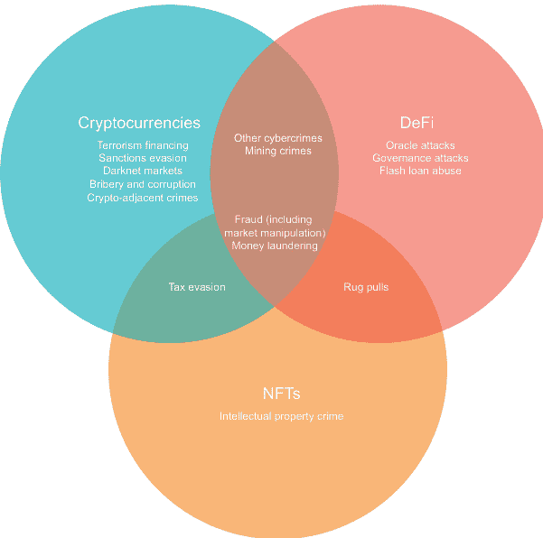

图 6.2 DeFi、NFT 和加密货币犯罪类型之间的关系

2021; Wang et al. 2021）、欺诈性投资计划（Mazorra et al. 2022; Xia et al. 2021）以及智能合约欺诈和黑客攻击（Katona 2021; Schär 2021）。

私营部门研究（Chainalysis 2022）也指出 DeFi 被用于洗钱；然而，这尚未经过同行评议的学术研究证实。特别是，学者们对使用稳定币（其价值与政府发行的法定货币挂钩的加密货币，也是 DeFi 生态系统的关键组成部分）进行洗钱表示担忧，因为它们使犯罪分子免受其他加密货币波动性的影响（Dyson et al. 2018）。

特定于 DeFi 的犯罪类型包括预言机攻击（Gudgeon et al. 2020; Schär 2021）、治理攻击（Gudgeon et al. 2020; Werner et al. 2021）和闪电贷滥用（Caldarelli and Ellul 2021; Gudgeon et al. 2020; Qin et al. 2021; Wang et al. 2021; Xu et al. 2022）。这些攻击类型通常会促进更广泛加密货币生态系统中观察到的其他一些加密货币犯罪类型。

DeFi 智能合约通常会从某些外部数据源（称为*预言机*）提取信息（Kamps et al. 2022）。*预言机攻击*是指对这些信息源（通常是价格信息）的操纵（Gudgeon et al. 2020; Schär 2021）。*闪电贷攻击*涉及一种名为*闪电贷*的 DeFi 创新，它是“在单个……交易中借入并偿还的无抵押贷款”（Kamps et al. 2022）。如果贷款在交易结束时偿还，那么使用该贷款的交易就会成功。否则，该交易和贷款将被撤销。闪电贷使得各种原本需要大量资本的攻击成为可能，例如预言机攻击、治理攻击、其他类型的市场操纵以及其他犯罪（Kamps et al. 2022）。

2020 年 2 月 18 日，bZx 平台被攻击事件是一次利用闪电贷促成的预言机攻击以造成价格操纵的案例，受害者损失了 2,699.97 ETH。在此案例中，攻击者通过闪电贷操纵了 sUSD/ETH 交易对并随后购买了 sUSD。他们使用新购买的 sUSD 购买更多 ETH 以偿还原始贷款，最终获利 634,000 美元（Qin et al. 2021）。

许多 DeFi 项目和协议通过去中心化自治组织（DAOs）以去中心化的方式进行治理。在 DAO 的情况下，持有治理代币的用户可以通过智能合约对资金用途和协议的未来进行投票。*治理攻击*利用这种机制，其中恶意一方（或串通各方）获得大部分可用的治理代币，并以有利于自身而非协议的方式进行投票（Werner et al. 2021）。

例如，他们可能会投票将 DAO 的所有资金转移给自己。文献探讨了针对 MakerDAO 的理论治理攻击；研究人员得出结论，攻击者可以通过众筹机制或使用闪电贷获得足够的治理代币来实施治理攻击（Gudgeon et al. 2020）。

*抽地毯*是 DeFi 和 NFT 特有的一种欺诈性投资骗局（Mazorra et al. 2022）。它们是一种跑路骗局，发生在项目创始人失踪，并且（a）窃取存入该协议的所有资金，或（b）移除该项目代币的流动性时（Kamps et al. 2022）。骗子可能会使用网红或广告来夸大其项目的可信度，或将抽地毯与空投或套利骗局或拉高出货骗局相结合（Xia et al. 2021）。

最受欢迎的去中心化交易所之一 SushiSwap 在其早期遭遇了 1400 万美元的抽地毯事件；创始人最终归还了资金，该协议逐渐兴盛（Smith 2021）。研究发现，仅在 Uniswap 去中心化交易所上就有 26,957 起抽地毯事件（Mazorra et al. 2022）。


存在三种不同的“毯子拉跑”类型：*简单毯子拉跑*、*卖出毯子拉跑*和*智能合约陷阱门*（Mazorra et al. 2022）。简单毯子拉跑最为常见（在一项研究中，26,957起毯子拉跑中有24,870起属于此类[Mazorra et al. 2022]），涉及开发者从协议中移除流动性。卖出毯子拉跑是指骗子创建一种代币，并将部分总供应量添加到流动性池中（其余部分自留）。

一旦足够多的投资者利用开发者提供的初始流动性，将其他（可信）代币兑换为新创建的代币，开发者就会将其余个人供应量兑换为可信代币（Mazorra et al. 2022）。这可能与其他努力相结合，以使代币看起来合法，并安抚Telegram®或Discord®服务器上的投资者（而实际上正在出售其所有代币）（Mackenzie and Bërzîna 2021）。

最后，智能合约陷阱门毯子拉跑涉及设计具有毯子拉跑相关功能的代币智能合约。例如，*mintable*函数允许卖出毯子拉跑骗子通过自动创建新代币来移除流动性，从而收回其原始流动性（Mazorra et al. 2022; Xia et al. 2021）。

其他示例包括秘密向用户收取使用、铸造、兑换或销毁代币费用的机制（也称为*advance fee tokens*）（Xia et al. 2021），或允许开发者控制与其智能合约交互的外部账户的功能（Mazorra et al. 2022）。智能合约陷阱门毯子拉跑的可能性多种多样，无法识别所有可能的攻击向量。

### NFT犯罪风险

NFT是由智能合约创建并存储在区块链上的某些资产（可能是数字或实物）的所有权和真实性数字记录。它们不能直接相互兑换——即，它们是*非同质化*的。NFT遭受各种类型的欺诈和市场操纵（Das et al. 2022），以及*知识产权犯罪*（如版权侵权和假冒伪劣）（Çağlayan Aksoy and Özkân Üner 2021; Das et al. 2022）。就假冒伪劣而言，一项分析显示，在OpenSea® NFT市场上存在322个名称相似的NFT系列，总计2,438,496个相同的图像URL，以及59,425个相同或近乎相同的NFT图像。关于潜在的刑事版权侵权，仍有若干法律问题悬而未决，但它似乎确实构成问题（Çağlayan Aksoy and Özkân Üner 2021）。

涉及NFT的欺诈类型包括伪造验证徽章、冒充身份、篡改链下记录以及秘密更改版税成本。市场操纵也特别普遍。NFT市场中一种常见的市场操纵类型是伪造订单（也称为*bid pollution*），据一项研究，OpenSea上发生了16,215起，Rarible®（另一个NFT市场）上发生了15,369起。学者还观察到了托儿出价和出价屏蔽，分别用于提高和降低拍卖出价。

托儿出价影响了282个NFT系列，使卖家获利13,014,662美元。出价屏蔽在OpenSea上的316起案例中，为用户节省了200.77美元至152,606.31美元。最后，洗钱交易盛行，有些人怀疑CryptoKitties®和Decentraland®等主要项目从中获益。学者识别出9,393起洗钱交易事件，产生了96,858,093美元（Das et al. 2022）。另一项研究发现，在2018年1月至2021年11月中旬之间，洗钱交易“在此期间可能将真实交易量虚高了高达1.495亿美元”（von Wachter et al. 2022）。

还有人担心NFT被用于洗钱（特别是因为NFT市场通常不收集KYC或AML信息[Das et al. 2022]）和逃税（Sundaravelu 2021）。事实上，英国税务海关总署最近查获了其第一个NFT（BBC 2022）。毯子拉跑在NFT世界中也普遍存在（Das et al. 2022）。最后，美国司法部最近起诉了其第一个涉及NFT的内幕交易案件（United States Department of Justice 2022）。

### 结论

随着加密货币的普及，加密货币犯罪有所上升（Chainalysis 2022）。加密货币的某些特征，如其伪匿名性、低进入门槛和不可撤销的交易，促进了其在犯罪活动中的使用（Kethineni and Cao 2020）。在加密货币领域观察到的许多犯罪，如各种类型的欺诈，本质上是加密货币赋能的；引入加密货币代表了执行这些类型犯罪的一种新方式。

然而，也有一些证据表明存在加密货币依赖型犯罪，例如加密货币挖矿犯罪。有大量证据表明涉及加密货币的某些类型犯罪，如欺诈、洗钱、网络犯罪、挖矿犯罪和暗网市场犯罪。恐怖主义融资、制裁规避、逃税以及贿赂和腐败等犯罪需要进一步研究，但传闻和推测性研究表明，这些犯罪在某种程度上正在使用加密货币发生。随着该领域的发展（例如，随着DeFi和NFT的出现），我们看到了加密货币赋能犯罪（如知识产权犯罪）和加密货币依赖型犯罪（如治理攻击）的新类型。随着加密货币生态系统中这些及其他领域的发展，新型加密货币依赖型犯罪很可能会出现。

### 参考文献

- Ahn, G.-J., Doupe, A., Liao, Z. Z., and Liao, K. (2016). 勒索软件与加密货币：犯罪的同谋. In: *通过跨学科视角审视网络犯罪* (第1版, 256). Routledge. https://doi.org/10.4324/9781315618456
- Akartuna, E. A., Johnson, S. D., and Thornton, A. (2022). 防范新兴技术的洗钱和恐怖融资风险：一项国际政策德尔菲研究. *技术预测与社会变革*, 179: 121632. https://doi.org/10.1016/j.techfore.2022.121632
- Albrecht, C., Duffin, K. M., Hawkins, S., and Morales, R. V. M. (2019). 加密货币在洗钱过程中的应用. *洗钱控制期刊*, 22(2): 210–216. https://doi.org/10.1108/JMLC-12-2017-0074
- Almaqableh, L., et al. (2022). 有可能建立毒品打击与加密货币市场之间的联系吗？是的，我们可以. *国际信息管理杂志*, 102488. https://doi.org/10.1016/j.ijinfomgt.2022.102488
- Alnasaa, M., et al. (2022). 加密货币、腐败与资本管制：跨国相关性. *IMF工作论文*, 2022(060): 1. https://doi.org/10.5089/9798400204005.001
- 澳大利亚竞争与消费者委员会 (2020). *打击2019年诈骗*. https://www.accc.gov.au/system/files/1657RPT_Targeting%20scams%202019_FA.pdf
- Bahamazava, K., and Nanda, R. (2022). 暗网非法毒品交易在加密货币中的偏好转变：可追溯性和威慑问题. *法医学国际：数字调查*, 40: 301377. https://doi.org/10.1016/j.fsidi.2022.301377
- Banton, C. (2021, October 28). 止损猎杀. 投资百科. https://www.investopedia.com/terms/s/stop-hunting.asp
- Barnes, N. D. (2018). 区块链再探——破解加密货币的密码. *信息管理*, 52(6): 26.
- Bartoletti, M., Carta, S., Cimoli, T., and Saia, R. (2019). *解剖以太坊上的庞氏骗局*. https://docs.google.com/spreadsheets/d/1cPanswNPVjoP4xENF7a2AjQQXX_ByZPblkQsO6aFEPs/pubhtml
- Bartoletti, M., Pes, B., and Serusi, S. (2018). 用于检测比特币庞氏骗局的数据挖掘. *2018年加密谷区块链技术会议(CVCBT)*, 75–84. https://doi.org/10.1109/CVCBT.2018.00014
- Baum, S. (2018). 加密货币欺诈：对欺诈前沿的审视. 荣誉学院论文. https://digitalcommons.georgiasouthern.edu/honors-theses/375
- 英国广播公司 (2019, November 24). 加密女王：这位女子如何骗遍全球然后销声匿迹. BBC新闻. https://www.bbc.com/news/stories-50435014


BBC（2022年2月13日）。HMRC首次在140万英镑诈骗案中查获NFT。BBC新闻。https://www.bbc.com/news/business-60369879

币安学院（无日期）。内存池。币安学院。https://academy.binance.com/en/glossary/mempool

Burrus, J.（2018）。加密货币时代打击金融犯罪，3。Refinitiv。https://www.refinitiv.com/content/dam/marketing/en_us/documents/expert-talks/world-check-expert-talk-fighting-financial-crime.pdf

Butler, S.（2019）。加密货币的犯罪用途：巨大的新威胁，还是现金仍为王？网络政策期刊，4(3)：326–345。https://doi.org/10.1080/23738871.2019.1680720

Çağlayan Aksoy, P.，和 Özkan Üner, Z.（2021）。NFT与版权：挑战与机遇。知识产权法与实践期刊，16(10)：1115–1126。https://doi.org/10.1093/jiplp/jpab104

Caldarelli, G.，和 Ellul, J.（2021）。去中心化金融中的区块链预言机问题——一种多元方法。应用科学，11(16)：7572。https://doi.org/10.3390/app11167572

Carlisle, D.，和 Izeman, K.（2019）。缩小加密货币差距：东南亚遏制朝鲜加密货币活动指南 [偶论文]。英国联合三军研究所。

Chainalysis（2022）。2022年加密货币犯罪报告。

Charoenwong, B.，和 Bernardi, M.（2021）。十年的加密货币“黑客攻击”：2011–2021 (SSRN学术论文编号3944435)。社会科学研究网络。https://doi.org/10.2139/ssrn.3944435

Chen, W.，等人（2020）。以太坊网络钓鱼诈骗检测：迈向区块链生态系统的金融安全。第29届国际人工智能联合会议AI in FinTech专题论文集，4506–4512。

Chen, W.，等人（2019）。使用改进的Apriori算法检测加密货币市场中的“拉高抛售骗局”。2019年IEEE面向服务系统工程国际会议(SOSE)，293–2935。

CoinBureau（2018年2月19日）。止损狩猎：加密货币鲸鱼正在你的止损点上大赚特赚。Coin Bureau。https://www.coinbureau.com/analysis/stop-loss-hunting-crypto-whales/

商品期货交易委员会（无日期）。关于扰乱行为的解释性指南和政策声明。https://www.cftc.gov/sites/default/files/idc_groups/public/@newsroom/documents/file/dtp_factsheet.pdf

Cong, L. W.，Li, X.，Tang, K.，和 Yang, Y.（2021）。加密货币洗售交易。SSRN学术论文编号3530220。社会科学研究网络。https://doi.org/10.2139/ssrn.3530220

Conti, M.，Gangwal, A.，和 Ruj, S.（2018）。勒索软件活动的经济意义：比特币交易视角。计算机与安全，79：162–189。https://doi.org/10.1016/j.cose.2018.08.008

Corcoran, K.（2018年2月12日）。根据欧洲刑警组织，欧洲罪犯正在通过加密货币洗钱55亿美元的非法现金。商业内幕。https://www.businessinsider.com/europol-criminals-using-cryptocurrency-to-launder-55-billion-2018-2

Cronin, M. J.（2018）。在黑暗中猎杀：检察官暗网、加密货币、芬太尼及相关威胁指南。司法部联邦法律与实践期刊，66(4)：65–78。

Daian, P.，等人（2019）。快闪男孩2.0：去中心化交易所中的抢先交易、交易重排序和共识不稳定性。ArXiv:1904.05234 [Cs]。http://arxiv.org/abs/1904.05234

Das, D.，等人（2022）。理解NFT生态系统中的安全问题。ArXiv:2111.08893。https://doi.org/10.48550/arXiv.2111.08893

Desmond, D. B.，Lacey, D.，和 Salmon, P.（2019）。将加密货币洗钱评估为复杂的社会技术系统：系统文献综述。洗钱控制期刊，22(3)：480–497。https://doi.org/10.1108/JMLC-10-2018-0063

Duhaime, C.（2020年1月14日）。比特币SIM卡换卡诈骗者被指控盗取5000万美元，在不列颠哥伦比亚省被捕 | Duhaime反洗钱与金融犯罪新闻。加拿大Duhaime反洗钱法。https://www.antimoneylaunderinglaw.com/2020/01/bitcoin-sim-swapper-charged-with-stealing-50-million-arrested-in-british-columbia.html

Durrant, S.，和 Natarajan, M.（2019）。加密货币与洗钱机会。载于 M. Natarajan（编）。国际与跨国犯罪与正义（第2版，73–79页）。剑桥大学出版社。https://doi.org/10.1017/9781108597296.012

Dyntu, V.，和 Dykgyi, O.（2019）。洗钱系统中的加密货币。波罗的海经济研究期刊，4(5)：75–81。https://doi.org/10.30525/2256-0742/2018-4-5-75-81

Dyson, S.，Buchanan, W. J.，和 Bell, L.（2018）。调查加密货币和区块链相关犯罪的挑战。英国区块链协会期刊，1(2)：1–6。https://doi.org/10.31585/jbba-1-2-(8)2018

Fanusie, Y. J.，和 Robinson, T.（2018）。比特币洗钱：流入数字货币服务的非法资金流分析 [备忘录]，16。

Feeney, M.（2022）。比特币无法拯救俄罗斯寡头免受制裁。https://policycommons.net/artifacts/2269610/bitcoin-wont-rescue-russian-oligarchs-from-sanctions/3029439/

金融行为监管局（2021）。FCA手册。https://www.handbook.fca.org.uk/handbook/MAR/1/6.html?date=2016-03-07

Foley, S.，Karlsen, J. R.，和 Putniņš, T. J.（2019）。性、毒品与比特币：通过加密货币融资的非法活动有多少？金融研究评论，32(5)：1798–1853。https://doi.org/10.1093/rfs/hhz015

Gao, B.，等人（2020）。端到端追踪假冒加密货币。ArXiv预印本 ArXiv:2011.02673。

Gudgeon, L.，等人（2020）。去中心化金融危机。2020年密码峡谷区块链技术会议(CVCBT)，1–15。https://doi.org/10.1109/CVCBT50464.2020.00005

Hamrick, J.，等人（2021）。分析目标导向的加密货币拉高抛售骗局。2021年ACM CCS去中心化金融与安全研讨会论文集，21–27。https://doi.org/10.1145/3464967.3488591

Hansen, E.（2022年5月16日）。司法部将就使用加密货币规避制裁提出指控—Law360。Law360。https://www.law360.com/articles/1493728/doj-to-lodge-charges-over-using-crypto-to-evade-sanctions

Higgins, S.（2017年1月27日）。数字货币诈骗滥用罗斯柴尔德家族名称。CoinDesk。https://www.coindesk.com/rothschild-advisory-warns-fraudulent-digital-currency

国税局刑事调查部（2021）。2021年年度报告。

Jiaying, J.（2020）。监管区块链？对中国区块链政策和法规的回顾性评估。清华中国法律评论，12。

Kamps, J.，和 Kleinberg, B.（2018）。一飞冲天：定义和检测加密货币拉高抛售骗局。犯罪科学，7(1)：18。https://doi.org/10.1186/s40163-018-0093-5

Kamps, J.，Trozz, A.，和 Kleinberg, B.（2022）。加密货币：欺诈预防的利与弊。载于《重新审视欺诈》。Routledge。

Karimov, B.，和 Wójcik, P.（2021）。使用机器学习识别首次代币发行中的诈骗。人工智能前沿，4：718450。https://doi.org/10.3389/frai.2021.718450

Katona, T.（2021）。去中心化金融：区块链“金钱乐高”系统的可能性。财经评论，20(1)：74–102。https://doi.org/10.33893/FER.20.1.74102

Kethineni, S.，和 Cao, Y.（2020）。加密货币的普及上升及相关犯罪活动。国际刑事司法评论，30(3)：325–344。https://doi.org/10.1177/1057567719827051

Kfir, I.（2020）。加密货币、国家安全、犯罪与恐怖主义。比较战略，39(2)：113–127。https://doi.org/10.1080/01495933.2020.1718983

Kossow, N.，和 Dykes, V.（2018）。区块链、比特币与腐败：关联性综述。透明国际。

Lee, K.，Kaiser, B.，Mayer, J.，和 Narayanan, A.（2020）。SIM卡互换的无线运营商身份验证实证研究。第十六届可用隐私与安全研讨会论文集，20。

Lucking, D.，和 Aravind, V.（2020）。将加密货币作为商品：CFTC的监管框架。全球法律洞察——金融科技2020，8。


Macfarlane, E. K. (2020). 加强制裁：利用加密货币遏制国际经济制裁逃避的解决方案. *密歇根国际法期刊*, 42(1): 1–230.

Mackenzie, S., and Beržina, D. (2021). NFT：数字事物及其犯罪生活. *犯罪、媒体与文化*, 17416590211039796. https://doi.org/10.1177/17416590211039797

Majumder, A., Routh, M., and Singha, D. (2019). 加密货币经济兴起及其与恐怖主义融资关联的概念研究. 载于：R. Chandra Das（编）. *全球恐怖主义对经济与政治发展的影响*, 125–138. 翡翠出版有限公司. https://doi.org/10.1108/978-1-78769-919-920191012

Marian, O. (2013). 加密货币是超级避税天堂吗？*密歇根法律评论初印象*, 112(38): 11.

Mazorra, B., Adan, V., and Daza, V. (2022). 不要对我“跑路”：利用机器学习技术实现自动诈骗检测. *数学*, 10(6): 949. https://doi.org/10.3390/math10060949

Mazzola, D. P., and Goroch, M. (2022年3月22日). 俄罗斯精英是否真的在使用加密货币逃避制裁？《对话》. http://theconversation.com/are-russias-elite-really-using-cryptocurrency-to-evade-sanctions-179559

Mitchell, C. (2021年11月14日). 抢头盘. 投资百科. https://www.investopedia.com/terms/f/frontrunning.asp

Möser, M., Böhme, R., and Breuker, D. (2013). 比特币生态系统中洗钱工具的调查研究. *2013 APWG 电子犯罪研究人员峰会*, 1–14. https://doi.org/10.1109/eCRS.2013.6805780

Navarro, R. R. (2019). 加密货币交易所的预防性欺诈措施：降低加密货币诈骗风险. 硕士论文, 尤蒂卡学院. http://search.proquest.com/docview/2312801484/abstract/7B22A14839754F47PQ/1

Noked, N. (2018). 逃税与不完全的税收透明度. *法律*, 7(3): 31.

Nomics (2019年8月5日). 透明度必须是无需信任的：Nomics宣言. Nomics博客. https://nomics.com/blog/essays/manifesto

O'Malley, R. L., and Holt, K. M. (2022). 网络性敲诈：对从事类似犯罪的不同施暴者的探索性分析. *人际暴力杂志*, 37(1–2): 258–283. https://doi.org/10.1177/0886260520909186

Paquet-Clouston, M., Haslhofer, B., and Dupont, B. (2019). 比特币生态系统中的勒索软件支付. *网络安全期刊*, 5(1): tyz003. https://doi.org/10.1093/cybsec/tyz003

Phillips, R., and Wilder, H. (2020). 追踪加密货币诈骗：复制的预付费和网络钓鱼网站的聚类分析. *2020 IEEE 区块链与加密货币国际会议（ICBC）*, 1–8. https://doi.org/10.1109/ICBC48266.2020.9169433

Pryzmont, P. (2016). 比特币相关事件对其价格波动影响的实证研究. 未定. https://www.semanticscholar.org/paper/An-empirical-study-of-how-Bitcoin-related-incidents-Pryzmont/2872bd0880f7d06ed98c24629416271229a77ad4

Qin, K., Zhou, L., Livshits, B., and Gervais, A. (2021). 利用闪贷攻击DeFi生态系统，既求乐趣也求利润. ArXiv:2003.03810 [Cs]. http://arxiv.org/abs/2003.03810

Raza, H., and Raza, M. R. (2021). 区块链技术、比特币和其他加密货币作为洗钱、欺诈和诈骗手段的研究. 全球媒体与社会科学研究期刊（GMSSRJ）, 2(1): 73–84.

Reddy, E., and Minnaar, A. (2018). 加密货币：网络犯罪的工具与目标. 犯罪学学报：南非犯罪学期刊, 31(3): 71–92.

Schär, F. (2021). 去中心化金融：基于区块链和智能合约的金融市场. 圣路易斯联邦储备银行评论, 第二季度. https://doi.org/10.20955/r.103.153-74

Smith, S. S. (2021). 去中心化金融与会计——发展的影响、考量与机遇. 国际数字会计研究杂志, 129–153. https://doi.org/10.4192/1577-8517-v21_5

Sundaravelu, A. (2021). 美国国税局将NFT视为逃税威胁，但加密货币专家持异议. 国际税务评论. http://www.proquest.com/docview/2534502639/abstract/8E9FA95E70E34A09PQ/1

Teichmann, F. M. J. (2018). 通过加密货币资助恐怖主义——对欧洲的威胁？反洗钱控制杂志, 21(4): 513–519. https://doi.org/10.1108/JMLC-06-2017-0024

Teichmann, F. M. J., and Falker, M.-C. (2020). 加密货币与金融犯罪：来自列支敦士登的解决方案. 反洗钱控制杂志, 24(4): 775–788. https://doi.org/10.1108/JMLC-05-2020-0060

Tidy, J. (2022年3月30日). Ronin网络：一次6000万美元的黑客攻击揭示了加密货币的现状. BBC新闻. https://www.bbc.com/news/technology-60933174

Trozze, A., 等人. (2022). 加密货币与未来金融犯罪. 犯罪科学.

Tsuchiya, Y., and Hiramoto, N. (2021). 加密货币如何被洗钱：Coincheck黑客事件案例研究. 法医学国际：报告, 4: 100241. https://doi.org/10.1016/j.fsir.2021.100241

Twomey, D., and Mann, A. (2020). 加密货币市场中的欺诈与操纵. 载于：《金融市场中的腐败与欺诈：失职、不当行为与操纵》. 威iley.

美国司法部 (2022年6月1日). NFT市场前雇员因首个数字资产内幕交易计划被起诉. 美国纽约南区地方检察官办公室. https://www.justice.gov/usao-sdny/pr/former-employee-nft-marketplace-charged-first-ever-digital-asset-insider-trading-scheme

美国诉Ali Shukri Amin案，1:15-cr-00164-CMH（美国弗吉尼亚东区地方法院，亚历山德里亚分部，2015年）.

ur Rahman, M. H., Salah, K., Damiani, E., and Svetinovic, D. (2020). 区块链加密货币生态系统中的信任. IEEE工程管理期刊.

Vasek, M. (2017). 基于比特币的网络犯罪测量. [博士论文，塔尔萨大学]. http://search.proquest.com/docview/1896552050/abstract/51DBD0D7392A4E59PQ/1

Vasek, M., 等人. (2017). 比特币脑力流失：研究比特币脑钱包的使用与滥用. 载于：J. Grossklags 和 B. Preneel (编). 金融密码学与数据安全, 9603: 609–618. 斯普林格柏林海德尔堡出版社. https://doi.org/10.1007/978-3-662-54970-4_36

Vasek, M., and Moore, T. (2015). 即使使用比特币也没有免费的午餐：追踪虚拟货币诈骗的流行程度与利润. 载于：R. Böhme 和 T. Okamoto (编). 金融密码学与数据安全, 8975: 44–61. 斯普林格柏林海德尔堡出版社. https://doi.org/10.1007/978-3-662-47854-7_4

Victor, F., and Weintraud, A. M. (2021). 去中心化加密货币交易所洗单交易的检测与量化. 2021年Web会议论文集, 23–32. https://doi.org/10.1145/3442381.3449824

von Wachter, V., Jensen, J. R., Regner, F., and Ross, O. (2022). NFT洗单交易：量化NFT市场中的可疑行为 (arXiv:2202.03866). arXiv. https://doi.org/10.48550/arXiv.2202.03866

Wang, D., 等人. (2021). 迈向理解闪贷及其在DeFi生态系统中应用的第一步. 第九届区块链与云计算安全国际研讨会论文集, 23–28. https://doi.org/10.1145/3457977.3460301

Wawrosz, P., and Lański, J. (2021). 加密货币与腐败 1. 经济期刊, 69(7): 687–705. https://doi.org/10.31577/ekoncas.2021.07.02

Werner, S. M., 等人. (2021). SoK：去中心化金融（DeFi）. ArXiv:2101.08778 [Cs, Econ, q-Fin]. http://arxiv.org/abs/2101.08778

White, R., Kakkar, P. V., and Chou, V. (2019). 起诉暗网市场：挑战与方法. 司法部联邦法律与实务杂志, 67(1): 65–80.

Wronka, C. (2021a). 数字货币与经济制裁：制裁逃避风险日益增加. 金融犯罪杂志（提前出版）. https://doi.org/10.1108/JFC-07-2021-0158

Wronka, C. (2021b). 去中心化金融生态系统中的金融犯罪：合规面临的新挑战. 金融犯罪杂志（提前出版）. https://doi.org/10.1108/JFC-09-2021-0218

Xia, P., Wang, H., Luo, X., 等人. (2020). 别在浑水中摸鱼！表征以新冠病毒为主题的加密货币诈骗. arXiv预印本 ArXiv:2007.13639.


Xia, P., Wang, H., Zhang, B., 等人. (2020). 表征加密货币交易所诈骗. Computers & Security, 98: 101993.

Xia, P., 等人. (2021). 交易还是陷阱？在Uniswap去中心化交易所上检测和表征诈骗代币. ACM计算系统测量与分析会议录, 5(3): 39:1–39:26. https://doi.org/10.1145/3491051

Xu, J., 和 Livshits, B. (2019). 加密货币“拉升-抛售”方案的解剖 (arXiv:1811.10109). arXiv. https://doi.org/10.48550/arXiv.1811.10109

Xu, J., Paruch, K., Cousaert, S., 和 Feng, Y. (2022). SoK: 带自动化做市商(AMM)协议的去中心化交易所(DEX). ArXiv:2103.12732 [Cs, q-Fin]. http://arxiv.org/abs/2103.12732

## 第7章：追踪虚拟资金：调查基于加密货币的洗钱和没收虚拟资产

Federico Paesano

巴塞尔治理研究所

### 加密货币震撼弹

2011年6月，我参加了在布拉格举办的网络犯罪会议，以了解洗钱者用来隐藏不法所得的新兴趋势和技术。我本不指望学到什么新东西。作为一名前意大利金融调查员，多年来我见过无数精巧的洗钱方案。而在瑞士巴塞尔治理研究所的新培训职位上，我和同事们正与许多不同国家负责调查和起诉金融犯罪的执法人员直接合作。还有什么我们没见过的呢？

这时，来自美国印第安纳州的一名警察走上台，抛出了一颗震撼弹。显然，一些罪犯刚刚发现，他们可以在几秒钟内、完全匿名地、绕过金融体系将资金从一个国家转移到另一个国家。

“他们正在使用比特币，一种虚拟货币，”他说。他无法真正解释比特币是什么。他只是说它类似于游戏内代币，你可以在游戏里买卖，但在游戏外没有真实价值，区别在于你可以在现实世界中将其兑现，并有效地将资金转移到另一个司法管辖区，完全逃避执法部门的监控。即使那时，我也能感觉到，对于寻求更自由地进入金融市场的公民以及寻求追踪和追回非法资金的刑事调查员来说，有件新的、令人兴奋的事情正在发生。

快进。现在是2014年4月7日。来自世界各地的一群调查人员聚集在巴塞尔大学的一个房间里。两名联邦调查局特工分享了他们如何捣毁全球第一个毒品市场丝绸之路。这个地方类似于Amazon®或eBay®，但出售的产品是毒品、假护照和假币等非法商品。该市场有供应商、他们的个人资料和声誉、商品列表以及“产品”评论。

丝绸之路之所以有吸引力，是因为它被认为高度匿名。买家可以通过常规邮政服务将他们最喜欢的毒品寄到家中。使客户和供应商都能保持匿名的原因在于，所有交易都使用比特币进行。此外，该服务隐藏在洋葱路由器(TOR)之后，这是一种加密软件，允许人们访问丝绸之路等地方而不泄露其IP地址。两名特工描述了他们如何追踪丝绸之路创建者的身份、定位托管市场的服务器，并至关重要的是，找到私钥以解锁他积累的超过170,000个比特币。

研讨会的组织者——巴塞尔治理研究所、国际刑警组织和欧洲刑警组织——决定将这个“小组”设为永久性，并启动了刑事金融与加密货币工作组。从这次只分享了一个案例的首次会议开始，该话题在随后几年的执法界不断扩大。2021年，举办了该工作组的第5届全球刑事金融与加密货币会议，吸引了来自执法界、学术界和私营部门的2000多名与会者。讨论和分析了众多案例。

* 联邦调查局(2013年10月25日)。曼哈顿美国检察官宣布查获价值2800万美元的比特币，这些比特币属于罗斯·威廉·乌布雷希特，他是“丝绸之路”网站的涉嫌所有人和运营商。https://archives.fbi.gov/archives/newyork/press-releases/2013/manhattan-u.s.-attorney-announces-seizure-of-additional-28-million-worth-of-bitcoins-belonging-to-ross-william-ulbricht-alleged-owner-and-operator-of-silk-road-website

这个故事很好地描述了加密货币在过去12年中如何从一种为数不多的人所知晓的冷门现象，演变为数百万人使用的全球支付方式。显然，罪犯是使用者之一，但加密货币的非法使用仅占其总体使用的一小部分。根据Chainalysis*，一家该领域领先的分析公司之一*，非法活动仅占交易的0.34%。

正如上面的示例所示，直到几年前，世界上只有少数调查人员在工作中接触过加密货币，而真正成功进行调查并导致资产没收的人则更少。在接下来的章节中，我们将分析和讨论：

- 加密货币在刑事或金融调查中带来的问题
- 区块链分析如何随时间演变，以及目前有可能提取哪些信息
- 该领域建立的法律框架
- 执法部门可以采用的调查技术
- 罪犯和加密社区如何应对执法部门的努力
- 在涉及加密货币时，资产追回是（或不是）有所不同

### 见无恶，闻无恶，调查无恶

### 避开雷达

“本国罪犯不使用加密货币。” 我与调查人员和检察官坐在一起时，实在记不清听过多少次这句话了。在为执法部门准备加密相关培训计划时，我通常会提前前往培训所在国家，了解当地司法制度。而这个答案总是让我困惑。难道这是世界上唯一一个罪犯决定完全忽视这一新机遇、以毫不打扰地转移其所得的地方吗？深入挖掘后，情况总是变得明朗：最可能的真相是，他们可能在调查中已经遇到了加密货币，但未能识别出来。根据Chainalysis*的研究*，世界上几乎没有一个国家未受过去几年采用浪潮的影响。并且没有理由相信，在普通人正在使用新技术的地方，罪犯没有做同样的事。恰恰相反：罪犯总是最早利用新技术的人，利用所谓的*立法差距*。这指的是执法部门理解新威胁并制定对策，以及立法者赋予他们适当法律框架所需的时间。

是什么阻止执法部门成功调查加密货币？主要有两件事：一方面，我们必须承认这是一个全新的现象，一些调查人员仍然缺乏基本的IT理解。许多人担心自己永远无法赶上并理解如此创新的事物，这并不奇怪。另一方面，许多人仍然相信，要调查和没收加密货币，就必须成为网络犯罪专家，花几个小时在编程代码后面。这远非事实。调查人员需要的是检测活动的能力。要检测到它，就需要了解加密货币的工作原理和流动方式。

### 所有调查人员需要知道的基本要素

如果我想使用加密货币，我会先获得一个*钱包*。这可以是我手机或笔记本电脑上的软件，或者是一个*硬件钱包*，当我需要进行交易时，将其连接到笔记本电脑的小型设备。钱包会为我创建两个主要东西。第一个是一个*地址*，一个标识符（可以把它想象成银行账号的等价物），我可以将其分享给任何人。任何想要给我转账的人都会使用这个标识符。

与此同时，钱包会创建相应的*私钥*，一种密码，我可以用它来花费发送到该地址的任何资金。私钥必须保密，因为任何能够访问它的人都可以用它来花费那笔钱。事实上，私钥将是加密货币调查的终极目标，因为控制嫌疑人的私钥才是关键所在。地址及其私钥在数学上相关联。（参见图7.1）

事实上，私钥只不过是钱包生成的一个随机数，相应的地址是通过称为*哈希*的过程从该随机数生成的。*哈希*是将某个输入（在此例中为私钥）转换为另一个值（称为输出或*哈希值*）的过程，使用数学


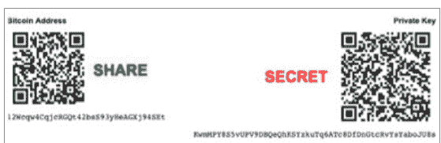

图 7.1 比特币地址及其对应的私钥

算法。生成的值是唯一的，并构成输入的 *指纹*。一个好的哈希函数是单向的，这意味着通过查看输出，无法计算输入是什么。这就是为什么我可以与任何人分享我的加密地址，但没有人能使用它来计算相应的私钥。

使用加密货币进行的所有交易都永久存储在一个称为 *区块链* 的账本上。这个账本由决定加入网络的用户在成千上万台计算机上复制。所有区块链都公开可用，并可以使用众多可用的区块链浏览器进行导航。

在图 7.2 中，我们可以看到一个典型的比特币交易：

- 1. 交易的唯一标识符
- 2. 时间戳
- 3. 发送地址（以及发送的金额）
- 4. 接收地址（以及接收的金额）
- 5. 返回给发送者的找零（以及返回的金额）

可以点击显示的任何地址，查看该地址进行的每一笔交易。如果正确使用，区块链浏览器是一个强大的工具。即使交易没有透露其发送方和接收方的任何信息，它仍会永久存储在区块链中，以备将来可能的去匿名化，如我们稍后将看到。然而，重要的是要注意，虽然现金交易不留任何痕迹，但加密货币交易会留下无法磨灭的证据。这将我们带到了区块链分析。

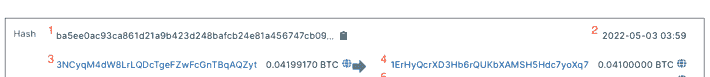

图 7.2 比特币交易（来源：blockchain.info, https://www.blockchain.com/btc/tx/ba5ee0ac93ca861d21a9b423d248bafcb24e81a456747cb0958e764dbd014d11）

### 分析区块链
#### 启发式方法如何提供帮助

我第一次看到丝绸之路时，非常震惊。怎么可能这么多人在网上贩卖毒品？他们怎么可能匿名收款？事实上，该市场依赖使用比特币作为唯一支付方式，因为其被认为具有匿名性。如果区块链中显示的唯一信息只是用来代表交易发送方和接收方的一串无意义的数字和字母，他们将完全处于黑暗之中……还是不是？

随后，一篇论文证明这一假设完全具有误导性。在 Sarah Meiklejohn 等人的《一把比特币：描述无名之人之间的支付》中，研究人员首次描述了他们如何使用启发式方法将加密地址聚类在一起。想象一下，手握嫌疑人的银行账号，拥有一个工具可以立即揭示该个人在世界上任何地方是否拥有其他银行账户，而无需传票或冗长的司法协助请求。聚类意味着查看区块链，并使用一些技术将很可能由同一人控制的地址“聚类在一起”。这些技术包括多输入、一次性找零地址和最优找零启发式。

* Meiklejohn, S., Pomarole, M., Jordan, G., Levchenko, K., McCoy, D., Voelker, G. M., and Savage, S. (2013). 一把比特币：描述无名之人之间的支付。IMC 2013—第 13 届 ACM 互联网测量会议论文集，127–139。https://doi.org/10.1145/2504730.2504747
† 也称为共同输入所有权启发式，它假设交易中的所有输入均由同一实体控制。该启发式方法首次在中本聪的原始比特币论文中提到。然而，这并不完全正确，因为多方可以使用特殊软件（CoinJoin）对交易进行共同签名，该软件花费由不同实体控制的输入。
‡ 由于很难将交易指定的确切金额发送给接收方，剩余资金将通过找零地址退回给发送方。这类似于需要支付 1 美元给某人，而手头只有一张 5 美元的钞票。付款人将收到 4 美元的找零。当交易有两个输出时，其中一个通常是退回给发送方的找零。因此，接收找零的地址由发送方控制。可以使用多种技术来评估哪些输出构成找零。
§ 这里的假设是，消费者钱包在设计上不会不必要地花费输出。因此，可以假设找零是小于任何已花费输入的金额。

调查人员可以使用上述技术来了解嫌疑人控制的地址是否属于某个集群，从而去匿名化目标控制的所有地址。在大多数情况下，调查将从已确定的嫌疑人开始，调查的目标是揭开犯罪所得的去向，尤其是在启动反洗钱调查时。

然而，如果调查人员的目标是未知或匿名地址，有时他们不得不承认失败并寻求帮助。最常见的选择是寻求近年来兴起的众多区块链分析公司的帮助。他们对区块链有更深入的洞察，并可以使用区块链浏览器和开源情报（OSINT）自动化研究，这些研究本会让警察忙数月。

#### 将集群与现实世界关联

一旦这些公司识别并标记了集群，第二步就是为这些标记命名。这可以通过多种不同的方式完成，例如通过网络抓取来查找自行披露的地址。个人声称拥有某个地址的所有权并不罕见。

在与加密货币相关的论坛中，曾经普遍存在这样的做法：在签名中包含加密地址以接收小费和捐赠。许多程序员免费开发工具和平台，然后通过比特币支付寻求捐赠。

另一种用于去匿名化服务（交易所、提供商、托管人）的技术是与他们开设账户并发送少量加密货币。接收地址（定义上由目标服务控制）随后将在现有集群中搜索；一旦找到，将去匿名化整个集群。

即使无法直接去匿名化目标地址，也只需扩大搜索范围。设身处地为犯罪分子着想：你的犯罪所得已经是加密货币，或者你正在使用加密货币洗钱。你最终会想要变现，拿到可以直接花费或存入银行账户的法定货币。你可能会尝试以某种方式模糊加密货币的来源（稍后将详细介绍！），但迟早你需要使用交易所来兑换资金。

这就是执法机构所寻找的——也就是说，犯罪分子存入资金以进行兑换的那一刻。区块链分析将尝试发现的是，目标地址在您正在查看的交易前后几个跳转中是否与交易所进行过交互。

### 监管困境
#### 如何在无国界的行业中协调监管

令人惊讶的是，比特币的流行始于 2011 年 6 月，当时两位美国参议员要求联邦当局调查并打击丝绸之路毒品市场。出人意料的结果是，一种仅被一小群爱好者使用的未知技术在主要媒体上被“宣传”，比特币和丝绸之路一夜之间都变得流行起来。从那以后，围绕加密货币的法律框架不断发展，伴随着突然的爆发和频繁的中断，往往涉及不同监管机构和不同司法管辖区之间的利益冲突。

美国走在了前列：2013 年，美国金融犯罪执法网络（FinCEN）表示，加密货币在任何司法管辖区都“不具有法定货币地位”。同年，其他一些国家没有试图监管该行业，而是决定全面禁止比特币。2013 年 12 月，中国政府凭借其《关于防范比特币风险的通知》规定，所有中国银行均禁止接受来自交易所或向交易所支付比特币。尽管日本在 2016 年成为第一个引入监管的国家（可能是因为日本加密货币交易所 Mt. Gox 丢失了其为客户持有的近 85 万枚比特币），但世界上大多数监管机构当时仍不感到有必要监管这一领域。

第一项国际努力于 2018 年提出。在 G20 领导人峰会之后，20 大经济体同意加密货币对金融稳定不构成风险，于是要求金融行动特别工作组‡（FATF）进一步澄清其反洗钱标准如何适用于虚拟资产。这些标准载入所谓的 FATF 建议中，这是一套国家应实施的措施框架，旨在打击洗钱和恐怖融资。那些司法管辖区

* Wolf, B. (2011 年 6 月 8 日). 参议员寻求打击“比特币”货币。路透社。https://www.reuters.com/article/us-financial-bitcoins-idUSTRE7573T320110608
† 中国政府。 (2013 年 12 月 5 日). 中国禁止银行处理比特币交易。BBC.com。https://www.bbc.com/news/technology-25233224
‡ FATF 是一个政府间组织，成立于 1989 年，在 G7 倡议下制定打击洗钱政策。2001 年，其任务扩大到包括恐怖融资。FATF 制定标准，并促进有效实施法律、监管和运营措施，以打击洗钱、恐怖融资以及其他对国际金融系统完整性的相关威胁。


不遵守建议的将被列入灰名单或黑名单，并可能面临国际货币基金组织和世界银行等机构的经济制裁。

FATF通过采纳对其建议的更改来回应请求，以“明确说明它们适用于涉及虚拟资产的金融活动，并在术语表中添加了两个新定义，‘虚拟资产’（VA）和‘虚拟资产服务提供商’（VASP）”，如2019年发布的指导中所述。根据FATF，VA是“可以数字交易或转让的价值的数字表示，可用于支付或投资目的”。该定义足够宽泛，可以允许未来纳入新技术。VASP本质上被定义为进行VA交换、转移和托管的法人。

### 实践中的国际标准

与虚拟资产相关的FATF建议本质上要求VASP像银行一样行事。你还记得开设银行账户时所做的所有文书工作，以及银行为证明你的身份和背景所付出的所有努力吗？如果账户中突然出现一笔意外款项，你知道你需要向银行提供所有哪些信息吗？

这正是加密货币交易所现在有义务做的事情。我仍然记得多年前第一次在加密货币交易所开设账户时，他们执行的唯一了解你的客户（KYC）程序就是要求我提供一个电子邮件地址。就这样。那些日子已经一去不复返了。对于加密货币交易所来说，客户引入意味着一个漫长的过程，需要逐步深入的问题和必须提供的文件。

建议还将所谓的*旅行规则*扩展到加密货币交易。虚拟资产提供商需要为超过一定阈值（1,000美元/欧元）的交易收集和共享客户数据。发起人的信息会与交易一起“旅行”到接收VASP。根据FATF关于第16号建议的解释性说明，发起人和受益人信息应包括以下内容：

- 发起人姓名和账户号码
- 发起人地址、国民身份号码、出生日期和出生地点
- 受益人姓名和账户号码

* FATF.（2019年6月）。面向虚拟资产和虚拟资产服务提供商的基于风险的方法指导。https://www.fatf-gafi.org/media/fatf/documents/recommendations/RBA-VA-VASPs.pdf

#### 表 7.1 旅行规则

| | | 银行保密法（阈值3,000美元） | FATF（阈值1,000美元） |
|---|---|---|---|
| 发起人 | 姓名 | 必填 | 必填 |
| | 账户号码 | 有提供时 | 必填 |
| | 地址 | 必填 | 必填 |
| | 金融机构身份 | 必填 | 非必填 |
| | 金额 | 必填 | 非必填 |
| | 执行日期 | 必填 | 非必填 |
| 接收人 | 姓名 | 有提供时 | 必填 |
| | 地址 | 有提供时 | 非必填 |
| | 金融机构身份 | 必填 | 非必填 |
| | 账户号码 | 有提供时 | 必填 |
| | 接收人的任何其他特定标识符 | 有提供时 | 非必填 |

在表7.1中，我们可以看到银行保密法和FATF规定的旅行规则及所需信息的快速比较。

即使低于1,000美元/欧元阈值的跨境交易也必须包括发起人和受益人的姓名及账户号码，但除非存在洗钱或恐怖融资嫌疑，否则不会对其进行验证。旅行规则涉及数据的谨慎处理、隐私需求以及使用尽职调查措施。

### 实施——零星但积极

FATF并不规定司法管辖区必须如何遵守其建议，尽管它已发布全面的指导。截至目前，每个司法管辖区都采取了略有不同的方法。有些，例如香港、瑞士或新加坡，强制要求交易所仅持有执行旅行规则的许可证运营。其他国家，例如加拿大，仍在努力，试图找到最佳解决方案。美国技术上早已有该规则，但很少执行。

在FATF于2020年6月对这些新法规实施情况的首次12个月审查中，人们注意到有许多问题阻碍了协调实施的努力。这些问题包括识别对手方VASP、私有和非托管钱包与VASP进行交易的合规性、互操作性挑战，以及_日出问题_。

日出问题并非新鲜事。每当影响全球现象的新法规没有无缝且同时实施时，就会发生这种情况。从加密合规的角度来看，问题始于VASP A（一个交易所）的客户想要向使用VASP B的人汇款，而VASP A所在的司法管辖区已实施旅行规则，但VASP B所在地的旅行规则不是监管义务或尚未实施。VASP A遵守其义务，将向VASP B发送信息请求，但VASP B不会回应，因为其管辖区没有相同的要求。

FATF建议是否帮助执法机构打击与加密货币相关的犯罪活动？答案是肯定的。我帮助许多调查人员追踪了以区块链形式进行的赎金*付款。在过去，甚至很难定位许多VASP，更不用说送达传票并获得回复了，但日益严格的法规大大改善了局面，如下一节所示。

### 执法：始终领先一步

#### 短短几年内从0到100

> “你似乎不明白，警察是民间科技技能最低的人群之一。警察不知道比特币是什么，可能也不明白它的工作原理。那么，究竟还有谁反对比特币呢？”

2013年，我正在浏览最著名的比特币论坛。人们正在讨论用于犯罪活动的加密货币可能被执法部门追踪和没收的可能性。比特币被认为几乎无法追踪，犯罪者仅仅通过使用它就能实现近乎完美的匿名性。当时，这离事实不远。调查人员对比特币的了解非常匮乏。我确信，大多数执法人员即使在加密货币使用就在眼前的情况下，也无法察觉其使用

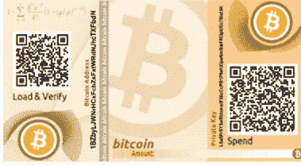

#### 图 7.3 比特币纸钱包

正在发生。我可以想象警察突击搜查嫌疑人的公寓，并简单地把一张纸钱包*当作广告而忽略。

幸运的是，九年之后，情况发生了巨大变化。一方面，加密货币的普及和越来越多的被调查案件推动执法部门投入时间和资金进行教育。有大量课程可供选择，从加密货币的基本了解到更深入的调查技术和策略课程。

另一方面，有可用的工具允许人们追踪区块链上的交易并自动化许多涉及的步骤，直到到达VASP。最后，如前一节所述，围绕VASP的法律框架创造了一个环境，使执法部门能够成功地与它们合作，揭示伪名加密地址背后的身份。在许多情况下，区块链上的可疑交易不会直接去匿名化，而是会被跟踪，直到达到可以传票索取信息的实体。

#### 新的调查可能性

虽然从理论上讲，交易可以完全匿名执行，犯罪者可以采用工具（如下一节所示）来危害调查人员追踪它的努力，但这并非易事。犯罪者会犯错，而且要

> * 在所谓的冷钱包中，即离线钱包，我们发现了纸钱包：一张印有地址和私钥的纸。几年来，纸钱包被认为是存储加密货币最安全的方式。其受欢迎程度下降是因为它们易受环境因素影响（纸张潮湿、墨水褪色、火灾），因为其创建存在安全风险，并且因为开发出了更用户友好的冷存储解决方案，例如硬件钱包。


在网络上实现完全匿名是一项艰巨的任务，哪怕是一次小小的分心或一次计算机故障，都可能暴露藏在字符串背后的真实身份。下文方框中描述的近期案例，优雅地概括了这一概念。

### "Welcome to Video"：捣毁最大的儿童虐待网站*

在调查过程中，美国国家犯罪局（NCA）的特工在一名嫌疑人的笔记本电脑上发现了一个名为“Welcome to Video”（WtV）的网站的登录凭据。这个网站是暗网中为数不多的场所之一，人们可以在那里以比特币为交换，访问、上传和下载儿童性虐待材料（CSAM）。阻止调查人员捣毁此类网站的，往往是TOR或I2P等匿名工具的广泛使用。

若调查人员采用常规方法，WtV也会面临同样的命运。然而，他们将此案当作一起金融调查来处理，并采用了“追踪资金”的方法。当NCA特工识别出网站上使用的一些比特币地址时，他们联系了Chainalysis，这是一家领先的区块链分析公司。他们立即意识到，WtV的用户和管理员，尽管躲藏在暗网并使用加密货币在服务内部支付，但在获取比特币以访问WtV以及变现其所得收益方面，都非常天真。

许多用户只是简单地从加密货币交易所获取比特币，然后直接从个人钱包发送到WtV。该网站的所得款项通常直接变现到韩国的一些交易所，这也为幕后主谋的可能位置提供了线索。由于该服务没有为用户提供从网站提取资金的选项，所有离开WtV钱包的交易都流入了管理员的腰包。

将此案作为金融调查来处理的关键决策，意味着美国国税局（IRS）的特工也被引入。特工们在承担起审查WtV页面这一令人不适的任务时，注意到的第一个错误是：视频的缩略图被天真地没有进行匿名化处理。

* 本案在安迪·格林伯格（Andy Greenberg）的文章《Inside the Bitcoin Bust That Took Down the Web’s Biggest Child Abuse Site》中有精彩阐述，该文发表于《Wired》，时间为2022年4月7日。https://www.wired.com/story/tracers-in-the-dark-welcome-to-video-crypto-anonymity-myth/
† TOR，即“洋葱路由器”的缩写，是一款免费软件，通过将流量路由至一个免费的、全球性的志愿者网络来隐藏用户位置，从而实现互联网上的匿名通信。
‡ 不可见互联网计划（The Invisible Internet Project）是一个匿名化层，允许点对点通信。匿名性通过加密用户流量并将其通过志愿者运营的网络发送来实现。

这些缩略图显示了一个位于韩国的IP地址，证实了最初的猜测。特工们传唤了用于从WtV变现资金的交易所，并成功将嫌疑人确认为一名居住在首尔以外的韩国男子。

调查人员面临着一个可怕的两难困境：逮捕嫌疑人并捣毁网站可能意味着调查的结束。但用户怎么办？上传到WtV的大部分材料都是原创的，这意味着用户上传的是他们自己拍摄的内容。关闭网站将使数百名儿童虐待者逍遥法外，继续其犯罪活动，毁掉数百名儿童的生活。

他们采取的替代方案，在调查层面上堪称出色，但在个人层面上却也令人发指。他们将用户支付给网站的款项追溯至购买比特币的交易所。这不得不让他们观看数千段展示对儿童（往往只有1或2岁）实施令人作呕和残忍行为的视频，以寻找能够揭示其位置的线索。

当第一批用户身份信息提供给他们时，特工们又做出了其他令人震惊的发现。一名嫌疑人是得克萨斯州的一名美国国土安全部调查局特工。另一名是佐治亚州一所高中的助理校长。一名嫌疑人似乎是前国会工作人员，目前在一家著名的环保组织工作。另一名是边境巡逻队特工，据调查人员透露，他上传了自己虐待继女的视频。

在识别并逮捕了这些及许多其他儿童虐待者之后，特工们终于在韩国逮捕了幕后主谋并查获了该网站。他们发现了超过250,000个视频，使得“Welcome to Video”成为历史上最大的儿童性虐待材料案件。

此案例说明了调查人员应始终牢记的一些重要方面。首先，许多刑事调查，当犯罪本身产生犯罪所得时，可以像金融调查一样来处理。通常，追踪资金流向可以带你到达其他手段将无法到达的地方。Cui bono？资金踪迹的终点可以揭示犯罪的实施者。此外，在此案例中，我们可以看到跨辖区合作的关键作用。

### 跨境合作与虚拟资产服务提供商（VASP）

从本质上讲，涉及加密货币的案件是跨境调查，而司法协助（MLA）请求是寻求和获得其他国家帮助的关键。仅追踪从虚拟资产服务提供商（VASP）往返的加密货币支付是不够的：一旦我们确定了用于买卖货币的交易所，就需要清楚涉及的流程，明确我们希望外国辖区（以及VASP）采取哪些行动，我们可以合理地期望什么，以及他们会对我们的请求抱有什么期望。

首先，我们需要记住，虚拟资产服务提供商（VASP）从客户处收集的信息，在正式请求后可供执法机构使用。VASP根据客户想要执行的活动接收各种数据。有时，提供一些基本数据和电子邮件地址即可开立账户，但当此人想要存入、交易或提取资金时，情况会发生巨大变化，并且还取决于这些交易的规模。正常的KYC流程会要求客户提供：

- 姓名、出生日期和出生地，均需通过提交适当形式的身份证明文件（ID）来证明，通常需要将文件举在摄像头前，以便将文件与面部进行比对
- 居住地，通常通过提交水电费账单或银行文件来证明居住地
- 资金来源，当客户存入法定货币以兑换成加密货币时
- 资金来源，当客户存入加密货币时

此外，VASP还能看到并收集用于连接服务的IP地址，并可能存储客户机器的唯一配置（操作系统、浏览器、Cookie、双重身份验证）。整个账户（存款和取款）及交易历史也将可用。在法人情况下，所提供的信息中还将包括公司注册文件，在某些情况下还包括实益所有人。

调查人员在撰写协助请求时必须关注什么？以下几点肯定可以决定合作是成功，还是变得漫长而低效：

- 使用恰当的语言。提交请求时，要注意使用正确的术语：地址、钱包和账户之间有巨大差异。以太坊不同于比特币和门罗币，它们都有不同的地址格式。在撰写之前，请先做好功课，研究相关术语。
- 将地址和交易ID以纯文本形式附加在Word或Excel文档中，以便VASP能够复制粘贴这些数据。从PDF复制可能会导致错误。
- 在撰写请求之前先联系VASP。大多数VASP都有庞大的合规部门，他们很乐意提前与调查人员沟通，甚至在撰写信函时提供指导。他们可以帮助调查人员使用正确的术语、索要正确的数据，并避免无谓的来函往复。


### 托管钱包与非托管钱包

上述情况指的是所谓的*托管*钱包，即由 VASP 持有的钱包。需要记住的是，在这种情况下，嫌疑人不控制私钥，因为私钥由 VASP 保管。嫌疑人仅持有为其保管资金的交易所提供的信用。VASP 是唯一能够冻结资金并允许有效扣押的实体。

考虑*非托管钱包*时情况并非如此，其中嫌疑人是直接控制其资金及相应私钥的人。后者在调查期间将是主要目标。对于托管钱包，定位由 VASP 控制的资金足以要求服务冻结资产，而嫌疑人无权反对——在处理非托管钱包时，定位私钥才是真正的目标。

首先，调查人员会寻找嫌疑人持有加密货币的危险信号：

- 嫌疑人设备（手机、笔记本电脑）上的软件或应用程序。为了接收、管理和发送加密货币，个人需要安装一个钱包。钱包是一种创建密钥对（私钥/地址）的软件，随后由用户用于发送和接受交易。钱包的存在可能表明使用了加密货币。

- 浏览器历史记录。如果嫌疑人使用 VASP 来持有和管理其加密货币，网页浏览器中可能留有痕迹。用户 ID 和密码也可能被浏览器保存。

- 硬件钱包。持有这种设备（一种将私钥存储在机器内部的冷钱包）是控制加密货币的强烈迹象。

正如我们所见，调查技术在不断演变。执法机构正在慢慢获得必要的知识，以追踪和定位通过虚拟货币洗钱的资金，并且越来越多的工具可供他们使用，例如区块链分析公司。为了应对这一点，罪犯正在变得更加复杂，并采取对策，将其痕迹更深地隐藏在（区块链内部和外部）。

### 新兴犯罪策略

#### 顺势而为

故事总是如出一辙。当一种可被利用来更容易地洗钱的新技术出现时，罪犯会立即利用它。在几个月或几年的时间里，他们将能够享受双重优势，即立法优势和调查优势。前者是立法者意识到潜在威胁、理解新技术，然后讨论并制定可能的法律框架以允许执法部门尝试阻止新工具非法使用所需时间的直接结果。

调查人员反过来需要了解罪犯如何掩盖痕迹及其独特的洗钱流程。他们随后需要时间和预算来制定新策略。第一波由罪犯天真地使用，无需高度复杂的策略。但一旦法律框架建立，执法部门对这种新型犯罪活动习以为常，第二波就会出现。这将利用建立在该工具之上的新开发的二级工具和机制。

我们在加密货币领域也看到了这种情况。尽管几年前罪犯成功使用比特币来掩盖痕迹，但上述描述的方法已被证明足以让执法部门反击。然而，胜利是短暂的：这是一场永无止境的猫鼠游戏，加密货币世界正在迅速发展。

### 犯罪策略快照

在撰写本文时，罪犯开始采用新策略：

- 非受监管交易所是罪犯将加密货币兑换回法定货币的去处。它们位于监管宽松且不符合 FATF 建议的司法管辖区。客户未经身份识别，正式 KYC 流程简化或根本不存在。这类交易所可以选择在共享金融信息或回复司法协助请求方面臭名昭著地保密的国家运营。

- 去中心化交易所在去中心化金融（DeFi）框架内出现，允许金融工具避开银行、经纪商和交易所等中介。这种新型交易所是非托管的，因此无法被传讯，导致资金无法应要求冻结。资金交易得益于允许点对点交易的自执行智能合约。

- 链跳。虽然有时在区块链上跟踪交易很困难，但想象一下要跟踪资金通过众多区块链的踪迹。这就是链跳所做的。使用这种分层技术意味着将一种加密货币转换为另一种，将资金从一个区块链交换到下一个区块链。例如，罪犯可以获得比特币，随后将其兑换为一种或多种注重隐私的加密货币（如门罗币）以掩饰其来源。

- 混币器。混币器可以通过混合不同流的可识别加密货币来模糊资金的真实来源。“受污染”的资金被发送到该服务，服务将其与其他用户的资金混合在一起，形成一种“池”。随后由用户提取的资金（扣除混币器收取的费用后）与他们最初存入的资金不同。

- 在线赌场。洗钱者可以求助于在线赌场来清洗他们的加密货币。该方案非常简单：将脏钱存入赌博网站，假装玩几场游戏，提取现在合法的硬币，并将其声明为“赢利”。

- 暗网市场。使用暗网市场也常被用来洗钱并掩饰加密货币的真实来源。当有人开设账户并存入加密货币时，资金由市场存放在一个或多个汇总账户中。当用户提取资金时，资金并非来自用于存款的原始地址，而是来自另一个完全无关的地址。这使得难以理解存款前发生的原始犯罪活动。

- 加密货币 ATM。加密货币 ATM 是连接互联网的自动取款机，允许客户购买和出售加密货币。虽然一些机器会对客户进行 KYC 检查并在存取资金时识别用户，但许多加密货币 ATM 公司允许客户在无需任何形式身份识别的情况下操作其机器。

- 隐私币。如果比特币和以太坊证明不像最初认为的那样匿名，罪犯仍可求助于隐私币，如门罗币。它们模糊资金流动，使得在相应区块链上追踪交易变得更加困难。虽然它们的工作方式与其他加密货币类似，但它们使用隐身地址，交易发送者需要代表收款人创建一个随机的一次性地址。因此，收款人可以将所有进入的付款发送到无法与任何特定实体关联的唯一地址。隐私导向型加密货币使用的另一个功能是环签名。对于大多数加密货币，区块链上的交易清楚地显示发送者是谁，即使他们隐藏在加密地址背后。另一方面，环签名可以由用户组中的任何成员执行，使得无法确定哪个成员的密钥用于生成签名。

### 没收：震慑加密犯罪

#### 寻找加密宝藏的钥匙

毫无疑问，在涉及犯罪的数字资产时，主要障碍之一是定位和没收它们。许多人仍然相信，知道罪犯在特定地址持有加密货币并将这些资金与源头犯罪活动联系起来就足够了。虽然这可能导致定罪，但如果该人或其家人和同伙仍能享受非法所得，这并不能完全消除犯罪动机。相反，成功没收可以让资金归还给受害者，并通过去除财务激励来阻止进一步犯罪的发生。

一旦加密货币被追踪并确定其所在的地址，执法部门需要尽快将这些资金从该地址转移，以防止其被使用或转移。如果任何持有该地址私钥的人都可以发起交易，那么仅定位加密货币是不够的，原因有两点：

- 首先，如果调查人员不持有目标地址的私钥，则不能认为资金在他们控制之下。

- 其次，任何持有该私钥的人都可以花掉资金。想象一名持有加密货币的罪犯将她的私钥分享给了同伙。她可能已经留下指示，如果她被捕，就让他转移资金。一旦调查转入资产恢复阶段，他们会发现一个空地址，因为加密货币已被转移到另一个位置，他们不得不重新开始追踪。

因此，包含两个关键步骤：

- 1. 找到目标地址的私钥。

- 2. 将资金转移到执法部门控制的地址。

如前所述，当涉及托管钱包时，VASP 可以被传讯，并且由于它们控制私钥，还可以防止资金被转移出去。主要障碍出现在嫌疑人持有加密货币在非托管钱包中——即他们自己控制的钱包。在大多数情况下，宝藏可能分散在嫌疑人的设备上。必须在其场所进行搜查，并扣押任何可能的证据以获取私钥。

要寻找什么？让我们来看看私钥可以存储在哪里：

- 移动电话可以以应用程序形式安装钱包。这些钱包可以访问资金，并且可以从移动电话发起交易，将加密货币发送到调查人员控制的钱包。可以仔细检查浏览器历史记录以寻找可能的线索。

- 计算机也可以像上面看到的那样将钱包作为应用程序。还必须分析浏览器，因为有些浏览器可以将钱包作为扩展程序安装。

- 硬件钱包，我们在前面的章节中遇到过，是一个明显的目标。获取这些钱包使调查人员能够定位并转移资金。


#### 法庭上的加密货币

当用户初始化钱包时，无论是应用程序还是硬件钱包，都会被提示创建*备份种子*。这是一份由12个或24个单词组成的列表，可在钱包丢失、损坏或被故意清除时用于恢复钱包。此列表至关重要：调查人员可以尝试使用扣押的单词列表来恢复钱包，在其设备上重建钱包，从而将资金转移至其他安全位置。该列表可以写在任何地方。执法人员曾在电视说明书的页面、壁橱里的行李箱以及口香糖包装纸上发现种子。种子也可以雕刻在钢板上，以提高耐久性。

如果证据在法庭上不可接纳，追踪资金、定位私钥并将加密货币转移至安全钱包也就毫无用处。其获取必须遵循现行立法和最佳实践程序。为了在法庭上使用，必须能够证明证据未被损坏、篡改或修改。这要归功于*哈希*的特性，正如我们之前所见：获取的证据会立即进行哈希处理并生成电子指纹，因此对原始材料的任何更改都会立即显现。事实上，即使对输入（被扣押的文件）进行微小更改，也会导致结果哈希值发生变化。这使得证明或反驳数字证据的真实性变得轻而易举。

最终，没收的最终目标是出售加密货币并处置所得款项以补偿受害者。美国联邦法警局在2014年丝绸之路案中没收的比特币方面率先走上了这条道路。他们更习惯于处置船只、艺术品、珠宝、别墅和汽车，因此采用了类似的方式，将其扣押的比特币拍卖。如今，执法部门可以依赖私营公司来存储和出售加密货币。执法部门常常会自问，什么时候变现其没收的加密货币才是合适时机：虚拟资产波动剧烈，其变现时的价值可能与被扣押时截然不同。

执法部门可以立即出售，但可能会错过价格上涨；或者出售太晚，变现金额低于预期。但是值得注意的是，惯例规定国家无责任试图维持其保管资产的原始价值，以及如何和何时变现没收资产主要取决于各国的立法。

* Milligan, E., 和 Voreacos, D. (2022年4月12日). “惊人”的加密货币没收让警方应接不暇. Bloomberg. https://www.bloomberg.com/news/features/2022-04-12/what-happens-when-cops-seize-crypto-and-bitcoin

† Larkin, A. (2022年2月23日) 加密资产追回第二部分——DeFi、拍卖、加密货币禁令和能力. 巴塞尔治理研究所. https://baselgovernance.org/blog/crypto-asset-recovery-part-2-defi-auctions-cryptocurrency-bans-and-capacity

重要的是，归根结底，犯罪的诱因被从罪犯手中夺走，且加密货币不被视为安全避风港。

意大利最著名的罪犯之一、后来成为国家证人的加斯帕雷·穆托洛有一天对意大利议会反黑手党委员会说：“最糟糕的感觉就是我们的钱被拿走。人们宁愿被关进监狱并保住钱，也不愿在没有钱的情况下获得自由。金钱是最重要的。”这对加密货币同样适用。


泰勒与弗朗西斯集团
http://taylorandfrancis.com

## 第8章
## 加密货币的监管与法律问题

Usman W. Chohan

航空航天与安全研究中心（CASS）

巴基斯坦伊斯兰堡

### 引言

本章的目标是（1）考察加密货币在不同司法管辖区的合法性，以及（2）思考影响加密货币领域的重要法律问题。这在多个层面上都是一项艰巨的工作，因为各国在对加密货币的容忍度上存在显著差异，监管机构对加密货币的态度有时也会转变；并且，或许最重要的是，关于加密货币社区中部分成员的犯罪性和恶意的担忧日益增多（Larkin et al. 2021; Corbet et al. 2020; Sanz-Bas et al. 2021; Smith 2019; Dyntu and Dykysi 2018）。

* 为了更具可读性，本章的语调面向知情但非专业的受众，因此避免过度使用计算机科学、法律或经济学领域的专业术语。

因此，撰写此类章节时必须认识到，尽管对加密货币的全面禁令现在似乎（几乎）不可行，但法律态度和监管行动的细微之处随时间推移可能会发生显著变化（Matei and Baks 2019）。同时，有关于协调国际加密货币监管反应的努力（Chohan 2021a），但它们面临基于法律原则（Bailey et al. 2021）、监管成熟度（Irina 2018）、金融监管能力（Chohan 2019, 2022a）、经济状况（Szwajdler 2021）以及世界各地多种多样的社会文化规范（Busse et al. 2020; Ben Saad et al. 2022）的阻碍。

值得明确指出的是，本章假设读者具备加密货币的基础知识（该知识在本卷的其他章节中有所涵盖），此外还有针对非专家的有用综述（参见 Chodhury 2019; Nica et al. 2021; Kher et al. 2021; Chohan 2017a）。加密货币世界正在快速发展，监管机构（或任何其他人）都难以跟上一个技术含量极高的专业领域中变化的惊人步伐（Garcia-Corral et al. 2022; Matei and Baks 2019; Bailey et al. 2021）。

对加密货币的监管反应一直被描述为被动（Chohan 2017a, b），这种问题是固有的，因为人们永远无法预判去中心化和无定形技术的路径依赖（Szwajdler 2021）。此外，人们无法回避这样一个事实：加密货币是一个特别有利可图的领域——写作时其市值约为2.5万亿美元——这是一笔足以让罪犯、私营机构、普通民众和政府都高度关注的巨额财富（Corbet et al. 2020; Ben Saad et al. 2022）。

鉴于此，并考虑到在涵盖如此广泛的话题时简洁性的限制，本章结构如下：首先，我将突出所有正面临加密货币挑战的司法管辖区所适用的主要法律问题，特别是那些涉及各种犯罪类型的问题。其次，我将沿着一个光谱（从高度容忍到低度容忍）考虑加密货币的不同法律待遇，并相应地将各种司法管辖区划入该光谱。最后，我将讨论协调加密货币监管与监督的国际努力，并根据前述问题对加密货币合法性的未来提出一些预测。

### 加密货币的主要法律问题

本节涵盖了关于加密货币的广泛法律问题类别，特别是在大多数司法管辖区所理解的各种犯罪程度缓解方面。这些包括黑客攻击和盗窃、欺诈和诈骗、洗钱和逃税，以及恐怖主义融资和异己行为者。它们既不构成一份全面的列表，也不是按特定顺序排列，尽管各国对这些活动的严重性认定程度可能不同，但这些仍然是最受国际关注的问题（Corbet et al. 2020; Sanz-Bas 2021; Chohan 2017a; Irina 2018; DoJ 2020; FATF 2019）。这些在图8.1中有所展示。

* 例如，基于伊斯兰教法的法令反对加密货币，规定加密货币应因其回报的过度投机性质以及缺乏源于底层价值来源而属于非法（参见 Chohan, 2017a）；然而，此类考量并非普遍适用，因此未在本总览性文章中予以列入。

† 例如，一些国家对加密货币挖矿对其电网的影响表示严重担忧，但这更多被视为一种麻烦，而非罪行本身。同样，加密货币在其所有权中似乎反映了传统经济中所见的同样财富不平等状况（Chohan, 2022c），但不平等本身并非犯罪，更多的是一种植根于哲学前提的道德考量，而非需要法律规管的事项。

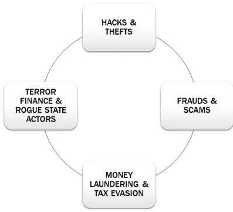

图8.1 加密货币相关的法律问题（来源：作者整理）

### 黑客攻击和盗窃

作为一类数字工具，加密货币难免容易受到黑客攻击；作为一类货币，它们也难免容易遭受盗窃（Krupa et al. 2021; Angerer et al. 2021; Joo et al. 2019; Smith 2019）。两者往往相伴（hand in


另一方面，不幸的是，黑客攻击和盗窃的目的在犯罪行为者中找到了共同点。

用简化的语言来说，黑客攻击可以通过多种方式实现（参见 Hu and You 2021；Arsi et al. 2022 中的技术分析），但它通常依赖于（1）用算力压倒生产（挖矿）过程；（2）闯入所有者的钱包（密钥）；或（3）拦截/劫持交易；在这些方式中，第二类是最普遍理解的定义，也是最常见的一种。

就本文参考目的而言，盗窃可以指三种剥夺行为：（1）劫持计算机并以加密货币付款为交换恢复计算机的勒索软件攻击；（2）从钱包（密钥）中提取代码；或（3）劫持/重新布线/重新设计交易，其中第二类最为常见。在加密货币存在的短暂时间里，发生了许多重大黑客攻击和盗窃事件（Hu and You 2021；Krupa et al. 2021；Arsi et al. 2022），但有几起事件值得特别提及，如下：

- 1. Mt. Gox。日本加密货币交易所 Mt. Gox 在其鼎盛时期（约2013年）是全球最大的比特币交易所，处理了超过70%的全球比特币交易量（Ito and Howe 2016）。它于2011年首次遭黑客攻击，880万美元被盗，但其热钱包随时间逐渐流失，累计近850,000个比特币被转移（当时价值6亿美元），原因还包括虚假比特币被推送到该交易所。这是当时同类中最大的安全漏洞事件，其前提是缺乏版本控制安全软件，这意味着黑客可以在缺乏足够威慑的情况下重新设计交易所的新版本。鉴于损失规模，许多客户对该公司提起诉讼（从而启动了法律追索要素），这些诉讼仍通过民事康复计划进行处理。

- 2. Coincheck。Coincheck 是另一个因泄露和盗窃规模巨大而值得提及的加密货币交易所。2018年1月，恶意行为者使用网络钓鱼攻击闯入该交易所，恶意软件在系统和热钱包中传播，窃取了当时价值5.34亿美元的加密货币。至今，这是对交易所的最大单次攻击。

- 3. Continental Pipeline。大陆管道是美国能源基础设施的一部分，于2021年5月遭遇大规模勒索软件攻击。此次攻击规模之所以重大，是因为它停止了所有管道输送，导致美国东部地区燃料短缺。这与加密货币的犯罪性相关，因为勒索软件攻击者要求支付75个比特币（当时价值440万美元）以换取一种可逐步解锁被劫持计算机系统的软件。由于基于区块链的系统具有去中心化且大部分（但不完全）匿名的特性，人们曾认为加密货币黑客攻击和盗窃无法追踪。然而，执法机构（特别是联邦调查局 FBI）的大量工作在 Continental 案例中表明，黑客攻击和盗窃的实施者在付出足够努力后可以被定位。

这些例子表明，黑客攻击和盗窃仍然是加密货币使用法律方面的一个重要考量因素。个人、交易所、公司和其他利益相关者依然面临脆弱性，这在很大程度上是因为该领域的有利可图性以及可执行攻击的多样性。

### 欺诈与诈骗

加密货币建立在“无信任”概念之上（Chohan 2019a），这意味着各方可以进行加密货币交易而无需相互了解或信任。然而，无信任概念随着时间的推移被夸大了，因为加密货币经济的许多元素都需要信任（Chohan 2019b；Zhang et al. 2021；Karimov and Wojcik 2021；Sanz-Bas et al. 2021），尤其是在首次代币发行（ICO；参见 Karimov and Wojcik 2021；Chohan 2019b）方面。

ICO涉及在互联网上发行新代币（加密货币硬币）。这是一个充斥着诈骗和欺诈活动的领域，如今社交媒体等平台拒绝发布ICO广告。不受监管的数字工具的扩散伴随着错误信息、误导性声明和诈骗伎俩的激增，给毫无戒备的投资者造成了数十亿美元的损失（Zhang et al. 2021；Sanz-Bas et al. 2021）。

迄今为止最重大的加密货币诈骗案是 Bitconnect，其虚假营销（“保证40%回报”）以及作为庞氏骗局解散导致35亿美元损失（Chohan 2022b）。其他造成投资者重大损失的重要庞氏骗局手段包括 Pincoin（越南，32,000人损失8.7亿美元）；ACChain（中国，8000万美元）；以及 Plexcoin（美国，2000万美元）。虽然ICO不像过去十年那样普遍，但正在获得人气的新型区块链技术包括非同质化代币（NFT，参见 Chohan 2021b）和去中心化金融（DeFi，参见 Schuëffel 2021；Chohan 2021c）。这些备受炒作的新兴领域引发了关于诈骗和欺诈的严重担忧，因此需要仔细的监管和法律关注。

还应当指出，诈骗和欺诈的范围在世界各地广泛传播，并非任何特定管辖权的专属。这使得各国可以相互借鉴经验，并就在这些波动、高风险且脆弱的领域投资发布指导方针和警告（Chohan 2017a, b）。许多国家（例如，英国、立陶宛、澳大利亚、美国）确实就此发表了声明（参见 Clayton and Giancarlo 2018 中的示例），敦促公众在进行加密货币交易时保持谨慎。

### 洗钱与逃税

洗钱是有关加密货币的一个非常严重和系统性的问题，因为它可以轻易用于进行绕过传统金融体系的交易。因此，它经常被描述为“洗钱的便捷工具”（Dyntu and Dykysi 2018）。

大量工作已致力于识别加密货币用于反洗钱（AML）目的所呈现的范围和威胁，文献发现基本上都指向一种严重威胁，需要在国家和国际两个层面采取主动监管行动（Dyntu and Dykysi 2018；Barone and Masciandaro 2019；Dupuis and Gleason 2020；DoJ 2020；Chohan 2017b, 2021a, 2022a）。

加密货币可以通过多个地点的多个账户进行交易，其踪迹在很大程度上（但不完全）可以被混淆。此外，尽管有国际层面的努力（参见 FATF 2019），但其交易不需要建立在银行或政府对了解你的客户（KYC）程序的传统监管监督之上。

认识到这一点，监管机构和执法机构已做出重大努力，试图遏制洗钱活动（参见 FATF 2019；DoJ 2020；Chohan 2017b, 2021a, 2022a）。这些举措的核心在于协调和规范化原则，前者认识到问题的跨境性质以及管辖权之间的套利，后者认识到一个完全平行的货币交换系统随着时间的推移对传统金融体系构成威胁。

协调是多个管辖权意愿与能力以及信息共享努力的函数，而规范化是将基于加密货币的交易嵌入现有银行架构的函数。沿这些方向的努力受到包括合作意愿不足（Chohan 2021a）和技术复杂性（Chohan 2022a）在内的挑战所阻碍，但与此同时，就某些管辖权禁止加密货币背后的监管/法律关切（Chohan 2017a）而言，洗钱仍然是首要考量，以至于加密货币有时被指控为洗钱的“新面孔”（Mabunda 2018）。

洗钱的一个重要推论是逃税，因为两者通常被视为非法金融更大问题的一部分，尽管两者并不


一回事，因为二者可以分开发生（参见Storm 2013中的类型学）。因此，比特币和其他加密货币被视为既是反洗钱风险也是逃税风险（Slattery 2014）。

具体到逃税方面，一些作者认为加密货币是“超级避税天堂”，因为它们可能成为逃税者的“首选武器”（Marien 2013，第38页）。鉴于逃税风险的严重性（Matei and Baks 2019），许多国家的税务机关已开始与金融监管机构和执法部门同步努力。例如，在美国，加密货币在税务目的上被视为“财产”，在监管目的上被视为“证券”或“商品”（取决于其规模，参见Chohan 2022a-b）。

因此，美国国税局（IRS，即美国联邦税务局）与证券交易委员会（SEC）、商品期货交易委员会（CFTC）以及司法部（DoJ）合作，从多个角度打击法律问题，包括逃税要素（Chohan 2021a, 2022a; DoJ 2020）。

### 恐怖融资与流氓行为者

虽然为了追踪国际非法资金流动的目的，洗钱和恐怖融资常被归为一类（AML/CFT [打击恐怖融资]），但本章将对恐怖融资和流氓行为者（无论是国家行为者、半国家行为者还是非国家行为者）的担忧单独处理，因为其行动的严重性和动机（Killick and Parody 2007）。

最令人担忧的类别是流氓国家，它们能够筹集资源实施对交易所和私人钱包的黑客攻击和盗窃，以便提取代币用于资助非法项目，从而绕过针对它们实施的制裁制度。

紧随其后的令人担忧的类别包括恐怖组织使用类似方法绕过制裁和国际反恐监管措施（Chohan 2021a）。美国司法部在这方面开展了大量工作，并发现各种各样的各方以非法方式参与加密货币的实例，例如伊朗和朝鲜政府，或基地组织和ISIS的子组织及同情者（DoJ 2020）。

因此，加密货币被视为一种“非常规”但非常严峻的挑战（Dostov and Shust 2014），因为它实际上成为意识形态和民族主义利益的战场，以及通过经济战争进行较量的竞技场。

截至本文撰写时，俄乌冲突正在加剧，西方国家已宣布一系列经济制裁，其范围比过去宣布的制裁更广。然而，许多观察者认为制裁固有地无效，因为俄罗斯可以用加密货币作为主要媒介来绕过制裁（参见Flitter and Yaffe-Bellany 2022）。国家、半国家和非国家行为者所拥有的能力意味着，加密货币将面临超越金融稳定的技术官僚论点的政治反弹（Prosek et al. 2021），这进一步给立法者和监管机构带来压力，迫使它们重新评估对加密货币监管的容忍度。

### 监管回应的光谱

鉴于前文关于加密货币所面临的各种非法和犯罪活动形式的讨论，可以观察到对加密货币作为资产类别和交换媒介的法律态度呈现出一个光谱（Chohan 2017a, b）。如前所述，这种态度的多样性可以由多种因素解释，包括法律原则（Bailey et al. 2021）、监管精密度（Irina 2018）、金融监管能力（Chohan 2019, 2022a）、经济条件（Szwajdler 2021）以及社会文化规范（Busse et al. 2020; Ben Saad et al. 2022），所有这些因素在各国之间各不相同。

有些国家对加密货币持友好态度，但希望其处于合理的监管范围之内（美国和加拿大是主要例子）。然后，有少数国家已经考虑或正在考虑将加密货币（或至少是比特币）视为与其主权货币发行地位等同的完全合法工具（以萨尔瓦多为先锋）。

还有些国家对加密货币的合法性保持刻意模糊，并等待进一步的法律和技术发展来形成审慎意见，同时保持对国际压力的超然（巴基斯坦是主要例子）。与此同时，一些国家曾从表现出一定程度的容忍转向后来实施全面禁令（中国），但已寻求诸如央行数字货币（CBDCs）等替代方案。

反之，其他一些曾经禁止加密货币的国家已转向在监管框架下恢复其地位（例如，印度）。还有其他一些国家对加密货币使用实施部分限制，无论是将其作为支付手段予以禁止而将其作为价值储存手段予以容忍（印度尼西亚），还是禁止银行处理加密货币交易（柬埔寨），以及其他变体。加密货币合法性的各种类型学在表8.1中列出。

尽管本章超出范围无法逐一详细考察各类型学，但最广为认可的是表8.1中第2级的类型学，即允许加密货币的生产、使用和所有权，但使其受到直接或间接的金融监管（Chohan 2021a, b, 2022a）。这是美国采取的方法，依据一项经过精心制定的战略，该战略涉及协调许多不同机构，一方面为了投资者保护和市场公正性，另一方面为了金融创新和用户自由（参见Chohan 2022a）。在问责制和自由这两个公共价值之间取得平衡的努力，处于所有成熟的以公民驱动的技术变革方法的核心（参见Chohan 2021a, 2022a）。因此，美国的方法代表了应对加密货币所带来的监管和法律挑战的最精密努力。

#### 表8.1 加密货币合法性光谱

| 级别 | 许可类型 | 说明 | 国家示例 |
|:---|:---|:---|:---|
| 1 | 法定货币 | 一种加密货币（比特币）充当完全法定货币，与该国发行的货币工具等值且可互换。 | 萨尔瓦多 |
| 2 | 有监管框架的许可 | 加密货币被完全允许，但通常受涉及法律/金融监管机构的监管框架约束。 | 美国、加拿大、澳大利亚 |
| 3 | 无特定监管框架的许可 | 由于监管机构解释认为加密货币不属于金融监管范围，因此被容忍。 | 新西兰、斯洛伐克、英国 |
| 4 | 部分允许/部分禁令 | 加密货币以某些方式被允许，但以其他方式不被允许。例如禁止银行处理、禁止本地交易、禁止挖矿等。 | 印度尼西亚、柬埔寨、俄罗斯 |
| 5 | 战略模糊 | 官方监管框架不存在，但加密货币未被明确禁止。这是为了适应该领域的进一步演变。 | 巴基斯坦 |
| 6 | 禁止 | 使用加密货币的所有权、交换和交易被完全禁止；但也许会有拟议的替代方案（CBDCs）。 | 中国（数字人民币）、玻利维亚、阿尔及利亚 |

按宽容度/法律许可程度排序（来源：Chohan 2017a, b；作者研究）

表8.1中的第3级在对用户的实际影响（宽容性）方面是相似的，但就用户可获得的补救措施而言，在


不当行为或损失的案例。由于不将加密货币视为受现有金融监管约束，一些国家将责任留给用户参与其中，但风险自负。在此需要澄清的是，虽然第3级政府可能不认为加密货币是金融监管目的下的适当货币形式，但这并不意味着不必检查许可证、注册和其他官僚程序；而仅仅意味着加密货币通常适用替代指南，或不适用于传统金融部门的指南。

表8.1中的第4级是一种更为受限的容忍形式，其中加密货币可能允许用于某些目的但不允许用于其他目的。例如，一个国家可能允许持有和交易加密货币但禁止挖矿（俄罗斯），允许所有权但限制交易中的支付性（印度尼西亚），或允许人们挖矿和使用加密货币交易但不通过传统银行渠道（柬埔寨）。此处值得提及的是，法规可能会发生变化，撰写时观察到的情况可能会随时间改变。

表8.1中的第5级是一个特殊案例，即一个国家没有关于加密货币的官方指南或声明，以供该领域进一步发展。在这方面，巴基斯坦是一个值得注意的案例，因为国家银行（货币主管机构）对加密货币没有明确评论，尽管加密货币的交易量可能达到数十亿美元（Chohan 2017a）。这种“战略模糊性”使巴基斯坦国家银行能够避免国内和国际压力（例如来自FATF的压力），特别是因为其他AML/CFT问题在该国的背景下不断（且或许过度，出于政治原因，参见Chohan 2020）被提出。

除此之外，表8.1中还有第6级国家，其中加密货币被简单地禁止用于所有目的：所有权、挖矿、交易以及其他一切。玻利维亚和尼泊尔是较小的经济体，已采取这种立场，但最突出的这样做的经济体是中国，它相反推出了央行数字货币（CBDC）（即数字人民币）作为一种中心化管理的数字货币。CBDC将在下一节中详细讨论，但此处值得提及的是，它们与通常理解的加密货币存在实质性差异。

完全禁止加密货币的国家往往援引本章前一节提出的问题，特别是AML/CFT问题，但也指出消费者保护、金融稳定和经济安全是禁止的理由。由于政府必须考虑的因素多种多样，同时还需牢记其特定的当地情况，因此本章的职责范围不包括对禁止发表评论。

还值得指出的是，尽管一些国家对加密货币持反对态度，但有一小群由萨尔瓦多领导的司法管辖区符合表8.1中第1级的条件，因为它们将某种加密货币（比特币）视为完全法定货币。这种非凡地位意味着，至少从法律上讲，比特币可以完全替代该国的主权货币工具（Gorjon 2021）。

将比特币视为法定货币对萨尔瓦多产生了有趣的后果，一方面，它推动了该国旅游业和国际投资者兴趣的增长，但另一方面，也恶化了该国的财政状况（IMF 2022）。尽管如此，萨尔瓦多仍坚持这一做法，还需要更多时间才能证明这种对加密货币持宽松监管态度是正确的。

### 国际协调努力

本章前两部分强调了（1）广泛的法律风险类别和（2）广泛的监管姿态类型，而本部分则探讨了跨国边界整合或协调加密货币监管的国际努力。这项工作之所以至关重要，首先是因为加密货币的跨境（甚至无国界）性质，因为其所有者、交易者和矿工可以以适应性的方式定位和重新定位自己。在某些情况下，例如委内瑞拉难民涌入哥伦比亚，这种无国界性被证明是一种福祉（DiSalvo 2019; Rendon 2021）。然而，在更多情况下，如本章前几部分所讨论的，加密货币的跨境性质会产生各种类型的风险。

然而，在开始处理加密货币之前，全球金融监管体系就已经高度失衡、低效、扭曲和政治化；它充斥着避税天堂、双面行为者、套利策略，以及大批合法和非法延续扭曲世界体系的律师和会计师（Dupuis and Gleason 2020; Shehu 2012; Chohan 2020; Killick and Parody 2007; Storm 2013）。大多数国际金融监管观察者承认这一点，但随后认为加密货币可能会进一步恶化该体系（Szwajdler 2021; Nabilou and Prum 2019; Matei and Baks 2019; Chohan 2021c; Larkin et al. 2021），因此必须采取行动，全球监管者必须从某处开始！

在这方面，有几项主要举措正在推动更好的协调。第一个是FATF，它为虚拟资产（比单独的加密货币更大的一个类别）发布了相当严格的指南（Chohan 2021a），因为它们包括诸如旅行规则等规定，这些规定将加密货币置于传统银行体系中。FATF的指南具有规定性，但为应对AML/CFT风险的严厉国际加密货币方法提供了严格的模板。

另一种（更具协作性）的方法是由美国司法部（DoJ 2020）主导的，它要求美国境内外的机构合作，共同针对特定违规者（通常是最危险的各方）进行打击。DoJ的以执法为中心的方法本质上是被动的，并需要其他机构有很大意愿积极配合，但它确实直击最恶劣、监管风险最大的参与者的核心。

其他主要多边机构也参与了加密货币监管，例如联合国、IMF和世界银行。然而，他们的努力相比之下相对乏力。相比之下，20国集团央行行长一直与国际清算银行（BIS）和FATF合作，共同开发关于加密货币协调的合作方式。20国集团央行的努力可能在适当的时候就加密货币标准常态化提供最具体的结果，因为央行行长在宏观金融/宏观审慎稳定方面拥有最高利害关系，并且具备采取行动的最大能力（参见Nabilou and Prum 2019; Chohan 2021a, 2022b）。因此，由于它们在金融稳定和监督方面的作用（Chohan 2020），央行被视为国际层面加密货币监管领域的关键国家机构（Nabilou and Prum 2019）。

话虽如此，央行行长在制定相互认可的全球指南时可能面临利益冲突，因为它们自身机构可能正在寻求现有加密货币的强大替代品，最显著的是以CBDC的形式。CBDC可能与加密货币相似，因为它们是*虚拟资产*（FATF 2019），但其哲学基础和实际影响存在显著差异。首先，加密货币受*无政府密码学*精神（参见Chohan 2017c中的综述）启发，主张在网络空间中去中心化、赋权、自主的金融解放方法，摆脱政府监管的束缚。作为CBDC的发行机构，央行将对货币动态（Yuxuan et al. 2018）以及监控和隐私（Pocher and Veneris 2021）拥有不成比例的控制权。取决于管辖央行的立法，这些问题可能引发其自身的合法性和货币问题。

支持CBDC的反驳观点是，本章前面列出的问题（黑客攻击和盗窃、欺诈和诈骗、AML/CFT、逃税）可以通过积极主动的中央银行监管来更好地解决，可能甚至比当前金融体系更有效，尽管在实施初期可能会出现挑战（Brunnermeier and Niepelt 2019; Viñuela et al. 2020）。就监管态度而言，表8.1中属于第4–6级的国家，在CBDC生效后，可能会更倾向于向第2级或第3级转变，鑒于主权货币权威和法律

这些类型所依赖的架构。然而，在这种情况下，传统加密货币可能会被取代或显著边缘化（Viñuela et al. 2020; Pocher and Veneris 2021）。

### 结语

加密货币最初旨在处于传统金融/法律体系之外（Chohan 2017c, 2019a）。然而，其日益广泛的采用、不断增加的复杂性以及有利可图的性质，提高了该领域所有参与者（尤其是监管机构）的利害关系。与此同时，随着其受欢迎程度的增长，一系列恶劣的犯罪行为也被发现与少数加密货币行为者密切相关。

这些行为的严重性足以动员法律和监管机构，以遏制此类活动可能造成的公共价值破坏（Chohan 2022a）。黑客攻击、盗窃、欺诈、诈骗、洗钱、逃税、恐怖主义融资以及流氓国家和非国家行为等，都在监管公共管理者中引起了相当大的警觉。它们还使得本应是知识学、钱币学、技术和货币创新的有前途领域声名狼藉。

各国对加密货币的出现作出了各种反应，从极度积极到公开敌对。随着新事件塑造其监管立场，其反应可能会随时间而变化。然而，虽然它们在国家或次国家层面与这项新技术作斗争，但关于虚拟资产的真相是，它们本质上是跨境的，因此需要协调的国际行动。说起来容易做起来难，鉴于当前的国际监管体系在许多方面高度扭曲且不完善。然而，正在努力协调监管。

但是，笼罩在这一主题上的一个更大因素是，各国可能会引入主权替代品来取代去中心化加密货币（CBDC），这将（至少在一定程度上）解决加密货币滥用的许多犯罪方面。

尽管如此，加密货币领域的创新步伐及其交易的有利可图性，使人推测行为者与监管机构之间的辩证法（Dupuis and Gleason 2020）将继续演变，并且以持续白热化的步伐。

### 参考文献

- Angerer, M., Hoffmann, C. H., Neitzert, F., 和 Kraus, S. (2021). 投资加密货币的客观与主观风险。*金融研究字母*，40: 101737.

- Arsi, S., Ben Khelifa, S., Ghabri, Y., 和 Mzoughi, H. (2022). 加密货币：关键风险与挑战。在：S. Goutte, K. Guesmi, 和 S. Saadi (编)，加密金融：新经济的新货币，121–145。世界科学出版社有限公司。

- Barone, R., 和 Masciandaro, D. (2019). 加密货币还是高利贷？犯罪与替代洗钱技术。欧洲法律与经济学杂志，47(2): 233–254.

- Ben Saad, S., Allaya, A., Taârit, F., 和 Hchaichi, R. (2022). 更好地理解加密货币传播的阻力因素。在：S. Goutte, K. Guesmi, 和 S. Saadi (编)，加密金融：新经济的新货币，63–86。

- Busse, K., Tahaei, M., Krombholz, K., von Zezschwitz, E., Smith, M., Tian, J., 和 Xu, W. (2020年9月). 现金、卡片还是加密货币？四个国家支付文化研究。2020年IEEE欧洲安全与隐私研讨会（EuroS&PW），200–209。IEEE。

- Brunnermeier, M. K., 和 Niepelt, D. (2019). 论私人货币与公共货币的等价性。货币经济学杂志，106: 27–41.

- Chodhury, N. (2019). 区块链、比特币与加密货币内部。CRC Press。

- Chohan, U. W. (2017a). 加密货币：简要主题综述。网络经济学电子期刊。SSRN。http://dx.doi.org/10.2139/ssrn.3024330

- Chohan, U. W. (2017b). 评估比特币及其他加密货币在各国司法管辖区的合法性差异。可在 SSRN 3042248 上查阅。

- Chohan, U. W. (2017c). 密码无政府主义与加密货币。金融机构监管电子期刊。SSRN。http://dx.doi.org/10.2139/ssrn.3079241

- Chohan, U. W. (2019a). 加密货币真的是无需信任的吗？在：S. Goutte, K. Guesmi, 和 S. Saadi (编)，加密金融与交换机制，77–89。Springer, Cham。

- Chohan, U. W. (2019b). 首次代币发行（ICO）：风险、监管与问责。在：S. Goutte, K. Guesmi, 和 S. Saadi (编)，加密金融与交换机制，165–177。Cham: Springer。

- Chohan, U. W. (2020). 全球金融架构中的金融行动特别工作组：挑战与影响。金融机构监管电子期刊。SSRN。http://dx.doi.org/10.2139/ssrn.3362167

- Chohan, U. W. (2021a). 公共价值与数字经济。Routledge。

- Chohan, U. W. (2021b). 非同质化代币：区块链、稀缺性与价值。关键区块链研究倡议（CBRI）工作文件。

- Chohan, U. W. (2021c). 去中心化金融（DeFi）：一种新兴的替代性金融架构。关键区块链研究倡议（CBRI）工作文件。

- Chohan, U. W. (2022a). 公共价值与公民驱动的数字创新：一项加密货币研究。*公共行政国际杂志*。https://doi.org/10.1080/01900692.2022.2043365

- Chohan, U. W. (2022b). 加密货币的监督与监管：BitLicense。在：S. Goutte, K. Guesmi, 和 S. Saadi (编)，*加密金融：新经济的新货币*，105–120。

- Chohan, U. W. (2022c). 加密货币与不平等。在：S. Goutte, K. Guesmi, 和 S. Saadi (编)，*加密金融：新经济的新货币*，49–62。

- Clayton, J., 和 Giancarlo, J. C. (2018). SEC 主席 Jay Clayton 和 CFTC 主席 J. Christopher Giancarlo 的声明：监管机构正在审视加密货币。新闻稿。

- DiSalvo, M. (2019). 为什么委内瑞拉人寻求在加密货币中避难？BBC。https://www.bbc.com/news/business-47553048

- DoJ（司法部） (2020年10月). 加密货币执法框架：司法部长网络数字特遣队报告。华盛顿特区：DoJ。

- Dostov, V., 和 Shust, P. (2014). 加密货币：对反洗钱/反恐怖融资监管机构的非常规挑战？*金融犯罪杂志*，21(3): 249–263.

- Dupuis, D., 和 Gleason, K. (2020). 利用加密货币洗钱：敞开的大门与监管辩证法。*金融犯罪杂志*。

- Dyntu, V., 和 Dykkyi, O. (2018). 洗钱体系中的加密货币。*波罗的海经济研究杂志*，4(5): 75–81.

- Financial Action Task Force (FATF) (2019). *虚拟资产和虚拟资产服务提供商基于风险的方法指南*。巴黎：FATF。

- Flitter, E., 和 Yaffe-Bellany, D. (2022). 俄罗斯可能使用加密货币削弱美国制裁的效力。*纽约时报*，2月23日。

- García-Corral, F. J., Cordero-García, J. A., de Pablo-Valenciano, J., 和 Uribe-Toril, J. (2022). 加密货币的文献计量学综述：它们是如何增长？*金融创新*，8(1): 1–31.

- Gorjón, S. (2021). 加密资产作为法定货币的作用：以萨尔瓦多为例。*西班牙银行文章*，35: 21.

- Hu, Y., 和 Hou, Y. G. (2021). 黑客攻击挖矿哈希算力过程的概述与分析。*理解加密货币欺诈：监管数字货币的挑战与阻力*。Batten-Corbet-Lucey 替代投资手册第2卷，149。Walter de Gruyter GmbH & Co。

- IMF（国际货币基金组织） (2022). 萨尔瓦多的复苏受日益增加的风险制约。https://www.imf.org/en/News/Articles/2022/02/15/cf-el-salvadors-comeback-constrained-by-increased-risks

- Ito, J., 和 Howe, J. (2016). *甩鞭效应：如何在快节奏未来中生存*。大中央出版公司。

- Irina, C. (2018). 加密货币的法律监管。金砖国家法律期刊，5(2): 128–153.

- Joo, M. H., Nishikawa, Y., 和 Dandapani, K. (2019). ICO，下一代 IPO。管理财务，46(6): 761–783.

- Karimov, B., 和 Wójcik, P. (2021). 利用机器学习识别首次代币发行中的诈骗。人工智能前沿，4.

- Killick, M., 和 Parody, D. (2007). 实施解决风险而非仅仅形式化的反洗钱/反恐怖融资措施。金融监管与合规杂志。DOI: 10.1108/13581980710744093.

- Kher, R., Terjesen, S., 和 Liu, C. (2021). 区块链、比特币与首次代币发行：综述与研究议程。小企业经济学，56(4): 1699–1720.

- Krupa, T., Ries, M., Kotuliak, I., 和 Bencel, R. (2021年1月). 以太坊平台上智能合约的安全问题。2021年第28届开放创新协会会议（FRUCT），208–214。IEEE。

- Larkin, C., Pearce, N., 和 Shannon, N. (2021). 犯罪与加密货币：执法与政策响应——第二部分。理解加密货币欺诈，133.

- Mabunda, S. (2018年8月). 加密货币：网络洗钱的新面貌。2018年大数据、计算与数据通信系统进步国际会议（icABCD），1–6。IEEE。

- Marian, O. (2013). 加密货币是超级避税天堂吗？密歇根法律评论初印象，112: 38.

- Matei, I. G., 和 Baks, E. W. (2019). 监管比特币——未来的挑战。多瑙河大学经济学年刊，15(3).

- Nabilou, H., 和 Prum, A. (2019). 中央银行与加密货币监管。银行与金融法律评论，39: 1003.

- Nica, O., Piotrowska, K., 和 Schenk-Hoppé, K. R. (2022). 加密货币：概念与当前市场结构。在：S. Goutte, K. Guesmi, 和 S. Saadi (编)，加密金融：新经济的新货币，1–28.

- Pocher, N., 和 Veneris, A. (2021). CBDC中的隐私与透明度：一种基于设计的反洗钱/反恐怖融资方案。IEEE网络与服务管理期刊。

- Rendon, M. (2021). 开放且公共的加密货币如何帮助委内瑞拉人。战略与国际研究中心。4月13日。https://www.csis.org/analysis/how-open-and-public-cryptocurrencies-can-help-venezuelans

- Salcedo, E., 和 Gupta, M. (2021). 个人层面宣称的国家文化价值观对使用比特币式区块链货币意愿的影响。国际信息管理杂志，60: 102388.

- Sanz-Bas, D., del Rosal, C., Núñez Alonso, S. L., 和 Echarte Fernández, M. Á. (2021). 加密货币与欺诈交易：欧洲和西班牙的风险、做法及预防立法。法律，10(3): 57.


- Schueffel, P. (2021). DeFi: 去中心化金融——简介与概述。*Journal of Innovation Management*, 9(3): i–xi.

- Shehu, A. Y. (2012). 促进金融包容性以有效打击洗钱和反恐怖融资（AML/CFT）.*Crime, Law and Social Change*, 57(3): 305–323.

- Slattery, T. (2014). 打击犯罪：比特币与跨境逃税。*Brook J. Intl. L.*, 39: 829.

- Smith, B. (2019). 加密资产的生命周期与特征：监管与投资者保护框架。*Journal of Accounting and Finance*, 19(1): 156–168.

- Zwajdler, P. (2021). 关于首次代币发行领域未来金融法规构建的思考。*European Business Organization Law Review*, 1–39.

- Storm, A. (2013). 建立洗钱与逃税之间的联系。*International Business & Economics Research Journal (IBER)*, 12(11): 1437–1450.

- Viñuela, C., Sapena, J., and Wandosell, G. (2020). 货币的未来与中央银行数字货币困境。*Sustainability*, 12(22): 9697.

- Yuxuan, C., Kejie, Z., and Wenhao, Y. (2018). 中央银行数字货币货币供应量研究。*Journal of Finance Research*, 2(2): 27–36.

- Zhang, Y., Yu, W., Li, Z., Raza, S., and Cao, H. (2021). 基于改进LightGBM算法的以太坊庞氏骗局检测。*IEEE Transactions on Computational Social Systems*.


## Taylor & Francis

## Taylor & Francis Group

http://taylorandfrancis.com

## 第9章

## 加密货币、区块链与公共选择

Ryan M. Yonk and David Waugh

美国经济研究研究所

### 引言

诺贝尔经济学家詹姆斯·M·布坎南曾著名地将公共选择描述为“没有浪漫的政治”（Buchanan 1984），旨在通过一种更务实、更现实的视角，而非通过高尚公民的规范性视角来展示政治世界。在过去至少半个世纪里，公共选择研究计划一直致力于通过应用经济学工具，更深入地理解政治世界。

布坎南和其他早期公共选择学者所寻求的是一种剥离浪漫认知的东西。相反，他们将实证分析应用于政治决策所在的领域。这些学者运用经济学工具分析协调政治和经济活动的非市场决策。尽管该领域在过去半个世纪里不断发展，但对实证分析的承诺仍然是公共选择分析的标志。

在将这种实证分析应用于非市场、协调决策时，公共选择的核心依赖于两个原则：（1）个人有偏好；（2）他们将采取行动以实现这些偏好。这两项关于经济协调的简单观察建立在我们对市场交换的理解之上。这些原则在经济领域平淡无奇，但应用于公共部门时仍然具有革命性。包括詹姆斯·M·布坎南、埃莉诺·奥斯特罗姆、威廉·里克和戈登·塔洛克在内的众多学者，从协调交换的角度构建了对政治的理解。他们的政府理论强调塑造政治决策的激励结构，并利用政治决策是如何做出的实际观察。这种理论用对实际发生情况的具体解释取代了关于政府的规范性主张。

公共选择运用经济学的分析技术来考察政治行为者和过程。本质上，它是“将经济学应用于政治科学”（Mueller 1976）。在20世纪40和50年代的经济学文献中，经济学家批评市场因贪婪或制度错位而出现失灵。布坎南和塔洛克*将这些对市场行为者的批评应用于政治。公共选择关注个人层面的决策（而“大众”或“社会”并非分析单位）。群体不做选择，而是个人——作为基本行动者——做选择（Shughart 2018）。

传统上，在政治科学和大多数公民意识的理解中，人们假设政府中的人会将公众的最佳利益放在心中，同时放弃个人利益。公共选择理论家拒绝这种浪漫的观念，认为政客与任何其他理性自利的行动者没有不同，都有自己的效用预期。政治行为者面临不同的约束、激励和决策路径，这表明一旦当选，他们并不会从最大化自身利益的理性行动者转变为开明的公共仆人。公共选择学者的立场是，人们不能简单地选举“更好的人”来解决问题，因为所有当选官员和官僚都有相同的情境性激励结构和自身利益（Buchanan 1984）。

作为一种理解集体决策的研究计划和方法，公共选择有一个源于经济学中多个诺贝尔奖获奖研究议程的历史，†它采用最佳可用工具，以更好地理解规则、激励和预期如何在政治世界中导致不同的结果。公共选择——面对政治转变、新的政策方法和巨大的技术变革——一直是一种富有成效的机制，用于理解这些变化如何影响政治以及相关人员的决策。

* 布坎南和塔洛克是弗吉尼亚公共选择学派的创始人。公共选择还有其他学派，如布鲁明顿学派和罗切斯特学派。
† 诺贝尔奖得主包括詹姆斯·布坎南和埃莉诺·奥斯特罗姆。

本章将透过公共选择的视角，探讨加密货币的技术创新如何影响集体决策。我们依据传统的公共选择研究议程，分析加密货币的区块链技术可能如何影响我们对政治和政策决策的理解。我们呈现了一组关于非市场决策的例证性案例研究，这些案例在公共选择研究中已得到深入研究。这些案例研究探讨加密货币技术是否有潜力帮助改善决策。我们认为，加密货币技术的发展揭示了围绕非市场决策的制度安排，并可能缓解一些公共选择问题。

我们的方法对新兴加密技术与公共选择思想之间的关系提供了独特的见解。在每个案例中，我们首先确定公共选择文献中提出的问题，然后探讨新兴的加密货币技术——在某些情况下是货币本身——如何为非市场决策提供新的见解。我们的核心问题具体探讨区块链技术是否允许以新的方式协调政治和经济活动，以及这些新方式可能产生什么影响。

### 加密货币、区块链与去中心化自治组织（DAOs）

为便于我们讨论常见的公共选择问题，有必要解释大多数加密货币背后的技术——即区块链。简单来说，区块链是连续的信息串。它们是不断增长的信息记录，被捆绑成块并使用密码学（一种解码技术）链接在一起。区块链最常见的用途之一是作为数字货币的账本。与典型的货币不同，加密货币纯粹是电子形式，不由实物货币或资产支持。每个加密货币网络（如比特币或以太坊）都维护一条区块链，作为每笔交易的账本或记录（Waugh 2022）。区块链以时间戳序列将块（即交易捆绑包）链接在一起，该序列可公开查看。

需要注意的是，加密货币区块链是去中心化的。它们不需要第三方来维护。它们通过共识机制达成共识，即决定什么是有效的，什么是无效的。最流行的加密货币共识机制被称为工作量证明（PoW）和


权益证明（PoS）。在 PoW 区块链上，区块通过 *挖矿* 创建。对于链中的每个区块，矿工（计算机）竞争解决加密谜题，使用其计算机的处理能力。此过程需要大量资源，形式为计算能力和电力。一旦第一个矿工解决问题，经过验证的交易区块就会被添加到链中，交易成为永久记录的一部分。作为其工作的回报，矿工会获得加密货币奖励，这激励他们消耗计算能力来挖掘更多区块。

挖矿是“工作量证明”术语中的“工作”。矿工使用其计算能力，即工作，来“证明”网络。由于网络创建了经过验证交易的永久记录，PoW 消除了对中央机构的需求，并提供了去中心化验证记录。

至于权益证明，网络参与者“质押”或锁定其加密资产，以换取成为区块链验证者的资格。验证者由网络随机选出以验证区块链。PoS 验证者与 PoW 矿工类似，但不同于工作，他们的质押使他们能够验证网络。Campbell Harvey 在 *去中心化金融与金融的未来* 中认为，

> 验证者通过质押其加密货币使自己可用，然后随机被选中提出区块。提出的区块需要获得其他大多数验证者的证明。验证者既通过提出区块，也通过证明他人提出的区块的有效性来获利（Harvey 2021）。

在 PoW 和 PoS 中，对区块链（或每个网络的账本）的共识是在不需要中央行为者来确保账本有效的情况下达成的。

### 智能合约

一个能够有力说明区块链影响集体决策潜力的创新是 *智能合约*。智能合约，

- 尼克·萨博于 1994 年构思了智能合约。他将其定义为“执行合同条款的计算机交易协议。智能合约设计的一般目标是满足常见的合同条件（如支付条款、抵押权、保密性乃至强制执行），尽量减少恶意和意外的例外情况，并尽量减少对可信中介的需求。相关经济目标包括降低欺诈损失、仲裁和执行成本以及其他交易成本。”

通常部署在以太坊区块链网络上，允许个人在现有代码之上编写代码，创建“生活”在该区块链上的新产品。Harvey 等人（2021）观察到，智能合约是“生活在区块链上的代码，可以控制资产和数据，并定义资产、数据和网络参与者之间的交互。”它们允许基于代码中写入的指令自动执行协议，通常是交易。因此，个人和机构可以在无需第三方或中介的情况下自动执行交易。使用智能合约构建的这些应用称为 *去中心化应用* 或 dApps。一旦构建了 dApps，个人就可以在无需中央决策者的情况下在应用中进行点对点交互。

dApps 产生的最重要创新之一是 *去中心化自治组织*（DAO）。DAO 是由其成员拥有和管理的数字组织，并由区块链上的智能合约进行治理。智能合约充当一套细则，类似于宪法，概述了 DAO 如何运营以及未来如何更改规则。

一旦智能合约编程完成，资金筹集并存入金融中介，DAO 即部署在区块链上，其中的交易和对 DAO 的更改是透明、可验证且由成员批准的（Waugh 和 Wright 2022）。成员可以通过自愿获取 DAO 中的治理代币加入 DAO。DAO 可用于多种目的——例如作为公园等社区中心的自由职业者网络、投资基金、邻里守望或社区管理工具。DAO 通过出售代币或股份来筹集资金，类似于直接公开发行，通过这种方式参与是自愿的并需要采取积极行动。

DAO 以及构建在区块链技术之上的程序的含义，为公共选择学者在非市场决策研究中提出的问题提供了一种潜在替代方案。为了说明这一潜力，我们回顾了公共选择学者研究的三个传统案例，以及这些技术（尤其是 DAO）如何帮助缓解这些问题。

### 示例性案例 1：投票问题：一致同意、政党、联盟/利益集团

我们的第一个示例性案例考察了区块链在使用投票进行集体决策时出现的一些常见公共选择问题上的影响潜力。我们探讨了从制度角度扩展民主机会是否可能源于使用加密技术底层技术，涉及三个关键领域：一致同意、政党和投票交易，以及特殊利益集团。

#### 公共选择问题 1：一致同意

投票文献中出现的关键问题之一是如何处理市场外的决策规则，在这些规则下，资源分配不太可能使所有各方受益。公共选择文献提出的核心建议之一是在这些情况下实施一致同意或近乎一致同意规则，所有各方都同意结果。这样，每个人都能从决策中获益。然而，一致同意规则使达成最终决策变得更加困难，因为所有相关方都必须得出相同的结论。

一致同意意味着共识，即群体中的完全一致。理论上，一致同意越多意味着共识越多，意味着同意的选民越多。经济分析强调，个人根据其独特利益而非群体利益做出决策。

因此，当最终决策与每个人的自身利益一致时，即达成共识。在区块链中，比特币——一个没有明确政府的去中心化网络——通过共识以及每个个人在无需投票程序的情况下所做的决策来更改其协议和政策。网络参与者需要压倒性地同意使用某个特定流程，才能使其成为矿工之间的标准做法。

#### 公共选择问题 2：政党和投票交易

公共选择学者提出的另一个问题是，制度安排激励公职人员进行投票交易，尤其是在政党盟友之间，以最大化自身利益。政客们通过相互达成交易来推进其政治议程，即同意如果对方回报人情，就投票支持对方的立法。

例如，内布拉斯加州的一名政治家可能会投票支持风能补贴，如果他的南卡罗来纳州同行投票支持补贴农业利益的立法。他们投票支持有利于其他州的立法，尽管这对其选民没有直接的积极影响。他们进行投票交易以确保其立法通过，通常不顾立法的总成本，只要他们能直接从由此产生的立法决策中获益。

这些互动在政客之间建立了信任，政党通过提供可靠政治交换者的替代品来协助这一过程。政党充当润滑剂和粘合剂，使当选官员能够在立法机构内进行政治交换。公共选择理论指出，当政党和个人的地方利益超过任何单一纳税人的个人成本时，即使总成本超过总收益，也会采纳这些措施。

#### 公共选择问题 3：特殊利益集团

第三个问题源于投票交易和组建政党联盟的倾向。特殊利益集团（SIG）寻求 *租金*，即“市场中的比较优势”（Cowden、Prinzinger 和 Prinzinger 2009）。SIG 会游说政客以推进其个人目标，当这些目标与政客的目标（即连任）一致时，他们通常会成功获得这些租金。

这些组织争取政治盟友以推进可能与公共利益一致也可能不一致的利益。SIG 获得集中利益，而成本可能分散在公众中。例如，国内汽车制造商可能会游说国会对外国汽车制造商提高关税。虽然国内制造商可以通过提供比外国竞争对手相对更便宜的汽车并获得更多客户而受益，但消费者在汽车市场面临更高的总体价格和更少的选择。

### 创新加密关联技术对投票和一致同意规则的影响

流行的区块链，如比特币和以太坊区块链，使我们能够观察到一致同意的实际运作。当提出软件协议升级时，必须达成一致同意才能发生变化。软件协议升级可以被视为每个区块链网络宪法的修正案，需要共识才能在区块链上实施。

例如，围绕比特币区块链升级的决策必须遵循比特币改进提案（BIP）流程。BIP 可以是对协议或 BIP 流程本身的重大或微小更改。它们从草稿开始，变成提案，最终被接受。对比特币进行重大更改的 BIP 需要多年才能完成此流程。由于比特币是去中心化的，运行比特币区块链的节点（即计算机）最终通过选择要运行的比特币版本来决定是否实施 BIP。对比特币网络进行重大更改的 BIP 需要高水平的共识。

Sandor（2022）指出，“提出通过软分叉[小变更]实施的 BIP 要求‘明确的矿工多数’，即超过 90% 的节点必须批准升级。这些被称为‘共识 BIP’。”最终，比特币等区块链事实上选择使用共识（一致同意的一种变体）作为对网络进行重大更改的前提条件。


这确保了对网络的更改不会轻率，也不会以适得其反的方式从技术和货币角度降低其实用性。

虽然对区块链网络进行更改不需要一致同意，而且区块链网络本身也不会通过规则促进一致同意，但最成功的网络很可能至少部分地归功于它们依赖各种形式的共识来对协议进行更改。这种成功体现在比特币中，它比竞争对手 Terra®、Solana® 和其他网络更加去中心化。比特币用户更加确信网络不会在没有严格审查的情况下发生重大更改。因此，他们更有可能将时间和精力投入到网络中。

成功的区块链具有趋向一致的共识导向协议。这对研究政治和政府规则如何变更和实施的公共选择学者具有启发意义。一致可能带来更好的政治结果，公众也更倾向于遵循大力支持的变更。

最后，区块链可能作为实现二次投票的一种手段。Allen (2017) 描述了这种联系：

> 二次投票 [QV] 应该被理解为一种机制，该机制在选民识别、竞价和计票机制的稳健性与验证、以及投票购买、资金池和再分配机制的安全性与交易效率方面，本质上是在区块链上实现的。通过设想并在类似以太坊的平台上实施 QV 机制——该平台支持智能合约，允许公民预先编程其偏好，然后让其软件代理（或去中心化自治组织）有效地自动化交易、投票以及收付款——二次投票在模拟世界中的交易成本约束得到了显著降低。(Allen 2017)

这种共识形式可能代表了公共选择学者常提出的一致性规则的另一种方法，并且可能比一些人提出的许多大规模宪法修订更为实用。

### 理解政党及其影响

区块链为公共选择学者提供了一种观察政党和联盟在管理公共物品方面影响力的手段。当传统的协议升级流程无法解决传统问题时，事实上的“政党”会出现并试图影响协议更新决策。这一现象最重要的例子是乔纳森·比尔在 _区块大小战争：争夺谁控制比特币协议规则_ 中记录的区块大小战争。区块大小战争围绕比特币社区内的两个派系展开，每个派系对比特币区块链应当如何运作有着不同的愿景。这些派系通过互联网论坛和公共辩论彼此开战，每一方都争取比特币社区内机构和个人的支持。

最终，一方“获胜”，另一方分裂出来创建了自己的加密货币，即比特币现金（BCH）。诸如区块大小战争这样的历史事件，使公共选择学者能够研究利益集团和派系对影响每个区块链的关键决策的作用。

利益集团影响每个区块链项目的能力，在某种程度上取决于每个区块链项目的设计方式。公共选择研究者未来的研究可以关注创始人、基金会和风险投资公司持有大量投票代币的区块链项目。除此之外，还有一些自发出现的利益集团，例如 HODLers。Berg et al. (2018) 通过指出以下现象来描述这一情况：

> [T]当考虑到 HODLers 等利益集团时，协调活动的激励和倾向可能会引起公共选择学者的兴趣。
> HODLers 是区块链社区中在加密货币交易方面主张持有策略的成员。

最终，政党和联盟在区块链的设置方式和决策方式中可以发挥重要作用。类似于公共选择学者在政治领域所见的情况，派系在区块链社区中形成以影响集体决策。

### 说明性案例 2：法律与合同问题

#### 公共选择

历史上，合同通常依赖第三方作为执行者来解决争端或惩罚不遵守合同的一方。在发生争端的情况下，通常使用第三方来达成解决方案的成本过高。

在经济学领域，诺贝尔奖得主罗纳德·科斯提出了一个关于如何在法院系统之外解决法律争议的命题（Coase 1960）。公共选择学者在考虑绕过执行要求的方法时，常常建议采用恰好这样的方案。运用科斯逻辑，他们建议当存在外部性时，各方理论上可以通过讨价还价来达成解决方案，前提是交易成本较低且产权界定明确。最终，各方可能在无需第三方参与的情况下达成更优决策。Coase (1960) 承认，

…… 在选择个人决策所处的社会安排背景下，我们必须牢记，对现有系统的改变可能会改善某些决策，但也可能恶化其他决策。此外，我们还必须考虑运行各种社会安排（无论是市场还是政府部门）所涉及的成本，以及转向新系统所涉及的成本。在制定和选择社会安排时，我们应该关注总体效果（Coase 1960, 44）。

由此产生的司法判决可能带来一些改进，但也可能伴随着成本。在理解法律决策是如何作出的，与个人如何独立讨价还价时，这一点很重要。另一个需要注意的是，与实际情况隔离的第三方可能不了解每个情况的细节，从而无法做出导致最佳结果的明智决策。

#### 智能合约与法律

对法律而言，最重要的区块链创新是智能合约。尽管预计它们在不久的将来不会取代司法系统的大部分，但它们的应用对于研究法律运作方式的公共选择学者来说具有兴趣。理论上，智能合约可能允许用一种扎根于代码而非司法解释的裁决形式取代政治司法。然而，在短期内，似乎今天就可以使用智能合约来降低执行某些交易的成本。Levi et al. (2018) 认为，

智能合约目前最适合自动执行许多合同中存在的两类“交易”：(1) 在某些触发事件发生时确保资金支付；(2) 如果某些客观条件未得到满足，则施加财务罚款。在每种情况下，一旦智能合约部署并运行，就不需要人工干预（包括通过受信托管人甚至司法系统），从而降低了合同流程的执行和强制成本（Levi et al. 2018）。

虽然智能合约可以取代当今世界上存在的一些传统合同，但它们并非没有风险。正如 Carter 和 Jeng (2021) 所描述的，它们仅仅是“自动执行操作的代码”。因为它们用代码取代了人类协议和执行机制，所以将风险从人为错误转移到了代码错误上。例如，智能合约的技术漏洞（黑客攻击）很常见。Werner et al. (2021) 识别出 2020 年全年 DeFi 攻击给用户造成超过一亿美元总价值的损失。


除了智能合约风险之外，去中心化区块链还面临更广泛的治理风险，这些风险可能削弱其裁判权力。这对于依赖代币治理的去中心化自治组织来说尤其成问题。根据卡特（Carter）和珩（Jeng）的观点，

交易所代表用户持有的代币已被用于影响治理结果，在某些情况下甚至违背了这些用户的意愿。存放在交易所的大量“治理负载代币”可能会影响交易所接受贿赂，以便对特定提案投赞成票，或者仅仅是在极短期内借用（可能不会影响交易所的流动性要求）来左右治理投票（Carter and Jeng 2021）。

这表明，“治理负载代币”可能与用户的利益不一致。

尽管智能合约面临着仅依赖技术作为执行机制所带来的风险，但将智能合约用于裁判还存在额外的司法障碍。由于智能合约存在于跨国加密货币网络上，因此它们跨越许多司法管辖区运行。因此，如果智能合约未按预期执行，其责任应在何处确立尚不清楚。此外，法律机构几乎没有兴趣用代码取代自身。从纯粹的自我利益角度来看，这为将智能合约作为传统司法的替代品实施设立了额外障碍。

尽管存在这些潜在限制，其应用潜力仍然是解决公共选择学者关注的一些由政治分配和决策引起的问题的重要可能性。

### 示例性案例 3：监管与治理

政治家将任务和职责委派给职业官僚，这些官僚是被任命而非当选到其职位上的。理论上，职业官僚被任命是因为他们拥有一套独特的技能，使他们能够在相关机构中取得成功。这源于专业分工和分工。与此同时，政治家缺乏运营某些部门和机构所需的技术知识。尽管官僚保留着“公务员”的称号，但公共选择学者研究他们时，使用的视角与研究任何其他效用最大化个体时相同。

正如本森（Benson，1995）所解释的，“（1）只有个人会采取行动并做出决策，（2）人们是效用最大化者，（3）平民或政府官僚监督很难实施，因为获取信息很困难。”基于此，公共选择学者假设官僚寻求最大化其预算和权力，因为这将为他们提供更多在官僚体系中晋升并保住工作的机会。他们假设官僚将利用其相关专业知识，从负责批准其预算的政客那里争取到尽可能大的预算（Shughart，2018）。

除了官僚行动的预算最大化模型外，公共选择学者还承认国会委员会影响官僚的能力。这被称为国会主导模型。公共选择学者观察到，在许多公共政策领域，官僚反映了对其拥有权力或影响力的立法者的意见。

预算最大化和国会主导都为公共选择学者提供了关于区块链和加密货币监管的关键洞察。遵循预算最大化模型，可以假设各机构将通过争取对加密货币行业尽可能大的监管权力份额来最大化其预算。这将导致对该行业实施更严格的监管，因为各机构试图为其预算增加辩护。除非金融服务业中的另一个行业在受欢迎程度和规模上超越加密货币行业，从而将监管者的注意力吸引开，否则在预算最大化模型下，官僚机构几乎肯定会寻求增加对该行业的监管。

与预算最大化模型不同，国会主导模型并非增加监管水平的简单途径。例如，在国会主导模型下，可以合理预期，大量反加密货币的立法者将影响证券交易委员会（SEC）等机构，推动更严格的行业级监管。另一方面，支持加密货币的立法者可以指示机构采取更放任的做法。在以下部分，我们将概述当前加密货币的监管格局。

### 加密货币监管示例

就正式规则制定而言，加密货币监管正在增加，因为联邦机构正在为监管加密货币行业特定方面的主导地位而竞争。监管加密货币行业对监管者来说具有挑战性，因为许多加密货币网络声称服务于不同目的。

例如，比特币寻求充当“点对点数字现金”，而其他网络，特别是在去中心化金融领域，寻求通过分散化来模仿包括期权、期货、借贷等在内的集中式金融世界。

- 比特币的原始白皮书标题为《比特币：点对点电子现金系统》。

许多机构可以声称加密货币监管属于其管辖范围。目前，在联邦层面，国税局（IRS）、证券交易委员会（SEC）和商品期货交易委员会（CFTC）负责监管加密货币。预计联邦贸易委员会（FTC）、金融犯罪执法网络（FinCEN）和货币审计署（OCC）可能会增加对行业监管的参与度。

除了对该领域的联邦监管外，当前许多加密货币监管发生在州一级。这种监管既有利也有弊。监管水平在很大程度上取决于州立法机构的政治构成。例如，纽约州最近通过了针对比特币挖矿的立法，理由是环境问题。相比之下，德克萨斯州对比特币挖矿维持着非常有利的法规和法律。这与各州的政党政治一致：纽约州选民倾向于进步主义，不太倾向于优先考虑金融创新而非环境问题，而德克萨斯州选民倾向于保守主义，可能持相反观点。

从加密货币的实际使用及其背后的监管冲动中浮现的现实，为从事公共选择工作的人们提供了一条从源头着手解决监管系统的另一条途径。由于技术的新颖性以及缺乏可直接适用的先前监管模式，这特别引起从事公共选择工作的人们的兴趣。正在迅速出现一个持续的案例研究，探讨加密货币如何有可能颠覆不仅包括经济考量，而且包括监管模式。

### 结论

加密货币及其底层技术的出现带来了几乎无穷无尽的学术机会，公共选择也不例外。自2009年比特币实施以来，区块链技术为公共选择学者传统研究的许多问题创造了新的制度可能性。虽然本章概述了一些这些问题，并考虑了其实施的可能方式，但该主题仍然是一个开放且富有成果的研究议程领域。

公共选择学者的进一步研究领域包括区块链与环境问题、公司治理、医疗保健和公共财政，以及许多其他主题都有很大可能性受到……的影响


### 参考文献

- Allen, H. J. (2017). Bitcoin? 马里兰法律评论, 76: 877.
- Bier, J. (2021). 区块大小战争：争夺比特币协议规则控制权之战. 独立出版. ISBN: 979-8721895609.
- Benson, B. L. (1995). 理解官僚行为：公共选择文献的启示. 公共财政与公共选择杂志, 13(2–3): 89–117.
- Berg, J., Furrer, M., Harmon, E., Rani, U., and Silberman, M. S. (2018). 数字劳工平台与工作的未来. 迈向网络世界的体面劳动. 国际劳工组织报告. ISBN: 978-9220310250.
- Buchanan, J. (1984). 没有浪漫的政治：正面公共选择理论及其规范意义的素描. In: J. Buchanan and R. Tollison (Eds.), 公共选择理论-I, 1(11). 密歇根大学出版社.
- Carter, N., and Jeng, L. (2021年6月14日). DeFi协议风险：DeFi的悖论. In: B. Coen and D. R. Maurice (Eds.), Regtech, Suptech and Beyond: 金融服务中的创新与技术. RiskBooks. http://dx.doi.org/10.2139/ssrn.3866699
- Coase, R. H. (1960). 社会成本问题. 法律与经济学杂志, 3: 1–44.
- Cowden, N., Prinzingier, J., and Prinzingier, M. (2009). 环境立法的公共选择模型：MTBE 与乙醇. 牛津期刊, 8(1).
- Harvey, C. R., Ramachandran, A., and Santoro, J. (2021). DeFi与金融的未来. Wiley.
- Lemieux, P. (2021). 没有浪漫的政治. Econlib. https://www.econlib.org/politics-without-romance/
- Levi, S. D. (2018). 智能合约及其潜力和固有局限性简介. Skadden, Arps, Slate, Meagher & Flom LLP.
- Mueller, D. C. (1976). 公共选择：一项调查. 经济学文献杂志, 14(2): 395–433. https://www.jstor.org/stable/pdf/2722461.pdf
- Sandor, K. (2022). BIPs是什么，为什么它们重要？Coindesk. https://www.coindesk.com/learn/what-are-bips-and-why-they-matter-to-bitcoins-future/

- Shughart, W. (2018). 公共选择. Econlib. https://www.econlib.org/library/Enc/PublicChoice.html

- Waugh, D. (2022年3月23日). 并非每种“加密货币”都是去中心化的：工作量证明 vs 权益证明. 美国经济研究学会. https://www.aier.org/article/not-every-crypto-is-decentralized-proof-of-work-vs-proof-of-stake/

- Waugh, D., and Wright, R. E. (2022). 去中心化自治组织（DAO）能否振兴公民社会？美国经济研究学会. https://www.aier.org/article/can-daos-revive-civil-society/

- Werner, S., Perez, D., Lewis, G., Klages-Mundt, A., Harz, D., and Knottenbelt, W. (2021). SoK：去中心化金融（DeFi）. arXiv:2101.08778. https://arxiv.org/pdf/2101.08778.pdf


泰勒和弗朗西斯集团

http://taylorandfrancis.com

## 第10章

## 比特币是王者

Andrew M. Bailey* 和 Craig Warmke**

*耶鲁-NUS学院, **北伊利诺伊大学

### 一、引言

Kerrygold® 黄油堪称传奇。有一段时间，它是美国人能买到的唯一来自草饲奶牛的黄油。色泽浓黄，风味浓郁，饱含神奇的爱尔兰特质。世界上最好的黄油，甚至适合与晨间咖啡混合。独一无二。

但去爱尔兰旅行会让你看到另一番景象。去那里，早餐你可能会被端上 Connacht Gold 黄油。Connacht 是一个省份，很像 Kerry 是一个郡。如果这不能动摇你对 Kerrygold 独特性的信心，那就等着去丁格尔的 Supervalu 看看那堵黄油墙吧。它们全是黄色的，都是爱尔兰产的，看起来也相当不错。也许 Kerrygold 并不像看起来那么特别。

本文不是关于 Kerrygold 的。也不是关于牛类“黄金”的一般论述。它关乎数字黄金——比特币。许多人认为，比特币在加密资产中的特殊性，甚至不如 Kerrygold 在爱尔兰黄油中的特殊性。毕竟，目前已有 13,457 种此类资产具有一定市场价值。其中许多拥有富有魅力的领导人、更精美的营销、更明显的实用性，并且不时提供更具吸引力的交易机会。一些评论家认为比特币的最佳时光已过。一枚老派币种。也许比特币并不像看起来那么特别。*

* 关于加密货币之间的某些比较及其设计权衡，请参见 Bailey et al. (2021a, 2021b)。

然而，比特币在加密货币市值排名中已经领先了 13 年。市场知道些什么。依我们之见，市场知道的就是：比特币 _是_ 特别的。但其内在机制——它自身是什么——并不能完全解释原因。比特币之所以特别，还因为它的创立、文化和产品市场契合度。在这些比较维度上，没有任何其他东西能与之媲美。比特币与其他一切之间的这种差距，对政策制定、新闻报道和学术研究都有影响。

因此，在接下来的内容中，我们将解释为什么比特币是加密货币之王——截至今天，所有 13,457 种加密货币中都是如此——以及这个王冠意味着什么。我们将从简要描述比特币是什么及其工作原理开始。

### 二、功能

比特币网络无需中介机构即可提供最终结算。所谓最终结算，是指交易实际上不可逆——例如，比特币没有退款机制。而且，这种最终性无需银行或支付提供商等机构来监督、结算和清算交易。网络中的交易以网络的原生资产进行，也称为比特币。该网络有三个主要参与者：

- 1. 用户：互相发送和接收比特币的用户。
- 2. 节点：运行比特币软件并充当网络裁判的计算机。它们拒绝任何无效交易，并维护比特币账本。
- 3. 矿工：运行比特币软件并竞争为账本生成有效交易区块的计算机。大约每 10 分钟，一名矿工成功生成一个区块，从而获得该区块的交易费，以及根据比特币自动发行计划预定的一定数量比特币。成功生成一个区块需要通过试错法寻找数学难题的解。

网络激励促使这些参与者诚实行为。节点拒绝试图花费已花费比特币的交易。它们也拒绝任何奖励矿工超过允许数额的区块。

有人理论上可以通过编写新版本的账本——一条替代的区块链——来两次花费同一比特币，该新版本会删除原始支出并插入新的支出。但这可能需要耗资极其巨大的能量。网络中的节点会认可最可能是最耗能的账本版本——这是一种概率计算，源自链中每个区块挖矿所需的难度。因此，要成功，攻击者必须重新挖出原始支出与攻击点之间的所有中间区块，然后在创建新区块方面超越网络的其余部分。考虑到这种能源支出，攻击者如果完全放弃攻击，转而通过诚实挖矿获得奖励，可能会获利更多。

* 关于汇聚成比特币的不同组件，请参见 Narayanan and Clark (2017)。

† 有关技术解释，请参见 Antonopoulos (2017)、Rosenbaum (2019) 和 Warmke (2021)。

你可能听说过，比特币账本的维护使其变得缓慢且昂贵。从某种意义上说，这是事实。比特币账本平均每 10 分钟更新一次，每笔交易都包含支付给生成包含该交易的区块的矿工的费用。但每个区块都很小——由于比特币的共识规则，最大区块大小介于 2 到 4 兆字节之间。以当前平均交易大小约 650 字节来看，用户不应指望在一个典型区块中塞入超过 2,000–3,000 笔交易。* 以每 10 分钟一个区块计算，平均每秒约为三到五笔交易。

* https://bitcoinvisuals.com/chain-tx-size

因此，存在一个费用市场：交易费是对账本空间的竞价。你的交易涉及的数据越多，在账本中占用的空间就越大，你需要支付的费用也就越高。当网络活动频繁时，用户之间相互竞价——无论所寻求的支付金额大小。小额支付变得不经济。因此，比特币区块链缺乏全球支付网络的交易吞吐量。单 Visa® 平均每秒就处理约 1,400 笔交易，其成本大多数人都愿意支付。

然而，与比特币不同，Visa 不提供交易最终性。它们可以且确实会撤销交易。Visa 不是最终结算层。相反，Visa 交易通过银行，最终通过美联储的主账户进行结算。因此，我们可以将 Visa 视为建立在美联储之上的支付层。† 同样，比特币也有建立在其区块链之上的支付层，并最终在区块链上结算。因此，我们应该将 Visa 与其中一种支付层进行比较，最重要的就是闪电网络。

撇开技术细节不谈，闪电网络上的用户可以享受比特币账本的安全性，几乎即时发送和接收比特币，而且几乎是免费的。‡ 目前中位费用为一个聪（比特币的最小单位），这意味着交易成本仅为一美分的一小部分。§ 而且其理论吞吐量远超 Visa。令人惊叹的是，闪电网络无需受信中介机构即可实现这一壮举。因此，对等比较；比特币对应于 Fedwire，正如闪电网络对应于 Visa。两种情况的主要区别在于，比特币一侧无需受信中介机构即可运行。

† Benson et. al. (2017)

‡ Poon 和 Dryja (2016) 首次描述了该网络。有关书籍长度的技术指南，请参见 Antonopoulos et. al. (2021)。

§ https://1ml.com/statistics


但是，比特币与传统金融世界之间还有一个主要区别。与美元和其他法定货币不同，比特币采用非酌情货币政策。美联储通过调整利率来操纵货币供应量，而比特币拥有自动化的发行计划。比特币的最大供应量为2100万枚比特币，预计将在2140年左右达到。发行由上述挖矿区块奖励组成。2009年网络启动时，每个区块奖励为50 BTC。每四年，该奖励减半；目前为6.25 BTC。这一切都是可审计的——任何人都可以运行比特币软件来验证规则是否被遵循——结果是一种供应量上限且发行高度可预测的资产。因此，没有人可以利用关于比特币货币政策的内幕信息进行交易。然而，仅在过去一年里，美联储三位高级官员就因几次、这么说吧、时机把握得当的交易而辞职。

比特币货币网络与美元网络之间有一个重要的共同点。如果你想使用美元（通过现金、Visa交易、银行转账、PayPal®等）发送价值，你必须先获得该网络的原生代币——美元。比特币也是如此。如果你想使用比特币网络发送价值，你必须先获得一些比特币。一旦你拥有比特币，就可以发送它（通过链上交易、闪电网络或其他一些方法）。进入比特币网络就像进入美元网络一样——通过赚取、购买、收到礼物、找到、窃取或其他方式获得其原生代币。

总而言之，比特币正在发展成为一个无需可信中介的自给自足货币体系：软件自动化货币政策，网络效应完成最终结算，闪电网络等二层解决方案实现快速、低成本支付。

### III. 契合

要理解比特币的吸引力，有助于把握两点：比特币的运作方式以及世界的样子。如果没有第一点，你可能会认为比特币是一种奇特的技术潮流——仅仅比追加式文档多一点点，正如一些批评者所声称的那样。如果没有第二点，你可能会认为比特币是一个在寻找问题的解决方案，一种鲁布·戈德堡®机器，其主要目的是以牺牲天真投资者为代价让早期采用者致富。

保罗·克鲁格曼等批评者属于第二阵营。在2022年6月的一篇专栏中，这是他在关于比特币的首篇批评文章11年后，克鲁格曼写道：“比特币——于2009年(!)推出——至今尚未找到任何重大现实用途。依我之见，答案总是缺乏具体例子的词语沙拉。”尽管克鲁格曼拥有经济学诺贝尔奖——正是应该帮助他认识比特币实用性的领域——但他未能欣赏世界运作的某些方面。这使他无法辨别比特币的吸引力。当我们用具体例子（而非词语沙拉）介绍比特币的现实用途时，将描述这些方面。†

风险投资家艾莉丝·基林表示，比特币是“穷人的金融科技”。‡ 这基本上是克鲁格曼和其他批评者未能理解的地方。2021年Chainalysis®的一项研究发现，比特币和其他加密货币的采用率在前一年飙升了881%。§ 请记住，比特币和美元稳定币（美元的合成版本，不与比特币竞争）合计占整个加密货币市场价值的一半以上，其中比特币本身占45%。因此，这一增长并非由比特币的严肃竞争对手主导。

Chainalysis使用点对点交易所交易量计算采用指数，按人均购买力平价和互联网用户数加权。对于像克鲁格曼这样认为比特币是为硅谷“白人科技男”或极右翼自由意志主义者和无政府主义者而设、缺乏数据的批评者来说，¶ 这些事实想必会让他们有些惊讶（见下一页的图10.1）。

Chainalysis团队总结他们的研究结果：

“这并非世界最强大经济体的名单。”

我们的研究表明，这种采用率提高的原因在世界各地各不相同——在新兴市场，许多人转向加密货币以应对货币贬值而保存储蓄、发送和接收汇款、进行商业交易，而过去一年里，北美、西欧和东亚的采用率很大程度上由机构投资推动。

- * https://www.nytimes.com/2022/06/06/opinion/cryptocurrency-bubble-fraud.html
- † 对于“区块链”的一些所谓用途——尤其是涉及外生资产和信息的用途——有点太像卷心菜沙拉，令人不安。要对此进行尖锐批评，请参见 Schuster (2021)。
- ‡ 在2021年6月的《比特币基础》播客（主持人Preston Pysh）第31集中，Killeen说：“我认为比特币并不政治化。因此它不应该是共和党、民主党或自由意志主义那类东西。并非如此。比特币者并非铁板一块。我希望它不会变成一种政治上的“我们对他们”的局面。因为我把比特币视为穷人的金融科技。我明白在比特币Twitter和社交媒体空间里，它通常不是这样谈论的，但我是这么看的。我希望美国不要错过这个机会，或者我希望人们不要选择将其政治化。”（https://www.theinvestorspodcast.com/bitcoin-fundamentals /investments-in-bitcoin-tech-w-alyse-killeen/）
- § https://blog.chainalysis.com/reports/2021-global-crypto-adoption-index/
- ¶ https://www.nytimes.com/2022/06/06/opinion/cryptocurrency-bubble-fraud.html
- ** https://blog.chainalysis.com/reports/2021-global-crypto-adoption-index/

| 国家 | 指数得分 | 总体指数排名 | 链上接收价值 | 链上零售价值接收 | P2P交易所交易量 |
| :--- | :--- | :--- | :--- | :--- | :--- |
| 越南 | 1.00 | 1 | 4 | 2 | 3 |
| 印度 | 0.37 | 2 | 2 | 3 | 72 |
| 巴基斯坦 | 0.36 | 3 | 11 | 12 | 8 |
| 乌克兰 | 0.29 | 4 | 6 | 5 | 40 |
| 肯尼亚 | 0.28 | 5 | 41 | 28 | 1 |
| 尼日利亚 | 0.26 | 6 | 15 | 10 | 18 |
| 委内瑞拉 | 0.25 | 7 | 29 | 22 | 6 |
| 美国 | 0.22 | 8 | 3 | 4 | 109 |
| 多哥 | 0.19 | 9 | 47 | 42 | 2 |
| 阿根廷 | 0.19 | 10 | 14 | 17 | 33 |
| 哥伦比亚 | 0.19 | 11 | 27 | 23 | 12 |
| 泰国 | 0.17 | 12 | 7 | 11 | 76 |
| 中国 | 0.16 | 13 | 1 | 1 | 155 |
| 巴西 | 0.16 | 14 | 5 | 7 | 113 |
| 菲律宾 | 0.16 | 15 | 10 | 9 | 80 |
| 南非 | 0.14 | 16 | 18 | 16 | 62 |
| 加纳 | 0.14 | 17 | 32 | 37 | 10 |
| 俄罗斯联邦 | 0.14 | 18 | 8 | 6 | 122 |
| 坦桑尼亚 | 0.13 | 19 | 60 | 45 | 4 |
| 阿富汗 | 0.13 | 20 | 53 | 38 | 7 |

### 图10.1 全球加密货币采用指数

人们使用比特币是因为它解决了他们的问题。诸如以下问题：

### 缺乏银行服务

根据世界银行最新的全球金融包容性数据库，全球约31%的成年人没有传统银行账户。在这些无银行账户人群中，26%归咎于银行服务费用，21%归咎于距离，16%不信任传统银行。世界上许多人无法获得银行服务，原因不仅仅是他们没有钱。* 但只要拥有联网设备，每个人都基本可以免费访问比特币的开放货币网络，无需去任何地方。

* https://globalfindex.worldbank.org/chapters/unbanked

### 高通胀

全球约有十亿人生活在失控通胀之下。* 许多人生活在恶性通胀中。最近，委内瑞拉和黎巴嫩等地的货币价值简直跌得不成样子。在这些地方，将比特币作为中期到长期储蓄工具是有道理的。尽管波动剧烈——有时几个月内下跌高达50%——比特币的购买力相对于这些劣质法定货币仍呈陡峭上升趋势。

在更长的时间范围内，比特币的表现优于每一种国家货币。在更短的时间范围内，即使挑选其表现最差的几个月，它仍然优于许多国家货币。由于比特币比实物黄金更容易获取、验证、转移和隐藏，我们可以理解为什么有些人使用它来帮助保值。

* https://data.worldbank.org/indicator/FP.CPI.TOTL.ZG

### 交易成本

中介存在部分原因是为了检测、预防和撤销欺诈。他们的底线要求他们对每笔交易收取费用。在传统系统中，不同类型的转账需要通过金融系统中的不同渠道和专门的商业模式。在美国，一种常见的转账方式是通过信用卡进行消费。一笔信用卡交易最终涉及几个中介——发卡银行（如Chase）、信用卡公司（如Visa）和商户银行（如PNC）。支付的清算和结算通常需要几天时间。因此，多家拥有庞大工资单的公司需要从中分一杯羹。结果，消费者通常需要支付1.5–3%的交易费用。

汇款则通过世界金融系统的另一条渠道进行。一个人在一个国家向另一个国家的人汇款，具体取决于所采取的路线，这通常至少涉及汇款操作商以及负责在两端分别发送和接收资金的中介。每个人都要分一杯羹，尤其是当中介进行货币兑换时。

尽管多年来汇款成本有所下降，但仍然很高。世界银行最新的季度汇款成本报告仍将全球平均成本定为约6%。但许多国家对面临双位数的汇款

† 参见 Benson 等人 (2017)。
‡ https://www.fool.com/the-ascent/research/average-credit-card-processing-fees-costs-america/


费用。例如，坦桑尼亚汇往肯尼亚（31.45%）、卢旺达（24.37%）和乌干达（29.68%）的汇款费用依然极高。

比特币如何提供帮助？比特币和闪电网络上的交易拥有各自的网络拓扑结构，并且不“在意”你是在当地 Starbucks® 买杯咖啡，还是给加纳的亲戚汇款。底层机制相同。由于闪电网络基本上免费且即时到账，无论发送方和接收方身处何地，闪电网络都有可能让消费支付和汇款中的中介机构过时。闪电网络并非对这些传统支付系统的渐进式改进，而是在便利性、速度和成本方面实现了 100 倍的提升。

### 资本管制

假设你想逃离一个极权政权。你可能是一名独立记者、举报人、活动家，或是受迫害的宗教少数群体。你将如何保全家族的财富？银行账户可能会被冻结。你无法随身携带房屋。实体现金体积庞大且易被盗窃。黄金会被金属探测器检测出来，且容易被没收。由于比特币没有实体，且持有它只需掌握一个秘密密码短语，因此比特币通常是保护家族财富最有效的方式。

比特币成为全球许多人的生命线。在最近致国会的一封信中，来自20个国家的21名人权倡导者写道：

> 我们可以亲自证明——正如附带的全球顶级媒体报告所显示的——当古巴、阿富汗和委内瑞拉遭遇货币灾难时，比特币为我们的同胞提供了避难所。当公民自由遭到打击的情况发生在尼日利亚、白俄罗斯和香港时，比特币帮助反对威权主义的斗争继续前行。在俄罗斯入侵乌克兰后，这些技术（批评者声称这些技术“不是为此目的而构建的”）在维护民主抵抗方面发挥了作用——尤其是在最初几天，当时传统金融系统失灵。

完整信函中包含对若干此类案例的引用，以及来自新闻媒体的更详细报告——这正是克鲁格曼所要求的那种“具体示例”。

总而言之，比特币并非寻找问题的解决方案。它为急需帮助的人们解决了真实问题。这些问题产生了对比特币的需求。由于比特币供应量有限，比特币需求增加只有一个释放阀门：价格。

* https://remittanceprices.worldbank.org/sites/default/files/rpw_main_report_and__annex_q421.pdf
† https://www.financialinclusion.tech/

那些从比特币投机中获利的人大多似乎认识到两点：比特币作为一种可信中性货币，其总可服务市场的真实广度，以及世界对此类事物的渴望。许多精英至今仍未能理解这一点——很大程度上是因为他们不需要理解——但比特币具有非凡的产品市场契合度。

诚然，所有这一切与比特币设计中涉及严重权衡或负面外部性是一致的。其公共账本使得隐私难以实现，尽管并非不可能。比特币需要能源来保障安全。而其固定供应量导致其市场价格出现真正惊人的波动。对比特币的全面评估将权衡其所有成本和效益，但这超出了本章的范围。†

* 有关基于比特币基本面及其所满足的需求，比特币价格波动但非零是可以预期的论点，请参见 Andolfatto 和 Spewak (2019)。
† 关于尝试进行此类综合评估，请参见 Bailey 等人（即将出版）。
‡ 关于孕育比特币并影响其创立反威权价值观的密码朋克运动，请参见 Brunton (2020) 和 Beltramini (2021)。

### IV. 创立

#### 启动货币

与传统机构一样，比特币的吸引力不仅在于其内在或技术特性，甚至不仅在于其解决问题的能力，还在于其历史和创立价值观。‡

假设你想创造一种新货币。目标是双重的：打造一种新的货币物种，并培育其网络——即扩大将其视为货币的人群。这些目标并不容易实现。你可以铸造一批单位——可以称之为“魔法豆”——并全部归自己所有。除此之外不再做什么，那些豆子大约和只有你自己懂的自造语言一样无用。这些豆子必须以某种方式流入他人之手，并从那里流通起来。因此，你或许可以直接将它们赠送。这能确保一定程度的分发。但仅有分发是不够的。你还需要让人们将你的豆子视为货币而赋予其价值。而要让人们赋予他们仅仅白白得到之物以价值，是很难的。

那么，你或许可以将它们出售，先卖给亲朋好友，再卖给其他人。但这也有其局限。为什么任何人会想要将你卖给或分发给内部圈子的这些“魔法豆”视为货币？又为什么任何人会信任你不会铸造更多豆子，从而稀释你刚刚出售的那些豆子的价值？

这是一个真正的难题，长期以来一直是货币经济学家和历史学家研究的课题。* 我们如何启动一种新货币？对于新的私人货币来说，这个问题尤其紧迫。国家可以强制公民以特定货币物种缴税，从而确保对该物种的非零需求，无论其起源或内在技术特性如何。典型的非国家行为者并非如此；他们必须找到另一种方式，说服他人将其新单位视为货币。

* Luther (2019).

以下是比特币化名创始人中本聪处理这一问题的方式：

#### 公平分发

比特币的创始人并未为自己、朋友或其他内部人士免费铸造货币。铸造新比特币只有一种方式：完成工作量证明——即在发现新区块的过程中消耗电力和处理器周期，并索取随附的新铸造比特币奖励。没有例外。

因此，中本聪必须像任何人一样为自己的比特币付费。他并非凭空制造“魔法豆”并在当地市场兜售。他像任何人一样从自然界“购买”它们，代价就是能源。铸造需要挖矿。因此，比特币的生产边际成本是非零的，任何希望挖矿的人都必须支付这一代价。自网络启动以来，挖矿也一直向所有人开放。因此，虽然比特币有早期采用者，但没有内部人士。

并非所有加密货币都遵循这一模式。有些与比特币形成鲜明对比，为其创始人和其他内部人士提供早期奖励或预挖。在这里，新货币单位的生产边际成本实际上为零，早期内部人士以不同于他人的规则获得其单位。在所谓的“预挖”下，创始人并非在自由公开的竞争中从自然界购买他们的代币。相反，他们免费铸造自己的单位，并将其中一些出售给他人。以下是名为 Optimism 的新网络的典型代币分配方式（参见图 10.2），许多知名人士曾将其誉为以太坊扩容问题的部分解决方案：

#### 代币分配

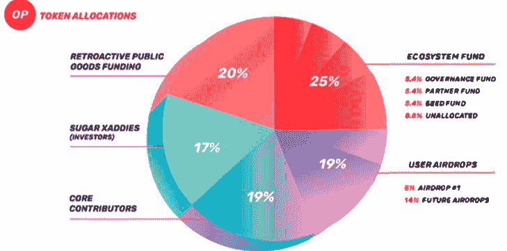

图 10.2 启动时的略多于40亿枚 OP 代币中，仅 5%–19% 分发给普通用户（来源：图表和数据可于 https://community.optimism.io/docs/governance/allocations/ 查阅）

我们得出的教训部分是规范性的，部分是描述性的。规范性观点是这样的：比特币的创立在一个非常重要的方面是公平的：其货币系统的规则适用于所有人。我们并不声称预挖及类似行为在道德上总是错误的或可疑的。我们甚至不声称它们对投资者来说普遍不可取。但一个没有内部人士且创始人遵守与任何人相同规则的创立历史是有吸引力的。

描述性观点随之而来：市场已将比特币视为王者13年。参与者知道它比许多替代方案更公平，并因此在市场行为中偏好比特币。我们怀疑，比特币的公平启动在解决启动难题方面发挥了重要而微妙的作用。它之所以具有可信度，是因为它以一种可信的中性方式诞生。

#### 无领袖货币

中本聪——如同凯泽·梭斯一样——离开了。

创始人的持续影响或控制构成了一种风险。想一想：如果你深知创始人之后可能会修改这些“魔法互联网豆”、稀释其供应量，或推动技术修改，你会接受它们作为货币吗？如果你信任创始人，或者仅仅不得不接受该创始人的命令（如同主权法定货币一样），你 *或许* 会接受。


但这对私人货币来说并非一条可行的道路。比特币之类的小工具主要旨在成为没有可信机构的中性货币。* 对任何有志于成为货币工程师的人来说，这都是一个真正的两难困境。你想创造出有用的东西，而其有用性不依赖于 _你_。在这方面的失败有可能导致形成个人崇拜，或创建那种我们都很熟悉的、依赖可信机构的传统货币机构。

中本聪为了解决这个问题，他能做的唯一一件事就是：离开。没有任何隆重或仪式，他从比特币网站上移除了自己的名字，将密钥移交给了开发者社区，并悄然退出了聚光灯。没有人能说中本聪对比特币开发、货币政策或文化有过度影响。中本聪对这些事务没有任何影响，至少，中本聪这个名字下是没有的。

这样一来，比特币变成了无领袖状态。它不是一种主权货币——但尽管在那种意义上它是私人的，它又不是公司货币。它是私人的，因为它是非国家货币；也是公共的，因为它是非企业性的，并向所有人开放参与。比特币的无领袖状态使其更加稳健和具有韧性。它的中央银行家无法随意操纵其供应量。它的首席执行官不会在醉醺醺的状态下不小心发推特说些愚蠢的话，从而打击市场信心。比特币公司不会破产，其资产也不会被冻结。没有比特币联邦储备银行，没有比特币首席执行官，也没有比特币公司。

魅力型领导者有时被认为是其他加密货币的优势。就像埃隆·马斯克或史蒂夫·乔布斯对其公司营销大有裨益一样，一个富有感染力或才华横溢的创始人也能推动对加密货币的关注。但比特币网络在此方面独树一帜，承诺承载中性货币。这一承诺之所以可信，正在于比特币是无领袖的。而中本聪似乎也意识到，比特币的成功需要他离开。

### 从创立至今

我们对比特币创立的描述可能听起来高远而理想化。但这与现实世界有多大关系呢？我们认为有关联，并举两个例子。第一，比特币自诞生以来一直是最受重视、研究最多、使用最广、最为人所知的加密货币。这并非偶然。毕竟，替代方案多得是——请回想，超过13,000种。而且其中许多替代方案已经存在十多年；它们的存在并非什么谜团，市场参与者可以轻松访问它们。我们怀疑，比特币在加密货币中的领先地位揭示了一种偏好：偏好一种无领袖且拥有公平初始分配机制的加密货币。

* 参见白皮书，中本聪（2008）。

第二，比特币拥有独特且健康的币种分布。在其整个存在期间，比特币的所有权变得更加去中心化。特别是有两个指标支持这一说法。* 首先，我们有供应平等比率（SER）——即“持有少于当前原生单位供应量一千万分之一的地址所持供应量与前1%地址所持供应量的比率”。† 将比特币的SER与少数竞争对手进行比较颇具启示意义（图10.3）：

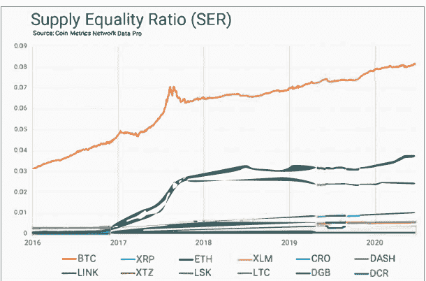

#### 图10.3 比特币供应平等比率

正如CoinMetrics所解释的：

高SER意味着供应分布广泛。正如假设的那样，在所评估的资产中，比特币的SER最高，其次是以太币和莱特币。这很引人注目，因为比特币也是大型金融机构主要托管的加密资产；这一趋势增加了SER的分母，并对比率产生整体下行压力。比特币SER的持续增长表明，尽管大型机构进入这一领域，比特币仍很大程度上是一场草根运动。‡

第二个指标是网络分布因子（NDF），即“持有至少当前原生单位供应量一万分之一的地址所持供应量与当前供应量的比率”。同样，以下是比特币与少数竞争对手的对比（图10.4）：

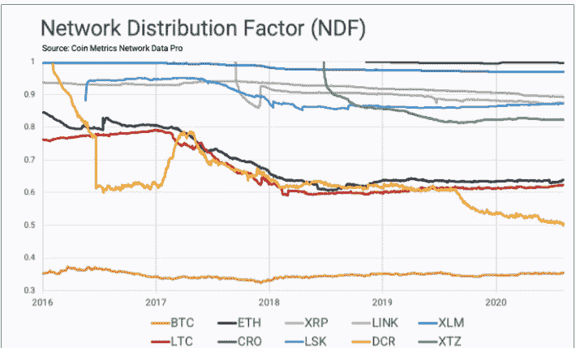

#### 图10.4 比特币网络分布因子

* 我们在此遵循这份CoinMetrics报告，指出这两项指标：https://coinmetrics.io/bitcoin-an-unprecedented-experiment-in-fair-distribution/
† https://docs.coinmetrics.io/asset-metrics/supply/ser
‡ https://coinmetrics.io/bitcoin-an-unprecedented-experiment-in-fair-distribution/

据推测，越低越好。比特币再次脱颖而出。正如CoinMetrics解释的：“低NDF意味着分布更好，因为顶部0.01%的实体较少。相反，NDF接近1意味着加密资产分布非常低。”†

越来越多的人拥有比特币。一个由一个人——中本聪——组成的网络，已发展成为一个涉及数百万人的生态系统。当然，比特币还很年轻，并且仍然是一种小众货币。其分布远不如美元（例如）或许多其他法币广泛。但它似乎正朝着一个方向发展——全球普及。

这里的重点不仅在于比特币是最有价值或使用最广泛的加密货币。相反，其分布呈现出一种方向，这一方向将从关于商品分配适当模式的广泛观点中获得吸引力。例如，人们无需成为毫无保留的平等主义者，也可以认为商品分布越广本身就是好事。而任何持此观点的人都会认为比特币的分布正朝着正确的方向发展。

### V. 第零层

闪电网络是第2层，比特币网络是第1层，我们可以将“第0层”视为开发和支持整个比特币生态系统的人群。这类群体有好几个：软件开发者、节点运行者、矿工、用户、公司，最后是对冲基金、交易者和风险投资家组成的群体。这些群体并非互斥，但它们之间常常存在利益冲突。其中一些利益冲突与比特币作为可信中性货币的历史有关。

比特币软件开发者以行动缓慢著称，这正是为了避免弄坏事物。谨慎的一个主要原因是：运行不同版本软件的节点存在分叉风险，这会创建带有新加密货币的新账本。因此，至关重要的是，所提议的更改不能分裂网络，无论是意外还是分歧所致。但，随着其他网络开发出更新技术，一些比特币用户担心比特币的采用将落后于人，导致主网交易费用持续低迷。

这一点很重要，因为十年后，比特币挖矿补贴将降至低于一个比特币。如果费用不能足够快地上涨，一些人担心比特币将变得不那么安全并失去市场份额。* 主要的反驳是，即使费用不能足够快地上涨，比特币价格也会上涨，其结果是，尽管以比特币计价的挖矿补贴减少，但以美元计价时，其价值将足以使对网络的攻击变得不划算。鉴于上述描述的比特币产品市场契合度，我们怀疑对比特币安全预算的担忧略有夸大。

比特币的共识规则（关于谁持有多少比特币）已更改了大约20次。而且随着比特币的发展，此类更改似乎发生的频率越来越低——过去五年中只发生过一次此类更改。† 该软件是开源的，所有人都可以研究和测试，所提议的更改都要经过严格测试。‡ 比特币软件拥有卓越的历史，尤其是当我们将其与其他加密货币协议的黑客攻击、漏洞利用、宕机和未兑现的承诺进行对比时。§

在2017年之前，比特币社区爆发了一场内战，争论是否应增大区块尺寸以提高交易吞吐量。¶ “大区块派”——其中包括一些最大的矿工和比特币公司——认为，更大的区块将通过降低交易


手续费。“小区块派”认为，每个区块包含更多交易会增加运行节点所需的带宽和内存，导致网络上的节点减少，中心化程度提高（而且，正如你所料，推动更大区块的公司和矿工将获得更多收入）。小区块派大获全胜，并表达了对网络去中心化的压倒性承诺。他们的胜利部分归功于节点运营商拒绝更大区块的承诺。如今，全球约有 15,000 个比特币全节点在运行（见图 10.5）。

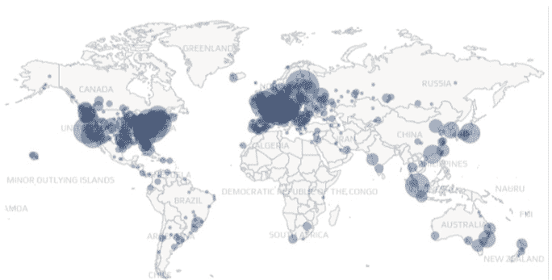

图 10.5 比特币节点分布全球图（来源：https://bitnodes.io/）

比特币节点数量超过以太坊网络（第二大加密货币网络）节点数量的两倍。* 但以太坊节点的要求较高且在增加，这导致相当比例的节点在集中式服务器上运行。例如，仅 AWS* 就承担了约 25% 的以太坊工作负载。† 网络越中心化，就越容易受到对中心故障点的攻击。

* 根据 https://ethernodes.org/，目前约有 6,000 个以太坊节点在线。

† https://aws.amazon.com/blockchain/

有人批评比特币同样容易受到攻击，原因是矿工们共享资源以分配区块奖励。鉴于比特币的共识机制，任何人在达到网络算力 51% 后都可以劫持网络并尝试双重花费。目前，挖矿是一个工业化过程。因此，矿工通常会共享资源并在矿池中运营。

在比特币历史的大部分时间里，少数几个矿池拥有足够的算力以这种方式串通（见图 10.6）。尽管矿工和矿池一直遵循避免这种高算力的传统，担心贬值比特币以及他们在专用挖矿硬件上的巨额支出，* 但如果足够多的矿池位于同一国家边界内，他们可能会面临国家的压力，例如，将某些地址列入黑名单。但是，参与易受攻击矿池的人可以离开并加入其他矿池。并且，技术解决方案也在开发中。

* 参见比特弗里（Bitfury）的案例，详情见 Popper（2015：第 299 页）

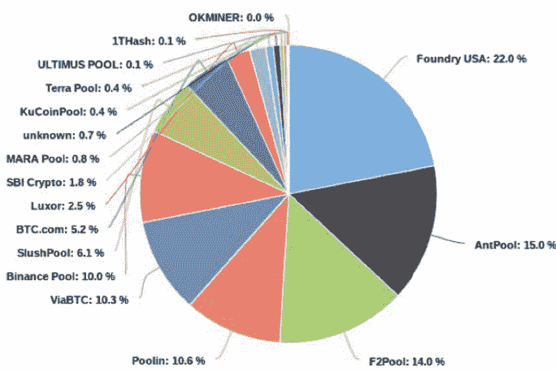

图 10.6 2022 年 5 月中旬至 6 月中旬各矿池的比特币算力分布。

工业化矿工最近也保留了大部分挖出的比特币。当价格快速下跌，且区块奖励不足以覆盖生产一个区块的成本时，他们可能还需要出售资产负债表上的比特币以弥补差额，从而导致一种价格死亡螺旋。†

† Shinobi（2021）。

但是，尽管这是一种风险，我们假设这些工业化矿工将通过衍生品进行对冲，与农民对冲其未来收益的方式并无太大不同。迄今为止，比特币已度过了严重的价格下跌。而且，在我们撰写本文时，比特币已下跌超过 60%。但是，在这些市场抛售中，比特币下跌幅度（按百分比计算）低于加密货币市场的其他部分。在这些抛售中，参与者将比特币与稳定币一起视为避险资产。‡

‡ 您可以在任何“比特币主导力”图表中看到这一点。

| | 以太坊 | 比特币 |
|---|---|---|
| 9/2015 | 引入难度炸弹 | |
| 3/2016 | 区块时间减少 | |
| 10/2017 | 区块奖励减少，从 5 ETH 降至 3 ETH | |
| 10/2017 | 难度炸弹推迟 | |
| 2/2019 | 难度炸弹推迟 | |
| 2/2019 | 区块奖励减少，从 3 ETH 降至 2 ETH | |
| 1/2020 | 难度炸弹推迟 | |
| 8/2021 | 费用市场变化，含费用销毁 | |
| 9/2022 | 权益证明（计划中） | |

图 10.7 以太坊和比特币货币政策变更历史

比特币还因各类用户都坚决承诺其自动发行计划而独具特色。该计划在设计上从未更改，尽管开发人员不得不修复漏洞以确保其按预期运行。在这方面，比特币与以太坊形成鲜明对比。后者在其存在期间一直定期更改其货币政策。（参见图 10.7。）

以太坊变化无常的货币政策很大程度上归因于其社区内的影响力集中点——创始人维塔利克·布特林（Vitalik Buterin）的存在及持续参与，以及以太坊基金会的影响力，该基金会自网络最初启动以来一直持有“以太坊”名称的商标。*

中心化影响力源在其历史上以大大小小的方式行使了权力。最著名的是 2016 年的 DAO 硬分叉，它抛弃了旧网络（“以太坊经典”），并建立了新网络（“以太坊”），其唯一目的是撤销一个漏洞利用——该漏洞虽在声明的规则允许范围内，却导致 DAO 参与者遭受意外且广泛的损失。† 我们不对这是否是一个好的决定发表意见，但这说明了第二大加密货币网络的中心化和可操控性。

相比之下，比特币对去中心化更强健的承诺，使人们对其原生资产的稳定性更加信任。近年来，我们开始看到公开交易公司承诺将比特币纳入其国库（例如，特斯拉®、Microstrategy® 和 Square/Block），以及将比特币作为法定货币的努力，例如在萨尔瓦多和中非共和国等国家。

### VI. 影响

我们一开始就使用“比特币是数字黄金”这个口号。这个口号并非字面真实，也并非旨在如此。它是一种类比或比较。这个类比有用吗？它比误导更能启发人吗？我们现在有能力评估这类问题了。

要指出明显的不同点：比特币是合成的和数字的，而黄金是自然产生的物理元素。人类使用黄金作为货币商品已有数千年历史；比特币不过十余年历史。比特币和黄金在市场上的表现也不尽相同。黄金的价格今天（约 1,800 美元/盎司）与 10 年前（约 1,500 美元/盎司）相差并不_很大_，且在此期间一直在 1,000 至 2,000 美元之间交易。

相比之下，比特币价格表现出了_巨大的_波动性。10 年前它还交易于 20 美元以下，2021 年曾达到超过 69,000 美元的高点，而今天（2022 年夏季）交易价格约为 20,000 美元，较高点下跌超过 75%——这一点在主流价格报道中未曾被忽视。* 这种波动性限制了比特币作为短期交换媒介的潜力，并使其市场接受度与黄金形成鲜明对比，黄金相比之下相对平稳。

* https://www.nytimes.com/2022/05/12/technology/cryptocurrencies-crash-bitcoin.html

类比点或许更有趣：与黄金和其他实物商品一样，比特币具有非零的边际生产成本。没有人能在不_支付_的情况下挖出更多黄金或更多比特币（无论是像开采黄金那样支付炸开岩石的费用，还是为比特币支付电费和处理器周期）。† 比特币在存量和流量上都是有限的：其总供应量有上限，与此同时对该供应量的增加仍然缓慢而稳定。黄金常被认为具有类似特性——总供应量有限，通过开采每年增加约 2%（尽管新矿床的发现可能会改变这些预期并相应地冲击市场）。

† 因此，Selgin（2015）将比特币归类为“合成商品”货币。

此外，黄金和比特币在一个重要意义上都具有抗审查性。人们可以在不依赖中介机构的情况下转移实物黄金：只需将一枚金币交给交易对手。（然而，这一点不适用于黄金的纸币索取权。）同样，人们也可以在不依赖中介机构的情况下转移比特币。只需签署一笔交易并将其广播到比特币网络。这些相似点揭示了一个重要事实：比特币像黄金一样，是中立的。在初始发行中中立，在持续的货币政策中中立，在转移中中立。这使得比特币在加密货币中独具特色——或许是独一无二的。

总而言之：“比特币是或可能是数字黄金”这个口号不仅仅是一个隐喻，而且主要也不是关于比特币的市场接受度。它关乎比特币作为


一种中立基础设施——与其说像美元，不如说更像自然物理元素。假设这是对的。假设比特币是数字黄金。接下来可能会怎样？我们将在政策制定、新闻业和学术研究三个类别下提出一些建议。

### 政策制定

比特币事实上已经作为全球中立的货币网络获胜。培育比特币网络、将比特币作为储备资产，或通过比特币进行支付，都相当于在货币体系中部署黄金——只不过是数字化的，更便携、更可分割、更易审计和验证，也更难被没收。

因此，试图禁止比特币或限制其使用将遭遇强烈阻力。* 它原生于互联网，因此极难被压制。就此而言，我们将比特币比作密码学。密码学提供抗审查通信，而比特币提供抗审查的价值传递。正如20世纪90年代限制密码学强度和传播的努力失败一样，我们预计限制比特币的强度和传播也将同样困难。†

无论这总体上是好是坏，都留待另文再论。但有大量证据表明，比特币正在帮助缺乏银行服务的人群，以及生活在威权统治下和恶性通胀中的人们。‡ 此外，不浪费资源去对抗不可避免之事也是明智之举。

### 新闻业

我们不应假设加密货币之间实际共有的比想象中更多。比特币之所以领先所有加密货币，恰恰是因为没有人领导它。政策制定必须从理解开始——不是泛泛而谈加密货币，而是特别理解比特币。这个广义类别不会消失，正是因为比特币本身不会消失。我们应给予它特别关注。记者们常常将比特币与所有其他加密货币项目混为一谈。而这些其他项目虽从这种关联中受益，比特币的声誉却因此受损。记者更应经常区分比特币与“加密货币”。我们的口号：不仅仅是比特币，而是把比特币放在首位。

### 研究

比特币作为中立货币的胜利，也应对学术研究产生深远影响。目前，几乎只有一个研究中心专注于比特币——MIT 的数字货币倡议（Digital Currency Initiative），且其重点几乎仅限于计算机科学。还有几个其他致力于整体加密货币的研究中心，但专门研究比特币的研究人员非常少。然而，如果我们按照重要性和长期影响来分配研究和研究中心，我们会发现情况恰恰相反。

我们需要更多把比特币放在首位的研究和研究中心，正因比特币远远是最可能对我们的世界产生持久影响的。而且，由于比特币高度跨学科，这类中心应汇聚所有涉及比特币的不同学科的专家——当然包括经济学和计算机科学，还有法律、哲学、政治学和商业。我们应投入更多资源去理解它，而不是那些像伊卡洛斯一样飞得太靠近太阳、最终毁灭的项目。

### VII. 结论

比特币不是货币之王。那个头衔属于美元。但比特币是加密货币之王。比特币是世界上最有价值、最安全、最具可信中立性的原生互联网资产。可以说，它之所以是最有价值的加密货币，恰恰是因为它最安全且最具可信中立性。

然而，所有国王都会逝去。那么，美元或比特币能在各自领域统治多久？与此同时，比特币会将其边界扩展到何种程度？这个问题引出其他一些问题，适合富有想象力的人思考。会有多少个国家将其作为法定货币？各国将来会用它来规避制裁吗？比特币会作为主要储备资产用于国际贸易吗？各国会寻求签署条约来限制彼此的算力吗？它能拯救多少生命？它会超过实物黄金的市值吗？闪电网络会让其他支付处理器和汇款服务变得过时吗？它可能助长——或者禁绝——什么新型犯罪？它会削弱多少中央银行？这些问题有些人看来很荒谬。但我们非常认真地对待它们。并且，我们希望鼓励其他人也认真对待它们。

* 我们感谢 Bradley Rettler 和 Troy Cross 的有益评论与批评。披露：两位作者均为比特币政策研究所（Bitcoin Policy Institute，一家比特币研究智库）的研究员。此外，Craig Warmke 为比特币金融初创公司 Atomic.Finance 撰稿。作者们经常使用比特币和法定货币，包括美元（USD）和新加坡元（SGD）。

### 参考文献

- Andolfatto, D., and Spewak, A. (2019). 比特币价格何去何从？*经济概要*, 1. 圣路易斯联邦储备银行.
- Antonopoulos, A. M. (2017). *掌握比特币：编程开放区块链*. O'Reilly Media, Inc.
- Antonopoulos, A. M., Osuntokun, O., and Pickhardt, R. (2021). *掌握闪电网络*. O'Reilly Media, Inc.
- Bailey, A. M., Rettler, B., and Warmke, C. (2021a). 加密货币的哲学、政治与经济 I：无国家货币。*哲学罗盘*, 16(11).
- Bailey, A. M., Rettler, B., and Warmke, C. (2021b). 加密货币的哲学、政治与经济 II：货币设计的道德图景。*哲学罗盘*, 16(11).
- Bailey, A. M., Rettler, B. and Warmke, C. (forthcoming). *抵抗货币：对比特币的有条件哲学辩护*. Routledge.
- Beltramini, E. (2021). 反对技术官僚威权主义：赛博朋克运动简史。*互联网史*, 5: 101–118.
- Benson, C. C., Jones, R., and Loftness, S. (2017). *美国支付系统：支付专业人员指南*（第3版）. Glenbrook Press.
- Bier, J. (2021). 区块大小战争：争夺谁控制比特币协议规则的战斗。https://blog.bitmex.com/the-blocksize-war-chapter-1-first-strike/
- Brunton, F. (2020). *数字现金：创造加密货币的无政府主义者、乌托邦主义者和技术人员的未知史*. Princeton University Press.
- Carlsten, M., Kalodner, H., Weinberg, S. M., and Narayanan, A. (2016, October). 没有区块奖励的比特币的不稳定性。*2016年ACM计算机与通信安全会议论文集*, 154–167.
- Hendrickson, J., and Luther, W. J. (2017). 禁止比特币。*经济行为与组织杂志*, 141: 188–195.
- Levy, S. (2001). *密码学：代码反叛者如何击败政府——在数字时代拯救隐私*. Penguin.
- Lopp, J. (2018). 谁控制比特币核心？https://blog.lopp.net/who-controls-bitcoin-core-/
- Luther, W. J. (2019). 起飞：比特币个案。*制度经济学杂志*, 15(2): 189–205.
- Nakamoto, S. (2008). 比特币：点对点电子现金系统。https://bitcoin.org/Bitcoin.pdf.
- Narayanan, A., and Clark, J. (2017). 比特币的学术渊源。*ACM通讯*, 60(12): 36–45.
- Poon, J., and Dryja, T. (2016). 比特币闪电网络：可扩展链下即时支付。闪电网络白皮书.
- Popper, N. (2015). *数字黄金：比特币未被讲述的故事*. Penguin UK.
- Selgin, G. (2015). 合成商品货币。*金融稳定杂志*, 17: 92–99.
- Rosenbaum, K. (2019). *深入理解比特币*. Manning Publications.
- Schuster, E. (2021). 加密云端国。*现代法律评论*, 84(5): 974–1004.
- Shin, L. (2022). *加密狂人：理想主义、贪婪、谎言与第一次大规模加密货币狂热的形成*. Public Affairs.
- Shinobi (2021). 比特币挖矿到底有多中心化？*比特币杂志*. https://bitcoinmagazine.com/business/is-bitcoin-mining-centralized
- Warmke, C. (2021). 什么是比特币？*探究*, 1–43.
- Warmke, C. (2022). 电子代币。*密码经济系统*, 2(1). https://cryptoeconomicsystems.pubpub.org/pub/warmke-electronic-coins


Taylor & Francis

Taylor & Francis Group

http://taylorandfrancis.com

## 第 11 章

## 加密货币期权策略、分析与估值

### 克里斯托弗·德鲁西奥蒂斯

塞顿霍尔大学

### 股票与加密货币期权市场：概述

期权在金融市场中发挥着重要作用。这类证券的价值源于其他证券，如股票或债券，近年来也包括加密货币。期权和期货都是衍生证券，意味着其收益取决于其他证券的价格变动。期权合约在许多交易所市场交易，例如芝加哥期权交易所（CBOE）、芝加哥商业交易所（CME）以及场外交易市场。这些期权合约包括两种期权：*看涨*期权和*看跌*期权。每种类型都可以相互配合用于某些策略。本章所述的策略可用于买入或卖出*未备兑*或*备兑*期权合约。未备兑或*裸*期权是投机策略，涉及在不拥有基础投资（股票或加密货币）的情况下买入或卖出期权。备兑策略涉及在拥有基础股票或加密货币的同时买入或卖出期权证券。

期权合约结构有两种类型：美式和欧式。美式期权合约的结构使得期权买方可以从合约签订之日起至到期日前的任何时间行使买入或卖出股票或加密货币的权利。欧式期权合约的结构使得投资者只能在到期日行使期权。投资者可以在到期前随时通过以市场溢价出售其合约来退出两种期权。由于其独特的结构，美式和欧式期权以不同的溢价价格交易。本章后面讨论的估值方法考虑了这些结构中的每一种。

在比较股票期权市场与加密货币期权市场时，差异无处不在且明显。首先，加密货币期权每天 24 小时、每周 7 天交易。另一个区别是，加密货币的合约规模不仅因交易所而异，还因币种而异。主要的加密货币市场包括 Binance®、Deribit、OKEx®、BitMex® 以及传统交易所 CME®。这些市场中的大多数在美国不受监管，并受到世界各国政府不同程度的许可和监管。世界上最大的交易所 Deribit 提供代表 1 BTC 的合约，最小合约规模为 0.1。

此外，这些加密货币期权合约大多数结构为欧式类型。Deribit 使用现金交割，合约在星期六东部时间凌晨 4 点到期。Deribit 仅接受加密货币的存款和取款。CME Group 提供比特币衍生品交易，规则与其他衍生品市场相似；但是，CME 使用比特币期货作为基础资产，而非比特币本身。

关于流通中超过 10,000 种加密货币，交易所通常只为主要币种提供衍生品市场，包括比特币和以太坊。由于这对市场来说非常新，期权交易量有时可能非常低。所有加密货币合约都使用区块链技术，但去中心化金融（DeFi）允许个人签订通过代码而非交易所结算的加密货币期权合约。DeFi 为自动化提供了无数可能性，例如算法做市，但由于依赖代码，容易受到诈骗和黑客攻击。

### 未备兑（裸）期权交易策略合约

未备兑或裸期权主要是基于投机买入或卖出期权，其中投资者不持有基础资产（本例中为股票或加密货币）的任何所有权，期权溢价即源自该资产。以下三种策略是买入和卖出看涨期权、看跌期权以及跨式组合。

#### 买入看涨期权

传统的看涨期权是一份合同，赋予持有者在设定日期（称为到期日）及之前，以设定价格（称为行权价 X）购买加密货币的权利，而非义务，无论加密货币价格如何变动。当然，如果持有者有权以设定价格购买加密货币，他或她希望加密货币价格大幅上涨。持有者随后可从价差中获利，代表对加密货币的看涨观点。

如图 11.1 所示，行权价为 50,000 美元的六月比特币看涨期权，赋予其所有者在六月第三个星期五（合约到期日）或之前以 50,000 美元的价格购买一个比特币的权利。如果比特币在六月第三周之前涨至 60,000 美元，期权持有者将行使以 50,000 美元购买比特币的权利，然后随即以 60,000 美元卖给市场，获得 10,000 美元的总收益。如果比特币跌至 50,000 美元以下，期权持有者将任由合约到期而不予行权。购买期权时，投资者需要预先支付每股设定价格，称为权利金。在本示例中，六月期权的买家需支付 4,300 美元。图 11.1 显示了比特币在不同情景和价格下（范围为 20,000 美元–100,000 美元）的收益、利润、持有期收益率（HPR）和盈亏平衡点（BE）。

图 11.1（下页）显示，如果比特币价格低于 50,000 美元，看涨期权不可行权，因为现货价格（S）减去行权价（X）将为负数，表明为平值外期权。在 50,000 美元时，现货价格（S）等于行权价（X），看涨期权处于平值且不可行权，因为收益为零（S – X = 0）。如果比特币价格高于 50,000 美元，看涨期权可行权，因此为平值内期权。需要注意的是，平值内并不一定意味着期权盈利。这意味着如果行权，将有收益。

使用图 11.1 中的示例，显示如果比特币价格在最后一天为 60,000 美元，投资者需要行使期权。在这种情况下，每股收益为 10,000 美元（S – X = 收益，即 60,000 美元 – 50,000 美元 = 10,000 美元），当比特币价格高于行权价时，投资者总是会行使期权，即使交易不盈利。在此情况下，投资者将展示利润，因为他或她收到 10,000 美元，这超过了 4,300 美元的权利金，计算出的利润为 5,700 美元。

例如，如果投资者锁定了六月 30,000 美元的水平，而比特币价格现为 40,000 美元，投资者仍会行权，即使在此情况下的 10,000 美元收益低于图 11.1 中显示的 14,000 美元权利金。由于投资者为期权支付了 14,000 美元的权利金，如果在任何平值内价格行权，投资者可以挽回部分初始损失（已支付的权利金）。与损失全部 14,000 美元权利金相比，通过在 40,000 美元行使看涨期权，the

#### 1. 未备兑（裸）期权策略 购买看涨期权

| BTC | 看涨期权 | | |
| --- | --- | --- | --- |
| | 四月 | 五月 | 六月 |
| 行权价（X） | | | |
| 20,000 | 27,000 | 25,000 | 22,000 |
| 30,000 | 18,000 | 17,000 | 14,000 |
| 40,000 | 8,500 | 9,100 | 9,000 |
| 50,000 | 2,000 | 3,300 | 4,300 |
| 60,000 | 290 | 924 | 1,530 |
| 70,000 | 50 | 209 | 530 |
| 100,000 | 10 | 25 | 175 |

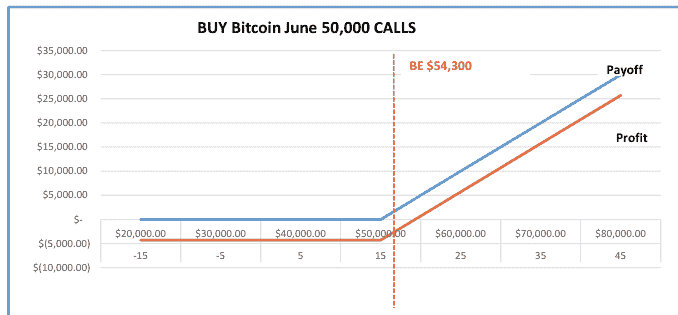

**行动**
以行权价（X）= 50,000.00 美元买入看涨期权
支付权利金（p）= 4,300.00 美元

盈亏平衡点 = 54,300.00 美元
最大损失 = (4,300.00) 美元
最大收益 = 无限

- 平值外期权
- 平值期权
- 平值内期权

| 行动 | 行权价（X） | 每比特币权利金（p） |
| --- | --- | --- |
| 买入六月 | $ 50,000 | $ (4,300) |
| 买入六月 | $ 50,000 | $ (4,300) |
| 买入六月 | $ 50,000 | $ (4,300) |
| 买入六月 | $ 50,000 | $ (4,300) |
| 买入六月 | $ 50,000 | $ (4,300) |
| 买入六月 | $ 50,000 | $ (4,300) |
| 买入六月 | $ 50,000 | $ (4,300) |
| 买入六月 | $ 50,000 | $ (4,300) |
| 买入六月 | $ 50,000 | $ (4,300) |
| 买入六月 | $ 50,000 | $ (4,300) |

| S | 比特币价格（美元） |
| --- | --- |
| $ 20,000 | |
| $ 30,000 | |
| $ 40,000 | |
| $ 50,000 | |
| $ 60,000 | |
| $ 70,000 | |
| $ 80,000 | |

| 是否行权 Y/N？ | 收益（D） | 利润（pi） | HPR（%） | 盈亏平衡价格 |
| --- | --- | --- | --- | --- |
| 否 | $ - | $ (4,300) | -100.0% | $ 54,300 |
| 否 | $ - | $ (4,300) | -100.0% | $ 54,300 |
| 否 | $ - | $ (4,300) | -100.0% | $ 54,300 |
| 否 | $ - | $ (4,300) | -100.0% | $ 54,300 |
| 否 | $ - | $ (4,300) | -100.0% | $ 54,300 |
| 是 | $ 10,000 | $ 5,700 | 132.6% | $ 54,300 |
| 是 | $ 20,000 | $ 15,700 | 365.1% | $ 54,300 |
| 是 | $ 30,000 | $ 25,700 | 597.7% | $ 54,300 |

图 11.1 未备兑期权策略——购买看涨期权


投资者收回 10,000 美元，净损失总额为 4,000 美元。规则是，如果期权处于实值状态或 S - X > 0，投资者总是会行使期权。购买看涨期权时，使用以下公式计算输出：

```
Call option payoff = Maximum (0, cryptocurrency price – exercise price), max (0, S – X)
Call option profit = Payoff–premium
Holding period return % = Profit/premium
Break-even cryptocurrency price for call option = Exercise price + premium
Maximum loss on buying a call option = Premium
Maximum gain on buying a call option = Unlimited
```

### 购买看跌期权

看跌期权是一份合同，赋予持有者在到期日及之前，以行权价格（X）出售加密货币的权利，而非义务，无论加密货币价格如何变动。当然，如果投资者有权以固定价格出售设定数量的加密货币，那么他或她希望加密货币价格大幅下跌，并可从价差中获利，这代表对加密货币的看跌观点。

例如，行权价格为 60,000 美元的六月比特币看跌期权，赋予其所有者在六月第三个星期五（合约到期日）前以 60,000 美元的价格购买比特币的权利。如果比特币在六月第三周之前跌至 40,000 美元，期权持有者将从市场以 40,000 美元购买比特币，并行使以 60,000 美元出售的权利，从 20,000 美元的价差中获利。如果比特币价格上涨至 60,000 美元以上，期权持有者将让合约到期而不予行使。购买期权时，投资者需要预先支付权利金。在本示例中，六月比特币期权的买方需支付 14,110 美元（请注意，投资者可以购买比特币的份额）。图 11.2 显示了比特币在不同情景和价格下的收益、利润、持有期收益率和盈亏平衡点（价格区间为 20,000 美元–100,000 美元）。

图 11.2 显示，如果比特币价格高于 60,000 美元，则看跌期权不可行使，因为行权价格（X）减去比特币现货价格（S）为负数，代表虚值期权。在 60,000 美元时，比特币（S）等于行权价格（X），看涨期权处于平值状态且不可行使，因为收益为零（X – S = 0）。如果比特币低于 60,000 美元，则看跌期权可行使，即实值期权。需要注意的是，实值并不一定意味着期权盈利。这意味着存在收益。我们在图 11.2 的示例中看到，如果比特币在最后一天为 40,000 美元，则投资者需要行使期权，并

### 2. 无担保（裸露）期权策略 - 购买看跌期权

| BTC | 看跌期权 | | |
|---|---|---|---|
| 行权价格 (X) | 四月 | 五月 | 六月 |
| 20,000 | 9 | 250 | 225 |
| 30,000 | 90 | 400 | 900 |
| 40,000 | 750 | 1277 | 2500 |
| 50,000 | 4200 | 5102 | 6100 |
| 60,000 | 13500 | 14000 | 14110 |
| 70,000 | 22900 | 23000 | 29754 |
| 100,000 | 53000 | 53500 | 58722 |

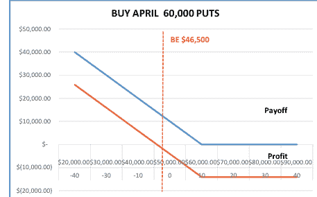

行动
- 以行权价格 (X) = 60,000.00 美元购买看跌期权
- 支付权利金 (p) = 14,110.00 美元

盈亏平衡点 = 45,890.00 美元
最大损失 = (14,110.00) 美元
最大收益 = X - 权利金，当 S=0 时

- 虚值期权
- 平值期权
- 实值期权

| 行动 | 行权价格 (X) | 每比特币权利金 (p) |
|---|---|---|
| 购买四月 60,000 看跌期权 | 60,000 | (14,110) |
| 购买四月 60,000 看跌期权 | 60,000 | (14,110) |
| 购买四月 60,000 看跌期权 | 60,000 | (14,110) |
| 购买四月 60,000 看跌期权 | 60,000 | (14,110) |
| 购买四月 60,000 看跌期权 | 60,000 | (14,110) |
| 购买四月 60,000 看跌期权 | 60,000 | (14,110) |
| 购买四月 60,000 看跌期权 | 60,000 | (14,110) |
| 购买四月 60,000 看跌期权 | 60,000 | (14,110) |

| S |
|---|
| 比特币价格 (美元) |
| 20,000 |
| 30,000 |
| 40,000 |
| 50,000 |
| 60,000 |
| 70,000 |
| 80,000 |
| 90,000 |

| 是否行权? | 收益 (0) | 利润 (π) | 持有期收益率 (%) | 盈亏平衡价格 |
|---|---|---|---|---|
| 是 | 40,000 | 25,890 | 183.5% | 45,890 |
| 是 | 30,000 | 15,890 | 112.6% | 45,890 |
| 是 | 20,000 | 5,890 | 41.7% | 45,890 |
| 是 | 10,000 | (4,110) | -29.1% | 45,890 |
| 否 | - | (14,110) | -100.0% | 45,890 |
| 否 | - | (14,110) | -100.0% | 45,890 |
| 否 | - | (14,110) | -100.0% | 45,890 |
| 否 | - | (14,110) | -100.0% | 45,890 |

图 11.2 无担保期权策略—购买看跌期权

每比特币收益为 20,000 美元（X – S = 收益，即 60,000 美元 – 40,000 美元 = 20,000 美元）。每比特币利润计算为 5,890 美元（收益 – 权利金，即 20,000 美元 – 14,110 美元 = 5,890 美元）。

如果比特币价格下跌至 50,000 美元，期权买方需要行权，因为 50,000 美元的比特币价格低于 60,000 美元的行权价格。请注意，即使交易不盈利，投资者仍会行使该期权，仅获得 10,000 美元的收益，对应 14,110 美元的权利金，亏损 4,110 美元。通过行使期权，投资者至少能收回部分已支付的权利金，将每股净损失计算为 4,110 美元，而不是如果看跌期权买方未行权则需承担的 14,110 美元全部权利金损失。规则是，如果期权处于实值状态，或行权价格高于比特币现货价格，或 X – S > 0，投资者总是会行使期权。

购买看跌期权时，使用以下公式计算输出：

```
Put option payoff = Maximum (0, exercise price – cryptocurrency spot price), max (0, X – S)
Put option profit = Payoff–premium
Holding period return % = Profit/premium
Break-even cryptocurrency spot price for put option = Exercise price – premium
Maximum loss on buying a put option = Premium
Maximum gain on buying a put option = Exercise price – premium or the price of cryptocurrency = 0
```

### 出售看涨和看跌期权

出售看涨和看跌期权是合同，卖方有义务在买方以行权价格行使期权时出售或购买加密货币。期权卖方收取权利金，并希望加密货币价格在到期前一直处于虚值状态，从而能够留存权利金。出售无担保（裸露）看涨期权是最危险的操作，因为如果比特币价格显著高于行权价格，损失可能是无限的。出售无担保（裸露）看跌期权也非常危险——例如，如果比特币价格跌至零。通常建议出售看涨或看跌期权时，要么持有比特币（本章后文将介绍），要么与购买看涨期权组合（本章后文也将介绍）。

出售看涨和看跌期权时，使用以下公式计算输出：

```
Call option payoff = cryptocurrency price – exercise price
Break-even price of cryptocurrency price for call option = Exercise price + premium
Maximum loss on selling a call option = Unlimited
Maximum gain on selling a call option = Premium
Put option payoff = Exercise price – Cryptocurrency price
Break-even price of cryptocurrency price for put option = Exercise price – premium
Maximum loss on selling a put option = Exercise price – premium at price of cryptocurrency = 0
Maximum gain on selling a put option = Premium
```

### 购买和出售跨式期权

跨式期权合同涉及以相同行权价格同时购买看涨期权和看跌期权。该合同赋予持有者在到期日及之前，以设定行权价格（X）买入或卖出加密货币的权利，而非义务，无论加密货币价格如何波动。同时购买看涨期权和看跌期权的策略，代表了押注加密货币价格波动性的观点。这是一种投资者预期比特币等资产将基于即将发布的公告大幅上涨或下跌（基于情景）的策略。

例如，假设政府将决定是否将比特币作为主要货币。如果获批，比特币价格预计将大幅上涨，跨式期权持有者将行使期权（由跨式期权的看涨期权一侧支持），以行权价格（X）购买比特币。如果政府宣布不批准将比特币作为可接受货币之一，则比特币价格预计将大幅下跌。跨式期权卖方希望该新闻对加密货币价格的影响不会太大，且价格将保持在盈亏平衡点之内。

当然，对跨式期权卖方来说最理想的情景，对买方来说最糟糕的情景，是加密货币在到期时价格等于行权价格（S = X）。例如，假设行权价格为 50,000 美元的五月比特币看涨和看跌期权，赋予其所有者在五月第三周（合约到期日）之前的任何时间以 50,000 美元的价格买入或卖出比特币的权利。如果比特币在到期日上涨至 50,000 美元以上，跨式期权持有者将行使以 50,000 美元买入的权利，并获得差价。如果比特币在到期日下跌至 50,000 美元以下，跨式期权持有者将行使以 50,000 美元卖出的权利，并获得差价。购买跨式期权时，投资者需要预先支付看涨和看跌期权的权利金。图 11.3 显示了收益、利润、持有期收益率和两个盈亏平衡点。


### 3. 未覆盖（裸）期权策略 - 买入跨式组合

当前比特币 (BTC) 价格 S₀ = $47,000.00 (4 月 1 日)

| 行权价 (X) |
|---|
| 20,000 |
| 30,000 |
| 40,000 |
| 50,000 |
| 60,000 |
| 70,000 |
| 100,000 |

#### 看涨期权

#### 看跌期权

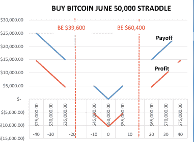

#### 行动
策略：在相同 X 处同时购买看涨期权和看跌期权
购买看涨 & 看跌 @ (X) = $ 50,000.00
支付两者总权金 (p) = $ 10,400.00 (4300+6100)

两个盈亏平衡点 = $ 60,400.00 $ 39,600.00
最大损失 = $ (10,400.00)
最大收益 = 无限

平值期权
实值期权

#### 输入

#### 假设情景

#### 输出
O = (S-X) or (X-S) | (n) = O - p | HPR % = t / p | X + p | X - p

比特币在不同价格表现情景下的盈亏平衡点 (BE1 和 BE2) (范围：$20,000–$100,000)。

图 11.3 显示，如果比特币价格高于或低于 $50,000，跨式组合期权处于实值且可行权，收益为 S − X 或 X − S。在 $50,000 处，当比特币 (S) 等于行权价 (X) 时，看涨期权处于平值且不可行权，因为收益为零 (X − S = 0)。观察图 11.3，假设比特币在到期日显著上涨至 $70,000。跨式组合持有者将行权以 $50,000 购买，计算得出收益为 $20,000 (S − X = $70,000 – $50,000)。在 $20,000 的收益下，利润为 $9,600 (收益 – 看涨期权 (权金 $4,300) 和看跌期权 (权金 $6,100) 的总权金 = $20,000 – $10,400)。一般而言，跨式组合持有者将始终行权，除非比特币等于行权价这种不太可能的情况发生——基本上就是没有波动。

- 跨式组合期权收益 = 行权价 – 加密货币价格 – 行权价
- 跨式组合期权利润 = 收益 – 看涨期权和看跌期权的权金
- 持有期回报率 % = 利润 / 看涨期权和看跌期权的权金
- 跨式组合期权的两个盈亏平衡加密货币价格 = 行权价 – 权金 和 行权价 + 权金
- 购买跨式组合期权的最大损失 = 权金 (假设 S – X = 0)
- 购买跨式组合期权的最大收益 = 无限

### 有担保期权交易策略合同

有担保期权策略主要用于对冲目的，即买入或卖出期权。有担保期权策略通常是指投资者买入或卖出期权，同时买入或卖出作为期权权金价格来源的标的加密货币。使用有担保策略的另一个原因是通过最大化标的加密货币和期权证券的收益来增强整体风险敞口。以下三种策略是保护性看跌期权、备兑看涨期权以及两者的组合，称为价格领口。

### 保护性看跌期权策略

保护性看跌期权是一种策略，投资者买入或持有标的加密货币，同时买入看跌期权，以对冲加密货币价格下跌的风险。这就像为加密货币购买保险。如果加密货币价格下跌，通过行权以 X 价格出售来保护价格。例如，假设投资者以当前价格 $47,000 (4 月 1 日) 买入比特币，投资 $47,000 购买一个比特币。投资者担心比特币在未来几个月会下跌，因此买入 $40,000 的 5 月看跌期权，每个比特币支付 $1,277 的权金。包括期权在内的投资总成本为 $48,277 ($47,000 + $1,277)。

图 11.4 显示了在各种比特币价格情景下的保护性看跌期权策略，假设投资者按市价出售比特币。输出显示了该策略的盈亏及持有期回报率。该图显示，出售比特币的最大损失被限制在 $40,000 价格。如果未通过设置保护性看跌期权进行对冲，或者比特币下跌至 $10,000，损失将为 $37,000 ($47,000 – $10,000)。通过持有保护性看跌期权，最大损失被限制在 $40,000，因为无论发生什么，投资者都可以行权以 $40,000 出售比特币。如果比特币上涨至 $60,000，投资者可以出售比特币并记录收益，如图 11.4 (下页) 所示，扣除权金后的利润为 $10,500。在 $60,000 处，投资者将让看跌期权到期作废。

### 备兑看涨期权策略

备兑看涨期权策略是指投资者买入或持有标的加密货币，同时卖出该加密货币的看涨期权。这是一种流行、低风险的策略，通常称为备兑看涨期权写入。有趣的是，卖出未覆盖看涨期权是风险最大的期权策略，可能导致无限损失，但持有加密货币的同时卖出看涨期权被认为是最保守的策略。

使用此策略的一个例子是，投资者计划不久后以高于市场价格的水平出售加密货币，因此不设置限价单指示其经纪商在达到该更高价格时出售加密货币，反而可以卖出等量的一份加密货币的看涨期权，在设定的未来价格处收取权金。如果加密货币达到该更高价格，作为看涨期权卖家，他或她不需要支付行权价与该市场价格之间的差额，而可以以该价格交付加密货币，或在市场上出售加密货币，并利用出售加密货币所得利润来履行看涨期权义务。

例如，假设投资者持有一个比特币。在当前价格 $47,000 (4 月 1 日) 下，投资价值为 $47,000 ($47,000 × 1 枚)。投资者预计在比特币价格达到 $60,000 时出售。与其下达限价单（基本上是指示经纪商在价格达到时出售）

### 1. 有担保期权策略 保护性看跌期权

当前比特币 (BTC) 价格 $47,000.00 (4 月 1 日)

| 行权价 (X) |
| :--- |
| 30,000 |
| 40,000 |
| 50,000 |
| 60,000 |
| 70,000 |

| | 4 月 | 5 月 | 6 月 |
| :--- | :--- | :--- | :--- |
| | 90 | 400 | 900 |
| | 750 | 1,277 | 2,500 |
| | 4,200 | 5,102 | 6,100 |
| | 13,500 | 14,000 | 14,110 |
| | 22,900 | 23,000 | 29,754 |

| 动作 | 行权 (X) | BTC ($)/权金 (p) | BTC 数量 | 投资 (I) |
| :--- | :--- | :--- | :--- | :--- |
| 购买比特币 = | | $47,000.00 | 1 | $ (47,000) |
| 在 X 处购买看跌期权 = | $ 40,000.00 | | | |
| 支付权金 (p) = | | $ 2,500.00 | 1 | $ (2,500) |

总初始投资 = $ (49,500)

| | BTC 投资 S₀ | 期权证券 X | 期权证券 p | 假设情景 S |
| :--- | :--- | :--- | :--- | :--- |
| 策略 | BTC 购买 | 行权价 (X) | 每个 BTC 支付的权金 (p) | 市场价格 BTC 价格 (S) |
| 购买 BTC & 6 月看跌期权 | 47,000 | 40,000 | (2,500) | 20,000 |
| 购买 BTC & 6 月看跌期权 | 47,000 | 40,000 | (2,500) | 30,000 |
| 购买 BTC & 6 月看跌期权 | 47,000 | 40,000 | (2,500) | 40,000 |
| 购买 BTC & 6 月看跌期权 | 47,000 | 40,000 | (2,500) | 50,000 |
| 购买 BTC & 6 月看跌期权 | 47,000 | 40,000 | (2,500) | 60,000 |
| 购买 BTC & 6 月看跌期权 | 47,000 | 40,000 | (2,500) | 70,000 |
| 购买 BTC & 6 月看跌期权 | 47,000 | 40,000 | (2,500) | 80,000 |
| 购买 BTC & 6 月看跌期权 | 47,000 | 40,000 | (2,500) | 90,000 |
| 购买 BTC & 6 月看跌期权 | 47,000 | 40,000 | (2,500) | 100,000 |

| BTC 投资 CG = S - S₀ | 期权证券 O | 期权证券 pi - p | {pi - p + CG} | {(pi - p + CG) x Sh} | I | NP / I |
| :--- | :--- | :--- | :--- | :--- | :--- | :--- |
| BTC 资本损益 | 看跌期权收益 (对冲) | 每个 BTC 的期权利润 | 每个 BTC 净利润 | 净利润 (总计 $) (NP) | 初始投资 | HPR% |
| (27,000) | 20,000 | 17,500 | (9,500) | (9,500) | 49,500 | -19.19% |
| (17,000) | 10,000 | 7,500 | (9,500) | (9,500) | 49,500 | -19.19% |
| (7,000) | - | (2,500) | (9,500) | (9,500) | 49,500 | -19.19% |
| 3,000 | - | (2,500) | 500 | 500 | 49,500 | 1.01% |
| 13,000 | - | (2,500) | 10,500 | 10,500 | 49,500 | 21.21% |
| 23,000 | - | (2,500) | 20,500 | 20,500 | 49,500 | 41.41% |
| 33,000 | - | (2,500) | 30,500 | 30,500 | 49,500 | 61.62% |
| 43,000 | - | (2,500) | 40,500 | 40,500 | 49,500 | 81.82% |
| 53,000 | - | (2,500) | 50,500 | 50,500 | 49,500 | 102.02% |

图 11.4 有担保期权策略——保护性看跌期权


在$60,000处），他或她会在$60,000水平上签订备兑看涨期权合约，因此有义务支付高于$60,000的市场价值与$60,000行权价之间的差额（S − X）。作为回报，他或她将预先收取$1,530的权利金，如图11.5所示（见下一页）。

如果比特币涨至$60,000以上，他或她将按市场价出售，或将其交付给看涨期权的买方。如果比特币恰好涨至$60,000（平值），期权将不会被行权。持有比特币的投资者可以按$60,000出售，并记录除已收权利金之外的收益。该策略基本上是放弃比特币的突然上涨空间，但如果比特币价格跳升至$60,000以上，投资者也无需抱怨。另一种情况是，他或她将不得不按$60,000的价位出售，相当于限价单。图11.5显示，在比特币价格高于$60,000的任何价格下，利润均被限制在$14,530。

### 领口策略

领口期权策略是指加密货币持有者通过放弃上涨空间来对冲下行风险的一种策略。在之前讨论保护性看跌期权的章节中，投资者获得了一份保护性看跌期权，以防加密货币下跌时对冲其投资，但购买看跌期权需要花费资金。领口期权策略通过在更高水平的加密货币上卖出看涨期权，以最小化或消除购买看跌期权所支付的权利金。基本上，领口策略是保护性看跌期权与备兑看涨期权的组合。

图11.6展示了一个示例：持有一枚当前价格为$47,000比特币的投资者希望通过购买5月看跌期权来设置底部，将损失限制在$30,000。6月看跌期权每枚比特币成本为$900。投资者查看定价页面，发现6月$60,000看涨期权价格为$1,530。鉴于权利金相匹配，他或她签订领口期权合约，买入6月$30,000看跌期权并卖出$60,000看涨期权，净额抵扣权利金并收取$630（$1,530 – $900）。图11.6展示了比特币在不同加密货币情景下的HPR（使用$10,000–$100,000的范围）。

### 高级期权交易策略

高级期权策略涉及同时买入和卖出多个期权。在不同行权价下买卖但保持相同到期日的策略称为垂直价差或金钱价差，而在相同行权价下跨越不同到期日买卖期权的策略称为水平价差或时间价差。价差期权

### 2. 备兑期权策略 - 备兑看涨期权
当前比特币(BTC)价格 So = $47,000.00 (4月1日)

| 行权价 (X) |
|---|
| 20,000 |
| 30,000 |
| 40,000 |
| 50,000 |
| 60,000 |
| 70,000 |
| 100,000 |

| 四月 | 五月 | 六月 |
|---|---|---|
| 27,000 | 25,000 | 22,000 |
| 18,000 | 17,000 | 14,000 |
| 8,500 | 9,100 | 9,000 |
| 2,000 | 3,300 | 4,300 |
| 290 | 924 | 1,530 |
| 50 | 209 | 530 |
| 10 | 25 | 175 |

| 动作 | 行权价 (X) | BTC ($)/权利金 (p) | BTC 数量 | 投资 (I) |
|---|---|---|---|---|
| 持有比特币 (So) = | | 47,000 | 1.00 | (47,000) |
| 在 [X] 卖出看涨期权 = | 60,000 | | | |
| 收取权利金 (p) = | | (1,530) | 1.00 | 1,530 |

总初始投资 = $ (45,470)

| | BTC 投资 So | 期权证券 X | 期权证券 p | 假设情景 S |
|---|---|---|---|---|
| 策略 | 市场价格 | 行权价 (X) | 每枚 BTC 已收权利金 (p) | BTC 市场价格 ($) |
| 买入股票并卖出五月看涨期权 | 47,000 | 60,000 | 1,530 | 40,000 |
| 买入股票并卖出五月看涨期权 | 47,000 | 60,000 | 1,530 | 50,000 |
| 买入股票并卖出五月看涨期权 | 47,000 | 60,000 | 1,530 | 60,000 |
| 买入股票并卖出五月看涨期权 | 47,000 | 60,000 | 1,530 | 70,000 |
| 买入股票并卖出五月看涨期权 | 47,000 | 60,000 | 1,530 | 80,000 |

| BTC 投资 CG = S - So | 期权证券 O | 期权证券 pi - p | BTC 和期权 (pi - p + CG) | BTC 和期权 (pi - p + CG) x Sh | BTC 和期权 I | BTC 和期权 NP / I |
|---|---|---|---|---|---|---|
| 比特币资本收益/(损失) | 看涨期权回报 (对冲) | 每枚 BTC 的期权利润 | 每枚 BTC 净利润 | 净利润 (总美元) (NP) | 初始投资 | HPR% |
| (7,000) | - | 1,530 | (5,470) | (5,470) | 45,470 | -12.03% |
| 3,000 | - | 1,530 | 4,530 | 4,530 | 45,470 | 9.96% |
| 13,000 | - | 1,530 | 14,530 | 14,530 | 45,470 | 31.96% |
| 23,000 | (10,000) | (8,470) | 14,530 | 14,530 | 45,470 | 31.96% |
| 33,000 | (20,000) | (18,470) | 14,530 | 14,530 | 45,470 | 31.96% |

图 11.5 备兑期权策略——备兑看涨期权

### 垂直与水平价差

| | 行权价 (X) | 四月 | 五月 | 六月 | 四月 | 五月 | 六月 |
|---|---|---|---|---|---|---|---|
| | 20,000 | 27,000 | 25,000 | 22,000 | 9 | 250 | 225 |
| | 30,000 | 18,000 | 17,000 | 14,000 | 90 | 400 | 900 |
| | 40,000 | 8,500 | 9,100 | 9,000 | 750 | 1,277 | 2,500 |
| | 50,000 | 2,000 | 3,300 | 4,300 | 4,200 | 5,102 | 6,100 |
| | 60,000 | 290 | 924 | 1,530 | 13,500 | 14,000 | 14,110 |
| | 70,000 | 50 | 209 | 530 | 22,900 | 23,000 | 29,754 |
| | 100,000 | 10 | 25 | 175 | 53,000 | 53,500 | 58,722 |

水平价差（时间价差）

垂直价差（金钱价差）

垂直价差（金钱价差）

通常涉及两个或多个期权，投资者买入一个期权并支付权利金，卖出另一个并收取权利金。价差策略的目标是最小化净支付的权利金。

图 11.7 展示了垂直价差或金钱价差与水平价差或时间价差之间的差异。将垂直价差作为期权策略时，投资者在相同日期但不同行权价下买入看涨期权或卖出看涨期权或看跌期权；在此例中，四月是选定的到期日，行权价垂直列出。将水平价差作为期权策略时，投资者在不同日期但相同行权价下买入和卖出期权；在此例中，行权价为 $50,000，选定的日期水平列出。

投资者可以对比特币看涨或看跌，利用价差组合来利用其观点。价差策略包括看涨和看跌的垂直价差（适用于看涨期权和看跌期权），将在下文详细说明（请注意，本章不涵盖水平价差或时间价差，因为它们不如垂直价差或金钱价差流行）。

#### 看涨垂直价差

*看涨价差* 是垂直价差，涉及买入低行权价的看涨期权，并卖出相同到期日的高行权价看涨期权。为记忆此策略，请想象一位对加密货币看涨的投资者。他或她将以低价买入加密货币，预期未来以更高价格出售，这与看涨价差的情况相同。投资者买入低行权价看涨期权并卖出高行权价看涨期权，希望加密货币价格上涨。

诸如看涨价差之类的价差策略是保守策略，具有最大利润和最大亏损，因为投资者放弃了显著的上涨空间以获取下行保护。图 11.8（见第 216 页）展示了一种看涨价差策略：投资者买入 6 月 $30,000 看涨期权，支付 $14,000 权利金，并卖出 $60,000 六月看涨期权，收取 $4,300 权利金，计算得出净支付权利金为 $9,700（$14,000 – $4,300）。在此情况下，投资者看涨，预期比特币将涨至 $60,000 以上，以最大化每枚比特币 $21,300 的收益。显然，如果价格跌破 $30,000，最大亏损将被限制在 $9,700。比特币的盈亏平衡点计算为 $39,700（$30,000 + $9,700）。图 11.8 展示了不同比特币价格下的回报和利润。

#### 看跌垂直价差

*看跌价差* 是垂直价差，涉及买入高行权价的看跌期权并卖出低行权价的看跌期权，与相同的


| 行权价格 (X) |
|---|
| 20,000 |
| 30,000 |
| 40,000 |
| 50,000 |
| 60,000 |
| 70,000 |
| 100,000 |

| 四月 | 五月 | 六月 |
|---|---|---|
| 27,000 | 25,000 | 22,000 |
| 18,000 | 17,000 | 14,000 |
| 8,500 | 9,100 | 9,000 |
| 2,000 | 3,300 | 4,300 |
| 290 | 924 | 1,530 |
| 50 | 209 | 530 |
| 10 | 25 | 175 |

| 四月 | 五月 | 六月 |
|---|---|---|
| 9 | 250 | 225 |
| 90 | 400 | 900 |
| 750 | 1,277 | 2,500 |
| 4,200 | 5,102 | 6,100 |
| 13,500 | 14,400 | 14,110 |
| 22,900 | 23,000 | 29,754 |
| 53,000 | 53,500 | 58,722 |

看涨期权策略：持有 BTC，买入看跌期权，卖出看涨期权（保护性看跌期权和备兑看涨期权的组合）- 意图是尽量减少或消除权利金
行动：持有 1 枚比特币（当前价格为 47,000 美元）
买入六月 30,000 看跌期权 - 支付 $900 权利金
卖出（写入）六月 60,000 看涨期权 - 收到 $1530 权利金

| | BTC 投资 | | 期权证券 | |
|---|---|---|---|---|
| | So | X 看跌期权 | X 看涨期权 | p |
| 策略 | 市场价格 M2M | 看跌期权行权价格 (X1) | 看涨期权行权价格 (X2) | 每枚 BTC 净收到权利金 (p) |
| 领 collar 30,000 看跌期权/60,000 看涨期权 六月 | 47,000 | 30,000 | 60,000 | 630 |
| 领 collar 30,000 看跌期权/60,000 看涨期权 六月 | 47,000 | 30,000 | 60,000 | 630 |
| 领 collar 30,000 看跌期权/60,000 看涨期权 六月 | 47,000 | 30,000 | 60,000 | 630 |
| 领 collar 30,000 看跌期权/60,000 看涨期权 六月 | 47,000 | 30,000 | 60,000 | 630 |
| 领 collar 30,000 看跌期权/60,000 看涨期权 六月 | 47,000 | 30,000 | 60,000 | 630 |
| 领 collar 30,000 看跌期权/60,000 看涨期权 六月 | 47,000 | 30,000 | 60,000 | 630 |
| 领 collar 30,000 看跌期权/60,000 看涨期权 六月 | 47,000 | 30,000 | 60,000 | 630 |
| 领 collar 30,000 看跌期权/60,000 看涨期权 六月 | 47,000 | 30,000 | 60,000 | 630 |
| 领 collar 30,000 看跌期权/60,000 看涨期权 六月 | 47,000 | 30,000 | 60,000 | 630 |
| 领 collar 30,000 看跌期权/60,000 看涨期权 六月 | 47,000 | 30,000 | 60,000 | 630 |

| 什么如果情景 | BTC 投资 CG = -5 So | | 期权证券 | | | | BTC 和期权双方 | | |
|---|---|---|---|---|---|---|---|---|---|
| S | 5 | O1 | O2 | pi - p | (pi - p + CG) | ((pi - p + CG) X Sh | I | NP / I |
| | | 看跌期权收益 | 看涨期权收益 | 期权每枚 BTC 利润 | 每枚 BTC 净利润 | 净利润（总计 $）NPV 1 BTC | 净利润（总计 $）NPV 1 BTC | 基于原始 4 月 1 日日期 | HPR% |
| 5,000 | (37,000) | 20,000 | - | 20,630 | (16,370) | (16,370) | 47,000 | -34.83% |
| 20,000 | (27,000) | 10,000 | - | 10,630 | (16,370) | (16,370) | 47,000 | -34.83% |
| 30,000 | (17,000) | - | - | 630 | (16,370) | (16,370) | 47,000 | -34.83% |
| 40,000 | (7,000) | - | - | 630 | (6,370) | (6,370) | 47,000 | -13.55% |
| 50,000 | 3,000 | - | - | 630 | 3,630 | 3,630 | 47,000 | 7.72% |
| 60,000 | 13,000 | - | - | 630 | 13,630 | 13,630 | 47,000 | 29.00% |
| 70,000 | 23,000 | - | (10,000) | (9,370) | 13,630 | 13,630 | 47,000 | 29.00% |
| 80,000 | 33,000 | - | (20,000) | (19,370) | 13,630 | 13,630 | 47,000 | 29.00% |
| 90,000 | 43,000 | - | (30,000) | (29,370) | 13,630 | 13,630 | 47,000 | 29.00% |
| 100,000 | 53,000 | - | (40,000) | (39,370) | 13,630 | 13,630 | 47,000 | 29.00% |

图 11.7 垂直和水平价差

### 1. 高级期权策略 - 看涨呼叫价差

当前比特币 (BTC) So = $47,000.00（4 月 1 日）

| BTC | 呼叫期权 | | | 看跌期权 | | |
| --- | --- | --- | --- | --- | --- | --- |
| 行权价格 (X) | 四月 | 五月 | 六月 | 四月 | 五月 | 六月 |
| 20,000 | 27,000 | 25,000 | 22,000 | 9 | 250 | 225 |
| 30,000 | 18,000 | 17,000 | 14,000 | 90 | 400 | 900 |
| 40,000 | 8,500 | 9,100 | 9,000 | 750 | 1,277 | 2,500 |
| 50,000 | 2,000 | 3,300 | 4,300 | 4,200 | 5,102 | 6,100 |
| 60,000 | 290 | 924 | 1,530 | 13,500 | 14,000 | 14,110 |
| 70,000 | 50 | 209 | 530 | 22,900 | 23,000 | 29,754 |
| 100,000 | 10 | 25 | 175 | 53,000 | 53,500 | 58,722 |

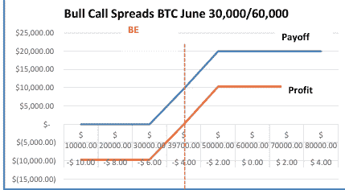

**看涨呼叫策略：** 买入低行权价呼叫期权，并在相同到期日卖出高行权价呼叫期权（垂直价差）
**行动示例：** 买入六月 30,000 呼叫期权 - 支付 $14000 权利金
卖出六月 50,000 呼叫期权 - 收到 $4300 权利金

| 策略 | 低 X 买入行权呼叫期权 (X1) | p1 买入呼叫期权每枚 BTC 支付的权利金 (p1) | 高 X 卖出行权呼叫期权 (X2) | p2 每枚 BTC 收到的权利金 (p2) | p 每枚 BTC 净支付权利金 |
|---|---|---|---|---|---|
| 买低卖高呼叫 | 30,000 | (14,000) | 50,000 | 4,300 | (9,700) |
| 买低卖高呼叫 | 30,000 | (14,000) | 50,000 | 4,300 | (9,700) |
| 买低卖高呼叫 | 30,000 | (14,000) | 50,000 | 4,300 | (9,700) |
| 买低卖高呼叫 | 30,000 | (14,000) | 50,000 | 4,300 | (9,700) |
| 买低卖高呼叫 | 30,000 | (14,000) | 50,000 | 4,300 | (9,700) |
| 买低卖高呼叫 | 30,000 | (14,000) | 50,000 | 4,300 | (9,700) |
| 买低卖高呼叫 | 30,000 | (14,000) | 50,000 | 4,300 | (9,700) |
| 买低卖高呼叫 | 30,000 | (14,000) | 50,000 | 4,300 | (9,700) |

| S 市场价格 BTC 价格 ($) | S - X1 + X2 净收益 | 净利润 | 最大利润 | 最大亏损 |
|---|---|---|---|---|
| 10,000 | - | (9,700) | | (9,700) |
| 20,000 | - | (9,700) | | (9,700) |
| 30,000 | - | (9,700) | | (9,700) |
| 39,700 | 9,700 | - | | (9,700) |
| 50,000 | 20,000 | 10,300 | | |
| 60,000 | 20,000 | 10,300 | 10,300 | |
| 70,000 | 20,000 | 10,300 | 10,300 | |
| 80,000 | 20,000 | 10,300 | 10,300 | |

图 11.8 高级期权策略——看涨呼叫价差

到期日。要记住此策略，请想象一位对加密货币看跌的投资者；他或她将在今天以高价做空或卖出加密货币，并在未来以较低价格买回加密货币，就像看跌看跌价差的情况一样。投资者买入高行权价看跌期权并卖出低行权价看跌期权，希望加密货币价格会下跌。看跌看跌价差等价差策略是保守策略，具有最大利润和最小亏损，因为投资者放弃了加密货币下跌的巨大上行潜力，以在下跌时获得下行保护。

图 11.9（下一页）展示了看跌看跌价差策略，投资者买入六月 60,000 看跌期权，支付 $14,110 权利金，并卖出六月 40,000 看跌期权，收到 $2,500 权利金，计算出净支付权利金为 $11,610。本例中投资者看跌，预期比特币价格将跌破 $40,000，以最大化每枚比特币 $9,390（$20,000 – $11,610）的利润。显然，如果比特币价格涨至 $60,000 以上，最大亏损将被限制在 $11,610。比特币盈亏平衡价计算为 $48,390（$60,000 – $11,610）。图 11.9 展示了不同比特币价格下的收益、利润、最大利润和最大亏损。

### 看涨看跌垂直价差

看涨看跌价差是垂直价差，涉及买入低行权价看跌期权并在相同到期日卖出高行权价看跌期权。与之前讨论的看涨呼叫价差类似，此策略看涨，尽管投资者正在买入看跌期权。看涨看跌价差听起来像是矛盾思维，因为通常买入看跌期权的投资者对加密货币持更悲观的看法，而价差被称为看涨，代表乐观策略。然而，这里的策略仍然是看涨的。投资者希望加密货币保持高位，这样期权不会被行权，投资者可以保留净收到的权利金。

在所有看跌期权与看涨或看涨期权与看跌之间存在矛盾的价差策略中，净收益由投资者收取。图 11.10 展示了看涨看跌价差策略，投资者买入 $30,000 四月看跌期权，支付 $90 权利金，卖出 $50,000 四月看跌期权，收到 $4,200 权利金，计算出净收到权利金为 $4,110。本例中投资者看涨，预期比特币价格将上涨或保持在 $50,000 以上，以保留他或她收到的每枚比特币 $4,110 收益。显然，如果比特币价格跌破 $30,000，最大亏损将被限制在 $15,890（$30,000 – $50,000 + $4,110）。比特币盈亏平衡价计算为 $45,990（$50,000 – $4,110）。图 11.10 展示了不同比特币价格下的收益和利润。


### 2. 高级期权策略 - 看跌看跌价差

#### 当前比特币 (BTC) 价格 S0 = $47,000.00（4 月 1 日）

| BTC | 看涨期权 | | | 看跌期权 | | |
|---|---|---|---|---|---|---|
| 行权价 (X) | 四月 | 五月 | 六月 | 四月 | 五月 | 六月 |
| 20,000 | 27,000 | 25,000 | 22,000 | 9 | 250 | 225 |
| 30,000 | 18,000 | 17,000 | 14,000 | 90 | 400 | 900 |
| 40,000 | 8,500 | 9,100 | 9,000 | 750 | 1,277 | 2,500 |
| 50,000 | 2,000 | 3,300 | 4,300 | 4,200 | 5,102 | 6,100 |
| 60,000 | 290 | 924 | 1,530 | 13,500 | 14,000 | 14,110 |
| 70,000 | 50 | 209 | 530 | 22,900 | 23,000 | 29,754 |
| 100,000 | 10 | 25 | 175 | 53,000 | 53,500 | 58,722 |

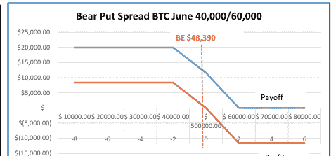

看跌看跌策略：在相同到期日买入高行权价看跌期权并卖出低行权价看跌期权（垂直价差）

行动示例：买入六月 60,000 看跌期权 - 支付 $14,110 期权金
卖出六月 40,000 看跌期权 - 收到 $2,500 期权金

| | 高行权价 X | p1 | 低行权价 X | p2 | p |
|---|---|---|---|---|---|
| 策略 | 买入行权看跌期权 (X1) | 每 BTC 支付的期权金 (p1) | 卖出行权看涨期权 (X2) | 每 BTC 收到的期权金 (p2) | 每 BTC 支付的净期权金 |
| 买高卖低看跌期权 | 60,000 | (14,110) | 40,000 | 2,500 | (11,610) |
| 买高卖低看跌期权 | 60,000 | (14,110) | 40,000 | 2,500 | (11,610) |
| 买高卖低看跌期权 | 60,000 | (14,110) | 40,000 | 2,500 | (11,610) |
| 买高卖低看跌期权 | 60,000 | (14,110) | 40,000 | 2,500 | (11,610) |
| 买高卖低看跌期权 | 60,000 | (14,110) | 40,000 | 2,500 | (11,610) |
| 买高卖低看跌期权 | 60,000 | (14,110) | 40,000 | 2,500 | (11,610) |
| 买高卖低看跌期权 | 60,000 | (14,110) | 40,000 | 2,500 | (11,610) |
| 买高卖低看跌期权 | 60,000 | (14,110) | 40,000 | 2,500 | (11,610) |
| 买高卖低看跌期权 | 60,000 | (14,110) | 40,000 | 2,500 | (11,610) |

| S |
|---|
| 市场价格 BTC 价格 (S) |
| 10,000 |
| 20,000 |
| 30,000 |
| 40,000 |
| 48,390 |
| 60,000 |
| 70,000 |
| 80,000 |

| | 净收益 | 净利润 | 最大损失 | 最大利润 |
|---|---|---|---|---|
| | 20,000 | 8,390 | | 8,390 |
| | 20,000 | 8,390 | | 8,390 |
| | 20,000 | 8,390 | | 8,390 |
| | 20,000 | 8,390 | | 8,390 |
| | 11,610 | - | | |
| | - | (11,610) | (11,610) | |
| | - | (11,610) | (11,610) | |
| | - | (11,610) | (11,610) | |
| | - | (11,610) | (11,610) | |

图 11.9 高级期权策略——看跌看跌价差

| 行权价 (X) | 四月 | 五月 | 六月 | 四月 | 五月 | 六月 |
|---|---|---|---|---|---|---|
| 20,000 | 27,000 | 25,000 | 22,000 | 9 | 250 | 225 |
| 30,000 | 18,000 | 17,000 | 14,000 | 90 | 400 | 900 |
| 40,000 | 8,500 | 9,100 | 9,000 | 750 | 1,277 | 2,500 |
| 50,000 | 2,000 | 3,300 | 4,300 | 4,200 | 5,102 | 6,100 |
| 60,000 | 290 | 924 | 1,530 | 13,500 | 14,000 | 14,110 |
| 70,000 | 50 | 209 | 530 | 22,900 | 23,000 | 29,754 |
| 100,000 | 10 | 25 | 175 | 53,000 | 53,500 | 58,722 |

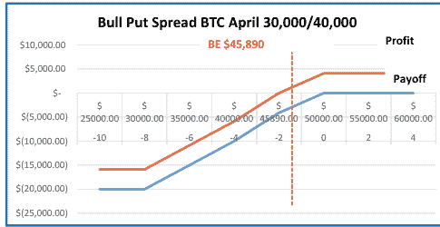

看涨看跌策略：在相同到期日买入低行权价看跌期权并卖出高行权价看跌期权（垂直价差）

行动示例：买入四月 30,000 看跌期权 - 支付 $90 期权金
卖出四月 60,000 看跌期权 - 收到 $4,200 期权金

| 策略 | 低行权价 X 买入行权看跌期权 (X1) | 每 BTC 支付的期权金 (p1) | 高行权价 X 卖出行权看跌期权 (X2) | 每 BTC 收到的期权金 (p2) | 每 BTC 收到的净期权金 |
|---|---|---|---|---|---|
| 买低卖高看跌期权 | 30,000 | (90) | 50,000 | 4,200 | 4,110 |
| 买低卖高看跌期权 | 30,000 | (90) | 50,000 | 4,200 | 4,110 |
| 买低卖高看跌期权 | 30,000 | (90) | 50,000 | 4,200 | 4,110 |
| 买低卖高看跌期权 | 30,000 | (90) | 50,000 | 4,200 | 4,110 |
| 买低卖高看跌期权 | 30,000 | (90) | 50,000 | 4,200 | 4,110 |
| 买低卖高看跌期权 | 30,000 | (90) | 50,000 | 4,200 | 4,110 |
| 买低卖高看跌期权 | 30,000 | (90) | 50,000 | 4,200 | 4,110 |
| 买低卖高看跌期权 | 30,000 | (90) | 50,000 | 4,200 | 4,110 |

| S |
|---|
| 市场价格 BTC 价格 (S) |
| 25,000 |
| 30,000 |
| 35,000 |
| 40,000 |
| 45,890 |
| 50,000 |
| 55,000 |
| 60,000 |

| S - X1 + X2 | 净收益 | 净利润 | 最大利润 | 最大损失 |
|---|---|---|---|---|
| (20,000) | (15,890) | | | (15,890) |
| (20,000) | (15,890) | | | (15,890) |
| (15,000) | (10,890) | | | (15,890) |
| (10,000) | (5,890) | | | (15,890) |
| (4,110) | - | | | |
| - | 4,110 | 4,110 | 4,110 | |
| - | 4,110 | 4,110 | 4,110 | |
| - | 4,110 | 4,110 | 4,110 | |

图 11.10 高级期权策略——看涨看跌价差

### 看跌看涨垂直价差

看跌看涨价差也听起来像是混合思维，因为通常买入看涨期权的投资者对加密货币持更乐观的看法，而该价差被称为看跌，代表一种悲观策略。这里的策略是净看跌的。投资者希望加密货币价格保持低位且期权未被行权，以便保留收到的净期权金。如前所述，在所有看涨期权与看跌或看跌期权与看涨之间存在这种矛盾的价差策略中，净所得均由投资者收到。

图 11.11 展示了一种看跌看跌价差策略，其中投资者买入 $70,000 五月看涨期权，支付 $209 期权金，卖出 $50,000 五月看涨期权，收到 $3,300 期权金，计算得出每比特币净收到的期权金为 $3,091（$3,300 – $209）。在这种情况下，投资者看跌，预期比特币价格将跌破 $50,000，以保留每比特币 $3,091 的期权金。显然，如果比特币价格上涨超过 $70,000，最大损失将被限制在 $16,909（$50,000 – $70,000 + $3,091）。比特币的盈亏平衡价计算为 $53,091（$50,000 + $3,091）。图 11.11 显示了不同比特币价格下的收益、利润、最大利润和最大损失。

### 期权估值方法

目前为止，本章介绍了投资者可以根据其对加密货币现货价格 (S) 走势的看法而采用的各种期权策略。根据对加密货币未来表现的看法，使用合适的期权策略，投资者使用两个输入变量——行权价 (X) 和期权金 (p)——来确定在到期日 (t) 或到期时的加密货币现货价格 (St) 各种加密货币现货价格 (S) 下的潜在收益 (O)、利润 (π) 和持有期回报率 (HPR%)。对于看涨期权买方，如果 X > S，收益为 S – X 或 0；对于看跌期权买方，如果 S > X，收益为 S – X 或 0。要获得此类期权，投资者需要支付期权金 (p)，代表每单位加密货币的前期资金或赌注，并希望到期日 (St) 的加密货币现货价格能够覆盖原始赌注。

本章的这一部分将重点介绍各种估值方法，以计算投资者为获得此类收益应支付的公平期权金。思维和计算应与投机游戏非常相似。使用概率概念，例如，有人对有两种可能结果的硬币抛掷进行下注，有 50% 的获胜机会和 50% 的输钱机会。在这

### 4. 高级期权策略 - 看跌看涨价差

#### 当前比特币 (BTC) 价格 S0 = $47,000.00（4 月 1 日）

| BTC | 看涨期权 | | | 看跌期权 | | |
|---|---|---|---|---|---|---|
| 行权价 (X) | 四月 | 五月 | 六月 | 四月 | 五月 | 六月 |
| 20,000 | 27,000 | 25,000 | 22,000 | 9 | 250 | 225 |
| 30,000 | 18,000 | 17,000 | 14,000 | 90 | 400 | 900 |
| 40,000 | 8,500 | 9,100 | 9,000 | 750 | 1,277 | 2,500 |
| 50,000 | 2,000 | 3,300 | 4,300 | 4,200 | 5,102 | 6,100 |
| 60,000 | 290 | 924 | 1,530 | 13,500 | 14,000 | 14,110 |
| 70,000 | 50 | 209 | 530 | 22,900 | 23,000 | 29,754 |
| 100,000 | 10 | 25 | 175 | 53,000 | 53,500 | 58,722 |

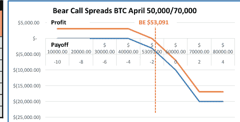

看跌看涨策略：在相同到期日买入高行权价看涨期权并卖出低行权价看涨期权（垂直价差）

行动示例：买入五月 70,000 看涨期权 - 支付 $209 期权金
卖出五月 50,000 看涨期权 - 收到 $3,300 期权金

| | 高行权价 X | p1 | 低行权价 X | p2 | p |
|---|---|---|---|---|---|
| 策略 | 买入行权看涨期权 (X1) | 每 BTC 支付的期权金 (p1) | 卖出行权看涨期权 (X2) | 每 BTC 收到的期权金 (p2) | 每 BTC 收到的净期权金 |
| 买高卖低看涨期权 | 70,000 | (209) | 50,000 | 3,300 | 3,091 |
| 买高卖低看涨期权 | 70,000 | (209) | 50,000 | 3,300 | 3,091 |
| 买高卖低看涨期权 | 70,000 | (209) | 50,000 | 3,300 | 3,091 |
| 买高卖低看涨期权 | 70,000 | (209) | 50,000 | 3,300 | 3,091 |
| 买高卖低看涨期权 | 70,000 | (209) | 50,000 | 3,300 | 3,091 |
| 买高卖低看涨期权 | 70,000 | (209) | 50,000 | 3,300 | 3,091 |
| 买高卖低看涨期权 | 70,000 | (209) | 50,000 | 3,300 | 3,091 |
| 买高卖低看涨期权 | 70,000 | (209) | 50,000 | 3,300 | 3,091 |

| S |
|---|
| 市场价格 BTC (S) |
| 10,000 |
| 20,000 |
| 30,000 |
| 40,000 |
| 53,091 |
| 60,000 |
| 70,000 |
| 80,000 |

| S - X1 + X2 | 净收益 | 净利润 | 最大损失 | 最大利润 |
|---|---|---|---|---|
| - | 3,091 | | | 3,091 |
| - | 3,091 | | | 3,091 |
| - | 3,091 | | | 3,091 |
| - | 3,091 | | | 3,091 |
| (3,091) | 3,091 | | | |
| (10,000) | (6,909) | (16,909) | | |
| (20,000) | (16,909) | (16,909) | | |
| (20,000) | (16,909) | (16,909) | | |

图 11.11 高级期权策略——看跌看涨价差


简单示例，假设如果硬币抛出正面（H），奖金为20美元；如果抛出反面（T），奖金为0美元。掷骰子时，如果出现6点，获胜者将获得60美元。单次掷骰子出现6点的可能性（概率）为六分之一（1/6），不出现6点的概率为六分之五（5/6）。要根据这些随机游戏评估什么是公平赌注，公式从以下决策树开始，如图11.12a和11.12b所示。

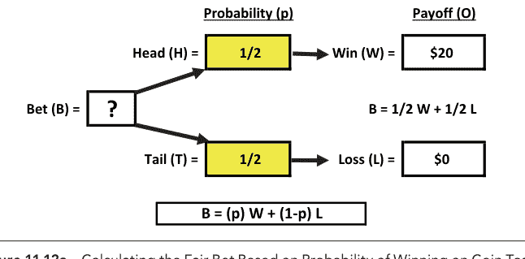

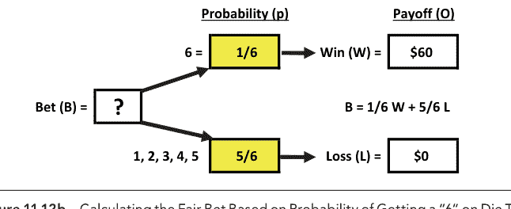

图片显示，硬币抛掷和骰子掷出的奖金或回报分别为20美元和60美元。使用从决策树推导出的概率公式，赌注计算如下：

$$ \text{Coin toss bet} = \frac{1}{2} (\$20) + \frac{1}{2} (\$0) = \$10 $$

$$ \text{Die toss bet} = \frac{1}{6} (\$60) + \frac{5}{6} (\$0) = \$10 $$

这些随机游戏的盈亏代表期权回报，硬币抛掷和骰子掷出的结果代表加密货币现货价格。这一概率公式概念可用于确定玩家进入该游戏前需要预先支付的公平赌注；该公平赌注代表投资者为拥有在正回报结果时行使此类期权的权利而需要预先支付的权利金。挑战在于，当投资者押注加密货币未来走势时，如何推导出此类概率。该走势通过加密货币现货价格的历史波动来衡量，在统计学中表现为加密货币现货价格的方差（$\sigma^2$）或标准差（$\sigma$）。一些使用加密货币现货价格方差和标准差的估值模型包括二叉树期权定价模型和Black-Scholes模型。*

### 二叉树期权定价模型：单周期概率方法

二叉树期权定价模型（BOPM）会从任意时间点直至到期，持续衡量加密货币的两种可能走势——上涨或下跌。随着加密货币现货价格上涨，其继续上涨的概率相对于从该新水平下跌的概率可能会发生变化。上涨（u）和下跌（d）值源自历史经验，并在BOPM中用于推导此类概率。加密货币现货价格（S）上涨或下跌的概率，最终被衡量为公平赌注，即投资者为满足其预期而愿意支付的权利金。图11.13以示例说明如何使用BOPM计算权利金。

图11.13显示，在可衡量期（本例为一年）内，比特币价格从当前的47,000美元上涨至56,400美元的概率为50%，下跌至42,300美元的概率也为50%。概率计算如下：

```
p = \frac{[(1 + i) - d]}{u - d} = \frac{[(1 + 0.05) - 0.90]}{1.20 - 0.90} = \frac{1.05 - 0.90}{1.20 - 0.90} = \frac{0.15}{0.30} = 0.5 \text{ and } i - p = 0.5
```

如果比特币价格上涨至56,400美元，看涨期权回报将为6,400美元（C = max (0, S – X) = max (0, $56,400 – $50,000）。如果比特币价格下跌至42,300美元，看涨期权将处于价外状态，根据C = max (0, S – X) = max (0, $42,300 – $50,000)，回报将为0美元。鉴于

### 一周期二叉树期权定价模型——计算看涨期权权利金

#### 输入

| 项目 | 数值 |
|------|-----|
| 当前比特币 (S) | $47,000 |
| 上涨 (u) | 1.20x |
| 下跌 (d) | 0.90x |
| 行权价 (X) | $50,000 |
| 无风险利率 (I) | 5.00% |
| 年数 (t) | 1 |
| 周期 | 1 |

#### 输出

| | 周期 0 | 周期 1 |
|---|---|---|
| Su = 56,400 -> Cu = | 6,400.00 | |
| S = 47,000.0 | | |
| Sd = 42,300 -> Cd = | - | |
| C = 3,047.62 | | |
| p = 0.50 | | |
| 1-p = 0.50 | | |
| C = 3,047.62 欧式期权权利金 | | |

#### 公式

- Su = S . u
- Sd = S . d
- Cu = Max (0, Su - X)
- Cd = Max (0, Sd - X)
- p = [(1+i) - d ] / (u - d)
- C= [ (p . Cu) + [(1-p) Cd] ] / [(1+i)^t]

图 11.13 一周期二叉树期权定价模型——计算看涨期权权利金

50%的二叉树结果，在此情况下回报为6,400美元，50%的回报为0美元；使用下文解释的概率理论，公平赌注或权利金应为3,200美元，即50% × 6,400美元 + 50% × 0美元。

如果我们将3,200美元的现值折现回今天的价值，因为这是我们今天为未来结果所支付的金额，根据现值计算，该价值计算为3,047.62美元，基于以下现值计算：

```
$PV = \frac{FV}{(1+i)^t} \text{ or } \frac{\$3,200}{(1+0.05)^1} = \$3,047.62$
```

图11.14使用相同的概率计算看跌期权权利金。查看使用与上述看涨期权相同变量的看跌期权场景，回报和权利金的计算方式不同。如果比特币价格上涨至56,400美元，价外看跌期权回报将为0美元（P = max (0, X – S) = max (0, $50,000 – $56,400）。如果价格下跌至42,300美元，看跌期权将处于价内状态，根据P = max (0, X – S) = max (0, $50,000 – $42,300)，回报将为7,700美元。鉴于50%的二叉树结果，在此情况下回报为7,700美元，50%的回报为0美元；使用下文解释的概率理论，公平赌注或权利金应为3,850美元，即50% × 7,700美元 + 50% × 0美元。如果我们将3,850美元的现值折现回今天的价值，因为这是我们今天为未来结果所支付的金额，根据现值计算，该价值计算为3,666.67美元，基于以下现值计算：

```
$PV = \frac{FV}{(1+i)^t} \text{ or } \frac{\$3,850}{(1+0.05)^1} = \$3,666.67$
```

### 二叉树期权定价模型：双周期概率方法

使用两个周期的BOPM将从任意时间点直至到期，衡量加密货币的四种可能结果——先涨后涨、先跌后涨、先跌后跌。图11.15所示的四个结果展示了三种可能的回报，因为先涨后跌（Sud）的加密货币与先跌后涨（Sdu）是相同的。与单周期BOPM一样，上涨（u）和下跌（d）值源自历史经验，并用于推导此类概率。加密货币上涨或下跌的概率，最终衡量的是公平赌注，即投资者为满足其预期而愿意支付的权利金。图11.15以示例说明如何使用双周期BOPM计算看涨期权和看跌期权的权利金。该示例计算了欧式和美式期权结构。

### 一周期二叉树期权定价模型——计算看跌期权权利金

#### 输入

| 项目 | 数值 |
|------|-----|
| 当前股票 (S) | $47,000 |
| 上涨 (u) | 1.20x |
| 下跌 (d) | 0.90x |
| 行权价 (X) | $50,000 |
| 无风险利率 (i) | 5.00% |
| 年数 (t) | 1 |
| 周期 | 1 |

#### 输出

| | 周期 0 | 周期 1 |
|---|---|---|
| S = 47,000 | | |
| Su = 56,400 -> Cu = | - | |
| Sd = 42,300 -> Cd = | 7,700.00 | |
| C = 3,666.67 | | |
| p = 0.50 | | |
| 1-p = 0.50 | | |
| P = 3,666.67 欧式期权权利金 | | |

#### 公式

- Su = S . u
- Sd = S . d
- Pu = Max (0, X-Su)
- Pd = Max (0, X-Sd)
- p = [(1+i) - d] / (u - d)
- P = [ (p . Pu) + [(1-p) Pd] ] / [(1+i)^Freq]

图 11.14 一周期二叉树期权定价模型——计算看跌期权权利金

### 双周期二叉树期权定价模型——看涨期权和看跌期权

#### 输入

#### 看涨期权

| 项目 | 数值 |
|------|-----|
| S | $47,000 |
| u | 1.20x |
| d | 0.90x |
| X | $50,000 |
| i | 5.00% |
| 频率 | 1 |
| 周期 | 2 |

频率：（年 = 1，半年 = 2，季度 = 4）

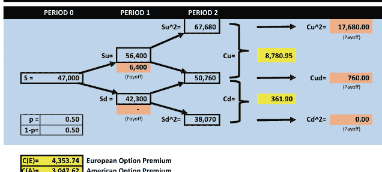

#### 公式

- Su= S . u
- Sd= S . d
- Su²= S . u²
- Cu²= Max (0, Su²- X)
- Cd²= Max (0, Sd²- X)
- Cud= Max (0, Sud- X)
- p = [{(1+ i) / d]} - { (u - d) ] / [{(1+i)^Freq]
- Cu= [ {p . Cu²} + {(1-p) Cud)] / [{(1+i)^Freq]
- Cd= [ {p . Cud} + {(1-p) Cd²]] / [{(1+i)^Freq]
- C= [ {p . C1} + {(1-p) C2]] / [{(1+i)^Freq]

#### 输入

#### 看跌期权

| 项目 | 数值 |
|------|-----|
| S | $47,000 |
| u | 1.20x |
| d | 0.90x |
| X | $50,000 |
| i | 5.00% |
| 频率 | 1 |
| 周期 | 2 |

频率：（年 = 1，半年 = 2，季度 = 4）

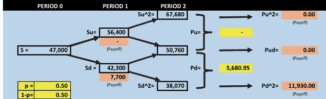

#### 公式

- Su= S . u
- Sd= S . d
- Su²= S . u²
- Pu²= Max (0, X- Su²)
- Pd²= Max (0, X - Sd²)
- Pud= Max (0, X - Sud)
- p = [{(1+ i) / d]} - { (u - d) ] / [{(1+i)^Freq]
- Pu= [ {p . Pu²} + {(1-p) Pud)] / [{(1+i)^Freq]
- Pd= [ {p . Pud} + {(1-p) Pd²]] / [{(1+i)^Freq]
- P= [ {p . P1} + {(1-p) P2]] / [{(1+i)^Freq]


### 基于欧式结构的期权溢价计算

看涨期权和看跌期权溢价的概率计算相同。投资者计算第二期的看涨期权和看跌期权收益后，将概率应用于上/上、上/下和下/下收益，如下所示：

#### 看涨期权溢价

Cu = \frac{p(Cu^2)+(1-p)(Cud)}{(1+i/f)}   and   Cd = \frac{p(Cud)+(1-p)(Cd^2)}{(1+i/f)}

and then C = \frac{p(Cu)+(1-p)(Cd)}{(1+i/f)}

#### 看跌期权溢价

Pu = \frac{p(Pu^2)+(1-p)(Pud)}{(1+i/f)}   and   Pd = \frac{p(Pud)+(1-p)(Pd^2)}{(1+i/f)}

and then P = \frac{p(Pu)+(1-p)(Pd)}{(1+i/f)}

### 基于美式结构的期权溢价计算

看涨期权和看跌期权溢价的概率计算相同。投资者计算第一期的看涨期权和看跌期权收益后，将概率应用于上行和下行收益，如下所示：

#### 看涨期权溢价

C = \frac{[p(C higher payoff) + (1 - p)(C lower payoff)]}{(1 + i/f)}

#### 看跌期权溢价

P = \frac{[p(P lower payoff) + (1 - p)(P higher payoff)]}{(1 + i/f)}

### Black-Scholes-Merton (BSM) 模型

Black-Scholes-Merton 模型（BSM）是最早用于根据五个变量（当前现货价格（加密货币）、行权价、波动率、时间和无风险利率）计算看涨期权或看跌期权溢价公允价格的定价模型之一。在陈述 Black-Scholes 公式之前，本章将重点介绍这五个变量及其他统计概念。

#### 五个变量

所有期权定价方法均保持一致，使用相同的五个变量：作为标的资产的当前现货价格（加密货币）、行权价或未来价格、表示波动率的方差或标准差、时间，以及下文描述的无风险利率。

- 1. 加密货币当前现货价格（S₀）。与 BOPM 类似，加密货币标的资产的当前现货价格是决定未来预期期权收益内在价值的最重要变量之一。如前所述，当前加密货币价格与未来行权价之间的关系是首个自然比较，用于确定现货价格需要上涨多高才能超过看涨期权的行权价，以及加密货币价格需要下跌多低才能低于看跌期权的行权价。看涨期权和看跌期权收益分别对应的 S - X 和 X - S 的价值（即内在价值）是 Black-Scholes 公式的基础。

- 2. 行权价（X）。这是期权到期时标的加密货币的未来价格。该价格固定不变，随着到期时间临近，投资者不断将当前现货价格（S）与行权价进行比较，当 S - X 或 X - S 的内在价值扩大或收缩时，分别计算看涨期权和看跌期权的收益。

- 3. 波动率和标准差（σ）。这是通过历史标的加密货币价格的标准差来衡量的波动率，该价格每日、每周或每月变化。标的加密货币现货价格的波动越大，波动率和标准差越高。基本上，这种波动决定了加密货币价格高于或低于固定行权价的可能性。标准差越高，加密货币越可能处于实值状态，看涨期权和看跌期权分别具有正的内在价值 S - X 或 X - S。标准差越高，预期的期权溢价越高。

- 4. 时间（t）。到期时间或期权到期时间是衡量期权价值的重要变量。一般来说，行权时间越长，购买期权支付的溢价越高。它也增加了加密货币价格达到行权价的可能性。

- 5. 无风险利率（i）。使用无风险利率计算行权价的现值。所使用的利率应为年化利率，并根据到期期限进行调整。另一项调整是复利。

#### 其他统计概念

重新介绍一些对期权估值至关重要的数学概念很重要，包括自然对数、概率论和正态分布。

##### 1. 使用指数（e）进行复利

数字 e 是一个数学常数 2.7182，是自然对数的底数，且等于一。未来值计算基于以下公式：

$$FV = PV \left(1 + \frac{i}{f}\right)^t$$

其中 PV 是现值，i 是利息，t 是时间，f 是每年的复利频率或复利支付次数。

随着复利频率从每年一次增加到每半年一次、每季度一次、每月一次以及无限次，未来值会增加，但不会超过原始现值的 2.718 倍，如图 11.16 所示。

无限复利 e 用于 Black-Scholes 模型中，以 $e^{-it}$ 计算行权价（X）的现值，并基于以下数学计算推导：

$$e = PV (1 + i)^t \text{ then } PV = \frac{e}{(1 + i)^t} \text{ then } PV = e^{-it}$$

##### 2. 自然对数（ln）

该模型假设现货价格遵循对数正态分布，因为资产价格不能为负数（它们被零所界限）。这也称为 _高斯分布_。通常观察到资产价格具有显著的右偏和一定程度的峰度（肥尾）。这意味着市场中高风险下跌波动发生的频率高于正态分布的预测。

因此，假设加密货币等标的资产价格遵循对数正态分布，应表明根据 Black-Scholes 模型，每个行权价的隐含波动率相似。

##### 使用 e 计算复利

现值 = $ 1.00
利率 = 10%
年限 = 10

| 描述 | 每年复利频率 (f) | 复利未来值 |
|---|---|---|
| 每年 | 1 | 2.5937425 |
| 半年 | 2 | 2.6532977 |
| 季度 | 4 | 2.6850638 |
| 月度 | 12 | 2.7070415 |
| 每日 | 365 | 2.7179096 |
| 每小时 | 8,760 | 2.7182663 |
| 按分钟 | 525,600 | 2.7182816 |
| 按秒 | 31,536,000 | 2.7182819 |
| 无限 | e | 2.7182818 |

图 11.16 使用指数“e”计算复利

##### 3. 正态概率分布（N）

正态概率分布呈钟形曲线，给出标准正态随机变量小于或等于给定值的概率。图 11.17 显示，正态分布图表示均值 μ = 0、标准差 σ = 1 的标准正态分布。例如，如果加密货币的现货价格标准差为 10%，这意味着比特币等加密货币的价格会从平均值向上或向下“波动”10%，例如，在某个时期内，均值为 30,000 美元的比特币价格的上下限在 27,000 美元至 33,000 美元之间（-10% 到 +10%）。在一个标准差范围内，加密货币现货价格在 10% 范围内波动的概率为 64%。在机会游戏中，投资者会下注 6.40 美元，以获得加密货币现货价格在 10% 范围内波动时的 10 美元回报。

N(d) 的值由图 11.17 给出。d 的值介于负无穷和正无穷之间，但为了估值目的，显示三位小数，对于介于零和一之间的近乎 100% 的正态分布正值，水平基本上介于 –3.00 和 3.00 之间。例如，如果 d = 1.3，则标准化值为 0.903。该表用于 Black-Scholes 模型，以确定加密货币现货价格的正态概率，从而确定溢价的公允价值。

用于使用 Black-Scholes 模型 N(d1) 计算看涨期权和看跌期权分别对应的 S - X 或 X - S 内在价值的概率分布公式，N(d1) 即……的概率


### Normal Probability Distribution

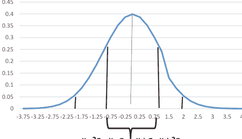

#### NORMAL DISTRIBUTION TABLE

| d | N(d) | d | N(d) | d | N(d) | d | N(d) | d | N(d) |
|---|---|---|---|---|---|---|---|---|---|
| 3.200 | 0.999 | 1.900 | 0.971 | 0.600 | 0.726 | -0.700 | 0.242 | -2.000 | 0.023 |
| 3.100 | 0.999 | 1.800 | 0.964 | 0.500 | 0.691 | -0.800 | 0.212 | -2.100 | 0.018 |
| 3.000 | 0.999 | 1.700 | 0.955 | 0.400 | 0.655 | -0.900 | 0.184 | -2.200 | 0.014 |
| 2.900 | 0.998 | 1.600 | 0.945 | 0.300 | 0.618 | -1.000 | 0.159 | -2.300 | 0.011 |
| 2.800 | 0.997 | 1.500 | 0.933 | 0.200 | 0.579 | -1.100 | 0.136 | -2.400 | 0.008 |
| 2.700 | 0.997 | 1.400 | 0.919 | 0.100 | 0.540 | -1.200 | 0.115 | -2.500 | 0.006 |
| 2.600 | 0.995 | 1.300 | 0.903 | 0.000 | 0.500 | -1.300 | 0.097 | -2.600 | 0.005 |
| 2.500 | 0.994 | 1.200 | 0.885 | -0.100 | 0.460 | -1.400 | 0.081 | -2.700 | 0.003 |
| 2.400 | 0.992 | 1.100 | 0.864 | -0.200 | 0.421 | -1.500 | 0.067 | -2.800 | 0.003 |
| 2.300 | 0.989 | 1.000 | 0.841 | -0.300 | 0.382 | -1.600 | 0.055 | -2.900 | 0.002 |
| 2.200 | 0.986 | 0.900 | 0.816 | -0.400 | 0.345 | -1.700 | 0.045 | -3.000 | 0.001 |
| 2.100 | 0.982 | 0.800 | 0.788 | -0.500 | 0.309 | -1.800 | 0.036 | -3.100 | 0.001 |
| 2.000 | 0.977 | 0.700 | 0.758 | -0.600 | 0.274 | -1.900 | 0.029 | -3.200 | 0.001 |

图 11.17 正态分布表，显示 -3.2 到 +3.2 的分区，归一化至 0 到 1

spot price of the cryptocurrency being in the money and N(d2) representing the probability of being out-of-the-money, are as follows:

```
d1 = \frac{\ln(\frac{S}{X})+ \left(i+\frac{\sigma^2}{2}\right)t}{\sigma\sqrt{t}} \text{ and } d2 = d1 - \sigma\sqrt{t}
```

where S is the current spot price of the cryptocurrency, X is the exercise price, i is the risk-free rate, t is time to expiration, and σ is the standard deviation.
The Black-Scholes formula for call option (C) and put option (P) are as follows:

```
C = S N(d1) - Xe^{-it}N(d2) \text{ and } P = Xe^{-it}[1 - N(d2)] - S [1 - N(d1)]
```

For example, let's assume that the current spot price of Bitcoin (S) is $47,000 and the future exercise price (X) that expires in 6 months is $50,000. This out-of-the-money call option and in-the-money put option have a standard deviation (σ) of 0.40. Given the risk-free rate of 5%, what is the fair value for both call and put option premiums?

#### Input

```
S = $47,000
X = $50,000
t = 0.50 (6 months)
i = 5.0%
σ = .40
```

#### Formulas

```
d1 = \frac{\ln \left(\frac{47k}{50k}\right) + \left(0.05 + \frac{.4^2}{2}\right) 0.50}{0.40\sqrt{0.5}} = 0.0110
```

and

```
d2 = 0.01110 - 0.2828 = -0.2718
N(d1) = N(0.0110) = 0.5044
N(d2) = N(-0.2718) = 0.3929
```

The call option calculated using the Black-Scholes formula:

```
C = 47k (0.5044) - 50k e^{-(0.05)(0.5)} (0.33929) :
= 23.71k - 50k (0.9753)(0.3929) = 4.55
```

The put option is calculated as follows:

P = 50k e^{-(0.05)(0.5)}[1 - (0.3929)] – 47k [1 - 0.5044] = 6,313.17

The call option calculations using Excel® is shown in Figure 11.18; the put option calculations using Excel is shown in Figure 11.19.

### Put Call Parity

The investor needs to calculate either the call option or the put option, and given that the probability concepts used are the same pricing for the same period, the call price should be in parity of the put price. The difference between the call premium and the put premium should equal the intrinsic value S – X or X – S, with the exception that the X will be adjusted to represent the present value, since the exercise price is in the future. The call put parity is as follows:

C – P = S – PV (X) or C – P = S – Xe^{-it}

If an investor knows the call price and needs to determine the put price and vice versa, the formulas translate to the following:

C = S – Xe^{-it} + P and P = Xe^{-it} – S + C

Using this example where the current price of Bitcoin is $47,000 and the future exercise price (X) that expires in six months is $50,000, the call option is priced at $4,547.88. Given the risk-free rate of 5%, what is the fair value of the put option premium? Using the call put parity formula, calculate the put option as follows:

P = X – S + C = 50k – 47k + 4.55k = 6.31k

### Hedge Ratio (h) and Leverage (Borrowing) Methods: Using BOPM

There is another method that can be used to determine the option pricing, which is like the BOPM discussed above, but instead of using the probability, the values can be derived by using the leverage method. This leverage method is important when the investor is using the BOPM valuation to determine the fully hedged position for option strategies, such as covered calls and protective puts. The method to calculate the call price is demonstrated. This six-step method shown in Figure 11.20 first determines the hedge ratio and then, using a leverage component, calculates the fair value of both call and put options.

#### BLACK-SCHOLES VALUATION CALL OPTION

| A | B | C | D | E | F | G | H | I |
|---|---|---|---|---|---|---|---|---|
| 4 | | | | | | | | |
| 5 | 输入 | | | 输出 | | | 公式 | |
| 6 | | 标准差 (σ) = | 0.4 | | d1 = | 0.0110 | | =(LN(D10/D11)+(D9+(D7^2)/2)*D8)/(D7*SQRT(D8)) |
| 7 | | 到期时间（年）(T) = | 0.5 | | d2 = | -0.2718 | | =+G7-D7*SQRT(D8) |
| 8 | | 无风险利率（年）(i) = | 5.0% | | N(d1) = | 0.5044 | | =NORMSDIST(G7) |
| 9 | | 股票价格 (S) = | 47,000 | | N(d2) = | 0.3929 | | =NORMSDIST(G8) |
| 10 | | 行权价 (X) = | 50,000 | | | | | |
| 12 | | C = | 4,547.68 | | | | | =+D10*EXP(-D9*D8)*G9-D11*EXP(-D9*D8)*G10 |

图 11.18 使用 Black-Scholes 计算看涨期权权利金

#### BLACK-SCHOLES VALUATION PUT OPTION

| A | B | C | D | E | F | G | H | I |
|---|---|---|---|---|---|---|---|---|
| 4 | | | | | | | | |
| 5 | 输入 | | | 输出 | | | 公式 | |
| 6 | | 标准差 (σ) = | 0.4 | | d1 = | 0.0110 | | =(LN(D10/D11)+(D9+(D7^2)/2)*D8)/(D7*SQRT(D8)) |
| 7 | | 到期时间（年）(T) = | 0.5 | | d2 = | -0.2718 | | =+G7-D7*SQRT(D8) |
| 8 | | 无风险利率（年）(i) = | 5.0% | | N(d1) = | 0.5044 | | =NORMSDIST(G7) |
| 9 | | 股票价格 (S) = | 47,000 | | N(d2) = | 0.3929 | | =NORMSDIST(G8) |
| 10 | | 行权价 (X) = | 50,000 | | | | | |
| 12 | | P = | 6,313.17 | | | | | =D11*EXP(-D9*D8)*(1-G10)-D10*(1-G9) |

图 11.19 使用 Black-Scholes 计算看跌期权权利金

图 11.20 显示，欧洲式看涨期权应定价为 $3.048，看跌期权为 $3,667，对冲比率分别为 ⁴⁄₉ 和 ⁵⁄₉。看涨期权的 ⁴⁄₉ 对冲比率表明，寻求 100% 对冲的投资者（例如计划购买比特币）应每持有四个比特币就持有九份看涨期权合约（备兑看涨）。对于保护性看跌策略者，他或她需要每持有五个比特币就购买九份看跌期权合约。

### Summary

Options have been around since the tulip mania of 1636, when options on tulips were widely traded on speculation that tulip prices would continue to soar. Cryptocurrency doubters have compared the tulip mania with the significant increase in Bitcoin price between 2015 and 2017, and 2019 and 2021, predicting a similar fate. While these rapid price increases were followed by sharp retractions, major cryptocurrency markets generally remained stable, and prices have continued to rise long term.

Options markets first began to develop for Bitcoin in 2018, and interest in these options helped propel further innovation in the industry. Despite the controversial surrounding this new technological disruption of this digital asset, major investment firms, government regulatory agencies such as the SEC, and major exchanges including the Chicago Mercantile Exchange (CME) have continued to develop derivatives markets in step with each other. These markets provide investors with the ability to hedge risk and implement complex trading strategies in ways not previously possible.

The options market for cryptocurrencies has been only one of the latest introductions to the cryptocurrency momentum in recent years. When CME introduced Bitcoin and Ethereum futures a few years ago, it provided an efficient tool to access exposure for these cryptocurrencies and manage risk in a more regulated market than traditional cryptocurrency exchanges. These cryptocurrency options follow very closely the equity options model, in which the investor has a view of the price and buys or sells calls and puts based on this view. As a result, many of the option trading strategies used on equity markets can be used on cryptocurrency markets as well.

The purchase of options is used primarily for hedging investors’ underlying exposure or for speculating on the direction of the price with minimal investment. Given the recent volatility of the cryptocurrency market, the volume of options trading has picked up significantly and is expected to continue to grow as more portfolio managers discover this new asset class as a result of increasing interest from their customers.


Step 1: (Su - Sd) = $14,100 上下限股票价格区间
Step 2: (Cu - Cd) = $6,400 上下限期权收益区间
Step 3: h = (Cu - Cd) / (Su - Sd) = 4/9 对冲比率（买入 1 股股票 / 卖出 3 份看涨期权）

Step 4: (PV of S0) $40,285.71 股票现值 - 借款
Step 5: (So - PV(Sd)) $6,714.29 内在价值（S - 预期 X）
Step 6: [(So - PV(Sd))] x h = $3,047.62 内在价值乘以对冲比率

Premium = $3,047.62
Break Even = $53,047.62 股票价格 + 权利金
Distance to BE ($) = $6,047.62 盈亏平衡点 $116.06 - 当前股票价格 $100
Distance to BE (%) = 12.87% 盈亏平衡点 / 股票价格 - 1

看涨期权-看跌期权平价错误检查
3,666.67

Step 1: (Su - Sd) = $14,100 上下限股票价格区间
Step 2: (Pu - Pd) = $7,700 上下限期权收益区间
Step 3: h = (Pu - Pd) / (Su - Sd) = 5/9 对冲比率（买入 2 股股票 / 买入 3 份看跌期权）

Step 4: (PV of S0) $53,714.29 股票现值 - 借款
Step 5: (So - PV(Su)) $6,714.29 内在价值（预期 X - S）
Step 6: [(PV(Su) - S0)] x h = $3,666.67 内在价值乘以对冲比率

Premium = $3,666.67
Break Even = $46,333.33 股票价格 - 权利金
Distance to BE ($) = $(666.67) 盈亏平衡点 $96.36 - 当前股票价格 $100
Distance to BE (%) = -1.42% 盈亏平衡点 / 股票价格 - 1

### 图 11.20 杠杆型二元期权定价模型：六步法

即使在过去几年实现快速增长之后，加密货币期权市场仍处于萌芽阶段，预计将继续增长并扩大其覆盖的其他加密货币。随着这些市场的发展和成熟，它们可能会吸引金融行业传统机构的日益关注，以及日益增加的监管审查。希望这将带来一个更安全、更标准化的加密货币衍生品市场，造福所有投资者。

## 第 12 章

## 区块链和智能合约在国际关系中的作用

Stephan Unger* 和 Hossein Hassani**

*圣安瑟姆学院；**德黑兰大学

### 12.1 引言

本章探讨了区块链技术在国际关系背景下的当前作用与潜在作用。区块链技术的发展日益广泛地渗透到各个分支和领域，从 IT 到金融和政治应用。这一发展最重要的特征是实现更高效、更安全的数据验证——更高效是因为它能够实现网络内的去中心化存储，更安全是因为数据受工作量证明概念的保护，该概念独立于中心化服务器或实体。

智能合约的使用使得用户能够重新构建国际关系网络，并使其更具弹性和安全性。由于智能合约允许在交易之上实现任何逻辑，因此任何类型的关系、协议、计划行动方案、定义的目标、组织检索和约束都可以包含在智能合约的建立中。

智能合约逻辑可能包括预算分配的分发、政策变更的谈判、协议的实施以及争议的缓解。由于解决过程是自动化的，潜在冲突甚至可以在其出现之前得到解决。智能合约的基本功能（即交换金钱、财产权、证券或任何其他有价值的东西）允许定义在其下自动执行的规则。一旦执行，结果将以不可更改的方式存储在区块链上，不仅可用于记录保存，还可作为未来优化的输入（Hines 2021）。

与以人为本的方法相比，优势显而易见：消除人为错误和情绪化行为、更快更安全的执行、成本最小化、冲突解决以及构建更具弹性的系统。智能合约的潜力从简单的流程优化延伸至地缘政治冲突的解决。

几乎所有与地缘政治风险相关的智能合约区块链应用都涉及通过对冲来减轻交易风险，但不涉及将其实施到政治决策过程中。

然而，Saveiyev (2017) 是少数几个调查智能合约在合同法中潜在影响的研究者之一。他分析了将现有合同法条款应用于所谓智能合约（即“以软件代码形式存在并在区块链平台上实现的协议，基于预定义因素集确保智能合约条款的自主性和自动执行性”）所涉及的法律问题。他概述了区块链技术的特性，如目前在比特币加密货币中实现的那样，这构成了智能合约的核心。

区块链已经在地缘政治风险评估和决策中进行了测试。Lithopia 是一个虚构的区块链管理村庄原型，利用卫星和无人机数据在开源区块链平台 Hyperledger® 上触发智能合约。该项目正在测试通过在模板设计过程中让利益相关者参与，来对新兴区块链和分布式账本技术（DLTs）进行预期治理的可能性。其目标是质疑通过自动化和智能合约进行的区块链治理的承诺，并为所谓的预测性和预期性设计中新兴技术的滥用提供替代方案（Kera et al. 2019）。

Van Bodegraven (2017) 指出了随着预期设计和预测性用户体验的出现而产生的伦理和设计问题。同样，Guston (2014) 深入探讨了新技术在治理和政策制定中的作用。他详细阐述了预期治理的概念，即“一种广泛的社会能力，能够对各种输入作出反应，在管理仍然可能时管理新兴的基于知识的技术”。尽管他主要将预期治理的概念应用于美国的纳米技术，但其理论框架也与将智能合约和区块链技术整合到当今决策过程中是相关的。

Wright 和 De Filippi (2015) 探讨了这一新兴去中心化技术的利弊，并认为其广泛部署将导致一个名为 _Lex Cryptographia_ 的新法律子集的扩张：通过自动执行智能合约和去中心化（自治）组织管理的规则。

他们认为，随着区块链技术的广泛采用，政府机构和大型跨国公司等集中化当局可能会失去通过现有手段控制和塑造不同人群活动的能力。由此，他们暗示，日益需要关注如何监管区块链技术，以及如何在当前法律理论下尚未探索过的方式塑造这些新兴去中心化组织的创建和部署（Wright and De Filippi 2015）。

Cannarsa (2018) 强调了自然语言（合同用语）与计算机语言（代码编写语言）之间的区别。他认为，法院将通过解释发挥重要作用，以揭示合同的“真实含义”。因此，对合同进行编码并依赖计算机代码语言可能会对民法方法产生重大影响，并在合同起草和合同解释方面使两个法律体系更加接近（Cannarsa 2018）。

Oxford Analytica (2020) 强调了智能合约在当前监管框架中实施的现有问题，这些问题构成了障碍。进行了实验，测试了该技术节省时间和金钱的潜力及其提升金融部门透明度的能力。然而，这些试验暴露了该技术设计的重大局限性。识别出的约束包括，例如，只有部分政府修订了立法以纳入基于区块链的交易；更多政府需要跟进以帮助法律确定性。智能合约更广泛采用的另一大障碍是缺乏有效的争议解决机制，以及通过区块链执行的更简单合同可以降低行政成本（Oxford Analytica 2020）。

然而，区块链技术不仅会进入地缘政治，还会进入太空政治。De Filippi 和 Leiter (2021) 认为，区块链技术与外层空间相关，因为它促进了推进以新治理模式为特征的可能未来的新叙事。他们阐明了区块链技术的可能应用如何应用于外层空间治理。

大多数区块链技术应用都利用发行的代币来对地缘政治行动的结果进行投机或对冲。Bouri et al. (2020) 调查


加密货币的价格不连续性是否与地缘政治风险的大幅波动共同相关。他们考察了比特币及其他主要加密货币每日收益率的跳跃发生率，并使用逻辑回归研究了加密货币与地缘政治风险指数之间的联合跳跃。他们发现，所研究的所有加密货币的价格行为都存在波动，但只有比特币的跳跃取决于地缘政治风险指数的跳跃，这表明比特币是一种对冲地缘政治风险的工具。

Su et al. (2020)研究了比特币货币在避免和超越与全球地缘政治事件相关的风险方面的作用。他们执行格兰杰因果检验以探索地缘政治风险与比特币价格之间的相互影响，并发现地缘政治风险对比特币价格存在正向和负向影响。进一步的文献（Selmi et al. 2022）表明，比特币及其底层的区块链技术被用于缓解地缘政治风险。

总体而言，有必要强调的是，尽管区块链技术有能力和潜力解决许多决策问题——例如，通过实施智能合约——最终的决策机构或监管实体始终应该是并且保持为人类。其原因在于新情况的复杂性可能会让即使最聪明的机器学习算法也应接不暇，这不仅是因为缺乏可供学习的历史数据，还因为存在改变规则的情况。

我们将区块链在国际关系中潜在应用的分析建立在Allison (1971)提供的理论框架之上。他的主要主张是，国家之间的互动不能简化为两个行为体之间的行为。相反，国际关系中的决策过程涉及许多行为体在许多不同层面上的决策过程，尽管他们属于或可以嵌入于同一个国家。

Graham (1971)提出了三种模型来解释决策过程中涉及的不同实体的区别——理性行为体模型、组织过程模型和政府政治模型。理性行为体模型试图通过叙述国家或政府的目标和计算来解释国际事件。组织过程模型试图通过构成政府的大型组织的流程和程序来解释国际事件。政府政治模型试图通过国家政府中各行为体之间的讨价还价博弈的结果来解释国际事件。

我们将通过分析Allison (1971)的三种国际关系理论模型，并评估智能合约和区块链在相应框架中可以发挥和承担的作用，详细探讨区块链技术在国际关系背景下的潜力。我们介绍了描述国际关系的这三种拟议模型，并展示了区块链技术和智能合约如何应用于每个模型。每个模型都提供了多种可能的适应点，智能合约可以在这些点上接管流程、优化流程，并以高效率的方式执行它们。

### 12.2 国际关系模型

#### 12.2.1 理性行为体模型

第一个模型，即理性行为体模型，假设政府作为主要行为体做出决策并采取行动。行动是根据对战略问题的计算解决方案选择的。这对应于国际关系中的经典模型，该模型通过政府选择的理性行动来解释外政策事件。理性行动的基本概念是什么？

在理性行为体模型中，行为体的目标和目的可以通过收益、效用或偏好来表达，这些代表了备选后果集合的价值或效用。因此，它们的价值可以被排序，并且根据分配的效用，理性行为体会选择价值最高的行动。应用于区块链时，分布式账本上的任何条目也可以被排序。随后，这些条目可以被智能合约用于自动执行价值最高的行动。

替代方案可以表示为决策树，后果是如果选择了特定替代方案的选择的结果。选择代表了在决策者的收益函数中后果排名最高的替代方案的选择——因此，这种行为可以完全用行为体试图实现的目标来解释。机器学习算法的本质是决策树，它们通过反向传播和误差优化进行学习。此类学习算法的应用可以作为智能合约的基础，该智能合约通过模拟逼近各种替代方案中的最优选择，并自动执行实现最高收益的行动。

理性行为体模型的底层假设是，理性选择在给定收益函数、固定替代方案和已知后果的背景下，包含价值最大化的适应。行为体（以及试图预测行为体行为的分析人士）在行动选择上的分歧，在于理性选择与最优选择之间的权衡。由于最优选择假设有限理性，这可能导致忽略广泛的价值和后果。

通过实施智能合约将解决这个问题，因为需要建立一个基于规则的框架，以便算法能够考虑广泛的价值和后果。通过模拟，可以计算所有潜在结果，并且只有满足预设要求的结果才会被执行。

现实中的问题是，不存在一种活动模式，对于这种模式无法编写大量客观函数，使得该活动模式最大化每个函数。机器学习算法将改变这一情况。根据计算能力，算法可以进行几乎无限的场景计算，甚至可以生成新的客观函数，使得活动模式最大化每个函数。

解决这一问题的一种方法是将政府各官员的活动打包为由统一行为体选择的行动，类似于单个个体。所有这些打包活动都对应于区块链条目和验证，然后可以用于模拟，并根据所选客观函数确定最优或理性行动。

#### 12.2.2 组织行为模型

组织选择需要生成所有可能的替代方案，评估所有后果的概率，并评估所有相关目标的每组后果。这导致组织行为中的全面理性。然而，由于在组织中工作的人类的生理和心理局限性，存在五种偏离全面理性的情况，这些偏差在实施区块链技术后将变得过时。这些偏差包括分解问题、满意化、搜索、不确定性回避和程式库。

分解问题是指过于复杂以至于人类将其拆分为准独立部分的问题。区块链技术以算法方式运行。满意化通常取代优化，这意味着“足够好”的解决方案往往就足够了。由于算法对操作进行自动和顺序处理，所有账本都会被筛选，并且在有足够可用计算能力的情况下，可以找到全局最优解。

在搜索方面，组织通常通过相对稳定的顺序搜索过程生成替代方案，这会创建一个非常有限的范围。同样的特性也适用于区块链中的搜索过程。区块链的去中心化特性和并行挖矿过程允许在不限制范围的情况下进行搜索。

不确定性回避使组织不愿基于对不确定未来的估计来制定行动。这个问题也可以通过区块链来解决，因为智能合约可以被编程为考虑多种潜在结果并自动执行特定任务。程式库是指构成反复出现的情况下有效选择范围的行动程序。人工智能可以集成到智能合约中，以


它们扩大了选择范围，即使在经常出现的情境中也是如此，从而避免重复性行为。

组织学习的局限性通常表现为一种过程，即行为保持稳定但目标随时间发生变化。在这种情况下，智能合约需要进行调整或重新编程。智能合约可以提供帮助的另一点是识别一个阈值：某些目标不仅未能实现，而且再也无法实现，从而可能表明偏离到一个需要定义的新目标。

新环境下的组织惯例会带来不确定性，而智能合约可以通过评估网络中所有节点的账本、模拟潜在结果以及选择尽可能接近预设目标的行动来最小化这种不确定性。如果政府领导人打算同时启动多个不同组织的项目，智能合约在并行执行这些行动时肯定会更高效。

#### 12.2.3 政府模型

政府模型假设组织顶层的领导者是竞争性游戏中的参与者。根据 Allison (1971) 的观点，这些领导者在政府内部层级排列的参与者之间沿着常规化的渠道进行讨价还价。因此，在这个模型中，政府行为不被视为组织产出，而被视为讨价还价游戏的结果。政府模型的特点是，参与者不仅关注单一策略，还关注许多多样的国内问题。这意味着不存在一套一致的战略目标，而是国家、政府和个人目标。

为了将政府间协议纳入智能合约，所有参与方都需要加入区块链。如果参与服务器分布在不同国家，验证过程甚至可能促进跨国合作，从而为运行区块链及其上的所有相关智能合约和代币的共同努力做出贡献。

Allison (1971) 认为，由于外交政策问题的广泛性，决策需要去中心化。区块链网络将满足这一要求，因为网络上的任何节点都可以通过执行由该节点制作并由整个网络验证的智能合约来执行某项操作。

由此可见，区块链技术既通过自动化消除了讨价还价的优势从而扁平化了层级，又将谈判技能转移到了智能合约规则确定的早期阶段。围绕智能合约执行的规则谈判，谈判者的教育和技能集随时间发生转变，将创造一个稳定的环境，该环境不会受到不断演变的局势所产生的不确定性或决策波动的影响。

### 12.3 结论

本章介绍了区块链技术在国际关系中的潜在作用，以及通过实施区块链技术和智能合约来替代或增强以人为中心的外交将产生什么影响。Allison (1971) 提出的三个理论模型构成了国际关系中决策过程的描述和推理，区块链技术和智能合约可以应用于其中。

他提出的三个模型分别是理性行为者模型、组织行为模型和政府模型。对每个模型进行了描述，包括其与区块链技术的潜在互连点。我们描述了智能合约在每个模型中可以发挥的作用——即，通过代币化以及根据基于规则的智能合约执行自动分配政府预算资源。

### 参考文献

- Allison, G. T. (1971). 决策的本质：解释古巴导弹危机。Little, Brown & Company Limited.
- van Bodegraven, J. (2017, 3月). 预期设计将如何挑战我们与技术的关系。2017 年 AAAI 春季研讨会系列。
- Bouri, E., Gupta, R., and Vo, X. V. (2022). 地缘政治风险与加密货币市场中的跳跃：比特币的特殊性。国防与和平经济学，33(2): 150–161。DOI: 10.1080/10242694.2020.1848285
- Cannarsa, M. (2018). 合同与智能合约的解释：智能解释还是对智能合约的解释？欧洲私法评论，6: 773–785。https://kluwerlawonline.com/journalarticle/European+Review+of+Private+Law/26.6/ERPL2018054
- De Filippi, P., and Leiter, A. (2021). 外层空间中的区块链。AJIL Unbound，115: 413–418。DOI:10.1017/aju.2021.63
- Guston, D. H. (2014). 理解“预期治理”。科学社会研究，44(2): 218–242。
- Hines, B. (2021). 数字金融。安全代币与释放区块链真正潜力，31。John Wiley & Sons。
- Kera, D. R., Soureux, P., Krainski, M., Reshef, Y., Rodriguez, J. M. C., and Knobloch, I. M. (2019). Lithopia：构建区块链未来的原型。2019 年计算机系统人因会议扩展摘要（CHI EA ’19）。纽约：计算机协会。论文 LBW1219: 1–6。https://doi.org/10.1145/3290607.3312896
- Oxford Analytica (2020). 智能合约可能应用有限。*翡翠专家简报*。oxan-db。
- Savelyev, A. (2017). 合同法 2.0：“智能”合约作为经典合同法终结的开端。*信息与通信技术法*，26(2): 116–134。DOI: 10.1080/13600834.2017.1301036
- Selmi, R., Bouoiyour, J., and Wohar, M. E. (2022). “数字黄金”与地缘政治。*国际商务与金融研究*，59: 101512。
- Su, C.-W., Meng, Q., Ran, T., Xue-Feng, S., Lucian, A., and Muhammad, U. (2020). 比特币能对冲地缘政治事件的风险吗？*技术预测与社会变革*，159。120182。10.1016/j.techfore.2020.120182。
- Wright, A., and De Filippi, P. (2015, 3月 10 日). 去中心化区块链技术与 Lex Cryptographia 的兴起。SSRN: https://ssrn.com/abstract =2580664 或 http://dx.doi.org/10.2139/ssrn.2580664


## Taylor & Francis

Taylor & Francis Group

http://taylorandfrancis.com

## 术语表

| AML | 反洗钱 |
| --- | --- |
| AUM | 管理资产 |
| BCH | 比特币现金 |
| BE | 盈亏平衡 |
| BFT | 拜占庭容错 |
| BIP | 比特币改进提案 |
| BIS | 国际清算银行 |
| BOPM | 二叉树期权定价模型 |
| BSM | 黑-斯科尔斯-默顿 |
| CBDC | 中央银行数字货币 |
| CBOE | 芝加哥期权交易所 |
| CFTC | 商品期货交易委员会 |
| CME | 芝加哥商品交易所 |
| DAO | 去中心化自治组织 |
| DApp | 去中心化应用 |
| DeFi | 去中心化金融 |
| DGP | 去中心化治理协议 |
| DLT | 分布式账本技术 |
| DoJ | 司法部 |
| DPoS | 委托权益证明 |
| EBSI | 欧洲区块链服务基础设施 |
| ECB | 欧洲中央银行 |
| EIP | 以太坊改进提案 |
| ETF | 交易所交易基金 |
| ETN | 交易所交易票据 |
| ETP | 交易所交易产品 |
| FATF | 金融行动特别工作组 |
| FinCEN | 打击金融犯罪执法网络 |
| FOREX | 外汇市场 |
| FTC | 联邦贸易委员会 |
| HPR | 持有期回报 |
| ICO | 首次代币发行 |
| IRS | 美国国税局 |
| KYC | 了解你的客户 |
| NDF | 网络分布因子 |
| NFT | 非同质化代币 |
| NPP | 新支付平台 |
| OCC | 货币监理署 |
| OSINT | 开源情报 |
| PoA | 权威证明 |
| PoS | 权益证明 |
| PoW | 工作量证明 |
| QV | 二次方投票 |
| SEC | 证券交易委员会 |
| SER | 供给平等比率 |
| SIG | 特别利益集团 |
| TOR | 洋葱路由器 |
| VA | 虚拟资产 |
| VASP | 虚拟资产服务提供商 |


## 索引

- #
- 51% 攻击，84
- 1-兆字节规则，87

### A

- 责任追究，16, 17, 85–87, 149, 154
- 高级期权策略，211, 216–221
- 预付费诈骗，98, 99
- 预付费代币，109
- 空投诈骗，98, 99
- 美式期权合约，200
- Amplify Transformational Data Sharing，11
- 分析区块链，124
- 反洗钱（AML），94, 110, 129, 146, 147, 150–152, 155–157
- 应用架构，79
- 套利诈骗，99, 108
- 管理资产（AUM），11
- 注意–崩盘风险关系，31
- 注意–波动性关系，31, 32
- 自动化治理，88
- AWS®，190, 191

### B

- 国际清算银行（BIS），152
- 看跌看涨价差，220, 221
- 看跌看跌价差，214, 217
- 出价污染，109
- 出价屏蔽，110
- 大块派，190
- Binance®，3, 101, 112, 200
- 二项期权定价模型（BOPM），223–227, 230
- 比特币现金（BCH），167
- 比特币期货，28, 55, 56, 200
- 比特币改进提案（BIP），165
- 比特币共识规则，177, 189
- Bitconnect，145
- Bitfinex®，7
- Bitmex®，189, 196, 200
- Black-Litterman 模型，42, 46–51, 54, 57
- Black-Litterman 投资组合（PORT），47
- 敲诈勒索诈骗，99
- Black-Scholes-Merton（BSM），223, 228
- Black-Scholes 模型，223, 230, 231
- 区块链治理，75–91, 240
- 区块链技术，64, 77, 89, 91, 111, 114, 116, 161, 163, 171, 172, 200, 239–247
- 区块合法性指数，8
- 区块大小战争，166, 167, 172, 196
- 自举货币，183
- 有界曲线，89
- 贿赂与腐败，94, 96, 106, 110
- 布坎南，詹姆斯·M.，159, 160
- 巴菲特，沃伦，14
- 看涨看涨价差，214–217
- 看涨看跌价差，217, 219
- 买入持有策略，52
- 拜占庭容错（BFT），4

### C

- 看涨期权，199–202, 206, 211
- 资本管制，111, 182
- 中央银行数字货币（CBDC），59–74, 148–153, 157
- Chainalysis*，93, 121, 179
- 链跳，102, 135
- 变更管理，86
- 芝加哥期权交易所（CBOE），199
- 芝加哥商业交易所（CME），199, 236
- 儿童色情，105
- 儿童性虐待材料，131, 132
- 选择不对称，26, 30
- 科斯，罗纳德，167
- 胁迫，86, 87
- Coinbase*，6, 7
- Coincheck，100–104, 116, 144
- Coincheck 交易所黑客，102
- CoinMetrics，187, 188
- 冷钱包，130
- 领圈策略，208, 211, 213
- 大宗商品诈骗，99
- 商品期货交易委员会（CFTC），14, 97, 112, 114, 147, 155, 171
- 没收，121, 136–138
- 共识，4, 14, 75, 78–84, 87, 90, 113, 161–166, 177, 189, 190
- 共识 BIPs，165
- 共识机制，4, 75, 78, 81–84, 161, 191
- 大陆管道，144
- 控制机制，87
- 跨境合作，132
- 协调挖矿行动，85
- 版权侵权违规，109
- 相关系数，11, 48, 50
- 伪造，109
- 备兑看涨期权，208–211, 234
- 备兑看涨期权策略，209
- 备兑期权，199, 202, 204, 207–213
- 加密货币 ATM，136
- 法庭上的加密货币，138
- 加密货币相关犯罪，94, 106
- 基于加密货币的传销，96
- 加密货币犯罪，93–95, 101, 107, 110
- 加密货币交易所，6, 7, 11, 54, 98–101, 104, 115–118, 236
- 加密货币商品和服务市场，2, 14
- 加密货币挖矿犯罪，93, 96, 99, 100, 110
- 加密货币期权策略、分析与估值，199
- 加密货币回报，29, 30, 34, 35
- 加密货币钱包，6, 19, 97, 98
- 加密支助和加密依赖犯罪，93, 94
- 密码劫持，100, 101, 104
- 加密钱包，6, 7
- 网络攻击，84
- 网络犯罪，93, 96, 99, 104, 110, 122
- 网络犯罪即服务，105
- 暗市，136

### D

- 暗网市场，94, 104, 105, 110, 111
- 数据隐私问题，64
- Decentraland®，110
- 去中心化应用（DApps），78–80, 85–88, 163
- 去中心化自治组织（DAOs），80, 87, 88, 91, 92, 108, 161, 163, 169, 172, 173, 192
- 去中心化交易所，7, 108, 113, 118, 135
- 去中心化金融（DeFi），93–94, 98, 101, 106–108, 116–118, 116–118, 135, 138, 145, 155, 157, 162, 168, 172–173, 200
- 去中心化治理，85–88
- DeFi 犯罪风险，98, 106
- 授权权益证明（DPoS），83, 84
- 拒绝服务攻击，84
- 司法部（DoJ），143, 146, 147, 152, 155, 249
- Deribit，200
- 衍生品市场，236
- 加密货币发展，2
- 数字欧元，65, 72, 73
- 数字黄金，175, 193, 194, 197, 247
- 争议解决，86, 241
- 颠覆性创新，75
- 分散投资效能，49, 50
- Dogecoin，83
- 捐赠诈骗，98
- 毒品犯罪，102, 103

### E

- 新兴犯罪策略，134
- 新兴研究，23
- Ethereum®，3–7–15, 79–87, 96, 101, 111, 112, 133, 136, 156, 157, 161, 162, 165, 166, 184, 190, 192, 200, 236
- 欧式期权合约，200
- 交易所交易基金（ETFs），2, 4, 9, 11, 18, 19, 48–50
- 交易所交易票据（ETNs），9, 14
- 交易所交易产品（ETPs），1, 4, 11, 94, 104, 105, 109, 110, 116, 117, 120

### F

- 要素市场，2, 14
- 假加密货币交易所，98
- 假加密货币钱包，98
- 假混币服务，98
- 假代币，98
- 美联储，14, 16, 46, 116, 177, 178, 186, 196
- 联邦贸易委员会（FTC），14, 112, 114, 147, 155, 171
- Fedwire®，177
- 受限治理，88
- 法币，5, 7, 11, 17, 18, 62, 135, 185
- 金融行动特别工作组（FATF），126–129, 135, 143, 146, 150–155
- 金融犯罪执法网络（FinCEN），126, 171
- 金融系统监管机构，60, 70
- 指纹，123, 138
- 闪贷攻击，108
- 追踪资金流，131
- 创立，176, 183–186
- 框架监管，86, 87
- 欺诈，84, 93–99, 107–116, 143, 145, 152–157, 162, 179, 181
- 欺诈性投资计划，94, 107
- 欺诈性服务和代币，96, 98
- 期货合约，2, 4, 8, 11

### G

- 高斯分布，230
- 根斯勒，加里，14
- 赠品诈骗，98, 99
- 全球 Findex 数据库，180
- 黄金，13, 14, 17, 42, 48, 49, 175, 179–182, 193–197, 247
- 治理攻击，107–110
- 治理悖论，77, 89
- 灰度比特币投资信托，9

### H

- 黑客攻击，96, 100, 104, 107, 112, 142–147, 152, 153, 168, 189, 200
- 硬分叉，87, 192
- 硬件钱包，94, 122, 130, 134, 137, 138
- 哈希，122, 138, 155
- 算力分布，191
- 对冲比率（h），234, 236
- 启发法，21, 124
- 高通胀，181
- 高收益投资计划，96
- HODLers，167
- 持有期收益率（HPR），201, 203, 206, 211, 220
- 水平价差，211, 214, 215
- 托管钱包，134, 137
- 人口贩卖，105
- 恶性通胀，16, 181

### I

- 身份盗用，99
- 冒充诈骗，97
- 激励机制，79–83
- 工业矿工，191
- 基础设施架构，78, 79
- 首次代币发行（ICO）诈骗，96
- 内幕交易，99, 110, 116
- 知识产权犯罪，109, 110
- 国税局（IRS），14, 103, 105, 114, 116, 131, 147, 171, 228, 229, 234, 236
- 国际协调努力，151
- 互操作性，78–81, 91, 92, 129
- 实值，111, 201–205, 208, 225, 229, 233
- 投资前沿，50
- 加密货币市场中的投资者注意力，21–24, 28, 32, 34
- 投资者注意力 vs 投资者情绪，22
- 不可见互联网计划，131

### J

- 乔布斯，史蒂夫，186

### K

- 了解你的客户（KYC），94, 104, 110, 127, 133–136, 146
- Kraken，7
- 克鲁格曼，保罗，178

### L

- 执法，105, 119–122, 125, 129, 130, 133–138, 145–147, 152
- 第 0 层，零层，189
- 无领袖货币，185
- 立法空白，122
- 密码法学，86
- 闪电网络，77, 182, 189, 195–196
- 流动性，7, 16, 23, 24, 31–34, 70, 104, 108, 109, 169

### M

- 宏观层面治理，85, 87
- 加密货币的主要法律问题，142
- 市值，3, 5
- 市场发展，1–4, 9
- 市场操纵，94, 96, 106–109
- 投资者注意力衡量，23, 24
- 中观层面治理，81
- 指标，7, 23, 55, 97, 187, 188
- 微观层面治理，78
- 加密货币里程碑，18
- 矿池，83, 191
- 挖矿诈骗，99
- 可铸造，109
- MIT 数字货币倡议，195
- 混币服务，98, 102, 104, 136
- 货币政策，2, 6, 11, 14, 18, 76, 192
- 洗钱，73, 93–96, 101, 102, 107, 110–116, 119, 126, 128, 142, 146, 147, 153–157
- 货币价差，214
- Mt. Gox，100, 126, 144
- 马斯克，埃隆，14, 186
- 多输入，124

### N

- 中本聪共识，83
- 中本聪，37, 124, 184
- 裸期权，199
- 纳斯达克综合指数，16
- 网络分布因子（NDF），103, 151, 187, 188
- 非同质化代币（NFTs），17, 83, 93, 106–113, 116, 117, 145, 155
- 非受监管交易所，104, 135
- 非监管风险，54
- 正态概率分布（N），231

### O

- 链下治理，81, 82, 86, 91
- 货币监理署（OCC），171
- OKEx®，200
- 链上治理，81–83, 86
- 一次性找零地址，124
- 在线赌场，136
- OpenSea®，109, 110
- 开源去中心化系统，85
- 最优找零启发法，124
- 加密货币期权，9
- 期权交易策略，200, 208
- 期权定价方法，220, 229
- OP 代币，185
- 预言机攻击，107, 108
- 预言机，88
- 奥斯特罗姆，埃莉诺，160
- 虚值，201, 205, 223, 225, 233

### P

- PayPal®，6, 178
- 无许可区块链，79
- 网络钓鱼，97–100, 112, 115, 144
- Pincoin，145
- Plexcoin，145
- 政治行为体，160
- 多中心治理，85, 86
- 庞氏骗局，94, 96, 111, 157
- 池，83, 190, 191
- 鲍威尔，杰罗姆，14
- 权力分布，85
- 权利金，27, 33, 43–45, 200–211, 214, 217, 220, 233–235
- 价格发现过程，30
- 隐私币，99, 102–105, 136
- 私钥，17, 97, 100, 122, 123, 130, 134, 137, 138
- 权威证明（PoA），4, 83–86
- 权益证明（PoS），83–86, 90, 162, 173
- 工作量证明（PoW），4, 83–86, 161, 162, 173
- 保护性看跌期权，208–211, 234
- 代理，23, 24, 28–32
- 公有链，84
- 公共选择，159–173
- 公共账本，183


- 拉高出货骗局, 96, 97, 106, 108
- 看跌期权, 199, 200, 203–208, 214, 217, 225, 231, 234

## Q

- 二次方投票 (QV), 82, 89, 166
- 准法定货币, 2, 17

## R

- 勒索软件, 96, 99, 100, 104, 105, 111, 112, 115, 129, 144
- 监管与法律问题, 141
- 汇款, 63, 180–182
- 威廉·里克, 160
- 恶意行为者, 143, 147
- 恋爱诈骗, 98, 99
- 跑路, 98, 108, 109

## S

- 制裁规避, 93–96, 103, 104, 110
- 聪, 37, 124, 177, 184–188
- 脚本货币, 16
- 脚本货币, 2, 3, 16
- 证券交易委员会 (SEC), 14, 147, 155, 170, 171, 236
- 证券欺诈, 99
- 半自治治理, 88
- 半中心化或混合治理, 86
- 半中心化系统, 86
- 伊斯兰教法, 143
- 夏普比率, 42, 47, 48, 52, 58
- 夏普回报-变动比率, 47, 53, 55
- �托竞价, 110
- 丝绸之路, 105, 120, 124, 126, 138
- SIM 卡更换, 97
- 单期概率法, 223
- 小区块派, 190

- 智能合约, 78–80, 83, 86–90, 94, 106–109, 135, 156, 162, 163, 166–169, 172, 239–247
- 智能合约陷门, 109
- 犯罪策略快照, 135
- 社交工程攻击, 97
- 社交工程骗局, 94
- 软分叉, 81, 86, 87, 165
- 特殊利益集团, 164, 165
- 加密货币合法性光谱, 149
- 欺骗交易, 96, 97, 109
- 稳定币, 17, 63, 69–73, 107, 179, 192
- 国家赞助的网络犯罪, 104
- 猎杀止损, 96, 97, 112
- 跨式组合, 200, 206, 207
- 日出问题, 129
- 供给平等比率 (SER), 187
- SushiSwap, 108

## T

- 目标定位, 86, 87, 111, 152, 171
- 逃税, 63, 94, 96, 105, 110, 115, 116, 142–143, 146, 147, 152, 153, 157
- 恐怖主义融资, 93, 103, 110, 115, 126
- 行情填充, 96, 97
- 发展时间表, 1, 2
- 时间价差, 211, 214
- 代币经济模型, 89
- 交易费用, 83, 176, 177, 181, 189
- 旅行规则, 127–129, 151
- 信任, 2, 3, 9, 37, 63, 75–79, 83, 85, 89–92, 106, 115, 117, 145, 154, 162, 164, 168, 178, 181, 184, 186, 192
- 戈登·塔洛克, 160
- 混币器, 102
- Twitter*, 24, 25, 28–34, 179
- 双期概率法, 225

## U

- 裸期权合约, 199
- 非托管钱包, 129, 134, 137
- 无信息交易活动, 30
- Upbit®, 7

## V

- 估值方法, 200, 220, 229
- 价值问责, 16, 127
- 先锋500指数 (VAN), 38, 39, 46–54
- 垂直价差, 214
- 否决权, 82
- 虚拟资产 (VA), 119, 126, 127, 138, 151–155
- 虚拟资产服务提供商 (VASP), 127–134, 137, 155
- 虚拟货币, 119, 120
- Visa®, 166, 177, 178, 181
- 波动率问责, 16, 17
- 波动率与崩盘风险, 30
- 自愿主义, 86, 87
- 投票交易, 164, 165
- 投票流程, 85

## W

- WannaCry 勒索软件攻击, 104
- 洗盘交易, 96, 97, 106, 110, 112, 117
- Welcome to Video, 131, 132
- 电信欺诈, 99

