# 初学者的加密货币：掌握区块链、DeFi 并开始投资比特币和山寨币

# 简介

加密货币在过去几年中越来越受欢迎，目前已有超过 1,600 种可用。而且数量还在稳步增加。因此，对区块链开发人员的需求也在增加。区块链工程师的薪资证明了他们备受重视：Indeed，全栈开发人员的平均年薪超过 112,000 美元。甚至有专门的比特币招聘网页。加密货币是为交易而设计的数字或虚拟货币。它的工作方式类似于现实世界中的现金，只是没有实体形式，并依赖加密来运行。只有在满足特定要求时，才能引入新单位，因为加密货币自由且自主地运行，无需银行或中央机构。比特币的上限为 2100 万，之后将不再生成更多。

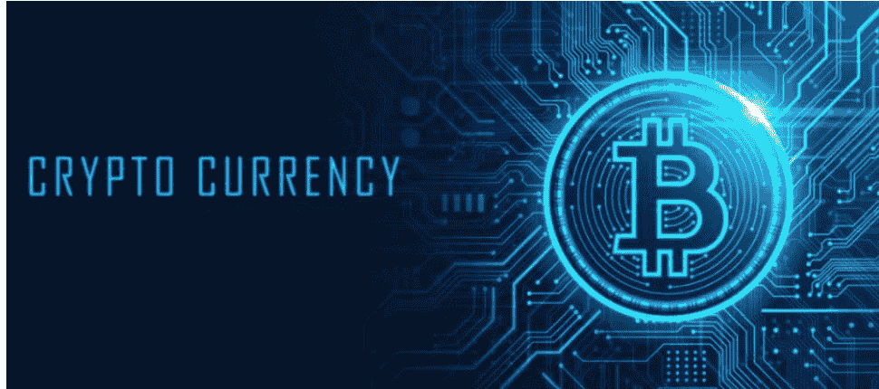

加密货币作为在线交易的支付选项越来越受欢迎。在将美元、欧元、英镑或其他传统货币转换为比特币（最流行的加密货币）之前，熟悉加密货币并了解使用它们相关的风险至关重要。说到使用加密货币，有哪些危险？尽管加密货币仍是一个相对较新的概念，但此类数字货币的市场波动性很大。因为加密货币不需要银行或其他相关方的参与来治理，它们通常没有保险，且难以转换为法定货币形式。此外，由于加密货币是无形创新资产，它们容易受到黑客攻击，就像任何其他无形技术资产一样。最后，由于您将加密货币投资存储在虚拟钱包中，如果失去对钱包的访问权限，您将失去整个加密货币投资。

尽管大多数人投资加密货币就像投资股票或贵金属等其他资产一样，但您可以使用加密货币购买传统产品和服务。虽然加密货币是一种新颖而有趣的资产类别，但投资它们可能很危险，因为您必须进行广泛的研究来了解每个系统的运作方式。中本聪最初在一篇名为 "Bitcoin: An end-to-end Electronic Cash System" 的论文中将比特币提议为点对点电子现金系统。中本聪关于该概念表示：“一种以密码学证据而非信任为关键的数字支付系统。”这种密码学证据以区块链上的经过验证和记录的交易形式出现。

说到加密货币，世界上存在分歧。一方面，支持者如 Bill Gates、Al Gore 和 Russell Brand 认为加密货币优于传统货币。另一方面，有些人反对它，例如 Warren Gates、Paul Krugman 和 Steven Shiller。Krugman 和 Shiller 都是经济学诺贝尔奖获得者，他们认为这是一种庞氏骗局和犯罪活动的载体。未来将在监管与匿名性之间发生冲突。因为几种加密货币已与恐怖活动有关联，政府可能希望控制其运作方式。另一方面，加密货币非常注重确保用户保持匿名。

区块链技术是一种以这种方式存储数据的方法，使得数据难以或无法被更改、黑客攻击或欺骗。区块链是一份数字交易日志，被复制并分布在区块链完整的计算机系统网络中。链上的每个块包含若干笔交易，每当数据库中发生新操作时，该事件的备注就会添加到每个参与者的账本中。分布式账本是由多个人管理的分散数据库。区块链是一种分布式账本技术，其中信息使用哈希（即不可更改的电子签名）进行记录。

比特币自 2008 年起步以来一直带领投资者和世界其他地区经历了一段狂野的旅程，直到 2017 年价格触顶。在短短十年多一点的时间里，它经历了上涨、下跌、反弹，然后再次上涨。比特币基于经济思想和市场效率原则。它是一种不受任何单一实体所有、安全、国际、可替代、流动性强且交易供应有限的资产。由于需求高且供应近乎恒定，价格不成比例地迅速上涨，吸引了更多投资者。有些人会认为比特币的动荡之旅为当今数百种用于金融和投资目的的其他加密货币铺平了道路，他这样认为。比特币正是如此做到的。

像 Bitfinex 和 Coinbase 这样的辅导网络和虚拟货币是您可以购买加密货币的地方。今年早些时候，名为 Robinhood 的投资应用推出了购买多种流行货币（包括比特币、狗狗币和以太币）的机会，无需支付主要交易所相关的高额费用。即使是加密货币初学者今天也会发现这非常简单。它曾经有些复杂，但现在它 quite

简单。设立银行账户并将其与信用卡关联非常简单。但是，请记住，购买个别加密货币类似于在股票市场上购买个别股票。将所有投资都集中在一种资产中，比将资金分散到数百种或数千种证券（例如单位信托或市场基金）要承担更多风险。不幸的是，目前加密货币资金稀缺。

随着越来越多的投资者将加密货币视为投资组合中理想的补充，加密货币在全球范围内的声名鹭起仍在继续。在最近几个月，在 2017 年和 2018 年首代币发行（I.C.O.）崩溃、吓退了采用者之后，势头有所回升，这一势头由两种新工具的引入所推动：NFTs 和 DeFi。有数十种不同的加密货币，从加密货币到狗狗币和泰达币，这使得进入加密世界变得困难。以下是按市值（即当前流通所有币的总价值）排名的前十名比特币，可帮助你了解情况。

实施关键的妥协政策也至关重要。制定一套规定在加密密钥及其持有者被盗时应采取什么措施的程序，有助于限制风险和损失。此外，还需要数据清理政策。因为数据在擦除后可能仍留在电子内容中，你必须确保员工意识到其中的危害。通过让合格员工访问在退役设备（如服务器、硬盘驱动器和便携式存储设备）上执行安全数据擦除的技术，可以避免信息泄露。

从事加密货币业务的组织还必须为合规问题维护频繁的准备金证明。审计追踪也是一种非常有用的工具，用于确定未预见的安全问题是如何产生的，并迅速解决异常，以恢复信息系统的一致性。不要浪费时间去追逐廉价的便士，抱着兰博基尼或私人飞机的幻想。加密世界中许多缺乏经验的企业家购买低成本的代币，希望能赚取大额利润。这是一个非常典型的陷阱。有许多因素会影响代币的价格，包括两个主要因素：流通供应量和代币的现实世界价值。

对数字货币失去信心：由于其初期性质，数字货币充满风险。希望从短期或长期持有数字货币中获利的投机者已蜂拥至在线平台。加密货币不受银行系统、国内或国际组织、资产或其他形式信用的支持，其价值完全由市场参与者通过交易所对其赋予的价值决定，这意味着信心丧失可能导致价值下跌。

根据未来学家的说法，到 2030 年，加密货币将占国家货币的 25%，这意味着全球很大一部分地区将开始将比特币视为一种交易方式。它将越来越被商家和消费者认可，并将保持其波动特性，这意味着价格预计将像过去几年一样波动。

# 第 1 章：加密货币、区块链和比特币基础

加密货币在过去几年中越来越受欢迎，截至 2018 年已有超过 1,600 种可用。而且数量还在稳步增加。因此，对区块链开发人员的需求有所增加。区块链工程师获得的薪水表明他们备受重视：Indeed，全栈开发人员的平均年薪超过 112,000 美元。甚至有专门针对比特币工作岗位的网页。加密货币是一种旨在用作交易手段的数字或虚拟货币。它的工作方式类似于现实世界中的现金，只是它没有实体形式，并依赖加密来运作。由于加密货币自由且自主地运行，无需银行或中央机构，因此只有在满足特定要求时才能引入新单位。比特币的上限为 2100 万，之后将不再生成。

加密货币越来越成为在线交易的支付选项。在将真实美元、欧元、英镑或其他常规货币转换为比特币（最流行的加密货币）的符号之前，熟悉加密货币并了解使用它们所涉及的风险至关重要。说到使用加密货币，有哪些危险？尽管加密货币仍然是一个相对较新的概念，但此类数字货币的市场非常波动。由于加密货币不需要银行或其他相关方的介入来管理，它们通常没有保险，且很难转换为法定货币形式。此外，由于加密货币是无形创新资产，它们容易受到黑客攻击，就像其他任何无形技术资产一样。最后，由于你将加密货币投资存储在虚拟钱包中，如果失去对钱包的访问权限，你将失去全部加密货币投资。

虽然大多数人投资加密货币就像投资股票或贵金属等其他资产一样，但你可以使用加密货币购买常规产品和服务。虽然加密货币是一个新颖且有趣的资产类别，但投资它们可能很危险，因为你必须进行广泛的研究以了解每个系统的运作方式。中本聪最初在一篇题为《比特币：一种点对点电子现金系统》的论文中提出将比特币作为端到端电子现金系统。中本聪关于这一概念表示：“一种基于关键密码学证据而非信任的数字支付系统。”这种密码学证据表现为区块链上经过验证和记录的交易。

## 1.1 什么是加密货币？

加密货币是一种旨在用作交易手段的数字或虚拟货币。它的工作方式类似于现实世界中的现金，只是它没有实体形式，并依赖加密来运作。由于加密货币自由且自主地运行，无需银行或中央机构，因此只有在满足特定要求时才能引入新单位。比特币的上限为 2100 万，之后将不再生成。

加密货币在过去几年中越来越受欢迎，截至 2018 年已有超过 1,600 种可用。而且数量还在稳步增加。因此，对区块链开发人员的需求有所增加。区块链工程师获得的薪水表明他们备受重视：Indeed，全栈开发人员的平均年薪超过 112,000 美元。甚至有专门针对比特币工作岗位的网页。

### 加密货币概览

穴居人时代的人们使用物物交换制度，商品和服务在两个或更多人之间转移。例如，有人可能用 7 个苹果换 7 个橙子。由于其明显的缺陷，物物交换不再受欢迎：

- 不存在公认的价值衡量标准：你必须确定愿意用多少自己的财物来交换其他财物，并且并非所有财物都可以分割。
- 每个人的需求都必须得到满足：如果你有交易对象，有人必须想要它，而你也必须想要对方提供的东西。
- 例如，活的动物无法分割成更小的组成部分。与我们现在的现金不同，现金可以放在钱包里或保存在手机上，物品很难转移。
- 一旦人们认识到物物交换制度运作不佳，货币经历了几次修订：第一批正式货币铸造于公元前 110 年，金币弗罗林于公元 1250 年引入并用于整个欧洲，但从 1600 年到 1900 年，纸币变得非常受欢迎并在全世界使用。这就是我们所知道的现代现金的诞生方式。

纸币、硬币、信贷额度和数字钱包，如移动支付、Amazon Pay、Paytm 和 PayPal，都是现代现金的示例。所有这些都在银行和政府的监管下，这意味着那里

是一个集中式监管机构，用于监管纸币和信用卡的使用。

### 加密货币与传统货币

请考虑以下场景：你想通过互联网使用对方的账户转账来感谢请你吃午饭的朋友。事情可能出错的方式有几种，包括：

- 金融机构可能会出现技术问题，例如其系统宕机或设备无法正常运行。
- 你或你朋友的账户转账限额可能已被超出。
- 你或朋友的账户可能已被黑客攻击；例如，可能发生了拒绝攻击或信息被盗。
- 银行是主要的崩溃点。

这就是为什么比特币是未来的货币。请考虑两个使用比特币应用程序的人之间的类似交易。会显示一条消息，询问用户是否确定已准备好发送比特币。如果是，处理开始：系统验证用户身份，确定客户是否有足够的资金完成付款，等等。然后传输付款，资金存入收件人的账户。这一切只需几分钟即可完成。

因此，加密货币解决了当代银行的所有问题：你发送的金额没有限制，你的账户也不会被黑客攻击。也没有故障点。如前所述，截至2018年，可用的加密货币超过1600种，其中比特币、以太坊和Zcash是最突出的。而且每天都有新的虚拟货币出现。鉴于它们目前的增长势头，未来很可能会有更多加密货币出现。

## 1.2 加密货币的优势

- 与将资金从钱包应用转账到银行账户的费用相比，加密货币的交易成本微乎其微，甚至没有。
- 你可以随时进行购买和取款，对花费金额没有限制。
- 而且，与需要文件和其他程序的开设银行账户不同，任何人都可以使用加密货币。
- 加密货币交易在全球范围内也比电汇更快。通过电汇，资金从一个地点转移到另一个地点大约需要半天。使用加密货币的交易在几秒钟或几分钟内完成。

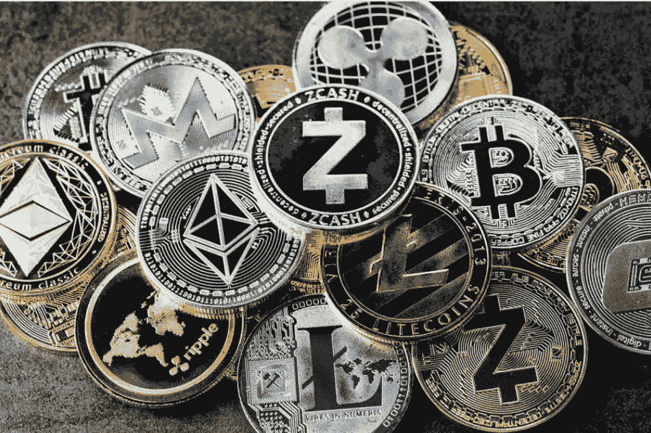

## 1.3 理解加密货币

比特币和以太坊是最著名的加密货币之一，你无疑听说过它们，或有人向你提起过。加密货币正越来越受欢迎，成为在线交易的支付选项。在将真实的美元、欧元、英镑或其他传统货币转换为比特币（最流行的加密货币）的符号之前，熟悉加密货币并了解使用它们所涉及的风险至关重要。

在使用加密货币时，有哪些风险？尽管加密货币仍然是一个相对较新的概念，但此类数字货币的市场波动性很大。因为加密货币不需要银行或其他相关方参与来进行管理，它们通常未投保，并且难以转换为法定货币形式。

此外，由于加密货币是无形的创新资产，它们就像其他任何无形技术资产一样容易受到黑客攻击。最后，由于你将加密货币投资存储在虚拟钱包中，如果失去对钱包的访问权限，你将损失全部加密货币投资。

请遵循以下建议，确保你的加密货币安全：

- 将你的资金存放在安全的钱包中。为你的需求选择合适的钱包需要你进行一些研究。假设你选择使用计算机或设备的本地和全局环境来处理比特币钱包，那么你必须以与投资价值相称的级别来保护它。就像你不会把大量现金装在杂货袋里一样，不要将你的加密货币放在不知名或不太知名的钱包中。你会想要确保自己使用的是信誉良好的钱包。
- 三思而后行。第一步是了解加密货币如何运作以及如何使用，同时还要了解在投资之前如何交换它。阅读该货币的网站，以深入了解其运作方式，以及关于你正在考虑的加密货币的独立出版物。
- 制定备份计划。考虑如果你的台式机或智能手机设备丢失或被盗，或者你无法以其他方式访问它，会发生什么。如果没有备份解决方案，你将无法恢复加密货币，并且有损失投资的风险。

加密货币是一种去中心化、依赖区块链的电子货币。虽然你可能知道最常见的形式，例如比特币或以太坊，但目前有超过5000种不同的加密货币在使用。

### 加密货币如何运作？

加密货币是一种数字、加密且去中心化的交易手段。不像美元或欧元，没有中央机构来管理和调控加密货币的价值。相反，这些责任在互联网上的加密货币用户之间分担。

虽然大多数人像投资股票或贵金属等其他资产一样投资加密货币，但你可以使用加密货币购买传统产品和服务。虽然加密货币是一个新颖且有趣的资产类别，但投资它们可能很危险，因为你必须进行广泛的研究以了解每个系统的运作方式。

中本聪在一篇题为《比特币：一种点对点电子现金系统》的论文中最初提出了比特币，作为一种点对点电子现金系统。中本聪关于这一概念表示：“一种关键的密码学证据而非信任的数字支付系统”。这种密码学证据体现在区块链上经过验证并记录的交易形式中。

## 加密货币中共识的作用

在权益证明和工作量证明中，共识技术都用于验证交易。虽然个别用户用于确认交易，但每笔已确认的交易都必须经过大多数账本所有者的审查和授权。

例如，黑客无法更改区块链记录，除非他们能够让至少51%的账本反映他们虚构的版本。由于需要大量资源，欺诈不太可能发生。

## 什么是区块链？

区块链是一种数字化、开放的账本，用代码形式存储交易。在实际应用中，它类似于分布在全球成千上万台计算机上的支票簿。交易存储在“区块”中，然后以“链”形式连接到之前的比特币交易。想象一下一本日记，你把花钱的事情记在上面，等等。每一页是一个区块，整本书或网页集合就是区块链。

每个使用加密货币的人都会复制一本区块链上的账本，从而创建统一的交易历史记录。每笔付款更新都会在发生时由软件记录，每个区块链版本都会用新数据和信息进行修改，确保所有记录都相同且正确。每笔交易都使用两种基本验证机制进行验证以避免欺诈：工作量证明或权益证明。

## 工作量证明与权益证明

工作量证明和权益证明是替代验证方法，在交易被包含到区块链之前向验证者奖励额外比特币。大多数加密货币使用工作量证明或权益证明来验证交易。

### 权益证明

一些加密货币使用权益证明验证方法来减少审查交易所需的电量。The

每个个人准备“质押”或暂时锁定在公共保险箱中的比特币数量，以获得参与系统的机会，这限制了每个人可以验证的操作数量。这几乎就像抵押品。每个投资加密货币的个人都可以验证付款，但被选中的可能性会随投资金额的增加而增大。

权益证明比工作量证明更高效，因为它消除了耗能的方程求解，从而缩短了操作的确认时间。当质押所有者（也称为验证者）被选中验证新一批交易时，他们将以比特币获得报酬，可能是区块总交易费用的数量。如果被选中并验证了错误的交易，您将损失部分投资以防止欺诈。

## Proof of Work

“共识协议”是在区块链上确认活动的一种方式，算法会为计算机生成一个数学谜题来求解。每台参与的机器（称为“矿工”）都会解决一个数学难题，以验证一组称为区块的交易，随后该区块会被添加到区块链中。第一个成功完成此操作的系统会因其努力而获得少量比特币作为奖励。

解决区块链问题的竞争可能需要大量的计算机处理能力和能源。实际上，这意味着在考虑电费和计算机资源成本后，矿工们可能难以仅靠确认交易获得的加密货币来保本。

## How Can You Mine Cryptocurrency?

挖矿是指通过确认交易来向世界释放新的比特币单位的过程。虽然理论上普通个人可以挖掘加密货币，但在比特币等工作量证明平台上，这变得越来越困难。即使比特币社区在扩大，过程也变得更加复杂，需要更多的处理能力。过去，典型用户可以做到这一点，但现在已变得高昂得不可承受。还有太多个人已经优化了他们的设备和技术以超越竞争对手。

请理解，挖掘工作量证明加密货币需要消耗大量能源。据估计，比特币矿场使用了全球0.21%的能源。这几乎相当于瑞士一年的能源消耗量。据估计，大多数比特币矿工将60%到80%的收入用于支付电费。

虽然在工作量证明系统中挖掘加密货币对普通个人来说不切实际，但权益证明模型需要的高性能计算较少，因为验证者是根据人们质押的数量随机选取的。但是，参与需要持有加密货币。如果您没有任何加密货币，就无法进行质押。

## How to Use Cryptocurrency for Secure Purchases

您能否使用加密货币进行安全交易，取决于您试图购买什么。在美国，您可以使用像BitPay这样的比特币借记卡，在不直接接受加密货币的商店支付加密货币。

您需要拥有加密货币才能支付给个人或接受加密货币的商店。加密货币钱包是与区块链通信并使用户能够转账和收款的软件。

您可以扫描收款人的二维码或手动输入其钱包地址，从钱包中发送资金。某些服务可以让您输入手机号码或从电话中选择联系人，使此过程更加便捷。请记住，交易不是即时的，因为它们必须使用工作量证明或权益证明进行验证。根据币种，这可能需要10分钟到几个小时不等。

然而，正是这种时间延迟使得加密货币交易变得安全。“试图更改交易的恶意行为者将缺乏必要的软件‘密钥’，导致该操作被网络拒绝。”网络还会监控并防止重复支出。

## How Can You Use Cryptocurrency?

加密货币可以用来购买物品，但尚未被广泛接受为一种支付方式。比特币被少数网上商店（如Overstock.com）接受，但远未成为标准。

在加密货币获得更广泛认可之前，您可以通过将比特币交换为礼品卡来绕过现有限制。例如，您可以在eGifter上使用比特币购买Dunkin、Target、iTunes以及其他企业和餐厅的礼品券。要进行购买，您可能可以将比特币加载到借记卡上。该支付卡（一种将数字货币转换为现金以供购买的借记卡）在美国可用。但是，订购卡片并使用它进行现金提取会产生费用。

加密货币可能有望取代股票和债券，成为一种投资工具。最著名的加密货币比特币是一种安全、去中心化的货币，已发展成为一种类似于黄金的价值存储。它甚至被称为“数字黄金”。

## 1.4 What is Cryptography?

密码学是一种保护通信的方式，以防止怀有恶意意图的第三方（即意图窃取您的信息或窃听您对话的第三方）通过使用加密和解密技术来实现保护。密码学使用的计算算法包括SHA-256（比特币使用的哈希方法）、公钥（类似于旨在与所有人共享的用户数字信息）和私钥（类似于用户的电子签名，被保密保存）。

## Bitcoin Transactions and Cryptography

典型的比特币交易详细信息包括您想要将比特币转账给谁以及想要发送多少比特币。随后，数据将通过哈希方法进行处理。如前所述，比特币使用SHA-256算法。输出随后使用用户的私钥进行签名，从而唯一标识用户。经过加密签名的输出随后在网络中广播，由其他用户进行验证。发送者的公钥用于此过程。

矿工是检查交易是否真实的用户。随后，该连同众多其他交易一起被上传到网络，数据将无法再被修改。

## 1.5 Ethereum vs. Bitcoin

您现在明白，比特币是一种运行在区块链技术上的去中心化数字货币，并使用端到端网络进行交易。以太坊网络接受以太币（Ether），这是另一种著名的数字货币。以太坊网络是一个可用于开发和部署基于区块链技术的去中心化应用程序的开放平台。

## Differences

比特币是一种可以向其他人转账的数字货币。其运作方式与现实世界中的现金非常相似。在以太坊平台中，以太币用作货币，但也可用于现实世界交易。比特币交易是机械完成的，这意味着如果您希望交易完成，必须亲自完成。使用以太币时，您可以手动或自动执行交易——它们是编程好的，这意味着只有在满足特定条件时才会发生。比特币交易大约需要10分钟才能完成，这也是区块被数字签名所需的时间。使用以太币完成交易大约需要20秒。

可能存在的比特币数量限制为2100万。预计到2140年将达到这一数字。以太币预计将长期存在，并限制为1亿个单位。比特币用于商品或服务交换，而以太币使用区块链技术构建记录，当满足特定条件时触发交易。最后，比特币使用SHA-256算法，而以太坊使用ethash方法。自2020年5月以来，1个比特币价值8741.81美元，而1个以太币价值190.00美元。

## Similarities

目前，比特币和以太坊是最受欢迎和最有价值的加密货币。两者都使用区块链，其中事件被放入一个称为区块的容器中，并形成一系列区块，其中的信息无法被更改。资金通过一种称为工作量证明的机制进行挖掘，这涉及在区块添加到网络之前解决数学难题。最后，比特币和以太币在全球都被广泛使用。

## 1.6 未来的加密货币

谈到加密货币，全球显然存在分歧。一方面，比尔·盖茨、阿尔·戈尔和罗素·布兰德等支持者认为加密货币优于传统货币。另一方面，也有人反对它，例如沃伦·巴菲特、保罗·克鲁格曼和罗伯特·席勒。克鲁格曼和席勒都是经济学诺贝尔奖获得者，他们认为加密货币是一种庞氏骗局，也是犯罪活动的工具。

未来，监管与匿名性之间将发生冲突。由于许多加密货币与恐怖活动有关联，政府可能希望控制其运作方式。但另一方面，加密货币非常注重确保用户保持匿名。

据未来学家预测，到2030年，加密货币将占国家货币的25%，这意味着全球很大一部分地区将开始将比特币视为一种交易方式。它将得到商家和消费者的更广泛认可，并将保持其波动特性，这意味着价格预计将像过去几年那样波动。

## 1.7 区块链

区块链技术是一种以难以或不可能被篡改、黑客攻击或欺诈的方式存储数据的方法。区块链是一份数字交易日志，会被复制并分布到区块链完整计算机系统网络中。链上的每个块包含若干笔交易，每当数据库发生新操作时，该事件的记录就会被添加到每个参与者的账本中。

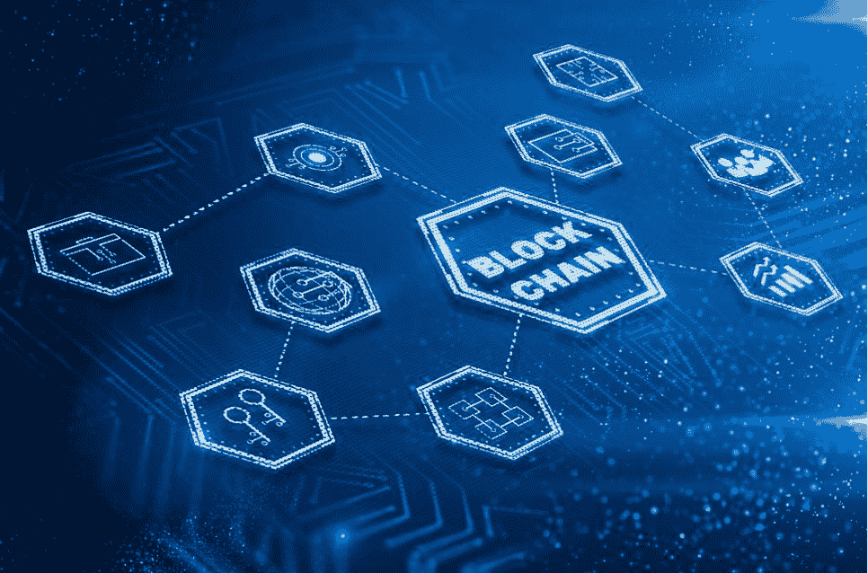

分布式账本是由多个人管理的去中心化数据库。区块链是一种分布式账本技术，其中信息使用哈希（不可更改的电子签名）进行记录。

### 分布式账本技术的特性

### 安全性

每条记录都单独加密。

### 不可篡改性

任何经过验证的记录都是不可撤销的，且无法修改。

### 可编程性

区块链可以被编程（智能合约等）。

### 一致性

每条记录的合法性都经所有网络参与者共同认可。

### 匿名性

参与者的身份要么是匿名的，要么是假名的。

### 时间戳

一个块包含交易时间戳。

### 分布式

为了实现完全透明，所有网络成员都获得共享账本。

这意味着，如果链中的某个块被修改，将立刻明显链已被篡改。如果黑客意图破坏区块链系统，则必须修改链的所有分布式副本中区块链上的每个块。

像加密货币这样的区块链在不断扩展，随着新块被添加到区块链中，账本的完整性大大提高。

### 区块链技术周围的炒作

此前已做出许多创造数字货币的努力，但全都失败了。

最紧迫的问题是信任问题。我们如何相信，如果有人发明了一种被称为 X 美元的新货币，他们不会给自己发一百万美元，或者拿走你的 X 美元？

比特币的创建旨在通过使用区块链（一种数据库形式）来解决这一问题。掌控大多数常规数据库（例如 SQL 数据库）的人可以更改数据。区块链的独特之处在于，没有人掌控；相反，使用它的人来运行它。比特币不能被伪造、黑客攻击或重复花费，因此持有比特币的人可以确信它们是有价值的。

## 1.8 去中心化

在区块链中，将权力和选择从中心化实体转移到分散网络的过程被称为去中心化。去中心化网络旨在限制成员之间必须建立的信任程度，并防止他们以损害网络性能的方式对他人施加控制或权力。

### 为什么去中心化很重要

去中心化的概念并非新鲜事。在开发技术方案时，通常会审查三种基本网络设计：中心化、分布式和去中心化。虽然去中心化网络常用于区块链技术，但区块链应用程序不能简单地被归类为去中心化或非去中心化。相反，去中心化应以滑动尺度的方式扩展到区块链程序的所有组件中。通过去中心化应用程序中的资源利用和访问，可以实现更优质或更公平的服务。去中心化有一些缺点，例如交易吞吐量降低，但增加的稳定性和服务水平的好处超过了缺点。

### 去中心化的优势

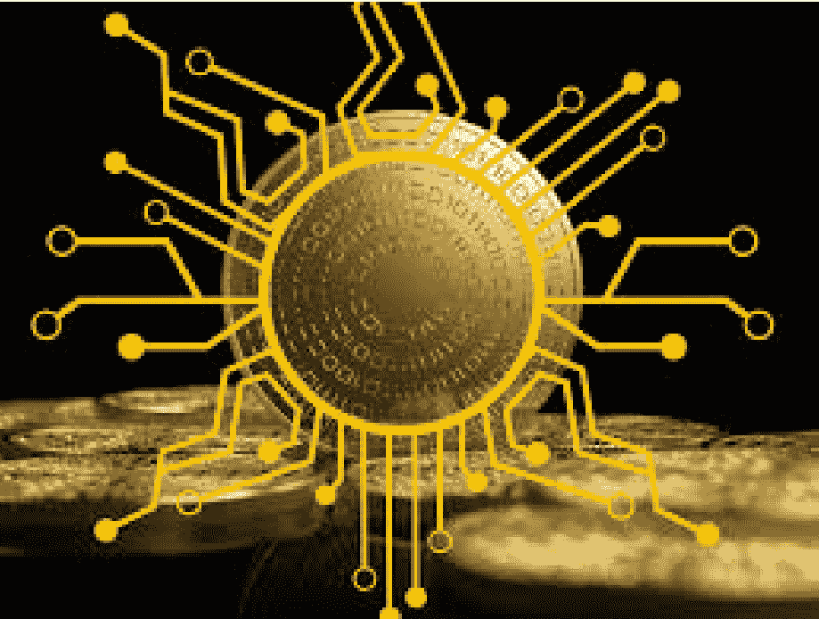

- 优化资源分布

去中心化还可能有助于优化资源分布，确保所声明的服务以改进的性能和可靠性交付，并降低灾难性故障的风险。

- 改进数据对账

公司经常与合作伙伴共享信息。这些数据随后被修改并保存在各方的孤岛中，直到需要将其传输到下游时才重新浮现。每次数据转换时，数据丢失或不准确数据进入工作流的可能性就会增加。由于去中心化数据存储，每个实体都能获得对信息的真实共享视图。

- 提供无信任环境

在去中心化的公共区块链中，没有人需要认识或信任任何其他人。以公共账本的形式，网络的每个成员都拥有相同数据的副本。如果某个成员的账本被以任何方式篡改或损坏，网络的其余成员将拒绝它。

- 减少薄弱点

当单个行为体过于依赖时，去中心化可能有助于缓解系统中的漏洞来源。这些缺陷可能导致系统性故障，例如无法提供预期服务，或因资源耗尽、频繁停机、瓶颈、缺乏有效服务的适当激励或腐败等原因导致服务无效。

### 去中心化的比较

在可能的地方，都应使用去中心化。由于它是区块链应用程序，不必完全去中心化。任何区块链解决方案的目的是提供客户所需的内容，这可能包含也可能不包含特定程度的去中心化。

### 利用去中心化构建区块链应用程序

去中心化程度因区块链协议、分布式应用程序、非政府组织或任何区块链技术解决方案而异。解决方案的成熟度、其激励系统和共识程序经过时间验证的可靠性，以及创始人取得适当平衡的能力，决定了采用水平。例如，许多 DAO 都有处于不同去中心化阶段的组件：预言机可能是部分去中心化的，智能合约可能是完全中心化的，而用于调整参数的治理框架可能是社区驱动且去中心化的。

各种类型、规模和行业的组织正在更大规模地研究和使用去中心化的加密货币解决方案。无需银行、政府或第三方机构介入即可为有需要的人提供快速国际或紧急救济的应用程序是重要示例。或者，允许用户控制其自身用户身份和数据的程序。当今，社交媒体网络、企业和其他团体为了牟利出售这些信息，而用户没有任何价值。如果它是去中心化的，那么让每个人都更平等地获得它将更容易。

换句话说，区块链去中心化是一种通过点对点网络维护一系列材料和交易的信息基础。“资源”可能不仅仅是现金或交易记录，还可能包括所有权、协议、商品和其他信息。与以前的点对点网络不同，区块链不会复制发送的价值。然而，考虑到一切，似乎分数已从一个参与者转移到下一个参与者。

## 1.9 关于比特币的一切

比特币引领投资者和全球其他地区从2008年的小起步到2017年的价格高点，经历了一段疯狂的旅程。在短短十多年时间里，它经历了上涨、下跌、反弹，然后再次上涨。比特币基于经济思想和市场效率原则。它是一种不受单一机构所有、安全、国际、可替换、流通性好且供应量有限的交易资产。由于需求量大且供应量几乎恒定，价格上涨速度远超比例，吸引了更多投资者。有人认为，比特币动荡的历程为如今数百种用于金融和投资目的的其他加密货币铺平了道路，他主张道。比特币正是如此实现的。

### 比特币价格历史

Earle声称：“比特币的历史本质上是一段爆炸式扩张的历程，中间被几次戏剧性的价格回调所中断。比特币价格于2011年2月突破1美元。在其蓬勃发展的最初几年里，价格大约在2美元左右。2011年6月，它出现了第一个泡沫，一度飙升至约31美元，随后暴跌至个位数。几乎紧接着，在2013年4月，比特币突破了200美元。同年12月底，其价值超过1000美元。2017年11月，它翻了十倍，达到10000美元。

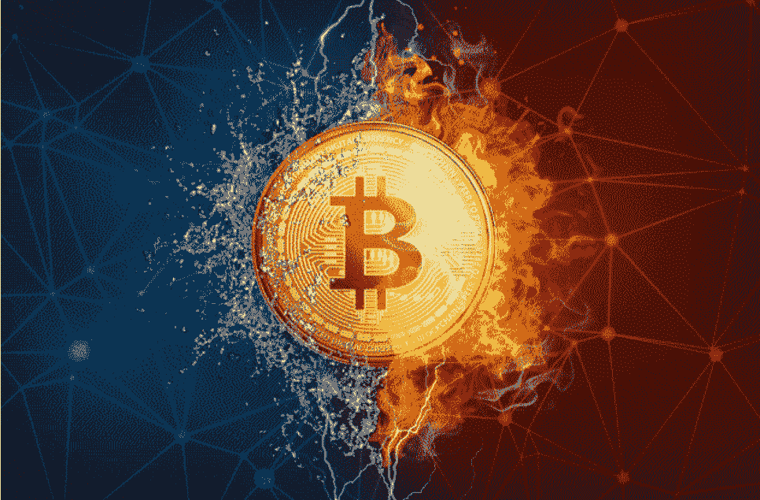

2017年末，比特币的最高价格大约在19650美元，不同交易所的峰值有所不同。“在随后的五年里，它大幅暴跌。2017-2018年的繁荣主要由数字货币或ICO的激增推动。一些市场专家将比特币的通胀与20世纪末的互联网繁荣联系起来。

从你隔壁的邻居到世界上最富有的资金管理人，每个人都在谈论比特币或其他某种加密货币、新网络或协议。ICO热潮向加密货币市场涌入了数十亿资金。投资者目睹了2018年头几个月硬币价值大幅下跌，因为由于不确定性、欺诈和失去信心等心理和技术因素的综合作用，价格暴跌。

在比特币价值贬值后，围绕加密货币出现了一个“成熟市场”。当富达加入托管领域时，国家银行获得了持有数字资产的授权。如今，通过Square，比特币交易在美国50个州均可进行。由于这些事件，比特币市场已经相当成熟。存在智能且高效的交易所，主要的机构级参与者正在采取必要措施，为加密货币交易和投资建立一个可持续、可行的市场。2020年的全球大流行病也使数字货币受益，正如其当前远超10000美元的价格所示。

### 比特币现状

在撰写本文时，一个比特币目前价值略低于12000美元。这与其峰值后仅略高于3000美元的低点（此前的记录）相差甚远。

即使在今天，也没有人理解中本聪是谁或曾是谁。除了围绕这一问题的讨论、猜测和——或许不可避免地——阴谋论之外。阴谋论众多，从比特币是一个秘密项目或Alphabet或安全机构等情报组织的高级且经常隐秘的项目，到比特币确实是一个秘密项目。还有人说它是一个“陷门项目”，当它足够大时，将被一个潜伏在幕后超过十年的恶意团体接管。

比特币的价值比其价格历史更重要。“证据支持两个长期存在争议的观点：第一，货币像任何其他产品一样是一种商品；第二，货币可能是市场进程的结果。作者埃尔表达道，加密货币，特别是比特币，在很大程度上扑灭了‘钱只有在被认可为纳税手段时才真正是钱’的概念，即使它继续发展成为价值储存和记账单位的地位。”

### 比特币明天

那么，比特币的未来会是什么样子呢？没有人可以肯定，但福罗认为它将是一个光明而充满活力的地方。他主张：“创新、高效且透明的投资工具即将到来，将有助于使比特币投资变得更加容易获得。”这种获取程度将与传统市场相比拟。只要记住，没有哪项投资，尤其是处于前沿的投资，是没有风险的。如果我们能从比特币的过去学到什么，那就是一旦开始上涨，也可能下跌，而且下跌可能非常快。

### 比特币的优缺点

在这个时代，无论你在经济光谱上的哪个位置——无论你是偏爱现金的传统主义者，还是投资爱好者——你几乎肯定听说过加密货币，也许还听说过它们的一些好处和弊端。近年来，加密货币越来越流行，截至2021年3月，美国超过14%的人口持有某种比特币。此外，美国约有4600万人拥有比特币。

比特币是最著名、使用最广泛的加密货币之一。这也是比特币新手可以考虑尝试加密货币投资的地方。所以，如果你在想“比特币值得投资吗？”或“比特币是个好的投资吗？”，了解比特币的优缺点会有所帮助。

### 比特币的优势

尽管比特币于2009年推出，但它仍被视为一种新型货币，存在大量误解。了解比特币的优势将帮助你判断它是否适合作为你的投资。

### 用户匿名性和透明性

比特币用户通过数字标识符来识别，可能拥有多个公钥，尽管它们并非完全匿名。这消除了公共监控，并防止交易被追溯回个人。尽管交易始终可见，提供了透明性，但区块链技术确保它们免受欺诈。此外，作为账户持有者，只有你自己知道你有多少比特币。

即使私人钱包的地址变成公开的，你也可以创建一个新钱包以获得更好的保护和匿名性。与典型的货币系统不同，私人细节可能会从银行泄露，比特币交易不需要任何额外的个人信息，这增强了用户隐私。

### 可访问性和流动性

加密货币最吸引人的特点之一，比特币也不例外，是它经常不受国界限制。比特币具有高度可访问和适应性的货币优势。因为将比特币发送给其他用户只需几分钟，它可以用于购买越来越多接受它的企业的商品或服务。这使得在另一个国家花钱和轻松转换货币成为可能，额外好处是低费用或无费用。比特币也可以随时轻松出售。

### 独立于中央权威

比特币是一种去中心化的货币，这意味着它不受单一国家中央银行的控制。这意味着你的硬币不太可能被当局冻结或要求。也没有实际的方法来对比特币征税。由于价格与政府政策无关，这在理论上为人们提供了对其资金的独立性和自由。总体而言，加密货币用户将其视为比特币最重要的优势之一。

### 比特币的劣势

尽管比特币发展迅速，客户数量不断增加，但你应该了解比特币的一些缺点，特别是如果你在考虑投资加密货币是否值得。与许多财务选择一样，你拥有的信息越多，就能对是否值得投资比特币做出更明智的结论。

### 没有政府监管

当然，去中心化的货币是加密货币的优势之一，但也可能被视为比特币的缺点，因为它意味着比特币投资不受监管。与受中央银行控制的货币不同，比特币不受法律保护，且通常不可逆转，这使其容易受到欺诈。

比特币去中心化性质的另一个缺点是，没有最低价值的保证。因此，如果大量投资者决定停止使用比特币并出售它们，加密货币的价值可能会暴跌，影响持有大量加密货币的用户。

### 波动性

## 不可逆

中本聪在开发比特币时设定了 2100 万枚的上限，这也是为什么有些人认为比特币非常稀缺。中本聪是比特币的创造者。这正是使比特币如此珍贵的原因，但这也是导致其价值波动的原因，因为价格是唯一可以调整以确保需求保持不变的参数。

此外，还有其他变量会影响比特币的波动性，例如投资者持负面看法的头条新闻、对加密货币未来价值和应用的不确定性，以及数据安全漏洞。

另一个缺点是缺乏安全性，因为比特币交易是匿名且不受监管的。由于比特币交易是不可撤销且最终的，如果发送了错误的金额或接收者，就无法更改任何内容。

还存在亏钱的可能性。许多比特币用户选择将资金存储在加密货币中，如果你失去对私钥的访问权限，资产就会面临危险。如果硬盘故障、恶意软件损坏数据，甚至钱包出问题，你的资金可能在几分钟内变得不可用或完全消失。

# 第 2 章：如何投资加密货币和替代币

除比特币以外的每种加密货币都被称为替代币（altcoin）。替代币是指不是比特币的加密货币代币或代币，例如 Solana、Cardano、Polkadot 和 Uniswap。由于比特币是地球上最知名、最成熟的加密货币，有些人将其称为“主要”加密货币。比特币拥有最大的市值，即与其他加密货币相比发行的加密货币实际数量。然而，存在成千上万种不同的加密货币，每种都具有货币价值和应用。继续阅读，了解有关加密货币的更多信息，包括如何购买它们，以及它们是否适合你的虚拟货币投资组合。

以以太坊为例的区块链技术，是一个前沿的开源平台，可以促进金融交易、智能合约、去中心化应用（dApps）、代币化资产和分布式金融服务。以太坊（ETH）是运行在以太坊平台上的加密货币，撰写本文时按市值排名第二，并且多年保持该地位。如果你是区块链技术的新手，可能会好奇什么是开源区块链。而且，说句公道话，这可能是一个被过度使用的术语，被插入文档中却没有提供任何清晰度或上下文。

Bitfinex 和 Coinbase 等平台是你可以购买加密货币的地方。今年早些时候，名为 Robinhood 的投资应用推出了购买多种流行货币（包括比特币、狗狗币和以太币）的机会，无需支付主要交易所相关的高额费用。即使是加密货币初学者，今天也会发现这非常简单。过去这有些复杂，但现在非常简单。建立银行账户并将其与信用卡关联是很直接的。

但是，请记住，购买个别加密货币类似于在股市购买个别股票。将所有投资都放在一种资产中，比将资金分散到数百或数千种证券（例如通过单位信托或市场基金）要承担更多风险。不幸的是，目前加密货币资金稀缺。

你可能会想要选择一个加密货币交易所，因为这是最常见的方法。这些交易所允许你使用法定货币购买加密货币，并在各种加密货币之间进行交换。数字货币有多种形式和规模，因此决定使用哪一种并不总是容易。请确保你选择的交易所允许你购买感兴趣的加密货币代币，并进行法定货币之间的转换。你还应考虑交易所收取的交易费用（如果有），并确保你可以接受支付这些费用。

## 2.1 替代币

除比特币以外的每种加密货币都被称为替代币（altcoin）。替代币是指不是比特币的加密货币代币或代币，例如 Solana、Cardano、Polkadot 和 Uniswap。由于比特币是地球上最知名、最成熟的加密货币，有些人将其称为“主要”加密货币。比特币拥有最大的市值，即与其他加密货币相比发行的加密货币实际数量。然而，存在成千上万种不同的加密货币，每种都具有货币价值和应用。继续阅读，了解有关加密货币的更多信息，包括如何购买它们，以及它们是否适合你的虚拟货币投资组合。

根据最严格的定义，altcoin 是“替代币”的缩写，指除市场领导者比特币以外的任何加密货币。然而，以太坊、莱特币、狗狗币和比特币等加密货币正逐渐被移出 altcoin 定义。加密货币监测服务 CoinMarketCap 包含数百种加密货币，绝大多数都是 altcoin。每种加密货币都有其历史和社区。有些可能既有用又有价值，其价格可能会随着时间的推移而大幅上涨。其他一些可能会被证明是无效的，甚至是欺诈性的。

### 替代币的工作原理

与比特币一样，altcoin 基于区块链技术。区块链是一个分布式系统，由全球数十甚至数百台计算机同时维护。新交易被确认并存储为区块链网络中的区块。一旦交易被广播到区块链，就无法撤销。几个 altcoin 开发者提供独特功能，以使其代币与比特币等加密货币区分开来。例如，Stellar 区块链希望比其更大的竞争对手更快、更轻便、更强大。狗狗币（Dogecoin）于 2013 年作为一个玩笑被创建，并在获得埃隆·马斯克支持后声名鹊起。其他一些可能会被证明是无效的，甚至是欺诈性的。

## 2.2 以太坊

以以太坊为例的区块链技术，是一个前沿的开源平台，可以促进金融交易、智能合约、去中心化应用（dApps）、代币化资产和分布式金融服务。以太坊（ETH）是运行在以太坊平台上的加密货币，撰写本文时按市值排名第二，并且多年保持该地位。如果你是区块链技术的新手，可能会好奇什么是开源区块链。而且，说句公道话，这可能是一个被过度使用的术语，被插入文档中却没有提供任何清晰度或上下文。

### 优点：

- 尽管波动性曾被视为负面因素，但经验丰富的投资者已识别出市场周期趋势，并可能从市场泡沫的抛物线式回报中获益。

- 通货膨胀风险降低：以太坊有一个定义明确的通胀机制，较少受到操纵。因此，由于区块链系统是无限的，无需担心你的比特币贬值。

- 以太坊无疑是最容易获得的金融资产之一，这要归功于交易平台、交换所和在线经纪商的国际化出现。你可以以极低的费率迅速将以太坊转换为现金或黄金等贵重物品。

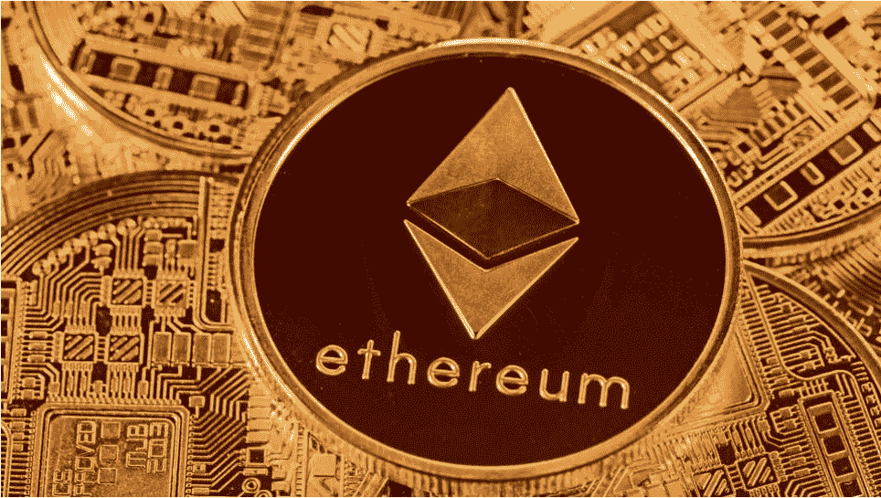

### 缺点：

- 可扩展性问题：与比特币一样，比特币具有单一功能，而以太币（Ether）充当数据库、合约框架等，导致错误、故障和黑客攻击。此外，以太坊并不去中心化。

- 投资以太坊可能很危险：像每种加密货币一样，投资以太币（Eth）有时可能会证明是有风险的。代币和其他加密货币波动性很大，会导致可观的收益和

显著下降。以太坊的价格在过去发生了显著变化，这对于一些投资者，特别是初学者来说，从长远来看可能是一个显著的劣势。此外，与以太坊相关的成本各不相同，这是一个令人担忧的问题。

- 学习 Solidity（以太坊的主要编程语言）可能很困难，尽管以太坊是图灵完备的，并使用与 C++、Python 和 Java 类似的编程语言。最重大的问题之一是，初学者友好的课程难以找到。

## 以太坊的未来

许多加密货币在过去一年中实现了显著增长。市值约为 9000 亿美元的比特币仍然是最受欢迎的。

另一方面，以太坊正在迅速获得人气，并与其更大的竞争对手缩小差距。以太坊的市值略超过 4500 亿美元，使其成为第二大流行的加密货币。其价格今年上涨了大约 466%，而比特币为大约 70%。虽然以太币（Ether）今年表现不错，但 2022 年可能会更好。

## 2.3 狗狗币

狗狗币是一种与比特币和以太坊类似的加密货币，但它与这两种主流货币并不相同。狗狗币以一个曾经流行的表情包命名，并在一定程度上被设计为加密货币爱好者之间的玩笑评论。尽管其起源故事很奇特，但狗狗币在 2021 年人气急剧上升，截至撰写本文时，已成为按市值计算的第六大加密货币。

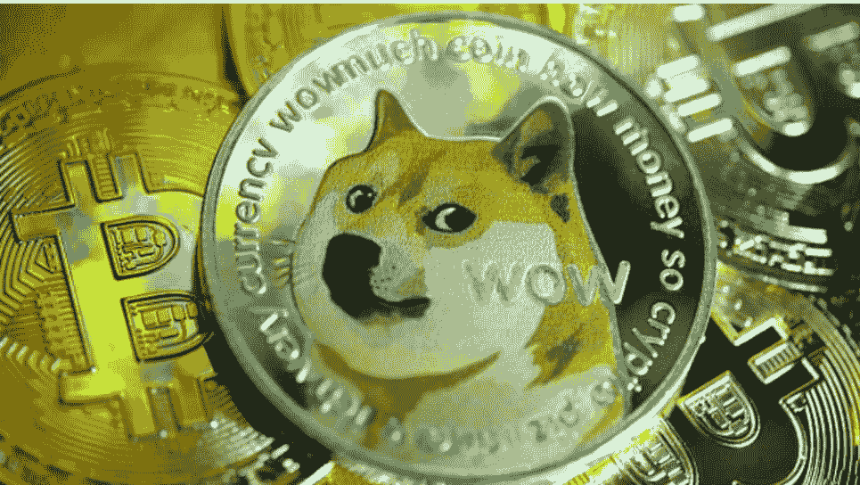

狗狗币已不再是一个玩笑，其价值在 2021 年飙升了超过 5000%。特斯拉 CEO 埃隆·马斯克是其支持者，称狗狗币是他最喜欢的加密货币。马斯克还将狗狗币称为“人民的加密货币”，并表示一个实际的狗狗币代币将被种植在月球上。

### 狗狗币如何运作？

狗狗币是一种虚拟货币，像比特币和以太坊一样，基于区块链技术。区块链是一种去中心化的数字账本，以分布式、安全的方式记录所有使用去中心化数字货币进行的交易。狗狗币区块链记录会定期更新该加密货币的所有交易，并由所有持有者以完全相同的副本持有。狗狗币的区块链网络，像其他加密货币的网络一样，采用加密技术来确保所有交易安全。

矿工使用计算机求解困难的数学公式以处理付款，并将其存储在狗狗币区块链上，这种机制称为“工作量证明”。矿工通过处理交易和维护区块链账本获得更多狗狗币作为回报，他们可以将其保留或在市场上出售。

可以使用狗狗币进行付款和购买；然而，它不是一种高效的货币储存手段。这主要是因为开采狗狗币的数量在终身内没有上限，导致该加密货币被故意设计为极度通货膨胀。狗狗币矿工因其努力而获得区块链奖励，该区块链每天创造数百万个新狗狗币，使得狗狗币的投机性价格上涨很难长期持续。

### 未来

不可能预测狗狗币未来会带来什么，更不用说其他加密货币了。加密货币领域思想两极分化是一个主要问题，比如评论员、博主和 YouTuber 要么是加密货币反对者，要么是“月球男孩”。确实，CoinMarketCap 目前列出了超过 50 种表情包加密货币，证明了它们的人气上升。

像其他加密货币一样，无法将其用于交易是其发展的最大障碍。然而，与其他加密货币不同，表情包币有一个独特的缺点，即其使用取决于人们是否被表情包所吸引。如果投资者对表情包失去所有兴趣，价格将暴跌，使狗狗币变得毫无用处。可以肯定的是：狗狗币目前是市场上最具风险和波动性的加密货币之一。

## 狗狗币的优点

### 去中心化交易所兼容性

在去中心化交易所，这种加密货币可以进行交易和交易。Ren Project 使其能够访问去中心化金融网络并在以太坊区块链平台上运行。这意味着它与比特币市场日益增长的去中心化金融趋势兼容。

此外，它可以被“包装”，这会将其锁定在与协议兼容的状态，直到随后被释放，尽管它在自己的区块链上运行并具有内置的智能合约功能。

### 用户社区不断壮大

狗狗币的好处之一是，它拥有一个已建立且不断扩大的用户和支持者基础。就市值而言，它是全球前十的加密货币之一。有一次，它甚至排名第四。据库班和马斯克称，其不断扩大的用户基础使其成为一种极佳的交易媒介。

值得注意的是，社区捐赠了 30,000 美元以支付牙买加雪车队前往 2014 年索契冬奥会的行程，捐赠了 11,000 美元在肯尼亚修建水井，并捐赠了 55,000 美元以支持 NASCAR 车手 Josh Wise。

### 波动性的积极方面

由于容易受到投机相关事件、日益加剧的竞争强度以及作为集体资产类别缺乏普遍共识的影响，加密货币本质上波动性很大。它们过去的表现曾出现过非凡的高点和短期内的快速价格下跌。狗狗币亦是如此。

## 狗狗币的缺点

### 对狗狗币的批评

新闻媒体和资金管理者很难将比特币视为一种严肃的货币。专家们也表示，由于拉高出货行为以及更容易受到由从众心理助长的猜测和时尚影响，这是一种极其危险的投资。其他人则将其称为庞氏骗局。

大卫·杰拉德在 2021 年的一篇《外交政策》文章中表示，除了交易之外，加密货币没有任何有意义的用途。他还表示，这些“资产”没有任何应用。那些不确定自己在做什么、只是跟风的人，往往成为个人理财和投资时尚的受害者。

### 没有供应上限

狗狗币最显著的缺点之一是没有供应上限。与比特币和卡尔达诺（Cardano）的 Ada 加密货币不同，后者是通缩性的，拥有预设的供应上限以制造稀缺性并可能提升其未来价值。没有供应上限的加密货币是糟糕的通胀对冲工具。

此外，不断增加的供应量未来将需要更大规模的区块链挖矿操作。由于这种加密货币依赖工作量证明共识机制，未来将需要扩大其矿工池及其强大的计算机，以容纳不断增加的交易数量。

### 技术支持薄弱

尽管拥有不断扩大的用户和支持者网络，狗狗币的技术支持却相当薄弱。与比特币、以太币和卡尔达诺相比，该项目团队规模较小。此外，与这些比特币行业重量级选手不同，其产品计划不够清晰。

自 2015 年以来，未发生重大技术进步或改进。还注意的是，它缺乏技术上独特的卖点。与大玩家相比，这种加密货币的声明目标或雄心以及整个区块链平台并不那么宏伟。

## 2.4 莱特币

2011 年，查尔斯·李创立了莱特币（LTC），这是一种点对点加密货币。它基于比特币的源代码构建，并有许多相似之处。莱特币是为更便宜的交易而创建的，并在日常生活中变得更加高效。另一方面，比特币主要被用作长期财富储存。莱特币的币种限制市值显著大于比特币，且特征提取更快。这意味着交易更快且更便宜。然而，它们的规模通常较小。

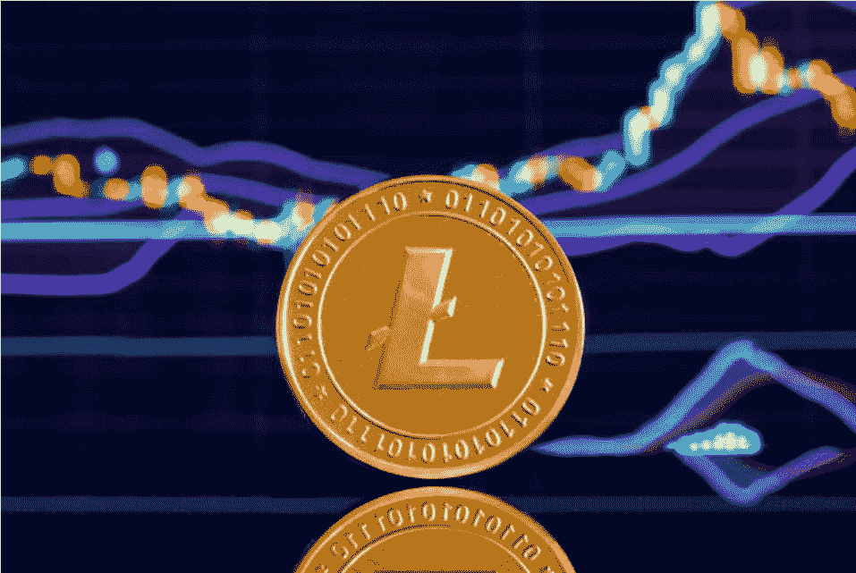

莱特币像比特币一样，是一种数字货币。莱特币是一种虚拟货币，使用区块链技术允许个人和企业直接相互发送资金。这确保了所有交易都记录在公共账本中，使货币能够运行一个独立于政府监管或审查的去中心化支付系统。

### 莱特币如何运作？

莱特币是一种通过自由软件加密系统创建和转移的数字货币。它使用区块链技术在去中心化的公共账本中跟踪所有交易。

## 莱特币的缺点

与莱特币相关的风险与其他加密货币的风险相似。在撰写本文时，整个行业才不过十几年历史。而且，与任何新兴领域一样——尤其是那些没有得到有效监管的领域——亏损的风险很大。原因如下：

### 高波动性

加密货币市场非常具有投机性，因此波动性很大。数字货币莱特币在2021年6月曾是全球前10大货币之一；截至2021年10月，它已跌至前20名之外。由于事态变化迅速，这种趋势可能不是预测未来的可靠指标。不过，在决定是将莱特币作为投资还是作为保值手段时，这一点值得牢记。

### 监管滞后

虽然莱特币理论上可用于更快速的支付，但事实是，加密货币作为通用支付方式和合法贸易手段的发展仍处于早期阶段。

这一切都在暗示，尽管投资莱特币有一定优势——例如，该货币流动性强，已存在十年——但它也有显著的缺点。

## 优点

**可靠性：** 就核心技术而言，莱特币投资者可以放心，因为这种加密货币是历史最悠久的货币之一，它是作为比特币网络的分叉开发的。LTC 与比特币一样，是一种开源且去中心化的加密货币。

该项目的创始人是计算机科学家 Charlie Lee。李氏曾受雇于 Alphabet 旗下的 Google，目前则就职于 Coinbase。他绝非等闲之辈。Lee 最初的雄心是创建莱特币，即比特币的“白银”之于比特币的“黄金”。

**流动性：** 莱特币现在是十大最有价值的加密货币之一，市值达 116 亿美元。由于规模庞大，莱特币具有很高的知名度和流动性。其日均交易量超过 200 万枚。

考虑到加密货币市场波动剧烈，流动性至关重要。如果没有足够的流动性，单笔抛售就可能摧毁加密货币的价值。另一方面，LTC 投资者无需担心变现其持有资产。

**性能：** 由于 Lee 想要改进比特币，莱特币相对于加密货币具有多项优势。根据 Coinbase 的数据，比特币交易的平均验证时间略低于九分钟，而 LTC 交易的平均验证时间约为 2.5 分钟。由于速度更快，从长远来看，莱特币可能更具可扩展性。

此外，莱特币交易费用远低于比特币交易。比特币交易的平均成本约为 4.38 美元，而 LTC 的平均交易费用约为每笔 2.6 美分。

## 2.5 如何投资加密货币

Bitfinex 和 Coinbase 等指导网络和虚拟货币平台是购买加密货币的渠道。今年早些时候，名为 Robinhood 的投资应用推出了购买比特币、狗狗币和以太坊等众多热门货币的机会，且无需支付主流交易所相关的高额费用。即使是加密货币新手，如今也会发现这非常简单。过去这有些复杂，但现在已经很简单了。开设银行账户并将其与信用卡关联非常直接。

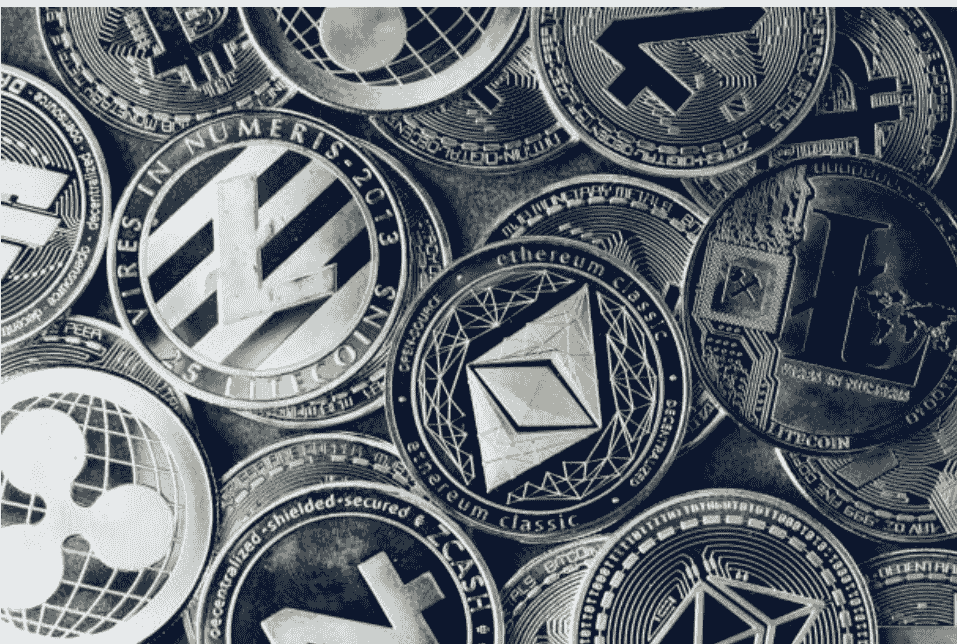

不过，请记住，购买单个加密货币类似于在股票市场购买单个股票。将所有投资集中在一种资产上，比将资金分散到数百或数千种证券（例如通过单位信托或市场基金）要承担更大的风险。不幸的是，目前加密货币资金稀缺。

## 投资加密货币有利可图吗？

专家们对是否应该投资加密货币意见不一。一些金融专家建议不要投资加密货币，因为它是一种纯粹的投机性和基于假设的投资，价格可能大幅波动。例如，比特币在 2020 年的价值几乎翻了三倍，全年收盘价超过 28,900 美元。BTC 的价格在 2021 年 4 月已较年初翻了四倍多，但到了 7 月，所有这些涨幅都已付诸东流。BTC 又在 2021 年 11 月 10 日几乎再次翻倍，盘中最高触及 68,190 美元，随后在年底前跌至约 46,010 美元。换句话说，加密货币波动极大、难以预测，且价值经常波动。

选择像美元这样有政府支持的货币可能更好。这取决于他们目前拥有什么，以及在损失方面实际面临什么风险。我们不妨循序渐进，好吗？如果说债券是戴着平顶帽的传统绅士，股票是拿着电话大谈特谈的自吹自擂之人，那么加密货币就是班级后排穿着连帽衫、编写代码并绘制重金属专辑封面的年轻人。虽然加密货币已有十多年历史，但直到 2017 年价格暴涨，它才广为人知。加密货币允许用户无需中央机构批准即可进行支付或交换信息。此前许多人都尝试过开发数字货币，但都失败了，直到 2008 年比特币的出现。

## 比特币有什么特别之处？

比特币分散在计算机网络中，而不是像传统机构使用的那样集中在一组服务器上。所有活动都在名为“区块链”的无许可区块链上处理，这本质上是一份永远无法修改的长列表。

虽然比特币作为数字货币已崭露头角，但许多加密货币项目正在利用区块链技术以各种方式颠覆现有行业，从社交网络到文件存储。在区块链行业内，也使用“代币”这一术语。这些并非你在游戏厅能找到的那种代币。相反，这些货币是基于区块链的数字资产，可用于从货币到数字商品或服务的各种用途。

## 加密货币为何有价值？

这归根结底是供求关系的问题，许多主流加密货币的供应量被人为限制。如果一个代币能够吸引用户，其价值就会增长。因此，如果存在将比特币作为转移金融价值手段的需求，其价值可能会上涨。房地产投资或一加仑汽油等现实世界资产也可以与数字代币挂钩，并从中衍生出价值。另一方面，最引人注目的加密货币交易也往往最离奇，例如有人仅为一枚描绘数字猫的代币支付了 17 万美元。

## 如何购买加密货币？

你可能会想选择一个加密货币交易所，因为这是最常见的方法。交易所允许你用法定货币购买加密货币，并在各种加密货币之间进行兑换。数字货币种类繁多，因此决定使用哪一种并不总是容易。请确保你选择的交易所允许你购买感兴趣的加密货币代币，并进行法币之间的兑换。你还应考虑交易所收取的交易费用（如有），并确保自己能够接受支付这些费用。

## 你应该关心吗？

看完这段介绍，你无疑会想知道加密货币是否是一个好的投资。虽然你的回答将基于你的投资目标和风险承受能力，但请记住，该行业尚处于初期阶段——这意味着它大多未受监管——因此价格可能会剧烈波动。然而，加密货币支持者认为，其作为“抗通胀工具”和独立货币的潜力，是数字货币在不久的将来可能升值的两个原因。

## 你还需要知道什么？

理解加密学最关键的一点是，它归根结底在于持有两组密钥。公钥类似于电子邮件地址，用于共享以发送和接收付款。你永远不应透露你的私钥，就像你绝不会泄露电子邮件密码一样。这是因为私钥才是让你真正访问资金的东西。

将资金放在加密货币交易所是危险的。你基本上是把密钥交给了市场，如果出了问题，你就只能和它们说再见了（这就是缺乏监管的问题所在）。从安全角度来看，将资产转移到“钱包”（你可以存储和控制加密货币的地方）是更好的选择。换句话说，钱包允许你将密钥保管在自己手中以确保安全。钱包也有各种设计和尺寸，有些只支持一种加密货币，而其他钱包支持多种，还提供多种额外服务。

## 购买加密货币安全吗？

不幸的是，比特币领域诈骗行为屡见不鲜。其中一个解释是区块链交易的“不可篡改性”：交易无法撤销。

警惕网络钓鱼和“社会工程学”欺诈。这些手段诱骗你提供个人信息，使黑客能够窃取你的身份，或让你在合法网站的假冒版本上输入登录信息或密钥。为了保持安全，请确保任何接近你的人都是合法的——并远离那些看起来好得过分的承诺。

黑客可能会试图入侵交易所并窃取存储在那里的代币。这就是你可能希望将资产存储在不同钱包中的一个原因。

## 钱包

还记得我们之前讨论过的那些钱包私钥吗？除非私钥被小心地离线保存，否则非你本人的人可能会使用该密钥来访问你的资金。

你还应该知道，两个拥有同一钱包私钥访问权限的用户对资金拥有平等的所有权。因此，如果你的密钥通过任何方式（无论是在线还是离线）落入错误的人手中，这是一个问题。由于加密货币是去中心化的，没有第三方机构来解决争议或强制执行所有权，因此确保只有你本人能访问你的私钥至关重要。

## 你能从加密货币中赚钱吗？

加密货币的广泛使用还不足十年。因此，对于长期投资者来说，现在可能还为时过早，无法做出一锤定音的判断。不过，一些热情的投资者正在寻找从加密货币中获利的方法。

## 通胀对冲

充满希望的企业家们相信，加密货币有潜力通过充当货币、促进支付和存储价值来彻底改变支付方式。加密货币因其作为资金避风港的潜在功能，已在某些股票市场投资者的投资组合中占据一席之地。

简单来说，他们的理论是比特币充当“数字黄金”，当商品价格大幅上涨（即通货膨胀）时，其价值会上升。这是因为加密货币的供应量在设计上受到限制（就像真正的黄金一样，尽管是出于偶然），并且其优于黄金的实用性——除了更容易获取、传输和存储之外——意味着它们更有价值。

## 投机

加密货币的价格，如同金融资产的价格一样，由供需决定。其他投资者则认为，随着加密货币变得更加流行，吸引更多散户投资者和投资机构，其价值将会上涨。投机者是押注此类事件发生的加密货币投资者。他们密切关注那些暗示加密货币接受度提高和加密货币相关项目升温的新闻，部分是出于这样一种期望：这将吸引更多投资者加入，从而推高资产价值。

## 去中心化金融

去中心化金融，通常称为 DeFi，是加密货币领域中迅速扩展的一个细分领域，其潜力引起了许多加密货币爱好者的兴趣。其去中心化结构是比特币早期流行的主要原因之一，而 DeFi 进一步发展了有望从加密货币中获益的投资产品，从而将这一概念推向了一个新的台阶。

大多数 DeFi 平台都是去中心化程序，即 DApps。这些 DApps 通过一系列智能合约自动化金融操作，使其比集中式对应物更快、更高效，且通常更便宜。DApps 也没有偏见，因为它们由计算机代码管理，而计算机代码本质上是公正的。

DeFi 引起了广泛关注，因为它让人们对自己的资金拥有更大的控制权，并提供了更有趣的管理方式——同时还为资金有限且身处通常被大银行忽视的偏远地区的人们提供了更好的准入。贷款平台、价值与当前法定货币挂钩的加密货币代币、去中心化交易所和保险，其实只是加密货币爱好者们认为这项技术将改变金融（并让他们收回初始投资）的几种方式。

## 持有加密货币（Hodling）

“Hodl”是加密货币世界中一个常见的术语，尽管我们通常不热衷于行话，但我们认为了解它很重要。2013年，在一个描述“买入并持有”长期投资策略的加密货币论坛帖子中，人们发现了单词“hold”的拼写错误，“hodl”因此成为一个俚语，意思是无论市场起伏如何，都持有你购买的任何东西。

据一些投资者称，持有（hodling）的潜在收益超过了风险。例如，如果你在投资组合中持有少量加密货币，而它归零了，你（理想情况下）不会损失任何东西。然而，如果加密货币如预期般大获成功，它可能价值巨大。

## 持有还是不持有（HODL or not to HODL）？

到这一点，你可能已经感到信心十足了。你了解加密货币是什么，如何正确获取和保存它们并避免最常见的问题，以及人们为何投资于它们。即使我们自夸一番，这也是开始在加密货币生态系统中做出明智财务决策的绝佳起点。最后三份指南将更深入地探讨这些主题，但在你离开之前，我们想给大家留下一些最后的评论。

## 你如何参与？

投资加密货币的方式实际上只有几种。最适合你的方法很大程度上取决于你是想主动交易，还是仅仅跟随加密货币的整体涨跌。

有什么区别？活跃交易者定期买卖，希望从市场的低谷和高峰中获利，就像交易其他市场（从石油到橙汁）的人一样。他们会努力研究项目，并可能对整个行业有很好的了解。许多人会采用技术分析方法，即检查先前的价格数据以帮助未来的决策。另一方面，被动投资则很满足于仅仅购买加密货币并持有它，希望它会增值。跟踪大多数热门加密货币价值的加密货币捆绑包或资产类别是一种流行的做法。买方自慎：这些基金费用可能很高，所以请了解它们的运作方式，并决定你是否愿意支付这些费用。

# 第 3 章：值得投资的最佳加密货币和第一代山寨币

随着越来越多的投资者将加密货币视为投资组合中受欢迎的补充，加密货币向全球声望的攀升还在继续。在过去几个月里，在 2017 年和 2018 年首次代币发行（I.C.O.）崩溃吓跑了采用者之后，势头有所回升，这得益于两种新工具的推出：NFT 和 DeFi。存在几十种不同的加密货币，从比特币到狗狗币和泰达币，这使得进入加密货币世界变得困难。以下是按市值（即当前流通所有代币的总价值）排名的前十名比特币，可帮助你了解情况。

Ripple 是一个点对点金融转账和虚拟货币平台。该平台是一个开源协议，允许双方快速且廉价地进行交易。从英镑等法定货币到加密货币和航空里程，任何形式的资金都可以在该平台上交易。瑞波代币（X.R.P.）可与任何现金或数字资产转换，也可在该平台上使用。另一方面，它并不依赖于瑞波网络。转账时，各方不需要 X.R.P。因此，Ripple 的价值不在于 X.R.P. 代币，而在于网络在全球范围内快速转移资产的能力。

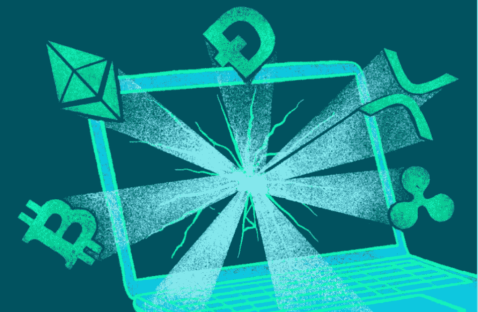

Stellar 是一种基于分布式账本技术的支付机制。它可以在几秒钟内实现任何两种货币之间的跨境支付。在许多方面，它与其他基于区块链的加密货币相似。通货膨胀是 X.L.M. 创建的唯一其他方式。为了适应经济增长和丢失的 Lumen，Lumen 生成率设有固定的年通胀率 1%。新的 Lumen 每周通过直接投票系统生成并发放。

## 3.1 Ripple

Ripple 是一个点对点金融转账和虚拟货币平台。该平台是一个开源协议，允许双方快速且廉价地进行交易。从英镑等法定货币到加密货币和航空里程，任何形式的资金都可以在该平台上交易。瑞波代币（X.R.P.）可与任何现金或数字资产转换，

也可在该平台使用。另一方面，它并不依赖瑞波网络。要转账，各方不需要 X.R.P。因此，瑞波的价值不在于 X.R.P. 代币，而在于网络在全球迅速转移资产的能力。

该网络与既定的支付方式（如 Swift）竞争。它并非旨在取代现有支付系统，或直接与法币竞争（如比特币等其他加密货币所追求的那样），而是可能在 RippleNet 中支持多种支付。瑞波的概念最初于 2004 年提出，但直到 2013 年才被广泛采用。Jed McCaleb 鼓励许多股东参与该网络。Chris Larsen 也是那些天使投资者之一，被誉为最富有的加密货币投资者之一。作为个人或公司，在决定是否使用瑞波之前，需要考虑某些优势和劣势。

## 瑞波的优势

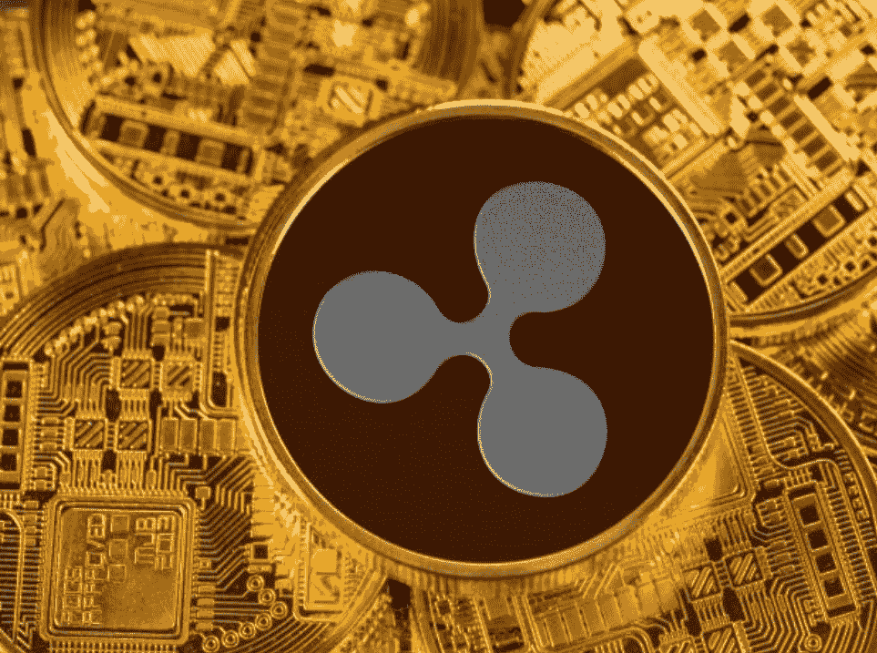

瑞波的使命是解决问题并创造机遇。跨境交易通常需要等待数周，具体取决于支付方式和涉及的各方。瑞波的解决方案旨在节省成本，同时提高速度和效率。RippleNet 也拥有大量参与者。因此，答案并不奇怪。根据网络效应，加入瑞波解决方案的传统组织越多，瑞波在未来的影响就越大。

## 瑞波的劣势

瑞波正试图在拥挤的金融科技领域中，确立其作为 SWIFT（行业领导者）竞争对手的地位。在传统世界中，改变现状可能困难、耗时，并最终需要过渡和相关培训。

瑞波在加密领域有竞争对手，如 Stellar 和 SWIFT。尽管瑞波具有先发优势，但它必须继续创新并扩大其网络。

与传统金融相比，加密货币业务非常年轻，因此监管模糊不清。监管机构是应仅将现有的传统规则和标准应用于加密领域，还是应设计更贴合这种创新的新法律？这些监管困难的一例是美国证券交易委员会（S.E.C.）对瑞波的诉讼。

## 3.2 Stellar

Stellar 是一种基于分布式账本技术的支付机制。它能够在几秒钟内实现任何两种货币之间的跨境支付。在许多方面，它与其他基于区块链的加密货币相似。通货膨胀是 X.L.M. 被创建的唯一其他方式。为了适应经济增长和丢失的 Lumen，Lumen 生成率设定了每年 1% 的固定通货膨胀率。新的 Lumen 每周通过直接投票系统生成并分配。

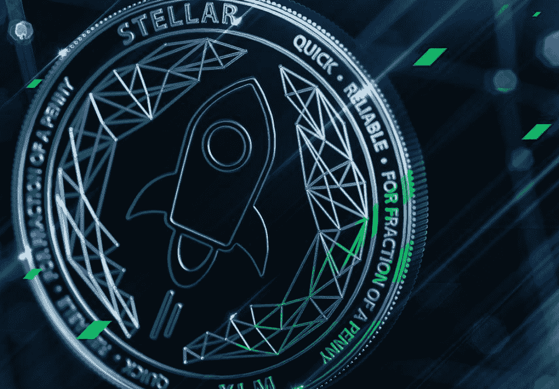

## Stellar 区块链如何运作？

与所有区块链技术一样，Stellar 网络将交易添加到共享且去中心化的公共账本中。Stellar 使用的“Stellar 共识协议”（Stellar Consensus Protocol，S.C.P.）基于联邦拜占庭协议（F.B.A.）。S.C.P. 允许网络上的每个人在几秒钟内就交易的真实性达成一致，从而实现更快速、更便宜的交易。每个参与者（称为节点）在协助将事件添加到全局账本时，会选择自己的一小群其他可信参与者。这些小网络称为 Quorum Slices。只要 Consensus Slices 重叠，Stellar 网络就能迅速就合法交易达成一致，并将其添加到账本中。

## 投资 Stellar 的优势

快速浏览多个加密金融网站会发现，对 Stellar 未来的预测（X.L.M.）普遍看涨。大多数分析师认为，X.L.M. 对教师、学生交易员和投资者来说都是不错的投资。让我们来看看 X.L.M. 的积极方面，看看它是否是一个好的投资。

### 未涉及监管机构的案件

尽管与瑞波保持密切的工作关系，Stellar 仍避免了与监管机构的法律纠纷。他也是瑞波和 Stellar 的创始人，这两家公司是他与其弟弟 Jed McCaleb 共同创立的。这是 Stellar 和瑞波有许多相似之处，只有少数重大差异的主要原因。因此，X.R.P. 价格近期的飙升对 X.L.M. 影响不大，X.L.M. 保持了独立性，不依赖于作为跨境交易先行者的分叉来定价。缺乏纠纷或监管行动有利于技术型企业的未来，并对其股价产生积极影响，因为这增加了其价值。

### 交易量增加

新投资者最容易忽视的技术指标之一是交易量。了解投资者交易了多少资金，可能有助于你发现特定资产的活动情况。一般来说，增长的市场拥有不断增加的交易量。5 月，Stellar Lumens (X.L.M.) 的交易量有所增加。这体现了该加密货币的广泛吸引力。X.L.M. 当月收盘价为 8.79 亿美元，相比上个月的 14.9 亿美元略有上涨。X.L.M. 在 5 月同步上涨，于 2021 年 5 月 10 日周一达到 0.78 美元的历史新高。5 月观察到的部分交易量（按天无特定顺序）包括 30.2 亿美元、20.6 亿美元、48.8 亿美元、45.0 亿美元和 67.2 亿美元。这体现了交易者和投资者对该资产的高度关注。

长线投资者，尤其是共同基金等投资者，经常避开交易量不足的公司。本着这一理念，长期持有 X.L.M. 的投资者正抱着价格上涨的希望坚守投资。因此，该虚拟货币的行情一直在稳步上升。

### 日常使用率提升

Stellar 每天处理数百万笔交易。截至撰写本文时，X.L.M. 的活跃笔数达到 251 万笔，总额为 2.1205 亿美元。这对于尚未被数百万互联网零售商用作支付方式的加密货币来说，尤为惊人。这应该能让您作为交易商或投资者确信，投资 Stellar 是值得的，因为数百万个人经常使用这种数字资产。

## 投资 Stellar 的劣势

如果您只关注某项资产作为潜在投资工具的特性，可能会损失大部分甚至全部资金。让我们快速了解一下在投资 Stellar 之前应该了解的一些缺点。

### 与其他团队相比，Stellar 团队规模较小。

截至 2020 年底，瑞波拥有 548 名员工。截至 2021 年 10 月，Stellar Experimental Testing 拥有 115 名员工。这为直接竞争对手瑞波在广告、开发以及区块链解决方案在解决过时的日常交易方式方面的接受度提供了竞争优势。

### 面临瑞波的激烈竞争

X.L.M. 交易验证与 X.R.P. 交易验证不同。在加密货币圈，Stellar 比瑞波更去中心化，这是众所周知的。因此，两款跨境支付网络都面向集中式金融机构。潜在客户可能会考虑在其日常运营中采用瑞波的软件解决方案，因为瑞波的 X.R.P. 代币更集中化，并已为数百家金融机构提供服务。这归功于瑞波的先发优势，以及其庞大的合作伙伴推荐名单。

Stellar 正在努力在此领域赶上。也许这就是为什么 Stellar Experimental Testing 在 2021 年 1 月与乌克兰政府安排了去中心化数字货币交易，以向全世界发出强烈信号。

### 无法获得与其独特特征相匹配的估值。

X.L.M.在2018年1月4日触及$0.9381的历史高点，这一事实难以令人理解。这表明X.L.M.已有三年多未测试过$0.9区域。与此同时，比特币和以太坊的价格已上涨近1000%。这引发了加密货币专家对该资产能否实现$1、$5或$10价格目标的担忧。你只能希望X.L.M.的价格在未来大幅上涨。它目前的交易价格低于一分钱，而要与B和b、D.O.T.、LINK等币种的价值相抗衡，则需要重大创新。

## 3.3 Neo

该币种及其运行所在的网络被称为N.E.O。这个网络，就像以太坊允许用户构建去中心化应用和智能合约一样。使N.E.O.与其他加密货币有所不同的是，其系统目前受某机构管辖，该机构要求用户在网络上必须拥有经过验证的身份。

N.E.O.是一种开源的去中心化区块链平台和加密货币，也是同类中的第一个。它利用区块链技术和数字身份来数字化资产，通过合同自动化信息资产的转移，并借助分布式网络实现“智慧经济”。

### Neo区块链平台的优点

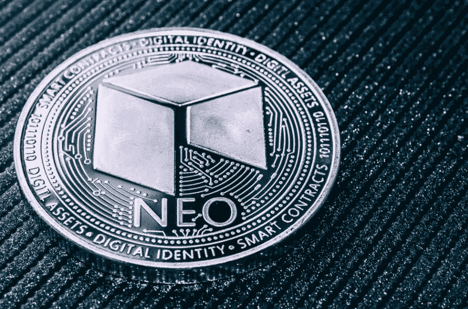

- N.E.O.的通用轻量虚拟机（通常称为NeoVM）支持使用任何编程语言。N.E.O.架构提供的虚拟机高效、安全且可扩展。N.E.O.还便于构建DApps。N.E.O.平台最具优势的特性是G.A.S。它可以被描述为N.E.O.的资产配对。因此，N.E.O.持有者将获得G.A.S。这是对N.E.O.持有者的分红。它根据公式进行分配。如果你在钱包中持有N.E.O.，你将每天获得G.A.S。

- 数字资产、数字身份和智能合约属于智慧经济的一部分。N.E.O.的一大卖点是其智慧经济。这与其他加密货币（尤其是以太坊）所提供的功能截然不同。利用智慧经济，在网络上数字化资产将变得可行。一旦数字化，它们可以留在网络上，并享受去中心化、透明度、信任和可追溯性等功能，并且任何人都可以识别资产。

- 近几个月来，Gas的费用飙升，为持有N.E.O.提供了良好的激励。如果你持有100个NEO，你每年将获得0.03411个Gas。只有当有好的项目尝试在其上运行时，框架才能有效；N.E.O.控制台上有很多成功的程序；所有这些项目都以各自的方式为N.E.O.做出积极贡献。

- 任何可能拥有资产的公司、个人或其他实体都可以注册数字身份。它运行在一个称为数字证书（PKI）的系统上；开发者可以利用智能合约使整个基础设施运行。与以太坊不同，N.E.O.不需要你学习不同的计算机语言来创建智能合约。因此，任何程序员都可以开始并在N.E.O.平台上构建智能市场。

- NEX是一个有希望的基于NEO的项目，它是N.E.O.上的去中心化交易所和支付解决方案，在开始注册人员的程序之前，其首次销售计划于今年晚些时候进行。N.E.O.与OnChain有着有意义的联系；那些在谈到解决方案时拥有类似实际意图的人，N.E.O.是D.N.A.（即OnChain的系统）的基石。

### Neo区块链平台的缺点

尽管由于其中国背景，N.E.O.在亚洲非常流行，但在英国西半球却不为人知。N.E.O.面临着以太坊和E.O.S.等大型竞争对手的挑战，这些公司在加密社区拥有忠实的追随者和良好的声誉。由于新竞争对手不断涌现，N.E.O.必须奋力取胜。尽管中国严格的政府结构支持N.E.O.，但其技术选择可能受到政治影响。N.E.O.高度中心化，开发者控制着近一半的币种，并且不明确这一状况是否会在短期内改变。

### Neo是否是一项好的投资？

N.E.O.是2018年表现不佳的加密货币资产之一，其价格在9月和10月暴跌。然而，由于它们在中国的良好地位，作为投资工具值得考虑。由于交易速度快且得到中国政府支持，N.E.O.在机构投资者中越来越受欢迎。当加密货币市场开始波动时，如果N.E.O.确实成为表现最好的资产，我们不会感到震惊，因为它在过去几个月中一直如此。

## 3.4 最佳投资加密货币

随着越来越多的投资者将加密货币视为投资组合中理想的补充，加密货币的名声日隆仍在继续。在2017年和2018年首代币发行（I.C.O.）崩溃吓跑采用者之后，近几个月来，由于NFTs和DeFi两种新工具的推出，动力有所回升。有几十种不同的加密货币，从比特币到狗狗币和泰达币，使得初学者难以进入加密货币世界。以下是按市值（即当前流通的所有币种的总价值）计算的前十名加密货币，帮助你找到方向。而且，随着我们向前发展，有很多事情可能会带来丰厚回报。

### 比特币

比特币是市值最大的加密货币，也是该资产类别中最成熟的价值存储手段，因此是每个加密货币投资者的必备之选。这种加密货币于1月3日迎来13岁生日，市值约为9000亿美元。它是唯一拥有追踪其波动的美国市场基金的数字货币，约占加密货币市场总价值的40%。BTC是其类别中最成熟的加密货币，也是对加密货币感兴趣者的必然投资选择。特斯拉和MicroStrategy Inc.等企业的资产负债表上都持有BTC。比特币，作为最知名的加密货币，自2009年诞生以来已有13年历史。

它是全球市值最高的加密货币，其交易基于区块链解决方案，区块链是一个去中心化的数据库，在全球超过15,000台计算机上记录交易和账户余额。

由于其韧性和经受时间考验的声誉，比特币可能在2022年成为受欢迎的投资选择。

### Solana

与比特币不同，比特币最终将解决一些困扰它的电力问题，而Solana已解决以太坊的重大问题之一：交易成本。由于这些“Gas成本”，即使是小额以太坊交易在财务上也变得不可能；尽管如此，Solana的费率仅为以太坊费用的一小部分。与以太坊一样，Solana旨在成为去中心化金融（通常称为DeFi）的顶级平台，DeFi消除了对金融中介和传统金融守门人及组织（如银行、经纪商和集中式交易所等）的需求。Solana于2020年推出，在市场中占有适度但不断增长的份额，该币种的价值从2021年初的1.51美元上升至年底的160多美元。

### 以太坊

尽管在市值方面以太坊不及比特币，但以太坊占全球市场约20%，在知名度方面或许正处在超越比特币的边缘。这是因为它的用途不仅限于价值存储，以太坊轻松获得了全球最广泛使用的区块链的称号。以太坊的原生货币Ether（ETH）是购买的最佳加密货币之一，因为它支持智能合约、非同质化代币和其他加密货币。当其从工作量证明协议切换到权益证明协议时，ETH将比比特币节能得多，从而消除了通过复杂计算操作在区块链上验证交易这一耗能更高的要求。

### 狗狗币（DOGE）

是的，狗狗币广为人知，最初作为一个玩笑而创立的加密货币。但首先，在加密货币世界里，作为幽默代币远非被淘汰，狗狗币和柴犬币在全球估值方面都排名前15。然而，狗狗币成为当前最佳投资加密货币之一有一个严肃的原因：埃隆·马斯克是一个信徒，而不仅仅是一个讽刺性粉丝，就像他在2021年狗狗币史诗级上涨期间被传闻的那样，特斯拉首席执行官在1月初与Lex Fridman的播客中也如此表示。鉴于马斯克在加密货币圈的影响力，价格尚未出现反应令人惊讶。

狗狗币可能会出现一些短期上涨，如果主流媒体很快就响应马斯克对资金的热情——或者这位反复无常的亿万富翁再次公开表达他对该货币的赞赏。

## 波卡

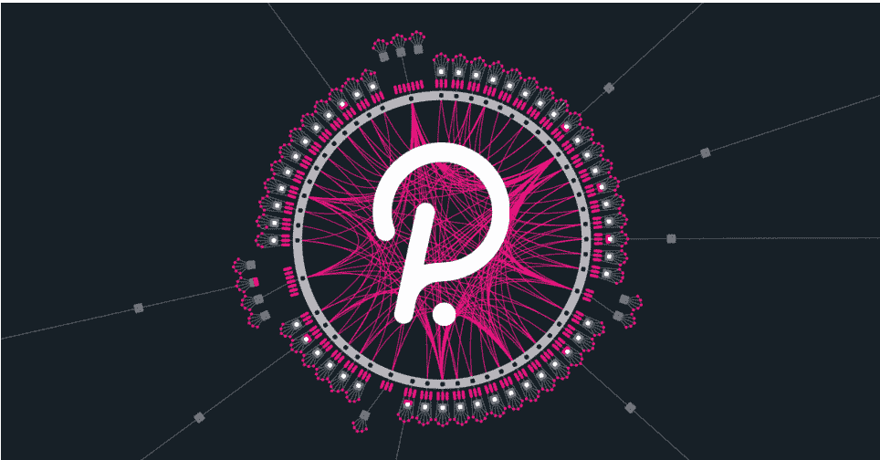

在让开发者构建智能合约和应用方面，波卡与以太坊颇为相似。在接下来的一年里，它在功能方面有显著扩展的潜力。

## Polygon

Helix 在过去一年中呈指数级上涨，增长了约 100 倍。M.A.T.I.C. 市值达 170 亿美元，目前是前 15 名代币之一，随着 2022 年的开始，它仍然是值得购买的最佳加密货币之一。Polygon 旨在以类似于 Yearn. Finance 的方式实现广泛接受，但方式不同：通过创建更具可扩展性的区块链。该技术的创建目标是扩展以太坊，并允许在其之上运行理论上无限数量的 dApps。Polygon 总供应量的数十亿代币中，约有 72% 目前在流通。

## Yearn. Finance (Y.F.I.)

Yearn. Finance 是你未曾听说过的最热门货币之一，是一个价值数十亿美元的代币，波动性很大：在过去一年里，价格在 18,566 美元至 93,435 美元之间波动。Yearn. Finance 按市值计是第 80 大的加密货币，目前售价超过 38,000 美元。它还有一个值得称赞的目标：通过允许最佳收益耕作利润，向非技术企业家和用户开放 Ciency 领域。

## 去中心化金融

Yearn. Finance 承诺更快地引入用户，前景广阔。整个行业几乎肯定会随着时间的推移而扩张，但该领域在技术上仍然艰难，因此像 Yearn. Finance 这样能更轻松引入客户的工具前景光明。在短期内，Y.F.I. 在 12 月和 1 月表优于大多数其他加密货币，增长超过 20%，而大多数其他加密货币则下跌。

## 币安币

由于处理纳斯达克加密货币更快且更便宜，市场活动将更加频繁，这将影响交易价格；全球最大交易所的加密货币可能在 2022 年出现显著增长。

## 卡尔达诺 (A.D.A.)

卡尔达诺因是最早采用权益证明验证的加密货币项目之一而闻名。通过去除比特币等系统中交易验证所具有的竞争性、解决问题的部分，该方案减少了交易时间、能源消耗和环境影响。卡尔达诺的运作方式与以太坊类似，它使用其原生代币 A.D.A. 来支持智能合约和去中心化应用。

与其他知名加密货币相比，卡尔达诺的 A.D.A. 代币增长缓慢。2017 年 A.D.A. 的价格为 0.02 美元。截至 2022 年 1 月 3 日，其当前价格为 1.34 美元。这相当于 6,600% 的涨幅。

## 泰达币 (U.S.D.T.)

泰达币是一种加密货币，这意味着它由法定货币（如美元和欧元）支持，其价值理论上等同于其中一种货币。泰达币的价值旨在比其他加密货币更稳定，这就是为什么它受到那些担心其他币种过度波动的投资者青睐的原因。

## 美元币 (U.S.D.C.)

美元币 (U.S.D.C.) 与泰达币一样，是一种稳定币，这意味着它由美元支持，并力求实现 1 美元兑换 1 USDC 的比率。U.S.D.C. 基于以太坊，可用于进行国际交易。

## 特拉 (LUNA)

特拉是一种稳定币区块链支付网络，通过保持两种加密货币之间的平衡来运作。TerraUSD 和其他特拉支持的稳定币与实际货币的价值挂钩。作为其平衡力量的 Luna，用于为特拉系统提供动力并生成新的特拉稳定币。

Luna 稳定币和特拉稳定币基于供需关系共同运作：当稳定币价格超过其关联货币价值时，用户被鼓励销毁其 Luna 以生产更多的特拉稳定币。当 Luna 稳定币的价值相对于基准货币下跌时，用户被鼓励销毁其特拉稳定币以生产更多的 Luna。随着特拉平台变得更加流行，Luna 的价值会上升。

Luna 的价格从 2021 年 1 月 3 日的 0.64 美元，在一年后攀升至 92.64 美元，涨幅超过 14,300%。

## X.R.P. (X.R.P.)

X.R.P. 是由与瑞波币相同的部分人士创立的数字网络和支付处理公司，可用于该网络上，以促进多种货币种类的交换，包括法定货币以及其他主要加密货币。

2017 年初，瑞波币的成本为 0.006 美元。其价格在 2022 年 1 月 3 日达到 0.83 美元，涨幅超过 13,700%。

# 第 4 章：关于加密货币和第二代替代币的神话

近年来，由于该资产带来的惊人利润，加密货币世界不断繁荣。然而，由比特币推动的爆炸式增长催生了一大堆神话，其中有些可能真实，有些可能虚假。以下是一些典型的加密货币误区。政府要求金融机构停止与加密货币或任何涉及加密货币的公司打交道是可行的，但要彻底禁止加密货币的存在则在实践中极其困难。加密货币交易不比发送电子邮件更复杂，任何拥有互联网接入的人都可以轻松完成。

政府长期以来一直对加密货币涉及的风险感到担忧，因为它们希望对首先可能被视为可行货币的任何事物施加更多权威。然而，近年来，越来越多的国家表现出愿意以探究的态度对待加密货币。

区块链作为支持比特币等加密货币的技术，其应用场景备受关注。许多专家认为，区块链尚未确立任何用例，而比特币可能是唯一取得一定成功的工具。事实上，区块链技术正在以惊人的速度发展。例如，区块链上的智能合约可以保存贷款人与房屋贷款接收者之间的合同。它有可能自动从受益人的加密钱包向贷款人账户进行贷款支付。从 DeFi 到 NFT，区块链技术提供了大量的可能性和应用。

## 4.1 泰达币

泰达币（即 USDT）是一种与法定货币挂钩以确保稳定性的加密货币。Omni 协议基于比特币网络创造了一种加密货币。其价值“锚定”在美元价值上。该货币的创建旨在解决三个关键问题：

- 实现比特币稳定
- 实现各国货币转账
- 提供验证选项

### 它是如何运作的？

泰达币公司是一家中国公司，充当该加密货币资产的第三方。它维持与流通中的 USDT 数量相等的法定货币储备。一个简单的解决方案可能会降低执行法定货币和加密货币审计的难度。其实施不会损害审计的透明度或安全性。

USDT 基于 Omni 技术，这是一个灵活的平台，用于连接比特币网络的各种货币和数字资产。其理念是每个 USDT 的价值为 1 美元，并且你可以随时将其兑换为法定货币。

### USDT 的优势

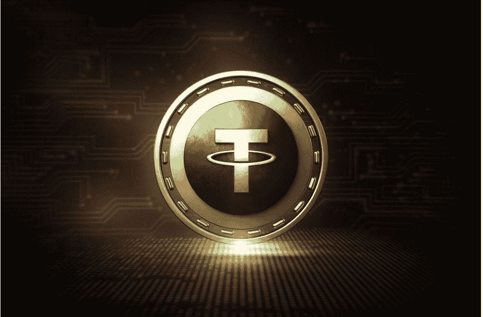

以下是一些支持 USDT 的重要因素：

### 价值稳定性

当你决定购买或出售其他加密货币时，应该注意它们的波动性。使用泰达币时则不是这种情况。此外，多家交易所接受 USDT 而不是法定货币。

### 交易时间

USDT 交易在几分钟内即可完成。这对每个人都有利，尤其是那些以分钟而非天为单位进行交易的交易者。另一方面，传统银行程序可能需要几天才能处理美元存取款。

### 交易费用

SWIFT 交易可能会相当昂贵。在处理不支持的法币货币时，成本可能相当高。Tether 钱包之间的转账没有费用。

交易时，你可以不持仓、立即平仓，或者等待合适的时机。在等待合适时机时，无需在交易所亏损资金。

## Cons of USDT

### USDT 的缺点

A few factors are acting against USDT. The following are some of them:

一些因素不利于 USDT。其中一些如下：

### Price Stability

### 价格稳定性

The USDT value notion about the US dollar seems to be excellent for price stability. The value of fiat money, on the other hand, is never set. As a result, the Tether notion isn't always accurate. The degree of volatility has always been between 2% and 3%, but it has never dropped below that.

USDT 与美元挂钩的价值概念似乎有利于价格稳定。另一方面，法币的价值从来不是固定的。因此，Tether 的概念并不总是准确的。波动幅度一直在 2% 到 3% 之间，但从未低于这个水平。

### Lack of Anonymity

### 匿名性不足

Cryptocurrencies are built on the principle of anonymity. To establish an account and purchase USDT, you will need to provide documentation verifying your identity. Even so, there are a few exchanges that will let you establish an account without requiring you to confirm your identity.

加密货币建立在匿名性原则之上。要创建账户并购买 USDT，你需要提供身份验证文件。即便如此，仍有少数交易所允许你在不验证身份的情况下创建账户。

### No Mining

### 无法挖矿

There are no options if you want to mine Tether. Only the firm behind USDT can do so. It is most inclined to maintain the currency's value consistent versus the US dollar. It will be impossible to sustain this stability without central supervision.

如果你想挖矿 Tether，没有可选方案。只有 USDT 背后的公司可以这样做。该公司最倾向于保持货币相对于美元的价值稳定。没有中央监管，要维持这种稳定性将是不可能的。

## 4.2 币安

## 4.2 币安

Based on trade volume, Binance is one of the biggest cryptocurrency exchanges presently in operation. Binance was founded in HK, and its terms and conditions are currently controlled by HK law. It is not registered on any stock market, and its organizational model is opaque; for instance, it is impossible to determine where Binance's offices are located.

根据交易量，币安是目前运营的最大的加密货币交易所之一。币安在香港成立，其条款和条件目前受香港法律管辖。它未在任何股票市场注册，其组织模式不透明；例如，无法确定币安办公室的位置。

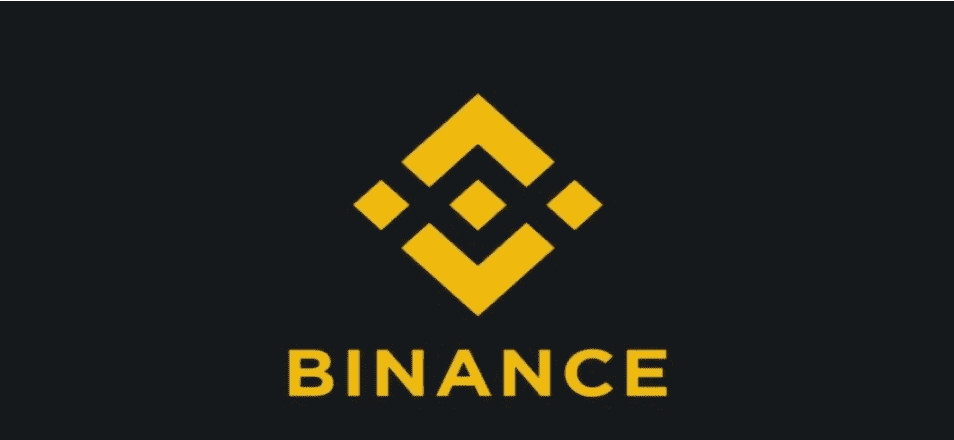

In the United States, Binance is presently unavailable. From the United States, you may utilize Binance.US, which leverages Binance's matching engine and wallet technology, but its product assortment and number of trading pairs are restricted compared to Binance. The firm employs 2,800 people and has a 15-million-strong customer base. Binance's monthly trade volume is $180 billion, placing it on par with Cryptocurrencies; on certain trading days, Binance's turnover has been more than Coinbase's.

在美国，币安目前不可用。从美国，你可以使用 Binance.US，它利用币安的匹配引擎和钱包技术，但与币安相比，其产品种类和交易对数量有限。该公司雇佣了 2,800 名员工，拥有 1500 万的客户基础。币安的月交易量为 1800 亿美元，与主要加密货币交易所持平；在某些交易日，币安的成交额已超过 Coinbase。

### Cons

### 缺点

- Customers from the United States cannot access the Binance infrastructure.
- 美国客户无法访问币安基础设施。
- It is highly restricted in the United States.
- 在美国受到高度限制。
- It may be intimidating, even for experienced people
- 即使对于经验丰富的人来说，也可能令人望而生畏
- Regulated in various countries or under investigation in the United States
- 在多个国家受到监管或在美国接受调查
- No new data wallet
- 没有新的数据钱包

### Pros

### 优点

- One of the most cost-effective platforms to use
- 最具成本效益的平台之一
- Over 500 cryptocurrencies to trade
- 可交易的加密货币超过 500 种
- Wide range of transaction kinds
- 支持多种交易类型

## 4.3 卡尔达诺（Cardano）

## 4.3 卡尔达诺（Cardano）

Cardano is a decentralized cryptocurrency platform that is one of the world's first accessible and peer-reviewed networks. Its goal is to provide enhanced features via a scientific and research-based method. Input Output Hong Kong founded Cardano, headed by creator Charles Hoskinson, who's one of the numerous co-founders of Ether and has worked on Ethereum and Bitshares Classic. They tasked academics and professionals from various educational institutions with examining Cardano's protocol early on.

卡尔达诺是一个去中心化的加密货币平台，是世界上首批可访问并经过同行评审的网络之一。其目标是通过科学和基于研究的方法提供增强功能。Input Output Hong Kong 创立了卡尔达诺，由创始人 Charles Hoskinson 领导，他是以太坊（Ether）的众多联合创始人之一，并曾参与以太坊和 Bitshares Classic 的开发。他们早期委托各类教育机构的学者和专业人士审查卡尔达诺的协议。

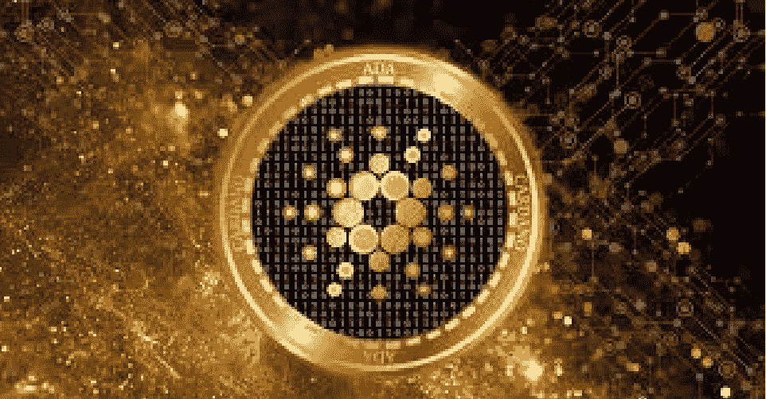

The fundamental goal was to develop a 3rd platform that could facilitate smart contract implementation while addressing the scale challenges plaguing Bitcoin, the first-generation currency. It's no surprise that many experts predict Cardano will eventually replace Ether, a second-generation currency, provided it lives up to its promises. The Cardano Settling Layer (CSL) and the Control Layer, respectively, are used to settle transactions and smart contracts in Cardano. The Ouroboros proof-of-stake method lies at the core of Cardano. Cardano's protocol is less energy-intensive and less expensive than proof-of-work systems.

其根本目标是开发一个第三代平台，以促进智能合约实现，同时解决困扰第一代货币比特币的可扩展性挑战。许多专家预测卡尔达诺最终将取代以太坊（第二代货币），前提是它能兑现承诺。卡尔达诺结算层（CSL）和控制层分别用于在卡尔达诺中结算交易和智能合约。Ouroboros 权益证明方法是卡尔达诺的核心。卡尔达诺协议比工作量证明系统更不耗能且成本更低。

### The Pros of Investing In Cardano

### 投资卡尔达诺的优势

Knowing the benefits of buying in Cardano is critical in determining if ADA is just a good and possibly successful investment for you. Even if there are more advantages than disadvantages, this does not imply you should assess them quantitatively; some disadvantages may exceed numerous advantages. So, let's look at some of the advantages of owning Cardano.

了解购买卡尔达诺的益处对于判断 ADA 是否是一项良好且可能成功的投资至关重要。即使优势多于劣势，也不意味着你应该定量评估它们；某些劣势可能超过众多优势。那么，让我们看看拥有卡尔达诺的一些优势。

### Academic backing:

### 学术支持：

As previously said, Cardano has the advantage of being one of the few currencies that has been studied by academics, who have given it high marks. In addition, numerous academics work with IOHK and produce articles on what they think the project should do next to enhance Cardano. This offers Cardano a level of trust that other currencies lack, and it's also incredibly valuable for individuals who want to know more about it.

如前所述，卡尔达诺的优势之一是它是少数几个经过学者研究并获得高度评价的货币之一。此外，众多学者与 IOHK 合作，撰写关于他们认为项目下一步应该做什么以改进卡尔达诺的文章。这为卡尔达诺提供了其他货币缺乏的信任度，对于想要了解更多信息的人来说也极具价值。

### Great development team:

### 强大的开发团队：

Cardano, founded by Ethereum co-founders Charles Hoskinson and Jeremy Wood, garnered a lot of traction following its formal release in 2017. Cardano is also a participant in guaranteeing the protocol is free of flaws. Cardano evaluated numerous protocols and designed a sophisticated blockchain to avoid flaws and hackers.

卡尔达诺由以太坊联合创始人 Charles Hoskinson 和 Jeremy Wood 创立，自 2017 年正式发布以来获得了广泛关注。卡尔达诺还致力于确保协议无缺陷。卡尔达诺评估了众多协议并设计了先进的区块链，以避免缺陷和黑客攻击。

### Cardano uses multiple layers:

### 卡尔达诺采用多层架构：

- It's one of Cardano's primary benefits.
- 这是卡尔达诺的主要优势之一。
- It also enables modifications to be made without disrupting payments or transactions.
- 它还允许在不干扰支付或交易的情况下进行修改。
- Cardano provides infinite scalability and rapid transactions by creating a settlements layer and a computing layer.
- 卡尔达诺通过创建结算层和计算层，提供了无限的可扩展性和快速交易。

### The Cons of Investing in Cardano

### 投资卡尔达诺的劣势

While Cardano offers several compelling benefits over other currencies, investors and traders should be aware of the drawbacks of buying in ADA before choosing.

虽然卡尔达诺相比其他货币提供了多项引人注目的优势，但投资者和交易者在选择之前应了解购买 ADA 的缺点。

Investing in Cardano, like any other investment, is not without risk. Investing in Cardano has several major drawbacks:

像任何其他投资一样，投资卡尔达诺也并非没有风险。投资卡尔达诺存在几个主要缺点：

### Cardano wants to implement a voting system:

### 卡尔达诺计划实施投票系统：

Though having an open system of voting where modifications may be offered and voted on is enticing, there is one potential disadvantage because token holders aren't always tech-savvy and might vote for an irrational conclusion.

尽管拥有一个开放的投票系统，允许提出和表决修改建议很有吸引力，但存在一个潜在缺点，因为代币持有者并不总是精通技术，可能会投票赞成不理性的结论。

### Cardano is still in development:

### 卡尔达诺仍在开发中：

Despite its reputation as an "academic blockchain" that has undergone extensive scrutiny and testing, Cardano is still in its early stages of development. This is perhaps the most important reason to avoid Cardano. Cardano takes a little time to grow, even as it tries to stay up with competition and technological breakthroughs. As a result, Cardano has already been losing ground to Ethereum and EOS for some time, as it still lacks unfinished contract and token specifications. Cardano is still focusing on scalability, and whereas cryptos like Ripple can handle 1,000 operations per second, Pascal can only potentially process 257 transactions per second.

尽管卡尔达诺作为一个经过广泛审查和测试的“学术区块链”享有声誉，但它仍处于早期开发阶段。这或许是避免卡尔达诺的最重要原因。卡尔达诺需要一些时间来成长，即使它试图跟上竞争和技术突破。因此，卡尔达诺已经在以太坊和 EOS 面前失去了一些优势，因为它仍然缺少未完成的合同和代币规范。卡尔达诺仍在专注于可扩展性，而像瑞波币这样的加密货币每秒可以处理 1,000 个操作，Pascal 只能潜在地每秒处理 257 笔交易。

Indeed, Cardano is lagging well behind where it was, with several delays in the past pushing back releases. Cardano lacks contract, and dApp features are possibly the most concerning of all. While we said that the Goguen update should be coming soon to bring these features, this is absolutely a con until it is realized since we cannot depend on these promises until it is implemented.

确实，卡尔达诺落后于其之前的水平，过去的几次延误推迟了发布。卡尔达诺缺乏合约功能，dApp 功能或许是最令人担忧的。虽然我们提到 Goguen 更新很快将推出以带来这些功能，但在实现之前，这绝对是一个缺点，因为在实现之前我们无法依赖这些承诺。

This is a huge worry since these are the main things we've all been anticipating! (This means Cardano might be a viable Ethereum alternative. It fuels concerns that the majority of Cardano's worth is built on hype. They claim to be the greatest in research articles but don't provide much proof to back it up. Investing in Cardano is, however, mainly speculative until they produce.

这是一个巨大的担忧，因为这些是我们一直期待的主要功能！（这意味着卡尔达诺可能是一个可行的以太坊替代方案。这助长了关于卡尔达诺大部分价值建立在炒作之上的担忧。他们声称在研究论文中是最好的，但没有提供太多证据来支持。然而，在产生成果之前，投资卡尔达诺主要是投机性的。）

### Issues with its synchronizations between ledgers:

### 分类账之间同步的问题：

Even though Cardano has created a unique method, some opponents believe that Cardano's assumptions about the ability of ledgers to be synced at any given moment in time are impractical for a global network.

尽管卡尔达诺创造了一种独特的方法，但一些反对者认为，卡尔达诺关于分类账在任何给定时间都能同步的假设对于全球网络来说是不切实际的。

Many experts believe it is still feasible to do double-spending or 51 percent attacks on the system. For example, input endorsers may approve identical transactions from two different slot leaders.

许多专家认为，对系统进行双重支出或 51% 攻击仍然可行。例如，输入背书者可能会批准来自两个不同时槽领导人的相同交易。

## 4.4 关于加密货币的谬误

## 4.4 关于加密货币的谬误

The universe of cryptocurrencies has flourished in recent years due to the asset's incredible profits. However, their meteoric growth, fueled by Bitcoin, has spawned a slew of myths that may or may not be genuine. Here are some typical cryptocurrency misconceptions.

近年来，由于加密资产带来的惊人利润，加密货币世界蓬勃发展。然而，由比特币推动的爆炸式增长催生了一大堆可能是真也可能是假的神话。以下是一些典型的加密货币误解。

### Government can ban and stop cryptocurrencies.

### 政府可以禁止和停止加密货币。

It is feasible for governments to order financial institutions to cease dealing with cryptocurrency or any companies that deal with them, but it is practically hard to outright prohibit cryptocurrencies from existence. Cryptocurrency transactions are no more complicated than sending an email, and anybody who has internet access can do them with ease.

政府可以命令金融机构停止与加密货币或任何涉及加密货币的公司打交道，但要完全禁止加密货币的存在实际上很难。加密货币交易并不比发送电子邮件更复杂，任何有互联网接入的人都可以轻松进行。

Governments have been apprehensive of the dangers involved with cryptocurrency because they want to exert more authority over anything that could be deemed a viable currency in the first place. However, a growing

由于政府希望对任何可能被视为可行货币的事物拥有更多控制权，因此它们一直对加密货币涉及的风险感到担忧。然而，日益增长的

近年来，许多国家已显示出以探究态度对待加密货币的准备。

## 加密货币被用于支持犯罪、恐怖主义和毒品相关活动。

像货币和金融系统一样，加密货币也可能被用于恶意目的。然而，谬误在于认为加密货币是非法行为的避风港。根据 Chainalysis 的分析，非法活动在去年占所有加密货币的 100 亿美元，即 1%，而 2019 年则为近 200 亿美元，即 2%。

加密货币交易也完全是匿名的，这也是一个谬误。此外，虽然所有交易都可在区块链网络上查询，但政府机构通常足够先进，足以穿透比特币交易提供的匿名面纱。

例如，政府和商业企业可以使用 Coinfirm 等加密货币取证服务。此外，预计更严格的规则将通过提高所有国家的 KYC 标准，大幅限制加密货币领域的犯罪活动。

## 区块链只有一个可证明的用例：加密货币。

作为支持比特币等加密货币的技术，区块链的应用场景备受关注。许多专家认为，区块链尚未确立任何用例，而比特币可能是唯一取得一定成功的工具。事实是，区块链技术正在以惊人的速度发展。例如，区块链上的智能合约可以存放贷款人和房屋贷款接收人之间的合同。它有可能自动化从受益人的加密货币钱包到贷款人账户的贷款支付。从 DeFi 到 NFT，区块链技术提供了大量的可能性和应用。

## 加密货币难以处理

虽然支撑数字货币的技术很复杂，但普通加密货币用户甚至不需要与之交互。进行加密货币交易可能和使用智能手机银行软件进行金融交易一样简单。

## 加密货币浪费能源

这只是部分正确。因此，我们称之为半真半假。事实上，加密货币挖矿是一个耗能密集的过程。现实的另一半是，比特币开发者已努力并成功降低了与交易结算相关的能源成本。此外，随着全球各国政府越来越关注可再生能源，比特币挖矿的能源使用可能不再是一个问题。

# 第 5 章：初学者的风险、风险管理与投资策略

随着越来越多的投资者涌入加密货币市场，寻求具有随时间增值潜力的投资带来的增长，比特币和替代加密货币等加密货币资产成为 2021 年表现最好的投资工具之一。另一方面，加密货币本质上是风险投资，面临巨大的价格波动。如果加密货币交易者真的想在这个目前总市值超过 2 万亿美元的新兴资产类别中通过投资获利，他们必须审视的众多风险因素之一就是加密货币市场的波动性。如前所述，投资数字商品与投资股票和债券等传统资产并没有太大区别。下面列出了在管理加密货币持有量时需要牢记的一些基本投资原则。

毫无疑问，加密货币、数字代币和比特币营销策略将长期存在，认识风险如何与这个新兴市场及其基础设施相互作用，不仅能帮助投资者，还能为监管者提供稳定的指导，并希望就企业家如何在其项目中处理公司治理提供建议，而这在事后很难做到。基于区块链的倡议的一个显著特征是，与旨在为持有、控制和保管我们资金和资产的人编码良好行为的模拟经济不同，“良好行为”可以以技术层面且不可更改和可见的方式编写。换句话说，机器既不是天生贪婪，也不是道德模糊。

像比特币这样的基于区块链的加密货币的真正奇迹在于，无需银行或银行家等中介即可解决重复计数问题。这一由数字单一性概念所封装的属性——即资产的单个实例可以存在——非常强大，是该投资工具增长的主要原因之一。然而，加密货币抽象且流动性差的特性使其难以转换和投保。尽管有关于保险公司对该领域兴趣增加的说法，但今天大部分加密资产和加密公司仍保险不足或无法投保。该资产类别没有存款保险“底线”，这可能有助于扩大其吸引力并为投资者提供保护。

实施密钥泄露应对策略也至关重要。制定一份规定如果加密密钥及其持有者被盗时应如何处理的程序，有助于限制风险和损失。

此外，还需要数据擦除政策。因为数据在删除后可能仍留在电子介质上，你必须确保员工意识到这些风险。通过让合格员工使用能够对服务器、硬盘驱动器和便携式存储等退役设备执行安全数据擦除的技术，可以防止信息泄露。

参与加密货币的组织还必须为合规问题保持频繁的准备金证明。审计追踪也是一种非常有用的工具，用于确定未预见的安全问题如何产生，并迅速解决异常，以恢复信息系统的一致性。

不要浪费时间去追逐廉价的便士，抱着拥有兰博基尼或私人飞机的幻想。加密货币世界中许多缺乏经验的企业家购买低成本的代币，希望获得巨额利润。这是一个非常典型的陷阱。有许多因素影响代币的价格，包括两个主要因素：流通供应量和代币的实际价值。

对数字货币失去信心：由于其初创阶段的性质，数字货币充满风险。希望从短期或长期持有数字货币中获利的投机者已蜂拥而至在线平台。加密货币不受银行系统、国内或国际组织、资产或其他形式信用的支持，其价值完全由市场参与者通过交易所对其所赋予的价值决定，这意味着信心丧失可能导致价值下跌。

## 5.1 加密货币中的风险

世界正在努力弄清楚如何应对最近流行的加密货币。2017 年是房地产的分水岭年份，价格飞涨。各种类型的投资者加入赌注，押注其未来——这是一个常见主题。然而，在加入之前，请确保你知道它是什么以及风险所在。当加密货币的巅峰例子包括闪闪发光的兰博基尼车队作为价格飙升的镜像，以及承诺无中央政府的非对称加密时，你就知道我们正在触及区块链和加密货币炒作的顶峰。尽管如此，似乎有几个重大危害困扰着这一投资工具，阻碍了其广泛接受和稳定性。

毫无疑问，加密货币、数字代币和比特币营销策略将长期存在，认识风险如何与这个新兴市场及其基础设施相互作用，不仅能帮助

投资者，还将为监管者提供稳定的指导，并希望就企业家如何在其项目中进行公司治理提供建议，这在事后做是很困难的。基于区块链的倡议的一个显著特征是，与模拟经济不同，模拟经济旨在将良好行为编码到持有、控制和保管我们资金和资产的人身上，“良好行为”可以在技术层面以不可更改且可见的方式编写。换句话说，机器既不是天生贪婪的，也不是道德上模棱两可的。

## 加密货币业务中的风险类型

加密货币的显著特征是它不是由中央机构生产的，这使其可能抵御政府干预或操纵。要理解与货币相关的风险，还必须理解构建新代币的系统特征。所有比特币交易都记录在区块链上，这是一个数字、去中心化的公共账簿。它允许市场参与者记录数字货币转账而无需依赖中央记账，因为它在不断增长，“已完成”的块按时间顺序被记录并追加到其中。区块链的副本会自动下载到每个节点。

### 业务风险

对数字货币失去信心：由于其处于起步阶段，数字货币充满风险。希望从短期或长期持有数字货币中获利的投机者蜂拥而至在线平台。加密货币不受银行系统、国内或国际组织、资产或其他形式信用的支持，其价值完全由市场参与者通过交易所对其赋予的价值决定，这意味着信心丧失可能导致价值下跌。

### 运营风险

作为使用成熟的集中式清算所来确保金融交易真实性的优势之一，还存在协调方式逆转金融交易的能力；这在加密货币中无法实现。由于比特币账户受密码学保护，如果比特币钱包的“密钥”丢失或被盗，并后来从所有者手中移除，那么访问比特币账户中持有的资金很可能无法恢复。

### 监管/合规风险

然而，某些国家可能禁止使用该货币或宣布交易违反反洗钱立法，即使该货币具有国际影响。由于比特币的复杂性和去中心化结构以及大量参与者——发送者、接收者、处理者和现金交易——没有一种AML方法可以通用。

### 市场风险

由于该货币完全按需交易，价格风险是独特的。由于货币供应受限，可能存在流动性问题，且所有权低可能使其易受市场操纵。此外，由于接受度有限且缺乏选择，该货币可能看起来比一些其他实物货币更具波动性，受产品替代驱动并因囤积而加剧。

### 广进狭出

诚然，比特币等加密货币（目前超过1,600种且不断增长）的数字生成引入，已帮助将许多金融领域带入普通人可及的范围。在现实世界中，当顾客在黑色星期五促销狂潮中匆忙走出商店时，这种降低的进入门槛会产生巨大的入口和非常有限的出口，可能导致人们争相逃离时出现平民伤亡。由于技术限制、货币不可兑换性以及缺乏可交易的合作伙伴。虽然整个资产类别与传统经济无相关性，但它与自身高度相关，有时可能导致股市恐慌和飙升。

### 无形、非流动、无保险

像比特币这样的基于区块链的加密货币的真正奇迹在于，无需银行或银行家等中介即可解决重复计算问题。这一由数字奇点概念所概括的属性——即资产的单个实例可以存在——非常强大，是这种投资工具增长的主要原因之一。然而，加密货币的抽象和非流动性特点使其难以转换和投保。尽管有关该领域保险商兴趣增加的说法，但大多数加密资产和加密公司按照当前标准仍保险不足或无法投保。该资产类别没有存款保险“底线”，这本可以帮助扩大其吸引力并提供投资者保护。

### 从敲诈到操纵

虽然不应将无力承受损失的资金投入任何加密货币，但无论金额多么微小，货币都特别容易受到社会工程师和虚假信息风险的影响。网络敲诈、货币操纵、欺诈和其他投资危险可能轻易成为天真之人的猎物，就像在模拟经济中一样。美国证券交易委员会（SEC）甚至创建了一个假冒的加密货币（ICO）网站，以警告潜在的加密投资者注意“闪亮物体”风险。事实上，证券领域日益关注的一个领域是加强对什么是真正去中心化资产（包括比特币和以太坊）的法律界定，这不受任何单一方的管辖，不同于公司发行的代币或代币。

### 按市价计价

在追求退出无形资产类别并返回法币或其他许多网络纯粹主义者有时鄙视的产品的过程中，加密货币持有者避险或套现的逃避行为大多数情况下将他们引向美元或美元。虽然价格挂钩在进入加密货币时运作良好，因为受“动物精神”影响、希望搭上看涨浪潮的投资者愿意以特定价值或挂钩价格支付，但在退出加密货币时则运作不佳。然而，在退出过程中，这种按市价计价特征会造成大量下行价格压力，凸显非流动性、有限的退出选择以及资产参与度的负面后果。随着更多机构投资者加入市场以及更多市场和交易平台的出现，这些挑战将得到解决。与此同时，市场参与者应意识到货币不可兑换性和加密货币的波动性，这可能会让高频交易者感到不安。要完全理解区块链的潜力，需要暂停怀疑。要充分理解加密货币的投资论点，需要暂停传统的经济衡量标准。

### 各方面的网络风险

计算机与椅子之间的区域与加密货币托管人的网络卫生和防御同样重要，正如网络威胁遵循摩尔定律增加一样。虽然区块链网络已证明是迄今为止最具网络抵抗力的发展之一，但接入它的公司，像其他货币一样，往往是网络安全标准和资源不足的新来者。在可追溯性、交易日志以及信任或受托责任的程度方面，并非所有货币都在这个标准下平等创建。正因为如此，从“奇怪消失”这样基础的风险，到勒索软件攻击和人工智能驱动的机器人在网上搜寻薄弱环节和易受攻击目标这样复杂的风险，都是多样且迅速的威胁。

### 保管、托管与控制

尽管加密货币市场和数字资产总体上是无形和不可见的，但保管、托管和控制是企业面临的最紧迫问题。加密货币托管人之间正在展开一场真正的标准之争，关于谁提供了最高标准的股东保护和持有计划，这很像传统银行业反复出现的虚拟和实际安全问题。这本推荐安全程序手册正在根据许多高知名度和高价值的加密货币盗窃案不断制作。最富有的加密货币投资者使用存放在实际保险库和庇护所中的冷存储设备来保护他们的无形财富。并非每个加密货币投资者都能承担这种程度的保护，正如并非每个加密投资都是威胁一样，大多数都受新的保管、托管和控制规则约束。投资者面临优先损失风险，原因是缺乏基本的“底线”。

关于安全和财务担保，例如网络存款保险公司 FDIC。

## 人为错误（与遗忘）

由于资产类别的抽象特性，人为错误以及密码遗忘等令人困惑的情况可能导致加密货币财富的完全丧失。并非人人都像 50 Cent 那样幸运，他在仅仅为了发行专辑而忘记比特币后，发现了一笔 800 万美元的比特币奖金。被锁定在外、丢失硬件或遇到“地理物理危险”（如打翻咖啡）的威胁足以造成损失——更不用说由于比特币价格波动而带来的购买后悔这一始终存在的风险。在资产持有者光谱的“鲸鱼”这一端，知名度高且公众地位突出的持有者可能面临绑架、赎金和勒索等直接的实际安全问题。一大群兰博基尼并不能帮助人们避免成为目标所需的谨慎。

## 技术风险

已有许多文章探讨比特币挖矿的计算难度和能耗，以说明加密货币的部分技术局限。在假设复杂结构会以复杂方式失效的前提下，这种计算成本也可能起到相反作用，对资产类别构成重大威胁。事实上，真正的区块链系统的去中心化特性提供了集中式数据库所不具备的内在灾难和风险防护。然而，并非所有加密货币或代币都遵循相同路径。因此，投资者应警惕众多项目所声称的技术风险和去中心化特性，因为并非所有加密算法都同等创建。

## （非）安全避风港

缺乏对加密货币及该资产类别在监管、财务、税务和法律处理方面的合作与透明度，是另一大主要危险。鉴于该行业相对新兴，且“监管跟进”的质量通常较差且滞后，这种情况可预见。事实上，直到 2017 年比特币惊人走红之前，全球大多数主管部门才开始对加密货币形成看法。突然间，全球各国政府和司法管辖区都发起了加密货币领地争夺战，力争成为潜在投资者和企业的首选地点。如同国际经济市场一样，协调与一致性在很大程度上有助于避免系统性和平淡无奇的危险，同时提升整体市场稳定性。

## 分叉引发的内战

最后但同样重要的是，尽管许多加密财富集中在考虑这种投资工具对世界产生积极影响的长期战略的人群中，但分叉战争和分叉（可能分裂加密货币共识，侵蚀市场份额、估值和采用率）的威胁始终存在。这场标准之争持续不断，尤其体现在比特币现金的推出上。尽管关于对称加密的讨论提及一个由盲目模块化信任主导、没有中央权威的世界，但值得注意的是，大型虚拟货币持有者的市政政府（类似教皇选举会或国际金融公司 IFC/BIS）可以引导市场，试图影响后果和价格波动。小鱼虾可能会被更大的鲸鱼吞没或卷入其尾流中，就像它们可能被真实鲸鱼留下的波浪困住一样。

比特币市场之所以有收益，正是因为存在风险。无数新进入者看到，一场由技术驱动的财富创造海啸已经袭来，无论他们是意识到区块链潜力的巨型传统组织，还是致力于构建挑战现状的新去中心化未来的初创团队。了解跳入这场浪潮的风险，将有助于加密货币的长期前景，并将其受欢迎程度扩展到风险规避型早期采用者之外。

竞争风险很高，因为企业需要调整和扩展其产品以涵盖所有支付传输，这将需要对所有现有系统和基础设施进行重大调整。此外，这些系统变更还需要定期保持更新，并与公司的交付系统及其各第三方供应商的系统保持互操作性。

税务风险重大，因为美国公民可能试图通过以非正常方式将资金保存在海外来规避 FBAR 申报等税务要求。无论明知故犯还是无意中促成这种规避行为的机构，都可能面临处罚和/或罚款。货币转换或反译以及这些指令的申报可能会导致额外的公司义务。

随着技术的改进，加密货币将长期存在。公众需要一些时间来接受和信任这种货币，但风险将保持不变，某些风险对货币和公司而言都可能比以往更严重、更高。

## 5.2 降低风险

加密货币本质上就很神秘；名字就说明了一切。如果采纳沃伦·巴菲特“永远不要投资自己不理解的公司”的建议，那么购买一种基于数学而非黄金的货币可能很难说服人。

然而，某些加密货币令人难以置信的表现不容忽视：比特币价格已从 2020 年 3 月略低于 500 万美元上涨至目前的 60,000 美元以上。

对于谨慎感兴趣的交易者，以下是几种无需购买加密货币即可获得敞口的方法，以及如果您决定购买如何降低风险。

我们认为比特币热潮已经达到顶峰了吗？确实如此，因为近几个月很少有事物像数字货币那样经历了巨大的增长，尤其是比特币在 4 月份突破了 60,000 美元大关。然而，围绕加密货币领域的波动性和不可预测性使得我们许多人望而却步，心存畏惧。然而，这种冲动依然存在，部分受到讨论的推动。根据专家的说法，区块链将长期存在，尽管在可预见的未来它可能不会完全取代传统货币。

因此，如果您一直受诱惑想要投资比特币，但由于风险尚未行动，让我们一起想办法如何降低亏钱的概率。

### 以下是降低风险的一些策略：

### 保持敏锐观察

首先，比特币交易所并不安全。似乎没有明确的规范或法规，因此，在上网冲浪时，您遭遇诈骗的机会众多。一旦资金离开您的掌控，就无法追回。因此，采取任何行动时都必须时刻格外小心。阅读他人被骗的情况，以免您掉入同样的陷阱。

### 持续评估市场。

因此，时刻保持警惕并掌握市场走势至关重要。如果您的决策完全基于代币的单价，您会感到失望。通过实践，您应该能够预测市场情绪。那时您才开始赚钱。

如果您是加密货币新手，请确保只使用闲钱。

我们认为比特币热潮已经达到顶峰了吗？确实如此，因为近几个月很少有事物像数字货币那样经历了巨大的增长，尤其是比特币在 4 月份突破了 60,000 美元大关。然而，围绕加密货币领域的波动性和不可预测性使得许多人望而却步，心存畏惧。然而，这种冲动依然存在，部分受到讨论的推动。根据专家的说法，区块链将长期存在，尽管在可预见的未来它可能不会完全取代传统货币。因此，如果您一直受诱惑想要参与比特币，但由于风险尚未行动，让我们一起想办法如何降低亏钱的概率。

### 直接投资时请谨慎。

如果您准备直接投资加密货币，以下是几种降低风险的策略。降低投资资金数量是一种实现此目标的方法。有些信用卡奖励比特币，方式与返现奖励或里程相同。如果您希望将加密货币作为奖励加入投资组合，无需花费自己的资金。另一种选择是投资山寨币，它们与典型加密货币类似，但由房地产财富担保，因此不易受到大幅价格下跌的影响。

### 投资加密货币基础设施

投资对加密货币领域感兴趣的公司是另一种获得敞口的方法。Coinbase 是一家上市交易市场，投资者可在此购买和出售加密货币。您可以投资产品本身，也可以投资周围基础设施，例如矿工和

挖矿所需的材料，就像黄金一样。能源和石油也是如此。少数上市公司专注于区块链技术，但并不多。

## 投资持有加密货币的公司

可以将这种方法视为一种有别于常规的比特币投资。某些上市公司持有加密货币。既然这些公司押注成功，你也可以这样做，而这些公司则充当安全网。

查看公司财务报表可能会披露大量信息：截至大约 2021 年 6 月 30 日，特斯拉持有 131 万美元的数字资产。尽管特斯拉 13.1 亿美元的投资引起了大量媒体关注，但它仅约占其总资产的 2.4%。然而，如果这些资产价格上涨——加密货币很容易这样做——特斯拉的股价也可能上涨。

## 准备好加密货币 ETF

尽管证券委员会尚未批准比特币交易所交易基金，但它们是必要的。加密货币 ETF 的运作方式与其他 ETF 类似，唯一的区别是它追踪的是加密货币，而不是像标普 500 这样的股票市场指数。例如，比特币 ETF 将监测比特币的价值。

已做出许多推出 ETF 的尝试，但其中许多被拒绝。其他国家已经批准了一些比特币 ETF，我相信这只是时间问题。美国持牌加密货币交易所 FTX.US 的策略总监 Tristan Yver 也表示同意。曾有多份加密货币 ETF 申请，SEC 预计将在 2021 年 11 月 14 日决定是否接受金融公司 VanEck 的比特币 ETF 申请，这可能是美国首个此类产品。

## 5.3 投资者应避免的常见错误

在合适的时机投资于正确的加密货币，需要运气，但更重要的是知识和准确性。唯一能持续战胜大众的人，是每天通过一次又一次的错误不断完善投资策略的人。

以下是在极具不可预测性的加密货币市场中投资时应避免的常见失误清单：

## 你不理解这项技术

如果你不理解技术的基础，道路将充满危险。除非你能自己评估项目，否则将错失重大机遇。

## 你认为加密货币是股票

加密货币不同于股权，因为它们不是股票。你不持有该公司的任何股票，也不会获得任何股息。如果一家公司发行加密货币，该公司可能会获利或被收购，但你得不到任何好处。即使一家公司运营良好，其代币的价值也可能下跌。

## 你过度交易

一些投资者，尤其是新手，希望每天进行 20 笔交易。这非常危险。他们中的许多人最终会因为手续费，或者仅仅因为交易糟糕然后试图通过更多交易来弥补损失而亏钱。事实是，每天并没有 20 个绝佳的交易机会。过度交易会导致决策失误。过度交易还可能增加你的税单。

## 你追逐廉价代币

不要浪费时间去追逐廉价代币，幻想拥有兰博基尼或私人飞机。加密世界中许多经验不足的创业者购买低价代币，希望能获取高额利润。这是一个非常典型的陷阱。影响代币价格的因素有很多，包括两个主要因素：流通供应量和代币的实际价值。

## 你研究不足

这个过程需要一些时间。不过，研究得越多，你就越擅长。你可以在 BitcoinTalk.org 上找到每种代币的发布主题和官网。审查代币的经济模型，包括其市值、交易量、价值管理以及总量与流通量的对比。对比行业专家的观点。

## 你没有分散投资组合

不要把所有鸡蛋放在一个篮子里，无论看起来多么诱人。每位经验丰富的投资者都会通过投资一系列资产来分散风险。持有至少 5 种加密货币是个明智的主意。

## 你 HODL 不够坚定

许多投资者缺乏耐心，受情绪影响过早止损。比特币市场以周期运行，价值剧烈波动。如果你在高位买入，可能需要等待一个完整的行业周期才能获利——也就是说，一个新的熊市后跟随一个新的牛市，这可能需要一年多的时间。因此，绝对不要拿你承受不起损失的钱去赌博！

## 5.4 投资策略

随着越来越多投资者涌向加密货币市场，寻找具有随时间增值潜力的投资，比特币及其他替代加密货币等加密资产成为 2021 年表现最佳的投资工具之一。另一方面，加密货币本质上是高风险投资，面临巨大的价格波动。加密货币交易者若想在这个目前总市值超过 2 万亿美元的新兴资产类别中通过投资获利，必须考虑的众多风险因素之一，就是加密货币市场的波动性。如前所述，投资数字商品与投资股票和债券等传统资产并无太大不同。在管理加密货币持仓时，请牢记以下一些基本投资原则。

## 选择合适的存储组合

有几种存储比特币的选项，以确保其安全。数字资产可使用热钱包或冷钱包进行存储。热钱包是指保存在线上的钱包，而冷钱包是指存储在离线设备（通常是硬盘）上的钱包。为了防止黑客入侵，专家建议将大部分比特币存储在冷钱包中。将一些加密货币存放在连接互联网的热钱包中很有帮助，这样加密货币交易者就能快速进出头寸。根据波卡（Polkadot）上新的去中心化借贷和质押协议 Simultaneous Finance 的 CEO 兼创始人 Yubo Ruan 的说法，将大约 80% 的长期资金存放在冷钱包中是一种良好的加密货币存储方法。然后，热钱包可用于短期交易。

## 利用波动性

因为比特币仍是一种新兴资产，周围存在大量投机和炒作，这可能导致高波动性。尽管重大价格波动通常被视为一种危险，但日常波动性对加密货币世界来说是健康且自然的，甚至可以加以利用。Greenberg 证明了波动性为什么对精明的交易者真的有益。但是，为了妥善管理波动性风险，你必须先确定自己是哪种交易者，以及如何应对市场的价格波动。她强调，密切关注市场动态以及交易标的本身至关重要。这包括跟进新闻和任何相关的区块链进展，以及历史图表，以便发现新兴趋势。

## 经常获利了结

专家表示，加密货币市场交易者应该经常获利了结。获利应作为最佳实践存留在你的加密货币钱包中。获利时，加密货币交易者常常面临加密货币价值可能上涨或下跌的风险。定期获利了结有助于随时间平滑这种风险。“许多人只是买入并持有不确定的时间，”Greenberg 继续说道，“他们受制于新闻、潮流和名人推特。”要正确定义你的加密货币获利交易策略，理解你最初为什么要参与加密货币交易至关重要，这与任何投资一样。这样你就可以明确你的入场和离场点位。

## 优先考虑流动性

说到如何参与加密货币市场，流动性至关重要。因为市场变化迅速，加密货币交易者必须能够快速进出头寸。这意味着必须存在对比特币的需求，以便市场参与者能以最佳价格买入，并在想要出售部分持仓时获利卖出。“你不想购买一个潜力巨大却无人交易、只是原地踏步的资产，然后干等着，受制于市场，”加密货币托管服务商 All Nodes 的业务总监 Tally Greenberg 解释道。查看加密资产的近期交易量有助于判断流动性。被买入和卖出的加密货币数量称为交易量，它反映了资产的整体受欢迎程度。

## 量力而行投资

加密货币是高度投机性投资，存在重大亏损风险。就像进行常规投资一样，只投资你在加密货币市场中能够承受损失的金额。如果你无法承受加密货币投资的全部损失，你就无法应对投入所考虑资金的风险。根据 Ruan 的说法，评估加密货币世界中的风险承受能力，基本上取决于多少

你赚取的钱以及你的经验程度。加密货币新手应将其另类投资收益中用于该资产的百分比，设得比资深加密货币爱好者或DeFi专家更小。

## Dollar-cost average.

美元成本平均法，即DCA，确实是一种投资策略：定期投入特定金额资金，而非一次性投入。如同持续收获利润能平滑价格风险一样，投资者也能以此方式应对市场波动。当你采用DCA策略时，会在牛市和熊市中投入固定金额。在加密货币市场下跌时买入，能让投资者以低价买入资产，日后再以高价卖出获利。加密货币是一个崭新的资产类别，引起了广泛关注。然而，使用DCA有助于控制这种热度。“DCA还能帮助你消除新持仓中的情绪因素，并通过随时间购买加密货币，让你放眼长期持仓而非短期波动。”

## Diversify.

分散投资。

在加密货币世界里，把所有鸡蛋放在一个篮子里不是好主意。降低加密货币投资风险的更好方法，是通过投资多种货币和项目来分散持仓。物联网、非同质化代币、DeFi项目以及广泛的币种类型，均为市场上与加密货币和区块链相关的各类资产。据Greenberg所说，你甚至可以通过使用不同的比特币交易所来分散投资，因为并非所有交易所都拥有相同资产。加密货币投资者可通过将投资分散到多个数字资产中，以降低整体风险状况。

## 5.5 Safety and security

处理加密货币（或简称“加密货币”）的组织必须保证遵循加密货币安全标准（Cryptocurrency Security Standard，CCSS）并努力保障交易安全。让我们来看看，在涉及保护任何持有、接收或处理莱特币、比特币和以太坊等加密货币的信息系统时，需要考虑的几个关键（双关语）方面。

### Wallet/Key Usage

跟踪比特币钱包和密钥的使用情况同样至关重要。通过遵循以下最佳实践，可以防止密钥丢失或被盗，以及意外泄露钱包持有人身份等风险：

- 仅在可信环境中使用密钥/种子
- 验证每个密钥/种子持有者的身份、推荐人和历史记录
- 为恢复目的向每个钱包分配重复密钥

公司必须能够管理谁接触密码学数据以及谁可以对其进行操作。密钥持有者必须接受广泛培训，以了解其职责和流程。除了适当的入职培训外，您还应建立机制，在员工离开组织时撤销其访问权限。使用“最小权限原则”可以使比特币信息系统更安全，该原则仅为用户提供执行工作所需的访问权限，而不多给予任何权限。

### Key Storage

组织必须像保护银行金库的钥匙一样，小心保管其加密货币密钥。在适用的情况下，应使用加密、私钥和实体锁进行保存。备份加密密钥也应安全保存（在纸上、数字形式或其他格式），并防止受潮、损坏等环境影响。

### Other Considerations

实施密钥泄露策略也至关重要。建立一套规定加密密钥及其持有者被盗时应采取措施的流程，有助于限制风险和损失。

此外，还需要实施数据擦除策略。由于数据即使在删除后仍可能留在电子介质上，您必须确保员工了解相关风险。通过让合格员工使用能够对服务器、硬盘驱动器和便携式存储设备等退役设备执行安全数据擦除的技术，可以避免信息泄露。

从事加密货币业务的组织还必须定期保留储备证明以应对合规性问题。审计追踪也是确定未预见的安全问题如何产生，并迅速解决异常以恢复信息系统一致性的极其有用的工具。

### Ongoing Assessment

贵组织信息系统的构建者和维护者无疑在技术上娴熟、知识渊博且经验丰富。然而，即使是最优秀的心脏医生也会寻求其他专家的客观诊断。引入独立专家来发现危险并控制问题，可能有助于防止那些常被员工忽视或低估的比特币系统问题。

# Conclusion

加密货币正越来越成为在线交易的支付选项。在将真实的美元、欧元、英镑或其他传统货币转换为最流行的加密货币比特币之前，熟悉加密货币并了解使用它们所涉及的风险至关重要。在使用加密货币时，有哪些危险？尽管加密货币仍是一个相对较新的概念，但此类数字货币的市场波动相当大。由于加密货币不需要银行或其他相关方来管理，它们通常没有保险，且难以转换为法定货币形式。此外，由于加密货币是无形的创新资产，它们就像任何其他无形技术资产一样，容易遭受黑客攻击。最后，由于您将加密货币投资存储在虚拟钱包中，如果失去对钱包的访问权限，您将损失全部加密货币投资。

虽然大多数人投资加密货币的方式与投资股票或贵金属等其他资产相似，但您也可以使用加密货币购买传统产品和服务。虽然加密货币是一个新颖且有趣的资产类别，但投资它们可能很危险，因为您必须进行广泛研究以理解每个系统的运作方式。中本聪最初在一篇题为“比特币：一种点对点电子现金系统”的论文中提出了比特币作为一种点对点电子现金系统。“一种基于密码学证明而非信任的数字支付系统，”中本聪这样描述该概念。这种密码学证明体现在区块链上的经验证和记录的交易。

谈到加密货币，世界存在分歧。一方面，比尔·盖茨、阿尔·戈尔和拉塞尔·布兰德等支持者认为加密货币优于传统货币。另一方面，一些人反对它，例如沃伦·巴菲特、保罗·克鲁格曼和罗伯特·席勒。克鲁格曼和席勒都是诺贝尔经济学奖获得者，他们将其视为庞氏骗局和犯罪活动的工具。未来，监管与匿名性之间将发生冲突。由于几种加密货币与恐怖活动有关联，各国政府可能希望控制其运作方式。另一方面，加密货币高度关注确保用户保持匿名。

区块链技术是一种存储数据的方法，使得数据难以或不可能被篡改、黑客攻击或欺诈。区块链是一份交易的数字日志，被复制并分布在区块链的完整计算机系统网络中。链上的每个块包含多笔交易，每当网络上发生新交易时，该事件的记录就会被添加到每个参与者的账本中。分布式账本是由多个人管理的去中心化数据库。区块链是一种分布式账本技术，其中信息使用哈希（一种不可更改的电子签名）进行记录。

比特币带领投资者和全球其他地区经历了一段狂野的旅程，从2008年的小规模起步到2017年的价格高点。在短短十多年内，它上涨、下跌、反弹，然后再次上涨。比特币基于经济思想和市场效率原则。它是一种不受单一机构所有、安全、国际、可替换、流动性强且交易供应有限的资产。由于需求量大且供应量近乎恒定，价格上涨速度不成比例地迅速，吸引了更多投资者。有些人会认为，比特币的动荡历程为……铺平了道路。

他主张，如今有数百种其他加密货币被用于金融和投资目的。比特币正是如此实现其目标的。

指导网络和像 Bitfinex 和 Coinbase 这样的虚拟货币是你可以购买加密货币的地方。今年早些时候，Robinhood 的投资应用推出了购买多种流行货币（包括比特币、狗狗币和以太币）的机会，无需支付主要交易所相关的高额费用。即使是加密货币初学者，如今也会觉得这相当简单。过去这有点复杂，但现在相当简单。建立银行账户并将其与信用卡关联非常简单。但是请记住，购买个别加密货币类似于在股票市场购买个别股票。将所有投资都置于单一资产中，会让你承受比将资金分散到数百、数千种证券（例如单位信托或市场基金）中更大的风险。不幸的是，目前加密货币资金稀缺。

随着越来越多的投资者将加密货币视为投资组合中理想的补充，加密货币的全球声名持续攀升。在过去几个月里，在 2017 年和 2018 年首次代币发行（I.C.O.）崩溃吓跑了采用者之后，势头有所回升，这得益于两种新工具的推出：NFT 和 DeFi。有数十种不同的加密货币，从加密货币到狗狗币和泰达币，这使得加密货币世界的入门变得困难。以下是按市值（即当前流通所有代币的总价值）排名的前十名比特币，可帮助你了解情况。

据未来学家称，到 2030 年，加密货币将占国家货币的 25%，这意味着全球很大一部分地区将开始将比特币视为一种交易方式。它将越来越被商家和消费者广泛认可，并将保持其波动特性，这意味着价格预计将像过去几年一样波动。实施一项关键的妥协政策也至关重要。制定一套规定，明确如果加密密钥及其持有者被盗应采取什么措施，可能有助于限制风险和损失。此外，还需要一项数据擦除政策。因为数据在删除后可能仍留在电子内容中，你必须确保员工了解其中的风险。通过让合格员工使用能够对服务器、硬盘驱动器和便携式存储设备等退役设备执行安全数据擦除的技术，你可以避免信息泄露。

涉足加密货币的组织还必须为合规问题保持频繁的储备资金证明。审计追踪也是一种非常有用的工具，用于确定未预见的安全问题是如何产生的，并迅速解决异常，以恢复信息系统的一致性。不要浪费时间去追逐廉价便士，抱有拥有兰博基尼或私人飞机的幻想。加密世界中许多缺乏经验的企业家购买低成本代币，希望能获得丰厚利润。这是一个非常典型的陷阱。有许多因素会影响代币的价格，包括两个主要因素：流通供应量和代币的实际价值。

对数字货币失去信心：由于其处于萌芽阶段，数字货币充满风险。希望从数字货币的短期或长期所有权中获利的投机者已蜂拥至在线平台。加密货币不受银行系统、国内或国际组织、资产或其他形式信贷的支持，其价值完全取决于市场参与者通过交易所对其赋予的价值，这意味着信心丧失可能导致价值下跌。

据未来学家称，到 2030 年，加密货币将占国家货币的 25%，这意味着全球很大一部分地区将开始将比特币视为一种交易方式。它将越来越被商家和消费者广泛认可，并将保持其波动特性，这意味着价格预计将像过去几年一样波动。实施一项关键的妥协政策也至关重要。制定一套规定，明确如果加密密钥及其持有者被盗应采取什么措施，可能有助于限制风险和损失。

# NFT 初学者指南

## NFT、区块链和加密货币的终极简易投资指南。如何通过新的 NFT 投资创建、购买、出售、交易并赚钱，取得成功

### OSWALD PASCALL

© 2021 年 OSWALD PASCALL 版权所有 - 保留所有权利。

本文件旨在提供关于所涵盖主题和问题的准确可靠信息。该出版物销售的理念是，出版商无需提供会计、官方许可或其他合格服务。如有必要，法律或专业建议，应委托该行业的资深人士。

- 摘自美国律师协会委员会和出版商及协会委员会共同接受和批准的《原则宣言》。

以电子或印刷形式复制、复制或传输本文件的任何部分均不合法。严禁录制本出版物，未经出版商书面许可，不得存储本文件。保留所有权利。

此处提供的信息被声明为真实和一致的，即因使用或滥用本文件中包含的任何政策、流程或说明而产生的任何责任（无论是由于疏忽还是其他原因），均完全由接收读者承担。在任何情况下，出版商均不会因本文件中的信息（无论是直接还是间接）而承担任何法律责任或被归咎于任何赔偿、损害或金钱损失。

相关作者拥有出版商未持有的所有版权。

此处提供的信息仅供参考，具有普遍性。信息的提供不附带合同或任何形式的担保。

所使用的商标未经任何同意，商标的发布未经商标所有者许可或支持。

本书中的所有商标和品牌仅用于澄清目的，归其所有者所有，与本文件无关。

## 目录

- 简介
- 第 1 章：交换媒介
- 1.1 交换媒介及其演变
- 1.2 演变阶段
- 1.2.1 物物交换制度
- 1.2.2 贝币作为交换媒介的引入
- 1.2.3 黄金作为交换媒介
- 1.2.4 黄金与货币的比较分析。
- 1.2.5 黄金简史。
- 1.2.6 美国的双本位制
- 1.2.7 现代经济与黄金
- 1.2.8 黄金有助于保值
- 1.2.9 黄金安全可靠
- 1.2.10 利用黄金分散投资
- 1.2.11 黄金的演变
- 1.2.12 银行以金币发行信贷
- 1.2.13 现代在线信贷
- 第 2 章：货币作为交换媒介
- 2.1 货币作为交换媒介
- 2.1.1 什么是货币？
- 2.1.2 货币作为交换媒介的使用
- 2.2 法币或实体货币。
- 2.2.1 法币历史。
- 2.2.2 法币如何运作
- 2.2.3 法币的优缺点。
- 2.3 货币的计量。
- 2.3.1 货币的起源。
- 2.4 新型货币
- 第 3 章：加密货币历史
- 3.1 加密货币如何运作？
- 3.2 加密货币解释。
- 3.3 我们今天为什么使用加密货币？
- 3.3.1 加密货币归所有人所有
- 3.3.2 加密货币几乎无法伪造
- 3.3.3 加密货币交易是保密的
- 3.3.4 加密货币安全性随时间和价值增长
- 3.5 加密货币历史
- 3.5.1 智能现金
- 3.5.2 SmartHive & SmartVoting
- 3.5.3 Hive 结构团队
- 3.5.4 Flooz
- 3.5.5 DigiCash
- 3.5.6 B-Money。
- 3.5.7 Paypal
- 3.5.8 Bit Gold
- 3.5.9 E-Gold
- 3.5.10 Hash-Cash
- 3.5.11 Ethereum
- 3.5.12 Ripple (XRP)
- 3.5.13 Tether
- 3.5.14 Bitcoin Cash
- 3.5.15 Litecoin
- 3.5.16 EOS

### 3.5.17 比特币

# 第4章：什么是区块链？

### 4.1 区块链技术的未来

#### 4.1.1 谁已经在使用区块链？
#### 4.1.2 区块链的未来
#### 4.1.3 区块链确保最高水平的技术。
#### 4.1.4 区块链技术挑战漏洞
#### 4.1.5 提供加密和验证

### 4.2 区块链如何使CRM受益？

#### 4.2.1 增强安全性。
#### 4.2.2 效率。
#### 4.2.3 数据清洗
#### 4.2.4 忠诚度计划

### 4.3 公有区块链

### 4.4 私有区块链

### 4.5 如何成为加密艺术家

#### 4.5.1 创作你的数字艺术作品
#### 4.5.2 认证你的艺术
#### 4.5.3 在专用平台上出售
#### 4.5.4 成为社区的一部分。

# 第5章：什么是NFT及关键概念？

### 5.1 什么是NFT？
### 5.2 NFT的关键概念
### 5.3 NFT如何工作？

#### 5.3.1 如何购买NFT
#### 5.3.2 如何出售NFT？
#### 5.3.3 如何创建NFT？

### 5.4 NFT与区块链
### 5.5 NFT与加密货币。
### 5.6 NFT与比特币

### 5.7 NFT的优缺点

#### 5.7.1 NFT的优点
#### 5.7.2 NFT的缺点

### 5.8 什么决定NFT的成败？

#### 5.8.1 名人与NFT
#### 5.8.2 复制、模仿并抓住NFT的时代精神
#### 5.8.3 组建高素质团队和创意NFT项目
#### 5.8.4 为什么NFT项目会失败？

# 第6章：新的NFT投资、用途与颠覆性项目

### 6.1 NFT的新用途

#### 6.1.1 门票
#### 6.1.2 时尚
#### 6.1.3 收藏品
#### 6.1.4 游戏

### 6.2 NFT为什么有价值？

#### 6.2.1 NFT销售示例

### 6.3 十大NFT颠覆性项目

#### 6.3.1 艺术
#### 6.3.2 虚拟土地
#### 6.3.3 游戏道具
#### 6.3.4 TCG - 更多游戏
#### 6.3.5 收藏品
#### 6.3.6 体育收藏品
#### 6.3.7 域名
#### 6.3.8 De-Fi
#### 6.3.9 数字实体商品
#### 6.3.10 虚拟场景
#### 6.3.11 虚拟汽车

### 6.4 合法和新的NFT市场

#### 6.4.1 OpenSea
#### 6.4.2 Rarible
#### 6.4.3 SuperRare
#### 6.4.4 Foundation
#### 6.4.5 AtomicMarket
#### 6.4.6 KnownOrigin
#### 6.4.7 Mintable
#### 6.4.8 Axie Infinity。
#### 6.4.9 So rare
#### 6.4.10 Venly。

### 6.5 NFT的未来

#### 6.5.1 未来收藏品

### 6.6 NFT的下一步是什么？

#### 6.6.1 以太坊与NFT的未来
#### 6.6.2 环保型加密货币
#### 6.6.3 艺术品和奢侈品收藏品的共同投资

# 结论

# 引言

最近席卷大众的加密货币热潮是NFT。当佳士得拍卖行以惊人的6930万美元售出第一件NFT作品时，世界的目光被NFT吸引。数字艺术家Beeple为此项目创作了一幅照片拼贴画。“非同质化代币”指的是能够保存任何数字内容的能力，例如艺术品、动态GIF、音乐和视频游戏素材。它是不可替代的，这意味着它是独一无二的。NFT以最基本的形式，将数字艺术品和其他珍品转化为独一无二、不可否认的资产，这些资产在区块链上易于交易。对于许多艺术家、歌手、网红等人来说，回报非常可观，投资者愿意为数字图片的NFT副本支付高额现金。例如，勒布朗·詹姆斯扣篮视频以超过20万美元的价格售出，而一个十年历史的“Nyan Cat”GIF以60万美元的价格售出。另一方面，NFT已经存在很长时间了。Crypto Kitties是建立在以太坊加密货币平台上的数字交易游戏，允许用户购买和交易虚拟猫，这些虚拟猫不仅独一无二，而且存储在区块链上，是最早的NFT之一。NFT吸引着喜欢购买独立制作者作品的消费者。其他人则对声称拥有任何人都可以复制的数字财产的所有权感到着迷。新晋加密货币百万富翁和亿万富翁渴望分散他们的比特币持有量并增加在加密生态系统中的参与度，似乎推动了NFT的近期标价纪录。因为比特币彼此相同，可以相互交换。另一方面，并非所有NFT都是平等的。NFT可以用于在区块链上购买、出售和监控独特数字商品的所有权。区块链是一种存储数据的数字数据库。在比特币等加密货币系统中，区块链因其保持安全和去中心化的交易记录而闻名。由于区块链技术，一切都尽可能安全。去中心化区块链的数据是不可更改的，这意味着它无法被修改。这意味着所有比特币交易都被永久记录，并且任何人都可以查阅。Twitter的创始人杰克·多西的第一条推文以290万美元的价格卖给了一位匿名竞买人。尽管多西仍然拥有这条推文，但买方实际上拥有它，就像它是一份签名一样。独一无二的NFT（如现实中的艺术品）或许多副本之一（如集换卡）都是可行的。另一方面，区块链记录谁拥有该文件。简而言之，它相当于拥有一件艺术品、一份签名或几乎任何其他东西的数字形式。本书涵盖了NFT的工作原理、NFT与区块链、智能合约、智能现金、Flooz、Digicash、B-Money、BitGold、PayPal、E-Gold、Hash-Cash、比特币等加密货币的历史、加密资产使用量增长的原因、如何开始创建、购买和出售NFT、如何成为加密艺术家、合法市场、新的NFT市场等更多内容。了解什么是NFT以及如何在生活中使用它们。

# 第1章：交换媒介

### 交换媒介

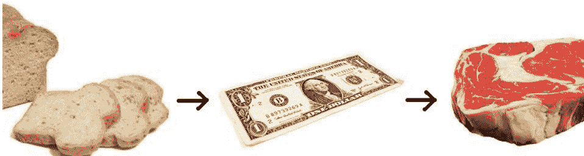

每个人的生命都充满了愉快和不愉快的经历。愉快的经历是生活中成功成就的合乎逻辑的结果。这些成就让你内心感到满足，被视为非凡的事件，并因此被记录为你生命中的高峰。然而，生活并不提供或保证在所有追求中都能成功。它为每个人准备了不愉快的惊喜。因此，你在人生旅程中必须品尝失败的苦涩。这些失败与成功的成就相反，被标记或记录为你生命中的低谷。同样，一个人的情绪也会经历高峰和低谷。情绪的这些高峰和低谷通常被称为情绪波动。情绪的这些波动或波峰（高峰）和波谷（低谷）也是大自然中极其显著和引人注目的特征。事实上，大自然之所以拥有惊人而迷人的美丽，归功于其经常变化的特征和场景。毕竟，是变化的季节为大自然增添了色彩和装饰。这种变化或对即将发生变化的预期，与枯燥的环境或刻板的任务相反，提供了许多学习和成长的机会。新挑战和频繁变化的条件或场景帮助你训练和准备应对复杂情况。所有投资决策的前提是在将风险因素降到最低的同时，以聪明高效的方式产生资金。作为审慎的投资者，你必须从可用选项中选择最佳投资机会。作为投资者，你将通过研究不同关键问题的答案来指导你的探索，例如：哪种投资选项在投资时间方面提供最安全的回报，该特定投资选项目前处于其商业周期的哪个阶段，以及何时是投入投资金额的最佳时机？如上所述，价格不会沿直线移动，价格活动受政治和工业政策变化以及国际商业供需因素频繁转变等众多因素的影响。这一标准操作程序通常也适用于资本和货币市场，并增加了另一个关键因素，即试图寻找和调查做出此类投资决策背后的原因。简而言之，在流行的NFT上做出投资决策也是围绕同样的原则。无论多么明智，投资或交易决策如果时机不佳，都可能导致资金损失。此外，你还必须确定风险因素和盈利目标。所有投资都是为了追求利润。盈利目标必须在投资或交易决策时确定，以帮助你成功退出市场。

### 1.1 交换媒介及其演变

“交换媒介”一词是指促进个人或各方之间商品和服务交换的工具。纸币

货币目前是最广泛使用的交换媒介。交换媒介可以简单定义为在商品或服务交换中无处不在使用的任何东西。换句话说，交换媒介是常用于购买和销售产品和服务的东西。然而，在一种工具可作为交换媒介之前，必须满足一些先决条件。每个人都必须认可该工具。如果一种工具不被广泛接受，就不可能促进商品和服务的销售与购买。它还应作为价值的度量。有了价值标准，会计工作会变得更加容易。

## 1.2 演化阶段

交换媒介的概念已经存在很长时间了。现在我们将详细描述该工具是如何随时间演化的。

### 1.2.1 物物交换制度

物物交换制度是与交换媒介相关的最古老制度。据认为，美索不达米亚人在公元前6000年左右引入了该制度。在这种制度下，交换服务和商品。作为一种媒介，没有单独的工具。相反，商品和服务本身充当了工具。尽管该制度相当简单直接，但存在若干缺陷。首先，物物交换制度需要找到拥有等值产品的交易对方，但这并不总是可行的。其次，为所有商品获得汇率几乎是不可能的。第三，由于产品稀缺，该制度无法推动经济发展。第四，由于可比产品价值并非始终可用，该制度几乎无法遵循。正是由于这些缺陷，物物交换制度逐渐不受青睐，货币概念由此诞生。

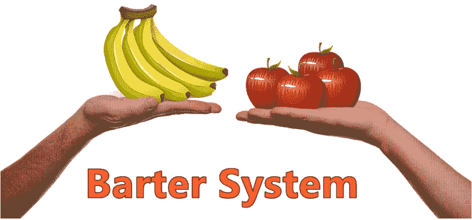

### 1.2.2 贝币作为交换媒介的引入

公元前1200年，贝币被用作硬币以克服物物交换制度的缺陷。这些贝壳小巧、方便、持久，且无法伪造。然而，它们过于容易获得，使得获取过于容易并侵蚀了其价值。

### 1.2.3 黄金作为交换媒介

为解决这一问题，有人建议发现一种既独特又难以伪造的媒介。由于金属满足了这一要求，因此铸造了金属硬币。为了作为一种媒介，铸造了小面额的金币。这些硬币的重量代表其价值。使用贵金属的缺点是并非在每个地方都容易获得。此外，盗窃风险也有所增加。

### 1.2.4 黄金与货币的比较分析

约翰·梅纳德·凯恩斯将黄金描述为“野蛮的遗物”。他暗示的事实是，基于他的信念和分析，黄金的实用性和价值已经过时。正是在1971年，尼克松让世界脱离金本位，宣称“我们都是凯恩斯主义者了”。米尔顿·弗里德曼曾经名言：“货币就是货币的作用。”这意味着，只要某物可以作为交换媒介，就可以将其归类为货币。例如，囚犯常常用香烟交换商品和服务，因此在监狱中，香烟就是货币。同样，在人类历史的大部分时间里，黄金一直是一种交换媒介。在当今经济中，纸币是首选的支付形式。一些人认为，黄金唯一的优势在于它是一种用于珠宝的物质。另一方面，反对派则声称，黄金是一种独特的资产，具有多种固有属性，使得投资者将其保留在投资组合中至关重要。问题是：黄金是否仍然有价值？黄金无疑与货币相关联。令人惊讶的是，全球各国政府都持有大量黄金，并最近开始增加黄金储备。问题是：如果黄金不是货币，他们为什么要拥有它？如果答案是“是”，那么它的价值是什么？过去的压倒性证据表明，黄金曾被用作交换媒介并且很有用，具体如下：

### 1.2.5 黄金简史

若不回顾黄金市场的开端，就无法完全理解黄金的实际用途。黄金的历史始于公元前3000年。那是早期埃及人开始制作珠宝的时候。直到公元前560年，黄金才开始被用作交换媒介。当时的商人正在寻找一种手段来创建标准化、易于携带的货币形式，以使贸易过程更加便捷和高效。尽管当时黄金珠宝已被普遍认可和承认，但铸造带有印记的金币的发明似乎就是答案。黄金在欧洲和英国作为一种货币形式引入后，其地位迅速增长，希腊和罗马帝国的文物在世界各地的博物馆中被突出展示。1066年，英国也在确立其金属本位货币。所有类型的英国货币（如英镑、先令和便士）的价值都基于其所代表的黄金（或白银）数量。最终，黄金成为欧洲、亚洲、非洲和美洲财富的象征。

### 1.2.6 美国的双金属本位

1792年，美国政府通过建立双金属本位来维持其黄金传统。根据双金属本位，美国的每个货币单位都必须由黄金或白银支持。例如，当时一美元相当于24.75格令黄金。这意味着，作为货币使用的硬币只是中央银行黄金（或白银）储备的凭证。然而，这一金本位并未永久持续。20世纪初的几个重要事件导致黄金从货币体系中式微。1913年，联邦储备系统（现代纸币的镜像副本）成立后，承兑汇票的发行开始。这些承兑汇票可以随时兑换成黄金。由于1934年《黄金储备法》，美国政府获得了流通中所有金币的权利，从而可以停止铸造新的金币。简而言之，这一立法确立了这样一个观念：黄金或金币不再需要作为货币。因此，美国于1971年放弃了金本位。正是在这个时候，其货币失去了黄金支撑。

### 1.2.7 现代经济与黄金

尽管黄金不再用于支撑美元（或任何其他全球货币），但在当今文化中它仍然有价值。它始终对全球经济至关重要。通过仅关注中央银行和其他金融机构（如国际货币基金组织）的资产负债表，我们可以轻松验证这一论点。截至目前，世界上地上黄金供应量的大约五分之一由这些组织持有。此外，一些中央银行谨慎地增加了黄金储备。这凸显了他们对全球经济长期可行性的担忧。

### 1.2.8 黄金有助于保值

黄金在现代经济中具有相关性的主要原因是，它在长达数代的漫长时间里，在成功保值方面表现出了卓越的表现。相比之下，以纸币计价的货币无法做出同样的宣称。让我们举个例子来帮助理解我们正在讨论的内容：在20世纪70年代初，一盎司黄金价值35美元。假设你当时可以选择保留一盎司黄金或仅仅35美元。事实上，黄金和美元都可以购买相同的商品，例如一套全新的定制商务西装或一辆运动自行车。相比之下，如果你今天持有一盎司黄金并按当前价格兑换，你可以用它购买一整套新西装，但同样的情况不适用于35美元。实际上，如果你选择保留35美元而不是一盎司黄金，你就会损失一大笔钱。这主要是因为黄金价值上涨，而由于通货膨胀，美元价值下降。

### 1.2.9 黄金安全

从中东、非洲、南亚及其他地区持续不断的紧张局势可以看出，当今世界的经济气候越来越依赖于并由区域和政治稳定性决定。正因如此，投资者对黄金有着天然的亲和力，并将其视为一种安全的投资，尤其是在政治和经济不稳定普遍存在时。对历史的考察表明

它已被王朝更替、军事和政治政变以及由此导致的货币崩溃所玷污。在这些时期，黄金投资者成功地保护了他们的财富，在某些情况下，还利用这种商品逃离经济和政治混乱。因此，每当出现暗示全球经济动荡的新闻事件时，投资者就会转向黄金作为避风港。

## 1.2.10 用于分散投资的黄金

一般来说，黄金被视为多元化投资组合的绝佳方式。无论您的担忧与通货膨胀、财富保护还是美元贬值有关，黄金都被证明是一种有利可图的投资替代方案，可以为您的投资组合增加多样化的组成部分。另一方面，如果您的目标仅仅是多元化，黄金与股票、债券或房地产无关。

## 1.2.11 黄金的演变

黄金随着时间的推移，因三次主要转型而演变：首先，它成为交换媒介的全球标准；其次，围绕它构建了一个国际银行体系，纸币可完全兑换黄金；第三，1971年兑换黄金的可行性停止，黄金被纯粹的法定货币体系取代。另一方面，自世界转向法定货币体系以来的40年里，黄金的益处并未改变。据金融界称，政府劝阻公民将黄金作为货币使用，但它们通过中央银行和财政部进行黄金交易。有确凿说法称美国财政部持有2.61亿盎司黄金。2012年，美联储的资产预计将达到1350万盎司。最近几个月，印度和中国通过其央行以惊人的速度购买黄金。因此，不到一年时间，它们的黄金储备已从156公吨增加到超过400公吨。这与过去四五十年政府长期抛售黄金资产形成了显著的背离。即使是国际货币基金组织（IMF）也最近通过购买44公吨黄金，推翻了长期实施的黄金变现政策。当然，黄金拥有是一种全球性的现象。因此，黄金价格不仅受到美国联邦储备委员会的影响，还受到世界各地其他中央银行行动的影响。普遍预计欧洲央行（ECB）不得不作为最后手段“印钞”来拯救欧元。如果情况如此，欧盟印钞的影响将加剧当前的货币战争，因为没有哪个国家想要强势货币。到目前为止，欧盟一直对印钞持谨慎态度。如果他们成为货币战争中的主要参与者，他们只会通过加速全球货币发行和降低黄金的避险价值来给火上浇油。与许多其他资产不同，黄金不产生收入，也不会承诺在未来任何时点提供资金。因此，黄金的任何利润完全基于其价格波动。

## 1.2.12 银行以金币发放信贷

早期银行通过存放这些金币并担保退还来提出解决这一问题的方案。随后，早期银行利用这些存款提供贷款。银行开始向存款人支付利息，以激励更多人进行投资。纸币就这样被引入。银行向存款人发放一张单据，列明他们存入的金币金额和重量。政府开始印制第一批货币纸币以控制这些纸币的流通。

## 1.2.13 现代在线信贷

从零售商处购买商品并提供信用卡信息。零售商与银行、信用卡公司及其他企业进行交互。Paypal是一个例外。它在您和零售商之间充当中介。您将信用卡信息提供给Paypal，Paypal批准交易并支付给零售商。您无需向卖家提供信用卡信息。在这方面，Apple Pay也类似。尽管许多人不愿意在线提供信用卡信息，但我们仍会这样做。其使用也会导致大量高成本的欺诈行为。

# 第 2 章：货币作为交换媒介

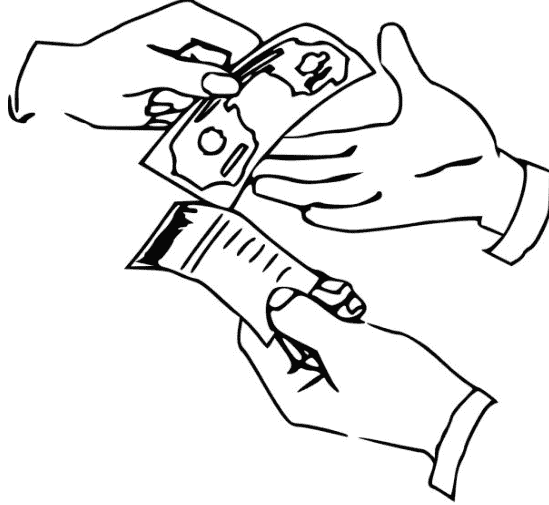

在现代，纸币是使用最广泛的交换媒介。法定货币由纸币组成。换句话说，其面值与内在价值不尽相同。法定货币被定义为政府发行且不以白银或黄金等实物资产为担保的货币。这与商品货币形成对比，商品货币本身具有价值。使用纸币有几个优势。政府可以低成本发行纸币，因为其内在价值远低于面值。此外，由于重量轻、耐用且便于携带，纸币也非常容易存放。携带和存放纸币比金币更安全。与硬币不同，纸币没有好坏之分，它们都一样。通过调节纸币供应量，发行机构可以保持其价值稳定。监管机构有权增加或减少其数量。因此，其供应可以被描述为具有弹性。另一方面，纸币的缺点不容忽视。政府发行这些货币，由中央银行控制。在流动性危机和银行挤兑期间，合法投资者会损失存入银行的资金。政府发行过多货币可能会导致通货膨胀压力。当整体价格水平上升，导致货币价值下降时，就会发生通货膨胀。纸币并非不可摧毁；它可能会因洪水、火灾、昆虫和其他自然灾害而受损。

### 2.1 货币作为交换媒介

货币通常被一个给定国家公认为支付商品和服务以及偿还债务的手段。几乎所有现代货币体系都基于法定货币。经济体系依赖于用货币交换商品和服务。经济学家描述了货币的来源及其价值。以下是货币的多种特性。

### 货币的特性

根据经济学家的观点，货币具有三个特性：
- 支付手段
- 记账单位
- 价值储存

### 2.1.1 货币到底是什么？

支付手段是上述列出的货币三个广受认可的特性中最重要的一个。货币对社会的价值和意义，仅通过公众对其作为无条件支付手段的接受度来衡量。货币使人们能够为共同利益而协调合作变得容易。以下列出了许多货币的实际定义。货币是：
- 法律的产物
- 本身并非有形财富
- 获取财富的能力
- 代币
- 财富的象征
- 基于法律的抽象社会力量
- 政府在税收中接受的东西
- 交换媒介
- 由政府依法强制执行
- 是否为人民广泛接受的交换媒介？

货币作为交换媒介的价值之所以存在，是因为人民对其的接受。货币由政府依法强制执行。在此执行过程中，政府代表人民行事。

### 2.1.2 货币作为交换媒介的使用

在建立交易手段（即货币）之前，人们习惯以物易物来购买想要的服务和商品。两个各自拥有对方所需某种商品的人会达成贸易协议。然而，早期的以物易物形式缺乏最终使交易成功所需的可分性和可转让性。例如，如果有人拥有牛却想要香蕉，他们必须寻找既想吃牛肉而不仅仅想要香蕉的人。如果那个人遇到一个想要肉、不要香蕉且只愿意交付土豆的人该怎么办？这样的人必须寻找拥有香蕉且也需要土豆的人，以便

为了获取肉类。缺乏以物易物交换商品的可转让性，会令人疲惫、困惑且成本高昂。但麻烦并未到此为止；即使此人遇到了愿意用牛肉交换香蕉的人，他们也可能不认为一头整头牛值一串香蕉。这样的交易涉及达成协议，并确定多少香蕉足以购买牛的某个部分。

商品货币解决了这些问题。商品货币是一种充当货币的商品形式。例如，在美国殖民地，17世纪和18世纪初，人们在交易中使用干玉米和海狸皮。这些商品具有普遍认可的价值，被用来购买和出售其他物品。用于交易的商品具有某些特征：它们是非常抢手的商品，因此价格昂贵，但同时也体积小巧、耐用且易于存储。

像黄金这样的贵金属是另一种更精致的商品货币形式。在1970年代之前的数十年里，黄金被用来大幅提升纸币的价值。例如，以美元为例，这意味着外国国家愿意将本国货币与美国按规定汇率兑换成黄金。这种兑换通过美国联邦储备系统执行。有趣的是，黄金之所以有价值，仅仅是因为人们喜欢它，这与干玉米和海狸皮不同（后者分别可用于食物和衣物）。你无法食用黄金，因为它在夜晚无法让你保暖；然而，大多数人认为它很美妙，并且意识到其他人也认为它很壮丽。它并非特别有用。是的，黄金有价值。黄金因人们的认知而充当财富的有形象征。作为一种具有效用之物的象征，货币与黄金之间的这种关联，揭示了货币如何获得其价值。

## 2.2 法定货币或实物货币

法定货币通常不需要实物商品的支持，是第二种形式的货币。相反，法定货币的价值由供求关系以及人们对其价值的信心所决定。法定货币是一种没有任何固有价值、通常由政府立法设为法定货币的货币。历史上，货币一直依赖于黄金和白银等实物资源，但法定货币依赖于经济的信用。法定货币的价值取决于供求关系，作为消费货币和代表货币的替代品而被采用。商品货币源于白银和黄金等贵金属，而代表货币则是一种可兑换商品的索取权。法定货币的发展是因为黄金是有限资源，快速增长的经济体并非总能开采足够的黄金来支持其货币供应需求。依赖黄金来赋予货币价值，对繁荣经济体来说极其低效，尤其是当其价值实际上是由人们的认知产生时。法定货币是人们对价值认知的象征，是货币创造的基石。不断增长的经济显然正在为其自身及其他经济体创造其他有用物品。经济越大，其资本的感知价值（以及越来越受追捧的程度）就越高，反之亦然。然而，人们的认知必须有能够提供个人所需商品和服务的经济作为支撑。例如，1971年，美元脱离了金本位，美元不再可兑换黄金，黄金价格也不再与任何美元价值挂钩。这意味着现在有可能生产出比可用于支撑的黄金更多的纸币。如果经济放缓，美元的价值将在国内通过通货膨胀、在国际上通过汇率而下降。美国经济的崩溃将使世界进入一个阴暗的金融时代，但许多其他国家和机构正在不懈努力，以确保这种情况永远不会发生。然而，正如由通货膨胀决定的那样，一种货币（不仅是美元，还有大多数货币）的价值仅由其购买力决定。这就是为什么仅仅印制新货币并不能产生一国的收入。货币是通过一种持续的关系产生的，这种关系存在于真实、具体的对象、我们对它们的需求以及我们对什么有价值的抽象信念之间。货币是好的，因为我们喜欢它，但我们想要它仅仅是因为它能让我们获得喜欢的产品或服务。中国在公元1000年左右是最早使用法定货币的国家，该货币最终传播到世界各国。当美国总统理查德·尼克松签署一项禁止将美元兑换成黄金的法案时，法定货币在20世纪变得著名。许多国家仍在使用仅作为支付方式的纸质法定货币。与依赖商品的标准货币不同，无法兑换或赎回法定货币。它本身毫无价值，是由国家命令使用的。政府必须防止其被伪造并负责任地维持货币供应，才能使法定货币有效。

### 2.2.1 法定货币的历史

10世纪，法定货币起源于中国，主要在元、唐、宋和明朝。唐朝（618-907年）对金属货币的强烈需求超过了贵金属的可用量。人们习惯于使用信用凭条，纸币或纸币草稿也被广泛接受。硬币短缺导致人们从硬币转向纸币。宋朝（960-1276年），四川地区的工业繁荣，导致铜币短缺。商人开始发行由现金储备支持的私人票据，第一种法定货币就这样发行了。元朝（1276-1367年），纸币成为唯一的法定货币，而明朝（1368-1644年）将票据发行权授予了财政部。18世纪，西方开始使用纸币。美国殖民地、大陆会议和法国继续发行用于支付的信用票据。票据由地方政府发行，持票人可用其缴纳当局的税款。由于通货膨胀的风险，发行如此多的信用票据引发了一些争议。新英格兰和卡罗来纳等一些地区的票据贬值严重，随着票据贬值，商品价格上涨。国家在冲突期间转向法定货币，以保存黄金和白银等贵金属的价值。例如，在美国南北战争期间，美国联邦政府转换为一种称为“绿钞”的法定货币形式。战争期间，政府暂停了其纸币兑换成黄金或白银的可兑换性。20世纪初，政府和银行曾承诺促进硬币和票据转换为其名义商品。然而，美国南北战争的高昂开支以及恢复经济的需求，迫使政府终止了赎回。根据布雷顿森林协议，一金衡盎司黄金的价值被设定为35美元。然而，1971年，美国总统理查德·尼克松推出了一系列经济措施，包括由于黄金储备下降而取消美元直接兑换成黄金的可兑换性。从那以后，大多数国家都采用了可在主要货币之间交换的法定货币。

### 2.2.2 法定货币如何运作

法定货币不受任何实际资产的支持，而是由投资者的信心和政府声明所支持。纸币作为

作为购买力的存储介质和以物易物方法的替代方案。它帮助消费者，就像以物易物交易一样，购买他们需要的商品和服务，而无需以产品换产品。由于其存储购买力的能力，个人可以方便地制定计划并开展专业经济活动。例如，一家从事手机组装的公司将购买新设备、招聘并支付工人，并扩展到其他领域。法定货币的价值取决于一个国家经济如何运作、该国如何自我治理以及这些变量对利率的影响。政治不稳定的国家可能会出现经济疲软和油价飙升，使个人在需要进口商品时无法做到。当公众对货币作为购买力存储介质的能力有足够信心时，法定货币运作良好。它还必须得到政府完全信用的支持，由政府发布公告并印制为金融交易的法定货币。

### 2.2.3 法定货币的优缺点

与基于商品的货币（如金、铜和银）不同，法定货币最重要的特点是其价值的稳定性。随着政府和银行介入以保护其经济免受经济周期定期衰退的影响，法定货币在20世纪得到了广泛应用。由于每日市场周期和偶尔的经济衰退，基于商品的货币变得波动。中央银行在需要时会印刷或保留纸币，从而使他们对资本流动、利率和流动性拥有更大的控制权。例如，美联储对货币供需的管理帮助其应对2008年全球金融危机，尽管这对美国金融体系和全球经济造成了更大损害。全球金融危机表明了相反的情况，尽管法定货币被视为一种更稳健的货币，可以为抵御经济衰退提供缓冲。虽然货币供应由美联储监管，但这不足以避免危机的爆发。与供应无限的法定货币相比，黄金的有限供应使其成为一种更稳定的货币。

## 2.3 货币的计量

但是，到底有多少钱在流通，它采取什么形式呢？经济学家和投资者提出这个问题是为了确定是否存在通货膨胀或通货紧缩。为了使其可用于计量的定义，货币被分为三个类别。通过将下文提到的三个类别相加，我们可以得出一个国家的货币供应量或经济体内货币的总量。

- 第一类货币-M1
- 第二类货币-M2
- 第三类货币-M3

### 2.3.1 货币的起源

关于货币的起源，有三种主要理论：

### 货币是为交易目的而创造的

出于交易目的，大多数经济学家认为，与以物易物相比，货币的演变是因为其更具灵活性。这意味着货币本身就是一种宝贵的资产，例如古代文明中的牲畜，后来按重量计算的金银，最终是金银硬币。当你知道这是试图解释金属货币起源时，这听起来都合情合理；否则，牲畜不属于这种金属货币的定义。此外，通过金属货币，会期望出现高度的增长：这将意味着承认私有财产，与部落财产相反：这将意味着承认合同并由法律结构遵守。同时，牲畜更容易被承认为货币，因为原始文化很容易对其进行估值，并可以在没有法律结构的情况下单方面施加价值。

### 货币是为社会目的而创造的

第二种理论认为，出于社会原因而创造了货币，例如确定新娘价格或为被另一个部族杀死或伤害的人支付血钱。

### 货币是为宗教目的而创造的

第三种理论认为，货币是为宗教目的而创造的。在他的《圣金》一书中，Bernard Lam 指出，货币的起源在于东方的神庙。它被用作向众神献祭的强制性供品，以及支付祭司的报酬。

### 黄金的货币化

大约在公元前1500年至公元前1000年，按重量标准，交换媒介从牲畜标准转变为黄金。在将黄金转化为货币的过程中，神庙起了重要作用。多年来，金银在神庙中积累。出于装饰目的，需要大量金银。神庙收集了如此多的黄金，这一事实必然是决定将其转化为货币或将其货币化的关键因素。该理论认为，通过货币化，祭司们想要使用部分过剩的黄金：例如，他们可能估计1头牛值130克黄金。祭司们长期以来因其服务而获得报酬，例如关于在哪里种植庄稼的指导，并为这些服务制定了标准费用。该理论认为，祭司们通过武断的决定计算了黄金的价值，这与货币贸易的起源相矛盾，后者认为黄金的价值是由开采它并将其塑造成常规货币单位的任务决定的。

### 不同时代的货币

将推理应用于这三个假设，人们可以想象，牛是古代爱尔兰和希腊常见的货币单位。在那个时代，在这两个古代文明中，一个女奴值3-4头牛。给牛估价很容易；牛多大了，牛可能生多少头小牛；牛可能产多少牛奶；它的牛皮和牛肉、粪便、血统等的价值。但是，你如何估价，比如说，130克黄金，这似乎是古代黄金货币单位的正常重量？祭司在公众中拥有权威；他们拥有充足的黄金供应；他们计算了服务的价格；当他们想要将黄金货币化时，他们可以将其价值与正常记账货币单位的价格进行比较来确定其价值，而这种单位在自然界中是一头牛。西方社会货币起源中更合理的假设是，货币是出于宗教原因而产生的。货币是由神庙祭司的命令赋予价值的。因此，以重量计的金或银形式的货币，是第一种法定货币。它既作为一种支付方式，甚至作为一种商品都有意义。

### 亚里士多德，希腊哲学家（公元前384年 – 公元前322年）

显然，亚里士多德在公元前4世纪，即近2500年前，就掌握了资本的本质。货币不是资产，像金或银一样，不能开采。货币像小麦或大麦一样，不是可以收获的庄稼。货币不是牛或山羊等动物。货币的本质是它是一种合法的发明。法律的产物就是货币。希腊语中货币的单词是“nomisma”，意思是法令或有约束力的传统。亚里士多德将货币描述为一种抽象的法律力量，为了公共利益而受到公共监管。

### 货币是政府的第四分支

政治学家提到政府的三个分支：行政、立法和司法。Stephen Zarlenga 在《被遗忘的金融科学》中有力且引人深思地主张，存在一个被称为“货币势力”的第四个政府分支（无论我们是否知道）。货币势力是任何给定国家发行货币的权力。这个术语是由马丁·范布伦（美国第8任总统，1782–1862）创造的。Stephen Zarlenga 特别指出，货币势力远比所有政府分支都强大，他为此对货币制度改革做出了最大贡献。这一事实通常不为人知，导致社会严重扭曲和腐败。

## 2.4 新型货币

近年来，人们已尝试建立不受银行或政府监管的新型货币。然而，它应当具有与货币相同的特性，例如稀缺但易于携带和转移等。加密货币，也称为数字货币，满足所有这些标准。比特币是一种基于区块链方法的加密货币示例，在该方法中，交易由一群人而非单一个人进行验证。像比特币这样的加密货币的缺点是，货币控制再次集中在少数个人手中。因此，去中心化的目标尚未完全实现。

## 总结

从上述内容可以推断，交换媒介随时间推移已从商品与商品的交换演变为使用金属硬币、金本位货币、纸币和数字货币。每种交换系统都有其自身的优缺点。加密货币，也称为虚拟货币，是数字

由私人个人或团体创建和使用的货币。加密货币被归类为替代货币，因为它们不受国家政府监管。这些是存在于国家货币政策范围之外的金融交换媒介。比特币（BTC）是最知名且最广泛使用的加密货币。然而，有数百种加密货币，每个月都有新的出现。为了与比特币区分开来，非比特币加密货币被称为"替代币"。下一章试图阐述有关加密货币历史和出现的信息。

# 第3章：加密货币的历史

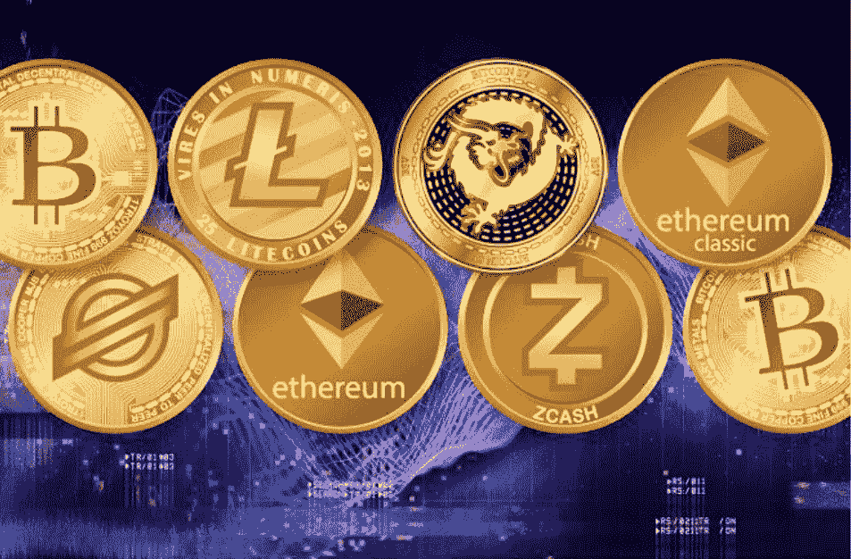

数字货币，或称数字货币，是指仅以电子形式存在的任何货币或支付形式。数字货币缺乏有形形式，如钞票、收据或硬币。电子代码用于在机器中对其进行记账和传输。随着自动化越来越普遍，支付变得越来越自动化，从而减少了对实体货币的需求。加密货币，也广泛称为 crypto，是一种可用作支付形式的数字货币。它采用密码学来保护和验证交易，以及监管新数字货币单位的创建。区块链技术是由分布式计算机网络授权的分布式账本。区块链是许多加密货币的核心。加密货币与美元和英镑等法定货币的不同之处在于，它们不由中央机构发行，这使得它们可能对政府干预或操纵不敏感。在本章中，我们将讨论加密货币的各种概念，并阐述其起源的信息，以帮助您了解这种独特的金融创新。

### 3.1 加密货币是如何运作的？

绝大多数加密货币独立于中央银行或政府运作。与其依赖国家担保，不如说加密货币由一种称为区块链的去中心化技术驱动。加密货币不以钞票或硬币的形式出现。相反，它们仅存在于互联网上。将它们视为虚拟代币，其价值由想要购买或出售它们的人所建立的市场力量决定。加密货币通过挖矿创建。挖矿是一个涉及复杂计算机处理能力来解决复杂数学问题以赚取代币的过程。用户也可以从经纪人那里购买货币。然后用户可以借助加密钱包来存储和花费。

### 3.2 加密货币解释

新技术现在允许数字货币或加密货币以更安全、更轻松的方式使用。借助信用卡、智能手机和在线加密货币交易等技术，数字货币可以被转移和交易。加密货币是指一种经密码学保护的数字货币，使其更难以伪造或双重花费。它通过基于去中心化区块链技术的网络运行，这些网络基本上是通过计算网络存储的数据库。加密货币不由中央银行或政府分发，这使它们免受政府干涉或滥用的阻碍。数字货币的历史可以追溯到互联网的诞生。早期，让社区支持使用数字货币面临挑战；但随着人们对技术越来越熟悉，技术本身也变得更简单、更安全，现在更多人渴望使用数字货币。PayPal被认为是最早将易于使用的自动化金融交易概念引入大规模采用的流行企业之一。要了解数字货币为何如此流行，首先了解什么是数字货币很重要。简单来说，加密货币去中心化了货币，使其不受政府监管。然而，没有单一机构，检查转账和防止双重支付成为一项挑战。这时，密码学家的文化发挥了作用。加密货币交易通过密码学和区块链有效地分发到整个网络，而不是通过集中式第三方来检查交易。在开源网络中，这个公共账本跟踪所有交易，使任何人都可以查看交易。只有当加密货币矿工通过解决密码学难题来验证交易时，交易才会完成。在加密货币中，通过合法化转账，矿工在常规货币交易中作为第三方运作，类似于政府。然而，加密矿工是通过网络本身获得加密货币报酬，而不是从交易和参与者的资金中抽取分成。为了保持交易历史的完整性，该系统鼓励区块链中的每个人。这种对传统金融系统的解决方案变得越来越有吸引力，因为它鼓励个人在没有监管第三方的情况下对自己的资金拥有更多控制权。现在，让我们回顾一下过去10多年里加密货币的里程碑式步骤。

### 3.3 我们今天为什么使用加密货币？

加密货币的主要目标是通过赋予货币持有者权力和责任来解决传统货币的问题。每种加密货币都试图解决一个或多个现实问题。以下是人们对加密货币产生兴趣的四个主要原因。

### 3.3.1 加密货币归所有人所有

加密货币的运作方式与传统国家货币类似，但存在几个关键差异。政府机构创建并监管当前的"法定货币"，所有这些现在都代表债务。任何拥有某国货币的人都持有该国发行的"欠条"（IOU）。"加密货币"一词并不意味着"债务"。它只代表其自身，其价值由有人愿意用什么来交换它来决定。加密货币的去中心化特性对其价值的决定方式产生了重大影响。加密货币不由任何人拥有或监管。其价值不受某国政府政治意图或其中央银行货币政策的影响。加密货币，如股票和债券，被视为一种资产。在美国出售或交换时，它需要缴纳资本利得税。

### 3.3.2 加密货币几乎无法伪造

加密货币基于一种称为区块链的分布式账本。了解区块链技术可以帮助您理解它为何对数字货币的力量如此重要。"块"由加密的数据块组成。"链"指的是存储块并按顺序链接它们的公共数据库。区块链中的每个块都有其自己的独特代码，用以将其与所有其他块区分开来。哈希是赋予这种独一无二代码的名称。添加到区块链的数据块按时间顺序添加。在创建最后一个块之后，会创建一个带有其自身唯一哈希的新块。链中的账本和/或块数据库会同时在全球范围内分布，遍布数千台，或者在以太坊和比特币的情况下，遍布数百万台计算机。假设有人希望伪造链上的单个数据块。在这种情况下，他们需要从某个时间点开始更改所有块，并更新所有拥有区块链账本副本的计算机。理论上，这是可能的，但完成此操作所需的资金和影响力使其几乎不可能。

### 3.3.3 加密货币交易是保密的

传统政府发行的货币允许您使用实体现金进行私下交易或当面付款。纸币、金属、布料以及塑料货币占流通中的法定货币总额的一小部分。大额现金取款会很快被中央机构（如政府及金融系统监管机构）检测并调查。加密货币是一种独特的概念。要检测两个人或公司之间的交换，需要精心设计的数学。这大多是在人们背地里进行的。虽然世界上的任何人都可以查看账本或交易列表，但交换加密货币的各方更加私密。加密货币从定义上说继续以电子形式持存在数字钱包中。所有者是钱包私钥的所有者。货币主要从用户的匿名钱包以数字方式交换。

### 3.3.4 加密货币安全性随时间和价值增长

黑客需要控制"共识"网络中超过一半的计算机。所有接收区块链或分布式账本副本的计算机共同组成共识网络。对于比特币或以太坊等更成熟的加密货币，其加密货币网络非常庞大，因此攻击几乎不可能。因为早期加密货币网络规模要小得多，所以更容易获得大多数控制权。

## 3.5 加密货币的历史

自2009年比特币推出以来，全球加密货币世界迅猛发展。最初一个未经验证的概念，如今已被广泛视为货币的未来。自加密货币交易所开设以来，成千上万种其他加密货币相继涌现，也有不少随之失败。尽管比特币目前仍是最受欢迎的加密货币，遥遥领先，且大多数类似加密货币的非投机性影响微乎其微，但投资者和消费者也应牢记其他加密货币。以下列出了当今最常见的加密货币。

- SmartCash
- Flooz
- Digicash
- B-Money
- Paypal
- BitGold
- E-Gold
- Hash-Cash
- Ethereum
- XRP
- Tether
- Bitcoin Cash
- Litecoin
- EOS

### 3.5.1 SmartCash

SmartCash 是一种以社区为驱动的零现金型加密货币。为了实现商家采用的愿景，它优先考虑隐私和快速交易时间。该项目的显著特征是反对中央权威，这导致项目放弃了核心团队。该货币与 Dash 等同，因为它旨在通过快速、私密的货币获得广泛采用。由于其使用主节点并依赖 Dash 基金会，Dash 被视为一种相对集中化的货币。基金会、核心团队和集中化挖矿都是 SmartCash 希望避免的概念。另一方面，SmartCash 包含多种分散式治理以及开发功能。它在社区驱动的开发上进行了大量投资。因此，SmartCash 越来越受欢迎。SmartCash 尽管不如 Dash 以及 Zcash 和 Monero 等其他私密支付平台知名，但对匿名、不可追踪且可用的加密货币提供了独特视角。传统加密货币（例如比特币）仅激励矿工，而忽略了为项目维护、开发和推广做出贡献的其他利益相关者。SmartCash 是一种优先考虑开发和社区的社区驱动型加密货币。总区块奖励的 29% 已留出，以支持 SmartHive 社区提案以及蜂巢团队。SmartMining 是 SmartCash 的一项新功能，可抑制挖矿攻击。任何拥有电脑和一块或多块显卡的人都可以参与挖矿。针对 Keccak 挖矿算法的 ASIC 尚未开发出来，可以合理假设在很长一段时间内都不会出现。

### 3.5.2 SmartHive 和 SmartVoting

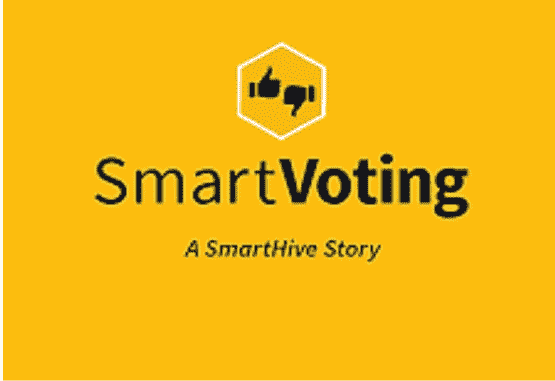

SmartCash 社区表示，拥有“核心”团队的加密货币从长远来看是低效且腐败的。人们担心，创始人会将赚钱置于创建开放且低成本平台之上。随着 ICO 的兴起以及创始团队代币分配的增加，我们已经见证了这种情况的发生。这些中央组织可能变得官僚主义、难以应对，并优先考虑相互冲突的目标。相反，SmartCash 推荐一种基于蚂蚁和蜜蜂自我组织的治理模式。目标是创建一个蜂巢，让人们可以在小团体中从事特定项目。有人认为，这种分散的方法最终可能比它试图取代的基金会/核心团队方法效率更低。然而，社区认为，自我治理团队比引导式开发更加敏捷和高效。所有 SMART 代币持有者将获得投票权。一枚代币等于一票。任何人都可以使用这个所谓的 SmartVoting 系统向蜂巢提交提案以供评估和投票。目标是创建一种自下而上的管理系统，其中项目由 SmartHive 基金资助。此外，蜂巢成员在完成提案后会获得补偿。SmartHive 是项目的生命线，旨在使项目无限期运行。这种结构得到了一群对该项目充满热情的铁杆粉丝的草根支持。SmartCash 的每个区块奖励都用于资助未来的开发项目。截至目前，该基金的价值已超过 2.5 亿美元。

### 3.5.3 蜂巢结构化团队

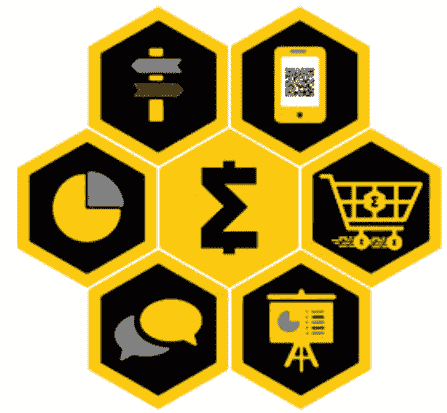

在蜂巢投票批准后，团队将承担拟议的项目。这些团队起初很简单：开发、推广和支持。随着改进提案数量和社区的增长，会形成新团队。一个团队由最多八人组成，他们作为一个小组一起工作。除此之外，你还需要组建一个新的项目团队。这被称为蜂巢结构化团队，它将贡献社区划分为更小的子群，人们根据需要加入和退出团队。因此，每个团队都有自己的预算和由社区任命的团队协调员。团队一旦组建，便是自成体系的。除了全社区范围的 SmartVoting 公投外，没有建立任何控制结构。蜂巢结构化团队是一群每天参与项目工作的专职社区成员。个人将由团队雇佣。如果社区成员无法承诺加入团队，他们将有不那么正式的方式为 SmartHive 做出贡献。

### 3.5.4 Flooz

Flooz.com 曾是九十年代末科技热潮的宠儿，但到 2001 年便趋于冷落。Flooz 被比作优惠券或航空里程，可以通过推广活动积累，也可直接从 Flooz 的中央平台购买，作为相对年轻的互联网上接受支付的商家的数字工具。Flooz 在其三年运营期间筹集了高达 3500 万美元的风险投资，押注商家对新颖且令人兴奋的支付机制的需求。Flooz 在其广告活动上没有花费一分钱，甚至邀请了喜剧演员 Whoopi Goldberg 拍摄一系列电视广告。尽管有势头，但据报道 Flooz 最终未能吸引大量用户和商家，而该公司平台上的犯罪活动最终证明对其来说无法承受。到 2001 年 8 月，由于投资者支持迅速下降以及其平台上涉嫌犯罪活动的指控，该公司的倒闭进程被加速。根据 2001 年《纽约时报》的一篇报道，俄罗斯犯罪团伙被怀疑使用被盗信用卡购买在线货币并洗黑钱，这促使联邦调查展开。据 Flooz 方面消息，约 30 万美元被盗。欺诈指控浮出水面后不久，Flooz 在未能找到买家的情况下关闭了。

### 3.5.5 DigiCash

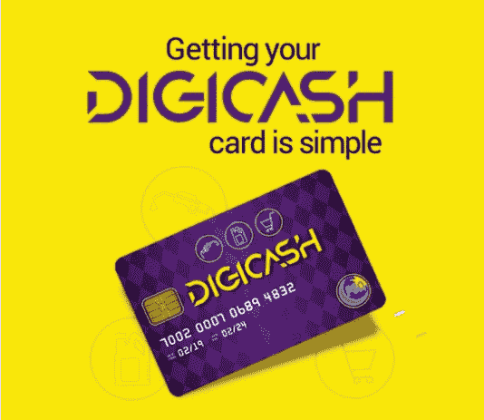

DigiCash 是一家成立于 1990 年代的数字货币公司，曾一度接近成为全球成功案例。然而，DigiCash 由于内部纠纷和缺乏启动动力等多重因素而失败，这使其无法成为广泛使用的在线支付系统。ecash 系统的创建者 David Chaum 是加密协议领域的先驱。DigiCash 成立于 1990 年，支持 cyberbucks，这是一种为用户提供匿名性、为接受该货币的商家提供安全性的数字货币。据《卫报》2003 年的一篇报道，自由意志主义者及其他支持超越政府控制的国际在线货币的人士支持了 DigiCash。DigiCash 值得注意的是，它允许各种支付规模，尤其是微支付。对于货币交易，该系统使用电子邮件邮件列表系统，有报道表明交易者进行了场外交易。据当时的报道，现金流不足以及公司员工与领导层之间的摩擦是导致 DigiCash 失败的原因之一。尽管与主要银行和信用卡公司进行了高层谈判前景看好，但该企业未能达成一笔重大交易，以确保其在 an

日益数字化的金融领域。例如，花旗银行曾就一个整合项目进行长期谈判，但该银行此后已将重心转向其他业务。Chaum于1996年离开该公司，两年后，该公司申请破产。

## 3.5.6 B-Money

魏·戴提出了B-Money，作为一个“匿名、分布式电子现金系统”的早期提案。中本聪在创建举世闻名的比特币时曾提及B-Money。B-Money最初于1998年由华盛顿大学毕业生魏·戴提出。他的计划是创建一个免费的在线金融系统，使得没有人能够征税或强迫他人做任何事情。B-Money于1998年首次向公众介绍，比比特币早了十多年，但鲜有人记得。另一方面，B-Money与比特币截然不同，尽管第一个系统的创建者魏·戴也希望创建一种无记名且分布式的发行代币方法。为加速B-Money的实现，公布了包含与现代加密货币相同基本原理的技术文档（link）（即所谓的“白皮书”）。预期“数字别名”能够通过去中心化网络发送和接收资金，并确保双方之间的合同执行，无需第三方参与。第一种协议中提出使用工作量证明函数作为创建货币的手段。戴的B-Money是在关于Hashcash（第一个对称工作量证明函数）的密码punk邮件列表讨论背景下提出的，Hashcash在前一年同一邮件列表上也有刊载——1997年5月。（比特币在铸造硬币期间使用hashcash成本函数作为工作量证明，正如B-Money提案一样。）在B-Money中，通过将交易传输给所有参与者来转移资金，所有参与者都记录彼此的账户。可以与同意充当仲裁人的第三方达成在违约情况下可能进行赔偿的合同。如果未能达成协议，每个方会广播对其有利的论点或证据，每个参与者在自己的账户中计算赔偿金/罚款。账户只能由部分参与者（即“服务器”）保存。这些账户必须公开，而在第二种协议中，进行交易的参与者通过询问大量此类账户来验证其余额。参与者还确保货币供应量不会被通胀。要成为服务器，必须支付一份保证金，如果服务器被发现不诚实，这份保证金将被没收。还提出了一种创建货币的替代方法，涉及拍卖，参与者对已知复杂度计算问题的解决方案出价。遗憾的是，自白皮书实施以来，B-Money项目一直停滞不前。

## 3.5.7 PayPal

PayPal（PYPL）是真正的电子商务巨头，前景光明，拥有忠实的用户群，预计随着更多年轻人拥抱数字支付平台，用户群将不断增长。该公司盈利，2018年收入超过150亿美元，并且范围真正全球化，平台在全球200多个市场支持100种货币。普遍认为，尽管争夺利润丰厚的电子商务支付市场份额的竞争日益激烈——这是不断扩大的商业和消费技术市场中最有利可图的市场之一——PayPal将继续增长并主导数字支付领域。

### PayPal 的历史

虽然PayPal的历史并不特别悠久，但在该公司超过二十年的存在期间，经历了无数起伏、波折和转折点。当技术企业家彼得·蒂尔和马克斯·列夫钦于1998年创立PayPal时，它甚至还不叫PayPal。Confinity是该公司的原名，其创立理念是为消费者和企业提供低成本、几乎毫不费力的数字支付。随着互联网对全球消费者的控制不断加强，该公司明智地瞄准了一个服务不足的市场：银行业务和支付。

创始人的理念简单而有效：说服客户分享他们的电子邮件地址、银行信息和信用卡号码，以换取快速、低成本的支付。在开业三年内，该公司已处理来自1020万个体消费者以及260万家商业客户的30多亿美元付款。在决定仅专注于互联网支付后，两年后创始人将公司名称改为PayPal。蒂尔和列夫钦巧妙地利用了支付市场的一个空白，当时没有人真正专注于为消费者和企业提供数字支付平台，这个空白被这对搭档出色地利用，随着世纪之交PayPal迅速崛起。

### PayPal 时间轴

PayPal的增长轨迹在早期加速，公司很快设定了一些令人印象深刻的增长基准。

### 1998年8月

在斯坦福大学就全球市场机会发表演讲后，彼得·蒂尔遇到了马克斯·列夫钦。同年晚些时候，他们提出了数字钱包的概念。

### 1998年12月

PayPal成立。

### 1999年10月

该公司的工程师开发出基于电子邮件的支付技术。

### 2000年1月

PayPal的创始人和经理注意到，最终用户要求商业合作伙伴以及其他买家注册PayPal，以便实现更快的支付。PayPal几乎立即在网站上为eBay支付铺平了道路，显著增加了PayPal的用户基数。

### 2000年3月

PayPal超过一百万客户目标。

### 2001年6月

创始人将Confinity名称替换为正式名称PayPal。

### 2002年2月

随着新公司股票的发行，PayPal（PYPL-Nasdaq）上市。IPO取得成功，PayPal股价上涨超过50%，并在首个交易日收于每股20美元。

### 2002年10月

在数字拍卖与在线支付服务之间广受宣传的“婚姻”中，PayPal以15亿美元售予eBay。

### 2006年2月

PayPal突破一亿个最终用户账户。

### 2006年4月

PayPal推出PayPal Mobile，一个新的移动支付平台，允许客户从智能手机使用PayPal支付。

### 2008年12月

PayPal接近一亿个用户账户的里程碑。

### 2013年9月

PayPal斥资8亿美元收购Braintree Systems，这是由Venmo（一家在线支付竞争对手）拥有的支付网关公司。

### 2015年7月

PayPal以8.9亿美元收购数字汇款公司Xoom。这使该公司能够加速处理国际支付。

### 2017年2月

PayPal推出其第一个点对点支付系统。这帮助公司在新兴P2P市场站稳了脚跟。

### 目前

该公司已开始深入探索利润丰厚但波动巨大的加密货币市场，专注于该技术的底层区块链平台，并暂时避开比特币。此外，该公司正在印度（一个关键的全球市场）扩大业务，雇佣1200名新的公司技术专家，专注于印度的移动及其他新兴支付技术。它还宣布与Facebook（FB）达成合作关系——获取Facebook, Inc. Class A报告Marketplace，公司官员相信该合作在财务表现方面有望超越其长期合作伙伴eBay。总体而言，投资者和分析师将PayPal视为数字支付领域的领先企业，尽管来自金融科技公司和主要全球银行的竞争激烈，争夺相同客户，但该公司似乎处于未来财务增长的有利位置，股价上涨几乎是板上钉钉的事。

## 3.5.8 比特黄金

开发去中心化虚拟货币的最初尝试之一是比特黄金，它由区块链先驱尼克·萨博（Nick Szabo）于1998年构思。尽管萨博的比特黄金项目从未实现，但它被广泛认为是中本聪比特币协议的前身。事实上，比特黄金和比特币协议非常相似，以至于有些人认为萨博就是匿名的比特币开发者中本聪，但萨博否认了这一点。比特黄金通过结合密码学和挖矿技术来实现去中心化。这些元素包括维护在产权登记表中的带时间戳的区块，并使用工作量证明（PoW）字符串创建。根据萨博的说法，他提出了一种去中心化的PoW函数，可以“以最小信任安全地保存、传输和检验”。

### 理解比特黄金

比特币和比特黄金有很多共同点，尤其是在处理交易和保障去中心化网络安全的技术方面。在比特黄金结构中，用户必须使用计算能力来解决密码学挑战。所有解决的谜题都会在拜占庭容错（BFT）点对点网络中传播，解题者的公钥会分配给他们。交易详情保存在产权登记表中。在共识系统中，它类似于区块链，因为它提供了已发生交易的不可更改记录和顺序。萨博提出的比特黄金方案是不可替代的。这意味着必须将各种数量的比特黄金合并才能产生一笔交易。比特黄金不依赖中央机构来管理其控制杠杆，而是依赖于构成其网络的众多节点——即参与计算机——之间的去中心化和分布式信任系统。

### 比特黄金与比特币有何不同？

尽管比特黄金和比特币之间存在相似之处，但这两个项目有几个根本区别。根据萨博的说法，挖矿比特黄金的难度会随时间变化。它本质上不会变得更容易或更困难，但在某些时期，可生产的比特黄金数量会出现高峰和低谷。另一方面，比特币的设计是随时间增加挖矿比特币的难度。（比特币的数量也是有限的。）更重要的是，与比特币不同，比特黄金从未打算用作交易媒介。比特黄金被设计为另一种电子货币的储备货币。在法定货币出现之前，比特黄金旨在充当实物储备。

### 比特黄金的目标

萨博声称，比特黄金的发明是为了缓解现有银行系统的低效问题。根据萨博的说法，在传统金融系统中，交易各方必须投入高度信任才能使交易生效。当客户和金融机构通过基于信任的系统进行交易时，不幸的是容易受到欺诈和盗窃。事实上，银行系统反复损失的历史，以及欺诈活动的高昂成本和封闭式设计，促使萨博提出了比特黄金，这是一种更不需要信任的交易方式。

## 3.5.9 电子黄金

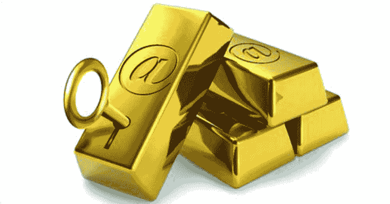

道格拉斯·杰克逊博士和巴里·K·多尼于1996年创立了E-gold，作为一种私有数字货币，允许其网站成员使用现代技术即时转移黄金。E-gold与之前的联邦货币替代品不同，它完全是数字化的，且交易完全不可撤销。尽管该网站最初很可能是出于良好意图创立的，但它迅速变成了罪犯的避风港。洗钱者、身份窃贼、欺诈性的“金融”投资者以及儿童色情产品购买者都使用了E-gold，因为黄金转账是不可撤销的。此外，E-gold交易的不可撤销性意味着，如果一个人的账户被黑客攻击，就没有补救措施。到2006年，E-gold的管理层意识到该网站正在被用于重大非法活动，并开始冻结账户。首席执行官道格拉斯·杰克逊在一份声明中表示：“E-gold合法运营，但不赞成有人试图将e-gold用于犯罪活动。”E-gold有着与美国及世界各地执法机构长期合作的历史，在回应合法请求时提供数据和调查支持。2007年，美国政府命令E-gold冻结若干提供类似E-gold服务的E-gold账户，随后以多种刑事罪名起诉了E-gold。反对E-gold的主要论点是，它没有采取足够措施防止非法活动，因为未能实施一种机制来阻止欺诈用户仅仅创建新账户并将其E-gold转移到新账户。E-gold还是一家无牌照的资金传输业务，尽管它实际上并没有转移资金。在美国，资金传输业务依法必须获得许可证，这包括保存创建账户的用户的某些法律信息。因此，其创始人被判犯有包括共谋在内的类似指控。然而，对公司及其公司治理的法律后果较小，E-gold能够与联邦政府达成协议，允许合法用户从其账户中提取资金，类似于在线扑克玩家可以做的那样。E-gold至今仍在运营，但不再接受新账户或用户之间的e-gold转账。

## 3.5.10 哈希现金

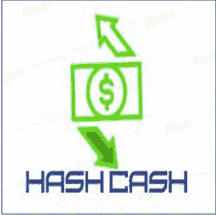

哈希现金是数字货币的先驱。它是中本聪比特币工作量证明实现的灵感来源。要理解比特币的共识机制和工作量证明，我们首先必须了解哈希现金。亚当·巴克于1997年创建了哈希现金，作为一种防止电子邮件垃圾邮件的方法。即使在1997年，电子邮件垃圾邮件也是任何拥有电子邮件账户的人的烦恼。根据亚当·巴克的说法，这是由于一个根本问题：给某人发电子邮件只需向邮件服务器发送几个数据包。他们决定对电子邮件收费。发送电子邮件非常便宜，几乎是免费的。尽管诚实用户每天只发送几封电子邮件，但垃圾邮件发送者可以以微乎其微或零成本发送数千万封电子邮件。想想发一封电子邮件要花一分钱要花多少钱。这对每天有几分钱可支配的普通用户来说没问题。然而，垃圾邮件发送者则不得不支付数百万分钱，这实际上终结了他们的垃圾邮件活动。你会发现，这有点颠倒：每封电子邮件收取一分钱，预设了存在用于支付的数字分钱。但是不存在这样的解决方案，这就是为什么我们需要比特币。那么，哈希现金如何让垃圾邮件发送者支付一枚虚拟分钱呢？答案在于哈希现金的核心概念，这一概念现在也出现在比特币中：工作量证明。

### 哈希现金的工作量证明

哈希现金中的工作量证明非常简单直接。邮件服务器首先指定一个难度等级，这是一个表示工作量证明必须有多难的数字。默认值是二十。在哈希现金中，工作量证明是生成一条消息，其SHA-1哈希摘要以二进制中的20个零开头。如何生成带有您指定前缀的哈希摘要？请记住，您实际上无法比随机更好地预测加密哈希函数的输出。你别无选择，只能强行尝试。要解决这个工作量证明，只需尝试不同的输入，直到其中一个前面有足够数量的0为止。

## 3.5.11 以太坊

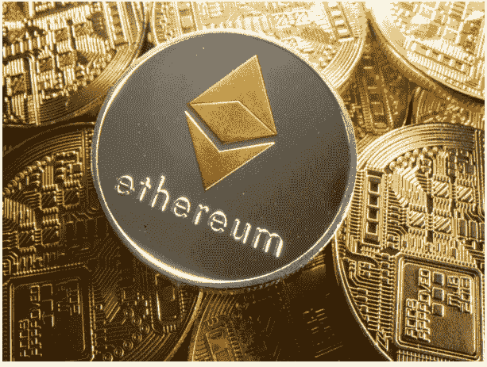

以太坊是一种共享区块链开源框架，拥有自己的加密货币以太币。ETH作为许多其他加密货币和去中心化智能合约应用的论坛发挥作用。以太坊首次在维塔利克·布特林2013年的白皮书中被描述。2014年夏天，布特林与其他联合创始人一起，通过公开在线众筹为该项目获得支持，并于2015年7月30日正式启动了该区块链。以太坊本身预计将成为一个面向开放应用的数字论坛，允许全球用户编写和管理抗审查、抗停机和抗欺诈的应用程序。

### 以太坊的历史

以太坊有八位联合创始人。对于一个加密项目来说，这是一个庞大的数字。他们于2014年6月7日首次在瑞士楚格相遇。

- 俄裔加拿大人维塔利克·布特林撰写了最初的白皮书，首次确定了以太坊，并于2013年至今仍在开发该网络。在以太坊之前，布特林联合创立了并为比特币杂志新闻网站撰稿。

- 英国程序员Gavin Wood可能是以太坊第二有影响力的联合创始人。
- 以太坊的其他联合创始人包括
- Anthony Di Iorio，他在创建早期阶段为项目提供了资金支持
- Charles Hoskinson，他在创建位于瑞士的以太坊基金会及其法律结构方面起了主要作用
- Mihai Alisie，他在创建以太坊基金会方面提供了协助
- Joseph Lubin，一位加拿大企业家，在以太坊早期帮助融资
- Amir Chetrit，他帮助共同创立了以太坊，但在开发早期就退出了

## 以太坊独特性背后的原因

以太坊开创了区块链智能合约网络的概念。智能合约是计算机系统，能够立即执行满足互联网上多方之间安排所需的活动。它们的构建旨在减少承包商之间对可信中介的需求，从而降低交易成本，同时提高交易效率。以太坊的主要突破在于开发了一个网络，使其能够使用区块链执行智能合约，这进一步增强了智能合约技术已有的优势。以太坊区块链被构建为一种面向全世界的一台机器。除了各种智能合约外，以太坊区块链还能托管其他加密货币，被称为“代币”。事实上，迄今为止，这一直是ETH平台最常见的用途。

## 在哪里可以购买以太坊（ETH）？

由于以太坊是仅次于比特币的第二大加密货币，因此ETH交易对几乎在所有主要交易所都有提及。主要市场包括：

- Binance
- Coinbase Pro
- OKEx
- Kraken
- Huobi Global

## 以太坊生态系统

以太坊区块链栈包含多个模块。核心是运行在点对点以太坊网络上的以太坊区块链。此外，还有一个在节点上运行并链接到点对点以太坊网络（以便从中下载和本地存储区块链）的以太坊客户端。它提供多种功能，如挖矿和账户管理。然后，本地的区块链副本会定期与网络同步。另一个方面是web3.js库，它通过远程过程调用（RPC）接口实现与geth客户端的通信。以太坊区块链中存在的所有高级元素列表包含以下内容：

- 密钥和地址
- 账户
- 交易和消息
- Ether加密货币/代币
- EVM
- 智能合约

## 以太坊 vs. 比特币

以太坊和比特币完全不同。它们似乎有着非常不同的目标。

实际上，其他加密货币与比特币和以太坊的关系，比以太坊和比特币相互比较的关系更密切。例如，莱特币比以太坊更像比特币，而NEO比比特币更像以太坊。

### 比较加密货币

当你浏览以太坊与比特币的对比时，你会发现它们的目标大相径庭。然而，查看它们的市场数据时，差距非常小——比特币的市值为1473亿美元，而以太坊的市值为842亿美元。

现在来看看比特币和以太坊的一些功能和事实。

### 比特币特性

以下是比特币的显著特性。

- 2009年推出，BTC是第一个使用区块链技术的加密货币
- 比特币是一种数字货币
- 它旨在解决全球金融的挑战
- 比特币不需要第三方，例如PayPal或银行
- 作为常规货币的替代品开发
- 用于手动购买，包括购买商品/服务或收集资金
- 它具有高度流动性，这意味着你可以快速将比特币转换为现金
- 完成比特币交易需要几分钟

### 以太坊特性

以下是以太坊的显著特性。

- 2015年推出，以太坊区块链通常被公认为Blockchain 2.0的同义词
- 智能合约编程转账
- 其智能合约消除了多种结构（而不仅仅是金融结构）中对第三方的需求
- 它提供一个开发智能合约应用程序（称为dApps）的论坛
- 它提供一种名为Solidity的编程语言来开发dApps
- Ether是货币；它驱动以太坊区块链上的转账
- Ether具有极高的流动性
- 以太坊的转账只需几秒钟即可完成

## 主要区别

让我们看看以太坊和比特币之间的关键区别。

### 它们的理念

当你想到比特币，想想数字货币。当你想到以太坊，想想智能合约。

### 它们的用途

比特币是一种价值存储手段，也是向他人转账的一种方式。以太坊也是向他人提供资金的一种方式，但仅在发生此类情况时。

以太坊还通过作为dApps/智能合约的构建框架而有所不同，这使其能够提交反映价值的代币。这些价值可以是数字货币以外的任何东西，这使其与比特币不同。

### 它们的交易

比特币的交易是手动的。另一方面，以太坊的交易是自动且可编程的。

### 交易速度

以太坊的区块时间仅为几秒钟（交易速度）。然而，比特币的区块时间为几分钟。

- Ether是为以太坊网络的动力交易构建的——可以将其视为gas。
- 现实世界购买的价值基于比特币。因此它被视为货币。

### 它们的币供应量

比特币仅限21,000,000枚硬币。这产生了供需关系，非常适合作为价值存储。然而，以太坊不受限制。Ether的产出是持续的。不过，Ether的供应量随着时间的推移会大幅下降。

### 它们的年龄

与比特币相比，以太坊年轻6年。而且，它更加先进。

### 智能合约

智能合约是一种去中心化工具。以太坊是在以太坊与比特币的对抗中将智能合约推向世界的先驱。使用智能合约时，当交易发生时，你会设定条件。智能合约是运行在以太坊区块链上的软件。这是一组存储在以太坊区块链特定地址上的代码（其功能）和数据（其条件）。智能合约是以太坊的一种账户形式。这确保它们拥有余额，并且转账可以通过网络传输。然而，它们不是由人操作，而是分布在网络上并按编程运行。用户账户随后将通过执行智能合约定义目的的交易与智能合约进行通信。智能合约可以通过代码定义并自动执行规则，就像标准合同一样。每个人都应该将智能合约编写并部署到网络上。你只需要知道如何编写代码，并拥有足够的ETH来使用智能合约语言部署合同。由于智能以太坊合约由区块链驱动，开发人员可以设计永不离线且因此无法被第三方修改的应用程序。思考智能合约的一个好方法是思考拥有房子。通常，需要律师和经纪人等第三方。使用智能合约，一旦满足先决条件，房屋的所有权将立即提交。

## 总结

以太坊的目标是交付和运行由区块链技术驱动的、永不离线且不可更改的去中心化智能合约应用程序。它为开发人员提供一个论坛和编程语言来开发这些应用程序。然而，比特币的功能大不相同。它作为共享价值存储——一种用于金融交易的点对点数字货币发挥作用。它消除了对第三方的需求

支付技术相关各方。总之，以太坊与比特币之间的关键区别在于它们的目标与定义。通常，以太坊区块链运行智能合约，而比特币不这样做，仅依赖手动支付技术。很明显，使用比特币和以太坊都有其优势。比特币币种可用性较小，流动性高于以太坊，但以太坊拥有更先进的硬件和比比特币更多的应用。与其他多个区块链网络不同，以太坊是可编程的。这种可定制的功能使开发者能够解决从数字身份和匿名性到公司所有权及数据保护的各种问题。

## 3.5.12 瑞波币（XRP）

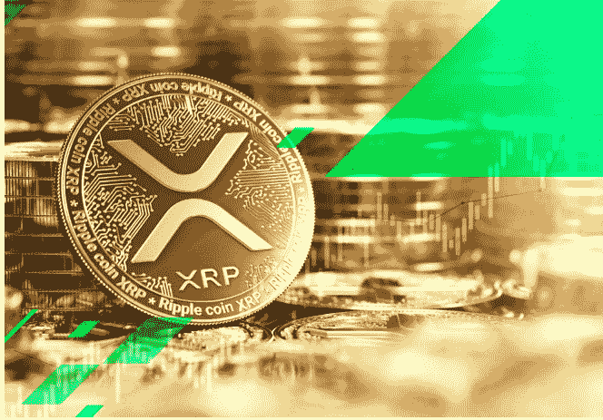

虽然瑞波币拥有本土加密货币XRP，但IOUs处理更多的是关于网络本身，而非加密货币本身。该货币并非作为交换媒介来存储和交换价值，而是作为一种代币来保护网络免受垃圾信息的侵害。与比特币和以太坊不同，瑞波币没有挖矿，因为所有代币都已经预挖完毕。随着多家银行加入瑞波币网络，瑞波币在金融领域变得极其重要。瑞波币（XRP）是一种实时全额结算（RTGS）系统，充当货币转账、货币兑换和汇款网络。它由美国的Ripple Labs Inc.开发，并在2012年发布前由独立服务器验证。XRP是被交易的加密货币的名称（一种加密货币）。XRP可以兑换成几乎任何其他货币，使用户避免在银行排长队。另一方面，加密货币波动相对较大，意味着其价值可能会波动。财务顾问可以帮助您确定整体投资策略应是什么。

### 什么是瑞波币（XRP）？

与比特币和以太坊等其他形式的加密货币不同，瑞波币由“哈希树”组成，而非区块链。由于代币数量有限——1000亿枚——XRP无法被挖矿。加密货币建立在区块链技术之上。这是一种将信息分组到组或块中的数据库类型。每条新信息会在新添加的块合并为新块并添加到链中后被加入。顾名思义，区块链将数据分成相互链接的块。瑞波币与区块链相似之处在于，交易由多个节点处理。支付过程包括：有人发送交易，信息被赋予一个单一值并发送到共享公共数据库，验证服务器或节点共享信息，如果单独的服务器报告匹配，则交易被授权并处理。由于不涉及工作量证明，该系统无法与比特币相比。在比特币中，比特币区块链上的矿工需要完成一个复杂的方程式来展示工作量，然后才能将区块接受到链中。另一方面，瑞波币模型基于共识。一旦达成协议，交易即被清算。因此，瑞波币网络确实可以每秒处理1500笔交易，而比特币每秒只能处理3到6笔交易，以太坊每秒只能处理15笔交易。尽管它与区块链系统不完全相同，但瑞波币流程相对高效且快速，这是银行和主要支付系统考虑和尝试瑞波币的主要原因之一。此外，瑞波币并不以与以太坊相同的方式完全去中心化。从技术上讲，瑞波币可以控制哪些服务器被接受到网络上，因为开发人员确实控制着保护系统免受恶意运营商侵害的机制（这使其成为一个中央权威）。因此，有人认为XRP不是真正的或标准的加密货币。

## 3.5.13 泰达币（Tether）

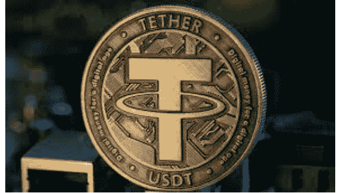

### 历史

Tether（USDT），以前名为“Realcoin”，是一种旨在保持与美元固定1:1汇率的加密货币。它由Brock Pierce、Craig Sellars和Reeve Collins于2014年7月创立。建立在Mastercoin（Omni）之上，这是一种2012年将稳定币概念引入世界的比特币协议层，Tether是最早创建的稳定币之一。Tether目前是使用最广泛的稳定币，开创了现在被称为法币抵押稳定币模式的模式。Tether的创建旨在解决现有加密货币的两个关键问题：高波动性以及法币与加密货币的可兑换性。Tether通过创建一种完全由美国银行存款1:1支持的加密货币来解决这些问题。USDT代币在以太坊上表示为ERC-20代币，而Tether使用Omni层在比特币上表示USDT代币。尽管代币本身在去中心化网络上运行，但总部位于香港的Tether Ltd 独家负责代币的创建和赎回，以及1:1存款支持。USDT主要被交易所用作法币替代品，减少或消除了对外部银行关系的需求。自2014年成立以来，Tether一直是争议的主题，原因是公司未能提供经过审计的财务报表来证明有足够的储备金来支持USDT。Tether有不披露其银行关系的历史，直到2018年11月才最近披露，以平息由相关加密货币交易所Bitfinex提出的关于其偿付能力的担忧。Tether于2019年3月更新了其披露声明，声称其代币不再完全由美元存款支持。Tether现在由储备金100%支持，这些储备金包括传统货币以及现金等价物，以及Tether不时向第三方（包括关联实体）发放贷款的其他资产和应收款项。

## 3.5.14 比特币现金（Bitcoin Cash）

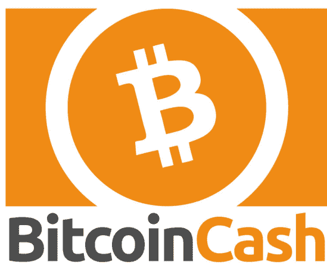

BCH，即比特币现金，是一种作为比特币永久分叉创建的加密货币。比特币现金的创建旨在解决比特币社区内关于货币技术如何运作的分歧，特别是在需求增加的情况下。凭借8MB的增加区块大小限制，它每天可以处理多达两百万笔交易。BCH更大的区块大小使其能够每秒处理更多交易。这意味着支付将被更快处理，费用也将降低。这是对比特币基础设施据称无法处理的不断增加的交易数量的回应。作为一种不由中央机构发行、用作交换媒介的数字资产，加密货币旨在安全且匿名。使用去中心化技术将可理解的数据转换为复杂的、几乎无法解决的加密代码。它使用户能够进行安全付款并跟踪资金。比特币现金是比特币的分叉，其创建的主要原因之一是解决比特币社区内关于货币技术如何运作的分歧，尤其是在需求增加的情况下。将此永久分叉视为在分叉点相同但在未来分歧。由于这是一个意外策划的方案，导致创建比特币现金的硬分叉是出乎意料的。许多人最初误以为它是对敌对且具有攻击性的用户激活软分叉的威胁。另一方面，比特币现金是长期存在的。它与之前的区块链永久决裂。为了增加交易容量，新的区块链分叉出来。这是对比特币基础设施据称无法处理的不断增加的交易数量的回应。每个人都对这一有争议的举措感到震惊，因为当区块链分叉时，可能会导致竞争资产。比特币现金是使用一组不同的

比比特币更先进的技术协议。比特币现金拥有更新的共识规则，因为它从比特币区块链账本分叉出来，从而实现了扩展。比特币现金在多个方面与比特币不同，其主要目标是创造人人可及的稳健货币。首先，与比特币相比，比特币现金具有更大的区块大小限制参数。凭借 8MB 的增加后的区块大小限制，它每天可处理多达两百万笔交易。BCH 更大的区块大小使其每秒能处理更多交易。这意味着支付处理将更快速，手续费也会降低。比特币现金的交易签名略有不同，因为一种全新的 SigHash 类型提供了重放和清除保护，并改进了硬件钱包安全性。二次哈希问题也得到了解决。比特币现金还有一个名为紧急难度调整（EDA）的新功能。这使您可以更快速、更有效地调整工作量证明难度。这意味着矿工可以轻松地从旧版比特币链过渡，同时确保用户不受哈希率波动的影响。比特币现金缺乏“按费用替换”功能，其开发是去中心化的，由多个独立的开发团队提供软件实现。这意味着它不能由单一实体控制，使其免受政治或社会动荡的影响。在其存在的数年里，比特币现金网络获得了大量基础设施支持，越来越多的商家、钱包提供商和交易所宣布对这种新型加密货币的支持日益增长。

## 3.5.15 Litecoin

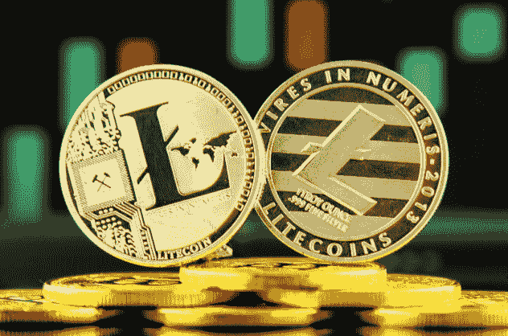

比特币之后，莱特币是最早的加密货币之一，而被称为数字黄金的比特币则被贴上了白银的标签。凭借更大的代币供应量和革命性的挖矿算法，莱特币是一次真正的突破，速度比比特币更快，更适合成为比特币的较小兄弟。它鼓励了许多其他加密货币的出现，这些货币使用其代码库但变得更轻量，甚至更多。狗狗币或 Feathercoin 是例子。尽管在比特币之后，莱特币难以找到真正的用例并失去了第二位置，但它仍然被广泛追捧和交易，如果比特币失败，它会作为替代品被囤积。

## 3.5.16 EOS

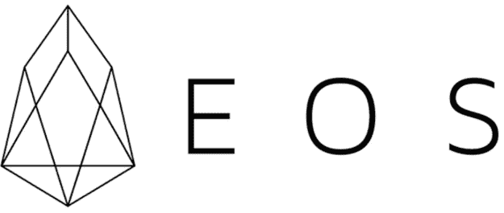

EOS 是一个去中心化的区块链平台，用于开发、托管和运行商业应用程序或 dApps。EOS 于 2018 年 6 月推出，当时 Block.one 通过首次代币发行筹集了 41 亿美元的加密货币。EOS 是该公司开发的开源软件的名称。在该网络上，EOS 加密货币代币用作支付系统。

### 什么是 EOS？

EOS 提供核心功能，使公司和个人能够以创建基于 Web 的应用程序的方式创建基于区块链的应用程序。EOS 提供安全访问、身份验证、权限、数据托管、用途管理，以及 dApp 与 Internet 之间的通信。EOS 拥有一个 Web 工具包商店，旨在使应用程序开发尽可能简单。EOS 由两个主要组件组成：EOS.IO 软件和 EOS 代币。要使用网络资源并构建和运行 DApp，开发者只需持有 EOS 代币而无需花费它们。没有运行任何应用程序的代币持有者可以将其带宽出租或分配给有需要的其他参与者。EOS 由 Dan Larimer 创立，他也是 Bitshares 和 Steem 等知名平台的创始人和创建者。目前，它由 Block.one 公司拥有。

下面是与比特币相关的按时间顺序排列的事件状态。

## 初始失败

虽然加密货币直到 2009 年才合法挖矿，但在之前的年份里，曾有过其他建立数字货币的尝试。1998 年，加密货币的两位创始人 Wei Dai 和 Nick Szabo 发布了关于货币去中心化前景的想法。他们的提案都围绕将数字货币作为一种手段，以取代传统金融系统的低效问题，例如制造纸币和硬币货币所花费的金钱。尽管没有提案付诸实践，但十多年后，Dai 和 Szabo 都成为了早期的加密货币采用者。第一种真正的加密货币比特币的诞生，正是这些最初失败的结果。

## 2008 年 10 月

当一名或一群人以中本聪的化名发表了一篇名为《点对点电子现金系统》的比特币白皮书时，加密货币世界便开始了。这篇出版物解释了比特币是什么，为什么它等同于传统金融方案，并通过向世界引入区块链，首次似乎修复了数字货币中缺失的部分。中本聪的论文延续了十年前某些难以出现的早期概念，并正如我们所知，成为加密货币的基础。

## 揭露中本聪的身份

比特币发明者的真实身份是当今世界最大的谜团之一。多年来，关于中本聪是谁的几种理论浮出水面，包括他是时间旅行者、外星人、流氓人工智能，或者是 NSA、CIA 和 Yakuza 的幌子。中本聪是发明比特币的人为隐藏其真实身份而选择的化名。人们怀疑他声称自己是日本人，因为他出生于 1975 年 4 月 5 日，目前居住在日本。这是因为他英语母语水平，并且希望工作时间更符合英国的时间。

## 比特币在创建初期经历了什么？

杂志引用的证据包括中本聪这个名字字面上孕育了多里安这一事实。他毕业于加州理工大学（Cal Poly University），主修物理，曾担任秘密军事项目的系统工程师，以及电子和金融信息服务公司的计算机工程师。“中本聪还具有自由意志倾向，并鼓励他的女儿开办一家‘不受政府控制’的企业。”当他最初被问及比特币时，中本聪错误地认为这是关于他为美国军事承包商进行的某个机密项目的询问，并说：“我对这个不再感兴趣，也无法谈论它。”随后被移交给其他人。

## 2009 年 1 月

不到三个月后，中本聪通过挖出比特币的第一个区块，宣布加密货币宇宙正式开始。中本聪因批准第一笔交易而获得 50 枚比特币，该交易的受益者是 Hal Finney，而该区块被称为比特币的创世区块。数字货币的势头正式开始，交易得到正式登记，比特币网络得到合法化。

## 2010 年 3 月

正式交易一年多后，以现已停止运营的 BitcoinMarket.com 形式，首个加密货币交易市场被引入。在一个比特币论坛上，一位希望开始将比特币作为人们相互共享并兑换为美元的货币的消费者提出了这一突破性进展。交易者可能潜在地衡量一枚比特币的价值，最初只需几分钱。

## 2010 年 5 月

在首个数字货币交易市场建立并以鼓舞人心的速度增长之际，Laszlo Hanyecz 报告了使用比特币进行的首次产品购买。Hanyecz 在 2010 年 5 月 22 日用 10,000 枚比特币购买了两个 Papa John's 比萨，到 2018 年，该金额估计为 8000 万美元。这一天进一步巩固了加密货币的有效性。此后，它每年被庆祝为比特币比萨日。

## 2011 年 2 月 – 6 月

此时，当其他交易市场登上舞台中心，包括臭名昭著的 Mt. Gox 市场时，BitcoinMarket.com 正变得越来越无关紧要。2 月标志着第一次，当其价值开始飙升时，

比特币与美元持平。整年，竞争性加密货币也开始涌现。

6 月，当黑客盗取了 2,000 个比特币时，Mt. Gox 上发生了第一次加密货币攻击。在黑客攻击中，该市场继续在声誉和持有量方面上升。

## 2013 年

时光快进两年，Mt. Gox 无疑已成为世界上最大的货币市场。据 Investopedia 报道，该市场在 2013 年的高峰期占了所有比特币交易的 70% 以上。尽管热情高涨，但该交易所的极端声名狼藉仍为黑客提供了绝佳机会。

## 2014 年 2 月

Mt. Gox 仅用一个月的时间，就从世界上最大的比特币交易所沦为破产。该交易所成为了加密货币历史上最重大黑客攻击的受害者。黑客从 Mt. Gox 消费者那里洗劫了天文数字般的 744,408 个比特币，以及交易所本身额外的 100,000 个比特币。当时价值为 4.6 亿美元。因此，在接下来的几个月里，这次黑客攻击迫使比特币价值暴跌 50%。尽管该加密货币的价值随后恢复到了攻击前的水平，但这次攻击本身凸显了对更强安全措施的必要性。

## 2015 年 7 月

当比特币和竞争性加密货币仍在从黑客攻击的冲击中恢复时，一种新的加密货币应运而生，随之带来了另一种保护层级。以太坊网络成立，用于作为交易以太币加密货币的平台。该网络使智能合约的使用普及，智能合约是一种加密软件，无需第三方在场即可更容易地促进可信交易。以太坊网络及其智能合约现在被加密货币世界中的多种加密货币以 ERC-20 代币的形式使用。ERC-20 代币的不同之处在于，它们是由以太坊网络的智能合约生成的资产，而比特币和其他加密货币拥有自己的区块链，因此与以太坊的区块链共存。

## 当前

此后，加密货币环境的进步持续不断，目前可交易的加密货币已超过 2,000 种。凭借其 2020 年 4 月最新的全市场评估达到 1280 亿美元，比特币似乎处于主导地位。就市值而言，数字货币 XRP（80 亿美元）和以太坊（190 亿美元）高于其他三种加密货币。

# 第 4 章：什么是区块链？

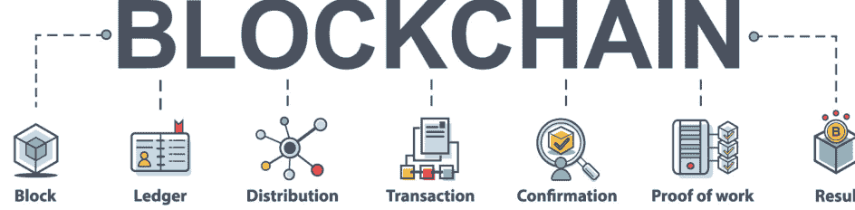

区块链是一种数据记录机制，使得修改、黑客攻击或作弊系统变得困难或不可能。区块链基本上是一种数字交易账本，在整个计算机系统网络中复制并分布在区块链上。链中的每个块包含若干笔交易，每当区块链上发生新交易时，该交易的记录就会添加到每个参与方的账本中。分布式账本技术被定义为由许多用户操作的共享网络（DLT）。区块链是一种 DLT 类型，其中一种称为哈希的不可更改的加密签名会在交易中注册。这意味着，如果一条链中的一个区块被篡改，那么它已被破坏就会自动明显。如果黑客要破坏区块链结构，他们必须通过链的所有分布式迭代来更改链中的每个区块。随着区块被附加到链中，比特币和以太坊等区块链正在积极且持续地增长，这大大有助于账本的稳定性。区块链为企业带来了交易透明性的承诺，有可能与全球合作者建立稳定的实时联系网络，以促进从供应链到支付网络，再到房地产交易和健康数据交换的方方面面。围绕这种相对现代的技术的当前猜测是真实的，因为 DLT 基本上是一种新的信息交换模式；计算机提供商和企业不出所料地竞相学习如何使用分布式账本技术（DLT）来节省时间和行政成本。

### 4.1 区块链技术的未来

目前行业中最受关注的发展之一就是区块链。从金融和网络安全，到知识产权和医疗保健，区块链技术有能力在各行各业推动重大改进并创造新市场。区块链是一个共享档案，作为电子分布式账本或文档登记处，向多人开放。为了注册、处理和验证任何交易，区块链使用加密技术，使其稳定、永久且透明。存在两类通用的区块链：

- 无许可型，任何人都可以进入
- 许可型，允许参与者由监督它的成员或组织批准（此类别进一步细分为私有区块链网络和社区区块链网络）

### 4.1.1 谁已经在使用区块链？

区块链技术最著名的实例是比特币，但越来越多的早期采用者正在进入该领域。例如，微软、高盛、维萨和德勤正在投资区块链领域的项目。以及专注于区块链服务的组织包括：

- Spotify，用于控制版权
- IBM，用于为超市连锁和航运公司构建监控服务
- 伊士曼柯达，用于构建股票照片存储

### 4.1.2 区块链的未来

区块链是一项新技术，因此关于其潜力的预测仍然不一。

分析公司 Gartner 的一份新的趋势洞察研究中做出了以下预测：

- 到 2022 年，只有 10% 的公司可以通过使用区块链进行某种根本性转型。
- 到 2022 年，至少有一家专注于区块链技术的开创性企业将价值 100 亿美元。
- 区块链贡献的市场价值将在 2026 年上升到略超过 3600 亿美元，然后到 2030 年扩大到超过 3.1 万亿美元。

区块链技术预期发展中最有前景的领域之一是网络防御。数据篡改是各种规模组织面临的持续问题。可以使用区块链技术来避免篡改、保护数据安全，并允许参与者检查文件的有效性。

在科技和 IT 市场，区块链技术被认为在未来几年将是革命性的，类似于互联网在 90 年代和 21 世纪初对世界所取得的成就。

### 4.1.3 区块链确保最高水平的技术

如今，区块链是数据安全领域最安全的技术之一。数字技术的快速发展也引发了关于数据保护的新问题。通过融合强大的身份验证和加密主金库协议，组织需要保护其记录。区块链技术在解决如何保护数据和阻止破坏性网络攻击的问题上工作充分。报告称，到 2024 年，区块链技术的总需求预计将达到约 200 亿美元。在医院、银行、体育等多个市场，区块链已具有开创性。

与传统方法不同，许多区块链软件公司很大程度上受到这项技术的启发，以重新架构和重新制定安全问题。区块链为数据提供了真正的信任感。

### 4.1.4 区块链技术挑战漏洞

为了创建稳定的数据网络，这种分布式账本系统提供的高度保护具有优势。提供消费品和服务的企业使用区块链技术来保护消费者数据信息。

技术正在寻找颠覆市场服务和客户解决方案的创新方式。这项技术未来将成为领先者，在多样化行业中出现新兴的全球服务。

### 4.1.5 提供加密和验证

区块链程序足够专业，可以处理任何事情，因此知识没有以任何方式被更改。默认情况下，区块链是加密的，这使得准确验证成为可能。

## 4.2 How can blockchain benefit CRM?

Given below are areas that are expected to benefit from this technology:

### 4.2.1 Enhanced security

A blockchain is basically a blockchain where there are transaction documents in each block. Each block is connected cryptographically to neighboring blocks. It is protected in such a manner that the network keys are used by participating users to prevent unauthorized access.

### 4.2.2 Efficiency

A decentralized entity is a blockchain. It helps your business to negotiate with your clients safely and transparently without the desire for a financial institution, i.e., a bank or a third-party broker. In all the transactions, the removal of these 'middlemen' gives greater productivity and speed.

### 4.2.3 Data Cleansing

CRM consumers all over the world have to struggle with incorrect or duplicate data to some degree, whether it is due to incompetent data import tools or human error. A consumer should use their own personal key with a blockchain in place that provides businesses a single and detailed image of their personal records, past purchases, subscriptions, etc. Therefore, the blockchain lets these firms totally circumvent the dilemma of unreliable, outdated and redundant data documents. Consequently, this offers deeper visibility into consumers and allows organizations to involve them more efficiently.

### 4.2.4 Loyalty Programs

Consumers will have a single decentralized wallet for the blockchain, which is compliant with all brands. They will not be constrained by individual brands' rules and limitations, and point redemption would be considerably simplified. The customer will have much greater leverage over the whole experience, and by giving them cheaper offers, marketers will finish for their wallets.

## 4.3 Public blockchains

A public blockchain is usually decentralized and has no single network-controlled entity. Data on a decentralized blockchain is protected because data cannot be changed or manipulated until it has been checked on the blockchain. Possibly the best examples of a decentralized blockchain are Bitcoin and Ethereum.

## 4.4 Private blockchains

An 'invitation-only' network regulated by a single organization is a private blockchain.

Network entrants need authorization for the blockchain to be read, written or audited. Different degrees of accessibility may be available, and details can be encrypted to preserve business confidentiality. Without rendering data available, private blockchains allow companies to use distributed ledger technologies. Private blockchains, which take a lot of time and resources to verify transactions, are quicker, more stable and much more cost-effective compared to public blockchains.

## 4.5 How to be a crypto artist

New decentralized markets are ready to accept new digital artists, both new and established. Beeple, Pak, and Hackatao are just a few of the artists rewriting art history by selling their digital creations for millions of dollars. However, how does one go about becoming a digital artist? Here are a few helpful hints.

### 4.5.1 Create your digital artwork

Understanding how to create digital works of art or works that are created with the aid of computers and software and are capable of being reproduced on digital media is the first step toward becoming a crypto artist. GIFs, MP4 Videos, or simple images can be used, as well as motion graphics, 3D creations, and even real and digitized works. Create a portfolio that understands how to best communicate your digital art.

### 4.5.2 Certify your Art

Crypto art can be verified in the same way that an original painting signed by Picasso requires a Certificate of Authenticity. It's because NFT (Non-Fungible Tokens) has been coined. An NFT is a one-of-a-kind token that represents a unique ID linked to a non-replicable cryptographic artwork. The NFT is used to verify the ownership as well as the origin of work and is linked to Blockchain technology.

### 4.5.3 Put it up for sale on an ad hoc platform

The work is ready to sell once it has been created and certified. Many platforms have emerged in recent years that allow you to show, sell, and buy NFT works. OpenSea is one of the most well-known, but artists prefer Nifty Gateway, SuperRare, and Rarible. While some NFT platforms, such as SuperRare and Nifty Gateway, currently accept artists only by invitation or application, others, such as Rarible, allow any interested creator to begin selling in their market.

### 4.5.4 Become part of a Community

Crypto Art is a relatively new phenomenon, and most people are unaware of it. As a result, one of the goals of the NFT platforms is to create Communities that allow artists, collectors, and digital professionals to connect, discuss, train, and stay up to date on new technologies, trends, and market developments. The community's buzzword is "collaboration," and this spirit is bolstered by the focus solely on art: artists are frequently anonymous or use pseudonyms, and gender, ethnicity, and social status are not revealed. Art Rights, a platform for the management and certification of works of art using Blockchain technology, is one of the tools available to help artists, including Crypto Artists. The Art Concierge, the largest community of artists, collectors, and professionals in the art world, is one of the services provided by the platform.

# Chapter 5: What is NFT and Key Concepts?

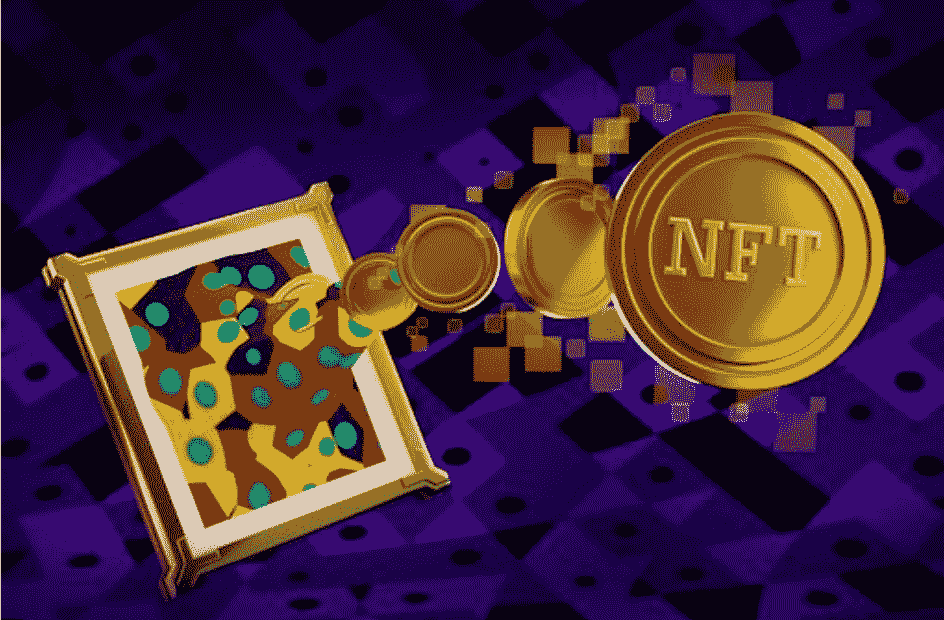

You've probably heard of terms like Bitcoin, blockchain, and, more recently, NFTs if you've been following the tech news lately. Artists and collectors alike have been drawn to news items of multi-million-dollar auctions for digital assets. But what exactly are NFTs? And how do they function? We'll learn about NFTs, their key concepts, how they work, NFTs and blockchain, and more in this chapter. We'll look at the basics of non-fungible tokens, the technology behind them, and how they're used in everyday life in this chapter. We'll also go over some of the skills and knowledge you'll need to participate.

### 5.1 What is NFT?

NFTs are unique assets that provide collectors and gamers complete control over their digital items. Let's start with some definitions of fundamental terms. We'll need some background knowledge to grasp what NFTs are and how they work.

NFTs (non-fungible tokens) are digital assets that may be used to represent a variety of tangible and intangible goods, such as collector virtual real estate, sports cards, and digital shoes. One of the most important benefits of a digital collectible over a tangible collectible like a Pokemon card or a rare minted coin is that each NFT includes unique information that identifies it from the others and can be easily verified. Fake collectibles are worthless to manufacture and distribute since each item can be traced back to the original issuer. Money is a fungible asset in economics. It is divided into units that may be traded easily without losing or gaining value (for instance, a £20 for two £10s). Gold, bitcoins, and stocks, to mention a few, are fungible assets. A non-fungible asset, on the other hand, is a one-of-a-kind item such as a painting, a home, or a trading card. Even though an artwork can be photographed or replicated, it is still the original, and reproductions do not have the same value as the original. The blockchain stores NFTs, which are digital data units. Each non-fungible token serves as a certificate of authenticity. It establishes the fact that a digital thing is one-of-a-kind and cannot be copied. Because of the cryptographic techniques that make the blockchain unique, an NFT can never be edited, altered, or stolen.

### 5.2 NFTs key concepts

Non-fungible tokens, or NFTs, are digital content elements connected to the blockchain, the digital ledger that supports cryptocurrencies such as bitcoin and ethereum. Those assets, unlike NFTs, are fungible, meaning they can be replaced or exchanged for another identical one of the same value, much like a dollar bill. NFTs, on the other hand, are one-of-a-kind and non-interchangeable, which means that no two NFTs are identical. Consider Pokémon cards, rare coins, or a pair of limited-edition Jordans: NFTs create

在原本无限可获取的商品中呈现稀缺性，并附带真实性证明。NFT 可用于买卖 GIF、推文、虚拟交易卡、实物照片、电子游戏皮肤、虚拟房地产及其他数字艺术品。

## 5.3 How do NFTs work?

与其他加密货币相比，NFT 并非即时可交换的，因为即使属于同一平台、集合或游戏，也不存在两个完全相同的 NFT。你可以将其视为音乐节通行证。每张票都包含购买者姓名、活动日期和场地等信息。这些信息使得音乐节门票难以交换。

### 5.3.1 How to buy NFTs

原则上，任何数字图像都可以作为 NFT 购买。不过，尤其是如果你是新手，在获取 NFT 时有几点需要牢记。你需要选择一个购买市场、一个用于存储加密货币的数字钱包，以及执行交易所需的加密货币。一些最著名的 NFT 市场包括 OpenSea、Mintable、Nifty Gateway 和 Rarible。

### 5.3.2 How to sell NFTs?

NFT 也在市场中出售；不过，方式因平台而异。基本上，你会将作品发布到市场，然后按照流程将其转换为 NFT。你可以输入作品描述和定价建议等详细信息。大多数 NFT 使用以太坊购买，但也可以使用其他 ERC-20 代币（如 WAX 和 Flow）获取。

### 5.3.3 How to create an NFT?

任何人都可以创建 NFT。你所需要的只是一个数字钱包、少量以太币，以及可以访问的 NFT 市场，在那里你可以上传并将作品转换为 NFT 或加密艺术。如果你是一位有志于成为数字艺术家的人，那么很可能有兴趣为自己的作品制作 NFT。幸运的是，有各种平台可以帮助你入门。一般而言，这个过程相当简单，各平台也会为你提供指导。不过，在开始之前，你可能需要了解一些事项。NFT 建立在特定的区块链之上并由其支持。以太坊区块链目前是非同质化代币最流行的选择。要开始，你需要一个比特币钱包和加密货币。目前，以太币（ETH）是使用最广泛的。在 NFT 市场上，你可以生成并出售数字资产。基于以太坊的 OpenSea 平台非常流行。

## 5.4 NFT and blockchain

今天有多种不同的区块链技术可供选择。有些区块链是为满足网络访问受限的小群体需求而创建的。那么，NFT 在区块链世界中处于什么位置？请记住，区块链是一种在通信网络的节点之间充当分布式账本的软件。其不可篡改性使其区别于其他在线数据库或交易平台：我们可以进行点对点的数字资产交易，且未经网络大多数同意，没有人能更改或删除这些交易。在互联网方面，这是一个巨大的优势。NFT 中的每个代币都代表一个独一无二的物品。如果你在合同中将安德鲁·怀斯（Andrew Wyeth）的画作替换为米克·温克尔曼（Mike Winkelmann）的艺术作品，你不能指望任何人会注意到。NFT 涵盖广泛的独特资产，包括出生和死亡证明、房产契约以及物联网对象的身份。尽管 CryptoKitties（首个 NFT 热潮）的泡沫可能已经破裂，但围绕 Beeple 作品拍卖的兴奋情绪展示了 NFT 的潜力。这是一个价值创造领域，你唯一的限制是你的想象力、技术技能以及营销、会计和法律支持。

## Discovering NFT

尽管 NFT 仍然是数字金融生态系统中的“闪亮新事物”，但其实用性和市值尚未充分释放。如果要实现对普通消费者的潜力，NFT 必须在中端市场环境中展示和提供，而不仅仅是在高端、顶级机会中。普通购物者需要获取信息，并具备搜索、比较和购物的能力。买家旅程中的发现阶段至关重要。别忘了冲动购买的力量。这很可能导致 NFT 市场基于特定用例变得更加专业化。OpenSea 作为最初的 NFT 市场之一，正在经历快速增长。2021 年，OpenSea 的交易量增长了 12,000 多个百分点，仅 6 月份就创下 1.5 亿美元的 NFT 交易纪录。如果这还不够好消息，他们的用户基数在短短六个月内从 315 增长到 14,520，使公司在 8 月份的月度 NFT 交易量达到 30 亿美元。所有这些对 NFT 以及整个数字金融行业来说都是绝佳消息，但专业化的市场无法像阿里巴巴这样的国际知名巨头那样快速推动行业发展。这就是为什么阿里巴巴最近的公告如此引人入胜。

## Smart contracts

用于分配所有权并管理 NFT 可转让性的智能合约被用来创建它们。当有人生成或铸造 NFT 时，他们正在执行来自遵循各种标准（如 ERC-721）的智能合约的代码。这些数据存储在区块链上，NFT 也在其中进行处理。以非同质化代币（NFT）的形式，智能合约对普通大众产生了重大影响。2021 年第一季度，在 NFT 上的支出超过 20 亿美元，表明相比 2020 年第四季度增长了 2,100 个百分点。

## Digital asset

简单来说，数字资产是指以数字形式存在并具有使用能力（复制、复制权、复制和修改）的任何东西。例如，文档、音频或视觉信息、照片以及其他相关数字数据都被称为数字资产。

## 5.5 NFTs vs. Cryptocurrency

必须澄清加密货币与非同质化代币之间的区别。尽管两者都使用区块链技术，但它们之间的根本差异可能有助于我们理解 NFT 的工作原理。主要区别源于加密货币是可替代的。例如，你可以用一个比特币交换另一个比特币。然而，对于 NFT 则不能这样做。非同质化代币与单个数字资产相关联，不能与另一个代币交换。NFT 与加密货币的主要区别在于，与加密货币不同，NFT 是现实世界商品的独一无二的表现形式，不能相互交换。加密货币可以相互交易，因为其价值不会贬值。另一方面，加密货币和 NFT 都是去中心化的，并由运行它们的社区进行治理。此外，加密货币和 NFT 可以通过数字公共账本访问，这使所有交易都透明。

## 5.6 NFT vs. Bitcoin

尽管 NFT 使用与比特币等加密货币相同的技术，但相似之处仅此而已。比特币可以相互交易且价值相同，即一卢比始终等于另一卢比，一个比特币始终等于另一个比特币，无论相对于其他类似货币的价格如何波动。NFT 并非如此。每个 NFT（虚拟资产）都有一个数字签名，由于编码原因无法完全复制。

## 5.7 The pros and cons of NFTs

我们列出了一些潜在的优缺点：

### 5.7.1 Pros of NFTs

NFT 的一些优势包括：

### Security

NFT 可以在安全且透明的环境中交易。NFT 作为不可更改的数字签名，为收藏家提供了非凡的信任。这种保证也延伸到艺术品的未来传承。区块链保护数字作品免受审查和物理退化，但它们仍必须被仔细存储。区块链技术还使人们能够安全且公开地在全世界转移大量资金。如今，NFT 保证了独特资产的合法性、独一无二性和所有权，就像区块链技术构建了一个信任协议，使数字货币的建立成为可能一样。

### Price appreciation

实物珍品（如艺术品）有着价值增长的悠久历史，数字艺术也可能效仿。

### Increased access to buyers and sellers

将数字资产作为 NFT 购买和出售，可以让你接触到比以前大得多的买卖双方池子。

### They give artists ownership of digital assets

当内容创作者开发数字资产时，NFT 允许他们不仅能够证明真实性，还能从中获利。这可能代表了广泛共享的模因创作者的一大收入来源。

### They're unique and collectible

许多人喜欢获得独一无二或极为稀有物品的刺激感。可收藏内容（尤其是数字商品）从 NFT 中受益。

因为它们增加了一层额外的真实性。

### 它们是不可更改的

非同质化代币（NFT）绝不会被更改、擦除或替换，因为它们基于区块链。在证明数字内容的来源或真实性时，这是一项宝贵的属性。

### 可组合性

NFT最令人兴奋的方面之一是，它们可以被视为相互关联的乐高积木。这意味着设计师可以推出利用之前NFT成功的NFT。由于其可组合性，任何NFT项目都可以被视为更广泛、相互关联的生态系统中的一个模块。

### 它们可以包含智能合约

智能合约是区块链技术的另一个令人兴奋的方面。它们基本上可以存储指令，当满足特定条件时执行这些指令。因此，带有智能合约的NFT如果在未来被出售，可能会为艺术家提供部分利润。艺术家和制作者可以根据其作品的使用和转售，在未来通过“智能合约”获得报酬，“智能合约”是一系列编码到区块链中的指令。

### 5.7.2 NFT的缺点

NFT的缺点包括：

- **它们本质上具有投机性**
  最大的问题是NFT是否具有任何真实价值。它们是良好的长期投资，还是只是昙花一现？这很难说。目前，对NFT估值的唯一标准是其情感属性。

- **数字资产可以被复制**
  某人拥有数字对象的NFT这一事实，并不排除存在副本的可能性。艺术品可以被复制和粘贴，GIF可以被分享数百次，视频可以在互联网上传播。你仅仅因为拥有NFT，并不意味着对资产拥有控制权；它只是所有权证明。

- **环境成本**
  像以太币和比特币这样的基于区块链的加密货币的环境影响已受到广泛关注。将记录写入区块链需要大量计算能力。基于区块链的资产的长期可行性是一大担忧。

- **它们可能被盗**
  尽管NFT背后的技术非常安全，但许多交易所和平台并不安全。因此，已有多起因网络安全漏洞导致NFT被盗的案例。

- **因需求减少而导致价值下降**
  由于许多NFT是不自行产生任何收益的固定资产，因此使用买家需求等主观指标来确定其价值。因此，极高的价格可能无法无限期维持，NFT可能会失去明显的价值。

- **可持续性存疑**
  创建和销售NFT占用大量电力，与区块链交易类似。一些科学家担心，不断增长的NFT市场将加剧环境快速恶化的影响。

- **所有权不等于控制权**
  拥有原始NFT并不意味着拥有其在各平台上的分发或复制权。所有权仅意味着他们拥有“原件”——他们无权阻止制作“印刷品”。

## 5.8 决定NFT成败的因素是什么？

NFT可以成为你最好的朋友，也可能成为你最糟糕的敌人。NFT项目如同晴天的英国天气一样不可预测，但在混乱中存在规律，如果你的项目能利用其中一种规律，到圣诞节它可能价值百万美元。或者，它可能会悄然失败，成为数字艺术世界中的一声低语。

### 5.8.1 名人与NFT

与NFT项目取得成功的最简单方法是获得名人的帮助，尤其是世界冠军足球运动员、篮球运动员或冰球运动员。NFT在体育领域蓬勃发展。交易卡、票根、球衣、签名球衣、安德烈·阿加西的马尾辫和一只沾血的袜子，都是可以在公开市场上购买和出售的收藏品。梅西与巴黎圣日耳曼的新交易包括NFT权利。So rare，一款足球主题的NFT收藏卡获得了5320万美元的种子资金。So rare已与日本、美国、比利时、荷兰、利物浦和西汉姆联等足球巨头签订协议。足球是印钞许可证。NFT本质上也是印钞许可证。这是竞技天堂中的完美组合，如果你希望自己的NFT项目成功，应该联系一个机构。

### 5.8.2 模仿、复制并捕捉NFT的时代精神

没有独一无二的东西，因此要模仿。乘上潮流，搭上时代精神的顺风车，沐浴在Twitter风暴的光芒下，将你的一万个NFT系列发布到OpenSea，伴随着浪费机会和希望的合唱。CryptoPunks催生了一大群模仿者，他们从像素化头像和动物故事中获利。CyberKongz、无聊猿游艇会、肥企鹅以及一大群冒牌货都采用了CryptoPunks的基本理念。

### 5.8.3 组建高质量团队并打造创意NFT项目

招募一位鼓舞人心的领导者，组建一支有才华的团队，并创建一个出色的NFT。你在旧的Amstrad上能做出的东西都不应该发布。即使在淘金热的浪潮中，你仍然需要激励NFT受众。优秀的艺术作品、可靠的商业计划和公平的分配都应排在你的优先事项列表之首。建立社区，不要告诉收藏家你只想要他们的钱，并给他们额外的福利，例如独家在线采访和对话。你必须富有想象力。

### 5.8.4 为什么NFT项目会失败？

创新是一种稀缺资源。对于不提供创新、迷人或令人兴奋内容的NFT项目，要想突出重围并在OpenSea上排名靠前或引发Twitter互动，将变得越来越困难。存在版权难题、环境影响（NFT是否融化冰盖与媒体和头条无关），以及生态系统中某些人的不正当本质。诈骗、跑路、安全问题以及资金和项目管理不当，都是严重问题。这些因素中的任何一个或全部都可能危及你的NFT项目的成功。当然，在NFT和加密货币的世界里，没有什么是可以预见的。构成强大NFT项目的标准在未来几个月和几年内将发生重大变化，就像市场像朝鲜最高领导人一样不可预测。

# 第6章：新的NFT投资、用途及颠覆性项目

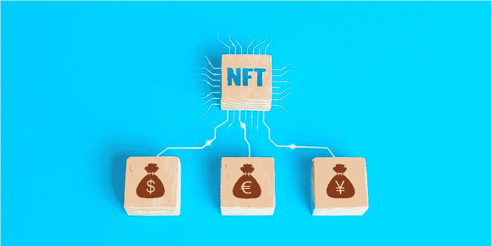

许多人想知道NFT是否有任何应用。尽管概念仍处于起步阶段，但许多可能的应用已经被开发出来。

### 6.1 NFT的新用途

我们选择了一些最著名的应用：

### 6.1.1 门票

活动门票是NFT的应用之一。其原理是，如果门票是使用非同质化代币制作的，那么当门票被交换时，会有该交易的记录。因此，不存在黄牛倒卖、盗窃或试图使用伪造门票的可能性。这是因为与该门票关联的区块链上的代币无法被替换。

### 6.1.2 时尚

NFT有潜力解决时尚行业中许多重要难题。从数字真实性记录开始，这有助于解决假冒商品等问题。NFT可以与奢侈品相关联以证明其真实性。同样，非同质化代币可以提供关于物品来源的重要信息，例如使用了什么材料、材料来自哪里，以及它运输了多远。随着时尚和可持续性等话题变得更加突出，这可能有助于人们做出更符合伦理的决策。

### 6.1.3 收藏品

我们已经触及过这个话题。收集纪念品、小饰品和其他类似物品一直是受欢迎的消遣。NFT充当一种数字签名或认可印章，以确认真实性。

### 6.1.4 游戏

NFT允许玩家拥有独一无二的游戏内物品。此类代币可以驱动游戏内生态系统，无论是为了娱乐、真实性还是竞技性。

### 6.2 NFT为何有价值？

如前所述，非同质化代币实际上是数字资产的所有权证书。其价值来源于资产的收藏价值以及其未来可能的转售价值。NFT可以被购买和出售。使用艺术作为NFT优势的例子是另一个极佳的例子。数字艺术家Beeple于2021年2月，将其《Everyday – The First 5000 Days》作品的NFT以惊人的6930万美元售予佳士得拍卖行。

### 6.2.1 NFT销售示例

NFT艺术品不是唯一畅销的东西。最近几个月发生过多次重大的NFT销售，这引发了人们对市场目前处于泡沫中的担忧（稍后将详细讨论）。以下是一些NFT销售示例：

- **第一条推文**
  Twitter创始人以290万美元的价格出售了他第一条推文的NFT

- **“彩猫”GIF**
  这张彩色GIF的NFT以300个以太币售出，当时价值约56.1万美元。

- **“查理咬我的手指”视频**
  那段著名视频中，一个婴儿咬他兄弟的手指，在YouTube上的观看次数超过8亿次。该视频的NFT售价约为50万英镑。

## 6.3 十大 NFT 颠覆性项目

### 6.3.1 艺术

毫无疑问，这是一个庞大的行业。当 NFT 与数字艺术挂钩时，就有可能“拥有”和交易它。这里，所有权是指象征艺术品的 NFT。艺术品本身可能是单个版本，也可能是艺术家选择铸造的一系列版本。仅艺术领域，以 NFT 销售艺术品的个人艺术家就已产生超过 1.5 亿美元的销售额。

### 6.3.2 虚拟土地

你可以通过 Decentraland、The Sandbox、Cryptovoxels、Somnium Space 和 Axie Infinity 等项目以 NFT 形式拥有虚拟土地。由于数千人拥有土地并可以随意开发（从会议设施到艺术画廊），这个世界实际上可以呈现出自己的形状，如果你周围的区域价值提升，你也可以稍后出售你的土地。在其他情况下，土地的售价已达到 100 万美元或更高。

### 6.3.3 游戏物品

将你的皮肤、火器、护甲、宠物和角色视为可升级和出售的非同质化代币（NFT）。也许你拥有一件非常稀有的物品，随着用户群的发展，更多人渴望它。尽管将资金投入游戏通常被视为“沉没成本”，但人们仍在游戏行业投入数十亿美元。如果他们为所花费的所有时间获得一个可以升级并在市场上出售的 NFT，为什么不花这笔钱呢？

### 6.3.4 TCG - 更多游戏

特别是集换式卡牌游戏，似乎非常契合，因为卡牌游戏的目的是与他人竞争和交易。Pokemon、Hearthstone、YuGiOh 和 Magic: the Gathering 在这方面都非常受欢迎，全球拥有数百万收藏家和玩家。我们都见过像喷火龙这样的稀有卡片在现实世界中能卖出多高的价格。Splinterlands 和 Gods Unchained 正在帮助铺平道路。

### 6.3.5 收藏品

收藏品市场巨大。CryptoPunks 的售价已达到 100 万美元或更高，CryptoKitties 也曾风靡一时。即使在数字时代，拥有感和拥有某个标志性事物的欲望似乎依然蓬勃发展。

### 6.3.6 体育收藏品

得到著名企业和球员的参与，NBA Top Shot 的销售额已超过 1 亿美元。这些 NFT 不仅用于收藏，还可用于各种活动。事实上，这些 NFT 可以用于创建整个体育游戏生态系统。

### 6.3.7 域名

.eth 和 .crypto 等域名正以高价成交。人们正在使用它们来替代支付地址、直接使用 Twitter 用户名付款，并最终托管网站。此外，任何可以持有的东西都可以成为 NFT，那么域名为什么不可以呢？

### 6.3.8 De-Fi

NFT 也可成功应用于去中心化金融。一些倡议，例如 Bond，允许你使用 NFT 免费交易加密货币。NFT 可以而且将在各种基于区块链的去中心化金融应用中被使用。

### 6.3.9 数实结合商品

这是一种同时附带 NFT 的实体组件。两者都是独特资产。例如，Metafactory 在现实生活中销售带有可在 Cryptovoxels 中使用的 NFT 的个性化连帽衫。Headspace 也这样做，其中一些 NFT 可以在 Decentraland 中看到。

### 6.3.10 虚拟场景

NFT 可用于创建整个虚拟建筑和游戏。Metazoan 是一个出色的倡议，允许 Decentraland 土地所有者在其土地上购买和部署游戏、结构和增强功能。如果你真的想在自己的地产上举办聚会，但又不想支付 4000 美元的开发费用，不妨考虑租赁市场。为什么不花 200 美元租用一个周末呢？随着基于区块链的虚拟领域不断扩大，这一概念潜力巨大。

### 6.3.11 虚拟汽车

为什么我们不能在虚拟世界中以 NFT 形式拥有虚拟汽车、飞机和船只？有些人已将数字汽车以数百 ETH 的价格售出，随着基于区块链的虚拟世界不断发展，对先进交通和探索方式的需求也将随之增长。CryptoMotors、F1 Delta Time 和 Battle Racers 已对此领域进行了探索。

## 6.4 合法且新兴的 NFT 市场

NFT 是独一无二的对象，无法被其他任何东西取代。如今，大多数 NFT 都是数字化的。这使得创作者向粉丝提供稀有且独特的东西变得特别简单。例如，某些 NFT 是数字艺术品，目前的收藏方式与收藏家多年来收藏真实绘画的方式相同。而其中一些 NFT 已售出天文数字的价格。最初的 NFT 是以太坊区块链的一部分，该链包含用于相互识别的额外电子数据。现在，其他区块链也支持 NFT。由于不同的 NFT 使用不同的区块链技术，并非所有 NFT 市场都交易所有类型的 NFT。创作者通常根据市场是否支持特定的 NFT 代币标准来选择 NFT 市场。ERC-721 和 ERC-1155 是迄今产生的两个以太坊标准。竞争对手 Binance 随后开发了 BEP-721 和 BEP-1155 规范。由于这两个标准允许将多个 NFT 捆绑并在一起交易，它们与原始“721”规范有所不同。大多数 NFT 平台要求购买者拥有数字钱包，并使用加密货币支付购买款项。

### 6.4.1 OpenSea

OpenSea 声称自己是全球最大的 NFT 市场。非同质化代币包括艺术、抗审查域名、虚拟世界、交易卡、体育和收藏品。基于 ERC-721 和 ERC-1155 的资产也包括在内。

### 6.4.2 Rarible

Rarible 是一个社交 NFT 市场，使用 RARI 代币作为其“所有权”代币，这是一个 ERC-20 代币。Rarible 向在 NFT 市场上买卖的活跃用户发放 RARI 代币。它每周发放 75,000 个 RARI。在该平台上，艺术资产备受重视。

### 6.4.3 SuperRare

SuperRare 主要是一个面向消费者购买和销售独一无二、限量版数字艺术品的市场。每件艺术品由网络艺术家创建，并被代币化为可拥有和交易的加密收藏品数字商品。他们将自己定位为 Instagram 与 Christie's 的结合体，提供了一种在互联网上参与艺术、文化和收藏的新方式。SuperRare 上的每件艺术品都是数字收藏品，是在区块链上加密和监控的数字对象。在市场之上，SuperRare 构建了一个社交网络。数字收藏品非常适合社交环境，因为它们有明确的所有权记录。

### 6.4.4 Foundation

Foundation 是一个利基平台，汇集数字创新者、加密原住民和收藏家以推动文化发展。它被称为“新创意经济”。它主要关注数字艺术。2020 年 8 月，他们在其网站上的第一篇博客文章中发起公开呼吁，邀请创作者使用加密货币并探索价值概念。创作者受邀黑客攻击、破坏和扭曲创意作品的价值。当 NFT 在 Foundation 上交易时，艺术家将获得二级交易价值的 10%，即当收藏家以更好的价格将其作品转售给他人时，艺术家将获得销售价值的 10%。

### 6.4.5 AtomicMarket

AtomicMarket 是一个由众多网站使用的具有共享流动性的 NFT 市场智能合约。在一个市场上发布的所有内容都会出现在所有其他交易所上，这被称为共享流动性。它是 Atomic Assets（一种基于 eosio 网络的非同质化代币标准）的市场。Atomic Asset 标准可用于代币化和生成数字资产，以及在 Atomic Assets 市场上购买、交易和拍卖资产。在 AtomicMarket 上，你既可以出售自己的 NFT，也可以浏览现有列表。知名集合的 NFT 标记有验证勾选标记，从而更容易识别真正的 NFT。恶意集合将被列入黑名单。

### 6.4.6 KnownOrigin

KnownOrigin 是一个在线市场，你可以在那里找到并购买稀有数字艺术品。KnownOrigin 上的每一件数字艺术品都是正宗的、独一无二的。创作者可以利用该网站展示他们的作品，并将其出售给重视真实性的收藏家。以太坊区块链为其提供保护。创作者可以将数字艺术品以 jpg 或 GIF 文件的形式上传到 KnownOrigin 画廊，所有文件均存储在 IPFS 上。

### 6.4.7 Mintable

Mintable 是一个双边市场，用于购买和出售 NFT，类似于 eBay，并得到 Marc Benioff 的 Time Ventures 和亿万富翁投资者 Mark Cuban 的支持。该网站建立在以太坊和 Zilliqa 区块链上，并与 MetaMask 耦合，允许买家创建加密货币钱包。免费的“无 gas”NFT、短版印刷系列和常规交易为基础的物品都是创作者的选择。买家可以创建个人资料并充值钱包后购买精选物品或竞拍拍卖，获胜者将通过电子邮件收到通知。

### 6.4.8 Axie Infinity

Axie Infinity 是一款受宝可梦启发的视频游戏，玩家在其中获取卡通生物、与其他玩家战斗并建立农业王国。它由越南初创公司 Sky Mavis 创建。在 2021 年 9 月 18 日至 10 月 18 日期间，Axie Infinity 在其网站上记录到平均每月超过 2300 万名玩家。NFT 用于对角色和土地地块进行加密。收藏家和玩家可以在互联网市场上购买它们，一些虚拟房产地块的价格超过 20,000 美元，动物售价数百美元。

### 6.4.9 Sorare

Sorare 是一个基于加密货币的幻想足球联赛，球迷可以在其中以 NFT 形式获取球员卡，然后在在线锦标赛中使用它们。该服务上有 180 家持牌俱乐部，包括美国职业足球大联盟球队，所有交易都以以太坊进行。虽然球迷可以通过购买低成本数字球员加入幻想联赛，但特殊 NFT 物品具有得分乘数，使它们领先于竞争对手。例如，12 月份，Ligue 1 球队巴黎圣日耳曼球员 Kylian Mbappe 的一张稀有卡以 65,000 美元成交。据 TechCrunch 报道，Sorare 获得了 SoftBank Vision Fund 2 支持的 6.8 亿美元 B 轮融资，使该公司估值达 43 亿美元。

### 6.4.10 Venly

Venly 的点对点 NFT 市场已处于测试版，拥有超过 20 万名玩家的用户群，使登录用户可以在无需先获取比特币的情况下创建、购买和出售游戏角色、武器和收藏品。用户可以通过将其账户链接到数字钱包来购买和出售来自 The Sandbox、Ethermon 和 Vulcan Verse 等区块链游戏的资产。得益于与 Polygon 的合作，这一区块链不可知的市场现在接受以美元支付的 PayPal 付款，Polygon 是一种用于连接以太坊兼容区块链网络以及像 Binance 这样的加密货币交易所的开发框架。

## 6.5 NFT 的未来

我们已经看到，非同质化代币有多种现实世界应用，但它们是未来的技术吗？很难预测 NFT 是否将在未来得到更广泛的应用。显然，目前对它们有很大的兴趣，并且它们具有很多潜在的好处。然而，该技术仍处于早期阶段，需要克服许多障碍。这些新行业中的许多正在寻找合格的员工，因此了解基础知识可能有助于你在职业生涯中取得进步。无论 NFT 是否代表未来，它们都是流行文化中一个引人入胜的元素。

### 6.5.1 未来收藏品

今年早些时候，非同质化代币曾是艺术界的热潮。然而，新的研究表明 NFT 热潮正在消退。根据 Nonfungible 的数据，总收入从 5 月 9 日的七日高点 1.76 亿美元下降到 6 月 15 日的仅 870 万美元。因此，交易量基本上回到了 2021 年初的水平。根据 Nonfungible 首席运营官 Gauthier Zuppinger 的说法，NFT 市场剧烈下降的关键原因之一是名为 MeeBits 的新加密收藏品销售迅速激增然后崩溃——MeeBits 由 CryptoPunks 的创始人开发。要点是，每当你目睹任何趋势的如此快速飙升时，你也会看到相对的下跌，这表明市场稳定。据 NFT 应用程序 S!NG 的首席执行官兼联合创始人 Geoff Osler 称，数字收藏品热潮可能是由加密货币价值增长所带来的财富所产生的“积压需求”所推动的，现在市场似乎正随着加密市场的下降而趋于稳定。

## 6.6 NFT 的下一步是什么？

NFT 的支持者并不认为市场最近的低迷是走向死路。当高知名度 NFT 以数百万美元售出时，市场将其视为投机资产的态度就很明显了。对 NFT 来说，更紧迫的问题是它们的长期价值，预计将相当可观。随着增强和虚拟现实技术的改进，普通人将在虚拟环境中花费越来越多的时间——因此也会花费越来越多的钱。

### 6.6.1 以太坊与 NFT 的未来

NFT 在 2021 年的指数级增长可归因于以太坊。NFT 技术为文化和商业提供的可能性显而易见，全球对它的渴望也是如此。现在是 NFT 技术——以及为其提供动力的区块链——扩展其功能的时刻。根据当前状况，大部分 NFT 流量目前都发生在以太坊上并源于以太坊。NFT 诞生于以太坊，并将继续在未来发挥重要作用，即使存在多条链。因此，以太坊兼容性对新生态系统至关重要。NFT 系统应继续保持 EVM 兼容，以便它们可以与 MetaMask 等以太坊钱包一起使用。这也是 Polkadot 生态系统如此强大的原因之一：它允许你以多链未来为目标开始开发产品。出于多种原因，以太坊使 NFT 能够运行。由于交易历史和代币信息均可公开验证，因此很容易证明所有权历史。此外，交易确认后，操纵数据以“窃取”所有权几乎是不可能的。此外，交易 NFT 可以直接点对点进行，而无需使用收取高额佣金作为补偿的平台。所有以太坊产品的“后端”都相同。换句话说，所有以太坊产品可以相互通信，使 NFT 可以跨产品转移。你可以轻松在一个产品上购买 NFT 并在另一个产品上出售。作为创作者，你可以同时在多个项目上列出你的 NFT，每个项目都会拥有最新的详细信息。最后，因为以太坊不会宕机，你的代币始终可供出售。

### 6.6.2 环境友好的加密货币

根据最近的研究，以太坊每年消耗 44.94 太瓦时的电能，这与整个国家的电力产出相似。Polkadot、Kusama 和 Unique Network 等链使用一种构建用于容纳清洁解决方案和“绿色 NFT”的共识方法，因为所需的计算功率非常低。责怪发电者，而不是技术；我们拥有拒绝被采用的可再生能源，这与 NFT 无关。NFT 正在变得越来越流行，这意味着它们受到更严格的审查——特别是在碳足迹方面。我们必须认识到，NFT 并不会直接增加以太坊的碳足迹。以太坊目前保护你的美元和资产的方法是高能耗的，但即将变得更好。当以太坊的碳足迹得到改善时，它将降低 99.95%，使其更加节能，与许多现有行业不同。

### 6.6.3 艺术品和奢侈品收藏品的合作投资

人们可能并且确实收集的任何实物，从精美瓷器到酒瓶，从稀有手稿到复古汽车——以及两者之间的一切——都是收藏品。收藏家收集这些“有形资产”是因为他们喜欢它们。投资者持有它们，期望其价值随时间增长。与任何投资一样，没有保证哪些会升值，哪些不会。收藏品是一个特别意想不到的群体，因为其多样性。当像 Beanie Babies 这样被炒作的东西一年飙升，下一年几乎变得完全无用时，最容易被丢弃的物品往往是价格飙升的那些。感兴趣的收藏家应该通过创建自己的加密货币钱包并购买一些低成本作品来了解 NFT。了解媒介本身有所帮助，就像了解如何收藏和投资艺术一样。SuperRare 上的每一件物品都不昂贵；价格从 41 美元到数十万美元不等。该网站还通过指导用户完成创建钱包、购买以太坊和出价的步骤，使开始收藏变得简单。人们将在 10 年后回到它，引用它，查看它，并试图理解它。价格可能会再次下跌，因为加密领域的表现不如许多人想象的那么好。然而，艺术史将回顾并说这是一个重要时期，因为许多艺术家将 NFT 用作其艺术语言的媒介。现在投资，你很可能会

购买一段历史——即使你无法将它挂在墙上。

# 结论

在最基本层面上，非同质化代币是一种独特且可验证的数字资产，可在创作者和买家之间出售。独一无二的属性对于将NFT与其他数字资产区分开来至关重要。NFT与美元钞票或股票等其他商品不可互换，但它有自己的价值。它所代表的属性（通常是数字物品，如原创艺术品或数字收藏品）决定了NFT的价值。NFT并不总是包含该数字属性，但它确实指向其在区块链上的位置。就像演唱会门票或房地产交易一样，NFT反映了其所代表对象的价值。NFTs不是加密货币，但它们基于以太坊和比特币类似技术。NFTs也维护在区块链上，类似于加密货币，这确认了其独特识别和所有权。此外，区块链记录了涉及NFT及其所代表资产的所有交易。大量NFT位于以太坊区块链上。艺术家、歌手、体育界人士、名人和其他人喜欢NFT，因为它们提供了一个全新且独特的机会，可以直接向粉丝推销他们的商品，例如GIF、表情包和推文。如果属性转移给新所有者，艺术家还可以将未来收入编程到NFT中。画廊将新一代收藏家视为潜在市场。NFT技术自2014年以来就已存在，但直到现在才在现实世界中接受考验。因为NFT基于区块链，所以它们可能不仅用于艺术和收藏品。电子游戏和时尚，以及汽车和房地产所有权都已被提及。集成在NFT中的智能合约理论上可能提高效率和安全性。另一方面，NFT市场仍处于初创阶段。此外，权利、所有权、知识产权等问题尚未得到充分调查。

您应该通过阅读有关NFT的书籍来保持当前知识，其中一本您最近刚读完。

