# 初学者指南：加密货币和区块链世界的终极指南

文中提供的信息被声明为真实可靠，任何因使用或滥用文档中所包含的任何政策、流程或指令而导致的疏忽或其他责任，均由接收信息的读者单独承担全部责任。在任何情况下，出版方均不对因本文档信息而导致的任何赔偿、损失或金钱损失承担法律责任，无论是直接还是间接。

本文档的作者拥有所有未由出版方持有的版权。

本文档的信息仅供参考，具有普遍性，但未以合同或任何形式的担保或保证进行陈述。

使用的商标未经所有者同意，且未获得商标所有者的授权或支持。本文档中的所有商标和品牌仅用于说明目的，归他们的所有者所有，与本文档无关联。

## Introduction

Cryptocurrencies have grown in popularity over the last several years, with over 1,600 of them available as of now. And also the number is steadily increasing. As a result, there has been an increase in demand for blockchain developers. The salary that blockchain engineers get demonstrates how highly they are regarded: Indeed, a full-stack developer's average compensation is more than $112,000 per year. There's even a webpage devoted to bitcoin job openings. A cryptocurrency is digital or virtual money designed for trading. It works similarly to real-world cash, only it doesn't have a physical form and relies on encryption to function. New units may only be introduced if certain requirements are satisfied since cryptocurrencies function freely and autonomously, without the need for a bank or central authority. Bitcoins have a limit of 21 million, after which no more will be generated.

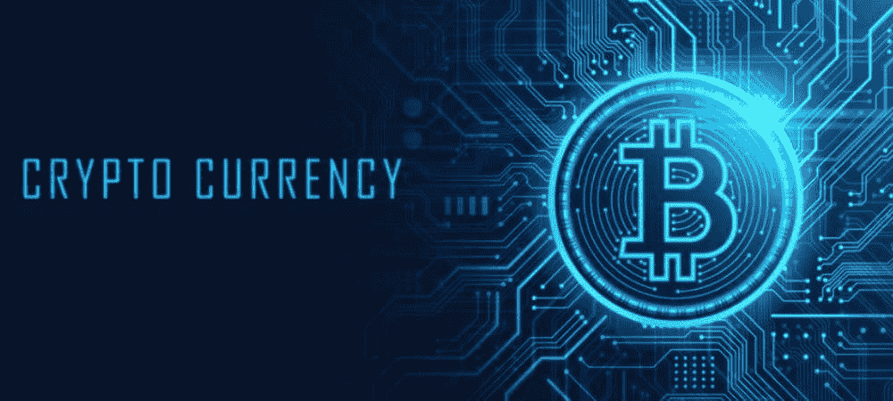Cryptocurrencies are becoming more popular as payment options for online transactions. Becoming familiar with cryptocurrencies and understanding the risks associated with using them is essential before transforming real dollars, euros, pounds, or other conventional currencies into the symbol for Bitcoin, the most popular cryptocurrency. When it comes to utilizing cryptocurrency, what are the dangers? Even though cryptocurrency is still a relatively new concept, the marketplace for such digital currencies is quite volatile. Because cryptocurrencies do not need the involvement of banks or other related parties to govern them, they are often uninsured and difficult to transfer into a form of fiat cash. Furthermore, since cryptocurrencies are intangible innovation assets, they are susceptible to hacking in the same way any other intangible technological asset is. For the last time, since you keep your cryptocurrency investments in a virtual wallet, you will lose your entire cryptocurrency investment if you lose access to your wallet.

Although most individuals invest in cryptocurrency as they would in those other assets such as stocks or precious metals, you may use crypto to purchase conventional products and services. While cryptocurrencies are a new and interesting asset class, investing in them may be dangerous since you must conduct extensive studies to comprehend how each system operates. Satoshi Nakamoto initially proposed Bitcoin as an end-to-end electronic cash system in a paper titled "Bitcoin: An end-to-end Electronic Cash System." "A digital payment system key cryptographic evidence instead of faith," Nakamoto said of the concept. This cryptographic evidence takes the form of verified and recorded transactions on a blockchain.

When it comes to cryptocurrencies, the globe is split. On the one hand, proponents like Bill Gates, Al Gore, and Russell Brand argue that cryptocurrencies are superior to traditional currencies. On the other hand, some are against it, such as Warren Gates, Paul Krugman, and Steven Shiller. Krugman and Shiller, both Nobel Laureates in economics, see it as a Ponzi scam and a vehicle for criminal activity. There will be a clash in the future between regulations and anonymity. Because several cryptocurrencies have been connected to terrorist activities, governments may wish to control how they operate. On the other side, Cryptocurrencies place a strong focus on ensuring that users stay anonymous.

区块链技术是一种存储数据的方式，使其难以或不可能被篡改、黑客攻击或欺诈。区块链是一个交易数字记录的日志，该记录在区块链的完整网络中的计算机系统上被复制并分发。链上的每个区块包含若干笔交易，每当数据库发生新操作时，该事件记录会添加到每个参与者的账本中。分布式账本是由多方管理的去中心化数据库。区块链是一种分布式账本技术，信息通过哈希（hash）记录，哈希是一种不可更改的电子签名。

比特币自 2008 年其微小的起步到 2017 年的最高价格，一直带领投资者和全球其他人经历了一段曲折的旅程。它上涨、下跌、反弹，然后在短短十年内再次上涨。比特币基于经济思想和市场效率原则。它是一种不由单一实体拥有、安全、国际、可互换、流动且供应有限的财产。由于需求高且供应几乎恒定，价格涨幅异常迅速，吸引了更多投资者。有人认为比特币的曲折历程为当今数百种其他加密货币在金融和投资用途中被使用铺平了道路。这就是比特币的作用。

像 Bitfinex 和 Coinbase 这样的指导网络和虚拟货币是购买加密货币的地方。今年早些时候，投资应用 Robinhood 推出了购买多种热门货币的功能，包括比特币、狗狗币和以太坊，且无需支付主流交易所高额费用。即使是加密货币新手今天也能轻松上手。以前有些复杂，但现在非常简单。开设银行账户并将其与信用卡关联很容易。但请记住，购买单个加密货币就像在股市上购买单只股票。将所有投资集中在一项资产上会让你面临比将资金分散到数百甚至数千种证券（如共同基金或市场基金）更大的风险。遗憾的是，加密货币目前供应稀缺。

随着越来越多的投资者将加密货币视为其投资组合的有价值补充，加密货币的全球知名度持续上升。在 2017 年和 2018 年 ICO（首次代币发行）的崩溃之后，那些吓退了采用者，近期出现了动力回升，这得益于两种新工具的推出：NFT 和 DeFi。从 Cryptocurrencies 到狗狗币和 Tether，数十种不同的加密货币使得进入加密世界变得困难。以下是按市值排名的前十大比特币，帮助你理清思路。

实施关键的妥协政策也至关重要。制定一套规定，明确在加密密钥及其持有者被盗时应采取什么措施，有助于限制风险和损失。此外，还需要数据 sterilization（数据清除）政策。由于数据在删除后仍可能残留在电子内容中，必须确保员工了解相关风险。通过授权合格人员使用能够在退役设备（如服务器、硬盘驱动器和便携式存储）上安全执行数据清除的技术，可以防止信息泄露。

在加密货币领域运营的组织也必须保持频繁的准备金证明以满足合规要求。审计追踪也是极其有用的工具，用于追踪意外安全问题的产生并迅速解决异常，以恢复信息系统的一致性。不要浪费时间去追逐廉价的“羊毛”（Lambos）或私人飞机的幻想。许多加密领域的 inexperienced（ inexperienced 保留原文）创业者购买低价币种，抱有大额获利的期望。这是一个非常典型的陷阱。影响币价的因素有多个，其中两个主要因素是流通供应和币的现实价值。

对数字货币失去信心：由于其胚胎阶段的特性，数字货币充满风险。想从数字货币的短期或长期持有中获利的投机者涌入在线平台。加密货币不依赖银行系统、国内或国际组织、资产或其他信用形式，其价值完全由市场参与者在交易所对它们的定价决定，因此信心丧失可能导致价值下跌。

据预测，加密货币将在 2030 年占全国货币的 25%，这意味着全球大部分地区将开始信任比特币作为支付手段。它将被更多商家和消费者所熟知，并保持其波动性，意味着价格预计像过去几年一样会波动。

加密货币在过去几年 popularity（ popularity 保留原文）显著提升，截至 2018 年已有超过 1,600 种可供使用，且数量仍在稳步增长。因此，区块链开发人员的需求也随之增加。区块链工程师的薪酬反映了其高度认可度：全栈开发人员的平均年薪超过 112,000 美元。甚至有一个专门的网页 devoted（ devoted 保留原文）于比特币职位招聘。加密货币是一种数字或虚拟货币，设计用于作为交易手段。它的运作方式类似于现实货币，但没有实体形态，并依赖于加密技术来运行。新单位只有在满足特定条件时才能被创造，因为加密货币运行自由且自主，无需银行或中央机构。比特币的上限为 2100 万枚，超过此数量后不再生成。

加密货币作为在线交易支付方式日益普及。在将美元、欧元、英镑或其他传统货币转换为比特币（最受欢迎的加密货币）之前，了解加密货币及其相关风险是至关重要的。使用加密货币时有哪些危险？尽管加密货币仍是新概念，但其市场十分波动。由于加密货币无需银行或其他相关方参与治理，它们通常缺乏保险，且转换为法定货币（fiat cash）较为困难。此外，由于加密货币是无形资产，它们像其他无形技术资产一样易受黑客攻击。最后，由于你将加密货币投资存储在虚拟钱包中，一旦失去对钱包的访问权，你将失去全部加密货币投资。

加密货币是一种数字或虚拟货币，设计用于作为交易手段。它的工作方式类似于现实中的现金，只是没有实体形式，并依赖于加密技术来运作。新单位只有在满足特定条件时才能被引入，因为加密货币在没有银行或中央机构的情况下自由且自主运行。比特币的供应上限为 2100 万枚，超过此数量后将不再生成。

加密货币在过去几年 popularity 增长显著，截至 2018 年已有超过 1,600 种加密货币。且数量持续增加。因此，区块链开发人员的需求也随之上升。区块链工程师的薪资反映了其高度认可度：全栈开发人员的平均年薪超过 112,000 美元。甚至有一个专门致力于比特币职位的网页。

## 加密货币概览

人类在旧石器时代使用以物易物的系统，即两个或多个个人之间交换产品和服务。例如，可能有人用 7 个苹果换 7 个橙子。由于其明显的缺陷，以物易物逐渐失去人气：

*   没有公认的价值衡量标准：你需要决定自己愿意用多少自己的财物换取其他财物，且并非所有财物都能被分割。
*   必须满足所有人的需求：如果你有交易对象，对方必须想要你的东西，而你也必须想要对方提供的东西。
*   例如，一只活体动物无法被分割成更小的部分。与我们现在的现金不同，现金可以放在钱包里或存储在手机上，而以物易物的物品难以转移。
*   当人们认识到以物易物体系运作不佳时，货币经历了几次修改：第一次官方货币在 110 B.C. 铸造，1250 A.D. 引入并流通的珠宝 florins，1600 至 1900 年间纸币获得极大吸引力并全球使用。这便是现代现金的诞生方式。

现代现金包括纸币、硬币、信用额度以及移动支付、亚马逊支付、Paytm 和 PayPal 等数字钱包。所有这些都受银行和政府监管，意味着存在一个集中监管机构来规范纸币和信用卡的使用。

## 加密货币 vs. 传统货币

考虑以下场景：你想通过互联网向朋友转账以感谢她/他请你吃午饭。事情可能出错的方式有很多，包括：

*   金融机构可能存在技术问题，例如系统瘫痪或设备故障。
*   你的账户或朋友的账户转账限额可能已被超过。
*   你的账户或朋友的账户可能被黑客攻击，例如遭受拒绝服务攻击或信息窃取。
*   银行是主要的崩溃点。

这就是比特币是未来的货币的原因。考虑两个人使用比特币应用进行类似交易的情况。界面会询问用户是否确定可以发送比特币。如果确认，系统会验证用户身份，确认客户是否有足够资金完成支付，然后开始处理。支付随后被传输，资金存入收款人账户。整个过程仅需几分钟。

因此，加密货币解决了当代银行的所有问题：你可以随意发送任意金额的钱，且账户无法被黑客攻击。同时，系统没有单点故障。如前所述，截至 2018 年已有超过 1,600 种加密货币，比特币、以太坊和 Zcash 等是最具代表性的。每天都有新的虚拟货币出现。鉴于其目前的快速增长，未来还有大量新加密货币将涌现。

![How To Invest In Cryptocurrency Without Investing In Cryptocurrency | Nasdaq

比特币和以太坊是最知名的加密货币，你很可能已经听说过它们，或者有人向你提及过。加密货币作为在线交易支付方式日益流行。在将真实美元、欧元、英镑或其他传统货币转换为比特币（最受欢迎的加密货币）符号之前，了解加密货币及其使用风险是至关重要的。

在使用加密货币时，存在哪些风险？尽管加密货币仍属新概念，但其市场十分波动。由于加密货币无需银行或其他相关方参与治理，它们通常缺乏保险，且难以转换为法币。此外，由于加密货币是无形资产，它们像其他无形技术资产一样容易受到黑客攻击。最后，由于你将加密货币投资存储在虚拟钱包中，一旦失去对钱包的访问权，你将失去全部加密货币投资。

遵循以下建议以保护你的加密货币安全：

*   将你的资金存储在安全的钱包中。选择合适的钱包需要根据你的需求进行研究。假设你决定通过计算机或设备的本地和全球环境管理比特币钱包，那么你必须保护它的安全程度与你投资价值相当。就像你不会在超市袋子里携带太多现金一样，也不要将加密货币存储在晦涩或不知名的钱包中。确保你使用的是可信赖的钱包。
*   在冲动之前先了解情况。第一步是了解加密货币的工作原理及其用途，同时也要了解如何交换它。阅读货币的官方网站，以获得全面理解，并阅读你所考虑的加密货币的独立出版物。
*   [准备备用计划](https://example.org)。考虑如果你的电脑或智能手机丢失、被盗，或者以其他任何方式无法访问它的情况。没有备份解决方案，你将无法恢复加密货币，并且面临投资损失的风险。

加密货币是一种去中心化、依赖区块链的电子货币。虽然你可能熟悉最知名的形式，如比特币（Bitcoin）或以太坊（Ethereum），但目前已有超过 5,000 种不同的加密货币在使用。

大多数个人将加密货币视为股票或贵金属等其他资产的投资方式，但你也可以使用加密货币购买传统商品和服务。虽然加密货币是一种新颖且有趣的资产类别，但投资它们可能很危险，因为你需要进行广泛研究以理解每个系统的运作。


Satoshi Nakamoto 首先在题为 "Bitcoin: An end-to-end Electronic Cash System" 的论文中提出比特币作为一种端到端电子现金系统。 "Nakamoto 表示，该概念基于密码学证据而非信任"。这种密码学证据表现为区块链上经过验证并记录的交易。

# 第 3 章：值得投资的加密货币及第一代代币

随着越来越多的投资者将加密货币视为他们投资组合中理想的补充，加密货币的全球知名度正在持续上升。在 2017 年和 2018 年 ICO 崩溃后，曾令采纳者恐惧的情况过去几个月里出现了回升，动力由两种新工具——NFT 和 DeFi——的推出所推动。加密货币种类繁多，从加密货币到狗狗币和 Tether，让初学者难以入门。以下是按市值排序的前十大比特币，即目前流通中所有硬币的总价值，以帮助你理清思路。Ripple 是一个用于点对点金融转账和虚拟货币的平台。该平台是一个开源协议，允许两方快速且低成本地进行交易。从英镑等法币到加密货币和空中里程碑，任何类型的现金都可以在该网站上交易。XRP 代币（X.R.P.）可与任何现金或数字资产兑换，也可以在该平台上使用。另一方面，它并不依赖于 Ripple 网络。转账时，双方无需 XRP。因此，Ripple 的价值不在于 XRP 硬币，而在于其网络快速在全球范围内移动资产的能力。

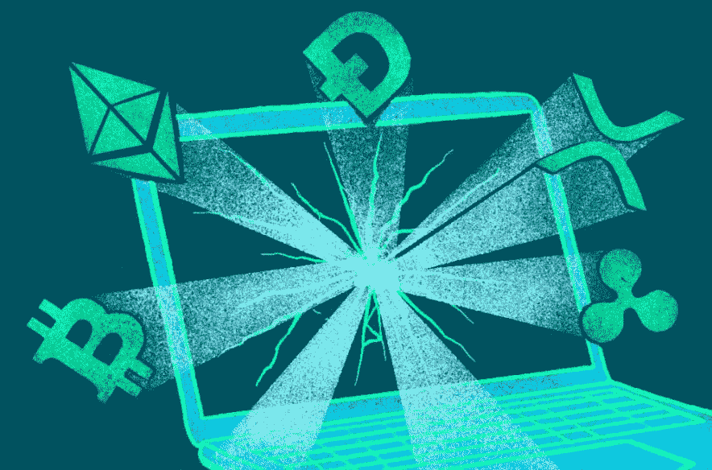

Stellar 是一种基于分布式账本技术的支付机制。它能够在几秒钟内完成任意两种货币之间的跨境支付。它在许多方面与其他基于区块链的加密货币相似。XLM 的唯一其他创造方式是通货膨胀。为适应经济增长和损失的 Lumen，Lumen 的年通货膨胀率设定为 1%。每周通过直接投票系统生产并奖励新的 Lumen。

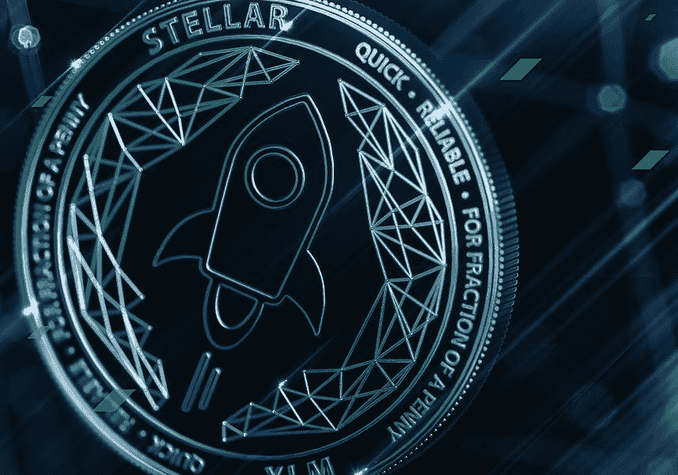

## 3.1 Ripple

Ripple 是一个用于点对点金融转账和虚拟货币的平台。该平台是一个开源协议，允许两方快速且低成本地进行交易。从英镑等法币到加密货币和空中里程碑，任何类型的现金都可以在该网站上交易。XRP 代币（X.R.P.）可与任何现金或数字资产兑换，也可以在该平台上使用。另一方面，它并不依赖于 Ripple 网络。转账时，双方无需 XRP。因此，Ripple 的价值不在于 XRP 硬币，而在于其网络快速在全球范围内移动资产的能力。

网络与传统支付方式（如 SWIFT）竞争。与其他加密货币（如比特币）旨在取代现有支付系统或与法币直接竞争的目标不同，RippleNet 支持多种支付方式。Ripple 的概念最初于 2004 年提出，但直到 2013 年才广泛采用。Jed McCaleb 鼓励许多投资者参与该网络。Chris Larsen 也是其中一位天使投资人，被认为是加密货币投资者中最富有的之一。在选择个人或公司是否使用 Ripple 之前，需要权衡其优缺点。

### Ripple 的优势

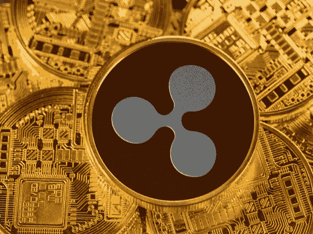

Ripple 的使命是解决问题并开辟新机遇。人们通常需要数周时间完成跨境交易，具体取决于支付方式和相关方。Ripple 的解决方案旨在降低成本，同时提高速度和效率。RippleNet 拥有大量参与者。因此，这并不奇怪。根据网络效应的增加现象，加入 Ripple 解决方案的传统组织越多，Ripple 在未来的影响力也越大。

### Ripple 的缺点

Ripple 试图在拥挤的金融科技领域中与 SWIFT 这一行业领导者竞争。在传统世界中，改变现状可能困难、耗时，最终需要过渡和相应的教育。Ripple 在加密货币领域面临竞争对手，如 Stellar 和 SWIFT。尽管 Ripple 拥有先发优势，但必须持续创新并扩展其网络。

由于加密货币行业比传统金融更为年轻，监管环境模糊。监管机构是否应将现有的传统规则和标准直接应用于加密货币领域，还是应设计更贴合这一创新的新法律？一个典型的监管困难例子是 SEC 对 Ripple 的诉讼。

## 3.2 Stellar

Stellar 是一种基于分布式账本技术的支付机制。它能够在几秒钟内完成任意两种货币之间的跨境支付。它在许多方面与其他基于区块链的加密货币相似。XLM 的唯一其他创造方式是通货膨胀。为适应经济增长和损失的 Lumen，Lumen 的年通货膨胀率设定为 1%。每周通过直接投票系统生产并奖励新的 Lumen。

### Stellar 区块链的工作原理

与所有区块链技术一样，Stellar 网络将交易添加到共享且去中心化的公共账本中。Stellar 使用基于联邦拜占庭协议（F.B.A.）的“Stellar 共识协议”（S.C.P.）。S.C.P.通过在几秒钟内让网络中的每个人对交易的真实性达成一致，从而实现更快的交易和更低的成本。协助将事件添加到全球账本的每个参与者（称为节点）会选择一组可信的其他参与者组成的小网络。这些小网络被称为 Quorum Slices。只要 Consensus Slices 有重叠，Stellar 网络就能迅速达成一致并将合法交易添加到账本中。

### 投资 Stellar 的优势

对几家加密货币金融网站进行快速浏览，可以看到对 Stellar 未来（X.L.M.）的看涨预测。大多数分析师认为 X.L.M.是教师、学生交易者以及投资者的良好投资选择。让我们来看看 X.L.M.的积极方面，以判断它是否是一个好的投资。

#### 无监管争议

尽管与 Ripple 有密切的合作关系，Stellar 仍避免与监管机构发生法律争议。其创始人 Jed McCaleb 同时创立了 Ripple 和 Stellar 两家公司。这也是 Stellar 和 Ripple 相似之处众多、差异较少的主要原因。因此，XRP 最近的价格上涨对 X.L.M.影响甚微，后者保持了独立性，能够按自身定价而非作为首发跨境交易的分叉代币。缺乏争议或监管行动为技术企业的未来增添了光明前景，并通过提升其价值对其股价产生积极影响。

#### 交易量增长

一个新投资者经常忽视的技术指标是交易量。了解投资者正在交易多少资金可能帮助你发现特定项目的活跃情况。通常，一个正在增长的市场会有交易量的增加。5 月份，Stellar Lumens（X.L.M.）的交易量有所增加，这表明该加密货币的广泛吸引力。X.L.M.在 5 月份结束时以 8.79 亿美元收盘，略高于上个月的 14.9 亿美元的收盘价。X.L.M.在 5 月份上涨，达到 2021 年 5 月 10 日星期一的纪录高位$0.78。5 月份观察到的交易量包括 30.20 亿美元、20.60 亿美元、48.80 亿美元、45.00 亿美元和 67.20 亿美元，这些交易量按日期顺序并未特定排列。这表明交易商和投资者对该资产的高度关注。

长期投资者，尤其是对冲基金等投资机构，通常回避交易量不足的公司。基于这句话，长期持有 X.L.M.的投资者正坚持持有他们的投资，希望价格会上涨。因此，虚拟货币的交易活动一直在稳步增长。

#### 改善日常使用率

每天，Stellar 都会处理数百万笔交易。X.L.M.的活动计数达到了 251 万，总计$212.05 百万美元。这对于尚未被数百万互联网零售商作为支付方式使用的加密货币来说，特别令人瞩目。这应该能说服你作为交易者或投资者认为投资 Stellar 是值得的，因为数百万个人定期使用这种数字资产。

### 投资 Stellar 的缺点

你可能会因为只关注资产的特性而损失大部分，甚至全部的资金。让我们快速了解一下在投资 Stellar 之前应该知道的缺点。

#### 与其他团队相比，Stellar 团队相对较小

截至 2020 年底，Ripple 有 548 名员工。Stellar 实验测试组在 2021 年 10 月有 115 名员工。这为 Ripple 这家直接竞争对手在广告、开发和区块链解决方案用于解决传统日常交易方法方面的竞争力提供了优势。

#### 面临来自 Ripple 的强劲竞争

X.L.M.的交易验证与 X.R.P.的交易验证不同。Stellar 比 Ripple 更去中心化，这是加密圈的常识。因此，两个跨境支付网络都服务于集中化的金融机构。潜在消费者可能会考虑在日常运营中使用 Ripple 的软件解决方案，因为 Ripple 的 X.R.P.代币更为集中化，已为数百家金融机构提供服务。这归功于 Ripple 的先发优势以及庞大的合作伙伴名单。

Stellar 正在努力追赶。也许这就是为什么 Stellar 实验测试组在 2021 年 1 月与乌克兰政府达成去中心化数字货币协议，向全球发出强烈信号。

#### 无法获得与其独特特征相匹配的估值

X.L.M.于 2018 年 1 月 4 日触及$0.9381 的历史最高点，这一事实难以理解。这表明 X.L.M.在超过三年内未测试$0.9 区域。与此同时，比特币和以太坊的价值已几乎涨幅 1000%。这引发了加密货币专家和专业人士对该资产能否实现$1、$5 或$10 价格目标的疑虑。你只能希望 X.L.M.的价格在未来显著上涨。目前它交易价格低于一分钱，要让其价值与 B、b、D.O.T.和 LINK 等代币相匹配需要重大创新。

## 3.3 Neo

N.E.O.是代币及其运行的网络名称。与 Ethereum 允许用户构建去中心化应用和智能合约的方式类似，该网络也提供此功能。N.E.O.与其他加密货币的区别在于，其系统目前受到权威机构的管理，该机构要求用户在网络上验证身份。

N.E.O.是开源、去中心化的区块链平台和加密货币，它是第一个采用区块链技术和数字身份来数字化资产、通过合约自动化信息资产转移，并通过分布式网络实现“智能经济”的平台。

### Neo 区块链平台的优势

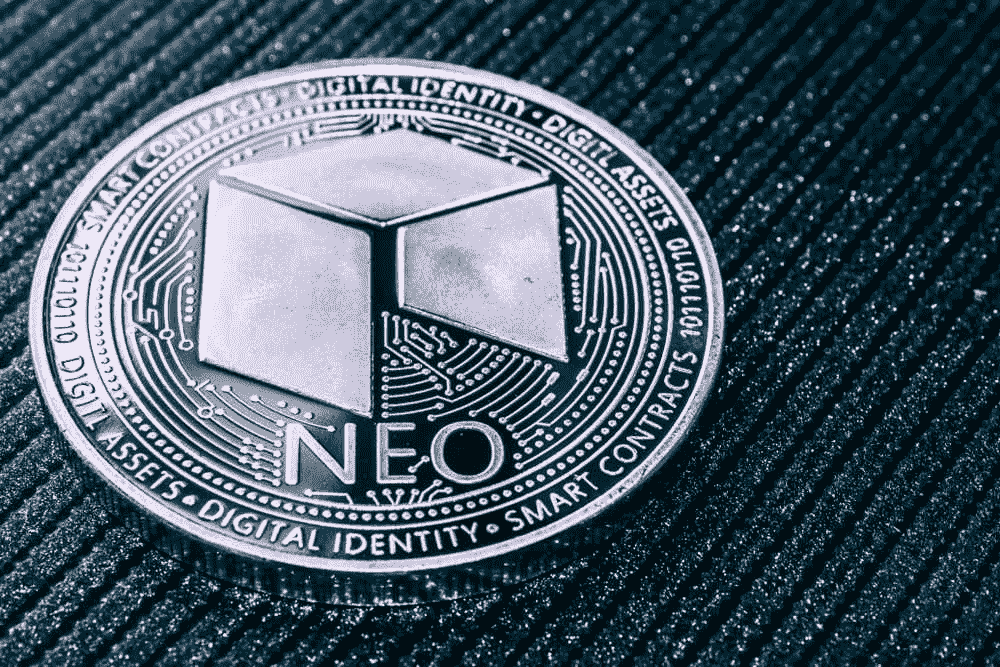

- N.E.O.的通用轻量虚拟机，即 NeoVM，允许使用任何编程语言。N.E.O.架构提供的虚拟机高效、安全且可扩展，同时也支持构建去中心化应用（DApps）。N.E.O.平台的最佳特性是 G.A.S.，它可以被描述为 N.E.O.的资产对。因此，N.E.O.持有者将获得 G.A.S.，这是持有 N.E.O.的分红。它根据公式分配。如果你在钱包中持有 N.E.O.，你每天都会收到 G.A.S.。

- 数字资产、数字身份和智能合约是“智能经济”的一部分。N.E.O.的一个卖点就是其智能经济。它与其他加密货币，特别是 Ethereum，有着显著区别。它将在网络上数字化资产，一旦数字化，它们将保留在网络上并受益于去中心化、透明、信任、可追溯性，以及任何人都能识别资产的特性。

- 其“汽油”（Petrol）成本在最近几个月大幅上涨，为持有 N.E.O.提供了良好的存储激励。如果你持有 100 个 NEO，每年将收到 0.03411 个 Gas。一个框架只有在有成功运行的项目时才能有效；N.E.O.生态系统中已有许多成功的项目，这些项目以各自方式对 N.E.O.产生积极影响。

- 任何拥有资产的公司、个人或其他实体都可以注册数字身份。它基于数字证书（PKI）（PKI）系统。开发者可以利用智能合约使整个基础设施运作。与 Ethereum 不同，N.E.O.不要求你学习不同的编程语言来编写智能合约。因此，任何程序员都可以轻松上手，在 N.E.O.平台上构建智能市场。

- NEX 是一个有希望的 NEO 基于项目，它是一个去中心化交易所和支付解决方案，运行在 N.E.O.上。在注册用户的流程开始之前，它已经存在，而首次销售计划于今年晚些时候进行。N.E.O.与 OnChain 有着有意义的联系；对于那些与其具有相似意图的人，N.E.O.作为 D.N.A. — OnChain 的系统的基石发挥作用。

### Neo 区块链平台的缺点

尽管 N.E.O.由于其中国根源而在亚洲非常流行，但它在西方世界仍然未知。N.E.O.面临着像 Ethereum 和 E.O.S.这样的大型竞争对手，后者拥有忠实的追随者和在加密社区中建立的良好声誉。由于新竞争对手不断出现，N.E.O.必须努力赢得市场。

尽管中国严格的政府结构支持 N.E.O.，但其技术选择可能受政治影响。N.E.O.高度集中化，开发者控制了几乎所有的代币，且短期内是否会发生变化尚不清楚。

### N.E.O.是否是一个好的投资？

N.E.O. 是 2018 年表现不佳的加密货币资产之一，其价格在 9 月和 10 月大幅下跌。然而，由于其在中国的良好位置，它仍值得作为一种投资工具考虑。得益于其快速的交易和来自中国政府的支持，N.E.O. 正在吸引更多的机构投资者。当加密货币市场开始波动时，我们不会感到惊讶，因为 N.E.O. 在这几个月里已经是表现最好的资产。

## 3.4 最佳加密货币投资

随着越来越多的投资者将加密货币视为他们投资组合的理想补充，加密货币的全球知名度正在持续提升。在 2017 年和 2018 年 I.C.O. 陷入困境后，导致采用者恐慌，近期动力重新燃起，得益于两种新工具的推出：NFTs 和 DeFi。加密货币种类繁多，从比特币到狗狗币和泰泰币不等，初入加密世界的新手感到困惑。以下是按市值排序的前十大比特币，帮助您理清思路。随着前进，还有许多可能带来丰厚回报的机会。

### 比特币

比特币是市场规模最大的加密货币，也是最成熟的价值存储工具，是每位加密投资者的必备资产。比特币于 1 月 3 日庆祝其 13 周岁生日，市值约为 9000 亿美元。它是唯一拥有美国市场基金跟踪其波动的数字货币，并占据加密货币总市场约 40%。BTC 是其类别中最成熟的加密货币，是加密货币新手的强制性投资。特斯拉和 MicroStrategy 等公司在其资产负债表上持有 BTC。比特币是最知名的加密货币，自 2009 年创立以来已进入第 13 年。

比特币是按市值计算全球最值钱的加密货币，交易使用基于区块链的解决方案，该区块链是去中心化数据库，记录全球超过 15000 台计算机上的交易和余额。

比特币凭借其韧性和长期信誉，可能在 2022 年成为热门投资。

### Solana

与比特币不同，Solana 解决了以太坊巨大的交易成本问题。由于以太坊的“燃料费用”，即使是小额交易也变得经济上不可行；而 Solana 的费用仅为以太坊费用的极小部分。Solana 与以太坊一样，旨在成为去中心化金融（DeFi）的顶级平台，消除对金融中介和传统金融机构（如银行、经纪商、集中化交易所等）的需求。Solana 于 2020 年推出，市值占比 modest 但正在增长，其代币价值从 2021 年初的 1.51 美元上涨至同年末的 160 美元。

### 以太坊

尽管以太坊的市值低于比特币，但它占据全球市场约 20%，在影响力上可能正逼近比特币。原因在于它不仅是价值存储，还提供其他功能，且全球最广泛使用的区块链。以太坊的原生代币 Ether（ETH）是优质加密货币选择，因为它支持智能合约、非同质化代币（NFT）及其他加密货币。当它从工作证明转向权益证明协议时，ETH 将比比特币更节能，消除验证区块链所需的高能耗计算操作。

### 狗狗币（DOGE）

狗狗币以其作为笑话代币的起源而闻名，但这并不妨碍它在加密世界中获得认可。狗狗币和柴犬币（Chia Inu）均位列全球估值前 15 名。其投资吸引力的主要原因是埃隆·马斯克（Elon Musk）是其拥护者，而非仅仅是讽刺者——他在 2021 年狗狗币狂飙期间曾被传言支持，且在与 Lex Fridman 的早期播客中明确表达立场。鉴于其在加密圈的影响力，狗狗币尚未出现显著涨价尚属意外。若主流媒体效仿马斯克的热情，或该“ erratic billionaire” 公开再次表达对该货币的喜爱，狗狗币可能出现短期涨幅。

### Polkadot

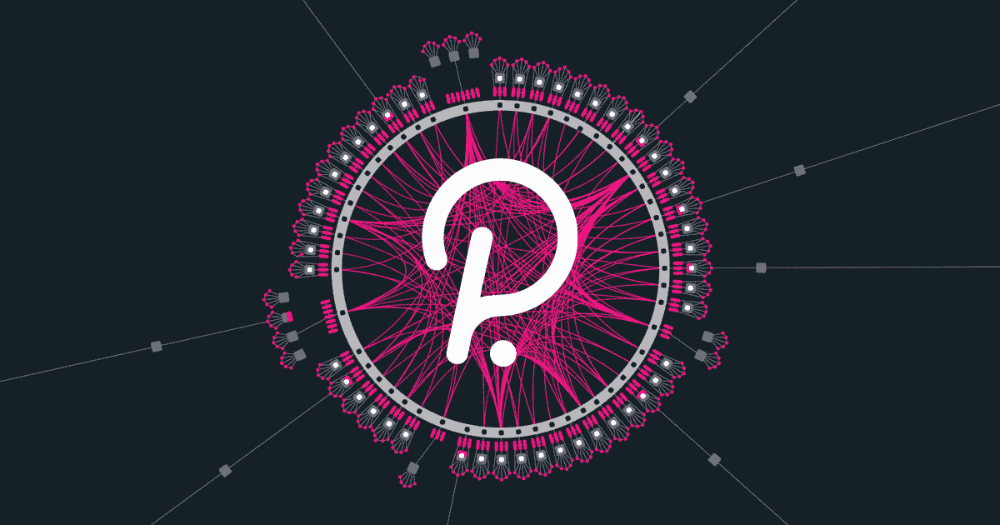

在让开发者构建智能合约和应用方面，Polkadot 与以太坊极为相似，并有望在未来一年显著提升功能性。

### Polygon

Helix 在过去一年飙升约 100 倍。M.A.T.I.C. 市值为 170 亿美元，位列前 15 名，自 2022 年初起仍是优质加密货币选择之一。Polygon 致力于实现与 Yearn. Finance 类似的广泛采用，但方式不同：通过构建更具可扩展性的区块链。其技术旨在扩展以太坊，并允许理论上无限数量的去中心化应用（dApps）在其上运行。约 72% 的 Polygon 总供应量（十亿枚代币）已流通。

### Yearn. finance（Y.F.I.）

Yearn. Finance（简称 Y.F.I.）是近期备受关注的代币，市值达数十亿美元，价格在最近一年波动范围在 18,566 至 93,435 美元之间。它是按市值第 80 大的加密货币，当前价格超过 38,000 美元。其目标是通过最优收益挖矿，向非技术性创业者和用户开放 Ciency（可能是指金融）领域。

### 去中心化金融（DeFi）

Yearn. Finance 承诺更快速为用户提供服务，其前景令人期待。整个行业必将随时间增长，但该领域仍技术性较强，像 Yearn. Finance 这类帮助用户更易上手的工具必将拥有光明未来。短期内，Y.F.I. 在 12 月和 1 月的表现优于多数加密货币，涨幅超过 20%，而其他多数在此期间大幅下跌。

### Binance Coin

由于处理纳斯达克加密资产更快更便宜，市场活动将进一步增多，进而影响交易价格；全球最大交易所的原生代币可能在 2022 年出现显著增长。

### Cardano（A.D.A.）

Cardano 以其最早采用权益证明验证机制而闻名，与比特币等需要竞争性解题的系统不同，该方案通过消除交易验证中的竞争性计算，降低交易时间、能耗及环境影响。Cardano 与以太坊类似，使用其原生代币 A.D.A. 实现智能合约和去中心化应用。

与其他主要加密货币相比，Cardano 的 A.D.A. 代币增长较为缓慢。2017 年 A.D.A. 价格为 0.02 美元，截至 2022 年 1 月 3 日，当前价格为 1.34 美元，涨幅达 6600%。


# Tether（U.S.D.T.）

Tether 是一种加密货币，意味着它由法定货币（如 U.S. dollar 和欧元）支撑，其价值理论上与其中一种货币的价值相等。Tether 的价值设计旨在比其他加密货币更恒定，这也是它受到那些害怕其他硬币过度波动的投资者青睐的原因。

# U.S. Dollar Coin (U.S.D.C.)

USD Coin (`U.S.D.C.`)，与 Tether 一样，是一种稳定币，意味着它由 U.S. 美元支撑，并力求维持 1 美元兑 1 `U.S.D.C.` 的比率。`U.S.D.C.` 基于以太坊，可能用于进行国际交易。

# Terra (LUNA)

Terra 是一种稳定币区块链支付网络，通过维持两种加密货币之间的平衡来运作。TerraUSD 和其他 Terra 支持的稳定币与实际货币的价值相关联。Luna 是其对冲币，用于为 Terra 系统提供动力并铸造新的 Terra 稳定币。

Luna 稳定币和 Terra 稳定币根据供需关系协同工作：当稳定币价格超过其关联货币的价值时，用户被鼓励销毁 Luna 以生产更多 Terra 稳定币；当 Luna 稳定币相对于基础货币的价值下跌时，用户被鼓励销毁 Terra 稳定币以生产更多 Luna。随着 Terra 平台的普及，Luna 的价值随之上升。

Luna 的价格在 2021 年 1 月 3 日（当时价格为 `$0.64`）至 2022 年 1 月 3 日之间上涨了超过 14,300%，从 `$0.64` 上涨至 `$92.64`。

# X.R.P. (X.R.P.)

`X.R.P.` 是一家由与 Ripple 部分相同创始人创立的数字网络和支付处理公司，可用于在该网络上简化多种货币（包括法定货币和其他主要加密货币）的交换。

Ripple 在 2017 年初的价格为 `$0.006`。其价格在 2022 年 1 月 3 日达到 `$0.83`，涨幅超过 13,700%。

# Chapter 4: Myths about cryptocurrencies and Altcoins Generation 2

加密货币的宇宙在近年来因资产的惊人收益而繁荣。然而，由比特币推动的指数级增长已催生了诸多可能真实也可能不真实的神话。以下是一些常见的加密货币误解。政府可以下令金融机构停止处理加密货币或与其交易的公司，但实际禁止加密货币的存在极为困难。加密货币交易并不比发送电子邮件更复杂，任何拥有网络访问权限的人都可以轻松进行交易。

政府之所以担忧加密货币带来的风险，是因为它们希望对可能被视为可行货币的事物拥有更多控制权。然而，近年来越来越多的国家表现出以好奇心接近加密货币的态度。

支持比特币等加密货币的区块链技术应用日益受到关注。一些专家认为区块链尚未建立任何实际用例，比特币可能是唯一取得一定成功的工具。事实是区块链技术正以惊人的速度发展。例如，区块链上的智能合约可以在贷款人和房贷受益人之间持有合同，并有潜力自动化从受益人加密钱包向贷款人账户的还款。从 DeFi 到 NFT，区块链技术提供了丰富的可能性和应用。

## 4.1 Tether

Tether（或 `USDT`）是一种与法定货币挂钩的加密货币，以确保稳定性。Protocol Omni 创建了一种基于比特币网络的加密货币，其价值与美元价值“锚定”。该货币旨在解决三个关键问题：

* 稳定比特币
* 稳定国家货币转账
* 提供验证选项

### 它是如何工作的？

Tether 公司是一家中国公司，充当该加密货币资产的第三方。它维护与流通中 `USDT` 数量相等的法定货币储备。简单的解决方案可以减少执行法定货币和加密货币审计的难度。其实施不会损害审计的透明度或安全性。

`USDT` 基于 Omni 技术，这是一种灵活的平台，用于链接比特币网络上的各种货币和数字资产。其理念是每个 `USDT` 价值 1 美元，且随时可以兑换为法定货币。

### USDT 的优势

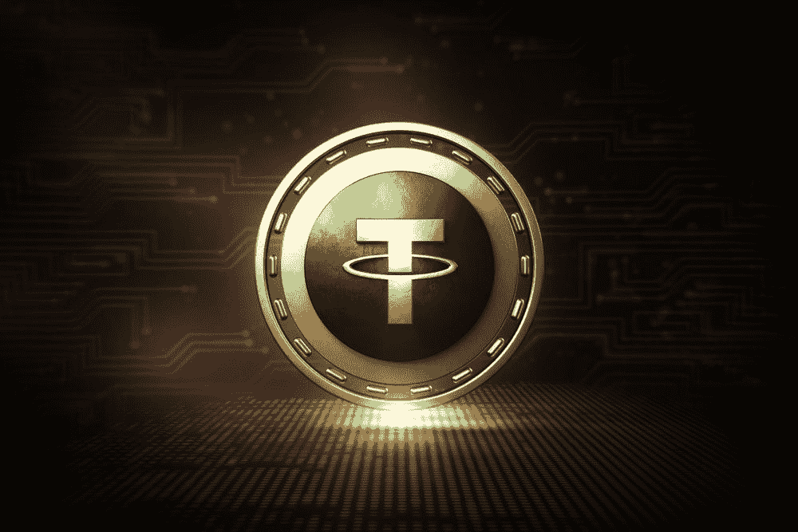

以下是 `USDT` 的一些重要优势：

价值稳定

在购买或出售其他加密货币时，您需了解其波动性。使用 Tether，情况并非如此。此外，许多交易所接受 `USDT` 而非法定货币。

交易时间

`USDT` 交易在几分钟内完成。这对所有人都有益，尤其是那些以分钟而非天数进行交易的交易者。传统银行程序，无论是存款还是取款，可能需要数天时间处理 USD 交易。

交易费用

SWIFT 交易可能非常昂贵。在处理不支持的法定货币时，费用可能相当高昂。在 Tether 钱包之间进行转账没有费用。

您可以选择不持仓，现在取出资金，或等待时机。在等待时机时，无需在交易所上损失资金。

### USDT 的缺点

一些因素对 `USDT` 不利。以下是其中一些：

价格稳定

关于 `USDT` 价值与美元的观念看似有利于价格稳定。然而，法定货币的价值从未固定。因此，Tether 的概念并不总是准确。波动幅度一直在 2% 到 3% 之间，从未低于此值。

缺乏匿名性

加密货币基于匿名性原则。要开设账户并购买 `USDT`，您需要提供身份验证文件。尽管如此，仍有少数交易所允许您在不提供身份验证的情况下创建账户。

无采矿

如果您想采矿 Tether，没有选项可供选择。只有 `USDT` 背后的公司可以进行采矿。该公司最倾向于保持货币相对于美元的价值稳定。没有中央监管，要维持这种稳定是不可能的。

## 4.2 Binance

根据交易量，Binance 是当今运营的最大加密货币交易所之一。Binance 成立于香港，其条款和条件目前受香港法律管辖。它未在任何股票市场注册，其组织模式透明度不足；例如，无法确定 Binance 的办公地点。

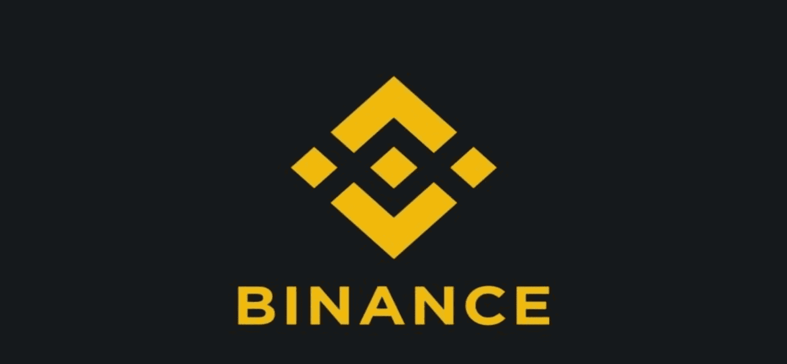

在美国，Binance 目前不可用。美国用户可以使用 `Binance.US`，它利用 Binance 的匹配引擎和钱包技术，但其产品种类和交易对数量相比 Binance 受限。该公司雇佣 2,800 人，客户群体达 1500 万。Binance 的月度交易量为 1800 亿美元，与加密货币持平；在某些交易日，Binance 的 turnover 超过 Coinbase。

缺点

* 美国客户无法访问 Binance 基础设施 Binance。
* 其在美国受到高度限制。
* 即使是经验丰富的用户也可能觉得它令人畏惧。
* 在多个国家受到监管，或在美国受到调查。
* 无新数据钱包

优点

### 一个成本效益最高的平台

### 交易 500 多种加密货币

### 交易种类多样

## 4.3 Cardano

Cardano 是一个去中心化的加密货币平台，是世界上首个可访问且经过同行评审的网络之一。其目标是通过科学和研究方法提供增强功能。Output Data Hong Kong 创立了 Cardano，由创建者 Charles Hoskinson 领导，他是以太坊的众多共同创始人之一，并曾参与 Ethereum 和 Bitshares Classic 的开发。他们最初委托各教育机构的学者和专业人士审查 Cardano 的协议。

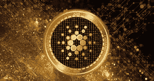Cardano 的核心目标是构建第三代平台，以实现智能合约功能，同时解决比特币（第一代货币）所面临的扩展性挑战。这并不令人惊讶，许多专家预测只要 Cardano 兑现其承诺，它终将取代以太坊（第二代货币）。Cardano 的结算层（CSL）和控制层分别用于结算交易和智能合约。Ouroboros 证明-of-权益（proof-of-stake）方法位于 Cardano 的核心。与工作量证明系统相比，Cardano 的协议更节能、更低成本。

**Cardano 投资的优势**

了解购买 Cardano 的好处对于判断 ADA 是否是一个好的、可能成功的投资至关重要。即使优势多于劣势，也不意味着应当量化衡量；一些劣势可能超过众多优势。因此，让我们来看看拥有 Cardano 的一些优势。

**学术支持**：

如前所述，Cardano 是少数几个被学术界研究并给予高度评价的货币之一。许多学者与 IOHK 合作，撰写关于项目下一步如何提升 Cardano 的文章。这为 Cardano 提供了其他货币所缺乏的信任度，也对想更深入了解它的个人非常有价值。

**强大的开发团队**：

Cardano 由以太坊联合创始人 Charles Changing 及 Jeremy Wood 创立，于 2017 年正式发布后获得大量关注。Cardano 也参与确保协议无缺陷。它评估了众多协议，并设计了复杂的区块链以避免缺陷和黑客攻击。

Cardano 采用多层架构：

* 这是 Cardano 的主要优势之一。
* 同时也允许在不中断支付或交易的前提下进行修改。
* 通过构建结算层和计算层，Cardano 实现了无限扩展性和快速交易。

**Cardano 投资的劣势**

尽管 Cardano 相较于其他货币拥有诸多吸引人的优势，投资者和交易者在购买 ADA 前仍需了解其缺点。

与任何投资一样，投资 Cardano 并非没有风险。以下为主要缺点：

* **Cardano 计划实施投票系统**：
  虽然开放式投票让持有者可以提议并投票修改颇具吸引力，但潜在缺点在于持有者未必技术熟练，可能投票支持非理性的结论。
* **Cardano 仍在开发中**：
  虽然 Cardano 被誉为“学术区块链”，经历了广泛的审查与测试，但它仍处于发展的早期阶段。这或许是避免 Cardano 的最重要原因。即便在竞争与技术突破之间，Cardano 也需要时间成长。它已长期落后于以太坊和 EOS，因为缺乏完整的合约与代币规范。Cardano 仍专注于扩展性，而像 Ripple 这样的加密货币可处理 1,000 笔每秒交易，Pascal 仅能潜在处理 257 笔交易/秒。
* **Cardano 进展迟缓**：
  过去多次延期导致发布推迟，Cardano 缺乏合约及 dApp 功能，这最令人担忧。虽然承诺不久后的 Goguen 更新将带来这些功能，但这仍是一个缺点，直至实现为止，我们无法依赖这些承诺。
* **账本同步问题**：
  虽然 Cardano 采用了独特方法，但部分批评者认为其假设账本随时可在全局网络中同步的前提在现实中不切实际。
* **双重支出或 51% 攻击风险**：
  许多专家认为仍可对系统进行双重支出或 51% 攻击。例如，输入背书人可能批准来自两个不同区块引导者的相同交易。

## 4.4 加密货币的神话

加密货币在近年来因其惊人的收益而迅速发展，但受比特币推动的指数级增长也孕育了众多或真或假的神话。以下是一些常见的加密货币误区。

**政府可以禁止并停止加密货币**：

政府可以要求金融机构停止处理加密货币或与其交易的公司，但实际禁止加密货币的存在极其困难。加密货币交易与发送电子邮件的难度相近，任何拥有网络的人都能轻松进行。

**政府对加密货币持谨慎态度**：

政府担忧加密货币的潜在风险，希望对可能被视为可行货币的事物拥有更多控制权。然而，近年来越来越多国家表现出愿意以好奇心态对待加密货币的立场。

**加密货币助长犯罪、恐怖主义和毒品活动**：

加密货币如同传统货币和金融体系，可能被用于恶意目的。但其作为非法行为温床的观点是错误的。根据 Chainalysis 分析，非法活动占比从 2019 年的 2%（约 `$200` 亿美元）下降至去年的 1%（约 `$100` 亿美元）。

**加密货币交易完全匿名，这是一个谬误**：

虽然区块链上的交易看似匿名，但政府机构足以渗透比特币交易所提供的隐私保护。许多企业提供加密货币取证服务（如 `Coinfirm`），更严格的监管预计将通过提升全球 KYC 标准来大幅遏制犯罪活动。

**区块链只有一个可验证的用例：加密货币**：

The application cases of blockchain, a technology that supports cryptocurrencies like bitcoin, have gotten a lot of attention. Any experts believe that blockchain has yet to establish any use case and that bitcoin is likely the only tool that has had some success. The fact is that blockchain technology is evolving at a breakneck speed. Smart contracts on the blockchain, for example, may hold a contract between such a lender and a house loan recipient. It has the potential to automate loan payments from the beneficiary's crypto wallet to the lender's account. From DeFi to NFT, blockchain technology offers a plethora of possibilities and applications.

Cryptocurrencies are complicated to deal with

Although the technology that underpins digital currency is sophisticated, the average cryptocurrency user does not even have to engage with that as well. Making a cryptocurrency transaction may be as simple as using your smartphone's banking software to make a financial transaction.

Cryptocurrencies waste energy

This is just partly true. Therefore we'd call it a half-truth. Mining cryptocurrency is, in fact, an energy-intensive process. The other 50 percent of the reality is that bitcoin developers have worked hard and succeeded in lowering energy costs connected with transaction settling. Furthermore, with worldwide governments increasingly focusing on renewable energy, Bitcoin mining's energy use could become less of an issue.

# Chapter 5: Risks, Risk Management and Investment Strategies for a Beginners

As more investors flocked to the cryptocurrency market in search of growth from investments that have the potential to expand in value over time, cryptocurrency assets such as Bitcoin and alternative cryptocurrencies were among the top-performing investment vehicles in 2021. Cryptocurrencies, on the other hand, are intrinsically risky investments that are subject to huge price movements. One of the numerous risk considerations that crypto traders must examine if they really want to make money investing in this burgeoning asset class, which currently has a total market capitalization of much more than `$2` trillion, is the volatility of the cryptocurrency market. Investing in digital commodities is not all that unlike investing in conventional assets such as stocks and bonds, as previously stated. Listed below are some basic investing principles to remember as you manage your cryptocurrency holdings.


While there is no doubt that cryptocurrencies, digital tokens, and bitcoin marketing strategies are here to stay, acknowledging how risk interacts with this emerging market and its underlying infrastructure will not only help investors but will also provide regulators with a steady hand and, hopefully, advise how entrepreneurs approach corporate governance in their projects, which is difficult to do after the fact. One distinguishing feature of blockchain-based initiatives is that, unlike the analog economy, which aims to code good behavior in those who have custody, control, and custody of our funds and assets, "good conduct" may be written at the technological surface and in an unchangeable and visible way. In other words, a machine is neither intrinsically greedy nor morally ambiguous.

The actual marvel of blockchain-based cryptocurrencies like bitcoin is that the problem of double counting is handled without the need for an intermediary like a bank or banker. This property, which is encapsulated by the concept of digital singularity, in which a single instance of an asset may exist, is strong and one of the major reasons this investment vehicle has grown. However, cryptocurrencies' abstract and illiquid character makes them difficult to convert and insure. Despite claims of increased insurer interest in the sector, the bulk of crypto-assets and crypto-companies remain under it or uninsurable by today's standards. This asset class has no deposit insurance "floor," which might assist extend its appeal and providing investor protection.

It's also critical to implement a crucial compromise policy. Having a procedure in place that dictates what should be done if an encryption key and its holder is stolen may help to limit risk and losses.

In addition, a data sterilization policy is required. Because data may stay on electronic content even after erasure, you must ensure that your employees are aware of the hazards. By giving qualified staff access to technologies that execute safe data erasure on retired equipment like servers, hard disc drives, and portable storage, you can avoid information leaking.

Organizations following in cryptocurrencies must also maintain frequent proofs of reserve money for compliance concerns. Audit trails are also an incredibly useful tool for determining how unanticipated security issues arose and swiftly resolving anomalies in order to restore consistency to the information system.

Don't waste your time chasing cheap pennies with fantasies of Lambos or private aircraft. Many inexperienced entrepreneurs in the crypto world purchase low-cost coins in the hopes of making large profits. This is a very typical pitfall. There are a number of elements that influence the price of a coin, including two major ones: the flowing supply and the coin's real-world worth.

Loss of faith in digital currencies: Because of their embryonic nature, digital currencies are fraught with risk. Speculators wanting to benefit from the short- or long-term ownership of digital currencies have flocked to online platforms in droves. Cryptocurrencies are not supported by a banking system, a domestic or international organization, assets, or other forms of credit, and one‘s value is solely determined based that market players place on them via their exchanges, which means that a loss of confidence could result in a drop in value.

## 5.1 Risks in Crypto

The world is attempting to figure out what to do with the recently popular cryptocurrency. 2017 was a watershed year for real estate, with prices skyrocketing. Various types of investors joined to gamble on their future - a common theme. However, before diving in, be sure you know what it is and the risks. When peak crypto instances include gleaming Lamborghinis fleets as a mirror of price surges and promises of asymmetric encryption with no central governments, you know we're reaching the pinnacle of the hype on blockchain and cryptocurrency. Nonetheless, there seem to be several significant hazards that afflict this investment vehicle and obstruct its widespread acceptance and stability.

While there is no doubt that cryptocurrencies, digital tokens, and bitcoin marketing strategies are here to stay, acknowledging how risk interacts with this emerging market and its underlying infrastructure will not only help investors but will also provide regulators with a steady hand and, hopefully, advise how entrepreneurs approach corporate governance in their projects, which is difficult to do after the fact. One distinguishing feature of blockchain-based initiatives is that, unlike the analog economy, which aims to code good behavior in those who have custody, control, and custody of our funds and assets, "good conduct" may be written at the technological surface and in an unchangeable and visible way. In other words, a machine is neither intrinsically greedy nor morally ambiguous.

### Types of risks in the cryptocurrency business

一种加密货币的区别特征是它不是由中央机构生产的，这使其可能抵御政府干预或操纵。要理解货币的风险，还必须了解新硬币所建立的系统特征。所有比特币交易都记录在区块链上，这是一个数字化的、去中心化的公开账本。它让市场参与者能够记录数字货币的转账，而无需依赖中心化的记账，因为它会随着“已完成”的区块被记录并按时间顺序追加而不断增长。每个节点会自动下载区块链的一个副本。

#### 业务风险

对数字货币失去信心：由于其仍处于起步阶段，数字货币充满风险。想要从数字货币的短期或长期持有中获利的投机者涌向在线平台。加密货币没有得到银行系统、国内或国际组织、资产或其他形式的信用支持，其价值仅取决于市场参与者在交易所对它们的认可程度；因此，信心的丧失可能导致其价值下跌。

#### 操作风险

在使用成熟的中心化结算机构来确保金融交易真实性的好处的同时，还存在能够协同逆转金融交易的能力；而这在加密货币中是不可实现的。由于比特币账户受密码学保护，如果比特币钱包的“钥匙”丢失或被盗并随后被移出所有者的控制，恢复账户中的资金几乎是不可能的。

#### 监管/合规风险

然而，某些国家可能禁止其使用，或声称其交易违反反洗钱法规，尽管该货币具有国际影响。由于比特币结构复杂且去中心化，参与者众多（发送者、接收者、处理者以及现金交易），无法使用一种通用的反洗钱方法来覆盖所有情况。

#### 市场风险

由于货币仅在即时交易中进行，价格风险独具特色。由于货币供应量有限，可能出现流动性问题，且低持有量会使其易受市场操纵。此外，由于其接受度有限且缺乏替代方案，该货币可能比某些实物货币更具波动性，受产品替代和囤积影响加剧。

#### 宽进窄出

确实，比特币等加密货币（已有且超过 1,600 种且仍在增长）的出现，使许多金融领域的普通人得以参与。在现实世界中，当黑色星期五销售狂欢期间顾客急于离开商店时，这种降低进入门槛的做法产生了巨大的前沿但进出口极其有限，可能导致民众在争相逃离时出现伤亡。由于技术限制、货币不可兑换以及缺乏可交易的合作伙伴，这一点尤为突出。虽然整个资产类别与传统经济不相关，但它与自身高度关联，这有时会导致股市恐慌和抛售。

#### 无形、不具流动性、无保险

区块链 기반加密货币（如比特币）的真正奇迹在于，它能在不依赖银行或银行家的情况下解决双计问题。这一特性体现在“数字单一性”概念中——单一实例的资产可以唯一存在，这一属性强大，也是该投资工具快速增长的主要原因。然而，加密货币的抽象和不具流动性使其难以兑换和投保。尽管有增加的保险公司对该领域表现出兴趣，但大多数加密资产和加密公司仍处于或目前无法按当前标准投保。该资产类别缺乏存款保险“底线”，这可能会助长其吸引力并为投资者提供保护。

#### 从勒索到操纵

尽管任何投资都不应投入他们不愿损失的资金，加密货币特别易受社交工程和信息误导的攻击，无论金额多少。网络勒索、货币操纵、欺诈以及其他投资风险可能轻易地成为缺乏经验的受害者，正如在模拟经济中一样。美国证券交易委员会（SEC）甚至创建了一个假的加密货币（ICO）网站，以警告潜在投资者关于“闪亮物体”风险。确实，证券领域的新兴兴趣正在推动对真正去中心化资产（包括比特币和以太坊）的定义进行更多法律澄清，这超出任何单一主体的权限，与公司发行的硬币或代币不同。

#### 标记市价

在追求退出无形资产、回到法币或其他商品的过程中——这常被一些纯粹的网络极客所不屑——加密货币持有者的避险或取现行为通常会让他们回到美元或美国美元。虽然在进入加密货币时，受“动物精神”影响的投资者会自愿在指定价值或挂钩下支付，但这种挂钩在离开加密货币时效果不佳。离场过程中的标记市价特性会导致显著的下行价格压力，凸显了流动性不足、退出选项有限以及参与者水平的负面后果。随着更多机构投资者加入市场以及更多交易平台和交易所出现，这些挑战将得到缓解。与此同时，市场参与者应警惕货币不可兑换性以及加密货币的波动性，这可能会让高频交易者感到不安。要充分理解区块链的潜力，需要保持怀疑态度。要完整把握投资论点，则需要摒弃传统的经济衡量标准。

#### 各方的网络风险

电脑与椅子之间的空间与加密资产保管者的网络卫生和防护同样重要，网络威胁也随摩尔定律而增长。虽然区块链网络已被证明是迄今为止最具抵御能力的发展之一，但与之接入的公司往往是新兴的，且网络安全标准和资源不足。在可追溯性、交易记录以及信任或受托责任方面，并非所有货币在此标准下都平等。风险从最基础的“奇怪消失”到更为复杂的勒索软件袭击以及由人工智能驱动的机器人在网络中寻找弱点和易受害者，种类繁多且迅速。

#### 小心、保管与控制

加密市场和数字资产在一般情况下是无形且不可见的，但关注、保管和控制是企业面临的最紧迫的问题。加密保管机构之间正在激烈地进行一场标准之争，争论谁能提供最大的股东保护标准，并计划如何保管，这与传统银行业面临的虚拟和真实安全问题相似。基于许多高调且高价值的加密盗窃事件，推荐的安全程序不断被生成。最富有的加密投资者使用存放在实际金库和避难所的冷存储设备来保护他们无形的财富。并非每个加密投资者都能负担这种程度的保护，正如并非每项加密投资都是一种威胁，大多数都受到新的关注、保管和控制规则的约束。由于缺乏关于安全和财务保障的基本“底线”，例如像 FDIC 这样的网络存款保险公司，投资者在首损基础上面临风险，这使得他们容易受到损失。

#### 人为错误（以及遗忘）

由于资产类别的抽象特性，人为错误和甚至令人困惑的密码遗忘可能导致加密货币财富的完全损失。并非每个人都像 50 Cent 那样幸运，他在只忘记为一张专辑发布比特币后，发现了 800 万美元的比特币奖金。被锁定、硬件丢失或遭遇“地质灾害”（如洒咖啡）的威胁足以导致损失——更不用说比特币价格波动带来的买家悔恨风险了。在币鲸（大额持有者）这一范围内，重要资产持有者的高调性和公众地位可能使他们面临如绑架、勒索和敲诈等直接安全威胁。一队购买兰博基尼（Lambos）并不会提供足够的谨慎来避免成为目标。

#### 技术风险

许多文章都在讨论比特币矿工的计算难度和能源消耗，以解释加密货币的一些技术限制。在假设复杂结构会以复杂方式失败的前提下，这种计算成本也可能产生相反的效果，对资产类别构成重大威胁。真正去中心化的区块链系统因其内在的灾难和风险保护，提供了中央数据库所不具备的保护。然而，并非所有加密货币或代币都遵循相同的路径。因此，投资者应警惕许多项目所宣称的技术风险和去中心化声明，因为并非所有加密算法都同等出色。

#### (不安全)避风港

缺乏监管、财务、税务和法律方面对加密货币及整个资产类别的协作与透明度，是另一个主要风险。鉴于该行业的相对新颖以及“监管追赶”通常质量差且滞后的特点，这也是可以预见的。确实，全球大多数监管机构直到 2017 年比特币 spectacular 走红后才开始制定对加密货币的判断。随后，各国政府和司法管辖区纷纷发起“加密土地抢夺”，争夺成为潜在投资者和企业的首选地。正如国际经济市场一样，协调与一致性可以在很大程度上避免系统性和琐碎的风险，同时提升整体市场稳定性。

#### 与分叉的内战


最后，虽然许多加密富豪正在长期思考这项投资工具对世界的积极影响，但分叉（fork）带来的战争威胁——可能导致加密货币共识分裂，削弱市场份额、估值和采用——始终存在。标准争论时有爆发，最著名的是比特币现金（`Bitcoin Cash`）的推出。尽管在对称加密中讨论的是一个由盲目模块化信任主导、没有中央化权威的世界，但值得注意的是，大型虚拟货币持有者的市政政府（类似教皇选举或国际金融公司（`IFC (BIS)`）），可以影响市场，试图左右后果和价格波动。小人物可能在大鲸鱼（大额持有者）的冲击下被吞没或捕获，就像在实际鲸鱼的后遗症中一样。

加密货币市场之所以有收益，正是因为存在风险。无数新进入者看到这是一场由新技术驱动的财富创造浪潮，无论是巨大的传统机构觉醒到区块链潜力，还是初创团队致力于构建挑战现状的去中心化未来。了解进入这场潮汐的风险将有助于加密货币的长期前景，并扩大其在风险厌恶型早期采用者之外的普及度。

竞争风险很高，因为公司必须调整并扩展其产品以包含所有支付传输，这需要对现有系统和基础设施进行重大调整。此外，这些系统变更需要定期保持更新，并且必须与公司的交付系统以及各种第三方供应商的系统保持兼容。

税务风险显著，因为美国公民可能通过将资金以不寻常方式存放在海外来规避税务要求（如 `FBAR` 申报）。无论是有意还是无意，使这些规避行为得以实施的机构可能面临处罚和/或罚款。货币转换或翻译以及相关指示的 filing 可能会产生额外的公司义务。

加密货币将长期存在，随着技术的进步。公众接受和信任这种货币将需要一些时间，但风险将保持不变，有些风险可能比以前更为严重和高，既针对货币本身，也针对相关公司。

## 5.2 降低风险

加密货币本质上是神秘的；名字也说明了这一点。如果你遵循华盛顿·巴菲特的建议，永远不要投资于你不了解的公司，那么很难为购买一种由数学而非黄金构成的货币提供理由。

然而，很难忽视某些加密货币的惊人表现：比特币的价格从 2020 年 3 月的不到 5 万美元，已上涨至目前的 6 万美元以上。

对于那些谨慎且有兴趣的交易者，以下是几种在不直接购买的情况下获得加密货币敞口的方法，以及如果决定购买后如何降低风险。

我们是否已经到达比特币热潮的巅峰？当然，我们已经到达，因为很少有事物像数字货币那样在最近几个月经历了如此巨大的增长，尤其是比特币在 4 月突破 6 万美元的关口。然而，围绕加密货币领域的波动性和不可预测性让许多人保持距离并感到恐惧。但冲动仍在继续，部分原因是讨论的影响。专家指出，区块链将长期存在，尽管在可预见的未来它不会完全取代传统货币。

因此，如果你被吸引去投资比特币，但因为担心风险而尚未行动，让我们来探讨如何降低亏损的概率。

以下是一些降低风险的策略：

### 保持警惕

首先，比特币交易所并不安全。由于缺乏明确的标准或监管，上网浏览时存在大量被骗的机会。钱一旦离开你的控制，就无法追回。因此，在采取任何行动时必须时刻保持高度警惕。阅读其他人被骗的情形，以免重蹈覆辙。

### 持续评估市场

因此，时刻保持警惕并把握市场走向至关重要。如果你完全基于代币的单价做出决定，你将会感到失望。通过实践，你应该能够预测市场情绪。那就是开始赚钱的时候。

如果你是加密货币的新手，请确保你只使用备用资金。

我们认为比特币热潮是否已经达到顶峰？当然是，因为数字货币在最近几个月内，尤其是比特币在 4 月触及 60,000 美元关口，经历了巨大的涨幅。然而，加密货币领域的波动性和不可预测性让许多人望而却步，感到恐惧。然而，这种冲动依然存在，部分原因是讨论所推动。专家表示，区块链将会长久存在，尽管在可预见的未来它不会完全取代传统货币。因此，如果你被诱惑参与比特币但因风险未参与，让我们探讨如何降低亏损的概率。

### 直接投资时请谨慎

如果你准备直接投资加密货币，以下是一些降低风险的策略。减少投资金额是一种方法。一些信用卡以比特币作为奖励，就像现金返还或里程碑奖励一样。如果你想在组合中添加加密货币但不想花自己的钱，你可以利用这些奖励。另一种选择是投资山寨币，它们类似于普通加密货币，但由房地产价值支持，因此不易受到大幅价格下跌的影响。

### 投资加密货币基础设施

投资加密货币行业感兴趣的公司是另一种获取市场接触的途径。`Coinbase` 是一家公开上市的交易所，投资者可以在此购买和出售加密货币。你可以像投资黄金一样投资于产品本身或其周边设施，例如矿工和采矿所需的材料。同样适用于能源和石油。一些公开公司专注于区块链技术，但数量不多。

### 投资持有加密货币的公司

考虑这种方法是带有转折的比特币投资。某些公开上市公司持有加密货币。由于它们赌注的成功，你也可以参与，这些公司作为安全网发挥作用。

审查公司的财务报表可能会揭示很多信息：自 2021 年 6 月 30 日左右起，特斯拉已有 131 万美元的数字内容。虽然特斯拉的 131 亿美元投资引发了大量媒体关注，但它仅占其总资产的约 2.4%。然而，如果这些资产的价值上涨（加密货币容易如此），特斯拉的股价也可能随之上涨。

### 做好加密货币 ETF 的准备

尽管证券交易委员会尚未批准比特币交易所交易基金（ETF），但它们是必要的。加密 ETF 的运作方式与其他 ETF 相同，但它跟踪加密货币而非股票指数（如 `S&P 500`）。例如，比特币 ETF 将跟踪比特币的价值。

许多 ETF 尝试已进行，其中许多被拒绝。在其他国家，已有比特币 ETF 获批，我认为这不过是时间问题。`FTX.US` 的策略总监特里斯坦·伊弗（`Tristan Yver`）表示赞同。加密货币 ETF 有多个申请，美国证券交易委员会（SEC）可能于 2021 年 11 月 14 日决定是否批准 `VanEck` 的比特币 ETF 申请，这可能是美国首个此类 ETF。

## 5.3 投资者需避免的常见错误

投资正确的加密货币需要运气，但更关键的是知识和准确性。那些持续破坏群体的人每天都在改进他们的投资策略，一个错误接一个错误。

以下是避免在极度不可预测的加密货币市场中投资时常见失误的清单：

### 你不理解技术

如果你不理解技术的基础，道路将充满危险。除非你能自行评估项目，否则你将错失重大机遇。

加密货币与股票不同，因为它们不是股份。你不拥有任何公司股票，也不获得股息。如果一家公司发行加密货币，该公司可能盈利或被收购，但你不会从中获得任何好处。即使公司运营良好，其货币价值也可能下跌。

### 你过度交易

有些投资者，通常是新手，希望每天进行 20 次交易。这非常危险。许多人最终因费用或做出糟糕交易而亏损，然后通过增加交易来弥补损失。事实是，每天并不存在 20 个优秀的交易机会。过度交易会导致决策失误，也可能增加你的税务账单。

### 你追逐低价币

不要浪费时间追逐低价的“便宜币”，幻想着能买到 Lambos 或私人飞机。许多加密新手购买低价币，希望获得大额利润。这是一个非常常见的陷阱。影响币价的因素包括两个主要方面：流通供应量和币的现实价值。

### 你研究得不好

这个过程需要时间。但研究越多，你越擅长。你可以在 `BitcoinTalk.org` 上找到每个币的发布贴和网站。检查币的经济学，包括市值、交易量、价值管理以及总量与流通量。对比行业专家的观点。

### 你没有分散投资组合

不要把所有鸡蛋放在一个篮子里，尽管这可能很诱人。每位经验丰富的投资者通过投资多种资产来分散风险。拥有至少 5 种加密货币是明智的。

### 你过度投资却不够坚持 HODL

许多投资者缺乏耐心，因此情绪化地“提前割损”。比特币市场运行在周期中，价格波动剧烈。如果你在高点购买，可能需要等待整个新的市场周期才能获利——即新的熊市后跟随新的牛市，这可能需要一年以上。因此，绝对不要用你无法承受损失的钱进行投机！

## 5.4 投资策略

随着更多投资者涌入加密货币市场，寻求具有长期增值潜力的投资，比特币和其他替代加密货币在 2021 年成为表现最佳的投资工具之一。然而，加密货币本质上是高风险投资，易受巨大价格波动影响。加密交易者必须考虑的众许多风险因素之一是市场波动性。投资数字资产并不完全不同于投资传统资产（如股票和债券），如前所述。以下是一些基本投资原则，请在管理加密货币持仓时牢记。

### 选择合适的存储方式

一些存储比特币的选择可以确保其安全。热存储或冷存储用于存储数字资产。热数字钱包是保存在线上的钱包，而冷数字钱包是保存在线下的钱包，通常存储在硬盘上。为了防止黑客获得访问权限，专家建议将大部分比特币存储在冷钱包中。保留一些加密货币在热钱包中是有益的，这样加密货币交易者可以迅速进入和退出头寸。

### 利用波动性

由于比特币仍是一项新资产，围绕它的投机和兴奋非常大，这可能导致高波动性。虽然重大价格波动通常被视为风险，但日常波动对于加密货币世界是健康且自然的，甚至可以被利用。`Greenberg` 表明，波动性对聪明的交易者来说是非常有益的。然而，要正确管理波动性风险，你首先需要确定自己是何种交易者以及如何应对市场的价格波动。她强调，密切关注市场动态以及交易标的本身非常重要，这包括跟踪新闻和与区块链相关的发展，以及查看历史图表以识别新兴趋势。

### 经常取利润

专家表示，加密货币交易者应经常取利润。将收益存入加密货币钱包是最佳实践。在取利润时，加密货币交易者通常面临加密货币价值下跌或上涨的风险。定期取利润有助于随时间平滑这种风险。`Greenberg` 补充道：“很多人只是购买并长期持有，他们受制于新闻、潮流和名人推文的影响。” 要制定有效的加密货币交易取利润策略，必须明确你加入加密交易的原因，就像对待任何投资一样。你可以通过此方式明确你的入场和出场点。

### 重视流动性

在参与加密货币市场时，流动性至关重要。由于市场变化迅速，加密货币交易者必须能够快速进入和退出头寸。这意味着必须存在对比特币的需求，以便市场参与者以最佳价格购买，并在需要时以盈利价格卖出。`Tally Greenberg`，`all nodes` 公司的业务总监表示：“你不想购买一个具有惊人潜力但交易量不足、仅仅停滞不前的资产，然后等待它并成为市场的牺牲品。” 查看加密资产的最近交易量有助于判断流动性。交易量指购买和出售的加密货币数量，反映了资产的整体受欢迎程度。

### 只投资你能承受的损失

加密货币是高度投机的投资，具有重大损失风险。就像在传统投资中一样，你只应投资你能承受损失的金额。如果你无法承受加密货币投资的全部损失，就不能冒风险投入你所考虑的资金。`Ruan` 表示，在加密货币领域评估风险承受能力主要取决于你的收入和经验水平。新手应将加密资产的投资比例低于专注加密或 `DeFi` 专家。

### 平均成本法

平均成本法（`DCA`）确实是一种投资策略，即定期投入固定金额而非一次性投入全部资金。正如持续取利润可以平滑价格风险一样，`DCA` 策略可帮助投资者度过市场波动。你在牛市和熊市中使用 `DCA` 策略时，会定期投入特定金额。当加密货币市场下跌时，通过 `DCA` 策略可以在低价买入资产，之后再以更高价格卖出获利。加密货币是一项新兴资产类别，引发了大量关注，但使用 `DCA` 可以帮助控制炒作。`DCA` 还能消除你在新市场头寸中的情绪，并通过长期持有取代短期关注，逐步购买加密货币。

### 分散投资

在加密货币世界，把所有鸡蛋放在一个篮子里是不明智的。通过在多种货币和项目中分散投资，可以降低加密货币投资风险。市场上与加密货币和区块链相关的资产包括“物联网”（`IoT`）、非同质化代币（`NFT`）、`DeFi` 项目以及各种代币类型。`Greenberg` 表示，你甚至可以通过使用比特币交易所来分散投资，因为不同交易所提供的资产并不相同。通过在多个数字资产之间分散投资，加密货币投资者可以降低整体风险。

## 5.5 安全与安全

处理加密货币（或“加密”）的组织必须确保遵循虚拟货币安全标准（`CCSS`），并努力保护交易。以下是一些关键需要考虑的领域，以保护任何存储、接收或处理比特币、以太坊和莱特币等加密货币的信息系统。

### 钱包/密钥使用

密切关注比特币钱包和密钥的使用至关重要。通过遵循最佳实践，如防止密钥丢失或被盗、避免泄露钱包持有者身份，可以包括：

* 仅在可信环境中使用密钥/种子
* 验证每个密钥/种子持有者的身份、参考和背景
* 为每个钱包分配副密钥以便恢复

公司必须能够管理谁能接触加密数据以及谁可以对其进行操作。密钥持有者必须接受广泛培训，以理解其职责和流程。除了充分的入职培训外，还应有机制在员工离职时撤销其访问权限。通过“最小权限原则”，即仅授予执行工作所需的访问权限，可以增强比特币信息系统的安全性。

### 密钥存储

组织必须像保护银行金库钥匙一样妥善保存其加密货币密钥。必要时，应使用加密、私钥和物理锁进行保存。备份的加密密钥也应安全保存（纸质、数字或其他格式），并防止受损。

### 其他考虑因素

制定关键妥协政策也至关重要。制定一套规定，说明当加密密钥及其持有者被盗时应采取什么措施，有助于限制风险和损失。

此外，还需要实施数据清除政策。由于数据在删除后可能仍残留在电子内容中，必须确保员工了解相关风险。通过授予有资质的员工使用技术，在退役设备（如服务器、硬盘驱动器和便携式存储）上安全擦除数据，可以避免信息泄露。

组织在加密货币领域必须保持频繁的准备金证明以满足合规要求。审计追踪也是一个极其有用的工具，用于确定意外安全问题的成因，并迅速解决异常情况，以恢复信息系统的一致性。

### 持续评估

贵组织的信息系统的构建者和维护者无疑在技术上极为娴熟、知识丰富且经验丰富。即便是最优秀的心脏医生，也会寻求另一位专家的客观诊断。引入独立专家来发现潜在危害并控制问题，可能帮助您避免员工常常忽视或低估的比特币系统问题。

### 结论

随着加密货币作为在线交易支付方式的普及度提升，熟悉加密货币并了解其使用风险已成为在将美元、欧元、英镑或其他传统货币转换为比特币（最受欢迎的加密货币）符号之前的必要步骤。在使用加密货币时，潜在的危险有哪些？尽管加密货币仍属新概念，其数字货币市场却异常波动。由于加密货币无需银行或其他相关方参与治理，它们通常缺乏保险，且难以转换为法定货币。此外，由于加密货币是无形创新资产，它们同样容易像其他无形技术资产一样被黑客攻击。最后，由于您将加密货币投资存储在虚拟钱包中，一旦失去对钱包的访问权限，您将失去全部加密货币投资。

尽管大多数人将加密货币投资视作股票或贵金属等其他资产的投资方式，您仍可使用加密货币购买传统商品和服务。虽然加密货币是一个新颖且引人入胜的资产类别，但投资于它们可能极具风险，因为需要进行广泛研究以理解每个系统的运作机制。`Satoshi Nakamoto` 首次在题为“`Bitcoin: An end-to-end Electronic Cash System`”的论文中提出比特币作为一种端到端电子现金系统。“数字支付系统依赖密码学证据而非信任”，`Nakamoto` 表示。此类密码学证据体现为区块链上经验证并记录的交易。

在加密货币领域，世界呈现两极分化。一方面，比尔·盖茨、阿尔·戈尔、拉塞尔·布兰德等倡导者认为加密货币优于传统货币。另一方面，像华盛顿·盖茨、保罗·克鲁曼、斯蒂文·施勒等人则持反对意见。克鲁曼和施勒均为诺贝尔经济学奖得主，他们视加密货币为庞氏骗局以及犯罪活动的工具。未来将出现监管与匿名性的冲突。由于部分加密货币与恐怖活动关联，政府可能希望对其运行进行控制。另一方面，加密货币高度强调用户保持匿名。

区块链技术是一种存储数据的方法，使其难以或不可能被篡改、黑客攻击或欺诈。区块链是一份数字交易日志，该日志在区块链的完整计算机网络中被复制并分发。链条上的每个区块包含若干交易，每当数据库发生新操作时，相应的记录会加入每位参与者的账本。分布式账本是一种去中心化的数据库，由多个管理者维护。区块链是一种分布式账本技术，信息通过哈希（一种不可篡改的电子签名）进行记录。

比特币自 2008 年的微小起步到 2017 年的价格高峰，带领投资者和全球大众经历了一段曲折的旅程。它在十年内多次上涨、下跌、反弹，随后又再次上涨。比特币基于经济学思想和市场效率原则。它是一种不受任何单一实体所有、安全、国际化、可互换、具备流动性且供应有限的资产。由于需求高企且供应近乎恒定，价格涨幅异常迅速，吸引了更多投资者。有人认为比特币的曲折历程为当今数百种其他加密货币的出现及其在金融和投资用途中的应用铺平了道路。这就是比特币的作用。

您可以在像 `Bitfinex` 和 `Coinbase` 这样的孵化网络和虚拟货币平台购买加密货币。今年早些时候，`Robinhood` 的投资应用程序引入了在不支付主流交易所高额费用的情况下购买多种热门数字货币（包括比特币、狗狗币和以太坊）的功能。即使是加密货币新手今天也能轻松上手。过去这过程相对复杂，但如今已变得相当简单。开设银行账户并将其与信用卡绑定非常直接。但请记住，购买单个加密货币相当于在股市中购买单只股票；将所有资金集中在一项资产上会使您面临比分散投资于数百甚至数千种证券（如共同基金或市场基金）更大的风险。遗憾的是，加密货币目前仍属于稀缺资源。

随着越来越多的投资者将加密货币视为投资组合的理想补充，加密货币的全球知名度持续走高。在 2017 年和 2018 年 `ICO` collapse（`ICO` 于 2017 年和 2018 年崩盘）震惊了采用者之后，最近几个月出现了新的动力——由两种新工具：`NFT`（非同质化代币）和 `DeFi`（去中心化金融）推动。目前已有数十种加密货币，从比特币到狗狗币、泰泰币（`Tether`）不等，初入加密世界颇具挑战。以下是按市值（即流通中所有币的总价值）排序的前十大比特币，帮助您快速定位。

据预测，加密货币到 2030 年将占全国货币的 25%，这意味着全球大部分地区将开始信任比特币作为交易手段。它将在商家和消费者中获得更广泛认可，并保持其波动性，意味着价格预计将像过去几年一样随波动。同时，必须制定关键的妥协政策。建立一套明确的程序，规定当加密密钥及其持有者被盗时应采取的行动，有助于限制风险和损失。此外，还需要数据 sterilization（数据清理）政策。由于数据在擦除后仍可能残留在电子内容中，必须确保员工了解相关风险。通过为合格人员提供在退役设备（如服务器、硬盘驱动器和便携式存储）上执行安全数据清除的技术，可以防止信息泄露。


组织在加密货币领域必须保持频繁的准备金证明以满足合规要求。审计追踪也是一个极其有用的工具，用于确定意外安全问题的成因，并迅速解决异常情况，以恢复信息系统的一致性。请不要浪费时间在追逐廉价“便士”并幻想购买豪车或私人飞机的幻想中。许多加密领域的新手创业者会购买低价币种，期望获得大额利润。这正是一种非常常见的陷阱。影响币价的因素有多个，其中两大主要因素是：流通供应量和币的真实世界价值。

Loss of faith in digital currencies: 由于其初创阶段的特性，数字货币充满风险。想要从数字货币的短期或长期持有中获利的投机者涌入在线平台。加密货币没有得到银行系统、国内或国际组织、资产或其他形式的信用支持，其价值完全取决于市场参与者通过交易所对它们的认可程度，因此信心的丧失可能导致价值下跌。

根据远见者的预测，加密货币将在 2030 年占据国家货币的 25%，这意味着全球大部分地区将开始将比特币视为贸易手段。它将被更多商家和消费者所熟知，并且将保持其波动性，意味着价格预计将像过去几年一样波动。同时，必须实施一个关键的妥协政策。建立处理加密密钥及其持有者被盗的程序，有助于限制风险和损失。

# NFT For Beginners

**The Ultimate Easy-Investing Guide on Nfts, Blockchains, and Cryptocurrencies. How To Create, Buy, Sell, Trade and Make Money with New Nfts Investments and Get Successful**

**OSWALD PASCALL**

© Copyright 2021 by OSWALD PASCALL- All rights reserved.

This document is geared towards providing exact and reliable information in regard to the topic and issue covered. The publication is sold with the idea that the publisher is not required to render accounting, officially permitted, or otherwise, qualified services. If advice is necessary, legal or professional, a practiced individual in the profession should be ordered.

- From a Declaration of Principles which was accepted and approved equally by a Committee of the American Bar Association and a Committee of Publishers and Associations.

In no way is it legal to reproduce, duplicate, or transmit any part of this document in either electronic means or in printed format. Recording of this publication is strictly prohibited, and any storage of this document is not allowed unless with written permission from the publisher. All rights reserved.

The information provided herein is stated to be truthful and consistent, in that any liability, in terms of inattention or otherwise, by any usage or abuse of any policies, processes, or Instructions contained within is the solitary and utter responsibility of the recipient reader. Under no circumstances will any legal responsibility or blame be held against the publisher for any reparation, damages, or monetary loss due to the information herein, either directly or indirectly.

Respective authors own all copyrights not held by the publisher.

The information herein is offered for informational purposes solely and is universal as so. The presentation of the information is without a contract or any type of guarantee assurance.

The trademarks that are used are without any consent, and the publication of the trademark is without permission or backing by the trademark owner. All trademarks and brands within this book are for clarifying purposes only and are owned by the owners themselves, not affiliated with this document.

## Contents

- Introduction
- Chapter 1: Medium of Exchange
  - 1.1 Medium of exchange and its evolution
  - 1.2 Evolution phases
    - 1.2.1 Barter System
    - 1.2.2 Introduction of cowry shells as a medium of exchange
    - 1.2.3 Gold metals as a medium of exchange
    - 1.2.4 A comparative analysis of gold and money
    - 1.2.5 Gold’s brief history
    - 1.2.6 Bimetallic standard of the US
    - 1.2.7 Modern economy and gold
    - 1.2.8 Gold helps to preserve wealth
    - 1.2.9 Gold is secure
    - 1.2.10 Use of gold for diversifying investment
    - 1.2.11 Evolution of gold
    - 1.2.12 Issuance of credit by banks against gold coins
    - 1.2.13 Modern online credit
- Chapter 2: Money as Medium of Exchange
  - 2.1 Money as a medium of exchange
    - 2.1.1 What actually is money?
    - 2.1.2 Use of money as a medium of exchange
  - 2.2 Fiat or Physical Money
    - 2.2.1 History of Fiat Money
    - 2.2.2 How Does Fiat Money Work
    - 2.2.3 Advantages and Disadvantages of Fiat Currency
  - 2.3 Measurement of Money
    - 2.3.1 The Origin of Money
  - 2.4 New Types of Currencies
- Chapter 3: History of Cryptocurrencies
  - 3.1 How does cryptocurrency work?
  - 3.2 Explanation of Cryptocurrency
  - 3.3 Why do we use cryptocurrencies today?
    - 3.3.1 Cryptocurrency is owned by everyone
    - 3.3.2 Cryptocurrency is almost impossible to forge
    - 3.3.3 Cryptocurrency transactions are confidential
    - 3.3.4 Cryptocurrency security grows through time & value
  - 3.5 History of Cryptocurrencies
    - 3.5.1 Smart cash
    - 3.5.2 SmartHive & SmartVoting
    - 3.5.3 Hive Structuring Teams
    - 3.5.4 Flooz
    - 3.5.5 DigiCash
    - 3.5.6 B-Money
    - 3.5.7 Paypal
    - 3.5.8 Bit Gold
    - 3.5.9 E-Gold
    - 3.5.10 Hash-Cash
    - 3.5.11 Ethereum
    - 3.5.12 Ripple (XRP)
    - 3.5.13 Tether
    - 3.5.14 Bitcoin Cash
    - 3.5.15 Litecoin
    - 3.5.16 EOS
    - 3.5.17 Bitcoin
- Chapter 4: What is Blockchain?
  - 4.1 The future of blockchain technology
    - 4.1.1 Who is using block chain already?
    - 4.1.2 Future of Block chain
    - 4.1.3 Block chain ensures the highest level of technology
    - 4.1.4 Block chain technology challenging vulnerabilities
    - 4.1.5 Offers Encryption and Validation
  - 4.2 How can blockchain benefit CRM?
    - 4.2.1 Enhanced security
    - 4.2.2 Efficiency
    - 4.2.3 Data Cleansing
    - 4.2.4 Loyalty Programs
  - 4.3 Public block chains
  - 4.4. Private block chains
  - 4.5 How to be a crypto artist
    - 4.5.1 Create your digital artwork
    - 4.5.2 Certify your Art
    - 4.5.3 Put it up for sale on an ad hoc platform
    - 4.5.4 Become part of a Community
- 第 5 章：NFT 是什么以及关键概念？
  - 5.1 什么是 NFT？
  - 5.2 NFT 关键概念
  - 5.3 NFT 如何工作？
    - 5.3.1 如何购买 NFT？
    - 5.3.2 如何出售 NFT？
    - 5.3.3 如何创建 NFT？
  - 5.4 NFT 与区块链
  - 5.5 NFT 与加密货币
  - 5.6 NFT 与比特币
  - 5.7 NFT 的优缺点
    - 5.7.1 NFT 的优势
    - 5.7.2 NFT 的劣势
  - 5.8 什么决定了 NFT 的成功与失败？
    - 5.8.1 名人与 NFT
    - 5.8.2 复制、模仿以及捕捉 NFT 时代精神
    - 5.8.3 构建高质量团队和创意 NFT 项目
    - 5.8.4 为什么 NFT 项目会失败？
- 第 6 章：新的 NFT 投资、用途和颠覆性项目
  - 6.1 NFT 的新用途
    - 6.1.1 门票
    - 6.1.2 时尚
    - 6.1.3 收藏品
    - 6.1.4 游戏
  - 6.2 NFT 为什么有价值？
    - 6.2.1 NFT 销售示例
  - 6.3 十个颠覆性的 NFT 项目
    - 6.3.1 艺术
    - 6.3.2 虚拟土地
    - 6.3.3 游戏项目
    - 6.3.4 TCG - 更多游戏
    - 6.3.5 收藏品
    - 6.3.6 体育收藏品
    - 6.3.7 域名
    - 6.3.8 De-FI
    - 6.3.9 数字化实物商品
    - 6.3.10 虚拟场景
    - 6.3.11 虚拟汽车
  - 6.4 合法和新的 NFT 市场
    - 6.4.1 OpenSea
    - 6.4.2 Rarible
    - 6.4.3 super rare
    - 6.4.4 Foundation
    - 6.4.5 AtomicMarket
    - 6.4.6 KnownOrigin
    - 6.4.7 Mintable
    - 6.4.8 Axie Infinity
    - 6.4.9 So rare
    - 6.4.10 Venly
  - 6.5 NFT 的未来
    - 6.5.1 未来的收藏品
  - 6.6 NFTs 接下来会如何发展？
    - 6.6.1 以太坊与 NFT 的未来
    - 6.6.2 环保型加密货币
    - 6.6.3 共同投资艺术品和奢侈品收藏品
  - 结论

## 结论

最新引起大众关注的加密货币热潮是 NFT。当佳士得拍卖行以天价 6930 万美元售出第一幅 NFT 艺术品时，全世界的目光便聚焦于 NFT。数字艺术家 Beeple 为该项目创作了一组照片拼贴。能够保存任何数字内容（如艺术品、动画 GIF、音乐和视频游戏素材）的概念被称为“非同质化代币”。它是非同质化的，意味着它是独一无二的。NFT 将数字艺术品和其他有价值的资产转化为唯一、不可辨认的资产，并以区块链为基础进行简单交易。对于许多艺术家、歌手、网红和其他人来说，回报显著，投资者愿意为数字图片的 NFT 复制品支付高额现金。例如，一段勒布朗·詹姆斯扣篮的视频以超过 20 万美元的价格售出，而一段十岁的“Nyan Cat”GIF 则以 60 万美元售出。NFT 已经存在很长时间。Crypto Kitties 是一个基于以太坊区块链的数字交易游戏，允许用户购买和交易独特的虚拟猫，这些猫不仅唯一无二，而且存储在区块链上。这是最早的 NFT 之一。NFT 吸引了喜欢购买独立创作者作品的消费者。其他人则被拥有可能被任何人复制的数字资产的前景所吸引。新近致富的加密货币百万富翁和亿万富翁，渴望分散其比特币持仓并增加其在加密生态系统中的参与度，似乎推动了 NFT 最近的高额价格记录。比特币彼此相同，可以互换。然而，并非所有 NFT 都一样。NFT 可用于在区块链上购买、出售和追踪独特数字资产的所有权。区块链是一种数字数据库，用于存储数据。在比特币等加密货币系统中，区块链以安全且去中心化的方式记录交易。区块链技术确保所有数据尽可能安全。去中心化区块链的数据是不可变的，这意味着它无法被修改。这意味着所有比特币交易都将永久记录并在任何人都可以查看的情况下保存。Twitter 创始人杰克·多西的第一条推文以 290 万美元的价格卖给一位不愿透露身份的竞拍者。尽管多西仍然拥有该推文，但购买者实际上拥有它，就像拥有签名一样。一个独特的 NFT，比如真实艺术品，或者许多复制品中的一种，如交易卡，都是可行的。区块链跟踪谁拥有文件。简单来说，它就像拥有艺术品、签名或几乎任何其他东西的数字版本。本书涵盖了 NFT 的工作原理、区块链、智能合约、比特币等加密货币的历史（包括 Smart cash、Flloz、Digicash、B-Money、BitGold、PayPal、E-Gold、Hash-Cash、Bitcoin）、加密资产使用激增的原因、如何开始创建、购买和出售 NFT、如何成为加密艺术家、合法市场、新的 NFT 市场等更多内容。了解 NFT 是什么以及如何在您的生活中使用它们。

The life of every person is full of pleasant and unpleasant experiences. Pleasant experiences are a logical result of successful achievements in life. These achievements gratify your inner self, are construed as remarkable events and are consequently registered as highs in your life. However, life does not offer or guarantee success in all of its quests. It has unpleasant surprises in its repertoire for every person. Therefore, you have to taste the bitterness of failure during the features.

1. 运用费曼技巧，你只需花上`20 min`就能深入理解知识点，而且记忆深刻，*难以遗忘*。

```
if (condVar > someVal) {console.log("xxx")}
```


一不能在不回顾金市开端的情况下完全理解黄金的实际目的。黄金的历史可以追溯到公元前 3000 年。当时，早期的埃及人开始制作首饰。直到公元前 560 年，黄金才开始被用作交换媒介。该时期的商人正在寻找一种标准化、易于携带的货币形式，以便简化并提高贸易过程的效率。虽然当时黄金首饰普遍被认可和接受，但铸有印章的黄金硬币的发明似乎是答案。黄金在被引入欧洲和英国作为货币形式后迅速走红，希腊和罗马帝国的文物在全球博物馆中显著展出。1066 年，英国同样在建立以金属为基础的货币体系。英国所有类型货币（如英镑、先令和便士）的价值都基于它们所代表的黄金（或白银）的数量。黄金最终在欧洲、亚洲、非洲和美洲成为财富的象征。

### 1.2.6 美国双金属本位制

1792 年，美国政府通过建立双金属本位制保持其金本位传统。根据双金属本位制，美国的每一种货币单位必须由黄金或白银支持。例如，当时一美元等于 24.75 粒黄金。这意味着用作货币的硬币仅仅是中央银行黄金（或白银）储备的象征。然而，这种金本位制并未长久维持。早期 1900 年代的几个重要事件促成了金从货币体系中的衰落。1913 年，随着联邦储备系统（现代纸币的镜像）的成立，有价券的问题开始出现。这些有价券可随时在金上兑现。1934 年，美国政府通过《金条法案》获得了流通中所有金币的权利，从而停止了新金币的铸造。简而言之，这部法律确立了金或金币不再是作为货币所必需的观念。因此，美国于 1971 年放弃了金本位制，其货币不再有金本位支撑。

### 1.2.7 现代经济与黄金

尽管黄金不再用于支撑美元（或任何其他全球货币），它在当今文化中仍具有价值。它对全球经济始终至关重要。仅通过查看中央银行和其他金融机构（如国际货币基金组织）的资产负债表，我们就能轻易验证这一论点。截至目前，大约五分之一的地上黄金储备被这些机构持有。此外，一些中央银行已谨慎地增加其黄金储备，这凸显了他们对全球经济长期可持续性的担忧。

### 1.2.8 黄金帮助保值

黄金在现代经济中的重要性主要源于其在跨越多代人、长期保值方面表现出的卓越成绩。相比之下，以纸币计价的货币无法做出同样的主张。让我们通过一个例子来帮助理解：在 20 世纪 70 年代初，一盎司黄金价值为 35 美元。假设你有选择权，要么保留一盎司黄金，要么仅保留 35 美元。实际上，黄金和美元在当时都能购买相同的商品，如定制商业西装或运动自行车。然而，如果你今天拥有一盎司黄金并按当前价格换算，你可以购买全新西装，而同样的 35 美元则无法购买到相同的东西。事实上，如果你选择保留 35 美元而不是一盎司黄金，你会损失大量金钱。这主要是因为黄金价值上升，而美元价值因通胀而下降。

### 1.2.9 黄金是安全的

正如中东、非洲、南亚及其他地区持续的紧张局势所示，当前世界的经济环境日益依赖于和受制于地区和政治稳定。因此，投资者自然倾向于黄金，将其视为一种安全的投资，尤其是在出现政治和经济不稳定时。历史 examination 表明，它曾受到王朝衰落、军事和政治政变以及随之而来的货币崩溃的影响。在这些时期，黄金投资者成功地保护了他们的财富，甚至在某些情况下利用该商品逃离经济和政治动荡。因此，每当出现暗示全球经济动荡的新闻事件时，投资者便会转向黄金作为避风港。

### 1.2.10 利用黄金进行投资组合多元化

总体而言，黄金被视为多元化投资组合的绝佳方式。无论你的顾虑是通胀、财富保护，还是美元价值下跌，黄金已被证明是一项盈利的投资选择，可以为你的投资组合添加多样化的元素。如果你的目标仅是多元化，黄金与股票、债券或房地产无关。

### 1.2.11 黄金的演变

黄金的演变源于三个主要转变：首先，它成为全球支付手段；其次，围绕它建立了国际银行体系，纸币完全可兑换为黄金；第三，1971 年可兑换性终止，黄金被纯纸币体系取代。然而，黄金的优势在世界转向纸币体系 40 年后并未改变。政府劝阻公民使用黄金作为货币，但它们通过中央银行和国库进行交易。已确认美国财政部持有 261 万盎司黄金。2012 年，美联储的资产规模预计将达到 1350 万盎司。印度和中国通过其央行在最近几个月来大量购买黄金。因此，不到一年时间，它们的黄金储备就从 156 公吨增加到 400 多公吨。这与过去四五十年政府长期抛售黄金资产的做法形成鲜明对比。国际货币基金组织（`IMF`）最近也打破了长期的黄金抛售政策，购入 44 公吨。当然，黄金拥有权是全球性的现象。因此，黄金价格不仅受美国联邦储备系统的影响，也受全球各央行的行动影响。欧洲央行（`ECB`）通常被认为会在最后一刻“印钞”以救助欧元。如果这是真的话，欧元区的印钞将加剧当前的货币战争，因为没有国家希望其货币过于强势。至今，欧盟对印钞持谨慎态度。如果欧盟成为货币战争的主要参与者，它将通过加速全球货币发行并降低黄金的“保值”价值，火上浇油。与许多其他资产不同，黄金在其整个生命周期内不产生收入，甚至不承诺在未来提供金钱。因此，黄金的任何利润完全取决于其价格波动。

### 1.2.12 银行对金币发行信贷

早期银行通过存储这些硬币并承诺返还来解决这个问题。这些存款随后被早期银行用于提供贷款。银行开始向存款人支付利息，以激励更多人投资。通过这种方式，纸币被引入。银行给存款人一张纸条，上面列出了存入的金额以及黄金的重量。政府开始印制第一批货币纸币以控制这些纸币的流通。

### 1.2.13 现代在线信贷

你从零售商那里购买东西并提供你的信用卡信息。零售商与银行、信用卡公司以及其他企业进行交互。`Paypal` 是例外。它充当你和零售商之间的中介。你将信用卡信息提供给 `Paypal`，`Paypal` 批准交易并支付给零售商。你不需要向卖家提供信用卡信息。在这方面，`Apple Pay` 也类似。虽然许多人对在线提供信用卡信息感到犹豫，但我们仍然这么做。它的使用也导致了大量昂贵的欺诈。

# 第 2 章：货币作为交换媒介

在现代，纸币是最广泛使用的交换媒介。法币由纸币组成。换句话说，它们的面值和内在价值并不相同。法币被定义为政府发行的货币，不受银或金等实物资产的支持。它与商品货币形成对比，商品货币具有自身价值。使用纸币有几个优势。政府可以以低成本发行纸币，因为其内在价值远低于面值。它们重量轻、耐用且便于携带，因此存储非常方便。携带和存储纸币比金币更安全。与硬币不同，纸币没有优劣之分，它们全部相同。通过调节纸币的供应量，发行机构可以保持其价值稳定。监管机构拥有增加或减少其数量的权力。因此，其供应量可以被描述为具有弹性。纸币的缺点，然而，不容忽视。政府发行这些货币，由央行控制。在流动性危机和银行挤兑期间，合法投资者会因银行存款损失而遭受损失。政府发行过多货币会导致通货膨胀压力。通货膨胀是整体价格水平上涨，导致货币价值下降。纸币并非不可破坏；它可能受洪水、火灾、昆虫等自然灾害的侵害。

## 2.1 货币作为交换媒介

货币在给定国家通常被公认为支付商品和服务以及偿还债务的手段。几乎所有现代货币体系都基于法币。经济依赖于以货币交换商品和服务。货币的来源及其价值由经济学家描述。下面列出了货币的多种多样的特征。

### 货币的特征

根据经济学家的观点，货币有三个特征：

*   交付手段
*   计价单位
*   价值储存手段

### 2.1.1 什么是货币？

交付手段是货币三个广为认可的特征中最重要的一个。社会衡量货币的价值和意义，仅通过其被一般大众无条件接受的交付手段来体现。货币让人们能够协作，共同促进公共利益。以下是货币的许多实际定义。货币是：

*   法律的产物
*   本身并非具体的财富
*   获得财富的力量
*   代币
*   财富的象征
*   基于法律的抽象社会权力
*   政府在税收中接受的手段
*   交换媒介
*   政府强制执行的
*   人民高度接受的交换媒介？

货币作为交换媒介的价值源于人民对其的接受度。政府通过强制执法使货币具有法律效力。在此过程中，政府代表人民行事。

### 2.1.2 货币作为交换媒介的使用

人们在建立交换媒介（即货币）之前，会通过以物易物的方式购买自己想要的服务和商品。两个人各自拥有对方想要的商品，会达成贸易协议。然而，早期的以物易物形式缺乏可分割性和可转移性，这最终使交易变得困难。例如，如果有人拥有牛但想要香蕉，他必须寻找一个对牛肉有胃口、同时也想要香蕉的人。如果他遇到一个只想要肉、愿意提供土豆的人，他就必须寻找一个既想要香蕉又需要土豆的人，以便换取肉。缺乏以物易物的可转移性会导致交易繁琐、困惑且成本高昂。但这还远不止这些；即使他找到了愿意用牛肉换香蕉的人，他们也可能认为一头牛值多少香蕉才合适。这种交易需要达成协议，并决定一部分牛需要多少香蕉才能购买。

商品资本解决了这些问题。商品作为货币的形式是一种商品，用于作为货币流通。例如，美洲殖民者在 17-18 世纪早期使用干燥玉米和海狸皮在交易中。这些商品具有公认的价值，用于购买和出售其他物品。用于贸易的商品具有以下特点：它们是备受追捧且昂贵的商品，同时也紧凑、耐用且易于存储。

黄金等贵金属是另一种更精细的商品货币形式。在 1970 年代之前数十年里，黄金显著提升了纸币的价值。例如，以美国美元为例，外国国家愿意将其货币与美国货币在指定汇率下交换为黄金。这一交易在联邦储备系统执行。有趣的是，黄金之所以有价值，仅仅是因为人们喜欢它，而干燥玉米和海狸皮（分别用于食物和衣物）则不同。你不能吃黄金，因为它在夜晚无法保暖；但大多数人认为它很棒，并意识到其他人也认为它非常出色。它并不特别有用。是的，黄金有价值。黄金作为有形财富的象征，因为人们的认知赋予了它价值。金钱与黄金之间的这种关联揭示了货币如何获得其价值。

## 2.2 法币或实物货币

-   [法定货币](https://en.wikipedia.org/wiki/Fiat_currency)通常不需要实物商品的支持，是第二种货币形式。相反，供求关系和人们对其价值的信心决定了法定货币的价值。法定货币是一种没有固有价值的货币，通常由政府立法确立为法定货币。货币在历史上依赖于金银等实物资源，但法定货币依赖于经济的信用。法定货币的价值取决于供求关系，作为消费货币和代表货币的替代品，它被采用。商品货币来源于像银和金等贵金属，而代表货币是一种可以兑换商品的凭证。由于金是有限资源，快速增长的经济不总是能开采足够的金来支持货币供应的需求。在繁荣的经济中，对金提供货币价值的需求极其低效，尤其是当其价值实际上是由人们的感知产生的。法定货币是人们对价值感知的象征，是创造货币的基石。一个增长的经济显然在为它和其他经济生产其他有用的物品。经济越大，其资本的感知（以及日益增长的）需求就越大，反之亦然。人们的感知必须得到一个能提供人们所需商品和服务的经济支持。例如，1971 年，美国美元脱离金本位，美元不再可兑换金，金价不再与美元挂钩。这表明当时可以印制比实际可用的金更多的纸币。如果经济放缓，美元的价值将通过国内通货膨胀和国际汇率下跌而降低。美国经济的崩溃将使全球陷入 bleak（阴郁）的金融时代，但许多其他国家和机构正在竭尽全力确保这不会发生。然而，正如通货膨胀所决定的，货币（不仅仅是美元，大多数货币）的价值仅仅由其购买力决定。这就是为什么仅仅印制新的钱不会产生一个国家的收入。货币是通过一种持续的关系产生的——真实、具体的物体、我们对它们的需求以及我们对其价值的抽象信念。货币之所以有价值，是因为我们喜欢它，但我们想要它是因为它能换取我们喜欢的产品或服务。公元 1000 年左右，中国是第一个使用法定货币的国家，该货币 eventually（最终）传播到世界其他地区。当美国总统理查德·尼克松签署一项法律，禁止将美元兑换成金时，它在 20 世纪变得非常著名。许多国家仍然使用基于纸张的法定货币，这些货币仅作为支付手段。与依赖实物商品的标准货币不同，法定货币无法兑换或赎回。它本质上是毫无价值的，由国家的命令使用。政府必须保护它免受伪造，并负责任地维护货币供应，以使法定货币有效。

### 2.2.1 历史

在 10 世纪，法定货币在中国出现，主要在元、唐、宋和明朝的统治时期。唐朝（618-907）对金属货币的强烈需求超过了贵金属的供应。人们熟悉使用信用状，纸张或纸条很容易被接受。由于缺乏硬币，人们转而使用纸币。在宋朝（960-1276）期间，铁勒川地区（Tchetchuan）蓬勃发展的行业导致铜钱短缺。商人开始发行由现金储备担保的私人纸条，因此第一张法定纸币随之发行。在元朝（1276-1367），纸币成为唯一的法定货币，铸币权授予财政部。在明朝（1368-1644），纸币的发行被授予财政部。18 世纪，西方开始使用纸币。美洲殖民地、大陆会议和法国继续发行信用券以支付费用。各地区政府发行的纸条由持有者用于支付当局的税款。由于通货膨胀的风险，大量发行信用券引发了一些争议。在新英格兰和卡罗来纳等国家，纸币大幅贬值，随着纸币价值的下降，商品价格上涨。在战争时期，国家转向法定货币以保护黄金和银等贵金属的价值。例如，美国内战期间，美国联邦政府转向一种被称为“绿背”（`Greenbacks`）的法定货币形式。在此期间，政府暂停了纸币兑换金或银的兑现权。政府和银行在 19 世纪初承诺，将硬币和纸币兑换成其名义商品。然而，美国内战的高昂费用和恢复经济的需求迫使政府终止兑现。根据布雷顿森林协议，一盎司黄金的价值被定为 35 美元。然而，1971 年，美国总统理查德·尼克松推出了一系列经济措施，包括取消美元直接兑换金的权利，原因是金储备的下降。此后，大多数国家采用了可以相互兑换的主要货币的法定货币。

### 2.2.2 法定货币如何运作

法定货币不依赖于任何实际资产，而是依赖于投资者的信心和政府的声明。纸币作为购买力的储存媒介，并作为以物易物的替代方案。它帮助消费者，正如以物易物的情况一样，无需以产品换产品，就能购买他们需要的商品和服务。由于其存储购买力的能力，个人可以方便地进行规划并建立专业化的经济活动。例如，一家专注于手机组装的公司会购买新设备，招聘并支付工人，并进军其他领域。法定货币的价值取决于一个国家经济的运作方式、国家的治理方式以及这些变量对利率的影响。一个政治不稳定的国家可能会出现经济衰弱和油价通胀，使得个人无法进口他们需要的商品。当公众足够相信货币作为购买力的存储媒介的能力时，法定货币运作良好。它也必须得到政府的全面信用支持，这为其提供了声明，并将其作为合法货币用于财务交易。

### 2.2.3 法定货币的优势和劣势

与基于商品的货币不同，如黄金、铜和银等，法定货币最显著的特点是其价值的稳定性。随着政府和银行介入以保护其经济免受经济周期的常规波动影响，法定货币在 20 世纪广泛使用。由于每日市场波动和偶尔的衰退，基于商品的货币变得波动性很大。中央银行在需要时会印刷或保留纸币，从而获得对资金流动、利率和流动性的更大控制权。例如，联邦储备系统对货币供需的管理帮助其应对 2008 年全球金融危机，通过对美国金融体系和全球经济造成更大损害来应对。全球金融危机表明，尽管法定货币被视为一种更具韧性的货币，能够在衰退期间提供缓冲，但货币供应受联邦储备系统调控，这仍不足以阻止危机的爆发。黄金的供应受限，使其比供应无限的法定货币更稳定。

## 2.3 测量货币

但到底有多少货币在流通，以及它以何种形式存在，这是经济学家和投资者用来判断通胀或通缩是否存在的问题。为了便于测量，货币被划分为三类。通过将下面三类加在一起，我们得到一个国家的货币供应量或一个经济体内的总货币量。

*   第一类货币-`M1`
*   第二类货币-`M2`
*   第三类货币-`M3`

### 2.3.1 货币的起源

关于货币起源，有三种主要理论：

货币是为了交易目的而创造的

为了交易，大多数经济学家认为货币之所以出现，是因为它比以物易货更具灵活性。这意味着货币本身是一种有价值的资产，如古代文明中的牲畜，后来按重量计量的金银，最终是金银硬币。如果不了解这是对金属货币根源的解释，否则牲畜就不符合这种定义。此外，金属货币的出现应伴随高度的增长，这意味着承认私有财产而非部落财产，暗示对合同的承认和法律结构的遵守。同时，牲畜更容易被视为货币，因为原始文化可以轻易赋予价值，而无需法律结构。

货币是为了社会目的而创造的

第二种理论认为，为了社会原因，货币被创造，例如新娘价格或为部落中被另一族杀害或伤害的人支付的赎金。

货币是为了宗教目的而创造的

第三种理论认为，货币是为了宗教目的而创造的。在其著作《神圣黄金》中，Bernard Lam 指出，货币的根源在于东方的寺庙。它被用作向神明的强制性祭品，以及祭司的报酬。

黄金的货币化

公元前 1500 年和 1000 年，以重量计量的交换媒介从牲畜标准转变为金。在将金转化为货币的过程中，寺庙发挥了重要作用。多年来，金银在寺庙中积累。为了装饰用途，需要大量金银。寺庙大量收集金银的事实很可能是决定将其货币化的关键因素。理论认为，祭司们希望通过货币化消耗部分过剩的金银，例如他们可能估算一头牛价值 130 克金。祭司们因提供诸如指导种植作物等服务而被支付，并制定了这些服务的固定费用。祭司们通过任意决定计算金的价值的理论与货币起源的交易理论相矛盾，这表明金的价值是由开采和铸造金的工作量决定的，而非任意赋值。

历史上的货币

基于这三种假设，可以想象在古代爱尔兰和希腊，牛是常见的货币单位。在那个时代，一名奴役的少女在两个古代文明中价值 3-4 头牛。人们很容易给一头牛定价：它的年龄、可能生的小牛数量、可能产的牛奶量、皮和肉的价值、粪便的价值、血统等。但如何给 130 粒金子定价，这似乎是古代时期金币的正常重量？祭司拥有公众的权威，且拥有大量金银，他们计算服务费用，并在货币化金银时可以将其价值与货币的正常计价单位——牛——进行比较。西方社会关于货币起源的假设中，更合理的解释是货币是为了宗教目的而产生的。祭司通过法令赋予货币价值。因此，以重量计的金或银是第一种法定货币形式，它既具有支付手段的功能，也兼具商品属性。

亚里士多德，希腊哲学家（公元前 384 年–公元前 322 年）

显然，亚里士多德在公元前 4 世纪已经抓住了资本的本质，距今将近 2500 年。货币不是资产，像黄金或银一样，它不能被开采。像小麦或大麦一样，货币也不是可以收割的农作物。货币也不是牛或山羊等动物。货币的本质在于它是一种法律的发明。货币是法律的产物。希腊语中“货币”一词是“`nomisma`”，意为法律或约束性传统。亚里士多德将货币描述为一种抽象的法律力量，为了公共利益，它被公开监管。

货币是政府的第四支柱


政治科学中提到的三个政府分支是：行政、立法和司法。Stephen Zarlenga 在《被遗忘的金融科学》中强有力且有说服力地主张，还有一个被称为“货币权力”的第四支柱。货币权力是任何国家发行货币的权威。该术语由马丁·范·布鲁恩（第 8 任美国总统，1782–1862）创造。Stephen Zarlenga 强调“货币力量”是所有政府分支中最强大的，并为货币改革作出了最大贡献。其不为人知的事实导致了社会的显著扭曲和腐败。

## 2.4 新型货币

近年来，人们尝试建立新型货币，这些货币不受银行或政府的监管。然而，它们应具备与传统货币相同的特征，如稀缺但易于携带和转移，依此类推。加密货币，也称为数字货币，满足所有这些条件。比特币是一种基于区块链技术的加密货币，交易由一群人而非单个个体进行验证。比特币等加密货币的缺点是货币控制再次集中在少数个人手中。因此，去中心化的目标尚未完全实现。

总结

It can be deduced from what has been mentioned above that the medium of exchange has evolved over time from the exchange of goods for goods to the use of metallic coins, gold-backed currencies, paper currencies, and digital currencies. Each exchange system has its own set of benefits and drawbacks. Cryptocurrencies, also known as virtual currencies, are digital currencies created and used by private individuals or groups. Cryptocurrencies are classified as alternative currencies because they are not regulated by national governments. These are financial exchange mediums that exist outside the scope of state monetary policy. Bitcoin (BTC) is the most well-known and widely used cryptocurrency. However, there are hundreds of cryptocurrencies, and new ones emerge every month. To distinguish themselves from Bitcoin, non-Bitcoin cryptocurrencies are referred to as "altcoins. “The next chapter attempts to unfold information with regard to history and advent of cryptocurrencies.

# Chapter 3: History of Cryptocurrencies

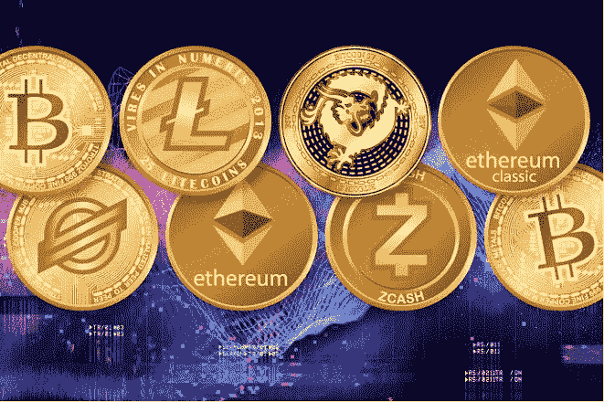

Digital money, or digital currency, is any form of money or payment that is only available in electronic form. Digital currency lacks a tangible form, like a bill, receipt, or coins. Electronic codes are used to account for and transmit it in machines. Payments are becoming more automated as automation becomes more prevalent, resulting in a decrease in the need for physical currency. Cryptocurrency, also widely recognized as crypto, is a type of digital currency that can be used as a form of payment. It employs cryptography to secure & verify transactions, as well as to regulate the creation of new digital currency units. Blockchain technology is a distributed ledger mandated by a distributed network of computers. Blockchain is at the heart of many cryptocurrencies. Cryptocurrencies differ from fiat currencies like the US dollar and the British pound in that they are not issued by a central authority, making them potentially insensitive to government intervention or manipulation. In this chapter, we will discuss various concepts of a cryptocurrency and unravel information about its origin to help you understand the unique financial innovation.

## 3.1 How does cryptocurrency work?

The vast majority of cryptocurrencies operate independently of a central bank or government. Rather than relying on state guarantees, cryptocurrencies are powered by a decentralized technology called block chain. Cryptocurrencies do not appear in the form of a banknote or a coin. Rather, they exist solely on the internet. Consider them virtual tokens, whose value is determined by market forces established by those who want to buy or sell them. Cryptocurrency is created by mining. Mining is a process in which complex computer processing power is involved to solve complex mathematical problems in order to earn coins. Users can also buy the currencies from brokers. Users can then store and spend with the help of encrypted wallets.

## 3.2 Explanation of Cryptocurrency

New types of technology now allow digital money or cryptocurrency to be used more safely and effortlessly. With technology such as credit cards, smartphones, and online crypto-currency transactions, digital money can be transferred and traded. Crypto currency refers to a type of cryptography-secured digital money that makes it even harder to counterfeit or double-spend. It operates through decentralized blockchain technology-based networks, which are basically a database that is stored through a computing network. Crypto currencies are not distributed by a central bank or government, which frees them from the impediment of government interference or abuse. Digital money's history dates back to the internet's inception. In the early days, there were challenges in getting the community to support the use of digital currency; but as people get more familiar with technology and the technology itself gets simpler and safer, more people are now eager to use digital money. PayPal is considered one of the first popular enterprises to introduce to mass adoption the concept of easy-to-use automated financial transactions. To understand how digital currency has become so popular, it is important to first understand what digital currency is. Crypto currencies decentralize currencies in very basic words so that the money is not regulated by the government. However, without a single agency, it becomes a challenge to check transfers and stop double-spending. That is when the culture of cryptographers comes into play. Crypto currency transactions are effectively distributed to the whole network through cryptography and blockchain, rather than checking a transaction via a centralized third party. In an open-source network, this public ledger tracks all transactions, empowering anyone to see transactions. Transactions are only done when by solving a cryptographic puzzle, crypto currency miners validate the transaction. In crypto-currencies, by legitimizing transfers, miners operate as a third party, close to the government, in regular currency transactions. Crypto miners are, however, paid with crypto from the network itself instead of taking a share of the trade and the money of the participants. In order to preserve the integrity of the transaction history, this system encourages everybody in the blockchain. This solution to the conventional financial system has become more and more attractive as it encourages individuals without a watchful third eye to have more power over their money. Now, let's have a look back at the monumental steps of the crypto-currency over the past 10-plus years.

## 3.3 Why do we use cryptocurrencies today?

The main goal of cryptocurrency is to address the problems of traditional currencies by giving currency holders power and responsibility. Every cryptocurrency tries to solve one or more real-world issues. The following are four major reasons why people have become interested in cryptocurrency.

### 3.3.1 Cryptocurrency is owned by everyone

Cryptocurrency works in a similar way to traditional national currencies, but with a few key differences. A governmental body creates and regulates current "fiat currency," all of which now represent debt. Anyone who owns a country's currency is in possession of an "IOU" issued by that country. The term "cryptocurrency" does not mean "debt." It only represents itself, and its worth is ascertained by what somebody is willing to give up in exchange for it. The decentralized nature of cryptocurrency has a significant impact on how its value is determined. A cryptocurrency is neither owned nor regulated by anyone. Its value is unaffected by the political whims of a country's government or the monetary policies of its central bank. Cryptocurrency, like stocks and bonds, is regarded as an asset. When sold or exchanged in the United States, it is subject to capital gains taxes.

### 3.3.2 Cryptocurrency is almost impossible to forge

加密货币基于一种名为区块链的分布式账本。理解区块链技术可以帮助你认识到它对数字货币的力量为何如此重要。所谓的“区块”是由加密数据块组成的。所谓的“链”指的是公共数据库，其中区块被按顺序存储并相互链接。区块链中的每个区块都有自己独特的代码，用于区分它与其他所有区块。这种唯一代码被称为哈希值。被添加到区块链的数据块是按时间顺序依次添加的。在最后一个区块创建后，会生成一个新区块，并为其分配自己的唯一哈希值。区块链中的账本和/或数据库在全球范围内同时分布，涉及成千上万台计算机，在以太坊和比特币的情况下，甚至达到数百万台计算机。假设有人想伪造链上的一块数据。在这种情况下，他们必须从某个时间点向前修改所有区块，并更新持有区块链账本副本的所有计算机。理论上这是可能的，但所需的金钱和影响力使得这几乎变得不可能。

### 3.3.3 加密货币交易保密


传统的政府发行货币允许你进行私密交易，或使用实物现金在人前进行支付。纸币、金属币、布币以及塑料货币占流通中法币总量的很小一部分。大额现金取款会被中央机构（如政府或金融监管机构）迅速发现并调查。加密货币是一个独特的概念。要检测两个人或公司之间的交易，需要精心设计的数学方法，这大多在人们的背后进行。虽然交易账本或交易列表可以被全世界任何人查看，但进行加密货币交易的双方更加私密。加密货币按定义在数字钱包中以电子方式持有。拥有钱包私钥的所有者即为货币的所有者。货币主要在用户匿名的钱包之间以数字方式交换。

### 3.3.4 加密货币安全随时间与价值而增长

黑客必须掌控“共识”网络中超过一半的计算机。所有接收区块链或分布式账本副本的计算机构成共识网络。对于比特币或以太坊等更成熟的加密货币，其网络规模庞大，几乎不可能发动攻击。因为加密货币网络在早期规模较小，所以获取多数控制更容易。

## 3.5 加密货币的历史

自 2009 年比特币问世以来，加密货币领域全球范围内呈指数级增长。最初是一个未经验证的概念，如今被普遍视为货币的未来。数千种其他加密货币在比特币兴起之前及之后加入并随后失败。尽管比特币仍然是最受欢迎的加密货币，且大多数相似加密货币的非投机性影响微乎其微，投资者和消费者仍应留意其他加密货币。以下是当今最常见的加密货币列表。

* `Smart cash`
* `Follow`
* `Digicash`
* `B-Money`
* `Paypal`
* `BitGold`
* `E-Gold`
* `Hash-Cash`
* `Ethereum`
* `XRP`
* `Tether`
* `Bitcoin Cash`
* `Litecoin`
* `EOS`

### 3.5.1 Smart cash

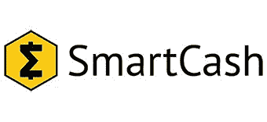

SmartCash 是一种基于零现金的、由社区驱动的加密货币。其愿景是实现商户采用，因此优先考虑隐私和快速交易。该项目的核心特点是反对中央权威，从而放弃了核心团队。该货币与 Dash 类似，旨在通过快速、私密的货币获得广泛采用。由于使用主节点并依赖 Dash 基金会，Dash 被视为一种相对中心化的货币。基金会、核心团队和集中化矿工是 SmartCash 希望规避的概念。相反，SmartCash 引入了多种去中心化治理和开发特性，并大力投资社区驱动的开发。因此，SmartCash 逐渐走红。虽然它不如 Dash 知名，也不及 Zcash 和 Monero 等其他私密支付平台出名，但它为匿名、不可追踪且可用的加密货币提供了独特视角。传统加密货币（如比特币）仅激励矿工，忽视了其他贡献者（如开发者、推广者）。SmartCash 是一个由社区驱动的加密货币，重视开发和社区。已将 29% 的区块奖励用于支持 SmartHive 社区提案及 Hive 团队。SmartMining 是 SmartCash 的新功能，用于防止矿工攻击。任何拥有电脑和一台或多台显卡的人都可以参与矿工。Keccak 矿算法的 ASIC 尚未开发，预计很长时间内也不会出现。

### 3.5.2 SmartHive & SmartVoting

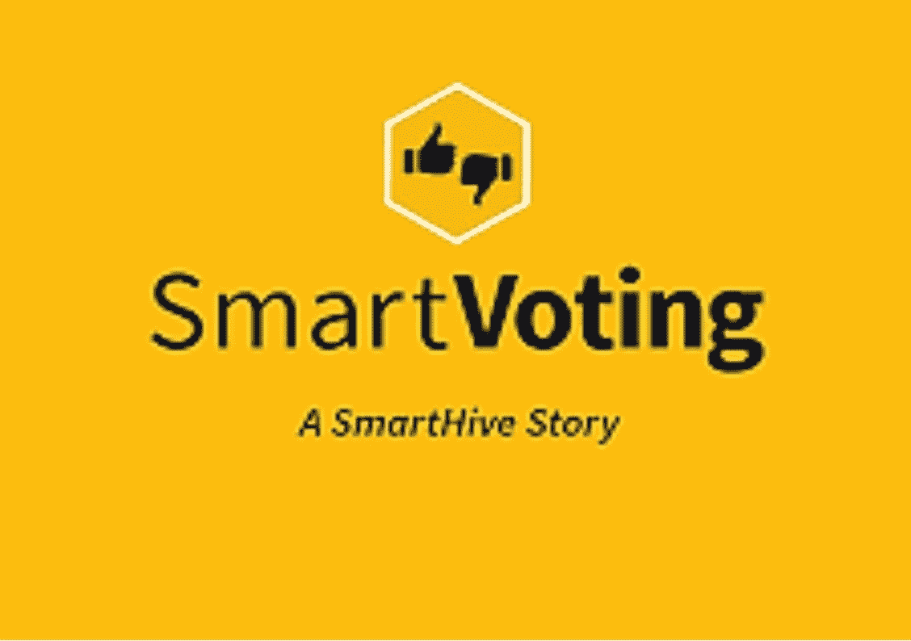

SmartCash 社区认为，拥有“核心”团队的加密货币在长期来看是低效且腐败的。担忧是创始人会更关注赚钱，而非构建开放且低成本的平台。随着 ICO 的兴起以及创始团队的代币分配增加，这一现象屡见不鲜。这些集中化组织可能变得官僚化、反应迟钝，并优先考虑冲突的目标。相反，SmartCash 主张基于蚂蚁和蜜蜂自我组织的治理模式。目标是创建一个小团体可开展特定项目的蜂巢，从而形成自下而上的管理体系。虽然这种分散的方式可能不如它试图取代的基金会/核心团队方法高效，但社区认为自治团队更具灵活性和生产力。投票权将授予所有 SMART 代币持有者，一枚代币等于一票。任何人都可以通过所谓的 SmartVoting 系统提交提案供蜂巢评估和投票。目标是构建一种自下而上的管理体系，项目由 SmartHive 基金资助，且蜂巢成员在完成提案后将获得报酬。SmartHive 是项目的生命线，设计用于确保项目永续运行。这一结构已获得一群热情的死忠粉丝的草根支持。每个区块奖励都用于资助未来的开发项目。截至目前，该基金已累计价值超过 2.5 亿美元。

### 3.5.3 Hive Structuring Teams

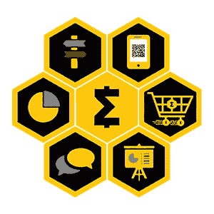

- 一个团队将在蜂巢投票通过后承担一个提议的项目。这些团队最初很简单：开发、推广和支持。随着改进提案数量和社区的增长，新团队会形成。一个团队最多由八人组成，作为一个小组共同工作。除此之外，你需要组建一个新的项目团队。这被称为蜂巢结构团队，它将贡献社区划分为更小的子群体，人们会根据需要加入或离开团队。因此，每个团队都有自己的预算和由社区任命的协调员。团队形成后即为自给自足。除了社区范围内的智能投票公投外，没有其他控制结构。蜂巢结构团队是一群致力于项目的社区成员，他们每天都在项目上工作。个人将由团队雇佣。如果社区成员无法承诺加入团队，他们将以更非正式的方式为智能蜂巢做出贡献。

### 3.5.4 Flooz

Flooz.com 是九十年代末期科技热潮的典型代表，该热潮在 2001 年结束。Flooz 被比作可以通过促销活动累积或直接从 Flooz 中央平台购买的优惠券或航空里程碑，是商户在仍然相对年轻的互联网上接受支付的数字工具。Flooz 在为期三年的经营期间筹集了高达 3500 万美元的风险资本，押注于商户对新颖支付方式的需求。Flooz 在广告宣传上没有花钱，甚至邀请喜剧演员惠·戈德伯格参与了一系列电视广告。尽管势头强劲，Flooz 仍未能吸引大量用户和商户，其平台的非法活动最终导致公司失败。到 2001 年 8 月，随着投资者支持的迅速流失以及平台涉嫌非法活动的指控，公司的衰亡加速。据 2001 年《纽约时报》报道，俄罗斯犯罪团伙被怀疑利用被盗信用卡购买在线货币并洗钱，从而引发联邦调查。据 Flooz 源称，约 30 万美元被盗。在欺诈指控浮出水面后，Flooz 在未能找到买家的情况下关闭了业务。

### 3.5.5 DigiCash

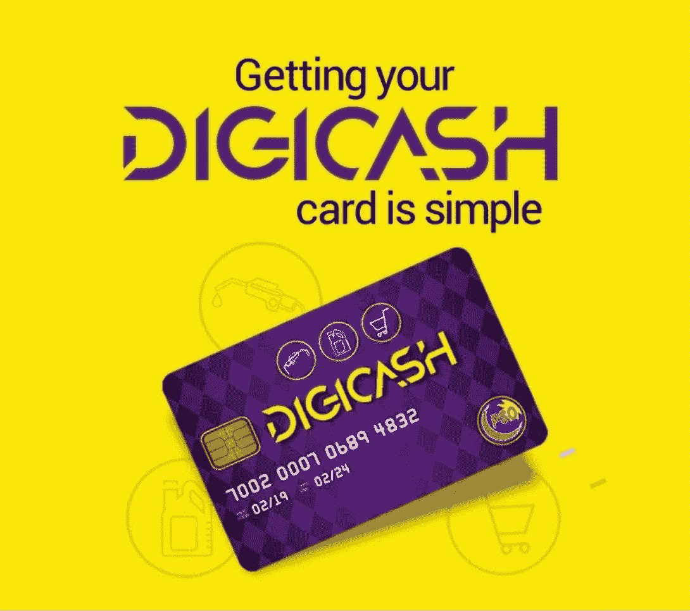

DigiCash 是一家成立于 1990 年代的数字货币公司，曾接近成为全球成功。但它因内部矛盾和缺乏动力而未能成为广泛使用的在线支付系统。David Chaum，ecash 系统的创建者，是密码学协议的先驱。1990 年成立的 DigiCash 支持 Cyberbucks，这是一种为用户提供匿名性并为接受它的商户提供安全的数字货币。自由派及其他人士支持一种国际在线货币，以超越政府控制，据 2003 年《卫报》报告，DigiCash 得到了支持。DigiCash 以支持多种支付规模（尤其是微支付）而著称。在货币交易方面，该系统使用电子邮件系统，报告称交易员进行非市场交易。据当时报道，现金流不足以及公司员工与管理层之间的摩擦是 DigiCash 失败的原因之一。尽管与主要银行和信用卡公司进行了高层谈判，但该项目未能签订重大交易以确保其在日益数字化的金融领域中的生存。例如，花旗银行曾长期就整合项目进行谈判，但此后转向其他业务。Chaum 于 1996 年离开公司，两年后公司申请破产。

### 3.5.6 B-Money

Wei Dai 提出了 B-money，这是一个早期的“匿名、分布式电子现金系统”提案。当 Satoshi Nakamoto 创建世界闻名的 Bitcoin 时，他提到了 B-money。Wei Dai 是华盛顿大学的毕业生，于 1998 年首次提出 B-money，旨在创建一个免费的在线金融系统。该系统旨在防止任何人征税或强制他人做任何事。因此，很少有人会记得 B-Money，它于 1998 年首次公开，距离比特币出现已超过十年。尽管 Wei Dai（Wei Da）也希望创建一种匿名且分布式的货币发行方式，但 B-money 在技术上与比特币截然不同。技术文档（链接）（所谓的“白皮书”）包含了与现代加密货币相同的基本原则，旨在加速 B-money 的实现。预计“数字别名”能够通过去中心化网络发送和接收资金，并能在不涉及第三方的情况下执行彼此之间的合约。第一个协议提议使用工作量证明函数来创建货币。Dai 的 B-Money 在密码朋克邮件列表关于 Hashcash（第一个对称工作量证明函数）的讨论中提出，该列表在前一年五月（1997 年）也刊登了相关内容。比特币在铸造硬币时使用 Hashcash 成本函数作为工作量证明，这与 B-money 提案一致。在 B-money 中，资金通过向所有参与者传输交易来转移，所有参与者都记录彼此的账户。可以与第三方达成具备偿债可能性的合约。如果未达成一致，各方会广播有利于自身的论点或证据，每位参与者在自己的账户中计算赔偿或罚款。账户仅由部分参与者——“服务器”——保留，这些账户必须公开，参与者通过向大量服务器查询来验证其余额。参与者还确保货币供应不被通胀。要成为服务器，必须提供抵押品，若服务器被证实不诚实，抵押品将被没收。另一种创建货币的方法涉及一种竞价机制，参与者竞价解决已知复杂度的计算问题。遗憾的是，B-Money 项目自白皮书实施以来一直停滞不前。

### 3.5.7 Paypal

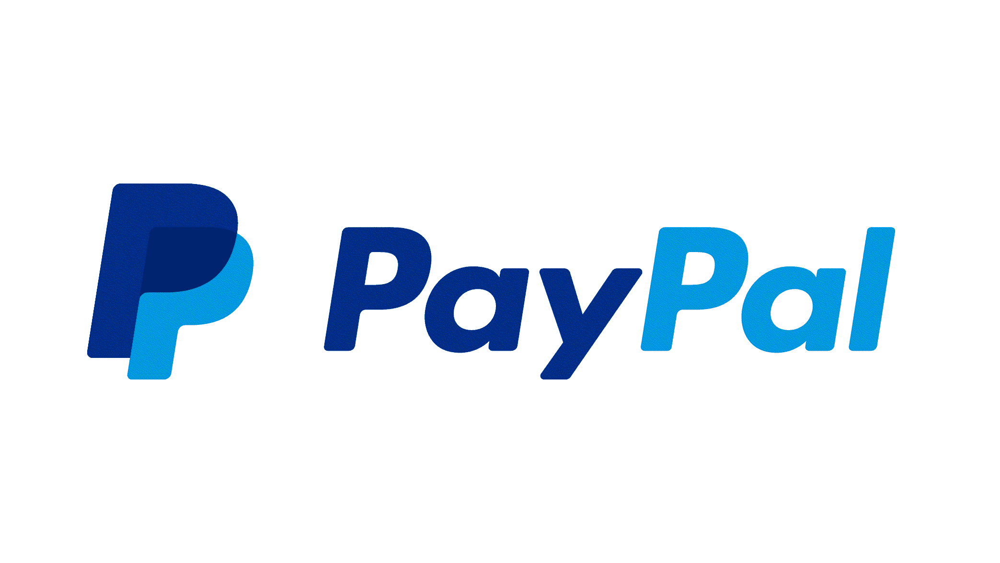

PayPal（PYPL）是一家真正的电子商务巨头，拥有光明的未来和忠诚的用户群体，预计随着更多年轻人接受数字支付平台，其用户基数将继续增长。公司盈利，2018 年收入超过 150 亿美元，业务遍及全球，平台支持 100 种货币，覆盖 200 多个全球市场。尽管在利润丰厚的电子商务支付市场面临激烈竞争，但普遍认为 PayPal 将继续成长并主导数字支付空间，这是扩大的业务和消费者技术市场中最有利可图的细分市场之一。

虽然 PayPal 的历史并不长，但在公司成立二十多年的历史中，仍经历了众多起伏和转折点。1998 年，当技术企业家 Peter Thiel 和 Max Levchin 创立 PayPal 时，它甚至还不叫 PayPal，最初名为 Confinity，其理念是为消费者和企业提供低成本、几乎无需费力的数字支付。随着互联网在全球消费者中的影响力日益增强，公司明智地瞄准了未被满足的市场——银行和支付领域。创始人的概念简单而有效：通过说服客户在交换快速、低成本支付的前提下，分享他们的电子邮件地址、银行信息和信用卡号码。公司刚成立三年，便已处理了来自 1020 万个人消费者和 260 万家庭客户的超过 30 亿美元的支付。随后，创始人决定专注于互联网上的支付，两年后将公司名称改为 PayPal。Thiel 和 Levchin 巧妙利用了支付市场的一个空白——当时没有人专注于面向消费者和企业的数字支付平台，而这两人成功填补了这一空白，使 PayPal 在本世纪初迅速崛起。

PayPal 时间线

PayPal 的增长轨迹在早期就迅速加速，公司很快树立了一些令人印象深刻的增长基准。

1998 年 8 月

在斯坦福大学发表全球市场机遇演讲后，Peter Thiel 与 Max Levchin 相遇。他们在同年提出了数字钱包的概念。

1998 年 12 月

PayPal 成立。

1999 年 10 月

公司工程师生产了基于电子邮件的支付技术。

2000 年 1 月

PayPal 的创始人和管理层注意到，最终用户在向商业合作伙伴以及其他买家请求时，也希望签署 PayPal 以便加快支付速度。PayPal 迅速在 eBay 站点上铺平道路，显著扩大了用户基数。

2000 年 3 月

PayPal 超过了一百万客户的目标。

2001 年 6 月

创始人将 Confinity 名称改为正式名称 PayPal。

2002 年 2 月

在发行新公司股票后，PayPal（PYPL-Nasdaq）上市。IPO 取得成功，股价在首日交易时上涨超过 50%，收盘价为每股 20 美元。

2002 年 10 月

在备受炒作的“数字竞 auction”与在线支付服务的“婚姻”之间，PayPal 被 eBay 以 15 亿美元的价格收购。

2006 年 2 月

PayPal 跨越一亿用户账户的里程碑。

2006 年 4 月

PayPal 推出 PayPal Mobile，这是一个新的移动支付平台，允许客户通过智能手机使用 PayPal 进行支付。

2008 年 12 月

PayPal 接近一亿用户账户的目标。

2013 年 9 月

PayPal 以 8 亿美元收购了 Braintree Systems，这是一家支付网关公司，也是 Venmo（在线支付竞争对手）的所有者。

2015 年 7 月

[Paypal buys Xoom](https://fortune.com/2015/07/01/paypal-acquires-money-transfer-firm-xoom-for-890-million/)，一家数字钱转公司，价格为 8.9 亿美元。这使公司能够加速国际支付的处理。

2017 年 2 月

PayPal 推出其首个点对点支付系统，这帮助公司在新兴的 P2P 市场中立足。

当前

公司开始深入探索有利但波动性大的加密货币市场，专注于其底层区块链平台，暂时避免比特币。此外，公司正通过招聘 1,200 名新的技术专家，在印度——一个关键全球市场——专注于移动及其他新兴支付技术。公司还宣布与 Facebook（FB）合作，Get Facebook, Inc. Class A Report Marketplace，官员们相信该合作有潜力在财务表现上超越其长期合作伙伴 eBay。

总体而言，投资者和分析人员视 PayPal 为数字支付领域的领先参与者，尽管它面临着金融科技公司和大型全球银行的激烈竞争，但公司似乎已为未来的财务增长做好准备，股价持续上涨几乎是必然的。

### 3.5.8 Bit Gold

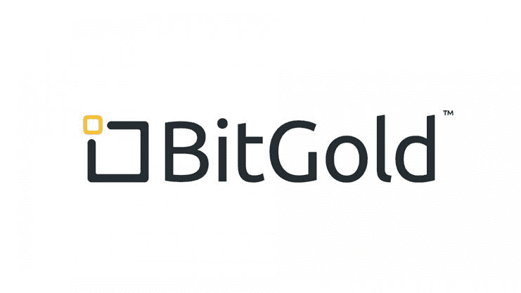

比特金（Bit Gold）是区块链先驱 Nick Szabo 在 1998 年构思的去中心化虚拟货币的早期尝试之一，尽管 Szabo 的比特金项目从未实现，但它被普遍认为是 Satoshi Nakamoto 比特币协议的前身。事实上，比特金与比特币的协议相似到如此程度，甚至有人推测 Szabo 就是神秘的比特币开发者 Satoshi Nakamoto，但 Szabo 已否认了这一指控。比特金通过结合密码学和矿工技术实现去中心化。其包括时间戳区块（在标题登记册中维护）以及使用工作量证明（PoW）字符串创建的元素。Szabo 表示，他提出了一种去中心化的 PoW 函数，能够“以最小信任的方式安全存储、传输和验证”。

#### 理解比特金

比特币和比特金在处理交易的技术以及保护去中心化网络方面有很多共同点。用户需要消耗计算能力来解决比特金结构中的密码学挑战。所有已解谜的结果会在拜占庭容错（BFT）对等网络中通信，且解题者的公钥被分配给其。交易细节保存在标题登记册中。在共识系统中，它类似于区块链，提供了不可篡改的交易记录及其顺序。Szabo 提出的比特金方案是非同质化的，这意味着必须合并多个比特金数量才能生成单个交易。它不依赖于中心化机构管理其杠杆，而是依靠网络中众多节点（参与计算的计算机）之间的去中心化、分布式信任。

#### 比特金与比特币的区别

尽管比特金与比特币之间存在相似之处，但两者在根本上有几个显著区别。Szabo 表示，比特金的矿工难度会随时间变化，不会单纯变得更易或更难，而是在特定时期会出现产出峰值和低谷。相比之下，比特币的设计是让矿工难度随时间逐渐增加（比特币数量有限）。更重要的区别在于，比特金从未打算作为流通媒介使用；它被设计为另一种电子货币的准备金。在法币出现之前，比特金本应作为实物储备使用。

#### 比特金的目标

Szabo 声称比特金的发明旨在缓解传统银行系统的低效。根据 Szabo，传统金融体系在交易生效前必须建立高度信任，而这种信任体系容易受到欺诈和盗窃的侵害。当客户与金融机构通过基于信任的系统进行交易时，往往面临欺诈和盗窃风险。实际的银行系统历史上屡次出现损失，且欺诈成本高昂，这种“封闭”设计激励 Szabo 提出比特金——一种更少依赖信任的交易方式。

### 3.5.9 E-Gold

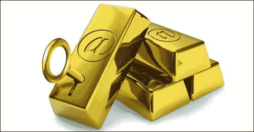


Dr. Douglas Jackson 和 Barry K. Downey 于 1996 年创立了 E-gold，作为一种私人数字货币，允许其网站成员使用现代技术即时转移黄金。E-gold 与之前的联邦货币替代方案不同，其本质上完全是数字化的，交易完全不可逆。尽管该网站很可能最初是出于良好的意图而建立，但它很快便沦为犯罪分子的聚集地。洗钱者、身份窃贼、欺诈性“金融”投资者以及购买儿童色情制品的人都使用了 E-gold，因为黄金转账是不可逆的。此外，E-gold 交易的不可逆性意味着如果账户被入侵，受害者没有任何补救办法。E-corporate gold 的治理在 2006 年意识到该网站正被用于重大非法活动，并开始封锁账户。“E-gold 合法运营，但不容许任何人试图利用 E-gold 进行犯罪活动，”CEO 兼创始人 Douglas Jackson 在一份声明中表示。E-gold 与美国及全球的执法机构有着长期的合作历史，在收到合法请求时提供数据和调查支持。2007 年，美国政府下令 E-gold 封锁多个提供类似 E-gold 服务的账户，随后因多项刑事罪名对 E-gold 提起起诉。反对 E-gold 的主要论点是，它未能实施机制防止欺诈用户仅通过创建新账户并转移其 E-gold 来逃避监管。E-gold 也是一家未经许可的货币传输业务，尽管它实际上并未转移真实货币。在美国，货币传输业务必须依法获得牌照，并保存用户的特定法律信息。因此，e-creators golds 被判类似的罪名，包括共谋。然而，对公司及其治理的法律后果微乎其微，E-gold 与联邦政府达成协议，允许合法用户从账户中提取资金，类似于在线扑克玩家的操作方式。E-gold 至今仍在运营，但已不再接受新账户或用户之间的 E-gold 转账。

### 3.5.10 Hash-Cash

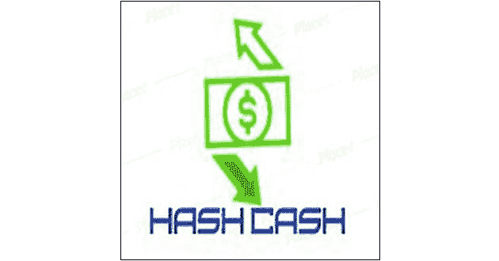

`Hash-cash` 是数字货币的前身。它是 Satoshi 启发比特币工作量证明 `proof-of-work` 实现的灵感来源。为了理解比特币的共识机制和工作量证明，我们必须先掌握 Hash-cash。Adam Back 在 1997 年创建了 Hash-cash，目的是防止电子邮件垃圾邮件。即使在 1997 年，电子邮件垃圾邮件也困扰着所有拥有电子邮件账户的人。这是因为基本问题在于，发送一封邮件只需向邮件服务器发送少量数据包。为了让发送者付费，Back 决定对电子邮件收费。发送电子邮件的成本极低，几乎是免费的。虽然诚实用户每天只发送少量邮件，但垃圾邮件发送者可以毫不成本地发送数百万甚至数亿封邮件。如果每封邮件收费一分钱，这对普通用户来说微不足道，但对垃圾邮件发送者来说，费用将高达数百万美元，从而有效遏制垃圾邮件活动。你会发现这似乎有些反直觉：每封邮件收取一分钱的前提是必须拥有数字硬币来支付。但当时缺乏这种解决方案，因此才需要比特币。那么，Hashcash 如何让垃圾邮件发送者支付“虚拟硬币”呢？答案在于 Hashcash 的核心概念——工作量证明 `proof-of-work`，这一概念如今也已融入比特币。

#### Hashcash 的工作量证明

Hashcash 的工作量证明非常直接。邮件服务器首先设定一个难度级别，这是一个数值，表示工作量证明 `PoW` 需要达到的难度。默认值为二十。在 Hashcash 中，工作量证明是生成一条消息，其 `SHA-1` 哈希值在二进制中以 20 个 0 开头。如何生成带有指定前缀的哈希值？请记住，你不能比随机猜测更准确地预测加密散列函数的输出。你别无选择，只能不断尝试不同的输入，直到找到满足前缀条件的输入。

### 3.5.11 Ethereum

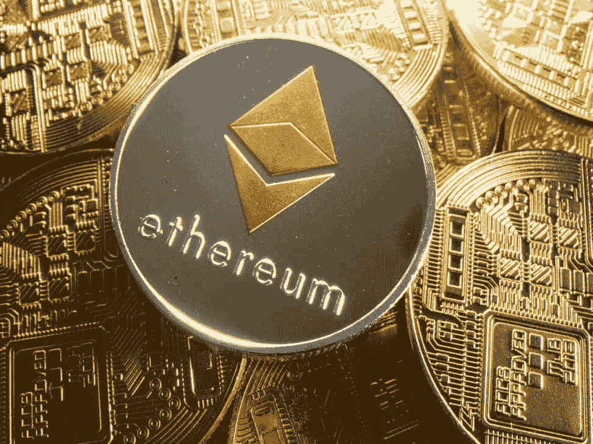

`Ethereum` 是一个共享的开源区块链框架，拥有自己的加密货币 `Ether`。它作为许多其他加密货币以及去中心化智能合约的论坛，充当了核心作用。2013 年 Vitalik Buterin 的白皮书首次描述了 `Ethereum`。2014 年夏季，Buterin 获得了其他联合创始人的支持，并在公开的线上众筹活动中正式启动，正式发布时间为 2015 年 7 月 30 日。`Ethereum` 本身预计将成为面向开放应用的数字论坛，使用户能够在全球范围内编写和管理具有抗审查性、抗停机和抗欺诈的应用程序。

#### Ethereum 的历史

`Ethereum` 拥有八位联合创始人，这个数字对加密货币项目来说相当庞大。他们最初于 2014 年 6 月 7 日在瑞士苏黎世首次会面。

- 俄罗斯-加拿大裔 Vitalik Buterin 于 2013 年撰写了最初的白皮书，首次提出了 `Ethereum` 的概念，并至今仍在持续开发该网络。在 ETH 之前，他还创立并为比特币杂志 `Bitcoin Magazine` 撰写文章。
- 英国程序员 Gavin Wood 可能是继 Buterin 之后对 ETH 影响最大的联合创始人。
- 其余 `Ethereum` 联合创始人包括：
  - Anthony Di Iorio，他在项目早期阶段为其提供了资金支持。
  - Charles Hoskinson，他在创建以瑞士为基地的 `Ethereum` 基金会及其法律结构方面发挥了主要作用。
  - Mihai Alise，他协助创建了 `Ethereum` 基金会。
  - Joseph Lubin，一位加拿大企业家，他在 `Ethereum` 初期为其融资。
  - Amir Chetrit，他帮助创立了 `Ethereum`，但早期便离开开发。

#### Ethereum 独特性的原因

`Ethereum` 首创了区块链智能合约网络的概念。智能合约是能够自动在互联网上执行多方协议所需操作的计算系统。它们的设计旨在降低中介的信任需求，从而降低交易成本并提高交易效率。`Ethereum` 的核心突破在于构建了一个全球统一的机器，能够利用区块链运行智能合约，进一步强化了智能合约技术的既有优势。`Ethereum` 的区块链被设计为一种面向全球的单一机器。除了多种智能合约外，`Ethereum` 区块链还能托管其他加密货币，统称为“代币”。实际上，这已是 ETH 平台迄今为止最常见的使用方式。

#### 在哪里可以购买 Ethereum（ETH）？

由于 `Ethereum` 是继比特币之后第二大加密货币，ETH 交易对几乎在所有主要交易所上都有提及。主要市场包括：

* [Binance](https://coinmarketcap.com/exchanges/binance/)
* [Coinbase Pro](https://coinmarketcap.com/exchanges/coinbase-pro/)
* [OKEx](https://coinmarketcap.com/exchanges/okex/)
* [Kraken](https://coinmarketcap.com/exchanges/kraken/)
* [Huobi Global](https://coinmarketcap.com/exchanges/huobi-global/)

#### Ethereum 生态系统

`Ethereum` 区块链栈由多个模块组成。核心是运行在点对点 `Ethereum` 网络上的 `Ethereum` 区块链。此外，还有一个 `Ethereum` 客户端，运行在节点上，并通过点对点 `Ethereum` 网络与区块链同步并本地存储，提供挖矿、账户管理等多种功能。本地区块链副本会定期与网络同步。另一个方面是 `web3.js` 库，它通过远程过程调用 `RPC` 接口实现与 `geth` 客户端的交互。

下面是以太坊区块链中所有高层级元素的列表：

`Keys and addresses`

`Accounts`

`Transactions and messages`

`Ether crypto currency/tokens`

`The EVM`

`Smart contracts`

#### 以太坊 vs. 比特币

以太坊与比特币完全不同，它们的目标看似截然不同。

实际上，其他加密货币与比特币和以太坊相比，以太坊与比特币的关系更为密切。例如，莱特币 `Litecoin` 更像比特币，而 NEO 更像以太坊。

##### 比较加密货币

当你看到以太坊 vs. 比特币时，会发现它们的目标差异巨大。但从市场数据来看，两者的差距很小——比特币的市值为 1473 亿美元，而以太坊的市值为 842 亿美元。

以下是比特币和以太坊的部分功能和事实：

**比特币特点**

以下是比特币的主要特点：

* 2009 年推出，`BTC` 是第一个使用区块链技术的加密货币
* 比特币是数字货币
* 旨在解决全球金融挑战
* 比特币无需第三方（如 PayPal 或银行）
* 作为传统货币的替代品开发
* 用于手动购买，包括购买商品/服务或收款
* 高度流动性，可快速将比特币转换为现金
* 比特币交易只需几分钟完成

**以太坊特点**

以下是以太坊的主要特点：

* 2015 年推出，以太坊区块链常被称作区块链 2.0
* 智能合约用于编程转账
* 智能合约在多种结构中消除了第三方的需求，而不仅仅是金融
* 提供开发智能合约应用（即去中心化应用 `dApps`）的平台
* 提供编程语言 `Solidity`，用于开发 `dApps`
* `Ether` 是代币，驱动以太坊区块铭的转账
* `Ether` 高度流动
* 以太坊转账仅需秒级完成

##### 主要差异

让我们来看以太坊与比特币的关键差异。

**概念**

想到比特币，就想到数字货币；想到以太坊，就想到智能合约。

**目的**

比特币是价值存储，也是转移资金的手段。以太坊也是转移资金的手段，但仅在特定情况下发生。

以太坊还作为构建 `dApps`/智能合约的框架，使其能够发行代表价值的代币。这些代币除数字货币外，可代表任何价值，从而区别于比特币。

**交易**

比特币交易是手动的；而以太坊交易是自动且可编程的。

**交易速度**

以太坊的区块时间仅为秒级（交易速度），而比特币的区块时间为分钟级。

* `Ether` 设计用于以太坊网络的强力交易（即 `gas`）。
* 现实购买价值基于比特币，因此被视为货币。

**代币供应**

比特币最多限定 21,000,000 枚，这为存储价值创造了供需平衡，非常适合作为价值储存。以太坊则没有上限，`Ether` 的发行持续进行，但其供应量会随时间大幅下降。

**年龄**

以太坊比比特币晚 6 年推出，并且技术更为先进。

**智能合约**

智能合约是去中心化的工具。以太坊率先在以太坊 vs. 比特币的争论中推出了智能合约。智能合约是运行在以太坊区块链上的代码（函数）和数据（条件）的集合，存储在特定地址。智能合约是以太坊的一种账户，具有余额，并可通过网络传输转账。它们不是由个人操作，而是以编程方式在网络中分布式运行。用户账户通过满足智能合约定义的目的来与智能合约交互。智能合约可以通过代码自动执行规则，如标准合同。要编写并部署智能合约，只需会编程并拥有足够的 ETH。智能合约由区块链驱动，使开发者能够构建永不下线且无法被第三方修改的应用。可以将智能合约想象为拥有房产：传统上需要律师和经纪人等第三方，而智能合约在满足条件后即可直接完成所有权转移。

**总结**

以太坊的目标是运行永不下线且不可更改的去中心化智能合约应用，提供开发者使用的平台和编程语言。比特币的功能则大相径庭，它作为一种共享价值存储 — — 点对点数字货币，用于金融交易，并消除支付技术中的第三方需求。总之，以太坊与比特币的关键区别在于是否运行智能合约。比特币不支持智能合约，仅依赖手动支付技术。两者各有优势：比特币代币供应有限且更具流动性，而以太坊硬件更先进且应用更丰富。与其他区块链网络不同，以太坊具备可编程性，这种可定制功能使开发者能够解决从数字身份和匿名性到企业所有权和数据保护等问题。

### 3.5.12 Ripple (XRP)

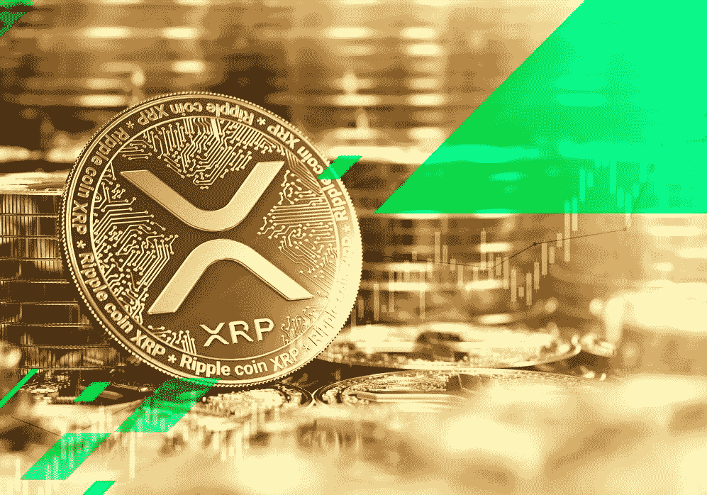

虽然 Ripple 拥有一种原生加密货币 `XRP`，但 `IOU` 的处理更多是关于网络本身而非该加密货币。该货币的设计初衷并非作为价值存储和交换媒介，而是作为一种防止垃圾邮件的网络保护令牌。与比特币和以太坊不同，Ripple 没有挖矿，因为所有硬币已经预先挖好。随着不少银行加入了 Ripple 网络，Ripple 在金融领域显得尤为重要。Ripple `XRP` 是一种实时全额结算 `RTGS` 系统，兼具钱款转账、货币兑换和汇款网络的功能。它由美国的 Ripple Labs Inc. 开发，并在 2012 年通过独立服务器验证后发布。`XRP` 是可交易的加密货币名称。`XRP` 可以兑换几乎任何其他货币，使用户可以避免在银行排队的长时间等待。相比之下，加密货币的波动性更大，意味着其价值可能会剧烈波动。财务顾问可以帮助你确定整体投资策略应如何制定。

**What Is Ripple (XRP)?**

与比特币和以太坊等其他加密货币不同，Ripple 采用“散列树”结构而非区块链。由于硬币数量有限 — — 1000 亿枚 — — `XRP` 不能被挖矿。加密货币基于区块链技术，是一种将信息分组为块的数据库。每条新信息在新块合并后加入链条。区块链顾名思义，将数据分块并将其链接在一起。Ripple 与区块链相似之处在于交易由多个节点处理。支付过程包括发送方提交交易，信息被赋予单一数值后写入共享公共数据库，验证服务器或节点共享该信息，若多个独立服务器报告匹配则交易获准并处理。由于不涉及工作证明，系统不像比特币那样。比特币中，矿工需要解决复杂的方程以证明工作量后，区块才能加入链条。相反，Ripple 的模型是基于共识的，交易在达成一致后即可清算。因此，Ripple 网络每秒可处理约 1500 笔交易，而比特币仅能处理 3～6 笔，以太坊约 15 笔。尽管它并非完全相同的区块链系统，但 Ripple 的处理效率和速度较高，这也是银行和大型支付系统考虑并尝试使用 Ripple 的主要原因。此外，Ripple 并非像以太坊那样完全去中心化。开发者拥有控制哪些服务器被纳入网络的机制，以防止恶意操作者（即拥有中心化权威）。因此，有人认为 `XRP` 并不是真正的或标准的加密货币。

### 3.5.13 Tether

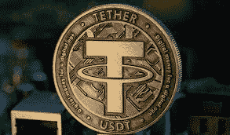

`Tether` 是一种由法币担保的稳定币，使用户在区块链资产之间进行交易时避免价格波动。`Tether` 主要在以太坊和比特币区块链上发行，并以 1:1 的比例与银行账户中的美元挂钩。

**History**

`Tether` `USDT`，原名 “Realcoin”，是一款旨在保持与美元 1:1 固定汇率的加密货币。它于 2014 年 7 月由 Brock Pierce、Craig Sellars 和 Reeve Collins 共同创立。`Tether` 建立在 `Mastercoin` `Omni` 协议层上，这是一种为比特币引入稳定币概念的协议，该概念于 2012 年被提出。`Tether` 是当时诞生的第一批稳定币之一，也是目前使用最广泛的稳定币，开创了法币担保稳定币模式。`Tether` 诞生是为了解决现有加密货币的两个关键问题：高波动性以及法币与加密货币的可兑换性。它通过创建一款完全由美元银行存款 1:1 backing 的加密货币来应对这些问题。`USDT` 代币在以太坊上以 `ERC-20` 形式存在，而在比特币上则通过 `Omni` 层表示。虽然代币本身在去中心化网络上运行，`Tether Ltd`（位于香港）唯一负责代币的创建与赎回以及 1:1 存款 backing。`USDT` 主要被交易所用作法币的替代品，从而减少或消除对外部银行关系的需求。自 2014 年创立以来，`Tether` 一直备受争议，主要原因是公司未能提供经审计的财务报表，证明其拥有足够的准备金支撑 `USDT`。`Tether` 长期未披露其银行合作关系，直到 2018 年 11 月才因 Bitfinex（关联的加密交易所）的担忧而公开这些关系以平息溶剂性疑虑。`Tether` 在 2019 年 3 月更新披露声明，称其代币不再完全由美元存款 backing。如今，`Tether` 完全由准备金支撑，准备金包括传统货币、现金等价物，以及 `Tether` 向第三方（包括关联实体）提供的贷款及应收款项等资产。

### 3.5.14 Bitcoin Cash

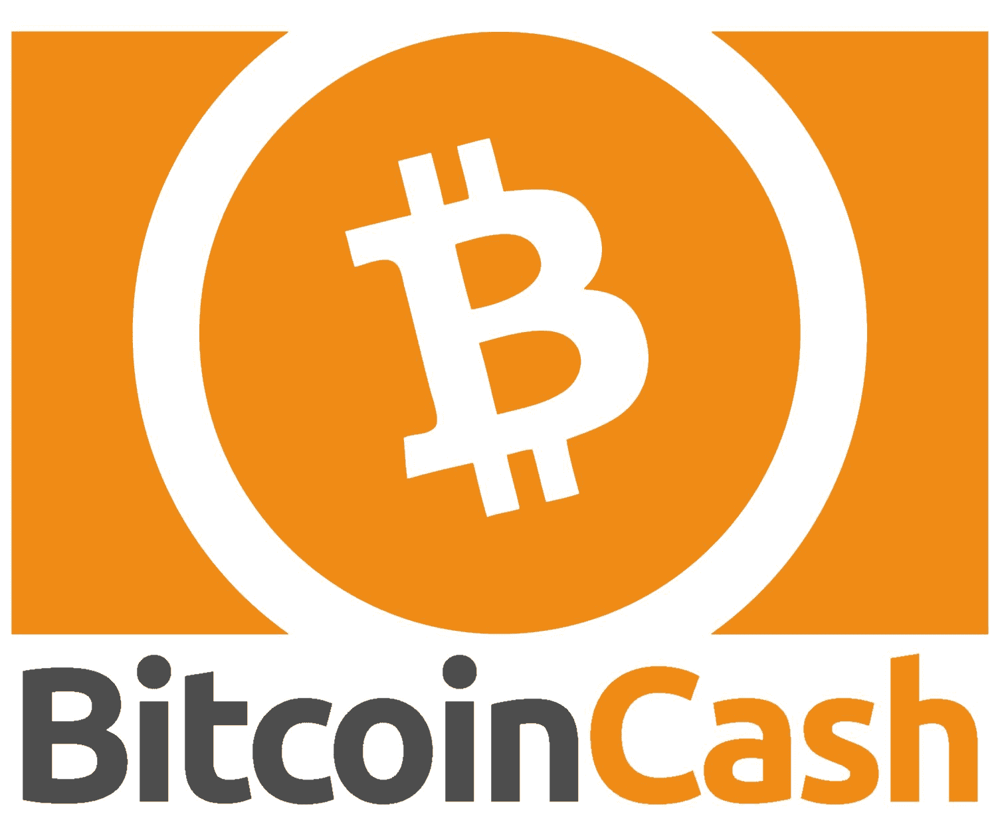

`BCH`，或称 `Bitcoin Cash`，是一種加密貨幣，它是以比特幣的永久分叉 `permanent fork` 而創建的。

`Bitcoin Cash` 是為了解決比特幣社群內部關於貨幣技術運作方式的爭議而創建的，特別是在交易需求增加的情況下。它可以每天處理高達兩百萬筆交易，因為其區塊大小上限提升至 8 MB。較大的區塊大小使得 `Bitcoin Cash` 能以每秒更多的交易量來處理付款，並且降低交易費用。這是為了回應比特幣網路似乎無法處理的交易數量不斷上升的情況。

加密貨幣作為由中央機構不發行、作為交換媒介的數位資產，旨在提供安全與匿名性。利用去中心化技術，將可理解的資料轉換為複雜且幾乎不可破解的加密代碼。這使得使用者能夠安全付款並追蹤其資金。`Bitcoin Cash` 是比特幣的分叉，其創建的主要目的之一是解決比特幣社群對於技術運作方式的爭議，特別是在交易需求增加的情況下。把這次永久分叉視為分叉點的同一位置，但未來會有所不同。由於這是一個意外策劃的硬分叉，結果是意外產生的，因而創建了 `Bitcoin Cash`。很多人最初誤以為這是一個對抗性的、由使用者啟動的軟分叉威脅。相反，`Bitcoin Cash` 會長久存在。它是與原有區塊鏈的永久斷裂。為了提升交易容量，新區塊鏈進行了分叉。這也是為了回應比特幣基礎設施無法處理的交易數量增加的情況。這個爭議性的舉動讓所有人感到驚訝，因為區塊鏈分叉可能會產生競爭性資產。`Bitcoin Cash` 使用與比特幣不同的技術協議，並且在分叉時引入了更新的共識規則，使其能夠擴展。與比特幣相比，`Bitcoin Cash` 在以下幾方面有所差異，其主要目標是打造人人可及的「健全」貨幣。


首先，Bitcoin Cash 的區塊大小上限參數較大。它可以每天處理高達兩百萬筆交易，因為其 8 MB 的區塊大小上限提升。較大的區塊大小使得它每秒能處理更多交易，這意味著付款會更快完成，交易費用也會降低。Bitcoin Cash 的交易簽名略有不同，因為引入了全新的 `SigHash` 類型，提供重放保護與刪除保護，並提升硬體錢包的安全性。`quadratic hashing` 的問題也被解決。

Bitcoin Cash 還引入了 Emergency Difficulty Adjustment（`EDA`）功能，讓礦工可以更快速、更有效地調整工作證明的難度。這意味著礦工可以順利從比特幣傳統鏈遷移，同時使用者不會受到算力波動的影響。Bitcoin Cash 缺少「以手續費替換」功能，且其開發是分散式的，多個獨立的開發團隊提供軟體實作。這使得它無法被單一實體控制，從而免受政治或社會動盪的影響。在其存在的年份裡，Bitcoin Cash 網路獲得了大量基礎設施支持，越來越多的商家、錢包提供商和交易所宣佈對這種新加密貨幣的支持。

### 3.5.15 Litecoin

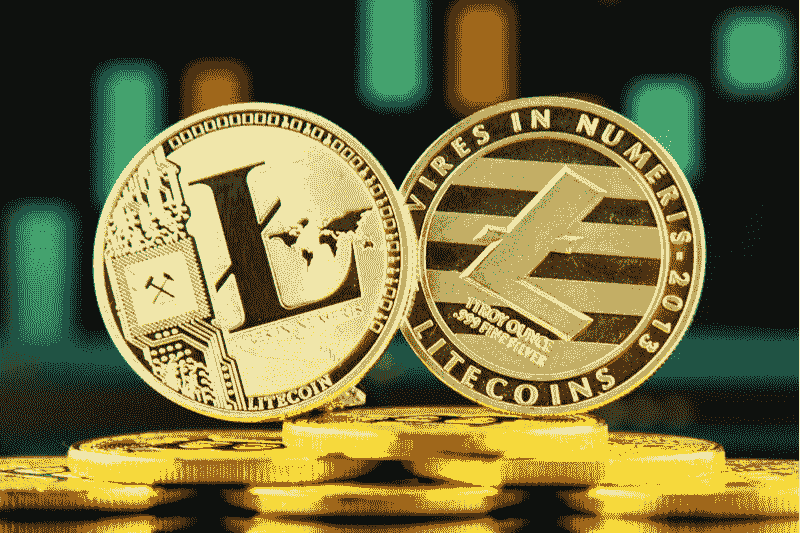

在比特幣之後，Litecoin 之一是最早的加密貨幣，而比特幣被稱為「數位黃金」，Litecoin 則被視為「銀」。擁有更大的代幣單位與一套革命性的挖礦演算法，Litecoin 是一個突破性的、比比特幣更輕盈的替代方案，適合作為比特幣的小兄弟。它促使許多其他加密貨幣使用其代碼基礎，但設計得更輕量。Dogecoin 和 Feathercoin 都是其例子。儘管在比特幣之後，Litecoin 曾一度未能找到真正的使用案例並失去第二大排名，但它仍持續被廣泛追蹤與交易，若比特幣失效，它會被視為替代品而被囤積。

### 3.5.16 EOS

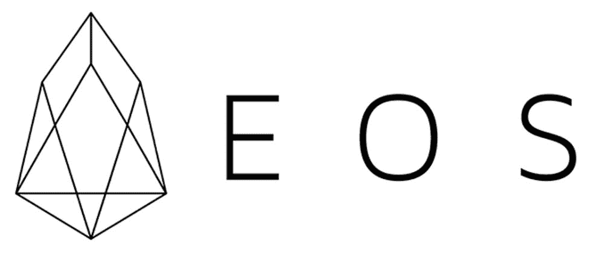

EOS 是一個去中心化的區塊鏈平台，用於開發、部署與執行商業應用或 dApp。EOS 於 2018 年 6 月在 Block.one 透過首次幣值發行（ICO）籌集了 41 億美元的加密貨幣後正式上線。EOS 也是該公司開發的開源軟體名稱。在網路上，EOS 加密貨幣代幣作為支付系統使用。

#### 什麼是 EOS？

EOS 提供核心功能，讓公司與個人能夠像開發網頁應用一樣創建區塊鏈應用。EOS 提供安全的存取與驗證、權限管理、資料主機、使用管理，以及 dApp 與網際網路的通訊。EOS 由一套開發工具套件支援，旨在讓應用開發變得更加輕鬆。EOS 由兩大主要組件組成：`EOS.IO` 軟體與 EOS 代幣。使用網路資源並建置與執行 dApp 的開發者只需持有 EOS 代幣，而非直接花費它們。未在使用中的代幣持有者可以將其頻寬或算力租借給正在執行應用的參與者。EOS 創立人是 Dan Larimer，他同時也是 Bitshares 與 Steem 的創始人。目前 EOS 由 Block.one 公司擁有。

### 3.5.17 Bitcoin

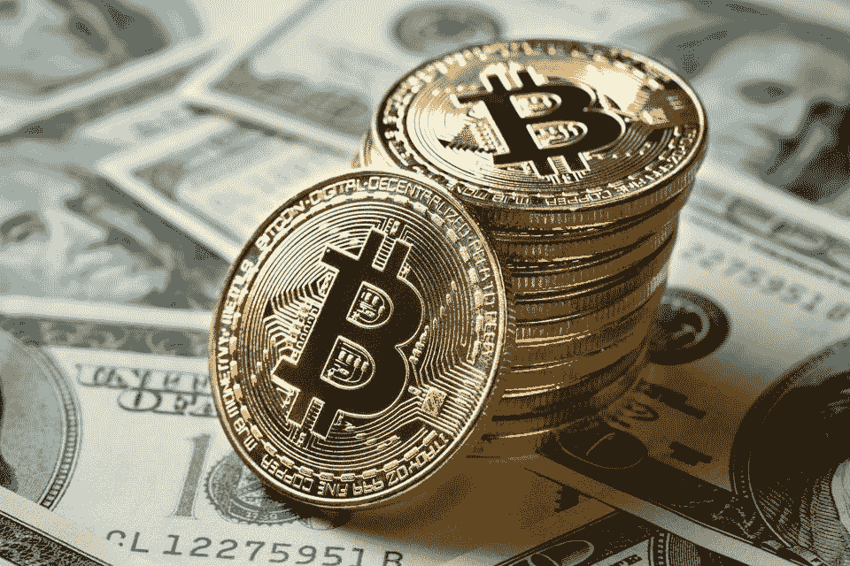

以下是與比特幣相關的時間線事件：

**初始失敗**

雖然加密貨幣在 2009 年才開始正式挖礦，但在此之前，已有多次嘗試建立數位貨幣的嘗試。1998 年，兩位加密貨幣先驅 Wei Dai 與 Nick Szabo 發表了關於去中心化貨幣的構想，他們的方案都圍繞著用數位貨幣取代傳統金融系統的低效，例如紙幣與硬幣的製作與流通。雖然這些提案未曾實現，但多過十年後，這兩位又成為早期加密貨幣的採用者。比特幣的誕生正是這些早期失敗之後的結果。

**2008 年 10 月**

加密貨幣領域的開端發生在一份由「Satoshi Nakamoto」這個人或團體所發表的白皮書《A Peer-to-Peer Electronic Cash System》（比特幣：點對點電子現金系統）時。該白皮書闡述了比特幣的概念，並說明它與傳統金融體系相當，同時引入了區塊鏈技術，首次解決了數位貨幣的關鍵缺失。

**尋找 Satoshi Nakamoto 的真實身份**

比特幣創造者的真實身份是當今世界最大的謎之一。多年來，出現了多種理論，認為他是時間旅行者、外星人、失控的人工智慧，或是 NSA、CIA、黑道的掩護。Satoshi Nakamoto 是一個假名，用來隱藏其真實身份。人們對他自稱是日本人感到懷疑，因為他出生於 1975 年 4 月 5 日，目前居住於日本，且具備流利的英語能力，工作時間更符合英國時區。這使得他被懷疑其國籍與工作時間的匹配度。

What did Bitcoin go through during its initial stages of creation?

The proof cited by the magazine includes the fact that the name Satoshi literally gave birth to Dorian. He graduated from Cal Poly University as a physicist and worked as a systems engineer for secret military projects and as a computer engineer for corporations in electronics and financial information services. "Nakamoto also has libertarian tendencies and encouraged his daughter to have a business "not under the thumb of the government." And when he was first questioned about Bitcoin, Nakamoto mistakenly believed it was a query about one of the classified projects he did for U.S. military contractors and said: I'm not interested in that anymore, and I can't talk about it. It was handed over to other individuals.

January 2009

Less than three months later, by mining the first block of Bitcoin, Nakamoto announced the official beginning of the crypto-currency universe. Nakamoto was given 50 Bitcoins for approving the first transaction, the beneficiary of which was Hal Finney called the Genesis Block of Bitcoin. The momentum for the digital currency was formally underway, with transactions officially registered and the Bitcoin network legitimized.

March 2010

More than a year after official trade, in the form of the now-discontinued BitcoinMarket.com, the first crypto currency trading market was introduced. On a Bitcoin forum, a consumer who wanted to begin treating Bitcoin as a currency that people might share with each other and exchange for dollars suggested this groundbreaking growth. Traders could potentially gauge the worth of a single Bitcoin, originally priced at fractions of a penny.

May 2010

Laszlo Hanyecz reported the first purchase of products using Bitcoin with the first digital currency trading market set up and rising at an encouraging pace. Hanyecz bought two Papa John's pizzas for 10,000 Bitcoin on May 22, 2010, an amount estimated at $80 million in 2018. The validity of the crypto currency has further solidified this day. It has since then been annually celebrated as Bitcoin Pizza Day.

February – June (2011)

At this point, when other trading markets took center stage, including the notorious Mt. Gox market, BitcoinMarket.com was becoming more irrelevant. February marked the first time that, as its value began to soar, Bitcoin hit parity with the US dollar. Throughout the year, competing crypto currencies have also started to emerge.

In June, when hackers stole 2,000 Bitcoins, the first crypto currency attack occurred on Mt. Gox. The market continued to rise in notoriety and holdings amid the hack.

The year 2013

Two years fast forward, and Mt. Gox is easily the world's biggest currency market. The market accounted for more than 70 percent of all Bitcoin trades at its peak in 2013, according to Investopedia. Although excitement soared, the exchange's extreme notoriety still provided hackers with a golden chance.

February 2014

Mt. Gox went from being the biggest Bitcoin exchange in the world to bankrupt in the space of a month. The exchange was the victim of the most important hack in the history of crypto currencies. Hackers looted from Mt. Gox consumers an astronomical 744,408 Bitcoins, as well as an additional 100,000 from the exchange itself. The valuation was $460 million at the time. Consequently, in the coming months, the hack forced Bitcoin's worth to nosedive by 50 percent. Although the value of the crypto currency subsequently returned to its pre-attack metrics, the hack itself highlighted the need for stronger security measures.

July 2015

As Bitcoin and rival crypto currencies were still recovering from the hack's shock, a new crypto currency was introduced, carrying another degree of protection with it. The Ethereum network was established to exchange the ether crypto currency as a platform. The network made the use of smart contracts common, cryptographic software that makes it much easier to promote credible transactions without a third party at all being present. The Ethereum network, along with its smart contracts, is now used by multiple crypto currencies in the form of ERC-20 tokens in the world of crypto currencies. ERC-20 tokens vary in the sense that they are assets generated by the smart contracts of the Ethereum network, whereas Bitcoin and other crypto coins have their own blockchain and thus coexist with the blockchain of Ethereum.

Present

Since then, advances in the crypto-currency environment have persisted, and there are currently more than 2,000 tradable crypto-currencies. With its latest market-wide assessment hitting $ 128 billion in April 2020, Bitcoin appears to rule supreme. In terms of market capitalization, the digital currencies XRP-US $8 billion and Ethereum-US $19 billion stands above the other three crypto currencies.

# Chapter 4: What is Blockchain?

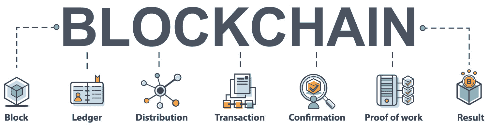


The blockchain is a data recording mechanism that makes it difficult or impossible to modify, hack, or cheat the system. A blockchain is basically a digital transaction ledger that is duplicated and spread on the blockchain throughout the whole network of computing systems. Each block in the chain includes a number of transactions, and a record of that transaction is added to the ledger of every party every time a new transaction happens on the blockchain. Distributed Ledger Technology is defined as a shared network operated by many users (DLT). The blockchain is a type of DLT in which an immutable cryptographic signature called a hash is registered in transactions. This suggests that if one block of one chain was altered, it would be automatically obvious that it had been corrupted. They would have to change every block in the chain through all the distributed iterations of the chain if hackers were to corrupt a blockchain structure. As blocks are attached to the chain, block chains such as Bitcoin and Ethereum are actively and continuously increasing, which greatly contributes to the stability of the ledger. The blockchain carries the promise of transactional openness for companies, the potential to build stable, real-time contact networks with collaborators worldwide to facilitate everything from supply chains to payment networks to real estate transactions to the exchange of health data. Current speculation around this comparatively modern technology is real because DLT is basically a new model for the exchange of information; computer providers and businesses have not surprisingly raced to learn how to use distributed ledger technology (DLT) to save time and administrative costs.

## 4.1 The future of blockchain technology

One of the most talked-about developments in the industry right now is the blockchain. From finance and cyber security through intellectual property and healthcare, Block Chain Tech has the ability to force big improvements and generate new markets across industries. A blockchain is a shared archive that is open to multiple people as an electronically distributed ledger or registry of documents. To register, process, and validate any transaction, block chains use cryptography, making them stable, permanent, and transparent. Two general block chain groups exist:

- Permissionless, to be entered by anyone
- Permissioned, which allows participants to be approved by the member or organization that oversees it (this category is further divided into private and community blockchain networks)

### 4.1.1 Who is using block chain already?

The most well-known instance of blockchain technology is Bitcoin, but a rising number of early adopters are entering it. Microsoft, Goldman Sachs, Visa and Deloitte, for example, are investing in ventures in the blockchain. And organizations that operate on services focused on the blockchain include:

- To control copyrights, Spotify
- IBM，用于构建监控服务，服务于超市连锁企业和物流公司
- Eastman Kodak，用于构建股票照片的存储系统

### 4.1.2 区块链的未来

区块链是一项新兴技术，关于其潜在影响的预测仍然参半。

以下预测由分析师公司 Gartner 的新《Trend Insight Study》中提出：

- 仅有 10% 的企业能够通过使用区块链在 2022 年前实现根本性的转型。
- 至少有一家专注于区块链技术的突破性企业将在 2022 年估值达到 100 亿美元。
- 区块链贡献的市场价值将在 2026 年上升至 3600 亿美元左右，并扩张至 2030 年的 3.1 万亿美元。

区块链技术最有前景的发展方向之一是网络安全。数据篡改是各类规模组织持续面临的问题。通过区块链技术，可以避免数据篡改，确保数据安全，并让参与者验证文件的有效性。

在技术与 IT 市场中，区块链技术被认为未来几年将产生颠覆性影响，其效果堪比互联网在 90 年代和 2000 年代初给世界带来的变革。

### 4.1.3 区块链确保最高水平的技术

当前，数据安全领域最安全的技术之一是区块链。数字技术的快速发展也带来了新的数据保护问题。通过引入强大的身份验证和密码学主 vaulting 协议，组织需要保护其记录。区块链技术足以解决数据如何被保护以及如何阻止破坏性网络攻击的问题。报告称，到 2024 年，区块链技术的整体需求预计将达到约 200 亿美元。在医疗、银行、体育等多个领域，区块链已被证明是颠覆性的技术。

与传统方式不同，许多区块链软件公司主要受此技术启发，重新设计并重构安全问题。区块链提供了对数据真实可信的体验。

### 4.1.4 区块链技术挑战脆弱性

为构建稳定的数据网络，分布式账本系统提供的高度保护带来了显著优势。为消费者商品和服务提供区块链技术保护的企业，能够有效保障消费者数据信息的安全。

技术正在以创新方式颠覆市场服务和客户解决方案。这项技术将在未来成为主导者，在各行各业涌现出全球性服务。

### 4.1.5 提供加密与验证

区块链程序足够专业，能够处理任何情况，因此知识从未以任何方式被篡改。默认情况下，区块链是加密的，这使得精确验证成为可能。

## 4.2 区块链如何惠及 CRM？

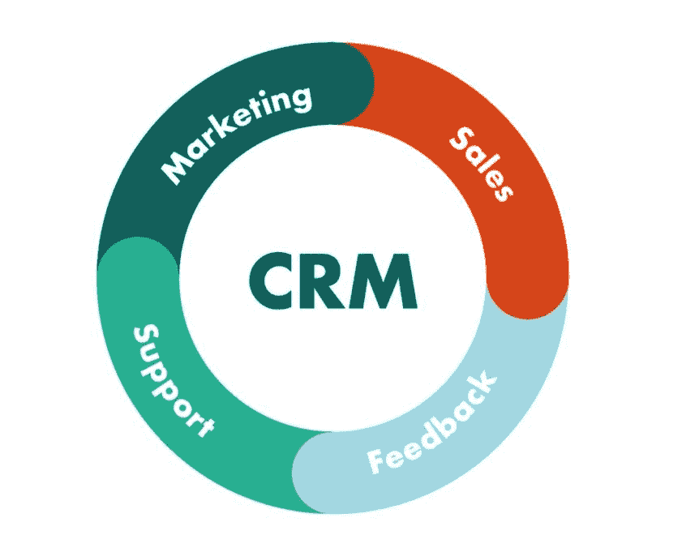

以下是预计将从该技术中受益的领域：

### 4.2.1 增强安全性

区块链本质上是一个由每个区块中的交易文档组成的链式结构。每个区块通过密码学方式与相邻区块相连，这种结构使得网络密钥由参与用户使用，从而防止未经授权的访问。

### 4.2.2 效率

去中心化实体是区块链的特点。它帮助企业以安全、透明的方式与客户进行交易，无需金融机构或第三方中介（如银行或经纪商）。在所有交易中，移除这些“中间人”能够提升生产力和速度。

### 4.2.3 数据清洗

全球 CRM 用户普遍面临数据不准确或重复的问题，这源于数据导入工具不胜任或人为错误。消费者可通过在区块链上使用个人密钥，使企业获得其个人记录、过往购买、订阅等的单一且详细的视图。因此，区块链使企业能够彻底规避不可靠、过时和冗余的数据文档问题。这将为企业提供更深入的消费者洞察，并使其能够更高效地与消费者互动。

### 4.2.4 loyalty 计划

消费者将拥有一个去中心化的钱包，适用于所有品牌，不受单一品牌规则和限制的束缚，点数兑换将大幅简化。客户将对整个体验拥有更大话语权，通过提供更低价的优惠，营销人员将竞争对手的钱包。

## 4.3 公有区块链

公有区块链通常是去中心化的，不受任何单一网络控制方的控制。去中心化区块链上的数据受到保护，因为数据在未经验证前无法被篡改。比特币（Bitcoin）和以太坊（Ethereum）是去中心化区块链的最佳示例。

## 4.4. 私有区块链

受邀请的网络并由单一组织管理的私有区块链。

网络参与者需要授权才能读取、写入或审计区块链。可提供不同程度的访问权限，细节可加密以保护商业机密。在不暴露数据的前提下，私有区块链使公司能够使用分布式账本技术。私有区块链在验证交易方面耗时且资源密集，相比公有区块链，其更快、更稳定且成本更低。

## 4.5 如何成为加密艺术家

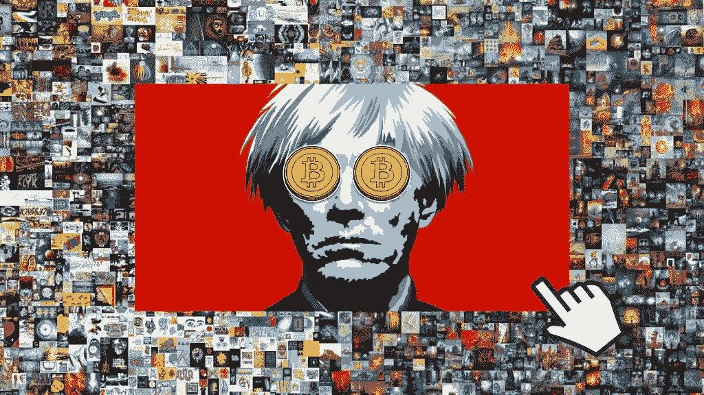

新的去中心化市场已准备好接受新晋和资深的数字艺术家。Beeple、Pak 和 Hackatao 只是少数正在通过出售数字作品重写艺术史、估值数百万美元的艺术家。然而，如何成为一名数字艺术家呢？以下是一些有用的提示。

### 4.5.1 创作数字艺术品

了解如何创作数字艺术品——即利用电脑和软件创作、并能在数字媒体上复制的作品（如 GIF、MP4 视频、静态图片、动态图形、3D 创作，甚至实物及数字化作品）。建立一个能有效传达你数字艺术的作品集是第一步。

### 4.5.2 认证你的艺术品

加密艺术品的验证方式与实物画作（如毕加索签名画作）需要真品证书类似。这是因为 NFT（Non-Fungible Tokens，非同质化代币）的概念。NFT 是一枚唯一的代币，代表一个唯一且不可复制的加密艺术品的唯一标识。该代币用于验证所有权及作品来源，并与区块链技术关联。

### 4.5.3 在临时平台上发布出售

作品创作并认证后即可上架出售。近年来涌现出许多平台，允许你展示、出售和购买 NFT 作品。OpenSea 是最知名的平台之一，但艺术家们也偏爱 Nifty Gateway、Super Rare 和 Rarible。部分平台（如 SuperRare 和 Nifty Gateway）目前仅接受邀请或申请的艺术家，而 Rarible 等平台则允许任何感兴趣的创作者直接在其市场上开始销售。

### 4.5.4 加入社区

Crypto Art 是一个相对新的现象，大多数人都不了解它。因此，NFT 平台的目标之一是创建社区，让艺术家、收藏家和数字专业人士能够连接、讨论、培训，并及时了解新技术、趋势和市场发展。社区的口号是“协作”，这种精神因专注于艺术而得到加强：艺术家通常匿名或使用化名，性别、种族和社会地位不被揭示。Art Rights 是一个利用区块链技术管理和认证艺术作品的平台，是帮助艺术家（包括 Crypto Artists）的工具之一。Art Concierge 是艺术界最大的艺术家、收藏家和专业人士社区，也是该平台提供的服务之一。

# Chapter 5: What is NFT and Key Concepts?

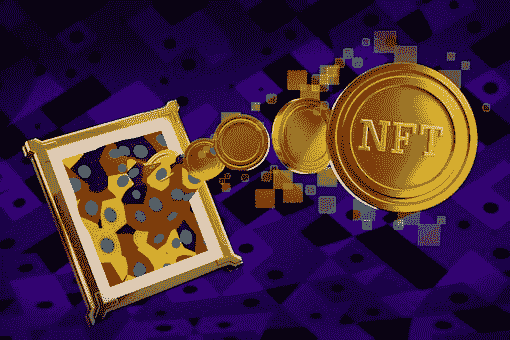

你可能已经听说过比特币、区块链，以及最近在科技新闻中看到的 NFT。艺术家和收藏家都被数百万美元天价数字资产拍卖的新闻吸引。但 NFT 究竟是什么？它们是如何工作的？我们将在本章中了解 NFT、关键概念、工作原理、NFT 与区块链以及更多内容。本章将介绍非同质化代币的基础、其背后的技术以及在日常生活中的应用。我们还将介绍参与其中所需的技能和知识。

## 5.1 What is NFT?

NFTs 是独特的资产，为收藏家和玩家提供了对其数字资产的完全控制权。让我们先定义一些基本术语。我们需要一些背景知识才能理解 NFT 是什么以及它们是如何工作的。

NFT（非同质化代币）是数字资产，可以用来代表各种有形和无形的商品，例如收藏家的虚拟房地产、体育卡片、数字鞋子。数字收藏品的一个重要优势是，与像宝可梦卡片或稀有铸造硬币等有形收藏品相比，每个 NFT 都包含唯一的信息，可以轻松验证。伪造的收藏品无法制造和分发，因为每件商品都可以追溯到原始发行者。在经济学中，货币是一种可分割的资产。它可以被轻松交换而不损失或增加价值（例如，一张 £20 可以兑换成两张 £10）。金条、比特币和股票都是可分割的资产。相反，非同质化资产是独一无二的，例如一幅画、一栋房子或一张交易卡。即使一幅画可以被拍照或复制，它仍然是原件，复制品的价值不等于原件。区块链存储 NFT，这些是数字数据单元。每个非同质化代币都充当真实性证书，证明数字资产是独一件且不可复制。由于区块链的加密技术，NFT 永远无法被编辑、篡改或盗用。

## 5.2 NFTs key concepts

非同质化代币（NFT）是连接到区块链的数字内容元素，区块链是比特币和以太坊等加密货币的数字账本。与 NFT 相比，其他资产是可分割的，意味着它们可以被另一份相同价值的相同项所替换，例如一张美元钞票。相反，NFT 是唯一且不可交换的，意味着没有两个 NFT 是相同的。考虑宝可梦卡片、稀有硬币或限量版乔丹鞋：NFT 在原本无限供应的商品中创造稀缺性，并附带真实性证书。NFT 可用于购买和出售 GIF、推特、虚拟收藏卡、实物照片、视频游戏皮肤、虚拟房地产和其他数字艺术品。

## 5.3 How do NFTs work?

与其他加密货币相比，NFT 不能直接交换，因为即使属于同一平台、收藏或游戏，也不可能存在两个完全相同的 NFT。你可以把它们看作节日通行证。每张通行证包含购买者姓名、活动日期和场地等信息，这些信息使得通行证难以交换。

### 5.3.1 How to buy NFTs

原则上，任何数字图像都可以作为 NFT 购买。但是，尤其是对于新手来说，在购买时需要注意几点。你需要选择一个市场平台来购买，一个数字钱包来存储加密货币，以及执行交易所需的加密货币。一些最知名的 NFT 市场包括 OpenSea、Mintable、Nifty Gateway 和 Rarible。

### 5.3.2 How to sell NFTs?

NFT 也在市场平台上销售；但具体方法因平台而异。基本上，你需要在市场上发布你的作品，然后按照平台的流程将其转换为 NFT。你可以输入作品描述和定价建议。大多数 NFT 是用以太坊（ethereum）购买的，但也可以使用其他 ERC-20 代币，如 WAX 和 Flow。

### 5.3.3 How to create an NFT?

任何人都可以创建 NFT。你只需要一个数字钱包、少量以太坊以及访问 NFT 市场平台的权限，在那里你可以上传并将你的作品转换为 NFT 或加密艺术。如果你是有志成为数字艺术家，可能会想制作 NFT 来展示你的作品。幸运的是，有很多平台可以帮助你入门。整体流程相对简单，各个平台都会一步步指导你。但在这开始之前，你可能需要了解一些事项。NFT 建立在特定区块链之上并受其支持。以太坊区块链是非同质化代币最流行的选择。你需要一个比特币钱包和加密货币来开始。目前，以太币（ETH）是使用最广泛的。

## 5.4 NFT and block chain


目前有多种区块链技术可供选择。有些区块链是为满足少数人群体的需求而创建的，它们的访问权限有限。那么 NFT 在区块链世界中处于什么位置？区块链是一种在通信网络节点中分布式存储的软件，充当分布式账本。其不可篡改性使其区别于其他在线数据库或交易平台：你可以在点对点网络中交易数字资产，且无需多数网络节点同意即可更改或删除这些交易。这是互联网的一大优势。每个 NFT 中的代币代表一件独一无二的物品。你不太可能注意到在合同中用 Mike Winkelmann 的作品替换 Andrew Wyeth 的画作。NFT 涵盖广泛的独特资产，包括出生和死亡证明、产权证书以及物联网设备的身份。虽然 CryptoKitties（第一个 NFT 热潮）的热潮已消退，但 Beeple 作品拍卖的兴奋展示了 NFT 的潜力。这是一个价值创造领域，你的想象力、技术技能以及营销、会计和法律支持是唯一的限制。

# Discovering NFT

尽管 NFT 在数字金融生态系统中仍是“光彩夺目”的新宠，但其实用性和市值尚未实现。NFT 必须在中市场环境中进行展示和提供，而非仅限于奢侈品或高端机会，才能实现其面向普通消费者的潜力。普通消费者需要获取信息、搜索、比较并购买的能力。买家旅程的发现阶段至关重要，别忘了冲动购买的力量。这很可能导致 NFT 市场更加专注于特定用例。`OpenSea` 是最早的 NFT 市场之一，正在快速增长。2021 年 `OpenSea` 的交易量增长了 12,000% 以上，6 月单月即完成了 1500 万美元的 NFT 交易。如果不计其他好消息，其用户基数在六个月内从 315 人增长到 14,520 人，推动公司在 8 月达到 30 亿美元的月度 NFT 交易额。所有这些都是 NFT 及整个数字金融行业的好消息，但专用市场无法像阿里巴巴这样具有国际知名度的强大企业那样快速推动行业发展。因此，阿里巴巴最近的公告极具吸引力。

## 智能合约

智能合约用于分配所有权并管理 NFT 的可转让性。当某人生成或铸造 NFT 时，他们执行的是遵循多种标准（如 `ERC-721`）的智能合约代码。这些数据存储在区块链上，即 NFT 的处理方式。以非同质化代币（NFT）的形式，智能合约已对大众产生了显著影响。2021 年第一季度，NFT 消费超过 20 亿美元，同比增长 2,100%。

## 数字资产

简单来说，数字资产是指以数字形式存在并具备使用（复制、拥有复制权、复制、修改）能力的任何事物。文档、音视频信息、照片以及其他相关数字数据等均属于数字资产。

## 5.5 NFTs vs. Cryptocurrency

必须明确加密货币与非同质化代币（NFT）的区别。尽管两者均基于区块链技术，但其根本差异有助于我们理解 NFT 的工作方式。主要差异源于加密货币是可互换的——例如，可用一种比特币兑换另一种比特币。而 NFT 不可如此交换。非同质化代币关联唯一的数字资产，无法与其他代币互换。NFT 与加密货币的主要区别在于，NFT 是唯一的实物数字资产的唯一代表，无法相互交换；而加密货币因价值稳定，可相互交换。加密货币和 NFT 都是去中心化的，由其运行社区治理。它们可通过数字公共账本访问，使所有交易透明。

## 5.6 NFT vs. Bitcoin

虽然 NFT 使用比特币等加密货币的相同技术，但两者的相似之处到此为止。比特币可相互交换且价值相同——一卢比永远等于一卢比，一枚比特币永远等于另一枚比特币，不论其与其他货币的价格波动如何。NFT 则不然。每个 NFT（虚拟资产）都带有不可复制的数字签名，因编码原因无法完全复制。

## 5.7 NFT 的优缺点

以下列出 NFT 的一些潜在优缺点：

### 5.7.1 NFT 的优点

NFT 的优势包括：

**安全性**

NFT 可在安全透明的环境中交易。NFT 作为不可篡改的数字签名，为收藏者提供了极高的信任度。这种保障也延伸至艺术品的未来遗产。区块链保护数字作品免受审查和物理损坏，但仍需谨慎存储。区块链技术还能让全球大额资金安全、公开地转移。NFT 保证了独特资产的真实性、唯一性和所有权，正如区块链构建的信任协议使数字货币得以建立。

**价值升值**

实物贵重物品（如艺术品）有着悠久的增值历史，数字艺术也可能如此。

**买卖渠道扩大**

将数字资产作为 NFT 进行买卖，让你接触到远比以往更庞大的买家和卖家群体。

**赋予创作者所有权**

当内容创作者开发数字资产时，NFT 让他们不仅能证明真实性，还能从中获利。这对广为流传的表情包创作者而言可能是一笔巨大的收入来源。

**独特且可收藏**

许多爱好者热衷于获得独一无二或极罕见的物品。数字收藏品，尤其是数字资产，借助 NFT 获益匪浅，因为它为真实性增添了额外层。

**不可篡改**

非同质化代币基于区块链，永不更改、删除或替换。这在证明数字内容的来源或真实性时是宝贵属性。

**可组合性**

NFT 最令人兴奋的方面之一是它们可被视为互相连接的乐高积木。这意味着设计师可以推出基于已有 NFT 成功的 NFT，任何 NFT 项目都可视为更大、互联生态系统的模块。

**可包含智能合约**

智能合约是区块链技术的另一令人兴奋特性。它们能在满足特定条件时执行指令。因此，带有智能合约的 NFT 可在二次销售时向艺术家支付部分收益。艺术家和制作方可通过“智能合约”——即嵌入区块链的代码指令序列——在作品被后续使用或转售时获得报酬。

### 5.7.2 NFT 的缺点

NFT 的缺点包括：

**本质上具有投机性**

核心问题是 NFT 是否具有真实价值。它们是长期投资还是短暂风潮？目前，NFT 的唯一估值标准是其情感属性。

**数字资产可被复制**

拥有 NFT 的数字资产所有权并不排除他人复制该资产。艺术品可被复制粘贴，GIF 可被分享数百次，视频可被广泛传播。拥有 NFT 并不赋予你对资产的控制权，它仅是所有权证明。

**环境成本**

像以太坊和比特币等区块链加密货币的环境影响受到广泛关注。将数据写入区块链需要大量计算能力。区块链资产的长期可行性是一个主要顾虑。

**易被盗**

尽管 NFT 背后的技术极其安全，但许多交易所和平台并不安全，导致 NFT 因安全漏洞被盗的案例屡见不鲜。

**因需求下降而价值贬值**

许多 NFT 是不动产且自带无收入功能，其价值依赖于主观指标（如买家需求）。因此，极高的价格难以长期维持，NFT 可能出现显著价值下跌。

**可持续性存疑**

Creating & selling NFTs accounts for a significant amount of power consumption, similar to blockchain transactions. Some scientists are concerned that a growing NFT market would exacerbate the effects of a quickly deteriorating environment.

Ownership doesn’t equal control

Ownership of an original NFT does not imply ownership over its distribution or duplication across platforms. Ownership simply means they have the "original" – they have no power to prevent "prints" from being made.

## 5.8 What determines the success and failure of NFTs?

NFTs can either be your best friend or your worst enemy. NFT initiatives are as unpredictable as British weather on a sunny day, but there are patterns among the chaos, and if yours can channel one of them, your project may be worth a million dollars by Christmas. Alternatively, it might fail quietly, a whisper in the world of digital art.

### 5.8.1 Celebrity and NFTs

The simplest way to succeed with an NFT project is to get the help of a celebrity, particularly a world champion footballer, basketball player, or ice hockey player. NFTs thrive in sports environments. Trading cards, ticket stubs, uniforms, autographed shirts, Andre Agassi's Ponytail, and a bloodied sock are all collectibles that may be bought and sold on the open market. Messi's new PSG deal includes NFT rights. So rare, an NFC collector card with a football theme acquired $532 million in seed money. So rare has signed deals with football giants such as Japan, the United States, Belgium, the Netherlands, Liverpool, and West Ham United. Football is a license to print money. NFTs are, in essence, a license to print money. It's a match made in competitive heaven, and if you want your NFT project to succeed, you should contact an agency.

### 5.8.2 Copy, imitate, and catch the NFT Zeitgeist

Nothing is unique, therefore copy. Ride the tidal wave, ride the zeitgeist, bask in the light of a Twitter storm, and unleash your ten thousand NFT collection on the OpenSea to a chorus of squandered opportunities and hope. CryptoPunks has spawned a swarm of copycats who profit on pixelated avatars and animal stories. CyberKongz, Bored Ape Yacht Club, Pudgy Penguins, and a zoo of pretenders have all adopted CryptoPunks' basic ideals.

### 5.8.3 Build a quality team and a creative NFT project

Recruit an inspiring leader, assemble a talented team, and create an outstanding NFT. Nothing you could make on an old Amstrad should be released. Even when we're in the midst of a gold rush, you still have to motivate the NFT audience. The importance of great artwork, a sound business plan, and equitable distribution should all be at the top of your priority list. Build a community, don't tell collectors you're only wanting their money, and give them extra goodies like exclusive online interviews and conversations. You must be imaginative.

### 5.8.4 Why do NFT projects fail?

Innovation is a scarce resource. It will become increasingly difficult for NFT projects that do not offer something innovative, fascinating, or exciting to break through the noise & rank highly on the OpenSea or generate Twitter engagement. There are copyright difficulties, environmental impacts (whether or not NFTs are melting the ice caps is irrelevant to the media and headlines), and the crooked nature of some in the eco-system. Scams, rug pulls, security concerns and mishandling of cash and projects are all serious concerns. Any or all of these factors could jeopardize the success of your NFT project. Of course, in the world of NFTs and cryptocurrency, nothing is ever foreseeable. What constitutes a strong NFT project will alter substantially in the months and years ahead, just as the markets are as unpredictable as a North Korean supreme leader.

# Chapter 6: New NFT Investments, Uses and Disruptive Projects

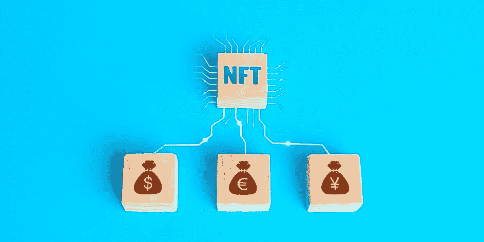

Many people wonder if there are any applications for NFTs. Despite the fact that the concept is still in its infancy, numerous possible applications have already been developed.

## 6.1 New Uses of NFTs

We have chosen some of the most notable ones:

### 6.1.1 Tickets

Event tickets are one of the applications of NFTs. The reasoning is that if tickets are produced using a non-fungible token, there will be a record of that trade if the ticket is exchanged. As a result, there is no possibility of scalping, stealing, or attempting to use counterfeit tickets. This is due to the fact that the token on the blockchain linked with that ticket cannot be replaced.

### 6.1.2 Fashion

NFTs have the potential to solve a number of important difficulties in the fashion industry. Start with a digital record of authenticity, which can help with concerns like counterfeit items. An NFT could be connected to a luxury object to prove its authenticity. Similarly, a non-fungible token could provide important information about an item's origins, like the materials used, where they came from, and how far it has traveled. This might help people make more ethical decisions as topics like fashion and sustainability become more prominent.

### 6.1.3 Collectibles


We've already touched on this subject. Collecting souvenirs, trinkets, and other similar stuff has always been a popular pastime. NFTs act as a form of digital signature or stamp of approval, confirming authenticity.

### 6.1.4 Gaming

NFTs allow gamers to own one-of-a-kind in-game objects. Such tokens can power in-game ecosystems, whether for enjoyment, authenticity, or competitive nature.

## 6.2 Why do NFTs have value?

A non-fungible token is effectively a certificate of ownership for a digital asset, as we've already mentioned. The value is derived from the asset's collectibility as well as its possible future sale value. NFTs can be bought and sold. Using art as an example of the benefits of NFTs is another excellent example. Beeple, a digital artist, sold the NFT for their Everyday – The First 5000 Days artwork to Christie's auction house for a stunning $69.3 million in February 2021.

### 6.2.1 Examples of NFT sales

NFT art isn't the only thing that sells well. There have been several major sales of NFTs in recent months, which has led to concerns that the market is currently in a bubble (more on that later). The following are some examples of NFT sales:

- The first Tweet: The founder of Twitter [sold the NFT for his first Tweet](https://www.theverge.com/2021/3/22/22344937/jack-dorsey-nft-sold-first-tweet-ethereum-cryptocurrency-twitter) for $2.9 million
- The ‘Nyan Cat’ GIF: The colorful GIF’s NFT was sold for 300 Ether, worth around $561,000 at the time.
- The ‘Charlie Bit Me’ Video: The famous video in which a baby was biting his brother’s finger was viewed over 800 million times on YouTube. The NFT for the video was sold for around £500,000.

## 6.3 Ten NFT disruptive projects

We have selected some of the best NFT disruptive projects that can be used effectively.

### 6.3.1 Art

This is, without a doubt, a large industry. When NFTs are tied to digital art, it becomes possible to 'own' and trade it. Here, ownership refers to the NFT that symbolizes the artwork. The artwork itself may be a single edition or a series of editions that the artist chooses to mint. Individual artists selling art as NFTs have generated over $150 million in sales volume in the art sector alone.

### 6.3.2 Virtual land

You can own virtual land as NFTs through projects like Decentraland, The Sandbox, Cryptovoxels, Somnium Space, and Axie Infinity. Because thousands of people own land and may develop whatever they want, from conference facilities to art galleries, the world can actually take on its own shape, and you can sell your land later if the area around you improves in value. In other cases, land has already sold for $1 million or more.

### 6.3.3 Game items

考虑你的头发、武器、盔甲、宠物和角色作为非功能代币（NFT），你可以升级并出售它们。也许你拥有一个极其稀有的物品，随着用户群体的扩大，更多人希望拥有它。人们在游戏行业投入了数十亿美元，尽管把钱投入游戏通常被视为“沉没成本”。如果他们能在市场上升级和出售这些 NFT，代表他们投入的时间，他们为什么不愿意花钱呢？

### 6.3.4 TCG - 更多游戏

交易卡游戏（TCG）尤其适合，因为卡牌游戏的目的是与他人竞争和交易。宝可梦、Hearthstone、尤尤和魔法：收集者都是在全球拥有数百万收藏家和玩家的流行游戏。我们都见过像喷火龙这样的稀有卡片在现实世界中能卖出高价。Splinterlands 和 Gods Unchained 正在为这条道路铺平道路。

### 6.3.5 收藏品

收藏品市场巨大。CryptoPunks 已经以 100 万美元或更高的价格售出，而 CryptoKitties 风靡一时。即使在数字时代，拥有感和想要拥有具有标志性事物的愿望依然强烈。

### 6.3.6 体育收藏品

随着知名企业和球员的参与，NBA Top Shot 的销售额已超过 1 亿美元。这些 NFT 不仅用于收藏；它们还可以用于各种活动。事实上，这些 NFT 可以用于构建整个体育游戏生态系统。

### 6.3.7 域名

域名 `.eth` 和 `.crypto` 价格高昂。人们利用它们来替换支付地址、直接使用 Twitter 账号付款，甚至未来托管网站。此外，任何可以持有的东西都可以是（NFT），那么域名为什么不可以呢？

### 6.3.8 De-FI

NFT 也可以应用于去中心化金融（De-FI）并取得成功。例如 Bond 等项目允许你使用 NFT 免费交易加密货币。NFT 将在各种区块链基础的去中心化金融应用中被使用和应用。

### 6.3.9 数字化实物商品

这是一种既有实体成分，又附带 NFT 的实物商品。两者都是独特的资产。例如，Metafactory 销售带有 NFT 的个性化卫衣，该 NFT 可用于 Cryptovoxels。Headspace 也如此操作，部分其 NFT 可在 Decentraland 看到。

### 6.3.10 虚拟场景

NFT 可用于创建整个虚拟建筑和游戏。Metazoan 是一个令人惊叹的项目，允许 Decentraland 土地所有者购买并部署游戏、建筑和增强功能。如果你真的想在你的房产上举办聚会，但不想支付 4000 美元的开发费用，为什么不租用一个周末，只需 200 美元呢？随着区块链虚拟世界的扩展，这一概念具有巨大的潜力。

### 6.3.11 虚拟汽车

为什么不能在虚拟世界中拥有虚拟汽车、飞机和船只作为 NFT？一些人已售出数字汽车，价格高达数百 ETH。随着区块链虚拟世界的发展，对高级交通和探索工具的需求也将随之增长。CryptoMotors、F1 Delta Time 和 Battle Racers 已经探索过这一方向。

## 6.4 合法和新的 NFT 市场

NFT 是一种独一无二、无法替代的物品。大多数 NFT 现在都是数字化的。这使得创作者能够向粉丝提供稀有且独特的内容。例如，一些 NFT 是数字艺术品，它们的收藏方式与多年来收藏实物画作一样。这些 NFT 中有些已售出天文数额。第一批 NFT 是以太坊区块链的一部分，该区块链包含额外的电力数据以区分它们。NTFS 也被其他区块链支持。由于不同 NFT 使用不同的区块链技术，并非所有 NFT 市场都交易所有类型的 NFT。创作者通常会根据是否支持特定 NFT 标准来选择 NFT 市场。`ERC-721` 和 `ERC-1155` 是迄今为止产生的以太坊标准的两种。竞争对手 Binance 后来开发了 `BEP-721` 和 `BEP-1155` 规范。由于这两种标准允许将多个 NFT 打包在一起进行交易，它们与原始 `721` 规范有所不同。大多数 NFT 平台要求购买者拥有数字钱包，并使用加密货币支付购买费用。

### 6.4.1 [OpenSea](https://opensea.io?ref=0x4509a6dd84e88fd0d894726abb036d98e411c966)

OpenSea 声称是全球最大的 NFT 市场。非同质化代币包括艺术品、抗审查域名、虚拟世界、交易卡、体育和收藏品。还包括基于 `ERC721` 和 `ERC1155` 的资产。

### 6.4.2 [Rarible](https://rarible.com/)

Rarible 是一个社区 NFT 市场，使用 RARI 代币作为其“所有权”代币，这是一个 `ERC-20` 代币。Rarible 向在 NFT 市场上活跃购买或出售的用户发放 RARI 代币。该平台每周发放 75,000 RARI。在平台上，艺术资产受到高度重视。

### 6.4.3 [super rare](https://superrare.co/)

Super rare 主要是消费者购买和出售独一无二、限量版数字艺术品的市场。每件艺术品都由网络艺术家生成，并作为加密收藏品数字商品被代币化，你可以拥有并交易它。它将自己定义为 Instagram 和 Christie's 之间的混合体，为在互联网上与艺术、文化和收藏互动提供了新方式。SuperRare 上的每件艺术品都是数字收藏品，一个加密并记录在区块链上的数字对象。除了市场，SuperRare 还构建了一个社交网络。数字收藏品非常适合社交环境，因为它们拥有明确的所有权记录。

### 6.4.4 [Foundation](https://foundation.app/)

Foundation 是一个小众平台，汇集了数字创新者、加密原生用户和收藏家，以推动文化发展。它被称为“新创意经济”。主要关注数字艺术。2020 年 8 月，他们发布了开放征集，邀请创作者使用加密货币并探索价值的概念，这是他们网站上第一篇博客的内容。创作者被邀请进行破坏、破坏和扭曲创作价值的尝试。当 NFT 在 Foundation 上交易时，艺术家将获得二级交易价值的 10%，即当收藏家以更高价格转售其作品时，艺术家将获得销售额的 10%。

### 6.4.5 [AtomicMarket](https://wax.atomicmarket.io/)

AtomicMarket 是一个 NFT 智能合约市场，拥有共享流动性，被许多网站使用。在一个市场上发布的内容在所有其他交易所上也都可见，这称为共享流动性。它是 Atomic Assets 市场的 NFT 市场，Atomic Assets 是基于 `eosio` 网络的非同质化代币标准。Atomic Asset 标准可用于代币化和生成数字资产，以及在 Atomic Assets 市场上购买、交易和拍卖资产。在 AtomicMarket 上，你可以将自己的 NFT 发布出售，也可以浏览现有的列表。知名收藏的 NFT 会带有验证标记，便于辨认真实 NFT。恶意收藏会被列入黑名单。

### 6.4.6 [KnownOrigin](https://knownorigin.io/)

KnownOrigin 是一个在线市场，你可以在这里找到并购买稀有的数字艺术品。KnownOrigin 上的每件数字艺术品都是真实且独一无二的。创作者可以使用该站展示作品并出售给重视真实性的收藏家。以太坊区块链保护了它。创作者可以将数字艺术品上传到 KnownOrigin 画廊，格式为 jpg 或 Gif 文件，所有文件均存储在 IPFS 上。

### 6.4.7 Mintable

Mintable 是一个双向市场，用于购买和出售 NFT，类似于 eBay，由 Marc Benioff 的 Time Ventures 和亿万富翁投资者 Mark Cuban 支持。该站点基于以太坊和 Zilliqa 区块链构建，并与 MetaMask 结合，使用户可以创建加密货币钱包。免费的“燃料费”（gasless）NFT、短期打印系列以及常规交易选项均为创作者提供。买家在创建个人资料并加载钱包后，可浏览特色商品或参与拍卖，获胜者会通过电子邮件通知。

### 6.4.8 Axie Infinity

Axie Infinity 是一款受宝可梦启发的电子游戏，玩家在其中收集卡通生物、与其他玩家对战，并建立农场王国。该游戏由越南初创公司 Sky Mavis 开发。2021 年 9 月 18 日至 10 月 18 日，Axie Infinity 的月活跃用户数在其网站上平均超过 2300 万。NFT 用于加密角色和土地地块。收藏家和玩家可以在在线市场上购买它们，部分虚拟地产地块的价格超过 2 万美元，动物价格则达到数百美元。

### 6.4.9 So rare

So rare 是一个基于加密货币的幻想足球联赛，球迷可以以 NFT 形式购买球员卡片，并在线比赛中使用它们。该平台拥有 180 家授权俱乐部，包括美职赛（Major League Soccer）球队，所有交易均在以太坊上进行。虽然球迷可以通过购买低价数字球员加入幻想联赛，但特殊 NFT 项具有得分倍率，使其在竞争中占优。例如，12 月份，里昂 1 号球员基利安·姆巴佩（Kylian Mbappe）的稀有卡片以 65,000 美元售出。So rare 于 12 月获得了 6.8 亿美元的 Series B 融资，由 SoftBank 的 Vision Fund 2 投资，据 TechCrunch 报道，估值达 43 亿美元。

### 6.4.10 Venly

Venly 的点对点 NFT 市场已进入 beta 阶段，用户基数超过 20 万，使用户无需先获取比特币即可创建、购买和出售游戏角色、武器和收藏品。用户可通过链接数字钱包，在区块链游戏如 The Sandbox、Ethermon 和 Vulcan Verse 中买卖资产。该与区块链无关的市场现已通过与 Polygon 的合作，支持以美元（US dollars）通过 PayPal 进行支付，Polygon 是一个用于连接以太坊兼容区块链网络和像 Binance 等加密货币交易所的开发框架。

## 6.5 NFTs future

我们已经看到非同质化代币（NFT）具有多种现实应用，但它们是未来的技术吗？预测 NFT 是否会在未来更广泛地被采用并不容易。目前，它们受到大量关注，并拥有巨大的潜在收益。然而，该技术仍处于起步阶段，面临诸多需要克服的障碍。许多新兴行业正在寻找合格员工，掌握基础知识可能有助于你在职业生涯中获得提升。NFT 是流行文化的一个有趣元素，无论它们是未来还是现在。

### 6.5.1 Future Collectibles

非同质化代币在本年度早些时候艺术界掀起了热潮，但最新研究表明，NFT 热潮正在回落。根据 Nonfungible 数据，整体收入从 5 月 9 日的七天高点 1.76 亿美元下降至 6 月 15 日的 870 万美元。因此，交易量基本回到 2021 年初的水平。Nonfungible 的首席运营官 Gauthier Zuppinger 表示，NFT 市场的巨幅下跌主要原因是新型加密收藏品 MeeBits（由 CryptoPunks 创始人开发）的快速增长与迅速崩盘。关键在于，任何趋势的快速上升都会伴随相应的下降，这表明市场正在趋于稳定。数字收藏品的狂热，据 S! NG（NFT 应用）首席执行官兼联合创始人 Geoff Osler 所说，很可能是由“滞后需求”推动的，即因加密货币价值增长而积累的财富，而如今随着加密市场的下降，市场正回归正常。

## 6.6 What’s next for NFTs?

NFT 倡导者不认为市场的最新低迷是终点。高价值 NFT 被视为投机资产的表现，已在数百万美元的交易中显现。NFT 更关心的问题是其长期价值，这预计将相当可观。随着增强现实（AR）和虚拟现实（VR）技术的进步，普通人将在虚拟环境中花费更多时间，进而花费更多金钱。

### 6.6.1 Ethereum and the future of NFT


2021 年 NFT 的指数级增长归功于以太坊。NFT 能为文化和商业带来的可能性显而易见，全球对其的需求也旺盛。现在正是 NFT 技术及其底层区块链扩展能力的时机。当前 NFT 流量的大部分发生并发源于以太坊。NFT 诞生于以太坊，并将在未来继续发挥重要作用，尽管存在多条链。因此，以太坊兼容性对新生态系统至关重要。NFT 系统应继续保持 `EVM` 兼容性，以便与以太坊钱包（如 `Metamask`）协同工作。这也是 `Polkadot` 生态强大的原因：它允许你以多链未来为设计目标开发产品。出于多种原因，以太坊使 NFT 能够运行。它能够轻松验证所有权历史，因为交易记录和代币信息均可公开验证。此外，交易确认后，篡改数据以“窃取”所有权几乎不可能。再者，NFT 可通过点对点方式交易，无需依赖收取高额佣金的平台。以太坊所有产品的“后端”相同。换句话说，所有以太坊产品可以相互通信，使 NFT 跨产品可转移。你可以在一个产品上购买 NFT，然后在另一个产品上出售。作为创作者，你可以同时在多个项目上列出你的 NFT，每个产品都会显示最新信息。最后，由于以太坊不会宕机，你的代币始终可以出售。

### 6.6.2 Environmentally positive crypto
研究显示，以太坊每年消耗 44.94 太瓦时电能，相当于整个国家的总发电量。`Polkadot`、`Kusama` 和 `Unique Network` 等链采用的共识机制旨在支持清洁解决方案和“绿色 NFT”，因为所需的计算能力极低。责任在于能源生成者，而非技术；我们拥有可再生能源却未被采用，这与 NFT 无关。NFT 的普及度提升使其碳足迹受到更多关注，尤其是在环保方面。我们必须认识到，NFT 并不直接增加以太坊的碳足迹。以太坊目前保障资产安全的方式能耗巨大，但即将改善。当以太坊的碳足迹得到优化后，其能耗将下降 99.95%，使其更加节能，与许多现有行业形成鲜明对比。

### 6.6.3 Co investing in art and luxury collectibles
任何人们可以收集和收藏的实物，从精致的瓷器到酒瓶、从稀有手稿到复古汽车——以及介于两者之间的所有物品——都是收藏品。这些“可触碰的资产”被收藏家收藏是因为他们喜欢它们。投资者持有它们是抱有它们的价值会随时间增长的期望。正如任何投资一样，没有保证能确定哪些会升值，哪些不会。由于其多样性，收藏品是一个特别意想不到的群体。当像 Beanie Babies 这样炒作的事物一年内飙升，下一年又几乎完全失去价值时，往往是那些看似最易被丢弃的物品价格却急剧上涨。有兴趣的收藏家应该通过创建自己的加密钱包并购买一些低价作品来了解 NFT。理解这种媒介本身的作用，就像理解艺术品是如何被收藏和投资的一样。`SuperRare` 上的每件作品都不贵；价格从 41 美元到数十万美元不等。该网站还通过指导用户创建钱包、购买以太坊以及下标订单，简化了开始收藏的步骤。十年后人们仍会回到它，引用它，观看它，并试图理解它。由于加密货币市场表现不如许多相信的那样，价格可能会再次下跌。不过，艺术史将回顾这一时期，认为它很重要，因为许多艺术家将 NFT 作为其艺术语言的媒介。现在投资，你可能正在购买一件历史作品——尽管你可能无法把它挂在墙上。

# Conclusion
从最基本的层面来看，非同质化代币（`NFT`）是一种独特且可验证的数字资产，可在创作者与购买者之间进行交易。其唯一性是区分 `NFT` 与其他数字资产的关键属性。`NFT` 不能像美元钞票或股票那样进行替换，但它拥有独立的价值。`NFT` 所代表的属性——通常是数字化的，如原创艺术作品或数字纪念品——决定了 `NFT` 的价值。`NFT` 不总是包含该数字属性，但它指向其在区块链上的位置。就像演唱会门票或房地产交易一样，`NFT` 反映了其所代表的物品的价值。`NFT` 不是加密货币，但它基于以太坊和类似比特币的技术。`NFT` 同样在区块链上维护，这与加密货币相同，能够确认其唯一标识和所有权。此外，区块链记录了所有涉及 `NFT` 及其代表资产的交易。大量 `NFT` 位于以太坊区块链上。艺术家、歌手、运动员、名人等都喜欢 `NFT`，因为它们为直接向粉丝营销其商品提供了全新且独特的机会，如 GIF、meme 和 tweet。艺术家还可以在 `NFT` 被转让给新所有者时，在代码中设定未来收入。画廊将新一代收藏家视为潜在市场。`NFT` 技术自 2014 年起存在，但直到现在才在现实世界中得到验证。由于 `NFT` 基于区块链，它们的用途可能不仅限于艺术和收藏品，还包括视频游戏、时尚、汽车所有权、房地产等。智能合约的加入理论上可以提升效率和安全性。然而，`NFT` 市场仍处于起步阶段。此外，权利、所有权、知识产权等问题尚未得到充分研究。你应通过阅读关于 `NFT` 的书籍来保持知识更新，其中一本你最近已经完成阅读。
