# 图像和视频的密码学和信息安全方法：图像和视频的方法


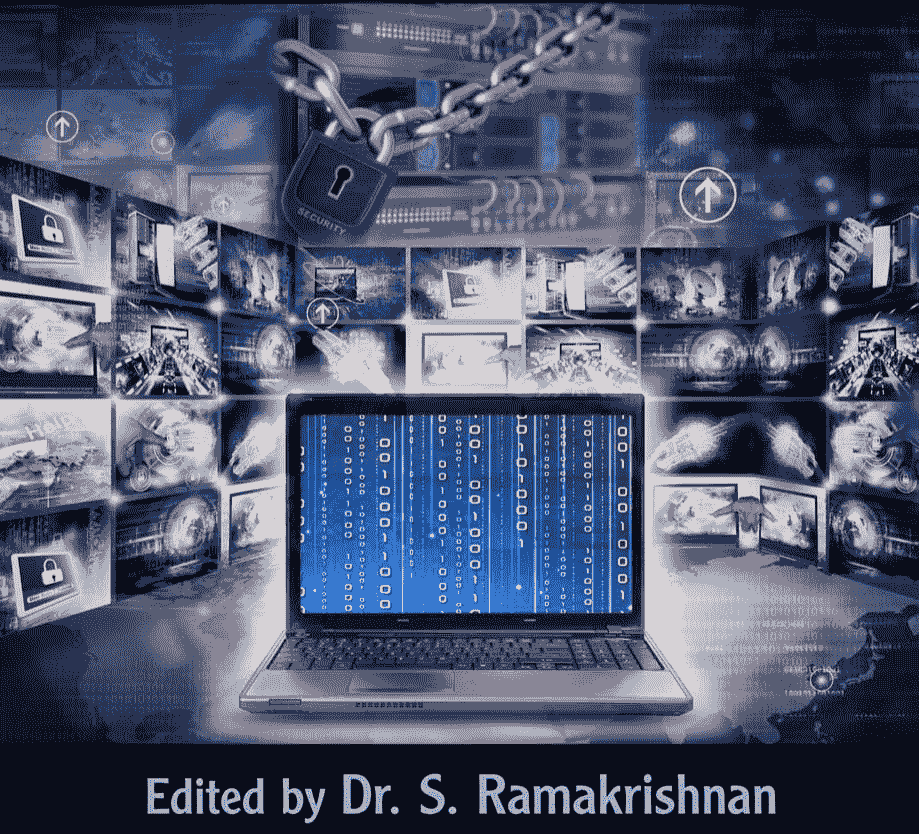


## 前言

保护信息是个人和组织最重要关注的问题之一。近年来，大多数数据以数字形式共享和存储，需要谨慎保护。在过去二十年里，学者、研究人员和行业专业人士一直关注文本和文件形式的信息安全。如今，人们越来越关注以图像和视频形式保护信息。图像和视频处理书籍主要关注非密码学方法，而密码学和信息安全书籍主要关注文本和文件安全。迫切需要一本全面提供图像和视频各种密码学和信息安全方法的书籍。因此，本书应运而生。

## 目标

本书的目标如下：

- 全面、及时地介绍图像和视频的各种密码学和信息安全方法。
- 鼓励研究人员和从业者分享他们在图像和视频安全方面的经验和最新研究成果。
- 针对图像和视频安全相关的各种现实问题提出新颖的创新解决方案。
- 介绍图像和视频加密、水印和隐写术领域的应用和案例研究。
- 发表关于数字取证和生物识别的全球最佳实践。

该主题的多样性、丰富性和快速发展使我们相信，仅靠团队合作就能取得良好成果。我们于2017年6月向CRC Press提交了关于编辑上述主题书籍的提案。CRC Press接受了我们的提案，随后我们向全球各学术和工业领域的专家征集书章。因此，我们收集了来自全球密码学和信息安全各子领域专家撰写的章节，并对这些章节进行了编辑以形成本书。

来自印度、巴基斯坦、澳大利亚、马来西亚、加拿大、新加坡、中国、芬兰、智利、墨西哥、法国、韩国、土耳其、伊朗、波斯尼亚和黑塞哥维那以及沙特阿拉伯的四十八个专家团队提交了稿件。本书中呈现的材料由53位审稿人审阅；根据审稿人的建议和意见，我们仅接受了48篇投稿中的31篇。

本书面向计算机科学和电气工程领域的研究生、学者、研究人员、科学家和专业人士，以及从事信息安全、图像和视频处理的开发人员和从业者。读者可在每章末尾获得简明的参考文献列表。

## 各章组织

这31章分为五个部分：第一部分：加密；第二部分：水印；第三部分：隐写术；第四部分：取证和第五部分：生物识别。

第一部分涉及图像和视频加密。本部分共有11章。这些章节涵盖了多个主题，即密码学原语、布尔函数、混沌映射、置乱技术、光学密码学和各种应用。第1章介绍了密码学、水印和隐写术的基础知识和各种类型及其应用。本章为新读者提供基础知识，为高级读者提供快速回顾。图像置乱作为加密图像的有效方法之一在第2章中介绍。本章提供了机制以及各种图像置乱技术的实验和比较分析，即矩阵置乱、位平面置乱、像素、行和列交换。混沌映射在图像密码学中发挥着重要作用。第3章讨论了各种混沌映射，即Logistic、Tent、正弦、Bernoulli和Gaussian映射。本章包含生物识别的案例研究并提供实验分析。替代盒（S-boxes）和布尔函数是密码系统的不可或缺组成部分，并在第4章中进行了数学分析。本章还介绍了非线性、相关免疫、雪崩和传播准则等各种密码学属性之间的关系。第5章讨论了广泛使用的密码系统之一，即光学密码系统。本章包含相位恢复在光学安全领域的一些应用。本章回顾了迭代相位恢复技术，以为光学安全应用奠定基础。第6章介绍了名为椭圆曲线密码学（ECC）的轻量级加密技术。第7章强调了可伸缩视频编码的安全性。本章介绍了可伸缩视频编码、其安全需求、应用、部分加密和基于内容认证。

第8章介绍了基于压缩感知的新型彩色图像加密技术，并提供了详细的实验结果和比较。签密是加密和签名的逻辑组合，用于对加密数据进行访问控制和数据发送者的真实性。第9章介绍了具有安全分析的新型签密算法。第10章讨论了混沌加密算法的设计和实验实现，该算法应用于通信协议以提供多媒体内容保密性，并在智能显示屏中重现。第11章介绍了一种经过身份验证的安全通信媒介，用于在对等方之间共享电子病历（EPR），以确保保密性和隔离性，并附有实验结果。

第二部分涉及水印，共六章。第12章提供了各种文档图像水印技术的简要综述及其性能分析。还介绍了可用于文档水印的各种工具。基于HEVC（High Efficiency Video Coding）的实时水印有助于在视频捕获时嵌入水印。第13章介绍了视频水印方案及其在HEVC编码器中的VLSI实现。本章还提供了实验结果和比较。第14章介绍了在压缩图像和视频中隐藏数据的各种方法，并附有插图。多准则决策（MCDM）技术可用于解决图像特征的不精确性以实现图像认证。第15章概述了多准则决策方法，讨论了如何使用其中一种MCDM方法分析纹理问题，以便在宿主图像中识别高度纹理块以承载具有高不可感知性和鲁棒性的水印。第16章讨论了图像融合在医学成像水印技术中的作用。本章还介绍了通过融合过程将患者信息（如照片、姓名、性别、年龄等）与心电图（ECG）报告以及MRI-CT或MRI-PET集成的方法。第17章深入回顾了应用于远程医疗的各种水印技术。除了水印的各种应用外，本章还介绍了可能的水印攻击。

第三部分涉及隐写术，共五章。第18章介绍了一种使用小型S盒的隐写算法。概念以插图、统计分析和性能分析呈现。第19章使用分数傅里叶变换讨论了频域中的心电图隐写方法。本章还介绍了eHealthcare系统的ECG隐写架构以及仿真结果。第20章介绍了基于快速响应（QR）码的视觉秘密共享（VSS）方案，并附有插图和实验分析。第21章描述了使用插值技术和边缘检测算法的可逆数据隐藏方法。性能测量也已解释，包括嵌入

容量和视觉质量。第22章描述了隐写术如何应用于医疗信息系统。本章还提供了图像归档和通信系统（PACS）和医学数字成像和通信（DICOM）的详细信息，以介绍医学隐写术技术并附带实验结果。

第四部分涉及取证，共包含五章。第23章详细介绍了数字视觉媒体取证。本章讨论了源识别、完整性验证、内容认证、篡改检测和隐藏数据检测，并概述了反取证和反反取证。第24章综述了可用于复制移动伪造检测的篡改检测技术。第25章描述了各种网络问题，并使用区块链技术提出了这些问题的解决方案。本章详细定义了区块链、其特性、在网络中的重要性以及其在现实世界中的应用。第26章综述了可用于复制移动伪造检测的各种方法，并提出了一种使用关键点消除方法的复制移动伪造检测技术。本章还提供了实验结果。第27章介绍了用于阻碍被动图像和视频篡改检测的反取证方法的综述。本章讨论了对抗这些反取证的方法。

第五部分涉及生物识别，共包含四章。第28章介绍了用于保护生物识别、特别是指纹的各种数据隐藏技术。本章还提供了实验结果。第29章描述了生物识别提供的不同安全方面。它广泛讨论了诸如指纹水印和指纹马赛克等安全技术。第30章讨论了面部识别的人工模型及其在 Android OS 平台移动安全中的应用。本章重点关注移动设备中的信息安全、访问管理和个人安全。第31章提出了一种基于生物识别数据的用户身份验证方案，使用户能够安全登录以访问云资源。所提出方法的完备性使用 Gong Needham 和 Yahalom（GNY）逻辑进行测试。此外，本章还提供了实验结果以及性能比较。


## 致谢

我们直接或间接地欠下许多在本书准备过程中提供帮助的个人的债。特别是，我们感谢审阅章节并提供宝贵建议、评论和批评的53位审稿人。我们对这31章的作者在审稿人建议的基础上成功提交章节表示特别感谢和祝贺。CRC Press ICT 和安全出版人 Richard O'Hanley 先生提供的支持实在巨大，倍受感激。我们很高兴感谢同事们在工作中分担学术负担方面的合作。我们找不到合适的词语来表达对家人爱、祈祷和支持的感激之情。我们衷心感谢同事 Mrs. A.G. Priyavarshini 在格式排版和处理电子邮件 correspondence 方面提供的巨大而无私的支持。我们衷心感谢部门的管理层、秘书、院长以及同事们提供的支持，这些支持有助于本书的顺利完成。

我们欢迎读者在今后版本中对本书质量提出意见和批评。

S. Ramakrishnan
Dr. Mahalingam College of Engineering and Technology
Pollachi, India

## 编辑


S. Ramakrishnan 于1998年从 Bharathidasan University, Trichy 获得电子与通信工程学士学位，并于2000年从 Madurai Kamaraj University, Madurai, India 获得通信系统硕士学位。他于2007年从 Anna University, Chennai, India 获得信息与通信工程博士学位。

他拥有18年教学经验和1年行业经验。他是 Dr. Mahalingam College of Engineering and Technology, Pollachi, India 信息技术系的教授兼系主任。

Dr. Ramakrishnan 是 IEEE Access 的副主编，他是25种国际期刊的审稿人，包括7种 IEEE Transactions、5种 Elsevier 科学期刊、3种 Institute of Engineering and Technology（IET）期刊、ACM（Association for Computing Machinery）Computing Reviews 以及 Springer 和 Wiley 期刊。他是7种国际期刊的编委会成员。他是3种国际期刊特刊的客座编辑，包括 Springer's Telecommunication Systems Journal。他在国际和国内期刊以及会议论文集中发表了157篇论文。S. Ramakrishnan 为 CRC Press, Boca Raton, FL 出版了《Wireless Sensor Networks》一书，并为 InTech Publisher, Croatia 出版了五本关于语音处理、模式识别和模糊逻辑的书籍，以及为 Lambert Academic Publishing, Germany 出版了一本关于计算技术的书籍。他为 McGraw-Hill International Edition 审阅了3本书，为 ACM Computing Reviews 审阅了15本书。他曾担任 Anna University of Technology – Coimbatore Board of Studies（BoS）IT 委员会的召集人，已指导两位博士研究生，目前正在指导八位研究生。他的传记已收录于 Marquis Who's Who in the World 2012 和 2016 版。他的研究领域包括数字图像处理、信息安全和软计算。

## 贡献者

Adrian Arellano-Delgado
Baja California Autonomous University (UABC)
Ensenada, 墨西哥

Chao Chang
Hefei Electronic Engineering Institute
Anhui Province, 中国

Syeda Iram Batool Naqvi
Institute of Space Technology
Islamabad, 巴基斯坦

Lokesh Chouhan
National Institute of Technology
Hamirpur, 印度

Jignesh S. Bhatt
Indian Institute of Information Technology Vadodara
Gujarat, 印度

César Cruz-Hernández
Scientific Research and Advanced Studies Center of Ensenada (CICESE)
Ensenada, 墨西哥

Ch. Hima Bindu
QIS College of Engineering & Technology
Ongole, 印度

Mayank Dave
National Institute of Technology
Kurukshetra, Haryana

Gajanan K. Birajdar
Ramrao Adik Institute of Technology
Maharashtra, 印度

Robert H. Deng
School of Information System
Singapore Management University
新加坡

Komal Borisagar
Atmiya Institute of Technology & Science
Gujarat, 印度

Raahat Devender Singh
Panjab University
Chandigarh, 印度

Surekha Borra
K.S. Institute of Technology
Bengaluru, 印度

Nilanjan Dey
Techno India College of Technology
West Bengal, 印度

Linda Y. Dong
Devery Co. Ltd.
Sydney, 澳大利亚

Nishant Doshi
Pandit Deendayal Petroleum University (PDPU)
Gujarat, 印度

Amit Dua
BITS Pilani
Rajasthan, 印度

Areeba Fatima
Indian Institute of Technology-Patna
Bihar, 印度

Musab Ghadi
University of Bretagne Occidentale
Brest, 法国

SP Ghrera
Jaypee University of Information Technology
Himachal Pradesh, 印度

Inan Guler
Gazi University
Ankara, 土耳其

Zahra Hossein-Nejad
Islamic Azad University
Sirjan Branch
Sirjan, 伊朗

Amit M. Joshi
Malaviya National Institute of Technology
Rajasthan, 印度

Vaibhav B. Joshi
School of Engineering and Applied Science
Ahmedabad University
Gujarat, 印度

Ki-Hyun Jung
Kyungil University
Gyeongbuk, 大韩民国

Rukiye Karakis
Cumhuriyet University
Sivas, 土耳其

G. Jaspher Willsie Kathrine
Karunya University
Coimbatore, 印度

Majid Khan
Institute of Space Technology
Islamabad, 巴基斯坦

Emir Kremić
Federal Institute of Statistics
Bosnia and Herzegovina, 欧洲

Pankaj Kumar
Research Scholar
NIT Hamirpur
Hamirpur, 印度

Amit Kumar Singh
National Institute of Technology
Patna, 印度

Lamri Laouamer
University of Bretagne Occidentale
Brest, 法国

**Charles Z. Liu**
计算系
麦考瑞大学
悉尼，澳大利亚

和

Devery Co. Ltd.
悉尼，澳大利亚

**Shaohui Liu**
哈尔滨工业大学
哈尔滨，中国

**Yuliang Lu**
合肥电子工程学院
安徽省，中国

**V. T. Manu**
银行技术开发与
研究银行技术研究所
(IDRBT) 和 计算机
和 信息科学学院 (SCIS)
海得拉巴大学
海得拉巴，印度

**B. M. Mehtre**
银行技术开发与
研究银行技术研究所
海得拉巴，印度

**Rodrigo Méndez-Ramírez**
恩塞纳达科学研究与高级
研究中心
(CICESE)
恩塞纳达，墨西哥

**Bhaskar Mondal**
泽维尔计算机科学与工程
学院
泽维尔大学
布巴内斯瓦尔，印度

**Miguel Angel Murillo-Escobar**
恩塞纳达科学研究与高级
研究中心
(CICESE)
恩塞纳达，墨西哥

**Laurent Nana**
布列塔尼西部大学
布雷斯特，法国

**Mehdi Nasri**
伊斯兰阿扎德大学
Khomeinishahr 分校
伊斯法罕，伊朗

**Naveen Kumar Nishchal**
印度理工学院帕特纳分校
比哈尔邦，印度

**Padmapriya Praveenkumar**
SASTRA 大学
坦贾武尔，印度

**Anca Pascu**
布列塔尼西部大学
布雷斯特，法国

**Mukesh D. Patil**
Ramrao Adik 理工
学院
马哈拉施特拉邦，印度

**Piyush Raghav**
BITS Pilani
拉贾斯坦邦，印度

**Y. Sreenivasa Rao**
国家理工学院
瓦朗加尔，印度

**Mehul S. Raval**
工程与应用科学学院
艾哈迈达巴德大学
古吉拉特邦，印度

**Amirtharajan Rengarajan**
SASTRA 大学
坦贾武尔，印度

**Raymond P. Shaw**
SmartSys 工作组
多伦多，安大略省，加拿大

**K. Sitara**
银行技术开发与研究银行技术研究所 (IDRBT) 和 计算机与信息科学学院 (SCIS)
海得拉巴大学
海得拉巴，印度

**Ankit Songara**
国家理工学院
哈米尔普尔，印度

**Abdulhamit Subasi**
工程学院
Effat 大学
吉达，沙特阿拉伯

**Sandhya Tarar**
甘地佛教大学
大诺伊达，印度

**Sriti Thakur**
Jaypee 信息技术大学
喜马偕尔邦，印度

**Rohit Thanki**
C. U. Shah 大学
瓦德万城，印度

**Vishwesh A. Vyawahare**
Ramrao Adik 理工学院
马哈拉施特拉邦，印度

**Song Wan**
合肥电子工程学院
安徽省，中国

**Yongjie Wang**
合肥电子工程学院
安徽省，中国

**Zhuo Wei**
新加坡研究中心
华为，新加坡

**Swee Won Lo**
新加坡社会科学大学
新加坡

**Yongdong Wu**
信息通信研究所
A*STAR，新加坡

**Xuehu Yan**
合肥电子工程学院
安徽省，中国

**Zheng Yan**
西安电子科技大学
西安，中国
和
阿尔托大学
埃斯波，芬兰

**Yanjiang Yang**
新加坡研究中心
华为，新加坡

## 审稿人详情

R. Amirtharajan
SASTRA 大学
坦贾武尔，印度

Ahmet Cihan
Duzce 大学
Duzce，土耳其

Amira S. Ashour
计算机与信息技术学院
泰夫大学
泰夫，沙特阿拉伯

Marisa T. Dery
音视频法医分析师
美国录音证据委员会
AES, ABRE, NAIS, CARAS
Tamar 法医
索默维尔，马萨诸塞州

Kishore Bhamidipati
Manipal 理工学院
Manipal，印度

Sellapan Devaraju
Dr. Mahalingam 工程与技术学院
Pollachi，印度

Gajanan K. Birajdar
Dr. Babasaheb Ambedkar 科技大学
Lonere，印度

Raahat Devender Singh
旁遮普大学
昌迪加尔，印度

Komal Borisagar
Atmiya 技术与科学学院
拉杰科特，印度

Nilanjan Dey
Techno India 科技学院
加尔各答，印度

Surekha Borra
K.S. 理工学院
班加罗尔，印度

Ravindra N. Duche
Lokmanya Tilak 工程学院
新孟买，印度

Yigang Cen
北京交通大学
北京，中国

**Sekar Elango**
Bannari Amman 理工学院
科伊姆巴托尔，印度

**Hamed Khodadadi**
伊斯兰阿扎德大学
德黑兰，伊朗

**T. Gopalakrishnan**
Dr. Mahalingam 工程与技术学院
Pollachi，印度

**Emir Kremić**
联邦统计研究所
波斯尼亚和黑塞哥维那，欧洲

**Ch. Hima Bindu**
QIS 工程与技术学院
Ongole，印度

**Ela Kumar**
印度拉·甘地德里女子技术大学
新德里，印度

**Musab Ghadi**
布雷斯特大学
布列塔尼，法国

**Siva Kumar**
Dr. Mahalingam 工程与技术学院
Pollachi，印度

**Madhavi Gudavalli**
信息技术系
JNTUK
Vizianagaram，印度

**Mohammad Faiz Liew Bin Abdullah**
Tun Hussein Onn 大学
柔佛，马来西亚

**Jude Hemanth**
Karunya 大学
科伊姆巴托尔，印度

**Charles Z. Liu**
计算系
麦考瑞大学
悉尼，澳大利亚
和
Devery Co. Ltd.
悉尼，澳大利亚

**Divya Jennifer Dsouza**
NMAMIT Nitte
Udupi，印度

**Shaohui Liu**
哈尔滨工业大学
哈尔滨，中国

**Ki-Hyun Jung**
Kyungil 大学
庆山，韩国

**Rodrigo Méndez-Ramírez**
恩塞纳达科学研究与高等研究中心 (CICESE)
恩塞纳达，墨西哥

**G. Jaspher Willsie Kathrine**
Karunya 大学
科伊姆巴托尔，印度

**Bhaskar Mondal**
泽维尔计算机科学与工程学院
泽维尔大学
布巴内斯瓦尔，印度

**N. S. Murty Sarma**
Sreenidhi 科学技术学院
海得拉巴，印度

**Mehdi Nasri**
伊斯兰阿扎德大学
Khomeinishahr 分校
伊斯法罕，伊朗

**Naveen Kumar Nishchal**
印度理工学院帕特纳分校
比哈尔邦，印度

**V. Padmapriya**
SASTRA 大学
坦贾武尔，印度

**Sanjay R. Patil**
马哈拉施特拉理工学院
浦那，印度

**Satya Prasad**
KL 大学
贡土尔，印度

**Om Prakash Sangwan**
GJU 大学
Hisar，印度

**Shanmuganantham Rajasekar**
安娜大学
区域中心
科伊姆巴托尔，印度

**Sourav Samanta**
大学技术学院
Bardhaman，印度

**Vijaya Santhi**
A.U. 工程学院 (A)
维沙卡帕特南，印度

**Mansi Subhedar**
HOC 工程与技术学院
Khalapur，印度

**C. N. Sujatha**
Sreenidhi 科学技术学院
海得拉巴，印度

**Sandhya Tarar**
甘地佛教大学
大诺伊达，印度

**Rohit Thanki**
C. U. Shah 大学
瓦德万城，印度

**Esteban Tlelo-Cuautle**
INAOE
普埃布拉，墨西哥

**Rajesh Verma**
区域法医科学实验室 (RFSL)
Mandi，印度

**Song Wan**
合肥电子工程学院
安徽省，中国

**Shiqi Wang**
计算机科学系
香港城市大学
香港，中国

**Zhuo Wei**
新加坡研究中心
华为，Teletech Park，新加坡
和
新加坡社会科学大学
Clementi 路，新加坡

**Swee Won Lo**
新加坡社会科学大学
新加坡

**Suneel Yadav**
电子与通信工程系
印度信息技术学院
阿拉哈巴德，印度

**Yu Zhou**
中国科学院
北京，中国

## 加密 I

## 第1章

## 信息安全系统原语导论

Majid Khan 和 Syeda Iram Batool Naqvi


组织内部信息安全的基本要素在一段时间内经历了两次重大变化。组织所获得的信息安全在很大程度上由物理和行政文件提供，而数据处理设备已不受限制。过去的一个例子是使用带组合锁的坚固文件柜来存放敏感文件。

随着计算机的出现，确保计算机上的文件和其他信息需要自动化设备变得强制性。这对于时分系统等结构是必需的，对于可以通过开放式电话数据网络或互联网访问的系统，其要求要严格得多。

影响安全的第二个重大变化是网络的引入以及使用系统和通信环境在终端用户和计算机之间传输信息。网络安全是必需的，以确保传输中的信息安全。总的来说，组织安全具有误导性，因为所有商业、政府和学术机构都相互连接其信息处理设备，形成了相互连接的结构集合。

密码学是一门应用复杂数学和逻辑来设计强大加密方法的科学。密码学也是一门艺术。密码学使人们能够在电子世界中保持安全。人们可以在电子渠道上开展业务，而不必担心欺诈和欺骗。

当人们开始在网上合作并期望电子交易资金时，密码学用于完整性的用途开始超过其用于保密的用途。如今，成千上万的人通过电子邮件、ATM机、电子商务或电话等各种可靠方式进行电子连接。电子传输信息的迅速增加导致对密码学和认证的依赖增强。本节旨在介绍本章将讨论的信息安全系统的预备知识。我们明确定义了密码学、水印和隐写术原语的基础，这将有助于后续章节（图 1.1）。

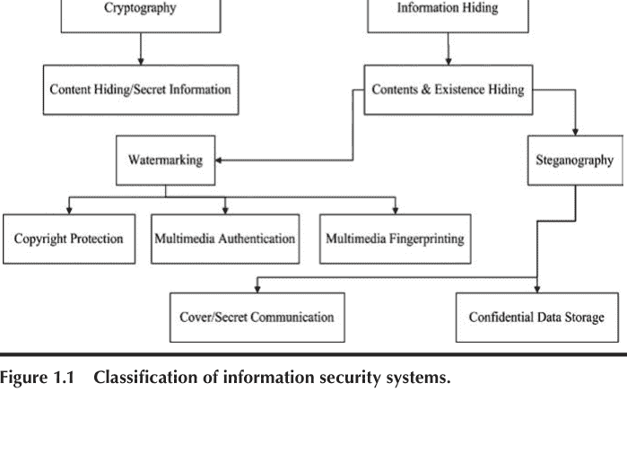

图 1.1 信息安全系统的分类。

### 1.1 密码学

密码学是信息安全的探究。单词密码学源自希腊语 kryptos，意为隐藏。密码学是“神秘写作”的研究。在数字先进通信的时代，安全的信息安全是任何国家的重要组成部分。

#### 1.1.1 密码学的分类

密码学还分为两个分支：密码学和密码分析。术语密码学指的是设计密码系统（即将定义）的艺术或研究，而密码分析指的是破解它们的科学或艺术。

#### 1.1.2 密码学基本术语

**明文：** 明文是可以无需任何信息即可轻松理解的简单信息。

**密文：** 来自某种算法且无法通过额外信息理解的消息。

**密码：** 密码/算法是一种转换，它使用原始消息作为输入，编码消息作为输出。

**加密：** 将明文转换为密文的过程。加密的数学表达式如下所示：

$C = E(P)$

其中 $P$ 是明文，$C$ 是密文，$E$ 是加密函数。

**解密：** 将编码消息转换为原始消息的过程。设 $D$ 为解密函数，即

$P = D(C)$

这意味着将解密过程 $D$ 应用于密文 $C$ 会产生明文 $P$。

**密钥：** 密钥是用于加密或解密明文和密文的简单信息。从根本上说，密钥是一种决定密码密码输出的知识（图 1.2）。


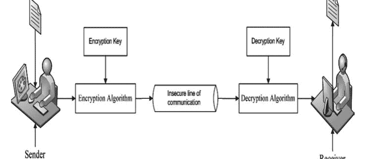

图 1.2 加密和解密的框图。

**定义 1：** 密码系统是一个五元组 (M,C,K,E,D)，其中 M 称为明文空间；C 称为密文空间；K 称为密钥空间；E 是加密规则；D 是解密规则。对于每个 K ∈ K，存在一个函数 e_K ∈ E 和一个对应的函数 d_K ∈ D，使得对于任意明文消息 x ∈ P，d_K(e_K(x)) = x。请注意，这意味着 d_K 是函数 e_K 的逆。

**定义 2：** 映射 T : X → Y 是单射或一对一的当且仅当 ∀ a,b ∈ X, T(a)=T(b) ⇒ a = b。

### 1.2 密码学的首要安全目的

密码学是在不安全的通信线路中实现安全通信的艺术/技巧。今天的密码学有四个基本要素：

#### 1.2.1 保密性

保密性/隐私是密码学提供的最主要的安全优势。它是一种防止数据被未经授权的个人访问的安全优势。它有时也被称为安全或秘密。保密可以通过多种方式实现，从物理保护到使用科学算法进行信息加密。

#### 1.2.2 数据完整性

它是一种识别信息任何更改的安全优势。信息可能被未经授权的主体故意或意外地篡改。完整性优势确认信息自上次由授权用户创建、传输或存储以来是否保持不变。数据完整性无法阻止信息的更改；然而，它提供了一种方法来识别信息是否以未经授权的方式被操纵。

#### 1.2.3 鉴别

鉴别/验证提供发送者的识别。它向接收者确认收到的信息是由已识别和已验证的发送者发送的。验证优势有两种变体：

- 1. **消息鉴别**：识别消息的来源，而不考虑发送消息的交换或框架系统
- 2. **个人验证/鉴别**：是对信息来自特定实体，例如特定网站的确认。除发送者外，验证还可能提供与信息相关的其他参数的确认，例如创建/传输的日期和时间。

#### 1.2.4 不可否认性

它是一种确保实体无法否认过去义务或行为的安全优势。它是对信息原始生成者无法否认创建或向接收者或第三方传输所述信息的一种保证。不可否认性是一种在信息交换可能存在争议的情况下最有吸引力的属性。例如，一旦请求以电子方式发送，如果该交易中启用了不可否认性优势，购买者就不能否认购买订单。

### 1.3 密码学基础

密码学原语/基础只是可以专门用来提供一组期望的安全服务的工具和策略：

- 1. 加密
- 2. 一一对应函数
- 3. 消息验证码 (MAC)
- 4. 数字签名

下表展示了可以单独实现特定安全优势的原语（表 1.1）。

密码学原语相互复杂相关，并且经常被组合以从密码系统中实现一组期望的安全服务（图 1.3 和 1.4）。

## 表 1.1 安全服务及其原语

| 原语 ⇒ 服务 ⇓ | 加密 | 哈希函数 | MAC | 数字签名 |
|---|---|---|---|---|
| 保密性 | 是 | 否 | 否 | 是 |
| 数据完整性 | 否 | 也许 | 是 | 是 |
| 鉴别 | 否 | 否 | 是 | 是 |
| 不可否认性 | 否 | 否 | 也许 | 是 |

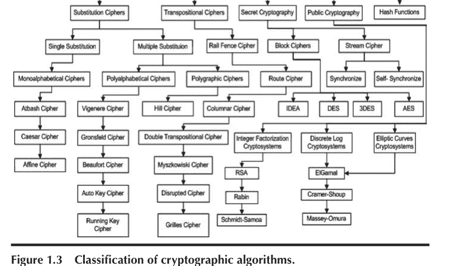

图 1.3 密码算法的分类。

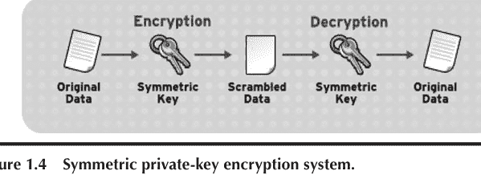

图 1.4 对称私钥加密系统。

### 1.4 密码算法的分类

有几种对密码算法进行分类的方法。为了本节的目的，它们将根据加密和解密时使用的密钥数量的不同进行排序，并辅以其请求和使用方式进行描述。现代密码算法可分为以下三个大类：

- 1. 私有/秘密/对称密钥密码学
- 2. 非对称/公钥密码学
- 3. 单向哈希函数

#### 1.4.1 私有/秘密对称密钥密码学

私有密钥使用单个密钥进行加密和解密。基本上它用于隐私和保密。文献中用于数字信息安全的大量私有密钥算法例如 DES（数据加密标准）和 AES（高级加密标准）。秘密密钥算法可进一步分为两类子类别，即分组密码和流密码，其定义见 [1]。

#### 1.4.2 非对称/公钥密码学

非对称/公钥使用不同的密钥进行加密和解密；也称为非对称加密；主要用于鉴别、不可否认性和密钥交换。例如，有各种公钥加密算法，如 RSA（Rivest, Shamir, & Adleman）、Elgamal、Rabin 和椭圆曲线密码算法等。（图 1.5）。

#### 1.4.3 单向哈希函数

单向哈希函数利用数值变换不可逆地“编码”信息，提供先进的唯一校验；主要用于消息完整性。

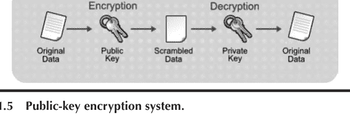

图 1.5 公钥加密系统。

哈希函数，也称为消息摘要和单向加密，是某种意义上不使用密钥的函数。哈希函数随后提供对记录可信度的度量。哈希方案通常使用消息摘要（MD）算法和安全哈希算法（SHA）及其不同变体。

#### 1.4.4 扩散与混淆

混淆和扩散是密码学中安全算法的两个特性。混淆和扩散/传播由 Claude Elwood Shannon 在其 1949 年发表的论文《保密系统通信理论》中提出。在 Shannon 的原始定义 [2] 中：

- 1. 混淆使密钥与密文之间的关系尽可能复杂。
- 2. 扩散表示明文统计中的频率在密文统计中被“分散”的特性。

扩散/分散与输出位对输入位的依赖性有关。在具有良好扩散的密码中，翻转一个输入位应以一半的概率改变每个输出位（这被称为严格雪崩准则）。替换（用另一个替换明文符号的控制）已被识别为基本混淆的组成部分（参见替换盒 [2]）；另一方面，使用 P-box（置换盒）[2] 进行的换位（调整或交换符号的顺序）是扩散的一种策略，尽管在现代实践中也使用其他系统；例如，线性变换（例如，在 AES 中，ShiftRow 和 Mix Column 操作）。乘积密码使用交替的替换和换位阶段（轮）分别实现混淆和扩散。

当前的分组密码同时利用混淆和扩散。此类框架的代码本部分提供混淆，几乎等同于但规模更大——基本替换。所有现代分组密码都使用了这种非线性组件 [2,3]。

#### 1.4.5 数字图像处理

图像处理可能是一种对照片执行一些操作以增强图像或从中提取一些有用信息的方法。它是一种信号处理器，其中输入是一张照片，输出是类似的图像或与该图像相关的属性/特征。如今，成像过程正在迅速发展。它也构成了工程学科中的核心研究领域。

#### 1.4.6 数字图像

一幅图像只是一个二维数组。它由数学函数 f(x, y) 刻画，其中 x 和 y 表示水平和垂直方向上的两个坐标。f(x, y) 在任何时刻的值给出图像的像素值，范围在 0 到 255 之间。照片的尺寸实际上是这个二维数组的尺寸。这些数字图像可以是单色（双色调）、灰度或彩色，取决于每个像素允许的强度级别，即每个像素是否仅由一个位、8 位或 24 位表示。通常，单色图像只有一个位平面，而灰度图像有 8 位平面，彩色图像有 24 位平面（每个通道 8 位，分别为红、绿、蓝三个通道）。最低有效位平面（最低有效位 [LSB] 平面）由具有最低位置值的位组成（2^0 =1），而最高有效位平面（最高有效位平面）由具有极高位置值的位组成，即 2^7 =128（图 1.6）。

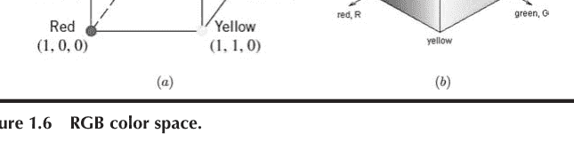

图 1.6 RGB 色彩空间。


### 1.5 水印基础

如今，数十亿比特的数据在极短时间内被获取。更重要的是，由于互联网的广泛普及以及多媒体技术的快速发展，用户能够使用数字信息（图像、视频和音频文件、网络分发的数字存储库和图书馆）。复制数字信息在数字世界中是一个非常敏感的问题。数字水印是解决这些问题的方案，因为它具有多种应用，如版权保护、身份验证、秘密通信和识别。电子商务、电子投票、医疗安全、广播监测、军事和订购等也可以通过数字水印得到保障。水印与载体图像一起存在，无论其是否被复制。因此为保证所有权，水印会被提取并检测。数字水印是将水印嵌入多媒体对象中的过程。该对象可以是图像、声音、视频或任何旨在隐藏数据的数字内容。应选择鲁棒的水印方法以实现强水印嵌入 [4–13]。

### 1.6 数字水印

数字水印或数字水印是嵌入到数字介质（图像、声音或视频）中的比特的示例。这些信息通常传达文档的版权信息。不过，它们的主要区别在于，数字水印应是不可感知的或至少不改变原始文档的感知，而纸质水印则应在一定程度上可见。例如，一台数码相机可能会使用无损水印来嵌入生物识别标识符以及密码学哈希值。数字签名是通过加密文件、图像、视频等的哈希值生成的唯一大整数（图 1.7）。水印的正式定义如下：

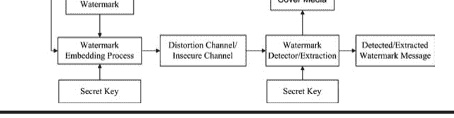

图 1.7 数字水印的基本流程。

定义 3：水印系统是一个五元组 (C, W, K, E_K, D_K)，其中 C 是载体图像空间，W 为所有水印的集合，K 为所有可能密钥的集合，C' 为所有含水印数据的集合。两个函数 E_K : C × W × K → C'、D_K : C' × K → W 描述了嵌入和检测过程。

#### 1.6.1 水印的基本术语

水印领域中一些常用术语的一般定义如下列出：

- **水印**：待隐藏的数据。术语水印还包含一个隐喻，即隐藏的数据像水一样透明。
- **载体媒体/数据**：用于承载水印的媒体。有时也使用原始媒体、载体媒体和宿主媒体等术语来表达它。
- **水印数据**：包含水印的数字介质。
- **提取**：用于从相关水印中提取嵌入水印的技术。
- **检测**：用于识别给定媒体是否包含特定水印的技术。

#### 1.6.2 数字水印的品质

图像水印的要求可以视为品质、属性或特征。不同应用要求水印具有不同的属性。图像水印的要求各不相同，并根据图像水印的应用和目的导致不同的设计问题。在设计水印系统时应考虑这些要求。基本上有五项要求：

##### 1.6.2.1 保真度

保真度被视为水印感知透明度或不可感知性的度量。它意味着未加水印图像与加水印图像的相似性。水印的这一方面利用了人眼视觉的局限性。水印不应产生明显的伪影，因为这会降低加水印图像的商业接受度。

##### 1.6.2.2 鲁棒性

水印不应被基本图像处理操作有意或无意地移除。因此，水印应能抵御各种此类攻击。鲁棒水印旨在抵抗典型处理。另一方面，脆弱水印旨在揭示对数字内容进行任何更改的尝试。

##### 1.6.2.3 数据负载

数据负载也称为水印容量。它是在不降低图像质量的情况下可以隐藏的最大数据量。它可以通过隐藏信息的量来评估。该属性描述应嵌入多少数据作为水印，以便在提取过程中能够有效检测到。

##### 1.6.2.4 安全性

如果安全是主要关注点，则在嵌入和检测过程中必须使用密钥。水印框架中使用了三种类型的密钥：私钥、检测密钥和公钥。黑客不应能够通过恶意逆向工程算法的方法移除水印。

##### 1.6.2.5 计算复杂度

计算复杂度表示水印算法编码和解码所需时间的度量。为了保证水印的安全性和合法性，需要更高的计算复杂度。另一方面，实时应用要求速度和效率兼备。

### 1.7 水印攻击

水印可能遭受各种、可能是恶意的、有意的或偶然的攻击。处理敏感项目的图像的广泛可用性使得对水印结构质量进行攻击成为可能。这些攻击的目的是阻止水印发挥其预期作用。下面简要介绍各种水印攻击类型：

#### 1.7.1 消除攻击

消除攻击旨在从加水印内容中移除水印数据。此类攻击利用水印通常是添加到宿主信号中的额外信号这一特点。

#### 1.7.2 侵入攻击

侵入攻击是指向加水印内容添加额外混淆的攻击。有损压缩、量化、裁剪、去噪、解调、平均和噪声添加是此类攻击的几个实例。

#### 1.7.3 形状攻击

所有影响图像几何形状的操作，例如翻转、旋转、修剪等，都应可被观察到。从图像右侧和底部进行裁剪攻击是此类攻击的一个例子。

#### 1.7.4 安全攻击

如果水印计算已知，攻击者还可以尝试进行修改以使水印无效或评估和更改水印。对于这种情况，我们讨论对安全的攻击。水印计算被视为安全，如果嵌入的信息不能被破坏、检测到或伪造。

#### 1.7.5 协议攻击

协议攻击既不旨在破坏嵌入的信息，也不旨在破坏嵌入信息的识别（水印的停用）。相反，它们利用水印使用中的语义缺陷。因此，稳健的水印必须是不可逆的或不可重建的。例如，复制攻击旨在在不知道密钥的情况下将水印从一种媒体重建到另一种媒体。

#### 1.7.6 密码攻击

密码攻击涉及破坏安全性。例如，利用穷举和有效策略找到秘密水印密钥就是一次密码攻击。此类攻击的另一个例子是预言机攻击。在预言机攻击中，当开放的水印检测设备可访问时，会制作一个未加水印的对象。这些攻击类似于密码学中使用的攻击。

#### 1.7.7 动态攻击

在这里，黑客试图有意移除水印或基本上使其不可感知。这是版权保护、指纹识别或复制控制中的一个主要问题。


#### 1.7.8 被动攻击

对于这种情况，攻击者并非试图去除水印，而是判断某个水印是否存在。Cox 等人 [4] 建议，在隐蔽通信中，对潜在攻击的防护绝对至关重要，因为水印存在的这一基本信息经常过于敏感而不能忽视。

#### 1.7.9 合谋攻击

在合谋攻击中，攻击者的目标与主动攻击相同，但策略略有不同。目标是去除水印，攻击者使用同一数据的多个副本，每个副本包含不同的水印，来构建一个没有水印的副本。这在指纹应用中是一个问题，例如在电影行业中，但并不普遍，因为攻击者必须能够访问同一数据的各种副本，并且所需数量可能很大。

#### 1.7.10 数字图像退化

这类攻击通过去除图像的某些部分来破坏鲁棒水印。被替换的部分可能携带水印数据。这些操作的例子有图像修复、补丁去除和片段去除。添加高斯噪声也属于此类分类，其中图像通过添加噪声而被破坏，噪声由其均值和方差控制。

#### 1.7.11 图像增强

这些攻击是使图片中的水印数据失同步的复杂操作。这些攻击包括直方图均衡化、锐化、平滑、中值滤波和对比度增强。

#### 1.7.12 图像压缩

为了减少存储空间并降低传输所需带宽的成本，图片通常使用 JPEG 和 JPEG 2000 压缩方法进行压缩。与无损压缩技术相比，这些有损压缩方法更具破坏性。无损压缩方法可以通过逆向操作恢复水印数据。然而，有损压缩方法会对图片造成不可逆的变化。因此，恢复水印数据的可能性始终很低。

#### 1.7.13 图像篡改

这类攻击也称为同步攻击或几何攻击。著名的程序 StirMark 利用小的局部几何失真来击败水印检测。几何攻击包括旋转、缩放和平移，也称为 RST 攻击。一些科学家在设计鲁棒水印系统时关注 RST 鲁棒性，因为这是一个基本问题。除了 RST 变化外，图片还包括其他变化，例如纵横比变化、剪切、反射和投影。

### 1.8 水印应用

随着信息技术和计算机技术的快速发展，数字多媒体数据的安全已成为一个重要问题。基于密码学理论的传统数据安全技术通常存在其局限性。为了克服传统数据安全技术的不足，越来越多的专家开始考虑数字水印技术，因为它可以有效地弥补传统数据安全技术在安全和保护使用方面的不足。水印数据可以是版权数据、验证数据或控制数据，以便确定数字作品的版权所有者，确认多媒体作品的合法性和完整性，根据嵌入的控制数据控制复制，并实现版权保护的目的。数字水印技术在数字媒体的保护、认证、分发、防伪和客户数据命名方面有许多应用。它已成为信息隐藏领域的一个重要研究方向。作为一种新兴的跨学科应用技术，数字水印包含了信号处理、密码学、概率论和随机理论、网络技术、算法设计等多个学科领域的思想和理论。它可以通过特定的算法将版权数据嵌入到多媒体信息中；数据可能是创作者的序列号、组织标志、具有特殊重要性的图片或文本等。它们的功能用作版权保护、秘密通信、可信地识别信息文档等。嵌入的数据通常不可见或细微，只能通过各种特殊指示器或阅读器来识别或移除。数字水印与源信息紧密结合并隐藏其中，成为不可分割的一部分，如前所述。本节描述了水印的七种用途：秘密通信、广播监控、所有者识别、所有权证明、认证、基于交易的<|message|> 水印和复制控制 [14]。

#### 1.8.1 秘密通信

水印的最早用途之一，或更准确地说是信息隐藏，是一种发送隐蔽通信的方法。该应用已被 Simmons 详细描述为囚徒问题，其中我们设想两个囚犯在独立的牢房中试图前后传递消息。他们的难题是他们不能传递这些消息，而必须依赖狱警作为代理。狱警会在他们之间传递无害的消息；然而，如果他发现，例如，他们的消息与逃跑计划有关，他就会惩罚他们。策略是通过将逃跑计划消息隐藏在安全消息中来掩盖它们。对于此应用，有两三个在技术上可行的尝试，包括隐写工具。

#### 1.8.2 广播监控

1997 年，日本发生了关于电视广告的丑闻。至少有两家电视台一直定期超额填充广播时段。广告商希望就从未播出的大量广告获得赔偿。该方法在二十多年里一直很大程度上未被发现，部分原因是没有建立系统来监控广告的实际传播。有一些组织和个人对广播监控感兴趣。广告商显然希望确保他们从传播公司购买的传输配额得到兑现。艺术家和演员希望确保他们为其表演的传播获得准确的版税支付。

#### 1.8.3 所有者识别

尽管版权符号并不是确保版权更基本的东西，但它仍然被建议。版权符号的类型通常是“c 日期，所有者”。在书籍和照片上，版权放在显眼处。在电影中，它被添加到片尾。同样，在预录音乐上，它被确定在包装上。这种版权符号的一个问题是它们可能从受保护的材料中被移除。包装可能会丢失，电影可能会被剪掉片尾，图片可能会被空间裁剪。电子水印可用于提供查看版权检查的便利，因为它成为内容的基本部分，即版权数据被嵌入音乐中以补充印在包装上的内容符号。Digimarc 协会已推出水印系统并为此应用制定了计划。他们的水印被嵌入并与 Adobe 著名的图片处理程序 Photoshop 一起打包。当标识符找到水印时，它会联系中央数据库以识别水印的所有者（所有者必须支付费用以将数据保留在数据库中）。

#### 1.8.4 所有权证明

视听所有者可能需要利用水印不仅识别版权所有权，而且真正证明所有权。为了设计这个问题，我们将简要介绍在水印形成中一些不寻常的角色。假设 Alice 制作了一张照片并将其放在她的网站上，并附有版权。Bob 然后拍摄照片，利用照片处理工具来替换版权符号，并在不久之后声称自己拥有版权。请求如何解决？通常，Alice 可以向版权局注册照片，将副本发送给他们。版权局记录照片以及有关实际所有者的信息。当 A 方和 B 方之间发生共同争议时，A 方联系版权局以获得她是原始所有者的证明。如果 A 方未注册照片，那么她应该出示胶片底片。然而，随着摄影的快速认证，可能永远不会有底片。从根本上说，Alice 必须使用嵌入在照片中的水印来证明她拥有它。

#### 1.8.5 认证

随着数码相机和摄像机的不断掌握尖端技术，对无形调整的限制也在增加。数字照片的内容可以被调整到如此程度，以至于很难识别出发生了什么变化。对于这一点，甚至没有一个独特的底片可供查看。有不同的应用，其中照片的真实性受到挤压，特别是在法律案件和医疗成像中。认证是密码学中特别被考虑的问题。Friedman [15] 最先讨论了其应用，通过计算与照片相关的密码学印章来制作“强力相机”。如果照片的哪怕一个像素的一小部分被调整，它将不再符合检查，因此任何篡改都可以被感知。然而，这种检查是元数据，必须与照片一起传输，可能在特定图片坐标的头字段中。如果照片被适当地复制到不包含此头字段的另一个记录布局中，印章将被丢失，照片将无法再被证明。最佳途径

做法是将登记信息通过水印直接与照片绑定。这解决了确保标记与照片保持在一起的问题。它同样提供了关于发生了什么变化的可能性，因为对照片所做的任何修改也会以相同的方式作用于水印。因此，有一些系统可以显示对照片所做的更改的受影响区域。也有提出的结构允许某些修改，例如 JPEG 压缩，而基本禁止更重大的更改，例如从不良场景中移除一个人。

#### 1.8.6 基于值的数字水印

校验和所有者识别确认应用在相同内容的全部副本上放置几乎相同的数字水印。然而，内容的电子分发允许每个分发的副本针对每个接收者进行更改。这一限制使得可以在每个单独的副本中嵌入独特的水印。基于值的数字水印，也称为指纹，允许内容所有者或内容分发者识别非法副本的来源。这在防止非法使用和作为调查的创造性指南方面都可能至关重要。基于值水印的一种可能用途是在电影每日样片的过程中。当对图像进行开发时，摄影的延迟结果经常会被传递给与其制作相关的人员。这些样片极其私密，但有时一份样片会泄露给媒体。正当这种情况发生时，制片厂会迅速努力找出泄漏的来源。显然，如果每份有序照片的副本都包含一个独特的基于值的数字水印来识别接收者。基于值水印的另一种用途由 DivX 项目提出。DivX 展示了一种对 DVD 的修改理解。DivX 设备中实施的安全措施之一是基于值的数字水印，可用于识别用于盗版的播放器。如果 DivX 电影的非法副本出现在地下广告中，DivX 可以利用水印将其追踪到源头。

#### 1.8.7 再现控制器

基于值的数字水印和用于观察明显证据和所有权验证的水印，并不会阻止非法复制。或者，它们充当有力的阻碍和调查机制。不过，让录制和回放设备对嵌入信号做出响应也是可行的。因此，如果录制设备检测到表明禁止录制的数字水印，则可能会阻止信号的录制。显然，要使此类系统正常工作，每个录制器都必须集成水印识别验证硬件。此类系统目前正被制作用于 DVD 视频和数字音乐分发。有趣的是，水印在视频中用于控制设备的用途可追溯到 1989 年，而在音频中则可能追溯到 1953 年。

### 1.9 计算机化/数字水印的分类

我们将讨论根据目前可用于实时应用的不同特征对数字水印的划分。数字水印分类的详细流程图见图 1.8。

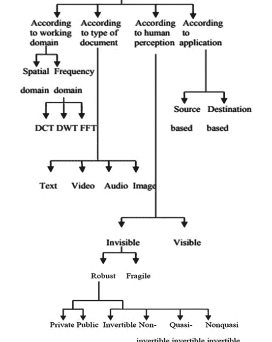

图 1.8 数字水印技术分类。

### 1.10 隐写术

隐写术是一种隐藏通信的方式。该术语源自古希腊语 steganos（覆盖的）和 graphein（书写）。虽然密码学旨在保护消息内容，使其不可读，但隐写术则隐藏消息本身，而不留下其存在的痕迹。

虽然隐写术将消息隐藏在另一条消息内部，使典型的图片、视频或音乐文件几乎保持不变；尽管对原始文档的改进是不可察觉的，密码学则对消息进行编码，生成一系列庞大的符号。数字内容的加密会改变给定多媒体信息的实际内容。虽然隐写术在重复使用图片或音乐文件时需要考虑，但密码学在重复使用密钥时需要考虑。虽然使用隐写术没有限制，但使用某些类型的密码学存在明确的限制（图 1.9）。

#### 1.10.1 隐写术的应用

隐写术有不同的应用；它因用户需求而异，例如版权控制、隐秘/秘密通信、智能身份证应用、打印机等。[16–18]。

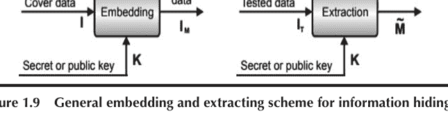

图 1.9 信息隐藏的通用嵌入和提取方案。

### 1.11 隐写方案的评估因素

任何隐写算法的主要目标是容量、不可感知性和鲁棒性。尽管隐写算法很难具备所有属性，这可能意味着这些质量之间通常存在权衡 [18]。

#### 1.11.1 容量

可嵌入到载体介质中的信息量，并且可以在之后有效地恢复，而不会显著改变载体介质。

#### 1.11.2 不可感知性

载体与隐写对象之间不应有视觉差异，即嵌入的消息不应对人眼可见。

#### 1.11.3 鲁棒性

如果隐写系统能够抵御任何攻击，并且在经历诸如缩放、旋转、滤波和有损压缩等变化时仍能保持不变，则称其为鲁棒的。

#### 1.11.4 安全性

如果在窃听者识别后嵌入的数据无法被移除，则称嵌入算法是安全的。它取决于嵌入算法的信息和秘密密钥。

#### 1.11.5 嵌入率

它通常以绝对度量表示，即秘密消息的跨度，或以相对度量表示，称为信息嵌入率，通常以每非零 DCT（离散余弦变换）像素系数位（BPNPC）和每像素位（BPP）给出。

#### 1.11.6 不可区分性或保真度

在相同的安全性和容量水平下，隐写图像预计不会产生任何明显的视觉伪影。隐写图像的保真度越高，不可区分性越好。

#### 1.11.7 支持的图片类型

由于图像有无数种格式，了解哪些类型的图像适合隐写技术至关重要。图像主要使用有损或无损压缩机制，图像的特性会影响适用于这些图像的隐写策略。

#### 1.11.8 时间复杂度

隐写算法因嵌入空间而异。在较简单的系统中，嵌入工作耗时较少，但可能不如其他更复杂的系统安全，后者提供更好的性能。总之，算法的时间多维特性对于判断将方案用于嵌入大型图像的相关性至关重要，并且它们的使用也适用于低资源系统，例如手机等。

### 1.12 鲁棒隐写的特征

尽管隐写术最明显的目标是隐藏数据，但还有一些相关的目标用于判断方法的隐写质量。这些目标包括：容量（可以隐藏多少数据）、不可感知性（个人察觉隐写对象失真的可能性）、不可区分性（计算机使用经验或其他计算过程区分载体和隐写对象失败的程度）、鲁棒性（消息在压力或其他常规调整下持续的能力）、抗篡改/修改保护（消息在主动破坏措施下仍能承受的能力），以及信噪比（编码的数据量与编码的无关数据量的比例）。三个相互制约的基本要素是容量、不可感知性和鲁棒性。增强其中一个要素会降低其他要素；因此，没有一种隐写方法可以同时完美地不可区分、强大且具有最大容量。通常，数据的容量不如另外两个要素重要；然而，水印最强调鲁棒性，而通用隐写术则认为隐蔽性最基本。良好隐写术的特性概述见图 1.10。


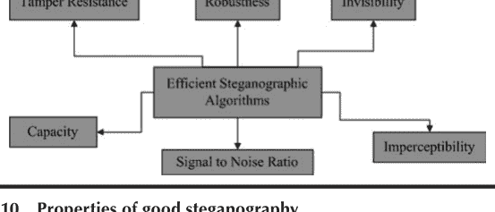

图 1.10 良好隐写术的特性。

### 1.13 隐写术的基本组成

#### 1.13.1 秘密信息

要嵌入的消息。

#### 1.13.2 载体图像

将秘密信息嵌入其中的图像。

#### 1.13.3 隐写图像

包含嵌入消息的载体图像。

#### 1.13.4 密钥

嵌入和提取过程所需的额外数据。

#### 1.13.5 嵌入隐写算法

用于将秘密信息与载体图像一起嵌入的隐写算法。

#### 1.13.6 提取隐写算法

嵌入的逆函数，用于从隐写图像中提取嵌入的消息（秘密信息）。

#### 1.13.7 嵌入域

嵌入区域指的是在其中插入消息时被利用的载体介质特性。它可能是空间域，当载体构成要素的坐标修改被改变时（例如图像中的像素），或者如果在插入之前对介质执行数学变换，则可以是频率域或变换域。

### 1.14 隐写模型

隐写术可以分为隐写模型，主要的有：

- 1. 注入式隐写
- 2. 置换式隐写
- 3. 生成式隐写
- 4. 选择式隐写
- 5. 构造式隐写

在注入式隐写中，秘密信息真正地注入到载体中。很多时候结果是原始载体的存储容量增加，这可能是潜在黑客注意到载体中存在秘密信息的迹象。因此，载体量越大，可以嵌入的信息越多，并且降低了发现秘密信息的可能性。

在置换式隐写中，载体的一部分数据被秘密信息数据适当地替换，尽可能减少修改的可检测性。该过程不会导致载体大小的增加，因此非常有效。它是最常用的方法之一。典型案例是用秘密信息替换通信信道中的噪声。

在生成式隐写中，载体被真正地创建以以合理的方式复制秘密信息，使用合适的算法。该方法非常有效，因为在载体中很难识别秘密信息的存在。如果载体是图像，生成合理的图像仍然非常困难。

在选择式隐写中，只从所有可能的文件中选择那些已经具有某种属性的记录，并利用该属性来隐藏秘密信息。因此，该系统非常耗时，通常很少使用，尽管它对攻击非常有抵抗力。

在构造式隐写中，操作基本上与置换隐写相同。归根结底，它是利用信道噪声，其中首先构建合适的模型，然后用秘密信息替换噪声，同时始终遵循所创建的模型。即使在这种情况下，很难捕获秘密信息，但其弱点在于正确地创建合适的噪声模型。

### 1.15 隐写协议

隐写协议主要有三种基本类型：

#### 1.15.1 纯隐写

当隐写系统在发送数据之前不需要事先交换某些秘密信息时，我们称其为纯净的。

定义 1.4：纯隐写由四个部分组成 (C,S,D,E)，其中 C 是可能的载体的集合，S 是秘密信息的集合且 |C| ≥ |S|，E : C × S → C 为嵌入函数，D : C → S 为提取函数，具有性质 D(E(c,s)) = s ∀ c ∈ C 且 s ∈ S。

#### 1.15.2 私有隐写

当隐写系统需要事先交换诸如共享密钥之类的数据时，我们称其为私有的。在这种情况下，发送方选择载体并使用秘密密钥将秘密信息安装到载体中。秘密密钥几乎可以肯定地用于嵌入过程。它为接收方所知，他可以使用逆过程并使用其秘密密钥恢复隐藏的消息。

定义 1.5：私有密钥隐写由五个部分组成 (C,S,K,E_K,D_K)，其中 C 是可能的载体的集合，S 是秘密信息的集合，K 是秘密密钥的集合，E_K : C × S × K → C 为嵌入函数，D : C × K → S 为提取函数，具有性质 D_K(E_K(c,s)) = s ∀ c ∈ C, s ∈ S 且 k ∈ K。

#### 1.15.3 非对称隐写

这种隐写术不依赖于共享密钥交换。相反，它依赖于公钥密码学，其中有两把密钥，一把是公钥，可以通常从公共数据库获取，另一把是私钥。对于大多数公众，秘密密钥用于插入过程，私钥用于解密过程（图 1.11）。

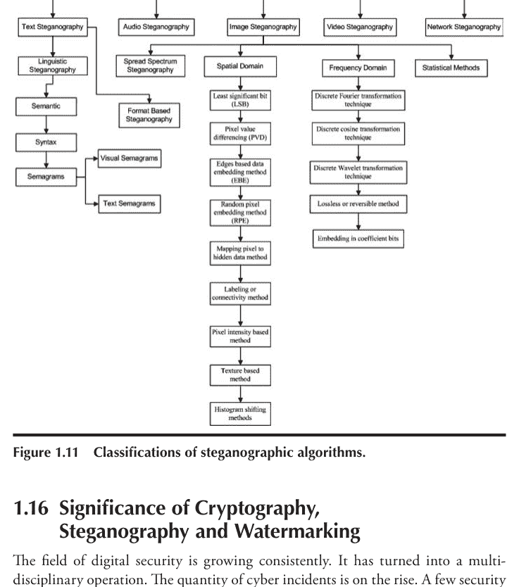

图 1.11 隐写算法的分类。

### 1.16 密码学、隐写术和数字水印的重要性

数字安全领域在持续增长。它已成为一个多学科的操作。网络事件的数量正在上升。一些安全公司已识别出众多被利用工具包的更新，这些工具包最近开始将隐写术作为其运营的基本组成部分，因为它们利用隐写术作为隐藏利用和恶意软件有效载荷为 PNG（便携式网络图形）文件的方法。Stegano 利用工具包（也称为 Astrum）用于通过 PNG 横幅广告交换不同的恶意代码。一旦网络浏览器访问此类网站，JavaScript 将从 PNG 文件中提取代码并将用户重定向到另一个网站，该网站将使计算机感染恶意软件。该更新的攻击单元被许多恶意广告活动用于传播恶意软件。

受影响最严重的国家是日本、加拿大和法国；然而，日本用户占总目标的 30% 以上。隐写术在保护媒体版权（通过数字水印）方面很有帮助。不幸的是，可能弊大于利。在极端情况下，恐怖主义组织完全依赖隐写术作为其通信方式。它用于在没有人，除了预期接收者之外，知道的情况下传递秘密信息。例如，看起来像家庭照片的东西可能暗中包含计划中的恐怖袭击的计划。

令人震惊的是，隐写术也为网络犯罪分子提供了机会。目前有许多隐写工具可用，从开源到商业产品。这些工具为网络犯罪分子提供了大量选择。

为了解决这个问题，需要能够识别和解密这些隐藏信息的人。只有少数学术机构提供专门从事这些技术领域的课程。这些技术不应仅限于现有教育课程中的几个段落或部分。它们应作为密码学、隐写术和数字水印的独立课程提供。这三种技术目标相同：仅保护通信给预期的发送者和接收者。这些课程应以结构化方式提供，建立对密码学、隐写术和数字水印的概念、理论和使用的全面理解。破解加密文件和发现通过隐写术隐藏的消息的能力将为学生做好准备，使他们进入一个网络对抗已成为常态的世界。这将打开通往更具体、专业课程的大门，引导他们从事隐写分析、密码学、密码学、数字媒体（音频、视频和图像）法医科学和网络犯罪调查等职业。

### 1.17 信息安全系统的一些差异

在本节中，我们主要讨论不同信息安全系统之间的差异。

#### 1.17.1 隐写术与数字水印

隐写术的基本目标是在某些音频或视频（载体）数据 C 中隐藏消息 m，以获得新数据 C'，在人类看来与 C 基本无法区分，使得窥探者无法区分 m 在 C' 中的存在。数字水印的主要目标是在某些音频或视频（载体）数据 C 中隐藏消息 m，以获得新数据 C'，在人类看来与 C 基本无法区分，使得窥探者无法移除或替换 C' 中的 m。

数字水印系统隐藏的数据始终与要保护的数字对象或其所有者相关，而隐写系统

同样地，鲁棒性标准也是独一无二的，因为隐写术从根本上关注的是隐藏信息的识别，而数字水印则关注被盗版者可能移除的问题。隐写通信通常是点对点（在发送者和接收者之间），而水印系统通常是一对多。

#### 1.17.2 密码学与数字水印
密码学是确保数字内容最广为人知的技术，也是最成熟的科学之一。然而，加密无法使所有者监控合法用户在解码后如何处理内容。数字水印即使在解码后也能保护内容。

#### 1.17.3 密码学与隐写术
密码学是保护信息的研究，而隐写术则涉及隐藏信息，使得只有发送者和接收者才知道该信息的存在。在隐写术中，只有发送者和接收者知道信息的存在，而在密码学中，加密信息的存在对全世界都是清楚的。由此，隐写术避免了隐藏信息所引起的可疑关注。密码学程序试图保证消息的内容，而隐写术使用技术来隐藏消息本身和内容。通过结合隐写术和密码学，可以获得更好的安全性。简单来说，密码学与保护消息的内容（其含义）有关，而隐写术与伪装消息的存在有关。

### 1.18 不同安全技术的组合

#### 1.18.1 联合密码学和隐写术
两种系统可以结合起来提供另一层保护。消息可以首先使用密码学进行加密以编码给定信息。此加密消息随后可以使用隐写术嵌入到载体媒体中。这种组合方法将满足信息隐藏的三个目标：安全性、容量、鲁棒性。

#### 1.18.2 联合数字水印和隐写术
为了确保信息的有效性，可以对其应用数字水印。该水印记录可以使用隐写密钥嵌入到载体图像中并通过通信媒介传输。在接收端，数据可以首先使用逆向系统解码，然后可以使用数字水印验证其真实性。这种组合方法将满足信息隐藏的四个目标：安全性、容量、活力、和可检测性。

### 1.19 赛博安全 vs. 网络安全 vs. 信息安全
我们正处于一个组织比历史上任何时候都更数字化先进的时期，随着技术的提升，组织的<|message|>安全态势也必须得到改善。未能做到这一点可能导致昂贵的数据泄露，正如我们所见的许多组织一样。威胁行为者正在追踪任何类型的组织，因此为了确保您企业的[content]
同样地，鲁棒性标准也是独一无二的，因为隐写术从根本上关注的是隐藏信息的识别，而数字水印则关注被盗版者可能移除的问题。隐写通信通常是点对点（在发送者和接收者之间），而水印系统通常是一对多。

#### 1.17.2 密码学与数字水印
密码学是确保数字内容最广为人知的技术，也是最成熟的科学之一。然而，加密无法使所有者监控合法用户在解码后如何处理内容。数字水印即使在解码后也能保护内容。

#### 1.17.3 密码学与隐写术
密码学是保护信息的研究，而隐写术则涉及隐藏信息，使得只有发送者和接收者才知道该信息的存在。在隐写术中，只有发送者和接收者知道信息的存在，而在密码学中，加密信息的存在对全世界都是清楚的。由此，隐写术避免了隐藏信息所引起的可疑关注。密码学程序试图保证消息的内容，而隐写术使用技术来隐藏消息本身和内容。通过结合隐写术和密码学，可以获得更好的安全性。简单来说，密码学与保护消息的内容（其含义）有关，而隐写术与伪装消息的存在有关。

### 1.18 不同安全技术的组合

#### 1.18.1 联合密码学和隐写术
两种系统可以结合起来提供另一层保护。消息可以首先使用密码学进行加密以编码给定信息。此加密消息随后可以使用隐写术嵌入到载体媒体中。这种组合方法将满足信息隐藏的三个目标：安全性、容量、鲁棒性。

#### 1.18.2 联合数字水印和隐写术
为了确保信息的有效性，可以对其应用数字水印。该水印记录可以使用隐写密钥嵌入到载体图像中并通过通信媒介传输。在接收端，数据可以首先使用逆向系统解码，然后可以使用数字水印验证其真实性。这种组合方法将满足信息隐藏的四个目标：安全性、容量、活力、和可检测性。

### 1.19 赛博安全 vs. 网络安全 vs. 信息安全
我们正处于一个组织比历史上任何时候都更数字化先进的时期，随着技术的提升，组织的安全态势也必须得到改善。未能做到这一点可能导致昂贵的数据泄露，正如我们所见的许多组织一样。威胁行为者正在追踪任何类型的组织，因此为了确保您企业的信息、资金和声誉，投资于先进的安全框架非常重要。然而，在您开始为组织建立安全计划之前，了解不同类型的[content]
同样地，鲁棒性标准也是独一无二的，因为隐写术从根本上关注的是隐藏信息的识别，而数字水印则关注被盗版者可能移除的问题。隐写通信通常是点对点（在发送者和接收者之间），而水印系统通常是一对多。

#### 1.17.2 密码学与数字水印
密码学是确保数字内容最广为人知的技术，也是最成熟的科学之一。然而，加密无法使所有者监控合法用户在解码后如何处理内容。数字水印即使在解码后也能保护内容。

#### 1.17.3 密码学与隐写术
密码学是保护信息的研究，而隐写术则涉及隐藏信息，使得只有发送者和接收者才知道该信息的存在。在隐写术中，只有发送者和接收者知道信息的存在，而在密码学中，加密信息的存在对全世界都是清楚的。由此，隐写术避免了隐藏信息所引起的可疑关注。密码学程序试图保证消息的内容，而隐写术使用技术来隐藏消息本身和内容。通过结合隐写术和密码学，可以获得更好的安全性。简单来说，密码学与保护消息的内容（其含义）有关，而隐写术与伪装消息的存在有关。

### 1.18 不同安全技术的组合

#### 1.18.1 联合密码学和隐写术
两种系统可以结合起来提供另一层保护。消息可以首先使用密码学进行加密以编码给定信息。此加密消息随后可以使用隐写术嵌入到载体媒体中。这种组合方法将满足信息隐藏的三个目标：安全性、容量、鲁棒性。

#### 1.18.2 联合数字水印和隐写术
为了确保信息的有效性，可以对其应用数字水印。该水印记录可以使用隐写密钥嵌入到载体图像中并通过通信媒介传输。在接收端，数据可以首先使用逆向系统解码，然后可以使用数字水印验证其真实性。这种组合方法将满足信息隐藏的四个目标：安全性、容量、活力、和可检测性。

### 1.19 赛博安全 vs. 网络安全 vs. 信息安全
我们正处于一个组织比历史上任何时候都更数字化先进的时期，随着技术的提升，组织的安全态势也必须得到改善。未能做到这一点可能导致昂贵的数据泄露，正如我们所见的许多组织一样。威胁行为者正在追踪任何类型的组织，因此为了确保您企业的信息、资金和声誉，投资于先进的安全框架非常重要。然而，在您开始为组织建立安全计划之前，了解不同类型的[content]
同样地，鲁棒性标准也是独一无二的，因为隐写术从根本上关注的是隐藏信息的识别，而数字水印则关注被盗版者可能移除的问题。隐写通信通常是点对点（在发送者和接收者之间），而水印系统通常是一对多。

#### 1.17.2 密码学与数字水印
密码学是确保数字内容最广为人知的技术，也是最成熟的科学之一。然而，加密无法使所有者监控合法用户在解码后如何处理内容。数字水印即使在解码后也能保护内容。

#### 1.17.3 密码学与隐写术
密码学是保护信息的研究，而隐写术则涉及隐藏信息，使得只有发送者和接收者才知道该信息的存在。在隐写术中，只有发送者和接收者知道信息的存在，而在密码学中，加密信息的存在对全世界都是清楚的。由此，隐写术避免了隐藏信息所引起的可疑关注。密码学程序试图保证消息的内容，而隐写术使用技术来隐藏消息本身和内容。通过结合隐写术和密码学，可以获得更好的安全性。简单来说，密码学与保护消息的内容（其含义）有关，而隐写术与伪装消息的存在有关。

### 1.18 不同安全技术的组合

#### 1.18.1 联合密码学和隐写术
两种系统可以结合起来提供另一层保护。消息可以首先使用密码学进行加密以编码给定信息。此加密消息随后可以使用隐写术嵌入到载体媒体中。这种组合方法将满足信息隐藏的三个目标：安全性、容量、鲁棒性。

#### 1.18.2 联合数字水印和隐写术
为了确保信息的有效性，可以对其应用数字水印。该水印记录可以使用隐写密钥嵌入到载体图像中并通过通信媒介传输。在接收端，数据可以首先使用逆向系统解码，然后可以使用数字水印验证其真实性。这种组合方法将满足信息隐藏的四个目标：安全性、容量、活力、和可检测性。

### 1.19 赛博安全 vs. 网络安全 vs. 信息安全
我们正处于一个组织比历史上任何时候都更数字化先进的时期，随着技术的提升，组织的安全态势也必须得到改善。未能做到这一点可能导致昂贵的数据泄露，正如我们所见的许多组织一样。威胁行为者正在追踪任何类型的组织，因此为了确保您企业的信息、资金和声誉，投资于先进的安全框架非常重要。然而，在您开始为组织建立安全计划之前，了解不同类型的[content]
同样地，鲁棒性标准也是独一无二的，因为隐写术从根本上关注的是隐藏信息的识别，而数字水印则关注被盗版者可能移除的问题。隐写通信通常是点对点（在发送者和接收者之间），而水印系统通常是一对多。

#### 1.17.2 密码学与数字水印
密码学是确保数字内容最广为人知的技术，也是最成熟的科学之一。然而，加密无法使所有者监控合法用户在解码后如何处理内容。数字水印即使在解码后也能保护内容。

#### 1.17.3 密码学与隐写术
密码学是保护信息的研究，而隐写术则涉及隐藏信息，使得只有发送者和接收者才知道该信息的存在。在隐写术中，只有发送者和接收者知道信息的存在，而在密码学中，加密信息的存在对全世界都是清楚的。由此，隐写术避免了隐藏信息所引起的可疑关注。密码学程序试图保证消息的内容，而隐写术使用技术来隐藏消息本身和内容。通过结合隐写术和密码学，可以获得更好的安全性。简单来说，密码学与保护消息的内容（其含义）有关，而隐写术与伪装消息的存在有关。

### 1.18 不同安全技术的组合

#### 1.18.1 联合密码学和隐写术
两种系统可以结合起来提供另一层保护。消息可以首先使用密码学进行加密以编码给定信息。此加密消息随后可以使用隐写术嵌入到载体媒体中。这种组合方法将满足信息隐藏的三个目标：安全性、容量、鲁棒性。

#### 1.18.2 联合数字水印和隐写术
为了确保信息的有效性，可以对其应用数字水印。该水印记录可以使用隐写密钥嵌入到载体图像中并通过通信媒介传输。在接收端，数据可以首先使用逆向系统解码，然后可以使用数字水印验证其真实性。这种组合方法将满足信息隐藏的四个目标：安全性、容量、活力、和可检测性。

### 1.19 赛博安全 vs. 网络安全 vs. 信息安全
我们正处于一个组织比历史上任何时候都更数字化先进的时期，随着技术的提升，组织的安全态势也必须得到改善。未能做到这一点可能导致昂贵的数据泄露，正如我们所见的许多组织一样。威胁行为者正在追踪任何类型的组织，因此为了确保您企业的信息、资金和声誉，投资于先进的安全框架非常重要。然而，在您开始为组织建立安全计划之前，了解不同类型的[content]
同样地，鲁棒性标准也是独一无二的，因为隐写术从根本上关注的是隐藏信息的识别，而数字水印关注的是被盗版者可能移除的问题。隐写通信通常是点对点，而水印系统通常是一对多。

#### 1.17.2 密码学与数字水印
密码学是最广为人知的确保数字内容的技术，也是最成熟的科学之一。然而，加密无法让所有者监控合法用户在解码后如何处理内容。数字水印即使在解码后也能保护内容。

#### 1.17.3 密码学与隐写术
密码学是保护信息的研究，而隐写术是隐藏信息，使只有发送者和接收者知道信息存在。在隐写术中，只有发送者和接收者知道信息的存在，而在密码学中，加密信息的存在对全世界是清楚的。因此隐写术避免了隐藏信息引起的可疑关注。密码学试图保证消息内容，而隐写术隐藏消息本身和内容。结合两者可获得更好安全性。简单说，密码学保护消息内容，隐写术伪装消息存在。

### 1.18 不同安全技术的组合

#### 1.18.1 联合密码学和隐写术
两种系统可结合提供另一层保护。消息先用密码学加密，再用隐写术嵌入载体媒体。此组合满足信息隐藏的三个目标：安全性、容量、鲁棒性。

#### 1.18.2 联合数字水印和隐写术
为确保信息有效性，可对其应用数字水印。该水印记录可用隐写密钥嵌入载体图像并传输。接收端先用逆向系统解码，再用数字水印验证真实性。此组合满足信息隐藏的四个目标：安全性、容量、活力、可检测性。

### 1.19 赛博安全 vs. 网络安全 vs. 信息安全
组织正比历史上任何时候都更数字化，技术提升时安全态势也必须改善。否则可能导致昂贵数据泄露。威胁行为者追踪各类组织，为确保企业信息、资金和声誉，需投资先进安全框架。在建立安全计划前，需了解不同安全类型及其协同。

### 1.19.1 信息安全
信息安全或InfoSec确保物理和数字信息免受未经授权访问、使用、披露、中断、修改、审查、记录或销毁。信息安全与网络安全不同，前者保护任何形式信息，后者仅保护数字信息。建立安全计划应从信息安全开始，它是基础。

InfoSec专家制定政策和技术时使用CIA保密性、完整性和可用性三元组作为指导。

CIA三元组已成为保护组织的标准模型，三个原则有助于构建保护信息的安全控制。

### 1.19.2 赛博安全
赛博安全是信息安全子集，通过程序、技术和实践保护组织系统、电脑和信息免受未经授权的数字访问、攻击或损害。面对众多威胁行为者，IT基础设施需持续保护以避免系统攻击和信息泄露。

数字威胁行为者会研究企业和员工，利用员工对数字威胁的认知不足，通过社会工程操纵个人获取敏感数据。

作为企业领导者，需建立安全意识文化，弥补团队赛博安全知识差距。员工需接受培训和技术以强化人防火墙，降低数字攻击风险。

### 1.19.3 网络安全
网络安全是赛博安全子集，确保系统设备传输的信息不被篡改或截获。

系统安全受损时，首要任务是尽快清除攻击者。停留越久，私密信息泄露越多。据Ponemon研究所2013年数据泄露成本研究，除灾难性泄露外，美国每条泄露记录平均成本为188美元，平均总成本超过540万美元。最有效的降本方法是尽早清除攻击者。Figure 1.12

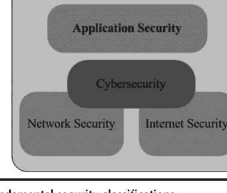

Figure 1.12 基本安全分类。

### 1.20 结论
本章旨在描述布尔函数、分组密码非线性分量、密码学、水印和隐写术的相关支撑概念。具体而言，我们给出了理论各部分的不同定义和假设。用于分析单输出和多输出函数强度的[content]
同样地，鲁棒性标准也独特，因为隐写术关注隐藏信息的识别，而水印关注被盗版者移除。隐写通信通常点对点，水印系统通常一对多。

#### 1.17.2 密码学与数字水印
密码学是最广为人知的数字内容保护技术，也是最成熟的科学。加密无法让所有者监控合法用户解码后的使用。数字水印可在解码后仍保护内容。

#### 1.17.3 密码学与隐写术
密码学研究保护信息，隐写术隐藏消息使只有发送者和接收者知道其存在。隐写术中只有双方知道信息存在，密码学中加密信息存在公开。隐写术避免可疑关注。密码学保证内容，隐写术隐藏消息和内容。两者结合可提高安全性。简单说，密码学保护内容含义，隐写术伪装消息存在。

### 1.18 不同安全技术的组合

#### 1.18.1 联合密码学和隐写术
两者结合可提供额外保护。消息先用密码学加密，再用隐写术嵌入载体。组合满足信息隐藏三目标：安全、容量、鲁棒性。

#### 1.18.2 联合数字水印和隐写术
为确保有效性，可对信息加水印。水印记录可用隐写密钥嵌入载体图像并传输。接收端先解码再用水印验证真实性。组合满足信息隐藏四目标：安全、容量、活力、可检测性。

### 1.19 赛博安全 vs. 网络安全 vs. 信息安全
组织数字化程度前所未有，技术提升需同步改善安全态势，否则将导致昂贵泄露。威胁行为者针对各类组织，需投资先进安全框架。在建立安全计划前需了解不同安全类型及其协同。

### 1.19.1 信息安全
信息安全InfoSec保护物理和数字信息免受未授权访问、使用、披露、中断、修改、审查、记录或销毁。与赛博安全不同，InfoSec保护任何形式信息，赛博安全仅保护数字信息。信息安全是基础。

InfoSec专家使用CIA保密性、完整性、可用性三元组指导政策制定。

CIA三元组是保护组织的标准模型，三原则有助于构建安全控制。

### 1.19.2 赛博安全
赛博安全是信息安全子集，通过程序、技术和实践保护系统、电脑和信息免受未授权数字访问、攻击或损害。IT基础设施需持续保护以避免攻击和泄露。

威胁行为者研究企业和员工，利用员工认知不足进行社会工程获取敏感数据。

领导者需建立安全意识文化，填补知识差距。员工需培训和技术以强化人防火墙，降低攻击风险。

### 1.19.3 网络安全
网络安全是赛博安全子集，确保系统设备传输信息不被篡改或截获。

安全受损时首要任务是尽快清除攻击者。据Ponemon研究所2013年研究，美国每条泄露记录平均成本188美元，平均总成本超540万美元。尽早清除攻击者最能降低成本。Figure 1.12


Figure 1.12 基本安全分类。

### 1.20 结论
本章旨在描述布尔函数、分组密码非线性分量、密码学、水印和隐写术的相关概念。给出了各部分定义和假设，并描述了用于分析单多输出函数强度的密码学属性。本章综述现有信息隐藏技术、重点与局限，并描述在文本、图像、音频中隐藏数据的若干方法及其优缺点。大多数方法利用人类感知缺陷，但也有自身弱点。在密码学受限地区，人们寻求隐蔽传递消息。数字水印现用于追踪媒体版权。本节还说明信息隐藏的重要性及系统需具备的领域。本章介绍的密码学、水印和隐写术基础有助于后续研究。

## References
- 1. A. Menezes, P. van Oorschot, S. Vanstone, *应用密码学*. CRC Press, Boca Raton, FL, 1996.
- 2. C. E. Shannon, 通信的数学理论, *Bell Labs. Tech. J.*, 27 (1948) 379–423.
- 3. C. E. Shannon, 秘密系统通信理论, *Bell Labs. Tech. J.*, 28 (1949) 656–715.
- 4. I. J. Cox, M. L. Miller, J. A. Bloom, J. Fridrich, T. Kalker, *数字水印与隐写术*, 2nd ed. Morgan Kaufmann Publisher, San Francisco, CA, 2008.
- 5. C. T. Hsu, J. L. Wu, 基于DCT的视频水印, *IEEE Trans. Consum. Electron.*, 44(1) (1998) 206–216.
- 6. M. Kutter, F. Jordan, *数字水印技术*. AlpVision, Vevey, Switzerland, pp. 1–4.
- 7. N. Morimoto, 具有实际应用的数字水印技术, *Inf. Sci.*, 2 (1999) 107–111.
- 8. H. Luo, S. H. Chu, Z. M. Lu, 使用半色调技术的自嵌入水印, *Circ. Syst. Signal Process*, 27 (2008) 155–170.
- 9. A. Piva, F. Bartolini, M. Barni, 在开放网络中管理版权, *IEEE Trans. Internet Comput.*, 6(3) (2002) 18–26.
- 10. C. Lu, S. Huang, C. Sze, H. Y. M. Liao, 用于数字图像保护的鸡尾酒水印, *IEEE Trans. Multimedia*, 2(4) (2000) 209–224.


- 11. M. M. Latha, G. M. Pillai, K. A. Sheela, 基于水印的内容安全和数字图书馆中的多媒体索引, *语义网与数字图书馆国际会议*, (2007).
- 12. M. Khan, T. Shah, S. I. Batool, 基于仿射变换和 S₄ 置换的彩色图像水印方案, *神经计算与应用*, 25 (2014) 2037–2045.
- 13. R. M. Haralick, K. Shanmugam, 储层砂岩的计算机分类, *IEEE 地球工程汇刊*, 11 (1973) 171–177.
- 14. I. J. Cox, M. L. Miller, J. A. Bloom, 水印应用及其特性, *2000年信息技术国际会议*, Las Vegas, NV, 2000.
- 15. G. L. Friedman, 可信的数码相机：恢复照片图像的可信度. *IEEE 消费电子汇刊*, 39(4) (1993) 905–910.
- 16. Y. K. Lee, G. Bell, S. Y. Huang, R. Z. Wang, S. J. Shyu, 一种用于隐写编码的高级最低有效位嵌入方案, in *图像与视频技术进展*, Springer, Berlin, Germany, pp. 349–360, 2009.
- 17. R. Singh, G. Chawla, 图像隐写术综述, *国际计算机科学与软件工程高级研究期刊*, 4(5) (2014) 686–689.
- 18. A. O. Vyas, S. V. Dudul, 图像隐写术技术概述, *国际计算机科学高级研究期刊*, 6 (2015) 67–72.
- 19. R. M. Haralick, K. Shanmugam, I. Dinstein, 用于图像分类的纹理特征, *IEEE 系统、人与控制论汇刊*, 3 (1973) 610–621.

## 第2章
### 密码学图像置乱技术
Bhaskar Mondal
### 目录
- 2.1 引言...................................................................................................38
- 2.2 置乱技术...................................................................................................40
- 2.2.1 通过行列移位与循环旋转进行置乱...................................40
- 2.2.2 基于二维映射的置乱...............................................................................42
- 2.2.3 行列移位下的比特级置换...............................................47
- 2.2.4 广义矩阵基置乱（变换）...........................................48
- 2.2.4.1 使用 Arnold 变换的矩阵基图像置乱........................................48
- 2.2.4.2 使用 Fibonacci 变换的矩阵基图像置乱...........................53
- 2.2.5 灰码与位平面置乱........................................................................55
- 2.3 对比分析...................................................................................................58
- 2.3.1 熵分析........................................................................................................60
- 2.3.2 相关系数..............................................................................................61
- 2.3.3 对比计算复杂度....................................................................61
- 2.4 逆置乱.......................................................................................................63
- 2.5 结论...................................................................................................................63
- 参考文献........................................................................................................................63

图像置乱是通过随机重新排列像素以使图像在视觉上不可读并破坏相邻像素之间相关性的方法。一般而言，在置乱过程中像素值保持不变。近期提出了大量图像加密算法。大多数图像加密算法涉及两个阶段，即混淆和扩散。在混淆阶段，像素位置使用某种置乱技术进行置换，而在扩散阶段，像素值通过可逆函数进行改变。图像像素与相邻像素高度相关，而良好的置乱算法可将这种相关性降低至接近零。本章对不同置乱技术进行了深入的比较研究，如矩阵变换、位平面置乱、像素交换、行列交换、带旋转的行列交换。为确定置乱技术的质量和效率，考虑了相关系数、熵和计算时间。

### 2.1 引言

在过去二十年里，由于互联网和社交媒体，工作习惯和社会生活发生了巨大变化。每天都有大量图像被拍摄并存储或通过互联网传输，其中包括个人、组织、秘密和敏感信息。随着多媒体数据容易被非法用户截获，安全多媒体通信变得越来越重要。执法人员可能很难抵御黑客的恶意行为。因此，加密这些图像的需求很高 [1]。

置乱在加密算法中被广泛用于增加混淆 [4] [2,3]。置乱是指像素值的置换或位平面中位值的置换。将明文图像转换为无意义的噪声并消除相邻像素之间的高度相关性是置乱的目标。各种图像置乱技术用于图像和视频加密 [5]、物理层时间同步、计算机生成事件中的随机性生成等。图像加密算法的强度和计算开销在很大程度上取决于算法中使用的置乱技术。

在 [6] 中，使用了一种基于 Arnold 猫映射的矩阵置乱技术。Arnold 猫映射是一种混沌映射，以提出该算法的 Vladimir Arnold 命名。使用 Arnold 猫映射的置乱也称为 Arnold 变换。矩阵置乱也可以基于 Fibonacci 变换进行 [5]。Fibonacci 变换 [7] 具有均匀性的独特特性。原始图像中彼此等距的像素在加密图像中也保持等距。相邻像素也被尽可能地分散开来，导致相邻像素之间相关性非常低。在 [8,9] 中，作者声称对六种置乱方法进行了比较，但他们保持置乱过程不变，仅使用六种不同的随机矩阵生成器。[8] 中还提出了另外两种置换度量。

另一种基于二维混沌映射的图像置乱方法 [10]。伪随机性、无周期性以及对初始条件变化的敏感性使混沌映射成为置乱中备受青睐的技术之一。它也用于大量数据的置乱，如视频、音频等 [11]。

在 [12–14] 中，使用基于行列交换的密钥置乱进行安全图像加密。使用某些随机序列交换图像的行。同样，列也被交换。此外，使用相同的序列对行和列进行循环移位。[15] 使用行列移位方法对像素进行置换。

位平面置乱是著名的图像置乱技术之一。在 [16] 中提出了一种带位平面置乱的量子图像格雷码（GB）。它被用作许多加密算法 [17] 的基本步骤之一。在 [18] 中，使用了一种新颖的基于混沌的比特级置换方案，其中图像被扩展为位平面二值图像，并且行根据随机序列进行置换。此外，使用相同的随机序列对列进行移位。之后，扩展的图像被划分为 8 个等大小的块，并再次使用广义 Arnold 猫映射对每个块应用置换。通过像素级置换和比特级置换进行图像加密，将块合并以获得密文图像 [19,20]。

本章对一些流行的密码学图像置乱方法进行了深入比较研究，如使用 Arnold 变换 [6] 和 Fibonacci 变换 [7] 的广义矩阵基置乱（变换）[21]、二维映射 [10]、基于密钥的行列移位 [13,22]、带位平面变换的格雷码 [23] 以及带比特级置换的基于密钥的行列移位 [18]。在本章中，使用基于混沌 logistic 映射的相同伪随机数生成器（PRNG）来测试和比较不同置乱技术的密码学效果。

为衡量置乱技术的加密效果，本章通过在不同类型图像上进行仿真和测试，对比了相关系数、熵和计算时间。为了更好地理解和比较置乱技术，使用本章讨论的所有置乱技术对同一图像，即 Peeper 图像，进行置乱。

本章其余部分描述了不同的图像置乱技术及其比较和性能分析，随后是章节总结。


## 2.2 置乱技术

本节将介绍图像加密中使用的不同图像置乱技术。这些技术还应用于不同类型的图像，以展示其密码学效果。

### 2.2.1 基于行列移位与循环旋转的置乱

基于密钥的置乱算法是一种非常有效且简单的图像置乱和加密方法。在该方法中，用户指定一个密钥，形成两个伪随机数 R1 和 R2 的序列 [12]。

图 2.1a 显示了使用行列移位与循环旋转进行置乱的表示。图 2.1a 中展示了一个包含 16 个像素的明文图像。图 2.1b 中图像的行基于随机数序列 {3,4,2,1} 进行置乱。图 2.1c 中图像的列基于随机数序列 {3,1,4,2} 进行置乱。在图 2.1c 中，元素仍保留在相同的行或列中，它们仅在行或列内进行置乱，这导致安全性较低。另一方面，如果在行移位后对图 2.1b 应用使用随机序列 {1,2,2,3} 的循环旋转，则得到图 2.1d 中的结果。然后在图 2.1e 中使用随机序列 {4,2,1,3} 进行列移位，随后使用随机序列 {2,3,1,2} 进行按列循环旋转，得到图 2.1f 中的结果。所有像素都随机置乱，与行列无关。因此，使用行列移位与循环旋转的置乱提供了适当的置乱和密码学效果。

置乱方法如图 2.2 所示，并由算法 1 给出。

### 算法 2.1 基于行列移位与循环旋转的置乱

```
Input: The original image I.
for i = 0 to M do
    Cyclic shift the i<sup>th</sup> row of I to right with step size R1<sub>i</sub>;
end for
The row scrambled image is denoted as I<sub>1</sub>.
for i = 0 to N do
    Cyclic shift the i<sup>th</sup> column of I<sub>1</sub> to right with step size R2<sub>i</sub>;
end for
The column scrambled image is denoted as I'.
Output: The scrambled image I'.
```

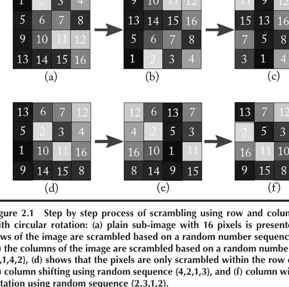

图 2.1 使用行列移位与循环旋转进行置乱的逐步过程：（a）展示了包含 16 个像素的明文子图像，（b）图像的行基于随机数序列 {3,4,2,1} 进行置乱，（c）图像的列基于随机数序列 {3,1,4,2} 进行置乱，（d）显示像素仅在行或列内置乱，（e）使用随机序列 {4,2,1,3} 进行列移位，（f）使用随机序列 {2,3,1,2} 进行按列循环旋转。

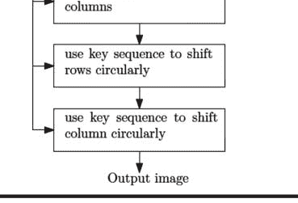

图 2.2 行列移位与循环旋转的流程图。

行列移位与循环旋转应用于图 2.8a 中的 Pepper 图像，得到图 2.3b 中的置乱图像。明文 Pepper 图像在垂直、水平和对角方向上的相关性图分别展示在图 2.17f、2.12e、2.12g 中，而置乱后 Pepper 图像在垂直、水平和对角方向上的相关性图则展示在图 2.3d、2.3f、2.3h 中。

明文 Pepper 图像在垂直相关 (VC)、水平相关 (HC) 和对角相关 (DC) 方向上的相关系数 (Corr) 值分别为 0.9768、0.9792、0.9639，熵为 7.5937。置乱后 Pepper 图像的整体相关系数、垂直 VC、HC 和 DC 方向的值分别为 0.0217、0.0252、0.6936、0.0345。

### 2.2.2 基于 2D 映射的置乱

2D 映射是置乱尺寸为 (M × N) 的图像 I 的最简单方法之一，其中 M 表示图像的高度，N 表示图像的宽度。任意坐标 (i, j) 的像素值由 A(i, j) 表示，其中 i = 0,1,2,...M − 1 且 j = 0,1,2,...N −1。在该方法中生成两个随机矩阵 X(i, j) 和 Y(i, j)。随机矩阵的元素作为置乱图像 I′ 中像素的新坐标。

### 算法 2.2 使用 Fibonacci 变换的置乱

```
Input: I(i, j) the plain image with dimension (M×N)
Generate X(i, j) and Y(i, j).
for each pixel I(i, j) do
  I′(X(i, j), Y(i, j)) = I(i, j)
end for
Output: I′(I, J), the scrambled image.
```

该方案的性能取决于用于生成随机矩阵的伪随机数生成器。

基于 2D 映射的置乱技术应用于图 2.4a 中的 Pepper 图像，得到图 2.4b 中的置乱图像。明文 Pepper 图像在垂直、水平和对角方向上的相关性图分别展示在图 2.17f、2.12e、2.12g 中，而置乱后 Pepper 图像在垂直、水平和对角方向上的相关性图则展示在图 2.4d、2.4f 和 2.4h 中。

明文 Pepper 图像在垂直、水平和对角方向上的整体相关系数值分别为 0.9768、0.9792、0.9639，熵为 7.5937。置乱后 Pepper 图像在垂直、水平和对角方向上的整体相关系数值分别为 0.0380、0.0434、0.0405、0.0521，熵为 7.8415。详细结果见表 2.1。

该方法用于生成大量伪随机数序列，使明文图像的大小加倍。

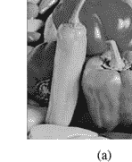

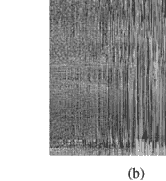

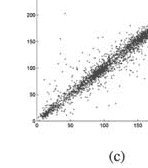

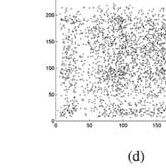

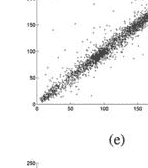

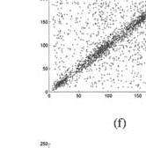

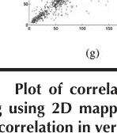

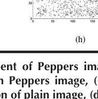

图 2.3 使用 2D 映射置乱前后 Peppers 图像的相关系数图：（a）明文 Peppers 图像，（b）置乱后 pepper 图像，（c）明文图像垂直方向的相关性，（d）置乱图像垂直方向的相关性，（e）明文图像水平方向的相关性，（f）置乱图像水平方向的相关性，（g）明文图像对角方向的相关性，（h）置乱图像对角方向的相关性。

## 表 2.1 相关系数与熵的比较结果

| 测试图像 | 参数 | Arnold 变换 | Fibonacci 变换 | Gray 码位平面 | 2D 映射 | 行列移位 | 行列移位与位平面置乱 |
|---|---|---|---|---|---|---|---|
| 飞机图像 | 相关 | 0.0015 | 0.0117 | 0.0505 | 0.0443 | 0.0954 | 0.0016 |
|  | 水平相关 | -0.1114 | 0.4942 | 0.3177 | -0.0553 | 0.1691 | 0.0298 |
|  | 垂直相关 | -0.0733 | 0.3451 | 0.3573 | -0.0538 | 0.6425 | 0.0056 |
|  | 对角相关 | 0.0278 | 0.3485 | 0.3008 | -0.0550 | 0.1917 | 0.0089 |
|  | 熵 | 6.7025 | 6.7025 | 6.7025 | 0.8236 | 6.7780 | 7.9368 |
| 狒狒图像 | 相关 | 4.5970e-04 | 0.0097 | 0.0485 | 0.0033 | 0.0569 | 0.0017 |
|  | 水平相关 | 0.0979 | 0.3120 | 0.0485 | 0.0446 | 0.0612 | 0.0481 |
|  | 垂直相关 | 0.1232 | 0.2215 | 0.0556 | 0.0722 | 0.3780 | 0.0160 |
|  | 对角相关 | 0.1051 | 0.0296 | 0.2883 | 0.0346 | 0.0087 | 0.0090 |
|  | 熵 | 7.2673 | 7.2673 | 3.6133 | 7.2673 | 7.1782 | 7.9523 |

## 表 2.1（续）相关系数与熵的比较结果

| 测试图像 | 参数 | Arnold 变换 | Fibonacci 变换 | Gray 码位平面 | 2D 映射 | 行列移位 | 行列移位与位平面置乱 |
|---|---|---|---|---|---|---|---|
| Lena 图像 | 相关 | 2.4868e-05 | 3.1170e-05 | 0.0091 | 0.0423 | 0.0139 | 0.0021 |
|  | 水平相关 | 0.0327 | 0.6513 | 0.1307 | 0.0626 | 0.0646 | 0.0199 |
|  | 垂直相关 | -0.0875 | 0.4783 | 0.1676 | 0.0660 | 0.6749 | 0.0165 |
|  | 对角相关 | 0.1963 | 0.2036 | 0.1323 | 0.0667 | 0.0680 | 0.0158 |
|  | 熵 | 7.4455 | 7.4455 | 7.4455 | 7.691 | 7.4677 | 7.9976 |
| Peppers 图像 | 相关 | -0.0110 | 0.0228 | 0.0022 | 0.0380 | 0.0217 | 0.0011 |
|  | 水平相关 | 0.0979 | 0.5906 | 0.1134 | -0.0434 | 0.0252 | 0.0114 |
|  | 垂直相关 | 0.0175 | 0.3675 | 0.0556 | -0.0405 | 0.6936 | 0.0050 |
|  | 对角相关 | 0.1066 | 0.1561 | 0.0834 | -0.0521 | 0.0345 | 0.0398 |
|  | 熵 | 7.5937 | 7.5937 | 7.5937 | 0.8415 | 7.6438 | 7.9966 |

注：当前像素与水平/对角/垂直像素之间的相关性是通过选择 1000 个随机像素得到的。


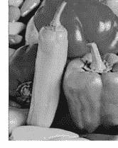

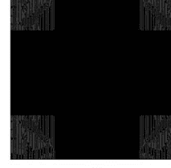

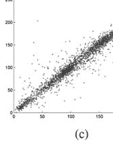

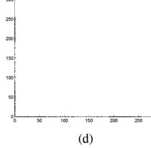

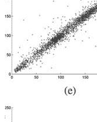

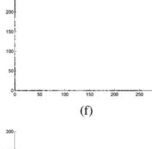

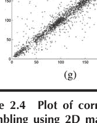

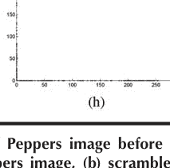

图 2.4 使用 2D 映射对 Peppers 图像置乱前后相关系数图：(a) 原始 Peppers 图像，(b) 置乱后的胡椒图像，(c) 原始图像的垂直方向相关性，(d) 置乱图像的垂直方向相关性，(e) 原始图像的水平方向相关性，(f) 置乱图像的水平方向相关性，(g) 原始图像的对角线方向相关性，以及 (h) 置乱图像的对角线方向相关性。

## 2.2.3 基于行列移位的位级置换

图像的位平面是对应于表示图像像素值的二进制数中每个位置的一组位。8 位图像可以用 8 个位平面表示。第一个位平面包含最高有效位集合，第 8 个包含最低有效位。Peppers 图像的位平面切片如图 2.5 所示。

该方案基于伪随机数序列的位平面置换。该方案分两步进行置乱，首先使用伪随机序列然后再进行广义 Arnold 变换 [18]。该方案成功生成了具有良好密码学效果的安全置乱图像。步骤如下：

- 1. 将大小为 M × N 的图像 I 扩展为 M × N × 8 位平面二进制图像。
- 2. 生成大小分别为 M 和 N × 8 的伪随机数序列 S₀ 和 S₁。
- 3. 使用序列 S₀ 置换二进制图像的行。
- 4. 使用序列 S₁ 置换二进制图像的列。
- 5. 现在，将二进制图像划分为 8 个大小相等的块。
- 6. 用广义 Arnold 猫映射（公式 2.5）对每个块置换 k 次。
- 7. 从左到右合并块以恢复像素平面并进一步生成密文图像。

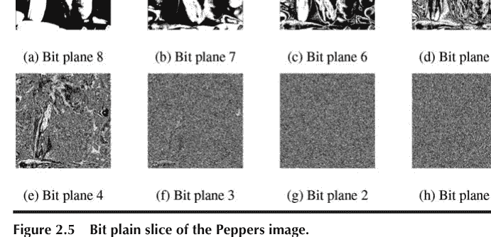

图 2.5 Peppers 图像的位平面切片。

基于 2D 映射的置乱技术应用于图 2.6a 中的 Peppers 图像，得到图 2.6b 中的置乱图像。原始 Peppers 图像在垂直、水平和对角线方向的相关性图分别展示在图 2.17f、2.12e 和 2.17g 中，而置乱后 Peppers 图像在垂直、水平和对角线方向的相关性图分别展示在图 2.6d、2.6f 和 2.6h 中。

原始 Peppers 图像在垂直相关、水平相关和对角线相关方向上的整体相关值分别为 0.9768、0.9792、0.9639，熵为 7.5937。置乱后 Peppers 图像在垂直相关、水平相关和对角线相关方向上的整体相关值分别为 0.0011、0.0114、0.0050、0.0398，熵为 7.9966。详细结果见表 2.1。

## 2.2.4 基于广义矩阵的置乱（变换）

公式 2.1 变换是通用模型：

\(\vec{V}_k = A\vec{V}_{k-1} \mod \vec{N}, k \in Z^+\) (2.1)

在公式 2.1 中，A 是大小为 n×n 的矩阵。A 被称为置乱参数矩阵。A 的所有元素都是非负整数使得 det(A) ≠ 0，\(\vec{V}_k,\vec{V}_{k-1},\vec{N}\) 是 n×1 向量且 0 < v_{i,j} ≤ N_j 对于 i = k-1,k 和 j =1,2,...,n 假设 \(\vec{V}_{k-1} = (V_{k-1,1} V_{k-1,2}...V_{k-2,n})\) 和 \(\vec{V}_k = (V_{k,1} V_{k,2}...V_{k,n})'\)，\(\vec{N} = (N_1 N_2 ... N_n)'\) 是模向量，其中 N_j 是正整数，表示对应 v_{ij} = (i, j =1,2...) 的上界。图像的置乱次数用正整数 k 表示。+ 表示正整数集合。

等模情况定义为等模变换，即 \(\vec{N} = (N N ... N)'\)，则公式 2.1 可转换为公式 2.2：

\(\vec{V}_k = A\vec{V}_{k-1} \mod N, k \in Z^+\) (2.2)

### 2.2.4.1 使用 Arnold 变换的基于矩阵的图像置乱

猫映射，也称为 Arnold 变换，由 V.I. Arnold 在遍历理论研究中提出。将数字图像矩阵重新排列的拼接和裁剪过程称为变换。2D Arnold 变换是可逆映射，由公式 2.3 描述

\(\begin{pmatrix} x_{n+1} \\ y_{n+1} \end{pmatrix} = \begin{pmatrix} 1 & 1 \\ 1 & 2 \end{pmatrix} \begin{pmatrix} x_n \\ y_n \end{pmatrix} \mod 1\) (2.3)

其中 (x_n, y_n) ∈ [0,1)×[0,1)

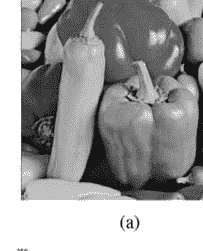

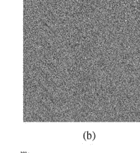

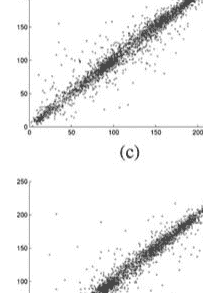

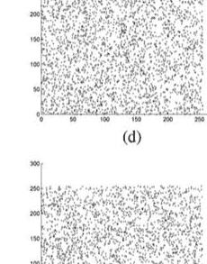

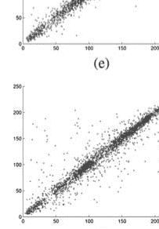

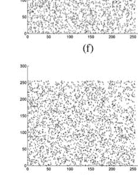

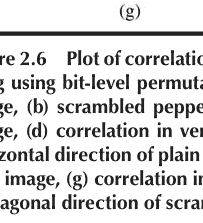

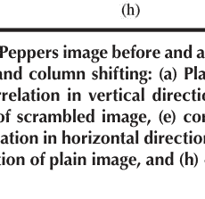

图 2.6 使用基于行列移位的位级置乱对 Peppers 图像置乱前后相关系数图：(a) 原始 Peppers 图像，(b) 置乱后的胡椒图像，(c) 原始图像的垂直方向相关性，(d) 置乱图像的垂直方向相关性，(e) 原始图像的水平方向相关性，(f) 置乱图像的水平方向相关性，(g) 原始图像的对角线方向相关性，以及 (h) 置乱图像的对角线方向相关性。

且 Arnold 变换由公式 2.4 给出

$$\begin{pmatrix} x_{n+1} \\ y_{n+1} \end{pmatrix} = \begin{pmatrix} a_{00} & a_{01} \\ a_{10} & a_{11} \end{pmatrix} \begin{pmatrix} x_{n} \\ y_{n} \end{pmatrix} \mod N \tag{2.4}$$

其中 a00 × a11 + a01 × a10 = ±1，这使得置乱可逆。

它可以应用于大小为 N × N 的置乱数字图像，通过公式 2.5 中的离散形式：

$$\begin{pmatrix} x_{n+1} \\ y_{n+1} \end{pmatrix} = \begin{pmatrix} 1 & 1 \\ 1 & 2 \end{pmatrix} \begin{pmatrix} x_{n} \\ y_{n} \end{pmatrix} \mod N \tag{2.5}$$

其中 (x_n, y_n) ∈ [0, N − 1] × [0, N − 1]

是原始图像的像素坐标；N × N 是输入原始图像的维度；(x_{n+1}, y_{n+1}) 是结果图像中像素的新坐标。该方法对像素位置进行多次置乱以充分置乱图像 [6]。

数字图像可以看作二维矩阵。当图像大小为 N 时，我们有 N × N 个元素，下标 x、y 表示像素的位置，x、y ∈ 0,1,2..., N − 1。令 x、y 对应 Arnold 置乱的 x、y，对于每一对 x、y，经过全部完整的 Arnold 置乱后变为 x′ 和 y′，这相当于原始图像的点从 (x, y) 移动到 (x′, y′)，从而实现图像中像素的移动，经过 Arnold 置乱的图像遍历所有点以完成 Arnold 置乱图。

图 2.7 显示了通过线性映射拉伸图 2.7a 中的单位正方形图像的过程，以及由于模运算导致的图 2.7b 中碎片的重排，由箭头表示。

Arnold 置乱的周期与图像大小有关，但不是直接成比例。如果大小是 128×128 像素图像的 Arnold 置乱周期

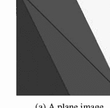

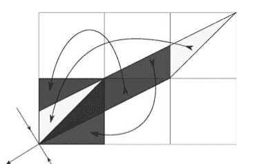

图 2.7 Arnold 变换的第 1 轮。

为 96，大小为 240×240 像素图像的 Arnold 置乱为 60 个周期。Dyson 和 Falk 分析了 Arnold 变换周期性，结果表明 Arnold 变换的周期为 T ≤ N²/2，其中 N 为随机数 (N > 2)[2-4]。表 2.2 显示矩阵阶数 N 与 Arnold 变换的二维周期不成正比。因此，当我们考虑数字水印图像的矩阵阶数时，我们尽可能选择较小的阶数进行 Arnold 变换，以便做更少计算工作。

表 2.2 不同阶数 N 的二维 Arnold 变换周期

| N | 2 | 3 | 4 | 5 | 6 | 7 | 8 | 9 | 10 | 11 | 12 | 16 | 24 | 25 |
|---|---|---|---|---|---|---|---|---|---|---|---|---|---|---|
| 周期 | 3 | 4 | 3 | 10 | 12 | 8 | 6 | 12 | 30 | 5 | 12 | 12 | 12 | 50 |
| N | 32 | 40 | 48 | 50 | 56 | 60 | 64 | 100 | 120 | 125 | 128 | 256 | 480 | 512 |
| 周期 | 24 | 30 | 12 | 150 | 24 | 60 | 48 | 150 | 60 | 250 | 96 | 192 | 120 | 384 |

## 算法 2.3 使用 Arnold 变换的置乱

```
Input I(i,j) the plain image
for each pixel I(i,j) do
  (i)   (1 1) (i)
  (j) ← (1 2) (j)
  I'(I,J) ← I(i,j)
end for
Output I'(i,j) the scrambled image
```

Arnold 变换应用于图 2.8a 中的 Peppers 图像，得到图 2.8b 中的置乱图像。原始 Peppers 图像在垂直、水平和对角线方向的相关性图分别展示在图 2.17f、2.12e 和 2.12g 中，而置乱后 Peppers 图像在垂直、水平和对角线方向的相关性图分别展示在图 2.8d、2.8f 和 2.8h 中。

原始 Peppers 图像在垂直相关、水平相关和对角线相关方向上的整体相关值分别为 0.9768、0.9792、0.9639，熵为 7.5937。置乱后 Peppers 图像在垂直相关、水平相关和对角线相关方向上的整体相关值分别为 0.0110、0.0979、0.0175、0.1066，熵为 7.9966。详细结果见表 2.1。


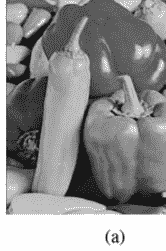
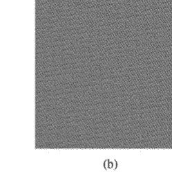
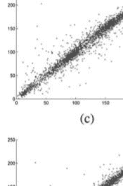
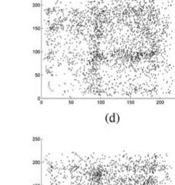
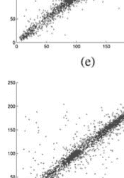
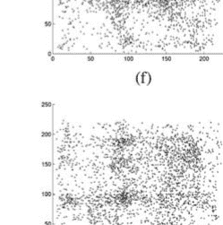
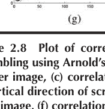
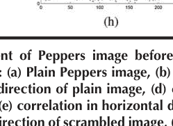

图 2.8 使用 Arnold 变换对 Peppers 图像进行置乱前后的相关系数图：(a) 原始 Peppers 图像，(b) 置乱后的胡椒图像，(c) 原始图像垂直方向的相关性，(d) 置乱图像垂直方向的相关性，(e) 原始图像水平方向的相关性，(f) 置乱图像水平方向的相关性，(g) 原始图像对角线方向的相关性，(h) 置乱图像对角线方向的相关性。

## 2.2.4.2 基于矩阵的 Fibonacci 变换图像置乱

数字 1,1,2,3,5,8,13,21,34,55,89,... 被称为斐波那契数，由十九世纪法国数学家 Edouard Lucas 以中世纪最伟大的数学家之一、比萨的 Leonardo Fibonacci 的名字命名，他在 1202 年的著作 *Liber Abaci* 中与他的兔子问题相关提及了它们。斐波那契数列几个世纪以来一直吸引着业余爱好者和专业数学家，因为它们应用丰富，并且有在完全令人惊讶且不相关的领域普遍出现的习惯。

斐波那契变换与 Arnold 变换相同，唯一的区别是 $a_{00},a_{11},a_{01},a_{10}$ 的值是斐波那契数列中的四个连续数字。

斐波那契数列由公式 2.6 给出

$F = \begin{cases} 0 & \text{if } n<1 \\ 1 & \text{if } n=1 \\ F(n-1)+F(n-2) & \text{if } n>1 \end{cases}$ (2.6)

斐波那契变换由公式 2.7 [7] 表示：

$\begin{pmatrix} x' \\ y' \end{pmatrix} = \begin{pmatrix} 1 & 1 \\ 1 & 0 \end{pmatrix} \begin{pmatrix} x \\ y \end{pmatrix} \mod N$ (2.7)

其中 $x, y \in \{0,1,2,3...,N-1\}$

算法 4 介绍了使用斐波那契变换的置乱技术。

### 算法 2.4 使用斐波那契变换进行置乱

```
Input: $I(i,j)$ the plain image
for each pixel $I(i,j)$ do
$\begin{pmatrix} I \\ J \end{pmatrix} \leftarrow \begin{pmatrix} 1 & 1 \\ 1 & 0 \end{pmatrix} \begin{pmatrix} i \\ j \end{pmatrix}$
$I'(I,J) \leftarrow I(i,j)$
end for
Output: $I'(I,J)$, the scrambled image.
```

斐波那契变换应用于图 2.9a 中的 Peppers 图像，得到图 2.9b 中的置乱图像。原始 Peppers 图像在垂直、水平和对角线方向的相关性图分别展示在图 2.17f、2.12e 和 2.12g 中，而置乱 Peppers 图像在垂直、水平和对角线方向的相关性图则展示在图 2.9d、2.9f 和 2.9h 中。


图 2.9 使用斐波那契变换对 Peppers 图像进行置乱前后的相关系数图：(a) 原始 Peppers 图像，(b) 置乱后的胡椒图像，(c) 原始图像垂直方向的相关性，(d) 置乱图像垂直方向的相关性，(e) 原始图像水平方向的相关性，(f) 置乱图像水平方向的相关性，(g) 原始图像对角线方向的相关性，(h) 置乱图像对角线方向的相关性。

原始 Peppers 图像在垂直相关、水平相关和对角线相关方向的整体相关值分别为 0.9768、0.9792、0.9639，熵为 7.5937。置乱 Peppers 图像在垂直相关、水平相关和对角线相关方向的整体相关值分别为 0.0228、0.5906、0.3675、0.1561，熵为 7.5937。详细结果见表 2.1。

## 2.2.5 基于格雷码的位平面置乱

新型增强量子表示 (NEQR) [24] 基于灵活的量子图像表示 (FRQI)，是量子图像的出色表示。在 [16,23] 中，作者详细介绍了格雷码与位平面置乱。根据 NEQR 模型，格雷码量子图像可表示为公式 2.8

$$|I\rangle = \frac{1}{2^n}\sum_{x=0}^{2^{n-1}}\sum_{y=0}^{2^{n-1}}|f(X,Y)\rangle|XY\rangle$$
$$= \frac{1}{2^n}\sum_{x=0}^{2^{n-1}}\sum_{y=0}^{2^{n-1}}\bigotimes_{i=0}^{q-1}|C_{i=0}^i\rangle|XY\rangle$$\tag{2.8}

其中 |I⟩ 表示尺寸为 2^n × 2^n、灰度范围为 2^q 的图像。然后，像素 f(X,Y) 的灰度值由二进制序列编码，由公式 2.9 描述，

$$f(X,Y)=C_{XY}^0 C_{XY}^1 ... C_{XY}^{q-2} C_{XY}^{q-1}, C_{XY}^k \in [0,1],$$
$$f(X,Y) \in [0, 2^q -1],$$\tag{2.9}

**置乱过程：** 对图像执行的第一个操作是位平面切片。位平面信息规则指出，高位平面包含大部分信息（像素的 50.19% 信息包含在第 8 位平面中），而低位平面包含的信息较少（像素的 0.003% 信息存在于第 0 位平面中）。根据此规则，基本的格雷码技术以相反顺序进行格雷码变换，即第 0 位平面保持固定。基本的 GB 置乱由以下公式 2.10 表示：

$$|I\rangle = \frac{1}{2^n}\sum_{x=0}^{2^{M-1}}\sum_{y=0}^{2^{N-1}}GB(|f(X,Y)\rangle)|XY\rangle$$
$$= \frac{1}{2^n}\sum_{x=0}^{2^{M-1}}\sum_{y=0}^{2^{N-1}}|g(X,Y)\rangle|XY\rangle$$\tag{2.10}

其中 n = (M + N)/2


图 2.10 格雷码置乱的流程图。

图 2.11 量子电路。

上式中的 GB 表示 GB 置乱的基本操作。图 2.11 中表示该方案的量子电路如下所示。数字 1–8 表示位平面。此处使用的门是 CNOT 门（受控非门）（图 2.10 和 2.11）。

基于格雷码与位平面置乱的置乱技术应用于图 2.17d 中的 Peppers 图像，得到图 2.17e 中的置乱图像。原始 Peppers 图像在垂直、水平和对角线方向的相关性图分别展示在图 2.17f、2.12e 和 2.12g 中，而置乱 Peppers 图像在垂直、水平和对角线方向的相关性图则展示在图 2.12d、2.12f 和 2.12h 中。


图 2.12 使用格雷码与位平面置乱对 Peppers 图像进行置乱前后的相关系数图：(a) 原始 Peppers 图像，(b) 置乱后的胡椒图像，(c) 原始图像垂直方向的相关性，(d) 置乱图像垂直方向的相关性，(e) 原始图像水平方向的相关性，(f) 置乱图像水平方向的相关性，(g) 原始图像对角线方向的相关性，(h) 置乱图像对角线方向的相关性。


普通 Pepper 图像在垂直、水平和对角方向上的整体相关性值分别为 0.9768、0.9792、0.9639，熵为 7.5937。经扰乱的 Pepper 图像在垂直、水平和对角方向上的整体相关性值分别为 0.0022、0.1134、0.0556、0.0834，熵为 7.5937。详细结果见表 2.1。

## 2.3 比较分析
用于实验并展示比较结果的四幅图像分别为图 2.13a 中的飞机图像、图 2.13b 中的狒狒图像和图 2.13c 中的 Lena 图像。这些图像均使用全部六种方法进行扰乱。

所有结果均列于表 2.1 中。可以注意到，扰乱后相关性接近于零，其中高质量的扰乱技术可将相关性降低至接近零。扰乱后熵值保持接近八，因为扰乱过程中像素值未发生变化。

图 2.13a 中的飞机图像使用循环行列移位在图 2.14a 中进行扰乱，使用 2D 映射在图 2.14b 中进行扰乱，使用比特标签置换在图 2.14c 中进行扰乱，使用 Arnold 变换在图 2.14d 中进行扰乱，使用 Fibonacci 变换在图 2.14e 中进行扰乱，使用灰码在图 2.14f 中进行扰乱。

图 2.13b 中的狒狒图像使用循环行列移位在图 2.15a 中进行扰乱，使用 2D 映射在图 2.15b 中进行扰乱，使用比特标签置换在图 2.15c 中进行扰乱，使用 Arnold 变换在图 2.15d 中进行扰乱，使用 Fibonacci 变换在图 2.15e 中进行扰乱，使用灰码在图 2.15f 中进行扰乱。


图 2.13 使用灰码进行位平面扰乱的测试结果。


(a) 通过循环行列移位进行扰乱


(b) 使用 2D 映射进行扰乱


(c) 使用比特标签置换进行扰乱


(d) 使用 Arnold 变换进行扰乱


(e) 使用 Fibonacci 变换进行扰乱


(f) 使用 Gray 码进行扰乱

图 2.14 使用不同技术扰乱的飞机图像。


(a) 通过循环行列移位进行扰乱


(b) 使用 2D 映射进行扰乱


(c) 使用比特标签置换进行扰乱


(d) 使用 Arnold 变换进行扰乱


(e) 使用 Fibonacci 变换进行扰乱


(f) 使用 Gray 码进行扰乱

图 2.15 使用不同技术扰乱的狒狒图像。


(a) 通过循环行列移位进行扰乱


(b) 使用 2D 映射进行扰乱


(c) 使用比特标签置换进行扰乱


(d) 使用 Arnold 变换进行扰乱


(e) 使用 Fibonacci 变换进行扰乱


(f) 使用 Gray 码进行扰乱

图 2.16 使用不同技术扰乱的 Lena 图像。

图 2.13c 中的 Lena 图像使用循环行列移位在图 2.16a 中进行扰乱，使用 2D 映射在图 2.16b 中进行扰乱，使用比特标签置换在图 2.16c 中进行扰乱，使用 Arnold 变换在图 2.16d 中进行扰乱，使用 Fibonacci 变换在图 2.16e 中进行扰乱，使用灰码在图 2.16f 中进行扰乱。

### 2.3.1 熵分析
信息熵定义为系统中不确定性的程度。熵越大，图像中的随机性越多，或图像越均匀 [25]。因此统计攻击变得困难。熵定义在公式 2.11 中 [26]。

$H(m)=\sum_{i=0}^{2^{N}-1}p(m_i)\times\log_2\left[\frac{1}{p(m_i)}\right]$ (2.11)

其中 $p(m_i)$ 为直方图返回的直方图计数。对于理想的随机图像，熵计算为 8。

熵是图像中随机性和不可预测性的度量。它衡量图像中不同强度像素出现频率的随机性。熵值较小表明存在较高的统计相关性和相同值或密钥的重复，这是统计密码分析的理想点。相反，熵值较高表示密钥更不可预测且随机性更高。因此，为了获得更好的图像随机性，熵应更接近 8。

### 2.3.2 相关系数
在任何图像中，相邻像素高度相关，这使得攻击者能够应用已知明文攻击来破解密码。因此，加密系统必须确保密文图像中相邻像素之间尽可能低的相关性 [27]。

在本章中，分析了垂直、水平和对角相邻像素之间的相关性，以及原始图像和加密图像的相同像素之间的相关性。为了计算，随机选取了 1000–2000 对垂直、水平和对角方向上的相邻像素对。其计算由公式 2.12 [28,29] 给出。

r = Cov(x, y) / (σ_x × σ_y)   (2.12)

VAR(x) = 1/N Σ_{i=1}^N (x_i - E(x))^2   (2.13)

σ_x = √VAR(x)   (2.14)

σ_y = √VAR(y)   (2.15)

Cov(x, y) = 1/N Σ_{i=1}^N (x_i - E(x))(y_i - E(y))   (2.16)

其中 r 为相关系数，Cov 为像素 x 和 y 处的协方差，其中 x 和 y 为明文和密文图像中同一位置的两个像素的灰度值。VAR(x) 为明文图像中像素值 x 的方差，σ_x 为标准差，E 为期望值算子，N 为 N × N 矩阵的总像素数。所得值如表 2.1 所示（图 2.17）。

### 2.3.3 比较计算复杂度
比较运算次数列于表 2.3。其中 k 表示 Arnold-Fibonacci 变换-灰码位平面扰乱的迭代次数。


(a) 原始 Lena 图像


(b) Lena 图像


(c)


(d) 原始 Lena 图像


(e) Lena 图像


(f)

图 2.17 使用灰码进行位平面扰乱的测试结果。

## 表 2.3 运算比较结果

| 方案 | 操作 |
|---|---|
| Arnold 变换 | 模运算次数 M×N×k；交换运算次数 M×N×k |
| Fibonacci 变换 | 模运算次数 M×N×k；交换运算次数 M×N×k |
| 灰码与位平面变换 | 异或运算次数 M×N；模运算次数 M×N×2；复制运算次数 3×M×N |
| 2D 映射 | 异或运算次数 7×M×N×k |
| 行列移位 | 交换运算次数 M×N+N×M=2×M×N；最坏情况移位运算次数 max(M,N)×M+max(M,N)×N |
| 行列移位与位平面扰乱 | 交换运算次数 M+N×8+M×N×8×k；模运算次数 M×N×8×k |

## 2.4 逆扰乱
要将图像恢复到扰乱前的形式，只需交换准备好的数独谜题的角色，并使用相同的迭代次数重复扰乱步骤。只要使用正确的谜题集和迭代次数，即可成功恢复图像。

## 2.5 结论
扰乱是基于混淆扩散的图像加密中最重要的部分之一。文献中存在大量扰乱技术。因此，为加密方案选择正确的扰乱方法变得至关重要。加密方案的性能很大程度上取决于所使用的扰乱技术。本章对不同的密码学扰乱技术进行了比较研究。该研究包括基于矩阵、基于 Fibonacci 序列和基于密钥的扰乱技术。通过在不同类型的图像上模拟和测试它们，本章将比较相关系数、熵和计算时间。读者还可以了解其他一些图像扰乱技术，例如基于非交换小波变换的扰乱、队列变换、扑克洗牌变换、魔方旋转、基于互质数的扰乱、基于数独谜题的扰乱、基于二维细胞自动机的图像扰乱等。

## 参考文献
- 1. B. Mondal, T. Mandal, D. A. Khan, and T. Choudhury. 利用混沌和小波变换的安全图像加密方案. *Recent Patents on Engineering*, 12(1):5–14, 2018.
- 2. B. Mondal, N. Sinha, and T. Mandal. 使用 lfsr 和 rc4 密钥流生成器的安全图像加密算法. In *Proceedings of 3rd International Conference on Advanced Computing, Networking and Informatics*, pp. 227–237. Springer India, New Delhi, India, 2015.
- 3. B. Mondal and T. Mandal. 一种新颖的基于混沌的安全图像加密算法. *International Journal of Applied Engineering Research*, 11(5):3120–3127, 2016.
- 4. B. Mondal and S. K. Singh. 一种用于安全通信的高安全性隐写方案. In *Proceedings, International Conference of Computation and Communication Advancement (IC3A)-2013*, Vol. 3, pp. 88–92, January 2013.
- 5. J. Zou, R. K. Ward, and D. Qi. 基于斐波那契数的新数字图像扰乱方法. In *Circuits and Systems, 2004. ISCAS'04. Proceedings of the 2004 International Symposium on*, Vol. 3, pp. III–965–8 Vol. 3, May 2004.
- 6. N. A. M. Abbas. 基于独立分量分析和 Arnold 猫映射的图像加密. *Egyptian Informatics Journal*, 17(1):139–146, 2016.


- 7. Y. Zhou, K. Panetta, S. Agaian, and C. L. P. Chen. 利用 p-斐波那契变换和分解进行图像加密。 Optics Communications, 285(5):594–608, 2012.
- 8. S. K. Abd-El-Hafiz, S. H. AbdElHaleem, and A. G. Radwan. 用于图像加密算法的新型置换度量。 Optics and Lasers in Engineering, 85:72–83, 2016.
- 9. B. Mondal and T. Mandal. 一种用于安全音频通信的基于混沌加密和隐写术的多级安全方案。 International Journal of Research in Engineering and Technology, 2(10):399–403, 2013.
- 10. W. Yanling. 基于混沌序列和映射的图像置乱方法。 In Education Technology and Computer Science, 2009. ETCS'09. First International Workshop on, Vol. 3, pp. 453–457, March 2009.
- 11. S. M. H. Alwahbani and E. B. M. Bashier. 基于混沌映射和一次性密码本的语音置乱。 In Computing, Electrical and Electronics Engineering (ICCEEE), 2013 International Conference on, pp. 128–133, August 2013.
- 12. W. Liu, K. Sun, and C. Zhu. 基于混沌映射的快速图像加密算法。 Optics and Lasers in Engineering, 84:26–36, 2016.
- 13. B. Mondal and T. Mandal. 基于混沌 DNA 计算的轻量级安全图像加密方案。 Journal of King Saud University-Computer and Information Sciences, 29(4):499–504, 2017.
- 14. B. Mondal, T. Mandal, N. Biswas, and P. Kumar. 基于位平面操作的<|message|> 安全部分加密方案。 In 7th International Symposium on Embedded Computing and System Design 2017 (ISED), pp. 1–5, 2017.
- 15. Z. Parvin, H. Seyedarabi, and M. Shamsi. 基于新型混沌函数替换的新型安全敏感图像加密方案。 Multimedia Tools and Applications, 75(17):10631–10648, 2014.
- 16. J. Chen, Z. Zhu, C. Fu, H. Yu, and L. Zhang. 一种基于格雷码置换方法的有效图像加密方案。 Optics and Lasers in Engineering, 67:191–204, 2015.
- 17. Y. Zhou, K. Panetta, S. Agaian, and C. L. P. Chen. (n, k, p)-格雷码用于图像系统。 IEEE Transactions on Cybernetics, 43(2):515–529, 2013.
- 18. C. Fu, B. Lin, Y. Miao, X. Liu, and J. Chen. 一种用于数字图像加密的新型基于混沌的比特级置换方案。 Optics Communications, 284(23):5415–5423, 2011.
- 19. A. Jolfai, X. W. Wu, and V. Muthukkumarasamy. 关于仅置换图像加密方案的安全性。 IEEE Transactions on Information Forensics and Security, 11(2):235–246, 2016.
- 20. Y. Li, C. Wang, and H. Chen. 一种基于超混沌的利用像素级置换和比特级置换的图像加密算法。 Optics and Lasers in Engineering, 90:238–246, 2017.
- 21. X. Li. 一种广义的基于矩阵的置乱变换及其性质。 In Young Computer Scientists, 2008. ICYCS 2008. The 9th International Conference for, pp. 1429–1434, November 2008.
- 22. P. Premaratne and M. Premaratne. 用于安全图像通信的基于密钥的置乱。 In D.-S. Huang, P. Gupta, X. Zhang, and P. Premaratne, editors, Emerging Intelligent Computing Technology and Applications, Vol. 304 of Communications in Computer and Information Science, pp. 259–263. Springer, Berlin, Germany, 2012.
- 23. R.-G. Zhou, Y.-J. Sun, and P. Fan. 量子图像格雷码和位平面置乱。 Quantum Information Processing, 14(5):1717–1734, 2015.
- 24. Y. Zhang, K. Lu, Y. Gao, and M. Wang. Neqr: 一种数字图像的新型增强量子表示。 *量子信息处理*, 12(8):2833–2860, 2013.
- 25. Y. Dodis and A. Smith. 熵安全性与高熵消息的加密。 Cryptology ePrint Archive, Report 2004/219, 2004. http://eprint.iacr.org/2004/219.
- 26. C. E. Shannon. 保密系统的通信理论。 *贝尔系统技术期刊*, 28:656–715, 1949.
- 27. T. Siegenthaler. 用于密码学应用的非线性组合函数的相关免疫性（通信）。 *IEEE信息论汇刊*, 30(5):776–780, 1984.
- 28. H. M. Elkhamchouchi and M. A. Makar. 使用 Rijndael 和 Kamkar 分组密码加密的位图图像的加密质量测量。 In *第二十二届全国无线电科学会议论文集*, 2005. NRSC 2005, pp. 277–284, March 2005.
- 29. M. A. Sutton, J. J. Orteu, and H. Schreier. *用于形状、运动和变形测量的图像相关：基本概念、理论和应用*。 Springer, New York, 2009.

## 第 3 章

## 基于混沌的图像密码学

Charles Z. Liu, Linda Y. Dong and Raymond P. Shaw

## 目录

- 3.1 引言........................................................68
- 3.1.1 背景........................................................68
- 3.1.2 混沌加密...............................................69
- 3.1.3 章节组织......................................70
- 3.2 相关方法...................................................70
- 3.2.1 Logistic 映射.................................................71
- 3.2.2 Tent 映射.....................................................71
- 3.2.3 Sine 映射..........................................................72
- 3.2.4 Sawtooth-Bernoulli 映射...........................................72
- 3.2.5 Gaussian 映射.....................................................72
- 3.2.6 多维映射............................................73
- 3.3 复合混沌密码学....................................73
- 3.4 案例研究：生物特征密码学.............................74
- 3.4.1 生物特征........................................................74
- 3.4.2 生物特征的安全性............................................75
- 3.4.3 材料.........................................................76
- 3.4.4 测试与结果...............................................77
- 3.5 分析............................................................80
- 3.5.1 密钥空间分析..............................................81
- 3.5.2 敏感性分析............................................81
- 3.5.3 性能分析........................................82
- 3.5.3.1 相关性分析.....................................83
- 3.5.3.2 均匀性分析.........................................83
- 3.5.3.3 分析结果.........................................84
- 3.6 讨论....................................................89
- 3.6.1 有效性..............................................89
- 3.6.2 实现.............................................90
- 3.6.3 抗攻击................................................90
- 3.6.3.1 穷举攻击.......................................90
- 3.6.3.2 爬山攻击.....................................91
- 3.7 结论....................................................92
- 参考文献.......................................................92

## 3.1 引言

### 3.1.1 背景

信息安全在现代信息交换和系统联网中日益重要，密码学作为保证可信数据通信的重要基础。随着信息系统中多样化多媒体内容的可访问性，数据如图像、语音和视频，带来了通信的许多新特性以及安全方面的挑战。图像密码学是一种通过算法对其元素（通常是像素）进行编码来加密原始图像的技术，从而将明文信息转换为难以读出其含义的加密形式。通常，加密信息可以通过相应的解密处理来恢复，将加密信息解码回其原始含义。为了在明文的加密和解密之间建立桥梁，需要一个密钥，通常是一组字符，作为算法编码和解码信息的线索。

传统的加密策略，如数据加密标准（DES）、国际数据加密算法（IDEA）、Rivest–Shamir–Adleman（RSA）对于诸如文字和字符等数据来说足够使用，但不适合图像或语音等复杂形式的信息，从而使其在应用上存在弱点。这在在线通信或数据复杂且庞大时尤其如此 [4]。即使传统方法可以嵌入到系统的编码部分中，用于加密将原始数据如图像或语音转换为编码形式的信息，其效率和有效性可能不稳定。除了耗时之外，在某些情况下直接应用传统方法可能会导致置乱性能不佳。更糟糕的是，不适当的加密会导致因残留转码错误和不当解密而造成数据丢失的风险，从而无法恢复原始数据，因为失真导致部分信息丢失。


此外，视觉数据与文本在许多方面存在差异，例如高冗余性和相关性、局部结构和宽带功率谱，以及其实编码特征。所有这些差异使得传统加密策略在图像密码学中存在局限性。

## 3.1.2 混沌加密

混沌加密有潜力成为图像加密的良好候选方案。混沌是指由确定性系统产生的伪随机动力学现象。这些系统具有对初始条件的敏感依赖性、无周期轨迹、有界轨迹和混合轨道等特征。得益于其非线性和伪随机特性，早在 1990 年代就提出了涉及混沌映射的密文加密方案 [5,6]。主要机制是使用帐篷映射的参数结合密钥，通过加密算法的前向迭代生成混沌序列，从而从表示明文的初始点获得密文。通过混沌动态映射生成的确定性伪随机序列用于迭代加密明文。混沌映射具有与密码学相对应的许多重要特性。对初始状态和系统参数的敏感依赖性、类似随机行为和拓扑传递性，与加密中混合和扩散的需求密切相关。因此，混沌密码学一直被视为密码学应用实用方法发展的新方向 [7]。

混沌动力学可用作加密基础来加密明文信息。然而，一些基于混沌的加密并不总是安全的。Ljupco 分析了混沌加密策略在弱点和加密缓慢方面的风险，并与 Jakimoski 一起提出了混沌加密方法的改进方案 [7–9]。此后，关于改进和应用混沌密码系统的许多工作至今脱颖而出。最近，关于改进和扩展混沌密码方法的研 究已成为文献的头条新闻。Kanso 和 Smaoui 研究了具有混沌映射的随机二进制生成器 [10]。Behnia 等人将 logistic 映射推广为具有不变测度的单参数映射族层次结构 [11]。Sun 等人针对一维混沌密码中密钥空间小和安全性弱的缺点，提出了用于高度安全图像加密的空间混沌方法 [12]。Ye 研究了关于像素位的混沌映射对图像加密进行置乱的方法 [13]。Wang 等人研究了通过结合置换和扩散阶段来加速加密过程以改善扫描工作量的方法 [14]。这些工作中的许多都侧重于加密效率和置乱性能，涉及通过将加密结果与明文进行比较的相关性分布分析。

为了提高信息的隐蔽性和置乱性，我们需要使加密结果具有类似白噪声的平稳随机特性，以便反映信息的细微变化不会为破解提供线索。为了提高有效性，Belazi 等人研究了所研究的线性分式变换是否可以增强代换盒 [S-boxes]。他们引入了置换-代换以改善统计性能 [15]。如果仅对 Lifting 小波变换 [LWT] 频域中敏感信息的必要元素进行加密，则该方法的效率也可以通过部分加密来提高 [16]。Murillo-Escobar 等人引起了我们对伪随机数生成器 [PRNG] 有效性的关注。基于 logistic 映射，他们提出了使用 mod 运算符改进随机性能的增强混沌映射 [17]。

已经证明，随着随机性能的提高，增强的混沌映射也可以帮助解决由于其优化分布而导致的已知明文攻击问题 [18]。密文越像白噪声，加密带来的统计特性就越均匀；因此，空间分布和频率分布越均匀，明文信息就越难以被隐藏。

## 3.1.3 本章组织

在本章中，我们将介绍用于图像密码学的基于混沌的技术，并给出其在安全系统生物特征保护应用中的示例以展示其性能。第 3.1 节将介绍密码学并讨论图像密码学中的问题和挑战，与传统密码学 [例如，triple DES] 方法进行比较。第 3.2 节讨论了几种经典相关方法，包括 triple DES、Bernoulli 和 Logistic 映射。第 3.3 节侧重于空间域中的分布和频域中的均匀扩散，我们研究了一种具有动态 Bernoulli 映射的复合混沌密码策略，以在考虑波动性和相关性的同时提高加密文本的性能。第 3.4 节以生物特征系统在隐私和安全方面的应用为例。第 3.5 节针对视觉原始生物特征数据，给出了关于密钥空间、敏感性、相关性和均匀分布策略的相关测试和分析结果，以及使用各种生物特征数据及其性能的比较分析。第 3.6 节对有效性、实现和抗攻击进行了讨论，结论在第 3.7 节给出。

## 3.2 相关方法

基于混沌的图像加密方法侧重于通过混沌密码学对原始图像进行置乱，以将明文伪装成噪声，这将数学混沌理论应用于密码学，在混沌或随机形式存在的情况下私密且安全地传输信息。

一维映射可以定义为 $f$ 使得：

$x(n+1)=f(x(n))$ (3.1)

其中每个当前状态 $x(n)$ 决定下一个状态 $x(n+1)$，函数 $f$ 的迭代是动态轨道。假设初始值为 $x_0$，如果轨道导致无周期点，则轨道将是混沌的。

本节介绍了一些典型的加密方法，包括 logistic 映射、tent 映射、sine 映射、Sawtooth-Bernoulli 映射和 Gaussian 映射及其无周期域。

### 3.2.1 Logistic 映射

Logistic 映射是一种多项式混沌映射，表现出对初始条件具有超强敏感性的复杂行为 [19–21]。其状态演化的公式为：

$x(n+1)=\alpha x(n)(1-x(n))$ (3.2)

其中 $x(n)\in(0,1)$ 是系统在时间 $n$ 的状态，$\alpha$ 是更新的控制参数，其范围在 [3.7,4) 内。该映射通过混沌离散时间动力系统的运算生成伪随机状态序列。

### 3.2.2 Tent 映射

Tent 映射 [22] 是另一种混沌映射。通过帐篷形状的实值函数 $f_\mu$，可以用参数 $\mu$ 表示为：

$f_\mu = \mu \min\{x,1-x\}$ (3.3)

初始起点 $x_0$ 满足 $x_0\in[0,1]$ 并产生序列 $x_n$ 为：

$x(n+1)=f_\mu(x_n)=\begin{cases}\mu x(n) & if\quad x<1/2\\\mu(1-x(n)) & else\end{cases}$ (3.4)

其中 $\mu>0$ 为常数且 $x(n)\in(0,1)$。

参数 $\mu=2$ 的 tent 映射与参数 $\alpha=4$ 的 logistic 映射拓扑共轭，这意味着在迭代下两个映射的行为在拓扑上相同。

### 3.2.3 Sine 映射

混沌序列也可以由一些简单的典型非线性函数生成。Sine 映射 [23,24] 就是一个例子，其定义为：

$$x(n+1)=\mu\sin(\pi x_n)\tag{3.5}$$

参数 $\mu$ 设置为 $\mu\in[0,1]$ 以使映射为单峰且在最大值附近具有二次行为，从而表现出与 logistic 映射相似的行为。其不动点 0 在 $\mu<1/\pi$ 时稳定。

### 3.2.4 Sawtooth-Bernoulli 映射

Sawtooth-Bernoulli 映射 [25,26] 可以用确定性运算表示为：

$$f(x)=2x\mod 1\tag{3.6}$$

其中 $x\in[0,1]$ 且 $f(x)\in[0,1]$，且 $x \mod 1$ 是 $x$ 的小数部分。

可以看出 $x_{n+1}$ 是 $x_n$ 的 Bernoulli 偏移。在二进制数系统中，系数 2 对应于左移 1 位，从而取小数部分对应于位截断。同时，Bernoulli 过程是离散时间随机过程。从任何给定时间开始，未来试验也是独立于过去试验的 Bernoulli 过程。因此，Sawtooth-Bernoulli 映射可以作为虚拟随机独立动态生成的候选。

### 3.2.5 Gaussian 映射

一般 Gaussian 映射 [27] 可以表示为：

$$x(n+1)=\mu\big[e^{-(x(n)-a)^2}-c\big]\tag{3.7}$$

使该映射在对称且二次分布中为单峰、将 $[0,1]\mapsto[0,1]$ 映射且在 $x=0.5$ 处具有单一最大值的典型参数集为 $a=0.5$、$c=e^{(-0.25)}$，且

$$\mu_{\max}=\frac{1}{\min\big([e^{-(x(n)-a)^2}-c]\big)}\tag{3.8}$$

当 Gaussian 映射为单峰且最大值具有二次行为时，其行为与 logistic 映射相似。


### 3.2.6 多维映射

多维映射可以定义为：

$$\mathbf{x}(n+1)=\mathbf{f}(\mathbf{x}(n))$$ (3.9)

其中 $\mathbf{x}(n)$ 表示当前状态向量 $[x_1(n),x_2(n),...,x_l(n)]^T$，其中有 $l$ 个子状态，且 $\mathbf{f}$ 表示向量算子。迭代向量状态 $\mathbf{x}(n+1)=[x_1(n+1),x_2(n+1),...,x_l(n+1)]^T$。许多类型的多维混沌系统，例如 Lorenz 系统 [28]、Rossler 系统 [29]、Lu 系统 [30] 和 Chen 系统 [31]，都可以扩展为超混沌系统（例如 [32]）。超混沌系统可以通过其增强的随机性和混沌特性提高扰乱性能。由于篇幅限制，本章不会讨论这一部分内容。但，我们将在下一节介绍另一种增强混沌随机性的方法，采用上述提到的典型方法。

## 3.3 复合混沌密码学

超混沌映射可用于增强混沌动力学。然而，超混沌系统通常基于多维混沌映射。这意味着在计算向量状态迭代时需要更多的计算资源。在本节中，研究了一种复合混沌策略，以虚拟随机独立动态提高扰乱性能，这使得过程在空间域中解耦，并在统计分布上均匀平稳，从而接近无意义的噪声。通过引入随机动力学，复合混沌映射还可以用较少的相邻信息块之间的相关性来增强随机性。为了演示复合策略，选择 logistic 映射作为复合的候选者，并且该动态映射将单位区间映射到其自身，可以直接应用于迭代。为了生成虚拟随机独立过程，我们引入 Bernoulli 模型作为类似抛硬币的开关策略，并设计动态 Bernoulli 映射作为更新策略并将其与 Logistic 映射结合形成合成动态系统。

为了增强伪随机序列的波动性和平稳性，我们设计了一种复合策略，将 Logistic 映射与动态 Bernoulli 结合，并定义为 Bernoulli-Logistic 加密（BLE）(3.10)：

$$\begin{cases} x(n+1)=\phi(y(n))+\psi(y(n)) \\ y(n)=\alpha x(n)(1-x(n)) \end{cases}$$ (3.10)

对于随机状态演化，我们可以设计动态 Bernoulli 更新策略如下：

x(n + 1) = φ(x(n)) + ψ(x(n))  (3.11)

其中

φ(x(n)) = f(x(n)) β(1 - x(n))  ψ(x(n)) = (1 - f(x(n))) (β x(n))  (3.12)

β ∈ (1,2) 是用于更新控制的可选参数。该更新规则可以视为一种类似抛硬币的策略，用于生成一系列随机序列。根据该规则，它将单位区间 [0,1] 映射到自身，这使得该映射可以直接应用于迭代过程。我们引入 Bernoulli 映射以在生成序列时增强随机性同时降低相关性，从而提高混合密码图的波动性和平稳性。

为了进一步解耦相邻元素之间的相关性，引入了一种空间扰乱策略，其作为离散动态系统表述为：

x_{i+1,j} + ω x_{i,j+1} = 1 - ((1 + ω) μ x_{i,j})  (3.13)

其中 ω ∈ (-1,1)，μ ∈ (1.55,2)，这带来了空间域中具有混沌状态的进一步扰乱动态。原始生物特征数据 I 使用 BLE 混沌映射 X 的迭代结果以及可选条件和参数动态转换为加密形式 E。加密遵循以下计算为：

E = I ⊕ (X × K mod T')  (3.14)

- ⊕ 是 XOR 运算符
- K 是系数矩阵
- T' 是数据正则化的阈值

密码结构是对称的，其中解密过程与加密过程相似。要获得原始信息，只需用相同的 BLE 映射的加密结果替换原始明文即可。

## 3.4 案例研究：生物特征密码学

### 3.4.1 生物特征

生物特征是指测量和分析生物数据的科学和技术。过去十年见证了生物特征技术能力的显著进步 [33,34]。关注生物特征测量和识别的方法和系统的主题在医学和身份验证方面受到了越来越多的关注 [35–41]。

随着信息和通信技术（ICT）的发展，生物特征网络也被越来越多地用于资产管理。许多努力集中在生物特征技术如何在资产管理和授权等服务中通过 DNA、指纹、视网膜、虹膜和手等生物特征进行实施和应用，因此这些生物特征被广泛用作访问 ID 和密码的替代品。在服务中，生物特征的实施和应用，如生物特征资产管理和授权，得到了很大重视 [42–46]。通过生物特征，用户不再需要为不同的安全访问设计和记住不同的长而复杂的密码 [47–49]。相反，他们可以使用自己的自然身体部位，这为用户提供了访问服务的便利，而不会失去身份验证的有效性。

在带来便利的同时，生物特征数据应用涉及对用户隐私和人身及资产安全都很敏感的私人信息。指纹、虹膜和视网膜可能不是个体的唯一物理特征，但也可以用作资产所有权身份验证的身份证明。一旦此类信息发生泄露、泄漏或黑客攻击，不仅会导致用户隐私泄露，还会威胁到相关资产的安全。因此，我们绝不能忽视生物特征数据及其系统安全性和隐私性问题的意义。

### 3.4.2 生物特征安全

已开展了许多类型的研究，以探索生物特征系统的可能漏洞和保证安全的可行措施。Uludag 等人分析了生物特征在身份验证系统中的应用中涉及的挑战以及生物特征密码系统的局限性 [50]。Guillen 等人分析了指纹生物特征网络系统的漏洞 [51]。根据这些工作，可以看出生物特征网络能够降低实施成本，并使其能够进行移动和可扩展的应用。与此同时，这些工作表明系统应与安全级别并行设计。安全服务的计算复杂度和资源消耗应达到与所需安全级别相对应的平衡，而不是简单地遵循“越高越好”的规则。

就安全和隐私问题而言，保护生物特征模板对于公众接受度至关重要。Ignatenko 和 Willems 从密钥和隐私泄露的保密角度讨论了生物特征的安全问题 [52]。Rathgeb 和 Uhl 讨论了涉及密码系统和可取消生物特征的生物特征模板保护技术 [53]。Jain 等人研究了生物特征系统的漏洞并讨论了应对关键问题的对策 [54,55]。可以看出，生物特征数据安全分为三个主要组：

基于加密的保护、生物特征密码系统和生物特征变换。它们各有特点：基于加密的方法适用于复杂的匹配以保持匹配精度；生物特征密码系统是远程跨域身份验证的良好方案；生物特征变换在单独多终端注册的隐私保护方面表现出色。这些技术可以综合应用为集成方案。

在某些特别保密的访问控制情况下，生物特征数据必须以原始样本保存。例如，对于重症监护室、禁止军事区域、监狱和限制保险库等场景，被授予访问权限的人员还应使用其生物特征数据进行识别和记录以用于跟踪和检查目的。在这种情况下，系统必须在保护隐私的同时确保生物特征数据的安全，以保持合法用户的透明度和抵御潜在攻击的安全性。

针对这种情况，该应用最直接的策略是基于加密的方法，通过密码学保护访问和恢复。许多现有的涉及数据访问安全的工作主要集中在基于传统加密算法的远程或本地数据访问保护方案上 [55–61]。然而，现代实用应用中的大多数生物特征数据都是视觉形式 [33–36,39,40,42]。由于生物特征数据大小大于文本，直接用传统密码系统对这些数据进行加密非常耗时，不适合生物特征应用中的快速身份验证和加密记录。可以看出，传统加密不能直接适用于此类原始生物特征数据样本，因此鉴于该方法的通用性，对此类生物特征原始数据合适方法的研究仍有需求。原始生物特征数据基于加密的保护问题仍有大量研究空间。

### 3.4.3 材料

生物特征信息是一种明文，可使用基于混沌的密码学进行保护 [62–64]。在本节中，我们以生物特征加密为例研究混沌图像密码学的可行性和应用。加密方法的实验也已给出。

选择三种典型的生物特征——视网膜、虹膜和指纹——作为测试材料 A、B、C，其中测试 A 为 RGB 彩色图，测试 B 和 C 为灰度图。数据存储在大小为 256 × 256 的图像中。

与大众媒体视觉数据不同，大多数生物特征侧重于反映特征，其中信息以强对比度数据表达。因此，为了测试对这种数据的密码学效果，我们还使用了一张具有强烈黑白对比度饱和度的特殊图像作为极端测试样本 D，大小为 256 × 256 灰度级图，以检查加密策略的统计分布和扰乱性能。

所有明文测试材料均显示在图 3.1 中。


Figure 3.1 The plain samples for test: (a) Retina for test A, (b) iris for test B, (c) fingerprint for test C, and (d) intensive black-white contrast for test D.
图 3.1 测试用明文样本：（a）测试 A 的视网膜，（b）测试 B 的虹膜，（c）测试 C 的指纹，以及（d）测试 D 的强烈黑白对比。

## 3.4.4 Tests and Results
## 3.4.4 测试与结果

In this section, several cipher schemes were involved in the test including triple DES (data encryption standard), Logistic mapping, dynamic Bernoulli mapping cipher and compounded BLE mapping. Weight is given both to random scrambling in space domain and stationary in a uniform distribution.
本节中，测试涉及了多种密码方案，包括三重 DES（数据加密标准）、Logistic 映射、动态 Bernoulli 映射密码以及复合 BLE 映射。权重同时给予空间域中的随机置乱和在均匀分布中的平稳性。

To carry out a performance analysis of different cipher schemes, we take Triple DES (3DES), which is symmetric-key block cipher based on DES algorithm [65–68], as a case of conventional cipher for a comparison study. It increases the key size of DES through applying three times DES to each data block. As an efficient protection against brute-force attacks, 3DES is one of the most widely used cryptosystems. The basic encryption procedure Ξ of 3DES is:
为了对不同密码方案进行性能分析，我们采用基于 DES 算法的对称密钥分组密码 Triple DES（3DES）[65–68]作为传统密码的比较研究案例。它通过对每个数据块应用三次 DES 来增加 DES 的密钥长度。作为抵御暴力攻击的有效保护，3DES 是最广泛使用的密码系统之一。3DES 的基本加密过程 Ξ 为：

$C = \Xi(k_1,k_2,k_3,P) = E_{k3}(D_{k2}(E_{k1}(P)))$ (3.15)

where $P$ and $C$ refer to plaintext and ciphertext respectively, and $E_{kx}, D_{kx}$ refer to DES encryption and decryption process with key $kx \in \{k1,k2,k3\}$, respectively. Correspondingly, the basic decryption of 3DES is:
其中 $P$ 和 $C$ 分别指明文和密文，$E_{kx}, D_{kx}$ 分别指使用密钥 $kx \in \{k1,k2,k3\}$ 的 DES 加密和解密过程。相应地，3DES 的基本解密为：

$P = \Xi^{-1}((k_1,k_2,k_3,C)) = D_{k1}(E_{k2}(D_{k3}(C)))$ (3.16)

The security of 3DES mostly depends on keys k1,k2,k3. It is initially equivalent to 168 bit cipher if these three keys are different. 3DES is widely used with left-right key structure, i.e., key k = (k_i,k_r), which amounts to the procedure Ξ and Ξ^{-1} with k1 = k3 = k_i, k2 = k_r. In this case, 3DES plays a role as a 112 bit cipher.
3DES 的安全性主要取决于密钥 k1、k2、k3。如果这三个密钥不同，其最初相当于 168 位密码。3DES 通常采用左右密钥结构使用，即密钥 k = (k_i,k_r)，这相当于过程 Ξ 和 Ξ^{-1} 中 k1 = k3 = k_i，k2 = k_r。在这种情况下，3DES 充当 112 位密码。

The Logistic, dynamic Bernoulli, and the compounded mapping comply with (3.2), (3.11), and (3.10) respectively, where the parameters are set as K=10000, T=256, μ=0.5, ω=0.4, α=4, β=1.732105000, x(0)=0.32105000.
Logistic、动态 Bernoulli 和复合映射分别符合 (3.2)、(3.11) 和 (3.10)，其中参数设置为 K=10000，T=256，μ=0.5，ω=0.4，α=4，β=1.732105000，x(0)=0.32105000。

Meanwhile, 3DES encryption strategy is included as well in the test to present the cipher effect with standard data encryption. Left-right key structure is applied with k_i = 32105000 for the first and the third round DES encryption and k_r = 12345000 for the second round. We cipher the test materials A-D with 3DES cipher (3DES-C), logistic cipher (LC), dynamic Bernoulli cipher (BC) and Bernoulli-Logistic encryption (BLE) to examine their effectiveness.
同时，测试中也包含了 3DES 加密策略，以展示标准数据加密的密码效果。采用左右密钥结构，其中 k_i = 32105000 用于第一轮和第三轮 DES 加密，k_r = 12345000 用于第二轮。我们用 3DES 密码（3DES-C）、logistic 密码（LC）、动态 Bernoulli 密码（BC）和 Bernoulli-Logistic 加密（BLE）对测试材料 A-D 进行加密，以检验其有效性。


Figure 3.2 Encryption results of test A. From left to right: Plaintext, encryption with 3DES cipher, logistic cipher, Bernoulli cipher, and compounded BLE cipher. The first row shows the space domain information and the other three rows show the corresponding histogram in three channels. In each histogram sub-figures, X-axis represents gray level and Y-axis represents number of pixels. (a) Plaintext, (b) 3DES test Result, (c) LC test result, (d) BC test result, (e) BLE test result, (f) Ch. R plaintext histogram, (g) Ch. R 3DES-C histogram, (h) Ch. R LC histogram, (i) Ch. R BC histogram, (j) Ch. R BLE histogram, (k) Ch. G plaintext histogram, (l) Ch. G 3DES-C histogram, (m) Ch. G LC histogram, (n) Ch. G BC histogram, (o) Ch. G BLE histogram, (p) Ch. B plaintext histogram, (q) Ch. B 3DES-C histogram, (r) Ch. B LC histogram, (s) Ch. B BC histogram, and (t) Ch. B BLE histogram.
图 3.2 测试 A 的加密结果。从左到右：明文、用 3DES 密码加密、用 logistic 密码加密、用 Bernoulli 密码加密以及复合 BLE 密码加密。第一行显示空间域信息，其余三行显示三个通道对应的直方图。每个直方图子图中，X 轴表示灰度级，Y 轴表示像素数量。（a）明文，（b）3DES 测试结果，（c）LC 测试结果，（d）BC 测试结果，（e）BLE 测试结果，（f）Ch. R 明文直方图，（g）Ch. R 3DES-C 直方图，（h）Ch. R LC 直方图，（i）Ch. R BC 直方图，（j）Ch. R BLE 直方图，（k）Ch. G 明文直方图，（l）Ch. G 3DES-C 直方图，（m）Ch. G LC 直方图，（n）Ch. G BC 直方图，（o）Ch. G BLE 直方图，（p）Ch. B 明文直方图，（q）Ch. B 3DES-C 直方图，（r）Ch. B LC 直方图，（s）Ch. B BC 直方图，以及（t）Ch. B BLE 直方图。

In Figure 3.2, the ciphered effect and their corresponding statistics of test A are shown, where sub-figures in the first column show the information in space domain and the other 3 columns present the corresponding histogram in R, G, B channels, respectively. Sub-figures a–e in the first row present the plaintext and its encryption results with 3DES-C, LC, BC, and BLE. Second to fourth rows present the histograms of each result corresponding to the above sub-figure in R, G, B channels, where X-axis represents gray level and Y-axis represents number of pixels.
图 3.2 中显示了测试 A 的加密效果及其对应统计信息，其中第一列的子图显示空间域信息，其余 3 列分别显示 R、G、B 通道对应的直方图。第一行中的子图 a–e 显示明文及其使用 3DES-C、LC、BC 和 BLE 的加密结果。第二至第四行显示上述子图在 R、G、B 通道中每个结果的直方图，其中 X 轴表示灰度级，Y 轴表示像素数量。

Figures 3.3 through 3.5 show the ciphered results of test B–D with strategy 3DES-C, LC, BC, and BLE, respectively, where the first column presents the data in space domain form and second column presents the histogram. The histogram information in Figures 3.3 through 3.5 are all showed in one channel due to the fact that plaintext samples in test B–D are in gray level.
图 3.3 至 3.5 分别显示了使用策略 3DES-C、LC、BC 和 BLE 的测试 B–D 的加密结果，其中第一列以空间域形式呈现数据，第二列呈现直方图。图 3.3 至 3.5 中的直方图信息均显示在一个通道中，这是因为测试 B–D 中的明文样本为灰度级。


Figure 3.3 Encryption results of test B. From left to right: Plaintext, encryption with 3DES cipher, logistic cipher, Bernoulli cipher, and compounded BLE cipher. The sub-figures in top row shows the space domain information and the bottom row shows the corresponding histogram. In each histogram sub-figure, X-axis represents gray level and Y-axis represents number of pixels. (a) Plaintext, (b) 3DES-C test Result, (c) LC test result, (d) BC test result, (e) BLE test result, (f) histogram of plaintext, (g) histogram of 3DES-C, (h) histogram of LC, (i) histogram of BC, and (j) histogram of BLE.
图 3.3 测试 B 的加密结果。从左到右：明文、用 3DES 密码加密、用 logistic 密码加密、用 Bernoulli 密码加密以及复合 BLE 密码加密。顶部行的子图显示空间域信息，底部行显示对应的直方图。每个直方图子图中，X 轴表示灰度级，Y 轴表示像素数量。（a）明文，（b）3DES-C 测试结果，（c）LC 测试结果，（d）BC 测试结果，（e）BLE 测试结果，（f）明文直方图，（g）3DES-C 直方图，（h）LC 直方图，（i）BC 直方图，以及（j）BLE 直方图。


Figure 3.4 Encryption results of test C. From left to right: Plaintext, encryption with 3DES cipher, logistic cipher, Bernoulli cipher, and compounded BLE cipher. The sub-figures in top row shows the space domain information and the bottom row shows the corresponding histogram. In each histogram sub-figures, X-axis represents gray level and Y-axis represents number of pixels. (a) Plaintext, (b) 3DES-C test Result, (c) LC test Result, (d) BC test Result, (e) BLE test Result, (f) histogram of plaintext, (g) histogram of 3DES-C, (h) histogram of LC, (i) histogram of BC, and (j) histogram of BLE.
图 3.4 测试 C 的加密结果。从左到右：明文、用 3DES 密码加密、用 logistic 密码加密、用 Bernoulli 密码加密以及复合 BLE 密码加密。顶部行的子图显示空间域信息，底部行显示对应的直方图。每个直方图子图中，X 轴表示灰度级，Y 轴表示像素数量。（a）明文，（b）3DES-C 测试结果，（c）LC 测试结果，（d）BC 测试结果，（e）BLE 测试结果，（f）明文直方图，（g）3DES-C 直方图，（h）LC 直方图，（i）BC 直方图，以及（j）BLE 直方图。

It can be seen from the test results that different ciphered images with different methods exhibit various effectiveness. From visual representations of all four schemes, encrypted results of BC and BLE show good performance when randomly scrambled in space domain and fairly uniform in histogram distribution, which is significantly different from that of the plaintext. Comparatively, a result of LC scheme present inferior but acceptable effect as well.
从测试结果可以看出，不同方法加密的图像表现出不同的有效性。从全部四种方案的视觉表现来看，BC 和 BLE 的加密结果在空间域中随机置乱且直方图分布相当均匀，显示出良好的性能，这与明文显著不同。相比之下，LC 方案的结果效果较差但仍可接受。


Figure 3.5 Encryption results of test D. From left to right: Plaintext, encryption with 3DES cipher, logistic cipher, Bernoulli cipher, and compounded BLE cipher. The sub-figures in top row shows the space domain information and the bottom row shows the corresponding histogram. In each histogram sub-figures, X-axis represents gray level and Y-axis represents number of pixels. (a) Plaintext, (b) 3DES-C test Result, (c) LC test Result, (d) BC test Result, (e) BLE test Result, (f) histogram of plaintext, (g) histogram of 3DES-C, (h) histogram of LC, (i) histogram of BC, and (j) histogram of BLE.
图 3.5 测试 D 的加密结果。从左到右：明文、用 3DES 密码加密、用 logistic 密码加密、用 Bernoulli 密码加密以及复合 BLE 密码加密。顶部行的子图显示空间域信息，底部行显示对应的直方图。每个直方图子图中，X 轴表示灰度级，Y 轴表示像素数量。（a）明文，（b）3DES-C 测试结果，（c）LC 测试结果，（d）BC 测试结果，（e）BLE 测试结果，（f）明文直方图，（g）3DES-C 直方图，（h）LC 直方图，（i）BC 直方图，以及（j）BLE 直方图。

Various degrees of information leaking phenomenon take place in space domain when applying the 3DES encryption strategy directly, even with acceptable statistic performance. Visual inspections in Figures 3.2b through 3.5b show that 3DES-C ciphered data still contain some of the original information and the result in test D, shown in Figure 3.5b, can be seen as one failure example of biometric encryption with text-oriented cipher strategy.
即使具有可接受的统计性能，直接应用 3DES 加密策略时在空间域中仍会出现不同程度的信息泄露现象。图 3.2b 至 3.5b 的视觉检查显示，3DES-C 加密数据仍包含部分原始信息，且图 3.5b 中显示的测试 D 的结果可视为使用文本导向密码策略进行生物特征加密的一个失败案例。

One reason for this phenomenon lies in the fact that 3DES uses the DES block cipher that takes little account of the correlation between the pixels in the space domain. Whereas biometric data in the visual form is more space pertinent than text data, thus rendering the interdependency in space domain indispensable. Therefore, it can be safely concluded that attention should be paid not only to statistic diffusion but also to space scrambling when encrypting biometric data. Test results also reveal one fact that biometric data has its characteristic, which is different from text data, and imply that 3DES-C might have risks with encryption failure, especially for those biometric data with distinct characteristics (like test A, B, D).
造成这一现象的原因之一在于，3DES 使用的 DES 分组密码几乎不考虑空间域中像素之间的相关性。而视觉形式的生物特征数据比文本数据更具空间相关性，因此空间域中的相互依赖性不可或缺。因此可以安全地得出结论，在加密生物特征数据时，不仅应关注统计扩散，还应关注空间置乱。测试结果还揭示了一个事实，即生物特征数据具有其自身特性，与文本数据不同，并暗示 3DES-C 可能存在加密失败的风险，尤其对于具有明显特征的生物特征数据（如测试 A、B、D）。

## 3.5 Analysis
## 3.5 分析

As for a good cipher scheme with performance against attack, it should be sensitive to the secret keys, and the key space should be large enough to make brute-force attacks infeasible. Next, we will perform the security analysis to show the security of the methods involved in the tests.
对于具有抗攻击性能的良好密码方案而言，它应对密钥敏感，且密钥空间应足够大以使暴力攻击不可行。接下来，我们将进行安全性分析以展示测试中所涉及方法的安全性。


## 3.5.1 密钥空间分析

就密钥参数而言，LC 的初始值 x(0)、BC 的增益 β，以及 BLE 的 x(0) 和 β 均可作为密钥候选。此外，参数 α、μ、ω 也可作为密钥，即 BLE 密钥空间有五个候选参数。

密钥空间可通过体积 H 来衡量，其计算公式为：

H = 10^m p^{-1} (3.17)

其中 m 指所采用参数的个数，表示密钥空间的维度，p 为参数的精度，表示密钥在密钥空间中的单位密度。维度越多，密度越低，密钥空间范围越大。以 BLE 为例，假设使用五个参数作为密钥，且每个参数的精度为 10^{-15}，则密钥空间大小可达 10^{75}，随着精度的提高，密钥空间还能进一步扩大。因此可见，若精度足够高，BLE 能够抵抗暴力攻击。

对于 3DES，它使用三个密钥进行三轮加密以增大总密钥空间。密钥空间的维度比 BLE 少三个维度，后者密钥维度可达 5 个参数。此外，3DES 密钥空间的每个维度意味着一轮密码学计算，而 BLE 密钥空间每轮可达 5 个自由度。这意味着 BLE 在计算量更少的情况下具有更大的自由度。可知 BLE 的密钥空间灵活且高效。

## 3.5.2 敏感性分析

还进行了若干敏感性测试以检验各种方案的安全性能。对于 3DES 加密，敏感性测试聚焦于其密钥参数。我们在密钥参数中制造一位错误，将 k1 改为 30215001 而 k2 保持不变，以检验其敏感性。对于 Logistic、动态 Bernoulli 和复合映射方案，则在不修改其他参数的情况下对参数 x(0) 进行更细微的改变。我们令 x(0)=0.3021500000000001 作为解密密钥来测试密码方案的敏感性，其中残差为单位误差，精度达到 10^{-17} 量级。图 3.6 说明了各方案对参数的敏感性，其中第一列子图显示明文材料，第二列显示一位密钥参数错误下的 3DES 敏感性测试结果，第三至第五列显示 Logistic、动态 Bernoulli 和复合 BLE 策略在 10^{-17} 量级误差下的敏感性验证测试结果。验证测试表明复合 BLE 方案在敏感性方面具有良好性能。复合方法提供了更大的密钥空间而不会


图 3.6 敏感性测试结果。从左到右：明文、3DES 加密、Logistic 加密、Bernoulli 加密和复合 BLE 加密。从上到下：对应明文 A–D 的明文 A–D 敏感性测试。(a) 明文 A，(b) 3DES-C 敏感性测试 A，(c) LC 敏感性测试 A，(d) BC 敏感性测试 A，(e) BLE 敏感性测试 A，(f) 明文 B，(g) 3DES-C 敏感性测试 B，(h) LC 敏感性测试 B；(i) BC 敏感性测试 B；(j) BLE 敏感性测试 B，(k) 明文 C，(l) 3DES-C 敏感性测试 C，(m) LC 敏感性测试 C，(n) BC 敏感性测试 C，(o) BLE 敏感性测试 C，(p) 明文 D，(q) 3DES-C 敏感性测试 D，(r) LC 敏感性测试 D，(s) BC 敏感性测试 D，和 (t) BLE 敏感性测试 D。

缺乏对非法访问检测的安全敏感性。即使参数发生细微误差，映射也会产生完全不同的解密结果，使得密钥试探攻击无法获得正确的明文图像。因此可以安全地得出结论，复合 BLE 提供了更大且敏感的密钥空间，这对抵御暴力攻击具有重要意义。

## 3.5.3 性能分析

为进一步阐明本章涉及方法的性能，已进行定量分析以评估 3DES-C、LC、BC 和提出的 BLE 方案的有效性。本节重点关注空间相关性和统计均匀性两方面的性能。相关系数和波动性被引入作为两个准则，利用相关性分析和均匀性分析来衡量空间置乱和统计分布的效果。

### 3.5.3.1 相关性分析

为测试明文与加密的相关性，分别计算水平相邻 (HA) $(x, x+1)$、垂直相邻 (VA) $(y, y+1)$ 和对角相邻 (DA) $(x+1, y+1)$ 的像素对及其相关系数 $R(x, x+1), R(y, y+1), R(x+1, y+1)$。像素对随机选取。各对的相关系数按以下公式计算：

$R(x, y) = \frac{\operatorname{cov}(x, y)}{\sqrt{D(x)}\sqrt{D(y)}}$ (3.18)

其中

$E(x) = \frac{1}{N} \sum_{i=1}^{N} x_i$ (3.19)

$D(x) = \frac{1}{N} \sum_{i=1}^{N} (x_i - E(x))^2$ (3.20)

$\operatorname{cov}(x, y) = \frac{1}{N} \sum_{i=1}^{N} (x_i - E(x))(y_i - E(y))$ (3.21)

x 和 y 为图像中两个相邻像素的灰度值。我们选用相关系数 $R(x, y)$ 作为衡量空间域分布紊乱混合程度的准则。相关系数与图像的混合程度成反比。

### 3.5.3.2 均匀性分析

为了评估结果的统计均匀性，我们引入波动性准则来计算直方图的平稳性；从而评估加密结果的均匀程度，以了解结果接近白噪声的程度，真实信息可在其中隐藏。波动性准则定义为：

$V(h) = \operatorname{cov}(h) - E(h)$ (3.22)

其中 $h$ 为直方图值的序列向量。

该均匀性分析准则揭示了图像中像素强度的频率分布的分散程度。加密图像的波动性越小，频率分布越均匀，且越接近分布良好的无意义噪声。

### 3.5.3.3 分析结果

我们从明文图像及 3DES-C、LC、BC 和 BLE 方案对应的加密结果中随机选取 10⁶ 对相邻像素。在空间域分布分析中，利用公式 (3.18) 计算像素对的相关系数，以衡量水平相邻、垂直相邻和对角相邻像素之间的相关性。在统计分布分析中，我们利用 (3.22) 计算波动性准则来衡量灰度直方图的均匀公平性。该均匀性分析准则揭示了频域中分布良好的程度。

图 3.7 至 3.12 显示了针对测试 A–D 的 VA（子图 a–e）、HA（子图 f–j）、DA（子图 k–o）相关性分布分析结果，其中在每个 HA 相关性分析子图中，X 轴表示位置 (x, y) 的灰度值，Y 轴表示 (x + 1, y)；在每个 VA 相关性分析子图中，X 轴表示位置 (x, y) 的灰度值，Y 轴表示 (x, y + 1)；在每个 DA 相关性分析子图中，


图 3.7 通道 R 中测试 A 的相关性分析。从左到右：列分别为明文、3DES 加密、Logistic 加密、Bernoulli 加密和 BLE 加密。从上到下：行依次为水平分析 (HA)、垂直分析 (VA)、对角分析 (DA)。(a) Ch. R 明文 HA，(b) Ch. R 3DES-C 结果 HA，(c) Ch. R LC 测试 HA 结果，(d) Ch. R BC 测试 HA 结果，(e) Ch. R BLE 测试 HA 结果，(f) Ch. R 明文 VA，(g) Ch. R 3DES-C 结果 VA，(h) Ch. R LC 结果 VA，(i) Ch. R BC 结果 VA，(j) Ch. R BLE 结果 VA，(k) Ch. R 明文 DA，(l) Ch. R 3DES-C 结果 DA，(m) Ch. R LC 结果 DA，(n) Ch. R BC 结果 HA，和 (o) Ch. R BLE 结果 HA。


图 3.8 测试 A 中 G 通道的关联分析。从左到右：列分别为明文、使用 3DES 密码加密、Logistic 密码、Bernoulli 密码和 BLE 密码。从上到下：行依次为水平分析（HA）、垂直分析（VA）、对角线分析（DA）。(a) Ch. G 明文 HA，(b) Ch. G 3DES-C 结果 HA，(c) Ch. G LC 测试 HA 结果，(d) Ch. G BC 测试 HA 结果，(e) Ch. G BLE 测试 HA 结果，(f) Ch. G 明文 VA，(g) Ch. G 3DES-C 结果 VA，(h) Ch. G LC 结果 VA，(i) Ch. G BC 结果 VA，(j) Ch. G BLE 结果 VA，(k) Ch. G 明文 DA，(l) Ch. G 3DES-C 结果 DA，(m) Ch. G LC 结果 DA，(n) Ch. G BC 结果 DA，(o) Ch. G BLE 结果 DA。


图 3.9 测试 A 中 B 通道的关联分析。从左到右：列分别为明文、使用 3DES 密码加密、Logistic 密码、Bernoulli 密码和 BLE 密码。从上到下：行依次为水平分析（HA）、垂直分析（VA）、对角线分析（DA）。(a) Ch. B 明文 HA，(b) Ch. B 3DES-C 结果 HA，(c) Ch. B LC 测试 HA 结果，(d) Ch. B BC 测试 HA 结果，(e) Ch. B BLE 测试 HA 结果，(f) Ch. B 明文 VA，(g) Ch. B 3DES-C 结果 VA，(h) Ch. B LC 结果 VA，(i) Ch. B BC 结果 VA，(j) Ch. B BLE 结果 VA，(k) Ch. B 明文 DA，(l) Ch. B 3DES-C 结果 DA，(m) Ch. B LC 结果 DA，(n) Ch. B BC 结果 DA，和 (o) Ch. B BLE 结果 DA。


图 3.10 测试 B 的关联分析。从左到右：列分别为明文、使用 3DES 密码加密、Logistic 密码、Bernoulli 密码和 BLE 密码。从上到下：行依次为水平分析（HA）、垂直分析（VA）、对角线分析（DA）。(a) 明文 HA，(b) 3DES-C 结果 HA，(c) LC 测试 HA 结果，(d) BC 测试 HA 结果，(e) BLE 测试 HA 结果，(f) 明文 VA，(g) 3DES-C 结果 VA，(h) LC 测试 VA 结果，(i) BC 测试 VA 结果，(j) BLE 测试 VA 结果，(k) 明文 DA，(l) 3DES-C 结果 DA，(m) LC 测试 DA 结果，(n) BC 测试 DA 结果，和 (o) BLE 测试 DA 结果。


图 3.11 测试 C 的关联分析。从左到右：列分别为明文、使用 3DES 密码加密、Logistic 密码、Bernoulli 密码和 BLE 密码。从上到下：行依次为水平分析（HA）、垂直分析（VA）、对角线分析（DA）。(a) 明文 HA，(b) 3DES-C 结果 HA，(c) LC 测试 HA 结果，(d) BC 测试 HA 结果，(e) BLE 测试 HA 结果，(f) 明文 VA，(g) 3DES-C 结果 VA，(h) LC 测试 VA 结果，(i) BC 测试 VA 结果，(j) BLE 测试 VA 结果，(k) 明文 DA，(l) 3DES-C 结果 DA，(m) LC 测试 DA 结果，(n) BC 测试 DA 结果，和 (o) BLE 测试 DA 结果。


图 3.12 测试 D 的关联分析。从左到右：列分别为明文、使用 3DES 密码加密、Logistic 密码、Bernoulli 密码和 BLE 密码。从上到下：行依次为水平分析（HA）、垂直分析（VA）、对角线分析（DA）。(a) 明文 HA，(b) 3DES-C 结果 HA，(c) LC 测试 HA 结果，(d) BC 测试 HA 结果，(e) BLE 测试 HA 结果，(f) 明文 VA，(g) 3DES-C 结果 VA，(h) LC 测试 VA 结果，(i) BC 测试 VA 结果，(j) BLE 测试 VA 结果，(k) 明文 DA，(l) 3DES-C 结果 DA，(m) LC 测试 DA 结果，(n) BC 测试 DA 结果，和 (o) BLE 测试 DA 结果。

## 表 3.1 测试结果的空间相关性和统计均匀性分析

| 测试对象 | R(x, x+1) | R(y, y+1) | R(x+1,y+1) | 波动性 |
|---|---|---|---|---|
| 测试 A R 通道 | | | | |
| 明文 | 0.9875 | 0.9857 | 0.9772 | 17949 |
| 3DES 密码 | 0.0049 | 0.0036 | -0.0052 | 488.6745 |
| Logistic 密码 | 0.0037 | 0.0294 | -0.0061 | 822.2118 |
| Bernoulli 密码 | 0.0015 | 0.0263 | 0.0054 | 5.4588 |
| 提出密码 | 0.0160 | -0.0086 | 0.0035 | 36.0941 |
| 测试 A G 通道 | | | | |
| 明文 | 0.9850 | 0.9809 | 0.9716 | 22929 |
| 3DES 密码 | -0.0063 | -0.0045 | 0.0086 | 62.6353 |
| Logistic 密码 | 0.0053 | -0.0541 | -0.0030 | 484.6980 |

## 表 3.1（续）测试结果的空间相关性和统计均匀性分析

| 测试对象 | R(x, x+1) | R(y, y+1) | R(x+1,y+1) | 波动性 |
|---|---|---|---|---|
| Bernoulli 密码 | -0.0030 | -0.0130 | -0.0119 | 12.1098 |
| 提出密码 | -0.0057 | 0.0028 | -0.00004 | 1.0588 |
| 测试 A B 通道 | | | | |
| 明文 | 0.9534 | 0.9458 | 0.9283 | 19867 |
| 3DES 密码 | 0.0017 | 0.0003 | -0.0067 | 10.3137 |
| Logistic 密码 | -0.0080 | -0.0303 | -0.0042 | 451.3569 |
| Bernoulli 密码 | -0.0081 | -0.0066 | 0.0025 | 26.6353 |
| 提出密码 | 0.0061 | 0.00006 | -0.00004 | 11.2941 |
| 测试 B | | | | |
| 明文 B | 0.9225 | 0.8876 | 0.8732 | 241050 |
| 3DES 密码 | -0.0160 | 0.0436 | -0.0188 | 11557 |
| Logistic 密码 | 0.0015 | -0.0264 | -0.0053 | 526.5020 |
| Bernoulli 密码 | 0.0018 | -0.0147 | -0.0030 | 14.7922 |
| 提出密码 | 0.0020 | -0.0024 | -0.0008 | 4.3686 |
| 测试 C | | | | |
| 明文 C | 0.7852 | 0.9183 | 0.7930 | 54337 |
| 3DES 密码 | 0.0066 | -0.0051 | -0.0005 | 25.3255 |
| Logistic 密码 | -0.0013 | -0.0051 | 0.0016 | 180.4392 |
| Bernoulli 密码 | -0.0026 | -0.0001 | -0.0013 | 17.0431 |
| 提出密码 | 0.0055 | -0.0008 | -0.0006 | 10.7529 |
| 测试 D | | | | |
| 明文 D | 0.9432 | 0.9135 | 0.8629 | 1511600 |
| 3DES 密码 | -0.3189 | 0.9754 | -0.3171 | 175430 |
| Logistic 密码 | 0.0022 | 0.1191 | -0.0105 | 10829 |
| Bernoulli 密码 | 0.0036 | 0.0284 | 0.0027 | 344.3294 |
| 提出密码 | 0.0294 | -0.0022 | -0.0017 | 90.9412 |

X 轴表示位置 (x, y) 上的灰度值，Y 轴表示 (x + 1, y + 1)。相关系数和波动性对应的值分别由 (3.18) 和 (3.22) 计算得出，显示在表 3.1 中。可以看出，明文图像的相关性分布在加密后变为扩散分布。

从数量标准来看，测试 A–D 明文对应的相关系数量级在 10⁻¹ 级别，而波动性标准的最小量级在 10⁵，各通道（RGB）分别如此。加密结果的相关系数和波动性要小得多。标准的最少量级降至相关系数为 10⁻⁵，波动性为 10⁰。

综合这些结果，BC 和 BLE 的有效性高于另外两种方法，无论是从直接观察相关性分布中出现的缺陷，还是从计算分析标准来看。相比之下，采用提出的 BLE 方法的加密结果在相关性分布的扩散性和频率分布的均匀性方面均表现出比 BC 方法更好的综合性能。特别是在数据为灰度形式的情况下的测试 B–D 中，可以看出即使相关系数分布相近，BLE 的波动性也小于 BC。

值得注意的是，图 3.12 中可以看到一个有趣的现象。在处理像测试 D 这样具有显著对比度数据的极端情况时，3DES-C 无法将相关性混合成良好的分布（参见图 3.12b、3.12g、3.12l 中的第二列），即使 LC 和 BC 方案对 HA（参见图 3.12c 和 3.12d）和 DA（参见图 3.12m 和 3.12n）给出了混合答案，但在 VA 中仍表现出规律性（参见图 3.12h 和 3.12i）。只有提出 BLE 的结果在 HA、VA 和 DA 中表现出稳定的性能（参见图 3.12e、3.12j、3.12o），并且在测试 D 中达到最小波动性，约为原始数据的 6.0162 × 10⁻⁵，几乎与均匀分布噪声相同。

从这一现象可以看出，提出的复合策略是一种均匀分布的密码。特别是在面对具有密集对比度信息的数据时，无论从 HA、VA 和 DA 相关性分布还是波动性标准来看，BLE 方案在加密方面都具有更好的适应性和稳定性。

## 3.6 讨论

### 3.6.1 有效性

从相关性分析来看，提出 BLE 方法的加密结果的相关性分布比 3DES、Logistic 混沌和单动态 Bernoulli 映射的结果更均匀、扩散和混合，

其在相关性分布中表现出更多的泄漏缺陷。与此同时，直方图显示，所提出策略加密的结果在频率分布上更具统计均匀性，带来更好的隐蔽性，使其成为更均匀的统计特征，从而更难以挖掘用于破解密码系统信息和明文的细微差异。

此外，根据密钥空间和敏感性分析，BLE 相较于 3DES 和 Logistic 映射具有更大但更敏感的密钥空间，从而证明了其密码学的高安全性。这为基于在线的生物特征数据网络加密和信息传输提供了潜在应用。

## 3.6.2 Implementation

所提出复合策略的实现紧凑且简单，仅由四种基本运算组成，包括加法、乘法、取模和 XOR，这些都是通用计算硬件的基本运算，使得在资源有限的情况下开发紧凑型设备成为可能，同时具有大密钥空间和高精度水平的敏感性。

至于身份验证，生物特征匹配的特征提取在解密后进行。对生物特征提取相关工作感兴趣的读者可参考 [33,34,69–71]。

入侵生物识别系统的可能漏洞包括非法访问，包括数据注入以及对系统匹配和通信通道的未声明访问。考虑到这些威胁，采用硬件安全技术（例如，[72]）的实现可以通过将内部访问封装为硬件封装来遏制此类泄漏，从而使所提出的方案得到物理防御支持的加强。在硬件安全技术的支持下，将包括解密和匹配在内的访问部分封闭在硬件保护的内部模块内，为生物识别系统及其用户模板提供安全的边界访问，以防止管理员抵御侵入性攻击。

## 3.6.3 Anti-attack

### 3.6.3.1 Brute Force Attack

为了进行有效的暴力攻击，需要一个包含大量真实试验数据的数据库来搜索目标。在非先验条件下，暴力攻击成功找到目标的概率可表述为：

P{A} = (w × h × d × c)^{-1}  (3.23)

其中 A 指在试验数据库中成功找到目标的事件，w、h、d、c 分别代表视觉生物特征数据的宽度、高度、深度（灰度）和通道。这是对盲搜索的概率自然下限。由于加密，目标通过置乱和扩散得到保护，这通常是保密的，在不使用正确密钥解密数据的情况下无法利用或修改。因此，攻击者还需要破解密钥。根据密钥空间分析，通过暴力破解成功找到密钥的概率，即事件 B，为 P{B} = H⁻¹，其中 H 是由 (3.17) 计算的密钥空间体积。采用所提出的 BLE 保护方案，其密钥空间拥有多达 5 个维度，这大于 3DES、Logistic 和动态 Bernoulli 更新映射。安全性可以通过参数精度的提高进一步增强。

由于事件 A 和事件 B 是独立的，暴力攻击成功的概率为：

P{AB} = P{A}P{B} = (w × h × d × c × H)⁻¹ (3.24)

假设数据大小为 w = h = 256，深度 d = 256，通道 c = 1，且密钥具有 5 个维度，精度水平为 10⁻¹⁵，则一次成功攻击的下限概率为 P_inf{AB} ≈ 5.9605 × 10⁻²⁸，可视为一次试验成功攻击的概率。根据此下限，最坏情况下几乎需要 1.6777 × 10²⁷ 次试验。

如果攻击者已获得秘密数据，暴力破解旨在对密钥破解试验进行攻击，那么密钥猜测的最坏试验仍需要 10⁷⁵ 次尝试。假设每次密钥破解试验消耗一纳秒（10⁹ 次计算/秒），则最坏情况下暴力攻击的密钥试验几乎需要 3.1710 × 10⁵⁸ 年。即使排除 99% 的错误试验，对剩余部分尝试仍几乎需要数十亿年。

### 3.6.3.2 Hill Climbing Attack

作为一种高效的启发式攻击方式，爬山策略越来越受到关注，因此被广泛研究 [73–75]。它所需的资源远少于暴力攻击所需的资源，因此成为一种面向生物识别破解的流行策略。与暴力破解不同，此攻击生成一系列人工数据，并将其注入系统，并在分析输出后修改这些数据。

试图对所提出的实现方案执行爬山攻击，攻击者需要一个随机组成的数据库来生成与加密生物特征数据最相似的数据并猜测目标对应的密钥。由于在精度足够长时密钥空间很大，所提出的 BLE 能够抵抗暴力攻击。空间域中弱相关的置乱和频率域中的均匀分布使 BLE 对搜索中的启发式修改具有鲁棒性。它使得启发式攻击在需要数千次迭代时难以合成生物特征数据，从而使破解变得难以承受且容易失败 [75]。此外，结合基于水印的隐藏策略 [76]，复合方案可以进一步嵌入

防伪信息到主机生物特征数据中，即使在解密后也能提供增强的安全性。

考虑到访问封装的实现，采用硬件安全技术将系统的解密和匹配部分封闭起来，使得攻击者难以访问评分系统并获取匹配结果以评估输出并为下一次迭代生成修改输入。在这种条件下，爬山攻击的效率接近于暴力破解。

## 3.7 Conclusion

本章介绍了基于混沌的图像加密。我们讨论了图像加密中的意义以及图像密码的特征。由于图像数据与基于文本的数据之间的差异，传统的加密策略对图像密码学存在局限性，而基于混沌的加密利用混沌映射的随机性特征提供了另一种解决方案。典型的混沌映射包括帐篷映射、Logistic 映射、正弦映射、锯齿-Bernoulli 映射和 Gaussian 映射。为了提高加密的置乱性能，提出了 Bernoulli-Logistic 映射（BLE）加密方案，考虑了加密混合性和隐蔽性的增强。为了展示混沌加密的性能，给出了生物特征隐私保护的案例研究，并简要回顾了生物特征数据应用中的安全问题。对传统密码方法及其与生物特征数据应用特征相关的问题进行了分析，从而突出了生物特征应用中安全问题的意义。为了检验相关方法的效果，3DES 和 Logistic 在测试中被引入，与动态 Bernoulli 更新策略和所提出的 BLE 方案进行比较。对涉及密钥空间、敏感性以及相关系数和波动性标准性能的实验给出了分析结果。讨论有效性、实现和抗攻击性，可以看出所提出的复合方案易于实现且对攻击具有鲁棒性。鉴于空间域置乱和统计扩散的性能，证明了混沌复合策略可以增强加密性能。它还具有胜任多维系统中的数据密码任务的潜力。

## References

- 1. B. Schneier. IDEA 加密算法——国际数据加密算法（IDEA）可能是目前公众可用的最安全的分组算法之一。布鲁斯检查了其 128 位长的密钥。Dr Dobb's Journal-Software Tools for the Professional Programmer, 18(13):50-57, 1993.
- 2. A. Nagar. 生物特征模板安全。PhD thesis, Michigan State University, East Lansing, MI, 2012.


- 3. A. Kanso and N. Smaoui. 用于二进制数生成的 Logistic 混沌映射. 混沌、分形与孤子, 40(5):2557–2568, 2009.
- 4. C. Rathgeb and A. Uhl. 基于上下文的虹膜生物特征密钥生成. IET 计算机视觉, 5(6):389–397, 2011.
- 5. M. Pudzs, R. Fuksis, R. Ruskuls, T. Eglitis, A. Kadikis, and M. Greitans. 基于 FPGA 的掌纹和掌静脉生物识别系统. 在 Biometrics Special Interest Group (BIOSIG) 2013 年国际会议上, 第 1–4 页. IEEE, 2013.
- 6. M. Liu and T. Buma. 利用光学相干层析成像进行指尖小汗腺的生物特征映射. IEEE 光子技术快报, 22(22):1677–1679, 2010.
- 7. L. Kocarev and G. Jakimoski. 作为分组加密算法的 Logistic 映射. 物理学快报 A, 289(4):199–206, 2001.
- 8. U. Uludag, S. Pankanti, S. Prabhakar, and A. K. Jain. 生物特征密码系统：问题与挑战. IEEE 会刊, 92(6):948–960, 2004.
- 9. A. K. Jain, N. Karthik, and A. Nagar. 生物特征模板安全. EURASIP 信号处理进展期刊, 2008, 2008.
- 10. C. Rathgeb and A. Uhl. 生物特征密码系统与可撤销生物特征综述. EURASIP 信息安全期刊, 2011(1):1–25, 2011.
- 11. S. Behnia, A. Akhshani, H. Mahmodi, and A. Akhavan. 基于混沌映射混合的图像加密新算法. 混沌、分形与孤子, 35(2):408–419, 2008.
- 12. C.-L. Chen, C.-C. Lee, and C.-Y. Hsu. 移动设备集成指纹生物特征远程认证方案. 国际通信系统期刊, 25(5):585–597, 2012.
- 13. G. Chen, Y. Mao, and C. K. Chui. 基于三维混沌猫映射的对称图像加密方案. 混沌、分形与孤子, 21(3):749–761, 2004.
- 14. R. Kolerman, J. Nissan, and H. Tal. 结合骨膜扩张器诱导的嵴扩张和引导性骨再生同时植入种植体：生物计量学研究. 临床种植牙学及相关研究, 16(5):691–704, 2013.
- 15. M. Martinez-Diaz, J. Fierrez-Aguilar, F. Alonso-Fernandez, J. Ortega-Garcia, and J. A. Siguenza. 生物识别系统中的爬山攻击和暴力攻击：以卡上匹配指纹验证为例的研究. 在 2006 年第 40 届 IEEE 国际卡纳汉会议安全技术论文集, 第 151–159 页. IEEE, 2006.
- 16. M. Al Ameen, J. Liu, and K. Kwak. 医疗应用无线传感器网络中的安全和隐私问题. 医学系统期刊, 36(1):93–101, 2012.
- 17. S. O. Southern, K. N. Montgomery, C. W. Taylor, B. H. Weigl, B. V. K. Vijaya Kumar, S. Prabhakar, and A. A. Ross. 全球健康、军事医学、灾害响应和环境监测的传感技术；以及人类识别的生物识别技术 VIII. 在 SPIE 会议论文集, 第 8029 卷, 第 802901–1 页, 2011.
- 18. T. Ignatenko and F. M. J. Willems. 生物识别系统：隐私和保密方面. IEEE 信息取证与安全汇刊, 4(4):956–973, 2009.
- 19. A. Nagar and S. Chaudhury. 基于改进模糊保险库方案的生物特征非对称密码系统设计. 在 模式识别, 2006. ICPR 2006. 第 18 届国际会议, 第 4 卷, 第 537–540 页. IEEE, 2006.
- 20. F. Sun, S. Liu, Z. Li, and Z. Lü. 基于空间混沌映射的新型图像加密方案. 混沌、分形与孤子, 38(3):631–640, 2008.
- 21. V. Pasham and S. Trimberger. 高速 DES 和三重 DES 加密/解密器. Xilinx 应用笔记, 2001.
- 22. A. Arakala, S. A. Davis, and K. J. Horadam. 基于血管图子结构的视网膜特征. 在 生物识别 (IJCB), 2011 年国际联合会议, 第 1–6 页. IEEE, 2011.
- 23. M. A. Murillo-Escobar, C. Cruz-Hernández, L. Cardoza-Avedaño, and R. Méndez-Ramrez. 基于伪随机增强 Logistic 映射的新型伪随机数生成器. 非线性动力学, 87(1):407–425, 2017.
- 24. R. L. Rivest, A. Shamir, and L. Adleman. 一种获取数字签名和公钥密码系统的方法. 通信学报 ACM, 21(2):120–126, 1978.
- 25. V. Paridar, N. K. Pareek, and K. K. Sud. 一种基于混沌标准和 Logistic 映射的新型替换-扩散图像密码. 非线性科学与数值模拟通信, 14(7):3056–3075, 2009.
- 26. M. K. Khan, L. Xie, and J. Zhang. 基于混沌和 NDFT 的指纹生物特征数据音频信号扩频隐藏. 数字信号处理, 20(1):179–190, 2010.
- 27. L. Kocarev. 基于混沌的密码学：简要概述. IEEE 电路与系统杂志, 1(3):6–21, 2001.
- 28. K. Bae, S. Noh, and J. Kim. 使用独立成分分析的虹膜特征提取. 在 音频和视频生物特征人身份认证, 第 838–844 页. Springer, 柏林, 德国, 2003.
- 29. M. S. Baptista. 混沌密码学. 物理学快报 A, 240(1):50–54, 1998.
- 30. A. Jain, L. Hong, and S. Pankanti. 生物特征识别. 通信学报 ACM, 43(2):90–98, 2000.
- 31. M. Barua, M. Shamsul Alam, X. Liang, and X. Shen. 用于 eHealth 应用的 WBAN 安全和服务质量保证调度方案. 在 无线通信和网络会议 (WCNC), 2011 IEEE, 第 1102–1106 页. 2011.
- 32. A. K. Jain, A. Ross, and S. Prabhakar. 生物特征识别导论. IEEE 视频技术电路与系统汇刊, 14(1):4–20, 2004.
- 33. M. E. Smid and D. K. Branstad. 数据加密标准：过去与未来. IEEE 会刊, 76(5):550–559, 1988.
- 34. A. K. Awasthi and K. Srivastava. 具有随机数的远程医疗信息系统的生物特征认证方案. 医学系统期刊, 37(5):1–4, 2013.
- 35. J. Fierrez, J. Ortega-Garcia, A. Esposito, A. Drygajlo, and M. Faundez-Zanuy. 生物特征 ID 管理与多模态通信. 在 联合 COST 2101 和 2102 国际会议, BioID_MultiComm 2009, 马德里, 西班牙, 2009 年 9 月 16-18 日, 论文集, 第 5707 卷. Springer, 柏林, 德国, 2009.
- 36. A. H. Kolk, K. N. Montgomery, S. Prabhakar, A. A. Ross, S. O. Southern, C. W. Taylor, and B. V. K. Vijaya Kumar. 全球健康、军事医学、灾害响应和环境监测 II 的传感技术；以及人类识别的生物识别技术 IX. 在 光学工程学会 (SPIE) 会议系列, 第 8371 卷, 2012.
- 37. S. Krishna and C. Owen. 用于密码加速的安全芯片架构及实现, 2005 年 11 月 29 日. 美国专利 6,971,006.
- 38. G. Ye. 基于混沌映射的像素位图像置乱加密算法. 模式识别快报, 31(5):347–354, 2010.
- 39. M. S. Tavazoei and M. Haeri. 混沌优化算法中不同一维映射作为混沌搜索模式的比较. 应用数学与计算, 187(2):1076–1085, 2007.
- 40. A. Vélez. 不安全身份：墨西哥生物特征身份证的批准. *监控与社会*, 10(1):42–50, 2012.
- 41. S. Saleem, S. Ullah, and K. Sup Kwak. 迈向无线体域网的安全问题与解决方案. 在 *网络计算 (INC), 2010 年第 6 届国际会议*, 第 1–4 页. IEEE, 2010.
- 42. H. Kummert. PPP 三重 DES 加密协议 (3DESE), Internet Engineering Task Force (IETF), RFC 2420 (Proposed Standard), 第 1–8 页, 1998.
- 43. M. M. Yeung and S. Pankanti. 指纹识别与检索的验证水印. *电子成像期刊*, 9(4):468–476, 2000.
- 44. D. Coppersmith, D. B. Johnson, and S. M. Matyas. 三重 DES 加密的建议模式. *IBM 研究与开发期刊*, 40(2):253–262, 1996.
- 45. C. Soutar. 生物识别系统安全. 白皮书, Bioscrypt, http://www.bioscrypt.com, 2002.
- 46. D. F. Drake and D. B. Williams. 混沌的线性、随机表示. *IEEE 信号处理汇刊*, 55(4):1379–1389, 2007.
- 47. G. Qi, G. Chen, S. Du, Z. Chen, and Z. Yuan. 一个新混沌系统的分析. *Physica A: 统计力学及其应用*, 352(2):295–308, 2005.
- 48. Y. Wang, K.-W. Wong, X. Liao, and G. Chen. 一种新的基于混沌的快速图像加密算法. *应用软计算*, 11(1):514–522, 2011.
- 49. PUB FIPS. 46-3: 数据加密标准 (DES). *国家标准与技术研究院*, 25(10), 1999.
- 50. D. T. Kaplan and L. Glass. 时间序列的粗粒度嵌入：随机游走、高斯随机过程和确定性混沌. *Physica D: 非线性现象*, 64(4):431–454, 1993.
- 51. U. Uludag and A. K. Jain. 生物识别系统攻击：指纹案例研究. 在 *电子成像 2004*, 第 622–633 页. 国际光学工程学会, 2004.
- 52. E. Guillen, L. Alfonso, K. Martinez, and M. Mejia. 指纹生物特征认证网络的漏洞与性能分析. 在 *世界工程与计算机科学大会论文集*, 第 2 卷, 2012.
- 53. G. Jakimoski and L. Kocarev. 混沌与密码学：基于混沌映射的分组加密密码. *电路与系统 I：基础理论与应用, IEEE 汇刊*, 48(2):163–169, 2001.
- 54. M. A. Murillo-Escobar, C. Cruz-Hernández, F. Abundiz-Pérez, and R. M. López-Gutiérrez. 基于指纹和混沌加密的鲁棒嵌入式生物特征认证系统. *专家系统与应用*, 42(21):8198–8211, 2015.
- 55. M. Jessa. 基于锯齿混沌映射生成的数字序列的安全设计. *IEEE 电路与系统 I 汇刊：常规论文*, 53(5):1140–1150, 2006.
- 56. M. A. Murillo-Escobar, C. Cruz-Hernández, F. Abundiz-Pérez, R. M. López-Gutiérrez, and O. R. Acosta Del Campo. 基于全明文图像特征和混沌的 RGB 图像加密算法. *信号处理*, 109:119–131, 2015.
- 57. L. M. Pecora and T. L. Carroll. 混沌系统中的同步. *物理评论快报*, 64(8):821, 1990.
- 58. H. N. Agiza and M. T. Yassen. 使用主动控制的 Rossler 和 Chen 混沌动力系统同步. *物理学快报 A*, 278(4):191–197, 2001.
- 59. S. Saleem, S. Ullah, and K. Sup Kwak. 无线体域网 IEEE 802.15.4 安全框架研究. *传感器*, 11(2):1383–1395, 2011.


- 60. R. K. Sande, K. Matre, T. Kiserud, and G. Eide. Op25. 01: 超声功率降低水平对产科生物测量值的影响. *产科与妇科超声*, 40(S1):129–129, 2012.
- 61. H. Li and O. Chutatape. 基于模型的方法在彩色视网膜图像中的自动特征提取. *IEEE 生物医学工程学报*, 51(2):246–254, 2004.
- 62. M. Agarwal and L. Agarwal. 使用生物识别技术在 ATM 上无需卡和密码访问银行账户. *研究者*, 4(3):33–37, 2012.
- 63. F. Abundiz-Pérez, C. Cruz-Hernández, M. A. Murillo-Escobar, R. M. López-Gutiérrez, and A. Arellano-Delgado. 基于超混沌 Rössler 映射的指纹图像加密方案. *工程数学问题*, 2016, 2016.
- 64. T. Yoshida, H. Mori, and H. Shigematsu. 帐篷映射混沌的解析研究：带结构、功率谱和临界行为. *统计物理学报*, 31(2):279–308, 1983.
- 65. M. Li, W. Lou, and K. Ren. 无线体域网中的数据安全与隐私. *IEEE 无线通信*, 17(1):51–58, 2010.
- 66. A. Belazi, A. A. Abd El-Latif, and S. Belghith. 基于替代-置换网络和混沌的新型图像加密方案. *信号处理*, 128:155–170, 2016.
- 67. H. Hao, D. K. Kumar, B. Aliahmad, C. Azemin, M. Zulfaezal, and R. Kawasaki. 使用颜色直方图作为视网膜生物识别特征. In *2013 ISSNIP 生物信号与生物机器人会议 (BRC)*, pp. 1–4. IEEE, 2013.
- 68. X. Yu. 控制 Lorenz 混沌. *系统科学国际期刊*, 27(4):355–359, 1996.
- 69. J. H. Park. 参数不确定时超混沌 Chen 系统的自适应同步. *混沌、分形与孤子*, 26(3):959–964, 2005.
- 70. N. K. Pareek, V. Patidar, and K. K. Sud. 使用混沌 Logistic 映射的图像加密. *图像与视觉计算*, 24(9):926–934, 2006.
- 71. A. Bossen, R. Lehmann, and C. Meier. 利用光学相干层析进行内部指纹识别. *IEEE 光子技术快报*, 22(7):507–509, 2010.
- 72. A. Belazi, A. A. Abd El-Latif, A.-V. Diaconu, R. Rhouma, and S. Belghith. 基于线性分数和小波提升变换的混沌部分图像加密方案. *光学与激光工程*, 88:37–50, 2017.
- 73. Y. Zhou, L. Bao, and C. L. Philip Chen. 一种用于图像加密的新 1D 混沌系统. *信号处理*, 97:172–182, 2014.
- 74. T. Habutsu, Y. Nishio, I. Sasase, and S. Mori. 通过迭代混沌映射的秘密密钥密码系统. In *密码学进展 UROCRYPT91*, pp. 127–140. Springer, Berlin, Germany, 1991.
- 75. G. Jakimoski and L. Kocarev. 对一些近期提出的基于混沌的加密算法的分析. *物理学快报 A*, 291(6):381–384, 2001.
- 76. A. Hariton, M. Creu, L. Nia, and M. Slcianu. 远程患者监测系统中的数据库安全. *远程医疗与应用国际期刊*, 9, 2011.

## 第 4 章
### 布尔函数的基本密码学特性：综述
Majid Khan 和 Syeda Iram Batool Naqvi

## 目录
- 4.1 布尔函数理论概述 .................................................... 99
- 4.1.1 布尔变换概念.................................................... 100
- 4.1.2 布尔函数的一些已知特性 ............... 100
- 4.2 布尔函数的非线性.................................................... 104
- 4.3 Walsh 变换............................................................... 105
- 4.4 相关免疫布尔函数............................................... 108
- 4.5 雪崩和传播准则................................................ 109
- 4.6 高阶严格雪崩准则..................................... 112
- 4.7 传播准则.......................................................... 113
- 4.8 S-盒理论 ................................................................... 113
- 4.8.1 S-盒定义和类型 ..................................................... 114
- 4.8.2 S-盒的密码学特性 .............................................. 115
- 4.9 位独立准则 .......................................................... 117
- 4.10 S-盒的线性与差分密码分析................................... 117
- 4.11 结论 .................................................................... 120
- 致谢 ................................................................... 120
- 参考文献 ....................................................................... 120

如今，社会日益被信息时代的圈子所包围，信息时代由人力资源驱动，其中数据被视为极其宝贵。信息数据以金融、官方（文件）、军事和政治等不同形式存在并被使用。在交换和存储期间以及在日常实践中，这些数据的安全性至关重要，因为其泄露可能导致营销信息披露、财务损失、军事最高机密泄露，甚至造成人员伤亡。

密码学是研究数据安全的主要方法。密码学通过合适的、设计良好的密码系统提供三种最重要的安全类型。

这些框架被称为保密性、完整性和认证。保密性通过确保秘密信息不被未经授权披露而保持私密来实现。完整性通过确保秘密信息在创建或存储过程中未被更改，即使是意外更改，也能实现。认证是验证信息发送者是否被正确识别且合法的过程。

加密方案通常按多个方面进行分类，例如其密钥分配逻辑和输入流的大小。对称加密方案为发送方和接收方分配一个共同的秘密密钥，而非对称密码系统则使用不同的密钥对给定信息进行加密和解密。对称密码系统主要有两个分支，即分组密码或流密码，其中数据以块或连续比特流的形式输入密码系统。另一种加密方案是哈希函数，它将数据压缩为过程形式以用于完整性或认证。

密码系统是攻击者想要破坏由安全算法保护的秘密信息的关键目标。结合上述三种安全需求，攻击者的典型动机是泄露秘密数据、非法恶意篡改数据以及冒充身份。此外，攻击者可能试图销毁证据，甚至添加伪造证据，证明某事件或交易已经发生。

破坏旨在保护秘密数据的密码系统要么可以直接使这些事件发生，要么最终削弱该方案的另一要素，从而使这些操作在以后得以实施。针对密码系统的现有可用的密码分析攻击已适应在这些条件下保持不败。

加密算法的整体强度取决于各个组件的强度，例如认证方案、秘密密钥管理方案、数据存储计划、密码系统、配置和技术等等。同样，安全系统的整体强度取决于其各个组件的强度。任何单个流程中的缺陷都可能导致整个安全系统灾难性崩溃。


替代盒（S盒）和布尔函数是密码系统的不可或缺的组成部分。这两个关键部分密切相关。也就是说，S盒通常包含一些特定的输出布尔函数，然而如果它被映射到单个位，则与布尔函数无法区分。

布尔函数被用于分组密码和流密码的各个部分。此外，布尔映射还表现出一些重要特性，这些特性对于限制经典类型的攻击至关重要，因此这些函数是所有流密码和分组密码的关键组成部分 [1]。

S盒是众多分组密码中使用的关键组件。它提供了一种方法，用完全不同的输出位集合替换不同片段的位。一件至关重要的事情是使用安全的 S 盒（那些具有出色加密属性的盒），以便使 S 盒的输入和输出位混乱。当替代盒用作迭代轮函数的一部分时，其基本要素之一是增加检测安全数据中任何统计结构所需的努力。

S盒通过具有极佳的加密属性，能够提供加密算法的安全性。构建安全的 S 盒以在各种密码系统中加以利用来增强其安全性是一个当前问题。这主要是因为密码分析框架变得更加精细，并且随着计算机技术的变化，这同样有助于支持和对抗安全通信。

S盒的质量对安全通信具有显著影响。然而，更大的函数通常需要额外的计算时间和精力来研究其缺陷。因此，在尝试发现具有极佳期望加密属性度量的大型函数时，实现良好的计算复杂度改进会给分析问题带来额外的复杂性。

## 4.1 布尔函数理论概述

布尔函数是大多数密码系统的基本构建块。它们的密码学特性各个方面被来自不同领域的许多研究人员所研究和调查。本章的目的是展示与密码学相关的布尔函数和 S 盒基本部分的全面而简洁的综述。我们首先介绍一些将在整章中使用的文档。本节的初始部分是关于布尔函数。首先，我们描述在密码学背景下表示布尔函数的不同方法（二值、真值表、代数次数、代数免疫和代数标准型），以及基本工具（Walsh 和自相关）。与 Walsh 谱、自相关谱以及真值表和代数标准型的结构相关，我们展示描述密码学布尔映射和变换的定义和性质。布尔变换的一些基本发展也得到了解释。我们还将详细解释在分组密码和流密码的非线性组件构造中使用的单值和多值函数及变换。常见的密码学属性也将连同示例一起解释。此外，我们已解释了非线性组件如何基于多值布尔函数（向量布尔函数）[2]。

### 4.1.1 布尔变换概念

我们首先展示在密码学背景下检查布尔函数的各种描述和程序。然后展示属性和定义，同时提供一种更简洁的策略来推断表征密码学属性的参数的关系和限制。

### 4.1.2 布尔函数的一些已知特性

本部分的主要目的是补充布尔函数的一些基本定义。设 ℤ₂ⁿ 为二元伽罗瓦域 ℤ₂ 上的 n 维向量空间。ℤ₂ⁿ 由 2ⁿ 个以长度为 n 的二进制序列表示的向量组成。该向量空间配备有标量积 <.,.> : ℤ₂ⁿ × ℤ₂ⁿ → ℤ₂：

< α, β > = ⊕_{j=1}^m α_j . β_j , (4.1)

其中乘法 ⊗ 和加法 ⊕ 均在 ℤ₂ 上进行。

**Definition 4.1:** [2] n 个变量的布尔函数是一个函数 g : ℤ₂ⁿ → ℤ₂（或简单地在 ℤ₂ⁿ 上的函数）。(0,1)-序列由 (g(α₀), g(α₁), ..., g(α₂ⁿ⁻¹)) 定义，也称为 g 的真值表，其中 α₀ = (0,0,...,0), α₁ = (0,0,...,1), ..., α₂ⁿ⁻¹ = (1,1,...,1)，按字典序排列。

**Definition 4.2:** [2] 向量布尔函数是将布尔向量映射到另一个布尔向量的函数：

ζ : ℤ₂ⁿ → ℤ₂ᵐ . (4.2)

该向量布尔函数有 n 个输入位和 m 个输出位。向量布尔函数可以通过其定义表来指定：一个包含每个 2ⁿ 个可能输入值的输出值的数组。

**Definition 4.3:** *[2] 向量布尔变换是输入位数与输出位数相同的向量布尔函数，可表示如下：*

ζ : ℤ₂ⁿ → ℤ₂ⁿ.  (4.3)

**Definition 4.4:** *对每个布尔函数 g : ℤ₂ⁿ → ℤ₂，我们关联其符号函数，或特征形式，记为 ĝ : ℤ₂ⁿ → ℝ* ⊆ ℂ*，并由以下表达式定义（表 4.1）：*

ĝ(x) = (-1)^{g(x)}.  (4.4)

**Definition 4.5:** *布尔函数 g : ℤ₂ⁿ → ℤ₂ 的汉明权重定义为二进制真值表中 1 的个数，或 g 的符号函数中 -1 的个数。*

**wt**(g) = Σₓ g(x) = ½ (2ⁿ - Σₓ ĝ(x))

**Definition 4.6:** *对于两个布尔函数 g, h : ℤ₂ⁿ → ℤ₂，我们定义汉明距离为 g 和 h 不同的自变量个数，即*

d(g, h) = #{x ∈ ℤ₂ⁿ | g(x) ≠ h(x)} = **wt**(g ⊕ h).  (4.5)

**Definition 4.7:** *布尔函数 g 的支撑定义为*

**supp**(g) = {x ∈ ℤ₂ⁿ | g(x) = 1}.  (4.6)

**Definition 4.8:** *如果一个 (0,1)-序列（1, -1)-序列）包含相等数量的零和一（一和负一），则称其为平衡的。如果其序列平衡，则函数是平衡的，即 **wt**(g) = 2^{n-1}。*

表 4.1 n = 2 时的真值表示例

| x₁ | x₂ | g(x) | ĝ(x) |
|---|---|---|---|
| 0 | 0 | 0 | 1 |
| 0 | 1 | 1 | -1 |
| 1 | 0 | 1 | -1 |
| 1 | 1 | 0 | 1 |

**Definition 4.9:**

*布尔函数 g 的不平衡 Imb(g) 为映射到 0 的输入数减去映射到 1 的输入数除以二。不平衡可以取任意整数值，范围从 −2ⁿ 到 2ⁿ。我们有*

$$\mathbf{Imb}(g)=1/2(\#\{a\mid g(a)=0\}-\#\{a\mid g(a)=1\})=|wt(g)-2^{n-1}|=2^{n-1}|C(f,\mathbf{0})|.\quad(4.7)$$

*其中 **0** 表示常数零布尔函数。*

**Definition 4.10:**

*自相关函数 $\hat r_g(a)$ 在平移 $a\in\mathbb Z_2^n$ 下定义为*

$$\hat r_g(a)=\sum_{x\in\mathbb Z_2^n}\hat g(x)\hat g(x\oplus a).\quad(4.8)$$

**Definition 4.11:**

*设 $g$ 是定义在 $\mathbb Z_2^n$ 上的函数。设 $a\in\mathbb Z_2^n$ 被称为 $g$ 的线性结构，如果*

$$\hat r_g(a)=2^n,\quad(4.9)$$

*i.e., 如果 $\hat g(x)\hat g(x\oplus a)$ 为常数。*

**Definition 4.12:**

*两个布尔函数 $g$ 和 $h$ 之间的相关值定义为*

$$C(g,h)=2\Pr(g(x)=h(x))-1,$$
$$=2\Big[\frac{2^n-d(g,h)}{2^n}\Big]-1,$$
$$=\frac{2^{n+1}-2d(g,h)}{2^n}-1,\quad(4.10)$$
$$=1-\frac{d(g,h)}{2^{n-1}}.$$

*相关性是有理数，范围在 [−1,1] 内。从定义中可以看出，上界 1 在两个函数之间的汉明距离为零时达到。类似地，下界 −1 在两个函数之间的汉明距离等于 2ⁿ 时达到。相关性是分析函数对的重要工具，特别是在与布尔函数不平衡概念相关的情况下。*


### 示例 4.13：设 f 和 g 为两个布尔函数，定义为
f(x, y) = x ⊕ y

g(x, y) = xy ⊕ 1.

两个布尔函数的真值表为

| x | y | f | g | f⊕g |
|---|---|---|---|-----|
| 1 | 1 | 0 | 0 | 0 |
| 0 | 1 | 1 | 1 | 0 |
| 1 | 0 | 1 | 1 | 0 |
| 0 | 0 | 0 | 1 | 1 |

布尔函数 f 和 g 的汉明重量、支撑集和不平衡如下给出：

wt(f) = d(f, 0),
wt(f) = 2.
supp(f) = {x ∈ GF(2)^n | f(x) = 1},
|supp(f)| = 2.
imb(f) = 1/2(|{x | f(x) = 0}| - |{x | f(x) = 1}|),
imb(f) = 0.

而 f 和 g 的汉明距离和相关性可以按如下方式计算：

d(f, g) = |{x ∈ GF(2)^n | g(x) ≠ f(x)}|,
d(f, g) = 1.
d(f, g) = wt(f ⊕ g) = 1.
C(f, g) = 1 - d(f, g)/2^{n-1},
C(f, g) = 0.5.

### 定义 4.14：最高阶单项式中具有非零系数的变量个数称为代数次数。

### 定义 4.15：代数正规形（ANF）是一个 n 变量布尔函数，可写成如下形式：
g(x) = b0 ⊕ b0 x0 ⊕ ... ⊕ b01 x0 x1 ⊕ b012...n-1 x0 x1 x2 ... xn-1, (4.11)

其中系数 $b \in \mathbb{Z}_2^n$ 构成 $g(x)$ 的 ANF 的真值表的元素。注意 ANF 中的每个乘积项都是通过该项各分量的乘法计算得到的。

### 定义 4.16：如果布尔函数的代数正规形仅包含相同次数的项，则称该布尔函数是齐次的。

### 定义 4.17：一个包含其 ANF 中全部 n 个变量的 n 变量布尔函数 $g(x)$ 称为非退化函数。反之，如果 $g(x)$ 在其 ANF 表示中不包含每个变量，则该函数是退化的。

### 定义 4.18：布尔函数 $g(x)$ 的代数次数，用 $\deg(g)$ 表示，定义为函数 ANF 中具有非零系数的最大乘积项所包含的变量数。布尔函数的代数次数是衡量函数代数复杂度的良好指标。函数的次数越高，其代数复杂度越大。

## 4.2 布尔函数的非线性
非线性是最重要的密码学性质之一。如前所述，我们用 表示所有仿射函数的集合，汉明距离是布尔函数 $g$ 和 $h$ 不同的自变量的个数。此外，Pieprzyk [3] 引入了非线性的概念如下：

### 定义 4.19：布尔函数 $g$ 的非线性用 $N_g$ 表示，定义如下：
$N_g = d(g, A_n) = \min_{\alpha \in A_n} d(g, \alpha). \quad (4.12)$

### 示例 4.20：设 $n = 2$，$g(x) = x_1 x_2$ 且 $a_i \in \mathbb{Z}_2$。则任意仿射函数可表示为 $\Lambda_i(x) = a_0 \oplus a_1 x_1 \oplus a_2 x_2.$ 通过取 $a_i$ 的所有组合，我们可以生成 $n = 2$ 的所有仿射函数，并在表中列出。要找到 $g$ 的非线性，我们计算 $g$ 与表 4.2 中列出的所有仿射函数之间的距离。最小汉明距离即为 $g$ 的非线性。

表 4.2 g 与所有仿射函数之间的距离

|  | 仿射函数 |  |  |  |  |  |  |  |
|---|---|---|---|---|---|---|---|---|
| g | Λ₁ | Λ₂ | Λ₃ | Λ₄ | Λ₅ | Λ₆ | Λ₇ | Λ₈ |
| 0 | 0 | 0 | 0 | 0 | 1 | 1 | 1 | 1 |
| 0 | 0 | 1 | 0 | 1 | 1 | 0 | 1 | 0 |
| 0 | 0 | 0 | 1 | 1 | 1 | 1 | 0 | 0 |
| 1 | 0 | 1 | 1 | 0 | 1 | 0 | 0 | 1 |
| d(g,A) | 1 | 1 | 1 | 3 | 3 | 3 | 3 | 1 |

$d_{\min}=1 \Rightarrow N_g=1.$

## 4.3 Walsh 变换
在本节中，我们介绍密码学中最重要的工具之一。即 Walsh 变换，它是离散傅里叶变换的特征 2 情况。我们按如下方式定义布尔函数的 Walsh 变换 [2]：

### 定义 4.21：[2] 函数 $g$ 在 $\mathbb{Z}_2^n$ 上的 Walsh 变换是一个映射 $\Omega: \mathbb{Z}_2^n \to \mathbb{R}$，定义为
$$\Omega(g)(u)=\sum_{x\in\mathbb{Z}_2^n} g(x)(-1)^{\langle u,x\rangle}, \qquad (4.13)$$
其中 $\langle u,x\rangle$ 是规范的标量积。

### 引理 4.22：[2, 引理 3.2] 如果 $u \in \mathbb{Z}_2^n$，我们有
$$\sum_{x\in\mathbb{Z}_2^n}(-1)^{\langle u,x\rangle}=\begin{cases}2^n, & \text{if } u=0\\0, & \text{else.}\end{cases} \qquad (4.14)$$

### 定理 4.23：[2, 定理 3.3] Walsh 变换 $\Omega: \mathbb{Z}_2^n \to \mathbb{R}$ 是双射且其逆由以下给出：
$$\Omega^{-1}=\Omega/2^n. \qquad (4.15)$$

### 定义 4.24：阶为 2^n 的 Sylvester-Hadamard 矩阵（或 Walsh-Hadamard 矩阵），记为 H_n 由递归关系生成
H_n = [ H_{n-1}  H_{n-1} ; H_{n-1}  -H_{n-1} ] = H1 ⊗ H_{n-1}   (4.16)
对于 n=1,2,... 且 H0 = (1)。

### 引理 4.25：[4] 如果布尔函数可以通过输入的仿射变换从 h 得到，即 h = g(Av ⊕ b)，其中 A 为可逆矩阵且 b ∈ Z2^n，则 g 和 h 的 Walsh 变换满足关系
Ω(h)(u) = ± Ω(g)(u A^{-1}).   (4.17)

### 推论 4.26：[2, 推论 3.10] 特别地 Ω(ĝ)(u) 总为偶数且我们有
-2^n ≤ Ω(ĝ)(u) ≤ 2^n.   (4.18)

### 定义 4.27：设 g 和 h 为 Z2^n 上的任意布尔函数。g 和 h 的卷积定义为
(g * h)(x) = Σ_{y∈Z2^n} g(y) h(x ⊕ y).   (4.19)

### 推论 4.28：（Parseval 方程）对于 n 变量的任意布尔函数 g，以下等式成立
Σ_{u∈Z2^n} (Ω(ĝ))(u)^2 = 2^{2n}.   (4.20)

### 引理 4.29
Σ_{u∈Z2^n} Ω(ĝ)(u) Ω(ĝ)(u ⊕ v) = { 2^{2n} if v = 0, 0 if v ≠ 0. }

### 定理 4.30：ℤ₂ⁿ 上的布尔函数满足
Ω̂(r)(t) = Ω̂(g)²(t),  (4.21)
对于所有 t ∈ ℤ₂ⁿ。

### 定义 4.31：布尔函数 g : ℤ₂ⁿ → ℤ₂ 的谱半径定义为
R_g = max{|Ω̂(g)(u)| : u ∈ ℤ₂ⁿ}  (4.22)
该定义为线性提供了一个度量。显然，线性被 2ⁿ ≥ R_g 所上界限制。上界仅在 g 为仿射时才可达到。

### 定理 4.32：对于布尔函数 g : ℤ₂ⁿ → ℤ₂，谱半径为
R_g ≥ 2^{n/2},  (4.23)
且等号成立当且仅当 Ω̂(g)² = 2ⁿ 为常数。

### 定理 4.33：布尔函数 g 的非线性 N_g 由 Walsh 变换 Ω̂(g)(u)=H_{2ⁿ} ĝ 决定，即
N_g = 2^{n-1} - 1/2 max_{u ∈ ℤ₂ⁿ} |Ω̂(g)(u)|.  (4.24)
因此，如果最大 Walsh 系数的值很小，则可以实现高非线性。

### 示例 4.34：让我们使用上述定义计算布尔函数 g: ℤ₂² → ℤ₂ 的非线性 N_g（表 4.3）：
其中
H₄ = [[1, 1, 1, 1], [1, -1, 1, -1], [1, 1, -1, -1], [1, -1, -1, 1]],
N_g = 2^{2-1} - 1/2 max|Walsh spectrum| = 2 - 1/2 (2) = 1.

表 4.3 布尔函数 g 的极性和 Walsh 谱

| x₁ | x₂ | g | ĥg = (-1)^{g(x)} | Walsh Spectrum = Ω(ĥg)(u) = H₄. ĥg |
|---|---|---|---|---|
| 0 | 0 | 0 | 1 | 2 |
| 0 | 1 | 0 | 1 | 2 |
| 1 | 0 | 0 | 1 | 2 |
| 1 | 1 | 1 | -1 | -2 |

## 4.4 相关免疫布尔函数
相关免疫函数由 Siegenthaler [5] 引入，以保护基于移位寄存器的流密码免受相关攻击。

### 定义 4.35：[*5*] n 变量布尔函数 g 称为 k 阶相关免疫，1 ≤ k ≤ n，如果对于任意固定的 k 个变量的子集，在给定 g(x) 的值的情况下，这 k 个变量取任意固定值集合的概率始终为 2^{-k}，无论这 k 个值的固定集合的选择如何。换句话说，如果 g 的值在统计上与任何输入变量子集独立，则 g 是 k 阶相关免疫的。

我们可以将相关免疫的定义表述为等价的信息论条件。如果所选变量子集为 (x(i₁),x(i₂),...,x(iₖ))，则上述 k 阶相关免疫的定义等价于信息论条件，即在给定 (x(i₁),x(i₂),...,x(iₖ)) 的值的情况下获得的信息为零。现在我们收集 [4,6] 中给出的相关免疫 1 阶的一些有用等价条件。

### 引理 4.36：[*4*] n 变量函数 g 是 k 阶相关免疫，1 ≤ k ≤ n，当且仅当所有 Walsh 变换
$$\Omega(\hat{g})(u) = \sum_{x \in \mathbb{Z}_2^n} (-1)^{g(x) \oplus \langle u,x \rangle}, \quad 0 \le \mathbf{wt}(u) \le k, \tag{4.25}$$
都等于零。

### 引理 4.37：[*?*] 对于布尔函数 g，g 与所有线性函数集合的总平方相关等于一，即
$$\sum_{u \in \mathbb{Z}_2^n} c(g;\alpha_u)^2 = 1. \tag{4.26}$$


**Definition 4.38:** *在 n 个变量中平衡且 k 阶相关免疫的布尔函数被称为 k-抗函数。*

**Theorem 4.39:** *[7] 任意 n 元布尔函数是 k-抗的当且仅当 Ω(g)(u) = 0，对所有 u ∈ ℤ₂ⁿ 满足 wt(u) ≤ k。等价地，g 是 k-抗的当且仅当 Ω(g)(u) = 0 对所有 u ∈ ℤ₂ⁿ 满足 0 < wt(u) ≤ k。*

**Theorem 4.40:** *[2, Theorem 4.7] 如果 g 是 n 元相关免疫阶为 k 的布尔函数，则 g 的次数至多为 n−k。如果 g 也是平衡的且 k < n−1，则次数至多为 n − k − 1。*

## 4.5 雪崩与传播准则

雪崩效应描述了密码学的一个适当性质。雪崩的后果是显而易见的，当输入在一定程度上被改变时，输出会发生显著变化（例如，一半的输出位翻转）。雪崩的思想由 Horst Feistel 提出，其基于 Shannon 扩散的概念。严格雪崩准则（简称 SAC）由 Webster 和 Tavares [8] 提出。他们写道 [8] “如果一个函数要满足严格雪崩准则，则当单个输入位 x 被补为 x′ 时，其每个输出位应以二分之一的概率发生变化。” SAC 是布尔函数在密码学应用中的一个有用性质。这意味着如果布尔函数满足 SAC，输入的微小变化会导致输出的较大变化（雪崩效应）。该性质在密码学背景下至关重要，因为我们无法从输出推断其输入。除了 SAC 之外，我们还研究由 Preneel 等人 [9] 提出的传播准则（简称 PC）。雪崩和 SAC 的数学表达式定义如下：

**Definition 4.41:** *[2] 函数 g : ℤ₂ⁿ → ℤ₂ᵐ 具有雪崩效应，如果在单个输入位被补时，平均有 1/2 的输出位发生变化，即*

$$\frac{1}{2^n}\sum_{u\in\mathbb{Z}_2^n} wt(g(x^i)-g(x)) = \frac{m}{2},\ \text{for all } i=1,2,...,n.\tag{4.27}$$

**Definition 4.42:** *函数 g : ℤ₂ⁿ → ℤ₂ᵐ 将 n 个输入位映射到 m 个输出位，如果每个输出位都依赖于每个输入位，即当单个输入位被补时发生变化，即*

$$\forall i=1,2,...,n,\ j=1,2,...,m,\ \exists x\in\mathbb{Z}_2^n\ \text{with}\(g(x^i))_j\neq(g(x))_j.\tag{4.28}$$

如果一个密码变换是完全的，则每个密文位必须依赖于所有输出位。因此，如果能够找到每个密文位关于明文位的最简布尔表达式，则在函数完全的情况下，每个表达式都必须包含所有明文位。或者，如果存在至少一对 n 位明文向量 X 和 X_i 仅在第 i 位不同，g(X) 和 g(X_i) 在所有 {(i,j)|1 ≤ i,j ≤ n} 中至少在第 j 位不同，则函数 g 必须是完全的。

**Definition 4.43:** *函数 g : ℤ₂ⁿ → ℤ₂ᵐ 满足严格雪崩准则，如果当单个输入位被补时，每个输出位以 1/2 的概率发生变化，即*

$\forall i=1,2,...,n,\ j=1,2,...,m,\ Prob((g(x^i))_j \neq (g(x))_j) = \frac{1}{2}.\qquad (4.29)$

在构建这些 S 盒的过程中，发现如果一个 S 盒是完全的，甚至是完美的，其逆函数可能不完全。如果这些逆函数在解密过程中使用，这可能会变得重要，因为我们希望密文的任何变化都能以随机方式影响明文中的所有位，特别是当原始明文中冗余不多时。具有完全逆函数的完全密码变换被称为双向完全，如果逆函数不完全，则变换被称为仅单向完全。

**Definition 4.44:** *函数 g : ℤ₂ⁿ → ℤ₂ᵐ 的依赖矩阵是一个 n × m 矩阵 A，其 (i,j)ᵗʰ 元素 aᵢⱼ 表示补第 i 个输入位导致第 j 个输出位发生变化的输入数量，*

$a_{ij}=\#\{x\in\mathbb{Z}_2^n\ |\ wt((g(x^i))_j-(g(x))_j)\},\ for\ i=1,2,...,n,\ and\ j=1,2,...,m.\qquad (4.30)$

**Definition 4.45:** *函数 g : ℤ₂ⁿ → ℤ₂ᵐ 的距离矩阵是一个 n × (m+1) 矩阵 B，其 (i,j)ᵗʰ 元素 bᵢⱼ 表示补第 i 个输入位导致第 j 个输出位发生变化的输入数量，即*

$b_{ij}=\#\{x\in\mathbb{Z}_2^n\ |\ (g(x^i)-g(x))=j\},\ for\ i=1,2,...,n,\ and\ j=1,2,...,m.\qquad (4.31)$

**Definition 4.46:**

对于 $g : \mathbb{Z}_2^n \to \mathbb{Z}_2$ 和 $a \in \mathbb{Z}_2^n$, $a \neq 0$, 我们定义函数为

$$g_a(x) = g(x) \oplus g(x \oplus a), \qquad (4.32)$$

其中 $g_a$ 被称为 g 在方向 a 上的方向导数。

现在我们能够将 SAC 与方向导数联系起来表达。

**Lemma 4.47:**

$[2, \text{Lemma 5.3}]$ 布尔函数 $g : \mathbb{Z}_2^n \to \mathbb{Z}_2$ 满足 SAC 当且仅当函数 $g(x) \oplus g(x \oplus a)$ 对每个 $a \in \mathbb{Z}_2^n$ 且 $a \neq 0$、汉明权重为 1 时都是平衡的。

**Definition 4.48:**

布尔函数在 n 个变量中的自相关 $(AC)$ 函数定义为

$$r_g(a) = \sum_{i=0}^{2^{n}-1} g(x_i) g(x_i \oplus a), \qquad (4.33)$$

对所有 $a \in \mathbb{Z}_2^n$。

**Example 4.49:**

让我们研究布尔函数 $g(x)= x_3 \oplus x_2 x_1$；则 g 的真值表如表 4.4 所示。$a = 001$ 的 AC 系数如下给出：

$r_g(000)= \sum_{i=0}^{2^{3}-1} g(x_i) \otimes g(x_i \oplus 000), = g(000)g(000 \oplus 000)+ g(001)g(001 \oplus 000)+...+ g(111)g(111 \oplus 000), = 0.0+0.0+...+1.1, =5.$

**Lemma 4.50:**

$[2, \text{Lemma 5.5}]$ n 元布尔函数 g 是 SAC 当且仅当自相关函数 $r_g(a)$ 等于 $2^{n-1}$ 对所有 $a \in \mathbb{Z}_2^n$ 且汉明权重为 1。

**Example 4.51:**

现在以 $a = 01$ 为例进行 SAC，（表 4.5），给定的函数 g 不满足 SAC，因为 $g(x).g(x \oplus a)$ 不是平衡的。

### Table 4.4 布尔函数 g 的自相关

| X | g | a | r_g(a) |
|---|---|---|---|
| x₃x₂x₁ |  |  |  |
| 000 | 0 | 000 | 5 |
| 001 | 0 | 001 | 4 |
| 010 | 0 | 010 | 4 |
| 011 | 1 | 011 | 4 |
| 100 | 1 | 100 | 2 |
| 101 | 1 | 101 | 2 |
| 110 | 1 | 110 | 2 |
| 111 | 1 | 111 | 2 |

### Table 4.5 n = 2 时的真值表示例，其中 x = x₁x₂

| x₁ | x₂ | g(x) | x⊕a | g x⊕a | g(x)·g(x⊕a) |
|---|---|---|---|---|---|
| 0 | 0 | 0 | 01 | 1 | 0 |
| 0 | 1 | 1 | 00 | 0 | 0 |
| 1 | 0 | 1 | 11 | 0 | 0 |
| 1 | 1 | 0 | 10 | 1 | 0 |

## 4.6 高阶严格雪崩准则

本节我们研究 SAC 的推广。

**Definition 4.52:** n 元布尔函数 g 满足 k 阶严格雪崩准则（SAC(k)），如果在输入 x 中固定任意 k 个 n 位，则剩余 n − k 个变量中的布尔函数满足 SAC，其中 0 ≤ k ≤ n − 2。

**Lemma 4.53:** 设 g 是 n > 2 个变量的布尔函数，满足 k 阶 SAC，1 ≤ k ≤ n − 2。则 g 也满足任意 j = 0, 1 的 j 阶 SAC。

## 4.7 传播准则

本节将严格雪崩准则推广到传播准则。

**Definition 4.54:** *n 元布尔函数 g 满足 k 阶传播准则（简称 PC(k)），如果改变输入 x 中的任意 i 个位（1 ≤ i ≤ k），则函数输出在恰好一半的 2ⁿ 个向量 x 中发生变化。*

**Lemma 4.55:** *n 元布尔函数满足 PC(1) 当且仅当所有给定的值*

$r_g(a)=\sum_{x\in\mathbb{Z}_2^n} g(x)\otimes g(x\oplus a),\;1\le \mathbf{wt}(a)\le k,$

*自相关函数都等于 $2^{n-1}$。*

**Lemma 4.56:** *n 元布尔函数 g 满足 PC(k) 当且仅当所有方向导数 $g_a(x)=g(x)\otimes g(x\oplus a),\;1\le \mathbf{wt}(a)\le k,$ 都是平衡函数。*

**Lemma 4.57:** *设 g 和 h 为函数，其 (1,-1)-序列为 $\xi_g$ 和 $\xi_h$。则 g 和 h 之间的距离可由*

$d(g,h)=2^{n-1}-\frac12\langle\xi_g,\xi_h\rangle.\qquad(4.34)$

计算得出。

**Theorem 4.58:** *对于 $\mathbb{Z}_2^n$ 上的任意函数，g 的非线性 $N_g$ 满足 $N_g\le 2^{n-1}-2^{\frac{n}{2}-1}$。*

在弯曲布尔函数的情况下，非线性的上界是可达到的 [10]。

## 4.8 S 盒理论

在本节中，我们现在将讨论转向 S 盒（S-boxes）领域。S 盒理论的基本定义是为了支持本章中进行的研究工作而提供的。此外，本节还提供了对 S 盒应用的相关密码学属性的回顾。


## 4.8.1 S-Box 定义和类型

从单输出布尔函数的理论出发的自然发展是将其扩展到多输出布尔函数，统称为 S-box。输入和输出位在维度和唯一性方面的关系导致了各种类型的 S-box。下面我们列出若干必要的 S-box 定义，并简要描述本研究感兴趣的一些 S-box 类型。

一个 n×m 替代盒（S-box）是从 n 个输入位到 m 个输出位的映射，S : Z₂ⁿ → Z₂ᵐ。输出向量 S(x) = (s₁,s₂,...,sₘ) 可分解为 m 个分量函数 Sᵢ : Z₂ⁿ → Z₂，i =1,2,...,m。对于一个 n×m S-box，存在 2ⁿ 个输入和 2ᵐ 个可能的输出。通常被视为查找表，n×m S-box S 通常被表示为大小为 2ⁿ × m 的矩阵，以 Sᵢ[j]（0 ≤ i ≤ 2ⁿ −1）索引，每个条目为 m 位。一般来说，存在三种类型的 S-box：直型、压缩型和扩展型 S-box。

n = m 的直型 n×m S-box（接收给定数量的位并输出相同数量的位）可能包含不同的条目，其中每个输入映射到不同的输出，也可能重复 S-box 条目，其中多个输入可能映射到相同的输出，并且并非所有可能的输出都在 S-box 中表示。既是单射又是满射的 n×m S-box 被称为双射 S-box。也就是说，每个输入映射到不同的输出条目，并且 S-box 中存在所有可能的输出。双射 S-box 仅在 n = m 时存在，也称为可逆的，因为必须存在从每个不同的输出条目到其对应输入的映射。这是在 Rijndael 密码中使用的设计方法。

压缩型 n×m S-box，n > m，输出的位数少于输入的位数。数据加密标准（DES）中使用的 S-box 就是一个很好的例子。在 DES 的情况下，每个 S-box 输入 6 位但仅输出 4 位。扩展型 n×m S-box，n < m，输出的位数多于输入的位数。正则 n×m S-box 是指其所有可能的 2ᵐ 个输出在 S-box 中出现的次数相等。因此，每个可能的输出条目在 S-box 中总共出现 2ⁿ⁻ᵐ 次。构成正则 S-box 的所有单输出布尔函数都是平衡的，其所有线性组合也是平衡的。正则 n×m S-box 是平衡 S-box，且仅在 n ≥ m 时存在。当 n ≥ 2m 且 n 为偶数时，若其分量布尔函数的每个线性组合都是 bent 函数，则称 n×m S-box 为 bent。

压缩型和扩展型 S-box 都存在问题。第一个问题是可逆性，或解密。由于两种类型的 S-box 都会改变总位数，因此逆向过程很困难。第二个问题是信息丢失，尤其是在压缩型 S-box 中。在 DES 的情况下，S-box 之前某些位会被复制。因此压缩步骤中丢失的是重复位，没有信息丢失。总的来说，使用压缩型或扩展型 S-box 都会在 S-box 设计中引入显著的复杂性。因此直型 S-box 更为常见。

## 4.8.2 S-Box 的密码学特性

虽然前几节讨论的许多布尔函数特性在应用于 S-box 时具有概念上的等价性，但在这些特性推导方式上存在根本差异。由于 S-box 由多个分量布尔函数组成，在考虑 S-box 的密码学特性时，仅仅考虑各个分量布尔函数的密码学特性是不够的。而且还需要考虑分量函数的全部线性组合的密码学特性。下列相关 S-box 特性的选集对此进行了说明。

一个平衡的 n × m S-box 是指其分量布尔函数及其线性组合都是平衡的。由于这种平衡，不存在可利用的偏差，因为在所有输出向量组合上输出位数量相等，使得攻击者无法轻易逼近函数或输出。

香农提出的著名混淆概念 [11,12] 被描述为确保密码系统中密文与密钥材料之间存在复杂关系的方法。这一概念被外推为需要显著依赖某种形式的替换作为这种混淆的来源。密码系统中的混淆是通过使用非线性组件实现的。如预期那样，S-box 往往为密码系统提供主要的非线性来源。我们现在定义 n × m S-box 的非线性度量。

**Definition 4.59:** *一个 n × m S-box S 的非线性，记为 N_{S_{n,m}}，定义为其每个分量输出布尔函数及其线性组合的最小非线性。设 S = (s₁, s₂, ..., sₘ)，其中 sᵢ (i = 1, ..., m) 为 n 变量布尔函数。设 hⱼ 为 sᵢ (i = 1, ..., m) 的线性组合集合（包括函数 sᵢ 本身）。则 S 的非线性可表示如下：*

$N_{S_{n,m}} = \min_{h} \{ N_{S_{n,m}} (h_j) \} \quad (j = 1, ..., 2^m - 1). \tag{4.35}$

显然，随着 n 和 m 的增大，仅仅计算 n × m S-box 的非线性值这一任务很快就会在计算上变得不可行。在下一节讨论一些存在的有效密码分析攻击时，该属性对密码系统安全性的重要性变得显而易见。

S-box（以及类似的布尔函数）的代数次数希望尽可能高，以便抵抗一种称为低阶逼近的密码分析攻击 [13]。S-box 次数的度量定义如下：

**Definition 4.60:** *设 S = (s₁, s₂, ..., sₘ) 为 n × m S-box，其中 sᵢ (i = 1, ..., m) 为 n 变量布尔函数。设 hⱼ 为 sᵢ (i = 1, ..., m) 的线性组合集合（包括函数 sᵢ 本身）。则 S 的代数次数，记为 deg(Sₙ,ₘ)，定义为*

deg(Sₙ,ₘ) = minₕ {deg(hⱼ)} (j = 1, ..., 2ᵐ − 1). (4.36)

混淆的伴随概念——扩散，也由 Shannon [12] 提出。在其中，它被描述为将密码中的数据冗余扩散到整个（或大部分）数据中的方法，以降低发现其统计结构的部分或全部的概率。扩散长期以来与密码系统的雪崩特性相关联，特别是通过使用具有良好雪崩特性的密码组件来实现。为了衡量 n × m S-box 的这些特性，我们需要以下定义：

**Definition 4.61:** *设 S = (s₁, s₂, ..., sₘ) 为 n × m S-box，其中 sᵢ (i = 1, ..., m) 为 n 变量布尔函数。设 hⱼ 为 sᵢ (i = 1, ..., m) 的线性组合集合（包括函数 sᵢ 本身），每个都有自相关函数 r̂ₕⱼ(a)。则 S 的最大绝对自相关值定义为：*

|ACₛₙ,ₘ|ₘₐₓ = maxₕ |r̂ₕⱼ(a)|, (4.37)

with a ∈ {1, ..., 2ⁿ − 1} and (j = 1, ..., 2ᵐ − 1).

**Definition 4.62:** *设 S = (s₁, s₂, ..., sₘ) 为 n × m S-box，其中 sᵢ (i = 1, ..., m) 为 n 变量布尔函数。设 hᵢ 为 sᵢ (i = 1, ..., m) 的线性组合集合（包括函数 sᵢ 本身）。则若每个 hⱼ (j = 1, ..., 2ᵐ − 1) 都满足 SAC，则称 S 满足严格雪崩准则（SAC）。*

**Definition 4.63:** *设 S = (s₁, s₂, ..., sₘ) 为 n × m S-box，其中 sᵢ (i = 1, ..., m) 为 n 变量布尔函数。设 hⱼ 为 sᵢ (i = 1, ..., m) 的线性组合集合（包括函数 sᵢ 本身）。则若每个 hⱼ (j = 1, ..., 2ᵐ − 1) 都满足 PC(k)，则称 S 满足 k 阶传播准则 PC(k)。*


下述两个定义分别阐述了相关免疫性和 S-box 的抗性是如何确定的。

**Definition 4.64:** *设 S = (s₁, s₂, ..., sₘ) 是一个 n × m S-box，其中 sᵢ (i = 1,...,m) 为 n 变量布尔函数。设 hⱼ 为 sᵢ (i = 1,...,m) 的线性组合集合（包括函数 sᵢ）。则 S 是 CI(t) S-box 当且仅当所有 hⱼ (j = 1,...,2ᵐ − 1) 都是 CI(t) 布尔函数。*

**Definition 4.65:** *设 S = (s₁, s₂, ..., sₘ) 是一个 n × m S-box，其中 sᵢ (i = 1,...,m) 为 n 变量布尔函数。设 hⱼ 为 sᵢ (i = 1,...,m) 的线性组合集合（包括函数 sᵢ）。则 S 是 t-抗性 S-box 当且仅当所有 hⱼ (j = 1,...,2ᵐ − 1) 都是 t-抗性布尔函数。*

## 4.9 位独立准则

Webster 和 Tavares 于 1985 年引入了另一种准则，称为 S-box 的位独立准则 BIC [8]。该性质指出，对于所有 i, j 和 k ∈ (1,2,...,n)，当任意单个输入位 i 被反转时，输出位 j 和 k 应独立地改变。该准则似乎增强了混淆函数的有效性。为了说明位独立概念，需要输出差分串的第 j 个分量和第 k 个分量之间的相关系数。对应于第 i 个输入位变化对 b 的第 j 个和第 k 个位的影响的位独立性为 Bᶜⁱ：

$BIC(b_j, b_k) = \max_{1 \le i \le n} |\text{corr}(b_j^i, b_k^i)|.$
(4.38)

S-box 函数 $b : \mathbb{Z}_2^n \to \mathbb{Z}_2^n$ 的 BIC 参数随后定义如下：

$BIC(h) = \max_{\substack{1 \le j,k \le n \\ j \ne k}} BIC(b_j, b_k),$ 
(4.39)

这表明满足 BIC 的程度如何 [8]，

## 4.10 S-盒的线性与差分密码分析

线性密码分析于 1993 年在 Eurocrypt 会议上由 M. Matsui 提出，作为对 DES 的理论攻击 [14]，随后成功用于 DES 的实际密码分析 [13]。线性密码分析的工作原理是寻找“涉及明文位、密文位（实际上我们将使用倒数第二轮输出的位）和子密钥位的线性表达式的高概率出现” [15]。它是一种已知明文攻击，其中使用大量明文-密文对来确定密钥位的值 [15]。

差分密码分析首次于 1990 年在 Crypto 会议上由 E. Biham 和 A. Shamir 提出，作为对 DES 的攻击 [16]。Heys [15] 描述了主要原理：“差分密码分析利用了明文差分和进入密码最后一轮的差分的某些出现的高概率。” 它是一种选择明文攻击，这意味着可以选定明文并随后计算输出以导出密钥 [17]。本节定义了 XOR 分布、线性概率和差分概率 [18,19]。

### Definition 4.66:

对于向量布尔函数（S-box） g : Z2^n -> Z2^n，XOR 表的大小为 2^n x 2^n，其行和列由 0,1,2,...,2^n -1 索引。XOR 表中位置 (i, j) 包含输入向量的数量：

|{P in Z2^n : g(P) xor g(P xor tau_i) = tau_j}|, (4.40)

使得 0 <= i, j <= 2^n -1，tau_i 和 tau_j 是索引 i 和 j 的 n 位二进制表示。P 是输入向量，g 对应于 S-box 的密码函数，[content]
下述两个定义分别阐述了相关免疫性和 S-box 的抗性是如何确定的。

**Definition 4.64:** *设 S = (s₁, s₂, ..., sₘ) 是一个 n × m S-box，其中 sᵢ (i = 1,...,m) 为 n 变量布尔函数。设 hⱼ 为 sᵢ (i = 1,...,m) 的线性组合集合（包括函数 sᵢ）。则 S 是 CI(t) S-box 当且仅当所有 hⱼ (j = 1,...,2ᵐ − 1) 都是 CI(t) 布尔函数。*

**Definition 4.65:** *设 S = (s₁, s₂, ..., sₘ) 是一个 n × m S-box，其中 sᵢ (i = 1,...,m) 为 n 变量布尔函数。设 hⱼ 为 sᵢ (i = 1,...,m) 的线性组合集合（包括函数 sᵢ）。则 S 是 t-抗性 S-box 当且仅当所有 hⱼ (j = 1,...,2ᵐ − 1) 都是 t-抗性布尔函数。*

## 4.9 位独立准则

Webster 和 Tavares 于 1985 年引入了另一种准则，称为 S-box 的位独立准则 BIC [8]。该性质指出，对于所有 i, j 和 k ∈ (1,2,...,n)，当任意单个输入位 i 被反转时，输出位 j 和 k 应独立地改变。该准则似乎增强了混淆函数的有效性。为了说明位独立概念，需要输出差分串的第 j 个分量和第 k 个分量之间的相关系数。对应于第 i 个输入位变化对 b 的第 j 个和第 k 个位的影响的位独立性为 Bᶜⁱ：

$BIC(b_j, b_k) = \max_{1 \le i \le n} |\text{corr}(b_j^i, b_k^i)|.$
(4.38)

S-box 函数 $b : \mathbb{Z}_2^n \to \mathbb{Z}_2^n$ 的 BIC 参数随后定义如下：

$BIC(h) = \max_{\substack{1 \le j,k \le n \\ j \ne k}} BIC(b_j, b_k),$ 
(4.39)

这表明满足 BIC 的程度如何 [8]，

## 4.10 S-盒的线性与差分密码分析

线性密码分析于 1993 年在 Eurocrypt 会议上由 M. Matsui 提出，作为对 DES 的理论攻击 [14]，随后成功用于 DES 的实际密码分析 [13]。线性密码分析的工作原理是寻找“涉及明文位、密文位（实际上我们将使用倒数第二轮输出的位）和子密钥位的线性表达式的高概率出现” [15]。它是一种已知明文攻击，其中使用大量明文-密文对来确定密钥位的值 [15]。

差分密码分析首次于 1990 年在 Crypto 会议上由 E. Biham 和 A. Shamir 提出，作为对 DES 的攻击 [16]。Heys [15] 描述了主要原理：“差分密码分析利用了明文差分和进入密码最后一轮的差分的某些出现的高概率。” 它是一种选择明文攻击，这意味着可以选定明文并随后计算输出以导出密钥 [17]。本节定义了 XOR 分布、线性概率和差分概率 [18,19]。

### Definition 4.66:

对于向量布尔函数（S-box） g : Z2^n -> Z2^n，XOR 表的大小为 2^n x 2^n，其行和列由 0,1,2,...,2^n -1 索引。XOR 表中位置 (i, j) 包含输入向量的数量：

|{P in Z2^n : g(P) xor g(P xor tau_i) = tau_j}|, (4.40)

使得 0 <= i, j <= 2^n -1，tau_i 和 tau_j 是索引 i 和 j 的 n 位二进制表示。P 是输入向量，g 对应于 S-box 的密码函数，且对 (i, j) 称为输入/输出 XOR 对。差分密码分析利用具有较大 XOR 表项的此类 XOR 对。通过选择具有较低 XOR 表项的 S-box，可以使密码免受差分密码分析的攻击，理想情况下为 0 或 2（唯一例外是项 (0,0)，其值为 2^n）。每行 XOR 表项之和等于 2^n，即输入向量对 (P, P xor tau_i) 的总数 [15]。

### Definition 4.67:

对于给定的向量布尔函数 g : Z2^n -> Z2^m，定义线性近似表，其元素为 LAT_g(a,b) = #{x in Z2^n | a.x = b.g(x)} - 2^{n-1}, (4.41) 其中 a in Z2^n，b in Z2^m\{0}。

### Lemma 4.68:

对于给定的向量布尔函数 g : Z2^n -> Z2^m，定义线性近似表，其元素为 LAT_g(a,b) = 2^{n-1} - d(a.x, b.g), (4.42)

其中 $a \in \mathbb{Z}_2^n$, $b \in \mathbb{Z}_2^m\setminus\{0\}$。

Proof. 根据 LAT 的定义，我们有

$LAT_g(a,b)=\#\{x \in \mathbb{Z}_2^n \mid a.x = b.g(x)\} - 2^{n-1},$ 
$= 2^n - \#\{x \in \mathbb{Z}_2^n \mid a.x \neq b.g(x)\} - 2^{n-1},$ 
$= 2^{n-1} - d(a.x, b.g).$ 
(4.43)

### Lemma 4.69: 对于给定的向量布尔函数 $g : \mathbb{Z}_2^n \to \mathbb{Z}_2^m$ 有

$N_g = 2^{n-1} - \max_{a,b} |LAT_g(a,b)|,$ 
(4.44)

其中 $a \in \mathbb{Z}_2^n$, $b \in \mathbb{Z}_2^m\setminus\{0\}$。

### Definition 4.70: [20] 对于任意给定的 $\Delta_x$, $\Delta_y$, $\Gamma_x$, $\Gamma_y \in \mathbb{Z}_2^n$，每个向量布尔函数（S-box）的线性与差分近似概率定义为：

$LP^{S_i}(\Gamma_y \to \Gamma_x)=\left(2\times \frac{\#\{x \in \mathbb{Z}_2^n \mid x\Gamma_x = S_i(x)\Gamma_y\}}{2^n} -1\right),$ 
(4.45)

$DP^{S_i}(\Delta_x \to \Delta_y)=\left(\frac{\#\{x \in \mathbb{Z}_2^n \mid S_i(x) \oplus S_i(x \oplus \Delta_x)=\Delta_y\}}{2^n}\right),$ 
(4.46)

其中 $x\Gamma_x$ 表示 $x$ 与 $\Gamma_x$ 的按位乘积的奇偶性 $(0$ 或 $1)$。

### Definition 4.71: [20] 向量布尔函数（S-box）的最大线性与差分近似概率定义为：

$p = \max_i \max_{\Gamma_x,\Gamma_y} LP^{S_i}(\Gamma_y \to \Gamma_x),$ 
(4.47)

$q = \max_i \max_{\Delta_x,\Delta_y} DP^{S_i}(\Delta_x \to \Delta_y).$ 
(4.48)

## 4.11 结论

在本章中，我们定义了布尔函数和 S-box 的相关支撑理论。特别是，我们提供了众多长期建立的定义和定理，用于理论的各个方面。用于分析单输出和多输出函数强度的必要密码学特性也已定义和讨论，以及所选特性对之间的相互关系。

## 致谢

本章作者衷心感谢巴基斯坦伊斯兰堡空间技术学院副校长 Brig. (Rtd) Engr. Imran Rahman 为研究和发展提供了良好的环境。

## 参考文献

- 1. M. Khan, T. Shah, H. Mahmood, M. A. Gondal, I. Hussain, A novel technique for constructions of S-Boxes based on chaotic Lorenz systems, Nonlinear Dyn., 70 (2012) 2303–2311.
- 2. J. Christian, M. Hortmann, and G. Leander, Boolean functions, PhD thesis, University of Bremen, 2012.
- 3. J. P. Pieprzyk, Non-linearity of exponent permutations, Lect. Notes. Comput. Sci., 434 (1990) 80–92.
- 4. T. W. Cusick, P. Stanica, Cryptographic Boolean Functions and Applications, Elsevier/ Academic Press, Amsterdam, the Netherlands, 2009.
- 5. T. Siegenthaler, Correlation-immunity of nonlinear combining functions for cryptographic applications, IEEE Trans. Inf. Theory., 30(5) (1984) 776–780.
- 6. S. Chee, S. Lee, D. Lee, S. H. Sung, On the correlation immune functions and their nonlinearity, Lect. Notes. Comput. Sci., 1163 (1996) 232–243.
- 7. C. Carlet, Boolean functions for cryptography and error correcting codes, chapter of the monography, In Boolean Models and Methods in Mathematics, Computer Science, and Engineering, Cambridge University Press, New York, 2010, pp. 257–397.
- 8. A. F. Webster, S. Tavares, On the design of S-boxes, Lect. Notes. Comput. Sci., 85 (1986) 523–534.
- 9. B. Preneel, V. Leekwijk, V. Linden, R. Govaerts, J. Vandewalle, Propagation characteristics of boolean functions, Lect. Notes. Comput. Sci., 473 (1991) 161–173.
- 10. O. S. Rothaus, On bent functions, J. Combin. Theory Ser. A., 20 (1976) 300–305.
- 11. C. E. Shannon, A mathematical theory of communication, Bell Labs. Tech. J., 27 (1948) 379–423.
- 12. C. E. Shannon, Communication theory of secrecy systems, Bell Labs. Tech. J., 28 (1949) 656–715.
- 13. M. Matsui, Linear cryptoanalysis method for DES cipher, Lect. Notes. Comput. Sci., 765 (1994) 386–397.


- 14. M. Matsui, 数据加密标准首次实验密码分析, *Lect. Notes. Comput. Sci.*, 839 (1994) 1–11.
- 15. H. M. Heys, 线性与差分密码分析教程, 技术报告 CORR 2001–17, 应用密码学研究中心, 组合与优化系, 滑铁卢大学, 加拿大, 2001年3月。
- 16. E. Biham, A. Shamir, 类 DES 密码系统的差分密码分析, *Lect. Notes. Comput. Sci.*, 537 (1991) 2–21。
- 17. L. L. Bartosov, 轮数减少的 AES 的线性与差分密码分析, *Tatra Mt. Math. Publ.*, 50(1) (2011) 51–61。
- 18. M. Khan, T. Shah, 分组密码新型混沌基非线性分量的构造, *Nonlinear Dyn.*, 76 (2014) 377–382。
- 19. M. Khan, T. Shah, H. Mahmood, M. A. Gondal, 基于多混沌系统的分组密码构造的一种有效方法, *Nonlinear Dyn.*, 71 (2013) 493–504。
- 20. M. Khan, T. Shah, 图像加密中混沌 S 盒的构造与应用, *Neural Comput. Appl.*, 27 (2016) 677–685。

## 第5章

## 光学密码学中的相位恢复

Naveen Kumar Nishchal and Areeba Fatima

## 目录

- 5.1 引言...........................................................123
- 5.2 相位恢复算法...........................................124
- 5.2.1 Gerchberg-Saxton 算法 (GSA)...................................125
- 5.2.2 误差减小算法 (ERA).....................................126
- 5.2.3 混合输入-输出算法 (HIOA)...............................127
- 5.3 涉及相位恢复算法的加密.......................128
- 5.3.1 基于衍射成像的系统....................................128
- 5.3.2 多图像加密与复用方案..................130
- 5.4 密码分析..........................................................131
- 5.4.1 DRPE 中的密码分析...............................................131
- 5.4.2 非对称密码系统中的密码分析.......................133
- 参考文献...............................................................139

### 5.1 引言

光学密码学本质上是指利用光学手段对任何信息进行编码。加密和解密过程或其中任一过程均采用光学原理实现。电磁场提供多种自由度，如振幅、相位、波长和偏振态，可用作加密信息的参数。此外，利用光场进行加密可实现更快速的并行处理，这是相对于非光学方法的优势。首个报道的光学加密技术是双随机相位编码 (DRPE) [1]。DRPE 涉及一个简单的 4f 光学装置来加密图像。由于原理简单高效，DRPE 出现了许多变体，旨在通过不同手段加强安全性，例如使用不同于传统傅里叶变换的光学变换 [2,3]。分数傅里叶变换 (FRT) 被提出作为编码明文的更好选择，因为它以系统分数阶的形式提供更大的密钥空间。在类似思路下，菲涅耳、陀螺仪、余弦和小波变换等其他变换也被引入作为加密平台 [4–11]。尽管 DRPE 技术具有各种优势，但 DRPE 中的加密信息是复杂的，且需要全息装置来记录密文的相位。为克服这一障碍，引入了其他方法，如基于衍射成像的加密 [12–16] 或基于偏振的编码 [17–19]，它们使用强度信息作为密文。

生成强度密文的一些技术涉及恢复明文的丢失相位，因为它们携带了基本信息。除此之外，密码分析也涉及恢复相位以攻破系统 [20]。已知明文攻击以及对不同光学密码系统的特定攻击均采用相位恢复技术实现 [21–25]。因此，相位恢复方法的作用在光学安全方案的研究中具有相关性。

相位恢复是指在已知其傅里叶变换振幅时恢复函数 [26]。相位恢复问题常出现在显微镜、天文学、晶体学和光学成像等领域 [26]。这是因为电磁场的相位变化过快而无法记录，导致设备仅记录强度。记录相位的一种方式是使用全息装置 [3]。但在许多情况下，这可能会很麻烦，增加主光学装置的复杂性。因此，引入了算法方法以从已知的傅里叶幅度和关于物体或傅里叶域函数的其他可用信息中恢复相位。

本章讨论了算法相位恢复在光学安全领域的一些应用。在开始部分回顾了主要迭代相位恢复技术的基础，以为其光学安全应用提供基础。

### 5.2 相位恢复算法

在一般的相位恢复问题中，已知物体的傅里叶变换幅度，目标是通过计算获得物体。或者，已知物体和傅里叶域中的强度信息，仍需从这些强度测量中恢复相位信息。

存在各种迭代相位恢复算法，具有不同的收敛速率和不同的约束要求。在本节中，我们讨论三种在光学密码学中广泛使用的主要相位恢复算法。

### 5.2.1 Gerchberg-Saxton 算法 (GSA)

Gerchberg-Saxton 算法 (GSA) 是在给定物体域 f(x, y) 和傅里叶域（即 G(u, v)）中的振幅信息时恢复相位的经典方法 [27]。该算法通过在区间 [−π, π] 之间分配随机分布 φ₀(u,v) 作为傅里叶域中的相位分布来启动。φ₀(u,v) 中的下标 0 表示初始迭代，其中迭代次数 k = 0。过程的第 k 次迭代步骤涉及的基本步骤可总结如下：

随机相位 φₖ(u,v) 与傅里叶域的振幅 G(u,v) 相乘：

Aₖ = G(u,v) × φₖ(u,v)  (5.1)

然后对 Aₖ 进行逆傅里叶变换 (IFT) 以到达物体域：

Fₖ' = IFT(Aₖ)  (5.2)

用物体域的已知振幅即 f(x, y) 替换 Fₖ' 的振幅。这给出了物体域函数的更新值。

Fₖ = f(x, y) × phase(Fₖ')  (5.3)

对 Fₖ 进行傅里叶变换 (FT)，并使用该傅里叶变换量的相位来更新 φₖ(u,v) 得到 φₖ₊₁(u,v)。这进而与傅里叶域振幅相乘得到 Aₖ₊₁：

Aₖ' = FT{Fₖ}  (5.4)

φₖ₊₁ = phase{Aₖ'}  (5.5)

Aₖ₊₁ = G(u,v) × φₖ₊₁(u,v)  (5.6)

然后算法按照上述步骤形成迭代循环继续进行。迭代继续进行，直到 Aₖ' 的近似傅里叶振幅与实际傅里叶域幅度 G(u, v) 之间的误差达到预设阈值。整个过程在图 5.1 所示的流程图中进行了说明。


图 5.1 显示 GSA 步骤的流程图。

GSA 已用于电子显微镜和其他涉及波前传感的应用 [26]。然而，该算法由 Fienup 修改，他引入了一组新的物体约束以获得更好的收敛性 [27]。该方法后来被称为误差减小算法，在下一节中进行解释。

### 5.2.2 误差减小算法 (ERA)

ERA 旨在在给定其傅里叶域振幅和一组约束（如图像像素值的正性、实数性和支撑）时获得物体图像 [28–30]。该算法大多遵循 GSA，只是物体域中不遵守约束的所有点在进入下一迭代之前被设为零。初始步骤包括在傅里叶域中分配随机相位函数 φ₀(u,v)（与 GSA 相同）。对于任意第 k 次迭代，算法按以下方式进行：

相位 φₖ(u,v) 与傅里叶域振幅 G(u, v) 相乘并进行逆傅里叶变换以得到函数 F'ₖ(x, y)：

$$F'_k = \text{IFT}\{G(u,v)\times\phi_k(u,v)\}\tag{5.7}$$

在该域中应用已知的约束，如正性、实数性或支撑知识，以得到新的估计 Fₖ₊₁(x, y)。所有遵守物体域约束的像素均被保留，而不符合这些限制的像素则被设为零：

$$F_{k+1}(x,y)=\begin{cases}F'_k(x,y) & (x,y)\in\gamma\\0, & (x,y)\notin\gamma\end{cases}\tag{5.8}$$


图 5.2 用于演示 ERA 的数值模拟结果 (a) 输入图像和 (b) ERA 重建后的图像。

更新后的 $F_{k+1}(x, y)$ 进行傅里叶变换并获得的振幅被实际的傅里叶域振幅值 $G(u, v)$ 所替代。

作为示例，图 5.2 显示了简单二值图像的检索。所使用的约束是物体域中的支撑和正性。

## 5.2.3 混合输入-输出算法 (HIOA)

为了进一步提高收敛性，Fienup 提出了混合输入-输出算法，该算法可克服灰度对象中的停滞问题 [28,30]。在此方法中，第一步与 ER 算法中描述的相同。上述 ERA 中第二步的约束应用被修改为负反馈过程以得到 HIOA。图像 $F'_k(x,y)$ 中符合物体域中约束（如正性）的像素被保留。不符合这些约束的像素用于通过负反馈修改先前的猜测。约束的应用可总结为：

$$F_{k+1}(x,y)=\begin{cases}F'_k(x,y) & (x,y)\in\gamma \\ F_k(x,y)-\beta F'_k, & (x,y)\notin\gamma\end{cases}\tag{5.9}$$

这里 $\beta$ 是在区间 (0,1) 中选择的正参数。上述讨论的算法已被证明在求解相位恢复问题方面是有效的，并在各种应用中找到用途 [25,30]。在下一节中，将讨论它们在光学密码学中的应用。

## 5.3 涉及相位恢复算法的加密

提出了各种光学密码系统，其中解密或随机相位掩模 (RPMs) 的选择依赖于相位恢复方法 [31–35]。为了举例说明这种方法，研究了两种此类密码系统。

### 5.3.1 基于衍射成像的系统

报道了一种使用衍射成像的光学加密方案 [12]，其中输入图像编码在图像的衍射图样中，光路中存在 RPM。解密通过使用相位恢复算法进行。图 5.3 说明了记录密文所需的光学装置。输入图像乘以一个 RPM，然后进行阶为 α 的 FRT 操作。对另外三个 RPM 连续进行相同的操作，然后进行 FRT。通过横向平移 RPM M3 四个不同位置记录四种不同的衍射强度。在每个第 h 个横向位置，该 RPM 被标记为 M3h (h = 1–4)。用 Eh(ξ, η) (h = 1–4) 表示的四个衍射图样构成密文，可数学表示为：

E^h(ξ, η)=|FRT^α[(FRT^β[{FRT^γ({FRT^ω[I(x,y)M1(x,y)}]M2(μ1,v1))}]M3^h(μ2,v2)} )M4(μ1,v1)]|^2 (5.10)

变量 α、β、γ 和 ω 表示各自的 FRT 阶数。

解密使用相位恢复算法来恢复丢失的相位和输入图像强度。

该算法本质上是在密文域和中间 RPM 域之间来回移动。光路中存在的 RPM 作为相位恢复算法中的约束


图 5.3 使用衍射成像进行加密的光学装置示意图。CCD 表示电荷耦合器件相机。

在每一步提供信息并有助于算法的收敛。
解密步骤如下：

**步骤 1：** 最初，在第一次迭代中，平移 RPM $M_3$ 之前的波前由一个实值随机函数近似，例如 $T_n(\mu_2,\nu_2)$。这里，下标 $n$ 指算法的迭代次数。RPM $M_3^1$ 与 $T_n(\mu_2,\nu_2)$ 相乘：

$T'_n(\mu_2,\nu_2)=T_n(\mu_2,\nu_2)M_3^1(\mu_2,\nu_2)$
(5.11)

并使用阶为 $\beta$ 的 FRT 向前传播。输出再次乘以 RPM $M_4$ 并进行阶为 $\alpha$ 的分数傅里叶变换以到达 CCD 平面。

$O_n^1(\xi,\eta)=\mathrm{FrFT}^\alpha\left(\left\{\mathrm{FrFT}^\beta\left[T'_n\right]\right\}M_4(\mu_3,\nu_3)\right)$
(5.12)

**步骤 2：** 在此阶段，有一个支撑约束来更新量 $O_n^1(\xi,\eta)$。该约束是在加密过程中记录的强度 $E^1(\xi,\eta)$。应用约束后得到以下结果：

$\overline{O_n^1(\xi,\eta)}=\left[E^1(\xi,\eta)\right]^{1/2}\arg\{O_n^1(\xi,\eta)\}$
(5.13)

这里 $arg\{\}$ 表示 $\{\}$ 内所包含量的辐角。
**步骤 3：** $\overline{O_n^1(\xi,\eta)}$ 向后传播到 RPM 平面 $M_3$ 以获得 RPM $M_3$ 之前的波前的新的更新值：

$T_n^2(\mu_2,\nu_2)=\left[\mathrm{FRT}^{-\beta}\left(\left\{\mathrm{FRT}^{-\alpha}\left[\overline{O_n^1(\xi,\eta)}\right]\right\}M_4^*(\mu_3,\nu_3)\right)\right]\left[M_3^1(\mu_2,\nu_2)\right]^*$ 
(5.14)

**步骤 4：** $T_n^2(\mu_2,\nu_2)$ 与 $M_3^2(\mu_2,\nu_2)$ 和 $E^2(\xi,\eta)$ 一起使用以重复上述步骤得到 $T_n^3(\mu_2,\nu_2)$，然后将其与 $M_3^3(\mu_2,\nu_2)$ 和 $E^3(\xi,\eta)$ 一起使用得到 $T_n^4(\mu_2,\nu_2)$。
**步骤 5：** 上述步骤完成一次迭代。计算连续迭代中 $T_n(\mu_2,\nu_2)$ 值之间的误差，如果误差小于预设阈值，则迭代过程停止。如果误差超过，则过程进入 $n+1$ 次迭代，其中 $T_n^4(\mu_2,\nu_2)$ 被视为 RPM $M_3$ 之前的波前。

数值模拟表明，512 $\times$ 512 像素的加密图像可以在上述相位恢复算法的 2545 次迭代后被解密，误差阈值设为 0.0001 [12]。放置在光路中的 RPM
以及 FRT 的阶数作为密钥。增加记录的衍射强度数量会导致迭代方法更容易收敛。

已报道了使用相位算法的衍射成像加密方法的变体 [12–16]，这使得相位恢复成为光学加密领域中广泛研究的工具。

### 5.3.2 多图像加密和复用方案

作为另一个例子，相位恢复已被用于建立多图像加密和复用方案 [36,37]。在该方案中，待复用图像对应的相位-only 函数使用改进的 GS 算法 (MGSA) 进行评估。相位-only 函数是指振幅为单位的复数，经傅里叶或菲涅尔变换后可得到输入图像。复用方案的第一步是对所有图像评估这些相位函数。迭代过程开始于将输入图像 I 进行逆菲涅尔变换。

$IFrT\{I(x,y);\lambda;z\}=G(u,v)\exp[i\psi]\tag{5.15}$

保留输出的相位而将振幅替换为单位：

$I'(u,v)=\exp[i\psi]\tag{5.16}$

函数 $I'(u,v)$ 进行菲涅尔变换：

$FrT\{I'(u,v);\lambda;z\}=I''(x,y)\exp[i\phi]\tag{5.17}$

相位 $\exp[i\phi]$ 作为在下一步迭代中与输入图像相乘的相位函数。因此，原图像 $I(x, y)$ 与此更新的相位 $\exp[i\phi]$ 相乘并再次进行逆菲涅尔变换。迭代过程继续进行，直到原输入图像 $I(x, y)$ 与量 $I''(x, y)$ 之间的误差小于预设阈值。迭代过程结束时，得到相位 $\exp[i\psi]$，该相位在菲涅尔变换后可得到原图像。图 5.4 显示了通过 MGSA 评估相位 only 掩模的迭代步骤的流程图。

所有图像的相位函数均以类似方式获得。对于波长复用，在实现菲涅尔变换时对每个图像使用不同的波长值。位置复用也可以通过在菲涅尔变换期间为每个图像使用不同的距离参数来实现。对于总共 $n$ 个图像，对应的 $n$ 个相位-only 函数可以用 $\exp[i\psi_{\lambda_n}]$ 表示。下标 $\lambda$ 表示所用第 $n$ 个图像的特定波长


图 5.4 显示 MGSA 评估给定图像的仅相位掩模的步骤的流程图。

在波长复用中。随后将各相位求和并归一化以得到单一的仅相位函数，其表达式为：

ψ_T = arg { [∑_{n=1}^N exp[i ψ_{λ_n}]] / [∑_{n=1}^N exp[i ψ_{λ_n}]] } (5.18)

ψ_T 作为 N 个图像的复用密文。为了恢复特定图像，ψ_T 使用相应的波长值进行逆菲涅尔变换。可以应用不同的伪影去除方法来消除该复用方案中的串扰 [36]。

## 5.4 密码分析

由于大多数光学密码系统都是使用光学变换构建的，因此在这些情况下相位恢复变得相关以制定攻击算法。本节研究此类迭代相位恢复攻击算法。

### 5.4.1 DRPE 中的密码分析

DRPE 是最早提出的光学加密方案之一。如前所述，它由典型的 4f 光学系统组成，其中输入图像 I(x, y) 与随机相位掩模 R1 相乘，并使用会聚透镜进行傅里叶变换。输出再次与另一个随机相位掩模 R2 相乘，然后进行傅里叶变换。输出为白平稳噪声，作为密文 [1]。密文可数学表示为：

$$E(u,v)=\text{IFT}\{\text{FT}\{I(x,y)\exp[i η(x,y)]\}\exp[i b(\alpha,\beta)]\}\tag{5.19}$$

这里，$\exp[i η(x,y)]$ 和 $\exp[i b(\alpha,\beta)]$ 分别是随机相位掩模 R1 和 R2。函数 $η(x,y)$ 和 $b(\alpha,\beta)$ 是位于区间 $[0,2\pi]$ 内的随机值分布。

DRPE 是一种被广泛研究的光学密码系统，其许多变体已被报道。然而，该加密技术已被证明容易受到已知明文攻击 [19]。在已知明文攻击中，攻击者知道明文和密文并尝试恢复密钥。该攻击基于相位恢复技术，下面进行描述：

对等式 5.19 两边取傅里叶变换，

$$\psi(\alpha,\beta)=\{FT\{I(x,y)\exp[i η(x,y)]\}\exp[i b(\alpha,\beta)]\}\tag{5.20}$$

现在如果将表达式 $I(x,y)\exp[i η(x,y)]$ 表示为 $G(x,y)$，则等式 5.20 可写为：

$$\psi(\alpha,\beta)=FT\{G(x,y)\}\exp[i b(\alpha,\beta)]\tag{5.21}$$

再次考虑 $FT\{G(x,y)\}=G(\alpha,\beta)$，

$$\psi(\alpha,\beta)=G(\alpha,\beta)\exp[i b(\alpha,\beta)]\tag{5.22}$$

对两边取模，

$$|\psi(\alpha,\beta)|=|G(\alpha,\beta)|\tag{5.23}$$

等式 5.23 是构建针对 DRPE 系统的已知明文攻击的关键方程。它意味着密文的傅里叶变换可用于评估 DRPE 的 4f 系统第一傅里叶域中复数量的振幅。这些信息有助于恢复随机相位掩模 R1。如果考虑第一傅里叶变换过程（图 5.5 中虚线框所示），则攻击者已知的量为物域振幅 $I(x,y)$ 和傅里叶域振幅 $|G(\alpha,\beta)|$ $(=|\psi(\alpha,\beta)|)$。这等价于第 5.2.1 节中描述的 GSA。因此 $\exp[i η(x,y)]$ 可使用 DRPE 的第一傅里叶变换过程中的 GSA 进行评估。


图 5.5 显示 DRPE 的框图。虚线框中的傅里叶变换用于实现 GSA 以评估相位 exp[iη(x,y)]。

一旦已知 exp[iη(x,y)]，另一密钥随机相位掩模 R2 的共轭也可以根据等式 5.19 和 5.20 的简单数学关系求出。该共轭记为 R2'，其表达式为：

$R2' = \exp[-i b(\alpha,\beta)] = \frac{\text{FT}\{I(x,y)R1\}}{\psi(\alpha,\beta)} \quad (5.24)$

图 5.6 显示了对 DRPE 的已知明文攻击的数值仿真。仿真平台为 MATLAB® (R2015)。最初，图 5.6a 和 b 所示的两个图像均使用 DRPE 技术进行加密，使得该过程中使用的两个随机相位掩模在两种情况下相同。图 5.6c 和 d 显示了相应的加密图像。密钥是通过对图 5.6a 的加密图像进行已知明文攻击获得的。然后使用恢复的密钥解密图 5.6b 中的图像。可以从图 5.6e 看出，恢复的密钥可以很好地解密图 5.6b 中的图像。

### 5.4.2 非对称密码系统中的密码分析

由于 DRPE 系统的线性特性，其容易受到选择密文攻击和已知明文攻击。为消除这种线性，引入了基于相位截断傅里叶变换（PTFT）的密码系统，其属于非对称密码系统类别 [38]。在这些方案中，加密密钥与解密密钥不同。本节重点介绍基于相位恢复的攻击系统，即适用于基于 PTFT 的系统的特定攻击。

在基于 PTFT 的加密中，输入图像 I(x, y) 与随机相位掩模（第一加密密钥）相乘并进行傅里叶变换。输出的相位被保存为第一个私钥，而振幅再次与另一个随机相位掩模（第二加密密钥）相乘，并再次进行傅里叶变换。输出的振幅作为密文，而相位则保留为第二个私钥。数学上，整个加密过程可概括为：

$E(u,v) = \text{PT}\{\text{IFT}[\{\text{PT}[\text{FT}\{I(x,y) \times K_1(x,y)\}]\} \times K_2(m,n)]\} \quad (5.25)$


(a)


(b)


(c)


(d)


(e)

图 5.6 DRPE 已知明文攻击的仿真结果（a）第一个输入图像，（b）第二个输入图像，（c、d）使用相同随机相位掩模时分别对应第一和第二图像的密文，以及（e）应用从第一个加密图像的已知明文攻击获得的密钥后恢复的图像。


图 5.7 显示基于 PTFT 的密码系统的加密阶段示意图。

这里，PT 指相位截断操作。图 5.7 显示了基于 PTFT 的密码系统的加密示意图。

具有不同约束的相位恢复算法已被用于制定针对这些非对称密码系统的特定攻击 [22–24]。在特定攻击中，攻击者掌握一个或多个加密密钥、密文和加密原理。已知这些量后，攻击旨在恢复明文。作为示例，这里讨论其中一种攻击方法 [23]。

步骤 1：最初，对明文进行随机振幅猜测并记为 I_k（对于第一次猜测 k = 0）。该振幅猜测与第一个密钥 K1 相乘然后进行傅里叶变换。振幅和相位部分分离如下：

G_k(m,n) = PT{FT[I_k(x,y) × K1(x,y)]} (5.26)

P_k(m,n) = PR{FT[I_k(x,y) × K1(x,y)]} (5.27)

这里 PR 指相位保留操作。

步骤 2：函数 G_k(m,n) 与第二个密钥 K2 相乘然后进行逆傅里叶变换。输出的振幅和相位由下式给出：

C_k(u,v) = PT{IFT[G_k(m,n) × K2(m,n)]} (5.28)

B_k(u,v) = PR{IFT[G_k(m,n) × K2(m,n)]} (5.29)

步骤 3：输出的振幅用密文更新，而相位保留。更新后的函数进行傅里叶变换然后进行相位截断。

G_k'(m,n) = PT{FT[E(u,v) × B_k(u,v)]} (5.30)

该相位 $G'_k(m,n)$ 与 $P_k(m,n)$ 相乘并进行逆傅里叶变换。所得输出的振幅作为明文的升级近似值，用于下一步迭代：

$I_{k+1}(x,y)=PT\{IFT[G'_k(m,n)\times P_k(m,n)]\}$ (5.31)

上述步骤构成攻击算法的一次迭代。过程持续进行，直到实际密文 $E(u,v)$ 与函数 $C_k(u,v)$ 之间的误差达到预设阈值。该误差称为均方误差（SSE），可数学表示为

$SSE = 10\log\frac{\sum_{i=1}^{M}\sum_{j=1}^{N}|C_k(u,v)-E(u,v)|^2}{M\times N}$ (5.32)

图 5.8 描述了该算法的步骤。

图 5.9 显示了对基于 PTFT 的加密图像进行的特定攻击的数值仿真结果。明文可通过该算法很好地恢复。

构建相位恢复可用的约束在这些攻击方案的收敛性中起着重要作用。根据可用信息，可以制定不同的算法。与上述解释的特定攻击类似，已报道了其他需要同时了解加密密钥 K1 和 K2 才能攻破系统的算法。然而，可能存在攻击者仅知道密钥 K1 中的一个的情况。针对这种情况，已提出一种使用 HIOA 和 ERA 组合的特定攻击 [24]。如


图 5.8 显示了对基于 PTFT 的密码系统特定攻击步骤的流程图。


图 5.9 (a) PTFT 的明文，(b) 加密图像，(c) 应用特定攻击后恢复的图像，(d) 应用特定攻击的迭代次数相对于 SSE 的分贝值图。

所述如第 5.2.2 节和 5.2.3 节，HIOA 和 ERA 使用支撑和非负性约束来帮助迭代过程收敛。这些约束可在不知道第二个密钥的情况下用于恢复明文。如文献 [24] 所述，此类攻击算法分为两个阶段。第一阶段的目标是在不知道密钥 K2 的情况下获得中间相位截断函数 Z(u, v)。为实现此目的，每个迭代步骤由 1 个 ERA 循环后跟 39 个 HIOA 循环组成。由于该阶段已知的量仅为密文，因此使用的约束是支撑，该支撑由密文的逆傅里叶变换求得。在第二阶段，使用 Z(u, v) 和密钥 K1 并设置 GS 算法来恢复明文。图 5.10 显示了该算法的流程图。

图 5.11 显示了当攻击者仅知道第一个密钥 K1 时，使用 ERA 和 HIOA 组合方案恢复的图像。攻击算法总共包含 3000 次迭代。如前所述，每个迭代包含


图 5.10 显示了当攻击者仅拥有第一个加密密钥时，对基于 PTFT 的密码系统进行特定攻击步骤的示意图。


图 5.11 当攻击者仅知道第一个加密密钥时特定攻击的数值仿真结果：(a) 明文和 (b) 恢复图像。

1 个 ERA 循环和 39 个 HIOA 循环。该方法可以很好地恢复输入图像。

上述讨论表明，相位恢复技术在光学密码系统的密码分析中发挥着重要作用。根据约束的可用性，采用不同的算法来制定攻击方案。

总之，基于相位恢复的密码系统在光学安全领域得到了广泛研究。本章讨论了其中一些例子。然而，还有许多其他相位恢复技术，例如已在光学安全中得到应用的强度传输（TIE）技术 [39]。该领域仍然是制定新型密码系统和密码分析方法的有前景的候选者。

## 参考文献

- 1. P. Refregier and B. Javidi, Optical image encryption based on input plane encoding and Fourier plane random encoding, Opt. Lett. 20 (1995) 767–769.
- 2. B. Javidi, A. Carnicer, M. Yamaguchi, T. Nomura, E. Perez-Cabre, M. S. Millan, N. K. Nishchal et al. Roadmap on optical security, J. Opt. 18 (2016) 083001.
- 3. G. Unnikrishnan, J. Joseph, and K. Singh, Optical encryption system that uses phase conjugation in a photorefractive crystal, Appl. Opt. 37 (1998) 8181–8186.
- 4. G. Unnikrishnan, J. Joseph, and K. Singh, Optical encryption by double-random phase encoding in the fractional Fourier domain, Opt. Lett. 25 (2000) 887–889.
- 5. N. K. Nishchal, J. Joseph, and K. Singh, Fully phase encryption using fractional Fourier transform, Opt. Eng. 42 (2003) 1583–1588.
- 6. N. K. Nishchal, J. Joseph, and K. Singh, Securing information encryption using fractional Fourier transform in digital holography, Opt. Commun. 235 (2004) 253–259.
- 7. G. Situ and J. Zhang, Double random-phase encoding in the Fresnel domain, Opt. Lett. 29 (2004) 1584–1586.
- 8. S. K. Rajput and N. K. Nishchal, Fresnel domain nonlinear optical image encryption scheme based on Gerchberg-Saxton phase retrieval algorithm, Appl. Opt. 53 (2014) 418–425.
- 9. Z. Liu, L. Xu, C. Lin, and S. Liu, Image encryption by encoding with a non uniform optical beam in gyrator transform domains, Appl. Opt. 49 (2010) 5632–5637.
- 10. I. Mehra and N. K. Nishchal, Optical asymmetric image encryption using gyrator wavelet transform, Opt. Commun. 354 (2015) 344–352.
- 11. H. Singh, A. K. Yadav, S. Vashisth, and K. Singh, Double phase-image encryption using gyrator transforms and structured phase mask in frequency plane, Opt. Lasers Eng. 67 (2015) 145–156.
- 12. W. Chen, X. Chen, and C. J. R. Sheppard, Optical image encryption based on diffractive imaging, Opt. Lett. 35 (2010) 3817–3819.
- 13. W. Chen, X. Chen, A. Anand, and B. Javidi, Optical encryption using multiple intensity samplings in the axial domain, J. Opt. Soc. Am. A 30 (2013) 806–812.
- 14. Y. Qin, Q. Gong, and Z. Wang, Simplified optical image encryption approach using single diffraction pattern in diffractive-imaging based scheme, Opt. Express 22 (2014) 21790–21799.
- 15. I. Mehra and N. K. Nishchal, Optical asymmetric watermarking using modified wavelet fusion and diffractive imaging, Opt. Lasers Eng. 68 (2015) 74–82.
- 16. A. Fatima, I. Mehra, and N. K. Nishchal, Optical asymmetric cryptosystem using equal modulus decomposition and multiple diffractive imaging, J. Opt. 18 (2016) 085701.
- 17. A. Alfalou and C. Brosseau, Dual encryption scheme of images using polarized light, Opt. Lett. 35 (2010) 2185–2187.
- 18. S. K. Rajput and N. K. Nishchal, Image encryption using polarized light encoding and amplitude and phase truncation in Fresnel domain, Appl. Opt. 52 (2013) 4343–4352.
- 19. S. K. Rajput, D. Kumar, and N. K. Nishchal, Photon counting imaging and polarized light encoding for secure image verification and hologram watermarking, J. Opt. 16 (2014) 125406.
- 20. G. Unnikrishnan, D. S. Monaghan, T. J. Naughton, and T. J. Sheridan, A known-plaintext heuristic attack on the Fourier plane encryption algorithm, Opt. Express 14 (2006) 3181–3186.
- 21. X. Peng, P. Zhang, H. Wei, and B. Yu, Known plaintext attack on optical encryption based on double random phase keys, Opt. Lett. 31 (2006) 1044–1046.
- 22. X. Wang and D. Zhao, A special attack on the asymmetric cryptosystem based on phase-truncated Fourier transforms, Opt. Commun. 285 (2012) 1078–1081.
- 23. X. Wang, Y. Chen, C. Dai, and D. Zhao, Discussion and a new attack of the optical asymmetric cryptosystem based on phase-truncated Fourier transform, Appl. Opt. 53 (2014) 208–213.
- 24. A. Fatima and N. K. Nishchal, Discussion on comparative analysis and a new attack on optical asymmetric cryptosystem, J. Opt. Soc. Am. A 33 (2016) 2034–2040.
- 25. C. Guo, S. Liu, and J. T. Sheridan, Iterative phase retrieval algorithms. Part II: Attacking optical encryption systems, Appl. Opt. 54 (2015) 4709–4719.
- 26. Y. Shechtman, Y. C. Elder, O. Cohen, H. N. Chapman, J. Miao, and M. Segev, Phase retrieval with application to optical imaging: A contemporary overview, IEEE Signal Process. Mag. 32 (2015) 87–109.
- 27. R. W. Gerchberg, A practical algorithm for the determination of phase from image and diffraction plane pictures, Optik 35 (1972) 237–246.
- 28. J. R. Fienup, Reconstruction of an object from the modulus of its Fourier transform, Opt. Lett. 3 (1978) 27–29.
- 29. J. R. Fienup, Phase retrieval algorithm: A comparison, Appl. Opt. 21 (1982) 2758–2769.
- 30. C. Guo, S. Liu, and J. T. Sheridan, Iterative phase retrieval algorithms. I: Optimization, Appl. Opt. 54 (2015) 4698–4708.
- 31. S. K. Rajput and N. K. Nishchal, Fresnel domain nonlinear optical image encryption scheme based on Gerchberg-Saxton phase-retrieval algorithm, Appl. Opt. 53 (2014) 418–425.
- 32. S. K. Rajput and N. K. Nishchal, Optical double image security using random phase fractional Fourier domain encoding and phase-retrieval algorithm, Opt. Commun. 388 (2017) 38–46.
- 33. W. Chen and X. Chen, Interference-based optical image encryption using three-dimensional phase retrieval, Appl. Opt. 51 (2012) 6076–6083.
- 34. W. Chen and X. Chen, Iterative phase retrieval for simultaneously generation two phase-only masks with silhouette removal in interference-based optical encryption, Opt. Commun. 331 (2014) 133–138.
- 35. W. Chen, X. Chen and C. J. R. Sheppard, Optical image encryption based on phase retrieval combined with three-dimensional particle like distribution, J. Opt. 14 (2012) 075402.
- 36. G. Situ and J. Zhang, Multiple image encryption by wavelength multiplexing, Opt. Lett. 30 (2005) 1306–1308.
- 37. H. E. Hwang, H. T. Chang, and W. N. Lie, Multiple-image encryption and multiplexing using a modified Gerchberg-Saxton algorithm and phase modulation in Fresnel-transform domain, Opt. Lett. 34 (2009) 3917–3919.
- 38. W. Qin and X. Peng, Asymmetric cryptosystem based on phase-truncated Fourier transforms, Opt. Lett. 35 (2010) 118–120.
- 39. C. Zhang, W. He, J. Wu, and X. Peng, Optical cryptosystem based on phase-truncated Fresnel diffraction and transport of intensity equation, Opt. Express 23 (2015) 8344–8359.


## 第6章

## 图像和视频中使用椭圆曲线密码学（ECC）的安全性和密码学

Piyush Raghav and Amit Dua

## 目录
- 6.1 引言...........................................................142
- 6.1.1 密码系统的历史..............................................142
- 6.1.2 现代密码系统.................................................144
- 6.1.3 图像和视频：简要回顾....................................145
- 6.2 图像加密技术............................................147
- 6.2.1 块选择技术...........................................147
- 6.2.1.1 边缘检测.....................................................148
- 6.2.2 像素选择技术............................................151
- 6.2.3 性能参数...............................................152
- 6.2.3.1 视觉测试........................................................152
- 6.2.3.2 直方图分析.................................................152
- 6.2.3.3 信息熵................................................152
- 6.2.3.4 加密质量.................................................152
- 6.2.3.5 相关性分析 ........................................ 153
- 6.2.3.6 差分分析 ........................................ 153
- 6.2.4 图像加密 ........................................ 154
- 6.2.4.1 空域 ........................................ 154
- 6.2.4.2 频域 ........................................ 155
- 6.2.5 视频加密参数 ........................................ 156
- 6.2.5.1 加密比率 ........................................ 156
- 6.2.5.2 视觉退化 ........................................ 156
- 6.2.5.3 压缩友好性 (CF) ........................................ 156
- 6.2.5.4 速度 ........................................ 156
- 6.2.5.5 格式合规性 ........................................ 156
- 6.2.5.6 密码学安全性 (CS) ........................................ 157
- 6.2.6 视频加密 ........................................ 157
- 6.2.6.1 全层加密 ........................................ 157
- 6.2.6.2 置换加密 ........................................ 157
- 6.2.6.3 选择性加密 ........................................ 159
- 6.2.6.4 感知加密 ........................................ 161
- 6.3 椭圆曲线密码学 ........................................ 162
- 6.3.1 ECC 相对于 RSA 的优势 ........................................ 166
- 6.3.1.1 安全性 ........................................ 166
- 6.3.1.2 空间 ........................................ 167
- 6.3.1.3 效率 ........................................ 167
- 参考文献 ........................................ 168

### 6.1 引言

在当今世界，随着技术的快速发展，所产生的多媒体内容的数量也随之增加。生成的多媒体数据包含图像、安全监控画面、生物医学图像、视频等。这些数据必须通过互联网传输，而由于数据的敏感性，它们不应暴露给任何未经授权的用户。让我们举个例子，假设两个人 Alice 和 Bob 通过一条安全线路进行通信。 Eve，一个对手，可以窃听该线路并获取关于消息 M1 和消息 M2 的信息。

图 6.1 表示了一个典型的通信场景，其中存在发送方、接收方和窃听者。Eve 可能会拦截并破解密文，或破坏和修改信息。这两种攻击非常不同，需要不同类型的技术。图 6.1 显示了在通信中未实现任何安全协议时的场景。

### 6.1.1 密码系统的历史

密码学是最古老的技巧之一，可追溯到公元前 1900 年。埃及人使用象形文字书写以安全地传递消息。象形文字是一种


图 6.1 通信和窃听的布局。

以图像形式解释信息和消息的方法。这些被称为书记员的象形文字是为社会中的特定人群准备的。图 6.2 表示埃及象形文字翻译。

第一个经典加密技术被称为凯撒密码，由罗马人使用并由凯撒设计。凯撒密码是最简单的加密技术之一，其中单词的每个字母都被替换为在其后三个单位的字母。例如


图 6.2 古代埃及象形文字翻译。 (伊本·瓦什希亚对古代埃及象形文字字母的翻译，可用：https://en.wikipedia.org/wiki/Egyptian_hieroglyphs#/media/File:Ibn_Wahshiyya%27s_985_CE_translation_of_the_Ancient_Egyptian_hieroglyph_alphabet.jpg，访问时间 2017 年 10 月 30 日。)

凯撒密码容易受到暴力攻击，这种攻击非常简单；使用英语中的 26 个密钥，任何人都可以破解凯撒密码，通过列出所有可能的组合，从 1 到 26 进行位移，然后生成相应的英语字母。一旦字母形成单词并具有某种意义，凯撒密码就被破解了。凯撒密码由 Blaise de Vigenère [2] 改进，其工作原理如下。它使用一个单词作为密钥，将消息分成密钥长度的相等大小的块。然后它将一个块和一个密钥相加以按块获得密文消息。

### 说明 6.1：本说明展示了凯撒密码的加密过程

**明文：We are learning Caesar cipher**
凯撒密码的工作原理是位移 3 并且环绕，这意味着在 ‘z’ 之后我们移动到 ‘a’。
因此，使用 6.1 和 6.2，纯文本的第一个字母被 ‘w’→‘z’ 替换，类似地 ‘e’→‘h’；‘a’→‘d’；‘r’→‘u’；‘e’→‘h’；‘l’→‘o’；‘e’→‘h’；‘r’→‘u’，‘n’→‘q’；‘i’→‘l’；‘n’→‘q’；‘g’→‘j’；‘c’→‘f’；‘e’→‘h’；‘a’→‘d’；‘s’→‘v’；‘e’→‘h’；‘r’→‘u’，‘c’→‘f’；‘i’→‘l’；‘p’→‘s’；‘h’→‘k’；‘e’→‘h’；‘r’→‘u’。
**明文：We are learning Caesar cipher**
**密文：zh duh ohuqlqjfhd y hufskhu**

同样，经典密码学包括单字母表密码和多字母表替换密码，其中包括 Playfair 密码 [3] 和 Hill 密码 [4]。然而，在今天的场景中，与其使用经典加密技术，而是使用基于有限域上运算的现代密码系统。

### 6.1.2 现代密码系统

与使用基于固定位移的单词或字母替换的经典密码系统相比，现代密码系统的工作原理是在不安全网络上交换密钥和消息，如 Vigenère 密码。与使通道安全相比，它们加密消息并通过不安全线路发送，以便在不改变底层基础设施的情况下实现安全通信。以下是现代密码系统的一般概述，显示了加密和解密过程。


图 6.3 香农加密模型。

图 6.3 显示了香农加密模型，其具有以下五个组成部分：

- 1. 一条明文消息 (m)
- 2. 一个密钥分布 (k)
- 3. 一个加密消息 X = E (m, k)
- 4. 使用密钥 (k) 加密消息 (m) 以生成密文 X 的规则
- 5. 使用密钥 (k) 解密密文 (X) 以生成原始消息的规则

图 6.3 还显示了一个密钥生成器，其中密钥 (k) 应安全传输。因此，我们需要一条安全信道用于此通信；然而，这条安全信道的成本很高，因为通信之间存在权衡。我们想要发送的密钥与消息相比很短。因此，通过安全信道发送较短的密钥更好，因为我们正在为更大的消息实现安全传输。

我们将在本章的后面部分看到基于香农理论的更强大的现代加密技术。在下一节中，我们将讨论图像和视频的基础。

### 6.1.3 图像和视频：简要回顾

图像定义为一组值，其中值表示光强度的形式为数组或矩阵。这种矩阵在黑白图像或灰度图像的情况下可能是二维的，或者它可能是

三维矩阵，如彩色图像（RGB 图像）的情况。有黑白图像与灰度图像之间存在细微差别。在黑白图像中，只有两种颜色，要么是黑色要么是白色；另一方面，灰度图像包含 0 到 255 之间的值，其中 0 完全为黑色，255 完全为白色。例如，8 位灰度图像最多可有 255 种，或 2⁸ 级黑白色调，（即 8 位色深）。真彩色或 RGB 图像具有 24 位色深，几乎有 1600 万种颜色，或 2²⁴。图像可以存储为 JPEG、PNG、TIFF、BMP 等格式。所有这些格式在压缩技术、压缩图像的输出大小以及压缩图像的视觉深度方面存在差异。在图像压缩中，无损压缩意味着图像可以从压缩图像中准确重建。PNG、TIFF 和 BMP 等格式支持无损压缩，而 JPEG 是有损压缩。表 6.1 显示了各种图像格式的差异。

## 表 6.1 几种流行图像格式的比较研究

| Image Format | JPEG | PNG | TIFF | BMP |
|---|---|---|---|---|
| Description | 最常见的图像格式，用于在线传输图像 | PNG 是 GIF 的升级版本，与 GIF 不同，PNG 的颜色范围超过 GIF 中的 256 种颜色 | 大多数通用应用如 OCR、扫描、传真使用此格式 | 主要受 Windows 系统支持 |
| Pros | 色彩范围广且图像尺寸小 | 多应用支持，无损 | 无损且图像质量高 | 通用兼容性和高效压缩 |
| Cons | 有损压缩 | 仅支持 RGB，文件较大 | 文件较大 | 图像尺寸大 |
| Lossless | 否 | 是 | 是 | 是 |

另一方面，视频可以定义为形成运动图像的图像集合。通常，视频与帧率这一术语相关联，定义为每秒捕获的帧数（FPS）。帧率对于产生运动图像的错觉至关重要。对于人类感知，电影的帧率为 24 FPS，而某些电影如“The Hobbit”具有 48 FPS [5]，这使得电影看起来更逼真。宽高比可以定义为视频屏幕大小相对于该屏幕上图像大小的比例。通常，它在 4:3 和 16:9 之间变化。

与图像一样，视频也有不同的格式。在视频方面，我们谈论编解码器和容器。编解码器用于数据的压缩和解压缩，例如 H.265 或 H.264，而容器用于打包、传输和呈现此压缩数据。例如，3GP、MP4 和 MKV 是一些流行的视频容器。

过去十年中，数字图像和视频的使用有所增加。随着互联网的出现和网络攻击的增加，共享这些数据格式变得具有挑战性。由于各种加密攻击，这是一个需要有效解决方案和技术解决的严重问题。常规文本数据加密技术不能直接应用于多媒体数据，因为数据量大和实时性约束。因此，有必要使用一些高效的实时算法来加密视频和音频，该算法在加密/解密时间、安全强度和输出文件大小之间提供完全平衡。

## 6.2 图像加密技术

图像加密技术从区域选择算法到空间和频域算法不等。根据复杂性，区域选择算法分为两大类，一类是块选择，另一类是基于像素的选择。在基于区域的加密技术中，选择图像的一个区域进行加密。然而，选择区域有一个条件，所选区域应独立或与图像其余部分具有零协方差/相似性。这一约束意味着当受保护区域与未受保护区域独立时，破解加密非常困难。选择性区域技术进一步分为两类：一类是手动选择，另一类是自动选择。让我们以医学图像为例。在这种情况下，手动选择是合适的，因为在医学图像中，图像块彼此完全独立。因此，每个块都用图像映射进行编码。自动选择技术进一步分为两个主要类别，一类是块选择，另一类是像素选择。

### 6.2.1 块选择技术

块选择技术结合了边缘检测方法。边缘检测包括用于识别图像中尖锐边缘和强度突然变化的合适滤波器或算子。边缘检测的简单性和快速性使其成为合适的算法。有几种边缘检测算子，如 Sobel、Roberts 和 Prewitt。所有这些算子都在不同方向工作，如水平边缘检测或垂直边缘检测。

#### 6.2.1.1 边缘检测

图像梯度用于查找图像中位置 (x, y) 处的边缘强度和方向，并定义为向量。

$$\nabla f \equiv \operatorname{grad}(f) \equiv \begin{bmatrix} g_x \\ g_y \end{bmatrix} = \begin{bmatrix} \partial f / \partial x \\ \partial f / \partial y \end{bmatrix} \tag{6.3}$$

向量 ∇f 的大小表示为 M(x, y)

$$\operatorname{mag}(\nabla f)=\sqrt{g_x^2 + g_y^2} \tag{6.4}$$

梯度向量的方向由角度给出

$$\alpha = \tan^{-1}\left[ g_y / g_x \right] \tag{6.5}$$

在边缘检测中，有一些突出的算子通常用于图像分割过程。

让我们看看 Sobel 算子在灰度图像上的使用。

图 6.3 表示月亮的正常灰度图像，图 6.4 表示灰度月亮图像的相应直方图。在图 6.3 上应用 Sobel 图像滤波器后，我们将得到图 6.5，其中只有边缘存在，而图 6.6 显示了滤波后图像的相应直方图。

### 一些重要的边缘检测算子。

Roberts operator:

```
[[-1, 0], [0, 1]] [[0, -1], [1, 0]]
```

Prewitt operator:

```
[[-1, -1, -1], [0, 0, 0], [1, 1, 1]] [[-1, 0, 1], [-1, 0, 1], [-1, 0, 1]] [[0, 1, 1], [-1, 0, 1], [-1, -1, 0]] [[-1, -1, 0], [-1, 0, 1], [0, 1, 1]]
```

Sobel operator:

```
[[-1, 2, -1], [0, 0, 0], [1, 2, 1]] [[-1, 0, 1], [2, 0, 2], [-1, 0, 1]] [[0, 1, 2], [-1, 0, 1], [-2, -1, 0]] [[-2, -1, 0], [-1, 0, 1], [0, 1, 2]]
```


图 6.4 (a) 正常灰度图像，(b) 应用 Sobel 边缘检测算子后检测到的边缘，(c) 正常灰度图像中颜色强度的直方图，以及 (d) 处理后图像的直方图。

Sobel 算子在中心行使用两个 2 进行图像平滑。Prewitt 算子比 Sobel 算子更简单实现，但 Sobel 算子具有更好的噪声抑制（平滑）特性，这使其优于 Prewitt 和 Roberts 算子。

边缘检测用于图像加密中对重要和不重要块进行分类。同样，频域小波变换（DWT）和离散余弦变换（DCT）可用于识别区域。在 DWT 中，图像被分解为各级；这些级具有由子带组成的子带，这些子带包含定义原始明文图像的系数。因此，具有相对唯一系数的子带可用作区域。一些近期算法讨论如下：

Jalesh 和 Nirmala [6] 提出了一种具有两个阶段的混合方法，同时实现图像分割和图像加密。他们的算法将图像分为两个子图像，一个有边缘，一个无边缘。他们通过使用 Canny 边缘检测算法实现了这一点。一旦获得两个图像，就使用交叉和变异操作对其进行加密。之后，将输出融合在一起得到单个加密图像。该方法对统计攻击具有鲁棒性，因为从直方图分析可以看出，加密图像中每个像素的发生几乎是均匀的。

Flayh 等人 [7] 提出了一种部分图像加密技术，其中仅使用安全加密技术（如高级加密标准（AES）和流密码）加密图像的一部分。所提出的算法基于这样一个原理：图像中的大部分信息存在于低频带中，这可用于使用低通和高通滤波器将图像分为两部分。他们计算的性能参数是相关系数，在相对于原始图像重建图像的情况下等于一，在加密图像和原始图像的情况下等于零。由于部分加密，与使用全加密的算法相比，加密所花费的时间也更少。

Yekkala 等人 [8] 提出了一种基于图像部分加密的方法。他们的方法基于添加足够噪声以使图像无法读取。该方法适用于图像和视频，因为它使用了数据的多媒体结构。该算法基于这样一个假设：图像中的边缘包含最大信息。因此，在该方法中，首先在位域上进行边缘检测，然后进行加密。每个块由位数表示。如果该块包含边缘，则该块中的位数大于阈值（该阈值设置为识别边缘块），因此该块被识别为边缘块并被加密。这种位表示来自这样一个事实：像大多数图像这样的多媒体结构已按 JPEG 标准编码，其内部使用 Huffman 表。加密完成后，图像和位阈值通过信道传输。

Munir [9] 提出了一种基于人类视觉系统的方法，该方法表明人类视觉感知对低频比高频更敏感。因此，像物体和帧这样的重要信息是低频子带的一部分，而详细信息是高频子带的一部分。因此，针对低子带并加密其 DCT 系数可确保图像视觉感知的退化。

Krishnamoorthi 和 Malarchelvi [10] 提出了一种基于正交多项式变换（OPT）的选择性加密技术。主要逻辑是将像素与其邻居去相关。为实现此任务，使用 OPT 而不是 DCT 或小波变换。DCT 和小波变换计算量更大

由于涉及浮点运算而导致复杂度。一旦高能系数与低能系数分离，随后进行比特置乱和系数置乱的组合，然后进行块置乱，以进一步降低相关性。

## 6.2.2 Pixel Selection Technique

像素选择技术是区域选择中最重要的技术之一。图像被划分为像素，其中每个像素由8位代码表示。该代码被划分为4位最低有效位（LSB）和4位最高有效位（MSB）。该划分基于相关和不相关信息。此后，使用伪随机排列来防止相关信息，同时保持其余信息未加密。然而，我们可以在小区域中使用小波变换，然后使用密码反馈（CFB）模式下的高级加密标准（AES）。但由于置乱面积较小，该技术并不稳健。一些最近提出的技巧将在下面讨论。

Subba Rao 等人 [11] 提出了一种基于像素选择技术的方法，其中他们建议使用伪随机序列来加密相关数据。根据人眼视觉感知（HVS），平面中的MSB在像素之间的相关性高于LSB平面，而LSB平面包含更多不相关像素。他们使用诸如m序列和gold序列的硬件来生成伪随机序列，该序列用于加密相关数据。

Steffi 和 Sharma [12] 提出了一种像素级加密方法。其方法包括将图像划分为8位平面，其中图像的视觉感知从第8平面退化到第1平面。因此，加密最低有效位平面可以为图像添加噪声。这种简单的方法对明文攻击具有鲁棒性，因为最低有效平面始终包含高度不相关的数据。

Ou 等人 [13] 提出了两种基于区域选择的方法。在第一种方法中，在压缩阶段对小波变换域中感兴趣区域的前两个最高有效位进行随机反转，然后属于该区域的位平面被上移至具有最大背景系数幅度的最大值。该过程的效率来自于小波系数符号位的反转以及一些随机选择的MSB，而不是加密所有位。第二种方法在压缩后实现，并且基于JPEG2000标准的分层机制来选择性加密感兴趣区域（ROI）。

Zhang 等人 [14] 提出了一种基于混沌的方法，这实际上是一种混淆扩散方法。然而，他们使用二维混沌映射在位级采用扩展和收缩策略去除了混淆步骤。该方案在混淆扩散过程的计算复杂度方面优于位级置换。

Panduranga 和 NaveenKumar [15] 给出了两种选择性区域加密方法。第一种方法是手动区域选择，另一种是自动区域选择。在手动区域选择技术中，图像被划分为块，然后手动选择一个块。所选块使用基于映射的部分加密技术进行加密处理。在自动区域选择方法中，使用形态学操作识别图像块，然后使用基于映射的加密对所选区域进行加密。

## 6.2.3 Performance Parameter

### 6.2.3.1 Visual Test

观察是任何图像加密技术的重要方面。该参数根据人眼视觉感知比较加密图像与原始图像。良好的加密算法必须具有最小的可观察内容。

### 6.2.3.2 Histogram Analysis

为了消除任何信息泄露和激进攻击，进行基于统计相似性的直方图分析。它根据像素的强度表达像素的分布。图6.4a和b是moon.jpg的直方图表示；第一个直方图给出整个图像的强度表示，而第二个直方图表示边缘处的强度。

### 6.2.3.3 Information Entropy

它是香农给出的度量，表明事件包含多少信息。信息越多，事件的不确定性越大。

$H(s)=\sum_{i=0}^{2^N-1} P(S_i)\log_2\frac{1}{P(S_i)}$ (6.6)

在上式中，$P(S_i)$是$S_i$的概率，熵以比特为单位。

### 6.2.3.4 Encryption Quality

由于加密，图像像素发生了显著变化。这些不规则的变化标志着加密算法的有效性。设$E(x,y)$和$O(x,y)$为加密图像和原始图像中像素的灰度级。因此，我们可以定义加密质量为：

$EQ = \frac{\sum_{L=0}^{255} |H_L(E)-H_L(O)|}{256}$ (6.7)

### 6.2.3.5 Correlation Analysis

相关性 [16] 表示图像加密中两个变量之间的关系；它表示像素与其邻域之间的关系。相关性可以定义为：

$$r_{xy}=\frac{Cov(x,y)}{\sqrt{D(x)}\times\sqrt{D(y)}} \tag{6.8}$$

$$D(x)=\frac{1}{N}\sum_{i=1}^{N}\left(x_{j}-\frac{1}{N}\sum_{i=1}^{N}x_{j}\right)^{2} \tag{6.9}$$

$$Cov(x,y)=\frac{1}{N}\sum_{i=1}^{N}\left(x_{j}-\frac{1}{N}\sum_{i=1}^{N}x_{j}\right)\left(y_{j}-\frac{1}{N}\sum_{i=1}^{N}y_{j}\right) \tag{6.10}$$

其中：
- $r_{xy}$是像素$x$和$y$的相关系数
- $x, y$是两个相邻像素的强度值
- $N$是用于计算相关性的像素对的数量
- $Cov(x,y)$在原始图像中最大，而在加密图像中应最小

### 6.2.3.6 Differential Analysis

任何加密算法的主要特性是它应对任何微小变化敏感。使得原始图像的任何变化都会导致完全不同的加密图像。当原始图像中做的更改不能影响加密图像时，就会进行差分攻击。

平均绝对误差（MAE）、相对于原始图像中单个像素变化的像素变化率（NPCR），以及统一平均变化强度（UACI），它是原始图像与加密图像平均强度之间差异的度量。

如果$E(x, y)$和$O(x, y)$是$R\times C$图像中像素的灰度级，则：

$$\text{MAE}=\frac{1}{R\times C}\sum_{x=0}^{C-1}\sum_{y=0}^{R-1}|E(x,y)-O(x,y)| \tag{6.11}$$

现在，假设我们有两个加密图像$E_k$和$\bar{E}_k$。因此，在这些图像上NPCR定义为：

$$\text{NPCR}_k=\frac{\sum_{x=0}^{C-1}\sum_{y=0}^{R-1}D_k(x,y)}{R\times C}\times100\% \tag{6.12}$$

$D_k(x,y)=\begin{cases}0, E_k(x,y)=\bar{E}_k(x,y)\\1, E_k(x,y)\neq \bar{E}_k(x,y)\end{cases}\tag{6.13}$

而UACI定义为：

$\mathrm{UACI}_k=\frac{1}{R\times C}\times\sum_{x=0}^{C-1}\sum_{y=0}^{R-1}\left[\frac{|E_k(x,y)-\bar{E}_k(x,y)|}{255}\right]\times100\%\tag{6.14}$

需要注意的是，NPCR和UACI的大值会导致具有高敏感性的更好的加密算法。

## 6.2.4 Image Encryption

图像加密可以根据加密的域分为两大类：空间域和频率域。

### 6.2.4.1 Spatial Domain

这种选择性加密技术基于高级加密标准（AES）算法的五个原则，即：输入图像、划分大小、迭代选择、编程使用和例程确定程序。同样，对于生物特征图像，我们可以使用RC4算法进行多次区域选择来保护未压缩图像。而对于JPEG2000图像，提出了一种新的现代加密技术，该技术利用相对于某些相近区域的比特置乱，然后使用密码反馈块模式（CFB）下的AES加密来置乱其余比特。以下是一些提出的空间域图像加密技术的讨论：

Oh 等人 [17] 给出了医学成像的图像加密方法。由于医学信息必须要求一种高效且稳健的加密方法，因此他们将AES扩展为选择性加密算法（SEA）。在SEA中，选择一个区域然后传递给哈夫曼压缩器。这用于去除AES中的轮数标准。使用此压缩数据作为AES的输入，AES的性能得到显著提高。

Wong 和 Bishop [18] 提出了一种基于生物特征认证的图像加密方法。该方法依赖于JPEG2000扩展JPSEC [19]，它提供了对图像的条件访问能力。因此，该方法确保不同的用户可以根据其权限看到图像的不同部分。


用于与消息进行异或。PRGA 阶段用于生成输出密钥流。然而，RC4 的两个阶段都存在一些弱点，例如在第二阶段零输出字节的概率很高。所提出的方法修改了 KSA 阶段，其中 “x” 字节的初始输入密钥被分为两个密钥，然后用于生成两个子密钥，从而确保对 RC4 已知的攻击具有更强的鲁棒性。

Brahimi 等 [21] 提出了一种基于 JPEG2000 标准的选择性图像加密新方法。它仅根据某些封闭边界加密少量码块。为了提高安全性，已实现了码块的置换。加密时使用 CFB 模式的 AES。JPEG2000 标准是一种基于小波的编码标准。正因如此，图像可以被划分为称为瓦片的子矩形区域，其中每个瓦片通过小波变换进行编码。由于该方法是一种部分加密技术，因此在瓦片流中只有属于所选边界区域的瓦片才会被加密。该方法适用于医学成像。

## 6.2.4.2 频域

频域技术通过操纵图像小波变换的系数来进行加密。为了组织图像，使用了高通和低通带滤波器，以便每个结构都有唯一的图像。在 [22] 中，所提出的方法使用小波变换，随后进行模糊 C 均值、图像随机化以及对输入图像使用低通和高通滤波器。基于粒子群优化的技术可与 Daubechies 域 [23] 结合使用以进行保护。混沌映射技术用于 DCT 变换的低频子带，该技术更符合 HVS 图像 [9]。下面讨论了一些近期技术：

Younis 等 [22] 提出了一种频域图像加密方法，其中他们使用模糊 C 均值实现了部分图像加密，在压缩阶段进行聚类，并在加密步骤中使用置换密码。置换包括图像反转、行置换、列置换以及块或矩阵置换。模糊 C 均值 FCM 与 C 均值不同。在 FCM 中，一个点可以属于两个或多个区域。矢量量化用于生成码本，码字索引用于压缩和传输。仅使用置换密码加密码本的重要部分，而最不重要的部分不加密。

Metzler 等 [24] 提出了一种使用非矩形区域的选择性区域加密方法。区域使用边缘检测机制识别，然后在区域中与密钥矩阵进行矩阵乘法。由于矩阵域中的这种乘法，密钥空间很大。

Sasidharan 和 Philip [25] 提出了一种使用离散小波变换与 RC4 流密码的快速部分图像加密方案。仅使用流密码加密低频矩阵或近似矩阵。

由于部分图像加密，加密所需时间较少，并且他们通过使用洗牌算法对图像的其余部分进行洗牌来保持高水平的安全性。

Taneja 等 [26] 提出了一种结合空间域和频域的方法。在该方法中，首先使用 Prewitt 边缘检测器在图像上识别边缘。然后根据检测到的边缘将图像划分为不重叠的块。之后，计算边缘指示像素 EDP 的数量。为了识别显著块集，将 EDP 与阈值进行比较。显著块使用基于替代-扩散的混沌密码进行加密，而不显著模块使用 DWT 进行加密，然后进行洗牌和逆 DWT 以生成洗牌块。

## 6.2.5 视频加密参数

### 6.2.5.1 加密比率

它是加密数据与原始数据的比率。值介于 (0,1] 之间。值越小，加密算法越好。

### 6.2.5.2 视觉退化

该标准是加密视频相对于原始视频失真的度量。一些敏感数据需要高视觉退化，而对于一些不敏感数据，仅部分视觉退化即可。

### 6.2.5.3 压缩友好性 CF

加密算法会导致压缩方面的一些挑战。因此，良好的算法对压缩的影响很小，只添加很少或不添加额外信息 [27]。算法不得使加密视频的大小相对于原始视频大小增加。

### 6.2.5.4 速度

对于流媒体或音频/视频 A/V 会议等实时应用，期望具有高效算法，能够快速计算以满足实时要求。

### 6.2.5.5 格式兼容性

任何标准编码器和解码器都可以在不修改其代码的情况下用于编码和解码加密比特流。

### 6.2.5.6 密码安全性 CS

该参数说明加密视频是否免受暴力破解和不同明文-密文攻击。对于非常敏感和有价值的数据，该属性很重要。

## 6.2.6 视频加密

视频加密分为四个主要类别：
图 6.5 表示各种视频加密技术。

### 6.2.6.1 全层加密

在此类算法中，整个视频首先被压缩，然后通过 AES 或 DES 算法加密。由于这些算法使用 AES 进行加密，因此安全性很高。但这是一个缓慢的过程，因为整个视频都经过加密过程。因此，该技术不适用于实时应用。下面讨论了该类中提出的几种技术：

- **Naïve Technique:** 该方法 [28] 建议取整个运动图像专家组 MPEG 比特流并使用 AES 或 DES 对其进行加密。主要原理是将比特流视为文本数据然后对其进行加密。该方法安全，因为它对流中的每个比特都使用 AES。然而，该方法在大视频上速度慢，不适用于实时应用。但在此过程中压缩效率保持不变，因为加密是在压缩后进行的 表 6.2。

## 表 6.2 全层加密技术比较研究

| 算法名称 | 朴素技术 |
|---|---|
| 视觉退化 | 高 |
| 加密比率 | 100% |
| 速度 | 慢 |
| 压缩友好性 | 满足 |
| 格式兼容性 | 未知 |
| 密码安全性 | 满足 |

### 6.2.6.2 置换加密

在此类算法中，整个视频不进行加密过程，而是使用置换算法对视频的选定部分进行洗牌和加密。一些算法使用置换列表作为密钥的一部分。下面讨论了该类中的几种技术：


图 6.5 视频加密算法的分类。

- **Pure Permutation:** 该技术在硬件解码视频时使用。该算法对 MPEG 流中帧内的字节进行洗牌。但它容易受到已知明文攻击，通过比较已知帧与密文可以识别出置换列表 [29]。

- **Zig-Zag Permutation:** 在该技术 [30] 中，而不是以锯齿方式将 8 * 8 块映射到 1 * 64 块，我们使用基于置换列表的映射。由于根据锯齿和置换列表的映射导致相同的计算复杂度，因此该方法对视频的压缩和解压缩几乎没有或没有开销。然而，该方法对已知明文攻击不鲁棒。为克服此攻击，使用二进制抛硬币序列方法使用两个置换列表。对于每个 8 * 8 块，抛一次二进制硬币，并根据结果使用置换列表。然而，该方法现在对仅密文攻击不鲁棒。

- **Huffman Codeword Permutation:** 该 [31] 技术将压缩和加密阶段结合在 MPEG 流中。该技术的主要目的是通过合并压缩和加密阶段并保持视频压缩率来减少计算时间。秘密密钥在 MPEG 编码阶段使用，而不是 Huffman 码字列表。此步骤确保 Huffman 码字列表的所有置换都不能生成密钥。

- **Compression logic based random permutation:** 该 [32] 技术在组上使用随机置换。每个组包含相同频率的 DCT 系数，无论是 I、P 和 B 帧 I、P 和 B 是三种主要图像类型。随机置换使用 64 个置换组对整个视频进行，因为 DCT 系数可以使用 64 个频率生成 64 个组。置换后，使用标准 RLE 运行长度编码进行压缩，其中数据以形式存储

## 表 6.3 基于置换的加密技术的比较研究

| 算法名称 | 纯置换 | 之字形置换 | 哈夫曼码字 | 基于压缩逻辑的随机置换 |
|---|---|---|---|---|
| 视觉退化 | 高 | 未知 | 未知 | 可变 |
| 加密比率 | 100% | 100% | 未知 | 可变 |
| 速度 | 快 | 快 | 快 | 快 |
| 压缩友好性 | 满足 | 满足 | 不满足 | 满足 |
| 格式合规性 | 未知 | 未知 | 未知 | 满足 |
| 密码学安全性 | 不满足 | 不满足 | 不满足 | 未知 |

的频率）。它是一个选择性加密的示例，因为只有少量块使用所选的置换群进行加密。由于密钥空间很大，该方法对暴力攻击可靠（表 6.3）。

## 6.2.6.3 选择性加密

此类算法选择性地加密帧内的字节。由于它属于部分加密技术，因此速度快且计算成本不高。下面讨论了该类中的几种技术：

Meyer 和 Gadegast [33]：该方法用于 MPEG 流加密。加密使用标准 RSA 或 DES 算法在 CBC 模式下进行。它处理以下四个安全级别：

- 1. 加密头
- 2. 加密所有 DC 和 AC 低系数
- 3. 加密所有 I 帧、P 和 B 块中的 I 块
- 4. 加密比特流

如果我们加密头，则加密比率与加密整个比特流相比非常低。随着从点“a”到点“d”的移动，安全性和计算复杂度会增加。

Shi 和 Bhargava [31]：该技术处理每个 DCT 系数的位级部分加密。在该技术中，密钥用于更改 MPEG 流中 DCT 系数符号位。由于其选择性，该方法计算速度快，并且在符号位和密钥之间使用 xor 操作。然而，该方法容易受到明文攻击。

Wu 和 Kuo [34,35]：该技术基于能量集中。作者认为，能量集中并不总是意味着视频中的信息集中。他们利用了 Tang [30] 提出的技术，即通过固定 DC 值并通过选择明文攻击恢复 AC 系数值来重建图像。他们证明了包括基于正交变换的压缩后跟量化阶段以及压缩算法后跟熵编码器的技术不是选择性加密的良好选择。

Lian 等 [36]：该方法针对音频视频编解码器（AVC）方案提出。在 AVC 中，数据分为三种主要类型：帧内预测模式、残差数据和运动矢量。Exp-golomb 熵编码用于加密帧内预测模式，基于上下文的自适应可变长度编码用于加密帧间宏块，而帧内宏块运动矢量使用流密码加密后跟可变长度编码。该方案对原始图像的微小变化高度敏感；因此，它对统计和差分攻击具有鲁棒性（表 6.4）。

### 表 6.4 选择性加密技术的比较研究

| 算法名称 | [33,37] | [31,38] | [34,35,39]（MHT） | [34,35,39]（MSI） | [36] |
|---|---|---|---|---|---|
| 视觉退化 | 可变 | 高 | 高 | 高 | 高 |
| 加密比率 | 可变 | 未知 | 可变 | 低 | 未知 |
| 速度 | 可变 | 快 | 未知 | 未知 | 快 |
| 压缩友好性 | 满足 | 满足 | 满足 | 满足 | 未知 |
| 格式合规性 | 在 MPEG 上满足 | 未知 | 不满足 | 不满足 | 满足 |
| 密码学安全性 | 不满足 | 不满足 | 不满足 | 满足 | 满足 |

## 6.2.6.4 感知加密

此类处理 HVS，即降低听觉和视觉数据的质量，使其在人类视觉场中几乎无法识别。下面讨论了该类中的几种技术：

Pazarci 等 [40]：该方案在 MPEG2 压缩之前在 RGB 空间中加密视频。该方法依赖于扰乱，未经授权的用户可以获得降级视图。这种扰乱是在 MPEG2 压缩之前执行的，因此对比特流的额外开销很少。该方案的主要优点是加密和压缩阶段完全不同。该方案容易受到已知明文攻击和暴力攻击。

Lian 等 [41,42]：该方案针对 3D-SPIHT（分层树中的集合分割）[43] 压缩视频提出。在受控质量因子下，可以通过混淆小波系数、加密系数符号以及混淆数据立方体的不同位置来实现混淆和扩散。该方案容易受到选择明文攻击。

Wang 等 [44]：该方案是用于感知加密的通用视频加密算法，用于选择性加密 FLC 数据。FLC 数据分为三个主要类别：

- 1. 帧内 DC 系数
- 2. 非帧内 AC 和 DC 系数的符号位
- 3. 残差运动矢量的符号位

P_r、P_sd 和 P_mv 是三个控制因子，用于控制三个不同维度上的质量，其值介于 [0,1] 之间，如低分辨率空间、高分辨率空间视图和时间运动。该方案对已知和选择明文攻击具有鲁棒性（表 6.5）。

### 表 6.5 感知加密技术的比较研究

| 算法名称 | [40] | [41,42] | [44] |
|---|---|---|---|
| 视觉退化 | 可变 | 可变 | 可变 |
| 加密比率 | 可变 | 可变 | 可变 |
| 速度 | 可变 | 可变 | 可变 |
| 压缩友好性 | 不满足 | 满足 | 未知 |
| 格式合规性 | 满足 | 满足 | 满足 |
| 密码学安全性 | 不满足 | 不满足 | 不满足 |

## 6.3 椭圆曲线密码学

ECC [45] 是有限域上的公钥密码学方法。它基于椭圆曲线离散对数问题，其本质上是 NP-hard。ECC 用于创建快速、小巧且高效的加密密钥。与 AES 和 DES 中使用大素数的乘积生成密钥不同，ECC 使用椭圆曲线方程生成密钥。一般来说，椭圆曲线密码学方程定义为 Z_p 上的椭圆曲线，p > 3，是所有对 (x, y) ∈ Z_p 的集合：

y² = x³ + a x + b mod p
(6.15)

其中 a、b ∈ Z_p 且 4a³ + 27b² ≠ 0 mod p

令 a = −3 且 b = 3，方程 6.15 将变为：

y² = x³ − 3x + 3
(6.16)

其表示为：

Figure 6.6 is the graphical representation for Equation 6.16.


图 6.6 y² = x³ − 3x + 3 的图形表示。

### 图示 6.2：该图示显示了 ECC 曲线上的操作

操作 1—求和：给定曲线上的点 P 和 Q，求 P + Q = R


图 B6.1 具有点 P 和 Q 的 y² = x³ - 3x + 3 的图形表示。

步骤 1：连接 P 和 Q 的直线与曲线在 X 处相交，该点为 −R。


图 B6.2 具有点 P、Q 和 −R 的 y² = x³ - 3x + 3 的图形表示。

步骤 2：−R 关于 x 轴的镜像给出 R。


图 B6.3 具有点 P、Q、−R 及其沿 X 轴的镜像点 R 的 y^2 = x^3 − 3x + 3 的图形表示。

上述示例说明了 ECC 算法相对于其他算法的计算效率，在其他算法中操作是代数的，而在 ECC 中我们可以以图形方式零成本地进行操作。

ECC 遵循群的封闭性、结合性、恒等性和逆元性质。

### 结果 1：群操作的分析解释

给定：E : y^2 = x^3 + a x + b，P = (x₁, y₁) 且 Q = (x₂, y₂)

步骤：

- 1. 在曲线上找到直线 L : y = s x + m。
- 由于直线 L 在曲线 E 上，因此它必须满足它。
- 执行 L = E
- $(sx + m)^2 = x^3 + a x + b$  (6.17)
- $s^2 x^2 + m^2 + 2 s x m = x^3 + a x + b$  (6.18)
- 现在，方程 6.18 存在三个解。
- $x_3 = s^2 - x_1 - x_2 \mod p$  (6.19)
- $y_3 = s(x_1 - x_3) - y_1 \mod p$  (6.20)


求解并求斜率：

$s = \begin{cases} \dfrac{y_2 - y_1}{x_2 - x_1} \mod p & \text{if } P \neq Q & \text{Addition} \\ \dfrac{3x_1^2 + a}{2y_1} \mod p & \text{if } P = Q & \text{Doubling} \end{cases} \tag{6.21}$

**注意：** 这是 ECC 遵循的最重要属性之一，该结果将在寻找密钥时使用。

## ECC 的工作原理

### 第一阶段：设置

- 1. Alice 和 Bob 约定共同的 ECC 方程，假设为：
- $E: y^2 = x^3 + a x + b,$
- 以及该曲线上的素元 $(x_p, y_p)$

### 第二阶段：协议

- 1. Alice 生成其私钥： $a = K_{pr A} \in \{2,3,\dots,\#E -1\}$ 其中 $E$ 为群的基数。
- 2. Bob 生成其私钥： $b = K_{pr B} \in \{2,3,\dots,\#E -1\}$ 其中 $E$ 为群的基数。
- 3. Alice 和 Bob 使用以下方法生成其公钥：
- $A = K_{\text{pub }A} = a.P = (x_A, y_A) \tag{6.22}$
- $B = K_{\text{pub }B} = b.P = (x_B, y_B) \tag{6.23}$
- 4. 现在 Alice 和 Bob 将生成：
- $a.B = (X_{AB}, Y_{AB}) \tag{6.24}$
- $b.A = (X_{AB}, Y_{AB}) \tag{6.25}$
- 5. 消息 m 假设为视频，可以通过 AES 使用 $X_{AB}$ 作为密钥进行加密。
- $$C = AES_{X_{AB}}(m) \tag{6.26}$$
- 6. 解密将使用相同的 $X_{AB}$ 进行
- $$m = AES^{-1}_{X_{AB}}(C) \tag{6.27}$$

**注意：** 对于计算 $a.P$、$b.P$、$a.B$ 和 $b.A$，我们将使用公式 6.21。

## 6.3.1 ECC 相对于 RSA 的优势

以下为 ECC 相对于 RSA 的优势。

### 6.3.1.1 安全性

子指数攻击在 RSA 中被识别出来，这是因为其加法运算的快速计算。在 ECC 中，由于点加法计算成本高，难以进行子指数攻击。因此，使 RSA 密钥对安全所需的位数相对于使 ECC 密钥配对安全所需的位数呈指数增长。Jurisic 和 Menezes [46] 研究表明，要使 RSA 安全，需要 1024 位模数，而 ECC 仅需 160 位模数（表 6.6）。

表 6.6 RSA 和 ECC 的密钥大小与破解时间比较

| RSA 密钥大小（位） | ECC 密钥大小（位） | 破解时间（MIPS-年） |
|---|---|---|
| 512 | 106 | $10^4$ |
| 768 | 132 | $10^8$ |
| 1024 | 160 | $10^{11}$ |
| 2048 | 210 | $10^{20}$ |
| 21000 | 600 | $10^{78}$ |

### 表 6.7 RSA 和 ECC 比较

| 功能 | ECC-163 位（毫秒） | RSA-1024 位（毫秒） |
|---|---|---|
| 密钥生成 | 3.8 | 4708.3 |
| 签名 | 2.1(ECNRA) | 228.4 |
|  | 3.0(ECDSA) |  |
| 验证 | 9.9(ECNRA) | 12.7 |
|  | 10.7(ECDSA) |  |

### 6.3.1.2 空间

由于 ECC 在密钥尺寸较小的情况下可提供类似 RSA 的安全性，因此芯片上的晶体管数量也比芯片上 RSA 加密系统少。然而，两个 SoC（片上系统）的带宽消耗将相同，但对于较短的消息；ECC SoC 因其速度快而表现更好。

### 6.3.1.3 效率

ECC 和 RSA 可以通过在 RSA 中使用较小的指数来加快运行速度，这会直接影响其安全性，或通过在 ECC 中预先存储结果来加快运行速度，这会直接影响空间需求。ECC 背后的公司 Certicom 研究了快速 ECC 和改进 RSA 的影响（表 6.7）。

## 练习

练习 6.1：Hill 密码——一种多字母替换密码，使用 Z₂₆ 中的 m × m 可逆矩阵作为密钥。Hill 密码包含两个步骤：
步骤 1：将消息编码为 m 个 Z₂₆ 整数的序列块。
步骤 2：分别使用与秘密矩阵的乘积加密每个块。

使用已知明文攻击恢复以下消息的 m 和秘密密钥。
消息：conversation
加密消息：HIARRTNUYTUS

练习 6.2：维吉尼亚密码——一种多字母表替换密码，使用字母密钥加密消息。使用维吉尼亚密码，用密钥“books”加密单词“knowledge”。

练习 6.3：数据加密算法（DES）——一种用于电子数据加密的对称密钥算法。DES 有多种操作模式，如 ECB、CFB、CBC、OFB，这些模式在从明文块生成密文块方面有所不同。详细解释所有模式，并为每种模式绘制加密和解密的框图。

练习 6.4：证明如果对手可以替换一个密文块，则 b_i 和 b_{i+1} 的解密保持不变，而其余块的解密会发生变化。

练习 6.5：并非所有 DES 密钥都是强密钥。如果 DES_k 是对合，则存在弱密钥，其中 k 为密钥。给出 DES 的四个弱密钥。

练习 6.6：图像分割使用不同类型的算子来识别图像中的边缘。写出每个算子的优缺点，并说明特定算子使用的条件。

练习 6.7：写出图像中块选择和像素选择技术的优缺点。

练习 6.8：写出空间域图像加密技术和频域技术使用的条件。给出一些支持你答案的现实生活例子。

练习 6.9：写出在两点之间传输监控视频所需的步骤。包括视频的加密、传输和解密步骤。对以下两种场景使用的技术给出适当的理由：
场景 1：监控视频先完全存储然后传输（非实时）。
场景 2：监控视频加密后实时传输，无中间数据存储单元。

练习 6.10：ECC 相对于 RSA 有各种优势，包括小密钥尺寸的鲁棒性、更快的密钥生成等。讨论 ECC 相对于 RSA 的缺点，并给出一些支持你答案的例子。

## 参考文献

- 1. Ibn Wahshiyya 对古埃及象形文字字母的翻译。 [online]. 可用： https://en.wikipedia.org/wiki/Egyptian_hieroglyphs#/media/File:Ibn_Wahshiyya%27s_985_CE_translation_of_the_Ancient_Egyptian_hieroglyph_alphabet.jpg （访问日期 2017 年 10 月 30 日）。
- 2. A. A. Soofi, I. Riaz, 和 U. Rasheed, 用于数据安全增强的维吉尼亚密码, Int. J. Sci. Technol. Res., 5(3), 141–145, 2016.
- 3. B. A. Mohammed Haris, Playfair 密码不同修改的综述论文, Int. J. Adv. Res. Comput. Sci., 8(5).
- 4. M. Rahman, A. Nordin, A. F. A. Abidin, 和 M. K. Yusof, 密码学：经典 Hill 密码的新方法, Int. J. Secur. Appl., 7(2), 179–190, 2013.
- 5. V. Laforet, 《霍比特人》。 [online]. 可用： https://gizmodo.com/5969817/the-hobbit-an-unexpected-masterclass-in-why-48-fps-fails.
- 6. K. Jalesh 和 S. Nirmala, 增强图像信息内容安全性的混合方法, 收录于 Multimedia Processing, Communication and Computing Applications: Proceedings of the First International Conference, ICMCCA, 2012 年 12 月 13–15 日。 P. P. Swamy 和 D. S. Guru, 编。 New Delhi, India: Springer, 2013, pp. 169–180.
- 7. N. A. Flayh, R. Parveen, 和 S. I. Ahson, 基于小波的部分图像加密, 收录于 2009 IEEE International Multimedia, Signal Processing and Communication Technologies, Aligarh, India, 2009, pp. 32–35.
- 8. A. K. Yekkala, N. Udupa, N. Bussa, 和 C. E. V. Madhavan, 图像轻量级加密, 收录于 2007 Digest of Technical Papers International Conference on Consumer Electronics, 2007, pp. 1–2.
- 9. R. Munir, 基于 Arnold 猫映射置换的选择性图像加密算法的鲁棒性分析, Proc. 3rd Makassar Int. Conf. Electr. Eng. Informatics, pp. 1–5, 2012.
- 10. R. Krishnamoorthi 和 P. D. S. K. Malarchveli, 使用基于正交多项式的变换的灰度图像选择性组合加密, Int. J. Comput. Sci. Netw. Secur., 8(5), 195–204, 2008.
- 11. Y. V Subba Rao, A. Mitra, 和 S. R. Mahadeva Prasanna, 具有伪随机序列的部分图像加密方法, 收录于 Information Systems Security: Second International Conference, ICISS 2006, Kolkata, India, December 19–21. A. Bagchi 和 V. Atluri, 编。 Berlin, Germany: Springer, 2006, pp. 315–325.
- 12. M. A. A. Steffi 和 D. Sharma, 图像和视频部分加密的比较研究, Int. J. Mod. Eng. Res., 1(1), 179–185, 2011.
- 13. Y. Ou, C. Sur, 和 K. H. Rhee, 用于医学成像的基于区域的选择性加密, 收录于 Frontiers in Algorithmics: First Annual International Workshop, FAW 2007, Lanzhou, China, August 1–3.
- 14. W. Zhang, K. Wong, H. Yu, 和 Z. Zhu, 利用位分布固有特征的对称彩色图像加密算法, Commun. Nonlinear Sci. Numer. Simul., 18(3), 584–600, 2013.
- 15. H. T. Panduranga 和 S. K. NaveenKumar, 医学和卫星图像的选择性图像加密, Int. J. Eng. Technol., 5(1), 115–121, 2013.
- 16. S. Bahrami 和 M. Naderi, 使用轻量级流加密算法的图像加密, Adv. Multimed., 2012, 1–8, 2012.
- 17. J.-Y. Oh, D.-I. Yang, 和 K.-H. Chon, 基于 AES 的医学信息选择性加密算法, Healthc. Inform. Res., 16(1), 22, 2010.
- 18. A. Wong 和 W. Bishop, 具有生物特征认证的向后兼容、多级感兴趣区域（ROI）图像加密架构, Int. Conf. Signal Process. Multimed. Appl., 324–329, 2007.
- 19. F. Dufaux, S. J. Wee, J. G. Apostolopoulos, 和 T. Ebrahimi, JPEG 2000 中用于安全成像的 JPSEC, 收录于 Applications of Digital Image Processing XXVII, A. G. Tescher, 编。 SPIE, November 2004.
- 20. P. Kumar 和 P. K. Pateriya, 用于选择性图像加密的 RC4 增强算法方法, Int. J. Comput. Sci. Commun. Networks, 2(2), 181–189, 2012.
- 21. Z. Brahimi, H. Bessalah, A. Tarabet, 和 M. K. Kholladi, 医学图像传输的 JPEG2000 编码流新选择性加密技术, 收录于 2008 5th International Multi-Conference on Systems, Signals and Devices, 2008, pp. 1–4.
- 22. H. A. Younis, T. Y. Abdalla, 和 A. Y. Abdalla, 基于小波压缩数字图像部分加密的矢量量化技术, Iraqi J. Electr. Electron. Eng., 5(1), 74–89, 2009.
- 23. K. Kuppusamy 和 K. Thamodaran, 使用 PSO 的优化部分图像加密方案, 收录于 International Conference on Pattern Recognition, Informatics and Medical Engineering (PRIME-2012), 2012, pp. 236–241.
- 24. R. E. L. Metzler 和 S. S. Agaian, 使用快速形状自适应变换的选择性区域加密, 收录于 2010 IEEE International Conference on Systems, Man and Cybernetics, 2010, pp. 1763–1770.
- 25. S. Sasidharan 和 D. S. Philip, 具有小波变换和 RC4 的快速部分加密方案, Int. J. Adv. Eng. Technol., 1(4), pp. 322–331, 2011.
- 26. N. Taneja, B. Raman, 和 I. Gupta, 静态视觉数据的组合域加密, Multimed. Tools Appl., 59(3), 775–793, 2012.


- 27. A. Kulkarni, S. Kulkarni, K. Haridas, and A. More, 提出视频加密算法与其它现有算法的比较研究, arXiv Prepr. arXiv1303.3485, 65(1), 5, 2013.
- 28. S. Lian, *多媒体内容加密：技术与应用*. Boston, MA: Auerbach Publications.
- 29. A. J. Slagell and A. J. Slagell, 基于置换的视频加密算法的已知明文攻击, *Security*, pp. 1–10, 2004.
- 30. L. Tang, 高效加密和解密 MPEG 视频数据的方法, in *第四届 ACM 国际多媒体会议论文集 - MULTIMEDIA'96*, 1996, pp. 219–229.
- 31. C. Shi and B. Bhargava, 一种快速的 MPEG 视频加密算法, in *第六届 ACM 国际多媒体会议论文集 - MULTIMEDIA'98*, 1998, pp. 81–88.
- 32. H. Wang and C. Xu, 用于无线网络流视频的新轻量级可扩展加密算法. pp. 180–185, 2007.
- 33. J. Meyer and F. Gadegast, *多媒体数据的安全机制——以 MPEG-1 视频为例*, Berlin, Germany: Technical University of Berlin, 1995.
- 34. C. Wu and C.-C. J. Kuo, 音视频数据保密的快速加密方法, in *多媒体系统与应用 III*, Ser. Proc. SPIE, 2000, pp. 284–295.
- 35. C. Wu and C.-C. J. Kuo, 通过熵编码器设计实现高效多媒体加密, in *IS&T/SPIE 第 13 届电子成像年会论文集，Proceedings of SPIE*, 2001, pp. 128–138.
- 36. S. Lian, Z. Liu, Z. Ren, and H. Wang, 基于选择性加密算法的安全高级视频编码, *IEEE Trans. Consum. Electron.*, 52(2), 621–629, 2006.
- 37. L. Qiao and K. Nahrstedt, 用于 MPEG 视频加密的新算法, in *第一届成像科学、系统与技术国际会议论文集 (CISST'97)*, 1997, pp. 21–29.
- 38. C. Shi and B. Bhargava, 一种高效的 MPEG 视频加密算法, in *第十七届 IEEE 可靠分布式系统研讨会论文集 (Cat. No.98CB36281)*, pp. 381–386.
- 39. D. W. Gillman and R. L. Rivest, 关于破解哈夫曼编码, *IEEE Trans. Inf. Theory*, 42(3), 972–976, 1996.
- 40. M. Pazarci and V. Dipcin, 一种 MPEG2 透明扰码技术, in *IEEE Transactions on Consumer Electronics*, 48(2), 345–355, 2002.
- 41. S. Lian, X. Wang, J. Sui, and Z. Wang, 小波变换编码视频的感知密码学, in *2004 年国际智能多媒体、视频和语音处理研讨会论文集*, 2004, pp. 57–60.
- 42. S. Lian, J. Sun, and Z. Wang, JPEG2000 压缩图像或视频的感知密码学, in *第四届计算机与信息技术国际会议，2004. CIT'04*, pp. 78–83.
- 43. B. J. Kim, Z. Xiong, and W. A. Pearlman, 利用三维层次树集合分割 (3-D SPIHT) 的低码率可扩展视频编码, *IEEE Trans. Circuits Syst. Video Technol.*, 10(8), 1374–1387, 2000.
- 44. C. Wang, H.-B. Yu, and M. Zheng, 基于 DCT 的 MPEG-2 透明扰码算法, *IEEE Trans. Consum. Electron.*, 49(4), 1208–1213, 2003.
- 45. V. Kapoor, V. S. Abraham, and R. Singh, 椭圆曲线密码学, *Ubiquity*, 2008, 1–8, 2008.
- 46. A. Jurisic and A. J. Menezes, *椭圆曲线密码学指南*, vol.19, pp. 173–193, Springer, 2004.

## 第 7 章
## 可扩展视频编码的安全性：加密与认证
Zhuo Wei, Swee Won Lo, Yongdong Wu, Yanjiang Yang, Zheng Yan and Robert H. Deng

## 目录
- 7.1 可扩展视频编码................................................172
- 7.1.1 SVC 比特流的结构...................................173
- 7.1.2 可扩展性.....................................................174
- 7.1.3 安全需求...........................................175
- 7.1.4 架构.....................................................175
- 7.2 可扩展视频编码的安全性分析与评估...........175
- 7.2.1 H.264/SVC 部分加密的保密性与性能分析...................................................176
- 7.2.1.1 相关工作..................................................176
- 7.2.1.2 部分加密综述..................................177
- 7.2.1.3 部分加密评估..............................178
- 7.2.1.4 总结.......................................................180
- 7.2.1.5 结论.....................................................181
- 7.2.2 基于内容视频流认证的安全性研究......182
- 7.2.2.1 H.264 视频编码标准...............................182
- 7.2.2.2 现有基于内容视频认证方案中的常见设计缺陷...............................................183
- 7.2.2.3 对现有 CBA 方案的攻击示例....................185
- 7.2.2.4 总结与评述........................................187
- 7.2.2.5 结论..................................................188
- 7.3 可扩展视频编码的加密...................................188
- 7.3.1 H.264/SVC 比特流的可扩展且格式兼容的加密方案................................................188
- 7.3.1.1 NALU 结构..............................................189
- 7.3.1.2 可扩展且格式兼容的加密....................191
- 7.3.1.3 结论....................................................194
- 7.3.2 H.264/SVC 比特流的高效基于块的透明加密.......................................................194
- 7.3.2.1 动机......................................................194
- 7.3.2.2 提出的透明加密方案......................195
- 7.3.2.3 实验与评估....................................196
- 7.3.2.4 结论....................................................199
- 7.4 可扩展视频编码的认证...............................199
- 7.4.1 认证可扩展视频编码流的混合方案...................................................200
- 7.4.1.1 动机......................................................201
- 7.4.1.2 可扩展视频编码的混合认证方案......201
- 7.4.1.3 实验与比较....................................203
- 7.4.1.4 结论....................................................205
- 7.5 结论...........................................................205
- 参考文献..............................................................206

### 7.1 可扩展视频编码
数字视频无处不在，并应用于远程教育、远程医疗、监控、IPTV 和点播视频等多样化领域。为了适应异构网络和各种终端设备，设计了许多视频编码方案，例如 [1,2]。然而，由于压缩效率低和/或不可扩展，很少有方案得到广泛部署。幸运的是，经过至少 20 年的研究和实验，SVC（可扩展视频编码）[3,4] 于 2007 年最终被采纳为视频编码的国际标准。总的来说，由于其在编码效率和可扩展性方面的显著提升，SVC 在当今无处不在的网络环境中具有吸引力。

SVC 具有所谓的“一次压缩，多次解压”特性，因此能够自动适应网络带宽以及终端用户设备的性能。为实现可扩展性，基于互联网的多媒体内容分发越来越多地依赖自主代理来向终端用户分发、转码和聚合来自内容服务器的信息，其中多媒体内容安全发挥着关键作用，以便实现以下目标：(i) 在内容交付整个生命周期内保障多媒体流的端到端内容真实性；(ii) 在内容生成、交付和聚合整个生命周期内强制执行多媒体流的端到端访问控制；(iii) 在传输错误和丢包存在的情况下保持内容真实性和保密性；以及 (iv) 将上述解决方案扩展到移动计算环境，其中终端用户设备是移动且资源受限的，而通信链路受非平稳传输错误和丢包的影响。

### 7.1.1 SVC 比特流结构
根据 H.264/SVC 标准 [3,5] 的规范，SVC 比特流由一个基础层和一个或多个增强层组成。基础层包含视频的基本信息，而增强层提供更多数据以提高视频分辨率、帧率和图像质量。

如图 7.1 所示，SVC 比特流被划分为 NALU（网络抽象层单元）。每个 NALU 都有一个头，包括禁止零位 (F)、NRI（nal_ref_idc）指示重要性以及 NALU 类型。NALU 可分为非 VCL NALU 和 VCL（视频编码层）NALU。非 VCL NALU 具有用于解码的辅助有效载荷字段（例如前缀 NALU 中的 SVC 头）或便于某些系统操作（例如补充增强信息 [SEI]），而 VCL NALU 具有用于压缩视觉数据的有效载荷字段。VCL NALU 有两种结构。一种本身具有 SVC 头，另一种与前缀非 VCL NALU 配对，其辅助有效载荷为 SVC 头。SVC 头包括 PRID（优先级 id）、DID（依赖 id）、QID（质量 id）、TID（时间 id），分别指示三个可扩展性维度，决定 NALU 的层级。通过以不同方式对 NALU 按 PRID、DID、QID 和 TID 排序，SVC 比特流具有不同的表示但相同的视觉内容。


图 7.1 基础层、增强层和 PACSI NALU 的结构。


## 7.1.2 可扩展性

SVC码流由一个低质量视频子码流以及一个或多个补充子码流组成。由于NALU的灵活排列，SVC提供了三种可扩展性，如图7.2所示。这些可扩展性特性使SVC感知的路由器能够在不解码码流的情况下直接降低码率，以满足网络带宽和/或终端用户设备能力的要求。

有四个时间层、两个空间层和三个质量层。

**Temporal scalability:** 时间增强层定义了每秒的各种图像数，即分层的P或B图像，并将码流逻辑地组织成图像层次结构。时间基层应以最高保真度编码，因为它们被用作所有时间层图像运动补偿预测的参考；增强层使用较大的量化参数，因为这些图像的质量影响较少的图像。因此，当SVC感知的路由器在不解码码流的情况下直接丢弃某些图像（如B图像）数据时，会产生较低码率的SVC码流。

**Spatial scalability:** SVC空间可扩展性意味着其基层表示低空间分辨率的视频，而增强层提高视频的空间分辨率。为了提高编码效率，存在层间预测机制，因此如果存在更高层，则必须存在较低层，但在解码器侧较低层不需要更高层。因此，当最高层被丢弃时，其余层仍可被解码。此丢弃过程可重复进行，直到只剩下一层。换句话说，SVC码流的空间分辨率可以在不解码码流的情况下直接降低。


图7.2 H.264/SVC三维度的示例架构。

**Quality scalability:** 质量可扩展性意味着质量基层以低视觉质量编码，而质量增强层提高解码序列的视觉质量。因此，当最高质量层被丢弃时，其余质量层仍可被解码。此丢弃过程可重复进行，直到只剩下一个质量层。

## 7.1.3 安全需求

当视频流在开放网络上传播时，攻击者能够窃听内容。一种朴素的方法来阻止攻击者是将视频流视为非结构化数据，对整个码流进行加密并分发加密后的码流。然而，这种朴素方法不适用于异构网络上的安全SVC传输，因为受保护的码流失去了可扩展性特性。因此，H.264/SVC的加密方案应满足以下特性：

- **Security:** 加密流在重建后无法感知。
- **Integrity:** 认证方案旨在通过验证数据的完整性和来源来阻止任何未经授权的篡改。
- **Scalability:** 加密流保留端到端的可扩展性以供传输。
- **Format-compliant:** 加密流符合H.264/SVC的特定语法，并与标准H.264/SVC解码器兼容。
- **Computational complexity:** 加密和解密应消耗有限的计算资源和时间。
- **Compression overhead:** 加密不应或几乎不影响压缩效率。

## 7.1.4 架构

本章其余部分组织如下。第7.2节给出可扩展视频编码的分析和评估。第7.3节和第7.4节分别描述可扩展视频编码的加密和认证方案。我们在第7.5节得出结论。

## 7.2 可扩展视频编码的安全分析与评估

本节将从不同的可扩展性即加密和认证的角度阐明可扩展视频编码的安全需求，并分析部分加密算法和基于内容认证算法的性能。

## 7.2.1 H.264/SVC部分加密的保密性与性能分析

可扩展视频流技术，如MPEG-4 FGS [6]、H.264/SVC [3,4]，由于其适应多种异构网络和平台设置的能力，被广泛用于实时内容分发。伴随此类技术的发展，内容机密性保护与内容发送方和接收方对轻量级计算的需求之间存在冲突要求。部分加密或选择性加密是实现安全性和性能之间平衡的广泛采用方法之一。部分加密技术的示例包括[7–17]。与全加密算法相比，全加密算法对所有内容数据进行加密，而部分加密算法仅加密被认为重要的数据，例如SVC基层或帧内编码块，并忽略其他数据。通过减少加密操作的数量，部分加密算法旨在在不损害安全性的情况下降低开销。部分加密的安全性论点是，只要攻击者无法解密基层，这些明文数据（如增强层）就不会向攻击者泄露敏感信息。

与若干关注时间层的关于MPEG-4 SVC部分加密安全性的工作[18–21]不同，本工作系统地研究了H.264/SVC在全部三个可扩展性维度即空间、质量和时间可扩展性上的部分加密安全性。我们的实验结果表明，部分加密未能达到期望的平衡，因为它没有为机密性保护提供令人满意的安全强度。为了获得更多见解，我们在可扩展编码技术的启发下进一步研究H.264/SVC的机密性与可扩展性之间的关系，并得出结论：机密视频流必须对所有层进行加密。

### 7.2.1.1 相关工作

在[20]中，Yu概述了可扩展加密方案，总结了关于可扩展多媒体的选择性加密、格式兼容加密和渐进式加密的先前工作。同时，文章得出结论：只有整个码流的一部分被加密，其余部分保持明文。此外，Yu讨论了可扩展加密在无线多媒体通信中的优势，并通过渐进式加密提出了可扩展性的改进。Zhu等人描述在[18]中描述了可扩展多媒体加密系统的一般要求和期望特性，如加密内容泄漏（可感知性）、安全性和可扩展性，并对可扩展加密的当前最先进技术进行了综述，分析了可扩展多媒体（JPEG2000和MPEG-4 FGS）加密方案的性能（泄漏、开销和复杂度）。文章得出结论：朴素加密算法不适合可扩展码流的加密，因为可扩展性被完全移除。同时，在回顾了JPEG2000和MPEG-4 FGS上的选择性加密后，作者指出选择性加密通常会泄露加密内容的一些信息且不安全，并且仅对MPEG-4 FGS的基层进行加密在某些应用中可能是不可接受的。

在[22]中，Kunkelmann和Horn简要概述了多媒体加密的概念、期望特性以及可能的攻击。在多媒体加密原型描述之前，文章介绍了对称密钥加密（分组和流密码）以及密码分析。他们还讨论了多媒体加密的期望要求、特征和攻击。此外，作者将它们分为全加密、选择性加密、感知加密、联合压缩加密、格式兼容加密和可扩展加密。对于可扩展加密，他们回顾了JPEG2000和MPEG-4 FGS的各种可扩展加密技术，并表明如果采用选择性加密，其中一些存在内容泄漏问题。Lian [21] 描述了部分加密，其中安全性、加密效率、压缩效率和格式兼容性等性能被分析和比较，并表明由于分区和部分选择，一些部分加密方案不够安全。同时，他还根据可扩展属性将可扩展加密分为分层加密、分层和渐进式加密、渐进式加密和可扩展加密。

### 7.2.1.2 部分加密回顾

部分加密是通过根据重要性对多媒体流中的不同数据进行不同处理来保留多媒体属性（如格式兼容性、可扩展性）。基本思想是关键数据被严格加密，而非关键数据被弱保护甚至不保护。这一想法的实现因可扩展媒体类型和本节所述的可扩展性维度而异。可扩展视频编码包括基于小波的SVC、MPEG-4 FGS和H.264/SVC。根据部分加密方案中使用的可扩展性粒度，SVC被分为空间/质量和时间层级。在空间和质量可扩展性类别中，加密算法对基层和增强层（通常在空间/质量可扩展性中）进行不同处理。对于基于小波的SVC，[7,8]中提出了一种子带自适应方法来扰乱监控视频内容（使用JPEG XR的可扩展视频编码），该方法扰乱DC和LP（低通）子带，但仅反转HP（高通）子带的系数符号，并将Flex位子带保持为明文。与基于小波的SVC不同，MPEG-4 FGS和H.264/SVC码流由一个基层和一个或多个可扩展增强层组成。MPEG-4 FGS和H.264/SVC的部分加密算法通常对基层应用强密码，并对增强层使用选择性加密甚至不加密。例如，在[9]中，基层由Chain and Sum密码加密，离散余弦变换（DCT）系数的符号位在

增强层使用随机序列进行掩码。[23–25] 中的方案对 H.264/SVC 基层的帧内预测模式、运动矢量差值以及纹理数据的部分符号位进行加密。质量可扩展性也可以通过 DCT 系数实现，其中低频系数代表基层，而中频或高频系数代表增强层。部分加密的思想是通过加密 DC 或低频 AC 系数来实现，而高频 AC 系数加密则被忽略。例如，如 [13] 中所提出，前五个系数和随后的十五个系数分别作为基层和中间层进行加密，而剩余系数和高层则保持明文。在时间可扩展性方面，压缩视频序列由 I、P 和 B 帧组成，其中后两者在可扩展视频编码中是时间增强层。时间可扩展性下的部分加密算法基于这样的观察：没有对应 I 帧的情况下渲染 P 帧和 B 帧是没有意义的。通常，这类算法为 I 帧提供强安全性，而忽略 P 帧和 B 帧的保护。例如，Hong 等人 [25] 提出了一种用于时间可扩展视频编码的加密方案，其中 P 帧或 B 帧的运动矢量和残差系数为明文。同时，Li 等人 [15] 提出了一种在 NAL 层级对 H.264/SVC 进行加密的方案。对于所有 NAL 单元，瞬时解码刷新（IDR）图像、序列参数集（SPS）和图像参数集（PPS）均使用流密码加密。然而，[15] 中的方案对其他时间增强 NAL 没有保护。

## 7.2.1.3 部分加密的评估

在可扩展视频实验中，为了系统地了解部分加密的安全影响，选择了十个标准基准视频序列1，以覆盖不同的视频特征组合，包括运动（快/慢、平移/缩放/旋转）、颜色（亮/暗）、对比度（高/低）和对象类型（车辆、建筑物、人物）。Bus 和 Foreman 视频序列没有摄像机运动，而 Football 和 Soccer 则展示了摄像机平移和缩放以及物体运动和背景纹理。Bridge-far 和 Bridge-close 显示了平滑运动的图像。Highway 是一个快速运动的序列，而 Silent 除了一个人的右手外是静态序列。Mobile 和 Hall 序列显示了前景运动下的静止复杂背景。所有这些序列都使用时间、空间和质量增强层进行编码。每个 GOP（图像组）包含 16 帧，I 帧间隔设置为 32。在实验中，原始 SVC 视频序列的基层被移除，以模拟攻击者从正确加密的基层中获取不到语义信息的效果。然后，使用默认预测模式对剩余的 SVC 增强层进行解码，并检查它们是否泄露视频的语义信息。对增强层应用了某种弱加密（例如，符号加密）。实验使用 JSVM 9.19 [26] 实现。

### 7.2.1.3.1 空间可扩展性

空间增强层利用了层间预测机制 [3]。为了提高压缩效率，它仅传输残差信号。在空间可扩展性实验中，我们在解码增强层时将基层的帧设为空白。对于测试中的全部十个序列，增强层的 I 帧都被解码，并且它们都揭示了序列中物体的足够纹理信息。例如，图 7.3b 说明了 Mobile 序列增强层的内容泄露。10 次实验结果还表明某些纹理更容易识别，例如人脸、非重叠物体，并且当视频流（仅包含增强层）播放时，泄露变得更加明显。

### 7.2.1.3.2 质量可扩展性

当使用 H.264/SVC 的 CGS（粗粒度可扩展性）的层间预测时，通常通过使用相对于参考层使用的更小的量化步长重新量化增强层的残差纹理信号来实现纹理信息的细化。在 CGS 可扩展性实验中，参考层的图像设为空白，同时所有运动矢量均设为零。实验将基层的 QP（量化参数）设为 34，并将增强层的 QP 设为 24 到 32。图像的非重叠纹理很容易在增强层中产生泄露。QP 差异也会影响泄露量。如果连续播放增强层的解码图像，所有十个序列的敏感内容都可以被检测到。图 7.3c 和 d 显示了 Mobile 在 QP 32 和 QP 24 下的数据泄露。


图 7.3 手机序列的部分加密：（a）原始流，（b）仅空间增强层，（c）QP 为 32 的 CGS，（d）QP 为 24 的 CGS。

MGS（中粒度可扩展性）增强层的部分加密也不安全，尽管分层技术与 CGS 不同。MGS 层通常是 CGS 的一部分，因为 MGS 和 CGS 使用相同的 QP。每个 MGS 层由 4 × 4 DCT 的一部分频率系数组成，以补充基层的质量增强。我们根据锯齿顺序（重要和不重要）设置不同 MGS 层的变换系数。在我们的 MGS 实验中，有三个 MGS 层：（1）MGS0：前三个系数，其他系数设为零；（2）MGS1：第 3 到第 5 个系数，其他系数设为零；（3）MGS2：第 6 到第 15 个系数，其他系数设为零。与 CGS 类似，增强层与参考层之间的 QP 差异会影响披露量。此外，每个 MGS 层的内容与非零系数相关，而非零系数取决于纹理特征。例如，图 7.4 说明了 News 序列不同 MGS 层对应的首次解码图像。对于所有 MGS 层，两位发言人的轮廓都很明显，电视上的舞者也可以在连续播放时轻松观看。


图 7.4 News 序列的 MGS 可扩展性层实验。（a）基层的原始图像；（b）至（d）仅包含增强层部分系数的图像对应的 MGS 层。

### 7.2.1.3.3 时间可扩展性

时间增强层依赖于帧间预测技术，该技术使用从 16 × 16 到 4 × 4 的多种块大小来从前一帧的相似区域预测当前帧的像素。这些先前编码的帧在显示中可能出现在当前帧之前或之后。我们用四个时间可扩展性层对十个视频序列进行编码，将时间层 0 到时间层 2 之间的图像设为空白，将运动矢量定义为零，然后仅解码时间层 3。实验结果表明，运动序列的时间增强层可能导致显著的信息泄露。然而，静态序列（如 Bridge-close、Bridge-far）的时间增强层通常残差较少，导致泄露较小。图 7.5a 说明了 Hall 序列的第 26 帧，其中可以清楚检测到人物的轮廓。

## 7.2.1.4 摘要

部分加密可能导致多媒体泄露，可概括为三种可扩展性。


图 7.5 时间可扩展性的实验结果：（a）基层和（b）增强层。

- 空间可扩展性：在所有类型的视频序列以及参考层与增强层之间任意的 QP 差异下，空间可扩展性的图像始终会泄露视觉内容。QP 差异越大，视频序列暴露的内容越多。
- 质量可扩展性：与空间可扩展性类似，质量可扩展性受 QP 差异影响。此外，其他因素也会导致暴露。
- 粗粒度可扩展性：图像特征，如纹理、形状和边缘，会导致内容暴露。特征越丰富，增强层中泄露的数据越多。
- 中粒度可扩展性：MGS 层可能由低频、中频或高频 DCT 系数组成，其泄露与图像特征相关。特征更丰富的图像将包含更多非零系数，从而每个 MGS 层可能披露更多信息。
- 时间可扩展性：运动特征决定了时间可扩展性层的泄露量。显然，更强烈的运动会导致增强层中更多的泄露。

## 7.2.1.5 结论

在本文中，我们研究 H.264/SVC 中的部分加密是否可以保护数据保密性。实验表明，未加密的增强层会泄露关于视频流的重要上下文信息，涉及全部三个可扩展性维度。我们还分析了空间、质量和时间可扩展性的编码技术，并表明所使用的编码技术决定了出于保密目的，这些增强层必须被加密，尽管部分加密在阻止未经授权访问高质量视频的意义上可能足以用于访问控制。


## 7.2.2 基于内容的视频流认证的安全性

本节对现有的视频变换域 CBA（基于内容的认证）方案进行调研和分类，分为两类，并指出与图像的 CBA 相反，这些方案存在一个共同的设计缺陷。我们提出了基于视频编码概念的原理，说明该缺陷如何被利用来在变换域发起语义改变攻击，而现有 CBA 方案无法检测到。我们展示了包括内容移除、修改和插入攻击在内的攻击示例。鉴于这些 CBA 方案是在宏块级别设计的，我们从攻击者的角度讨论攻击基于内容认证宏块的条件。

### 7.2.2.1 H.264 视频编码标准

大多数视频编码标准包括 MPEG-2、MPEG-4 和 H.264 通过识别空间（帧内）和时间（帧间）维度的相似性来实现压缩。在 H.264 标准中，预测模型以原始视频帧作为输入并输出残差帧。原始帧首先被划分为称为宏块的单元（每个大小为 16 × 16 像素），其可进一步划分为 16 个（4 × 4）块。给定原始宏块 Ori，预测模型会在可搜索区域内搜索感知上最相似的宏块，即同一帧中的相邻宏块（帧内预测）或相邻帧中的宏块（帧间预测），并使用最相似的宏块作为参考生成预测宏块 Pred。预测宏块按像素从原始宏块中减去以获得残差宏块 Res，如式（1）所示。然后残差宏块被变换、量化并熵编码到码流域。

图 7.6 显示了 H.264 宏块的语法。在此图中，参数 type 指示宏块是帧内预测还是帧间预测。每个（帧内/帧间）宏块可划分为不同大小的子块，这由参数 partition size 传达。对于帧内宏块，prediction mode 传达方向预测模式（DPM），指示参考宏块的位置


图 7.6 H.264 宏块的语法元素。

以及生成预测宏块的方法；对于帧间宏块，该参数传达指向先前解码帧的参考帧索引以及指示参考宏块相对于原始宏块位移的运动矢量（MV）。编码块模式（CBP）指示宏块中非零系数的存在，其后为 QP。我们将这些预测参数统称为宏块头。量化的亮度和色度系数被称为宏块负载。

在解码器中，在重建预测宏块 Pred*（使用宏块头）和残差宏块 Res*（使用宏块负载）之后，按式（2）获得解码宏块 Dec。请注意，对于未被篡改的宏块，量 α 由有损压缩引起且可忽略不计，且 Dec 在感知上与 Ori 相似。我们也可以从式（2）观察到宏块头与负载之间的相互依赖关系。

编码器 : Res = Ori − Pred  (7.1)

解码器 : Dec = Pred* + Res* = Ori + α  (7.2)

### 7.2.2.2 现有基于内容视频认证方案中的共同设计缺陷

现有变换域 CBA 方案的共同缺陷在于提取的特征不足以真正代表视频语义。这是因为它们没有考虑到宏块头中的预测参数与宏块负载中的系数之间的相互依赖关系。尽管如此，变换域执行的攻击可以通过利用该关系来改变视频语义，并且也无法被 CBA 方案检测到，具体如下。

### 7.2.2.2.1 利用负载保护方案中的缺陷

与图像中图像像素直接被变换和量化不同 [27]，视频的宏块系数传达了宏块像素内容与其预测宏块之间的关系，即残差宏块 Res。如果攻击者找到攻击预测宏块 Pred' 来替换原始预测宏块 Pred*，则目标宏块 Dec 就可以被修改为攻击者期望的攻击宏块 Dec'（参见式（2））。此后，我们将讨论基于（4 × 4）块级别，因为它是最小的编码单元。

要找到攻击预测块，攻击者按如下方式进行。首先，攻击者识别“可搜索区域”以及生成合适的 Pred' 以获得 Dec' 的候选参考块。在帧内预测中，可搜索区域是目标块的四个相邻块（目标块的左侧、左上侧、上侧和右上侧），而在帧间预测中，可搜索区域位于以

目标块为中心的区域内 [28]。用 Pred' 替换 Pred*，修改目标块 Dec 的预测模式（例如，DPM、MV 和参考帧索引）。

在某些情况下，可能找不到合适的 Pred'。如果是这样，可以使用 QP 的效应执行一种间接修改残差块 Res 而不被负载保护方案检测到的变通方法。具体而言，在编码器中，正向量化中较大的 QP 会移除不显著的系数；在解码器中，给定一组系数，反向量化中较大的 QP 会放大残差样本，而较小的 QP 会抑制样本。如果解码器接收到损坏的 QP，反向量化会产生不同的系数集，可能错误表示 Res 中的残差样本。请注意，这无法被负载保护方案检测到，因为放大/抑制发生在解码过程中，而解码过程仅在完整性验证后执行。在一帧中宏块之间具有不同的 QP 并不是不常见的；H.264 中的宏块层速率控制已被证明可以提高编码效率 [29]，而早期标准（例如 MPEG-4）和 H.264 高级配置允许 DC 和 AC 系数具有不同的 QP [30,31]。

如果目标宏块跨越目标内容和非目标内容，则修改预测模式会更复杂，因为攻击者需要找到相同大小的合适的攻击预测宏块，该宏块仅改变目标内容同时保持非目标内容不变。通过修改宏块划分大小，目标宏块可以划分为子块，使得目标内容被隔离在子块中，然后为其执行合适的攻击预测子块的搜索。

备注。对负载保护方案的攻击涉及用攻击预测块替换原始预测块以改变目标块的内容。鉴于可搜索区域受限于一帧（帧内帧）或同一视频内（帧间帧），无法实现任意内容插入攻击。然而，如第 7.2.2.3 节所示，内容移除和修改攻击是可能的。我们还注意到，预测模式参数如 DPM、MV 和参考帧索引在连续块之间以差分方式编码。如果这些参数被更改，可能影响后续（目标/非目标）块的相应参数，导致它们在解码时使用错误的/不同的预测块。这可能导致错误传播，以解码帧上的视觉失真形式出现。在第 7.2.2.3 节中，我们展示了此类错误传播的示例，并表明视觉失真可以通过恢复受影响块的预测模式，或通过将预测块的选择限制为更合适的预测块来在一定程度上得到校正。

### 7.2.2.2 利用头保护方案中的缺陷

尽管头保护方案可以检测内容保持和语义改变的操纵；但与负载保护方案相比，它们更不安全。因为负载表示残差块的样本

这些整数范围从 -255 到 +255，攻击者可以利用逆向工程执行一种简单但强大的攻击。由于验证者对原始块没有任何先验信息，攻击者可以用具有不同内容 **Dec** 的新块替换它们，并计算新的残差块 **Res**，使得 **Res = Dec - Pred**，其中 **Pred** 是原始预测块。攻击者随后执行正向变换和量化以获得一组新的变换系数，用其替换负载中的原始系数。

### 7.2.2.2.3 符合水印提取

除确保变换域攻击不改变已认证的特征外，对保护方案而言，确保篡改后的数据遵守水印提取规则也至关重要。水印提取包括：提取位置识别和基于提取规则的提取。虽然随机提取位置因安全原因被认为至关重要 [32]，但我们认为对于版权保护而言更为重要，其中攻击目标是找到并破坏水印；在我们的方法中，成功的攻击更依赖于遵守水印提取规则。为了验证效率，现有的 CBA 方案通过评估 LSB 或零/非零系数来进行提取。此类特征总能在系数或 MV 中被设计出来。由于 DPM 可被归类为生成相似预测块的集合 [33]，攻击者可在同一集合内选择 DPM 以满足偶/奇评估。

## 7.2.2.3 现有 CBA 方案的攻击示例

在本节中，我们展示了可应用于第 7.2.2.2 节讨论的各类 CBA 方案的变换域攻击示例。具体而言，我们展示了针对负载保护方案的内容移除和内容修改攻击，以及针对头部保护方案的内容插入攻击。我们的攻击使用 JM 参考软件 [26] 实现。我们通过修改解码器的“读取”数据来模拟攻击者对宏块流的拦截和替换。我们攻击中使用的视频序列为 352 × 288 的 News、Bridge 和 Waterfall 序列 [34] 以及 384 × 288 的监控序列 [35]，全部以 IBBBBBBBP 格式编码，帧内帧 QP = 28，帧间帧 QP = 30。

### 7.2.2.3.1 内容移除攻击

内容移除攻击是指用其背景信息替换物体的行为。图 7.7a 显示了 Bridge 序列的第一帧。在此示例中，只需修改目标块的 DPM，即左桥墩，以使用背景信息，即河流，作为攻击预测块即可。移除攻击的结果如图 7.7b 所示。在此情况下，无需 QP 操作，因为原始预测块是从目标块顶部获取的，并且在语义上相似，因此残差块的样本幅度很小。将原始预测块替换为左侧的攻击预测块（即河流）会将目标块的内容替换为攻击预测块的内容。


图 7.7 桥梁序列的内容移除攻击：（a）原始帧和（b）攻击后帧。

### 7.2.2.3.2 内容修改攻击

图 7.8b 显示了从图 7.8a 中的监控帧中提取的计时信息。该计时信息使用 16 × 16 宏块编码，其中每个宏块的上半部分覆盖计时信息（目标），下半部分覆盖监控背景（非目标）。篡改参考帧索引会影响计时信息和监控背景。通过操纵分区大小参数，使得每个目标 16 × 16 宏块被划分为十六个 4 × 4 块，目标内容与非目标内容被隔离。然后可以独立修改目标块的参考帧索引，而不影响非目标块。图 7.8c 显示了此攻击的结果；当攻击帧插入到视频序列中时，可观察到混乱的计时信息。


图 7.8 监控序列的内容替换攻击：（a）原始帧，（b）原始计时，和（c）攻击后计时。

### 7.2.2.3.3 内容插入攻击

为完整起见，我们展示了针对头部保护方案的内容插入攻击示例，因为此类攻击在负载保护方案中是不可能的。图 7.9 显示了针对头部保护 CBA 方案的内容插入攻击示例，其中原始帧如图 7.8a 所示。取任意时钟图像的样本，残差块通过从样本中减去原始预测块获得。然后对残差块进行变换和量化，并插入到宏块负载中。

## 7.2.2.4 总结与评述

总之，我们表明与图像不同，视频的头部和负载必须同时进行完整性保护，因为它们的相互依赖性可被变换域攻击利用。对于针对负载保护方案的攻击，DPM、MV 和参考帧索引会影响预测块的生成，结合残差块可语义上改变目标块。虽然 DPM 从相邻块中选择预测块，但 MV 和参考帧索引从更宽的搜索范围内选择。高级攻击者可能会修改宏块类型（帧内/帧间）并移除或插入与新宏块类型相关的虚假预测模式；我们将此类攻击留作未来工作。此外，QP 是头部参数，可用作隐式修改残差块的变通方法，而分区大小可被修改以便于搜索合适的预测块。对于针对头部保护方案的攻击，至关重要的是篡改系数的分布与头部中的编码块模式（CBP）相符，否则可能导致解码错误。我们承认在头部中认证 CBP 会使攻击难度提高，但在现有的头部保护方案中，该参数通常未受保护。在文献中，还有同时认证负载和头部中 MV 的 CBA 方案 [36–38]。然而，正如我们在攻击示例中所示，这些方案仍然容易受到诸如帧内块的 DPM 攻击、帧间块的参考帧索引和/或分区大小攻击等攻击。我们还注意到关于 H.264/SVC 的一些有趣观察——H.264/AVC 的可扩展扩展，用于对本研究中使用的序列进行编码。在 SVC 中，编码了一个与 AVC（高级视频编码）向后兼容的强制性基层（BL）。以 BL 作为参考生成预测，一个或多个增强层（ELs）被编码，以逐步提高视频的分辨率或质量。如果将头部保护 CBA 方案应用于 SVC 流，则可以（且强大地）对 BL 和 ELs 的负载进行攻击。另一方面，如果应用系数保护 CBA 方案，我们的攻击适用于 BL，其影响可能传播到 ELs。尽管 ELs 中的头部参数最少 [3]，但我们观察到以下重要参数，例如 *motion prediction flag* 和 *residual prediction flag*。对于 ELs，*motion prediction flag* 为“1”表示 EL 直接使用其参考（基）层的头部参数；否则，它携带自己的头部参数。*residual prediction flag* 为“1”时，表示 EL 的负载 R'EL 是通过从 AVC 类似编码获得的负载 REL 中减去上采样的 BL 负载 RBL 得到；否则，R'EL = REL。高级攻击者随后可以选择修改这些标志并操纵视频语义。简而言之，SVC 的基于内容认证提出了若干有趣的研究问题有待探索。


图 7.9 针对头部保护 CBA 方案的内容插入攻击。

## 7.2.2.5 结论

本节表明，现有为视频设计的 CBA 方案由于特征提取不足而不安全。头部和负载参数之间被忽视的相互依赖关系可被利用以在变换域中执行语义改变攻击。语义改变攻击示例在变换域中执行，未被方案检测到。此外，还讨论了对负载保护 CBA 方案启动攻击的条件。

## 7.3 可扩展视频编码的加密

本节重点关注可扩展视频编码的加密，并描述了基于不同安全需求的三种加密方案。第 7.3.1 节介绍了一种经济高效的格式兼容比特流加密方案；第 7.3.2 节描述了用于可扩展视频的属性基加密方案，有助于实现视频内容访问控制；第 7.3.3 节给出了适用于质量和可扩展可扩展性的可扩展视频部分加密方案。

### 7.3.1 H.264/SVC 比特流的可扩展且格式兼容的加密方案

在本小节中，我们将解释所提出的可扩展且格式兼容的加密方案，该方案处理基层和增强层

不同方式。对于基础层，该方案将 VCL（视频编码层）NALU（网络抽象层单元）加密为 SEI（补充增强信息）NALU 或 PACSI（负载内容可扩展性信息）NALU。对于增强层，该方案用 PACSI NALU 的加密替换可扩展扩展 NALU 中的编码切片。因此，所提出的加密方案保留了 SVC 可扩展性和格式合规性。它生成的加密码流具有原始的 SVC 结构，且对任何标准解码器都没有仿真标记或非法码字。分析和实验表明，当前算法具有成本效益，并且能够抵御选择明文攻击。

## 7.3.1.1 NALU 结构

SVC 码流被划分为 NALU。每个 NALU 都有一个头，包括一个禁止零位（F）、一个 3 位字段表示 NALU 的重要性（NRI）和一个 NUT。如图 7.10 所示，NALU 可分为 Non-VCL NALU 和 VCL NALU。Non-VCL NALU 具有用于

| NALU 类型 | 描述 | SVC 类别 |
|---|---|---|
| 0 | 未指定 | Non-VCL |
| 1 | 非 IDR 图像的编码切片 | VCL |
| 2-4 | 编码切片数据分区 A、B、C | VCL |
| 5 | IDR 图像的编码切片 | VCL |
| 6 | 补充增强信息 | Non-VCL |
| 7 | 序列参数集 | Non-VCL |
| 8 | 图像参数集 | Non-VCL |
| 9 | 访问单元定界符 | Non-VCL |
| 10 | 序列结束 | Non-VCL |
| 11 | 流结束 | Non-VCL |
| 12 | 填充数据 | Non-VCL |
| 13 | 序列参数集扩展 | Non-VCL |
| 14 | 前缀 NALU | Non-VCL |
| 15 | 子集序列参数集 | Non-VCL |
| 16-18 | 保留 | Non-VCL |
| 19 | 辅助编码图像的编码切片 | Non-VCL |
| 20 | 可扩展扩展中的编码切片 | VCL |
| 21-23 | 保留 | Non-VCL |
| 24-27 | STAP-A、STAP-B、STAP-16、STAP-24 聚合 | Non-VCL |
| 28, 29 | FU-A、FU-B 分片单元 | Non-VCL |
| 30 | PACSI：负载内容可扩展性信息 | Non-VCL |
| 31 | 子类型=0 空；子类型=1 NI-MTAP | Non-VCL |

图 7.10 可扩展视频编码的 NALU 类型。

解码（例如前缀 NALU 中的 SVC 头）或便于某些系统操作（例如补充增强信息 [SEI]），而 VCL NALU 具有用于压缩视觉数据的负载字段。VCL NALU 有两种结构。一种本身具有 SVC 头，另一种必须与前缀 Non-VCL NALU 配对，其辅助负载为 SVC 头。SVC 头包括 PRID（优先级 id）、DID（依赖 id）、QID（质量 id）、TID（时间 id）分别表示三个可扩展性维度，从而决定 NALU 的层级。通过以不同方式对 NALU 按 PRID、DID、QID 和 TID 排序，SVC 码流可以具有同一视觉内容的不同表示。我们关注类型为 6、14、30 的 Non-VCL NALU 以及类型为 1、5、20 的 VCL NALU。用 NALU_i^(n) 表示码流中第 i^th 个 NALU，其类型为 n。如果 NALU 位置不重要，可省略下标。

SVC 码流的 VCL NALU 被划分为一个基础层和若干增强层。对于基础层，非 VCL NALU_i^(14) 用于携带每个后续 VCL NALU_{i+1}^(1) 或 NALU_{i+1}^5 的 SVC 头信息，如图 7.11a 所示。也就是说，一对 (NALU_i^(14), NALU_{i+1}^(1)) 或 (NALU_i^(14), NALU_{i+1}^(5)) 一起使用以表示基础层的视觉内容。


图 7.11 基础层 (a)、增强层 (b) 和 PACSI NALU (c) 的结构。

对于增强层，如图 7.11b 所示的编码切片 NALU^(20) 用于表示视觉内容。图 7.11c 所示的 PACSI NALU^(30) 由 NALU 头、SVC NALU 头、若干标志和 SEI NALU 组成。PACSI NALU 可包含一个或多个 SEI NALU。NALU^(30) 可在单个 NALU 包或聚合包中传输。如果 PACSI NALU^(30) 在单个包中传输，其 SVC 头与非 PACSI NALU_i+1 相同。但如果 PACSI NALU_i^(30) 与其他 NALU 在聚合包中传输，则它必须是聚合包中的第一个 NALU，且其 SVC NALU 头与聚合包中剩余的 NALU 相关。注意 NALU^(30) 必须不被分片为多个包。同时，标志可以决定字段 “TL0PICIDX”、“IDRPICID” 和 “DONC” 是否存在。

## 7.3.1.2 可扩展且格式合规的加密

为了确保格式合规性和安全性，所提出的方案通过调整 NALU 头信息并根据 NALU 类型加密 NALU 视觉数据来创建加密 NALU。

### 7.3.1.2.1 基础层中的“根”VCL NALU

“根”VCL NALU 属于基础层，且其前缀 NALU^(14) 的 TID 为零。由于它用作所有其他增强层的参考层，“根”VCL NALU 必须被加密以提供基本保护。为加密“根”NALU，我们创建一个新的 SEI NALU^(6)，其负载类型为 5（用户数据未注册消息），并用新的 NALU^(6) 替换“根”NALU。原始 VCL NALU 的视觉采样数据的加密作为 SEI NALU^(6) 的负载。

### 7.3.1.2.2 基础层中时域增强层的 NALU

对于基础层中跟随 TID = 0 的前缀 NALU^(14) 的时域增强层 NALU^(1) 或 NALU^(5)，按如下方式构造新的 NALU。新的 PACSI NALU^(30) 包括：
- 与原始前缀 NALU^(14) 相同的 NALU 头。
- 与原始前缀 NALU^(14) 相同的 SVC 头。
- NALU 类型为 6，其负载类型为 5（即用户数据未注册消息）。
- 负载为原始 NALU 的视觉数据的加密。

### 7.3.1.2.3 质量和空间增强层的 NALU

对于 DID = 0 或 QID = 0 的空间（或质量）增强层的 NALU^(20)，创建两个 NALU。新的 PACSI NALU^(30) 包括：
- 与原始 NALU^(20) 相同的 NALU 头。
- 与原始 NALU^(20) 相同的 SVC 头。
- NALU 类型为 6，其负载类型为 5（即用户数据未注册消息）。
- 负载为原始 NALU 的视觉数据的加密。
- 前缀 NALU^(14) 由原始 NALU^(20) 的 SVC 头组成。

### 7.3.1.2.4 现有的 PACSI NALU

根据 SVC 规范，未受保护的 SVC 码流可能具有 PACSI NALU^(30)。对于这些 PACSI NALU 中的任何一个，都以如下方式构造新的 PACSI NALU^(30)，原始 NALU^(30) 是新 NALU^(30) 的负载。

### 7.3.1.2.5 负载加密

使用在安全套接层（SSL, http://www.openssl.org）协议下传输的密钥，采用 RC4 等流密码配合初始化向量（IV）进行加密，其中 IV 应对每个消息唯一，使得即使对应明文相同，密文也不会重复。这确保了加密方案对选择明文攻击（CPA）的安全。在加密方案中，IV 生成为，

IV = F(H_n, H_s) (7.3)

其中 F 是 SHA1 等单向函数，H_n 表示不同可扩展性层中的 SVC NALU 头，如 DID、QID 和 TID，H_s 表示同一可扩展性层中每个 VCL NALU 的切片头。由于所提出的方案仅加密视觉采样数据，而头信息以明文形式存在，因此 IV 可在解码器/解密器端从受保护的码流中推导出来。在实验中，SVC 码流由使用 JSVM 9.19 实现的生成器产生并存储在流媒体服务器 Live555 中，而开放 SVC 解码器用作客户端。服务器和客户端均运行在 PC（2.53 GHz Intel 双核处理器）上。测试视频序列包括 football（249 帧）、soccer（299 帧）、bus（149 帧）、mobile（299 帧）和 foreman（299 帧），其中 B/E 表示基础层 B 和增强层 E。每个 GOP1 包含 16 帧，两帧 I 帧之间相隔 30 帧。此外，基础层的 QP 为 32，空间和质量（CGS/MGS）增强层的 QP 分别为 30 和 24。


表 7.1 指出，所提出的方案引入的开销占 SVC 比特流的 0.8% 至 2.8%，平均为 2.14%。

表 7.2 说明了六个 SVC 序列的计算成本结果，包括原始 SVC 序列的解码时间以及我们方案和朴素方案的加密/解密时间。在朴素方案中，SVC 比特流直接被加密，而不保留 SVC 的格式兼容性和可伸缩性。最后一列是我们方案的解密开销。参考表 7.2，我们提出的加密方案比朴素方案慢三倍。幸运的是，如最后一列所示，该计算成本通常是可以接受的，因为解密时间小于解码时间的 1.64%。

## 表 7.1 拟议算法的开销

| 数据大小 | Football CGS | Football MGS | Soccer Spatial | Bus MGS | Mobile MGS | Foreman Spatial |
|---|---|---|---|---|---|---|
| 原始 (字节) | 1 390 808 | 1 511 335 | 3 378 146 | 687 275 | 1 414 621 | 689 425 |
| 加密 (字节) | 1 410 150 | 1 523 372 | 3 384 273 | 694 198 | 1 428 522 | 695 552 |
| 开销 (字节) | 19 342 | 35 110 | 29 285 | 19 465 | 39 231 | 18 749 |
| VCL NALU (数量) | 598 | 1196 | 598 | 596 | 1196 | 598 |
| 每个 NAL 的开销 (字节) | 37.34 | 33.89 | 48.97 | 32.66 | 32.80 | 31.35 |
| 开销 (%) | 1.39 | 2.32 | 0.867 | 2.83 | 2.77 | 2.72 |

## 表 7.2 计算成本（毫秒）

| 测试序列 | 解码时间 | 我们的方案 加密 | 我们的方案 解密 | 朴素方案 加密 | 朴素方案 解密 | 解密开销 (%) |
|---|---|---|---|---|---|---|
| Football CGS | 7062 | 117.2 | 115.82 | 35.57 | 34.34 | 1.64 |
| Football MGS | 11 670 | 128.7 | 131.60 | 41.23 | 39.86 | 1.13 |
| Soccer spatial | 38 477 | 268.9 | 271.01 | 71.37 | 68.68 | 0.70 |
| Bus MGS | 6577 | 60.3 | 61.99 | 21.85 | 21.17 | 0.94 |
| Mobile MGS | 13 229 | 122.7 | 125.75 | 38.83 | 37.81 | 0.95 |
| Foreman spatial | 9365 | 61.1 | 62.06 | 21.86 | 21.26 | 0.66 |

### 7.3.1.3 结论

本节提出了一种用于 SVC 比特流的新型加密方案。该方案创建新的 NALU 来替换原始的 VCL NALU。由于每个新的 NALU 都有一个 SVC NAL 头，该头指示 SVC 比特流中的可伸缩性信息，因此加密后的比特流保留了 SVC 可伸缩性。同时，由于每个新的 NALU 的有效载荷被识别为用户数据未注册消息，因此加密后的比特流满足 SVC 规范。实验结果表明，所提出的方案开销很小且处理成本低。

## 7.3.2 H.264/SVC 比特流的高效基于块的透明加密

利用 H.264 可伸缩视频编码（H.264/SVC）中使用的层间预测技术，我们提出了一种高效的基于块的加密方案（BBES）用于加密 H.264/SVC 增强层（ELs）。BBES 运行于三种模式，即 Intra-MB 模式、Group-MB 模式和 4Group-MB 模式。三种模式均能有效保护 ELs，保留 H.264/SVC 的“自适应透明”特性，并且符合 H.264/SVC 比特流格式规范。此外，Intra-MB 和 Group-MB 模式还具有称为“转码透明”的特性。实验结果表明，BBES 具有较低的计算复杂度和较小的压缩开销。因此，BBES 适用于 H.264/SVC 比特流的透明加密，其中 ELs 被加密而基层保持明文。

### 7.3.2.1 动机

SVC 比特流的内容，例如视频会议的内容，可能由于商业、政治或安全原因需要得到保护。一方面，保护可以通过全比特流加密实现，即加密 SVC 比特流的所有层。另一方面，付费电视广播商并不总是希望阻止未经授权的观众接收和观看节目，而是希望促进与非付费观众的合同。这可以通过为所有人提供广播节目的 BL 版本来实现；而只有授权用户才能访问完整的比特流，即 BL 和 ELs。我们关注的是后一种场景，可以通过透明加密实现，其中 BL 保持明文而所有 ELs 都被加密。

保护 SVC 比特流的一种简单方法是把比特流视为单片非结构化数据并整体加密。显然，这种方法破坏了 SVC 比特流的可伸缩性属性。文献中已提出了多种用于加密不同 SVC 格式的方案。例如，用于通用 SVC 比特流的安全可伸缩流媒体（SSS）[39]和带纠错码的 SSS [40]、JPEG XR 的加密 [7,8]、MPEG-4 精细粒度可伸缩性（FGS）的加密 [9,10]，以及基于 DWTSB（离散小波变换子带）的 SVC 加密 [11]。请注意，上述加密方案是为相应的 SVC 格式设计的；因此，为一种 SVC 格式提出的方案无法满足其他 SVC 格式在性能方面的要求。例如，如果采用文献 [11] 中 DWTSB-based SVC 的方案，该方案通过扫描模式的置乱对 ELs 进行选择性和可伸缩加密，用于保护 H.264/SVC 编码流，Foreman 序列的实验表明：（1）由于置乱破坏了量化 DCT 系数的统计分布，导致约 16.6% 的压缩开销；（2）计算开销增加，因为必须置乱每个 4 × 4 块；（3）它不是转码透明的，因为加密的 SVC 编码流在转码后，例如重量化，无法再次解密。

### 7.3.2.2 提出的透明加密方案

基于块的透明加密 BBES 使用秘密块置换将加密操作无缝集成到 SVC EL 宏块编码过程中。本节首先介绍一种生成安全伪随机块置换的方法，然后描述加密算法。结果是，没有秘密置换知识的任何实体看到的渲染视频流都表现为随机噪声。

### 7.3.2.2.1 Intra-MB 和 Group-MB 模式下的加密

内容发送方选择一个秘密密钥 k 和一个来自 NAL 头和切片头的字符串 R 来加密和编码一个具有 n 个宏块的帧 F，即 F = (B0; ...; Bn-1)；发送方执行以下步骤。

- **步骤 1：** 计算一个伪随机宏块置换 π_n；
- **步骤 2：** 如果在 Intra-MB 模式下，计算一个子块置换 π16；否则选择一个参数 m 其中 m < n，并计算一个子块置换 π16m 然后将连续的 m 个宏块分割为一个组；
- **步骤 3：** 执行标准的 SVC 帧编码算法，除了
  - 如果 SVC 编码需要一个宏块 B_j，则用宏块 B_{π_n(j)} 替换它；
  - 如果 SVC 编码需要一个子块 b_j，则要么（在 Intra-MB 模式下）用 b_{π16(j)} 替换它，其中 π16(j) 在 b_j 的同一宏块中；或（在 Group-MB 模式下）用 π_{16m(j)} 替换它。

### 7.3.2.2.2 4Group-MB 模式下的加密

4Group-MB 模式与 Group-MB 模式类似，从不同 MB 重建 MB 的子块。本质上，4Group-MB 根据 TotalCoeff 将 EL 帧的所有 4 × 4 子块组织成四个组，然后在每个组内置换子块。该模式下的加密按如下步骤进行：

- 步骤 1：计算一个宏块置换 πₙ；
- 步骤 2：基于子块的 TotalCoeff 将它们组织成四个组：
  p = { 1  TotalCoeff ∈ [0,2)
        2  TotalCoeff ∈ [2,4)
        3  TotalCoeff ∈ [4,8)
        4  TotalCoeff ∈ [8,16) }
- 步骤 3：令 mₚ 为组 p 中的子块数量，且 n = (∑⁴ᵢ₌₁ mₚ)/16 计算每个组 p 的一个子块置换 πₘₚ 然后将连续的 mₚ 个子块分割为一个组；
- 步骤 4：执行标准的 CAVLC 熵编码。

### 7.3.2.3 实验与评估

BBES 的三种模式均使用 JSVM 9.19 [12] 实现。在实验中，图像组（GOP）大小和帧内周期分别设置为 8 和 16，熵编码选择 CAVLC（基于上下文的自适应可变长度编码）。为了测试所提出方案的性能，我们在 BBES 实验中选择了十个标准 H.264/SVC 基准视频序列：Bus（150 帧）、Foreman（300 帧）、Football（260 帧）、Soccer（300 帧）、Bridge-far（2,100 帧）、Bridge-close（2,000 帧）、Highway（2,000 帧）、Silent（300 帧）、Mobile（300 帧）和 Hall（300 帧）。

### 7.3.2.3.1 格式兼容性

除了子块和宏块的编码/解码顺序外，BBES 的加密和解密操作分别与正常的 H.264/SVC 编码和解码操作相似；例如，DCT/IDCT（离散余弦变换/逆离散余弦变换）、量化和逆量化、熵编码/解码。因此，BBES 加密的 SVC 比特流符合 H.264/SVC 的语法要求。虽然密文帧在未解密时无法理解，但标准的 H.264/SVC 解码器能够在不崩溃的情况下操作加密比特流。这种格式兼容性属性使 BBES 与比特流加密方案区别开来。


## 7.3.2.3.2 计算成本

BBES 产生的计算成本很小，因为 BBES 使用 AES（高级加密标准）生成伪随机块置换，并且 BBES 操作集成到标准的 H.264/SVC 编码操作中。需要注意的是，AES 的加密速度非常高，例如，在配备 Intel Core 2 1.83 GHz 处理器的 PC 上，其加密速度可达 109 MB/s。

## 7.3.2.3.3 压缩开销

由于该方案中使用的置换降低了图像冗余度，BBES 不可避免地引入了一些压缩开销。设 BL 的 QP 为 34；图 7.12 显示了在质量和空间可扩展性上 Intra-MB、Group-MB 和 4Group-MB 模式的压缩开销。这些图表明，与 Intra-MB 和 4Group-MB 模式相比，Group-MB 模式的压缩开销最高，因为该模式对帧的统计特性影响更大。在三种模式中，4Group-MB 模式的压缩开销最低，不超过 1%。请注意，压缩开销的增加几乎不可避免，因为压缩受益于信息冗余，而加密通过随机化降低冗余。设 ▲ QP 表示参考层与一个 EL 之间的 QP 差异，我们按如下方式分析 BBES 的压缩开销。

## 7.3.2.3.4 比较

与压缩后加密相比，4Group-MB 模式具有最小的压缩开销。此外，尽管 Intra-MB 作为最简单的方案具有略高的压缩开销，而 Group-MB 引入了最高的压缩开销，但它们以额外的特性作为权衡，例如自适应透明性、格式合规性和转码透明性。具体而言，表 7.3 的第 3 行表明 Intra-MB 和 Group-MB 模式可以保持转码透明性。同时，根据第 4 行和第 5 行，BBES 可以同时具备格式合规性和自适应透明性特性。


图 7.12 (a) Intra-MB 模式、(b) Group-MB 和 (c) 4Group-MB 的压缩开销。

## 表 7.3 BBES 与其他方案的比较

|  | 加密-压缩 |  | 压缩后加密 |  | BBES | Group-MB | 4Group-MB |
|  | 符号加密 | 符号和直流加密 [14] | 格式保持 | 自适应保持 | Intra-MB |  |  |
| 转码透明性 | 否 | 否 | 否 | 否 | 是 | 是 | 否 |
| 自适应透明性 | 是 | 是 | 否 | 是 | 是 | 是 | 是 |
| 格式合规性 | 是 | 是 | 是 | 否 | 是 | 是 | 是 |
| 平均开销 (%) | 否 | 15 | 2.35 | 1.46 | 2.095 | 4.12 | 0.545 |

与加密-压缩相比，虽然 BBES 造成了压缩开销，而加密-压缩方案除“Sign&DC”外没有压缩开销，如表 7.3 最后一行所示，BBES 以额外的特性作为权衡。首先，BBES 比加密-压缩更安全，因为使用加密-压缩保护的 SVC 码流很容易受到攻击，暴露敏感信息。其次，如表 7.3 第 3 行所示，Intra-MB 和 Group-MB 模式保持转码透明性。

## 7.3.2.4 结论

基于 SVC EL 编码技术宏块预测特性，BBES 在 Intra-MB、Group-MB 和 4Group-MB 模式下使用安全的伪随机块置换对宏块子块进行置换。分析和实验结果表明，BBES 中的三种模式均保持了 H.264/SVC 的自适应透明特性。此外，Intra-MB 和 Group-MB 具有转码透明性。这些特性使 MANE（Media Aware Network Elements）能够直接自适应或转码用于 EL 的加密 SVC 比特流。此外，BBES 具有格式合规性，并且计算和压缩成本很小。这些特性使 BBES 非常适合于诸如付费电视广播等应用中 H.264/SVC 比特流的感知/透明加密。

## 7.4 可扩展视频编码的认证

已经提出了许多用于认证可扩展码流的认证方案，可分为三类：密码认证、水印认证和基于内容的认证。密码认证技术，例如数字签名和消息认证码（MAC），适用于任何数字对象，包括图像 [41,42] 和视频 [43–45]。特别地，对于 SVC 视频认证，Yu [45] 提出对每个增强层进行哈希并将哈希值附加到同一帧的较低层；Mokhtarian 和 Hefeeda [46] 提出了一种使用哈希链和纠错码的面向分组丢失的 H.264/SVC 认证方案。然而，所提出的方案通常对内容修改非常敏感，包括内容更改操作、内容保持操作以及由于传输或存储噪声引起的比特错误。同时，由于所提出的方案依赖于层预测的结构来创建哈希链，其操作对用户不透明。此外，由于所提出的方案必须对每一层执行哈希函数，其计算复杂度和通信开销与码流中的层数成正比。

基于水印的认证方案，例如 [47,48]，将参考对象（例如图像或消息）嵌入 SVC 码流中。Grois 和 Hadar [49] 回顾了最近针对 SVC 的基于水印的认证方案。由于参考对象与 SVC 码流混合在一起，如果 SVC 码流被恶意篡改，则嵌入的参考对象将被篡改。例如，Meerwald 和 Uhl [50] 通过将相同的 watermark 嵌入基层和质量/空间可扩展性的增强层中设计了鲁棒的水印认证；Shi 等人 [51] 提出了一种可扩展且可信的水印算法，用于 SVC 作为版权保护系统的一部分；Park 和 Shin [52,53] 结合加密和水印技术来实现 H.264/AVC 和 SVC 码流的认证和复制保护。为了鲁棒性和安全性，基于水印的认证方案必须将参考对象嵌入 SVC 码流的每一层；否则，未加水印的层很容易被篡改而无法被检测到。然而，由于增强层的大多数量化系数为零，将水印嵌入每一层与有限的嵌入容量相冲突。

基于内容的认证方案确保视频特征的真实性，例如边缘、矩阵变换的特征 [54–56]、傅里叶-梅林变换的旋转不变特征 [57] 以及小波域的特征 [58–60]。为了认证码流，内容提供者提取其多媒体特征，使用提取的特征生成参考对象，并通过安全通道将参考对象传送给终端用户 [61]。在接收到视频码流和参考对象后，终端用户按提供者的方式提取视频特征，并检查提取的特征是否与参考对象中的特征匹配。在此类方案中，特征提取方法必须对内容保持操作具有鲁棒性，但对内容更改操作敏感。

### 7.4.1 用于认证可扩展视频码流的混合方案

SVC 码流由一个基层和可能若干个增强层组成。基层包含最低质量和分辨率的图像，是 SVC 码流的基础，必须传送给接收者，而增强层包含更丰富的图像轮廓/纹理，以便在分辨率、质量和时间可扩展性方面补充基层。本文提出了一种新颖的混合认证（HAU）方案。HAU 采用密码认证和基于内容认证技术来确保 SVC 码流的完整性和真实性。分析和实验结果表明，HAU 能够检测恶意操作并定位被篡改的图像区域，同时对增强层的内容保持操作具有鲁棒性。虽然所提出的技術侧重于认证 H.264/SVC 码流，但它也适用于认证其他可扩展多媒体内容，例如 MPEG-4 细粒度可扩展性和 JPEG2000 码流。


## 7.4.1.1 动机

一种认证方案旨在通过验证数据的完整性和来源来防止任何未经授权的篡改。除安全性、计算效率和通信效率等标准要求外，适用于 SVC 编码流的认证方案还应提供以下特性：

- 鲁棒性：对不改变编码流语义含义的内容保持型操作具有鲁棒性或抗性。
- 敏感性：能够检测修改编码流语义含义的内容改变型操作。
- 篡改定位：若确实发生篡改，能够精确定位被篡改区域。
- 可扩展性：保留原始 SVC 编码流的可扩展性特性。即认证方案在源端对 SVC 编码流进行一次认证，但允许各种用户设备以不同的可扩展性验证编码流。

## 7.4.1.2 可扩展视频编码的混合认证方案

在 SVC 编码流中，基础层由最低质量/分辨率的图像组成，且在任何情况下都必须完整传输给接收方。同时，由于基础层包含最基本的信息，因此无需对其进行转码（即重新压缩或重新采样）。因此，基础层可以通过密码学认证进行保护。同时，更高质量和分辨率的图像由基础层和增强层解码得到，其基于内容特征具有鲁棒性。如果从最高质量和分辨率的图像中提取特征，则基于内容的认证适合用于认证增强层。因此，将密码学认证和基于内容的认证技术集成起来以灵活认证 SVC 编码流是合理的。HAU 的操作如图 7.13 所示，其中提供方创建一个


图 7.13 HAU 示意图。

用于 SVC 编码流的认证标签，而接收方将该标签与接收到的编码流进行验证。MANE 根据终端能力和/或信道条件的反馈消息，可以在转发之前根据其 DxQyTz 从可扩展比特流中移除不需要的部分。

### 7.4.1.2.1 认证标签生成

认证标签生成过程包括 MAC 生成和特征提取，其中 MAC 的构造以基础层的编码图像和密钥作为输入，而每个帧的特征是从 SVC 比特流的最高质量和分辨率图像中提取的。请注意，如果 SVC 编码流具有空间增强层，HAU 应首先将最大分辨率下采样到与基础层相同的分辨率，然后从下采样后的图像中提取特征。因此，每个 AU（访问单元）的特征值的长度与基础层的分辨率相关。

### 消息认证码：

使用标准单向哈希函数 $\mathcal{H}(\cdot)$ 对编码帧 $\Phi$ 进行处理，提供方以其基础层 $\Phi_b$ 和提供方与接收方共享的密钥 $k_b$ 作为输入生成 MAC $\varphi$ 如下：

$$\varphi = \mathcal{H}(k_b, \Phi_b)$$

### 特征提取：

HAU 提取基于内容的特征，这些特征对内容改变型操作敏感，但在大 QP 情况下对内容保持型操作具有鲁棒性。候选特征包括不变直方图统计和低频 DCT 系数之间的关系。HAU 采用 NMF-NMF-SQ（非负矩阵分解平方）哈希来生成基于内容的特征。在获得每个 AU 的哈希向量 $h$ 后，使用 AES 以及密钥 $k_e$ 和初始化向量 IV 生成伪随机权重向量 $\{t_i\}_{i=1}^{u} (u \le v)$。$k_e$ 由内容发送方和接收方共享，初始化向量 IV 由可扩展信息（即时间标识符）和基础层的切片头组成。最后，HAU 对向量 $\mathbf{h}$ 和向量 $t_i$ 执行内积运算以生成 $V = \{V_1, V_2, \cdots, V_u\}$。

### 7.4.1.2.2 标签传递

有必要将认证标签（即特征哈希 $V$ 和 MAC $\varphi$）与 SVC 编码流一起传递给接收方以供验证。在 HAU 中，我们将标签封装为 SVC 用户数据中的一个新 SEI（补充增强信息）NALU。新 SEI 的有效载荷类型为未注册用户数据消息，以便保留 SVC 格式。在接收到嵌入标签的 SVC 编码流后，接收方可以根据其 UUID

（通用唯一标识符）并直接获取标签，即 NMF-NMF-SQ 哈希和 MAC。

### 7.4.1.2.3 标签验证

在接收到编码流并获取标签后，接收方执行 HAU 验证，包括基础层验证和增强层验证。

**基础层验证：** 对于接收帧 Ψ 中的基础层 Ψ_b，HAU 首先计算其 MAC 值 ψ 如下

ψ = ℋ(k_b, Ψ_b)

如果 ψ = φ，HAU 接受基础层。否则，基础层被视为被篡改，HAU 直接拒绝该基础层以及 Ψ 的所有增强层。

## 7.4.1.3 实验与比较

在我们的实验中，我们选择了十二个标准基准视频序列，以覆盖视频特征的不同组合，包括运动（快/慢、平移/缩放/旋转）、颜色（亮/暗）、对比度（高/低）和对象类型（车辆、建筑物、人物）。Bus（150 帧）和 Foreman（300 帧）摄像机运动较少，而 Football（260 帧）、Container（300 帧）和 Soccer（300 帧）展示了伴随物体运动和背景纹理的摄像机平移和缩放。Bridge-far（300 帧）和 Bridge-close（500 帧）显示了平滑运动的图像。Highway（1200 帧）是快速运动的序列，而 Silent（300 帧）和 News（300 帧）除部分区域运动外为静态序列。Mobile（300 帧）和 Hall（300 帧）序列显示了前景运动下的静止复杂背景。SVC 的 GOP 大小和帧内周期均设为 8；增强层的 QP 不超过 38，以使 NMF-NMF-SQ 提取的特征保持稳定。

由于 HAU 利用 SVC 的特性来确保其真实性，因此它对内容保持型操作具有鲁棒性，但对增强层的内容改变型操作敏感。然而，密码学认证对 SVC 的任何比特变化都敏感，而基于水印的认证对内容保持型操作是半脆弱的。换句话说，如表 7.4 第二列所示，HAU 在鲁棒性和敏感性之间取得了良好的平衡。第三列表明密码学认证无法定位被篡改区域。此外，表 7.4 的第四列显示，HAU 仅依赖于基础层和最高质量/分辨率图像的基于内容特征，而密码学认证和基于水印的认证必须涉及 SVC 的每一层以防止对未受保护层的攻击。在表 7.4 的第五列中，密码学认证和基于水印的认证

## 表 7.4 与其他 H.264/SVC 认证方案的比较

| 方案 | 鲁棒性/敏感性 | 篡改位置 | 认证操作 | 对 SVC 结构的依赖 | 通信开销 |
|---|---|---|---|---|---|
| 密码学认证 [10] | 对任何比特变化敏感 | 否 | 全层哈希 | 是 | 质量可扩展性 2.19%<br>空间可扩展性 2.62% |
| 基于水印的认证 [14] | 半脆弱 | 是 | 全层水印 | 是 | 质量可扩展性 8.66%<br>空间可扩展性 2.93% |
| HAU | 对基础层变化敏感 对增强层鲁棒 | 是 | 基础层哈希 基于内容的特征 | 否 | 质量可扩展性 2.42%<br>空间可扩展性 2.16% |


依赖于 SVC 的层间预测关系以构建哈希链或嵌入水印。HAU 与 SVC 结构无关，因为 HAU 仅考虑基层码流的认证和 SVC 的基于内容特征，因此 HAU 对用户是透明的。

最后一列说明了通信开销。在我们的 SVC 实验中，GOP 大小为 8，编码的 SVC 序列具有三层（一层基层和两层增强层）。密码学认证 [46] 在每个 GOP 中添加 960 字节开销（即每个帧有 120 字节开销）。因此，该方案 [46] 的平均开销分别为质量和空间可伸缩性原始码流的 2.19% 和 2.62%。总体而言，如表 7.4 最后一列所示，HAU 产生最小的通信开销，除了在质量可伸缩性上的通信开销与密码学认证相似。此外，HAU 的通信开销是恒定的，但密码学认证 [46] 和基于水印的认证 [50] 的开销会随着增强层数量的增加而增加。例如，当 GOP 大小为 8 时，如果 SVC 序列包含多一个增强层，每个帧将携带 40 字节更多开销 [46]。

## 7.4.1.4 结论

提出了一种用于 SVC 的混合认证方案，名为 HAU，它分别使用密码学认证和基于内容的认证处理基层和增强层。密码学认证确保基层的完整性，而基于内容的认证使用提取的特征验证增强层。HAU 是安全的、SVC 格式透明的、通信开销轻量且计算复杂度低。分析和实验表明，HAU 对内容保持型操作具有鲁棒性，但对内容改变型操作敏感。

## 7.5 结论

本章强调了可伸缩视频编码的安全性。首先，它介绍了可伸缩视频编码的特性，包括时间、质量和空间可伸缩性。然后描述了安全需求，即安全性和完整性。其次，它分析和评估了可伸缩视频和图像的现有加密和认证方案，并发现现有的部分加密和现有的基于内容认证算法无法满足现实安全需求。此外，针对不同场景提出了两种加密方案，即码流加密和透明加密。此外，还基于可伸缩视频编码的结构设计了一种混合认证方案。

## 参考文献

- 1. D. L. Goeckel, 利用过时衰落估计的时变信道自适应编码。*IEEE 通信汇刊*, 47(6): 844–855, 1999.
- 2. V. K. Goyal, 多描述编码：压缩遇见网络。*IEEE 信号处理杂志*, 18(5): 74–93, 2001.
- 3. H. Schwarz, D. Marpe, and T. Wiegand, H.264/AVC 标准可伸缩视频编码扩展概述。*IEEE 电路与系统视频技术汇刊*, 17(9): 1103–1120, 2007.
- 4. M. Wien, H. Schwarz, and T. Oelbaum, SVC 性能分析。*IEEE 电路与系统视频技术汇刊*, 17(9): 1194–1203, 2007.
- 5. ITU-T, I. J. 1, 通用视听服务高级视频编码, ITU-T and ISO/IEC JTC 1 Recommendation H.264 and ISO/IEC 14496-10 (MPEG-4) AVC, 2005.
- 6. W. Li. MPEG-4 视频标准中细粒度可伸缩性概述。*IEEE 电路与系统视频技术汇刊*, 11(3): 301–317, 2001.
- 7. H. Sohn, W. De Neve, and Y. M. Ro. 使用 JPEG XR 的可伸缩监控视频感兴趣区域置乱。*ACM 多媒体*, pp. 861–864, 2009.
- 8. H. Sohn, W. De Neve, and Y. M. Ro. 视频监控系统中的隐私保护：JPEG XR 中子带自适应置乱分析。*IEEE 电路与系统视频技术汇刊*, 21(2): 170–177, 2011.
- 9. C. Yuan, B. B. Zhu, Y. Wang, S. Li, and Y. Zhong. MPEG-4 FGS 的高效且完全可伸缩加密。*ISCAS (2)*, pp. 620–623, 2003.
- 10. B. B. Zhu, C. Yuan, Y. Wang, and S. Li. MPEG-4 细粒度可伸缩性的可伸缩保护。*IEEE 多媒体汇刊*, 7(2): 222–233, 2005.
- 11. Z. Shahid, M. Chaumont, and W. Puech. 通过扫描模式置乱对二元可伸缩 H.264/AVC 增强层进行选择性和可伸缩加密。*ICIP*, pp. 1273–1276, 2009.
- 12. G. Algin and E. Tunali. H.264 SVC 编解码器的可伸缩视频加密。*视觉通信与图像表示杂志 (JVCIR)*, 22(4): 353–364, 2011.
- 13. A. Tosun and W. Feng. MPEG 视频流的高效多层编码与加密。*IEEE 国际多媒体与博览会 (I)*, pp. 119–122, 2000.
- 14. C. Li, X. Zhou, and Y. Zhong. 可伸缩视频编码的 NAL 层加密。*PCM*, pp. 496–505, 2008.
- 15. C. Li, C. Yuan, and Y. Zhong. 可伸缩视频编码的分层加密。*第 2 届国际图像与信号处理大会*, pp. 1–4, 2009.
- 16. W. Zeng and S. Lei. 数字视频的高效频域选择性置乱。*IEEE 多媒体汇刊*, 5(1): 118–129, 2003.
- 17. F. Liu and H. Koenig. 视频加密算法综述。*计算机与安全*, 29(1): 3–15, 2010.
- 18. B. Zhu, M. Swanson, and S. Li. 可伸缩多媒体的加密与认证：现状与挑战。*Internet Multimedia Management Systems V*, 5601: 157–170, 2004.
- 19. X. Liu and A. Eskicioglu. 分发网络中多媒体内容的选择性加密：挑战与新方向。 在 *第 2 届 IASTED 通信、互联网和信息技术国际会议* 上, pp. 527–533, 2003.
- 20. H. Yu. 无线多媒体访问可伸缩加密概述。*Internet Quality of Service*, 5245: 24–34, 2003.
- 21. S. Lian. *多媒体内容加密：技术与应用*. Boca Raton, FL: CRC Press, pp. 121–130, 2008.
- 22. T. Kunkelmann and U. Horn. 基于数据划分和可伸缩编码的视频加密 - 比较。*IDMS*, pp. 95–106, 1998.
- 23. T. Stutz and A. Uhl. H.264 AVC/SVC 加密综述, *IEEE 电路与系统视频技术汇刊*, 22(3): 325–339, 2012.
- 24. R. L. Rivest. RC4 加密算法. RSA Data Security, Inc., March 12, 1992.
- 25. S.-W. Park and S.-U. Shin. H.264/可伸缩视频编码 (SVC) 中加密与水印的组合方案。 在 *智能交互多媒体新方向* 中. Springer, Berlin, Germany, pp. 351–361, 2008.
- 26. 联合可伸缩视频模型软件, http://ip.hhi.de/imagecomg1/savce/downloads/svc-reference-software.htm.
- 27. A. Skodras, C. Christopoulos, and T. Ebrahimi. JPEG 2000 静态图像压缩标准。*IEEE 信号处理杂志*, 18(5): 36–58, 2001.
- 28. Z. Zhao and P. Liang. H.264/AVC FME 模式减少的统计分析。*IEEE 电路与系统视频技术汇刊*, 21(1): 53–61, 2011.
- 29. S. Ma, W. Gao, D. Zhao, and Y. Lu. H.264/AVC 中量化方案的研究及其在码率控制中的应用。 在 *多媒体信息处理进展, PCM* 上, pp. 192–199, 2004.
- 30. T. Ebrahimi and C. Horne. MPEG-4 自然视频编码 - 概述。*信号处理：图像通信*, 15(4–5): 365–385, 2000.
- 31. I. E. Richardson. *H.264 高级视频压缩标准*, 2nd ed. Chichester, UK: Wiley, 2010.
- 32. A. Mansouri, A. M. Aznaveh, F. Torkamani-Azar, and F. Kurugollu. H.264 压缩域中低复杂度的视频水印。*IEEE 信息取证与安全汇刊*, 5(4): 649–657, 2010.
- 33. J. S. Park and H. J. Song. H.264/AVC 编码器的选择性帧内预测模式决策。*世界科学与工程技术学院*, 13: 51–55, 2006.
- 34. 亚利桑那州立大学：视频轨迹库. http://trace.eas.asu.edu/index.html.
- 35. CAVIAR 团队：欧盟资助的 CAVIAR 项目/IST 2001 37540. http://homepages.inf.ed.ac.uk/rbf/CAVIAR/.
- 36. C. Y. Lin and S. F. Chang. MPEG 视频认证的问题与解决方案。 在 *SPIE 多媒体内容安全与水印国际会议* 上, Vol. 3657, pp. 54–56, 1999.
- 37. S. Shahabuddin, R. Iqbal, S. Shirmohammadi, and J. Zhao. 用于 H.264 视频认证的压缩域时域自适应鲁棒水印。 在 *IEEE 国际多媒体与博览会 (ICME)* 上, pp. 1752–1755, 2009.
- 38. P. Yin and H. H. Yu. MPEG 视频认证的半脆弱水印系统。 在 *IEEE 语音、声学和信号处理国际会议 (ICASSP)* 上, Vol. 4, pp. IV-3461–IV-3464, 2002.
- 39. J. G. Apostolopoulos and S. J. Wee. 支持无需解密转码的安全可伸缩流。 在 *IEEE 图像处理国际会议论文集* 中, pp. 437–440, 2001.


- 40. V. Gergely and G. Fehér. 增强可伸缩视频流的渐进式加密。 In *信息与通信技术会议*, pp. 51–58, 2009.
- 41. B. B. Zhu, M. D. Swanson, and S. Li. 可伸缩多媒体的加密与认证：当前技术现状与挑战。 In *国际信息与通信技术研讨会论文集*, pp. 157–170, 2004.
- 42. C. Peng, R. H. Deng, Y. D. Wu, and W. Z. Shao. JPEG2000 图像码流的灵活可伸缩认证方案。 In *第11届 ACM 国际多媒体会议论文集*, pp. 433–441, 2003.
- 43. M. Hefeeda and K. Mokhtarian. 可伸缩多媒体流的认证。 In *安全与网络手册*, Y. Xiao, F. H. Li and H. Chen, Eds. Singapore: World Scientific, pp. 93–125, 2011.
- 44. Y. D. Wu and R. H. Deng. MPEG-4 流的可伸缩认证。 *IEEE 多媒体汇刊*, 8(1): 152–161, 2006.
- 45. H. Yu. 可伸缩流媒体认证。 In *IEEE 国际通信会议*, pp. 1912–1916, June 2004.
- 46. K. Mokhtarian and M. Hefeeda. 低通信开销的可伸缩视频流认证。 *IEEE 多媒体汇刊*, 12(7): 730–742, 2010.
- 47. P. Meerwald and A. Uhl. 迈向可伸缩视频的鲁棒水印。 In *多媒体内容安全、取证、隐写术和水印论文集*, pp. 1–3, 2008.
- 48. C. C. Wang, Y. C. Lin, S. C. Yi, and P. Y. Chen. 使用位平面水印的 MPEG-4 细粒度可伸缩视频中的数字认证与验证。 In *国际图像处理、计算机视觉与模式识别会议论文集*, pp. 16–21, 2006.
- 49. D. Grois and O. Hadar. *可伸缩视频编码水印的最新进展*. Chennai, India: Intech, 2012.
- 50. P. Meerwald and A. Uhl. H.264/SVC 编码视频的鲁棒水印：质量与分辨率可伸缩性。 In *国际数字水印研讨会论文集*, pp. 156–169, 2010.
- 51. F. Shi, S. H. Liu, H. X. Yao, Y. Liu, and S. P. Zhang. 面向可伸缩视频编码的可伸缩可信视频水印。 In *环太平洋多媒体会议论文集*, pp. 697–708, 2010.
- 52. S. W. Park and S. U. Shin. H.264/可伸缩视频编码（SVC）中加密与水印的组合方案。 In *智能交互多媒体新方向，Springer，计算智能研究*, Vol. 142, New York: Springer-Verlag, pp. 351–361, 2008.
- 53. S. W. Park and S. U. Shin. H.264/AVC 与 SVC 的认证与版权保护方案。 *信息科学与工程学报*, 27(1): 129–142, 2011.
- 54. S. S. Kozat, R. Venkatesan, and M. K. Mihcak. 基于矩阵不变量的鲁棒感知图像哈希。 In *国际图像处理会议论文集*, pp. 3443–3446, 2004.
- 55. V. Monga and M. K. Mihcak. 基于非负矩阵分解的鲁棒安全图像哈希。 *IEEE 信息取证与安全汇刊*, 2(3): 376–390, 2007.
- 56. X. D. Lv and Z. J. Wang. 用于鲁棒安全图像哈希的快速 Johnson-Lindenstrauss 变换。 In *IEEE 第10届多媒体信号处理研讨会论文集*, pp. 725–729, 2008.

- 57. A. Swaminathan, Y. Mao, and M. Wu. 鲁棒安全图像哈希。 *IEEE 信息取证与安全汇刊*, 1(2): 215–230, 2006.
- 58. R. Venkatesan, S. M. Koon, M. H. Jakubowski, and P. Moulin. 鲁棒图像哈希。 In *国际图像处理会议论文集*, pp. 664–666, 2000.
- 59. C. S. Lu and H. Y. M. Liao. 图像认证的结构数字签名：一种抗偶然失真方案。 *IEEE 多媒体汇刊*, 5(2): 161–173, 2003.
- 60. C. W. Tang and H. M. Hang. 一种基于特征的鲁棒数字图像水印方案。 *IEEE 信号处理汇刊*, 51(4): 950–959, 2003.
- 61. B. B. Zhu and M. D. Swanson. 多媒体认证与水印。 In *多媒体信息检索与管理*, D. Feng, W. C. Siu, and H. Zhang, Eds. New York: Springer-Verlag, pp. 148–177, 2003.

## 第8章

## 彩色图像安全中的压缩感知

Rohit Thanki, Surekha Borra, Komal Borisagar and Nilanjan Dey

## 目录

- 8.1 引言...........................................................212
- 8.2 相关工作...........................................................216
- 8.3 彩色图像的基于 CS 的加密过程和解密过程...................................223
- 8.3.1 使用图像变换基矩阵和测量矩阵作为密钥的基于 CS 的加密和解密过程...................................225
- 8.4 实验结果与讨论...........................................227
- 8.4.1 测试彩色图像...................................................227
- 8.4.2 用于评估基于 CS 的加密和解密过程的质量度量...................................228
- 8.4.3 Goldhill 图像的基于 CS 的加密和解密过程性能分析...................................229
- 8.4.4 Landsat 卫星图像的基于 CS 的加密和解密过程性能分析...................................234
- 8.4.5 讨论...........................................................238
- 8.4.6 所 presented 过程的比较...........................................238
- 8.5 结论与未来工作...............................................239
- 参考文献...................................................................240

### 8.1 引言

随着社交媒体的快速使用，多媒体数据的交换在全球范围内变得普遍。如今，许多彩色图像通过开放的社交媒体使用移动设备和 Facebook 进行传输和共享。有时，由于传输介质的带宽有限，这些彩色图像无法传输。此外，当这些图像通过开放网络传输时，其安全性容易受到威胁。为了解决上述问题，研究人员提出了基于压缩和加密的多媒体数据各种方法 [1,2]。

图像通过介质的安全传输过程模型如图 8.1 [3] 所示。该模型由两个主要模块组成：加密器和解密器。输入图像被送入加密器，该加密器将图像加密为一组符号。经过信道传输后，符号集被送入解密器，在其中执行图像解密。输出图像称为解密图像。

由于与传输介质带宽限制相关的问题，研究人员在加密中加入了压缩过程，采用不同的方法：加密+压缩方法、压缩+加密方法和基于压缩和加密的压缩感知理论的混合方法 [1]。图 8.2 显示了这些方法的基本流程。在加密+压缩方法中，首先对图像进行加密，然后对图像进行压缩。在压缩+加密方法中，图像首先被压缩，然后对压缩后的图像进行加密。在混合方法中，图像的加密和压缩同时进行。在前两种方法中，图像的加密由各种密码学方法执行，例如高级加密标准（AES）、Rivest Shamir Adleman（RSA）等，而图像的压缩由各种压缩方法执行，例如联合图像专家组（JPEG）、JPEG 2000 等 [1]。

前两种方法中使用的压缩方法使用图像处理变换将输入图像转换为其变换系数。然后忽略一些对图像表示没有意义的变换系数。图像通过使用剩余的变换系数恢复。该恢复的图像称为压缩图像。所有这些方法都是基于 Shannon-Nyquist 采样准则遵循和设计的。对于使用 Shannon-Nyquist 准则恢复图像，变换系数的大小


图 8.1 通过传输介质的图像安全传输过程。


图 8.2 使用加密和压缩的图像安全性的各种方法。（a）加密 + 压缩方法（b）压缩 + 加密方法（c）压缩感知（CS）方法。

必须大于或等于图像实际像素值的两倍。这是 Shannon-Nyquist 准则的局限性。

为克服现有压缩方法中 Shannon-Nyquist 采样准则的局限性，Candes 和 Donoho 提出了信号采集和压缩的新数学理论 [4,5]。该数学


图 8.3 基于 CS 理论的图像加密和解密过程。

该理论被称为压缩感知或采样（CS）理论。该理论同样适用于数字图像。该理论指出，图像可以从其少量稀疏数据中成功恢复 [4–6]。CS 理论的一个必要条件是图像在其自身域中必须是稀疏的。该理论的优点在于它可以根据测量矩阵同时压缩和加密图像，该矩阵可能具有二进制、傅里叶或高斯性质。基于 CS 理论的图像加密和解密的细节如图 8.3 所示。

在 CS 加密过程中，图像使用稀疏系数和测量矩阵转换为其稀疏测量。以稀疏测量表示的图像称为压缩和加密图像。CS 加密过程的步骤如下：

- **步骤 1：** 使用图像变换基矩阵将图像转换为其稀疏系数，如下所示：
  
  $x_{N×N} = Ψ_{N×N} · f_{N×N} · Ψ'_{N×N}$  (8.1)
  
  其中，$x$ 是图像的稀疏系数，$f$ 是原始图像，$Ψ$ 是变换基矩阵。
- **步骤 2：** 生成大小为 $M×N$ 的测量矩阵 $A$。将 $A$ 用作密钥并确定图像的压缩因子。
- **步骤 3：** 通过将稀疏系数与测量矩阵 A 相乘生成图像的稀疏测量。

$$E f_{M\times N}=A_{M\times N}\times x_{N\times N}\tag{8.2}$$

其中 $E f$ 是以稀疏测量表示的压缩和加密图像，$A$ 是测量矩阵。

在 CS 解密过程中，图像的解密是从其稀疏测量中进行的。解密过程可以使用 CS 恢复算法和测量矩阵执行。这些恢复算法基于线性代数性质和优化技术。存在各种类型的 CS 恢复算法：L 范数最小化和基于贪婪的方法 [4–8]。

设 $E f$ 为 CS 加密后的加密图像，则图像 $D f$ 的解密可以使用 CS 恢复算法执行。图像的稀疏系数在变换域 $\Psi$ 中，图像通过求解以下最小化问题进行解密。

$$\min\|f\|_1\ ,\ E f = A x\tag{8.3}$$

使用稀疏测量进行图像解密的必要条件是必须满足受限等距性质（RIP）。大小为 $M\times N$ 的测量矩阵 $A$ 服从阶为 $K$（$K<M$）的 RIP，如果测量矩阵 $A$ 使用公式 8.4 近似保持任意 $K$ 稀疏加密图像 $E f$ 的平方幅度。

$\forall y$ for which

$\|y\|_0 \le k,$

$(1-\delta_K)\|E f\|^2 \le \|A E f\|^2 \le (1+\delta_K)\|E f\|^2$

$0 < \delta_k < 1$\tag{8.4}

测量矩阵和变换基矩阵用作基于 CS 的加密过程中的密钥。这两个矩阵的选择标准取决于各种参数。测量矩阵必须是随机的、本质上对称且易于生成。图 8.4 所示的高斯分布满足所有这些属性。对于变换基矩阵；它必须是稀疏的、实数且对称的。DFT、DCT 和 DWT 具有稀疏属性。因此，这三种变换主要用于基于 CS 的加密过程中。


图 8.4 高斯型测量矩阵。

## 8.2 相关工作

本节描述了如图 8.2 所提及的基于图像压缩和加密的各种技术。

基于第一种方法的技术是通过应用图像压缩后跟基于密码学的加密来设计和实现的 [9–19]。这些技术采用各种压缩方法，如 Slepian-Wolf 编码、哈夫曼编码、算术编码、香农-范诺编码、基于 DCT 的压缩和基于 DWT 的压缩。这些压缩方法可以是有损的或无损的。这些技术中用于压缩图像加密的基于密码学的加密方法如二进制流密码、数据加密标准（DES）、RSA、分组密码等。这些加密方法可以是对称的或非对称的。表 8.1 显示了图像安全性的加密 + 压缩技术的总结。

基于第二种方法的技术是通过对图像应用基于密码学的加密后跟图像压缩来设计和实现的，以获得加密 + 压缩图像 [20–42]。这些技术由各种加密方法设计，如 DES、AES、位 XOR 操作、选择性加密、椭圆曲线等。这些方法基于对称密钥生成或非对称密钥生成。这些技术中用于加密图像压缩的图像压缩方法如 DCT、提升小波变换（LWT）、SPIHT（分层树集合分割）、JPEG、自适应压缩等。这些方法可以是有损或无损压缩方法。表 8.2 显示了图像安全性的压缩 + 加密技术的总结。

CS 理论于 2006 年左右被发明后，研究人员将该理论引入到各种应用中，如图像安全（图像加密、图像水印、图像哈希、图像隐藏和身份验证）、视频安全、云安全场景和 5G 系统安全场景 [43]。在过去的八年里，

表 8.1 图像安全性的加密 + 压缩技术的总结

| 现有技术 | 加密方法类型 | 加密方法中密钥的性质 | 压缩方法类型 | 压缩方法的性质 | 图像类型 |
|---|---|---|---|---|---|
| Johnson et al. (2004) [9] | 二进制流密码 | 对称 | Slepian-Wolf 编码 | 无损 | 未提及 |
| Liu et al. (2010) [10] | 流密码 | 对称 | Slepian-Wolf 编码 | 无损 | 灰度 |
| Shafinah and Ikram (2011) [11] | RSA 和国际数据加密算法（IDEA） | 对称和非对称 | ZIP | 无损 | 未提及 |
| Razzaque and Thakur (2012) [12] | 乘法密码 | 对称 | 离散余弦变换（DCT） | 有损 | 灰度 |
| Kang et al. (2013) [13] | 流密码 | 对称 | 有损可伸缩压缩 | 有损 | 灰度 |
| Mariselvi and Kumar (2014) [14] | DES | 对称 | 哈夫曼编码或算术编码 | 无损 | 灰度和彩色 |
| Arunkumar and Prabu (2014) [15] | RSA | 非对称 | 分层树集合分割（SPIHT） | 无损 | 灰度 |
| Sharma et al. (2014) [16] | 多参数离散分数傅里叶变换（MPDFrFT） | 对称 | 锯齿扫描、哈夫曼和游程编码（RLE） | 无损 | 灰度和彩色 |

（续）

**表 8.1（续）图像安全性的加密 + 压缩技术的总结**

| 现有技术 | 加密方法类型 | 加密方法中密钥的性质 | 压缩方法类型 | 压缩方法的性质 | 图像类型 |
|---|---|---|---|---|---|
| Aujla and Sharma (2014) [17] | 随机置换 | 对称 | 基于 Haar 小波和 Daubechies 小波的压缩 | 有损 | 灰度 |
| Kamble and Manwade (2014) [18] | 分组密码和 Blowfish | 对称 | Linde-Buzo-Gray（LBG）矢量量化 | 有损 | 未提及 |
| Kale et al. (2014) [19] | RSA 和 3D AES | 对称和非对称 | 香农-范诺 | 无损 | 未提及 |


## 表 8.2 用于图像安全性的压缩 + 加密技术总结

| 现有技术 | 压缩方法类型 | 压缩方法性质 | 加密方法类型 | 加密方法中密钥的性质 | 图像类型 |
|---|---|---|---|---|---|
| Wu and Kuo (2005) [20] | 多重哈夫曼表或 QM | 无损 | 流密码 | 对称 | 灰度 |
| Ou et al. (2006) [21] | 离散小波变换 (DWT)、显著性关联连通分量分析 (SLCCA) | 无损 | AES | 对称 | 灰度和彩色 |
| Loussert et al. (2008) [22] | 离散余弦变换 (DCT) | 有损 | 位 XOR 操作 | 对称 | 灰度 |
| Krikor et al. (2009) [23] | 离散余弦变换 (DCT) | 有损 | 选择性加密和比特流密码 | 对称 | 彩色 |
| Hermassi et al. (2010) [24] | 刷新哈夫曼编码树 | 无损 | 流密码 | 对称 | 未提及 |
| Benabdellah et al. (2011) [25] | Faber-Schauder 多尺度变换 (FMT) | 有损 | DES 或 AES | 对称 | 灰度、彩色和医学 |
| Chen et al. (2011) [26] | 熵编码 | 无损 | 查找表 | 对称 | 未提及 |
| Samson and Sastry (2012) [27] | 2-D 多级小波变换 | 有损 | 置换 | 对称 | 灰度 |
| Samson and Sastry (2012) [28] | 提升小波变换 | 有损 | 安全高级 Hill 密码 (SAHC) | 对称 | 彩色 |
| Gupta and Silakari (2012) [29] | Curvelet 变换 | 有损 | 椭圆曲线 | 对称 | 彩色 |
| Kishore et al. (2012) [30] | Slepian-Wolf 编码 | 无损 | 按位 XOR 操作 | 对称 | 灰度 |
| Nair et al. (2012) [31] | 算术编码技术 | 无损 | 按位 XOR 操作 | 对称 | 未提及 |
| Alfalou et al. (2013) [32] | 根据离散余弦变换 (DCT) 特性组合像素光谱融合 | 无损或有损 | XOR 操作 | 对称 | 灰度 |
| Tong et al. (2013) [33] | 哈夫曼编码和 NDCT（N 点离散余弦变换） | 无损或有损 | 块打包、块间置换和块内扩散 | 对称 | 灰度 |
| Zhiqiang et al. (2013) [34] | JPEG | 无损或有损 | 混沌加密 | 对称 | 灰度 |
| Rahmawati et al. (2013) [35] | 离散余弦变换 (DCT)、量化、哈夫曼 | 无损或有损 | 安全哈希算法 (SHA) 1 | 非对称 | 灰度 |
| Sudesh et al. (2014) [36] | 自适应压缩 | 无损 | Mellin 变换 | 对称 | 灰度 |
| Xiang et al. (2014) [37] | SPIHT | 无损 | 选择性加密 | 对称 | 灰度 |
| Goel et al. (2014) [38] | 离散余弦变换 (DCT)、哈夫曼 | 无损和有损 | 字典扰乱 | 对称 | 灰度 |
| Li and Lo (2015) [39] | JPEG | 有损 | RC4 | 对称 | 灰度 |
| Challa et al. (2015) [40] | CAN | 有损 | 学习与误差 (LWE) 和公钥 | 非对称 | 灰度 |
| Tong et al. (2016) [41] | LWT 和 SPIHT | 有损和无损 | 流密码 | 对称 | 灰度 |
| Kumar and Vaish (2017) [42] | 离散小波变换 (DWT)、奇异值分解 (SVD)、哈夫曼 | 有损和无损 | 流密码 | 对称 | 灰度 |

研究人员设计了使用 CS 理论过程并结合一些基于密码学的加密技术应用于灰度图像的方法。表 8.3 显示了 CS 基于方法与基于密码学的加密技术结合使用以提供灰度图像安全性的总结。

还有不使用基于密码学的加密技术用于彩色图像安全性的基于 CS 的加密方法 [8,52,53]。Nagesh 等 [8] 首先描述了使用 CS 理论的彩色图像加密和解密过程。针对彩色图像提出了两种方法：Joint R-G-B 和 Extended Joint R-G-B。离散余弦变换 (DCT) 用于生成每个彩色通道的加密系数，而 TV 最小化算法用于彩色图像的解密。Zhou 等 [52] 描述了用于彩色天文图像的基于 CS 的方法，并分析了各种 CS 重建算法，例如迭代硬阈值、块 TV

## 表 8.3 基于 CS 的方法与基于密码学的加密技术结合用于图像安全性的总结

| 现有技术 | 压缩方法类型 | 加密方法类型 | 加密方法中密钥的性质 |
|---|---|---|---|
| Zhou et al. (2014) [44] | CS | 随机像素置乱 | 对称 |
| Huang et al. (2014) [45] | CS | Arnold 置乱、逐块 XOR 操作 | 对称 |
| Fira (2015) [46] | CS | 替换 | 对称 |
| Zhang et al. (2015) [47] | 基于随机卷积和欠采样方法的 CS | 基于线性变换的加密 | 对称 |
| Ahmed et al. (2016) [48] | 离散余弦变换 (DCT)、正交矩阵 | 部分加密 | 对称 |
| Chen et al. (2016) [49] | Kronecker CS | 元胞自动机 (ECA) 置乱 | 对称 |
| Deng et al. (2016) [50] | 2D CS | 离散分数随机变换 (DFrRT) | 对称 |
| Zhou et al. (2016) [51] | 2D CS | 循环移位操作 | 对称 |

最小化，以及用于彩色天文图像解密的块自适应采样 TV 最小化。Singh 等 [53] 描述了如何使用 CS 理论过程对彩色图像进行加密和解密。彩色滤波器阵列用于定义传感器应感知的哪个通道稀疏系数。基于这些系数，图像可以使用 CS 重建算法进行解密。

大多数基于 CS 的现有加密方法都是使用离散余弦变换 (DCT) 设计的，在彩色图像上的实现较少。因此，本章提出了基于 CS、离散小波变换 (DWT) 和离散傅里叶变换 (DFT) 的彩色图像加密方法。测量矩阵 A（具有高斯特性）用作密钥 k。通过为彩色图像的各个 R-G-B 通道使用各种大小的测量矩阵生成压缩和加密的彩色图像。这些加密图像的彩色图像解密是通过诸如正交匹配追踪 (OMP) [7] 之类的 CS 重建算法执行的。该方法使用各种图像变换（如离散余弦变换 (DCT) [8]、离散傅里叶变换 (DFT) 和离散小波变换 (DWT)）对各种彩色图像进行分析，这些图像包括除标准图像外的 Landsat 卫星图像。

本章其余部分组织如下；第 8.3 节给出了彩色图像基于 CS 的加密和解密的程序。实验结果和讨论在第 8.4 节给出。最后，本章的结论在第 8.5 节给出。

## 8.3 彩色图像的基于 CS 的加密过程和解密过程

在本节中，给出了彩色图像基于 CS 的加密和解密的程序。首先，彩色图像被分解为单独的 R、G 和 B 通道。各个通道使用图像变换基矩阵转换为其稀疏系数。在使用 CS 加密过程生成各个通道的 CS 测量值后，它们被组合形成加密彩色图像。彩色图像的解密使用 CS 重建过程执行。各个通道的稀疏系数使用 CS 重建算法提取。通过在彩色通道的稀疏系数上应用逆图像变换基矩阵来解密彩色图像。图 8.5 显示了彩色图像的基于 CS 的加密过程和基于 CS 的解密过程。

在本章中，使用 CS 理论和各种图像变换如离散余弦变换 (DCT)、离散傅里叶变换 (DFT) 和离散小波变换 (DWT) 对彩色图像加密和解密进行了实现和分析。彩色图像的加密使用测量矩阵作为密钥执行。彩色图像的解密使用测量矩阵和 CS 重建算法执行。在所有这些提出的方法中，都使用了如 OMP [7] 之类的 CS 重建算法。使用该算法的原因是其计算时间更短，并且与基于 CVX 的

算法。CVX 代表凸规划。它是基于在 MATLAB® 中开发的建模系统进行优化的，用于通过改变约束条件来解决复杂的优化问题 [54]。

使用 DCT 对彩色图像进行现有 CS 基于的加密和解密过程的处理步骤在第 8.3.1 小节中给出。该方法由 Nagesh 于 2009 年 [8] 设计并实现，并由 Singh 于 2014 年 [52] 修改。在本章中，相同的过程使用 DCT 以及另外两种图像变换（DFT 和 DWT）来实现彩色图像加密和解密。


图 8.5 基于 CS 理论的彩色图像加密过程和解密过程。(a) 加密过程。(续)


(b)

图 8.5（续）基于 CS 理论的彩色图像加密过程和解密过程。(b) 解密过程。

## 8.3.1 使用图像变换基矩阵和测量矩阵作为密钥的 CS 基于加密和解密过程

使用图像变换基矩阵和测量矩阵作为密钥对彩色图像进行 CS 基于加密和解密过程的步骤描述如下：

Step 1: 取一幅彩色图像并将其分解为 R 通道、G 通道和 B 通道。

Step 2: 生成与 R 通道、G 通道和 B 通道大小相当的图像变换基矩阵。

Step 3: 使用图像变换基矩阵及其逆版本将 R 通道、G 通道和 B 通道的值转换为其稀疏系数。

x_R = Ψ_T × f_R × Ψ'_T
x_G = Ψ_T × f_G × Ψ'_T
x_B = Ψ_T × f_B × Ψ'_T
(8.5)
其中 x_R、x_G 和 x_B 分别是 R-G-B 通道的稀疏系数，Ψ_T 是图像变换基矩阵，Ψ'_T 是逆图像变换基矩阵。

Step 4: 使用均值为 0、标准差为 1 的高斯分布生成测量矩阵 A。该矩阵 A 用于加密和解密过程的密钥。

Step 5: 通过将它们与其对应的稀疏系数和测量矩阵相乘来生成 R 通道、G 通道和 B 通道的 CS 测量值。

y_R = A × x_R
y_G = A × x_G
y_B = A × x_B
(8.6)
其中 y_R、y_G 和 y_B 分别是 R-G-B 通道的 CS 测量值，A 是测量矩阵。

Step 6: 合并各个彩色通道的 CS 测量值以获得彩色图像的 CS 测量值，其代表以加密和压缩格式表示的图像。图像 CS 测量值的压缩大小和加密取决于测量矩阵的大小。
Step 7: 为了解密彩色图像，首先将加密图像分解为 R、G 和 B 通道的 CS 测量值。
Step 8: 将 R 通道、G 通道和 B 通道的 CS 测量值输入 OMP 算法以获得 R 通道、G 通道和 B 通道的提取稀疏系数。
x'_R = OMP(y_R, A)
x'_G = OMP(y_G, A)
x'_B = OMP(y_B, A)
(8.7)

其中 $x'_R$, $x'_G$, $x'_B$ 分别是 R-G-B 通道的提取稀疏系数，OMP 是正交匹配追踪算法。

**Step 9:** 使用逆图像变换基矩阵及其原始版本从其提取的稀疏系数中获得 R 通道、G 通道和 B 通道的实际值。

$f'_R = \Psi_T \times x'_R \times \Psi'_T$

$f'_G = \Psi_T \times x'_G \times \Psi'_T$  (8.8)

$f'_B = \Psi_T \times x'_B \times \Psi'_T$

其中 $f'_R$, $f'_G$, $f'_B$ 分别是图像的提取 R-G-B 通道。

**Step 10:** 最后，通过组合图像的各个提取 R-G-B 通道来解密彩色图像 $f'$。

## 8.4 实验结果与讨论

在本节中，不同彩色图像的 CS 基于加密和解密过程，例如标准图像和 Landsat 卫星图像，使用各种图像变换基矩阵如 DCT、DFT 和 DWT 进行并分析。DCT 和 DFT 基矩阵使用 MATLAB 中的标准 DCT [55–59] 和 DFT 方程 [55] 生成。DWT 基矩阵使用 Yan 和 Vidakovic [60,61] 在 MATLAB 中描述的小波矩阵生成。DWT 基矩阵使用 symlet 小波变换 [62] 生成。CS 基于加密过程和解密过程的实现在笔记本电脑上完成：2 GHz Core 2 Duo 处理器，2 GB RAM，使用 MATLAB 2013a 软件。各种测试图像的信息在第 8.4.1 小节中描述。所提出技术的质量指标在第 8.4.2 小节中讨论。测试图像的 CS 基于加密和解密过程的性能分析分别在第 8.4.3 和 8.4.4 小节中给出。最后，方法的比较在第 8.4.5 小节中给出。

### 8.4.1 测试彩色图像

CS 基于加密和解密的性能随不同类型的彩色图像而变化，例如 Goldhill（256×256 像素）标准图像和 Landsat 卫星图像（256×256 像素）。Goldhill 图像取自南卡罗来纳大学 SIPI 图像数据库 [63]。Landsat 卫星图像取自 NASA 的 Landsat 图像画廊 [64]。这些图像显示在图 8.6 中。


图 8.6 测试彩色图像 (a) Goldhill (b) 卫星。

### 8.4.2 用于评估 CS 基于加密和解密过程的质量指标

CS 基于加密和解密过程的图像质量由峰值信噪比（PSNR）[2,63–71]、结构相似性指数度量（SSIM）[66] 和压缩比（CR）[72] 衡量。PSNR 衡量解密图像与原始图像的图像质量。SSIM 衡量解密图像与原始图像的相似性。CR 衡量 CS 基于加密实现的压缩比。PSNR 的数学方程如下所示：

$$PSNR = 10\log_{10}\left(\frac{255^2}{MSE}\right)\tag{8.9}$$

其中 MSE 定义为均方误差，给出方程为：

$$MSE = \frac{1}{M \times N} \sum_{x=1}^{M} \sum_{y=1}^{N} \{I(x,y) - DI(x,y)\}^2\tag{8.10}$$

其中 I 和 DI 分别为原始图像和解密图像。SSIM 的数学方程如下所示：

$$SSIM = \frac{(2\mu_I\mu_{DI}+C1)(2\sigma_{IDI}+C2)}{(\mu_I^2+\mu_{DI}^2+C1)(\sigma_I^2+\sigma_{DI}^2+C2)}\tag{8.11}$$

其中 I 和 DI 分别为原始图像和解密图像；μ_I 和 μ_DI 分别为原始图像和解密图像的对应均值；

σ_I 和 σ_DI 分别为原始图像和解密图像的对应方差值；σ_IDI 是 I 和 DI 的协方差，C1 和 C2 为正常数值。

压缩比（CR）使用以下方程求得：

$CR = \frac{Size_f}{Size_{cf}}$ (8.12)

其中 f 为原始图像，Cf 为压缩图像。

在本章中，压缩比是在加密图像和原始图像之间求得的。

$CR = \frac{Size_f}{Size_{Ef}}$ (8.13)

其中 f 为原始图像，Ef 为加密图像。

在此过程中，测量矩阵用作生成加密和解密图像的密钥。该测量矩阵可以是不同类型：傅里叶、高斯和二进制。在本章中，使用高斯型测量矩阵；它还负责压缩感知方法中的压缩。该矩阵的大小也决定了图像的压缩。

测量矩阵作为密钥的选择可使用以下方程进行：

$k = M \times N \times C$ (8.14)

其中 k 为密钥，M×N 为测量矩阵的大小，C 为颜色通道数（此处 C = 3）

### 8.4.3 Goldhill 图像的 CS 基于加密和解密过程的性能分析

在本节中，使用不同大小的测量矩阵作为密钥生成不同大小的加密 Goldhill 图像。这些图像的解密使用与加密中使用的相同测量矩阵以及 CS 恢复 OMP 算法执行。图 8.7 显示了基于 Goldhill 图像 DCT 系数的 CS 基于加密和解密过程的加密图像和解密图像。图 8.8 显示了使用 Goldhill 图像的 DFT 系数代替 DCT 后的结果。同样，图 8.9 显示了使用 Goldhill 图像 DWT 系数时的相应图像。使用 CS 基于加密和解密过程的 Goldhill 图像的质量测量值在表 8.4 中列出。


(a)


(b)

图 8.7 使用 DCT 基矩阵的基于 CS 的加密和解密过程结果。 (From Nagesh, P. and Li, B., Int. Conf. Acoust. Speech Signal Process., 1261–1264, 2009; Singh, T. and Singh, M., US Patent No. 8,761,525, US Patent and Trademark Office, Washington, DC, 2014.) (a) 使用不同密钥加密的彩色图像 (A) 密钥 k = 88320 (B) 密钥 k = 118272 (C) 密钥 k = 147456 (D) 密钥 k = 177408 (b) 使用不同密钥解密的图像 (A) 密钥 k = 88320 (B) 密钥 k = 118272 (C) 密钥 k = 147456 (D) 密钥 k = 177408.


(a)


(b)

图 8.8 使用 DFT 基矩阵的基于 CS 的加密和解密过程结果 (a) 使用不同密钥加密的彩色图像 (A) 密钥 k = 88320 (B) 密钥 k = 118272 (C) 密钥 k = 147456 (D) 密钥 k = 177408 (b) 使用不同密钥解密的图像 (A) 密钥 k = 88320 (B) 密钥 k = 118272 (C) 密钥 k = 147456 (D) 密钥 k = 177408.


(A)


(B)


(C)


(D)

(a)


(A)


(B)


(C)


(D)

(b)

图 8.9 使用 DWT 基矩阵的基于 CS 的加密和解密过程结果 (a) 使用不同密钥加密的彩色图像 (A) 密钥 k = 88320 (B) 密钥 k = 118272 (C) 密钥 k = 147456 (D) 密钥 k = 177408 (b) 使用不同密钥解密的图像 (A) 密钥 k = 88320 (B) 密钥 k = 118272 (C) 密钥 k = 147456 (D) 密钥 k = 177408.

## 表 8.4 Goldhill 图像的基于 CS 的加密和解密过程的质量测量值

| 密钥 k (M×N×C) | 使用 DCT 基矩阵 [8] [52] PSNR (dB) | SSIM | 使用 DFT 基矩阵 PSNR (dB) | SSIM | 使用 DWT 基矩阵 PSNR (dB) | SSIM | 压缩比 (CR) |
|---|---|---|---|---|---|---|---|
| 88320 (115×256×3) | 36.12 | 0.7756 | 37.05 | 0.8005 | 36.81 | 0.8011 | 2.22 |
| 118272 (154×256×3) | 36.73 | 0.8233 | 37.95 | 0.8728 | 37.56 | 0.8522 | 1.66 |
| 147456 (192×256×3) | 37.27 | 0.8639 | 38.40 | 0.8969 | 38.38 | 0.8937 | 1.33 |
| 177408 (231×256×3) | 37.75 | 0.8919 | 38.90 | 0.9218 | 39.18 | 0.9260 | 1.11 |

在获得 Goldhill 图像的基于 CS 的加密和解密过程结果后，做出以下观察：

- 1. 实验结果表明，使用 DCT 基矩阵、DFT 基矩阵和 DWT 基矩阵的基于 CS 的加密和解密过程对标准图像均表现良好。
- 2. DFT 和 DWT 基矩阵的结果优于 DCT 基矩阵的结果。这表明使用 DFT 和 DWT 的 CS 加密和解密过程的性能优于使用 DCT [8,52] 的现有过程。
- 3. 解密图像的质量随着密钥 k 的大小而增加。
- 4. 解密图像的视觉质量表明发生了某些损失（基于解密图像的直方图）。这表明该方法是有损的。
- 5. 使用这种基于 CS 的方法可实现高达 2.22 的压缩比。

## 8.4.4 基于 CS 的加密和解密过程对 Landsat 卫星图像的性能分析

本节使用不同大小的测量矩阵作为密钥生成不同大小的加密 Landsat 卫星图像。这些图像的解密使用与加密和 CS 恢复 OMP 算法中相同的测量矩阵进行。图 8.10 至 8.12 显示了使用 DCT、DFT 和 DWT 系数时加密图像、解密图像以及解密图像的直方图。使用基于 CS 的加密和解密过程获得的 Landsat 卫星图像的质量测量值列于表 8.5 中。

在获得 Landsat 卫星图像的基于 CS 的加密和解密过程结果后，对结果做出以下观察。

- 1. 实验结果表明，使用 DCT 和 DWT 基矩阵的基于 CS 的加密和解密过程对 Landsat 卫星图像表现不佳，因此不适用于此类图像。
- 2. 使用 DCT 基矩阵、DWT 基矩阵解密的图像的视觉质量与使用 DFT 基矩阵得到的解密图像的视觉质量相比不佳。这表明 DFT 基矩阵的结果优于 DCT 和 DWT 基矩阵的结果。


图 8.10 使用 DCT 基矩阵的基于 CS 的加密和解密过程结果。 (From Nagesh, P. and Li, B., Int. Conf. Acoust. Speech Signal Process., 1261–1264, 2009; Singh, T. and Singh, M., US Patent No. 8,761,525, US Patent and Trademark Office, Washington, DC, 2014.) (a) 使用不同密钥加密的彩色图像 (A) 密钥 k = 216000 (B) 密钥 k = 288000 (C) 密钥 k = 360000 (D) 密钥 k = 432000 (b) 使用不同密钥解密的图像 (A) 密钥 k = 216000 (B) 密钥 k = 288000 (C) 密钥 k = 360000 (D) 密钥 k = 432000.


图 8.11 使用 DFT 基矩阵的基于 CS 的加密和解密过程结果 (a) 使用不同密钥加密的彩色图像 (A) 密钥 k = 216000 (B) 密钥 k = 288000 (C) 密钥 k = 360000 (D) 密钥 k = 432000 (b) 使用不同密钥解密的图像 (A) 密钥 k = 216000 (B) 密钥 k = 288000 (C) 密钥 k = 360000 (D) 密钥 k = 432000.


图 8.12 使用 DWT 基矩阵的基于 CS 的加密和解密过程结果 (a) 使用不同密钥加密的彩色图像 (A) 密钥 k = 216000 (B) 密钥 k = 288000 (C) 密钥 k = 360000 (D) 密钥 k = 432000 (b) 使用不同密钥解密的图像 (A) 密钥 k = 216000 (B) 密钥 k = 288000 (C) 密钥 k = 360000 (D) 密钥 k = 432000.


## 表 8.5 基于 CS 的加密过程和解密过程对 Landsat 卫星图像的质量度量值

| 秘密密钥 k (M×N×C) | 使用 DCT 基矩阵 [8] [52] |  | 使用 DFT 基矩阵 |  | 使用 DWT 基矩阵 |  | 压缩比 (CR) |
| | PSNR (dB) | SSIM | PSNR (dB) | SSIM | PSNR (dB) | SSIM | |
| 216000 (180×400×3) | 34.34 | 0.7007 | 38.48 | 0.8201 | 31.82 | 0.2990 | 2.22 |
| 288000 (240×400×3) | 34.62 | 0.7506 | 39.18 | 0.8776 | 32.24 | 0.3591 | 1.66 |
| 360000 (300×400×3) | 34.79 | 0.7729 | 39.81 | 0.9147 | 32.66 | 0.4477 | 1.33 |
| 432000 (360×400×3) | 34.90 | 0.7864 | 40.42 | 0.9399 | 33.24 | 0.5373 | 1.11 |

## 8.4.5 讨论

测试数据库 [63,64] 包含 15 张标准彩色图像和 35 张 Landsat 卫星图像，用于分析所提出的加密方法。观察到 DCT 和 DWT 基于方法对 Landsat 卫星图像的结果不佳。这是因为图像是由移动传感器从非常远的距离远程获取的，分辨率较低。还观察到相同的图像变换在标准图像上有效工作。

一些研究人员 [73–75] 展示了 CS 理论在 Landsat 卫星图像和彩色视频上的应用。使用这些技术获得的结果对于由移动传感器获取的数据或由稳定传感器获取的移动数据来说并不理想。这种情况背后的原因是这些数据是实时获取的，具有实部和虚部。虽然使用 DCT 和 DWT 的 CS 理论在实数据上有效工作，但观察到对虚数据的影响较小。另一方面，使用 DFT 的 CS 理论在实数据和虚数据上都有效工作，因此适用于 Landsat 卫星图像。

## 8.4.6 所提出过程的比较

所提出的 DFT 和 DWT 基矩阵过程与 Nagesh [8] 和 Singh [52] 过程通过表 8.6 中列出的各种特征进行比较。虽然 Nagesh [8] 和 Singh [52] 过程使用了 DCT 基矩阵，但所提出的过程使用了 DFT 和 DWT 基矩阵。Nagesh [8] 和 Singh [52] 过程中的最大 PSNR 值为 37.75 dB，而在所提出的过程中为 40.42 dB。

### 表 8.6 使用 DFT 基矩阵和 DWT 基矩阵的所提出过程与使用 DCT 基矩阵 [8] [52] 的现有过程的比较

| 参数 | Nagesh 过程 [8] 和 Singh 过程 [52] | 所提出过程 |
|---|---|---|
| 适用于的彩色图像类型 | 标准图像和自然图像 | 标准图像和自然图像 |
| 使用的变换基矩阵 | 离散余弦变换 (DCT) | 离散傅里叶变换 (DFT) 和 离散小波变换 (DWT) |
| 最大 PSNR (dB) | 37.75 | 40.42 |
| 最大 SSIM | 0.8919 | 0.9399 |

Nagesh [8] 和 Singh [52] 过程中的最大 SSIM 值为 0.8919，而在所提出的过程中为 0.9399。这表明使用 DFT 和 DWT 基矩阵的所提出过程比使用 DCT 基矩阵 [8,52] 的现有过程表现更好。

## 8.5 结论与未来工作

本章给出了基于 CS 的加密和解密过程对不同类型彩色图像安全性的研究和分析。基于 CS 的加密过程同时执行图像压缩。讨论了 CS 理论在图像安全中的应用。对使用三种不同变换 DCT、DFT 和 DWT 的基于 CS 的加密进行了实现和分析，适用于标准和 Landsat 卫星图像等各种类型的彩色图像。使用该过程可实现高达 2.22 的压缩比，因此可以为彩色图像提供更好的加密压缩。同时，使用 DCT 和 DWT 解密的 Landsat 卫星图像质量不佳。这表明使用 DCT 和 DWT 基矩阵的过程不适用于使用移动传感器获取的图像。

使用 DFT 和 DWT 矩阵的过程的结果与 Nagesh 于 2009 年 [8] 和 Singh 于 2014 年 [52] 描述的使用 DCT 的现有过程的结果进行了比较。从比较中发现，基于 CS 的加密和解密过程使用 DFT 和 DWT 比使用 DCT 基矩阵在解密彩色图像的图像质量方面表现更好。未来，该方法可应用于云计算和先进无线系统等新兴领域的数据安全。该方法也可应用于远程放射学应用中的医学数据加密。

## 参考文献

- 1. Setyaningsih, E., Wardoyo, R., 2017. 图像压缩和加密技术的综述. *国际先进计算机科学与应用期刊* 8(2): 83–94.
- 2. Ashour, A., Dey, N., 2017. 多媒体内容的安全性：简述. In N. Dey and V. Santhi (Eds.) *多媒体安全信号处理中的智能技术*. Springer, Cham, Switzerland, pp. 3–14.
- 3. Ranjan, R., Sharma, R., Hanmandlu, M., 2016. 使用与 Arnold 变换相关联的 Hill 密码的彩色图像加密和解密. *应用与应用数学：国际期刊* 11(1): 45–60.
- 4. Candes, E., 2006. 压缩采样. *国际数学家大会论文集，马德里，西班牙* 3: 1433–1452.
- 5. Donoho, D., 2006. 压缩感知. *IEEE 信息论汇刊* 52(4): 1289–1306.
- 6. Baraniuk, R., 2007. 讲义 “压缩感知”. *IEEE 信号处理杂志* 24(4): 118–124.
- 7. Tropp, J., Gilbert, A., 2007. 通过正交匹配追踪从随机测量中恢复信号. *IEEE 信息论汇刊* 53(12): 4655–4666.
- 8. Nagesh, P., Li, B., 2009. 彩色图像的压缩成像. *2009 IEEE 国际声学、语音和信号处理会议* 1261–1264.
- 9. Johnson, M., Wagner, D., Ramchandran, K., 2004. 在没有加密密钥的情况下压缩加密数据. *第一届密码学理论会议论文集，TCC 2004，剑桥，马萨诸塞州* 491–504.
- 10. Liu, W., Zeng, W., Dong, L., Yao, Q., 2010. 加密灰度图像的高效压缩. *IEEE 图像处理汇刊* 19(4): 1097–1102.
- 11. Shafinah, K., Ikram, M., 2011. 基于相当好隐私 (PGP) 概念的文件安全. *计算机与信息科学* 4(4): 10–28.
- 12. Razzaque, A., Thakur, N., 2012. 一种无需共享密钥的部分加密图像压缩方法. *计算机科学与网络安全国际期刊* 12(7): 1–6.
- 13. Kang, X., Peng, A., Xu, X., Cao, X., 2013. 对像素加密图像进行可伸缩有损压缩. *EURASIP 图像与视频处理期刊* 2013(1): 32.
- 14. MariSelvi, C., Kumar, A., 2014. 一种用于彩色图像压缩的改进加密算法. *工程与技术近期发展国际期刊* 2(3): 94–98.
- 15. Arunkumar, M., Prabhu, S., 2014. 使用分辨率渐进压缩方案实现加密图像压缩. *计算机科学与移动计算国际期刊* 3(6): 585–590.
- 16. Sharma, D., Saxena, R., Singh, N., 2014. 基于多参数离散分数傅里叶变换与特征向量分解算法的混合加密-压缩方案. *计算机网络与信息安全国际期刊* 6(10): 1–12.
- 17. Aujla, H., Sharma, R., 2014. 设计基于 Haar 和 Daubechies 小波的高效图像加密后压缩系统. *计算机科学与信息技术国际期刊* 5(6): 7784–7788.
- 18. Kamble, Y., Manwade, K., 2014. 使用图像加密和压缩的安全数据通信. *计算机与通信工程先进研究国际期刊* 3(12): 8–11.
- 19. Kale, N., Natikar, S., Karande, S., 2014. Android 应用的安全移动消息. *计算机科学与管理研究先进研究国际期刊* 2(11): 304–311.
- 20. Wu, C., Kuo, C., 2005. 集成多媒体压缩和加密系统的设计. *IEEE 多媒体汇刊* 7(5): 828–839.
- 21. Ou, S., Chung, H., Sung, W., 2006. 使用基于 FPGA 的密码系统改进图像的压缩和加密. *多媒体工具与应用* 28(1): 5–22.
- 22. Loussert, A., Alfalou, A., El Sawda, R., Alkholidi, A., 2008. 通过添加生物特征增强的图像压缩和加密系统. *软件工程及其应用国际期刊* 2(2): 111–118.
- 23. Krikor, L., Baba, S., Arif, T., Shaaban, Z., 2009. 使用 DCT 和流密码的图像加密. *欧洲科学研究期刊* 32(1): 47–57.
- 24. Hermassi, H., Rhouma, R., Belghith, S., 2010. 使用混沌突变哈夫曼树的联合压缩和加密. *非线性科学与数值模拟通讯* 15(10): 2987–2999.
- 25. Benabdellah, M., Regragui, F., Bouyakhf, E., 2011. 图像压缩-加密的混合方法. *通信与计算机工程期刊* 1(1): 1–11.
- 26. Chen, J., Zhou, J., Wong, W., 2011. 一种改进的基于混沌的联合压缩和加密方案. *IEEE 电路与系统汇刊 II：简报* 58(2): 110–114.
- 27. Samson, C., Sastry, V., 2012. 一种基于多级小波变换压缩支持的新型图像加密. *先进计算机科学与应用国际期刊* 3(9): 178–183.
- 28. Samson, C., Sastry, V., 2012. 一种基于小波无损压缩支持的 RGB 图像加密. *先进计算机与应用国际期刊* 3(9): 36–41.
- 29. Gupta, K., Silakari, S., 2012. 快速压缩混合彩色图像密码系统的创新方法. *工程软件进展* 49(1): 29–42.
- 30. Kishore, P., Nagendra, N., Reddy, K., Murthy, V., 2012. 加密灰度图像的平滑与最优压缩. *工程研究与应用国际期刊* 2(3): 23–28.
- 31. Nair, A., Sundararaj, G., Perumal, T., 2012. 使用随机位算术编码的同步压缩和加密. *计算机技术与电子工程国际期刊* 2(2): 38–42.
- 32. Alfalou, A., Brosseau, C., Abdallah, N., Jridi, M., 2013. 评估多图像同步压缩和加密方法性能及其对各种攻击的抵抗力. *光学快报* 21(7): 10253–10265.
- 33. Tong, X., Wang, Z., Zhang, M., Liu, Y., 2013. 基于交叉混沌映射的图像压缩与加密技术结合的新算法. *非线性动力学* 72(1–2): 229–241.
- 34. Zhiqianga, L., Xiaoxin, S., Changbin, D., Qun, D., 2013. JPEG 算法分析及其在数字混沌图像压缩加密中的应用. *第三届仪器、测量、计算机、通信与控制国际会议* 185–189.


- 35. Rahmawati, W., Saikhu, A., Kompresi, A., 2013. 基于 DCT 和 SHA-1 的图像压缩与加密算法融合实现. POMITS 工程技术期刊 2(1): 1–4.
- 36. Sudesh, Kaushik, A., Kaushik, S., 2014. 一种用于增强安全性和效率的图像加密与压缩两阶段混合模型. 工程与技术研究进展国际会议 1–5.
- 37. Xiang, T., Qu, J., Xiao, D., 2014. 联合 SPIHT 压缩与选择性加密. 应用软计算 21: 159–170.
- 38. Goel, N., Raman, B., Gupta, I., 2014. 面向端到端通信系统的混沌联合压缩与加密框架. 多媒体进展 2014: 1–10.
- 39. Li, P., Lo, K., 2015. 基于交替变换并带质量控制的联合图像压缩与加密. 视觉通信与图像处理 1–4.
- 40. Challa, R., Kumari, G., Sruthi, P., 2015. 使用 CAN 压缩算法的高效基于 LWE 的加密. 2015 可持续发展电力、控制、通信与计算技术会议 304–307.
- 41. Tong, X., Chen, P., Zhang, M., 2017. 基于混沌映射的联合图像无损压缩与加密方法. 多媒体工具与应用 76(12): 13995–14020.
- 42. Kumar, M., Vaish, A., 2017. 一种使用 SVD 的加密后压缩高效技术用于加密图像. 数字信号处理 60: 81–89.
- 43. Zhang, Y., Zhang, L., Zhou, J., Liu, L., Chen, F., He, X., 2016. 信息安全领域压缩感知综述. IEEE Access 4: 2507–2519.
- 44. Zhou, N., Zhang, A., Zheng, F., Gong, L., 2014. 基于压缩感知中密钥控制测量矩阵的新型图像压缩-加密混合算法. 光学与激光技术 62: 152–160.
- 45. Huang, R., Rhee, K., Uchida, S., 2014. 基于压缩感知的并行图像加密方法. 多媒体工具与应用 72(1): 71–93.
- 46. Fira, M., 2015. 压缩感应的应用：压缩与加密. 2015 电子健康与生物工程会议 (EHB) 1–4.
- 47. Zhang, Y., Wong, K., Zhang, L., Wen, W., Zhou, J., He, X., 2015. 利用随机卷积和随机子采样进行图像加密与压缩. 信号处理：图像通信 39(20): 202–211.
- 48. Ahmed, J., Khan, M., Hwang, S., Khan, J., 2016. 基于混沌映射和正交矩阵的压缩感知和抗噪图像加密方案. 神经计算与应用 2016: 1–5.
- 49. Chen, T., Zhang, M., Wu, J., Yuen, C., Tong, Y., 2016. 基于克罗内克压缩感知和初等元胞自动机置乱的图像加密与压缩. 光学与激光技术 84: 118–133.
- 50. Deng, J., Zhao, S., Wang, Y., Wang, L., Wang, H., Sha, H., 2017. 结合二维压缩感知与离散分数随机变换的图像压缩-加密方案. 多媒体工具与应用 76(7): 10097–10117.
- 51. Zhou, N., Pan, S., Cheng, S., Zhou, Z., 2016. 基于超混沌系统和二维压缩感知的图像压缩-加密方案. 光学与激光技术 82: 121–133.
- 52. Singh, T., Singh, M., 2014. 美国专利号 8,761,525. 美国专利商标局：华盛顿特区.
- 53. Zhou, W., Li, Y., Liu, Q., Wang, G., Liu, Y., 2014. 基于压缩感知的天文图像快速压缩与重建. *天文学与天体物理学研究* 14(9): 1207.
- 54. Michael, G., Boyd, S., Ye, Y., 2011. CVX 用户指南论文. 斯坦福大学，斯坦福，CA.
- 55. Jain, A., 1989. *数字图像处理基础*. Prentice-Hall: Englewood Cliffs, NJ.
- 56. Parah, S., Sheikh, J., Dey, N., Bhat, G., 2017. 利用像素域直流系数修改和混沌加密实现一种新的鲁棒且安全的数字水印技术. *全球信息管理期刊* 25(4): 80–102.
- 57. Bhattacharya, T., Dey, N., Chaudhuri, S.R., 2012. 一种基于 DWT 和 DCT 的会话式多图像隐藏技术. *arXiv 预印本 arXiv: 1208.0950*.
- 58. Dey, N., Das, P., Roy, A.B., Das, A., Chaudhuri, S.S., 2012. 基于 DWT-DCT-SVD 的血管内超声视频水印. 在 *信息与通信技术 (WICT), 2012 世界大会* 上 224–229.
- 59. Dey, N., Biswas, D., Roy, A.B., Das, A., Chaudhuri, S.S., 2012. 基于 DWT-DCT-SVD 的电眼动图信号中灰度图像盲水印技术. 在 *智能系统设计与应用 (ISDA), 2012 第 12 届国际会议* 上 680–685.
- 60. Vidakovic, B., 1999. *小波统计建模*. Wiley: New York.
- 61. Yan, J., 2009. 小波矩阵. 报告. 电气与计算机工程系，维多利亚大学，BC，加拿大.
- 62. Thanki, R., Borisagar, K., Borra, S., 2017. *语音信号的先进压缩与水印技术*. Springer, Cham, Switzerland.
- 63. 南卡罗来纳大学 SIPI 图像数据库：http://sipi.usc.edu/database/database.php，最后访问日期：2017 年 8 月 30 日。
- 64. Landsat 卫星图像数据库：https://landsat.visibleearth.nasa.gov/ 和 http://sipi.usc.edu/database/database.php，最后访问日期：2017 年 8 月 30 日。
- 65. Mrak, M., Grgic, S., Grgic, M., 2003. 图像压缩系统中的图像质量度量. 在 *EUROCON 2003, 计算机作为工具, IEEE 第 8 区* 1: 233–236.
- 66. Wang, Z., Bovik, A., Simoncelli, E., 2004. 图像质量评估：从误差可见性到结构相似性. *IEEE 图像处理汇刊* 13: 600–612.
- 67. Borra, S., Lakshmi, H., Dey, N., Ashour, A., Shi, F., 2017. 数字图像水印工具：现状. *人工智能与应用前沿* 296: 450–459.
- 68. Thanki, R., Kothari, A., 2017. 数字水印：隐藏信息的技术艺术. 在 S. Bhattacharyya, H. Bhaumik, S. De 和 G. Klepac (编) *多媒体信息智能分析* 中. IGI Global, Hershey, PA, pp. 431–466.
- 69. Dey, N. and Santhi, V. 编, 2017. *多媒体安全信号处理的智能技术*. Springer, Cham, Switzerland.
- 70. Dey, N., Roy, A.B., Dey, S., 2012. 一种使用 RGB 色彩平面和 DWT 的彩色图像隐藏新方法. *arXiv 预印本 arXiv: 1208.0803*.
- 71. Bhattacharya, T., Dey, N., Chaudhuri, S.R., 2012. 一种基于 DWT 和扩频的会话式双隐写技术新方法. *arXiv 预印本 arXiv: 1209.0054*.
- 72. Bhojani, D., 2013. 使用变换域技术进行数字视频压缩和水印的设计与性能分析. 在线访问：ir.inflibnet.ac.in.
- 73. Divekar, A., Ersoy, O., 2010. 压缩感知的理论与应用. 报告. Purdue University, Lafayette, IN.
- 74. Feng, W., Feng-wei, C., Wang, J., 2015. 基于压缩感知理论的卫星图像重建技术. *开放电气与电子工程期刊* 9: 74–81.
- 75. Thanki, R., Vedvyas, D., Borisagar, K., 2017. 数字视频压缩感知的综述与比较评估. *第 5 届先进计算、网络与信息学国际会议论文集 (ICACNI 2017)*, Goa.

## 第 9 章

## 具有恒定配对数的安全阈值属性基签名加密

Y. Sreenivasa Rao 和 Nishant Doshi

## 目录

- 9.1 引言 ........................................................ 246
- 9.1.1 我们的贡献 ................................................ 247
- 9.2 背景 ........................................................ 248
- 9.2.1 符号 ........................................................ 248
- 9.2.2 拉格朗日插值 .......................................... 248
- 9.2.3 素数阶群中的双线性配对 ........................... 248
- 9.2.4 困难性假设 ............................................ 249
- 9.3 阈值属性基签名加密的定义与安全概念 ........................................................ 249
- 9.3.1 阈值属性基签名加密定义 ................ 249
- 9.3.2 安全定义 ............................................. 250
- 9.3.3 对称密钥加密 ....................................... 252
- 9.3.4 密钥派生函数 ......................................... 253


- 9.4 提出的 tABSC 方案 .................................................... 253
- 9.4.1 方案描述 .............................................. 253
- 9.4.2 安全分析...................................................... 256
- 9.5 效率分析...................................................... 259
- 9.6 结论............................................................... 260
- 参考文献 ............................................................... 260

## 9.1 引言

在过去十年中，属性基加密 Attribute-Based Encryption (ABE) [1–3] 已成为提供加密数据细粒度访问控制问题的优雅解决方案。在这种公钥加密中，公钥是属性，私钥和密文是基于属性上的某些策略 即访问策略 生成的。如果策略嵌入在用户密钥中，则这种ABE称为密钥策略ABE Key-Policy ABE (KP-ABE) [1,3]。互补的加密称为密文策略ABE Ciphertext-Policy ABE (CP-ABE) [2,4]，其中策略编码在密文中。ABE 引入后，数字签名的概念很快扩展到属性基框架。在属性基签名 Attribute-Based Signature (ABS) [5] 中，消息在策略或属性集下签名，使用与属性集或策略相关联的签名密钥，分别对应。在属性基签名 Attribute-Based Signature (ABS) [5] 中，消息在策略或属性集下签名，使用与属性集或策略相关联的签名密钥，分别对应。加密提供保密性，签名提供真实性。为了在一个原语中实现这两个功能，Gagné 等人 [6] 提出了一种属性基签名加密 Attribute-Based Signcryption (ABSC)，称为阈值 ABSC tABSC，它是 ABE 和 ABS 的逻辑组合。他们使用阈值策略来加密和签名消息。随后，提出了各种 ABSC 方案 [5,7–9] 实现如单调布尔公式等表达性策略。然而，tABSC 方案对于许多应用仍然具有吸引力，例如人体区域网络安全 [10]、认证密钥协商 [11] 等。

现有 tABSC 方案 [6,10–12] 已被密码分析如下。在 [13] 中，作者表明方案 [10] 不能抵抗私钥伪造攻击，其含义是对手可以冒充可信密钥服务器并为任意属性集生成私钥，从而完全破坏该方案。在 [14] 中，作者对 tABSC 方案 [6] 提出了一个具体的伪造攻击。该攻击可以利用一些密钥构造任何其他合法密钥，最后完全破坏该方案。可以看出 tABSC [11] 在现有安全模型中无法提供消息保密性。这是因为构造 [11] 未采用任何标准签名加密技术，例如 Sign-then-Encrypt、Encrypt-then-Sign 以及签名与加密的逻辑组合。此外，[6,10,11] 中昂贵的配对计算次数在 e + s 中呈线性，其中 e 分别为 s 是加密 分别为签名 属性的数量。因此，构造具有强安全概念的高效 tABSC 方案是一个关键问题。Belguith 等人 [12] 证明了他们的方案是 IND-CCA2 安全的；也就是说，给定随机选自 {msg_0, msg_1} 的消息 msg_b 的密文，没有多项式时间对手 具有 unsigncrypt oracle 访问 可以确定密文是根据哪条消息 msg_0 还是 msg_1 计算的，即 msg_b = msg_0 或 msg_b = msg_1，具有非可忽略的优势。然而，[12] 中的 tABSC 甚至不是 IND-CPA 安全的，即任何对手都可以确定 msg_b = msg_0 还是 msg_b = msg_1，并且无需查询 unsigncrypt oracle 即可确定。这源于以下论证。对手在向挑战者提交 {msg_0, msg_1} 后获得 msg_b 的挑战密文，其形式为 CT = (C_1, C_2, C_3, σ_1, σ_2, σ_3, P_A,S,γ(γ), B_1)，其中 σ_3 = h_0^{H(msg_b)}。注意这里 h_0 是公共参数，H(·) 是公开已知的哈希函数。对手首先猜测 msg_b = msg_0 并检查 σ_3 ?= h_0^{H(msg_0)} 是否成立。如果此验证通过，则 msg_b = msg_0；否则，msg_b = msg_1。这违反了 [12] 中提出的 tABSC 方案的 IND-CPA 安全性。此描述表明现有 tABSC 方案 [6,10–12] 不安全，因此不适合实际应用。所以，我们研究设计计算成本低的安全 tABSC 方案的问题。

### 9.1.1 我们的贡献

在本章中，我们专注于构造一个配对求值次数为常数的、具体为仅 7 次的安全 tABSC 方案。这使得我们的方案在计算方面高效。我们还旨在实现公开可验证性，这使得任何中间方无需了解底层消息和密钥即可检查密文的完整性和发送者真实性。这减少了解密者对无效密文进行 unsigncrypt 的不必要负载。我们的 tABSC 方案的消息保密性安全概念将在在选择加密属性集和自适应选择密文攻击 IND-sEA-CCA2 安全 模型下不可区分性中讨论，假设决策双线性 Diffie-Hellman DBDH 问题是难以处理的。而密文不可伪造性将通过在选择签名属性集和自适应选择消息攻击 EUF-sSA-CMA 安全 模型下存在性不可伪造性来论证，假设计算 Diffie-Hellman CDH 问题是困难的。

章节组织。本章其余部分组织如下：第 9.2 节回顾了必要的数学和密码学背景。第 9.3 节讨论了阈值属性基签名加密的定义和安全概念。第 9.4 节将介绍我们的 tABSC 方案及其安全性证明，该方案使用常数数量的配对。第 9.5 节专门讨论我们所提方案的性能。最后，第 9.6 节对本章进行总结。

## 9.2 背景

我们通过描述一些重要的记号来开始密码学预备知识，这些记号对于论文的无歧义表述是必需的。

### 9.2.1 记号

| 符号 | 含义 |
|---|---|
| ℕ | : 所有自然数的集合 |
| [n] | : 任意 n ∈ ℕ 时，前 n 个自然数的集合 {1, 2, ..., n} |
| z ←ᴿ X | : z 从 X 中按照均匀分布随机选取 |
| ℤₚ | : 模 p 的整数集合 |
| ℤₚ* | : ℤₚ \ {0} |
| Prob[E] | : 事件 E 发生的概率 |
| PPT | : 概率多项式时间 |

### 9.2.2 拉格朗日插值

每个 δ − 1 次多项式 f(x) 在 ℤₚ 上 可以由任意 δ 个不同的点 (x₁, f(x₁)), (x₂, f(x₂)), ..., (x_δ, f(x_δ)) 按如下方式重构。

$$f(x) = \sum_{i \in \Omega} f(i) \cdot \Delta_{i,\Omega}(x)$$

其中 Ω := {x₁, x₂, ..., x_δ} 且 Δ_{i,Ω}(x) := ∏_{j∈Ω, j≠i} (x − j)/(i − j) 是 Ω 中 i 的拉格朗日系数。因此，给定任意 δ 个不同的多项式值，可以计算任意 y ∈ ℤₚ 的 f(y)。注意，如果只给出 δ − 1 个不同的多项式值，则其他多项式值是无条件安全的。

### 9.2.3 素数阶群中的双线性配对

双线性群生成器以安全参数 κ 作为输入并输出一个素数阶双线性群的描述，Σ := [p, 𝔾, 𝔾_T, g, e]，其中

- p 是素数且 p ∈ Θ(2^κ)，
- (𝔾, ·) 和 (𝔾_T, ·) 是相同阶 p 的循环群，且 g 是 𝔾 的生成元，
- e : 𝔾 × 𝔾 → 𝔾_T 是一个双线性映射或 双线性 配对，满足
  - a. ∀g, h ∈ 𝔾 且 x, y ∈ ℤₚ 我们有 e(g^x, h^y) = e(g, h)^{xy}，
  - b. ∃g ∈ 𝔾 使得 e(g, g) 与 𝔾_T 中的单位元不同，
  - c. 存在一个关于 κ 的多项式时间算法来计算每个 e(g, h)，其中 g, h ∈ 𝔾。

### 9.2.4 困难性假设

决策双线性 Diffie-Hellman 假设 DBDH 问题定义如下：给定 Σ，Γ₁ := gᵃ ∈ 𝔾，Γ₂ := gᵇ ∈ 𝔾，Γ₃ := gᶜ ∈ 𝔾 对于未知 a, b, c ∈ ℤₚ* 以及 Z ∈ 𝔾_T，判断 Z = e(g, g)^{abc} 还是 Z 是 𝔾_T 的随机元素。我们说 DBDH 假设在 Σ 中成立，如果每个在求解 DBDH 问题上的 PPT 算法 A 的优势 Adv_A^{DBDH} := |Prob[1 ← A(Σ, Γ₁, Γ₂, Γ₃, e(g, g)^{abc})] − Prob[1 ← A(Σ, Γ₁, Γ₂, Γ₃, Z)]| 是可忽略的。

计算 Diffie-Hellman 假设 CDH 定义如下：给定 Σ，Γ₁ := gᵃ ∈ 𝔾，Γ₂ := gᵇ ∈ 𝔾 对于未知 a, b ∈ ℤₚ*，计算 g^{ab} ∈ 𝔾。我们说 𝔾 中成立 CDH 假设，如果每个在求解 CDH 问题上的 PPT 算法 A 的优势 Adv_A^{CDH} := Prob[g^{ab} ← A(Σ, Γ₁, Γ₂)] 是可忽略的。

## 9.3 阈值属性基签名加密的定义与安全概念

### 9.3.1 阈值属性基签名加密定义

tABSC 方案包含以下五个算法 如图 9.1 所示。在此构造中，阈值值不必对所有执行都相同。

Setup(κ, U) 中央可信机构 CA 执行此算法以初始化系统。系统设置算法以安全参数 κ ∈ ℕ 和属性宇宙 U 作为输入，并创建系统公共参数


图 9.1 阈值属性基签名加密的架构。


𝒫𝒫 与系统主密钥 ℳ𝒦 一起。公共参数 𝒫𝒫 包含消息空间 ℳ 的描述。属性宇宙 U 是签名属性宇宙 Uₛ 和加密/解密属性宇宙 Uₑ 的并集。即 U = Uₛ ∪ Uₑ。

**DecKeyGen**(𝒫𝒫, ℳ𝒦, A_d, δ_d) 该解密密钥生成算法由 CA 执行，用于为解密属性集合 A_d ⊂ U_e（|A_d| ≥ δ_d）和阈值 δ_d 计算解密密钥 𝒟𝒦_{A_d,δ_d}。

**SignKeyGen**(𝒫𝒫, ℳ𝒦, A_s, δ_s) 签名密钥生成算法由 CA 执行，用于为签名属性集合 A_s ⊂ U_s 和阈值 δ_s 计算签名密钥 𝒮𝒦_{A_s,δ_s}。注意 |A_s| ≥ δ_s。

**Signcrypt**(𝒫𝒫, 𝒮𝒦_{A_s,δ_s}, W_e, W_s, msg) 签密方使用输入 𝒫𝒫、消息 msg ∈ ℳ、用于属性集合 A_s 的签名密钥 𝒮𝒦_{A_s,δ_s}、加密属性集合 W_e ⊂ U_e 以及满足 |W_s| ≥ δ_s 的签名属性集合 W_s ⊆ A_s 执行该算法。它生成密文 𝒞𝒯。加密属性集合 W_e 和签名阈值 δ_s 都包含在 𝒞𝒯 中。

**Unsigncrypt**(𝒫𝒫, 𝒞𝒯, W_v, 𝒟𝒦_{A_d,δ_d}) 该算法由密文接收方使用输入 𝒫𝒫、𝒞𝒯、签名验证属性集合 W_v 以及解密属性集合 A_d 的解密密钥 𝒟𝒦_{A_d,δ_d} 执行。只有当 |A_d ∩ W_e| ≥ δ_d 且密文 𝒞𝒯 包含对应于 W_v 的有效签名时，它才能正确恢复消息 msg。否则，它输出 ⊥，表示密文无效或密文无法解密。

## Definition 9.1.
* tABSC 方案是正确的当且仅当它满足以下性质：*

| | |
|---|---|
| **Setup** (κ,U) → (𝒫𝒫,MK) | ⇒ **Unsigncrypt** |
| **DecKeyGen** (𝒫𝒫,ℳ𝒦,A_d,δ_d) → 𝒟𝒦_{A_d,δ_d} | (𝒫𝒫,𝒞𝒯,W_v,𝒟𝒦_{A_d,δ_d}) = msg |
| **SignKeyGen** (𝒫𝒫,ℳ𝒦,A_s,δ_s) → 𝒮𝒦_{A_s,δ_s} | |
| **Signcrypt**(𝒫𝒫,𝒮𝒦_{A_s,δ_s},W_e,W_s,msg) → 𝒞𝒯 | |
| W_v = W_s 且 |A_d ∩ W_e| ≥ δ_d. | |

## 9.3.2 安全定义

在此我们定义消息保密性和密文不可伪造性，它们是基于属性签密的基本安全概念。

**Message Confidentiality** 我们通过在选择加密属性集合和自适应选择密文攻击下的密文不可区分性（IND-sEA-CCA2 安全）来定义 tABSC 中的消息保密性安全概念。该安全概念由以下在挑战者 𝒞 与对手 𝒜 之间进行的游戏 Game^{IND-sEA-CCA2}_{tABSC} 定义。

**Commit.** A 向 C 发送加密属性集合 W_e* ⊂ U_e。
**Setup Phase.** C 获取 [PP, MK] ← Setup(κ, U) 并将 PP 发送给 A。
**Query Phase 1.** A 以多项式次数自适应地提出以下查询。

- **DecKey Query:** A 给出解密属性集合 A_d ⊂ U_e 和阈值 δ_d，使得 |A_d ∩ W_e*| < δ_d，并从 C 获取 DK_{A_d,δ_d} ← DecKeyGen (PP, MK, A_d, δ_d)。
- **SignKey Query:** A 发送签名属性集合 A_s ⊂ U_s 和阈值 δ_s，并从 C 接收 SK_{A_s,δ_s} ← SignKeyGen (PP, MK, A_s, δ_s)。
- **Unsigncrypt Query:** A 向 C 提交 [CT, W_s, A_d, δ_d] 并获得 Unsigncrypt (PP, CT, W_s, DK_{A_d,δ_d}) 的输出，其中 DK_{A_d,δ_d} ← DecKeyGen (PP, MK, A_d, δ_d)。

**Challenge.** A 输出两个等长消息 msg0*, msg1* ∈ M 和签名属性集合 W_s* ⊂ U_s，C 选择随机比特 μ ∈ {0,1} 并向 A 发送挑战密文 CT* ← Signcrypt (PP, SK_{A_s,δ_s}, W_e*, W_s*, msg_μ*)，其中 W_s* ⊆ A_s 且 |W_s*| ≥ δ_s，且 SK_{A_s,δ_s} ← SignKeyGen (PP, MK, A_s, δ_s)。

**Query Phase 2.** A 继续自适应地提出 DecKey、SignKey 和 Unsigncrypt 查询，如 Query phase 1 中所述，但限制 A 不能提出满足 |A_d ∩ W_e*| ≥ δ_d 的 Unsigncrypt 查询 [CT*, W_s*, A_d, δ_d]。

**Guess.** A 输出其对 μ 的猜测 μ' ∈ {0,1}，如果 μ' = μ 则赢得游戏。
A 在此游戏中的优势定义为 Adv_A^{IND-sEA-CCA2} := |Prob[μ' = μ] − 1/2|。
*Remark 1.* 在上述游戏中，A 无需提出签密查询，因为他可以获取任意签名属性集合的签名密钥，因此可以自行进行签密。

## Definition 9.2.
tABSC 方案被称为 IND-sEA-CCA2 安全，如果所有 PPT 对手在 Game_{tABSC}^{IND-sEA-CCA2} 中的优势至多为可忽略。

## Ciphertext Unforgeability
该安全概念通过在选择签名属性集合和自适应选择消息攻击下的存在性不可伪造性（EUF-sSA-CMA 安全）来定义。以下在挑战者 C 与对手 A 之间进行的游戏 Game_{tABSC}^{EUF-sSA-CMA} 捕获了 EUF-sSA-CMA 安全。

**Commit.** A 向 C 提交签名属性集合 W_s* ⊂ U_s。
**Setup Phase.** C 获取 [PP, MK] ← Setup(κ, U) 并将 PP 给 A。
**Query Phase.** A 以多项式次数自适应地提出以下查询。

- **DecKey Query:** A 给出解密属性集合 A_d ⊂ U_e 和阈值 δ_d，并从 C 获取 DK_{A_d,δ_d} ← DecKeyGen(PP,MK,A_d,δ_d)。
- **SignKey Query:** A 发送签名属性集合 A_s ⊂ U_s 和阈值 δ_s，使得 |A_s ∩ W_s*| < δ_s，然后从 C 接收 SK_{A_s,δ_s} ← SignKeyGen(PP,MK,A_s,δ_s)。
- **Signcrypt Query:** A 向 C 提交 [msg,W_e,W_s] 并获得密文 CT ← Signcrypt(PP,SK_{A_s,δ_s},W_e,W_s,msg)，其中 SK_{A_s,δ_s} ← SignKeyGen(PP,MK,A_s,δ_s) 且 W_s ⊆ A_s，|W_s| ≥ δ_s。
- **Forgery.** A 返回密文 CT* := [W_e*,…]。

如果密文 CT* := [W_e*,…] 有效且未从 Signcrypt 查询中获得，则 A 赢得游戏。即 Unsigncrypt(PP,CT*,W_v,DK_{W_e*|W_v*}) = msg* ≠ ⊥ 且 A 未提出 Signcrypt 查询 [msg*,W_e*,W_s*]。

A 在此游戏中的优势定义为 Adv_A^{EUF-sSA-CMA} := Prob[A wins]。

Remark 2. 在上述游戏中，A 无需提出解密查询，因为他可以获取任意解密属性集合的解密密钥，因此可以自行进行解密。

## Definition 9.3.
tABSC 方案被称为 EUF-sSA-CMA 安全，如果所有 PPT 对手在 Game_{tABSC}^{EUF-sSA-CMA} 中的优势至多为可忽略。

## 9.3.3 对称密钥加密

具有密钥空间 K 和消息空间 M 的对称密钥加密方案 Π_SE 由两个 PPT 算法 SE-Enc 和 SE-Dec 组成，其中 SE-Enc(k,m) 将密钥 k ∈ K 和消息 m ∈ M 映射为密文 ct，而 SE-Dec(k,ct) 使用密钥 k 从密文 ct 中恢复消息 m。

## Definition 9.4.
一次性对称密钥加密方案 Π_SE 被称为语义安全，如果对于任意 PPT 对手 A，其优势 | Prob[ i~ = i : (m^(0),m^(1)) ← A(1^κ); i ← {0,1}, k ← K; ct ← SE-Enc(k,m^(i)); i~ ← A(ct) ] - 1/2 | 至多为可忽略。

## 9.3.4 密钥派生函数

密钥派生函数 [15] 是一种从初始密钥材料输入生成密码学安全秘密密钥的算法。密钥派生函数输出的部分比特或密钥不应泄露关于其他生成比特的信息。输出长度为 τ 的密钥派生函数，记为 KDF，以密钥源的实例作为输入，并输出 τ 位的字符串，即 KDF(I) ∈ {0,1}^τ，其中 I 表示从密钥源获得的初始秘密密钥。

## Definition 9.5.
输出长度为 τ 的密钥派生函数 KDF 是安全的，如果对于任意 PPT 对手 𝒜，其优势 |Prob[𝒜(KDF(I))=1] − Prob[𝒜(R)=1]| 至多为可忽略，其中 I 表示从密钥源获得的初始秘密密钥，R 从 {0,1}^τ 中均匀随机选择。

## 9.4 提出的 tABSC 方案

在本节中，我们提出一个 tABSC 方案并在标准模型中证明其安全性。

## 9.4.1 方案描述

提出的 tABSC 方案在以下算法中详细说明。

Setup(κ,U) 该算法以安全参数 κ 和属性宇宙描述 U := U_s ∪ U_e 作为输入，并按如下方式创建系统公钥和秘密参数。

- 选择安全双线性配对参数 Σ := [p, 𝔾, 𝔾_T, g, e]，使得 𝔾 = ⟨g⟩，其中 g 是群 𝔾 的生成元。
- 采样 a,b ←_R ℤ_p* 并设 g1 := g^a，g2 := g^b 且 Y := e(g1, g2)。
- 选择 z_i ←_R ℤ_p* 并设 h_i := g^{z_i}，对每个 i ∈ U_s。
- 选择 t_i ←_R ℤ_p* 并设 k_i := g^{t_i}，对每个 i ∈ U_e。
- 选取 h0, k0, ξ1, ξ2, ξ3, u0, u1, ..., uℓ ← 𝔾。
- 从适当的抗碰撞哈希函数族中选择 H1 : {0,1}* → {0,1}^ℓ 和 H2 : {0,1}* → ℤ_p*。
- 定义函数 𝒲 : {0,1}^ℓ → 𝔾 为 𝒲(θ) := u0 ∏_{i=1}^ℓ u_i^{θ_i}，其中 θ := (θ1, ..., θℓ) ∈ {0,1}^ℓ。
- 设 Π_SE := (SE-Enc, SE-Dec) 为一次对称密钥加密方案，其密钥空间 𝒦 := {0,1}^τ 且消息空间 ℳ := {0,1}*。设 KDF 为输出长度为 τ 的密钥派生函数。


系统公开参数 𝒫𝒫 设置为

𝒫𝒫 := [Σ, g₂, Y, {hᵢ}ᵢ∈Uₛ, {kᵢ}ᵢ∈Uₑ, h₀, k₀, ξ₁, ξ₂, ξ₃, u₀, {uᵢ}ᵢ₌₁ˡ, H₁, H₂, 𝒲, Πₛₑ, KDF, ℳ, U]

系统主密钥 ℳ𝒦 设置为 ℳ𝒦 := a.

DecKeyGen(𝒫𝒫, ℳ𝒦, A_d, δ_d) 该算法以 𝒫𝒫、ℳ𝒦、解密属性集合 A_d ⊂ U_e 以及阈值 δ_d 作为输入，并按如下方式计算解密密钥 𝒟𝒦_{A_d, δ_d} := [δ_d, {D_i, i ∈ A_d}]。

- 令 f_d 为次数为 δ_d − 1 的随机多项式，使得 f_d(0) = a。对每个 i ∈ A_d 计算 D_i := g₂^{f_d(i)+t_i} k₀^{-t_i}。

SignKeyGen(𝒫𝒫, ℳ𝒦, A_s, δ_s) 该算法以 𝒫𝒫、ℳ𝒦、签名属性集合 A_s ⊂ U_s 以及阈值 δ_s 作为输入，并按如下方式计算签名密钥 𝒮𝒦_{A_s, δ_s} := [δ_s, {S_i, i ∈ A_s}]。

- 令 f_s 为次数为 δ_s − 1 的随机多项式，使得 f_s(0) = a。对每个 i ∈ A_s 计算 S_i := g₂^{f_s(i)+z_i} h₀^{-z_i}。

Signcrypt(𝒫𝒫, 𝒮𝒦_{A_s, δ_s}, W_e, W_s, msg) 该算法以 𝒫𝒫、加密属性集合 W_e ⊂ U_e、签名属性集合 W_s ⊂ A_s 且 |W_s| ≥ δ_s、签名密钥 𝒮𝒦_{A_s, δ_s} 以及消息 msg ∈ ℳ 作为输入。然后执行以下步骤。

- 采样 α, γ ← ℤ_p^* 并设 m := SE-Enc(KDF(Y^α || W_e || W_s), msg)
- C := g^α, C_i := k_i^α, ∀i ∈ W_e
- σ_i := S_i · 𝒲(θ)^α, ∀i ∈ W_s, 其中 θ = H₁(m || W_e || W_s || δ_s)
- ct := [m, C, {C_i : i ∈ W_e}] 且 σ := {σ_i : i ∈ W_s}
- C_e := (ξ₁^β ξ₂^γ ξ₃)^α, 其中 β = H₂(ct || σ || W_e || W_s || δ_s)
- 密文为 𝒞𝒯 := [W_e, ct, σ, C_e, γ, δ_s]。

Unsigncrypt(𝒫𝒫, 𝒞𝒯, W_v, 𝒟𝒦_{A_d, δ_d}) 给定 𝒫𝒫、𝒞𝒯、验证属性集合 W_v ⊂ U_s 以及 𝒟𝒦_{A_d, δ_d}，该算法按如下方式进行。

- 选择一个大小为（至少）δ_s 的签名属性集合 Ω_s ⊂ W_v，计算 β = H₂(ct || σ || W_e || W_v || δ_s)，θ = H₁(m || W_e || W_v || δ_s) 并检查是否

e(g, C_e) ?= e(C, ξ₁^β ξ₂^γ ξ₃) (9.1)

e(g, ∏_{i∈Ω_s} σ_i^{Λ_{i,Ω_s}(0)}) · e(h₀·g₂^{-1}, ∏_{i∈Ω_s} h_i^{Λ_{i,Ω_s}(0)}) ?= Y · e(C, 𝒲(θ))^{∑_{i∈Ω_s} Λ_{i,Ω_s}(0)} (9.2)

如果这两个等式中任意一个不成立，则输出 ⊥。否则执行后续步骤。此时 $W_v = W_s$。

- 如果 $|A_d \cap W_e| < \delta_d$，则输出 $\bot$。
- 否则，选择一个大小为（至少）$\delta_d$ 的解密属性集合 $\Omega_d = A_d \cap W_e$，然后计算

$e\left(C, \prod_{i\in\Omega_d} D_i^{\Delta_{i,\Omega_d}^{(0)}}\right) \cdot e\left(k_0 \cdot g_2^{-1}, \prod_{i\in\Omega_d} C_i^{\Delta_{i,\Omega_d}^{(0)}}\right) = Y^{\alpha} \tag{9.3}$

■ 恢复正确消息 $msg = \text{SE-Dec}\big(\text{KDF}(Y^{\alpha} \| W_e \| W_v), m\big)$。

## 引理 9.1 所提出的 tABSC 方案是正确的。

证明。假设定义 9.1 的假设成立。由于 $W_v = W_s$，我们有 $\theta = H_1(\text{m} \| W_e \| W_s \| \delta_s)$ 且 $\beta = H_2(ct \| \sigma \| W_e \| W_s \| \delta_s)$。于是，

$e(g, C_e) = e\left(g, (\xi_1^{\beta} \xi_2^{\gamma} \xi_3)^{\alpha}\right) = e\left(g^{\alpha}, \xi_1^{\beta} \xi_2^{\gamma} \xi_3\right) = e(C, \xi_1^{\beta} \xi_2^{\gamma} \xi_3)$

并且

$e\left(g, \prod_{i\in\Omega_s} \sigma_i^{\Delta_{i,\Omega_s}^{(0)}}\right) \cdot e\left(h_0 \cdot g_2^{-1}, \prod_{i\in\Omega_s} h_i^{\Delta_{i,\Omega_s}^{(0)}}\right) = e\left(g, \prod_{i\in\Omega_s} (g_2^{f_{s}(i)+z_i} h_0^{-z_i} \mathcal{W}(\theta)^{\alpha})^{\Delta_{i,\Omega_s}^{(0)}}\right) \cdot e\left(h_0 \cdot g_2^{-1}, \prod_{i\in\Omega_s} h_i^{\Delta_{i,\Omega_s}^{(0)}}\right) = e\left(g, g_2^{\sum_{i\in\Omega_s} f_{s}(i)^{\Delta_{i,\Omega_s}^{(0)}}} \right) e\left(g, \prod_{i\in\Omega_s} (\mathcal{W}(\theta)^{\alpha})^{\Delta_{i,\Omega_s}^{(0)}}\right) = e\left(g, g_2^{f_s(0)}\right) e\left(g^{\alpha}, \mathcal{W}(\theta)^{\sum_{i\in\Omega_s} \Delta_{i,\Omega_s}^{(0)}}\right)$

= Y · e(C, 𝒲(θ))^{∑_{i∈Ω_s} Λ_{i,Ω_s}(0)}

由于 f_s(0)=a。这确立了等式 9.1 和 9.2 的正确性。类似地，可以验证等式 9.3 的正确性。最后，

SE-Dec(KDF(Y^α || W_e || W_s), m) = SE-Dec(KDF(Y^α || W_e || W_s), m) = msg。

## 9.4.2 安全分析

定理 9.1。假设密钥派生函数 KDF 是安全的，且一次性对称密钥加密方案 Π_SE 在语义上是安全的。假设 H1 和 H2 是抗碰撞哈希函数。如果 PPT 对手能够以优势 ε 在标准模型中破坏 tABSC 方案的 IND-sEA-CCA2 安全性，则存在 PPT 算法 B 能够以优势 (ε/2)(1-(q/p)) 破坏 DBDH 假设，其中 q 是对手在游戏 Game_{tABSC}^{IND-sEA-CCA2} 中请求的 unsigncryption 查询次数。

证明。假设对手 A 以优势 ε 破坏我们 tABSC 方案的 IND-sEA-CCA2 安全性。我们构造一个算法 B 以优势 (ε/2)(1-(q/p)) 破坏 DBDH 假设。假设 B 被赋予 DBDH 问题实例 [Σ, Γ1 := g^a, Γ2 := g^b, Γ3 := g^c, Z]，其中 Σ := [p, G1, G_T, g, e]。注意 B 不显式知道值 a,b,c ∈ Z_p^*。现在，B 与 A 交互并按如下方式响应 A 请求的所有查询。

Commit. A 向 B 发送加密属性集合 W_e^* ⊂ U_e。

Setup Phase. B 按如下方式计算公开参数。

- 设 g1 := Γ1, g2 := Γ2 且 Y := e(Γ1, Γ2)^r。
- 对每个 i ∈ U_s，选择 ẑ_i ← ℤ_p^* 并设 h_i := g^{ẑ_i}·Γ1^{-1}；即 z_i 被隐式定义为 z_i := ẑ_i - a。
- 对每个 i ∈ U_e，选取 t̂_i, v_i ← ℤ_p^* 并设

k_i := { g^{t̂_i}, if i ∈ W_e^*; g^{t̂_i}·Γ1^{-v_i}, if i ∉ W_e^* }

这里 t_i 被隐式定义为

t_i := { t̂_i, if i ∈ W_e^*; t̂_i - a v_i, if i ∉ W_e^* }

- 选择 η, ν, w₁, w₂ ←ᴿ ℤₚ* 并设 h₀ := g^η 且 k₀ := Γ₂ (g^{w₂})^{1/(ν w₁)}。
- 选取 ϑ₁, ϑ₂, ϑ₃, τ₂, τ₃ ←ᴿ ℤₚ* 并设 ξ₁ := Γ₁·g^{ϑ₁}, ξ₂ := (Γ₁)^{τ₂}·g^{ϑ₂}, ξ₃ := (Γ₁)^{τ₃}·g^{ϑ₃}。
- 对每个 i ∈ {0,1,2,…,ℓ}，选择 πᵢ ←ᴿ ℤₚ* 然后设 uᵢ := g^{πᵢ}。
- 从适当的抗碰撞哈希函数族中选择 H₁ : {0,1}* → {0,1}^ℓ 和 H₂ : {0,1}* → ℤₚ*。

最后，ℬ 给出公开参数

𝒫𝒫 := [Σ, g1, g2, Y, {hᵢ}ᵢ∈Uₛ, {kᵢ}ᵢ∈Uₑ, h₀, k₀, ξ₁, ξ₂, ξ₃, u₀, {uᵢ}ᵢ₌₁^ℓ, H₁, H₂, 𝒲, Πₛₑ, KDF, ℳ, U] 给 𝒜。

这些参数在 𝒜 的视角下与真实构造中的分布相同。

### Query Phase 1. 𝒜 自适应地发出以下查询。

- DecKey Query：该查询的模拟类似于 (t,t)-ABS 小宇宙方案 [16] 安全证明中所述的 Extract 查询的模拟。即，当 𝒜 提交 [A_d, δ_d] 作为解密密钥 𝒟𝒦_{A_d,δ_d} 的输入时，ℬ 按 [16] 中的方式响应。
- SignKey Query：对于对 [A_s, δ_s] 的签名密钥查询的任何请求，ℬ 选择 η₁, η₂, …, η_{s-1} ←ᴿ ℤₚ* 并隐式定义 f_s(x) := a + η₁x + η₂x² + ⋯ + η_{s-1}x^{s-1}。对每个 i ∈ A_s，它设 S_i := (Γ₂)^{η_i} g^{-η₂^{i}} (Γ₁)^η Π_{j=1}^{i-1} (Γ₂)^{η_j}。签名密钥 𝒮𝒦_{A_s,δ_s} := [δ_s, {S_i, i ∈ A_s}] 将被给予 𝒜。显而易见，ℬ 模拟的签名密钥在 𝒜 的视角下是一个良构的密钥。
- Unsigncrypt Query：当 𝒜 对输入 [𝒞𝒯, W_v, A_d, δ_d] 请求 Unsigncrypt 查询时，其中 𝒞𝒯 := [W_e, ct := [m, C, {C_i : i ∈ W_e}]], σ := {σ_i : i ∈ W_s}, C_e, γ, δ_s]，ℬ 检查等式 9.1 和 9.2，以及 |A_d ∩ W_e| ≥ δ_d。如果这三个测试中任意一个不成立，则输出 ⊥。否则，如果 |A_d ∩ W_e*| < δ_d，则 ℬ 通过对元组 [A_d, δ_d] 执行 DecKey 查询获得解密密钥 𝒟𝒦_{A_d,δ_d} 并将 Unsigncrypt(𝒫𝒫, 𝒞𝒯, W_v, 𝒟𝒦_{A_d,δ_d}) 的输出返回给 𝒜。如果 |A_d ∩ W_e*| ≥ δ_d，ℬ 无法执行 DecKey 查询，然后按如下方式响应。首先 ℬ 计算 β = H₂(ct || σ || W_e || W_v || δ_s)，并检查 β + γτ₂ + τ₃ = 0 是否成立，该事件发生的概率至多为 1/p。如果成立，则中止（我们将此事件称为 abort）并输出随机比特。否则若 C := g^α，ℬ 可以计算 Y^α 为 e(C_e · C^{-(β+γτ₂+τ₃)}, Γ₂^{(β+γτ₂+τ₃)^{-1}}) = Y^α，其中 β = H₂(ct || σ || W_e || W_v || δ_s)。现在，ℬ 将 msg = SE-Dec(KDF(Y^α || W_e || W_v), m) 返回给 𝒜。

### Challenge. 𝒜 输出两个等长消息 msg₀*, msg₁* ∈ ℳ 和一个签名属性集合 W_s* ⊂ U_s。ℬ 选择随机比特 μ ∈ {0,1} 并以如下方式在挑战加密属性集合 W_e* 和签名属性集合 W_s* 下对 msg_{μ}* 进行 signcrypt。


- 设 $C := \Gamma_3 = g^c$, $m := \text{SE-Enc}(\text{KDF}(Z \| W_e^* \| W_s^*), msg_{\mu}^*)$, 对于每个 $i \in W_e^*$, $C_i := (\Gamma_3)^{\dots}$ 且 $ct^* := [m, C, \{C_i : i \in W_e^*\}]$
- 选择一个签名属性集 $A_s \subset U_s$ 和一个阈值 $\delta_s \in \mathbb{N}$，使得 $W_s^* \subset A_s$ 且 $|W_s^*| \ge \delta_s$，并通过在 $[A_s, \delta_s]$ 上运行 SignKey 查询生成签名密钥 $\mathcal{SK}_{A_s,\delta_s} := [\delta_s, \{S_i, i \in A_s\}]$。
- 对于每个 $i \in W_s^*$, 设 $\sigma_i := S_i \cdot (\Gamma_3)^{\dots}$，其中 $\theta := (\theta_1,\dots,\theta_t) = H_1(m \| W_e^* \| W_s^* \| \delta_s)$，$\sigma^* := \{\sigma_i : i \in W_s^*\}$
- 计算 $\beta^* = H_2(ct^* \| \sigma^* \| W_e^* \| W_s^* \| \delta_s)$ 和 $\gamma^* = -(\beta^* + \tau_3)/\tau_2$，并设 $C_c := (\Gamma_3)^{\beta^* + \gamma^* \dots}$

然后 $\mathcal{B}$ 将 $\mathcal{CT}^* := [W_e^*, ct^*, \sigma^*, C_c, \gamma^*, \delta_s]$ 作为挑战密文提供给 $\mathcal{A}$。

可以看出，如果 $Z = e(g, g)^{abc}$，则挑战密文 $\mathcal{CT}^*$ 是在加密属性集 $W_e^*$ 和签名属性集 $W_s^*$ 下对消息 $msg_{\mu}^*$ 的有效签密。如果 $Z$ 是 $\mathbb{G}_T$ 中的随机元素，则 $\mathcal{CT}^*$ 在 $\mathcal{A}$ 的视图中与 $\mu$ 无关。

### 查询阶段 2。
再次 $\mathcal{A}$ 发出第二轮查询，$\mathcal{B}$ 如查询阶段 1 中所述响应这些查询。但是，在此阶段，$\mathcal{A}$ 不能提出满足 $|A_d \cap W_e^*| \ge \delta_d$ 的 Unsigncrypt 查询 $[\mathcal{CT}^*, W_s^*, A_d, \delta_d]$。

### 猜测。
$\mathcal{A}$ 输出其对 $\mu$ 的猜测 $\mu' \in \{0,1\}$。

如果 $\mu' = \mu$，则 $\mathcal{B}$ 输出 1，表示 $Z = e(g, g)^{abc}$。否则，$\mathcal{B}$ 输出 0，表示 $Z$ 是 $\mathbb{G}_T$ 的随机元素。$\mathcal{B}$ 破坏 DBDH 假设的优势的计算遵循与 [9] 中定理 2 证明类似的论证。因此，$\mathcal{B}$ 可以以优势 $\epsilon(c/2)(1 - (q/\rho))$ 破坏 DBDH 假设。

## 定理 9.2。
假设 $H_1$ 和 $H_2$ 是抗碰撞哈希函数。假设一次性对称密钥加密方案 $\Pi_{SE}$ 在语义上是安全的且密钥派生函数 KDF 是安全的。如果 PPT 对手能够以优势 $\epsilon$ 在标准模型中破坏我们 tABSC 方案的 EUF-sSA-CMA 安全，则存在一个 PPT 算法 $\mathcal{B}$ 可以以优势 $\epsilon / (8(\ell + 1)q)$ 破坏 CDH 假设，其中 $q$ 是对手在游戏 $\text{Game}_{tABSC}^{EUF-sSA-CMA}$ 中请求的签密查询次数，$\ell$ 是哈希函数 $H_1$ 输出的大小。

我们可以按照证明 [16] 中定理 3.31 的相同思路以及定理 9.2 证明中的思想来证明上面所述的定理 9.1，因此省略细节。

## 9.5 效率分析

下表总结了用于效率分析的符号。

- |U|：属性宇宙的大小
- |𝔾|（分别 |𝔾_T| 和 |ℤ_p|）：群 𝔾（分别 𝔾_T 和 ℤ_p）中元素的大小
- ℓ：哈希函数输出的大小
- |A_s|（分别 |A_d|）：签名（分别解密）属性集的大小
- |W_s|（分别 |W_e|）：签密中使用的签名（分别解密）属性的数量
- |m|：一次性对称密钥加密方案的密文大小
- δ_s（分别 δ_d）：解签密期间所需的签名（分别解密）属性数量

在我们的 tABSC 方案中，系统公共参数的大小为 (|U| + ℓ + 7)|𝔾| + |𝔾_T|。签名密钥和解密密钥的大小取决于用户持有的属性数量。具体而言，签名密钥大小为 |A_s|·|𝔾|，解密密钥大小为 |A_d|·|𝔾|。密文大小取决于签密中使用的签名和解密属性。具体而言，密文大小为 (|W_s| + |W_e| + 2)|𝔾| + |ℤ_p| + |m|。这些通信开销在表 9.1 中给出。

## 表 9.1 拟议 tABSC 方案的通信开销

| 方案 | 公共参数大小 | 签名密钥大小 | 解密密钥大小 | 密文大小 |
|---|---|---|---|---|
| 拟议 | (|U| + ℓ + 7)|𝔾| + |𝔾_T| | |A_s|·|𝔾| | |A_d|·|𝔾| | (|W_s| + |W_e| + 2)|𝔾| + |ℤ_p| + |m| |

我们的签名密钥生成算法执行 2|A_s| 次指数运算来计算签名者的密钥，解密密钥生成算法执行 2|A_d| 次指数运算来计算解签密者的密钥。我们的签密算法执行 |W_s| + |W_e| + 5 次指数运算来计算签密密文。为了恢复原始消息，我们的解签密算法需要 δ_s + δ_d + 5 次指数运算和仅 7 次配对运算。表 9.2 总结了我们 tABSC 方案的计算开销。

## 表 9.2 拟议 tABSC 方案的计算开销

| 方案 | 签名密钥生成 | 解密密钥生成 | 签密 | 解签密 |
|---|---|---|---|---|
| | 指数运算 | 指数运算 | 指数运算 | 指数运算 | 配对 |
| 拟议 | 2|A_s| | 2|A_d| | |W_s|+|W_e|+5 | δ_s+δ_d+5 | 7 |

拟议的 tABSC 方案实现了强安全概念，即用于消息保密的 IND-sEA-CCA2 安全和用于密文不可伪造的 EUF-sSA-CMA 安全，且配对次数为常数。如引言部分所述，现有的 tABSC 方案 [6,10–12] 在这些安全模型中是不安全的。总之，据我们所知，这是首次尝试构建具有常数配对次数的安全 tABSC 方案的工作。

## 9.6 结论

在本章中，我们通过采用阈值 ABS 方案 [16] 作为构建模块，提出了一种具有常数配对次数的高效且安全的 tABSC 方案。我们的方案可以处理对消息进行签名和加密的任意阈值访问策略。我们证明了我们的方案在标准模型中是选择性安全的。我们的方案的安全性依赖于标准复杂性假设，即 DBDH 和 CDH 假设。解签密密文仅需要 7 次配对运算，这使得我们的方案在计算上高效。

## 参考文献

- 1. A. Sahai 和 B. Waters. 模糊身份基加密。载于 *Advances in Cryptology–EUROCRYPT 2005*，第 457–473 页。Springer，德国柏林，2005 年。
- 2. B. Waters. 基于密文策略的属性基加密：一种表达性强、高效且可证明安全的实现。载于 *Public Key Cryptography–PKC 2011*，Lecture Notes in Computer Science 第 6571 卷，第 53–70 页。Springer，德国柏林，2011 年。
- 3. Y. S. Rao 和 R. Dutta. 具有短密文的计算友好属性基加密。*Theoretical Computer Science*，668:1–26，2017 年。
- 4. N. Doshi 和 D. C. Jinwala. 具有恒定长度密文和更快解密的完全安全基于密文策略的属性基加密。*Security and Communication Networks*，7(11):1988–2002，2014 年。
- 5. Y. S. Rao 和 R. Dutta. 实现表达性访问结构的属性基签名和签密。*International Journal of Information Security*，15(1):81–109，2016 年。
- 6. M. Gagné、S. Narayan 和 R. Safavi-Naini. 阈值属性基签密。*International Conference on Security and Cryptography for Networks*，第 154–171 页。Springer，德国柏林，2010 年。
- 7. J. Liu、X. Huang 和 J. K. Liu. 云计算中个人健康记录的安全共享：基于密文策略的属性基签密。*Future Generation Computer Systems*，52:67–76，2015 年。特刊：云计算：安全、隐私与实践。
- 8. Y. S. Rao. 云计算中个人健康记录共享的安全高效基于密文策略的属性基签密。*Future Generation Computer Systems*，67:133–151，2017 年。
- 9. Y. S. Rao. 基于属性的在线/离线签密方案。*International Journal of Communication Systems*，30(16):e3322，2017 年。
- 10. C. Hu、N. Zhang、H. Li、X. Cheng 和 X. Liao. 体域网安全：一种模糊属性基签密方案。*IEEE Journal on Selected Areas in Communications*，31(9):37–46，2013 年。
- 11. H. Zheng、J. Qin、J. Hu 和 Q. Wu. 阈值属性基签密及其在认证密钥协商中的应用。*Security and Communication Networks*，9(18):4914–4923，2016 年。
- 12. S. Belguith、N. Kaaniche、M. Laurent、A. Jemai 和 R. Attia. 云应用的恒定大小阈值属性基签密。载于 *SECRYPT 2017: 14th International Conference on Security and Cryptography*，第 6 卷，第 212–225 页，马德里，西班牙，2017 年 7 月。Scitepress。
- 13. C. Wang、X. Xu、Y. Li 和 D. Shi. 将基于密文策略的属性基加密与身份基环签名集成以增强无线体域网中的安全性和隐私性。*International Conference on Information Security and Cryptology*，第 424–442 页。Springer International Publishing，瑞士沙夫豪森，2015 年。
- 14. C. J. Wang、J. S. Huang、W. L. Lin 和 H. T. Lin. Gagne 等人阈值属性基签密方案的安全性分析。载于 *2013 5th International Conference on Intelligent Networking and Collaborative Systems*，第 103–108 页，2013 年 9 月。
- 15. H. Krawczyk. 密码学提取与密钥派生：HKDF 方案。载于 *CRYPTO*，第 6223 卷，第 631–648 页。Springer，德国柏林，2010 年。
- 16. M. Gagné、S. Narayan 和 R. Safavi-Naini. 短配对高效阈值属性基签名，*International Conference on Pairing-Based Cryptography*，第 295–313 页。Springer，德国柏林，2013 年。


## 第10章

## 基于智能显示器的混沌 MACM 系统的多媒体内容加密

Rodrigo Méndez-Ramírez, Adrian Arellano-Delgado, Miguel Angel Murillo-Escobar and César Cruz-Hernández

## 目录

- 10.1 引言...........................................................264
- 10.2 嵌入式混沌密码系统的描述...........................266
- 10.2.1 SPI 协议.......................................................266
- 10.2.2 已实现 ES 的硬件描述.............................267
- 10.2.3 生成 PR 序列............................................268
- 10.2.4 密钥定义..............................................269
- 10.3 传输过程...................................................272
- 10.3.1 获取过程...............................................272
- 10.3.2 加密阶段...................................................273
- 10.3.2.1 扩散方法...............................................273
- 10.3.2.2 混淆方法...............................................274
- 10.3.3 加密消息的传输...............................275
- 10.4 密文.............................................................275
- 10.4.1 统计测试..................................................275
- 10.5 接收过程 ........................................................ 278
- 10.5.1 加密消息的接收 ................................ 279
- 10.5.2 解密阶段 .................................................... 279
- 10.5.2.1 混淆方法的逆过程............................ 279
- 10.5.2.2 扩散方法的逆过程............................ 280
- 10.5.3 恢复消息的传输................................ 280
- 10.6 实验结果 ................................................. 281
- 10.6.1 基于混沌的简单操作系统提案............. 281
- 10.6.2 ES 上的实验结果.................................... 283
- 10.6.2.1 算法的时空复杂度.............................. 283
- 10.6.2.2 第一次测试：密钥敏感性.......................... 285
- 10.6.2.3 第二次测试：混沌振荡器的动画作为消息 m₁(t) ................ 285
- 10.6.2.4 第三次测试：MP3 音频文件作为语音消息 m₂(t)... 286
- 10.7 结论 .......................................................... 290
- 致谢 .......................................................... 290
- 参考文献 ............................................................... 290
- 附录 A：DNA 序列矩阵 .......................................... 292

### 10.1 引言

嵌入式系统 (ES) 用于开发和集成大量用于有线和无线通信的电子设备。智能显示器中的图形界面音频和视频应用不断增加，例如液晶显示器 (LCD) 监视器、平板电脑和智能手机。不可或缺的是，输出数据的利用能够使设计者观察系统的行为并在智能显示器中进行验证 [1]。确实，智能显示器是一种能够根据 ES 内部硬件外设产生的某些应用程序开发的数据输出语义来调整其行为和结构 的设备。根据应用的不同，使用一种允许在 ES 内部外设中使用更少通信线路的通信协议更为方便和经济，其中链路是安全的 [2]。集成电路间 (I2C) 协议由飞利浦半导体创建 [3,4]，串行外设接口 (SPI) 协议由摩托罗拉公司创建 [5]。这两种协议在现代数字电子系统中共存，并且由于其实现成本低廉，这些协议很可能在未来继续相互补充 [6]。

SPI 协议允许外设与电子设备之间进行通信。这些设备的连接模式可以分配为主模式和从模式。由于 SPI 协议需要更少的通信线路且实现成本低，因此许多集成电路 (IC) 制造商已在有线和无线通信中采用了 SPI 协议。近期，文献报道了一些 SPI 协议在具有安全链路的 ES 中的应用 [7]。

另一方面，现代密码学报道了不同的加密技术，例如在图像加密中使用诸如三重数据加密算法 (3DES)、高级加密标准 (AES)、国际数据加密算法 (IDEA) [8] 等算法，使用混沌映射和超混沌系统对信息进行加密以用于不同的应用，例如安全电子邮件通信 [9]、基于数字信号处理 (DSP) 的混沌密码系统 [10,11]、通过塑料光纤的实验网络同步 [12]、基于混沌的红绿蓝 (RGB) 图像加密算法 [13,14]，以及最近一种基于混沌的密码系统，其中 SPI 协议被加密 [7]，等等。

要在 ES 中实现混沌系统，我们需要基于 DSP 或现场可编程门阵列 (FPGA) 的强大处理器，因为它们具有稳健的架构和更大的处理能力 [15]。从这个意义上讲，ES 中的微控制器代表了基于混沌的加密应用的经济替代方案，用于生成伪随机序列 [16,17]。被称为 dsPIC 微控制器的数字信号控制器也是低成本实现的替代方案。此外，DSP 的架构和特性允许以精度执行数学计算。这些微控制器作为 ES 的核心部分具备了充分条件 [18]。

例如，使用 dsPIC 微控制器的报道研究包括：使用 dsPIC 和数模转换器 (DACs) 处理多条消息 [19]，以及在 dsPIC 上实现的用于耳鸣治疗的灵活伪随机数生成器 [20]。

目前，一些智能显示器制造商有 Microchip、Display Tech、Winstar、New Haven Displays 和 RBID Prototypes。紧凑型智能显示器采用薄膜晶体管 (TFT) LCD 显示器和触摸屏 (TS) 模块，以实现对终端用户友好的界面，例如平板电脑、智能手机、智能电视和监视器。TFT LCD 控制器制造商包括 Himax、Solomon Systech、Renesas SP、Sitronix 和 Ilitek。触摸屏有电阻式和电容式版本，一些 TS 制造商有 Thinktouch、CJ Touch、Neoser、Stone Technology 和 Multi-Inno Technology。智能显示器由 ES 控制，其中主要部分根据应用实现以重现多媒体内容，如视频、图像和音频，其中多媒体内容取决于主处理器的性能，例如微处理器、微控制器、DSP、FPGA。TFT LCD 显示器的质量也同样如此，取决于响应时间、亮度和像素结构。

Mikromedia 是紧凑型智能显示器的开发商，其 TFT LCD 板接口主要部件为 8 位、16 位和 32 位 PIC Microchip 微控制器。此外，Mikroelektronika 展示了使用 Tiva、Xmega、FT90X 和 STM32 微控制器的智能显示器开发 [21]。Mikromedia 智能显示器配备集成模块，如立体声 MP3 编解码器、TFT 320 × 240 触摸屏显示器、加速度计、USB 连接器、音频连接器、MMC/SD 卡槽、8 Mbit 闪存、2 × 26 连接焊盘等。

在本研究中，我们提出了应用于 SPI 通信协议的一种混沌加密和解密算法的设计和实验实现，并对数字图像的采集、处理和重建进行了研究。该

ES 的实现在 dsPIC33EP 微控制器的 Mikromedia 智能显示屏上以低成本实现。对于加密和解密阶段的设计，我们使用新型的 Méndez-Arellano-Cruz-Martínez（MACM）混沌系统（CS）结合脱氧核糖核酸（DNA）序列，以及两种扩散和混淆方法来隐藏信息。SPI 协议的特性被用于建立链路并实现 Mikromedia dsPIC33EP 智能显示屏的同步。对于图像和音频接口的数字应用，我们提出了一个 MACM OS，其中进行了三项实验测试：密钥敏感性、MACM CS 动画以及 MP3 音频文件传输。实验结果利用 Mikromedia dsPIC33EP 智能显示屏的 TFT LCD 实现。此外，对获得的密文进行统计测试，以证明 SPI 协议生成伪随机（PR）序列。

本章组织如下。第 10.2 节介绍用于生成 PR 序列的 ES 设计。第 10.3 节描述消息加密的传输过程。第 10.4 节介绍统计测试以证明密文表现出 PR 序列。第 10.5 节描述消息解密的接收过程。第 10.6 节介绍三项实验测试以证明 ES 中提出的混沌密码系统的性能。第 10.7 节介绍本工作的主要结论。最后，附录 A 描述了所提出混沌密码系统算法中使用的一种 DNA 序列矩阵。

## 10.2 嵌入式混沌密码系统的描述

本节介绍 SPI 协议的特性、ES 的硬件描述、基于离散混沌映射的 PR 序列生成，以及关于密钥定义的灵敏度测试。

### 10.2.1 SPI 协议

SPI 协议用于 ES 的通信，因为它具有易于配置、快速的串行数据总线传输以及连接其他外设（IC 或设备）所需线路数量少的特点。

许多微控制器和微处理器制造商已采用 SPI 协议，可使用一到三个专用端口直接通过硬件实现。

数据传输通信协议为全双工，操作模式为主模式或从模式。

SPI 协议规定了连接到外部引脚的四根线。其中一个引脚为主输出从输入（MOSI），用于从主设备连接到从设备。该引脚也称为串行数据输出（SDO）。主输入从输出（MISO）引脚用于从主设备连接到从设备。此外，该引脚也称为串行数据输入（SDI）。串行时钟（SCK）引脚用于同步从主设备到从设备（或从设备）的 数据传输。 从设备选择（SS）是从主设备选择从设备的引脚 [5]。

dsPIC 设备具有 SPI 模块。该 SPI 模块由内部寄存器配置，主要由 16 位移位寄存器组成。该移位寄存器（SPIxSR，其中 z 表示 SPI 模块的编号）用于从缓冲寄存器（SPIzBUF）移入和移出数据。控制寄存器（SPIzCON）配置 SPI 模块。状态寄存器（SPIzSTAT）显示 SPI 模块操作的状态条件，其中标志 SPIRBF 允许验证是否完成了来自另一外部设备的 16 位字的接收 [22]。

在本研究中，我们提出使用两块用于 dsPIC33EP 的 Mikromedia 智能显示屏进行 16 位 SPI 协议配置。用于编程 dsPIC33EP 的编译器是 Mikroc Pro for dsPIC [23]。图 10.1 显示了使用 SPI 协议传输和接收加密消息的嵌入式混沌密码系统的完整框图。dsPIC33EP 发射器（配置为主模式）首先处理包含机密信息的初始消息 m(t)。该消息经过加密后使用 SPI 协议传输。另一块 dsPIC33EP 主要被视为接收器。最后我们提出一个简单的图形界面以在智能显示屏中识别所有过程。


图 10.1 嵌入式密码系统的框图。

### 10.2.2 已实现 ES 的硬件描述

利用 TFT LCD 和 dsPIC 微控制器的优势，通过使用 SPI 通信协议与多媒体内容来获得并证明结果。表 10.1 显示了分配给 ES 以连接的硬件描述：单元、带 dsPIC 描述的智能显示屏、所用 SPI 协议的模式和端口号，以及其实用功能。

表 10.1 嵌入式密码系统的硬件描述

| 单元 | IC 描述 | SPI 模式/端口 | 功能 |
|---|---|---|---|
| U1 | Mikromedia for dsPIC33EP | Master/SPI2 | 发射器 |
| U2 | Mikromedia for dsPIC33EP | Slave/SPI1 | 接收器 |
| U3 | Mikromedia for dsPIC33EP | Slave/SPI1 | 侵入者 |

### 10.2.3 生成 PR 序列

数字加密系统的第一阶段在发射器中使用新型的三维 MACM CS 实现 [24]，

```
$$\begin{cases}\dot{x} = -a x - b y z,\\ \dot{y} = -x + c y,\\ \dot{z} = d - y^2 - z,\end{cases}\tag{10.1}$$
```

其中 a、b、c、d ∈ ℝ⁺，b 和 d 为分岔参数。非线性 MACM 系统（10.1）在 a = 2、b = 2、c = 0.5 且 d = 4 时为混沌。采用欧拉离散化方法获得 MACM CS（10.1）的离散版本（DV），参数 a、b、c、d 以及状态变量 x、y、z 分别被 α₁、β₁、γ₁、δ₁ 以及 x₁、y₁、z₁ 所替代。DV 中的 MACM CS 表示如下，

```
$$\begin{cases}x_{1(n+1)} = x_{1(n)} + \tau(-\alpha_{1} x_{1(n)} - \beta_{1} y_{1(n)} z_{1(n)}),\\ y_{1(n+1)} = y_{1(n)} + \tau(-x_{1(n)} + \gamma_{1} y_{1(n)}),\\ z_{1(n+1)} = z_{1(n)} + \tau(\delta_{1} - y_{1(n)}^{2} - z_{1(n)}).\end{cases}\tag{10.2}$$
```

其中 τ 为步长，n 为迭代次数，表示发射器 U1 中离散版本的时间。MACM 在 DV 中的数值算法在 U1 中重现，取 τ = 0.004，初始条件为 x₁(0) = 0.5、y₁(0) = 0.1 且 z₁(0) = 0.1。

我们提出了一种净化后的 MACM CS in DV，以改善混沌数据的集中度和分散度的异质性，其中状态 x₁(n)、y₁(n) 和 z₁(n) 的值被转换为 0 到 1 之间的值。去除状态 x₁(n)、y₁(n) 和 z₁(n) 中的前三个整数，仅保留 MACM CS in DV（10.2）中的小数部分，从而得到净化后的 MACM CS in DV，

```
$$\begin{cases}x_{1m(n)} = (20 + x_{1(n)})1000 - floor((20 + x_{1(n)})1000),\\ y_{1m(n)} = (20 + y_{1(n)})1000 - floor((20 + y_{1(n)})1000),\\ z_{1m(n)} = (20 + z_{1(n)})1000 - floor((20 + z_{1(n)})1000),\end{cases}\tag{10.3}$$
```

其中 x1m(n)、y1m(n) 和 z1m(n) ∈ [0,1] 为净化混沌映射的状态变量，下标 m 表示标准 MACM CS in DV（10.1）已被修改。具有相似特征的两种净化混沌映射在 [7,14,13,25] 中有所报道。为了获得相对于标准 MACM CS in DV（10.2）的净化 MACM CS in DV（10.3）的改进数据分布，图 10.2 显示了使用 n = 20000 的数据分布直方图，其中数据分布明显改善。


图 10.2 直方图：（a）标准 MACM CS in DV（10.2）的状态 x1(n)，（b）状态 y1(n)，和（c）状态 z1(n) of MACM CS in DV standard (10.2)，和（d）状态 x1m(n)，（e）状态 y1m(n)，和（f）状态 z1m(n) of MACM CS in DV depurated (10.3)。

使用 dsPIC33EP 的 Mikromedia 智能显示屏对 DV（10.2）和（10.3）中的 CS 进行实验实现，类似的 MACM CS in DV（10.2）使用智能显示屏的实现在 [7] 中有报道。

图 10.3a 显示了状态 x1(n) 与 z1(n) 的相平面投影在 U1 的 TFT LCD 上，其中奇异吸引子的数据集中度和分散度是均匀的。图 10.3b 显示了 U1 上净化吸引子的相平面 x1m(n) 与 z1m(n)，其中净化 MACM CS in DV（10.3）的数据分散度发生了变化。

最后，净化 MACM CS in DV（10.3）的状态 x1m(n)、y1m(n) 和 z1m(n）被考虑用于在加密和解密阶段生成两个 PR 序列，并且 U1 和 U2 算法的每个 PR 序列的数字在一次迭代 n 中生成。

### 10.2.4 密钥定义

密钥是对称的，它由初始条件和参数 of the MACM CS in DV standard (10.2)，和 of the MACM CS in DV


图 10.3 CSs (10.2) 和 (10.3) 的表示，以及 dsPIC33EP 的 Mikromedia 引脚描述：(a) DV 标准 (10.2) 中 MACM CS 的相平面表示 x1(n) vs z1(n) 投影在 TFT LCD 显示屏上，以及 (b) DV 纯化 (10.3) 中 MACM CS 的相平面表示 x1m(n) vs z1m(n) 投影在 TFT LCD 显示屏上。

密钥必须安全，即应符合 [26] 中的大于 2^100 的值。

我们使用标准 IEEE-754 并扩展 AN575 至 32 位来表示 dsPIC 的数值，如 [27] 中所述。表 10.2 显示了 dsPIC 微控制器作为标准使用的浮点格式的数值表示及其操作区间，其中 eb 为有偏指数，e 为指数或特征值，f* 为分数或尾数，|A*| 为十进制数。

根据表 10.2 的区间，以十六进制为基数，最大值为 0xFF7FFFFF，最小值为 0x01000000。以十进制为基数表示的最大区间为 4286578687，其相当于减去 2^32 再减 2^23，结果为 2^31。通过计算表示 7 个数字为 2^31 + 2^31 + 2^31 + 2^31 + 2^31 + 2^31 + 2^31 = 2^217 > 2^100。密钥空间可以用数值基数表示。我们提出了以下十六进制表示作为密钥：FF7F FFFF FF7F FFFF FF7F FFFF FF7F FFFF FF7F FFFF FF7F FFFF FF7F FFFF。

## 表 10.2 Microchip 标准 IEEE-754 32 位

| | eb | e | |A*| f* | Decimal |
|---|---|---|---|---|---|
| Max | 0xFF | 128 | 7FFFFF | 6.805646930E+38 |
| Min | 0x01 | −128 | 000000 | 1.17549435E-38 |

使用 Microchip 标准 IEEE-754 32 位的表示法，通过使用 DV 标准 (10.2) 中 MACM CS 的参数和初始条件来构建密钥空间。表 10.3 显示了 155 位的密钥，其中使用了浮点十进制和十六进制表示法。

密钥是通过 DV 标准 (10.2) 中 MACM CS 的参数和初始条件的轻微变化构建的。表 10.4 显示了使用 DV 标准 (10.2) 中 MACM CS 的参数和不同初始条件的三组密钥。

## 表 10.3 DV 标准 (10.2) 中 MACM CS 密钥的表示法

|  | Initial Condition |  |  | Parameter |  |  |  |
|  | x₁(0) | y₁(0) | z₁(0) | α₁ | β₁ | γ₁ | δ₁ |
| Float decimal | 1.2345678 | 0.1234567 | 0.7654321 | 2.0 | 2.0 | 0.5 | 4.0 |
| Float 32 bits IEEE | 3F9E 0651 | 3DFC D6DE | 3F43 F35C | 4000 0000 | 4000 0000 | 3F00 0000 | 4080 0000 |

## 表 10.4 DV 标准 (10.2) 中 MACM CS 密钥集

| Keys | Initial Condition |  |  | Parameter |  |  |  |
|  | x₁(0) | y₁(0) | z₁(0) | α₁ | β₁ | γ₁ | δ₁ |
| K₁ | 1.2345678 | 0.1234567 | 0.7654321 | 2.0 | 2.0 | 0.5 | 4.0 |
|  | 3F9E 0651 | 3DFC D6DE | 3F43 F35C | 4000 0000 | 4000 0000 | 3F00 0000 | 4080 0000 |
| K₂ | 1.2345678 | 0.1244567 | 0.7654321 | 2.0 | 2.0 | 0.5 | 4.0 |
|  | 3F9E 0651 | 3DFC D1A0 | 3F43 F35C | 4000 0000 | 4000 0000 | 3F00 0000 | 4080 0000 |
| K₃ | 1.2345678 | 0.1234567 | 0.7654321 | 2.0 | 2.0 | 0.5 | 4.1 |
|  | 3F9E 0651 | 3DFC D6DE | 3F43 F35C | 4000 0000 | 4000 0000 | 3F00 0000 | 4083 3333 |

## 10.3 传输过程

本节描述了机密多媒体消息 m(t) 的传输过程，其分为三个阶段：采集过程、加密阶段和加密消息的传输。图 10.4 说明了传输过程的描述。

### 10.3.1 采集过程

消息 m(t) 的转换结果包含在一个 16 位寄存器中，定义为 REG1。我们将向量 A 定义为 REG1 的等价物，其中每个元素表示为 a_k，k = 1,2,...,16,

A = [a₁, a₂, a₃, a₄, ..., a₁₆], (10.4)

其中 a_k ∈ [0,1]。REG1 的元素 a₁₋₁₆ 表示数据，其区间为 0 到 65535 种可能性，其中数据可以表示音频和图像内容。


图 10.4 发射器框图。

在传统信号处理中，为了不丢失信息，奈奎斯特-香农定理告诉我们，在均匀采样信号时必须至少采样两次 [28,29]。消息大小直接取决于消息 m(t) 的最大频率 $f_{max}$，以及 U1 算法可以处理的采样频率 $f_s$。这些频率关系如下：

$f_s \geq 2 f_{max}$ (10.5)

U1 的模拟通道输入处需要抗混叠滤波器，其中该滤波器的截止频率 $f_c$ 必须设定为

$f_{max} < f_c < f_s$ (10.6)

对于音频处理，我们建议检查 U1 内部模数转换器 (ADC) 的转换速率，类似的考虑在 [7] 中有所报道；然而在本研究中我们仅考虑作为示例的所提多媒体数字内容的加密。

### 10.3.2 加密阶段

消息加密考虑两个子过程：扩散和混淆。我们使用 DV 纯化 (10.3) 中 MACM CS 的状态来描述这些方法。

#### 10.3.2.1 扩散方法

扩散方法包括使用向量 A 元素的逻辑运算来隐藏消息 $m(t)$ 的信息。我们使用 DV 纯化 (10.3) 中 MACM CS 的第 3 个状态 $z_{1m(n)}$ 并进行数值排列以生成 0 到 65535 的值。结果由下式描述

$O_{ex(U1)} = z_{1m(n)} 2^k = [(20 + z_{1(n)})1000 - floor((20 + z_{1(n)})1000)]2^k$ (10.7)

此外，(10.7) 可以定义为具有 16 个等效元素的向量 $B$

$B = [b_1, b_2, b_3, b_4, ..., b_{16}]$ (10.8)

使用向量 A 和 B 的每个元素计算 XOR 逻辑运算。向量 A 的信息被隐藏，结果由向量 C 定义，

$C = [a_1 \oplus b_1, a_2 \oplus b_2, ..., a_{16} \oplus b_{16}] = [c_1, c_2, ..., c_{16}].$ (10.9)

#### 10.3.2.2 混淆方法

该方法包括构建一个由 DNA 数据库提取的 PR 数字矩阵。DNA 矩阵的构建在附录 A 中描述。表 10.14 的元素显示了 DNA 序列及其位置细节；该矩阵的维度为 r × s，其中 r 表示行，s 表示列。元素显示从 1 到 k 的更高值的无序位置。这些无序元素被视为一个序列。对于表 10.14 的每一行 r，k 个元素的序列重复两次。

对于此过程，表 10.14 中矩阵的相同元素被视为 DNA 序列矩阵，称为 D。该矩阵由 r = 24 个序列组成，每个序列有 s = 32 个元素，

$$D = \begin{pmatrix} d_{1,1} & d_{1,2} & \dots & d_{1,s} \\ d_{2,1} & d_{2,2} & \dots & d_{2,s} \\ \vdots & \vdots & \ddots & \vdots \\ d_{r,1} & d_{r,2} & \dots & d_{r,s} \end{pmatrix}\tag{10.10}$$

混淆算法包括置换向量 C 的 k =16 个元素的位置。我们从 DV 纯化 (10.3) 中 MACM CS 的状态计算数值排列，这些状态定义了初始坐标以从 (10.10) 获得具有 16 个新置换位置的新向量。初始坐标由下式描述

$$\begin{cases} i = x_{1m(n)}r = [(20 + x_{1(n)})1000 - floor((20 + x_{1(n)})1000)]r, \\ j = y_{1m(n)}\frac{s}{2} = [(20 + y_{1(n)})1000 - floor((20 + y_{1(n)})100)]\frac{s}{2}, \end{cases}\tag{10.11}$$

其中 i、j 为整数，下标 i 和 j 分别定义矩阵 D 的行和列。d_{i,j} 的初始坐标允许找到序列的初始位置，直至完整的 16 个位置，最后一个称为 d_{i,j+15}，

$$D = \begin{pmatrix} d_{i,j} & d_{i,j+1} & \dots & d_{i,j+31} \\ d_{i+1,j} & d_{i+1,j+1} & \dots & d_{i+1,j+31} \\ \vdots & \vdots & \ddots & \vdots \\ d_{i+23,j} & d_{i+23,j+1} & \dots & d_{i+23,j+31} \end{pmatrix}\tag{10.12}$$

最后，使用 (10.12) 计算混淆过程，结果包含在新的行向量 E 中。向量 E 的第一个元素 e_j 包含向量 C 的第一个元素 c_1，其被称为向量 D 的元素 d_{i,j} 的第一个位置

直到完成 16 个元素，最后一个元素 $c_{i16}$ 对应于元素 $e_{j+15}$，该元素被称为向量 $D$ 的位置 $d_{i,j+15}$，

$E = [c_1, c_2, ..., c_{16}] = [d_{i,j}, d_{i,j+1}, ..., d_{i,j+15}] = [e_j, e_{j+1}, ..., e_{j+15}]. \quad (10.13)$

## 10.3.3 加密消息的传输

加密算法在 U1 上处理。 $m(t)$ 的加密信息包含在行向量 $E$ 中，其中 16 个元素相当于一个 16 位的字，当该字被传输时对应于一次迭代 $n$。

现在，表 10.1 显示了 U1 和 U2 的 SPI 配置模式。U1 通过以下引脚与 U2 连接：SS2 与 SS1 连接，SDO2 与 SDI2 连接，以及 SCK，即用于同步智能显示 Mikromedia dsPIC33s 的公共时钟。最后，向量 $E$ 中包含的字以迭代 $n$ 的方式从 U1 传输到 U2。

## 10.4 密文

在本节中，我们描述统计测试以证明 $m(t)$ 从观察者角度来看是安全的这一假设。为了显示所提出的算法是否再现 PR 序列，我们对从 U1 提取的密文进行了统计测试。

图 10.5 显示了 ES 的框图，其中入侵者使用外部 Mikromedia for dsPIC33EP U3 干预 SPI 协议。U1 通过以下引脚与 U3 连接：SS2 与 SS1 连接，SDO2 与 SDI1 连接，以及 SCK 是用于同步 dsPIC33EP 的公共时钟。重建的加密消息 $m(t)$ 被获得，但入侵者无法读取数据。

### 10.4.1 统计测试

我们展示了由所提出的加密算法获得的序列生成器的行为分析的测试结果。这里，我们考虑由 U1 生成的长度为 $n = 20000$ 位的加密二进制序列。二进制序列由计算机读取并存储，然后我们使用 MATLAB® 计算统计测试。我们执行了统计测试以检查加密算法是否生成足够安全的 PR 序列 [30,31]。表 10.5 显示了五项基本测试的结果 [32]。此外，表 10.6 显示了联邦信息处理标准 (FIPS) 140-1 对由 U1 生成的长度为 $n = 20000$ 位的加密二进制序列的随机性统计测试 [32]。图 10.6 显示了使用直方图进行扑克和游程测试的 FIPS 140-1 的图形结果。


图 10.5 获取密文的框图。

## 表 10.5 五项基本统计测试

| 测试 | 拟议 | 所需区间 | 参数 |
|---|---|---|---|
| 频率 $X_1$ | 2.4642 | < 3.8415 | — |
| 序列 $X_2$ | 2.5486 | < 5.9915 | — |
| 扑克 $X_3$ | 5.80798 | < 14.0671 | $m = 3$ |
|  | 22.7872 | < 24.9958 | $m = 4$ |
|  | 42.7919 | < 44.9853 | $m = 5$ |
| 游程 $X_4$ | 5.8263 | < 9.4877 | $k = 3$ |
|  | 6.288 | < 12.5916 | $k = 4$ |
|  | 6.7137 | < 15.5073 | $k = 5$ |
| 自相关 $X_5$ | 1.4144 | $-1.96 < X_5 < 1.96$ | — |

## 表 10.6 FIPS 140-1 随机性结果

| 测试 | 拟议 | 所需区间 | 参数 |
|------|----------|---|---|
| 单比特 | 9889 | 9654 < n1 < 10346 | n1 为 1 的个数 |
| 扑克 | 22.7872 | 1.03 < X3 < 57.4 | m = 4 |
| 游程 (i=1) | 块: 2523, 间隙: 2444 | [2267–2733] | i = 1 |
| 游程 (i=2) | 块: 1235, 间隙: 1254 | [1079–1421] | i = 2 |
| 游程 (i=3) | 块: 615, 间隙: 675 | [2267–2733] | i = 3 |
| 游程 (i=4) | 块: 316, 间隙: 301 | [1079–1421] | i = 4 |
| 游程 (i=5) | 块: 160, 间隙: 149 | [2267–2733] | i = 5 |
| 游程 (i=6) | 块: 74, 间隙: 90 | [1079–1421] | i = 6 |
| 长游程 | 块: 0, 间隙: 0 | < 34 |  |


图 10.6 FIPS 140-1 的图形结果：（a）m = 4 的扑克测试和（b）1 ≤ i ≤ 6 的游程测试。

这些结果表明，所提出的加密算法成功通过了所有统计测试，并且算法可以生成 PR 序列。

## 10.5 接收器处理

本节描述了 $m'(t)$ 重建的接收过程。接收过程与第 10.3 节的传输过程相似，但扩散和混淆过程以相反的阶段执行。这些过程分为三个阶段：加密消息的接收、解密过程以及恢复消息的数字表示，见图 10.7。


图 10.7 接收器的框图。

### 10.5.1 加密消息的接收

我们使用 SPI 协议的特性来同步 U1 和 U2。Mikromedia dsPIC33 U2 始终等待来自 U1 的包含向量 E 的 16 个元素的 16 位的第一个字，即第一次迭代 n。首先，U2 的 SPI 配置处于从模式，因为它正在等待来自 U1 的加密消息，然后，SPI 配置更改为主模式，因为解密消息 m'(t) 被传输到 U5。

U2 的解密算法被配置为不断检查来自 U1 的 16 位字是否成功接收。我们在 U2 上的 SPI 模块配置中考虑 z = 1。内部寄存器 SPI1STAT 的标志 SPIRBF 允许验证是否完成了从 U1 接收 16 位字。最后，向量 F 包含加密消息的接收，

F = [f_j, f_{j+1}, f_{j+2}, ..., f_{j+15}]. (10.14)

### 10.5.2 解密阶段

我们使用与第 10.3.2 节加密阶段相同的特征的相同建议方法，但顺序相反。密钥是对称的，因此 U2 算法必须包含 DV 标准 (10.2) 中 MACM 的相同初始条件和参数。这些小节描述如下。

### 10.5.2.1 混淆方法的逆过程

为了生成 PR 序列，我们使用 DV 标准 (10.2) 中的 MACM CS 和 DV 脱除 (10.3) 中的 MACM CS，但状态变量的符号已更改以区分传输和接收阶段。我们定义本阶段使用的新 DV 中 MACM CD 的状态变量 x_{2(n)}, y_{2(n)}, z_{2(n)} 以及参数 α_2, β_2, γ_2, δ_2 为，

x_{2(n+1)} = x_{2(n)} + τ(-α_2 x_{2(n)} - β_2 y_{2(n)} z_{2(n)}),
y_{2(n+1)} = y_{2(n)} + τ(-x_{2(n)} + γ_2 y_{2(n)}),
z_{2(n+1)} = z_{2(n)} + τ(δ_2 - y_{2(n)} - z_{2(n)}) (10.15)

脱除状态被称为 x_{2m(n)}, y_{2m(n)} 和 z_{2m(n)}。初始坐标描述如下，

l = x_{2m(n)} ν = [(20 + x_{2(n)})1000 - floor((20 + x_{2(n)})1000)] ν,
u = y_{2m(n)} w/2 = [(20 + y_{2(n)})1000 - floor((20 + y_{2(n)})1000)] w/2. (10.16)

其中 l 和 u 为整数，下标 l = {0 ≤ x2m(n) ≤1} 且 l ∈ [1,v]，以及 u = {0 ≤ y2m(n) ≤1} 且 u ∈ [1,w] 分别定义行和列以确定新 DNA 矩阵 G 的元素位置。该矩阵包含与矩阵 D (10.10) 相同的元素。初始坐标 g_{l,u} 允许找到序列的初始位置，直到完成 16 个位置，最后一个位置称为 g_{l,u+15}，

$G = \begin{pmatrix} g_{l,u} & g_{l,u+1} & \dots & g_{l,u+31} \\ g_{l+1,u} & g_{l+1,u+1} & \dots & g_{l+1,u+31} \\ \vdots & \vdots & \ddots & \vdots \\ g_{l+23,u} & g_{l+23,u+1} & \dots & g_{l+23,u+31} \end{pmatrix} \tag{10.17}$

向量 F 包含 m(t)，混淆过程使用方程 10.14 至 10.17 计算。我们得到新的行向量 H。向量 H 的第一个元素 h_u 包含向量 F 的第一个元素 f_j，最后一个元素 f_{j+15} 被称为 h_{u+15}，

$H = [f_j, f_{j+1},..., f_{j+15}] = [g_{l,u}, g_{l,u+1},..., g_{l,u+15}] = [h_u, h_{u+1},..., h_{u+15}] \tag{10.18}$

### 10.5.2.2 扩散方法的逆过程

该方法使用 DV 标准 (10.15) 中的 MACM CS 以及 DV 脱除 (10.16) 中的 MACM CS 的一个状态 z_{2m(n)}。我们计算了一个数值排列以生成 0 到 65535 的值，结果定义为

$O_{ex(u2)} = z_{2m(n)}2^k = [(1.3 + z_{2(n)})1000 - floor((1.3 + z_{2(n)})1000)]2^k, \tag{10.19}$

其中向量 P 定义 16 个等效元素，

$P = [p_1, p_2, ..., p_{16}] \tag{10.20}$

在向量 H 的每个元素上相对于向量 P 计算 XOR 逻辑运算。最后，解密消息 m'(t) 被找到，数据包含在向量 Q 中，

$Q = [h_1 \oplus p_1, h_2 \oplus p_2, ..., h_{16} \oplus p_{16}] = [q_1, q_2, ..., q_{16}] \tag{10.21}$

### 10.5.3 恢复消息的传输

一旦解密消息被恢复，我们使用 U2 配置了第二个 SPI 协议以接收 16 位数据。Mikromedia U2 的硬件是

配置为从模式的 SPI 端口 1。图 10.6 显示了框图，其中恢复的消息 $m'(t)$ 在图像加密情况下显示在显示 LCD 上，而 MP3 文件音频则通过使用 U2 的音频编解码器在数字音频加密情况下重放。

## 10.6 实验结果

在本节中，我们展示了从 U1 到 U2 传输和恢复机密多媒体消息的实验结果。我们提出了基于 MACM CS 的简单操作系统（OS）的设计，以在发射器 U1 和接收器 U2 的加密和解密过程中为最终用户提供友好的图形界面。开发了三种测试来确定所提出的 MACM OS 的性能：密钥敏感性、MACM CS 的一个相平面的动画以及 MP3 音频文件。

### 10.6.1 基于混沌的简单操作系统提案

使用智能显示器 U1 和 U2 的软件和硬件工具实现了一个简单 OS。所提出的 OS 基于使用 MACM CS 的数字密码系统。所提出的 MACM OS 的图形界面和控制是考虑到最终用户的多媒体内容管理而设计的。在所提出的 OS 的设计中开发了特定的例程，例如，测试识别、发射器和接收器识别、用于动画和文本的图像控制、使用内部存储器存储文件、音频数字控制等。

智能显示器使用 Micro C Pro dsPIC 编译器的一些库进行编程，例如 TFT、MMC、MP3 和 SPI 库例程 [23]。

使用 Mikromedia 智能显示器 U1 和 U2 的所提出 OS 使用的内部硬件如下：

- **TFT LCD 显示器 ILI9341。** 显示器的分辨率为 320 × 240。颜色控制以 16 位格式表示，具有 65536 种颜色组合；颜色表示分为红色 5 位、绿色 6 位和蓝色 5 位。ILI9341 的控制总线为并行，其实现使用 8 位数据总线和 5 位总线控制。
- **音频编解码器 VS1053B。** 音频编解码器允许以标准格式重放数字音频文件，例如 MP3、Ogg、AAC、MIDI、WMA 等。它的配置使用 8 位从模式的 SPI 协议进行。由 VS1053B 处理和重放的消息通过耳机音频输出获得。
- **Micro SD 卡槽。** Micro SD 卡支持 FAT16 格式的文件存储，最高达 32 GB。此外，其配置使用 SPI 协议进行。
- **USB 连接。** 智能显示器 U1 和 U2 使用引导加载程序 USB 人机接口设备（HID）进行编程；这意味着不需要使用外部编程器。U1 和 U2 的电源通过 USB 连接，或直接来自外部 Vdd = 5 V，Vss = 0 V。
- **存储器。** 我们使用 dsPIC33EP512MU810 的内部存储器来管理存储在存储块段中的多媒体内容。在此版本中，使用 20 KB 来管理来自外部设备（如 SD 卡）或内部设备的数据；例如，用于存储动画、图片等。

音频编解码器 VS1053B 和 SD 卡槽的内部通信与 SPI 协议的端口 2 相连。智能显示器在 SPI 端口 2 上连接有其他设备，但在该版本中这些设备被禁用。图 10.8 显示了所提出的 MACM OS 的简单描述。


*图 10.8 用于重放多媒体内容的 MACM OS 描述：（a）MACM OS 的功能描述、解密图像的重放，以及（b）使用 MACM OS 进行文件加密过程的应用描述。*

MACM OS 的主要功能描述如下：

- **图形模式。** “图形界面”在 U1 和 U2 的 TFT LCD ILI9341 上表示图像和动画内容。TFT Dot 库用于在 TFT LCD 上绘制一个像素，其中 X 和 Y 轴坐标和颜色被视为以 REG1 格式表示的参数，其中 6 字节或 48 位表示一个像素的数据。“文本界面”允许验证 U1 或 U2 的软件和硬件进程应用程序的使用状态。
- **操作模式。** “TX” 指 U1 中的发射器，“RX” 指 U2 中的接收器。
- **测试编号。** 使用三种测试来验证所提出的 MACM OS 的性能。
- **示例名称。** 对于此版本，我们考虑了所提出示例的简要描述。
- **固件版本。** 我们提出了第一个教育用途的版本，即：版本 1.0，2017 年。此版本始终考虑显示 MACM OS 功能的文本描述。

使用 MACM OS 接口的所提出示例的性能将在下一节中计算。

### 10.6.2 ES 上的实验结果

考虑了一个动画用于实验测试，以在 DV 中重现混沌振荡器 MACM；类似的 CS 在方程 10.3 和 10.15 中提及，并定义为

$$\begin{cases}
x_{3(n+1)} = x_{3(n)} + \tau(-\alpha_3 x_{3(n)} - \beta_3 y_{3(n)} z_{3(n)}), \\
y_{3(n+1)} = y_{3(n)} + \tau(-x_{3(n)} + \gamma_3 y_{3(n)}), \\
z_{3(n+1)} = z_{3(n)} + \tau(\delta_3 - y_{3(n)}^2 - z_{3(n)})
\end{cases} \tag{10.22}$$

其中 $x_{3(n)}$、$y_{3(n)}$、$z_{3(n)}$ 是状态变量，$\alpha_3 = 2$、$\beta_3 = 2$、$\gamma_3 = 0.5$ 和 $\delta_3 = 4$ 的值被称为参数。我们使用初始条件 $x_{3(n)} = y_{3(n)} = z_{3(n)} = 1$，步长 $\tau = 0.015$ 作为下一小节的示例。混沌振荡器 (10.22) 的初始条件和步长 $\tau$ 完全独立于第 10.3 节和 10.5 节中提出的基于 MACM CS 的密码系统。下一节显示加密和解密算法的性能，以将 (10.22) 的动画表征为消息 $m_1(t)$。

#### 10.6.2.1 算法的时空复杂度

时间复杂度（TC）通过计算 U1 算法执行的初等运算次数来估计，其中初等运算花费固定时间来执行一次迭代 $n$ 的运行时间 [33]。为了确定所提出的 ES 在图像和音频数字应用中使用 TC 的性能，我们计算了 U1 在 1 秒内生成的迭代次数 $n$。U1 的 TC 使用称为 $T_{Q(U1)}$ 的时间周期计算，它是称为 $f_{Q(U1)}$ 的频率的倒数：

$$f_{Q(U1)} = \frac{1}{T_{Q(U1)}} \tag{10.23}$$

加密算法在 U1 上实现。U1 的 TC 使用 (10.23) 计算。表 10.7 显示了加密算法在 U1 中重现 MACM 振荡器 (10.22) 的 DV 的实验结果。该算法设计用于使用 TFT Dot 函数加密一个像素，其中三个 REG1 格式的词被认为用于表示一个点，使用 48 位或 6 字节。

**表 10.7 U1 的时间复杂度**

| Process | Algorithm | $T_{Q(U1)}(\mu s)$ | $f_{Q(U1)}(Hz)$ | Denotation |
|---|---|---|---|---|
| 多媒体内容 | DV 中的混沌振荡器 MACM | 108 | 9259 | A |
| 48 位数据加密 | TFT Dot 函数在 TFT LCD 上绘制一个像素 | 480 | 2083 | B → C → D |
| 传输 | 6 字节加密消息 | 4 | 250000 | E |
| 总计 |  | 592 | 1689 | - |

根据表 10.7，U1 的算法呈现 TC = 592 μs 和 $f_{Q(U1)} = 1689$ Hz。对于我们的研究，我们将 $f_{Q(U1)}$ 视为 $n = 1689$ 次迭代每秒。

在 U2 的情况下，我们需要在所有过程中获得最小的 TC；U2 的配置通过修改内部 PLL 加速。这使得解密算法中的处理更快。因此，U2 的 TC 必须小于 U1

$$T_{Q(U1)} > T_{Q(U2)} \tag{10.24}$$

表 10.8 显示了解密算法的实验结果。

**表 10.8 U2 的时间复杂度**

| Process | Algorithm | $T_{Q(U2)}(\mu s)$ | Denotation |
|---|---|---|---|
| 接收 | 加密消息 | 4 | F |
| 6 字节解密阶段 | 像素解密：X、Y 坐标和颜色 | 480 | G → H → P |
| 恢复消息的传输 | 在 TFT LCD 上绘制一个像素 | 25 | Q |
| 总计 |  | 509 | — |


根据表10.7和10.8所示的结果，T_Q(U1)的TC高于T_Q(U2)。同步U1和U2的条件（10.24）得到满足。

接下来，以下各节展示了所提出测试的实验结果，以及在考虑对称主密钥的情况下，分别在U1和U2中加密和解密多媒体内容所需的条件。为在ES上进行三项实验测试，考虑了两类消息。第一类消息称为m₁(t)，第二类消息称为m₂(t)。它们的示例将在接下来的章节中描述。m₁(t)和m₂(t)的恢复消息分别称为m₁′(t)和m₂′(t)。

### 10.6.2.2 第一项测试：密钥的敏感性

敏感性测试使用表10.4中的密钥K₁、K₂和K₃进行。密钥通过直接编程U1和U2的算法输入，但也可以通过触摸屏程序或连接到dsPIC33s U1和U2的外部键盘来注册密钥。表10.9显示了为进行敏感性测试而组合的密钥K₁、K₂和K₃。消息m₁(t)使用动画（10.22）中提出的初始条件和参数再现，其中MACM OS被用来表示x₃(n)与y₃(n)的相平面，以此作为示例。

**表10.9 智能显示器上的敏感性测试密钥**

| 案例 | U1上的密钥 | U2上的密钥 |
|------|------------------|------------------|
| 1 | K₁ | K₁ |
| 2 | K₁ | K₂ |
| 3 | K₁ | K₃ |

图10.9显示了三个密钥之间的敏感性测试结果。我们得出结论，密钥的定义支持其217位构造是安全的这一假设，因为当密钥的初始条件和参数发生微小变化时，对于不同的密钥，恢复的消息m₁′(t)与原始消息m₁(t)的结果不同；Liu等人（2016）报告了类似的结果。


图10.9 使用MACM OS以及x₃(n)与y₃(n)的相平面在ES上进行的密钥敏感性测试结果。案例1：(a)原始m₁(t)，(b)密文，(c)接收到的m₁′(t)；案例2：(d)原始m₁(t)，(e)密文，(f)接收到的m₁′(t)；案例3：(g)原始m₁(t)，(h)密文，(i)接收到的m₁′(t)。

### 10.6.2.3 第二项测试：作为消息m₁(t)的混沌振荡器动画

我们使用方程10.22中描述的MACM混沌振荡器的初始条件和参数来再现m₁(t)。对于此测试，我们使用MACM OS，U1和U2采用相同的密钥K₁，恢复的消息m₁′(t)如图10.10a所示。在U2中输入K₂，在U1中保留K₁，图10.10b显示了在U2中加密的动画（10.22）。

表10.8和表10.9显示了在MACM OS中使用图形界面模式的该示例的算法性能。因此，根据U1和U2的图形处理能力，考虑到MACM混沌振荡器（10.22）的动画，所提出的MACM OS支持每秒1689像素。


图10.10 用作消息m₁(t)的混沌振荡器（10.22）动画：(a)在U1和U2中使用相同K₁时在U2中恢复的动画；(b)在U1中使用K₁、在U2中使用K₂时在U2中加密的动画。

### 10.6.2.4 第三项测试：作为语音消息m₂(t)的MP3音频文件

我们提出管理存储多媒体内容的外部块内存段。考虑使用外部Micro SD卡存储一个文件，多媒体内容从U1的Micro SD插槽加载。包含“Hello World”信息的MP3音频文件以名称SOUND.MP3存储在Micro SD中。表10.10显示了SOUND.MP3文件的特性。

**表10.10 MP3音频文件SOUND.MP3的特性**

| 属性 | 值 |
|---|---|
| 大小 | 17.8 KB（18240字节） |
| 文件格式 | MPEG 1 Layer 3 文件 |
| 音频 | 160 kbps |
| 采样率 | 32000 Hz |
| 配置 | 立体声 |
| 时长 | 0:00:00.865 秒 |

使用Cubase 5专业音频软件获取录音机MP3音频文件。图10.11显示了框图，其中MACM OS被配置为“文本界面”以显示U1中MP3文件的加密过程，以及在U2中恢复MP3数据文件的解密过程。为概述该过程，表10.11显示了U1中的步骤及过程描述，表10.12描述了U2中的过程。


图10.11 在MACM OS上使用外部Micro SD卡加密MP3音频文件的测试结果。

现在，根据文件m₂(t)的大小发送数据包。在此阶段，入侵者可以读取或复制加密消息，但无法识别其格式；MP3文件按照标准具有一种格式，并且无法使用MP3播放器再现该文件。

最后，恢复了m₂′(t) MP3音频文件；该消息与原始音频文件具有相同的音频特性。我们得出结论，对于16位（或2字节）结构的数据，MACM OS允许每秒从U1向U2加密、解密和传输数据6250次。

**表10.11 在U1中加密MP3文件的过程描述**

| 步骤 | 过程 | 描述 |
|------|---------|-------------|
| 1 | 初始化SD卡 | 我们仅配置SPI端口2以使用MMC库。 |
| 2 | SD卡就绪可用 | 从外部Micro SD卡加载文件SOUND.MP3。 |
| 3 | 音频文件传输到dsPIC内存 | MP3音频文件被传输到dsPIC内存。 |
| 4 | 初始化VS1053B音频编解码器 | 现在，SPI端口2被配置为控制音频编解码器VS1053B。 |
| 5 | 播放音频：SOUND.MP3文件 | 通过VS1053B的音频输出再现MP3文件。 |
| 6 | 开始加密消息 | MP3文件使用dsPIC33的内部内存加密，SPI端口2被配置为传输数据包。 |
| 7 | 加密消息已传输 | 加密消息m₂(t)已成功传输。 |

**表10.12 在U2中解密MP3文件的过程描述**

| 步骤 | 过程 | 描述 |
|------|---------|-------------|
| 1 | 等待... | U2的SPI端口1被配置为从机模式，以等待来自U1的数据链路。 |
| 2 | 接收就绪（文件大小以字节为单位） | 使用dsPIC33 U2的内部内存接收完整的加密消息m₂′(t)。 |
| 3 | 已接收的消息被解密 | 消息m₂′(t)使用dsPIC33EP内部内存逐字节解密。 |
| 4 | 初始化VS1053B音频编解码器 | 我们使用SPI端口2来控制音频编解码器VS1053B。 |
| 5 | 播放音频：SOUND.MP3文件 | 通过VS1053B的音频输出来再现MP3文件。 |
| 6 | 完成 | 整个过程已执行完毕。 |

## 10.7 结论

我们提出了混沌加密算法的设计和实验实现，该算法通过在智能显示器上使用16位SPI通信协议，以友好的图形界面（其中实现了MACM OS）来采集、处理、加密、传输、同步、接收、解密和再现多媒体内容。进行了三类测试以验证消息在ES中的性能：密钥敏感性、MACM混沌振荡器动画以及传输的MP3音频文件。密文接受了生成PR序列的统计测试。该算法可用于具有标准SPI协议的集成电路（IC）和智能显示器。

数值结果使用适用于dsPIC的MikroC Pro编译器进行了验证，该编译器包含标准IEEE-754和32位AN575属性。消息质量取决于智能显示器的处理能力。用于dsPIC33EP智能显示器的Mikromedia易于安装，且实现成本低，因为该系统成本不到99美元。

在未来的工作中，我们将测试其他多媒体内容，并将加解密算法应用于其他通信协议，如I2C、USB-CAN或以太网，使用其他处理能力更强的智能显示器处理更大量的位数。

## 致谢

本工作得到了墨西哥CONACYT研究基金166654的支持。

## 参考文献

- 1. Feredj, M. 2016. 用于嵌入式系统建模与仿真的智能显示器组件模型. 2016年SAI计算会议 452–457.
- 2. Barr, M. 和 Massa, A. 2006. 嵌入式系统编程：使用C和GNU开发工具. 第2版. Newton, MA: O'Reilly Media.
- 3. Philips Semiconductors, 1995. I2C总线及其使用方法. http://www.i2cbus.org/fileadmin/tp/i2c_bus_specification_1995.pdf （访问于2016年11月10日）.
- 4. Philips Semiconductors, 2003. AN10216-01 I2C手册. http://www.nxp.com/documents/application_note/AN10216.pdf （访问于2016年11月10日）.
- 5. Motorola, Inc., 2003. SPI模块指南V03.06. 文档编号S12SPIV3/D.
- 6. Oudjida, A.K., Berrandjia, M.L., Tiar, R. 等. 2009. I2C与SPI协议的FPGA实现：比较研究. 第16届IEEE国际电子、电路与系统会议, 507–510.
- 7. Méndez-Ramírez, R., Arellano-Delgado, A., Cruz-Hernández, C., Abundiz-Pérez, F., 和 Martínez-Clark, R. 2018. 使用SPI协议的混沌数字密码系统及其dsPIC实现. Front Inform Tech 19:165–179.


- 8. Muhaya, F.B., Usama, M., 和 Khan, M.K. 2009. 使用混沌密钥发生器改进的 AES 用于卫星图像加密. 新兴智能计算技术与应用 5754:1014–1024.
- 9. Aguilar-Bustos, A.Y., Cruz-Hernández, C., López-Gutiérrez, R.M. 等. 2010. 用于安全电子邮件通信的超混沌加密. 载于 R. Chbeir, Y. Badr, A. Abraham, A.-E. Hassanien（编），新兴网络智能：高级信息检索（第 471–486 页）. 英国伦敦：Springer.
- 10. Guglielmi, V., Pinel, P., Fournier-Prunaret, D. 等. 2012. 基于 DSP 的混沌密码系统. 混沌、孤子与分形 42:2135–2144.
- 11. Rhouma, R., 和 Belghith, S. 2011. 对基于 DSP 的混沌密码系统的密码分析. 非线性科学与数值模拟通讯 16:876–884.
- 12. Arellano-Delgado, A., López-Gutiérrez, R.M., Cruz-Hernández, C. 等. 2012. 基于塑料光纤的实验性网络同步. 光纤技术 19:93–108.
- 13. Murillo-Escobar, M.A., Cruz-Hernández, C., Abundiz-Pérez, F. 等. 2015. 基于全明文图像特征和混沌的RGB图像加密算法. 信号处理 109:119–131.
- 14. Liu, W., Sun, K., 和 Zhu, C. 2016. 基于混沌映射的快速图像加密算法. 光学与激光工程 84:26–36.
- 15. Azzaz, M.S., Tanougast, C., Sadoudi, S. 等. 2013. 一种新的自动切换混沌系统及其FPGA实现. 非线性科学通讯 18:1792–1804.
- 16. Murillo-Escobar, M.A., Cruz-Hernández, C., Cardoza-Avendaño, L., 和 Méndez-Ramírez, R. 2017. 一种基于伪随机增强逻辑映射的新型伪随机数发生器. 非线性动力学 86:1–19.
- 17. Méndez-Ramírez, R., Cruz-Hernández, C., Arellano-Delgado, A., 和 López-Gutiérrez, R.M. 2016. 广义蔡氏电路多涡卷混沌吸引子发生器的退化分析及其在PIC32上的实现. IEEE 2016未来技术会议，1034–1039.
- 18. Di Jasio, J. 2008. 使用C语言对32位微控制器进行编程：探索PIC32. 马萨诸塞州伯灵顿：Newnes.
- 19. Siddiqui, R.A., Grosvenor, R.I., Prickett, P.W. 2015. 基于DsPIC的先进数据采集系统，用于监控、控制和安全应用. 第12届布班国际应用科学与技术会议，293–298.
- 20. Uriz, A.J., Aguero, P.D., Moreira, J. 等. 2016. 基于dsPIC的用于耳鸣治疗的灵活伪随机数发生器. IEEE拉丁美洲汇刊 14：72–77.
- 21. Mikroelectronika, 2017. 智能显示屏：用于dsPIC33EP的Mikromedia. http://www.mikroe.com/ （访问于2017年10月26日）.
- 22. Microchip Technology Inc., 2012. dsPIC33EP512MU810 数据手册. http://ww1.microchip.com/downloads/en/DeviceDoc/70616g.pdf （访问于2017年10月26日）.
- 23. Mikroelectronika, 2016. 用于dsPIC的MikroC Pro编译器，版本7.0.1. http://www.mikroe.com/ （访问于2017年10月26日）.
- 24. Méndez-Ramírez, R., Arellano-Delgado, A., Cruz-Hernández, C., 和 Martínez-Clark R. 2017. 一种新型简单洛伦兹型混沌系统及其使用TFT触摸屏显示嵌入式系统的数字实现. 复杂性 2017:1–13.
- 25. Murillo-Escobar, M.A., Cruz-Hernández, C., Abundiz-Pérez, F. 等. 2015. 基于指纹和混沌加密的鲁棒嵌入式生物特征认证系统. 专家系统与应用 42:8198–8211.
- 26. Alvarez, G., Li, S. 2006. 基于混沌的密码系统的一些基本密码学要求. *国际分岔与混沌杂志* 16:2129–2151.
- 27. Microchip Technology Inc., 1997. AN575：符合IEEE 754标准的浮点例程. http://denethor.wlu.ca/cp316/PIC_documentation/AN575.pdf （访问于2016年11月10日）.
- 28. Nyquist, H. 1928. 电报传输理论中的某些主题. *美国电气工程师学会汇刊* 47:617–644.
- 29. Shannon, C. 1949. 存在噪声时的通信. *无线电工程师学会会报* 37:10–21.
- 30. Fúster, A., Hernández, L., Montoya, F. 等. 2012. 密码学、数据保护与应用——学生与专业人士指南. *Alfaomega, Ra-ma* 133–157.
- 31. Yalcin, M.E., Suykens, J.A.K., 和 Vandewalle J. 2004. 从双涡卷吸引子生成真正随机比特. *IEEE电路与系统汇刊I* 51:1395–1404.
- 32. Menezes, A.J., Van Oorschot, P.C., 和 Vanstone, S.A. 1996. *应用密码学手册*. 佛罗里达州博卡拉顿：CRC出版社.
- 33. Sipser, M., 2006. *计算理论导论*. 第2版. 马萨诸塞州波士顿：汤姆森课程技术.
- 34. 美国国家生物技术信息中心, 2016. GenBank 美国国家医学图书馆. http://www.ncbi.nlm.nih.gov/genbank/ （访问于2016年11月10日）.
- 35. Cornish-Bowden, A., 1985. 核酸序列中不完全指定碱基的命名：1984年建议. *核酸研究* 13:3021–3030.

## 附录A：DNA序列矩阵

DNA序列矩阵用于混淆过程和逆混淆过程。DNA序列可以从MATLAB函数getgenbank和randseq(N)中获得，也可以通过访问genbank [34]直接请求信息。在本文中，DNA矩阵是使用MATLAB函数执行的。表10.13显示了四种核苷酸的一个序列，分别称为*Ad*、*Cy*、*Gu*和*Th*，以表示与前面章节中表示DNA链碱基的向量和变量的区别[35]。

### 表10.13 核苷酸的二进制表示

| 核苷酸 | 描述 | 二进制数 |
|------------|-------------|---------------|
| *Ad* | 腺嘌呤 | (00)₂ |
| *Cy* | 胞嘧啶 | (01)₂ |
| *Gu* | 鸟嘌呤 | (10)₂ |
| *Th* | 胸腺嘧啶 | (11)₂ |

在设计DNA矩阵的元素时，我们考虑了成对的核苷酸来表示k个位置，例如，核苷酸对Ad（腺嘌呤）和Th（胸腺嘧啶）表示二进制位置(0011)₂。这意味着AdTh对表示位置3。这些元素决定了从1到k的最高值16的位置，因为SPI协议配置为16位。这些元素是无序的，不能重复。

16个DNA对的数值排列构成DNA矩阵的一个序列。我们进行了24个DNA序列，称为r = 24行，s = 32列。根据加密和解密算法的设计，这些序列被重复两次。DNA序列的结果包含在矩阵D和G中。

最初，数据包含在向量C和F中的16个元素。混沌DHM（1.2）和（1.16）定义了初始坐标i、j和l、u。我们在矩阵D和G上评估这些坐标，以确定具有16个新位置的DNA序列。这些元素的新位置包含在向量E和H中。最后，这些DNA序列的完整信息在表10.14的矩阵中为D和G定义。

### 表10.14 核苷酸的二进制表示

|  |
| --- |
| 5 10 0 13 2 7 4 8 11 6 1 8 9 15 14 3 12 5 1 7 0 13 2 7 9 8 11 4 11 6 7 2 13 0 5 14 2 15 13 9 8 1 6 11 4 8 7 2 4 7 3 12 0 5 7 13 11 10 6 1 2 0 9 7 11 12 15 2 7 9 8 11 4 11 6 7 2 13 0 5 14 ... |
| 14 5 12 9 2 5 7 3 13 10 4 8 1 15 13 0 6 0 5 14 9 12 4 7 10 0 4 8 11 6 7 4 12 15 2 15 11 15 1 8 6 14 4 13 8 11 4 7 2 13 9 5 1 7 0 13 2 7 9 8 11 4 11 6 7 2 13 0 5 14 ... |
| 10 5 9 2 7 3 13 8 4 11 6 1 8 11 15 2 15 11 15 1 8 6 14 4 13 8 11 4 7 2 13 9 5 1 7 0 13 2 7 9 8 11 4 11 6 7 2 13 0 5 14 ... |
| 13 7 5 10 0 9 8 11 7 2 4 11 15 14 6 1 1 14 3 15 0 3 13 9 15 11 14 2 7 9 8 11 4 11 6 7 2 13 0 5 14 ... |
| 11 13 12 8 14 9 4 7 5 1 2 6 0 3 1 15 8 10 7 12 1 8 6 14 4 13 8 11 4 7 2 13 9 5 1 7 0 13 2 7 9 8 11 4 11 6 7 2 13 0 5 14 ... |
| 5 4 2 15 11 12 3 7 8 12 1 0 9 10 14 6 0 10 4 12 2 15 13 9 15 11 14 2 7 9 8 11 4 11 6 7 2 13 0 5 14 ... |
| 14 13 5 15 10 3 11 12 7 9 0 2 1 0 6 1 8 4 12 13 15 0 3 13 9 15 11 14 2 7 9 8 11 4 11 6 7 2 13 0 5 14 ... |
| 7 9 11 14 15 6 9 0 4 10 0 5 11 13 1 12 7 10 15 14 6 1 2 0 9 7 11 12 15 2 7 9 8 11 4 11 6 7 2 13 0 5 14 ... |
| 3 4 5 6 1 8 10 7 3 2 11 10 15 14 2 7 11 10 15 14 6 1 2 0 9 7 11 12 15 2 7 9 8 11 4 11 6 7 2 13 0 5 14 ... |
| 8 7 3 4 2 9 10 11 12 15 1 0 2 9 11 13 12 11 15 14 6 1 2 0 9 7 11 12 15 2 7 9 8 11 4 11 6 7 2 13 0 5 14 ... |
| 2 3 6 5 1 4 7 8 0 1 10 12 11 15 0 6 11 10 15 14 6 1 2 0 9 7 11 12 15 2 7 9 8 11 4 11 6 7 2 13 0 5 14 ... |
| 3 15 1 12 9 7 5 2 14 15 0 1 2 14 11 13 10 11 15 14 6 1 2 0 9 7 11 12 15 2 7 9 8 11 4 11 6 7 2 13 0 5 14 ... |
| 10 12 7 13 0 5 3 8 6 9 1 11 2 0 7 15 15 10 15 14 6 1 2 0 9 7 11 12 15 2 7 9 8 11 4 11 6 7 2 13 0 5 14 ... |
| 6 5 3 12 13 0 5 9 12 3 6 7 15 10 1 2 14 11 15 14 6 1 2 0 9 7 11 12 15 2 7 9 8 11 4 11 6 7 2 13 0 5 14 ... |
| 4 12 5 13 0 9 4 12 3 7 1 6 8 10 2 14 10 14 15 14 6 1 2 0 9 7 11 12 15 2 7 9 8 11 4 11 6 7 2 13 0 5 14 ... |
| 1 0 6 15 10 4 1 11 9 2 8 3 14 7 12 11 7 11 15 14 6 1 2 0 9 7 11 12 15 2 7 9 8 11 4 11 6 7 2 13 0 5 14 ... |


# 表 10.14（续）核苷酸的二进制表示

| 15 | 14 | 13 | 12 | 11 | 10 | 9 | 8 | 7 | 6 | 5 | 4 | 3 | 2 | 1 | 0 |
|---|---|---|---|---|---|---|---|---|---|---|---|---|---|---|---|
| 0 | 15 | 0 | 1 | 2 | 3 | 4 | 5 | 6 | 7 | 8 | 9 | 10 | 11 | 12 | 13 |
| 12 | 15 | 12 | 1 | 2 | 3 | 4 | 5 | 6 | 7 | 8 | 9 | 10 | 11 | 12 | 13 |
| 1 | 3 | 7 | 10 | 15 | 12 | 10 | 11 | 0 | 9 | 11 | 13 | 7 | 15 | 14 | 13 |
| 2 | 0 | 2 | 7 | 11 | 14 | 12 | 3 | 10 | 0 | 5 | 9 | 11 | 15 | 12 | 7 |
| 7 | 0 | 2 | 7 | 11 | 14 | 12 | 3 | 10 | 0 | 5 | 9 | 11 | 15 | 12 | 7 |
| 13 | 0 | 2 | 7 | 11 | 14 | 12 | 3 | 10 | 0 | 5 | 9 | 11 | 15 | 12 | 7 |
| 9 | 0 | 2 | 7 | 11 | 14 | 12 | 3 | 10 | 0 | 5 | 9 | 11 | 15 | 12 | 7 |

# 第 11 章

# 医学图像加密

Padmapriya Praveenkumar 和 Amirtharajan Rengarajan

## 目录

- 11.1 概述 ........................................................... 298
- 11.2 医学数字成像与通信（DICOM） ........................................ 299
- 11.3 电子病历（EMR）/电子患者记录（EPR）................................. 300
- 11.4 DICOM 的模态 ....................................................... 300
- 11.5 图像分析 .......................................................... 300
  - 11.5.1 统计攻击分析 ................................................... 300
    - 11.5.1.1 直方图分析 .................................................. 301
    - 11.5.1.2 相关性分析 .................................................. 302
    - 11.5.1.3 像素分布分析 ................................................ 302
    - 11.5.1.4 信息熵：局部熵和全局熵 ...................................... 303
    - 11.5.1.5 密钥敏感性分析 ................................................ 304
    - 11.5.1.6 密钥空间分析 .................................................. 304
    - 11.5.1.7 卡方检验 ...................................................... 304
    - 11.5.1.8 直方图偏差 .................................................... 305
    - 11.5.1.9 非规则偏差 .................................................... 305
    - 11.5.1.10 偏离理想状态 ............................................... 305
  - 11.5.2 差分攻击分析 ................................................... 306
    - 11.5.2.1 NPCR 和 UACI ................................................ 306
  - 11.5.3 攻击分析 ........................................................ 306
    - 11.5.3.1 裁剪攻击 ...................................................... 306
    - 11.5.3.2 噪声攻击分析 .................................................. 307
    - 11.5.3.3 选择明文攻击 .................................................. 308
- 11.6 DICOM 中的加密技术 .................................................. 308
- 11.6.1 DICOM 中的水印和嵌入技术 .......................................... 311
- 11.6.2 DICOM 中的密码技术 ................................................ 313
- 11.7 总结 ............................................................... 318
- 参考文献 ............................................................... 318

## 11.1 概述

数据处理和清单管理是通信中不可避免的环节。尤其是，远程医疗的电子政务对于避免黑客攻击造成的不良后果至关重要，从而能够为本国农村人口提供廉价、快速且高效的医疗保健治理。由于近几十年来信息通信技术（ICT）的高科技发展，隐私和安全问题依然存在，因此需要对其进行精确处理。

在 ICT 时代，多媒体工具被用于在授权用户之间共享电子患者记录（EPR）。由于 EPR 包含个人的详细医疗信息，因此只能由相关人员访问。有意的未授权访问可能会被不法分子实施，并可能导致反社会活动。与此同时，在提供远程医疗咨询和远程诊断时，患者信息应当能够在授权用户出于合法目的需要时随时获取。

医疗保健领域的数据泄露事件代价高昂且频发，持续使患者记录面临风险。Ponemon Institute 于 2016 年 5 月发布的《医疗保健数据隐私与安全第六次年度基准研究》显示，大多数医疗保健组织都经历过多次数据泄露事件 [1]。近 90% 的医疗保健组织在过去两年中发生过数据泄露。

身份盗窃资源中心（ITRC）于 2016 年 8 月 16 日披露，医疗/保健组织发生了 217 起数据泄露事件，而所有行业发生的数据泄露事件总数为 384 起 [3]。毫无疑问，鉴于机密医疗病例的大量使用和存储，EPR 的安全性及其便捷可用性需要得到高度重视。印度政府已计划成立国家电子健康管理局（NeHA），作为“数字印度”旗舰计划的一部分，用于维护健康电子记录（HER）标准。印度各类医疗服务提供商都应遵循这些标准，以实现医疗数据的可移植性和便捷共享 [1,2]。

英国卫生部制定的《个性化健康与医疗 2020》提出了一项整合 EPR 的计划 [3]，并计划到 2018 年让每个人都能够安全地访问自己的在线健康记录 [4]。这种实时数据可用性通过综合护理帮助远程医疗进行诊断 [5]。预计到 2021 年，用于实现物联网（IoT）的市场价值将达到 6617.4 亿美元，从而提供完整性和身份验证功能。《健康保险流通与责任法案》（HIPAA）要求采取措施并制定身份验证方案，以规范对患者健康记录的安全访问 [6]。因此，有必要开发一种系统，在 EPR 通过公共信道传输和共享时保护 EPR 并为其提供安全解决方案。此外，还迫切需要开发一种系统，对 EPR 进行管理和有效处理，并将远程医疗中涉及的各方整合到经过身份验证的网络中 [7–9]。

## 11.2 医学数字成像与通信（DICOM）

医学图像安全发挥着至关重要的作用，因为敏感且重要的患者信息会通过公共信道进行传输。联邦政府制定的《健康保险流通与责任法案》（HIPAA）要求所有医院采取适当措施保护医疗健康记录 [10]。

为了让参与医疗记录传输和接收的各方能够进行适当且直接的访问，图像存档与通信系统（PACS）与 HIPAA 共同采用了一种称为医学数字成像与通信（DICOM）的格式。该格式推出后，所有医学成像设备逐渐开始采用 DICOM 格式 [11–13]。

它支持多种模态，以整合和维护患者的健康记录。

每幅医学图像都有其自身的信息和特征。唯一标识符决定了这些单独医学图像的模板，并且应在美国国家电气制造商协会（NEMA）下进行注册。

医学图像包含称为服务对象对（SOP）的信息对象，这些对象有助于进行 DICOM 交换。DICOM 所采用的过程十分稳健，每条命令的传输都需要得到确认。在验证接收设备的兼容性之前，发送设备不会传输命令 [14,15]。随后，它会包含传输语法，以便在通信前对信息进行压缩。为了检查终端设备的兼容性，需要维护 DICOM 一致性声明，其中包含 SOP 和传输语法。该文档包含有关所采用模态的全部规范细节。

**PACS 的功能：**支持各种成像系统模态，建立用于 EPR 传输和接收的通信媒介，构建用于提供图像以供解释和审阅的网络，以及设计用于保存图像和报告的存储单元 [1–4]。


## 11.3 电子病历（EMR）/电子患者记录（EPR）

电子患者记录（EPR）（患者）/电子病历（EMR）（医院）是关于患者健康信息的数字化敏感信息。它还提供了各层级的认证信息和访问信息。它给出了年龄、性别、患者姓名、扫描图像、化验报告、疾病详情、诊断信息、保险详情、医生姓名、医院名称等详细信息。因此，为患者的私人信息提供最大限度的安全保障是非常必要且重要的[16–20]。基于EPR的敏感性，可以决定其存储系统。根据模态，可以是集中式存储系统或独立网络存储系统。当出于诊断目的通过公共信道传输EPR时，应限制访问，以避免EPR被修改、删除、复制和篡改。

DICOM中诊断所需的强制性信息称为感兴趣区域（ROI），其他信息称为非感兴趣区域（NROI）。ROI和NROI根据患者的临床主诉而因人而异[21,22]。

## 11.4 DICOM的模态

模态指诊断中图像和非图像的完整信息[23]，如表11.1所示。

## 11.5 图像分析

任何加密算法的三个要求是保密性、完整性和认证性（CIA）。为了获得更好的加密图像，加密算法必须产生与原始输入图像不同的图像像素值。利用所开发的加密算法，需要进行图像分析以证明密文图像的随机性和稳健性[24,25]。为了获得更好的加密效果，采用洗牌、置换、旋转、替换、转置、混淆和扩散等各种技术来产生不可理解的密文。为了证明图像加密算法的鲁棒性，图像分析被广泛分为统计分析和差分分析。

### 11.5.1 统计攻击分析

统计攻击分析确定了原始图像和加密图像中像素之间的统计复杂性关系。加密算法应始终抵御统计攻击，这可以通过多种技术进行分析，如直方图分析、像素分布分析、信息熵：局部与全局、密钥敏感性、密钥空间分析、卡方检验、直方图偏差分析和理想性偏差分析。

### 表11.1 维护EPR的模态

| 图像模态 | 非图像模态 |
|---|---|
| CR—计算机X线摄影 | ST—独立对象（叠加层、曲线、模态查找表（LUT）、ROI LUT） |
| CT—计算机断层扫描 | 基本研究描述 |
| MR—磁共振、增强MR | 灰度显示 |
| NM—核医学 | 存储打印 |
| DX—数字X射线 | 增强MR |
| US—超声、多帧 | 原始数据 |
| XA—X射线血管造影 | RT—放射治疗（剂量、结构、计划） |
| XF—X射线透视 | WF—波形（音频、ECG） |
| RT—放射治疗图像 | SR—结构化报告（文本、增强文本、综合、基于键、乳房X线摄影） |
| PET—正电子发射断层扫描 |  |
| DR—数字放射摄影 |  |
| MG—乳房X线摄影 |  |
| IO—口腔内 |  |
| VL—可见光（内窥镜、显微镜、载玻片、摄影） |  |

### 11.5.1.1 直方图分析

视觉评估是任何加密方案中的第一个检查指标。直方图通常表示在每个强度级别上绘制像素值的图形度量。对于真正随机的密文图像，直方图应在整个像素值范围内均匀平坦，并且通过视觉评估应与原始输入图像的直方图完全不同。


图11.1 (a) 原始DICOM，(b) (a)的直方图，(c) (a)的加密图像，(d) (c)的直方图。

图11.1a和图11.1c分别表示原始图像和加密图像。图11.1b分别表示图11.1a的直方图。从图11.1d的视觉评估可以明显看出，明文图像与密文图像之间不存在任何关系。

### 11.5.1.2 相关性分析

根据皮尔逊相关性分析，相关系数确定了加密图像中所有方向（x、y和z）上相邻图像像素之间的线性关系和相关性。表11.2提供了图像像素之间的相关性关系。估计值接近零表示加密密文图像中的相邻像素之间不存在相关性。

### 11.5.1.3 像素分布分析

相关系数分析可以通过像素分布分析以图形方式分别针对原始图像和加密图像中的相邻像素在垂直、水平和对角线方向上进行。计算相关系数（Q_uv），

$$Q_{uv}=\frac{COV(u,v)}{\sqrt{W(u)\sqrt{W(v)}}}$$

### 表11.2 皮尔逊相关系数分析

| 密文图像中相邻像素间的相关系数 | 密文的稳健性 |
|---|---|
| 0.0至0.3 | 弱 |
| 0.3至0.7 | 中等 |
| 0.7至1 | 强 |

其中：

$W(u)=\frac{1}{P}\sum_{k=1}^{p}\left(u_k-\frac{1}{P}\sum_{k=1}^{p}u_k\right)^2$

$W(v)=\frac{1}{P}\sum_{g=1}^{p}\left(v_g-\frac{1}{P}\sum_{g=1}^{p}v_g\right)^2$

$COV(u,v)=\frac{1}{P}\sum_{l=1}^{m}\left[u_l-E(u)\right]\left[v_l-E(v)\right]$

$E(u)=\frac{1}{J}\sum_{j=1}^{J}u_j$

其中u、v是所考虑图像中的相邻像素，P表示像素数量。从图11.2a和图11.2b可以看出，在水平方向上，原始图像中的像素是集中的，而在加密图像中，像素均匀分布在整个区域。

### 11.5.1.4 信息熵：局部与全局

传统的全局香农熵用于测量密文图像的不确定性，使用以下方程：

$G(E)= -\sum_{j=1}^{P} P(E_u)\log_2 P(E_u)$


图11.2 水平方向上相邻像素的像素分布分析 (a) 原始图像输入，(b) 密文图像。

其中，P(E_u)是像素E_u在图像直方图中出现的概率。考虑一幅位深度为“I”、强度级别为“J”的图像，则熵位于区间[0, J]内。为了达到高度不确定性，估计值应接近J。

尽管全局香农熵旨在测量整个加密图像的不确定性，但它未能解决密文图像中图像块的相同问题。全局熵度量的弱点已通过局部熵度量得到解决。可以通过考虑所有非重叠块来估计局部熵，并确定所有块上全局香农熵的平均值。

### 11.5.1.5 密钥敏感性分析

密钥在决定所提出的加密系统的效率和稳健性方面起着重要作用。用于将密钥传输给接收者的技术及其安全存储决定了算法的CIA组件。在解密端，密钥参数即使改变一个比特，也应导致完全荒谬的图像。加密端使用的原始密钥K=@#45%^&GHtyui23450_9gkjhfGYUOIKJ9(*7nbhjJKILOE FDA9，原始密钥的最低有效位（LSB）改变一个比特K=@#45%^&GHtyui23450_9gkjhfGYUOIKJ9(*7nbhjJKILO EFDA8，应产生完全不同的随机图像。

### 11.5.1.6 密钥空间分析

密钥空间定义了加密算法在扩散、混淆和洗牌过程中涉及的密钥数量和轮数。密钥大小和涉及的轮数越大，加密图像中引入的随机性和复杂性就越多。

### 11.5.1.7 卡方检验

加密图像中像素的均匀分布可以通过分析卡方检验从直方图中研究。其估计使用：

χ² = Σ_{i=0}^{255} [ ( 加密图像直方图中的像素值 ) - ( 加密图像直方图中的实际预期像素值 ) ]² / 加密图像直方图中的实际预期像素值

其中“i”表示强度级别，对于256 × 256加密图像，构成直方图的像素值的实际预期值为256。根据卡方分布表，临界理论值必须与估计值进行比较。


显著性水平（例如 5%、1% 等）的各种概率值以及假设。如果估计值低于临界值，则证明加密直方图具有均匀的像素分布。

### 11.5.1.8 直方图偏差

它衡量原始图像与加密图像直方图之间像素的差异。可以使用以下公式估计

$$ H_D = \left( \frac{ \frac{i_0 + i_{255}}{2} + \sum_{j=1}^{254} i_j }{ a \times b } \right) $$

其中 $i_j$ 表示像素值 $j$ 处的差异幅度，$a \times b$ 表示加密图像的行数和列数。估计值越高，加密算法越好。

### 11.5.1.9 不规则偏差

它通过估计直方图中的平均差异来估计原始图像与加密图像之间的差异。可以按以下方式计算

$$ I_D = \left( \frac{ \sum_{j=0}^{255} \text{MH}(j) }{ a \times b } \right) $$

其中 MH(j) 表示直方图偏差，其定义为直方图偏差中的平均直方图值之差。$a \times b$ 表示图像大小。估计值越低，加密算法越好。

### 11.5.1.10 偏离理想值

它是一种度量，有助于减少加密图像与理想情况之间的偏差。可以使用以下公式估计

$$ \text{HI}_E = \begin{cases} \frac{a \times b}{256} & 0 \le E_i \le 255 \\ 0 & \text{otherwise} \end{cases} $$

$$ I = \frac{ \sum_{c=0}^{255} | \text{HI}(E) - H(E) | }{ a \times b } $$

其中 HI(E) 和 H(E) 分别表示理想加密图像和实际加密图像的直方图。计算值越低，加密算法越好。

## 11.5.2 差分攻击分析

差分攻击分析通过对原始图像的图像像素进行一位更改来确定加密图像的像素值差异。

### 11.5.2.1 NPCR 和 UACI

像素变化率（NPCR）和统一平均变化强度（UACI）是差分攻击分析中最常用的度量。可以通过分析两个加密图像来进行：一个来自原始输入明文图像，另一个来自单一位更改后的明文图像。它们可使用以下方程计算：

$$ \mathrm{NPCR} = \frac{ \sum_{o,p} E(o,p) }{ a \times b } \times 100\% $$

$$ \mathrm{UACI} = \frac{1}{a \times b} \left[ \sum_{o,p} \frac{ | E1(o,p) - E2(o,p) | }{ 255 } \right] \times 100\% $$

其中 \(E(o,p)\) 与 \(E1(o,p)\) 和 \(E2(o,p)\) 具有相同的图像大小：

$$ E(o,p) = \begin{cases} 0 & \text{if } E1(o,p) = E2(o,p) \\ 1 & \text{if } E1(o,p) \neq E2(o,p) \end{cases} $$

估计的 UACI 应位于下限和上限显著性水平之间，而 NPCR 值应高于临界值以抵抗差分攻击，如表 11.3 和 11.4 所示。

**表 11.3 各显著性水平的理论 UACI 临界值**

| 显著性水平 | 理论 UACI 临界值 |
|---|---|
| \(U^-_{0.05}\) | 33.2824% |
| \(U^-_{0.01}\) | 33.2255% |
| \(U^-_{0.001}\) | 33.1594% |
| \(U^+_{0.05}\) | 33.6447% |
| \(U^+_{0.01}\) | 33.7016% |
| \(U^+_{0.001}\) | 33.7677% |

**表 11.4 各显著性水平的理论 NPCR 临界值**

| 显著性水平 | 理论 NPCR 临界值 |
|---|---|
| \(N^*_{0.05}\) | 99.5693% |
| \(N^*_{0.01}\) | 99.5527% |
| \(N^*_{0.001}\) | 99.5341% |

## 11.5.3 攻击分析

为了验证和证明加密算法的鲁棒性和强度，必须进行各种攻击分析。本节讨论三种类型的攻击，即裁剪攻击、噪声攻击和选择明文攻击。

### 11.5.3.1 裁剪攻击

在裁剪攻击中，加密图像的某些随机块或均匀块会被有意裁剪（1%、5% 等），并作为输入提供给解密算法。在接收端，解密图像恢复决定了对入侵者通过公共媒介故意造成的各种攻击的抵抗能力，这验证了所提加密算法的强度和免疫能力。实时示例包括通过互联网网关传输的 CCTV 图像在被入侵者入侵时，接收端的安全算法应能在一定程度上估计输入图像。

### 11.5.3.2 噪声攻击分析

在实时场景中，在诊断医疗记录期间，加密的医学图像将通过通信信道传输以在对等方之间交换数据。本节讨论各种通信信道，如 AWGN（加性白高斯噪声）、瑞利和莱斯。

**颜色噪声：** 颜色噪声由于噪声信号的功率谱而产生。每种颜色噪声都有其特性。通过噪声的功率谱密度（PSD），可以产生各种噪声。

**通信信道：** AWGN 信道是向其添加白高斯噪声的信道。瑞利信道使输入信号幅度产生衰落，其基于瑞利分布参数。莱斯信道为所施加的输入信号提供多径传播，其中一条信号路径会根据莱斯分布而缩短或延长。信道输出可使用信噪比（SNR）、比特能量与噪声功率谱密度之比（Eb/N0）和信号能量与噪声功率谱密度之比（ES/N0）进行估计。

**系统噪声：** 高斯噪声模型是一种统计模型，其概率密度函数（PDF）等于高斯分布函数。泊松噪声是一种噪声，是由泊松分布函数产生的电子噪声。椒盐噪声是由于图像输入中的突发干扰而产生的脉冲噪声。彩色噪声和系统噪声可以添加到加密的医学图像中并通过通信信道传输。在接收端，图像恢复决定了加密算法的承受能力。

### 11.5.3.3 选择明文攻击

能够抵御选择明文攻击的任何加密算法自然也应能抵御明文和密文攻击。估计该攻击的方程是通过对两个日常图像得到的两个密文图像进行位 XOR 操作等于两个明文图像之间的位 XOR 操作来完成的

$$ (\text{Cipher image}_1 (M \times N) \text{ XOR } \text{Cipher image}_2 (M \times N)) = (\text{Plain image}_1 (M \times N) \text{ XOR } \text{Plain image}_2 (M \times N)) $$

密文图像输出取决于加密算法每个阶段所涉及的轮数。如果所提算法满足该方程，则容易受到入侵者的选择明文攻击，否则将抵御该攻击。

## 11.6 DICOM 中的加密技术

电子病历（EPR）已在许多发展中国家实施，其指以数字格式对患者的健康信息进行系统收集和存储。它包括患者的病史、个人详细信息和计费信息。诸如健康记录的中断、拦截、修改和伪造等攻击已被确定为远程医疗项目失败的根本原因。

维护 EPR 是在城市地区成功实施远程医疗应用以提高医疗保健质量的基础性工作。保密性、完整性、认证（CIA）、可靠性、可用性和隐私是任何远程医疗诊断的关键特征。新德里卫生服务部阐述了在实时场景中维护和共享 EPR 时的各种伦理问题 [8]。

新德里社区医学部区分了 EMR 和 EHR，并阐述了定制 EMR 的挑战，因为它提供了对数字化数据的有效利用，从而为医生在治疗过程中高效诊断疾病提供了机会。

在这方面，Bhattacharya 等人 [9] 印度信息技术与管理学院，Gwalior，通过采用 RSA 和 DES 算法提供了访问 EPR 的安全解决方案。Sugandh [26]，数字科技孵化器 Iam wire 的联合创始人，建议对数字化 EPR 进行安全云存储以增强紧急情况下的救生能力。Pradeep Kumar 等人 [12]，Erode，Tamil Nadu 针对医疗记录提出了基于 DCT 和 DWT 的水印方案，以为 EPR 提供身份和隐私。Lavanya 等人 [11] MIT，Chennai，提出了一种联合加密和水印方案，通过考虑 EPR 的 NROI 来为患者医疗记录提供完整性。Saroj Kanta Mishra 等人 [13]，Sanjay Gandhi 医学研究生院（SGPGIMS），Lucknow，以及 Rajesh [14]，印度管理学院，Ahmedabad，提供了印度远程医疗的挑战、解决方案、优点和缺点。

为克服 EPR 访问面临的挑战，Sangeetha 等人 [15] 采用基于属性的加密（ABE）构建了在对等方之间共享 EPR 的安全云结构，其中患者详细信息被加密并存储在半受信任的云服务器上。在他们的工作中，基于云的安全性被划分为个人域（PSDs），以便为患者提供隐私以验证医院和相关医疗保健提供者中的用户。

当 EPR 加载到云服务器上时，服务器必须提供灵活的访问、安全性和隐私。为遏制这些问题，Sangeetha 等人 [16] 提出了改进的 Shamir 秘密共享加密，以增强安全云环境的完整性和真实性。

为了在电子医疗保健中经过身份验证的利益相关者之间建立安全通信，所采用的传统方法包括隐写术、密码学和水印。Norcen 等人 [27] 在当前医疗应用中采用的传统安全算法是高级加密标准（AES）和数据加密标准（DES）。然而，由于其容量和大小庞大，相同的算法不能用于访问 EPR。

为了为 EPR 数据提供完整性，Zaz 等人 [28] 和 Coatrieux 等人 [29] 提出了集成隐写术的水印。为最小化在 EPR 上执行算法所涉及的计算复杂度和时间，许多研究人员致力于开发在不影响安全性的情况下的选择性图像加密方案 [30]。

在物联网平台上，安全医疗数据共享和处理是各种医疗应用的主要目标。Ibrahim Mashal 等人 [18] 和 Debasis Bandyopadhyay 等人 [19] 提出了使用物联网架构的端到端通信，以及在互连智能设备时相关的安全问题和用于提供通信中涉及的利益相关者的保密性和身份验证的协议。


Sharma 等人 [20] 提供了一种通过采用基于 ROI 和 NROI 的水印与嵌入方案来保护 EPR 的方法。此外，还使用 MD5 哈希和 Rivest-Shamir-Adleman (RSA) 算法验证了患者身份，以增强系统的鲁棒性。同时，汉明纠错码已被应用于加密的医疗数据，以抵抗信道噪声。

## 方法1：基于二维混沌的灰度 DICOM 图像加密

- 读取 DICOM 图像。
- 使用密钥，对 DICOM 序列进行置换。
- 使用两个不同的初始种子值，生成混沌序列 1 和 2。
- 将序列与两个不同的密钥值进行位异或（Bit-XOR）运算。
- 拼接位异或序列输出。
- 使用该序列对扩散图像中的图像像素值进行扩散，以生成最终加密输出，如图 11.3 所示。

## 方法2：基于三维混沌的 RGB DICOM 图像加密

- 读取 RGB DICOM 图像。
- 将其分为 R、G 和 B 平面，如图 11.4 所示。
- 使用初始种子生成器生成三维混沌映射。
- 利用生成的序列，对各个平面中的像素位置进行置乱。
- 拼接各平面并应用变换。
- 然后将拼接后的图像分块，并基于置乱后的像素值进行排序。
- 接着使用混沌序列对块进行置乱，以生成最终加密图像。


图 11.3 基于混沌密钥扩散序列的图像加密。


图 11.4 基于像素和块的混沌图像加密。

## 11.6.1 DICOM 中的水印与嵌入技术

Soderstrom 等人 [31] 分析了设计和方法选择在医疗记录中增强保障、优化沟通以及明确医学术语方面的影响。Liu 和 Weng 等人 [22] 以及 Chen 等人 [32] 实现了一种基于模糊逻辑的云 EPR。其中，开发了二叉树和基于属性的加密方案，用于在将患者医疗记录存储到云环境之前对其进行加密。这有助于保护 EPR 并维护其隐私。

Liu 等人 [23] 和 Cyganek 等人 [24] 利用 DICOM 图像的 ROI 和 NROI 实现了一种可逆加密数据隐藏方案。该方案采用加密后再进行基于替换的数据隐藏，以保护 EPR 并衡量其抗篡改能力。

Hazzaa 等人 [33] 提出了一种基于离散小波变换的数字水印技术。该技术将患者详细信息作为水印嵌入原始图像中，以限制 EPR 在传输过程中的任何未授权访问。Tieu 等人 [34] 对 EPR 的保护及其相关安全问题进行了综述。Mancy 等人 [35] 提出了保护其免受未授权访问和篡改的解决方案，以提高 EPR 共享中的数据保护水平。

### 方法1：基于 QR 的 DICOM 秘密共享

- 获取秘密输入。
- 对其应用 QR（快速响应）码。
- 使用初始种子生成混沌映射，然后拼接形成多个混沌映射。
- 使用生成的混沌序列，对秘密 QR 码执行像素和块置乱。
- 读取输入的 DICOM。
- 根据各个映射生成的序列执行洗牌、置换和扩散操作。
- 在扩散图像中嵌入 QR 水印，如图 11.5 所示，以生成最终加密图像。

### 方法2：基于 QR 的 RGB DICOM 水印

- 水印将用于认证，嵌入则用于数据完整性。
- 快速响应（QR）码被广泛用于各种产品的所有权识别。
- 在提出的方案中，将在加密的 NROI 图像上进行基于 QR 码的可见水印。
- DICOM 图像的 NROI 部分将携带 25 × 25 的 QR 码作为水印，其大小可根据医学图像有效载荷来决定。
- 采用 LSB 替换作为空间域上的简单数据嵌入方法，以获得更好的不可感知性。

在加密的 NROI 中，插入 25 × 25 QR 码图像系数之前存在的像素位将被嵌入 DICOM 图像其他部分的 LSB 中，以避免数据丢失。此处，QR 码使用患者和医生的姓名生成，并将以如图 11.6a 所示的方式进行水印处理。示例结果如图 11.6（b–h）所示。


图 11.5 基于 QR 的 DICOM 秘密共享。


图 11.6 (a) 基于 QR 的 RGB DICOM 水印 (b) 原始 DICOM，(c) NROI，(d) ROI，(e) 加密的 NROI，(f) 加密的 ROI，(g) 加密的输出 DICOM，以及 (h) NROI 中的 QR 水印。

## 11.6.2 DICOM 中的密码技术

磁共振成像扫描仪（MRI）和计算机断层扫描仪（CT）等诊断医疗设备，在记录因慢性疾病而被诊断或怀疑存在器官异常患者的临床状态方面发挥着关键作用。对于脑部或人体其他重要部位的恶性或良性肿瘤的治疗，MRI 图像在辅助医疗从业人员进行诊断方面具有显著作用。

各种模态下的电子病历（EPR）是通过 MRI 或 CT 扫描仪获得的状态报告的集合。这类患者记录的安全性需要高度关注，因为不幸的是，报告存在异常的患者数量每天都在迅速增加。目前，在大多数医院附属的扫描中心，此类患者记录被存储在光盘（CD）存储介质中并交给相关患者。因此，未授权访问医疗记录的可能性较高。

为了增强 EPR 的安全性，承载患者敏感健康信息的数字化合法病历必须采用严格的程序进行加密。医学数字成像和通信（DICOM）是全球范围内表示医学信息的主要格式之一 [1]。所提出的系统保护从 MRI/CT 扫描仪获取的患者 DICOM 图像，并嵌入患者详细信息。首先，根据诊断将医学图像分为 ROI 和 NROI。EPR 的 NROI 将使用患者和医院详细信息（可见/不可见）进行水印处理，以实现高水平的认证。

### 方法1：基于 LSIC–Rubik’s–DNA 三层 HASH 的密码技术

在这方面，将为 EPR 存储提供诸如 CIA 等安全要素。

考虑到医学图像的大量涌入，一种集成拉丁方图像密码（LSIC）和 Rubik 算法的简单而高效的加密算法，可实现高吞吐量。

MD5 哈希是一种常用的哈希函数，用于生成哈希值以验证数据单元的完整性。在所提出的方案中，将使用以下等式生成哈希值。

F(B, C, D) = (B & C) | (~B & D)    (1)
G(B, C, D) = (B & D) | (C & ~D)    (2)
H(B, C, D) = B ^ C ^ D    (3)
I(B, C, D) = C ^ (B | ~D)    (4)

其中 &、~、^ 和 | 分别表示 AND、NOT、XOR 和 OR 运算。

此外，ROI 将被划分为位块，并在 ROI 和哈希值之间执行位异或操作。

将 ROI 和 NROI 连接起来，形成最终加密图像，如图 11.7 所示。


图 11.7 基于三层 HASH 的密码技术。

### 方法2：基于 DNA 和混沌的 DICOM 加密

- 从存储单元读取 DICOM 图像。
- 将图像分成两个大小相等的块，并使用表 11.5 和表 11.6 执行 DNA 加法和减法。
- 通过以下方程计算离散逻辑斯蒂序列 $X_{n+1}=r X_n(1-X_n)$。
- 使用混沌序列选择 DNA 规则来执行 DNA 编码和解码。

使用下面给出的矩阵执行离散 Gould 变换（DGT）：

$g_{r,m,o}=(-1)^{m+o}\left(\frac{r!}{(m-o)!(r-m+o)!}\right)$

其中 $m, o = 0, 1, ..., K-1$，$r$ 是正整数。计算所需阶数的 DGT 矩阵，并在 DGT 输出和编码结果之间执行 XOR 操作，以生成最终加密图像，如图 11.8 所示。

**表 11.5 DNA 运算**

| + | T | C | G | A |
|---|---|---|---|---|
| T | T | C | G | A |
| C | A | T | C | G |
| G | G | A | T | C |
| A | C | G | A | T |

| - | T | C | G | A |
|---|---|---|---|---|
| T | G | C | T | A |
| C | C | T | A | G |
| G | T | A | G | C |
| A | A | G | C | T |

来源：Rehman, A.U. 等，《Multimed. Tools Appl.》，74, 4655–4677, 2015。

**表 11.6 使用来自 Rehman 等人的混沌序列进行 DNA 编码和解码**

| 序号 | 混沌序列区间 | 编码 | 解码 |
|---|---|---|---|
| 1 | 0.10–0.15, 0.20–0.25, 0.35–0.40, 0.80–0.85, 0.55–0.60 | GATC | CTAG |
| 2 | 0.01–0.05, 0.50–0.55, 0.60–0.65, 0.85–0.90, 0.95–0.99 | AGCT | GTAC |
| 3 | 0.15–0.20, 0.25–0.30, 0.40–0.45, 0.65–0.70, 0.75–0.80 | CATG | TCGA |
| 4 | 0.05–0.10, 0.30–0.35, 0.45–0.50, 0.70–0.75, 0.90–0.95 | ACGT | TGCA |

来源：Rehman, A.U. 等，《Multimed. Tools Appl.》，74, 4655–4677, 2015。


图 11.8 基于 DNA 和混沌的图像加密。


图 11.9 (a) 原始 DICOM，(b) (a) 的直方图，(c) (a) 的 DNA-Chaos-DGT 加密输出和 (d) (c) 的直方图。

示例结果输出显示在图 11.9a–d 中。
提出的算法可以应用于任意大小的医学图像。指标如 UACI、NPCR、相关系数、全局、局部熵和卡方检验可如表 11.7 所估计，以验证图像加密算法的质量。

## 表 11.7 考虑五个测试图像的指标计算

| 测试图像 | 卡方 χ² | 垂直相关性 | 对角相关性 | 水平相关性 | 全局香农熵 | 局部香农熵 | NPCR | UACI |
|---|---|---|---|---|---|---|---|---|
| MR-1 | 264.9297 | -0.0226 | 0.0017 | 0.0312 | 7.9970 | 7.6438 | 99.61 | 33.46 |
| MR-2 | 263.4531 | 0.0458 | 0.0098 | 0.0487 | 7.9961 | 7.7213 | 99.621 | 33.45 |
| MR-3 | 265.6548 | -0.0045 | 0.8451 | 0.0354 | 7.9812 | 7.7921 | 98.456 | 33.56 |
| CT-1 | 266.9345 | 0.0548 | 0.5668 | 0.0435 | 7.9932 | 7.7891 | 99.456 | 33.67 |
| CT-2 | 267.5865 | 0.05656 | 0.9921 | 0.0936 | 7.9917 | 7.7126 | 99.532 | 32.58 |

## 11.7 摘要

- 允许安全传输和共享 EPR 以提供全球范围内的安全、保密性和患者隐私
- 将远程医疗中涉及的对等方集成到经过身份验证的网络中。
- 为通过无线通道的 EPR 收发提供加密解决方案
- 为医生、医院、患者、扫描中心和保险机构等所有利益相关方开发经过身份验证的访问加密方案

## 参考文献

- 1. http://www.ihe.net
- 2. http://medical.nema.org
- 3. http://www.OTechimg.com/
- 4. http://www.ringholm.com/docs/02030_en.htm
- 5. Heywood J. NHS 技术和数据发展如何改善患者结局. Blog Civil Service. Gov.uk. December 14, 2014.
- 6. DesRoches CM, Campbell EG, Rao SR, Donelan K, Ferris TG, Jha A, Kaushal R et al., 门诊护理中的电子健康记录——医生的全国调查. New England Journal of Medicine 2008; 359: 50–60.
- 7. HIPAA 基础：来自隐私权清理中心的电子时代医疗隐私. www.privacyrights.org
- 8. Ozair FF, Jamshed N, Sharma A, Aggarwal P. 电子健康记录中的伦理问题：总体概述. Perspectives in Clinical Research 2015; 6: 73–76.
- 9. Bhattacharya M, Pal K, Ghosh G, Mandal SS. 使用密码学生成新型加密代码以实现电子病历的多级数据安全. Bioinformatics and Biomedicine (BIBM), IEEE International Conference on, Washington, DC, 2015; pp. 916–921.
- 10. http://www.iamwire.com/2013/10/startup-promote-electronic-health-records-india
- 11. Lavanya NV. 加密医学图像中患者数据的数字水印. Sadhana 2012; 37: 723.
- 12. Pradeepkumar G, Usha S. 使用图像变换保护电子病历的有效水印算法. International Conference on Information Communication and Embedded Systems (ICICES) 2013; 1030–1034.
- 13. Mishra SK, Kapoor L, Singh IP. 印度的远程医疗：现状与未来. Telemedicine and e-Health. 2009; 15: 568–575.
- 14. Chandwani RK, Dwivedi YK. 印度的远程医疗：现状、挑战与机遇. Transforming Government: People, Process and Policy 2015; 9: 393–400.
- 15. Sangeetha D, Vaidehi V. 多所有者环境下的安全云端个人健康记录框架. Annales des Telecommunications/Annals of Telecommunications 2016; 1–10 (Article in Press).
- 16. Sangeetha D, Vaidehi V. 安全 PHR 访问的改进云端隐私保护方法. *Network Security and Communication Engineering: Proceedings of the 2014 International Conference on Network Security and Communication Engineering (NSCE 2014)* 2015; 25–26.
- 17. Sheetal K, Sood SK. 物联网和云服务器的安全认证方案. *Pervasive and Mobile Computing* 2015; 24: 210–223.
- 18. Mashal I, Alsaryrah O, Chung T-Y, Yang C-Z, Kuo W-H, Agrawal DP. 互联网上与物交互的选择及相关问题. *Ad Hoc Networks* 2015; 28: 68–90.
- 19. Bandyopadhyay D, Sen J. 物联网：技术与标准化的应用与挑战. *Wireless Personal Communications* 2011; 58: 49–69.
- 20. Sharma A, Singh AK, Gherra SP. 医学图像的鲁棒安全多重水印. *Wireless Personal Communications* 2017; 92: 1611–1624.
- 21. Söderström E, Eriksson N, Åhlfeldt RM. 管理医疗保健信息：信任分析. *International Journal of Health Care Quality Assurance* 2016; 29: 786–800.
- 22. Liu Z, Weng J, Li J, Yang J, Fu C, Jia C. 支持模糊关键词搜索的云端电子健康记录系统. *Soft Computing* 2016; 20: 3243–3255.
- 23. Liu Y, Qu X, Xin G. 加密医学图像中基于 ROI 的可逆数据隐藏方案. *Journal of Visual Communication and Image Representation* 2016; 39: 51–57.
- 24. Cyganek B, Graña M, Krawczyk B, Kasprzak A, Porwik P, Walkowiak K, Woźniak M. 电子健康记录分析中大数据问题的综述. *Applied Artificial Intelligence* 2016; 30: 497–520.
- 25. Rehman AU, Liao XF, Kulsoom A, Abbas SA. 基于混沌和 DNA 互补规则的灰度图像选择性加密. *Multimedia Tools and Applications* 2015; 74: 4655–4677.
- 26. http://www.mnhs.org/preserve/records/docs_pdfs/Instrumental_MHSReportFinal_Public_v2.pdf
- 27. Norcen R, Podesser M, Pommer A, Schmidt HP, Uhl A. 医学图像数据的保密存储与传输. *Computers in Biology and Medicine* 2003; 33: 277–292.
- 28. Zaz Y, El Fadil L, El Kayyali M. 使用密码学和图像水印保护 EPR 数据. *International Journal of Mobile Computing and Multimedia Communications* 2014; 4: 76–87.
- 29. Coatrieux G, Maitre H, Sankur B, Rolland Y, Collorec R. 医学成像中水印的相关性. *International Conference on Information Technology Applications in Biomedicine* 2000; 9–10.
- 30. Kanso A, Ghebleh M. 医学应用的高效鲁棒图像加密方案. *Communications in Nonlinear Science and Numerical Simulation* 2015; 24: 98–116.
- 31. Söderström L, Hagborg A, von Konrat M, et al. 角苔和苔藓的世界名录. *PhytoKeys.* 2016; 59: 1–828. doi:10.3897/phytokeys.59.6261.
- 32. Chen TL, Liao YT, Chang YF, Hwang JH. 医疗服务中控制个人健康记录访问的安全方法. *Security and Communication Networks* 2016; 9: 652–666.
- 33. Hazzaa HM, Ahmed SK. 医学图像认证的水印算法. *4th International Conference on Advanced Computer Science Applications and Technologies* 2015; 7478751: 239–244.
- 34. Tieu L, Sarkar U, Schillinger D, Ralston JD, Ratanawongsa N, Pasick R, Lyles CR. 安全网医疗保健系统中患者和护理人员使用在线门户的障碍和促进因素：一项定性研究. *Journal of Medical Internet Research* 2015; 17: 4847.
- 35. Mancy L, Maria Celestin Vigila S. 医学图像保护综述. *International Conference on Control Instrumentation Communication and Computational Technologies* 2015; 7475331: 503–506.

## 水印 II

## 第 12 章

## 文档文件中文本版权保护的水印技术

Surekha Borra, Rohit Thanki and Nilanjan Dey

## 目录

- 12.1 引言................................................................................................................324
- 12.2 文档水印...................................................................................................327
- 12.2.1 基于图像的方法................................................................................................329
- 12.2.1.1 行、词或字符移动...........................................................................329
- 12.2.1.2 图像的固定分区为块........................................................329
- 12.2.1.3 边界修改..........................................................................................330
- 12.2.1.4 字符特征修改........................................................................330
- 12.2.1.5 运行长度模式修改......................................................................331
- 12.2.1.6 半色调图像修改.............................................................................331
- 12.2.2 基于内容的方法..............................................................................................331
- 12.2.3 基于句法的 方法............................................................................................331
- 12.2.4 基于语义的方法............................................................................................332
- 12.2.5 基于结构的方法............................................................................................332
- 12.2.6 基于零水印的方法..............................................................................332
- 12.3 文档水印攻击...................................................................................333
- 12.3.1 合谋攻击..........................................................................................................333


12.3.2 移除攻击...........................................334
12.3.3 SYN 攻击和生日攻击...........................................334
12.3.4 Holliman-Memon 和 奇偶性攻击...........................................334
12.4 文档水印方案...........................................334
12.4.1 基于图像的文档水印方案...........................................334
12.4.2 基于内容的文档水印方案...........................................336
12.4.3 基于结构的文档水印方案...........................................338
12.4.4 基于零水印的方案...........................................339
12.4.5 其他方案...........................................341
12.5 文档水印工具...........................................342
12.6 文档水印方案性能分析...........................................342
12.6.1 检测误差分析...........................................342
12.6.2 水印容量分析...........................................342
12.6.3 不可见性分析...........................................344
12.6.4 水印性能评估...........................................344
12.6.5 水印鲁棒性评估...........................................344
12.6.6 水印安全性评估...........................................344
12.7 印度语言文本文档水印的应用......345
12.8 文档水印中的挑战...........................................346
参考文献...........................................347

## 12.1 引言

随着互联网和其他社交媒体的快速使用，文档在任何两个人之间或两个组织之间的交换很常见。文档文件通常使用不同的软件生成，例如 LaTeX、Microsoft Word 以及计算机上提供的许多其他软件。一些文档生成软件在生成安全文档文件时提供附加功能，例如水印插入。将水印插入文档文件的过程称为文档水印过程 [1–14]。

水印被定义为“将安全信息插入主机数据中的过程”。通常称为水印的安全信息可以是任何徽标、文本信息或所有者的其他身份。由于水印通常设计用于数字内容，因此称为数字水印 [1–14]。主机数据可以根据所有者的要求而不同。主机数据可以是文本、图像、音频或视频。

图 12.1 显示了水印系统中的通用步骤。它主要包含三个模块：水印嵌入器、传输介质和水印检测器。嵌入器模块将水印插入主机数据。该模块的输入为：主机数据、私钥和水印。水印数据是该模块的输出。检测器模块从水印数据中检测水印。虽然该模块的一般输入为水印数据和密钥，但该模块的输出为提取出的水印。


## 图 12.1 水印的通用框图。

水印技术根据主机数据、鲁棒性、感知质量和水印提取进行划分 [5,14,15–17]。根据主机数据，水印分为四种类型：文本水印、视频水印、图像水印和音频水印。根据鲁棒性，水印分为三种类型：鲁棒水印、脆弱水印和半脆弱水印。鲁棒水印即使水印数据被任何攻击损坏或修改也能提取水印。脆弱水印如果水印数据被损坏或修改则无法提取水印。半脆弱水印可以提取部分但不是全部水印。根据人类视觉系统 HVS 的感知质量，水印可分为可见水印和不可见水印。在可见水印中，水印可被肉眼明显看到，而与不可见水印相反。水印提取可以通过两种方式实现：盲水印和非盲水印。在盲水印中，水印数据的提取是在不知道主机数据的情况下进行的。在非盲水印中，水印数据的提取是在主机数据的帮助下进行的。

任何水印的要求 [5,14,15–17] 取决于多个因素，例如应用和待水印的主机数据的类型。任何水印方案的一般要求如下：

- 不可感知性：嵌入主机中的水印在统计上和感知上都必须对主机数据不可感知。
- *鲁棒性：* 水印方案必须提供各种水平的鲁棒性，以抵抗改变水印数据特征的任何操作或攻击。
- *安全性：* 水印方案必须提供安全性，以防止未经授权的人员或冒名者检测和修改嵌入主机数据中的水印。必须使用密钥来确保安全性，并且只有授权所有者才能提取或修改水印。
- *容量：* 它是水印方案可以插入主机数据中的水印位数。水印中的容量比按 [18] 计算为：

Capacity(%) = (Size of Watermark Data / Size of Host Data) × 100   (12.1)

水印的各种应用 [3] 如下：

- *版权保护：* 为了版权保护，水印嵌入到所有者数据中以生成受版权保护的所有者数据。每当需要时提取此水印，并用于证明其所有权，当冒名者修改了受版权保护的数据时。
- *指纹识别：* 为了识别非法副本，用户可以使用指纹识别技术。在此应用中，所有者可以为多个客户使用多个水印。
- *复制保护：* 水印信息可以直接控制数据的非法复制 [19]。在此应用中，水印具有禁止复制位，可防止非法复制。
- *广播监测：* 水印可用于商业广告和电视广播监测 [20]。
- *数据认证：* 脆弱水印 [21] 可用于检查数据的真实性，并用于指示主机数据被修改或损坏的位置。
- *医疗安全：* 诸如患者信息等水印数据可以嵌入到医学图像中以保护医学图像。
- *数据隐藏：* 水印方案可用于传输秘密信息。

文档水印是文本水印的重要类型。任何文档水印方案都应易于实现、不可感知、鲁棒且适用于各种类型的文本格式。文档水印方案应具有高信息容量 [22]，并且取决于文本大小、语言、文本中使用的语法、规则及其特征 [23]。

如今，许多公司和机构通过开放访问网络传输其重要文档。在传输过程中，文件可能被冒名者或攻击者修改、损坏和/或窃取。这是知识产权 IP 版权保护的威胁。文档水印方案是此问题的已证实解决方案。

本章是文档水印技术的概述。此外，还提供了一些文档水印方案在印度语言文本中的应用。本章组织如下：第 12.2 节给出基本文档水印过程以及分类。第 12.3 节介绍最先进的文档水印技术。第 12.4 节给出文档水印的各种工具。文档水印的挑战和未来方向在第 12.5 节中给出。

## 12.2 文档水印

文档水印是一个重要的研究领域。在过去二十年中，提出了各种相关水印方案。这些方案基于文本图像、同义词、先验假设、句法树、名词-动词、单词、句子、缩写、拼写错误等 [23,24]。基本的文档水印通常分为两个阶段实现：水印嵌入和水印提取，如图 12.2 所示。

对于数字文档 D、水印 w、修改函数 σ、密钥 K，水印嵌入方案 X 使用以下方程将水印 w 嵌入到数字文档 D：

D' = X(D,w,K,σ) (12.2)


图 12.2 (a) 嵌入过程 (b) 文档数据的提取过程。


文档水印的基本水印方案由 Cox [4] 阐述；它是一种扩频方案，其中主机文档大小大于水印大小。在该方案中，水印数据分布于整个主机数据中。水印数据通过修改函数插入到主机文档数据的每个重要文本中。该方案被称为加性水印，其中伪随机噪声序列作为水印模式插入，且水印数据通过该噪声序列的相关性提取。

文档中的文本行被视为文本字符序列 D = {D₁, D₂… Dₘ}，而水印被视为水印位序列 w = {w₁, w₂… wₙ}，其中 N ≥ M。修改函数在将水印位插入主机文档文本之前对其进行修改或置乱。该函数还在水印位嵌入到主机文档 D 之前为其提供安全性。修改后的水印位使用线性嵌入操作（如 XOR）插入到主机文档的文本中，如公式 12.3 和 12.4 所示。其他线性嵌入操作可能为加法操作和乘法操作。在加法操作中，水印数据被加到主机数据上以生成带水印数据。在乘法操作中，水印数据与主机数据相乘以生成带水印数据。

σ(w) = {w₁', w₂', …, wₙ'}  (12.3)

D' = D ⊕ K × σ(w) = {D₁ ⊕ K w₁', D₂ ⊕ K w₂', …, Dₙ ⊕ K wₙ'}  (12.4)

水印提取以两种方式从带水印文档 D' 中提取水印 w：非盲方案和盲方案。在非盲方案中，提取需要知道原始文档 D 的文本。在盲方案中，提取不需要知道原始文档 D 的文本。

Y(D, D', w, K, σ) = Authenticated if w is extracted from D'  (12.5)

Y(D, D', w, K, σ) = Unauthenticated if w is not extracted from D'  (12.6)

在任何文档水印方案中，密钥在提供安全性方面发挥着重要作用。根据 Kerckhoffs’ principle [25,26]，密码系统假设攻击者知道除密钥之外的所有信息。每种文档水印技术都从随机数生成器创建自己的密钥。该密钥在嵌入端和提取端都需要。密钥是一个离散随机数且均匀分布。密钥可以是公开的或私有的。公钥通过开放网络传输，用于从带水印文档文件中提取水印数据。私钥仅传输给有权访问带水印文档文件中水印信息的授权用户。基本方法使用对称密钥算法（i.e., DES, AES）和公钥算法（i.e., RSA）生成密钥。在基于图像的方法中，密钥使用随机噪声生成器或伪随机数生成器随机生成。

现有的文档水印方案基于以下设计：图像、内容、结构和零水印 [27–29]。以下给出每种方法的描述：

## 12.2.1 基于图像的方法

在该方法中，文档文件被视为主机数据并嵌入水印。文档水印是一项困难的任务，因为它非常敏感且水印容量较低。在该方法中，文档文件被视为图像。该类别下研究人员提出的各种方案依赖于不可感知修改文本间距、字母间距、基线偏移、衬线修改、字距调整等 [27,28]。基于图像的文档水印方法根据其嵌入特性进行分类，例如行、词或字符偏移、图像的固定分区为块、边界修改、字符特征修改、游程长度模式和半色调图像。这些方案将在下一节中讨论。

### 12.2.1.1 行、词或字符偏移

行偏移方案通过根据水印位向上或向下移动文本行来改变文档图像中的文本信息。该方案是非盲方法，因为提取水印需要原始文本信息。词或字符偏移方案通过根据二进制水印位水平移动单词或字符来改变文档图像中的文本信息。该方案可在盲和非盲模式下执行。图 12.3 显示了行偏移技术的示例。


图 12.3 行偏移技术的示例。

### 12.2.1.2 图像的固定分区为块

该方法将文档的文本信息嵌入到图像的固定部分中。在该方法中，文档图像被划分为块，然后提取像素的统计或不变等特征以嵌入文本信息。在该方法中，文档文件被视为图像。然后在文档图像中找到感兴趣区域（ROI），其中包含较不重要的信息。该 ROI 被划分为固定大小的块，并将水印数据插入这些块中。如果文档文件图像被划分为 8 × 8 大小的块，则使用加性水印方法将水印标志插入文档文件图像的 8 × 8 块中以生成带水印文档。该方法广泛用于以图像形式存在的文档文件的水印。

### 12.2.1.3 边界修改

该方法将水印嵌入到字符的连通边界中。一组固定的五像素模式对彼此互为对偶，用于嵌入水印位。在该方法中，首先从中心前景像素中找到第一对模式，其他模式作为检测水印的附加信息所需。这意味着一个模式中的像素会影响第二个模式中的像素位置。这一特性便于在不知道原始主机文档的情况下提取水印数据。该方法是非盲的，用于具有连通分量的文档图像。

### 12.2.1.4 字符特征的修改

该方法从文档图像中提取局部特征以嵌入水印数据。这些特征根据水印位进行修改以生成带水印文档文件。该方法首先使用连通分量分析找到图像部分中文本的邻域块，并根据其空间接近度形成不同的块。然后将每个块划分为两组 [30]。字符的平均水平宽度被作为特征，其由垂直游程长度计算得出且小于预定义阈值和平均值。然后通过改变字符长度执行涉及使字符变粗和变细的两个操作。对于水印位 1 的嵌入，类似“make a fat character”的操作应用于第 2 组分区块中的字符。对于水印位 0 的嵌入，类似“make a thin character”的操作应用于第 1 组分区块中的字符。为了提取水印，需要文本块的行边界、文本块的分区过程以及文本块的分组过程。字符宽度从分区块中检测并与每组相加。如果字符宽度的差异大于预定义阈值，则检测到水印位 1，否则检测到水印位 0。该方案用于将水印嵌入到灰度扫描文档图像中。该方法可提供针对文档中打印和扫描过程引起的失真的安全性。该方法所基于的方案的鲁棒性测试需要进一步研究。

### 12.2.1.5 游程长度模式的修改

该方法将水印插入到传真文档图像游程长度中，每个水平线有 1728 个像素。根据水印序列中的位，每个文本字符像素的游程长度使用 Huffman 编码方法进行编码，并在一个像素上增加或减少。基于预定义规则，水印的位被嵌入到文本字符游程长度的边界中 [31]。

### 12.2.1.6 半色调图像的修改

该方法用于对书籍、报纸和印刷文档等印刷材料上找到的半色调图像进行水印，不适用于其他类型的文档。该方法在半色调处理过程中嵌入水印数据。为了生成半色调图像，半色调处理过程中使用两种不同的抖动矩阵来加密水印数据。这两个矩阵根据水印位值应用 [32]。

## 12.2.2 基于内容的方法

在该方法中，文档文件中的文本字符用于嵌入水印位。该方法可根据句法、语义和结构进行分类。各种句子特征，如句子结构、语法规则、同义词、各种类型的文本结构、文本位置变化和重要文本内容对象，均用于嵌入水印位。该方法用于自然语言水印，其中包括文本的句法或语义变化、文本结构、语法、文本位置交换等。采用该方法的方案有很多，其中一些将在下一节中讨论。

## 12.2.3 基于句法的方法

文本信息包含各种句子、单词和字符。文档文件中的句子具有不同的语法和句法结构。在该方法中，对文本结构应用句法转换以嵌入水印数据。这里，首先构建句法树，然后对文本应用转换以嵌入水印而不改变其属性的


### 图 12.4 基于句法句子的文档水印方法。

文档中的句子。语言处理算法用于在改变水印比特的同时找到文本的语法结构[23]。图 12.4 展示了基于句法的文档水印方法。语法树可以通过使用多种工具构建，如句法工具、WordNet 和词典。

### 12.2.4 基于语义的方法

此方法利用文档中文本的语义结构嵌入水印。文本信息内容具有各种特征（例如，动词、拼写、不同的语法规则和句子结构等），这些特征用于在文档文本中嵌入水印数据。该方法依赖于语言，在文档水印方面的适用性有限。基于此方法的方案使用自然语言处理方案来分析文本构成并对其进行转换。

### 12.2.5 基于结构的方法

此方法最近被用于文档水印。在此方法中，文本结构用于嵌入水印数据。选择一种基于文本信息中双字母出现情况的文档水印方案来进行水印数据嵌入[33]。文献[33]中的算法结合了加密、隐写术和水印技术来保护文档文件中的文本。

### 12.2.6 基于零水印的方法

计算机上的先进技术可能会修改文档中的原始文本，因此研究人员可以开发具有更高不可感知性和容量的新水印方法。这种水印方法被称为零水印方法，其中没有水印比特嵌入到文档文本中。该方法从文本的特征中找到比特流来生成水印信息。这种方法不修改文档中的文本，而是从文档文本中生成水印信息，该信息需由认证机构（CA）注册。该方法主要用于篡改


### 图 12.5 基于零水印的文档水印方法。

文档识别。图 12.5 展示了基于零水印的文档水印方法的基本流程。

在图中，首先使用文本信息和密钥生成水印。生成的水印和密钥可由 CA 认证。水印提取器使用盲提取方法从水印文本中提取水印信息。最后，将提取的水印与原始水印进行比较，以判断文档是否被篡改。

## 12.3 文档水印攻击

水印攻击在检查不同水印技术的性能和比较中起着重要作用。Voloshynovskiy [34] 给出了用于任何水印方案的标准水印攻击。这些攻击分为多种类型：移除攻击、几何攻击、密码攻击和协议攻击。噪声添加、滤波、压缩和几何攻击等水印攻击可应用于水印文本图像。针对文档水印建模的攻击 [35] 如下所示：

### 12.3.1 合谋攻击

如果冒名顶替者获得了多个水印文档副本，即使冒名顶替者对算法一无所知，也会试图提取水印数据。

通常，这些依赖于拥有多个水印文档的攻击被称为合谋攻击。

### 12.3.2 移除攻击

处理这些攻击有两种场景。在第一种场景中，了解水印插入步骤和私钥的冒名顶替者会在不了解水印提取的情况下探索插入算法的弱点。冒名顶替者识别出文档文本中提取器无法补偿的失真，然后应用掩盖攻击从水印内容中移除水印数据。在第二种场景中，冒名顶替者不了解水印嵌入，但试图通过探索水印提取的知识来获取水印。冒名顶替者可能会对水印文档进行迭代修改，以试图获取水印数据。

### 12.3.3 同义词攻击和生日攻击

这些攻击依赖于句子的结构，通过同义词替换来破坏水印内容中的文本水印信息。

### 12.3.4 Holliman-Memon 攻击和奇偶校验攻击

Holliman 和 Memon [30] 针对独立块操作的水印技术定义了伪造攻击。无论检测算法和密钥的知识如何，人们都可以将水印从一张水印图像转移到另一张图像。

## 12.4 文档水印方案

文档水印始于 1993 年左右。此后，许多水印方案被设计和提出，用于保护文档中的文本。下面描述各种水印方案。

### 12.4.1 基于图像的文档水印方案

这些算法用于在扫描文档中隐藏水印。以图像形式存在的文本被用作水印，因此被称为“基于图像”的文档水印。通常，文本图像的空间属性会被水印数据修改。或者，可以使用变换域、加性噪声和其他技术来修改文本图像。

基于文本文档图像的方案由 Kim 等人 [36] 提出。他们利用词间空格统计，基于预处理系统插入水印信息，该系统依赖于封面文档文本之间的空白。在该方案中，通过移动文本字符来插入水印比特（0 或 1）。Wan 等人 [37] 提出了一种具有高负载容量的文档水印方案。该方案使用词间空格来嵌入水印数据。这种方法最大化了嵌入负载容量。Huang 和 Yan [38] 实现了一种针对二值图像文本的不同方案。使用行文本中词间空格的正弦波特性来插入水印比特。词间空格的采样点用于构建正弦水印，该水印数据以与行文本同相采样正弦波的正弦波形式插入。Puhan 等人 [39] 提出了使用二值文档图像进行文本认证的方案。在该方案中，文档图像被划分为非重叠块，然后将水印的哈希值插入到图像的每个块中。逐像素提取的水印比特提供了对各种文本攻击（如 Holliman-Memon 奇偶校验攻击）的鲁棒性。

在 Afrakhte 等人 [40] 的方案中，水印数据被插入到宿主图像的分区中。水印图像的嵌入通过乘以一个增益因子（范围从 0 到 1）来执行。水印提取使用归一化以获得更好的准确性。在该方案中，水印数据可能被冒名顶替者提取。该方案不适用于容易受到攻击（如旋转、缩放和裁剪（RSC））的文本图像。Du 和 Zhao [41] 开发了一种使用人类视觉系统（HVS）的彩色文本文档方案。在该方案中，RGB 分量每个字符的低四位用于插入水印比特。水印数据通过 Huffman 编码转换为加密向量，然后分段为 12 位以嵌入 4 位。水印插入过程对文档中的整个文本以重复方式执行。该方案的平均容量约为 8.6 比特率。

Xia 等人 [42] 提出了两种中文文档水印方案。在第一种方案中，使用文本字符的间距来插入比特 1 或 0。文本字符的间距通过字符之间的像素数计算，并分为两组。如果组间距的长度大于平均间距，则嵌入比特 1；否则，嵌入比特 0。在第二种方案中，使用每个字符的边界来计算相对于水平参考线的字符高度。通过将字符位置移动到参考线的上方或下方来插入水印比特。该方案提供了更高的负载容量，但对复制攻击的鲁棒性较差。Yazdani 等人 [43] 设计了一种用于波斯语文档水印的方案。在该方案中，从文档文件中选取具有曲线特征的波斯字母，如‘ع, て, ع’。通过移动所选文本中的特定像素来嵌入水印比特 1，而对于嵌入比特 0 则不执行文本移动。


## 表12.1 基于图像的文档水印方案比较

| 方案 | 负载容量 | 处理时间 | 文本修改率 |
|---|---|---|---|
| Kim等人 [36] | 中等 | 较高 | 较高 |
| Huang和Yan [37] | 中等 | 较高 | 较高 |
| Wan等人 [38] | 中等 | 较高 | 较高 |
| Puhan等人 [39] | 较高 | 较低 | 较高 |
| Afrakhteh等人 [40] | 较高 | 较低 | 中等 |
| Du和Zhao [41] | 较高 | 较低 | 较低 |
| Xia等人 [42] | 较高 | 较高 | 中等 |
| Yazdani等人 [43] | 中等 | 中等 | 较低 |

水印比特0。该方案也适用于阿拉伯文本。与现有其他方案相比，该方案提供了更大的容量和更强的鲁棒性。

上述所有文档水印方案都将文本文档视为二值图像。其主要局限性在于：误检率高和原始文本质量差。表12.1展示了基于图像的水印方案在负载容量、处理时间和文本修改率方面的比较。

## 12.4.2 基于内容的文档水印方案

在基于内容的方案中，水印方案利用文档中文本的特征来嵌入水印数据。文献中少数方案使用自然语言处理进行文档水印。这些方案基于对文本的句法/语义/结构（如句子结构、同义词、语法规则、标点等）的分析。在基于自然语言处理的方案中，算法修改语义/句法/顺序，同时保留句子含义。

Atallah等人[44]设计了基于句法结构的方案用于嵌入水印比特。该方案中，嵌入前使用密钥保护水印比特。通过分析句子生成语法树。然后，使用预定义的标准修改语法树变换，将水印比特嵌入文本中。Chiang等人[45]专注于中文文档，提出了一种语义方法，将文本字符分成多个片段，然后使用密钥选择用户文本，最后执行语义替换。

Liu等人[46]对中文文档采用了类似方法。使用具有句法结构的神经网络生成语法树。句子中的文本使用中文工具AutoTag进行分词。

Topkara等人[47]提出了另一种基于语义的方法，通过增强同义词替换来实现。该算法提高了负载容量，同时降低了水印文档的修改率。Vyborova和Macq[48]提出使用预设（presuppositions）插入水印数据来保护文档。在该方案中，分析句子中的文本后，使用预设触发器变换句子。为了插入水印比特，序列被强制为偶数预设表示‘1’，奇数预设表示‘0’。

Kim[49]使用基于语法树的方案处理韩语文档。该方案中，首先通过分析文本生成语法树。利用该树，通过目标成分和目标的移动选择嵌入位置。该方案仅适用于韩语和土耳其语文本。Meral等人[50]提出了一种使用WordNet和语法树字典上的二进制变化进行水印数据嵌入的方案。该算法使用形态句法工具实现。通过改变副词、连词以及替换动词来嵌入水印比特。此外，根据嵌入的比特1或0，句子被向前或向后修改。该方案容量较低：每个句子嵌入半比特到一比特。

Mali等人[51]实现并提出了另一种从文本内容生成水印数据的方案。该方案用于网页安全。在该方案中，使用语法规则获取水印数据。从句子中获得的用户ID组合、连词数量、情态动词和代词用于形成密钥，在应用AES加密算法后安全地注册到认证机构（CA）。与其他自然语言水印方案相比，该方案具有更好的不可感知性，但鲁棒性较差。

Halvani等人[52]提出了另一项基于内容的文档水印研究工作。设计了四种方法，使用词汇或句法变换进行水印数据嵌入。这些方案专门针对德语文档。第一种方法基于枚举调制和句法变换插入水印。第二种方法基于成分移动的连词调制。第三种方法基于文本的否定修改使用前缀扩展。第四种方案使用词汇变换，通过修改单词或重复字符来嵌入水印比特。Lew和Woo[53]提出了一种将水印与RSA加密相结合的文档水印方案。该方案使用语义技术实现嵌入过程，并包含伪随机数生成器（PRNG）生成密钥以获得更好的效果[24]。

Fei和Tang[54]描述了一种使用预测误差技术和上下文校对的高级可逆文档水印方案，用于中文文本，以解决同义词替换时的语义歧义。该方案的新颖之处在于，从水印文本中提取水印数据后可以获得原始文本。

### 表12.2 基于内容的文档水印方案比较

| 方案 | 负载容量 | 处理时间 | 文本修改率 |
|---|---|---|---|
| Atallah等人 [44] | 较低 | 中等 | 较高 |
| Chiang等人 [45] | 较低 | 中等 | 较高 |
| Liu等人 [46] | 较低 | 中等 | 较高 |
| Topkara等人 [47] | 较低 | 中等 | 较高 |
| Vyborova和Macq [48] | 较低 | 中等 | 较高 |
| Kim [49] | 较低 | 中等 | 较高 |
| Meral等人 [50] | 较低 | 中等 | 较高 |
| Mali等人 [51] | 较低 | 中等 | 较低 |
| Halvani等人 [52] | 较低 | 中等 | 较高 |
| Lew和Woo [53] | 较低 | 中等 | 较高 |
| Fei和Tang [54] | 较低 | 中等 | 较高 |

基于内容的文档水印方案基于自然语言处理，这是一项复杂的任务，因为所有语言都有不同的特征，并且语义或句法操作缺乏足够的支持。表12.2展示了基于内容的文档水印方案在负载容量、处理时间和文本修改率方面的比较。

## 12.4.3 基于结构的文档水印方案

在这些方案中，水印比特修改文本属性或文本格式。基于此方法有许多方案。水印数据通过利用文本的某些属性嵌入到文本布局中，例如字母扩展、行距和词间距、字符形状、卷曲字母、字母变音符号等。Jalil和Mirza [24,55]提出了两种以图像形式嵌入水印数据同时保留句子内容的方案。第一种方案，算法在集成原始文本特征字母表以获得密钥之前将文本转换为图像，该密钥进一步用于从文档文本中提取水印信息，以进行文档所有权认证。第二种方案使用基于图像加文本的水印数据以提高方案的鲁棒性。

Gutub等人[56]提出了一种基于阿拉伯语文本结构和格式的水印方案。基于“Kashida”扩展方法，使用阿拉伯文本字符扩展来插入水印比特，从而不影响文本属性。在该方案中，根据插入的水印比特增加Kashida字母的长度。此处，在插入水印时使用密钥以确保原始水印安全。该方案用于电子文本认证。Jaseena和John[57]通过引入加密方法改进了Jalil方案，以保护水印数据安全。在该方案中，水印数据在插入文本之前被加密。

Por等人[58]提出了一种基于Unicode空格字符的文本隐藏方案，用于保护文档（Microsoft Word）。它利用词间和句间空格、行末和段落末尾空格来插入水印比特。普通空格字符和Unicode字符用于加密水印数据。该方案增加了文档中字符和段落之间的空间，并提供了对基于Unicode字符统计分析的攻击的鲁棒性。

Ruia和Jinqiao[59]提出了一种基于文本格式和结构的方案，该方案使用混合语言文本（如中文和英文）进行多重水印。该方案利用Microsoft Word实现水印嵌入过程。Jaiswal和Patil[60]描述了一种使用文本文档属性的方案。该方案提出用于基于超文本标记语言（HTML）的网页水印。使用Unicode构建HEX代码水印，用于获取嵌入到HTML网页源代码中的HTML标签。该方案具有良好的不可感知性，但鲁棒性较弱。

Mir[61]开发了一种混合方案，将哈希算法应用于语义和句法并进行分析以获得水印数据。该方案应用于网页安全。表12.3展示了基于结构的文档水印方案在负载容量、处理时间和文本修改率方面的比较。

## 12.4.4 零水印方案

前面章节讨论的所有方案都会在文本中引入失真；因此，文档水印领域出现了新的研究，可以在不影响文档文本属性的前提下实现高不可感知性。零水印被提出来避免文本失真。在该方案中，水印并未物理嵌入到文本中。该方案从文本的特征中提取比特序列来生成水印，从而构建水印。

零水印方案由Jalil等人[62]提出，其中使用关键字来确定文本特征。根据关键字和作者文本，关键字之前和之后的字母数量被存储为变量。将该关键字作为前缀插入到文本水印中。该水印与


## 表 12.3 基于结构的文档水印方案比较

| 方案 | 有效载荷容量 | 处理时间 | 文本修改率 |
|---|---|---|---|
| Jalil and Mirza [24,55] | 较低 | 较高 | 中等 |
| Gutub et al. [56] | 较低 | 较高 | 较高 |
| Jaseena and John [57] | 中等 | 较高 | 无失真 |
| Por et al. [58] | 中等 | 中等 | 较高 |
| Ruia and Jinqiao [59] | 较低 | 较高 | 无失真 |
| Mir [61] | 中等 | 中等 | 中等 |
| Jaiswal and Patil [60] | 较高 | 中等 | 无失真 |

用于篡改识别的 CA。Jalil 等人 [63] 还提出了一种篡改检测方案，其中使用词长来生成水印数据。在该方案中，选择包含四个以上字母的单词进行水印嵌入。每个单词的首字符被用于生成水印文档文件。

Yingjie 等人 [64] 提出了一种针对中文文本文档文件的水印方案。Kuang 和 Xu [65] 提出了一种基于词频的水印方案，其中文档的句子被划分为单词并提取单词的文本特征。水印数据使用时间戳和提取的特征生成。在该方案中，注册的是水印的哈希值/SHA-1/MD5 值，而不是实际水印。Kaur 和 Babbar [66] 描述的另一种水印方案基于水印模式中单词的多次出现。模式是通过从单词的多次出现中选择首字母生成的。这些模式的组合用于获取水印数据，该数据与 CA 注册。

Qi 和 Liu [67] 描述了用于中文文档水印的熵频率技术。在该方案中，使用不同的语音信息部分和预期文本值来生成水印数据，该数据与 CA 注册。该方案声称可实现高鲁棒性。Prasannakumar 和 Balachandrudu [68] 提出了一种基于双字母技术的零水印方案。在该方案中，在构建水印密钥之前，将图像转换为文本。然后通过合并宿主图像和水印来生成最终的水印密钥。He 和 Gui [69] 提出了基于混沌的零水印以防止自动化攻击。该方案提供了高不可感知性，并为自动化攻击的设计提供了新的研究方向。

## 表 12.4 零水印方案比较

| 方案 | 有效载荷容量 | 处理时间 | 文本修改率 |
|---|---|---|---|
| Jalil et al. [62,63] | 中等 | 较高 | 无修改 |
| Yingjie et al. [64] | 较低 | 中等 | 无修改 |
| Kuang and Xu [65] | 较低 | 中等 | 无修改 |
| Kaur and Babbar [66] | 较低 | 较高 | 无修改 |
| Qi and Liu [67] | 较低 | 较高 | 无修改 |
| Prasannakumar and Balachandrudu [68] | 较低 | 较高 | 无修改 |
| Ba-Alwi et al. [70] | 较低 | 较高 | 无修改 |

Ba-Alwi 等人 [70] 提出了一种基于三阶马尔可夫模型的零水印，通过分析文档来创建水印。该模型选择了三个唯一字母来生成模式。这些模式被转换为马尔可夫模型输出处的序列。通过应用 MD5 哈希算法生成安全的水印数据。

所有零水印方案均提供高不可感知性，且不影响文档中的文本特征。但这些方案仅限于需要脆弱性的少数应用。表 12.4 显示了基于有效载荷容量、处理时间和文本修改率的零水印方案比较。

## 12.4.5 其他方案

有各种研究人员提出了不使用上述方法的其他方案。Cheng 等人 [71] 描述了多态水印，它结合了多个现有方案以提高鲁棒性并克服彼此的弱点。Abdullah 和 Wahab [72] 提出了一种使用文本 z 轴的文档水印方案。该方案主要针对基于对象的文本环境。Qadir 和 Ahmad [73] 提出了一种用于文档从发送方传输到接收方的文档水印方案。Alattar 和 Alattar [74] 使用扩频方法，利用 Bose–Chaudhuri–Hocquenghem (BCH) 纠错码获取水印数据的加密序列。该方案将文本视为图像。水印文本使用词移和行移操作生成。表 12.5 显示了基于有效载荷容量、处理时间和文本修改率的其他水印方案比较。

## 表 12.5 其他水印方案比较

| 方案 | 有效载荷容量 | 处理时间 | 文本修改率 |
|---|---|---|---|
| Abdullah and Wahab [72] | 较低 | 较低 | 较低 |
| Qadir and Ahmad [73] | 较高 | 较低 | 较高 |
| Alattar and Alattar [74] | 较低 | 中等 | 较高 |

## 12.5 文档水印工具

互联网和计算机上提供多种用于文本文档水印的工具。这些工具使用预定义的密钥和文档水印算法生成水印文本文档。Le 等人 [75] 描述的图像水印工具在文本被视为图像时可适用。用于文档水印的工具摘要见表 12.6。

## 12.6 文档水印方案性能分析

任何文档水印方案的性能都可使用各种参数进行分析，例如检测误差、水印容量和不可见性 [35]、水印性能评估、鲁棒性和安全性。以下给出了这些评估参数的描述。

### 12.6.1 检测误差分析

该分析检查检测算法的性能，可使用两种误差计算：用于检测水印位的假阳性和假阴性。假阳性误差发生在检测器检测到错误水印时。假阴性误差发生在检测器未检测到水印时。

### 12.6.2 水印容量分析

该分析估计可嵌入到宿主文本文档中的水印位数。

## 表 12.6 文档水印各种工具

| 工具名称 | 工具信息 | 工具特性 |
|---|---|---|
| Syntactic [76] | 该工具包含 21 种不同的句法工具。 | - 该工具用于土耳其语文档水印。<br>- 在 21 个工具中，有 7 个句法工具有效地用于水印。 |
| Siotra Watermark [77] | 可用位置：http://www.softsea.com/review/Siotra-Watermark.html<br>发布者 http://www.softsea.com/review/Siotra-Watermark.html | - 工具大小为 860.5 kB，用于图像水印<br>- 适用于基于图像的文本水印。 |
| Batch Watermark Creator [78] | 可用位置：www.easy-tools.net | - 工具大小为 3.36 MB<br>- 基于用户定义参数的软件<br>- 适用于基于图像的文本水印。 |
| Easy Watermark Creator [79] | 可用位置：http://www.easyimagetools.com/products/watermark-creator.html<br>发布者：Easy Image Tools Group. | - 工具大小为 7.80 MB<br>- 适用于基于图像的文本水印。 |
| WatermarkIT [80] | 可用位置：http://watermarkit.software.informer.com/<br>发布者：Salo Strom Software | - 工具大小为 978 kB<br>- 适用于基于图像的文本水印。 |
| Winwatermark [81] | 可用位置：http://downloads.tomsguide.com/WinWatermark.0301-21094.html<br>发布者：Kozasoft Design Studio | - 工具大小为 4.84 MB<br>- 适用于基于图像的文本水印。 |
| Vidlogo [82] | 可用位置：http://download.cnet.com/VidLogo/3000-2170_4-10429620.html<br>发布者：GeoVid | - 工具大小为 15.78 MB<br>- 适用于基于图像的文本水印<br>- 与其他工具相比，处理速度更高。 |


## 12.6.3 不可见性分析

水印插入会降低文本信息质量。因此，在任何文档水印方案的实现和分析过程中，必须考虑不可见水印以对该方案进行分析。

## 12.6.4 水印性能评估

一些图表、变量和常数用于评估文档水印方案的性能。表 12.7 列出了文档水印方案的不同图表及其对应的变量和常数 [35]。ROC 曲线取决于两种检测错误：假阳性和假阴性。它绘制了 y 轴上的假阳性错误率 FPE 与 x 轴上的假阴性错误率 FNE 之间的关系。

## 12.6.5 水印鲁棒性评估

鲁棒性和不可见性是用于评估水印嵌入方案的最重要参数。水印鲁棒性受两个因素影响：水印数据的结构和嵌入方法。文档水印系统应在鲁棒性和不可感知性之间取得平衡，并在基准条件下进行评估和测试。

## 12.6.6 水印安全性评估

文档水印方案的安全性分析是一项非常复杂的任务，可以根据 Zhou 在 [35] 中描述的各种重点进行。评估可以通过将文本视为图像，使用诸如均方误差 MSE、峰值信噪比 PSNR、结构相似性指数 SSIM 等质量度量以及许多其他指标 [83] 来完成。Certimark、Optimark 和 StirMark 是用于评估文档水印方案的一些基准工具 [33,35,75]。如今，研究人员正在使用检测错误率来评估文档水印方案并找到水印方案的准确性 [84]。

### 表 12.7 不同图表及其对应的变量和常数 [33]

| 图表类型 | 视觉质量 | 鲁棒性 | 水印攻击 | 水印位 |
|---|---|---|---|---|
| 鲁棒性 vs. 攻击 | 静态 | 动态 | 动态 | 静态 |
| 鲁棒性 vs. 视觉质量 | 动态 | 动态 | 静态 | 静态 |
| 攻击 vs. 视觉质量 | 动态 | 静态 | 动态 | 静态 |

## 12.7 文档水印在印度语言文本中的应用

在本节中，演示了文档水印在印度语言文本中的应用。这里，使用了两种标准基于图像的水印方案，即最小有效位 LSB 方法 [85] 和扩频方法 [4] 来对印度语言文本进行水印。印度语言文本首先被扫描然后转换为图像。水印数据也是印度语言文本，也被视为图像。在 LSB 方法中，根据水印文本位修改最低有效位以生成水印文本图像。在扩频方法中，主文本的位根据水印文本位由两个伪随机噪声 PN 序列进行修改。图 12.6 和 12.7 显示了对印度语言古吉拉特语文本进行文档水印的应用。在 LSB 方法中，主文本和水印文本的大小相同，但在扩频方法中，水印文本的大小较小。


(a) 主文本文档


(b) 水印文本


(c) 水印文本文档


(d) 提取的水印文本

图 12.6 使用 LSB 方法对印度语言文本进行文档水印的结果。(a) 主文本文档 (b) 水印文本 (c) 水印文本文档 (d) 提取的水印文本。


(a) 主文本文档


(b) 水印文本


(c) 水印文本文档


(d) 提取的水印文本

图 12.7 使用扩频方法对印度语言文本进行文档水印的结果 (a) 主文本文档 (b) 水印文本 (c) 水印文本文档 (d) 提取的水印文本。

## 12.8 文档水印的挑战

文档水印方案使用水印图像或数字签名来保护文档中的文本，并使用文本文档的词间空格、文本特征和其他正常使用参数。水印数据可以通过重新格式化、转换和从水印文本复制来轻松提取。基于自然语言的方案会改变文本的原始内容。因此，它不适用于法律文件、官方信函和所有者的其他重要文件。基于零水印的方案提供更高的不可感知性，但实现起来复杂且困难。

文献中大部分文档水印都是将文本文档视为二进制图像来完成的。这些方案在原始文本文档中增加了更多的失真。此外，水印数据会因压缩和其他图像处理操作而损坏。现有文档水印方案的弱点在于鲁棒性较低、安全性较低、不可感知性较低以及对文本语言的适用性较低。还发现针对印度文本文档保护提出的方案非常少。当文本不被视为图像时，图像水印基准工具不适用于文本水印系统。目前没有可用于文档水印的标准水印工具。未来的研究可以关注这些主题。本章还介绍了几种常见的水印攻击：重打字攻击、屏幕截图攻击和打印攻击。

## 参考文献

- 1. Hartung, F., Kutter, M. 1999. 多媒体水印技术. *IEEE 会议录* 87(7): 1085–1103.
- 2. Bender, W., Gruhl, D., Morimoto, N., Lu, A. 1996. 数据隐藏技术. *IBM 系统期刊* 35(3–4): 313–336.
- 3. Langelaar, G., Setyawan, I., Lagendijk, R. 2000. 数字图像和视频数据水印——现状综述. *IEEE 信号处理杂志* 17: 20–46.
- 4. Cox, I., Kilian, J., Shamoon, T., Leighton, F. 1997. 多媒体安全扩频水印. *IEEE 图像处理汇刊* 6(12): 1673–1687.
- 5. Borra, S., Lakshmi, H., Dey, N., Ashour, A., Shi, F. 2017. 数字图像水印工具：现状. *人工智能与应用前沿* 296: 450–459.
- 6. Borra, S., Swamy, G., 2013. 版权保护的敏感数字图像水印. *国际网络安全期刊* 15(2): 95–103.
- 7. Borra, S., Swamy, G., 2012. 基于视觉秘密共享的数字图像水印. *国际计算机科学期刊* 9(3): 312–317.
- 8. Borra, S., Swamy, G., 2011. 空域公共图像水印. *安全及其应用国际期刊* 5(1): 1–11.
- 9. Ashour, A., Dey, N., 2017. 多媒体内容安全：简述. *多媒体安全信号处理中的智能技术* 3–14. Springer, Cham, Switzerland.
- 10. Parah, S., Sheikh, J., Dey, N., Bhat, G., 2017. 使用像素域 DC 系数修改和混沌加密实现一种新的鲁棒且安全的数字水印技术. *全球信息管理期刊* 25(4): 80–102.
- 11. Pal, A., Dey, N., Samanta, S., Das, A., Chaudhuri, S., 2013. 彩色生物医学图像的混合可逆水印技术. *计算智能与计算研究，2013 IEEE 国际会议* 1–6. IEEE.
- 12. Chakraborty, S., Maji, P., Pal, A.K., Biswas, D., Dey, N., 2014. 使用三角函数的可逆彩色图像水印. *电子系统、信号处理和计算技术，2014 年国际会议* 105–110. IEEE.
- 13. Banerjee, S., Chakraborty, S., Dey, N., Pal, A.K. and Ray, R., 2015. 使用剩余数系统的高负载水印. *国际图像、图形和信号处理期刊，7(3): 1*.
- 14. Thanki, R., Kothari, A., 2016. 数字水印：隐藏信息的技术艺术. *多媒体信息智能分析* 431–466. IGI Global, Hershey, PA.


- 15. Wolfgang, R., Podilchuk, C. 1999. 数字图像和视频的感知水印。 *IEEE 会议录* 87(7): 1277–1281.
- 16. Katzenbeisser, S., Petitcolas, F. 2000. *信息隐藏技术：隐写术和数字水印*, Artech House, Norwood, MA.
- 17. Irena, O. 2012. *多媒体信号与系统*. Springer Science & Business Media, Boston, MA.
- 18. Alotaibi, R., Elrefaei, L. 2015. 阿拉伯文本水印：综述。 *国际人工智能与应用期刊* 6(4): 1–16.
- 19. Anderson, R., Petitcolas, F. 1998. 隐写术的局限性。 *IEEE 通信选定领域期刊* 16: 474–481.
- 20. Kalker, T., Depovere, G., Haitsma, J., Maes, M. 1999. 用于广播监测的视频水印系统。 *SPIE 电子成像 '99 会议录，多媒体内容的安全与水印*, San Jose, CA, 102–112.
- 21. Wolfgang, R., Delp, E. 1999. 使用 VW2D 水印的脆弱水印。 *SPIE 电子成像 '99 会议录，多媒体内容的安全与水印*, San Jose, CA, 3657: 204–213.
- 22. Alginahi, M., Muhammad, K., Omar, T. 2014. 基于字符频率重复的阿拉伯文文档增强 Kashida 水印方法以提高保护。 *国际计算机与电气工程期刊* 6: 381–392.
- 23. Jalil, Z., Mirza, A. 2009. 文本文档数字水印技术综述。 *国际信息与多媒体技术会议*, 230–234. IEEE.
- 24. Jalil, Z., Mirza, A. 2010. 基于图像水印的不可见文本水印算法。 *计算科学与软件工程创新*, T. Sobh, K. Elleithy (Eds.). Springer, New York, 147–152.
- 25. Kerckhoffs, A. 1883. *军事密码学*. *军事科学期刊*, IX: 5–83, 161–191.
- 26. Charles, C. 2002. 国内不安全。 *大西洋月刊*, 290 (2).
- 27. Ranganathan, S., Ali, A., Kathirvel, K., Mohan, M. 2010. 组合文本水印。 *国际计算机科学与信息技术期刊* 1(5).
- 28. Kaur, M., Mahajan, K. 2015. 文本水印技术存在性综述。 *国际计算机应用期刊* 120(18): 29–32.
- 29. Al-Maweri, N., Ali, R., Adnan, W., Ramli, A., Rahman, S. 2016. 文本数字水印技术现状：挑战与局限。 *计算机科学期刊* 12(2): 62–80.
- 30. Holliman, M., Memon, N. 2000. 伪造攻击与分块独立水印技术。 *IEEE 图像处理汇刊* 9(3): 432–441.
- 31. Brassil, J., O'Gorman, L. 1996. 通过边界框扩展对文档图像进行水印。 *第一次国际信息隐藏研讨会论文集*, Newton Institute, Cambridge, UK, 227–235.
- 32. Katsavounidis, I., Jay Kuo, C. 1997. 数字半色调的多尺度误差扩散技术。 *IEEE 图像处理汇刊* 6(3): 483–490.
- 33. Jalil, Z., Jaffar, M., Mirza, A. 2011. 一种基于图像水印的新型文本水印算法。 *国际创新计算、信息与控制期刊* 7(3).
- 34. Voloshynovskiy, S., Pereira, S., Thierry, P. 2001. 数字水印攻击：分类、基于估计的攻击和基准。 *IEEE 通信杂志* 118–126.
- 35. Zhou, X., Wang, S., Xiong, S., Yu, J. 2010. 文本数字水印的攻击模型与性能评估。 计算机学报 5(12): 1933–1941.
- 36. Kim, Y., Moon, K., Oh, I. 2003. 基于词分类和词间空间统计的文本水印算法。 第七届文档分析与识别国际会议论文集 775–779.
- 37. Wan, I., Gilani, S., Shah, S. 2006. 基于对象的文本文档认证中最大数据隐藏容量的利用。 国际智能信息隐藏与多媒体信号处理会议论文集 597–600.
- 38. Huang, D., Yan, H. 2001. 用于文本图像水印的由正弦波表示的词间距离变化。 IEEE 电路与系统视频技术汇刊 11(12): 1237–1245.
- 39. Puhan, N., Ho, A., Sattar, F. 2007. 二值文档图像中的可擦除认证水印。 第二届创新计算、信息与控制国际会议论文集, 288.
- 40. Afrakhteh, M., Ibrahim, S., Salleh, M. 2010. 使用水印技术的印刷文档认证。 第二届计算智能、建模与仿真国际会议论文集, Bali, 367–370.
- 41. Du, M., Zhao, Q. 2011. 基于人类视觉冗余的文本水印算法。 信息科学与服务科学进展 3: 229–235.
- 42. Xia, Z., Wang, S., Sun, X., Wang, J. 2013. 中文文本图像的抗打印扫描水印。 国际网格与分布式计算期刊 6: 51–62.
- 43. Yazdani, V., Doostari, M., Yazdani, H. 2013. 利用曲线字母的波斯文本水印新方法。 基础与应用科学研究期刊 3: 125–131.
- 44. Atallah, M., Raskin, V., Crogan, M., Hempelmann, C., Kerschbaum, F. 2001. 自然语言水印：设计、分析与概念验证实现。 第四届信息隐藏国际研讨会论文集 185–199.
- 45. Chiang, Y., Chang, L., Hsieh, W., Chen, W. 2004. 基于语义替换的中文文本自然语言水印。 In: 数字水印, Kalker, T., I. Cox and Y. Ro (Eds.). Springer, Berlin, Germany, 129–140.
- 46. Liu, Y., Sun, X., Wu, Y. 2005. 基于中文语法的自然语言水印。 第二届自然计算进展国际会议论文集, 958–961.
- 47. Topkara, U., Topkara, M., Atallah, M. 2006. 模糊性的隐藏美德：通过同义词替换对自然语言文本进行可量化鲁棒水印。 第八届多媒体与安全研讨会论文集. Geneva, Switzerland, 164–174.
- 48. Vyborova, O., Macq, B. 2007. 基于预设分析的自然语言水印与鲁棒哈希。 IEEE 信息重用与集成国际会议论文集, Las Vegas, NV, 177–182.
- 49. Kim, M. 2008. 基于句法分析的文本水印。 第十二届 WSEAS 计算机国际会议论文集, Greece, 904–909.
- 50. Meral, H., Sankur, B., Zsoy, A., Günger, T., Sevinç, E. 2009. 通过形态句法改动进行自然语言水印。 计算机语音与语言 23: 107–125.
- 51. Mali, M., Patil, N., Patil, J. 2013. 使用自然语言水印实现文本水印技术。 通信系统与网络技术国际会议论文集, Gwalior, India, 482–486.
- 52. Halvani, O., Steinebach, M., Wolf, P., Zimmermann, R. 2013. 德语文本的自然语言水印。 第一届 ACM 信息隐藏与多媒体安全研讨会论文集, France, 193–202.
- 53. Lew, C., Woo, C. 2013. 密码学应用中结合伪随机数生成器（PRNG）的基于文本的水印设计与实现。 第十二届应用计算机与应用计算科学国际会议论文集, WSEAS LLC.
- 54. Fei, W., Tang, X. 2013. 基于预测误差扩展方法的可逆文本水印算法。 计算机、网络与通信工程国际会议论文集, Atlantis Press, Amsterdam, the Netherlands.
- 55. Jalil, Z., Mirza, A. 2010. 使用组合图像加文本水印的文本水印。 第二届教育技术与计算机科学国际研讨会论文集. Wuhan, China, 11–14.
- 56. Gutub, A., Al-Haidari, F., Al-Kahsah, K., Hamodi, J. 2010. 利用阿拉伯语电子书写中的“Kashida”扩展。 网络智能新兴技术期刊 2: 48–55.
- 57. Jaseena, K., John, A. 2011. 用于认证和保护的组合图像和文本文本水印。 国际计算机应用期刊 20: 8–13.
- 58. Por, L., Wong, K., Chee, K. 2012. Unispach：使用 Unicode 空格字符的基于文本的数据隐藏方法。 系统与软件期刊 85: 1075–1082.
- 59. Rui, X., Jinjiao, C. 2013. 中英文混合文本的多重水印算法。 计算机科学程序 17: 844–851.
- 60. Jaiswal, R., Patil, N. 2013. 使用 Unicode 的网页文档保护新技术实现。 信息通信与嵌入式系统国际会议论文集, Chennai, India, 69–72.
- 61. Mir, N. 2014. 使用不可见文本水印的网页内容版权。 计算机与人类行为 30: 648–653.
- 62. Jalil, Z., Mirza, A., M. Sabir 2010. 基于内容的文本文档认证零水印算法。 国际计算机科学与信息安全期刊 7: 212–217.
- 63. Jalil, Z., Mirza, A., Jabeen, H. 2010. 基于词长的文本文档篡改检测零水印算法。 第二届计算机工程与技术国际会议论文集, Chengdu, China, 378–382.
- 64. Yingjie, M., Tao, G., Zhihua, G., Liming, G. 2010. 基于句子熵的中文文本零水印。 多媒体技术国际会议论文集, Ningbo, China, 1–4.
- 65. Kuang, Q., Xu, X. 2011. 基于特征提取的文本认证新零水印方案。 汇聚信息技术期刊 6: 155–165.
- 66. Kaur, S., Babbar, G. 2013. 用于文本篡改检测的字母多次出现零水印算法。 国际计算机科学与工程期刊 5: 294–301.
- 67. Qi, X., Liu, Y. 2013. 基于云模型的文本文档认证零水印算法。 第九届计算智能与安全国际会议论文集, Leshan, China, 712–715.
- 68. Prasannakumar, K., Balachandrudu, K. 2013. 使用组合图像和文本的文本水印。 国际工程研究与技术期刊 2: 3812–3818.


- 69. He, L., Gui, X. 2013. 对基于混沌的文本零水印的主动攻击。 *IEEE 会议论文集*，中国，1–4。
- 70. Ba-Alwi, F., Ghilan, M., Al-Wesabi, F. 2014. 利用零水印技术和马尔可夫模型通过互联网进行英文文本内容认证。 *应用信息系统国际期刊* 7: 25–36。
- 71. Cheng, Y., Zhang, J., Liu, X., Li, Q., Chen, Z. 2013. 数字文本水印中多态性的研究。 *第5届智能网络与协作系统国际会议论文集*，西安，166–172。
- 72. Abdullah, M., Wahab, F. 2008. 在基于对象的环境中使用 Z 轴进行水印嵌入的电子文本文档的基于密钥的文本水印。 *世界科学与工程技术科学院* 46: 199–202。
- 73. Qadir, M., Ahmad, I. 2006. 数字文本水印：数字文档中的安全内容传输和数据隐藏。 *IEEE 航空电子系统杂志* 21: 18–21。
- 74. Alattar, A., Alattar, O. 2004. 包含对齐段落和不规则行距的电子文本文档的水印。 *多媒体内容安全、隐写术和水印论文集*，SPIE，685–685。
- 75. Le, T., Nguyen, K., Le, H. 2010. 图像水印工具、水印攻击和基准测试工具的文献综述。 *2010 年第二届多媒体进展国际会议*，67–73。
- 76. Meral, H. M., Sevinc, E., Ünkar, E., Sankur, B., Özsoy, A. S., & Güngör, T. 2007. 文本水印的句法工具。 In *电子成像 2007*，*国际光学与光子学会*，6505。
- 77. http://www.softsea.com/review/Siotra-Watermark.html, 17/5/2017
- 78. www.easy-tools.net, 17/5/2017
- 79. http://www.easyimagetools.com/products/watermark/easy-watermark-creator.html, 17/5/2017
- 80. http://watermarkit.software.informer.com/, 17/5/2017
- 81. http://downloads.tomsguide.com/WinWatermark,0301-21094.html, 17/5/2017
- 82. http://download.cnet.com/VidLogo/3000-2170_4-10429620.html, 17/5/2017
- 83. Kutter, M., Petitcolas, F. 1999. 图像水印系统的公平基准。 *电子成像 '99，多媒体内容的安全性和水印*，3657，1–14。
- 84. Muharemagic, E., Furth, B. 2006. 水印技术及应用综述。 *多媒体水印技术及应用*，Kirovski D. (编)。 Auerbach Publications, CRC Press, Boca Raton, FL. 91–130。
- 85. Chan, C., Cheng, L. 2004. 通过简单 LSB 替换在图像中隐藏数据。 *模式识别* 37: 469–474。

## 第13章

## VLSI 实现
视频水印的
用于安全 HEVC
编码标准

Amit M. Joshi

## 目录

- 13.1 引言...........................................................354
- 13.1.1 动机...........................................................355
- 13.2 背景和相关工作............................................356
- 13.3 HEVC 视频编码标准.............................................358
- 13.4 盲和鲁棒视频水印算法...........................358
- 13.4.1 水印嵌入步骤................................359
- 13.4.2 水印提取过程.........................................361
- 13.5 拟议安全 HEVC 的实现................................362
- 13.5.1 整数 DCT 算法实现..............................362
- 13.5.2 8 点 1-D 正向 DCT 的蝶形结构.......................362
- 13.5.3 8 点 1-D 逆整数 DCT 算法............................364
- 13.6 拟议的 2-D 整数 DCT 架构.................................365
- 13.7 水印嵌入单元...............................................367
- 13.7.1 水印插入单元.............................................367
- 13.7.2 水印生成单元............................................367

13.8 结果与分析..............................................................368
13.8.1 规范..............................................................369
13.8.2 软件实现......................................................369
13.8.2.1 性能测量...................................................369
13.8.2.2 安全性........................................................371
13.8.3 基于 FPGA 的硬件实现...........................................372
13.8.4 ASIC 实现..................................................373
13.8.4.1 硬件成本......................................................373
13.8.4.2 功耗..................................................373
13.8.5 与相关工作的比较..............................................373
13.9 结论..............................................................374
13.10 未来工作............................................................374
参考文献....................................................................376

## 13.1 引言

技术的发展改变了多媒体通信中数据传输的状况。 数据传输现在更快，复制所需的工作量更少。 互联网的使用为社会、科学、商业和娱乐行业的数据交换提供了一种简单的方式。 数据（即音频、语音、图像或视频等）可以在 WWW 上非常快速地传输 [1]。 视频是网络上大量交换的常见多媒体对象。 它已通过各种设备共享，如数字电视、手机和 PDA。

数据完整性和所有权领域的问题在全球范围内引起了极大关注。 这为原创者防止任何滥用或不当行为提供了真正的挑战。 所有者希望确保未经事先许可不得有任何未经授权的访问。 其中一种解决方案是借助加密技术限制内容访问。 然而，加密方法对于整体保护并不可靠。 解密后它们不再安全。 甚至难以追踪非法用户。 当两个用户同时声称拥有同一对象时，如图 13.1 所示，将会出现困境来解决该问题。

以下问题可能需要合理的答案。

- 1. 谁是内容的原创者？
- 2. 我们如何证明所有权？
- 3. 原始内容是否被篡改？
- 4. 内容是在哪里创建的？
- 5. 谁篡改了内容？
- 6. 如果所有者发现其内容的非法副本，他/她应去哪里投诉？

应该有一些证据可以作为法庭证据生成，以解决此类所有权问题。 借助各种编辑工具，内容

视频能够被大量复制和传播。 传统的保护方案不再非常适合视频安全。 数字水印领域用于解决任何多媒体对象的身份验证问题。 我们在本章讨论了视频水印。


图 13.1 所有权问题。 (From Mohanty, S.P., Watermarking of Digital Images, PhD thesis, Department of Electrical Engineering, Indian Institute of Science, Bangalore, India, 1999.)

## 13.1.1 动机

水印的想法相当古老，几乎有 700 年历史。 它被造纸商用来授权产品。

在软件水印中，算法在 PC 上运行，有助于对视频进行水印处理，之后将被分发。 然而，当视频被捕获且水印被插入时，这种延迟的主要缺点是，如果攻击者在水印嵌入之前攻击视频，则可能为原创者造成所有权问题。

水印系统的开发主要需求是由于对知识产权 (IPR) 的担忧。 如果在捕获视频时插入水印，则基于 HEVC（高效视频编码）的实时水印可以缓解此类问题。

对于无压缩水印，比特流会被部分解码以插入水印，然后再次编码以生成安全的比特流。 在压缩域水印中，水印与压缩标准一起嵌入。 本章重点介绍基于 HEVC 标准的视频水印的硬件实现。 因此，捕获和嵌入水印之间的延迟正在减少

是软件水印的缺点。我们方案的硬件模块支持整数运算，因此可以适配HEVC编码器，生成实时安全的比特流。水印嵌入单元的并行数据通路架构被设计为前向编码器通路中的关键部分。

各章节的暂定流程如下：第13.2节包含视频水印的基本背景理论，讨论了实时视频水印所需的期望特性，并阐述了视频水印硬件实现的相关工作。第13.3节强调HEVC视频编码的基本概念。第13.4节描述所提出的视频水印算法，将解释水印嵌入过程和水印提取过程中涉及的步骤。第13.5节重点介绍我们安全水印系统的实现，同时解释整数DCT（离散余弦变换）的架构。第13.6节通过MATLAB®和硬件平台上的结果分析所提出的视频水印，所提出方案的硬件结果涵盖现场可编程门阵列（FPGA）和专用集成电路（ASIC）实现。最后，第13.7节得出结论并讨论进一步工作的范围。

## 13.2 背景与相关工作

在当今多媒体世界中，视频被频繁用于交换。因此，视频媒体内容发生版权侵权的可能性最大[3]。视频被视为帧的集合，其中每一帧被视为一幅静止图像[4]。早期，水印算法主要面向软件平台[5]。任何水印方案的设计都需要若干特性，例如不可见性、盲检测和鲁棒性。计算复杂度是VLSI实现的关键因素[6]。目前缺乏面向硬件平台的实时水印方案。Shoshan等人[7]和Li等人[8]提到了硬件实现的多种挑战及其应用。

Petitjean等人[9]描述了针对DSP和VLIW处理器的新型视频水印方案，该方案后来扩展到硬件实现。然而，基于MPEG标准的算法需要某种使用浮点运算的分形编码方法。由于计算密集，该方法无法直接应用于实时应用。

Brunton和Zhao[10]为实时应用设计了空间域视频水印。该算法利用传入视频帧中的像素变化检测概念，并进一步面向可编程硬件。该算法在空间域中演示，因此鲁棒性较差，不适合滤波和压缩攻击。

Jeong等人[11]提出了一种使用Haar小波插入不可见水印的鲁棒水印方案。该算法在伪影方面存在一些问题，影响了含水印视频的感知特性。

ElAraby等人[12]演示了一种基于FPGA实现的视频水印，其中伪随机序列（作为水印）以低值嵌入到DCT中。该方法用于在视频的每一帧中添加不可见水印。该方法不适用于任何压缩标准，且基于未压缩视频。

De Strycker等人[13]展示了用于广播监控的实时水印。该算法在Trimedia处理器上以4 BOPS实现。水印过程中将伪随机值嵌入输入流。水印嵌入过程使用未压缩视频，提取过程中应用相关性。该算法计算复杂度高，阻碍了实时实现。

Maes等人[14]实现了用于DVD版权保护的Millennium水印方案。该算法在水印嵌入的同时使用额外的安全级别进行加密。该系统对内存需求较大，这阻碍了其与消费设备定制硬件的集成。

Mathai等人[15]提出了使用JAWS（另一种水印系统）方法进行视频水印的VLSI（超大规模集成电路）实现。该概念使用FFT、滤波过程和浮点数据通路在接收端进行变换。该算法同样基于未压缩视频，不适用于压缩标准。

Tsai和Wu[3]设计了基于空间域和变换域的扩频水印。设计了可集成到MPEG编码器中的VLSI架构。然而，浮点数据通路设计限制了其在实时应用中的范围。

Vural等人[16]设计了一种使用小波的可追踪水印方案，其中水印嵌入到视频每一帧的低频分量中。使用伪随机生成器选择帧进行水印嵌入。水印有助于在编码器端实现安全传输。水印的提取遵循盲过程。该算法基于小波变换，而大多数标准使用DCT。因此，水印嵌入模块的集成与视频标准不兼容。

Mohanty和Kougianos[17]提出了一种用于视频广播的实时可见水印方案。提出了VLSI架构，并完成了适用于MPEG-4标准的FPGA原型设计。然而，该算法使用感知水印概念，实际应用有限。

Roy等人[18]开发了一种半脆弱且不可见的水印嵌入过程，用于视频认证目的。该方案针对MJPEG压缩设计。该算法使用浮点运算进行DCT计算。使用浮点DCT使其不适用于HEVC标准。

Joshi等人[19]开发了一种高效的水印嵌入过程。该算法面向H.264标准，涵盖不可见和盲视频水印。值得注意的是，所有方案都是针对MPEG或H.264视频压缩标准开发的。其中少数方案完全未用于视频压缩标准。所提出的基于HEVC的算法在水印过程中使用AC预测概念。它具有以下特性：
- 涉及整数运算，降低了计算复杂度
- 使用场景变化检测概念，将同一水印的位平面嵌入到场景的不同帧中，以获得更强的鲁棒性

## 13.3 HEVC视频编码标准

用于视频压缩的编码方法和比特流结构在称为视频编码标准的文档中描述。视频编码标准定义了一组用于压缩的工具。标准不包含所有解码设计技术。消费者在选择不同制造商时具有很大的灵活性。工作组——动态图像专家组（MPEG）与国际标准化组织（ISO）、视频编码专家组（VCEG）与国际电信联盟电信标准化部门（ITU-T）——独立或联合制定了一系列视频标准。ISO制定的常见标准包括MPEG-4、MPEG-2和MPEG-1。ITU-T制定了H.263、H.262、H.261。H.264/AVC（高级视频编码）或MPEG-4 Part-10视频编码由VCEG和联合视频组（JVT）开发。高效视频编码（HEVC）由视频编码联合协作组（JCT-VC）设计。

H.265/MPEG或HEVC几乎包含了先前标准H.264/MPEG AVC的所有特性，同时强调高清视频编码和并行处理。HEVC在相同的视觉质量下实现了非常高的比特率。HEVC具有以下重要特性：
- 实现非常高的压缩率
- 高清视频的高吞吐量
- 低功耗
- 高度并行的架构
- 更轻松地向移动设备流式传输高清视频

最流行的视频压缩格式是基于DCT的MPEG-X（ISO标准）和H.264-x格式（ITU-T标准）[20]。

## 13.4 盲且鲁棒的视频水印算法

所提出的算法使用整数DCT，可以轻松与HEVC集成。它涉及整数运算，从而提高了实时性能。它利用预测概念，通过邻近块的DC系数值来估计中间块的AC系数。


图 13.2 8 × 8 子块的频率分布。 (引自 Lam, E.Y. and Goodman, J.W., IEEE Trans. Image Process., 9, 1661–1666, 2000.)

在视频的帧（或静止图像）的情况下，相邻像素值之间存在帧内相关性。每个帧被划分为 3 × 3 大小的块组，其中每个块包含一个 8 × 8 子块（共 64 个像素）。该过程生成共九个块，如图 13.2 所示。中心块（第 5 个块）的 AC 系数值是使用相邻块 DC 系数值预测的。水印嵌入在低频值中以获得更大的鲁棒性。常见的信号处理攻击和低通滤波器倾向于比中频或高频分量更少地改变低频分量。在 8 × 8 DCT 的子块中，左上角系数是携带一个 DC 分量和 5 个 AC 分量的低频值，如图 13.2 所示。

应用水印时不使用 DC 分量，因为它会引入视觉失真。用于水印的低频的五个最高 AC 值 AC(0,1)、AC(0,2)、AC(1,1)、AC(2,0) 和 AC(1,0) 被考虑在内。

### 13.4.1 水印嵌入步骤

输入为未压缩视频，原水印为图像。处理完成后，生成水印视频。水印单元是 HEVC 编码器的一部分。

- Step 1: 使用直方图差异检测视频中的场景变化，如下式方程 13.1 所示：

H = Σ_{k=1}^{N} Σ_{i=0,j=0}^{N} (P₁(i,j,k) − P₂(i,j,k+1))²   (13.1)

P₁ 和 P₂ 是特定视频的连续帧。N 是帧中像素的总数。

- Step 2: 8 位原始水印使用位平面切片方法分为多个平面，即从 LSB 到 MSB（从最低有效位到最高有效位）（共 8 个平面）。每个平面被视为一个水印。

- Step 3: 这些位平面（称为水印）被插入特定场景的各个帧中。其优点是如果发生任何失真，则不会影响整个水印，其余部分的水印仍可从剩余帧中提取。

- Step 4: 场景中的每一帧再次进一步划分为 8 × 8 大小的块。对于每个块，计算整数 2D DCT，得到一个 DC 值和其它 63 个 AC 值。

- Step 5: 如图 13.3 所示，使用周围块的 DC 值对中间块（第 5 个块）的 AC 值进行预测。预测过程使用方程 13.2 至 13.6 如下：

AC_(0,1) = p1 * (DC4 − DC6)  (13.2)

AC_(1,0) = p1 * (DC2 − DC8)  (13.3)

AC_(0,2) = p2 * (DC4 − DC6 − 2 * DC5)  (13.4)

AC_(2,0) = p2 * (DC2 + DC8 − 2 * DC5)  (13.5)

AC_(1,1) = p3 * (DC1 + DC9 − DC3 − DC7)  (13.6)

其中，p1 = 9/64, p2 = 1/32, p3 = 3/128。

预测过程涉及常数 p1、p2 和 p3，其分母值以 2^N 的形式表示，这里 N 为自然数。这具有优势，因为它只需要移位操作，从而避免了除法需求。与除法器相比，移位器的硬件实现更简单。所开发的水印基于整数运算，适用于整数 DCT。该算法在计算复杂度方面优于其他算法。


图 13.3 使用相邻块预测中心块。 (引自 Küçük tunç, O. et al., Comput. Vis. Image Underst., 114, 125–134, 2010.)

现有算法具有浮点结构，这会降低实时系统的性能。

- Step 6: 以 Δ 值为形式的水印被插入预测的 AC 值中以生成新的 AC 值，如方程 (13.7) 所示。Δ 的取值范围为 1 到 5。Δ 的特定值必须根据帧质量对鲁棒性的要求来选择。

If watermark bit = 1 then, set

$AC_i \ge AC_i' + \Delta$

else

$AC_i < AC_i' - \Delta$ (13.7)

- Step 7: 一旦水印嵌入，则执行每个块的 Int IDCT（整数逆 DCT）以获得水印。再次将所有帧累积以获得安全嵌入视频。

### 13.4.2 水印提取过程

该算法的检索是盲的。生成的加密水印视频用于提取过程。检索过程的输出为提取出的水印。

- Step 1: 安全水印视频再次使用场景变化检测方法，从特定场景收集各个帧。

- Step 2: 从场景中提取的每一帧被分离为 8 × 8 块以计算块的整数 DCT。

- Step 3: 第 5 个块的 AC 值根据相邻块的 DC 值再次预测，如嵌入过程中使用的方程 (13.2) 至 (13.6) 所示。

- Step 4: 通过比较原始 AC 值和估计 AC 值来找到水印位，如 (13.8) 所示。

If

$AC_i \ge AC_i'$

Watermark bit = 1

Else

Watermark bit = 0; (13.8)

- Step 5: 每个水印位有助于获得位平面。
- Step 6: 位平面被组合以获得提取的水印图像。

## 13.5 建议安全 HEVC 的实现

我们的安全系统使用基于整数 DCT 的水印用于 HEVC。因此，本节讨论整数 DCT 和水印过程的硬件实现。

### 13.5.1 整数 DCT 算法的实现

在 HEVC 标准中，2-D 整数变换借助可分离特性计算，其中首先计算 1-D 水平变换（按行），然后计算 1-D 垂直（按列）变换计算。流程如图 13.4 所示。


图 13.4 使用可分离特性实现的 2-D DCT。 (引自 Chen, Z. et al., J. Vis. Commun. Image Represent., 17, 264–290, 2006.)

1-D 8 × 8 整数 DCT 矩阵在方程 (13.9) 中定义为 $C_f$。

$C_f = \frac{1}{8} \begin{bmatrix} 8 & 8 & 8 & 8 & 8 & 8 & 8 & 8 \\ 12 & 10 & 6 & 3 & -3 & -6 & -10 & -12 \\ 8 & 4 & -4 & -8 & -8 & -4 & 4 & 8 \\ 10 & -3 & -12 & -6 & 6 & 12 & 3 & -10 \\ 8 & -8 & -8 & 8 & 8 & -8 & -8 & 8 \\ 6 & -12 & 3 & 10 & -10 & -3 & 12 & -6 \\ 4 & -8 & 8 & -4 & -4 & 8 & -8 & 4 \\ 3 & -6 & 10 & -12 & 12 & -10 & 6 & -3 \end{bmatrix}$ (13.9)

上述矩阵用于我们建议系统中整数 DCT 的计算。

### 13.5.2 8 点 1-D 前向 DCT 的蝶形结构

1-D 变换通过快速蝶形结构评估，并使用三个不同阶段实现。1-D DCT 算法的三阶段数据流图如图 13.5 所示（其中 $X$ 为输入向量，$Y$ 表示具有变换值的输出向量）。


图 13.5 使用蝶形图的一维整数 DCT 模块。 (引自 Krishnan, T. and Oraintara, S., Fast and lossless implementation of the forward and inverse MDCT computation in MPEG audio coding. In Circuits and Systems, IEEE International Symposium on (ISCAS 2002), Vol. 2, 2002.)

蝶形方法是无乘法器的，只能用整数运算实现。结构的各个阶段如表 13.1 所示。借助这种分阶段过程，8 × 8 块变换仅使用加法/减法和移位等简单运算实现。这里 >>1 表示右移一位操作，>>2 表示同样右移 2 位。

**表 13.1 前向 DCT 的蝶形结构**

| 阶段 1 | 阶段 2 | 阶段 3 |
|---|---|---|
| a0 = X0 + X7 | b0 = a0 + a3 | Y0 = b0 + b1 |
| a1 = X1 + X6 | b1 = a1 + a2 | Y2 = b2 + (b3 >> 1) |
| a2 = X2 + X5 | b2 = a0 - a3 | Y4 = b0 - b1 |
| a3 = X3 + X4 | b3 = a1 - a2 | Y6 = (b2 >> 1) - b3 |
| a4 = X0 - X7 | b4 = a5 + a6 + ((a4 >> 1) + a4) | Y1 = b4 + (b7 >> 2) |
| a5 = X1 - X6 | b5 = a4 - a7 - ((a6 >> 1) + a6) | Y3 = b5 + (b6 >> 2) |
| a6 = X2 - X5 | b6 = a4 + a7 - ((a5 >> 1) + a5) | Y5 = b6 - (b5 >> 2) |
| a7 = X3 - X4 | b7 = a5 - a6 + ((a7 >> 1) + a7) | Y7 = -b7 + (b4 >> 2) |

来源: Liang, J. and Tran, T.D., IEEE Transactions on Signal Processing, 49, 3032–3044, 2001.


此处，第一级的输入为8位整数值。第一级加法器的输出为9位，其中加法模块运算后产生1位进位。第二级加法器的输出为11位。最终变换输出为12位整数值。此处，分别使用超前进位加法器或减法器来执行加法或减法运算。

## 13.5.3 8点一维整数逆DCT算法

借助C_f^T矩阵，应用一维IDCT算法来计算各值。一维整数逆变换同样采用表13.2所示的快速蝶形运算进行计算（其中Y为输入向量，X为变换输出向量）。8点一维整数逆DCT模块的硬件实现与一维整数正向DCT算法类似，如图13.6所示。它采用相似的分级蝶形图结构。所提出的一维IDCT算法架构与DCT相同，也包含三级。所提出的8点一维IDCT变换同样仅借助加法/减法及移位运算即可实现。加法/减法运算的引入在每次运算时都会产生1位进位。分别采用超前进位加法器或减法器执行加法或减法运算。

### 表13.2 逆DCT的蝶形结构

| 第一级 | 第二级 | 第三级 |
|---|---|---|
| a0 = Y0 + Y4 | b0 = a0 + a6 | X0 = b0 + b7 |
| a4 = Y0 - Y4 | b2 = a4 + a2 | X1 = b2 + b5 |
| a2 = (Y2 >> 1) - Y6 | b4 = a4 - a2 | X2 = b4 + b3 |
| a6 = (Y6 >> 1) + Y2 | b6 = a0 - a6 | X3 = b6 + b1 |
| a1 = -Y3 + Y5 - Y7 + (Y7 >> 1) | b1 = a1 + (a7 >> 2) | X4 = b6 - b1 |
| a3 = Y1 + Y7 - Y3 + (Y3 >> 1) | b7 = -(a1 >> 2) + a7 | X5 = b4 - b3 |
| a5 = -Y1 + Y7 + Y5 + (Y5 >> 1) | b3 = a3 + (a5 >> 2) | X6 = b2 - b5 |
| a7 = Y3 + Y5 + Y1 + (Y1 >> 1) | b5 = (a3 >> 2) - a5 | X7 = b0 - b7 |

来源：Liang, J.和Tran, T.D., Signal Processing, IEEE Transactions on, 49, 3032–3044, 2001.


图13.6 采用蝶形图的一维整数逆DCT模块。（引自Krishnan, T.和Oranintara, S., Fast and lossless implementation of the forward and inverse MDCT computation in MPEG audio coding. In Circuits and Systems, IEEE International Symposium on (ISCAS 2002), Vol. 2, 2002.）

## 13.6 所提出的二维整数DCT架构

从输入视频中提取输入帧，随后存储到存储器中。每一帧进一步划分为8 × 8的非重叠块。利用可分离特性，对上述8 × 8图像块应用二维整数DCT。所有这些8 × 8块均存储在ROM中，以便在每个时钟周期上升沿从块中访问每一列。图13.7给出了所提出的二维整数DCT模块的VLSI架构。

一维DCT计算的（水平和垂直）两个处理过程相似。这些架构中每个流水线级数据通路的位宽不同，表示每个样本所需的位数也不同。每次加法都会产生一个进位位，从而增加数据表示位宽。两个一维DCT模块均采用类似方法设计。

开发二维DCT的并行架构是为了消除任何停顿状态的可能性。一维变换采用具有三个不同级的快速蝶形结构进行计算。单个8 × 8块共产生64个像素，数据位宽为8位，并存储在SRAM（静态随机存取存储器）中。在每个时钟上升沿，从SRAM中取出每一列并执行DCT计算。因此，处理每个8 × 8块大约需要9个时钟周期，列处理的初始延迟为1个时钟周期。如图13.8所示，8个元素被送入转置存储器。


图13.7 所提出系统的二维整数DCT架构。

一维DCT列处理得到的值以水平方式存储在转置存储器中，并经由行处理以垂直方式读出。随后生成二维DCT值并存储在内部块RAM中，以供进一步的水印嵌入处理。

在我们的算法中，使用转置存储器实现了8 × 8 DCT块。该方法无需乘法器，使用56个加法器/减法器。该设计在Virtex 2 Pro上实现，最高工作频率约为367 MHz。


图13.8 所提出的转置存储器模块。

## 13.7 水印嵌入单元

我们提出的视频水印方案包含两个主要功能单元：一个是水印插入单元，另一个是水印生成单元。这两个单元彼此独立，能够同时获取数据，因此并行运行，从而提高了整体系统的性能。如图13.9所示，我们通过并行执行开发了水印方案的VLSI架构，以增强实时性能。

### 13.7.1 水印插入单元

它包含两个独立运行的步骤。第一步，使用二维整数DCT将帧从空间域变换到频域。第二步涉及预测模块，在该模块中利用相邻块的DC值进行AC值估计。如图13.9所示，这些值从RAM1中取出，用于AC预测。加法器/减法器、乘法器与移位器的组合有助于在延迟一个时钟周期后预测AC值。然后将估计的AC值与原始值进行比较。嵌入规则规定，将数量delta（取值可为1到5）与预测值相加，以获得水印帧。

### 13.7.2 水印生成单元

它用于生成水印位，以便嵌入到每个24×24块中。水印以图像形式（每像素8位）存在，使用共享存储器存储像素的二进制值。在读取


图13.9 所提出的水印嵌入单元。

从存储器读出的第一个值后，将水印的各像素值与存储的8位寄存器值进行逐位AND运算。寄存器初始化为10000000。然后在接下来的时钟周期执行逻辑右移运算以存储01000000，并再次与来自水印的同一像素值进行逐位AND运算。同样，在接下来的七个时钟周期中对存储值执行逻辑右移。每次都与水印的同一像素执行逐位AND运算。该过程生成每个位平面的权重（位平面8到位平面1）。

现在举例说明，假设某个像素的原始值为202（即二进制11001010）。

- MSB平面：11001010和10000000：生成的输出为10000000。
- 第二平面：11001010和01000000：生成的输出为01000000。
- 第三平面：11001010和00100000：生成的输出为00000000。
- 第四平面：11001010和00010000：生成的输出为00000000。
- 第五平面：11001010和00001000：生成的输出为00001000。
- 第六平面：11001010和00000100：生成的输出为00000000。
- 第七平面：11001010和00000010：生成的输出为00000010。
- LSB平面：11001010和00000001：生成的输出为00000000。

这有助于根据位平面的权重生成水印位。如果某个平面的运算结果大于零，则水印位为1，否则为0。最后，通过组合所有位平面生成提取的水印图像。

## 13.8 结果与分析

所提出的水印算法首先通过MATLAB进行仿真以验证性能。随后，将所提出系统的架构在硬件上实现，以衡量实时性能。所提出算法的硬件性能通过FPGA原型验证和ASIC实现来展示。FPGA具有高速处理和可重构能力。因此，通过FPGA验证了概念可行性。ASIC实现是一种高效的方法，可在便携式消费设备（例如摄像机、手机摄像头、数码相机或任何其他类似的多媒体设备）中集成小型专用水印模块。这有助于以定制硬件的形式嵌入实时水印功能，该硬件可用于电子设备中，并在视频拍摄时插入水印。所提出的算法可用作嵌入单元，该单元应成为HEVC编码器不可或缺的组成部分。选择在FPGA上实现还是作为ASIC芯片实现，主要取决于功耗要求、成本和速度。首先在MATLAB平台上对结果进行验证，以确认所有权验证方法的基本要求。随后，在硬件平台上实现了所提出的算法。


图 13.10 视频帧和原始水印。


图 13.11 水印的不同位平面。

## 13.8.1 规范

原始视频被视为“Forman.avi”，它由 300 帧组成，每帧大小为 (720×576)。原始水印取自“Lena”图像（大小为 24×30）。原始视频的第一帧和水印均如图 13.10 所示。

原始水印（即“Cameraman”图像）进一步被划分为不同的位平面（从 MSB 平面到 LSB 平面），如图 13.11 所示。每个平面都被视为一个水印。第一部分（MSB 平面）将被插入到第一帧，第二部分嵌入到第二帧，以此类推，最后一个平面（LSB 平面）位于场景的第八帧中。这样原始水印的不同部分被分布在八帧的块中，这也提供了对时域攻击的鲁棒性。其主要优点是，如果由于一次或多次攻击导致某些帧丢失，仍可以检索到水印的一部分。

## 13.8.2 软件实现

### 13.8.2.1 性能测量

归一化相关性是评估性能的重要参数。它有助于根据公式 13.10 计算检索到的水印与原始水印之间的相似度。

$$NC(w,w') = \frac{\sum_{m=1}^{N-1}\sum_{n=1}^{M-1}\left(w(m,n)\times w'(m,n)\right)}{\sqrt{\sum w(m,n)^2 \times \sum w'(m,n)^2}}.\tag{13.10}$$

这里，w(m, n) = 原始水印，w'(m, n) = 提取的水印。

其他合格参数也作为 MSE（均方误差）或 PSNR（峰值信噪比）进行测量，以评估所提算法的鲁棒性和透明度。MSE 是估计鲁棒性的重要参数，而 PSNR 有助于衡量水印帧的质量，该质量可能在水印过程中退化。然而，PSNR 和 MSE 彼此成反比关系。PSNR 和 MSE 如公式 13.11 和 13.12 所示。

MSE 按公式 (13.11) 通过水印帧与原始帧之间的平方差计算得出

$$MSE = \frac{1}{P\times Q}\sum_{m=0}^{P-1}\sum_{n=0}^{Q-1}\left[I(m,n)-I_w(m,n)\right]^2\tag{13.11}$$

其中，I_w(m, n) = 水印帧，I(m, n) = 原始帧，P、Q = 帧的大小。

PSNR 如公式 (13.12) 所定义

$$\text{PSNR}=10\times\log\frac{S_{\max}^2}{\text{MSE}}\tag{13.12}$$

MSE 也按上述公式 13.11 计算。S_max 是灰度图像像素的最大值。对于我们的 8 位每像素灰度图像，S_max 取为 255。

表 13.3 定义了在由于时域攻击导致单个或多个帧丢失时提取水印的各种场景。时域攻击发生在时间轴上，包括帧交换、平均和丢弃等。如果由于任何攻击而丢失任一平面（可能是 LSB 平面），则定义多个 8l+1（其中 l = 0、1、2...）帧的平面丢失或损坏。所提出的系统仍能够在这种情况下检索到水印。同样，任何其他平面也可能丢失，但仍有很大可能从剩余帧中恢复水印。

### 表 13.3 帧丢弃攻击

| 缺失平面 | 检索到的水印 | 缺失平面 | 检索到的水印 | 缺失平面 | 检索到的水印 |
|---|---|---|---|---|---|
| 平面 2 | NC = 0.9307
MSE = 0.5138 | MSB 平面 | NC = 0.8456
MSE = 0.9876 | LSB 平面 | NC = 0.9920
MSE = 0.1006 |
| 平面 3 和 LSB | NC = 0.9906
MSE = 0.2962 | 平面 1 和平面 2 | NC = 0.8314
MSE = 1.6825 | 平面 5 和平面 6 | NC = 0.9934
MSE = 0.1578 |

所提出的算法能够在 NC 高于 0.80 的情况下提取水印，即使在最坏情况下同时完全丢失多达三帧。对于特定帧，水印插入过程及其对结果帧的影响在表 13.4 中进行了演示。所提水印的性能评估由表 13.4 所示的少数帧（帧 45、帧 95 和帧 145）的 MSE、PSNR 和 NC 定义。MSE 已测量，特定帧的 NC 也已计算，特定帧的 NC 也已计算。

### 13.8.2.2 安全性

安全性取决于有效载荷容量。根据预测方法，每个帧的每个 24×24 块中插入五个水印位。因此，每个帧中总共添加 3600（720×5）位。水印图像（在本例中为“Lena”图像）被划分为不同的 8 位平面。每个平面插入到每八帧中，这样每个 GOP（图像组）的总有效载荷为 28,800（3600×8）位。如此巨大的有效载荷足以在所有权验证应用中发挥作用。

### 表 13.4 选定帧上的水印嵌入

视频的原始帧

帧 45 | 帧 95 | 帧 145
[原始帧 45 图像] [原始帧 95 图像] [原始帧 145 图像]

视频的水印帧

水印帧 50 | 水印帧 100 | 水印帧 150
[水印帧 50 图像] [水印帧 100 图像] [水印帧 150 图像]

MSE = 4.4659
NC = 1.0000 | MSE = 4.6321
NC = 0.9980 | MSE = 3.7823
NC = 1.0000

## 13.8.3 基于 FPGA 的硬件实现

我们的水印系统的 VLSI 架构旨在实现高速度、低功耗和较小面积的优化性能。所提出的系统使用 Verilog HDL 设计。整数 DCT 和水印嵌入单元已在 Modelsim 软件上使用功能仿真进行评估。该系统已在 SPARTAN 3A FPGA 系列上综合，其结果分别在表 13.5 和表 13.6 中报告硬件利用率和设备利用率。

我们方案的速度和功耗性能记录在表 13.7 中。功耗使用 Xilinx Xpower 工具计算。这些值是工具在无任何约束条件下的估计功耗。

### 表 13.5 安全 HEVC 的硬件利用率报告

| 组件 | BELs | 寄存器 | 加法器/减法器 | 乘法器 | 总计 |
|---|---|---|---|---|---|
| 整数 2D DCT | 2845 | 534 | 43 | 0 | 3422 |
| 水印嵌入单元 | 714 | 221 | 10 | 3 | 948 |

### 表 13.6 安全 HEVC 的设备利用率报告

| 资源 | 整数 2D DCT | 水印嵌入单元 |
|---|---|---|
| Slice（总计 16840） | 1503 (9%) | 619 (3%) |
| Slice FFs（总计 33280） | 362 (1%) | 167 (0%) |
| 输入 LUTs（总计 33280） | 2610 (9%) | 1299 (3%) |
| 绑定 IOBs（总计 519） | 108 (21%) | 60 (11%) |
| GCLKS（总计 24） | 1 (4%) | 1 (4%) |

### 表 13.7 安全 HEVC 模块的时序报告

| 模块 | 频率 (MHz) | 最小周期 | 功耗 (µW) |
|---|---|---|---|
| 整数 2D DCT | 39.29 | 25.45 | 0.112 |
| 水印嵌入单元 | 30.68 | 32.59 | 0.111 |

### 表 13.8 安全 HEVC 模块的综合结果

| 模块 | 面积 (um²) | 功耗 (mW) |
|---|---|---|
| 整数 2D DCT | 30115.00 | 255.19 |
| 水印嵌入单元 | 1043.00 | 6.691 |
| 总计 | 31158.00 | 261.88 |

## 13.8.4 ASIC 实现

安全 HEVC 的性能针对定制硬件的成本、功耗和资源利用率进行了测量。

### 13.8.4.1 硬件成本

整数 DCT 和水印嵌入单元均使用 Synopsys 的 Design Compiler 采用 Faraday 0.18 µm 工艺综合。结果面积在表 13.8 中报告。水印嵌入单元占用 3.35% 的面积。水印嵌入芯片的定制 IC 能够以相对较小的面积开销为 HEVC 编码器提供安全性。如 HEVC 视频编码器之类的设备足够庞大，可以容纳水印单元以实现所有权验证功能。所获得的面积值证明了我们水印算法的简单性。

### 13.8.4.2 功耗

HEVC 模块的功耗也由 Design Compiler（0.18 µm）计算，并在表 13.8 中记录。使用递归 DCT 方法，包括水印单元的 HEVC 编码器的总功耗约为 261.88 mW。而水印单元仅消耗 6.691 mW 的功率，占整体编码系统的 2.5%。这保证了水印嵌入单元的加入不会给整体系统带来太多的功耗开销。即使对于高分辨率视频，功耗也不会受到影响。水印系统一次对视频帧的 8 × 8 块进行操作，与帧的分辨率无关。整体性能不取决于帧的分辨率，而仅取决于要进行水印处理的帧数。

## 13.8.5 与相关工作的比较

以往的工作主要基于未压缩或较旧的压缩标准。Petitjean 等人 [9] 实现了基于 MPEG-2 标准的、使用通用

DCT 方法。算法中使用的浮点运算增加了架构的计算复杂度并降低了实时性能。Vural 等 [16] 开发了基于小波的频域水印，但所有视频编码标准都使用 DCT 进行变换。Mohanty 和 Kougianos [17] 为 MPEG-4 设计了可见水印架构，然而浮点数据通路限制了其实时性能。这避免了与 HEVC 标准的集成，因为它基于整数运算。Roy [18] 提出了基于 DCT MJPEG 的视频水印。该方法用于嵌入半脆弱水印，其中水印在遭受严重攻击时会遭到破坏。该方法由于涉及浮点运算而需要大量的计算。

所提出的算法对各种攻击具有足够的鲁棒性，有助于版权保护。所提出的水印实现在表 13.9 中与类似的基于视频的 ASIC 实现进行了比较。结果显示了我们所提出的水印系统的可比值。

## 13.9 结论

本章包含针对最新 HEVC 标准的盲且不可见的视频水印方案。水印单元将是 HEVC 安全编码器的组成部分，用于生成比特流。所提出的算法已针对不同的信号处理、时域攻击和几何攻击进行了验证。该算法对所有类型的攻击都提供了出色的结果。设计了高效的水印系统架构并随后在硬件上实现。我们系统的硬件性能在 FPGA 和 ASIC 实现上进行了检查。所获得的结果验证了实时水印性能。系统采用整数运算以降低计算复杂度。效率已通过硬件利用率、设备利用率和时序报告在面积和速度方面得到验证。与相关工作的比较表明，所提出系统的硬件实现与所有现有算法相比具有更好的结果。就功耗和面积而言，所提出算法的结果表明，所提出方案的定制 IC 可以轻松地与 HEVC 编码器集成而不会产生太多开销，这将有助于实时捕获视频的安全性。

## 13.10 未来工作

本章提出的算法使用了灰度图像作为水印。然而，该算法可以扩展以使用彩色图像作为水印。生物特征水印在各种应用的安全系统中具有更重要的意义。指纹和虹膜扫描可以用作水印，呈现个人的唯一身份。提取的水印与个人的身份进行比较，版权问题可以轻松解决。在本章中，

## 表 13.9 相关 ASIC 实现的比较

| 研究工作 | Petijean [9] | Vural [16] | Mohanty [17] | Roy [18] | 拟议安全系统 |
|---|---|---|---|---|---|
| 水印类型 | 健壮 | 不可见—健壮 | 可见 | 不可见半脆弱 | 不可见—健壮 |
| 域 | 分形 | DWT | DCT | DCT | 整数 DCT |
| 标准 | MPEG-2 | MPEG | MPEG-4 | MJPEG | HEVC |
| 帧大小 | 512 × 512 | 512 × 512 | 320 × 240 × 3 | 640 × 480 | 720 × 486 |
| 结果 | FPGA（50 MHz）6 µs，Pentium III 78 µs，VLIW（250 MHz）118 µs | NA | 100 MHz | 0.18 µm 工艺，10 mW，40 MHz | 0.18 µm，3.75 mm²，70.25 mW，140 MHz |

图像的不同位平面被用作单独的水印并插入特定场景的特定帧中。位平面也可以用于纠错/检测码以提高鲁棒性水平。

## 参考文献

- 1. A. Joshi, V. Mishra, and R. Patrikar. 基于整数 DCT 的视频水印架构的实时实现。 *国际阿拉伯信息技术期刊 (IAJIT)*, (12), 2015.
- 2. S. P. Mohanty. *数字图像水印*. 博士论文，电气工程系，印度科学研究所，班加罗尔，印度，1999.
- 3. T.-H. Tsai and C.-Y. Wu. 在 MPEG 视频编码器中可配置数字水印系统的实现。 In *消费电子，2003。ICCE。2003 IEEE 国际会议*, pp. 216–217. IEEE, 2003.
- 4. A. M. Joshi, R. M. Patrikar, and V. Mishra. 基于整数 DCT 的低复杂度视频水印算法设计。 In *信号处理与通信 (SPCOM)，2012 年国际会议*, pp. 1–5. IEEE, 2012.
- 5. C. H. Wu, Y. Zheng, W. H. Ip, C. Y. Chan, K. L. Yung, and Z. M. Lu. 使用基于粒子群优化的抖动调制的灵活 H.264/AVC 压缩视频水印方案。 *AEU-国际电子与通信期刊*, 65(1):27–36, 2011.
- 6. J. P. Uyemura. *VLSI 电路与系统导论*. John Wiley & Sons, 2002.
- 7. Y. Shoshan, A. Fish, X. Li, G. Jullien, and O. Yadid-Pecht. VLSI 水印实现与应用。 *国际信息技术与知识期刊*, 2(4):379–386, 2008.
- 8. X. Li, Y. Shoshan, A. Fish, G. Jullien, and O. Yadid-Pecht. 视频水印的硬件实现。 In *国际信息科学与计算丛书*, pp. 9–16. Sofia, Bulgaria: Institute of Information Theories and Applications FOI ITHEA, 2008.
- 9. G. Petitjean, J.-L. Dugelay, S. Gabriele, C. Rey, and J. Nicolai. 面向片上系统的实时视频水印。 In *多媒体与博览会，2002。ICME'02。论文集。2002 IEEE 国际会议*, Vol. 1, pp. 597–600. IEEE, 2002.
- 10. A. Brunton and J. Zhao. 可编程图形硬件上的实时视频水印。 In *电气与计算机工程，2005。加拿大会议*, pp. 1312–1315. IEEE, 2005.
- 11. Y.-J. Jeong, K.-S. Moon, and J.-N. Kim. 使用 FPGA 基于 Haar 小波变换的实时视频水印嵌入器实现。 In *未来一代通信与网络研讨会，2008。FGCNS'08。第二届国际会议*, Vol. 3, pp. 63–66. IEEE, 2008.
- 12. W. S. ElAraby, A. H. Madian, M. A. Ashour, and A. M. Wahdan. 基于 FPGA 的 DC 嵌入视频水印技术硬件实现。 In *微电子学 (ICM)，2010 年国际会议*, pp. 463–466. IEEE, 2010.
- 13. L. De Strycker, P. Termont, J. Vandewege, J. Haitsma, T. Kalker, M. Maes, and G. Depovere. 在 Trimedia VLIW 处理器上用于广播监控的实时数字水印处理实现。 In *视觉、图像与信号处理，IEE 会刊*, Vol. 147, pp. 371–376. IET, 2000.
- 14. M. Maes, T. Kalker, J.-P. Linnartz, J. Talstra, F. G. Depovere, and J. Haitsma. 用于 DVD 视频复制保护的数字水印。 *IEEE 信号处理杂志*, 17(5):47–57, 2000.
- 15. N. J. Mathai, D. Kundur, and A. Sheikholeslami. 数字视频水印算法的硬件实现视角。 *IEEE 信号处理汇刊*, 51(4):925–938, 2003.
- 16. S. Vural, H. Tomii, and H. Yamauchi. 数字电影内容的视频水印。 In *第 13 届欧洲信号处理会议论文集*, pp. 303–304, 2005.
- 17. S. P. Mohanty and E. Kougianos. 视频广播的实时感知水印架构。 *系统与软件期刊*, 84(5):724–738, 2011.
- 18. S. D. Roy, X. Li, Y. Shoshan, A. Fish, and O. Yadid-Pecht. 视频认证的数字水印系统硬件实现。 *IEEE 视频技术电路与系统汇刊*, 23(2):289–301, 2013.
- 19. A. M. Joshi, V. Mishra, and R. M. Patrikar. 基于 H.264/AVC 的用于所有权验证的视频水印 FPGA 原型设计。 *多媒体工具与应用*, 75(6):3121–3144, 2016.
- 20. S. Lian, Z. Liu, Z. Ren, and H. Wang. 视频压缩中的可交换加密和水印。 *IEEE 视频技术电路与系统汇刊*, 17(6):774–778, 2007.
- 21. E. Y. Lam and J. W. Goodman. 图像 DCT 系数分布的数学分析。 *IEEE 图像处理汇刊*, 9(10):1661–1666, 2000.
- 22. O. Küçükünç, U. Güdükbay, and Ö. Ulusoy. 基于模糊颜色直方图的视频分割。 *计算机视觉与图像理解*, 114(1):125–134, 2010.
- 23. Z. Chen, J. Xu, Y. He, and J. Zheng. H.264/AVC 的快速整数像素和分数像素运动估计。 *视觉通信与图像表示期刊*, 17(2):264–290, 2006.
- 24. T. Krishnan and S. Oraintara. MPEG 音频编码中前向和逆 MDCT 计算的快速无损实现。 In *电路与系统，2002。ISCAS 2002。IEEE 国际研讨会*, Vol. 2, pp. II–181. IEEE, 2002.
- 25. J. Liang and T. D Tran. 提升方案下 DCT 的快速无乘法器逼近。 *IEEE 信号处理汇刊*, 49(12):3032–3044, 2001.


## 第14章 压缩图像和视频中的数据隐藏

刘绍辉

## 目录

- 14.1 引言 ... 380
- 14.2 隐藏空间 ... 383
- 14.3 不可逆隐藏 ... 393
  - 14.3.1 类LSB隐藏 ... 394
  - 14.3.2 非压缩媒体中的隐藏 ... 396
  - 14.3.3 压缩媒体中的隐藏 ... 396
  - 14.3.4 加密媒体中的隐藏 ... 397
- 14.4 可逆数据隐藏 ... 398
  - 14.4.1 差值扩展隐藏 ... 399
  - 14.4.2 直方图平移隐藏 ... 399
- 14.5 一种新的隐藏策略 ... 400
- 14.6 安全性讨论 ... 402
- 14.7 结论 ... 403
- 参考文献 ... 404

### 14.1 引言

随着数字媒体技术的发展，安全性和隐私问题在研究和工业领域日益受到关注。例如，现代云计算平台中的数据共享和文化挑战可能包含敏感信息。在社交网络平台（如 Facebook、微信）中，传输的媒体文件和消息的真实性和认证性对于实际应用中的取证或验证至关重要。实际上，这些问题可以通过结合加密和信息隐藏技术来部分解决。信息隐藏起源于20世纪90年代，随后在接下来的几十年中进入了快速发展的新阶段。然而，到了21世纪后期，由于应用领域有限、对用户透明以及相比现代人工智能（AI）技术（如图像、视频及相关技术）可检视性较弱，信息隐藏的发展势头逐渐减弱。尽管近年来人工智能吸引了很多关注，并在许多应用领域取得了成功，但随之而来的是安全和隐私问题。因此，信息隐藏（此后将称为数据隐藏）可能进入其发展和应用的第二个阶段。在本章中，我们将回顾其发展和相关技术，并为未来的发展提供一些指导。

首先，我们给出一个简单的例子，将徽标隐藏到宿主 Lena 图像的最低有效位（LSB）位平面中。图14.1展示了将二进制徽标 VILAB OF HIT 图像隐藏到 Lena 图像的 LSB 中之后的结果图像。


*图14.1 LSB隐藏的示意图：将徽标图像隐藏到 Lena 图像中。*

图14.2显示了大小为256×256的Lena图像。然后可以将其分解为8个位平面，如图14.2所示。从该图可以很容易地看出，位平面的重要性随位平面编号的增加而增加。第一个位平面是最低有效位平面（有时称为LSB），第8个位平面是最高有效位平面（称为MSB）。此外，前几个位平面看起来像随机噪声。因此，这些位平面通常用于隐藏消息。例如，可以将消息表示为二进制形式，然后将其重塑为与宿主图像位平面相同的大小。隐藏过程就是简单地将宿主图像的第一个位平面替换为重塑后的二进制消息位平面。


*图14.2 8位灰度Lena图像的位平面分解。*

根据数据隐藏技术的发展，一般的隐藏框架可以描述为图14.3。从图14.3可以看出，隐藏过程可分为两部分：隐藏和提取。关键部分将在下一节中描述。


*图14.3 一般隐藏框架：隐藏和提取过程。*

从图14.3可以看出，宿主信号可以是任何格式的信号，称为载体信号、宿主信号或载体源，例如音频、图像、视频、3D点云模型、二进制可执行程序、TCP/IP（传输控制协议/网际协议）数据包、NTFS（新技术文件系统）文档，以及你能想到的任何其他格式。

尽管隐藏过程在不同的应用领域中非常相似，但在数据隐藏的不同分支中存在一些差异。数据隐藏的第一个分类法由 Petitcolas 在文献[1]中提出，后来由 Liu 在文献[2]中提出。实际上，根据最新的发展，其相关研究领域可以进一步扩展。图14.4显示了数据隐藏及其相关研究的分类。


*图14.4 基于文献[1]的数据隐藏技术分类。*

从图14.4可以看出，数据隐藏是指将一些消息比特隐藏到载体源中以产生隐写载体源。然而，不同的应用环境有不同的要求，因此产生了不同的分支。大多数分支与数据隐藏研究初期相同。但随着技术的发展，人们提出了一些新的想法来应对新的情况。例如，隐写术通常要求安全性，尤其是抵抗隐写分析的能力。但在某些特殊应用中，这一点并不那么重要。例如，将个人信息隐藏到医学图像中并不需要抵抗隐写分析的能力。在这种情况下，它要求在提取个人信息后能够完美恢复。在本章中，除非另有明确说明，我们将包括水印和隐写术在内的所有隐藏方法统称为数据隐藏。

数字取证和隐写分析与隐写术相对抗。数字取证主要关注各种物理事物的内在属性，如成像条件、光照、阴影、反射、传感器、噪声模式、文件格式等。隐写分析主要关注检测隐写通道以及估计密钥和隐藏消息等。

本章其余部分组织如下。14.2节介绍载体源中的隐藏空间，并特别介绍JPEG压缩和H.264视频压缩。14.3节和14.4节介绍不可逆和可逆数据隐藏，并回顾经典的隐藏策略。在14.5节中，我们给出了一种结合不同隐藏方法来减少失真的隐藏策略。结论将在14.7节中给出。

### 14.2 隐藏空间

数据隐藏的主要目标是在不明显暴露秘密或消息的情况下传递秘密消息，使其无法通过表面观察被发现。这可以通过将信息隐藏在看起来普通的对象中来实现，例如14.1节中提到的许多载体源。然后，这些带有隐藏消息的普通外观对象在公共信道中进行通信。

从图14.3可以看出，隐藏过程决定了提取过程。数据隐藏中的密钥可以在许多地方使用，例如提取要隐藏比特的组件、加密消息比特或对载体信号的元素进行置乱。这些密钥被秘密保存在由某个……的所有者维护的数据库中。

隐藏应用平台；当有人对隐藏消息提出质疑时，它们将用于对隐藏消息进行认证。隐藏消息通常通过密钥加密以提高安全性。然而，无论消息是什么，它都将由二进制位表示。在实际的隐藏系统中，消息位的大小和相关的隐藏参数通常与消息位一起隐藏在载体信号中。

载体信号中有许多位置可用作隐藏空间。此外，不同的载体信号具有不同的隐藏位置。下面，我们将潜在的隐藏位置归纳为四类。

第一类是将消息位附加到文件末尾。这与某些病毒的想法类似。然而，它不会改变载体信号数据。因此，一些应用软件会忽略它；其他预期的接收者可以提取预期的消息。

第二类是一些标准格式中的保留位置。例如，TCP/IP 数据包中的保留字段，BITMAP 格式中当每行像素的字节数不是 4 的整数倍时的保留额外位，等等。这些保留字段并非专门为数据隐藏而设计，而是被用作隐藏位置。隐藏过程是将消息位填入保留字段。

第三类是载体信号中的少数最低有效分量。从应用的角度来看，这些分量对于理解载体信号并不重要。因此，隐藏过程是用消息位替换这些分量。

第四类是载体信号中任意两个对象之间的关系。需要注意的是，这两个对象属于一个隐藏单元。例如，一个隐藏单元包含 A 和 B 两个对象，假设 A 和 B 表示两个像素值，如果 A 大于 B，则该隐藏单元表示隐藏了比特 1，否则隐藏了比特 0。这种关系包括许多不同的具体实现，例如变换系数的大小、运动矢量、变长编码（VLC）对，甚至文档中单词和行之间的间距，以及字体的大小。

实际上，消息位仅包含比特 0 和比特 1。无论载体信号是否隐藏了消息，我们都可以基于相应的隐藏过程执行提取过程。然而，如果载体信号没有隐藏任何消息，或者使用了错误的参数或密钥，提取出的消息可能是无意义的；相反，如果载体信号确实隐藏了消息，那么提取出的消息应该是可理解的。因此，在提取过程中，对于信号的每个隐藏单元，提取过程等价于将所有隐藏单元划分为两个等价类，其中一个对应于比特 0，另一个对应于比特 1。例如，水印是数据隐藏的一个分支，所有载体信号可以被分为两类：一类是信号有水印，另一类是信号没有水印。具体来说，所有 8 位灰度像素值的范围是 [0, 255]，我们可以将这个集合划分为两个等价类：所有偶数的集合和所有奇数的集合。然后，隐藏策略可以简单地设计为：所有偶数的集合表示隐藏比特 0，否则隐藏比特 1。一旦消息位的大小已知，就可以使用正确的密钥轻松提取隐藏消息。

尽管有许多载体信号，但数字图像、音频和视频是数据隐藏研究领域中最常见的载体信号。接下来，我们将对图像、音频和视频进行简要介绍。

数字图像是最常用的载体信号之一。由于原始像素数据量较大，提出了静止图像编码以降低图像的通信带宽和存储大小。自 20 世纪 80 年代中期以来，ITU 和 ISO 一直合作制定静止图像压缩的联合国际标准。这就是 JPEG，其官方名称为 ISO/IEC 国际标准 10918-1：连续色调静止图像的数字压缩和编码，或 1992 年的 ITU-T 建议书 T.81。虽然在数据隐藏初期，BITMAP 图像被用作载体图像，但在实际应用中 JPEG 图像更为常用。因此，JPEG 中的数据隐藏变得更加流行。下面介绍 JPEG。

JPEG 标准对静止图像同时具有有损和无损编码。有损编码基于 DCT（离散余弦变换），是 JPEG 的基准。此外，该基准在许多应用中最常用。JPEG 的基本过程如图 14.5 所示。另一种无损编码是


图 14.5 JPEG 压缩与解压缩示意图

基于预测编码，满足无损存储的要求，例如医学图像。从算法的角度来看，JPEG 有四种不同的操作模式：基于顺序 DCT 模式、基于渐进 DCT 模式、无损模式和分层模式。本章仅考虑基于顺序 DCT 模式和无损模式。其他两种模式很少使用。

在基于顺序 DCT 模式中，RGB 图像首先转换为 YCbCr 颜色空间，然后分割成每个通道大小为 8×8 像素的不重叠块。然后，每个块从左到右、从上到下进行二维 DCT 变换。变换后的块进一步通过 8×8 量化矩阵进行量化。然后，量化后的 DCT 系数按之字形顺序扫描成 64 个系数 d(i)，i = 0,1,2,...,63，并表示成 VLC 对。最后，VLC 对经过熵编码，作为压缩比特流的一部分输出。需要注意的是，每个 8×8 块都是独立处理的。

实际上，8×8 块的二维正 DCT 和逆 DCT 定义如下：

D(u,v)=1/4 C(u)C(v) ∑_{x=0}^{7}∑_{y=0}^{7} I(x,y) cos[π/8 (x+1/2 u)] cos[π/8 (y+1/2 v)] (14.1)

I(x,y)=1/4 ∑_{u=0}^{7}∑_{v=0}^{7} D(u,v) cos[π/8 (x+1/2 u)] cos[π/8 (y+1/2 v)] (14.2)

其中 u、v 分别是水平和垂直空间频率，且 0 ≤ u, v ≤7，I(x,y) 是某个 8×8 块中坐标 (x,y) 处的像素值，

C(u)C(v) = { 1/√2, u = v = 0 ; 1, otherwise }

显然，d(u+8v) 是该块的第 (u+8v) 个 DCT 系数。

压缩图像的质量通过调整质量因子来修改 8×8 量化矩阵 Q 进行控制，公式如下：

QuanTable = { round(StdQuanTable·(2−0.02·QualityFactor)), QualityFactor >= 50 ; round(StdQuanTable·(50/QualityFactor)), QualityFactor < 50 } (14.3)

其中 StdQuanTable 如图 14.6 所示，用于亮度分量。色度量化表如图 14.7 所示。显然，质量因子越大，量化步长越小，压缩质量越好。

StdQuanTable =
| 16 | 11 | 10 | 16 | 24 | 40 | 51 | 61 |
|----|----|----|----|----|----|----|----|
| 12 | 12 | 14 | 19 | 26 | 58 | 60 | 55 |
| 14 | 13 | 16 | 24 | 40 | 57 | 69 | 56 |
| 14 | 17 | 22 | 29 | 51 | 87 | 80 | 62 |
| 18 | 22 | 37 | 56 | 68 | 109 | 103 | 77 |
| 24 | 35 | 55 | 64 | 81 | 104 | 113 | 92 |
| 49 | 64 | 78 | 87 | 103 | 121 | 120 | 101 |
| 72 | 92 | 95 | 98 | 112 | 100 | 103 | 99 |

图 14.6 标准亮度量化表，对应质量因子 50。

StdQuanTable =
| 17 | 18 | 24 | 47 | 99 | 99 | 99 | 99 |
|----|----|----|----|----|----|----|----|
| 18 | 21 | 26 | 66 | 99 | 99 | 99 | 99 |
| 24 | 26 | 56 | 99 | 99 | 99 | 99 | 99 |
| 47 | 66 | 99 | 99 | 99 | 99 | 99 | 99 |
| 99 | 99 | 99 | 99 | 99 | 99 | 99 | 99 |
| 99 | 99 | 99 | 99 | 99 | 99 | 99 | 99 |
| 99 | 99 | 99 | 99 | 99 | 99 | 99 | 99 |
| 99 | 99 | 99 | 99 | 99 | 99 | 99 | 99 |

图 14.7 标准色度量化表，对应质量因子 50。

在相同的质量因子下，色度量化矩阵中的元素大于亮度量化矩阵中的元素。设计这两个量化矩阵的原理基于这样一个事实：HVS（人类视觉系统）对亮度比对色度更敏感。

前向 DCT 之后，64 个 DCT 系数中的每一个都通过量化矩阵 Q（可表示为 Q(u,v)，0 ≤ u,v ≤7）进行量化：

$QD(u,v) = round\left(\frac{D(u,v)}{Q(u,v)}\right)$ (14.4)

其中 QD(u,v) 是 DCT 系数 D(u,v) 的量化索引，Q(u,v) 是从量化表 Q 中获得的量化步长。这种量化将导致许多零。因此，64 个 DCT 系数中只有一小部分系数在量化后为非零系数。这就是压缩的思想。存在一些系统通过 JPEG 压缩图像来隐藏比特。通常，它们通过将部分量化系数修改 ±1 来隐藏比特。±1 隐藏也等同于上文提到的等价划分。


然而，量化步长通常较大；±1 隐藏会导致较大失真。因此，可以修改量化矩阵（通常使用更小的量化步长），然后调整量化索引以减小隐藏引起的失真。

QD 是量化索引矩阵，然后它按图 14.8 所示的锯齿顺序扫描成一维数组，并表示为 (Run, Level) VLC 对。最后，使用一种无损编码形式（哈夫曼或算术编码）来压缩 VLC。在此阶段，(Run, Level) 可以被修改以隐藏比特，并且算术编码中的统计模型被用于隐藏比特。它被称为基于模型的信息隐藏。

HVS 对亮度比色度更敏感。在 JPEG 中至少有两个地方表明了这一点。第一个是色度数据被下采样为亮度数据的四分之一。第二个是量化表中色度的量化步长更大，如图 14.6 和 14.7 所示。因此，与在亮度中隐藏相比，在色度中隐藏等量的比特会导致显著更大的失真，因而更易被检测。出于这个原因，大多数数据隐藏系统将信息比特隐藏在亮度数据中。

无损模式是另一种常用模式，尤其在医疗环境中以及在数据隐藏中。在无损编码模式下，编码是基于空间的编码而不是基于 DCT 的编码。它类似于顺序 DCT 基于编码模式中对 DC 系数的编码方式。每个像素首先从已编码像素中预测，然后对预测误差进行编码。

预测过程如图 14.9 所示。I(x, y) 是当前像素，上方和左侧像素已被编码。然后预测像素值 Î(x, y)


图 14.8 JPEG 中的锯齿扫描顺序。


图 14.9 预测的说明。

根据其已编码邻域像素 I(x-1,y-1)、I(x,y-1)、I(x-1,y) 得到像素 I(x,y) 的值。有 7 种模式：

```
Î(x,y) = I(x-1,y-1)
Î(x,y) = I(x,y-1)
Î(x,y) = I(x-1,y)
Î(x,y) = I(x-1,y) + I(x,y-1) - I(x-1,y-1)   (14.5)
Î(x,y) = I(x-1,y) + (I(x,y-1) - I(x-1,y-1))/2
Î(x,y) = I(x,y-1) + (I(x-1,y) - I(x-1,y-1))/2
Î(x,y) = (I(x,y-1) - I(x-1,y))/2
```

在编码中，预测误差为 I(x,y) - Î(x,y)，它使用哈夫曼编码或算术编码进行编码。这种预测方式与视频编码中的帧内预测非常相似，后续将介绍。数据隐藏通过修改第 14.3 和 14.4 节中的预测误差或直方图偏移来实现。

视频压缩在现代通信中发挥着重要作用。如今，有三个组织来标准化视频编码标准。


图 14.10 国际标准化组织及其标准。x 轴为不同视频编码标准的时间表。

他们开发了一系列如图 14.10 所示的标准。从 MPEG1 到 MPEG 4，H.261 到 H.265，有许多视频编码标准。所有标准都基于如图 14.11 所示的混合编码框架。以下，我们以 H.264 为例进行介绍。

图 14.11 中存在许多组件。其中，帧内预测、运动估计、变换/量化、去块滤波和熵编码是最重要的组件。帧内预测就像 JPEG 无损模式中的预测。区别在于预测模式的数量远大于 JPEG 中的模式。不同的预测模式仅影响


图 14.11 视频编码中的混合编码框架。

预测值的准确性，因此它只会导致压缩比特流大小略微增加。因此，数据隐藏方案更倾向于通过将最优预测模式修改为次优预测模式来隐藏比特。第二组件是运动估计，它为当前块在已编码帧中找到最佳匹配。水平和垂直方向上的位移称为运动矢量。像帧内预测一样，运动矢量是另一个常用于隐藏比特的组件。第三组件是变换和量化。它类似于 JPEG 中的对应部分。因此，它也常用于隐藏比特。最后一个组件是熵编码。最常见的两种熵编码是 CAVLC（基于上下文的自适应可变长度编码）和 CABAC（基于上下文的自适应二进制算术编码）。需要注意的是，CAVLC 和 CABAC 在 H.264 中均得到支持，然而，CAVLC 已从最新标准 H.265/HEVC（高效视频编码）中移除。在数据隐藏中，研究人员通常通过压缩视频和音频中熵编码表的等价划分来隐藏比特。此外，视频编码具有共同的组织结构。如图 14.12 所示。


图 14.12 视频编码中的基本结构。需要注意的是，不同标准中的某些模块有所不同。


图 14.13 可伸缩视频编码中的基本结构。

另一种视频编码标准是可伸缩视频编码，它是通用视频编码的扩展，如 H.264 和 H.265。图 14.13 显示了 H.264 的 SVC 框架。H.265 的 SVC 具有类似的结构。

SVC 比特流可以提供三种类型的可伸缩性，即时间、空间和质量可伸缩性。本文主要关注用于隐藏和加密的空间和质量可伸缩性。对于空间可伸缩性，SVC 引入了三种预测机制，包括层间运动预测、层间残差预测和层间帧内预测。以下将分析在这三种预测机制中最适合隐藏信息比特的位置。

第一个机制是层间运动预测，其中基层的运动矢量将被上采样为增强层的运动矢量，但参考层宏块和增强层宏块是帧间编码的。很明显，当我们编码基层的宏块时，我们不知道增强层中的宏块是否被帧间编码。如果基层的运动矢量被修改以隐藏信息比特，它们可能会被增强解码丢弃。因此，在这种情况下，运动矢量不适合隐藏比特。第二种是层间残差预测，它用于基层和增强层中所有帧间编码的宏块。基层的残差信号将被上采样作为增强层宏块残差信号的预测。很明显，增强层宏块的解码必须使用基层的残差信号。因此我们可以隐藏或加密基层的残差信号。并且基层的加密会导致增强层的加密。第三种机制是层间帧内预测，它用于增强层宏块，其参考层（基层）是帧内编码的。因此，增强层的解码需要基层的解码。修改帧内编码块的信息可以实现高层检测和加密的目的。

## 14.3 非可逆隐藏

非可逆隐藏意味着隐藏过程会导致载体信号的质量退化。当然，这种退化通常在感知上可以忽略。一般来说，非可逆隐藏比可逆隐藏具有更好的鲁棒性。此外，在非可逆隐藏中，隐写信号通常比可逆隐藏具有更好的质量。在非可逆隐藏中，有两种常用的隐藏方法：基于量化和基于扩频。

图 14.14 显示了基于量化的数据隐藏的基本原理。其中 Δ 为量化步长，b_i 为判决边界，y_i 为重建电平。基本上，量化索引的奇偶性即为隐藏比特。当然，隐藏方案的设计是要确定如何隐藏信息以实现更小的失真和更高的安全性。

在通信中，扩频用于提高传输消息的安全性。基于扩频的数据隐藏使用序列调制信息比特以提高数据隐藏的安全性和鲁棒性。它在水印中尤其常用。隐藏和提取过程定义如下：

- 隐藏：
  $I' = I + \alpha \cdot W$  (14.6)
- 提取：
  $I' \cdot W = (I + \alpha \cdot W) \cdot W = I \cdot W + \alpha \|W\|^2 \approx \alpha \|W\|^2$  (14.7)

其中 I 是从载体信号中提取的特征向量，W 是由信息比特调制的序列，α 是隐藏强度，I' 是隐写特征向量。在提取中，如果假设 W 已归一化，即 ||W||² = 1，则对 α 进行阈值处理将提取每个隐藏单元中的隐藏比特。


图 14.14 基于量化的数据隐藏的说明。


无论是非可逆还是可逆的数据隐藏，隐藏都可以总结为：

给定一个集合 H，其中每个元素都是载体信号的隐藏单元，则一般隐藏策略可分为三个步骤。

- 第 1 步。在 H 上构造一个等价关系，一般来说，等价关系可以是隐藏单元的容量；
- 第 2 步。基于等价关系建立等价类集合，且 H 的所有等价类集合构成 H 的一个划分；
- 第 3 步。按等价类逐个隐藏消息位。在每个等价类中，用户可以置换隐藏单元的嵌入顺序以提高数据隐藏方案的安全性。

下面我们给出几种数据隐藏方案。

## 14.3.1 类似 LSB 的隐藏

虽然提出了许多不同的数据隐藏方法，但由于其复杂度低、容量高，空间域隐藏算法，尤其是第 14.1 节中提到的 LSB 隐藏算法，一直是研究的热点。

从 A.Z. Tirkel 提出的第一个 LSB 方案 [3–5] 到 Bender 等人的 Patchwork [6] 以及 Pitas 和 Nikolaidis 的 PK [7]，再到后来的一些复杂方案 [8–10]，大多数都基于固定位替换。

假设隐藏单元的子集，LSB 隐藏中的像素集合 {p0, p1,⋯, pn}，信息位 M = {m0, m1,⋯, mn}，mi ∈ 0,1，函数 LSB(pi) 表示 pi 的最低有效位，则 LSB 隐藏：

- LSB hiding:
  $$p_i' = \begin{cases} p_i, & LSB(p_i)=m_i \\ p_i \pm 1, & LSB(p_i) \neq m_i \end{cases} \tag{14.8}$$
- LSB extracting:
  $$m_i = LSB(p_i') \tag{14.9}$$

在第一个 LSB [3] 替换算法之后，相关算法关注如何提高隐写图像的质量。

Wang 等人 [11] 提出使用遗传算法搜索最优替换矩阵，使替换产生的误差最小。但遗传算法耗时，且得到的矩阵并非最优。因此，Chang 等人 [12] 使用动态规划搜索替换矩阵，显著降低了搜索时间。

Chan 等人 [13] 还基于 Wang 的工作 [8] 提出了一种改进的中等位平面隐藏方案。

后来，最优调整过程 [9] 被用于减少几位 LSB 位平面替换带来的误差，并大幅提高隐写图像的质量。

近期，Mielikainen [10] 提出了一种改进的 LSB 算法，每个隐藏单元包含两个像素，一个像素的 LSB 为第一个消息位，第二个消息位由这两个像素值的函数隐藏。它可以降低 LSB 变化的概率，从而提高隐写图像的质量。

事实上，LSB 的提取过程是模 2 的结果，而且几位 LSB 的替换相当于模 2 的幂。因此，基于模运算的 LSB 于 2003 年被提出 [14]，并采用 [9] 中的类似策略来提高隐写图像的质量。

Wang 等人 [15] 提出了一种改进版本，根据预定义阈值将所有像素分为两部分，然后具有较大像素值的像素根据方法 [14] 隐藏更多位。

在此基础上，Chang 等人 [16] 使用 [12] 中的动态规划搜索最优替换矩阵，然后根据 [14] 中的最优度量隐藏消息。

在 [17] 中，作者将每个像素的预期修改次数从 0.5 降低到 0.375。Li 进一步将该方法扩展到广义 LSB 匹配 [18]。

在这些方法中，±1 运算符是随机的，以破坏原始 LSB 隐藏的统计特性：0 ↔ 1，2 ↔ 3，...，254 ↔ 255。原始 LSB 隐藏导致这些像素对的分布相等。因此，著名的 F3、F5 隐藏方法使用该策略来增强安全性。

另一种隐藏策略使用预测误差来隐藏信息位。

首先，一个隐藏单元包含两个像素 ($p_i$, $p_{i+1}$)，对于 8 位图像，差值 $d$ ∈ [−255,255]。然后区间 [−255,255] 被划分为 6 个不相交的子区间，宽度分别为 8、8、16、32、64、128，第 $k$ 个区间为 $R_k = [l_k, u_k]$。例如前两个子区间为 [0,7] 和 [8,15]。可以隐藏到 $R_k$ 中的信息位长度为 $log_2 (u_k - l_k +1)$。假设其信息位的十进制数为 $b$，则：

- Hiding:
$(p_i', p_{i+1}') = \begin{cases} (p_i - \lfloor \frac{m}{2} \rfloor, p_{i+1} + \lfloor \frac{m}{2} \rfloor), & d \text{ is an odd number} \\ (p_i - \lfloor \frac{m}{2} \rfloor, p_{i+1} + \lceil \frac{m}{2} \rceil), & d \text{ is an even number} \end{cases}$ (14.10)

where $d = p_{i+1} - p_i$,

$d' = \begin{cases} l_k + b, & d >= 0 \\ -(l_k + b), & d < 0 \end{cases}$ (14.11)

and $m = d' - d$.

- Extracting:
$b = \begin{cases} d' - l_k, & d' >= 0 \\ -d' - l_k, & d' < 0 \end{cases}$ (14.12)


图 14.15 使用差值隐藏的示意图。

图 14.15 显示了将信息位 110 隐藏到隐藏单元 (p_i, p_{i+1}) = (67,78) 中的示例，然后得到的隐藏单元变为 (65,79)。

设计隐藏单元的方法有很多。基本思想是通过图像或视频编码中的预测方法得到一个差值。

## 14.3.2 非压缩媒体中的隐藏

非压缩媒体中的隐藏通常使用数学变换，例如离散傅里叶变换 (DFT)、DCT [19]、离散小波变换 (DWT) [20,21]、奇异值分解 (SVD)，将载体信号变换到变换域 [22]，然后修改特征以隐藏信息位。

这些数学变换通常有其整数版本，即整数 DCT、整数 DWT 等。整数变换更适合高容量数据隐藏，而浮点变换更适合高鲁棒性数据隐藏。

## 14.3.3 压缩媒体中的隐藏

与文本相比，多媒体数据量很大；因此，大多数媒体都是压缩媒体。压缩媒体中的隐藏更有用但更困难 [23–25]。

压缩去除了载体信号中的冗余空间，因此表示更紧凑且格式规范。此外，压缩媒体要求隐藏方案具有格式兼容性。

有两种隐藏策略：一种是先将媒体解压缩到空间域，然后使用如式 (14.8) 和 (14.10) 14.3.1 和 14.3.2 中的方法隐藏信息位。但这种方法耗时，另一种是先部分解压缩载体信号，然后修改语法元素以隐藏信息位 [26]，就像 3.1 和 3.2 中的那些方法一样。

当然，在压缩载体信号的同时隐藏信息位更为方便。此外，在这种情况下，可以使用原始载体信号设计隐藏策略，以减少压缩和数据隐藏带来的失真。

## 14.3.4 加密媒体中的隐藏

在某些情况下，压缩和加密同时进行 [27–31]。数据隐藏仍然有用。

通常情况下，图像压缩与加密相结合的框架如图 14.16 所示。即在一般应用中，压缩和加密是独立操作的 [32,33]。

一旦图像被加密，则很难处理该加密图像，因为图像的统计特性已被加密破坏。

因此，迄今为止提出的用于处理图像安全的大多数技术试图在压缩图像上应用一些密码原语。常见情况是部分加密 [27]，其中加密算法仅用于加密压缩图像或视频的一部分，以避免因加密算法速度慢而产生的大量操作。

从图 14.16 可见，明文图像和加密图像同时存在于公共域中。公共域意味着该域中的所有数据都可以被各方访问。用户无法控制传输的数据。显然，它面临着泄露私人信息的风险。

因此，可以先加密再压缩图像，如 [34] 中的图 14.17 所示。当然，您可以在此过程中隐藏信息位。

在压缩视频中，我们可以通过结合加密和数据隐藏操作来执行类似的操作。图 14.18 显示了 [35] 中的框架。


图 14.16 通用的压缩和加密。


图 14.17 结合加密与压缩的框架。


图 14.18 结合加密与压缩域数据隐藏的框架。

## 14.4 可逆数据隐藏

可逆隐藏有时被称为无损隐藏，它能在提取隐藏比特后完美恢复载体信号。其最基本原理是对载体信号进行压缩或预处理，然后利用节省出的空间来隐藏比特。一旦提取出隐藏比特，载体信号通过解压缩或后处理来恢复。大多数可逆数据隐藏方案都基于这一思想。然而，如果载体信号已经是压缩信号，则很难通过该策略隐藏比特。此后，研究人员发明了许多其他综合性的可逆数据隐藏方案。其中有两种常用策略：一种是直方图平移，另一种是差分扩展隐藏。下面，我们将回顾其原理。

### 14.4.1 差分扩展隐藏

第一个著名的可逆数据隐藏方案是2003年的差分扩展隐藏。隐藏单元包含两个像素，通常是相邻像素。否则，扩展后的差值会相对较大，导致对这两个像素产生较大的修改。这与通过修改差值实现的不可逆数据隐藏不同。假设像素值为 p_i, p_{i+1}，则差值 d 为 p_{i+1} - p_i，其二进制表示为：d = (d_k ... d_2 d_1 d_0)_2，信息比特为 m_i，则：

- **隐藏：**
  $(p_i', p_{i+1}') = (\lfloor \frac{p_i + p_{i+1}}{2} \rfloor \pm \lfloor \frac{d'}{2} \rfloor, \lceil \frac{p_i + p_{i+1}}{2} \rceil \mp \lfloor \frac{d'}{2} \rfloor)$  (14.13)
  其中，$d' = (d_k \cdots d_2 d_1 d_0 m_i)_2$。
- **提取：**
  $d' = p_{i+1}' - p_i' = (d_k \cdots d_2 d_1 d_0 m_i)_2$，  (14.14)
  $m_i$ 是提取出的比特。
- **恢复：**
  $d = (d_k \cdots d_2 d_1 d_0)_2$, $p_i = \lfloor \frac{p_i' + p_{i+1}'}{2} \rfloor \mp \lfloor \frac{d}{2} \rfloor$, $p_{i+1} = \lceil \frac{p_i' + p_{i+1}'}{2} \rceil \pm \lfloor \frac{d}{2} \rfloor$ (14.15)

假设 $(p_i, p_{i+1})$ 为 $(108,115)$，则 $d = 7 = (111)_2$，信息比特为 0。于是 $d' = (1110)_2 = 14$，因此 $p_i' = 111 - 7 = 104$，$p_{i+1}' = 111 + 7 = 118$。提取过程很直接。恢复也很简单：$p_i = 111 - 3 = 108$，$p_{i+1} = 111 + 3 = 115$。

后来，该方案被扩展到其他域和隐藏单元中，并被视为广义整数变换[36]的一个特例。但其基本思想并未改变。它也可用于压缩域。区别在于隐藏单元是压缩域中的其他元素，而不是像素值。

### 14.4.2 直方图平移隐藏

该方案基于图像的统计直方图。首先定位256维直方图 $hist$ 中的峰值 $hist_p$，然后在该峰值点平移两侧直方图以隐藏信息比特。需要注意的是，原始方案仅平移一个位置，因此容量等于落入两个相邻直方图区间的像素数量。

- **隐藏：** 定位直方图 $hist$ 中的峰值点 $hist_p$，然后

$$I'(x,y)=\begin{cases} I(x,y)-1, & I(x,y)<hist_p \\ I(x,y)+1, & I(x,y)>hist_p \end{cases}$$ (14.16)

然后，值为 $hist_p-2$ 或 $hist_p+2$ 的像素被修改以隐藏信息比特，即

$$hist_p-2 \leftrightarrow hist_p-1, hist_p+2 \leftrightarrow hist_p+1.$$ (14.17)

- **提取：** 根据隐藏规则，所有值等于 $hist_p-2$、$hist_p-1$、$hist_p+1$ 和 $hist_p+2$ 的像素都可能包含比特。提取过程正是隐藏过程的逆处理。

- **恢复：** 将所有像素按 $hist_p-1 \rightarrow hist_p-2$ 和 $hist_p+1 \rightarrow hist_p+2$ 进行变换，然后

$$I(x,y)=\begin{cases} I'(x,y)+1, & I'(x,y)<hist_p \\ I'(x,y)-1 & I'(x,y)>hist_p \end{cases}$$ (14.18)

即可恢复原始图像。

## 14.5 一种新的隐藏策略

如今，隐藏方案众多，其基本思想必然属于上述领域。大多数隐藏方案将不可逆隐藏或可逆隐藏分开考虑。隐藏效果可以从更小的失真和高安全性两方面来评估。安全性将在下一节讨论。隐藏造成的失真总是随着隐藏比特数量的增加而增大。那么，在隐藏更多比特时，是否有可能减小失真？也就是说，我们能否在先用一种隐藏方案将比特隐藏到载体信号后，再用另一种隐藏方案将一些比特隐藏到隐写信号中，从而减小失真？这意味着这两种隐藏方案具有互补效应。

我们认为这种策略是可行的。下面考虑不可逆和可逆隐藏方案的组合。首先，如果第一轮隐藏是不可逆隐藏，那么通过综合设计，第二轮隐藏可能会减小失真。当然，第一轮隐藏也可以是可逆隐藏。但在执行隐藏之前，最好先综合考虑这两种隐藏函数。即使将相同的可逆隐藏方案再次应用于隐写信号，只要仔细设计，也有可能减小失真。

第二种策略类似于矩阵编码。首先假设隐藏单元 hunit 包含 n 个元素，还有 K 个相互正交的序列 Q_i，其中 Q_i = q_i1 q_i2 ⋯ q_in，q_j ∈ {1,−1}，1 ≤ i ≤ K，1 ≤ j ≤ n。信息比特 M = (m1, m2, ⋯)，m_i ∈ {−1,1}。除溢出处理外，一般性的隐藏和提取定义如下：

- **隐藏：**

hunit' = { hunit + Q_j,          hunit · Q_j^T >= |α Q_j Q_j^T |
          hunit + m_i · α · Q_j,  |hunit · Q_j^T| < |α Q_j Q_j^T |
          hunit − Q_j,          hunit · Q_j^T <= −|α Q_j Q_j^T | }  (14.19)

- **提取：** 根据隐藏规则，提取出的比特 m_i 为：

m_i = (hunit · Q_j^T) / |hunit · Q_j^T| , only if |hunit · Q_j^T| < 2 |α Q_j Q_j^T |  (14.20)

- **恢复：** 实际上，它很容易扩展到可逆隐藏，因为它与直方图平移类似。

第三种策略是陪集编码。在最小化失真的约束下，隐藏过程在陪集中选择最合适的隐藏单元来替换当前的数据隐藏单元。

我们将不可逆隐藏与可逆隐藏结合起来以减小失真。实际上，当我们考虑不可逆隐藏造成的失真时，可以通过可逆隐藏来减小失真。然而，在结合不可逆和可逆隐藏算法时，需要仔细设计这种互补效应。

以在 HEVC（高效视频编码）预测模式中的隐藏为例，我们通过根据比特修改模式来简单地将比特隐藏到这些模式中。HEVC 共有34种模式。实际上，这种修改不会改变语法和后续处理。在实际实现中，精确的预测模式非常耗时，因此大多数编解码器使用某种启发式规则来搜索次优模式。从这个意义上讲，通过将最优模式改为次优模式来进行预测模式隐藏是合理的。下表显示了 Traffic 和 Nebuta 序列的结果。实际上，如果再次使用相同的规则，由于互补效应，比特率不会翻倍。此外，这种隐藏以增加比特率为代价，但对质量没有影响（图14.9和表14.1）。

这些互补隐藏策略可以在许多场合使用，尤其是在有损压缩标准中。


图 14.19 HEVC 中的34种预测模式。

## 表14.1 预测模式中隐藏比特的比特率

| 序列 | 快速模式决策 | 次优模式决策 | 隐藏比特 |
|---|---|---|---|
| Traffic | 0.162% | 0.852% | 1.034% |
| Nebuta | 0.024% | 0.495% | 0.863% |

## 14.6 安全性讨论

载体信号必须通过隐藏比特进行修改，因此除了类似于哈希算法的零水印之外，它们必定会产生失真。因此，失真程度对安全性至关重要。在数据隐藏中，隐写分析通常被用作评估数据隐藏方案安全性的工具[37–44]。然而，目前还没有公开的测试工具。大多数隐写分析工具仅在某些私人场所使用。从研究的角度来看，封闭系统并未经过隐写分析的彻底测试。尽管如此，经过多年的数据隐藏研究和开发，确实存在一些设计更安全隐藏方案的通用准则。


第一条规则是在隐藏之前先用密钥置换覆盖信号或隐藏单元。例如二维Arnold变换映射。因此，非预期接收方不知道密钥，无法提取隐藏位。当然，这看起来像是信息位的置换。然而，有一个明显的区别，即覆盖信号的置换会影响隐藏的容量。

第二条规则是隐藏应尽可能保持统计特征不变。现代大多数隐写分析都是通过分析统计特征来检测数据隐藏的存在[45]。因此，通过用信息位填充保留字段的大多数数据隐藏方案在异常属性检测中并不安全。该规则在压缩图像、音频和视频中隐藏位时尤为重要，因为这些格式具有明确的特征，例如预测模式的分布、变换系数、运动矢量。

第三条规则是隐藏应首先将位隐藏到失真较小的隐藏单元中，然后再隐藏到失真较大的隐藏单元中。此时，隐藏引起的总失真将小于其他隐藏策略引起的失真。失真越小通常越安全。

这些天，人工智能是热门的研究课题。值得思考的是，如何在这个人工智能时代发展数据隐藏。人工智能的大多数研究包括海量数据，需要云计算平台。因此数据隐藏可用于为云平台中的数据提供隐私保护机制。以深度学习为例，有许多模型是由众多专家努力获得的。如果每个模型的发明者能通过技术手段追溯，将非常有助于鼓励技术创新。实际上，数据隐藏提供了验证、认证和保护这些模型的潜在技术手段。

社交服务平台已变得流行。许多媒体文件被交换和处理，媒体文件的认证可以通过鲁棒的数据隐藏方案实现。因此设计鲁棒的数据隐藏方案是一个潜在的研究课题。

另一个潜在方向是为最新的新媒体标准设计数据隐藏方案，例如HEVC、JPEG-X、3D视频编解码器等。

## 14.7 结论

本章介绍了压缩图像和视频中的数据隐藏。首先，给出了JPEG压缩标准以及MPEG1、MPEG2、MPEG4、H.264、HEVC等视频编码标准的基本混合编码框架。然后回顾了压缩域中的潜在隐藏空间和方法。随后给出了图像和视频中的基本可逆数据隐藏策略。它还给出了进一步的研究方向和潜在应用。

## 参考文献
- 1. F. A. P. Petitcolas, Anderson R. J., Kuhn M. G. 信息隐藏——综述. IEEE 会议录 87 (1999) 1062–1078.
- 2. H. Cheng, Li X. B. 压缩图像和视频的部分加密. IEEE 信号处理汇刊 48 (8) (2000) 2439–2451.
- 3. A. Z. Tirkel, Rankin G. A., Schyndel R. M. V. 电子水印. 国际数字图像计算、技术与应用会议论文集 (1993) 666–672.
- 4. R. G. V. Schyndel, Tirkel A. Z., Osborne C. F. 一种数字水印. IEEE 国际图像处理会议论文集 2 (1994) 86–90.
- 5. R. G. V. Schyndel, Tirkel A. Z., Osborne C. F. 一种二维水印. 国际数字图像计算、技术与应用会议论文集 (1995) 378–383.
- 6. W. Bender, Gruhl D., Morimoto N., Lu A. 数据隐藏技术. IBM 系统期刊 35 (3–4) (1996) 313–336.
- 7. N. Nikolaidis, Pitas I. 利用鲁棒数字签名进行图像版权保护. IEEE 国际声学、语音和信号处理会议论文集 (1996) 2168–2171.
- 8. R. Z. Wang, Lin C. F., Lin J. C. 通过最优中等显著位替换在图像中隐藏数据. IEE 电子快报 36 (25) (2000) 2069–2070.
- 9. C. K. Chan, Cheng L. M. 通过简单LSB替换在图像中隐藏数据. 模式识别 37 (3) (2004) 469–474.
- 10. J. Mielikainen. 再论LSB匹配. IEEE 信号处理快报 13 (5) (2006) 285–287.
- 11. R. Z. Wang, Lin C. F., Lin J. C. 基于最优LSB替换和遗传算法的图像隐藏. 模式识别 34 (3) (2001) 671–683.
- 12. C. C. Chang, Hsiao J. Y., Chan C. S. 通过动态规划策略寻找图像隐藏中的最优最低有效位替换. 模式识别 36 (7) (2003) 1583–1595.
- 13. C. K. Chan, Cheng L. M. 通过最优中等显著位替换改进图像数据隐藏. IEE 电子快报 37 (16) (2001) 1017–1018.
- 14. C. C. Thien, Lin J. C. 基于模函数的逐位数据图像隐藏的简单高容量方法. 模式识别 36 (12) (2006) 2875–2881.
- 15. S. J. Wang. 使用模运算符嵌入秘密图像的所需容量隐写术. 应用数学与计算 164 (1) (2006): 99–116.
- 16. C. C. Chang, Chan C. S., Fan Y. H. 基于模函数和分区像素动态规划策略的图像隐藏方案. 模式识别 39 (6) (2006) 1155–1167.
- 17. X. L. Li, Yang B., Cheng D. F., Zeng T. Y. LSB匹配的推广. IEEE 信号处理快报 16 (2) (2009) 69–72.
- 18. S. Liu, Yao H., Zhang S., Gao W. 基于隐藏单元等价划分的渐进质量隐藏策略. LNCS 数据隐藏与多媒体安全学报 6 (2011) 58–82.
- 19. H. T. Hu, Hsu L. Y. DCT域中鲁棒、透明和高容量音频水印. 信号处理 109 (2015) 226–235.
- 20. M. Ali, Ahn C. W., Pant M., Siarry P. 基于人工蜂群优化奇异值分解补偿的小波域图像水印方案. *信息科学* 301 (2015) 44–60.
- 21. C. Li, Zhang Z., Wang Y., Ma B., Huang D. 基于小波的鲁棒水印的显著幅度差抖动调制. *神经计算* 166 (2015) 404–415.
- 22. Z. Shao, Duan Y., Coatrieux G., Wu J., Meng J., Shu H. 四元数陀螺仪域彩色图像水印的双随机相位编码结合. *光学通讯* 343 (2015) 56–65.
- 23. Y. X. Liu, Liu S. Y., Zhao H. G. et al. 无帧内失真漂移的H.265数据隐藏方法. *智能计算方法论* (2017) 642–650. Cham, Switzerland, Springer.
- 24. J. Wang, Wang R., Xu D., Li W. 基于帧内预测模式角度差的HEVC信息隐藏算法. *JSW* 10 (2) (2015) 213–221.
- 25. L. P. Van, De Praeter J., Van Wallendael G., De Cock J., Van de Walle R. HEVC视频的环外信息隐藏. *ICIP* (2015) 3610–3614.
- 26. S. D. Lin, Shie S.-C., Guo J. Y. 提高DCT基图像水印对JPEG压缩的鲁棒性. *计算机标准与接口* 32 (2010) 54–60.
- 27. W. Liu, Zeng W., Dong L., Yao Q. 加密灰度图像的高效压缩. *IEEE 图像处理汇刊* 19 (4) (2010) 1097–1102.
- 28. X. G. Kang, X. Y. Xu, Peng A. J., Zeng W. J. 像素值加密图像的可伸缩有损压缩. *IEEE 数据压缩会议 2012* Snowbird, Utah (2012).
- 29. X. G. Kang, Peng A. J., Xu X. Y., Cao X. C. 对像素加密图像执行可伸缩有损压缩. *EURASIP 图像与视频处理期刊* 32 (2013) 1–6.
- 30. G. C. Zhang, Liu S. H., Jiang F., Zhao D. B., Gao W. 加密域中具有自适应参数集的改进图像压缩方案. *视觉通信与图像处理* (2013) 1–6.
- 31. Q. Su, Niu Y., Zhao Y., Pang S., Liu X. 基于奇异值分解优化补偿的双色图像水印方案. *AEU-电子与通信国际期刊* 67 (2013) 652–664.
- 32. S. A. Parah, Sheikh J. A., Hafiz A. M., Bhat G. M. 混淆图像中的数据隐藏：一种新的双层安全数据隐藏技术. *计算机与电气工程* 40 (2014) 70–82.
- 33. S. Liu, Paul A., Zhang G., Jeon G. 加密域中基于博弈论的块图像压缩方法. *高性能计算期刊* (2015). doi:10.1007/s11227-015-1413-0.
- 34. S. Liu, Rho S., Jifara W., Jiang F., Liu C. H.264/SVC中数据隐藏与加密的混合框架. *离散应用数学* (2016). doi:10.1016/j.dam.2016.06.028.
- 35. A. M. Alattar. 利用广义整数变换差分扩展的可逆水印. *IEEE 图像处理汇刊* 13 (2004) 1147–1156.
- 36. F. Huang, Qu X., Kim H. J., Huang J. JPEG图像中的可逆数据隐藏. *IEEE 电路与系统视频技术汇刊* 26 (9) (2016) 1610–1621.
- 37. Y. Zhang, Liu F. L., Yang C. F. et al. 基于高斯偏导滤波器组的自适应JPEG隐写分析. *电子成像期刊* 26 (1) (2017) 013011.


38. J. Gan, Liu J., Luo X., Yang C., Liu F. 基于部分已知明文的 HUGO 隐写术可靠隐写分析. Multimedia Tools and Applications (2017) 1–21. doi:10.1007/s11042-017-5134-7.

39. K. Tasdemir, Kurugollu F., Sezer S. 基于运动矢量平面截面的时空丰富模型视频隐写分析. IEEE Transactions on Image Processing 25 (7) (2016) 3316–3328.

40. P. Wang, Cao Y., Zhao X. et al. 用于检测 H.264/AVC 视频中基于 DCT 的数据隐藏方法的隐写分析算法. ACM Workshop on Information Hiding and Multimedia Security (2017) 123–133.

41. Y. Cao, Zhao X., Feng D. 利用基于运动矢量逆转特征的视频隐写分析. IEEE Signal Processing Letters 19 (1) (2012) 35–38.

42. Y. Ren, Zhai L., Wang L. et al. 基于最优匹配特征减法概率的视频隐写分析. ACM Workshop on Information Hiding and Multimedia Security (2014) 83–90.

43. K. Wang, Zhao H., Wang H. 通过加减一个运动矢量值对抗基于运动矢量的隐写术的视频隐写分析. IEEE Transactions on Information Forensics Security 9 (5) (2014) 741–751.

44. Y. Zhao, Zhang H., Cao Y. et al. 基于帧内预测模式校准的视频隐写分析. International Workshop on Digital-forensics and Watermarking (IWDW) (2015).

45. X. F. Song, Liu F. L., Yang C. F. et al. 使用二维 Gabor 滤波器的自适应 JPEG 隐写术隐写分析. Proceedings of ACM Workshop on Information Hiding and Multimedia Security (2015) 15–23.

## 第 15 章

## 基于多准则决策的鲁棒图像水印

Musab Ghadi, Lamri Laouamer, Laurent Nana and Anca Pascu

## 目录

- 15.1 引言...................................................408
- 15.2 背景与原理......................................411
- 15.2.1 数字图像纹理分析...........................411
- 15.2.2 决策理论.......................................413
- 15.2.2.1 决策问题总体概述....413
- 15.2.2.2 MCDM 方法的一般步骤.......................413
- 15.2.2.3 部分 MCDM 方法的一般描述......415
- 15.3 基于智能系统的图像水印...................418
- 15.4 基于 TOPSIS 方法的图像水印......................421
- 15.4.1 使用 TOPSIS 方法的纹理分析.......................422
- 15.4.2 方法 1：使用空间像素的半盲图像水印...................................................426
- 15.4.2.1 水印嵌入过程.......................427
- 15.4.2.2 水印提取过程.......................427
- 15.4.3 方法 2：使用空间像素的盲图像水印.....428
- 15.4.3.1 水印嵌入过程 ...........................429
- 15.4.3.2 水印提取过程 ...........................430
- 15.4.4 建议水印方法的实验结果.....430
- 15.4.4.1 感知质量分析.............................431
- 15.4.4.2 鲁棒性分析.....................................432
- 15.4.5 对比研究.........................................434
- 15.5 结论与开放问题...................................437
- 参考文献 .......................................................439

### 15.1 引言

随着计算机化业务和网络技术的进步，海量数字数据（如图像、音频、视频）通过公共网络传输。数字技术的快速发展使得用户之间访问、分发和共享数字数据变得容易。图像是用户之间共享的最常见数据之一。为这些图像及其内容提供安全保障是必不可少的需求。许多系统和应用需要以安全方式传输数字图像。例如，我们可以列举生物识别、远程医疗、版权保护和遥感图像系统。

保密性、可用性和可靠性是实现图像安全所需的三个主要条件。保密性意味着只有授权用户可以访问图像数据。可用性意味着在正常计划的访问条件下访问图像数据。可靠性涉及两个要求：完整性验证和内容认证。完整性涉及证明图像数据未被非授权用户更改或修改的证明。认证涉及证明图像来源及其与某个生成器的关联 [1]。

水印已被有效用于通过断言其真实性来验证图像的可靠性。它涉及在原始图像 I 中隐藏水印 w（结果是表示为 Iw 的图像），使得攻击者无法移除、修改或替换 Iw 中的水印 w。水印可以在空间域中通过用水印像素修改或调制原始图像的空间像素来实现。它也可以在频域中通过用水印的系数修改或调制原始图像的频率表示的系数来实现 [2]。

任何水印模型都需要提供对水印 w 的移除或修改的强安全性。事实上，在传输过程中，水印图像可能受到旨在改变水印的各种攻击。水印系统应确保即使在攻击情况下，从水印图像中提取的水印 w 也将与其原始形式相同或尽可能接近。此外，水印系统旨在保持高视觉水印图像（高水印不可感知性）、更少的存储空间和高水印嵌入率 [3]。通常，基于空间域的水印系统，如最低有效位（LSB），具有较低的鲁棒性、较低的内存使用量和高嵌入率，而基于频域的水印系统，如离散余弦变换（DCT）或离散小波变换（DWT），具有高不可感知性和高鲁棒性，但内存使用量高且嵌入率低 [1,3,4]。

通过分析空间图像特征，可以设计出在高不可感知性和高鲁棒性、较低内存使用量和高嵌入率方面高效的水印系统。纹理属性、颜色表示、明暗度以及灰度图像像素的边界是一组可以提供有效解决方案以实现图像认证的图像特征 [5–9]。所有这些特征与人类视觉系统（HVS）有显著相关性，但都是无形且不确定的，因为这些特征没有精确的含义或真实的标准 [10]。

纹理特征通过计算图像处理中的一组度量来量化宿主图像的感知纹理。图像纹理是一种空间属性。它提供了关于整体图像或图像选定区域中强度或颜色的空间排列的信息。

纹理可以定义为由相互关联的像素和像素组构成的实体。纹理属性具有许多不同的维度，并且没有一种标准方法适用于其所有维度的纹理表示。分析图像纹理有助于目标检测、图像分割、图像分类以及图像安全。用于分析图像纹理的两种主要方法为：结构方法与统计方法 [11]。

对于水印系统的设计，人类视觉系统（HVS）的原理证实，在纹理强烈的区域嵌入水印可带来高不可感知性和鲁棒性。事实上，由于水印嵌入而导致的宿主图像中高度纹理块的修改对人眼的敏感度较低 [5]。

颜色特征涉及宿主图像的每个颜色空间对人眼的敏感程度。文献中许多研究证实，从人类视觉系统（HVS）的角度分析 RGB 图像需要将其转换为另一种颜色空间，如 YCbCr，其中包含亮度（Y 分量）、蓝色色度（Cb）和红色色度（Cr）。亮度非常接近原始 RGB 图像的灰度。它表达了图像中最多的信息。色度指的是颜色分量，它们表达了宿主图像的细节。从人类视觉系统（HVS）特征来看，人眼对亮度分量更敏感，对 Cb 分量则较不敏感 [6]。对于水印系统的设计，在 Cb 分量中隐藏水印在不可感知性和鲁棒性方面更为合适，因为人眼无法轻易检测到嵌入图像中的修改或变化。但难点在于确定可在 Cb 分量中嵌入的位数，而不会对水印图像的感知质量和鲁棒性造成极大不足。

亮度/暗度是宿主图像的一种相对属性，取决于用户的视觉感知。它表达了源输出的能量量

的光，并且可以通过计算像素的平均强度来衡量（强度越高表示亮度越高）[12]。对于水印系统的设计而言，在宿主图像的高亮度或黑暗区域隐藏水印在不可感知性和鲁棒性方面更为合适，因为人眼无法轻易检测到嵌入图像中的修改或变化。

灰度模糊问题与宿主图像中相邻像素的灰度值变化有关。相邻区域像素值的这种变化由于对比度不足而具有不完美的可感知性。然后，这使得很难精确界定给定图像的灰度值[8]。就 HVS 而言，不确定和模糊的灰度值可能会不利地影响图像的对比度，然后可能削弱图像的感知质量。因此，在模糊和不确定的灰度值中嵌入水印可能会导致图像的感知质量变差。

灰度强度的随机性或规律性程度必须被衡量和比较，以表征纹理、颜色表示、亮度/黑暗以及灰度值的变化。许多处理技术如计算智能和知识发现技术被应用于分析这些特征[6–9]。推导出的图像特征与所提及技术之间的关联为目标检测、图像分类、分割和图像认证提供了高效的解决方案。

计算智能技术（如遗传算法、人工神经网络、粗糙集和多准则决策 MCDM）以及知识发现方法（即图像分类/聚类、图像挖掘和频繁模式）被用来解决图像特征的不精确性并加以利用，通过识别嵌入水印的有趣位置来实现图像认证。

本章介绍了如何使用其中一种 MCDM 方法分析纹理问题，以便在宿主图像内识别高度纹理化的块以承载水印，具有高不可感知性、高鲁棒性和低内存使用量。图像中纹理区域的识别问题可以被视为一个决策问题，其中宿主图像的一组划分块是一组可供评估的备选方案，使用一组准则（纹理特征）来选择其中哪些更适合承载水印。可以使用一阶直方图特征作为实现评估过程的准则集合。因此，可以构建决策矩阵并应用基于理想解相似性排序的技术 TOPSIS 来对所有备选方案进行排序并选择最佳备选方案用于嵌入水印。

本章组织如下。关于纹理分析和决策理论原理的背景在第 15.2 节中介绍。基于智能系统的图像水印随后在第 15.3 节中介绍。第 15.4 节介绍了基于 TOPSIS 的水印方法以及实验结果和比较研究。本章在第 15.5 节以结论和开放问题结束。

## 15.2 背景与原理

### 15.2.1 数字图像的纹理分析

数字图像的纹理可以通过四个与 HVS 相关的统计特征来定义。这些特征是直流分量 Direct Current (DC)、偏度 skewness、峰度 kurtosis 和熵 entropy。分析这些特征有助于在宿主图像内识别插入水印最合适的区域，以实现高不可感知性和对不同攻击的高鲁棒性。这些特征的分析如下所述。

- 1. **DC coefficient.** 将图像块大小为 8 × 8 的空间像素通过应用 2D-DCT 变换到频域的结果是一个大小为 8 × 8 的矩阵。第一个元素是 DC 系数，其余的是 63 个 AC 系数。DC 系数表示处理块的平均能量和平均亮度。在纹理分析的情况下，高 DC 系数块比低 DC 系数块更具纹理[13]。此外，在高 DC 系数块中嵌入水印意味着在强背景下嵌入弱像素。这意味着对高 DC 系数块的任何更改都将更不可感知并且对不同攻击更鲁棒[13]。给定大小为 N×N 的块的 DC 系数可以直接在空间域中获得，无需 2D-DCT 过程。DC 系数使用公式 15.1 计算。

DC = 1/√(N × N) Σ_{x=1}^{N-1} Σ_{y=1}^{N-1} f(x, y)   (15.1)

其中划分的块表示为两个空间变量 x 和 y 的函数 f(x, y)（x = 0,1,...,N-1；y = 0,1,...,N-1）。

- 2. **Skewness.** 它表征灰度强度分布相对于均值的非对称程度[14]。在纹理分析的情况下，偏度描述三种情况。(a) 对称分布，其中处理后的图像既不偏向黑色也不偏向白色。灰度强度的均值等于中位数，然后偏度值为零。(b) 负分布，其中处理图像的直方图分布偏向高灰度强度（偏向白色）。在这种情况下，中位数大于均值，偏度值通常为负。(c) 正分布，其中处理图像的直方图分布偏向低灰度强度（偏向黑色）。在这种情况下，中位数小于均值，偏度值通常为正。基于这些情况，高度负或正分布表示处理图像中包含大量信息及其纹理特性。而对称分布表示无纹理特性。

给定大小为 N × N 的块的偏度特征是通过计算该块中所有像素的强度级 h(i)（i = 0,1,...,255）并计算强度级出现密度的 P(i)（i = 0,1,...,255）获得的。偏度值使用公式 15.2 计算。

skewness = σ⁻³ ∑_{i=0}^{255} (i − μ)³ × P(i)  (15.2)

其中 P(i) = h(i)/(N × N)，μ = ∑_{i=0}^{255} i × P(i) 是块像素的均值，σ = √[∑_{i=0}^{255} (i − μ)² P(i)] 是方差的平方根。

- 3. **Kurtosis.** 它衡量灰度强度相对于均值的平坦度[14]。在纹理分析的情况下，处理图像的峰度值通过两种情况表达图像信息的量：(a) 如果灰度强度相对于均值的分布是尖峰的，这意味着处理图像的表面遵循密集的灰度值，然后信息含量会显著降低。(b) 如果灰度强度相对于均值的分布是平坦的，这表明处理块的表面具有大量信息并且是纹理化的[14]。给定大小为 N × N 的块的峰度特征使用公式 15.3 获得。

kurtosis = σ⁻⁴ ∑_{i=0}^{255} (i − μ)⁴ × P(i) − 3  (15.3)

- 4. **Entropy.** 它表示处理块上灰度强度分布的均匀性。在纹理分析的情况下，熵值被用作衡量处理块信息量的良好指标。如果处理块的灰度强度随机分布，这意味着该块结合了分散的像素值，熵值较高。相反，如果处理块的灰度强度均匀分布，这意味着该块结合了和谐（相似）的像素值，熵值较低。在纹理分析的背景下，高熵块比低熵块包含更多信息且更具纹理。此外，基于 HVS 的原理，在高熵块中嵌入水印比在低熵块中嵌入更合适，因为对高熵块的任何更改对人眼的敏感度更低，然后对不同攻击更鲁棒[14]。给定大小为 N × N 的块的熵特征使用公式 15.4 获得。

entropy = − ∑_{i=0}^{255} P(i) log₂[P(i)]  (15.4)


## 15.2.2 决策理论

本节概述了MCDM问题，以及使用各种MCDM方法解决此类问题的主要步骤。本节还简要介绍了一些MCDM方法。

### 15.2.2.1 决策问题的一般概述

决策（Decision-making）研究的是如何解决这样一类问题：在众多备选方案中进行选择，以根据不同的准则和决策者的偏好找出最佳方案。这项研究之所以重要，是因为传统的决策分析范式基于单一维度、仅依据一个准则来做决策，难以处理此类问题。我们生活中的许多问题都涉及多个目标和准则。这些问题与工程、工业、商业和人力资源管理等领域相关。

MCDM是运筹学（OR）领域的一个分支，旨在为许多复杂的决策问题提供解决方案。其中一些问题涉及高度不精确/不确定的信息和相互冲突的目标。MCDM分为两类：多目标决策（MODM）和多属性决策（MADM）。MODM涉及无限或大量的备选方案。它假设针对一组目标进行同步评估，这些目标相对于一组准则进行优化，以找到最佳备选方案。相比之下，MADM基于对预先确定的、以准则为特征的备选方案进行评估；评估过程考察备选方案在多大程度上满足各目标。MADM考虑了所选准则的重要性加权和为备选方案分配偏好[15]。在本章中，MCDM方法指的是MADM类别。

### 15.2.2.2 MCDM方法的一般步骤

文献中提出了许多MCDM方法来解决以在备选方案中进行选择为特征的问题。所有这些方法都采用相同的步骤来解决决策问题[15]。任何MCDM方法的主要步骤如下所示：

- **步骤1：定义问题、备选方案和准则。**  
  该步骤涉及分析决策问题，以定义多个相互冲突的准则、准则之间的不同度量方式以及可能的备选方案。

- **步骤2：分配准则权重。**  
  大多数MCDM方法要求为属性分配重要性权重。通常，这些权重会被归一化，使其总和为1。该步骤通过为准则分配适当的权重来管理准则的优先级。这些权重体现了所选准则的相对重要性。不同准则的权重可以通过相互协商、准则间的两两比较，或使用层次分析法（AHP）建立优先级层次结构来分配。

  有多种方程可用于归一化这些值。方程15.5至15.7给出了一些常用方程。

  $$r_{ij} = \frac{x_{ij}}{\sqrt{\sum_{i=1,j=1}^{m,n} x_{ij}^2}},\ i=1,...,m;\ j=1,...,n \tag{15.5}$$

  $$r_{ij} = \frac{x_{ij} - min_j}{max_j - min_j},\ i=1,...,m;\ j=1,...,n \tag{15.6}$$

  $$r_{ij} = \frac{x_{ij}}{max_j},\ i=1,...,m;\ j=1,...,n \tag{15.7}$$

  其中 $m$ 是备选方案的数量，$n$ 是准则的数量，$x_{ij}$ 是备选方案 $A_i$ 在决策准则 $C_j$ 下评估时的得分。

- **步骤3：构建评估矩阵。**  
  MCDM问题可以用矩阵形式表示。决策矩阵 $A$ 是一个 $(m \times n)$ 矩阵，其中元素 $x_{ij}$ 表示备选方案 $A_i$ 在决策准则 $C_j$ 下评估时的得分，$i = 1,2,...,m$，$j = 1,2,...,n$。

  同时假设决策者已经确定了决策准则的相对性能权重（记为 $W_j$，$j = 1,2,...,n$）。这些信息汇总在下面的矩阵中。

  | 准则 | $C_1$ | $C_2$ | $\cdots$ | $C_n$ |
  |---|---|---|---|---|
  | $A_1$ | $x_{11}$ | $x_{12}$ | $\cdots$ | $x_{1n}$ |
  | $A_2$ | $x_{21}$ | $x_{22}$ | $\cdots$ | $x_{2n}$ |
  | $\vdots$ | $\vdots$ | $\vdots$ | $\ddots$ | $\vdots$ |
  | $A_m$ | $x_{m1}$ | $x_{m2}$ | $\cdots$ | $x_{mn}$ |

  $$A = \begin{bmatrix} x_{11} & x_{12} & \cdots & x_{1n} \\ x_{21} & x_{22} & \cdots & x_{2n} \\ \vdots & \vdots & \ddots & \vdots \\ x_{m1} & x_{m2} & \cdots & x_{mn} \end{bmatrix}$$

- **步骤4：选择合适的方法。**  
  在这一步中，决策者负责选择合适的MCDM方法来选出首选备选方案。基于步骤3中展示的矩阵，使用MCDM方法来确定在所有相关准则下具有最高期望度的合适备选方案 $A^*$。

- **步骤5：对备选方案进行排序。**  
  在最后一步中，对备选方案集合进行排序，根据用户偏好，排名第一且数值最高的备选方案被选为最优解。

### 15.2.2.3 一些MCDM方法的一般描述

文献中提出了不同的方法来解决多准则决策问题。本节提供了其中一些方法的概要描述。

#### 15.2.2.3.1 加权求和法（WSM）

WSM是一种简单且应用最广泛的MCDM方法。基本上，WSM方法首先将无形的值转换为可比较的值，然后根据方程15.8和15.9获得归一化的决策矩阵R（r_ij，i = 1,...,m，j = 1,...,n）。如果第j个准则是效益型准则，则使用方程15.8；如果第j个准则为非效益型准则，则使用方程15.9。

$$r_{ij} = x_{ij} / r_j^* \tag{15.8}$$
$$r_{ij} = r_j^- / x_{ij} \tag{15.9}$$

其中 $x_{ij}$ 是备选方案i在准则j下的得分，$r_j^*$ 是第j列中r的最大值，$r_j^-$ 是第j列中r的最小值。

之后，WSM方法根据方程15.10使用准则的加性聚合来计算每个备选方案的得分。

$$A_i = \sum_{j=1}^n r_{ij} \times w_j \tag{15.10}$$

其中 $w_j$ 是准则权重。

根据最终得分，决策者可以对所有备选方案进行排序，以选出得分值最高的最佳方案。方程15.11给出了最佳备选方案A*的计算方法。

$$A^* = \max(A_i), \quad i = 1,2,...,m \tag{15.11}$$

#### 15.2.2.3.2 加权乘积法（WPM）

该方法与WSM类似，但主要的数学运算是乘积而非加法。每个备选方案通过将每个准则的若干比率相乘来与其他备选方案进行比较。每个比率都以其对应准则的相对权重为指数。方程15.12用于比较两个备选方案（$A_p$ 和 $A_q$）。

$$R(A_p / A_q) = \prod_{j=1}^n (x_{pj} / x_{qj})^{w_j} \tag{15.12}$$

其中 $n$ 是准则的数量，$w_j$ 是第j个准则的权重，$x_{pj}$ 是第p个备选方案在第j个准则下的实际值，$x_{qj}$ 是第q个备选方案在第j个准则下的实际值。

如果 $R(A_p / A_q)$ 的结果比率大于或等于1，则表明备选方案 $A_p$ 比备选方案 $A_q$ 更可取。优于所有其他备选方案的方案即为最佳方案。

#### 15.2.2.3.3 层次分析法（AHP）

AHP是另一种MCDM方法，旨在解决涉及多准则的复杂问题。AHP的优势在于，它专为处理个体主观判断构成决策过程重要部分的情况而设计。AHP方法首先根据总体目标、决策准则和备选方案构建问题的层次结构表示。然后，根据每个决策准则对实现总体目标的贡献来确定其相对权重。AHP方法使用两两比较来评价两个准则的相对偏好，进而为每个准则分配适当的权重。随后，确定备选方案的相对优先级，在此过程中，可以利用基于充分信息的判断来推导权重和优先级，从而对定性和定量信息进行比较。AHP的输出是一个带优先级的排序，表明每个决策备选方案的整体偏好。

#### 15.2.2.3.4 逼近理想解排序法（TOPSIS）

TOPSIS方法是一种简单的排序方法，用于解决包含大量离散备选方案的问题[16]。它能够根据每个备选方案与正理想解和负理想解的几何距离来为其分配得分。与正理想解距离最近（几何距离最短）且与负理想解距离最远（几何距离最长）的备选方案是所有备选方案中的最佳方案。TOPSIS方法假设我们有m个备选方案和n个属性/准则，以及每个备选方案相对于每个准则的得分。设 $x_{ij}$ 为备选方案i相对于


对于准则 j 以及决策矩阵 $X=(x_{ij})_{(m \times n)}$，TOPSIS方法使用以下步骤来找到最佳备选方案：

### 步骤1：构建归一化决策矩阵

此步骤将各种量纲属性转换为无量纲属性，以便在不同准则之间进行比较。文献中提出了不同的归一化方法，将决策矩阵 $X = (x_{ij})_{(m \times n)}$ 转换为归一化矩阵 $R = (r_{ij})_{(m \times n)}$，其中决策矩阵中的每个属性值根据公式15.5至15.7之一转换为[0,1]之间的值。

### 步骤2：构建加权归一化决策矩阵

TOPSIS方法假设每个准则 $j$ 具有权重值 $w_j$，且 $\sum_{j=1}^n w_j = 1$。然后，将归一化决策矩阵 $R$ 的每一列与其相应的权重 $w_j$ 相乘。此步骤得到一个新矩阵 $V$，其中矩阵 $R$ 中的每个元素 $r_{ij}$ 使用公式15.13进行转换。

$V_{ij} = w_j \times r_{ij},\, i=1,...,m;\, j=1,...,n$ (15.13)

### 步骤3：确定正理想解和负理想解

在此步骤中，定义两个人工备选方案：$A^+$（正理想方案）和 $A^-$（负理想方案）。正理想解的选择见公式15.14，负理想解的选择见公式15.15。

$A^+ = \{v_1^+ ,...,v_n^+\}$  
$v_j^+ = \{(\max(v_{ij}) \text{ if } j \in J), (\min(v_{ij}) \text{ if } j \in J^-)\}$  
$(i=1,...,m; j=1,...,n)$ (15.14)

$A^- = \{v_1^- ,...,v_n^-\}$  
$v_j^- = \{(\min(v_{ij}) \text{ if } j \in J), (\max(v_{ij}) \text{ if } j \in J^-)\}$  
$(i=1,...,m; j=1,...,n)$ (15.15)

其中 $J$ 与效益型属性相关联，效益型属性随其值增大而效用增加；$J^-$ 与成本型准则相关联。

### 步骤4：计算每个备选方案的分离度量

在此步骤中，通过计算 $V$ 中每个备选方案与正理想方案 $A^+$ 之间的欧几里得距离来进行相对于正理想方案的分离度量，如公式15.16所示。

$S_i^+ = \sqrt{\sum_{j=1}^{n} (v_j^+ - v_{ij})^2},\, i=1,...,m;\ j=1,...,n \quad (15.16)$

类似地，通过计算 $V$ 中每个备选方案与负理想方案 $A^-$ 之间的欧几里得距离来进行相对于负理想方案的分离度量，如公式15.17所示。

$S_i^- = \sqrt{\sum_{j=1}^{n} (v_j^- - v_{ij})^2},\, i=1,...,m;\ j=1,...,n \quad (15.17)$

### 步骤5：计算与理想解的相对贴近度 $C_i^+$

在此步骤中，使用公式15.18计算 $A_i$ 与正理想解 $A^+$ 的贴近度。

$C_i^+ = \frac{S_i^-}{S_i^+ + S_i^-},\, i=1,...,m;\ 0 \le C_i^+ \le 1 \quad (15.18)$

在这种情况下，如果 $V_i = A^+$，则 $C_i^+ = 1$；如果 $V_i = A^-$，则 $C_i^+ = 0$。随后，可以根据 $C_i^+$ 的降序对一组备选方案按偏好顺序排序。此时，$C_i^+$ 最接近1的备选方案表示性能最高的最佳方案。

## 15.3 基于智能系统的图像水印

多媒体数据水印中的决策制定是另一个多准则问题。在多媒体数据水印领域使用MCDM的诸多视角，需要感兴趣的研究者将其视作一个值得研究的主题。

为了对所提出的基于MCDM方法的图像水印模型与其他基于智能系统的图像水印进行对比研究，本节介绍了其中一些系统。

[6]的作者提出了一种结合频繁模式挖掘和数字水印的半盲图像水印方法，为图像认证做出了重要贡献。该方法基于从宿主图像的所有频繁模式中提取最大频繁模式。频繁模式通过包括DC、偏度、峰度和熵在内的特征来定义，这些特征用于区分鲁棒块和脆弱块。最初，将宿主图像划分为8 × 8的块，然后将所有这些块表示在事务数据库中，其中每个块表示为一个事务。事务数据库组合了每个块的特征值。之后，基于某些阈值将事务数据库转换为布尔数据库。一旦构建了布尔数据库，就应用Apriori算法提取最大模式。所有模式中的最大模式具有用户定义的最小支持度，它用于确定最具鲁棒性的块，以嵌入秘密数据。实验结果表明，含水印图像在峰值信噪比（PSNR）方面的感知质量达到43.5 dB，且因不同攻击导致的嵌入水印的误码率（BER）不超过20%。

在[7]中，作者提出了一种基于形式概念分析（FCA）方法的半盲图像水印方法。FCA是另一种用于考察不同特征与HVS之间关系的数据分析方法。FCA处理特征和图像块，以找出共享共同特征子集的所有块以及被其中一个块共享的所有特征集合。这种处理的结果是一组形式概念，每个概念包含一个外延（块集合）和一个内涵（特征集合）。构建出的形式概念指示了满足最多特征数量的块集合。这些块被认为是强视觉显著块，用于嵌入水印，在宿主图像质量失真最小的情况下，具备对不同攻击的最大鲁棒性。以PSNR衡量的不可感知性达到45.5 dB，而BER不超过11%。

[8]的作者利用HVS特性和粗糙集理论设计了频域中的半盲图像水印系统。粗糙集理论被用于解决与HVS相关的两个无形问题，即含水印图像的感知质量和嵌入水印的鲁棒性。这两个问题是宿主图像中相邻像素灰度值变化的模糊性以及传统DWT中的统计冗余。粗糙集技术将DWT一个子带的系数近似划分为上集和下集，然后将所选的DWT子带表示为参考图像。水印的奇异值被嵌入到参考图像的奇异值中。含水印图像的不可感知性以PSNR衡量达到52.7 dB，且由不同攻击导致的嵌入水印BER不超过13%。

[17]的作者提出了一种基于遗传算法的图像水印新模型。通过HVS识别宿主图像内的纹理块，用于嵌入水印。利用处理后图像每个块的奇异值，通过权重参数α计算活动因子。选择具有高活动因子且涉及良好视觉掩蔽效应的块来嵌入水印。嵌入过程在DC系数中进行，并考虑嵌入强度参数β以控制图像质量的程度。该模型应用遗传算法来优化α和β参数，这两者同时反映水印图像的鲁棒性和感知质量。遗传算法的适应度函数考虑了不同攻击下的不可感知性和鲁棒性比率，以近似找到α和β的最优值。在不同容量阈值下，水印图像的质量平均在31至46 dB之间，原始水印与提取水印之间的相似度在83%至93%之间。

[18]的作者基于块间预测和离散余弦变换（DCT）中的可见性阈值，结合反向传播人工神经网络（BPANN），构建了一种盲图像水印方法。BPANN被用于建立相邻块DCT系数之间的联系，其中根据一个DCT系数的值增大另一个DCT系数的值可提高不可感知性和鲁棒性比率。利用真实值与预测值之间的不等关系来插入水印比特，实现最小视觉失真和最大鲁棒性。最小感知阈值（恰可察觉差异[JND]）、最小间隙和适当偏移量是一组用于限制失真并决定嵌入强度的参数。以PSNR衡量的不可感知性达到40 dB，而BER在15%至43%之间。

[19]的作者提出了一种使用人工蜂群（ABC）技术的盲图像水印方法。利用相邻块DCT系数之间的相关性来确定宿主图像中视觉显著的位置，以在水印嵌入时获得最大鲁棒性和较少的图像质量失真。实际上，相邻块系数之间的差值定义了宿主图像块的纹理特性。ABC技术作为一种元启发式优化方法，用于优化水印嵌入过程。该优化的目标是实现最大鲁棒性和较低程度的可见图像失真。提出了一种新的适应度函数来优化嵌入参数，以便为鲁棒性和不可感知性的最优值提供所需的收敛。不可感知性比率在39.7至46.7 dB之间，而BER在1%至50%之间。

[20]的作者提出了一种基于模糊推理系统（FIS）的盲图像水印方法。FIS用于计算宿主图像的正交矩以及每个矩的量化因子。空间像素的正交矩表示宿主图像中与HVS相关的精细信息。生成的正交矩量化因子用于控制水印的嵌入强度。遗传算法优化这些因子，以找到在不引起明显视觉失真的情况下可以添加到图像中的最大水印比特数。不可感知性比率达到40 dB，而BER在19%至35%之间。

[21]的作者提出了一种基于FIS和BPANN算法的盲图像水印方法。该方法集成了FIS和BPANN算法，以优化强度因子（α），该因子用于平衡鲁棒性与不可感知性比率。通过处理DCT系数的纹理和亮度特征，FIS为选择宿主图像中高纹理和高亮度块来承载水印构建了基础。同时，BPANN优化了嵌入过程的权重因子，以


提高鲁棒性和不可感知性比率。所选块的DCT系数被用作基于质心法的BPANN的训练数据，以找到嵌入过程的最佳权重因子。使用基于质心法的BPANN增强了鲁棒性和不可感知性比率。不可感知性比率达到了47 dB，而原始水印与提取水印之间的归一化相关系数（NC）在73%–100%之间。

## 15.4 基于TOPSIS方法的图像水印

纹理属性是宿主图像的重要空间特征之一，它与HVS有显著的关系。分析此属性有助于识别宿主图像中的高纹理块，以高不可感知性、高鲁棒性和低内存占用承载水印。由于纹理没有正式的数学定义，且每个特征没有精确的级别来区分宿主图像中的纹理块和非纹理块，因此常用于分析纹理属性的各种特征是无形的且不确定的。因此，MCDM方法可以通过解决该不确定性问题并识别高纹理块来帮助进行图像水印的决策。

判断图像的分块是否具有纹理可以表示为一个决策问题，其中分块集合被视为可能备选方案的集合，需要使用纹理特征作为准则集进行评估。构建决策矩阵，并应用TOPSIS方法，根据与理想解（最高纹理）的接近程度对所有可能备选方案进行排序。选择具有最高接近度值（包括最佳值）的一定比例的备选方案用于水印嵌入。

本节提出了两种基于TOPSIS方法的鲁棒图像水印方法。第一种方法[22]是半盲图像水印，第二种方法[23]是盲图像水印。这两种方法使用四个特征/准则（偏度、峰度、熵和DC系数）来分析宿主图像每个分块（备选方案）的纹理性质。然后，使用TOPSIS方法根据纹理幅度对所有分块进行排序。之后，所提出的方法选择10%的高纹理块来嵌入水印。该过程增强了即使在几何攻击（如裁剪、旋转、仿射变换和平移）下也能证明宿主图像来源的能力。

这两种方法共享纹理分析阶段，但在嵌入和提取过程的实现上有所不同。图像的纹理分析主要基于TOPSIS方法，以识别更适合嵌入水印的高纹理块。纹理分析阶段在下一小节中介绍。随后介绍所提出的嵌入和提取过程。

所提出的基于TOPSIS方法的图像水印的伪代码如算法(1)所示。

### 算法1：所提出模型的伪代码

```text
1. **preliminary**: defining the set k = {k₁,...,kₙ} as texture features (the criteria) and defining the weight vector WV
2. **input**: host image I sized M × M (assuming M is multiple of 64) and watermark image w sized L × L
3. partitioning I into L × L blocks, results by m blocks, m = M/L × M/L
4. **for** each feature kⱼ, j = 1,...,n **do**
5.   **for** each block (bᵢ), i = 1,...,m **do**
6.     define xᵢⱼ score of alternative bᵢ with respect to criterion kⱼ
7.   **end for**
8. **end for**
9. constructing the decision matrix X = (xᵢⱼ)ₘₓₙ
10. applying the TOPSIS method to rank all blocks based on closeness value (texture amount)
11. selecting top 10% of highest ranked blocks as preferable to hold the watermark
12. embedding watermark (I, w)
13. extracting watermark (I_wa, w)
```

### 15.4.1 使用TOPSIS方法的纹理分析

为了检测宿主图像中高度纹理的位置，可以应用TOPSIS方法基于定义的准则评估所有可能的备选方案，并根据与理想解的接近程度对其进行排序。该方法还通过使用不同的权重向量，为衡量每个使用特征对纹理分析结果的重要性和影响提供了一种实用方法。使用TOPSIS方法的纹理分析包括以下步骤。

- **步骤1：** 首先，根据水印的大小，将大小为M × M的宿主图像划分为一组不重叠的L × L块（备选方案）。宿主图像必须为灰度图像，其位深度等于8（所有像素的取值范围为0到255）。
- **步骤2：** 使用公式15.1至15.4计算每个分块的纹理特征，包括DC、偏度、峰度和熵。
- **步骤3：** 构建决策矩阵X，其中宿主图像的块(b₁,...,b₍M/L×M/L₎)表示备选方案集，纹理特征（DC、偏度、峰度和熵）表示属性（准则）集。该矩阵的条目是所有备选方案的无形属性的数值。决策矩阵的示例如下所示。

| 备选方案/准则 | DC | 偏度 | 峰度 | 熵 |
|---|---|---|---|---|
| b1 | 271.3 | -1.86 | 3.18 | 4.81 |
| b2 | -45.69 | -0.12 | -0.60 | 4.80 |
| ⋮ | ⋮ | ⋮ | ⋮ | ⋮ |
| bM/64×M/64 | -131.2 | 1.36 | 4.61 | 6.2 |

- **步骤4：** 对决策矩阵应用TOPSIS方法，根据与理想解$C_i^+$的接近程度对所有块进行排序。通过该步骤，所提出的模型使用公式15.6作为归一化方法，而不是公式15.5或15.7，因为DC、偏度和峰度特征的数值范围可能为负或正，而归一化步骤的目标是将所有数值归一化为[0–1]范围内的正值。这实际上允许对给定属性进行比较。另一方面，所提出的模型建议分配多个权重向量（WV）来评估所提出模型在不同情况下的性能。定义了五个权重向量如下：第一个向量为所有特征分配相同的权重，而其他每个向量为其中一个使用的特征分配高权重值，如下所示：

    - *WV1* = <1/4, 1/4, 1/4, 1/4> 为所有特征分配相同的权重值。
    - *WV2* = <3/4, 1/12, 1/12, 1/12> 为DC系数分配高权重值，其他特征具有相同的权重值。
    - *WV3* = <1/12, 3/4, 1/12, 1/12> 为偏度特征分配高权重值，其他特征具有相同的权重值。
    - *WV4* = <1/12, 1/12, 3/4, 1/12> 为峰度特征分配高权重值，其他特征具有相同的权重值。
    - *WV5* = <1/12, 1/12, 1/12, 3/4> 为熵特征分配高权重值，其他特征具有相同的权重值。

通过使用不同的WV分析所提出方法的性能，可以通过比较所有情况下获得的结果来衡量每个特征的重要性。此外，这一建议引入了一种方法，以定义哪种WV更适合纹理分析过程，并可能推荐给其他研究人员。

- **步骤5：** 选择前10%的具有最高接近度的块作为嵌入水印的首选块，以具有高不可感知性和高鲁棒性。


图15.1 与不同权重向量对应的高纹理块的位置。

图15.1展示了与权重向量对应的高纹理块的位置，以及这些块在宿主图像中的分布增加了所提出模型即使在受到不同攻击后，特别是裁剪攻击后，仍能证明图像来源的机会。

表15.1展示了使用五个权重向量时更接近理想解的前10%高纹理块的索引。这些块按从最接近理想解到最远离理想解的降序排列。

从表15.1中，我们可以找到在不同权重向量下频繁选择的块集合，并且可以精确定义哪个块在大多数权重向量下被频繁选择。索引为{26,24,11,10,1}的块被五个权重向量频繁选择为高纹理块，而索引为24的块是所有备选方案中纹理最多的块。因此，我们可以说索引为24的块是所有其他块中纹理最高的块。同样，权重向量WV1和WV3通过识别上述大多数甚至所有频繁纹理块而表现良好。这反过来提供了一种方法来定义所使用的每个准则的重要性。

### 表15.1 使用五个权重向量选择的前10%高纹理块的索引

| WV编号 | 最接近的块 |
|---|---|
| WV 1 | 26, 24, 11, 10, 1, 19 |
| WV 2 | 47, 48, 22, 24, 13, 21 |
| WV 3 | 5, 26, 18, 11, 3, 10 |
| WV 4 | 2, 39, 6, 1, 24, 8 |
| WV 5 | 36, 30, 43, 54, 51, 38 |


图15.2 将Lena图像划分为64×64的不重叠块。

图15.2给出了将Lena图像划分为64×64个不重叠块的结果，图15.3给出了所提模型中被频繁选为最具纹理的块。

在设计图像水印时，使用TOPSIS方法的效率通过时间复杂度和内存空间需求来衡量。时间复杂度是根据TOPSIS方法中执行的各个计算阶段的操作数来计算的，内存空间则根据TOPSIS方法中数据结构所占用的内存来衡量。在TOPSIS方法中，决策矩阵的大小为m×n。由归一化和加权得分值计算得到的复杂度为O(m×n)。正、负理想解计算的复杂度为O(m×n)，到理想解的几何距离计算的复杂度为O(m log(n))。贴近度值计算的算法复杂度为O(m)，结果排序的算法复杂度为O(m log(m))。因此，所提方法的总时间复杂度为O(m×n)。


图15.3 所提模型中选中的频繁块的纹理特性。

## 15.4.2 方法1：使用空间像素的半盲图像水印

第一种图像水印方法首先应用纹理分析阶段来识别前10%的高纹理块，用于水印嵌入过程。然后，它使用线性插值技术在原始图像I中实现水印嵌入，并使用线性插值的逆形式从受攻击的含水印图像I_wa中提取受攻击的水印。由于该方法在水印提取过程中需要原始水印，因此属于半盲水印。

第一种方法的总体框架如图15.4所示，嵌入和提取过程将在以下小节中介绍。


图15.4 方法1的总体框架。

图15.4显示，原始图像被划分为一组不重叠的块，构建决策矩阵并利用TOPSIS方法进行处理，以识别前10%的高纹理块用于嵌入水印。嵌入过程使用线性插值进行，结果是含水印图像I_w。然后，通过通信介质将I_w和纹理块的索引传输到接收端。接收方提取嵌入的水印以验证图像的来源。接收方假定，由于通信介质中存在各种攻击，他接收到的是受攻击的图像。使用线性插值逆形式的提取过程用于提取受攻击的水印。通过测量原始水印与提取出的受攻击水印之间的相似度，可以证明图像的真实性。

### 15.4.2.1 水印嵌入过程

使用文献[24]提出的线性插值技术将水印嵌入到选定的块中。该技术很有用，因为它通过选择合适的插值因子，能够在不可感知性和鲁棒性之间进行权衡。式(15.19)给出了线性插值技术，算法2给出了水印嵌入过程的伪代码。

#### 算法2 水印嵌入的伪代码

```text
1. **input:** host image I of size M × M, the selected textured blocks by the TOPSIS method B, original watermark image w of size L × L, and interpolation factor t = 0.99
2. dividing I into L × L, the result is n blocks
3. **for** i ← 1 to n **do**
4. **if** block_i ∈ the set of textured blocks B, block_i ∈ I **then**
   block_{i_w} ← (1 − t)w + t × block_i : t ∈ ]0, 1[  (15.19)
5. **end if**
6. **end for**
7. **output:** watermarked image (I_w)
```

### 15.4.2.2 水印提取过程

嵌入过程结束后，得到的含水印图像I_w将通过公共网络发送给接收方，并且会暴露在不同类型的攻击之下。因此，接收到的图像是受攻击的含水印图像I_wa，必须应用提取过程，通过从I_wa中提取受攻击的水印集合w_a来证明图像的来源。应用式(15.20)所给出的线性插值技术的逆形式，算法3给出了受攻击水印提取过程的伪代码。

#### 算法3 水印提取的伪代码

```text
1. **input:** attacked watermarked image I_wa of size M × M, the original watermark image w of size L × L, the selected textured blocks by the TOPSIS method B, and interpolation factor t
2. dividing I_wa into L × L, the result is n blocks
3. **for** k ← 1 to n **do**
4. **if** block_k ∈ the set of textured blocks B **then**
   w_a ← (1/t)w − ((1−t)/t) × block_k : t ∈ ]0, 1[  (15.20)
5. **end if**
6. **end for**
7. **output:** set of attacked watermarks (w_a)
```

## 15.4.3 方法2：使用空间像素的盲图像水印

第二种图像水印方法同样从纹理分析阶段开始，以识别前10%的高纹理块用于水印嵌入过程。然后，它使用每个选定块的贴近度值来实现嵌入和提取过程。同时，它使用最大贴近度值为盲水印定义公钥α。公钥的值根据式(15.21)计算。方法2的总体框架如图15.5所示，嵌入和提取过程将在以下小节中介绍。

α ← max(closeness) / 100 × w  (15.21)

其中，w是原始水印。


图15.5 方法2的总体框架。

图15.5显示，原始图像被划分为一组不重叠的块，构建决策矩阵并利用TOPSIS方法进行处理，以识别前10%的高纹理块用于嵌入水印。使用最大贴近度和原始水印生成公钥α，然后利用每个选定块的贴近度值和原始水印执行嵌入过程，结果是含水印图像I_w。通过通信介质将I_w、α和纹理块的索引传输给接收方。接收方提取嵌入的水印以验证图像来源。接收方假定，由于通信介质中存在各种攻击，他接收到的是受攻击的含水印图像I_wat。首先将I_wat划分为一组不重叠的块，构建决策矩阵并利用TOPSIS方法进行处理，以求出每个受攻击纹理块的贴近度值。提取过程使用α和受攻击纹理块的贴近度值进行，结果是受攻击的水印图像w_a。测量原始水印与提取出的受攻击水印之间的相似度，以确保图像的真实性。

### 15.4.3.1 水印嵌入过程

该方法提出了一种新的嵌入技术，使用选定纹理块的贴近度系数。式(15.22)给出了嵌入方程，算法4给出了水印嵌入过程的伪代码。

#### 算法4 水印嵌入的伪代码

```text
1. **input:** the host image I of size M × M, the indexes of selected textured blocks B, the closeness values of B, and the original watermark image w of size L × L
2. dividing I into L × L, the result is n blocks
3. **for** s ← 1 to n **do**
4. **if** block_I(s) ∈ the set of textured blocks B **then**
   block_{I_w}(s) ← block_I(s) + closeness(block_I(s)) / 100 × w  (15.22)
5. **end if**
6. **end for**
7. **output:** watermarked image (I_w)
```

### 15.4.3.2 水印提取过程

水印嵌入完成后，应用提取方程(15.23)从受攻击的含水印图像中提取水印。首先，接收方运行纹理分析阶段，以求出受攻击纹理块的贴近度值，提取过程使用这些贴近度值和公钥alpha（α）来提取受攻击的水印。受攻击水印提取过程的伪代码如算法5所示。

如式(15.23)所示，提取过程是盲的。实际上，接收方仅使用公钥alpha（α）即可提取受攻击的水印，而无需了解原始水印或原始图像的任何信息。此外，提取过程中使用的公钥alpha（α）不是固定的。对于每个宿主图像，都会生成一个新密钥。这提高了水印过程对抗暴力攻击的鲁棒性。

## 15.4.4 所提水印方法的实验结果

所提水印方法通过在大小为512×512的灰度宿主图像的高纹理块中嵌入二值64×64水印进行了测试。实验在三个灰度图像（Lena、Boat和Airplane）上分析了结果，以展示含水印图像的感知质量（嵌入水印的不可感知性）以及嵌入水印针对不同图像处理攻击的鲁棒性。攻击分为三类，包括几何攻击（如旋转、裁剪、缩放、平移


## 算法 5. 提取水印的伪代码

- 1. **预处理**：将集合 k = {k₁,...,kₙ} 定义为纹理特征并定义权重向量 WV
- 2. **输入**：大小为 M × M 的攻击后水印图像 I_wa、选定纹理块的索引 B 以及 alpha α
- 3. 将 I_wa 分割为 L × L 块，得到 m 个块 I_wa，m = M/L × M/L
- 4. 对每个特征 k_t，t = 1,...,n 执行
    - 5. 对每个块 I_wa(s)，s = 1,...,m 执行
        - 6. 定义 x_{s,t} 为备选块 I_wa(s) 相对于准则 k_t 的得分
        - 7. 结束循环
    - 8. 结束循环
- 9. 构造决策矩阵 X = (x_{s,t})_{m×n}
- 10. 应用 TOPSIS 方法求出所有分割块的接近度值
- 11. 对每个块 I_wa(s)，s = 1,...,m 执行
    - 12. 如果块 I_wa(s) ∈ 纹理块集合 B 则
        - w_a ← α × 100 / closeness(block I_wa(s))    (15.23)
    - 13. 结束条件
- 14. 结束循环
- 15. **输出**：攻击水印集合 (w_a)

以及仿射变换)、非几何（如 JPEG 压缩、中值滤波、高斯噪声、锐化和直方图均衡化）和混合。所提出系统的不可感知性和鲁棒性性能使用众所周知的指标进行衡量，包括 PSNR、平均结构相似度 (mSSIM) 和 BER [3]。

### 15.4.4.1 感知质量分析

主图像和使用的两个水印图像在图 15.6 中呈现。同样，图 15.6 以 PSNR 和 mSSIM 为指标展示了水印图像相对于原始图像的感知质量。

图 15.6 中的感知质量结果显示，方法 1 中的 PSNR 和 mSSIM 分别在 54.86–57.40 dB 和 0.98–0.99 范围内，而方法 2 中的 PSNR 和 mSSIM 分别在 53.88–56.63 dB 和 0.98–1 范围内。这些结果确保了所提出方法的有效性，通过在宿主图像中嵌入水印，使原始图像的质量退化较低，且嵌入水印对人眼具有高度不可感知性。


**图 15.6** 以 PSNR 和 SSIM 表示的感知质量（针对水印 Lena、Boat、Airplane 图像的情况）。

### 15.4.4.2 鲁棒性分析

所提出方法中还评估了水印对不同几何、非几何和混合攻击的鲁棒性。这些攻击包括：JPEG 压缩、裁剪、旋转、平移、去除线条 (RML)、缩放、仿射变换、中值滤波、加噪、直方图均衡化和锐化。表 15.2 中列出的十九种不同攻击 (a1–a19) 用于测试水印的鲁棒性。这些攻击应用于 Lena 图像的结果如图 15.7 所示。StirMark Benchmark v.4 [25] 和 MATLAB® (v. R2016a) 用于对水印图像施加这些攻击。这些攻击的介绍可在 [26] 中找到。

表 15.3 总结了两种方法下提取水印针对不同攻击的 BER 结果，以及三种图像的结果。本实验使用 WV1：WV1 = ⟨1/4, 1/4, 1/4, 1/4⟩ 作为 TOPSIS 方法的输入。

**表 15.2** 攻击场景

| 攻击 ID | 攻击名称及参数 | 攻击 ID | 攻击名称及参数 |
|---|---|---|---|
| a1. | JPEG 压缩（质量因子 (QF) = 20） | a11. | 裁剪 (25%) 左上角 (白色) |
| a2. | 高斯噪声（方差 = 0.001，均值 = 0） | a12. | 裁剪 (50%) 底部 (白色) |
| a3. | 椒盐噪声（噪声密度 = 0.01） | a13. | 仿射变换 (2) |
| a4. | 散斑噪声（方差 = 0.01，均值 = 0） | a14. | 去除线条 (RML) (10) |
| a5. | 中值滤波 (3 × 3) | a15. | 垂直平移 (10) |
| a6. | 缩放 (25%) 将图像从 512 × 512 缩小到 256 × 256 | a16. | 旋转（逆时针 5°）+ 裁剪 (25%) 左上角 |
| a7. | 旋转（逆时针 45°） | a17. | 直方图均衡化 + 调整大小 (256 × 256) |
| a8. | 高斯噪声（方差 = 20，均值 = 0） | a18. | 旋转（逆时针 5°）+ 裁剪 (25%) 左上角 + 直方图均衡化 |
| a9. | 锐化 | a19. | 高斯噪声（方差 = 0.001，均值 = 0）+ 旋转（逆时针 5°）+ 锐化 |
| a10. | 裁剪 (10%) 中心 (白色) |  |  |

其中 BER 范围为 0%–3.9%。在两种方法中，对旋转（逆时针 45°）的鲁棒性最差，方法 1 中的 BER 达到 4.8%，方法 2 中的 BER 达到 1.7%。

此外，表 15.3 显示，使用方法 2 的 BER 结果比方法 1 中取得的 BER 结果更有趣。这可以归因于方法 2 中原始图像和攻击后水印图像情况下所选纹理块的所得接近度值的收敛。


**图 15.7** 对 Lena 图像施加十九种不同攻击 (a1–a19) 的后果。

总体而言，提及的 BER 结果确保了所提出的水印方法能够从受攻击的水印图像中稳健地提取水印。

## 15.4.5 比较研究

为证明所提出水印系统在保持水印图像的高感知质量和对不同攻击的高鲁棒性方面的效率，本节在 PSNR 和 BER 方面对所提出方法与其他提出的水印模型进行了比较研究。比较研究中考虑的模型不基于 MCDM 方法，但大多数基于智能技术。

图 15.8 展示了在 Lena 图像且使用水印 1 的情况下，所提出方法与其他在 [3,6,8,18] 中提出的模型之间的 PSNR 比较。

图 15.8 显示了所提出方法通过实现更高的 PSNR 而优于其他模型。其他模型中实现的 PSNR 未超过 53 dB，而在所提出方法中超过了 55 dB。

另一方面，所提出方法在鲁棒性方面的性能也与其他提出模型进行了比较评估。表 15.4 呈现 BER

**表 15.3** 不同攻击下的 BER 结果（针对 Lena、Boat 和 Airplane 图像的情况）

| 攻击 ID | 攻击 | 方法 1 |  |  | 方法 2 |  |  |
|---|---|---|---|---|---|---|---|
|  |  | Lena | Boat | Airplane | Lena | Boat | Airplane |
| a1. | JPEG 压缩（质量因子 (QF) = 20） | 3.5 | 3.5 | 3.5 | 0 | 0 | 0 |
| a2. | 高斯噪声（方差 = 0.001，均值 = 0） | 3.5 | 3.6 | 3.5 | 0 | 0 | 0 |
| a3. | 椒盐噪声（噪声密度 = 0.01） | 3.5 | 3.6 | 3.5 | 0 | 0 | 0 |
| a4. | 散斑噪声（方差 = 0.01，均值 = 0） | 3.6 | 3.6 | 3.5 | 0.01 | 0.58 | 0 |
| a5. | 中值滤波 (3 × 3) | 4.01 | 3.6 | 3.5 | 0.027 | 1.09 | 0.80 |
| a6. | 缩放 (25%) 将图像从 512 × 512 缩小到 256 × 256 | 3.6 | 3.6 | 3.5 | 0 | 0 | 0 |
| a7. | 旋转（逆时针 45°） | 4.8 | 3.99 | 3.7 | 0.02 | 0.73 | 1.69 |
| a8. | 高斯噪声（方差 = 20，均值 = 0） | 4 | 4.1 | 4.06 | 0 | 0 | 0.02 |
| a9. | 锐化 | 4 | 3.6 | 3.5 | 0.035 | 0 | 0 |
| a10. | 裁剪 (10%) 中心 (白色) | 3.7 | 3.6 | 3.5 | 0 | 0 | 0 |
| a11. | 裁剪 (25%) 左上角 (白色) | 3.44 | 3.6 | 3.4 | 0.006 | 0 | 0.006 |
| a12. | 裁剪 (50%) 底部 (白色) | 3.6 | 3.6 | 3.4 | 0.19 | 0.15 | 1.09 |
| a13. | 仿射变换 (2) | 3.8 | 3.7 | 3.6 | 0 | 0 | 0.09 |
| a14. | 去除线条 (RML) (10) | 3.5 | 3.4 | 3.6 | 0.024 | 0 | 0 |
| a15. | 垂直平移 (10) | 3.9 | 3.7 | 3.6 | 0.12 | 0 | 0.19 |
| a16. | 旋转（逆时针 5°）+ 裁剪 (25%) 左上角 | 3.4 | 3.8 | 3.4 | 0.58 | 0 | 1.7 |
| a17. | 直方图均衡化 + 调整大小 (256 × 256) | 3.5 | 3.8 | 3.8 | 0 | 0.73 | 1.7 |
| a18. | 旋转（逆时针 5°）+ 裁剪 (25%) 左上角 + 直方图均衡化 | 3.4 | 4.0 | 3.4 | 0.62 | 0 | 1.09 |
| a19. | 高斯噪声（方差 = 0.001，均值 = 0）+ 旋转（逆时针 5°）+ 锐化 | 3.9 | 3.7 | 3.5 | 0 | 0 | 1.08 |


### 图15.8 PSNR比较（灰度Lena图像的情况）。

对所述方法与文献[3,6,18]中的模型，在Lena图像和使用水印1的情况下，针对不同攻击进行比较。

表15.4中提及的结果表明，与所有测试攻击下的其他已提出模型相比，方法2获得了最低的误码率值。方法2在攻击a1-a15下的误码率范围为0%–0.62%。同样，表15.4显示，在某些攻击下，使用方法1所获得的误码率低于文献[3,6,18]中提出的模型。例如，在攻击a1、a3、a4和a10下，方法1获得的误码率低于模型[3]中的误码率。另一方面，表15.4显示，文献[6]中提出的模型的误码率结果在某些攻击（a1、a3、a4、a6、a7–a11、a13和a15）下略低于方法1获得的误码率，而文献[3]中提出的模型在攻击a2、a5、a6和a7下实现了比方法1更低的误码率。此外，在a1和a6攻击下，模型[18]获得的误码率低于方法1中的误码率。

## 15.5 结论与开放问题

我们生活中的各种应用中，许多问题都涉及在众多可能备选方案中选择最佳方案。这类问题的决策可以使用MCDM方法完成。这些方法可以在基于决策者提供的一组准则和偏好进行评估后，对所有可能的备选方案进行排序。基于纹理属性选择宿主图像中高度纹理化的位置，对于构建鲁棒的水印模型非常重要。然而，由于纹理属性的不精确性，这是一个复杂的问题。本章使用名为TOPSIS的MCDM方法之一来解决图像纹理属性的不精确性，以构建鲁棒的图像水印模型。在所提出的模型中，构建了一个由多个备选方案（分块）和四个准则（纹理属性）组成的决策矩阵。应用TOPSIS方法根据定义的准则对所有备选方案进行排序。得分最高的备选方案用于水印嵌入。提出了两种水印方法：第一种是半盲的，基于线性插值技术。第二种方法利用TOPSIS方法的贴近度值来构建用于盲水印的公钥，并利用高度纹理块的贴近度值来实现水印嵌入和提取。从感知质量和针对不同攻击的鲁棒性方面展示了结果，并与其他水印模型进行比较，以证明所提方法的有效性。对于未来的方向，一个建议是研究其他MCDM方法来解决纹理属性问题，以评估在水印过程中的潜在益处。

### 表15.4 不同攻击场景的误码率比较

| 攻击ID | 攻击名称和参数 | L-Y. Hsu等人[3]的模型 | M. Ghadi等人[6]的模型 | L-Y. Hsu等人[18]的模型 | 方法1 | 方法2 |
|---|---|---|---|---|---|---|
| a1. | JPEG压缩（质量因子（QF）= 20） | 13.21 | 3.4 | 1.98 | 3.5 | 0 |
| a2. | 高斯噪声（方差 = 0.001，均值 = 0） | 2.17 | 5.2 | 9.25 | 3.5 | 0 |
| a3. | 椒盐噪声（噪声密度 = 0.01） | 11.65 | 3.4 | 16.5 | 3.5 | 0 |
| a4. | 斑点噪声（方差 = 0.01，均值 = 0） | 11.04 | 3.4 | × | 3.6 | 0.01 |
| a5. | 中值滤波（3 × 3） | 3.05 | 5.1 | 4.0 | 4.01 | 0.03 |
| a6. | 缩放（25%）将图像从512 × 512缩小到256 × 256 | 1.83 | 3.4 | 2.1 | 3.6 | 0 |
| a7. | 旋转（逆时针45°） | 1.23 | 3.4 | 8.01 | 4.8 | 0.02 |
| a8. | 锐化 | × | 3.4 | × | 4.0 | 0.04 |
| a9. | 裁剪（10%）中心（白色） | × | 3.4 | × | 3.7 | 0 |
| a10. | 裁剪（25%）左上角（白色） | 12.31 | 3.3 | 12.6 | 3.4 | 0 |
| a11. | 裁剪（50%）底部（白色） | × | 3.3 | × | 3.6 | 0.19 |
| a12. | 旋转（逆时针5°）+ 裁剪（25%）左上角 | × | 7.9 | × | 3.4 | 0.58 |
| a13. | 直方图均衡化 + 缩放（256 × 256） | × | 3.3 | × | 3.5 | 0 |
| a14. | 旋转（逆时针5°）+ 裁剪（25%）左上角 + 直方图均衡化 | × | 5.4 | × | 3.4 | 0.62 |
| a15. | 高斯噪声（方差 = 0.001）+ 旋转（逆时针5°）+ 锐化 | × | 3.3 | × | 3.9 | 0 |

## 参考文献

- 1. Roy, S., Kumar Pal A., 2017. 一种基于盲DCT的彩色水印算法，用于嵌入多个水印。*国际电子与通信杂志* 72:149–161.
- 2. Khalili, M., 2015. 基于DCT-Arnold混沌并使用JPEG-YCbCr的水印。*国际光与电子光学杂志* 126(23):4367–4371.
- 3. Hsu, L-Y., Hu, H-T., 2017. 在DCT域中使用交叉块间预测的鲁棒盲图像水印。*视觉通信与图像表示杂志* 46:33–47.
- 4. Vaidya, P., Mouli, C., 2017. 基于多重分解的彩色图像鲁棒半盲水印。*多媒体工具与应用* 76(24): 25623–25656.
- 5. Lihua, G., Yuanjian, Z., 2006. 使用辅助信息的鲁棒水印。*第四届通信、电路与系统国际会议论文集* 1:6–10.
- 6. Ghadi, M., Laouamer, L., Nana, L., Pascu, A., 2016. 基于频繁模式挖掘和纹理分析的鲁棒关联水印技术。*第八届ACM国际数字生态系统计算与集体智能管理会议论文集*，ACM 73–81.
- 7. Ghadi, M., Laouamer L., Nana, L., Pascu, A., 2017. 基于形式概念分析和纹理分析的鲁棒水印系统。*第三十届国际佛罗里达人工智能研究学会会议论文集*，AAAI 682–687.
- 8. Kumar, S., Jain, N., Fernandes, S.L., 2017. 基于粗糙集的有效图像水印技术。*计算科学杂志* 19:121–137.
- 9. Ghadi, M., Laouamer, L., Nana, L., Pascu, A., 2016. 基于模糊粗糙集的图像水印方法。*第二届国际高级智能系统与信息学会议论文集* 533:234–245.
- 10. Sen, D., Pal, S., 2009. 广义粗糙集、熵和图像模糊度量。*IEEE系统、人与控制论汇刊* 39(1):17–28.
- 11. Materka, A., Strzelecki, M., 1998. 纹理分析方法——综述。*罗兹技术大学电子研究所，COST B11报告*，布鲁塞尔 9–11.
- 12. Sirkaya-Turk, E., Uysal, M., Hammit, W.E., Vaske, J.J., 2011. *休闲、娱乐与旅游研究方法*. Prentice Hall, Upper Saddle River, NJ.
- 13. Su, Q., Chen, B., 2017. 空间域鲁棒彩色图像水印技术。*软计算* 1–16.
- 14. Das, A., 2015. *图像处理中的信号与模式指南：基础、方法与应用*. Springer International Publishing, Cham, Switzerland.
- 15. Cristobal, S., Ramon, J., 2012. *可再生能源行业中的多准则分析*. Springer-Verlag, London, UK.
- 16. Huang, C-L., Yoon, K., 1981. *多属性决策：方法与应用*. Springer-Verlag, Berlin, Germany.
- 17. Han, J., Zhao, X., Qiu, C., 2016. 基于宿主图像分析和遗传算法的数字图像水印方法。*环境智能与人本计算杂志* 7:37–45.
- 18. Hsu, L-Y., Hu, H-T., 2015. 通过利用DCT域中的块间预测和可见性阈值的盲图像水印。*视觉通信与图像表示杂志* 32:130–143.
- 19. Abdelhakim, A., Saleh, H., Nassar, A., 2017. 基于人工蜂群的质量保证鲁棒图像水印优化。*专家系统与应用* 72:317–326.
- 20. Papakostas, G.A., Tsougenis, E.D., Koulouriotis, D.E., 2016. 基于矩方法的模糊知识自适应图像水印。*复杂与智能系统* 2:205–220.
- 21. Jagadeesh, B., Kumar, R. P., Reddy, C. P., 2016. 基于模糊推理系统和反向传播神经网络并使用DCT的鲁棒数字图像水印。*软计算* 20:3679–3686.
- 22. Ghadi, M., Laouamer, L., Nana, L., Pascu, A., 2017. 用于数字图像认证的联合空间纹理分析/水印系统。*在第十二届IEEE国际信号处理系统研讨会上发表的论文*.
- 23. Ghadi, M., Laouamer, L., Nana, L., Pascu, A., 2017. 使用纹理贴近系数的空间域鲁棒水印技术。*在第八届信息、智能、系统与应用国际会议上发表的论文*.
- 24. Benhocine, A., Laouamer, L., Nana, L., Pascu, A., 2008. 一种对抗水印图像颜色攻击的新方法。*第八届IEEE国际智能信息隐藏与多媒体信号处理会议论文集* 969–972.
- 25. Petitcolas, F., Anderson, R., Kuhn, M., 1998. 对版权标记系统的攻击。*第二届信息隐藏研讨会论文集，计算机科学讲义，Springer* 1525:218–238.
- 26. Ghadi, M., Laouamer, L., Nana, L., Pascu, A., 2016. 基于雅可比矩阵模型的医学图像新型零水印方法。*安全与通信网络* 9(18):5203–5218.


## 第16章
## 图像融合与水印技术在医学影像中的作用
Ch. Hima Bindu

## 目录
- 16.1 医学影像简介 ........................................ 442
- 16.2 图像融合简介 ........................................ 443
- 16.2.1 融合技术的类型 ........................................ 443
- 16.2.1.1 多视图融合 ........................................ 444
- 16.2.1.2 多聚焦融合 ........................................ 444
- 16.2.1.3 多时相融合 ........................................ 445
- 16.2.1.4 多模态融合 ........................................ 446
- 16.3 水印技术简介 ........................................ 448
- 16.3.1 数字水印的特征 ........................................ 449
- 16.3.2 水印的应用 ........................................ 449
- 16.3.3 水印技术 ........................................ 449
- 16.4 水印技术在医学影像中的应用 ........................................ 450
- 16.4.1 使用水印技术集成患者临床数据库以实现内容安全与电子诊断 ........................................ 451
- 16.4.1.1 预备知识 ........................................ 452
- 16.4.1.2 示例模型工作流程 ........................................ 455
- 16.4.1.3 实验结果 ........................................ 460
- 16.5 小结 ........................................ 464
- 参考文献 ........................................ 464

## 16.1 医学影像简介

医学影像是指利用各种医用扫描设备为临床目的生成人体图像的过程。这些影像报告提供给放射科医生和临床医生，用于疾病和病症的检测与治疗。医学影像是一种以非侵入方式观察人体内部的投影方法[20]。它取代了手术的需要，使医学专业人员能够观察各种器官和部位。此外，医学影像对于已确诊和/或已治疗疾病的随访监测也很有帮助。随着医疗服务的改善和医疗设备可及性的不断扩大，全球基于影像的技术数量正在显著增加。强大、安全且高质量的成像在许多决策中发挥着至关重要的作用，并能减少不必要的检查。

多年来，医学影像已成为早期识别、诊断和治疗中的关键组成部分。有时，医学影像是通过早期发现来防止疾病传播的第一步，而且在很多时候使治愈成为可能。计算机断层扫描（CT）成像、磁共振成像（MRI）、乳腺X线摄影、正电子发射断层扫描（PET）、核医学（NM）成像、超声（US）成像和X射线成像通常都是诊断所需的重要影像报告。这还带来了额外好处：减少了患者需要住院的时间，并降低了手术及相关住院费用。

在疾病得到分析之后，影像常被用于追踪疾病治疗的进程并监测病情发展。医学影像越来越多地被用于设计精确的计算机辅助模型，使专家能够对疾病进行准确的放射治疗。CT和MRI尤其擅长对软组织结构成像，因此在鉴别和诊断方面具有突出价值。

用于医疗目的的医学影像涉及一个团队，包括放射科医生、放射技师（X射线技术人员）、超声技师、医学物理师、护士、生物医学工程师和其他支持人员，以共同关注患者的健康。正确使用医学影像需要多学科协作。医学影像的益处非常广泛，包括：

- 快速准确的诊断
- 更多基于证据的决策
- 更个性化的治疗
- 手术期间和术后并发症更少
- 术后恢复更快
- 加深对疾病治疗效果的理解
- 减少疾病复发
- 降低死亡率和发病率

对患者而言，这些优势转化为健康的生活、更长的寿命，并且与否则需要的时间相比，能大大缩短恢复正常生活所需的时间。

## 16.2 图像融合简介

将同一场景的两幅或多幅图像合成为一幅图像的过程称为图像融合，融合后的图像信息更丰富，更适合视觉感知或计算机处理。图像融合的优势在于能够扩大空间和时间覆盖范围，同时降低不确定性，并提高系统性能的可靠性和鲁棒性[31]。图像融合的初步要求是：融合图像应包含源图像的所有相关信息；其次，融合过程不应在最终融合图像中引入任何伪影或噪声。

MRI和CT医学图像提供高分辨率的身体结构和解剖信息。PET图像提供功能信息，但空间分辨率较低，因此在形态学分析中结果并不理想。解剖图像与功能断层图像的融合对于更有信息量的分析非常有用，能够实现数据的定性检测和定量确定。近年来，MRI-CT、PET-MRI和PET-CT图像融合在临床应用和分析中开创了新时代[33]。针对多源医学图像，研究者已提出了多种融合算法，应用于不同场景，如用于边缘保持技术的MRI-CT图像融合、用于视网膜模型的MRI-PET图像融合、用于组织识别的CT-PET图像融合等。

### 16.2.1 融合技术的类型

图像融合技术根据融合过程和应用分类如下[22]。

- 多视图融合
- 多聚焦融合
- 多时相融合
- 多模态融合

### 16.2.1.1 多视图融合

这种融合方法是在同一时间从不同视角获取同一模态的图像。其目的是从不同视图生成相应信息。对于许多应用而言，场景的单视图图像已经足够。融合过程取决于需要融合的视图数量。不同的视图显然会包含更多关于场景的信息，但需要更长的数据采集和处理时间。这种融合方法比任何未处理的单个视图都能提供更高的各向同性分辨率[30]。

许多图像处理技术可以通过多个视图获得更好的结果，例如插值、增强、分割、目标识别，以及监测和监视应用。图16.1给出了一个多视图融合示例[30]。实时三维超声心动图能够采集并可视化跳动心脏的三维图像。在该示例中，融合基于小波子带。


图16.1 多视图图像融合示例，显示了超声心动图具有代表性的二维切片（a）–（c）3幅单视图四腔心图像，（d）融合图像。

### 16.2.1.2 多聚焦融合

多聚焦图像融合是对同一场景在视点相同但焦距不同的图像进行融合。相机可变焦距会产生失焦或对焦的图像。由于CCD设备中光学镜头的景深有限，通常无法获得一幅所有相关目标都清晰的图像。为了获得所有目标都清晰的图像，需要对同一视点在不同焦距设置下拍摄的图像进行融合[23]。

多聚焦图像融合的过程是确定每幅图像中哪些部分比对应图像中的相应部分更清晰，然后将这些区域组合起来，以获得更清晰的图像[24]。该方法既有空间域方法[25]，也有变换域方法[26]。现有技术包括概率方法[26]、PCA方法[27]、多尺度方法[28]和多分辨率方法[29]。下图16.2展示了多聚焦图像的融合。


(a)

(b)


(c)

# 图16.2 多聚焦图像示例（a）、（b）多聚焦图像，（c）融合图像。

### 16.2.1.3 多时相融合

多时相融合是对同一场景在不同时间拍摄的图像进行融合，以检测它们之间的变化。该过程的目的是识别在不同时间捕获的图像中的变化，并生成包含更多细节的融合图像。其应用领域包括卫星图像、医学图像以及各种一般应用[23]。生成的图像显示了不同时间捕获的输入图像之间的差异。下图16.3展示了多时相融合技术。


图 16.3 数字减影血管造影的多时相融合示例。

### 16.2.1.4 多模态融合

多模态融合是不同模式扫描仪或采集设备图像的融合。在此过程中，其余参数保持不变。所得图像应提供对同一场景更完整、更准确的描述 [23]。这也被称为多源图像融合。各种扫描仪的图像有 PET、CT、MRI、可见光、红外、紫外线等。图像信息根据扫描仪的工作原理而变化。以下图 16.4 至图 16.6 显示了各种场景的多模态图像融合。

多传感器或多模态图像融合的益处包括 [21]：

- 有效工作范围：可在不同工作条件下运行的多个传感器可用于扩展有效工作范围。
- 扩展的时间和空间覆盖范围：时空分辨率不同的传感器可分别提高空间覆盖范围和时间覆盖范围。
- 可靠性提高：多个测量的融合可以降低噪声，从而提高测量量的可靠性。
- 降低不确定性：多个扫描仪的组合信息可以降低与传感或决策过程相关的不确定性。
- 信息的紧凑表示：融合导致紧凑的表示。例如，在医疗应用中，与存储来自多个传感器的图像相比，存储融合信息相对更有效。


图 16.4 多模态医学成像示例：（a）MRI 图像，（b）PET 图像，（c）融合图像。


图 16.5 光谱图像的多模态融合：（a）可见光波段图像，（b）红外波段图像，（c）融合图像。


图 16.6 多模态卫星成像示例：（a）多光谱图像，（b）全色图像，（c）融合图像。

## 16.3 数字水印简介

数字水印是对数字对象而非物理对象的加水印。在数字水印中，重要图像被隐藏/加水印到不重要图像中。重要图像被视为水印，不重要图像称为载体图像。水印图像包含安全数据。载体图像通过嵌入过程保护水印图像的细节。它确实导致了安全的数据传输 [43]。

图像水印过程分为两种方式：嵌入和提取。嵌入过程以不可预测的方式将水印图像插入载体图像。水印提取过程应用嵌入过程的逆过程从水印图像中提取水印图像。

嵌入过程将水印插入载体图像，水印检测器检测水印信号的存在。整个过程是插入和提取水印的方式。水印密钥与水印信号一一对应。水印过程是保密的，只有授权客户才知道以检测水印。因此，计算机化水印方法必须对噪声和安全攻击都具有很强的抵抗力 [42]。

### 16.3.1 数字水印的特征

数字水印技术的主要特征非常有吸引力，因为它提供了以下主要特征 [36–38]。水印过程以不需要额外带宽的方式将安全信息直接嵌入载体图像中 [39–40]。

- 不可感知性
- 鲁棒性
- 不可分离性
- 安全性

### 16.3.2 水印的应用

数字水印过程具有广泛的应用 [36, 41]。其中一些应用列于下文：

- 安全/国防
- 医疗通信
- 版权保护
- 广播
- 卫星/空间通信

### 16.3.3 水印技术

数字水印技术根据各种参数可分为三种方式。这些在下图 16.7 中显示。每种技术都有其自身的应用。

第一类嵌入根据图像域的存在进一步分为空间域或变换域。第二类提取导致盲和非盲分类。这里，提取过程涉及嵌入端细节的使用。如果携带细节则称为盲，否则为非盲。最后一类取决于水印图像在水印图像中的可见性或不可见性。该过程如图 16.8 所示。


图 16.7 水印技术的分类。


(a)


(b)


(c)


(d)

图 16.8 （a）原始图像，（b）水印图像，（c）不可见水印图像，（d）可见水印图像。

## 16.4 水印技术在医学成像中的应用

本节讨论图像水印在医学成像中的作用。作者关注单一平台上的多种图像处理技术，如图像融合和图像水印。给出的示例同时解决了临床数据的集成和内容安全。在临床诊断中，医生为了准确治疗而寻找越来越多的患者医学图像。

本节的第一部分集中于融合规则的多模态医学图像融合。最终的融合图像必须包含比单个图像更多的信息。第二部分处理可逆和鲁棒水印。水印图像由融合图像和患者的其他临床报告组成。通过这种方式，数据被安全存储，并且传输的是单个图像而不是多个图像。在接收端，患者的报告可以有效提取。

### 16.4.1 利用水印集成患者临床数据库以实现内容安全和电子诊断

在医学或生物信息学领域，医学数据的存储和处理起着至关重要的作用。今天的数字时代正在解决维护和收集患者数据记录的问题。因此，它为引入医学图像处理技术提供了空间。随着医学成像的发展，多个图像可以有效地存储和处理。事实上，图像水印支持这一功能，以完整性、真实性和有效处理来处理多项数据。本文讨论了融合和水印以更安全地处理更多患者记录。

图像融合是将一个以上的图像组合成单个图像以提供更多信息。通常医学图像是 MRI、CT 和 PET [1, 4]。图像融合基于两种类型的域：在空间域中直接作用于像素值；在频率域中作用于系数值。空间域技术有 Brovey 方法、PCA 等。频率域技术有 DWT（离散小波变换）、DCT（离散余弦变换）等 [2, 4–5]。

图像水印是提供更好数据安全性的研究领域之一。水印提供了更多安全性，尤其对于彩色图像。水印过程定义了将水印图像嵌入宿主图像以实现安全性和完整性。水印图像是不可见且鲁棒的，不会影响图像质量 [3, 11–12]。彩色图像水印比灰度图像更适合视觉感知和清晰分析。

在当今，有必要通过互联网交换数据，但问题在于互联网上的数据真实性、完整性和保密性 [14]。Luo（2003）对 DICOM（医学数字成像与通信）格式图像进行了研究，以避免医疗实践中出现错误 [17]。Coatrieux（2006）回顾了图像水印在医疗保健系统中用于保护、安全共享和处理医学图像的作用 [15]。Imen（2009）提出了使用可逆水印技术进行皮肤病学控制。他还评估了图像视觉质量并有效定位篡改区域 [16]。Kavitha（2013）讨论了水印在各种医学图像上的使用。Javier（2014）以水印的使用为主题完成了关于医学数据库内容安全的博士学位论文 [17]。

下一节组织如下。第 16.2 节和第 16.3 节分别是基本概念预备和拟议工作。实验结果在第 16.4 节中标记，最后第 16.5 节为结论。


## 16.4.1.1 预备知识

### 16.4.1.1.1 离散小波变换

本预备部分讨论了拟议工作的有用变换技术。DWT 是数字图像处理各个领域中重要的变换域技术之一。DWT 变换后的图像包含四个子带，如近似、垂直、水平和对角线带。它们分别命名为 LL、LH、HL 和 HH。DWT 比傅里叶变换和短时傅里叶变换更先进。傅里叶变换不能同时提供时域和频域信息。然而，短时傅里叶变换可以提供时频内容，但窗口大小是固定的。这些是 FT 和 STFT 的缺点 [4, 9, 12]。

\[
f(t) = \sum_{m,n} c_{m,n} \psi_{m,n}(t) \tag{4.1}
\]

其中 $\psi_{m,n}(t) = 2^{-m/2} \psi(2^{-m} t - n)$ 是小波函数，且 m 和 n 为整数。存在 $\psi$ 的非常特殊的选取使得 $\psi_{m,n}(t)$ 构成一个标准正交基，从而小波变换系数可以通过内积计算得到：

\[
c_{m,n} = \langle f, \psi_{m,n} \rangle = \int \psi_{m,n}(t) f(t) \, dt \tag{4.2}
\]

为了发展多分辨率分析，需要一个尺度函数 $\phi$，以及 $\phi_{m,n}(t) = 2^{-m/2} \phi(2^{-m} t - n)$ 的伸缩和平移参数。信号 $a_{m,n}$ 可以通过投影到相应的空间将其分解为粗糙部分和各种大小的细节。因此，可以得到函数 $f$ 在分辨率 $2^m$ 下的近似系数 $a_{m,n}$ 和小波系数 $c_{m,n}$：

\[
a_{m,n} = \sum_{k} h_{2n - k} a_{m-1,k} \tag{4.3}
\]

\[
c_{m,n} = \sum_{k} g_{2n - k} a_{m-1,k} \tag{4.4}
\]

其中 $h_n$ 是低通 FIR 滤波器，$g_n$ 是高通 FIR 滤波器。为了重建原始信号，分析滤波器可以从具有相关合成滤波器集合的双正交集合中选取。这些合成滤波器 $\tilde{h}$ 和 $\tilde{g}$ 可用于利用重建公式完美重建信号

\[
a_{m-1,l}(f) = \sum_{n} \left[ \tilde{h}_{2n-l} a_{m,n}(f) + \tilde{g}_{2n-l} c_{m,n}(f) \right] \tag{4.5}
\]

公式 4.3 和 4.4 通过滤波和下采样实现。相反，公式 4.5 通过初始上采样和随后的滤波实现。分解过程如图 16.9 所示。抽取过程在下图中清楚地说明：原始图像的大小为 N×N；在行和列方向分解后，所得子带的大小分别为 N/2×N 和 N/2×N/2。最后，原始图像被分割成四个大小均为 N/2×N/2 的子图像。

DWT 是一个非常广泛的主题。小波的细节见 [29, 30]。两个常用的缩写是 DWT 和 IDWT。DWT 代表离散小波变换。它是将采样数据，例如数组中的值，变换为小波系数的过程。IDWT 是逆离散小波变换：将小波系数转换回原始采样数据的逆过程。这里我们将讨论正方形图像的情况。假设我们有一个 N×N 的图像。

图像沿行方向用高通和低通滤波器滤波，每个滤波器的结果下采样两倍。随后，图像沿列方向用高通和低通滤波器滤波。现在这些结果再次下采样两倍。整个过程如图 16.10 至 16.11 所示。

图像沿 LL 子带的多级分解为各个子带如图 16.12 所示。这里该过程在 LL 子带上递归执行 n 级。


图 16.9 一级 DWT。


图 16.10 图像分解步骤。


图 16.11 多级 DWT 分解。


图 16.12 多级分解示例。

### 16.4.1.1.2 离散余弦变换

同样，DCT（离散余弦变换）是另一种重要的变换域技术（如图 16.13 所示）。它主要适用于图像压缩、图像水印和图像融合 [5, 12]。图像使用以下公式变换到 DCT 域：

DCT 变换：

\[
F(k,l)=\alpha(k)\alpha(l)\sum_{m=0}^{N-1}\sum_{n=0}^{N-1} f(m,n)\cos\left[\frac{(2m+1)\pi k}{2N}\right]\cos\left[\frac{(2n+1)\pi l}{2N}\right]
\]

逆 DCT 变换：

\[
f(m,n)=\sum_{k=0}^{N-1}\sum_{l=0}^{N-1}\alpha(k)\alpha(l)F(k,l)\cos\left[\frac{(2m+1)\pi k}{2N}\right]\cos\left[\frac{(2n+1)\pi l}{2N}\right] \tag{4.6}
\]


图 16.13 逆变换。

尺度系数为：

\[
\alpha(k)=\begin{cases}
\sqrt{\frac{1}{N}}, & \text{if } k=0\\
\sqrt{\frac{2}{N}}, & \text{if } k\neq 0
\end{cases}
\quad
\alpha(l)=\begin{cases}
\sqrt{\frac{1}{N}}, & \text{if } l=0\\
\sqrt{\frac{2}{N}}, & \text{if } l\neq 0
\end{cases} \tag{4.7}
\]

这里 $f(m,n)$ 是大小为 $m \times n$ 的输入图像。

## 16.4.1.2 示例模型工作流程

作者提出的想法是将工作分为两个阶段：第一阶段处理多图像融合，最终阶段将融合图像和其他患者记录（如照片、门诊信息、心电图报告等）水印到单张图像中。作者试图探索结合多种技术的新方法，这对有效图像处理可能有用且可扩展。以下章节分别在图 16.14 至 16.16 中解释融合和水印过程。


图 16.14 提出的图像融合方法。


图 16.15 提出的水印嵌入过程示意图。


图 16.16 提出的水印提取过程示意图。

### 16.4.1.2.1 图像融合

图像融合采用 DWT [4, 9]、DCT [5, 12] 进行。这里 MRI 提供软组织信息，PET 图像提供血细胞信息。单张图像不能提供最大信息。融合过程后，得到的融合图像包含软组织信息和血液信息。

- 1. 读取大小相同的 MRI（ip1）和 PET（RGB）（ip2）彩色图像。PET（RGB）彩色图像转换为 HSI（色调、饱和度和强度）模型。我们只能处理强度分量，而色调和饱和度分量保持不变。
- 2. 对 MRI（ip1）和 PET 彩色图像的强度分量（i）进行一级 DWT，以获得一个低频系数和三个高频系数。

  \[
  1\text{-DWT}(\text{ip1}) \in (LL, LH, HL, HH) \tag{4.8}
  \]

  \[
  1\text{-DWT}(i) \in (LL_1, LH_1, HL_1, HH_1) \tag{4.9}
  \]

- 3. 对 MRI 的小波系数（LL、LH、HL 和 HH）以及 PET 图像强度分量的系数（LL1、LH1、HL1 和 HH1）应用 DCT。
- 4. 应用以下融合规则：

  计算两幅图像 DCT 系数的空间频率。应用以下功能条件得到融合系数 [8]。

  \[
  F_{LL1}(x,y)=\begin{cases}
  f_{LL}(x,y), & \text{if } SF\_DCT(LL) > SF\_DCT(LL_1) + TH\\
  f_{LL1}(x,y), & \text{if } SF\_DCT(LL) < SF\_DCT(LL_1) + TH\\
  \frac{f_{LL}+f_{LL1}}{2}, & \text{otherwise}
  \end{cases} \tag{4.10}
  \]

  对 $F_{LH1}, F_{HL1}$ & $F_{HH1}$ 也应用相同的规则。
- 5. 分别对融合后的 $F_{LL1}, F_{LH1}, F_{HL1}$ & $F_{HH1}$ 系数应用逆 DCT。
- 6. 对步骤 5 的输出应用逆 DWT 得到新的强度分量图像。
- 7. 最后，融合彩色图像是 PET 图像新的强度分量与未改变的色调和饱和度分量的组合。

### 16.4.1.2.2 图像水印

提出算法的第二部分是图像水印。这可以通过将多个报告嵌入到单张载体图像中有效减小总信息量。载体图像包含多个患者报告，并传输到目的地进行进一步处理。在接收端，所有图像均能以无损质量有效提取。整个过程分为嵌入过程和提取过程，一个在传输侧，另一个在接收端。以下章节讨论水印嵌入和提取过程。

#### 16.4.1.2.2.1 水印嵌入过程

- 1. 读取彩色载体图像（IN）（256 × 256 × 3）和四幅彩色水印图像（W1、W2、W3 和 W4）（128 × 128 × 3）。其中一幅是融合扫描图像，另外三幅是患者的临床报告（如患者照片、病历、心电图报告）。


-   2. 封面图像的红色（inr）、绿色（ing）和蓝色（inb）分量被划分为四个相等部分。每个部分大小为 128*128。

-   3. 嵌入过程如下所示：

将四个水印图像的红色分量以缩放因子 α 嵌入到封面图像的红色分量中以获得新的红色分量（fr）。其中 α = 0.005。

rr1 = inr(1 : m/2,1 : n/2) + (α * rw1) (4.11)
rr2 = inr(1 : m/2, n/2 +1 : n) + (α * rw2) (4.12)
rr3 = inr(m/2 +1 : m,1 : n/2) + (α * rw3) (4.13)
rr4 = inr(m/2 +1 : m,n/2 +1 : n) + (α * rw4) (4.14)
fr(1 : m/2,1 : n/2) = rr1 (4.15)
fr(1 : m/2,n/2 +1 : n) = rr2 (4.16)
fr(m/2 +1 : m,1 : n/2) = rr3 (4.17)
fr(m/2 +1 : m,n/2 +1 : n) = rr4 (4.18)

相同的过程适用于绿色和蓝色分量，以获得新的绿色分量（fg）和新的蓝色分量（fb）。

-   4. 最后，通过组合上述三个新的（红色、绿色和蓝色）分量可以获得水印图像（wd）。

整个嵌入过程如图 16.15 所示。

### 16.4.1.2.2.2 水印提取过程

-   1. 考虑水印图像（wd）。水印图像具有三个分量（红色、绿色和蓝色）。红色（inwr）、绿色（inwg）和蓝色（inwb）分量被划分为四个相等部分。每个部分大小相同。

-   2. 水印图像的提取如下所示：

按照以下方程提取四个水印图像的红色分量（rwe1、rwe2、rwe3 和 rwe4）。

rwe1 = ((inwr(1 : m/2,1 : n/2)) - (inr(1 : m/2,1 : n/2))). / α (4.19)
rwe2 = ((inwr(1 : m/2, n/2 +1 : n)) - (inr(1 : m/2, n/2 +1 : n))). / α (4.20)
rwe3 = ((inwr(m/2 +1 : m,1 : n/2)) - (inr(m/2 +1 : m,1 : n/2))). / α (4.21)
rwe4 = ((inwr(m/2 +1 : m,n/2 +1 : n)) - (inr(m/2 +1 : m,n/2 +1 : n))). / α (4.22)

相同的过程适用于水印图像和封面图像的绿色和蓝色分量，以提取四个绿色（gwe1、gwe2、gwe3 和 gwe4）和蓝色（bwe1、bwe2、bwe3 和 bwe4）分量。

-   3. 最后，水印（w1）可以通过组合（rwe1、gwe1 和 bwe1）分量获得，类似地，水印（w2）由（rwe2、gwe2 和 bwe2）分量组成，水印（w3）由（rwe3、gwe3 和 bwe3）分量组合而成，水印（w4）也由（rwe4、gwe4 和 bwe4）分量组成。

## 16.4.1.3 实验结果

本节讨论用于质量分析的图像类型、其特征、软件细节和性能指标。工作使用了 PET 和 MRI 图像。MRI 和 PET 的输入图像尺寸分别为 256×256 和 256 * 256 * 3 像素。PET 和 MRI 图像已配准。医学扫描图像取自 [19]。融合规则的输入和输出图像显示在图 16.17 和 16.18 中，性能结果汇总在表 16.1 中。

融合彩色图像被用作水印图像之一。其他图像有，Lena 作为患者照片、心电图（ECG）图像（从网上下载）以及医疗记录（由作者创建）。主机/封面图像、水印：嵌入和提取图像显示在图 16.19 至 16.22 中。


图 16.17 新型轻度阿尔茨海默病图像：（a）PET 扫描，（b）MRI 扫描，（c）真实图像，（d–l）表 16.1 中列出的各种算法的输出图像。


图 16.18 新型轻度阿尔茨海默病图像：（a）PET 扫描，（b）MRI 扫描，（c）真实图像，（d–l）表 16.1 中列出的各种算法的输出图像。

**表 16.1 融合方法的性能指标值，包含 PSNR（峰值信噪比）和 MSE（均方误差）**

| 图表 | 参数 | PSNR (dB) | MSE |
|---|---|---|---|
| 新轻度阿尔茨海默病图像（图 16.17） | DWT and SF | 43.4645 | 0.4599 |
| 新轻度阿尔茨海默病图像（图 16.17） | DSWT | 43.4864 | 0.4241 |
| 新轻度阿尔茨海默病图像（图 16.17） | PCA | 47.6211 | 0.4012 |
| 新轻度阿尔茨海默病图像（图 16.17） | Brovey | 52.8826 | 0.3348 |
| 新轻度阿尔茨海默病图像（图 16.17） | IHS and PCA | 53.0583 | 0.3215 |
| 新轻度阿尔茨海默病图像（图 16.17） | DWT and PCA | 55.3214 | 0.2334 |
| 新轻度阿尔茨海默病图像（图 16.17） | DWT and PCA with SF | 59.2578 | 0.1589 |
| 新轻度阿尔茨海默病图像（图 16.17） | Ref. [20] | 64.7244 | 0.0748 |
| 新轻度阿尔茨海默病图像（图 16.17） | Proposed method | 67.5575 | 0.0114 |
| 新轻度阿尔茨海默病图像（图 16.18） | DWT and SF | 46.4746 | 0.0260 |
| 新轻度阿尔茨海默病图像（图 16.18） | DSWT | 56.7172 | 0.0692 |
| 新轻度阿尔茨海默病图像（图 16.18） | PCA | 58.1331 | 0.0500 |
| 新轻度阿尔茨海默病图像（图 16.18） | Brovey | 62.2149 | 0.0174 |
| 新轻度阿尔茨海默病图像（图 16.18） | IHS and PCA | 62.5289 | 0.0182 |
| 新轻度阿尔茨海默病图像（图 16.18） | DWT and PCA | 62.7243 | 0.0174 |
| 新轻度阿尔茨海默病图像（图 16.18） | DWT and PCA with SF | 63.3078 | 0.0152 |
| 新轻度阿尔茨海默病图像（图 16.18） | Ref. [20] | 63.4051 | 0.0148 |
| 新轻度阿尔茨海默病图像（图 16.18） | Proposed method | 63.9120 | 0.0115 |


图 16.19 水印嵌入过程：（a）彩色封面图像，（b–e）彩色水印图像：患者照片、医疗记录和融合扫描图像、心电图记录分别。


图 16.20 水印提取过程：（a）彩色水印图像，（b–e）提取的水印图像：患者照片、医疗记录和融合扫描图像、心电图记录分别。


图 16.21 水印嵌入过程：（a）彩色封面图像，（b–e）彩色水印图像：患者照片、医疗记录和融合扫描图像、心电图记录分别。


图 16.22 水印提取过程：（a）彩色水印图像，（b–e）提取的水印图像：患者照片、医疗记录和融合扫描图像、心电图记录分别。

实验结果通过 PSNR（峰值信噪比）[3, 6] 和 MSE（均方误差）[7] 进行验证。这些值证明了所提工作的强度。最高的 PSNR 值意味着主机图像和水印图像对人眼感知来说几乎完全相同。

### 16.4.1.3.1 融合结果

以下图表和表格说明了所提融合过程的结果，并与现有技术进行了比较。现有方法的结果取自 [34] 参考。

融合过程的性能与各种标准算法和现有技术进行了比较。详细信息汇总在表 16.1 中。

### 16.4.1.3.2 水印结果

以下图表和表 16.2 说明了在各种患者数据库上所提水印过程。图 16.19 和 16.21 为嵌入过程结果，图 16.20 和 16.22 为提取过程结果。数据库包括患者照片、患者疾病记录、融合扫描报告和 ECG 报告。ECG 信号从 [35] 下载。

### 16.4.1.3.3 带噪声的水印结果

以下图 16.23 和 16.24 显示了在存在盐和胡椒噪声的情况下以各种密度如 0.1、0.001 等提取的水印图像。

**表 16.2 图像水印性能结果以 PSNR 和 MSE 表示**

| 参数 | PSNR (dB) | MSE |
|---|---|---|
| Ref. [9] | 45.0833 | 2.0172 |
| 所提方法（图 16.19 和 16.20） | 49.7155 | 0.6943 |
| 所提方法（图 16.21 和 16.22） | 50.6625 | 0.5583 |


图 16.23 盐和胡椒噪声（密度 = 0.1）（a）水印图像，（b–e）提取的水印图像。


图 16.24 盐和胡椒噪声（密度 = 0.001）（a）水印图像，（b–e）提取的水印图像。

**表 16.3 攻击后以 PSNR 和 MSE 表示的测量结果**

| 图表 | 噪声 | 密度 | PSNR (dB) | MSE |
|---|---|---|---|---|
| 图 16.23 | Salt and pepper | 0.1 | 14.6763 | 2.2154e+003 |
| 图 16.24 | Gaussian noise | 0.01 | 20.4297 | 588.9992 |

当水印图像通过信道传输时，会受到各种噪声的影响。因此，作者证明了所提算法的鲁棒性（表 16.3）。

## 16.5 总结

本节总结了水印过程中的新颖方法，通过将各种医学数据库携带到单张图像中而不是多张图像中。因此，本章表明多个图像可以嵌入到单张图像中以实现更简便、更短的传输方式。该技术的有效性也在各种噪声下得到验证。近五种患者图像数据库被有效嵌入和传输。这可以通过传输各种其他医学扫描图像、虹膜图像、生物特征图像等来扩展。

## 参考文献

-   1. N. Kausar, A. Majid, and S. G. Javed. 用于多焦点图像融合的基于个体特征的新型集成方法，*计算机与电气工程*，（2016），1–13。
-   2. M. Haribabu, C.H. Bindu, and K.S. Prasad. 使用小波变换的 MRI—PET 多模态医学图像融合，*IEEE 国际会议 MANCAps*，（2012），127–130。
-   3. A. Roček, K. Slaviček, O. Dostál, and M. Javorník. 具有突破性可见性参数的医学成像中完全可逆水印的新方法，*生物医学信号处理与控制*，29 （2016），44–52。


- 4. J. Agarwal and S. S. Bedi. 用于医学诊断中特征增强的混合图像融合技术实现, *Human-centric Computing and Information Sciences*, 5(3) (2015), 1–17.
- 5. L. Cao et al., 基于离散余弦变换域空间频率的多焦点图像融合, *IEEE Signal Processing Letters*, 22(2) (2015), 220–224.
- 6. R. Gharbia et al., 利用主成分分析和模糊逻辑融合多光谱和全色卫星图像, *FUZZ-IEEE, 2014*, 7月6–11日, 中国, 第1118–1122页.
- 7. N. Makbol and B. E. Khoo. 基于冗余离散小波变换和奇异值分解的鲁棒盲图像水印方案, *AEÜ - International Journal of Electronics and Communications*, 67(2) (2013), 102–112.
- 8. M. AlShaikh, L. Laouamer, L. Nana, and A. Pascu. DWT变换系数中一种新颖的CT扫描图像水印方案, *Journal of Computer Science and Network Security*, 16(1) (2016), 62–71.
- 9. M. Abdipour and M. Nooshyar. 小波域中用于视觉传感器网络的基于清晰度准则的多焦点图像融合, *Computers and Electrical Engineering*, 51 (2016), 74–88.
- 10. J. Du, W. Li, K. Lu, and B. Xiao. 多模态医学图像融合概述, *Neurocomputing*, 215 (2016), 3–20.
- 11. A. K. Shaw and S. Majumder. 基于多分辨率SVD和逐像素掩蔽的图像水印, 控制、仪器、能源与通信会议 *CIEC*, 2016, IEEE, 第193–196页.
- 12. T. T. Takore, P. R. Kumar, and G. L. Devi. 一种基于DWT、DCT和SVD域并使用GA优化鲁棒性的改进盲图像水印方案, *International Conference on Electrical, Electronics, and Optimization Techniques*, 2016, IEEE, 第2725–2729页.
- 13. C. He, Q. Liu, H. Li, and H. Wang. 基于IHS和PCA的多模态医学图像融合, *Procedia Engineering*, 7 (2010), 280–285.
- 14. K. Kavitha. 医学图像数字水印综述, *Journal of Advanced Computer Research*, 3(13) (2013), 330–335.
- 15. G. Coatrieux. 医疗保健中图像水印应用综述, *28th IEEE EMBS Annual International Conference*, 8月30日至9月3日, 2006, 纽约, IEEE, 第4691–4694页.
- 16. I. F. Kallel, 利用可逆水印控制皮肤病学图像完整性, *Wiley Periodicals*, 19 (2009), 5–9.
- 17. X. Luo and Q. Cheng. 健康信息整合与尺寸减小, *Nuclear Science Symposium Conference Record*, 2003年10月, IEEE, 第3014–3018页.
- 18. F. C. Javier, 用于医学数据库内容安全的数字水印服务, 博士论文, ITI系, Telecom Bretagne, 2015.
- 19. http://www.med.harvard.edu/AANLIB/home.html
- 20. 世界卫生组织. http://www.who.int/diagnostic_imaging/en/
- 21. E. Fernandez Canga. 图像融合, 工学硕士论文, 巴斯大学, 信号与图像处理组, 2002.
- 22. J. Flusser, F. Stroubek, and B. Zitova. 图像融合：原理、方法与应用, *EUSIPCO 2007*, 第1–60页.
- 23. L. Yang, B. L. Guo, W. Ni, “基于Contourlet变换多尺度几何分析的多模态医学图像融合”, *Neurocomputing*, 2008年12月, 第203–211页.
- 24. Y. Yang. 一种新颖的基于DWT的多焦点图像融合方法, *Procedia Engineering*, 24 (2011), 177–181.
- 25. V. Aslantas and R. Kurban. 利用差分进化算法融合多焦点图像, *Expert Systems with Applications*, 37 (2010), 8861–8870.
- 26. A. C. Wang and P. Zhao. 基于双密度双树DWT的多焦点图像融合, *IEEE Conference on Image and Signal Processing*, 4 (2008), 371–374.
- 27. J. Yonghong. 基于主成分分析的Landsat TM与SAR图像融合, *Remote Sensing Technology and Application*, 13(1) (1998), 46–49.
- 28. S. Mukhopadhyay and B. Chanda. 利用多尺度形态学融合二维灰度图像, *Pattern Recognition*, 34(12) (2001), 1939–1949.
- 29. V. S. Petrovic and C. S. Xydeas. 基于梯度的多分辨率图像融合, *IEEE Transactions on Image Processing*, 13(2) (2004), 228–237.
- 30. K. Rajpoot, J. Alison Noble, V. Grau, C. Szmigielski, and H. Becher. *多视角RT3D超声心动图图像融合*, Springer-Verlag, 柏林 德国, 2009, 第134–143页.
- 31. 特邀编辑, 图像融合：技术现状的进展, *Information Fusion*, 8 (2007), 114–118.
- 32. G. G. Bhutada, R. S. Anand, and S. C. Saxena. 利用小波和Curvelet变换去噪图像的自适应融合进行边缘保持图像增强, *Digital Signal Processing*, 21 (2011), 118–130.
- 33. C. H. Bindu, and K. S. Prasad. 利用多分辨率变换对多源融合医学图像的性能分析, *International Journal of Advanced Computer Science and Applications*, 3(10) (2012), 54–62.
- 34. M. Haribabu, C. H. Bindu, and K. S. Prasad. 利用离散小波变换进行医学图像融合的一种新方法, *ACEEE, IJSIP*, 4 (2013), 21–25.
- 35. ECG数据收集自此网页链接：https://www.google.co.in/search?biw=1024&bih=588&tbm=isch&sa=1&ei=OulPWQyKBMHsvgTe3rqYDA&q=ecg+signals&oq=ecg+signals&gs_l=psyab.3.0j0i24kl13.5388.7822.0.8089.11.11.0.0.0.0.0.255.1511.0j6j2.8.0....1.1.64.psyab..3.8.1511...0i67klj0i30k1.0._YQCu yzxUPc
- 36. Alper Koz, "基于人类视觉系统的数字水印", 自然与应用科学研究生院, 论文, 中东技术大学, 第2–8页, 2002年9月.
- 37. J. J. K. O'Ruanaidh, W. J. Dowling, and F. M. Boland, 用于版权保护的数字图像水印, *IEE Proceedings-Vision, Image and Signal Processing*, 143(4) (1996), 250–254.
- 38. B. Jellinek, 数字图像版权保护的不可见水印, 博士论文, 萨尔茨堡大学, 第9–17页, 2000.
- 39. C. Pik-Wah, 用于安全多媒体创建和传输的数字视频水印技术, 博士论文, 香港中文大学, 第7–15页, 2004.
- 40. D. Anand and U. C. Niranjan. 利用患者信息对医学图像进行水印, 收录于 *Proceedings of the 20th Annual International Conference of the IEEE Engineering in Medicine and Biology Society*, 20(2) (1998), 703–706.
- 41. A. Nikolaidis, S. Tsekeridou, A. Tefas, and V. Solachidis. 水印应用场景及相关攻击综述, *IEEE international Conference on Image Processing*, 3 (2001), 991–993.
- 42. M. Haribabu, C. H. Bindu, and K. V. Swamy. 基于HSI颜色空间小波变换的安全且不可见的图像水印方案, *Elsevier Procedia Computer Science*, 93 (2016), 462–468.
- 43. N. A. Kumar, M. Haribabu, and H. Bindu. 基于DWT-SVD的新颖图像水印算法, *International Journal of Computer Applications (IJCA)*, 106(1) (2014), 12–17.

## 第17章

### 数字水印技术及其在远程医疗中的应用：技术综述

Sriti Thakur, Amit Kumar Singh, SP Ghrera 和 Mayank Dave

## 目录

- 17.1 引言...................................................468
- 17.2 数字水印的重要特性...................470
- 17.3 数字水印的潜在应用 ...................471
- 17.4 水印嵌入和提取过程的通用结构 ....472
- 17.5 嵌入水印的空间域和变换域技术...................472
- 17.6 数字水印中的关键性能参数...................475
- 17.6.1 峰值信噪比 (PSNR)...........................475
- 17.6.2 归一化相关性 (NC)...........................476
- 17.6.3 误码率 (BER)...........................476
- 17.6.4 加权峰值信噪比 (WPSNR)...................476
- 17.6.5 结构相似性指数 (SSIM)...................477
- 17.7 水印攻击...................................477
- 17.8 远程医疗应用的最新最先进水印技术...................................479


- 17.8.1 现有医学图像水印技术中的潜在问题 ........................................ 501
- 17.8.2 潜在问题/挑战的现有解决方案................. 501
- 17.9 摘要 ........................................................... 502
- 参考文献 ........................................................... 502
- 进阶/进一步阅读参考文献 ................................ 507
- 关键术语和定义........................................ 508

## 17.1 引言

近年来，远程医疗服务不仅促进了通过开放渠道传输必要的医疗信息，还包含了患者与远距离医生之间的交流 [1–5]。目前，远程医疗应用非常有前景，并在国际层面上具有巨大潜力 [1,2]。它指的是使用最新的信息和通信技术来满足社会、患者、医疗专业人员、医疗服务提供者以及政策制定者的需求 [1–3]。然而，在可靠的远程医疗管理系统实施中，医疗患者信息在可靠性、可用性和保密性方面的安全要求是最具挑战性的问题 [1,3,5]。此外，医疗身份盗窃在最近是日益增长且危险的犯罪行为 [1,2]。因此，医疗信息的有效性是首要关注的问题，因为它们构成了诊断目的推断的基础 [1]。图 17.1 显示了电子病历 (EPR) 文档/水印的主要安全需求 [6]。研究表明，高效的水印技术正在证明是缓解上述问题的一种对策。它是将水印信息/数据嵌入到载体媒体中的过程，以这种方式隐藏的水印信息可以在以后被检测或提取，以断言媒体的真实性和/或原创性 [1]。根据最近的文献 [6]，数字水印被确定为可见的、不可见的、公开的、私有的、感知的和比特流水印。


图 17.1 主要安全需求。 (From Mohanty, S.P. et al., IEEE Consum. Electron. Mag., 6, 83–91, 2017.)

不同类型的水印根据应用需求很重要。数字水印的概念优于其他密切相关的技术，如隐写术、密码学和数字版权管理 (DRM) [1,6,7]，如表 17.1 所示。

本章其余部分结构如下：第 17.2 节提供了数字水印的重要特性。潜在应用数字水印在第 17.3 节报道。第 17.4 节提供了水印嵌入和提取过程的通用结构。第 17.5 节介绍了空间域和变换域水印嵌入技术。第 17.6 节介绍了数字水印技术的重要性能度量。第 17.7 节介绍了水印攻击。第 17.8 节提供了当前最先进的远程医疗应用的简要文献综述，随后是潜在挑战和有益的解决方案。第 17.9 节提供了本章摘要。

## 表 17.1 密切相关概念之间的差异

| 数字水印 | 隐写术 | 密码学 | 数字版权管理 (DRM) |
|---|---|---|---|
| 它保护数字数据的所有者而不是数字数据本身。 | 它处理对象的隐蔽转换，以便只有通信方才能理解隐藏的消息。 | 它被称为秘密书写，处理通过不安全通道传输的数字数据的保护。 | 它关注防止数字内容的未经授权访问，因此；只有授权人员可以访问它。 |
| 目的在于将扰乱的消息隐藏到数字信号中而不造成失真。 | 隐写术背后的目标是为一对一通信隐藏消息。 | 它修改消息，使其对非预期接收者变得不可理解/不可解释。 | 它试图以使其无法破译的方式加密数字内容，并且还需要密钥进行解密。 |
| 水印嵌入过程需要熟练技能，并且应以人类肉眼不可见的方式进行。 | 与其相关的一个重要问题是隐藏消息占用的带宽。 | 在此特定情况下，发件人身份验证是一个令人担忧的问题。 | 它不能保证所有者免受虚假所有权声明的保护。 |

## 17.2 数字水印的重要特性

数字水印的期望特性在下面解释 [1,6,8,9]。此外，数字水印的重要特性在图 17.2 中呈现。


图 17.2 数字水印的主要特性。

- **Robustness** – 它是衡量隐藏水印抵抗有效或图像处理变换的能力的指标，例如有意或无意的攻击。有意攻击旨在破坏水印，而无意攻击不进行任何类型的更改。
- **Fragility** – 它是表明内容真实性的度量。脆弱和半脆弱是本研究中的重要考虑因素。脆弱水印旨在实现完整的完整性验证。半脆弱水印用于检测任何未经授权的修改，但允许某些图像处理变换。
- **Imperceptibility** – 它是水印视觉可感知性的度量。换句话说，它是衡量原始图像和水印图像相似程度的指标。
- **Embedding capacity** – 它定义为水印可以嵌入到多媒体载体中的信息量。
- **Security** – 在水印的上下文中，安全性意味着在不损坏载体图像的情况下，移除、更改或对水印进行任何此类修改变得困难。水印的安全性是应用特定的，可能因应用而异。
- **Computational complexity** – 它指的是与将数字水印插入/从载体媒体中检测相关的成本。计算成本因应用需求而异。某些应用要求嵌入过程更快，而其他应用则侧重于使提取过程所花费的时间更长。理想情况下，实施成本应为零 [6]。
- **Key restrictions** – 研究得出结论，无限制密钥和受限密钥被置于访问水印/秘密信息的能力上。密钥长度的选择在很大程度上取决于安全性和应用。
- **False positive rate** – 它是将其识别为包含水印的数据的未水印部分的概率。此错误进一步取决于应用。
- **Tamper resistance** – 它是验证数字水印系统完整性和真实性的度量。防篡改水印对任何类型的内容修改、替换和更改都很敏感，从而在提供可靠性和内容验证方面发挥作用。

## 17.3 数字水印的潜在应用

近年来，数字水印在远程医疗、电子政务、芯片和硬件保护、军事、数字电影、版权保护和内容认证方面具有潜在用途。 [1,6,8,9]。数字水印的流行应用在图 17.3 中描绘。


图 17.3 数字水印的主要应用。


## 17.4 水印嵌入与提取过程的通用结构

水印嵌入与提取过程的通用结构详见文献[6,10]。图17.4展示了嵌入和提取过程。编码器接受输入图像（I）和水印（W_m）两种输入。输出为包含水印的图像（I_o）。水印图像（I_o）是函数E(I,W_m)的结果。

$$I_o = E(I,W_m) \quad (17.1)$$

类似地，解码器接受测试图像（I_t）和原始图像（I）作为输入，并以提取水印（W_e）的形式产生输出。因此，提取的水印是函数D(I_t,I)的结果。

$$W_e = D(I_t,I) \quad (17.2)$$

最后，将原始水印与可能失真的提取水印进行比较。


图17.4 水印嵌入与提取过程。

## 17.5 水印嵌入的空间域与变换域技术

数字图像水印技术可分为两个重要的域方法：空间域技术和变换域技术[1]。

空间域技术直接且计算简单。然而，这些技术对攻击的鲁棒性不强。研究结果表明，变换域技术对各种攻击具有鲁棒性。然而，这些技术计算开销大。表17.2和表17.3分别讨论了一些常用的空间域和变换域技术。此外，图17.5描绘了重要的空间域和变换域技术。

**表17.2 常见的空间域水印技术**

| 序号 | 空间域技术 | 描述 | 主要优势 |
|---|---|---|---|
| 1. | 最低有效位（LSB） | 通过将每个元素的最低有效位与秘密消息的一位交换，在连续二进制数中隐藏信息[11]。 | 实现简单且嵌入容量较高。 |
| 2. | 拼凑法 | 该技术使用伪随机生成器产生承载水印的载体图像位置[11]。 | 计算复杂度低。 |
| 3. | 基于相关的技术 | 顾名思义，这种空间域技术利用加性伪随机噪声模式的相关特性。 | 该技术可应用于多位水印。 |
| 4. | 扩频 | 它试图解决将水印插入频谱显著区域同时保持保真度的问题。 | 水印在整个图像频谱中的分散保证了抗水印攻击的安全性。 |

**表17.3 常见的变换域水印技术**

| 序号 | 变换域技术 | 描述 | 主要优势 |
|---|---|---|---|
| 1. | 离散余弦变换（DCT） | 它将图像分为低频、高频和中频系数。此外，研究人员可以将秘密水印信息嵌入DCT图像的选定系数中。 | - DCT所需的时间和空间（体积）较少。<br>- 具有极佳的能量压缩特性。 |
| 2. | 离散小波变换（DWT） | 它将图像划分为四个不重叠的多分辨率子带。 | 最流行的方法，因为它提供空间频率定位、多分辨率和多尺度分析等。 |
| 3. | 奇异值分解（SVD） | 将图像分解为正交归一和对角部分。奇异值在图像的对角部分中按降序出现在对角线上。 | 奇异值具有唯一性、稳定性，并表现出优异的能量压缩特性。 |
| 4. | 卡洛南-洛伊变换（KLT） | KL变换是一种可逆线性变换，利用向量表示的统计特性，对输入数据进行最优去相关。 | KL变换的去相关特性消除了对跨信道平滑的需求。 |
| 5. | 离散傅里叶变换（DFT） | 它将图像分解为一组正交函数，并将图像的空间强度转换到频域。 | DFT在数据隐藏中使用相位调制代替幅度分量，从而对噪声攻击具有更好的鲁棒性。然而，它的能量压缩特性较差。 |


图17.5 空间域和变换域的水印技术。

## 17.6 数字水印中的关键性能参数

研究人员使用各种参数来评估水印算法/系统的性能。下面介绍一些重要参数[1,12]：

### 17.6.1 峰值信噪比（PSNR）

它是信号的最大可能功率与干扰噪声功率之比。它用于衡量水印图像的质量。理想情况下，PSNR值大于28被认为对水印系统是可容忍的。因此，PSNR值越高，不可感知性越好（越接近原始图像）。

$$PSNR = 10 \log (255)^2 / MSE \quad (17.3)$$

均方误差（MSE）定义为

$$MSE = \frac{1}{X \times Y} \sum_{k=1}^{X} \sum_{l=1}^{Y} (P_{kl} - Q_{kl})^2 \quad (17.4)$$

其中 X × Y = 载体图像/水印图像的尺寸，P_{kl} = 原始图像的像素，Q_{kl} = 水印图像的像素。

### 17.6.2 归一化相关（NC）

归一化相关（NC）确定原始水印图像与提取水印图像之间的差异和相似性。NC值介于0和1之间，理想情况下应为1。通常，NC值0.7被认为是可接受的[9]。其定义为

$$NC = \frac{\sum_{k=1}^{X} \sum_{l=1}^{Y} (Q_{\text{original }kl} \times Q_{\text{recovered }kl})}{\sum_{k=1}^{X} \sum_{l=1}^{Y} Q_{\text{original }kl}^2} \quad (17.5)$$

其中 Q_{\text{original }kl} = 原始水印的像素，Q_{\text{recovered }kl} = 提取水印的像素。

### 17.6.3 误码率（BER）

误码率（BER）是错误解码比特数与总比特数之比[1]。误码率的理想可接受值为0。

$$BER = \frac{\text{Number of incorrectly decoded bits}}{\text{Total number of bits}} \quad (17.6)$$

### 17.6.4 加权峰值信噪比（WPSNR）

近年来，加权峰值信噪比（WPSNR）在衡量水印图像质量方面提供了优于PSNR的质量度量。它引入了噪声可见度函数（NVF），这是一种任意纹理掩蔽函数，其允许值范围从0（对于具有极端纹理区域的测试图像）到1（对于视觉上清晰平坦区域的测试图像）。WPSNR定义为

$$WPSNR = \frac{255^2}{NVF \times MSE} \quad (17.7)$$

其中 NVF = NORM{1/(1+\delta_{block}^2)}，NVF是一个归一化函数，其中“δ”是计算中所用块的亮度方差[13]。

### 17.6.5 结构相似性指数（SSIM）

它是近期性能参数之一，能够衡量水印图像与原始图像之间的感知质量，或两幅图像彼此之间的相似程度。SSIM的允许值介于-1和1之间，其中值等于1表示两幅图像（水印图像和原始图像）相似[1,14,15]。

其中

$$a(m,n)=\frac{2\mu_m\mu_n + C_1}{\mu_m^2 + \mu_n^2 + C_1} \quad (17.9)$$

$$b(m,n)=\frac{2\sigma_m\sigma_n + C_2}{\sigma_m^2 + \sigma_n^2 + C_2} \quad (17.10)$$

$$c(m,n)=\frac{\sigma_{mn} + C_3}{\sigma_m\sigma_n + C_3} \quad (17.11)$$

变量a(m, n)、b(m, n)和c(m, n)是三个不同的函数，分别称为亮度比较函数、对比度比较函数和结构比较函数。此外，C1、C2和C3定义为常数，并选择为正值。

## 17.7 水印攻击

关于数字水印的攻击被定义为任何旨在进行非法嵌入、删除和揭示（有效或无效）水印的恶意行为[16]。如果攻击在保持被攻击数据感知质量的同时，将水印损害到超出允许范围，则该攻击被认为是成功的[17]。攻击主要可分为两类：有意攻击和无意攻击。第一类中，攻击者出于自身动机恶意试图阻碍水印的功能，例如几何攻击、密码攻击和协议攻击。第二类中，攻击者阻碍水印功能背后并无恶意意图，例如图像处理攻击。此外，表17.4（图17.6）对一些重要攻击进行了分类和详细讨论。


**表17.4 水印攻击**

| 序号 | 攻击类型 | 描述 | 主要示例 |
|---|---|---|---|
| 1. | 图像处理攻击 | 此类攻击属于非故意攻击，其背后不存在恶意意图。 | 滤波、再调制、JPEG编码失真和JPEG 2000压缩。 |
| 2. | 几何攻击 | 这类攻击并非旨在移除数据，而是试图在感知层面上损害数字内容。 | 线性变换、裁剪、缩放、旋转、透视投影、扭曲、弯曲、模板和拼贴。 |
| 3. | 密码攻击 | 这些攻击试图破坏保护水印的安全技术，且通常涉及较高的计算成本，因此使用较少。 | 预言机攻击和合谋攻击。 |
| 4. | 协议攻击 | 此类攻击的主要动机是获取水印的相关信息，而不是修改或移除它。这反过来可能使攻击者声称对载体图像和含水印图像拥有所有权。 | 复制攻击和可逆攻击。 |
| 5. | 其他故意攻击 | 这些攻击试图挑战实体合法所有权的真实性。 | 重新扫描、打印、再水印、IBM攻击、伪造攻击、unzign和stirmark攻击。 |


图17.6 重要的水印攻击。（来源：Mohanty, S.P., Digital watermarking: A tutorial review. http://www.csee.usf.edu/smohanty/research/Reports/WMSurvey1999Mohanty.pdf, 1999.）

## 17.8 远程健康应用的最新水印技术

在文献[18]中，Ustubioglu和Ulutas提出了一种结合改进差分扩展和最低有效位（LSB）的安全医学图像水印技术。首先，将医学载体图像划分为不同块，水印信息仅嵌入载体图像的边界像素中。此外，该方法能够以更精细的精度检测篡改区域，并且不依赖于载体感兴趣区域（ROI）部分的大小。实验结果表明，该方法在PSNR和真阳性率（TPR）方面的性能优于其他类似现有方法[19–24]。

Parah等人针对电子健康应用开发了一种使用中间有效位（ISB）的盲水印技术[25]。两个不同的水印被嵌入同一载体媒体中，用于接收端的内容认证。此外，通过使用混沌的非线性动力学增强了水印数据的安全性。该工作在不可感知性、鲁棒性、定位分析以及篡改检测方面被证明适用于电子医疗应用。

Sharifara和Ghaderi在DWT（离散小波变换）域中提出了一种鲁棒且安全的水印技术[26]。在该方法中，载体图像被分为感兴趣区域（ROI）和非感兴趣区域（RONI）。ROI和RONI部分均使用DWT进行变换。然而，加密的水印信息（使用公钥）被嵌入载体的RONI部分。该方法的性能由PSNR和SSIM衡量。

此外，Shih等人提出了基于区域的盲水印方法[27]。该方法使用粒子群优化（PSO）将水印信息嵌入载体图像的RONI部分。首先，对载体的RONI部分进行DWT变换，并通过奇异值分解（SVD）确定所选DWT子带的奇异向量。最后，对奇异向量进一步进行DCT变换，并考虑其中频DCT分量进行水印嵌入。实验结果表明，该方法具有不可感知性且嵌入容量良好。在文献[28]中，Gao等人开发了一种医学图像盲水印技术。第一步，确定分割后的ROI和载体医学图像的RONI部分，将由ROI生成的特征位矩阵嵌入到RONI部分的LSB中，以便在接收端检测篡改区域。实验结果表明，所提方法的相对对比度误差（RCE）、PSNR和SSIM性能对于医学图像应用是可接受的。在文献[29]中，作者提出了一种使用逻辑映射的脆弱水印技术。生成的二进制水印信息与绝对差值（由载体图像像素和密钥元素确定）被嵌入载体图像中。实验结果表明，该方法提供了极低的误检率和优异的PSNR性能。此外，结果证明该方法在PSNR、假阴性率（FNR）和假阳性率（FPR）方面的性能优于其他技术[30,31]。文献[32]中所述的技术利用DWT和SVD的组合，为远程医疗应用实现了基于像素的水印。所提技术还确定了载体医学图像的ROI和RONI部分，并使用位替换方法将ROI信息嵌入载体图像的RONI部分。结果表明，该方法优于其他类似的先进技术[33–36]。此外，Khor等人[37]提出了一种基于分割ROI和RONI的水印技术，其中使用hash-256和JPEG压缩将ROI信息嵌入载体医学图像的RONI最低有效位。结果表明，水印嵌入和认证的耗时优于文献[38]中的其他类似研究。

在文献[39]中，Lei等人引入了一种基于整数小波变换（IWT）的智能双水印技术，用于内容认证和版权保护。此外，使用人工蜂群（ABC）算法在水印冲突需求之间建立平衡。这些需求包括鲁棒性、不可感知性和嵌入容量。鲁棒水印和脆弱水印被嵌入到IWT载体图像的选定子带中。在将鲁棒水印嵌入所选子带之前，先对IWT的低频系数进行SVD变换。实验结果表明，该方法对各种攻击具有不可感知性、鲁棒性和安全性。

文献[40]中所述的技术在DCT（离散余弦变换）域中利用基于恰可察觉失真（JND）的医学图像水印技术。载体图像的低频分量（由DCT获得）被考虑用于水印嵌入。此外，通过使用Chou的JND方法[41]增强了不可感知性。实验结果表明，所提方法的NC性能优于其他已报道的技术[42]。

文献[43]中提出了一种结合DWT和SVD的鲁棒可逆水印技术，用于远程医疗应用。首先，对载体医学图像的ROI部分应用DWT，并对ROI载体图像的所选DWT子带应用SVD。水印信息被嵌入到所考虑DWT子带的选定SVD块（“U”矩阵）中。此外，由纠错码编码的EPR水印被嵌入载体的RONI部分。该方法的性能经过广泛评估，发现优于其他先进技术[44,45]。此外，Pandey等人[46]提出了一种用于远程眼科应用的鲁棒且安全的基于区域的水印技术。多个水印被嵌入载体图像的非感兴趣区域（NROI）部分。在嵌入载体的RONI部分之前，EPR水印信息与ROI部分（使用SHA-512生成哈希）进行修改。实验结果表明，该方法对常见攻击（包括Checkmark攻击）具有鲁棒性和高度安全性。此外，该方法的视觉质量和鲁棒性性能优于其他现有方法[45]。

Arsalan等人[47]提出了一种使用整数小波变换（IWT）和遗传编程的盲医学图像水印技术。引入了压扩（companding）的概念用于水印嵌入。实验结果表明，所提方法的性能（就PSNR和SSIM而言）优于文献[48]中报道的技术。在文献[49]中，Liu等人也提出了一种基于区域（ROI和RONI）的安全盲医学图像水印技术。第一步，生成载体图像ROI的哈希值（使用MD5），并将其与RONI部分和图像的边界区域结合。水印信息被嵌入载体ROI部分的LSB平面。所提方法提供了优于其他类似现有方法的性能[50–53]。

为了保护患者数据以及图像的重要部分，Mantos和Maglogiannis在文献[54]中报道了一种水印方法。首先，评估敏感信息（取自DICOM文件）的哈希值和载体图像的ROI部分，并使用密码学密钥对两个哈希信息进行加密。然后，使用LSB技术将加密信息嵌入载体的ROI部分。此外，嵌入前提取ROI所需的信息位于载体的RONI部分。该方法安全且高度不可感知。然而，该方法计算成本较高。

为了医学信息的版权保护和认证，Anusudha等人[55]也报道了一种结合加密和水印技术的医疗应用方法。两条不同的水印信息被嵌入到DWT载体医学图像的选定子带中。在将秘密水印信息嵌入所选子带之前，先确定DWT子带的能量。该方法经过了各种类型的攻击测试。此外，该方法利用DNA序列的能力，并在加密阶段利用遗传算法的能力寻找最优解。在文献[56]中，作者提出了一种在DWT-SVD域中的安全水印技术。变换后的载体图像通过DWT和SVD获得，并对所选


子带。所有四个子带的 ROI 和 RONI 部分在应用任何变换之前就已确定。SVD 仅应用于所选 DWT 载体子带的 RONI 部分。在该方法中，水印数据（哈希、logo 和 EPR）被嵌入到载体图像所选 DWT 子带 RONI 部分的较高奇异值中。关于鲁棒性、不可感知性和篡改定位的实验结果表明该方法适用于远程医疗应用。在 [57] 中，Amri 等人开发了一种基于无损压缩的水印技术。该技术解决了医疗数据量大、在传输过程中消耗更高带宽的问题。该方法的性能以每像素位数、SSIM 和 PSNR 为指标进行评估，发现其在可接受的图像质量下具有更高的压缩比。[58] 中提出的工作解决了水印技术对椒盐噪声鲁棒性相关的问题。该方法还使用 LSB、信道编码和噪声滤波方案将编码的电子病历（EPR）水印信息（由 ROI 像素）嵌入到载体图像的 RONI 部分中。该方法的不可感知性能使用 PSNR 和 SSIM 进行评估，提取水印的准确性以误码率（BER）为指标进行评估。Parah 等人 [59] 报道了一种 DCT 域的鲁棒水印技术。该方法使用了两种不同的水印嵌入方式。第一种方法将水印嵌入到载体图像中，而第二种方法仅将水印信息嵌入到载体图像的 RONI 部分。该方法的性能针对不同攻击进行了评估，结果表明在鲁棒性和负载方面性能有所改善。基于 DWT 和 SVD 的鲁棒双水印技术在 [60] 中有所报道。此外，该方法的性能使用不同类型的纠错码（ECCs）进行了广泛评估。混合技术的实验分析表明，在可接受的图像视觉质量下对各种攻击具有更好的鲁棒性。此外，Singh 等人 [61] 在 DWT 域中开发了一种鲁棒且安全的水印技术。水印仅使用安全的扩频方案嵌入到选定的小波系数中。水印嵌入考虑了严格的阈值准则。此外，该方法的鲁棒性通过使用 Bose、Ray-Chaudhuri、Hocquenghem（BCH）纠错码得到改善。该方法经过广泛评估，发现对各种图像处理攻击具有鲁棒性和不可感知性。此外，所提方法的性能优于其他最先进技术 [62,63]。Thabit 和 Khoo [23] 为医学图像认证报道了一种变换域的基于区域的水印技术。在该方法中，水印信息由载体图像的 ROI 部分生成，所生成的信息被嵌入到图像的 RONI 部分。对该工作的广泛分析表明，该方法对重要的图像处理攻击具有鲁棒性和不可感知性。

在 [24] 中，作者还提出了一种变换域的基于区域的水印技术。然而，ROI 和 EPR 信息的哈希值和恢复数据使用 IWT 嵌入到载体图像的 RONI 部分。结果表明，该方法不仅对各种攻击具有鲁棒性，而且能够准确检测并定位 ROI 内部的篡改区域。在 [64] 中，提出了一种用于水印应用的鲁棒且自动的 ROI 检测框架。实验结果表明，该检测方法对众多攻击具有鲁棒性。Lu 等人 [65] 提出了一种用于医疗保健应用的安全且基于区域的水印技术。在该方法中，载体图像被划分为 ROI 和 RONI 部分，两种不同的加密水印信息被嵌入到载体图像的两个区域中。该方法的性能在 PSNR 和 SSIM 方面进行了广泛评估，发现优于其他最先进技术 [66]。此外，在 [67] 中提出了具有篡改检测的基于区域的盲水印技术。两种不同的水印被生成并嵌入到载体图像的 ROI 和 RONI 部分。该方法的嵌入容量、PSNR 和 SSIM 性能优于其他类似现有技术 [68,69]。Lei 等人 [70] 在 DWT-SVD 域中开发了一种盲图像水印方法。最初，载体医学图像被划分为不同的子块，每个子块先进行 DWT 变换然后进行 SVD 变换。加密的水印位通过使用可逆抖动调制的量化嵌入到小波系数的选定奇异向量中。在本研究中，差分进化被应用于优化设计量化步长以控制水印强度。实验结果表明，与其他类似技术 [71–76] 相比，所提方法在 PSNR 和 MSSIM 方面具有优越性。在 [77] 中，作者使用变换（DWT-SVD）和空间域（LSB）技术的组合实现了安全且基于区域的双水印。生成了三种不同的水印，如 ROI LSB、EPR 信息和 logo，它们被嵌入到载体医学图像 RONI 部分的所选 DWT 子带中。载体 RONI 部分的所选 DWT 子带在水印嵌入前进一步通过 SVD 变换。仿真结果证明了所提方法在为远程医疗应用提供安全解决方案方面的有效性。基于稀疏编码（SC）的鲁棒水印技术在 [78] 中有所报道。第一步，将所选载体的 ROI 部分与 EPR 水印连接，并在连接后的水印上应用稀疏编码。进一步，将编码后的水印嵌入到载体图像 RONI 部分的奇异向量中。仿真结果表明，该方法不可感知且对各种攻击具有鲁棒性。

在 [79] 中，提出了一种使用小波和 KL（Karhunen-Loeve）变换融合的医学图像水印技术。载体图像通过 DWT 分解，并对所选 DWT 系数应用 KLT（Karhunen-Loeve 变换）。通过 SHA-1 哈希函数获得的生成水印、EPR 数据和 logo 图像被嵌入到载体图像中。水印信息在嵌入载体图像前由 Turbo 码编码。该方法的性能以 PSNR、WPSNR 和 NC 为指标进行评估，发现适用于医学应用。在 [80] 中开发了一种基于区域的脆弱水印技术。该方法首先将载体图像划分为 ROI、RONI 和边界像素三个不同部分。认证数据和 ROI 信息被嵌入到边界像素中。然后，ROI 的恢复信息被嵌入到载体图像的 RONI 部分。该方法的性能在 PSNR、WPSNR、MSSIM 和总感知误差（TPE）等各种重要参数方面进行了广泛评估。结果表明该方法适用于医学应用。在 [81] 中报道了一种变换域（DWT 和 SVD）中的可逆抖动调制和基于区域的安全水印方法。最初，ROI 的连接顶点、ROI 的哈希值（使用 SHA-256）、识别码和 logo 图像被组合以生成水印信息。生成的 Wasser 水印进一步通过 AES 加密，加密后的水印被嵌入到 DWT 载体图像的奇异向量中。仿真结果表明该方法在主要性能参数之间取得了良好的平衡。

在 [82] 中，研究了基于遗传算法（GA）和粒子群优化（PSO）的盲水印技术的性能。实验结果表明，所提方法的嵌入容量、PSNR、bpp 和 SSIM 性能优于其他最先进技术 [83–86]。此外，很明显 GA 在时间成本方面优于 PSO。[20] 中提出的工作解决了与健康数据分发和管理相关的问题。在该技术中，作者报道了一种基于区域的盲脆弱水印技术，其中 ROI 哈希值和加密的 EPR 信息被嵌入到载体医学图像中。从实验评估可以看出该方法高效且适用于医疗保健应用。

基于 DWT 和 SVD 的鲁棒水印技术在 [87] 中有所报道。在该技术中，水印信息直接嵌入到载体图像所选 DWT 子带的奇异向量中。这样，该技术所需的 SVD 计算更少。此外，仿真分析表明该方法对众多攻击具有鲁棒性。在 [88] 中报道了一种基于区域的高容量和鲁棒水印技术。ROI 的哈希值连同编码的 EPR 一起被嵌入到载体医学图像的 RONI 部分。EPR 水印在嵌入载体媒体前由类相关编码方案（CDCS）编码。实验结果表明该方法能够承受各种攻击。

上述最先进的医学图像水印的总结在表 17.5 中给出。


## 表 17.5 远程医疗应用中近期最先进的水印技术的总结

| 参考编号 | 拟议目标 | 实现目标的技术 | 水印技术类型 | 性能评估 | 载体/水印图像大小 | 其他重要考虑 |
|---|---|---|---|---|---|---|
| [18] | 高精度安全医学图像水印。 | ROI 和 RONI<br>MDE<br>LSB<br>SHA-256 | 可逆 | PSNR = 44dB (X-ray)<br>确定高达 99% 的篡改区域。<br>平均 TPR = 99.29<br>(篡改区域大小 = 1.43%)。 | 测试了不同大小的载体图像，最高达 1024 × 1024 (X-ray)/1K-64 K (EPR)。 | - 算法的性能与医学载体的 ROI 大小无关。<br>- 篡改定位能力已在不同实验中进行测试。 |
| [25] | 高容量水印技术。 | PTB 转换<br>ISBS<br>校验和<br>混沌加密 | 可逆 | 针对医学图像<br>Avg PSNR = 46.3698,<br>Avg SSIM = 0.9827,<br>针对标准图像<br>Avg PSNR = 46.3684<br>Avg SSIM = 0.98864 | 可被 4×4 块整除/总容量 = 0.75 位每像素 (bpp.) | - 主观和客观。<br>- 使用分析来确定感知质量。 |
| [26] | 安全且高容量的水印技术。 | 基于区域的 DWT | 非盲 | PSNR = 42.453 dB<br>SSIM = 0.9891<br>最大容量 = 48422 像素 | 256 × 256/32 × 32 | - 考虑了两种模态的医学图像 – 194 张 CTI 和 68 张 MRI。 |
| [27] | 变换域中的基于区域的水印。 | PSO<br>DWT<br>SVD<br>DCT | 可逆且脆弱 | PSNR = 57.33<br>Q = 0.99<br>Bit = 52,000<br>使用区域 = 9968 | 500 × 300/52,000 位 | - ROI 无损。<br>- 水印嵌入在 RONI 中进行。<br>- 评估了该方法的复杂度。 |
| [28] | 带对比度增强的安全基于区域的水印。 | Otsu 方法<br>AE<br>LWT | 可逆 | RCE = 0.5164<br>PSNR = 30.45 dB,<br>SSIM = 0.9829,<br>速率 = 0.076,<br>时间 = 14.58 | 512 × 512/- | - 分割算法不需要任何参数分配。 |
| [29] | 安全水印技术。 | 基于 Logistic 映射的混沌加密汉明权重方法 | 盲 | PSNR = 51.177 (cameraman 的最大值)，Leena 图像的比较分析 PSNR = 51.14 FNR = 0.00018 FPR = 0.00012 | 256 × 256/- | - 拟议技术已应用于四幅标准灰度图像。 |
| [32] | 基于像素的自认证水印。 | 识别区域 BSFE DWT SVD 位替换技术 篡改检测算法 | 盲 | PSNR = 33 dB 精度 < 80% FAR = 0% FRR = 85% | 256 × 256/- | - X-ray 图像选自 IRMA 数据集。<br>- 该方法的准确性高度依赖于被更改像素的数量。 |
| [37] | 鲁棒且安全的水印。 | 识别区域<br>SHA-256 | — | PSNR = 48dB<br>经过时间 = 0.342 秒 (ROI-DR) | 一个 ROI 像素由 8 位组成，即四个位对。 | - 考虑了不同的超声图像。<br>- 使用分割技术。<br>- 内存消耗更少。 |
| [39] | 智能图像水印。 | IDWT<br>SVD<br>QIM<br>非线性混沌映射<br>ABC 算法 | 鲁棒且脆弱 | 最大 PSNR = 37 dB (Leena)<br>NC = 1 (原始水印)<br>最佳目标值 = 0.01848 | 512 × 512 / 64 × 64 | - 适用于版权保护和内容认证。<br>- 目标函数 = f (保真度、鲁棒性、容量)。 |
| [40] | 鲁棒且更高不可感知的水印。 | 位阈值图<br>Chou 的 JND 模型<br>DCT | — | PSNR = 44.99 dB (最大值)<br>NC = 0.99 (最大值) | 512 × 512 / 128 × 128 | - 对勾选标记攻击具有鲁棒性。 |
| [43] | 鲁棒且安全的多重水印： | DWT<br>SVD<br>ECCs | 盲 | Avg PSNR、WPSNR 和 SSIM 值分别为 46.2128、53.5685 和 0.9749 dB，NCC = 1(最大值) 且 BER = 0。 | 1024 × 1024/32 × 32，EPR = 1022 位 | - 也对彩色图像进行了测试。<br>- 考虑了乳房X光照片图像数据集。 |
| [46] | 用于远程眼科的鲁棒且安全的水印。 | 基于区域<br>DWT<br>SVD<br>SHA-512 | 鲁棒 | PSNR = 54.26 dB,<br>NC = 0.87<br>BER = 0 | 1024 × 1024/512 × 512 | - 对校验和攻击也具有鲁棒性。<br>- 考虑了 EPR 数据的管理。 |
| [47] | 安全水印： | CDF<br>IWT<br>直方图处理<br>GP | 可逆 | PSNR = 56.79 dB<br>SSIM = 0.9984 (手部图像的最大值) | 256 × 256/0.75 bpp (196608 位)。 | - 嵌入方法具有通用性。<br>- 该方法能够使用 GP 确定不可感知性和有效载荷之间的权衡。 |
| [49] | 使用加密图像的安全水印。 | 识别区域<br>图像加密<br>LSB 替换 | 可逆 | PSNR = 131.02，SSIM = 0.9999（最大值—恢复图像）PSNR = 113.55 SSIM = 0.9999（最大值—解密图像）嵌入率 = 0.05 | 512 × 512/ROI 大小 = 144/16 有效载荷位。 | - 使用 CIP 的图像数据库。 |
| [54] | 使用密码学的安全医学数据隐藏。 | 识别区域，LSB<br>AES | 可逆 | PSNR = 107.1503 dB<br>MSE = 0.0828<br>计算复杂度 = O(x*n)<br>对于大小为 512 × 512 的图像，插入率 = 0.25 bpp，嵌入和提取的平均执行时间分别为 697.4 和 403.4 毫秒。 | 512 × 512/每像素插入 0.25 位。 | - 使用密钥大小为 128 位的 AES。 |
| [55] | 使用水印和密码学的安全 DNA 信息。 | DWT<br>logistic 映射函数<br>DNA 转换规则<br>CA | 盲 | PSNR = 56.42，NC = 1<br>熵 = 7.99<br>NPCR = 0.99<br>UACI = 0.33<br>相关系数为：<br>水平 = 0.0020<br>垂直 = 0.0009<br>对角线 = -0.0016 | 256 × 256/ - | - 用于最佳性能的迭代方法。 |
| [56] | 结合加密水印方法用于医学数据安全。 | SVD<br>DWT<br>AES-CBS | 盲 | PSNR = 36.6125 dB (最大值)<br>NC = 1.00 (用于哈希) | 2048 × 2048 (最大值) | - 使用了 3 种模态的医学图像（MRI、X-ray 和 US）。 |
| [57] | 高压缩率的水印。 | TIFF/JLS 无损压缩 方形-方形网格抽取 零填充 最近邻和三次插值 B样条函数插值 | 盲 | Avg PSNR = 46.79 (最大值)，Avg SSIM = 0.9974 | — | - 两个不同的数据库各包含 30 张图像。<br>- 该方法实现了高压缩率。 |
| [58] | 使用 MRI 图像对盐和胡椒攻击的鲁棒水印。 | 识别区域 空域重复噪声滤波 | 鲁棒 | PSNR = 47.88 dB SSIM = 0.9747 BER = 0 (盐和胡椒密度 = 1%) (DB5 的最大值) 嵌入位 = 51720 | 256 × 256/51.712 (kbit) | - 为实验目的使用了 179 张脑 MRI 图像。 |


## 表17.5（续） 远程医疗应用最新先进水印技术总结

| 参考文献编号 | 提出的目标 | 实现目标的技术 | 水印技术类型 | 性能评估 | 载体/水印图像大小 | 其他重要考虑 |
|---|---|---|---|---|---|---|
| [59] | 基于区域的鲁棒水印。 | 识别区域，DCT | 盲水印 | PSNR > 40 dB，NAE = 0.0092 和 0.0130<br>BER = 0.20（水印）<br>NCC = 0.9978<br>在 K = 10 时<br>BER = 1.47（EPR）<br>NCC = 0.9863<br>SSIM = 0.009857（K = 10）<br>SSIM = 0.9627（K = 20） | 512 × 512/32 × 32 和 47 × 47<br>EPR = 1024 位 | – 仅在RONI部分进行嵌入。 |
| [60] | 鲁棒且不可感知的双重水印。 | DWT<br>SVD<br>ECCs | 非盲水印 | PSNR = 35<br>NC = 0.9912 | 512 × 512/256 × 256，以及20个字符作为EPR | – 对不同ECC进行了出色的分析。 |
| [61] | 鲁棒且安全的双重水印。 | DWT<br>扩频 | 盲水印 | 增益因子 = 1.0，<br>PSNR = 31.92 dB，<br>BER = 0.0472<br>NC > 更低噪声水平<br>0.7<br>BER = 0 | 512 × 512/不同尺寸的图像水印和8个字符的EPR数据 | – 使用选定位进行嵌入。 |
| [23] | 混合域中的安全水印。 | 识别区域 SLT IWT | 可逆水印 | PSNR = 51.823 dB | 512 × 8 位/患者信息 = 1000 位 | – 对非蓄意攻击具有鲁棒性。– ROI中被篡改的区域会被检测并恢复。 |
| [24] | 用于ROI篡改检测与恢复的水印技术。 | 识别区域 IWT | 鲁棒水印 | 平均PSNR = 49.41 dB，平均WPSNR = 50.23 dB，平均MSSIM = 0.9856，平均TPE = 0.0302 | 225 × 225，ROI大小 = 114 × 93，根据载体图像大小选择不同尺寸的ROI | – 对CT扫描、MRI、超声和PET扫描等模态的20幅（每种）医学图像进行了实验评估。 |
| [64] | 用于水印的鲁棒ROI检测。 | 形态学重建、通过重建滤波的形态学开运算、频域高斯低通滤波 | 鲁棒水印 | CA均值 = 63.7%（最大值）数据库8 | — | – 所提方法已在10个数据库上实现，这些数据库共包含746幅方形和非方形尺寸的医学图像。 |
| [65] | 鲁棒且大容量的医学图像水印。 | 使用Otsu算法识别区域，DWT、Logistic混沌映射、Arnold变换、DCT | 半脆弱水印 | PSNR = 63.6916，SSIM = 0.9993，量化步长=8时NC = 0.9974 | 512 × 512/4 字节 | – 该方法提供较低的错误率。 |
| [67] | 具有篡改检测的安全医学图像水印。 | 识别区域<br>预测误差扩展<br>排序技术<br>MD5算法<br>霍夫曼编码 | 可逆水印 | ROI大小 = 8.01%<br>PSNR = 98.5473<br>SSIM = 0.9999<br>（嵌入容量）<br>bpp = 0.6783 | 4096 × 3228/<br>第一个水印 = 35260 位<br>第二个水印 = 9523014 位 | – 增强了嵌入，避免了容量溢出和下溢问题。 |
| [70] | 通过置乱方法实现的安全水印。 | IWT<br>RDM<br>SVD<br>DE | 可逆水印 | PSNR = 48.47<br>（平均NC）NCA = 0.9612<br>MSSIM = 0.9934<br>Fit = 0.9612<br>P_bpp = 0（约）<br>容量 = 0.05 bpp<br>BER = 0（JPEG品质因子<80时） | 512 × 512/<br>文本水印 – 64 × 64。<br>图像水印 –（徽标）64 × 64。 | – 误正误差与NC值和水印长度成反比。<br>– 最大世代（G）取80，DE优化因子选择为D = 30，F = 0.2，CR = 0.4。 |
| [77] | 具有篡改定位的安全水印。 | 识别区域 DWT-SVD LSB | 可逆水印 | 最大PSNR = 34.1107 dB（X射线），BER = 0，NC = 0.973（JPEG压缩质量因子=100），RONI最大容量 = 2,882,154 位（MRI），ROI最大容量 = 2,823,848 位（X射线），总执行时间<700秒（块大小8 × 8） | 2048 × 2048/医院徽标（4,050 位）和EPR（19,584 位） | – 考虑了三种不同的医学图像。 |
| [78] | 通过稀疏编码实现鲁棒且不可感知的水印。 | 识别区域 SVD | 鲁棒水印 | 加法攻击下PSNR = 22.6943 dB，NC > 0.8 | 512 × 512/256 × 256 | – 对各种攻击具有鲁棒性。 |
| [79] | 鲁棒且不可感知的医学图像水印。 | DWT<br>KLT<br>FIS<br>SHA-1 Turbo码 | 鲁棒水印 | 无攻击时<br>PSNR = 56.8716<br>WPSNR = 67.7058<br>NC ≈ 1（对大多数攻击） | 512 × 512/<br>- | - 提高了集成率。 |
| [80] | 高精度水印技术。 | 识别区域<br>基于块<br>用于ROI的SHA-1 | 脆弱水印 | 平均值：<br>PSNR = 55.47 dB，<br>WPSNR = 56.42 dB，<br>MSSIM ≈ 0.9612，<br>TPE = 0.0301 | 480 × 512/<br>ROI大小 = 208 × 216<br>位深度 = 16 | - 考虑了位深度为8、12和16的100幅图像。 |
| [83] | 大容量智能水印。 | 插值误差算法<br>GA<br>PSO | 可逆水印 | 对于GA / PSO<br>容量 = 87.415（GA）/87.390（PSO），<br>PSNR = 49.005（GA）/49.008911（PSO）<br>BPP = 0.99777（GA）/0.99782（PSO）<br>SSIM = 0.3332（GA）/0.998566（PSO） | 512 × 512/<br>- | - 使用改进的插值误差方法。 |
| [20] | 鲁棒且不可感知的水印。 | 识别ROI<br>AES<br>SHA-256<br>算术编码 | 盲-脆弱水印 | 平均PSNR = 44.8029 dB，平均WPSNR = 45.8453 dB，平均MSSIM = 0.9786，平均TPE = 0.0322 | 三种不同尺寸的载体（最大512×512）/使用的ROI尺寸可变 =（原图像素的5% –<br>30%） | ~考虑了约430幅不同尺寸、格式和位深度的医学图像。 |
| [87] | 计算量低且鲁棒的水印。 | DWT<br>SVD | 鲁棒水印 | PSNR = 51.14<br>效率 = 2.107（嵌入）<br>效率 = 1.086（提取）<br>NC = 0.9994 | 256 × 256/128 × 128 | - 使用C#实现该方法。<br>- 对不同攻击具有鲁棒性。 |
| [88] | 具有篡改检测的鲁棒且大容量水印。 | 识别区域 CDCS SHA-256 | 可逆水印 | 使用CDCS时PSNR = 41.54 dB（最大），PSNR = 42.27，BER = 3（攻击下最大） | 512 × 512/偏移值=4时为270个字符 | – 鲁棒性和不可感知性取决于偏移值。 |

缩写：PSNR：峰值信噪比，MSE：均方误差，NC：归一化相关，SSIM：结构相似性指数，RCE：相对对比误差，NRMSE：归一化均方根误差，BER：误码率，WPSNR：加权峰值信噪比，EPR：电子病历，ROI：感兴趣区域，RONI：非感兴趣区域，NROI：非感兴趣区域，bpp：每像素比特数，MDE：修正差分记录，LSB：最低有效位，PTB：像素到块，ISBS：中间有效位，非感兴趣区域，GA：遗传算法，PSO：粒子群优化，DWT：离散小波变换，替换，GP：遗传编程，ECC：纠错码，DCT：离散余弦变换，LBPROF：局部二值模式旋转，SVD：奇异值分解，AE：算术编码，LWT：提升小波变换，AWGN：加性高斯白噪声，SIFT：尺度不变特征变换，BSE：背景抑制与前景增强，FAR：误接受率，FRR：误拒绝率，TALLOR：篡改定位与无损恢复，TALLOR-RS：带ROI分割的篡改定位与无损恢复，IDWT：整数离散小波变换，QIM：量化索引调制，ABC：人工蜂群，SHA：安全哈希算法，JND：最小可觉差，AES：高级加密标准，IWT：整数小波变换，P_fpp：误正概率，TPE：总感知误差，CDF：Cohen-Daubechies-Fau... TPR：真正率。


## 17.8.1 现有医学图像水印技术中的潜在问题

鉴于上述讨论，鲁棒性、安全性、嵌入容量、不可感知性以及嵌入/提取时间是医学图像水印领域中重要的考量因素。然而，大多数水印技术在改进上述某些因素的同时，会牺牲其他因素。此外，潜在的研究人员正在使用基于区域的鲁棒且安全的水印技术。然而，水印有效载荷取决于载体ROI部分的大小，且该部分仅能做到无损。有些方法非常安全，但技术计算复杂度较高。

## 17.8.2 针对潜在问题/挑战的现有解决方案

- 研究人员提出了**水印与密码学**技术相结合的方法。这些技术增强了水印/秘密信息的安全性 [18,20,25,26,39,46,47,49,54–56,67,70,80,88]。
- 文献[23,24,32,40,43,60,61,65,67,77,79,87]中，作者提出了**基于小波**的水印技术。这些技术增强了水印对各种攻击的鲁棒性。
- 文献[82]中，作者提出了一种使用GA（遗传算法）的水印技术。基于GA的水印在通用水印系统的主要性能参数之间取得了最佳平衡。此外，作者证明了GA在时间成本方面优于PSO（粒子群优化）。
- 文献[23,44,54,65,67,77,80]中，作者提出了基于区域的双重水印技术，将水印信息嵌入两个区域。双重水印技术提高了安全性、嵌入容量，并降低了远程医疗应用的带宽需求。
- 文献[20,27,37,49,57,67,80,81,88]中，作者开发了使用无损压缩技术的水印技术。这些技术实现了医学信息的无损恢复，这对准确诊断非常重要。
- 文献[18]中，作者使用了修正的差值扩展和最低有效位（LSB）。该方法能以更高的精度检测被篡改区域，且不依赖于载体ROI部分的大小。
- 文献[88]中，作者开发了一种使用CDCS的水印技术，提高了嵌入容量。
- 文献[20]中，作者开发了一种同时使用SHA-256进行哈希、AES进行加密和算术编码进行无损压缩的水印技术。
- 文献[78]中，作者开发了一种使用稀疏编码的水印技术。通过稀疏编码增强了该技术的不可感知性和鲁棒性。

## 17.9 总结

本章介绍了多种用于远程医疗应用的最新水印技术。除了数字水印技术的基本概念外，还简要介绍了水印的主要特征、最新应用、重要的空间域和变换域技术、各种关键性能参数以及水印攻击。然后，详细回顾了现有的医学图像水印技术及其潜在问题和现有解决方案。最后，以表格形式对所介绍的技术进行了简要总结。

## 参考文献

- 1. Singh, A.K., Kumar, B., Singh, G. and Mohan, A. (2017) *医学图像水印：技术与应用* (*多媒体系统与应用*), Springer, 纽约。
- 2. Chauhan, D.S., Singh, A.K., Kumar, B. and Saini, J.P. (2017) 基于量化的多医学信息安全电子健康水印技术, *多媒体工具与应用*, 1–13, doi:10.1007/s11042-017-4886-4。
- 3. Giakoumaki, A., Perakis, K., Tagaris, A. and Koutsouris, D. (2006) 远程医疗应用中的数字水印——迈向增强的数据安全性和可访问性, 见: *第28届IEEE工程与医学生物学学会年度国际会议论文集*, 纽约市, 第6328–6331页。
- 4. Chao, H.M., Hsu, C.M. and Miaou, S.G. (2002) 一种用于电子病历的具备认证、集成和保密性的数据隐藏技术, *IEEE生物医学信息技术汇刊*, 6(1), 46–53。
- 5. Giakoumaki, A., Pavlopoulos, S. and Koutsouris, D. (2006) 多图像水印在健康信息管理中的应用, *IEEE生物医学信息技术汇刊*, 10(4), 722–732。
- 6. Mohanty, S.P., Sengupta, A., Guturu, P. and Kougianos, E. (2017) 关于水印你想知道的一切：从纸质标记到硬件保护, *IEEE消费电子杂志*, 6(3), 83–91。
- 7. Singh, A.K., Kumar, B., Singh, S.K., Ghrera, S.P. and Mohan, A. (2016) 使用反向传播神经网络保护在线社交网络内容的多重水印技术, *未来一代计算机系统*, 第1–16页, doi:10.1016/j.future.2016.11.023。
- 8. Singh, A.K., Kumar, B., Dave, M., Ghrera, S.P. and Mohan, A. (2016) 数字图像水印：技术与新兴应用, 见: *计算机与网络安全现代密码解决方案研究手册*, IGI Global, 赫尔希, 宾夕法尼亚州, 第246–272页。
- 9. Singh, A.K., Dave, M. and Mohan, A. (2014) 基于小波的图像水印：信息安全的未来概念, *印度国家科学院院刊A辑：物理科学*, 84(3), 345–359。
- 10. Mohanty, S.P. (2015) *纳米电子混合信号系统设计*, 麦格劳-希尔教育, 纽约。
- 11. Katzenbeisser, S. and Petitcolas, F. (2000) *隐写术与数字水印的信息隐藏技术*, Artech House, 诺伍德, 马萨诸塞州。
- 12. Boato, G., Conotter, V. and De Natale, F.G. (2007) 基于遗传算法的数字图像水印鲁棒性评估方法, 见: *国际数字水印研讨会*, 第294–307页, Springer, 德国柏林。
- 13. Thakkar, F.N. and Srivastava, V.K. (2017) 一种盲医学图像水印：基于DWT-SVD的远程医疗应用鲁棒且安全的方法, *多媒体工具与应用*, 76(3), 3669–3697。
- 14. Hore, A. and Ziou, D. (2010) 图像质量指标：PSNR与SSIM, 见: *第20届国际模式识别会议*, IEEE, 土耳其伊斯坦布尔, 第2366–2369页。
- 15. Nyeem, H., Boles, W. and Boyd, C. (2014) 数字图像水印：其形式化模型、基本属性和可能的攻击, *EURASIP信号处理进展杂志*, 1, 135。
- 16. Voloshynovskiy, S., Pereira, S., Pun, T., Eggers, J.J. and Su, J.K. (2001) 数字水印攻击：分类、基于估计的攻击和基准, *IEEE通信杂志*, 39(8), 118–126。
- 17. Mohanty, S.P. (1999) 数字水印：教程式综述. http://www.csee.usf.edu/smohanty/research/Reports/WMSurvey1999Mohanty.pdf.
- 18. Ustubioglu, A. and Ulutas, G. (2017) 一种具有更精细篡改定位功能的医学图像水印新技术, *数字影像杂志*, 1–16, doi:10.1007/s10278-017-9960-y。
- 19. Kulkarni, M.B. and Patil, R.T. (2012) 使用可逆水印在医学图像中进行安全数据隐藏的篡改检测与恢复, *国际新兴技术与高级工程杂志*, 2(3), 370–373。
- 20. Das, S. and Kundu, M.K. (2013) 通过ROI无损脆弱图像水印技术有效管理医学信息, *生物医学中的计算机方法与程序*, 111(3), 662–675。
- 21. Liew, S.C., Liew, S.W. and Zain, J.M. (2013) 基于ROI分割和多级认证的篡改定位与无损恢复水印方案, *数字影像杂志*, 26(2), 316–325。
- 22. Woo, C.-S., Du, J., Pham, B.，用于医学图像隐私控制和篡改检测的多重水印方法, 见: *APRS数字图像计算、模式识别与医学影像应用研讨会论文集*, 2005年。
- 23. Thabit, R. and Khoo, B.E. (2015) 使用SLT和IWT方案进行医学图像认证, *多媒体工具与应用*, 1(76), 309–332。
- 24. R. Eswaraiah and E. Sreenivasa Reddy (2015) 用于准确检测感兴趣区域内篡改并恢复原始感兴趣区域的鲁棒医学图像水印技术, *IET图像处理*, 9(8), 615–625。
- 25. Parah, S.A., Ahad, F., Sheikh, J.A. and Bhat, G.M. (2017) 在医学图像中隐藏临床信息：一种新的高容量可逆数据隐藏技术, *生物医学信息学杂志*, 66, 214–230。
- 26. Sharifara, A. and Ghaderi, A. (2017) 使用具有增强安全性和容量的2D-DWT的医学图像水印, arXiv预印本 arXiv: 1703.05778。
- 27. Shih, F.Y., Zhong, X., Chang, I.C. and Satoh, S.I. (2017) 一种基于粒子群优化的目的可调图像水印技术, *多媒体工具与应用*, 1–20, doi:10.1007/s11042-017-4367-9。
- 28. Gao, G., Wan, X., Yao, S., Cui, Z., Zhou, C. and Sun, X. (2017) 用于医学图像的对比度增强与篡改定位可逆数据隐藏, *信息科学*, 385–386, 250–265。


- 29. Trivedy, S. 和 Pal, A.K. (2017) 基于Logistic映射并具有篡改检测功能的数字图像脆弱水印方案, Iranian Journal of Science and Technology, Transactions of Electrical Engineering, 41(2), 103–113.
- 30. Chang, C.C., Chen, K.N., Lee, C.F. 和 Liu, L.J. (2011) 基于混沌和汉明码的安全脆弱水印方案, Journal of Systems and Software, 84(9), 1462–1470.
- 31. Hsu, C.S. 和 Tu, S.F. (2010) 基于概率的数字图像篡改检测方案, Optics Communications, 283(9), 1737–1743.
- 32. Bakthula, R., Shivani, S. 和 Agarwal, S. (2017) 用于远程医疗应用的自认证医学X射线图像, Multimedia Tools and Applications, 1–18. doi:10.1007/s11042-017-4738-2.
- 33. Tan, C.K., Ng, J.C., Xu, X., Poh, C.L., Guan, Y.L. 和 Sheah, K. (2011) 使用具有篡改检测能力的双层可逆水印实现DICOM医学图像的安全保护, Journal of Digital Imaging, 24(3), 528–540.
- 34. Eswaraiah, R. 和 Reddy, E.S. (2014) 用于ROI精确篡改检测和ROI精确恢复的医学图像水印技术, International Journal of Telemedicine and Applications, p. 13. doi:10.1155/2014/984646.
- 35. Memon, N.A., Chaudhry, A., Ahmad, M. 和 Keerio, Z.A. (2011) 用于ROI认证和恢复的医学图像混合水印, International Journal of Computer Mathematics, 88(10), 2057–2071.
- 36. Wu, J.H., Chang, R.F., Chen, C.J., Wang, C.L., Kuo, T.H., Moon, W.K. 和 Chen, D.R. (2008) 使用近无损信息隐藏技术的医学图像篡改检测与恢复, Journal of Digital Imaging, 21(1), 59–76.
- 37. Khor, H.L., Liew, S.C. 和 Zain, J.M. (2017) 基于感兴趣区域的超声医学图像篡改检测与无损恢复水印方案（ROI-DR）, Journal of Digital Imaging, 30(3), 328–349.
- 38. Liew, S.C. (2011) PACS中医学图像的篡改定位与恢复水印方案, 博士论文, Universiti Malaysia Pahang.
- 39. Lei, B., Zhao, X., Lei, H., Ni, D., Chen, S., Zhou, F. 和 Wang, T. (2017) 基于智能方法和混沌映射的多用途水印方案, Multimedia Tools and Applications, pp. 1–23. doi:10.1007/s11042-017-4743-5.
- 40. Seo, H.U., Wei, Q., Kwon, S.G. 和 Sohng, K.I. (2017) 利用离散余弦变换中基于恰可觉察失真的位阈值图的医学图像水印, Technology and Health Care, (Preprint), pp. 1–9.
- 41. Chou, C.H. 和 Li, Y.C. (1995) 一种基于恰可觉察失真分布度量的感知调谐子带图像编码器, IEEE Transactions on Circuits and Systems for Video Technology, 5(6), 467–476.
- 42. Liu, J.L., Lou, D.C., Chang, M.C. 和 Tso, H.K. (2006) 使用自参考图像的鲁棒水印方案, Computer Standards & Interfaces, 28(3), 356–367.
- 43. Thakkar, F.N. 和 Srivastava, V.K. (2016) 盲医学图像水印：面向远程医疗应用的基于DWT-SVD的鲁棒且安全的方法, Multimedia Tools and Applications, 76(3), 3669–3697.
- 44. Parah, S.A., Sheikh, J.A., Ahad, F., Loan, N.A. 和 Bhat, G.M. (2015) 医学图像中的信息隐藏：面向电子医疗的鲁棒医学图像水印系统, Multimedia Tools and Applications, 76(8), 10599–10633.
- 45. Singh, A.K., Kumar, B., Dave, M. 和 Mohan, A. (2015) 使用选择性离散小波变换系数的医学图像多重水印, Journal of Medical Imaging and Health Informatics, 5(3), 607–614.
- 46. Pandey, R., Singh, A.K., Kumar, B. 和 Mohan, A. (2016) 面向远程眼科的基于虹膜的安全NROI多眼部图像水印, Multimedia Tools and Applications, 75(22), 14381–14397.
- 47. Arsalan, M., Qureshi, A.S., Khan, A. 和 Rajarajan, M. (2017) 医疗保健中医学图像和患者相关信息的保护：使用智能可逆水印技术, Applied Soft Computing, 51, 168–179.
- 48. Xuan, G., Yang, C., Zhen, Y., Shi, Y.Q. 和 Ni, Z. (2004) 使用整数小波变换和压扩技术的可逆数据隐藏, 见: International Workshop on Digital Watermarking, pp. 115–124.
- 49. Liu, Y., Qu, X. 和 Xin, G. (2016) 加密医学图像中基于ROI的可逆数据隐藏方案, Journal of Visual Communication and Image Representation, 39, 51–57.
- 50. Zhang, X. (2011) 加密图像中的可逆数据隐藏. IEEE Signal Processing Letters, 18(4), 255–258.
- 51. Hong, W., Chen, T.S. 和 Wu, H.Y. (2012) 一种基于侧匹配的改进型加密图像可逆数据隐藏方法, IEEE Signal Processing Letters, 19(4), 199–202.
- 52. Zhang, X. (2012) 加密图像中的可分离可逆数据隐藏, IEEE Transactions on Information Forensics and Security, 7(2), 826–832.
- 53. Lavanya, A. 和 Natarajan, V. (2012) 加密医学图像中的患者数据水印, Sadhana, 37(6), 723–729.
- 54. Mantos, P.L. 和 Maglogiannis, I. (2016) 使用ROI可逆隐写方案对DICOM图像中的敏感患者数据进行隐藏, Journal of Medical Systems, 40(6), 156.
- 55. Anusudha, K., Venkateswaran, N. 和 Valarmathi, J. (2016) 基于DNA编解码器的安全医学图像水印, Multimedia Tools and Applications, 76(2), 2911–2932.
- 56. Al-Haj, A. 和 Mohammad, A. (2017) 传输医学图像的加密水印, Journal of Digital Imaging, 30(1), 26–38.
- 57. Amri, H., Khalfallah, A., Gargouri, M., Nebhani, N., Lapayre, J.C. 和 Bouhlel, M.S. (2017) 基于图像缩放、数字水印和无损压缩的医学图像压缩方法, Journal of Signal Processing Systems, 87(2), 203–214.
- 58. Mousavi, S.M., Naghsh, A., Manaf, A.A. 和 Abu-Bakar, S.A.R. (2017) 一种针对脑部MRI图像抗椒盐噪声的鲁棒医学图像水印, Multimedia Tools and Applications, 76(7), 10313–10342.
- 59. Parah, S.A., Sheikh, J.A., Ahad, F., Loan, N.A. 和 Bhat, G.M. (2017) 医学图像中的信息隐藏：面向电子医疗的鲁棒医学图像水印系统, Multimedia Tools and Applications, 76(8), 10599–10633.
- 60. Singh, A.K., Kumar, B., Dave, M. 和 Mohan, A. (2015) 面向远程医疗应用的鲁棒且不可感知的双重水印, Wireless Personal Communications, 80(4), 1415–1433.
- 61. Singh, A.K., Kumar, B., Dave, M. 和 Mohan, A. (2015) 使用选择性离散小波变换系数的医学图像多重水印, Journal of Medical Imaging and Health Informatics, 5(3), 607–614.
- 62. Kumar, B., Singh, H.V., Singh, S.P. 和 Mohan, A. (2011) 面向远程医疗应用的安全扩频水印, Journal of Information Security, 2(2), 91–98.
- 63. Kumar, B., Anand, A., Singh, S.P. 和 Mohan, A. (2011) 面向远程医疗应用的高容量扩频水印, World Academy of Science, Engineering and Technology, p. 79.
- 64. Mousavi, S.M., Naghsh, A. 和 Abu-Bakar, S.A.R. (2015) 一种用于医学图像水印的启发式自动鲁棒ROI检测方法, Journal of Digital Imaging, 28(4), 417–427.
- 65. Jianfeng, L., Meng, W., Junping, D., Qianru, H., Li, L. 和 Chin-Chen, C. (2015) 基于DWT-DCT量化的医学图像多重水印方案, Journal of Information Hiding and Multimedia Signal Processing, 6(3), 458–472.
- 66. Qi, X. 和 Xin, X. (2011) 一种基于量化的图像内容认证半脆弱水印方案, Journal of Visual Communication and Image Representation, 22(2), 187–200.
- 67. Liu, Y., Qu, X., Xin, G. 和 Liu, P. (2015) 具有篡改检测功能的基于ROI的医学图像可逆数据隐藏方案, IEICE Transactions on Information and Systems, 98(4), 769–774.
- 68. Al-Qershi, O.M. 和 Khoo, B.E. (2011) 使用可逆ROI水印方案对DICOM图像进行认证和数据隐藏, Journal of Digital Imaging, 24(1), 114–125.
- 69. Al-Qershi, O.M. 和 Khoo, B.E. (2009) 使用可逆ROI水印方案对DICOM图像进行认证和数据隐藏, 见：国际医学系统工程会议论文集（ICMSE），第829–834页。世界科学与工程技术学会（WASET）。
- 70. Lei, B., Tan, E.L., Chen, S., Ni, D., Wang, T. 和 Lei, H. (2014) 基于差分进化的医学图像可逆水印方案, Expert Systems with Applications, 41(7), 3178–3188.
- 71. Kumsawat, P., Attakitmongcol, K. 和 Srikaew, A. (2005) 一种利用遗传算法进行图像水印优化的新方法, IEEE Transactions on Signal Processing, 53(12), 4707–4719.
- 72. Coatrieux, G., Pan, W., Cuppens-Boulahia, N., Cuppens, F. 和 Roux, C. (2013) 基于不变图像分类和动态直方图平移的可逆水印, IEEE Transactions on Information Forensics and Security, 8(1), 111–120.
- 73. Hwang, H.J., Kim, H.J., Sachnev, V. 和 Joo, S.H. (2010) 基于预测和排序的最优直方图对平移的可逆水印方法, KSII Transactions on Internet and Information Systems (TIIS), 4(4), 655–670.
- 74. Kamstra, L. 和 Heijmans, H.J. (2005) 使用小波技术和排序的图像可逆数据嵌入, IEEE Transactions on Image Processing, 14(12), 2082–2090.
- 75. Pan, W., Coatrieux, G., Cuppens, N., Cuppens, F. 和 Roux, C. (2010) 一种基于不变图像逼近和Haar小波变换的加性无损水印方法, 2010 Annual International Conference of the IEEE Engineering in Medicine and Biology, IEEE, Buenos Aires, Argentina, pp. 4740–4743.
- 76. Sachnev, V., Kim, H.J., Nam, J., Suresh, S. 和 Shi, Y.Q. (2009) 使用排序和预测的可逆水印算法, IEEE Transactions on Circuits and Systems for Video Technology, 19(7), 989–999.
- 77. Al-Haj, A. (2014) 使用具有篡改定位功能的基于区域水印的安全远程医疗, Journal of Digital Imaging, 27(6), 737–750.
- 78. Tareef, A., Al-Ani, A., Nguyen, H. 和 Chung, Y.Y. (2014) 一种用于医学图像认证和EPR隐藏的新型篡改检测-恢复与水印系统, 36th Annual International Conference of the IEEE Engineering in Medicine and Biology Society (EMBC), Chicago, IL, pp. 5554–5557.


79. Hajjaji, M.A., Bourennane, E.B., Ben Abdelali, A. and Mtibaa, A. (2014) 结合 Haar 小波和 Karhunen Loeve 变换的医学图像水印，BioMed Research International, p. 15.

80. Eswaraiah, R. and Reddy, E.S. (2014) 用于 ROI 精确篡改检测和 ROI 精确恢复的医学图像水印技术，International Journal of Telemedicine and Applications, p.13. doi:10.1155/2014/984646.

81. Priya, R.L., Belji, T. and Sadasivam, V. (2014) 基于差分进化的可逆水印的健康图像安全性，International Conference on Medical Imaging, m-Health and Emerging Communication Systems (MedCom), Greater Noida, India, pp. 30–34.

82. Naheed, T., Usman, I., Khan, T.M., Dar, A.H. and Shafique, M.F. (2014) 使用 GA 和 PSO 的医学图像智能可逆水印技术，Optik- International Journal for Light and Electron Optics, 125(11), 2515–2525.

83. Luo, L., Chen, Z., Chen, M., Zeng, X. and Xiong, Z. (2010) 使用插值技术的可逆图像水印标记，IEEE Transactions on Information Forensics and Security, 5(1), 187–193.

84. Xuan, G., Shi, Y.Q., Yang, C., Zheng, Y., Zou, D. and Chai, P. (2005) 使用整数小波变换和阈值嵌入技术的无损数据隐藏，IEEE International Conference on Multimedia and Expo, IEEE, Amsterdam, the Netherlands, pp. 1520–1523.

85. Tian, J. (2003) 使用差分扩展的可逆数据嵌入，IEEE Transactions on Circuits and Systems for Video Technology, 13(8), 890–896.

86. Lee, S., Yoo, C.D. and Kalker, T. (2007) 基于整数到整数小波变换的可逆图像水印，IEEE Transactions on Information Forensics and Security, 2(3), 321–330.

87. Lai, C.C. and Tsai, C.C. (2010) 使用离散小波变换和奇异值分解的数字图像水印，IEEE Transactions on Instrumentation and Measurement, 59(11), 3060–3063.

88. Dhavale, S.V. and Patnaik, L.M. (2010) 使用 CDCS 进行高容量、鲁棒无损 EPR 数据隐藏并结合 ROI 篡改检测，International Journal of Recent Trends in Engineering and Technology, 3(2), 51–54.

## 高级/进一步阅读参考

Singh, A.K., Kumar, B., Singh, G. and Mohan, A. (2017) 医学图像水印：技术与应用 (Multimedia Systems and Applications), Springer, New York.

Chauhan, D.S., Singh, A.K., Kumar, B. and Saini, J.P. (2017) 基于量化的多医学信息水印用于安全电子健康，Multimedia Tools and Applications, 1–13. doi:10.1007/s11042-017-4886-4.

Singh, A.K., Kumar, B., Singh, S.K., Ghrera, S.P. and Mohan, A. (2016) 使用反向传播神经网络保护在线社交网络内容的多重水印技术，Future Generation Computer Systems, pp. 1–16, doi:10.1016/j.future.2016.11.023.

Singh, A.K., Kumar, B., Dave, M., Ghrera, S.P. and Mohan, A. (2016) 数字图像水印：技术与新兴应用，In: Handbook of Research on Modern Cryptographic Solutions for Computer and Cyber Security, IGI Global, Hershey, PA, pp. 246–272.

Singh, A.K., Dave, M. and Mohan, A. (2014) 基于小波的图像水印：信息安全中的前瞻性概念，Proceedings of the National Academy of Sciences, India Section A: Physical Sciences, 84(3), 345–359.

Katzenbeisser, S. and Petitcolas, F. (2000) 用于隐写术和数字水印的信息隐藏技术，Artech House.

## 关键术语和定义

PSNR—峰值信噪比 (PSNR) 用于衡量水印图像的质量。

NC—归一化相关 (NC) 是用于衡量原始水印图像与提取的水印图像之间相似性和差异性的性能参数。

BER—误码率 (BER) 用于确定错误解码位数与总位数之比。

SSIM—结构相似性指数 (SSIM) 是衡量水印图像与原始图像之间感知质量的最新性能参数之一，或两幅图像彼此的相似程度。

WPSNR—是衡量水印图像质量的性能参数，通过称为可见性函数 (NVF) 的任意纹理掩蔽函数进行测量。

## 数据库

- 超声数据库 [online]。可访问于：http://splab.cz/en/download/database/ultrasound
- Osirix.2014.OSIRIX DICOM 图像库 [online]。可访问于：http://www.osirix-viewer.com/resources/dicom-image-library/

## 隐写术 III

## 第 18 章

## 用于信息隐藏的小 S-盒利用

Majid Khan and Syeda Iram Batool Naqvi

## 目录

- 18.1 引言........................................................512
- 18.2 分组密码非线性部件 (S-盒) 的构造........513
- 18.2.1 提出的小型非线性部件.............................514
- 18.3 基于小 S-盒的隐写术提出算法........515
- 18.3.1 基于 S-Box-1 的隐写术...............................515
- 18.3.1.1 将比特嵌入载体图像...........................515
- 18.3.2 基于 S-Box-2 的隐写术...............................518
- 18.3.2.1 将比特嵌入载体图像...........................519
- 18.3.3 基于 S-Box-3 的隐写术...............................522
- 18.3.3.1 将比特嵌入载体图像...........................524
- 18.4 性能分析...........................................525
- 18.4.1 一阶纹理特征................................526
- 18.4.2 二阶纹理特征...............................528
- 18.4.3 图像质量度量.......................................529
- 18.4.3.1 均方误差 (MSE)..................................531
- 18.4.3.2 均方根误差 (RMSE)............................531
- 18.4.3.3 平均绝对误差 (MAE).................................531
- 18.4.3.4 平均差 (AD)...................................532
- 18.4.3.5 最大差 (MD)...................................532
- 18.4.3.6 峰值信噪比 (PSNR)............................532
- 18.4.3.7 增强误差 (EME)........................................532
- 18.4.3.8 结构内容 (SC).........................................533
- 18.4.3.9 归一化互相关 (NCC)............................533
- 18.4.3.10 基于人类视觉系统 (HVS) 的度量.......533
- 18.4.3.11 结构相似性指数度量 (SSIM)...........535
- 18.5 结论...........................................................539
- 致谢...........................................................539
- 参考文献...................................................................540

数字隐写术利用覆盖信息的使用来模糊秘密数据，使其对人类观察者来说是模糊的。秘密数据可以隐藏在内容中，例如图片、声音或视频。本节提出了一种新颖的图像隐写策略，利用微小的非线性部件即基于伽罗瓦域阶为16的非零元素乘法群 Z17*、对称群 S4 和最低有效位 (LSBs) 的替换盒 (S-boxes) 来在彩色载体图像中隐藏彩色秘密图像。这两种技术的融合将提高嵌入信息的安全性。这种混合方法将完善期望，例如容量、安全性和鲁棒性，以实现开放信道上的安全数据传输。通过一阶和二阶纹理分析、均方误差 (MSE)、均方根误差 (RMSE)、平均绝对误差 (MAE)、平均差 (AD)、归一化绝对误差 (NAE)、最大差 (MD)、增强误差 (EME)、峰值信噪比 (PSNR)、结构内容 (SC)、归一化互相关 (NCC)、通用图像质量指数 (UIQI) 和结构相似性指数度量 (SSIM) 进行了比较分析，以证明所提策略的可行性。我们使用图像执行参数如一阶和二阶纹理特征研究了数据伪装技术。通过传输它们来尝试隐写图像，并且嵌入的数据被权威机构强力提取。隐写图像与载体图像之间没有视觉变化。研究表明，即使是极其巨大的秘密图像大小，推荐模型的隐藏性也很高。

### 18.1 引言

由于版权侵权、伪造、伪造和误导，在互联网等未得到可靠保护的开放系统中传输数字化信息。因此，为了保护秘密信息，提出了许多方法来确保关键的先进信息 [1]。加密技术用于传输由密码系统加密的编码信息并用于编码通信。加密信息的无意义表现可能会吸引感兴趣的黑客。


此分类信息可通过利用数据隐藏方法（如水印和隐写术）来保护，这些方法将秘密数据隐藏到覆盖数据中并创建隐写对象。

水印用于屏幕检查、版权保护、跟踪交换和类似操作。相反，隐写术主要用于秘密通信。该系统修改覆盖媒体以掩盖匿名消息。因此，它可以掩盖伪装通信的极端存在。为了进一步的安全，在植入过程之前使用加密系统 [2]。

在第二次世界大战期间，微点技术由德国人开发。数据，特别是照片，被缩小到与书写句点大小相当的程度。很难被发现；一份普通的明文消息通过不可靠的渠道发送，纸上的一个句点中包含隐藏数据 [3]。今天，隐写术通常在计算机上使用，数字化信息作为载体，数字网络协议作为高速传输通道。

隐写术广泛分为空间域和频率域技术。空间域技术涉及在最低有效位级别进行编码。最低有效位替换（LSBS）[4]是最常用的隐写技术。LSBS 的基本概念是在权重最小的位上嵌入秘密数据，以便不影响原始像素的值。在频率域中，我们找到一种方法在图像中隐藏信息，这些信息对压缩、裁剪和图像处理几乎不可见。在本章中，我们将 S 盒（对称密码学的最重要对象）与信息隐藏方案，即隐写术相结合，以提供对抗数字安全恐怖化的保护。

本章组织如下。第 18.2 节给出了小型 S 盒构造的算法。所提出 S 盒方案的应用随后在第 18.3 节中用于图像隐藏。为了验证建议的信息隐藏技术，在第 18.4 节中进行了统计分析。最后，我们总结了我们提出的想法并提出了一些未来建议。

## 18.2 块密码的非线性分量构造（S 盒）

通过设计块密码的非线性分量即 S 盒，找到具有最佳密码学优良特性的结构非常重要。为了构造最佳非线性分量，首先选择一个映射，记为 T : M → M 定义如下：

```
x ↦ { a^m mod 17,   if x < 16,
       0,            if x = 16 }   (18.1)
```

其中 x = a^m (mod 17) 且 m ∈ M = {0,1,2,...,16}。可以理解 a 是 ℤ*₁₇ 中的本原元素，负责生成阶为 16 的集合 ℤ*₁₇。

### 18.2.1 提出的微小非线性分量

我们取方程 18.1 中产生的所有可逆元素，并将元素 16 映射到 0。S 盒构造中的乘法逆运算是在 ℤ*₁₇ 中的逆运算，并扩展 16 ↦ 0。我们定义 ℤ*₁₇ 中对应于此乘法逆步骤的以下函数 I(x) [5–14]：

I(x) = { x⁻¹, if x < 16
0, if x = 16. } (18.2)

我们将所提出 S 盒构造中的仿射变换步骤分解为两个线性变换 Lᵢ (i = 1,2)、两个仿射变换 Kᵢ (i = 1,2) 和一个逆函数 I(x)，如下所示：

S(x) = K₂ ∘ L₂ ∘ I ∘ K₁ ∘ L₁, (18.3)

其中线性变换和仿射变换中使用的矩阵如下所示：

L₁ = [[1 1 0 1],[1 0 1 1],[0 1 1 1],[1 1 1 0]], L₂ = [[0 1 1 1],[1 1 1 0],[1 1 0 1],[1 0 1 1]], (18.4)

K₁ = [1 1 0 1]ᵀ, K₂ = [1 0 1 1]ᵀ. (18.5)

现在在方程 18.5 上应用 S₄ 的置换，我们有

S-box = S₄(S(x)) = S₄(K₂ ∘ L₂ ∘ I ∘ K₁ ∘ L₁). (18.6)

由于使用方程 18.6 从 ℤ*₁₇ 中获得了三个不同的 S 盒，然后对每个 S 盒应用 S₄ 置换，因此总共有 72 个 S 盒。我们仅从 72 个 S 盒中取三个用于我们的预期应用。提出的 S 盒展示在表 18.1 至 18.3 中。

表 18.1 提出的 S 盒-1

| 7 | 0 | 3 | 13 |
|---|---|---|---|
| 1 | 6 | 2 | 8 |
| 14 | 15 | 10 | 5 |
| 12 | 4 | 9 | 11 |

表 18.2 提出的 S 盒-2

| 14 | 0 | 15 | 6 |
|---|---|---|---|
| 5 | 11 | 10 | 2 |
| 9 | 12 | 8 | 4 |
| 3 | 1 | 7 | 13 |

表 18.3 提出的 S 盒-3

| 13 | 0 | 12 | 15 |
|---|---|---|---|
| 8 | 5 | 4 | 6 |
| 3 | 11 | 2 | 9 |
| 7 | 1 | 14 | 10 |

## 18.3 基于小型 S 盒的隐写术建议算法

在本节中，我们将讨论基于我们提出的三个 S 盒的三种不同的信息隐藏技术案例，主要基于隐写术。

### 18.3.1 基于 S 盒-1 的隐写术

我们取一幅彩色图像作为秘密媒体和覆盖媒体。彩色秘密图像被转换为二进制值，其中每个像素具有 8 位值。我们将 S 盒-1 分为四个小块，每个小块具有四个不同的值，并使用这些小块为秘密图像中的像素分配编码值，使用相应的块。S 盒-1 的小块显示在表 18.4 中。

其次，我们需要选择要嵌入秘密的颜色分量，然后取一个 8 位值的像素，该像素进一步分布为四个两位块（见图 18.1）。这些两位块中的每一个都按顺序从各自的块（块-1、2、3、4）取值，即初始部分来自块-1，第二部分来自块-2，第三部分来自块 3，第四部分来自块 4（见图 18.2）。

### 18.3.1.1 将位嵌入覆盖图像

在本阶段，我们已将通过位分割从每个块获得的值插入到覆盖图像中。我们将块的值转换为四位二进制，并将这四个二进制连续放置在覆盖图像的最低有效位中。首先我们取

表 18.4 将 S 盒-1 分为四个大小为 2 × 2 的块

块-1.
0 1
7 0
1 6

块-2.
0 1
3 13
2 8

块-3.
0 1
14 15
12 4

块-4.
0 1
10 5
9 11

10 b0 01 b1 01 b2 10 b3

图 18.1 秘密图像像素的位分割。


图 18.2 将秘密图像插入覆盖图像的流程图。


图 18.3 大小为 128×128 的秘密图像三维视图。


图 18.4 大小为 256 × 256 的覆盖图像三维视图。


图 18.5 将位插入覆盖图像（红色层）。

逐个从覆盖媒体中取出像素，然后将从相应块获得的最低有效位的 4 位二进制放置到覆盖图像中（见图 18.3 至 18.5）。

获得新的像素值后，我们形成隐写图像。红色分量的像素值 145、211、111、249 被放置到之前值的位置。


图 18.6 大小为 256 × 256 的隐写图像三维视图。

同样我们对覆盖图像的绿色和蓝色分量执行了这些操作。得到的分量形式的隐写图像如图 18.6 所示。

隐写图像包含秘密图像，但我们无法识别秘密图像。像素的变化范围为 0 到 15，这对于数字图像中的信息载体来说是可以忽略的量。这些提出的插入不会使像素或颜色发生大幅变化（见图 18.7）。请注意，隐写图像之间的差异几乎无法用肉眼区分。

### 18.3.2 基于 S 盒-2 的隐写术

在这种情况下，我们将预期的 S 盒-2 分为两个水平块，每个块由属于 S 盒-2 的八个不同值组成（见表 18.5），并使用这些小块为秘密图像中的像素分配编码值，使用相应的块。在下一阶段，我们进行了实验


图 18.7 （a）大小为 256 × 256 的覆盖图像（Lena 图像），（b）大小为 128 × 128 的狒狒（秘密图像），（c）大小为 256 × 256 的隐写（Lena 图像）。


### 表18.5 S-Box-2分为两个相等的部分

|   | 00 | 01 | 10 | 11 |   |
|---|---|---|---|---|---|
| 0 | 14 | 0 | 15 | 6 | 0 |
| 1 | 5 | 11 | 10 | 2 | 1 |

块1。

|   | 00 | 01 | 10 | 11 |   |
|---|---|---|---|---|---|
| 0 | 9 | 12 | 8 | 4 | 0 |
| 1 | 3 | 1 | 7 | 13 | 1 |

块2。

1001
b₀
101
c₀

0110
b₁
101
c₁

### 图18.8 秘密图像像素的位分割为两个四位块以及对每个四位块进行异或运算

在由秘密媒体和载体媒体组成的隐写媒体上，彩色秘密媒体（数据/图像）被转换为二进制值，其中每个像素具有8位值。

此外，我们必须选择插入代码的通道，然后取一个具有8位值的像素，该像素进一步分为两个四位部分（见图18.8）。每个四位部分与三位进行异或，以便分别按照从块1开始的起始部分、从块2开始的第二部分顺序，从段（块1、块2）中取值（见图18.9）。

例如，在对每个4位进行异或操作后，我们得到101和101二进制位。在前三位二进制中，即101，前两位10表示列，1表示块的行。例如，101表示2，在第二个块中我们分别将101映射到13。

## 18.3.2.1 将位嵌入载体图像

在这一阶段，我们将通过位分割从每个块获得的值插入载体图像。我们将块的值转换为四位二进制数，并将这四位二进制数连续放置在载体图像的最低有效位（LSB）中。首先，我们从载体媒体中逐个取出像素，然后依次放置来自两个水平块中每一个的4个最低有效位（见图18.10至18.12）。


图18.9 将秘密图像插入载体图像的流程图。


图18.10 大小为128×128的秘密图像3D视图。


图18.11 大小为256×256的载体图像3D视图。

| 1100 0011 | 替换为5位 | 1100 0101 |
| 194 | ⇒ | 197 |
| 1101 1100 | 替换为8位 | 1010 1000 |
| 166 | ⇒ | 168 |
| 0110 0111 | 替换为5位 | 0001 0101 |
| 59 | ⇒ | 21 |
| 1111 1111 | 替换为8位 | 1101 1000 |
| 219 | ⇒ | 104 |

图18.12 位插入载体图像（绿色层）。


图18.13 大小为256×256的隐写图像3D视图。


图18.14 (a) 大小为256×256的载体（Lena图像），(b) 大小为128×128的狒狒（秘密图像），(c) 大小为256×256的隐写（Lena图像）。

隐写图像隐藏了秘密图像，但我们无法辨别出秘密图像。载体图像像素的变化以四位二进制进行，这是像素值中微不足道的部分，因为所传递的数据意味着像素的最低有效位（见图18.14）。

## 18.3.3 基于S-Box-3的隐写术

基于S-box-3提出的方法基本上是将S-box-3划分为两个垂直小块，每块具有八个不同的值，并利用这些小块为秘密图像中的像素分配编码值。S-box-3的垂直块见表18.6。

其次，我们需要选择用于嵌入秘密信息的颜色分量，然后取一个8位值的像素，该像素进一步分配为两个四位块（见图18.15）。每个四位块与三位进行异或，以便分别按照第一部分来自块1、第二部分来自块2的顺序，从相应的块（块1、块2）中取值（见图18.16）。

### 表18.6 S-Box-3分为两个相等的部分

| 块1 | 0 | 1 | |
|---|---|---|---|
| 00 | 13 | 0 | |
| 01 | 8 | 5 | |
| 10 | 3 | 11 | |
| 11 | 7 | 1 | |

| 块2 | 0 | 1 | |
|---|---|---|---|
| 00 | 12 | 15 | |
| 01 | 4 | 6 | |
| 10 | 2 | 9 | |
| 11 | 14 | 10 |


图18.15 秘密图像像素的位分割为两个四位块以及对每个四位块进行异或运算。


图18.16 将秘密图像插入载体图像的流程图。

例如，在对每个4位进行异或操作后，我们得到101和101二进制位。在前三位二进制中，即101，前两位10表示行，1表示列。例如，101表示5，在第二个块中我们分别将101映射到9。

### 18.3.3.1 将位嵌入载体图像

在这一阶段，我们将通过位分割从每个块获得的值插入载体图像。我们将块的值转换为四位二进制数，并将这四位二进制数连续放置在载体图像的最低有效位中。首先，我们从载体媒体中逐个取出像素，然后依次放置来自两个水平块中每一个的4个最低有效位（图18.17至18.19）。

获得新的像素值后，我们形成隐写图像。红色分量的像素值145、211、111、249被放置到先前值的位置。类似地，我们对载体图像的绿色和蓝色分量执行这些操作。由此得到的隐写图像如图18.20所示。


图18.17 大小为128×128的秘密图像3D视图。


图18.18 大小为256×256的载体图像3D视图。

| 左侧 | 操作 | 右侧 |
|------|-----------|-------|
| 0000 1110 | 替换为3位 | 0000 0011 |
| 14 | ⇒ | 3 |
| 1101 1100 | 替换为14位 | 0101 1110 |
| 92 | ⇒ | 94 |
| 1110 1111 | 替换为1位 | 1110 0001 |
| 239 | ⇒ | 225 |
| 1101 1011 | 替换为10位 | 1101 1010 |
| 219 | ⇒ | 218 |
| 0110 1101 | 替换为1位 | 0110 0001 |
| 109 | ⇒ | 97 |

图18.19 位插入载体图像（蓝色层）。


图18.20 大小为256×256的隐写图像3D视图。

隐写图像包含秘密图像，但我们无法识别出秘密图像。像素值的变化范围在0到15之间，这是像素值的可忽略量，因为所携带的信息意味着像素的最低有效位。因此，像素或颜色不会发生大的变化。

## 18.4 性能分析

值得注意的是，许多隐写算法已经在统计检验和针对它们设计的一些统计攻击的辅助下被有效攻破。因此，一个完美的隐写算法应该能够抵御任何统计攻击。为了证明所提出的图像隐写技术的强度，我们通过确定一阶纹理分析进行了统计研究：

均值、标准差、偏度、峰度；二阶纹理分析：熵、能量、相关性、同质性和对比度；简单统计误差：均方误差、均方根误差、绝对差异、最大差异、归一化绝对差异、增强误差；基于相关性的分析：结构内容、归一化互相关；最后，我们将讨论人眼视觉系统检查，其中包括针对载体图像和隐写图像的通用图像质量指标和结构相似性指标[19]。

### 18.4.1 一阶纹理特征

一阶纹理度量由原始图像值确定，不考虑与邻近像素的联系。基于直方图的成分分析方法依据图像全部或部分区域的强度值，以直方图的形式表示。从这种方法获得的特征包括均值、标准差、偏度和峰度等矩。强度级别的直方图将是图像可测量数据的直接轮廓，单个像素将用于计算灰度直方图。因此，直方图包含关于图像（或子图像）的一阶可测量数据。这些度量定义如下[15]：

均值 = μ_k = \frac{\sum_{i=0}^{M-1}\sum_{j=0}^{N-1} I_k(i,j)}{M \times N},

标准差 = σ_k = \sqrt{\frac{\sum_{i=0}^{M-1}\sum_{j=0}^{N-1} (I_k(i,j) - μ)^2}{M \times N}},

偏度 = γ_1 = \frac{\sum_{i=0}^{M-1}\sum_{j=0}^{N-1} (I_k(i,j) - μ)^3}{M \times N \times σ^2},

峰度 = γ_2 = \frac{\sum_{i=0}^{M-1}\sum_{j=0}^{N-1} (I_k(i,j) - μ)^4}{M \times N \times σ^4} - 3.

所提出的系统也将以类似方式进行评估，基于一阶纹理特征（如均值、标准差、偏度和峰度）来验证在替换位的情况下对图像的影响。在此，我们进行一项研究


## 表 18.7 基于 S-Box-I 的隐写术一阶纹理分析

|  | 载体图像 |  |  | 隐写图像 |  |  |
|---|---|---|---|---|---|---|
|  | 红 | 绿 | 蓝 | 红 | 绿 | 蓝 |
| 均值 | 0.574219 | 0.304688 | 0.171875 | 0.578125 | 0.300781 | 0.175781 |
| 标准差 | 0.495429 | 0.461177 | 0.378011 | 0.494826 | 0.459496 | 0.38138 |
| 偏度 | -0.300201 | 0.848678 | 1.73946 | -0.316386 | 0.868817 | 1.70357 |
| 峰度 | 1.09012 | 1.72025 | 4.02573 | 1.1001 | 1.75484 | 3.90216 |

## 表 18.8 基于 S-Box-II 的隐写术一阶纹理分析

|  | 载体图像 |  |  | 隐写图像 |  |  |
|---|---|---|---|---|---|---|
|  | 红 | 绿 | 蓝 | 红 | 绿 | 蓝 |
| 均值 | 0.566406 | 0.300781 | 0.175781 | 0.566406 | 0.304688 | 0.199219 |
| 标准差 | 0.496541 | 0.459496 | 0.38138 | 0.496541 | 0.461177 | 0.400195 |
| 偏度 | -0.267999 | 0.868817 | 1.70357 | -0.267999 | 0.848678 | 1.50612 |
| 峰度 | 1.07182 | 1.75484 | 3.90216 | 1.07182 | 1.72025 | 3.26839 |

## 表 18.9 基于 S-Box-III 的隐写术一阶纹理分析

|  | 载体图像 |  |  | 隐写图像 |  |  |
|---|---|---|---|---|---|---|
|  | 红 | 绿 | 蓝 | 红 | 绿 | 蓝 |
| 均值 | 0.589844 | 0.316406 | 0.179688 | 0.59375 | 0.304688 | 0.1875 |
| 标准差 | 0.492825 | 0.465984 | 0.384679 | 0.492094 | 0.461177 | 0.391077 |
| 偏度 | -0.365321 | 0.789526 | 1.66861 | -0.381771 | 0.848678 | 1.66128 |
| 峰度 | 1.13346 | 1.62335 | 3.78427 | 1.14575 | 1.72025 | 3.5641 |

在统计变化的视角下比较载体图像与隐写图像。植入过程之前和之后的执行参数的后效被确定并在（见表 18.7 至 18.9）中呈现。图像参数是对隐写系统的安全性的一种估计。最小化参数差异是消除统计攻击的基本目标之一。

从表 18.7 至 18.9 可以看出，载体图像与隐写图像之间在均值、标准差、偏度和峰度方面没有显著差异。本研究表明，基于图像参数的隐写图像的变化幅度与载体图像相比很小。这些分析证实了所提出的信息隐藏方案的可靠性。

## 18.4.2 二阶纹理特征

二阶特征依赖于灰度共生矩阵（GLCM）[15]，它是像素多样性度量中最突出的策略之一。部分二阶统计特征是灰度像素的熵、对比度、均一性、能量和相关性，定义如下 [16]：

- 1. **熵**：该统计量衡量图像的无序程度或复杂性。当图像在纹理上不均匀且许多 GLCM 元素值非常小时，熵较大。复杂纹理往往具有较高的熵。熵与能量呈强相关但反相关。
- 2. **角二阶矩**：该统计量也称为均匀性二阶矩。它衡量像素对重复的纹理均匀性。它检测纹理中的无序。
- 3. **惯性**：该统计量衡量图像的空间频率，是 GLCM 的差矩。该度量也称为对比度。它是连续像素集合的最高值与最低值之间的差异。
- 4. **逆差矩**：逆差矩是局部均一性。当局部灰度均匀且逆 GLCM 较高时，其值较高。逆差矩权重值是对比度权重的倒数。它衡量图像均一性，因为它对成对元素中较小的灰度差异赋予较大值。它对 GLCM 中接近对角线元素的存在更敏感。
- 5. **相关性**：相关性是图像中灰度线性依赖性的度量，特别是所研究的方向与向量位移相同。相关性无论像素对出现与否均可达到最大值，因为在低能量或高能量情况下均可测得高相关性。

五个常见的纹理特征如下所示：

Entropy = $ -\sum_{i=0}^{N_g-1}\sum_{j=0}^{N_g-1} P_{i,j} \log P_{i,j} $, 

Angular second moment = $ \sum_{i=0}^{N_g-1}\sum_{j=0}^{N_g-1} P_{i,j}^2 $,

Inertia = $\sum_{i=0}^{N_g-1}\sum_{j=0}^{N_g-1}(i - j)^2 P_{i,j}$

Inverse difference moment = $\sum_{i=0}^{N_g-1}\sum_{j=0}^{N_g-1}\frac{P_{i,j}}{1+(i - j)^2}$

Correlation = $\frac{\sum_{i=0}^{N_g-1}\sum_{j=0}^{N_g-1}ijP_{i,j} - \mu_x\mu_y}{\sigma_x\sigma_y}$

其中 $P_{i,j}$ 是归一化共生矩阵的第 $(i, j)$ 个元素，$N_g$ 是图像的灰度级数，$\mu_x$、$\mu_y$、$\sigma_x$ 和 $\sigma_y$ 分别是通过对矩阵 $P_{i,j}$ 的行或列求和得到的边缘概率 $P_x(i)$ 和 $P_y(j)$ 的均值和标准差（表 18.10 至 18.12）。

## 18.4.3 图像质量度量

图像质量度量对于大多数图像处理应用至关重要。任何图像和特征获取框架都可利用质量指标自行调整以获得增强质量的图像。它可用于作为有效竞争对手并评估图像处理系统和算法。

图像质量度量可提供提取图像可靠性的定量信息。通常，图像融合系统的质量将利用数值方法进行评估，这些方法试图通过图像与图像的比较来衡量保真度；一些图像质量度量已被开发用于预测载体图像与隐写图像之间的明显差异。本工作考虑了在

## 表 18.10 隐写系统-I 的二阶纹理分析

|  | 载体图像 |  |  | 隐写图像 |  |  |
|---|---|---|---|---|---|---|
|  | 红 | 绿 | 蓝 | 红 | 绿 | 蓝 |
| 对比度 | 0.357274 | 0.374341 | 0.341988 | 0.363067 | 0.377068 | 0.359574 |
| 均一性 | 0.87546 | 0.873758 | 0.879416 | 0.871784 | 0.872185 | 0.870501 |
| 熵 | 7.27854 | 7.57291 | 7.05544 | 7.28795 | 7.4984 | 7.07227 |
| 相关性 | 0.926586 | 0.932406 | 0.861158 | 0.924661 | 0.931912 | 0.855571 |
| 能量 | 0.141417 | 0.100946 | 0.17250 | 0.139518 | 0.100174 | 0.163683 |

## 表 18.11 隐写系统-II 的二阶纹理分析

|  | 载体图像 |  |  | 隐写图像 |  |  |
|---|---|---|---|---|---|---|
|  | 红 | 绿 | 蓝 | 红 | 绿 | 蓝 |
| 对比度 | 0.372687 | 0.392816 | 0.365273 | 0.384053 | 0.399004 | 0.3799381 |
| 均一性 | 0.872453 | 0.871262 | 0.874949 | 0.868679 | 0.869308 | 0.869657 |
| 熵 | 7.2911 | 7.58133 | 7.07945 | 7.29576 | 7.5216 | 7.08361 |
| 相关性 | 0.923453 | 0.929416 | 0.853858 | 0.920758 | 0.928464 | 0.848844 |
| 能量 | 0.138624 | 0.0999494 | 0.169877 | 0.138927 | 0.0990417 | 0.165287 |

## 表 18.12 隐写系统-III 的二阶纹理分析

|  | 载体图像 |  |  | 隐写图像 |  |  |
|---|---|---|---|---|---|---|
|  | 红 | 绿 | 蓝 | 红 | 绿 | 蓝 |
| 对比度 | 0.776379 | 0.752543 | 0.761933 | 0.822595 | 0.79784 | 0.807721 |
| 均一性 | 0.827889 | 0.836525 | 0.834285 | 0.816972 | 0.827534 | 0.822203 |
| 熵 | 7.76992 | 7.86391 | 7.72703 | 7.77383 | 7.84679 | 7.74232 |
| 相关性 | 0.92185 | 0.90929 | 0.888301 | 0.91677 | 0.903984 | 0.882108 |
| 能量 | 0.0892355 | 0.0758187 | 0.0851768 | 0.085572 | 0.073779 | 0.0804689 |

计算机化媒体要求对信号特性进行更改，从而产生某种形式的退化，无论多么微小；这些退化可以作为标记，用于揭示隐藏消息的存在。图像质量度量根据所使用的数据类型分为六组。所使用的分类如下：

- 1. 基于像素差异的度量
- 2. 基于相关性的度量
- 3. 基于人类视觉系统的度量

在本节中，我们将讨论基于像素差异的度量、基于相关性的度量和基于人类视觉系统的度量。基于像素差异的度量是基于像素到像素误差推导的，例如均方误差（MSE）、均方根误差（RMSE）、平均差异（AD）、最大差异（MD）、平均绝对误差（MAE）、峰值信噪比（PSNR）、增强误差（EME）和互信息（MI）。基于相关性的度量包括归一化互相关（NCC）、结构内容（SC）和

通用图像质量指数（UIQI）、结构相似性指数度量（SSIM）包含在基于人类视觉系统（HVS）的度量中。基于像素差异、基于相关性和基于人类视觉系统的度量定义如下 [16]：

## 18.4.3.1 均方误差（MSE）

均方误差（MSE）是最简单且最广泛使用的全参考图像质量测量方法。相似性是通过计算隐写图像与参考载体图像之间的误差来确定的。

MSE = 1/(M × N) Σ_{i=1}^{M} Σ_{j=1}^{N} (C(i,j) − S(i,j))²

其中 M × N 是图像的大小。参数 C(i,j) 和 S(i,j) 分别指原始图像和由于嵌入秘密信息而产生的隐写图像中位于第 i 行第 j 列的像素 [19]。

## 18.4.3.2 均方根误差（RMSE）

为了评估所提出的隐写系统，该方法在如图 18.7a 所示的 256 × 256 像素的彩色 Lena 图像上进行了测试。隐写图像结果如图 18.7c 所示。为了找到结果的准确性和隐写系统的鲁棒性，计算了误差的均方根。这些标准提供了载体图像与隐写图像之间的误差。rms 值可以用以下关系式描述 [16]：

RMSE = √[ 1/(M × N) Σ_{i=1}^{M} Σ_{j=1}^{N} (C(i,j) − S(i,j))² ]

其中 C(i,j) 是载体图像的像素强度，S(i,j) 是隐写图像的像素强度。这两幅图像的行数和列数由 M × N 定义。

## 18.4.3.3 平均绝对误差（MAE）

MAE 是参考信号与测试图像之间绝对差值的平均值。它由方程给出

MAE = 1/(M × N) Σ_{i=1}^{M} Σ_{j=1}^{N} |C(i,j) − S(i,j)|.

## 18.4.3.4 平均差值（AD）

AD 只是参考信号与测试图像之间差值的平均值，由方程给出

$$AD = \frac{1}{M \times N} \sum_{i=1}^{M} \sum_{j=1}^{N} (C(i,j) - S(i,j)).$$

## 18.4.3.5 最大差值（MD）

MD 是误差信号（隐写图像与载体图像之间的差值）的最大值

$$MD = Max\ |C(i,j) - S(i,j)|.$$

## 18.4.3.6 峰值信噪比（PSNR）

PSNR 以分贝为单位进行评估，与均方误差成反比。它由方程给出

$$PSNR = 10\log_{10} \frac{255^2}{MSE}.$$

## 18.4.3.7 增强误差（EME）

在过去十年中提出了许多盲参考度量。EME（增强误差）由 Agaian 等人 [17,18] 提出，根据 Fechner 定律处理图像对比度与感知亮度相关或众所周知的熵概念，为每幅图像给出绝对分数。以下方程给出了 EME 公式

$$EME = \frac{1}{M \times N} \sum_{i=1}^{M} \sum_{j=1}^{N} 20\log_{2} \frac{\max(I(i,j))}{\min(I(i,j))}$$

其中图像被划分为 $M \times N$ 个块，max$(I(i,j)$、min$(I(i,j)$ 是增强图像中每个块的像素的最大值和最小值。

## 18.4.3.8 结构内容（SC）

它是基于相关性的度量之一。它表示两幅数字图像之间的接近程度，可以用相关函数来量化。该度量衡量两幅图像之间的相似性。结构内容度量基于以下方程：

SC = sum_{i=1}^{M} sum_{j=1}^{N} (C(i, j))^2 / sum_{i=1}^{M} sum_{j=1}^{N} (S(i, j))^2 ,

其中 C(i, j) 是载体图像的 (i, j)th 像素值，S(i, j) 是隐写图像的像素值。

## 18.4.3.9 归一化互相关（NCC）

归一化互相关（NCC）度量用于显示在插入消息后隐写图像相对于载体图像的偏转量。NCC 用于评估各种现有方法的性能，由以下方程给出

NCC = sum_{i=1}^{M} sum_{j=1}^{N} C(i, j) × S(i, j) / sum_{i=1}^{M} sum_{j=1}^{N} (C(i, j))^2 .

该度量衡量两幅图像之间的相似性，因此从这个意义上说它与基于差异的度量互补。

## 18.4.3.10 基于人类视觉系统（HVS）的度量

在近期研究中，对人类视觉系统（HVS）特征的更深入研究给予了值得注意的强调。专家们期望将 HVS 和人类感知的信息融入目标质量评估算法中可以提高其精度。这种基于 HVS 的 FR 范式在过去三十年中一直是占主导地位的范式。基本思想是人类并不把图像视为高维空间中的信号，而是关注这些图像的各种属性，例如亮度、对比度、物体的形状和纹理、方向、平滑度等。由于 HVS 对图像的不同部分的敏感性不同，因此在对测试信号和参考信号进行比较时考虑这些敏感性是有意义的。

有很多 HVS 属性可能会影响人类对图像质量的视觉感知。尽管 HVS 过于复杂，无法用现有的心理生理学手段完全理解，但即使将改进的模型纳入目标度量，据称也会导致与人类观察者反应更好的相关性。人类视觉系统（HVS）已广泛适应于常见的视觉环境，并且有各种证据表明 HVS 非常善于从自然场景中提取有用信息。下面给出了两种基于 HVS 的图像质量度量 [19]：

## 通用图像质量指数（UIQI）

设 x = {x_i, i = 1,2,........,N} 和 y = {y_i, i = 1,2,.........,N} 为载体图像和隐写图像。所提出的 quality index 定义为：

Q = 4σ_xy x̄ ȳ / ((σ_x² + σ_y²)(x̄² + ȳ²))

其中
x̄ = 1/N Σ_{i=1}^{N} x_i, ȳ = 1/N Σ_{i=1}^{N} y_i, σ_x² = 1/(N-1) Σ_{i=1}^{N} (x_i - x̄)², σ_y² = 1/(N-1) Σ_{i=1}^{N} (y_i - ȳ)²,
σ_xy = 1/(N-1) Σ_{i=1}^{N} (x_i - x̄)(y_i - ȳ).

Q 的动态范围为 [0,1]。最佳值 Q = 1 在 x_i = y_i, i = 1,2,...,n 时取得。UIQI 还可以定义为三个分量的乘积：

Q = Q1 × Q2 × Q3

其中
Q1 = σ_xy / (σ_x σ_y)
Q2 = 2 x̄ ȳ / (x̄² + ȳ²)
Q3 = 2 σ_x σ_y / (σ_x² + σ_y²)

其中第一项定义了 x 和 y 之间相关程度的动态范围为 [−1,1]，第二项衡量 x 和 y 之间亮度接近程度的范围为 [0,1]，第三项衡量图像 x 和 y 对比度相似程度。

## 18.4.3.11 结构相似性指数度量（SSIM）

结构相似性指数度量（SSIM）是一种衡量两幅图像相似性的方法。SSIM 指数是一种全参考度量；因此，基于初始未压缩或无失真图像作为参考的图像质量测量。SSIM 度量是在图像的不同窗口上计算的。原始图像与标记图像之间大小的度量如下所示 [19]：

$$SSIM(X,Y)=\frac{(2\mu_x\mu_y + c_1)(\sigma_{xy} + c_2)}{(\mu_x^2 + \mu_y^2 + c_1)(\sigma_x^2 + \sigma_y^2 + c_2)}.$$

载体图像与隐写图像之间的误差比较如表 18.13 至 18.15 所示。这些结果表明隐写图像中存在秘密信息。这些表还得出结论，如果 MAE、MSE、RMSE、AD、NAE 和 EME 值较小，则隐写图像的质量更好，而 PSNR 值较高意味着隐写图像与原始图像最相似。很难

## 表 18.13 隐写系统-I 的载体图像与隐写图像的简单统计误差

|  | 红 | 绿 | 蓝 |
|---|---|---|---|
| MSE | 14.6721 | 13.0356 | 13.6659 |
| RMSE | 3.83042 | 3.61049 | 3.69674 |
| PSNR | 36.4659 | 36.9795 | 36.7744 |
| MAE | 3.00061 | 2.84267 | 2.87642 |
| AD | 0.554657 | 0.561356 | 0.409073 |
| MD | 19 | 15 | 20 |
| NAE | 0.0166466 | 0.028655 | 0.0272485 |
| EME (载体图像) | 7.87436 | 19.4497 | 11.7173 |
| EME (隐写图像) | 8.34606 | 20.9805 | 12.7009 |


## 表 18.14 隐写系统-II 的载体图像和隐写图像的简单统计误差

|  | 图像颜色分量 |  |  |
|  | 红 | 绿 | 蓝 |
| MSE | 25.8806 | 21.7254 | 27.3693 |
| RMSE | 5.0873 | 4.66105 | 5.23156 |
| PSNR | 34.0011 | 34.7611 | 33.7552 |
| MAE | 3.93118 | 3.57509 | 4.0278 |
| AD | -0.537994 | -0.58934 | -0.755493 |
| MD | 28 | 28 | 29 |
| NAE | 0.0218192 | 0.0361022 | 0.0382225 |
| EME (载体图像) | 8.15026 | 18.8942 | 12.4686 |
| EME (隐写图像) | 8.47044 | 19.8622 | 12.9848 |

## 表 18.15 隐写系统-III 的载体图像和隐写图像的简单统计误差

|  | 图像颜色分量 |  |  |
|  | 红 | 绿 | 蓝 |
| MSE | 26.6135 | 25.9582 | 27.5116 |
| RMSE | 6.29393 | 6.07933 | 6.44295 |
| PSNR | 32.1524 | 32.4537 | 31.9491 |
| MAE | 4.67821 | 4.49437 | 4.81732 |
| AD | -0.664719 | -0.69764 | -1.10873 |
| MD | 40 | 36 | 37 |
| NAE | 0.0303843 | 0.0403222 | 0.0515037 |
| EME (载体图像) | 16.1939 | 14.9457 | 18.2867 |
| EME (隐写图像) | 17.5367 | 16.6970 | 19.2368 |

当 PSNR 比率大于 30 dB 时，人眼难以区分载体图像和隐写图像。图像颜色分量的 MD 值仅仅指示隐写图像像素中隐藏数据的存在。MD 的值为零表示隐写图像中没有秘密信息，或者换句话说，隐写图像不是通过应用所提出的隐写技术从载体图像生成的。

归一化互相关的值对于相同图像等于一，即将所提出技术应用于载体图像本身且隐藏数据长度等于零的结果。这意味着归一化互相关值的最小值等于零；换句话说，这意味着图像中没有隐藏数据。当归一化互相关的值大于一时，这意味着两个图像（载体图像、隐写图像）不相同；换句话说，隐写图像携带隐藏数据（秘密信息），并且隐藏数据长度大于零（见表 18.16 至 18.18）。从中可以看出

## 表 18.16 隐写系统-I 的基于相关性的图像质量度量

|  | 红 | 绿 | 蓝 |
|---|---|---|---|
| SC | 1.00593 | 1.00926 | 1.00561 |
| NCC | 0.996841 | 0.994891 | 0.996658 |

## 表 18.17 隐写系统-II 的基于相关性的图像质量度量

|  | 红 | 绿 | 蓝 |
|---|---|---|---|
| SC | 0.994433 | 0.990126 | 0.93674 |
| NCC | 1.00243 | 1.00412 | 1.00561 |

## 表 18.18 隐写系统-III 的基于相关性的图像质量度量

|  | 红 | 绿 | 蓝 |
|---|---|---|---|
| SC | 0.993695 | 0.918738 | 0.912193 |
| NCC | 1.00249 | 1.00322 | 1.00718 |


图 18.21 (a) 载体（Lena 图像）大小为 256 × 256，(b) 猴子（秘密图像）大小为 128 × 128，(c) 隐写（Lena 图像）大小为 256 × 256。

从图 18.21a 和 18.21c 可以看出，虽然两个图像看起来彼此相似，但实际上在结构上是不同的。关于结构内容的载体图像和隐写图像的分析表明，研究中的两个图像对人眼来说似乎相同，但实际上并非如此，并且这些值代表了载体图像和隐写图像之间的相似性因子（见表 18.19 至 18.21）。

通用图像质量指数将载体图像（C）和隐写图像（S）之间相似性的判断分为三个比较：亮度、对比度和结构信息。SSIM 估计“结构信息的感知变化”。它计算相同大小的两个图像之间的相似性。UIQI 的值

## 表 18.19 隐写系统-I 的基于人类视觉系统的图像质量度量

|  | 图像颜色分量 |
|  | 红 | 绿 | 蓝 |
| UIQI | 0.833114 | 0.848125 | 0.841500 |
| SSIM | 0.937995 | 0.944472 | 0.937726 |

## 表 18.20 隐写系统-II 的基于人类视觉系统的图像质量度量

|  | 图像颜色分量 |
|  | 红 | 绿 | 蓝 |
| UIQI | 0.80084 | 0.833829 | 0.78798 |
| SSIM | 0.919597 | 0.930689 | 0.911057 |

## 表 18.21 隐写系统-III 的基于人类视觉系统的图像质量度量

|  | 图像颜色分量 |  |  |
|  | 红 | 绿 | 蓝 |
| UIQI | 0.846898 | 0.863393 | 0.859568 |
| SSIM | 0.912866 | 0.918783 | 0.912193 |

和 SSIM 在 1 和 −1 之间变化。越接近最高正值表示两个图像的变化，−1 表示完全不匹配。UIQI 和 SSIM 被认为比 MSE 和 PSNR 更一致、更准确。MSE 和 PSNR 仅在图像变化本质上是某种特定类型的扩展失真时才适用于图像接近度测量。在任何情况下，当它们用于跨失真类型测量时，它们都无法捕捉图像质量。SSIM 是广泛用于图像质量估计的技术。它表现精确，并且在与 MSE 和 PSNR 相比时，可以在不同失真类型之间更好地量化。UIQI 和 SSIM 的数值接近于一，这清楚地表明所建议的技术在信息载体中传输秘密信息方面具有高度安全性，并且两个图像看起来彼此相似，但实际上在结构上是不同的。

## 18.5 结论

在本章中，我们利用了考虑伽罗瓦域 ℤ₁₇*、对称群 S₄ 和 LSB 的小型 S 盒来获得受保护的阶段图像。所提出的系统已用于需要高容量插入且对某些统计攻击具有强度的应用。当前系统是为识别良好的信息隐藏算法需求而做出的尝试。我们的结果表明，使用小型 S 盒的 LSB 插入优于简单的 LSB 插入。图像分辨率变化不大，在将消息嵌入图像并对图像进行保护时可以忽略不计。因此，未经授权的人员几乎不可能破坏数据。本节重点关注方法，例如提高嵌入秘密信息的安全性和降低失真率。该思想可以很容易地应用于音频和视频隐写术。

## 致谢

本章作者、巴基斯坦伊斯兰堡空间技术学院应用数学与统计系的 Dr. Majid Khan 非常感谢伊斯兰堡空间技术学院副校长 Engr. Imran Rahman 为研究与开发提供了极佳的环境。

## 参考文献

- 1. A. D. Ker, 灰度图像中 LSB 匹配的隐写分析, *IEEE Signal Processing Letters*, 12(2005):441–444.
- 2. C. Chang, T. D. Kieu, 使用互补嵌入策略的可逆数据隐藏方案, *Information Sciences*, 180(16)(2010):3045–3058.
- 3. T. Jamil, 隐写术：在众目睽睽之下隐藏信息的艺术, *IEEE Potentials*, 15(1999):1.
- 4. C. K. Chan, L. M. Chang, 通过简单 LSB 替换在图像中隐藏数据, *Pattern Recognition*, 37(2003):469–471.
- 5. M. Khan, T. Shah, 基于非线性置换及其质量度量的水印方案版权保护, *Neural Computing and Applications*, 26(2015):845–855.
- 6. M. Khan, T. Shah, S. I. Batool, CAPTCHA 中混沌 S 盒的新实现, *Signal, Image and Video Processing*, 10(2016):293–300.
- 7. M. Khan, T. Shah, 基于 Zaslavskii 混沌映射和对称群的替换盒新构造, *Journal of Intelligent & Fuzzy Systems*, 28(2015):1509–1517.
- 8. M. Khan, T. Shah and S. I. Batool, 基于仿射变换和 S₄ 置换的颜色图像水印方案, *Neural Computing and Applications*, 25(2014):2037–2045.
- 9. M. Khan, T. Shah, 基于 Hénon 混沌映射和 S₈ 对称群的新颖图像加密技术, *Neural Computing and Applications*, 25(2014):1717–1722.
- 10. M. Khan, T. Shah, 分组密码新型混沌基非线性部件的构造, *Nonlinear Dynamics*, 76(2014):377–382.
- 11. M. Khan, T. Shah, 基于分数阶混沌系统的替换盒高效构造, *Signal Image and Video Processing*, 9(2015):1335–1338.
- 12. M. Khan, T. Shah, H. Mahmood, M. A. Gondal, 基于多混沌系统的分组密码构造高效方法, *Nonlinear Dynamics*, 71(2013):493–504
- 13. M. Khan, T. Shah, M. A. Gondal, 基于混沌偏微分方程的替换盒构造高效技术, *Nonlinear Dynamics*, 73(2013):1795–1801.
- 14. M. Khan, T. Shah, H. Mahmood, M. A. Gondal and I. Hussain, 基于混沌 Lorenz 系统的 S 盒构造新技术, *Nonlinear Dynamics*, 70(2012):2303–2311.
- 15. M. Khan, T. Shah, S. I. Batool, 基于链环类上替换盒的图像加密和水印新方法, *Multimedia Tools and Applications*, 76(2017):24027–24062.
- 16. M. Khan, Z. Asghar, 基于姜饼人混沌映射和 S₈ 置换的图像加密应用替换盒新构造, *Neural Computing and Applications*, 29(2018):993–999.
- 17. S. S. Agaian, K. P. Lentz, and A. M. Grigoryan, 图像增强的一种新度量, In *IASTED 2000: Proceedings of the International Conference on Signal Processing and Communication*, pages 19–22, 2000.
- 18. S. S. Agaian, K. Panetta, and A. Grigoryan, 基于性能度量的变换图像增强, *IEEE Transactions on Image Processing*, 10(2001):367–381.
- 19. M. Khan, T. Shah, 图像加密中混沌 S 盒的新统计分析, *3D Research* 5(2014):16.


## 第19章

## 基于分数阶傅里叶变换的安全稳健心电图隐写术

Gajanan K. Birajdar, Vishwesh A. Vyawahare
和 Mukesh D. Patil

## 目录
- 19.1 引言................................................... 542
- 19.1.1 心电图（ECG）信号................................ 543
- 19.2 相关工作................................................... 545
- 19.3 基于分数阶傅里叶变换的心电图隐写术........... 548
- 19.3.1 嵌入算法.......................................... 549
- 19.3.2 提取算法........................................ 550
- 19.4 分数阶傅里叶变换................................... 550
- 19.5 结果与讨论....................................... 552
- 19.5.1 实验数据库........................................ 552
- 19.5.2 性能评估参数............................ 552
- 19.5.3 结果...................................................... 554
- 19.5.4 安全性与嵌入容量分析.................... 564
- 19.5.5 心电图隐写术在电子医疗系统中的应用.... 566
- 19.6 小结....................................................... 567
- 参考文献......................................................... 567

## 19.1 引言

由于全球计算机网络在数字信息通信方面的可用性和高效性，音频、图像和视频形式的数字信息正通过互联网进行共享。由于强大的计算硬件和易于使用的软件能够捕获、存储、编辑和共享信息，娱乐、教育机构、报纸杂志和医学领域的应用种类不断增加。与此同时，由于这些强大的硬件和软件编辑工具，恶意攻击者很容易修改原始内容。个人数据隐私和安全问题正引起广泛关注。

生物医学设备的发展极大地推动了医学领域的进步，这些设备可用于疾病诊断并促进远程医疗监护[1]。在远程医疗应用中，患者的心电图（ECG）被持续监测，一旦出现任何异常心脏活动，可向医生发送紧急警报。患者的心电信号及其他生理记录被收集后，通过互联网使用患者的个人数字助理（PDA）发送至医院服务器。除诊断数据外，患者的个人信息和医疗记录也会一并发送。为防止信息被盗并保护这些信息，根据《健康保险携带和责任法案》（HIPPA）采用隐写术技术。

将秘密信息嵌入载体介质并在接收端提取的想法引起了研究者的极大兴趣。这些方法被称为隐写术技术。隐写术是一种将秘密数据隐藏在载体介质中的艺术，使攻击者无法感知和检测。载体介质指用于携带嵌入比特的介质。隐写载体指嵌入了数据的载体，而插入的数据比特称为载荷或嵌入容量。不可感知性是隐写信号中秘密数据的不可检测性[2]。

隐写术会对载体心电图样本造成不可逆的退化。因此，心电图隐写术技术必须具备以下理想特性：（a）隐写心电图在保持诊断能力的同时必须具有最小失真；（b）接收端的误码率必须最小；（c）识别用于嵌入秘密信息的比特/系数，以在隐写心电图中引入最小退化。

本章提出使用心电信号进行隐写术，因为在医疗系统中，心电图数据与体温、血糖水平和血压一样被频繁采集。此外，心电图数据的体量也很大。因此，心电图是嵌入患者秘密信息的合适选择。所提出的方法遵循1996年HIPPA法案，该法案仅允许授权人员访问患者数据和记录[3]。

### 健康保险携带和责任法案（HIPPA）

在远程患者健康监护（电子医疗应用）中，来自患者设备的心电图数据通过互联网传输至医院服务器。使用互联网交换信息增加了秘密信息的隐私和安全风险。根据HIPPA，当信息通过互联网发送时，必须维护患者的隐私和机密性，且患者信息只能由授权个人检索。此外，存储在医院服务器上的数据也必须得到保护。

HIPPA规定了涵盖对象、受保护的信息内容，以及受保护健康信息的使用和披露方式[3,4]。技术保障措施强调两个主要关注点：（a）患者隐私：患者个人信息和病史及其授权访问；（b）安全性：通过互联网传输和存储在医院服务器上的秘密数据的安全性。

### 19.1.1 心电图（ECG）信号

心电图以节律模式揭示心脏的电活动，以每分钟心跳次数（bpm）衡量，用于研究心脏病理以分析不同的心律失常。心电信号通过皮肤电极采集，包含Q、R、S、P、T波以及QRS波群。它从P波开始，随后是QRS波群、U波和T波。心电图波形的幅度和时间持续时间携带了心脏疾病类型的重要信息，包括心脏的正常和异常功能。图19.1展示了一个正常心电图模式的一个周期。

心电图活动监测和采集设备根据采样率、比特数和传感器数量产生大量数据。对于心电信号，采样率在125至1024 Hz之间变化。每个数据样本可用8至16位二进制数表示。电极（传感器）数量可能从10到12不等以采集样本。考虑到所有三个参数的最小值，一分钟内产生750 KB的心电数据（每小时45 MB）。这些参数的最大值则在一分钟内产生11.79 MB的心电信号（每小时707.4 MB）[5]。如此大量的数据在心电图隐写术中作为载体介质存在。

本章提出了一种新的安全稳健方法，利用患者心电图读数确保患者机密数据的安全传输。输入心电信号通过应用分数阶


### 图19.1 正常心电图信号。

傅里叶变换转换为频域。患者秘密信息采用最低有效位嵌入方法嵌入到分数阶傅里叶变换系数中。该技术有两个主要优点：（1）使用隐写术结合加密技术将患者秘密数据隐藏在心电图样本中。引入加密技术允许授权人员提取和读取患者的机密医疗记录和病史。（2）此外，为了增强方法的稳健性并降低误码率，采用了汉明纠错编码。计算均方误差、平均绝对误差、信噪比、峰值信噪比、百分比残差、误码率、相对均方根误差和分数阶傅里叶百分比残差等指标来验证所提算法。

本章组织如下。第19.2节简要描述和比较了各种最新的心电图隐写术技术。第19.3节提出了基于分数阶傅里叶变换的心电图隐写术架构和算法，并详细说明了心电信号中秘密数据的嵌入和提取步骤。第19.4节解释了分数阶傅里叶变换及其在隐写术中的应用。第19.5节使用八个不同参数评估所提算法并给出实验结果，同时展示了电子医疗应用中典型心电图隐写术方法的架构。最后，第19.6节对本章进行总结。


## 19.2 相关工作

在过去十年中，人们提出了多种方法，利用心电图（ECG）隐写术来保护患者的机密信息。变换域隐写术因其对隐写分析攻击的鲁棒性和较大的嵌入容量而成为一种流行选择[6]。本节简要回顾了最先进的 ECG 隐写方法（需要注意的是，此处不讨论 ECG 水印技术）。

利用 ECG 信号的特殊数值范围（2.1475×10⁹）来嵌入和提取患者秘密信息，并实现了极低的水印 ECG 百分比残差（PRD）[7]。该方法在定位嵌入比特位置方面具有鲁棒性。文献[4,8,9]提出了一种基于小波的 ECG 隐写方法，结合加密和置乱技术来保护患者的机密记录。在五级离散小波变换（DWT）分解后，采用可变比特长度最低有效位（LSB）插入（1 至 5 个 LSB 位）来嵌入秘密数据。

在变换域 ECG 隐写术中，小波变换被广泛用于信息隐藏。文献[10]提出了一种基于 DWT-SVD（奇异值分解）的鲁棒 ECG 隐写算法，并使用 BCH（Bose–Chaudhuri–Hocquenghem）码。秘密信息嵌入到 DWT 的高频带中，因为该频带在诊断阶段不显著。输入的一维 ECG 信号在 DWT 分解之前转换为二维矩阵。文献[11]针对电子医疗应用提出了一种类似的方法，但未使用 BCH 码。文献[12]展示了一种改进的基于 DWT-SVD 的 ECG 隐写方法，并与文献[10]中的方法进行了比较。将输入 ECG 转换为二维矩阵后，应用 DWT 分解。通过使用动态位置选择方法，将二维 ECG 信号的奇异值替换为秘密信息的奇异值，从而将秘密数据嵌入到指定的子带（HH 子带）中。

文献[13]提出使用连续蚁群优化（CACO）来增强基于 DWT-SVD 的隐写算法的不可感知性和鲁棒性。为了获取多个缩放因子（MSF），构建并求解了基于 CACO 的优化问题，以减少 ECG 隐写信号的劣化。文献[14]提出了一种使用直方图平移和阈值处理的可逆 ECG 隐写方法。对 ECG 信号应用整数到整数 DWT，以实现可逆性和高容量信息隐藏。

为了为患者的秘密信息提供高安全性，输入数据在嵌入 DWT 系数的 LSB 之前，使用高级加密标准（AES）进行加密[15]。所提出的方法实现了高峰值信噪比（PSNR）。文献[16]提出了一种低容量可逆 ECG 隐写方法，用于患者数据的安全传输。该方法利用汉明码和矩阵编码的特性在 ECG 信号中插入秘密消息。相同的方法被扩展到 EMG（肌电图）数据嵌入，使用不同的汉明码包括（3,1）、（7,4）、（15,11）、（31,26），并实现最小失真。文献[17–19]提出了基于整数小波变换的 ECG 隐写方法，在接收端可完整提取嵌入数据。其余方法与文献[4]类似，包括 XOR 加密和将数据嵌入小波系数的置乱矩阵。文献[20,21]提出了基于 Curvelet 变换的 ECG 隐写方法，选择零值附近的 curvelet 系数进行嵌入。选择这些系数对 ECG 信号的损害最小，并确保秘密信息的不可感知性。文献[20]的方法具有零误码率，且 PSNR 随着秘密数据大小的增加而降低。

文献[6]探索了使用离散小波变换、离散余弦变换（DCT）和离散傅里叶变换（DFT）进行基于量化的信息隐藏的 ECG 隐写。首先使用 7 级 Haar DWT 对 ECG 信号进行分解，然后通过系数量化嵌入秘密数据。文献[22]提出了两种方法：高容量但有损和可逆的 ECG 数据隐藏方法，使用系数对齐。第一种方法具有鲁棒性，并且能够实现较大的信息隐藏容量。文献[23]提出了一种基于局部线性预测器（LLP）的可逆 ECG 数据隐藏算法。输入 ECG 信号被分为三个部分，每个部分使用三种不同的预测器。获得了更高的有效载荷，并结合置乱过程以保护 ECG 信号并增强信息安全性。

如上所述，所有 ECG 数据隐藏算法可分为两类。第一类包括基于变换的技术（DWT、DCT 和 DFT），这些技术已被广泛研究，具有较高的嵌入容量。第二类涉及直接将秘密信息嵌入 ECG 信号的方法。这些方法的鲁棒性较差，嵌入容量较低。此外，很少有方法关注数据安全性和相应的加密技术，如文献[4,16,17,20,23]所述。

鲁棒性是隐写技术的另一个关键且重要的特性，因为在接收端以零误码率恢复患者信息非常重要。包括文献[16,20,23]在内的不同方法在接收端以零误码率恢复秘密数据。文献[14,16,22,23]提出了无损重建 ECG 信号（可逆方法）的方案。分数傅里叶变换是经典傅里叶变换的推广，并用于各种信号和图像处理应用。本章介绍了基于分数傅里叶变换的、具有零误码率的安全鲁棒 ECG 数据隐藏技术。患者的秘密信息使用 XOR 加密进行加密以提高安全性。此外，应用汉明码来增强所提出方法的鲁棒性并降低接收端（提取端）的误码率。表 19.1 总结了不同的 ECG 隐写技术。

## 表 19.1 各种 ECG 隐写技术

| 方法 | 变换 | 安全性分析 | 容量 | PRD (%) | 注释 |
|---|---|---|---|---|---|
| [4] | 小波 | 是 | 2.4 kB | 0.32 | 使用 59 个 ECG 样本进行分析，包括正常、VF 和 VT 样本 |
| [7] | ECG 信号的 LSB | 是 | 2.5 kB | 0.0678 | 简单且高效的方法 |
| [10] | DWT-SVD | 否 | — | 0.000059 | 使用 BCH 纠错码提高鲁棒性 |
| [12] | DWT-SVD | 否 | 3500 比特 | 0.0031 | 动态位置选择方法，错误率低于 0.6% |
| [13] | DWT-SVD | 否 | 3.07 kB | 0.06 | 采用连续蚁群优化（CACO）提高鲁棒性 |
| [14] | IWT | 否 | 30 分钟 324.3 kB | 0.2241 | 使用 IWT 实现可逆操作 |
| [16] | 汉明码 | 是 | 66.67 kB | 0.1286 | 可逆方法 |
| [17] | IWT | 是 | 2.4 kB | 0.2934 | 更快且信息损失低 |
| [20] | FDCT | 是 | 512 字节 | 0.0132 | 零误码率 |
| [6] | DWT、DCT 和 DFT | 否 | 32 比特 | – | 在 SNR 和 RMSE 方面，DWT 优于 DCT 和 DFT |
| [22] | ECG 系数 | 否 | 40 kB | 0.4388 | 鲁棒且可逆的技术 |
| [23] | LLP | 是 | 7.9 BPS | 2.1179e+03 | 高容量可逆方法 |

## 19.3 基于分数傅里叶变换的 ECG 隐写

ECG 隐写将信息隐藏在覆盖 ECG 样本中。所提出的基于分数傅里叶变换的 ECG 隐写架构包含两个主要步骤：(a) 嵌入算法和 (b) 提取算法。嵌入算法用于确保安全地插入信息，并在覆盖 ECG 中以最小劣化隐藏数据。

心电图样本经过分数傅里叶变换，得到变换系数。嵌入步骤将患者的秘密信息隐藏到这些系数中。为了重建隐写 ECG 信号，应用逆分数傅里叶变换。在接收端，使用隐写 ECG 检索患者数据。只有授权人员使用加密密钥才能提取这些数据。包含患者个人数据和医疗记录的样本数据如图 19.2 所示。

为了确保秘密信息的安全并防止未经授权的访问，采用了基于共享密钥的加密算法。使用带有 ASCII 共享密钥的 XOR 加密技术，该密钥充当安全密钥。XOR 加密实现简单且复杂度低。此外，为了降低误码率并进而增强方法的鲁棒性，使用了汉明分组编码。使用码字长度为 n、消息长度为 k 的汉明编码器和解码器。


图 19.2 待嵌入的患者个人和医疗数据。


## 19.3.1 Embedding Algorithm

图 19.3 说明了 ECG 样本中信息嵌入的不同步骤。嵌入技术包括以下步骤：

- *患者秘密信息预处理：* 预处理的第一个步骤包括收集存储为文本文件的患者信息，msg = {c1,c2,c3,...,ck}，其中 k 表示文本消息中的总字符数，然后将其转换为二进制形式。获得二进制形式的数据 ds = {b1,b2,b3,...,bm} 后，在第二步中使用共享密钥应用 XOR 加密，得到加密数据 dc ip = {b1,b2,b3,...,dm}。该密钥在嵌入和提取阶段通用。在预处理的最后一步，加密数据使用汉明纠错码进行编码 denc = {b1,b2,b3,...,bn}。
- *前向分数阶傅里叶变换：* 在本实验中，使用 MIT-BIH 正常和心律失常数据库中的 1-D ECG 信号作为载体。对该 ECG 样本应用分数阶傅里叶变换，得到具有分数阶 α 的变换系数 Fcoef = {c1,c2,c3,...,cj}。
- *嵌入算法：* 从输入数据流中提取秘密位 bi，并用数据位替换变换系数 bLSB = ci,LSB 的最低有效位。
- *ECG 隐写重建：* 在此最后阶段，通过对结果嵌入系数应用逆分数阶傅里叶变换重建隐写 ECG 信号 Fstego = F-1(c1,c2,c3,...,cj)。逆变换步骤将频域信号变换为时域信号。重建的隐写 ECG 将与原始 ECG 样本相似。详细的嵌入算法在算法 1 中显示。

### Algorithm 1 Embedding algorithm.

Input: Msg, ECG, Key, FractOrd, k, n
Output: ECGSteg

1. ECG: Cover ECG signal
2. Key: Encryption key


图 19.3 ECG 嵌入算法架构。

3. *FractOrd*: Fractional order α
4. *Msg*: Secret text data
5. *Len*: Size of secret data bits
6. *Samp*: Number of ECG samples
7. *b*: Secret data in binary
8. *k, n*: Hamming encoder and decoder parameters

```
9. b_bin ← Txt2Bin(Msg)
10. b_enc ← Key(b_bin)
11. b_hm ← Hamming(b_enc, k, n)
12. for i=1 to Samp do
13. C_ecg ← F^α (ECG)
14. bits ← LSB(C_ecg)
15. bits ← b_hm
16. LSB(C_emb) ← bits
17. C_steg ← F^{-α}(C_emb)
18. end for
19. ECGStego ← C_steg
```

## 19.3.2 Extraction Algorithm

图 19.4 显示了从隐写 ECG 信号中提取秘密数据的过程架构。为了正确地从隐写 ECG 中获取秘密信息，接收方需要：(1) 共享密钥，(2) 秘密长度和 (3) 变换阶数。

对接收到的隐写 ECG 执行前向分数阶傅里叶变换以生成变换系数。在下一步中，使用共享密钥和秘密长度，提取步骤获得秘密位。接下来，使用汉明纠错解码器对提取的二进制秘密位进行解码。最后，接收方使用相同的共享密钥对秘密数据进行解密。

## 19.4 Fractional Fourier Transform

分数阶傅里叶变换 (FrFT) 是傅里叶变换的推广，属于信号的 1-D 时频表征类 [24,25]。FrFT 变换已广泛应用于包括信号处理在内的各种应用 [26–32]。分数阶傅里叶变换是对应于信号按角度 φ 旋转的线性算子，具有不同种类的数学定义。


图 19.4 ECG 提取算法步骤。

ECG 信号（时域）可以通过改变阶数 α 在多个 FrFT 域中表示。α = 1 的情况对应于旋转角度 π/2，等价于经典傅里叶变换。φ = 0 对应于恒等算子。分数阶 α 的范围在 [0,1] 之间，信号在时频平面之间表征。

任意信号 x(t) 在分数阶 α 下的连续 FrFT 在公式 19.1 中定义，

$$F^{\alpha}[x(t)] = \int_{-\infty}^{\infty} x(t) K_{\alpha}(u,t) dt \tag{19.1}$$

其中 α 是变换阶数（分数阶），K_α(u,t) 是变换核，由以下给出：

$$\mathbf{K}_{\alpha}(u,t)=\begin{cases}\sqrt{\dfrac{1 - j \cot\phi}{2\pi}} \exp\left(j \dfrac{t^{2}+u^{2}}{2}\cot\phi - j u t \csc\phi\right), & \phi \neq n\pi \\ \delta(t - u), & \phi = 2n\pi \\ \delta(t + u), & \phi = (2n \pm 1)\pi\end{cases}\tag{19.2}$$

其中 u 表示 α 次分数域，φ = α(π/2) 是相位平面中的旋转角度。

分数阶傅里叶变换是一种时频分析工具，具有对时变信号有用的特性。FrFT 可实现输入信号在时频平面中以任意角度旋转，并且基于 FrFT 的隐写术方法具有鲁棒性，可在考虑时域和频域的同时提供更好的保密性。

在分数阶傅里叶变换中，当阶数 α 接近 0 时，变换后的信号在时域占主导。而对于阶数 α = π/2，变换后的信号主要在频域。FrFT 变换系数当变换阶数 α 从 0 变到 1 时从时域进展到频域，表现出两个域的特征。使用分数阶傅里叶变换在 ECG 样本中嵌入数据利用了空间域和变换域隐写算法的特殊性。在实验阶段，α 从 0.1 – 0.95 变化，我们观察到所有评估指标在 0.75 – 0.95 范围内表现更好。在本研究中，α 从 0.75 – 0.95 变化，并计算了不同的评估指标。

## 19.5 Results and Discussions

为验证所提出的基于分数阶傅里叶变换的 ECG 隐写算法的性能，本节使用不同指标呈现性能分析。用于实验的数据库描述在小节 19.5.1 中描述。在小节 19.5.2 中，讨论了用于评估算法性能的八种不同性能指标。实验结果在 19.5.3 中报告并讨论。小节 19.5.4 说明了嵌入容量性能以及安全性分析。最后，小节 19.5.5 演示了 ECG 隐写在电子医疗保健应用中的典型应用。

### 19.5.1 Experimental Database

目前，有三个国际公认的 ECG 记录数据库可用 (i) 麻省理工学院-贝斯以色列医院 (MIT-BIH) 数据库，[33] (ii) 美国心脏协会 (AHA) 数据库和 (iii) 欧洲 ST-T ECG 数据库 [6]。本章使用 MIT-BIH ECG 数据库评估了所提出的方案。从 MIT-BIH ECG 数据库中，使用了两种不同类型的 ECG 信号进行实验。第一组 ECG 样本由 MIT-BIH 正常窦性心律数据库中的 5 个正常 ECG 样本组成。每个样本长一分钟，采样频率为 128-Hz。 第二组 ECG 样本涉及来自 MIT-BIH 心律失常数据库的 5 个样本。每个样本持续一分钟，采样频率为 360-Hz，采用 12 位二进制表示。

### 19.5.2 Performance Evaluation Parameters

使用隐写方法在 ECG 中嵌入数据会降低覆盖 ECG 样本的质量。为了评估算法的性能，需要比较覆盖信号和水印信号。为了评估和展示所提出的基于分数阶傅里叶变换的 ECG 隐写技术的有效性，计算了八个不同的性能评估参数。这些参数简要总结如下。

- **Mean squared error (MSE)**: MSE 表示覆盖 ECG 与隐写 ECG 信号之间误差平方的平均值。MSE 值越低，相似度越高，质量越好。其计算公式为，

$$MSE = \frac{1}{N} \sum_{i=1}^{N}[E c_i - E s_i]^2 \tag{19.3}$$

其中，$Ec$ 是原始 ECG 信号，$Es$ 是隐写 ECG 信号，$N$ 表示 ECG 样本数量。


-   **平均绝对误差 (MAE)**： MAE 表示载体 ECG 与隐写 ECG 信号之间的绝对误差。 MAE 值较低表示载体 ECG 与隐写 ECG 之间相似度高，因此质量更好。 它表示为，

$$MAE = \frac{1}{N} \sum_{i=1}^{N} |E c_{i} - E s_{i}| \tag{19.4}$$

-   **信噪比 (SNR)**： 信噪比以分贝 (dB) 表示，定义为，

$$SNR = 10 \log_{10} \frac{\sum_{i=1}^{N} E c_{i}^{2}}{\sum_{i=1}^{N} (E c_{i} - E s_{i})^{2}} \tag{19.5}$$

SNR 越高，隐写 ECG 样本的不可感知性越好。

-   **峰值信噪比 (PSNR)**： 它是载体 ECG 信号的最大幅度与载体和隐写 ECG 样本之间均方差（噪声）之比。 PSNR 越高，不可感知性和质量越好。 PSNR 使用以下方程进行评估，

$$PSNR = 20 \log_{10} \left( \frac{\max [E c_{i}]}{\sqrt{\frac{1}{N} \sum_{i=1}^{N} [E c_{i} - E s_{i}]^{2}}} \right) \tag{19.6}$$

-   **百分比残差差值 (PRD)**： PRD 用于衡量载体 ECG 样本与隐写 ECG 信号之间的距离。 PRD 值越低，不可感知性越好。 PRD 计算如下，

$$PRD = \sqrt{\frac{\sum_{i=1}^{N} (E c_{i} - E s_{i})^{2}}{\sum_{i=1}^{N} E c_{i}^{2}}} \times 100 \tag{19.7}$$

-   **误码率 (BER)**： BER 表示由于隐写过程导致的数据丢失，定义为秘密数据正确恢复的总位数与嵌入到载体 ECG 中的总位数之比。 随着正确恢复的位数增加，BER 增加（增加数据丢失）。 BER 给出为，

$$BER = \frac{B_{Rec}}{B_{Emb}}\times100\qquad(19.8)$$

其中，$B_{Rec}$ 是秘密数据正确恢复的位数，$B_{Emb}$ 是嵌入到载体 ECG 样本中的总位数。

-   **相对均方根误差 (rRMSE)**： 相对 RMSE 由以下方程给出，

$$rRMSE = \sqrt{\frac{1}{N}\sum_{i=1}^{N}\left(\frac{Ec_i - Es_i}{Ec_i}\right)^2}\qquad(19.9)$$

为了获得 ECG 隐写方法的更好性能，期望 rRMSE 值较低。

-   **分数阶傅里叶百分比残差差值 (FrFPRD)**： 为了估计由于秘密数据嵌入在变换域中产生的失真，提出了一种使用分数阶傅里叶变换的新度量 FrFPRD。 FrFPRD 表示为，

$$FrFPRD = \sqrt{\frac{\sum_{i=1}^{N}(Fc_i - Fs_i)^2}{\sum_{i=1}^{N}Fc_i^2}}\times100\qquad(19.10)$$

其中，$Fc_i$ 是原始分数阶傅里叶变换系数，$Fs_i$ 是隐写 ECG 信号的分数阶傅里叶变换系数。

## 19.5.3 结果

如第 19.3 节所述的嵌入算法被应用于来自 MIT-BIH 数据库的正常和心律失常心电图信号以隐藏秘密输入数据。 图 19.5 显示了每个类别的所有样本。 图 19.5a–e 显示了五个正常 ECG 样本，而 (i)–(m) 显示了五个心律失常心电图信号。 不同的性能指标被评估并汇总在表 19.2 和 19.3 中。


图 19.5 正常和心律失常 ECG 样本。

## 表 19.2 隐写术技术对正常 ECG 样本的性能参数

|  | MSE | MAE | SNR (dB) | PSNR (dB) | PRD | BER | RRMSE | FrFPRD |
|---|---|---|---|---|---|---|---|---|
| 样本 1 | 0.234 | 0.202 | 37.98 | 72.63 | 0.4513 | 0 | 0.0855 | 0.0276 |
| 样本 2 | 0.238 | 0.228 | 37.47 | 71.47 | 0.4283 | 0 | 0.0953 | 0.0378 |
| 样本 3 | 0.231 | 0.269 | 37.83 | 71.83 | 0.4105 | 0 | 0.0995 | 0.0410 |
| 样本 4 | 0.225 | 0.215 | 38.24 | 72.37 | 0.4903 | 0 | 0.0703 | 0.0201 |
| 样本 5 | 0.227 | 0.220 | 39.63 | 70.73 | 0.5013 | 0 | 0.0692 | 0.0199 |

## 表 19.3 隐写术技术对心律失常 ECG 样本的性能参数

|  | MSE | MAE | SNR (dB) | PSNR (dB) | PRD | BER | RRMSE | FrFPRD |
|---|---|---|---|---|---|---|---|---|
| 样本 1 | 0.241 | 0.220 | 44.38 | 74.52 | 0.440 | 0 | 0.0738 | 0.0304 |
| 样本 2 | 0.238 | 0.243 | 46.24 | 72.95 | 0.4158 | 0 | 0.0814 | 0.0403 |
| 样本 3 | 0.254 | 0.216 | 45.39 | 72.38 | 0.3905 | 0 | 0.0895 | 0.0390 |
| 样本 4 | 0.247 | 0.227 | 45.78 | 73.28 | 0.4893 | 0 | 0.0793 | 0.0235 |
| 样本 5 | 0.235 | 0.214 | 44.83 | 73.29 | 0.4930 | 0 | 0.0634 | 0.0209 |

表 19.2 和 19.3 显示了五个正常和心律失常 ECG 信号的实验结果。 使用分数阶 (α) 0.95 计算并列出了八种不同的评估指标。 使用所提出的算法报告了较高的 SNR（最大 45.78 dB）和 PSNR（最大 74.52 dB）值。 此外，FrFPRD 为最小值，表明由于分数阶傅里叶变换失真较低。 此外，所有位在接收端都被正确恢复，表明误码率为零。 对于两种 ECG 类型，MSE 和 MAE 值较低（平均 MSE = 0.24，平均 MAE = 0.22），表明隐写方法的性能优越。

图 19.6a–f 显示了来自正常 ECG 数据库的两个样本在嵌入信息前后的情况。 图 19.6a 和 b 说明了两个原始 ECG 样本，而图 19.6c 和 d 显示了相应的隐写 ECG 样本。 为了更好地理解，这些图像被放大并显示在图 19.6e 和 f 中。 正如所见，由于嵌入过程造成的劣化最小，实现了高不可感知性（图 19.7）。

本研究还调查了原始和隐写 ECG 信号的概率密度函数 (pdf) 曲线图。 图 19.8 和 19.9 显示了来自正常 MIT-BIH ECG 数据库的两个样本的原始和隐写 ECG 信号的 pdf 曲线图。 从这些图中可以明显看出，原始 ECG 信号与隐写 ECG 信号之间的差异很小且无法区分。 它还表明，隐写 ECG 信号可用于诊断且失真最小（图 19.10 和 19.11）。

在本实验中，使用幅度分量进行秘密数据隐藏，而不是分数阶傅里叶变换的相位分量。 傅里叶变换中相位和幅度的重要性已被研究 [34,35]，并揭示了傅里叶相位比傅里叶幅度更重要 [36]。 此外，与幅度相比，使用相位分量可以恢复主要特征 [37]，因为通过修改幅度信息会强调傅里叶频谱的高频（自然图像的傅里叶幅度主要集中在低频区域）。 结果是增强的边缘信息（高频）。

由于分数阶傅里叶变换有各种定义，其相应的实现具有不同的计算复杂度。 这里，FrFT 使用特征分解方法获得，因为其计算复杂度较低 O(NlogN)，相当于 DFT [28,38]。

分数阶值 (α) 在评估该方法性能方面起着重要作用。 通过在 0.75–0.95 范围内改变 α 计算了各种性能指标。 图 19.12 至 19.15 显示了使用 α = {0.75,0.80,0.85,0.90,0.95} 的五个正常 ECG 样本的 MSE、MAE、SNR 和 PSNR 曲线图


图 19.6 使用正常 ECG 样本的原始和隐写 ECG。 (a) 原始正常 ECG 信号 (b) 原始正常 ECG 信号 (c) 隐写 ECG (d) 隐写 ECG (e) 隐写和原始 ECG 的放大视图 (f) 隐写和原始 ECG 的放大视图。


图 19.7 使用心律失常 ECG 样本的原始和隐写 ECG。 (a) 原始正常 ECG 信号 (b) 原始正常 ECG 信号 (c) 隐写 ECG (d) 隐写 ECG (e) 隐写和原始 ECG 的放大视图 (f) 隐写和原始 ECG 的放大视图。


图 19.8 原始和隐写心电图信号的 PDF 绘图 – 正常 ECG 样例 1。


图 19.9 原始和隐写心电图信号的 PDF 绘图 – 正常 ECG 样例 2。


图 19.10 原始和隐写心电图信号的 PDF 绘图 – 心律失常 ECG 样例 1。


图 19.11 原始和隐写心电图信号的 PDF 绘图 – 心律失常 ECG 样例 2。


图 19.12 分数阶 (α) 对各种正常 ECG 样例均方误差 (MSE) 的影响。


图 19.13 分数阶 (α) 对各种正常 ECG 样例平均绝对误差 (MAE) 的影响。


图 19.14 分数阶 (α) 对各种正常 ECG 样例信噪比 (SNR) 的影响。


图 19.15 分数阶 (α) 对各种正常 ECG 样例峰值信噪比 (PSNR) 的影响。

值。MSE 和 MAE 的较低值在 α 较高时实现，这是理想的。而较高的 α 值会产生更好的 SNR 和 PSNR。在心律失常 ECG 数据库中观察到类似趋势。图 19.16 至 19.19 显示了使用不同 α 值对五个心律失常样本的 MSE、MAE、SNR 和 PSNR 的结果。


图 19.16 不同分数阶 (α) 下五个心律失常隐写 ECG 样本的均方误差评估。


图 19.17 不同分数阶 (α) 下五个心律失常隐写 ECG 样本的平均绝对误差评估。

如图 19.12 至 19.19 所示，当 α 在 0.75 到 0.95 之间变化时，所有参数的平均变化范围仅为 2% 至 5%（非常小）。在此可以在性能参数变化不大情况下获得 α 方面的额外灵活性。


图 19.18 不同分数阶 (α) 下五个心律失常隐写 ECG 样本的信噪比。


图 19.19 不同分数阶 (α) 下五个心律失常隐写 ECG 样本的峰值信噪比。

## 19.5.4 安全性和嵌入容量分析

传输端和接收端之间共享三个不同的参数：

- 加密密钥
- FrFT 变换阶数
- 密钥长度

当任何未经授权的人员尝试在任一共享参数变化的情况下访问数据时，将导致提取错误数据。要生成正确的数据，解码器端必须知道全部三个参数。变换阶数被用作秘密信息提取的密钥，因为使用错误的变换阶数很难重建原始秘密信息。这些参数从未通过不安全的互联网通道传输，并在传输端和接收端存储。

可以插入 ECG 样本中的位数称为嵌入容量。在所提出方案中，每个 FrFT 系数嵌入一个秘密数据位。可以插入的总位数计算为，

c = t_{Sam} × f_s × 2 (19.11)

其中，t_{Sam} 为 ECG 样本时间长度（秒），f_s 为 ECG 采样频率，c 为嵌入容量。ECG 覆盖样本时间的增加会提高嵌入容量。

所提出的基于 FrFT 的 ECG 隐写术方法与现有的最先进 ECG 隐写术算法进行了比较。表 19.4 显示了基于 FrFT 的 ECG 隐写术方法与其他现有技术的比较。为了公平比较，仅考虑基于变换的 ECG 隐写术算法。由表 19.4 可见，所提出的方法的 FrPRD 小于除 [10] 之外的所有其他方法。此外，XOR 加密的存在增强了

### 表 19.4 基于分数傅里叶变换的 ECG 隐写术方法与其他现有技术的比较

| 方法 | 变换 | 安全分析 | 容量 | PRD（%） |
|---|---|---|---|---|
| [4] | Wavelet | 是 | 2.4 kB | 0.32 |
| [10] | DWT-SVD | 否 | — | 0.000059 |
| [12] | DWT-SVD | 否 | 3500 bits | 0.0031 |
| [13] | DWT-SVD | 否 | 3.07 kB | 0.06 |
| [14] | IWT | 否 | 324.3 kB for 30 min | 0.2241 |
| [17] | IWT | 是 | 2.4 kB | 0.2934 |
| [20] | FDCT | 是 | 512 Bytes | 0.0132 |
| [6] | DWT, DCT & DFT | 否 | 32 bits | — |
| Proposed | Fractional FT | 是 | 5400 Bytes | 0.0199 |

安全级别。就嵌入容量而言，该方法能够嵌入 5400 字节的数据（一秒 ECG 样本），与 [4,12,17] 相比更高。

## 19.5.5 ECG 隐写术在 eHealthcare 系统中的应用

近年来生物医学设备的进步加速了对可穿戴传感器及其在远程健康监测系统和健身监测中的商业应用的兴趣。远程患者健康监测系统的典型架构被称为 eHealthcare 系统，如图 19.20 所示，用于观察、检查和记录患者的生理参数。在 eHealthcare


图 19.20 使用 ECG 隐写术的 eHealthcare 系统示意图。

应用中，信息和通信技术被引入以远程增强医疗保健系统 [39]。诸如排队等待和旅行时间等困难可通过 eHealthcare 系统轻松解决，这有助于患者的居家医疗服务。e-Health 结合了医学信息学、公共卫生和商业三个不同领域，利用互联网提供健康服务和信息。

如 eHealthcare 架构所示，ECG 样本使用可穿戴身体传感器采集（此外还可以采集和传输血压和血糖水平等其他信号），传感器观测值通过蓝牙传输到患者的智能手机。ECG 隐写术在智能手机中实现，以将患者秘密数据和其他生理信息嵌入到覆盖 ECG 信号中。隐写 ECG 信号最终通过互联网以最少的开销位传输到 eHealthcare 服务器（或医院服务器）。

在 eHealthcare 服务器处，接收到隐写 ECG，并将原始 ECG 以及患者数据存储以供将来使用。只有拥有密钥的授权医生和行政人员，包括护理人员，才有权查看 ECG 信号并访问秘密信息。所说明的架构也可用于不同的应用，如两家医院之间的医疗数据共享。所提出的方法确保了高水平的安全性，同时对 ECG 信号的劣化最小。

## 19.6 摘要

本章提出了基于分数傅里叶变换的用于嵌入患者个人和医疗记录的安全且鲁棒的 ECG 隐写术技术。为了增强安全性并允许授权访问患者的个人数据，使用了 XOR 加密。该方法使用八种不同的性能指标在两个数据库上进行评估：（a）正常 MIT-BIH ECG 和（b）心律失常 MIT-BIH ECG。所提出技术在隐写 ECG 中引入了最小失真。该方案实现了零比特误码率、高安全性、高容量和低复杂度。观察到该方法不可感知，以零误码率提取所有信息，且隐写 ECG 信号可用于诊断。分数阶参数的使用在系统性能无显著变化的情况下为该方法增加了灵活性。还介绍了基于 ECG 隐写术的 eHealthcare 系统架构。

## 参考文献

- 1. F. Hu, M. Jiang, M. Wagner, and D.-C. Dong. Privacy-preserving tele-cardiology sensor networks: Toward a low-cost portable wireless hardware/software codesign. *IEEE Transactions on Information Technology in Biomedicine*, 11(6):619–627, 2007.


- 2. S. Katzenbeisser and F. Petitcolas (编者). *用于隐写术和数字水印的信息隐藏技术。* Artech House, Norwood, MA, 第1版, 2000.
- 3. W.-B. Lee and C.-D. Lee. 用于 HIPAA 隐私/安全法规的密码密钥管理解决方案。 *IEEE 生物医学信息技术汇刊*, 12(1):34–41, 2008.
- 4. A. Ibaida and I. Khalil. 用于保护床旁系统患者机密信息的小波基 ECG 隐写术。 *IEEE 生物医学工程汇刊*, 60(12):3322–3330, 2013.
- 5. R. Horspool and W. Windels. ECG 压缩的 LZ 方法。 在 *IEEE 第七届计算机医学系统研讨会论文集*，页 71–76。 IEEE, 1994.
- 6. S.-T. Chen, Y.-J. Guo, H.-N. Huang, W.-M. Kung, K.-K. Tseng, and S.-Y. Tu. 通过变换域量化方案在 ECG 信号中隐藏患者机密数据。 *医学系统杂志*, 38(6):54, 2014.
- 7. A. Ibaida, I. Khalil, and D. Al-Shamary. 为医疗保健信息系统在 ECG 信号中嵌入患者机密数据。 在 *2010 IEEE 工程医学与生物学年会*，页 3891–3894, IEEE, 2010年8月.
- 8. D. Awasthi and S. Madhe. 使用小波变换对隐写术中加密的 ECG 信号的分析。 在 *2015 年第 2 届电子与通信系统国际会议 (ICECS)*，页 718–723, IEEE, 2015年2月.
- 9. D. Awasthi and S. Madhe. 使用百分比残差差 (PRD) 测量评估基于小波的 ECG 隐写系统。 在 *2015 年通信与信号处理国际会议 (ICCSP)*，页 559–563, IEEE, 2015年4月.
- 10. S. E. Jero and P. Ramu. 一种鲁棒的 ECG 隐写方法。 在 *2016 年第 10 届医学信息与通信技术国际研讨会 (ISMICT)*，页 1–3, IEEE, 2016年3月.
- 11. D. Meghani and S. Geetha. 在电子医疗保健系统中保护患者数据的 ECG 隐写术。 在 *ACM 女性研究研讨会 2016 论文集, WIR'16*，页 66–70, ACM, 2016.
- 12. S.E. Jero, P. Ramu, and S. Ramakrishnan. 基于离散小波变换和奇异值分解的 ECG 隐写术用于安全患者信息传输。 *医学系统杂志*, 38(10):132, 2014.
- 13. E. Jero, P. Ramu, and R. Swaminathan. 使用连续蚁群优化的 ECG 隐写术不可感知性-鲁棒性权衡研究。 *专家系统与应用*, 49(Supplement C):123–135, 2016.
- 14. W. Wu, B. Liu, W. Zhang, and C. Chen. 基于直方图偏移和阈值的 ECG 信号可逆数据隐藏。 在 *2015 年第 2 届普适医疗保健未来信息与通信技术国际研讨会 (Ubi-HealthTech)*，页 1–5, IEEE, 2015年5月.
- 15. S. Singh and V. Kumar. 使用高级加密标准在 ECG 隐写术中保护患者机密数据。 在 *通信与计算系统*，页 821–826。 CRC Press, Boca Raton, FL.
- 16. H.-J. Shiu, B.-S. Lin, C.-H. Huang, P.-Y. Chiang, and C.-L. Lei. 使用盲可逆隐写术保护在线数字生理信号的隐私。 *生物医学计算机方法与程序*, 151(Supplement C):159–170, 2017.
- 17. K. PremChandran and K. Krishnakumar. 使用整数小波变换的 ECG 隐写术。 在 2015 年计算机通信与信息学国际会议 (ICCCI)，页 1–5, IEEE, 2015年1月.
- 18. C.A. Liji, K.P. Iniradevi, and K.K. Anish Babu. 基于整数到整数小波变换的 ECG 隐写术用于保护患者机密信息。 Procedia Technology, 24(Supplement C):1039–1047, 2016.
- 19. S. S. Patel and S. V. Sankpal. 使用 XOR 密码加密和 ECG 隐写术的安全患者数据传输。 在 2016 年电气、电子与优化技术国际会议 (ICEEOT)，页 1311–1315, IEEE, 2016年3月.
- 20. S.E. Jero, P. Ramu, and S. Ramakrishnan. 使用曲线波变换的 ECG 隐写术。 Biomedical Signal Processing and Control, 22(Supplement C):161–169, 2015.
- 21. S. E. Jero and P. Ramu. 基于曲线波的 ECG 隐写术用于数据安全。 Electronics Letters, 52(4):283–285, 2016.
- 22. C.-Y. Yang and W.-F. Wang. 基于系数对齐的有效心电图隐写术。 Journal of Medical Systems, 40(3):66, 2015.
- 23. H. Wang, W. Zhang, and N. Yu. 基于 ECG 可逆数据隐藏的患者机密信息保护。 Multimedia Tools and Applications, 75(21):13733–13747, 2016.
- 24. A. McBride and F. Kerr. 关于 Namias 的分数阶傅里叶变换。 IMA Journal of Applied Mathematics, 39(2):159–175, 1987.
- 25. V. Namias. 分数阶傅里叶变换及其在量子力学中的应用。 IMA Journal of Applied Mathematics, 25(3):241–265, 1980.
- 26. J. Lang. 基于保实多参数分数阶傅里叶变换和混沌置换的图像加密。 Optics and Lasers in Engineering, 50(7):929–937, 2012.
- 27. P. Singh, B. Raman, and M. Misra. 基于 SVD 和分数阶傅里叶变换的安全图像共享方案。 Signal Processing: Image Communication, 57(Supplement C):46–59, 2017.
- 28. D. Bhalke, C. Rama Rao, and D. Bormane. 使用基于分数阶傅里叶变换的 MFCC 特征和反向传播神经网络的自动乐器分类。 Journal of Intelligent Information Systems, 46(3):425–446, 2016.
- 29. X.J. Zhang, Y. Shen, S.Y. Li, and H.Y. Zhang. 分数阶傅里叶变换域中的医学图像配准。 Optik-International Journal for Light and Electron Optics, 124(12):1239–1242, 2013.
- 30. T. Nagashima, G. Cincotti, T. Murakawa, S. Shimizu, M. Hasegawa, K. Hattori, M. Okuno et al. 使用分数阶傅里叶变换的全光正交时/频域复用传输信号的峰均功率比降低。 Optics Communications, 402(Supplement C):123–127, 2017.
- 31. L.-L. Tang, C.T. Huang, J.-S. Pan, and C.-Y. Liu. 基于分数阶傅里叶变换的双水印算法。 Multimedia Tools and Applications, 74(12):4397–4413, 2015.
- 32. M.-Y. Zhai. 基于分数阶傅里叶变换的地震数据去噪。 Journal of Applied Geophysics, 109(Supplement C):62–70, 2014.
- 33. G. Moody and R. Mark. MIT-BIH 心律失常数据库的影响。 IEEE Engineering in Medicine and Biology Magazine, 20(3):45–50, 2001.
- 34. A. W. Lohmann, D. Mendlovic, and G. Shabtay. 傅里叶域中相位和幅度的意义。 *美国光学学会杂志 A*, 14(11):2901–2904, 1997.
- 35. A. Oppenheim and J. Lim. 信号中相位的重要性。 *IEEE 会议录*, 69(5):529–541, 1981年5月.
- 36. T. Alieva and M. Calvo. 分数阶傅里叶域中仅幅度数据和仅相位数据的图像重建。 *光学与光谱学*, 95(1):110–113, 2003.
- 37. L. Gao, L. Qi, E. Chen, X. Mu, and L. Guan. 基于二维分数阶傅里叶变换相位信息的情绪状态识别。 在 *太平洋边缘多媒体会议*，页 694–704。 Springer, Berlin, Germany, 2010.
- 38. C. Candan, M.A. Kutay, and H.M. Ozaktas. 离散分数阶傅里叶变换。 *IEEE 信号处理汇刊*, 48(5):1329–1337, 2000.
- 39. H. Oh, C. Rizo, M. Enkin, and A. Jadad. 什么是 eHealth (3)：已发表定义的系统综述。 *医学互联网研究杂志*, 7(1):1–10, 2005.

### 第20章

### 基于二维码的多重解密的 (k, n) 阈值视觉秘密共享方案

Song Wan, Yuliang Lu, Xuehu Yan, Yongjie Wang and Chao Chang

### 目录

- 20.1 引言........................................................572
- 20.2 背景 ........................................................574
- 20.2.1 QR 码........................................................574
- 20.2.2 视觉密码学 ............................................576
- 20.3 基于二维码的视觉秘密共享 (VSSQR) 方案....578
- 20.3.1 提出的方案.............................................578
- 20.3.2 性能分析............................................580
- 20.4 实验结果与分析...............................582
- 20.4.1 图像说明 .............................................582
- 20.4.2 揭示的秘密图像的视觉质量.....................586
- 20.4.3 分析 ........................................................588


- 20.4.4 与相关方案的比较 ................................................589
- 20.4.5 扩展 ................................................593
- 20.5 结论与未来工作................................594
- 致谢 ................................................595
- 参考文献 ................................................595

## 20.1 引言

秘密共享方案是一种将秘密图像编码为若干份额的方法，其中每个份额都不会泄露关于秘密图像的任何信息。只有合格的份额才能重建秘密信息 [1]。视觉密码学（VC），也称为视觉秘密共享（VSS），是一种秘密共享方案 [2–5]，其中秘密图像可以通过基于人眼视觉系统（HVS）堆叠合格数量的份额来恢复，而无需任何计算。与秘密共享类似，VSS [6] 可以克服将秘密存储在单一信息载体中的问题，该载体容易因损坏而丢失，通过将秘密分割并编码为若干份额。少于合格数量的份额通过检查其份额无法揭示秘密图像的任何信息；不幸的是，它会受到像素扩展和码本（基本矩阵）设计的影响 [7]。基于此，研究了可避免像素扩展且无需码本的随机网格（RG）VSS。然而，在基于 RG 的 VSS 中，随着堆叠的份额增多，背景会变暗，从而影响恢复秘密图像的视觉质量。XOR-based VSS 是解决基于 RG 的 VSS 问题的一种替代方法 [8]。应用 XOR-based VSS 方案也可以获得更好的图像质量。当没有轻量级计算设备可用时，XOR-based VSS 将无用。通过将传统的基于 RG 的 VSS 和基于 XOR 的 VSS 相结合，秘密图像可以通过 HVS 在无需任何计算的情况下恢复，并且当轻量级设备可用时，还可以通过 XOR 以更好的或无损的视觉质量揭示一般 k 选 n 机制的秘密图像 [9]。然而，由于 VSS 中的每个份额看起来都像像素的随机模式，这会引起怀疑并增加吸引潜在攻击者注意的可能性。此外，对齐也是 VSS 恢复的一个重要问题。

QR 码 [10] 近期已成为一种流行使用的二维条码，具有更大的内容容量和纠错能力。即使它很脏，我们也可能能够读取它，因为它具有纠错能力。此外，QR 码的外观与 VSS 的份额相似。基于上述优点，结合 QR 码和 VSS 的技术可应用于许多场景，例如通过公共渠道传输秘密信息 [11]。

最近，许多研究人员提出了结合 QR 码和 VSS 技术的方案。Jonathan 和 Yan [12] 提出了一种使用 QR 码来验证份额的方案。它试图以 QR 码的形式将验证信息嵌入到恢复的秘密中。在他们的方案中，QR 码可以用作秘密传输机制，可以将长串字母数字字符嵌入到条码中。Wang 等人 [13] 提出了一种通过将 QR 码嵌入到给定的份额中来防止欺骗的方案。他们搜索给定份额的最佳区域以嵌入 QR 码，从而保持揭示秘密的视觉质量，并且嵌入不会过多影响秘密的揭示。然而，上述方案中的份额是随机的，由于将 QR 码嵌入到 VSS 份额中，可能会引起加密的怀疑。

Chow 等人 [14] 提出了一种基于 XOR 操作的 (n,n)(n ≥ 3) 阈值秘密共享方案，通过将包含秘密信息的 QR 码的信息分发和编码到一组 QR 码中。每个 QR 码份额都是一个有效的 QR 码，可以被 QR 码阅读器识别。秘密信息可以通过先对所有 n 个 QR 码份额的编码区域中包含的光暗模块进行 XOR，然后添加功能模式来恢复。然而，该方案需要具有 XOR 能力的计算设备和 QR 码阅读器进行秘密恢复，并且仅适用于 n 大于或等于 3 的 (n,n) 情况。

现在，我们假设存在如下场景。藏宝图被加密成 3 张阴影图像并分发给 3 个相关参与者。藏宝图可以通过人眼视觉系统堆叠任意 2 张或更多阴影图像来恢复，而无需密码学计算。宝藏存放在野外；他们没有任何计算设备来执行解密，即 VSS 可能是一个不错的选择。在通往目的地的道路上，他们必须经过一个有检查的不安全区域。QR 码可能不会引起秘密加密的怀疑。我们的方案可以应用于该场景。

在本文中，我们提出了一种新颖的方案，该方案将 QR 码的纠错机制与 VSS 理论深度集成。该方案具有叠加和 XOR 恢复的能力，在编码 QR 码的处理过程中，从秘密位生成由 VSS 生成的份额对应的位。每个份额都是一个有效的 QR 码，可以被 QR 码阅读器扫描和解码。秘密图像可以通过基于 HVS 堆叠 k 个或更多份额在无需任何计算的情况下恢复，并且当轻量级设备可用时，还可以通过 XOR 以更好的或无损的视觉质量揭示一般 k 选 n QR 码份额。结果是，在恢复秘密图像时，我们可以根据不同的应用场景选择一种恢复秘密图像的方式，并且也不需要 QR 码阅读器，因为对于 (k,n) 阈值，n 可以等于 2。由于每个 QR 码都可以被识别，这意味着如果通过公共渠道分发，份额可能不会被怀疑，并且会降低吸引潜在攻击者注意的可能性。基于此，所提出的方案可以应用于上述场景。

本文其余部分组织如下。第 20.2 节介绍了 QR 码和 VSS。第 20.3 节描述了秘密算法。第 20.4 节展示了仿真结果和分析。最后，第 20.5 节总结了本文。

## 20.2 背景

### 20.2.1 QR 码

QR 码由 Denso Wave [15] 公司于 1994 年发明，被定义为一种二维条码。标准 [10] 定义了从版本 1 到 40 的四十种 QR 码符号版本大小。QR 码被划分为模块，每个 QR 码符号版本包含不同数量的模块。每个版本比前一个版本多四个模块。例如，版本 1 由 21 × 21 个模块组成，而版本 2 由 25 × 25 个模块组成。每个 QR 码都有三个定位图案，位于左下、左上和右上角。它们用于识别 QR 码并检测符号的位置。校正图案仅出现在版本二到四十，用于使 QR 码阅读器补偿图像失真。版本越高，校正图案越多。安静区是 QR 码周围的空白区域，读取 QR 码时是必要的。它应具有与亮模块相同的反射值，因为 QR 码阅读器无法区分定位图案和暗背景。

QR 码中的数据基于用于错误检测和纠正的 Reed-Solomon 码编码为“1”和“0”的二进制数。由消息数据编码生成的比特流被划分为长度为 8 位的码字序列。有四种不同的纠错级别（L ~ 7%，M ~ 15%，Q ~ 25%，H ~ 30%）。纠错 [16,17] 用于在符号的某些部分脏污或损坏时恢复 QR 码。因此，即使其他信息嵌入其中，QR 码也可以被识别。使用更高的纠错级别可以提高 QR 码的恢复能力，但会增加需要编码的数据量。这意味着在使用更高的纠错级别编码相同消息时，可能需要更大的 QR 码版本。

基于 QR 码版本和纠错级别，码字被划分为大量纠错块，并为每个块生成相应的纠错码字。纠错块的数量、数据码字和纠错码字取决于 QR 码版本和纠错级别。在 [10] 中，每个块的纠错码字被表示为 (c,k,r)。这里，c 是码字的总数，k 是数据码字的数量，r 是纠错能力，表示每个块最多可以更改的码字数。这意味着如果某个块中超过 r 个码字出现错误，QR 码将无法解码。为了最大限度地减少局部损坏导致 QR 码无法解码的可能性，来自块的码字以交织的方式编码，纠错码字附加在数据码字序列的末尾。数据码字和纠错


## 图 20.1 纠错级别为 H 的二维码版本 7 的数据和纠错码字排列

二维码版本 7 的码字排列，纠错级别为 H，如图 20.1 所示。

二维码中可以被更改的最大码字数可称为 l。由于一个码字在二维码结构中等于八个模块，我们定义 n 等于 8l。如果二维码需要被正确解码，我们必须确保每个块中被更改的码字数不能超过 r，并且二维码中被更改的总码字数需要等于或小于 l。在我们之前的工作[18]中可以得出，二维码的码字可以在数据区域中被修改，这可以达到可以被更改的码字最大数量。为了确保二维码的三个相同定位图案不会被更改从而不会影响二维码的外观，我们定义可以被修改的数据，即如图 20.1 所示的蓝色区域，是从坐标 (7,7) 到二维码右下角。更改区域可以是从坐标 (7, p - j) 到右下角的矩形，而 j 的值可以根据二维码的纠错能力确定，以便更改的码字数达到最大纠错能力。j 的范围如下：

$$\left\lfloor \frac{n}{p-7} \right\rfloor -1 \le j \le \left\lfloor \frac{n}{p-7} \right\rfloor +1 \tag{20.1}$$

这里，右下角的坐标为 (p, p)，(p-7) 表示蓝色区域中的行数。

| D1-D13 | 数据块 1 |
|---|---|
| D14-D26 | 数据块 2 |
| D27-D39 | 数据块 3 |
| D40-D52 | 数据块 4 |
| D53-D66 | 数据块 5 |
| E1-E26 | 纠错块 1 |
| E27-E52 | 纠错块 2 |
| E53-E78 | 纠错块 3 |
| E79-E104 | 纠错块 4 |
| E105-E130 | 纠错块 5 |

## 20.2.2 视觉密码学

视觉密码方案（VCS）最早由 Naor 和 Shamir [2] 提出。其思想是将秘密图像分割成 n 个称为份额的图像，之后使用 OR 操作叠加其中一些份额，原图像将被揭示。在一般的 (k,n) 阈值 VCS 中，秘密图像被划分为 n 个随机份额（也称为阴影），它们各自不会透露有关秘密的任何信息。这 n 个份额被分发给 n 个相关参与者。叠加任意 k 个或更多份额可以根据 HVS 在无需任何计算的情况下视觉上揭示秘密图像，但任何 k-1 个或更少的份额都无法恢复秘密 [3]。通过应用基于 XOR 的 VSS 方案并使用轻量级设备，也可以获得更好的或无损的视觉质量 [9]。在 (2,2) RG-based VCS 中，秘密被加密为秘密图像的两个随机份额。虽然出现了一些对比度 [19] 损失，但恢复的图像可以被清楚识别。在 (2,2) XOR-based VCS 中，秘密图像被无损恢复，并且可以用轻量级设备识别为与原始秘密图像相同。

一般而言，VCS 中恢复的秘密图像的视觉质量通过对比度来评估。这意味着当对比度等于零时，恢复的秘密图像无法被识别为原始秘密图像，而当对比度大于零时，重建的秘密图像可以被识别为原始秘密图像。对比度越大，视觉质量越好。本文使用的一些定义如下。

符号 ⊗ 和 ⊕ 分别表示布尔 OR 和 XOR 操作。二进制秘密图像 S 被共享给 n 个阴影图像，重建的秘密图像 S′ 由 t（2 ≤ t ≤ n）个阴影图像重建。这里 1 表示黑色像素，0 表示白色像素。

像素颜色为透明或白色（0）的概率以及像素颜色为不透明或黑色（1）的概率对于二进制图像 A 中大小为 M × N 的某个像素 a 相同。AS₀（分别为 AS₁）是原始秘密图像 A 的白色（分别为黑色）区域，定义为 A₀ = {(i, j) | A(i, j) = 0, 1 ≤ i ≤ M, 1 ≤ j ≤ N}（分别为 A₁ = {(i, j) | A(i, j) = 1, 1 ≤ i ≤ M, 1 ≤ j ≤ N}）

### 定义 1（对比度）：

与原始秘密图像 S 对应的恢复秘密图像 S′ 的视觉质量，即决定人眼能够多好地识别恢复图像的质量，通过以下定义的对比度来评估 [9,20]

α = (P₀ - P₁)/(1 + P₁) = [P(S′[AS₀]=0) - P(S′[AS₁]=0)] / [1 + P(S′[AS₁]=0)]  (20.2)

本文中，定义 1 中定义的对比度将用于评估恢复秘密图像的视觉质量，并且在 VC 相关方案中也被广泛使用。其中 α 表示对比度，P₀（分别为 P₁）是恢复图像 S′ 中在原始秘密图像 S 的对应白色（分别为黑色）区域中白色像素的出现概率，即 P₁ 是对应于原始秘密图像 S 的黑色区域的错误解密概率，而 P₀ 是对应于原始秘密图像 S 的白色区域的正确解密概率。

### 定义 2（可视觉识别）[9,20]：

当 t ≥ k 时，恢复的秘密图像 S 在 α > 0 时可被识别为原始秘密图像 S。

基于定义 2，我们可以通过 α > 0 识别恢复的秘密图像为原始秘密图像，而如果 α = 0，则揭示的秘密图像无法被识别为原始秘密图像。

VSS 可以应用于许多场景，例如，社交计算安全、身份验证和识别、水印 [21]、信息隐藏和传输密码等。本文使用所谓的 (2,2) 方案。本文中应用了 (k,n) RG-based 方案，其算法步骤在算法 1[22] 中描述。

## 算法 1 $(k,n)$ RG-based VSS

Input: M × N 二进制秘密图像 S，阈值参数 $(k,n)$

Output: $n$ 个阴影图像 $SC_1,SC_2,... SC_n$

- Step 1：对于每个位置 $(i,j) \in \{(i,j) \mid 1 \le i \le M;1 \le j \le N\}$ 重复步骤 2–6。
- Step 2：随机选择 $b_1,b_2,...,b_k \in \{0,1\}$。
- Step 3：如果 $S(i,j)=b_1 \oplus b_2...b_k$ 则转到步骤 5；否则转到步骤 4。
- Step 4：随机选择 $p \in \{1,2,...,k\}$ 翻转 $b_p = \overline{b_p}$（即 $0 \to 1$ 或 $1 \to 0$）。
- Step 5：随机选择 $b_{k+1},b_{k+2},...,b_n \in \{0,1\}$。
- Step 6：将 $b_1,b_2,...,b_n$ 随机重新排列为 $SC_1(i,j),SC_2(i,j),...SC_n(i,j)$。
- Step 7：输出 n 个阴影图像 $SC_1$, $SC_2,...$ $SC_n$。

## 20.3 基于二维码的视觉秘密共享（VSSQR）方案

本节中，我们提出了一种新颖的方案，该方案将二维码的纠错机制与 VSS 理论深度集成。错误可以通过纠错码来纠正，该纠错码使用信息位之间的严格数学关系，然后检查位以定位错误位置，从而使二维码在操纵部分码字但仍保持二维码符号的情况下能够被正确解码。本文提出的方案针对 $(k,n)$ 阈值，将被称为基于二维码的 VSS。所提出的方案是使用二维码纠错的最高级别。根据不同的应用场景，给出了秘密图像的两种不同的恢复方式。

### 20.3.1 所提出的方案

VSSQR 背后的思想是在编码 QR 的过程中，通过 VSS 从秘密位生成对应于份额的位。$n$ 个二维码的信息在纠错机制的范围内被更改，以便生成包含 $n$ 个阴影图像信息的 $n$ 个二维码份额。每个份额都是一个有效的二维码，可以被二维码阅读器扫描和解码。当没有轻量级计算设备可用时，秘密图像可以通过基于叠加的 HVS 在无需任何计算的情况下被揭示。另一方面，如果轻量级计算设备可用，秘密图像可以基于 XOR 操作以更好的视觉质量被揭示，并且当收集到足够的份额时可以无损揭示。但任何 k−1 个或更少的份额都无法通过叠加和 XOR 解密的能力恢复秘密。

所提出方案的二维码份额生成架构如图 20.2 所示，对应的算法步骤在算法 2 中详细描述。


图 20.2 所提出方案的二维码份额生成架构。


## 算法2 所提出的方案

- 输入：一个 M × N 的二值秘密图像 S、原始QR₁消息、原始QR₂消息、...、原始QRₙ消息、阈值参数 (k, n)
- 输出：QR码共享 SC₁, SC₂, ..., SCₙ

- 步骤1：将秘密图像左右翻转，然后逆时针旋转90度。
- 步骤2：将 S 划分为 2n 个区域，记为：
  -   A[1] = {(i, j) | 1 ≤ i ≤ N, 1 ≤ j ≤ ⌊M/(2n)⌋}
  -   A[2] = {(i, j) | 1 ≤ i ≤ N, ⌊M/(2n)⌋ ≤ j ≤ ⌊M/n⌋}
  -   ...
  -   A[2n] = {(i, j) | 1 ≤ i ≤ N, ⌊(2n−1)M/(2n)⌋ ≤ j ≤ M}
- 步骤3：设 Q₁, Q₂, ..., Qₙ 表示处理后的QR码中从坐标 (7,7) 到QR码右下角、与 S 尺寸相同的 QR₁, QR₂, ..., QRₙ 的区域，且 Qₓ(i, j) 表示与 QRₓ 消息对应的编码位。在 QR₁ 消息、QR₂ 消息、...、QRₙ 消息的编码过程中，对于每个位置 (i, j) ∈ {(i, j) | 1 ≤ i ≤ N, 1 ≤ j ≤ M}，重复步骤4–5。
- 步骤4：对于区域 A[x] 和 A[n + x]，从 Q₁, Q₂, ..., Qₙ 中随机选择除 Qₓ 以外的 (k−1) 个处理后的QR码，记为 Qᵢ₁(i, j), Qᵢ₂(i, j), ..., Qᵢₖ₋₁(i, j)。
- 步骤5：如果 S(i, j) ≠ Qₓ(i, j) ⊕ Qᵢ₁(i, j) ⊕ Qᵢ₂(i, j) ⊕ ... ⊕ Qᵢₖ₋₁(i, j)，则令 Qₓ(i, j) = ¬Qₓ(i, j)。
- 步骤6：输出 n 个QR码共享 SC₁, SC₂, ..., SCₙ。

算法2以一个秘密图像 S 和 n 个原始QR码消息作为输入，输出 n 个QR码共享 SC₁, SC₂, ..., SCₙ。每个QR码共享都是有效的QR码，使用QR码阅读器解码时可获得原始消息。所提出方案的秘密恢复可以基于叠加或异或运算，并且任何 k 个或更多QR码共享都可以在编码区域中揭示秘密图像。

### 20.3.2 性能分析

由上述步骤可知，在步骤1中，在进行数据掩码之前编码时生成的数据按从左到右的顺序存储在阵列模块中，而显示图像的像素按从上到下的顺序排列，因此步骤1的秘密图像预处理在嵌入QR码后能够正确显示。步骤2将处理后的秘密图像划分为 2n 个区域 A[1], A[2], ..., A[2n]。原因可描述如下：

- 1. 在我们之前的工作[18]中，可以得出结论：纠错区域中可修改的码字数量等于或小于数据区域中的码字数量，因此我们可以在数据区域中达到可修改码字的最大数量。最大可改动区域可以是从坐标 (7, j) 到右下角的矩形，j 的值可由第20.2节中的公式20.1确定。最大可改动区域可达到图20.1所示蓝色区域的三分之一。因此，QR码可以被正确解码。
- 2. 为了确保 n 个QR码共享中的 k 个能够揭示原始秘密的每一部分，我们需要将原始秘密划分为 2n 个区域，使得每个QR码取 2n 个区域中的两块，记为 A[x] 和 A[n + x]。这样，重建的秘密图像就能揭示原始的完整秘密。
- 3. 由于QR码的特性和基本设计原理，当我们改动 A[x] 和 A[n + x] 区域时，QR码仍然可以被正确解码，其中改动区域可以被控制以满足纠错机制。n 的值越大，嵌入秘密的容量就越大。

在步骤3中，从处理后的QR码中相同位置选择与 S 尺寸相同的 QR₁, QR₂, ..., QRₙ 的区域，记为 Q₁, Q₂, ..., Qₙ，且 Qₓ(i, j) 表示与 QRₓ 消息对应的编码位。S 被划分为 2n 个区域，因此 Qₓ 具有与 S 相同的划分区域。如果 A[x] 和 A[n + x] 两个区域都需要改动，我们只修改 Qₓ 中这两个区域的位，同时保留 Qy（y = 1, 2, ..., x−1, x+1, ..., n）。对于 A[x] 和 A[n + x] 区域，在步骤4中从其余处理后的QR码（即除 Qₓ 外的 Q₁, Q₂, ..., Qₙ）中随机选择 k−1 个QR码，记为 Qᵢ₁(i, j), Qᵢ₂(i, j), ..., Qᵢₖ₋₁(i, j)。检查 S(i, j) 与 Qₓ(i, j)、Qᵢ₁(i, j)、Qᵢ₂(i, j)、...、Qᵢₖ₋₁(i, j) 异或得到的结果是否相同；如果不同，则在步骤5中改动 Qₓ(i, j) 的位。对于每个位置 (i, j) ∈ {(i, j) | 1 ≤ i ≤ N, 1 ≤ j ≤ M}，重复步骤4和5，然后在步骤6中输出QR码共享。

这样，所提出的方法能够满足QR码中的纠错机制，适用于所有QR码版本。虽然不同QR码版本嵌入秘密的容量不同，但方法是相同的。在本文中，我们仅列出一些典型示例来测试所提出方法的效率。

## 20.4 实验结果与分析

在本节中，我们通过实验评估所提出方案的有效性。使用了四种版本的QR码：纠错级别为 H 的QR码版本17、纠错级别为 H 的QR码版本26、纠错级别为 H 的QR码版本27和纠错级别为 H 的QR码版本30。使用了几个秘密图像：尺寸为60 × 60的原始二值秘密图像1，如图20.3a所示；尺寸为90 × 90的原始二值秘密图像2，如图20.4a所示；尺寸为110 × 110的原始二值秘密图像3，如图20.5a所示；尺寸为110 × 110的原始二值秘密图像4，如图20.6a所示，以测试所提出方案的效率。

### 20.4.1 图像说明

在我们的实验中，所提出方案的仿真环境为 Python 语言。使用 (2,2) 阈值与QR码版本17和图像1、(2,2) 阈值与QR码版本30和图像2、(2,3) 阈值与QR码版本27和图像3、(3,3) 阈值与QR码版本26和图像4来测试所提出方案。

图20.3显示了版本17、17-H、85 × 85模块QR条码的仿真结果。原始QR₁消息为“Information and secret!”，而原始QR₂消息为“Hide message insert!”。


图20.3 通过所提出的 (2,2) VSSQR 方案，纠错级别为 H 的QR码版本17的结果。(a) 秘密图像1 S (b) QR共享 SC₁ (c) QR共享 SC₂ (d) SC₁ 的解码信息 (e) SC₂ 的解码信息 (f) 通过叠加重建的QR码 Sr (g) 通过异或重建的QR码 Sr₁。

图20.3b–c显示了由所提出的VSSQR方案生成的QR码共享 SC₁, SC₂。图20.3d–e显示了 SC₁, SC₂ 的解码信息，它们看起来类似随机噪声。我们可以看到，这些共享是有效的QR码，可以通过任何标准解码软件解码为原始消息。图20.3f显示了通过叠加两个QR码共享恢复的重建QR码 Sr。从重建的QR码可以直接看到秘密消息。图20.3g显示了通过轻量级设备对两个QR码共享进行异或而恢复的揭示QR码 Sr₁。我们可以看到，秘密消息可以无损恢复。

图20.4 通过所提出的 (2,2) VSSQR 方案，纠错级别为 H 的QR码版本30的结果。(a) 秘密图像2 S (b) QR共享 SC₁ (c) QR共享 SC₂ (d) SC₁ 的解码信息 (e) SC₂ 的解码信息 (f) 通过叠加重建的QR码 Sr (g) 通过异或重建的QR码 Sr₁。

图20.4显示了版本30、30-H、137 × 137模块QR条码的结果。原始QR₁消息为“version Information and secret!”，而原始QR₂消息为“version Hide message insert!”。图20.4b–c显示了由所提出的VSSQR方案生成的QR码共享 SC₁, SC₂，它们看起来类似随机噪声。图20.4d–e显示了 SC₁, SC₂ 的解码信息。图20.4f显示了通过叠加两个QR码共享恢复的重建QR码 Sr。图20.4g显示了通过轻量级设备对两个QR码共享进行异或而恢复的揭示QR码 Sr₁。我们可以看到，秘密消息可以无损恢复。

图20.5显示了版本27、27-H、125 × 125模块QR条码的结果。为了验证普适性，封面QR码的内容将有所不同。图20.5b–d显示了由所提出的VSSQR方案生成的QR码共享 SC₁, SC₂, SC₃，它们看起来类似随机噪声。图20.5e–g


图20.5 采用所提出的(2,3) VSSQR方案、纠错等级为H的27版二维码结果。(a) 秘密图像 3 S (b) 二维码份额 SC₁ (c) 二维码份额 SC₂ (d) 二维码份额 SC₃ (e) SC₁的解码信息 (f) SC₂的解码信息 (g) SC₃的解码信息 (h) 重建图像 SC₁ ⊗ SC₃ (i) 重建图像 SC₂ ⊗ SC₃ (j) 重建图像 SC₁ ⊗ SC₂ (k) 重建图像 SC₁ ⊗ SC₂ ⊗ SC₃ (l) 重建图像 SC₂ ⊗ SC₃ (m) 重建图像 SC₁ ⊗ SC₂ (n) 重建图像 SC₁ ⊗ SC₃。

图20.6 采用所提出的(3,3) VSSQR方案、纠错等级为H的26版二维码结果。(a) 秘密图像 4 S (b) 二维码份额 SC₁ (c) 二维码份额 SC₂ (d) 二维码份额 SC₃ (e) SC₁的解码信息 (f) SC₂的解码信息 (g) SC₃的解码信息 (h) 重建图像 SC₁⊗SC₃ (i) 重建图像 SC₂⊗SC₃ (j) 重建图像 SC₁⊗SC₂ (k) 重建图像 SC₁⊗SC₂⊗SC₃ (l) 重建图像 SC₁⊗SC₂⊗SC₃。


展示了SC₁、SC₂、SC₃的解码信息。图20.5h–k展示了通过叠加任意t（2 ≤ t ≤ 3）个二维码份额得到的重建二维码，从中可以看出，叠加更多的影子图像将获得更好的重建秘密视觉效果。图20.5l–n展示了通过对n个二维码份额中的一般k个进行异或运算得到的重建二维码。与通过叠加相同二维码份额得到的重建二维码相比，可以看出可以获得更好的重建秘密视觉质量。

图20.6展示了具有121 × 121模块的第二十六版二维码条码（26-H）的结果。封面二维码的内容将有所不同，以验证通用性。图20.6b–d展示了由所提出的VSSQR方案生成的二维码份额SC₁、SC₂、SC₃，它们看起来是随机的噪声。图20.6e–g展示了SC₁、SC₂、SC₃的解码信息。图20.6h–k展示了通过叠加任意t（2 ≤ t ≤ 3）个二维码份额得到的重建二维码。图20.6h–j展示了通过叠加少于3个影子图像得到的重建秘密图像，从中无法识别出任何信息。图20.6k展示了通过叠加3个影子图像得到的重建秘密图像，基于人眼视觉系统（HVS）可以直接看到秘密信息。图20.6l展示了通过使用轻量级设备对三个二维码份额进行异或运算恢复出的二维码。可以看到秘密信息是无损恢复的。

## 20.4.2 恢复秘密图像的视觉质量

本节使用定义1中的对比度[7,19]来评估恢复秘密图像的视觉质量。使用图20.3a和图20.5a中所示的一些原始二值秘密图像进行对比度实验。使用的秘密图像大小将被更改，以满足不同二维码版本的需求。所提出的(2,2)和(3,3)阈值的二值秘密图像1（如图20.3a所示）具有叠加和异或无损恢复能力，以及所提出的(2,3)阈值的二值秘密图像2（如图20.5a所示）具有叠加和异或恢复能力的平均对比度，如表20.1所示。其中t是揭示的影子图像数量。

从表20.1可以看出，结果表明：

- 1. 当对比度达到最大值1时，意味着恢复是无损的。
- 2. 通过叠加更多的影子图像，可以获得更好的重建秘密视觉效果，并且在所提出的方案中，基于异或运算的对比度大于基于叠加的对比度。
- 3. 在(2,3)阈值的对比度实验中，恢复秘密图像的对比度会因封面二维码的原始信息不同而有所不同。封面二维码的原始信息越相似，获得的恢复秘密图像的对比度越高。当封面二维码的原始信息相同但非空时，由于VSS算法，恢复秘密图像的对比度将达到最高。
- 4. 在(3,3)阈值的对比度实验中，由于VSS算法，其对比度小于(2,2)阈值的对比度。

封面二维码的原始信息可以是相同但非空的。如果封面二维码的内容为空，则二维码份额无法被正确解码。在(3,3)阈值下，当封面二维码的内容相同时，生成的二维码份额将直接显示秘密图像的一部分。尽管在这种情况下可以提高恢复秘密图像的对比度，但这无法实现我们降低引起潜在攻击者注意可能性的目的。

## 表20.1 所提出方案在叠加（OR）和异或恢复下的对比度

| (k, n) | 二维码版本 | 平均对比度(AND) t = 2 | 平均对比度(AND) t = 3 | 平均对比度(XOR) t = 2 | 平均对比度(XOR) t = 3 |
|---|---|---|---|---|---|
| (2,2) | 7 | 0.51612 |  | 1 |  |
|  | 14 | 0.50994 |  | 1 |  |
|  | 17 | 0.53430 |  | 1 |  |
|  | 20 | 0.52090 |  | 1 |  |
|  | 25 | 0.51230 |  | 1 |  |
|  | 27 | 0.51262 |  | 1 |  |
|  | 30 | 0.52110 |  | 1 |  |
|  | 35 | 0.51066 |  | 1 |  |
| (2,3) | 7 | 0.15248 | 0.28263 | 0.27978 |  |
|  |  | 0.28677 | 0.51330 | 0.50903 |  |
|  | 14 | 0.17699 | 0.29571 | 0.28777 |  |
|  |  | 0.29244 | 0.50883 | 0.50090 |  |
|  | 18 | 0.17228 | 0.31554 | 0.30914 |  |
|  |  | 0.28786 | 0.51172 | 0.50089 |  |
|  | 21 | 0.17867 | 0.30907 | 0.30948 |  |
|  |  | 0.2967 | 0.51195 | 0.50212 |  |
|  | 25 | 0.18181 | 0.31070 | 0.30180 |  |
|  |  | 0.29218 | 0.51031 | 0.50332 |  |
|  | 27 | 0.15601 | 0.26285 | 0.26432 |  |
|  |  | 0.20927 | 0.37368 | 0.36804 |  |
|  |  | 0.29236 | 0.50957 | 0.50176 |  |
|  | 30 | 0.16952 | 0.29836 | 0.29810 |  |
|  |  | 0.28538 | 0.50674 | 0.50082 |  |
|  | 35 | 0.17129 | 0.29513 | 0.29569 |  |

## 表20.1 （续）所提出方案在叠加（OR）和异或恢复下的对比度

| (k, n) | 平均对比度(AND) |  |  | 平均对比度(XOR) |  |
|---|---|---|---|---|---|
| | 二维码版本 | t = 2 | t = 3 | t = 2 | t = 3 |
| | | 0.29385 | 0.51093 | 0.50233 | |
| (3,3) | 7 | | 0.26299 | | 1 |
| | 15 | | 0.28066 | | 1 |
| | 19 | | 0.25957 | | 1 |
| | 22 | | 0.27799 | | 1 |
| | 26 | | 0.25948 | | 1 |
| | 29 | | 0.27278 | | 1 |
| | 33 | | 0.28326 | | 1 |
| | 40 | | 0.28255 | | 1 |

根据表20.1所示的对比度，当使用轻量级计算设备收集到足够份额时，可以通过异或运算以更好的视觉质量或无损方式揭示秘密图像。对比度的实验结果验证了所提出方案的有效性。

## 20.4.3 分析

数据掩码前的编码数据按从左到右的顺序存储在二维码的模块阵列中。坐标(0,0)表示模块阵列的左上角。三个相同的、由7 × 7模块组成的查找图形用于识别二维码并确定符号的旋转方向，因此我们将如图20.1所示的蓝色区域定义为可修改的数据，其范围从坐标(7,7)到二维码的右下角。

在实验中，以k ≤ t ≤ n的(2,3)阈值作为示例，如图20.5所示。使用纠错等级为H的27版二维码，可修改的数据区域是一个从坐标(7,7)到(125,125)的矩形。根据上述算法2，二维码的被修改区域被划分为与秘密图像匹配的六个区域。A[1]区域从坐标(7,7)到(117,25)，A[2]区域从坐标(7,25)到(117,43)，A[3]区域从坐标(7,43)到(117,61)，A[4]区域从坐标(7,61)到(117,79)，A[5]区域从坐标(7,79)到(117,97)，A[6]区域从坐标(7,43)到


至 (117,117)。处理 QR₁ 将在 A[1] 和 A[4] 区域被改变，处理 QR₂ 将在 A[2] 和 A[5] 区域被改变，而处理 QR₃ 将在 A[3] 和 A[6] 区域被改变。根据二维码中纠错机制 [18] 的原理和测试，上述覆盖二维码在矩形区域数据完全改变的情况下仍能被正确识别。对于大小为 110 × 110 像素的秘密图像，我们将其划分为六个区域，与二维码区域匹配，A[1]... A[6]。二维码份额将根据上述步骤按照所提方案生成。这意味着二维码份额在任何情况下都可以被正确识别，并且秘密图像可以通过叠加两个或三个二维码份额在没有任何计算的情况下恢复。另一方面，如果有轻量级计算设备可用，秘密图像可以基于 XOR 操作以更好的视觉质量显示，并且在收集足够多的份额时可以无损显示。

因此，在实验中，通过查阅图 20.3 至 20.6，得出以下结论：

- 1. 当收集的影子图像 t < k 时，无法识别出秘密图像的任何信息，这表明了所提方案的安全性。
- 2. 当 t (k ≤ t ≤ n) 个影子图像通过叠加重建时，可以识别出秘密图像。当 k 个影子图像通过异或重建时，秘密图像可以以更好的视觉质量显示或无损显示。
- 3. 基于人类视觉系统，秘密图像可以通过叠加 k 个或更多份额在没有任何计算和二维码读取器的情况下恢复。此外，秘密图像也可以基于 XOR 操作以更好的视觉质量显示，并且当使用轻量级计算设备收集足够多的份额时可以无损显示。
- 4. 所提方案可以实现 (k,n) VSS 阈值，具有叠加和 XOR 无损恢复的能力。

## 20.4.4 与相关方案的比较

在本节中，我们将所提方案与其他相关方案进行比较，尤其是 Jonathan 和 Yan 的方案 [12]、Wang 等人的方案 [13] 以及 Chow 等人的方案 [14]。

Jonathan 和 Yan [12] 提出了一种使用二维码对份额进行认证的方案。其基本思想是将验证信息以二维码的形式嵌入到恢复的秘密中。这样，当怀疑作弊时，二维码在用于恢复秘密后不会验证无效份额。原因在于二维码无法被猜测，或者在作弊者使用其自己的份额后，二维码甚至可能不会作为秘密的一部分被恢复。此外，还提出了一种扩展形式的秘密共享，将二维码作为覆盖图像的一部分嵌入。在他们的方案中，二维码可被用作


## 图 20.7 Jonathan 和 Yan 方案的一个示例。(a) 原始秘密 (b) 嵌入后的份额一 (c) 嵌入后的份额二 (d) 恢复的秘密。

秘密传输机制，其中可以把长串的字母数字字符嵌入到条形码中。

所提方案的一个示例可参见图 20.7。上述方案中的份额是随机的，这可能会引起加密的怀疑，因为将二维码嵌入到 VSS 份额中。

Wang et al. [13] 提出了一种将二维码嵌入 VC 份额以进行认证的方案。其基本思想是将二维码嵌入给定的份额中以防止作弊。他们搜索给定份额的最佳区域以嵌入二维码，从而保持揭示秘密的视觉质量，并且嵌入不会过多影响视觉密码秘密的揭示。所提方案的贡献是使用二维码通过将其嵌入 VC 份额的相似区域来对 VC 份额进行认证，嵌入不会过多影响 VC 秘密的揭示。所提方案的一个示例可参见图 20.8。上述方案中的份额是随机的，因此我们无法获得任何信息，这可能会引起加密的怀疑，因为将二维码嵌入到 VSS 份额中。此外，嵌入的二维码可能难以提取。

上述所提方案是将二维码嵌入 VC 份额中，可以实现认证的目的。不幸的是，这可能会引起加密的怀疑。我们所提方案是将 VC 份额嵌入覆盖二维码中，这可能会降低引起潜在攻击者注意的可能性。每个输出份额都可以使用二维码读取器扫描和解码。秘密图像可以利用叠加和 XOR 无损恢复的能力显示出来。

图 20.9 显示了由 Chow 等人 [14] 所提方案提出的纠错级别为 H 的二维码版本 4 的结果。图 20.9a–c 显示了覆盖二维码，(d–f) 显示了可以正确解码的 resulting 二维码份额，


## 图 20.8 Wang 等人方案的一个示例。(a) 使用二维码的秘密揭示 (b) 嵌入有字符串 “AUT” 的二维码的 VC 份额 (c) 嵌入有 URL “http://www.aut.ac.nz.” 的二维码的 VC 份额


图 20.9 由 Chow 等人所提方案提出的纠错级别为 H 的二维码版本 4 的结果。(a) 覆盖图像 C₁ (b) 覆盖图像 C₂ (c) 覆盖图像 C₃ (d) QR 份额 S₁ (e) QR 份额 S₂ (f) QR 份额 S₃ (g) C₁ 与 S₁ 之间的差异图像 (h) C₂ 与 S₂ 之间的差异图像 (i) C₃ 与 S₃ 之间的差异图像 (j) 包含秘密消息 secret S 的原始二维码 (k) 重建的二维码 S' (l) S 与 S' 之间的差异图像

(g–i) 显示了覆盖二维码与 resulting 二维码份额之间的各自差异图像。图 20.9j 显示了包含秘密消息的原始二维码，而可以解码为与原始消息相同的重建秘密二维码显示在图 20.9k 中。图 20.9l 显示了重建的秘密二维码与秘密二维码之间的差异。

图 20.10 显示了我们所提方案的纠错级别为 H 的二维码版本 4 的结果。图 20.10a 显示了秘密图像。图 20.10b–c 显示了由所提 VSSQR 方案生成的二维码份额 SC₁、SC₂。图 20.10d–e 显示了 SC₁、SC₂ 的解码信息，其类似于随机噪声。我们可以看到份额是有效的二维码，可以通过


## 图 20.10 我们所提方案的纠错级别为 H 的二维码版本 4 的结果。(a) 秘密图像 S (b) QR 份额 SC₁ (c) QR 份额 SC₂ (d) SC₁ 的解码信息 (e) SC₂ 的解码信息 (f) 通过叠加重建的二维码 Sr (g) 通过异或重建的二维码 Sr₁

任何标准解码软件解码为原始消息。图 20.10f 显示了重建的二维码 Sr，其通过叠加两个二维码份额恢复。秘密消息可以直接从重建的二维码中看到。图 20.10g 显示了揭示的二维码 Sr₁，其通过使用轻量级设备对两个二维码份额进行异或恢复。秘密消息可以看出是无损恢复的。

我们可以看到，Chow 等人的方案将包含秘密消息的二维码的信息分发并编码到一组二维码中，以降低引起潜在攻击者注意的可能性。每个二维码份额都是一个有效的二维码，可以被二维码读取器识别。然而，秘密只能通过对所有 n 个二维码份额的编码区域中包含的明暗模块进行异或并添加功能模式，使用计算设备和二维码读取器恢复，并且仅适用于 n 大于或等于 3 的 (n,n) 情况。

与上述 Chow 等人的方案相比，具有以下一些优越性能。可以看出，通过所提 VSSQR 方案，秘密可以利用叠加和 XOR 无损恢复的能力显示出来。当叠加两个可以正确解码的二维码份额时，可以直接通过 HVS 在没有任何计算设备的情况下看到。另一方面，当使用轻量级计算设备收集两个份额时，秘密图像也可以基于 XOR 操作进行无损恢复。


基于上述两种恢复方式，我们不需要任何二维码阅读器。此外，根据我们提出的方案，n 可以等于 2。

## 20.4.5 扩展

提出方案可通过以下方法进行扩展：

- 1. 首先，秘密信息可以编码成二维码。其次，在纠错机制范围内改变 n 个覆盖二维码的信息，以便将秘密二维码的信息分发并编码到 n 个二维码份额中，其中 n 可以等于 2。最后，每个份额都是一个有效的二维码，可以被二维码阅读器扫描和解码。
- 2. 当没有轻量级计算设备可用时，秘密二维码可以通过叠加在没有任何计算设备的情况下被揭示。另一方面，如果有轻量级计算设备可用，则秘密二维码可以通过 XOR 操作被揭示。通过多次解密可以揭示的重建秘密二维码，可以被任何标准解码软件正确解码为另一个二维码。

最近，提出的扩展方案使用最高级别的二维码纠错，即 (2,2) 视觉秘密共享阈值。使用两种版本的二维码进行测试：纠错级别为 H 的二维码版本 20 用作秘密二维码，纠错级别为 H 的二维码版本 39 用作覆盖二维码，以测试所提出扩展方案的效率。

图 20.11 显示了我们提出的扩展方案下纠错级别为 H 的二维码版本 39 的结果。图 20.11a 显示秘密二维码。图 20.11b–c 显示了由所提出扩展方案产生的二维码份额 SC1、SC2。图 20.11d–f 显示了 S、SC1、SC2 的解码信息，其外观类似随机噪声。尽管图 20.11e–f 有少量伪影，但我们可以看到这些份额是有效的二维码，可以被任何标准解码软件解码为原始信息。图 20.11g 显示了重建的二维码 Sr，其通过叠加两个二维码份额恢复得到。图 20.11h 显示了揭示的二维码 Sr'，其通过对两个二维码份额进行 XOR 恢复得到。如图 20.11g–h 所示，秘密二维码可以在重建二维码的右下区域看到。图 20.11i–j 显示了从如图 20.11g–h 所示的重建二维码中提取的重建秘密二维码 Sr2、Sr3。Sr2 和 Sr3 的解码信息如图 20.11k–l 所示。可以看出，揭示的秘密二维码可以被正确解码，与原始秘密二维码相同。秘密二维码可以通过叠加和 XOR 操作揭示，可以被二维码阅读器正确解码为另一个二维码。我们将在未来对所提出的扩展方案进行更多研究和分析。


图 20.11 我们提出的扩展方案下纠错级别为 H 的二维码版本 39 的结果。(a) 秘密图像二维码 (b) 二维码份额 SC₁ (c) 二维码份额 SC₂ (d) S 的解码信息 (e) SC₁ 的解码信息 (f) SC₂ 的解码信息 (g) 通过叠加重建的二维码，Sr (h) 通过 XOR 重建的二维码，Sr₁ (i) 通过叠加的秘密二维码，Sr₂ (j) 通过 XOR 的秘密二维码，Sr₃ (k) Sr₂ 的解码信息 (l) Sr₃ 的解码信息。

## 20.5 结论与未来工作

本文提出了一种使用二维码的新的 VSS 方案。在该方案中，秘密图像被分发并编码为 n 个二维码份额。所提出的方案利用二维码结构中的纠错机制，在编码二维码的过程中从秘密位通过 VSS 生成对应份额的位。每个份额都是一个有效的二维码，扫描时包含原始信息。因此，如果通过公共渠道分发，则降低了吸引潜在攻击者注意的可能性。在恢复秘密图像时，我们无需任何计算设备和二维码阅读器，只需基于人眼视觉系统叠加 k 个或更多份额即可。秘密图像也可以通过当有轻量级设备可用时收集足够份额的 XOR 以更好的或无损的视觉质量揭示。它满足 (k,n) 阈值模型以及叠加和 XOR 无损恢复的能力。因此，所提出的方案可在轻量级设备是否可用等不同情况下应用。进行了实验以显示所提出方案的效率。与相关方案的比较显示了所提出方案的优越性能。

## 致谢

作者感谢匿名审稿人宝贵的讨论和意见。本工作得到国家自然科学基金（项目编号 61602491）资助。

## 参考文献

- 1. Beimel, A.: 秘密共享方案：综述。载于：密码学与编码学第三届国际研讨会。(2011) 第 11–46 页。
- 2. Naor, M., Shamir, A.: 视觉密码学。Lecture Notes in Computer Science 950(9) (1999) 1–12。
- 3. Yang, C.N.: 使用概率方法的新的视觉秘密共享方案。Pattern Recognition Letters 25(4) (2004) 481–494。
- 4. Wang, Z., Arce, G.R., Di Crescenzo, G.: 通过误差扩散的半色调视觉密码学。IEEE Transactions on Information Forensics and Security 4(3) (2009) 383–396。
- 5. Weir, J., Yan, W.Q.: 视觉密码学的综合研究。Springer, 德国柏林 (2010)。
- 6. Wang, D., Yi, F., Li, X.: 扩展视觉密码方案的一般构造。Pattern Recognition 42(11) (2009) 3071–3082。
- 7. Yan, X., Wang, S., Li, L., El-Latif A.A.A., Wei, Z., Niu, X.: 基于误差扩散技术的阴影图像质量新评估度量。Journal of Information Hiding and Multimedia Signal Processing (JIHMSP) 4(2) (2013) 118–126。
- 8. Wang, D., Zhang, L., Ma, N., Li, X.: 基于布尔运算的两种秘密共享方案。Pattern Recognition 40(10) (2007) 2776–2785。
- 9. Yan X., Wang S., El-Latif A.A.A., 等: 基于随机网格且具有 AND 和 XOR 无损恢复能力的视觉秘密共享。*Multimedia Tools & Applications* 74(9) (2015) 3231–3252。
- 10. ISO/IEC JTC 1/SC: 信息技术 – 自动识别和数据采集技术 – QR 码 2005 条码符号规范 (2006)。
- 11. Snyder, A.J.: 视觉密码学与秘密图像共享。Pattern Recognition Letters 34(3) (2012) 283–291。
- 12. Weir, J., Yan, W.: 使用二维条码认证视觉密码学份额。载于：数字取证与水印：第十届国际研讨会，IWDW 2011，德国柏林 (2012) 第 196–210 页。
- 13. Wang, G., Liu, F., Yan, W.Q.: 用于视觉密码学的二维条码。*Multimedia Tools and Applications* 75(2) (2016) 1223–1241。
- 14. Chow, Y.W., Susilo, W., Yang, G., Phillips, J.G., Pranata, I., Barmawi, A.M.: 利用二维码纠错机制进行秘密共享。*Australasian Conference on Information Security and Privacy*。Springer International Publishing, 瑞士 Cham (2016)。
- 15. Denso, W.I.: http://www.qrcode.com. (2002)
- 16. Yan X., Guan S., Niu X.: 基于纠错码的信息隐藏容量研究。载于：*International Conference on Intelligent Information Hiding and Multimedia Signal Processing*，IEEE Computer Society (2008) 第 1158–1161 页。
- 17. Saito, K., Morii, M.: 利用纠错能力高效解码二维码：使用擦除纠错和能力的解码方法。*Technical Report of IEICE ISEC 111* (2011) 79–84。
- 18. Wan, S., Lu, Y., Yan, X. 等: 二维码纠错的高容量嵌入方法。载于：*International Wireless Internet Conference*。Springer, 瑞士 Cham (2016) 第 70–79 页。
- 19. Yan, X., Wang, S., Niu, X.: 具有未扩展份额的阈值渐进视觉密码构造。*Multimedia Tools & Applications* 75(14) (2016) 1–18。
- 20. Yan, X., Chen, G., Yang, C.N., Cai, S.R.: 基于随机网格的阈值视觉秘密共享，通过布尔运算提高对比度。载于：*Digital-Forensics and Watermarking: 13th International Workshop, IWDW 2014, Taipei, Taiwan, October 1–4, 2014*。Springer International Publishing, 瑞士 Cham (2015) 第 319–332 页。
- 21. Lee, S., Yoo, C.D., Kalker, T.: 基于整数到整数小波变换的可逆图像水印。*IEEE Transactions on Information Forensics and Security* 2(3) (2007) 321–330。
- 22. Yan, X., Liu, X., Yang, C.N.: 基于随机网格的增强阈值视觉秘密共享。*Journal of Real-Time Image Processing* (2015) 1–13。


## 第21章 基于插值和边缘检测技术的隐写术

Ki-Hyun Jung

### 目录

- 21.1 引言........................................................598
- 21.2 插值技术................................................603
    - 21.2.1 最近邻插值.......................................603
    - 21.2.2 双线性插值................................................604
    - 21.2.3 双三次插值................................................604
    - 21.2.4 高阶插值............................................604
- 21.3 边缘检测技术...............................................605
    - 21.3.1 Sobel边缘检测器...................................................606
    - 21.3.2 Prewitt边缘检测器.................................................608
    - 21.3.3 Roberts边缘检测器.................................................609
    - 21.3.4 Laplacian边缘检测器...............................................609
    - 21.3.5 Canny边缘检测器...................................................610
- 21.4 数据隐藏特性与性能分析.......................612
    - 21.4.1 数据隐藏特性................................................612
        - 21.4.1.1 鲁棒性...........................................................612
        - 21.4.1.2 不可检测性.....................................................613
        - 21.4.1.3 不可见性........................................................613
        - 21.4.1.4 安全性.............................................................613
    - 21.4.2 性能评估 ........................................ 614
        - 21.4.2.1 嵌入容量 ........................................ 614
        - 21.4.2.2 图像质量 ........................................ 615
- 21.5 数据隐藏技术 ........................................ 615
    - 21.5.1 基于邻域均值插值的数据隐藏方法 ..... 616
    - 21.5.2 基于邻近像素插值的数据隐藏方法 ........................................ 618
    - 21.5.3 基于最大化邻近像素间差值插值的数据隐藏方法 ................ 619
- 21.6 结论 ........................................ 621
- 致谢 ........................................ 621
- 参考文献 ........................................ 622

### 21.1 引言

随着信息安全关注度的提高，防止非法访问已成为安全系统的首要考虑。数据隐藏技术是秘密通信和数据安全的方法之一。在数据安全中，安全传输数据非常重要，因为多媒体数据很容易被未经授权的人通过互联网复制或破坏。

安全系统对于防止内部数据被未经授权的人员截获非常重要。密码学和数据隐藏方法是解决多媒体内容版权保护的突出技术。数据隐藏也称为信息隐藏，包括数字水印和隐写术，涉及将秘密数据隐藏在无害的载体多媒体对象中，如文本、音频、图像和视频 [1–17]。数据隐藏是将秘密数据隐藏在载体对象中的艺术，而密码学则是保护秘密数据内容。随着多媒体内容的快速传播，数据隐藏技术最近变得很重要。一般来说，安全系统分为三个部分——密码学、隐写术、数字水印——如图21.1所示。

隐写术是在不暴露隐藏秘密数据存在的情况下将秘密数据嵌入其他信息中的艺术和科学。近年来，数据隐藏技术在许多应用领域变得重要。信息隐藏涵盖了大量秘密通信方法，其目的是以防止检测到隐藏消息甚至隐藏其存在的方式隐藏信息 [1–28]。


图21.1 安全系统的分类。

例如，许多数字图像、音频和视频现在包含可区分但不可感知的标记，其中包含隐藏的版权通知或序列号，以帮助防止未经授权的复制。存在不可逆和可逆数据隐藏技术，这取决于从隐写图像中恢复数据后原始图像发生的情况。不可逆数据隐藏简称为隐写术或数据隐藏。

如图21.2所示的嵌入模型基于信息隐藏研讨会[16]的讨论结果。在隐写术中，可以根据接收方是否可以恢复载体对象将其分为可逆数据隐藏方法和不可逆数据隐藏方法。要嵌入的秘密消息使用函数 f_E 和密钥隐藏在载体对象 `cover` 中。包含秘密数据的输出对象 `stego` 将在接收方由操作 f_E^{-1} 和密钥可选地提取。提取的秘密数据 `secret'` 等于输入的秘密数据。在嵌入模型中，如果 `cover'` 也能被恢复，则称为可逆数据隐藏方法。


- f_E : 数据隐藏函数“embedding”
- f_E^{-1} : 数据隐藏函数“extracting”
- cover : 隐藏 emb 的载体数据
- secret : 要嵌入的消息
- key : f_E 的参数
- stego : 嵌入消息的载体数据

图21.2 数据隐藏模型。

在数据隐藏中，众所周知的隐写术方法是最不显著位（LSB）替换和像素值差分（PVD）。LSB 替换用秘密比特流替换最不显著位。当嵌入位不匹配时，LSB 匹配会随机地从载体数据的像素值中加或减。改进的 LSB 匹配被提出以通过降低修改次数来改进。PVD 通过计算两个连续不重叠像素的差值提供不可感知性。Wu 等人同时利用了像素值差分技术和基分解方案。Lee 等人的方法使用三向像素值差分将 JPEG2000 压缩的秘密图像嵌入到载体图像中。在可逆数据隐藏中，可以分为图21.3所示的五个组，即基于量化、基于直方图修改、基于扩展和压缩以及基于双图像的方法。近期提出了基于双图像的可逆数据隐藏方法，其中生成两个相似的隐写对象 [18–69]。


图21.3 可逆数据隐藏的分类。

可逆数据隐藏方法允许数据嵌入到数字媒体中并在需要时检索，留下完全相同的原始图像。由于在各个领域对它的需求日益增长，它主要用于多媒体数据的內容认证，其中原始主机信号对于做出正确决策至关重要。可逆数据隐藏方法可分为三类：空域、频域和压缩域。大多数空域可逆数据隐藏方法都是基于差值扩展（DE）和直方图修改开发的。频域中的许多数据隐藏技术也试图提高嵌入容量或具有较高的图像质量。

近年来，插值技术被应用于数据隐藏领域。插值技术在数字图像处理中很重要，在数据隐藏中使用它以提高嵌入容量和视觉图像质量是值得的。基于插值和边缘检测的可逆数据隐藏的框图如图21.4所示。Jung 和 Yoo 首先提出了一种基于邻域均值插值的可逆数据隐藏方法，该方法提高了嵌入容量和图像质量 [29]。它在数据隐藏中利用了插值和边缘检测算法。Lee 和 Huang 使用邻近像素插值改进了 Jung 和 Yoo 的方法 [30]。Hu 和 Li 提出了通过最大化邻近像素之间的差值进行插值的方法 [31]。Lu 使用 Jung 和 Yoo 的方法放大载体图像以在虚拟预测像素中隐藏，并重新编码秘密消息以在嵌入前重新排列值，而 Yang 等人修改了 Jung 和 Yoo 的方法以提高图像质量 [32]。还有其他利用插值技术的工作。一些工作使用了插值误差来增加嵌入容量，并基于图像插值来检测平滑和复杂区域以获得高质量图像。混合数据隐藏方法使用插值方案和直方图修改技术提供高容量和良好的视觉质量。这些方法在数据隐藏方面是不同类型的，因为插值技术用于划分平滑和边缘区域，并引入了基于插值的混合数据隐藏技术。仍有许多工作不断被引入，但仍基于类似技术 [30,31,33–50]。


图21.4 使用插值和边缘检测技术的可逆数据隐藏模型。

图21.5 显示了使用插值和边缘检测技术的数据隐藏方法的流程图。首先，通过图像插值方法（如最近邻插值和双线性插值方法）生成载体图像，其中生成的载体图像的大小从源图像放大。这很容易在以后计算未知像素值，因为可以使用邻近像素值从邻近像素值获得精确值。


图 21.5 基于插值和边缘检测的数据隐藏方法的流程图。

当使用边缘检测技术时，可以嵌入多少位？这源于一个基本思想：即使在边缘区域的嵌入位数大于平滑区域，也很难辨别边缘区域的失真。

载体图像可从原始图像轻松计算得出，并用作数据隐藏方法的源。随后应用边缘检测算法将载体图像划分为边缘区域和非边缘区域，因为可以在边缘区域嵌入更多秘密数据，并且在边缘区域和非边缘区域嵌入秘密数据时使用不同的数据隐藏方法。

本章描述了使用图像插值技术和边缘检测技术的可逆数据隐藏方法。

本章其余部分组织如下。第 21.2 节和第 21.3 节解释了插值和边缘检测技术。第 21.4 节讨论了数据隐藏的重要属性和性能分析度量。第 21.5 节描述了先前的基于插值和边缘检测的可逆数据隐藏方法。结论在第 21.6 节中给出。

## 21.2 插值技术

插值技术是对某个空间中未给出点的函数值进行近似的问题 [70]。图像插值技术有许多应用，其历史可追溯至计算机图形学和图像处理领域 [71–82]。通常在速度和视觉伪影减少程度之间存在权衡。将图像数字插值到更高分辨率且保持良好图像质量的能力在许多电子成像应用中都很重要。此外，边缘的锐度和无伪影是插值图像感知质量的两个关键因素，同时计算的简易性也很重要。最近邻方法为目标图像中的每个像素在源图像中找到最接近的对应像素。然而，当放大和缩小图像时，最近邻插值通常会产生不可接受的混叠效应。与此同时，双线性插值根据指定输入坐标最近的四个像素的加权平均值确定灰度级，并将该值赋给输出坐标。尽管该方法生成的图像外观比最近邻插值更平滑，但在处理过程中灰度值会被改变，导致模糊或图像分辨率损失。因此，由于灰度值的这些变化，任何图像分类过程都必须在插值之前执行。因此，双线性插值所需的计算时间是最近邻方法的 3 到 4 倍。此外，还有多种方法，如 B 样条、立方、双立方、拉格朗日和高斯插值。

### 21.2.1 最近邻插值

最近邻插值，也称为近邻插值，是一种在一维或多维中进行多元插值的简单方法 [70]。最近邻是最基本的算法，它所需的处理时间最少，其效果只是简单地使每个像素变大。

虽然最近邻插值方法实现简单，但它经常会产生不良伪影，例如高分辨率图像中直线边缘的失真。使用更复杂的技术，如立方卷积插值，可以获得更平滑的结果。然而，更平滑的近似所付出的代价是额外的计算负担。

与最近邻插值相关的基函数是最简单的，因为它由方波脉冲构成。只要在方波脉冲的边缘引入轻微的不对称性，它就满足单位划分。

### 21.2.2 双线性插值

对于通用图像处理，使用四个最近邻灰度级的双线性插值方法通常已足够。双线性插值技术考虑包围未知像素的最接近的 2 × 2 已知像素值邻域。然后，它对这 4 个像素取加权平均值以得到最终的插值结果。这比最近邻得到的图像看起来平滑得多。双线性插值根据指定输入坐标最近的四个像素的加权平均值确定灰度级，并将该值赋给输出坐标。尽管该方法生成的图像外观比最近邻插值更平滑，但在处理过程中灰度值会被改变，导致模糊或图像分辨率损失。因此，由于灰度值的变化，任何图像分类过程都必须在插值之前执行。因此，双线性插值所需的计算时间是最近邻插值方法的 3 到 4 倍。

### 21.2.3 双三次插值

双三次插值技术在双线性基础上更进一步，考虑最接近的 4 × 4 已知像素邻域，共计 16 个像素。由于这些像素与未知像素的距离各不相同，更近的像素在计算中被赋予更高的权重。双三次算法比前两种方法产生明显更清晰的图像，或许是处理时间和输出质量的理想结合。因此，它是许多图像编辑程序、打印机驱动程序和相机内插值的标准。

### 21.2.4 高阶插值

还有许多其他插值器考虑更多周围像素，因此计算量也大得多。这些算法包括样条和 sinc 函数，并在插值后保留最多的图像信息。因此，当图像需要在单独步骤中进行多次旋转或失真时，它们非常有用。然而，对于单步放大或旋转，随着处理时间的增加，这些高阶算法提供的视觉改善会递减 [82]。


图 21.6 一些插值技术的结果图像。(a) 猕猴, (b) 最近邻, (c) 双线性, (d) 立方, (e) Lena, (f) 最近邻, (g) 双线性, (h) 立方。

对于 256 × 256 灰度图像，插值技术的结果如图 21.6 所示。

## 21.3 边缘检测技术

边缘检测技术是数字图像处理中的重要课题。边缘通常被认为是图像的重要特征，并广泛应用于图像压缩、区域分割、模式识别、图像检索、数据隐藏等高级应用。检测边缘边界基于像素强度的变化，已提出了几种基本方案，如 Sobel、Roberts、Prewitt、Laplacian 和 Canny [83–89]。

边缘检测器是一组非常重要的局部图像预处理方法，用于定位强度函数的变化；边缘是该函数发生突变的位置像素。微积分用导数描述连续函数的变化；图像函数取决于两个变量——图像平面中的坐标，因此描述边缘的算子用偏导数表示。图像函数的变化可以用梯度来描述，梯度指向图像函数增长最大的方向。

边缘是附加到单个像素的属性，并根据该像素邻域内图像函数的行为计算得出。因此，边缘是一个具有两个分量的矢量变量，即幅度和方向，其中边缘幅度是梯度的长度，而边缘方向给出函数最大增长的方向，例如从黑到白。边缘检测技术可用于在数据隐藏中划分为平滑区域和边缘区域以决定嵌入位数。

梯度幅度 |G| 和梯度方向 θ 是连续的图像函数，按公式 21.1 和 21.2 计算。

$$|G| = \sqrt{(G_x)^2 + (G_y)^2} \tag{21.1}$$

$$\theta = \tan^{-1} \frac{G_y}{G_x} \tag{21.2}$$

Sobel 是基线历史“标准”，在已发表的研究中仍经常使用。与此同时，Canny 是现代“标准”，其含义是描述新边缘检测器的论文通常将结果与 Canny 的结果进行比较。

为不同应用的不同目的提出了多种边缘检测方法。边缘检测最早的工作之一是 Sobel、Prewitt、Roberts 和 Laplacian 边缘检测器，它们都使用卷积掩模来近似图像的一阶或二阶导数。此外，还提出了用于边缘检测的最优滤波器，即 Canny 边缘检测器。最优边缘检测定义的三个性能标准是良好的检测、良好的定位以及对真实边缘的唯一答案。

设 3 × 3 卷积窗口定义如图所示 21.7 所示，其中 w_i 是每个像素的强度级，其中 i = 1, 2, …, 9。

### 21.3.1 Sobel 边缘检测器

使用 Sobel 边缘检测器，边缘检测任务是通过对图像执行二维空间梯度卷积操作来完成的，使用以下两个卷积掩模（核）K_x 和 K_y，如图 21.8 所示，分别估计水平和垂直方向的梯度 G_x 和 G_y。


|   |   |   |
|---|---|---|
| \(w_1\) | \(w_2\) | \(w_3\) |
| \(w_4\) | \(w_5\) | \(w_6\) |
| \(w_7\) | \(w_8\) | \(w_9\) |

图 21.7 3 × 3 卷积窗口。

(a)

|   |   |   |
|---|---|---|
| -1 | -2 | -1 |
| 0 | 0 | 0 |
| 1 | 2 | 1 |

(b)

|   |   |   |
|---|---|---|
| -1 | 0 | 1 |
| -2 | 0 | 2 |
| -1 | 0 | 1 |

图 21.8 Sobel 边缘检测器的掩模 (a) 卷积掩模 \(K_x\) (b) 卷积掩模 \(K_y\)。

这里，\(G_x\) 和 \(G_y\) 分别按公式 21.3 和 21.4 计算。

\[
G_x = (-1)w_1 + (-2)w_2 + (-1)w_3 + w_7 + 2w_8 + w_9 \tag{21.3}
\]

\[
G_y = (-1)w_1 + w_3 + (-2)w_4 + 2w_6 + (-1)w_7 + w_9 \tag{21.4}
\]

与公式 21.1 不同，梯度幅值 \(G\) 也可使用公式 21.5 计算以提高计算速度。

\[
|G| = |G_x| + |G_y| \tag{21.5}
\]

最后，梯度幅值有一个阈值。Sobel 边缘检测器是一种简单而有效的寻找图像中边缘的方法。然而，它对图像中的噪声很敏感。此外，检测到的边缘较粗，这可能不适用于某些需要检测物体最外轮廓的应用。

## 21.3.2 Prewitt 边缘检测器

与 Sobel 边缘检测器类似，Prewitt 算子近似一阶导数。梯度在八个可能的方向上估计（对于 \(3 \times 3\) 卷积掩模），幅值最大的卷积结果指示梯度方向。也可以使用更大的掩模。

近似图像函数一阶导数的算子有时被称为罗盘算子，因为它们能够确定梯度方向。这里仅展示每个算子的前两个 \(3 \times 3\) 掩模，如图 21.9 所示，因为其他掩模可以通过简单旋转得到。

梯度的方向由响应最大的掩模给出。对于所有以下近似一阶导数的算子也是如此。

这里，\(G_x\) 和 \(G_y\) 分别按公式 21.6 和 21.7 计算。

\[
G_x = (-1)w_1 + w_3 + (-1)w_4 + w_6 + (-1)w_7 + w_9 \tag{21.6}
\]

\[
G_y = w_1 + w_2 + w_3 + (-1)w_7 + (-1)w_8 + (-1)w_9 \tag{21.7}
\]

梯度幅值 \(G\) 也是按公式 21.5 所示计算的。

与 Sobel 算子一样，图像中的每个点都与两个掩模进行卷积，最大值决定输出。Prewitt 算子同样产生边缘幅值图像。

(a)

|   |   |   |
|---|---|---|
| -1 | 0 | 1 |
| -1 | 0 | 1 |
| -1 | 0 | 1 |

(b)

|   |   |   |
|---|---|---|
| 1 | 1 | 1 |
| 0 | 0 | 0 |
| -1 | -1 | -1 |

图 21.9 Prewitt 边缘检测器的掩模 (a) 卷积掩模 \(K_x\) (b) 卷积掩模 \(K_y\)。

## 21.3.3 Roberts 边缘检测器

Roberts 算子是最古老的算子之一，且计算非常容易，因为它仅使用当前像素的 \(3 \times 3\) 邻域。其卷积掩模如图 21.10 所示。

(a)

|   |   |   |
|---|---|---|
| 0 | 0 | -1 |
| 0 | 1 | 0 |
| 0 | 0 | 0 |

(b)

|   |   |   |
|---|---|---|
| -1 | 0 | 0 |
| 0 | 1 | 0 |
| 0 | 0 | 0 |

图 21.10 Roberts 边缘检测器的掩模。 (a) 卷积掩模 \(K_x\) (b) 卷积掩模 \(K_y\)。

因此，\(G_x\) 和 \(G_y\) 分别按公式 21.8 和 21.9 计算。

\[
G_x = (-1)w_3 + w_5 \tag{21.8}
\]

\[
G_y = (-1)w_1 + w_5 \tag{21.9}
\]

## 21.3.4 Laplacian 边缘检测器

Laplacian 算子非常流行，近似二阶导数，仅给出梯度幅值。这在数字图像中通过卷积和近似，通常使用 \(3 \times 3\) 掩模（图 21.11）。

|   |   |   |
|---|---|---|
| -1 | -1 | -1 |
| -1 | 8 | -1 |
| -1 | -1 | -1 |

图 21.11 Laplacian 边缘检测器的掩模。

由于它是二阶导数，Laplacian 在边缘处产生急剧的零交叉。Laplacian 是一个线性、平移不变算子，其传递函数在频率空间原点处为零。因此，Laplacian 滤波后的图像具有零均值灰度。

## 21.3.5 Canny 边缘检测器

Canny 边缘检测器被设计为最优边缘检测器，满足全部三个性能标准：最小化假边缘的检测和漏检真实边缘，最小化检测边缘与真实边缘之间的距离，以及最小化对真实边缘的多次响应，即确保真实边缘点只有一个响应。

根据这些标准，Canny 边缘检测器采用多阶段过程设计，其中第一步使用高斯平滑滤波器滤除图像中的噪声，如图 21.12 所示。第二步通过计算图像梯度来定位平滑图像中的边缘强度，从而帮助指示边缘所在位置。也可以采用二维一阶导数算子，如 Sobel，来突出边缘所在位置的一阶导数最大值。最后一步然后通过沿边缘方向跟踪边缘来细化边缘，并将非最大值处的像素设为零，这称为非极大值抑制。设为零的像素不被视为边缘。整个跟踪过程由两个阈值控制：低阈值和高阈值。如果幅值低于低阈值，则该像素被视为非边缘。如果幅值介于两个阈值之间，则该像素被设为零，除非存在从边缘像素到幅值高于高阈值的像素的路径。

|   |   |   |   |   |
|---|---|---|---|---|
| 2 | 4 | 5 | 4 | 2 |
| 4 | 9 | 12 | 9 | 4 |
| 5 | 12 | 15 | 12 | 5 |
| 4 | 9 | 12 | 9 | 4 |
| 2 | 4 | 5 | 4 | 2 |

图 21.12 高斯去噪掩模。

对于 \(512 \times 512\) 灰度图像，边缘检测技术的结果如图 21.13 所示。

边缘检测算法可以区分边缘区域和平滑区域并隐藏更多秘密数据。而且可以避免在隐藏均匀秘密数据时发生的攻击，例如最低有效位替换算法。


图 21.13 边缘检测技术的结果图像。 (a) Baboon (b) Sobel (c) Roberts (d) Prewitt (e) Laplacian (f) Canny (a) Lena (b) Sobel (c) Roberts (d) Prewitt (e) Laplacian (f) Canny。

## 21.4 数据隐藏特性与性能分析

成功数据隐藏的关键是找到不适合利用的空隙。进一步的挑战是以保持对大量宿主信号变换不变的方式用数据填充这些空隙。嵌入数据量与对宿主信号修改的免疫程度之间存在权衡。通过限制宿主信号退化的程度，数据隐藏方法可以以高嵌入数据率或高抗修改性运行，但不能同时兼得。随着一个指标的增加，另一个必须减少。虽然这对于某些数据隐藏系统（如扩频）可以从数学上证明，但似乎对所有数据隐藏系统都成立。在任何系统中，通过利用冗余可以以带宽换取鲁棒性。嵌入数据量和宿主信号修改程度因应用而异。因此，不同应用采用不同的技术。从信息隐藏的角度来看，可逆数据嵌入以这样的方式将信息隐藏在数字图像中：授权方可以解码隐藏信息并将图像恢复到原始完好状态。

所有数据隐藏技术都有某些特性，这些特性由预期应用决定，最重要的特性是鲁棒性、不可检测性、不可见性、安全性、复杂性和容量。

### 21.4.1 数据隐藏特性

#### 21.4.1.1 鲁棒性

鲁棒性决定了算法在标准和恶意数据处理引入的数据失真情况下的行为。如果在图像被修改后，其存在仍能可靠检测且未被破坏到无法识别，则嵌入信息被认为是鲁棒的。如果没有鲁棒性，嵌入的秘密数据很容易被移除，在法律程序中变得毫无用处。

修改示例包括线性与非线性滤波器，如模糊、锐化、中值滤波，有损压缩、对比度调整、伽马校正、重新着色、重采样、缩放、旋转、微小非线性变形、加噪、裁剪、打印、复印、扫描、D/A 和 A/D 转换、小邻域内像素置换、调色板图像中的颜色量化、跳过行列、添加行列、帧交换、帧平均和时间平均等。鲁棒性不包括基于对嵌入算法的了解或检测器函数可用性的对嵌入方案的攻击。


### 21.4.1.2 不可检测性

不可检测性通常是安全隐蔽通信所必需的。如果嵌入数据的图像与图像所取样的源模型一致，则嵌入信息是不可检测的。

例如，如果数据隐藏方法使用数字图像的噪声分量来嵌入秘密消息，则应避免对载体中的噪声做出统计上显著的变化。因此，不可检测性的概念本质上与载体对象源的统计模型相关联。然而，在攻击者拥有源信号更详细模型的情况下，他们可能能够检测到隐藏消息的存在。

### 21.4.1.3 不可见性

不可见性基于人类视觉系统或人类听觉系统的特性。嵌入信息不应引入任何可感知的伪影，这意味着普通人类受试者应无法区分包含隐藏信息的载体和不包含隐藏信息的载体。该问题可通过在嵌入过程中应用人类感知建模来解决。一种被广泛接受且在心理视觉实验中经常使用的实验安排是盲测，其中大量有无隐藏信息的载体被随机呈现，然后要求受试者识别哪些载体对象包含隐藏信息。结果已成功证明，受试者无法以接近 50% 的比例区分包含隐藏信息的载体。因此，盲测可用于确定数据嵌入方案引起的伪影的可见性。

### 21.4.1.4 安全性

如果嵌入信息在基于对嵌入算法和检测器的完全了解（除密钥外）以及至少一个包含隐藏消息的载体的知识的针对性攻击下无法被可靠检测之外移除，则称嵌入算法是安全的。在此引入了安全黑盒公共检测器和安全公共检测器的概念。安全黑盒公共检测器是一种在防篡改硬件中实现的报文检测器。假设该盒子无法被逆向工程，且用于读取隐藏消息的密钥已硬连线在黑盒中且无法恢复。黑盒的可用性不应使攻击者能够恢复密钥或从载体中移除隐藏信息。在此，还假设攻击者完全了解嵌入算法和检测功能的内部工作原理。当然，任何具有安全黑盒公共检测器的嵌入技术也必须在上述定义的意义上是安全的。然而，目前尚不清楚是否真的可以构建安全黑盒公共检测器，因为最近已描述了针对使用线性相关器的一般类数据嵌入技术的攻击。相比之下，安全公共检测器是一个更强的概念，其中检测器的所有细节都是公开的。如果能够构建此类检测器，它将具有许多应用，并且可以在软件中实现，而非防篡改硬件。因此，它将能够构建智能互联网浏览器，可过滤包含某些标记的图像并自动显示每张图像的版权信息等。必须特别注意克服所谓的马赛克攻击。然而，到目前为止，尚不存在安全公共检测器。

然而，上述要求相互竞争，无法同时明确优化。因此，如果意图是在图像中隐藏大量消息，则不可能同时实现绝对不可检测性和鲁棒性，这意味着必须进行权衡。相反，如果对严重失真的鲁棒性是关键问题，则要隐藏的消息不能太长。

### 21.4.2 性能评估

图像主要用于信息隐藏方法，因为它可以很容易地扩展到不同的数据格式。常见的性能测量指标是嵌入容量和视觉图像质量。有时，使用时间复杂度和直方图分析来比较更多细节。

- 1. 嵌入容量限制：可以嵌入的最大信息量是多少？
- 2. 视觉图像质量：原始载体对象与隐写对象之间的视觉质量如何？
- 3. 复杂度：算法复杂度是多少？

由于两者之间存在相关性，新方法必须被视为嵌入容量与图像质量之间的权衡。至少，图像质量应保持在 30 dB 以上。

### 21.4.2.1 嵌入容量

嵌入位数或 bpp（每像素位数）用于衡量嵌入容量。对于宽为 W、高为 H 的载体图像，bpp 如下给出。

bpp = 1/2 × E/(W × H),   E = {总有效载荷位}   (21.10)

bpp 值较高表明所提出的方法具有较高的嵌入容量。

### 21.4.2.2 图像质量

在图像质量分析中，峰值信噪比（PSNR）和通用 Q 指数用于衡量图像质量。灰度图像的 PSNR 是通过比较载体图像和双隐写图像中位置 (i, j) 处的每个像素值 p 来计算的。

PSNR = 10 log₁₀ 255² / MSE ,   MSE = Σ_{i=1}^{W×H} (p'_{ij} - p_{ij})² / (W × H)   (21.11)

通用的图像质量指数也用于展示隐写图像的质量。通用的图像质量 Q 指数基于对隐写图像视觉质量的统计测量。Q 指数基于统计测量，其方程定义如下：

Q = 4·θ_{xy}·M_x·M_x' / ((θ_x² + θ_y²)(M_x² + M_x'²))   (21.12)

每个因子由公式 21.13 计算得出。Q 指数的值范围为 [-1, 1]，其中两个图像越接近 1 越相似，若值接近 -1 则无关。

M_x = 1/(W×H) Σ_{i=0}^{W-1} Σ_{j=0}^{H-1} p_{ij}      M_x' = 1/(W×H) Σ_{i=0}^{W-1} Σ_{j=0}^{H-1} p'_{ij}
θ_x² = 1/(W×H) Σ_{i=0}^{W-1} Σ_{j=0}^{H-1} (p_{ij} - M_x)²      θ_y² = 1/(W×H) Σ_{i=0}^{W-1} Σ_{j=0}^{H-1} (p'_{ij} - M_x')²
θ_{xy}² = 1/(W×H) Σ_{i=0}^{W-1} Σ_{j=0}^{H-1} (p_{ij} - M_x)(p'_{ij} - M_x')   (21.13)

### 21.5 数据隐藏技术

在本节中，描述了一些数据隐藏技术，以说明插值和边缘检测算法如何应用于数据隐藏技术。对于大小为 W × H 的载体图像 C，设像素值为 p。像素值为 p' 的隐写图像 S 如图 21.14 所示。假设放大因子为 k=2 以简化之前的算法。


图 21.14 载体图像和隐写图像的像素值 (a) 载体像素 (b) 隐写像素。

### 21.5.1 基于邻域均值插值的数据隐藏方法

邻域均值插值和三方向像素值差分方法被提出用于计算邻近像素值的均值并嵌入秘密数据 [29]。当载体像素和隐写像素如图 21.15 所示时，对于参数 k=2，新像素由公式 21.14 计算得出。

```
\begin{pmatrix} p'(i, j+1) \\ p'(i+1, j) \\ p'(i+1, j+1) \end{pmatrix} = \begin{pmatrix} \frac{p(i,j)+p(i,j+1)}{2} \\ \frac{p(i,j)+p(i+1,j)}{2} \\ \frac{p(i,j)+p'(i,j+1)+p'(i+1,j)}{3} \end{pmatrix} \tag{21.14}
```

邻域均值插值（NMI）方法使用邻近像素值计算均值，然后将计算得到的均值插入尚未分配的像素中。通常，当引用邻近像素值来计算待分配的值时，可以获得更多高分辨率像素，但当引用的像素数量增加时，时间复杂度更高。放大方法决定应将其应用于何种应用。

图 21.15 显示了如何处理邻域均值插值的示例。结果图像被放大两倍。像素 p'(0,0) 和 p'(2,2) 分别与 p(0,0) 和 p(2,2) 具有相同的值。在 i<j 的情况下，p'(0,1) 是由 {p(0,0)+p(0,2)}/2 操作计算得出的。当 i>j 时，p'(1,0) 是 {p(0,0)+p(2,0)}/2 的结果。最后，p'(1,1) 可由 {p(0,0)+p'(0,1)+p'(1,0)}/3 推导得出。


**Figure 21.15** NMI 方法上两次缩放过程的示例。

嵌入算法使用三个相邻像素值的差值来决定嵌入位的长度。在嵌入秘密位之前，差值 \(d_t\) (\(1 \le t \le 3\)) 被计算，并且嵌入位数 \(n_t\) (\(1 \le t \le 3\)) 根据以下公式 21.15 和 21.16 确定。

$$
\begin{pmatrix} d_1 \\ d_2 \\ d_3 \end{pmatrix} = \begin{pmatrix} p'(i, j+1) - p'(i, j) \\ p'(i+1, j) - p'(i, j) \\ p'(i+1, j+1) - p'(i, j) \end{pmatrix} \tag{21.15}
$$

$$
n_t = \log_2 |d_t|, \quad 1 \le t \le 3 \tag{21.16}
$$

大小为 \(n_t\) 的秘密位被转换为十进制值 \(b\)，并且它们可以分别嵌入到三个像素中。最后，通过加法运算得到新的像素值 \(p'' = p' + b\)。

图 21.16 显示了四个像素值 \((p(0,0), p(0,1), p(1,0), p(1,1)) = (100,92,156,112)\) 的 \(2 \times 2\) 子块示例。\(p'(0,1) = (100+92)/2 = 96\)、\(p'(1,0) = (100+156)/2 = 128\) 以及 \(p'(1,1) = (96+128)/2 = 112\) 被计算得出。接下来，得到三个差值 \(d_1 = 96-100 = -4\)、\(d_2 = 128-100 = 28\) 和 \(d_3 = 112-100 = 12\) 以确定嵌入位的大小。嵌入位的大小 \(n_1 = 2\)、\(n_2 = 4\) 和 \(n_3 = 3\) 被推导出来。最后，得到新的四个像素值 \((p'(0,0), p'(0,1), p'(1,0), p'(1,1)) = (100,98,138,119)\)。


**Figure 21.16** 基于 NMI 的数据隐藏方法示例。

### 21.5.2 基于邻域像素插值的数据隐藏方法

基于邻域像素的插值被提出以改进基于邻域均值插值的数据隐藏方法 [30]。

$$
\begin{pmatrix} p'(i,j+1) \\ p'(i+1,j) \\ p'(i+1,j+1) \end{pmatrix} =
\begin{pmatrix} \left[ p(i,j)+\dfrac{p(i,j)+p(i,j+1)}{2} \right] /2 \\ \left[ p(i,j)+\dfrac{p(i,j)+p(i+1,j)}{2} \right] /2 \\ \dfrac{p'(i,j+1)+p'(i+1,j)}{2} \end{pmatrix} \tag{21.17}
$$

差值 \(d_t (1\le t\le 3)\) 由公式 21.18 计算，其中使用 \(p_{\max}=\max(p(i,j), p(i,j+1), p(i+1,j), p(i+1,j+1))\)。嵌入位数 \(n_t (1\le t\le 3)\) 由公式 21.16 得到，其应用方式与 NMI 方法相同。

$$
\begin{pmatrix} d_1 \\ d_2 \\ d_3 \end{pmatrix} =
\begin{pmatrix} p_{\max} - p'(i,j+1) \\ p_{\max} - p'(i+1,j) \\ p_{\max} - p'(i+1,j+1) \end{pmatrix} \tag{21.18}
$$


**Figure 21.17** 基于 INP 的数据隐藏方法示例。

例如，\((p(0,0), p(0,1), p(1,0), p(1,1)) = (100,92,156,112)\) 也被给出。首先，\(p'(0,1)= (100 + (100+92)/2)/2 = 98\)、\(p'(1,0)= (100 + (100+156)/2)/2 = 114\) 以及 \(p'(1,1)=(98+114)/2=106\) 被计算得出。接下来，对于 \(p_{\max}=156\)，计算出三个差值 \(d_1=156-98=58\)、\(d_2=156-114=42\) 和 \(d_3=156-106=50\)。并且利用公式 21.16 确定嵌入位的大小 \(n_1=5\)、\(n_2=5\) 和 \(n_3=5\)。最后，对于秘密位 \(10101_2=21\)、\(01111_2=15\) 和 \(11111_2=31\)，得到新的像素值 \((p'(0,0), p'(0,1), p'(1,0), p'(1,1)) = (100,119,129,137)\)（图 21.17）。

### 21.5.3 基于最大化邻域像素间差值插值的数据隐藏方法

基于最大化邻域像素间差值的插值数据隐藏于 2015 年被提出以改进 Lee 和 Huang 的方法 [31]。插值方程定义为公式 21.19，其中使用了 \(p_{\max}\)。

$$
\begin{pmatrix} p'(i,j+1) \\ p'(i+1,j) \\ p'(i+1,j+1) \end{pmatrix} =
\begin{pmatrix}
\left[p_{\max} + \dfrac{p(i,j)+p(i,j+1)}{2}\right]/2 \\
\left[p_{\max} + \dfrac{p(i,j)+p(i+1,j)}{2}\right]/2 \\
\dfrac{p'(i,j+1)+p'(i+1,j)}{2}
\end{pmatrix} \tag{21.19}
$$

接下来，使用四个像素的最小值 \(p_{\min}\) 计算三个差值 \(d_t (1\le t\le 3)\)，并确定嵌入位数 \(n_t (1\le t\le 3)\)。在公式 21.20 中，\(p_{\min} = \min(p(i,j), p(i,j+1), p(i+1,j), p(i+1,j+1))\) 可以计算得出。

$$
\begin{pmatrix} d_1 \\ d_2 \\ d_3 \end{pmatrix} =
\begin{pmatrix} p'(i,j+1)-p_{\min} \\ p'(i+1,j)-p_{\min} \\ p'(i+1,j+1)-p_{\min} \end{pmatrix} \tag{21.20}
$$

$$
n_t = \log_2 d_t, \quad 1 \le t \le 3 \tag{21.21}
$$

最后，新的像素值 \(p''\) 由公式 21.22 计算得出（图 21.18）。

$$
\begin{pmatrix} p''(i,j+1) \\ p''(i+1,j) \\ p''(i+1,j+1) \end{pmatrix} =
\begin{pmatrix}
\max(p'(i,j),p'(i,j+2))-b_1 \\
\max(p'(i,j),p'(i+2,j))-b_2 \\
\min(p'(i,j+1),p'(i+1,j))-b_3
\end{pmatrix} \tag{21.22}
$$

例如，给出四个像素值 \((p(0,0), p(0,1), p(1,0), p(1,1)) = (100,92,156,112)\)。首先，可以计算出 \(p_{\max}=156\) 并通过插值技术得到新的三个像素。\(p'(0,1)=(156+\frac{100+92}{2})/2=126\)、\(p'(1,0)=(156+\frac{100+156}{2})/2=142\) 以及 \(p'(1,1)=(126+142)/2=134\) 被计算得出。接下来，对于 \(p_{\min}=92\)，得到三个差值 \(d_1=126-92=34\)、\(d_2=142-92=50\) 和 \(d_3=134-92=42\)。利用公式 21.21 确定嵌入位的大小 \(n_1=5\)、\(n_2=5\) 和 \(n_3=5\)。最后，对于秘密位 \(10101_2=21\)、\(01111_2=15\) 和 \(11111_2=31\)，得到新的像素值 \((p'(0,0), p'(0,1), p'(1,0), p'(1,1)) = (100,79,141,95)\)。

如上所述，使用插值和边缘检测技术的数据隐藏方法已被介绍，但它们呈现出相似的模式。换句话说，先前的 数据隐藏方案通过插值方法应用于放大后的图像。然后使用边缘检测算法将其划分为边缘区域和平滑区域。可以嵌入不同长度的秘密数据，并且对人眼视觉系统的失真较小。


**Figure 21.18** 基于 IMNP 的数据隐藏方法示例。

## 21.6 结论

本章描述了基于插值和边缘检测技术的可逆数据隐藏方法。插值方法具有通过图像放大隐藏更多秘密数据的优势，并且可以应用各种应用技术。边缘检测方法还区分了边缘区域和平滑区域，从而可以减少对人眼的失真。自插值和边缘检测基于数据隐藏技术引入以来，已提出了许多算法，但大多数算法都是在其他数据隐藏技术中先前引入的。

基于插值和边缘检测的数据隐藏方法的一些优点是：

- 1. 在使用各种插值算法后，可以应用各种现有的 数据隐藏技术。
- 2. 通过在隐藏秘密数据之前使用插值图像，可以在不对人眼视觉系统造成失真的情况下增加嵌入容量。
- 3. 尽管使用了不可逆的数据隐藏技术，但根据使用的插值和边缘检测数据隐藏算法的不同，它可以提供可逆性。
- 4. 由于大多数插值方法使用邻域像素值，因此可以改善图像质量。
- 5. 嵌入位根据边缘或平滑区域而不同，这使得所提出的方法难以被隐写分析攻击检测到。
- 6. 借助诸如身份验证之类的附加功能，可以通过利用插值像素之间的相关性实现伪造检测。

总之，基于插值和边缘检测技术的可逆数据隐藏方法的工作越来越多，但就嵌入容量与视觉图像质量之间的权衡而言仍有改进空间。未来，将引入并使用基于插值和边缘检测技术的新混合数据隐藏方法，以通过互联网向公众进行通信。

## 致谢

本研究得到了韩国国家研究基金会（NRF）资助的基础科学研究项目（NRF-2015R1D1A1A01058019）的支持，该项目由教育部资助。

## 参考文献

- 1. A. Khan, A. Siddiqa, S. Munib, S.A. Malik, 可逆水印技术的一项最新综述, Information Sciences 279 (2014) 251–272.
- 2. M.S. Subhedar, V.H. Mankar, 图像隐写术的当前状态和关键问题：一项综述, Computer Science Review 13(14) (2014) 95–113.
- 3. A. Cheddad, J. Condell, K. Curran, P.M. Kevitt, 数字图像隐写术：当前方法的综述与分析, Signal Processing 90 (2010) 727–752.
- 4. A. Nissar, A.H. Mir, 隐写分析技术的分类：研究, Digital Signal Processing 20 (2010) 1758–1770.
- 5. N.F. Johnson and S. Jajodia, 探索隐写术：看见不可见, Computer Practices 31(2) (1998) 26–34.
- 6. R.J. Anderson and F.A.P. Petitcolas, 关于隐写术的局限性, IEEE Journal on Selected Areas in Communications 16 (1998) 474–481.
- 7. F.A.P. Petitcolas, R.J. Anderson, M.G. Kuhn, 信息隐藏——综述, Proceedings of the IEEE, Special Issue on Protection of Multimedia Content 87(7) (1999) 1062–1078.
- 8. W. Bender, D. Gruhl, N. Morimoto, A. Lu, 数据隐藏技术, IBM Systems Journal 35(3) (1996) 313–336.
- 9. M. Swanson, M. Kobayashi, A. Tewfik, 多媒体数据嵌入和水印技术, Proceedings of the IEEE 86(6) (1998) 1064–1087.
- 10. C. Cox, J. Killian, T. Leighton, T. Shamoon, 用于多媒体的安全扩频通信, Technical Report, N.E.C. Research Institute (1995).
- 11. A. Shizaki, J. Tanimoto, M. Iwata, 一种能够抵御恶意攻击的数字图像水印方案, IEICE Transactions on Fundamentals of Electronics, Communications and Computer Sciences 83(10) (2000) 2015–2022.
- 12. F. Hartung, M. Kutter, 多媒体水印技术, Proceedings of the IEEE 86(6) (1998) 1079–1107.
- 13. R.J. Anderson, 信息隐藏, Proceedings of the First International Information Hiding Workshop, LNCS 1174 (1996) 207–226.
- 14. B. Pfitzmann, 信息隐藏术语, Proceedings of the First International Information Hiding Workshop, LNCS 1174 (1996) 347–350.
- 15. R.Z. Wang, C.F. Lin, J.C. Lin, 基于最优 LSB 替换和遗传算法的图像隐藏, Pattern Recognition 34(3) (2001) 671–683.
- 16. J. Zollner, H. Federrath, H. Klimant, A. Pfitzmann, R. Piotraschke, A. Westfeld, G. Wicke, G. Wolf, 隐写系统的安全性建模, 2nd Workshop on Information Hiding 1525 (1998) 345–355.
- 17. K.H. Jung, 基于插值的可逆数据隐藏方法综述, Multimedia Tools and Applications 77(7) (2018) 7795–7810.
- 18. J. Mielikainen, 重新审视 LSB 匹配, IEEE Signal Processing Letters 13 (2006) 285–287.
- 19. N.I. Wu, K.C. Wu, C.M. Wang, 探索像素值差分和基分解用于低失真数据嵌入, Applied Soft Computing 12 (2012) 942–960.
- 20. Y.P. Lee, J.C. Lee, W.K. Chen, K.C. Chang, I.J. Su, C.P. Chang, 使用三向像素值差分的具有质量恢复的高负载图像隐藏, Information Sciences 191 (2012) 214–225.


- 21. Z. Ni, Y.Q. Shi, N. Ansari, W. Su, 可逆数据隐藏, *IEEE 电路与系统视频技术汇刊* 16(3) (2006) 354–361.
- 22. L.C. Huang, L.Y. Tseng, M.S. Hwang, 高质量医学图像中基于直方图平移的可逆数据隐藏方法, *系统与软件学报* 86 (2013) 716–727.
- 23. H. Luo, F.X. Yu, H. Chen, Z.L. Huang, H. Li, P.H. Wang, 基于块中值保持的可逆数据隐藏, *信息科学* 181 (2011) 308–328.
- 24. Z. Zhao, H. Luo, Z.M. Lu, J.S. Pan, 基于多级直方图修改和顺序恢复的可逆数据隐藏, *AEU-国际电子与通信期刊* 65(10) (2011) 814–826.
- 25. D.M. Thodi, J.J. Rodriguez, 用于可逆水印的扩展嵌入技术, *IEEE 图像处理汇刊* 16(3) (2007) 721–730.
- 26. C.F. Lee, H.C. Chen, 可调预测基可逆数据隐藏, *数字信号处理* 22(6) (2012) 941–953.
- 27. X. Li, B. Yang, T. Zeng, 基于自适应预测误差扩展和像素选择的高效可逆数据水印, *IEEE 图像处理汇刊* 20(12) (2011) 3524–3533.
- 28. X. Li, J. Li, B. Li, B. Yang, 基于像素值排序和预测误差扩展的高保真可逆数据隐藏方案, *信号处理* 93 (2013) 198–205.
- 29. K.H. Jung, K.Y. Yoo, 基于图像插值的隐藏数据方法, *计算机标准与接口* 31(2) (2009) 465–470.
- 30. C.F. Lee, Y.L. Huang, 一种提高可逆数据隐藏有效载荷的高效图像插值方法, *专家系统与应用* 39(8) (2012) 6712–6719.
- 31. J. Hu, T. Li, 使用扩展图像插值技术的可逆隐写术, *计算机与电气工程* 46 (2015) 447–455.
- 32. C.N. Yang, S.C. Hsu, C. Kim, 改善基于图像插值的数据隐藏中的隐写图像质量, *计算机标准与接口* 50 (2017) 209–215.
- 33. A. Giannoula, N.V. Boulgouris, D. Hatzinakos, K.N. Plataniotis, 噪声插值图像的水印检测, *IEEE 电路与系统汇刊* 53(5) (2006) 359–363.
- 34. L. Luo, Z. Chen, M. Chen, X. Zeng, Z. Xiong, 基于插值技术的可逆图像水印, *IEEE 信息取证与安全汇刊* 5(1) (2010) 187–193.
- 35. L. Zhang, X. Wu, 基于方向滤波和数据融合的边缘引导图像插值算法, *IEEE 图像处理汇刊* 15(8) (2006) 2226–2238.
- 36. K.H. Jung, K.Y. Yoo, 用于可缩放图像的边缘检测器数据隐藏, *多媒体工具与应用* 71 (2014) 1455–1468.
- 37. T.C. Lu, 基于模函数和重编码策略的插值隐藏方案, *信号处理* 142 (2018) 244–259.
- 38. G.P.V. Sabeen, M.K. Sajila, M.V. Bindiya, 基于插值和差分扩展的高容量两阶段数据隐藏方案, *程序技术* 24 (2016) 1311–1316.
- 39. A. Malik, G. Sikka, H.K. Verma, 基于像素值调整特征的图像插值可逆数据隐藏方案, *多媒体工具与应用* 76 (2017) 13025–13046.
- 40. T.C. Lu, 基于消息重编码机制的插值无损隐藏方案, *光学* 130 (2017) 1377–1396.
- 41. T.C. Lu, C.C. Chang, Y.H. Huang, 基于插值、差分扩展和直方图方法的高容量可逆隐藏方案, *多媒体工具与应用* 72 (2014) 417–435.
- 42. T.C. Lu, M.C. Lin, C.C. Huang, K.M. Deng, 基于图像插值和秘密消息缩减策略的可逆数据隐藏, *国际计算机与软件工程期刊* 1 (2016) 102–112.
- 43. L. Liu, T. Chen, S. Zhu, W. Hong, X. Si, 基于改进邻域均值插值和随机块划分的可逆数据隐藏方法, *信息技术期刊* 13 (2016) 2374–2384.
- 44. Y.Y. Tsai, J.T. Chen, Y.C. Kuo, C.S. Chan, 一种具有高嵌入容量和图像质量的广义图像插值基可逆数据隐藏方案, *KSII 互联网与信息系统学报* 8(9) (2014) 3286–3301.
- 45. X.T. Wang, C.C. Chang, T.S. Nguyen, M.C. Li, 利用插值和方向顺序机制的高质量图像可逆数据隐藏, *数字信号处理* 23 (2013) 569–577.
- 46. W. Hong, T.S. Chen, 使用插值和参考像素分布机制的高质量图像可逆数据嵌入, *视觉通信与图像表示期刊* 22 (2011) 131–140.
- 47. Y.T. Chang, C.T. Huang, C.F. Lee, S.J. Wang, 结合直方图像素位移的基于图像插值的数据隐藏, *超级计算期刊* 66(2) (2013) 1093–1110.
- 48. Y.Y. Tsai, Y.H. Huang, R.J. Lin, C.S. Chan, 基于LSB替换和直方图平移的可调插值基数据隐藏算法, *国际数字犯罪与取证期刊* 8(2) (2016) 48–61.
- 49. M. Kumar, S. Agrawal, 基于相邻像素的预测误差扩展可逆数据隐藏, *安全与通信网络* 9(16) (2016) 3703–3712.
- 50. K.H. Jung, K.Y. Yoo, 基于数字图像插值和LSB替换的隐写方法, *多媒体工具与应用* 74 (2015) 2143–2155.
- 51. T.C. Lu, C.Y. Tseng, J.H. Wu, 基于LSB匹配的双成像可逆隐藏技术, *信号处理* 108 (2015) 77–89.
- 52. T.C. Lu, J.H. Wu, C.C. Huang, 基于中心折叠策略的双图像可逆数据隐藏方法, *信号处理* 115 (2015) 195–213.
- 53. C.F. Lee, Y.L. Huang, 基于双隐写图像方向组合的可逆数据隐藏方案, *电信系统* 52(4) (2013) 2237–2247.
- 54. B. Jana, 基于加权矩阵的高有效载荷可逆数据隐藏方案, *光学* 127 (2016) 3347–3358.
- 55. M. Tang, J. Hu, W. Song, S. Zeng, 可逆自适应图像隐写方法, *AEU–国际电子与通信期刊* 69(12) (2015) 1745–1754.
- 56. J.Y. Hsiao, K.F. Chan, J.M. Chang, 基于块的可逆数据嵌入, *信号处理* 89 (2009) 556–569.
- 57. A.M. Alattar, 使用广义整数变换的差分扩展可逆水印, *IEEE 图像处理汇刊* 13(8) (2004) 1147–1156.
- 58. C.C. Chang, H.W. Tseng, 使用侧匹配的数字图像隐写方法, *模式识别快报* 25(12) (2004) 1431–1437.
- 59. C.L. Tsai, H.F Chiang, K.C Fan, C.D Chung, 使用成对逻辑计算机制的二值图像可逆数据隐藏与无损重建, *模式识别* 38(11) (2005) 1993–2006.
- 60. K.H. Jung, 双图像中可逆数据隐藏方法的综述, IETE 技术评论 33(4) (2016) 441–452.
- 61. X. Liao, Q.Y. Wen, J. Zhang, 基于四像素差分和改进LSB替换的数字图像隐写方法, Journal of Visual Communication and Image Representation 22(1) (2011) 1–8.
- 62. C.M. Wang, N.I. Wu, C.S. Tsai, M.S. Hwang, 基于像素值差分和模函数的优质隐写方法, Journal of Systems and Software 81 (2008) 150–158.
- 63. H.C. Wu, N.I. Wu, C.S. Tsai, M.S. Hwang, 基于像素值差分和LSB替换方法的图像隐写方案, IEE Proceedings Vision, Image and Signal Processing 152 (2005) 611–615.
- 64. J. Marin, F.Y. Shih, 使用多扫描差值直方图修改的可逆数据隐藏技术, Journal of Information Hiding and Multimedia Signal Processing 5(3) (2014) 451–460.
- 65. H.C. Huang, F.C. Chang, 基于层次的可逆数据隐藏, Expert Systems with Applications 40(1) (2013) 34–43.
- 66. S.W. Weng, J.S. Pan, 基于八种改进预测模式的可逆水印, Journal of Information Hiding and Multimedia Signal Processing 5(3) (2014) 527–533.
- 67. D.C. Wu, W.H. Tsai, 基于像素值差分的图像隐写方法, Pattern Recognition Letters 24 (2003) 1613–1626.
- 68. K.C. Chang, P.S. Huang, T.M. Tu, C.P. Chang, 使用三向像素值差分和自适应规则的图像隐写方案, Intelligent Information Hiding and Multimedia Signal Processing 2 (2007) 449–452.
- 69. J. Tian, 使用差分扩展的可逆数据嵌入, IEEE Transactions on Circuits and Systems for Video Technology 13(8) (2003) 890–896.
- 70. 维基百科, https://en.wikipedia.org/
- 71. T.M. Lehmann, C. Gonner, K. Spitzer, 综述：医学图像处理中的插值方法, IEEE Transactions on Medical Imaging 18(11) (1999) 1049–1075.
- 72. P. Thevenaz, T. Blu, M. Unser, 插值再探, IEEE Transactions on Medical Imaging 19(7) (2000) 739–758.
- 73. C.R. Appledorn, 采样数据插值的新方法, IEEE Transactions on Medical Imaging 15 (1996) 369–376.
- 74. E. Maeland, 关于插值方法的比较, IEEE Transactions on Medical Imaging 7(3) (1988) 213–217.
- 75. H.S. Hou, H.C. Andrews, 用于图像插值和数字滤波的三次样条, IEEE Transactions on Acoustics, Speech, and Signal Processing, 26(6) (1987) 508–517.
- 76. R.G. Keys, 用于数字图像处理的立方卷积插值, IEEE Transactions on Acoustics, Speech, and Signal Processing, 29(6) (1981) 1153–1160.
- 77. J.A. Parker, R.V. Kenyon, D.E. Troxel, 图像重采样的插值方法比较, IEEE Transactions on Medical Imaging 2 (1983) 31–39.
- 78. M. Unser, A. Aldroubi, M. Eden, 用于连续图像表示和插值的快速B样条变换, IEEE Transactions on Pattern Analysis and Machine Intelligence 13 (1991) 277–285.
- 79. M. Unser, P. Thevenaz, L. Yaroslavsky, 基于卷积的插值用于快速高质量图像旋转, IEEE Transactions on Image Processing 4 (1995) 1371–1381.
- 80. R.R. Schultz, R.L. Stevenson, 用于改善定义的图像扩展的贝叶斯方法, IEEE Transactions on Image Processing 3(3) (1994) 233–242.


- 81. X. Li, M. T. Orchard, 新的边缘定向插值, *IEEE图像处理汇刊* 10(10) (2001) 1521–1527.
- 82. Cambridge in Color, http://www.cambridgeincolour.com/tutorials/image-interpolation.htm.
- 83. J.F. Canny, 边缘检测的计算方法, *IEEE模式分析与机器智能汇刊* 8(6) (1986) 679–698.
- 84. L.S. Davis, 边缘检测技术综述, *计算机视觉图形与图像处理* 4(3) (1975) 248–270.
- 85. D. Geman, 边界检测的随机模型, *图像视觉计算* 5(2) (1987) 61–65.
- 86. R. Nevatia, 彩色边缘检测及其在场景分割中的应用, *IEEE系统、人与控制论汇刊* 7(11) (1977) 802–826.
- 87. C.C. Chang, T.S. Chen, Y. Lin, 一种高效的彩色图像边缘检测方案, *第五届信息科学联合会议论文集* 2 (2000) 448–455.
- 88. P. Tsai, C.C. Chang, Y.C. Hu, 一种用于数字彩色图像的自适应两级边缘检测方案, *实时成像* 8(4) (1985) 329–343.
- 89. Y.H. Yu, C.C. Chang, 一种基于图像上下文分析的边缘检测新方法, *图像与视觉计算* 24(10) (2006) 1090–1102.

## 第22章 隐写术与医疗数据安全

Rukiye Karakis 和 Inan Guler

### 目录

- 22.1 引言........................................................627
- 22.2 医疗信息（MI）系统...................................630
  - 22.2.1 图像存档与通信系统（PACS）................631
  - 22.2.2 医学数字成像与通信（DICOM）..............633
- 22.3 医学隐写术技术...........................................635
  - 22.3.1 基于LSB的隐写术...............................637
  - 22.3.2 基于RONI的隐写术..............................645
  - 22.3.3 可逆隐写术.......................................650
- 22.4 医学图像隐写术的比较指标............................654
- 22.5 结论.......................................................656
- 参考文献 ...........................................................657

### 22.1 引言

如今，信息与通信技术的进步改变了关于医疗信息（MI）安全的相关政策。电子个人健康信息可能包括患者个人数据、临床与诊断报告、药物、既往病史、组织学和病理学发现、免疫接种、实验室数据、放射学以及生物信号（如EEG、ECG或EMG报告）[1–3]。因此，由于网络攻击，患者个人数据在局域网或广域网上面临风险。如果财务数据或信用卡被盗，信用卡可以轻松注销或防止身份盗窃。而医疗数据一旦被盗，则难以追回。这些数据可能被出售给未投保人员，以获取某些药物或医疗设备。此外，被篡改或销毁的医疗数据可能对患者造成危及生命的情况[1,4–7]。

直到最近，医院中的医疗信息系统还仅包含文本数据。然而，由于需要将患者的所有数据传输到数字环境，医学图像必须被数字化并归档。医学图像的模态可以是X射线、超声、计算机断层扫描（CT）、磁共振成像（MRI）等。医学数字成像与通信（DICOM）标准用于将医学图像处理到图像存档与通信系统（PACS）中[1,8–10]。

医学图像在DICOM中按照患者、检查、序列和图像的步骤组织。每个患者可能有多次检查，每次检查可以有一个或多个图像序列，每个序列包含一幅或多幅图像。DICOM文件不同于其他图像文件格式，如JPEG、BMP，后者不在文件头中包含信息。而DICOM格式同时具有文件头和图像二进制数据。文件头包括图像的元数据（数据类型、位格式、模态、图像大小等）、患者信息（姓名、ID、出生日期、年龄、性别、体重、地址等）、检查和考试属性、采集参数、医生和放射中心的信息[8–11]。图像查看软件，如MRIcron、MRIcro、MicroDicom、3DSlicer、dicom2、ezDICOM、ImageMagick、AMIDE、Medcon/XMedcon、ImageJ、dicom2pgm、Offis dcmtk，都能显示DICOM的图像数据和文件头。这些软件可以通过互联网轻松获取。

DICOM文件格式的医学图像存在两个主要问题：DICOM图像大小以及DICOM文件头中患者个人数据的安全。每幅DICOM图像的大小在1MB到100MB之间。存储医学图像所需的磁盘空间每年增加10%到20%[9]。因此，使用压缩算法来减小在PACS中占据拍字节（petabyte）空间的医学图像的大小。压缩算法有两大类：有损和无损。无损压缩方法允许从压缩数据中恢复原始数据，其压缩比为2:1或3:1。有损压缩方法无法恢复原始数据，其压缩率可达到10:1到50:1甚至更高。然而，使用有损压缩压缩的医学图像中的损失会影响放射学诊断。因此，优先采用如游程编码（RLE）、Huffman、Lempel-Ziv-Welch（LZW）和JPEG 2000等无损压缩方法来减小图像大小[1,9]。

DICOM文件头中的患者个人数据必须防止被破坏、篡改和非法复制。安全工具，如虚拟专用网络（VPN）、防火墙、访问和用户控制服务、防病毒软件及其他软件、密码学技术（对称、非对称或哈希加密）和电子签名，确保了医疗信息系统的机密性、可靠性和可用性。此外，人们提出了隐写术技术来保护医学图像中的患者信息[1,6–7]。

隐写术将秘密消息嵌入到文本、图像或视频文件中[1,12]。在文献中，不同的文件类型，如超文本标记语言（HTML）、可扩展标记语言（XML）或可执行文件（.EXE），也被用作载体对象来携带消息[12]。隐写术的主要目标是增加秘密消息的容量、增强不可感知性以及提高对隐写分析的鲁棒性[1,6–7,12]。

在文献中，隐写术技术用于在有或没有隐写密钥（stego-key）的情况下嵌入和提取隐藏消息。本章涉及的图像隐写术技术可分为空间域和变换域。变换域技术（离散余弦变换[DCT]、离散傅里叶变换[DFT]和离散小波变换[DWT]）较为复杂，因此会增加计算复杂度和时间。尽管如此，变换域技术对压缩、滤波和几何失真等隐写攻击具有鲁棒性。空间域技术（LSB[最低有效位]嵌入、调色板排序、固定量化、直方图移位方法等）则简单且快速。然而，这些方法对隐写攻击的鲁棒性不强[1,12]。

医疗数据中的隐写术技术使用医学图像（X射线、MRI、CT、PET[正电子发射断层扫描]、超声[US]、血管造影等）或生物信号（ECG、EMG、EEG等）作为载体对象来嵌入患者信息[1,6–7,13–16]。医学图像的隐写术方法可分为三类[10,17–40]。第一种方法是基于LSB的空间域经典图像隐写术技术[7,10,32–40]。LSB方法依次将秘密消息的比特嵌入到载体图像像素灰度值的最低有效位中。在LSB方法中，不可感知性和嵌入容量都很高。因此，在医学图像隐写术应用中，当隐藏消息与患者隐私数据、医生注释和生物信号结合时，通常首选LSB方法。然而，这种方法容易受到隐写分析攻击，因此嵌入的消息必须通过加密和无损压缩来保护。

第二类方法将信息隐藏在医学图像的非感兴趣区域（RONI）中，以免影响患者诊断[7,17–23]。基于RONI的隐写术可以在空间域或变换域中执行。这些方法的一个缺点是隐藏消息的容量直接与RONI区域大小相关，RONI区域包括黑色背景[7]。

第三种技术是医学图像中的可逆隐写术。可逆隐写术技术的目的是重建原始载体图像[7,24–31]。在这些方法中，患者个人数据被隐藏在空间域或变换域中。可逆数据隐藏技术的不可感知性与嵌入消息的容量有关[7,24–31]。

本章组织如下。我们在22.2节描述医疗信息系统、PACS和DICOM的细节。接下来我们介绍医疗


我们在22.3节阐述隐写术技术方案，并展示其在医学图像上的性能表现。随后在22.4节给出医学图像隐写术的比较指标。最后，在22.5节对本章进行总结并展望未来研究方向。

## 22.2 医学信息（MI）系统

如今，计算机系统的发展已经深刻影响了医疗行业。患者的电子健康档案（EHR）是从出生到去世后对个人健康信息的系统性收集。这些记录收集自医疗机构、保险公司、临床研究和流行病学研究。在EHR系统中，患者的所有健康诊疗过程都应根据唯一的注册号进行记录。所有患者信息都可以随时随地快速、便捷地访问。请求应从系统中传输，并能够查看结果。此外，患者预约及其管理流程也应得到执行。

在EHR系统中，所有患者记录（无论是否包含数值数据）都应确保安全。为此，医学信息的安全性通过医疗标准和指南中为医务人员及患者制定的严格伦理和规则来保障。基本标准是ISO 27799，它根据ISO 17799/ISO 27002标准中的定义，为保护医学信息提供了指南。一些国家使用自己的健康信息管理政策，例如美国的《健康保险携带和责任法案》（HIPAA）、澳大利亚的《联邦法规》第45篇（CFR 45）以及欧洲的95/46/EC指令。HIPAA包含了健康计划和医疗服务提供者保护患者医学图像的步骤。欧洲95/46/EC指令确保了患者数据处理的安全性。此外，CFR 45为敏感患者数据制定了详细规则 [1,6]。

MI系统必须确保三个强制性特性：机密性、可靠性和可用性。机密性意味着信息仅对授权用户、实体或流程可用。可靠性包括真实性和完整性，其中真实性是指确认正确的患者信息来自正确的来源，完整性是指数据未被未经授权的人员修改或删除的属性。可用性确保授权用户在需要时能够随时访问信息。EHR系统中使用安全工具来确保计算机系统（无论是否连接到网络）内信息的机密性和完整性。机密性可能因计算机系统中信息的泄露或重定向而受到威胁。在数据传输过程中，医学文件可能被恶意黑客非法复制。此外，注入攻击、特洛伊木马以及获取数据库权限都可能直接影响MI系统的机密性。因此，应在独立台式机或便携式设备上建立访问控制和安全传输协议，以防止机密性威胁。此外，可以在开放网络中使用防火墙，并在传输过程中对数据进行加密。

可靠性可能因医学文件的生成、销毁和修改而受到损害。因此，有必要明确谁有权删除、记录和修改数据。应使用杀毒软件和防火墙来保护系统免受攻击。此外，在传输过程中可以通过数字签名来确保数据的完整性。可用性可能因文件管理系统的禁用、硬盘的损坏或数据的篡改而中断 [1,6,7]。MI系统应确保数据管理规则，例如访问和审计。

在健康信息系统（HIS）中，防火墙、虚拟专用网络和加密技术被用来确保MI安全。然而，安全工具和防火墙有其局限性，可能被黑客利用。此外，加密后的医学数据在传输和加密过程中对位错误较为敏感，这增加了医学数据的运营和运行成本。另外，医学数据的文件头很容易以纯文本格式被捕获 [1,4,6,7]。HIS中的另一个问题是医学数据可能因人为失误而被错误记录。因此，隐写术可以作为加密的一种替代方案。

### 22.2.1 图像存档与通信系统（PACS）

PACS管理用于采集、存储、分发和检索医学图像的软件和平台。它与放射科信息系统和医院信息系统集成，如图22.1所示 [9]。


图22.1 PACS系统示意图。

PACS由一个主服务器和工作站组成，这些工作站使用主服务器中的图像，或在局域网（LAN）或广域网（WAN）上向主服务器提供图像。

主服务器管理诸如记录、检索和备份图像等操作。放射科工作站提供图像检索、处理和显示功能。在PACS中，患者信息可以通过医院和放射科信息系统轻松获取。通过互联网进行通信需要Web服务器。因此，为PACS中的图像分配统一资源定位符（URL），并且可以通过在PACS存档中查询来访问所有图像 [8]。

PACS应具有高记录容量以处理医学图像。因此，在需要时应增加系统磁盘容量。PACS应具有高处理能力以与医学成像设备同步。系统服务应可靠、无限制且不间断。它必须在服务器和客户端之间具有高带宽和快速的数据通信 [8,9]。

在PACS中，有损和无损压缩算法可减小占用PB级数据空间的医学图像大小。无损压缩方法能够实现数据检索，其压缩比为2:1或3:1。有损压缩方法无法恢复数据，其压缩比可达10:1至50:1甚至更高。然而，根据健康标准，有损压缩图像可能会影响放射学评估。因此，通常优先使用无损压缩方法（如游程编码[RLE]、霍夫曼编码、LZW和JPEG 2000等）来减小数据大小 [1,8,9]。

### 22.2.2 医学数字成像与通信（DICOM）

在PACS中，医学图像以DICOM文件格式存储。DICOM包含了PACS中相互兼容的不同设备、软件和平台的定义。DICOM由美国放射学会（ACR）和美国国家电气制造商协会（NEMA）于1983年制定。该委员会的首要目标是使数字医学成像系统独立于设备制造商。1985年，存在许多错误的ACR-NEMA第一版作为指南发布。1988年，ACR-NEMA第二版发布，以弥补ACR-NEMA 1.0中的错误。由于计算机网络自1993年以来的广泛使用，PACS采用了DICOM 3.0标准。如今，DICOM的更新和变更仍在进行中，最新版本于2008年发布。DICOM由医学成像和医疗保健领域的信息技术制造商、用户和组织基于NEMA标准（PS3）和ISO标准（12052:2006）制定 [1,7–11]。

DICOM文件不同于不包含文件头信息的图像文件格式（如JPEG、BMP、PNG等）。DICOM文件由两部分组成：文件头和图像的像素数据。文件头包含有关患者个人数据（姓名、姓氏、身份证号码、地址、出生日期、体重）、医疗机构、专家数据、检查、序列以及图像属性（类型、格式、大小等）的信息 [7–11]。在DICOM中，患者图像包含患者、检查、序列和图像四个层级。相应地，每个患者可以有多次检查。每次检查有一个或多个图像序列。每个序列包含该患者的一幅或多幅图像。

DICOM文件有四个不同的字段：

- 前言：一个128字节的自由空间描述字段
- 前缀：指示该文件是DICOM文件
- 数据元素：包含带有数据的DICOM标签
- 像素数据

DICOM文件通过十六进制数进行读写。在DICOM文件中，字符、整数、十进制数和日期等数据使用27种基本数据类型以双倍数字长度存储。在DICOM中，创建了一个数据字典用于读写数据。在字典中，数据按顺序排列。每个数据元素都有一个标签、值表示（VR）、值长度（VL）和值字段（VF） [7–11]。图22.2显示了DICOM数据元素的属性。

如图22.2所示，每个数据元素中的标签用一对数字（组号，元素号）来描述。例如，患者姓名和出生日期在标签中分别表示为患者姓名（0010,0010）和患者出生日期（0010,0030）。0010是组号，0010和0030是元素属性。


图 22.2 DICOM 数据元素的属性。

## 表 22.1 DICOM 头部中的示例基本数据元素属性

| 属性名称 | 标签数据 (组, 元素) | 类型 | 属性描述 |
|---|---|---|---|
| 患者姓名 | (0010,0010) | 2 | 患者的全名 |
| 患者 ID | (0010,0020) | 2 | 患者的识别号码 |
| 患者出生日期 | (0010,0030) | 2 | 患者的出生日期 |
| 患者性别 | (0010,0040) | 2 | 患者性别<br>M：男性<br>F：女性<br>O：其他 |
| 研究实例 UID | (0020,000D) | 1 | 研究的唯一标识符号码 |
| 研究日期 | (0008,0020) | 2 | 研究开始日期 |
| 研究时间 | (0008,0030) | 2 | 研究开始时间 |
| 研究 ID | (0020,0010) | 2 | 由用户或设备生成的识别号码 |
| 模态 | (0008,0060) | 1 | 描述系列中的图像 |
| 系列实例 UID | (0020,000E) | 1 | 系列的唯一标识符号码 |
| 系列编号 | (0020,0011) | 2 | 为系列定义的编号 |

在表 22.1 中，给出了 DICOM 文件头中的基本数据元素属性。VR 包括由 2 个字符组成的缩写名称、名称的描述、数据的长度以及字符的描述。

带有头部的 DICOM 文件可通过 MRIcron、MRIcro、MicroDicom、3DSlicer、dicom2、ezDICOM、ImageMagick、AMIDE、Medcon/XMedcon、ImageJ、dicom2pgm、Offis dcmtk 等商业或免费软件轻松查看。因此，根据患者的个人权利，必须对 DICOM 文件头中的患者个人信息进行保护，以防止隐写攻击。

## 22.3 医学隐写术技术

隐写术作为密码学的替代方案而发展，将秘密数据隐藏在图像、文本或视频等媒体文件中。医学隐写术技术使用医学图像或生物信号作为载体对象来嵌入患者信息、健康报告、医学图像和生物信号 [1,6,7,13–16]。在医学隐写术中，早期研究与篡改检测和认证有关 [13]。篡改检测旨在防止敌对人员对患者信息隐藏到医学图像或生物信号中的可能攻击。认证确保通过互联网传输患者数据的安全性。在该领域的最新研究中，患者的各种数据，如医学图像、生物信号、健康报告、患者信息被合并到一种文件格式中，以确保数据安全并减少数据存储和传输容量 [1,41–47]。

医学隐写术包括两个阶段，分别是嵌入和提取消息。嵌入消息操作通过公式 22.1 执行 [12,48–50]。

```
Em : C ⊕ K ⊕ M → C̃
(22.1)
```

where:
- C 是载体医学图像
- C̃ 是隐写医学图像
- K 是加密隐写密钥
- M 是消息
- Em 也表示嵌入的消息

提取消息阶段使用公式 22.2 执行 [12,48–50]。

```
Ex( Em(c,k,m) ) ≈ m, ∀c ∈ C, k ∈ K, m ∈ M
(22.2)
```

其中 Ex 表示提取的消息。


图 22.3 将消息嵌入医学图像或生物信号中。

嵌入消息阶段如图 22.3 所示。DICOM 文件头中的患者信息、生物信号、健康报告和/或专家评论组成嵌入消息。秘密消息通过使用隐写密钥的加密算法进行编码以确保安全性，并且可选择压缩以减少消息容量和对抗攻击的复杂性。应使用无损压缩算法，如 Huffman、LZW 和 RLE 压缩等，以防止数据丢失，符合健康标准。

在医学隐写术中，载体对象可以是医学图像或生物信号。医学图像的嵌入消息方法可分为基于 LSB、基于 ROI（感兴趣区域）和可逆隐写术 [4,6,7]。在文献中，生物信号的隐写术方法为离散小波变换和基于 LSB 的隐写术 [54]。医学隐写术技术是基于不可感知性、鲁棒性和容量而发展的。如果消息包含从 DICOM 文件头获取的患者信息，则在消息隐藏后，该信息将被从头中删除。如果载体对象是医学图像，则为了提高计算效率，嵌入过程应与所有 DICOM 文件同时执行 [1]。

在提取消息阶段，如图 22.4 所示，需要医学隐写对象和隐写密钥来获取消息。首先，使用医学隐写术方法收集消息。其次，此无意义的消息被解密和/或解压缩。提取的消息只能由持有隐写密钥的授权人员访问。


图 22.4 从医学图像或生物信号中提取消息。

本章重点关注医学图像隐写术。因此，下面给出了这些方法的详细内容。

### 22.3.1 基于 LSB 的隐写术

基于最低有效位（LSB）的隐写术是空间域中的基本图像隐写术技术 [7,10,32–40]。LSB 隐写术的嵌入过程由公式 22.3 描述 [48–50]。

$Y_i = 2 \left\lfloor \frac{X_i}{2} \right\rfloor + m_i$ (22.3)

where:
- $m_i$ 是第 $i$ 个消息位
- $x_i$ 是所选像素的第 $i$ 个灰度值
- $Y_i$ 是嵌入消息后像素的灰度值

在 LSB 技术中，消息可以顺序或随机地嵌入到载体图像像素的灰度值中。在顺序 LSB 中，像素的 LSB 由消息位更改，从载体图像的开头或结尾开始，如图 22.5 和 22.6 所示。

在图 22.6 中，当使用像素的不同 LSB 来嵌入消息位时，隐写图像的直方图会根据载体图像的直方图而不同。因此，如图 22.6 所示，使用像素的第 3 和第 4 位 LSB 的 LSB 隐写术的不可感知性在隐写攻击下降低 [51]。

像素的灰度值


180 180 181 181 182 182 183 183
(10110100) (10110100) (10110101) (10110101) (10110110) (10110110) (10110111) (10110111)

消息位 A：01000001

嵌入消息后像素的灰度值


180 181 180 180 182 182 182 183
(10110100) (10110101) (10110100) (10110100) (10110110) (10110110) (10110110) (10110111)

图 22.5 将秘密消息位嵌入像素灰值的 LSB 中。


图 22.6 载体图像和隐写图像、直方图以及载体图像与隐写图像之间的差值图像，(a) 载体图像，(b) 使用第 1 位 LSB 的隐写图像。

（续）


图 22.6 （续）载体图像和隐写图像、直方图以及载体图像与隐写图像之间的差值图像，(c) 使用第 2 位 LSB 的隐写图像，(d) 使用第 3 位 LSB 的隐写图像，(e) 使用第 4 位 LSB 的隐写图像。 （摘自 Micro Dicom Viewer 软件网站，可用：http://www.microdicom.com/component/jdownloads/send/2-images/1-mr.html，2017 年 11 月 19 日。）

在顺序 LSB 隐写术中，单个患者的 DICOM 系列的嵌入容量为：图像高度 * 图像宽度 * 帧数 * 每像素字节数。我们在每个 DICOM 帧中有 512 × 512 像素，200 帧，每像素 2 字节，因此我们可以嵌入 512 * 512 * 200 * 2=104 857 600 位。可以使用的 DICOM 图像像素的更多 LSB 来增加嵌入消息容量。

如果消息结合患者个人信息、健康报告和生物信号（EEG、ECG、EMG 等），则有两种方法解决嵌入消息容量问题。首先，手动或通过信号处理方法提取用于诊断或治疗的生物信号特征，并将这些特征嵌入 DICOM 图像中。在第二种方法中，嵌入消息通过无损压缩方法进行压缩 [1]。然后它

| 消息长度 | 患者个人信息 | 诊断报告 | EEG信号文件头信息 | 分段信号大小 | 分段信号数据 |
|---|---|---|---|---|---|

图22.7 每个DICOM文件的嵌入消息。（来源：Karakış, R. 等，Comput. Biol. Med., 67, 172–183, 2015；及 Karakış, R.，基于模糊逻辑的癫痫MRI和EEG数据隐写应用，博士论文，Gazi University, Informatics Institute, Ankara, 2015。）

这些消息被按顺序分段并隐藏到DICOM序列的每个文件中。生成的每个DICOM文件的消息包括：消息长度、患者个人信息、诊断报告、生物信号文件头信息（时间点、采样间隔、起始时间、电极数量等）、分段生物信号数据的大小以及分段生物信号，如图22.7所示[1,52]。

然而，顺序LSB方法容易受到隐写分析攻击，因此嵌入的消息必须通过加密来保护。此外，应利用直方图、像素值差异、统计值、相似性或模糊逻辑[1,52]随机选择像素的LSB进行嵌入过程。下面提及四种选择随机像素LSB的方法。

第一种方法从图像中心开始嵌入消息，以保护消息免受旋转、缩放或平移等隐写攻击。因此，可以利用能够提供图像不同信息的图像矩来获得图像中心(x₀, y₀)。图像质量（即图像矩的零阶矩）在式22.4[16]中定义。

```
m₀₀ = Σₓ₌₀ᴹ⁻¹ Σᵧ₌₀ᴺ⁻¹ f(x, y)   (22.4)
```

其中f表示大小为M×N的图像矩阵。一阶和二阶图像矩分别由式22.5和22.6[16]给出。

```
m₁₀ = Σₓ₌₀ᴹ⁻¹ Σᵧ₌₀ᴺ⁻¹ x·f(x, y)   (22.5)
m₀₁ = Σₓ₌₀ᴹ⁻¹ Σᵧ₌₀ᴺ⁻¹ y·f(x, y)   (22.6)
```

一阶图像矩(m₁₀和m₀₁)可用于求图像中心(x₀, y₀)，其定义见式22.7[16]。

```
x₀ = m₁₀ / m₀₀ , y₀ = m₀₁ / m₀₀   (22.7)
```


图22.8 (a) 选择图像中心，(b) 使用3×3窗口选择像素(k=3)，(c) 使用5×5窗口选择像素(k=5)。（来源：Raul, R.-C. 等，Electronics, Communications and Computers, CONIELECOMP '07, 第17届国际会议，32–37，2007。）

统计值（如均值、标准差或方差）可用于选择嵌入消息的像素。例如，从图像中心开始，在k×k大小的像素块中计算像素的方差值，然后根据用户定义的阈值确定候选像素，如图22.8所示。方差公式由式22.8[16]给出。

σ² = 1/k² Σₓ₌₀ᵏ⁻¹ Σᵧ₌₀ᵏ⁻¹ (f(x,y) − μ)²
μ = 1/k² Σₓ₌₀ᵏ⁻¹ Σᵧ₌₀ᵏ⁻¹ f(x,y) (22.8)

在第二种方法中，医学图像的RGB（R：红，G：绿，B：蓝）值可通过式22.9转换为YCbCr（Y：亮度，Cb：蓝色色度，Cr：红色色度）颜色空间。消息的比特被替换为Cb和Cr分量的像素LSB。嵌入消息后，医学图像的YCbCr颜色分量被转换回RGB空间以生成隐写医学图像。它可以使消息免受隐写攻击，如图像压缩、运动模糊、腐蚀、乘性噪声、平均噪声、膨胀噪声、椒盐噪声和高斯噪声，如图22.9所示[37]。

[ Y ]   [ 0.299    0.587    0.114   ] [ R ]
[ Cb ] = [ -0.168636 0.232932 -0.064296 ] [ G ] (22.9)
[ Cr ]   [ 0.499813 -0.418531 -0.081282 ] [ B ]


图22.9 隐写攻击 (a) 40%椒盐噪声，(b) 9% JPEG，(c) 压缩，(d) 腐蚀，(e) 高斯噪声，(f) 平均噪声，(g) 运动模糊。（来源：Koley, S. 等，IJIGSP, 3, 18–31, 2014。）

在第三种方法中，像素的相似性值随机确定嵌入消息的像素LSB。首先，计算图像在3×3窗口中相邻像素之间每个颜色分量的灰度级差异（ΔR = |L_R1 − L_R2|，ΔG = |L_G1 − L_G2|，ΔB = |L_B1 − L_B2|）。使用这些灰度级差异衡量颜色距离的欧几里得范数定义于式22.10[1,52]。

```
$$d_{i,j}=\frac{1}{\sqrt{3}}(\Delta R^2+\Delta G^2+\Delta B^2)\tag{22.10}$$
```

其次，使用距离的指数函数度量颜色相似性[53–54]。其表示于式22.11[1,52]。

```
$$C_k(x_i,x_j)=\exp\left(\frac{-d_{ij}^q}{D_n}\right)\tag{22.11}$$
```

其中D_n是归一化系数，由用户定义。第三，通过使用式22.12[1,52]获得每个像素在3×3窗口内的局部相似值。

```
$$S_k=\frac{1}{8}\sum_{n=1}^{9}C_{k,n}\text{ for }k\neq n\tag{22.12}$$
```

选择图像中高于阈值(Th)的局部相似值来嵌入消息比特。在该方法中，可以选择随机LSB，但它包含需要通过试错获得的参数(D_n和Th)，并且欧几里得范数在确定感知颜色接近度方面效率不高。因此，医学图像的相似性值可以通过模糊逻辑来确定。


图22.10 用于模糊化像素灰度级差异的五个三角模糊集。（来源：Karakış, R. 等，Comput. Biol. Med., 67, 172–183, 2015；及 Karakış, R.，基于模糊逻辑的癫痫MRI和EEG数据隐写应用，博士论文，Gazi University, Informatics Institute, Ankara, 2015。）

在第四种基于模糊逻辑(FL)的方法中，首先针对每个颜色分量计算3×3窗口中相邻像素之间的灰度级差异（ΔR + ΔG + ΔB）[9]。这些像素灰度级差异通过具有语言值的模糊集进行模糊化，这些模糊集可以是三角形、梯形或高斯型。图22.10显示了五个三角模糊集（不相似：NS，轻微相似：SS，中等相似：MS，相当相似：QS，完全相似：ES）。模糊集的数量可以在3到7之间。然而，三个模糊集可能对图像像素获得相同的相似值，而七个模糊集可能会增加计算时间[1,52]。

在模糊化阶段，利用模糊集获得像素的隶属度值。模糊规则针对每个问题特定并由专家定义，用于根据每个颜色分量的模糊化像素灰度级差异计算模糊输出。用于相似性的模糊规则可能如下：

- **规则1：** 如果ΔR为零、ΔG为大且ΔB为中，则P₁和P₂为MS，
- **规则2：** 如果ΔR为大、ΔG为零且ΔB为零，则P₁和P₂为QS，
- **规则3：** 如果ΔR为大、ΔG为大且ΔB为零，则P₁和P₂为SS，依此类推。

在去模糊化阶段，通过诸如中心平均法、重心法、均值最大法、总和中心法、最大面积中心法等去模糊化函数获得输出的相似值。中心平均去模糊化方法见式22.13[1,54]。

$$C = \frac{\sum_{j=1}^{z} S_j \mu_{prem}^{j} (L)}{\sum_{j=1}^{z} \mu_{prem}^{j} (L)}\tag{22.13}$$

其中：
- Z是规则数
- S_j是第j条规则中相似值的中心
- μ_prem^j(L)定义于式22.14[1,54]。

μ_prem^j(L) = μ_R^j(L_ΔR) μ_G^j(L_ΔG) μ_B^j(L_ΔB) (22.14)

在最后阶段，通过式22.12获得相邻像素的局部相似值。相邻像素的坐标平均相似值用于替换消息的LSB。图22.11显示了基于相似性和基于FL的LSB方法生成的载体图像和隐写图像。


图22.11 载体图像和隐写图像 (a) 载体图像及其直方图，(b) 基于相似性的LSB算法的隐写图像及其直方图，(c) 基于FL的LSB算法的隐写图像及其直方图。（来源：Micro Dicom Viewer软件网站，可访问：http://www.microdicom.com/component/jdownloads/send/2-images/1-mr.html，2017年11月19日。）


如图 22.11 所示，空间域基于 LSB 的隐写术具有较高的不可感知性和容量。

## 22.3.2 基于 RONI 的隐写术

基于 RONI 的隐写术方法将信息隐藏在医学图像的 RONI 中，以不影响患者的诊断或治疗 [7,17–23]。医学图像的边界像素或背景可以被识别为 RONI。由于图像中的 ROI 与图像模态无关，因此难以概括 RONI 的选择。此外，由于每个患者的头部形状不同，因此无法从图像中选择相同的 ROI。因此，ROI 的选择可能由医生使用 DICOM 查看器软件的矩形、椭圆或多边形工具进行手动个性化操作。RONI 与诊断无关，并且应具有嵌入消息的容量 [17,22]。

基于 RONI 的隐写术可以在空间域或变换域中执行，如图 22.12 所示。首先，将医学图像分割为 ROI 和 RONI。其次，嵌入函数的详细参数被隐藏在 ROI 中，以不影响诊断。


Figure 22.12 基于 ROI 的隐写术技术的流程图。

第三，根据嵌入函数，将消息嵌入到变换域中的确定系数或空间域中的像素中。最后，使用医学图像的 ROI 和 RONI 构成隐写图像。

在空间域中，作为 RONI 的医学图像的边界像素可以通过矩形、轮廓方法或阈值自动或半自动选择。如果使用矩形框架获取 RONI，其信息（坐标、宽度和高度等）应嵌入到医学图像中以提取隐藏消息。此外，医学图像的背景可以使用阈值自动分割。阈值方法可分别分为基于直方图形状、基于聚类、基于熵、基于对象属性、基于空间和基于局部的方法 [58]。基于聚类的方法对背景和前景区域中像素的灰度值进行聚类。基于熵的方法使用图像背景和前景的熵。尤其是，这两种方法可用于确定医学图像的 RONI 和 ROI [55]。例如，Otsu 阈值方法是一种基于聚类的方法，通过最小化图像中前景和背景像素的类内方差加权和来找到最佳阈值。其公式定义在公式 22.15 中。[19,55]。

```
T_opt = arg max { P(T)[1 - P(T)][m_f(T) - m_b(T)]^2 / [ P(T)σ_f^2(T) + [1 - P(T)]σ_b^2(T) ] } (22.15)
```

where:
- P(T) 是图像的概率函数
- m_f 和 m_b 是前景和背景的均值
- σ_f^2 和 σ_b^2 是前景和背景的方差 [55]。

最佳阈值 (T_opt) 确定医学图像的 ROI 和 RONI，并且该区域图像像素的 LSB 用于嵌入消息位，如图 22.13 所示。然而，在提取阶段，隐写图像的阈值可能不同，因为嵌入过程会改变像素的灰度值。因此，最佳阈值可在嵌入前与消息结合。

空间域中基于 RONI 的隐写术容易受到复制攻击。因此，消息可以嵌入到频域的系数中而不是空间域，以确保对复制攻击的鲁棒性。在频域中，DCT 将图像表示为不同幅度和频率的正弦波之和。它广泛用于音频或图像的有损压缩，因为图像的基本信息包含在 DCT 的少数系数中。M × N 图像的二维 (2D) DCT 的公式定义在公式 22.16 和 22.17 中 [12]。


Figure 22.13 (a) 基于阈值的 ROI 算法的隐写图像，(b) 载体图像与隐写图像之间的差值图像。（摘自 Memon, N. A. and Gilani S.A.M., Int. J. Comput. Math., 88, 265–280, 2011.）

$T_{pq}=\alpha_p\alpha_q\sum_{m=0}^{M-1}\sum_{n=0}^{N-1}F_{mn}\cos\frac{\pi(2m+1)p}{2M}\cos\frac{\pi(2n+1)q}{2N}\quad(22.16)$

$\alpha_p=\begin{cases}1/\sqrt{M},\ p=0\\\sqrt{2/M},\ 1\le p\le M-1\end{cases},\quad\alpha_q=\begin{cases}1/\sqrt{N},\ q=0\\\sqrt{2/N},\ 1\le q\le N-1\end{cases}\quad(22.17)$

where:
$p$ 为 $0 \le p \le M-1$，且
$q$ 为 $0 \le q \le N-1$。

载体医学图像的 DCT 系数被消息位替换，然后进行量化。逆 2D-DCT 将隐写医学图像转换回空间域 [12]。

DWT 是另一种变换技术，可获取二维图像的频率和时域信息。它特别用于图像压缩和去噪。DWT 使用 Haar、Daubechies Biorthogonal、Symlets 等滤波器将图像分解为多个分辨率级别的低频和高频。在 DWT 中，高通滤波器 H 确定细节系数，低通滤波器 L 表示医学图像的近似系数。分解阶段重复进行直到达到一定层数，如图 22.14 所示。2D-DWT 的两级分解生成四个子带，即 LL（近似）、LH（水平）、HL（垂直）和 HH（对角线）。LL 子带包含最低分辨率，大小为医学图像的一半，但它具有重建医学图像的最重要信息。其他子带是医学图像的垂直、水平和对角线细节。大小为 $M \times N$ 的医学图像 $f(x, y)$ 的 DWT 表示在公式 22.18 和 22.19 中 [56]。


Figure 22.14 具有两级和三级分辨率的低通和高通滤波器的 DWT 分解过程。

$W_{\varphi}(j_0,m,n)=\frac{1}{\sqrt{MN}}\sum_{x=0}^{M-1}\sum_{y=0}^{N-1}f(x,y)\varphi_{j_0,m,n}(x,y)$ (22.18)

$W_{\psi}^{j}(j,m,n)=\frac{1}{\sqrt{MN}}\sum_{x=0}^{M-1}\sum_{y=0}^{N-1}f(x,y)\psi_{j_0,m,n}(x,y)$ (22.19)

where:

$W_{\varphi}(j_0,m,n)$ 系数给出医学图像的近似值，其中 $j_0$ 为任意起始尺度

$W_{\psi}^{j}(j,m,n)$ 系数在 $j > j_0$ 时添加水平、垂直和对角线细节 [56]。在基于 DWT 的 RONI 隐写术中，首先定义医学图像的 ROI 和 RONI，如图 22.15 所示。其次，DWT 将医学图像分解为 LL、LH、HL 和 HH 子带。由于 LL 系数具有图像的近似值，因此使用 LH、HL 和 HH 子带的系数来嵌入消息位。嵌入消息后，隐写医学图像由高通和低通滤波器的所有信息重建。

轮廓波变换在确定图像的边缘和轮廓方面优于小波变换。因此，基于 RONI 的隐写术可以通过轮廓波变换执行，该变换将图像分别分解为低频和高频子带。对于每个子带，方向分解


Figure 22.15 (a) 带有 ROI 的载体图像，(b) 嵌入消息后的隐写图像。（摘自 Acharya, U.R. et al., Comput. Biol. Med., 33, 303–310。）

由方向滤波器组实现，然后方向子带生成具有多尺度的图像，如图 22.16 所示。[18]。在嵌入消息之前，首先根据矩形框架或阈值获得医学图像的 ROI 和 RONI。其次，通过轮廓波变换获得的医学图像中低通子带 ($L_L$) 的系数被消息位替换。如果消息容量较高，则应优先选择细节子带来嵌入消息以实现不可感知性 [18]。

这些方法的缺点是隐藏消息的容量直接与 RONI 区域大小相关。医学图像的 RONI 通常包括黑色背景，因此容易被复制攻击捕获。然而，如果医学图像被分割为背景、大脑、颅骨或肿瘤等，它们可能包含感兴趣的灰度区域。分割可以增加嵌入消息容量，并且当嵌入过程通过小波或轮廓波变换执行时，变换域中的基于 ROI 的隐写术可以是鲁棒的。


Figure 22.16 轮廓波变换的分解。（摘自 Rahimi, F. and Rabbani, H., BioMed. Eng. OnLine, 10, 1–18, 2011.）


## 22.3.3 可逆隐写术

第三种技术是医学图像中的可逆隐写术。可逆隐写技术常用于图像认证和版权保护应用。这些方法的目标是在从隐写图像中提取隐藏信息后，无失真地恢复原始载体图像[7,24–31]。在该方法中，患者个人数据通过直方图平移、像素灰度值的统计差异或对比度映射隐藏在空间域中。在变换域中，消息被嵌入医学图像的小波系数或离散余弦系数中[7]。可逆方法具有高消息容量、高视觉质量和低复杂度。此外，嵌入消息的方法应应用于所有图像，以防止复制攻击。它应保留医学图像的细节，并且不留下任何椒盐噪声。嵌入方法符合医学图像中强度等级的稀疏直方图。一些可逆方法需要位置图来恢复隐写图像，但这可能会增加大型医学图像或视频系列的复杂度。因此，可逆方法不应依赖于位置图[29]。在本章中，我们给出以下三种可逆技术的细节。

第一种方法通过直方图平移实现。根据图像的直方图获得零点和峰值点，如图22.17所示。零点意味着图像中不存在任何像素的灰度值，峰值点则是图像中像素灰度值出现次数最多的值。嵌入的像素选择在区间[0, 255]内通过一对或多对最大值点和最小值点执行。对于M×N图像，一对可逆嵌入的伪代码如下[25]。


图22.17 医学载体图像的直方图。（来源：Micro Dicom Viewer软件网站，可访问：http://www.microdicom.com/component/jdownloads/send/2-images/1-mr.html，2017年11月19日。）

- 1. 生成图像直方图H(x)。
- 2. 在区间[0, 255]内找到最大值点h(a)和最小值点h(b)。
- 3. 如果h(b)>0，则令h(b)=0，并将h(b)的坐标信息添加到嵌入消息位中。
- 4. 通过将像素的灰度值加1，将直方图向右平移。
- 5. 扫描最大值点的灰度值。如果嵌入消息位为1，则将像素的灰度值加1；如果为0，则不改变像素的值[25]。

一对可逆方法的嵌入容量受限于h(a)。因此，如果嵌入容量过大，可以使用多对可逆嵌入。多对可逆嵌入的伪代码如下。

- 1. 生成图像直方图H(x)。
- 2. 在区间[0, 255]内找到三个最小值点h(b1), h(b2), h(b3)和三个最大值点h(a1), h(a2), h(a3)。
- 3. 对每一对应用上述伪代码的步骤3到5。

在直方图平移可逆方法的提取阶段，首先从图像直方图中获得最大值点和最小值点(a, b)。其次，根据最大值点对应的像素灰度值收集嵌入消息位。如果灰度值为a+1，则消息位为1；如果灰度值为a，则消息位为0。第三，将像素值减1，如果提取的消息位中包含h(b)的坐标信息，则其值被改变。最后，从载体图像中无失真地获得隐写图像[25]。

在第二种使用直方图平移的方法中，图像首先被分成块（4×4或16×16等），以确定最佳阈值k，而不是寻找图像直方图的多对最大值和最小值点。在每个块中，最大值和最小值点对的数量（p_i；峰值，z_i；零点）可以由用户定义，并且所有点对都不应降低图像质量和感知质量。带有块中点对的嵌入阶段可以如下执行[15]。

- 1. 如果p_i ≥ z_i，则将z_i+1到p_i之间的像素灰度值减1，以将直方图向左平移。如果消息位为1，则将像素灰度值为p_i-1的像素加1，否则不改动。
- 2. 如果z_i > p_i，则将p_i+1到z_i+1之间的像素灰度值加1。如果消息位为1，则将像素灰度值为p_i-1的像素加1，否则不改动。

在提取消息阶段，图像被分成块。块中的点对消息可以如下检测[15]。

- 1. 如果$p_i > z_i$，若像素灰度值为$p_i$，则消息位为0；若像素灰度值为$p_i -1$，则消息位为1。为了恢复原始图像，将$z_i$到$p_i -2$之间的像素灰度值加1。
- 2. 如果$z_i > p_i$，若像素灰度值为$p_i$，则消息位为0；若像素灰度值为$p_i +1$，则消息位为1。为了恢复原始图像，将$p_i +2$到$z_i$之间的像素灰度值减1[15]。

在第三种使用直方图平移的方法中，M×N医学图像首先被分成u×v块。其次，通过将块分为A区和B区（分别标记为“+”和“−”）来计算块的差值。差值用公式22.20表示[29]。

$\alpha = \frac{1}{n} \sum_{i=1}^{n} (a_i - b_i)$
(22.20)

- 其中：
  - $n$ 是像素对的数量
  - $a_i$ 和 $b_i$ 分别是标记为“+”和“−”的像素

第三，利用块的差值构造新的差值图像。分别用公式22.21和22.22对差值图像的正块和负块计算最佳阈值[29]。

$k_{p-b} = \left[ \frac{\alpha_{max-p} - \alpha_{zero} + 1}{Partition\ Level} \right],\; k_{N-b} = \left[ \frac{\alpha_{zero} - \alpha_{min-N} + 1}{Partition\ Level} \right]$  (22.21)
$k = k_{p-b} + |mod(k_{p-b},2)|,\; k = (k_{N-b} + |mod(k_{N-b},2)|) * -1$  (22.22)

其中$\alpha_{zero}$是0值对应的中心坐标。$\alpha_{max-p}$和$\alpha_{min-N}$分别是正块的最大差值和负块的最小差值。分区级别（Partition Level）是由用户定义的值，它取决于$\alpha_{max-p}$、$\alpha_{min-N}$和$\alpha_{zero}$。例如，$\alpha_{max-p} = 2.45$且$\alpha_{zero} = 0$，或$\alpha_{min-N} = -2.45$且$\alpha_{zero} = 0$，分区级别可以取3[29]。

第四，根据分区级别、差值（$\alpha$）和直方图平移量$k$，将消息嵌入医学图像的正块和负块。如果分区级别设置为3，正块中的消息隐藏阶段如下执行[29]。

- 1. 差值（$\alpha$）在0和$k$之间。如果消息位为“1”，则正块的直方图向右平移$k$；否则不进行平移。
- 2. 差值（$\alpha$）在$k$和$2k$之间。如果消息位为“1”，则正块的直方图向右平移$2k$；否则正块的直方图向右平移$k$。
- 3. 差值（$\alpha$）在$2k$和$3k$之间。如果消息位为“1”，则正块的直方图向右平移$3k$；否则正块的直方图向右平移$2k$。

如果分区级别设置为3，负块中的消息隐藏如下执行。

- 1. 差值（$\alpha$）在0和−k之间。如果消息位为“1”，则负块的直方图向左平移$k$；否则不进行平移。
- 2. 差值（$\alpha$）在−2k和−k之间。如果消息位为“1”，则负块的直方图向左平移$2k$；否则负块的直方图向左平移$k$。
- 3. 差值（$\alpha$）在−3k和2k之间。如果消息位为“1”，则负块的直方图向左平移$3k$；否则负块的直方图向左平移$2k$。

平移后的直方图可能会对以有符号或无符号位记录的医学图像导致上溢/下溢问题。为解决上溢/下溢问题，应利用医学图像的强度率、下溢/上溢率和位深度来计算利用率。在具有高位深度（如16位）的医学图像中，只存在下溢问题，因此直方图应向左平移该下溢值以克服此问题[29]。

在第三种方法的提取中，必须知道块大小、分区级别、消息长度以及用于直方图平移的上溢/下溢值。首先，将图像的直方图平移上溢/下溢值。其次，将图像分成块，并使用公式22.20计算块的差值。差值构成差值图像。第三，通过公式22.23和22.24找到最佳阈值[29]。

k_{P-b} = [ (α_{max-p} - α_{zero} + 1) / (Partition Level * 2) ], k_{N-b} = [ (α_{zero} - α_{min-N} + 1) / (Partition Level * 2) ] (22.23)
k = k_{P-b} + |mod(k_{P-b}, 2)|, k = (k_{N-b} + |mod(k_{N-b}, 2)|) * -1 (22.24)

阈值（k）用于根据差值获取消息位。在正区域，如果差值位于区域0，则消息位被提取为0，并且差值向左平移。如果差值位于区域1，


消息比特被提取为1，差值左移。另一方面，区域0和区域1都执行右移。这一提取过程为我们提供消息和原始图像，即定义的载体图像[29]。

可逆数据隐藏技术的不可感知性相对于低嵌入消息容量来说非常高。因此，如果隐藏消息包含患者信息（如生物信号、医生评注和报告），这些方法可能效率不高[7,24–31]。

## 22.4 医学图像隐写术的比较指标

在文献中，通过使用不同的比较方法分析载体图像和隐写图像之间的差异，以评估嵌入过程，这些方法包括MSE（均方误差）、PSNR（峰值信噪比）、SSIM（结构相似性度量）、UQI（通用质量指数）和相关系数（R）。第一种是常用的MSE函数，它是误差平方的平均值。它由公式22.25给出。

MSE = 1/(MN) Σ_{i=0}^{M-1} Σ_{j=0}^{N-1} (S(x_i,x_j) - C(x_i,x_j))^2   (22.25)

其中：
- x和y是图像坐标
- M和N表示图像的尺寸
- S(x, y)和C(x, y)分别表示隐写医学图像和载体医学图像。

峰值信噪比（PSNR）是对人类感知的近似，用于衡量图像失真。信号是载体医学图像的数据，噪声是嵌入在隐写医学图像中的消息。PSNR函数如公式22.26所示。PSNR的单位是分贝（dB），这是一种对数刻度，取值范围从0到无穷大。然而，如果PSNR值低于30 dB，则表示图像严重退化，从而隐藏消息可被感知。因此，PSNR值应高于40 dB或以上，以确保高不可感知性[12]。

PSNR = 10 log (C_max^2 / MSE)   (22.26)

C_max^2表示图像的最大值。在文献中，对于8位图像，其默认值为255。然而，当图像的灰度值低于255时，取C的平方。在这种情况下，默认值会提高PSNR值，而实际应更小。因此，C应被视为图像的最大值[12]。

MSE和PSNR不便表达人类视觉系统（HVS）。在文献中，提出了UQI和SSIM来根据HVS衡量隐写过程的质量[57–58]。SSIM是一种感知度量，使用结构信息中感知到的图像质量退化。在SSIM中，结构信息表示图像场景中图案的结构，与场景中可变化的平均亮度和对比度无关。两个图像信号之间的相似性可以通过亮度（l(x,y)）、对比度（c(x,y)）和结构（s(x,y)）的比较来衡量。首先，使用平均强度（μx，μy）和标准差（σx，σy）计算每个信号的亮度和对比度度量。其次，通过这些测量值获得亮度、对比度和结构的比较。亮度比较如公式22.27所示[58]。

$I(x,y)=\frac{(2\mu_x\mu_y + c_1)}{\mu_x^2 + \mu_y^2 + c_1}$ (22.27)

其中$c_1=(k_1 L)^2$是常数，用于在$\mu_x^2 + \mu_y^2$非常接近零时确保稳定性。L是像素值的动态范围，对于8位灰度图像为255，$k_1 \ll 1$是一个小常数[58]。

对比度比较如公式22.28所示。

$c(x,y)=\frac{(2\alpha_{xy}+c_2)}{\alpha_x^2+\alpha_y^2+c_2}$ (22.28)

其中$c_2=(k_2 L)^2$和$k_2 \ll 1$是常数[58]。

与亮度减法和方差归一化相关的结构比较如公式22.29所示。

$s(x,y)=\frac{(\alpha_{xy}+c_3)}{(\alpha_x\alpha_y + c_3)}$ (22.29)

SSIM根据公式22.30组合亮度、对比度和结构比较。

$SSIM(x,y)=[I(x,y)c(x,y)s(x,y)]=\frac{(2\mu_x\mu_y + c_1)(2\alpha_{xy}+c_2)}{(\mu_x^2+\mu_y^2 + c_1)(\alpha_x^2+\alpha_y^2 + c_2)}$ (22.30)

UQI指数从SSIM方程推导而来，假设$c_1 = c_2 = 0$。UQI评估图像场景中的亮度和对比度退化[57–58]。UQI指数的公式如公式22.31所示。

$UQI(x,y)=\frac{(4\mu_x\mu_y \alpha_{xy})}{(\mu_x^2+\mu_y^2)(\alpha_x^2+\alpha_y^2)}$ (22.31)

相关系数（R）通过公式22.32比较载体图像和隐写图像[59]。

$R=\frac{\sum^{M}\sum^{N}(S_{MN}-\bar{S})(C_{MN}-\bar{C})}{\sqrt{(\sum^{M}\sum^{N}(S_{MN}-\bar{S})^2)(\sum^{M}\sum^{N}(C_{MN}-\bar{C})^2)}}$ (22.32)

其中$\bar{S}$和$\bar{C}$分别是隐写图像和载体图像中像素的平均强度值[59]。

## 22.5 结论

在医学信息系统（MI）中，医疗数据可能通过网络攻击获取。加密和隐写术通常用于保护医疗数据。在医学隐写应用中，来自DICOM文件头的患者个人数据（姓名、出生日期、体重、地址等）被嵌入到空间域或变换域中，这些数据只能由授权方使用隐写密钥提取。医学隐写技术分为基于LSB、基于RONI和可逆隐写。基于LSB的方法在空间域中具有高不可感知性和嵌入容量，它将消息比特顺序或随机地替换为图像像素灰度值的LSB。基于RONI的隐写在空间域或变换域中，存在容量问题，使用医学图像的边界或黑色背景嵌入消息。可逆隐写方法在空间域或变换域中，也存在容量问题，在提取消息后无失真地重建原始图像。

特别是，嵌入消息的容量和鲁棒性是医学隐写应用的关键问题。如果隐藏消息结合了患者个人数据、医生评注、诊断报告和生物信号，基于RONI和可逆隐写技术可能因高容量要求而效率不高。因此，基于LSB的隐写结合无损压缩和加密可以确保患者信息的机密性，并减少数据存储。然而，隐写技术必须对攻击具有鲁棒性。基于ROI的隐写技术在变换域中使用DWT或轮廓波变换，既可以嵌入消息又可以保护消息。此外，如果基于RONI的方法同时使用医学图像的ROI和RONI嵌入消息而不影响诊断或治疗，则可以解决容量问题。类似地，如果可逆隐写技术能在图像块中找到最优阈值，则可以嵌入更多消息比特。

未来，DICOM医学文件格式（包括带有患者个人数据的图像文件头和像素数据）可能会根据健康标准在新的DICOM版本中与健康报告及其他生物信号相结合。

## 参考文献

- 1. Karakış, R., Güler, I., Çapraz, İ., Bilir, E. (2015). 一种基于模糊逻辑的图像隐写新方法以确保医学数据安全, *生物医学中的计算机*, 67: 172–183.
- 2. 电子健康档案, http://en.wikipedia.org/wiki/Electronic_health_record （2017年11月19日访问）.
- 3. 电子健康档案概述, http://www.himss.org/files/HIMSSorg/content/files/Code%20180%20MITRE%20Key%20Components%20of%20an%20EHR.pdf （2017年11月19日访问）.
- 4. Coatrieux, G., Maitre, H., Sankur, B., Rolland, Y., Collorec, R. (2000). 医学成像中水印技术的相关性, 生物医学信息技术应用, *2000年IEEE EMBS国际会议论文集*, 250–255.
- 5. https://www.benton.org/headlines/medical-data-has-become-next-cybersecurity-target （2017年11月19日访问）.
- 6. Nyeem, H., Wageeh Boles, W., Colin Boyd, C. (2013). 远程放射学医学图像水印要求综述, *数字影像杂志*, 26: 326–343.
- 7. Coatrieux, G., Lecornu, L., Sankur, B., Roux, C. (2006). 图像水印在医疗保健中的应用综述, 医学与生物工程学会, EMBS '06, *IEEE第28届年度国际会议*, 4691–4694.
- 8. 关于DICOM, 美国电气制造商协会（NEMA）, http://medical.nema.org/Dicom/about-DICOM.html （2017年11月19日访问）.
- 9. Haidekker, M. (2011). 图像存储、传输与压缩, *高级生物医学图像分析*, 386–412.
- 10. Kuang, L.-Q., Zhang, Y., Han, X. (2009). 医院信息系统中的水印图像认证, *信息工程与计算机科学*, 2009, 1–4.
- 11. Oosterwijk, H. (2010). DICOM标准：概述与特点, http://www.ringholm.com/docs/02010_en.htm （2017年11月19日访问）.
- 12. Cheddad, A., Condell, J., Curran, K., McKevitt, P. (2010). 数字图像隐写术：当前方法的调查与分析, *信号处理*, 90: 727–752.
- 13. Navas, K. A., Sasikumar, M. (2007). 医学图像水印算法综述, *SETIT 2007第四届国际会议：电子科学、信息技术与电信*, 突尼斯, 1–6.
- 14. Golpira, H., Danyali, H. (2010). 基于小波直方图平移的医学图像可逆盲水印, *IEEE国际信号处理与信息技术研讨会（ISSPIT）*, 31–36.
- 15. Fallahpour, M., Megias, D., Ghanbari, M. (2011). 医学图像中的可逆高容量数据隐藏, *IET图像处理*, 5(2): 190–197.


- 16. Raul, R.-C., Claudia, F.-U., Trinidad-Bias, G.J. (2007). 医学图像的数据隐藏方案, 第17届电子、通信与计算机国际会议（CONIELECOMP '07）, 32–37.

- 17. Ravali, K., Kumar, A.P., Asadi, S. (2011). 利用移动设备对医学图像进行数字水印处理, International Journal of Computer Science Engineering and Technology, 1(7): 366–369.

- 18. Rahimi, F., Rabbani, H. (2011). 面向DICOM图像的轮廓波域双自适应水印方案, BioMedical Engineering OnLine, 10(53): 1–18.

- 19. Memon, N.A., Gilani, S.A.M. (2011). 用于内容认证的胸部CT扫描医学图像水印技术, International Journal of Computer Mathematics, 88(2): 265–280.

- 20. Zain, J.M., Fauzi A.R.M., Aziz A.A. (2006). 水印医学图像的临床评估, 第28届IEEE EMBS年度国际会议论文集, 纽约, 5459–5462.

- 21. Shukla, A., Singh, C. (2014). 基于水印的医学图像认证, International Journal of Advanced Research in Computer Science & Technology, 2(2): 292–295.

- 22. Nyeem, H., Boles, W., Boyd, C. (2015). 多模态医学图像水印的内容无关嵌入方案. BioMedical Engineering OnLine, 14(7): 1–19.

- 23. Fatemizadeh, E., Maneshi, M. (2012). 基于人类视觉系统的感兴趣区域内容完整性验证新水印算法, Computing and Informatics, 31: 877–899.

- 24. Huang, S.-C., Lin, M.-S. (2010). 一种用于医学图像的大容量可逆数据隐藏方案, Journal of Medical and Biological Engineering, 30(5): 289–296.

- 25. Ni, Z., Shi, Y.Q., Ansari, N., Su, W. (2006). 可逆数据隐藏, IEEE Transactions on Circuits and Systems for Video Technology, 16: 354–362.

- 26. Tseng, H.W., Hsieh, C.P. (2008). 基于图像直方图修改的可逆数据隐藏, The Imaging Science Journal, 56: 271–278.

- 27. Lin, C.C., Tai, W.L., Chang, C.C. (2008). 基于差分图像直方图修改的多级可逆数据隐藏, Pattern Recognition, 41: 3582–3591.

- 28. Huang, L.-C., Tseng, L.-Y., Min-Shiang Hwang, M.-S. (2012). 医学图像中的数据隐藏研究, International Journal of Network Security, 14(6): 301–309.

- 29. Huang, L.-C., Tseng, L.-Y., Hwang, M.-S. (2013). 高质量医学图像中基于直方图平移的可逆数据隐藏方法, Journal of Systems and Software, 86: 716–727.

- 30. Lou, D.-C., Hu, M.-C., Liu, J.-L. (2009). 医学图像的多层数据隐藏方案, Computer Standards & Interfaces, 31: 329–335.

- 31. Tan, C.-K., Changwei Ng, J., Xu, X., Poh, C.L., Guan, Y.L., Sheah, K. (2011). 具有篡改检测能力的双层可逆水印对DICOM医学图像的安全保护, Journal of Digital Imaging, 24(3): 528–540.

- 32. Zaim, J.M., Istepanian, R.S.H. 无线远程医疗环境中的数字水印, 1–3, http://umpir.ump.edu.my/928/1/13_JMZ_digital.pdf. (2017年11月19日).

- 33. Pandey, V., Singh, A., Shrivastava, M. (2012). 利用密码学数据隐藏与隐写术的医学图像保护, International Journal of Emerging Technology and Advanced Engineering, 2(1): 106–109.

- 34. Mortazavian, P., Jahangiri, M., Fatemizadeh, E. (2004). 用于医学图像数据隐藏的低退化隐写模型, 第四届IASTED可视化、成像与图像处理国际会议论文集, 914–920.

- 35. Viswanathan, P., Venkata Krishna, P. (2009). 用于安全传输和认证的医学图像半可逆文本融合水印, 2009年通信与计算最新技术进展国际会议, 585–589.

- 36. Navas, K.A., Sasikumar, M., Sreevidya, S. (2007). 医学图像水印的基准, 第14届系统、信号与图像处理国际研讨会暨第6届EURASIP语音与图像处理、多媒体通信与服务会议, 237–240.

- 37. Koley, S., Pal, K., Ghosh, G., Bhattacharya, M. (2014). 通过密码学与水印相结合，从不同模态的生物医学图像中安全传输和恢复嵌入的患者信息, International Journal of Image, Graphics and Signal Processing, 3: 18–31.

- 38. Li, Y., Li, C.-T., Wei, C.-H. (2007). 使用盲隐写术和水印保护乳腺X线照片, 第三届信息安全与保障国际研讨会（IAS 2007）, 496–500.

- 39. Doğan, F., Güzelderelei, E.A., Çetin, Ö. (2013). 一种将医学信息嵌入医学图像的新方法, Sakarya University Journal of Science, 17(2): 277–286.

- 40. Öksüzoğlu, S. (2009). 放射图像的数据隐藏应用（Radyografik Görüntülere Veri Gizleme Uygulaması）, 第13届电气-电子-计算机与生物医学工程全国大会暨展览会（Elektrik-Elektronik-Bilgisayar ve Biyomedikal Mühendisliği 13. Ulusal Kongresi ve Fuarı）.

- 41. Miaou, S.-G., Hsu, C.-M., Tsai, Y.-S., Chao, H.-M. (2000). 具有异构数据组合能力的电子病历安全数据隐藏技术, IEEE第22届医学与生物工程学会年度国际会议论文集, 第1卷, 280–283.

- 42. Nambakhsh, M.S., Ahmadian, A., Zaidi, H. (2011). 基于上下文的PET图像患者ID和ECG信号双重水印, Computer Methods and Programs in Biomedicine, 104(3): 418–425.

- 43. Giakoumaki, A., Pavlopoulos, S., Koutsouris, D. (2006). 通过医学图像多重水印实现安全高效的健康数据管理, Medical and Biological Engineering and Computing, 44(8): 619–631.

- 44. Nambakhsh, M.S., Ahmadian, A., Ghavami, M., Dilmaghani, R.S., Karimi-Fard, S. (2006). 基于EZW算法的医学图像上ECG信号的新型盲水印, 第28届IEEE-EMBS年度国际会议论文集, 纽约, 3274–3277.

- 45. Anand, D., Niranjan, U.C. (1998). 用患者信息对医学图像进行水印处理, IEEE第20届医学与生物工程学会年度国际会议论文集, 第2卷, 703–706.

- 46. Acharya, U.R., Subbanna Bhat, P., Kumar, S., Min, L.C. (2003). 医学图像与患者信息的传输和存储, Computers in Biology and Medicine, 33(4): 303–310.

- 47. Acharya, U.R., Niranjan, U.C., Iyengar, S.S., Kannathal, N., Min, L.C. (2004). 频域中患者信息与医学图像的同步存储, Computer Methods and Programs in Biomedicine, 76(1): 13–19.

- 48. Li, B., He, J., Huang, J., Shi, Y.Q. (2011). 图像隐写术与隐写分析综述, Journal of Information Hiding and Multimedia Signal Processing, 2(2): 142–172.

- 49. Johnson, N.F., Katzenbeisser, S.C., 第3章 隐写技术综述. http://www.artec-house.com/uploads/public/documents/chapters/petitcolas035-ch03.pdf. (2017年11月19日).

- 50. Hamid, N., Yahya, A., Ahmad, R.B., Al-Qershi, O.M. (2012). 图像隐写技术：概述, International Journal of Computer Science and Security (IJCSS), 6(3): 168–187.

- 51. Micro Dicom查看器软件网站. 可用：http://www.microdicom.com/component/jdownloads/send/2-images/1-mr.html. (2017年11月19日).

- 52. Karakış, R. (2015). 基于模糊逻辑的癫痫MRI和EEG数据隐写应用, 博士论文, 加齐大学信息学研究所, 安卡拉.

- 53. Demirci, R. (2007). 基于相似关系矩阵的彩色边缘检测, AEU-International Journal of Electronics and Communications, 61: 469–477.

- 54. Elmas, Ç., Demirci, R., Güvenç, U. (2013). 扩展邻域的模糊扩散滤波器, Expert Systems with Applications, 40: 866–872.

- 55. Sezgin, M., Sankur, B. (2004). 图像阈值处理技术及定量性能评估综述, Journal of Electronic Imaging, 13(1): 146–165.

- 56. Gonzalez, R., Woods, R.E. (2008). 数字图像处理, Prentice Hall, Upper Saddle River, NJ.

- 57. 结构相似性, http://en.wikipedia.org/wiki/Structural_similarity (2015年4月23日). (2017年11月19日).

- 58. Wang, Z., Bovik, A.C. (2002). 一种通用图像质量指标, IEEE Signal Processing Letters, 9(3): 81–84.

- 59. Neto, A.M., Victorino, A.C., Fantoni, I., Zampieri, D.E., Ferreira, J.V., Lima, D.A. (2013). 使用皮尔逊相关系数的图像处理：在自主机器人上的应用. https://hal.inria.fr/file/index/docid/860912/filename/Image_Processing_Using_Pearsona_s_Correlation_Coefficient_-_Applications_on_Autonomous_Robotics_final.pdf. (2017年11月19日).


## 法医学 IV
## 第23章
## 数字视觉媒体取证
Raahat Devender Singh
## 目录
- 23.1 图像和视频的法医学应用介绍................665
- 23.1.1 照片证据：起源与历史 .....................665
- 23.1.2 视频数据作为证据及闭路电视的影响 ...............666
- 23.1.2.1 视频证据：起源故事 .....................666
- 23.1.2.2 闭路电视与监控 .....................667
- 23.2 视觉证据与不可错性的谬误 ...........669
- 23.3 视觉证据的不可或缺性及认证需求....672
- 23.4 数字视觉媒体取证 .....................672
- 23.4.1 证据收集、恢复与修复.....................673
- 23.4.2 法医学证据增强.....................674
- 23.4.3 证据认证 .....................675
- 23.4.3.1 识别痕迹的概念.....................675
- 23.4.3.2 来源识别与证据出处......676
- 23.4.3.3 内容认证与篡改检测......677
- 23.4.3.4 证据增强与证据篡改...677
- 23.4.4 隐藏数据检测 .....................677
- 23.4.4.1 特定或有针对性的隐写分析.....................678
- 23.4.4.2 通用或盲隐写分析.....................678
- 23.4.4.3 盲隐写分析的注意事项.....................680
- 23.4.4.4 隐写分析工具 .....................680
- 23.4.5 识别与解释................................................681
- 23.4.5.1 目标识别.......................................................681
- 23.4.5.2 证据解释.....................................................681
- 23.5 数字视觉媒体取证的变体 ...........................................682
- 23.5.1 主动与被动取证...................................................682
- 23.5.2 盲与非盲取证..................................................683
- 23.6 来源识别与证据出处 .......................................684
- 23.6.1 来源相机识别 (SCI) ...........................................684
- 23.6.1.1 图像/视频采集管道 ...........................................685
- 23.6.2 来源相机识别的类别 .......................................686
- 23.6.2.1 来源型号或设备类别识别 ..............................687
- 23.6.2.2 个别来源或特定设备识别 .....................688
- 23.6.3 基于模式噪声的来源相机识别.............................690
- 23.6.3.1 基于 PRNU 的 SCI 的局限性..............................................691
- 23.6.3.2 修改噪声模式估计：基于 SPN 的分析 ....................692
- 23.6.4 盲来源相机识别............................................693
- 23.7 完整性验证与内容认证...................................693
- 23.7.1 内容认证：主动-非盲方法 ...........................694
- 23.7.1.1 基于时间戳分析的认证...................................694
- 23.7.1.2 基于时间戳认证的局限性............................694
- 23.7.1.3 用于内容认证的数字签名和水印.............695
- 23.7.1.4 基于数字签名和水印的内容认证的局限性...695
- 23.7.2 用于内容完整性验证的被动-盲方法....................696
- 23.7.2.1 哈希值分析 .......................................................696
- 23.7.2.2 元数据分析..........................................................697
- 23.7.2.3 十六进制编辑器分析........................................................697
- 23.8 被动-盲篡改检测方法.........................................698
- 23.8.1 数字图像和视频中的伪造类型 ..............................698
- 23.8.1.1 复制粘贴伪造.......................................................699
- 23.8.1.2 放大裁剪...............................................................700
- 23.8.1.3 帧插入/删除/复制........................................701
- 23.8.1.4 时间拼接...........................................................701
- 23.8.2 专门的篡改检测技术.......................................703
- 23.8.2.1 帧插入/删除/复制的检测 .........................703
- 23.8.2.2 时间拼接的检测.............................................706
- 23.8.2.3 复制粘贴伪造的检测..........................................707
- 23.8.2.4 放大裁剪的检测 ....................................709
- 23.8.2.5 绿幕检测................................709
- 23.9 反取证与反反取证................................710
- 23.9.1 图像和视频反取证 ....................................710
- 23.9.2 图像和视频反反取证 ............................711
- 23.10 摘要 ............................................................711
- 参考文献和资源 ................................................712

> 真相终将胜出，只要人们努力将其揭示出来。
>
> —乔治·华盛顿

## 23.1 图像和视频的法医学应用介绍

作为事件发生的无偏见且未经中介的证明，照片和视频是一种特别受优待的证据类型。在本节中，我们讨论照片和视频证据的法医学应用的起源和历史，以便更好地理解它们是如何成为今天的重要且令人信服的信息来源的。

### 23.1.1 照片证据：起源与历史

照片已有174年的持续法医学使用历史，其起源可追溯至19世纪早期，即几乎与摄影发明本身同时。当法国发明家约瑟夫·尼塞福尔·涅普斯制作出世界上第一台永久性相机并于1826年或1827年拍摄了照片时，曾多次尝试将摄影工艺商业化。直到法国摄影师和艺术家路易-雅克-曼德·达盖尔发明了达盖尔照相机后，才有可能大规模生产相机，而这些相机在1839年一公开，摄影在记录和识别犯罪阶层方面的潜力就被认识到了。最早的囚犯照片记录可追溯至1843–1844年的比利时和1851年的丹麦。到1848年，利物浦和伯明翰的警察开始拍摄罪犯，到1850年代中期，英法当局开始鼓励其执法机构拍摄囚犯，主要是为了防止逃脱和记录累犯。

到1870年代，照片已成为一种被广泛接受的法医学识别手段；专业摄影师被雇佣拍摄罪犯的摆拍肖像，也称为肖像照。然而，尽管使用广泛，这些肖像照并未使用相同的光线、比例和角度进行标准化，因此对识别目的而言毫无用处，这一事实直到1888年才由法国警察和生物识别研究员阿尔丰斯·贝蒂隆首次认识到。贝蒂隆随后建议对侧面照和正面照（即大头照）进行人类学研究，以便可靠地记录和识别罪犯。

照片也同样用于记录犯罪现场和事故现场。最早的相关文献记录可以在1852年的一份美国摄影期刊中找到，该期刊描述了一起事故，其中受害者的律师使用了在事故现场拍摄的图片，这些图片因其逼真性比任何口头描述更清晰地解释了整个事件。随着时间的推移，随着摄影和相机制造技术的进步，照片（人物、物体和事件）成为司法系统内外普遍接受的证据形式。

### 23.1.2 视频数据作为证据及闭路电视的影响

照片捕捉的是时间中的单一瞬间，这本质上使其成为现实的定格再现。另一方面，视频则呈现了事件在一段时间内记录，使其成为比静态照片更强大的法医学证据。

在旧时，视频证据很难获得。但在现代世界，随着无处不在的监控和大量数字多媒体采集设备，几乎没有重要事件能逃脱摄像头的注视，视频数据已成为真正不可或缺的信息来源。例如在刑事审判中，视频证据在可用时被视为一种特别具有定罪性的证据。与 DNA 和指纹等其他法医学证据不同，后者本质上是间接证据且需要进一步推断，视频提供了事件的第一手描述，其逼真性使我们对其作为证人的权威性充满信心。

### 23.1.2.1 视频证据：起源故事

视频片段在刑事审判中使用最早有文献记载的实例是1991年的罗德尼·金案。1991年3月3日晚，金，一名洛杉矶的出租车司机，在高速追车后遭到洛杉矶警察局警官的袭击。一名名为乔治·霍利迪的目击者从其阳台拍摄了大部分殴打过程，并将录像发送给当地一家新闻机构（图23.1）。

该录像在1992年的后续审判中使用，警官被控使用致命武器袭击和过度使用武力。尽管有视频证据陪审团未能定罪，警官被免除了指控。在无罪释放后数小时内，愤怒的洛杉矶市民


图 23.1 来自 Holliday 视频的截图，显示 LAPD 警官殴打 King。（鸣谢 PBS，阿灵顿，弗吉尼亚州。）

爆发了一场持续六天的骚乱，造成 63 人死亡，另有超过 2,000 人受伤。

### 23.1.2.2 CCTV 与监控

今天，大规模监控这一术语已与闭路电视（CCTV）同义，尽管 CCTV 监控早在 20 世纪中期就在英国和美国以小规模形式开始，但广泛监控的想法并非那么新近。它首次在 1869 年被提出，当时《摄影的法律用途》期刊上的一篇文章建议，当摄影技术“完善”后，城市的所有街道和小巷都应由监控摄像头扫视。作者预计这些摄像头会拍摄到任何参与骚乱或扰乱治安的人的影像，这些影像随后可在后续法律程序中作为证据使用。

在早期，CCTV 的扩散有限，大多数系统规模小、由地方资助，并作为个人创业的结果而设立，通常由当地警察发起。CCTV 的扩张本可能以渐进的方式继续下去，如果不是 1993 年 2 月在英格兰默西塞德郡发生的事件让 CCTV 监控成为焦点。1993 年 2 月 12 日，来自默西塞德郡柯比的两岁男孩詹姆斯·帕特里克·布尔格在布特尔的新斯特兰购物中心失踪，他当时正随母亲购物。接到失踪报告后， authorities 检查了购物中心内外安装的数台 CCTV 摄像头的录像带，其中一台显示布尔格被两名十岁的男孩罗伯特·汤普森和乔恩·维纳布尔斯带出建筑物，随后他们在当天晚些时候对他进行了酷刑并将其谋杀（图 23.2）。

这些影像导致了犯罪分子的抓捕，并最终促成了开放街道 CCTV 的概念化；从那时起，其作为监控和调查工具的扩张稳步增加。


图 23.2 来自 CCTV 录像的截图（a）显示布尔格被汤普森（在布尔格上方）和维纳布尔斯（握着布尔格的手）绑架，以及（b）两名绑架者。（鸣谢 BBC News，伦敦，英国。）

今天，在民事和刑事诉讼中使用视频证据似乎已成为常规。过去几年中出现了众多案例，视频证据在发现真相和伸张正义方面发挥了关键作用；其中最著名的实例包括 1999 年大卫·科普兰（伦敦钉子炸弹客）案、2005 年 7/7 伦敦爆炸案、2008 年孟买袭击、2011 年英格兰骚乱、2013 年波士顿马拉松炸弹客案、2015 年巴黎袭击、2016 年布鲁塞尔爆炸、2016 年尼斯袭击，以及更近期的 2017 年曼彻斯特竞技场爆炸、2017 年伦敦大桥袭击和 2017 年巴塞罗那袭击。

视频证据在揭露社会不公方面同样有益。无论是儿童兵的视频、警察对囚犯的酷刑，还是人权侵犯或野生动物虐待的画面，视频证据都可从引发调查和诉讼到加快法庭审理发挥很大作用。例如，2012 年叙利亚霍拉大屠杀的画面引起了人们对该事件的关注，并促使联合国（UN）呼吁进行特别调查。视频证据在 2009 年恩多罗伊福利委员会对肯尼亚政府的人权侵犯案中发挥了关键作用。同样，2014 年记录斯里兰卡内战期间人权侵犯和战争罪行的视频被联合国用于启动多项调查。

所有这些以及众多其他案例都表明，当用作证据时，照片和视频可以极具说服力（例如，1997 年 O.J.辛普森民事审判中，他身穿布鲁诺·马格利鞋子的照片成为关键证据，导致陪审团认定他对前妻妮可·布朗·辛普森及其朋友罗纳德·戈德曼的死亡承担责任，而这是在他被判两项谋杀罪名不成立两年后）。在一个视觉证据对我们决策能力拥有如此强大影响力的世界里，我们必须绝对确定这些证据确实就是它声称的那样，因为尽管照片和视频影响力巨大，它们描绘的画面并不总是现实的精确复制。

## 23.2 视觉证据与不可错性的谬误

视觉证据，尤其是数字视觉证据，极易被操纵，因此极易被歪曲；只需改变照片或视频所显示的内容，就能有效改变其所描绘的现实。

撇开无聊的恶意不谈，歪曲照片或视频所呈现的视觉真相的行为几乎总是出于满足个人、政治或社会议程的欲望，与普遍看法相反，这并不是一个新趋势。照片操纵的实例在摄影发明后半个世纪内就开始出现。下面展示的是一些最早已知的图像篡改示例（图 23.3 和 23.4）。


图 23.3 （a）这幅亚伯拉罕·林肯的标志性肖像（约 1860 年）被发现是林肯的头部与南卡罗来纳州政治家约翰·卡尔霍恩身体的合成（b）。（鸣谢 W.J. Mitchell，MIT Press，剑桥，马萨诸塞州。）


图 23.4 在这张经过篡改的照片（a）中，一名委员在斯大林失宠后被从原照片（b）中移除（约 1930 年）。（鸣谢 Fourandsix Technologies Inc.，圣何塞，加利福尼亚州。）

之前的示例展示了前数字时代的篡改，即照片仍在胶片上时。在那个年代，内容操纵只能由受过训练的摄影师在专门的照片实验室中完成。今天，在数字时代，在高分辨率数码相机、功能强大的个人电脑以及 Adobe Photoshop、Adobe Lightroom、Phantasmagoria 和 PhotoScape 等复杂内容编辑软件的惊人多样性中，我们已经意识到数字图像可以在几乎没有费力的情况下被篡改，甚至由技能平庸且蓄意作恶的初学者也能做到。图 23.5 至 23.7 描绘了在最近的媒体和信息世界中出现的一些被篡改的数字图像实例。

所有这些内容操纵的例子证明了，虽然人们常说一张图片胜过千言万语，但那些话语并不总是真实的。此外，随着 Adobe Premiere、Lightworks 和 Video Edit Magic 等功能强大的视频编辑软件的广泛普及，我们已经意识到内容失真问题不仅限于数字图像的领域；视频数据的完整性也不再可以理所当然。在过去，由于视频处理的固有复杂性和高科技视频处理工具的普遍缺乏，我们在接受视频作为现实的真实再现时较少犹豫。然而，这已不再是这种情况。

从 2005 年 7 月伦敦警察枪击查尔斯·德·梅内泽斯案和美国佐治亚州 2013 年肯德里克·约翰逊谋杀案中目睹的缺失片段，到臭名昭著的片段篡改案例...


图 23.5 2012 年 7 月，奥地利最大报纸《克罗嫩报》（Krone）刊登了一张在战火纷飞的叙利亚阿勒颇被炸毁社区中逃离的家庭照片（a），很快被发现是假的；其背景已从原始的欧洲新闻照片社图片（b）中更改，在该原始图片中场景内看不到任何爆炸损坏的痕迹。（鸣谢 Fourandsix Technologies Inc.，圣何塞，加利福尼亚州。）


图23.6 在报道2015年1月《查理周刊》恐怖袭击后世界各国领导人穿过巴黎的团结游行时，以色列极端正统派犹太教报纸《HaMevaser》刊登了一张游行照片（a），其中著名的女性世界领导人已从原始照片（b）中被移除。正统犹太教出版物有禁止刊登女性照片的政策，但这张照片因实际上将重要女性从世界舞台上抹去而受到了特别谴责。（图片由加利福尼亚州圣何塞的Fourandsix Technologies Inc.提供。）


图23.7 2015年6月17日，迪伦·鲁夫（Dylann Roof）被确认为南卡罗来纳州查尔斯顿以马内利非裔卫理公会圣公会教堂（Emmanuel African Methodist Episcopal Church）屠杀案的枪手后，鲁夫与白人至上主义团体有关联的证据开始浮出水面。其中一项证据是鲁夫自己网站上的照片（a），照片中他穿着一件夹克，夹克上带有代表种族隔离时代罗德西亚和南非国旗的臂章（这两者都是白人至上主义派别中流行的符号）。后来，这张照片的篡改版本（b）开始出现在Facebook和一些博客上，在这些版本中，这些臂章被替换为带有巴拉克·奥巴马竞选标志的臂章，似乎暗示鲁夫是奥巴马的支持者。（图片由加利福尼亚州圣何塞的Fourandsix Technologies Inc.提供。）

在2006年斯雷布雷尼察战犯拉多万·卡拉季奇（Radovan Karadžić）的审判中，以及2015年桑德拉·布兰德（Sandra Bland）羁押死亡案中，这一点再次得到显现，揭示了证据篡改在我们当今社会中所构成的切实威胁。

我们如此依赖图像和视频，以至于我们对现实的感知与其内容紧密相连，而且我们在日常生活的方方面面都期望这些内容能够作为事件发生的客观证据，这迫使我们在将其用作做出具有长期后果的关键决策或判断的证据之前，必须验证这些内容的可信度和完整性。正如伯特兰·罗素曾说：“在所有事务中，偶尔对长期视为理所当然的事情打个问号是一种健康的做法。”毕竟，数字图像和视频只是数据，没有理由不将它们视为数据。

## 23.3 视觉证据的不可或缺性与认证的必要性

数字数据最显著的弱点之一是其天生容易遭受不易察觉的篡改，尽管这一缺陷削弱了我们曾经对数字视觉证据合法性所抱有的坚定信任，但这类证据在当今世界中的用处是不可回避的。数字图像和视频在世界各地无数场合中已经证明了其作为证据的效用；仅仅因为其易受攻击而否定其价值，是不明智的。

因此，在必须依赖照片或视频证据的情况下，以及在依赖失真现实可能带来危险后果的情况下，首先检验给定视觉数据的真实性和完整性就变得至关重要。该数据必须能够明白无误地准确反映相关事件，才能被视为真正意义上的证据，而帮助对内容可信度作出明确决定的科学调查链条被称为数字视觉媒体取证。

## 23.4 数字视觉媒体取证

作为法庭证据，数字图像和视频并非无可指摘，但它们所提供的证词可能难以被推翻，这就是为什么每当任何形式的视觉证据被用来传达重要信息时，首先证实该信息的真实性至关重要。由于主观检查可能无法就内容保真度提供所需的可信度，必须依赖专业的取证技术，这些技术由数字视觉媒体取证（DVMF）提供，这是数字取证的一个分支，涉及照片或视频证据的恢复与修复、科学检验与调查、比较、深入评估和解释，主要涉及法律


图23.8 构成数字视觉媒体取证分析过程的主要任务。

事务，以便以高度的科学确定性确认证据的完整性和合法性。DVMF旨在完成四项主要任务，如图23.8所示。在接下来的小节中，我们将更详细地探讨数字视觉媒体取证的主要目标。

### 23.4.1 证据收集、恢复与修复

数字视觉证据的取证分析首先从源设备（可以是任何类型的采集设备，如监控摄像头、手机、警用执法记录仪、行车记录仪，或家用摄像机）的存储介质（如磁硬盘驱动器、光盘或闪存驱动器）中收集证据（即图像或视频）开始。证据收集由出警警官或犯罪现场调查员执行，然后他们将其提交给取证分析员进行检验。分析员从源介质或设备中提取数据，并为其进一步处理做好准备。

如果源介质或设备遭受某种损坏，证据提取过程可能涉及额外的恢复/修复操作。这种损坏可能由自然因素造成，如高温、误用、日常磨损以及犯罪现场的环境条件，也可能由犯罪分子的故意篡改造成；证据能否成功恢复取决于具体的损坏情况和损坏程度。

在小型事件（如一起孤立的抢劫杀人案）中，且在录制设备或源介质没有明显损坏的情况下，证据收集不会带来重大挑战。但在大型事件中，特别是在同一事件存在多段录制的情况下，海量数据会大大增加证据收集和分析的复杂性。例如，考虑2011年斯坦利杯决赛后在不列颠哥伦比亚省发生的温哥华骚乱事件之后的情况，执法机构必须筛选超过5,000小时的视频录像以识别嫌疑人。他们花了4年多时间检视所有可用录像，最终对301名嫌疑人提起了总共887项刑事指控。

### 23.4.2 取证证据增强

证据增强是数字图像和视频取证分析中最常执行的任务之一。在多数情况下，没有所涉事件的高质量照片或视频录像，此时取证分析员就有责任提高现有证据的质量，以便调查人员、律师、陪审员和法官能更清楚地看到其中所描绘的事件细节；内容增强操作通常由法院本身授权。

在摄像头是犯罪唯一目击者的场景中，抓捕罪犯可能完全取决于视觉证据的清晰度。视觉内容增强在识别2004年2月1日在佛罗里达州绑架并杀害11岁女孩卡莉·布鲁西亚（Carlie Brucia）的罪犯的过程中发挥了关键作用。一家洗车场停车场（绑架现场）的监控摄像头录像显示，一名年龄在20岁末至30岁出头的男子（后来确认为37岁的约瑟夫·彼得·史密斯）走近布鲁西亚，然后抓住她的手臂，将她引向一辆停着的汽车，随即驾车离开。为了寻找布鲁西亚和绑匪，联邦调查局与NASA研究人员联手，使用先进的图像处理技术通过减少图像抖动来提高监控录像的质量。在录像得到显著增强后，他们得以提供更清晰的绑匪面部、前臂上的纹身，甚至其制服上名牌的图像。史密斯最终被定罪并被判处死刑。

然而，这只是个孤立事件，因为大多数调查都没有获得NASA帮助的特权。尽管如此，由图像和视频处理专家进行的证据增强，在调查和法庭审判的圆满结束中仍然起着至关重要的作用。最常用的证据增强技术包括：亮度和对比度调整、降噪、色彩校正、图像锐化、强光增强、视频稳定、帧率调整、遮罩或编辑（一种有助于模糊图像或视频中可能需要隐藏的面部或其他区域以保护证人、受害者或执法人员的过程）、对图像/视频帧的特定区域进行缩放/裁剪、图像重构以抵消运动模糊的影响、字幕添加和时间码、背景噪声抑制、频率均衡（一种通过隔离或增强包含大部分语音内容的频段，即200–5000 Hz，使语音更易听清的过程）、选择性放大，以及电平调整（一种通过压缩或均衡信号来增强视频录制中微弱声音的过程，从而减小音频的动态范围）。


对图像或视频实施的每一项证据增强操作都必须以精确、谨慎的方式进行构建，以确保所给内容在任何时候都能真实、准确地反映实际场景。分析人员绝不能以任何方式更改已记录的数据，而只能增强已经存在的内容。另一个重要的考虑因素是，并非每一份图像或视频录制都能获得相同的增强效果；可实现增强的程度受诸多因素影响，如图像/视频的初始质量、内容采集设备的技术参数、录制时的环境条件以及涉及的压缩量。

## 23.4.3 证据认证

视觉证据的认证是取证分析人员的首要职责。在一个我们对现实的感知直接受到图像和视频内容影响的世界里，不可靠证据的危害不难想见，因此确证这些证据的可信度就显得尤为重要，这一任务通过回答以下问题来完成：

- 1. 图像或视频*来自*何处？
- 2. 图像或视频在采集后是否*经过*处理，如果是，*如何*处理？

第一个问题涉及*来源识别*或*证据溯源*，而第二个问题涉及*内容认证与篡改检测*。为了证实给定的视觉证据，我们必须首先确定其来源（即建立溯源），然后验证其内容，而做到这两点的关键在于洛卡德交换原理，该原理指出：“凡接触必留痕迹。”这一交换原理由埃德蒙·洛卡德博士于1910年提出，是法医学所有学科的首要原理之一。

### 23.4.3.1 识别痕迹的概念

对数字图像或视频实施的每一项操作，只要以某种方式改变了其现有构成，都会留下其发生过的细微证据。这种证据通常被称为*取证工件*或*取证指纹*，它对每次内容处理操作（无论无害与否）都是独一无二的，因此可作为该操作的*识别痕迹*。但这些痕迹并不总是表面的，可能无法仅通过主观检视视觉内容来辨别。它们的揭示本质上取决于取证分析人员详细检查给定图像或视频的底层特征和属性的能力。识别痕迹有助于来源识别以及内容认证和篡改检测。

### 23.4.3.2 来源识别与证据溯源

视觉证据认证的第一步是确凿地证明所涉图像或视频是使用其所声称的采集设备拍摄的，并且在没有相关调查人员和取证分析人员知晓的情况下，未经历任何未经授权的媒体间转移。将给定的视觉内容与特定采集设备关联起来的取证过程称为*来源相机识别（SCI）*。

所有SCI技术都依赖于对某些识别痕迹的可靠检测，这些痕迹由数字内容采集设备本身的组件提供。图像/视频采集设备的每个组件都以独特的方式影响所生成内容的特征。这意味着，例如，不仅闭路电视摄像机拍摄的视频会表现出与手机录制视频不同的特征，而且不同种类的闭路电视摄像机录制的视频特征也会不同。

每个图像/视频采集设备对各自采集内容特征的影响方式之所以存在差异，是因为采集设备中存在或缺少某些组件，以及这些组件的制造和实现工艺存在差异。在对这些差异进行详尽调查后，可以推断出采集设备和内容生成过程的细节，从而有助于来源识别。这种差异的一个例子是*传感器噪声*，它是每台相机在其记录的每张图像或每段视频中引入的一种独特噪声。传感器噪声模式因相机而异，但在特定相机记录的所有内容中保持一致。

此外，由于数字图像/视频采集过程本质上遵循流水线结构，采集过程的每个组件都可能干扰甚至抹除前一个组件引入的痕迹；而且由于内容生成早期阶段的特征未必总是存在于最终内容中，取证分析人员不仅可以基于识别痕迹的*存在*来确定给定内容的来源，还可以完全基于预期痕迹的*不存在*来确定。这种痕迹的缺失或*不一致痕迹*的存在，表明给定内容经历了某种后期制作修改。专门的来源相机识别将在第23.6节中详细讨论。

### 23.4.3.3 内容认证与篡改检测

一旦确定给定图像/视频的来源，下一步就是通过判断其内容是否真实再现了所关注的事件，以及内容从图像/视频录制之时到提交认证之时是否未被更改，来验证其完整性和合法性。帮助发现数字图像和视频中存在语义操纵的取证技术统称为*伪造或篡改检测技术。*

数字图像或视频在生成后所经历的每一项操作都称为后期制作操作，所有这些操作都会影响数字内容的基本特征并修改其现有配置，进而使受影响的图像/视频的属性表现出偏离未经修改图像/视频属性所展现的正常行为的行为。每种篡改检测技术都依赖于对这些偏差和异常行为的可靠检测，这些偏差和异常行为充当识别痕迹，有助于区分真实内容与经历某种后期制作修改的内容。专门的篡改检测技术将在第23.8节中进一步详细讨论。

### 23.4.3.4 证据增强与证据篡改

从技术上讲，每项证据增强操作都是一种内容修改操作，因为它最终会改变所涉数字视觉内容的属性。由于证据增强和证据篡改都以最终的内容修改为特征，因此区分两者变得尤为重要，尤其是从取证的角度来看。

证据增强操作的主要功能是*提高*图像/视频的质量并*突出*关键场景细节，使其更易于理解和解读；而篡改是一种恶意操作，其具体意图是通过改变图像/视频中描绘的事件来改变其所传达的*含义*，这一过程最终使证据对决策目的产生危害。

## 23.4.4 隐藏数据检测

与照片和视频证据取证分析相关的另一项重要任务是检测所考虑内容中是否存在隐藏数据。为了隐蔽通信而将秘密数据隐藏在载体介质中的技术称为*隐写术*，而检测此类数据的挑战则被称为*取证隐写分析*。取证隐写分析的主要目的是识别给定图像或视频文件中是否存在隐藏数据，并额外要求恢复隐藏数据的内容。


隐写分析的关键与来源识别和篡改检测相同，即任何改变图像或视频文件既有配置的过程，都会在内容特征中引入某些异常。这些异常如果被成功检测到，就可以作为存在隐藏数据的证据。

在取证隐写分析中，分析人员可能会遇到两种极端情况之一。第一种情况是，分析人员有一定程度的怀疑，认为两方正在进行隐蔽通信；而在第二种情况下，分析人员可能掌握有关这种隐蔽通信的一些额外信息，例如用于隐写术的算法。根据当前所处的情况，进行隐写分析有两种方法：通用或盲隐写分析，即分析人员需要部署能够检测所有形式隐写的系统；特定或定向隐写分析，即分析人员可以利用可用的背景信息进行更有针对性的分析。

## 23.4.4.1 特定或定向隐写分析

定向隐写分析方法的前提是，用于嵌入秘密数据的算法（即隐写算法）为分析人员所知。因此，隐写分析算法是专门为检测相应隐写算法已知会引入的那些异常而设计的。例如，一种常见的隐写技术是将秘密数据嵌入给定内容的最低有效位（LSB），主要是因为无论是否存在秘密数据，LSB 数据在人眼看来都是随机的。检测此类模式的有效方法是对 LSB 数据执行统计分析，这有助于发现 LSB 数据发生任何更改时出现的隐藏模式。

使用定向隐写分析方法的好处是结果高度准确。然而，缺点是适用范围有限；在现实场景中，有关所用隐写算法的信息大多无法获得。

## 23.4.4.2 通用或盲隐写分析

属于这一类的隐写分析技术试图通过执行视觉、结构和统计分析，或采用监督学习方法，来发现隐藏数据的存在。

### 1. 视觉分析方法

这些方法旨在通过视觉检查执行隐写分析，可以借助裸眼，也可以借助某些自动化过程。使用裸眼时，视觉分析方法只有在秘密数据隐藏在图像或视频帧中像素值几乎相等的相对平滑区域时才能成功。然而，当借助自动化过程进行视觉分析时，隐写分析成功的几率会大大增加。例如，与其*原样*检查给定图像，不如先将其分解为单独的位平面。位平面由图像中每个像素的一位内存组成，是隐写应用程序嵌入秘密数据的典型存储位置。最低有效位平面外观上的任何异常都表明存在隐藏数据。

### 2. 结构分析方法

此类方法试图揭露给定图像或视频文件格式中的任何修改。例如，隐写技术可能会在图像的文件结束标记之后附加隐藏数据。以这种方式修改的图像被操作系统解释为就像是原始载体文件一样。这两个文件看起来完全相同，因为图像的实际数据位都没有被更改，因此操作系统会直接忽略嵌入在文件结束标记之后的隐藏数据。但是，通过对给定文件进行适当的结构分析，例如使用十六进制编辑器手动检查，可以揭示这些隐藏数据的存在。

### 3. 统计分析方法

这类隐写分析方法旨在检测给定图像或视频文件统计行为中的细微变化。此类隐写分析方法既繁琐又耗时，因为可能使用了多种方法将秘密数据嵌入到给定文件中，而每种方法都可能以不同方式修改了载体文件。统计隐写分析方法的当代研究主要围绕确定*均值*、*方差*、*偏度*、*峰度*和*卡方检验*等统计量，这些统计量有助于衡量冗余信息的数量以及/或与预期文件特征的偏差。

### 4. 基于监督学习的方法

在基于监督学习的隐写分析方法中，训练分类器以区分*非隐写对象或载体对象*（即不包含任何隐藏数据的对象）与*隐写对象*（即包含隐藏数据的对象）。一般来说，*分类器*是一种数学算法，用于确定新观测属于一组类别中的哪一类。这种确定基于训练数据集，其中包含类别归属已知的观测（或实例）。在隐写分析的背景下，训练分类器根据某些对象特征的变化来区分可疑文件的各种对象，这些特征被认为在数据隐藏/嵌入过程中会发生改变。一些最常用的特征基于*小波图像分解*、*图像质量指标*、*受控扰动*、*矩函数*和*直方图特征函数*。最常用的分类器包括*多元回归*、Fisher 线性判别（FLD）、支持向量机（SVM）和人工神经网络（ANN）。

由于操作方法固有的复杂性，这类隐写分析技术在许多实际场景中往往并不适用。例如，用于训练分类器的特征需要仔细选择，而在缺乏系统性特征选择规则的情况下，通常采用经验性的试错方法。此外，一些分类器有多个参数（如核类型、训练条件、学习率）需要精确设置，这使整个过程更加困难且容易出错。

## 23.4.4.3 盲隐写分析的注意事项

在真实的取证场景中，盲隐写分析方法可能面临以下复杂情况：

-   所考虑的图像或视频文件一开始可能包含也可能不包含任何隐藏数据。
-   大多数盲隐写分析方法只能检测给定文件中是否存在异常，并且往往无法成功提取隐藏数据。
-   隐藏数据在嵌入载体文件之前可能已被加密。在这种情况下，如此提取的隐藏数据将呈现为密文形式，根据所用加密算法的强度，可能可以解密，也可能无法解密。
-   也可能发生这样的情况：由于可疑文件的特征与异常的特征存在某些相似性，隐写分析方法会触发误报。
-   可疑文件中可能编码了噪声或其他无关数据，这降低了隐蔽性（即更容易检测到隐藏数据的存在），但使隐写分析非常耗时。
-   除非隐藏数据能够被成功检测、完全恢复/提取并解密（如果加密的话），否则通常无法确定所考虑的文件是否确实包含任何隐藏数据。在这种情况下，最好的结果也只是该文件可能隐藏了某些东西的概率。在缺乏任何确凿证据的情况下，仅凭这一信息价值不大。

## 23.4.4.4 隐写分析工具

除了前面讨论的通用隐写分析方法外，取证隐写分析还可以借助多种功能强大的开源工具来执行，例如 StegDetect、StegExpose、虚拟隐写实验室（VSL）、StegSecret、

以及 StegSpy，以及其他商业隐写分析工具，如隐写分析签名扫描器（StegAlyzerSS）和 CANVASS。

## 23.4.5 识别与解读

数字视觉媒体取证的过程通常以识别所涉图像或视频中描绘的各种场景元素，并解读它们与场景相关的含义而告终。

### 23.4.5.1 物体识别

在取证分析的这一阶段，会执行目标检测、跟踪和突出显示等操作。初步的目标检测之后，会进行专门分析，以帮助积极识别图像/视频中描绘的人物（嫌疑人、证人或受害者）或无生命物体（如车牌、名牌、门牌号、建筑物和街道名称）。基本的物体识别技术包括面部映射（即将一张面部图像与其他面部图像进行比较以找到匹配项）、视频测量（即用于测量视频物体尺寸的过程，例如估计作案者的身高），以及识别其他区分性特征，如纹身和疤痕。

除了这些基本的识别技术外，还有一些其他主观检查方法，例如法医步态分析和行为模式分析，它们的取证贡献不容忽视，因为它们往往能为识别所涉图像或视频中关注人物的身份提供宝贵的线索。

### 23.4.5.2 证据解读

在庭审期间，视觉证据通常被留待自行说明，因为人们期望它能向法庭呈现其自身所包含的所有事实。然而，这可能会带来麻烦，因为它可能导致基于推测性评估对证据作出整体错误的解读，从而做出判决。

例如，考虑 2003 年 10 月的 Claudia Muro 案件。Muro 是一位在佛罗里达州担任保姆的秘鲁移民妇女，她被雇主指控犯有严重虐待儿童罪。针对 Muro 的关键证据是一段隐藏的保姆摄像头视频，视频显示她猛烈摇晃这名 5 个月大的女婴，并反复将她摔在游戏围栏里。鉴于这一不利证据，Muro 被判有罪。但即使入狱后，Muro 仍拒绝接受认罪协议，并坚称该视频具有误导性。经过多方审议，此案于 2006 年 3 月重新开庭，几位法医专家重新检查视频证据后发现，保姆摄像头实际上每秒记录的帧数少于 5.5 帧，这使得视频以正常帧率播放时，轻柔的动作显得猛烈。Muro 最终被宣告无罪，但她已因未犯下的罪行在狱中度过了 29 个月。

此案表明，即使是对视觉证据的某一方面最轻微的误读，也可能导致可怕的司法不公。因此，正确解读证据具有毋庸置疑的重要性。

请注意，就证据解读而言，法医分析师的唯一义务是解读给定证据中所描绘的事件；这些事件是否具有证明价值，则应由法院来决定。

## 23.5 数字视觉媒体取证的变体

到目前为止，我们关于数字视觉媒体取证的讨论仅限于一个非常通用的场景，即我们假设法医分析师无法访问内容采集过程的任何组件，也无法获得关于给定内容处理历史的任何先验知识。如果我们将这些因素考虑在内，数字视觉媒体取证可以根据图 23.9 中所示的方案进行分类。

### 23.5.1 主动取证与被动取证

**主动取证：** 主动取证是数字视觉媒体取证的一种变体，其中某些识别痕迹在其生产的早期阶段被有意地插入到数字内容中。这些痕迹要么直接嵌入到内容中（如水印），要么以元数据的形式附加到内容上（如哈希或签名）。主动取证方法直接在内容采集设备中实施，并且在识别痕迹被附加到或嵌入到内容之前，无法推断内容生成过程的组成部分。

**被动取证：** 在数字视觉媒体取证的这种变体中，分析师对数字内容的生成过程或识别痕迹的类型和/或外观完全没有控制权。分析师完全


图 23.9 数字视觉媒体取证技术的类别。

不了解内容生成过程的细节以及该内容的处理历史，并且仅限于通过检查所给图像/视频表现出的特征和特性来对其进行认证。被动取证方法通常依赖的识别痕迹有两种：设备特性和处理伪影。

- 1. **设备特性**
由于不同采集设备在操作上固有的差异，每台设备都会在其生成的内容上留下独特且可唯一识别的痕迹。仔细检查后，这些痕迹（也称为*设备特性*）使法医分析师能够推断出采集设备本身的信息。

不同采集设备特性之间的差异主要源于不同相机制造商在其设备中使用不同的组件，有时，他们会调整设备的某些记录参数，这些参数也因相机而异。某些差异也可能是由不可避免的技术缺陷（如传感器瑕疵）造成的。

- 2. **处理伪影**
处理伪影是指数字图像或视频在其生命周期中可能经历的各类后期制作内容处理操作而引入的痕迹。每个内容处理操作都会在给定内容上留下独特的痕迹或指纹（例如，图像去噪操作引入的伪影不同于亮度调整操作引入的伪影）。因此，每个伪影都可以作为检测和揭示特定内容处理操作的手段。

尽管主动和被动取证方法都依赖于对识别痕迹的适当辨别，但这些痕迹被引入给定内容的方式在每种情况下都不同。在主动取证中，这些痕迹是*有意地*附加到或嵌入到数据中的；而在被动取证中，这些痕迹是由内容生成过程的*内在特性*（即设备特性）或内容生成后所经历的各种*后期制作操作*（即处理伪影）引入的。

### 23.5.2 盲取证与非盲取证

**盲取证：** 如果法医分析师在没有任何关于采集设备、内容生成过程、图像或视频所捕获原始场景的性质，或图像或视频可能经历的后期制作处理操作的*先验*知识的情况下检查给定图像或视频的完整性和合法性，则称这种数字视觉媒体取证方法为盲取证。此类方法试图通过检测给定内容中可能存在（或不存在）的识别痕迹来推断采集设备的身份或后期制作内容修改操作。

**非盲取证：** 与盲取证相反，非盲取证方法使用关于采集过程的身份和特性的额外背景知识和/或内容处理历史的信息。非盲取证方法还使用在内容创建时插入到内容中的识别痕迹。

虽然这些方法的非盲性有助于克服分析师在给定内容的来源或其后期制作处理历史方面可能遇到的一些不确定性，但此类方法在大多数现实取证场景中缺乏实用性，主要是因为在此类场景中，所涉图像或视频是唯一可用的证据，任何额外的背景信息通常都是无法获得的。

## 23.6 来源识别与证据溯源

所涉图像或视频的来源与其内容的合法性一样，与它的可信度密切相关；因此，确定其来源是证据认证的关键第一步。来源识别和证据溯源的主题已在第 23.4.3.2 节中进行了概括性介绍；在接下来的小节中，我们将对其进行更详细的分析。

### 23.6.1 源相机识别（SCI）

所有源识别技术的基本操作前提是，由特定采集设备捕获的图像或视频将显示出该设备独有的某些特性，这些特性源于其（专有的）内容生成流程和其使用的独特硬件组件，而无论图像或视频的实际内容如何；并且由于这些特性因设备而异，它们可以作为识别痕迹，帮助将特定图像或视频链接到特定采集设备。最有效的设备特性是噪声，因此，通过将给定图像或视频的噪声模式（即测试噪声模式）与所考虑采集设备的噪声模式（即参考噪声模式）进行匹配，可以将所涉内容链接到给定设备。源识别可以以盲方式或非盲方式执行。

**非盲 SCI：** 在这种情况下，分析师要么可以访问采集设备，要么知道其身份。如果在法医检查时该采集设备可用，分析师可以使用该设备来估计其噪声特性，并将其与给定图像或视频所表现出的噪声特性进行比较，以查看它们是否匹配。如果源设备

设备不可用但分析人员知道疑似源设备的身份时，可以使用该设备记录的另一组图像或更早的视频来估计该设备的参考噪声模式，然后将其与给定图像或视频的噪声特征进行匹配。例如，如果正在检查的视频是由某台已知身份的 CCTV 摄像机录制的监控录像，并且在调查时该摄像机不可用，则可以利用同一台 CCTV 摄像机在更早时间点录制的另一段视频来估计该摄像机的参考噪声特征。**Blind SCI:** 如果分析人员不确定采集设备的身份，或者在检查时不存在或无法获得该设备拍摄的其他图像或视频，则源相机识别过程会变得复杂一些，因为此时分析人员必须以盲方式识别源相机。此类情况下最常用的方法是训练基于机器学习的分类算法，对可用的测试噪声模式进行分类并推断源设备的身份。我们将在第 23.6.4 节更详细地介绍盲 SCI；首先，我们研究各种非盲设备关联方法。

此时需要注意的是，尽管采集设备通常会将设备相关信息和记录参数，例如相机型号、文件创建/访问/修改的日期和时间、图像/视频分辨率、视频帧率以及压缩细节编码为 *metadata*，但这些信息很容易被修改和/或删除。因此，建议不要仅依赖这些数据进行法证用途，同时利用从其他来源获得的其他痕迹；我们将在即将到来的小节中探讨此类痕迹。

## 23.6.1.1 图像/视频采集流水线

为了理解不同的采集设备为何以及如何在其捕获的内容上留下独特痕迹，我们首先需要对典型的图像/视频采集流水线有一个基本了解。图 23.10 说明了标准数码相机内部的数据流。

数字视觉数据的采集始于光线通过相机镜头，并可能通过滤光片（通常用于去除红外或紫外光）。彩色相机包含额外的色彩滤波阵列（CFA），它放置在传感器上方以生成不同的颜色通道。RGB 拜耳


图 23.10 一个典型的数字图像/视频采集流水线。


图 23.11 彩色图像采集过程。(a) 表示拜耳马赛克；每个二乘二单元包含两个绿色、一个蓝色和一个红色滤镜，(b) 说明了每个滤镜如何仅允许入射光的单一波长——红色、绿色或蓝色——通过到任意给定像素，从而在每个像素位置仅记录一种颜色。（鸣谢 Wikimedia Commons。）

模式，也称为拜耳滤波器马赛克，是最常用的 CFA。它是一个 2 × 2 阵列，包含交替排列的红色和绿色，以及绿色和蓝色滤镜（图 23.11a）。然后，解马赛克（又称去拜耳或解马赛克）算法使用 CFA 覆盖传感器输出的不完整颜色样本重建完整彩色图像；该过程称为 CFA 插值或颜色重建。另一种 CFA 配置是 CMYK 减色模型；它相对鲜为人知，仅在极少数高端传感器中可用。

入射光波（具有可变衰减）穿过 CFA 并到达成像传感器，后者将其转换为构成捕获图像的信号。典型的成像传感器要么是硅 CCD（电荷耦合器件），要么是 CMOS（互补金属氧化物半导体）。捕获的图像随后会经过多个处理操作，例如光圈校正、伽马校正、白平衡、锐化和压缩。

尽管上述相机组件和处理操作代表了数字相机流水线中的标准阶段，但每个组件操作或处理数据的方式因制造商而异，甚至同一公司生产的不同的相机型号之间也可能存在差异。然而普遍存在的是，数码相机的每个组件都以不完美的方式运行，这导致其在获取的图像或视频中引入某些不一致性，而由于这些不一致性无法复制，它们充当独特的识别特征或痕迹，可用于将给定的图像或视频追溯到拍摄它的相机。

## 23.6.2 源相机识别的类别

源相机识别包括识别产生所讨论图像或视频的设备的型号和/或制造商（通常称为源模型识别或设备类别识别），以及识别产生所讨论图像或视频的确切设备（通常称为个体源识别或特定设备识别）。

### 23.6.2.1 源模型或设备类别识别

为了识别用于捕获所讨论图像或视频的相机的型号和/或制造商，法证分析人员利用不同相机制造商使用的组件技术和处理技术的差异。不同类型相机镜头引起的光学失真、成像传感器尺寸的变化、CFA 的选择，或特定相机中采用的相应解马赛克算法，都可作为可定量表征以进行源模型识别的识别痕迹。

现在，由于多个相机型号和品牌使用由少数制造商生产的通用组件，并且由于同一品牌的不同的型号使用相似的图像/视频处理算法，可靠的源相机型号识别需要分析人员表征和分析那些从一个相机型号到另一个相机型号不同的特定特征；这些特征已在下面进行了检查。

### 1. CFA 和解马赛克算法

特定相机中使用的 CFA 的选择和解马赛克算法的细节，是不同相机型号捕获的内容之间最明显差异的原因之一。从三个独立颜色通道创建最终彩色图像/视频帧的解马赛克算法基本上是一种插值。插值是一种用于从现有值估计新像素值的过程，不可避免地在图像或视频帧中相邻像素之间引入某些相关性或相互依赖性。根据给定图像/视频帧中存在的相关性的性质，可以识别出特定解马赛克算法的存在，这有助于识别用于捕获所讨论图像/视频的相机型号。

### 2. 镜头失真

具有球面镜头的数码相机在其捕获的图像或视频帧中引入径向失真。径向失真是指导致物体空间中的直线被渲染为曲线线的现象（图 23.12）。

径向失真在选择最宽角度，即最短焦距时最为明显，无论是定焦镜头还是变焦镜头。尽管此类失真很少影响图像或视频的质量，但它们对场景中存在的固体物体的几何形状有实质性影响，这就是为什么相机制造商试图通过在图像形成过程中调整多个参数来抵消其影响的原因。该过程产生独特的痕迹，可用于相机型号识别。


图 23.12 径向畸变的类型 (a) 枕形畸变，(b) 桶形畸变，和 (c) 胡须畸变。

## 23.6.2.2 个别源或特定设备识别

个体源识别旨在识别用于捕获给定图像或视频的确切设备，并且由于其涉及的特异性水平，这种识别要求分析人员使用比源模型识别中使用的更专业、更专门的取证特征。这些特征主要源于：

- 硬件缺陷和不完美
- 因相机制造过程中的不均匀性而产生的故障
- 运行和环境条件的影响
- 有噪声传感器引起的异常
- 由有缺陷的镜头或镜头上存在的灰尘产生的像差

所有这些伪影本质上都是暂时的，即它们倾向于随时间和占主导地位的运行条件而变化，因此并不始终可靠。下面讨论了特定设备识别中使用的各种设备相关特征。

### 1. 成像传感器缺陷

传感器缺陷会在其记录的图像或视频帧中引入某些系统性误差，并且这些误差会在该传感器获取的所有内容中显现出来，而与实际场景内容无关。这些错误或伪影，即 *像素缺陷* 和 *模式噪声*，可作为取证特征用于将相关图像或视频与特定的采集设备关联起来。

**a. 像素缺陷：** 由缺陷像素引入的独特痕迹，例如热像素、冷/死像素和像素陷阱，可用于确定源相机的身份。热像素是指传感器上那些电荷泄漏高于正常的单个像素，因此看起来比应有的更亮（图 23.13a），而冷/死像素是指永久损坏且不接收任何电力的像素（图 23.13b）。像素陷阱是对电荷传输过程的干扰；它会导致部分或整条坏线，该线可能全白或全黑。

作为取证伪影，像素缺陷并不十分可靠或有效。它们的一个直接问题是大多数相机都有能力检测这些缺陷并通过机内后期处理对其图像进行校正。因此，可靠的源识别需要我们转向更一致且更持久的伪影。

### b. 模式噪声：

模式噪声，也称为传感器噪声，是指每台数码相机在捕获的每张图像或视频中引入的独特不相关噪声模式的名称。这种噪声是相机中使用的 CCD 或 CMOS 传感器不均匀性的结果，而这种不均匀性源于这些传感器中使用的硅晶圆灵敏度的变化。模式噪声遵循图 23.14 所示的层次结构。

固定模式噪声 (FPN) 可定义为图像或视频帧中所有活动像素的最大测量值与最小测量值之间的差异，并由数码相机中的暗电流引起。暗电流是指由于热


图 23.13 (a) 带有热像素的均匀暗图像，以及 (b) 显示死像素的图像的放大区域。（鸣谢 Wikimedia Commons。）


图 23.14 模式噪声的层次结构。

作用。FPN 通常在传感器处于黑暗状态下测量，这就是为什么它也被称为 *暗信号非均匀性 (DSNU)*。

*光响应非均匀性 (PRNU)* 噪声是 *像素非均匀性 (PNU)* 噪声的组合，后者源于不同像素对光的灵敏度不同，以及 *低频缺陷*，后者是由光在相机和光学表面上或附近的颗粒上折射以及相机的变焦设置引起的。我们将在第 23.6.3 节更详细地研究基于模式噪声的 SCI。

### 2. 传感器灰尘特征

传感器灰尘特征在某种程度上仅限于提供可更换镜头的相机，例如数码单反 (DSLR) 相机。基本上，当相机镜头被取下时，传感器区域暴露于灰尘和湿气中，就会产生传感器灰尘问题。这会导致传感器表面出现独特的灰尘图案，然后可用于两个目的：区分由廉价消费级相机拍摄的图像/视频与由 DSLR 相机拍摄的图像/视频，以及将图像/视频与特定的 DSLR 相机关联起来。

尽管利用传感器灰尘伪影将相关图像或视频与特定 DSLR 相机关联的想法在某种程度上似乎是可行的，但这些伪影的瞬态性质使其可靠性受到质疑；一旦传感器表面被清洁，整个基于传感器灰尘的设备关联过程就会变得毫无意义。

## 23.6.3 基于模式噪声的源相机识别

为了将模式噪声用作相机识别的区分特征，分析人员必须首先从相关图像或视频中提取测试噪声模式，并将其与从特定相机获得的参考噪声模式进行比较，看看它们是否匹配。现在，参考模式噪声理想情况下应在任何非线性操作之前从均匀光照场景中提取，这意味着图像或视频帧本质上必须是 *原始* 的。然而，这种原始传感器数据在现实场景中分析人员无法获得，在没有直接噪声提取方法的情况下，他们必须依靠某种替代方法来获得模式噪声的 *估计*。

估计特定相机的模式噪声（为简单起见，我们称之为 PRNU）的最简单方法是平均该相机捕获的多个图像（或视频帧）。理想情况下，参考 PRNU 的最精确估计是通过平场图像或平场视频的帧获得的（即大约均匀照明且没有任何场景内容的图像/帧，例如墙壁或无云天空的照片）。话虽如此，如果由于某种原因无法或不可行地获取平场图像或平场视频，则可以使用该设备记录的自然场景图像或视频同样很好地估计 PRNU。

当用于噪声估计的图像或视频帧显示大量场景细节时，图像/帧平均过程可能会变得相当耗时，这就是为什么建议使用适当的去噪滤波器去除场景细节以获得图像/视频帧的噪声残差（公式 23.1 和 23.2），并平均这些残差以获得最终的噪声估计，即参考 PRNU（公式 23.3）。

$$\bar{I}_k = F(I_k)\tag{23.1}$$ $$W_k = I_k - \bar{I}_k\tag{23.2}$$ $$N_{\text{ref}} = \frac{1}{N}\sum_{k=1}^{N} W_k\tag{23.3}$$

这里，$F$ 表示去噪滤波器，$I_k$ 表示第 $k$ 个图像或帧，$\bar{I}_k$ 表示该图像/帧的去噪版本；$W_k$ 表示第 $k$ 个图像/帧的噪声残差。$N_{\text{ref}}$ 是参考 PRNU（基本上只是平均噪声残差）。

使用上面描述的相同方法，使用相关图像或视频估计 $N_{\text{test}}$（即测试 PRNU），然后使用公式 23.4 将其与 $N_{\text{ref}}$ 相关联，以衡量两者之间的相似程度。

$$\text{corr}\left(N_{\text{ref}}, N_{\text{test}}\right)=\frac{\left(N_{\text{test}}-\overline{N_{\text{test}}}\right)\cdot\left(N_{\text{ref}}-\overline{N_{\text{ref}}}\right)}{\left\|N_{\text{test}}-\overline{N_{\text{test}}}\right\|\cdot\left\|N_{\text{ref}}-\overline{N_{\text{ref}}}\right\|}\tag{23.4}$$

这里，$\overline{N_{\text{ref}}}$ 和 $\overline{N_{\text{test}}}$ 分别表示 $N_{\text{ref}}$ 和 $N_{\text{test}}$ 的均值。

如果由此获得的相关性高于预先确定的阈值，则相关图像或视频被确定为由所考虑的相机记录。在需要将给定的图像/视频与若干可能的相机之一关联的情况下，参考 PRNU 与测试 PRNU 相关性最高的相机被确定为源相机。请注意，在这种情况下也仍需要阈值，因为给定的相机中不一定有任何一个是源相机。

### 23.6.3.1 基于 PRNU 的 SCI 的局限性

尽管上面讨论的基于 PRNU 的相机识别方法在文献中已被证明相当有效，但它存在两个显著的局限性。首先，PRNU 计算对同步高度敏感。即使是最轻微的几何变换，例如旋转、缩放或裁剪的

给定图像/视频帧会导致失同步，这可能导致错误的检测结果。其次，PRNU 计算通常不可靠，当所涉内容经过压缩时。

第一个限制可以通过计算测试 PRNU 与参考 PRNU 之间的 *归一化相关系数* 而不是 *相关性* 来克服（公式 23.5）。这有助于中和轻微几何变换的影响。

$$\mathrm{NCC}\left(N_{\mathrm{ref}}, N_{\mathrm{test}}\right)=\frac{\left(N_{\mathrm{test}}-\overline{N_{\mathrm{test}}}\right)\cdot\left(N_{\mathrm{ref}}-\overline{N_{\mathrm{ref}}}\right)}{\sqrt{\left(N_{\mathrm{test}}-\overline{N_{\mathrm{test}}}\right)^{2}\cdot\left(N_{\mathrm{ref}}-\overline{N_{\mathrm{ref}}}\right)^{2}}}$$ (23.5)

第二个限制可以通过修改噪声模式估计过程使其更稳健有效来克服，如以下小节所述。

### 23.6.3.2 修改后的噪声模式估计：基于 SPN 的分析

通过修改噪声模式估计过程，源相机识别技术的准确性和可靠性可以显著提高。更具体地说，我们建议使用传感器模式噪声（SPN）代替 PRNU。参考 SPN 和测试 SPN 的估计使用方程 23.1 和 23.2 中概述的相同方法；唯一修改的是方程 23.3，现在变为：

$$\mathrm{SPN}_{\mathrm{ref}}=\frac{\sum_{k=1}^{N}W_{k}\bar{I}_{k}}{\sum_{k=1}^{N}\left(\bar{I}_{k}\right)^{2}}$$ (23.6)

这里，$I_k$ 表示第 $k^{th}$ 个图像或视频帧，$\bar{I}_k$ 是该图像/帧的去噪版本；$W_k$ 表示第 $k^{th}$ 个图像/帧的噪声残差。然后以类似方式估计测试 SPN（$\mathrm{SPN}_{\mathrm{test}}$）。（参考 SPN 与测试 SPN 之间的相关性和 NCC 可以使用方程 23.4 和 23.5 计算，但用参考 SPN 和测试 SPN 代替 PRNU。）

作为法医特征，SPN 非常有效且稳健。它不仅是每台数码相机的独特特征，而且在该相机记录的每个图像或视频帧中都保持高度一致。它均匀分布在图像/帧的所有像素中，这就是为什么它即使在最严苛的压缩下也能存活的原因。此外，它完全不受湿度、温度变化等环境条件的影响。

*请注意，在数字视觉媒体取证文献中，PRNU 和 FPN 有时统称为 SPN。术语 PRNU 和 SPN 有时也被同义使用。*

## 23.6.4 盲源相机识别

之前讨论的所有源相机识别方法都要求分析人员要么能够访问疑似采集设备，要么至少能够访问同一设备在之前某个时刻记录的另一组图像或视频。如果无法满足这些标准中的任何一个，分析人员必须以完全盲目的方式推断源相机的身份，这通常借助 *基于机器学习的分类器* 完成。一些常用的分类器包括 *SVMs、k-最近邻算法（k-NN）、神经网络、朴素贝叶斯和决策树*。

盲源相机识别分为两个阶段。阶段 1 是 *训练阶段*，在此期间，分类器被训练以区分一个采集设备的噪声特征与另一个采集设备的噪声特征，并根据它们表现出的特征将不同的测试图像/视频归入不同类别。训练需要某些区分特征的帮助，这些特征是从包含由一定数量采集设备捕获的众多图像和/或视频的训练数据集中提取的。分类器根据这些图像/视频表现出的特征来区分由不同相机获取的图像和视频。

训练阶段之后是阶段 2，即 *测试阶段*。一旦分类器被训练可以将噪声模式分类到不同的类别中（每个类别代表一个采集设备），它就会被提供一个需要确定来源的测试图像或视频。分类器检查测试图像或测试视频帧的特征，并基于区分特征，尝试推断最有可能生成它们的设备的身份，即它本质上将测试数据分类为训练期间所教授的类别之一。

机器学习领域最近的创新导致了基于机器学习的源识别技术的准确性和精度的显著提高。但尽管有这些创新，这些技术仍然存在若干操作限制，其中最显著的是此类技术成本高且耗时。这反过来限制了分类器只能在非常有限数量的相机型号上进行训练，从而限制了这些技术的适用范围。

## 23.7 完整性验证与内容认证

一旦证据来源任务完成，下一个挑战就是内容认证。法医分析人员必须高度确定图像/视频的内容是否在图像或视频创建之时到提交法医检查之时之间经历了任何未经授权的修改，并确定证据中描绘的事件是否是对实际发生情况的准确再现。我们从对一些基础的主动非盲法医方法的分析开始

讨论内容认证。

### 23.7.1 内容认证：主动非盲方法

主动非盲内容认证方法，顾名思义，需要某些识别痕迹的帮助，这些痕迹在内容创建时（或之后由授权个人）附加到内容上或嵌入到内容中。最常用的主动非盲内容认证方法如图 23.15 所示。

### 23.7.1.1 基于时间戳分析的认证

叠加时间戳是对抗内容篡改的最初步防御措施之一。叠加时间戳是一串嵌入到图像或视频帧上的字符，用于标识某个事件发生的时间（随后被相机捕获），通常给出日期和时间，有时精确到秒的小数部分。

### 23.7.1.2 基于时间戳认证的局限性

时间戳基于认证是对建立数字内容可信度这样复杂且重要的挑战的一种非常原始的解决方案，虽然它可能被视为一种先导认证方法，但其结果不应被接受为内容可靠性的绝对证明，主要因为时间戳不仅容易出现不准确（如果相机的内部时钟不准确，或由于未能注意夏令时


图 23.15 用于执行主动非盲内容认证的各种技术。请注意，在本次关于时间戳的讨论中，我们将注意力限制在分析叠加到图像/视频本身上的时间戳；存储为图像/视频文件元数据一部分的时间戳是第 23.7.2.2 节讨论的话题。

在适用国家/地区），而且它们也容易被篡改（时间戳可以从一个图像/帧叠加到另一个图像/帧上）。

### 23.7.1.3 用于内容认证的数字签名和水印

数字签名是对所考虑数据的简洁表示的加密转换。它主要由有关数据的关键信息以及数据生产者的某种唯一标识组成，后者以压缩的比特流形式存在。另一方面，水印过程包括将内容完整性信息以及内容生产者的唯一标识嵌入到数据内容本身中。

### 23.7.1.4 基于数字签名和水印的内容认证的局限性

尽管数字签名技术已被证明在内容保密和完整性验证方面相当熟练，但在内容认证领域却变得无效，主要原因如下：

- 数字签名方案计算密集，因此存在可扩展性问题。虽然在受控环境中，基于数字签名的方案可以有效用于篡改检测，但它们无法很好地适应大规模媒体领域的需求。
- 数字签名所依赖的外部安全令牌很容易被移除，这意味着此类技术仅在所有相关方都希望保留该令牌时才有效（当存在篡改可能性时并非如此）。
- 数字签名极其脆弱，即使是无害的操作，如有损压缩、降噪、对比度或亮度增强、颜色调整、裁剪、几何操作如旋转，以及对数据的局部更改（如遮黑标志）都可能破坏或损坏签名。
- 数字签名在很大程度上依赖于其所基于的技术；在当今技术瞬息万变的时代，此类技术的保质期非常短。
- 基于数字签名的内容认证方案的生成、验证和部署不仅是耗时过程，而且成本也很高。这两个因素都对此类方案的实际可行性施加了严重限制。

尽管数字水印技术在版权保护领域具有一定的用途，但其内容认证属性非常有限；它存在以下缺点：

- 基于水印的内容认证仅适用于已经添加水印的图像或视频。这一限制，加上大多数数码相机不包含水印嵌入模块的事实，导致此类方案的适用范围非常有限。
- 损坏的水印并不总是表示内容被篡改；完全无害的内容修改操作，例如有损压缩、去噪、对比度或亮度增强、颜色调整、裁剪以及局部数据修改（如将徽标涂黑），也会对水印的完整性产生负面影响。
- 已证明某些水印会降低数字内容的视觉质量。
- 水印技术不具备抵抗故意移除水印的能力。生成伪造水印也不是一件困难的事情。
- 基于水印的方案不允许独立的第三方验证，因为只有内容生产者或所有者自己才能检测出水印。在某些敏感情况下，例如在刑事审判期间，这种缺乏独立验证的做法可能是不可接受的。

## 23.7.2 内容完整性验证的被动盲方法

数字内容完整性验证是数字视觉媒体取证的关键组成部分，而我们在前几节中考察的主动非盲方法在很大程度上不适合此任务，主要是因为这些方法的运作依赖于某些预先嵌入的标识痕迹，而在实际取证场景中通常无法获得这些痕迹。为了确保广泛有效的适用范围，完整性验证任务理想情况下应使用自主方案来执行，这些方案基于对给定内容固有细节的检查以及由此提供的内容完整性线索。

### 23.7.2.1 哈希值分析

哈希（又称哈希码、哈希值或摘要）是一种独特的标识符，可分配给一个文件、一组文件或文件的一部分，并借助标准数学算法根据文件的内容和结构生成。基于哈希的验证是一种有助于确定给定文件未以任何方式损坏的过程。完整性验证过程相当简单：将给定文件的哈希值与同一文件先前计算的哈希值进行比较。如果两个值匹配，则认为该文件未被修改。

最常用的哈希算法是消息摘要算法 5（通常称为 MD5）和安全哈希算法 1（或 SHA1）。尽管有更新的算法（例如 MD6），MD5 仍然是安全性和广泛跨平台支持之间的最佳平衡。

尽管哈希值分析是一种非常简单的文件完整性验证策略，但一些根本性限制可能使其产生误导性结果。例如，哈希值改变并不一定表示内容被修改；有时即使是最简单的操作，如打开并重新保存文件（内容未更改），也可能改变文件的哈希值。哈希值分析也不是检测故意内容篡改的可靠策略，因为这些值可以手动更改（借助诸如 Hash Manager 之类的程序）。伪造者可以使用此类程序将篡改后的图像或视频文件的哈希值改回篡改前的值。

### 23.7.2.2 元数据分析

元数据通常被描述为关于数据的数据，它提供有关数字材料的详细信息，例如文件名、文件扩展名、文件大小、哈希值、创建日期、最后访问日期和最后修改日期。对于图像和视频文件，元数据还可能包括用于采集内容的软件或设备的详细信息，包括内容创建和保存时生效的用户设置。

计算机通常能够以 MAC 日期的形式提供文件最后修改、最后访问和首次创建的时间信息，但由于这些信息由计算机操作系统存储，可能因多种原因而出现错误，例如用户失误、病毒、文件传输，或借助 File Multi Tool 6 和 BulkFileChanger 等专业软件进行的故意修改。因此，取证分析师明智的做法是依赖另一个更可靠、更稳健的元数据来源，最好位于目标文件内部。元数据不一致必须始终触发一系列详尽的认证测试。

### 23.7.2.3 十六进制编辑器分析

十六进制编辑器允许人们单独检查和修改数据中的任何一位（Hex 代表十六进制）。更改这些信息会改变文件的哈希值，但检查这些数据可以提供关于数字文件完整性的有价值信息。例如，取证分析师可以使用这种分析来确定给定文件的两个看似相同的副本是否真正相同（因为即使文件看起来是彼此的完美副本，它们的十六进制值也能揭示出它们之间最细微的像素级差异）。

## 23.8 篡改检测的被动盲方法

到目前为止，我们审查的取证解决方案都是通用方法，旨在提供基础的内容认证服务；它们是初步技术，可以暗示给定内容存在篡改的可能性，但本质上无法实际检测或定位所述篡改。为了确凿地揭示给定图像或视频中存在伪造，需要采用专门的被动盲篡改检测技术。无论这些技术实际运作方式如何，它们都遵循一个共同原则：在没有后期内容修改操作的情况下，数字数据的底层特征表现出一定水平的一致性或均匀性，而对这种一致性的任何破坏（无论是部分还是全部）都必须引起怀疑。用夏洛克·福尔摩斯的话说：“我们必须寻找一致性。哪里缺乏一致性，我们就必须怀疑有欺骗。”这些技术的被动盲特性进一步确保了它们在各种现实取证场景中的适用性，在这些场景中，分析师对于所涉图像或视频的处理历史可能知之甚少甚至一无所知。

### 23.8.1 数字图像和视频中的伪造类型

众所周知，数字图像和视频可能遭受几种不同类型的视觉伪造。这些伪造可根据图23.16所示的方案进行分类。

帧内伪造是指涉及直接更改图像或视频帧内容的视觉操作类型，而帧间伪造（有时称为帧间复制-粘贴伪造）是指改变视频中既定帧序列的伪造类型。


图23.16 视觉伪造的分类。

### 23.8.1.1 复制-粘贴伪造

复制-粘贴伪造，又称复制-移动伪造，涉及向图像或一组帧中插入对象或区域，或从中移除对象或区域。此类伪造也称为部分篡改，因为只有图像/帧的一小部分被修改，而其余部分不受影响。图23.17展示了一些复制-粘贴伪造的示例。

对于对象移除伪造，一旦特定对象（或区域）从相关图像或视频帧中移除，就会使用一种称为修复（inpainting）的技术来修复缺失或受污染的区域，以在篡改后的图像/视频中保持视觉连贯性和合理性。修复可以通过以下两种方式之一执行：

- 1. **时间复制粘贴（TCP）**：对于TCP修复，篡改区域使用同一帧周围区域的相似像素来填充，或借助受影响帧相邻帧中最连贯的块进行填充。
- 2. **基于样本的纹理合成（ETS）**：对于ETS修复，缺失区域借助样本纹理进行填充。


图23.17 (a)和(c)表示原始视频的示例帧，而(b)和(d)表示这些视频被篡改版本的示例帧。（原始视频由SULFA提供，(d)中的篡改视频由PU数据集提供。）


TCP 是一种远比 ETS 更优的视频修复方案，主要原因在于 ETS 对每个视频帧分别处理，导致修复后难以保持连续帧之间的时间一致性；而 TCP 利用被修复帧前后的像素信息，这有助于在篡改视频按顺序播放时维持一定的视觉一致性。

## 23.8.1.2 放大裁剪

放大裁剪伪造涉及裁剪图像或一组视频帧，以去除位于所述图像或帧边缘的场景内容，并将裁剪后的图像/帧放大至其原始分辨率。图 23.18 展示了此类伪造的示例。

另一种帧内伪造²是绿幕合成，也称为蓝幕合成或色度键合成（参见图 23.19）。


图 23.18 (a) 和 (c) 代表示例视频帧，它们被裁剪以去除帧边缘的物体，然后放大至原始分辨率，从而分别产生篡改帧 (b) 和 (d)。（原始视频由 SULFA 提供。）

² 值得注意的是，尽管绿幕合成目前广泛应用于天气预报和电影制作等领域，且尚未成为一种蓄意篡改的手段，但它在不久的将来有潜力成为强大的伪造技术。因此，明智的做法是将这一技术置于取证监视之下。


图 23.19 (a) 和 (c) 代表展示人们在绿幕前进行各种活动的视频示例帧，而 (b) 和 (d) 代表新视频中的帧，其中绿幕已被其他背景或周围细节替换。（由 Imgur 和 WordPress 提供。）

## 23.8.1.3 帧插入/删除/复制

帧插入（或删除）伪造涉及将一组帧插入（或从）视频序列中移除。在帧复制或重复伪造中，一组帧被复制并插入到同一视频中的另一个时间位置（参见图 23.20）。

此类伪造是事件伪造中最直接的方法之一；通过从视频序列中移除少量帧，可以轻松消除某个特定事件发生的所有证据。类似地，通过将一组帧从视频中的一个时间位置移到另一个位置，可以伪造一个在实际未发生的时间段内发生的事件。

## 23.8.1.4 时间拼接

时间拼接是另一种帧间伪造，它将两个或多个独立源视频的帧组合起来创建新的伪造视频。时间拼接与帧插入伪造的主要区别在于：时间拼接是视频间伪造（即插入视频的帧取自另一个视频），而帧插入是视频内伪造（即插入视频的帧来自同一视频）。

图 23.20 (a) 表示视频中的原始帧序列，(b) 展示了帧插入伪造，其中帧 a、b 和 c 已被插入视频中。(c) 展示了帧删除伪造，其中帧 7、8 和 9（以白色表示）已从视频中移除，(d) 展示了帧复制伪造，其中帧 10、11 和 12 已在视频中的另一个位置被复制。

### (a) 原始帧序列


### (b) 帧插入后


### (c) 帧删除后


### (d) 帧复制后


## 23.8.2 专门的篡改检测技术

在接下来的章节中，我们将学习各种被动盲图像和视频伪造检测技术，这些技术专门用于检测我们在前一节中考察的各类视觉伪造。这些技术根据图 23.21 所示的方案进行分类。

## 23.8.2.1 帧插入/删除/复制的检测

在接下来的小节中，我们考察有助于检测此类伪造存在的各种取证痕迹。

- 1. **基于传感器伪影的技术**

图像/视频采集设备通常会在其记录的内容中留下独特的可识别痕迹。我们在 23.6 节中讨论过，此类痕迹主要用于源相机识别，但一些研究人员已经证明它们对篡改检测任务也同样有用。基于传感器伪影（或传感器噪声）的篡改检测技术的基本原理是，通过确定给定视频的所有帧是否由同一相机拍摄（取决于它们是否表现出相似的噪声模式）来进行检测。

**读出噪声：** CCD 相机在其记录的每一帧中都会引入读出噪声，并且这种噪声在整个视频序列中遵循一致的模式。如果视频遭受帧插入伪造（其中插入的帧是用不同相机拍摄的），帧间噪声模式的差异可被用作伪造证据。该方案由 De 等人（2006）提出。


图 23.21 各种篡改检测技术的分类。

**传感器模式噪声：** SPN 是另一种可用于检测伪造的独特噪声伪影。通过比较源相机的参考 SPN 与从给定视频估计出的测试 SPN，可以检测帧复制和帧插入伪造；对于帧复制视频，参考 SPN 和测试 SPN 高度相关（因为复制的帧集中存在相同内容），而对于帧插入视频，参考 SPN 和测试 SPN 之间的相关性相当低（由于存在外来帧，即来自非拍摄给定视频设备的帧）。该方法由 Mondaini 等人（2007）提出。

**光子散粒噪声：** 外来帧的存在也可以通过检查视频不同帧中光子散粒噪声模式的差异来检测，如 Kobayashi 等人（2010）所建议。

### 2. 基于重压缩检测的技术

此类取证技术源自典型的帧间伪造创建过程中涉及的事件链：对给定（压缩）视频中预先建立的帧序列进行任何修改，都要求伪造者首先从该视频中提取单个帧，然后执行伪造（例如帧删除），最后将修改后的帧序列组合以创建新视频。这最后一步本质上是一个重新编码过程，涉及一定量的压缩。这种压缩实际上是*重压缩*，因为它是除了视频首次创建时经历的初始压缩之外的额外压缩。由于重压缩是压缩域中篡改的不可避免的后果，它可以被视为后期内容修改的证据。一些最早的已知帧间篡改检测方案通过检测重压缩伪影的存在来检测压缩视频中的伪造。

**离散余弦变换（DCT）系数：** 当压缩视频经历帧插入或帧删除后重新压缩时，其预先建立的 GOP 结构会失步（GOP 结构指压缩视频中 I、P 和 B 帧的排列），导致视频帧的 DCT 系数偏离其通常的分布模式。此类偏差的存在可作为重压缩以及随后帧间篡改的证据。DCT 系数不规则性已用于检测 Wang 和 Farid（2006, 2009）、Su 和 Xu（2010）、Su 等人（2011）、Milani 等人（2012）、Xu 等人（2012）、Sun 等人（2012）中的帧插入/删除伪造。

**块伪影强度：** 基于块的有损视频编码方案（如 MPEG）分别量化帧中相邻像素块的系数，这会沿块边界引入可见伪影，称为块伪影或分块伪影。根据 Luo 等人（2008）的说法，即使视频在部分内容被修改后重新压缩，这些块伪影仍然存在。


帧被移除。因此，通过检测（并量化）重压缩视频的块伪影强度（BAS）与视频仅被单次压缩时相比的变化程度，可以揭示帧移除伪造的存在。

### 预测足迹变化：
Vázquez-Padín 等（2012）提出的作者提出了一种新颖且稳健的取证特征，称为预测足迹变化（VPF），该特征可证明仅出现在重压缩视频序列的那些 P 帧中，而这些 P 帧在该视频首次压缩时为 I 帧。VPF 后来被用于 Labartino 等（2013）、Gironi 等（2014）、Sitara 和 Mehtre（2017）中的重压缩和帧间篡改检测。

## 3. 基于运动和亮度特征的技术
尽管重压缩伪影通常可以提供有关所讨论视频处理历史的有价值线索，但断言其存在始终表明篡改是不明智的，仅仅因为我们在日常生活中遇到的完全真实的数字内容通常已经历了多次后期制作压缩。我们在上一节中回顾的所有篡改检测技术都过于依赖重压缩伪影提供的取证证据，因此无法区分被篡改的视频和无害地重压缩的视频。

由于重压缩伪影在现实的伪造场景中并不能提供篡改的确凿证据，因此必须依赖替代的取证伪影；下面将讨论这些伪影。

### 运动补偿边缘伪影（MCEA）：
MCEA 是独特伪影，已被证明出现在使用利用基于块的运动补偿帧预测的编码算法（例如 MPEG-2）压缩的视频中。在运动补偿帧预测期间，连续视频帧借助先前解码的帧进行解码，这导致连续视频帧相互依赖。帧间伪造会破坏此类依赖关系或相关性，从而使视频帧中已存在的块边界伪影变得更加明显。这种块边界伪影的增加被称为 MCEA，可以帮助检测帧间伪造的存在。MCEA 已被用作 Su 等（2009）、Dong 等（2012）中检测遭受帧移除伪造的视频的判别特征。

### 运动/预测残差：
在视频创建时，视频表现出大量的时间冗余，视频编码器利用这种冗余通过从其他帧预测某些帧。预测残差或预测误差，即原始视频帧与视频编码器预测的帧之间的差异，在自然视频中连续帧序列遵循特定模式。这些模式是在视频首次获取、压缩和保存时建立的。如果该视频受到以任何方式影响其帧序列的后期制作篡改，则预先建立的残差模式会被破坏，从而导致某些统计异常，可通过适当的分析发现。此类异常已被用作 Stamm 等（2012）、Shanableh（2013）、Kancherla 和 Mukkamal（2012）、Liu 等（2014）、Kang 等（2015）、Aghamaleki 和 Behrad（2016a，2016b）、Yu 等（2016）、Mathai 等（2016）、Singh 和 Aggarwal（2017a）中的取证特征。

### 光流和亮度方差：
光流是指连续视频帧之间物体、表面和边缘的表观运动模式，是另一种实用的取证特征，可实现帧间伪造的检测。在真实视频中，连续帧之间的光流变化基本保持一致，但在预先建立的帧序列被扰乱的情况下，光流开始表现出某些不规则性，一旦被检测到，可作为篡改的指纹。光流已被用作 Chao 等（2013）、Zheng 等（2014）、Kingra 等（2017）、Singh 和 Aggarwal（2017a）中的取证特征。

### 速度场一致性：
速度场是指由时间间隔引起的相邻视频帧之间的位移。虽然速度场在真实视频中遵循一致的模式，但 Wu 等（2014）中的作者证明，像帧移除或帧复制这样的帧间篡改会导致速度场序列表现出可辨别的异常，从而能够检测到所述篡改。

## 4. 基于像素级分析的技术
像素相关性分析是检测帧重复伪造的最直观方法之一。帧重复伪造基本上涉及在同一视频内的另一个时间位置复制一组帧，这意味着最终被篡改的视频本质上包含同一组帧的多个实例。由于存在相同的帧，此类视频连续帧之间的像素相关性变得异常高。请注意，天然视频的连续帧之间始终存在一定程度的像素相关性（因为为了创造连续运动的错觉，视频的相邻帧必须在某种程度上相似），这种相关性远没有帧复制视频中存在的相关性高。这种取证方法已在多项研究中使用（Wang and Farid 2007a，2007b，Lin et al. 2011，Lin and Chang 2012，Bestagini et al. 2013a，Li and Huang 2013，Yang et al. 2016，Liu and Huang 2017，Ulutaş et al. 2017a，2017b，Huang et al. 2017，Wei et al. 2017）。

## 23.8.2.2 时域拼接检测
时域拼接是将两个或多个独立视频的帧合并以创建新的欺诈视频的过程。如果源视频具有不同的帧率，则在拼接在一起之前必须对其进行时间插值。这是通过称为帧率上转换（FRUC）或帧插值的操作完成的，该过程通过利用现有帧创建新帧并将其插入给定视频中，从而提高其帧率。检测时域拼接的技术基本上试图检测 FRUC。

Bestagini 等（2013b）中的作者证明，当帧插值借助运动补偿执行时，会引入某些可辨别的伪影，可用作 FRUC 存在的证据。FRUC 还会在上转换视频的帧间相似度序列中引入周期性伪影，可用于检测和识别插值帧，如 Bian 等（2014a，2014b）所建议。

当通过合并两个不同的帧生成新帧时，会发生一定程度的模糊，尤其是在位于帧中物体边界的像素上。这表明，在插值帧中特定物体的边缘强度低于在原始帧（即用于生成插值帧的帧）中同一物体的边缘强度。此外，由于插值帧周期性地交错到原始视频中，上转换视频中物体边缘强度的降低将在其时间维度上表现出一定的周期性。因此，这种周期性的存在可作为插值帧存在的证据，如 Yao 等（2016）所提出。FRUC 还被观察到在受影响（插值）帧的纹理区域中引入可辨别的周期性伪影。Xia 等（2016）提出的方案依赖于此类伪影的检测。

## 23.8.2.3 复制粘贴伪造检测
复制粘贴亦称复制移动伪造，涉及向视频帧或图像中插入或从中移除物体。检测此类伪造的取证技术要么搜索图像或视频帧中重复区域存在的证据（当进行修复时发生），要么搜索当物体或区域从图像或视频帧中移除时出现的伪影。

### 1. 基于像素相似性和相关性的技术
属于此类复制粘贴检测技术检测同一帧（或图像）区域之间或连续视频帧区域之间的相似性或相关性，理论上这些区域不应存在任何相似性，主要是因为它们具有不同的来源或与其血统相关的时间/地点。

图像或视频帧中相邻区域的像素通常表现出一定程度的相似性（由于空间冗余），但当这种相似性超过预先确定的阈值时，该图像或视频帧被归类为伪造。利用像素间相关性检测复制粘贴伪造的另一种方法是识别并突出显示给定图像或帧中表现出不寻常高或异常


与图像/帧的其他区域相比，像素相关性较低。此类方法通常训练机器学习模型来识别图像或视频帧中表现出异常像素相关性的区域。Fridrich等人（2003）、Popescu和Farid（2004）、Bayram等人（2005）、Jing和Hongbin（2006）、Luo等人（2006）、Li等人（2007）、Wang和Farid（2007b）、Huang等人（2008）、Huang和Long（2008）、Lin等人（2009）、Fan等人（2009）、Das等人（2012）、Bestagini等人（2013a）、Lin和Tsay（2014）、Singh和Aggarwal（2017b）提出的技术通过检查像素相似性/相关性来检测图像/视频中复制粘贴的区域。

## 2. 基于噪声残差和传感器模式噪声的技术

另一种用于识别图像或视频帧中相同区域的常用策略是检查图像/帧中噪声残差（或传感器模式噪声）分量之间的相关性（每个图像/帧的噪声残差是通过从其去噪版本中减去实际图像/帧来计算的）。该策略基于如下原理：被复制粘贴区域中噪声残差的相关性表现出与正常的显著偏差，检测到这种偏差即可检测出伪造区域。Gou等人（2007）、Chen等人（2008）、Hsu等人（2008）、Mahdian和Saic（2009）、Dirik和Memon（2009）、Goodwin和Chetty（2010）、Pandey等人（2014）、Singh和Aggarwal（2017b）将噪声特征用于检测复制粘贴伪造。

## 3. 基于对象特征的技术

在视频中，复制粘贴伪造的存在可以通过场景中对象被移除后产生的伪影来揭示。对象移除最显著的伪影之一是鬼影阴影伪影，当运动对象从视频帧中移除时会出现这种伪影。为了检测这些鬼影伪影，首先将视频帧分割为静态背景和运动前景。利用运动前景构建前景马赛克和绝对差分帧（ADF）。前景马赛克与ADF之间任何不一致的存在都被视为伪造的证据。该方案由Zhang等人（2009）提出。Richao等人（2014）使用了另一个类似的概念；它基于如下观察：基于对象的操作会在视频帧中留下某些拼接痕迹，这些痕迹在帧内对象边界附近表现为明显的不一致。

检测复制粘贴伪造的另一种方法是通过识别视频中任何固体物体在物理上不可能的轨迹。该方法由Conotter等人（2012）提出，其工作原理是首先创建自由飞行物体抛物线轨迹的3D模型及其在图像平面上的相应2D投影，然后消除任何几何不一致。

## 4. 基于运动和亮度特征的技术

运动和亮度特征不仅有助于检测帧间伪造，还为复制粘贴伪造的存在提供了有价值的线索。通过从连续帧中提取运动残差并寻找其中的任何不一致，可以揭示帧内相同区域的存在；Chen等人（2015）和Yao等人（2017）展示了这一原理的使用。可疑帧不同区域之间的光流不一致也有助于检测复制粘贴伪造，如Bidokhti和Ghaemmaghami（2015）所提出的。在图像中，可以通过搜索具有相同强度模式的像素来检测复制粘贴伪造，如Langille和Gong（2006）所建议的。

### 23.8.2.4 放大裁剪检测

放大裁剪伪造可以通过查找重采样（特别是上采样）的痕迹来检测，因为放大裁剪后的帧需要上采样，以使受影响帧的分辨率与视频其余未篡改帧的分辨率匹配。

当帧的边缘被裁剪掉时，这些位置的像素就永久丢失了。现在，当该裁剪帧需要放大时，需要新像素，这些新像素通过一种称为像素插值的过程借助现有像素生成。这一插值过程在像素值之间引入了某些相关性，这些相关性大于真实图像或真实视频帧中自然存在的相关性。这些像素相关性的异常可以通过分析从放大帧中估计的参考和测试SPN的相关性特性变化来检测，如Hyun等人（2013）所做的那样，或者通过分析n阶信号导数的方差信号的自相关序列的快速傅里叶变换（FFT）或离散分数阶傅里叶变换（DFrFT）系数的幅度来检测，如Singh和Aggarwal（2017c）所建议的。Singh和Aggarwal（2017c）的作者还建议绘制给定视频的参考和测试SPN的自相关序列，以检测为隐藏重采样痕迹而添加的多余噪声。

在图像中，仅存在重采样或插值伪影有时就被视为篡改的证据。Gallagher（2005）、Popescu和Farid（2005）、Prasad和Ramakrishnan（2006）、Kirchner（2008, 2009）、Poilpré等人（2008）、Mahdian和Saic（2008a, 2008b）提出的技术均通过插值检测来检测图像篡改。

### 23.8.2.5 绿幕检测

绿幕技术尚未被视为一种真正的伪造技术，但从取证的角度来看，检测其存在的能力仍然至关重要。Xu等人（2012）提出的绿幕检测技术基于如下观察：与自然视频不同，合成视频中的背景和前景场景表现出不同的DCT系数统计分布，这主要是因为它们使用不同的编码器（或使用不同的设置进行编码）生成。因此，通过测量所讨论视频的背景和前景区域之间的相似程度（或缺乏相似性），可以将其分类为自然视频或合成视频。

## 23.9 反取证与反反取证

在前面的小节中，我们探讨了几种图像和视频伪造检测技术，所有这些技术最终都依赖于各种内容修改操作不可避免留下的某些识别痕迹，从而作为篡改的证据。这就引发了一个问题：*如果伪造者通过消除或最小化这些痕迹的存在来故意隐藏篡改证据，会发生什么？* 这个问题将我们引向数字视觉媒体取证的另一面，即*反取证与反反取证*领域。

### 23.9.1 图像和视频反取证

反取证技术是一种专门设计用来挫败数字调查过程的伪造技术，它通过修改内容篡改操作的方式，使得任何篡改证据保持隐藏，并且即使是最强大的篡改检测技术也难以检测或定位。例如，为了隐藏数字图像中重新压缩的证据，伪造者可以向压缩JPEG图像的DCT系数添加*抖动*或*抖动+模糊*。抖动是一种噪声，它去除压缩产生的量化伪影，而抖动+模糊则同时去除压缩产生的量化伪影和块伪影。使用抖动或抖动+模糊去除JPEG压缩证据的过程被称为*反JPEG压缩或反取证抖动*。当JPEG图像经过反JPEG压缩处理后，先前压缩的痕迹被破坏，从而使双重压缩的JPEG图像表现出与单次压缩图像相同的特征。

反取证技术同样可用于伪造图像的*来源*。最常用的来源识别特征之一是图像的量化表（量化表，也称为量化矩阵，有助于将连续信号转换为其离散版本，并在数字图像创建过程的量化步骤中使用）。由于大多数数码相机和内容编辑软件在执行JPEG压缩时使用专有量化表，这些表可以作为有助于将图像与特定相机或内容编辑软件关联起来的识别痕迹。如果伪造者在使用与另一设备相关的量化表重新压缩图像之前向图像的DCT系数添加抖动，就可以伪造图像的来源，同时阻止引入可能使取证分析师察觉到这种伪造的重新压缩伪影。该策略由Stamm等人（2010a, 2010b）和Stamm与Liu（2011a）提出。


与图像反取证相比，视频反取证领域取得的进展非常有限。在Stamm和Liu（2011b）中，作者提出了一种专门针对Wang和Farid（2006）提出的帧插入/删除检测技术的反取证方法。该方法通过制造虚假的DCT系数异常，干扰帧插入/删除所引入的实际异常。该技术后来在Stamm等人（2012）中得到了扩展。

## 23.9.2 图像与视频反反取证

反反取证技术是一类专门用于检测通过反取证手段制造的伪造的特种技术。反反取证领域的创新至关重要，因为这是我们抵御那些即使最有效的取证解决方案也无法检测的巧妙伪造的唯一防线。反反取证领域成功的关键是古老的洛卡德交换原理，即每一次接触都会留下痕迹。Valenzise等人（2011a, 2012b）、Liu和Kang（2014）、Su等人（2015）的研究表明，所有反取证操作都有留下自身可检测痕迹的倾向。例如，虽然可以使用反JPEG压缩来消除先前JPEG压缩的证据，但若不降低被篡改图像的质量，就无法达到最终结果。这种质量损失可以作为反取证操作的证据。此外，由于反取证技术会向内容中引入自身的伪影，伪造者可能不得不在完全消除内容操作伪影和引入新的反取证操作伪影之间做出权衡；在开发反反取证解决方案时，可以利用这种权衡所造成的不一致性。

## 23.10 总结

长期以来，照片和视频已成为具有高证据价值且不可或缺的信息来源，但在技术不断发展的过程中，我们逐渐意识到，尽管这些信息可能令人信服，但它不一定意味着它表面上的含义。因此，在不可避免地依赖视觉证据的敏感情况下，在我们对证据给予毫无保留的信任之前，验证其有效性和可信度变得至关重要。

本章致力于全面评估数字视觉媒体取证领域，这是一个支持数字图像和视频认证及完整性验证的科学研究链。我们首先简要介绍了数字照片和视频作为取证证据的起源和历史，随后概述了调查和审判中使用视觉证据的一些最著名的实例。接着，我们借助一些说明性示例检验了数字证据的固有脆弱性，从而引出了对数字视觉媒体取证的必要性及其相关基本任务的讨论，包括证据收集/恢复/修复、证据增强和认证、隐藏数据检测以及证据识别和解释等概念。我们研究了识别痕迹的概念，并考察了在源相机识别、完整性验证、内容认证和篡改检测中使用此类痕迹的各种方法。我们还探讨了数字视觉媒体取证的变体，即主动/被动取证和盲/非盲取证。本章最后分析了反取证和反反取证领域。

## 参考文献与资源

- 3名证人指认Kasab，法院将监控录像记录在案。*《经济时报》*. 2009. https://economictimes.indiatimes.com/news/politics-and-nation/3-witnesses-identify-kasab-court-takes-on-record-cctv-footage/articleshow/4665196.cms （访问日期：2017年9月13日）.
- Adams, C. 2016. 专家意见与人类身份证据，收录于*法庭中的法医证据：评估与科学意见*. 新泽西州霍博肯：约翰·威利父子公司.
- Aghamaleki, J.A. 和 Behrad, A. 2016a. 使用时域和空域量化效应分析检测MPEG视频中的恶意帧间篡改，*多媒体工具与应用* 1: 1–7.
- Aghamaleki, J.A. 和 Behrad, A., 第1卷，2016b. 利用双重压缩对视频编码量化误差的内在影响进行帧间视频伪造检测与定位，*信号处理与图像通信* 47: 289–302.
- Avcibas, I., Kharrazi, M., Memon, N. 等. 2005. 基于二值相似性度量的图像隐写分析，*EURASIP应用信号处理杂志* 17: 2749–2757.
- Bayram, S., Avcibas, I., Sankur, B. 等. 2005. 基于二值相似性度量的图像篡改检测，*第13届欧洲信号处理会议*，土耳其安塔利亚，第752–755页.
- Bayram, S., Sencar, H.T. 和 Memon, N. 2005. 基于CFA插值的源相机识别，*IEEE国际图像处理会议*，意大利热那亚.
- Bayram, S., Sencar, H.T. 和 Memon, N. 2006. 基于CFA插值的源相机型号识别的改进，*国际数字取证会议*.
- *管理元数据最佳实践*，2010. 伊利诺伊州尚佩恩：伊利诺伊大学图书馆.
- *技术元数据最佳实践*，2010. 伊利诺伊州尚佩恩：伊利诺伊大学图书馆.
- Bestagini, P., Battaglia, S., Milani, S. 等. 2013b. 视频序列中时间插值的检测，*IEEE国际声学、语音与信号处理会议*，加拿大温哥华.
- Bestagini, P., Milani, S., Tagliasacchi, M. 等. 2013a. 视频序列中的局部篡改检测，第15届IEEE国际多媒体信号处理研讨会，意大利普拉，第488–493页.
- Bian, S., Luo, W. 和 Huang, J. 2014a. 揭露虚假比特率视频并估计原始比特率，IEEE电路、系统与视频技术交易 24(12): 2144–2154.
- Bian, S., Luo, W. 和 Huang, J. 2014b. 基于帧间相似性周期特性的视频帧率上转换检测，多媒体工具与应用 72(1): 437–451.
- Bidokhti, A. 和 Ghaemmaghami, S. 2015. 使用光流检测MPEG视频中的区域复制/移动伪造，人工智能与信号处理国际研讨会，伊朗马什哈德，第13–17页.
- Blackwell, V. 2013，肯德里克·约翰逊的录像被公布；专家称其“高度可疑”。CNN. https://edition.cnn.com/2013/11/21/justice/kendrick-johnson-surveillance-videos/index.html （访问日期：2017年9月15日）.
- Böhme, R. 和 Kirchner, M. 2013. 反取证：攻击图像取证，数字图像取证，纽约：施普林格，第327–366页.
- Brady, E. 2016. 让O.J.辛普森陷入崩溃的照片。今日美国体育. https://www.usatoday.com/story/sports/2016/06/02/photos-sent-oj-simpson-spiraling/84911596/ （访问日期：2017年9月15日）.
- Bucktin, C. 2013. 波士顿爆炸案嫌犯被监控拍到：FBI接近在街上丢包的嫌疑人。镜报. https://www.mirror.co.uk/news/world-news/boston-marathon-bomber-caught-cctv-1838523 （访问日期：2017年9月14日）.
- CANVASS. https://commons.erau.edu/cgi/viewcontent.cgi?article=1126&context=adfsl （访问日期：2018年1月3日）.
- Cao, G., Zhao, Y., Ni, R. 等. 2010. 数字图像对比度增强的反取证，第12届ACM多媒体与安全研讨会，意大利罗马，第25–34页.
- Chao, J., Jiang, X. 和 Sun, T. 2013. 一种基于光流一致性的新型视频帧间伪造模型检测方案，数字取证与水印 7809: 267–281.
- Chen, M., Fridrich, J. 和 Goljan, M. 2007. 数字成像传感器识别（进一步研究），SPIE会议录.
- Chen, M., Goljan, M. 和 Lukas, J. 2008. 使用传感器噪声确定图像来源和完整性，IEEE信息取证与安全交易 3(1): 74–90.
- Choi, K.S., Lam, E.Y. 和 Wong, K.K.Y. 2006. 利用镜头像差足迹进行源相机识别，SPIE会议录，第6069卷.
- Conotter, V., O'Brien, J.F. 和 Farid, F. 2012. 揭露弹道运动中的数字伪造，IEEE信息取证与安全交易 7(1): 283–296.
- Cowan, R. 2005. 车站“空白”监控录像带引发争议。卫报. https://www.theguardian.com/uk/2005/aug/23/politics.brazil （访问日期：2017年9月15日）.
- Cox, I.J., Miller, M.L. 和 Bloom, J.A. 2002. 数字水印. 马萨诸塞州伯灵顿：摩根·考夫曼出版社.
- Das, S., Darsan, G., Shreyas, L. 等. 2012. 视频修复伪造的盲检测方法，国际计算机应用杂志 60(11): 33–37.
- De, A., Chadha, H. 和 Gupta, S. 2006. 数字视频中的伪造检测，第10届世界系统、控制论与信息学多元会议，法国，第229–233页.
- Dearden, L. 和 Bulman, M. 2017. 伦敦袭击：监控视频显示恐怖分子在伊尔福德健身房策划暴行时大笑。独立报. http://www.independent.co.uk/News/uk/home-news/london-attack-cctv-video-terrorists-ilford-gym-before-borough-market-stabbing-ummah-fitness-centre-a7778666.html （访问日期：2017年9月14日）.


认为斯里兰卡处决视频属实，联合国专家呼吁调查战争罪行。  
联合国新闻中心。2010年。http://www.un.org/apps/news/story.asp?NewsID=33423#.WnmVrVNubow （访问于2017年9月15日）。

Dirik, A.E. 和 Memon, N. 2009. 基于去马赛克伪影的图像篡改检测，IEEE国际图像处理会议，埃及开罗，429–432页。

Dirik, E.、Sencar, H. 和 Memon, N. 2008. 通过传感器灰尘痕迹识别数码单反相机，IEEE信息取证与安全汇刊，3(3)：539–552页。

Dong, Q.、Yang, G. 和 Zhu, N. 2012. 基于MCEA的被动取证方案用于检测基于帧的视频篡改，数字调查，9：151–59页。

Edmond Locard. http://aboutforensics.co.uk/edmond-locard/

Fan, N.、Jin, C. 和 Huang, Y. 2009. 通过去马赛克像素间相关性的基于像素的数字照片认证框架，第11届ACM多媒体与安全研讨会，纽约，第125–130页。

Fan, W.、Wang, K.、Cayere, F. 等。2013. 一种JPEG反取证的正则化方法，IEEE第38届声学、语音与信号处理国际会议，加拿大温哥华，第3058–3062页。

Fridrich, J.、Soukal, D. 和 Lukas, J. 2003. 数字图像中复制–移动伪造的检测，数字取证研究研讨会，IEEE计算机学会，俄亥俄州克利夫兰，第55–61页。

Gallagher, A.C. 2005. JPEG压缩图像中线性与三次插值的检测，第二届加拿大计算机与机器人视觉会议，华盛顿特区，第65–72页。

Geradts, Z.J.、Bijhold, J.、Kieft, M. 等。2001. 数字相机图像识别方法，SPIE会议录，第4232卷。

Gironi, A.、Fontani, M.、Bianchi, T. 等。2014. 一种用于检测帧删除与插入的视频取证技术，IEEE声学、语音与信号处理国际会议，意大利佛罗伦萨，第6267–6271页。

Goljan, M. 和 Fridrich, J. 2008. 基于缩放和裁剪图像的相机识别，SPIE电子成像、多媒体内容取证、安全、隐写与水印。

Goodwin, J. 和 Chetty, G. 2011. 基于源特征融合的盲视频篡改检测，IEEE国际数字图像计算技术与应用会议，澳大利亚努萨，第608–613页。

Gou, H.、Swaminathan, A. 和 Wu, M. 2007. 用于图像篡改检测和隐写分析的噪声特征，IEEE国际图像处理会议，得克萨斯州圣安东尼奥，第97–100页。

Gou, H.、Swaminathan, A. 和 Wu, M. 2007. 基于噪声特征的鲁棒扫描仪识别，SPIE会议录，第6505卷。

Granados, M.、Kim, K.、Tompkin, J. 等。2012. 如何不被看见：拥挤场景视频中的物体移除，计算机图形学论坛，EUROGRAPHICS。

Hales, J. 2013. 刑事证据。第8版。加州贝尔蒙特：沃兹沃斯出版社。

Hannavy, J. 主编。2008. 十九世纪摄影百科全书，英国阿宾登：劳特利奇出版社。

Hirsch, R. 2000. 抓住光：摄影史，纽约市：麦格劳-希尔出版社。

Hopkins, N. 和 Hall, S. 2000. 戴维·科普兰：一个安静内向、痴迷于希特勒和炸弹的人。《卫报》。https://www.theguardian.com/uk/2000/jun/30/uksecurity.sarahhall （访问于2017年9月13日）。

Hsu, C.-C.、Hung, T.-Y.、Lin, C.-W. 等。2008. 基于噪声残差相关性的视频伪造检测，第十届IEEE多媒体信号处理研讨会，澳大利亚凯恩斯，第170–174页。

Huang, C.C.、Zhang, Y. 和 Thing, V.L.L. 2017. 基于多级差分方法的帧间视频伪造检测用于实际视频取证应用，第二届信号与图像处理国际会议，新加坡。

Huang, H.、Guo, W. 和 Zhang, Y. 2008. 使用SIFT算法检测数字图像中的复制-移动伪造，IEEE亚太计算智能与工业应用研讨会，华盛顿特区，第272–276页。

Huang, Y. 和 Long, Y. 2008. 基于二次像素相关模型的去马赛克识别及其在数字照片认证中的应用，IEEE计算机视觉与模式识别会议，阿拉斯加州安克雷奇，第1–8页。

Hyun, D.-K.、Ryu, S.-J.、Lee, H.-Y. 等。2013. 基于传感器模式噪声的监控视频中放大裁剪与局部篡改检测，传感器，13：12605–12631页。

Ibrahim, A. 2007. 计算机取证中的隐写分析，澳大利亚数字取证会议，第10页。

洛杉矶警察局独立委员会。1991. 第一章，罗德尼·金遭殴打事件，洛杉矶警察局独立委员会报告，DIANE出版社。

Jaeger, L. 2005. 警察与法医摄影，《牛津摄影指南》，英国牛津：牛津大学出版社。

James, S.H.、Nordby, J.J. 和 Bell, S. 2014. 法医学：科学与调查技术导论，第4版，佛罗里达州博卡拉顿：泰勒与弗朗西斯集团。

Jing, W. 和 Hongbin, Z. 2006. 通过检测图像拼接痕迹揭露数字伪造，第八届国际信号处理会议，中国桂林，第16–20页。

Kancherla, K. 和 Mukkamal, S. 2012. 基于运动残差马尔可夫模型的新型盲视频伪造检测，智能信息学与数据库系统，7198：308–315页。

Kang, X.、Liu, J.、Liu, H. 等。2015. 视频帧间伪造的取证与对抗反取证，多媒体工具与应用，75：1–21页。

Khanna, N.、Mikkilineni, A.K.、Chu, G.T.-C. 等。2007. 成像传感器类型的取证分类，SPIE会议录，第6505卷。

Kharrazi, M.、Sencar, H.T. 和 Memon, N. 2004. 盲源相机识别，IEEE国际图像处理会议，新加坡。

Kingra, S.、Aggarwal, N. 和 Singh, R.D. 2017. 基于运动与亮度梯度的帧间伪造检测，多媒体工具与应用，1–20页。

Kirchner, M. 2008. 通过固定线性预测器残差的频谱分析进行快速可靠的重采样检测，第十届ACM多媒体与安全研讨会，纽约，第11–20页。

Kirchner, M. 2009. 关于再压缩图像中的重采样检测，IEEE信息取证与安全研讨会，第21–25页。

Kobayashi, M.、Okabe, T. 和 Sato, Y. 2010. 基于噪声水平函数不一致性的静态场景视频伪造检测，IEEE信息取证与安全汇刊，5(4)：883–892页。

Kurosawa, K.、Kuroki, K. 和 Saitoh, N. 1999. CCD指纹方法，IEEE国际图像处理会议，日本神户。

Labartino, D.、Bianchi, T.、de Rosa, A. 等。2013. 通过GOP大小和DQ分析定位MPEG-2视频中的伪造，IEEE第15届国际多媒体信号处理研讨会，意大利普拉，第494–499页。

Langille, A. 和 Gong, M. 2006. 一种高效的基于匹配的重复检测算法，第三届加拿大计算机与机器人视觉会议，华盛顿特区。

Li, F. 和 Huang, T. 2013. 基于结构相似性的视频复制-移动伪造检测与定位，第三届国际多媒体技术会议，中国广州，第63–76页。

Lin, C.-S. 和 Tsay, J.-J. 2014. 一种结合时空一致性分析有效检测和定位区域级视频伪造的被动方法，数字调查，1(2)：120–140页。

Lin, G.-S. 和 Chang, J.-F. 2012. 基于时空分析的视频帧重复伪造检测，国际模式识别与人工智能杂志，26(7)。

Lin, G.-S.、Chang, J.-F. 和 Chuang, C.-H. 2011. 基于时空分析的帧重复检测，第六届IEEE国际计算机科学与教育会议，新加坡丽星处女星号，第1396–1399页。

Lin, H.-J.、Wang, C.-W. 和 Kao, Y.-T. 2009. 快速复制-移动伪造检测，WSEAS信号处理汇刊，5(5)：188–197页。

Liu, H.、Li, S. 和 Bian, S. 2014. 检测H.264视频中的帧删除，第十届国际信息安全实践与经验会议，中国福州，第262–270页。

Liu, J. 和 Kang, X. 2014. 视频帧删除的反取证。http://www.paper.edu.cn/download/downPaper/201407-346 （访问于2017年12月13日）。

Liu, Y. 和 Huang, T. 2017. 通过泽尼克对立色度矩与粗糙度分析揭露视频帧间伪造，多媒体系统，23(2)：223–238页。

伦敦骚乱：警方公布更多CCTV嫌疑人图像。BBC新闻。2011年。http://www.bbc.com/news/uk-england-london-14797907 （访问于2017年9月14日）。

Long, Y. 和 Huang, Y. 2006. 基于去马赛克的图像源相机识别，IEEE多媒体信号处理，加拿大温哥华。

Lukas, J.、Fridrich, J. 和 Goljan, M. 2006. 基于传感器模式噪声的数码相机识别，IEEE信息取证与安全汇刊，1(2)：205–214页。

Luo, W.、Huang, J. 和 Qiu, G. 2006. 数字图像中区域复制伪造的鲁棒检测，第18届国际模式识别会议，IEEE计算机学会，华盛顿特区，第746–749页。

Luo, W.、Wu, M. 和 Huang, J. 2008. 基于块伪影的MPEG再压缩检测，SPIE多媒体内容安全、取证、隐写与水印。

Lyu, S. 和 Farid, H. 2006. 使用高阶图像统计量的隐写分析，IEEE图像取证与安全汇刊，1(1)：111–119页。

Mahdian, B. 和 Saic, S. 2008. 利用插值周期特性的盲认证，IEEE信息取证与安全汇刊，3(3)：529–538页。

Mahdian, B. 和 Saic, S. 2008. 结合噪声不一致性分析的重采样检测用于图像取证，国际计算科学及其应用会议，意大利佩鲁贾，第546–556页。

Mahdian, B. 和 Saic, S. 2009. 利用噪声不一致性进行盲图像取证，图像视觉计算，27(10)：1497–1503页。


Mathai, M., Rajan, D., and Emmanuel, S. 2016. 利用矩特征归一化互相关进行视频伪造检测与定位, IEEE 图像分析和解释西南研讨会, Santa Fe, NM.

Milani, S., Bestagini, P., Tagliasacchi, M. 等. 2012. 视频序列的多重压缩检测, 第14届 IEEE 国际多媒体信号处理研讨会, Banff, AB, 页 112–117.

Mnookin, J.L. 1998. 真相的形象：摄影证据与类比的力量, 《耶鲁法律与人文期刊》10(1): 1–13.

Mondaini, N., Caldelli, R., Piva, A., 等. 2007. 数字视频恶意改动的检测用于法医应用, SPIE 多媒体内容安全、隐写术和水印会议 6505(1).

Montaldo, C. 2017. Carlie Brucia 的谋杀案. ThoughtCo. https://www.thoughtco.com/the-murder-of-carlie-brucia-971024 (访问日期 2017年9月16日).

Morris, B., Clement, N., and Jason, B. 2005. 警方与地铁公司就无辜巴西人被枪击的闭路电视录像意见不合. 《独立报》. http://www.independent.co.uk/news/uk/crime/police-and-tube-firm-at-odds-over-cctv-footage-of-innocent-brazilians-shooting-307649.html (访问日期 2017年9月15日).

Muir, J. and Hosea, L. 2012. 叙利亚危机：霍拉大屠杀造成90人死亡. BBC News. http://www.bbc.co.uk/news/world-middle-east-18216176 (访问日期 2017年9月15日).

保姆被判无罪，暴力摇晃婴儿指控不成立, ABC News. 2006. http://abcnews.go.com/GMA/LegalCenter/story?id=1749672 (访问日期 2017年9月23日).

Navarro, M. 2017. 卡姆布里尔斯五人组在中国集市购买刀具 [卡姆布里尔斯五人组在中国集市购买刀具]. La Vanguardia. http://www.lavanguardia.com/politica/20170824/43775507992/atentado-barcelona-cambrils-cuchillos-bazar-chino.html (访问日期 2017年9月14日).

Newson, A., Almansa, A., Fradet, M. 等. 2014. 复杂场景的视频修复, SIAM 影像科学期刊 7(4): 1993–2019.

Pandey, R.C., Singh, S.K., and Shukla, K.K. 2014. 视频中被动复制移动伪造检测, IEEE 第5届计算机与通信技术国际会议, Allahabad, India, 页 301–306.

巴黎袭击嫌疑人阿卜杜勒·萨拉姆在法国加油站被闭路电视拍到. BBC News. 2016. http://www.bbc.com/news/world-europe-35286647 (访问日期 2017年9月14日).

历史上的照片篡改. http://pth.izitru.com/

Poilpré, M.-C., Perrot, P., and Talbot, H. 2008. 利用拜耳插值和 JPEG 压缩进行图像篡改检测, 第1届电信、信息和多媒体取证应用与技术国际会议及研讨会, Brussels, Belgium, 页 1–5.

Popescu, A. 2005. 数字图像取证的统计工具, 博士论文, 达特茅斯学院计算机科学系, Hanover, NH.

Popescu, A. and Farid, H. 2004. 通过检测重复图像区域揭露数字伪造, 技术报告 TR2004-515, Hanover, NH: 达特茅斯学院计算机科学系.

Popescu, A. and Farid, H. 2005. 通过检测重采样痕迹揭露数字伪造, IEEE 信号处理汇刊 53(2): 758–767.

Prasad, S. and Ramakrishnan, K.R. 2006. 关于重采样检测及其在图像篡改中的应用, IEEE 多媒体与博览会国际会议, Toronto, Canada, 页 1325–1328.

PU 数据集. http://pudataset.puchd.ac.in:8080/jspui/handle/123456789/22.

Rayner, G. 2017. 曼彻斯特自杀式爆炸：自7/7以来英国最严重的恐怖袭击如何发生. Financial Review. http://www.afr.com/news/world/europe/manchester-suicide-bombing-how-the-worst-uk-terror-attack-since-77-unfolded-20170524-gwbsl5 (访问日期 2017年9月14日).

关于2005年7月7日伦敦恐怖袭击的报告. Intelligence and Security Committee, BBC News. 2006. https://www.gov.uk/government/uploads/system/uploads/attachment_data/file/224690/isc_terrorist_attacks_7july_report.pdf (访问日期 2017年9月13日)

RFC 1321 – MD5 消息摘要算法, 1992. Internet Engineering Task Force.

RFC 3174 - 美国安全哈希算法1 (SHA1). 2001.

Rhodes, H.T.F. 1956. 阿尔丰斯·贝蒂永：科学侦查之父, New York: Abelard-Schuman Ltd.

Richao, C., Gaobo, Y., and Ningbo, Z. 2014. 基于物体轮廓统计特征的基于物体的操作检测, 《法医科学国际期刊》236: 164–169.

Roberts, L. 2011. 视频监控和闭路电视的历史. http://www.wecusurveillance.com/cctvhistory (访问日期 2017年9月3日).

Rocha, A., Scheirer, W., Boult, T., 等. 2011. 看不见的视觉：数字图像和视频取证的当前趋势与挑战, ACM 计算调查 43(4), 26.

S. Chen, S. Tan, B. Li, and J. Huang. 2015. 先进视频中基于对象的伪造自动检测, IEEE 电路、系统与视频技术汇刊, 第99卷.

Scott, C.C. 1938. 刑事调查中的摄影. 《刑事法律与犯罪学期刊》29: 383–419.

Seelow, S. 2016. 尼斯袭击：一个“酝酿数月”的项目和多名同谋 [尼斯袭击：一个“酝酿数月”的项目和多名同谋], Le Monde. http://www.lemonde.fr/societe/article/2016/07/22/nice-cinq-suspects-mis-en-examen-pour-association-de-malfaiteurs-terroriste-criminelle_4972976_3224.htm (访问日期 2017年9月14日).

Shanableh, T. 2013. 数字视频取证中的帧删除检测, 《数字调查》10: 350–360.

Shaw, S. 1999. 水印、指纹和数字签名的概述, JISC 技术应用计划报告, 页 1–20.

Singh, R.D. and Aggarwal, N. 2017. 视频内容认证技术：全面综述, 《多媒体系统》, 1–30.

Singh, R.D. and Aggarwal, N. 2017a. 基于光流和预测残差的帧间篡改检测混合取证系统, 《电路、系统与计算机期刊》26(7).

Singh, R.D. and Aggarwal, N. 2017b. 数字视频中复制粘贴伪造的检测与定位, 《法医科学国际期刊》281: 75–91.

Singh, R.D. and Aggarwal, N. 2017c. 数字视频认证中放大裁剪和拼接的检测, 《数字调查》21: 31–52.

Sitara, K. and Mehtre, B.M. 2017. 揭露帧间视频伪造的综合方法, IEEE 第13届信号处理及其应用国际研讨会, Batu Ferringhi, Malaysia.

Smith, D.J. 1994. 理性的睡眠：詹姆斯·布尔格案. London, UK: Century Arrow Books.

Stamm, M., Lin, W.S., and Liu, K.J.R. 2012. 运动补偿视频的时间取证与反取证, IEEE 信息取证与安全汇刊, 第7卷.

Stamm, M.C. and Liu, K.J.R. 2010. 基于小波的图像压缩反取证, 第17届 IEEE 国际图像处理会议, Hong Kong, China, 页 1737–1740.

Stamm, M.C. and Liu, K.J.R. 2011a. 数字图像压缩的反取证, IEEE 信息取证与安全汇刊 6(3): 1050–1065.

Stamm, M.C. and Liu, K.J.R. 2011b. MPEG 视频中帧删除/添加的反取证, IEEE 声学、语音和信号处理国际会议, Prague, Czech Republic, 页 1876–1879.

Stamm, M.C., Lin, W.S., and Liu, K.J.R. 2012. 运动补偿视频的时间取证与反取证, IEEE 信息取证与安全汇刊 7(4): 1315–1329.

Stamm, M.C., Tjoa, S.K., Lin, W.S. 等. 2010a. JPEG 压缩的反取证, IEEE 声学、语音和信号处理国际会议, Dallas, TX, 页 1694–1697.

Stamm, M.C., Tjoa, S.K., Lin, W.S. 等. 2010b. 通过 JPEG 压缩反取证实现不可检测的图像篡改, IEEE 国际图像处理会议, Hong Kong, China, 页 2109–2112.

StegAlyzerSS. http://www.sarc-wv.com/products/stegalyzer.../ (访问日期 2018年1月3日).

StegDetect. http://www.outguess.org/detection.php (访问日期 2018年1月3日).

StegExpose. https://isc.sans.edu/forums/diary/Steganography+in+Action+Image+Steganography+StegExpose/21803/ (访问日期 2018年1月3日).

StegSecret. http://stegsecret.sourceforge.net/ (访问日期 2018年1月3日).

StegSpy. http://www.spy-hunter.com/stegspydownload.htm (访问日期 2018年1月3日).

Su, P.-C., Suei, P.-L., Chang, M.-K. 等. 2015. H.264/AVC 中视频镜头编辑的取证与反取证技术, 《视觉通信与图像表示期刊》29: 103–113.

Su, Y. and Xu, J. 2010. MPEG-2 视频中双重压缩的检测, 第2届智能系统与应用国际研讨会, 第1卷. Wuhan, China, 页 22–25.

Su, Y., Nie, W., and Zhang, C. 2011. MPEG 视频帧篡改检测算法, 第6届 IEEE 计算机信息技术与人工智能联合国际会议, Chongqing, China, 页 461–464.

Su, Y., Zhang, J., and Liu, J. 2009. 通过检测运动补偿边缘伪影揭露数字视频伪造, 计算机智能与软件工程国际会议, 第1卷. Wuhan, China, 页 1–4.

Sun, T., Wang, W., and Jiang, X. 2012. 通过检测 MPEG 双重压缩揭露视频伪造, IEEE 声学、语音和信号处理国际会议, Kyoto, Japan, 页 1389–1392.

Surrey University Library for Forensic Analysis (SULFA). http://sulfa.cs.surrey.ac.uk/.

Sutcu, Y., Bayram, S., Sencar, H.T. 等. 2007. 基于传感器噪声的源相机识别改进, IEEE 多媒体与博览会国际会议, Beijing, China.

Swaminathan, A., Wu, M., and Liu, K.J.R. 2006. 利用输出图像对视觉传感器进行非侵入式取证分析, IEEE 国际图像处理会议, Toulouse, France.


《贝尔格莱德记者制作的斯雷布雷尼察视频调查》。海牙。2010年。http://www.sense-agency.com/ictv/the-investigation-of-the-srebrenica-videos-made-by-belgrade-journalist.29.html?news_id=12234（访问于2017年9月15日）。
Tsai, M.-J. and Wu, G.-H. 2006. 使用图像特征识别摄像机来源，IEEE声学、语音和信号处理国际会议，图卢兹，法国。
Ulutaş, G., Üstübioğlu, B., Ulutaş, M. et al. 2017a. 使用二进制特征的帧重复/镜像检测方法，IET图像处理 11(5): 333–342。
Ulutaş, G., Üstübioğlu, B., Ulutaş, M. et al. 2017b. 基于 BoW 模型的帧重复检测，Multimedia Systems 1–19。
Valenzise, G., Nobile, V., Tagliasacchi, M. et al. 2011b. 对抗 JPEG 反取证，IEEE 第18届图像处理国际会议，布鲁塞尔，比利时，pp. 1949–1952。
Valenzise, G., Tagliasacchi, M., and Tubaro, S. 2011a. JPEG压缩反取证的代价，IEEE声学、语音和信号处理国际会议，布拉格，捷克共和国，pp. 1884–1887。
Vazquez-Padín, D., Fontani, M., Bianchi, T. et al. 2012. 基于 GOP 大小估计的视频双重编码检测，IEEE信息取证安全国际研讨会，特内里费，西班牙，pp. 151–156。
《作为证据的视频：实地指南》，WITNESS，布鲁克林，纽约。
数字图像虚拟隐写实验室（VSL）。http://vsl.sourceforge.net/（访问于2018年1月3日）。
Wang, W. and Farid, H. 2006. 通过检测双重 MPEG 压缩来揭露视频中的数字伪造，第8届多媒体安全研讨会，纽约，pp. 37–47。
Wang, W. and Farid, H. 2007a. 揭露隔行扫描和逐行扫描视频中的数字伪造，IEEE信息与取证安全汇刊 2(3): 438–449。
Wang, W. and Farid, H. 2007b. 通过检测重复来揭露视频中的数字伪造，第9届 ACM 多媒体与安全研讨会，ACM Press，纽约，pp. 35–42。
Wang, W. and Farid, H. 2009. 通过检测双重量化来揭露视频中的数字伪造，第11届多媒体安全研讨会，纽约，pp. 39–48。
Wei, W., Fan, X, Song, H. et al. 2017. 基于多尺度互信息的视频篡改检测，Multimedia Tools and Applications, 卷 1, 1–18。
《布鲁塞尔袭击事件中每个地点的发生情况》。《纽约时报》。2016年。https://www.nytimes.com/interactive/2016/03/22/world/europe/brussels-attacks-graphic.html（访问于2017年9月14日）。
Wolthusen, S. 1998. 关于数字水印局限性的思考：一个警示，系统、控制论和信息世界多学科会议，卷 4。奥兰多，佛罗里达州，pp. 489–495。
Worland, J. 2015. Sandra Bland 逮捕视频似乎被编辑过。《时代》。http://time.com/3967329/sandra-bland-video-continuity/（访问于2017年9月15日）。
Wu, Y., Jiang, X., Sun, T. et al. 2014. 基于速度场一致性的视频帧间伪造揭露，IEEE声学、语音和信号处理国际会议，佛罗伦萨，意大利，pp. 2693–2697。
Xia, M., Yang, G., Li, L. et al. 2016. 基于平均纹理变化的帧级分析检测视频帧率上转换，Multimedia Tools and Applications 72(1): 1–23。
Xu, J., Su, X., and You, X. 2012. 数字取证中的视频转码检测，音频、语言和图像处理国际会议，上海，中国，pp. 160–164。

Xu, J., Yu, Y., Su, Y. et al. 2012. 视频中蓝屏特效的检测，医学物理与生物医学工程国际会议，北京，中国，pp. 1316–1322。

Yang, J., Huang, Y.T., and Su, L. 2016. 使用相似性分析检测视频中的帧重复伪造，Multimedia Tools and Applications 75(4): 1793–1811。

Yao, Y., Shi, Y., Weng, S., and Guan, B. 2017. 深度学习用于高级视频中基于对象的伪造检测，Symmetry 10(1)。

Yao, Y., Yang, G., Sun, X. et al. 2016. 基于边缘强度周期性属性检测视频帧率上转换，信息安全与应用学报 26: 39–50。

Yu, L., Wang, H., Han, Q. et al. 2016. 通过检测视频流中的突变来揭露帧删除，Neurocomputing 205: 84–91。

Zhang, J., Su, Y., and Zhang, M. 2009. 通过鬼影伪影揭露数字视频伪造，第1届 ACM 多媒体取证研讨会，纽约，pp. 49–54。

Zheng, L., Sun, T., and Shi, Y.-Q. 2014. 基于分块亮度方差描述符的帧间视频伪造检测，第13届数字取证与水印国际研讨会，台北，台湾。

## 第24章

## 图像篡改检测技术综述

V. T. Manu and B. M. Mehtre

## 目录

- 24.1 引言...........................................................724
- 24.2 复制-移动伪造检测...............................................725
- 24.2.1 复制-移动伪造检测流程...................................726
- 24.2.1.1 关键点与分块平铺方法比较................726
- 24.2.2 检测技术...................................................727
- 24.2.2.1 基于关键点的检测............................................728
- 24.2.2.2 基于块的方法..............................................731
- 24.2.3 图像拼接检测...............................................735
- 24.2.3.1 基于纹理的方法..............................................735
- 24.2.3.2 检测现实世界图像拼接的最新工作......................736
- 24.3 基于决策融合的图像伪造检测...............................737
- 24.4 基于深度学习和大数据的图像篡改检测...................738
- 24.5 图像篡改检测的未来方向..............................739
- 24.6 结论...............................................................740
- 参考文献....................................................................740

## 24.1 引言

近年来，随着技术的进步，与多媒体内容相关的网络犯罪发生率急剧上升。多媒体内容，尤其是互联网上的数字图像，由于强大的图像处理程序的可用性，使得修改变得容易，一直是视觉内容操纵攻击的目标。恶意视觉内容操纵，也称为图像篡改，已变得司空见惯。数字图像已成为互联网上信息共享不可或缺的一部分，以表情包、信息图表和公民摄影记者拍摄的照片等多种形式出现。随着其快速传播，人们对这些图像可信度的担忧变得异常高涨。

图像篡改检测是图像取证的一个子问题。篡改检测与完整性验证和来源识别一起，有助于完成证据认证任务。证据认证本身就是图像取证的主要任务之一。

复制-移动攻击是最常见的图像篡改技术，已存在多年。这种伪造技术与区域复制和克隆同义，因为它们或多或少具有相似的操作方式。它涉及复制图像区域并粘贴到同一图像中。该攻击大多是为了掩盖图像中的某些内容，同时利用图像某些参数保持不变的事实，从而使分析者难以区分图像是否被篡改。这种攻击的一个例子如图24.1a所示，其中一棵树的区域被复制并并排粘贴。

图像拼接或马赛克是第二常见的篡改类型，涉及从不同图像复制粘贴图像区域以创建新图像。这种攻击的一个例子如图24.1b所示，其中直升机和鲨鱼的图像属于不同图像，它们被组合在一起，给人一种鲨鱼正在攻击从直升机梯子上爬下的男人的感觉。


图24.1 遭受复制-移动和拼接攻击的图像示例。（a）复制-移动攻击：图像前景中的树木彼此是克隆的。（b）图像拼接攻击：直升机和鲨鱼的图像属于不同图像，它们被组合在一起，给人一种鲨鱼正在攻击从直升机梯子上爬下的男人的感觉。


图24.2 篡改与检测技术的分类：(a) 常见的图像篡改技术，分为复制-移动和拼接；(b) 根据先验图像信息的有无，篡改检测技术分为主动和被动。

图像篡改检测技术种类繁多，根据是否有先验图像信息，大致可分为两类：主动和被动。主动方法是利用先验图像信息进行篡改检测。被动或盲方法不使用先验图像信息。考虑到在大多数真实犯罪调查场景中主动技术不可行，盲技术获得了更多关注。这些技术不依赖于先验图像信息的可用性。盲方法试图识别被测文件固有的某些属性，这些属性的变化可能表明发生了篡改活动（图24.2）。

本章重点关注复制-移动和拼接，因为它们是图像篡改技术中最常见的形式。我们还讨论了基于检测机制（如基于关键点、基于纹理等）的各种分类。特别章节专门介绍了常见的复制-移动检测流程。讨论了利用深度学习和大数据进行图像篡改检测的最新工作，并在此基础上提出了该领域未来的研究方向。

## 24.2 复制-移动伪造检测

复制-移动伪造/篡改检测本质上涉及基于某种匹配在图像中寻找相同的区域。基于此，我们可以将复制-移动篡改检测系统的步骤概括如下。

### 24.2.1 复制-移动伪造检测流程

几乎所有复制-移动检测技术都至少包含六个组件[1]，如图24.3所示。

- 1. *图像预处理：* 必须将图像转换为灰度图或任何适合算法的其他颜色模型，以提高辨别能力。
- 2. 大多数方法采用以下两种方法之一：
  - a. *关键点检测：* 识别在输入图像中突出且能更好表示区域的像素。
  - b. *块平铺：* 将图像分割成具有特定几何属性的重叠或非重叠子块。在某些情况下，也可以自适应地完成。
- 最近，研究人员将这两种技术结合，提出混合方法，从而实现两者的优势。
- 3. *特征提取：* 根据上一步选择的方法，为每个关键点或块计算特征向量。
- 4. *特征匹配：* 通过在获得的特征集中搜索每个特征向量的适当最近邻来完成。
- 5. *过滤：* 通过设置阈值对特征进行分类，移除弱匹配，以减少误报。
- 6. *后处理：* 保留具有共同属性的匹配。

#### 24.2.1.1 基于关键点与基于块平铺方法的比较

在给定的图像中，“兴趣点”在角点、斑点、T形交叉点等特征位置计算[2]。最重要的性质是它们的可重复性。这意味着我们能够在各种观察条件下可靠地定位相同的兴趣点。然后通过特征向量表示其邻域。本质上，关键点的组成部分是检测器和描述符。Harris检测器被认为是关键点检测的开创性工作，它结合了角点和边缘检测方案[3]。文献中常用的关键点检测算法采用了一种称为尺度空间表示的概念。这个思想由[4]和[5]提出，并被认为


图24.3 通用复制-移动伪造检测流程的表示。

是开创性工作。尺度空间表示本质上将所考虑的图像处理成不同的尺度，然后使用高斯或类似滤波器来识别在这些尺度中邻居间占主导地位的点。

在基于块的方法中，图像被分割成固定大小的子图像，可以是重叠的，也可以是非重叠的，如图24.4所示。这些形状可以是矩形或圆形。这样做是为了在它们之间进行相似性比较。


图24.4 将图像块平铺成矩形块和圆形块的过程。

一旦特征表示为向量，我们就比较它们以识别其中相似的成员。但这在计算时间方面可能是一个非常昂贵的任务。为了避免不必要的比较，常用方法是按字典序对特征向量进行行排序，从而使相似向量彼此靠近。

如前一节24.2.1所述，复制-移动攻击检测有两种不同的方法——关键点检测和块平铺。比较这两种方法时，有三个观察结果：

- 块平铺方法的特征规模较大，但与关键点检测方法相比，它具有更好的空间和时间复杂度。
- 当对复制区域进行缩放和旋转操作时，关键点检测方法适用。
- 有时，由于后处理应用等原因，关键点生成在疑似区域会失败。

### 24.2.2 检测技术

我们可以将检测技术分为基于关键点、基于块、关键点与块结合（混合）以及基于变换。图24.5给出了复制-移动检测技术分类的示意图。


图24.5 基于关键点和块平铺的复制-移动篡改检测技术分类。

#### 24.2.2.1 基于关键点的检测

##### 24.2.2.1.1 基于SIFT关键点的方法

文献[6]通过恢复用于区域复制的几何变换来检查是否存在复制-移动攻击。文献[7]对各种复制-移动伪造检测算法进行了比较研究。该研究还涉及对匹配、滤波、离群点检测、仿射变换估计等各个处理步骤的比较，并进行了性能评估。

文献[8]利用了复制-移动区域中仿射变换性质的保持。关键点被聚类，然后测试关键点是否满足共线性。通过测试克隆区域中对应关键点之间的距离比是否保持不变，进一步强化了这一判断。该工作解决了图像内多个位置的复制-移动伪造区域。

文献[9]首先对测试图像进行分割，然后采用关键点提取方案。匹配过程分为两步。第一步涉及特征提取、块匹配和变换。在下一步中，以迭代方式获得新的对应关系和新的变换矩阵。最后，使用基于EM的算法对估计矩阵进行细化，以确认复制-移动伪造存在。

文献[10]使用在图像上密集提取的旋转不变特征。它提供了优越的性能，但代价是特征匹配导致的较长处理时间。这一问题通过一种称为PatchMatch的近似最近邻搜索得到解决，该搜索在尺度变化和旋转方面具有很强鲁棒性。

基于SIFT的框架高度依赖于参数，这些参数的值通常通过实验确定。而且，这些值仅适用于少数图像，限制了其应用。为了解决这个问题，文献[11]使用粒子群优化（PSO）算法为输入图像生成定制参数值，并将其用于基于SIFT框架的复制-移动伪造检测。


文献[12]介绍了一种称为SIFT-Symmetry的概念，它将SIFT与基于对称的匹配相结合，用于检测反射攻击情况下的图像篡改。

文献[13]提出了一种改进的基于关键点的方法，旨在提高低对比度关键点的区分能力，降低聚类过程的计算复杂度，并改善关键点分布不均匀的问题。首先，为了获得均匀分布的关键点，关键点选择根据区域而非对比度进行。为此，关键点检测和选择过程分别执行。结合每个关键点的对比度和密度，通过非最大值抑制来选择关键点。随后，使用对立SIFT描述符，通过添加颜色相关信息来提高关键点的区分能力。最后，通过优化的J-Linkage算法减少聚类开销。这种优化是通过改变初始聚类计算和仿射变换假设来实现的。

## 24.2.2.1.2 基于SURF关键点的方法

SURF（加速鲁棒特征）[4]由关键点检测器和描述符组成。文献[14]中，关键点使用基于特定图像像素的Hessian矩阵的快速Hessian检测器（Fast-Hessian Detector）生成。关键点描述符由关键点特定邻域内的小波响应构成，并使用Haar小波响应进行方向分配。

文献[15]中的工作提取兴趣点，并寻找它们之间可能的对应关系。基于几何约束，这些点根据对应点聚类成区域。随后对图像进行多尺度表示。使用描述符分析在不同尺度上生成的组。这样做是为了减少重复区域的搜索空间，并有助于构建检测图。最终判决取决于这些检测图之间的投票过程。

## 24.2.2.1.3 基于关键点的其他方法

文献[16]提出了一种基于三角形比较的混合方法。给定输入图像，生成兴趣点，然后将对象建模为一组相连的三角形。随后，根据三角形的内角、颜色表示以及从顶点提取的局部特征向量进行匹配。他们工作中使用的图像如图24.6所示。


图24.6 来自[1]数据集、经过各种旋转和缩放操作的复制-移动图像。(1) 原始图像。图像(2)至(4)进行了旋转0°（简单平移）、30°和210°的复制-移动攻击。图像(8)至(10)是缩放因子分别为0.5、1.25和1.75的复制-移动攻击图像。图像(5)至(7)和(11)至(13)是对应上方图像的预期结果。

文献[17]讨论了另一种基于关键点的混合工作，它使用一种称为KAZE的兴趣点检测器与SIFT相结合来提取更多特征点。通过一种使用n个最佳匹配特征的改进匹配算法实现了多区域复制。通过分割减少了错误匹配。采用迭代策略来估计变换矩阵并判断是否存在伪造。

在文献[18]中，作者使用了MPEG-7中使用的图像签名工具。这些工具最初用于基于内容的图像检索，经过修改后用于检测复制-移动伪造。

文献[19]中的工作结合了SIFT关键点和Zernike矩。整个输入图像上生成SIFT关键点，而Zernike矩对SIFT关键点遗漏的区域进行补充。

文献[20]使用混合矩方法来提高复制-移动伪造检测的鲁棒性。他们使用指数-傅里叶矩和直方图矩，称之为混合矩。他们声称可以提高对平移、旋转、缩放以及这些操作混合的鲁棒性。并声称适用于亮度、对比度调整等后处理操作。

文献[21]使用了二进小波变换（DyWT）和SIFT的组合。DyWT应用于输入图像，将其分解为四个部分：LL、LH、HL和HH。SIFT应用于包含输入图像更多信息的LL图像上。此过程确保获得更多的关键点提取，这是匹配识别复制-移动区域所需的。

文献[22]提出了一种基于纹理的复制-移动检测方法。该方法是基于块的方法。输入图像被划分为重叠块，并使用称为LBP算子的纹理描述符为每个块提取特征向量。描述符的其余匹配过程与前面讨论的通用复制-移动伪造流程类似。

表24.1总结了基于关键点的方法。

## 24.2.2.2 基于块的方法

文献[28]讨论了使用Zernike矩在小重叠图像块上定位和检测复制-旋转-移动（CRM）操作。采用基于局部敏感哈希的块匹配方案，并利用Zernike矩的相位差进行基于特征的误差减少方法。

文献[29]的作者将输入图像划分为固定大小的重叠块，并对每个块应用2D-DCT，然后进行量化。然后，每个量化后的块进一步划分为不重叠的子块，对每个子块应用奇异值分解（SVD）。通过匹配找出复制-移动伪造区域。结果表明，他们能够检测多个复制-移动操作并准确定位这些区域。他们声称该方法对高斯模糊、JPEG压缩及组合操作等后处理操作具有鲁棒性。

文献[30]中，输入图像被分成子块并映射到对数-极坐标。然后用降维的特征向量表示这些子块。通过比较特征向量来搜索相似区域。

## 表24.1 用于复制-移动伪造检测的基于关键点的方法

| 序号 | 作者 | 关键点 |
|---|---|---|
| 1 | Amerini et al. [8] | SIFT [23] |
| 2 | Li et al. [11] | SIFT |
| 3 | Ardizzone et al. [1] | SIFT, SURF [4] and Harris [24] |
| 4 | Cozzolino et al. [12] | PatchMatch [25] |
| 5 | Wenchang et al. [13] | SIFT |
| 6 | Kee et al. [26] | KAZE [27], SIFT |
| 7 | Warif et al. [14] | SIFT |
| 8 | Jin and Wan [15] | SIFT |
| 9 | Silva et al. [15] | SURF [4] |
| 10 | Manu and Mehtre [10] | SIFT |
| 11 | Bo et al. [14] | SURF |

文献[31]中，输入图像被分割成固定大小的块。计算每个块的离散余弦变换（DCT）系数来表示相应块。然后将其表示为圆形块。从这些块中提取四个特征以对每个块进行降维。基于阈值进行字典排序和后续匹配，以找到复制-移动区域。

### 24.2.2.2.1 混合方法

本节讨论基于块和基于关键点方法的结合，我们称之为混合方法。

文献[32]使用基于唯一性度量的自适应关键点检测，以覆盖整个图像。过滤算法有效地剪除错误匹配的区域。整个过程根据获得的信息调整关键点密度并重复进行。

文献[33]结合了复制-移动检测技术的多种特性，并将场景建模到多尺度行为知识空间中。这将这些技术输出的组合编码为先验概率，同时考虑了训练数据的多个尺度。使用生成模型准确估计缺失条目的条件概率。最后，提出了多种利用多方向性的技术，通过基于机器学习的决策方法生成检测图。


## 24.2.2.2.2 基于变换的方法

在文献[34]中，使用多半径极坐标复指数变换（PCET）来提取旋转不变和多尺度特征。采用基于最小堆优化的字典序匹配算法来获得近似匹配，随后利用半径比和位置信息对匹配结果进行细化。

如果篡改者模糊了篡改区域的边缘，现有的大多数基于块匹配的复制-移动伪造检测算法都会失效。为了解决这个问题，文献[35]的作者使用平稳小波变换（SWT），它有助于识别图像块之间由模糊引起的噪声。使用奇异值分解（SVD）来表示图像块，并采用基于颜色的分割来实现模糊不变性。

文献[36]提出了一项与块匹配相关的工作，该工作利用极坐标表示来获取每个块的代表性特征。使用的主要特征是基于傅里叶变换的每个块的频率。实验发现，该方法对旋转、缩放、高斯模糊、亮度改变、JPEG压缩和添加噪声等后处理操作具有容忍性。

文献[37]的作者提出了一种通过引入可能性图来增强篡改定位性能的框架。首先，选择并改进基于统计特征和复制-移动伪造的检测器，然后调整其结果以生成篡改可能性图。在研究了可能性图的属性并比较了各种融合方法之后，将篡改可能性图进行整合，以获得最终的伪造定位结果。

文献[38]的工作将图像块上的对数极坐标快速傅里叶变换（LPFFT）作为对数极坐标傅里叶变换（LPFT）的近似，使其计算效率更高，因为其计算仅涉及一维傅里叶变换和插值。根据不同块之间LPFFT的相似性来定位篡改区域。该方法对旋转和缩放具有鲁棒性。

文献[39]的工作基于多分类器方法。他们假设通过组合一组取证工具的结果，其性能将优于单一工具。

文献[40]的工作基于马尔可夫特征。这些特征用于捕捉子图像块的DCT系数中的块间和块内变化。此外，计算离散小波变换（DWT）以发现尺度空间中的类似差异。由此构建的特征向量经过降维后，输入到支持向量机（SVM）中，以判断图像是否被篡改。

这些章节的总结见表24.2。

## 24.2.2.2.3 基于纹理的方法

近年来，基于纹理的分析在复制-移动伪造检测研究中变得越来越流行，因为涉及伪造的区域可能是纹理化的，从而使篡改痕迹对观看者不可见。

## 表24.2 用于复制-移动伪造检测的基于块的方法及其他工作

| 序号 | 作者 | 使用的特征 |
|---|---|---|
| 1 | Ryu等人 [28] | Zernike矩 |
| 2 | Fadl和Semary [36] | 极坐标表示与傅里叶变换 |
| 3 | Mahmood等人 [41] | 局部二值模式 |
| 4 | Lee [42] | Gabor变换 |
| 5 | Lee等人 [43] | 定向梯度直方图 |

文献[41]在平稳小波的低频近似分量上使用局部二值模式方差（LBPV）。为了应对后处理的可能性并提高性能，考虑了圆形区域。所提出的技术在对图像进行平移、翻转、模糊、旋转、缩放、颜色缩减、亮度改变以及多区域伪造等后处理操作的情况下进行了评估。

在基于块的方法类别中，文献[42]讨论了另一种基于纹理的方法。将Gabor滤波器应用于输入图像的每个重叠块，然后计算定向Gabor幅值直方图（HOGM）。通过降维生成用于相似性度量的特征，并按字典序排序。

文献[43]提出了一种类似的基于纹理块的方法。将定向梯度直方图（HOG）应用于输入图像。提取基于统计的特征，然后进行降维以便于相似性度量。随后将这些特征按字典序排序，以识别重复区域。

表24.3总结了混合方法的另一种分类。

## 表24.3 使用关键点和块方法混合以及变换域的复制-移动检测

| 序号 | 作者 | 方法 |
|---|---|---|
| 1 | Zandi等人 [32] | 混合 |
| 2 | Christlein等人 [9] | 多方法 |
| 3 | Ferreira等人 [33] | 混合 |
| 4 | Wo等人 [34] | 变换 |
| 5 | Dixit等人 [35] | 变换 |
| 6 | Li等人 [37] | 变换 |

## 24.2.3 图像拼接检测

当篡改者使用重采样或模糊等后处理操作来消除痕迹时，图像中的拼接定位成为一个具有挑战性的问题。在文献[44]中，使用了一种局部模糊类型不一致性模型来解决此类问题。他们采用基于块的分块方案，并从局部模糊核中提取局部模糊类型检测特征。根据该特征，将图像块分组为散焦模糊或运动模糊，从而创建不变的模糊类型区域。为了提高区域边界的精度，应用了精细的拼接定位。利用模糊类型的变化来识别拼接定位中的不一致性。

在文献[45]中，提出了一种二维非因果马尔可夫模型，将模型参数视为判别特征，以区分拼接图像与原始图像。该模型应用于BDCT域和离散Meyer小波变换域。跨域特征被视为最终的判别特征，用于使用支持向量机进行分类。

在文献[46]中，量化了分块和模糊伪影，并基于熵直方图和块DCT的标准偏差来对图像进行篡改与否的分类。该工作的结果如图24.7所示。

### 24.2.3.1 基于纹理的方法

使用基于纹理特征的算法可以提高被动拼接检测方法的检测精度。文献[47]提出了一种称为TF-GLCM的灰度共生矩阵。与传统GLCM不同，差分BDCT阵列用于捕捉纹理信息和图像像素之间的空间关系。GLCM中包含的可区分属性通过六个纹理特征以及统计矩均值和标准差来描述。使用支持向量机进行分类。

在文献[48]中，使用局部二值模式（LBP）算子对通过对测试图像应用多尺寸块离散余弦变换（MBDCT）获得的二维数组的幅度分量进行建模。从LBP码计算出的直方图分箱被视为图像拼接检测的判别特征，在使用核PCA降维后输入SVM。

文献[49]的工作基于LBP和DCT来检测复制-移动和拼接伪造。提取输入图像的色度分量，并在LBP空间中应用二维DCT以获得判别性局部特征，用于支持向量机进行伪造分类。

文献[50]提出了一种基于可操纵金字塔变换（SPT）和LBP的工作。首先，将测试彩色图像转换为YCbCr颜色空间，并对色度通道Cb和Cr应用SPT变换，以产生多个多尺度、多方向的子带。然后，使用LBP直方图描述每个SPT子带中的纹理。随后将它们连接起来，生成一个特征向量，输入到支持向量机中，以判断图像是伪造的还是真实的（表24.4）。


图24.7 文献[2]中所提出算法的结果：(1) 拼接图像；(2) 数据集创建者提供的掩膜图像；(3) 从中复制部分的图像；(4) 粘贴被复制部分的图像；(5) 拼接边界被正确检测为白色像素。

### 24.2.3.2 检测真实世界图像拼接的最新工作

文献[51]中的工作试图研究在Web和社交媒体图像领域应用最新的图像拼接检测技术的潜力。他们还提供了一个从各种Web来源收集的真实世界伪造图像数据集。

在名为Splicebuster [52]的工作中，作者使用基于共现的特征，遵循异常检测方法，学习一个用于...


## 表 24.4 最新图像拼接检测算法

| 序号 | 作者 | 特性 |
|---|---|---|
| 1 | Bahrami et al. [44] | 基于块，模糊类型识别 |
| 2 | Zhao et al. [45] | BDCT，离散 Meyer 小波变换和支持向量机 |
| 3 | Zampoglou et al. [51] | 网络图像，社交媒体图像 |
| 4 | Cozzolino et al. [52] | 尽管由于缺乏足够的训练集而明显降低了可靠性，但在大多数感兴趣的情况下仍可获得非常好的性能。 |

基于同一分析图像的特征。在第一个有监督场景中，用户需要选择一个临时的训练集来学习模型参数，而在无监督场景中，分段和模型学习通过期望最大化（EM）算法联合进行。

文献 [53] 做了两个假设。第一个是场景是静态的。第二个是图像模糊是由于相机运动造成的。它在模糊估计中使用变换扩散函数（TSF）和点扩散函数（PSF）。运动模糊的不一致性取决于对应场景点的深度、其在图像中的位置以及相机运动，用于揭示拼接的存在。

拼接方法的总结列于图 24.4 中。

## 24.3 基于决策融合的图像伪造检测

在本工作中迄今为止，我们已经看到了各种组合特征以获得更好表示的方法，这将有助于分析。使篡改检测更可靠的最后一步是其能够自信地区分篡改图像和原始图像。在其他情况下，这种信心和可靠性应在识别图像中被篡改区域时存在。因此，决策问题在图像篡改检测中至关重要。为了促进决策问题，各种线索或决策必须基于某些标准进行组合。本节讨论了这一方向上的一些工作。

文献 [55] 提出了基于 Dempster-Shafer 证据 [54] 的框架。基于该理论，工具答案的不确定性以及先验概率缺乏可用性问题得到解决。

文献 [56] 提出了一种评估图像可信度的方法。它结合了特征级和决策级融合。Dempster-Shafer 证据理论和改进的最小二乘方法用于解决融合中的冲突。

文献 [57] 中的作者提出了两个框架，一个基于 Dempster-Shafer 证据理论，另一个基于模糊理论。这有助于执行法医算法异构、不完整或冲突输出的融合。

在文献 [58] 中，作者没有使用 Dempster 原始组合规则，而是使用特征融合方法来解决证据冲突问题。

文献 [59] 中的作者提出了一种基于判别随机场（DRF）的统计融合框架，用于整合适用于伪造检测的多种线索，例如双重量化伪影和相机响应函数不一致。

## 24.4 基于深度学习和大数据的图像篡改检测

深度学习技术是一类机器学习算法，使用多层非线性处理单元的级联进行特征提取、转换和学习。学习可以是有监督或无监督的，具体取决于要解决的问题。

文献 [60] 中的工作利用了卷积神经网络（CNN）。然后将其用于以自动方式学习图像伪造检测的层次表示。网络第一层的权重最初设置为基本高通滤波器。这些用于计算空间丰富模型（SRM）中的残差图。它们充当正则化器，以有效减少图像内容的影响。它们还捕获由于篡改活动而形成的细微伪影。预训练的 CNN 作为补丁描述符，用于从输入图像中提取密集特征。融合后的特征被输入到 SVM 中进行分类。

提出了 Deep Matching and Validation Network（DMVN），这是一种新的深度 CNN 架构 [61]。与其使用特征表示，原始图像被用来创建深度学习表示。DMVN 以端到端方式优化，用于生成分割的概率估计和掩码。该方法具有检测图像拼接和定位篡改的能力。

文献 [62] 中使用了一种利用全卷积网络（FCN）的技术来定位图像拼接。首先评估并训练了仅在表面标签上训练的单任务 FCN（SFCN）。但在某些情况下，它提供了粗略的定位输出。因此，提出了使用两个输出分支进行多任务学习的基于多任务 FCN（MFCN）。

文献 [63] 描述了一种利用深度学习的图像篡改检测通用法医方法。具体而言，提出了一种新的卷积网络架构，能够以自动方式直接从训练数据中学习篡改检测特征。在当前实现中，CNN 学习的是捕获图像内容而非篡改检测特征的特征。为克服这一问题，开发了一种专门设计用于抑制图像内容并自适应学习篡改检测特征的新型卷积层。作者证明，所提出的方法可以自动学习多种图像伪造的检测，而无需依赖预选特征或其他预处理。

文献 [64] 的作者提出了两种通过融合重采样特征和深度学习来识别和定位图像篡改的方法。在前一种方法中，重采样特征的 Radon 变换在输入图像的重叠补丁上生成。使用深度学习分类器和高斯条件随机场模型创建热图。图像区域中篡改的位置通过随机游走分割方法定位。在后一种方法中，重叠图像补丁上生成的重采样特征通过基于长短期记忆（LSTM）的网络进行分类，并用于定位篡改。

文献 [65] 展示了篡改对自动人脸识别性能的影响，并提出了一种算法以高精度将人脸图像分类为原始或修饰。提出了一种有监督的深度玻尔兹曼机算法，通过使用面部部位学习判别特征来检测修饰，用于将人脸图像分类为原始或非原始。

文献 [66] 中提到了基于 CNN 的复合操纵检测方法。它通过所提出的 CNN 架构学习操纵引起的统计变化并对被操纵图像进行分类。该技术有效，因为它学习复合操纵的集成图像并提取与原始图像不同的特征。

## 24.5 图像篡改检测的未来方向

图像篡改检测系统远未成熟到可在现实世界场景中使用。为了使这些系统克服这一挑战，图像取证算法必须与反向图像搜索算法集成。图像谱系学是研究图像如何从其他图像演变而来的一个不断发展的研究分支，它努力使用树结构在它们之间建立关系。这有助于揭示图像的来源以及在进行法医调查之前所经历的后续变化。用树结构表示用于创建伪造图像的不同对象或来源之间的关系。这一想法源于生物学中的系统发育树概念。它们有很多应用，如追踪版权侵权者、提示儿童色情内容创作者，以及调查使用图像的网络骚扰。

文献 [67] 旨在自动检测图像之间关系的结构，正确重建其历史信息，并根据处理历史将它们分组为不同的树。提出了一种新算法，可自动处理包含相关图像的不同图像集，并输出相应的谱系树。


判断数字对象是否来自同一来源或不同来源本质上被视为一个聚类问题。相关对象归入同一簇，其余则归入不同簇。在 [68] 中，在语义相似图像集合中识别这些簇的问题在树重建之前通过结合流形学习和谱聚类来完成。

需要开发基于决策融合的图像取证方法以提高实际应用效率。

## 24.6 结论

我们已根据图像篡改技术执行方式对其进行分类，并在每一类中介绍了最新且可靠的研究成果。关于图像篡改检测方法的一个共同观察是，其中大多数方法旨在在特定数据集上表现良好，而非在实际案例中。我们尝试通过在图像取证与用于创建伪造图像的不同来源之间关系建立的重叠领域开展研究，为图像取证研究提供未来方向，以实现更好的实际可用性。此外，还应有融合不同来源线索的决策融合方法。

图像取证领域由于数据量、混合攻击方法、多传感器采集、应用领域的多种多样以及反取证活动的快速发展而变得更具挑战性。

## 参考文献

- 1. V. Christlein, C. Riess, J. Jordan, C. Riess, and E. Angelopoulou. An evaluation of popular copy-move forgery detection approaches. Information Forensics and Security, IEEE Transactions on, 7(6):1841–1854, 2012.
- 2. H. Bay, T. Tuytelaars, and L. Van Gool. SURF: Speeded up robust features. In Computer vision–ECCV 2006, pp. 404–417. Springer, Berlin, Germany, 2006.
- 3. C. Harris and M. Stephens. A combined corner and edge detector. In Proceedings of the Fourth Alvey Vision Conference, pp. 147–151, Manchester, UK, August 1988.
- 4. J. Babaud, A. P. Witkin, M. Baudin, and R. O. Duda. Uniqueness of the Gaussian kernel for scale-space filtering. IEEE Transactions on Pattern Analysis and Machine Intelligence, 8(1):26–33, 1986.
- 5. T. Lindeberg. Feature detection with automatic scale selection. International Journal of Computer Vision, 30(2):79–116, 1998.
- 6. I. Amerini, L. Ballan, R. Caldelli, A. Del Bimbo, and G. Serra. A SIFT-based forensic method for copy–move attack detection and transformation recovery. IEEE Transactions on Information Forensics and Security, 6(3):1099–1110, 2011.
- 7. V. Christlein, C. Riess, J. Jordan, C. Riess, and E. Angelopoulou. An evaluation of popular copy-move forgery detection approaches. IEEE Transactions on Information Forensics and Security, 7(6):1841–1854, 2012.
- 8. V. T. Manu and B. M. Mehtre. Copy-move tampering detection using affine transformation property preservation on clustered keypoints. Signal, Image and Video Processing, Vol. 12, 1–8, 2017.
- 9. J. Li, X. Li, B. Yang, and X. Sun. Segmentation-based image copy-move forgery detection scheme. IEEE Transactions on Information Forensics and Security, 10(3):507–518, 2015.
- 10. D. Cozzolino, G. Poggi, and L. Verdoliva. Efficient dense-field copy–move forgery detection. IEEE Transactions on Information Forensics and Security, 10(11):2284–2297, 2015.
- 11. S. Wenchang, Z. Fei, Q. Bo, and L. Bin. Improving image copy-move forgery detection with particle swarm optimization techniques. China Communications, 13(1):139–149, 2016.
- 12. N. B. A. Warif, A. W. A. Wahab, M. Y. Idna Idris, R. Salleh, and F. Othman. SIFT-symmetry: A robust detection method for copy-move forgery with reflection attack. Journal of Visual Communication and Image Representation, 46 (Supplement C): 219–232, 2017.
- 13. G. Jin and X. Wan. An improved method for SIFT-based copy–move forgery detection using non-maximum value suppression and optimized j-linkage. Signal Processing: Image Communication, 57(Supplement C):113–125, 2017.
- 14. X. Bo, W. Junwen, L. Guangjie, and D. Yuewei. Image copy-move forgery detection based on SURF. In Multimedia Information Networking and Security (MINES), 2010 International Conference on, pp. 889–892. Nanjing, China, November 2010.
- 15. E. Silva, T. Carvalho, A. Ferreira, and A. Rocha. Going deeper into copy-move forgery detection: Exploring image telltales via multi-scale analysis and voting processes. Journal of Visual Communication and Image Representation, 29(Supplement C):16–32, 2015.
- 16. E. Ardizzone, A. Bruno, and G. Mazzola. Copy–move forgery detection by matching triangles of keypoints. IEEE Transactions on Information Forensics and Security, 10(10):2084–2094, 2015.
- 17. F. Yang, J. Li, W. Lu, and J. Weng. Copy-move forgery detection based on hybrid features. Engineering Applications of Artificial Intelligence, 59(Supplement C):73–83, 2017.
- 18. P. Kakar and N. Sudha. Exposing postprocessed copy–paste forgeries through transform-invariant features. IEEE Transactions on Information Forensics and Security, 7(3):1018–1028, 2012.
- 19. Z. Mohamadian and A. A. Pouyan. Detection of duplication forgery in digital images in uniform and non-uniform regions. In 2013 UKSim 15th International Conference on Computer Modelling and Simulation, Cambridge, UK, pp. 455–460, April 2013.
- 20. L. Zhong and W. Xu. A robust image copy-move forgery detection based on mixed moments. In 2013 IEEE 4th International Conference on Software Engineering and Service Science, pp. 381–384, May 2013.
- 21. M. F. Hashmi, V. Anand, and A. G. Keskar. Copy-move image forgery detection using an efficient and robust method combining un-decimated wavelet transform and scale invariant feature transform. AASRI Procedia, 9:84–91, 2014. 2014 AASRI Conference on Circuit and Signal Processing (CSP 2014).
- 22. R. Davarzani, K. Yaghmaie, S. Mozaffari, and M. Tapak. Copy-move forgery detection using multiresolution local binary patterns. Forensic Science International, 231(1):61–72, 2013.
- 23. D. G. Lowe. Distinctive image features from scale-invariant keypoints. International Journal of Computer Vision, 60(2):91–110, 2004.
- 24. C. Harris and M. Stephens. A combined corner and edge detector. In Alvey Vision Conference, vol. 15, pp. 147–151. Manchester, UK, 1988.
- 25. C. Barnes, E. Shechtman, A. Finkelstein, and D. B. Goldman. Patchmatch: A randomized correspondence algorithm for structural image editing. ACM Transactions on Graphics, 28(3):24–1, 2009.
- 26. E. Kee, J. F. O'brien, and H. Farid. Exposing photo manipulation from shading and shadows. ACM Transactions on Graphics, 33(5):165–171, 2014.
- 27. P. Fernández Alcantarrilla, A. Bartoli, and A. J. Davison. Kaze features. In European Conference on Computer Vision, pp. 214–227. Springer, Heidelberg, Germany, 2012.
- 28. S.-J. Ryu, M. Kirchner, M.-J. Lee, and H.-K. Lee. Rotation invariant localization of duplicated image regions based on Zernike moments. IEEE Transactions on Information Forensics and Security, 8(8):1355–1370, 2013.
- 29. J. Zhao and J. Guo. Passive forensics for copy-move image forgery using a method based on DCT and SVD. Forensic Science International, 233(1):158–166, 2013.
- 30. S. Bravo-Solorio and A. K. Nandi. Automated detection and localisation of duplicated regions affected by reflection, rotation and scaling in image forensics. Signal Processing, 91(8):1759–1770, 2011.
- 31. Y. Cao, T. Gao, L. Fan, and Q. Yang. A robust detection algorithm for copy-move forgery in digital images. Forensic Science International, 214(1):33–43, 2012.
- 32. M. Zandi, A. Mahmoudi-Aznaveh, and A. Talebpour. Iterative copy-move forgery detection based on a new interest point detector. IEEE Transactions on Information Forensics and Security, 11(11):2499–2512, 2016.
- 33. A. Ferreira, S. C. Felipussi, C. Alfaro, P. Fonseca, J. E. Vargas-Muñoz, J. A. dos Santos, and A. Rocha. Behavior knowledge space-based fusion for copy–move forgery detection. IEEE Transactions on Image Processing, 25(10):4729–4742, 2016.
- 34. Y. Wo, K. Yang, G. Han, H. Chen, and W. Wu. Copy–move forgery detection based on multi-radius PCET. IET Image Processing, 11(2):99–108, 2016.
- 35. R. Dixit, R. Naskar, and S. Mishra. Blur-invariant copy-move forgery detection technique with improved detection accuracy utilising SWT-SVD. IET Image Processing, 11(5):301–309, 2017.
- 36. S. M. Fadl and N. A. Semary. Robust copy-move forgery revealing in digital images using polar coordinate system. Neurocomputing, 265(Supplement C):57–65, 2017.
- 37. H. Li, W. Luo, X. Qiu, and J. Huang. Image forgery localization via integrating tampering possibility maps. IEEE Transactions on Information Forensics and Security, 12(5):1240–1252, 2017.
- 38. Q. Wu, S. Wang, and X. Zhang. Log-polar based scheme for revealing duplicated regions in digital images. IEEE Signal Processing Letters, 18(10):559–562, 2011.
- 39. D. Cozzolino, F. Gargiulo, C. Sansone, and L. Verdoliva. Multiple Classifier Systems for Image Forgery Detection, pp. 259–268. Springer, Heidelberg, Heidelberg, Germany, 2013.
- 40. Z. He, W. Lu, W. Sun, and J. Huang. Digital image splicing detection based on Markov features in DCT and DWT domain. Pattern Recognition, 45(12):4292–4299, 2012.
- 41. T. Mahmood, A. Irtaza, Z. Mehmood, and M. Tariq Mahmood. Copy–move forgery detection through stationary wavelets and local binary pattern variance for forensic analysis in digital images. Forensic Science International, 279(Supplement C):8–21, 2017.
- 42. J.-C. Lee. Copy-move image forgery detection based on Gabor magnitude. Journal of Visual Communication and Image Representation, 31(Supplement C):320–334, 2015.
- 43. J.-C. Lee, C.-P. Chang, and W.-K. Chen. Detection of copy–move image forgery using histogram of orientated gradients. Information Sciences, 321(Supplement C):250–262, 2015; Security and privacy information technologies and applications for wireless pervasive computing environments.


- 44. K. Bahrami, A. C. Kot, L. Li, and H. Li. 通过暴露模糊类型不一致进行模糊图像拼接定位。IEEE信息取证与安全汇刊, 10(5):999–1009, 2015.
- 45. X. Zhao, S. Wang, S. Li, and J. Li. 基于二维非因果马尔可夫模型的被动图像拼接检测。IEEE电路与系统视频技术汇刊, 25(2):185–199, 2015.
- 46. V. T. Manu and B. M. Mehtre. 用于图像篡改检测的基于分块伪影和直方图熵的盲检测技术。在第二届模式识别国际研讨会, Vol. 10443, p. 104430T. 国际光学工程学会, Bellingham, Washington, 2017.
- 47. X. Shen, Z. Shi, and H. Chen. 基于灰度共生矩阵的纹理特征拼接图像伪造检测。IET图像处理, 11(1):44–53, 2016.
- 48. Y. Zhang, C. Zhao, Y. Pi, S. Li, and S. Wang. 基于DCT系数局部二值模式的图像拼接伪造检测。安全与通信网络, 8(14):2386–2395, 2015.
- 49. A. Alahmadi, M. Hussain, H. Aboalsamh, G. Muhammad, G. Bebis, and H. Mathkour. 使用DCT和局部二值模式的图像伪造被动检测。信号、图像和视频处理, 11(1):81–88, 2017.
- 50. G. Muhammad, M. H. Al-Hammadi, M. Hussain, and G. Bebis. 使用可转向金字塔变换和局部二值模式的图像伪造检测。机器视觉与应用, 25(4):985–995, 2014.
- 51. M. Zampoglou, S. Papadopoulos, and Y. Kompatsiaris. 在野外（网络）检测图像拼接。在2015年IEEE国际多媒体与博览会研讨会（ICMEW）, pp. 1–6. IEEE, 2015.
- 52. D. Cozzolino, G. Poggi, and L. Verdoliva. Splicebuster：一种新的盲图像拼接检测器。在2015年IEEE信息取证与安全国际研讨会（WIFS）, pp. 1–6, November 2015.
- 53. M. P. Rao, A. N. Rajagopalan, and G. Seetharaman. 利用运动模糊揭示拼接。IEEE信息取证与安全汇刊, 9(4):583–595, 2014.
- 54. J. Gordon and E. H. Shortliffe. Dempster-Shafer证据理论。基于规则的专家系统：斯坦福启发式编程项目中的MYCIN实验, 3:832–838, 1984.
- 55. M. Fontani, T. Bianchi, A. De Rosa, A. Piva, and M. Barni. 基于Dempster-Shafer证据理论的图像取证决策融合框架。IEEE信息取证与安全汇刊, 8(4):593–607, 2013.
- 56. D. Hu, X. Zhang, Y. Fan, Z.-Q. Zhao, L. Wang, X. Wu, and X. Wu. 关于数字图像可信度。应用软计算, 48:240–253, 2016.
- 57. M. Fontani, A. Costanzo, M. Barni, T. Bianchi, A. De Rosa, and A. Piva. 图像取证的两种决策融合框架。在年度GTTI会议, Taormina, Italy, 2011.
- 58. D. Hu, L. Wang, Y. Zhou, Y. Zhou, X. Jiang, and L. Ma. 基于D-S证据理论的数字图像可信度评估模型。在2009年多媒体信息网络与安全国际会议, Vol. 1, pp. 85–89, IEEE, Hubei, China, November 2009.
- 59. Y. F. Hsu and S. F. Chang. 用于图像篡改检测的多线索统计融合。在2008年第42届Asilomar信号、系统与计算机会议, pp. 1386–1390, Pacific Grove, CA, October 2008.
- 60. Y. Rao and J. Ni. 一种用于检测图像拼接和复制移动伪造的深度学习方法。在*信息取证与安全（WIFS），2016年IEEE国际研讨会*, pp. 1–6. IEEE, 2016.
- 61. Y. Wu, W. Abd-Almageed, and P. Natarajan. 深度匹配与验证网络——受约束图像拼接定位与检测的端到端解决方案。*CoRR*, abs/1705.09765, 2017.
- 62. R. Salloum, Y. Ren, and C.-C. Jay Kuo. 使用多任务全卷积网络（mfcn）进行图像拼接定位，*arXiv*预印本 arXiv:1709.02016, 2017.
- 63. B. Bayar and M. C. Stamm. 使用新卷积层的通用图像篡改检测深度学习方法。在*第4届ACM信息隐藏与多媒体安全研讨会论文集*, pp. 5–10. ACM, New York, 2016.
- 64. J. Bunk, J. H. Bappy, T. Manhar Mohammed, L. Nataraj, A. Flenner, B. S. Manjunath, S. Chandrasekaran, A. K. Roy-Chowdhury, and L. Peterson. 使用重采样特征和深度学习的图像伪造检测与定位。在*计算机视觉与模式识别研讨会（CVPRW），2017年IEEE会议*, pp. 1881–1889. IEEE, 2017.
- 65. A. Bharati, R. Singh, M. Vatsa, and K. W. Bowyer. 使用监督深度学习检测面部修饰。*IEEE信息取证与安全汇刊*, 11(9):1903–1913, 2016.
- 66. H. Y. Choi, H. U. Jang, D. Kim, J. Son, S. M. Mun, S. Choi, and H. K. Lee. 基于深度神经网络的合成图像篡改检测。在*2017年系统、信号和图像处理国际会议（IWSSIP）*, pp. 1–5, Poznan University of Technology, Poznan, Poland, May 2017.
- 67. Z. Dias, S. Goldenstein, and A. Rocha. 迈向图像系统发育森林：自动恢复语义相似的图像关系。*国际法医学科学*, 231(1):178–189, 2013.
- 68. M. A. Oikawa, Z. Dias, A. de Rezende Rocha, and S. Goldenstein. 用于图像系统发育森林的流形学习与谱聚类。*IEEE信息取证与安全汇刊*, 11(1):5–18, 2016.

## 第25章

### 无线多媒体网络的区块链安全

Ankit Songara, Lokesh Chouhan and Pankaj Kumar

### 目录

- 25.1 引言....................................................................746
- 25.2 中心化网络方案的问题....................................747
- 25.3 什么是比特币？....................................................................747
- 25.3.1 比特币优势........................................................748
- 25.4 区块链概念........................................................749
- 25.4.1 区块链特性 ................................................749
- 25.4.2 使用区块链工作 ................................................751
- 25.4.2.1 加密密钥................................................751
- 25.4.2.2 点对点网络 ................................................751
- 25.4.2.3 区块链协议................................................751
- 25.5 区块链中区块的结构...............................................755
- 25.5.1 比特币的区块........................................................755
- 25.5.2 创世区块........................................................757
- 25.5.3 Merkle树 ........................................................758
- 25.6 术语 ........................................................759
- 25.6.1 工作量证明 ........................................................759
- 25.6.2 权益证明 ........................................................760
- 25.6.3 智能合约 ........................................................761
- 25.7 区块链技术与多媒体世界................................762
- 25.7.1 区块链在摄影行业中的应用................................762
- 25.7.2 区块链在音乐行业中的应用................................762
- 25.8 区块链的应用................................762
- 25.8.1 云存储................................762
- 25.8.2 金融服务................................763
- 25.8.3 区块链与物联网（IoT）................................763
- 25.9 案例研究1................................764
- 25.9.1 基于物联网的区块链医疗保健................................764
- 25.9.1.1 引言................................764
- 25.9.1.2 医疗保健中的区块链与物联网................................764
- 25.9.1.3 结论................................765
- 25.10 案例研究2................................766
- 25.10.1 使用区块链的数字投票系统................................766
- 25.10.1.1 引言................................766
- 25.10.1.2 结论................................768
- 25.11 总结................................768
- 参考文献................................769

### 25.1 引言

在未来几年，大多数设备将通过无线方式连接，这也增加了诸如 DDoS（分布式拒绝服务）攻击等攻击的风险。中本聪于2008年描述了比特币的设计。随着“物联网”技术的与日俱增，其下的设备数量也在大幅增加。技术已从蓝牙低功耗（BLE）、射频识别（RFID）迅速发展到传感器技术、移动设备、执行器和全球定位系统（GPS）设备。物联网（IoT）可以在使城市或家庭“智能化”方面发挥巨大作用（Biswas and Muthukkumarasamy, 2016）。连接设备的未来掌握在物联网技术手中。但是，随着物联网下“事物”数量的增加，对这些事物安全的担忧也随之增加（Lee and Kim, 2017）。传统的安全方法既昂贵又集中化。另一方面，一种新兴技术，即广为人知的区块链，完全是去中心化的。区块链是首个加密货币——即比特币——安全性的技术基础。除了其去中心化特性外，区块链还具有透明、持久和安全的特点。区块链可以被视为不仅是物联网安全的未来，而且在其他领域也是如此，例如包含文本、音频文件、图像或视频的多媒体网络的密码学。随着物联网的成长，传感器和设备变得越来越容易受到攻击和威胁。在物联网中，参与者必须很大程度上依赖管理员或网络的中央权威。管理员拥有绝对权力；他/她可以不受任何限制地删除或修改数据。所进行的交易并不完全安全；数据可以

容易被任何第三方操纵。当谈到金钱时，人们信任第三方在没有任何阻碍的情况下成功完成交易。

区块链是一种能够超越物联网当前安全措施的技术。通过使用数学和密码学技术，区块链提供了一个开放的去中心化数据库，记录每一笔交易，创建的记录其真实性可由整个社区验证。区块链网络上的每个人都可以完全看到每一笔交易的全部细节都被记录下来。区块链更适合物联网，因为它具有分布式、透明、持久和安全的特点。每一笔交易都被添加到区块链中，提供历史交易数据，并且最新添加的区块包含对之前添加区块的指纹，因此，随着更多区块的添加，交易变得更加安全。总体而言，区块链技术可以帮助我们填补物联网启用网络中的安全漏洞，因为它不仅可靠，而且安全，因为区块链实际上使修改历史交易变得不可能（Pierro, 2017）。

## 25.2 集中式网络方案的问题

集中式系统意味着中央机构控制网络。它充当网络中各种通信的代理。大多数即时通讯系统都是建立在集中式网络方案上的。尽管我们不能否认集中化有其好处，但它也带来了一些缺点。下面列出了其中一些：

- **Failure:** 与去中心化系统相比，完全失败的概率相当高。由于控制权掌握在单一机构手中，即使是自然灾害也可能破坏整个系统或导致完全关闭。这可能导致网络内收集的信息丢失。
- **Diversity:** 集中式系统为整个网络使用单一操作系统。虽然这对某些用户来说可能是一个优势，但它降低了网络的多样性，并阻止某些用户访问网络。
- **Security:** 集中式系统的一个主要缺点是其安全性。集中式系统比去中心化系统更容易成为目标。如果恶意用户能够入侵中央服务器，那么它就可以控制连接到它的每个客户端，从而整个网络将被破坏。分布在多个位置并使用不同操作系统的系统比单一集中式系统提供更好的安全性。

## 25.3 什么是比特币？

比特币是一种在线数字去中心化加密货币。它于2008年由中本聪首次提出。在比特币中，用户发布交易以将比特币从一个账户转移到另一个账户。比特币的安全性由一个名为区块链的庞大网络运行。基本上，区块链是比特币存在的地方。比特币是通过挖矿创建的，进行挖矿的用户被称为矿工。如果 A 要向 B 发送钱，那么他/她必须将其发送到银行。这里银行充当中间人。而在去中心化货币（如比特币）中，没有中间人，A 和 B 之间也没有政府。一旦比特币被转移或交换，该交易就会由矿工验证。当矿工验证一定数量的交易时，他们将获得一些比特币作为挖矿的奖励。矿工使用他们的计算机通过让计算机解决一个困难的数学问题来挖矿比特币。这些比特币可用于购买电子游戏、礼物、书籍、服务器等。

### 25.3.1 比特币优势

过去几年比特币的使用量有所增加，这得益于其提供的功能。使用比特币交易的一些主要优势是：

1. *Cheap and Fast Transactions:* 比特币钱包提供更快的交易且交易费用极低。就像我们将现金存放在普通钱包中一样，我们可以将比特币存放在比特币钱包中。比特币可以在账户之间转账而无需任何交易费用。
2. *Decentralized:* 比特币是一种去中心化货币，即没有任何中央机构控制比特币交易。用户只能读取历史记录但不能修改。如果恶意实体想要修改任何交易，它必须控制 51% 的节点。因此使其安全。
3. *Use of Keys:* 比特币交易使用私钥签名创建证书，然后使用公钥验证。这些私钥存储在比特币钱包中。这些私钥用于向账户发送或从账户接收比特币。图 25.1 描述了在比特币网络上进行交易的流程。


*图 25.1 比特币交易的链。*


*图 25.2 (a) 集中式 vs (b) 分布式网络。*

区块的密码学包括一组公钥-私钥。私钥用于签署前一交易的哈希，公钥用于验证它。SHA-2（SHA-256）等算法用于生成哈希。矿工的任务是解码此哈希并找出其背后的实际代码。第一个完成此操作的矿工赢得比赛。

图 25.2a 显示了一个集中式系统，其中节点收集周围的所有数据并将其发送到中央机构。

这种基础设施的问题在于，如果中央机构受到攻击并崩溃，则整个系统将瘫痪。另一方面，图 25.2b 显示了一个分布式点对点连接网络。如果某些节点失败，整个系统仍将存活。

## 25.4 区块链的概念

区块链技术不是单一的工作技术。它是多种技术的组合，使其适用于任何网络。将密码学、加密算法、数学与点对点网络和分布式共识属性相结合，可构建更好的区块链，并解决任何数据库分布式同步的传统问题。

### 25.4.1 区块链的特性

区块链技术的关键要素可分为以下几类：

1. **Distributed:** 传统系统涉及中央机构，其任务是验证和验证网络上的移动。分布是区块链的基本属性，这意味着区块链不需要依赖任何集中式机构或节点来获得任何类型的许可。数据可以分布式存储、更新和记录。
2. **Transparency:** 区块链值得信赖的原因在于其透明的特性。网络上的每个节点都可以看到记录的数据。每当网络发生任何更新时，它都会分发给网络上的所有节点，从而使其公开透明。
3. **Immutable:** 区块链上记录的所有数据将永久保存，除非有人同时控制超过 51% 的节点，否则无法更改，这几乎是不可能的。由于网络上的每个人都有账本的相同副本，如果有人试图操纵网络上的任何数据，网络上的每个节点都会收到通知。例如，假设装有钱的盒子放在无人看管的地方，被盗的几率相当高。相反，如果盒子放在每个人都在盯着的地方，那么被盗的几率呢？更低！
4. **Anonymous nature:** 区块链技术解决了节点之间信任的问题，因此数据的传输和交易可以是匿名的。即使我们只知道对方节点的区块链地址，交易也可以进行。
5. **Open Source:** 大多数区块链流程对每个人都是开放的，即记录是公开的，人们也可以利用区块链技术创建他们选择的其他应用程序。此外，链中区块的数量越多，就越不易受到攻击并更安全（图 25.3）。因此，随着区块链中区块数量的不断增加，破坏网络的难度水平也会变得更高。


*图 25.3 随着区块的增加，难度水平上升。*


## 25.4.2 与区块链协作

区块链技术基本上建立在三种技术之上：

### 25.4.2.1 密码学密钥

### 25.4.2.2 点对点网络

### 25.4.2.3 区块链协议

上述技术的结合结果是一个无需任何可信第三方即可运行的数字交互系统。保障数字关系安全的工作是隐含的——由区块链技术本身优雅、简单却又稳健的网络架构所提供。

上述技术如何协同工作以确保数字关系的安全将在以下章节中进行解释。

密码学密钥：区块链最重要的元素是私钥和公钥。让我们通过假设图 25.4 所示的两个人 A 和 B 希望通过互联网交易一些数据来举例说明。A 和 B 各自拥有自己的私钥和公钥（图 25.5）。


图 25.4 用户 A 和用户 B。


图 25.5 具有各自密钥对的用户 A 和 B。


图 25.6 私钥和公钥的组合用于生成数字签名。

主要目的是利用区块链技术的这一组件创建安全的数字身份引用。身份基于对私钥和公钥密码学密钥组合的持有。

如图 25.6 所示，通过组合这些私钥和公钥，可以创建出极其有用且强大的数字签名。反过来，这一数字签名用于提供对数据所有权的有力控制。

### 点对点网络

密码学确实提供了对所有权的有力控制，但不足以使数字关系安全。身份验证问题通过密码学密钥解决，但我们还需要某种授权。在区块链中，这是通过分布式网络实现的。

分布式网络的关键优势在于节点见证网络上发生的每笔交易。可以通过一个例子更好地理解；假设我们有一个非常大的大厅，里面有上百人，并且安装了数千台摄像机来捕捉或记录人们的每一个动作。现在，如果大厅里一个人把东西交给另一个人，这将被记录在摄像机的存储器中。同样，在区块链中，网络上有节点充当验证者，就像示例中摄像机的角色。这些节点达成共识状态，即它们在区块链上同时见证了一笔交易。它们为此使用某种数学验证。

这说明了一点，即网络规模很重要，对自身安全至关重要。网络上的节点越多，网络就越安全。过程始于 A 使用其私钥并宣布他/她正在发送一些钱，并将其附加到 B 的公钥上。

然后使用时间戳、数字签名和其他相关信息创建区块，然后广播给网络上的每个节点。验证过程启动以验证该区块。一旦区块得到验证，它就会被添加到区块链中。图 25.7b 告诉我们区块链工作流程。现在，如果两个矿工在同一时间找到解决方案会怎样？谁有机会将区块添加到链中？嗯，答案很简单；那位矿工


图 25.7 (a) 区块的内容。(b) 区块链的流程图。

投入更多计算能力的矿工将具有更高的优先级。如果存在两个可以添加区块的链，则它会被附加到最长的链上。之后下一个区块将继续添加到最长的链上。这就是比特币分叉发生时所发生的情况。

### 区块链协议

我们在前面的例子中看到，大厅里人们的活动是由许多摄像机记录的。但问题是：为什么要安装一千台摄像机来记录一个人的活动？当他们花费计算能力为不认识的人提供服务时，他们有什么好处？

区块链通过考虑一个称为 *挖矿* 的额外过程来回答这个问题。

对于开放的公共区块链，使用挖矿。在区块链中，当节点提供其计算能力为网络服务时，其中一个节点会以比特币的形式获得奖励。为网络服务的节点创建并维护每笔比特币交易历史的链。为此，他们必须解决 *工作量证明* 数学难题。因此，基本上，他们使用其计算能力来同意有效交易或拒绝无效区块。

当大多数矿工同意同一决定时，他们将新区块添加到区块链中。该区块将被时间戳标记，并且也可以包含数据和消息。区块链中的区块链看起来就像图 25.8 所示。现在区块链有趣的地方在于我们可以根据自己的规则和权限设计自己的区块链。我们可以根据自己的条件设置区块链的属性。

例如，可以为不同类型的组织甚至不同的任务创建不同的区块链。我们可以为以下情况开发两条完全不同的区块链，并采用完全不同的规则集

- a. 仅需要保护图像的组织。
- b. 需要记录一切的组织，例如医疗保健系统。

验证过程不必对所有区块链都相同。可以添加任何需要的新的规则。


图 25.8 由带时间戳和密钥的区块组成的区块链。

## 25.5 区块链中区块的结构

一个区块包含一组数据，其中包含验证交易并将当前区块连接到区块链中前一个区块所需的所有必要信息。区块大小以字节为单位衡量。通常，区块包含之前添加到区块链中的前一个区块的哈希、当前区块的哈希、时间戳以及图示中所示（图 25.9）的一些其他信息。

*主要数据:* 根据区块链所构建的服务，主要数据可能有所不同。例如银行记录、交易记录、合同或物联网数据记录。
*哈希:* 当交易在区块链上执行时，它首先被哈希为代码，然后广播给每个其他节点。由于每个区块可能包含数千条交易记录，区块链使用 Merkle 树函数生成哈希值，也称为 Merkle 树根。该最终哈希值随后被记录在当前区块（或区块头）的哈希中。通过使用 Merkle 树函数，计算资源可以大幅减少。
*时间戳:* 它包含区块生成的时间。
*其他信息:* 用户定义的信息、区块签名或 nonce 值。

### 25.5.1 比特币的区块

在区块链中识别区块的主要方式是通过其哈希（区块头哈希）（表 25.1）。

区块头使用 SHA-256 算法计算。区块头由每个节点作为验证过程的一部分进行计算。上表显示了比特币区块中各字段的信息和大小。


图 25.9 两个相互连接的区块，区块 1 包含区块 2 的哈希。

### 表 25.1 比特币区块的结构

| 大小 | 字段内容 |
|------|---------------|
| 4 Bytes | 版本 |
| 32 Bytes | 前一个区块的哈希 |
| 32 Bytes | Merkle 根 |
| 4 Bytes | 时间戳 |
| 4 Bytes | 区块难度目标 |
| 4 Bytes | Nonce 计数器 |

比特币中区块头的大小为 80 字节，其中包含前一个区块的哈希版本（4 字节）（32 字节），即如果当前区块号为 11，则为区块 10 的哈希，当前区块的哈希（32 字节）、时间戳（4 字节）、难度目标（4 字节）、nonce（4 字节）。下一个信息是交易数量和交易本身。根据其类型，交易通常占用超过 250 字节。多重签名交易由于存在多个条件而占用大量空间。区块链中的平均区块包含约 500 笔交易。

比特币首次编写时有五种标准交易类型。也有一些非标准交易。所有交易中最受欢迎的交易是 TX_PUBKEY 和 TX_PUBKEYHASH，即分别支付给公钥和支付给公钥哈希地址（表 25.2）。

前一种交易通常用于早期的挖矿软件——该软件不包含 P2PKH，并且后来允许用户向单个比特币地址发送或接收比特币。该交易包含 P2PKH 脚本，该脚本使用数字签名和公钥解决。下面显示了交易的 ScriptPubKey 和 ScriptSig：

### 表 25.2 交易类型

| 序号 | 交易类型 |
|------|------------------|
| 1 | 支付给公钥 |
| 2 | 支付给地址 |
| 3 | 支付给脚本哈希 |
| 4 | 多重签名交易 |
| 5 | OP_Return 元币 |
| 6 | 非标准 |


```
<ScriptPubKey=OP_DUP OP_HASH160<Public KeyHash> OP_EQUAL
OP_CHECKSIG
ScriptSig= <Signature><Public Key>
```

ScriptPubKey 和 ScriptSig 的执行方式如下：

```
Validation=<Signature><Public Key>OP_DUP OP_HASH160<Public
KeyHash> OP_EQUAL OP_CHECKSIG
```

如果上述语句的结果为 1，则表示交易有效。过程从左到右执行，栈中的添加按 *Last In First Out* 顺序进行。

首先，签名被推入栈中，然后公钥被推到栈顶。栈顶由 OP_DUP 操作符复制，Hash 160 函数对栈中顶部的项目（公钥）进行哈希。它将公钥转换为哈希。OP_EQUAL 操作符用于检查公钥的哈希值是否相等。签名的验证由 OP_CHECKSIG 操作符完成。

### 25.5.2 创世区块

区块链的创世区块是链中的第一个区块。如今它也被称为区块 0，尽管早期版本将其命名为区块 1。每种加密货币都有一个创世区块。由于它是创建的第一个区块，因此创世区块之后的所有区块都可以通过区块头中的链接追溯到它及其之前的祖先区块。也就是说，如果我们从任意一个区块开始向后移动，最终会到达创世区块。每个节点都知道创世区块的哈希值、其创建时间以及其包含的唯一交易。表 25.3 显示了区块链创世区块（区块 0）的哈希详情。由于它是创建的第一个区块，因此其高度为零。时间戳为其创建的时间。

### 表 25.3 交易后区块的哈希值

| 哈希 |  |
|---|---|
| 哈希 | 2866f114d3c5ec5ab073f90179223cf6e70a6f7bf6908bbe1583cc6d591c33ad |
| 前一个区块 | 00000000000000000000000000000000000000000000000000000000000000000000000000 |
| 下一个区块哈希 | 75a11da44c802486bc6f65640aa48a730f0f684c5c07a42ba3cd1735eb3fb070 |
| Merkle 根 | 828c5202934ead693783ea3f0e9da029999b541822c0e80eb92f35008dad82b3 |

我们可以在表 25.3 中看到，创世区块的哈希是一个字母数字哈希。下一个区块的哈希也为字母数字形式。另一方面，前一个区块的哈希为 0，因为创世区块没有前一个区块。再次应用加密算法后我们得到 Merkle 根。

### 25.5.3 Merkle 树

区块链的每个区块都使用 Merkle 树（图 25.10a）保存区块中所有交易的摘要。Merkle 树或二进制哈希树是一种树，其


图 25.10 (a) 交易数为偶数的 Merkle 树。(b) 交易数为奇数的 Merkle 树。

包含加密哈希。Merkle 树通常是倒置的，根在顶部，叶在底部。在比特币中，Merkle 树为完整的交易集生成数字指纹。它提供了一种有效的方式来验证交易是否存在于区块中。二进制哈希树是通过对节点对进行递归和连续哈希形成的。它一直进行到只剩下一个哈希，该哈希也称为根或 Merkle 根。在比特币中，使用了两次 SHA-256 加密算法。

```
H_A = SHA-256(SHA-256(TRANSACTION A))
```

```
H_AB = SHA-256(SHA-256(H_A+H_B))
```

此过程一直持续到树顶部只剩下一个节点，该最后一个节点即为 Merkle 根。由于它是一个二叉树，因此需要偶数个节点。如果存在奇数个节点（交易），则最后一个哈希会被复制以使叶节点变为偶数，使其成为平衡树，如图 25.10b 所示。相同的方法用于汇总任意数量的交易。

在比特币中，一个区块将包含数百到数千笔交易。所有交易都被汇总以生成一个 32 字节的哈希。随着添加更多节点，Merkle 树的效率会下降。随着规模的增加，证明交易包含在区块中的 Merkle 路径也会缓慢增加。

## 25.6 术语

### 25.6.1 工作量证明

工作量证明是数据，其生成相当困难但可以轻松验证。它是矿工之间寻找哈希的竞赛或竞争。虽然找到正确哈希的几率非常低，但当矿工实际找到正确哈希时，会获得一定数量的比特币作为奖励。

举例说明，当人们相互交谈时，他们会相互传达一些含义。假设有两个人 Ankit 和 Prateek 坐在餐桌上。Ankit 说“把胡椒递给我”，这里 Ankit 知道他要求的是得到胡椒研磨器。当 Prateek 听到这些话时，他也理解相同的含义。所以 Ankit 和 Prateek 都理解所说陈述的正确含义。这称为共识，即在同一观点上达成一致。

对于金钱而言，情况相同，但共识不应仅包括双方。对于 X 为了换取某些服务或商品而接收一些钱，不仅 X 应该认识到给予他的东西是钱，而且他还应该确信其他每个人也将其视为钱。

计算工作量证明的过程称为挖矿。每个区块在区块头中包含一个随机值 Nonce。通过更改 nonce 值，工作量证明必须生成一个值，使区块头哈希值小于难度目标。为了使网络接受该区块，矿工必须完成涵盖区块中每条数据的证明工作。由于生成可能性极低，几乎不可能预测网络中哪个节点会生成下一个区块。

挖矿的两个主要目的可以表述为：

- 1. 验证交易是否合法或避免双花问题。
- 2. 通过奖励矿工执行任务来生成新的数字货币。

因此，使用工作量证明对网络的攻击可能代价很高。攻击者需要花费的金钱和资源将超过窃取后获得的收益。虽然，如果有人能够同时控制 51% 或更多节点，则网络将被破坏。

### 25.6.2 权益证明

权益证明与工作量证明略有不同。在权益证明网络中，节点不会花费其计算能力和资源或解决某些数学问题。相反，节点对区块进行下注。当区块附加到链上时，哪个节点对其下注，该节点就获得奖励。如果区块是不诚实的并且某个节点对其下注，则该节点会受到惩罚。节点所下注的金额将从其余额中扣除。放置这些下注不需要高计算能力。节点必须拥有一定权益才能获得奖励。这使网络更快、更便宜、更高效。

在工作量证明中，如果有人试图对网络不诚实，没有任何对策可以阻止他们不诚实。另一方面，在权益证明中，不诚实节点会受到惩罚。虽然权益证明确实给我们带来了一些好处，但它也有一些问题。首先，节点必须在余额中拥有一定数量的数字货币，否则无法下注。例如，如果下注所需的最低余额为 1,000 ETH（1,000 以太币），那么余额少于此金额的节点将没有机会下注。因此，拥有超过最低金额的节点会变得更富有，而低于此阈值的穷人仍然贫穷。经过一段时间，穷人与富人之间的差距会越来越大，只有富裕节点才能控制网络。

### 25.6.3 智能合约

智能合约是区块链技术的重要组成部分。智能合约是一种可以自行执行的数字合约。它可能包含由特定事件触发的交易。智能合约的主要目的是完全消除任何第三方需求。在这些智能合约被纳入之前，发送或接收资金的传统方式是求助于第三方。随着智能合约的加入，交易被编程为在满足特定条件时无需人工干预即可执行。下面是一个智能合约的提取代码。

```
function payOut(address _recipient, uint _amount) returns (bool) {
    if (msg.sender != owner || msg.value > 0 || (payOwnerOnly &&
    _recipient != owner))
    throw;
    if (_recipient.call.value(_amount)()) {
    PayOut(_recipient, _amount);
    return true;
    } else {
    return false;
    }
}
```

这些智能合约包含一组特定的指令，可进一步指示执行某些计算、存储信息或从一个账户向另一个账户进行交易。

智能合约代码就像条款和条件，一旦上传到区块链就无法更改。这让你确信代码将完全按照其编程的方式执行。智能合约为区块链提供力量，例如，而不是为每个应用程序创建不同的区块链，可以通过为每个应用程序创建具有不同智能合约的一个区块链来实现。智能合约还允许你创建较小的子合约。假设你有两个智能合约，一个包含你实际货币（比如说 INR）的所有权，另一个包含房地产的所有权。你可以创建一个新的智能合约作为之前两个合约的托管合约。你可以以一种方式编程第三个合约，使其能够在没有任何第三方中介机构的情况下购买房地产。


## 25.7 区块链技术与多媒体世界

虽然区块链技术最初是为其独特的处理交易（包括货币）的方式而提出的，但它还可以用于更多方面。

### 25.7.1 区块链在摄影行业中的应用

到目前为止，一些摄影机构已在使用区块链技术进行许可和支付。由于区块链仅包含数据，因此很容易将照片以数字格式以及相关信息包含在内。区块链在摄影行业首先的用途之一是保护版权图像或任何信息。由于在区块链中一旦数据创建就无法更改，照片将始终与其实际所有者相关联，不存在任何争议的可能性。

再一个应用是建立图像注册表，其中将包含每张照片及其所有者的信息以及版权证明。

通过将原始图像安全地存储到区块链中，可以使其保持原始图像完整不被篡改。之后这些图像可通过将图像与其未被更改的原始版本进行比较来检测任何类型的修改。该技术可用于摄影新闻领域，其中图像操纵是一个大问题。

像 Ascribe、Mediachain 和 Blinded 这样的公司正在研究区块链如何保护多媒体世界，无论是音乐、图像还是视频。利用区块链，摄影师可以通过控制权利将所有照片货币化，从而获得更好的收入。

### 25.7.2 区块链在音乐行业中的应用

OPUS 是一个由以太坊驱动的区块链初创公司，可能是第一个去中心化的音乐平台。该公司解决了音乐所有权和共享问题。其平台可以完全去中心化地进行追踪。OPUS 对音乐曲目进行加密，并通过星际文件系统（IPFS）永久存储。用户可以使用包含哈希值和解密密钥的智能合约收听歌曲。过程非常简单：在区块链上永久存储歌曲，使其受保护，并将密钥交给有权访问音乐的用户。

## 25.8 区块链的应用

### 25.8.1 云存储

到目前为止，云存储提供商使用的是集中式服务，这意味着用户必须信任这些提供商。此外，使用大型服务器成本相当高且维护需求大。服务器上的数据需要频繁更新和刷新。另一方面，区块链可以通过引入去中心化来改变云存储的整体概念。这创造了一个透明且包含点对点连接的系统，使其几乎不可能被黑客攻击。例如，Storj 是一种基于区块链概念的云存储，这有助于减少安全漏洞和依赖性。它使用人们硬盘中的空闲存储来存储数据。数据被加密并分布在其网络中。

### 25.8.2 金融服务

当前金融部门如银行充当发送或接收资金的中央权威。这些中介机构对于交易的顺畅流动是必要的；然而，这需要花费时间和金钱，我们也不能忽视这些机构的安全性。有了区块链技术，就不需要任何中央机构。它将使交易更便宜、高效和透明。通过使用智能合约，用户可以在没有任何人工干预的情况下发送和接收资金。此外，区块链技术可以在简化并加快跨境支付方面发挥作用。使用传统方法转移价值缓慢且昂贵。然而，区块链可以通过消除中间方和代理来加快这一过程。此外，区块链还能降低汇款成本并提供有保障的安全性。

### 25.8.3 区块链与物联网（IoT）

物联网设备的主要问题是其安全性。随着数百万设备相互连接，维护它们共享的数据安全相当困难。区块链技术是确保物联网设备安全以及可靠性和隐私问题的关键。区块链技术中使用的密码学可以使设备上的数据更私密。区块链也是防篡改的，单点攻击不会奏效。此外，它还能防止这些设备遭受中间人攻击。它是自主的、去中心化的，并在无需信任的网络上高效运行，这正是使其成为物联网解决方案基本要素的原因。简单来说，它具有成本效益，建立信任并加速交易。

区块链可能有用的其他领域：
- 资产管理
- 保险行业
- 房地产
- 医疗保健
- 音乐
- 供应链
- 数字公证
- 数字身份
- 数字投票

## 25.9 案例研究 1

### 25.9.1 基于区块链的物联网医疗保健

我们都知道物联网技术为我们带来了什么。将物联网与其他技术结合起来有很多可能性。在医疗保健中将区块链与物联网集成就是其中之一。区块链用于保护患者的敏感数据。物联网设备可用于近实时从各种来源收集数据。区块链还可用于数据的安全访问和组织间交换。

### 25.9.1.1 引言

根据 Gartner 的预测，到 2020 年将有超过 200 亿个连接设备。这些众多设备可以提供很大帮助，并为智能家居、城市、农业、医疗保健、交通、供应链等不同领域提供更好的洞察。有这么多设备，我们可以收集大量数据用于分析和决策。然而，我们必须提供一个能够在没有任何故障的情况下承受巨大数据量的系统（Ekblaw, 2018）。此外，该系统还应能够提供安全可靠的数据访问。

在医疗保健背景下，这些设备可以是可穿戴设备，如智能手表和智能手环，也可以是非可穿戴但与患者连接的设备，如智能平板、智能手机等。或者既不可穿戴也不与患者连接，但仍可影响其健康的设备，如测量室温的温度计。所有这些设备都必须连接到互联网以发送和接收数据。在医疗保健中使用物联网有诸多帮助，例如医生可以实时检查患者的状况并在不进行任何检查的情况下做出更好的决策。

收集到的数据可以收集到电子健康记录（EHR）中用于分析和诊断。

患者和选定的医生应被授予个性化 EHR 的权限。患者不应被允许更改 EHR 中存在的历史数据。当前医疗机构使用集中式系统，可能被其他方入侵并导致敏感数据丢失。此外，不同机构和医疗中心之间互操作性的困难使得数据共享更加困难。存储敏感数据的一种方法是使用区块链。通过结合大数据和物联网，可以在医疗机构之间安全地收集和交换数据。此外，利用区块链的概念，患者将完全控制其 EHR，并使任何人窃取数据变得更加困难。

### 25.9.1.2 医疗保健中的区块链与物联网

可以监测患者健康并连接到互联网的设备可以解决许多问题并节省大量时间。当医生检查任何患者时，他必须记录自己测量的数据。很可能他会忘记写某件事或犯错并写下不准确的内容。当我们使用连接设备时，所有数据都可以直接传输到其 EHR。当患者在医院办理入院手续时，其 EHR 中的实时信息可用于检查，节省时间和金钱。此外，可穿戴设备可全天候提供人体特定部位的数据，供医生或研究人员更好地了解疾病。这也可用于预测患者的健康状况并在恶化发生前帮助预防。物联网监测设备可以收集大量数据并在没有任何第三方干预的情况下自动更新 EHR 中的数据。由于区块链的不可变特性，患者数据无法被更改和修改。患者的完整健康和体检历史将被保留。只要拥有正确凭证的人访问，结果就会可用。从一个医疗机构向另一个医疗机构传输信息的成本将降低，审计也将更容易。电子健康记录必须从医疗保健角度提供患者完整的 360 度视图。这本身就是一个复杂的问题。在医疗机构中，有大量测试产生大量不同类型的数据（数值数据、图像、文本等）。另一个问题是集中式系统，这使得机构之间更难协作和交换数据。另一方面，区块链是具有大量机会的新技术；然而，将如此大量的医疗数据存储在区块链上会很困难。数据复制成本高昂。此外，存储本身就是区块链技术的一个问题。为了解决这个问题，我们可以利用大数据技术来存储和处理收集到的数据。或者我们可以将大数据工具作为存储与区块链技术相结合以保护存储的数据。区块链与大数据工具的结合——BlockchainDB——可以使用。将数据存储在数据库中后，我们可以将其作为区块链中的交易保留。这样区块链将充当索引层。智能合约可以创建成能够在患者状况恶化时通知医生。智能合约也可以被编程，使医生能够安全地访问患者身上佩戴的可穿戴设备。这为患者提供实时护理和支持。这些智能合约还可用于通知医生向哪位患者给予何种药物，并在患者服用错误药物时提醒医生。区块链作为访问或索引层工作可以防止第三方窃取患者数据（图 25.11）。

### 25.9.1.3 结论

该案例研究介绍了在医疗保健中加入区块链和物联网如何改善其状况。无论是收集来自各个节点的数据、存储收集到的数据还是监测患者的健康状况，都可以通过整合区块链和物联网来实现。


图 25.11 可实现的区块链医疗示例。

当前区块链的缺点是其存储容量。由于物联网设备产生海量数据，区块链无法容纳所有数据在其存储中；然而，使用 BigchainDB 等大数据工具将解决此问题。这样使用区块链的整体成本将降低，医疗机构之间的协作和互操作性也将得到改善。区块链为我们提供了一个分布式、 resilient 的系统以及在无信任网络上交换数据的能力。此外，智能合约自动化了一切，节省了大量处理时间。

## 25.10 案例研究 2

### 25.10.1 使用区块链的数字投票系统

### 25.10.1.1 引言

数字投票已经实施，但政府适应得太慢。尽管我们目前拥有的技术可以保护数据，保持数据的保密性、私密性和完整性，数字投票技术仍在数据泄露和舞弊投票方面遇到一些问题。为了解决这个问题，我们需要一个更安全的过程，而区块链技术似乎很适合数字投票过程。区块链提供了一种防止数据修改并保持交易私密的方式。但区块链本身不足以解决数字投票中的其他问题，例如，如何知道一个人是否有资格投票，如何确保投票的人不会受到外部势力的影响，以及如何确保收票的人不会篡改。区块链作为比特币背后的过程，使得篡改交易在计算上变得昂贵，从而提供完整性。同样，区块链的挖矿过程也是分布式的。区块链的这两个特性确保了投票记录的保存和存储，防止完整性丢失。尽管比特币提供的匿名性很好，但在隐藏选民身份方面可能帮助不大。假设我们在区块链中为每个参与投票的候选人分配一个地址，但人们仍可以追踪交易并找出哪个地址属于哪个候选人。对于一个成功的数字投票系统，除了区块链之外，还需要一种或多种其他机制。

隐私：大多数人都不愿意透露自己投票给了哪个党派，这既是为了安全也是为了隐私。数字投票系统中的隐私不仅要确保投票与选民无关，还要不泄露任何选民的个人信息。这需要高度的网络安全，可以通过两个系统来实现：一个用于投票，另一个用于验证。使用验证系统，我们可以确保该地址拥有所有有效信息，并且之前未被用于投票，这保证了每人一票。验证系统将提供一票。该票或代币将附带数字签名，使其成为投票系统的已验证和授权条目。从那以后，投票系统将跟踪每个投票站发生的所有交易。它将保留并评估交易直到结束，之后将完成所有交易。这与区块链网络中的矿工类似。

临时结果：由于交易匿名性，比特币区块链适合这种投票。然而，它不会在投票过程结束前隐藏临时结果。对于每张选票，应使用单独的公钥和私钥。用户设备使用用户账户的私钥来加密所投票候选人的地址。然后它将使用选票的公钥对该加密地址进行加密，这意味着没有私钥就无法读取。最后，整个交易将使用账户的私钥进行加密。现在，谁来负责选票的私钥？只要该密钥保密，就没有人能够查看候选人的投票，但可以看到哪个地址发送了投票。保持密钥保密的一种方法是将其拆分给候选人，除非他们合并所有部分，否则无用。在投票过程结束时，候选人必须提供各自的密钥以获取结果。

建议框架：它将包括一个投票注册服务器，其工作是验证感兴趣的用户、一个投票服务器、一个用户应用（图 25.12）。这里提到的投票服务器是分布式的，公众可以查看所有交易。选民注册服务器是一种验证系统；其基本任务是验证选民身份。选民应用是选民用来投票的应用。选民注册服务器不会存储投票服务器发送的任何地址，投票服务器也没有权限访问投票注册服务器。三个主体都将拥有一对公钥-私钥对，用于验证消息的传输。投票组织者将为每个职位生成一个唯一的密钥对，并将公钥与每个注册选民共享。选民将获得一票或代币和每个当选职位的签名。当投票时，交易将传输到投票服务器。此交易包含使用与职位相关的公钥加密的候选人 ID。交易的哈希值发送回投票服务器。投票过程结束后，使用私钥解密投票。该密钥是之前拆分并分发给候选人的密钥。通过合并密钥的所有部分，可以宣布结果。


图 25.12 基于区块链的投票框架。

### 25.10.1.2 结论

通过结合区块链加密并在过程结束时使用密钥，完整性和保密性都得以保留。此外，区块链使投票一旦投出就无法修改。而且通过在过程结束时使用私钥进行解密，在投票过程中不会有人能够知道任何结果。

## 25.11 总结

区块链技术可以有许多应用，并不仅仅是数字货币、挖矿或支付。在不久的将来，很有可能大多数交易将变得去中心化并支持区块链技术。迄今为止，政府和银行一直是我们进行交易和转移资金的主要权威机构。随着区块链的部署，它可以将控制权交还给用户。区块链在金融市场的未来看起来光明。区块链将彻底改变许多行业，从银行到摄影。谁不需要额外的一层安全？区块链可以被主要中央银行采用，加密安全的货币将在全球使用。这种新技术通过公共账本提供独特身份，有能力减少网络风险和漏洞。汽车租赁公司可以利用区块链和智能合约为用户提供更好的服务。一旦用户身份验证完成并收到付款，就允许租赁。同样，你家中的带传感器的冰箱可以利用智能合约和区块链来管理自动化交易，如跟踪其保修、订购耗尽的用品并为其付款，或升级其软件。区块链已被许多初创公司和大型公司实施。随着时间的推移，我们将看到更多关于区块链的创新想法。

## 参考书目

Ahram, T., Sargolzai, A., Sargolzai, S., Daniels, J., and Amaba, B. (2017). 区块链技术创新, 2017 IEEE 技术与工程管理会议 (TEMSCON), Santa Clara, CA, pp. 137–141.

Akamai: 如何抵御 DDoS 攻击–阻止拒绝服务。 (2016). https://www.akamai.com/us/en/resources/protect-against-ddos-attacks.jsp [Accessed September 29, 2017] 以及研究方向。 CoRR abs/1608.00771.

Anon, (n.d.). 区块链用例–IBM Blockchain. [online] Available at: https://www.ibm.com/blockchain/use-cases/ [Accessed November 25, 2017].

Antonopoulos, M. (2014). 精通比特币：解锁数字加密货币, 1st ed. Sebastopol, CA: O'Reilly Media, 2014.

ascribe. (n.d.). 艺术家与创作者|ascribe. [online] Available at: https://www.ascribe.io/ [Accessed November 15, 2017].

Aste, T., Tasca, P., and Di Matteo, T. (2017). 区块链技术：对社会和工业的 foreseeable 影响. Computer, 50(9), 18–28.

Bhowmik, D. and Feng, T. (2017). 多媒体区块链：一个分布式且防篡改的媒体交易框架. Digital Signal Processing (DSP), 2017 22nd International Conference on (pp. 1–5). doi:10.1109/ICDSP.2017.8096051.

BigchainDB. (2018). 功能与用例. [online] Available at: https://www.bigchaindb.com/features/.

Biswas, K. and Muthukkumarasamy, V. (2016). 使用区块链技术保护智慧城市, 2016 IEEE 18th International Conference on High Performance Computing and Communications; IEEE 14th International Conference on Smart City; IEEE 2nd International Conference on Data Science and Systems (HPCC/SmartCity/DSS), Sydney, Australia, 2016, pp. 1392–1393.

Bitcoin.org. (n.d.). Merkle 树–比特币术语表. [online] Available at: https://bitcoin.org/en/glossary/merkle-tree [Accessed October 14, 2017].

Blockchain Pilot For A Leading Oil And Gas Firm: A Learning Journey. (n.d.). [ebook] Available at: http://www.fintricity.com/wp-content/uploads/2017/04/Blockchain-Case-Study-Oil-Gas.pdf [Accessed October 12, 2017].

Blockchain.com. (2018). 区块链. [online] Available at: https://www.blockchain.com/ [Accessed September 17, 2017].


- Blockgeeks.（2017）。改变社会的17个区块链应用。[在线] 可访问：https://blockgeeks.com/guides/blockchain-applications/ [访问日期：2017年11月25日]。
- Cbsnews.com.（2018）。黑客演示投票机如何被入侵。[在线] 可访问：https://www.cbsnews.com/news/rigged-presidential-elections-hackers-demonstrate-voting-threat-old-machines/ [访问日期：2017年10月10日]。
- Christidis, K. 和 Devetsikiotis, K.（2016）。物联网的区块链和智能合约。IEEE Access, 4, 2292–2303。
- CIO India.（2016）。区块链在比特币之外的五种用途。[在线] 可访问：http://www.cio.in/feature/five-uses-blockchain-beyond-bitcoin [访问日期：2017年10月11日]。
- Clack, C. D., Bakshi, V. A., 和 Braine, L.（2016）。智能合约模板：基础、设计景观和研究方向。arXiv预印本 arXiv:1608.00771。
- Conoscenti, M., Vetrò, A., 和 De Martin, J. C.（2017）。物联网中的点对点隐私与去中心化。IEEE/ACM第39届国际软件工程伴生会议（ICSE-C），布宜诺斯艾利斯，第288–290页。
- Crosby, M., Pattanayak, P., Verma, S., 和 Kalyanaraman, V.（2016）。区块链技术：超越比特币。Applied Innovation, 2, 6–10。
- Ekblaw, A.（2018）。区块链在医疗保健中的案例研究：用于电子健康记录和医学研究数据的“MedRec”原型。[电子书] 可访问：http://dci.mit.edu/assets/papers/eckblaw.pdf [访问日期：2017年10月9日]。
- En.wikipedia.org.（无日期）。按国家/地区划分的电子投票。[在线] 可访问：https://en.wikipedia.org/wiki/Electronic_voting_by_country [访问日期：2018年11月25日]。
- Eris Industries 文档——区块链。[在线] 可访问：https://docs.erisindustries.com/explainers/blockchains/ [访问日期：2016年3月15日]。
- Faculty of Technical Sciences, U.（2017）。物联网和区块链驱动的医疗保健案例研究 M. Simic。[在线] Slideshare.net。可访问：https://www.slideshare.net/MilosSimic/a-case-study-iot-and-blockchain-powered-healthcare-m-simic [访问日期：2017年11月25日]。
- Gartner.com.（2017）。Gartner称2017年将有84亿联网“物”投入使用，比2016年增长31%。[在线] 可访问：https://www.gartner.com/en/newsroom/press-releases/2017-02-07-gartner-says-8-billion-connected-things-will-be-in-use-in-2017-up-31-percent-from-2016。
- Gartner.com.（2016）。Gartner称64亿设备已联网。[在线] 可访问：http://www.gartner.com/newsroom/id/3165317。
- Greenfield IV, R.（2017b）。解释权益证明、工作量证明、哈希和区块链如何协同工作。Medium [在线] 可访问：https://medium.com/@robertgreenfieldiv/explaining-proof-of-stake-fl1eae6feb26f [访问日期：2017年11月25日]。
- Greenspan, G.（2015）。结束比特币与区块链之争。可访问：http://www.multichain.com/blog/2015/07/bitcoinvsblockchain-debate/。
- Gupta, M.（2016）。区块链用例。[在线] Slideshare.net。
- Blockchain.com.（无日期）。比特币区块#0。可访问：https://www.blockchain.com/en/btc/block-index/14849 [访问日期：2017年11月26日]。
- HuffPost.（2017）。正在塑造你未来的5个区块链应用。[在线]
- Blockchain.com.（无日期）。比特币区块#0。可访问：https://www.blockchain.com/en/btc/block-index/14849 [访问日期：2017年11月25日]。
- Iot.ieee.org.（2017）。物联网与区块链的融合：优势与挑战——IEEE物联网。[在线] 可访问：https://iot.ieee.org/newsletter/january-2017/iot-and-blockchain-convergence-benefits-and-challenges.html [访问日期：2017年11月25日]。
- It Still Works|让旧技术焕发新生。（无日期）。集中式网络方案的缺点。[在线] 可访问：https://itstillworks.com/disadvantages-centralized-network-scheme-12213044.html [访问日期：2017年11月25日]。
- Jin, T., Zhang, X., Liu, Y., 和 Lei, K.（2017）。BlockNDN：基于命名数据网络的比特币区块链去中心化系统，2017年第九届普适与未来网络国际会议（ICUFN），米兰，第75–80页。
- Jovanovic, D.（2017a）。区块链案例研究——Medium。[在线] 可访问：https://medium.com/@dejanjovanovic_24152/blockchain-case-studies-2271d37d3ed [访问日期：2017年11月]。
- Kshetri, N.（2017）。区块链能否增强物联网？IT Professional, 19(4), 68–72。
- Lee, J. H. 和 Kim, H.（2017）。物联网中的安全与隐私挑战 [安全与隐私事项]。IEEE Consumer Electronics Magazine, 6(3), 134–136。
- Maksimović, M. 和 Vujović, V.（2015）。Folia Medica Facultatis Medicinae Universitatis Saraeviensis, 50(1), 23–28。
- Maksimović, M., Vujović, V., 和 Perišić, B.（2016）。物联网医疗系统的自助解决方案：测量影响健康的身体参数和环境参数。Journal of Information Systems Engineering & Management, 1(1), 25–39。
- McConaghy, T., Marques, R., Müller, A., De Jonghe, D., McConaghy, T. T., McMullen, G., Henderson, R., Bellemare, S., 和 Granzotto, A.（2016）。BigchainDB：一个可扩展的区块链数据库，2016年6月8日，ascribe GmbH，德国柏林，https://www.bigchaindb.com/whitepaper/bigchaindb-whitepaper.pdf。
- Moinet, A., Darties, B., 和 Baril, J.（2017）。基于区块链的去中心化传感器网络信任与认证。[电子书] 可访问：https://arxiv.org/pdf/1706.01730.pdf [访问日期：2017年11月25日]。
- Nakamoto, S.（2008）。比特币：一种点对点的电子现金系统。可访问：https://bitcoin.org/bitcoin.pdf
- Nakamoto, S.（2009）。比特币：一种点对点的电子现金系统。已查阅。
- NASDAQ.com.（2017）。区块链技术对摄影意味着什么？[在线] 可访问：https://www.nasdaq.com/article/what-could-blockchain-technology-mean-for-photography-cm802750 [访问日期：2017年10月11日]。
- Noizat, P.（无日期）。区块链电子投票。[电子书] 可访问：https://www.weusecoins.com/assets/pdf/library/blockchain-electronic-vote.pdf [访问日期：2017年11月24日]。
- Ober, M., Katzenbeisser, S., 和 Hamacher, K.（2013）。比特币交易图的结构与匿名性。Future Internet, 5(2), 237–250。
- Omanović-Mikličanin, E.（2015）。医疗保健的未来：纳米医学和纳米物联网。会议论文。第一届医学与生物工程会议，萨拉热窝，波斯尼亚和黑塞哥维那。
- Onystok, J.（2017）。摄影与区块链技术艺术。[在线] Blockchain WTF。可访问：https://blockchain.wtf/2017/06/blog/photography-art-blockchain/ [访问日期：2017年11月19日]。
- Peck, M. E.（2017）。区块链世界——你需要区块链吗？这张图表将告诉你该技术能否解决你的问题。IEEE Spectrum, 54(10), 38–60。
- Pepijn, D.（2017）。通过智能控制和合约，区块链技术正在连接现实世界与虚拟世界。[在线] The Next Web。可访问：https://thenextweb.com/contributors/2017/07/31/smart-controls-contracts-blockchain-tech-bridging-real-virtual-worlds/ [访问日期：2017年11月25日]。
- PetaPixel.（2016）。Blockai使用比特币区块链保护你的版权。Avery Wong于2016年7月25日发布的博客条目。[在线] 可访问：https://petapixel.com/2016/07/25/blockai-uses-bitcoin-blockchain-protect-copyright/ [访问日期：2017年11月25日]。
- Pierro, M. D.（2017）。什么是区块链？Computing in Science & Engineering, 19(5), 92–95, 2017。
- Ross, S.（2017）。区块链如何防止比特币双重支付？[在线] Investopedia。可访问：http://www.investopedia.com/ask/answers/061915/how-does-block-chain-prevent-doublespending-bitcoins.asp [访问日期：2017年9月28日]。
- Simic, M., Sladic, G., 和 Milosavljevic, B.（2017）。物联网和区块链驱动的医疗保健案例研究。会议论文。第八届PSU-UNS国际工程技术会议（ICET–2017），诺维萨德，塞尔维亚。
- Singh, S. 和 Singh, N.（2016）。区块链：金融和网络安全的未来，2016年第二届当代计算与信息学国际会议（IC3I），诺伊达，第463–467页。
- Szabo, N.（1994）。智能合约。可访问：http://szabo.best.vwh.net/smart.contracts.html。
- Szabo, N.（1997）。智能合约的概念。可访问：http://szabo.best.vwh.net/smart_contracts_idea.html。
- 经济学人案例研究：基于区块链的数字投票系统。（无日期）。[电子书] 可访问：http://www.economist.com/sites/default/files/ualr.pdf [访问日期：2017年10月27日]。
- Thecityuk.com.（无日期）。案例研究：区块链 | TheCity.UK。[在线] 可访问：https://www.thecityuk.com/research/retail-financial-services-bringing-real-benefits-to-europes-customers/case-study-blockchain/ [访问日期：2017年11月25日]。
- Thoughts of a Bohemian blog.（2015）。摄影与区块链技术。P. Melcher于2015年11月25日发布的博客条目。[在线] 可访问：http://blog.melchersystem.com/photography-blockchain-technology/ [访问日期：2017年11月8日]。
- Tufekci, Z.（2016）。评论。选举不会被操纵。但它可能被黑客攻击。[在线] Nytimes.com。可访问：https://www.nytimes.com/2016/08/14/opinion/campaign-stops/the-election-wont-be-rigged-but-it-could-be-hacked.html [访问日期：2017年10月12日]。
- Vujović, V.（2015）。基于物联网的定制数据采集系统开发。国际科学会议“UNITECH 2015”，加布罗沃，保加利亚，第1339–1343页。
- Webopedia.com.（无日期）。什么是集中式网络？Webopedia定义。[在线] 可访问：https://www.webopedia.com/TERM/C/centralized_network.html [访问日期：2017年11月26日]。


## 第26章

## 利用冗余关键点消除方法的拷贝-移动图像伪造检测

Zahra Hossein-Nejad and Mehdi Nasri

## 目录

- 26.1 引言........................................................774
- 26.2 数字图像伪造检测方法 ...........................775
- 26.2.1 主动方法......................................................775
- 26.2.2 被动方法......................................................775
- 26.2.2.1 基于格式的方法..............................................776
- 26.2.2.2 基于相机的方法..............................................776
- 26.2.2.3 基于物理的方法............................................776
- 26.2.2.4 基于几何的方法............................................776
- 26.2.2.5 基于像素的方法...............................................777
- 26.3 基于像素方法的分类 ...................................777
- 26.4 拷贝-移动伪造的类型............................................778
- 26.5 CMFD 方法的分类........................................780
- 26.5.1 基于块的方法 ................................................780
- 26.5.1.1 特征提取方法.......................................780
- 26.5.1.2 匹配技术...............................................781
- 26.5.2 基于关键点的方法..................................................782
- 26.5.2.1 特征提取算法........................................782
- 26.5.2.2 匹配技术..................................................783
- 26.5.2.3 CMFD 方法的比较 .....................................783
- 26.6 RKEM-SIFT 方法.........................................................784
- 26.6.1 尺度空间极值提取......................................784
- 26.6.2 提高位置精度和去除不稳定极值 .............................................................786
- 26.6.3 为每个特征分配方向............................788
- 26.6.4 去除不必要的关键点......................................788
- 26.7 基于 RKEM-SIFT 的所提 CMFD 方法描述 .....789
- 26.7.1 图像特征提取 .............................................789
- 26.7.2 关键点匹配.....................................................790
- 26.7.3 聚类..............................................................790
- 26.7.4 去除误匹配..................................................790
- 26.8 实验与结果 ..................................................792
- 26.8.1 评估标准....................................................792
- 26.8.2 利用 MICC-F220 数据库检验所提方法的性能...........................................................793
- 26.9 结论...............................................................794
- 练习....................................................................794
- 参考文献 ...................................................................794

## 26.1 引言

信息安全是指对信息和信息系统免受未经授权活动的保护，这些活动包括访问、使用、披露、读取、复制或记录、篡改、更改和操纵。信息安全的主要概念是信息保密性、完整性和可用性。完整性是指防止信息未经授权的更改，并在信息被未经授权操纵时检测到更改。当信息在传输、使用或存储期间以未经授权的方式被更改时，完整性就会被破坏。今天，图像处理和图像编辑软件（如 Adobe Photoshop® 和 Photo Editor）的开发导致了图像伪造，这些图像最终会导致信息安全系统的局限性（Huang et al. 2008; Birajdar and Mankar 2013）。在本章中，在回顾拷贝-移动伪造检测方法的同时，提出了一种检测伪造区域准确率较高的方法。尺度不变特征变换（Scale Invariant Feature Transform，SIFT）算法是基于关键点的伪造检测最常见的方法之一。SIFT 的缺点之一是提取不合适的关键点，这会导致 FP 率增加并干扰伪造区域的检测。本章为解决上述问题，采用冗余关键点消除方法-SIFT（Redundant Keypoint Elimination Method-SIFT，RKEM-SIFT）通过消除冗余关键点来提取图像的关键点，从而提高匹配的准确性。为了评估所提方法的性能，使用 MICC-F220 标准数据库来展示实验结果：与经典方法相比，所提方法的有效性。

## 26.2 数字图像伪造检测方法

许多方法用于数字图像的伪造检测，通常可分为主动和被动两种方法（Warif et al. 2016），下面分别描述。

### 26.2.1 主动方法

在主动方法中，需要额外的信息来识别伪造区域。该方法的两个例子是数字签名和数字水印（Ustubioglu et al. 2016）。数字水印是一种确认图像真实性的方法。在此方法中，在图像传输或共享之前，将不可见的数字代码嵌入图像内容中。该代码必须以肉眼无法识别的方式存在，并且只有授权人员才能提取数据。此外，该代码的信号不应因图像的常规处理而被擦除。水印有许多应用，其中最重要的是防伪。该方法可用于多种目的，包括多媒体索引、广播监控、指纹识别和质量评估。然而，这些方法需要特殊的硬件或软件将正确的代码插入图像中。此外，水印应在记录时完成，这将使该方法仅限于配备的数码相机。

数字签名是一种非对称加密。当消息通过不安全通道（如互联网）发送时，有效的数字签名可以使收件人确信信件不是伪造的，并且发送者已签署信件。

### 26.2.2 被动方法

在被动方法中，无需额外信息即可识别伪造区域，并且这些方法被广泛用于识别伪造区域（Lee et al. 2015）。被动技术除了确定图像是否真实外，还可以检测已被伪造的区域。此外，在被动方法中，无需任何水印，仅使用接收到的图像来评估其准确性。用于检测伪造的大多数被动方法首先训练从训练图像集中提取的特征，然后对特征进行分类。被动数字图像伪造方法集合可使用图像处理工具及其分析分为五类，下面将进行解释（Qureshi and Deriche 2014）。

### 26.2.2.1 基于格式的方法

基于格式的方法是另一种伪造检测方法。这些技术的主要任务基于 JPEG（Joint Photographic Experts Group）图像格式。在压缩图像中检测伪造非常困难；为检测此类图像中的伪造，存在 JPEG 量化、JPEG 分块和双重 JPEG 方法（Ansari et al. 2014）。

### 26.2.2.2 基于相机的方法

数字图像可能来自各种成像设备，如各种相机、扫描仪和计算机图形成像技术。为了确定给定图像的完整性和准确性，应识别这些设备。这些效应带有成像设备固有的指纹，可用于检测图像来源。摄影设备中使用的成像传感器识别像素中的各种缺陷和产生的噪声（Dixit and Gupta 2016）。传感器噪声是由于缺陷、固定模式噪声（FPN）和光响应不均匀性（PRNU）造成的。FPN 和 PRNU 是被称为“噪声模式”的两个参数。

### 26.2.2.3 基于物理的方法

各种图片是在不同的光照条件下拍摄的。当将图像的各个部分组合起来创建伪造图像时，即使使用复杂的编辑工具，不同照片的光照条件一致性也很难实现。因此，可以使用光不兼容检测来检测图片不同部分的操纵。该方法的最大优点是，由于数字操纵，在不同光照条件下隐藏不兼容性的影响是困难的（Ansari et al. 2014）。

### 26.2.2.4 基于几何的方法

在有效（真实）图像中，主点（相机中心投影在图像上）位于图像的近中心，但当图像中伪造了人或物体时，主点也会发生变化。图像各处主点估计的差异被用作操纵的证据（Dixit and Gupta 2016）。


## 26.2.2.5 基于像素的方法

该方法的主要假设是，如果任何篡改操作被正确执行，图像的统计相关性会在像素级别发生变化，尽管该篡改在视觉上并不明显。像素相关性在像素级别上直接或间接地被分析，从而提供了一种特殊的篡改形式。用于检测像素级别不同篡改形式的四种技术包括：重采样、图像统计特征、图像拼接和复制-移动伪造（Dixit 和 Gupta，2016）。

## 26.3 对基于像素的方法进行分类

一般来说，基于像素的伪造类型可分为三类：图像拼接、图像润饰和复制-移动伪造（Qazi 等人，2013；Sadeghi 等人，2017）。

图像拼接涉及将两个或多个图像的部分组合在一起，并创建新图像。这是数字图像中最常见的伪造方法之一，图 26.1 显示了此类伪造的一个示例。

润饰图像可提高图像质量。这种类型的伪造广泛用于杂志图像的编辑，图 26.2 显示了此类伪造的一个示例。

复制-移动伪造：在这种伪造类型中，图像的部分内容（物体或个人）被复制，并粘贴到同一图像的其他区域或另一图像上，可能经过（几何变换）处理，也可能未经处理。这种方法是最常见的伪造类型之一，近年来吸引了许多研究人员。图 26.3 显示了此类伪造的一个示例。

下一节将介绍复制-移动伪造的类型。


图 26.1 图像拼接示例：(a) 原始图像，(b) 原始图像，(c) 拼接图像。


图 26.2 润饰图像示例：(a) 原始图像，(b) 润饰图像。


图 26.3 复制-移动伪造图像示例：(a) 原始图像，(b) 伪造图像。

## 26.4 复制-移动伪造的类型

鉴于复制-移动技术在数字图像伪造中的广泛使用，这种伪造可以根据图像处理方式分为三类，其步骤将在下文进行探讨（Sudhakar 等人，2016）。

- **图像的前景对象被复制并粘贴到同一图像上：**
  在这种伪造类型中，通常会在图片（图像）中添加一些物体。
  图 26.4 显示了此类伪造的示例。

- **利用图像背景来隐藏图像本身的某些物体或区域：**
  这种伪造类型的目的是隐藏图像中的一个或多个物体，方法是使用图像背景并将其复制到目标物体上。图 26.5 显示了此类伪造的示例。

- **将其他图像的前景或背景部分复制并粘贴到新图像中：**
  这种伪造类型包括添加或移除部分图片（图像）信息。在此方法中，图像的某些部分被添加到主图像中或从主图像中复制。图 26.6 显示了此类伪造的示例。

在下一节中，将介绍复制-移动伪造检测（CMFD）方法。


图 26.4 复制-移动伪造图像示例：(a) 原始图像，(b) 伪造图像。


图 26.5 复制-移动伪造图像示例：(a) 原始图像，(b) 伪造图像。


图 26.6 复制-移动伪造图像示例：(a) 原始图像，(b) 伪造图像。

## 26.5 CMFD 方法的分类

一般来说，CMFD 方法分为两类：基于分块的方法和基于关键点的方法（Han 等人，2016）。每种方法将在以下小节中介绍。

### 26.5.1 基于分块的方法

在基于分块的方法中，图像首先被划分为大小相同、可能重叠也可能不重叠的方形或圆形块。然后，识别每个块的特征，并匹配相似的块，以识别复制-移动区域；最后，可以使用合适的过滤器和方法来提高伪造区域的精度，并消除误匹配（Moradi-Gharghani 和 Nasri，2016；Mahmood 等人，2015）。

### 26.5.1.1 特征提取方法

一般来说，基于分块方法中的特征提取技术包括频率变换（Lucchese 和 Cortelazzo，2000）、纹理和强度（Lin 等人，2009）、矩不变量（Mahdian 和 Saic，2007）、对数极坐标变换（Wu 等人，2010）和降维（Zhang 和 Wang，2009）。特征提取技术的详细信息如下所述。

### 频率变换

频率变换是基于分块方法中最常用的特征提取技术，它对噪声、旋转和平移具有鲁棒性。傅里叶变换（Shao 等人，2012）、快速沃尔什-阿达玛变换（FWHT）（Bin 等人，2013）、离散小波变换（DWT）（Zhang 等人，2008）、二进小波变换（DyWT）（Muhammad 等人，2012）都是频率变换技术的示例。DCT 因其对噪声添加和 JPEG 压缩的鲁棒性而被广泛用于 CMFD（Warif 等人，2016）。

### 纹理和强度

纹理和强度存在于自然场景中，如草地、云、树木，而图像的属性（如平滑度和粗糙度）代表了纹理内容。纹理和强度可以作为特征用于伪造图像提取。在 CMFD 中，图像中的图案、颜色和亮度被视为该类别中的特征；图案对几何失真具有鲁棒性。

### 矩不变量

矩不变量是另一种特征提取方法，由于旋转、平移和尺度变化而保持不变。尽管有上述优点，矩不变量并不适用于检测小的篡改区域（Warif 等人，2016）。

### 对数极坐标变换

对数极坐标变换是另一种特征提取技术，它对旋转、平移和尺度具有不变性。傅里叶-梅林变换（FMT）是一种对数极坐标变换，但其旋转范围仅限于 10 度以内（Bayram 等人，2009）。

### 降维

降维技术通常与域特征一起使用，以降低图像的维数并提高复杂度。奇异值分解（SVD）（Zhang 和 Wang，2009）和局部线性嵌入（LLE）（Junhong，2010）是这些技术的示例。

### 26.5.1.2 匹配技术

匹配是确定图像中两个或多个特征之间对应关系的过程。基于分块方法的匹配技术可分为三类：排序、相关性和欧氏距离。每种匹配技术的详细信息如下所述。

### 排序

排序技术用于 CMFD 算法中，以匹配相似的块对。通常，在对特征矩阵排序后，通过它进行搜索，将相似向量放在彼此附近，使匹配更快、更简单。字典序、KD-Tree 和基数排序是广泛使用的排序技术示例，用于匹配基于分块的方法（Warif 等人，2016）。

### 相关性

在此方法中，计算块之间的相似度，并将最大相似度确定为相似情况。通常，在排序后使用相关系数来确定伪造区域（Peng 等人，2011；Wang 等人，2012；Gan 和 Zhong，2014）。然而，相关系数也可以在基于分块的匹配方法中独立使用，而无需排序（Warif 等人，2016）。

### 欧氏距离

欧氏距离测量块之间的间隔（距离），并匹配相似的块。欧氏距离与相关性类似，在排序过程后用于确定被篡改的区域（Ryu 等人，2010；Zhong 和 Xu，2013）。

### 26.5.2 基于关键点的方法

在基于关键点检测复制-移动伪造区域的方法中，不需要将图像分割成块。在这些方法中，首先检测特征点。然后，为每个识别出的特征创建描述符，最后执行匹配过程以识别伪造区域。

### 26.5.2.1 特征提取算法

基于关键点方法的特征提取技术包括 Harris 算法（Harris 和 Stephens，1988）、尺度不变特征变换（SIFT）（Lowe，2004）、加速稳健特征（SURF）（Bay 等人，2006）和镜像反射不变特征变换（MIFT）（Guo 等人，2009）。特征提取技术的详细信息如下所述。

### Harris 算法

Harris 检测器由 Chris Harris 和 Stephens 于 1988 年提出。该检测器使用高斯窗口识别角点，然后利用泰勒展开式向所有方向移动窗口，并检查所有方向上的强度值。该标识符相对于尺度是可变的（Harris 和 Stephens，1988）。

### SIFT 算法

SIFT 算法由 Lowe 于 2004 年提出。该算法的特征检测步骤包括三个阶段：提取尺度空间极值、提高定位精度、消除不稳定的极值，最后为每个创建的特征分配方向。该算法获得的特征对尺度和旋转保持不变，并且在视点变化和光照变化下具有鲁棒性（Lowe，2004）。


- **SURF 算法**
  SURF 算法由 Bay 等人在 2006 年提出。SURF 使用 Hessian 矩阵的快速测量来检测特征，并使用基于分布的描述符来描述特征。该算法在速度方面是 SIFT 的改进版本，但准确性较低（Bay et al. 2006）。
- **MIFT 算法**
  MIFT 算法由 Guo 等人（2009）提出。该算法在特征提取阶段与 SIFT 相似，但在描述符阶段有所改进，其相对于镜像反射是不变的。该算法对尺度变化、旋转和镜像反射保持不变，并且对视角变化具有鲁棒性。

## 26.5.2.2 匹配技术

图像中特征点的相似性可以使用最近邻和聚类技术来测量；以下描述了每种匹配技术。

- **最近邻：** 最近邻技术计算特征点距离每个关键点的相对距离的相似性。然后将小于预定阈值的关键点的距离进行匹配。关键点基于方法的最近邻技术分为四种类型：Best Bin First、2NN、g2NN 以及其他，其中 g2NN 方法适用于多重拷贝移动伪造检测（Amerini et al. 2011; Fan et al. 2016）。
- **聚类：** 在聚类技术中，相似的对象被放在同一类别（簇）中，不同的对象被放在不同的类别中。分层凝聚聚类（HAC）是 CMFD 中聚类技术的常见示例（Amerini et al. 2013）。

下一节将两种方法（基于块的方法和基于关键点的方法）总结到 CMFD。

## 26.5.2.3 用于 CMFD 的方法比较

基于块的方法适用于 JPEG 压缩的情况，但不适用于几何失真（尺度变化、旋转、角度、仿射和转换），并且具有较高的计算复杂度（Li et al. 2014）。它们的计算复杂度导致了关键点基于方法的大量使用，包括 SIFT 算法（Amerini et al. 2011; Sadeghi et al. 2017）。SIFT 是用于检测伪造的关键点基于方法之一，其对尺度和旋转变化保持不变，并且对强度、仿射和噪声失真也稳定。但该算法存在一些缺点：

检测冗余关键点以及存在一些误匹配，从而增加了错误率的正率（Lowe 2004）。以下是对 SIFT 算法所做的改进分析，以提高伪造区域检测的精度。在 Fan et al.（2016）中，使用 T-Linkage 聚类改进了 SIFT 中的匹配函数，最终提高了对伪造区域正确识别的精度。在 Mursi et al.（2017）中，使用主成分分析（PCA）来降低 SIFT 中特征向量的维度，并使用基于密度的噪声应用空间聚类（DBSCAN）聚类来消除误匹配并降低误报率。在 Amerini et al.（2013）中，SIFT 首先识别关键点并使用 J-Linkage 聚类算法来降低误报率。由于在 SIFT 中没有提供用于去除冗余关键点的识别伪造区域的方法，因此使用 RKEM-SIFT（冗余关键点消除方法-SIFT）（Hossein-Nejad and Nasri 2017）消除冗余关键点，这减少了匹配时间以及误报率。

本章其余部分的组织如下。第 26.5 节描述了 RKEM-SIFT 算法。第 26.6 节和 26.7 节分别回顾了所提出的 RKEM-SIFT 的 CMFD、实验和结果。最后，本章在第 26.8 节中进行了总结。

## 26.6 RKEM-SIFT 方法

在 RKEM-SIFT（Hossein-Nejad and Nasri 2017）中，在每个图像中识别 SIFT 关键点后，首先计算关键点之间的距离。然后当两个不同关键点之间的距离小于某个阈值时，基于冗余指数（RI）去除冗余关键点，并在图像关键点中保留另一个。RKEM 的目的是减少 SIFT 算法中的冗余关键点并提高匹配精度。方法的细节在下面描述。

### 26.6.1 尺度空间极值的提取

RKEM-SIFT 算法中特征提取过程的第一步根据经典 SIFT，是识别图像中与图像尺度变化无关的情况。为此，使用“尺度空间”在不同尺度上提取图像的稳定特征。尺度空间是图像结构在不同尺度上的显示，由一系列高斯图像和差分高斯（DOG）图像组成，按称为八度（octaves）的不同层排列（Lowe 2004）。图 26.7 显示了创建的尺度空间。以下将详细讨论创建的尺度空间的过程。


图 26.7 SIFT 尺度空间。

首先，为了增加图像的稳定特征数量，使用线性插值将图像尺寸加倍，并将其视为第一八度中的第一级图像。然后，以迭代方式将第一级图像与高斯核进行卷积，以在每个八度中创建高斯尺度空间图像（图 26.7 中的左列图像）。因此，高斯尺度空间图像使用公式 26.1 创建

$$L(x,y,\sigma)=G(x,y,\sigma)\otimes I(x,y)\tag{26.1}$$

在该方程中，$I(x,y)$ 是图像函数，$G(x,y,\sigma)$ 是高斯核和表示卷积运算符。$G$ 表示根据公式 26.2 计算的高斯函数。

$$G(x,y,\sigma)=\frac{1}{2\pi\sigma^2}e^{-(x^2+y^2)/2\sigma^2}\tag{26.2}$$

参数 $\sigma$ 表示每个图像的尺度，其初始值等于 $\sigma_0=1/6$ 并使用固定参数。然后，根据公式 26.3 使用两个相邻高斯图像之间的差分计算 DOG 图像（图 26.7 中右列的图像）。

$$D(x,y,\sigma)=L(x,y,k\sigma)-L(x,y,\sigma)\tag{26.3}$$

在该方程中，$L(x,y,\sigma)$ 是具有 $\sigma$ 尺度的高斯图像，而 $L(x,y,k\sigma)$ 是每个八度中具有 $k\sigma$ 尺度的高斯图像。如公式 26.3 所示，


图 26.8 通过检查每个像素（标记为）与其 26 个邻居来提取 DOG 图像的极值。

DOG 图像的尺度被认为是较小图像的尺度。创建每个八度后，选择尺度为初始尺度两倍的高斯图像，并通过重采样将其尺寸分割并视为下一八度的初始图像，并重复该过程。创建尺度空间的目的是提取与尺度无关的特征。因此，为了在每个八度中提取 DOG 图像的中间稳定位置，将其与其在同一尺度上的八个邻近像素进行比较，并在 DOG 图像中加上九个上尺度和九个下尺度邻域像素。此外，其极值（最大值或最小值）作为候选存储，如图 26.8 所示。在此阶段，基于 DOG 图像的尺度为每个提取的特征选择尺度参数。在此阶段之后，不稳定的极值应被移除，如下一小节所述。

### 26.6.2 提高位置精度和去除不稳定极值

在此过程中，低对比度特征和位于边缘的特征将被删除。算法通过插值每个关键点的相邻数据来确定关键点的精确位置。插值使用差分高斯尺度空间函数 D (x, y, σ) 在候选关键点上的二次泰勒级数展开来进行。该泰勒展开根据公式 26.4 计算。

D(X)=D+ δD^T/δX X + 1/2 X^T δ²D/δX X   (26.4)

D 及其导数在关键点处求值，X = (x, y, σ) 是该点的偏移量。为了确定极值的位置，公式 26.4 是

对 x 求导并令其等于零所得的结果，根据公式 26.5 得到。

$$\hat{X} = -\left(\frac{\delta^2 D}{\delta X^2}\right)^{-1} \frac{\delta D}{\delta X}\tag{26.5}$$

然后，检查偏移量 $\hat{X}$ 的值。如果它大于 0.5，则候选关键点的位置会发生变化，并对该点进行插值。否则，偏移量被加到候选关键点上，并且函数在此极值位置的大小使用公式 26.6 表示。

$$D(\hat{X}) = D + \frac{1}{2} \frac{\partial^2 D}{\partial X^2} \hat{X}\tag{26.6}$$

因此，特征在亚像素尺度上的位置被计算出来，其精确尺度也被估计。极值位置处函数 $|D(\hat{X})|$ 的绝对值被视为每个特征的对比度，并用于去除不稳定的特征。根据 Lowe 的建议，对比度值小于预定义阈值 ($T_c = 0.03$) 的特征是不稳定且对噪声敏感的，因此必须去除。在此阶段，在去除这些低对比度特征后，还需要去除边缘上的特征，因为它们对噪声及其邻域的微小变化敏感（Lowe 2004）。为此，使用 Hessian 矩阵特征值的比值来检测并去除边缘上的点。Hessian 矩阵是关于 $x$ 和 $y$ 的二阶偏导数矩阵，根据公式 26.7 估计。

$$H = \begin{bmatrix} D_{xx} & D_{xy} \\ D_{yx} & D_{yy} \end{bmatrix}\tag{26.7}$$

在此公式中，$D_{xx}$ 是 DOG 图像上候选点相对于 $x$ 的二阶导数，$D_{xy}$ 和 $D_{yx}$ 是 DOG 图像上候选点相对于 $x$、$y$ 的二阶导数，而 $D_{yy}$ 是 DOG 图像上候选点相对于 $y$ 的二阶导数。假设 $\alpha$ 是 Hessian 矩阵的较大特征值，$\beta$ 是较小幅度的特征值。因此，这些特征值的比值可根据公式 26.8 得到。

$$r = \frac{\alpha}{\beta}\tag{26.8}$$

基于 Lowe 的基本 SIFT 算法，$r$ 大于 10 的点应被删除。

## 26.6.3 为每个特征分配方向

在此阶段，为之前提取的每个特征确定一个方向参数。方向分配的过程首先在相应的高斯图像中围绕每个特征选择一个圆形窗口。随后，计算该区域内像素的尺寸值和梯度方向，最终创建方向直方图。此外，与直方图柱最大值的方向相关以及为最大值 80% 的方向被视为与提取特征相关的方向。

## 26.6.4 移除不必要的关键点

本部分根据图 26.9 解释了由三个不同步骤组成的冗余关键点去除方法。在每幅图像中识别出 SIFT 关键点后，首先计算关键点之间的距离。然后，当两个不同关键点之间的距离小于某个阈值时，基于冗余指数（RI）去除冗余关键点，而另一个则保留在图像关键点中。

首先，根据公式 26.9 计算每幅图像中每个关键点与其他所有关键点之间的曼哈顿距离。

d₁(pₘ, pₙ) = Σᵢ₌₁ˡ |pₘ(i) − pₙ(i)|  (26.9)


图 26.9 RKEM-SIFT 的流程图。

在此公式中，$p_m(i)$ 和 $p_n(i)$ 分别是关键点 $p_m$ 和 $p_n$ 的第 $i$ 个坐标，$l$ 是图像中关键点的维度。此外，根据公式 26.10 存储每个关键点与图像中所有其他关键点之间的距离之和

$$SD(p_m) = \sum_{j=1}^{N} d(p_m, p_j) \tag{26.10}$$

在此公式中，$N$ 是图像中的关键点数量，$d(p_m, p_j)$ 是基于公式 26.9 的关键点 $p_m$ 与关键点 $p_j$ 之间的距离。关键点 $p_m$ 的 RI 根据公式 26.11 定义。然后选择一个阈值来去除冗余关键点，最后，如果关键点之间的距离（除每个关键点自身距离外）小于阈值，则去除其中一个关键点，即其总距离值较小（RI 较高）的关键点。

$$RI(p_m) = \frac{1}{SD(p_m)} \tag{26.11}$$

## 26.7 基于 RKEM-SIFT 的所提 CMFD 方法描述

在本节中，我们专注于 RKEM-SIFT 用于 CMFD。根据图 26.10，所提方法由四个主要步骤组成：使用 RKEM-SIFT 算法进行特征提取、使用 g2NN 准则进行匹配过程、使用凝聚层次聚类算法进行关键点聚类和伪造检测以及使用 RANSAC（随机采样一致性）去除误匹配。

### 26.7.1 图像特征提取

在此阶段，通过在图像上应用 RKEM-SIFT 算法计算特征和描述符用于 CMFD。其更多细节在第 26.5 节中描述。


图 26.10 所提方法的流程图。

### 26.7.2 关键点匹配

关键点匹配有多种方法，其中 2NN 和广义 2NN（g2NN）（Amerini et al. 2011）在图像伪造中被广泛使用。在 2NN 方法中，计算每个关键点描述符相对于其他关键点描述符的欧几里得距离，然后根据公式 26.12，其第一近邻到第二近邻的距离小于阈值的关键点被匹配。该方法不适用于当图像中某个物体被复制多次时的复制-移动伪造。g2NN 方法迭代 2NN 方法，直到该比率大于阈值，根据（Amerini et al. 2011），该阈值设为 0.5。该方法适用于多次复制。

$$\frac{d_1}{d_2} < T$$ (26.12)

### 26.7.3 聚类

在此阶段，使用层次凝聚聚类来识别复制区域。在此聚类中，每个匹配点首先被视为不同的簇，在每个阶段的重复过程中，计算所有簇之间的欧几里得距离，最终将最相似的簇合并形成一个簇。簇的连接方法以及截断阈值对识别伪造区域具有重要影响，在此我们根据论文（Amerini et al. 2011）使用 Ward 连接方法，阈值设为 2.2。

### 26.7.4 误匹配去除

Fischler 于 1981 年提出的随机采样一致性（RANSAC）算法是去除图像中误匹配的最适用方法之一（Fischler and Bolles 1981）。下面描述该算法的细节。

### 第一阶段
首先，由于参考图像和传感图像的变化，需要根据变换模型选择合适的模型。计算不同变换参数所需的匹配点根据公式 26.13。

$$q = \frac{p}{2}$$ (26.13)

在仿射变换中，需要随机选择三个匹配点以便根据公式 26.14 和 26.15 计算变换参数。

$$\begin{bmatrix} x_1 & y_1 & 1 \\ x_2 & y_2 & 1 \\ x_3 & y_3 & 1 \end{bmatrix} \begin{bmatrix} a \\ b \\ c \end{bmatrix} = \begin{bmatrix} x'_1 \\ x'_2 \\ x'_3 \end{bmatrix}\tag{26.14}$$

$$\begin{bmatrix} x_1 & y_1 & 1 \\ x_2 & y_2 & 1 \\ x_3 & y_3 & 1 \end{bmatrix} \begin{bmatrix} d \\ e \\ f \end{bmatrix} = \begin{bmatrix} y'_1 \\ y'_2 \\ y'_3 \end{bmatrix}\tag{26.15}$$

在这些关系中，$(x_1,y_1)$、$(x_2,y_2)$ 和 $(x_3,y_3)$ 是重复区域中匹配点的坐标，而 $(x'_1,y'_1)$、$(x'_2,y'_2)$ 和 $(x'_3,y'_3)$ 是另一重复区域中匹配点的坐标，$f$、$e$、$c$、$b$、$a$ 是变换模型的参数。

### 第二阶段
为了选择最佳模型，选择三个随机匹配点（在仿射变换中）来计算变换参数，并且根据公式 26.16 在每次迭代中相应地计算变换模型。

$$\begin{bmatrix} a & b & c \\ d & e & f \\ 0 & 0 & 0 \end{bmatrix} \begin{bmatrix} x_i \\ y_i \\ 1 \end{bmatrix} = \begin{bmatrix} x'_i \\ y'_i \\ 1 \end{bmatrix} \Rightarrow$$
$$\begin{cases} x'_i = a x_i + b y_i + c \\ y'_i = d x_i + e y_i + f \end{cases}\tag{26.16}$$

where:
- $a, b, c, d, e,$ 和 $f$ 是变换参数
- $(x_i, y_i)$ 是图像中重复区域的匹配点坐标
- $(x'_i, y'_i)$ 是变换模型在图像中另一重复区域的坐标

变换模型可写为 $HP_i$，其中 $H$ 是变换参数，$P_i$ 是图像中重复区域的匹配点。

### 第三阶段
计算变换模型参数后，对于图像中重复区域的每个匹配点，在图像的另一重复区域中计算距离 $(P, HP_i)$。如果此

距离小于阈值，则该匹配点被准确匹配；否则，匹配点被删除，且容差误差是经验确定的。

**第四阶段：** 在每次迭代中，已被准确匹配的点数会被计算。如果准确匹配的点数超过期望值，或达到预定的最大迭代次数，算法停止。最后，基于具有最大准确匹配数的变换模型，所有匹配点会再次计算。

## 26.8 实验与结果

在本节中，所提出方法的性能由 MICC-F220 数据集（Amerini et al. 2011）进行评估。MICC-F220 数据集包含 220 张图像，其中 110 张为篡改图像，110 张为原始图像。为了研究所提出方法的有效性，还将其与 Fridrich et al.（2003）、Popescu 和 Farid（2004）以及 Amerini et al.（2011）提出的方法进行了比较。以下将介绍评估标准和仿真结果。

### 26.8.1 评估标准

为了评估所提出的方法，采用了三种常见的评估标准，即根据公式 26.17 的真正率（True Positive Rate, TPR）、根据公式 26.18 的假正率（False Positive Rate, FPR）以及根据公式 26.19 的精确率。TPR 和精确率越高且 FPR 越低，则越合适。

TPR = T_p / N  (26.17)

FPR = F_p / M  (26.18)

Precision = T_p / (T_p + F_p)  (26.19)

其中：
- T_p 为被正确识别为伪造的伪造图像数量
- N 为伪造图像的数量
- F_p 为被检测为伪造的原始图像数量
- M 为原始图像的数量。

### 26.8.2 通过 MICC-F220 数据库检验所提方法的性能

在本节中，使用 MICC-F220 数据库中的图像，我们研究了所提方法在 CMFD 图像上的性能，其结果见图 26.11 和表 26.1。

如图 26.11 所示，通过去除冗余关键点，所提方法减少了误匹配并最终提高了 CMFD 的准确性。根据表 26.1 可见，基于 DCT 的方法（Fridrich et al. 2003）和基于 PCA 的方法（Popescu and Farid 2004）具有可接受的 TPR 但不可接受的 FPR。这两种方法性能较低的原因来自于该数据库中的伪造区域。尺度和平移变化使得这些方法不适合识别具有几何失真的伪造区域。与（Amerini et al. 2011）相比，所提方法具有更好的性能，因为它减少了误匹配，从而最终降低了 FPR。与其他方法相比，所提方法具有更高的精确度，显示出其在检测复制-移动伪造区域方面的更好性能。


图 26.11 复制-移动图像伪造检测。（a）Amerini 方法 [36] 的伪造检测，（b）所提方法的伪造检测，（c）Amerini 方法 [36] 的伪造检测，（d）所提方法的伪造检测。

## 表 26.1 不同方法按经典标准进行的复制-移动伪造检测结果

| 方法 | TPR（%） | FPR（%） | 精确率 |
|---|---|---|---|
| Fridrich et al. (2003) | 89 | 84 | 0.514 |
| Popescu and Farid (2004) | 87 | 86 | 0.494 |
| Amerini et al. (2011) | 100 | 8 | 0.925 |
| Proposed method | 100 | 3 | 0.970 |

## 26.9 结论

在本章中，在介绍伪造检测方法的同时，我们对复制-移动伪造问题进行了更精确的研究，该问题是伪造中最重要和最常见的类型之一。为此，研究了两种通用分类，包括基于关键点的方法和基于块的方法。通过对这些方法的检查，得出基于关键点的方法具有更好性能的结论。因此，本节采用了基于关键点的方法。本章使用基于 SIFT 算法中冗余关键点去除的基于关键点的方法来识别伪造区域。实验由 MICC-F220 数据库（Amerini et al. 2011）进行。实验结果使用标准评估标准进行评估并与经典方法进行比较。结果证明了所提方法在检测伪造区域方面的更好效率和能力。

## 练习

- 研究复制-移动伪造中可以被篡改的区域类型。
- 研究基于关键点和基于块的每种方法在何种类型的复制-移动伪造中应用更多。
- 在 MICC-F220 图像上添加标准差为 3、4 和 5 的高斯噪声，检查所提方法的性能。
- 对 MICC-F220 图像添加不同的 JPEG 变换，检查所提方法的性能。

## 参考文献

Amerini, I., Ballan, L., Caldelli, R., Del Bimbo, A., Del Tongo, L., Serra, G. 2013. 利用 J-Linkage 鲁棒聚类的复制-移动伪造检测与定位. Signal Processing: Image Communication 28 (6): 659–669.

Amerini, I., Ballan, L., Caldelli, R., Del Bimbo, A., Serra, G. 2011. 基于 SIFT 的用于复制-移动攻击检测和变换恢复的取证方法. IEEE Transactions on Information Forensics and Security 6 (3): 1099–1110.

Ansari, M. D., Ghrera, S., Tyagi, V. 2014. 基于像素的图像伪造检测：综述. IETE Journal of Education 55 (1): 40–46.

Bay, H., Tuytelaars, T., Van Gool, L. 2006. SURF：加速稳健特征. 9th European Conference on Computer Vision–ECCV, Austria. pp. 404–417.

Bayram, S., Sencar, H. T., Memon, N. 2009. 一种检测复制-移动伪造的高效鲁棒方法. IEEE 12th International Conference on Computer Vision, pp. 1053–1056.

Bin, Y., Xingming, S., Xianyi, C., Zhang, J., Xu, L. 2013. 基于 DWT-FWHT 的复制-移动伪造检测高效取证方法. Radioengineering 22 (4).

Birajdar G. K., Mankar, V. H. 2013. 使用被动技术的数字图像伪造检测. Digital Investigation 10 (3): 226–245.

Dixit A., Gupta, R. 2016. 复制-移动图像伪造检测：综述. International Journal of Image, Graphics and Signal Processing 8 (6): 29.

Fan, Y., Zhu, Y.-S., Liu, Z. 2016. 使用 T-linkage 和多尺度分析的改进 SIFT 基于复制-移动伪造检测方法. Journal of Information Hiding and Multimedia Signal Processing 7 (2): 399–408.

Fischler, M. A., Bolles, R. C. 1981. 随机采样一致性：模型拟合的范式及其在图像分析和自动制图中的应用. Communications of the ACM 24 (6): 81–395.

Fridrich, A. J., Soukal, B. D., Lukáš, A. J. 2003. 数字图像中复制-移动伪造的检测. In Proceedings of Digital Forensic Research Workshop, August 2003, Cleveland, OH, USA.

Gan, Y., Zhong, J. 2014. 基于集成特征向量的图像复制-移动篡改盲检测算法. Journal of Chemical and Pharmaceutical Research 6 (6): 1584–1590.

Guo, X., Cao, X., Zhang, J., Li, X. 2009. Mift：一种镜像反射不变特征描述子. In Asian Conference on Computer Vision pp. 536–545.

Huang, H., Guo, W. and Zhang, Y. 2008. 数字图像中复制-移动伪造的检测. IEEE 2: 272–276.

Han, Q., Yu, L., Niu, X. 2016. 基于特征点的复制-移动伪造检测：覆盖非纹理区域. Multimedia Tools and Applications 75 (2): 1159–1176.

Harris, C., Stephens, M. 1988. 一种联合角点和边缘检测器. In Alvey Vision Manchester, UK 10 (50): 10–5244.

Hossein-Nejad, Z., Nasri, M. 2017. RKEM：图像配准中的冗余关键点消除方法. IET Image Processing 11 (5): 273–284.

Junhong, Z. 2010. 基于改进 LLE 方法的复制-移动伪造检测. 2nd International Conference on IEEE pp. 547–550.

Lee, J.-C., Chang, C.-P., Chen, W.-K. 2015. 使用方向梯度直方图的复制-移动图像伪造检测. Information Sciences 321: 250–262.

Li, L., Li, S., Zhu, H., Wu, X. 2014. 用于图像取证的仿射变换下复制-移动伪造检测. Computers & Electrical Engineering 40 (2): 1951–1962.

Lin, H.-J., Wang, C.-W., Kao, Y.-T. 2009. 快速复制-移动伪造检测. WSEAS Transactions on Signal Processing 5 (5): 188–197.


Lowe, D. G. 2004. 尺度不变关键点的显著图像特征. International Journal of Computer Vision 60 (2): 91–110.

Lucchese, L., Cortelazzo, G. M. 2000. 用于估计平面旋转平移的抗噪频域技术. IEEE Transactions on Signal Processing 48 (6): 1769–1786.

Mahdian, B., Saic, S. 2007. 基于模糊矩不变量的方法检测拷贝-移动伪造. Forensic Science International 171 (2): 180–189.

Mahmood, T., Nawaz, T., Ashraf, R., Shah, M., Khan, M., Irtaza, A., Mehmood, Z. 2015. 新兴技术中基于块的拷贝移动图像伪造检测技术综述 (ICET). International Conference on Emerging Technologies, IEEE pp. 1–6.

Moradi-Gharghani, H., Nasri, M. 2016. 数字图像通信与信号处理中的一种新的基于块的拷贝-移动伪造检测方法 (ICCSP). International Conference on ICCSP, IEEE pp. 1208–1212.

Muhammad, G., Hussain, M., Bebis, G. 2012. 使用未抽取二进小波变换的被动拷贝移动图像伪造检测. Digital Investigation 9 (1): 49–57.

Mursi, M. F. M., Salama, M. M., Habeb, M. H. 2017. 一种改进的基于 SIFT-PCA 的拷贝移动图像伪造检测方法. International Journal of Advanced Research in Computer Science and Electronics Engineering (IJARCSEE) 6 (3): 23–28.

Peng, F., Nie, Y.-Y., Long, M. 2011. 基于复合统计特征的完整被动盲图像拷贝-移动取证方案. Forensic Science International 212 (1): e21–e25.

Popescu, A., Farid, H. 2004. 通过检测重复图像区域揭露数字伪造. Department of Computer Science, Dartmouth College, Technical Report TR2004-515.

Qazi, T., Hayat, K., Khan, S. U., Madani, S. A., Khan, I. A., Kolodziej, J., Li, H., Lin, W., Yow, K. C., Xu, C. Z. 2013. 盲图像伪造检测综述. IET Image Processing 7 (7): 660–670.

Qureshi, M. A., Deriche, M. 2014. 系统、信号与设备中拷贝移动图像伪造检测技术综述 (SSD). 11th International Multi-Conference on SSD, IEEE pp. 1–5.

Ryu, S.-J., Lee, M.-J., Lee, H.-K. 2010. 使用泽尼克矩检测拷贝-旋转-移动伪造. Information Hiding 6587: 51–65.

Sadeghi, S., Jalab, H. A., Wong, K., Uliyan, D., Dadkhah, S. 2017. 基于关键点的数字图像拷贝-移动伪造认证与定位. Malaysian Journal of Computer Science 30 (2): 117–133.

Shao, H., Yu, T., Xu, M., Cui, W. 2012. 基于圆形窗口扩展和相位相关性的图像区域重复检测. Forensic Science International 222 (1): 71–82.

Sudhakar, K., Sandeep, V., Kulkarni, S. 2016. 信号与信息处理中用于快速拷贝移动伪造检测的基于水平集的冗余 SIFT 特征. International Conference on IEEE pp. 1–4.

Ustubioglu, B., Ulutas, G., Ulutas, M., Nabiyev, V. V. 2016. 一种具有自动阈值确定的新拷贝移动伪造检测技术. AEU-International Journal of Electronics and Communications 70 (8): 1076–1087.

Wang, T., Tang, J., Zhao, W., Xu, Q., Luo, B. 2012. 基于多尺度自相关不变量的拷贝-移动伪造盲检测. In Chinese Conference on Pattern Recognition pp. 438–446. Berlin, Germany: Springer.

Warif, N. B. A., Wahab, A. W. A., Idris, M. Y. I., Ramli, R., Salleh, R., Shamshirband, S., Choo, K. K. R. 2016. 拷贝-移动伪造检测：综述、挑战与未来. *Journal of Network and Computer Applications* 75: 259–278.

Wu, Q., Wang, S., Zhang, X. 2010. 具有旋转和缩放容差的图像区域重复检测. *Computational Collective Intelligence Technologies and Applications* pp. 100–108. Berlin, Germany: Springer.

Zhang, J., Feng, Z., Su, Y. 2008. 数字图像中检测拷贝-移动伪造的一种新方法，通信系统. *11th IEEE Singapore International Conference on* pp. 362–366.

Zhang, T., Wang, R.-D. 2009. 基于 SVD 的数字图像拷贝-移动伪造检测，图像与信号处理. *2nd International Congress on IEEE* pp. 1–5.

Zhong, L., Xu, W. 2013. 软件工程与服务科学中基于混合矩的鲁棒图像拷贝-移动伪造检测 (ICSESS). *4th IEEE International Conference on* pp. 381–384.

## 第27章

## 图像和视频篡改的反取证：综述

K. Sitara and B. M. Mehtre

## 目录

- 27.1 引言........................................................800
- 27.2 数字图像篡改中的反取证..................................802
- 27.2.1 拷贝-移动伪造......................................................803
- 27.2.2 拼接伪造.......................................................805
- 27.2.3 重采样伪造.....................................................805
- 27.2.4 对比度增强伪造...........................................808
- 27.2.5 有损压缩......................................................809
- 27.2.6 中值滤波.......................................................810
- 27.2.7 图像采集或处理链...................................811
- 27.3 数字视频篡改中的反取证..................................812
- 27.3.1 帧间视频伪造............................................815
- 27.3.1.1 帧重复伪造............................................816
- 27.3.1.2 帧删除伪造...............................................817
- 27.3.1.3 帧插入伪造..............................................817
- 27.3.2 帧放大-裁剪伪造.............................................818
- 27.3.3 帧内伪造....................................................820
- 27.4 结论与未来工作...............................................820
- 参考文献...................................................................821

### 27.1 引言

多媒体采集设备及其相关编辑软件工具的快速普及，使得记录和篡改比以往任何时候都更容易。在法庭上提交的视频和图像只有在其完整性和真实性得到科学验证后才可作为证据接受。视频篡改是指恶意改变视频内容以隐藏物体、事件或改变视频传达的含义的过程 [1]。恶意图像编辑被称为图像篡改。多媒体取证是对多媒体内容进行分析以识别篡改痕迹，从而得出其来源和真实性的结论。这些技术旨在通过识别捕获数据的采集设备、验证其内容的完整性以及从中检索相关信息来揭示数字内容的历史。对信号执行的操作会留下一些痕迹，可以识别这些痕迹以重建可能的改动并将信号分类为已篡改（伪造/经处理的）或未篡改。伪造和篡改这两个术语可互换使用。

反取证或反取证技术是指旨在通过擦除或伪造编辑操作留下的指纹（篡改痕迹或伪影）来误导取证分析的技术。反取证工具和技术也用作隐私保护措施。正如数字编辑过程会留下痕迹一样，反取证技术也会留下其痕迹。认识到这一点，研究人员提出了应对反取证的方法。旨在揭示反取证活动痕迹的技术称为反反取证技术。

多媒体涵盖了交互式内容等许多先进技术。本章的重点仅限于视频和成像技术。在文献中，存在多种用于检测视频和图像中伪造的方法，可分为两类：主动和被动。主动技术使用已知的微妙痕迹，如数字签名或水印来进行伪造检测。该痕迹要么在记录时嵌入，要么在记录时提取并重新插入到内容或其头中。嵌入内容的任何变化都表明文件已被伪造。其主要缺点是需要支持该功能的硬件。而被动技术则在没有元数据等外部描述符的帮助下，使用待检查的内容来验证其完整性和真实性。这些技术利用数字内容或采集过程中编辑操作留下的指纹。研究表明，其中许多技术仍可能被反取证方法的应用所欺骗。

罪犯必须在完全消除伪造痕迹与反取证操作引入的新证据之间取得平衡。伪造者/罪犯为实现不可察觉的伪造而可能遵循的工作流程图见图 27.1。该图显示，图像或视频首先由罪犯进行内容操纵，然后应用取证技术以检测篡改痕迹。如果存在此类痕迹，


Figure 27.1 实现不可感知伪造的工作流程图。


Figure 27.2 成功伪造检测的工作流程图。

反取证技术被应用于伪造文件以隐藏或移除痕迹。经过反取证修改的文件可以进一步进行取证分析以寻找新的篡改痕迹。行为者可能会先进行取证分析寻找篡改痕迹，然后再隐藏或移除它们，直到他/她确信已无可识别的痕迹为止。上述活动在图中可被视为一个循环，其退出条件为篡改痕迹的缺失，这在实际场景中难以实现的一种理想状态。

另一方面，调查人员必须在伪造检测准确性与反取证之间保持权衡。实现成功伪造检测的工作流程图见图 27.2。正在调查的图像或视频（测试图像/视频）需要接受取证分析以进行篡改检测。一般而言，任何形式的伪影存在都表明可能存在伪造，而其缺失则为真实案例。考虑到反取证视角，取证调查员应检查看似真实案例中是否应用了任何反取证技术。如图所示，如果未发现篡改痕迹，则必须采用反反取证技术来寻找反取证篡改痕迹。

应鼓励对反取证的研究以发展反反取证技术。图像和视频篡改检测文献存在局限性，这将催生可针对其应用的反取证技术。随着数字取证的进步，反取证方法也在不断发展。这引发了这样一个问题：“这些取证技术对于知晓其存在的伪造者来说有多可靠？” [2]。本章对可应用于被动图像或被动视频篡改检测方法的反取证技术进行了综述。用于对抗反取证的方法也进行了讨论。

## 27.2 数字图像篡改中的反取证

图像篡改中最常见的两种技术是拷贝-移动和拼接。图像篡改过程中用于执行伪造的图像区域取自同一图像本身，称为拷贝-移动伪造。如果用于篡改的图像区域取自不同图像，则称为图像拼接。文献中各种图像篡改检测方法的详细概述见 [3–7]。这些综述提供了所用特征、其优点和局限性以及篡改检测中开放性挑战的讨论。为了创建高质量的伪造图像，可能会同时应用多种篡改技术（如重采样、压缩、对比度增强、中值滤波、模糊、锐化、几何和仿射变换）。这使得篡改检测方法难以将此类图像归类为伪造。这些操作会掩盖视觉痕迹并破坏在取证上重要的统计指纹。当小候选区域以 0.25 等缩放因子缩小缩放时，很难检测到伪造。

来自 CoMoFoD 数据集 [8] 的带有后处理操作的不可感知拷贝-移动伪造图像示例如图 27.3 所示。数据集中的一张原始图像见图 27.3a。


Figure 27.3 来自 CoMoFoD 数据集 [8] 的视觉上不可感知的拷贝-移动伪造示例，带有后处理操作。(a) 原始图像；(b) 至 (g) 为带平移和后处理的拷贝-移动伪造图像；(b) 亮度变化，(下界，上界) = (0.01, 0.8)；(c) 对比度调整，(下界，上界) = (0.01, 0.8)；(d) 颜色减少（每个颜色通道的强度等级 = [32, 64, 128]）；(e) 图像模糊，μ = 0 且 σ² = 0.005；(f) JPEG 压缩，质量因子 30；以及 (g) 噪声添加，均值滤波器 5 × 5；(h) 显示拷贝-移动伪造候选区域的掩模图像。

应用亮度变化、对比度调整、颜色减少、图像模糊、JPEG 压缩和噪声添加等后处理操作后的拷贝-移动伪造图像分别如图 27.3b–g 所示。图 27.3h 是显示拷贝-移动伪造候选区域的掩模图像。


Figure 27.4 第 27.2 节中讨论反取证方法的图像篡改子类别。

Bohme 和 Kirchner [9] 描述了图像取证中的各种反取证方法。本节讨论反取证方法的图像篡改子类别如图 27.4 所示。

### 27.2.1 拷贝-移动伪造

传统的拷贝-移动检测算法通常采用基于划分的方法，因为用于执行伪造的图像区域是测试图像本身的一部分。使用大小相等划分的方法可分为基于块的方法和其他为非块方法 [6]。在块划分中，图像将被划分为重叠或非重叠块以进行特征提取。检测准确性取决于特征选择。这些特征是从空间域或变换域提取的。

[10,11] 中使用来自颜色空间和位平面切片的空间域特征的方法具有良好的准确性。当图像被 JPEG 压缩或用于执行伪造的图像区域经历几何或仿射变换时，它们会失败。因此，这些可作为针对 [10,11] 中方法的反取证。

变换域技术从离散余弦变换 DCT、离散小波变换 DWT、傅里叶变换 Curvelet 变换或来自主成分分析 PCA 等统计技术获得其特征。

Cao 等 [12] 使用块级 DCT 系数来表示特定块，并按字典顺序对它们进行排序，以基于预定义阈值检查相似性度量。一种使用相位相关进行拷贝-移动检测的基于 DWT 的方法在 [13] 中提出。然而，当复制区域略微缩放或旋转时，这些技术表现出较差的性能。

为了使篡改检测系统对仿射变换具有鲁棒性，文献的一部分基于关键点方法。其中，尺度不变特征变换 SIFT 关键点 [14] 基于检测器更鲁棒。文献中 SIFT 基于的方法如 [15–22] 对压缩、光照和仿射变换攻击具有鲁棒性。但这些方法受到伪造候选区域中 SIFT 关键点操纵的挑战。这可以通过以下两种方式之一实现：(1) 改变关键点的邻域，使得克隆区域中对应点的关键点描述符不再匹配 (2) 直接移除克隆区域中的关键点。针对 SIFT 基于拷贝-移动检测器提出的反取证技术在 [23,24] 中讨论，利用了后一类别。在 [23] 中，作者在水印中使用了翘曲攻击，在克隆图像区域引入局部翘曲以降低 SIFT 基于方法的检测准确性。但翘曲攻击会带来边缘的弯曲效应，这将是可见的。在 [24] 中，通过操纵其邻近像素来移除关键点，使用以下攻击：高斯平滑 GS、拼贴和最小失真移除 RMD [25]。GS 通过降低略高于 SIFT 阈值的对比度值来平坦局部像素强度值，从而减少潜在关键点。在拼贴攻击中，原始图像块将被新块替代，新块应与原始块相似。它是基于某种相似性度量从数据库中选择的，并且应无关键点。RMD 攻击的基本思想是计算一个小块，当将其添加到关键点的邻域时将导致关键点移除。攻击强度随块大小增加而增加。获得该块的系数被视为约束优化问题，因为它应以最小视觉失真减少关注关键点周围的对比度。在尝试删除现有关键点的过程中，一次攻击可能会产生新的关键点。为了删除此类关键点，攻击以迭代方式执行。Costanzo 等 [26] 使用两个尺寸递增的支持（关键点周围的正方形区域）扩展了 [24]。首先，使用 8×8 支持攻击图像。为了进一步移除关键点，将所得图像使用 10×10 支持攻击。在 [26,27] 中，随后重新引入虚假关键点以隐藏关键点移除的痕迹。

使用关键点移除的反取证方法会在被操纵的图像区域留下痕迹。高方差纹理图像区域中关键点的缺失或异常减少是取证调查员推断反取证活动的线索。Costanzo 等 [26] 提出了三种用于识别被移除和重新插入的 SIFT 关键点的检测器。第一个检测器使用了两个简单观察：(1) SIFT 关键点位于角点附近，(2) 关键点移除攻击在目标关键点周围的小邻域上工作，通过保留

尽可能多的图像内容。SIFT 关键点算法会丢弃具有低对比度邻域的候选关键点。因此，关键点集中在高方差图像区域。第二种检测器利用了这一观察。作者使用支持向量机（SVM）作为最后的检测器来区分真实图像和伪造图像。

复制-移动伪造检测技术 [15–20,28–30] 在平滑/均匀区域表现不佳。因此，使用此类区域进行图像编辑在这里可作为一种反取证技术。

## 27.2.2 拼接伪造

拼接图像区域具有不同的背景和光照条件。因此，在伪造图像中使拼接区域的边界不可感知相对更困难。相关图像中不同区域与其周围环境之间存在尖锐边缘（或变化）构成了拼接的有价值线索。

基于边界的拼接检测器 [31,32] 利用了拼接边界处的非规则修改。Fang 等人 [31] 的工作基于拼接边界周围像素中颜色分割的一致性。在 [32] 中，提出了一种依赖于人类视觉系统（HVS）的方法。利用边界与视觉注视算法产生的注视点之间的拼接相关性。

Johnson 和 Farid [33] 提出了基于光不一致性的拼接检测器。当不同图像区域组合成单一拼接图像时，光照方向可区分拼接区域。当原始区域和拼接区域上的光照效果相同或方向相同时，它对 [33] 中的拼接检测器起到了反取证技术的作用。

Mahdian 和 Saic [34] 提出了一种基于噪声不一致性的拼接检测器。作者使用高分辨率小波系数进行噪声估计。该技术的检测率受低噪声比影响。孤立区域的方差是影响检测性能的另一个因素。

大多数为图像拼接伪造开发的检测器 [31–34] 对噪声和模糊高度敏感。这些后处理操作会隐藏伪造图像中的拼接痕迹，可被视为反取证。基于部分模糊类型不一致的模糊图像拼接定位在 [35] 中被提出。估计图像块的局部模糊核后，识别其模糊类型（运动和离焦）以检测具有不同模糊模型的区域。

## 27.2.3 重采样伪造

在图像重采样中，图像或图像区域的原始尺寸会被上采样或下采样以创建有意义的伪造。插值算法应用于图像以创建平滑且视觉上吸引人的重采样图像。插值是在原始版本中不存在的中间像素位置查找像素值的过程。图像区域可能被重采样以将伪造区域与其新的邻近对象融合。这些重采样区域可能无法与重采样前的原始图像区域完全匹配。因此，它对基于块匹配的复制-移动伪造检测方法形成了一种反取证方法。对抗这种反取证的对策是在可疑图像区域或整个图像的小块上应用重采样检测器。表 27.1 提供了有关重采样检测方法和其反取证方法的信息。第二列和第三列分别提供了可应用于特定方法的使用特征和反取证方法的信息。

Popescu 和 Farid [36] 指出，创建重采样图像的插值过程会在相邻像素之间引入线性依赖。计算像素与其邻居之间的线性相关性。期望/最大化（EM）算法用于估计相关概率。基于重采样参数，可以找到一组与邻居以相同方式相关的样本。在重采样图像中，称为 p-map 的相关概率图倾向于在傅里叶域中表现出周期性峰值。由于 [36] 因 EM 算法需要高计算量，Kirchner 在 [37] 中使用线性滤波器替代 EM 算法，并在 [38] 中使用线性行和列预测器。他在 [37] 中扩展了自己的工作以解决重压缩图像中的重采样检测 [39]。p-map 的傅里叶频谱与其中值滤波版本归一化，并在大小为 W 的窗口中将所有非最大频率分量置零以找到重采样的峰值。为避免因阻塞伪影产生的 JPEG 峰值，所有频率为 (k / 8, l / 8)、(k,l) ∈ {−4,...,4}² 的频率分量都被移除。

Gallagher [40] 利用了插值图像二阶导数中的周期性。他证明了当信号被重采样时，其二阶导数的方差具有等于采样率的周期性。计算方差信号的离散傅里叶变换（DFT）以检查其中的峰值。在 [41] 中，作者通过从二阶导数的过零点创建的二值信号在频域中分析插值信号的二阶导数的周期性。Mahdian 和 Saic 指出，插值图像的 n 阶导数的方差表现出周期性模式 [42,43]，这是 [40] 中概念的推广。使用 Radon 变换研究方差信号的周期性以使检测器对仿射变换具有鲁棒性。在使用 Radon 变换找到重采样痕迹后，Mahdian 和 Saic [44] 根据噪声将输入图像划分为均匀块以识别具有局部添加噪声的块。Birajdar 和 Mankar [45] 提出了一种基于输入图像二阶差分过零点的自协方差序列的重采样检测器。在 [46] 中，重采样检测使用纹理分类进行。

当图像被下采样到其尺寸的一半时，重采样检测算法会失效。在这种情况下，交替的行和列将被删除，因此没有行或列是其邻居的线性组合。此外，像 JPEG 这样的有损压缩产生的噪声和阻塞伪影也会影响重采样检测。

## 表 27.1 图像重采样检测器中使用的特征和反取证方法

| 方法 | 使用的特征 | 反取证方法 |
|---|---|---|
| Popescu and Farid [36] | 使用 EM 算法估计的 p-map 中周期性模式估计的线性依赖 | 由于压缩引起的噪声和阻塞伪影 |
| Kirchner and Matthias [37] | 线性滤波器 | 由于压缩引起的噪声和阻塞伪影；几何变换 |
| Kirchner and Matthias [38] | 线性行和列预测器 | 由于压缩引起的噪声和阻塞伪影 |
| Kirchner and Gloe [39] | p-map 的傅里叶频谱归一化为其中值滤波版本 | 重采样率峰值与阻塞伪影重叠 |
| Gallagher [40] | 二阶导数方差的 DFT | 由于压缩引起的噪声和阻塞伪影；旋转和倾斜 |
| Prasad and Ramakrishnan [41] | 二阶导数的过零点 | 由于压缩引起的噪声和阻塞伪影；旋转和倾斜 |
| Mahdian and Saic [42,43] | 二阶导数的 Radon 变换 | 由于压缩引起的噪声和阻塞伪影 |
| Mahdian and Saic [44] | 二阶导数的 Radon 变换和噪声不一致性 | 噪声 |
| Birajdar and Mankar [45] | 二阶差分的过零点 | 由于压缩引起的噪声和阻塞伪影；带旋转的重缩放 |
| Hou et al. [46] | 局部线性变换纹理 | 旋转和倾斜 |
| Su et al. [47] | 使用训练好的 SVM 分类器的非重叠块的盲解卷积 | 模糊图像 |
| Feng et al. [48] | 二阶导数频率谱的归一化能量密度 | 噪声 |


高压缩比可能会引入更多噪声像素。基于块的有损压缩技术会在相邻块之间的块边界引入尖锐的过渡。这些阻塞伪影会引入周期性峰值，当其与重采样的峰值重合时，会导致算法失效。这为[36,38–44]中的方法提供了反取证途径。使用高压缩率有助于用来自阻塞伪影的周期性模式隐藏实际重采样的周期性模式。压缩引入的噪声也起到反取证作用，因为它降低了这些算法的检测性能。[40]中的方法在原始图像以插值因子2进行重采样且方差信号相位得以保留时失效。此外，当重采样区域被旋转或倾斜时，它也会失效。

Su et al. [47] 提出了一种使用盲解卷积的重采样检测方法，该方法需要先验知识来优化输出核。图像被划分为不重叠的块并进行盲解卷积。输出核被提供给 SVM 分类器。当重采样图像被模糊时，该方法会失效。

Feng et al. [48] 利用输入图像二阶导数在频谱中小窗口中的归一化能量密度来提取用于 SVM 的 19 维特征向量。其性能随着噪声的增加而下降。

一般而言，重采样检测器在低阶插值函数（如线性或三次插值）上表现良好。但性能会随着插值函数阶数的增加而下降。因此，使用窗函数 sinc 插值器是另一种反取证方法。

Kirchner 和 Bohme [49] 提出了三种用于隐藏重采样痕迹的反取证技术。第一种技术是对重采样图像进行后处理操作，使用非线性滤波器（如中值滤波器）。非线性滤波器的使用会破坏由于重采样而产生的周期性依赖关系。其次，使用几何失真破坏系统相似性（从原始图像到目标图像的离散格点位置映射的恒定序列）。使用 Sobel 滤波器减轻质量损失。双路径方法是最后一种攻击，它是中值滤波和几何失真的组合。重采样图像被分解为低频和高频分量。高频分量会经历几何失真和边缘调制，其中边缘信息取自中值滤波前的重采样图像。这被添加到低频分量中以获得反取证图像。据其研究表明，在这三种方法中，双路径是针对重采样检测的最强反取证技术。

## 27.2.4 对比度增强伪造

对比度是图像质量的重要因素。对比度操作涉及引入图像直方图中伪影的非线性像素映射。Stamm 和 Liu [50–52] 提出了利用直方图中的间隙和峰值的对比度增强（CE）检测器。[53] 中提出了针对这些检测器的反取证方法。其思想是对构成直方图中峰值和间隙的像素以及其相邻 bin 中的像素添加噪声。

基于模糊融合的用于检测后处理活动的改进对比度增强取证（MCEF）方法在 [54] 中提出。作者还提出了两种反取证方案：CE 痕迹隐藏攻击和 CE 痕迹伪造攻击。CE 痕迹隐藏攻击通过在像素值映射中集成局部随机抖动来执行。CE 痕迹伪造攻击通过修改直方图来伪造目标像素区域灰度直方图中的峰值/间隙伪影。然后结合模糊融合方法使用特征选择方法进行篡改检测。

## 27.2.5 有损压缩

Stamm et al. [55–57] 讨论了隐藏图像压缩痕迹的反取证技术。当 JPEG 图像被解压缩时，恢复的系数将是 q（量化因子）的倍数。如果图像分块 DCT 的 DCT 系数直方图包含对应于先前 q 的间隙和峰值，则表明该图像经历过先前的 JPEG 压缩 [58]。这是由于舍入和截断误差（逆 DCT 和映射到有效值范围）引起的。[56] 中提出了一种通过向每个量化 DCT 系数添加噪声来去除量化伪影的反取证方法。未量化 DCT 系数使用拉普拉斯分布建模。为了恢复从未压缩图像的 DCT 直方图形状，其系数根据每个峰值和 DCT 频带的条件概率函数添加噪声进行重新分布。该概念在 [55] 中应用于每个子带的 wavelet 系数分布，用于基于 wavelet 的图像压缩检测的反取证。

Fan et al. [59] 提出了一种 JPEG 反取证流程，由四个步骤组成：空间域基于总变差（TV）的去块效应、基于自适应局部抖动信号模型的感知 DCT 直方图平滑、第二轮基于 TV 的去块效应和去校准。基于总变差（TV）的去块效应去除 JPEG 阻塞伪影并合理地填充 DCT 直方图中的间隙，以便于直方图平滑。离散余弦变换（DCT）量化伪影去除会引入不自然的噪声和阻塞伪影。因此，应用第二轮基于 TV 的去块效应和正则化。得到的图像由去校准操作处理。[60] 中的作者改进了 [59] 以实现图像视觉质量和取证不可检测性之间的更好权衡。它包括四个阶段：感知 DCT 直方图平滑、去噪操作、基于 TV 的去块效应和去校准操作。作者提出了两种去噪算法，基于（1）通过求解约束最小化问题得到的 TV 和（2）取决于两个像素之间相似性的归一化加权函数。在 [59] 中，取水平和垂直方向的能量变化。而在 [60] 中，基于 TV 的去块效应考虑了水平、垂直和对角线方向能量变化的综合效应。

另一种使用去块效应、抖动平滑和去校准操作的 JPEG 反取证方法在 [61] 中提出。基于最小布谷鸟搜索（LCS）算法的噪声伪影估计用于在去块效应和去校准操作期间将其添加到 JPEG 压缩图像中。直方图偏差（HD）适应度函数用于选择最佳的类噪声信号。去块效应后，直方图中的间隙使用直方图平滑填充，该平滑会利用信号抖动模型添加噪声而不改变 DCT 系数分布。这样引入的噪声和阻塞伪影再次使用另一轮基于 LCS-HD 的去块效应进行去块和正则化。基于 LCS-HD 的去校准应用于结果图像以获得更好的视觉质量。

双重 JPEG 压缩可能由于块边界处的像素不连续而导致阻塞伪影。[57] 中提出了针对块状检测器 [58] 的反取证方法，使用中值滤波器和加性高斯噪声的组合。

Jiang et al. [62] 提出了一种基于噪声水平检测 JPEG 反取证的方法。它在纹理图像中表现不佳。Zeng et al. [63] 使用图像噪声水平及其压缩残差（CR）噪声水平的 L2 范数解决了这个问题。测试图像中存在的噪声使用 [64] 中的方法从图像块中估计。JPEG 压缩通常会去除图像中的高频分量并保留低频分量。CR 在弱纹理区域趋向于零。在伪造图像中，高斯噪声添加会污染它。弱纹理区域的反取证抖动和高斯噪声使得 CR 的噪声水平成为揭示 JPEG 反取证痕迹的有效特征。

Valenzise et al. [65] 通过 TV 估计噪声度，以实现对 [55–57] 中 JPEG 反取证具有鲁棒性的 JPEG 再压缩检测。测试图像在不同质量因子下重新压缩以分析重新压缩图像的 TV。Fan et al. [66] 提出对 [65] 进行反取证，使用 DCT 域中的量化噪声实现更少的图像质量退化。

## 27.2.6 中值滤波

中值滤波（MF）是一种非线性图像处理操作。因此，它有效地隐藏了不同类型图像操作的痕迹。重叠窗口中的中值滤波表征了相邻像素相似的高概率。即 MF 图像中某些邻域的像素值可能源自原始图像的同一像素。相邻像素之间的差值在这些位置为零，称为条纹伪影。在 [67,68] 中，条纹伪影被用于 MF 检测。Chen et al., [69] 利用了差值域的统计，提取了由全局概率特征（GPF）和局部相关特征（LCF）组成的全局和局部特征（GLF）集，其


（这些特征）被SVM用于分类。文献[70]中，二阶局部三值模式(LTP)被用于检测MF。

用于对抗MF检测器的反取证方法修改了像素值差分分布。文献[71]中，使用广义高斯分布(GGD)对未篡改图像和MF图像的该分布进行建模，其参数通过简单回归学习。提出了一种从MF图像估计未篡改图像合理像素值差分分布的方法。以该估计分布为目标，估计噪声分布并将其添加到MF图像中，使得最终分布移向合理的分布。

文献[72]将MF反取证建模为一个不适定逆问题。该优化问题包含卷积项、保真项和先验项。卷积项使用卷积核来近似MF过程。保真项用于保持处理后的图像与MF图像相近。利用GGD，先验项对所得图像的像素值导数进行正则化，使其分布接近原始分布。文献[73]中，向高纹理块添加随机噪声以欺骗MF检测器。文献[74]提出了一种优化框架，在保持峰值信噪比的同时降低检测MF的特征代价。

文献[75]将一种对文献[67,69,70]中MF检测器具有鲁棒性的MF反取证技术表述为受各向异性与各向同性全变分(TV)正则化之差约束的优化问题。它确保MF图像的空间特征变化最小。将反取证修改(AFM)图像与MF图像之间差值的L₂范数平方，以及AFM图像与未滤波图像之间差值的L₂范数平方作为特征。

## 27.2.7 图像采集或处理链

彩色图像不同颜色通道中像素值之间的局部依赖性引起了取证调查人员的兴趣[76]。文献[77]提出了一种在数字图像中合成创建或恢复彩色滤波阵列(CFA)指纹的方法。这种攻击用于隐藏因操作而破坏CFA模式的痕迹。

图像篡改检测中另一个重要特征是传感器模式噪声(SPN)，它由图像采集设备中的传感器缺陷引起。源于硬件制造过程差异和传感器磨损的传感器噪声稳定部分，会留下每个传感器所独有的痕迹。通过从光响应非均匀性(PRNU)中提取传感器指纹，这种噪声模式可用于将图像（或部分图像）与采集设备关联起来。文献[78]提出了一种更简单的相关检测器。文献[79]提出了一种针对该检测器的反取证方法。平场帧包含SPN中的PRNU分量。假设伪造者能够访问原始采集设备，他/她可以提取相机的SPN。然后，伪造图像包括两个步骤：(1) 抑制原始SPN；(2) 插入伪造SPN。如果伪造者无法访问采集设备，可以从同品牌同型号相机的公开可用图像中估计SPN。当取证调查人员使用相同图像进行三角测试时，失败的风险会增加[80]。

## 27.3 数字视频篡改中的反取证

视频伪造可分为帧间伪造和帧内伪造。帧间伪造中，整个帧被篡改以实施伪造；而帧内伪造中，仅篡改帧的部分区域。帧间视频伪造有以下四种类型：

- 1. **帧删除**是指移除视频中一系列帧以隐藏视频中的物体或事件的过程。例如，可以通过删除与某个人物相对应的帧，将其从记录的视场(FOV)中移除。
- 2. **帧插入**是从一个视频中提取一系列帧并粘贴到另一个视频中的过程。这通常用于填补帧删除留下的空缺，使一个视频片段的时长（帧数）在整体上与其他片段保持一致。在监控系统中，录像通常以特定时长或文件大小存储为视频片段。全天（24×7）的录像不会保存为单个视频文件。
- 3. **帧复制**伪造通过从一个视频中复制一系列帧并将其粘贴到同一视频中的另一个位置来实现。实施这种伪造有两个原因。其一，如帧插入中所述，用于填补删除造成的空缺，以创建有意义的伪造。例如，考虑一个人在视场中偷走一件贵重物品的场景。他可以通过删除这些帧来移除自己的存在以及与该事件对应的帧。然后，为了填补删除造成的空缺，他可以使用在其他时间点记录的帧。这些复制的帧可以是没有任何事件的静态内容，也可能包含某个事件（例如其他人或一群人进入和离开视场），以迷惑观众。其二，在特定敏感的时刻制造事件。例如，可以将一个人进入和离开房间的事件对应帧复制，用来编造对受害者的指控。
- 4. **帧乱序**伪造是帧复制的一种特殊情况，其中帧的顺序被随机重排，使得由此形成的新帧序列永远不会遵循原始序列的顺序。这种伪造在静态监控系统中行之有效。在动态场景中，改变帧顺序会扰乱场景中物体的运动（肉眼可见）。因此，为了进行视觉上难以察觉的有意义伪造，帧乱序常在静态监控系统中实施。

帧间伪造的图示如图27.5所示。图27.5a给出了原始视频中的9帧序列。图27.5b表示帧插入伪造，其中蓝色帧是从不同视频中获取的新增帧。由于插入是在不删除原始视频任何帧的情况下进行的，因此插入帧之后的帧会按插入帧的数量发生移位。原始视频中的第4帧现在将出现在第7位，依此类推。这些移位帧在原始视频中的实际位置被写在帧内。图27.5c显示了帧删除，其中用虚线勾勒的帧对应被删除的帧。帧删除导致第7帧移位到第4位。图27.5d显示了帧复制，其中第1至3帧被复制


图27.5 视频帧间伪造的图示表示。(a) 原始视频序列；(b) 帧插入；(c) 帧删除；(d) 帧复制；(e) 帧乱序。

并被粘贴到第5帧之后。由于帧复制在复制位置没有删除任何帧，原始视频中的第6帧现在将出现在第9位，依此类推。帧乱序如图27.5e所示，其中原始序列中的第5至8帧被重新排列后的第1至4帧替换。

帧内伪造包括帧级别的区域复制（复制-移动）和区域拼接伪造。区域复制中，将序列中帧的一小部分（块或区域）复制并粘贴到同一视频中的另一个帧位置。拼接中，将一个视频中提取的帧区域或对象插入到另一个视频中。帧内伪造的图示如图27.6所示。图中的3D平面对应帧序列，其中x和y表示帧大小，t是视频时长。区域复制伪造如图27.6a所示，蓝色帧区域是从视频中复制并粘贴到同一视频中较后帧序列的区域。区域拼接如图27.6b中的棕色帧区域所示，这些区域对应于从另一个视频插入的帧区域。

文献[1,81]详细综述了视频篡改检测方法。文献[82]概述了各种视频取证方法。这些著作中没有对反取证技术的详细描述。

关于视频篡改检测的部分文献聚焦于视频重新压缩检测。基本假设是，视频若被篡改，至少会经历两次压缩。由于存储限制，视频以压缩格式保存。要编辑其内容，需要先解压缩。之后


图27.6 视频帧内伪造的图示表示。(a) 区域复制伪造——蓝色表示从视频中复制并粘贴到同一视频中较后帧序列的小帧区域；(b) 区域拼接——棕色表示从另一个视频插入的帧区域。


图 27.7 第 27.3 节中讨论反取证方法的视频篡改子类别。

编辑后，它将再次压缩以存储。[83–87] 中讨论的方法如果视频经过双重或多次压缩则将其分类为篡改。由于视频即使未修改内容也可能经历双重压缩，因此基于这一概念进行伪造分类是不正确的。例如出现在 YouTube、Facebook 等平台上的视频。这些平台为便于操作，对上传的已压缩视频应用压缩算法，而不修改其内容。除非视频内容被更改，否则不能将其分类为篡改视频。因此，本节不讨论这些方法的反取证方法。本节讨论反取证方法的视频篡改子类别如图 27.7 所示。

## 27.3.1 帧间视频伪造

上采样裁剪伪造可被视为针对帧插入、删除、重复和洗牌的反取证方法。它帮助伪造者执行视频篡改，而无需进行任何传统的帧间或帧内伪造。上采样裁剪伪造使行为者能够移除发生在监控视场边界区域的任何不需要的犯罪活动。在这种视频中，外层帧区域被裁剪，以便移除帧边界处的活动。这些裁剪后的帧被上采样，以便它们具有与视频中原始未触碰帧相同的分辨率。在上采样因子较小的情况下，这些伪造可能无法通过帧间伪造检测方法检测到。如果检测到，则会出现两个篡改位置，一个在上采样裁剪帧的开头，另一个在结尾。帧间伪造检测方法会将其误认为帧插入。假设在帧插入时可疑位置的帧不相似，[88,89] 中的方法使用阈值方法进行插入检测。由于伪造的候选帧取自同一视频，因此这一假设被违反。

上采样裁剪伪造检测的对策方法在 [90–92] 中提出。Hyun 等人 [91] 利用了 [40] 中的重采样检测方法和 SPN 进行上采样裁剪伪造检测。其在压缩和静态监控视频中的性能较差。随后，他们使用最小平均相关能量、Mellin 径向谐波 (MACE-MRH) 相关滤波器的尺度不变性来修改工作，以可靠地揭示视频中上采样的痕迹 [90]。从参考 SPN 设计了两个不同的 MACE-MRH 相关滤波器，用于区分正常和上采样裁剪序列。Singh 和 Aggarwal [92] 利用 SPN 和像素相关性进行上采样裁剪伪造检测。他们使用离散分数傅里叶变换 (DFrFT) 域，结合改进的 Gallagher 方法，从像素相关性中提取重采样伪影。

### 27.3.1.1 帧重复伪造

帧重复通常通过统计属性的重复来检测。[93] 中的方法试图找出可疑帧序列（查询片段）的速度场强度 (VFI) 是否在视频其他地方重复出现。视频被划分为大小（片段中的帧数）等于查询片段大小的小片段或段。[94] 中使用了查询片段与视频其他小片段之间相邻帧的颜色直方图差异的相关性。[95] 中使用了帧段的奇异值分解 (SVD) 特征与可疑帧序列的相关性。[96] 中利用了帧子块中均值和残差的相关性和均方根误差 (RMSE)。Wang 等人 [88] 使用光流序列进行重复检测。查询片段与视频中其他片段之间的距离是通过计算光流值差异的 l₂ 范数获得的。当重复的帧在粘贴前被洗牌时，这些方法会失效。帧洗牌可被视为帧重复检测的反取证方法，因为作者通常利用按完全相同顺序提取的帧序列重复特征。

在 [93] 中，作者通过查找查询片段与视频中与查询片段大小相同的其他片段的所有可能帧组合的帧相关性来解决帧洗牌问题。查询片段与其他片段的帧相关序列之间获得的相关性用于将视频分类为是否带有洗牌帧的伪造。它作为针对帧洗牌的反反取证措施。

帧重复检测的其他反取证方法包括上采样裁剪伪造和合成缩放。考虑上采样裁剪伪造的一个例子，其中需要删除对应于某个事件的帧序列。如果用于隐藏视频中事件的上采样裁剪帧是由同一视频中未来或过去的帧序列创建的，则应将其检测为帧重复。上采样和裁剪过程会扰乱帧序列的底层统计特性。因此，利用统计属性重复的帧重复检测方法 [88,93–96] 将失效。有关合成缩放的示例和细节在第 27.3.2 节中给出。

### 27.3.1.2 帧删除伪造

Su 等人 [97] 和 Dong 等人 [98] 使用运动补偿边缘伪影 (MCEA) 进行帧删除检测。MCEA 出现在使用基于块的运动补偿预测的视频编解码器中。在图像组 (GOP) 内，当帧与其最后一个 I 帧（帧内编码帧）的距离增加时，其块边界中的高频伪影会增加。Su 等人 [99] 利用了 MPEG 重新压缩视频中 P 帧（预测）和 B 帧（双向预测）的 DCT 系数中的周期性伪影。Liu 等人 [100] 在时域和频域中使用了 H.264 编码视频的 P 帧平均残差序列 (SARP) 引起的周期性伪影。Gironi 等人 [101] 利用预测足迹变化 (VPF) 检测帧删除和插入伪造。它发生在帧删除或插入过程中 I 帧被转换为 P 帧时。这些 P 帧与相邻的 P 帧相比将包含更多帧内宏块 (I-MB) 和更少的跳过宏块 (S-MB)。作为第一次压缩中的 I 帧，它包含比相邻 P 帧更多的细节，这些细节在编辑后第二次压缩中无法用预测宏块 (P-MB) 和 S-MB 编码。所有这些方法仅适用于固定 GOP 结构视频。因此，通过移除整个 GOP 或 GOP 组来移除帧将不会被检测到，这可作为对这些方法的反取证方法。

Kang 等人 [102] 通过分析 P 帧预测误差的幅度改进了 [100] 中的方法。他们分析了一种反取证方法，该方法明确增加伪造序列的 P 帧预测误差。他们还提出了一种对策方法，通过估计实际预测误差并将其与调查视频中获得的预测误差进行比较。

### 27.3.1.3 帧插入伪造

Stamm 和 Liu [103] 讨论了 [104] 中提出的帧删除和插入检测的反取证方法。当帧从一个 GOP 移到另一个 GOP 时，会在 P 帧预测误差的 DFT 中引入周期性尖峰 [104]。反取证操作 [103] 修改 MPEG 编码过程，将 P 帧预测误差序列转换为目标序列。这将从 P 帧预测误差序列中移除时间指纹。通过以增加预测误差的方式改变帧的预测值，将给定 P 帧的误差值增加到目标值。这些 P 帧中选定宏块的运动矢量 (MV) 被设置为 0 以获得新的预测误差。


Stamm等人[105]讨论了在固定和可变GOP结构视频中进行帧插入和删除检测的方法。他们利用了具有固定GOP结构的编解码器预测误差的周期性增加，以及针对可变GOP的能量检测器。作者采用了[103]中讨论的反取证方法。他们还提出了一种反反取证技术，通过将所调查视频的运动矢量（MV）与其估计的真实运动矢量进行比较，来检测带有零值的异常运动矢量。

在[106]中，应用去块滤波前后帧之间的绝对差值被用于H.264视频中的帧插入和删除检测。作者讨论了一种反取证方法，即在视频中预定篡改位置记录帧的宏块（MB）类型和量化索引。这些记录被用作参考，以调整编辑后视频的宏块类型和残差，使其看起来真实。随后，作者利用H.264/AVC的去块滤波器以及量化参数（QP）与视频比特率之间的关系，对这种反取证技术进行了反击。如果从所调查视频中提取的实际QP值与存储的值不同，则表明存在篡改。

### 27.3.2 帧放大裁剪伪造

针对[90–92]中放大裁剪伪造检测器的一种简单反取证方法是合成变焦。也就是说，不在所有帧上使用固定缩放因子进行放大裁剪，而是逐渐增加缩放因子。这样，生成的帧类似于相机变焦操作期间记录的帧。例如，考虑需要删除发生在视野（FOV）边界附近的事件。作案者可以在这些帧中执行放大裁剪伪造。如果他必须使用较大的缩放因子（>1.3，放大裁剪后帧的四分之一部分将被移除）来删除该事件，那么在观看视频时可能会注意到。紧邻的相邻帧（放大帧之前和之后的帧）中快速缩放变化并带有大缩放因子会引入可见伪影。为了避免这种情况，事件前后的帧可以使用可变（逐渐减小）的缩放因子进行放大，以实现平滑放大。借助Adobe Premiere Pro等视频编辑工具，可以轻松执行此类合成变焦。

图27.8显示了一栋两层建筑的视频帧。使用Adobe Premiere Pro创建的用于模拟自然相机变焦期间记录的帧如图27.8所示。图27.8a–f是我们录制的原始视频中从第2帧到第102帧的原始帧，帧间隔为20帧。使用Adobe Premiere Pro创建的相应合成变焦帧分别显示在图27.8g–l中。引入帧间隔是为了便于直观理解变焦。在25 fps的帧速率下，连续帧的内容变化非常小。在编辑后的帧中，可以看到底层预期的视野被完全移除。因此，在编辑后的监控视频中，底层发生的活动将完全缺失。这有助于作案者在不进行任何先进的帧间或帧内伪造的情况下，消除其在场痕迹。


图27.8 来自原始视频和伪造视频的两层建筑样本帧。(a)到(f)是我们数据集中原始视频从第2帧到第102帧的原始帧，帧间隔为20帧。(g)到(l)是使用Adobe Premiere Pro生成的对应合成变焦（放大裁剪）帧。通过合成变焦，底层的预期视野被完全移除。

如果需要完全删除与某事件对应的帧序列，作案者可以执行带有合成变焦的帧复制。也就是说，可以从较早或较晚的时间点复制一系列帧，并粘贴以填补删除造成的空白。这些复制的帧可以在粘贴到新位置之前或之后进行合成变焦处理。这可以作为帧复制检测的一种反取证方法，因为合成变焦后的帧将不再与其原始帧序列共享任何统计属性。

### 27.3.3 帧内伪造

Kobayashi等人[107]提出了一种基于噪声特性不一致性来检测数字视频中伪造区域的方法。当来自一个视频的帧区域块被放入另一个视频时，会影响潜在的噪声特性。噪声特性作为相机的固有属性，当伪造块取自同一视频或使用另一台相同品牌和型号的相机录制时，可能无法发挥作用。对于特定的品牌和型号，噪声特性可能相同。此外，压缩是另一个影响正确噪声估计的因素。这些构成对[107]的反取证。

Wang和Farid[108]提出了利用去隔行视频中的空间和时间相关性以及隔行视频中场间运动来进行区域篡改检测的方法。该方法对压缩高度敏感。因此，高压缩比可以作为反取证技术。

Subramanyam和Emmanuel[109]提出了检测空间和时间区域复制伪造的方法。从每帧块中提取的定向梯度直方图（HOG）特征与从空间和时间域中其余块提取的HOG特征进行匹配。时间区域复制检测基于以下假设：一个区域被复制到GOP中一系列帧的空闲共置区域中。这在该共置区域中给出了高相关性。在真实场景中，区域篡改将使用从连续帧序列中获取的区域块来创建。这本身就构成一种反取证方法。这些区域中块的时间相关性将与非篡改块的相似。

## 27.4 结论与未来工作

通过对图像和视频篡改反取证技术的研究，可以推断出用于发现数字证据的取证方法将受到攻击。因此，在失去可信度之前，多媒体取证必须预见到反取证的存在，并提出新的对策。调查人员应始终假设伪造者对正在调查的图像或视频执行了反取证技术，以隐藏篡改痕迹。取证调查人员可以使用多个取证检测器或其混合组合来对抗反取证。这使得伪造者难以隐藏能够欺骗文献中所有取证方法的篡改痕迹。对数字证据的真实性和完整性的判断应基于取证和反反取证分析。可以使用机器学习方法将取证和反反取证技术集成在一起，以达到此目的。

多媒体取证研究人员应从博弈论的角度处理伪造检测问题，以便未来的提案可能具有安全评估框架，评估其对各种反取证技术的抵抗能力。研究人员应专注于反取证及其对应的反反取证，以防止数字证据被潜在滥用。密码学在多媒体取证中带来的挑战令人担忧，因为多媒体系统正在采用基于密码学的安全措施。在这方面，密码分析知识正成为取证调查人员的先决条件。与传统数字取证程序一样，多媒体取证也可能面临相当长的时间消耗。开发用于多媒体取证的专用硬件有望加速取证分析流程。尽管此类硬件已经存在并用于系统取证，但在多媒体取证中几乎没有。在硬件变得越来越便宜的时代，这可能不是主要问题。另一个值得考虑的解决方案是基于云或雾计算的多媒体取证即服务。

## 参考文献

- 1. K. Sitara and B. M. Mehtre. Digital video tampering detection: An overview of passive techniques. Digital Investigation, 18:8–22, 2016.
- 2. M. Kirchner and R. Böhme. Tamper hiding: Defeating image forensics. In Information Hiding: 9th International Workshop, IH 2007, Saint Malo, France, 326–341. Springer, Berlin, Germany, 2007.
- 3. G. K. Birajdar and V. H. Mankar. Digital image forgery detection using passive techniques: A survey. Digital Investigation, 10(3):226–245, 2013.
- 4. A. Piva. An overview on image forensics. ISRN Signal Processing, 2013: 496701, 22p, 2013.
- 5. T. Qazi, K. Hayat, S. U. Khan, S. A. Madani, et al. Survey on blind image forgery detection. IET Image Processing, 7(7):660–670, 2013.
- 6. W. Nanda, N. Diane, S. Xingming, and F. K. Moise. A survey of partition-based techniques for copy-move forgery detection. The Scientific World Journal, 2014: 975456, 13p, 2014.
- 7. T. M. Shashidhar and K. B. Ramesh. Reviewing the effectivity factor in existing techniques of image forensics. International Journal of Electrical and Computer Engineering (IJECE), 7(6):3558–3569, 2017.
- 8. D. Tralic, I. Zupancic, S. Grgic, and M. Grgic. CoMoFoD-New database for copy-move forgery detection. In Proceedings ELMAR-2013, 55th international symposium, Zadar, Croatia, pp. 49–54, IEEE, 2013.
- 9. R. Böhme and M. Kirchner. Counter-forensics: Attacking image forensics. In H. T. Sencar and N. Memon (Eds.) Digital Image Forensics: There Is More to a Picture than Meets the Eye, 327–366. Springer, New York, 2013.


- 10. W. Luo, J. Huang, and G. Qiu. 数字图像中区域复制伪造的鲁棒检测. 载于第18届国际模式识别会议（ICPR'06），中国香港，746–749. IEEE Computer Society，2006.
- 11. E. Ardizzone and G. Mazzola. 通过位平面分析检测篡改数字图像中的重复区域. 载于图像分析与处理——ICIAP 2009：第15届国际会议，意大利维耶特里苏尔马雷，2009年9月8日至11日，论文集，893–901. Springer，德国柏林，2009.
- 12. Y. Cao, T. Gao, L. Fan, and Q. Yang. 数字图像中复制-移动伪造的鲁棒检测算法. Forensic Science International, 214(1):33–43, 2012.
- 13. A. N. Myna, M. G. Venkateshmurthy, and C. G. Patil. 利用小波和对数极坐标映射检测数字图像中的区域复制伪造. 载于国际计算智能与多媒体应用会议（ICCIMA 2007），印度锡瓦卡西，371–377. IEEE，2007.
- 14. D. G. Lowe. 来自尺度不变关键点的独特图像特征. International Journal of Computer Vision, 60(2):91–110, 2004.
- 15. X. Pan and S. Lyu. 使用图像特征匹配的区域重复检测. IEEE Transactions on Information Forensics and Security, 5(4):857–867, 2010.
- 16. X. Pan and S. Lyu. 使用SIFT特征检测图像区域重复. 载于2010年IEEE国际声学、语音与信号处理会议，1706–1709，2010.
- 17. I. Amerini, L. Ballan, R. Caldelli, A. Del Bimbo, and G. Serra. 一种基于SIFT的复制-移动攻击检测与变换恢复取证方法. IEEE Transactions on Information Forensics and Security, 6(3):1099–1110, 2011.
- 18. J. Li, X. Li, B. Yang, and X. Sun. 基于分割的图像复制-移动伪造检测方案. IEEE Transactions on Information Forensics and Security, 10(3):507–518, 2015.
- 19. G. Jin and X. Wan. 使用非极大值抑制和优化J-Linkage的基于SIFT的复制-移动伪造检测改进方法. Signal Processing: Image Communication, 57(Supplement C):113–125, 2017.
- 20. N. B. A. Warif, A. W. A. Wahab, M. Y. I. Idris, R. Salleh, and F. Othman. SIFT对称性：一种针对反射攻击的复制-移动伪造鲁棒检测方法. Journal of Visual Communication and Image Representation, 46(Supplement C):219–232, 2017.
- 21. S. Wenchang, Z. Fei, Q. Bo, and L. Bin. 使用粒子群优化技术改进图像复制-移动伪造检测. China Communications, 13(1):139–149, 2016.
- 22. E. Ardizzone, A. Bruno, and G. Mazzola. 通过匹配关键点三角形进行复制-移动伪造检测. IEEE Transactions on Information Forensics and Security, 10(10):2084–2094, 2015.
- 23. R. Caldelli, I. Amerini, L. Ballan, G. Serra, M. Barni, and A. Costanzo. 关于局部扭曲对基于SIFT的复制-移动检测的有效性. 载于2012年第5届国际通信、控制与信号处理研讨会，1–5，2012年5月.
- 24. I. Amerini, M. Barni, R. Caldelli, and A. Costanzo. 利用关键点分类对基于SIFT的复制-移动检测进行反取证. EURASIP Journal on Image and Video Processing, 2013(1):18, 2013.
- 25. T.-T. Do, E. Kijak, T. Furon, and L. Amsaleg. 在基于SIFT的CBIR系统中欺骗图像识别. 载于第2届ACM多媒体取证、安全与智能研讨会论文集，7–12. ACM，纽约，2010.
- 26. A. Costanzo, I. Amerini, R. Caldelli, and M. Barni. SIFT关键点移除与注入的取证分析. IEEE Transactions on Information Forensics and Security, 9(9):1450–1464, 2014.
- 27. I. Amerini, M. Barni, R. Caldelli, and A. Costanzo. 用于对抗基于匹配的图像取证的SIFT关键点移除与注入. 载于第1届ACM信息隐藏与多媒体安全研讨会论文集，123–130. ACM，纽约，2013.
- 28. T. Zhang and R. D. Wang. 数字图像中基于SVD的复制-移动伪造检测. 载于2009年第2届国际图像与信号处理大会，1–5，2009.
- 29. G. Li, Q. Wu, D. Tu, and S. Sun. 一种基于DWT和SVD的有序邻域方法检测图像伪造中的复制区域. 载于2007年IEEE国际多媒体与博览会，1750–1753，2007.
- 30. B. Mahdian and S. Saic. 使用基于模糊矩不变量的方法检测复制移动伪造. Forensic Science International, 171(2):180–189, 2007.
- 31. Z. Fang, S. Wang, and X. Zhang. 使用彩色边缘不一致性检测图像拼接. 载于2010年国际多媒体信息网络与安全会议，923–926，2010.
- 32. Z. Qu, G. Qiu, and J. Huang. 利用视觉线索检测数字图像拼接. 载于信息隐藏：第11届国际研讨会，IH 2009，德国达姆施塔特，2009年6月8日至10日，247–261. Springer，德国柏林，2009.
- 33. M. K. Johnson and H. Farid. 通过检测光照不一致性揭露数字伪造. 载于第7届多媒体与安全研讨会论文集，1–10. ACM，纽约，2005.
- 34. B. Mahdian and S. Saic. 利用噪声不一致性进行盲图像取证. Image and Vision Computing, 27(10):1497–1503, 2009.
- 35. K. Bahrami, A. C. Kot, L. Li, and H. Li. 通过暴露模糊类型不一致性进行模糊图像拼接定位. IEEE Transactions on Information Forensics and Security, 10(5):999–1009, 2015.
- 36. A. C. Popescu and H. Farid. 通过检测重采样痕迹揭露数字伪造. IEEE Transactions on Signal Processing, 53(2):758–767, 2005.
- 37. M. Kirchner. 通过固定线性预测残差的频谱分析实现快速可靠的重采样检测. 载于第10届ACM多媒体与安全研讨会论文集，11–20. ACM，纽约，2008.
- 38. M. Kirchner. 用于分析缩放图像的线性行与列预测器. 载于第12届ACM多媒体与安全研讨会论文集，13–18. ACM，纽约，2010.
- 39. M. Kirchner and T. Gloe. 关于重压缩图像中的重采样检测. 载于2009年第一届IEEE国际信息取证与安全研讨会（WIFS），21–25，2009.
- 40. A. C. Gallagher. JPEG压缩图像中线性与三次插值的检测. 载于第二届加拿大计算机与机器人视觉会议（CRV'05），65–72，2005.
- 41. S. Prasad and K. R. Ramakrishnan. 关于重采样检测及其在图像篡改检测中的应用. 载于2006年IEEE国际多媒体与博览会，1325–1328，2006.
- 42. B. Mahdian and S. Saic. 关于插值的周期特性及其在图像认证中的应用. 载于第三届国际信息保障与安全研讨会，439–446，2007.
- 43. B. Mahdian and S. Saic. 利用插值周期特性的盲认证. IEEE Transactions on Information Forensics and Security, 3(3):529–538, 2008.
- 44. B. Mahdian and S. Saic. 结合噪声不一致性分析的重采样检测用于图像取证. 载于2008年国际计算科学及其应用会议，546–556，2008.
- 45. G. K. Birajdar and V. H. Mankar. 利用插值周期特性的数字图像重缩放检测与重缩放因子估计盲方法. AEU-International Journal of Electronics and Communications, 68(7):644–652, 2014.
- 46. X. Hou, T. Zhang, G. Xiong, Y. Zhang, and X. Ping. 基于纹理分类的图像重采样检测. Multimedia Tools and Applications, 72(2):1681–1708, 2014.
- 47. Y. Su, X. Jin, C. Zhang, and Y. Chen. 基于盲反卷积的分层图像重采样检测. Journal of Visual Communication and Image Representation, 48(Supplement C):480–490, 2017.
- 48. X. Feng, I. J. Cox, and G. Doerr. 基于归一化能量密度的重采样图像取证检测. IEEE Transactions on Multimedia, 14(3):536–545, 2012.
- 49. M. Kirchner and R. Bohme. 隐藏数字图像中的重采样痕迹. IEEE Transactions on Information Forensics and Security, 3(4):582–592, 2008.
- 50. M. Stamm and K. J. R. Liu. 数字图像中对比度增强的盲取证. 载于2008年第15届IEEE国际图像处理会议，3112–3115，2008.
- 51. M. C. Stamm and K. J. Liu. 使用直方图中的内在统计指纹取证检测图像篡改. 载于论文集：APSIPA ASC 2009：亚太信号与信息处理协会2009年度峰会与会议，563–572.
- 52. M. C. Stamm and K. J. R. Liu. 对比度增强映射的取证估计与重建. 载于2010年IEEE国际声学、语音与信号处理会议，1698–1701，2010.
- 53. G. Cao, Y. Zhao, R. Ni, and H. Tian. 数字图像中对比度增强的反取证. 载于第12届ACM多媒体与安全研讨会论文集，25–34. ACM，纽约，2010.
- 54. B. S. Rao. 一种针对攻击的基于改进对比度增强的图像取证模糊融合方法. Multimedia Tools and Applications, 77(5): 5241–5261, 2018.
- 55. M. C. Stamm and K. J. R. Liu. 基于小波的图像压缩反取证. 载于2010年IEEE国际图像处理会议，1737–1740，2010.
- 56. M. C. Stamm, S. K. Tjoa, W. S. Lin, and K. J. R. Liu. JPEG压缩的反取证. 载于2010年IEEE国际声学、语音与信号处理会议，1694–1697，2010.
- 57. M. C. Stamm, S. K. Tjoa, W. S. Lin, and K. J. R. Liu. 通过JPEG压缩反取证实现不可检测的图像篡改. 载于2010年IEEE国际图像处理会议，2109–2112，2010.
- 58. Z. Fan and R. L. de Queiroz. 位图压缩历史的识别：JPEG检测与量化器估计. IEEE Transactions on Image Processing, 12(2):230–235, 2003.
- 59. W. Fan, K. Wang, F. Cayre, and Z. Xiong. 在取证不可检测性与图像质量之间实现改进权衡的JPEG反取证. IEEE Transactions on Information Forensics and Security, 9(8):1211–1226, 2014.
- 60. G. Singh and K. Singh. 具有更好图像视觉质量和取证不可检测性的改进JPEG反取证. Forensic Science International, 277:133–147, 2017.
- 61. P. M. Shelke and R. S. Prasad. 使用最小布谷鸟搜索算法的改进反取证JPEG压缩. The Imaging Science Journal, 66(3):169–183, 2018.


- 62. Y. Jiang, H. Zeng, X. Kang, and L. Liu. 基于噪声水平估计的 JPEG 反取证对策博弈. 载于 *2013 亚太信号与信息处理协会年会暨会议*, 1–9, 2013.
- 63. H. Zeng, J. Yu, X. Kang, and S. Lyu. 基于噪声水平估计的 JPEG 反取证对策. *中国科学：信息科学*, 61(3):032103, 2017.
- 64. X. Liu, M. Tanaka, and M. Okutomi. 利用单幅噪声图像的弱纹理块进行噪声水平估计. 载于 *2012 年第 19 届 IEEE 国际图像处理会议*, 665–668, 2012.
- 65. G. Valenzise, V. Nobile, M. Tagliasacchi, and S. Tubaro. JPEG 反取证对策. 载于 *2011 年第 18 届 IEEE 国际图像处理会议*, 1949–1952, 2011.
- 66. W. Fan, K. Wang, F. Cayre, and Z. Xiong. 利用非参数 DCT 量化噪声估计和自然图像统计的 JPEG 反取证. 载于 *第一届 ACM 信息隐藏与多媒体安全研讨会论文集*, 117–122, ACM, New York, 2013.
- 67. H. D. Yuan. 数字图像中中值滤波的盲取证. *IEEE 信息取证与安全汇刊*, 6(4):1335–1345, 2011.
- 68. M. Kirchner and J. Fridrich. 数字图像中中值滤波检测研究. 载于 *媒体取证与安全 II*, volume 7541. International Society for Optics and Photonics, 2010.
- 69. C. Chen, J. Ni, and J. Huang. 数字图像中中值滤波的盲检测：一种基于差分域的方法. *IEEE 图像处理汇刊*, 22(12):4699–4710, 2013.
- 70. Y. Zhang, S. Li, S. Wang, and Y. Q. Shi. 利用高阶局部三值模式揭示中值滤波痕迹. *IEEE 信号处理快报*, 21(3):275–279, 2014.
- 71. Z. H. Wu, M. C. Stamm, and K. J. R. Liu. 中值滤波的反取证. 载于 *2013 年 IEEE 国际声学、语音与信号处理会议*, 3043–3047, 2013.
- 72. W. Fan, K. Wang, F. Cayre, and Z. Xiong. 通过变分去卷积实现中值滤波图像质量增强与反取证. *IEEE 信息取证与安全汇刊*, 10(5):1076–1091, 2015.
- 73. D. T. Dang-Nguyen, I. D. Gebru, V. Conotter, G. Boato, and F. G. B. De Natale. 中值滤波的反取证. 载于 *2013 年 IEEE 第 15 届多媒体信号处理国际研讨会 (MMSP)*, 260–265, 2013.
- 74. M. Fontani and M. Barni. 隐藏数字图像中中值滤波的痕迹. 载于 *2012 年第 20 届欧洲信号处理会议 (EUSIPCO) 会议论文集*, 1239–1243, 2012.
- 75. S. Sharma, A. V. Subramanyam, M. Jain, A. Mehrish, and S. Emmanuel. 利用 L1-L2 TV 模型的中值滤波反取证技术. 载于 *2016 年 IEEE 信息取证与安全国际研讨会 (WIFS)*, 1–6, 2016.
- 76. A. C. Popescu and H. Farid. 揭示颜色滤波阵列插值图像中的数字伪造. *IEEE 信号处理汇刊*, 53(10):3948–3959, 2005.
- 77. M. Kirchner and R. Böhme. 数字图像中颜色滤波阵列模式的合成. 载于 *媒体取证与安全*, volume 7254. International Society for Optics and Photonics, 2009.
- 78. J. Lukáš, J. Fridrich, and M. Goljan. 利用传感器模式噪声检测数字图像伪造. 载于 *多媒体内容安全、隐写术和水印 VIII*, volume 6072. International Society for Optics and Photonics, 2006.
- 79. T. Gloe, M. Kirchner, A. Winkler, and R. Böhme. 我们能信任数字图像取证吗？ 载于 第 15 届 ACM 多媒体国际会议论文集, MM'07, 78–86. ACM, New York, 2007.
- 80. M. Goljan, J. Fridrich, and M. Chen. 传感器噪声相机识别：对抗反取证. 载于 媒体取证与安全 II, volume 7541, pages 75410S. International Society for Optics and Photonics, 2010.
- 81. R. D. Singh and N. Aggarwal. 视频内容认证技术：综述. 多媒体系统, 24(2):211–240, 2018.
- 82. S. Milani, M. Fontani, P. Bestagini, M. Barni, A. Piva, M. Tagliasacchi, and S. Tubaro. 视频取证概述. APSIPA 信号与信息处理学报, 1:e2, 2012.
- 83. D. Vazquez-Padin, M. Fontani, T. Bianchi, P. Comesaña, A. Piva, and M. Barni. 基于 GOP 大小估计的视频双重编码检测. 载于 2012 年 IEEE 信息取证与安全国际研讨会 (WIFS), 151–156. IEEE, 2012.
- 84. W. Wang and H. Farid. 通过检测双重量化揭示视频中的数字伪造. 载于 第 11 届 ACM 多媒体与安全研讨会论文集, 39–48. ACM, New York, 2009.
- 85. J. Xu, Y. Su, and Q. Liu. 基于 DCT 系数分布的双重 MPEG-2 压缩检测. 国际模式识别与人工智能期刊, 27(01):1354001, 2013.
- 86. X. Jiang, W. Wang, T. Sun, Y. Q. Shi, and S. Wang. 基于马尔可夫统计的 MPEG-4 视频双重压缩检测. IEEE 信号处理快报, 20(5):447–450, 2013.
- 87. A. V. Subramanyam and S. Emmanuel. 基于像素估计的视频伪造检测. 载于 2013 年 IEEE 国际声学、语音与信号处理会议, 3038–3042. IEEE, 2013.
- 88. W. Wang, X. Jiang, S. Wang, M. Wan, and T. Sun. 利用光流识别视频伪造过程. 载于 数字水印国际研讨会, 244–257. Springer, Berlin, Germany, 2013.
- 89. J. Chao, X. Jiang, and T. Sun. 一种基于光流一致性的新型视频帧间伪造模型检测方案. 载于 数字水印国际研讨会, 267–281. Springer, Berlin, Germany, 2012.
- 90. D.-K. Hyun, S.-J. Ryu, H.-Y. Lee, and H.-K. Lee. 基于传感器模式噪声的监控视频中放大裁剪和局部篡改检测. 传感器, 13(9):12605–12631, 2013.
- 91. D.-K. Hyun, M.-J. Lee, S.-J. Ryu, H.-Y. Lee, and H.-K. Lee. 监控视频的伪造检测. 载于 J. S. Jin, C. Xu, and M. Xu (Eds.) 交互媒体时代, 25–36. Springer, New York, 2013.
- 92. R. D. Singh and N. Aggarwal. 数字视频认证中的放大裁剪和拼接检测. 数字调查, 21:31–52, 2017.
- 93. K. Sitara and B. M. Mehtre. 揭示帧间视频伪造的综合方法. 载于 2017 年 IEEE 第 13 届信号处理及其应用国际研讨会 (CSPA), 73–78, 2017.
- 94. G.-S. Lin, J.-F. Chang, and C.-H. Chuang. 基于空间和时间分析的帧重复检测. 载于 计算机科学与教育 (ICCSE) 第 6 届国际会议, 1396–1399. IEEE, 2011.
- 95. J. Yang, T. Huang, and L. Su. 利用相似性分析检测视频中的帧重复伪造. 多媒体工具与应用, 75(4):1793–1811, 2016.
- 96. V. K. Singh, P. Pant, and R. C. Tripathi. 利用基于子块的特征检测数字视频中的帧重复型伪造. 载于 数字取证与网络犯罪国际会议, 29–38. Springer, Cham, Switzerland, 2015.
- 97. Y. Su, J. Zhang, and J. Liu. 通过检测运动补偿边缘伪影揭示数字视频伪造. 载于 计算智能与软件工程 2009 国际会议, 1–4. IEEE, 2009.
- 98. Q. Dong, G. Yang, and N. Zhu. 一种基于 MCEA 的被动取证方案用于检测基于帧的视频篡改. 数字调查, 9(2):151–159, 2012.
- 99. Y. Su, W. Nie, and C. Zhang. MPEG 视频的帧篡改检测算法. 载于 2011 年第 6 届 IEEE 信息技术与人工智能联合国际会议, volume 2, 461–464, 2011.
- 100. H. Liu, S. Li, and S. Bian. H.264 视频中帧删除的检测. 载于 信息安全实践与经验：第 10 届国际会议，ISPEC 2014，中国福州，2014 年 5 月 5–8 日, 262–270. Springer International Publishing, Cham, Switzerland, 2014.
- 101. A. Gironi, M. Fontani, T. Bianchi, A. Piva, and M. Barni. 一种用于检测帧删除和插入的视频取证技术. 载于 2014 年 IEEE 国际声学、语音与信号处理会议 (ICASSP), 6226–6230, 2014.
- 102. X. Kang, J. Liu, H. Liu, and Z. J. Wang. 视频帧间伪造的取证与反反取证. 多媒体工具与应用, 75(21):13833–13853, 2016.
- 103. M. C. Stamm, W. S. Lin, and K. J. R. Liu. 运动补偿视频的时域取证与反取证. IEEE 信息取证与安全汇刊, 7(4):1315–1329, 2012.
- 104. W. Wang and H. Farid. 通过检测双重 MPEG 压缩揭示视频中的数字伪造. 载于 第 8 届多媒体与安全研讨会论文集, 37–47. ACM, 2006.
- 105. M. C. Stamm and K. J. R. Liu. MPEG 视频中帧删除/添加的反取证. 载于 2011 年 IEEE 国际声学、语音与信号处理会议 (ICASSP), 1876–1879, 2011.
- 106. P.-C. Su, P.-L. Suel, M.-K. Chang, and J. Lain. H.264/AVC 视频镜头编辑的取证与反取证技术. 视觉通信与图像表示学报, 29(Supplement C):103–113, 2015.
- 107. M. Kobayashi, T. Okabe, and Y. Sato. 基于噪声特征的视频伪造检测. 载于 图像与视频技术进展：第三届太平洋 Rim 研讨会，PSIVT 2009，日本东京，2009 年 1 月 13–16 日, 306–317. Springer, Berlin, Germany, 2009.
- 108. W. Wang and H. Farid. 揭示隔行扫描和去隔行扫描视频中的数字伪造. IEEE 信息取证与安全汇刊, 2(3):438–449, 2007.
- 109. A. V. Subramanyam and S. Emmanuel. 利用 HOG 特征和压缩属性的视频伪造检测. 载于 2012 年 IEEE 第 14 届多媒体信号处理国际研讨会 (MMSP), 89–94, 2012.


## 生物特征识别 V

## 第二十八章

## 利用数据隐藏技术保护生物特征识别系统

梅胡尔·S. 拉瓦尔，维巴夫·B. 乔希，吉格内什·S. 巴特

### 目录

- 28.1 保护生物特征识别系统 — 834
- 28.2 现有研究空白 — 835
- 28.3 可逆数据隐藏技术 — 836
- 28.4 用于生物特征认证的数据隐藏技术 — 838
- 28.4.1 半脆弱水印 — 838
- 28.4.2 可逆数据隐藏生物特征认证的初期尝试 — 840
- 28.4.3 具有隐私保护的可逆数据隐藏 — 842
- 28.4.4 改进的可逆数据隐藏技术 — 843
- 28.5 结论 — 849
- 致谢 — 850
- 参考文献 — 850

生物特征识别系统广泛用于个人身份认证。生物特征的唯一性和永久性是推动这一选择的关键因素。然而，传统的生物特征识别系统存在多个易受攻击的脆弱点。为了提高安全性，本章提出在生物特征识别系统之上构建一个数据隐藏层。其基本思想是在生物特征模板传递给底层系统之前对其进行身份验证。本章首先探讨了用于保护的脆弱水印技术，但该技术存在若干缺点。这促使了可逆数据隐藏技术的使用，该技术在水印移除后能够使内容恢复原始状态。可逆数据隐藏还促进了与密码学的联合框架，从而为生物特征同时提供隐私保护和身份认证。本章以指纹作为生物特征模态，展示了几个重要的案例研究。

随着技术和数字化的快速发展，个人数据在互联网上随处可见。为了防止非法访问，需要一种强大的用户认证机制[1]，例如基于密钥的密码系统。解密密钥用于验证用户身份。然而，密码密钥通常又长又随机，难以记忆，例如高级加密标准（AES）的128位密钥[2,3]。因此，这些密钥存储在计算机或智能卡中，并根据其他认证机制（如密码）进行释放。普通用户设置的密码非常简单，容易被字典攻击轻松猜测或破解[4]。因此，受密码算法保护的多媒体数据，其安全性实际上等同于密码的安全性。

以下是基于密码的用户认证的主要问题：

- 1. 有些用户将密码存储在容易访问的位置。
- 2. 大多数人在不同应用中重复使用相同的密码。冒名顶替者发现这一事实后，可以使用同一密码访问多个应用。
- 3. 在多用户场景中，如果许多用户共享同一密码，则很难确定造成安全漏洞的罪魁祸首。

基于密码的机制存在诸多局限性，表明需要一种更好且更强大的用户认证机制。因此，基于生物特征的认证[5–7]变得流行起来。它基于个体的生理和行为特征来确立身份。许多国家，甚至最近包括印度，都通过印度唯一身份识别管理局（UIDAI）[8]大规模使用指纹和虹膜等生物特征。生物特征用于人类识别的优点如下：（1）它们天然更可靠，因为不会丢失或遗忘；（2）生物特征难以复制、共享和分发；（3）它们要求数据采集时本人必须到场；（4）它们难以伪造。

一个典型的生物特征识别系统包含四个重要模块。其功能如下：

- 1. 传感器模块：采集生物特征数据。例如，指纹传感器对指纹的脊线、细节点和谷线结构进行成像。
- 2. 特征提取模块：从样本中提取关键点。例如，指纹图像中细节点位置和方向、局部脊线和谷线的奇异性。
- 3. 匹配模块：将提取的特征与存储的特征进行比较，生成匹配分数。例如，确定输入指纹与存储指纹之间匹配的细节点数量，并报告分数。该模块还包含一个做出识别决策的单元。
- 4. 系统数据库模块：存储已注册用户的生物特征模板。

系统的每个模块通过通信信道连接。有些信道是系统内部的，例如特征提取器与匹配模块之间的信道。有些通信信道是外部的，例如连接匹配子系统与数据库的信道。这些外部信道容易受到恶意操纵。

生物特征识别系统面临的各种攻击总结如下[9]：

- 1. *规避：* 攻击者绕过匹配模块获得系统访问权限。入侵者可以侵犯隐私并修改用户的生物特征信息。
- 2. *否认：* 合法用户可能转向敌对，滥用系统，然后声称系统已被入侵者规避。例如，银行职员可以修改客户的财务记录，然后声称这是入侵者所为。
- 3. *串通：* 系统管理员或超级用户可能与外部人员勾结，修改生物特征识别系统。这使得外部恶意方能够非法访问。
- 4. *胁迫：* 合法用户被外部实体强迫或胁迫，被迫授予系统访问权限。
- 5. *拒绝服务（DoS）：* 攻击者通过调整系统资源，使合法用户无法访问。例如，指纹服务器可能被大量伪造查询淹没，导致过载，无法处理真实请求。这会导致大量误拒绝并增加输入队列。

事实上，已有研究表明生物特征识别系统存在八个易受攻击的点[10]，攻击这些点可以操纵系统。文献[6,11–13]的作者将生物特征识别系统中的八点模型扩展为22个易受攻击的点。上述讨论的攻击可以通过以下方式执行，以利用这些脆弱点[10]：

- 1. 在传感器上呈现伪造的生物特征。
- 2. 非法截获合法生物特征的特征，然后重新提交以获得非法访问。这被称为重放攻击。
- 3. 覆盖特征提取过程。
- 4. 从数据库中窃取模板并提交进行匹配。
- 5. 修改软件以人为地产生过低或过高的分数，或改变与非法模板成功匹配的阈值。
- 6. (i) 篡改已存储的生物特征模板；(ii) 将恶意模板与已注册用户关联；(iii) 注册恶意用户。
- 7. 向数据库中注入恶意模板。
- 8. 覆盖决策模块给出的判断。

攻击通常由威胁主体发起[13]。其目标是破坏生物特征识别系统以获得未授权访问。对手的进攻分为以下几类[12]：（1）管理或内部人员；（2）非安全基础设施；（3）生物特征的公开性。随着威胁日益增加，生物特征模板保护变得更加关键。下一节将介绍可用于保护生物特征识别系统的替代方案。

### 28.1 保护生物特征识别系统

在文献[14]中，作者建议使用生物特征密码系统，将生物特征与密码学相结合，在加密域中进行模板保护和匹配。与传统密码技术不同，生物特征密码系统具有灵活性，能够适应注册和匹配过程中模板的变化。文献[15]提出了另一种使用模糊金库保护模板的方法。模糊金库的核心思想是利用密钥和多项式函数对生物特征进行编码。在多项式域中进行匹配对识别精度提出了挑战。文献[15–18]的作者针对不同生物特征模态提供了不同的模糊金库方案。类似地，文献[19,20]建议使用鲁棒水印技术[21]将一种生物特征模态的特征隐藏到另一种模态中。

在文献[10]中，作者建议使用可取消生物特征。对生物特征模板应用基于密钥的变换，使其结构随机变化，从而使模板匹配失效。逆变换可以恢复原始形式，随后可用于匹配。通过可取消生物特征技术，可以使用不同密钥从同一生物特征重新生成替代模板。最近，研究人员还将可取消生物特征与视觉密码学结合使用。这种组合为生物特征模板提供了可撤销性和隐私保护[22]。

上述所有方法都是通过加密或隐藏来保护生物特征模板。但它们并未对存储在数据库中的生物特征模板提供身份认证，也未保护其在生物特征识别系统中通过通信信道的传输。此外，这些方法无法识别生物特征模板的篡改[23]。这可能导致拒绝服务攻击得逞，并使生物特征识别系统容易遭受未经授权的模板注入数据库的风险。

除了基于密码系统和可逆变换的方法外，水印技术[24]也为生物特征数据安全和认证提供了有效的解决方案[25]。生物特征水印被广泛分为两类：“样本水印”，即生物特征模板作为宿主或载体；“模板嵌入”，即将生物特征模板作为水印嵌入载体数据中[26]。近年来，研究人员开始使用来自不同生物特征模态生成的水印。在文献[27]中，作者将两个水印嵌入到由虹膜和指纹模板生成的载体图像中。该方法保护了多模态生物特征识别系统中使用的两种生物特征模态。在文献[28]中，作者将一种生物特征模态的特征嵌入另一种模态。因此，所有文献[26–29]中的方法都属于模板嵌入类别。它们通过将一种生物特征隐藏到另一种生物特征中来提供模板安全，并作为生物特征认证的替代机制。


脆弱水印也可以在生物识别系统之上构建一个认证层。作者 [30] 提出了一种脆弱水印技术，用于检测数据库中指纹图像的篡改部分。在 [31] 中，作者提出了混沌水印和隐写术 [32] 来保护生物识别数据。在通信信道中，加密和水印密钥为生物识别数据提供安全性和鲁棒性。[33] 中的作者使用脆弱水印来检查数据库的完整性。作者使用奇异值分解 (SVD) 和最低有效位 (LSB) 平面进行水印嵌入。SVD 在水印应用中很受欢迎，因为它使用从数据中推导出的最优基进行表示。在 [29] 中，基于块的脆弱水印被用于检测被篡改的指纹并保护多个脆弱点。

[34] 中的作者提出了一种生物特征样本相关的水印生成和嵌入方法，以保护传感器与特征提取器之间的通信信道。该方法计算样本的特征并将其作为水印嵌入。在特征提取器处，水印与样本特征进行匹配以检查其完整性。方法 [29–31,33,34] 被归类为‘样本水印’。隐写技术 [35] 也被用于将人脸的特征系数隐藏到指纹图像中。类似地，[19,20,36] 建议使用鲁棒水印将一种生物识别模态的特征隐藏到另一种模态中。

## 28.2 现有研究空白

本章作者认为水印可以为生物识别系统创建一个额外的安全层。模板将由水印子系统进行认证，通过认证的模板将被发送到生物识别系统。如果模板未能通过水印子系统的认证测试，则将被拒绝。通常鲁棒水印用于版权保护。然而，认证要求水印是脆弱的，即它对生物识别模板的篡改敏感。

生物识别领域的早期水印方法使用一种特征作为水印嵌入到另一种特征中。这对于鲁棒水印来说是一个有用的想法。但此类方案在多个点容易受到并发攻击 [5]。水印会降低生物识别模板的保真度，并会改变系统准确性。这引入了一个约束，即水印不应改变生物识别准确性 [26]。

基于上述文献综述，以下几点总结了当前技术的研究空白：

-   上述讨论的所有水印方法最多只能保护生物识别认证系统的一个或两个脆弱点 [10]。
-   插入水印会改变生物识别模板，从而影响生物识别系统的识别性能 [10]。避免这种影响的一种可能解决方案是在不影响特征提取的情况下嵌入水印，或使用可逆水印技术 [26,37]。
-   上述讨论的所有水印方法均未对生物识别模板提供隐私保护。
-   这些方法未将水印与加密结合使用以提供隐私保护和认证。

在虹膜、手掌纹、视网膜、签名等生物特征中，指纹是最长期使用、最成功且最受欢迎的人类识别特征 [6]。因此，本章将使用指纹作为生物识别模态，在后续章节中讨论各种案例研究。

隐私保护也是一个关键要求，因为每个人的生物特征都是独特且有限的。它是通过使用基于密钥的可逆算法实现的。它使数据随机化，从而使直接信息提取变得无用。因此，有必要将加密与水印结合使用以增强隐私和安全性 [9]。水印提供认证，加密提供隐私保护。这意味着在移除水印后，载体必须恢复其原始形式。这需要使用可逆数据隐藏 (RDH)，将在下一节中讨论。

## 28.3 可逆数据隐藏技术

在可逆数据隐藏的情况下，移除水印后载体可恢复其原始形式。可逆数据隐藏技术可分为以下几类：(1) 差值扩展 (DE) [38–42]；(2) 直方图修改 [43–45]；和 (3) 无损压缩 [46–48]。

最初 RDH 是使用无损压缩技术开发的 [46–48]。在这些方案中，载体图像 \(I\) 被无损压缩以生成水印嵌入空间。这些技术所能达到的最大嵌入容量是 \(I\) 与压缩图像 \(I_c\) 大小的差值，即 \(I - I_c\)。因此，压缩算法决定了这些方法的效果。在 [48] 中，作者提出了压缩冗余最小的位平面。在 [46] 中更进一步，Celik 等人提出了 LSB 压缩方法，从而提高了压缩率。并且在 LSB 中嵌入可产生视觉上令人愉悦的水印图像。

基于差值扩展的可逆数据隐藏首先由 Tian [42] 提出。对于像素对 \((x_0, x_1)\)，其整数平均值定义为 \(l = \lfloor(x_0 + x_1)/2\rfloor\)，差值定义为 \(h = x_1 - x_0\)。为了嵌入一个水印位 \(m \in \{0, 1\}\)，差值 \(h\) 被扩展为 \(h^* = 2h + m\)，并且水印像素对 \((y_0, y_1)\) 生成为 \(y_0 = l - \lfloor h^*/2\rfloor\) 且 \(y_1 = l + \lceil h^*/2\rceil\)。进一步简化得到 \((x_0, x_1)\) 与 \((y_0, y_1)\) 之间的关系如下：

$$
\begin{cases}
y_0 = 2x_0 - \lceil (x_0 + x_1)/2 \rceil \\
y_1 = 2x_1 - \lceil (x_0 + x_1)/2 \rceil + m
\end{cases}
\tag{28.1}
$$

在解码器中，水印位 \(m\) 可作为 \(y_1 - y_0\) 的最低有效位提取。原始像素对 \((x_0, x_1)\) 可恢复为 \(x_0 = l' - \lfloor b'/2\rfloor\) 且 \(x_1 = l' + \lceil b'/2\rceil\)，其中 \(l' = \lfloor(y_0 + y_1)/2\rfloor\) 且 \(b' = \lfloor(y_1 - y_0)/2\rfloor\)。

在所有三种技术中，基于 DE 的技术在低失真的情况下提供最大的数据隐藏容量。Tian [42] 提出了一种基于整数到整数变换的 DE 技术。该技术的变体包括其他形式的整数到整数变换 [38,49,50]、位置图简化 [51,52] 和预测误差扩展 (PE) [53–56]。在这些扩展中，基于 PE 的方法受到了 considerable attention，因为它有潜力利用空间冗余。在 PE 中，利用更大邻域的相关性来提高其性能。

Ni 等人 [45] 提出了基于直方图偏移 (HS) 的 RDH，通过修改图像直方图来嵌入水印。为了了解基于 HS 的技术，考虑一个 8 位灰度图像 \(I\)。对于整数 \(a \in [1, 253]\)，水印按如下方式嵌入到 \(I\) 中以得到水印图像 \(I_W\)。

$$
I_{W,i,j} = \begin{cases} I_{i,j} - 1 & \text{if } I_{i,j} < a \\ I_{i,j} - m & \text{if } I_{i,j} = a \\ I_{i,j} + m & \text{if } I_{i,j} = a + 1 \\ I_{i,j} + 1 & \text{if } I_{i,j} > a \end{cases}\tag{28.2}
$$

其中，\((i, j)\) 是像素位置，\(m \in \{0, 1\}\) 是水印位。从公式 28.2 可以很容易看出，对每个像素值施加的最大修改为 1，这导致 \(I_W\) 与 \(I\) 之间具有非常好的峰值信噪比 (PSNR)。

在接收端，水印可以按如下方式提取：

-   如果 \(I_{W,i,j} < a - 1\)，则像素不包含水印，其原始像素值为 \(I_{W,i,j} + 1\)。
-   如果 \(I_{W,i,j} \in \{a - 1, a\}\)，则像素携带水印位。提取 \(m = a - I_{W,i,j}\)，原始值为 \(a\)。
-   如果 \(I_{W,i,j} \in \{a + 1, a + 2\}\)，则像素携带水印位，提取为 \(m = I_{W,i,j} - (a + 1)\)，其原始值为 \(a + 1\)。
-   如果 \(I_{W,i,j} > a + 2\)，则像素不包含水印，原始值为 \(I_{W,i,j} - 1\)。

在 [57] 中，Lee 等人建议使用差值图像的直方图代替原始图像的直方图进行改进。该方法在嵌入容量和视觉质量方面均优于 Ni 等人。近期，[43,44] 提出了 Ni 等人和 Lee 等人方案的扩展。


## 28.4 生物识别认证的数据隐藏技术

### 28.4.1 半脆弱水印

文献[58]的作者提出了一种基于多重半脆弱水印的技术，用以保护传感器和匹配器系统中的脆弱点。对生物特征模板的某些操作是完全无害的，例如，以JPEG 2000[59]等有损压缩格式存储生物特征以节省空间，或者对传感器采集的测试模板进行轻微旋转。水印不应将此类变化视为恶意操作，并应对其具有抵抗性。与此同时，水印应足够敏感，以检测诸如复制攻击之类的恶意操作。复制攻击是一种用于抵消水印系统效果的恶意操作[60]。复制攻击试图估计与载体一起使用的水印。一旦成功估计出水印，攻击者就会添加伪造或非法的载体。这样一来，水印系统将被欺骗，并将伪造内容声明为可认证的。因此，水印还应能够识别恶意和非恶意攻击。半脆弱水印同时满足上述两个要求，本节讨论的一些结果也展示了这一点。它对非恶意操作具有鲁棒性，对恶意操作则具有敏感性。

文献[58]中的方案使用两种水印来保护数据库和传感器。水印W₁用于数据库认证，并且对有损压缩具有抵抗性。它利用指纹图像的基于块的奇异值（SVs）推导得到。W₁在水印与指纹图像之间建立联系。水印W₂用于保护特征匹配子系统。它利用指纹图像的二阶和三阶矩计算得到。W₂对轻微仿射变换具有抵抗性，即最高±10°的旋转和有损压缩，以适应生物特征指纹系统的实际需求。该水印方法不仅保护数据库——这种依赖于图像的水印使其对复制攻击具有鲁棒性。实验使用了来自FVC2002[61]、FVC2004[62]和FVC2006[63]数据库的指纹图像。基于滤波器组的指纹匹配系统[12]被用于测试水印算法。图28.1分别显示了原始指纹图像和水印指纹图像的样本。从图28.1可以看出，两种水印在指纹图像中在感知上保持透明。这两种水印在数据库和传感器处执行真实性检查。表28.1显示了不同攻击对数据库的影响。表28.2显示了不同攻击对传感器处查询指纹的影响。提取水印中的失真使用误码率（BER）来衡量，该比率是提取水印与计算水印之间的总比特差与水印总比特数之比。在表28.1和表28.2中，CR表示压缩比。

水印W₁对JPEG2000压缩具有鲁棒性，该压缩被视为非恶意操作。对于这种攻击，产生的平均误码率非常低。所有其他攻击，即直方图均衡（Hseq）、高斯噪声GN和复制攻击，都会导致显著较大的失真和误码率。


图28.1 (a)原始图像，(b)水印图像。

### 表28.1 对W₁进行不同攻击时的平均误码率（BER）

| 攻击类型 | 平均误码率（BER） | 判定 |
|---|---|---|
| 无攻击 | 0.0000 | 可信 |
| JPEG2000（CR = 5） | 0.0066 | 可信 |
| Hseq | 0.4602 | 不可信 |
| GN（μ = 0，σ = 1） | 0.5001 | 不可信 |
| 复制攻击 | 0.2053 | 不可信 |

### 表28.2 对W₂进行不同攻击时的平均误码率（BER）

| 攻击类型 | 平均误码率（BER） | 判定 |
|---|---|---|
| 无攻击 | 0.0000 | 可信 |
| JPEG2000（CR = 5） | 0.0004 | 可信 |
| 旋转 −5° | 0.0470 | 可信 |
| 旋转 +5° | 0.0360 | 可信 |
| 放大2倍 | 0.0014 | 可信 |
| 缩小2倍 | 0.0030 | 可信 |
| GN（μ = 0，σ = 1） | 0.4700 | 不可信 |
| 复制攻击 | 0.6300 | 不可信 |

类似地，由高阶矩推导出的W₂对JPEG2000、最高5°的轻微旋转和缩放变化等非恶意操作具有抵抗性。该水印对这些非恶意操作表现出抵抗性。同时，W₂对噪声添加和复制攻击等恶意尝试非常敏感。此类攻击的误码率非常高。因此，这些水印本质上是半脆弱的，因为它允许对非恶意尝试进行认证，而对恶意攻击则声明模板不可信。这证明了该方案在识别不同攻击以及保护数据库和传感器方面的有效性。

表28.3显示了来自文献[61,62]的100幅图像在指纹图像与其水印版本之间的平均欧几里得距离，该距离使用文献[64]中提出的非常著名的指纹匹配算法计算。它还显示了水印图像与数据库中任何其他图像之间的距离。可以观察到，水印确实改变了指纹的结构，导致原始指纹与水印指纹之间存在有限的距离。然而，该距离小于水印指纹与数据库中任何其他指纹之间的距离。这意味着生物识别系统的精度不太可能受到水印的影响。

该方法需要选择阈值来判断恶意和非恶意操作。在本例中，阈值设置为400，以平衡假阳性概率（Pfp）和假阴性概率（Pfn）。图28.2还强调，水印改变了指纹图像的固有特征，这在许多情况下是不可接受的。这使得该方法不适用于模板保护。因此，水印方案本质上必须是可逆的。

### 28.4.2 可逆数据隐藏（RDH）生物识别认证的初步尝试

第28.4.1节讨论的方法保护了多个脆弱点，但水印是不可逆的，并且影响生物识别精度。因此，本节介绍了一种使用可逆数据隐藏技术[65]的改进方法。依赖指纹的水印W₁对数据库进行认证，并抵御复制攻击。第二种水印W₂验证传感器采集的指纹，并阻止重放攻击。W₂由指纹的高阶矩推导而来。

### 表28.3 平均欧几里得距离（100幅图像）

| 水印图像与原始指纹图像之间的平均距离 | 水印图像与伪造指纹图像之间的平均距离 | 阈值 |
|---|---|---|
| 140.5677 | 994.6301 | 400 |

来源：FVC2002，指纹数据库：Fvc2002，bias.csr.unibo.it/fvc2002/databases.asp，2002；FVC2004，指纹数据库：Fvc2004，bias.csr.unibo.it/fvc2004/databases.asp，2004。


图28.2 水印嵌入后假阳性和假阴性的概率。


图28.3 (a)原始图像，(b)水印图像，(c)来自文献[61]的恢复图像。

以下是对文献[65]中的方法进行实验的结果。图28.3分别显示了原始、水印和恢复的指纹图像。可以观察到，水印指纹在感知上与原始指纹相似。表28.4显示了直方图均衡和复制攻击对数据库以及传感器查询指纹的影响。从表28.4可以看出，水印无法经受直方图均衡和复制攻击。它们的结构发生变化，因此指纹无法恢复原始状态。这表示该操作和指纹不用于进一步处理。很容易看出，可逆水印在指纹系统的多个脆弱点提供认证，而不影响原生识别精度。


## 表 28.4 数据库中指纹在不同攻击下的 BER（200 张图像的平均值）

| 攻击 | 平均 BER (W₁) | 平均 BER (W₂) | 可逆性 | 判定 |
|---|---|---|---|---|
| 无攻击 | 0.00 | 0.00 | 是 | 真实 |
| Hseq | 0.45 | 0.47 | 否 | 非真实 |
| 复制攻击 | 0.55 | 0.58 | 否 | 非真实 |

来源：来自 FVC2002，指纹数据库：Fvc2002，bias.csr.unibo.it/fvc2002/databases.asp，2002；来自 FVC2004，指纹数据库：Fvc2004，bias.csr.unibo.it/fvc2004/databases.asp，2004。

## 28.4.3 具有隐私保护的可逆数据隐藏

文献 [65] 中展示了使用可逆水印进行多重水印。 该方法对重放攻击和复制攻击具有抵抗力。 它对篡改敏感并拒绝被篡改的模板。 与半脆弱方法 [58] 不同，它不会区分水印的有害和无害篡改，尽管该方法保护了多个点。 如前所述，隐私保护也是重要要求之一。 生物特征被冒名者获取可能会创建替身。 这意味着生物特征的隐私应得到保护。 本章小节研究提供同时认证和隐私保护的方法。

作为改进，文献 [66] 中提出了可逆水印与加密之间具有交换性的方案。 由于交换性，可以在明文或加密的指纹图像中嵌入和提取水印；与加密或水印应用的顺序无关。 加密密钥和水印密钥通过秘密密钥共享机制共享。 生物特征数据库由加密并加水印的指纹图像组成。 在成功认证后，水印被逆向以恢复明指纹。 所提出的方案保护了生物特征认证系统中的许多脆弱点 [5]。 此外，由于可逆水印，原生识别准确率保持不变。

实验选用 8 位、分辨率为 500 dpi、大小为 512 × 512 的指纹图像。 图像加密和解密使用 2⁸ × 1 多路复用器。 因此，随机数在范围 [0,255] 内生成，从而暴力破解概率 P_b 为 1/(256!)，接近于零。 图 28.4a 和 b 显示原始指纹图像及其加水印版本；而图 28.4c 和 d 显示加水印图像的加密和解密版本。 水印方法本质上是可逆的，因此原生指纹认证准确率保持不变。 这意味着指纹认证系统的接收机工作特性 (ROC) 没有变化。


图 28.4 具有隐私保护的可逆数据隐藏 (a) 原始图像，(b) 明文加水印图像，(c) 加密加水印，(d) 解密加水印图像。

由于交换性，对明文指纹进行水印可保护传感器。 加水印并加密的图像 I_WE 存储在数据库中。 从解密图像中提取水印的灵活性可保护通信信道。 因此，单一水印方案用于保护指纹认证系统的多个脆弱点，即传感器、数据库和通信信道。 表 28.5 显示了水印在不同脆弱点处的敏感性。 它表明该方法对任何篡改都敏感，并由于高比特错误率将指纹图像判定为非真实。

## 28.4.4 改进的可逆数据隐藏技术

文献 [66] 中讨论的方法在可逆水印和加密之间提供交换性。 然而，其可逆水印子系统设计不佳，具体如下：

## 表 28.5 不同脆弱点处的 BER

| 攻击 | BER 传感器 | BER 数据库 | BER 信道 |
|---|---|---|---|
| 直方图均衡化 | 0.47 | 0.48 | 0.48 |
| 拉普拉斯滤波 (α = 0.2) | 0.50 | 0.53 | 0.52 |
| 平均滤波 (3×3) | 0.49 | 0.52 | 0.48 |
| 高斯噪声 (μ = 0 且 σ = 0.01) | 0.49 | 0.48 | 0.48 |

- 1. 由于接收端需要原始水印，水印方法本质上是非盲的。
- 2. 当所有指纹都使用相同水印标记时，水印替换的概率会增加。 该概率可通过为每个指纹使用唯一水印来降低，但随后水印管理将成为一个主要问题。
- 3. 水印仅嵌入图像的 LSB 平面，无法检测最显著位 (MSB) 平面的篡改。
- 4. 密钥空间相对较小 (2⁸)!，可能屈服于暴力搜索。

水印替换的高概率会导致指纹数据库中未经授权的数据插入，而 MSB 篡改是实施 DoS 攻击的方式之一。 因此，通过加强认证改进了 [66]。 这使得该方法对未经授权的数据插入具有鲁棒性，并且还可以检测 MSB 中的篡改以避免 DoS 攻击。

在本节中，我们研究具有此类改进的方法。 该方法使用图像相关水印，使其对水印替换具有安全性。 此外，整个图像都参与水印计算或其嵌入。 因此，任何图像部分的篡改都可以轻松检测到。 所研究的方法使用对称密钥密码学，与 [66] 中的基于多路复用器的加密相比更稳健和安全。 我们的研究结果如下。

实验选用分辨率为 500 dots per inch (dpi)、大小为 512×512 的指纹图像 [62]。 加密期间的偶数随机整数落在 [0,512) 范围内，因此 P_b 为 1/2^(2097152)。 图 28.5 和 28.6 显示了原始指纹及其加水印版本的样本，该版本使用整数小波变换 (IWT) 生成。 图 28.7 显示了加水印图像的加密版本。 加密版本轻微保留了指纹的形状，因为 IWT 的高频 HH 带在处理过程中未被触及。 然而，从图 28.7 也很清楚，加密图像不保留任何可理解的信息，且对进一步处理毫无用处。


(a)


(b)


(c)


(d)

图 28.5 原始图像；(a) img1，(b) img2，(c) img3，(d) img4。 (来自 FVC2004，指纹数据库：Fvc2004，bias.csr.unibo.it/fvc2004/databases.asp，2004。)


(a)


(b)


(c)


(d)

图 28.6 对应图 28.5 的加水印图像 (a) wm_img1，(b) wm_img2，(c) wm_img3，(d) wm_img4。


图 28.7 对应图 28.5 的加密加水印图像；(a) enc_img1，(b) enc_img2，(c) enc_img3，(d) enc_img4。

这一事实已通过以下实验得到证实。 图 28.8 显示了两个样本指纹图像及其对应的 HH 带。 为了检查 HH 带揭示的信息量，从指纹和 HH 带图像中提取细节点。 这些细节点是使用美国国家标准与技术研究院 (NIST) [67] 提供的标准指纹细节点查看器提取的。 可以从图 28.8c 和 d 看出，核心指纹匹配特征，即来自 HH 带的细节点，非常嘈杂。 因此，HH 带用于水印生成，并在水印过程中保持不变。

进行另一项实验以证实使用加密图像（参见图 28.7）查询指纹数据库不会产生匹配。 匹配使用一种众所周知的基于滤波器组的指纹匹配算法 [64] 进行。 明文与其对应数据库指纹之间的欧几里得距离 (ED) 在四种情况下均为零。 在加密图像的情况下，查询与输出图像之间的 ED 非常大，如表 28.6 所示。

表 28.7 显示了 [66] 和本节讨论的方法的 BER。 可以从表 28.7 看出，方法 [66] 无法检测水印的变化，也无法捕捉到由于水印替换而产生的任何错误。 然而，本节讨论的方法可以检测水印结构的变化。


图28.8 从原始指纹图像及对应HH子带中提取的指纹细节点。

## 表28.6 加密指纹匹配

| 查询图像 | 输出图像 | 欧氏距离 |
|---|---|---|
| enc_img1 | img1 | 2334 |
| enc_img2 | img1 | 2437 |
| enc_img3 | img3 | 1998 |
| enc_img4 | img3 | 2410 |

## 表28.7 针对水印替换的误码率

| 图像 | 文献[66]中的方法 | 第28.4.4节的方法 |
|---|---|---|
| img1 | 0 | 0.1956 |
| img2 | 0 | 0.2035 |
| img3 | 0 | 0.2215 |
| img4 | 0 | 0.2563 |
| 平均 | 0 | 0.1856 |


## 图28.9 MSB篡改对(a) img1、(b) img2、(c) img3和(d) img4的影响

图28.9展示了MSB篡改对指纹图像的视觉效果。可以看出，用于提取特征的指纹主要部分已被破坏。表28.8给出了针对MSB篡改的误码率。需要注意的是，文献[66]中的方法无法检测MSB篡改，而本节的方法能够检测到这种篡改。

## 表28.8 针对MSB篡改的误码率

| 图像 | 文献[66]中的方法 | 第28.4.4节的方法 |
|---|---|---|
| img1 | 0 | 0.3412 |
| img2 | 0 | 0.3251 |
| img3 | 0 | 0.3178 |
| img4 | 0 | 0.3549 |
| 平均 | 0 | 0.3059 |

## 28.5 结论

本章的核心目标是研究传统生物特征识别系统的安全性。显然，生物特征识别被广泛应用于人员验证或身份识别。本章涵盖了对生物特征识别系统中可被利用以获取非法访问的脆弱点的研究。研究表明，原先有8个脆弱点，现已扩展至22个。本章回顾了保护生物特征识别系统的多种备选方案，如密码系统、模糊金库和脆弱水印。

本章作者提出了使用水印来增强生物特征识别系统的安全性并封堵其脆弱点的方法。这本质上是一种两层架构，水印层位于生物特征识别系统之上。水印被用作一种认证机制。早期的半脆弱技术[58]虽然保护了多个脆弱点，但由于使用不可逆水印，影响了生物特征识别系统的准确性。该方法还需要设置阈值来区分恶意攻击和非恶意攻击。

为了保持载体结构完整而施加的水印约束，促使研究人员采用了可逆数据隐藏（RDH）[65]。该方法在保护多个脆弱点的同时，不改变生物特征识别系统的ROC曲线。然而，该方法无法提供隐私保护。文献[66]中开发的方法是将隐私保护和认证结合起来的尝试之一。该方法实现了水印与加密之间的可交换性。可逆水印创建认证层，加密提供隐私保护。然而，如28.4.4节所讨论，该方案存在多个安全缺陷。这导致了对28.4.4节所讨论方案的研究。其核心思想是使用与图像相关的水印。该水印通过使用高频系数生成，并嵌入到低频高能量图像系数中。初步结果表明，该方法能够抵抗MSB篡改和水印替换。

因此，通过对各种方案的研究表明，可交换且可逆的数据隐藏方案是在提供隐私保护的同时保护多个脆弱点的最佳选择。

## 致谢

作者感谢印度政府原子能部核科学研究委员会（BRNS）为开展这项研究工作提供的资助。

## 参考文献

- 1. A. K. Jain 和 A. Kumar. 下一代生物特征识别：概述. 载于 *第二代生物特征识别*, 49–79, Springer, 柏林, 德国, 2010.
- 2. 美国国家标准与技术研究院联邦信息处理标准（NIST FIPS）第197号出版物：高级加密标准（AES），联邦信息处理标准，美国商务部/NIST，2001年11月26日。可从NIST网站获取。
- 3. W. Stallings 和 M. P. Tahiliani. *密码学与网络安全：原理与实践*，第6卷. Pearson, 伦敦, 英国, 2014.
- 4. D. V. Klein. 挫败破解者：密码安全性综述及其改进. 载于 *USENIX第二届安全研讨会*, 5–14, 波士顿, 马萨诸塞州, 1990.
- 5. A. K. Jain, A. Ross 和 S. Prabhakar. 生物特征识别导论. *IEEE电路与系统视频技术汇刊*, 14(1):4–20, 2004.
- 6. A. Jain, R. Bolle 和 S. Pankanti. *生物特征识别：网络社会中的身份识别*, 第479卷. Springer Science & Business Media, 纽约, 2006.
- 7. R. M. Bolle, J. Connell, S. Pankanti, N. K. Ratha 和 A. W. Senior. *生物特征识别指南*. Springer Science & Business Media, 纽约, 2013.
- 8. UIDAI项目：Aadhar身份认证, https://www.uidai.gov.in/authentication/authentication-overview/authentication-en.html, 访问时间：2012年6月.
- 9. A. K. Jain, A. Ross 和 S. Pankanti. 生物特征识别：信息安全的工具. *IEEE信息取证与安全汇刊*, 1(2):125–143, 2006.
- 10. N. K. Ratha, J. H. Connell 和 R. M. Bolle. 增强基于生物特征识别的认证系统的安全性与隐私性. *IBM系统杂志*, 40(3):614–654, 2001.
- 11. B. Cukic 和 N. Bartlow. 生物特征识别系统的威胁与对策：基于风险的方法. 载于 *生物特征联盟会议论文集（BCC 05）*, 237–246, IEEE, 2005.
- 12. A. K. Jain, K. Nandakumar 和 A. Nagar. 生物特征模板安全. *EURASIP信号处理进展杂志*, 2008:113, 2008.
- 13. C. Roberts. 生物特征识别攻击向量与防御. *计算机与安全*, 26(1):14–25, 2007.
- 14. U. Uludag, S. Pankanti, S. Prabhakar 和 A. K. Jain. 生物特征密码系统：问题与挑战. *IEEE会刊*, 92(6):948–960, 2004.
- 15. U. Uludag, S. Pankanti 和 A. K Jain. 指纹模糊金库. 载于 *基于音频与视频的生物特征人认证国际会议*, 310–319. Springer, 柏林, 德国, 2005.
- 16. Y. C. Feng 和 P. C. Yuen. 使用里德-所罗门码保护智能卡上的面部生物特征数据. 载于 *2006年计算机视觉与模式识别研讨会（CVPRW'06）*, 29. IEEE, 2006.
- 17. M. R. Freire, J. Fiérrez 和 J. Ortega-Garca. 使用手写签名生成加密密钥. 载于 Proceedings of SPIE（国际光学工程学会）, 国际光学工程学会, 588–595, 贝灵厄姆, 华盛顿州, 2006.
- 18. L. Leng 和 A. B. J. Teoh. 无对齐行共现可取消掌纹模糊金库. 模式识别, 48(7):2290–2303, 2015.
- 19. M. Khan, L. Xie 和 J. Zhang. 将指纹生物特征数据稳健地隐藏到音频信号中. 载于 国际生物特征识别会议论文集（生物特征识别进展）, 702–712. Springer, 柏林, 德国, 2007.
- 20. M. Khan, L. Xie 和 J. Zhang. 将指纹生物特征数据稳健地隐藏到音频信号中. 载于 国际生物特征识别会议论文集（生物特征识别进展）, 702–712. Springer, 柏林, 德国, 2007.
- 21. M. S. Raval, P. P. Rege 和 S. K. Parulkar. 安全且稳健的水印技术. 载于 TENCON 2012—2012 IEEE第10区会议, 1–6. IEEE, 2012.
- 22. H. Kaur 和 P. Khanna. 使用可取消生物特征识别和视觉密码技术保护生物特征模板. 多媒体工具与应用, 75(23):16333–16361, 2016.
- 23. M. S. Raval, M. Joshi, P. Rege 和 S. Parulkar. 使用基于压缩感知的水印方案进行图像篡改检测. 载于 MVIP 2011论文集, IEEE, 16–21, 2011.
- 24. M. S. Raval 和 P. P. Rege. 基于标量量化的灰度图像多模式数据隐藏技术. GVIP杂志, 5(9):55–61, 2005.
- 25. V. B. Joshi, M. S. Raval, P. P. Rege, S. K. Parulkar 等. 基于多级矢量量化的生物特征图像精确认证. 印度计算机学会计算杂志, 2(1–2):R3–25, 2013.
- 26. J. Hämmerle-Uhl, K. Raab 和 A. Uhl. 水印作为增强生物特征识别系统的手段：一项批判性综述. 载于 国际信息隐藏研讨会, 238–254. Springer, 柏林, 德国, 2011.
- 27. M. Paunwala 和 S. Patnaik. 基于DCT水印的生物特征模板保护. 机器视觉与应用, 25(1):263–275, 2014.
- 28. L. R. Haddada, B. Dorizzi 和 N. E. Ben Amara. 一种用于保护生物特征数据的组合水印方法. 信号处理：图像通信, 55:23–31, 2017.
- 29. C. Li, Y. Wang, B. Ma 和 Z. Zhang. 基于多块依赖的脆弱水印方案用于指纹图像保护. 多媒体工具与应用, 64(3):757–776, 2013.
- 30. M. M. Yeung 和 S. Pankanti. 用于指纹识别与检索的验证水印. 电子成像杂志, 9(4):468–476, 2000.
- 31. M. K. Khan, J. Zhang 和 L. Tian. 保护用于个人身份识别的生物特征数据. 载于 中国生物特征识别会议——生物特征人认证进展, 629–638. Springer, 柏林, 德国, 2004.
- 32. M. S. Raval. 一种抵抗盲隐写分析的安全隐写技术. 载于 2009年模式识别进展——第七届国际会议（ICAPR'09）, 25–28. IEEE, 2009.
- 33. D. Wang, J. Li 和 X. Wen. 基于SVD和脆弱水印的生物特征图像完整性认证. 载于 2008年图像与信号处理大会（CISP'08）, 第5卷, 679–682. IEEE, 2008.


- 34. R. Huber, H. Stögner, and A. Uhl. 生物识别系统中的半脆弱水印：模板自嵌入。载于《图像与模式计算机分析国际会议》，34–41页。Springer，德国柏林，2011年。
- 35. A. K. Jain 和 U. Uludag, 隐藏生物识别数据。IEEE 模式分析与机器智能汇刊，25(11):1494–1498, 2003年。
- 36. Y. Chung, D. Moon, K. Moon, and S. Pan. 用于安全传输的生物识别数据隐藏。载于《知识驱动智能信息与工程系统国际会议 KES 2005》，1049–1057页。Springer，德国柏林，2005年。
- 37. V. B. Joshi, M. S. Raval, S. Mitra, P. P. Rege, and S. K. Parulkar. 增强生物识别认证系统安全性的可逆水印技术。载于《计算机视觉、模式识别、图像处理与图形 2013 第四届全国会议》，1–4页。IEEE，2013年。
- 38. A. M. Alattar. 基于广义整数变换差分扩展的可逆水印。IEEE 图像处理汇刊，13(8):1147–1156, 2004年。
- 39. D. Coltuc. 基于预测的可逆水印改进嵌入。IEEE 信息取证与安全汇刊，6(3):873–882, 2011年。
- 40. I.-C. Dragoi 和 D. Coltuc. 基于局部预测的差分扩展可逆水印。IEEE 图像处理汇刊，23(4):1779–1790, 2014年。
- 41. D. M. Thodi 和 J. J. Rodriguez. 基于预测误差的可逆水印。载于《国际图像处理会议 ICIP》，第 3 卷，1549–1552页。IEEE，2004年。
- 42. J. Tian. 基于差分扩展的可逆数据嵌入。IEEE 电路与系统视频技术汇刊，13(8):890–896, 2003年。
- 43. X. Li, B. Li, B. Yang, and T. Zeng. 基于直方图平移的可逆数据隐藏通用框架。IEEE 图像处理汇刊，22(6):2181–2191, 2013年。
- 44. X. Li, W. Zhang, X. Gui, and B. Yang. 基于多直方图修改的高效可逆数据隐藏。IEEE 信息取证与安全汇刊，10(9):2016–2027, 2015年。
- 45. Z. Ni, Y.-Q. Shi, Nirwan Ansari, and Wei Su. 可逆数据隐藏。IEEE 电路与系统视频技术汇刊，16(3):354–362, 2006年。
- 46. M. U. Celik, G. Sharma, A. M. Tekalp, and E. Saber. 无损广义 LSB 数据嵌入。IEEE 图像处理汇刊，14(2):253–266, 2005年。
- 47. J. Fridrich, M. Goljan, and R. Du. 无损数据嵌入：数字水印新范式。EURASIP 应用信号处理期刊，2002(1):185–196, 2002年。
- 48. J. J. Fridrich, M. Goljan, and R. Du. 可逆认证。《多媒体内容安全与水印》，3:197–208, 2001年。
- 49. D. Coltuc. 可逆水印的低失真变换。IEEE 图像处理汇刊，21(1):412–417, 2012年。
- 50. X. Wang, X. Li, B. Yang, and Z. Guo. 可逆水印的高效广义整数变换。IEEE 信号处理快报，17(6):567–570, 2010年。
- 51. L. Kamstra 和 H. J. A. M. Heijmans. 基于小波技术和排序的图像可逆数据嵌入。IEEE 图像处理汇刊，14(12):2082–2090, 2005年。
- 52. S. Weng, Y. Zhao, J.-S. Pan, and R. Ni. 基于像素对不变性和调整的可逆水印。IEEE 信号处理快报，15:721–724, 2008年。
- 53. X. Li, B. Yang, and T. Zeng. 基于自适应预测误差扩展和像素选择的高效可逆水印。IEEE 图像处理汇刊，20(12):3524–3533, 2011年。
- 54. L. Luo, Z. Chen, M. Chen, X. Zeng, and Z. Xiong. 基于插值技术的可逆图像水印。IEEE 信息取证与安全汇刊，5(1):187–193, 2010年。
- 55. D. M. Thodi 和 J. J. Rodríguez. 可逆水印的扩展嵌入技术。IEEE 图像处理汇刊，16(3):721–730, 2007年。
- 56. H.-T. Wu 和 J. Huang. 基于高效直方图修改的预测误差可逆图像水印。信号处理，92(12):3000–3009, 2012年。
- 57. S.-K. Lee, Y.-H. Suh, and Y.-S. Ho. 基于水印的可逆图像认证。载于《IEEE 国际多媒体博览会》，1321–1324页，2006年。
- 58. M. V. Joshi, V. B. Joshi, and M. S. Raval. 改进生物识别指纹系统安全性的多级半脆弱水印技术。载于《智能交互技术与多媒体》，272–283页。Springer，德国柏林，2013年。
- 59. M. A. Joshi, M. S. Raval, Y. H. Dandawate, K. R. Joshi, and S. P. Metkar. 《图像与视频压缩：基础、方法与应用》。CRC Press，美国博卡拉顿，2014年。
- 60. M. Kutter, S. Voloshynovskyy, and A. Herrigel. 水印复制攻击。载于《SPIE 多媒体安全与水印论文集》，第 3971 卷，加州圣何塞，1–10页，2000年。
- 61. FVC2002. 指纹数据库：Fvc2002。bias.csr.unibo.it/fvc2002/databases.asp, 2002年。
- 62. FVC2004. 指纹数据库：Fvc2004。bias.csr.unibo.it/fvc2004/databases.asp, 2004年。
- 63. FVC2006. 指纹验证竞赛：Fvc2006。bias.csr.unibo.it/fvc2006/, 2006年。
- 64. A. K. Jain, S. Prabhakar, L. Hong, and S. Pankanti. 基于滤波器组的指纹匹配。IEEE 图像处理汇刊，9(5):846–859, 2000年。
- 65. V. B. Joshi, M. S. Raval, D. Gupta, P. P. Rege, and S. K. Parulkar. 指纹认证的多重可逆水印技术。Multimedia Systems，22(3):367–378, 2016年。
- 66. V. B. Joshi, D. Gupta, and M. S. Raval. 指纹图像的可交换加密与可逆水印。载于《第 14 届数字取证与水印国际研讨会》，323–336页。Springer，瑞士查姆，2015年。
- 67. NIST. 指纹细节点查看器。https://www.nist.gov/services-resources/software/fingerprint-minutiae-viewer-fpmv, 2017年。

## 第 29 章

## 用于有效通信的安全生物识别模态

Sandhya Tarar

## 目录

- 29.1 引言...........................................................856
- 29.1.1 生物识别系统...................................................856
- 29.2 生物识别分类...........................................857
- 29.2.1 人类识别................................................857
- 29.2.2 基于人脸的识别...........................................857
- 29.2.3 手掌识别..................................................857
- 29.2.4 基于虹膜的识别............................................858
- 29.2.5 基于指纹的识别....................................858
- 29.3 生物识别的优点和缺点..............................859
- 29.3.1 优点...........................................................859
- 29.3.2 挑战...........................................................859
- 29.4 单模态与多模态生物识别................................860
- 29.5 多模态生物识别：益处与局限性..........................861
- 29.6 生物识别数据的数字水印.........................................861
- 29.6.1 图像水印...................................................863
- 29.6.2 文本水印....................................................863
- 29.7 生物识别的镶嵌...................................................865
- 29.7.1 使用镶嵌技术改善指纹质量...................................................865
- 29.7.1.1 引言...................................................865
- 29.7.1.2 指纹镶嵌算法...................................................867
- 29.7.1.3 实验结果...................................................868
- 29.7.2 在离散小波变换帮助下改善指纹质量...................................................876
- 29.7.2.1 图像增强方法...................................................876
- 29.7.2.2 图像增强算法：归一化 – 对图像进行归一化...................................................879
- 29.7.2.3 算法实现后的结果...................................................880
- 29.8 结论...................................................883
- 参考文献...................................................883

## 29.1 引言

### 29.1.1 生物识别系统

几十年前，如果你问安全专家是否将生物识别作为主流身份验证安全手段使用，大多数人不会同意。他们对生物识别的应用领域持谨慎态度。只有少数人能够预测这种安全模式的巨大规模、惊人增长以及更广阔的范围。选择生物识别技术的动机在于它相比传统的身份验证方式（如登录 ID、密码或姓名）具有优势。因为这些技术仅基于建立个人身份和提供所有权证明，而前者完全专注于精确识别，例如“他们是谁”？

生物识别是个体生物特征的定量测量。生物识别的用途是根据面部、指纹、声音、虹膜等生物特征唯一识别个体。生物识别系统被用作多种应用中的安全通信手段，范围从手机、监控摄像头（CCTV 等）、法医、安全数据存储（云）、汽车行业（汽车安全系统）到国家/国际机场以及计算机视觉、物联网等研究领域等等。为了保护任何关键信息的安全，这些生物特征被使用。

生物识别技术在奠定一系列高度安全的识别方法的基础和设计个人验证系统方面发挥着至关重要的作用。随着每次安全漏洞的发生，交易欺诈也在增加，当务之急是建立更安全的个人验证和识别技术。


## 29.2 生物识别分类

存在不同类型的生物识别系统：生理生物识别和行为生物识别。生理生物识别由指纹、虹膜、面部、耳朵、手掌等物理特征组成，而行为生物识别则代表语音、DNA 等。

### 29.2.1 人类识别

研究人员在 1990 年代强调了识别的需求以及实现个体化人类识别所需的各种其他因素。此外，诸如代码、姓名、基于令牌和基于知识的生物识别等各种其他识别参数也可用于识别。就生物识别而言，虹膜、手掌、面部和指纹识别方法可用于确保系统的安全性。以下各节将讨论一个广泛的分类。

### 29.2.2 基于人脸的识别

已观察到基于人脸的人类识别是一种有效的安保技术。它是一种准确识别个体的手段，相较于传统识别方法和其他生物识别（如指纹）具有显著优势。毫无疑问，它比指纹识别更可靠，因为人脸更难克隆，也不如指纹那样容易。然而，随着这种增强的安全性，无法否认基于人脸的识别系统的复杂性高于指纹识别。研究人员将与基于人脸识别的安全性相关联的各种问题讨论为多视角人脸的旋转检测问题。宽度优先搜索树、向量提升算法和稀疏颗粒特征是常用的技术。在人脸识别中，可采用基于经验评估的方法来设计特定的训练和测试集，例如人脸识别技术（FERET）和人脸识别大挑战（FRGC）中的实验设置。

### 29.2.3 掌纹识别

基于掌纹的身份验证系统使用手掌作为安全认证的手段。该技术可能包含可撤销生物识别概念，其设计目的是将掌纹图像转换为低维度的特征表示。可撤销生物识别设计可通过随机数生成方法实现。基于小波的掌纹特征生成伪随机数据。普渡大学的研究表明，大多数人赞赏这种安全方法的使用。此外，人手可以分为与手指相关的不同部分，然后可以计算每个部分的可信度值。然后通过将其置入来减少支持向量数据描述。计算出的可信度随后与阈值进行比较，如果高于该阈值，则为保持对称性，其他手指的可信度也会提高。

### 29.2.4 虹膜识别

虹膜识别可以从虹膜图像采集、图像增强、特征提取和特征匹配等不同步骤开始，这些步骤可用于性别识别。研究人员设计了离散余弦变换（DCT）等虹膜编码技术和新型补丁编码方法，以使虹膜识别更有效。概率统计分析用于预测最坏情况下的等错误率，以对匹配和非匹配算法建模。郭等人讨论了如果虹膜模式被破坏，将导致虹膜安全系统提供的保护被突破。可撤销生物识别的概念在此情况下很有用；存储的是虹膜图像的变换而不是原始图像。灰度组合、bin 组合、灰度盐和 bin 盐等不同技术可用于设计可撤销生物识别，即变换后的图像。用于虹膜安全性的另一种方法是贝叶斯方法，其用于变形模式匹配，因为匹配过程取决于 MAP 估计和变形类型。相关滤波器用于识别相同模式类别及其设计。快速傅里叶变换可用于增强图像并提高虹膜模板的质量。

### 29.2.5 指纹识别

指纹识别因其易于使用而成为研究人员中最受欢迎的生物识别技术。指纹识别具有一些优点，如可读性，即这是一种高度通用的生物识别，因为大多数人都有可读的指纹。由于其独特性具有高度可靠性，指纹在生命早期形成，并在整个生命过程中结构保持不变且可精确测量。因此，指纹识别是一种广泛使用的生物识别技术，可作为安全的通信手段。指纹识别使用归一化、图像增强、二值化、细化、细节点提取和细节点匹配等不同步骤。高质量的图像采集是高质量指纹识别系统的先决条件。为了获取高质量图像，傅里叶变换、快速傅里叶变换、通过 Gabor 滤波器、MACE 滤波器和小波变换增强等各种质量改进技术是最常用的方法之一 [24]。Gabor 滤波器在频率和空间域都具有最佳的联合分辨率。图 29.1 表示了人类识别的不同方法。


图 29.1 人类识别方法。

## 29.3 生物识别的优点和缺点

### 29.3.1 优点

- 1. 基于生物识别的安全性比密码、基于令牌、基于知识等其他传统方法提供无与伦比的安全性。
- 2. 这是一种唯一识别的方式。即没有两个指纹是相同的。
- 3. 无需像其他传统方法那样记住安全数据的细节。
- 4. 通过生物识别实现的安全性不易被软件或网络黑客入侵。
- 5. 易于使用且社会可接受。

### 29.3.2 挑战

- 1. 使用生物识别作为安全通信手段的主要缺点是，一旦被盗就永远被泄露，因为它终生不变。
- 2. 就指纹而言，由于易受病毒/细菌感染，使用其进行扫描并不卫生。
- 3. 在长时间内，生物识别特征可能会发生变化。例如，人脸会老化并出现皱纹等。
- 4. 在人脸识别的情况下，双胞胎可能拥有相同的人脸。因此，很难区分和识别他们。

## 29.4 单模态与多模态生物识别

在部署前选择生物识别系统至关重要，即应采用单模态还是多模态系统。它们各自都有利有弊；然而，在高精度和安全性是主要关注点的情况下，多模态生物识别是显而易见的选择。这些系统是高安全性和隐私行业最合适的解决方案。多模态提供更高的安全性，因为在认证时使用两个生物识别凭证，而在单模态系统中只有一个凭证。这就是多模态生物识别识别优于单模态识别和传统认证的原因。

有一些特征支持多模态生物识别的部署，如可靠的认证、高精度、高安全性、用户接受度和脆弱性。多模态生物识别提供可靠的认证，并允许对正确验证和准确认证有更高程度的保证。在多模态生物识别中，会考虑多个生物特征，每个特征都为个体的真实性提供额外的证据。例如，两个人的步态可能因为相同的家庭/背景而相似，因为有时同家庭的人可能表现出相似的行为/运动模式，而基于步态的安全性可能不如多模态准确，或可能导致错误识别。在这种情况下，多模态生物识别始终优于单模态，因为它可以提取更多独特的信息，即如果步态和虹膜生物识别一起使用，识别率将提高，因为不可能两个人具有相似的步态/虹膜特征。

安全性是另一个关键参数，使用多模态生物识别后会得到改善，因为涉及多个模式，系统可以保持更高的阈值设置并对所需的安全性做出决策。它取决于所需的安全程度；如果安全要求至关重要，则可以考虑两种或更多种生物识别，如果安全性边际，则一种生物识别足以识别个人。为了增强安全性，可考虑多达三种生物识别，以便即使识别系统因某种原因失败，也可以使用另一种生物识别，从而显著降低任何错误或接纳冒名者的概率。

欺骗是任何安全系统的另一个挑战。它是生物识别系统最大的威胁之一，可能导致脆弱的情况。欺骗是破坏安全并冒充他人的结果，导致未经授权的访问，从而破坏安全。研究人员使用人工生物识别数据库对其认证漏洞进行了测试，并显示他们的数据匹配率超过 50%。为了避免这些情况，活体检测是一个不错的选择，其中在指纹作为生物识别的情况下可以考虑血流、脉搏和温度。


多模态生物特征识别在这种情况下很有帮助，可以弥合人工数据造成的差距。

就准确性而言，其可通过图像采集错误和匹配错误来衡量。图像采集错误的原因是未能获取图像的实际印记、注册失败，而匹配错误则是假性不匹配率和假性匹配率的结果。如前所述，单模态生物特征识别仅使用单一生物特征来识别个人，而多模态生物特征识别使用多种特征。因此，如果个人识别存在某些问题，例如指纹上的汗水或父子之间常见的行为特征，单模态生物特征识别有时无法提供正确的身份验证。在这种情况下，多模态生物特征识别可确保真实的身份识别并提供更高程度的安全性。多模态生物特征识别的用户接受度也很高；这显而易见，因为多个国家都在为个人使用基于多模态生物特征识别的身份验证。在安全性和准确性至关重要的系统中，基于多模态生物特征识别的系统已变得无处不在。

## 29.5 多模态生物特征识别：优势与局限性

传统身份验证方式的不准确性和单模态生物特征识别系统效能不足，导致需要基于多模态的安全系统以提供更好的识别和准确的身份验证。

隐私是在基于多模态生物特征识别的系统中一个严重问题。这些系统的设计必须确保不会对个人或信息隐私构成威胁。这是任何安全系统的关键方面。所有收集的个人信息仅应用于其预期目的。

在安全是首要关注的领域，单次错误可能造成混乱局面或扰乱秩序，例如在医疗保健或金融领域。此外，所有国家（发达和发展中）都在使用基于多模态的识别系统来唯一识别其公民并为其提供政府提供的福利。

## 29.6 生物特征数据的数字水印

将信息以文本或图像形式隐藏在文档中以验证真实性或身份称为数字水印（见图 29.2）。随着在线共享的海量内容，验证真实性变得具有挑战性。数字水印为此类严重问题提供了解决方案，以防止其材料未经许可被复制。它以不可区分的方式促进了同一数据的副本之间的分离。该技术的主要优点是其鲁棒性和不可见性，而不会


Figure 29.2 指纹水印的框图。

降低图像的数据质量。这些天，现代传感器具有高分辨率，可无接触地获取不同生物特征所需的信息。然而，最大的挑战是对扫描的潜指纹的隐私保护保证，而潜指纹是个人的私人信息。为了保护个人信息并确保个人隐私，可以使用加密方法。然而，使用压缩和加密/解密，原始图像的质量可能会降低到一定程度。因此，需要一种技术，在不损害图像质量的情况下，可在最高水平上实现隐私（见图 29.3）。

应用于指纹图像的水印技术用于确保数据安全，属于广泛公众接受的安全机制。随着生物特征安全性的公众接受度比以往任何时候都高，数字水印在安全领域发挥着至关重要的作用。需要在识别效率和指纹印记安全性之间取得平衡，以提供高效的安全结果。不同的方法如文本水印、图像水印等被用作安全机制，然而，由于需要在识别效能和系统复杂性之间保持权衡。为了提高识别系统的性能，水印技术被广泛使用并提供


Figure 29.3 图像和文本水印后的指纹图像。

在现实生活中取得了令人印象深刻的结果。在水印过程中，可以使用文本和图像水印来保护与个人相关的数据 [36]。图像的图像和文本水印可以按以下方式进行。以下算法可以有效解决安全问题，并用于在不损害指纹质量的情况下提高识别性能。

### 29.6.1 图像水印

**图像水印流程：**

- 1. 使用指纹扫描仪捕获指纹图像并存储。它保存在 BufferedImage 中，其像素、RGB 颜色和其他特征得以保留。
- 2. 使用 BufferedImage 提取图像数据并计算不同特征的值。
- 3. Color model 对象和 Raster 对象是 BufferedImage 对象的图像的两个组成部分。
- 4. Color model 用于提取图像的像素数据并将其转换为计算机中的颜色分量，即红色、绿色和蓝色。Raster 表示像素的矩形数组。
- 5. 样本值存储在 DataBuffer 中，要定位样本值，可使用样本模型。原始图像数据和描述缓冲区中数据组织的样本模型由 DataBuffer 持有。
- 6. 将 Graphics 对象映射到 Graphics2D 对象，然后在屏幕上绘制图像。
- 7. 使用 SetComposite 方法，该方法指定像素的组合，并与背景中已有的像素组合。形状的透明度通过设置与合成规则相关的 alpha 值来控制。透明度值以不透明形式衡量，默认为 1.0f。
- 8. 然后使用 Graphics2D 绘制图像并保存水印后的 BufferedImage。

### 29.6.2 文本水印

- 1. 使用指纹扫描仪捕获指纹图像并存储。它保存在 BufferedImage 中，其像素、RGB 颜色和其他特征得以保留。
- 2. 使用 BufferedImage 提取图像数据并计算不同特征的值。
- 3. Color model 对象和 Raster 对象是 BufferedImage 对象的图像的两个组成部分。
- 4. Color model 用于提取图像的像素数据并将其转换为计算机中的颜色分量，即红色、绿色和蓝色。Raster 表示像素的矩形数组。
- 5. 样本值存储在 DataBuffer 中；要定位样本值，可使用样本模型。原始图像数据和描述缓冲区中数据组织的样本模型由 DataBuffer 持有。
- 6. 将 Graphics 对象映射到 Graphics2D 对象，然后将图像绘制到屏幕上。
- 7. 使用 SetComposite 方法，该方法指定与背景中已有的像素组合的像素组合。形状的透明度通过设置与合成规则相关的 alpha 值来控制。透明度值以不透明形式衡量，默认为 1.0f。
- 8. 然后使用 Graphics2D 绘制文本/字符串并保存水印后的 BufferedImage。

在数字交易和传输中，生物特征识别提供了一种准确、安全、高效、灵活且经济有效的通信模型。另一方面，存在一个严重的缺点，即传输的数据可以非常容易地被破坏或复制，而不会对图像造成任何变形，也不会引入任何异常或质量下降，而数字水印提供了一种有效的解决方案，因为水印后原始数据不是人人可访问的，而且篡改水印数据并不容易。为了对数据或信息进行任何更改，必须获得该数据所有者的许可，这就是为什么这一主题吸引了全世界研究人员的原因。指纹数字水印是一种将文本或图像嵌入指纹的电子方法。指纹识别是为数据或信息提供安全性的重要方法。水印可以是文本或图像形式，用于保护数据免受破坏，因此在安全系统中发挥重要作用。水印技术的广泛分类如下：图像水印是在需要保护的数据上嵌入图像，视频水印是用于对视频进行水印的技术，音频水印是对音频信号进行水印，文本水印是在需要保护的数据上对文本进行水印。另一种分类基于水印的可见性，可进一步分为三类：可见水印、不可见鲁棒水印和不可见脆弱水印。在可见水印中，水印可见于其嵌入的图像或信息上。传统上，水印信息是文本或标志，用于识别媒体所有者。不可见鲁棒水印在数据上不可见，其亮度和强度与原始数据相同。在未加水印的内容中，很容易创建具有鲁棒性或不可察觉特性的水印；然而，设计鲁棒且不可察觉的水印并不容易且极具挑战性。在不可见脆弱水印中，如果数据或图像有任何修改或更改，水印将被破坏，安全漏洞可以被识别 [38]。数字水印可分类为

基于源的和基于目的地的数字水印。源水印用于所有权识别或身份验证，在数据被分发多个副本的情况下使用，独特的数字水印用于识别所有者并防止数据被破坏。在非法转售/分发数据/信息的情况下，可使用基于目的地的数字水印。因此，指纹数字水印被认为是一种有效且准确的方法，可消除与数据安全相关的问题。为了增强指纹数据的隐私性，数字水印技术是一种有效的工具。它被保存在一个 BufferedImage 中，其中其像素、RGB 颜色和其他特征得以保留。在此过程中，使用 BufferedImage 提取图像数据并计算不同特征的值。然后 Color model 对象和 Raster 对象是 BufferedImage 对象的图像的两个部分。Color model 用于提取图像的像素数据并将其转换为计算机中的颜色分量，即红、绿、蓝。Raster 表示像素的矩形数组。此后，采样值存储在 DataBuffer 中，要定位采样值，可使用采样模型。原始图像数据和描述缓冲区中数据组织的采样模型由 DataBuffer 持有（图 29.3）。

## 29.7 生物特征的镶嵌

### 29.7.1 使用镶嵌技术提高指纹质量

#### 29.7.1.1 引言

显而易见，安全系统和法医是生物特征的主要应用领域。有时已观察到并发现，从犯罪现场甚至从扫描仪捕获指纹时，并不一定需要完整或完美的形状和尺寸。有时这与扫描图像时使用的角度有关，使用图像采集设备的疏忽、环境、气候条件、指尖受伤或出汗都会导致图像采集质量低或不完整。角度错误时，只捕获到有限的部分，而这时将其用作安全措施就变得非常复杂。基于部分/不完整印记识别个人非常困难。镶嵌是解决此类情况的解决方案，其中图像采集设备捕获到部分数据。此外，这也是目前研究人员中流行的研究领域。

该方法用于为需要保护的数据提供真实的访问和安全。指纹镶嵌算法提供准确、精确的解决方案，并解决与生物特征安全相关的问题，确保指纹印记质量无损失并可实现高性能 [38]。

指纹识别系统的组成部分是指纹验证的两个阶段，即注册阶段和身份验证阶段。在注册阶段，指纹图像被捕获并保存在数据库中。在图像采集阶段存储同一指纹的多个图像，以便从各个角度捕获图像，可据此从各种印记设计合成图像，并在未来用于验证真实用户进行验证。在身份验证阶段，存储的指纹印记与查询模板进行匹配。商业、金融和其他部门使用的各种应用使用固态传感器。而固态传感器以从指尖印记获取有限数量的脊线和谷线而闻名。从指尖获取的这些有限信息不足以进行有效身份验证。因此，指纹识别系统的性能会受到影响，因为从查询图像和存储印记中捕获的重叠区域很小，由较少的脊线和细节点组成，这会增加误拒或误接受率 [37]。

指纹镶嵌是此问题的完美解决方案，它以合成图像的形式设计，通过组合多个印记。该指纹合成图像产生更多信息，并且需要的空间比存储多个印记少，可通过减少匹配时间来提高匹配效率。

传感器采集性能降低的另一个原因是它们覆盖的面积很小，因此无法提供所需关于指纹印记的足够信息。这也会对识别效率产生负面影响。指纹镶嵌是一种从多个 dab 图像创建图像近似的技术。这些图像是在用户用指尖在图像采集设备上 dab（按压）时捕获的。如果从这些 dab 图像创建滚动图像并在合并后，它会改善指纹面积和低质量指纹印记。

镶嵌可分为基于触摸的和无触摸的镶嵌。当图像通过传感器收集时，指纹与扫描仪发生物理接触。指尖实际上需要在传感器的屏幕上滑动，然后进行镶嵌并创建合成模板。另一种镶嵌类型是无触摸式，指纹采集无需物理接触。不是使用传感器滑动手指，而是使用摄像机和 CCD 来采集图像。这种图像采集方式用于避免因不均匀压力、污垢或类似原因引起的图像变形，并提供比基于触摸的图像采集更好的结果（图 29.4）。

两种匹配过程的结果将被比较并进行分析。以下步骤演示了一种算法：


图 29.4 指纹镶嵌过程的框图。

#### 29.7.1.2 指纹镶嵌算法

1. 通过采集设备获取一个图像的两个或多个指纹以创建合成图像。
2. 然后应用快速傅里叶变换（FFT）并计算 FFT 结果的共轭。之后，计算镶嵌后图像的高度和宽度等参数。
3. 镶嵌后，加载图像以进行进一步处理并将镶嵌图像保存在数据库中。
4. 然后对镶嵌指纹图像进行细节点提取。
5. 对查询图像进行细节点提取处理。
6. 然后比较两幅图像，匹配算法将检查该过程的有效性。
7. 对该过程进行性能分析。


图 29.5 GUI 界面。

#### 29.7.1.3 实验结果

以下屏幕截图代表指纹镶嵌过程：

1. 图形用户界面（图 29.5）。
2. 指纹图像被加载（图 29.6）。
3. 生成镶嵌图像（图 29.7）。


图 29.6 在坐标轴中加载指纹图像。


图 29.7 镶嵌图像。

4. 镶嵌图像生成后，它被保存在数据库中以进行匹配过程（图 29.8）。
5. 用于模板匹配的另一个 GUI 被调用（图 29.9）。
6. 查询图像和存储图像正在被比较，为此图像从数据库中获取（图 29.10）。


图 29.8 保存镶嵌图像。


图 29.9 匹配的 GUI。


图 29.10 加载用于匹配的指纹图像。

7. 对加载的指纹图像进行直方图均衡化（图 29.11）。
8. 对生成的图像执行 FFT（图 29.12）。
9. 对指纹图像进行二值化，即将其转换为 0 和 1 的形式（图 29.13）。


图 29.11 直方图均衡化图像。


图 29.12 第一次傅里叶变换指纹图像。

- 10. 找到脊线方向 (图 29.14)。
- 11. 计算感兴趣区域 (ROI) (图 29.15)。
- 12. 进行脊线细化 (图 29.16)。
- 13. 细化处理后去除 H-Breaks (图 29.17)。


图 29.13 图像二值化。


图 29.14 脊线方向。


图 29.15 ROI 图像。


图 29.16 细化图像。


图 29.17 去除 H-breaks 的指纹图像。


图 29.18 去除尖峰图像。

- 14. 删除指纹图像中可能造成脊线存在假象的尖峰 (图 29.18)。
- 15. 进行细节点提取 (图 29.19)。
- 16. 去除上述图像中存在的假细节点，并提取有助于匹配过程的真实细节点 (图 29.20)。


图 29.19 提取细节点图像。


图 29.20 提取真实细节点图像。

- 17. 将提取细节点的图像保存到数据库中 (图 29.21)。
- 18. 调用匹配程序以将查询模板与存储的图像进行匹配 (图 29.22)。
- 19. 匹配过程的输出 (图 29.23)。


图 29.21 图像保存在数据库中。


图 29.22 指纹模板匹配。

## 29.7.2 利用离散小波变换进行指纹质量改进

### 29.7.2.1 图像增强方法

在指纹识别过程中，去噪是一个关键问题。有不同去噪方法用于使指纹图像平滑或无噪声。其中大多数用于使图像无失真。通常，噪声/失真


图 29.23 匹配结果。

与从指纹数据捕获的原始信号的频率不同。指纹图像增强过程用于提高完整图像的强度，然后通过映射特定阈值对其进行归一化。为此目的使用图像增强算法。因此，需要分割过程将指纹保持在指定区域的框架内 [37]。为此目的，指纹图像分解以非重叠方式使用。这种分解和所涉及的方差分析用于分离前景和背景部分，分别包括脊线和谷线。以下步骤被考虑用于图像增强：

- 1. **归一化**
- 2. **小波分解**
- 3. **每个块的噪声去除**
- 4. **与阈值匹配**
- 5. **图像重建**

脊线方向和频率是主要关注的问题。脊线方向是用于指纹识别的主要特征 [37]。就频域而言，指纹脊线和谷线负责形成一种正弦波，具有一定的频率、方向、角度，并且在准确性方面对识别系统至关重要。从该领域的研究可以明显看出，为了有效地分析信号的频率谱并实现其适当应用，可以使用离散小波变换 (DWT)。一种本质上为低通的有限脉冲响应 (FIR) 滤波器由尺度滤波器表示并定义为正交小波。

小波由小波函数 Ψ(t)（即母小波）和时域中的尺度函数 Φ(t)，父小波定义 [10]。

图像滤波对于图像平滑和噪声去除是必要的。由于使用低通滤波器来减小像素值之间的差异，因此使用正交小波低通 FIR 滤波器进行噪声去除/图像平滑。滤波器的一般公式为：

F(t) = 1 ; if  f < (threshold − ω)
F(t) = 0 ; if  f > (threshold − ω)

- f 表示滤波器
- ω 表示小波的波长
- 阈值用于小波系数阈值处理

在不同类型的小波变换中，DWT 是临界采样且使用最广泛的 [5,11]。

以下伸缩和小波方程用于表示多分辨率框架：尺度函数和小波也通过它表示。

φ(t) = √2 Σ₁ⁿ h0(n) φ(2t − n)
Ψ i(t) = √2 Σ₁ⁿ hi(n) φ(2t − n)

- i = 1, 2
- hi(n), n ∈ ℤ

φ(t) 表示为尺度函数，Ψ i(t) 表示伸缩后的小波，而 hi 表示为数字滤波器组的滤波器。如果 hi(n) 满足下面给出的完美重建条件，并且 φ(t) 足够规则，则 Ψ i(t) 的二进伸缩和平移构成 L²(R) 的紧框架。

研究人员讨论了过度采样时间和频率的扩展小波变换，在本例中该因子为 2。该变换具有中间尺度，即临界采样 DWT 的每对尺度之间有一个尺度。小波框架有两个生成器 (t)；其中 i = 1, 2，这意味着第一个小波的频谱集中在第二个小波的频谱与其伸缩版本频谱之间，即 Ψ i(t) 集中在 Ψ 2(t) 和 Ψ 2(2t) 之间。第二个小波由整数的一半倍数平移，而不是整数倍。

现在我们的目标很简单，即开发一组生成紧小波框架的滤波器，为此我们将找到滤波器的条件。考虑 Z 变换的低通滤波器 h0。如果我们认为 P(n) 和 Q(n) 分别是输入和输出信号的值，则 Z 变换为

$Q(Z)=\sum_{k=0}^{n} q(n) Z^{-k}$

整理后，

$Q(n)=\sum_{k=0}^{n} q[k]\delta[n-k] \rightarrow Q[Z]=\sum_{0}^{n} q[k](Z^{-1})^{k}$

这推导出低通滤波器 ho 不是最大平坦线性相位滤波器的因子，在本例中 ho 是有限脉冲响应滤波器，且 h0 和 h1 是反对称的。δ[n−k] 表示从 k = 0 到 n 累加的时间延迟脉冲。

指纹图像去噪过程使用如下结构：

- 1. 将图像分解为若干块。
- 2. 用离散小波变换对每个块进行去噪
- 3. 重建指纹图像

本章中，小波的构造将取决于消失矩。消失矩是小波的特征。

### 29.7.2.2 图像增强算法：归一化 – 归一化图像

- 1. 计算迭代快速傅里叶变换，然后对功率谱的每个片段取其平方。
- 2. 按片段大小和总能量对其进行归一化。
- 3. 应用 Gabor 滤波器滤除图像的失真部分。
- 4. 图像质量值可以通过图像每个片段的二维滤波谱之和来计算。
- 5. 对于每幅图像，识别出图像质量最高的片段。
- 6. 将此图像质量转换为归一化图像质量以实现等效。
- 7. 用平均灰度值的平方对图像质量加权。
- 8. 对图像的每个片段进行图像质量交叉检查，如果出现不均匀分布，则相应调整图像质量。
- 9. 缩放图像。

### 29.7.2.3 算法实现后的结果 (图 29.24)


图 29.24 图像增强前后的指纹图像。


Figure 29.24 (Continued) 指纹图像在图像增强前后的图像。

(续)


Figure 29.24 (Continued) 指纹图像在图像增强前后的图像。

## 29.8 结论

本章描述并讨论了生物识别提供的不同安全方面。广泛讨论的安全技术是指纹水印和指纹镶嵌。

提取细节点在计算指纹识别系统可靠性方面发挥着关键作用。细节点提取过程的精度与安全系统的可靠性成正比。本章提出了一种算法，通过整合同一图像的多次印记并据此创建复合图像来构建镶嵌模板。提取的细节点用于匹配目的，以确定用户的身份是否得到验证。本章讨论的镶嵌算法描述了从多张点触图像创建复合图像的过程，并有效解决了因部分采集的指纹图像而遇到的低效和不准确问题，这些问题可能导致识别无效。还讨论了一种处理断裂脊线/虚假细节点及其去除的过程，以提供系统的改进安全性。

## 参考文献

- 1. Ailisto, H. L. (2004). 指纹图像增强方法的综述。 International Journal of Image and Graphics, 3 (3): 401–424.
- 2. Simoncelli, E. P., Freeman, W. T., Adelson, E. H., and Heeger, D. J. (1992). 可平移的多尺度变换。 IEEE Transactions on Information Theory, 38 (2): 587–607.
- 3. Almansa, A. and Lindeberg, T. (2000). 指纹增强：通过形状自适应的尺度空间算子并结合自动尺度选择。 IEEE Transactions on Image Processing, 9 (12): 2027–2042.
- 4. Amayeh, G. B. (2009). 通过基于融合置信度的在线手指模板更新来改进基于手的验证。 IEEE Transactions on Pattern Recognition, 978–984.
- 5. Ang, R. S. (2002). 指纹方向场和奇异点计算的系统方法。 IEEE Transactions on Pattern Analysis and Machine Intelligence, 24 (7): 905–919.
- 6. Beveridge, J. R. (2009). 影响人脸识别大挑战中算法性能的因素。 Computer Vision and Image Understanding, 113 (6): 750–762.
- 7. Bhattacharya, A. K. (2001). 用于卫星图像的改进纹理滤波器。 Asian Conference on Remote Sensing, pp. 78–84.
- 8. Bian, Z. Z. (2002). 基于知识的指纹后处理。 International Journal Pattern Recognition Artificial Intelligence, 16 (1): 53–67.
- 9. Blotta, E. and Moler, E. (2004). 通过微分滞后处理增强指纹图像。 Forensic Science International, 141(2–3): 109–113.
- 10. Boerer, J. B. (2001). 基于多特征的指纹数据库索引。 Proceedings of Workshop on Circuits, Systems, and Signal Processing, pp. 58–66, 25–27 Nov 2003, Veldhoven, the Netherlands.
- 11. Bolle, R. M. and Pankanti, S. (2000). 基于生物识别的身份验证系统（FRR）的评估技术。 *Proceedings of International Conference on Pattern Recognition (ICPR)*, 2: 2831–2837, 3–7 Sept. 2000, Barcelona, Spain.
- 12. Bolle, R. C. (2002). 生物识别的隐患与补丁。 *Transaction of Pattern Recognition*, 35 (12): 2727–2738, October 2001, Exploratory Computer Vision Group, IBM Thomas J. Watson Research Center, Yorktown Heights, NY 10598, USA.
- 13. Cappelli, R. D. (2001). 指纹图像中塑性失真的建模。 *Advances in Pattern Recognition*, March 11–14, 369–376. Berlin, Germany: Springer, March 11–14, 2001, Springer-Verlag Berlin, Heidelberg.
- 14. Chang Huang, H. A. (2007). 高性能旋转不变多视角人脸检测。 *IEEE Transaction on Pattern Analysis and Machine Intelligence*, 671–686, IEEE Transactions.
- 15. Chikkerur, S. G. (2005). 使用可转向楔形滤波器对指纹图像中的细节点进行验证。 *IEEE Transaction on Pattern Recognition and Machine Intelligence*, 45–51, IEEE Transactions.
- 16. Clarke, R. (1994). 信息系统中的人类识别：管理挑战与公共政策问题。 *Information Technology & People*, 7 (4): 6–37, 4–7 December 1994, Canberra.
- 17. Dass, S. (2004). 指纹图像中方向场和奇异点提取的马尔可夫随机场模型。 *IEEE Transactions on Image Processing*, 13 (10): 1358–1367, IEEE Transactions.
- 18. Dodis, Y. R. (2004). 模糊提取器：如何从生物识别和其他噪声数据中生成强密钥。 *Proceedings of International Conference Theory and Applications of Cryptographic Techniques*, pp. 523–540. Berlin, Germany: Springer, 2–6 May 2004, Interlaken, Switzerland.
- 19. Eswara, R. B. (2007). 通过边缘方向运动上的简单模式进行纹理分类。 *International Journal of Computer Science and Network Security*, 7 (11): 220–225.
- 20. Farina, A. Z. (2001). 从骨架化二值图像中提取指纹细节点。 *Transaction of Pattern Recognition*, 32 (5): 877–889.
- 21. Fayyaz, A. M. (2004). 使用细节点匹配的指纹识别与验证系统。 *National Conference on Emerging Technologies*, 2: 141–146, 4–6 December, Karachi, Pakistan.
- 22. Feng, Y. C. (2010). 生成安全且具有区分度的人脸模板的混合方法。 *IEEE Transactions on Information Forensics and Security*, 201–212.
- 23. Galy, N. C. (2007). 用于单线扫描传感器的完整指纹验证系统。 *IEEE Sensor Journal*, 7 (7): 1054–1065.
- 24. Zaidi, S., Singh, S. K., and Tarar, S. (2015). 评估指纹增强技术的性能。 *India Conference (INDICON), 2015 Annual IEEE*.
- 25. Ghosal, S. U. (2000). 为指纹增强学习分区最小二乘滤波器。 *IEEE Workshop on Applications of Computer Vision*, pp. 2–7.
- 26. Gonzalez, R. C. (2002). *数字图像处理*. Upper Saddle River, NJ: Prentice Hall.
- 27. Gonzalez, R. C. (2004). *使用 MATLAB 的数字图像处理*. New Delhi, India: Pearson Education and Dorling Kindersley Publishing.
- 28. Guo, G. J. (2008). 基于强度梯度和纹理差异的虹膜提取。 *IEEE Workshop on Applications of Computer Vision*, pp. 211–216.
- 29. Hadhoud, M. M. (2007). 使用 Gabor 滤波器的指纹图像增强自适应算法。 *Proceedings of IEEE*, pp. 77–89.
- 30. Hong, L. W. (1998). 指纹图像增强：算法与性能评估。 *Transactions on Pattern Analysis and Machine Intelligence*, 20 (8): 777–789.
- 31. Hong, L. W. (2000). 指纹图像增强：算法与性能评估。 *IEEE Transaction of Pattern Analysis and Machine Intelligence*, 20: 670–781.
- 32. Huang, Z. Q. (2001). 基于曲线累积的 MRF 指纹图像增强。 *Proceeding of SPIE*, 4552: 45–50.
- 33. Jain, A. H. (2000). 生物识别：新兴识别市场的有前景的前沿。 *ACM Communications*, 43: 91–98.
- 34. Jain, A. H. (2002). 在线指纹验证。 *IEEE Transaction on Pattern Analysis and Machine Intelligence*, 19 (4): 302–314.
- 35. Jain, A. P. (2004). 生物识别：一个伟大的挑战。 *Proceedings of International Conference on Pattern Recognition*, 2: 935–942.
- 36. Tarar, S. and Kumar, E. (2013). 指纹图像增强：迭代快速傅里叶变换算法及性能评估。 *International Journal of Hybrid Information Technology SERS C, South Korea*, 6 (4), 11–20.
- 37. Tarar, S., Kumar, A., and Kumar, E. (2012). 一种指纹水印算法以增强指纹数据的隐私性。 *WSEAS Transactions on Information Science and Applications*, 9 (8): 231–240.
- 38. Tarar, S. and Kumar, E. (2014). 指纹镶嵌算法以提高指纹匹配系统性能, *Computer Science and Information Technology*, 2 (3): 142–151.


## 第30章

## 利用机器学习技术进行移动安全的基于视频的人脸识别应用

Emir Kremić and Abdulhamit Subasi

## 目录

- 30.1 引言 ... 888
- 30.2 背景 ... 890
- 30.3 材料与方法 ... 891
  - 30.3.1 概述 ... 893
  - 30.3.2 人体生物特征系统 ... 893
  - 30.3.3 大脑连接 ... 895
  - 30.3.4 视觉保护模块 ... 896
  - 30.3.5 方法 ... 896
- 30.4 运行概念 ... 897
  - 30.4.1 机器学习方法与技术 ... 898
- 30.5 Android 建立的生物识别安全系统 ... 904
  - 30.5.1 什么是 Android 以及为何使用它？ ... 905
    - 30.5.1.1 Android：应用架构 ... 906
    - 30.5.1.2 Dalvik 虚拟机 ... 906
    - 30.5.1.3 生物识别系统与应用 ... 906
    - 30.5.1.4 运行与测试应用 ... 907
    - 30.5.1.5 移动安全 ... 908
- 30.6 架构 ... 908
- 30.7 测试与结果 ... 910
- 30.8 结论 ... 912
- 30.9 摘要 ... 912
- 参考文献 ... 913

### 30.1 引言

随着对智能手机依赖度的不断增加，手机已超越了通信的用途。如今，智能手机被用于执行各种日常任务，例如：银行、购物、订餐等。此外，手机变得越来越复杂以满足消费者的需求（Zualkernan, Aloul, Shapsough, Hesham, & El-Khorzaty, 2017）。

智能手机是一种无处不在的设备，用于简化日常活动，例如存储与信用卡、用户密码、电子邮件地址或其他凭证相关的个人信息，这可能会增加身份盗窃的严重性和风险（Sidek, Mai, & Khalil, 2014）。

在这一时代，移动设备中实时个人识别的可靠性是一个关键要求。基于其物理特征对个人进行自动识别称为生物特征认证，例如击键、语音、虹膜、步态、人脸和指纹。虽然生物识别系统可以消除与密码使用相关的限制，但它们容易受到欺骗攻击（Jain, Nandakumar, & Ross, 2016; Jain, Ross, & Nandakumar, 2011）。实际上，就识别准确性而言，步态和击键识别技术并不十分安全。同样，以人工面具呈现的面部、可能被模仿的声音、可能被胶状指纹伪造的指纹，以及可能通过隐形眼镜复制的虹膜，也都不具备抗伪造的鲁棒性（Sidek et al., 2014）。最近，由于其鲁棒性，基于视频的人脸识别被提出作为一种潜在的生物识别技术（Kremić & Subasi, 2016）。

移动性是移动生物识别的重要要素。为了在移动设备上保存个人信息，为了提高安全性，移动设备上人员识别技术的可行性至关重要。通过识别基于视频的生物识别应用，可以确认选举中的选民、识别金融机构中的客户或识别汽车驾驶员。为了保护私人信息和个人身份免受未经授权的访问，这些应用需要一致、可靠且易于实施以进行识别（Sidek et al., 2014）。如今，移动设备和应用迅速增加，存储业务和个人数据或访问网络数据的安全需求在于使用创新的生物特征认证技术。

此外，传统的移动登录方法，如数字或图形密码，以及人脸识别，容易受到被动攻击。生物特征如语音识别、虹膜扫描或指纹等如果被盗可以很容易被更改和替换。基于视频的生物特征认证系统可以消除这一问题（Kremić & Subasi, 2016）。

视频人脸识别专注于分析和保留构建，这些是未来人类识别系统人工模型自我学习和训练的技能。本章的意图是将理论与实践领域联合起来。为手机视频人脸识别所指明并开发的模型已在 Android 平台上实现。该系统设计为适用于 *client–server* 架构。模式识别、机器学习、人工智能等领域的研究使我们能够应用和使用这种新颖的移动应用开发系统。此类应用并不汇聚机器学习主题，也不是视频到静态图像人脸识别的模式识别，而是将软件开发技能结合到智能应用中，通过扩展人类安全作为未来认证模型。这样的难题不仅包括实现更高的准确性，还涉及构建一个稳定的模型，该模型将在未来开发中作为其扩展版本的参考。

在手机上应用的非常常见的验证方法是 *Personal Identification Number (PIN)*。在本章中，我们介绍了与人脸认证实现相关的工作。因此，我们将强调理论方法、方法的准确性和实现。目标是展示适用于 Android Samsung Galaxy Note 10.1 以及 Samsung Galaxy S 的视频到静态图像的 client–server 模型。即使生物识别在传统模型上继承了优势。确保生物识别数据的安全性和完整性的问题至关重要（Alhussain, Drew, & Alfarraj, 2010）。个人对识别和辨认已知面孔有良好的感觉。然而，当处理大量不熟悉的面孔时，人类并不擅长。即使在今天，视频识别在人脸识别中也不是一个完全解决的问题。大量上述与生物识别相关的研究已研究了在分数和决策层面的模态融合（Mian, 2011）。实际上，Woodrow W. Bledsoe 在 1960 年代初期是第一个开始从事人脸识别领域工作的工程师（Bledsoe, 1966）。Bledsoe 的工作是为情报机构进行的，与他的工作领域相关的论文很少发表。Chan 和 Bisson 除 Bledsoe 外，还通过应用计算机来识别人类面孔（Mian, 2011）。半自动系统的开发被用作人脸识别系统的原型。计算机使用来自半自动系统的人脸识别信息，其中收集的人脸数据由人类输入的人脸坐标确定。

即使现在人脸识别仍是基于视频工作的未开发领域；然而，研究在近年有所增长。它代表了一个创新的障碍需要探索，那就是从视频信号中识别人脸图像。在不久的将来，现代笔记本电脑将被手机取代。因此，目标是开发和设计一个恒定的安全结构，该结构由视频信号人脸识别的应用决定，并推动更好的安全进步。确定性很重要，因为如今几乎所有主要业务都在手机上运行。因此，设计配备开发中生物识别系统的手机以实现自动人脸识别是决定性的。很难区分人类是否可以独立于主体身份轻松提取面部表情。计算机化的人脸识别系统的生物实现如何识别面孔？Sinha 等人（2006）提出了计算机视觉创建自动人脸识别的关键目标，该目标分为十九个部分，全部基于在移动设备上实现的生物识别面部安全（Kremić, 2011）。今天，我们已达到可以为 Android 手机展示视频静态图像人脸识别的程度。在本章中，我们将介绍我们的工作以及 Kremić 和 Subasi（2016）就人脸识别解决方案所完成的工作。

### 30.2 背景

近年来，智能手机在基于生物识别的安全机制的适应中发挥着重要作用。不同类型的模态已被用于实现基于移动的生物识别，例如使用面部、步态和虹膜（Derawi, Nickel, Bours, & Busch, 2010; Kurkovsky, Carpenter, & MacDonald, 2010; Kwapisz, Weiss, & Moore, 2010; Tao & Veldhuis, 2010）、心电图（ECG）、（Biel, Pettersson, Philipson, & Wide, 2001; Choi, Lee, & Yoon, 2016; Islam, Alajlan, Bazi, & Hichri, 2012; Kang, Lee, Cho, & Park, 2016; Merone, Soda, Sansone, & Sansone, 2017; Odinaka et al., 2012; Odinaka, O’Sullivan, Sirevaag, & Rohrbaugh, 2015; Safie, Soraghan, & Petropoulakis, 2011; Sidek & Khalil, 2013; Sidek et al., 2014; Venugopalan, Savvides, Grioafa, & Cohen, 2014）和脑电图（EEG）（Campisi & La Rocca, 2014; Chen et al., 2016; Fraschini, Hillebrand, Demuru, Didaci, & Marcialis, 2015; Klonovs, Petersen, Olesen, & Hammershoj, 2013; Kumari & Vaish, 2015; Rodrigues, Silva, Papa, Marana, & Yang, 2016）。面部、指纹、虹膜和 DNA 确定了用于生物识别的个体的生物和/或行为特征（Da Silva, Fred, Lourenço, & Jain, 2013）。因此，独特性、普遍性和可接受性的原则由这些特征实现（Jain, Bolle, & Pankanti, 2006）。此外，为了通过用户友好的系统实现生物识别任务，需要针对具有独特性、普遍性和可接受性的个体特征开发生物识别系统的研究。

通过实施生物识别安全系统进行认证的潜在解决方案可以发挥积极作用，因为为了确保安全，需要安全


存储的数据包含个人或商业信息。这一点非常重要，因为手机在连接企业网络时，数据的安全和保护可能面临风险。因此，需要采用尖端的生物识别技术（Klonovs 等，2013）。此外，传统的移动登录方法，如数字密码、图形密码和面部识别，容易受到被动攻击。生物识别特征包括指纹、虹膜扫描或语音识别等。然而，生物识别认证特征有一个主要缺点——它们不容易更改，一旦被盗就无法更换。基于心电图（ECG）和/或脑电图（EEG）的生物识别认证系统可以解决这一问题，但需要更复杂的脑电图和心电图数据采集设备。此外，入侵者通常通过近距离观察受害者在其手机屏幕上输入密码来获取其个人信息（Arteaga-Falconi, Al Osman, & El Saddik, 2016）。考虑到这一点，本文提出了一种基于心电和/或脑电的移动生物识别认证算法。通过该方案，用户将能够安全地登录移动设备并获取访问权限。

移动性已成为移动生物识别中日益重要的因素。由于移动设备上存储个人信息对安全性要求的提高，在移动设备上实现主体识别技术的可行性势在必行。可能的移动生物识别应用，如识别金融机构的客户、在选举中确认选民，甚至识别汽车驾驶员，都是可预见的未来应用。这些情况需要一致、可靠且易于使用的识别方法，以保护个人信息和个人身份免受未经授权的访问（Sidek 等，2014）。

Mian（2011）描述了一种基于视频的人脸识别系统的在线学习方法。过去几年，视频识别有所增加。在文献综述过程中，我们尚未见到与移动系统相关的已开展研究。手机的性能及其处理能力已有所提高（Choi, Toh, & Byun, 2011b）。该工作（Choi 等，2011b）涉及低质量图像、有限计算能力、有限内存和基于批次的非对称训练等限制因素的研究。人脸识别属于非线性问题。研究发现，人脸识别的生物识别模型因情绪不稳定而非常不稳定。Arandjelović 和 Cipolla（2009）认为，生物识别安全不同于经典方法，生物识别安全模型相对于传统方法的优势在于生物识别模型无法被窃取。

## 30.3 材料与方法

人脸和视频识别主要包括三种方法：人脸检测与人脸归一化、特征提取、识别与验证。在以往开展的研究中——从视频序列中进行人脸识别——这种方法源于静态图像。很少有系统以视频序列为输入，并输出试图识别视频中人脸的结果。文献中的大多数研究涉及从视频中识别人脸的不同分类方法，且大多数情况下是针对单张图像。他们在研究中所展示的是从视频中提取二维和三维人脸。Mian（2011）展示了与人脸识别模型相关的大量工作。

Kumar、Singh 和 Kumar（2010）通过引入基于示例的学习方法，描述了基于视角的人脸检测的早期研究。Jain 和 Li（2011）介绍了一种概率方法及其应用研究。在研究和文献中非常常用的一种技术是PCA（主成分分析）。在许多研究项目中（Kremić, 2011; Kremić & Subasi, 2016; Kremić, Subasi, & Hajdarevic, 2012），引入了与手机认证相关的人脸识别客户端-服务器模型。

基于特征脸（Eigenface）：Sirovich 和 Kirby（1987）的工作确立了一种利用PCA技术高效进行人脸表征的方法（Kremić, 2011; Kremić & Subasi, 2016; Kremić et al., 2012）。该方法的目标是将人脸表示为一个坐标系。构成该坐标系的向量被称为特征图像。后来，Turk 和 Pentland（Marques, 2010）使用这种方法开发了一种基于特征脸的识别算法。视觉模式识别的一个已知问题就是人脸识别（Marques, 2010）。人脸被视为一个三维（3D）物体，其光照、姿态和表情都会变化。为了进行识别，它被转换为二维图像。如图30.1所示，我们可以看到人脸识别过程包括四个模型。这些模型是：（1）检测，（2）对齐，（3）特征提取和（4）匹配。

人脸检测过程从背景中分割出人脸区域。人脸对齐的目标是在人脸检测提供每个检测到的人脸的位置和尺度估计的基础上，实现更精确的定位。


图30.1 识别模型的流程。

正如 Arandjelović 和 Cipolla（2009）以及 Kumar、Singh 和 Kumar（2010）所解释的，眼睛、鼻子、嘴巴和面部轮廓等面部组件位于定位点上。在人脸经过几何和光度归一化之后，进行特征提取。特征提取方法的执行非常重要，因为它提供了有用的信息，用于区分数据库中众多不同的人脸。在人脸匹配过程中，将输入人脸的提取特征向量进行匹配。存在不同的模式方法，但此处使用PCA表示，并已实现并与移动应用程序集成，用于人脸识别。

### 30.3.1 概述

在我们历史的早期发展中，人工识别的模式已被使用。有一些典型的例子，如指纹和手印图片。指纹具有创新性，并通过巴比伦商人传入。指纹大约在公元前500年首次被引入。提到约3100年前在洞穴中创造的手印图片，表明这种思维属于史前人类。研究的第一阶段是图像处理。第二阶段，或者说这一研究延续的升级版本，是人脸识别模型。1970年（Kresimir, Grgic, & Marian, 2008）描述了现代技术发展中的人脸识别提案。名为PCA的方法是最早提出且至今仍在使用的方法。研究此类应用的动机和目的与安全模型有关；一些例子包括电子护照、使用登录方法的应用程序、生物识别安全等。除了在图像处理和分析方面开展的研究外，生物识别研究在日常生活中也发挥着作用（Kresimir 等，2008）。原因是人脸识别代表了与生物识别系统相关的关键安全识别模型。此外，人脸识别模型在计算机视觉和模式识别领域也处于非常活跃的研究之中（Kresimir 等，2008）。

### 30.3.2 人体生物识别系统

人脸识别是在图像分析领域内发展起来的。这样一个模型非常发人深省，值得研究和开发。其重点是能够通过人工计算机区分人脸表面。普通人相当擅长识别和辨认他们先前学习和记忆过的面孔（以及物体）。这项研究中出现了许多问题，其中一些是：

- 1. 就记忆而言，这些物体多年来是如何存储到人脑中的？
- 2. 什么是记忆？


- 3. 我们如何能够记住并学会区分我们所认识的所有人？
- 4. 有多少人能够快速学会新面孔，并能立即认出、识别和辨认它们？
- 5. 人类是否能够在一小时内扫视一千张面孔后立即识别它们？识别的比率是多少？

人们擅长认出、识别和辨认他们熟悉的面孔。开展这项研发工作十分艰巨，其目标是开发一个能够识别人脸和物体的系统。Woodrow W. Bledsoe（1966）早在20世纪60年代，与 Marques（2010）以及 Martin、Lu、Bui、Plataniotis 和 Hatzinakos（2009）一起，是最早致力于解决这一问题的工程师。他们的工作曾与多个情报机构以及美国国防部相关（Marques, 2010; Martin et al., 2009）。此后，在为情报机构完成研究后，与面部识别主题相关的研究报告仅发表了非常有限的数量。在 Bledsoe 于1968年发表的研究论文“半自动面部识别”中，展示了斯坦福研究所进行的工作。除了 Bledsoe，Chan 和 Bisson 也为面部识别的计算机自动化过程做出了贡献。半自动系统是第一个采用面向计算机的自动人脸识别与辨识模型的系统。该模型能够选择坐标，并利用这些信息进行识别。尽管如此，在引入这一方法50年后，我们仍在寻找答案，以了解更多并开发一个高精度的系统。我们寻求答案的不一致之处包括：

- 光照
- 面部表情
- 人体头部旋转

面部特征测量，例如测量耳朵大小或两眼间距，由 Goldstein、Harmon 和 Lesk 在贝尔实验室进行（Goldstein et al., 1971）。自动特征测量始于 Fischler 和 Elschlager 在1973年的研究（Fischler et al., 1973; Marques, 2010）。图像处理中的特征脸技术，被广泛称为主成分分析（PCA），由 Sirovich 和 Kirby 引入，他们多年来一直主导着这一领域。此外，这项研究还扩展到新的领域，例如从视频中识别物体和人的应用与研究。多年来乃至未来，技术都将不断变化；例如，智能手机正在取代笔记本电脑，而由于这种技术转变，这项研究将在安全领域发挥重要作用。这将非常重要，因为我们的大部分商业和个人计划都存储在移动设备上，并且我们从中检索所有这些信息。特别地，一个概念是开发一个面向计算机的系统，应用各种机器技术，能够从不同的技术阈值自动检测人脸。

## 30.3.3 大脑的连接

在一类刺激中识别倒置面孔的困难是 Diamond 和 Carey 早在1986年提出的研究问题（Diamond et al., 1986）。在结论中，他们强调，面孔并非独一无二，前提是这些面孔预期以特殊特征存储在记忆中。在（Kremić et al., 2012）中描述道，他们的概念得到了患有面孔失认症患者的支持，这是一种特殊的神经疾病，识别熟悉图像对其非常具有挑战性（Marques, 2010; Martin et al., 2009）。

信息的产生立即始于我们大脑中的思维，因为大脑可以被视为人类操作系统，也是自然界中最复杂的系统；例如，人类能够边看电视边在电脑上打字。因此，这两项活动的过程是在我们的大脑中同时进行的。

我们可以说*神经网络是非线性和高度复杂的系统。*未来将我们带到了科幻想象变成现实的边缘，如今我们正在研发能够像人脑一样共享进程并同时工作的机器。人工神经网络研究的影响正展现出机器计算性能方面的蓬勃发展。这项研究建立并植根于对大脑活动的理解。正如我们所说，大脑代表着复杂系统、非线性系统和并行计算系统；此外，大脑这一大厦由神经元构成。大脑中的信息被持续不断地处理。例如，当我们看到某个熟悉或认识的人时，我们的大脑通过我们的系统能够识别出这个人是谁。通过识别人，我们的大脑与记忆系统和视觉系统协作，正在执行面部识别系统的任务。目标是开发一个基于人类根源执行识别的计算系统。通过实施这样一个系统，很明显，任何计算式面部识别系统在识别人方面都会比人类本身更快。随之出现的一个问题是：*计算机需要多少时间才能执行该模型？*视角更为宽广，且必须全面。在第一阶段，人工系统必须熟悉一系列程序。在下一步中，需要对一个模型进行训练。在一项特定研究中，该模型使用一千张图像进行了训练。这些图像存储在数据库中。依我们拙见，这代表了高水平的计算。神经生理学家 McCulloch 和逻辑学家 Pitts 于1943年创造了一个人工神经元。其理念是开发一个能够参与认知方法的模型。

## 30.3.4 视觉保护模块

数据保护几十年来一直是一项任务。进入数字时代，我们迈入了数字隐私时代。基于此，我们正专注于通过引入面部识别模型来改进数据保护模型。与数字数据保护相关的基本要素是密码学以及计算机图像和视觉系统。

## 30.3.5 方法

本工作的重点是描述并原型化一个能够显著增强手机安全性的模型。这项研究源于数字图像处理和人工智能。如今，我们见证了人工智能在生物识别安全、面部识别等领域的应用。我们引入了一个模型，并在该模型下开展了方法论、开发、测试等工作，该模型代表了与从静态和动态信号中识别人脸相一致的安全改进。它代表了服务器与移动电话之间通信的安全特性。因此，通信通过简单对象访问协议（SOAP）处理。使用手机摄像头拍摄的图像经常存在问题；例如，由光照、噪声、面部表情等因素决定的低分辨率。在医学、生物识别和模式识别领域，这项研究具有极大的应用价值。这项研究的结果焦点应主要放在涵盖一个用于保护捕获的人脸图像以实现识别和认证的应用程序上。在第一步中，这将嵌入到模型中。该模型基于移动端到服务器的架构。识别方法由一个模型组成，其任务是从图像中识别人物并检索信息。然后，通过引入人脸检测和识别过程来扩展该模型。图像代表该模型中的输入元素。捕获的图像通过客户端被发送到服务器。图像发送到服务器后，即会被处理。在MATLAB®方法中，识别已经实现，并模拟了检测和识别的性能。

人脸视频识别模型是一个用于扩展安全性的提议系统，目前，系统在伪造、盗窃等方面面临困境。它涉及生物识别安全系统的重大发展。模式识别的方法和技术已被充分用于特征识别。所提出的系统使用模式识别技术来识别特征。本论文与移动端到服务器人脸识别理念之间的这种相似之处可在电影《量子危机》中找到。在这部电影中，有一个场景是詹姆斯·邦德（丹尼尔·克雷格饰）用手机拍摄可疑敌人的图像，随后手机将图像发送到伦敦总部。几秒钟内，他就收到了关于所发送每张图像的信息。这只是一部电影，但该系统背后的逻辑依据是存在的。如今，以我们今天所拥有的先进技术，我们不能

## 30.4 操作概念

说这是不可能开发的东西。检测和识别人脸非常具有挑战性，因为人脸在姿势、形状、大小和纹理方面具有丰富的变化。人脸检测和识别的挑战在 Kresimir et al. (2008)、Martin et al. (2009) 和 Burnette (2015) 中有所讨论。

在 (Kremić, 2011; Kremić & Subasi, 2016) 的工作中，手机被描述为‘computer-in-medium’。此外，安全问题也随之出现。关于在这些手机‘computer-in-mediums’上运行的应用程序，对安全的需求有所增加 (Jain & Li, 2011; Kumar et al., 2010)。先前引入的模型必须重组并使其与创新方法相适应。3G 和 4G 网络的移动基础设施已得到显著改善。由于消费者要求保护智能手机设备上存在的信息，这类应用程序的开发有所增加 (Kremić, 2011; Kremić & Subasi, 2016)。方法必须与保护用户数据保持一致，例如 PIN（个人识别号码）。

该方法可能同时用于 SIM—Subscriber Identity Module 和 PDA。两者，PDA 和 SIM 都是密码导向的。同样，PIN 和密码已在传统上使用了数十年。然而，这已通过方法-更改的编码实现。在数字系统中 PIN 和密码仍然会被违反。破解密码或 PIN 基于假设。工作中“Beyond the PIN”获得的研究显示：在一项研究 (Jain & Li, 2011; Kumar et al., 2010) 中指出，297 名受访者中有 34% 未在其移动设备上使用 PIN 作为身份验证方法。该研究与安全相关，其中发现 70% 的受访者对安全感兴趣，69% 愿意为其设备的安全投资。由于移动演进已经发生并获得了动力，最终要求出现了构建面向未来的安全模型。观察新的安全方法，我们将提出用于移动身份验证的安全人脸识别模型 (Kremić, 2011; Kremić & Subasi, 2016) 以减少欺诈。这将在身份验证安全中发挥主要作用，并且新一代移动设备将在行业、政府、商业中发挥关键作用 (Kremić, 2011; Kremić & Subasi, 2016)：

- **Banks organization:** 金融部门已引入联邦金融机构检查委员会 FFIEC 策略。在 FFIEC 中引入了身份验证方法。策略的主要功能是禁止被禁止的交易。当涉及到开发能够在银行和客户之间通信的模型时，问题就会出现。人脸识别的实施将在未来减少欺骗 (Kremić, 2011; Kremić & Subasi, 2016)。

- **Mobile Network Operators:** 该过程面向身份验证解决方案。移动网络运营商 (MNO) 的想法是强调安全的重要性，特别是可靠的身份验证方法的部分。这将使用户受益于更安全的数据访问 (Kremić, 2011; Kremić & Subasi, 2016)。

- **Technology providers:** 前沿方法的目的是与企业所需的要求保持更新。供应商被鼓励应用新应用程序并升级现有应用程序。这将使他们能够满足客户要求的需要和条件 (Kremić, 2011; Kremić & Subasi, 2016)。

在 (Kremić, 2011; Kremić & Subasi, 2016) 的工作中描述了手机性能的作用有所增加。PIN 代表用于验证的最频繁技术。也许 PIN 不是保护数据敏感性方面的充分方法。提出了一种多样化的身份验证方法以加强结构内的 (Kremić, 2011)。它使系统能够纠正潜在的弱点 (Kremić, 2011)。人脸识别方法显示了用于访问授权系统的先进身份验证方法。用于身份验证过程的最新应用程序不再是授予授权的问题。讨论的可能解决方案将增强系统信心。先进的信心水平使用户能够通过移动设备系统访问所提供的服务的各个方面 (Kremić, 2011)。

### 30.4.1 机器学习方法与技术

**Inductive Learning:** 应用归纳学习的方法论已被用于检测人脸。像 Quinlan 的 C4.5 或 Mitchell 的 FIND-S 这样的算法已被用于此目的 (Kresimir et al., 2008)。

**Information:** 马尔可夫随机场 (MRF) 可用于建模人脸图像及其特征的模式上下文限制。马尔可夫方法通过应用 Kullback Leibler 散度来最大化类别之间的区分度（以区分图像中是否存在人脸）(Kresimir et al., 2008)。

**Hidden Markov Model:** *Hidden Markov Model* (HMM) 的应用已被用于人脸检测。建模可靠 HMM 的优势类似于设置可信赖的概率输出。人脸特征在模型中代表状态。通常它们被表示为像素条带。状态之间演化的概率通常是所选像素条带之间的边距。在贝叶斯示例中，HMM 通常与其他方法联合使用；主要功能是构建检测算法 (Kresimir et al., 2008)。

**Sparse Network of Winnows:** SNoWs 最早由 Yang et al. (2000) 用于检测。他们定义了一个稀疏的两个线性单元网络，或目标节点，一个代表人脸模式，另一个代表非人脸模式。SNoW 具有增量学习特征空间。新标注的案例作为一个目标的正例，同时作为剩余目标的负例。该系统在当时被证明是有效的，且耗时更少 (Kresimir et al., 2008)。

### Naive Bayes Classifier:

Naive Bayes 是一种概率方法，利用语义来表示、使用和学习知识，并且具有达到良好成功水平的潜力。人们发现 Naïve Bayes 可以与一些更复杂的分类器竞争并超越它们。该方法的基本原则是始终使用简单事物。对于某些数据集，Naive Bayes 的性能可能不够好。由于在考虑类别时属性被视为独立，学习过程会被冗余属性所扭曲。Naive Bayes 的检测能力因属性之间的依赖关系而受损。许多组件基本上不是正态分布的。我们可以使用其他分布。如果我们知道某个特定属性可能遵循其他某种分布，则可以利用标准估计程序。如果我们不确定真实分布，可以使用核密度估计，它不期望属性值具有特定分布。我们还可以做的另一件事是首先为数据分配不同的值 (Han, Pei, & Kamber, 2011)。在 Kremić (2011) 中，Schneiderman 和 Kanade 定义了用于识别的算法中的实体，其开发由贝叶斯分类器估计。总体而言，他们的算法在正面人脸检测上显示出良好结果。贝叶斯分类器也已被用作其他检测算法的补充部分 (Kremić, 2011; Kresimir et al., 2008)。

### Artificial Neural Networks (ANN):

一组相互连接的输入和输出单元构成了人工神经网络 (ANN)。每个连接单元都存在一个相关联的权重。网络通过调整权重来获取信息，直到它能够预测输入元组的正确类别标签。人工神经网络单元也可以描述为连接主义学习，因为它在单元之间提供连接。人工神经网络的训练时间很长，因此适用于可以实现的应用。它们需要许多参数。这些参数通常需要通过实验确定，例如网络拓扑或结构。神经网络的一个优点是它们对噪声数据具有很高的容忍度。另一个优点是它们能够对未训练的模式进行分类。我们有几种不同的人工神经网络和神经网络算法。最著名的算法被称为反向传播。反向传播算法在多层前馈神经网络上进行学习。它是从用于预测的一组权重中学习，如果元组的类别标签反复出现。多层前馈神经网络

由输入层、一个或多个隐藏层和输出层组成。对加权输入应用非线性函数。多层前馈神经网络能够将类别预测设计为输入的非线性组合。根据统计学的观点，它们执行非线性回归。如果多层前馈网络拥有足够的隐藏单元和训练样本，那么它们可能逼近任何函数（Han et al., 2011）。

## Distribution based:

这是由 Sung 首次提出的。目的是用于物体和模式检测。一般来说，其思想是充分收集大量样本。收集用于模式类别检测是通过覆盖图像中的所有可能来源。第一步是选择合适的特征空间。这必须已体现在模式类别中。类别是其所有允许的图像外观的分布（Kremić, 2011; Kresimir et al., 2008）。下一步使用训练好的分类器。训练好的分类器的目的是识别模式类别中的目标实例。这基于背景图像模式。这些模式表示输入与分布之间的距离计算。这是通过在某些空间中应用类别表示而实现的。例如，Fisher 判别式或 PCA 在子空间中用于人工面部识别模式（Kresimir et al., 2008）。

## Eigenface based:

通过应用 PCA（主成分分析）来计算有效人脸表示的方法是由 Sirovich 和 Kirby 开发的。其思想是在坐标系的设计中表示人脸。构成该坐标系的向量被称为特征图。后来，Turk 和 Pentland 利用这种方法开发了基于特征脸的识别算法（Kremić, 2011; Kresimir et al., 2008）。

## Support Vector Machine (SVM):

一种用于线性数据和非线性数据分类过程的方法被称为支持向量机（SVMs）。SVM，本质上是一种算法，利用非线性映射将原始训练数据转换为更高维空间。它在此新维度中寻找线性最优分离超平面，如决策边界，通过该边界将一个类别的元组与另一个类别分离。通过使用适当的非线性映射到足够高的维度，超平面总能将两个类别的数据分开。该超平面由 SVM 通过支持向量实现，支持向量是重要的训练向量，以及由支持向量确定的间隔。其他方法在避免过拟合方面并不如其有效。获得的支持向量也提供了学习模型的紧凑描述（Han et al., 2011）。当数据无法线性分离时，没有直线可以分离类别，SVM 能够找到非线性决策边界，如输入空间中的非线性超曲面。线性方法的扩展解释是，非线性 SVM 是通过将线性 SVM 的方法扩展而在两个主要步骤中获得的。当我们使用非线性映射时，我们将原始输入数据转换为更高维空间。在第二步中，我们将数据转换到新的更高空间后，在新空间中找到线性分离超平面。其结果得到一个二次优化问题，而线性 SVM 公式的使用能够为该问题找到答案。新空间中存在的最大间隔超平面对应于原始空间中的非线性分离超曲面（Han et al., 2011）。因此，最优超平面应最小化未见测试模式的分类错误。该分类器首次由 Martin 等人于 2009 年应用于人脸检测。

## K-Nearest Neighbour (k-NN):

当我们向 k-近邻方法提供大型训练集时，它需要大量劳动。我们广泛使用该方法进行模式识别。借助类比的近邻分类器依赖于学习。类比意味着将给定的测试元组与与其相似的训练元组进行比较。符号 n 表示训练元组。每个元组代表 n 维空间中的一个点。这就是训练元组如何在 n 维空间中保存的方式。当存在未知元组时，k-近邻分类器会在模式空间中搜索 k 个训练元组。这些元组必须是与未知元组最接近的。我们用距离度量如欧几里得距离来描述“接近”。也就是说，在元组 X1 和 X2 中取每个数值属性的匹配值之差，对其平方并相加。然后对总和开平方根。每个属性的值通常被归一化，这可以防止具有大范围的属性主导具有较小范围的属性，如二元属性。为了使用 k-近邻对未知元组进行分类，它被分配给其 k 个最近邻中最常见的类别。如果 k = 1，我们将未知元组分配给最近训练元组的类别。该元组必须是模式空间中最接近它的元组。如何确定 k 的良好值？答案可以是 k 值的确定可以通过实验进行。首先，我们设置 k = 1 并使用测试集来估计分类器的错误率。我们对每个 k 值重复相同过程，每次增加一个邻居数量。选择错误率最低的 k 值。总结来说，如果训练元组的数量更大，k 的值也会更大。因此，可以基于保留元组更大的一部分来做出数值预测决策和分类。近邻分类器使用基于距离的比较。那些基于距离的比较本质上为每个属性分配相同的权重。因此，在给出不相关或噪声属性的情况下，它们可能遭受较差的准确性。然而，为了整合属性加权和噪声数据元组的修剪，该方法已被修改（Han et al., 2011）。

## CART:

分类与回归树是一种现代决策树学习器。它利用最小代价复杂度剪枝。虽然它与 CART 学习器同名，但并不具备 CART 的特性。每个叶上的最小实例数、构建树的训练数据以及剪枝中的交叉验证数量都可以设置（Han et al., 2011）。CART（Breiman, Friedman, Stone, & Olshen, 1984）包括一个用于离散类别的决策树构建器，其类别与 C4.5 的类别相似。它还包括用于诱导回归树的设计。CART 包含处理标称属性和处理缺失值的方法。然而，模型树仅由 Quinlan 于 1992 年引入。在 Han et al.（2011）中，他们研究了如何使用模型树生成规则集，但未使用部分树。Wang 和 Witten（1996）对模型树归纳进行了广泛的描述和应用。尽管它们带来的结构不清晰且无助于理解解决方案的本质，我们也使用神经网络来预测数值量。

## REPTree:

在 REPTree 中，决策或回归树是在增益-方差减少的帮助下构建的，并且构建的树使用简化误差剪枝进行剪枝。由于其平衡速度，仅对数值属性的值进行一次分类。如 C4.5 的情况一样，缺失值是通过将实例分离成片段来处理的。用于剪枝的折数、最大树深度、每个叶上的最小实例数以及用于分裂的训练集方差的最小比例（仅适用于数值类）都可以确定（Han et al., 2011）。

## ADTree:

交替决策树通过使用提升来解决二分类问题。提升迭代次数可以根据数据集和目标的复杂性-准确性权衡进行调整。树从每次迭代接收三个节点，一个是分裂节点，另外两个是预测节点，如果节点无法合并。给定的搜索方法是穷举法，而其他方法更快。保存实例数据以进行可视化是一个选项。LADTree 可以处理基于 LogitBoost 算法的多类问题（Hall, Holmes, & Frank, 1999）。LADTree 还可以调整提升迭代次数以适应数据并设置生成树的规模（Han et al., 2011）。

## C4.5 Decision Tree:

Quinlan（1986）是 C4.5 决策树的开发者。在该算法中，训练示例结果相同的测试被消除，因为它们并不重要。因此，如果它们没有至少两个具有最小实例数的结果，则它们不会包含在决策树中。给定的最小值为 2，但我们可以控制它并为噪声数据任务提高它。候选分裂在它们切分特定数量的实例时被考虑。对数值属性的分裂有基于 MDL 的调整。在用于分裂的节点上某个数值属性有 S 个候选分裂的情况下，

我们从信息增益中减去 log2(S)/N，其中 N 表示该节点上的实例数量。Quinlan (1986) 设计这种启发式方法是为了避免过拟合。经过该减法后，我们可能会发现信息增益为负。如果我们没有具有正信息增益的属性，这便是一种预剪枝，树将停止生长。在此处指出这一点，是因为尽管后剪枝并未激活，却仍有可能意外得到一棵剪枝后的树 (Hall et al., 1999)。

## 随机森林 (RF)：
我们可以设想这样一个集成：其中的每个分类器都是决策树分类器。在这种情况下，该组分类器便构成一片森林。我们通过在每个节点使用任意一组属性来决定分裂，从而生成个体决策树。每棵树都依赖于单独抽取的随机向量值，并且森林中的所有树都被分配了相同的分布。在分类过程中，每棵树各自做出决策，然后选择得票最多的类别。我们可以通过结合使用袋装（bagging）与随机属性选择来形成随机森林。为了生成这些树，使用了 CART 方法。我们将树构建到尽可能大的规模，且不对其进行剪枝。通过随机输入选择创建的随机森林称为 Forest-RI。而 Forest-RC 则利用输入属性的随机线性组合。它并非随机选择属性子集，而是形成当前属性的线性组合作为新特征。也就是说，我们通过指定 L（需要组合的原始属性数量）来获得一个属性。我们任意选择 L 个属性，并将它们与系数相加，这些系数是 [−1,1] 上的均匀分布随机数。我们生成 F 个线性组合，并在其中进行搜索以获得最佳分裂。当我们可用的属性较少时，这类随机森林非常有益，因为它能减少个体分类器之间的相关性。森林中树的数量越多，森林的泛化误差就越接近（某个极限）。这就是为什么过拟合不成问题。如果个体分类器的强度较高，随机森林就会更准确。其准确性还依赖于个体分类器之间相关性的度量。最佳做法是增强个体分类器的能力，但不要提高它们之间的相关性。随机森林对分裂时考虑的属性数量并不敏感。由于每次分裂时它们考虑的属性数量要少得多，因此在大规模数据库上表现良好。随机森林还能提供变量重要性的内部估计，并且其运行速度比袋装和提升（boosting）都要快 (Han et al., 2011)。

## 旋转森林 (RoF)：
旋转森林（RoF）是依赖于特征提取的分类器集成。为了形成基分类器的训练数据，我们将特征集任意划分为 K 个子集，其中 K 是算法的一个参数，并对每个子集进行 PCA。为了保留数据中的变异性信息，我们保留所有主成分。因此，产生 K 轴旋转，从而为基分类器构造新特征。旋转方法有望同时增强集成中个体分类器的准确性和多样性。首选决策树之所以被称为森林，是因为它们对特征轴的旋转敏感。我们通过保留所有主成分并使用整个数据集来训练每个基分类器，从而力求获得准确性 (Rodriguez, Kuncheva, & Alonso, 2006)。

在模式识别工作中，存在如下问题：*物体识别*、*字符识别*等。这些问题通过应用*神经网络*方法得到了解决。其应用之一是人脸检测。先前的研究表明，神经网络的应用被用于学习特定物体，本例中是人脸。这同样可以应用于在不同模式中检测人脸。挑战在于找到并表示“*不包含人脸的图像*”的类别。还有其他应用神经网络并计算判别函数的方法。通过测量距离，判别函数能够进行模式分类。在一些例子中，他们尝试在人脸图像与非人脸图像之间找到最佳边界 (Kresimir et al., 2008)。

## 30.5 Android 建立的生物识别安全系统
随着移动电话消费的扩大，人们对更高安全级别产生了需求，特别是对数据安全及其保护的需求。尖端移动技术中的特性，如：*触摸屏、Wi-Fi、蓝牙*等，是为单个用户的通用网络而建立的。连接到任何开放的 Wi-Fi 网络是安全性日益受到关注的原因。当今智能手机的能力包括：建立电子邮件连接；连接个人银行账户；连接视频系统等。此外，这表明在实施新级别安全方面存在巨大需求。基于上述所有情况，我们提出了一种解决方案，即通过使用面部特征进行识别来提供生物识别级别的安全 (Kremić & Subasi, 2011, 2016)。

新技术的巨大需求依赖于这些提高安全级别的新方法。早期研究工作介绍了*卡内基梅隆研究中心*移动电话或智能机器使用量的增长，并与面部识别和检测的解决方案相关联 (Hull, Liu, Erol, Graham, & Moraleda, 2010)。*客户端-服务器*架构在 (Hull et al., 2010) 中被提出。

该模型的进展已在 Kremić 和 Subasi (2011)、Kremić (2011) 以及 Kremić 和 Subasi (2016) 中得到展示。人脸识别已发展为一个独立的研究领域 (Mohamed & Yampolskiy, 2011; Choi, Ro, & Plataniotis, 2011a)，主要面向创新技术。人脸识别的主要关注点在于其发展。在实施过程中，Kremić 和 Subasi (2011) 展示了所取得的成功。该研究展示了在*三星 Galaxy S——基于 Android*智能手机操作系统上实现人脸表情识别与检测。实施过程中，仿真在 DROID 模拟器上进行。MATLAB 被用作存储人脸图像的服务器。在 Kremić (2011) 的工作中，部分人脸识别与检测是在 MATLAB 上执行的。然而，主要目标是成功开发一个功能完整的人脸识别模块；最终的主要贡献和挑战是拥有一个设计良好的应用程序。总体理念是保证可靠的数据安全级别并提高移动安全性。智能手机是安全、计算、数字通信等领域的集成组成部分。因此，智能手机的安全性变得更加重要。系统本身采用客户端-服务器架构设计形式。信息在服务器上进行处理。信息处理完毕后，下一步是身份识别，如 Kremić 和 Subasi (2011) 中更详细的描述。如果一个人已被识别并确认身份，则授予访问权限，否则系统将拒绝访问。

### 30.5.1 什么是 Android？为什么使用它？
存在多种智能手机架构，如：iPhone、Windows Mobile、Symbian、BlackBerry、Java Mobile Edition、Linux Mobile (LiMo) 等。Android 是首个被提出的移动平台 (Marques, 2010)，原因是：
- 1. 它是免费、开放且基于 Linux 的开源平台 (Marques, 2010)；
- 2. 一种由激励式互联网混搭创建的部分架构 (Marques, 2010)；
- 3. 多种不同的方法——开箱即用 (Marques, 2010)；
- 4. 应用程序的生命周期是可管理的 (Marques, 2010)；
- 5. 图形和声音具有高品质 (Marques, 2010)；
- 6. 可移植到多种硬件上 (Marques, 2010)。

Android 在移动应用实现方面已经走在前列。在其快速发展时期，它确立了新的标准。凭借其新方法，Android 为开发者提供了实现可靠且功能完善系统的机会。

在 Marques (2010) 一书中，生命周期描述如下：
- onCreate(Bundle)：当活动首次启动时调用此过程。我们可以用它来执行一次性初始化，例如创建用户界面 (Marques, 2010)。
- onCreate()：此过程接受一个参数，该参数要么为 null，要么是先前由 onSaveInstanceState() 方法保存的相同状态信息 (Marques, 2010)。
- onResume()：当活动开始与用户交互时，调用此方法。
- onPause()：当活动即将进入后台时调用此方法，这通常发生在另一个活动被启动之后 (Marques, 2010)。


- onStop(): 当一个 Activity 不再处于活动状态且对用户不可见，并且可能在一段时间内不会被请求时，此过程被称为 (Marques, 2010)。
- onRestart(): 这表示当用户请求之前已停止的 Activity 时，该 Activity 正在被显示 (Marques, 2010)。
- onSaveInstanceState(Bundle): 当重新初始化的过程从之前由 onSaveInstanceState() 保存的状态发生时，此过程被称为 (Marques, 2010)。

### 30.5.1.1 Android：应用程序架构

Android 的架构允许开发者自行确定组件的概念。它使其能够被重用，因此它们能够与其它相关应用程序共享 activities、intents、services 和数据。在 Android SDK 中定义了若干事物。程序员或开发者有必要熟悉在 Android 操作系统上的开发。关键部分包括：activities、intents、services 和 content providers。

**活动：** 一个 Activity 描述用户界面屏幕。应用程序决定程序中是否可以定义一个或多个 Activity。每个 Activity 负责保存自己的状态；因此，它可以在应用程序生命周期的一部分中稍后被恢复 (Marques, 2010)。

**意图：** 此机制用于调用特定操作。在 Android 的 Intent 中，所有 Activity 都经过。Intents 给予替换或重用组件的授权 (Mohamed & Yampolskiy, 2011)。

**服务：** 这在后台运行。无需用户交互 (Mohamed & Yampolskiy, 2011)。

**内容提供者：** 它是一组数据。数据被封装在自定义 API 中以便读取和写入。对于在应用程序之间共享数据，使用 content provider 是最佳解决方案 (Mohamed & Yampolskiy, 2011)。所有程序均用 Java 编写。Dalvik 虚拟机用于执行 Android 程序。

### 30.5.1.2 Dalvik 虚拟机

Dalvik 虚拟机代表了 Android 的重要部分。DVM 的使用比 Java 虚拟机 (JVM) 更为常见。它运行在 Linux 内核上。用于低级功能。Android 系统包括硬件和软件。它通过使用 Dalvik 作为中间层进行管理。

### 30.5.1.3 生物识别系统与应用

在 MATLAB 上对人脸识别进行 PCA 测试完成后 (Clarke & Furnell, 2007)，下一步是在 Droid 模拟器上开发应用程序。为 Android Samsung Galaxy S 设置了一个 Droid 模拟器。人脸图像被捕获。创建了一个名为 fakeProcessing 的函数来模拟相机活动。人脸图像被保存到计算机桌面上。这模拟了用户手机相机拍摄图像的过程。

### 30.5.1.4 运行和测试应用程序

首先，启动 Tomcat 服务器。在 Tomcat 服务器初始化后，MATLAB 运行。在模拟器上，我们添加了一张图像来模拟从手机捕获人脸图像的过程，如图 30.2 所示。当图像存储在 SD 卡上时，模拟器启动，如图 30.3 所示。然后，我们启动了名为 DroidAuth 的应用程序。运行时，应用程序如图 30.2 所示。以下过程是身份验证过程。当身份验证过程开始时，图像被发送到服务器。服务器端是 MATLAB。身份验证过程基于 PCA 工作 (Jain & Li, 2011; Kremić, 2011)。


图 30.2 Android 操作系统模拟器。


图 30.3 SD 卡文件系统。

### 30.5.1.5 移动安全

移动安全高度依赖于数据存储和身份验证。因此，在本文中我们也引入了一种身份验证模型，以视觉身份对其进行保护。移动设备的安全性还取决于移动操作系统，如 Android、iPhone、BlackBerry、Symbian、JME 或 WinMobile。存在不同的安全级别，其中一些为：

- **普通：** 来自普通威胁对应用程序的影响较小。通常，它可以授予应用程序某些权限。
- **危险：** 与设置相关的授权以及发送短信被认为非常危险。Android 有可能让用户知道这些权限何时被安装。
- **签名：** 签名仅在应用程序级别授予。这可以隐藏并保持公共接口匿名。
- **签名或系统：** 这与签名有所不同，除了它允许系统镜像授予访问权限。

新兴的移动应用程序安全带来了新的问题，这些问题与桌面安全应用程序不同。谈到 Android 时，我们可以说 Android 是一个基于 Linux 内核的平台，它提供了一种安全模式。

## 30.6 架构

该模型由移动蜂窝电话端和服务器端组成。与初始研究相比 (Kremić, 2011; Kremić & Subasi, 2011; Kremić et al., 2012)，进行了改进以提升应用程序。在蜂窝端，*DroidAuth* 应用程序正在运行，该应用程序用 Java 开发。中间是 HTTP，它使服务器与蜂窝端之间能够通信。服务器端运行着 MATLAB。MATLAB 的目的是模拟身份验证引擎的运行。服务器接收通过蜂窝移动端捕获并发送到服务器的视频。当其发送到服务器时，视频中的人脸会被提取。提取人脸后，服务器端运行 PCA。PCA 用于识别。PCA 之后，应用程序确定身份验证应在何时发生以及在何种安全状态下发生。

存在一个由生物特征配置文件组成的用户数据库。主成分分析特征向量被发送到生物特征数据库，然后进行匹配处理。如果匹配成功，应用程序会接受并授权用户，如果不匹配则返回到流程开始。两者在图 30.4 中以视觉方式描述，该图显示了流程。


图 30.4 系统架构。

**主成分分析：** 主成分分析的目的是帮助人脸识别。在本应用程序中，我们使用了 PCA 方法进行识别。人脸通过移动相机捕获。捕获后，进行人脸提取过程。PCA 的目的是帮助自动化人脸识别过程，并尝试根据生物特征数据库中的图像找到特定面部图像的身份 (图 30.5)。


图 30.5 数据库示例。

## 30.7 测试与结果

此处呈现的结果仅来自 IBU 生物特征数据集中的 40 人的小数据集。每个人有 20 张不同的面部图像。对于人脸识别，我们在 DroidAuth 应用程序上执行了 PCA。我们计算的准确率如公式 30.1 所描述所示。手机使用的是 Samsung Galaxy S。此处实现的总体准确率为 92.64%。我们确定了测试图像与训练图像之间的欧几里得距离。距离阈值为 10e+16。在表 30.1 中，结果显示男性识别准确率为 100%。问题出现在女性身上，尤其是染发者。我们可以看到，深色头发的女性比浅色/金发女性获得更高的准确率。

Accuracy = Matched Faces / Total Number of Face Images in Database × 100%   (30.1)

准确率 = 匹配人脸数 / 数据库中人脸图像总数 × 100%   (30.1)

图 30.6 显示了根据表 30.2 至 30.4 绘制的结果的图形表示。

**表 30.1** 生物识别系统应用

| 领域 | 应用 |
|---|---|
| 信息安全 | 访问安全（操作系统、数据库） |
| 访问管理 | 安全访问认证（受限访问） |
| 生物识别 | 个人识别（国家身份证） |
| 执法 | 视频监控 |
| 个人安全 | 家用视频监控系统 |
| 娱乐 – 休闲 | 视频摄像机应用 |


图 30.6 结果的图形表示。


### 表 30.2 身份验证的形式

| 因素 | 示例 |
|---|---|
| 我们知道的 | 密码、PIN、密码短语 |
| 我们拥有的 | 令牌、CAC 卡、RSA |
| 我们本身是 | 生物识别：指纹、虹膜、语音模式 |

### 表 30.3 不同组的 结果

| 描述 | 匹配 | 样本 | 精度 |
|---|---|---|---|
| 总样本 | 36 | 40 | 90.00% |
| 仅男性 | 9 | 9 | 100% |
| 浅发女性 | 8 | 9 | 88.88% |
| 深发女性 | 11 | 12 | 91.66% |

### 表 30.4 不同分类器的分类性能

| 分类器 | 精度 (%) | F 测度 | ROC 面积 | Kappa |
|---|---|---|---|---|
| ANN (MLP) | 92.6923 | 0.923 | 0.983 | 0.925 |
| k-NN | 95 | 0.95 | 0.974 | 0.9487 |
| SVM | 92.9487 | 0.929 | 0.995 | 0.9276 |
| Random Forest | 96.7949 | 0.968 | 0.999 | 0.9671 |
| C4.5 | 84.2308 | 0.841 | 0.928 | 0.8382 |
| Random Tree | 86.2821 | 0.862 | 0.93 | 0.8592 |
| REPTree | 73.8462 | 0.738 | 0.932 | 0.7316 |
| LAD Tree | 73.8462 | 0.734 | 0.982 | 0.7316 |
| NB | 90.641 | 0.899 | 0.991 | 0.9039 |
| Rotation Forest | 94.8718 | 0.949 | 0.997 | 0.9474 |
| CART | 83.0769 | 0.831 | 0.93 | 0.8263 |

本文所示结果表明 Random Forest 和 SVM 具有最高的识别率。这是通过提取特征向量实现的。使用 Weka 对 ANN、k-NN、SVM、Random Forest、C4.5、LAD Tree 等进行了测试。通过这些我们可以看到它们各自的不同性能。最高的结果由 Random Forest 呈现。Random Forest 的性能为 96.79%。在测试时，构建了 30 棵树。交叉验证折数 k = 10。Random Forest 的 F 测度为 96%，即 0.968。Random Forest 的 ROC 为 0.999，高于 SVM、ANN、CART。ANN 的性能为 92.69%，即 0.92。ANN (MLP) 的 F 测度为 0.923。ANN (MLP) 的 ROC 为 0.983，高于 k-NN 的 0.974。k-NN 的精度为 95%，高于 SVM、C4.5、Random Tree、REPTree、NB、LAD Tree，且低于 Random Forest。k-NN 的 F 测度为 0.983。k-NN 的 ROC 为 0.983。

对人脸图像直方图值在 SVM 线性核上进行的处理提供了高精度。对于训练，选择了 SVM 和适当的分类器 C。C 的最佳值使结果表现更好为 C = 100。我们可以看到 Random Forest 树的表现几乎与 SVM 线性核一样好。除上述所有内容外，将此类模型与实时人脸识别结合使用，专家系统可通过增加多样的参数数量而以更高的准确率得到改进。

## 30.8 结论

今天未解决的与变化相关的问题是：光照、头部旋转和面部表情。Goldstein、Harmon 和 Lesk 在贝尔实验室对耳大小和眼距等面部特征的测量研究已完成 (Goldstein et al., 1971)。1973 年，Fischer 和 Elschlanger 开始计算距离并自动测量可比较的特征 (Fischler et al., 1973, Marques, 2010)。Eigenface 在图像处理中由 Kirby 和 Sirovich 引入。他们的技术被称为主成分分析 (PCA)。主成分分析多年来一直占主导地位。识别问题吸引了新的研究水平，特别是在未来尝试开发将涉及的识别系统。 然而，我们仍然完全没有理解人类大脑的工作方式以及进行何种识别性能；因此，在开发具有更高水平准确性的系统方面还有很多工作要做。

## 30.9 摘要

本章讨论了与移动安全相关的人脸识别和检测方法。本章讨论了机器学习技术。该工作讨论了信息安全、访问管理和个人安全。在移动系统上实施人脸识别认证模型已显示出 96% 的准确率成就。已进行了大量研究。在该主题上仍有足够的空间继续开展研究工作。随着手机的消费，用户认证的老式方法永远改变了。这种变化带来了重要的安全问题。传统的 PIN 技术将逐渐被放弃并最终被取代。增强所需的智能认证水平将不是通过或失败的问题，而是确认用户身份的问题。未来研究的一个重要问题在于视频和语音识别在手机安全中作为认证的一部分。人工智能，无论是机器学习还是模式识别，都将尝试在自我学习人类识别系统的生物识别系统中提供准确的结果。算法及其应用将在数字安全中发挥主要作用。今天未解决的与变化相关的问题包括光照、头部旋转和面部表情。识别问题吸引了高水平的兴趣和研究，特别是在未来该学科的学生寻求开发能够检测情绪的识别系统时。然而，我们仍然不完全理解人类大脑如何运作或需要何种识别技术来解锁其众多奥秘。因此，在开发不仅具有更高准确性的系统而且能够深入到其人类受试者皮肤之下的系统方面还有很多工作要做。毫无疑问，人类识别领域仍有许多问题有待解决。但未来将使我们更接近发现一台计算机，它可以在识别人类时具有、显示和检测情绪。挑战已抛给未来的研究人员。他们必须迎接挑战并继续努力实现一个能够从特征向量构建全面图像的模型。

## 参考文献

Alhussain, T., Drew, S., & Alfarraj, O. (2010). 移动政府安全的生物识别认证。于 Intelligent Computing and Intelligent Systems (ICIS), 2010 IEEE 国际会议发表, IEEE (第 2 卷, 页 114–118)。

Arandjelović, O., & Cipolla, R. (2009). 基于视频的人脸识别的姿势线性光照流形模型。Computer Vision and Image Understanding, 113(1), 113–125。

Arteaga-Falconi, J. S., Al Osman, H., & El Saddik, A. (2016). 移动设备的 ECG 认证。IEEE Transactions on Instrumentation and Measurement, 65(3), 591–600。

Biel, L., Pettersson, O., Philipson, L., & Wide, P. (2001). ECG 分析：人类识别的新方法。IEEE Transactions on Instrumentation and Measurement, 50(3), 808–812。

Bledsoe, W. W. (1966). 人脸识别中的模型方法。Panoramic Research Inc., Palo Alto, CA, Rep. PR1, 15, 47。

Breiman, L., Friedman, J., Stone, C. J., & Olshen, R. A. (1984). 分类与回归树。Boca Raton, FL: CRC Press。

Burnette, E. (2015). 你好，Android：介绍 Google 的移动开发平台。Dallas, TX: Pragmatic Bookshelf。

Campisi, P., & La Rocca, D. (2014). 用于自动生物识别用户识别的脑电波。IEEE Transactions on Information Forensics and Security, 9(5), 782–800。

Chen, Y., Atnafu, A. D., Schlatlner, I., Weldtsadik, W. T., Roh, M.-C., Kim, H. J., ... Fazli, S. (2016). 基于 RSVP 刺激和干电极的高安全性 EEG 登录系统。IEEE Transactions on Information Forensics and Security, 11(12), 2635–2647。

Choi, H.-S., Lee, B., & Yoon, S. (2016). 使用移动传感器获取的噪声心电图进行生物识别认证。IEEE Access, 4, 1266–1273。

Choi, J. Y., Ro, Y. M., & Plataniotis, K. N. (2011a). 基于彩色图像的人脸识别中预处理不匹配效应的比较研究。Pattern Recognition, 44(2), 412–430。

Choi, K., Toh, K.-A., & Byun, H. (2011b). 面部识别应用的移动设备实时训练。Pattern Recognition, 44(2), 386–400。

Clarke, N. L., & Furnell, S. (2007). 移动设备的先进用户认证。Computers & Security, 26(2), 109–119。

Da Silva, H. P., Fred, A., Lourenço, A., & Jain, A. K. (2013). 用于用户认证的指尖 ECG 信号：可用性和性能。于 Biometrics: Theory, Applications and Systems (BTAS), 2013 IEEE 第六届国际会议发表, IEEE (页 1–8)。

De Carrera, P. F., & Marques, I. (2010). 人脸识别算法。计算机科学硕士论文, Universidad Euskal Herriko。

Derawi, M. O., Nickel, C., Bours, P., & Busch, C. (2010). 使用生物识别步态识别的移动电话无干扰用户认证。于 Intelligent Information Hiding and Multimedia Signal Processing (IIH-MSP), 2010 第六届国际会议发表, IEEE (页 306–311)。

Fischler, M. A., & Elschlager, R. A. (1973). 图像结构的表示与匹配。IEEE Transactions on Computers, 100(1), 67–92。

Fraschini, M., Hillebrand, A., Demuru, M., Didaci, L., & Marcialis, G. L. (2015). 基于静息态脑网络特征向量中心性的 EEG 生物识别系统。IEEE Signal Processing Letters, 22(6), 666–670。

Goldstein, A. J., Harmon, L. D., & Lesk, A. B. (1971). 人脸识别。Proceedings of the IEEE, 59(5), 748–760。

Hall, M., Holmes, G., & Frank, E. (1999). 从模型树生成规则集。载于 Proceedings of the Twelfth Australian Joint Conference on Artificial Intelligence (页 1–12), Sydney, Australia。Berlin, Germany: Springer-Verlag。

Han, J., Pei, J., & Kamber, M. (2011). 数据挖掘：概念与技术。Burlington, MA: Elsevier。

Hull, J. J., Liu, X., Erol, B., Graham, J., & Moraleda, J. (2010). 移动图像识别：架构与权衡。于 Proceedings of the Eleventh Workshop on Mobile Computing Systems & Applications 会议发表, ACM (页 84–88)。

Islam, M. S., Alajlan, N., Bazi, Y., & Hichri, H. S. (2012). HBS：一种基于心跳形态的新型生物识别特征。IEEE Transactions on Information Technology in Biomedicine, 16(3), 445–453。

Jain, A., Bolle, R., & Pankanti, S. (2006). 生物识别：网络社会中的个人识别 (第 479 卷)。New York: Springer Science & Business Media。

Jain, A. K., & Li, S. Z. (2011). 人脸识别手册。New York: Springer。

Jain, A. K., Nandakumar, K., & Ross, A. (2016). 生物识别研究的 50 年：成就、挑战与机遇。Pattern Recognition Letters, 79, 80–105。

Jain, A., Ross, A. A., & Nandakumar, K. (2011). 生物识别导论。New York: Springer Science & Business Media。


Kang, S. J., Lee, S. Y., Cho, H. I., & Park, H. (2016). 基于移动和可穿戴设备信号分析的心电图认证系统设计。IEEE Signal Processing Letters, 23(6), 805–808.

Klonovs, J., Petersen, C. K., Olesen, H., & Hammershoj, A. (2013). 移动中的身份证明：基于移动脑电图（EEG）的生物识别认证系统的开发。IEEE Vehicular Technology Magazine, 8(1), 81–89.

Kremić, E. (2011). 人脸识别：手机的高级安全模型。硕士论文，国际伯奇大学，萨拉热窝，波斯尼亚和黑塞哥维那。

Kremić, E., & Subasi, A. (2011). 手机认证中人脸安全的实现。International Arab Journal of Information Technology, 414–419.

Kremić, E., & Subasi, A. (2016). 随机森林与SVM在人脸识别中的性能。International Arab Journal of Information Technology, 13(2), 287–293.

Kremić, E., Subasi, A., & Hajdarevic, K. (2012). 使用PCA的客户端-服务器移动应用人脸识别实现。发表于IEEE第34届信息技术接口国际会议（ITI 2012）论文集，IEEE（第435–440页）。

Kresimir, D., Grgic, M., & Marian, S. B. (2008). 人脸识别的最新进展。克罗地亚：I-Tech.

Kumar, S., Singh, P., & Kumar, V. (2010). 基于移动的人脸检测/识别架构。International Journal on Computer Sciences and Engineering, 2(3), 889–894.

Kumari, P., & Vaish, A. (2015). 使用脑电传感器进行个体识别的固有模态函数信息论度量。IEEE Sensors Journal, 15(9), 4950–4960.

Kurkowsky, S., Carpenter, T., & MacDonald, C. (2010). 面向手机的简易虹膜识别实验。发表于2010年第七届信息技术：新一代国际会议（ITNG），IEEE（第1293–1294页）。

Kwapisz, J. R., Weiss, G. M., & Moore, S. A. (2010). 基于手机的生物识别。发表于2010年第四届IEEE生物识别：理论与应用系统国际会议（BTAS），IEEE（第1–7页）。

Marques, I. (2010). 人脸识别算法。

Martin, K., Lu, H., Bui, F. M., Plataniotis, K. N., & Hatzinakos, D. (2009). 用于人脸识别自我排除场景的生物识别加密系统。IEEE Systems Journal, 3(4), 440–450.

Merone, M., Soda, P., Sansone, M., & Sansone, C. (2017). 用于生物识别系统的心电图数据库：系统综述。Expert Systems with Applications, 67, 189–202.

Mian, A. (2011). 基于局部特征的在线学习用于视频人脸识别。Pattern Recognition, 44(5), 1068–1075.

Mohamed, A. A., & Yampolskiy, R. V. (2011). 一种用于虚拟头像人脸识别的改进LBP算法。发表于2011年第23届信息、通信与自动化技术国际研讨会（ICAT），IEEE（第1–5页）。

Odinaka, I., Lai, P.-H., Kaplan, A. D., O’Sullivan, J. A., Sirevaag, E. J., & Rohrbaugh, J. W. (2012). 心电图生物识别：比较分析。IEEE Transactions on Information Forensics and Security, 7(6), 1812–1824.

Odinaka, I., O’Sullivan, J. A., Sirevaag, E. J., & Rohrbaugh, J. W. (2015). 心血管生物识别：结合机械与电信号。IEEE Transactions on Information Forensics and Security, 10(1), 16–27.

Quinlan, J. R. (1986). 决策树归纳。Machine Learning, 1(1), 81–106.

Quinlan, J. R. (1992). 连续类别学习。发表于第五届澳大利亚人工智能联合会议，新加坡（第92卷，第343–348页）。

Rodrigues, D., Silva, G. F., Papa, J. P., Marana, A. N., & Yang, X.-S. (2016). 使用二元花授粉算法进行基于脑电图的人体识别。Expert Systems with Applications, 62, 81–90.

Rodriguez, J. J., Kuncheva, L. I., & Alonso, C. J. (2006). 旋转森林：一种新的分类器集成方法。IEEE Transactions on Pattern Analysis and Machine Intelligence, 28(10), 1619–1630.

Safie, S. I., Soraghan, J. J., & Petropoulakis, L. (2011). 使用脉冲活动比（PAR）的心电图（ECG）生物识别认证。IEEE Transactions on Information Forensics and Security, 6(4), 1315–1322.

Sidek, K. A., & Khalil, I. (2013). 使用插值增强低采样频率记录以实现心电图生物识别匹配。Computer Methods and Programs in Biomedicine, 109(1), 13–25.

Sidek, K. A., Mai, V., & Khalil, I. (2014). 基于移动心电图识别中的数据挖掘。Journal of Network and Computer Applications, 44, 83–91.

Sinha, P., Balas, B., Ostrovsky, Y., & Russell, R. (2006). 人类的人脸识别：所有计算机视觉研究者都应了解的十九项成果。Proceedings of the IEEE, 94(11), 1948–1962.

Sirovich, L., & Kirby, M. (1987). 用于描述人脸特征的低维方法。Josa A, 4(3), 519–524.

Tao, Q., & Veldhuis, R. (2010). 移动个人设备上的生物识别认证系统。IEEE Transactions on Instrumentation and Measurement, 59(4), 763–773.

Venugopalan, S., Savvides, M., Griofa, M. O., & Cohen, K. (2014). 用于生物识别认证的基于射频阻抗的低维心脏同步波形分析。IEEE Transactions on Biomedical Engineering, 61(8), 2324–2335.

Wang, Y., & Witten, I. H. (1996). 用于预测连续类别的模型树归纳。新西兰汉密尔顿：怀卡托大学计算机科学系。

Yang, M. H., Roth, D., & Ahuja, N. (2000). 基于SNoW的人脸检测器。神经信息处理系统进展（第862–868页）。

Zualkernan, I., Aloul, F., Shapsough, S., Hesham, A., & El-Khorzaty, Y. (2017). 使用手机进行情绪识别。Computers & Electrical Engineering, 60, 1–13.

## 第31章

## 基于生物识别的云环境认证方案

G. Jaspher Willsie Kathrine

## 目录

- 31.1 引言...........................................................918
- 31.2 相关工作...........................................................918
- 31.3 对信念逻辑的需求...........................................................919
- 31.4 生物识别安全预备知识...........................................................920
- 31.5 面向云应用的基于生物识别的认证方案...........................................................924
- 31.6 基于生物识别的认证方案的完备性 ...............928
- 31.6.1 协议描述...........................................................928
- 31.7 目标...........................................................929
- 31.7.1 消息内容认证 .......................................929
- 31.7.2 消息来源认证 ........................................929
- 31.7.3 通用身份认证 ...........................................930
- 31.7.4 会话密钥材料建立....................................930
- 31.8 假设列表 .......................................................930
- 31.9 逻辑分析........................................................932
- 31.9.1 第一流程.......................................................932
- 31.9.2 第二流程......................................................933
- 31.9.3 第三流程.......................................................934
- 31.9.4 第四流程......................................................935
- 31.10 性能分析...............................................936
- 31.10.1 通信成本比较......................................936
- 31.10.2 计算成本与长期存储比较.....937
- 31.11 仿真...........................................................938
- 31.11.1 仿真平台...............................................938
- 31.11.2 仿真结果与分析...................................938
- 31.12 总结..............................................................942
- 参考文献...................................................................942

## 31.1 引言

在云计算中，维护着专用系统、存储空间和处理器，以向用户提供解决方案。与网格计算中用户为使用作出贡献不同，这里是用户为使用付费。云计算的定义（Klem et al. 2008）如下：“云是一种大规模分布式计算范式，由规模经济驱动，其中一组抽象化、虚拟化、可动态扩展、可管理的计算能力、存储、平台和服务通过互联网按需交付给外部客户”。由于宽带互联网服务的广泛使用，云计算正变得越来越重要。云计算是在基础设施即服务（IAAS）、平台即服务、安全即服务和软件即服务的基本框架下发展起来的。

根据美国国家标准与技术研究院（NIST）（Mell and Grance 2011）的说法，云计算的主要特征是按需自助服务、快速弹性和计量服务。计量服务使云类似于网格形式的效用计算。基于部署方式的云类型被称为：私有云：限于某个组织或行业；公有云：公众可访问；社区云：由多个组织共享；混合云：上述任意云部署类型的组合。在某些情况下，私有云不被视为云服务，除非组织的所有内部特性都按照云要求进行了修改。

在云计算的初始阶段，只存在同类服务提供商（SP），不需要单点登录（SSO）。但现在，情况包含了提供不止一种服务的SP，因此需要使用代理凭据为每个用户提供单点登录（SSO）。基于生物识别的用户认证方案就是为提供多种服务的SP设计的。

## 31.2 相关工作

在云计算中，新用户的注册和后续登录依赖于信用卡详细信息以及用户的电子邮件地址（Foster et al. 2008）。因此，需要一种更安全的认证方案来增强使用


对资源提供者和用户而言的云资源。提出了一种基于身份的加密方法（Yan et al. 2009）以提高云安全性。在该方案中，每个用户在云中获得了联合身份管理，使得每个用户和每个服务器都有其唯一身份。在另一个基于身份的密码系统（Schridde et al. 2010）中，系统为每个用户和服务器层级分配唯一身份。借助基于身份的加密和签名方案（Li et al. 2009），提出了一种增强的基于身份的云计算认证方案。提出基于身份的方案是为了降低基于证书的安全方案的复杂性。

提出了一种可信云计算范式，其中包含一个可信第三方用于用户和服务器认证（Zissis and Lekkas 2012; Shen et al. 2010）。由于可信计算更多地依赖于第三方，如果第三方失效，安全性风险会非常高。已提出了具有基于角色的访问控制的智能卡认证方案（Choudhury et al. 2011; Urien et al. 2010）。为了使协议能够感知内部和外部的拒绝服务（DoS）攻击，提出了一种在认证过程之前使用多级自适应技术分析用户请求的解决方案（Darwish et al. 2015）。为了确保移动云环境的安全，提出了一种基于椭圆曲线的匿名认证（Yang et al. 2016）。提出了一种基于生物特征的多云服务器认证方案，用于向大数据和物联云（CoT）服务器认证用户（Kumari et al. 2017）。提出了一种安全增强的多因素生物特征认证方案，以克服生物特征识别错误、慢速错误密码检测、离线密码攻击、用户冒充攻击、ID猜测攻击等（Choi et al. 2017）。所提方案已通过Burrows-Abadi-Needham逻辑（BAN）进行了分析。该方案的计算成本较高，可用于不需要计算成本效率的场景。

## 31.3 信念逻辑的必要性

信念逻辑用于通过形式化手段讨论密码协议的绝对性。广泛遵循的信念逻辑BAN（Burrows et al. 1990）是所有其他信念逻辑的基础。BAN逻辑的局限性在于无法区分协议中的某些变体。这些协议变体可能对决定协议的安全有效性具有重要意义（Nessett 1990, Boyd and Mao 1994）。BAN逻辑的扩展包括Gong、Needham、Yahalom（GNY）逻辑（1990）以及Syverson Van和Oorschot（SVO）逻辑（Syverson and Van Oorschot 1994）。信念逻辑基于这样一个假设：可以在逻辑方程的基础上对算法进行分析，以检查给定算法的安全性完备性。任何安全漏洞都可以通过基于信念逻辑的分析来检查算法中的每一步从而识别。为了分析基于生物特征的用户认证方案，针对重放攻击进行逻辑分析，我们考虑了GNY逻辑。下面给出了密码方案制定中常见的公式和陈述。

公式等价于一个变量，该变量在GNY逻辑中被称为位串。每个字符串在一次执行中都有特定值。X和Y被视为公式中的范围。GNY逻辑中的一些公式如下（Gong et al. 1990）：

- (X, Y)：表示两个公式X与Y的合取。
- {X}_{+K}, {X}_{K-1}：表示使用密钥K对X进行对称加密和解密。
- {X}_{+K}, {X}_{-K}：表示使用公钥+K和私钥-K对X进行非对称加密/解密。
- D_{Nu}(E_{Nu}{SED, h(K_S), K_S})：表示以X为输入的单向函数。
- *X：表示X并非源于此处。

这些公式在GNY逻辑中被描述为陈述。P和Q被视为GNY逻辑中的主体。在我们的安全方案中，用户A可对应GNY逻辑中的P，服务器B可对应GNY逻辑中的Q。

- P ◁ X：P被告知X
- P ⊳ X：P拥有X
- P|~ X：P曾传达过X
- P|≡#(X)：P认为X是新的
- P|≡φ(X)：P认为X是可识别的
- P|≡ P ↔_S Q：P认为S是适合P和Q的密钥
- P|≡ P ↦_+K Q：P认为+K是适合Q的公钥
- P ◁ *X：P被告知X，且X在本次运行中先前未通信过

## 31.4 生物特征安全基础知识

“Bio”一词源于希腊语“bios”，意为“生命”。Metric一词源于希腊语“metron”，意为“测量”。从生物体中测量数据进行唯一身份识别即为生物特征认证。人类的生物特征数据包括指纹、掌纹、步态、面部特征、虹膜，如今已扩展到甚至心跳。许多基于生物特征的匹配技术已被作者们提出，用于唯一用户认证。本章的这一部分分析了常用的生物特征匹配技术。

虹膜模板、面部特征、指纹或多媒体等代表生物特征数据（Al Bouna et al. 2009）。用于验证和识别的指纹匹配技术大致分为基于图像、基于相关性和基于细节特征三类（Maio et al. 2003）。基于指纹的验证方案的匹配过程如图31.1所示。


图31.1 基本的基于生物特征的验证系统。

一种基于所提出的指纹细节特征表示的验证算法被提出、测试并发现是最优的（Tico and Kuosmanen 2003）。但细节特征采集设备必须非常精确，否则即使有效用户也可能被拒绝。基于图像的指纹验证方法已被确认（Jain et al. 1999, Jain et al. 2000, Teoh et al. 2004），可直接从未处理的图像（如灰度指纹图像）中提取指纹特征。

基于图像的技术可能受到图像中的非线性失真和噪声的干扰。在基于相关性的方法（Bazen et al. 2000）中，计算等效像素之间的空间关联，以近似不同对齐情况下输入指纹图像与模板之间的相似程度。提出了一种FingerCode方案（Jain et al. 2000），该方案将给定指纹的局部特征和全局特征考虑进一个固定长度的特征向量中。方向纹理的通用表示依赖于指纹图像中核心点的提取。提出了Finger Code方案的一种变体（Ross et al. 2003），其中指纹图像和整体细节特征信息一起对齐。该方案被认为比仅使用核心点进行图像对对齐更高效、更易用。提出了一种仅基于图像指纹的验证方法（Nanni and Lumini 2006a）。在该基于图像的指纹方案中，使用一组训练指纹来确定仅依赖于用户的参数。这些参数表征了训练指纹中包含的方差。当一组测试指纹输入系统进行验证时，每个测试指纹都与被确认者的每个训练指纹进行匹配。

更多使用生物特征模板的基于生物特征的认证方案已被讨论（Li et al. 2011, Li and Hwang 2010, Chang et al. 2004）。基于图像的验证方案的优点已被证明（Nanni and Lumini 2009）：基于图像的方案在获取可靠细节集合时处理低质量图像的能力很强，从而提高了验证性能。提出了将基于细节特征的方案与基于图像的方案融合的方法（Ross et al. 2003），并且也讨论了通过生成预设长度的特征向量将指纹表示为向量空间中的点的选项（Nanni and Lumini 2006b）。生成固定长度的值有助于将输出与随机数（如密钥）结合，以生成Biohash码（Jin et al. 2004, Lumini and Nanni 2007）。所提出的BioHashing方法（Lumini and Nanni 2007）已被证明在最坏情况（即入侵者窃取哈希键值）下也是安全的。从指纹中提取的纹理描述符也可用于BioHashing（Nanni and Lumini 2008）。提出了稳健哈希（Sutcu et al. 2005），其中讨论了从计算上难以获得模板的前像，且难以从推导出的前像中识别出原始模板。

提出了一种BioPhasor技术（Teoh et al. 2007），其中正交变换矩阵的行被用作虚值，并与生物特征向量相加以获得一组复向量。对每个向量中值的辐角进行平均和量化，以获得最终的二进制模板。已提出了一种用于多服务器环境的基于生物特征的远程用户认证技术（Neha et al. 2017）。它使用基于击键的多服务器认证模型。对正常击键与生物哈希击键认证进行了比较。达到了0.15%的最优等错误率（EER），而普通击键的等错误率（EER）为0.231%。提出了一种融合方法（Manasa et al. 2014），该方法最大化地关联从两种特征捕获的信息，从而去除冗余信息，得到更紧凑的生物特征表示。融合的生物特征模态是指纹、掌纹和虹膜。基于耳朵的生物特征提取和识别被提出（Pflug et al. 2012）。耳朵的结构不仅独特，而且是永久的，它在人的一生中不会改变。提出了一种基于用户打字行为的新型生物特征模态（Roth et al. 2014）。在该方法中，通过网络摄像头捕获用户的打字模式，并使用实时计算机视觉算法生成模式。与击键动力学相比，该方法显示出改进。针对云计算环境提出了一种多因素生物特征认证系统（Ziyad and Kannammal 2014）。掌静脉和指纹生物特征一起使用。掌静脉生物特征数据存储在智能卡中，指纹数据存储在云服务器的中央数据库中。基于指纹的用户验证和识别是生物特征数据访问中对用户最友好且相对简单的技术。


**表31.1 基于图像的生物特征识别方案比较**

| 技术 | 变换 | 最终表示 | 安全性 |
|---|---|---|---|
| FingerCode – Jain 等人 (2000) | 随机矩阵卷积 | 向量 | 低 |
| Gabor + 局部二值模式（LBP）– Nanni 等人 (2008) | 傅里叶变换和方形重叠网格分割 | 向量 | 中 |
| BioHashing – Jin 等人 (2004) | 随机矩阵乘法 | 向量 | 高（若密钥被盗则为中） |
| 改进的 BioHashing – Lumini 等人 (2007) | 多次随机矩阵乘法与归一化 | 向量 | 高 |

表31.1 给出了基于生物特征模板的比较方案的总体概述。为了获得高安全性和低误拒绝率，对每种现有方案的等错误率（EER，即误接受率与误拒绝率相等且非常低时的比率）进行了考虑。EER 值越低，基于生物特征的比较方案的安全性越高。指纹验证竞赛（FVC）DB 2002（即指纹验证竞赛（FVC）2002）中的数据库 2 具有最佳使用条件，因此被考虑用于基于生物特征的用户认证方案。该数据库包含 100 个手指的 800 幅图像，每个手指有 8 个指纹印迹，均通过光学传感器获取。该数据库中图像的大小为 296 × 560 像素，传感器的分辨率为 569 dpi。DB2 中有 6 幅图像质量良好，而 2 幅图像失焦，导致中心点无法清晰可见。

**表31.2 生物特征比较方案的等错误率值**

| 技术 | DB1 | DB2 | DB3 | DB4 |
|---|---|---|---|---|
| FingerCode – Jain 等人 (2000) | 10 | 9.8 | 25.5 | 14.8 |
| 指纹识别方案 – Nanni 等人 (2006) | 5.5 | 5.2 | 18.3 | 8.4 |
| Gabor + 局部二值模式（LBP）– Nanni 等人 (2008) | 3.7 | 2.4 | 5.5 | 3.7 |
| BioHashing – Teoh Beng Jin 等人 (2004) | 8 | 8 | 16 | 9.6 |
| 改进的 BioHashing – Lumini 等人 (2007) | 4 | 3.75 | 11 | 4.5 |

表31.2 给出了已呈现的生物特征方案的各种 EER 值比较所得的数据。针对 FVC 2002 数据库考虑了 EER 值，以选择最佳数据库作为特定生物特征比较方案的输入。由于 EER 是比值，因此没有单位。根据表31.2 中的 EER 值，FVC 2002 的 DB2 被认为适合用于执行基于图像的模板生成和比较。

## 31.5 面向云应用的基于生物特征的身份认证方案

为了提高安全性并使其在未来适用于移动设备，提出了一种基于智能卡的生物特征用户认证方案。为了避免密钥管理带来的问题，可以使用智能卡。假设用户使用的系统中提供了生物特征数据传感器/设备。基于生物特征的用户认证方案的框架如图31.2 所示。


**图31.2 生物特征认证方案。**

与任何基于智能卡的方案类似，基于生物特征的用户认证方案也存在一个强制性的注册阶段。在注册阶段，用户被要求将其生物特征数据输入到 SP 数据库中。对于云计算而言，隐私以及不可抵赖的用户认证是必须的，这是因为云计算涉及数据访问、存储以及所使用资源的计量/付费。假设在基于生物特征的认证方案中使用的智能卡是一种非接触式智能卡。虽然非接触式智能卡存在一些安全威胁，但可以通过使用强密码术来消除这些威胁（Kundarap 等人，2010）。在许多情况下，用户标识符（ID）是指用户提供的用户名。但在基于生物特征的认证方案中，每个用户的标识符基于用户名以及与 SP 服务器专门相关的数据的拼接。这种方法有助于识别特定于 SP 的用户身份的有效性。本章使用的符号见表31.3。

在注册阶段，SP 收集用户的标识符、生物特征数据和哈希密码，并将其存储在智能卡中。

存储在智能卡中的数据可以表示为 h(PW_i), ID_i, y_i，其中 y_i = E_x {B_i ⊕ ID_i}。值“x”表示服务器的密钥。为了增加完整性，数据均以哈希形式存储，而不是以开放数据形式存储。假设从登录开始，用户和服务器执行的每一项操作都受到监控器的监控。由于 SP 提供多种服务，因此每次登录结束时都会颁发一个代理。

阅读器中的传感器将内置活体检测器，以确保生物特征数据是活体数据，而不是从先前扫描中收集的数据。

传输的数据也被加密，使得攻击者无法在该时刻获取该值。使用随机数（Nonce）值可确保所有操作的新鲜性。这种存储方法可确保客户端的数据不被他人追踪。在登录期间，用户向认证服务器（AS）传输一组数据进行验证。每轮基于生物特征的认证方案期间的消息传递如图31.3 所示。

当客户端和服务器都满足验证标准时，才会进行数据传输。如果客户端验证不成功，则会被拒绝，或者请求客户端从登录阶段开始重新进行认证。与每次初始握手消息一样，客户端发送其标识符、密码以及客户端的生物特征数据。在生物特征方案中，存在生物特征关联阶段和生物特征验证阶段。

**表31.3 使用的符号**

| 符号 | 描述 |
|---|---|
| S_ID | 服务端的身份 |
| ID_i | 客户端的身份 |
| B_i | 客户端的 BioHash 数据 |
| (PW_i) | 客户端密码 |
| h(.) | 单向哈希函数 |
| P_k, S_k | 服务端的公钥-私钥对 |
| x | 服务端的密钥 |
| ⊕ | 异或运算 |
| N_u, N_p | 客户端生成的随机数 |
| N_s | 服务端生成的随机数 |
| I | I = 1, 2, ..., n，其中 n 表示 SP 的所有用户 |
| ID_P | 客户端的代理身份 |
| E_Pk, D_Pk | 非对称密钥的加密、解密 |
| E_Nx, D_Nx | 对称随机密钥的加密、解密 |
| E_x, D_x | 对称密钥的加密、解密 |
| K_S, K_P | 会话密钥和代理密钥 |

生成一个随机数 N_u，它与客户端标识符结合以生成客户端的动态标识符。该标识符通过将原始标识符与为该会话生成的随机数进行拼接来计算。在握手消息期间，会生成一个随机数，以确保整个方案的新鲜性并避免重放攻击的发生。登录过程中，用户输入活体生物数据，系统将根据该数据生成生物哈希值，同时使用已颁发的 ID 和已知密码。智能卡将哈希密码与存储在智能卡中的数据进行比较。BioHash（Jin 等人，2004；Maio 和 Nanni，2006）与哈希密码进行异或运算，以生成更安全的生物特征模板。同时生成一个随机数 N_u，也与客户端标识符结合。这些值连同服务需求一起发送给 AS。AS 将哈希密码和生物特征数据与数据库中存储的数据进行匹配，并确认客户端的标识符。随后计算随机数。AS 然后发送其标识符以及一个随机数。会话密钥“K_s”由 AS 生成。该密钥以加密形式与密钥的哈希值一起传输。

```
C : Input PW_i & B_i where B_i is the biohash of the client.
SB_i = h(PW_i) ⊕ B_i
y_i = E_x {B_i ⊕ ID_i}
CID_i = ID_i ⊕ N_u
C → S: E_Pk {h(PW_i), SB_i, CID_i, S_ID, y_i}
S : D_Sk (E_Pk {h(PW_i), SB_i, CID_i, S_ID, y_i})
N_U = CID_i ⊕ ID_i
Check h(PW_i) and SB_i
D_x (y_i) = (B_i ⊕ ID_i)
Compare stored B_i with received B_i
SED = N_s ⊕ S_ID
S → C: E_NU {SED, h(K_s), K_s}
C : D_NU (E_NU {SED, h(K_s), K_s})
N_s = SED ⊕ S_ID
From K_s, h(K_s) is calculated and compared.
Generate nonce value N_p
C → S: E_Ns {sign(previous received messages), N_p}
S : D_Ns (E_Ns {sign(previous received messages), N_p})
Check signed data
ID_P = ((ID_A ⊕ ID_B)||K_P)
S → C: E_Np {ID_P, CT_init}
```

**图31.3 基于生物特征认证方案的登录与双向认证。**

客户端解密服务器发送的数据，并通过计算随机数 N_s 来确认数据确实是由服务器发送的。

客户端通过发送一条已签名的 hello 消息以及一个随机数 N_p 来证明其有效性。一旦签名消息通过验证，AS 将向客户端发送用于服务访问的代理凭据。在基于生物特征的认证方案中，动态标识符 CID_i 用于为客户端请求的服务生成代理。监控服务器持续检查 AS 和用户的操作。


## 31.6 基于生物特征认证方案的完备性

使用GNY逻辑对基于生物特征的认证方案进行新鲜性分析，以抵御重放攻击和中间人攻击。

### 31.6.1 协议描述

所提出的方案被转换为 P → Q : X 的形式。服务器的私钥表示为 −K，与私钥相关的公钥表示为 +K。在该协议中，用户记为 A，服务器记为 B。

```
A → B : {(ID_A ⊕ N_U), (h(PW_A) ⊕ B_A), ID_B, h(PW_A), {B_A ⊕ ID_A}_x}_{+K}

B → A : {(N_S ⊕ ID_B), h(K_S), K_S}_{N_U}

A → B : {{h(K_S), K_S, h(PW_A), (N_S ⊕ ID_B), CID_A, (h(PW_A) ⊕ B_A), ID_B}_{sign}, N_P}_{N_S}
```

上述方程通过解析器进行解析。对于每个描述 P → Q : X，解析器产生 P |~ X 和 Q ◁ X。解析器检查每个主体 P 的所有形式为 P |~ X 和 P ◁ X 的语句。对于 P ◁ X 中的每个公式 Y，如果 Y 没有出现在 P |~ X 的行中，解析器将在 Y 前添加一个星号。解析器丢弃所有形式为 P |~ X 的行。经过解析器后的方程输出如下：

```
B ◁* {(ID_A ⊕ *N_U), *SB_A, ID_B, *h(PW_A), {*B_A ⊕ ID_A}_x}_{+K} ~> A |≡ A ↔^{N_U} B

A ◁* {*(N_S ⊕ ID_B), *h(K_S), K_S}_{N_U} ~> B |≡ A ↔^{N_S} B

B ◁ {{h(K_S), K_S, h(PW_A), (N_S ⊕ ID_B), CID_A, (h(PW_A) ⊕ B_A), ID_B}_{sign}, *N_P}_{N_S} ~> A |≡ A ↔^{N_P} B

{(((h(ID_A) ⊕ N_U ⊕ ID_B)||K_P), CT_init)}_{h_p}
```

## 31.7 目标

### 31.7.1 消息内容认证

- 1. B 认为第一个流程中的消息是可识别的

  `B |≡ φ({(ID_A ⊕ N_U), (h(PW_A) ⊕ B_A), ID_B, h(PW_A), {B_A ⊕ ID_A}_x}_{+K})`

- 2. A 认为第二个流程中的消息是可识别的

  `A |≡ φ({(N_S ⊕ ID_B), h(K_S), K_S}_{N_U})`

- 3. B 认为第三个流程中的消息是可识别的

  `B |≡ φ({{h(K_S), K_S, h(PW_A), (N_S ⊕ ID_B), CID_A, (h(PW_A) ⊕ B_A), ID_B}_{sign}, N_P}_{N_S})`

- 4. A 认为第四个流程中的消息是可识别的

  `A |≡ φ({((ID_A ⊕ ID_B) || K_P), CT_init}_{N_P})`

### 31.7.2 消息来源认证

- 1. A 认为 B 在第二个流程中宣告了消息

  `A |≡ B |~ {(N_S ⊕ ID_B), h(K_S), K_S}_{N_U}`

- 2. B 认为 A 在第三个流程中宣告了消息

  `B |≡ A |~ {{h(K_S), K_S, h(PW_A), (N_S ⊕ ID_B), CID_A, (h(PW_A) ⊕ B_A), ID_B}_{sign}, N_P}_{N_S}`

- 3. A 认为 B 在第四个流程中告知了消息

  `A |≡ B |~ {((ID_A ⊕ ID_B) || K_P), CT_init}_{N_P}`

### 31.7.3 一般身份认证

B 认为 A 持有哈希密码和原始生物特征以生成模板

`B |≡ A ⊳ (h(PW_A), SB_A)`

### 31.7.4 会话密钥材料建立

A 认为 B 认为 N_U 是 A 与 B 之间共享的秘密

`A |≡ B |≡ A ↔^{N_U} B`

A 认为 N_U 是 A 与 B 之间共享的秘密

`A |≡ A ↔^{N_U} B`

B 认为 A 拥有 N_U

`B |≡ A ⊳ N_U`

B 认为 A 认为 N_U 是 A 与 B 之间共享的秘密

`B |≡ A |≡ A ↔^{N_U} B`

## 31.8 假设列表

对所提出的方案进行分析所做假设如下：

- 字符串 N_U 由 A 在方案中生成，因此 A 拥有 N_U 并认为 N_U 是新鲜的。

  `A ⊳ N_U, A |≡ #(N_U)`

- 由于服务器身份 ID_B 是公开的，A 认为 ID_B 是可识别的。

  `A |≡ φ(ID_B)`

- 由 A 生成的字符串 N_U 是在当前消息中生成的会话密钥。因此，假设 A 认为 N_U 是 A 与 B 之间适当的未公开数据。

  `A |≡ A ↔^{N_U} B`

- A 认为服务器 B 是获取 A 与 B 之间共享的适当会话密钥数据 N_S 的正确权威。

  `A |≡ B |⇒ A ↔^{N_S} B`

- B 持有私钥 −K、公钥 +K 和秘密密钥 x

  `B ⊃ −K, B ⊃ +K, B ⊃ x`

- 字符串 N_S 由 B 在方案中生成，因此 B 拥有 N_S 并认为 N_S 是新鲜的。

  `B ⊃ N_S, B |≡ #(N_S)`

- 字符串 N_P 由 A 在方案中生成，因此 A 拥有 N_P 并认为 N_P 是新鲜的。

  `A ⊃ N_P, A |≡ #(N_P)`

- 由 A 生成的字符串 N_P 是在当前消息传输中生成的会话密钥。因此，假设 A 认为 N_P 是 A 与 B 之间适当的秘密。

  `A |≡ A ↔^{N_P} B`

- 由于 B 保存 ID 表，B 认为 ID_A 是可识别的

  `B |≡ φ(ID_A)`

## 31.9 逻辑分析

根据 GNY 逻辑中的逻辑假设对所提出的方案进行分析。

### 31.9.1 第一个流程

`B ◁ {(ID_A ⊕ *N_U), SB_A, ID_B, h(PW_A), {B_A ⊕ ID_A}_x}_{+K}, B ⊃ −K / B ◁ ((ID_A ⊕ *N_U), SB_A, ID_B, h(PW_A), {B_A ⊕ ID_A}_x) (T4)`

如果 B 被告知使用公钥 `+K` 加密的 `(ID_A ⊕ *N_U), SB_A, ID_B, h(PW_A), {B_A ⊕ ID_A}_x`，且服务器持有相应的私钥 `−K`，则认为服务器也已被告知该加密公式的解密内容。

`B ◁ {B_A ⊕ ID_A}_x, B ⊃ x / B ◁ (B_A ⊕ ID_A)`

如果 B 被告知使用服务器 B 拥有的密钥 `x` 加密的公式 `(B_A ⊕ ID_A)`，则认为服务器已被告知该加密方程的解密值。

`B |≡ φ(ID_A), B ⊃ x / B |≡ φ({B_A ⊕ ID_A}_x) (R1, R2)`

如果 B 认为公式 `ID_A` 是可识别的并持有密钥 `x`，则服务器 B 有权相信加密方程 `{B_A ⊕ ID_A}_x`（其中 `B_A ⊕ ID_A` 是其一部分）是可识别的。因此，这证明了智能卡中的秘密得到了服务器的验证。

`B |≡ φ({B_A ⊕ ID_A}_x), B ⊃ +K / B |≡ φ({(ID_A ⊕ *N_U), SB_A, ID_B, h(PW_A), {B_A ⊕ ID_A}_x}_{+K})`

如果 B 认为公式 `{B_A ⊕ ID_A}_x` 是可识别的并持有公钥 `+K`，则 B 有权相信加密方程 `{(ID_A ⊕ *N_U), SB_A, ID_B, h(PW_A), {B_A ⊕ ID_A}_x}_{+K}`（其中 `{B_A ⊕ ID_A}_x` 是其一部分）是可识别的。因此，这证明了服务器 B 能够在所提出方案的第一次运行中识别该通信。

### 31.9.2 第二个流程

`A ◁ {(N_S ⊕ ID_B), h(K_S), K_S}_{N_U}, A ⊳ N_U`

---

`A ◁ {(N_S ⊕ ID_B), h(K_S), K_S} (T3)`

如果 A 被告知使用 A 拥有的密钥 `N_U` 加密的公式 `((N_S ⊕ ID_B), h(K_S), K_S)`，则认为 A 已被告知该加密方程的解密值。

`A |≡ φ(ID_B), A ⊳ N_U`

---

`A |≡ φ({(N_S ⊕ ID_B), h(K_S), K_S}_{N_U}) (R1, R2)`

如果 A 认为公式 `ID_B` 是可识别的且 A 持有密钥 `N_U`，则 A 认为公式 `{(N_S ⊕ ID_B), h(K_S), K_S}_{N_U}`（其中 `ID_B` 是其一部分）是可识别的。因此，这证明了 A 能够在所提出方案的第二次运行中识别该方程。

`A |≡ φ(ID_B), A ⊳ N_U, A |≡ #(N_U)`

---

`A |≡ #({(N_S ⊕ ID_B), h(K_S), K_S}_{N_U}) (F1, F7)`

如果 A 认为公式 `ID_B` 是可识别的，A 拥有密钥 `N_U` 且认为它是新鲜的，则 A 认为加密方程 `{(N_S ⊕ ID_B), h(K_S), K_S}_{N_U}`（其中 `ID_B` 是其一部分）是新鲜的。因此，这证明了 A 识别出所提出方案第二个流程中的消息是新鲜的。

`A ◁* {(N_S ⊕ ID_B), h(K_S), K_S}_{N_U}, A ⊳ N_U, A |≡ A ↔^{N_U} B, A |≡ φ(ID_B, N_S), A |≡ #(N_U)`

---

`A |≡ B |~ {(N_S ⊕ ID_B), h(K_S), K_S}_{N_U}, A |≡ B ⊳ N_U (I1)`

如果以下所有条件成立：(1) A 接收使用密钥 `N_U` 加密且带有非来源标记的公式 `(N_S ⊕ ID_B), h(K_S), K_S`；(2) A 拥有 `N_U`；(3) A 认为 `N_U` 是 A 与 B 之间适当的秘密；(4) A 认为公式 `(N_S ⊕ ID_B), h(K_S), K_S` 是可识别的，因为 `ID_B` 是可识别的；(5) A 认为 `N_U` 是新鲜的，则 A 认为 B 曾经告知过 `{(N_S ⊕ ID_B), h(K_S), K_S}_{N_U}`，并且 B 拥有 `N_U`。

因此，证明了以下两点：(1) A 认为第二个消息来自所提出方案中的服务器 B；(2) A 认为服务器 B 拥有临时密钥 `N_U`。


## 31.9.3 第三个消息流

```
B ◁ ( { h(K_S), K_S, h(PW_A), (N_S ⊕ ID_B), CID_A, (h(PW_A) ⊕ B_A), ID_B }_sign, N_P )_{N_S}, B ⊳ N_S
-------------------------------------------------------------------------------------------------------
B ◁ ( { h(K_S), K_S, h(PW_A), (N_S ⊕ ID_B), CID_A, (h(PW_A) ⊕ B_A), ID_B }_sign, N_P )
```

如果 B 获知了用其拥有的密钥 N_S 加密的公式 ({h(K_S),K_S,h(PW_A),(N_S ⊕ ID_B),CID_A,(h(PW_A) ⊕ B_A), ID_B}_sign, N_P)，则可以认为 B 已被告知该加密公式解密后的值。

```
B |≡ φ(signed message), B ⊳ N_S
----------------------------------- (R1,R2)
B |≡ φ( { h(K_S), K_S, h(PW_A), (N_S ⊕ ID_B), CID_A, (h(PW_A) ⊕ B_A), ID_B }_sign, N_P )_{N_S} )
```

签名消息表示 {h(K_S),K_S,h(PW_A),(N_S ⊕ ID_B),CID_A,(h(PW_A) ⊕ B_A), ID_B}_sign。如果 B 认为 ID_B 是可识别的，则包含 ID_B 的公式也是可识别的。因此，可以证明 B 能够识别所提方案中的第三个消息流。

```
B |≡ φ( ( h(K_S), K_S, h(PW_A), (N_S ⊕ ID_B), CID_A, (h(PW_A) ⊕ B_A), ID_B )_sign, N_P ), B |≡ #(N_S), B ⊳ N_S
----------------------------------------------------------------------------------------------------------------
B |≡ #( { h(K_S), K_S, h(PW_A), (N_S ⊕ ID_B), CID_A, (h(PW_A) ⊕ B_A), ID_B }_sign, N_P )_{N_S} )
```

如果 B 认为公式 ID_B 是可识别的，且 B 拥有密钥 N_S 并认为它是新鲜的，那么 B 会认为包含 ID_B 的加密等式 {{h(K_S),K_S,h(PW_A),(N_S ⊕ ID_B),CID_A,(h(PW_A) ⊕ B_A),ID_B}_sign, N_P}_N_S 是新鲜的。因此，B 能够识别所提方案中第三个消息流中的消息是新鲜的。

```
B ◁ *{ { h(K_S), K_S, h(PW_A), (N_S ⊕ ID_B), CID_A, (h(PW_A) ⊕ B_A), ID_B }_sign, N_P }_{N_S}, B ⊳ N_S,
B |≡ A ↔_{N_S} B, B |≡ φ(signed message, N_P), B |≡ #(signed message, N_P)
--------------------------------------------------------------------------------
B |≡ A |∼ (signed message, N_P)   (I3)
B |≡ A |∼ { { h(K_S), K_S, h(PW_A), (N_S ⊕ ID_B), CID_A, (h(PW_A) ⊕ B_A), ID_B }_sign, N_P }_{N_S}, B |≡ A ⊳ N_S
```

如果以下条件全部成立：(1) B 收到了用密钥 N_S 加密并带有非原始标记的公式 ({h(K_S),K_S,h(PW_A),(N_S ⊕ ID_B),CID_A,(h(PW_A) ⊕ B_A),ID_B}_sign, N_P)；(2) B 拥有 N_S；(3) B 认为 N_S 是 A 与 B 之间合适的共享秘密；(4) B 认为公式 ({h(K_S),K_S,h(PW_A),(N_S ⊕ ID_B),CID_A,(h(PW_A) ⊕ B_A),ID_B}_sign, N_P) 是可识别的，因为 ID_B 是可识别的；并且 (5) B 认为 N_S 是新鲜的，则 B 认为 A 曾发送过 [{h(K_S),K_S,h(PW_A),(N_S ⊕ ID_B),CID_A,(h(PW_A) ⊕ B_A),ID_B}_sign, N_P]_{N_S}，并且 A 拥有 N_S。

因此可以证明：(1) B 认为所提方案中第三个消息流中的消息来自 A；(2) B 认为 A 拥有临时密钥 N_S。

## 31.9.4 第四个消息流

```
A ◁ { ((ID_A ⊕ ID_B)||K_P), CT_init }_{N_P}, A ⊳ N_P
------------------------------------------------------
A ◁ ( ((ID_A ⊕ ID_B)||K_P), CT_init )   (T3)
```

如果 A 获知了用其拥有的密钥 N_P 加密的公式 (((ID_A ⊕ ID_B)||K_P), CT_init)，则可以认为 A 也已被告知该加密公式解密后的内容。

```
A |≡ φ(ID_A, ID_B), A ⊳ N_P
---------------------------------------- (R1,R2)
A |≡ φ( { ((ID_A ⊕ ID_B)||K_P), CT_init }_{N_P} )
```

如果 A 认为公式 ID_A 和 ID_B 是可识别的，并且拥有密钥 N_P，那么 A 有理由相信公式 {((ID_A ⊕ ID_B)||K_P), CT_init}_{N_P} 是可识别的，因为 ID_A 和 ID_B 是其中可识别的组成部分。因此，可以证明 A 能够识别所提方案中第四个消息流中的消息。

```
A |≡ φ(((ID_A ⊕ ID_B)||K_P), CT_init), A |≡ #(N_P), A ⊳ N_P
--------------------------------------------------------
A |≡ #( { ((ID_A ⊕ ID_B)||K_P), CT_init }_{N_P} )   (F7)
```

如果 A 认为公式 ID_A 和 ID_B 是可识别的，并且拥有密钥 N_P，同时认为它是新鲜的，那么 A 有理由相信加密等式 {((ID_A ⊕ ID_B)||K_P), CT_init}_N_P 是新鲜的，其中 ID_A 和 ID_B 是新鲜的组成部分。因此，可以证明 A 能够识别所提方案中第四个消息流中的消息是新鲜的。

```
A ◁ *{ ((ID_A ⊕ ID_B)||K_P), CT_init }_{N_P}, A ⊳ N_P,
A |≡ A ↔^{N_P} B, A |≡ φ(((ID_A ⊕ ID_B)||K_P), CT_init),
A |≡ #(((ID_A ⊕ ID_B)||K_P), CT_init)
----------------------------------------------------------------
A |≡ B |∼ (((ID_A ⊕ ID_B)||K_P), CT_init),
A |≡ B |∼ { ((ID_A ⊕ ID_B)||K_P), CT_init }_{N_P}, A |≡ B ⊳ N_P   (I1)
```

如果以下条件全部成立：(1) A 收到了用密钥 N_P 加密并带有非原始标记的公式 (((ID_A ⊕ ID_B)||K_P), CT_init)；(2) A 拥有 N_P；(3) A 认为 N_P 是 A 与 B 之间合适的共享秘密；(4) A 认为公式 (((ID_A ⊕ ID_B)||K_P), CT_init) 是可识别的，因为 ID_B 是可识别的；并且 (5) A 认为 N_P 是新鲜的，则 A 认为 B 曾发送过 {((ID_A ⊕ ID_B)||K_P), CT_init}_{N_P}，并且 B 拥有 N_P。

因此可以证实：(1) A 认为所提方案中第四个消息流中的消息来自 B；(2) A 认为 B 拥有临时密钥 N_P。

因此可以证明，所有消息中都包含一个新鲜性值。由于数据具有这种新鲜性，可以避免中间人攻击、可能导致重放攻击的窃听攻击以及篡改攻击。

## 31.10 性能分析

### 31.10.1 通信开销比较

为了比较各认证方案之间的通信开销，仅考虑以字节为单位的占主导地位的通信开销。这些开销包括证书生成、消息加密和签名所产生的成本。将基于生物特征的认证方案与基于安全套接层（SSL）(Freier et al. 1996) 的认证进行比较，因为云计算认证的基础是 SSL 协议；同时与基于身份的云计算认证方案（IBACC）(Li et al. 2009) 进行比较。IBACC 方案中考虑了基于身份的签名（IBS）和基于身份的加密（IBE）。

**表 31.4** 通信开销比较

| 基于 SSL 的认证 (Freier et al. 1996) |  | 基于 ID 的方案 (Li et al. 2009) |  | 基于生物特征的认证方案 |  |
|---|---|---|---|---|---|
| 证书 | RSA 签名 | IBS 签名 | IBE 密文 | 基于 ECC 的密文 | ECDSA 签名 |
| 2 | 2 | 1 | 1 | 1 | 1 |

通信开销的详细情况见表 31.4。可以看出，基于生物特征的认证方案的主要通信开销涉及基于椭圆曲线密码（ECC）的加密和基于 ECC 的签名。基于 ECC 的方案的主要优点是密钥尺寸小（与 RSA 的 1024 位相比，ECC 仅需 160 位）。其另一个优点是破解基于 ECC 的方案需要付出更多努力。ECC 也已被证明适用于手持设备 (Alghazzawi et al. 2011)。这种较低的通信开销表明，基于生物特征的认证方案也可以扩展到移动手持设备。

### 31.10.2 计算开销与长期存储比较

基于 SSL 的认证、基于身份的云计算认证方案（IBACC）和基于生物特征的认证方案的计算开销仅包括加密、解密、签名以及证书生成/验证等操作。基于生物特征的认证方案使用基于 ECC 的加密和验证，而基于 SSL 的认证使用 RSA 进行加密、解密和签名。IBACC 使用基于身份的加密和签名。由于需要生成和维护证书，基于 SSL 的认证的成本有所增加。

表 31.5 将基于生物特征的认证方案的计算开销与基于 SSL 的认证和 IBACC 进行了比较。与基于 SSL 的认证和 IBACC 方案相比，基于生物特征的认证方案所需执行的操作要少得多。RSA 方案使用的位长（1024 位）高于 ECC（160 位）。在基于 ID 的方案中，需要维护 ID 表、ID 吊销列表，并且存在密钥托管问题。

长期存储值表示各方案所需的存储需求。根据长期存储需求，可以确定应用所需的服务器/数据库容量。在基于生物特征的认证方案中，只需要存储每个用户的 BioHash，并且该 BioHash 也以哈希形式存储。对于所有三种方案而言，短期存储需求几乎相同，都需要存储短期密钥、随机数、代理身份等。


**表31.5 计算开销与存储对比**

|  | 基于SSL的认证方案（Freier等，1996） | 基于ID的方案（Li等，2009） | 基于生物特征的认证方案 |
|---|---|---|---|
| 客户端 | 1次ENC_RSA、1次SIG_RSA及证书验证 | 1次ENC_ID和1次DEC_ID | 1次ENC_ECC和1次VER_ECC |
| 服务器 | 1次DEC_RSA、1次SIG_RSA及客户端认证 | 1次DEC_ID和1次VER_ID | 1次DEC_ECC |
| 长期存储 | 证书 | 基于身份的值和属性 | BioHash |

## 31.11 仿真

### 31.11.1 仿真平台

CloudSim（Calheiros等，2011）是一个基于Java的仿真平台，用于创建云环境。通过重写接口，可以将新的客户端和资源模块集成到CloudSim中。实验使用了P4机器，配置为3.0 GHz CPU、4 GB RAM、Windows XP操作系统和Java2 SDK 1.4。使用OpenSSL 0.9.7生成基于SSL的认证方案。在基于生物特征的认证方案中，使用160位ECC进行非对称加密。对称加密采用基于随机数的加密方案，该方案进一步增强了方案的隐私性。随机数密钥大小假设为128位以增强安全性。采用公共指纹数据库FVC2002-DB2作为我们的指纹输入。考虑一百个用户指纹，每个指纹有6个印记，作为生物特征输入。BioHash计算的阈值取为τ = 0.06，以5步（p值）和5次置换（q值）构成5个值的密钥空间。对于基于安全哈希的操作，使用SHA-256。

### 31.11.2 仿真结果与分析

表31.6和图31.4显示了基于生物特征的认证方案与现有方案在通信开销上的比较。基于生物特征的认证方案的通信开销仅为基于SSL认证方案的8%，为IBACC的26%。

**表31.6 基于生物特征的认证方案与现有云环境方案的通信开销对比**

| 用户数 | 基于生物特征的认证方案（字节） | 基于ID的方案（IBACC）（字节） | 基于SSL的方案（字节） |
|---|---|---|---|
| 10 | 462 | 1782 | 5858 |
| 20 | 925 | 3665 | 11702 |
| 30 | 1386 | 5450 | 17549 |
| 40 | 1849 | 7238 | 23382 |
| 50 | 2312 | 9127 | 29237 |
| 60 | 2774 | 10919 | 35082 |
| 70 | 3237 | 12698 | 40964 |
| 80 | 3701 | 14482 | 46813 |
| 90 | 4164 | 16292 | 52664 |
| 100 | 4627 | 18071 | 58519 |

**通信开销与用户数关系**


*图31.4 通信开销对比。*

从表31.6可以清楚地看出，基于生物特征的认证方案的平均通信开销仅为463字节，远低于IBACC的1810字节和基于SSL认证方案的5852字节。

表31.7和图31.5显示了所有三种协议用于用户认证所需的时间。所有协议都具备所需的可扩展性底层特性，但基于生物特征的认证方案在用户认证方面花费的时间最优。

**表31.7 认证时间对比**

| 用户数 | 基于生物特征的认证方案（毫秒） | 基于ID的方案（IBACC）（毫秒） | 基于SSL的方案（毫秒） |
|---|---|---|---|
| 10 | 106 | 560 | 980 |
| 20 | 209 | 1133 | 1953 |
| 30 | 311 | 1700 | 2941 |
| 40 | 415 | 2271 | 3934 |
| 50 | 517 | 2833 | 4902 |
| 60 | 625 | 3411 | 5885 |
| 70 | 743 | 3977 | 6869 |
| 80 | 849 | 4553 | 7844 |
| 90 | 955 | 5122 | 8825 |
| 100 | 1063 | 5684 | 9801 |

**认证时间与用户数关系**


*图31.5 认证时间对比。*

基于生物特征的认证方案将基于SSL认证方案所需的时间缩短了11%，并且其认证时间仅为IBACC的19%。与IBACC和基于SSL的认证方案相比，认证所需的时间也非常低。

与现有方案相比，基于生物特征的认证方案所需时间更少。基于生物特征的认证方案平均认证时间为106毫秒，而IBACC为569毫秒，基于SSL的认证方案为981毫秒。

服务器端的计算时间也被证明是最优的，并且与IBACC和基于SSL的认证相比，所需时间要少得多。这是因为基于生物特征的用户认证方案不需要花费时间存储证书、ID以及检索任何此类数据。这种流程的减少将使服务器能够为其他有效的注册用户提供服务（图31.6，表31.8）。

**服务器计算时间与用户数关系**


*图31.6 服务器计算时间对比。*

**表31.8 计算时间对比——服务器**

| 用户数 | 基于生物特征的认证方案（毫秒） | 基于ID的方案（IBACC）（毫秒） | 基于SSL的方案（毫秒） |
|---|---|---|---|
| 10 | 94 | 202 | 315 |
| 20 | 186 | 403 | 629 |
| 30 | 278 | 602 | 940 |
| 40 | 371 | 800 | 1250 |
| 50 | 463 | 1005 | 1566 |
| 60 | 555 | 1209 | 1884 |
| 70 | 649 | 1412 | 2196 |
| 80 | 745 | 1613 | 2509 |
| 90 | 840 | 1817 | 2824 |
| 100 | 933 | 2020 | 3140 |

## 31.12 小结

基于图像的用户识别是任何用户级访问所能提供的最高级别安全。近年来，云和大数据因其无处不在的特性而日益流行。云是一种普适计算技术，依赖于地理上分布的计算实体，如存储服务器、专用系统和软件。云环境拥有专用系统和服务器，以提供服务提供商所承诺的服务。随着云计算越来越受欢迎，身份认证、访问控制、存储、存储安全和虚拟化等安全问题也受到更多重视。安全的用户认证是云计算的主要需求之一，以避免云服务提供商的损失，并向合法用户提供安全服务。本文提出了一种安全的基于生物特征的认证方案，该方案在单个云服务提供商提供多种服务的情况下，能够提供安全的用户识别、相互认证、会话密钥签发和代理签发。使用椭圆曲线密码学（ECC）等密码算法进行安全密钥生成和交换。在每轮通信消息中增加新数据，以在基于生物特征的认证方案中引入新鲜度，从而抵御重放攻击。基于生物特征的认证方案具有最优的通信和计算开销，因此也可用于移动云用户。

## 参考文献

- B. Al Bouna, R. Chbeir, and S. Marrara. 2009. Enforcing role based access control model with multimedia signatures. *Journal of Systems Architecture.* 55(4):264–274.
- D. M. Alghazzawi, T. M. Salim, and S. H. Hasan. 2011. A secure proxy blind signature scheme using ECC. In: Fong S. (Ed) *Networked Digital Technologies.* Communications in Computer and Information Science. 136. Springer, Berlin, Germany.
- A. M. Bazen, G. T. B. Verwaaijen, S. H. Gerez, L. P. J. Veelenturf, and B. Zwaag. 2000. Correlation-based fingerprint verification system. In *Proceedings of the Program for Research on Integrated Systems and Circuits.* pp. 205–213.
- C. Boyd and W. Mao. 1994. On a limitation of BAN logic. In: Helleseth T. (Eds.) *Advances in Cryptology—EUROCRYPT’93.* Lecture Notes in Computer Science. 765.
- M. Burrows, M. Abadi, and R. Needham. 1990. A logic of authentication. *ACM Transactions on Computer Systems.* 8(1):18–36.
- R. N. Calheiros, R. Ranjan, A. Beloglazov, C. A. F. De Rose, and R. Buyya. 2011. CloudSim: A toolkit for modeling and simulation of cloud computing environments and evaluation of resource provisioning algorithms. *Software: Practice and Experience.* 41:23–50.
- C.-C. Chang and I.-C. Lin. 2004. Remarks on fingerprint-based remote user authentication scheme using smart cards. *ACM SIGOPS Operating Systems Review.* 38(4):91–96.
- Y. Choi, Y. Lee, J. Moon, and D. Won. 2017. Security enhanced multi-factor biometric authentication scheme using bio-hash function. *PLoS One* 12(5): e0176250. doi:10.1371/journal.pone.0176250.


- A. Choudhury, P. Kumar, M. Sain, H. Lim, and H. Jae-Lee. 2011. 云计算的强用户认证框架。IEEE 亚洲-太平洋服务计算会议。pp. 110–115.
- M. Darwish, A. Ouda, and L. F. Capretz. 2015. 用于防御拒绝服务（DoS）攻击的基于云的安全认证（CSA）协议套件。信息安全与应用期刊。20:90–98.
- I. Foster, Y. Zhao, I. Raicu, and S. Lu. 2008. 云计算与网格计算360度比较。网格计算环境研讨会。1–10.
- A. O. Freier, P. Karlton, and P. C. Kocher. 1996. SSL 协议，版本 3.0。INTERNET-DRAFT, draft-freier-ssl-version3-02.txt, (于2017年9月访问)。
- FVC2002, http://bias.csr.unibo.it/fvc2002 (于2017年7月访问)。
- L. Gong, R. Needham, and R. Yahalom. 1990. 关于密码协议中信念的推理。IEEE 计算机学会安全与隐私研讨会。pp. 234–248.
- A. K. Jain, R. Bolle, and S. Pankanti. 1999. 生物特征识别：网络社会中的个人识别。Kluwer 学术出版社，波士顿，MA。
- A. K. Jain, S. Prabhakar, L. Hong, and S. Pankanti. 2000. 基于滤波器组的指纹匹配。IEEE 图像处理汇刊。9(5):846–859.
- A. T. B. Jin, D. N. C. Ling, and A. Goh. 2004. Biohashing：具有指纹数据和标记随机数的双因素认证。模式识别。37(11):2245–2255.
- M. Klem, R. Cohen, J. Coplan, and D. Gourlay. 2008. 二十位专家定义云计算。SYS-CON Media, http://cloudcomputing.sys-con.com/read/612375_p.htm (于2017年9月访问)。
- S. Kumari, X. Li, F. Wu, A. K. Das, K. K. R. Choo, and J. Shen. 2017. 可证明安全的基于生物特征的多云服务器认证方案设计。未来一代计算机系统。68:320–330.
- A. Kundarap, A. Chhajlani, R. Singla, M. Sawant, M. Dere, and P. Mahalle. 2010. 使用密码学的非接触式智能卡安全。网络安全与应用的最新趋势。CNSA 2010。计算机与信息科学通讯。89:558–566.
- C.-T. Li and M. S. Hwang. 2010. 一种使用智能卡的高效基于生物特征的远程用户认证方案。网络与计算机应用期刊。33(1):1–5.
- X. Li, J.-W. Niu, J. Ma, W.-D. Wang, and C.-L. Liu. 2011. 基于智能卡的基于生物特征的远程用户认证方案的密码分析与改进。网络与计算机应用期刊。34(1):73–79.
- H. Li, Y. Dai, L. Tian, and H. Yang. 2009. 云计算的基于身份的认证。LNCS 5931:157–166.
- A. Lumini and L. Nanni. 2007. 用于人类认证的改进的生物哈希。模式识别。40:1057–1065.
- D. Maio, D. Maltoni, A. K. Jain, and S. Prabhakar. 2003. 指纹识别手册。Springer，荷兰多德雷赫特。
- D. Maio and L. Nanni. 2006. MultiHashing，人类认证具有生物特征数据和标记随机数：FVC2004案例研究。Neurocomputing。69:242–249.
- N. Manasa, A. Govardhan, and C. Satyanarayana. 2014. 多种生物特征性状融合：指纹、手掌纹和虹膜。生物启发网络安全与云服务：趋势与创新。pp. 287–320。Springer，德国柏林。
- P. Mell and T. Grance. 2011. NIST 对云计算的定义。国家标准与技术研究所，特别出版物 800–145。
- L. Nanni and A. Lumini. 2006b. 一种将问题作为双类模式识别问题处理的新颖指纹验证方法。Neurocomputing。69:846–849.
- L. Nanni and A. Lumini. 2006a. 双类指纹匹配器。模式识别。39(4):714–716.
- L. Nanni and A. Lumini. 2008. 混合指纹匹配器的局部二值模式。模式识别。41:3461–3466.
- L. Nanni and A. Lumini. 2009. 基于图像的指纹匹配器的描述符。应用专家系统。36:12414–12422.
- D. M. Nessett. 1990. 对 Burrows、Abadi 和 Needham 逻辑的批判。ACM SIGOPS 操作系统评论。24(2):35–38.
- A. Pflug and C. Busch. 2012. 耳生物识别：检测、特征提取和识别方法的综述。IET 生物识别。1:114–129.
- A. Ross, A. K. Jain, and J. Reisman. 2003. 混合指纹匹配器。模式识别。36(7):1661–1673.
- J. Roth, X. Liu, and D. Metaxas. 2014. 关于通过打字行为进行连续用户认证。IEEE 图像处理汇刊。23:4611–4624.
- C. Schridde, T. Dornemann, E. Juhnke, B. Freisleben, and M. Smith. 2010. 云环境的基于身份的安全基础设施。IEEE 无线通信、网络和信息安全国际会议（WCNIS）。pp. 644–649.
- Z. Shen, L. Li, F. Yan, and X. Wu. 2010. 基于可信计算平台的云计算系统。智能计算技术与自动化国际会议。1:942–945.
- Y. Sutcu, H. T. Sencar, and N. Memon. 2005. 基于鲁棒哈希的安全生物特征认证方案。ACM 多媒体与安全研讨会论文集。pp. 111–116.
- P. Syverson and P. C. Van Oorschot. 1994. 关于统一某些密码协议逻辑。IEEE 计算机学会安全与隐私研究研讨会。pp. 14–28.
- A. B. J. Teoh, K.-A. Toh, and W. K. Yip. 2007. 可取消生物识别中生物相位的 2N 离散化。生物识别进展，计算机科学讲义。pp. 435–444。Springer，德国柏林。
- M. Tico and P. Kuosmanen. 2003. 使用基于方向的细节点描述符的指纹匹配。IEEE 模式分析与机器智能汇刊。25:1009–1014.
- P. Urien, E. Marie, and C. Kiennert. 2010. 云计算认证的创新解决方案：EAP-TLS 智能卡网格。第五届数字电信国际会议。pp. 22–27。IEEE。
- L. Yan, C. M. Rong, and G. S. Zhao. 2009. 使用分层身份基密码的联邦身份管理加强云计算安全。第一届云计算国际会议论文集。pp. 167–177。Springer，德国柏林。
- X. Yang, X. Huang, and J. K. Liu. 2016. 移动云计算中具有用户匿名性和不可追踪性的高效切换认证。未来一代计算机系统。62:190–195.
- D. Zissis and D. Lekkas. 2012. 处理云计算安全问题。未来一代计算机系统。28:583–592.
- S. Ziyad and A. Kannammal. 2014. 云的多因素生物特征认证。计算智能、网络安全与计算模型。Springer，印度新德里。pp. 395–403.

## Index

注：粗体和斜体的页码分别指表格和图。

| 术语 | 页码 |
| --- | --- |
| ABC (人工蜂群) | 420, 480 |
| 获取过程 | 272–3 |
| AD | 参见平均差值（AD） |
| ADC (模数转换器) | 273 |
| 加性水印 | 328 |
| ADTree (交替决策树) | 902 |
| 高级加密标准（AES） | 11, 150–1, 154, 212, 265 |
| AHP (层次分析法) | 416 |
| AI (人工智能) | 380 |
| 代数标准型（ANF） | 103–4 |
| 交替决策树（ADTree） | 902 |
| 模数转换器（ADC） | 273 |
| 层次分析法（AHP） | 416 |
| 解剖和功能断层扫描融合 | 443 |
| Android 生物识别安全系统 | 904–5 |
| Android 生物识别安全系统：应用 | 906–7 |
| Android 生物识别安全系统：架构 | 906, 908–9, 909 |
| Android 生物识别安全系统：Dalvik 虚拟机 | 906 |
| Android 生物识别安全系统：实现可靠功能 | 905–6 |
| Android 生物识别安全系统：移动安全 | 908 |
| Android 生物识别安全系统：运行和测试应用 | 907, 907 |
| Android 生物识别安全系统：测试和结果 | 910, 910–12 |
| Android 生物识别安全系统：使用 | 905–6 |
| Android 手机 | 889, 890, 904–6 |
| ANF (代数标准型) | 103–4 |
| ANN (人工神经网络) | 899–900 |
| 抗混叠滤波器 | 273 |
| 反攻击：暴力攻击 | 90–1 |
| 反攻击：爬山攻击 | 91–2 |
| 应用专用集成电路（ASIC）实现 | 368, 373, 375 |
| Arnold 猫映射 | 38 |
| Arnold 混淆周期 | 50 |
| Arnold 变换：第 1 轮 | 50 |
| Arnold 变换：使用基于矩阵的图像混淆 | 49–51 |
| Arnold 变换：使用胡椒图像 | 52 |
| Arnold 变换：二维 | 51 |
| 人工蜂群（ABC） | 420, 480 |
| 人工智能（AI） | 380 |
| 人工神经网络（ANN） | 899–900 |
| ASIC（应用专用集成电路）实现 | 368, 373, 375 |
| 非对称密码系统中的密码分析 | 133–8, 136, 137, 138 |
| 非对称加密 | 11 |
| 非对称/公钥密码学 | 11, 12 |
| 非对称隐写术 | 29–30 |
| 攻击分析 | 306 |
| 攻击分析：裁剪攻击 | 306–7 |
| 攻击分析：噪声 | 307–8 |
| 攻击分析：明文攻击 | 308 |
| 对文档水印的攻击 | 333 |
| 对文档水印的攻击：串谋攻击 | 333–4 |
| 对文档水印的攻击：Holliman-Memon 和奇偶攻击 | 334 |
| 对文档水印的攻击：移除攻击 | 334 |
| 对文档水印的攻击：同步和生日攻击 | 334 |
| 基于属性的加密（ABE） | 246, 309 |
| 基于属性的签名（ABS） | 246 |
| 基于属性的签名加密（ABSC） | 246 |
| 音频编解码器 | 281 |
| 音视频编解码器（AVC） | 160 |
| 认证/验证 | 9, 98 |
| 认证/验证：SVC | 199–205 |
| 认证/验证：标签生成 | 202 |
| 真实性 | 630 |
| 自相关（AC）函数 | 111, 112 |
| 自动区域选择方法 | 152 |
| 可用性 | 630 |
| 雪崩效应和 PC | 109–12 |
| AVC（高级视频编码） | 188 |
| 平均差值（AD） | 532 |
| AWGN（加性白高斯噪声） | 307 |


- 反向传播人工神经网络（BPANN）420
- 基础层（BL）173, 173, 188–90, 190, 200；根 VCL NALU 191；时间增强层 NALU（位于191）；验证 203
- 拜耳滤色马赛克 686
- BBES 见基于块的加密方案（BBES）
- BCH（Bose–Chaudhuri–Hocquenghem）纠错码 341
- 每分钟节拍（bpm）543
- BER（误码率）476, 553–4
- 伯努利-逻辑斯蒂加密（BLE）73–4
- BIC（比特独立准则）117
- 双三次插值技术 604
- 双射 S 盒 114
- 双线性插值方法 604, 605
- 二进制哈希 759
- 生物识别 856
- 生物识别：密码学应用 74–5；密码系统 76；数据 76；材料 76, 77；安全性 75–6；测试与结果 77–80
- 生物识别系统 831；优势 859；认证问题 832；轴图像 868, 870；二值化图像 872；分类 857–9；云环境 见“云环境中基于生物特征的认证方案”；密码系统 834；缺点 859；特征提取模块 832；FFT 图像 871；GUI 匹配 870；H-breaks 874；直方图均衡化图像 871；HS 837；图像水印 863；RDH 的初步尝试 840, 840–2, 841, 842；匹配器模块 832；指纹匹配 876；细节提取图像 875；模块 832；拼接 865–76, 869；MSB 篡改 848, 848；归一化图像 876–82；RDH 技术 836–7, 842–3, 843；脊线方向 872；ROI 图像 873；安全要求 860；半脆弱水印 838–40, 839, 839；传感器模块 832；尖峰去除 874；隐写技术 835；文本水印 863–5；细化图像 873；水印 861–5, 862
- 比特币 747；优势 748–749；区块 755–7, 756, 757；区块链 747；中心化系统 747, 749；链 748；去中心化货币 748, 749；更快交易 748；默克尔树 758, 758–9；密钥的使用 748–9
- 误码率（BER）476, 553–4
- 比特独立准则（BIC）117
- 基于行和列移位的比特级置换 47, 47–9
- 位平面置乱 39；结合格雷码 55–8, 56, 57, 58
- 按位与 368
- BL 见基础层（BL）
- BLE（伯努利-逻辑斯蒂加密）73–4
- 盲图像水印 421, 428–30
- 盲水印 325
- 基于块的加密方案（BBES）194；压缩开销 197, 197；计算成本 197；格式合规性 196；与其他方案比较 198
- 块/块效应伪影 704–5
- 区块链技术 746–7；匿名性 750；云存储 762–3；概念 749；加密密钥 751, 751–2, 752；数字投票系统 766–8, 768；分布 749–50；金融服务 763；创世区块 757, 757–8；使用物联网的医疗保健 764–6, 766；不可篡改性 750；物联网 763；音乐产业 762；开源 750, 750；点对点网络 752–4, 753；摄影产业 762；权益证明 760–1；工作量证明 759–60；特性 749–50；协议 754, 754；智能合约 761；结构 755；透明性 750；工作原理 751–4
- 块选择技术 147–51
- 蓝屏合成 700
- 玻尔兹曼机算法 739
- 布尔函数 99；AC 函数 111, 112；雪崩与 PC 109–12；特性 100–4, 101；相关免疫 108–9；非线性度 104, 105；传播准则 113；理论 99–100；变换概念 100
- Bose–Chaudhuri–Hocquenghem（BCH）纠错码 341
- BPANN（反向传播人工神经网络）420
- bpm（每分钟节拍）543
- 广播监控 326
- 暴力攻击 90–1
- 蝶形方法 363；使用蝶形方法的一维整数 DCT 模块 363；8点一维正向 DCT 362–4；正向 DCT 363
- C4.5决策树 902–3
- CA（认证机构）332–3, 337
- CABAC（基于上下文的自适应二进制算术编码）391
- CACO（连续蚁群优化）545
- 凯撒密码 143–4
- 微积分 605
- 可撤销生物特征识别 857–8
- Canny 边缘检测器 610, 611
- 容量比 326
- CART（分类回归树）902
- CAVLC（基于上下文的自适应变长编码）391
- CBA（基于内容的认证）182；攻击 185–7；方案 200
- CBP（编码块模式）183, 187
- CCTV（闭路电视）667
- CDCS（类依赖编码方案）484
- CDH（计算性 Diffie-Hellman）问题 247, 249
- CE（对比度增强）检测器 808–9
- 中心平均去模糊化方法 643–4
- 中心化系统 747
- 认证机构（CA）332–3, 337
- CF（压缩友好性）156
- CFA（彩色滤色阵列）223, 685
- CFB（密码反馈）151, 154
- CGS（粗粒度可扩展性）179
- 基于混沌的图像密码学 68–9；分析 80–9；反攻击 90–2；生物特征识别的密码学 74–80；混沌加密 69–70；复合混沌密码学 73–4；有效性 89–90；实现 90；方法 70–3；组织结构 70
- 基于混沌的图像加密方法 70–1；高斯映射 72；逻辑斯蒂映射 71；多维映射 73；锯齿-伯努利映射 72；正弦映射 72；帐篷映射 71
- 混沌加密 69–70
- 混沌映射 69
- 混沌振荡器，动画 285–6, 287
- 卡方检验 304–5
- 色度键合成 700, 701
- CIA（机密性、完整性与认证）33, 300
- 密码反馈（CFB）151, 154
- 密码 7
- 密文 7
- 密文策略 ABE（CP-ABE）246
- 密文不可伪造性 251–2
- 规避 833
- 类依赖编码方案（CDCS）484
- 分类回归树（CART）902
- 分类器算法 679
- 闭路电视（CCTV）667
- 云环境中基于生物特征的认证方案：假设 930–1；认证方案 924–7, 926, 927；信念逻辑 919；BioHashing 方法 922；生物特征认证方案 918；BioPhasor 技术 922；通信成本比较 936–7；完备性 928；内容认证 929；指纹编码方案 921；融合方法 922；身份认证 930；长期存储比较 937–8, 938；按量计费服务 918；细节采集设备 921；必要性 919–20；现时值 924–5；来源认证 929–30；掌静脉数据 922；性能分析 936；协议描述 928；预备知识 920–4, 921, 923；会话密钥 930；仿真 938–42
- CloudSim 仿真平台 938
- CMFD 见复制-移动伪造/篡改检测（CMFD）
- CNN（卷积神经网络）738
- 粗粒度可扩展性（CGS）179
- 编码块模式（CBP）183, 187
- 码字 574
- 胁迫 833
- 共谋 833；攻击 18
- 彩色滤色阵列（CFA）223, 685
- 颜色模型 865
- 颜色噪声 307
- 颜色重建 686
- 通信信道 307–8
- 比较分析 58, 59, 60；比较计算复杂度 61；相关系数 61；熵分析 60–1；运行结果 62
- 复合混沌密码学 73–4
- 复合方法 81–2
- 压缩图像 212
- 压缩+加密方法 212, 219–21
- 压缩友好性（CF）156
- 压缩方法 216
- 压缩比（CR）228–9
- 压缩感知/采样（CS）理论 214；方法 212, 213；彩色图像的加密/解密 214, 214 另见基于 CS 的加密和解密过程；实验结果 227–39；高斯型测量矩阵 216；用于图像安全 222
- 计算复杂度 16, 470–1
- 计算性 Diffie-Hellman（CDH）问题 247, 249
- 计算机化水印 14, 19；另见数字水印；计算复杂度 16；数据载荷 16；保真度 15；特性 15–16；鲁棒性 15–16；安全性 16
- 计算机处理 443
- 机密性 8, 98, 630
- 机密性、完整性与认证（CIA）33, 300
- 混淆方法 274–5；逆过程 279–80
- 构造性隐写 28
- 基于内容的方法 331
- 基于内容的认证 见 CBA（基于内容的认证）
- 基于内容的文档水印方案 336–8, 338
- 基于内容的视频流认证的安全性 182；攻击 185–7；设计缺陷 183–5；H.264 视频编码标准 182–3
- 内容插入攻击 187, 187
- 内容完整性验证 696；哈希值分析 696–7；十六进制编辑器 697；元数据分析 697
- 内容修改攻击 186, 186
- 内容移除攻击 185–6, 186
- 基于上下文的自适应二进制算术编码（CABAC）391
- 基于上下文的自适应变长编码（CAVLC）391
- 连续蚁群优化（CACO）545
- 对比度比较函数 477
- 对比度增强（CE）检测器 808–9
- 卷积神经网络（CNN）738
- 复制-移动伪造/篡改检测（CMFD）725, 726, 802；基于块的方法 731–4, 734, 780–2；块平铺 726, 727；基于相机的方法 776；分类 728；DCT 732；决策融合 737–8；深度学习技术 738–9；数字签名 775；DyWT 731；滤波算法 732；基于格式的方法 776；基于几何的方法 776；KAZE 729；基于关键点的方法 728–31, 732, 782–4；LPFFT 733；马尔可夫特征 733；基于物理的方法 776；流水线 726；基于像素的方法 777；RKEM-SIFT 789；SIFT 728–9；拼接 735, 736, 737；SURF 729；基于纹理的分析与方法 733, 735–6；类型 778, 779, 780；水印 775
- 复制-粘贴检测技术 707
- 复制保护 326
- 版权保护 326
- 复制-旋转-移动（CRM）731
- 相关性分析 83, 84, 85, 86, 87, 152, 302, 302
- 相关系数 61
- 相关免疫布尔函数 108–9
- 相关性（Corr）值 42–3；与熵 45–6
- 反取证技术 800
- 载体图像 448
- 载体介质 542
- 载体信号 381
- CP-ABE（密文策略 ABE）246
- CR（压缩比）228–9
- CRM（复制-旋转-移动）731
- 裁剪攻击 306–7
- 密码分析 131；非对称密码系统中的密码分析 133–8, 136, 137, 138；DRPE 中的密码分析 131–3
- 密文 275–8, 276
- 密码算法 11；非对称/公钥密码学 11；扩散与混淆 12–13；数字图像

处理13；单向哈希函数11–12；私密/对称密钥密码学11
密码安全性（CS）157
密码技术512
密码学6；算法11–13；用于生物特征识别参见生物特征识别，密码学用于；要素8–9；基础知识9–11, 10, 10；安全用途8–9；重要性30–31；与隐写术对比32；术语7–8；水印对比32
密码学（cryptology）7, 98
密码系统98, 143；现代144–5；概述142–4
CS 参见混沌系统（CS）
基于CS的加密和解密过程：对于Goldhill图像，性能分析229–34, 233；对于Landsat卫星图像，性能分析234–8, 238；质量度量228–9；使用DCT基矩阵230, 235；使用DFT基矩阵231, 236；使用DWT基矩阵232, 237；使用图像变换基/测量矩阵225–7
网络安全，信息安全与网络安全的对比33–34

DAC（数模转换器）265
银版照相相机665
Dalvik虚拟机906
暗信号非均匀性（DSNU）689
数据认证326
数据加密标准（DES）11, 68, 77, 114, 216
数据隐藏326, 380, 598；色度量化表387；分类383；压缩媒体396–397；JPEG压缩与解压缩385；数字图像385；边缘检测技术606–11；嵌入容量614；加密媒体397, 398；隐藏位置383–392；霍夫曼编码/算术编码389；混合编码框架390；亮度量化表387；图像质量615；通过插值616–620, 617, 618, 619, 620；插值技术603–5；帧内预测390；帧内预测392；不可见性613；ISO/IEC国际标准10918–1 385；无损隐藏398；消息/信息381；运动预测392；运动矢量391；NMI 616–18；非压缩媒体396；不可逆393–8；性能分析614–615；特性612–14；残差预测392；可逆398–400；可逆数据隐藏方法600, 600；鲁棒性612；安全性402–403, 613–614；隐写术382；技术615–620；不可检测性613；视频压缩389；水印384
数据隐藏技术：改进的可逆843–9；带有隐私保护842–3, 843
数据完整性9
数据负载16
直流（DC）411
DCT 参见离散余弦变换（DCT）
决策双线性Diffie-Hellman（DBDH）247, 249
解密密钥832
解密过程7；框图8；CS理论225；阶段279–80；步骤129
深度匹配与验证网络（DMVN）738
去马赛克算法686
拒绝服务（DoS）833
DES（数据加密标准）11, 68, 77, 114, 216
边缘检测605
检测错误分析342
偏离理想情况305–6
设备特性683
DFT（离散傅里叶变换）239
DICOM 参见医学数字成像和通信（DICOM）
DID（依赖ID）173, 190
差分分析153–4
差分攻击分析306
差分密码分析118
衍射成像系统128–30

扩散与混淆12–13, 116
扩散方法273；逆过程280
数字图像退化18
数字图像处理13
医学数字成像和通信（DICOM）299, 313–14, 451, 633–635, 634, 634；2D混沌灰度310；3D混沌RGB 310；其中密码技术313–17；DNA和混沌加密315, 315–17, 316, 317；其中加密技术308–310；模态300；基于QR的秘密共享311–12, 312；基于QR的水印312, 313；水印和嵌入技术311–13
数字版权管理（DRM）469
数字信号控制器265
数字信号处理（DSP）265
数字签名14, 695, 800；基于内容认证695–6；局限性695–6
数码单镜头反光（DSLR）相机689
数模转换器（DAC）265
数字视觉媒体取证（DVMF）672–3, 673；主动取证682；认证674；类别682；收集、恢复和修复673–674；内容认证和篡改检测677；设备特性683；增强674–675；证据解释681–682；隐藏数据检测677–681；识别和解释681–682；识别痕迹675–676；对象识别681；操作增强677；被动取证682–683；处理伪影683；特定/目标隐写分析678；通用/盲隐写分析678–680；视觉证据认证676
数字水印14–15, 355；分类23, 23；计算机水印，质量15–16；过程14；术语15
直流（DC）411
方向预测模式（DPM）182–3
离散余弦变换（DCT）149, 177–178, 222, 239, 454–455, 480, 546；2-D整数架构365–366, 366；系数704
离散傅里叶变换（DFT）239

离散小波变换（DWT）452, 545
离散化版本（DV）268；MACM CS在268–270, 271
DMVN（深度匹配与验证网络）738
文档水印过程324, 326–9；攻击333–4；挑战346–7；基于内容的方法331；基于图像的方法329–31；用于印度语言文本345, 345–6, 346；基于语义的方法332；基于结构的方法332；基于句法的方法331–2, 332；工具342, 343；基于零水印的方法332–3, 333
文档水印方案334, 342；基于内容336–8, 338；基于图像334–6, 336；性能分析342–5；基于结构338–9, 340；零水印339–41, 341
域小波变换（DWT）149, 227, 239
DoS（拒绝服务）833
双随机相位编码（DRPE）124；框图133；密码分析131–3；明文攻击134
DPM（方向预测模式）182–3
DRM（数字版权管理）469
DRPE 参见双随机相位编码（DRPE）
DSLR（数码单镜头反光）相机689
DSNU（暗信号非均匀性）689
DSP（数字信号处理）265
dsPIC33EP发射器267
dsPIC微控制器265
DV 参见离散化版本（DV）
DVMF 参见数字视觉媒体取证（DVMF）
DWTSB（离散小波变换子带）基于SVC 195
二进小波变换（DyWT）731
动态攻击17
ECC 参见椭圆曲线密码学（ECC）
ECG 参见心电图（ECG）
ED（欧氏距离）846
边缘标记像素（EDP）156
边缘检测148–151, 149, 605–606；Canny 610, 611, 612；卷积掩模607；
Laplacian 609, 609–610；Prewitt 607, 608, 608；Roberts 609；Sobel 606–608, 607
边缘检测器605
EDP（边缘标记像素）156
EER（等错误率）922–923
EHR（电子健康记录）630
心电图（ECG）543–544, 544, 547；绝对误差评估563；应用566–567；BER 553；CACO 545；DCT 546；DWT 545；电子医疗架构566, 566–567；嵌入容量565；嵌入技术549, 549–550, 554, 555, 555；提取算法550；FrFPRD 554；FrFT 544, 548, 548, 550；LLP 546；MAE 553；MSE，分数阶效应552, 561；原始和隐写心电图信号557–560；PRD 553；PSNR 545, 553；rRMSE 554；安全性和嵌入容量分析564–566, 565；SNR，分数阶效应553, 562, 564；平方误差评估563；隐写术544
肌电图（EMG）546
电子健康记录（EHR）630
电子医疗记录（EMR）300
电子患者记录（EPR）298–300, 308, 313, 468, 468, 482；模态301
电子水印20
椭圆曲线密码学（ECC）162–166, 937；图形表示162, 163, 164；RSA的密钥大小与破解时间166；相对于RSA的优势166–168, 167；工作原理165–6
EL（增强层）188
EM（期望最大化）算法737
嵌入式混沌密码系统266；框图267；硬件描述267, 268；PR序列268–269；秘密密钥定义269–271；SPI协议266–267
嵌入式系统（ES）264；实验结果283–289
嵌入容量470
嵌入过程，数字水印：嵌入和提取过程472；空间域技术472, 473, 475；变换域技术472, 474, 475
嵌入过程，文档水印327
嵌入隐写算法27
嵌入水印，伪代码427, 430
EME（增强误差）532
EMG（肌电图）546
EMR（电子医疗记录）300
加密水印比特483
加密+压缩方法212, 217–218
加密过程7, 224；在4group-MB模式中196；框图8；在intra-MB和group-MB模式中195；方法216；在PTF T密码系统中135；质量152；阶段273–275；CS步骤214–215；SVC 188–199；对称私钥11；DICOM中的技术308–317；测试结果78, 79, 80；使用衍射成像128
增强误差（EME）532
增强层（EL）188
注册阶段866
熵分析60–61
EPR 参见电子患者记录（EPR）
等错误率（EER）922–923
误差减少算法（ERA）126–127, 127
ES 参见嵌入式系统（ES）
欧氏距离（ED）846
基于样本的纹理合成（ETS）699
期望最大化（EM）算法737
提取隐写分析算法27
提取水印，伪代码428, 430
基于人脸的识别857
面部映射681
假阳性率（FPR）471, 792
快速Hessian检测器729
FCA（形式概念分析）方法419
FCM（模糊C均值）155
FCN（全卷积网络）738
联邦金融机构检查委员会（FFIEC）策略897
联邦信息处理标准（FIPS）275, 277, 277
斐波那契变换38；基于矩阵的图像置乱51–55；使用辣椒图像54；置乱43, 53
保真度811；计算机水印15；不可区分性26
现场可编程门阵列（FPGA）265, 356；基于FPGA的硬件实现372
指纹数字水印864


- 指纹识别 858, 859
- 指纹采集 326
- 指纹质量改进
  - 镶嵌技术 865–76
  - 归一化图像 876–80, 880–2
- 指纹验证竞赛 (FVC) 923
- FIPS（联邦信息处理标准）275, 277, 277
- FIS（模糊推理系统）420
- 固定模式噪声 (FPN) 689
- FL（模糊逻辑）643
- FLC 数据 161
- 量子图像的灵活表示 (FRQI) 55
- 法医科学；另见数字视觉媒体取证 (DVMF)：
  - 主动 682
  - 分析 672–82
  - 位平面 679
  - 盲 683–4
  - 闭路电视和监控 667–8
  - 复制-移动伪造/篡改检测 725–39
  - 检测 801
  - DVMF 672–3
  - 帧插入 701
  - 完整性验证和内容认证 693–7
  - 跨视频 701–2
  - LSB 378
  - 非盲 684
  - 概述 665
  - 被动 682–3
  - 摄影来源和历史 665–6
  - 统计分析方法 679
  - 隐写分析 677
  - 隐写术 677
  - 结构分析方法 679
  - 基于监督学习的方法 679–80
  - 时域拼接 701, 703
  - 视频来源 666–7
  - 视觉分析方法 678–9
  - 视觉证据 673–82
  - 水印 695–6
- 伪造技术 677
- 形式概念分析 (FCA) 方法 419
- 傅里叶变换 (FT) 125
- FPN（固定模式噪声）689
- FPR（误报率）471, 792
- FPS（每秒捕获帧数）146
- 分数阶傅里叶百分比残差差 (FrFPRD) 554
- 分数阶傅里叶变换 (FrFT) 124, 128, 546, 550–1
- 脆弱水印技术 835
- 脆弱性 470
- 帧丢弃攻击 370, 370
- 帧重复伪造 706
- 帧插值 707
- 帧率上转换 (FRUC) 707
- 每秒捕获帧数 (FPS) 146
- 频率分布 8 × 8 子块 359
- 频域技术 155–6
- FrFPRD（分数阶傅里叶百分比残差差）554
- FrFT（分数阶傅里叶变换）546, 550–1
- FRQI（量子图像的灵活表示）55
- FRT（分数阶傅里叶变换）124, 128
- FRUC（帧率上转换）707
- FT（傅里叶变换）125
- 全加密算法 176
- 全卷积网络 (FCN) 738
- 模糊 C 均值 (FCM) 155
- 模糊推理系统 (FIS) 420
- 模糊逻辑 (FL) 643
- 模糊保险库 834
  - 生物识别系统 831
  - 密码系统 834
- FVC（指纹验证竞赛）923
- GA（遗传算法）484
- Gabor 滤波器 734
- 高斯映射 72
- 高斯噪声去除掩码 610, 610
- 高斯尺度空间函数 786
- 高斯平滑 (GS) 804
- 生成单元 367
- 生成式隐写术 28
- 遗传算法 (GA) 484
- Gerchberg-Saxton 算法 (GSA) 125–6, 126
- GLCM（灰度共生矩阵）528–9
- 图形界面 282
- 带位平面置乱的格雷码 55–8
  - 胡椒图像 57
  - 使用测试结果 58, 62
- 灰度共生矩阵 (GLCM) 528–9
- 绿幕抠像 700, 709–10
- GS（高斯平滑）804
- GSA（Gerchberg-Saxton 算法）125–6, 126
- H.264/可伸缩视频编码 (H.264/SVC) 标准 173
  - 架构 174
  - 认证方案 204
  - 块基透明加密 194–9
  - CGS 179
  - 解码器 196
  - 格式兼容比特流加密方案 188–94
  - 宏块、语法元素 182
  - 部分加密、保密性/性能分析 176–82
- 硬件成本，HEVC 373
- Harris 检测器 726
- 基于哈希的密码技术 314, 314
- 基于哈希的验证 696
- 报头保护方案中的缺陷 184–5
- 健康电子记录 (HER) 298
- 健康信息系统 (HIS) 631
- 健康保险可移植性和责任法案 (HIPAA) 299, 543
- HER（健康电子记录）298
- 十六进制代码水印 339
- 隐马尔可夫模型 (HMM) 898
- 隐藏框架 382
- 隐藏方案 400
- 象形文字方法 143, 143–4
- 高效视频编码 (HEVC) 355, 358, 401
  - 8 点 1-D 前向 DCT，蝶形结构 362–4
  - 8 点 1-D 逆整数 DCT 算法 364
  - 设备利用率报告 372
  - 硬件利用率报告 372
  - 实现 362–4
  - 整数 DCT 算法实现 362
  - 建议的安全实现 362
  - 综合结果 373
  - 时序报告 372
  - 视频编码器 373
- 爬山攻击 91–2
- 直方图 269
- 直方图分析 152, 301–2, 302
- 基于直方图的方法 526
- 直方图偏差 305
- 直方图信息 78–9
- Gabor 幅度定向直方图 (HOGM) 734
- 直方图平移 (HS) 650, 651, 837
- 宿主信号 381
- 哈夫曼码字置换 158
- 人类生物识别系统 893–5
  - 大脑连接 895
  - 人脸识别 893
  - 机器学习方法和技术 898–904
  - 操作概念 897–8
  - 半自动系统 894
  - 视觉保护模型 896
- 人类识别 857
- 人类视觉系统 (HVS) 151, 387, 533
- 混合方法 212
- 混合认证 (HAU) 方案 200
  - 通信开销 205
  - 操作 201
  - SVC 201–3
- 混合输入输出算法 (HIOA) 127
- 超文本标记语言 (HTML) 339
- IDEA（国际数据加密算法）68, 265
- 身份盗窃资源中心 (ITRC) 298
- IEEE-754 标准，微芯片 270
- 图像
  - 增强 18
  - 基于图像的文档水印方案 334–6, 336
  - 密码技术 68
- 图像分析 300
  - 攻击分析 306–8
  - 差分攻击分析 306
  - 统计攻击分析 300–6
- 基于图像的方法 329
  - 边界修改 330
  - 字符特征，修改 330–1
  - 固定分区 329
  - 半色调图像，修改 331
  - 行、词/字符移位 329, 330
  - 游程模式，修改 331
- 图像加密 154
  - 块选择技术 147–51
  - 混沌密钥扩散序列 310
  - 频域 155–6
  - 图像加密 154–6
  - 性能参数 152–4
  - 像素和块基混沌 317
  - 像素选择技术 151–2
  - 空域 154–5
  - 技术 147–61
  - 视频加密 157–61
  - 视频加密参数 156–7
- 图像融合 443
  - 益处 443, 446
  - 多聚焦 444–5
  - 多模态 446–8
  - 多时相 445
  - 多视角 444
  - 技术 443
- 图像质量度量 529–31
  - AD 532
  - 分类 530
  - 基于相关性的度量 530–1
  - EME 532
  - HVS 533–4
  - MAE 531
  - MD 532
  - MSE 531
  - NCC 533
  - 基于像素差异的度量 530
  - RMSE 531
  - SC 533
  - 二阶纹理分析 529–30
  - SSIM 535
  - UIQI 534–5
- 图像和视频 145–7, 146
  - 反取证 710–11
  - 反反取证 711, 800
- 图像置乱方法 38
- 图像篡改反取证 800, 802
  - 采集/处理链 811–12
  - CE 808–9
  - 复制-移动检测 803–5
  - 有损压缩 809–10
  - MF 810–11
  - p-map 806
  - 重采样 805–8, 807
  - 基于 SIFT 804
  - 拼接 805
  - 水印 800
- 不可感知性 325, 470, 542
- 无生命物体 681
- 隐秘消息 513
- 归纳学习 898
- 信息 542
  - 熵 152, 303–4
  - 有效载荷 16
- 信息通信技术 (ICT) 298
- 信息安全 (InfoSec) 系统
  - 分类 6
  - 与网络安全和网络安全相比 33–4
  - 差异 31–2
  - 技术 32–3
- 单射隐写术 28
- 图像修复 699
- 插入单元 367
- 整数 DCT 算法，实现 362
- 整数小波变换 (IWT) 480, 844
- 集成电路 (ICs) 264
- 完整性 98, 630, 774
- 知识产权 (IP) 326
- 知识产权 (IPR) 355
- 故意攻击 477
- 内部集成电路 (I2C) 协议 264
- 国际数据加密算法 (IDEA) 68, 265
- 国际电信联盟 (ITU-T) 358
- 物联网 (IoT) 298
- 插值 603, 687
  - 双三次 604
  - 双线性 604, 605
  - 高阶 604–5
  - 最近邻 603–4, 605
- 帧内预测 392
- 逆离散小波变换 (IDWT) 453
- 逆傅里叶变换 (IFT) 125
- 逆置乱 63
- 虹膜识别 858
- 不规则偏差 305
- Java 虚拟机 (JVM) 906
- 联合图像专家组 (JPEG) 212
- 联合视频组 (JVT) 358
- JPEG2000 标准 155
- Karhunen-Loeve 变换 (KLT) 483
- Kerckhoffs 原则 328
- 密钥
  - 派生函数算法 253
  - 限制 471
  - 敏感性分析 304
  - 空间分析 81, 304
- 关键点检测算法 726
- Key-Policy ABE (KP-ABE) 246
- 密钥调度算法 (KSA) 154–5
- k-最近邻 (k-NN) 901
- 拉格朗日插值 248
- 拉普拉斯边缘检测器 609, 609–10
- 最低有效位 (LSB) 151, 345–6, 380, 483
- 最低有效位替换 (LSBS) 513
  - 数据隐藏 600
  - MI 技术 637–44
  - S 盒 513
  - 隐写术 513
- 字典序匹配算法 733
- L. 斐波那契 51
- 《算盘书》(书) 52
- 提升小波变换 (LWT) 70, 216
- 线性密码分析 117–18
- 行移位方案 329, 330
- 液晶显示器 (LCD) 264
- 局部二值模式 (LBP) 算子 735
- 局部线性预测器 (LLP) 546
- 逻辑映射 71
- 对数极坐标快速傅里叶变换 (LPFFT) 733
- 长短期记忆 (LSTM) 739
- 无损压缩方法 628
- 有损压缩方法 628
- 低阶近似 116
- 亮度比较函数 477
- 宏块 182
- 恶意操作 677
- 恶意图像编辑 800
- MANE（媒体感知网络元素）199, 202
- 手动区域选择技术 151–2
- 马尔可夫随机场 (MRF) 898
- 主输入到从输出 (MISO) 266
- 最大差值 (MD) 532
- 平均绝对误差 (MAE) 153, 531, 553
- 均方误差 (MSE) 475, 531, 532, 654
- 中值滤波 (MF) 810–11
- 医疗身份盗窃 468
- 医学成像 442
  - 水印的应用 450–64
  - 益处 443
  - 图像融合 443–8
  - 水印 448–9
- 医疗信息 (MI) 安全 630–1
  - 图像中心 640
  - 比较指标 654–6
  - 去模糊阶段 643
  - DICOM 633–5, 634, 634
  - FL 643
  - 灰度级差异 642
  - LSB 637–45
  - 图像质量 640
  - MSE 654
  - 概述 627–30
  - PACS 631–3, 632
  - PSNR 654–5
  - 可逆隐写术 650–4
  - RONI 645–9
  - SSIM 654–5
  - 隐写图像 646
  - UQI 指数 655
  - 方差公式 641
- 医学隐写术技术 635
  - LSB 637–45
  - 可逆 650–4
  - RONI 645–9


- Méndez-Arellano-Cruz-Martínez (MACM) 266
- 消息认证 9
- 消息认证码（MAC）199
- 消息机密性 250–1
- 消息摘要（MD）算法 12
- MGS（中粒度可扩展性）179–81, 180
- 微点方法 513
- Mikromedia 265
- 千年水印方案 357
- 矿工 748
- 挖矿 754, 760
- 移动网络运营商（MNO）898
- 基于模型的隐写术 388
- 现代密码系统 144–5
- 改进的GS算法（MGSA）130, 131
- 拼接技术 865–80
- 最高有效位（MSB）151, 844
- 运动补偿边缘伪影（MCEA）705
- 动态图像专家组（MPEG）358
- 运动预测 392
- 动态图像专家组（MPEG）157, 159
- MP3音频文件 286, 287, 288, 289
- MSB平面（最高有效位平面）13
- MSE（均方误差）370
- 多属性决策（MADM）413
- 多准则决策（MCDM）410；AHP 416；攻击场景 433, 435–6；DC系数 411；熵 412；峰度 412；方法 415；OR 413；感知质量 431–2；鲁棒性分析 432–4；偏度 411–12；TOPSIS 416–18；WPM 415–16；WSM 415
- 多维映射 73
- 多聚焦图像融合 444–5
- 多媒体内容安全 172–3
- 多媒体加密 177
- 多模态生物特征：优点与局限 861；数字水印 861；指纹水印 865；隐私 861；源水印 865
- 多模态图像融合 446–8
- 多目标决策（MODM）413
- 多图像加密与复用方案 130–1
- 多源图像融合 446
- 多时相图像融合 445
- 多视角图像融合 444
- 朴素贝叶斯分类器 899
- 朴素技术 157
- NALUs（网络抽象层单元）173, 189；质量与空间增强层 192；根VCL 191；结构 189–91, 190；SVC 189；时域增强层 191
- 国家电子健康管理局（NeHA）298
- 国家电气制造商协会（NEMA）299, 633
- 国家科学技术研究院（NIST）918
- 国家标准与技术研究院（NIST）846
- 邻域均值插值（NMI）方法 616–18
- 网络安全：分类 34；网络安全与信息安全系统对比 33–4
- 噪声攻击分析 307–8
- 噪声残留 708
- 噪声可见性函数（NVF）476
- 非盲水印 325
- 不可否认性 9
- 非线性布尔函数 104, 105
- 非感兴趣区域（NROI）300
- 不可否认性 9
- 非VCL NALU 173, 189–90
- 归一化相关（NC）476
- 归一化互相关（NCC）度量 533
- 新型增强量子表示（NEQR）55
- 像素变化率（NPCR）153, 306, 307
- 一维DCT算法 362, 363
- 一维正向DCT，蝶形结构 362–4
- 单向哈希函数 11–12
- 运筹学（OR）413
- 操作系统（OS）281；混沌中的操作系统 281–3；MACM 282
- 光学密码学 123
- 光学畸变 687
- 正交匹配追踪（OMP）223
- 正交多项式变换（OPT）150
- 叠加时间戳 694；基于叠加时间戳的认证 694–5；局限性 694–5
- 所有权问题 355
- PACSI（负载内容可扩展性信息）189
- PACSI NALU 190–2
- 掌纹识别 857–8
- 部分加密算法 176；评估 178；质量可扩展性 179–80；综述 177–8；空间可扩展性 179, 179；时间可扩展性 180, 181
- 部分加密技术 155
- 粒子群优化（PSO）484；算法 728
- 特定隐写术 28
- 被动攻击 18
- 患者临床数据库集成技术：DCT 454–5；DWT 452–4；嵌入过程 456, 458–9；实验结果 460–3；提取过程 457, 459–60；融合载体 457–8；融合结果 463；所提出的图像融合方法 456；模型工作流 455–60；含噪声结果 463–4；预备知识 452–5；水印 458；水印结果 463
- 模式噪声 689
- 负载/嵌入容量 542
- 负载加密 192–4
- 负载保护方案中的缺陷 183–4
- P盒（置换盒）12
- 峰值点 650
- 峰值信噪比（PSNR）228, 475, 532, 545, 654, 837
- peppers图像，置乱：位平面切片 47；使用二维映射 42, 46；使用Arnold变换 52；使用行/列移位的位级置换 48；使用Fibonacci变换 54；使用格雷码与位平面置乱 57
- 百分比残差（PRD）553
- 性能分析 82–3；相关性分析 83, 84, 85, 86, 87；结果 84, 89；均匀性分析 83–4, 87–8
- 个人数字助理（PDA）542
- 个人域（PSDs）309
- 个人识别码（PIN）889
- 纯相位函数 130
- 相位恢复算法 124–5；涉及加密 128–31；ERA 126–7, 127；GSA 125–6, 126；HIOA 127
- 相位截断傅里叶变换（PTFT）133
- 照片 666；内容篡改 670；图像篡改 670；固有脆弱性 672；恶意行为 669；唯一见证者 674
- 光子散粒噪声 704
- 光响应非均匀性（PRNU）689
- 医学影像归档与通信系统（PACS）299, 631–3, 632；功能 299
- 基于像素的伪造 777, 777–8, 778
- 像素相关性分析 706
- 像素缺陷 688–9
- 像素分布分析 302–3, 303
- 像素插值 709
- 像素非均匀性（PNU）689
- 像素选择技术 151–2
- 像素值差分（PVD）600
- 明文 7
- 明文攻击 308
- PNG（便携式网络图形）30
- 点扩散函数（PSF）737
- 极坐标复指数变换（PCET）733
- 肖像作品 665
- 功耗，HEVC 373
- 预测宏块 182
- Prewitt边缘检测器 608, 608, 609
- Prewitt算子 148
- PRID（优先级ID）173, 190
- 主成分分析（PCA）894
- 隐私 8, 98, 861
- 隐私保护 836
- 私密/秘密对称密钥密码学 11
- 私有隐写术 29
- 概率密度函数（PDF）308
- 概率统计分析 858
- 传播准则（PC）109, 113；雪崩与传播准则 109–12
- 所提出的透明加密方案 195–6
- 协议攻击 17
- 邻近插值 603
- 伪随机生成算法（PRGA）154–5
- 伪随机生成器 357
- 伪随机数生成器（PRNG）39, 70, 337
- 伪随机序列 47
- 伪随机（PR）序列 266, 268–9
- PSNR（峰值信噪比）370
- 纯隐写术 29
- Python语言 582
- QID（质量ID）173, 190
- QP（量化参数）179, 184
- QR码 572, 574；背景 574–8；对比度 577；数据与纠错 575；视觉可识别 577–8；VSS方案 578–95
- 质量可扩展性 175, 179–81
- 基于量化的数据隐藏 393
- 《量子危机》（电影）896
- 静区 574
- 径向畸变 687
- 随机森林（RF）903
- 随机网格（RG）572
- 随机相位掩模（RPMs）128
- 随机抽样一致（RANSAC）算法 790–2
- 瑞利信道 307
- RC4加密技术 154–5
- 接收端过程 278, 278；解密阶段 279–80；加密消息 279；恢复消息的传输 280–1
- 遮盖处理 674
- 红、绿、蓝（RGB）265
- 冗余关键点消除方法-SIFT（RKEM-SIFT）784；聚类 790；CMFD 789–92；精确位置 786–7, 790；提取 784–6, 785, 786, 789, 789；方向参数 788；移除 788, 788–9
- 里德-所罗门码 574
- 参考帧索引 186
- 感兴趣区域（ROI）300, 329, 479
- 非感兴趣区域（RONI）479；隐写术方法 645–9
- 回归树（REPTree）902
- 相对均方根误差（rRMSE）554
- 可靠性 630
- 远程医疗应用：ECG 542；PDA 542
- 最小失真移除（RMD）804
- 复制控制器 22–3
- 否认 833
- 残差宏块 182–3
- 残差预测 392
- 可逆数据隐藏方法 600；分类 600；边缘检测技术 601, 601, 602；插值 601, 601, 602
- 可逆数据隐藏（RDH）技术 836–7
- RGB颜色空间 13
- 莱斯信道 308
- Rivest–Shamir–Adleman（RSA）11, 68, 212
- Roberts边缘检测器 609
- Roberts算子 148
- 鲁棒性 326, 470；计算机化水印 15–16；隐写术 25
- 鲁棒隐写术，特征 26
- 鲁棒水印方案 357
- 均方根误差（RMSE）531
- 旋转森林（RoF）903–4
- 锯齿-伯努利映射 72
- 可扩展加密 177
- 尺度不变特征变换（SIFT）算法 774；精确位置 786–7；提取 784–6, 785, 786；方向参数 788；移除 788, 788–9, 790–2；RKEM 786
- 尺度空间表示 726
- 置乱过程 55
- 置乱技术，加密图像 38–9；使用二维映射 43；行与列移位的位级置换 47, 47–9；比较分析 58–62；广义矩阵 49–55；格雷码与位平面置乱 55–8；逆置乱 63；通过带循环旋转的行/列移位 40, 40–3, 41
- 秘密共享方案 572
- 安全且鲁棒的方法 543
- 安全可扩展流（SSS）195
- 安全套接层（SSL）937
- 安全t-ABSC方案：素数阶群中的双线性对 248；困难性假设 249；拉格朗日插值 248；符号 248；概述 246–7
- 安全传输过程 212, 212
- 安全 326, 371–2, 470, 860；分析 256–8；SVC的分析/评估 175；攻击 17；生物识别 75–6；密文不可伪造性 251–2；计算机化水印 16；密码学目的 8–9；ECC优于RSA的优势 166；使用加密和压缩的图像 213；级别 159；消息机密性 250–1；要求 175；隐写术 25


- 安全系统：分类 599；数据隐藏 598, 599；隐写术 598
- SEI（补充增强信息）189
- 选择性加密算法（SEA）154, 176
- 基于语义的方法 332
- 半盲图像水印 421, 426–8
- 半脆弱水印 838–40, 839, 839
- 敏感性分析 81–2, 82
- 敏感性测试 285, 285, 286
- 传感器噪声 676, 689
- 传感器模式噪声（SPN）692, 704, 811
- 串行数据输入（SDI）266
- 串行数据输出（SDO）266
- 串行外设接口（SPI）协议 264, 266–7
- 服务对象对（SOP）299
- 服务提供商（SP）918
- 阴影 576
- Shannon, C. E. 12
- 香农加密模型 145, 145
- 香农-奈奎斯特准则 212–13
- 份额 576
- 简单哈希算法（SHA）12
- 简单对象访问协议（SOAP）896
- 正弦映射 72
- 单点登录（SSO）918
- 奇异值分解（SVD）816, 835
- 智能手机 888；ADTree 902；Android 参见 Android 手机；人工神经网络（ANN）899–900；生物特征认证 888, 891；分类回归树（CART）902；客户端-服务器架构 889；多样化认证方法 898；基于特征脸 892–3；人脸识别 891；隐马尔可夫模型（HMM）898；k最近邻（k-NN）901；移动性 891；马尔可夫随机场（MRF）898；朴素贝叶斯 899；REPTree 902；随机森林（RF）903；RoF 903–4；SNoWs 898–9
- Sobel边缘检测器 606–8, 607
- Sobel算子 148
- 软件实现：性能测量 369–71；安全性 371–2
- 软件水印 355
- 源相机识别（SCI）676, 684；采集流水线 685, 685–6, 686；拜耳滤波阵列 686；盲 685, 693；非盲 684–5；模式噪声 690–2；测试阶段 693；训练阶段 693
- 稀疏编码（SC）483
- 稀疏Winnow网络（SNoWs）898–9
- 空间域 154–5
- 空间富模型（SRM）738
- 空间可伸缩性 174, 179, 179, 181, 392
- 加速稳健特征（SURF）729
- SPIHT（分层树集合划分）216
- 欺骗 860
- 扩频方法 345
- 扩频数据隐藏 393
- 平稳小波变换（SWT）733
- 统计攻击分析 300–1；卡方检验 304–5；相关分析 302；偏离理想 305–6；直方图分析 301–2；直方图偏差 305；信息熵 303–4；不规则偏差 305；密钥敏感性分析 304；密钥空间分析 304；像素分布分析 302–3, 303
- 统计检验 275–8, 276
- 可导向金字塔变换（SPT）735
- 隐写分析 402, 678；方法 678–80；盲隐写分析的注意事项 680；工具 680–1
- 隐写术 24, 24, 512, 513, 542；算法 30；角二阶矩 528；应用 24；评估因素 25–6；组成部分 27–8；相关性 528–9；与密码学的比较 32；数据隐藏 598–620；数据隐藏方法 598；心电图（ECG）542；熵 528；鲁棒隐写术的特征 26；一阶纹理度量 526–8, 527；惯性 528；逆差矩 528；密码学与隐写术结合 32；水印与隐写术结合 32–3；LSBS 513；医学技术 635–54；模型 28；性能分析 525–39；协议 29–30；S盒 513；二阶特征 528–9；意义 30–1；与水印的比较 31–2
- 隐写术协议 29；非对称隐写术 29–30；私有隐写术 29；纯隐写术 29
- 隐写术方案，评估因素 25；容量 25；嵌入率 25；不可感知性 25；隐蔽性/保真度 26；鲁棒性 25；安全性 25；图像种类 26；时间复杂度 26
- 隐写术技术 542
- stego（隐写对象）542
- 隐写图像 512
- Storj 763
- 严格雪崩准则（SAC）109, 112
- 结构相似性指数矩阵（SSIM）228, 477, 535, 535, 536, 537, 538, 538, 539
- 基于结构的方法 332
- 基于结构的文档水印方案 338–9, 340
- 结构比较函数 477
- 结构内容（SC）533
- 子带自适应方法 177
- 替换盒（S-boxes）70, 99, 513；密码学性质 115–17；定义和类型 114–15；线性与差分密码分析 117–19；理论 113；到载体图像的位划分 515, 519, 523；到载体图像的位插入 517, 521, 525；载体图像 518, 522；流程图 516, 520, 523；乘法逆运算 514；分组密码的非线性组件构造 513；所提出的 513, 514, 515；秘密图像 518, 522；秘密图像像素的位划分 516；基于隐写的 515；隐写图像 518, 522；三维视图载体图像 517, 521, 524；三维视图秘密图像 517, 520, 524；三维视图隐写图像 518, 521, 525
- 替换隐写术 28
- 平方和误差（SSE）136
- 支持向量机（SVM）900–1
- SVC（可伸缩视频编码）172, 177；架构 175；认证 199–205；比特流 173, 173, 194–5；特性 203；码流，HAU 用于 200–5；加密 188–99；可伸缩性 174–5；安全要求 175；基于小波的 177
- 对称密码系统 98
- 对称密钥加密 252
- 对称私钥加密系统 11
- 基于句法的方法 331–2, 332
- 系统噪声 308
- 标签传送 202–3
- 标签验证 203
- 篡改检测 635
- 篡改检测技术 677；分类 703；分类法 725；复制-移动攻击 724；复制-粘贴伪造 679, 707；DCT 704；图像拼接/镶嵌 724；帧间伪造 698；帧内伪造 698；MCEAs 705；运动与亮度 708–9；光流 706；局部篡改 699；被动盲方法 678；再压缩 704；专门化方法 703；速度场 706；VPF 705
- 篡改 677
- 防篡改 471
- 定向/非定向宏块 184
- 泰勒展开 787
- 理想解相似度排序技术（TOPSIS）416–18
- 远程健康服务 468–9, 479–84；潜在问题/挑战 501；最先进的水印技术 485–500
- 时间复制和粘贴（TCP）699
- 时间可伸缩性 174, 180–1, 181
- 时间切片 706
- 帐篷映射 71
- 测试彩色图像 227, 228
- 纹理 409；数字图像 411；频繁模式 418；负理想解 417
- 纹理属性 421
- 薄膜晶体管（TFT）265
- 阈值ABSC（tABSC）方案 246；架构 249；通信开销 259；计算开销 260；定义 249–50；描述 253–6；效率分析 259–60；密钥派生函数 253；安全性分析 256–8；安全定义 250–2；对称密钥加密 252
- TID（时间ID）173, 190
- 时间复杂度（TC）283–5, 284
- 时频分析工具 551
- 转码透明性 194
- 变换扩展函数（TSF）737
- 传输过程 272；采集过程 272–3；框图 272；加密消息 275；加密阶段 273–5
- 藏宝图 573
- 三重DES（3DES）77, 80–1, 265
- 真阳性率（TPR）792
- 2-D DCT（二维离散余弦变换）实现 362
- 2-D整数DCT架构 365–6, 366
- 二维映射，置乱 43；peppers图像 42, 46
- 非压缩水印 355
- 统一平均变化强度（UACI）153, 306, 307
- 均匀性二阶矩 528
- 单模态与多模态生物特征识别 860–1
- 非故意攻击 477
- 通用图像质量指数（UIQI）534–5
- 放大裁剪伪造 700
- 验证 9
- 基于价值的水印 22
- 预测足迹变化（VPF）705
- V. Arnold 38
- VCL（视频编码层）173, 189；NALUs 190
- 速度场强度（VFI）816
- 验证/认证 9, 21–2
- 视频 666
- 视频编码 390, 391
- 视频编码专家组（VCEG）358
- 视频编码标准 358
- 视频加密 157；算法 157；全分层加密 157, 158；参数 156–7；感知加密 161, 161；基于置换的加密 157–9, 159；选择性加密 159–60, 160
- 视频摄影测量 681
- 视频篡改反取证 800, 812, 815；删除帧 812, 814, 817；复制帧 812, 814, 814, 816–17；插入帧 812, 814, 817–18；帧间 815–16；帧内 820；帧重排 812, 814；放大裁剪 818–20, 819
- 视频水印，超大规模集成电路（VLSI）实现：盲且鲁棒算法 358–9；比较 373–4；嵌入步骤 359–61, 360；提取过程 361；JAWS（另一种水印系统）方法 357；概述 354–8；规格说明 369
- 视频水印，VLSI实现：ASIC实现 373；基于FPGA的硬件实现 372；软件实现 369–72；规格说明 369
- 视觉密码（VC）572
- 视觉证据 669；认证 675；收集 673；增强操作 674–5；提取 673；频率均衡 674；不可或缺性 672；灰度调整 674；照片 666
- 视觉可识别 577
- 视觉感知 443
- 视觉秘密共享（VSS）572；分析 588–9；扩展 593–4, 594；图像说明 582–6；性能分析 580–1；所提出的方案 578–80, 579；QR码 574–6, 575；秘密图像 586–8, 587–8；视觉密码 576–8
- 沃尔什变换 105–7, 108
- 水印嵌入：在帧上 371；单元 367, 367
- 水印（技术）14, 448, 451；应用 19–23, 326, 449, 471, 471；攻击 16–19, 477–9, 478, 479；位平面 369；位 335；盲/非盲分类 449；框图 325；容量分析 342；特性 470, 470–1；分类 450；与密码学的比较 32, 469；定义 324；数字水印 14–16；与DRM的比较 469；嵌入过程 448–9；以及DICOM中的嵌入技术 311–13；提取，符合 185；提取过程 448–9；特征 449；生成单元 367；通用结构 472；插入单元 367；患者临床数据库集成 451–64；性能评估 344, 344；要求 325–6；可逆/鲁棒 451, 480；鲁棒性评估 344；安全性评估 344–5；意义 30–1；空间/变换域 449；与隐写术的比较 31–2, 469；技术 449–50；远程健康应用 468–9, 479–501；视频和原始帧 369；重要性能参数 475–7
- 水印应用 19；通信审查 20；所有权确认 21；所有者识别证明 20–1；复制控制器 22–3；秘密通信 20；基于价值的水印 22；验证 21–2
- 水印攻击 16；合谋攻击 18；密码攻击 17；数字图像

退化 18; 动态攻击 17;
消除 16; 图像篡改 19; 图像增强 18; 图像坚固性 18; 入侵攻击 17;
被动攻击 18; 协议攻击 17;
安全攻击 17; 形状攻击 17
基于水印的认证方案 199–200
基于小波的 SVC 177
加权峰值信噪比 (WPSNR) 476

加权乘积法 (WPM) 415–16
加权求和法 (WSM) 415
权重向量 (WV) 423, 424
词/字符移位方案 329

零点 650
零阶图像矩 640
基于零水印的方法 332–3, 333;
方案 339–41, 341
锯齿形顺序，JPEG 388
锯齿形排列 158
