# 密码学启示录：为量子计算破解当今密码的那一天做准备

## 表格列表

1. 第 3 章

    1. 表 3.1：单词“frog”的示例哈希输出

2. 第 4 章

    1. 表 4.1：各年各类量子计算机使用的量子比特数

3. 第 5 章

    1. 表 5.1：后量子时代中脆弱和抗量子的传统哈希和密码

4. 第 6 章

    1. 表 6.1：NIST 安全强度分类及等效保护

    2. 表 6.2：NIST 第二轮密码学类型

    3. 表 6.3：NIST 第二轮 PKE 和 KEM 以及按 NIST 安全等级划分的密钥和密文大小

    4. 表 6.4：按 NIST 安全等级划分的 NIST 第二轮数字签名算法密钥大小

5. 第 9 章

    1. 表 9.1：示例抗量子项目任务和时间表

## 图表列表

1. 第 1 章

    1. 图 1.1：光子撞击材料后发射电子

    2. 图 1.2：使用光源和双缝的波粒二象性实验

    3. 图 1.3：原子核周围被过度简化的电子轨道

    4. 图 1.4：电子绕原子核运动的二维原子轨道

2. 第 2 章

    1. 图 2.1：3 量子比特系统的表示

    2. 图 2.2：具有两个库珀配对量子比特的约瑟夫森结的表示

    3. 图 2.3：量子退火过程的图形表示

    4. 图 2.4：IBM 的 50 量子比特通用量子计算机

    5. 图 2.5：Google 的 Bristlecone 量子处理器，其 72 量子比特的支柱

    6. 图 2.6：示例 IonQ 离子阱硅芯片，带有单独的线性离子“...

3. 第 3 章

    1. 图 3.1：简单的替换密码

    2. 图 3.2：数字证书中的 2048 位密码密钥

    3. 图 3.3：数字证书的细节

    4. 图 3.4：使用 HTTPS 和数字证书进行通信的 Web 服务器和客户端

    5. 图 3.5：正确的两个质数会产生最高的正弦波峰值 wh...

4. 第 5 章

    1. 图 5.1：示例哈希和其他内容文档属性揭示 i...

    2. 图 5.2：伪造的声称来自微软的数字证书用于 ...

    3. 图 5.3：区块链中区块的格式

    4. 图 5.4：基本的量子隐形传态对象和步骤

5. 第 7 章

    1. 图 7.1：贝尔不等式的图形表达

    2. 图 7.2：示例 ID Quantique QRNGs

    3. 图 7.3：Ablayev 和 Vasiliev 量子哈希的数学表示

### 图 7.4：三阶段对称加密
图 7.4：三阶段对称加密

## 第 8 章
### 图 8.1：使用可信中继器的量子网络
图 8.1：使用可信中继器的量子网络
### 图 8.2：代表性纠缠交换
图 8.2：代表性纠缠交换
### 图 8.3：量子链路层 Type K OK 消息的结构和构成
图 8.3：量子链路层 Type K OK 消息的结构和构成
### 图 8.4：拟议的下层量子网络栈表示
图 8.4：拟议的下层量子网络栈表示

## 第 9 章
### 图 9.1：四个主要后量子缓解项目阶段
图 9.1：四个主要后量子缓解项目阶段
### 图 9.2：后量子迁移项目生命周期阶段
图 9.2：后量子迁移项目生命周期阶段
### 图 9.3：演示文稿中的示例幻灯片
图 9.3：演示文稿中的示例幻灯片
### 图 9.4：Mosca 不等式
图 9.4：Mosca 不等式

## 指南
1. 封面
2. 
3. 开始阅读

## 页面
1. iii
2. xxi
3. xxii
4. xxiii
5. xxiv
6. 1
7. 3
8. 4
9. 5
10. 6
11. 7
12. 8
13. 9
14. 10
15. 11
16. 12
17. 13
18. 14
19. 15
20. 16
21. 17
22. 18
23. 19
24. 20
25. 21
26. 22
27. 23
28. 24
29. 25
30. 26
31. 27
32. 28
33. 29
34. 31
35. 32
36. 33
37. 34
38. 35
39. 36
40. 37
41. 38
42. 39
43. 40
44. 41
45. 42
46. 43
47. 44
48. 45
49. 46
50. 47
51. 48
52. 49
53. 50
54. 51
55. 52
56. 53
57. 54
58. 55
59. 56
60. 57
61. 58
62. 59
63. 60
64. 61
65. 62
66. 63
67. 64
68. 65
69. 66
70. 67
71. 68
72. 69
73. 70
74. 71
75. 72
76. 73
77. 74
78. 75
79. 76
80. 77
81. 78
82. 79
83. 80
84. 81
85. 82
86. 83
87. 85
88. 86
89. 87
90. 88
91. 89
92. 90
93. 91
94. 92
95. 93
96. 94
97. 95
98. 96
99. 97
100. 98
101. 99
102. 100
103. 101
104. 102
105. 103
106. 104
107. 105
108. 106
109. 107
110. 108
111. 109
112. 110
113. 111
114. 112
115. 113
116. 114
117. 115
118. 116
119. 117
120. 118
121. 119
122. 120
123. 121
124. 122
125. 123
126. 124
127. 125
128. 126
129. 127
130. 129
131. 130
132. 131
133. 132
134. 133
135. 134
136. 135
137. 136
138. 137
139. 138
140. 139
141. 140
142. 141
143. 142
144. 143
145. 144
146. 145
147. 146
148. 147
149. 148
150. 149
151. 150
152. 151
153. 152
154. 153
155. 154
156. 155
157. 156
158. 157
159. 158
160. 159
161. 160
162. 161
163. 162
164. 163
165. 164
166. 165
167. 166
168. 167
169. 168
170. 169
171. 170
172. 171
173. 172
174. 173
175. 174
176. 175
177. 176
178. 177
179. 178
180. 179
181. 180
182. 181
183. 182
184. 183
185. 184
186. 185
187. 186
188. 187
189. 188
190. 189
191. 190
192. 191
193. 192
194. 193
195. 194
196. 195
197. 196
198. 197
199. 198
200. 199
201. 200
202. 201
203. 202
204. 203
205. 204
206. 205
207. 207
208. 208
209. 209
210. 210
211. 211
212. 212
213. 213
214. 214
215. 215
216. 216
217. 217

218. 218

219. 219

220. 220

221. 221

222. 222

223. 223

224. 224

225. 225

226. 226

227. 227

228. 228

229. 229

230. 230

231. 231

232. 232

233. 233

234. 234

235. 235

236. 236

237. 237

238. 238

239. 239

240. 240

241. 241

242. 242

243. 243

244. 244

245. 245

246. 246

247. 247

248. 248

249. iv

250. vii

251. ix

252. x

253. 249

# 引言

在 1990 年代末，世界被一个被称为 Y2K 的即将到来的计算机问题所困扰，Y2K 代表 2000 年。困难在于，到那时为止，世界上大多数设备、计算机和程序在记录日期时只使用年份的最后两位数字。从程序层面来看，它们无法区分 1850 年、1950 年和 2050 年。

当 1999 年转为 2000 年时，其中许多计算机和程序将无法正确处理涉及新世纪两位数字日期的任何计算。已经有许多程序和设备在使用未来日期时出现过已知故障，例如排程和保固程序。故障设备的症状范围从可见错误，到发生但不易察觉的错误，而后者可能极其危险，再到设备和程序完全关闭。

问题在于，虽然我们知道有相当比例的设备和程序受到影响，但没有人知道哪些未经测试的东西是正常的无需更新，哪些必须在 2000 年 1 月 1 日之前更新或更换。人们花了两到三年时间争相弄清楚什么坏了什么没事。就像许多缓慢发展的潜在灾难一样，大多数世界直到最后几个月才做很少或什么都没有准备。最后一刻的全球性冲刺引发了人们对时钟进入新世纪时会发生什么的全球性恐慌。甚至还有一部糟糕的 1999 年灾难电影 (`www.imdb.com/title/tt0215370`)，片中飞机从天上掉下来以及其他世界性的灾难混乱。

最终，当 Y2K 来临时，如果你希望现实生活像电影一样，那它有点令人失望。确实存在问题，但总体而言世界照常运转。确实有一些设备和程序无法适当处理更新的日期，但大多数主要系统都能正常工作。没有飞机坠落、火灾或水坝决堤。对于许多期待灾难性结果的人来说，这有点令人失望，以至于随着时间的推移，Y2K 一词演变成过度炒作事件的非官方同义词，涉及过早的恐慌而造成的实际损害却很小。

今天大多数人没有意识到的是，Y2K 正是因为我们有多年的准备和预警才显得平淡无奇。大多数主要系统都已检查 Y2K 问题，并在需要时进行了更换或更新。如果世界没有意识到它并且什么都不做，Y2K 肯定会更糟、更糟得多，尽管我仍然不确定飞机真的会从天上掉下来。Y2K 并不是过早恐慌的失败。它是多年准备的可以预见的结果，展示了人类在面对迫在眉睫的数字问题时能够取得的成功。

## 即将到来的量子清算日

大多数世界还不知道，但我们正处于另一个更重大的、迫在眉睫的 Y2K 时刻，只是这次它很可能已经在造成严重问题和损害。更糟的是，即使我们现在开始准备，也无法阻止所有损害。有些组织今天正遭受伤害，而无法通过编程来摆脱困境。国家行为体和企业对手很可能已经在利用这个问题。

量子计算机很可能很快就会破解传统的公钥密码术，包括保护世界上大多数数字秘密的密码。这些即将被破解的协议和组件包括 `HTTPS`、`TLS`、`SSH`、`PKI`、数字证书、`RSA`、`DH`、`ECC`、大多数 Wi-Fi 网络、大多数 VPN、智能卡、HSM、大多数加密货币，以及依赖公钥密码的多因素认证设备。如果清单仅包括 `HTTPS` 和 `TLS`，它就涵盖了互联网的大部分内容。在量子计算破解传统公钥密码的那一天，由这些协议和机制保护的每个被捕获的秘密都将可被读取。

更重要的是，任何捕获并存储这些秘密的人都可以在量子密码破解后回溯并揭示它们。你有多少秘密，或你的组织有多少秘密，你希望在几年内被任何人揭示？这就是我们今天面临的新 Y2K 问题。

今天你可以实施许多可行的解决方案，尽管有些超出了普通公司的能力范围，或者如果过早实施会造成重大的性能和运营中断。为即将到来的量子破解做准备需要教育、关键选择和规划。清楚了解前方情况的个人和组织可以立即采取正确的步骤，尽可能做好准备。他们可以阻止今天的不当窃听，并开始将受管理的资产转移到更抗量子环境中。本书拥有这些知识，并为你提供计划，以帮助最大程度地降低组织在即将到来的量子密码破解中的风险。如果足够多的组织现在做好准备，我们可以使量子破解的影响与 Y2K 问题一样微不足道。

## 本书适合谁

本书主要面向负责管理其组织计算机安全的人，尤其是计算机密码学。这些人很可能将负责领导其后量子迁移项目。它也适用于理解良好密码学的重要性及其对组织影响的管理人员和其他领导者。最后，任何对量子力学、量子计算机和量子密码学感兴趣的人都会发现许多新事实，使本书物有所值。

## 本书涵盖内容？

*Cryptography Apocalypse: Preparing for the Day When Quantum Computing Breaks Today's Crypto* 包含分为两部分的九章。

第一部分，“量子计算入门”，是对量子力学、计算以及它如何破坏当今加密保护的基础入门。

* **第 1 章，“量子力学导论”** 如果你第一次读到量子力学时没有理解它，不用担心——量子力学困扰了我们星球上最聪明的头脑超过一个世纪。我们凡人无法立即掌握其核心概念是可以原谅的。第 1 章 解释了对我们理解其如何影响数字世界最重要的属性。如果我做得好，你将比计算机世界中 99% 的其他人理解得更好。

## 第 2 章，“量子计算机简介”
量子计算机利用量子特性提供传统二进制计算机根本无法实现的能力、逻辑和算术结果。第 2 章 涵盖了不同类型的量子计算机、它们支持的各种量子特性，以及在未来十年我们被它们包围时它们可能的发展方向。

## 第 3 章，“量子计算如何破解当今的密码学？”
当人们被告知量子计算机很可能会破解传统的公钥密码时，最常见的问题是怎么做。第 3 章 解释了为什么传统的二进制计算机难以轻易破解大多数公钥密码，以及量子计算机很可能会如何破解。它涵盖了量子计算机可能破解的内容以及哪些内容能够抵抗量子计算能力。

## 第 4 章，“量子密码破解何时会发生？”
在解释了量子计算机很可能会如何破解传统公钥密码之后，第二常见的问题是何时会发生。虽然没有人（公开）知道，但很可能会比预期更早。第 4 章 讨论了不同的可能时间及其可能性。

## 第 5 章，“后量子世界会是什么样子？”
就像互联网的发明一样，在量子霸权到来之前和之后会有两个世界。量子将解决困扰我们数个世纪的问题，也会给我们带来未来会困扰我们的新问题。第 5 章 将描述那个后量子世界以及它将如何影响你。

### 第二部分，“为量子破解做准备”，
第二部分，“为量子破解做准备”，将帮助你和你的组织最高效地为即将到来的量子霸权做好准备。

## 第 6 章，“抗量子密码学”
第 6 章 涵盖了二十多种抗量子密码和方案，美国国家标准与技术研究所（NIST）正在其后量子竞赛第二轮中考虑这些方案。其中两种或两种以上的抗量子算法将成为下一代美国国家密码标准。阅读关于竞争者及其优缺点的介绍。

## 第 7 章，“量子密码学”
第 6 章 介绍了传统的二进制抗量子密码学，它不使用量子特性来提供保护。第 7 章 介绍了使用量子特性来提供其密码学强度的密码和方案。从长远来看，你很可能会使用基于量子的密码学，而不仅仅是抗量子密码学。来了解它是什么样的。

## 第 8 章，“量子网络”
第 8 章 介绍了基于量子的网络设备，例如量子中继器，以及寻求量子网络保护的应用。它涵盖了量子网络的当前状态以及在短期和长期未来可能的发展方向。有一天整个互联网很可能会基于量子。阅读关于这些网络部件和组件的介绍以及我们如何实现它。

## 第 9 章，“现在就开始准备”
第 9 章 是购买本书的完美理由。它告诉任何组织如何今天就开始为即将到来的量子密码学破解做准备。它告诉你今天可以做什么来保护你最重要的长期秘密，你需要增加的密码密钥大小，以及什么必须被替换以及何时替换。总结的计划已在之前的全球密码学更新中使用，可以用来抵御密码学末日。

附录列出了数十个量子信息资源链接，包括书籍、视频、博客、白皮书和网站。

如果我做得正确，到本书结束时，你将比以往更好地理解量子物理，了解它将如何破解当今传统的公钥密码学，并能够适当准备并更好地保护你的关键数字秘密。

## 如何联系 Wiley 或作者
Wiley 努力为你提供工作所需的最新工具和信息。请查看网站 `www.wiley.com/go/cryptographyapocalypse`，我会在需要时在此发布补充本书的额外内容和更新。

如果你有任何问题、建议或更正，欢迎发送电子邮件至 `roger@banneretcs.com`。

### I
## 量子计算入门
* **第 1 章：** 什么是量子？
* **第 2 章：** 量子计算机
* **第 3 章：** 量子计算如何破解当今的密码学？
* **第 4 章：** 量子密码破解何时会发生？
* **第 5 章：** 后量子世界会是什么样子？

# 1
## 量子力学导论

> *那些初次接触量子理论却没有感到震惊的人，根本不可能理解它。*
>
> *尼尔斯·玻尔，量子物理学家和 1922 年诺贝尔奖得主*
>
> *任何足够先进的技术都无法与魔术区分开来。*
>
> *阿瑟·克拉克，科幻小说作家*

第 1 章将讨论量子力学基础，重点关注与量子计算特别相关的主题。本章故意不是完全全面的，因为那样需要一本书而不是仅仅一章来介绍该主题。它不会涵盖每一个粒子、特性或可能的相互作用，也不会涉及所有复杂的数学和方程。

本章将给你足够的量子物理理解来解释量子计算机如何能够快速回答以前被认为不可能解决的数学问题，而许多常见的加密类型正是基于这些问题来提供保护。完全理解量子力学和量子计算对于为即将到来的密码学破解做准备并不是必需的，但当与他人讨论相关问题时，有一些背景基础是有帮助的。

### 什么是量子力学？
在本节中，我将解释量子力学，但如果这是你第一次接触该主题，我想给出一点警告。量子力学非常酷，但与此同时我们并不完全理解正在发生的事情。它的许多方面对于我们当前对世界如何运作的理解来说如此奇怪，以至于大多数人第一次完全理解它并不容易。即使在尝试近 30 年去完全掌握该领域及其影响之后，我的头脑仍然会感到精神疲劳。我并不孤单。说量子力学乍一看是违反直觉和似乎不自然的，已经是很客气了。它常常令人难以置信。它违背了我们之前被教导的关于我们世界和宇宙如何运作的许多事情。一加一并不总是等于二。它违背了我们能够直接看到、触摸和感受到的大部分东西，尽管所有现实都因它而成为可能。

即使我们文明的顶尖头脑反复证明量子力学的存在毫无疑问，它所包含的内容听起来对普通人来说如此奇怪，以至于它常常仍然令人难以置信和神奇。第一次理解量子力学的含义意味着质疑现实本身的意义。

非专业人士第一次接触量子理论时，一个并不少见的反应是认为所有信徒一定是在某种科幻式的集体妄想之下，因为他们所说的内容不可能为真。或者正如一位朋友曾经对我说，当我显然很糟糕地向她解释它时，“你想相信什么就相信什么，但那是一堆牛…” 除了她没有说那个 *bull* 这个词。

即使是帮助发现并参与其最重要的一些基本原理的阿尔伯特·爱因斯坦，也并不完全相信其许多其他基本原理。他花了数十年时间试图理解它，并且比大多数人理解得更好。正是对其含义的深刻理解给他带来了麻烦。他甚至设计实验来证明或证伪它。他只是无法在逻辑上相信或解释其许多奇怪的特性以及“远距离的幽灵般”结果。在等待实验追上他的假说数十年后，他就转向了其他研究课题。显然，他的头脑厌倦了思考它。所以较差的头脑可以被原谅。

话虽如此，我以我希望自己在初次学习它时被这样解释的方式写了这一量子入门章节。我希望这一章节能帮助缩短学习曲线。

### 量子力学违反直觉

尽管量子力学构成了所有现实的基础，但它并不会以普通人能在日常生活中轻易辨识的方式显现出来。例如，一只单色狗不可能同时既是白色的又是黑色的，一只被困在房间里的白狗在出来时也不会突然变成黑狗，而且狗不可能在你眼前分裂成两只狗然后再合并。 但在原子和亚原子层面，量子力学的奇特性质同样奇怪。

我一直说量子特性如此奇怪，它们到底是什么？这里有一些例子：

* 一个量子粒子可以同时存在于两个地方并且是两种截然不同的东西。
* 一个量子粒子可以分裂成两个，然后后来似乎会与自身相遇或相互干涉并重新组合或相互抵消。
* 在一个真正空旷的空间中，绝对没有任何东西（科学家所知范围内），量子粒子可以凭空出现然后消失。
* 一个量子粒子在未被测量时会表现出一<|start|>方式，而在被测量时会表现另一种方式，仿佛自然界绝对在意测量的行为。它甚至似乎会在你决定测量它之后，改变其在通过原始路径之前的路径或行为。
* 两个量子粒子可以以这样的方式“纠缠”，以至于当你改变其中一个时，另一个也会瞬间以相同的方式改变，每次都如此，无论它们相距多远，甚至跨越宇宙。
* 一个量子态始终是所有可能的状态（称为*叠加态*），但最终的单一结果状态无法确定性地预测。
* 每个可能的答案在某个时刻都会成为答案，尽管这些答案可能各自处于不同的宇宙中。在原子层面，可能为每一种可能的答案组合存在一个不同的宇宙（称为*多重宇宙*）。
* 类似《星际迷航》的传送是可能的。

这里有一个我喜欢与人们分享的例子，用来解释量子力学到底有多奇怪。当我们抬头仰望夜空看到星星时，这些星星的光已经旅行了数百万英里，花了许多年才到达你的眼睛。距离地球最近的恒星（除了我们自己的太阳）是 4.2 光年远。这意味着你此刻看到的任何恒星的光，至少需要 4.2 年或更长时间才能到达你的眼睛。那颗星并不在你认为“看到”的位置，而是在光离开它许多年前的位置。这是一个很棒的天文事实，可以在浪漫之夜或与孩子和朋友分享。

量子力学说，任何单个光粒子（称为*光子*）从恒星出发的路径，只是因为你决定在那个特定时刻抬头看它而改变。它开始的路径在你看它之前就被调整了，因为你看了它。 如果你犹豫了一毫秒才抬头或根本不抬头，那颗星的光子就会走一条不同的整体路径。 如果你的朋友在你之前抬头并看到了同一个光子，那么光子从恒星出发的路径就会与你看到时所走的路径不同。 而且路径似乎会根据现在发生的事情而向过去改变。 听起来不可能，但与这个故事非常相似的事件已经被反复目睹和重复。我们不知道发生了什么或如何发生，但我们知道它正在发生。我们甚至不知道是否正确描述了事件，只是我们贫乏的头脑似乎看到的东西可以被描述为基于当前事件的历史性改变。欢迎来到量子力学的世界！

### 量子力学是真实的

量子粒子的“奇怪”特性很难让人相信。但除了多重宇宙的宣告之外，这些量子特性和结果不仅已被测试和证明，而且是世界上最受检验和接受的科学理论之一。它们一直在不断地被检验和挑战。所有旨在证伪量子力学基本公认理论的实验都失败了。其中许多失败，包括爱因斯坦的失败，反而只证明了量子理论更加正确。过去 75 年里物理学的大多数诺贝尔奖都授予了增进我们对量子力学理解的科学家。近几十年来量子力学重新受到关注，我们的理解每年都在提高。

尽管上一节列出的事实初读起来可能难以置信，但量子物理的真实性在我们更大的现实中显现出来，包括太阳如何赋予我们的星球生命，任何超热物质的红热光泽，数码相机，光纤电缆，激光，计算机芯片，甚至互联网的大部分（存储和传输介质）。非常可能的是，我们现实的每一部分都基于量子力学。

量子力学正在为我们提供以前不可想象的非常强大的计算机。量子计算机和设备将以我们现在能够和不能够想象的许多令人难以置信的方式改变我们的世界，就像互联网、USB 记忆存储钥匙和 iPod 对当前一代所做的那样。关键的量子发明将显著改善我们的生活，而且最重要的发明即将到来。

有趣的是，尽管量子理论的很大一部分已被重复的观察、实验和数学所证实，科学家仍然不知道为什么许多量子特性会是它们现在这样或为什么会出现特定的结果。理论物理学家经常对为什么某个量子事物会是这样进行猜测。你会听到这些猜测被谈论为*解释*或*观点*，例如*哥本哈根解释*或*多世界观*（在本章后面的“观察者效应”部分会介绍）。有十多种解释，每种都在试图解释量子力学的某个部分，而并不真正知道其解释是否准确。

重要的是要理解的是，无论对为什么或如何发生某种量子行为或结果的猜测如何，该行为或结果确实会发生，总是以预期的方式发生，并且无论解释如何都经过实验和数学证明。 从未有过一个严肃的量子预测得不到完善实验的支持。我们可能并不总是知道量子行为为什么会，嗯，表现出量子行为，但我们知道它是真实的。它可能看起来像魔法，但它是真实的，即使我们无法以常规意义解释它或“看到”它。

这让一些非科学家感到困扰。要求某人相信他们看不见也感觉不到的东西，而且与他们之前所学的一切完全违背直觉，这要求太高了。这不像他们以前学习欣赏科学的方式。例如，他们可能不理解引力的物理和数学原理，但他们每次扔球、绊倒跌倒、看到俗语中的苹果从树上掉落，或观看月球绕地球运行都能“看到”它及其结果。他们可能不理解数学，但他们理解引力如何以及为何起作用……好吧，大多数人是这样。许多人会问，我们如何在不知道其如何或为何发生的情况下相信科学所说的任何东西真的存在呢？我们如何相信我们无法亲眼轻易看到的东西，尤其是听起来如此不可思议且违背直觉的东西？

怀疑论者通常不知道的是，过去一个世纪里科学的许多进步，如果不是大多数——尤其是在物理学中，尤其尤其是在量子物理学中——几乎总是首先通过实验和/或数学得到证明，而没有理解其原因或如何发生。很多时候，科学家只有最模糊的理论来支持他们能够间接观察和用数学证明的少量内容。这就是 *理论物理学家* 这一术语的由来。他们通常是从最少的真实证据开始，并拼凑出一个聪明的支持性理论来解释他们所观察到的内容。如果他们（或他人）能够提供一个能够始终如一描述他们所观察到的现象的数学方程，那么大多数科学家就会依赖该数学作为行为的决定性证明。物理学家并不需要一张图片来相信某物。

对物理学家来说，数学甚至比图片或直接的整体观察更重要。有人曾经说过，“世界上唯一绝对的真理就是数学。”他们的意思是，除了得到充分支持的数学方程之外，其他一切都可能受到个人偏见和解释的影响。数学要么始终如一地成立，要么不成立。要么支持某物，要么不支持。它不受观察者意见的影响。如果科学家看到某种先前无法解释的现象，并且能够用数学公式始终如一地支持其相互作用，并且如果每一次实验和结果都能被数学准确描述，那么该科学事实就被认为已得到证明。数学就是证明。直接、决定性的、确认性的观察并非绝对必要。

大多数非科学家认为的决定性可观察事件作为证明，往往要晚几十年，甚至几个世纪才出现。通常到那时，相关科学家及其继承者早已相信并将先前由数学证明支持的理论视为可信的事实。在他们看来，最终无可争议的物理证明被视为几乎不需要的正式程序。

许多过去的科学假说，无论大小，包括原子、电子和黑洞的发现，都是科学家围绕先前无法解释的观测现象创建理论和数学而首次发现的。在黑洞和新发现的太阳系行星的先前例子中，观察者注意到轨道天体和光线的细微偏差，他们知道这些偏差只能由先前未知的第三方效应来解释。黑洞的理论始于 1784 年（约翰·米切尔），并在 1915 年由爱因斯坦的广义相对论得到数学支持。在接下来的半个世纪中，进一步的相关观测支持了黑洞的数学和存在，即使我们无法“看到”它们。从 1970 年代开始，科学家将黑洞的现实视为理所当然。第一张图片，以及许多非科学家会认为的黑洞的第一个“真正证明”，直到 2019 年 4 月才出现（`https://phys.org/news/2019-04-scientists-unveil-picture-black-hole.html`）。

量子力学的历史遵循类似的路径。它涉及数百位杰出的物理学家观察到在非常小的物体上的行为，这些行为无法用传统的（即经典）物理学来解释。然后他们开始更深入地探索这些新奇的奇怪现象，找出似乎支持他们所看到的数学方程。他们猜测为什么以及如何发生某些事情，然后创建实验来证明或证伪他们的猜测。随着时间的推移，额外的实验和观察形成了我们所知的量子力学事实。一些杰出的头脑，如爱因斯坦的，在某些事实上的观点被证明是错误的，而之前默默无闻的物理学家则因此成名（并获得诺贝尔奖）。总的来说，数百位个人科学家的贡献和他们的怀疑精神创造了我们今天所知的量子力学领域，尽管有时它可能很奇怪且无法解释。

### 量子力学的基本属性

在本节中，我将介绍量子力学的流行属性，例如光电效应、波粒二象性、概率、不确定性原理、自旋态、隧穿、叠加、观察者效应和量子纠缠。

> **NOTE**  那么，量子物理中的 *量子* 是什么？当物理学家使用 *量子* 或 *量子*（来自拉丁词根 *quantus*，意为数量或多少）一词时，他们表示他们所描述的是某物（例如光或能量）的最小可能单位，不能再分割成更小的单位。并且涉及量子体的任何数学计算都不能将量子体进一步细分为小于整数的单位。

*量子力学* 或 *量子物理学* 由量子粒子和相互作用的属性和行为组成。它也是涉及量子属性和粒子的研究领域的名字。每个人基本上都互换使用这些词。

尽管我们的整个现实都由量子粒子和行为构成，但量子力学发生在非常微观的水平上，在非常非常小的基本物体上，例如光子、夸克、电子和原子。如果一个基本物体表现出量子属性，它就被称为 *量子粒子*。最小的已知粒子通常表现出量子属性。量子属性也可能发生在较大的物体上，即所谓的 *宏观水平*，但科学尚未取得进展以了解它是否一致发生，如果发生，又是如何发生的。理解非常小的物体的行为如何过渡并影响更大的事物，是备受追捧的所谓统一 *万有理论* 的最终目标。

> **NOTE**  宏观水平包括比原子和亚原子粒子的微观水平更大的任何物体，但通常被解释为从肉眼可检测的物体开始。大多数科学家同意，人眼可以检测到宽如人类头发（或 0.4 毫米）的物体，或约 10 万个元素的原子。

#### 光子和量子力学

你经常会读到光子（最初由爱因斯坦称为 *能量量子*）被用于量子力学实验中。*光子* 是光的最小可分割单位，并且具有量子行为。它们非常小。至少需要一百个几乎瞬时发送的光子，平均用力的人眼才能注册到即使是微弱的光闪。任何我们通常看到的光束或图像都涉及数百万到数万亿个光子。

量子物理学家经常使用单个（或相对少量）光子或其他基本粒子进行实验，因为使用少量可以去除其他不必要的干扰，否则这些干扰只会使实验、结果和数学证明变得复杂。量子特性的早期证明首次是在使用光子研究辐射、电磁波和光电效应（爱因斯坦因此于 1921 年获得他唯一的诺贝尔奖）的实验中发现的。爱因斯坦的工作对建立量子理论至关重要。甚至他试图证伪量子力学的工作也只提高了我们的理解。

很长一段时间以来，科学家们能够产生单个质子，将它们沿实验中的各种路径发送，并使用称为*光电倍增管*的光敏设备测量发生的情况。光电倍增管能够将一个探测到的光子放大成足够多的其他光子，从而触发电信号以记录并确认最初探测到的单个光子。想象成多米诺骨牌的倒下。一个倒下的多米诺骨牌可以导致大量其他多米诺骨牌倒下。由于这些原因，当你阅读关于量子物理实验的文章时，你经常会读到关于光子（和类似的基本量子粒子）的描述。使用单个电子、原子和分子的实验也很常见。让我们讨论一下这些实验证明了什么。

#### 光电效应

在 20 世纪初理解和量化光电效应（由普朗克、爱因斯坦等人完成）是现代量子力学形成的基础。 我们看到的可见光只是被称为*电磁谱*的*电磁辐射*的一种类型和范围。电磁谱描述了所有类型的电磁辐射，包括我们可以看到的可见光和我们看不到的所有类型（如 X 射线、微波、伽马波和无线电波）。不同类型的电磁辐射主要区别在于波长（可见光的波长为 400 至 700 纳米（nm），X 射线的波长为 0.10 至 10nm，仅举例）、频率（通常以每秒周期数测量，称为赫兹\[Hz\]）、强度、方向和其他属性。所有类型的电磁辐射如果不受阻碍（被物体、重力等阻挡），都会以相对直线的方式移动，其速度为光速（在真空中为每秒 299,792,458 米）。

> **注意**  频率和波长可以通过光速相互转换，实际上是同一个变量。

光具有动量和能量（但没有质量）。普朗克和爱因斯坦意识到，当光（或其他形式的电磁辐射）撞击其他物质时，物质通常会因光子向物质传递能量而发射电子（电子始终带负电），如图 1.1 所示。光的强度越高，发射的电子越多。光电效应发生在光撞击大多数物质时，但在撞击金属和其他高导电材料时最容易观察到。光电效应是太阳能通过太阳能电池转化为电能的方式。光电效应也是数码相机工作和记录图像的基本原理。

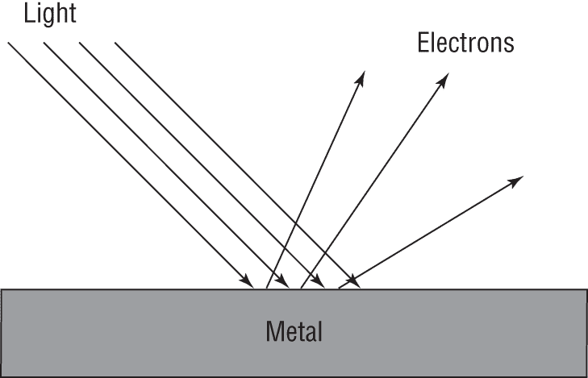

**图 1.1****:** 光子撞击物质然后发射电子 ¶ Steven Holzner，来自*《Quantum Physics For Dummies, Revised Edition》*的图 1.3；Wiley，2013

#### 波粒二象性

数百年来，科学家在微观层面发现的一切都被归类为粒子或波。*粒子*是（微观）物体，遵循明确、易于观察的物理定律，我们可以通过日常宏观物体（如岩石或球）看到其演示。粒子沿可预测的路径移动，受重力影响，并与其他粒子和物体发生相互作用，这些相互作用相对容易描述、预测和数学建模。

*波*是在空间或其他变量中在不同点之间振荡的连续扰动。波可以通过底层介质传输能量，而不会很大程度上扰乱介质中的其他物体，就像漂浮物体（如水面上的船）被波扰动时发生的情况。波会使船上下起伏，但除非波很大以至于形成浪峰，否则不会很大程度上扰乱船在水中的整体位置。波不仅包括我们可以看到的东西（如海浪、湖面涟漪或弦的振动），还包括我们看不到的其他波（如声音、无线电、辐射和微波）。

> **注意**  波可以在空间或位置以外的变量上振荡。例如，在电磁波中，是电场和磁场在变化。

波以连续、重复、相连的模式振荡。每种特定类型波的*波形*都有一个顶部峰值或波峰，然后是底部谷值或波谷，然后反复重复。波形顶部和底部之间的距离称为其*振幅*。特定时间段内的完整上下波振荡次数决定了其*频率*。

粒子和波受非常不同的物理性质支配，或者科学家们是这样认为的。粒子更像岩石或棒球。它们不容易“绕过”物体。它们以动量和力撞击。它们的碰撞轨迹和由此产生的反弹可以在事先确定并计算。你可以更轻松地看到构成粒子大质量的每个离散单元，就像看到构成岩石堆的单个岩石一样。粒子撞击墙壁就像虫子撞击挡风玻璃。波具有相反的特性。

在 19 世纪中期，经过大量的理论和实验，光及其组成的光子被认为是作为波传播的“定论科学”。但从 20 世纪初开始，当光子和其它电磁粒子在更多的亚原子实验中被观察和使用时，不同的科学家开始注意到光子和其它粒子既表现为波又表现为粒子（即*波粒二象性*）。当时，这被认为是有违科学的。爱因斯坦尤其坚持这种新观点，并因证明光也表现为粒子而获得了他唯一的物理学诺贝尔奖。爱因斯坦写道他对这一发现的看法：

> *似乎我们必须有时使用一种理论，有时使用另一种理论，而有时两种理论都可以使用。我们面临一种新的困难。我们有两个矛盾的现实图景；单独来看，它们都不能完全解释光的现象，但合在一起就可以。*

思考波粒二象性的最好方法之一是想象你有一个橡胶球，当它表现为粒子时到处弹跳，撞击其他物体并来回反弹，取决于其轨迹和撞击物。然后想象它掉进湖里并消失（在水面以下）。它的能量立即转化为波并产生涟漪。然后想象波纹撞击水中的码头柱，在那一瞬间，一个橡胶球出现在码头上，波消失了。这就是波粒二象性。取决于情况，光子有时表现为波，有时表现为粒子。感谢 Dominic Walliman 提供了这个极好的比喻。

##### 它是一个粒子

科学家们通过一个简单的实验演示了波粒二象性，该实验使用高强度（激光）光、一个背景以及中间放置的带有 1 或 2 个切口狭缝的阻挡材料。他们一次发射一个光子进入阻挡材料的狭缝，然后检查它们落在背景上的位置。

当只使用一个狭缝并发射光子时，光子会穿过狭缝并大致直接落在后面的背景上。当一次发射多个光子时，每个光子都落在彼此相当接近的位置，某种程度上模仿了狭缝的形状。想象一名神枪手从步枪通过同一狭缝发射子弹。如果每次步枪都在完全相同的位置，你可以预期子弹会落在几乎相同的位置，只会有轻微的调整，这取决于射手的技巧、枪发射子弹的准确性、子弹的个体特性以及任何其他介入因素。如果枪是从各种不同的角度射击，子弹可能会落在更分散的散射模式中。当一次发射多个光子时，情况就是这样。光子表现出粒子的特性。

#### *Interfering Waves*

当他们在中间的阻挡材料中增加第二个相邻狭缝时，发生了令人惊讶的事情。当他们发射单个光子时，它仍然落在狭缝后面的背景上，留下单个粒子的足迹（即像子弹孔一样），但不再直接位于狭槽后面。相反，随着他们一次发射越来越多的光子，它们似乎落在并不直接位于狭缝后面的区域。有明显的偏好区域，聚集了大量落点的区域与光子几乎不落的区域交织在一起。它形成了条纹——交替的光暗垂直条纹（如 Figure 1.2 所示）。

科学家们立即意识到，他们看到的结果是光子一次发射，表现为波传播（并以粒子形式着陆）的结果。条纹的产生是因为当光子以波的形式传播并击中两个狭缝时，它会产生两个结果波，一个在每个狭缝的另一侧，原来的单波的每个部分通过它相互作用的狭缝。在另一侧，两个结果波相互干涉，形成了条纹。但当光子着陆时，它以粒子的足迹着陆（如该 Wikipedia 视频所示：`https://upload.wikimedia.org/wikipedia/commons/e/e4/Wave-particle_duality.ogv`）。这是一个了不起的发现。

条纹是由波相互作用产生的。如果一束光波在其波峰顶部时遇到另一束光波也在其波峰顶部同时相遇，它将产生可能的最大组合、同步的光波，从而产生最亮的光。这也意味着在它们的共同波谷处，它也会产生最暗的极端。任何其他组合，除了两个最高峰（或最低波谷）完美同步外，都将导致更小的组合波，亮度和暗度结果更小。

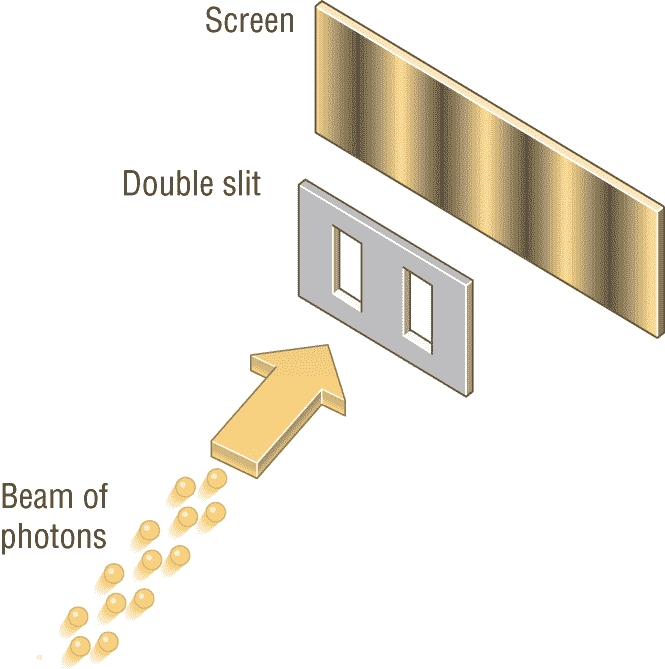

**Figure 1.2****:** Wave-particle x duality experiment using light source and two slits ¶ David Young and Shane Stadler, Figure 29-1 from *Cutnell & Johnson Physics, 11th Edition*; Wiley, 2018

早期在发现这一现象时，科学家们根本无法相信这些说法、数学或结果。花了几十年时间，大多数科学界才相信光同时表现为粒子和波。现在我们毫无疑问地知道，所有组成所有物质的亚原子粒子都表现出波粒二象性。这一发现加强了科学家们更全面探索量子力学并试图将其更充分地“钩”到我们更大的世界中的决心。今天，任何人都可以进行一个简单的实验来看到光的波粒二象性。

#### *Your Double-Slit Experiment*

能够重现早期波粒二象性实验之一，在你面前看到量子性运作，真是很酷。你可以用激光笔、锡箔和坚实的背景如墙来重复这个实验。使用强而纯色（非白光）的激光笔。越强越好。白光是所有颜色的光，它使实验更难观察，因为构成白光的各个颜色具有不同的频率。将锡箔放在切菜板表面上，切出两条等长的垂直狭缝，长度约为 1 英寸，尽可能靠近在一起（我们说的是毫米间隔）。然后在黑暗的房间里，从一英尺或更远处将激光光照射到两个狭缝之间，锡箔距离背景表面一英尺或更远。你可能需要尝试激光笔、中间材料和墙壁之间的距离，但如果操作正确，你会看到条纹。它可能没有像用更好的实验室设备进行的严肃物理实验那样鲜明，但你会得到条纹。

光的粒子性质也在同一实验中得到证明，尽管我们不能轻易看到这一点，因为没有特殊的探测设备，每个发射的光子都会在狭缝处或着陆在背景上被检测为单个粒子。当使用光子探测器时，它们证实每个光子都通过一个狭缝并以粒子形式着陆。但当测量所有发射的光子经过许多、许多实验后，其效果是明暗交错的条纹，再次证实了光的波动特性。这一个实验就证明了光（像所有量子粒子和分子一样）具有波粒二象性。

> `NOTE`  如果你想看到这个实验的真实例子，只需去 YouTube 搜索 `wave double slit experiment` 或类似内容。你通常会找到数十个展示该实验的视频。一个很棒的动画示例是 `https://www.youtube.com/watch?v=fwXQjRBLwsQ`。

#### *Detection Strangeness*

现在事情变得非常奇怪了。当科学家在其中一个或两个狭缝处放置光子探测器以查看光子实际通过哪个狭缝时，光子表现为粒子，所有波状行为立即消失。让我再说一遍。在探测器放置在两个狭缝的前面或后面之前，光子表现得像波。而在探测器放置并打开后，出于我们尚无法完全解释的原因，光子立即开始表现得像粒子，仿佛只有一个狭缝。就像粒子本身看到了探测行为并改变了其行为一样。科学家甚至做过这样的实验：他们在光子通过狭缝之后才打开探测器，当他们打开探测器时，光子似乎表现为粒子（它们本应作为波通过狭缝）。就好像光子已经根据未来探测的启动而追溯性地调整了过去的初始行为一样。我们不能说这（即改变过去）真的发生了，或者就时间、过去或现实而言到底是什么。没有人知道发生了什么或如何发生。只有当使用探测器时行为变化就会发生，我们很难理解正在发生的事情。这被称为观察者效应的一部分，这将在下面更详细地介绍，并且是本章开头星光路径变化故事背后的解释。

### Probability Principle

理解电子如何在原子核周围运动，有助于更好地理解我们的世界在量子层面的运作方式。例如，作为小学生，我们可能都学过，每个原子元素都由电子、质子和中子组成。每个 *atom*（普通物质的最小单位）都由 *nucleus*（由带正电的 *protons* 组成）和（不带电）*neutrons* 构成，其周围环绕着带负电的电子。电子“围绕”原子核“轨道运行”是因为电磁吸引。在小学时，我们大多数人都学过，电子在被称为 *shells* 的轨道带中绕原子核圆形运动。

在小学时，出于简化的原因，这些电子轨道壳层被显示为完美的圆形或也许是椭圆形，这常常让人联想到完美的行星般的轨道，但在原子层面（见 Figure 1.3）。

但量子物理学告诉我们，电子并不是在完美的圆形甚至椭圆形中运行。那些完美圆形的电子壳层是某人早期想象的产物，如今仅用于以一种不复杂的模式展示电子壳层。但这并不是自然界真正的运作方式。相反，电子在原子核周围的运行遵循量子力学和所涉及的能量所决定的更复杂的模式（Figure 1.4 显示了在特定能级下电子围绕原子核运行的二维代表性示例）。这些可能的运行区域被称为 *atomic orbits* 或 *electron clouds*。可能性的部分在量子力学中非常重要，将在下一节中更详细地解释。

事情变得有点复杂的是，没有人能提前猜测某个电子在任何一个时刻可能在何处运行，只能知道它处于某些（预测的）原子轨道区域的 *probability*。没有任何数学方程可以肯定地说出任何电子在任何时间都恰好在 A 点。量子力学能说的最好的是，一个电子在你尝试测量它时处于 A 点的可能性为某个特定百分比。而且如果你多次进行该测量，该电子会在其概率百分比所指示的次数出现在 A 点。

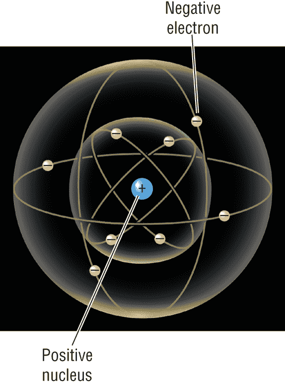

**Figure 1.3****:** 原子核周围环绕着过度简化的电子壳层轨道 ¶ David Young and Shane Stadler, Figure 30-1 from *Cutnell & Johnson Physics, 11th Edition*; Wiley, 2018

概率原理适用于量子粒子的任何属性，而不仅仅是电子。不仅无法提前猜测某个特定属性状态或位置，而且在任何单次测量中，测量时的状态或位置在概率预测的更大范围内是绝对随机的。这种特定答案或状态的随机性并不是偶然的；它是量子力学的基本且固有的特性。

这是量子力学与传统、经典物理学之间的一个关键区别，即量子对象或属性的确切状态或位置无法在事先精确预测。在经典物理学中，A + B = C，并且将始终等于 C。不仅如此，如果我知道 A 和 C，我可以预测 B，等等。但在量子力学中，电子在轨道中的确切位置或任何量子粒子的量子属性或位置只能用可能性和概率来描述。没有人能提前知道任何单次测量答案会是什么。只能说它将来自一系列可能的答案，并且如果多次测量，测量结果将符合预测的可能性。这是在最终测量之前任何人能做的最好的事情。

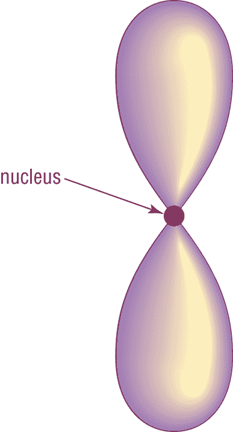

**Figure 1.4****:** 电子围绕原子核运行的二维原子轨道

那些可能的区域以及电子处于特定位置或特定量子属性一旦被发现和测量的 *likelihood* 可以被准确预测。如果你要反复进行某个电子实验（比如一千次）来测量电子在某一精确时刻的确切位置，你就无法预测单次测量中任何特定测得的电子的位置。量子力学说，任何单次测得的位置都是随机事件。但所有位置加在一起，电子最终在多次实验中被发现和测量的位置围绕原子核分布，将形成一个类似于预测的原子轨道的图像图。

即使我们无法知道确切的答案，可能的测量答案范围也是已知的。当离散量子系统的特定量子状态的概率已知时，它由一种称为 *wave function* 的数学公式描述。物理学家使用波函数来描述和预测在特定量子相互作用或属性内的广泛概率范围内会发生什么。单次测量的具体答案是未知的，但可能答案的范围是已知的，以及每个可能答案的概率。波函数在数学上描述了我们对量子粒子的所有了解，包括它的所有属性、这些属性可能具有的值，以及它们在测量中出现的可能性。对于物理学家来说，波函数是量子粒子的完整地图。利用波函数，科学家可以预测粒子之间发生不同相互作用时会发生什么。

量子物理学的这一概率原理很重要，因为它意味着我们无法在测量之前预测任何特定量子属性状态会是什么。例如，作为一个非常简化的（非量子）说明，假设我们试图确定一只狗是黑色还是白色。从量子角度来看，我们无法在测量之前提前确定狗的颜色。我们可以说明可能的答案是什么（即黑色或白色），甚至可以根据预先确定的数学说明每个答案被观察到的可能性（比如说，如果我们多次进行实验，狗有 50% 的时间是白色的，50% 的时间是黑色的）。但我们必须等到狗被揭示出来才能看到狗实际观察和测量的颜色是什么。不仅如此，在任何特定时间测得的狗的颜色将是随机的。这就是量子。

> **NOTE**  这种奇特的量子特性让倾向于经典的物理学家感到沮丧，并使量子力学显得如此令人不安。以传统物理学为例，一旦你知道所有涉及的对象、它们的属性和它们的相互作用，你总是能够提前算出答案或结果。当实验结束或结果返回时，它将与之前陈述的数学预测的答案相匹配。“这就是科学！这就是它的运作方式！”另一方面，量子力学说，无论你对数学、对象以及它们如何相互作用了解得多么好，你都 *never* 能预测任何单次实验或量子结果的具体答案。你能做的最好的事情就是预测不同答案的概率。

为了让事情更复杂，量子计算机给出的“答案”可能不是正确的答案，而且在今天（2019 年）通常也不是正确答案。请记住，量子答案只是在给定概率范围内的答案。但是如果我们能多次运行量子场景并得到大量的量子答案，我们就能看到正确的答案，因为它在连续的运行中被返回得更频繁、更一致。基本上，为了得到真实、正确的答案，计算会一遍又一遍地运行，直到返回的概率性答案具有足够的统计置信度，以至于它必须是正确答案。

作为宏观的比喻，假设一个六面骰子被加权，使其掷出一点的次数比其他任何结果都多（即“作弊骰子”）。你知道骰子有偏差，但你不知道偏差在骰子的哪一面。当你掷骰子一次时，它可能掷出加权偏差的那一面，也可能不掷出。但当多次掷骰子时，一点更有可能比其他任何数字出现得更频繁，从而以很高的置信度证实了偏差。假设你计划掷这个作弊骰子十次。第一次掷出的是二。现在你有一个答案，但置信度只有 10%（10 次掷骰中有 1 次）。第二次掷出的是一点。现在你又得到一个答案，但置信度仍然只有 10%（10 次掷骰中有 1 次）。第三次掷出又是 一点，置信度达到 20%（10 次掷骰中有 2 次）。第四次掷出的是五。然后在接下来的五次掷骰中你得到一点，这使置信度达到 70%（10 次掷骰中有 7 次是一点）。最后一次掷出的是三。总体上你会有四种不同的可能答案，但骰子的一点面出现的次数最多，因此任何合理的人都会得出结论，骰子的一点面是偏差面。在量子计算机中，问题和答案很可能会运行远不止十次，以获得正确答案的最大可能性。

对于任何单次测量来说，始终存在它是错误答案的可能性。尽管这听起来令人不安，但这就是所有量子答案的工作方式。你从出生以来就一直生活在并在那个世界中生存。

### 不确定性原理

`Heisenberg uncertainty principle` 指出，量子粒子的位置被测得越精确，其动量就越不可能被准确知道，反之亦然。不确定性也适用于其他依赖的量子属性对（称为 `conjugate variables`），但并非所有属性。可能存在可以同时完美测量的属性对，只是并非所有属性对都可以。某些属性对以一种相互依赖的方式联系在一起，使得无法同时对两者的属性进行完美准确的测量。

这并不是由于人类能否精确测量某事的方法上的缺陷；这是自然界的量子定律，由粒子的波粒二象性和概率原理产生。量子力学已经证明，由于这些定律，你无法同时精确测量量子粒子的位置或动量，并且当你试图更精确地测量一个量时，依赖对的另一方就会变得不那么准确。

让我们再用一个宏观的比喻，即试图测量汽车的速度。在宏观、经典世界中，汽车的速度只是其在特定时间段内行驶距离的测量值。如果汽车在恰好 1 小时内行驶了 100 公里，你就会说它平均时速为 100 公里/小时。但在量子世界中，当观察非常小的粒子的量子属性时，时间和距离变量都不是固定的。它们在概率范围内变化，任何单次测量都可能得出这些范围内的不同答案。这使得测量从一开始就更困难。

尽管以我们的飙车例子为例，有一个非常相似的比喻。如果在汽车路径的任何时刻你进行测量，汽车的速度可能快于或慢于 100 公里/小时。实际上，任何复杂的自驱动物体在所有时刻都以完全相同的速度行驶的可能性极低。对于汽车，你必须考虑风阻、路面状况变化、温度变化，以及发动机内部的数百个因素，这些因素决定了在任何一刻产生的功率和扭矩，从而决定了它在任何一秒钟行驶的速度。虽然，如果汽车最终被测得在整个路程中行驶了 100 公里/小时，它可能比任何其他速度更长时间地以 100 公里/小时行驶。

这代表了概率原理。在路程的任何一点，如果有人拿着雷达枪，汽车可能以任何速度行驶，但很可能最终被测得在恰好 1 小时内行驶了 100 公里的汽车，在路程的大部分时间里以 100 公里/小时行驶的速度比其他任何速度都多（尽管它在路程的一半时间里恰好以 98 公里/小时行驶，另一半时间恰好以 101 公里/小时行驶的可能性始终存在，但可能性较小）。

不确定性原理说的是，当你试图更准确地测量速度所涉及的时间时，距离就无法在同一时间被准确测量，而且没有办法修复它。在量子世界中，不存在高度准确的速度。作为一个概念，它不存在。这是一条自然法则。为了继续我们的飙车比喻，假设我们的裁判想要超级准确，为此他们决定使用世界上最好的闪光摄影，在汽车越过测速比赛终点线时拍下照片。为了捕捉汽车越过终点线的确切瞬间，相机的快门必须极快地打开和关闭。在那个精确的微秒，汽车在时间上会被“冻结”。在它越过终点线的确切瞬间的照片中，汽车看起来根本不会移动（或几乎不移动）。终点线相机可以捕捉汽车越过终点线的确切时刻，但在那个确切瞬间汽车不会移动（或移动很少）。相机试图获得计时结束的确切时刻时，就必须将速度从测量中移除。而如果有另一台相机在测量汽车的真实速度，它将无法准确捕捉汽车越过终点线的确切时刻。

更复杂的是，线是什么？在宏观层面上，任何线看起来都像一条直线。但放大任何绘制或画出的线，其微小的起伏就会在放大下显现出来。为了最准确，你必须在汽车越过画线的第一个原子时按下快门或按下秒表。你的眼睛和相机的眼睛必须在汽车越过那个第一个原子时恰好按下快门，而我们甚至无法在照片返回到我们的视网膜或相机镜头之前看到汽车何时真正越过线的第一个原子。而这些过程依赖于光子和光速。

到第一条记录光子返回时，汽车实际上已经驶过了对这些测量而言的实际第一个原子。而我们知道第一个原子是由亚原子粒子构成的——电子、质子和中子。为了达到最精确，你必须在汽车遇到外层电子壳层轨道上的第一个电子时停止秒表或触发相机，而根据量子理论我们不知道那个第一个电子会在哪里，在任何一次单次测量中它可能出现在任何地方，而且可能不在其最高概率位置。最终你无法做出真正精确的速度计算，因为你为了获得最高精度而需要的那些属性（即电子）本身在运动，整个粒子也沿着输出的波函数作为波在运动。当你试图获得越来越精确的测量时，你会意识到你根本无法对任何事物进行真正精确的测量，更不用说那些定义本身就依赖于彼此的共轭对了。一切都在不断运动（即使是一块石头也是由运动的电子构成的），一切既是粒子又是波，一切在被测量时和未被测量时的表现都不同，每次特定测量中的每一个答案都是随机的，而且可能甚至不是“正确”（最高概率）的答案。而对于共轭对而言，对一个值的精确测量取决于另一个值，而根据定义，另一个值必须被测量得更不精确。在我们的例子中，公里/小时（即位置和动量）的概念在量子层面上根本不存在。它就是不存在。那就是不确定性原理。

你必须明白，测量对中的不确定性并非源于测量设备能力的不足。许多人在第一次听说不确定性原理时认为它与测量装置不够精确有关。他们认为这与测量设备的缺陷有关。不是这样的。我们可以拥有最精确的测量设备，能够非常精确地（以我们人类的感官为准）测量时间和距离，这也无济于事。问题不在于测量不精确；而是由于（量子）自然规律支配了我们能够对依赖于两个相关共轭变量的任何量子态进行测量的准确度。随着我们对相关对的一侧进行更精确的测量，另一侧就变得不可能再精确地测量。事实上，这是一种确定的反向关系。

> **NOTE**  概率和不确定性原理不应被误解为意味着量子力学和量子属性在数学上不能精确。恰恰相反。量子力学中的数学和结果是极其精确的，并且具有经证实的置信水平，超过了大多数其他科学。不确定性原理也不应与下面讨论的观察者效应混淆。

#### 自旋态和电荷

有 12 个 `fundamental`（也称为 `elemental`）量子粒子构成宇宙中的所有物质。量子基本粒子，据我们所知，不能被分解成更小的整体粒子。如果你之前没有接触过，请做好准备。其中一些粒子有奇怪的名字。基本量子粒子是 electron、`muon`、`tau`、`electron neutrino`、`muon neutrino`、`tau neutrino`（都属于 `lepton` 家族），以及 `up`、`down`、`top`、`bottom`、`charm`、`strange`（最后六个属于 `quark` 家族）。

这些基本量子粒子构成所有其他亚原子粒子。例如，每个质子都由两个上夸克和一个下夸克组成。中子由两个下夸克和一个上夸克组成。电子作为基本粒子，不是由任何东西构成的。它就是电子，没有进一步的亚原子粒子可以构成或分解它。但电子、质子和中子构成原子，原子构成元素和分子，等等。

> **NOTE**  我们永远无法确定我们已经发现了所有基本粒子，甚至无法确定现有的轻子和夸克是否就是基本粒子，尽管当前科学非常坚定地认为它们是最低公分母粒子。但在历史上我们曾对细胞、原子和质子说过同样的话。所以，谁知道我们在试图完成现实这幅宏大拼图时还会发现什么？

每个基本量子粒子都有质量、电荷和自旋。每个人都理解什么是质量，所以让我们快速讨论另外两个。`charge` 是与电子相比的电流量。例如，上夸克具有电子电荷的三分之二，下夸克具有电子电荷的负三分之一。因为质子有两个上夸克和一个下夸克，这意味着质子具有电子电荷的 3/3（2/3 + 2/3 – 1/3），或恰好等于一个电子。在大多数稳定原子中，核内的质子数等于轨道电子数，正是出于这个原因。

基本粒子还具有 `spin`，它与粒子必须旋转多少次才能回到原始取向成反比。所有基本粒子自旋均为二分之一，这意味着它们必须旋转两次才能回到起始取向。为什么我要教你量子电荷和自旋？因为量子计算机给出的答案往往是电荷和自旋的结果。如 Chapter 2 “Introduction to Quantum Computers” 中所述，不同类型的量子计算机使用不同的量子属性和状态来提供答案。

#### 量子隧穿

`Quantum tunneling` 是量子粒子穿过经典物理学认为不可能穿过的屏障的一种无法解释的能力。常见的宏观类似例子是一颗球坐在山丘或墙的底部。假设一个人试图把球扔过墙，但他身体上没有足够的力量把球扔过墙。他一次又一次地尝试，但都没有成功。经典物理学，观察到人的手臂和身体力量，说这个人永远也做不到。但然后，出于无法解释的原因，被扔的球有时会出现在墙的另一侧。一些理论说球不可解释地直接升过墙。另一些说法是墙在那一次投掷时降低了，或者球被允许穿过墙而没有留下入口或出口点。

我们尚不知道它是如何运作的，也不知道亚原子粒子何时会成功使用它，而之前的尝试却都不成功，但它确实存在，并且是所有已知生命的基础。隧穿是我们的太阳通过 `thermonuclear fusion` 产生热和光的方式。隧穿是放射性元素衰变的方式。隧穿是光合作用的基础，光合作用支撑着地球上大部分植物生命，进而支撑人类生命。量子隧穿也涉及某些类型的量子计算。

#### 叠加

`Superposition` 是一种量子属性，它说一个粒子可以在所有可能的状态中存在，直到该状态最终被观察和测量，从而给出单一答案。例如，假设一个你不知道答案的特定数学问题可能答案为 A 或 B。叠加说在答案处于量子态、尚未被观察或测量时，它同时既是 A 又是 B。它不是 A *or* B。它是两者兼有。

这是因为，正如上面所讨论的，在对量子属性的任何特定测量中，被测量的属性可能为任何可能的答案。而任何单次测量的实际测量结果可以随机为这些可能答案中的任何一个。在经典世界中，一切就是它所是的。A 就是 A。B 就是 B。单个字母不能有时随机为 A，有时为 B。但在量子世界中，这正是发生的事情。

也许你听说过埃尔温·薛定谔著名的量子猫困境。薛定谔创造了一个（仅是思想实验）场景，其中一只猫被放在一个封闭的盒子里，盒子里有一瓶盖好的致命毒药、一块放射性元素和一个盖革计数器。放射性元素可能衰变也可能不衰变。放射性衰变是一个量子事件，某个特定原子何时决定衰变是一个随机事件。如果盖革计数器探测到辐射（来自放射性衰变），盖革计数器会触发毒药瓶破碎，从而杀死猫。

薛定谔创造了这个思想实验，它是量子叠加过程导致可观测宏观事件的一个例子，用来展示如果叠加扩展到宏观层面会多么奇怪。薛定谔试图说明在他那个时代所描述的量子力学是多么荒谬。他并不是为了支持量子力学而做这个思想实验。他是想说明它有多荒谬，并说我们并不真正理解发生了什么。如果他今天还活着，他可能会笑自己的故意荒谬思想实验竟然成了量子力学真正工作原理最常用且经久不衰的例子，因为这并不是他的本意。

在打开盒子并观察猫之前，叠加原理指出放射性元素既已衰变又未衰变。猫既是活的也是死的。在经典物理（或真实）世界中，猫在任何特定时间点要么是活的*或*是死的——在特定时间点只能是其中一种。量子物理学在量子层面证明的是，猫（通过放射性衰变的延伸）在被打开盒子观察之前同时既是活的也是死的——而并非处于某种半状态，即猫有点中毒但既不完全死亡也不完全健康。不，它意味着它同时是 100%健康和 100%死亡。宏观层面看似荒谬的东西在量子层面却是绝对的现实。

如果你要理解量子力学和量子计算机，你必须理解叠加的概念。你必须打破你对世界其他方面的看法和理解，因为在量子层面，世界的行为并不像你认为的那样。我花了很长时间才理解薛定谔思想实验的含义。我认为猫是活的或死的，当我们打开盒子时，它就是其中一种，并且从某个先前的时间点起就是如此。这不是叠加所说的。叠加在一次又一次的证明中表明，猫在最终被观察和测量之前同时既是活的也是死的，处于两种状态。一旦猫的“状态”被测量，猫就会永久地活着或死去，并且从那时起，这将是该观察的测量结果。这种清算让历史上最伟大的科学头脑感到困惑，而且至今仍如此。然而一次又一次的实验都支持叠加在量子层面的现实。

量子力学以及由此延伸的量子计算机是瞬时生成所有可能答案的，直到答案被观察和测量，“正确”的答案就是所有可能的答案。一旦我们观察或测量答案，只有一种答案会成为我们的永久现实。

事情变得更复杂，正如前面所讨论的，没有人能预测最终观察到的答案会是什么。没有人能说，“肯定，猫死了！”或“肯定，猫还活着！”并且总是正确——只能说在被测量之前猫既是活的也是死的，并且在被测量时猫是活的*或*死的，但只是在特定概率的可能结果范围内，而当被测量时的具体结果在可能的选择中是随机的。如果某人的猜测是对的，那只是因为他运气好（或玩了概率）。

如果这让你感到困惑或头疼，我们甚至还没有到最奇怪的部分。坚持住。

#### 观察者效应

在量子世界中，仅仅观察一个量子系统就会改变它，尽管量子物理学家不知道或不同意原因。像本章讨论的所有量子特性一样，数十年的实验表明这一特性是真实且准确的。科学家们不是在怀疑它是否真实，而是在思考为什么或如何真实。例如，在每一次双缝实验中，当科学家放置光子探测器来测量光子通过哪一个缝时，光子总是只表现为粒子（并且由此产生的波带不会出现）。如果他们关闭探测器，波带就会回来。就好像自然看到了测量的发生，在意它，并改变了发生的事情。这可能不是发生的事情或原因，但这是我们根据实验观察和结果对正在发生的事情的描述，因为我们没有太多其他方式来传达我们所看到的。我们还不知道发生了什么。

这导致了许多不同的竞争解释。其中一种解释说，不可能在不以某种方式干扰系统的情况下观察它。例如，仅仅观察某物通常需要光（即光子）或某种人为插入的设备来捕捉结果，而这些附加物会影响可能的量子结果。以光子为例，光子必须“击中”被测量的东西并反弹回探测器（或我们的眼睛）我们才能探测到它，而这种“击中”*必须*引起某种相互作用。

另一种流行的解释（*哥本哈根诠释*）说，当许多可能性的量子波函数最终被测量和观察时，波函数会“崩溃”（称为*波函数坍缩*）成一个最终状态。导致崩溃的观察就是干扰。要理解哥本哈根诠释，你必须再次确保你理解并相信叠加，即在被测量之前，任何量子答案或状态都是同时存在的所有可能的答案或状态。测量量子场景的行为会将所有状态或答案减少为单一的最终答案或状态。测量它会将所有并发的可能答案坍缩成一个最终的永久答案（该答案在概率上可能“正确”也可能不正确，并且如果以任何方式不同地测量或观察，可能不会是相同的答案）。

哥本哈根诠释在解释为什么观察某物会改变它方面获得了量子世界中最大的支持。尽管其固有的奇怪性正是薛定谔创造他的猫进盒子悖论思想实验的原因，薛定谔正是想指出哥本哈根诠释与我们先前所信的有多么违反直觉。科学家们谁也没想到，哥本哈根诠释甚至还不是最难以置信的解释。

另一种，*多世界*诠释，说在波函数坍缩之前的所有可能答案现在都在另一个宇宙中，并且每次量子坍缩都会根据坍缩前概率波函数中的所有可能答案创造出数量相等的新宇宙。天哪！现在考虑到每秒可能有数万亿次量子结果发生，这将产生大量宇宙，形成一个极其庞大的*多元宇宙*海洋。尽管这听起来很疯狂，但一些基础实验已经进行了，支持我们无法排除量子多元宇宙的想法，包括导致 2019 年这篇新闻报道的实验（`https://www.iflscience.com/physics/quantum-experiment-sees-two-versions-of-reality-existing-at-the-same-time/`）。大多数人并不认为多元宇宙解释是正确答案，但在数学上排除它之前，谁知道呢？

观察者效应对量子计算有巨大的影响。我们希望量子计算机能为那些 otherwise 极难解决的问题提供精彩的答案，但它们必须以最小化或利用观察者效应的方式制造和运行，这样我们才能在需要时获得准确的答案。

### 无克隆定理

一个相关的原理，对量子信息科学来说至关重要，是 *无克隆定理*，它说量子态不能被直接复制。记住，测量一个量子态会将其从量子态改变为经典的、永久的状态。而且根据观察者效应，仅仅观察或测量一个量子态就会改变它。这并不是说“复制”不能做到，而是必须间接地进行。更多内容将在后面的章节中介绍。

无克隆定理对量子计算有许多影响。在负面方面，这意味着你不能像在经典计算机中那样在量子计算中间备份一个量子态。它使量子计算机和网络设备的复制和纠错变得更加困难。在正面方面，这对于量子密码学来说是一个很棒的特性，并阻止了许多在经典世界中更容易的窃听场景。

### 诡异的纠缠

现在是时候讨论那个常被认为是最奇怪的量子特性了，那个困扰爱因斯坦直至去世的特性。量子粒子可以以这样的方式“纠缠”：当一对粒子中的一个粒子的量子属性（如偏振、旋转、动量或电荷）发生变化时，即使这两个粒子相隔非常远的距离，另一对粒子的属性也会立即以可预测的方式发生变化。我们不知道为什么或如何，这就是爱因斯坦称之为“远距离的幽灵般作用”的原因。

> **注意**  纠缠是一个只读的、测量过程。科学家们知道，当他们测量一对粒子中的一个粒子的属性时，另一对粒子中的粒子将具有相同的读数。但如果科学家们试图以任何方式操纵纠缠粒子以获得特定的期望新状态——比如将粒子属性从“0”读数改变为“1”——它会立即破坏纠缠。我们可以读取信息但不能传输它。实现特定的期望状态需要测量状态，而测量状态会破坏量子属性。

在自然界中，纠缠是一个自然过程。每当任何量子粒子与另一个量子粒子相互作用时就会发生。它每次都发生。纠缠随着遇到的每个粒子而增长。它几乎无法停止。纠缠最终会产生多粒子实体，现在它们相互依赖。从物理学的角度来看，你不能再把任何纠缠粒子当作单个粒子来谈论。每一次观察都必须从同一纠缠中涉及的所有纠缠粒子的结果中得出。在现实世界中，纠缠发生很多而且非常快。一个量子粒子可以在百万分之一秒内轻松与数十亿个其他量子粒子纠缠。

尽管量子粒子总是在自行纠缠，但为了量子测试目的，科学家们有意只创建或纠缠少量量子粒子。那是因为当你试图在实验中弄清真相时，少通常意味着多。弄清楚数十亿粒子相互作用的结果会使事情变得混乱。

因此，在需要纠缠的实验中，科学家们会努力隔离实验环境以防止任何不必要的纠缠，并在更小的规模上创建自己的纠缠。实验纠缠可以通过多种方式实现，尽管最常见的方法之一是取一个更高能量的单光子并将其分裂成两个能量较低的光子。还有几种其他常见的纠缠方法，但它们的技术复杂程度超出了本书的范围。

到目前为止，实验性的纠缠必须涉及两个非常接近的量子粒子。科学家们到目前为止还没有能够纠缠相距很远的两个粒子，尽管距离一直在延长。但一旦纠缠，这两个粒子可以被移动到非常、非常远的地方并且仍然保持它们的纠缠结合。虽然随着距离的增加，纠缠粒子与其他纠缠粒子相互作用的机会增加，使得科学家们很难甚至不可能测量他们想要从原始、预期纠缠中获得的东西。

爱尔兰物理学家约翰·S·贝尔通过一系列无可争议的实验加强了量子纠缠理论，他于 1987 年在其开创性的白皮书《量子力学中的可言说与不可言说》中发表了其描述（`https://web.archive.org/web/20150412044550/http://philosophyfaculty.ucsd.edu/faculty/wuthrich/GSSPP09/Files/BellJohnS1981Speakable_BertlmannsSocks.pdf`）。贝尔排除了爱因斯坦假设的“隐变量”，这些隐变量是纠缠的另一种可能、更可能的解释。贝尔证明了不存在隐变量，这极大地加强了纠缠理论和整个量子物理学。

此后，他的实验已多次重复，每次都取得了同样的成功，并且在不同的量子粒子上进行了测试。诡异的纠缠已在光子、电子、中微子，甚至更大的分子如“巴基球”中得到证明。量子纠缠甚至已在宏观物体中得到证明，例如钻石（`https://news.yahoo.com/two-diamonds-linked-strange-quantum-entanglement-190805281.html`）。并不是说量子物理学家需要图片来相信或证明任何事情，但在 2019 年 7 月，科学家们能够捕捉到纠缠粒子的第一张图片（`https://phys.org/news/2019-07-scientists-unveil-first-ever-image-quantum.html`），这同样让科学和非科学界的头脑感到兴奋。

### 退相干

我们将在本章讨论的最后一个量子特性是 *退相干*。它在量子物理学和计算中极其重要。它是我们既想要又想避免的东西（直到合适的时候）。当一个量子粒子或系统处于易于观察的一组量子态中时，我们说它是相干的或处于 *相干* 状态。我们可以轻松看到其量子性的结果，即沿着波函数运行并具有所有可能答案。没有极端的环境隔离，任何量子粒子或系统都将开始与其它量子粒子相互作用并纠缠。事实上，在微秒内会有数十亿次的相互作用。这甚至发生在我们可能认为的空虚中。例如，当科学家在没有光或其他有意量子粒子的盒子内制造人工真空时，用于制造真空的装置会渗入真空。这是不可避免的。同样，在没有极端条件下，这会经常且快速地发生。即使在最佳条件下也会发生。它无法阻止发生。

每次不必要的相互作用都会导致纠缠，现在试图跟踪一个或几个粒子或属性的科学家必须开始处理来自他们通常不想要的更复杂、多粒子混合的结果的结果。他们的原始粒子（们）在那里，但很容易在其他纠缠粒子的海洋中丢失，而且在任何情况下，他们都很难弄清楚他们正在观察和想要测量的原始粒子（们）的影响或结果。

想象你想追踪一滴水，它落入大海。或者你想在阳光明媚的海滩上追踪一个光子。那滴水仍在大海中，但现在立即分散在数万亿、数万亿的其他水滴之中。你可能仍能追踪到原来的那滴水，但会很困难。你可能还能在海滩上追踪到原来的那个光子，但它不仅迷失在一万亿个其他光子之中，而且还在与其他光子和其他粒子相互作用，既有微观的也有宏观的，例如尘埃、空气、风。就实际用途而言，在仅仅几次相互作用之后，追踪任何单个粒子并弄清楚所有其他纠缠造成了什么或没有造成什么就会变得困难。

正因如此，在量子实验以及量子计算机和其他设备内部，内部结构必须高度隔离于外界。量子科学家希望尽可能防止不必要的纠缠发生。使用单一稳定元素的贫瘠表面、低温以及对外部世界的屏蔽都是常用的方法。但当科学家或机器失去追踪原始粒子或其属性/属性并弄清楚最初期望的结果的能力时，量子粒子或系统就被认为是退相干的或处于退相干状态。需要指出的是，粒子或系统的量子性并没有变成其他东西。它并没有变成非量子/经典。它只是变得对我们贫乏的大脑和设备来说太难追踪和以有意义的方式理解了。

有时我们需要退相干。在量子信息科学中，当我们想要得到一个可以写下来并称为结果的量子答案时，我们必须测量它，而测量它会使其纠缠并改变它。无论测量装置是什么，它也由量子粒子和属性构成，必须与被测量的粒子或属性相互作用。即使测量只涉及光，光也是由光子构成的，为了让光子捕捉结果并报告回来，它必须“击中”粒子并反弹。现在这个光子就与它所测量的事物纠缠在一起了。所以，仅测量本身就会使量子系统退相干。它并没有突然将量子态改变成非量子的东西，它只是开始立即增加测量的复杂性。

但为了记录特定实验或计算的量子结果，我们必须测量它。所以，我们希望在退相干被控制并最小化直到我们的测量装置成为使其退相干的东西时进行测量。我们需要测量并使其退相干，以便获得最终的测量和答案。我们不希望答案有时是 A 有时是 B。我们需要一个永久的结果值来记录。你能想象如果每次我们需要答案时，我们都可以说“它是一个跨概率谱的所有可能答案的范围”然后就此作罢吗？我们不能只说汽车时速 100 公里/小时。我们必须说，好吧，它的速度在 0 到 200 公里/小时之间某个地方，这里是概率。这将是一种描述世界的荒唐方式，尤其是当每个人都明白一辆被记录为时速 100 公里/小时的汽车在所有时间里根本不可能都是时速 100 公里/小时。为了记录答案，我们基本上只想要最可能的“正确”答案，而不是沿着数学波函数的答案谱。所以，我们希望在仅需要测量的时间有意地使系统退相干。我们希望避免在测量前使系统退相干，一旦我们获得了所需的测量结果，它就可以随意进一步退相干了。虽然科学家也希望，并且正在尝试，在不使系统退相干的情况下进行多次测量。在量子信息科学中，保护系统免受最终测量所需之前的过早退相干的侵害是最大的斗争，如果不是*最大的*挑战的话。

还有许多其他核心量子力学属性、原理和理论，例如情境性，我们可以讨论，但我们已经讨论的内容是讨论量子计算机如何在第 2 章中工作的一个很好的基础。

### 当今世界中的量子示例

虽然量子力学主要发生在亚原子层面，但如果没有它在我们现实生活层面的非常真实的存在和影响，我们的现实就不可能存在。量子力学使太阳发光，是所有物质保持在一起的原因，也是我们宏观层面所见大多数事物的基础。当你看到炉灶加热器发红光时，这只有在量子效应存在的情况下才可能。量子力学负责我们的计算机微处理器、晶体管、电阻器和所有集成电路。磁盘存储和网络通信只有在量子力学存在的情况下才可能。你的 Wi-Fi 连接之所以能工作，只是因为量子特性。以下是仅直接由于量子力学才可能实现的其它宏观现实：

* 光纤电缆
* 激光器
* 超导性
* 超流体液体
* 原子钟
* 磁共振成像（MRI）
* 不要忘记这本书的全部原因，量子计算机和量子密码学

所有这些美妙的事物，以及所有现实，只有因为量子力学所有令人难以置信和奇怪的怪癖才得以运作。我将在第 5 章，“后量子世界会是什么样子？”中介绍量子力学将如何帮助我们的更多内容。

### 附加信息

量子物理学领域庞大。本章涵盖的主题真正代表了冰山一角的尖端。每个总结的主题都已被数十篇白皮书和书籍所涵盖，有时甚至是数百篇论文和书籍。没有任何一本书、白皮书或在线媒体教程能对量子力学做到公正。任何有兴趣了解更多的人都应该先挑选几个资源开始深入研究。在阅读或观看至少几份这些资源之前，即使是基础知识也往往开始难以理解。

话虽如此，以下是我个人最喜欢的任何量子物理新手可以开始的资源：

* Aaronson, Scott (2013). *Quantum Computing Since Democritus*. Cambridge: Cambridge University Press.
* Bell, Philip (2018). *Beyond Weird: Why Everything You Knew About Quantum Physics Is Different*. Chicago: University of Chicago Press.
* Orzel, Chad (2009). *How to Teach \[Quantum\] Physics to Your Dog*. New York: Scribner.
* Orzel, Chad (2018). *Breakfast with Einstein: The Exotic Physics of Everyday Object*s. Dallas, TX: BenBella Books, Inc.
* Dr. Mark G. Jackson's Articles for Popular Audiences. `http://physicsjackson.com/articles/`
* Quantum Physics Blog. `https://www.techbubble.info/blog/quantum-physics`
* Scott Aaronson Blog. `https://www.scottaaronson.com`
* Dr. Scott Aaronson's Democritus online courses. `https://www.scottaaronson.com/democritus/`
* YouTube. *Quantum Theory—Full Documentary HD*. `https://www.youtube.com/watch?v=CBrsWPCp_rs`
* YouTube. *Quantum Physics for 7 Year Olds*. `https://www.youtube.com/watch?v=ARWBdfWpDyc`
* YouTube. *Neil deGrasse Tyson Explains Quantum Entanglement*. `https://www.youtube.com/watch?v=q8CQAOwi2RI`

如果你有兴趣了解更多关于量子力学的信息，请前往 YouTube 和/或 Amazon 并输入 **quantum physics mechanics** 以查看数百种选择。

### 摘要

如果这是你第一次接触量子力学，我希望我已经成功地向你展示了它奇妙的怪异之处。欢迎在后续章节中随着你对量子力学的理解加深时，返回本章重新阅读。量子计算机利用这些令人难以置信的量子特性，包括纠缠、不确定性和叠加，来提供传统二进制计算机根本无法实现的答案。第 2 章《量子计算机简介》将讨论量子计算机和设备如何工作以提供我们可以依赖的令人难以置信的答案和解决方案，以及目前最先进的技术状态。

# 2 量子计算机简介

量子计算机、设备和软件利用第 1 章中讨论的量子力学的奇特特性来操纵、创建和处理数据。所有那些奇怪而奇妙的量子特性，例如叠加和诡异的纠缠，都在量子信息科学中得到充分展现。第 2 章将涵盖量子计算机，包括它们与传统计算机的不同之处、不同类型的量子计算机架构，以及制造它们的许多公司。

### 量子计算机有何不同？

本节将讨论量子计算机与传统二进制*经典*计算机的不同之处。它将从探索比特和量子比特之间的主要差异开始。

#### 传统计算机使用比特

传统计算机使用二进制数字（0 或 1）来存储、传输和操纵数据。*比特*（binary digit）可能只有两种状态之一：它是 1 或 0。它是开或关。并且它在任何时候只能是其中一种事物（即状态）。这种底层二进制特性之所以存在，是因为被操纵的粒子（例如，通常是电子，但也可以是光子和其它粒子）是以整个粒子的形式被操纵的。从数字计算机的诞生直到量子计算机的发明，这一直是我们能够操纵数字信息的方式。量子计算机允许我们以非二进制的方式操纵粒子，利用其量子特性。

传统计算机芯片之所以能工作完全依赖于底层的量子力学，但它们只能以二进制方式在各种逻辑门和受影响的掺杂（即有意嵌入所需杂质）半导体上的位置之间操纵和移动整个电子。它们所操纵的测得的底层电子处于两种完整状态之一，这相当于 1 或 0。传统计算机不测量自旋、极化或任何其它可能的量子特性。

由于一个比特在任何时候只能表示两种状态之一，我们可以轻松计算表示特定信息量所需的比特数。例如，1 个比特可能有两种不同的信息位（即 0 或 1），但在被测量之前、期间和之后，它只表示 1 位信息。两个比特可以有四种不同的可能信息（即 00 或 01 或 10 或 11），但在测量时只表示 2 位信息。三个比特可以有八种可能的不同的信息（即 000 或 001 或 010 或 100 或 010 或 011 或 110 或 111），但在测量时只表示 3 位信息，依此类推。每个额外的二进制数字都会带来*指数*增长的可能性（2⁴、2⁵、2⁶等）。

早期的计算机是通过物理操纵将单个比特打开或关闭来直接编程的。它们有物理的电子“跳线”电缆，这些电缆插在计算机上或未插，以建立或不建立特定的路径连接。计算机界的一个长期故事是，*计算机虫*这个词的由来是因为真正的虫子吃掉了电缆的部件并导致编程错误。

长长的软盘状跳线电缆被内置的机械开关和纸质编程“穿孔卡”取代，后者本质上操纵内部机械开关以改变计算机的二进制路径。即使在今天，许多计算机设备仍保留着“跳线”开关，用户可以物理操纵它们来确定二进制选择，例如特定计算机路径和决策的“开”和“关”。

机械开关被电子开关取代，这最终导致了晶体管、电阻器和微处理器，它们在最简单的层面上只是尽可能将尽可能多的二进制“逻辑门”塞进最小的空间中。但无论我们能把多少个二进制开关塞进电路板或一块硅片中，一切都是以二进制方式完成的。只是更多的二进制路径可以装进更小的空间。

最低级的计算机语言，例如汇编语言，与在计算机微处理器中移动比特相比只相差一个抽象层。例如，汇编语言指令 `MOV AH, 1` 是指示计算机微处理器将二进制值 1 移动到 `AH` 寄存器中（寄存器是微处理器存储和帮助操纵数据的存储区域）。

每种二进制计算机编程语言最终都会被分解为二进制指令，然后物理操纵计算机微处理器的电子在预定义的 *布尔* 逻辑门（`AND`、`OR`、`NOT` 等）之间移动。经典计算机系统从上到下建立在二进制操纵和存储二进制数据之上，它们以无法估量、非凡的方式推动了世界发展。在所有二进制行为的底层是量子粒子和行为，但它们并未被用来存储和传输信息或进行计算。

然而，二进制计算机的能力存在局限性。有一些事情是二进制计算机根本无法做到或做得不够好。或者它们不够快，无法达到我们所需的实用性。例如，二进制计算机不擅长分解涉及大*质数*的数学方程。大质数通常用于数字密码学（这将在第 3 章《量子计算如何破解当今的密码学？》中更详细地解释）。质数是大于 1 的任何整数，不能被除自身和 1 以外的任何数整除且等于整数（无余数）。从 1 开始的连续质数是 2、3、5、7、11、13、17、19、23，等等。

二进制计算机可以分解涉及质数的方程，甚至可以分解人类不会考虑分解的涉及大质数的方程。但要分解涉及非常大质数的方程，例如计算机密码学中涉及的那些，二进制计算机需要数百到数百万年。

早期，为了确认一个质数候选，二进制计算机本质上必须检查每一个可能的数字，然后将其与候选之前的每一个数字进行核对，以确认该质数是否为质数。一些计算机科学家称之为“猜测和检查”。这并不是确认质数的一种非常有效的方法。已经有一些伟大的数学进步和算法使经典计算机能够比“猜测和检查”更省力地确认质数，但即使是它们也无力让传统计算机轻松分解由两个非常大的质数组成的方程。

其他时候，二进制计算机根本无法完成被要求的任务。像生成一个真正随机数字或字符串这样看似简单的事情，对于经典计算机来说在物理上是不可能的（这一点在第三章中也有更详细的讨论）。它们的结构方式以及它们能够计算的方式使得这成为不可能。经典计算机试图模拟非常随机的数字，但这就是它们能做到的最好……模拟。它们并不是真正随机的，这会导致依赖真正随机数字的程序出现问题。更多内容请参见第七章，“量子密码学。”

传统二进制计算机无论运行速度多快，都存在无数在合理时间内难以解决或根本无法解决的问题。这就是物理……好吧，在量子力学和量子计算机承诺出现之前的物理。

#### 量子计算机使用量子位

量子计算机使用量子位而不是位。*量子位*（也缩写为*qubits*或*qbits*）具有近乎奇迹般的量子特性——叠加。一个量子位仍然是一个双态系统（1 和 0），但由于叠加，在测量之前它可以同时处于所有可能的状态。在量子计算机中，一个量子位可以同时是 0 或 1，也可以是 0 和 1。这源于量子粒子的波函数及其固有的概率可能性集合。

一个常见的比喻是将量子位比作一枚用于决定橄榄球比赛中哪支球队先开球的硬币。当裁判为硬币的“正面”和“反面”两面定义好后，他们告诉“猜币”的人，如果看到硬币的正面就喊正面，如果看到反面就喊反面。但在裁判把硬币抛向空中后，它并没有平平地落在正面或反面，而是恰好立在薄薄的边缘上并在那里摇晃了几秒钟。在硬币被喊出结果（即被测量）之前，猜币的人有潜力在它最终落到一面之前看到三面。硬币最终的最终答案当它最终落下时可能是正面或反面，但在它立在边缘的瞬间，它可以被读作同时是两者（即叠加）。这不是一个完美的比喻，但它确实传达了叠加与最终、测量后的答案之间的概念。

一个位是 1 *或* 0。一个量子位在最终测量之前既是 1 *又*是 0，并且正因为如此，其位态是指数级地增长到自身以及添加到其中的每一个其他量子位。一个量子位可以同时处于两种状态（即 0 和 1），而一个 2 量子位系统可以同时表示四种状态（即 00 和 01 和 10 和 11）。一个 3 量子位系统可以同时表示八种状态（即 000 和 001 和 010 和 100 和 010 和 011 和 110 和 111），以此类推。一个 3 量子位系统在图 2.1 中表示。

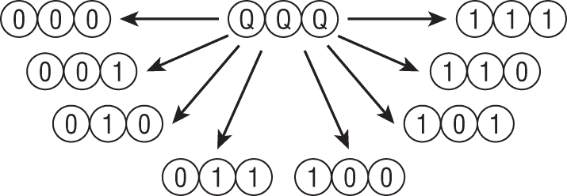

**Figure 2.1****:** Representation of a 3-qubit system

关于量子位需要理解的一个重要点是，二进制系统中任何相似数量的位具有相似数量的可能状态，但一次只有一个状态。某种意义上，二进制硬币永远不会落在边缘。因此，3 位系统一次只能返回一个状态/答案。3 量子位系统可以让全部 8 个状态同时参与解决一个问题。3 量子位系统相对于 3 位系统是 8 倍的状态提升。4 量子位系统相对于 4 位系统是 16 倍的状态提升，以此类推。现在想象你拥有数千个量子位，每个都包含一个同时的双态系统，并且由于叠加，它们同时是数千个量子位的所有可能状态。速度和逻辑上的改进，如你所想，是相当惊人的。

我能想到的位和量子位之间最好的速度比较例子是我曾经听过的一个（但我不记得是谁说的）。想象我们想要解决国际象棋棋盘上的每一种可能走法。国际象棋棋盘有 64 个格子（32 个黑格和 32 个白格）。如果每一种可能的走法都用一粒大米来表示，那么表示所有可能的象棋走法所需的大米数量将形成一座相当于珠穆朗玛峰大小的米山。而表示像 2048 位素数分解这样的问题所需的大米量相当于 1,985 座由大米堆成的珠穆朗玛峰。现在，你可以理解问题的规模。传统二进制计算机要么需要非常、非常长的时间来计算答案，要么永远无法解决。而量子计算机，只需几千个量子位，就能在两分钟内得出正确答案。这就是量子计算机的力量。

量子位之所以成为可能，是因为量子计算机使用的基本对象是量子粒子的量子态。传统二进制计算机可能使用电子（甚至光子），但它们被创建、操纵和测量为二进制对象或状态。它们要么是 0 要么是 1，要么是开要么是关。量子计算机使用量子粒子并测量这些粒子的量子态，看到所有被表示的量子态。因此，在测量电子的态时，它看到所有可能量子属性的所有可能状态。在测量一个粒子时，它看到所有可能的状态，如电荷、自旋、极性等等。真正的量子计算机的基本状态是它可以同时表示所有可能的粒子状态，而不仅仅是二进制状态。在量子计算机中，逻辑比较单元被称为*量子逻辑门*（或*量子门*）而非*经典门*。量子门本质上比经典门具有更多选项和更复杂问题的能力。

> **NOTE**  即使叠加是同时存在所有可能状态，这并不意味着量子计算机可以瞬间显示所有可能问题的所有可能答案。所有计算机，包括量子计算机，仍然需要计算和运行程序来解决复杂问题。它们不会立即得到每一个答案。必须遵循必要的计算和算法才能得到最终答案。但可以准确地说，由于量子位叠加，量子计算机很可能比传统计算机快得多地解决许多类型的问题，在某些情况下，与传统二进制计算机相比，解决方案提供的速度快到似乎是瞬时的。

##### 随时间推移的量子位增长

第一个拥有 1 个量子位的量子计算机于 1998 年被创建并演示。自那时以来，我们看到量子计算机中表示的量子位数随时间增长。以下是截至本文撰写时基于各厂商声明的按年份划分的基本量子位进展时间线：

* 2000 年：5 和 7 量子位计算机
* 2006 年：12 量子位计算机
* 2007 年：28 量子位计算机
* 2012 年：84 量子位计算机
* 2015 年：1000 量子位计算机
* 2017 年：2000 量子位计算机

> **NOTE**  正如本章后面将更详细讨论的那样，并非所有量子位都相同。其中一些大量子位声明存在广泛的怀疑。

你可以在这里看到按厂商和量子计算机类型划分的当前已知量子位数量的更完整列表：`https://quantumcomputingreport.com/scorecards/qubit-count/`。正如你所见，我们随时间推移以某种指数方式增长了量子计算机中表示的量子态数量。没有理由不相信这种指数式增长不会在未来继续，就像传统二进制计算机中定义空间内的集成电路数量每两年翻一番（正如摩尔定律所述和预测的那样）一样。

这并不是说量子比特的指数增长是 guaranteed 的。在量子计算机扩展的过程中，无论是短期还是长期，都存在一些需要克服的重大问题。但很可能量子计算机科学家会解决这些问题，并随着时间的推移不断增加更多的量子比特。当我听到那些认为我们已经达到了某个更小的人为极限的量子比特增长批评者，或是声称未来进展需要数十年的人时，这让我想起了所有那些说传统微处理器上不可能再添加更多经典门的人。每年，“专家”都会告诉世界，我们终于达到了在给定空间内将如此多的经典逻辑门放在单块计算机芯片上的技术极限——然后第二年芯片就有了更多。芯片制造商开发或改进了一些技术，使他们能够在相同空间内塞入更多东西。这总是批评者在计算中没有考虑到的因素。今天，我们拥有极快的 `32/64-CPU` 核心，它们可以装在一块微处理器芯片上。现在，量子批评者可能对为什么在同一空间内增加越来越多的量子比特总有一天会变得不可能有更多的专业知识和数学依据，但到目前为止，我们以相当规律的方式不断增加。 我们还没有接近量子墙。我们才刚刚开始铺设第一层基础。

### 并非所有量子比特都相等

必须认识到，仅仅拥有更多的量子比特并不能直接转化为更快更好的量子计算机。拥有更多量子比特绝对是好事，但并非所有量子比特都相等，量子计算机解决问题的能力取决于的变量远不止量子比特的 sheer 数量。有些类型的量子计算机，正如我们将在本章后面介绍的那样，更擅长解决某些类型的问题。有些量子计算机，无论获得多少量子比特，都无法解决某些类型的问题。

可以用赛车做一个类似的比较。我们可以制造出非常快的汽车，在直线上行驶几分钟就能达到近 500 英里/小时，但只能在直线上行驶。那些形似水平火箭的汽车必须在数英里长的非常平坦、笔直的路面上使用。它们永远无法与 NASCAR 汽车在椭圆形赛道上竞争，后者可以持续数小时。每种类型的汽车都是为赢得特定类型的比赛而设计的。

量子计算机也是如此。每种主要的量子计算机类型都最大化地用于解决特定类型的问题。而设计用于解决广泛问题的量子计算机并不会像某些专门排他性地专注于其他类型问题的量子计算机那样快速解决特定类型的问题。

### 量子能力不止于量子比特

更高的量子比特数量有可能使特定的量子计算机更快，但它并不能保证这一点，就像更高的马力并不总是意味着汽车会赢得比赛一样。赛车的成功取决于使汽车比其他汽车更快前进所需的一切，包括发动机、燃油喷射、轮胎、变速箱和扭矩转换。量子计算机也是如此。增加量子比特数量很少会造成伤害，但许多其他因素可能成为速度限制因素。

IBM 长期参与并引领量子计算领域，在增加其自身量子计算机的量子比特数量以及其他竞争对手出现时，很早就意识到了这一点。IBM 认识到需要开发一种任何人都可以使用的独立比较各种量子计算机性能和速度的方法。IBM 的答案是它称之为 `quantum volume` 的指标，它相当于特定类型的量子计算机在给定时间段内可以完成的量子工作量。根据 IBM 的说法，确定量子体积涉及的项目是多种因素，包括量子比特数量、连接性（量子比特与其他组件之间的连接）、相干时间，以及考虑门和测量误差、设备串扰和电路软件编译器效率。

电气和电子工程师学会（IEEE）提出了一个独立标准，试图衡量、基准测试和等同量子性能：PAR 7131（`https://standards.ieee.org/project/7131.html`），量子计算性能指标和性能基准测试标准。它包括 IBM 量子体积中提到的许多相同的量子变量，但也将其标准列为“门时间、生成和读出能力以及门保真度”。

在功能正常的计算机中，硬件只是性能方程的一部分。量子计算机与传统计算机一样拥有软件。底层软件，无论是表示为固件还是软件，都需要找到问题的解决方案，但也会增加整体性能的开销周期。

一些科学家提出创建“量子谜题”，每个竞争的量子计算机都可以解决它，然后记录解决所需的时间。谜题必须针对每种主要类型的量子计算机而不同（它们针对不同类型的问题进行了优化）。不幸的是，我毫不怀疑，任何在任何基准比较中表现不佳的量子计算机供应商都会有一百万个理由说明他们的量子计算机在比赛中被不公平地短缺。传统二进制计算机基准测试中也一直如此。但速度基准测试不应被完全否定。在某些情况下，它们确实发挥了宝贵的作用。

关键是要理解，量子比特的数量本身并不等同于量子计算机的优异或速度，尽管拥有更多量子比特永远不是坏事。就像我们的赛车例子一样，从一开始就拥有一定量的马力是如果你想认真地与其它快车竞争的要求。但马力 alone 并不会赢得比赛。

#### 量子计算机尚未准备好迎接主流时刻

在我于 2019 年撰写本文时，没有现有的量子计算机比任何传统二进制计算机更快。甚至相差甚远。你的笔记本电脑可能具有更高的原始性能。目前，量子计算机所能做的最好的事情就是在小规模上展示量子特性，这些特性可能在未来解决传统二进制计算机无法解决的问题。相反，传统二进制计算机通常可以模拟或仿真量子解决方案，通常比今天的量子计算机更好。但关键是要理解，即使二进制计算机可以模拟量子力学，它们也不是量子计算机，有一天它们可能会被原生量子计算机超越。问题是何时。

#### 量子将在不久后称霸

在某个时候，量子计算机将能够解决传统计算机根本无法解决的问题，以及解决传统计算机可以解决但速度明显更快的问题。这一时刻被称为 `quantum supremacy`（或 IBM 提出的 `quantum advantage`）。我们似乎非常接近。

许多不同的公司认为，并且公开宣布，他们已经或接近量子霸权。Google、Intel 和中国政府/公司宣布他们已经实现了量子霸权或即将实现。IBM 于 2017 年宣布，根据其每年量子体积翻倍的预测，它认为到 2020 年将实现量子霸权。也许在本书出版之前，世界上某台量子计算机已经达到了量子霸权。相反，甚至有一种可能，即某些不可预见的技术障碍会阻止量子霸权永远实现。或者也许二进制微处理器（比较中未说明的分母）将出现惊人的技术飞跃，从而削弱量子计算机取得的进展。

智能资金似乎押注量子霸权将在几年内实现。多年以来，世界上最好的计算机无法击败国际象棋的最佳人类选手。直到 1996 年 IBM 的 Deep Blue 计算机击败国际象棋冠军加里·卡斯帕罗夫。那时，计算机无法击败人类冠军 `Jeopardy` 玩家。直到 2011 年 IBM 的 Watson 做到这一点。量子霸权被认为会以同样的方式发生。存在很多营销炒作，但最终它会发生。问题不是是否，而是何时。

#### 量子计算机利用纠错改进量子比特

从理论上讲，许多量子计算专家表示，我们可以用 40 到 50 个完美量子比特，或最多 100 个完美量子比特实现量子霸权。一种估计称，量子计算机“可以用仅 300 个完美量子比特‘映射宇宙中从大爆炸开始的所有信息’”。不幸的是，到目前为止，完美量子比特仍然难以捉摸。它们充满了错误，尤其是在规模化时。本节将介绍量子计算科学家试图制造更好量子比特的一些方法，包括改进相干时间、超冷却、校验量子比特以及提高其他组件的性能。

##### 过早的量子比特退相干

毫无疑问，过早的量子比特退相干是量子霸权的最大挑战。如 Chapter 1 中所定义，`decoherence` 是量子粒子从易于观察的叠加态（即多态）转变为最终测量的、单一的经典态，而在所有最终的纠缠发生之前获取有用信息变得不可能。一旦退相干发生，无论是过早还是非过早，都很难逆转。试着从海洋中把一滴特定的水重新捞出来，或在明亮的晴天挑出一个单一的光子，并弄清其过去纠缠的所有影响。

对于“完美”的量子计算机，退相干只会在“答案”需要并被测量时发生。它将始终是有意的。量子比特将保持其相干态，只要量子计算需要的时间，然后在被测量时才退相干。

> **NOTE**  假设一个量子比特具有 1 态，计算机必须保持该态以执行计算或返回结果。量子比特稳定保持该 1 的时间长短称为其 `coherence time`。它通常以毫秒为单位测量，但某些类型的量子计算机可以持续数秒到数分钟。对于大多数量子计算机制造商来说，第一要务是增加相干时间。相干时间增加意味着更少的错误和更多的时间来计算并返回答案。

今天的量子计算机充满了过早的量子退相干和纯粹的错误。两者都可能由于量子比特构造、热量、辐射、噪声、振动、故障门、故障测量、初始态制备故障、背景核自旋以及无数其他事件而发生。从本质上讲，任何与外部世界的相互作用都是威胁。减少错误和噪声是量子挑战的首要任务，并催生了一个拥有自己名称的领域，`quantum error correction`。纠错尝试使用多种方案，包括量子和经典方法。还没有人完美掌握它，但每个量子计算厂商都在尝试。

错误率通常报告为量子运行时间与退相干时间的比率。`quantum error threshold theorem` 指出，任何纠错速度快于产生错误速度的量子系统都是可用的。随着量子比特数量的增加，自然错误率也会增加。为了使量子计算机非常有用，错误率需要低于 1%——实际上低于 0.001%。作为对比，经典 CPU 可以在不出现错误的情况下进行万亿次计算。在量子世界，我们只是希望将错误率降低到每千次计算一个错误。实现这一点，加上一些良好的纠错，将允许进行一些严肃的量子工作。2019 年，我们还没有做到这一点。

> **NOTE**  经典计算机也会出错。不同之处在于，在经典世界中，通常需要更大的事件才会发生错误。作为一个比喻，在经典世界中想象一下，要多大一阵风才能翻转放在地面上的硬币（即位）。但在量子世界中，只需一阵小风就能翻转立着的硬币（即量子比特），使其平放在地面上。

量子计算科学家正试图通过识别和修复最显著的速率限制组件或问题来减少量子错误。常见解决方案包括改进相干时间、严格隔离量子组件与外部世界、使用超冷却、使用校验量子比特、提高其他组件的性能以超越错误，以及使用量子纠缠作为纠错。

##### 改进相干时间

一种纠错方法是提高并控制每个量子比特的相干态质量，使其持续时间长于所需计算时间，通过改进量子计算机的错误限制组件，例如量子门噪声或连接速度。量子比特能够保持相干的时间越长，出现错误的可能性就越小。

##### 环境隔离

自经典计算机诞生以来，计算机科学家就认识到在受控环境中运行计算机以将其与外部世界的极端条件隔离开来的好处。所有计算机机房都是恒温的（热量是所有计算机组件的敌人）、空气过滤、湿度控制、环境更清洁。你不会发现很多计算机长时间暴露在外部世界中，承受正常天气和事件的影响。

但今天大多数经典计算机在物理上已经成熟到可以在正常天气环境中运行，除非它们暴露于真正极端条件下（或掉入水中、被踩踏等）。例如，世界上最流行的计算设备类型每天都在现实世界中工作。大多数笔记本电脑、平板设备和个人电脑在非常受控的计算机机房之外也能正常运行。

量子计算机还未达到这一点。它们仍然是非常脆弱的机器，必须不仅防天气极端，甚至还要防非常正常的条件。事实上，大多数量子计算机通过在特定类型的天气极端条件下运行（至少是量子组件）而最有效，例如非常低温。它们必须防无线电波、正常背景辐射、电磁干扰、响声和振动。但大多数量子科学家设想有一天，就像经典计算机一样，量子计算机将被构建得更具韧性，对特殊环境隔离的需求更少。

##### 超冷却

大多数量子计算机必须将量子比特（以及其他附近组件）超冷却至接近零开尔文（0K 约为 -460F）以最小化过早退相干问题。较温暖的温度被证明会允许更多错误并释放更多不需要的 stray 量子粒子，这适用于几乎所有量子计算机技术，即使是那些据称不需要超低温的少数类型。它们可能“不需要”超低温，但即使是它们在较低温度下似乎也能以更少的错误更好地运行。为此，大多数量子计算机（实际上只是它们的量子比特芯片和密切相关的装置）使用外部 `cryogenic` 或 `dilution refrigerators` 进行超冷却。

你会看到大多数量子计算机制造商都在吹嘘他们的制冷有多冷：“我们的温度比宇宙最遥远的区域还要冷 200 倍！” 许多厂商会声称其工作温度低于几百到千分之一开尔文（经常宣称的为 `0.02K` 到 `0.01K`）。另一些厂商则试图谦虚地炫耀其计算机在相对较高的温度下抵抗错误的能力，会谈论他们的计算机在室温或略高的开尔文值下运行，例如 `4K` 到 `20K`（`20K` 仍为 –424F）。

物理学界长期以来一直在竞赛，看谁能创造出最低的温度，但至今没有人达到过 *绝对零度*（`0K`），而且很可能是不可能的。但如果可能的话，在绝对零度时，所有粒子的能量和动量都会降至物理上可能的最低限度（被称为 *零点能量* 的东西）。在绝对零度时，大多数运动的甚至固态的东西都无法正常运作。话虽如此，未来的量子计算机很可能能够承受更高的温度，可能相当于当今经典计算机的要求，因为需要超低温既昂贵又限制了它们的使用地点和方式。

但就目前而言，更低的温度通常会提高相干时间并减少错误。更低的温度还会产生一种量子特性，称为 *超导性*，即在材料冷却到临界温度阈值以下时电阻为零或接近零。超导性会增加电子流动并允许更强的电磁相互作用。许多量子计算机利用超导性来创建其量子位，它还被用于许多其他应用，例如超快的磁悬浮列车、医疗设备和超强磁体，仅举几例。

#### 重复计算

对抗错误的一种方法是至少运行三次相同的计算，并将结果存储在经典世界中。运行多次相同计算后，计算机将查看所有存储的结果，如果存在不一致，则采用出现次数最多的结果。然而，这种纠错方法也会使计算机变慢，其减速程度与使用的重复操作数量直接相关，而且并不能保证出现次数最多的答案就是正确的答案。

#### 使用量子纠缠进行纠错

在经典计算机世界中，如果预计会出现大量错误，可以在同一时间将一位的值复制并存储到一个或多个“备份”位中。如果位之间存在不一致，则采用最流行值。但在量子世界中，由于不可克隆定理和观察者原理，量子位在其量子态下不能直接复制。相反，可以利用纠缠来创建间接副本，尽管纠缠键很敏感，容易在退相干发生时丢失。

#### 检查量子位

另一种纠错方法使用额外的量子位作为 *检查量子位*，这类似于经典二进制世界中使用检查位的方式。检查量子位以某种逻辑检查方法实现，可检测错误并帮助纠正它们。例如，使用一个额外的检查量子位来确保生成的 *qubyte* 以特定方式相加——例如，计算机可以向 qubyte 的检查量子位位置添加 0 或 1，以确保所有量子位的总和最终为偶数值。如果量子计算机检测到从 qubyte 求和返回的负和，则可以声明错误并重复量子操作。你可能熟悉二进制计算机世界中一种类似的流行的纠错经典技术，称为独立磁盘冗余阵列（`RAID`）。这种简单奇偶检查的[content]

你会看到大多数量子计算机制造商都在吹嘘他们的制冷有多冷：“我们的温度比宇宙最遥远的区域还要冷 200 倍！” 许多厂商会声称其工作温度低于几百到千分之一开尔文（经常宣称的为 `0.02K` 到 `0.01K`）。另一些厂商则试图谦虚地炫耀其计算机在相对较高的温度下抵抗错误的能力，会谈论他们的计算机在室温或略高的开尔文值下运行，例如 `4K` 到 `20K`（`20K` 仍为 –424F）。

物理学界长期以来一直在竞赛，看谁能创造出最低的温度，但至今没有人达到过 *绝对零度*（`0K`），而且很可能是不可能的。但如果可能的话，在绝对零度时，所有粒子的能量和动量都会降至物理上可能的最低限度（被称为 *零点能量* 的东西）。在绝对零度时，大多数运动的甚至固态的东西都无法正常运作。话虽如此，未来的量子计算机很可能能够承受更高的温度，可能相当于当今经典计算机的要求，因为需要超低温既昂贵又限制了它们的使用地点和方式。

但就目前而言，更低的温度通常会提高相干时间并减少错误。更低的温度还会产生一种量子特性，称为 *超导性*，即在材料冷却到临界温度阈值以下时电阻为零或接近零。超导性会增加电子流动并允许更强的电磁相互作用。许多量子计算机利用超导性来创建其量子位，它还被用于许多其他应用，例如超快的磁悬浮列车、医疗设备和超强磁体，仅举几例。

#### 重复计算

对抗错误的一种方法是至少运行三次相同的计算，并将结果存储在经典世界中。运行多次相同计算后，计算机将查看所有存储的结果，如果存在不一致，则采用出现次数最多的结果。然而，这种纠错方法也会使计算机变慢，其减速程度与使用的重复操作数量直接相关，而且并不能保证出现次数最多的答案就是正确的答案。

#### 使用量子纠缠进行纠错

在经典计算机世界中，如果预计会出现大量错误，可以在同一时间将一位的值复制并存储到一个或多个“备份”位中。如果位之间存在不一致，则采用最流行值。但在量子世界中，由于不可克隆定理和观察者原理，量子位在其量子态下不能直接复制。相反，可以利用纠缠来创建间接副本，尽管纠缠键很敏感，容易在退相干发生时丢失。

#### 检查量子位

另一种纠错方法使用额外的量子位作为 *检查量子位*，这类似于经典二进制世界中使用检查位的方式。检查量子位以某种逻辑检查方法实现，可检测错误并帮助纠正它们。例如，使用一个额外的检查量子位来确保生成的 *qubyte* 以特定方式相加——例如，计算机可以向 qubyte 的检查量子位位置添加 0 或 1，以确保所有量子位的总和最终为偶数值。如果量子计算机检测到从 qubyte 求和返回的负和，则可以声明错误并重复量子操作。你可能熟悉二进制计算机世界中一种类似的流行的纠错经典技术，称为独立磁盘冗余阵列（`RAID`）。这种简单奇偶检查的

#### 检查量子位

另一种纠错方法使用额外的量子位作为 *检查量子位*，这类似于经典二进制世界中使用检查位的方式。检查量子位以某种逻辑检查方法实现，可检测错误并帮助纠正它们。例如，使用一个额外的检查量子位来确保生成的 *qubyte* 以特定方式相加——例如，计算机可以向 qubyte 的检查量子位位置添加 0 或 1，以确保所有量子位的总和最终为偶数值。如果量子计算机检测到从 qubyte 求和返回的负和，则可以声明错误并重复量子操作。你可能熟悉二进制计算机世界中一种类似的流行的纠错经典技术，称为独立磁盘冗余阵列（`RAID`）。这种简单奇偶检查的

> **注意**  本书中使用 *量子计算机制造商* 或 *供应商* 一词时，需要注意的是，大多数量子计算机开发项目都是由计算机的实际供应商与大量外部帮助共同完成的。大多数供应商与一所或多所大学、商业和私人实验室、公司、军事部门密切合作——甚至可能涉及多个国家。经常有其他供应商提供量子芯片、制冷系统以及量子计算机其他构建模块等关键组件。“客户”通常就是帮助构建正在测试的量子计算机的同一组织，它们为供应商提供关键反馈和建议，如果不是提供部分零件的话。在量子计算发展的这一充满希望的时期，大多数项目都是“全员上阵”的局面，每个人都在努力尽快实现量子霸权和稳定性。

让我们来看一些量子计算机的例子、制造它们的供应商，以及每种类型的优缺点。

### 超导量子计算机

依赖超导架构的量子计算机是最早的原型之一，至今仍是最受欢迎的类型之一。包括 Google、Microsoft、IBM、D-Wave Systems、Rigetti Computing 和 Intel 在内的数十家供应商都有一台或多台超导量子计算机，它们依靠超导体的特殊性质来创建和管理量子比特。

在超导量子计算机中，两个弱耦合的超导体首尾相接放置，由一层非常薄的绝缘体隔开。一对或束缚的电子或费米子集合，称为 *库珀对*，通过量子隧穿在两个超导体之间传输——从一个超导体的末端通过绝缘体到达另一个超导体，该位置称为 *约瑟夫森结*。图 2.2 是约瑟夫森结用于在两个超导体之间传输两个库珀配对电子的示意图。每个库珀对都被超低温冷却，在传输到另一个超导体的过程中形成 *凝聚波函数*。这迫使粒子进入最低的量子能量状态，并使其性质能够在宏观层面被观察到。相位变化和其他量子性质变化可以被观察到以创建和使用量子比特。如今创建的大多数量子计算机，如果不是大多数的话，都使用某种形式的超导量子电路。

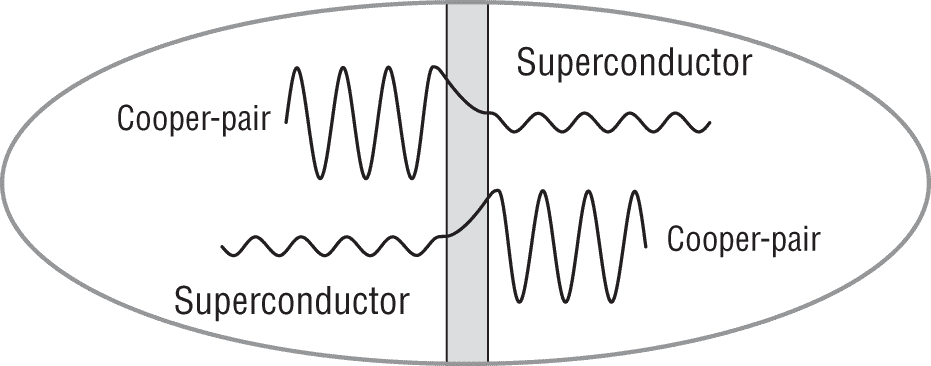

**图 2.2****:** 约瑟夫森结在两个半导体之间传输两个库珀配对量子粒子的示意图

有关超导量子计算机的更多信息，请参阅以下网站：

`https://en.wikipedia.org/wiki/Superconducting_quantum_computing`

`https://web.physics.ucsb.edu/~martinisgroup/classnotes/finland/LesHouchesJunctionPhysics.pdf`

`www.nature.com/articles/s41534-016-0004-0`

`www.ncbi.nlm.nih.gov/pmc/articles/PMC3417795/`

`https://qudev.phys.ethz.ch/content/courses/ASC04_SCqubits_Review.pdf`

### 量子退火计算机

*退火* 一般描述为加热某物以达到另一种期望状态，例如加热玻璃使其能够塑造成另一种形状，或将金属超加热然后缓慢冷却以提高其强度或纯度。量子退火计算机首先使量子比特处于叠加态，每个状态对最终结果的概率相等。然后计算机使用一种称为 *电磁耦合器* 的装置，对每个量子比特施加热辅助（经典）和/或量子隧穿退火过程。耦合器将状态从等概率改变为不等概率，从而增加特定状态的可能性。然后量子态会尝试将其能量最小化到最低可能的能量态（这在经典世界中也会发生）。最低能量态具有成为最终答案的最高概率。对该过程的良好解释在以下视频中说明：

`www.youtube.com/watch?v=UV_RlCAc5Zs`

`www.youtube.com/watch?v=kq9VqR0ZGNc`

`www.youtube.com/watch?v=Yy93LMGQbpo`

> **注意**  退火计算机与 *绝热* 量子计算机密切相关。

如果上述技术解释不明白，可以这样思考退火过程：一个球体（状态）位于波浪起伏、不平的正弦波状山丘的一侧（见 图 2.3）。波浪形状根据所涉及的具体数学问题而变化。球体在没有外部影响的情况下，想要停留在当前所处周围地势最低的区域。没有外部帮助，它就无法越过任何山丘到达其他状态，即使其他区域比球体现在所在的位置更低（即最高概率的答案）。退火过程帮助球体到达较低区域。如果外部帮助以热的方式施加，球体就会获得额外能量，从而能够越过初始和其他连续的山丘，直到到达整体最低区域（即最低能量和最终状态）。如果使用量子隧穿，球体就简单地穿过每一座山丘，就像火车穿过隧道一样，直到找到整体最低状态。

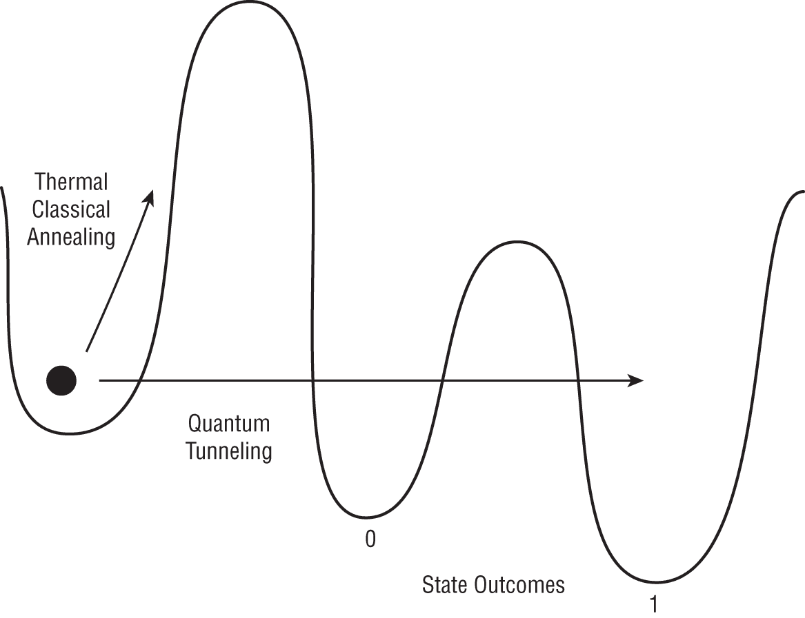

**图 2.3****:** 量子退火过程的图形表示

> **注意**  在自然界和更大的世界中，“正确答案”通常是通过某物寻求其最低、最不混乱的能量状态而找到的。这就是山峰倒塌成沙子的方式，也是水总是想要处于海平面的原因。许多类型的量子计算机也是通过帮助量子粒子达到其最低自然能量状态来工作的。

#### D-Wave 量子退火计算机

量子退火计算机的早期创新采用者是公司 D-Wave Systems (`www.dwavesys.com/home`)。D-Wave 的团队制造了量子比特数量最多的量子计算机，声称是任何量子计算供应商中最高的。截至 2019 年，他们拥有 2048 量子比特的计算机，并且可能拥有比任何竞争对手都多的实际客户和应用。D-Wave 量子处理器冷却至 0.015 开尔文（0 开尔文接近 -460°F），包含特殊屏蔽以阻挡所有可能的外部电磁干扰，并且占地相对较小。

#### 量子退火计算机的优点和缺点

量子退火计算机的优点是它们对外部环境噪声具有相当强的抵抗力，易于扩展，并且不需要接近绝对零开尔文的温度（即使它们在更低温度下性能更好）。D-Wave 证明了这种类型的量子计算机可以制造——并且可以大规模制造。

不幸的是，其缺点可能是任何量子计算机类型中最大的。首先，退火计算机只能解决一种特定类型的量子问题，即 *优化问题*。这个问题反映了它们的工作方式，主要依赖最低能量水平来表示最优解。例如，量子退火计算机无法使用 Shor 算法（将在 第 3 章 中更详细讨论）分解涉及大素数的方程。

其次，许多量子物理学家甚至不会将退火计算机视为真正、足够量子的。他们还质疑退火计算机是否能在长期内超越经典计算机，或是否有用性足以解决各种非经典问题。关于这些话题，尤其是应用于 D-Wave（尤其是它是最早也是最知名的量子计算机制造商之一）的情况下，存在大量来回争论。然而，来自各种研究论文的证据似乎正在增加，支持 D-Wave 的猜想，即其量子计算机使用量子隧穿退火，并且它们能够解决比最初理论化更广泛的问题。

### 通用量子计算机

与量子退火的受限用例相比，通用量子计算机是量子计算机应用使用光谱另一端理论上的圣杯。通用量子计算机并不是一种特定的量子计算机类型，而是通常描述一种不受限于一组有限用例的量子计算机。

通用量子更像是一种结果，而非特定类型的量子计算机或架构，只要它能够处理任何量子算法即可。一些批评者认为它更像是一个营销术语，而非其他东西，但我不同意。目标是创建一个能够解决你抛给它的任何类型问题的量子计算机，无论是经典的、量子的还是模拟的。通用量子计算机不仅能够完成最广泛的各种场景问题，还可以模拟所有其他类型的更受限量子计算机。

IBM 的人们正在努力打造第一台也是最好的通用量子计算机，其名称为 IBM Q（`www.research.ibm.com/ibm-q/`）。他们一直在稳步增加 IBM Q 计算机的量子比特数量，自 2017 年以来他们一直预测——并且成功实现——量子体积每年翻一番。他们不仅在增加量子比特数量，目前为 50 个量子比特（见 Figure 2.4），而且还在提高其稳定性和降低错误率。

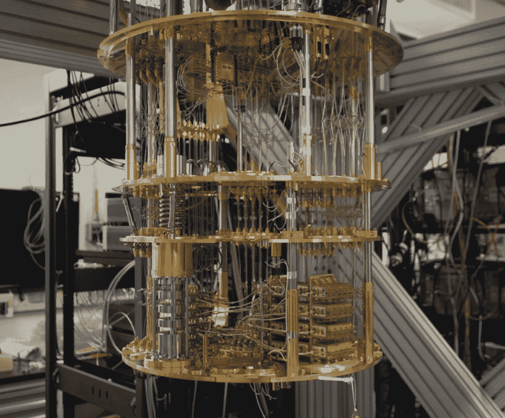

**Figure 2.4****:** IBM’s 50-qubit universal quantum computer ¶ Image courtesy of IBM

Google（`https://ai.google/research/teams/applied-science/quantum-ai/`）的工程师也在开发通用量子计算机，目前为 72 个量子比特。Figure 2.5 显示了 Google 的 Bristlecone 量子处理器，是其 72 量子比特计算机的核心。Google 一直预测它将在 2019 年实现量子霸权，尽管它在 2018 年也做出了同样的预测。这告诉我们，Google 工程师认为他们已经接近，并且他们可能认为在当今的纠错技术下，量子霸权阈值约为 100 个量子比特。

#### 通用量子计算机的优势和劣势

通用量子计算机制造商可以使用他们想要的任何技术，将量子处理带到最大和最广泛的处理场景中。缺点是这些计算机需要最多的量子比特，并且是最难制造的类型之一。

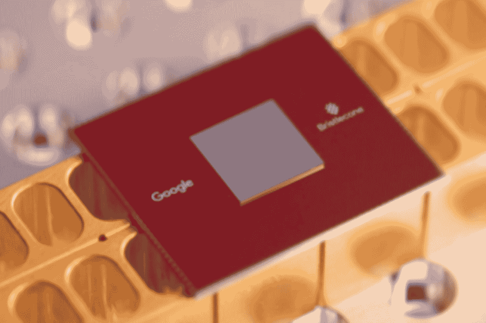

**Figure 2.5****:** Google’s Bristlecone quantum processor, the backbone of its 72-qubit computer

### 拓扑量子计算机

*拓扑* 是一个数学术语，用来描述物体从一种状态过渡到另一种状态的属性，而无需撕裂或破坏物体。它研究事物如何连接，但不一定关心距离。你在量子拓扑演示中常见的一个例子是甜甜圈形状的圆圈变形为咖啡杯，反之亦然。它们看起来完全不同，除了咖啡杯手柄的孔来自甜甜圈的孔——并且它们可以在保持相同的数学连通性的同时连续变形为彼此。

量子拓扑量子比特由相对新发现的二维“准粒子”组成，称为 *非阿贝尔任意子*。任意子可以被诱导产生三维（时间加两个空间维度）量子“辫子”。单个任意子不能用来创建量子比特。需要多个任意子的集合来创建一个量子比特。然后，任意子的集合可以相互移动以创建不同类型的量子操作，并且可以一起移动以创建新的粒子。这些移动和新粒子形成了缠绕的辫链。

> **NOTE**  如果这种类型的量子计算机和任意子的讨论似乎很困难，你并不孤单。任意子在任何人能够制造它们之前被理论化了很长时间，而制造它们才刚刚发生不久。即使如此，量子物理学家也说制造它们需要“奇异的物质相”，这并不是他们轻易使用的术语。2016 年诺贝尔物理学奖授予了三位发现量子拓扑的物理学家（`www.nobelprize.org/prizes/physics/2016/summary/`）。

这些缠绕的任意子辫子可用于在硬件级别创建强大的量子逻辑门，比大多数其他模型更好地抵抗退相干和其他量子错误。而退相干发生在大多数其他量子量子比特类型在数十毫秒或更短时间内，任意子辫子可以持续数秒。只有一种类型的量子计算机，即稍后介绍的离子阱，被认为能够具有更长、未校正的相干时间。

拓扑量子计算机具有一个独特的特性，对物理学家来说尤其有趣。拓扑辫子通常与带结的弦进行比较。你可以移动和改变弦，但“结”是量子信息，无论你如何操纵弦或外部影响如何干扰它都保持不变。因为辫子保留了过去的量子状态（即量子信息的历史），观察者可以看到任意子辫子状态从何处开始以及它们如何随时间变化。没有其他类型的量子计算机具有这种特性。

为了更好地理解任意子和量子拓扑计算机，请查看以下视频：

`www.youtube.com/watch?v=igPXzKjqrNg`

`www.youtube.com/watch?v=RW44rIrAZHY`

`www.youtube.com/watch?v=qj-w6ISQL5Y`

`www.youtube.com/watch?v=Xyfsr-coriQ`

### 微软 Majorana 费米子计算机

微软、贝尔实验室和几所大学都深度参与量子拓扑研究。2018 年，微软创建了第一台非常简单、1 量子比特的量子拓扑计算机，使用 Majorana 费米子，这与任意子方法相关，但不完全相同。*Majorana 费米子* 是通过将电子（基本粒子）分裂成两个更小的纠缠准粒子而创建的，这些准粒子本质上形成了行为类似于任意子的拓扑量子比特。Majorana 费米子可以充当自己的 *反粒子*，意味着如果它们相遇可以相互湮灭。每个粒子都有一个反粒子（例如中子和电子），但通常粒子类型不是它自己的反粒子。你可以在 `www.sciencedaily.com/releases/2019/04/190401115906.htm` 上找到一篇关于 Majorana 费米子的文章。

> **NOTE**  将电子分裂成更小的准粒子被称为 *电子分数化*。由此产生的纠缠准粒子每个都具有原始电子一半的电荷。这里有一篇关于电子分数化的精彩文章：`https://phys.org/news/2015-05-electron.html`

Microsoft 在交付第一台拓扑量子计算机时 somewhat 震惊了世界，尽管它目前只有 1 个量子位且独立开发者尚无访问权限（截至本文撰写时），但许多量子计算专家认为，随着该技术扩展到远更多的量子位，它很可能成为未来量子计算机的有力竞争者。目前全球有七个 Microsoft 量子计算实验室正在从事量子计算机的研究，并且它们拥有完整的量子技术栈（稍后会讨论）。

### 拓扑量子计算机的优势与劣势

拓扑量子计算机相对较新，且已演示的量子位数较少（与其它量子计算机类型相比）。但如果 Microsoft 成功构建更多拓扑量子位以实现扩展，其潜在收益是巨大的。最大的优势在于量子位从硬件层面开始就更稳定，并且辫子结构保留了量子历史。

拓扑计算机仍需要纠错和量子位控制，但错误可以通过降低温度和增加拓扑粒子之间的距离来控制。正因如此，需要的总体量子位数更少，这也可能降低成本。

### 离子阱量子计算机

`Ions` 是具有净整体电荷的原子粒子。每个 `stable atom` 都有相等数量的质子（带正电）和电子（带负电），因此在任一方向上都没有净整体电荷。离子是电子和质子数量不平衡的原子；因此它具有净正电或负电的电荷。为了创建离子，大多数离子阱计算机使用激光在密封真空中将选定的原子（例如钙或镱）超加热到非常高的温度。然后它们向超加热的原子发射电子，这会导致原子失去一个电子并获得净正电荷。

`Ion trap` 量子计算机使用电磁场和真空系统将离子悬浮并限制在室温硅芯片上方的自由空间中。然后使用激光控制离子的运动，包括是否纠缠量子位对。量子信息可以通过离子的集体运动或纠缠对进行传输。

有关离子阱量子计算机的更多信息，请参阅以下资源：

`www2.physics.ox.ac.uk/research/ion-trap-quantum-computing-group/intro-to-ion-trap-qc`

`www.youtube.com/watch?v=9aOLwjUZLm0`

`https://arxiv.org/pdf/quant-ph/9708050.pdf`

`www.youtube.com/watch?v=WOQ_jWe62EA`

#### IonQ 离子阱量子计算机

IonQ（`https://ionq.co/`），与 Sandia 国家实验室以及其他量子用户和供应商合作，是离子阱技术的领先倡导者之一。IonQ 一直是使用室温硅芯片在量子计算机中处于领先地位，尽管其部分研究表明，随着量子位数超过 32 个，它可能需要将离子阱冷却至 4 开尔文（仍远高于大多数其它量子计算机类型所需的亚 1K 温度）。Figure 2.6 显示了一个 IonQ 离子阱量子处理器单元，其“被捕获的离子”上方有一个人工代表性的爆炸剖面图。被捕获的离子实际上位于那个已经非常微小的 QPU 中央的细小缝隙内部。

#### 离子阱量子计算机的优势与劣势

囚禁离子系统有很多优势，包括它们可以在室温下使用外观相当传统的硅芯片工作。它们可以具有极长的相干时间，测量值达到 10 分钟及以上；它们具有高保真纠缠；它们可以使所有量子位相互耦合（这是其它类型的量子计算机无法实现的）；并且与其它量子技术相比，它们的测量非常精确。

缺点包括在保持单独控制的同时增加同时捕获的离子数量，并且能够以高保真度单独测量它们。想象一下有人用一块木制 2×4 板托住一排排在板上的弹珠。起初，弹珠较少时，更容易让它们全部保持在板上成一线。但随着你增加弹珠数量，保持所有弹珠不滚落会越来越困难。现在想象一下，有人也在单独地来回移动弹珠并旋转它们。这就是囚禁离子量子计算的核心问题。囚禁离子计算机的执行时间也更长，与其它类型相比速度较慢。

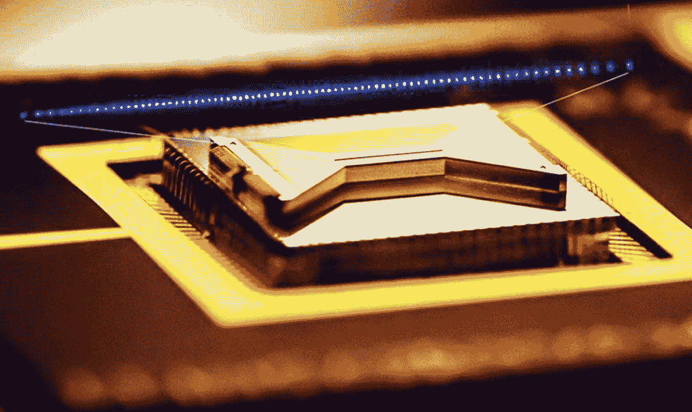

**Figure 2.6****:** Example IonQ ion trap silicon chip with individual linear ions “exploded” out to reveal close up detail of individual ions ¶ Image courtesy of Kai Hudek and Emily Edwards of IonQ, Inc.

话虽如此，仍有研究项目控制了超过 100 个囚禁离子，成功程度各不相同。但到目前为止，稳定量子位的数量尚未接近某些其它量子计算机类型的数量。但与 Majorana 费米子量子计算机的承诺一样，如果 IonQ 和其他离子阱量子计算机供应商能够弄清楚如何扩展囚禁离子，这种类型的量子计算机在长期来看可能会胜出。

至此，我们对一些最重要的量子计算机架构、模型和供应商进行了总结。本书中不会涵盖数十种其它真实和理论上的量子计算机类型、描述、架构和实现，包括光子、硅量子点、钻石空位、单向、量子门阵列、嘈杂中等规模量子、图灵、模拟和转向。我并非有意贬低任何量子计算机架构或表明一种比另一种更重要。它们未在此涵盖只是为了节省篇幅，因为本章已经过长。我涵盖了足够多的不同类型，让你了解量子计算竞争激烈的世界以及其中一些剩余挑战。如果你有兴趣了解其它量子计算机类型和架构，一个不错的起点是 `https://en.wikipedia.org/wiki/Quantum_computing#Quantum_computing_models`。

### 云端量子计算机

目前，量子计算机价格极其昂贵、体积相当庞大，需要专家人员运行和维护，并且通常需要大型制冷系统和其他普通公司或个人无法获得的支持服务。尽管如此，这并不意味着你或普通人不能进行量子计算。

许多量子计算供应商长期以来一直提供对其量子计算机或量子模拟器的访问。一些供应商允许任何人免费加入并出于几乎任何合法原因使用云计算机。其他量子云供应商要求用户填写详细的项目表格，说明请求者为何值得使用量子计算时间，并会单独审批。有时，云服务完全是商业性的或具有私人会员资格。如果你有正当理由想玩弄量子计算机，你很可能能找到一个量子云服务来帮助你，其中包括

`www.research.ibm.com/ibm-q/`

`https://cloud.dwavesys.com`

`www.rigetti.com/qcs`

`www.huaweicloud.com/en-us`

`https://us.alibabacloud.com/`

许多量子计算机观察者认为，量子云计算是未来的模式，至少在中期是如此。无法负担自己的量子计算机的公司和个人可以利用量子云计算分时共享，仅为所需付费。

### 非美国量子计算机

尽管本书前几节主要聚焦于美国及亲密盟友的量子计算机开发者，但许多国家——包括澳大利亚、奥地利、比利时、加拿大、中国、丹麦、芬兰、法国、德国、意大利、日本、中东地区（如沙特阿拉伯、卡塔尔和阿拉伯联合酋长国）、荷兰、波兰、俄罗斯、新加坡、韩国、西班牙、瑞典、瑞士和英国——都在以不同的资金投入和参与程度推进量子信息科学。在这些国家中，大多数观察者认为美国和中国是两大量子竞争者。两者各自在量子计算上花费数百亿美元。

这并不一定总是国家与国家之间的竞争。许多总部设在一个国家的公司参与了其他国家的多个项目。例如，独立的量子应用开发公司剑桥量子计算（`https://cambridgequantum.com/`），虽然官方总部位于英国，但参与了世界各地众多商业、政府及其他项目。而美国国家量子抗性密码选拔项目（在第 6 章中有详细介绍）也包含许多非美国和跨国团队。

这并不意味着国家之间肯定不存在“登月竞赛”式的竞争。确实存在。从竞争角度来看，这是有道理的，因为率先的国家将能够更早地开始收获利益，而且就与本书相关而言，量子计算既会破解许多国家机密，也会保护新的机密。

### 量子计算机的组件

无论量子计算机使用何种类型或架构，当今的量子计算机都具有相当相似的复杂组件，例如：

* 支持人员
* 环境可控、安全、超洁净的计算机机房
* 大量供电
* 制冷系统
* 气体储存和输送系统
* 布线
* 管道
* 外部传统经典计算机，用于监控、控制和操纵量子计算机
* 支持电路
* 电磁屏蔽
* 量子位量子处理器单元（QPU）物理封装
* 量子数据平面（包括 QPU 和所有其他量子组件）
* 控制与测量区域
* 硬件连接、远程连接和接口
* 用于存储结果和数据的经典计算机组件
* 网络
* 外部机柜（使其外观整洁）
* 操作系统（启动代码、控制、监控、编译器等）
* 软件接口
* 算法
* 应用软件

今天，在一台可用的量子计算机中，直接连接到量子计算机的所有组件——普通人认为的“量子计算机”部分——至少占用一平方码或更多空间。这可以与二进制计算机相比，后者小到火柴盒大小甚至单个芯片。随着时间的推移，就像大多数计算机系统组件一样，每个量子组件以及整个组件系统很可能会变得越来越小，资源消耗也越来越少。

> **注意**  存在一个问题，即我们是否能将量子计算机缩小到非常小的尺寸（比如台式机或笔记本电脑），并使其在像经典计算机今天这样炎热、嘈杂、受外部环境严重影响的环境中工作。许多量子专家认为这是可以做到的。为什么？首先，因为我们的大脑基于量子力学运作，它正处于高温、潮湿、受外部环境严重侵蚀的环境中。自然找到了方法。有一天人类也可能找到方法。一旦我们学会如何构建，人类似乎特别擅长缩小事物。

其中两个组件，应用软件和所谓的“堆栈”，值得额外介绍。

#### 量子软件

仅仅硬件和量子位不足以使量子计算机能够解决困难问题。每台量子设备都附带一个或多个操作系统、算法、接口和应用程序。至少，量子计算机必须具有前提固件或*控制*软件，使其能够创建、初始化、测量、控制、错误检查和停用量子位。

每台量子设备必须实现一个或多个量子算法（其中一些将在下一章介绍），它们处理基于量子位操纵和自然规律的基础层计算和数学。并非所有量子设备都支持所有算法，尽管通用门量子计算机应该支持。

大多数量子计算机都有编译器、编程语言和脚本语言，允许开发者编写自己的量子计算机程序。许多量子厂商为其客户提供自己的私有软件，通常免费（最常见）或收取商业费用。一些量子设备厂商创建或鼓励其客户使用开源量子软件。其他厂商则免费提供其专有量子软件，以诱导开发者在其量子计算机上学习和开发。这是一种在经典计算世界中效果非常好的模式。

#### 量子堆栈

许多厂商提供“网络”资源，包括教程、编程工具、仿真工具以及对其云资源的访问。许多量子计算厂商会谈论拥有“完整的量子堆栈”。*量子堆栈*是基于量子的硬件、量子位、量子软件开发工具包、API 和应用程序的集合。许多厂商，包括 IBM、Google、Microsoft、D-Wave、IonQ 等，都提供全部或部分堆栈。以下是一些量子软件和堆栈的网站：

`www.quantiki.org/wiki/list-qc-simulators`

`https://github.com/qosf/os_quantum_software`

`https://arxiv.org/abs/1812.09167`

`http://quantumalgorithmzoo.org/`

`https://qosf.org/`

`https://algassert.com/quirk`

`https://github.com/rigetti/pyquil`

`https://cambridgequantum.com/`

`https://marketplace.visualstudio.com/items?itemName=quantum.DevKit`

`https://quantumexperience.ng.bluemix.net/qx/editor`

### 量子国家指导

大多数主要国家都有国家议程和资金投入，以帮助其国家政府机构、产业和公司在量子计算霸权上取得领先。

#### 国家政策指导

例如，在美国，国家标准与技术研究所（NIST）有一个专门从事量子计算主题的国家联盟（`www.nist.gov/news-events/news/2018/09/nist-launches-consortium-support-development-quantum-industry`），白宫发布了一份联邦文件，题为*量子信息科学国家战略概览*（`www.whitehouse.gov/wp-content/uploads/2018/09/National-Strategic-Overview-for-Quantum-Information-Science.pdf`）。NIST 还赞助了一项竞赛，以确定官方后量子密码（`https://csrc.nist.gov/Projects/Post-Quantum-Cryptography`）第 6 章中有详细介绍）。提交给 NIST 竞赛的许多密码同样由其他国家及其政府资助。

#### 资金资助和投资

大多数国家都把钱投在了口头承诺上，提供丰厚的资助。顶级国家，如美国和中国，每年花费数十亿美元。即使是最小的参与国家也在花费数百万到数千万美元。资助资金用于改善其大学、研究实验室、厂商以及政府和军事计划的量子研究和计算机。

以下是一些例子：

`www.aip.org/fyi/2019/national-quantum-initiative-signed-law`

`www.nextbigfuture.com/2018/10/us-mobilizing-funding-for-quantum-ai-to-match-china-in-multi-billion-race.html`

`www.scmp.com/news/china/economy/article/2140860/china-winning-race-us-develop-quantum-computers`

`https://quantumcomputingreport.com/news/`

`www.executivegov.com/2019/04/energy-department-announces-quantum-computing-funding-opportunity/`

感兴趣的投资者可以将部分资本投入量子相关企业，可使用类似此处的量子专用交易所交易基金（ETF）：`https://www.defianceetfs.com/qtum`。私人投资者正直接向私人公司投入数亿美元，包括此处提及的公司：`www.nanalyze.com/2018/09/10-quantum-computing-startups/`。总体而言，大量私人投资正在追逐量子计算相关的投资机会。量子信息科学的前景再好，也如其他事物一样，投资者需谨慎。许多量子行业观察人士认为，只要在公司名称或招股说明书中出现 *quantum* 一词，就足以吸引巨额投资资本流入，就像过去类似的投资热潮中，只要在公司名称中加入 *bitcoin* 或 *cryptocurrency* 一词一样。许多人在早期的比特币投资中损失了巨额财富。量子领域也将有赢家和输家。

### 除计算机之外的其他量子信息科学

量子信息科学领域不仅仅包括量子计算机。它还包括许多设备和软件组件，例如

* 量子随机数生成器
* 量子网络
* 量子密码学
* 量子应用

许多公司专注于这些类型的量子设备，而不是试图在成本高昂的量子计算机领域竞争。这些大部分内容将在未来章节中更详细地讨论。

量子信息科学有望开启一系列将显著改变我们世界的[content]

`www.scmp.com/news/china/economy/article/2140860/china-winning-race-us-develop-quantum-computers`

`https://quantumcomputingreport.com/news/`

`www.executivegov.com/2019/04/energy-department-announces-quantum-computing-funding-opportunity/`

感兴趣的投资者可以将部分资本投入量子相关企业，可使用类似此处的量子专用交易所交易基金（ETF）：`https://www.defianceetfs.com/qtum`。私人投资者正直接向私人公司投入数亿美元，包括此处提及的公司：`www.nanalyze.com/2018/09/10-quantum-computing-startups/`。总体而言，大量私人投资正在追逐量子计算相关的投资机会。量子信息科学的前景再好，也如其他事物一样，投资者需谨慎。许多量子行业观察人士认为，只要在公司名称或招股说明书中出现 *quantum* 一词，就足以吸引巨额投资资本流入，就像过去类似的投资热潮中，只要在公司名称中加入 *bitcoin* 或 *cryptocurrency* 一词一样。许多人在早期的比特币投资中损失了巨额财富。量子领域也将有赢家和输家。

### 除计算机之外的其他量子信息科学

量子信息科学领域不仅仅包括量子计算机。它还包括许多设备和软件组件，例如

* 量子随机数生成器
* 量子网络
* 量子密码学
* 量子应用

许多公司专注于这些类型的量子设备，而不是试图在成本高昂的量子计算机领域竞争。这些大部分内容将在未来章节中更详细地讨论。

量子信息科学有望开启一系列将显著改变我们世界的应用。以下是一些承诺的应用：

* 更快的计算
* 更快的优化搜索
* 更好的人工智能
* 更好的密码学
* 更安全的网络
* 军事用途
* 改进的天气预报
* 改进的药物和化学品
* 改进对量子世界、天体物理学和我们宇宙的理解
* 完美的隐私（使用被称为 *fully homomorphic cryptosystems* 的技术）
* 更好的金融建模（股票交易、衍生品交易等）
* 更好的欺诈检测
* 自动驾驶汽车的交通管理
* 更好、更持久、更轻的电池
* 量子货币

我们将在 Chapter 5 中更详细地介绍这些主题。

### 更多信息

关于量子信息科学的历史和现状，有几篇很好的网络文章和书籍。如果您有兴趣了解更多信息，请考虑以下网站：

`https://mitpress.mit.edu/books/quantum-computing-everyone`

`www.irtf.org/mailman/listinfo/qirg`

`www.nist.gov/history-and-future-quantum-information`

`www.wired.com/story/wired-guide-to-quantum-computing/`

`https://en.wikipedia.org/wiki/Timeline_of_quantum_computing`

`https://en.wikipedia.org/wiki/Quantum_computing`

`https://towardsdatascience.com/the-need-promise-and-reality-of-quantum-computing-4264ce15c6c0`

### 摘要

第 2 章介绍了量子计算机、其类型和架构、组件以及其他量子信息科学。我们讨论了量子计算机与传统二进制计算机之间的主要区别，并解释了每种量子计算架构方法的技术、优势和劣势。我们还介绍了各个主要厂商及其量子信息科学的重点方向。 Chapter 3 将讨论量子计算机如何在几年内很可能破坏大多数传统公钥密码形式。

# 3 量子计算如何破解当今的密码学？

本章介绍量子计算很可能能够破解大多数传统公钥加密形式。我们首先讨论密码学基础，特别关注当今大多数公钥加密方案如何提供保护。然后您将基于 Chapter 2 的基础，学习量子计算机如何破坏这种保护，以及哪些密码学对量子破解过于或不够敏感。

### 密码学基础

*Cryptography* 是保护和验证授权方之间的人、数据、交易和其他对象的安全的科学、研究和实践。它是通过使用加密、完整性检查和算法实现来完成的。密码学允许在授权的指定方之间（或代表其的软件或设备）按需维护数据的保密性和完整性以及通信和参与者的完整性。本节将介绍数字加密、身份验证和完整性哈希基础。

> **NOTE**  本章中将使用术语 *subject*。它用于指代任何可与密码学操作关联的身份。主体可以是用户、组、计算机、设备、服务、守护进程、公司、发布者或任何其他身份对象。

#### 加密

*Encryption* 是主体保持某事秘密的流行方法。单个主体可能希望对自己保密，或秘密可在选定的个人或设备组之间共享。秘密可以是任何类型的内容、参与方的身份以及任何涉及的交易和对象。

加密的各种形式已使用了数千年，从口头密码和编码书写开始。一个常见例子是简单的 *substitution ciphers*，其中字母表中的字母和数字被重新排列以创建只有预期各方才能理解的编码消息。在最简单的应用中，使用替换密码的各方可以同意将未加密消息的每个字符在字母表中向前移动一个字母来编码和加密消息。因此，单词 FROG 将变为 GSPH（F + 1 个向前字母位置 = G，R + 1 = S，O + 1 = P，G + 1 = H）。所有涉及的授权接收方都需要被告知，结果编码消息可以通过逆向过程解码（即 G – 1 = F，S – 1 = R，P – 1 = O，H – 1 = G）。请参阅 Figure 3.1 获取图形示例。

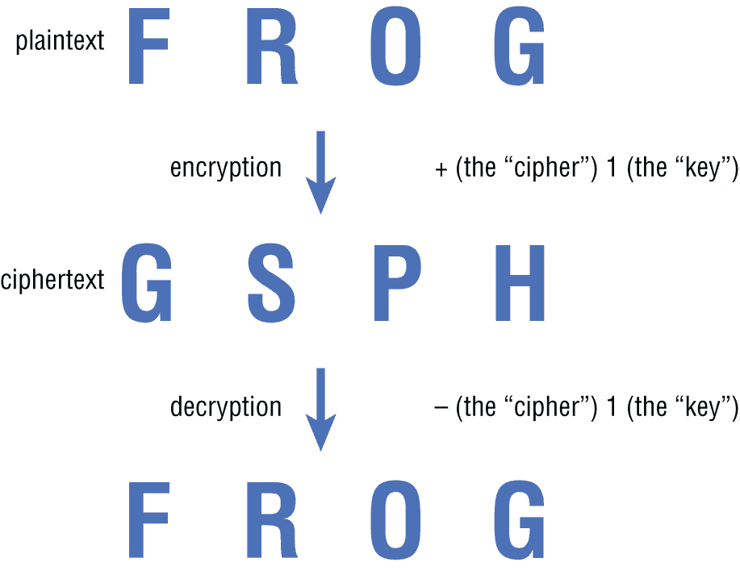

**Figure 3.1****:** A simple substitution cipher

原始未编码的消息称为 *plaintext message*。编码的消息称为 *encrypted message*，或 *ciphertext*。将明文消息转换为加密形式的进程称为 *encryption*。将加密消息逆向还原为原始明文消息形式的进程称为 *decryption*。用于加密或解密消息的记录过程和步骤通常称为 *cipher*，或 *cipher algorithm*。

> **NOTE**  在计算机世界中，消息可以是任何类型的数字内容，包括文本、电子邮件、聊天消息、数据、声音、图片和视频。

每个密码本质上都是对简单替换示例中前面介绍的基本加密组件的更复杂实现。始终存在一个使用密码算法进行编码和解码的明文消息。在前面简单的替换方法中，密码算法在数学上表示为 +*X* 或 –*X*（即 + 或 –*X*，或 +–*X*），其中 *X* 是在加密或解密时向前或向后移动的字母表中的位置数。

`+` 或 `–` 是（简单）密码算法。`X` 是密码密钥。在当今世界，密码算法使用相当简单到复杂的数学方程来表示。一些密码算法由使用传统数学运算（如加法、减法、乘法和除法）的数学方程组成。其他则使用三角学、微积分和其他更高级的数学运算。在每种情况下，只要提供所依赖的算法和密钥，密码算法就能以可预测的方式对明文消息进行加密和解密。

无线和无线电通信出现之际，模拟传输波本身就被编码以防止非预期的窃听。当计算机进入普遍使用时，数字加密被用来保护敏感的数字通信。如 Chapter 2 “Introduction to Quantum Computers” 中所述，传统的二进制计算机使用位（0 和 1 的二进制数字）工作。所有数字数据和对象都以 0 和 1 的形式存储在经典计算机上。当需要加密时，这些位会以预定的、算法的方式重新排列以提供加密的模糊性。

> **NOTE**  密码的另一个术语是 `cryptographic primitive`。

#### Encryption Keys

如我们之前在简单的替换示例中解释的那样，密码算法表示为 `+–X`，其中 `X` 是向前或向后移动的位置数。`X` 是密码密钥，即使用密码算法加密消息时使用的位数。一个稍微复杂一点的简单替换示例可能是使用 12 的密钥。在这种情况下，单词 `FROG` 变成 `RDAS`（`F + 12 = R`，`R + 12 = D`，`O + 12 = A`，和 `G + 12 = S`）。密码相同，但密钥已更改。如果密码足够强且密钥足够长，那么对于不知道密钥的未经授权方来说，解密受保护的消息可能是 `nontrivial`（这就是密码术语，意思是非常、非常困难……或“你可能在有生之年都做不到”）。

> **NOTE**  使用良好的密码学和强可靠的密码时，每个人都可以知道密码算法的细节。密码学的强度来自算法转换过程的强度和足够长的密钥。密钥必须对未经授权的各方保密，但密码不必保密。要求密码也必须保密的加密解决方案通常被大多数观察者认为可疑且可能很弱。

在其他条件相同的情况下，随着密钥变长，其保护程度会增加。随着密钥长度的增加，即使他们知道密码算法，未经授权的各方也更难将受保护的加密消息转换回其明文状态。在我们的简单替换示例中，即使是孩子也很容易理解如何计算并加或减一个额外的（`+–1`）字母位置来编码和解码消息，甚至加或减十二（`+–12`）个更改位置。但如果我们的密钥突然变成字母表中 `+–1,234,567,980` 个更改位置，对普通人来说解决方案会更难计算（尽管仍然并非不可能）。

在经典计算机世界中，数字加密密钥只是看似随机生成的 1 和 0 的长串。数字密钥看起来像 `101010101011010001010101010101100111001010101`。数字密钥根据密码算法应用于明文消息以产生加密消息。如果操作正确，密钥和加密消息都看起来像一组不可预测的随机位。

今天，数字加密密钥的大小通常在 128 到 4,096 位之间，尽管在不太常见的场景中它们可以更小或更大。特定位长度是否被认为安全取决于许多因素，包括所涉及的密码算法、可以猜测所有可能的密钥位位置（称为 `key space`）的速度，以及可用于减少暴力猜测方法的任何“技巧”。更难“破解”的强密码算法可以使用较小的密钥位大小，而相反，较弱的算法通常需要更长的密钥大小以获得同等保护期。使用相同算法的新密钥的位长度往往会随着时间的推移而增长，以弥补计算能力的增强和其他破解因素。密码攻击只会随着时间的推移而变得更好，这会削弱密钥长度提供的保护能力。

你可以通过在任何计算机或设备上打开数字证书来轻松找到并查看密码密钥示例。 Figure 3.2 显示了从数字证书中提取的 2048 位密钥。

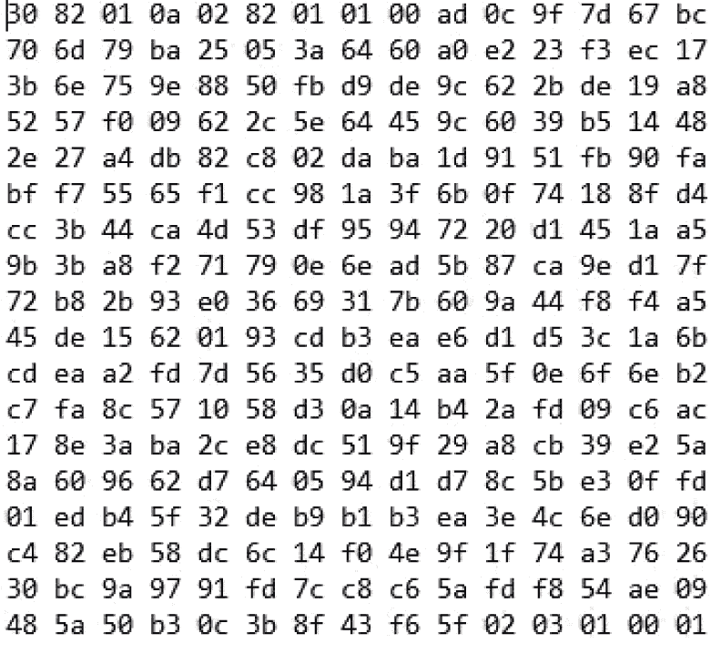

**Figure 3.2****:** 2048-bit cipher key from a digital certificate

> **NOTE**  几乎所有数字密码密钥在大多数计算机和设备上都显示为其十六进制表示形式（例如，基数 16 编号系统），而不是其底层位（即 1 和 0）。

你可以通过访问 `www.keylength.com/` 来查看流行的密码的一般推荐最小密钥大小。加密密码通常分为两大类型：对称和非对称。

#### Symmetric Ciphers

如果密码算法使用相同的密钥来加密和解密消息，则称为 `symmetric cipher`。例如，在之前的简单替换示例中，用于加密明文消息的密钥（例如 1、2 或 1,234,567,980）是用于将加密消息加密或解密回其原始形式的相同密钥。

在所有条件相同的情况下，对称密码比非对称密码（本章后面会介绍）更强、更快、更容易验证，并且需要更小的密钥大小。从密码学角度来看，好的对称密码更容易证明其强大和可靠。它们的数学更不复杂。它们需要更少的假设和猜测。它们更难攻击。因此，对称密码完成了世界上大部分的数据加密。

世界自 1970 年代以来使用了许多不同的对称密码标准，包括数据加密标准（DES）、三重 DES（3DES）、国际数据加密算法（IDEA）和 Rivest Cipher 5（RC5）。所有这些较旧的对称密码今天都被认为很弱且已被破解。

自 2001 年以来，最受欢迎的对称密码被称为 `Advanced Encryption Standard`（`AES`）。定期在需要时，美国国家标准与技术研究院（`www.nist.gov`）会举行公开竞赛，以选择新的加密密码标准来取代老化和减弱的密码算法。在 AES 竞赛中，十多个不同的团队向 NIST 提交了他们的对称密码，以被考虑为新的国家对称密码标准。在一个相当开放和审慎的过程中，NIST 选择了一种名为 `Rijndael` 的密码并将其更名为高级加密标准。目前，AES 使用 128、192 和 256 位长度的密钥，其强度在多年的密码学审查和攻击下保持得非常好。

> **NOTE**  仅为单个主体所知并使用且未故意与他人共享的密码密钥称为 `private` 或 `secret key`。故意在多个主体之间共享的密码密钥称为 `shared key`。可以被任何人知晓和使用的密钥称为 `public key`。为临时使用而创建的密钥称为 `session key`。

**Symmetric Cipher Weaknesses**  这并不意味着对称密码没有其弱点和不足。它们有。常见的对称密码弱点包括缺乏身份验证能力和密钥交换扩展问题。

因为使用相同的 `key` 来加密和解密消息，任何拥有 `key` 访问权限的方都可以加密和解密消息，并且可能假装成拥有相同密钥的其他参与方。从纯粹的密码学角度来看，如果有人指控其他参与方中的一方加密了某物，由于大家共享相同的对称 `key`，被指控方无法（再次，从密码学角度来看）否认该指控。这被称为 *nonrepudiation*。这在密码学世界中并不是一种理想的特性。

这也意味着对称密钥本身，由于同样的原因，在大多数身份验证场景中更难使用，尤其是在需要数据完整性或主体身份验证的情况下。例如，假设 Fred、Wilma 和 Dino 共享相同的加密 `key`。Fred 可以加密一些数据并发送给 Wilma，但声称它来自 Dino 或最初由 Dino 创建并加密。由于大家共享相同的 `key`，从纯粹的密码学角度来看，Dino 无法证明谁真正发送或加密了它。Fred 甚至可以取一个原本由 Wilma 加密并发送的消息，解密它，恶意修改它，再次加密，然后发送给 Dino 声称它来自 Wilma。Dino 将无法分辨消息来自谁，也无法判断原始消息在他解密和打开之前是否被篡改。

第二个大问题是，随着共享参与者数量的增加，对称密码并不容易使用。在一个小团体中，比如两三个人，相对容易安全地交换共享的对称 `key`，尽管即使在这种情况下，所有参与方也需要确保共享的 `key` 被准确且安全地传达给所有参与者。让任何两个人准确地阅读、书写或说出一个 `256-bit` `key` 都是困难的。我们中的许多人很难向另一个人传达 16 位信用卡号码。

假设你有一个共享对称 `key` 场景，参与者有一千人。一个或多个参与者必须找到一种方法将商定的 `key` 安全地传输给所有其他授权方。如何做到这一点：书写、打电话、发邮件等？如果使用书写，如何安全地将书写发送给其他方？可以信任邮寄系统及其工作人员吗？能否保证只有预期的收件人在另一端打开了邮寄的消息？如果使用打电话，电话系统有多可靠？是否可能有人在窃听？很可能。如果接收者不可用，发送者该怎么办？他们是否将 `key` 留在语音邮件上？如果接收者确实听到了 `key`，他们能否准确地记录下来？如果使用电子邮件，电子邮件系统以及发送者和接收者之间所有传输点有多可靠？在任何电子邮件系统中，都有一个或多个可以阅读其他人电子邮件的电子邮件管理员。在任何情况下，无论如何传达，你能想象一千个不同的人试图安全且准确地共享一个 `256-bit` 对称 `key` 而不犯一次错误吗？安全交换共享对称 `key` 的难度会随着参与者数量的增加而呈指数级增长。

现在假设这千名参与者中的一些人想要额外的、更小的团体，在每个子组中使用不同的共享密钥。他们需要负责跟踪哪些密钥被哪些人员和团体使用。更进一步，假设每个参与用户都需要与其他每个方之间保证加密，而没有其他人或方可以看到。这将要求这千名参与者中的每个人为其他参与者的每种可能组合拥有一个单独的共享 `key`。每个希望向所有其他用户发送机密消息的用户都需要使用 `999` 个不同的对称密钥发送消息并跟踪哪些密钥属于哪些组合。这将需要 `499,500`（`1,000` 名参与者 × `999` 名其他参与者 / `2`）个对称密钥。

很明显，这将是一项繁重的任务，尤其是在参与者需要定期更换密钥以确保持续、强大的隐私以抵御持续攻击的情况下。哲学家和密码学家几个世纪以来一直在寻求一种更好的方法来安全地交换私人信息和/或对称密钥（后者称为 *key exchange*）。

### Asymmetric Ciphers

加密的圣杯是找到一种方法，允许两个或多个方在不受信任的（甚至是已知恶意的）通信信道上交换对称密钥，而无需事先建立私有的通信方法来为每个参与者交换对称密钥。在 20 世纪 70 年代中期，几个不同的团体在彼此不知情的情况下，在几年内开发出了几乎相同的解决方案。

#### Integer Factorization Workload Effort

这些解决方案都使用了一个多项式数学问题（例如 `A × B = C`），将其解回其各个组成部分（即 *factor*）在本质上如此困难，以至于为了解决它所需的计算工作量就是保护。数学问题需要如此难以分解，以至于如果任何人知道了 `C`（`A × B` 的结果），就无法轻易找出 `A` 或 `B`。这种多项式计算工作量（也称为 *integer factorization problem*）是当今大多数 *public key* 密码学的核心保护。

> **NOTE** 与整数分解类似但用于不同却相关的非对称密码类型的计算工作量包括 *discrete logarithm problem* 和 *elliptic-curve discrete logarithm problem*。它们使用不同类型的非常难以解决的数学，但采用从根本上不同的方法。

今天，最受欢迎的非对称加密解决方案使用两个大素数（`A` 和 `B`），当它们相乘（或算法应用）在一起时得到一个更大的结果（例如 `C`）。如 第 2 章 中首次介绍的那样，素数是大于 1 的整数，只能被自身和 1 整除得到整数（`2`、`3`、`5`、`7`、`11`、`13`、`17`、`19`、`23` 等）。任何其他组合都会产生余数或分数。素数对于传统二进制计算机来说本质上很难按需创建和验证。如果 `A` 和 `B` 的值是很大的素数，即使有人知道 `C`，他们也很难将结果分解回其底层素数成分（即 `A` 和 `B`）。

为了更好地解释，让我们从一个简单的例子开始。让我们使用一个代表整数分解保护方法的常见密码学数学方程：`p * q = n`，其中 `p` 和 `q` 是素数，`n` 是数学结果，是密钥对的公钥（稍后解释）。如果 `p` 和 `q` 足够大，仅给定 `n` 的情况下，`p` 和 `q` 就可能非常难以推断。

对于我们最简单的可能例子，假设 `n = 15`。什么两个素数相乘会得到 15 的结果？这很容易弄清楚，尤其是因为 15 以下的唯一可能素数是 `2`、`3`、`5`、`7`、`11` 和 `13`。任何人都不需要太长时间就能弄清楚 `p` 或 `q` 必须是 `3` 或 `5`，因为 `3 × 5 = 15`，而没有其他素数组合相乘等于 15。

现在，让我们给问题增加一点复杂性。假设 `n = 187`。什么两个素数相乘会得到 187？现在，将 187 分解为两个相乘的素数所需的脑力劳动增加了。普通人仍然可以算出来，但做起来并不像以前那么容易。答案是 `p` 或 `q` 是 `17` 或 `11`，因为 `17 × 11 = 187`。

但假设 `n` = 84773093，那么 `p` 和 `q` 是什么？现在我们谈论的是真正的脑力劳动。你必须找出 84773093 以下的所有质数，并将它们以不同的组合相乘，看看哪些组合结果为 84773093。大多数人类无法快速做到这一点。可以做到——只是如果没有计算机就无法快速做到。如果你感兴趣，答案是 `p` 或 `q` = 9539 或 8887。计算机仍然可以非常快速地完成这个任务。

但现在想象 `n` 等于一个由 4096 位表示的数字。这个数字大到大多数计算器都无法显示。它们会报错或显示无穷大符号。4096 位数字是一个由 1234 位十进制数字表示的数字。它可以表示为 2⁴⁰⁹⁶–1 个可能数字。要通过暴力猜测这么大的数字是不可能的，更不用说实际找出组成该数字的两个超大质数相乘的结果了。

当密码学家试图解释猜出用于生成 4096 位数字的两个正确质数需要多少次暴力猜测时，他们开始创造有趣、荒谬的比较，因为这是向普通人传达分解超大质数本质上有多困难的唯一方式。4096 位数字的所有可能性都超过了已知宇宙中的所有原子。作为参考，这个句子的句号末尾的句点里就有超过 1250 万个原子。另一个比较是说，如果你拥有每颗恒星一个百万件东西，比如一分钱，而宇宙中每个星系有 1000 亿颗恒星，我们的宇宙有 10 万亿个星系，你仍然只有足够的一分钱来表示 4096 位数字可能数字的 1%，更不用说找出用于创建它的两个更大质数了。

一些天真的观察者，对这么大的数字还不熟悉，认为我们只需要更多的计算能力——也许全地球的计算能力就够了？他们会错。不仅现在和永远整个世界都没有足够的经典计算机、处理能力、内存和存储空间，而且如果要尝试的话，也没有足够的能量原子来为这些设备供电——至少使用传统的经典二进制计算机而言。因此，分解大质数方程所需的工作量（和时间）提供了保护。

> **NOTE**  所有数字密码保护都是因为从所有可能的组合中暴力猜测密钥的难度，或将某种数学方程分解回其原始组成部分的难度而提供的。各种密码创建者想出了一个数学问题，如果你没有其中的一部分，就不容易解决。你可能知道 `A` + `B` = `C`，但即使你知道 `A` 和 `C`，你也无法轻易算出 `B`。求解未知值的难度赋予了密码其保护能力。

### 公钥-私钥对

使用这种使用大质数的非对称加密方法，每个参与方都会生成（或被分配）一个密钥对，其中一对中的两个密钥在密码学上相互关联。一个密钥保持私有且不与任何人共享（私钥）。另一个密钥可以分发给全世界（称为 *公钥*）。无论哪一个密钥加密，另一个都可以解密，反之亦然。这对非对称加密的概念及其能做的一切来说 *极其* 重要，所以如果你想理解非对称加密，就必须理解这两点。因为一个密钥用于加密，另一个密钥用于解密，这种类型的密码被称为 *非对称*。

即使密钥对的两个密钥都可以用来相互加密消息，反之亦然，私有和公钥分类的性质也很重要。记住，私钥永远不会与任何人共享。正因为如此，如果有人想向另一个人发送机密消息，他们必须使用该人的公钥来加密消息。这将保持消息的机密，直到接收者使用其相关的私钥解密它。由于没有其他人拥有接收者的私钥，所以没有其他人可以解密该消息。

> **NOTE**  使用非对称加密，我们必须使用接收者的公钥来加密发给他们的消息。

使用非对称加密，每个参与方只需要自己的私钥-公钥对，就能与彼此安全通信。无需 499,500 个不同的对称密钥来彼此安全通信，非对称系统只需要 1,000 个私钥-公钥对（或总共 2,000 个密钥）。

### 数字签名

非对称加密用户也可以使用其密钥对进行身份验证和数字签名内容。*数字签名* 是提供证明已签名内容仍与签名时刻相同的做法。要签名内容，用户使用其私钥“加密”内容（或哈希结果，稍后会介绍）。尽管我们并不真正称该过程为“加密”，因为任何拥有相关公钥的人（理论上可能是全世界）都可以解密并阅读它。如果全世界的人都能看到它，就不能认为它是机密或加密的。

相反，我们称之为数字签名。任何由私钥签名的内容只能通过使用相关的公钥来揭示。如果内容可以被相关公钥验证（“解密”），它一定是由相关私钥签名的，因为相关的公钥只能“解密”由相关私钥签名的内容。类似的过程可用于验证涉及加密操作的用户的身份，其中一些将在本章后面介绍。常见的数字签名密码包括数字签名算法（DSA）和椭圆曲线 DSA（ECDSA）。

如果需要两种保护，消息可以被加密和签名。如果 Fred 需要向 Wilma 发送已签名且已加密的消息，那么他使用自己的私钥签署消息，然后使用 Wilma 的公钥加密它。

> **NOTE**  数字签名和验证比前述描述更复杂。我们稍后会介绍。

由于每个参与方都有自己唯一的密钥对，并且只有该密钥对才能在彼此之间加密和解密消息，非对称加密还允许主体和消息身份验证。每个涉及的密钥对都可以绑定到特定主体。这允许 *否认*。

### 密钥交换

由于对称密钥在较小的密钥尺寸下更安全，因此它们用于执行世界上大部分的消息加密，而非对称密码通常仅用于在两个参与方之间安全传输共享的对称密钥。非对称加密允许在不受信任的网络上交换对称密钥，而无需事先建立安全、受信任的通道。密钥交换过程的非常基本的总结看起来类似于以下内容：

1. 客户端和服务器相互连接。
2. 服务器向客户端发送服务器的非对称密钥对的公钥。
3. 客户端使用服务器的公钥加密客户端新生成的“`session`”对称密钥发回服务器。
4. 服务器和客户端现在都使用共享的会话对称密钥相互发送加密内容。

在现实世界中，使用非对称密钥交换在客户端和服务器之间安全传输共享对称密钥有几个额外的步骤和复杂性（稍后会介绍），但这目前是对非对称密钥交换基本步骤的良好总结。

### 常见的非对称加密类型

常见的非对称加密类型包括 Rivest、Shamir、Adleman（`RSA`）、Diffie–Hellman（`DH`）、椭圆曲线密码学（`ECC`）和 ElGamal。`RSA` 毫无疑问是非对称加密算法中最流行的一种，或许占所有非对称密码使用量的 95%。尽管所有非对称密码都用于执行密钥交换，但 Diffie–Hellman，也称为 Diffie-Hellman-Merkle，通常与仅密钥交换的实现相关联，鲜少使用的椭圆曲线 Diffie Hellman（`ECDH`）也是如此。`RSA` 和 `DH` 密钥大小在今天通常范围为 2048 到 4096 位，并且为了抵御不断发展的密码攻击，其长度大约每 7 到 10 年翻一番。

> **注意**  `RSA` Security 是 `RSA` 密码背后的公司，曾向破解越来越大 `RSA` 密钥大小的密码学家提供持续的现金奖励。迄今为止公开被破解的最大 `RSA` 密钥使用因式分解的方法是 768 位（`https://eprint.iacr.org/2010/006.pdf`），完成于 2010 年。它涉及一个 232 位数字——很大，但与今天通常推荐的 2048 位或 4096 位密钥相比相差甚远。即便是在 768 位密钥被破解之前，`RSA` 也在没有解释的情况下停止了该竞赛。许多观察者认为即将实现的量子计算机是主要因素（请原谅双关语）。

### 密钥信任与公钥基础设施

为了使非对称密码系统正常工作，与之通信的人必须信任每个人的公钥是有效且属于他们认为属于的人。在非对称密码通信的早期阶段，一个人向他们已经认识的另一个人发送其公钥就足够了，接收者会信任发送者是正确的、有效的人，并且拥有正确的、有效的相关私钥。

但随着非对称通道中人数的增加，并非每个参与者都可能认识并信任其他每个参与者。一种获得对不认识的人的公钥信任的方法是让自己已经信任的人为对方担保。例如，假设 Wilma 想与 Dino 进行非对称通信，但事先并不认识或信任 Dino。但她知道 Fred 认识并信任 Dino，并且可以为 Dino 和 Dino 的有效公钥担保。Fred 可以用自己的私钥签署 Dino 的公钥，然后 Wilma 可以使用 Fred 的公钥进行验证。这称为 *点对点信任*（或 *网络信任*）。这就是非常流行的 Pretty Good Privacy（`PGP`）加密程序的工作方式。但随着参与者数量的增加，点对点信任系统效果不佳，尤其是在全球非对称系统中，大多数参与者彼此不认识。于是出现了公钥基础设施。

*公钥基础设施（`PKI`）* 是计算机世界中常用的密码框架和协议族，用于在不相关方之间提供身份信任。你可能会读到或听到对 `PKI` 是什么以及为什么需要它的许多不同描述，但就其基本要求而言，`PKI` 主要存在于验证涉及密码交易的主体身份及其非对称密码密钥。没有这一要求你就不需要 `PKI`。

`PKI` 向已验证的主体签发“数字证书”，这些是经过密码保护的文件，证明主体身份及其相关非对称密钥对的有效性。实际上，主体（或代表其）为该主体使用生成一对非对称密钥。主体将其公钥提交给 `PKI`（记住我们不共享私钥）。`PKI` 的 *认证机构* 服务随后应验证提交公钥的主体的身份。

`PKI` 对主体要求的身份证明级别决定了 `PKI` 可以证明的 *保证*（或信任）级别。如果证明级别非常低（比如仅一个有效的电子邮件地址），则签发的数字证书被认为具有低保证。如果身份所有权和证明级别很高，例如要求主体亲自出面并向另一名人工验证员提交经验证的出生证明复印件和国家身份证件进行验证，则保证被认为很高。

无论如何，`PKI` 的主要工作是验证提交其公钥的主体的身份。如果主体的身份得到验证，`PKI` 会添加一些额外信息（例如有效期、主体名称\[s\]、证书序列号以及认证机构的名称和标识符），并用 `PKI` 的私钥签署主体的公钥（和其他信息）。这就创建了一个 *数字证书*。图 3.3 显示了一个数字证书的部分示例，突出了公钥字段。从理论上讲，任何信任 `PKI`（签发特定数字证书的机构）的实体都将信任由 `PKI` 创建并由主体出示的任何数字证书。展示数字证书的主体本质上是在说：“我就是我所说的那个人，而一个你信任的人已经验证了这一点。”

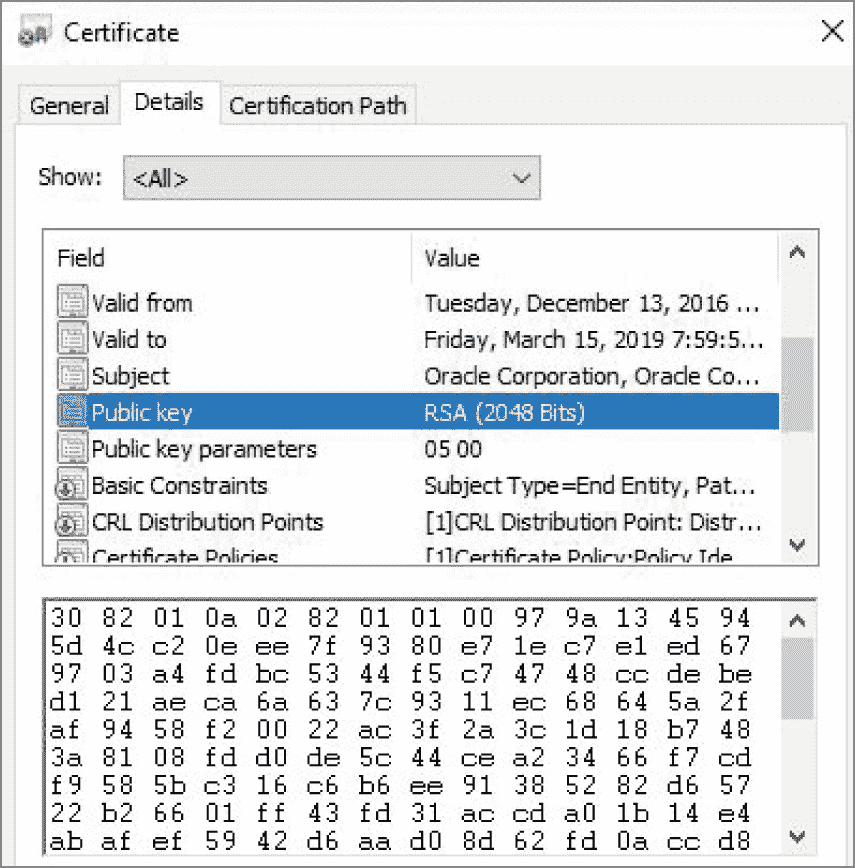

**Figure 3.3****:** Details of a digital certificate

可以将 `PKI` 比作美国使用的车辆管理局（`DMV`）。`DMV` 驾照持有者必须向 `DMV` 实质性地证明其身份才能获得驾驶执照。在驾驶员（即主体）的身份成功验证（保证）后，`DMV` 会拍摄主体的照片，添加其他信息，并签发 `DMV` 驾照，连同州徽章一起密封（有点像现实世界的数字证书）。如果司机被执法人员拦下或去购买需要年龄验证的东西时，他们通常会被要求出示其 `DMV` 驾照。警官和售货员信任 `DMV` 驾照的准确性，因此在验证过程中会依赖驾照上打印的信息。

互联网的很大一部分运行在 `PKI` 上。每当你使用超文本传输协议安全（`HTTPS`）连接到网站时，该网站就拥有一个由受信任的 `PKI` 签署并签发的 `HTTPS`/`TLS` 数字证书。你可能个人并不信任该 `PKI`，但你的操作系统或相关软件会信任。当你使用浏览器通过 `HTTPS` 协议连接到网站时，网站会向你（实际上是你的浏览器）发送其数字证书的副本。由 `PKI` 签署的数字证书证明了网站的名称（通常为 URL）、网站的公钥以及其他相关重要信息。验证后，你的浏览器将生成一个全新的共享会话对称密钥，然后使用网站的公钥安全地将其发送给网站。然后服务器和客户端就可以开始使用对称密钥通信进行安全通信（参见 图 3.4）。

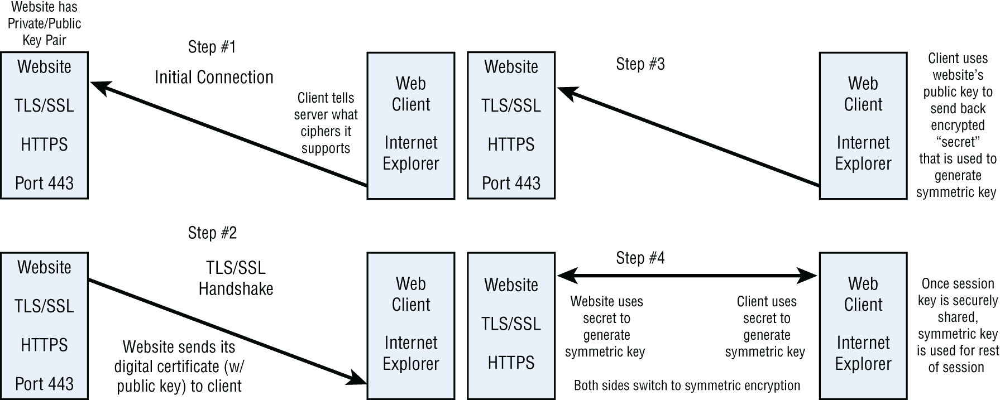

**Figure 3.4****:** Web server and client using HTTPS and digital certificates to communicate with each other

在 PKI 另一个流行的使用示例中，当你从知名厂商下载新软件时，软件会附带一份数字证书，用于验证谁签署了该软件（或稍后详细介绍的相关完整性哈希），从而允许下载者（或更现实地说，通常是代表下载者的浏览器）验证软件自签署者签署软件或哈希以来未被更改。软件在签署者和接收者之间经过何处并不重要，无论是通过受信任还是不受信任的通道传输，涉及多少中间方，或签署发生多久以前（在合理范围内）。如果验证通过，数字证书和随附的已验证哈希会告诉用户，他们可以信赖该软件与签署那一刻的状态一致，并且确实来自声称签署它的主体。

### 非对称密码的弱点

非对称密码允许在不受信任的通道上进行加密和密钥交换，并可用于身份验证。尽管量子计算机带来的迫在眉睫的威胁，总体而言，非对称密码在数十年的密码攻击中表现相当不错。尽管如此，它们仍存在问题。

最大的缺点是非对称密码在数学上本质上比对称密码更复杂，而在计算机安全领域，复杂性往往是安全的敌人。大多数非对称密码使用仅由一个被认为难以分解的数学方程分隔的两个密码学相关密钥。与对称密码相比，更有可能有人发现如何“走捷径”并更快地分解底层数学方程或素数。现实也证明了这一点是正确的（稍后会详细介绍）。其他条件相同的情况下，非对称密钥通常比对称密钥更长（但并非总是如此），并且随着时间的推移，其大小增长更快、更多，以弥补密码攻击的进步。

### 完整性哈希

另一个重要的密码学核心功能是完整性哈希。*哈希算法*（也称为*哈希函数*或简称为*哈希*）用于为唯一的内容输入创建唯一的输出结果。它们使用“*单向*”密码学函数，为检查的唯一内容创建/输出一组唯一的字符或位（称为哈希、哈希结果、数字签名或消息摘要）。哈希函数为其哈希的内容创建密码学“数字指纹”。哈希函数可用于密码学地签署和验证内容、主体和其他密码学对象的完整性。

当完整性哈希结果（通常简称为*哈希*或*消息摘要*）在密码学上与特定密码学主体身份（例如用户、设备或服务）绑定时，它被称为*数字签名*。已验证的数字签名使已签名内容的接收者确信，自经过身份验证的签署者签署内容以来，已签名内容未被更改。

安全、受信任的哈希函数具有四个重要特征：

* 对于每个唯一输入，必须生成唯一的输出结果。这种保护称为*抗碰撞性*。
* 每次对相同输入进行哈希时，都应产生相同的哈希输出。
* 任何两个不同的输入都不应产生相同的哈希输出。这种保护称为*第二原像抗性*。
* 如果给出哈希输出，任何人都应难以推导出原始内容输入。这种保护正式称为*原像抗性*。

一个好的哈希具有所有这些属性，即使在持续攻击下也保留这些保护性哈希能力。抗碰撞性与第二原像抗性相关且相似，但它们并不相同。而且擅长两者并不保证原像抗性，因为它们是无关的属性。如果哈希在这些属性中的任何一个上变得脆弱，则被认为很弱，不应再使用。

哈希算法通常无论输入如何都会产生固定长度的哈希结果。常见的哈希长度范围为 128 到 256 位。多年来出现了许多不同的公认哈希标准，包括消息摘要 5（MD5）、Windows LANManager（LM）、Windows NT（NT）和安全哈希算法-1（SHA-1）。除 NT 外，所有这些先前的标准都被认为很弱且已损坏。

今天，最流行的哈希算法是安全哈希算法-2（SHA-2 或 SHA2），尽管在 2015 年 NIST 建议改用 SHA-2 的继任者、安全哈希算法-3（SHA-3 或 SHA3），因为 SHA-2 随着密码攻击的改进而随时间减弱。到目前为止，大多数人仍在使用 SHA-2。SHA-2 具有多种不同的输出大小，包括 224、384、256 和 512 位。

Table 3.1 显示了使用常见示例哈希对单词“frog”进行的一些哈希输出。

**Table 3.1****:** 单词“frog”的示例哈希输出

| Hash Algorithm || Hash result for “frog” |
| --- | --- |
| MD5 || 938C2CC0DCC05F2B68C4287040CFCF71 |
| --- | --- |
| SHA-1 || B3E0F62FA1046AC6A8559C68D231B6BD11345F36 |
| SHA-2 || 74FA5327CC0F4E947789DD5E989A61A8242986A596F170640AC90337B1DA1EE4 |
| SHA-3 (512) || 6EB693784D6128476291A3BBBF799d287F77E1816b05C611CE114AF239BE2DEE734B5Df71B21AC74A36BE12CD629890CE63EE87E0F53BE987D938D39E8D52B62 |

#### 哈希弱点

与非对称密码一样，哈希算法也被认为有点神秘。它们似乎完成了预期的工作，但没有人能完全确定任何特定哈希算法能否满足上述全部四个要求，或者如果它们目前似乎满足这些要求，那么在有人发现错误之前还能维持多久。过去的大多数哈希标准在其使用时期也被认为安全且强大，直到它们随着时间的推移被各种密码攻击削弱。密码学家发现哈希算法是最难以准确证明或证伪的密码学函数之一。

### 密码学用途

对称密码、非对称密码和完整性哈希函数这三大密码学功能为计算机世界乃至现实世界提供了广泛的服务。没有它们，我们所知的互联网和现实世界大部分都不可能存在。常见的密码学用途包括以下内容：

* Encryption
* Authentication
* Digital signing
* HTTPS/TLS
* Cryptocurrencies
* Smartcards, virtual smartcards
* Disk encryption
* Network encryption
* Email encryption
* Virtual private networks
* Wireless security
* Code and document signing
* Steganography
* Anonymity
* Tokenization
* Data obscurity/erasure

密码学保护着世界的网络、计算机、车辆、政府、货币和数字身份，并有助于对所有数字内容进行身份验证和保护。没有良好可靠的密码学，世界看起来会更接近 1860 年代而不是 1960 年代。对数字密码学的惊人依赖是为什么任何能轻易且突然破坏它的东西都会在全世界引起震动的原因。量子计算是我们迄今为止面临的最大威胁，对当今最流行的数字密码学构成威胁。

你可能想知道任何计算机如何能破解当今的密码学，尤其是当我之前写道，仅靠蛮力猜测甚至连已知宇宙中的能量都不够时。好吧，那是在我们只有经典二进制计算机并仅依赖蛮力猜测来完成攻击的时候。新型量子算法的发明以及真正可用的量子计算机的出现改变了这一切。

### 量子计算机如何破解密码学

量子计算机由于其固有的量子特性，能够破解许多传统加密形式，这些特性在第 1 章中有介绍（如叠加和纠缠），再加上量子算法利用了这些特性并简化了数学运算。本节的重点是量子计算机如何能够破解当今许多加密形式。随后将描述传统加密中量子计算机能够轻松破解和不能轻松破解的部分。

#### 缩短时间

有句流行的话说，在这个世界上我们唯一无法挽回的就是时间。在量子世界中，这并不总是正确的。我们喜欢并使用计算机的部分原因在于它们能够非常快速地完成某事。然而，对于许多潜在的解决方案，即使是最快的计算机也无法解决。正如前面所介绍的那样，许多密码学数学问题就是这种情况。即使是数百万台非常快的计算机网络也无法解决当今已知的某些数学问题，这正是当今许多依赖的加密技术具有保护能力的原因。

这并不意味着人类没有尝试。防御者和攻击者都试图提出问题和解决方案，以缩短或延长完成某事的正常时间。这些解决方案和问题根据它们相对于正常时间尺度如何增加或减少特定（最坏情况）解决方案进行分类。

如果我们增加额外的资源来解决问题，例如更多的内存、更快的 CPU、更多的硬盘空间，甚至更多的计算机，如果增加后解决方案速度没有加快，我们称该解决方案为*常数时间*。例如，如果一个人一天制造 100 个小部件，添加一个人后他们仍然一天只制造 100 个小部件，那么额外的资源导致了常数时间解决方案。如果你试图更快地解决问题，常数时间解决方案对你没有帮助，而且是有害的。如果你试图防御攻击者，如果他们只有常数时间攻击，这就是一种好处。

如果增加资源加快了解决方案的速度，对攻击者来说是好事，对防御者来说则不利。如果增加资源导致每个新增个体制造的小部件数量相同，则称为*线性时间*（或*直接*时间）。例如，1 个人制造 10 个小部件，2 个人制造 20 个小部件，3 个人制造 30 个小部件（每个人只制造 10 个小部件，但合在一起制造更多）。

如果每个额外资源使速度翻倍于之前每个资源集合的速度，这就称为*指数时间*。例如，1 个人每天制造 100 个小部件，2 个人制造 200 个小部件，3 个人制造 400 个小部件，4 个人制造 800 个小部件，依此类推。这就是二进制计算机（即 2^n）固有的工作原理。每增加一位就会使之前位(s)的能力翻倍。任何能够比指数时间更快完成解决方案的资源增加，无论是计算机资源还是算法，都被视为对使用指数时间或更少时间进行防御的问题的威胁。

数学家和密码学家已经创建了需要远高于指数时间的工作量的难题和解决方案。时间尺度解决方案如多项式、平方根、二次和阶乘都比指数时间有了巨大改进，被称为*超指数时间*尺度解决方案。任何提供此类时间解决方案改进的资源都是对依赖指数时间防御进行自我保护的事物的威胁。特别是，任何超过指数时间的密码攻击都是对依赖指数时间保护的密码解决方案的威胁。量子比特和量子算法通常提供超指数问题和解决方案。如果你读到一个密码学问题或解决方案仅在指数时间或更少时间内工作，通常没人关心。但如果你读到一个在超指数时间尺度下工作的解决方案，尤其是最快的方法之一，如阶乘，密码学界的每个人都会关心。这意味着增加每个额外资源相对于“正常”指数时间尺度问题和解决方案会带来巨大的收益。

有关时间解决方案的更多信息，请参阅 `https://rob-bell.net/2009/06/a-beginners-guide-to-big-o-notation/` 和 `https://stackoverflow.com/questions/4317414/polynomial-time-and-exponential-time`。

#### 量子算法

量子算法是一系列依赖于量子理论和属性的（数学）步骤，如果在量子设备上遵循这些步骤，将会得到特定结果。几十年来，量子计算机可能实现的大部分功能仅在理论论文中描述。有了实际的、工作的量子计算机和设备来尝试事物，理论量子力学世界已进入现实世界。

有了可用的量子计算机，科学家可以采用由特定量子算法解决的问题，应用该算法并查看结果。大多数量子算法在速度提升方面被认为具有革命性，它们相对于传统计算机的提升，或在它们能够回答的曾经被认为无法解决的问题类型方面。最终，当今的大部分密码学都可以通过量子特性、计算机和算法的结合被破解。

有数十种众所周知的量子算法。你可以在这里看到主要算法的相当全面的列表： `https://en.wikipedia.org/wiki/Quantum_algorithm` 或 `https://quantumalgorithmzoo.org/`。许多算法至少在理论上证明了量子计算机可以比经典计算机做得更好。其他算法超越了理论，可以应用于使用量子计算机解决实际问题，其速度远快于传统计算机所能实现的。少数算法已变得足够重要，以至于它们每天在在线量子和加密圈子中被讨论数千次。以下是在破解当今传统加密方面最重要的三个量子算法。

##### Grover 算法

在 Shor 算法（稍后讨论）之后，Lov Grover 的算法可能是讨论最多、也最受喜爱的量子算法。Grover 算法本质上证明了发现任何无结构/无序搜索（或数学）问题的答案，可以用量子计算机比传统经典二进制计算机快得多完成。Grover 说，与经典计算机上一次线性计算所有可能的 `N` 个解决方案不同，它可以在量子计算机上用 `log(N) + 1` 个量子比特在 `N` 的平方根内完成。Grover 算法提供了二次工作量加速。

假设一个数学答案（或搜索）可能是 1,000,000 个可能答案中的任何一个（即 `N = 1000000`）。传统计算机在最坏情况下可能需要完成 1,000,000 次操作才能找到该答案。Grover 算法证明了量子计算机，使用 7 个量子比特（`log(1000000) + 1` 个量子比特）可以在该相同数量操作的平方根内找到相同的答案，即最多 1,000 次操作。平方根解决方案本质上将指数问题工作量减半（记住，每个指数的个位数增加都会使前一个基数翻倍）。

Grover 算法可以帮助破解对称（以及在远 lesser 程度上非对称）加密密钥，并在量子计算机上比经典计算机快得多地解决某些类型的加密哈希函数。专家建议对称密钥和哈希的大小加倍，以保持其在后量子世界中的相对保护。

##### 傅里叶变换

约瑟夫·傅里叶于 1830 年去世，他创造了一系列物理学见解，今天被称为傅里叶级数。傅里叶变换算法将一个波（或波函数）取出来并将其转换为其构成部分，就像遵循食谱可以帮助某人分解并重新制作同一道菜一样。

> **NOTE**  感谢 `https://betterexplained.com/articles/an-interactive-guide-to-the-fourier-transform/` 提供的食谱比喻。

傅里叶变换分析一个波并分解出波的峰值、值、振幅（即角度）、频率和偏移量的离散值。它本质上允许任何波函数被分解并重新构成其频率分量的总和。它是一种在波粒二象性谱中链接和转换量子粒子的方法。

以食谱比喻来说，想象你有一锅美味的蔬菜汤。波就是完成的汤。傅里叶变换会让任何遵循相同汤食谱的人（例如，1 杯鸡汤，2 杯切碎的胡萝卜，1 杯切碎的洋葱等，在 300F 下烹饪一小时）都能制作出完全相同的汤，反之亦然。许多其他量子解决方案和算法，例如接下来要解释的 Shor 算法，都依赖于基于量子的傅里叶变换才能成功。傅里叶允许计算在量子的基于粒子的属性与其基于波的属性之间以及反向移动，每种属性都有其更大的优势。

#### Shor's Algorithm

数学家彼得·肖尔可能是与量子计算和破解现代传统非对称密码学相关的最知名人物。这是因为他在 1994 年发表了一篇算法（在其题为“Algorithms for Quantum Computation: Discrete Logarithms and Factoring”的论文中），该算法本质上为量子计算机提供了一种非常快速地分解非常大的质数方程的方法（`https://pdfs.semanticscholar.org/6902/cb196ec032852ff31cc178ca822a5f67b2f2.pdf`）。Shor 算法提供了至少指数级的改进，并且可能*多项式时间*改进，用于分解大质数。使用足够稳定的量子比特的量子计算机，Shor 算法可以在几秒到几分钟内分解非常大的质数方程。他的算法是革命性的，并且仍然是革命性的。在其发表时，甚至在有实际应用来测试该理论之前，计算机世界立即理解了其含义：量子计算机可以并且很可能最终会变得比经典计算机更强大。密码专家立即知道，今天的大多数传统公钥密码可能会完蛋！这正是本书出版的关键原因。自从那时起，密码世界里的每个人都一直在担心量子计算机开始破解传统非对称加密的那一天的到来。

在不涉及所有数学的情况下（它并不特别复杂——只是很多），Shor 算法允许量子计算机通过使用一个方程更快地分解质数，该方程对其中一个质数进行纯粹的随机猜测并将其转变为更接近的猜测，然后迅速找到实际的质数。Shor 算法以一种方式使用两个相关质数的数学关系，与经典的暴力方法相比，极大地减少了所需的猜测次数。仍然需要大量的猜测，但当这些猜测使用量子叠加属性进行时，它们可以在量子门计算机上几乎瞬间生成。在所有这些猜测中都有正确的两个质数。所有这些猜测都被认为是 Shor 算法的“第一阶段”或“第一部分”。

> **NOTE**  你很难找到比这个视频更好的对 Shor 算法及其所有底层数学和方程的解释：`www.youtube.com/watch?v=lvTqbM5Dq4Q`。

在第二阶段，彼得·肖尔还想出了如何快速确定众多生成的猜测中哪些是正确的两个质数。虽然这是通过数学完成的，但使用视觉比喻来解释它要容易得多（参见 Figure 3.5）。每个质数猜测都被转换成语音波（使用傅里叶变换）。然后将每个猜测的正弦波添加到其他可能猜测的正弦波中。两个正确答案产生了具有最高峰和最低谷的组合正弦波。所有其他错误猜测的组合正弦波相互干扰更多，导致峰值和谷值更小，从而整体组合正弦波更小。最终，量子计算机要找到正确的两个非常大的质数所要做的就是找到最高的正弦波。Shor 算法的最后一步很像我们任何人都能快速识别一组照片中最矮的人。做到这一点比几秒钟要长，但可以在几分钟内完成（理论上）。与经典计算机可能需要数十亿年才能算出两个正确答案相比，量子计算机更易于使用。

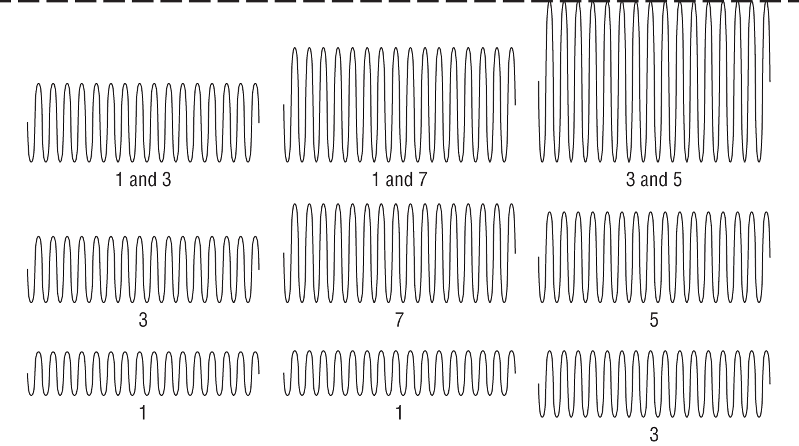

**Figure 3.5****:** The right two prime numbers create the tallest sine wave peak when solving for an easy-to-understand small prime number equation

#### Beyond Shor's Algorithm

自此之后创建的其他算法被吹捧为比 Shor 更快，包括 GEECM (`https://en.wikipedia.org/wiki/Lenstra_elliptic-curve_factorization#Quantum_version_(GEECM)`) 和这个新宣布的进展，`https://www.technologyreview.com/s/613596/how-a-quantum-computer-could-break-2048-bit-rsa-encryption-in-8-hours/`。这意味着 Shor 算法本质上是分解大质数方程速度的“地板”，并且很可能它们可以更快地解决和/或使用比 Shor 预测更少的量子比特。

此外，绝热计算机，即量子退火计算机的一个子类（在 Chapter 2 中介绍），已使用绝热计算和相关的绝热定理来分解大质数。事实上，截至 2019 年，绝热计算机分解的质数方程比使用 Shor 算法的通用量子计算机要大得多。但大多数观察者认为，随着通用量子计算机的不断改进，它们连同 Shor 算法，将远远超过绝热计算机迄今为止取得的早期进展。某种乌龟与兔子的困境。无论如何，许多不同类型的量子计算机和算法都在取得大量的计算进展，而这些进展中的许多都指向了破坏不同类型密码学的可能性。

因此，量子计算机如何可能破坏今天的大部分传统密码的问题，得到了两个近现实的回答。首先，总体而言，量子计算机可能在未来一两年内实现量子霸权，并能够执行经典计算机难以轻松完成的事情。依赖于经典计算机的相对“缓慢”来保护其秘密的密码算法将变得不那么强大。

其次，任何依赖大质数分解（或离散对数问题或椭圆曲线离散对数问题）来保护的密码，一旦量子计算机拥有足够的稳定量子比特来对当今相关的密码学执行更高效的量子分解算法时，就会被破解。简而言之，量子计算机更快，它们的量子属性使用量子算法可以“缩短数学”，而这种数学在仅有经典计算机的世界中提供了大量保护。

#### What Quantum Can and Can't Break

量子计算机和量子特性并不能神奇地破解所有已知的密码学密码。它们只能破解那些依赖于特定函数且其保护易受量子特性和量子算法影响的密码。本节将讨论量子计算机可能破解以及不太可能破解的密码。

##### 量子计算能够破解的内容

如前所述，量子计算机很可能破解任何安全性依赖于整数分解问题、离散对数问题、椭圆曲线离散对数问题或任何其他密切相关数学问题的密码算法。至少，这意味着以下密码及其常见应用（使用这些密码）很可能在不久的将来被破解：

*   Rivest, Shamir, Adleman (RSA)
*   Diffie–Hellman (Key Exchange)
*   Digital Signature Algorithm (DSA)，也称为有限域密码学
*   Elliptic Curve Cryptography（也称为椭圆曲线数字签名算法 \[ECDSA\]）
*   ElGamal
*   PKI（包括数字证书、数字签名）
*   HTTPS/TLS
*   Most VPNs
*   Hardware Security Modules (HSMs)
*   Smartcards
*   Most Wi-Fi security
*   Cryptocurrencies
*   Most two-factor authentication that relies on digital certificates (e.g., FIDO \[Fast Identity Online\] keys, Google security keys)
*   Classical random number generators (RNGs)

仅包含 HTTPS/TLS 就意味着互联网的大部分加密将被破解。加上 PKI 相关密码学意味着大部分商业相关密码学将被破解。并非所有传统密码学都被破解，但按使用情况来看，它涵盖了世界上的很大一部分。

> **NOTE**  不言而喻，这种关于哪些密码可能被破解的假设适用于这些应用在今天的常见应用方式，如果它们使用（或可以移植到）抗量子密码，则可能不会轻易被破解。

##### 量子计算无法破解的内容

了解量子计算机可能破解的密码和应用是一份令人印象深刻的清单。但并非今天的所有密码学都易受量子计算机攻击（至少就目前所知而言）。已知不易受量子计算机和算法影响的密码学被称为 *量子抗性*，或 *量子安全*，或 *后量子*。这三种术语在大多数密码学家中可以互换使用。

以下密码学被认为是量子抗性的：

*   对称密码，如 AES（以及仅依赖对称密码的应用和协议，如 Kerberos 和 GSM 手机使用的网络交换子系统）当使用“安全”密钥大小时
*   新一代完整性哈希，如 SHA-2、SHA-3 等，当使用“安全”哈希大小时
*   SHAKE，一种流密码
*   量子密钥分发（QKD），如 BB84、BBM、B92、COW、DPS、E91 和 SARG04
*   SNOW 3G，一种基于词的同步流密码
*   超奇异同源 Diffie–Hellman 密钥交换（SIDH）
*   基于格的密码
*   基于多元的密码学
*   基于编码的密码学
*   一些形式的零知识证明密码学
*   量子随机数生成器（在 Chapter 7 中介绍）
*   量子密码

其中许多抗量子密码将在接下来的章节中再次介绍。

所有抗量子密码学和应用目前都假定为抗量子，但如果出现令人惊讶的新进展，未来可能会变得易受量子计算或新算法的影响。简而言之，未来有大量量子安全的密码和机制来保护我们，但即使是这些也存在风险。本书的 Part 2 “为量子破解做准备”讨论了这些量子安全密码和实现。

> **NOTE**  没有什么是不可能被黑的。即使是最聪明的量子科学家告诉你，量子安全密码也不例外。你会读到并听到量子密码和其他加密设备和功能是“不可破解的”。尽管在理论层面上可能为真，但在现实世界中情况有所不同。人类尚未能够制造出不可破解的东西，即使从“不可破解”的理论或属性开始。量子世界并没有改变这一点，尽管量子特性可能使黑客攻击变得更难实施。

**为什么对称密码和哈希是量子抗性的**  在继续之前，我想讨论为什么对称密码和哈希特别具有量子抗性。现代数字密码学处理保护位大小，这使得经典暴力攻击变得非平凡。根本没有足够的计算能力来破解现代密码算法生成的和使用密钥。这即使在我们从量子计算机（即使使用 Grover 算法）获得惊人的加速以及量子力学的不可思议特性下也是如此。

例如，仅因为量子计算机可以使用叠加同时生成每一种可能的答案，并不意味着量子计算机可以仅仅挑选出正确答案并将其交给经典世界。必须有一种方法从量子计算机为特定答案生成的数万亿个答案中挑选出正确答案。这就是量子算法的精妙之处。这些算法利用量子特性本质上“捷径”暴力数学，从而使我们能够用更少的猜测找到正确答案，或从数万亿个答案中找到正确答案。

Shor 算法帮助量子计算机分解大素数方程，因为它包含数学逻辑，使得解决方案比使用简单暴力方法找到得更快，并且能够从众多猜测中找到正确答案。量子计算机能够破解大多数传统公钥密码的部分原因在于，公钥密码所依赖的数学存在量子计算机和算法可以利用的“弱点”。Shor 的精妙之处在于，他能够创造出一种更快的数学解决方案，而这只能因为量子计算机而实现。

但并非所有问题都具有过度易受量子解决方案影响的特征。传统对称密码和哈希就是如此。Grover 算法使用平方根时间缩减来将对称密码的保护减半。这是对保护的显著削减，但并非致命（如果时间缩减是多项式、二次或阶乘的话）。任何攻击此类密码学的量子计算机可能比经典计算机快得多，但密钥位数仍然大到令人难以置信，以至于“快得多”并不会显著削弱这些密码或哈希的保护能力。

总体而言，人们普遍认为，只要简单地将传统对称密钥和哈希的密钥大小加倍，就能使它们在可预见的未来保持量子安全——除非发现某些新的、不可预见的相关量子破解。因此，简单地从 AES-128 和 SHA-256 迁移到 AES-256 和 SHA-512 被认为是对这些问题的长期解决方案，你今天就应该这样做。关于此主题的更多阅读；请考虑以下优秀论文：`https://arxiv.org/pdf/1804.00200.pdf`。

> **NOTE**  并非所有密码学家都认为所有针对哈希的攻击都可通过量子计算机改进。一些最聪明的密码学家认为，量子计算机在某些形式的哈希攻击（即碰撞查找）方面实际上可能比经典计算机更差。请参阅 `https://cr.yp.to/hash/collisioncost-20090517.pdf` 作为一个很好的例子。

> **NOTE**  并非所有哈希都是量子安全的。使用 Grover 算法，一些较弱的哈希可以更快地被破解。但 SHA-2、SHA-3 和其他现代哈希算法在适当密钥或哈希大小下被认为对已知即将到来的量子攻击是强健且安全的。

#### 仍属理论

必须记住，直到量子霸权实现（许多厂商称最快在 2019 年实现），所有令人担忧的密码破解在很大程度上仍属理论。Shor 算法已在量子计算机上得到证明。它按预测那样工作。但迄今为止，使用 Shor 算法在量子计算机上分解的最大质数方程是 `7 × 3 = 21`，这很容易被一个孩子解出。你的智能手机的原始计算能力比大多数量子计算机都要强。

> NOTE  Shor 算法分解的最大质数超级小，但量子计算机在不使用 Shor 的情况下已分解出远更大的质数方程。参见 `https://crypto.stackexchange.com/questions/59795/largest-integer-factored-by-shors-algorithm`。尽管一旦制造出足够稳定的量子比特以允许 Shor 攻击更大的质数，这些其他记录也应迅速被打破。另请注意，Shor 算法只是所需量子比特数的一个下限（或视角度不同为上限）。它诞生于 1994 年，世界已充斥着大量声称使其过时的其他算法。

但量子力学和量子计算的全部历史一直是一个循环：从理论开始，然后进入现实世界。量子力学在 20 世纪 30 年代被爱因斯坦无可置疑地证明之前，已被理论化了数十年。量子计算机的第一个模型于 1985 年提出（由 David Deutsch 提出），随后在 1998 年出现了第一台可工作的量子计算机。Shor 算法于 1994 年提出，随后在 2001 年由 IBM 在量子计算机上得到证明。量子计算机正逐个量子比特增长。量子比特稳定性和纠错能力每天都在增强。现在我们有几家厂商拥有各种量子计算机，有信心量子霸权就在拐角处。一旦量子霸权实现，打破传统密码学也为时不远。第 4 章，“量子密码破解何时发生？”将更详细地介绍量子计算机何时会打破大多数传统密码学。

### 总结

本章介绍了量子计算很可能能够破解大多数传统公钥加密形式。首先讨论了密码学基础，特别关注当今大多数公钥加密方案如何提供保护。然后我们探讨了量子计算机如何破坏这种保护，以及哪种类型的密码学对量子破解过于脆弱。第 4 章讨论了量子计算机的理论攻击可能何时成为现实。

# 4

量子密码破解何时发生？

本章将介绍确定量子密码破解何时发生、何时可能发生以及其可能如何展开的主要因素。它将给出许多其他量子计算专家不愿回答的问题：量子密码破解究竟何时会发生？

## 它一直是“10 年后”

自 1994 年 Peter Shor 的量子算法发布以来，全球的计算机科学家和密码学家都明白，如果我们能制造出量子计算机，它们很可能打破现有的公钥密码和其他密码学。而如果我们能制造出它们，就只是事后多少年密码破解会开始的问题。

在过去二十多年里，当大多数人被问及何时可能发生时，我们的回答是：“在未来 10 年内！” 每当有人问我时，我也这么说。说“在未来 10 年内！”基本上等于说，“我们真的不知道。也许很快。也许几十年后！” 这是一个模糊的答案。

让我直截了当。没人真正知道它何时会发生。任何告诉你不同的人都在做最好的猜测，或者是某个已经破解了但被要求保密的秘密团体的成员。甚至有它永远不会发生的可能。我们可能会发现某种惊人的技术壁垒使其永远无法实现！有人认为“永远”是最可能的结局。有人认为我们所描述为量子计算机的东西其实是别的东西，我们都弄错了。但总体而言，如果问一个关注量子物理的普通人量子密码破解何时发生，他们经常会说，“在未来 10 年内。”

大约十年前，有一次我在关于量子计算和可能未来量子破解的频繁演讲之一结束后，有观众问我认为它可能何时发生。我像往常一样说，“在未来 10 年内！” 我一直把著名密码学和行业领袖 Bruce Schneier 视为非正式导师，他在我之后上台做主题演讲。当他经过我身边时，他悄悄问我，“Roger，你说这话多久了？” 我意识到我已经对这个问题回答“10 年”将近 20 年了。时间已经过去，而我的答案没有改变。这让我质疑我是否真的了解量子密码破解有多遥远。这让我意识到我真的不知道。没人知道。而那已经是近 10 年前的事了。

但现在如果你问我今天最好的猜测，我会告诉你量子密码破解要么已经发生，要么更可能在未来几年内发生。我认为有很大可能密码破解将在未来一到三年内发生，而且世界大部分地区对此毫无准备。因此，我写这本书的全部原因：尽我所能帮助你更好地为即将到来的现实做好准备。我不是量子物理学家，也不靠制造量子计算机为生。我明知冒着职业声誉的风险断言量子破解会更早发生。

那么，是什么改变让我在没人真正确定的情况下立下赌注并预测一个特定时间线？我难道不像成百上千个之前失败的末日预言家一样吗？他们预测过圣经灾难、小行星碰撞、粒子加速反物质吞噬漩涡，以及各种原因的末日场景。是什么改变让我停止说“10 年后”并开始认为它可能在几年内发生？我将在下一节介绍。

### 量子密码破解因素

当人们讨论是否认为量子计算机将打破传统密码学时，他们真正争论的是量子力学的现实性、其在现实世界量子计算机中的实现，以及这些量子计算机破坏传统密码学的能力。在本节中，我们将讨论其中许多因素，并评估我们目前所处的位置以及在不久的将来将处于何处。我将逐一处理这些因素。

#### 量子力学是真实的吗？

是的，量子力学是真实存在的。如第 1 章所述，量子力学以及其中涉及的大多数量子特性（光电效应、波粒二象性、纠缠、不确定性、隧穿等）已经被一次又一次地证明确实存在。量子力学是世界上最经得起验证、最精确的科学之一。我们经常不知道量子特性是如何或为何起作用的——这对所有相关人员来说都非常令人不安——但量子力学并非虚构。不仅它是真实的，而且科学家预测它将如何运作也一次又一次地得到了证实。有时世界上最优秀的头脑曾试图证明量子力学的“奇怪特性”是由我们遗漏的某种其他东西造成的。而在每一种情况下，旨在证明量子力学并非量子力学的实验都失败了。所有旨在证明量子特性存在并会以特定方式反应的实验都得到了证实。这可谓是相当辉煌的实验记录。

#### 量子计算机是真实的吗？

是的，量子计算机是真实的。虽然当今大多数量子计算机并不算非常强大（退火量子计算机是显著的例外），但它们仍然使用——并且已被验证确实使用——量子特性来进行计算。这很重要。这是证明量子特性真实存在的又一种方式。在第一台真正可用的量子计算机出现之前，我们人类是否有能力捕获、利用并管理量子特性为己所用，一直存在疑问。直到第一台量子计算机被创建之前，我们所拥有的只是关于量子计算机将是什么样子以及如何运作的众多理论。然后，在 1998 年，第一台现实世界的量子计算机被创建，我们再也不用担心了。自那以后，在 21 年的时间里，这段旅程令人无比激动。

关于量子计算机是否会破坏当今传统的公钥密码学这一核心障碍，尤其是在彼得·肖尔的质数分解算法于 1994 年发布之后，关键在于*是否*我们能够构建一台量子计算机。曾有许多唱衰者。而四年后我们就做到了。

没有这一项巅峰成就，其余的一切都不可能实现。但我们确实做到了。我们现在仅在西半球就知道有超过 80 个不同的量子硬件团队——而全球范围内我们不知道的可能还有许多、许多更多。最大的障碍是是否能够构建一台量子计算机，而我们做到了。最困难、据称“不可能实现”的部分已经完成。第一个量子比特是最难的。对我来说，从 1 个量子比特到 100 万个量子比特的问题要容易得多。

> **注意**  有趣的是，有几位非常聪明的科学家表示我们仍未真正实现量子计算，并且他们提出了在科学或逻辑上得到支持的论据来支持他们的观点。但随着每一种新型量子计算机的出现，以及成功演示的量子算法和解决方案的不断证明，这些说法变得越来越难以考虑。

#### 叠加态是真实的吗？

是的，叠加态是真实的。你无法在没有能够同时产生大量答案的能力的情况下解决所有难以解决的经典计算机问题……实际上，*所有*可能的答案瞬间产生。已有数百甚至数千次实验证明了叠加态是真实的。1996 年，一个单原子被证明具有状态叠加（`https://quantumsciencephilippines.com/seminar/seminar-topics/SchrodingerCatAtom.pdf`）。此后，数万亿个原子（`https://arxiv.org/abs/1310.8343`）以及总体上数万个分子已被证明表现出叠加态。更重要的是，所有量子计算机都使用叠加态作为其关键量子特性之一。它们若没有叠加态就无法存在并按其方式运行。

#### 彼得·肖尔的算法是真实的吗？

是的，彼得·肖尔的算法是真实的。如果没有肖尔算法在现实世界中应用并快速分解大质数方程，传统的公钥密码和其他密码在可预见的未来仍将安全。尽管迄今为止使用肖尔算法的量子计算机尚未分解大质数方程，但它们已使用肖尔算法并证明其运作方式完全如肖尔所预测的那样。IBM 在 2001 年的早期量子计算机使用肖尔算法分解了一个质数方程。这个问题已经得到解答；我们只需要更稳定的量子比特来解决非常大的质数方程。肖尔算法被验证为正确也意味着它所依赖的其他量子算法，例如傅里叶变换，也是准确且真实的。

#### 我们有足够稳定的量子比特吗？

不，我们没有足够稳定的量子比特。这是量子计算目前的圣杯。运行肖尔算法来分解任何质数方程需要（2 × `n`）+ 3 个稳定量子比特，其中`n`是要破解的密钥位数。因此，要破解 2048 位 RSA 密钥，我们需要 4099 个稳定量子比特，要破解 4096 位 RSA 密钥，我们需要 8195 个稳定量子比特。而且我们需要稳定量子比特位于正确类型的计算机上。肖尔算法在量子退火计算机上并不那么有用（如第 2 章所述）。到目前为止（截至本文撰写时），我们仅拥有数量少于 100 个的通用量子比特，而且即使这些也不够稳定。我们需要的超过 4000 个稳定量子比特（或按某些计算包括辅助量子比特在内的总共 40 亿个量子比特）相去甚远。问题是稳定量子比特的数量会以多快的速度增长？

我对人类智慧要说的是，一旦我们弄清楚一件非常困难的硬件问题，我们在制造大量此类硬件方面就非常、非常擅长。就像在第二次世界大战期间，艾伦·图灵和他的团队（基于数百名盟友之前的工作）最终弄清楚了破解德国谜样密码所需的东西。图灵必须基本上发明第一台真正可用的计算机，他做到了。然后他发现他需要数百台。他得到了它们。第一台无线电和电视非常难以制造。接下来的一百万台就不那么难了。你可以说花了数百年甚至数千年才达到第一个东西被创造出来的地步。通常下一个一百万不会花上半个世纪。第一个超稳定量子比特是最难的。从一个到十亿个并不那么难。

与此同时，许多科学家正在研究对肖尔算法的分解优化，以减少所需的量子比特数量。肖尔算法是一个上限（即所需量子比特的最大数量），而不是下限。很可能随着稳定量子比特数量的增加，肖尔算法会随着时间的推移而得到显著改进，因此所需数量会减少。所以今天，至少在公开层面，我们没有足够数量的稳定量子比特，但我们正通过两种协同的方法在中间相遇而逐步接近。一种是增加更多稳定量子比特，另一种是首先减少所需稳定量子比特的数量。

##### 量子比特稳定性和纠错

量子比特的相干性和退相干目前是否已达到量子霸权和量子密码破解所需的水平？没有。但与量子比特的 sheer 数量一样，稳定性和纠错能力也在上升。每季度似乎都出现了稳定性和纠错能力两方面的稳固改进。对于我们目前所知的最稳定的量子计算机类型，即 Majorana fermion（微软）和离子阱，添加更多量子比特甚至有非常稳固的机会。而且它们每个量子比特都是非常稳定的量子比特。这些厂商可以花费更多的时间、金钱和其他资源来仅仅增加量子比特，而不必试图稳定和纠错现有设备。这是一场竞赛，看哪种量子技术胜出：大量量子比特配合大量纠错，还是更少但更稳定的量子比特。

#### 量子资源与竞争

一个非常强烈的迹象表明我们很可能会比预期更早地解决现有的量子问题，就是投入到剩余问题上的资源 sheer 数量之大。所有主要国家都在花费数百亿美元。对许多国家来说，这已成为政府的头等优先事项，甚至较小的国家也在与较大的国家结成伙伴关系。每个国家里最大的科技和计算机公司，以及顶尖大学，都参与其中。这让我想起大约半个世纪前的一个全球项目。

在 1950 年代，很少有人认为我们会在 1969 年前让人类登上月球。更令人震惊的是，美国为将宇航员送上月球而做出的主要推动，直到约翰·F·肯尼迪著名的 1961 年宣言才发生。八年后，在多次失误和灾难之后，美国宇航员登上了月球。我想不出另一个有同等数量的全球资源集中竞争谁先完成的项目。对我来说，这绝对感觉像是一项登月计划。

#### 我们有稳步改进吗？

是的，我们有稳步改进。所有这些全球资源和竞争都在推动量子计算各方面的稳步改进。量子比特数量在增加。量子比特稳定性在增加。纠错能力在变好。量子逻辑门速度在提升。量子计算机类型的数量在增加，而且改进的量子发明几乎每周都在发生。

更多的量子算法被发明出来，而旧的算法在运行的量子计算机上得到验证。多个量子处理器可用。现已存在十多种量子编程语言、脚本语言和编译器。量子网络不再是梦想。量子随机数生成器已投入使用。多个厂商认为量子霸权就在拐角处。似乎没有任何人们认为无法解决的重大挫折或障碍。

一些批评者将量子计算和量子突破比作核聚变。核聚变是两个或多个原子核结合成一个。聚变产生大量能量。这是太阳产生热量、能量和光的方式，长期以来被认为将是为地球提供动力的能源技术。但在超过 80 年的研究开发和数十亿美元的投入后，我们似乎与开始时一样遥远。批评者称量子计算是下一个聚变资金呼吁。他们认为量子相关团体在夸大量子计算的潜力以获取大量资金。

但聚变研究与量子研究之间存在巨大差异。聚变研究几乎十年十年地缓慢推进。大多数实验都是实际上的失败。我们仍然没有一个可工作的聚变反应堆。在量子世界里我们拥有可工作的设备。我们有持续的改进。我们有持续的进展。这看起来不像是一门被阻碍或放慢的科学。恰恰相反。

#### 专家意见

最后，长期以来几乎所有量子计算专家都同意量子霸权至少还要十年。现在意见开始分歧，越来越多的声音开始认为量子霸权只在一年或两年之内。许多量子计算专家认为量子密码破解也只在几年之内。

Mark Jackson，剑桥量子计算公司商业开发的科学负责人，就是其中之一的声音。他和剑桥量子计算公司正在帮助多个不同的量子计算项目。他身处量子计算机技术的核心，了解它目前处于何种状态以及未来几年将走向何方。他已公开预测量子密码破解很可能在未来几年内发生，并且肯定在 10 年以内。这不是我们用来表示“十年后”的模糊说法。回想当时，我们甚至（在某个阶段）都没有量子计算机，更不用说上百台运行中的量子计算机、遍布全球的团队以及数百亿美元来解决这个问题。现在这不是一个“我们真的不知道”的答案，而是基于现有量子计算科学稳步、有条不紊的进步做出的判断。而 Jackson 并非孤例。

### 量子网络破解何时发生

当考虑破解传统密码学所需的所有因素时，可以做出一个强有力的论点，即它会比预期更早发生。一些专家表示，如果它在未来半个世纪内没有发生，他们会更惊讶。话虽如此，没有人知道它何时会发生，直到它完成为止。一个理性的人应该审视所有可能的时机情景，并考虑在风险调整的基础上哪种情景更合理。

#### 时机情景

量子密码破解何时发生（或不发生）有四种可能的大致时间段：它已经发生了，但我们不知道；它将在未来几年内发生；它在未来几年内不会发生，但最终会发生；或它永远不会发生。这些是唯一四种可能的结果，接下来将更详细地介绍每一种。

##### 它已经发生了

量子霸权和量子密码破解很可能已经在某个私人实体内部发生，而公众世界却一无所知。一般认为，如果一个主要国家的政府能够首先获得量子霸权，特别是执行量子密码破解，他们将有充分的动机保持这一成就沉默。

> **NOTE**  世界各国政府擅长保守密码秘密。英国政府通信总部（GCHQ）的 Clifford Cocks 在 1973 年创建了我们现在称之为 RSA 密码的系统，而 Malcolm J. Williamson 在 1974 年发现了我们后来称之为 Diffie–Hellman 的系统。两者很快就被转交给美国国家安全局（NSA）。Diffie、Hellman 和 Merkle 于 1976 年以及 RSA 于 1977 年分别公开宣布的重新创造，并未让英国或美国政府在数十年内承认其先前的存在。事实上，英国政府直到 1997 年（24 年后）才承认其作为公钥密码学的首创者角色。

世界上大多数间谍机构都希望能够获得量子密码破解并尽可能长时间地保密。然后他们就可以监视仍依赖传统公钥密码、认为其仍然安全使用的许多实体和其他政府。我相信大多数密码专家都认为，如果他们的政府在公共部门的某个人或实体之前首先获得访问权限，他们的政府会将其保密。

这个理论可以被更认真地考虑，因为在 2019 年之前，多个国家和公司已经声称他们已经获得了量子霸权，或者非常、非常接近实现。 其中包括 Google、IBM 和阿里巴巴。 然后突然间，许多那些公开的声音都沉默了。 许多人都在想为什么。 就我个人而言，仅凭我最好的猜测而没有任何关于其可能性的具体真实知识，我认为这个场景发生的可能性为 15%。

### 在未来几年内

你的作者和许多其他人认为量子霸权和量子密码破解只在几年之内，或更早。 这绝对不是主流观点，但每天都在获得越来越多的支持。 量子霸权很可能在未来一年左右实现（Google、IBM 等公司对此发表过言论）。 我认为同意 Google 和 IBM 的预测并不是一个巨大的风险。

量子霸权实现时意味着什么又是另一回事。 尽管量子霸权将是历史性的转折点时刻，量子计算机能够做经典计算机无法做到的事情，但它不太可能意味着世界会在可衡量的层面上立即发生变化。 量子霸权实现后的第二天就是大量工作的开始——这些工作无疑将导致许多伟大的发现。 但它们不会在一夜之间全部实现。 就像电灯泡、无线电、电话、电视和互联网被发明时一样，要实现其中大部分劳动的成果需要数年时间和许多更多的渐进式进步。

量子密码破解绝对会在量子霸权之后发生，但其之后的时机目前也无法预测。 核心问题是通用量子计算机厂商从不足 100 个稳定量子比特过渡到超过 4000 个需要多长时间？ 一旦量子比特稳定化和纠错被“搞清楚”，数量可能会相当快速地增长，这是有很大可能的。

在经典世界里，一旦我们弄清楚如何在硅片上集成大量晶体管，同一空间内的晶体管数量大约每 18 个月到两年翻一番（遵循一个被称为 `Moore’s law` 的预测）。 到目前为止，用特定类型的量子计算机创建并能够使用的量子比特数量增长方式不太可预测，尽管它可能类似于微处理器的早期阶段。 Table 4.1 显示了按年份比较非退火和退火类型的各种量子计算机使用的量子比特数量（仅作比较）。

**Table 4.1****:** 按年份各种量子计算机类型使用的量子比特数量

| Year || Non-annealing || Annealing |
| --- | --- | --- |
| 1998 || 3 ||  |
| --- | --- | --- |
| 2000 || 7 ||  |
| 2006 || 12 ||  |
| 2007 ||  || 28 |
| 2012 ||  || 84 |
| 2015 ||  || 1000 |
| 2017 || 50 || 2000 |
| 2018 || 72 ||  |

重要的是要记住，正如在 Chapter 2 中所介绍的那样，量子计算机、其速度和它能完成的事情不仅仅是量子比特的数量。 如果你看看量子计算的历史，几乎所有组件都在改进，而且还出现了以前不存在的新组件和组合。 我们只知道在所有量子制造领域都在稳步改进。 我认为这种场景的可能性为 30%。

### 在未来几年之后

这基本上是标准的“在未来 10 年内”回应。 它不太可能在未来几年内发生，但量子霸权和量子密码破解将在未来的某个时间发生。 绝大多数量子科学家都属于这一类。 这个时间场景与前一个“在未来几年内”之间的一个显著区别是，直接从事量子计算机产品研发的量子科学家认为它会在 10 年前发生。 这是一个值得注意的事件。 这些科学家不确定它何时会发生，但他们开始觉得它会在比如未来五到七年内发生，并且认为我们不必等待 10 年。 这是思维方式的巨大转变。 当然，量子霸权和量子密码破解可能会晚几十年。 毕竟，没有人确切知道它何时会发生。 我认为这种场景的可能性为 50%。

### 它永远不会发生

一小部分量子计算专家认为它永远不会发生。 他们认为大规模量子计算的剩余问题是不可逾越的。 有些人甚至认为我们今天拥有的量子计算机并不是真正的量子计算机。 他们认为我们看到的是我们想在我们实际上仍然了解不够的世界中看到的东西。 他们认为我们创造的每一种类型的量子计算机最终都会遇到一个问题，阻止它们真正超越我们今天创造的粗糙的算盘式装置。 他们的信念不能被轻易否定。 其中一些信徒是我们世界上最聪明的头脑之一。 他们比我们大多数人都更了解量子计算。

尽管如此，我不会把钱押在这个时间场景上。 永恒是很长的时间，之前许多伟大的头脑，包括爱因斯坦，都带着对量子力学完整性的质疑离开人世，尽管他们否定的量子特性最终被证明是存在的。 我认为这种场景的可能性为 5% 或更低。 更重要的是，绝大多数最了解量子科学的科学家和美国政府都不太相信这种最后的时间场景（下一节将详细介绍）。

我最喜欢的关于此事的引言之一来自德克萨斯大学奥斯汀分校的量子教授 Scott Aaronson，他在他的书 *Quantum Computing Since Democritus* 中写道：

> *\[I\]f scalable quantum computing were proved to be impossible, that would excite me a thousand times more than if it were proved to be possible. For such a failure would imply something wrong or incomplete with our understanding of quantum mechanics itself: a revolution in physics!*

#### 你应该何时准备？

所以，你可能会问自己：“如果量子计算专家中没有人同意它何时会发生，我们是否甚至应该现在就开始为即将到来的量子密码破解做准备？” 你可能会担心你会浪费宝贵的时间和资源去关注一件可能要很多年，甚至几十年才会发生的事情。 “在计算机安全世界里有很多事情需要担心，其中许多比一些理论上的、天马行空的、Y2K 问题更紧迫！” 你可能会这么想。 而且你是可以被原谅的去这么想的，尤其是因为你绝大多数同行的计算机安全从业者目前完全不知情且无所作为。 你甚至可能采取“保守立场”，认为通过等待直到你听到量子霸权和量子密码破解真正发生来最大化资源。 你可能会觉得等待大众在实际威胁最终实现时做出反应更安全，就像鱼在逃避捕食者时同步移动一样。 你可能认为等待破解被宣布既高效又最具成本效益。

好吧，与那些时机场景不同，在那些场景中没人真正知道答案是什么，你和你的组织应该开始为量子霸权和即将到来的量子密码破解做准备的答案就是现在！现在有很多事情你应该去做（本书第二部分中有所涵盖），如果你现在就开始做，会更便宜、更容易。而且确实存在一种非常现实的可能性，那就是等到量子破解发生时再行动已经太晚了，无法保护你组织的机密。如果你的竞争对手或感兴趣的国家对你最敏感、最具保护性的数据足够关心，他们可能已经在窃取你的加密数据，等待有一天能够用量子计算看到其中的内容。即使你认为自己没有任何可能对对手有用的敏感数据，显然对你来说现在就开始为后量子世界做准备更便宜、更高效。我并不是唯一做出这种建议的人。

#### NSA 表示现在

2016 年，美国国家标准与技术研究院（NIST）、国家安全局（NSA）和中央安全局（CSS）表示，现在是开始为“后量子”世界做准备的时候。他们在 *NSA/CSS 信息保障局商用国家安全算法套件和量子计算常见问题*（`https://cryptome.org/2016/01/CNSA-Suite-and-Quantum-Computing-FAQ.pdf`）中就是这么说的。关于后量子准备工作，文中非常明确地写道，“NSA 认为现在时机恰当——与量子计算的进步一致。”

如果你的组织里有人在问你是否应该为量子霸权和即将到来的量子密码破解做准备，就把这份文件，特别是该部分内容给他们看。内容很清楚。而且截至 2019 年，这份文件至少已有三年历史了。因此，无论可能的时机场景及其可能性如何，我们国家最优秀的科学头脑，以及最有可能深入了解量子计算进展和剩余技术障碍的人，都在告诉世界需要现在就做准备。听起来他们并不认同最后一种可能时机场景——永远不做——的成本效益论点。

#### 国家科学院表示现在

2018 年，美国国家科学院发布了一份共识研究报告，题为 *量子计算：进展与前景*（`http://cs.brown.edu/courses/csci1800/sources/2018_NAE_QuantumComputing_ProgressAndProspects.pdf`） 。关键发现第 1 条指出，量子计算破解甚至 RSA-2048 位的可能性至少还要十年以上。这是关于量子破解何时发生的最宽松的结论之一，我读到过。但紧接着是第 10 条发现，其中写道

> *即使能够解密当前密码体制的量子计算机还要十年以上，这种机器的危害也足够高——而且过渡到新安全协议的时间框架足够长且不确定——因此优先发展、标准化并部署后量子密码对于最大限度降低潜在安全和隐私灾难的风险至关重要。*

也就是说，现在就开始准备。

#### Mosca 不等式

2015 年，滑铁卢大学的 Michele Mosca 指出，我们需要在以下情况发生时开始担心量子计算机的影响：我们希望数据保持安全的时间加上我们计算机系统从经典向后量子过渡所需的时间，大于量子计算机开始破解现有量子易受攻击加密协议所需的时间。例如，如果你需要关键数据在未来 10 年内保持安全，而过渡需要 5 年，那么你需要在距离后量子世界 15 年之前就开始转向后量子系统。Mosca 最初提出这一结论时，选择了 2020 年作为那个未来时间点，但普遍共识是，对于大多数需要高度数据安全性的组织，我们在 2017 年就已经过了这一时间点。剑桥量子计算联合创始人 Ilyas Khan 关于 Mosca 不等式的一篇很棒的文章：`www.linkedin.com/pulse/moscas-inequality-why-matters-ilyas-khan-ksg/`。我将在第 9 章中更详细地重新介绍 Mosca 不等式。

### 突破场景

事情变得有点复杂，没人确定当我们达到量子霸权和量子密码破解时，“突破”场景会是什么样子。所能实现和破解的力量是否会掌握在少数人手中，还是会像公钥密码学的发现一样，整个世界在几年内就开始使用？让我们看看如果实现的话一些可能的突破场景。

#### 长期留在国家手中

许多国家正花费数十亿美元的资金，争取第一个实现量子霸权和量子密码破解。构建大规模量子计算机需要数十亿甚至数百亿美元的投资。一个可能的突破场景是，一个或多个国家在几年内相继实现这些量子目标，并且权力就此保留在这些国家手中。政府会尽力限制量子力量的掌握范围，因为它能够破解当今的数字代码。他们希望限制可能的损害，并在将量子力量释放给公众之前，确保本国机密得到充分保护。

这种场景可能被视为大多数国家对待原子武器的方式。它们是在国家层面以巨大成本实现的，一旦实现就受到高度保护。每个进入“核俱乐部”的国家都会受到反对，一旦它们加入俱乐部，大多数其他俱乐部成员都会试图阻止未来的成员加入。国家和全球层面都会制定法律，防止核武器落入任何未经授权的绝密政府机构之手。

你可能会怀疑将量子计算等同于核武器，但请记住，许多政府认为强加密是国家最高机密。英国和美国在公钥密码被公开发布数十年后，才公布英国发明了公钥密码的事实。即使在今天，包括美国在内的许多大国中的个人和公司也被禁止向其他国家出口强加密技术。甚至在互联网上发布强加密技术，让其他国家的人下载，可能都是一种犯罪。强加密被视为“军火”，受美国《武器出口管制法》管辖。不遵守国家密码出口法律可能被视为叛国罪，并可能导致死刑。

在过去，许多公民因在软件产品和互联网上分享常用的密码算法而被威胁以叛国罪定罪。在 20 世纪 90 年代初，Phillip Zimmerman（`https://en.wikipedia.org/wiki/Phil_Zimmermann`）因在其可自由下载的 Pretty Good Privacy（PGP）软件程序中使用通用密码标准，而被美国政府视为国际密码学殉道者并受到威胁。

总之，如果国家认为他们能把量子计算据为己有，他们就会这么做。政府可能允许量子计算，但禁止破解传统密码，即使公众也能做到，这并非不可能。政府甚至可能制定法律，禁止量子计算制造商允许其计算机被用于破解传统公钥密码。Shor 算法会被取缔吗？如果被取缔，某人会被逮捕仅仅因为他自己实现了 Shor 算法吗？

再次，你可能会怀疑这种可能性，但打印机、扫描仪和复印机（以及传真机和照片编辑软件等其他设备）已被美国政府强制防止打印逼真的美国货币，这已经是一个类似的情况。鲜为人知的是，大多数复印机、打印机和扫描仪（以及软件）都包含防止逼真印刷货币的代码。我会告诉你尝试复印和打印货币，但即使尝试也是高度非法的。

> **NOTE**  有许多、许多美国法律禁止复印和印刷法定货币。许多人认为设备包含防止印刷货币的代码，但这是一个广泛流传的假传闻。我的一位“朋友”最近尝试在各种设备上复印和打印不同面额的美国货币，发现他可以复印出相当逼真的货币副本，甚至可以将其保存为文档文件，但任何以 100%比例打印货币的尝试都被阻止了。他可以打印非常大的货币副本，但所有以常规比例打印的尝试都导致打印错误、拒绝打印和被截断的副本。这可能并不适用于所有设备，但在我朋友进行有限测试的设备上确实发生了。这里有一个 YouTube 视频提供更多细节：`www.youtube.com/watch?v=1c-jBfZPVv4`。

#### Used by Biggest Companies

有人认为开发量子计算机的成本将使量子密码破解保持在国家行为体的范围内，并且只有拥有足够资源制造、购买或租用大规模量子计算机时间的最大的公司才可以使用。`Shor’s algorithm`需要超过`4,000`个非常稳定的量子比特的量子计算机来破解当今最常见的公钥大小。一旦达到这种规模，很可能会成为最昂贵的计算机之一，其成本远高于房间大小的主机和甚至数百万台托管云虚拟机。任何新奇、惊人且非常难以且稀有建造的东西，其经济性本身就表明大规模量子计算在许多年内将超级昂贵。

当然，总有一天我们可能会在每个人的办公桌上得到一台量子计算机（或处理器），但这种特定现实肯定要几十年后才会到来。第一台传统计算机微处理器（至少供应商称之为微处理器）是在 1968 年创建的。虽然微处理器在昂贵的计算机和有些昂贵的计算器中被广泛使用，但微处理器出现在世界上大多数桌面上的想法直到 1990 年代才实现（而且许多人仍然会说它们并非全球普及）。

因此，仅出于纯粹的经济原因，这可能是一个现实的突破场景，即最大的公司使用大规模量子计算机，但它们在几十年内很少能被资源较少的公司和个人使用。也有可能最大的公司可能会由于国家法律而限制量子密码破解的能力仅限于预授权公司（印刷货币就是这样做的）。

#### Mass Proliferation

最合理的中期突破场景是大规模普及。已经，即使只有大约一百台小型量子计算机，<|message|> 限的量子计算能力正以免费或分时费用的形式提供给小型公司和个人。如果不被法律禁止，似乎不太可能制造和共享现有有限量子计算资源的公司不会随着它们变得越来越普遍而将其提供给大众。

#### Most Likely Breakout Scenario

如果历史可以作为指导，那么最可能的突破场景将是国家行为体（及其支持机构、公司和相关大学）将成为首批使用大规模量子计算的实体。也许最大的公司（如 Google、IBM、阿里巴巴或 Microsoft）可能会率先实现——尽管如果他们真的领先于政府，政府很可能会成为主要的首批客户，其次是大型组织。

很快你就会看到各种规模的公司将量子计算机用于数百种不同的应用。在大型组织和大学中，使用分时量子计算机将变得普遍。我认为所有这些在量子霸权之后的几年内就会发生。在十年左右的时间里，我们都将在自己的设备上运行某种量子计算功能。它们要么是设备的一部分，要么我们的设备将链接到一个量子计算服务，该服务在我们的设备和问题需要时处理并交付量子计算。

我们以前经历过这种技术跳跃点的情况。它发生在互联网上。它发生在传统的公钥密码上。所有这些努力首先使政府和大型组织受益，很快就扩展到世界其他地方。政府试图（并且仍然试图）将强密码锁定起来，远离世界其他地方。到目前为止，这一策略并没有长期奏效——主要是因为一旦某种特别强的密码实现在理论上被知晓，它很快就会成为现实。试图阻止世界使用强密码就像试图阻止通信一样。它们通常是同一件事，尤其是在数字世界中。

### Summary

总之，虽然我们不知道量子霸权和量子密码破解何时会发生，但最有知识的计算机科学家和美国政府的普遍共识是，你现在就应该开始准备。Chapter 5 将介绍后量子世界可能是什么样子，以便你在开始准备时能够全面了解。

# 5

## What Will a Post-Quantum World Look Like?

当量子霸权和即将到来的量子密码破解发生时，世界将永远改变。会有世界历史之前和世界令人难以置信的未来之后。大多数变化不会瞬间发生，而是会根据不同的用途和应用在多种时间线上发生。有些会在以周和月为单位的时间线内发生，而另一些则会在数年和数十年内发生。但深远、重大的变化即将到来。

本章介绍可能的变化，首先集中于量子计算在短期内可能破坏哪些应用（本书的重点），然后是由于量子特性我们将看到的所有新或改进的设备和应用。与大多数其他以前重大的技术进步一样，变化可以并且将会被用于善和恶。量子计算将以多种方式影响我们，而不仅仅是通过破解加密秘密。在介绍与密码学直接相关的破坏和改进之后，本章将探讨除密码问题之外我们将看到的所有美妙的新发明和改进。

> **NOTE**  本章中*application*一词用于表示任何类型的技术实现，而不仅仅是软件程序。

### Broken Applications

本书的主要原因就是所有使用当前技术、算法、协议和密码的计算应用，这些应用将因量子计算而被削弱或完全破坏。这包括任何基于新利用的量子特性可以击败的东西来保护的应用。后量子世界将充满被削弱和彻底破坏的密码学（并且在防御者的帮助下，还有大量量子抗性密码学，将在 Chapter 6，“Quantum-Resistant Cryptography”，和 Chapter 7，“Quantum Cryptography”中讨论）。

正如前几章所述，这包括任何依赖于传统二进制计算机无法进行超快速计算的能力（`Grover’s algorithm` 可以克服）或使用 `Shor’s algorithm` 对涉及大素数的数学公式进行因式分解的保护。

#### 受弱化的哈希和对称密码

`Grover’s algorithm` 基本上意味着量子计算机将能够削弱大多数现有的传统对称密码和哈希，特别是在它们使用较小的密钥大小时。量子计算机上的 `Grover’s algorithm` 基本上将大多数对称密码的保护减半。128 位密码将只有 64 位的等效保护，256 位密码将只有 128 位的等效保护，以此类推。当量子密码破解发生时，128 位的对称密钥保护仍将被认为足够强，不会立即失效，但它确实使破解进入了近期可能的范围。鉴于传统计算机处理器的改进（即摩尔定律），128 位对称密钥可能只能提供数年的保护，而非数十年。

任何使用密钥大小或哈希输出小于 256 位的对称密码或哈希，其长期保护价值都值得怀疑（即 *量子易受攻击*）。使用较大密钥大小的对称密码学被认为 *量子抗性*，而在规模的上限，使用大于最低限度的密钥大小则被认为 *量子安全*。大多数密码学权威机构建议现在使用 256 位及更大的对称密钥（例如量子安全）来对抗量子攻击的长期威胁。传统观点认为，仅需要中等安全要求或仅需保护秘密几年时间的组织可以使用 192 位对称密钥，但需要高度安全或保护超过几年时间的组织应使用 512 位密钥。尽管 192 到 256 位密钥可以用作“过渡”直到更大的密钥大小可以取代它们，但最终每个人都应努力为他们希望长期保持安全的最关键和最敏感数据使用更大的密钥大小。本质上，你希望让 `Mosca Inequality` 指导你的计划；更多内容见 第 9 章，“现在准备。”

> **NOTE**  密码哈希也应使用与对称密码推荐长度相同的摘要输出，即使它们不是相关的密码类型。

非常重要的一点是，即使是被广泛信任、否则“密码学上强”的对称密码和哈希，如果它们使用 192 位及更小的密钥大小和摘要，也被认为受到量子计算的威胁。例如，即使当前受信任和接受的 `SHA-2` 和 `SHA-3` 哈希，如果使用小于 192 位的密钥大小，也不会被认为量子抗性。这是因为量子破解场景中的主要弱点是密钥大小本身的固有保护，而不是底层算法的弱点。密钥大小决定了密码或哈希提供的“保护位数”。例如，使用 128 位密钥的密码提供了 `2¹²⁸` 个位数的破解者必须猜测的数量（除非算法本身存在密码学缺陷削弱了总保护位数），以确保找到正确答案。

在大多数现实场景中，平均猜测次数约为 128 位的一半（即 `2¹²⁷` 位），因为平均而言，一半的时间现实世界的猜测次数将少于 `2¹²⁷` 次猜测，另一半时间将多于 `2¹²⁷` 次猜测（在大量尝试的平均值上等于 `2¹²⁷` 次猜测）。当进行纯粹的暴力猜测密钥或哈希摘要结果时，唯一重要的是必须猜测的保护位数。底层算法的数学能力在纯猜测攻击中不是因素。

> **NOTE**  美国国家标准与技术研究院（`NIST`）和其他组织认为 128 位对称密码是“弱”量子抗性的。我不知道有谁希望转向使用安全量子抗性密码学却想要“弱”保护。因此，我不认为 128 位密钥是真正量子安全的，我也不会那样写。

表 5.1 列出了在后量子（PQ）世界中被认为具有弹性（即易受攻击或抗性）的各种传统哈希和密码的示例。

**表 5.1****:** 后量子世界中弱和量子抗性的传统哈希和密码

| Hashes  || Symmetric Ciphers |

| --- | --- |

| **Quantum-susceptible** || **Quantum-resistant (when using 192-bit and larger digest options)** || **Quantum-susceptible** || **Quantum-resistant (when using 192-bit and larger key sizes)** |

| --- | --- | --- | --- |

| MD-4, MD-5, SHA-1, LM, NT, SHAKE-128, RIPEMD (when used with key sizes smaller than 192), PBKDF1, PBKDF2 (when using key sizes smaller than 192), BCRYPT || SHA-2, SHAKE, SHA-3, PBKDF2, RIPEMD, Argon2, Blake2 || DES, 3DES, DESX, CAST, IDEA, SAFER Kuznyechik, Serpent-128 and -192, AES-128, Twofish (less than 192 bits) || AES, Blowfish, Twofish, Serpent-256 bits, Chacha/Salsa20 |

> **NOTE**  任何希望在 PQ 世界中实现量子抗性的组织都需要开始使用密钥大小等于或大于 256 位的传统对称密码和哈希，最好为 512 位以获得最佳保证。

如果对称密钥被破解，攻击者可以读取其所保护的内容。这在过去发生过。早期的对称密码，如 `DES`（具有 64 位密钥但只有 56 位保护），曾被认为足以保护机密信息。随着时间的推移，计算能力的提升使 `DES` 失去保护。今天，由 `DES` 保护的信息可以在几分钟内被破解。因此，目前的对称密码建议是 `AES` 具有 256 位或以上的保护，如果你希望长期量子安全，则为 512 位。`AES-192` 仅在非常短期内可接受量子保护，也许只有几年。

如果哈希被破解，攻击者可能创建其他、 rogue 的内容，使其具有相同的哈希摘要（攻击者声称这是原始合法内容）。这被称为第二原像攻击。两个不同的内容产生相同的哈希结果会完全使哈希算法失效。它在过去发生过几次，最近由 Google 研究人员在 2017 年对 `SHA-1` 哈希证明。Google 能够创建两个不同的文档，结果产生相同的 `SHA-1` 哈希（见 图 5.1）。你可以在这里阅读有关首次成功的 `SHA-1` 哈希“碰撞”的更多信息：`http://shattered.io/`。

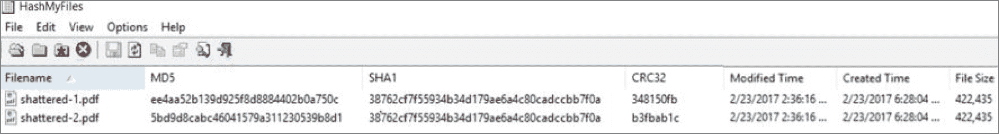

**图 5.1****:** 示例哈希和其他内容文档属性显示来自两个不同文档的相同 SHA-1 哈希

> **NOTE**  有趣的是，正如你在 Figure 5.1 中所见，号称较弱的哈希算法 `MD-5` 和 `CRC32` 正确地显示了两个不同的哈希值，而据称更强的 `SHA-1` 哈希却没有。这是因为这两个不同的文档是专门构造来利用 `SHA-1` 哈希算法中的缺陷的，而研究人员并不关心对其他算法的影响。实际上，利用 `MD-5` 和 `CRC32` 中的缺陷要容易得多，而且这种缺陷在很多年前就已经被利用了。然而，要制作两个文档使得这三种哈希对两个文档都显示相同的哈希值则会更加困难。如果“文档”是一个更复杂的<|message|> 可执行文件而不是一个简单的文档，那么要创建一个具有与原始非恶意可执行文件相同哈希值的恶意可执行文件将是指数级更难的（如果不是更难的话）。但在密码学中，如果你的密码在简单的测试中失败，它就完全失败了。

> **NOTE**  `CRC32` 并不是一种加密哈希。循环冗余校验 (`CRCs`) 是一种错误检测码，试图像真正的加密哈希一样快速汇总和比较两个不同的内容以查看它们是否不同。但 `CRCs` 不具备良好哈希所需的所有属性，例如保证永远不会有两个不同的内容具有相同的摘要输出。`CRCs` 在几十年里曾是一种流行的“穷人的哈希”，但现在在大多数应用中已被合法的加密哈希所取代。

历史教给我们的教训是，弱的对称密码和哈希可以被对手用于恶意目的。弱的对称密码可用于读取未经授权的内容，而弱的哈希可用于不公平地声称两个不同的内容是相同的，这随后可用于欺骗毫无防备的用户。削弱的非对称密码已被用于多起高调攻击中以危害毫无防备的受害者。

#### Broken Asymmetric Ciphers

如前几章所述，任何依赖以下三种数学问题的非对称密码，一旦在具有足够数量稳定量子位的量子计算机上运行 `Shor’s algorithm`（以及对其进行改进的其他算法）后将被视为不可用：整数分解问题、离散对数问题或椭圆曲线离散对数问题。这包括以下传统非对称密码算法：

*   Rivest, Shamir, Adleman (`RSA`)
*   Diffie–Hellman (`DH`) 和相关原语
*   Elliptic Curve Cryptography (`ECC`) 和相关原语
*   ElGamal

与对称算法一样，非对称密码的密钥大小在决定其是否被视为弱或已破坏方面也起作用。运行 `Shor’s algorithm` 来分解任何质数方程需要 (2 × *n*) + 3 个稳定量子位，其中 *n* 是要破解的非对称密钥位数。因此，要破解一个 2,048 位的 `RSA` 密钥，你需要 4,099 个稳定量子位，而要破解一个 4,096 位的 `RSA` 密钥，你需要 8,195 个稳定量子位。理论上，你可以不断增量增加非对称密钥大小以保持领先于量子计算机获得的量子位数。然而，大多数量子专家认为，更好的策略是转向抗量子非对称密码，这样你的防御就不依赖于领先于你无法控制的另一个数字。

> **NOTE**  易受量子攻击的密钥交换也是弱的或已破坏的。因此，大多数传统密钥交换，如 Diffie–Hellman (`DH`) 和椭圆曲线 Diffie-Hellman (`ECDH`) 也是如此。

#### Weakened and Broken Random Number Generators

计算机安全经常依赖随机生成的数字来完成其大部分操作和安全（这将在 Chapter 7 中更详细地解释）。由于这种依赖，大多数计算机都有内置的硬件级随机数生成器 (`RNGs`)，大多数操作系统和许多应用程序在软件层面上也是如此。不幸的是，非量子计算机不可能对任何事情都是真正随机的，更不用说能够生成真正随机的数字了。即使传统计算机能够做到这一点，它们也无法证明任何特定生成的数字是真正随机选择的。相反，非量子计算机 `RNGs` 尽力逼近真正的随机性（称为 *伪随机性*），对普通人来说和应用程序来说似乎是完全随机的，即使它不是。问题是，任何需要真正随机生成的数字在未实现时都会造成潜在的漏洞。这是困扰计算机安全行业自计算机早期以来的一个问题。

许多如果不是大多数 `RNGs` 在数十年中被发现包含一个或多个漏洞，这些漏洞是使用传统方法在 *标准计算时间* 内发现的（即，不需要指数或对数解加速就能在合理的时间范围内得出解决方案）。失败的计算机安全解决方案的历史充斥着有缺陷的随机数生成器的例子。基本上，如果对手能找到伪随机数生成器的缺陷（它将始终是一个可重复的模式，可用于预测未来生成的数字），他们就可以利用它来削弱或破坏更高层的密码或应用程序。

因此，最受欢迎和最依赖的 `RNGs` 不断改进其伪随机性。那些非常糟糕的 `RNGs` 不再被使用，而现有的 `RNGs` 则努力减少明显的缺陷。今天，许多非量子 `RNGs` *看起来* 几乎是真正随机的，即使它们不是。找到缺陷和可预测的模式并非易事。尽管如此，许多密码学研究人员专注于寻找 `RNG` 缺陷。寻找非随机、可重复的模式有点像试图分解大质数方程或破解对称密钥。你拥有的计算能力越多，找到 `RNG` 缺陷就越容易。

量子属性和算法（如叠加和 `Grover’s algorithm`）将提高更快发现传统 `RNG` 缺陷的几率。甚至有很强的可能量子计算机能够帮助找到每一个可预测、可重复的经典计算机 `RNG` 模式，揭示它们所有的真正缺陷。说够了，量子计算可能能够削弱，如果不是破坏，传统 `RNGs`，以及依赖于它们的任何东西。解决削弱和破坏的传统随机数生成器的最佳方案是使用基于量子的随机数生成器（在 Chapter 7 中介绍）。

#### Weakened or Broken Dependent Applications

显然，任何依赖于易受量子攻击的哈希、密码或 `RNG` 的应用程序也被视为易受量子攻击。今天，存在脆弱的计算机安全应用程序远多于非脆弱的应用程序。以下是一些常见的此类应用程序示例。

##### TLS

仅仅破坏涉及传输层安全 (`TLS`) 的密码学，而互联网很大程度上依赖于它，就显示出量子计算破坏有多大的威胁。`TLS` 依赖于易受量子攻击的公钥基础设施 (`PKI`)、数字证书、数字签名、非对称密码、对称密钥和哈希。`TLS` 使用非对称密码和数字证书允许计算机主机和用户相互认证。它还允许通信参与方安全地生成共享会话对称密钥，以便他们可以使用独立生成的共享会话对称密钥在授权方之间加密流量。

2019 年，超过 70%的互联网网站使用 HTTPS 依赖于 TLS（`https://etherealmind.com/percentage-of-https-tls-encrypted-traffic-on-the-internet/`）。TLS 也在几乎每一种虚拟专用网络（VPN）实现中以惊人的速度被采用，作为 VPN 安全的一部分。几十年来，大多数 VPN 自行构建专有的安全算法和方法，但现在其中大多数，包括最大和最受欢迎的 VPN（Cisco、Palo Alto、Microsoft 等），都至少在基础安全的一部分上依赖于 TLS。

TLS 有几个不同的版本（截至本文撰写时，版本 1.3 是最新的版本），并且虽然 TLS 可以更新为使用抗量子密码，但几乎所有当前实现都使用易受量子攻击的版本。一旦世界被告知将 TLS 实现升级为抗量子形式，如果历史可以作为指导，大多数互联网升级将需要数年时间。TLS 曾遭受过许多过去的严重漏洞，通常需要三到五年时间，大多数 TLS 实现者才会转向缺陷较少的版本。让我们希望量子突破发生时不会花那么长时间。或者更好的是，希望实现者在提前就能迁移到抗量子版本。

### PKI 和数字证书应用

与 TLS 一样，过去十年中，PKI 和数字证书消耗型应用的数量在流行度上爆炸式增长。PKI 已经存在并在流行使用数十年，尽管通常以幕后方式实现。大多数终端用户没有意识到他们每天在多大程度上依赖 PKI。过去 10 年见证了组织内部使用 PKI 的应用数量迅速上升。几乎不可能找到一个组织不依赖 PKI 来执行其日常关键业务功能。

一旦量子计算机能够分解 4096 位或更少的公私钥对，世界上大多数当前的 PKI 实现将被彻底破坏——从根证书颁发机构（CA）到该 CA 及其下属依赖 CA 曾经签发过的所有数字证书。大多数当前签发的数字证书仅使用 2048 位保护，并且相当一部分数字证书仍然仅使用 1024 位。4096 位密码破解将全部攻破，尽管 1024 位和 2048 位证书会先被攻破。

PKI CA 和许多 PKI 启用应用可以更新为使用不易受攻击的密码形式。但与 TLS 一样，其中几乎所有应用目前都使用易受量子攻击的形式，将它们迁移到抗量子形式可能需要数年时间。这些 PKI 启用应用包括以下内容：

* 使用数字证书的主机身份和身份验证解决方案
* 使用公钥密码学的密码和身份验证解决方案
* TLS 保护的 Secure Copy Protocol（SCP）、Post Office Protocol（POP3）、Network News Transfer Protocol（NNTP）、Simple Mail Transfer Protocol（SMTP）、Internet Message Access Protocol（IMAP）、File Transfer Protocol（FTP）、Telnet、Hypertext Transfer Protocol（HTTP）、Secure Internet Live Conference Protocol（SILC）等版本
* 智能卡/虚拟智能卡
* 使用非对称密码的多因素身份验证（MFA）
* Secure Shell（SSH）
* Pretty Good Privacy（PGP）
* Secure/Multipurpose Internet Mail Extensions（S/MIME）
* Unified Extensible Firmware Interface（UEFI），这是一种由大多数计算机使用的计算设备启动协议
* Domain Name System Security Extensions（DNSSEC），用于保护 DNS 事务
* DomainKeys Identified Mail（DKIM），用于帮助防止电子邮件域名欺骗
* 硬件安全模块（HSM）
* 802.1X 端口安全（使用数字证书时）
* Paillier 密码系统（及其历史前身）
* YAK（一种公钥认证密钥协商协议）
* 使用非对称密码的车辆计算机系统（大多数都使用）
* 几乎任何其他使用 PKI 和数字证书的应用

可以说，量子计算很可能会破坏互联网依赖于其安全的大部分内容。找到不太可能被破坏的东西比找到会被破坏的东西更容易。

### 数字签名

数字签名使用 PKI、非对称密码和哈希来验证内容（文档、程序、数据、身份等）。所有当前流行的实现，包括 Digital Signature Algorithm（DSA）和 Elliptic Curve Digital Signature Algorithm（EDSA），都使用易受量子攻击的密码学。数字签名最大的用途之一是为开源和商业供应商的内容和下载签名。量子密码破解可能会允许对手生成相同的公私钥对，然后允许他们对新修改或纯粹恶意的内容进行签名并发送给毫无防备的消费者。

#### 历史真实世界非对称攻击

2012 年发生了一起攻击，涉及随着时间推移而显著削弱的公共密码学数字签名证书。一种名为 Flame（`https://en.wikipedia.org/wiki/Flame_(malware)`）的高级恶意软件程序创建了一个伪造的 Microsoft 数字签名证书（见 Figure 5.2）来签署恶意软件程序。伪造之所以成功，是因为存在一些弱点，包括以下几点：

* 涉及的非对称密钥仅为 512 位长。
* 它被易受攻击的 MD-5 哈希处理。
* 父 CA 允许子证书包含数字签名的用途，即使该 CA 签发的任何证书都不应允许该特定用途。这使得攻击者在原始非对称密钥对被破解后能够创建新的数字签名证书。

所有这些密码学弱点都允许恶意对手重新创建由真实世界 Microsoft CA 用于签署额外（ rogue）数字证书的合法公私钥对。对手创建了一个新的 rogue 数字签名证书，然后用它来签署其恶意软件。然后恶意软件可以发送给可能的受害者，他们很容易被骗相信所涉及的程序是来自 Microsoft 的合法程序。在某些情况下，数字签名会允许恶意软件在用户无需同意安装的情况下被安装。

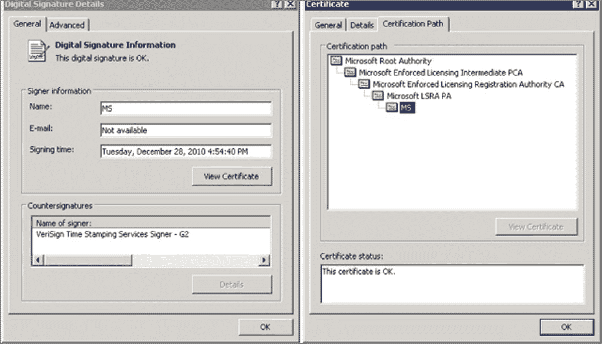

**Figure 5.2****:** Forged digital certificate purporting to be from Microsoft used to sign malware

这是首次已知的大众供应商 CA 公私钥对被对手破解，从而允许对未经授权的内容进行恶意签名。恶意软件创建者此前曾从合法供应商窃取公私钥对，然后使用被盗证书来签署其恶意软件创作（如 Stuxnet 恶意软件程序中所做的那样），但这是首次通过密码破解来创建全新的（rogue）数字签名证书。参见 `https://arstechnica.com/information-technology/2012/06/flame-malware-hijacks-windows-update-to-propogate/` 了解 Flame 恶意软件程序的精彩讨论，如果你想阅读 Microsoft 关于该问题的官方警告，请访问 `https://blogs.technet.microsoft.com/msrc/2012/06/03/microsoft-releases-security-advisory-2718704/`。

Microsoft 通过撤销 rogue 数字证书（以多种不同的方式）做出回应，并对所有尚未过期或被撤销的已公开颁发的 Microsoft 数字证书进行了全面审查。在被恶意利用之前，发现了另外几个弱数字证书，并将其移除和撤销。Microsoft 还更新了 Microsoft Windows 和其他相关软件，使其不再接受任何使用小于 1,024 位非对称密钥的数字证书。教训是，弱化或损坏的非对称密码很容易被对手恶意利用。

### Wi-Fi 网络安全

大多数 Wi-Fi 无线网络使用一种称为 Wi-Fi Protected Access（`WPA`）的无线安全协议进行保护。目前有三个版本：`WPA`、`WPA2` 和 `WPA3`。大多数 Wi-Fi 网络目前使用 `WPA2`；首次于 2018 年使用的 `WPA3` 版本仍未得到广泛部署。

在许多企业场景中，`WPA2` 无线安全使用数字证书、`802.1X` 端口安全和对称加密。在大多数实现中（家庭或企业），即使不使用非对称密码，也会使用对称密码。而且在大多数情况下，对称密码是密钥大小为 128 位的 `AES`。一些较新的实现（使用 `WPA3`）使用 192 位对称密码密钥，仍远低于建议的长期抗量子 256 位最小对称密钥大小。

许多 Wi-Fi 路由器使用预共享密钥（`PSK`）作为初始化值，以允许新节点加入网络。这就是大多数人提供给客人以便他们加入其 Wi-Fi 网络的“Wi-Fi 密码”。今天，`PSK` 应该是随机生成的，并且应至少为 16 到 20 个字符或更长，尽管在实践中很少有 Wi-Fi 实现遵循该安全建议。传统的 Wi-Fi 网络破解工具通常会猜测 `PSK` 并反复尝试加入和重新加入网络，直到猜中正确的 `PSK`。

> **NOTE**  大多数 Wi-Fi 无线集线器允许 `PSK` 最长为 63 个字符。

在客户端提供正确的 `PSK`（或 `802.1X` 数字证书）后，`WPA2` 会创建一个共享会话密钥，称为成对主密钥（`PMK`），并使用量子易受攻击的密钥大小的 `PBKDF2-SHA1` 哈希算法对其进行哈希处理。量子计算机加速可能会使量子计算机更快地破解哈希并猜测 `PMK`。

因此，无论是通过攻击 `PSK`、`PMK`、哈希或对称/非对称算法和密钥获得未经授权的访问，今天的传统 Wi-Fi 网络都为量子计算机提供了许多获取网络访问或窃听加密保护通信的机会。

> **NOTE**  有动机的对手可能已经在记录对手当前受保护的 Wi-Fi 网络流量，等待有一天可以使用量子计算解密该流量的日子。对无线网络和其他类型的窃听的量子密码破解威胁已经是一个风险。

### Microsoft Windows

像当今大多数流行的操作系统一样，Microsoft Windows 包含大量量子易受攻击的密码学，包括哈希、对称密码、非对称密码和 RNG。Windows 的主要身份验证协议（`Kerberos` 和 `NT` [New Technology] LAN Manager `NTLM`）都是量子易受攻击的。两者都使用 `NT` 哈希，该哈希使用 128 位 `MD-5` 哈希值。`NT` 哈希不仅用于网络和本地登录身份验证场景，还用于密码哈希存储，既在本地也在 Active Directory 域控制器上。本地缓存的密码使用 `PBKDF2` 哈希，其抗性更强但仍易受攻击。

Microsoft 的新身份验证协议 Windows Hello for Business 在幕后使用硬件或软件公钥加密和/或数字证书来支持允许的身份验证机制。Windows 10（及更高版本）支持 `FIDO`（Fast ID Online）2.0 标准（`https://fidoalliance.org/fido2/`），该标准基于数字证书和公钥密码。

Microsoft 确实使用 `SHA-2`（128 位）进行哈希处理，尽管出于向后兼容目的，许多文件也（或仅）由 `SHA-1` 哈希处理。Windows 目前默认使用 `AES` 128 位密码进行对称加密，并使用 2,048 位 `RSA` 密钥进行非对称加密，尽管支持更大密钥大小并且可以轻松启用。

大多数 Microsoft 应用程序，包括其 PKI 旗舰产品 Active Directory 证书服务（`ADCS`），默认使用量子易受攻击的密码。Microsoft 已成功测试 `ADCS` 使用抗量子密码，以确保 `ADCS` 在需要时可以使用它们。

由于 Windows 默认不包含抗量子非对称密码，任何使用非对称密码的 Microsoft 应用程序也可被视为量子易受攻击。任何使用较小对称密钥和哈希的 Microsoft 功能或应用程序（尤其是如果不使用较大密钥大小，例如 192 位或更大）从长远来看也易受攻击。如 [第 2 章 “量子计算机简介”所述，Microsoft 是主要的量子研究者，并且已经在大量研究和投资学习如何将所有产品迁移到需要时抗量子形式，比任何其他流行的操作系统供应商都要多。注意 Microsoft 关于其密码建议的说法。当 Microsoft 说是时候迁移时，就迁移吧！

### 加密货币

量子圈中一个常见问题是加密货币是否量子易受攻击。是的，大多数加密货币，包括比特币和所有最流行的实现，在某种程度上都是如此。所涉及的一些底层密码学至少在某种程度上是量子易受攻击的，其中许多最关键的组件绝对是量子易受攻击的。大多数加密货币涉及至少四个主要关注领域：区块链、单个用户的公私钥对、所涉及网络的安全性以及单个用户的加密货币钱包。

#### 区块链易受攻击性

让我们从区块链开始，它可能是所有相关组件中量子易受攻击性最小的。*区块链* 是一个分布式、去中心化的账本（即记录数据库），用于跟踪和验证单个交易。每个被跟踪的单个交易可能存储在单独的交易“区块”中，或者多个交易可能存储在单个区块内。每个区块存储的交易数量取决于实现。单个区块包含交易信息（可以是应用程序定义的任何信息，包括仅所需交易信息的哈希），以及至少一个密码哈希，以及任何其他所需信息。

常见的区块链区块格式由 图 5.3 表示。区块链的“链”是指前一个区块的哈希存储在下一个区块中，然后被哈希并存储在下一个区块中，依此类推。这使得每个后续区块通过哈希“钩住”到前一个区块，以至于区块链中的所有区块在密码学上相互链接。你无法轻易篡改任何区块而不修改所有后续区块（因为被篡改区块的哈希会发生变化）。这是一种相当强的保护——只要你能保护哈希。

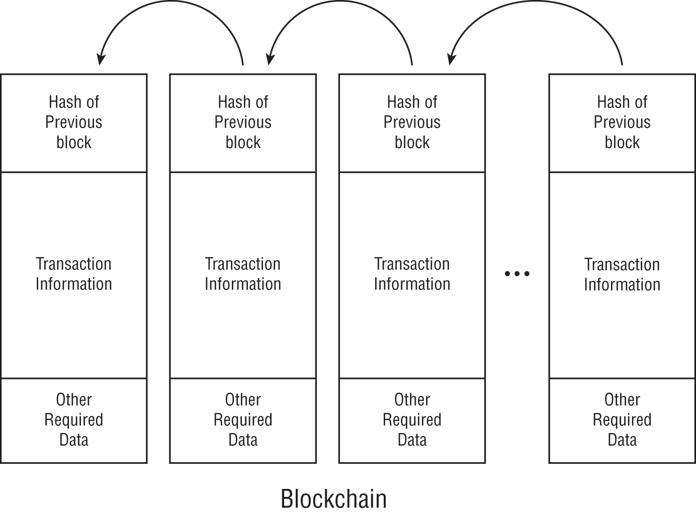

**Figure 5.3****:** Format of a block in the block chain

在大多数区块链中，哈希是抗量子攻击的，并且使用 256 位的哈希摘要保护。虽然 512 位在量子安全性方面会更好，也更适合长期使用，但至少大多数都不是 128 位。还有一些额外的固有保护。首先，如前所述，要恶意操纵区块链中的任意单个区块，你需要修改该信息以及之后所有区块的信息和哈希，并且要以一种不会被所有（或至少一半）底层参与者检测到并恢复的方式进行。这是一种非常强有力的底层固有保护。这就是为什么区块链正变得如此流行，用于需要长期完整性保护的交易。

> **NOTE**  所谓的“51% 攻击”已在现实世界中针对一些不太受欢迎的加密货币成功实施。参见 `https://www.ccn.com/ethereum-classic-51-attack-blockchain-security-researchers-reveal-full-implications/` 作为示例。

其次，即使哈希摘要只有 256 位长，它通常也会同时多次使用和/或与额外的哈希结合使用。例如，比特币使用 SHA-256 和 RIPEMD-160。RIPEMD-160 单独来看肯定被认为是对量子攻击有一定弱点，但与 SHA-256 结合使用，尤其是与多轮 SHA-256 结合使用后，其弱点就会减小。

#### 其他加密货币的脆弱性
加密货币变得更容易受到量子攻击的地方和时间，是它们使用易受量子攻击的公开密码时。个人参与者与加密货币区块链之间的互联网连接由 TLS 保护，而每个单独用户则使用易受量子攻击的公钥密码学来修改区块链并保护其个人钱包。任何人只要获知用户的公钥-私钥对，就可能从用户的钱包中窃取资金或恶意操纵用户在传输到区块链途中的交易。

自从比特币让一群人一夜暴富以来，个人用户的钱包一次又一次地遭到严重黑客攻击。数亿美元，甚至可能数十亿美元已被窃取，即使在量子密码破解被视为潜在风险之前也是如此。区块链和加密货币不仅受到个人黑客和团体的攻击，也受到国家行为体的攻击。一些 rogue 国家，例如朝鲜，以通过窃取数亿美元的加密货币来为其国家提供资金而闻名。

与加密货币的量子黑客攻击相关的有两个很大的救命稻草。首先，一旦量子破解发生，整个世界的货币体系也将受到攻击（其中大部分由 TLS 和其他易受量子攻击的密码保护），因此加密货币只是我们众多担忧之一。其次，大多数加密货币可以“分叉”（即分裂）其实现，以采用更抗量子攻击的一组要求。这种方法会产生自身的问题，但在过去为其他安全问题和问题所做过多次。

也有一些已经存在的抗量子加密货币，但它们是少数。大多数现有的加密货币指导机构认为，提前切换到抗量子密码的密码开销不值得过早行动。大多数流行的加密货币计划在听到量子密码破解即将来临的消息时，再迁移到量子易受攻击性更低的密码学。

如果你有兴趣阅读更多关于加密货币及其量子易受攻击性的内容，有很多很好的资源，包括

`https://en.bitcoin.it/wiki/Quantum_computing_and_Bitcoin`

`www.youtube.com/watch?v=Uy5zHAwo43o`

`http://diyhpl.us/~bryan/papers2/bitcoin/On%20Bitcoin%20security%20in%20the%20presence%20of%20broken%20crypto%20primitives%20-%202016.pdf`

### Bluetooth 和 NFC
Bluetooth 是一种非常常见的短距离（通常 15 英尺或更短）无线标准，常用于在两台设备之间传输信息以及使用 UHF 射频连接无线耳机和扬声器。近场通信（NFC）用于在非常短的距离上传输信息，通常以几英寸为单位。NFC 常用于无线支付系统、无接触身份验证，以及在两台设备之间传输信息，例如手机。

Bluetooth 和大多数 NFC 协议都基于易受量子攻击的密码。例如，Bluetooth 的安全性有各种级别和模式，具体取决于所使用的协议版本。但即使是最好的和最高级别的安全性也是易受量子攻击的。Bluetooth 安全级别 2 支持 AES 128 位密钥。级别 4，即最高安全级别，支持椭圆曲线 Diffie–Hellman P-256。可悲的是，大多数 Bluetooth 用户根本不知道其 Bluetooth 使用产品中使用了什么版本或安全功能。有关 Bluetooth 安全的更多信息，请阅读 `https://en.wikipedia.org/wiki/Bluetooth#Security_concerns` 和 `https://duo.com/decipher/understanding-bluetooth-security`。

就安全特性而言，NFC 要差得多。它的创造者大多假设其设计使用的短距离将是决定性的安全保护。而确实如此。但与任何无线技术一样，黑客很可能会学会在远超创作者意图的距离上与之进行无线交互。大多数 NFC 实现除了使用 NFC 作为无线传输手段的应用程序内置的安全性外，没有任何安全性。那些确实具有一些传输安全性的实现通常使用尺度较弱的密码，例如 AES-128 或易受量子攻击的公钥密码学实现。总之，NFC 是易受量子攻击的。

> **NOTE**  射频识别（RFID）是一种 NFC 类型。虽然 RFID 常被信用卡用于无线交易，但它没有任何内置的传输安全。任何拥有读卡器并能在适当距离内接近的人都可以读取两个节点之间传输的内容。你可以在整个互联网上找到 RFID 嗅探视频。话虽如此，RFID 犯罪的风险非常低，而且随着时间的推移还在降低。有关更多信息，请阅读作者对此主题的文章： `www.csoonline.com/article/3243089/cyber-attacks-espionage/the-truth-about-rfid-credit-card-fraud.html`。

### IoT 和硬件设备
大多数现有的物联网（IoT）和其他计算硬件设备（如手机、电视、摄像机和家电）都包含易受量子攻击的密码形式。使许多 IoT 和其他主流硬件设备风险高于平均水平的原因是，大多数消费者不知道它们使用什么安全措施，而且它们的设备通常难以升级。因此，一旦量子密码破解发生，很可能会有数十亿台易受量子攻击的 IoT 和硬件设备，其中许多将位于我们的家中。

许多硬件设备（例如蓝光播放器、音响和扬声器）没有任何让其所有者升级的方式。它们今天可能就包含安全漏洞，并且它们所包含的每一个未来漏洞都永远不会被修复。一些设备包含内置的更新方式，但由于多种原因，许多设备所有者永远不会更新它们。许多所有者不知道他们拥有的设备可能需要安全更新。大多数消费者在初始安装后从未进入设备的管理控制台来检查是否需要应用补丁。他们的设备正在等待其所有者检查并应用新补丁，但他们的所有者永远不会看到提示。很大比例的消费者意识到他们购买的设备未来可能需要安全更新，但他们对风险的关心程度不足以促使他们进行更新。这就是生活中的一个悲伤事实。

> **注意**  包含升级能力的设备中会被其所有者更新的比例因设备类型而有显著差异。计算设备和手机在升级比例上处于高位（可能为 70% 及以上）。几乎所有其他类型的设备升级合规率都低得惊人。Wi-Fi 路由器和联网安全摄像头的合规率通常不到 10%。某些型号的修补率约为 1%。如果每台硬件设备都能在无需用户干预的情况下定期自行更新，世界将更安全。

### 警惕轻易的承诺

要警惕那些声称在需要时更新其当前易受量子攻击的标准和应用并不困难的组织的说法。我经常在加密货币论坛和物联网厂商那里读到这类说法。毫无疑问，做出这些声明的组织中的大多数参与者从未参与过大规模更新行动。他们是从缺乏经验的角度在发言。他们认为升级过程就像提供更新代码然后让大众应用它一样简单。他们并不真正理解现实世界的挑战，例如以下几点：

* 有多少用户甚至听不到需要更新的消息
* 有多少用户正在使用其产品的旧版、不受支持的形式
* 即使用户尝试做正确的事情，他们的“经过严格测试”的补丁仍会在一定比例的受影响设备上无法正确应用
* 即使确实需要，有多少产品所有者也无法立即应用更新
* 升级会有多困难，以及其中涉及的人类心理的力量和挑战

任何参与过之前大规模更新行动的人都绝不会声称下一个会顺利有序。警惕任何声称升级到抗量子软件过程会很简单的人。仅凭这一说法就足以忽视他们所谓的“专业知识”。任何经历过大规模升级项目的人都会因这次经历而变得谦逊，并降低自己的宏大期望。升级总是比我们想象的更困难。

我们的大部分计算世界和大多数智能设备都包含易受量子攻击的密码学。易受未来量子攻击的计算设备和服务比抗量子的要多。其中许多可以在需要时升级为抗量子算法。其他设备将永远易受量子攻击。第 9 章 将向您展示您和您的组织应如何为这一 eventuality 做好准备和规划。

### 量子计算

我不想让这本书全是阴郁和绝望。尽管本书的重点是量子计算带来的对我们计算机安全的威胁，但量子计算将为我们带来远比我们目前能想象的或我们在 第 2 章 中所涵盖的更多的积极事物。以下是一些更详细的预测。

#### 量子计算机

我们已经拥有数十台，如果不是超过一百台的量子计算机（截至 2019 年）。即使在量子霸权实现之前，这一数字也在稳步向北增长。一旦量子霸权实现，量子计算机的数量将呈指数级爆炸。所有那些坐在围栏上等待量子霸权是否真的会发生的公司都会加入。没有一家大公司希望自己的利益被竞争对手凭借更强大的计算能力超越。没有人想要更慢的“老旧”技术计算机。即使是那些并不真正理解量子是什么以及其好处的公司和厂商也想要它。它将成为一个推动营销的“流行语”，就像云计算和人工智能在它之前所做的那样。

如 第 2 章 中所述，存在十多种主要的量子计算机类型。预计随着行业在效益最有效的类型上稳定下来，类型数量会随时间减少。在二进制个人电脑（PC）早期的日子里，存在数十家不同的 PC 厂商（其中包括 Apple、IBM、Altair、Micral、Wang、Tandy、Sinclair、日本电气公司 \[NEC\]、数字设备公司 \[DEC\]、Commodore 和 Sun），其中许多包含个性化的厂商芯片。最终，Apple 和 IBM 风格以及 Linux PC 成为主导型号（Sun Microsystems 也在数十年间成为主要参与者）。随着量子计算机的成熟，类似的整合很可能会发生。

无论哪些类型和厂商胜出，量子计算机很可能会随着时间的推移变得更小、更便宜。1980 年代的平均 PC 售价数千美元，而且那还是单色屏幕、两台软盘驱动器和一个非常小的硬盘（10 到 20 兆字节），RAM 不到 1 兆字节。它们通常重 15 到 30 磅，占据了它们放置的桌面的大部分空间。早期的外部硬盘重达一百多磅，大小相当于一个文件柜。如今，你可以找到数十台重不到 2 磅、几百美元的电脑，其性能参数在 1980 年代会被等同于超级计算机。

同类型的物理和性能整合很可能在量子计算领域发生。人类擅长让事物变得更小。预计量子计算机将变得更快、更便宜、形态更小。其中最大的形态限制之一是大多数量子计算机需要冷却到接近 0 开尔文的温度。预计即使是超冷却的量子计算机也会变得更小，尽管至少有几种量子计算机设计（如囚禁离子）不需要那种极低的温度。也许其中一种型号会胜出，从而使量子计算机的形态因子立即显著缩小。

目前尚不清楚量子计算机是否可以缩小到我们今天习惯的形态因子（例如台式电脑、笔记本电脑、平板设备和智能手机）。但我们已经减小了几乎每一种其他计算设备的尺寸和费用，同时显著降低了成本。为什么量子计算会有所不同？

#### 量子处理器

我们已经拥有数十种不同类型的量子处理器。类型、可用性和可负担性将随时间增加。许多预测模型指向量子协处理器的概念。在 PC 早期的日子里，大多数电脑可以通过在主板插槽上添加单独的数学“协处理器”芯片来升级。数学协处理器专门用于比 PC 的常规处理器更快地执行复杂数学运算。需要使用浮点、复杂数学的程序可以将该数学“卸载”到协处理器，协处理器执行所需的计算，然后将结果交还给主处理器，以便程序比没有数学协处理器时更快完成。

性能测试 routinely 显示，使用数学协处理器的电脑远远优于没有它们的电脑。很快消费者坚持要求购买的任何电脑都必须安装“可选”的数学协处理器。从营销角度来看，它开始变得不再可选。对数学协处理器的需求如此之大，以至于最终主要的 PC 处理器制造商只是将高级数学例程添加到常规处理器中。在英特尔推出其 486 系列处理器左右的时候，需要单独数学协处理器的想法自然死亡。今天，购买电脑的每个人都会得到一个内置高级数学组件的电脑。

许多量子计算机科学家期望量子计算机也会发生同样的事情。未来，很可能大多数计算机应用并不需要量子计算来完成全部工作。量子专家预计，在一段时间内，量子协处理器将会成为一种趋势。我们的计算机将像往常一样进行常规（例如，二进制）计算，以满足其大部分功能需求，并将复杂的量子计算卸载到量子协处理器。量子协处理器将从计算机的主处理器接收输入，执行其量子魔法，然后使结果退相干并交还给计算机的主处理器。然后随着时间的推移，独立量子协处理器的概念可能会像昨天的数学协处理器一样淡出历史。许多量子专家认为，我们终将拥有每台桌面和我们拥有的每台设备上的量子计算机，尽管这可能要再过十年或几十年。

#### 量子云

目前已经存在近十个基于量子的云，其中一些可供（免费）公众使用。预计在量子霸权实现时，免费和商业量子云的数量将呈指数级增长。量子云很可能被用作“虚拟量子协处理器”，任何繁重的量子计算都将从主计算机的处理器中卸载，并在完成后返回量子答案。这种模式非常合理，尤其是在早期量子计算机昂贵且需要显著的环境控制（即接近 0 开尔文）时。

也许量子计算的中期模式是大多数传统计算机以编程方式链接到基于云的量子计算机，从而使那些无法直接负担自己的量子计算机的人也能更具成本效益地使用量子计算。即使是需要大量量子计算机的组织，也可以在需要时即时添加额外的量子计算资源，而无需拥有足够的个人量子资源。无论如何，量子计算机和云将在很长一段时间内与我们同在，并对每个人可用。

### 量子密码学将被使用

量子计算机的大规模实施将带来许多新的抗量子密码算法以及基于量子的密码算法。组织将在未来半个十年内转向抗量子和基于量子的算法。抗量子算法将在第 6 章中详细介绍，而基于量子的密码和设备将在第 7 章和第 8 章中详细介绍。

#### 量子完美隐私

量子密码的一个特殊优势是量子密码学将更好地允许创建更完全的同态加密（`FHE`）系统（`https://en.wikipedia.org/wiki/Homomorphic_encryption`），它承诺实现完美隐私。`FHE` 的理念是组织可以将加密内容发送给第三方，并允许第三方系统以授权且预期的方式故意操纵加密内容，而无需第三方解密加密文本。

举一个简单的例子，假设一家公司想将大量销售线索记录发送给“清理”清算中心，以查找并删除重复项和其他类型的无效记录。这是许多拥有数万条销售线索的组织定期进行的事情。今天，即使原始组织可能有安全要求要求所有记录都必须加密，他们也可能需要在某个时候解密它们（或共享解密密钥），以便处理器可以搜索数据并删除适当的记录。

在一个完美的隐私系统中，记录可以保持加密状态，并且仍然可以被线索清理处理器成功处理，而不会泄露明文内容或共享原始密码密钥。同态密码系统的一个很好的未来示例用途是允许医疗数据在全球范围内与任何从事研究的人共享（例如，Google 正在众包医疗信息以解决现有具有挑战性的疾病），而不会向研究人员透露任何个人数据信息。

大多数同态密码系统涉及一个额外的 `evaluation algorithm`，该算法在密码学上与原始密码相关联，可由第三方处理器用于完成其工作。同态密码系统将允许必要的交易发生，而无需透露私人信息。这将更好地保护原始主机公司、处理器公司和客户免受未经授权的数据泄露。

同态密码系统自 1970 年代公钥密码发明以来就被提出和创建，结果各不相同。大多数尝试都导致了半成品解决方案，无法在所有情况下使用，被称为 `partially homomorphic`。在量子之前，提出了十几种 `FHE` 系统，但它们更多的是理论而非实现。量子计算，尤其是量子纠缠的特性，有望实现更多、更好且可实际实施的解决方案。量子纠缠是 `FHE` 一直在等待的关键组件。世界各地有一小部分量子密码学家专门专注于这个问题，他们称之为 `quantum homomorphic encryption`（或 `QHE`）。`QHE` 的净结果可能是数据泄露减少。如果数据从未被解密，就很难在你的监管下发生恶意数据泄露。

### 量子网络到来

目前，量子网络行业尚处于起步阶段。供应商正在测试并成功生产第一代设备。量子网络具有巨大的潜力，因为它能够在很远的距离上使用并提供强大的隐私。量子特性使得未经授权的行为者更难在不提醒授权相关方的情况下窃听受保护的网络通信流。预计量子网络将首先用于高安全性网络，然后在普通隐私要求环境中得到更广泛的应用。量子网络将在第 8 章“量子网络”中详细介绍。

量子计算和密码学的广泛可用性将威胁或破坏现有的易受量子攻击的密码学，并开启一个提供更好安全性的量子保护新时代。

### 量子应用

除了量子密码学之外，量子计算机正准备产生全新的行业并彻底改变现有技术。能够受益于使用量子特性和算法（如 `Grover’s algorithm`、纠缠和叠加）的应用将因量子计算而得到增强。有成千上万的计算机问题无法得到解答或优化，因为经典计算机没有足够的速度或能力来回答它们。以下是一些将因量子计算而得到改进的应用。

#### 更好的化学品和药物

量子进步的重点之一是化学品和药物的改进。它也是量子计算机被开发的顶级原因之一。我们知道原子由电子、质子和中子组成。而质子和中子由其他基本粒子组成，称为夸克。所有工作和反应都在量子层面上进行。单个基本原子通常与相同类型和不同类型的其他原子化学键合形成更大的分子。例如，两个氢原子与一个氧原子结合形成 `H[2]O`，即水。

我们每天每时每刻所接触的几乎所有物质都由分子构成。那些分子往往由数百到数百亿个原子和化学键组成。每个键都可以以无数种方式与其他原子和分子相互作用。理解和预测原子和分子如何相互作用是化学和医学研究的基石。化学和医学对分子反应的预测越准确，所产生的化学和医药化合物就越好。

传统的经典计算机在开始丢失信息和预测能力之前，只能正确追踪两把手的分子键。由于使我们的生活变得更好的大多数分子包含的键数远超这个数量，这意味着我们当前理解和制造更好化学品和药物的能力是有限的。量子计算将使我们不仅能够追踪、理解和预测更多分子相互作用，而且能够在量子层面进行（远比经典计算机使用量子模拟更容易），跨越更长的时间尺度。这意味着更好的化学品和药物。量子计算机很可能会让我们拥有副作用更少、并可根据我们特定的医疗或 DNA 结构进行定制的更好药物（即生物医学）。

量子效应已在一些最好的诊断医疗设备中得到应用，例如 MRI，但它很可能会让我们更早、更准确地诊断不良基因标记并识别疾病。我们更有可能更好地弄清楚人类记忆和意识是如何运作的、如何失效以及如何减轻相关的弱点和疾病。应用疗法，例如放射治疗，可以更集中、持续时间更短。药物相互作用的负面副作用可以更好地预测。总的来说，量子计算很可能带来显著改善的化学品和药物，从而造福人类。如果你听过那句陈词滥调“通过化学获得更美好的生活”，它绝对适用于量子计算。

#### 更好的电池

电池储能科学数十年来并未发生宇宙级转变。我们笔记本电脑和手机的电池寿命随着时间推移仍在不断恶化。我们获得的时间改进更多来自设备能耗改进，而非电池本身。电池永远无法满足我们自然使用所需的电量，它们会起火，并且含有危险化学品。在电动车中，电池是汽车最重、最昂贵的部件，并且削弱了拥有电动车的整体碳效益初衷。数百家公司正在努力制造更好的电池——更持久、更轻。

为此，许多汽车公司和电池制造商已在使用当今初生的量子计算机更好地从分子层面理解电池，特别是锂-氢和碳分子链如何工作和耗尽（参见示例文章：`https://insideevs.com/news/338440/volkswagen-turns-to-quantum-computing-for-electric-car-batteries/`）。其他研究人员正在利用量子纠缠制造更快充电的电池（`www.extremetech.com/extreme/211580-quantum-batteries-could-allow-for-super-fast-charging-thanks-to-entanglement`）。量子计算很可能将在帮助我们找到新的化学分子相互作用方面发挥核心作用，这些相互作用可以在更小的空间中储存更多能量，这将惠及所有电池应用。

#### 真正的人工智能

计算机世界中最被过度使用的短语之一是人工智能（以及相关的机器学习领域）。AI 的概念是计算机可以被编程成能够自我学习的方式，就像人类一样，并且凭借这种能力和它们固有的超快执行能力，解决人类无法解决的问题。AI 是计算机的圣杯。人们对人类超复杂的思维过程是否能被计算机模拟存在大量争论。

今天，我们离真正的 AI 还很远，尽管这并没有阻止成千上万的计算机厂商声称他们已实现了某种程度的 AI。量子计算能够更准确地预测所有物质的量子层面，可能让我们更接近真正的 AI。更好的 AI 应该在尽可能多的方面改善我们的世界，就像没有 AI 的量子一样。真正的 人工智能，即计算机据称可以用与人类大脑相同的复杂性思考，被认为是一场游戏规则的改变。据称，我们所做的一切都将被改善和优化。

一个常被引用的例子是自动驾驶汽车。汽车已经可以自行驾驶。我们可能不到 10 年的时间就会有比人类驾驶汽车更多的自动驾驶汽车。我们的孩子，甚至我们的孙辈将不会有驾照或拥有汽车。社会将只允许人们在需要去上班、跑腿和旅行时租用车辆。

量子计算很可能有助于改善涉及自动驾驶汽车的交通管理。量子计算机可以消耗所有相关自动驾驶汽车、它们的位置和速度，并计算出如何修改它们的速度和转弯，以最大化所有汽车的速度和方向。目标是使其成为现实：没有任何自动驾驶车辆需要在路口停车。它们只需修改速度和路径即可一直行驶通过路口，而无需在停车标志或交通灯前停车，而这些都将成为过去。这将节省能源，减少污染，并为所有相关人员节省时间。

网络安全也将受到 AI 的极大影响。我们已经看到机器学习被用于让攻击者绕过防御或在攻击转移时阻止坏行为者的早期实现。计算机安全的未来很可能由自主 AI 学习的安全和攻击机器人驱动，它们基于高级算法进行攻击和防御。我不确定我们是否会看到《终结者》电影中 Skynet 那样的自我意识并攻击其人类创造者的复杂程度，但许多杰出的人士，包括埃隆·马斯克（`www.theguardian.com/technology/2014/oct/27/elon-musk-artificial-intelligence-ai-biggest-existential-threat`）都担心这种情景。不管 AI 最终走向何方，量子很可能始终伴随其左右。

#### 供应链管理

企业长期以来一直希望优化供应链，以便在恰好需要时获得货物，既不会过早也不会过晚，以满足客户的业务需求。库存只是浪费金钱、空间和其他资源。今天，我们有许多公司似乎接近完美的供应链管理，包括亚马逊、联邦快递和美国邮政服务。每家零售商都在效仿他们的领导，试图优化和更好地保障其供应链。甚至非零售商也在尝试优化收集和分发。例如，下一代能源电网管理是世界减少能源浪费、降低成本、防止停电并让消费者满意的关键。世界上许多最大的零售商和能源公司正为此目的投资量子计算。

#### 量子金融

不言而喻，如果有人能靠量子计算赚到钱，他们就会去做。量子计算据称将使投资者能够更好地管理他们的投资组合，并更好地理解影响金融的众多因素。它将影响股票交易、衍生品的创建和交易、市场预测、大宗商品交易，以及当今世界上交易的任何其他东西。而且与网络安全预测一样，其中很大一部分将由自动化的算法机器人完成，它们试图找到其他公司机器人尚未发现并采取行动的技术优势。我们已经有自动化 *高频交易* 的先兆，它占所有股票交易的比例高达 40%。量子计算只会加速这些趋势。已经有一个专注于量子金融的网站叫做 Quantum for Quants (`http://www.quantumforquants.org/`)。

### 改进的风险管理

金融投资本质上都是关于投资组合风险管理——投资什么以及何时投资。量子计算机将改善所有行业的风险管理计算。它们将帮助保险行业更好地确定精算概率，检测更多欺诈，并减少误报。它们将帮助计算机安全防御者更好地确定他们应该关注什么以及不应该关注什么。解决风险管理问题就像在棋盘上移动棋子，而量子计算机擅长解决具有众多因素的复杂问题。

### 量子营销

我们这个时代许多最好的技术发明很大程度上是由广告和营销驱动和资助的。广播、电视和有线电视都由广告驱动。互联网提升了广告游戏，使广告商能够针对更有可能购买特定产品的特定人群进行营销。笑话说，谷歌比我们的配偶更了解我们的真实自我，甚至比我们自己愿意承认的还要多。互联网无所不知。量子计算将允许对更小的细分人群进行更具体的营销，并使我们能够更好地理解看似无关的消费者选择之间的复杂相互作用。这里有一个例子：假设发现养狗的人更爱买意面，那么购买狗用品的人可能会看到一份新意面酱的优惠券。就像量子计算帮助我们更好地理解分子相互作用一样，量子计算能力也将被用于营销。我不确定这应该被归类为好事还是坏事。

### 更好的天气预报

更好的天气预报是量子计算早期获得资金的另一个主要原因。能够更准确地预测天气会影响世界上的每个人。不仅有助于保护人们免受恶劣天气的影响，而且还能改善关键性、可能性和路径预测。它将帮助农民确定种植什么以及何时种植。它将帮助监测和减轻气候变化的影响，通过更好地模拟全球气候环境、其如何变化以及原因，以及人类对其的影响。

### 量子货币

量子货币本质上是一种具有非常保护性、基于量子的防伪功能的加密货币，使传统区块链相形见绌。几十年来，人们提出了几种量子货币系统，其中一些可以追溯到 40 年前，它们认识到保护性量子特性可用于创建一种通用、不可伪造、不可被盗的加密货币。已经提出了几种类型的量子货币，有不同的理论，但大多数都包含一个独特的序列号的概念，该序列号嵌入了非共享的量子属性，只有中央银行/验证者会知道。因此，罪犯可能能够使用相同的序列号创建货币的新重复版本，但由于他们不知道额外嵌入的量子属性的状态，因此无法创建能够通过银行验证过程的完美复制货币。更多信息，请访问

`https://futurism.com/the-byte/virtual-money-quantum-galactic-commerce`

`https://en.wikipedia.org/wiki/Quantum_money`

`www.scottaaronson.com/papers/noclone-ccc.pdf`

当然，今天的现代加密货币系统可以使用量子抗性密码代替量子易受攻击的密码，也可被视为“量子货币”。使用基于量子的加密货币，该加密货币使用分布式（有时是匿名的）区块链而不是集中式验证者，被许多加密货币用户认为是关键要求。有了量子技术，你可以兼得两者，并选择最适合你和你的目的的系统。

### 量子模拟

利用基于量子特性的量子计算机将使我们能够更好地探索我们自然的宇宙。不仅能够确定量子力学的如何和为什么，而且还能弄清楚我们不一定将其与量子力学联系起来但仍然依赖于它的所有事物的量子相互作用。量子计算机很可能会帮助我们回答今天面临的许多重大物理问题，例如我们的物理宇宙中有多少个维度以及暗物质是什么。量子计算将使我们能够以使用经典计算机根本不可能的方式理解我们周围的宇宙（甚至是多元宇宙）。

### 更精确的军事和武器

同样不言而喻，我们使用量子计算机发明和改进的许多酷炫新事物都将用于改善世界各地的军队。这就是许多技术改进发生的情况。我们就是这样得到互联网的。简单、无害的事情，例如更好的天气预报，也将被用于战斗计划。这只是理所当然的。

### 量子隐形传态

可能最常被谈论和最有趣的量子发明之一是 *量子隐形传态*。利用量子隐形传态，可以在第二个（接收）位置精确地重新创建物体（或其状态），无论这两个位置相距多远，包括被太空的巨大空隙分隔。

许多人，包括本文作者，在讨论量子隐形传态时，都不加思索地提到了科幻电视和电影系列 *星际迷航* 及其虚构的“传输器”（`https://en.wikipedia.org/wiki/Transporter_%28Star_Trek%29`）。这通常只是为了快速传达隐形传态的整体概念，尽管量子隐形传态更类似于复制或传真，而不是隐形传态。许多物理学家都抱怨使用 *隐形传态* 这个词，因为它在人们的脑海中通常意味着完全不同的东西。

虚构的 *星际迷航* 传输器与量子隐形传态之间存在几个关键区别。首先，*星际迷航* 传输器将物体的粒子本身在两个位置之间发送，而量子隐形传态只发送有关物体粒子信息的（以便可以模仿它们），而不发送粒子本身。其次，也是最重要的，量子隐形传态实际上是可行的，尽管到目前为止还只是在宏观分子大小以下。

> **注意**  *星际迷航*传送器的能力可以无缝地传送一个完整的人类，这在很长很长的时间内很可能超出了我们现实世界的能力。要使用虚构的传送器或真实的量子传送将一个完整的人类传送过去，就需要理解、识别并编码人类存在意义的每一个细微之处——不仅是每个细胞、原子和夸克属性，而且还需要代表活跃记忆和意识（以及无意识的想法和行为）所需的一切。我们甚至不确定是否可以用任何已知的物理表示来实现这一点，而需要传输的粒子和状态的数量将超过已知宇宙中的所有恒星。

#### 传送协议

量子传送在 1990 年代初就被理论化了，最近它已在实验室中（使用光子、原子和分子）以及地球与太空之间（使用基于量子的卫星）在数十次实验中成功演示。制造像虚构的 *星际迷航* 传送器那样的简单粒子传输设备存在许多实际困难，例如不可克隆定理，它阻止了量子粒子的直接复制。正因为如此，量子传送器使用一种间接的逻辑方法，通过经过验证的协议来实现现实世界的传送。但充分理解量子传送的工作原理非常重要，因为它支撑着即将到来的许多量子发展和设备。它是基于量子的网络设备的工作方式。我们今天已经拥有它们了，它们将在 第 8 章 中进一步讨论。所以，它不仅仅是科幻迷的专利。它是在不久的将来事物将如何运作的方式。

量子传送至少需要五样东西：一个待传送的对象、两个纠缠的量子比特，以及关于你想要传送的对象的每个信息量子比特的两个二进制位。传送协议的简化版本如下所示（有关图形表示，请参阅 图 5.4）：

1. 为关于待传送对象 (`X1`) 所需的每个信息量子比特创建两个纠缠的量子比特（`A` 和 `B`）。纠缠至关重要，因为我们需要在最终状态变化之前让两个量子比特保持同步。
2. 将纠缠量子比特的一侧运送到对象将被传送到的位置（即发送站）。
3. 将纠缠量子比特的另一侧运送到接收位置（你想如何实现都可以）。
4. 在发送站，让对象的量子比特状态与纠缠量子比特的发送侧相互作用，并观察并记录对象量子比特属性状态与当前纠缠量子比特状态之间的差异。

   该差异可以用四种可能的结果之一准确表示（给定两个量子比特相互比较），比如 `1`、`2`、`3` 或 `4`。
5. 使用两个二进制数字（即 `2² = 4`）来表示比较差异答案。
6. 现在以二进制数字表示的差异答案通过任何经典手段传输到目的地。或者，你也可以使用任何通信方法来传达差异答案，包括书写或电话，但最快的方法可能是一种基本的数字位传输。
7. 使用接收到的二进制差异答案信息以一种准确反映原始对象在步骤 4 中测量的量子比特（状态）的方式修改目标量子比特。
8. 根据需要重复操作，按量子比特重建对象 (`X2`) 于目的地。

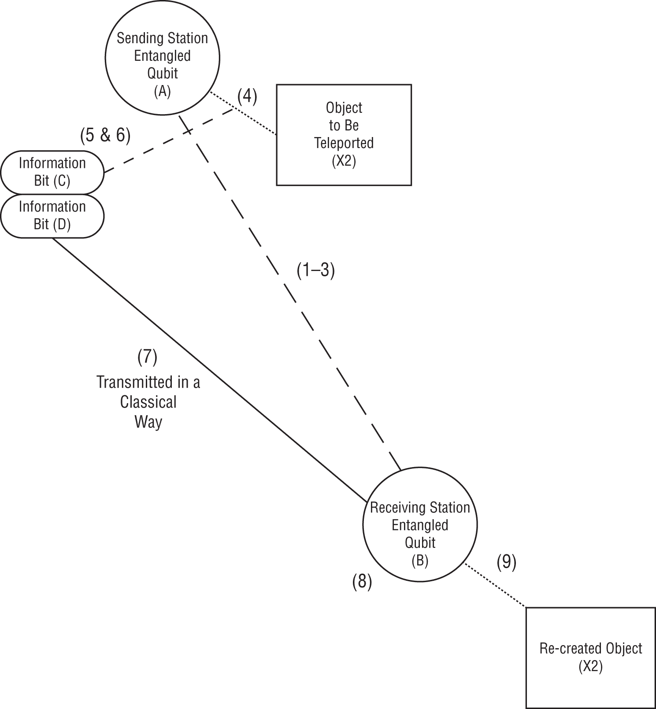

**图 5.4****:** 基本量子传送对象和步骤

现在说说负面的一面，传送行为会破坏原始纠缠并摧毁原始对象（或者出于伦理原因可能必须被摧毁）。例如，假设你传送一个活人。现在你有两个地方都有一个人类副本，具有相同的想法和记忆。他们都会认为自己是真正的、原始的人类。其中一个副本需要被销毁，否则各种负面怪事就会开始发生。例如，两个副本都会认为他们嫁给了同一个人，有相同的父母，做着相同的工作等等。你会喜欢使用量子传送作为人类吗，知道你很可能会在过程中被销毁或杀死，而你的新副本却能过上完整的生活（或直到下一次传送）？幸运的是，当我们只是试图传送常规的数字数据时，我们没有这些类型的伦理问题，而大多数量子传送将用于此。

> **注意**  电视和电影中 *星际迷航* 传送器的例子只是显示了一堆缓慢消失的彩色粒子留在被传送人类所在的位置。它们没有显示的是，该过程会摧毁人类原始副本。它们让谋杀看起来如此愉快和多彩。

如果你有兴趣了解更多关于量子传送的信息，请访问

`https://en.wikipedia.org/wiki/Quantum_teleportation`

`www.youtube.com/watch?v=Czi5elPLfvA`

`www.youtube.com/watch?v=hTe2PYwnEpc`

`www.scottaaronson.com/qclec/10.pdf`

应该指出的是，量子传送并不是某种极其独特的对象传送方法。我们已经使用传统技术一直在这样做。我们经常对对象进行编码，然后将该代表性信息发送到另一个目的地，在那里重建原始对象。传真机、复印机、扫描仪和互联网文件传输每次都会这样做。量子传送是一种确保量子级信息位得到正确传输和/或超安全传输位的方法。非量子传送在传输量子级信息方面会更困难。

关于量子传送的另一个重要警告。由于人们经常想象虚假的科幻版本，他们想象能够在一眨眼之间将物体和人传送到遥远的地方，甚至是星系。上述步骤 #6 的量子传送需要经典信息传输，这意味着超光速传送是不可能发生的。这不足为奇。没有任何东西可以比光速更快地传输（尽管我们尚未弄清楚量子纠缠似乎是如何做到的），但差异信息的传输必须以经典方式进行。这并不糟糕。许多经典方法，甚至使用简单电力的那些，都接近光速，因此涉及它们意味着仍然可以非常快速地完成。只是不能比光速更快。

如果所有这些量子应用用途和改进看起来有点“天马行空”，让你感到怀疑，那么想想二进制计算机和存储设备如何在几十年内改变了我们个人电脑之前的世界。早期的计算机庞大无比，占据整层楼。它们仅限于军事用途，只有最大规模的公司才能使用。最终，计算机变得无处不在、价格相对便宜、体积非常小。今天，我们戴着它们在手腕上，我们的智能手机拥有几十年前 Cray 超级计算机的更多计算能力，并且可以将我们制作过的所有文档以及整个音乐收藏都存放在指尖大小的存储设备上。你可以在几秒钟内证明一个事实或了解任何事情。你可以观看专家如何做几乎任何事情的视频。新闻在几秒钟内传遍全球。量子计算机正准备向我们展示下一代奇思妙想的发明和改进将会带来什么。而这无疑将是美妙的。

### Summary

量子计算机及其特性将削弱或破坏大多数传统密码学，包括哈希、对称密钥和非对称密码。在某些情况下，使用更长的密钥长度将是实现抗量子化的答案。在其他场景中，只有用抗量子或量子安全的密码完全替换易受量子攻击的密码才是可接受的。我们所有人将在未来几年内转向更抗量子的密码学。

量子计算还将带来新的、更好的密码学、网络、完美的隐私以及一系列新的或改进的应用。我们将拥有更好的化学品、药品、电池、天气预报和军事武器。每一次量子技术上的飞跃都会带来好与坏。量子计算也不例外。欢迎来到后量子世界。

Chapter 6，“Quantum-Resistant Cryptography”，讨论了数十种抗量子密码，其中一些你应该很快在组织的应用程序中使用。

## Part II Preparing for the Quantum Break

* **Chapter 6:** Quantum-Resistant Cryptography
* **Chapter 7:** Quantum Cryptography
* **Chapter 8:** Quantum Networking
* **Chapter 9:** Preparing Now

### Chapter 6 Quantum-Resistant Cryptography

我们在后量子世界中使用的密码学是抗量子密码学和基于量子的密码学的结合。抗量子密码学是传统、基于二进制的密码算法，对已知量子攻击具有抵抗力。量子密码算法是利用量子计算和特性来保护信息的密码。本章将介绍抗量子密码学，而 Chapter 7 将介绍基于量子的密码学。

本章充满了密码技术和高级数学术语。一般的计算机安全读者可能会想知道为什么他们应该对特定算法背后的所有技术细节感兴趣。他们可能会觉得他们真正需要知道的只是后量子算法的名称……这或许是正确的。

但对任何参与密码实施的人来说，了解所涉及密码学的基础都可能极有帮助。本章对二十多种抗量子算法进行了基本概述，以便你能够理解它们，就像你可能已经理解大素数如何赋予 RSA 和 Diffie–Hellman 密码固有的保护，以及这种对素数的依赖为何使它们易受量子攻击一样。知道比密码算法名称更多的信息，只会在有人，无论是终端用户还是老板，询问你特定的后量子实施计划的更具体问题时有所帮助。此外，在与同行讨论后量子计划时，你会更有信心。你不必理解特定算法的每个细节，但对它的工作原理有一个大致的了解是有帮助的。

#### NIST Post-Quantum Contest

目前存在数十种抗量子密码和数字签名，其中大多数已由世界各地的各种密码专家和团体评估多年。2015 年，欧洲电信标准协会（ETSI）与世界各地的科学家和研究人员一起，成为第一个认真研究抗量子密码的大型公开团体，随后其他国家的许多团体，包括美国，也跟进。

美国国家标准与技术研究院（NIST；见 `www.nist.gov`）多年来一直举办公开的“类似竞赛”的竞赛，以评估各种新提出的密码学，以取代现有的、正在削弱的密码学。获胜的算法成为新的美国密码标准，其创建者同意允许它们免版税使用。

之前的 NIST 竞赛，在美国国家安全局（NSA）的密切协调和参与下，已选出 SHA-3 作为新的哈希标准和 AES 作为新的对称密钥密码标准。总体而言，这些之前的公开密码竞赛被视为巨大的成功。不仅提交了许多合格的候选者并进行了公开评估，而且大多数人认为竞赛和获胜者是合适的（尽管这并非总是适用于每一次 NIST/NSA 密码评估；参见侧边栏“Dubious NIST/NSA Contests”）。

从 2016 年 2 月开始，NIST 开始了一项新的竞赛，名为 *NIST Post-Quantum Cryptography Standardization Process*（`https://csrc.nist.gov/CSRC/media/Projects/Post-Quantum-Cryptography/documents/call-for-proposals-final-dec-2016.pdf`），以选择用于公钥交换和数字签名的后量子（即抗量子、量子安全）密码标准。第一轮候选人必须在 2017 年 11 月前提交供考虑。NIST 收到了 82 项独特提交，并允许其中 69 项继续作为官方“第一轮”候选人。其中，17 种非对称加密密码和 9 种数字签名方案在 2019 年 1 月被选出进入“第二轮”（`https://nvlpubs.nist.gov/nistpubs/ir/2019/NIST.IR.8240.pdf`）。第三轮候选人预计将在 2020 年或 2021 年正式宣布。最终的新后量子密码标准预计将在 2022 年至 2024 年间宣布。本章将总结所有官方第二轮候选人。

NIST/NSA 竞赛的获胜者通常通过 NIST 联邦信息处理标准（FIPS）出版物文件成为官方美国联邦政府标准。这些标准必须被美国政府出售和使用的所有政府计算机和设备以及任何政府分包商遵循。这导致在美国销售的所有设备和计算机都包含并使用这些标准，因为美国政府是计算设备最大的单一买家。计算设备和软件供应商发现，将美国联邦标准纳入他们制造的所有设备中更容易、更具成本效益，而不是制作政府版和非政府版。由于美国拥有世界最大的经济体，美国标准通常成为事实上的全球标准（尽管俄罗斯和中国等许多大国创建并使用自己的国家标准）。因此，NIST/NSA 密码标准竞赛被赋予了极大的重要性。它们的结果影响着我们世界中使用的许多计算机和软件。

如果你对每种 NIST 密码学提交方案的细节感兴趣，我强烈建议你下载算法提交者的提交文档，位于 `https://csrc.nist.gov/Projects/Post-Quantum-Cryptography/Round-2-Submissions`。大部分最佳细节都包含在团队 zip 文件提交的 `Supporting_Documentation` 文件夹下的 PDF 文档中。NIST 要求每种密码学提交方案都必须包含大量相关信息，包括算法的工作原理、弱点、优势、抗攻击能力、已证明的性能统计、代码示例、NIST 安全强度级别建议等。你也可以在 NIST 竞赛提交网站上阅读支持者和批评者的评审评论，以大致了解该算法在密码学专家评审下的表现。

#### NIST 安全强度分类

在 NIST 后量子竞赛中，所有提交的算法都必须包含针对特定保护强度的具体实现，该强度由现有的抗量子对称密码和哈希表示，如 Table 6.1 所示。保护的增强由 NIST 安全级别数字的增加表示，例如，NIST 安全级别 4 提供的保护比安全级别 3 更强。

**Table 6.1****:** NIST 安全强度分类及等效保护

| NIST 安全级别 || 等效安全 || 量子抗性 |
| --- | --- | --- |
| 1 || AES-128 || 弱 |
| --- | --- | --- |
| 2 || SHA-256/SHA3-256 || 强 |
| 3 || AES-192 || 更强 |
| 4 || SHA-384/SHA3-384 || 非常强 |
| 5 || AES-256 || 最强 |

NIST 认为全部五种分类都是抗量子的，尽管它将安全级别 1 描述为“在可预见的未来很可能安全，除非量子计算机的改进速度超过预期”，也就是说相当弱。这是因为使用 Grover 算法的量子计算机可以将 AES-128 的保护强度有效削减至仅 64 位。目前尚无公开已知的攻击能够破解强度为 64 位的 AES，但能够破解的未来攻击可能为时不远。因此，许多密码学专家并不认为 barely 达到 NIST 安全级别 1 的密码学实现在长期内是真正抗量子的。NIST 然而认为它们目前是可以接受的，并将其视为在时间和资源允许的情况下转向更抗性密码学的“桥梁”。

NIST 认为安全级别 2 和 3“在可预见的未来很可能安全”，而级别 4 和 5“可能过度”。密码学人员信任“可能过度”的抗性密码，但性能和实现方面的考虑可能阻止它们目前被部署。例如，许多当前软件程序和设备默认使用 AES-128，无法使用 AES-256 或更大。

大多数 NIST 竞争者提交了其算法的实现以满足 NIST 安全级别 1、3 和 5，并跳过了级别 2 和 4。也有例外。NTRU Prime 未提交 NIST 安全级别 1 和 5。ThreeBears 未提交 NIST 安全级别 1 和 3 密码，但确实提交了级别 2 和 4。SIKE 提交了 NIST 安全级别 2 示例，NTRU Prime 也提交了级别 2 和 4。CRYSTALS-Dilithium 和 MQDSS 未提交级别 5 示例。FALCON 未提交级别 2、3 或 4 实现。LUOV 未提交级别 1 或 3 样本。

有关 NIST 安全强度分类的更多信息和细节，请参阅以下 NIST 文档的第 4.A.5 节，安全强度类别：

`https://csrc.nist.gov/CSRC/media/Projects/Post-Quantum-Cryptography/documents/call-for-proposals-final-dec-2016.pdf`

NIST 项目网站 (`https://csrc.nist.gov/Projects/Post-Quantum-Cryptography/Round-1-Submissions`)、Privacy News Online (`www.privateinternetaccess.com/blog/2019/02/nist-round-2-and-post-quantum-cryptography-the-new-asymmetric-algorithms-part-2/`) 以及许多其他来源，包括维基百科 (`https://en.wikipedia.org/wiki/Post-quantum_cryptography`) 上对每种算法都有极佳的总结性讨论。

下面各节总结了 NIST 第二轮候选方案。每种密码学算法都对其功能、所涉及的底层原理、必要时一些历史背景，以及每个提交团队的国家构成进行了描述。团队构成被包含在内是为了显示它们通常具有多国构成。在讨论密码和方案之前，相关的术语和类型将被定义。

> **NOTE**  本章涵盖的许多算法也是 Open Quantum Safe (`https://openquantumsafe.org/`) 项目的一部分。Open Quantum Safe 项目是一个代码库和组织，帮助我们为后量子世界做好准备。当一种密码学实现被注明参与该项目时，意味着一个组织今天就可以在测试和真实世界场景中实现该特定后量子算法，利用之前实现者的经验教训，并分享回挑战和新学到的经验。

#### PKE vs. KEM

传统公钥密码学，也称为 *公钥加密* (`PKE`)，通常用于传输对称加密密钥，然后用这些密钥加密原本需要加密保护的明文内容。对称密钥在较小的密钥尺寸下比非对称加密更快更强，因此 `PKE` 通常只是作为对称密钥的安全传输工具，而这些对称密钥才真正执行直接加密工作。`PKE` 多年来工作良好，但至少有一个很大的固有缺陷。

当公钥比被加密的内容更长时，例如在密钥交换中对称密钥通常就是这种情况，它会让攻击者非常容易地推导出原始私钥。为了防止这种情况，当要加密的消息内容，例如对称密钥，比用于加密的非对称私钥更短时，`PKE` 通常会在要加密的消息中添加额外的“填充”以消除漏洞。不幸的是，填充的随机生成通常是 `PKE` 系统中最薄弱的环节。`PKE` 攻击者通常专注于填充中的逻辑缺陷并找到漏洞。对称密钥很可能只会越来越长，尤其是为了抵御不断改进的量子攻击。这带来了潜在的持续风险。

*密钥封装方法* (`KEM`s)，也称为 *密钥封装方案*，是一种非对称加密技术，旨在改进对称密钥的安全传输或生成，因为它们不需要在短消息上添加随机填充来保持安全。许多后量子密码学算法特别适合创建 `KEM`s，并且由于后量子算法通常具有更长的非对称密钥，你会看到许多抗量子团队提供 `KEM`s 而不是 `PKE`s。这有时通过在算法名称中包含 `KEM` 来表示，例如 FrodoKEM 和 NTS-KEM 的情况。一些后量子密码学算法会同时提供 `PKE` 和 `KEM` 版本。

#### 形式不可区分性保证

CPA 和 CCA 字母你在某些密码名称和描述中会看到，是指一种始终期望的密码学属性，即密文不可区分性。*密文不可区分性*意味着生成的密文看起来如此随机，以至于攻击者无法利用密文来寻找对所涉及加密密钥的更容易的攻击。*CPA* 标识意味着攻击者甚至可以拥有已知的、选择的明文提交（即 *chosen plaintext attack* 选择明文攻击），查看生成的密文，并且仍然无法获得有关所涉及秘密加密密钥的线索。*CCA* 标识代表 *chosen ciphertext attack* 选择密文攻击，其中攻击者可以选择特定的密文并使其解密为明文，并且仍然无法获得有关所涉及秘密加密密钥的提示。有关更多详细信息，请参阅 `https://en.wikipedia.org/wiki/Ciphertext_indistinguishability`。

数字安全系统的安全性有时被描述为 *EUF-CMA* 和/或 *SUF-CMA*，这在某种程度上可以看作类似于用于概括基础非对称密码系统安全性的 CPA 和 CCA 描述符。EUF-CMA 标识代表 *Existential Unforgeability under Chosen Message Attack* 在选择消息攻击下存在不可伪造性，而 SUF-CMA 代表 *Strong Existential Unforgeability under Chosen Message Attack* 在选择消息攻击下强存在不可伪造性。在这两种标识下，攻击者可以要求对任何内容进行签名并获得签名，并且仍然无法确定用于签署内容的私钥。对于 SUF-CMA，其安全性稍强，攻击者无法创建不同的数字签名，该签名仍在原始数字签名方案下验证为来自相同内容和私钥（即，对于相同的唯一内容生成两个不同的有效签名是不好的做法，使用相同的数字签名方案）。拥有这些属性以及证明算法绝对具有这些属性，这两者之间的区别在于能够声称一个或两个描述符。有关 EUF-CMA 和 SUF-CMA 的更多信息，请参阅 `https://blog.cryptographyengineering.com/euf-cma-and-suf-cma/`。

所有好的 PKE 和 KEM 通常都会尝试满足 CPA- 和 CCA-安全要求，而数字签名通常会尝试成为 EUF-CMA-安全的。要使用这些标识，密码算法必须首先在理论上证明其安全抵抗性，并且随着时间的推移经受住持续攻击。NIST 要求成功的密码学候选者根据密码算法类型是 CPA- 和 CCA-安全的或 EUF-CMA-安全的。大多数提交的算法在其提交文件中明确说明满足这些安全保证目标，尽管 NTRUPrime 和 NTS-KEM 并未明确指出满足 CPA 目标。

#### 密钥和密文大小

所有非对称密码都有两种相关的密码密钥：秘密密钥和公钥。*秘密密钥*（也称为 *私钥*）用于签署内容，并且应仅为密钥对持有者所知。在某些后量子算法中（如 CRYSTALS-Dilithium、SPHINCS+ 和 LUOV），秘密密钥只是用于生成执行实际工作的其他密钥的种子值。在这些实现中，秘密密钥通常很小（16 到 64 字节），并且对于任何安全强度实现都是恒定大小。在这些情况下，通常相关的公钥也很小。量子抗性算法也可以为不同强度级别以及不同的实现意图（例如，更快的但安全性较低的实现）具有可变长度密钥。

*公钥*用于加密内容并验证由相关私钥签名的内容。公钥理论上可以为全世界所知并使用，并且受保护的秘密仍然保持秘密。公钥旨在供所有人使用。这就是非对称系统的工作方式。与非对称密码相关，相关的公钥是从私钥生成的。

*密文*一般指任何加密内容，但在比较不同提交的密码的上下文中，它指的是最小加密明文加密后会变得多大。例如，如果你仅用现代密码加密字母 *A*，生成的密文通常会比单个字符大得多。

*数字签名*是哈希内容的唯一结果输出。在数字签名方案中，公钥和数字签名大小在数学上呈反向关联。如果减小一个的大小，另一个就会变大，反之亦然。因此，在大多数后量子数字签名提交中，如果你看到一个小的公钥，你也会看到一个大的数字签名，反之亦然。

NIST 要求所有密码算法提交者为每个 NIST 安全级别声明声明这些变量的大小。非对称加密密码还必须提交最小密文的大小。数字签名方案必须提交生成的数字签名的大小。这些大小很重要，因为非常大的大小通常会有性能和存储问题（与较小的竞争对手相比），并且通常会占用更多内存空间、存储空间和网络带宽。然而，特定算法的计算复杂度通常对整体密码性能有更大的影响。

许多算法具有更多潜在的实现，其密钥大小变化更大，而不仅仅是为满足特定 NIST 安全强度级别而提交的内容。一些算法允许使用任何密钥大小（在边界内），具体取决于实现者期望的安全性与性能要求。

### 后量子算法的类型

在讨论不同的后量子算法时，了解主要类型的算法并总结它们抵御量子攻击的保护方法是有帮助的。

#### 基于代码的密码学

*基于代码的密码学*（也称为 *代数编码* 或 *纠错码 \[ECC\]*）是一套长期以来已知且抗攻击的加密和签名密码学，基于数学算法，故意在明文内容中引入“错误”（即加密），以这种方式模糊/加密原始内容。相应的“纠错”代码/算法可用于移除“错误”并将加密内容还原为原始明文表示（即解密）。

作为一个简单示例，假设发送方要加密的明文是 1111。会故意在内容中引入“错误”，比如产生 011101，然后传输给接收方。接收方一侧的“纠错”过程会移除“错误”并可靠地重现原始 1111 内容。

基于代码的密码学基于 ECC 类方法，其复杂程度很高，以至于在不知道所涉及密钥的情况下求解“错误”非常困难（即非平凡）破解。在 1970 年代和 1980 年代，一位俄罗斯/苏联数学家瓦列里·德尼索维奇·戈帕将几何形状和组合与 ECC 联系起来。今天，这些代码被广泛称为 *戈帕码*，并被密码学家采用。其中最成功的基于代码的密码之一 McEliece（本章后面会介绍）基于二进制戈帕码，正如大多数基于代码的密码一般。提交给 NIST 的第二受欢迎的非对称加密密码类型是基于代码的密码。基于代码的提交密码包括 BIKE、Classic McEliece、HQC、LEDAcrypt、NTS-KEM、Rollo 和 RQC。

对于基于代码的密码学来说，有两个大的技术挑战。首先，ECC 密码学需要的密钥位数明显多于通常情况（与其它密码类型相比）来加密数据。基于代码的密码学密码密钥，尤其是公钥，很容易达到 30 万位以上。在 1970 年代和 1980 年代 McEliece 最初被提出时，这曾是一个巨大的问题，但今天它已不再是很大的计算障碍。此外，许多基于代码的密码必须能够显著减小其密钥大小（例如，许多使用 40 字节的秘密密钥）。但如果你看到一种非对称加密密码关联着绝对巨大的密钥，那么它很可能是基于代码的。

其次，由于 ECC 在纠正所谓的“错误”，如果设计不当，就总有“错误”漏网的可能，这意味着即使使用正确的解密密钥，合法解密也可能失败。这意味着解密可能需要执行一次或多次额外操作，甚至存在特定 ECC 解密实例永远无法工作或陷入临时自诱发的拒绝服务循环事件的风险。大多数 ECC 密码会尝试防止此类锁定，且锁定极其罕见——接近于零。但如果你读到某种 ECC 密码具有“非零”解密失败率（例如 HQC 如此），那么请注意至少存在理论上的可能性。

关于 ECC 和 Goppa 代码的精彩总结讨论可以在这里找到：

`https://surface.syr.edu/cgi/viewcontent.cgi?article=1846&context=honors_capstone`

### Hash-Based Cryptography

*Hash-based cryptography* 基于密码学哈希，正如其名称所暗示的那样，通常应用于数字签名方案（而非加密）。如前几章所述，哈希是一种单向函数，它将哈希内容转换为代表性的一组位（称为哈希、哈希结果、签名或消息摘要），该位对于唯一内容是唯一的。XMSS（eXtended Merkle Signature Scheme）、Leighton-Micali Signatures（LMS）、Blockchained Post-Quantum Signatures（BPQS）、SPHINCS 和 SPHINCS+ 数字签名方案都基于哈希密码学。SPHINCS+ 是 NIST 竞赛第二轮中唯一提交并被接受的基于哈希的数字签名。

Ralph Merkle 基本上发明了密码学哈希领域，他还参与了 20 世纪 70 年代末与 Whitfield Diffie 和 Martin Hellman 一起首次公开已知的公钥加密实现。因此，在讨论基于哈希的密码学时，你经常会听到关于 Merkle 树（即哈希树）和 Merkle 盒以及谜题的讨论。Merkle 树是一系列分层哈希，它们哈希其它哈希，进而哈希原始内容。如有兴趣，可参阅 `https://en.wikipedia.org/wiki/Merkle_tree` 了解有关 Merkle 树的更多细节。

基于哈希的密码学被认为具有抗量子性，因为哈希不受 Shor 算法的影响，尽管它们受 Grover 算法的影响。量子计算机上的 Grover 算法在执行特定类型问题（如破解哈希）时，相对于二进制计算机具有平方根级别的改进。这有效地使任何基于哈希的密码学的强度减半。这也意味着将哈希的密钥大小加倍可以抵消 Grover 算法和量子计算带来的攻击收益。

> **NOTE**  至关重要的是，底层哈希必须符合（之前讨论过的）良好、安全哈希的所有属性。如果哈希随着时间的推移不再是“好的哈希”，那么基于该哈希的任何密码学不仅会变得易受量子计算攻击，也会易受二进制计算攻击，其水平远低于其声明的密钥强度。

所有哈希都受限于它们在哈希结果变得（过早地）对所有可能的唯一输入重复之前能够保护的消息数量。例如，截至本文撰写时，所有 Microsoft Windows 登录密码都会被转换为 NT 哈希。你可以在 Windows 中创建数千亿亿个唯一的可能密码（近 2⁶⁵⁵³⁵ 种不同组合），但相同的 NT 哈希最终会对许多不同的密码产生相同的哈希值（在哈希攻击理论中，这被称为 *second preimage collision* 的一个例子），这是由于哈希及其密钥空间（即所有可能的选择）的固有限制所致。

如果基于哈希的密码学“意外地”对两个不同的输入重复使用相同的单次密钥，它将为攻击者提供对私钥的强有力洞察。因此，哈希和基于哈希的密码学开发者会竭尽全力防止单次密钥重复。有几种不同的方法可以减轻这种风险。

解决这种风险的一种方法是提高哈希算法区分唯一内容的准确性。如果哈希始终产生唯一的哈希输出，那么重复问题就消失了。由于哈希的密钥空间总是比它试图哈希的潜在事物更有限，因此这很难做到。为了抵消这种风险，哈希开发者还可以增加 resulting 数字签名的大小（即提供更多密钥空间）。数字签名越长，可能的哈希结果就越多。因此，具有 128 位哈希结果的哈希可能比限制为 64 位结果的哈希更准确。非常大的数字签名可能会变得过大且难以处理，导致性能和存储问题。大多数密码学专家认为，一个好的哈希，利用其固有的算法准确性，不应导致非常大的数字签名。另一些人则认为，大的数字签名是确保哈希准确且没有内置哈希结果冗余的唯一方法。无论如何，请对非常小和非常大的数字签名给予额外考虑。

防止密钥重复的另一种常见方法是使哈希 *stateful*（相对于 *stateless*）。有状态哈希会跟踪它使用过的所有一次性秘密密钥，并确保不再重复使用。大多数传统基于签名的哈希都是 *stateful*。如果检测到重复密钥，则算法会再次运行或选择较长密钥流的另一部分来生成另一个唯一的单次密钥。

有状态和无状态哈希各有优缺点。无状态哈希无法保证唯一密钥，但通常具有更大的密钥大小。有状态哈希通常密钥大小较小，但由于它们必须存储“状态表”，因此从资源、存储和安全角度来看，它们很笨重。有状态哈希在数据恢复事件期间也可能产生关键问题。如果处理不当，恢复的有状态哈希实现可能会覆盖其先前的状态表，抹去先前使用过的密钥的证据，然后哈希可能会再次意外地在未来的密码学操作中使用相同的密钥。攻击者如果知道状态表已被覆盖，可能会寻找重复密钥的迹象，并在密码攻击中获得优势。这是一个相当不可能且风险很低的事件，但如果密码学家看到任何理论上的弱点，这就被认为是一个很大的弱点。因此，NIST 不允许有状态的基于哈希的密码学算法被提交供考虑，从而淘汰了几个原本强大的竞争者。

### Lattice-Based Cryptography

一个 *lattice* 是一种在空间中对某物——例如物体或点——进行有维度、分布式、重复的几何排列/模式。晶格在自然界中无处不在，例如在分子或晶体中，并且人们经常使用它们来创建其他更大的物体，包括网、围栏或编织图案。许多数学公式和算法都会创建晶格。基于晶格的公式和结果被创建出来，其因子分解在根本上是困难的（称为 *computational lattice problems*）。在密码学中最常用的晶格问题被称为学习与误差（LWE）、环学习与误差（RLWE）、模学习与误差（MLWE）、学习与舍入（LWR），以及数十种变体。每种类型的问题都有其自身的优点和缺点。一般来说，涉及环的 LWE 通常比经典 LWE 更快并且密钥大小更小，但也包含一些尚未经过时间充分检验的新数学构造。

> **NOTE**  在学习密码学，尤其是后量子密码学时，你会读到很多关于“环”的内容。环指的是抽象代数中使用的一个基本且复杂的数学结构。有关更多详细信息，请参阅 `https://en.wikipedia.org/wiki/Ring_(mathematics)`。

这些非常难以求解的晶格问题已被用于创建公钥加密和数字签名方案，这些方案对二进制计算机和量子计算机都具有抵抗力。通过基于晶格的密码学，会创建复杂的晶格函数作为私钥。公钥是作为原始晶格的修改版本生成的。内容使用修改后的版本（公钥）进行加密，只有原始晶格版本（私钥）的持有者才能轻松地将加密消息恢复到其原始明文状态。

从根本上说，基于晶格的密码学创造了一个数学工作量问题，其工作量大致相当于或大于分解大素数所需的工作量，但其保护并不依赖于大素数。因此，基于晶格的密码学不被认为易受 Shor 算法或任何分解素数的量子算法的影响。

从负面理论角度来看，基于晶格的密码学可能需要相对较大的密钥大小，与其他密码类型相比，尽管非常重要的是，这对于大多数提交给 NIST 的基于晶格的候选方案来说并不成立，包括 CRYSTAL-Kyber、LAC、NewHope、NTRU、NTRUPrime、Round5、SABER 和 ThreeBears。只有 FRODO-KEM 具有相对较大的密钥大小，尽管几种基于代码的算法要大得多。

第一个基于晶格的密码是 NTRU，于 1998 年引入，随后是基于 LWE 和 RLWE 数学问题的多个密码。今天，基于晶格的密码是提交给 NIST 的最受欢迎的后量子密码类型。此外，在 2009 年，Craig Gentry 在他的论文（`https://dl.acm.org/citation.cfm?id=1834954`）中使用基于晶格的密码学创建了第一个真实世界的全同态加密系统，正如前一章所讨论的那样，它允许第三方在不先解密的情况下正确操作加密数据。

> **NOTE**  大多数基于晶格的密码及其相关问题都基于 *shortest vector problems*（SVPs），这些问题需要至少超指数时间来求解。不幸的是，SVP 提供的整体安全性尚未完全理解，并且一些理论攻击已显著削弱了其保护。因此，所有基于晶格的密码学（尤其是基于 SVP 且没有抵消缓解措施的密码学）都不能完全被信任，并且未来可能会被发现比之前理解的更弱。这在与大多数提交给 NIST 的后量子密码（为基于晶格的密码）相结合时可能会有问题。

#### Multivariate Cryptography

多元简单意味着“多个变量”。*Multivariate cryptography* 指的是依赖于多元多项式数学方程（如 *x* + *y* + *z* = *n*）来形成密码学原语的非对称加密和签名方案。你也会听到基于多元多项式数学的密码学被称为 *multivariate quadratic (MQ) polynomial equation cryptography*。这是指至少有一个变量被提高到第二幂（例如 *x*² + *y* + *z* = *n*）。正确创建的多元密码学无法在多项式时间内求解，并且不依赖于大素数进行保护。因此，它们被认为具有量子抗性。它们固有的特性也使它们成为硬件实现的良好性能候选，例如专用集成电路（ASIC）和现场可编程门阵列（FPGA）。

多元密码学包括 HFE、Gui、Balanced Oil & Vinegar、Unbalanced Oil & Vinegar（一些算法名称是有意幽默的），以及 Tame Transformation Signature。提交的多元数字签名方案包括 GeMSS、LUOV、MQDSS 和 Rainbow。Rainbow 是 Unbalanced Oil & Vinegar 的多层实现。

#### Supersingular Elliptic Curve Isogeny Cryptography

*Supersingular elliptic curve isogeny cryptography*（或简称为同源密码学）依赖于创建超奇异椭圆曲线和同源图以用于其加密保护的数学方程和算法。椭圆曲线是由数学公式创建的，表示代数曲线，这些曲线不自相交（也称为 *nonsingular*）。所有超奇异曲线都是非奇异的，而“超”部分指的是异常大的环。*Isogeny* 指的是彼此之间共享相关值交集的独立代数群。作为一个简单的例子，想象你有一个组中的数字 1、2、3 和 4，另一个组中的字母 A、B、C 和 D，并且每个数字都与一个对应的字母相关。它们彼此同源。同源曲线将是两条曲线（当然由数学表示），它们可以相互映射。

在同源密码学世界中，两个不同的算法方程创建了一个同源链接，可用于加密和解密。公钥是一对椭圆曲线，私钥是它们之间的同源。仅给定一对超奇异椭圆曲线就找到这种同源被认为是一个非常难以解决的问题。如果这听起来很复杂，请知道超奇异椭圆曲线同源方程是有史以来创造的最困难的数学问题之一，但已被研究得足够充分以了解其优缺点。

在 2012 年，中国研究人员创建了基于超奇异椭圆曲线同源和多元密码学的第一个量子安全数字签名（`https://pdfs.semanticscholar.org/527a/4abe13ee6ce7858e040ceaa7cd0b983969d8.pdf`）。同源密码学往往具有非常小的密钥大小，并且还允许轻松实现 *perfect forward secrecy*。完美前向保密是一种密码保护，涉及频繁更改会话密钥，以便未来的密钥泄露无法更轻松地破解之前的会话，因为它们使用的是不同的密钥。完美前向保密通常是期望的密码学特性，尽管它通常无法实现。同源密码学与完美前向保密相容。缺点是，同源密码学相对较新，因此尚未像其他后量子密码学类型那样经过大量测试和攻击。虽然早期的同源实现已被攻破，但使用超奇异同源而不是仅仅非奇异曲线等更改阻止了已知的攻击。唯一被 NIST 提交并接受进行第二轮评估的同源密码是 SIKE。

#### Zero-Knowledge Proof

A `zero-knowledge proof` (ZKP; also known as a `zero-knowledge protocol`) is a method by which one party (called the `prover`) can prove to another party (called the `verifier`) that they know value `x`, without having to convey or prove any information except for the fact that they really know the value `x`, without actually providing value `x` or leaking any extra, nonessential information.

An example of a common ZKP system is a logon password used in a modern-day “challenge-response” authentication system. Let's suppose a user wants to log on to a server using a valid password but at the same time not allow the server to know or store the plaintext password (so it can't be stolen or compromised). How can the user prove to the server that they have (and can use) the correct password without providing the correct password itself?

One ZKP answer is to use cryptographic challenge-response hashes based on the password but without using the actual password. For example, suppose the user's plaintext password is `frog`. When the user creates it for the first time, let's imagine that the plaintext password of `frog` is immediately hashed and the hashed result is `1234`. The hashed result is the only version of the password sent to and stored on the server. The server has no way of knowing the original plaintext password.

When the user wants to log on to the server, they initiate a connection to the server. The server creates a random value, say `9876`, and sends it to the user (called the `challenge`). The user subtracts the password hash of `1234` from `9876` to get a result `8642` and sends it back to the server (called the `response`). The server uses the user's stored password hash of `1234` to perform the same subtraction on the randomly generated number and, in doing so, will get the same result (8642) and compare it to the result the user sent back. Only a user with the correct original password of `frog` would have the correct hash of `1234` and be able to get the correct result when subtracting it from the randomly generated value of `9876`. So, the user can successfully prove they had the correct original password to the verifying server without revealing what the plaintext password is. Most modern-day authentication systems, including Microsoft Windows passwords, use a similar (although more complex) scheme.

ZKP implementations are claimed by many computer vendors. Like other computer security buzzwords before it (such as artificial intelligence `AI` or blockchain), ZKP is overused. It is incorrectly used by many vendors to inaccurately describe far more offerings than really use it. So, be initially skeptical whenever you see a vendor using the ZKP phrase. With that said, cryptographers are a fairly serious and truthful group of people. When a cryptography says their algorithm uses ZKP, they usually aren't saying it lightly or without support. ZKP cryptography typically involves proving knowledge of something cryptographic, such as a discrete logarithm function, without revealing the function itself. In crypto circles, you may hear the “prove and verify” steps also referred to as `sigma protocols` or (three-step or three-message) proofs. The only submitted quantum-resistant algorithm that uses ZKP is the Picnic digital signature scheme.

### Symmetric Key Quantum Resistance

This refers to the inherent ability of traditional symmetric key encryption and authentication algorithms to resist quantum attacks. As covered previously, symmetric ciphers are not susceptible to Shor's algorithm, and Grover's algorithm cuts their protection in half. So, in a sense, symmetric key ciphers are already quantum-resistant, as long as their key sizes are of sufficient size to fight off Grover algorithm attacks. Today, this means using symmetric ciphers with key sizes of 256 bits and longer for long-term protection. NIST and others will accept symmetric ciphers with 128-bit keys as being weakly quantum-resistant, with 192-bit symmetric keys considered moderately quantum-resistant. Accordingly, symmetric ciphers are not in NIST's latest post-quantum contest.

All the submitted algorithms use traditional symmetric key ciphers and hashes as part of their implementation. The most common symmetric cipher used in the world today is Advanced Encryption Standard (AES), and this also holds true for quantum-resistant ciphers. Most quantum-resistant ciphers use AES.

You will also see the SNOW 3G quantum-resistant symmetric cipher, although it is far less popular and is not used in any submitted cipher proposal. SNOW is a word-based, synchronous stream cipher, developed by Swedes Thomas Johansson and Patrik Ekdahl at Lund University. SNOW (version 1), SNOW 2.0, and SNOW 3G (adapted for cellular network use) are implemented in several products and applications. You can get more detail on SNOW and SNOW 3G here: `www.gsma.com/aboutus/wp-content/uploads/2014/12/uea2designevaluation.pdf`.

All submitted ciphers also use traditional hashes, which like symmetric key encryption are not susceptible to Shor's algorithm. Most use SHA-3 (another NIST standard), although many also use SHAKE, a stream cipher, which is used by SHA-3 as well. Quantum-resistant ciphers must use the appropriate key lengths of these traditional ciphers to remain quantum-resistant, and what key size a submitter used often changed relatively to the NIST security level they were trying to meet with a particular implementation.

Table 6.2 shows all the NIST Round 2 algorithm names along with their cryptography types.

All of these types of algorithms have been used to create quantum-resistant cryptography, and each will be summarized in the next section.

**Table 6.2** #c06.xhtml#R_c06-tbl-0002**:** NIST Round 2 cryptography types

| Asymmetric encryption/KEMs | | Type | | Signatures | | Type |
| --- | --- | --- | --- | --- | --- | --- |
| CRYSTAL-Kyber | | Lattice | | CRYSTALS-Dilithium | | Lattice |
| --- | --- | --- | --- | --- | --- | --- |
| FrodoKEM | | Lattice | | FALCON | | Lattice |
| LAC | | Lattice | | qTESLA | | Lattice |
| NewHope | | Lattice | | SPHINCS+ | | Hash |
| Three Bears | | Lattice | | GeMSS | | Multivariate |
| NTRU | | Lattice | | LUOV | | Multivariate |
| NTRU Prime | | Lattice | | MQDSS | | Multivariate |
| SABER | | Lattice | | Rainbow | | Multivariate |
| Round5 | | Lattice | | Picnic | | Zero-knowledge proof |
| Classic McEliece | | Code | |  | |  |
| NTS-KEM | | Code | |  | |  |
| BIKE | | Code | |  | |  |
| HQC | | Code | |  | |  |
| LEDAcrypt | | Code | |  | |  |
| Rollo | | Code | |  | |  |
| RQC | | Code | |  | |  |
| SIKE | | Isogeny | |  | |  |

### Quantum-Resistant Asymmetric Encryption Ciphers

Quantum-resistant ciphers are cryptographic ciphers that are not overly susceptible to quantum computers running quantum-based algorithms and, in particular, Shor's algorithm (or any quantum algorithm that can factor large prime number equations very fast). They do not use quantum-based properties to defeat attacks. There are dozens of quantum-resistant ciphers, although one or more of the 17 Second Round NIST asymmetric encryption candidates are likely to be one of the eventual NIST federal standards. The NIST Second Round asymmetric PKE and KEM candidates (in alphabetic order) are as follows:

* BIKE
* Classic McEliece
* CRYSTALS-Kyber
* FrodoKEM
* HQC
* LAC
* LEDAcrypt
* NewHope
* NTRU
* NTRU Prime
* NTS-KEM
* ROLLO
* Round5
* RQC
* SABER
* SIKE
* ThreeBears

Some of these 17 ciphers are combinations of multiple ciphers submitted separately in the first contest round that were combined into a single cipher family with similar characteristics. For example, HILA5 and Round2 eventually became Round 5.

> **NOTE** Algorithm names are all capitals or initial-capped according to their creator's original use. Names in all caps are usually abbreviations standing for longer whole-word names.

> **注意**  此列表绝不包含所有可能的强抗量子非对称算法。许多现有的抗量子密码算法（非对称和数字签名）因多种原因未被提交，包括创作者不愿免费公开其算法；许多在提交后被攻击并被破解（其中 22 个）；许多提交论文较弱或未满足 NIST 接受标准（例如 XMSS、LMS 和 BPQS）。最初提交供第一轮考虑但未进入第二轮的算法包括以下：BIG QUAKE、CFPKM、Compact LWE、DAGS、DME、DRS、DualModeMS、Edon-K、EMBLEM/R.EMBLEM、Giophantus、Guess Again、Gui、HiM-3、HK17、KCL、KINDI、Lepton、LIMA、Lizard、LOTUS、McNie、Mersenne-756839、pqNTRUSign、Odd Manhattan、Post-quantum RSA-Encryption、Post-quantum RSA-Signature、QC-MDPC KEM、RaCOSS、Ramstake、RankSign、RLCE-KEM、RVB、SRTPI、Titanium 和 WalnutDSA。此外，还有数十种未被提交的抗量子算法，包括 GGH、XMSS 和 UOWHF。这些密码算法已被或可能被其他标准机构和国家接受。

#### BIKE

Bit Flipping Key Encapsulation (`BIKE`) 是一套基于编码的 KEM。由一个多国团队创建（主要来自法国，但也有德国、以色列和美国的参与者），它有三种不同的变体，称为 `BIKE-1`、`BIKE-2` 和 `BIKE-3`。它基于 McEliece 加密、`QC-MDPC`（准循环中等密度奇偶校验码）、`CAKE`、`Ouroboros`（未单独进入第二轮的第一轮 NIST 候选算法）以及临时密钥。*临时密钥* 是为每次密钥建立过程生成的密码密钥，而不是使用单一的静态密钥。临时密钥允许密码使用完美前向保密。
`BIKE` 的性能和密钥大小与基于格的密码系统相似。对于 NIST 所需安全实现第二轮开始阶段，密钥大小范围为 1,988 至 4,110 字节，公钥范围为 20,326 至 65,498 字节，密文范围为 20,326 至 65,498 字节。`BIKE` 在所有提交候选中拥有最大的公钥和密文之一，尽管其密钥大小排名中等。一个相当有趣的特征，仅为少数其他抗量子密码所共有，是 `BIKE` 加密的数据具有可识别的“签名”，可被对手和安全控制用于识别和操作它。通常你无法分辨大多数加密使用了何种密码，这使任何攻击都变得复杂。对 `BIKE` 来说并非如此。`BIKE` 是 Open Quantum Safe 项目的一部分。
有关 `BIKE` 的更多信息，请访问：`https://bikesuite.org/`。

#### Classic McEliece

1978 年，Robert J. McEliece 创建了一种公钥密码，已抵御了 40 多年的攻击。它是一种基于编码的密码，使用 Goppa 码。McEliece 1978 年介绍 McEliece 公钥加密的论文可在以下位置找到：`https://ipnpr.jpl.nasa.gov/progress_report2/42-44/44N.PDF`。

> **注意**  你经常会在与 McEliece 相同的场合看到相关的 Niederreiter 密码系统被提及。Niederreiter 密码系统速度更快，可用于数字签名。

原始 McEliece 速度快（与 RSA 相比）且抗量子，但需要较大的密钥大小（300 KB 及以上，通常大于 1 MB）。多年来，多个团队尝试对其进行修改以减小所需的密钥大小，但最终几乎所有新实现都被发现比原始版本安全性低得多。
NIST 提交团队，其中包括备受推崇的密码学家和安全编码软件开发者 Daniel J. Bernstein，成功修改了 McEliece，使其能够使用减小后的密钥大小，同时保持抗量子且零解密失败。对于 NIST 所需安全实现第二轮开始阶段，密钥大小范围为 6,452 至 13,892 字节，公钥范围为 261,120 至 1,044,992 字节，密文范围为 128 至 240 字节。Classic McEliece 拥有第二大的公钥大小，仅次于 NTS-KEM。两者均具有最小的密文。虽然仍然明显大于传统公钥密码和大多数抗量子竞争对手，但使用当今的计算机和网络已非常可行。Classic McEliece 还有额外优势，即密文大小非常小，且在基于硬件的实现中速度非常快。
有关 Classic McEliece 的更多信息，请访问 `https://classic.mceliece.org`。

> **注意**  如果你对密码学或编写安全代码感兴趣，Daniel J. Bernstein 撰写或发布的任何内容都备受尊重。他已发表数百次演讲，撰写了几乎同样多的论文，并开发了许多不同、非常安全、缺陷极少的程序。他发明了 *post-quantum cryptography* 一词，并是早期让世界意识到即将到来的问题的领导者之一。读者被鼓励访问他的个人网站：`https://cr.yp.to`。

#### CRYSTALS-Kyber

`CRYSTALS`（Cryptographic Suite for Algebraic Lattices）包含两种基于格的密码原语：`Kyber`，一种 CCA 安全的 KEM，以及 `Dilithium`，一种强 EUF-CMA 安全的数字签名算法。`CRYSTALS-Kyber` 基于更早的 MLWE 基于加密问题，但使用方形而非矩形矩阵作为公钥，并使用多项式环（`https://en.wikipedia.org/wiki/Polynomial_ring`）而非整数。它性能良好，并且在需要更大密钥大小时可以轻松扩展。
根据其多国开发团队的说法，`Kyber-512` 的安全保护大致相当于 AES-128（NIST 安全等级分类 1），`Kyber-768` 的安全大致相当于 AES-192（NIST 安全等级分类 3），而 `Kyber-1024` 的安全大致相当于 AES-256（NIST 安全等级分类 5）。对于 NIST 所需安全实现第二轮开始阶段，密钥大小范围为 1,632 至 3,168 字节，公钥大小范围为 800 至 1,568 字节，密文大小范围为 736 至 1,568 字节。`CRYSTAL-Kyber` 一直在密钥大小方面排名中等至较小。它是 Open Quantum Safe 项目的一部分。
有关 `CRYSTALS` 的更多信息，请参阅 `https://pq-crystals.org/` 和 `https://pq-crystals.org/kyber/index.shtml`。

#### FrodoKEM

`FrodoKEM` 是一种 CCA 安全和 CPA 安全的基于格的密码系统，其保护依赖于求解 LWE 问题。与其他基于格的模型（基于 LWE 环）相比，它具有稍大的密钥大小和较慢的性能。它有三种密钥大小：
* `FrodoKEM-640`，据称具有相当于 AES-128 的安全性
* `FrodoKEM-976`，据称具有相当于 AES-192 的安全性
* `FrodoKEM-1344`，据称具有相当于 AES-256 的安全性
对于 NIST 所需安全实现第二轮开始阶段，密钥大小范围为 19,888 至 43,088 字节，公钥大小范围为 9,616 至 21,520 字节，密文大小范围为 9,720 至 21,632 字节。`FrodoKEM` 属于公钥和密文大小最大的行列之一。
`FrodoKEM` 团队有许多成员来自 Microsoft 和 Google。成员们采用了 `FrodoCCS` 的早期版本，这是一种临时密钥交换方案，并对其进行了改进以制作 IND-CCA-KEM。`FrodoKEM` 是一个更简单的版本，涉及的代码更少。这使其更可能更可靠且对攻击更具弹性。如果发现缺陷，可能也更容易修复。它是 Open Quantum Safe 项目的一部分。

Current FrodoKEM is also “constant-time” as built. It does not need to be reoptimized security-wise to prevent certain types of eavesdropping attacks. *Constant-time* is a cryptographic protection property designed to mitigate many types of side-channel *timing attacks*. In short, due to a variety of reasons, many ciphers and many early implementations of ciphers introduce CPU delays directly related to what the cipher is involved with (say, evaluating a cipher key). Any cipher process that changes processing time in relationship to the length of some examined variable can possibly create a measurable and predictable timing difference and give an attacker knowledgeable insight to otherwise secret information. This information might allow attackers to make assumptions to quicken their attack. In the cryptography world, these types of gained information are called *cribs*. You'll find a great basic discussion on timing side-channel attacks here: `www.chosenplaintext.ca/articles/beginners-guide-constant-time-cryptography.html`.

For more information on FrodoKEM, see `https://frodokem.org/`.

> **NOTE**  Joppe W. Bos, a cryptographic researcher at NXP Semiconductors, Leuven, Belgium, is a submitter of three post-quantum ciphers: FrodoKEM, CRYSTALS-Kyber, and NewHope.

#### HQC

QC (Hamming Quasi-Cyclic) is a code-based public key encryption scheme based on the difficulty of decoding random quasi-cyclic codes, which uses Bose–Chaudhuri–Hocquenghem (BCH) codes with a repetition code. BCH codes were invented in 1959 and 1960, and it's considered simple to control what “errors” they correct, thus making it easy to decode when you have the correct keys. BCH codes have been widely used in CDs, DVDs, barcoding, and computer storage devices for decades. Even though HQC uses “easy-to-decode” BCH codes, it is subject to “nonzero” (but still incredibly rare) decryption failures.

HQC has a 2^(–128) chance that any particular decryption round will not result in the original plaintext content. Computers, in general, have many other far more common errors that have a much higher chance of happening, and we accept using those computers just fine. A failure would mean it could take additional decryption rounds to be successful, but those additional rounds would happen very quickly and almost no one would notice. But the probability is nonzero, and so it's noted. Cryptographers are held to exacting reporting standards.

HQC has a secret key size of 40 bytes for all NIST required security implementations (which is tied for second smallest with three other submissions). For the beginning of Round 2 for the NIST required security implementations, HQC's public keys range from 3,125 to 8,897 bytes, with ciphertexts ranging from 6,234 to 17,777 bytes. Like BIKE, HQC has markers that can be used to identify HQC-encrypted traffic, and it uses ephemeral keys to allow perfect forward secrecy. The HQC team is multinational in its makeup, and many of them have submitted other algorithms to the NIST contest (for example, Frenchman Philippe Gaborit also worked on BIKE, HQC, RQC, and ROLLO).

For more information on HQC, see `https://pqc-hqc.org`.

#### LAC

The CPA- and CCA-secure LAC (Lattice-based Cryptosystems) cipher includes four different LAC-related primitives based on polynomial learning with errors (poly-LWE) problems over the ring. The LAC cipher primitives are
* `LAC.CPA`: A secure public key encryption scheme, which is the foundation for the other three implementations as well
* `LAC.KE`: A secure key exchange protocol that is directly converted from `LAC.CPA`
* `LAC.CCA`: A secure key encapsulation mechanism, which is related to `LAC.CPA`
* `LAC.AKE`: An authenticated key exchange protocol

LAC can run on both Intel and ARM processors (as do most of the other competitors), uses relatively smaller keys, and has good performance. For the beginning of Round 2 for the NIST required security implementations, secret key sizes range from 512 to 1,204 bytes, public key sizes range from 544 to 1,056 bytes, and ciphertexts range from 712 to 1,424 bytes. This gives LAC the fourth smallest combined key and ciphertext sizes of the NIST competitors.

There does seem to be a higher-than-average number of questions from NIST contest reviewers regarding LAC’s security, including this comment: (`https://csrc.nist.gov/CSRC/media/Projects/Post-Quantum-Cryptography/documents/round-1/official-comments/LAC-official-comment.pdf`), but so far none of them are claiming a significant break.

The LAC team is made up of Chinese cryptographers. Chinese cryptographers are involved in many quantum-resistant algorithms and submissions to NIST. This makes sense, because China is a leader in research on quantum computers, devices, quantum-based cryptography, and defenses.

For more information on LAC, download `https://csrc.nist.gov/CSRC/media/Projects/Post-Quantum-Cryptography/documents/round-1/submissions/LAC.zip`. The LAC team doesn't have a public-facing website, but this zip file has a lot of relevant information.

#### LEDAcrypt

LEDAcrypt (Low-dEnsity parity-check coDe-bAsed cryptographic systems) is an asymmetric cipher relying on Quasi-Cyclic Low Density Parity Check (QC-LDPC) codes and ephemeral keys. It was created by a merger of LEDAkem/LEDApkc from the First Round, along with many improvements stemming from NIST suggestions.

LEDAcrypt is a modified version of the Niederreiter cryptosystem. QC-LDPC codes allow high-speed decoding and smaller key pairs. For the beginning of Round 2 for the NIST required security implementations, private key sizes range from 452 to 1,092 bytes, public key sizes range from 1,872 to 8,520 bytes, and ciphertexts range from 1,872 to 4,616 bytes. LEDAcrypt can allow perfect forward secrecy and uses SHA-3 (256 to 512 bits) for its hashing functions but, like many other code-based schemes, is susceptible to decryption failures. The LEDAcrypt team is Italy-based.

For more information on LEDAcrypt, see `www.ledacrypt.org`.

#### NewHope

NewHope is a CCA- and CPA-secure lattice-based key-exchange method based on the ring-learning-with-errors (ring-LWE) problem. It has four instantiations:
* `NewHope512-CPA-KEM`
* `NewHope1024-CPA-KEM`
* `NewHope512-CCA-KEM`
* `NewHope1024-CCA-KEM`

The 512 ring-dimension versions are purported to be equal to or greater than AES-128, and the 1024 ring-dimension versions are purported to be equal to or greater than AES-256. For the beginning of Round 2 for the NIST required security implementations, the CCA versions' secret key sizes range from 1,888 bytes to 3,680 bytes, public key sizes range from 928 to 1,824 bytes, and ciphertexts range from 1,120 to 2,208 bytes. NewHope has relatively good performance and has been explored quite a bit by Google. It is part of the Open Quantum Safe project.

For more information on NewHope, see `https://newhopecrypto.org`.

#### NTRU

NTRU (N-th degree Truncated Polynomial Ring) is a fast, lattice KEM based on the NTRU encryption scheme (which has been around since 1996 and is well studied). NTRU was one of the first public key cryptosystem not based on factorization or discrete logarithmic problems (after McEliece) and was the first asymmetric cipher identified as not being susceptible to Shor's algorithm. NTRU in NIST Round 2 is a merger of NTRUEncrypt (encryption) and NTRU-HRSS-KEM, which were separate submissions in Round 1. NTRU's underlying ciphers were patented but later released to the public domain in 2013.

在实际密码学术语中，NTRU 使用的格比平均格具有更多“结构”，这使其加密和生成安全密钥的速度明显快于传统的公钥系统，如 RSA 和 ECC，并且比大多数第一轮提交更快（尽管并非全部）。对于 NIST 所需安全实现第二轮的开始阶段，密钥大小范围为 935 到 1,590 字节；公钥和密文大小范围为 699 到 1,230 字节。NTRU 由一个国际团队提交给 NIST 竞赛。它是 Open Quantum Safe 项目的一部分。

有关 NTRU 的更多信息，请下载 `https://csrc.nist.gov/CSRC/media/Projects/Post-Quantum-Cryptography/documents/round-2/submissions/NTRU-Round2.zip`。

#### NTRU Prime

NTRU Prime 是一种公钥密码系统，是 NTRU 的专家“微调”版本，旨在为 NTRU Prime 团队所称的“NTRU Classic”增加更多保护。NTRU Prime 团队讨论了 (`https://ntruprime.cr.yp.to/ntruprime-20170816.pdf`) 基于格密码学和 NTRU Classic 的所有可能安全问题，然后使用了不同类型的环。NTRU Prime 团队将他们的密码描述为“高效实现高安全性素数度大伽罗瓦群惰性模理想格密码学”，而其他人则描述为使用“不可约、非分圆多项式”。任一描述对大多数非数学专业人士来说都相当陌生，解释需要远超本次讨论适当的数学知识。对于 NIST 所需安全实现第二轮的开始阶段，密钥大小范围为 1,518 到 1,999 字节，公钥大小范围为 994 到 1,322 字节，密文为 897 到 1,312 字节。

NTRU Prime 减少了 NTRU Classic 的一些更明显的弱点，消除了解密失败，并在恒定时间内运行以缓解某些时序侧信道攻击。即使 NTRU Classic 团队提交了 NTRU Classic 的“改进版本”，NTRU Prime 团队仍警告不要完全信任任何基于格的密码学，包括其自身。NTRU Prime 由一个国际团队提交给 NIST，其中包括 Daniel Bernstein。

有关 NTRU Prime 的更多信息，请参阅 `https://ntruprime.cr.yp.to`。

#### NTS-KEM

NTS-KEM 是 McEliece 和 Niederreiter 公钥加密方案的代码型 KEM 变体。与许多基于代码的密码一样，它需要较大的公钥大小，但与早期方案不同，它能够实现 CCA 安全不可区分性。NTS-KEM 使用 SHA3-256。对于 NIST 所需安全实现第二轮的开始阶段，密钥大小范围为 9,248 到 19,922 字节，公钥范围为 319,488 到 1,419,704 字节，密文范围为 128 到 253 字节。NTS-KEM 拥有所有竞争对手中最大的公钥和最小的密文大小。只有 Classic McEliece 接近。

该团队总部位于英国，并在参与竞赛前已在英国和美国申请专利，随后放弃。当前版本不是恒定时间。Daniel Bernstein 领导的一个团队一直在争论 Classic McEliece 比 NTS-KEM 更好，并得到了 NTS-KEM 开发者的反驳：`https://csrc.nist.gov/CSRC/media/Projects/Post-Quantum-Cryptography/documents/round-1/official-comments/Classic-McEliece-official-comment.pdf`。

有关 NTS-KEM 的更多信息，请参阅 `https://nts-kem.io`。

#### ROLLO

ROLLO（Rank-Ouroboros, LAKE 和 LOCKER）是一个基于低秩奇偶校验（LRPC）代码的密码组，由 NIST 第一轮的另外三种基于代码的密码合并而成：LAKE、LOCKER 和 Ouroboros-R。LAKE（现命名为 ROLLO-I）是一种 CPA 安全 KEM，LOCKER（ROLLO-II）是一种 CCA 安全 PKE（公钥加密），Rank-Ouroboros（ROLLO-III）是一种 KEM。

LRPC 是一种基于秩度量的相对较新的编码类型，提供快速性能和较小的密钥大小。要了解有关 LRPC 的更多信息，请参阅 `https://pdfs.semanticscholar.org/d791/016d78b1054ce6c756a55ac78909ede25fdb.pdf`。ROLLO 密码速度快，密钥大小较小。对于 NIST 所需安全实现第二轮的开始阶段，密钥始终为 40 字节，公钥和密文范围为 465 到 947 字节。ROLLO 拥有所有竞争对手中最小的密钥和密文大小之一，与 SIKE 相同。负面方面是，基于 LRPC 代码的密码尚未得到充分研究，也不像其他机制那样受信任。ROLLO 由法国团队提交。

有关 Rollo 的更多信息，请参阅 `https://pqc-rollo.org/`。

#### Round5

Round5 是一组基于格的密码，依赖于通用学习与舍入（GLWR）问题来统一其保护下得到充分研究的学习与舍入（LWR）和环学习与舍入（RLWR）格问题。它是两个独立的 NIST 第一轮候选方案的合并：Round2 和 Hila5。R5_CPA_KEM 是一种 CPA 安全 KEM，R5_CCA_PKE 是一种 CCA 安全公钥加密密码。该密码及其不可区分性声明对一些评审者来说有点令人惊讶，因为大多数提交的后量子 KEM 通常是 CCA 安全的（即抗选择密文攻击），而不是 CPA 安全的（抗选择明文攻击）。

与其它基于 LWR 和 RLWR 的密码相比，Round5 具有良好的性能和低带宽。密钥大小和密文都很短。对于 NIST 所需安全实现第二轮的开始阶段，密钥范围为 16 到 32 字节，公钥范围为 634 到 1,117 字节，密文范围为 682 到 1,274 字节。Round5 具有第四小的组合大小（在 ROLLO、LAC 和 SIKE 之后）。Round5 团队主要来自荷兰和飞利浦公司，其中一名来自英国，一名来自美国。

有关 Round5 的更多信息，请参阅 `https://round5.org`。

#### RQC

RQC（Rank Quasi-Cycle）是一种基于代码的后量子公钥加密密码，其安全性基于求解准循环秩综合征解码问题的难度，该问题使用随机秩码。RQC 使用 Gabidulin 码，即众所周知（在密码和数学圈内）的 Reed-Solomon 码的推广，用于解码。综合征解码被认为是一种被充分理解且高效的在噪声信道中解码错误的方法——或者用外行的话说，是编码和解码基于代码密码学的好方法。对于 NIST 所需安全实现第二轮的开始阶段，私钥始终为 40 字节，公钥大小范围为 853 到 2,284 字节，密文范围为 1,690 到 4,552 字节。其故障率为低至零。

RQC 团队总部设在法国，该密码部分由法国 DGA（法国政府国防采购办公室）资助。

有关 RQC 的更多信息，请参阅 `https://pqc-rqc.org`。

#### SABER

SABER 是一种基于格的 CPA 安全加密和 CCA 安全 KEM 套件，其保护依赖于求解模块学习与舍入（MLWR）问题的难度。它提供三个安全级别：

* LightSABER：与 AES-128 相似的后量子安全级别
* SABER：与 AES-192 相似的后量子安全级别
* FireSABER：与 AES-256 相似的后量子安全级别

对于 NIST 所需安全实现第二轮的开始阶段，密钥大小范围为 832 到 1,664 位，公钥大小范围为 672 到 1,312 字节，密文范围为 736 到 1,472 字节。它具有良好的性能、灵活性和低带宽，且所需随机性更少。SABER 的密码不能用于数字签名。SABER 的提交团队总部设在比利时。

有关 SABER 的更多信息，请参阅 `www.esat.kuleuven.be/cosic/pqcrypto/saber/`。

#### SIKE

超奇异同源密钥封装（`SIKE`）是提交给 NIST 竞赛的唯一基于同源的密码（套件）。`SIKE.PKE` 是一种 CCA 安全的公钥加密方案，而 `SIKE.KEM` 是一种 CPA 安全的 KEM。`SIKE` 基于一种称为 *超奇异同源 Diffie–Hellman*（`SIDH`）的同源密钥交换构造。对于 NIST 所需安全实现在第二轮开始时，其私钥大小范围为 44 到 80 字节，公钥范围为 330 到 564 字节，密文范围为 346 到 596 字节。`SIKE` 具有最小的公钥大小和接近最小的私钥大小。如果将所有三个大小合并考虑，`SIKE` 具有任何竞争对手中最小的合并大小。

同源密码相对较新，且研究程度不如其他密码类型，尽管 `SIKE` 的创建者迅速指出，椭圆曲线（在有限域上）之间的同源计算研究可追溯至 1990 年代。一般而言，同源密码具有相对较小的密钥大小的巨大潜力，但安全性和性能，尤其是，仍然是激烈争论的话题。你可以通过阅读 NIST `SIKE` 评审评论（`https://csrc.nist.gov/CSRC/media/Projects/Post-Quantum-Cryptography/documents/round-1/official-comments/SIKE-official-comment.pdf`）来了解围绕 `SIKE` 和其他同源密码的讨论。如果超奇异同源密码学能够经受住随时间推移的持续攻击方法，它有很大机会成为未来更受欢迎的量子抗性密码之一。`SIKE` 拥有多国提交团队，并且是 Open Quantum Safe 项目的一部分。

有关 `SIKE` 的更多信息，请参阅 `https://sike.org`。

### ThreeBears

`ThreeBears` 是一种基于格的非对称公钥交换密码，使用 `MLWE` 的变体构建。`ThreeBears` 提供一种仅对 CPA 安全的模式，另一种对 CPA 和 CCA 都安全的模式。底层数学环使用的是所谓的伪梅森素数。*梅森素数* 是比 2 的幂少 1 的素数（即 *x*² – 1），以法国数学家命名。它们也常用于传统的椭圆曲线密码学中。有关梅森素数的更多信息，请参阅 `https://en.wikipedia.org/wiki/Mersenne_prime`。*伪梅森素数* 是具有额外特性的梅森数，即减法分量可以是大于 0 的任意小数字（而不仅仅是 1）。根据其创建者所述，`ThreeBears` 的命名是因为其伪梅森素数具有与之前名为 Goldilocks 的密码所使用的素数相同的数学结构，并且它有三个不同的参数集，分别命名为 BabyBear、MamaBear 和 PapaBear。

`ThreeBears` 还依赖于纠错码，速度相当快，并且与竞争对手相比，其预期密钥交换失败次数属于最低之列。对于 NIST 所需安全实现在第二轮开始时，密钥始终为 40 字节（与另外三种密码并列第二小），并用作种子值。公钥大小范围为 804 到 1,584 字节，密文为 917 到 1697 字节。

`ThreeBears` 最大的未知之处在于，基于伪梅森素数的格是否比其他基于格的密码更或更少地抵御密码攻击，这是斯坦福大学和哈佛大学的 Mike Hamburg 及其创建者所承认的事实。`ThreeBears` 由 Rambus, Inc. 支持。

有关 `ThreeBears` 的更多信息，请参阅 `https://shiftleft.org/papers/threebears/` 或 `www.shiftleft.org/papers/threebears/threebears-spec.pdf`。

其中一个或多个这些官方 NIST 第二轮候选者很可能在未来几年内成为美国的后量子非对称加密标准。 Table 6.3 总结了各种后量子非对称公钥交换和 KEM 及其在最受欢迎的 NIST 安全等级分类提交（即等级 1、3 和 5）中的密钥和密文大小。

报告的值是从密码的 NIST 提交文件和/或提交团队成员确认中选取的样本。它们可能仅反映密码的一个或多个版本，即使报告了更多版本。它们可能不反映特定密码特定版本的某个字段的最大或最小值，但被选为至少相当具有代表性。某些版本的极值可能未得到充分代表。某些情况下，密钥大小可能包含公钥大小——换句话说，它们在文档中可能没有明显区分。

**Table 6.3** (#c06.xhtml#R_c06-tbl-0003)**:** NIST 第二轮 PKE 和 KEM 及其按 NIST 安全分类等级 1、3 和 5 的密钥和密文大小。

|  || Eq. AES-128 || Eq. AES-192 || Eq. AES-256 |
| --- | --- | --- | --- |
|  || NIST 1 || NIST 3 || NIST 5 |
| Algorithm || SK || PK || CT || SK || PK || CT || SK || PK || CT |
| BIKE || 1988 || 20,326 || 20,326 || 3090 || 39,706 || 39,706 || 4110 || 65,498 || 65,498 |
| --- | --- | --- | --- | --- | --- | --- | --- | --- | --- |
| Classic McEliece || 6452 || 261,120 || 128 || 13,568 || 524,160 || 188 || 13,892 || 1,044,992 || 240 |
| CRYSTAL-Kyber || 1632 || 800 || 736 || 2400 || 1184 || 1088 || 3168 || 1568 || 1568 |
| FrodoKEM || 19,888 || 9616 || 9720 || 31,296 || 15,632 || 15,744 || 43,088 || 21,520 || 21,632 |
| HQC || 40 || 3125 || 6234 || 40 || 5884 || 11,749 || 40 || 7989 || 16,984 |
| LAC || 512 || 544 || 712 || 1024 || 1056 || 1188 || 1024 || 1056 || 1424 |
| LEDAcrypt || 452 || 1872 || 1872 || 644 || 3216 || 3216 || 764 || 4616 || 4616 |
| NewHope || 1888 || 928 || 1120 || \- || \- || \- || 3680 || 1824 || 2208 |
| NTRU || 935 || 699 || 699 || 1234 || 930 || 930 || 1590 || 1230 || 1230 |
| NTRU Prime || \- || \- || \- || 1763 || 1158 || 1039 || \- || \- || \- |
| NTS-KEM || 9248 || 319,488 || 128 || 17,556 || 929,760 || 162 || 19,992 || 1,419,704 || 253 |
| ROLLO || 40 || 465 || 465 || 40 || 590 || 590 || 40 || 947 || 947 |
| Round5 || 16 || 634 || 682 || 24 || 909 || 981 || 32 || 1178 || 1274 |
| RQC || 40 || 853 || 1690 || 40 || 1391 || 2766 || 40 || 2284 || 4552 |
| SABER || 832 || 672 || 736 || 1248 || 992 || 1088 || 1664 || 1312 || 1472 |
| SIKE || 44 || 330 || 346 || 62 || 462 || 486 || 80 || 564 || 596 |
| ThreeBears || \- || \- || \- || \- || \- || \- || 40 || 1584 || 1697 |

图例：SK = 密钥大小，PK = 公钥大小，CT = 密文；所有值均为字节。

注意：数字代表每个密码套件中的特定密码实现。

### PKE 和 KEM 密钥和密文大小的总体观察

以下是关于各种 PKE 和 KEM 密钥和密文大小的一般比较观察，如 Table 6.3 所示。

* 没有特定算法密码类型（代码、格、多元）作为一个类别被证明始终具有最大或最小的大小。几乎总是有每个类别大小的代表出现在最小和最大的大小中，大多数在中间。这与许多理论讨论的预测相反，即各种类型的密码具有始终更大或更小的密钥大小。出现了支持理论论点的明确模式，但例外足够多，以至于不使其成为实践规则。
* 最小的密钥和公钥（以及第二小的密文）为 `SIKE`，其次是 `ROLLO`。
* 最大的密钥来自 Classic McEliece、FRODO-KEM 和 NTS-KEM。
* 四种密码（`BIKE`、Classic McEliece、FRODO-KEM 和 NTS-KEM）始终具有非常大的公钥大小。
* Classic McEliece 和 NTS-KEM 的公钥大小远远超出图表，与其他 15 种密码相比属于同一类别，但它们也具有最小的密文（其次是 `SIKE` 和 `ROLLO`）。
* 最大的密文来自 `BIKE`、FRODO-KEM 和 `HQC`。

最小的组合密钥和密文大小来自 SIKE，其次是 ROLLO，然后是 Round5。

一个很棒的在线 NIST 后量子密钥比较网页是 `https://pqc-wiki.fau.edu/w/Special:DatabaseHome`。

每个算法也在密钥和密文大小之外的许多其他特性方面接受审查，包括

* 性能（软件和硬件实现）
* 存储大小（运行时和介质上）
* 密钥生成
* 加密速度
* 解密速度
* 复杂性
* 实现难易度
* 失败率
* 提供安全保护的能力

所有这些因素，以及更多因素，都在利益相关者对每种提交的密码进行审查。能够最好地处理这些因素并具有持续的安全韧性的密码将进入第三轮和/或最终被考虑用于 NIST 后量子标准密码选择。

### 抗量子数字签名

抗量子数字签名方案是密码学数字签名，不会过度受运行量子算法的量子计算机影响。它们不使用量子属性来抵御攻击。有十多种抗量子数字签名方案，尽管第二轮 NIST 非对称候选者中的一个或多个很可能成为最终的 NIST 联邦标准。按字母顺序排列的 NIST 第二轮数字候选者是：

* CRYSTALS-Dilithium
* FALCON
* GeMSS
* LUOV
* MQDSS
* Picnic
* qTESLA
* Rainbow
* SPHINCS+

> `NOTE`  至少还有三种其他主要的抗量子数字签名方案未满足 NIST 提交标准：Leighton-Micali Signatures (LMS)、eXtended Merkle Signature Scheme-MT (XMSS) 和 Blockchained Post-Quantum Signatures (BPQS)。其中至少前两种是有状态的，如果在数据恢复活动期间未正确处理可能会导致问题，而 BPQS 使用一种相对未经测试的混合方法，它称之为有状态和无状态之间的桥梁。你可以在 `https://eprint.iacr.org/2017/349.pdf` 阅读更多关于 XMSS 和 LMS 的内容，以及在 `https://eprint.iacr.org/2018/658.pdf` 阅读更多关于 BPQS 的内容。

#### CRYSTALS-Dilithium

CRYSTALS（Cryptographic Suite for Algebraic Lattices）包含两种基于格的密码学原语：Kyber，一种 CCA 安全的 KEM，以及 Dilithium（前面已介绍），一种 EUF-CMA 强安全的数字签名算法，CRYSTALS-Dilithium。

CRYSTALS-Dilithium 基于 MLWE，作者称其可以被视为介于非结构化 LWE 和结构化 RLWE 之间的格。它还使用一种交互式证明知识思想，称为 `Fiat-Shamir with Aborts`（`https://www.iacr.org/archive/asiacrypt2009/59120596/59120596.pdf`），它与前面提到的 ZPK 系统相似但不同。在 `interactive proof-of-knowledge` 系统中，证明者并不向验证者证明它知道 `x` 的值。一个称为 `knowledge extractor` 的第三个过程向验证者进行证明。有关交互式证明知识理论和系统的更多详细信息，请参阅 `https://en.wikipedia.org/wiki/Proof_of_knowledge`。

Dilithium 创建相对较小的数字签名和公钥，同时提供 AES-128 级别或更大的安全性。对于 NIST 要求的第二轮开始的安全实现，所有实现（NIST 安全级别 1、2 和 3）的密钥大小为 64 字节，公钥大小范围为 1,184 到 1,760 字节，签名大小范围为 2,044 到 3,366 字节。与其他抗量子数字签名一样，Dilithium 从一个较小的私钥开始，本例中为 64 位，这只是一个种子值，会伪随机化为另一个值，然后算法使用该值生成公钥和数字签名。

在查看抗量子数字签名的大小而不考虑任何其他特性时，对比较最有意义的大小是公钥和由此产生的数字签名（以及它们的总体组合大小）。“私钥”通常可以增加和减少。增加私钥的大小，即原始种子值版本或最终计算的用于实际工作的较大值，通常至少会略微降低性能，反之亦然。实现者可以根据自己的选择，通常可以增加或减少密钥和签名值，以做出自己的安全与性能权衡。

NIST 指示提交者选择特定值以满足不同的 NIST 安全级别要求。团队有时会稍微修改其算法或值以获得改进的大小/性能特性。这就是 NIST 有“竞赛”的部分原因。竞争改进了许多算法，或者至少使它们在建议的实现方面尽可能深思熟虑。

有趣的是，在 CRYSTALS-Dilithium 提交给 NIST 第一轮后，评审人员发现了一个弱点，结果证明是 CRYSTALS-Dilithium RNG 中一个简单的两行代码转置错误，实现者承认并在快速更新中修复了该错误。给公众和其他团队机会审查所有算法，如果他们选择这样做，只能有助于改进所有算法。好的密码学算法在公开审查下保持并改进。不要信任将算法保密且不允许世界审查和测试的密码学创建者。这从来都不是安全的良好迹象。Dilithium 团队是多国的，包括 IBM 和 Google 的成员。它是 Open Quantum Safe 项目的一部分。

有关 CRYSTALS 的更多信息，请参阅 `https://pq-crystals.org/` 和 `https://pq-crystals.org/dilithium/index.shtml`。

#### FALCON

FALCON（FAst fourier Lattice-based COmpact signatures over NTRU）是一种基于 NTRU 格的数字签名算法，基于环短整数解（SIS）问题（qTESLA 也是如此）。SIS 问题非常难以解决，尽管大多数基于格的密码学使用的是所谓的最小向量问题（SVPs）。FALCON 还基于 2008 年的一项工作，该工作导致了通用框架，即 Gentry、Peikert 和 Vaikuntanathan（GPV）框架，用于构建安全的哈希并签名基于格的签名方案。它还使用 53 位精度的浮点运算。

Dilithium 和 qTESLA 依赖于 Fiat-Shamir 范式，而 FALCON 使用竞争的“哈希后签名”范式。基于前者的算法依赖于证明知识系统，并且在安全签名长消息时可能存在问题。哈希后签名算法通过先对消息进行哈希（得到更短的哈希结果）并对哈希结果而不是消息进行签名来克服该问题。

> `NOTE`  CRYSTALS-Dilithium 基于 Module-SIS，它与 Ring-SIS 相似但不同。本质上，它们都是非常难以解决的数学问题，但有些比其他更难。如果你对数学和工作量差异感兴趣，可以阅读 `https://eprint.iacr.org/2012/090`。

FALCON 专门设计为具有良好的性能，尤其是在低内存环境中。FALCON 的创建者有意将其算法定位为最小公钥和签名大小的有力竞争者，但它确实使用浮点数学（这会降低在不固有支持该类型数学的平台上的整体性能）。

对于 NIST 要求的第二轮开始的安全实现（FALCON 仅提交给 NIST 级别 1 和 5），FALCON 密钥大小范围为 1,280 到 2,304 字节，公钥范围为 897 到 1,793 字节，数字签名范围为 617 到 1,233 字节。据其创建者称，FALCON-512 公钥大小为 897 字节，数字签名为 617 字节，其安全性等同于 RSA 2,048 位（公钥和签名均为 256 字节）。FALCON 的团队是多国的，Thomas Pornin 是主要创建者。

For more information on FALCON, see `https://falcon-sign.info`.

### GeMSS

GeMSS (Great Multivariate Signature Scheme) 是一种基于多元的 EUF-CMA 安全签名方案，可为后量子签名生成相当小的签名（258 至 576 位，长，非字节）。对于 NIST 所需安全实现第二轮的开始阶段，它使用中等到较大的密钥（公钥大小范围为 352 至 3,041 千字节，私钥范围为 13 至 76 千字节）。这使得 GeMSS 拥有所有竞争对手中最小的签名和两个最大的公钥大小之一（Rainbow 具有相似特征）。

签名创建过程相当缓慢，但签名验证速度很快。GeMSS 基于一个较旧的多元签名方案 QUARTZ 构建，并使用 vHidden Field Equations (-vHFE)，通过使用“minus”和“vinegar”修饰符。你可以在这里阅读更多关于 HFE 及其修饰符的内容：`https://en.wikipedia.org/wiki/Hidden_Field_Equations`。GeMSS 由法国团队作为法国国家项目的一部分创建。

For more information on GeMSS, see `www-polsys.lip6.fr/Links/NIST/GeMSS.html`.

### LUOV

LUOV (Lifted Unbalanced Oil & Vinegar) 是一种基于 Unbalanced Oil & Vinegar (UOV) 的多元公钥数字签名方案。UOV 产生较大的密钥尺寸并使用非唯一密钥。对于研究过传统密码学的人来说，这可能令人困惑。与传统非对称密码学不同，每对公私钥都是唯一的。与 UOV 以及其他多元算法一起，单个公钥最终可能对应数百万个不同的私钥。关系不是 1:1。

LUOV 使用 UOV 的修改版本，具有高效的私钥（长 32 字节），以允许更小的公钥和改进的性能。LUOV 的私钥相对较小。对于 NIST 所需安全实现的第二轮开始阶段，LUOV 的公钥大小范围为 12 至 76 千位，数字签名范围为 311 至 494 字节，并使用伪随机数生成器（PRNG）。然而，该团队未提交 NIST 安全等级 1、3 或 5 的建议实现，使其成为唯一这样做的团队。它用于保护的新的“提升”方法尚未得到广泛评估和安全测试，尽管底层 UOV 已得到广泛审查（至少自 1996 年以来）。LUOV 由比利时团队支持。

For more information on LUOV, see `www.esat.kuleuven.be/cosic/pqcrypto/luov/`.

### MQDSS

MQDSS (Multivariate Quadratic Digital Signature Scheme) 是一种多元数字签名方案，使用广义 Fiat-Shamir 变换（CRYSTAL-Dilithium 也是如此）和 5-Pass Sakumoto、Shirai 和 Hiwatari (SSH) 识别方案。它是第一个仅依赖于求解多元二次方程的困难性来提供保护的 *可证明安全* 的多元数字签名。

对于 NIST 第二轮安全提交（等级 1 至 4），它具有极小的公钥和私钥大小，范围分别为 46 至 64 字节和 16 至 24 字节（他们未提交等级 5 实例）。这非常小，与所有竞争对手中最小的第一或第二并列。不幸的是，它产生巨大的数字签名，范围约为 20 至 43 千字节。这非常大，与所有竞争对手中第二大并列，即使在第一轮和第二轮之间进行更改以将性能翻倍并将签名大小减半之后。它本质上是恒定时间的。MQDSS 很有前景，但需要更多研究、测试和优化。MQDSS 具有多国团队构成。

For more information on MQDSS, see `http://mqdss.org`.

### Picnic

Picnic 系列数字签名算法是唯一使用零知识证明的 NIST 提交方案，该证明以单条消息提供证明。根据 Picnic 团队的说法，它“不依赖于数论或代数硬度假设”。与 MQDSS 和 CRYSTALS-Dilithium 一样，Picnic 依赖于 Fiat-Shamir 变换模型用于其两个变体（Picnic-FS 和 Picnic2）以及 Unruh 变换用于第三个变体（Picnic-UR）。Picnic 使用 SHAKE。对于 NIST 所需安全实现的第二轮开始阶段，它创建小的公钥和私钥大小（分别为 32 至 64 字节和 16 至 32 字节），但数字签名更大（32 至 125 千字节），性能也更慢。

Picnic 已与 TLS 和 x.509 数字证书一起测试。它是 Open Quantum Safe 项目的一部分。该团队修改了 OpenSSL（世界上最受欢迎的开源密码学程序）以使用 Picnic，以及基于 Picnic 的数字证书（使用基于 Picnic 的密钥和签名）。他们使用 Picnic 建立到 Apache Web 服务器的 TLS 1.2 连接，也许是第一个公开宣布这样做的后量子算法。OpenSSL 必须被修改以接受并使用与 Picnic 相关的较大密钥大小。团队注意到 TLS 标准仅支持 65,535 字节的密钥大小，因此必须更新以更轻松地支持后量子算法。该团队还测试了 Picnic 与连接到示例 PKI 应用的安全硬件安全模块（HSM）设备一起工作，并且成功了。这证明了后量子密码学今天就可以在现实世界场景中使用，只需进行少量修改。Picnic 由多国团队设计，包括 Microsoft 研究人员。

For more information about Picnic, see `https://microsoft.github.io/Picnic/`.

### qTESLA

qTESLA 基于 TESLA 家族的多个先前方案，包括 BG-scheme、TESLA、ring-TESLA 和 TESLA#。它是一种 EUF-CMA 安全的 RLWE 晶格基数字签名方案，具有两种主要原语变体：*可证明安全*（用于高安全需求）和 *启发式*（用于更好性能）。与其他后量子密码学一样，它依赖于 Fiat-Shamir with Aborts 变换（2012 年），并且还基于 Bai-Galbraith 签名方案的更高效变体（最初于 2014 年宣布）。它是恒定时间的，并且具有相对平均的密钥大小和签名。对于 NIST 第二轮所需的安全实现，公钥大小范围为 1,504 至 6,432 字节，私钥范围为 1,216 至 4,672 字节，数字签名范围为 1,376 至 5,920 字节。qTESLA 是 Open Quantum Safe 项目的一部分。

在 NIST 评审过程中，暴露了一个弱点（见 `https://csrc.nist.gov/CSRC/media/Projects/Post-Quantum-Cryptography/documents/round-2/official-comments/qTESLA-round2-official-comment.pdf`）并在后续版本中修复，尽管仍在持续讨论是否真正修复。这类艰难的“经火锻造”的辩论对密码学和最终的获胜者，无论是谁，都是有益的。qTESLA 具有多国团队，包括 Microsoft 研究人员（`www.microsoft.com/en-us/research/project/qtesla/`）。

For more information on qTESLA, see `www.qtesla.org`.

### Rainbow

Rainbow 是一种使用 Unbalanced Oil & Vinegar 的多层实现的 EUF-CMA 安全多元数字签名算法。所提出的算法包含几个针对性能、大小或安全性最大化的变体。它使用 SHA-2 哈希算法，根据安全分类从 256 到 512 位不等。

签名生成非常快，签名大小很短。对于 NIST 所需安全实现的第二轮开始阶段，私钥范围为 93 至 1,227 千字节，公钥范围为 149 至 1,705 千字节，签名范围为 512 至 1,632 位（非字节）。与 GeMSS 一样，这使其在所有竞争对手中拥有最小的签名之一，但也是最大的私钥和公钥之一。密钥大小可以做得更小，但这样做会降低整体性能。

从安全角度来看，Rainbow 是经过测试最充分的后量子算法之一。它创建于 2005 年，最后一次需要修改代码的成功攻击发生在 2008 年。这意味着在它身上已超过 10 年没有出现更好的攻击。话虽如此，研究人员仍在继续挖掘该算法的弱点和攻击面，包括这篇 2018 年的论文：`www.hindawi.com/journals/scn/2018/2369507/`。Rainbow 由一个多国团队创建并提交。

如需了解更多信息，请下载 `https://csrc.nist.gov/CSRC/media/Projects/Post-Quantum-Cryptography/documents/round-2/submissions/Rainbow-Round2.zip`。

### SPHINCS+

SPHINCS+ 是一种无状态的基于哈希的数字签名方案，具有三种变体。它基于 2015 年引入的 SPHINCS 的改进版本。改进集中在减小 resulting 数字签名大小上。它是一个灵活的框架，拥有超过 36 种变体组合，包括

*   SPHINCS+-SHAKE256
*   SPHINCS+-SHA-256
*   SPHINCS+-Haraka

SPHINCS+ 基于在 1970 年代后期首次创建的、长期以来已知并使用的基于哈希的数字签名 [与第一种非对称密码一起]。SPHINCS+ 是 2017 年提交的量子抗性改进，作为首个量子抗性数字签名方案。SPHINCS+ 是无状态的，这一点很重要。

SPHINCS+ 的创建者通过使用一个顶层的、不变的基于 XMSS 的公私钥对来签署和验证其他、较低的伪随机密钥对来进行签名。创建者称之为 *hypertree* [与标准 Merkle 树相比]，基于在 hypertree 底部使用少量时间签名方法 [这使其区别于有状态的基于哈希的签名]。在 hypertree 的根节点中，单个、重复使用的私钥被用作某种种子值，然后由伪随机函数用于生成较低节点的密钥对。

SPHINCS+ 使用 SHA256、SHAKE256 或 Haraka，并提供小签名和更快的版本。更快的版本在相同密钥大小下具有更大的签名。对于 NIST 所需安全实现的第 2 轮开始阶段，公钥范围为 16 到 32 字节，私钥为 64 字节，数字签名范围为 8,080 到 49,216 字节。这使得 SPHINCS+ 成为竞赛中签名最长的方案之一。

SPHINCS+ 是有意保守设计的。因为它是基于哈希的，所以它不受 Shor 算法的影响，主要需要担心 Grover 算法的进展。唯一的重大担忧是对哈希函数本身的密码学攻击 [这对使用消息初始哈希的任何签名方法都是如此]。不幸的是，SPHINCS+ 的基于哈希的方法也意味着它与大多数竞争对手相比相对较慢，并生成更长的数字签名。

SPHINCS+ 的创建由欧洲委员会通过其信息和通信技术 [ICT] 计划以及美国国家科学基金会的资助资助。SPHINCS+ 由一个多国团队创建，包括主要研究员 Andreas Hülsing 和 Daniel J. Bernstein。

有关 SPHINCS+ 的更多信息，请参阅 `https://sphincs.org`。

正如你所见，有很多量子抗性算法进入了 NIST 评估流程的第 2 轮。Table 6.4 总结了各种数字签名方案及其密钥和签名大小。

报告的值是从团队的 NIST 提交文件中选取的样本，可能反映了该算法的一个或多个版本，即使报告了更多版本。它们可能不反映特定方案的最大或最小值，但它们被选为至少相当具有代表性。某些版本的一些极值可能未得到充分代表。

### 关于签名密钥和大小的总体观察

以下是关于 Table 6.4 中显示的各种数字签名密钥和签名大小的一些总体比较观察。

*   没有特定的算法方案类型 [哈希、格、 multivariate 或 ZKP] 作为一个类别被证明 consistently 具有最大或最小的大小。几乎总是有每个类别大小的代表出现在最小和最大的大小中，大多数在中间。
*   最小的秘密密钥来自 LUOV 和 Picnic，紧随其后的是 SPHINCS+。Picnic 和 SPHINCS+ 也具有最小的公钥大小。
*   最大且遥遥领先的秘密和公钥来自 GeMSS 和 Rainbow，但它们也产生了迄今为止最小的签名 [唯一以位而非字节计量的签名]。
*   最大的签名来自 Picnic，其次是 SPHINCS+ 和 MQDSS。

每个算法还正在被审查许多其他特性，包括

*   性能 [在软件和硬件实现中]
*   存储大小 [运行时和介质上]
*   密钥生成
*   加密速度
*   解密速度
*   复杂性
*   实现难易度
*   失败率
*   提供安全保护的能力

**Table 6.4****:** NIST 第 2 轮数字签名算法密钥大小按 NIST 安全分类

|  || Eq. AES-128 || Eq. AES-192 || Eq. AES-256 |
| --- | --- | --- | --- |
|  || NIST 1 || NIST 3 || NIST 5 |
| Algorithm || SK || PK || Sig || SK || PK || Sig || SK || PK || Sig |
| CRYSTALS-Dilithium || 64 || 1184 || 2044 || 64 || 1760 || 3366 || \- || \- || \- |
| --- | --- | --- | --- | --- | --- | --- | --- | --- | --- |
| FALCON || 1280 || 897 || 617 || \- || \- || \- || 2304 || 1793 || 1233 |
| GeMSS || 13K || 352K || 258b || 34K || 1238K || 411b || 76K || 3,041K || 576b |
| LUOV || \- || \- || \- || \- || \- || \- || 32 || 75K || 494 |
| MQDSS || 16 || 46 || 20854 || 24 || 64 || 43728 || \- || \- || \- |
| Picnic || 16 || 32 || 32,838 || 16 || 48 || 74,134 || 32 || 64 || 128,176 |
| qTESLA (Heuristic) || 1216 || 1504 || 1376 || 2368 || 3104 || 2848 || 4672 || 6432 || 5920 |
| Rainbow (cyclical) || 93K || 149K || 512b || 511K || 711K || 1,248b || 1,227K || 1706K || 1,632b |
| SPHINCS+ (small) || 64 || 16 || 8080 || 64 || 24 || 17,064 || 64 || 32 || 29,792 |

图例：SK = 秘密密钥大小，PK = 公钥大小，Sig = 签名大小。

注 1：大小以字节为单位，除非另有说明。K = 千字节，b = 位。

注 2：数字仅对每个密码套件中的特定算法实现准确。

所有这些因素，以及更多因素，正在被利益相关者为每种提交的算法审查。最能处理这些因素的密码学将进入第 3 轮和/或最终被考虑用于 NIST 后量子数字签名标准选择。

### 谨慎建议

后量子密码学在我们的大量传统密码学可能被破解的世界中是必要的。我们的保护将通过增加传统密码的密钥大小并同时实施量子抗性和量子基础密码学来实现。我们将首先使用量子抗性密码学，然后使用量子基础密码学。

这就是我们正在进行的这场安全战役的本质。我们在拥有足够多的量子计算机和处理能力让厂商能够制造廉价的量子计算机并且客户能够大规模负担得起购买它们之前，不会有广泛的、廉价的和可用的量子密码学。当这种情况发生时，我们很可能会全部使用量子基础密码学。

在此之前，富有的对手将拥有足够的量子计算机和处理器来攻击我们传统的易受量子攻击的密码学。使用量子抗性密码学是我们从现在到未来的桥梁。我们将被迫将量子抗性密码学作为中间防御措施实施。

然而，人们不应仓促过早地一头扎进量子抗性（或基于量子的）密码学中，原因有几个重大因素。其中三个主要问题是缺乏标准、性能问题以及缺乏经过验证的保护。

#### 缺乏标准

本章一直聚焦于 `NIST` 以及世界范围内挑选后量子密码标准的工作。目前有 26 种密码学提案正在接受美国标准的审查，其中只有两种（或再多几种）会胜出。如果你现在选择实现某种特定的量子抗性算法，那么你*不会*选到最终成为新标准的那个算法的可能性会大于正常水平。

如果你选错了，你可以在标准公布后随时切换到新标准，或继续使用你个人选定的（非标准）实现。历史表明，后一种选择非常低效，会显著增加你的安全和/或运营风险。选择使用非标准算法继续推进是有风险的，因为通常会有强有力的论据说明某个算法为何没有被选为最终标准，例如其声称的安全保护或性能问题。

从过早选定的后量子算法迁移到新标准当然是更可接受的前进路径，但很可能整体成本会增加。你应该开始尝试实现量子抗性密码学，但要谨慎对待广泛的、全面生产部署。你不想花太多钱走上一条可能并非正确之路。更好的选择是开始对少数可信的量子抗性算法进行有限的实验和部署，并确保你现在购买的产品是 *crypto-agile* 的。Crypto-agile 意味着它现在使用的任何现有密码算法都可以根据需要轻松替换。更多内容请参见 第 9 章，“现在准备”。

#### 性能问题

即使量子抗性密码标准具有更小的密钥尺寸，用于创建和验证密钥的工作负载往往比传统密码学大得多。这就是为什么 `NIST` 竞赛需要大量性能测试，提交者也在尽力优化其算法的速度。`NIST` 很可能会挑选一个性能/安全性权衡良好的后量子标准，但转向后量子算法很可能会在最好、最快的计算机和设备上也降低整体性能。在生产环境或产品中全面转向量子抗性算法必须经过仔细考虑。

#### 缺乏经过验证的保护

最重要的是，大多数量子抗性密码算法相对较新，且未经长期检验。有少数例外，但大多数量子抗性算法甚至连其创造者都无法完全信任其永久安全。大多数涉及目前看起来非平凡的不可破解的新复杂数学。但只要有一种新型攻击或新算法出现，就足以让量子抗性算法提供的安全保护轰然崩塌。

如果你以当今的现代密码学及其历史为指导，这一点尤其如此。几年前，使用 128 位密钥的对称密钥加密被认为非常强大，但现在量子计算机配合 `Grover's algorithm` 已将其保护减半。`Shor's algorithm` 即将摧毁当今大多数公钥加密。而且自 `Shor's` 发表以来，还出现了大量声称比 `Shor's` 更擅长质因数分解的新算法。这就是演进。这就是进步。关于密码攻击的唯一真理是它们只会随着时间推移而变得更好，而它们攻击的密码学只会变得更弱。

我们无法知道量子抗性密码学在可预见的未来是否不可破解。我们要等几十年过去，每个算法都经历一次又一次的攻击并继续存活后才会知道。我们无法知道下一个 `Shor's` 或 `Grover's` 算法突破何时会到来，但很可能会有进一步的突破。而有一天，我们的量子抗性算法将被削弱并倒下——就像 `SHA1`、`MD5`、`DES` 以及它们之前的大量密码学一样。在原本强大的算法的众多现实世界实现中，很可能会发现更多风险和漏洞。人类本性使然，我们很少能写出无 bug 的代码。当有人告诉你某物不可黑时，他们总是错的。

话虽如此，我们别无选择，只能相信量子抗性密码学将比传统密码学提供更多保护，并在我们完成向基于量子密码学的全面、长期过渡之前提供足够长的保护。只要意识到没有东西，即使是量子抗性密码学，也是不可黑的或无 bug 的。这是我们所有人都必须接受的风险，直到有更好的东西出现——就像我们今天所依赖的所有传统、现代密码学一样。

### 供进一步了解

以下是 Daniel Bernstein 关于后量子密码学的一篇很棒的 2009 年论文：`https://pqcrypto.org/www.springer.com/cda/content/document/cda_downloaddocument/9783540887010-c1.pdf`。

关于后量子密码学和 PKI 的精彩讨论，请访问 `www.primekey.com/wp-content/uploads/2017/08/post-quantum-algorithms-for-pki.pdf`。

### 摘要

本章介绍了量子抗性密码学，并总结了进入 `NIST` 后量子密码标准化竞赛第二轮的 26 种密码算法。它探讨了不同类型的量子抗性算法，以及它们的优势、劣势和密钥尺寸。至少两种或更多种算法（一种用于公钥加密，一种用于数字签名）很可能在未来几年内成为新的美国后量子密码标准。 第 7 章 将介绍基于量子的密码学。

# 7

## 量子密码学

第 6 章 介绍了抗已知量子攻击的传统、二进制密码学。本章介绍基于量子的密码学，即存在于量子设备上并利用量子特性运行的密码学。基于量子的密码学本质上也对已知量子攻击以及来自传统二进制计算机的攻击具有抗性。只要没有足够多、价格低廉且广泛可用的量子计算和网络设备存在，二进制密码学在后量子世界中就是一种可接受的防御。但基于量子的密码学在理论上对所有已知攻击都更安全，很可能成为长期安全的密码学选择。在本章中，我们将介绍量子密码学的主要类型，包括随机数生成器（`RNGs`）、哈希、密钥分发和数字签名。 第 8 章 将探讨量子网络。

所有这些量子密码学实现中都固有地包含所有流行的量子力学特性。然而，有四个特定的量子特性反复出现，成为量子密码学提供其保护超能力的核心：叠加、纠缠、观察者效应和不可克隆定理。叠加提供了比二进制位更多的可能选择。纠缠通常为涉及的密码秘密在授权方之间传输提供途径。观察者效应和不可克隆定理使不可检测的窃听更难实现。随着我们讨论各种量子密码学实现，你将更深入地了解这些特性。

需要注意的是，由于工作中的量子计算机和设备仍然相对年轻，并不存在数十万台这样的系统。这并不是说没有或某些类型不存在且数量不断增长。事实上，存在大量现有的量子设备（即基于量子的随机数生成器和密钥分发系统，可能已有数千台）已经存在近二十年了。但没有人期望在未来许多、许多年内，基于量子的密码学能够达到与二进制同类技术相同的规模。量子抗性密码学肯定会先得到普及，并足够安全，能够让我们过渡到只能使用基于量子密码学的时代。

话虽如此，本章将研究基于量子密码学的当前状态。某些类型的量子密码学和设备已经相当成熟，今天就可以广泛使用，而其他一些则仍然如此年轻且复杂，以至于只有罕见且昂贵的使用场景才会被考虑。我们将从随机数生成器（RNG）开始讨论，它们被用于几乎所有类型的密码学中。

### 量子随机数生成器

如第 5 章《后量子世界会是什么样子？》首次所述，大多数密码学功能都需要强随机数作为其算法的关键初始组成部分。如果没有真正随机的数字，任何依赖的算法或功能的安全性都会大大降低。在传统的二进制世界中，有一个不便的事实，大多数计算机用户并不知晓：传统的二进制计算机无法生成真正随机的数字。我们只能得到看起来几乎真正随机的东西。

#### 随机并不总是随机

我在这个教训——随机并不总是随机——上花了二十多年的时间才学到，当时我是某大型集团公司的 IT 主管，该公司旗下有一项小型业务，为比赛中的职业运动员进行药物检测。这些运动员包括职业网球选手和赛车手。赛事的获胜者总是会被检测，而其他人则会在一年中按随机方式被抽检。为了随机选择哪些运动员会被抽取尿样，体育协会或比赛方每月会向公司发送一份包含所有运动员姓名和其他识别信息（如会员编号）的文件。我会将文件上传到程序中并运行随机抽样选择功能。程序会输出从当月输入文件中随机选出的运动员名单，我们会将结果转发给运动员代表组织。

有一天，我被叫进紧急会议，因为一名顶级车手连续两个月被“随机”选中。我被高级管理层叫去，他们正在回应车手投诉自己被不公平针对。我查看了程序的编码（用 dBASE III+ 编写），没有发现编码错误，并作了汇报。管理层安排了一场大型的“狗和马戏”展示，赛车组织的最高官员和车手的代表听取了我这位驻场计算机专家关于车手重复被选中只是真实随机化工作原理的解释。真正的随机性中，每个人在每次抽选轮次中被选中的可能性相等，而车手连续重复被选中只是随机性在随机。大家都乐于学习真正的随机性是如何运作的，车手接受了第二次药检并通过了，大家似乎都很高兴把这件事抛在脑后。然后，该车手在下个月又被选中了。

赛车组织和车手从未得知这次第三次被选中。我们意识到我们遇到了一个真正的问题。我重新检查了代码，没有发现错误。但为了绝望地找出问题所在，我创建了一个新程序，其中仅包含相同的随机化编码例程（用 dBASE III+ 编写）。不多不少。我使用 1 到 100 的数字，并告诉程序运行 10,000 次并输出任何特定数字被选中的频率。在真正随机的选择过程中，所有数字都应大约获得 1% 的关注度，这里那里有些微小偏差。但当我运行完程序后，一小撮数字被选中的频率高达 15%，有一个超过 20% 的受欢迎度，而数十个数字几乎为零%。我震惊了。该软件程序的随机函数甚至远非真正随机。

我决定编写一个更好的程序，不依赖于明显有问题的 dBASE III+ 的随机函数。这次我使用了 Microsoft Windows 的 RNG 功能。我重新运行了相同的测试，但这次使用一千个数字和数万次测试轮次。同样让我震惊的是，虽然 Windows 的 RNG 更好，但过度选择和选择不足的模式仍然出现。因此，我用汇编语言编写了一个程序（我在 20 世纪 80 年代末学会了反汇编计算机病毒），该程序使用计算机内置的 RNG 功能。我重新运行了测试。虽然它比 Windows RNG 更接近随机性的近似，但它也不是完全随机的。我发现了明显的偏好和回避模式，尽管它们比之前的测试要微妙得多。那时我才明白，在计算机世界里根本不存在真正的随机性，只有随机性的伪近似。你会看到许多密码学家和密码学例程使用 *伪随机数生成器*（也称为 *PRNG*）这一术语来指出这一事实。他们承认我们现在都知道是真的：二进制计算机上没有真正的随机性。

在我自己的发现过去三十多年里，所有涉及的 RNG——计算机内置的、Microsoft Windows 以及许多其他程序附带的自定义 RNG——都被编码得更接近真正的随机性。但如果你要做一个类似于我在早期做的测试，仍然会有一些无限小但存在的偏好和回避。

这是因为传统的二进制计算机无法实现真正的随机性。所有二进制计算机都依赖于主板上以及其他硬件上的一个或多个石英晶体来执行操作和计时。那些石英“时钟”以一定的恒定次数每秒振动（称为 *振荡*），每个单独的时间段称为 *时钟滴答* 或 *时钟周期*）。计算机主板上的所有东西都运行在由主板石英时钟振荡周期发送的计时信号上。今天的 CPU 拥有自己的内部时钟振荡，控制 CPU 何时可以执行某项操作（例如，将此位移入该 CPU 寄存器，将这个数字和那个数字相加，擦除该寄存器中的那个值）。CPU 中的每个核心一次只能执行一个操作（除非你在进行并行操作），并且该操作只能在 CPU 时钟的每个滴答时发生。CPU 的计时时钟比主板快得多，但通常是主板时钟周期的精确数量级（例如，对于每个主板周期，CPU 可以执行 100 倍的操作，每个操作在时间上均匀分布）。也可能存在其他计时时钟，但主板和 CPU 时钟是最重要的。

计算机所做的一切都源于均匀分布的时钟周期，每秒以保证的均匀分割次数发生，这与随机性相反。源头缺乏随机性使得任何依赖于它的东西都无法真正随机，无论上层依赖的硬件或软件如何努力去近似真正的随机性。最好的硬件和软件例程看起来像是真正的随机性的非常好的近似，但它们并不是真正随机的。我们能做的最好的事情就是尽可能接近真正的随机性，以便由此产生的任何错误对于依赖的应用程序来说都是微不足道的。

这并不意味着没有好坏之分的伪随机数生成器（PRNG），或者说有些并不比其他更好。NIST 创建了一系列测试，任何——量子或其他——RNG 厂商或客户都可以运行这些测试，以查看他们的 RNG 与理论上完美的随机数生成器相比好坏如何。他们在 NIST 特刊 800-22 中记录了测试和要求（`https://nvlpubs.nist.gov/nistpubs/Legacy/SP/nistspecialpublication800-22r1a.pdf`）。

> **注意**  RNG 的官方定义是其对随机性的近似必须是 *非确定性* 的（即无法提前确定），而 PRNG 是 *确定性* 的。有趣的是，由于 PRNG 是确定性的，它们必须从 RNG 开始使用一个种子值，而我们知道在二进制计算机上它永远不可能真正随机。具有讽刺意味的是，一个好的 PRNG 可以返回比二进制计算机上 RNG 给予它的种子值更像随机的数字。

#### 为什么真正的随机性如此重要？

大多数加密算法在其算法开始时需要一个真正随机的数字（通常称为 *初始化向量*、*种子值* 或 *nonce*），然后使用复杂的数学运算产生一个真正难以分解或猜测的结果。例如，RSA 需要在算法中选择两个大随机素数（通常在数学上表示为 *p* 和 *q*）。一旦随机素数被选定，它们就会参与产生难以反向分解结果的数学运算。

但假设素数无论多么大都完全不随机。假设，由于某种错误，每次选择的素数每次都相同。这就类似于有一个代数公式 X + 23 = Z，但你知道 X 始终为 5。拥有这种知识，你就会知道每当 Z 为 28 时 X 就是 5，无论你运行“算法”多少次。在这种情况下，如果素数始终相同，RSA 的结果也将始终相同。任何攻击者一旦发现这个错误并看到相同的预期结果，就会立即知道使用了哪些素数，并且能够立即将结果分解回原始的 X 和 Z 分量。密码将毫无保护。

而且如果这种零随机性的场景听起来有点牵强，它在计算机世界中已经发生过多次。人们依赖他们被告知是良好、经过充分测试、可靠的密码来保护其机密数据，后来才发现实现密码的程序在其 RNG 中存在错误，这完全使密码的所谓保护失效。这在广泛使用的程序中发生过不止一次，这些程序保护了数百万个网站和计算机。

##### *Debian OpenSSL RNG 错误*

2006 年 Debian OpenSSL RNG 丑闻是 RNG 错误导致不安全的最著名例子之一。Debian Linux 是一个非常流行的 Linux 版本，包括一个名为 Ubuntu 的“发行版”，它经常被人们在首次从 Microsoft Windows 过渡到 Linux 时使用。OpenSSL 是开源操作系统计算机使用的最受欢迎的开源加密编程库和程序。当 OpenSSL 的更新版本在 2006 年被“分叉”到 Debian 时，一位 Debian 操作系统开发人员错误地解释了一条编译器代码警告信息，删除了几行相关代码，并意外地移除了几乎所有的随机性。

该错误直到数百万个非随机密钥发布后才被发现，并在 2008 年被注意到。随机性的移除意味着可能的密钥从数万亿种可能的组合减少到最多 32,767 种组合中的 1 种。而且在许多情况下，数万个实现共享完全相同的密钥对。多年后，数万个网站仍然包含众所周知且广泛记录的密钥对，今天仍有数千个存在（尽管互联网上使用的大多数密钥现已过期）。黑客甚至创建了工具来检查并暴力破解依赖于该错误的数字证书和密钥对；请参阅 `www.madirish.net/309`。

你可以在以下网站阅读更多关于 Debian RNG 错误的信息：

`www.schneier.com/blog/archives/2008/05/random_number_b.html`, `https://hdm.io/tools/debian-openssl/`, `https://cve.mitre.org/cgi-bin/cvename.cgi?name=CVE-2008-0166`

`https://security.stackexchange.com/questions/143133/all-weak-debian-openssl-dsa-keys`

我不想让你认为只有一位开发人员犯过这样的错误。历史上还有许多 RNG 错误的例子：`https://en.wikipedia.org/wiki/Random_number_generator_attack`。而且这还不包括政府和公司可能故意创建有缺陷的 RNG 的情况，如 第 6 章 “量子抗性密码学” 中所述。确认随机性是一个期望的需求。

但这里有更大的问题。即使 RNG 不包含糟糕的编码错误，它们仍然不是真正随机的。深入其核心，它们都看起来像 dBASEIII+ RNG 示例。它们看起来是随机的，但在正确的人用深厚资源分析并仔细审查时，非随机性的区域就会被揭示。这是因为二进制计算机上的真理来源是石英晶体时钟，而该时钟周期是计算机上每个进程运行的基础，并不是随机发生的。这种缺乏真正的随机性为密码攻击者提供了一个“破绽”，使他们能够轻松破解密码和其他需要真正随机数来保护的机制。

更糟糕的是，大多数量子抗性密码依赖于二进制 RNG 或 PRNG。它们的保护弹性仍然非常高，但在其内部，它们依赖于本质上脆弱的 RNG。这种困境通常被各种量子抗性密码创建者视为他们无法完全控制的设计风险。由于这些 RNG 问题，无论是有意还是无意，都很重要，随机生成的数字既要真正随机，又要可证明随机。在传统计算机上，没有量子设备的参与，这两件事都不可能实现。

#### 基于量子的 RNG

于是出现了基于量子的 RNG（*QRNG*）。QRNG 是基于量子原理的设备，可以生成真正可证明随机的数字。自 2001 年以来至少存在多个现实世界的 QRNG，并且在此之前就有关于如何创建它们的论文。它们有数十种大规模生产示例。它们是最常见的量子设备。QRNG 以各种方式创建，使用不同的量子材料和机制来生成真正随机的数字。

大多数 QRNG 的核心是量子叠加、纠缠和不确定性等量子特性。一个量子特性在被测量之前可以是所有可能的状态，并且你无法预测某个特定特性将取哪个值。合在一起，你就获得了生成真正随机性所需的基本特性。大多数 QRNG 设备以某种方式使用光子的量子特性作为其主要来源。

##### *贝尔不等式定理*

自量子物理学发现以来，物理学家和密码学家一直担心他们观察到的量子特性是否真正是量子行为，还是其他东西（具有他们遗漏的经典解释）。在 1930 年代，爱因斯坦和其他物理学家理论化，可能是当时未知且无法解释的（经典）局域隐变量附着在物体上，导致了科学家们看到的所有所谓量子行为。基本上，爱因斯坦并不确信科学家所看到并解释为量子行为的东西真的是量子行为。他（和其他人）想知道这是否不能是另一种符合标准经典物理模型的东西。他们推测的东西被称为 *局域隐变量* 理论。

*local* 在局部隐变量中指的是影响物体并决定其行为的变量或属性位于物体上、在物体内部、附近或以其他方式直接附着于物体。*hidden* 部分意味着这些局部变量目前不可见或无法解释。

局部隐变量论点可以用这个愚蠢的寓言来解释。假设在一群生活在极寒气候下的人中， consistently 观察到他们的手 inexplicably 总是比周围环境和身体其他部位更暖和。无论外界温度如何，他们的手总是恰好暖两度。

再假设有一群科学家推测，人们手部周围的天气区域必须始终比影响人们身体其他部位的天气更暖和。他们无法解释为什么天气只在人们手部区域更暖——只是它在所有观察中始终如此，并且是对人们手部总是更暖的“合理”解释。科学家们甚至给它起了个名字，“微天气”，在数十年的观察后，它在越来越多的科学家中被广泛接受了多年。

后来，当这些想象中的科学家更仔细地观察时，他们发现人们一直从口袋里掏出手套来保持手部温暖。这并不是什么奇妙而美好的新事物；它更基础、更平淡。这个例子阐明了物理学家对未能用现有的已理解的经典理论正确解释他们所看到的现象的恐惧，以及可能过早地将某些无法解释的行为称为 *量子行为*。量子物理似乎与每位科学家之前观察到的一切相悖。

爱因斯坦还提出了一种证明或证伪局部隐变量存在性的决定性方法。如果能证伪局部隐变量，那将为量子力学存在提供更多证据。该证明并未在爱因斯坦在世时出现（他于 1955 年去世），但他为物理学界提供了一种实验方法来排除最后的相反可能性之一，并弄清量子物理是全新的奇妙事物还是只是经典物理的一个被遗漏的方面。

1964 年，爱尔兰物理学家约翰·斯图尔特·贝尔在题为“论爱因斯坦-波多尔斯基-罗森悖论”的开创性论文中，数学证明了局部隐变量无法解释观察到的量子行为，并提出了可以进行的实验来证明这一点。无需深入理论解释贝尔提出的原理（它涉及角度、自旋以及量子粒子及其属性的测量差异），它显示了在仅存在经典行为（和局部隐变量）的情况下，物体属性的预期测量值与实际观察值之间存在细微差异。图形上，在一个仅有经典的世界里，差异的测量会遵循直线，但在量子为真实的世界里，测量结果更像钟形曲线（见 Figure 7.1 作为示例）。事实证明，实验观察结果始终更像钟形曲线，从而证明了量子属性的存在。预期经典测量值与实际量子测量值之间的差异被称为 *Bell's inequality violation*。

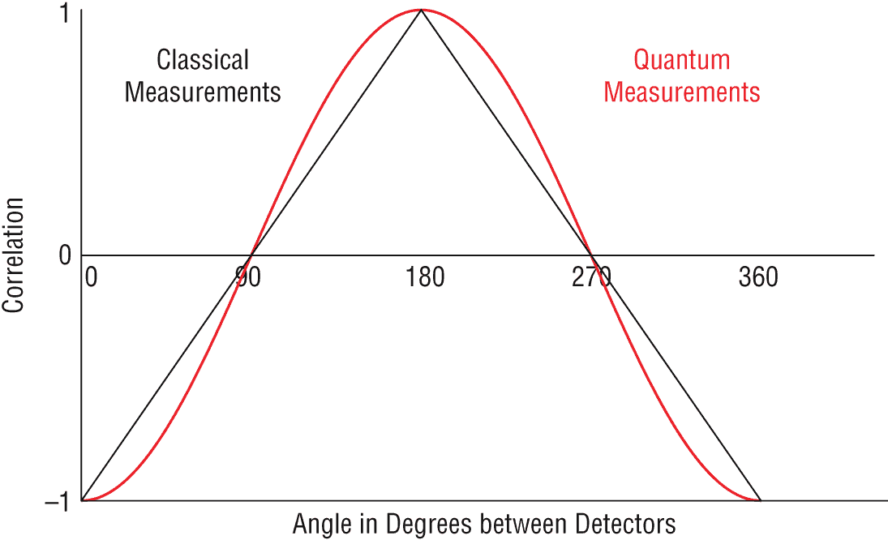

**Figure 7.1****:** Bell's inequality expressed graphically

简要概括，贝尔创建了一个实验框架，如果只有经典物理，答案只能是假，但我们看到答案总是真，因此不可能是仅有经典物理参与。从本质上讲，贝尔最终通过证明局部隐变量不可能参与，从而“证明”了量子物理。记住，物理学家不需要等待图像来相信某事。实验和支持的数学就足够了。

从 20 世纪 70 年代开始，几位物理学家进行了实验，得到了符合 *Bell's inequality theorem* 的结果，但一些观察者认为实验设计不佳，认为可能仍有某种狡猾的局部变量在起作用（被称为 *Bell's loopholes*）。但在数百次实验从未违背贝尔定理后，2015 年进行了一项决定性的、无漏洞实验（`www.physicsforums.com/threads/another-loophole-free-test-of-bells-theorem.842620/`），最终无可置疑地证明了贝尔定理。对贝尔定理的一个相当好的解释在这里：`https://en.wikipedia.org/wiki/Bell%27s_theorem`。

> **NOTE**  虽然看起来违反直觉，但“违反”贝尔不等式定理是一个好且预期的结果，意味着实验或设备正确地显示了量子属性。“违反”是指测量结果与仅用经典物理得到的結果不同。

所有使用纠缠的量子设备，包括 QRNGs，都应始终进行测试以确保它们通过贝尔测试。开发者希望确保他们提供的结果纯粹是量子的，并且没有某种经典的、非量子的错误被允许进入结果。这可以在创建、测试和认证期间完成。这对于 QRNGs 尤其重要，其真正的随机性必须得到保证，以确保任何依赖实现的其余部分具有最强的安全性。

还有一个理论上的担忧，即使用纠缠的 QRNG 可能被认证为通过了贝尔测试，然后后来被恶意修改以输出非随机数字。例如，也许一个敌对国家制造了一个 QRNG 组件，某个流行品牌的 QRNG 依赖于它，看起来是安全的；实际上，它输出的长串“看似随机”的数字是秘密记录的，这意味着该国家知道它们将是什么。QRNG 应该可以由任何人测试，以确保它符合贝尔不等式定理并且是真正随机的。设计最好的 QRNG 是在运行期间自检以确保它们违反贝尔不等式。你可以在这里找到关于这一概念的良好论文：`www.nature.com/articles/npjqi201621`。

此外，希望证明自己与随机性一致的 QRNG 将接受 NIST 800-22 测试，该测试用于衡量任何 RNG（量子或非量子）的随机性，并公布其结果。客户应能够运行相同的测试并获得类似的结果。你可以在这里找到一家 QRNG 供应商的测试结果示例：

`http://marketing.idquantique.com/acton/attachment/11868/f-004c/1/-/-/-/-/Randomness%20Test%20Report.pdf`

但对于使用纠缠的 QRNG 来说，证明其提供的数字真正随机的最佳测试是证明它们是在违反贝尔不等式的情况下生成的。证明是在量子层面上提供的。到目前为止，唯一做到这一点的在用商业 QRNG 是剑桥量子计算的名为 IronBridge 的 QRNG（`https://cambridgequantum.com/cqc-unveils-the-worlds-first-commercially-ready-certifiable-quantum-cryptographic-device/`）以及 NIST 目前正在研发的私人设备（稍后会介绍）。

##### Working QRNGs

早期，QRNGs 占据了长长的实验室，并通过在相隔许多足球场长度的光纤电缆的两台设备之间发射激光来工作。但 QRNGs 越来越多地被制造成尺寸相当于一台“一比萨盒”大小的计算机单元的设备，甚至是可插入计算机的接口卡，其大小约为独立网络接口卡。

你可以在各种形态的设备中购买到可用的 QRNG，供应商众多，从小型原始设备制造商（OEM）芯片到价格不到一千美元的服务器不等。它们经过认证，可与多种操作系统配合使用，包括 Windows、Linux、BSD、Solaris 和 Apple。它们拥有代码库、API 以及对多种编程语言的接口。需要 QRNG 服务的公司已长期购买并使用它们。QRNG 已在银行、科学、彩票、电信、金融和军事领域中使用。

瑞士公司 ID Quantique（`www.idquantique.com/random-number-generation/overview/`）早在 2001 年就是第一家拥有真正可用的 QRNG 的公司。此后他们已发布了许多不断成熟的产品。Figure 7.2 显示了三种可插入计算机内部接口插槽的 ID Quantique QRNG 产品。

其他销售 QRNG 的公司包括澳大利亚的 Quintessence Labs（`www.quintessencelabs.com/`）、美国的 ComScire（`https://comscire.com`）和加拿大的 Quantum Numbers Corp（`www.quantumnumberscorp.com`）。你可以在这里找到一篇关于这些公司及其产品的良好综述文章：`www.nanalyze.com/2017/02/quantum-random-number-generator-qrng/`。你甚至可以在互联网上的多个免费站点生成并使用自己的量子随机数，包括 `https://qrng.anu.edu.au`。

#### NIST QRNG 公共信标

NIST 于 2018 年创建了一个 QRNG（`www.nist.gov/news-events/news/2018/04/nists-new-quantum-method-generates-really-random-numbers`），方法是向晶体中照射高强度激光以产生纠缠光子。随机性被证明达到“十万亿分之一的 1% 以内”，这已经是相当好的水平。NIST 项目的目标是创建一个任何人、任何程序都可使用的公共随机信标（`https://csrc.nist.gov/projects/interoperable-randomness-beacons`）。最初 NIST 打算开发一项私有服务，但决定世界可以通过拥有一个可信的公共 QRNG 真实来源而受益。

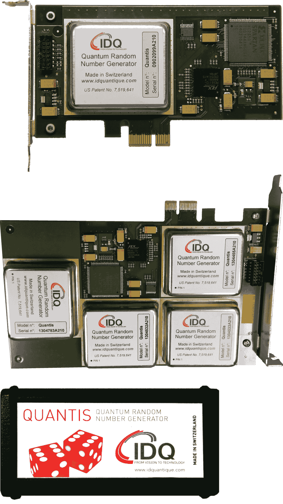

**Figure 7.2****:** Example ID Quantique QRNGs ¶ Courtesy of ID Quantique

#### QRNG 缺点

QRNG 的缺点包括成本和互操作性。你可以购买相对便宜的 QRNG（起价约数百美元），但 PRNG 是免费或接近免费的。每台计算机都已内置一个或多个。 要使用 QRNG，你必须购买、安装、接口并使用它。目前，很少有应用程序可与 QRNG 配合使用，也没有任何超级流行的现成软件默认可与 QRNG 配合使用。QRNG 厂商已创建软件和驱动程序以允许现有应用程序与其产品接口，但大多数应用程序尚不具备必要的“钩子”。开发人员可以相当容易地添加它们，但对于绝大多数依赖 RNG 的应用程序来说，它们根本不存在。相比之下，传统 RNG 已被每台现有设备和依赖应用程序使用。

QRNG 是即使在后量子世界之前也被欢迎的设备，因为它们为我们提供了可证明的随机数，并且只能改善所有依赖的加密操作，无论是经典的还是量子。

### 量子哈希和签名

本节讨论基于量子的哈希和数字签名。

#### 量子哈希

如前所述，哈希是一种单向加密函数，可为检查的唯一内容创建/输出一组唯一的代表性字符或位（称为哈希、哈希结果、数字签名或消息摘要）。哈希在许多其他加密过程中是必需的并被使用，例如加密和数字签名。传统哈希对预像攻击是量子易受攻击的（尽管根据 `https://cr.yp.to/hash/collisioncost-20090517.pdf` 并非碰撞）。因此，需要基于量子的哈希。

基于量子的哈希可以接受传统的二进制输入或量子输入，并基于量子态返回哈希。接受二进制内容并返回量子哈希的量子哈希被称为 *classical-quantum*。像任何其他哈希一样，传统或量子，都应抵抗预像攻击、第二预像攻击和碰撞。量子哈希自然会导向基于量子的数字签名。

有许多基于量子的哈希满足这些条件，尽管大多数尚未经过长时间的充分测试。尽管一些量子哈希已在实际工作设备中实现，但大多数只是思想实验，用以证明量子哈希是可能的，并且在需要时可以大规模实现。有大量科学研究论文涉及量子哈希。

例如，2013 年，俄罗斯人 Farid Ablayev 和 Alexander Vasiliev 提出了一种理论上的 classical-quantum 哈希（`https://arxiv.org/pdf/1310.4922v1.pdf`）。他们的量子哈希算法（见 Figure 7.3）在数学上很复杂，包含足够的高级数学，以至于对大多数非数学专业人士来说可能令人望而却步。简而言之，使用数学证明，他们两人提出并证明了所有必要的哈希属性，均由量子属性表示。

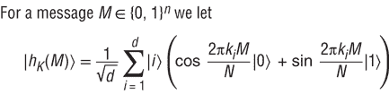

**Figure 7.3****:** Mathematical representation of Ablayev and Vasiliev's quantum-hash algorithm

他们的关键论点是，他们的算法允许量子位准确且唯一地表示任意长度为 *n* 位的消息，而最多只需要 `O(log n)` 个量子位。 不深入细节，`O(log n)` 基本上意味着对哈希消息的每位所需量子位少于 *n* 个，这在理论上意味着原始消息永远无法从较小的结果哈希中获得。

> **NOTE**  如果你有兴趣了解 `O(log n)` 在数学上代表什么，请参阅 `www.quora.com/How-can-we-check-for-the-complexity-log-n-and-n-log-n-for-an-algorithm`，以及 `www.quora.com/How-would-you-explain-O-log-n-in-algorithms-to-1st-year-undergrad-student-Can-any-one-explain-it-with-mathematical-proof-for-log-n-complexity-by-taking-a-simple-example-like-Binary-search-and-simple-to-understand`。

##### Holevo's Bound

Ablayev 和 Vasiliev 的算法依赖于另一个量子定理，即 *Holevo's Bound*（`https://en.wikipedia.org/wiki/Holevo%27s_theorem`）。该定理指出，一个量子位可以处于两种状态之一，但在被测量（退相干）时，它必须分解为仅由两种状态之一表示的测量结果——每次量子位测量都会丢失一种信息状态（即，只有两种状态的位无法准确测量具有三种可能状态的属性）。要准确表示单个量子位（可以是三种可能状态）至少需要两个二进制位（2 位 = 2² = 4，意味着它们可以表示 4 种可能状态）。

他们在论文结尾处基于其哈希创建了一种基于量子的数字指纹算法。该论文及其研究由俄罗斯基础研究基金资助。两位哈希创建者随后定义了更多量子哈希，甚至发现并证明了更多复杂的数学，可用于基于任何量子哈希。

有关量子哈希的更多信息，请参阅 `www.bjmc.lu.lv/fileadmin/user_upload/lu_portal/projekti/bjmc/Contents/4_4_17_Ablayev.pdf`。

#### 量子数字签名

哈希与签名之间的区别在于身份认证。哈希为唯一内容提供唯一的指纹。数字签名将哈希与主体的身份绑定在一起。例如，假设你对一个文件进行哈希处理，哈希结果为 1234。然后你使用非对称密钥对的私钥对哈希进行数字签名。非对称密钥对与你的身份绑定。数字签名就是主体在特定时间点将特定哈希锁定到特定身份。

要获得数字签名，你需要一个哈希、一个非对称密钥对以及一个数字签名算法。要验证任何声称的数字签名，利益相关方需要签署者的已验证对应公钥，然后他们会用它来“解锁”哈希，这只有在该哈希是由有效的对应私钥签名时才可能。如果公钥未能正确揭示有效的、先前“加密”的哈希，而该哈希又正确代表了声称的哈希内容，那么文件完整性或数字签名就会受到质疑。无论哪种情况，没有利益相关方会信任该文件或数字签名。

传统的非对称密钥对和数字签名可以通过量子通信传输，但在本章中我们讨论的是真正的量子数字签名，即量子数字签名基于量子特性。基于量子的数字签名需要量子哈希、基于量子的非对称密钥对以及基于量子的数字签名算法，所有这些都由量子特性表示。量子特性目前不能长时间保持稳定，因此它们并不构成理想的非对称密钥对。还有许多其他额外的扩展问题（稍后讨论），这使得基于量子的数字签名不适合常规数字签名，尤其与远 less 严格（但仍然非常安全）的抗量子数字签名相比。但对于有限的使用场景，基于量子的实现可以在短时间内提供超安全的数字签名。

量子基于数字签名非常安全的原因之一是使用了基于量子的哈希。如前所述，基于量子的哈希极难攻击。它们基于 Holevo 界定理，并且即使使用量子计算机也无法（甚至不可能）计算回原始消息。重大的复杂问题是，由于不可克隆定理，签名者不能简单地创建一堆相同的量子公钥并发送给接收者。相反，情况变得更加复杂。

#### 第一个量子数字签名算法

第一个实用的量子数字签名算法由 Daniel Gottesman 和 Isaac Chuang 于 2001 年创建（`https://arxiv.org/pdf/quant-ph/0105032.pdf`）。它并不漂亮或高效，但它有效。首先，发送者/签名者 Alice 必须分别对消息的每个量子位/位进行签名。她不能像经典签名算法那样对内容进行哈希处理并在一次操作中对哈希进行签名。哈希（或消息）必须一次一个量子位/位进行签名。Alice 必须创建一组或多组私钥，如果她要签名的消息位 = 1 则使用这些私钥，以及如果消息位 = 0 则使用另一组私钥。然后，使用非对称密码算法，Alice 为每个创建的私钥生成对应的公钥，并将所有公钥发送给所有接收者 Bob 和 Charlie。接收者数量不能超过少数几个，因为每增加一对复制的密钥对就会开始增加密钥泄露的风险。

现在对于签名消息中的每个 0 位，Alice 向 Bob 和 Charlie 发送所有与 0 位相关的私钥，以及签名消息的 0 位。对于签名消息中的每个 1 位，Alice 向 Bob 和 Charlie 发送所有与 1 位相关的私钥，以及签名消息的 1 位。Bob 和 Charlie 然后使用先前发送的公钥来验证签名位的私钥。如果 Bob 和 Charlie 的比较错误率较低，则签名位得到验证。如果 Bob 和 Charlie 的比较错误率不高，则可以认为系统某处存在泄露。必须对签名消息/哈希的每个位重复此过程。

即使你需要超高安全性，这也不是一种非常高效的数字签名方式，尽管已经提出了提高所有消息位效率的协议（`https://www.researchgate.net/publication/312062995_The_postprocessing_of_quantum_digital_signatures`）。尽管如此，它是第一个基于量子的数字签名，证明了它可以实现，尽管效率低下。

#### 相位编码数字签名

然后，在 2012 年，*Nature* 杂志发表了另一种稍有效率但非常相似的量子数字签名算法，该算法使用了“光的相位编码相干态”（`www.nature.com/articles/ncomms2172`）。使用此方法，Alice 选择一组随机的量子态（相当于私钥），这些量子态可以由光的不同相位表示。每个消息位仍由 Alice 单独签名。对于消息的每个 0 位或 1 位，Alice 生成一对相位编码态，并将该对的一份副本发送给 Bob，将另一份副本发送给 Charlie。Bob 和 Charlie 然后解码相位并验证签名位。

在 2013 年，基于量子的数字签名又略有改进（`https://journals.aps.org/prl/pdf/10.1103/PhysRevLett.112.040502`），随后进行了许多成功的数字签名实验，包括 `www.nature.com/articles/s41598-017-03401-9` 和 `http://cnqo.phys.strath.ac.uk/research/quantum-theory-of-light/quantum-digital-signatures/`。这些后期的实验使用了改进的相位编码签名变体。

基于量子的数字签名已经发展到足以让密码学家开始研究它们可以被成功攻击的方式，包括以下两篇论文：`https://link.springer.com/article/10.1007/s11128-019-2365-8` 和 `www.sciencedirect.com/science/article/pii/S0030402617308069`。每当一种密码算法或产品接受攻击审查时，这都是一个好迹象，也是协议成熟的标志。话虽如此，鉴于复杂性增加以及众多优秀的抗量子数字签名，基于量子的数字签名的需求在可预见的未来可能仍会保持较低。

有关量子数字签名的更多信息，请参阅 `https://arxiv.org/pdf/quant-ph/0105032.pdf`、`https://journals.aps.org/prl/pdf/10.1103/PhysRevLett.113.040502` 和 `https://en.wikipedia.org/wiki/Quantum_digital_signature`。

### 量子加密密码

量子加密意味着使用量子设备、软件和特性来保护静态数据或传输中的数据。就像在传统的二进制世界中一样，量子加密密码可以是对称的或非对称的。查看、复制或操纵受保护的数据或处于量子状态的数据是困难的甚至不可能的。如果未经授权的人试图直接查看数据或插入到量子编码的数据流或存储区域，量子态将被改变。这是由观察者效应和不可克隆定理保证的。观察者可以操纵编码数据，但这种操纵不会不被相关授权方轻易检测到。这对密码学家和密码学用户来说是理想的特性。本节将涵盖非对称量子密码的一般情况，但将量子网络的更大讨论留给 第 8 章。

> **注意**  读者可能会想知道为什么量子对称密码没有被讨论。这是因为该领域研究甚少，可用的文献和研究非常有限。传统的二进制对称加密目前被认为对已知的量子攻击具有抵抗力，因此关于它们并没有太多讨论。也许量子对称密码领域在未来会得到更多研究和资源投入，但目前该领域基本未被研究。

非对称密码学自 1970 年代以来就已存在。我们知道这种类型的加密通常用于在源和目标之间安全传输对称加密密钥，以及用于数字签名和身份验证。传统的非对称密码学在过去半个多世纪以来一直运行良好，直到现在。

正如本书所关注的那样，量子计算机很可能很快就会破解许多传统易受量子攻击的公钥密码形式，包括 RSA 和 Diffie–Hellman，即最流行的实现。如 第 6 章 中所述，有二十多种抗量子密码算法正在竞争成为新的 NIST 后量子标准。所有这些抗量子算法，涵盖公钥密码和密钥交换，都基于使用二进制设备进行二进制计算的二进制密钥。

量子非对称密码基于量子设备和属性。其中一种类型，目前最流行，使用量子属性在授权的源和目标之间安全地传输传统的对称密钥。这被称为 *量子密钥分发* (*QKD*)。另一种方法使用量子属性安全地传输密钥，并且密钥本身由量子属性构成。一些研究人员分别将它们称为 *量子公钥密码* (*QPKC*) 第 1 类和第 2 类（包括本文：`https://arxiv.org/pdf/0810.2859.pdf`）。QPKC 第 1 类是 QKD，其中密钥仍由二进制位组成。QPKC 第 2 类是密钥由量子量子位组成的 QKD。QPKC 第 2 类更难实现，因为缺乏量子网络设备以及保持量子密钥在长时间内稳定的固有复杂性。因此，大多数 QPKC 算法和实现都是第 1 类。即使是这些，目前在现实世界中实现起来也颇具挑战性，但我们已有许多成功的实现。

#### 量子密钥分发

有许多 QPKC 第 1 类密钥分发算法和系统，虽然它们并不普及，但自 2000 年代初以来已有许多私有和商业网络使用 QKD。QKD 网络首次于 2007 年在欧洲使用，并自 2010 年起在美国使用。今天，许多国家，尤其是中国，都在使用并改进它们。关于这些量子网络的更多内容见 第 8 章。

##### *BB84*

第一个 QKD 算法由美国人 Charles Bennett 和加拿大人 Gilles Brassard 于 1984 年创建，通常简称为 *BB84*。Bennett 和 Brassard 被认为是量子密码学的两位创始人。Bennett 是一名 IBM Fellow，一直研究到 70 多岁，并在 2016 年最近还在名为 *The Quantum Pontiff* 的博客网站 (`https://dabacon.org/pontiff/author/chb/`) 上发布文章。Brassard 还帮助创建了 *Cascade 误差校正协议*，该协议有助于检测和纠正对量子保护的密码通道进行窃听所造成的“噪声”（Bennett 在此方面也做了大量研究），并在量子隐形传态和一种新的博弈论 *量子伪心灵感应* 方面做出了工作。

BB84 不仅是第一个 QKD 方案，而且按定义是第一个数学上证明使用量子态可证明地防止窃听的算法。虽然我省略了数学细节，但以下是 BB84 所涉及的基本思想。Alice 想通过一个不可信的通道向 Bob 发送消息。Alice 需要向 Bob 获取一个共享的对称密钥，以便他们开始相互加密秘密消息。以下是基本的 BB84 步骤：

1. Alice 创建两个随机二进制字符串，假设为 `a` 和 `b`，然后使用量子位和 BB84 数学算法将它们编码为单一结果，假设为 `n`。`a` 和 `b` 在数学上相互关联，但没有人可以在不知道 `a` 的情况下知道 `b` 是什么。
2. Alice 将 `n` 作为量子位通过量子通道发送给 Bob，并且这是量子通道最后一次使用。剩余的通信发生在公共经典通道上。
3. Bob 测量所有接收到的 `n` 量子位，这会使量子位退相干为位。Bob 以一种方式测量一半的量子位（假设为 `Method 1`）并以另一种方式测量另一半量子位（假设为 `Method 2`）。只有一种方法是 Alice 发送的正确方法。`Method 1` 和 `Method 2` 在测量期间根据量子位表示 0 还是 1 给出不同的答案。与 Alice 发送内容一致的正确方法将正确测量其一半量子位的 100%（即总数的 50%），而错误的方法最终只会正确测量其一半量子位的 50%（即总数的另外 25%）。如果 Bob 从 Alice 那里正确接收并测量了所有量子位，由于测量方式，使用正确和错误的方法，只有 75% 的位将准确表示 Alice 发送的量子位。这是预期的。
4. Bob 向 Alice 告知他用于测量每个量子位的方法，1 或 2。
5. Alice 现在知道 Bob 对每个量子位使用的方法以及结果会是什么，她告诉 Bob 他测量正确的量子位和测量错误的量子位。
6. Alice 和 Bob 都将丢弃转换错误的位，剩余的 75% 成为他们的共享密钥。
7. 在使用新共享密钥进行未来可信通信之前，作为测试，Alice 和 Bob 将通过不可信通道在彼此之间共享密钥的一系列短位。如果测试比较完全匹配 100%，他们将开始使用剩余的共享密钥安全通信。如果不匹配，他们将假设存在噪声或窃听，并且不信任当前共享密钥。

BB84 协议有更多步骤，比这更复杂，但这一系列步骤包含了协议的整体要点。BB84 的一个很好的视频演示在这里：`www.youtube.com/watch?v=UVzRbU6y7K`。几乎所有 QKD 方案都是 BB84 的改进版本，或至少提供比 BB84 更好的保护。

如果窃听者 Eve 能够拦截 Alice 和 Bob 之间的原始量子位，Eve 对量子位的测量将退相干为只有 75% 的正确位（任何原始合法测量者都会发生这种情况）。但 Alice 不知道哪些位测量正确，哪些不正确，因此她必须将她测量的内容（包括 25% 的错误位）发送给 Bob。将这些测量的位作为量子位重新发送给 Bob 会导致 Bob 只能获得 75% 的原始正确量子位。当他通过两种方法对其进行退相干时，他得到的正确比例会小于 75%，而不是恰好为 75%。当 Bob 和 Alice 就接收到的位是什么以及 Bob 使用什么方法读取它们进行通信时，如果 Bob 的准确率低于 75%，那么 Alice 和 Bob 就知道该通道存在噪声或被窃听。

QKD 方法如 `BB84`，其中一个光子的量子态在发送方和探测器之间发送，通常被称为 *离散变量 QKD*。基于 `BB84` 开发了许多其他改进的 QKD 系统，包括 `B92`（`www.semanticscholar.org/paper/Quantum-cryptography-using-any-two-nonorthogonal-Bennett/e99dc04d91409a4668ad0368ef7017e27a034008`），由 `BB84` 共同作者 Bennett 创建；`SARG04`（`https://en.wikipedia.org/wiki/SARG04`）；以及六态协议（`https://en.wikipedia.org/wiki/Six-State_Protocol`）。

### 纠缠 QKD

1991 年，英波教授 Artur Eker 在其论文“基于贝尔定理的量子密码学” (`http://cqi.inf.usi.ch/qic/91_Ekert.pdf`) 中提出了使用纠缠的根本不同的 QKD 方法。Eker 的方法大致如下：

1. Alice 使用每个密钥位的一个分裂纠缠量子位创建秘密密钥。
2. Alice 保留纠缠对的一侧，并通过量子信道将另一侧发送给 Bob。
3. Alice 和 Bob 都测量他们的量子位（将其退相干为位），使用各自的探测器对每个量子位采用不同的取向组合。
4. 测量完所有量子位后，Alice 和 Bob 公布每个测量量子位的各自探测器取向。
5. 由相同探测器取向测量的量子位将被丢弃。
6. Bob 和 Alice 现在知道彼此的探测器取向，可以将剩余的位转换为其结果的二进制表示。
7. 最后，Bob 和 Alice 都使用贝尔不等式检验来执行纠缠检查。如果纠缠被破坏，则可以假设存在窃听者或不良噪声。无论如何，结果的秘密密钥都不会被信任。

Eker 的 QKD 方法（也称为 *E91*）催生了一系列新的 QKD 算法和其他相关方案。

### 光子数分裂攻击

从理论上讲，QKD 系统由于量子物理观测者效应和不可克隆定理而对窃听具有抵抗力。只要在传输期间使用单个量子位表示单个位，Eve 就很难在不被检测到的情况下窃听。但在实践中，大多数 QKD 系统无法为每个传输位发送单个光子。光子在沿光纤电缆传输时会迅速失去强度，并且读出探测器很难准确检测单个光子。正因为如此，大多数 QKD 系统为每个传输的量子位/位发送多个光子。在多光子系统中，Eve 可以截取一个或多个重复光子，同时让其余光子继续在 Alice 和 Bob 之间传输。QKD 协议（如 `SARG04`）已被创建，并且大多数现实世界的 QKD 系统包含额外的保护和纠错机制，以降低光子数分裂攻击的风险。

### 连续变量 QKD

第二种主要的新型 QKD 被称为 *连续变量 QKD*（*CV-QKD*）。在 `CV-QKD` 中，量子特性被编码在激光束流的振幅和相位调制中，然后可以由一种称为 *零拍探测器* 的探测器解码。这些方法对光子数分裂攻击更具弹性。`CV-QKD` 系统可以发送更多密钥/时间段（与离散变量 QKD 系统相比），并且实现成本更低，但它们无法在离散变量系统能够实现的数公里距离上运行。`CV-QKD` 方案的示例可以在这里找到：`https://arxiv.org/ftp/arxiv/papers/0705/0705.0515.pdf` 和 `https://arxiv.org/pdf/1703.09278.pdf`。你经常会读到量子网络设备支持离散变量或连续变量算法。

### 中继器问题

QKD 系统由于不可克隆定理，对不可检测的窃听具有抵抗力。在密码学界，这是一件非常好的事情。实际上，尝试在大型网络上使用 QKD 是一个巨大问题。QKD 系统本质上是点对点创建的。你不能只在两个 QKD 端点之间插入传统类型的中继器或路由器来在途中重复消息。中继设备将被视为窃听者。即使在长距离点对点连接中，也只能发送量子光信号数英里，然后它就会失去强度并需要重复。

> `NOTE` 正在进行研究以增加量子信号在需要重复之前可以发送的距离，包括以下内容：`www.nature.com/articles/s41586-018-0066-6`。

因此，QKD 网络必须是一个连续的点对点系统，或者量子位必须被测量、退相干为二进制，然后使用量子中继器重新传输。这些二进制位置中的每一个都是链条中的薄弱环节，窃听者可以在其中插入自己并肆无忌惮地学习加密信息。

想想你简单的家庭网络中就有多少个中继点。你的移动设备可能连接到 Wi-Fi 路由器，路由器连接到有线调制解调器，有线调制解调器连接到你家外面的设备，该设备连接到邻里汇聚点，然后连接到数十到数百个中继器，然后才到达你的互联网服务提供商（`ISP`）。然后你的 `ISP` 连接到一到三打节点以在互联网上绕行（其中每个节点可能有任意数量的中继器进出），最后进入最终目的地计算机或设备——并且该路径对于每个需要发送回的网络数据包都是反向的。典型的互联网网络数据包很容易跨越数十个中继器。如果我们有一天想要拥有基于量子的互联网，这就造成了巨大的挑战。该挑战及其解决方案将在 第 9 章 中更详细地介绍。

### 其他 QKD 担忧

QKD 系统有很多批评者，包括 Bruce Schneier（`www.schneier.com/blog/archives/2018/08/gchq_on_quantum.html`）和英国国家网络安全中心（`www.ncsc.gov.uk/whitepaper/quantum-key-distribution`）。许多人想知道开发纯量子网络的成本是否值得带来的好处。我们今天知道可以制造的东西，尤其是当你加上抗量子密码时，可能在很长很长时间内都能满足所有最高安全需求。

另一个实际问题是现有 QKD 实现之间缺乏当前互操作性，即使它们据称使用相同的算法，但一些项目开始证明能够互操作的能力。更一般地说，许多批评者认为他们解决的问题是昂贵的边缘情况，而不是可以在不久的将来大规模实际实施的东西。英国白皮书认为，在很长一段时间内，认为 QKD 密码可以大规模使用，例如在数十亿物联网（`IoT`）设备中，是不切实际的。相反，批评者建议坚持使用经过验证的抗量子密码。

另一个严重问题是现实世界 QKD 系统的整体安全性。它们还没有存在足够长的时间来了解主要的安全问题。除了为每个中继节点创建的薄弱环节外，QKD 系统本身也容易受到各种黑客攻击，但在二进制和量子层面。密码学家不喜欢使用尚未经大量研究人员和攻击者检验的系统。

这些是对当前时期的正确评估，但类似的论点曾被用来说明汽车永远无法取代马，认为电动车永远无法取代燃油车是不切实际的，我相信我们的 IT 祖先很难想象我们现在在小小的手持移动电话中拥有的计算能力。成本、安全性和分发方面的障碍通常会被克服，尤其是在计算机世界中。

### Kak 协议

QKD 本质上使用了一系列经典系统和信道。如果要使用量子密钥，QKD 是首选，尽管存在顾虑，因为纯量子密码系统并不多。在未来，完全量子的 QPKC Class 2 系统可能会被使用。如果是这样，它们很可能基于一种叫做 `Kak's three-stage protocol` 的协议。

在非对称密码出现之前，常见的一种提议解决方案是采用多阶段、多密钥（three-stage）密钥交换。在 Alice 和 Bob 试图通过不可信信道使用 three-stage 对称密钥交换安全通信的传统示例中，Alice 会用只有她自己知道的私钥加密预期的秘密，然后发送给 Bob。Bob 会用只有他自己知道的私钥加密收到的内容，然后发回给 Alice。Alice 然后会移除她的加密，但它仍会被 Bob 的密钥加密，然后再发回给 Bob。Bob 然后会移除他的加密并读取 Alice 的明文消息。这种 three-stage 加密的关键在于双方都能移除自己的加密，特别是 Alice 在 Bob 的加密被应用之后仍能准确移除自己的加密的能力（见 Figure 7.4）。

2005 年，路易斯安那州立大学工程师 Subhash Kak 发表了一篇论文（`https://arxiv.org/pdf/quant-ph/0503027.pdf`），展示了如何利用量子特性进行对称 three-stage 密钥交换。它现在被称为 `three-stage quantum protocol`，或 `Kak's three-stage protocol`。它已使用单光子和多光子方法在真实的量子设备中实现。单光子方法在未经授权方察觉的情况下进行窃听是困难的甚至不可能的。中间人攻击者可能会破坏该过程，但破坏可以通过纠错机制来抵消。

自 Kak 的论文发表以来，还开发了使用多光子和纠错改进的额外版本。多光子实现允许更多潜在应用，但增加了成功窃听的风险。多光子实现的开发者包括其他保护措施以抵消增加的风险。Kak 的量子协议受到了广泛欢迎，因为它是纯量子的，并且不使用经典组件，而其他量子密钥交换协议则使用。

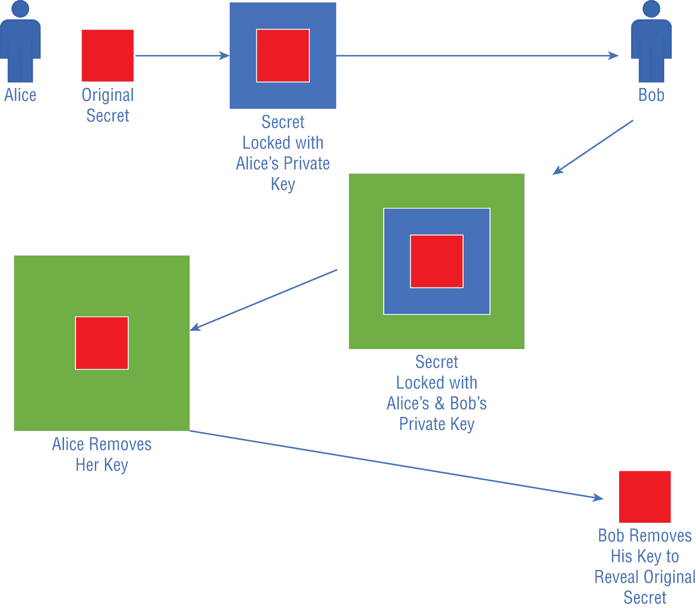

**Figure 7.4****:** Three-stage symmetric encryption

#### QKD Companies

有很多公司制造 QKD 系统，包括
* ID Quantique (`www.idquantique.com`)
* MagiQ Technologies (`www.magiqtech.com`)
* Quintessence Labs (`www.quintessencelabs.com`)

ID Quantique 制造三种 QKD 系统（`www.idquantique.com/quantum-safe-security/products/#quantum_key_distribution`），其中包括一个包含光学刀片的大型服务器。在其他方面，每片刀片可以代表 QKD 通信流中的 Alice 或 Bob。他们的 QKD 系统在需要中继器之前可达 100 公里/62 英里，并且如果检测到窃听者会自动发送警报并发出警报声。MagiQ Technologies 制造一种名为 QPN 的 QKD 设备，该设备使用 BB84 方法（`www.magiqtech.com/solutions/network-security/`）工作。

有关 QKD 的更多信息，请参阅：`https://arxiv.org/pdf/1504.05471.pdf` 和 `https://ieeexplore.ieee.org/abstract/document/6459842`。

### Summary

在本章中，我们探讨了基于量子的密码学。量子密码学包括随机数生成器、哈希、数字签名和密钥分发。近二十年来已有基于量子的随机数生成器和密钥分发方案。许多公司提供这两种类型的多个成熟型号。尺寸从大型、足球场大小的房间到小型计算机接口卡和芯片不等。价格从几百美元到数万甚至数十万美元不等。这些类型的量子密码设备仍在不断改进。它们的复杂性和价格降低，使用寿命和有效距离提高，与现有系统的接口能力每天都在改善。新的协议和攻击正在开发和测试中。不幸的是，目前以及可能在未来许多年里，对基于量子的非对称密码、数字签名或对称密码的需求并不大。大量量子抗性密码可能会降低对所有基于量子密码的需求，至少在足够便宜的基于量子的设备可用以具有竞争力之前是这样。

下一章将介绍该密码如何被使用以及如何改进以创建基于量子的网络。

# 8

## Quantum Networking

本章介绍量子设备使用量子特性专门进行的网络。 Chapter 6 中介绍的量子抗性密码学和 Chapter 7 中介绍的基于量子的密码学当然可以并且经常被使用，但对于基于量子的网络并非必需。量子网络具有其自身固有的挑战，已被各个公司和国家追求了十多年以上。现在量子霸权即将成为现实，可持续量子网络模型的竞争正在升温。具体来说，本章将介绍量子网络组件、挑战和可能的应用。

网络是使用商定的通信协议通过某种传输介质（无论是无线、有线还是其他，例如基于人类的网络）将信息和内容从源移动到目的地的过程。量子网络使用量子设备、属性、算法和协议在网络中传输（量子）信息。与其他所有量子技术一样，量子网络使用量子属性的全部范围，尽管你会听到最多关于叠加、纠缠和不可克隆定理的讨论。量子网络可以用来将更多量子设备物理分开链接成更强大的集合，并促进信息和内容（包括量子隐形传态）的传输。如果做得正确，量子网络有望提供比当今非量子方法更安全、更不易遭受未经授权窃听的网络。

### Quantum Network Components

像任何网络一样，量子网络由传输介质、协议和网络设备组成。量子网络可能由经典和量子组件组成，也可能完全基于量子。

#### Transmission Media

传输介质包括物理电缆和自由空间介质。

##### Fiber-Optic Cables

量子物理网络主要使用光子，光通常通过光纤电缆传输。在某些实现中，正常（高质量）的光纤电缆已用于基于光的经典网络，也可用于量子网络。所有实现者需要做的就是更换用于发送和接收信号的仪器。不是发送长波光并将其编码解码为二进制表示，而是使用单个光子，编码在每个相关光子的单个量子属性上。其他时候，会创建并部署专门构建的超高质量光纤电缆。量子网络光纤电缆对外部影响的保护更强，内部对变化更敏感，这正是量子网络所要求的。电缆量子传输通常小于 100 公里，尽管已创建了更长的网络。

理论上，每个量子位仅使用单个光子来发送，这种方法提供了最容易的固有安全性。但单光子量子位在真实世界中跨网络传输得越远，就越容易被阻挡、丢失并发生退相干。在许多量子网络中，会创建、编码并传输多个光子来代表同一个信息量子位，以提高所代表的单个量子位成功从源传输到目的地的几率。然而，这会引发安全问题。有关此内容的更多信息，请参见下文的纠缠纯化部分。

根据所涉及的量子网络设备类型，使用不同的光波长。经常使用钻石、晶体和其他宝石和材料来产生不同的波长和颜色。它们可能会有意掺杂缺陷或挑选特定的天然缺陷，以创造可在量子网络中使用的所需特性。

> NOTE  在钻石中发现的最常见缺陷之一，不仅用于量子网络，被称为氮空位中心。钻石通常由全部碳原子组成，但有时氮原子会被置入钻石碳晶格的中心。碳和氮在元素周期表中相邻，氮原子比碳原子多一个电子。这就产生了一个“额外”、非常可用、自由漂浮的电子，可用于量子计算和通信（以及许多其他用途）。虽然对珠宝爱好者来说过多的碳缺陷是不好的，但它们对于创造额外的可用颜色和波长以及操纵亚原子量子特性非常有用。如需更多信息，请参阅 `https://en.wikipedia.org/wiki/Nitrogen-vacancy_center`。

#### Free-Space Media

自由空间介质包括任何不绑定于物理对象的传输介质。最常见的量子自由空间传输介质是某种类型的电磁波，包括微波、激光束和声波。量子传输可以从地面发送和接收站点对点发送，从地面站到卫星并返回，或以其他某种混合方式进行。自由空间介质传输更容易受到外部影响。

一项量子卫星实验已证明可在 1,200 公里以上发送纠缠光子，单光子已从超过 20,000 公里的卫星发送。就像今天的传统网络一样，量子卫星网络最常被视为连接分布式地面网络和移动系统的一种方式，尽管量子网络对某些类型的卫星本身也有特定的应用（在下文的量子网络应用部分中介绍）。

将量子光子束向 20,000 公里外的远地轨道卫星发射是困难且昂贵的。如果你认为尝试通过受保护的光纤电缆传输单个量子位是困难的，那么想象一下尝试通过未受保护的太空成功传输同一个量子位，同时它每秒可能会遇到沿途的数万亿个其他量子粒子。这已经做到了，但并不容易。

中国人已成功试验使用相对便宜（且飞行高度较低）的无人机在两个地面节点之间发送和接收量子信息。这种方法可能用于连接相距数百公里的地面站。一旦相关问题得到解决，自由空间介质很可能会成为广域物理量子网络工作和扩展的方式。

#### Distance vs. Speed

所有网络及其材料和设备都受制于自然界的物理定律，这些定律决定了它们能够传输信息的距离和速度，即使使用最佳和最高效的设备也是如此。量子网络也不例外，尽管所涉及的物理定律可能看起来更奇怪。这些定律决定了量子网络可以有多远、多快，至少在没有中继器设备的情况下是如此（除非有某种新的、目前未知、相反的史诗级发展）。一般来说，量子网络越长，信息传输越慢；反之亦然。两者都有理论最大值，具体取决于所使用的传输介质。

##### PLOB Bound

一种被称为 Pirandola-Laurenza-Ottaviani-Banchi（PLOB）界限的量子物理定律 (`https://arxiv.org/pdf/1510.08863.pdf`) 指出，在没有额外中继器的情况下，任何已知的点对点、双向、单一网络段上量子位的最大传输速率等于 `−log2(1 − x)`，其中 `x` 是网络传输信道的透射率。*透射率* 是任何介质允许某物通过的（最大）程度/速度/长度。每个传输介质在物理上只能允许某物（即电、光、电磁辐射等）在特定速度下通过特定距离进行传输，然后传输物质开始退化或完全停止。

PLOB 界限为单个点对点量子网络段在不涉及中继器的情况下设置了速度和长度的最大理论速率，从而根据传输介质设置了单个量子中继器或网络段可以传输信息的最大距离。它为任何量子网络（无中继器）的长度和/或速度设定了上限，包括光纤电缆和卫星链路的量子传输。它甚至考虑了量子纠缠并讨论了自然熵如何限制纠缠。由于环境和物理阻力问题，实际网络不太可能 ever 达到由理论 PLOB 界限定义的最高速度和距离。

但量子网络供应商正在努力提高其设备在单个段上工作的最大距离和速率。大多数量子网络设备供应商会在一系列距离和速度下测试其设备，并发布这些数据，以便客户可以看到他们正在考虑购买的性能表现以及用于比较购物（无论是其自身产品线中的不同设备型号还是与另一竞争对手的产品）。您通常会看到商业量子网络相关设备供应商至少分享以下数据：最大可接受传输损耗（以 dB 为单位）、最大传输信道长度（以公里为单位），以及各种速度评级，例如在 50 公里处 1.4 千比特的密钥生成。速度评级会随着距离的增加而始终下降。关于量子网络距离与速度的良好白皮书可在以下位置找到： `https://www.nature.com/articles/s42005-019-0147-3.pdf`。

在每个量子网络中，都需要额外的设备和机制将网络传输的量子位转换到最终的目的设备，无论它们是什么。在经典世界中，这些设备通常被称为网络接口卡。在量子世界中，它们通常被称为光开关、光束分束器、探测器或中继器（将在下面详细介绍）。

#### Point-to-Point

几乎所有当前量子网络传输类型都是点对点的，意味着从一个位置直接到另一个位置，从源到目的地。网络传输介质不共享或分布。基本上只需想象一根从起始节点延伸到目的节点的线。要将量子网络扩展到更多节点，只需添加额外的点对点连接。

这主要是由于多种原因，其中最不容忽视的是量子比特不愿被共享（例如 `no-cloning theorem`），保持量子信号与外部世界隔离的难度，成本（点对点链路更便宜），以及实现非点对点网络连接所需的巨大复杂性。共享的、基于云的网络架构是量子网络中备受追捧的圣杯。毫无疑问，总有一天它们会成为常态，但目前单点对点连接构成了大多数量子网络。数量较少但正在增长的量子网络正在增加点对点段的数量，最终形成更大、有时是市域范围的广域网络。

这种“先学会走路再奔跑”的网络分布模型可以类比于经典网络的早期。最早的网络是点对点、拨号模拟电话连接。最终，传统网络成熟到要么由共享的“穿梭令牌”拾取和丢弃比特，（例如 `Token Ring` 等），要么媒体可以被多个节点共享并频繁重传（例如 `Ethernet`）。互联网连接曾经是点对点并且需要外部电话拨号（例如 `RJ-11` 模拟，`ISDN`，`Frame Relay` 等），但最终成熟为我们今天所拥有的模型，即房屋或节点只需连接到众多邻里汇聚点之一（基于互联网服务提供商）或卫星上行链路即可。这通常被称为“`last mile`”。邻里连接连接到更大的广域网络，然后接入全球互联网。现在，几乎任何人都可以将网络数据包在几秒钟内发送到世界各地。毫无疑问，总有一天量子网络将被扩展到我们今天习惯的房屋/节点模型。但我们正处于量子网络的非常早期阶段。目前，大多数量子网络都是私有的点对点实验，并且通常包含中继器以延长其最大传输距离。有两种基本类型的量子中继器。

#### 受信任中继器

在经典网络世界中，中继器所要做的就是捕获、再放大并重新传输所有捕获的比特。它可以在物理层做到这一点，本质上只是以接近光速检测和重新传输电信号。然而，`no-cloning theorem` 意味着信号复制和应用不能像量子网络那样轻松完成。量子信息始终可以被读取（将其退相干为经典二进制），然后重新编码到下一个量子网络段并作为新的量子比特发送下去。而这就是今天最常用的量子中继方法。

使用这种方法的主要问题是，任何人如何能完全确信中继器读取和重新编码信息时是准确且没有无意或故意恶意篡改的？在纯量子世界中，量子力学提供了信任。你不需要信任任何中间设备，因为如果有人篡改它们或窃听，这种干扰可以立即被检测到。但当并非所有中继设备都是完全量子的时，如当今量子网络中经常出现的情况，信息的安全传输必须以另一种方式得到保证。

答案是创建所谓的 `trusted repeater`，其中信息使用量子编码进行保护，由一个或多个每个人都信任的安全中继器沿途发送，同时使用多套基于量子的加密密钥。例如，假设我们有一个量子网络试图将量子信息从起点 `A` 移动到终点 `Z`，中间有受信任中继器 `R`（如 `Figure 8.1` 所示）。双方都必须信任 `R` 是安全的。

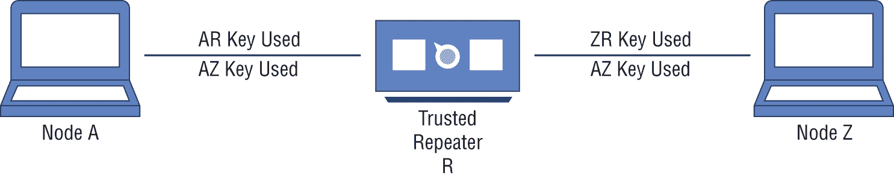

`Figure 8.1`**:** Quantum network using a trusted repeater

`A` 和 `Z` 将各自分别创建量子密钥（使用 `Chapter 7` 中介绍的量子密钥分发）用于加密和安全传输将实际执行数据加密的其他密钥。让我们称它们为 `AR` 和 `ZR` 密钥。它们将仅与 `R` 共享 `AR` 和 `ZR`。节点 `A` 然后将创建一个用于其自身和 `Z` 之间的数据加密密钥（我们称之为 `AZ` 密钥）。节点 `A` 将使用 `AR` 密钥加密 `AZ` 密钥并发送给受信任中继器 `R`。`R` 将解密 `A` 发送的密钥，用 `ZR` 密钥重新加密，然后发送到 `Z` 节点。`Z` 节点将解密，现在安全地获取了 `A` 创建的 `AZ` 密钥。当 `A` 和 `Z` 想要相互发送数据时，他们将使用 `AZ` 密钥加密该数据然后发送给 `R`。`R` 将读取/退相干加密的量子数据（使其保持加密状态），重新编码并重新发送到另一侧。显然，在初始 `AZ` 密钥交换期间，`R` 必须安全且受信任，才能使一切保持安全。Kak 三阶段密钥交换（也在 `Chapter 7` 中介绍）也可以在无需明确信任中继器的情况下工作，但受信任中继器模型是当今大多数扩展量子网络中使用的主要量子中继模型。

#### 真正的量子中继器

为了在整个网络传输过程中保持纯粹的量子特性，一个更好的想法是使用量子纠缠和量子隐形传态（见 `Chapter 5`）。如果量子态可以以其原始量子态从源传输到目的地，为什么还要担心读取/退相干量子数据并再次重新编码它？我们仍然需要中继器，因为单点对点网络段仍然有一个最大距离，但至少当使用中继器时，它可以使数据保持其原始量子态而不退相干数据。使用真正的量子中继器也意味着允许固有的量子特性提供对 unwanted 窃听的保护。使用真正的量子中继器，你可以在基于量子的网络上获得比受信任中继器更高的准确性和安全性。

真正的量子中继器使用量子隐形传态在各段之间传递量子信息。如 `Chapter 5` 中所述，量子隐形传态是通过使用一个或多个纠缠量子比特来传输量子态的一种间接方式。回顾量子隐形传态，首先，必须创建纠缠量子粒子并将其带到其源和目的地区域。然后在源量子粒子中添加额外的量子粒子，并进行测量以记录差异。这些差异随后使用任何多种经典方法传输到目的地区域，并用于使用目的地纠缠粒子重建所需的量子比特。一旦目的地量子比特被测量，纠缠就被打破。

> `NOTE`  如 `Chapter 5` 中所述，隐形传态（至少目前，如果不是永远）不允许超光速传输，因为没有任何东西可以比光速更快，甚至量子隐形传态也不行。此外，量子隐形传态始终需要一种经典传输方法来将源侧的变化传输到目的地侧，这意味着根据定义，量子隐形传态永远不会比经典方法更快。

使用纠缠的量子中继器已经成功实现，并且很可能是未来成熟量子网络的首选方案。当然，问题很多，其中最不济的是，人造的纠缠光子极易被破坏。早期我们无法让纠缠量子比特彼此相距超过几毫米，尽管在现实世界中我们相当确信纠缠光子彼此相距光年之遥。如今，我们已成功演示了使用量子纠缠和中继器在长达至少 50 公里的量子网络中进行传输。

这并不容易。目前在实验室和计算机中创建的纠缠光子类型通常会因退相干而丢失，尤其是在沿网络传输的时间越长时。随着网络长度增加，它们更有可能在环境噪声中消失。量子信息科学中有一个专门的子领域研究 `entanglement fidelity` 和 `entanglement optimization`。一种解决方案是将来自捕获离子量子计算机的纠缠光子，该光子在沿光纤电缆发送时通常不会持续很久，并将其通过专门设计的晶体，该晶体将纠缠光子的波长转换为更有可能成功传输的波长。事实证明，量子计算机内部创建的量子比特并不适合在网络中传输。这种方法将量子比特转换为另一种状态，该状态更适合在网络中传输，而无需先使量子比特退相干出其量子态。

#### Entanglement Swapping

另一种被广泛研究的量子中继器技术被称为 `entanglement swapping`。本质上，这是一种“如果 A 信任 B 且 B 信任 C，则 A 信任 C”的解决方案。假设我们有节点 A 和 Z，代表源和目的地，如 Figure 8.2 所示。节点 A 与量子中继器，即我们称之为 R1，存在量子纠缠。节点 Z 也与量子中继器处的另一个光子存在另一种量子纠缠，我们称之为 R2。节点 A 通过纠缠 R1 将量子信息传送到量子中继器 R。量子中继器获取进行节点 A 与自身之间传送所需相同的差分信息，并将其在自身与节点 Z 之间重新传输。节点 Z 利用纠缠 R2 和传输的差分信息，可以重建节点 A 传输的信息。

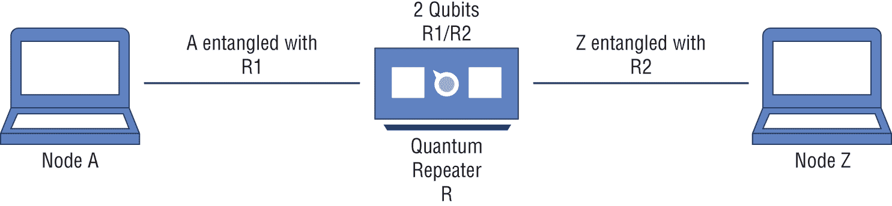

**Figure 8.2****:** Representative entanglement swapping

已经有成功的纠缠交换实验，并且它很可能成为未来的量子中继器方法。目前，有用的纠缠交换已在节点之间演示了长达 1.3 公里的距离。有足够多的量子中继器和量子交换，我们就可以创建出非常类似于我们互联网的东西，但处于纯量子态。

### Quantum Network Protocols

每个网络都需要协议。网络协议是预先商定的用于在两个或多个参与节点之间传输数据的方法和格式。没有人知道最终的量子网络协议会是什么样子，尽管已经有一些标准开始被提出和测试。量子研究人员的一个小组创建了一份官方的互联网草案（`https://tools.ietf.org/pdf/draft-dahlberg-ll-quantum-02.pdf`）定义了可能成为量子互联网的链路网络层。

> **NOTE**  （数据）链路层是通用抽象网络协议层模型中的较低层。在最常见的模型即开放系统互连（OSI）模型中，所有网络通信都可以定义为存在于七个堆叠的、相互依赖的层之一：物理层、数据链路层、网络层、传输层、会话层、表示层和应用层。链路层有助于将数据（以数据报的形式）发送到两个直接通信的节点并从中接收。它处理由于物理层引起的错误校正，以及通信信道的建立和拆除。在传统网络中，以太网桥和交换机在此层运行。

在量子网络中，链路协议将参与帮助两个量子节点通信，包括使用纠缠，特别是纠缠交换（前面已介绍）。协议设计者希望使任何三个参与节点更容易启动纠缠交换，目标是更轻松地允许大量充满纠缠交换的长距离网络，创建完全互联的、分布式的量子网络，与我们今天拥有的类似，但对窃听具有更强的固有防御能力。

量子链路层的主要任务之一是帮助节点传输预期的纠缠量子比特以允许通信。正如你在 Chapter 1 中回忆的那样，创建/测量量子属性是概率性的，这意味着你永远无法完全预测任何单个量子操作的输出。你只能预测一系列尝试中特定结果的百分比可能性。所以，举例来说，如果你需要在网络上传输一个“1”作为量子信息。你不能像在经典网络中那样确定性地在第一次尝试时创建一个代表“1”的量子比特（按协议定义）。你不能说“我现在需要一个代表‘1’的量子比特”然后神奇地保证你创建的第一个量子比特就是“1”。你 however，可以创建一个或多个量子比特，直到你得到一个代表“1”的量子比特。记住，这变得更加困难，因为如果你直接测量一个量子比特，你会使其退相干为非量子态。同样，你也不能总是保证在第一次尝试时立即创建纠缠量子比特和正确的纠缠量子比特。量子是概率性的，而不是确定性的。

量子链路层协议正是为解决这个问题而设计的。物理层仍需最初创建正确的纠缠量子比特（可能需要一次或多次尝试）。链路层将保证这些量子比特是“正确”的量子比特并且它们是纠缠的。链路层将允许节点丢弃“错误”的纠缠量子比特，重新创建并重新传输“正确”的纠缠量子比特，并告诉节点区分“正确”的量子比特和噪声。

为此，链路层做了几件事，包括创建和使用 `heralding signal`，它指示纠缠量子比特对已被创建，并为每组纠缠量子比特分配一个逻辑“纠缠标识符”。这使得各个节点能够在量子比特在节点之间交换时跟踪“正确”的纠缠量子比特对。更高层的量子网络可以发送 `CREATE` 消息请求纠缠对；链路层随后与物理层协同创建设计的纠缠对。链路层以 `ACK`（即确认）或 `OK` 回复上层。ACK 响应告诉上层链路层已接受其请求并已安排生成纠缠对。它还包含一个 `CREATE ID`，以便每个人都能跟踪确切请求的纠缠对。OK 表示请求的纠缠量子比特已被创建。

甚至还有 `goodness` 和 `time of goodness` 值，这些标签我在其他网络协议标准中从未见过（虽然公平地说，我并不把所有空闲时间都花在阅读网络协议上）。`goodness` 值表示纠缠对的强度（该协议和量子纠缠理论也称之为 `fidelity`）。`time of goodness` 是对纠缠在退相干之前能保持多久的估计。这很重要，这样相关节点就能了解在纠缠键变得不可靠之前，它们有多长时间可以将纠缠传输/交换到另一个节点。链路层与上层之间往返发送的还有大量其他字段和类型的信息。Figure 8.3 显示了当前草案提案中定义的 Type K 链路层 OK 消息的结构和构成。量子链路层协议由 `EU Flagship on Quantum Technologies` 资助，是 `Quantum Internet Alliance` 的一部分（在下面的量子互联网部分中介绍）。

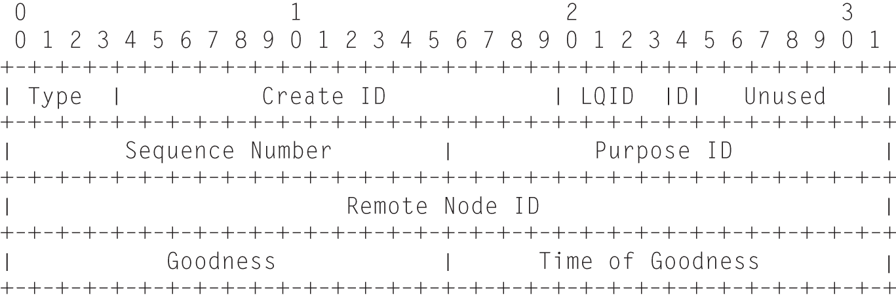

**Figure 8.3****:** 量子链路层 Type K OK 消息的结构和构成

链路层负责使量子纠缠和交换变得简单可靠。网络层确保传输的纠缠量子位在整个网络中从源可靠地传输到目的地。传输层处理跨网络传输的量子位，与纠缠或网络层分离，并将结果交给应用层。所提出的量子网络栈的下层看起来像 Figure 8.4。

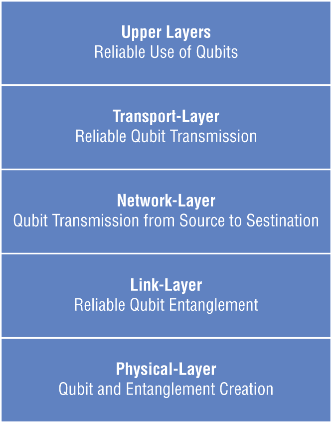

**Figure 8.4****:** 所提出的量子网络栈下层表示

模型的 upper 层本质上是应用层，如果下层完成了工作，上层就不必担心量子位传输的可靠性。它们是需要的，它们会出现。目标设备和应用程序只需获取它们即可。Easy-peasy。

当然，量子网络栈目前还完全处于理论和个别实验阶段。但已经有使用所提议协议消息在不同类型量子设备之间交换信息的演示网络通信。总体而言，很多人已经在努力使量子网络通信，包括纠缠和交换，变得常规和可靠这一想法应该让每个人都感到安心。它不仅表明量子信息科学总体上正在成熟，而且随着技术的允许，它将变得可靠。

有关量子网络协议的更多信息请参阅：`https://arxiv.org/pdf/1903.09778.pdf%3E`、`https://arxiv.org/pdf/1904.08605.pdf` 和 `https://tools.ietf.org/pdf/draft-van-meter-qirg-quantum-connection-setup-00.pdf`。

#### Entanglement Purification

目前，量子纠缠和交换并不是一件容易实现的事情。你首先要面对量子本身的概率性，然后再尝试创建纠缠对，这些纠缠对随后可通过 QKD、可信中继器或量子中继器在网络上传输。沿途几乎所有东西（即外部环境）都在试图破坏量子信息的有用传输。沿途发生的任何错误如果在物理层或链路层未被捕获，将会沿着其余网络和网络栈传播。减少错误的一种方法是使用链路层，它处理来自物理层的错误检测并使用重传来帮助在整个网络链中创建可靠的量子纠缠和交换。

另一种方法是创建多个、相同的量子纠缠对作为起点，其想法是通过创建更多对，至少有一对更有可能到达目的地。例如，假设源节点创建了 20 个相同的纠缠对，每个都代表相同的量子位信息。假设 20 个原始对中有 10 个到达了目的地，但其中 3 个“相同”对是不同的。大多数逻辑观察者会说，由 7 个相同对表示的量子位值更有可能正确地表示原始量子位属性，而与少数派的 3 对相比。利用多个相同的量子位纠缠对来创建更准确的网络传输的过程被称为 `entanglement purification`。长期目标是将所需的重复副本数量“减少”为更少但 `fidelity` 更高（即更准确）的副本。许多科学家正在研究纠缠纯化和保真度，就像量子科学家试图使用量子纠错来减少量子计算量子位错误一样——其最终目标是增加量子网络的长度和可靠性。

### Quantum Network Applications

那么我们为什么需要量子网络？应用是什么？

> **NOTE**  本节侧重于量子网络带来的优势，而非单个量子计算机及其运行的应用（已在 Chapter 5 中介绍）。

#### More Secure Networks

首先，量子网络由于不易被窃听，具有经典网络永远无法拥有的内置、固有保护。这并不是说量子网络不能被窃听（没有什么是不可黑的），而是说默认情况下它们比经典网络更难窃听。毫无疑问，人类在实施量子网络时会出错并留下大量漏洞，黑客会找到并利用这些漏洞。但当这些漏洞被堵上后，量子网络的默认状态将更难被黑，这是一个巨大的优势。

> **NOTE**  全世界的所有政府和执法机构都在对抗任何可能使（合法）收集不当行为证据变得更困难的默认加密通道。在世界大部分地区，网络提供商 *必须* 为执法部门提供在提供商控制下的任何网络通信流进行窃听的方法。当底层技术默认阻止窃听时，这些窃听要求将如何处理将很有趣。有可能网络提供商或执法机构无法技术上监视某人，除非在网络的某个点上消除量子特性，否则他们也无能为力。这将是社会在量子安全与合法执法需求之间取得平衡的有趣时代和挑战。

#### Quantum Computing Cloud

量子计算承诺解决我们千百年来寻求解决的问题和难题。它将使我们能够更好地理解宇宙的本质，预测未来，并创造我们目前无法想象的产品和服务。现在想象一下，如果尽可能多地收集量子计算机并让它们同时处理同一问题，会有多好。这就像拥有许多“阿尔伯特·爱因斯坦”一起工作，而不是只有一个。量子计算云是一组联网的量子超级计算机，协同工作以更快地解决更多问题。量子计算云关乎更快的协作。

#### Better Time Syncing

有很多应用需要非常精确的时间。我们已经拥有非常、非常精确的时间钟。它们被称为“原子钟”，而且它们已经精确到每十亿年损失不到一秒（`https://en.wikipedia.org/wiki/Atomic_clock`）。剩下的挑战之一是如何将最精确的时间传递给非常遥远的依赖设备，或者确保特定服务或网络中的每个依赖设备都有完全相同的时间。传输时间本身也需要时间。

量子网络并不能提供更快的传输时间（请记住，经典事物已经以接近光速运行，而量子力学不太可能超越光速，除非我们的基本理解发生变化）。但量子网络可以做的是提供依赖设备之间更好的时间同步。因为量子设备和网络在进行时间误差校正/同步时可以考虑更多的同步因素，因此在任何大型网络中，同步时间漂移会更小。

例如，我们的全球定位系统（`GPS`）使用一系列轨道卫星，`GPS`接收机可以利用这些卫星来确定其地理位置。为了正确确定`GPS`接收机的位置，`GPS`卫星和接收机必须具有同步的时间。所有设备的时间保持越准确，并且与所有相关方同步得越准确，`GPS`接收机就能越准确地检测其位置。

`GPS`卫星搭载了原子钟，尽管它们非常准确，但如果没有时间同步，它们每 24 小时可能会损失多达 10 纳秒（`https://www.insidescience.org/news/quantum-way-synchronize-atomic-clocks`），而一纳秒相当于约一英尺的距离差异。正因如此，`GPS`时钟的时间会被更新，以确保它一年内不会损失哪怕一纳秒。`GPS`时间同步服务不断成熟和更新，以保持卫星尽可能准确。早在 2000 年，`GPS`接收机的精度只能达到 5 米/16 英尺。今天，由于`GPS`技术的改进，包括时间同步，`GPS`接收机可以将位置追踪到 30 厘米/11.5 英寸以内。量子时间同步只会使`GPS`系统更加精确。

尽管所有原子钟最终都基于量子力学，但`GPS`卫星使用的同步网络是经典的。这意味着真正工作的微小量子特性必须退相干到我们的经典世界中，然后以经典方式传输。但量子时间同步跳过了转换步骤，保持量子状态，并允许时间同步更加精确。

这意味着未来的`GPS`读数可能能够以毫米而不是厘米为单位进行测量，或者至少只有几厘米而不是 30 厘米。总的来说，这意味着所有依赖`GPS`的东西都可以更频繁、更准确地知道自己的位置。这不仅意味着你在开车时不会错过左转，而且量子系统将能够更准确地跟踪我们将在一两年内拥有的数亿辆自动驾驶汽车。这意味着在高楼林立的城市中行走的人将能够更准确地确定他们站在哪扇门前应该进入。工程师将能够更准确地进行测量，等等。基于量子的时间同步将使每个依赖的时间服务都更加准确和成功。

> **NOTE**  有趣的是，多年来，量子钟被认为是最精确的原子钟，但光晶格钟现在已在精度记录上取代了它们。但即使基于光晶格钟的计时设备也可以从量子时间同步中受益。

### 防止干扰

早在 1940 年代之前，奥地利/美国女演员海蒂·拉玛和她的共同发明者乔治·安泰尔发明了一种防止无线鱼雷被军事干扰的新方法（他们发明了`frequency hopping spread spectrum`作为抗干扰防御），世界各地的军队就一直在尝试干扰敌人的无线信号，并使自己的通信方式更不易受干扰。一般来说，抗干扰防御将控制指令纳入一系列调制频率/信号变化中，敌人无法弄清楚如何模拟或阻断。

干扰器会尽力弄清楚信号是如何被传输到受控设备的。如果他们能弄清楚所有快速的频率变化，他们就可以重建控制指令，了解它们是什么，甚至可能重新编程设备以使用他们自己的。在战争中，对手可能能够将敌人的导弹或鱼雷送回发送者。这不是推测。在第二次世界大战中，这时常发生。

干扰器甚至不需要弄清楚敌人的控制信号是如何工作的。他们只需要阻断所有可能涉及的频率，就能防止无线设备接收新的或更新的指令。在大多数情况下，被干扰的设备，例如导弹或飞行无人机，会进入某种默认模式，例如继续沿最后航向飞行或飞回基地。今天的军事系统充满了干扰和抗干扰技术。

武器开发者不断努力使武器更抗干扰，而干扰器则不断想出新的干扰其控制系统的方法。这有点类似于密码攻击者试图破解秘密代码，而密码学家则试图改进其密码以防止成功攻击。

量子网络由于具有叠加、纠缠和不可克隆等固有特性，非常适合创建防干扰信号。使用量子网络的量子启用设备更有可能能够创建更复杂、抗干扰的控制信号并忽略敌人的背景干扰信号。因此，即使敌人在一遍又一遍的干扰尝试中，在数千个可能的频率上发送数百万个错误的频率变化，基于量子的设备也更有可能能够分辨出哪些命令是合法的，哪些只是作为背景噪声忽略。

防止干扰不仅仅用于军事用途。它还能防止攻击者干扰手机通话和 Wi-Fi 网络流量，甚至可以阻止攻击者试图向自动驾驶汽车发送错误指令。防止干扰使我们的生活更轻松，而量子网络可以帮助做到这一点。

### 量子互联网

量子网络的圣杯是现有经典互联网的一对一替代品。就像经典互联网一样，纯量子互联网也可能最初以各种独立网络的形式出现，从资金充足的军事、政府和大学网络开始，然后扩展到帮助连接其他所有人。数百万台连接互联网的量子设备最终将形成一个巨大的全球计算云。它更难被攻破，更难被干扰，并将允许我们的世界共同享受我们注定会看到的所有量子改进，就像今天的互联网已经用经典网络为我们所做的那样。

> **NOTE**  一个名为`SimulQron`（`http://www.simulaqron.org/`）的程序是帮助开发量子互联网软件的模拟器（`https://arxiv.org/pdf/1712.08032.pdf`）。

多个团队和联盟正在致力于量子互联网，其中包括欧盟的量子互联网联盟（`https://twitter.com/eu_qia`）项目。量子互联网联盟正在荷兰启动一个四城示范项目，涵盖阿姆斯特丹、莱顿、海牙和代尔夫特等城市。它包含了创建大型量子宽域网络所需的所有组件，预计将于 2020 年投入运行。随后他们希望将项目扩展到整个欧盟。

### 其他量子网络

目前，所有现有的量子网络都相当有限且具有实验性，即使每天都在取得更多进展。2018 年，基于光纤的量子密钥分发在 421 公里/261 英里处成功演示。大多数可供商业销售的现有 QKD 系统的最大传输距离为 100 公里/62 英里，因此该实验网络超过了四倍。预计量子 QKD 系统将不断扩展其传输距离。

中国尤其专注于量子信息科学的网络方面。2016 年，中国发射了墨子（`https://www.bbc.com/news/world-asia-china-37091833`），即首颗基于量子的通信卫星。当卫星飞越上空时，它使用 QKD 将单个密钥安全地发送到北京和维也纳的地面站，两地相距 7,500 公里/4,700 英里。然后它创建了一个第三密钥供各方共享。它用每个地面站先前传输的单个密钥对第三密钥进行加密。每个地面站都可以解密共享的第三密钥，并开始相互加密消息。这是具有里程碑意义的时刻。

墨子只能在视线范围内运行，且不能在阳光下运行；尽管如此，它仍成功演示了一次 75 分钟的视频会议通话，这对于第一代、首创的量子卫星来说已是相当充分的演示。你可以在这里阅读更多关于墨子的信息：`https://www.wired.com/story/why-this-intercontinental-quantum-encrypted-video-hangout-is-a-big-deal/`、`https://cosmosmagazine.com/technology/the-quantum-internet-is-already-being-built` 和 `https://en.wikipedia.org/wiki/Quantum_Experiments_at_Space:Scale`。中国还在上海和北京之间建设一条 2,000 公里/1,200 英里的基于量子的通信骨干网。它连接 4 个城市，拥有 32 个节点。

> **NOTE**  一些量子信息科学家对中国的量子网络声明持怀疑态度，或怀疑其并非 100%基于量子。

日本已演示了使用量子中继器的量子网络（`https://qiqb.otri.osaka-u.ac.jp/wp-content/uploads/2019/01/AllPhotonicQR-QIQBen.pdf`）。它使用光学器件作为量子中继器（称为*光子学*），这使其能够在无需经典组件且不使用量子存储器的情况下发送量子信息。

一个美国团队正在构建一条长 48 公里/30 英里的量子网络，使用量子纠缠和量子隐形传态（`https://spectrum.ieee.org/tech-talk/telecom/security/us-national-labs-join-forces-on-a-quantum-network`）。大多数其他长距离量子网络使用 QKD，但该由美国国家实验室资助的项目，由芝加哥附近牵头，将是首批使用隐形传态的项目之一。美国能源部提供了数百万美元。国家实验室（阿贡国家实验室和费米国家加速器实验室）与芝加哥大学共同组建了一个正式实体，即芝加哥量子交易所（`https://quantum.uchicago.edu/`）。它涉及超过 100 名量子信息科学研究人员。

基于量子的网络已在实验阶段投入运行，并在未来几年内将有多个现实世界项目和设备上线。

### 更多信息

Quantum Network, Rodney Van Meter, Wiley, 2017, `https://www.worldcat.org/title/quantum-networking/oclc/879947342`

The Quantum Internet Is Emerging, One Experiment at a Time, Anil Ananthaswamy, Scientific American magazine, June 19, 2019, `https://www.scientificamerican.com/article/the-quantum-internet-is-emerging-one-experiment-at-a-time/`

The Quantum Internet, H. J. Kimble, June 25, 2008, white paper, `https://arxiv.org/pdf/0806.4195.pdf`

A Poisson Model for Entanglement Optimization in the Quantum Internet, Laszlo Gyongyosi and Sandor Imre, Quantum Information Processing, June 5, 2019, `https://link.springer.com/content/pdf/10.1007%2Fs11128-019-2335-1.pdf`

The quantum internet has arrived (and it hasn't), Davide Castelvecchi, Nature Magazine, February 14, 2019, `https://www.nature.com/articles/d41586-018-01835-3`

Internet Research Task Force (IRTF) research group on quantum Internet called QIRG. Qirg mailing list submissions to `qirg@irtf.org`, To subscribe or unsubscribe via the World Wide Web, visit `https://www.irtf.org/mailman/listinfo/qirg`.

### 摘要

量子网络将像量子信息科学的其他部分一样发展和成熟，随着底层技术的进步而时断时续。量子网络将首先使用更多经典组件（如可信中继器）并使用 QKD 交换安全密钥，然后转向使用真正的量子中继器、量子纠缠、隐形传态和量子交换的完整基于量子的网络栈。有限的、实验性的网络很快将被真实的、运行的量子网络所取代。最终，我们的大部分，如果不是全部，经典互联网都将被量子网络所取代，原因多种多样，其中最不重要的就是量子力学提供的更强固有安全性。

所有前几章都涵盖了量子力学、计算、密码学，以及量子计算机为何可能很快破坏当今的公钥密码学。Part II 首先介绍了抗量子和基于量子的密码学。本章介绍了量子网络组件、挑战和可能的应用。Chapter 9 将介绍所有利益相关者应如何为即将到来的量子破解和革命做好准备。

# 9 现在开始准备

即将到来的量子密码学破解将会发生；只是时间问题。当它发生时，它将使世界大部分传统公钥密码学失效，并使其他现有密码学的强度至少减弱 50%。而且这是在最佳情况下的情景，不包括任何其他可能使求解对称密码和哈希变得更简单的量子进步。

在前几章中，我们讨论了量子力学、量子计算机、网络以及即将到来的变化，包括可能的密码学破解。本章讨论你和你的组织如何在破解发生之前就开始今天的准备。本章可能是你们许多人购买这本书的原因。首先，我们将介绍任何后量子缓解项目的四个主要阶段，然后我们将重点介绍项目步骤。

### 四个主要后量子缓解阶段

大多数组织的后量子缓解项目将包括以下四个主要阶段：

* Stage 1: Strengthen current solutions.
* Stage 2: Move to quantum-resistant solutions.
* Stage 3: Implement quantum-hybrid solutions.
* Stage 4: Implement fully quantum solutions.

Figure 9.1 以图形方式展示了每个阶段。每个项目阶段将在以下章节中更详细地讨论。

#### Stage 1: Strengthen Current Solutions

每个组织都应尽快更新任何抗量子性较弱的密码学，并在可行时使用现有的抗量子密码学和密钥大小。利用 Grover 算法的量子计算会使现有对称密码和哈希的保护能力减半，因此将它们的密钥和哈希输出大小加倍，尤其是在容易实现的情况下，是有意义的。例如，使用 `AES-128` 的任何系统都应迁移到 `AES-256` 或更大。如果您有需要在 10 年内得到保护的关键数据，即使它使用的是 `AES-256`，也许您也应将其迁移到 `AES-512`，以此类推。

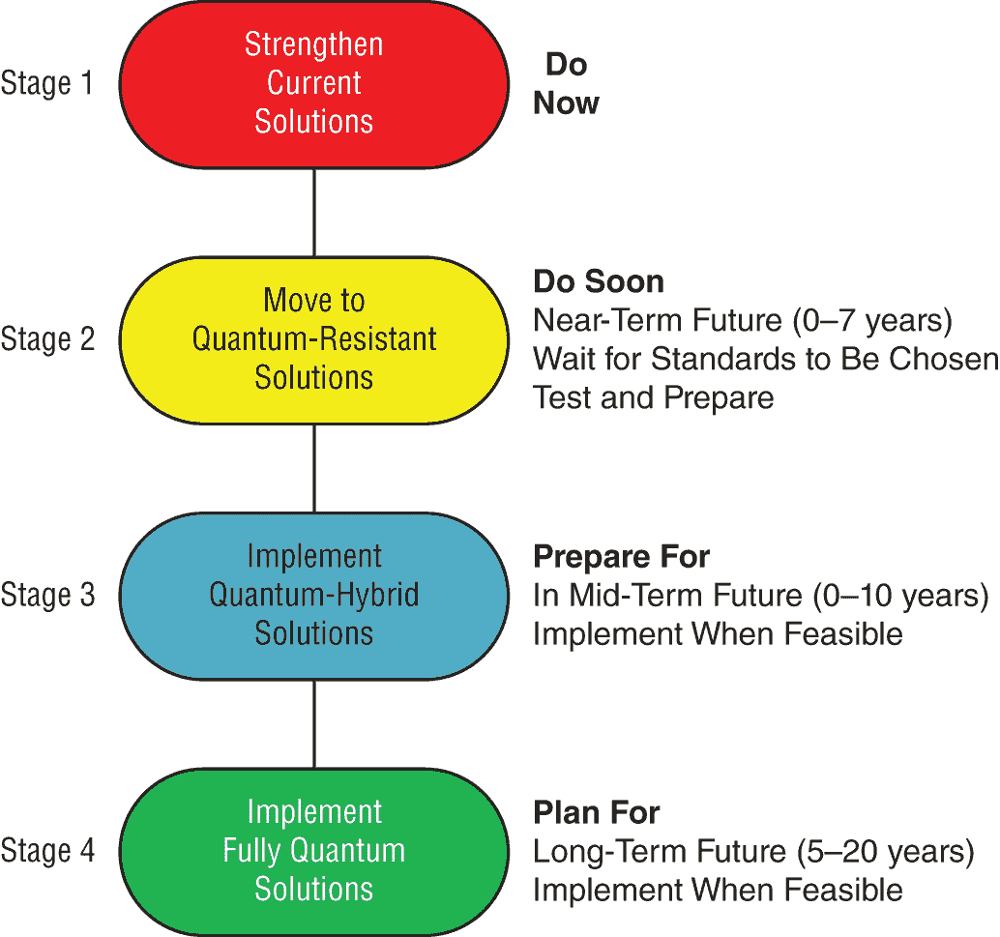

**图 9.1****:** 四个主要后量子缓解项目阶段

非对称密码的密钥大小应更新至至少 4,096 位。大多数公钥密码为 2,048 位，仍有大量 1,024 位的密码在使用。随着量子计算机获得更多量子比特和能力，它们将首先破解较小的密钥大小。通过将现有密码学的密钥大小提升到更大，您可以降低风险，尽管这远不如立即过渡到真正的抗量子密码学那样有效。更改组织的政策以规定最低可接受的密钥大小。

话虽如此，并非总能为现有密码学使用更大的密钥大小。许多应用程序是硬编码的，许多其他应用程序只能接受特定密钥大小（而非标准中公布的所有密钥大小）。例如，`SHA2` 有 224、256、384 和 512 位大小。多年以来，Microsoft Windows 可以完美使用 `SHA2-256`（默认的 SHA2 密钥大小），但如果您改用 `SHA2-512`，则在 TLS 保护的网站上会出现操作问题（此“错误”已在多年前修复）。Windows 在使用其内置软件时，默认仍不提供 `SHA2-224`（即使它是官方标准的一部分）。许多应用程序只接受一种密钥大小或最多两种。有些应用程序虽然接受更大的密钥大小，但会出现意外的操作问题。因此，增加密钥大小始终应在彻底测试后进行，以确保不会导致操作问题。

您还必须意识到，将密钥大小提升到最大可能导致性能问题。您为密码密钥添加的每个比特都会增加使用密码学所需的计算量。在许多情况下，例如从 `RSA 2,048-bit` 迁移到 `4,096-bit`，性能损失虽然存在，但对大多数用户和大多数场景来说几乎察觉不到。但在一些高交易场景中，例如热门网站或高交易数据库，变化可能会变得明显，并在流量增加时产生不利影响。

在某些场景中，即使对于单个用户和低流量而言，性能损失也可能无法接受。例如，多年前，我的一位客户出于尽可能安全的愿望，将其公钥基础设施（`PKI`）证书颁发机构服务器的数字证书从 2,048 位迁移到 16,384 位。比特数的增加如此之大，以至于他的大多数计算机打开任何加密消息都需要超过一分钟的时间，这最终会连锁到 16 KB 的根证书颁发机构数字证书。相比之下，使用 2,048 位密钥打开同一条消息只需 1–1.5 秒。更大的数字证书是安全的，但可能过于安全，并且对于所使用的硬件和应用程序来说肯定太慢了——尤其是使用 4,096 位密钥既足够安全又足够快。

#### 是否应增加非对称密钥大小？

一些读者可能会想知道，将非对称密钥大小升级以跟上量子计算机能力预期持续增长是否有实际意义。答案不是简单的肯定或否定，尽管将非对称密钥大小至少增加到 4,096 位不会有什么坏处，特别是如果您可以在旧密钥过期时自然且轻松地完成此操作。

但就增加非对称密钥大小以对抗即将到来的量子密码破解而言，存在正反两方面的合理论据。例如，使用 Shor 算法，量子计算机至少需要 (2 × *n*) + 3 个稳定量子比特，其中 *n* 是要破解的密钥位数。因此，要破解 2,048 位 RSA 密钥，量子计算机需要 4,099 个稳定量子比特，而要破解 4,096 位 RSA 密钥，则需要 8,195 个稳定量子比特。因此，如果您将非对称密码从 2,048 位提升到 4,096 位，该策略将保护您直到量子计算机至少达到 8,195 个稳定量子比特（假设使用更少的量子比特不会让较弱的量子计算机相对快速地达到目标）。

目前，我们不知道量子计算机达到 4,099 个稳定量子比特还需要多久，以及一旦达到后，达到 8,195 个需要多久。但这可能不会像我们达到前 100 个量子比特，或从 100 到 4,099 所花费的时间那么长。一旦社会学会大规模扩展量子比特，增长应该会相当快。

要增加考虑因素和复杂性，如果某些纠错估计是可信的，每个稳定量子比特目前需要数百到超过一百万个纠错量子比特，因此我们可能正在谈论破解 2,048 位密钥与 4,096 位密钥所需的数十亿个量子比特差异。如果纠错估计是正确的，则所需的辅助量子比特数量可能会提供更长的保护期，并且值得进行迁移。

与此同时，许多新型量子因数分解算法的开发者声称，他们可以用比 Shor 所需少得多的量子比特来分解质数方程。如果单个量子比特变得更稳定，或者需要的纠错量子比特远少于高阶估计所计算的数量，那么论点就会朝另一个方向发展。

我分享这些论点并不是为了让您困惑，而是想说，增加非对称密钥的位数并不像增加对称密钥和哈希大小那样简单直接。但总的来说，如果您想在能够迁移到抗量子密码学之前降低传统易受量子攻击的非对称密码学的风险，增加非对称密钥大小不会有什么坏处，特别是如果这样做很容易。

#### 密码敏捷性

`Crypto-agility` 是设备、软件或系统能够在不造成不当负担的情况下更换其密码学、另一种密码、方案或密钥大小的能力。最终，所有相关系统都应设计成可以尽可能轻松地更换所涉及的密码学。不幸的是，这必须由这些系统的开发者来完成。对于客户和最终用户来说，如果开发者没有先创建允许这样做的底层结构，就很难实现。

一些受欢迎的开发者已经为您完成了这项工作。例如，Microsoft Windows 和大多数 Microsoft 产品将密码学与使用它的软件和硬件系统分开。Microsoft 通过建议将密码学密码和方案表示为离散的、独立的密钥存储提供程序（`KSP`）模块来实现这一点（在早期 Windows 版本中它们曾被称为密码服务提供程序 [`CSPs`]），这些模块可以与使用它们的应用程序分开安装和卸载。

Windows 附带了许多内置的 `KSPs`，其中包含所有流行的密码和方案标准。第三方和客户可以创建自己的 `KSP`，并且交换一个 `KSP` 与另一个 `KSP` 与安装新 `KSP` 一样简单（通常安装速度相当快且体积小），并从 `KSP` 下拉菜单中选择它。Microsoft 的旗舰证书颁发机构产品 Active Directory Certificate Services 允许安装不同的 `KSPs` 以支持不同类型的密码学。

在开源的 Linux 世界中，许多最受欢迎的应用程序和实用工具，例如 OpenSSL 和 SSH，允许不同类型的密码学相互替换。量子抗性 Picnic 签名方案团队的一部分成员使用 Picnic、LWE-FRODO 和 SIDH 与 OpenSSL 和 Apache Web Server 结合，创建了有效的 TLS 1.2 HTTPS 连接（参见 Picnic 设计文档的第 8.2 节：`https://github.com/Microsoft/Picnic/blob/master/spec/design-v1.0.pdf`）。OpenSSL 和 Apache 不需要进行重大修改，尽管 OpenSSL 确实需要进行小的修改以允许 TLS 使用 Picnic 生成的更大密钥大小。

将这种轻松的通用性（即密码敏捷性）与大多数应用程序的硬编码密码学进行比较，后者如果不更新程序中的密码编码、重新编译并重新安装整个程序，就无法被替换。

努力让你的所有供应商（以及你自己开发的软件）都具备密码敏捷性。这样，当下一次强制性的密码迁移事件发生时，转换将更容易。现在就开始你量子密码迁移项目的这一阶段。让密码敏捷性成为 IT 团队每个人都知道、理解并要求的词汇。

#### Stage 2: Move to Quantum-Resistant Solutions

如前所述，大多数组织在国家标准机构（如美国国家标准与技术研究所 \[NIST\] 或欧盟网络和信息安全局）宣布官方后量子密码标准之前，都无法转向新的量子抗性密码学。但对于许多组织，尤其是那些拥有开发人员和自身使用密码学的内部应用程序的组织来说，开始实验是有意义的。

许多量子编码库、API、模拟器和软件开发工具包（SDK）可用于协助组织转向量子抗性密码学。许多组织拥有软件、工具、资源和专业人员，可以帮助你进行量子抗性密码学转型。他们可能拥有你组织开始量子密码迁移所需的一切，包括经验丰富的量子开发人员和测试人员。查看以下内容：

* Open Quantum Safe Project (`https://openquantumsafe.org/`)

* Open Source Quantum Software Projects on GitHub (`https://github.com/qosf/os_quantum_software`)

* Open source and commercial quantum software projects and online quantum portals (`https://github.com/qosf/os_quantum_software`)

当然，量子供应商如 Microsoft、IBM 和 Cambridge Quantum Computing 也有许多资源和工具。与你现有的供应商合作。即使你只做一个小规模的演示项目，这也能让你领先于竞争对手。如果量子密码破解比你的计划估计更早发生，投入到任何测试项目中的时间和资源将物有所值。测试项目是为了让大巴和大巴上的人朝着正确的方向前进。

当国家机构批准官方量子抗性标准时，你应尽快开始转向量子抗性密码学。与更新传统密码学的密钥大小一样，相同的运营和性能注意事项也适用（性能和运营问题），但任何选定的标准很可能都是性能和可用性的良好组合。通常在标准获批时，已经有大量现实世界的资源和软件库等待帮助开发人员和实施者。一旦标准公布，整个国家（或世界）都将开始朝同一方向前进。确保你参与其中。你不需要站在最前沿，但接近前沿是很好的位置。

从国家量子抗性标准选定之日起，你的迁移项目的这一阶段可能至少会持续两年。NIST 称美国国家标准将在 2022 年至 2024 年之间选定，这意味着大多数美国项目的这一阶段可能需要 3–7 年才能完成。当然，如果有人突然宣布量子密码破解比当前时间预期更早，这一项目阶段可能会提前。

> **NOTE**  完成第 2 阶段，转向量子抗性解决方案，将导致风险大幅下降，至少在出现另一项技术突破削弱量子抗性密码学提供的强度之前如此。接下来的两个阶段将继续降低风险，但降幅可能不会那么剧烈。完成第 2 阶段很可能将成为最重要的项目里程碑。

##### Securing PKI

PKI 使互联网和大多数企业得以运行。即将到来的量子密码破解专门破坏了所有现有的 PKI，因为它们运行在易受量子攻击的密码学上（Rivest–Shamir–Adleman、Diffie–Hellman、Digital Signature Algorithm、Elliptic Curve Digital Signature Algorithm 等）。如前所述，Microsoft 和其他研究人员已经初步证明，至少一些现有的 PKI、数字签名和硬件安全模块（HSM）可以在量子抗性密码上运行，并且经过少量调整后，这些数字证书就可以在互联网上通过 TLS 使用。还有许多其他 PKI 软件程序和供应商，但在它们转向量子抗性密码时，大多数很可能会被移植以实现这一目标。

NIST Round 2 数字签名方案候选者 中涵盖的任何候选者（CRYSTALS-Dilithium、FALCON、GeMSS、LUOV、MQDSS、Picnic、qTESLA、Rainbow 和 SPHINCS+）都在被重点考虑用于后量子数字签名 PKI 替代方案。你可以在这里找到一份关于 PKI 密码敏捷性的良好白皮书：`www.isara.com/wp-content/uploads/2018/05/ISARA_Corp_PKI_Migration_WhitePaper_FINAL.pdf`。

Leighton-Micali Signatures（LMS）和 XMSS（eXtended Merkle Signature Scheme）变体也在讨论中，但由于它们是有状态的，因此被取消了官方 NIST 候选资格。据称它们仍在 NIST 的一个子项目中被考虑。XMSS 的多树变体被称为 XMSS-MT 或 XMSS-MTS（Merkle Tree Signature），LMS 的多树变体被称为 HSS。两者都已提交给互联网工程任务组（IETF）作为征求意见稿（RFCs），这是批准流程的最后一步。如果你感兴趣，可以在 `https://eprint.iacr.org/2017/349.pdf` 阅读更多关于 XMSS 和 LMS 的内容。了解 XMSS 和 LMS 进展的良好地点是 `https://www.isara.com/standards/`，你可以在这里找到一份关于 XMSS 的良好白皮书：`https://tools.ietf.org/html/draft-irtf-cfrg-xmss-hash-based-signatures-11`。

请密切关注 CA/Browser Forum（`https://cabforum.org/`）的公告，特别是他们所知的 PKI 标准 Baseline Requirements（`https://cabforum.org/baseline-requirements/`）。该组织由一些最大的 PKI 供应商和实施者组成。他们通常要求的往往控制着所有“公共”CA 供应商遵循的内容，并间接控制着大多数私营公司最终遵循的内容。他们控制着公共 CA 使用的密码学和最佳实践，以及与 PKI 运营相关的多数因素。他们是成功迫使大多数 CA 从 SHA1 迁移到 SHA2 的组织；这一举措得到了响应，并以深思熟虑、成功的方式引领了其他密码学迁移。

CA/Browser Forum 关于即将到来的量子变化的讨论和意识于 2019 年 3 月进行（`https://cabforum.org/2019/05/03/minutes-for-ca-browser-forum-f2f-meeting-46-cupertino-12-14-march-2019/#Quantum-Cryptography-problem-need-solutions-and-timeframe---assign-ForumSCWG-liaisons`）。如果你拥有 PKI，请关注 CA/Browser Forum 的更新和要求。

有关后量子时代 PKI 和 X.509 数字证书的更多信息，请查看 `https://eprint.iacr.org/2018/063.pdf` 和 `https://eprint.iacr.org/2017/349.pdf`。

#### Get Other Quantum Devices and Services

这也是开始考虑获取基于量子（可认证）的随机数生成器（RNG）和量子密钥分发设备的时候（见第 7 章所述）。这两种设备相对便宜，已使用近二十年，可以在有或没有其他量子密码学或设备参与的情况下改善你的密码学。

> **NOTE**  基于量子的随机数生成器已经存在很长时间了，但“可认证”的 RNG 直到 2019 年才开始出现。以下是首个可商用的版本：`https://cambridgequantum.com/cqc-unveils-the-worlds-first-commercially-ready-certifiable-quantum-cryptographic-device/`。

现在是信息技术安全部门决定何时需要获取这类系统的时候，但它们将在你实施抗量子密码学时变得必需。如果你不需要或不想拥有这类系统，至少利用其服务也是有意义的。随着量子计算机开始获得访问权限，考虑购买量子计算机或购买基于量子的服务。不要在世界开始走向量子时仍被困在纯粹的二进制世界中。

#### Stage 3: Implement Quantum-Hybrid Solutions

大多数早期的量子相关网络和系统将使用量子和经典、二进制计算设备的组合来执行其工作。例如，量子密钥分发（QKD）设备通常通过经典的二进制网络通道传输量子派生的密钥。大多数基于量子的 RNG 生成极其随机的数字，然后在经典的基于二进制的系统中使用。受信任中继器通过经典网络安全地共享基于量子的密码密钥。所有现有的抗量子密码在二进制世界中运行并使用经典的基于二进制的哈希。等等。你将使用的许多早期量子相关系统和设备将是量子和经典特性的混合体。这是可以预期的，尤其是在我们长期内能够完全转向基于量子的网络和设备之前。

一个重要点是弄清楚何时从经典二进制世界转向量子混合模型在安全和财务上是有意义的。转向量子混合模型在可用时并不总是具有成本效益。转向基于量子解决方案的全部原因是为了获得来自量子力学的内置保护。当它与经典世界混合时，如在混合模型中那样，则最大安全保护就是最容易被黑的技术，即经典。经典依赖可能在很大程度上抵消转向量子混合模型的安保原因，而且通常成本更高。

在某些时候，纯粹的经典解决方案将为所需的时间段提供所有必要的安全性。每个项目团队需要自行决定何时移动以及移动到何种技术。预计转向量子混合系统所需的时间比转向全抗量子密码学更长，可能从项目开始算起长达 10 年。

#### Stage 4: Implement Fully Quantum Solutions

最后，终极目标是在许多年后（希望如此）完全在密码学和网络设备上实现量子化。或者你的组织的安全需求可能需要尽快使用完全基于量子的系统。量子力学使使用量子密码学和力学的任何事物本质上更安全。抗量子密码学将消除量子密码攻击带来的大部分风险，但基于量子的密码学和设备是终极保护。

例如，关于你的网络设备，从今天开始确保所有网络设备都使用现有传统密码学的抗量子密钥长度。在国家标准获批后将其迁移到真正的抗量子密码学。然后迁移到经典/量子解决方案，如受信任中继器，然后迁移到完全量子解决方案，如量子中继器。对所有数据保护系统也执行此操作。第 4 阶段可能从你的后量子迁移项目开始算起持续长达 20 年。

这四个阶段不必按顺序进行。很可能在不同时间涉及不同系统时会存在多个并行轨道。例如，你可能希望在可预见的未来对许多系统保持在第 1 阶段，使用现有密码学标准的大规模实施，同时对其他系统探索其他阶段。你可能决定为某些项目购买量子 RNG 并在混合解决方案中使用。你可能仍在将一批项目过渡到抗量子密码时，某个供应商以合理成本推出完全基于量子的解决方案。除了第一阶段外，这些阶段在某些情况下可能按顺序进行，在其他情况下并行进行，具体取决于情况。这是可以预期的。

### The Six Major Post-Quantum Mitigation Project Steps

随着即将到来的量子密码学突破，每个希望保护数字机密的组织都需要有一个计划。本书的这一节描述了该计划。主要总体项目阶段如下：

1. Educate.
2. Create a plan.
3. Collect data.
4. Analyze.
5. Take action/remediate.
6. Review and improve as needed.

Figure 9.2 总结了整体后量子迁移项目生命周期阶段。

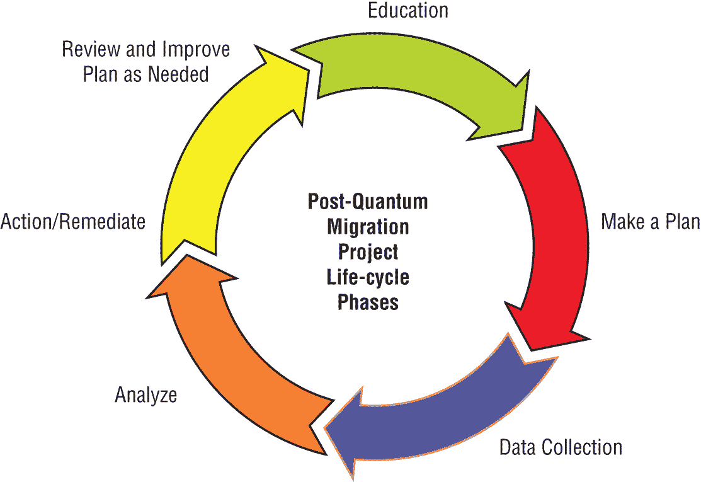

**Figure 9.2****:** Post-quantum migration project life-cycle phases

> **NOTE**  本章介绍的计划已被测试并多次使用，尽管针对的是不同类型的密码学迁移。我曾帮助数十家，如果不是上百家公司在 2014 年至 2017 年期间执行 SHA1 到 SHA2 迁移。尽管目标不同，但计划和步骤非常相似。

本章的其余部分专门讨论计划中每一步的详细情况。

#### Step 1: Educate

由于你正在阅读本书，你已经在计划的第一步了。你需要教育自己、你的团队、管理层以及每个其他终端用户关于即将到来的量子密码学突破以及你的组织计划如何应对。你特别希望教育开发人员和利益相关者，他们参与软件和硬件的决策和采购。

对你自己而言，使用本书和它推荐的所有额外参考资料继续你的量子计算教育之旅。你面临的一个关键挑战是跟上量子计算进展的最新变化以及它们将如何影响你的量子计算准备计划。只需在一般媒体新闻文章中看到 *quantum* 这个词时多加注意就能帮助你，但订阅特定的量子计算邮件列表和博客也是保持最新动态的绝佳方式。

##### Quantum Computing Mailing Lists and Blog Sites

以下是一些你可以加入或关注的量子计算邮件列表和博客：

* `https://quantiki.org`
* `www.scottaaronson.com/blog/`
* `www.quantiki.org/wiki/mailing-lists`
* `https://golem.ph.utexas.edu/category/2010/12/quantum_foundations_mailing_li.html`
* `https://accounts.eclipse.org/mailing-list/quantum-computing-wg`
* `https://hepsoftwarefoundation.org/workinggroups/quantumcomputing.html`
* `https://dabacon.org/pontiff/`
* `https://quantumcomputingreport.com/news/`
* `https://quantumcomputing.stackexchange.com` (great for technical questions)
* `https://geekforge.io`

跟随我的文章（`www.csoonline.com/author/Roger-A.-Grimes/`）、Twitter（`@rogeragrimes`）或 LinkedIn（`www.linkedin.com/in/rogeragrimes/`）的帖子不会有坏处，尽管它们涉及广泛的计算机安全主题，而不仅仅是量子。

本章之后的附录将列出更多资源。如果我遗漏了您最喜欢的量子邮件列表、博客或网站，我深表歉意。

尽力理解量子力学和量子计算。鉴于您可能被期望成为量子密码破解准备工作的倡导者，您可能需要相当好地理解量子。希望本书能为您提供关于量子和量子计算的良好综述性理解，但我理解如果您想阅读更多资源的话。撰写本文的作者花了二十多年的经验和阅读数百篇关于量子力学和计算机的截然不同的文章，才理解到今天的程度。

以下是一些关于量子理论和量子计算的在线课程：`https://quantumcomputingreport.com/resources/education/`，以及另一个类似的网站：`https://hackernoon.com/16-best-resources-to-learn-quantum-computing-in-2019-e5d8b797aeb6`。

### 幻灯片演示

所有 IT 成员都应熟悉基本的技术问题和挑战。如果即将到来的变化会影响他们的生活（例如软件更新和数据保护标准变更），请在一定程度上让所有终端用户参与其中。

介绍他人了解量子力学、计算以及即将到来的密码破解的一个好方法是使用幻灯片演示进行讲解。我多年来一直以很大的成功率进行一小时的幻灯片演示，并欢迎读者下载并重用我自己的入门幻灯片。 Figure 9.3 显示了一个示例幻灯片。幻灯片演示涵盖了量子力学、量子计算机、密码学、量子霸权、量子破解以及如何准备。观众至少需要一点一般的密码学知识才能从演示中获得最大收益。

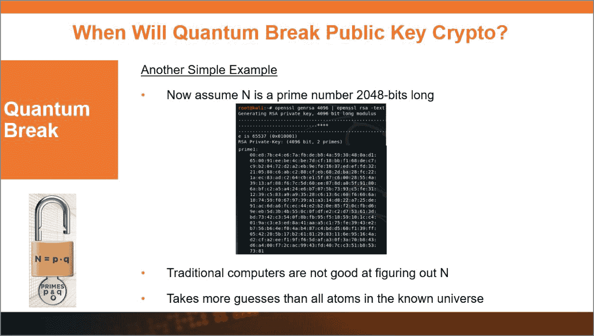

**Figure 9.3****:** Example slide from presentation

通用演示文稿，以 Microsoft PowerPoint 和 Adobe PDF 格式提供，可在 `www.wiley.com/go/cryptographyapocalypse` 获取。请随意从演示文稿中借用您喜欢的任何内容并根据您的受众进行定制。

### 管理层两页简报

高级管理层很忙。他们很可能没有听说过，或没有大量听说过即将到来的量子密码挑战。您应该让高级管理层意识到该问题及其重要性。创建一份简短的一到两页简报文件供高级管理层阅读，同时附带一份简短的幻灯片（也许 5 到 10 张幻灯片）来涵盖基础知识是有意义的。一到两页的简报文件通常是一份简短的介绍备忘录，后面跟着一些常见问题（FAQs）及其答案。您可以在 `www.wiley.com/go/cryptographyapocalypse` 下载示例和/或在此阅读：

> *To: Whom It May Concern*
>
> *From: <you>*
>
> *Date: <date>*
>
> *Regarding: Preparing for Coming Quantum Cryptographic Break*
>
> *This document was created to help introduce management to a new, evolving project titled the Quantum Resistant Data Protection project, and to share the general details and projected timeline.*
>
> *Computers based on quantum mechanics are maturing to a point where they seriously threaten to compromise much of today's existing traditional cryptography, including HTTPS, Wi-Fi networks, logon authentication, smartcards, multifactor authentication, and public key infrastructure (PKI). No one knows exactly when quantum computers will mature to the point of being a real threat to most organizations, but estimates range from a few years to less than 10 years. In 2016, the National Institute of Standards and Technology (NIST) and the National Security Agency (NSA) recommended that all organizations start to prepare for the coming cryptographic break. We are \[X\] years late in beginning our preparation.*
>
> *As part of following those recommendations and due to ever increasing improvements in quantum computing, we are preparing this organization by creating a special project team to address the issue. We will be doing a data protection inventory (to determine which of our critical digital assets need long-term protection against unauthorized access) and creating a plan to ensure that critical date is protected by the appropriate quantum-resistant cryptography and other mitigations.*
>
> *The first major phase of the project, along with the work of our newly formed project team, will begin in the next few weeks and is expected to last multiple years until the threat is fully remediated. Our goal is to upgrade our quantum-susceptible cryptography to quantum-resistant forms before the quantum cryptography break occurs.*
>
> *It is likely to impact many of our existing data protection implementations, and our reason for beginning this project now is to minimize future business disruption and costs. Overall project costs, resources, and timelines cannot be adequately estimated until after the Data Protection Inventory and Analysis tasks, which are expected to be accomplished in the next 12–24 months. We will be following and using industry guidelines and methodologies wherever possible.*
>
> *I will be glad to answer any of your questions and/or provide you with more details and education.*
>
> *Sincerely,*
>
> *<Your name and title>*
>
> *Page 2 – Frequently Asked Questions (FAQ)*
>
> **What is quantum mechanics?**
>
> *Quantum mechanics/physics is a long-proven physical science that describes actions and properties of very small particles. Everything in the universe works and depends on quantum mechanics. It's how the world works. Computers and software are being created that function using quantum particles and properties. Within a few years, if not already, we will have quantum computers capable of doing things nonquantum computers cannot, including breaking many forms of traditional cryptography and creating new, unbreakable forms of cryptography.*
>
> **How long have quantum computers been around?**
>
> *The first working quantum computer was created in 1998. Today there are well over a hundred quantum computers and dozens of different types of quantum devices. All known quantum computers are still relatively weak, in the laboratory and experimental stages, but are predicted to become stronger than traditional computers by the end of 2019 or soon thereafter. The world's governments and corporations are spending tens of billions of dollars a year in the pursuit to build quantum supercomputers and networks. Quantum computer vendors include the world's largest companies, such as Google, IBM, Intel, Microsoft, and Alibaba.*
>
> **How is quantum computing able to threaten traditional cryptography?**
>
> *Particular types of quantum computers, armed with a mathematical algorithm known as Shor's algorithm, can quickly factor math equations that involve large prime numbers. Equations involving large prime numbers are what gives most traditional public key cryptography its protective capabilities. Traditional binary-based computers cannot easily factor large prime number equations. Quantum computers with enough “qubits” can factor large prime number equations in a very short amount of time, measured in minutes to hours.*
>
> **When will quantum computers break traditional public key cryptography?**

> *没有人能确定，但据信一旦量子计算机拥有大约四千个“稳定”的量子比特，长度为 2,048 位或更短的传统公钥就会迅速被破解。世界上现有的大部分公钥密码学都依赖于此类密钥。量子计算机能够削弱其他类型密码学的约一半保护能力。对量子计算机何时能够破解传统公钥密码的普遍时间估计从几年到不到 10 年不等。无论如何，大多数专家都说现在是开始准备的时候了。如果破解比人们预期的更早发生，那么我们就能更好地准备好做出适当应对。*

**我们正在做什么？**

*我们正在组建一个新项目团队，名为量子抗性数据保护项目组，以审查我们关键数据保护可能受到影响的所有地方，并评估风险是否需要缓解。短期缓解措施可能包括增加现有加密密钥大小、隔离关键数据以及转向量子抗性密码学。长期缓解措施，数年后才实施，包括迁移到基于量子的密码和设备。*

**你如何提供帮助？**

*我们需要一位或多位高级管理层利益相关者批准该项目并给予支持。该利益相关者需要参加第一次项目会议，也许参加后续会议，并回答其他高级管理人员的提问。*

欢迎以任何方式使用和修改本文档。本文档的在线版本（`www.wiley.com/go/cryptographyapocalypse`）未来可能会更新和改进。

#### Step 2: 创建计划

创建项目计划涉及许多子组件，包括组建项目团队、制定项目计划和制定时间表。

##### 创建项目团队

缓解量子计算机的威胁可能需要许多人花费数年时间才能完成。如果有任何 IT 项目需要项目团队，那就是这个项目。如果你没有扎实的项目管理技能，请为你的团队指派一位优秀的项目经理，或自行掌握必要的技能。其他团队成员应包括以下人员：

* 高级管理层赞助人
* 项目负责人，精通量子计算和其他相关主题（这很可能就是你）
* IT 安全经理
* 其他所需的 IT 员工
* 密码学主题专家
* 终端用户代表
* 通信专员
* 财务/预算/采购人员
* 库存经理/专家

在小型公司中，许多这些角色可能由一个人担任。在非常小的公司中，所有这些角色都可能由一个人担任。

虽然早期不需要，但与受影响系统的供应商在后期阶段合作将至关重要。他们需要了解你的担忧，并能够向你传达他们公司为应对你的量子破解担忧所采取的措施。理想情况下，你希望他们协助缓解解决方案。你可能需要在项目的数据收集阶段或之后立即让供应商参与进来。

通信专员至关重要。如果一切按计划进行，并且在量子密码破解发生之前所有缓解措施都已到位，那么通信专员可以帮助将项目顺利完成的情况传达给组织。如果量子密码破解在所有问题得到缓解之前发生，则必须启动紧急加速计划和时间表。关键受影响资产可能需要离线。可能会出现业务中断问题。你需要一份事件响应计划。请让管理层和通信专员知道，加速时间表场景发生的可能性较低，但你希望在需要时做好准备。

另外，与你所在行业的其他人、行业组织甚至竞争对手启动讨论也可能是明智之举。每个组织都将开展某种类型的量子抗性项目，尽管时间表和目标各不相同。但每个人都将有相似的总体目标（即迁移到量子抗性密码学），并且可以分享哪些措施对他们有效，哪些无效。打电话开会，并在行业会议和大会上提出这一话题。这是一个规模最大的重大项目。我们都在其中。我们需要彼此。这不是创造竞争优势的问题，而是生存问题。

##### 创建项目计划

每个项目负责人都需要制定详细的项目计划，很可能使用 Microsoft Project（`https://products.office.com/en-us/project/project-and-portfolio-management-software`）等项目软件，或其他众多优秀的竞争产品（建议请参阅 `www.pcmag.com/roundup/260751/the-best-project-management-software`）。确定并记录关键任务和关键路径至关重要。细节越多、估计时间越准确越好。总的来说，任何项目管理计划都应涵盖前面列出的四个主要后量子缓解项目阶段以及本节概述的六个项目步骤。

##### 创建时间表

最终目标是在量子破解对你的组织构成现实威胁之前，将保护敏感关键数据的所有易受量子攻击的密码学和系统迁移到量子抗性密码学。并非所有组织和行业在量子密码破解发生时都会立即成为目标。早期，大多数针对性攻击很可能由国家行为者针对军事和政府目标发起，其次是规模非常大的组织。那些实体的供应链中的任何组织也将是首要目标。但一旦破解发生，就无法预测量子计算资源何时会针对你的组织使用。

为做好准备，你需要对量子密码破解发生的时间做出最佳猜测（使用 `Chapter 4`，“When Will the Quantum Crypto Break Happen?” 来帮助你做出猜测），并制定一个时间表，估算你的组织用量子抗性密码学保护所有关键敏感数据所需的时间。

**让 Mosca 不等式成为你的指南**  让 Mosca 不等式成为你进行时间表规划的初始指南。首次在 `Chapter 4` 中介绍，它指出当我们希望数据保持安全的时间加上我们计算机系统从经典向后量子过渡所需的时间大于量子计算机开始破解现有易受量子攻击加密协议所需的时间时，我们就需要开始担心量子计算机的影响（参见 `Figure 9.4`）。当这种情况发生时，你将没有足够的时间在量子计算机破解当前易受量子攻击的数据保护之前充分保护你的数据。例如，如果你需要关键数据在未来 10 年内保持安全，并且过渡需要 5 年，那么你需要在后量子世界到来前的 15 年内开始转向后量子系统。

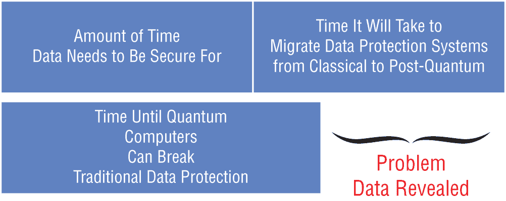

**Figure 9.4**: Mosca inequality

等式中最困难的部分是，没有人确切知道量子密码破解何时会发生。大多数有知识的专家认为它在 10 年内就会发生，而一小部分人，像本文作者一样，认为它可能早在 2–3 年内就会发生。一个相对安全的赌注是假设它在 5 年内发生。大多数人希望保护其最关键的敏感数据免受窃听 5 至 10 年，因此取 7 年作为一个安全的中间值。

莫斯卡不等式定理指出，如果你希望在整个 7 年期间保持数据安全得到保护，并且其中包含 5 年的迁移时间，那么你应该在量子密码破解前 12 年就开始着手进行后量子迁移工作。简而言之，如果你没有在足够的前置时间内开始准备，那么你很可能已经在量子抗性项目的启动上落后了。

### 关键依赖于后量子密码标准的选择

对于大多数组织而言，转向量子抗性密码学最终需要以各自国家官方选择的后量子密码标准为依据。很少有组织会从在官方国家标准出台前就选择非标准密码标准并在生产环境中实施中受益。组织可以在生产环境中使用非标准密码或方案，但通常需要大量的独立论证。非标准密码和方案通常经过的测试和信任度较低，即使它们看起来更强、更安全。对于选择要标准化的密码而言，数量上的安全和等待标准被选定是安全的。

> **NOTE**  例如，在早期几年，椭圆曲线同源密码学曾被认为具有量子抗性。但随后有人发现了一种快速分解相关同源曲线的方法。一种“修复”方法，即仅使用超奇异椭圆曲线，击败了该特定攻击，现在椭圆曲线同源密码学被称为超奇异椭圆曲线同源密码学。但有人可能会提出一种新的攻击，打破甚至超奇异椭圆曲线同源数学。大多数量子抗性密码学非常新。密码和方案仍在被攻击和测试。过早选择解决方案会增加选择有缺陷的密码解决方案并需要返工的风险。

在美国和世界大部分地区，这意味着需要等待 NIST 公布其后量子密码标准，目前他们表示应在 2022 年至 2024 年之间。NIST 还表示，如果新信息迫使时间表加速，他们可能会更早做出选择。这意味着大多数组织必须等到 2022 年至 2024 年才能开始大规模迁移到量子抗性密码学。并且在后量子密码标准选定后，所有受影响的供应商开始迁移其硬件和软件产品后，完整的迁移可能需要一到两年时间。密码标准被选定与它们被广泛可用之间会存在自然延迟。

你可以——也应该——开始围绕任何可能的后量子密码标准进行实验、测试和开发。这只会对你在适当的全生产部署时间到来时有所帮助。但我警告任何普通组织不要在官方选择之前就使用任何非标准的后量子密码进行全生产部署。同样，在官方选择做出之前什么都不做也不是最佳选择。每家公司都需要现在就开始调查、规划和保护关键数据，并且一些组织还应开始测试开发以便适当准备。

### 创建紧急加速时间表情景

至关重要的是，你要为量子破解在你尚未完全将组织资产迁移到量子抗性密码学之前突然发生的情况创建一个备份、紧急加速时间表。想象一下，明天你醒来，NSA 宣布不仅外国政府获得了破解传统公钥密码的能力，而且 NSA 还检测到此类攻击针对公司。不是有几年时间来迁移到量子抗性密码，而是你现在就需要迁移。你的计划会如何改变？你要放弃什么？什么算作现在需要迁移的关键资产，什么不算？你能获得更多资源来更快完成项目阶段吗？你是否必须向客户和董事会发出新迫在眉睫的威胁警报？资金将来自哪里？创建两个时间表：一个是你认为希望的、预期的、正常事件时间线，另一个是紧急加速时间线。为两种结果做好计划。

### 创建项目阶段时间线估算

完成整个量子抗性迁移项目需要多长时间？估算你的组织在开始量子抗性项目后，将所有涉及的数据保护系统迁移到后量子实现所需的时间，以便高级管理层和项目成员可以看到可能的预期。答案对每个组织都是独特的，取决于你必须迁移的内容、如何迁移以及何时能够迁移。每个组织都会不同，但项目负责人应为项目的每个阶段做出一些基本猜测。例如，参见 Table 9.1。

**Table 9.1****:** Example quantum-resistant project tasks and timelines

| Project steps || Estimated time to complete |
| --- | --- |
| Educate. || 1 month |
| --- | --- |
| Form a project team and plan. || 1 month |
| Create a timeline. || 1 month |
| Take a data protection inventory. || 3 months |
| Analyze the quantum plan and make recommendations. || 6 months |
| Prevent future data leaks. || 3 months |
| Strengthen existing traditional cryptography. || 12 months |
| Move to quantum-resistant cryptography. || 60 months |
| Move to quantum-hybrid technologies. || 60 months |
| Go fully quantum. || Undetermined at this time |

通过为这些任务分配一些大致数字，你可以估算出后量子迁移项目所需的大致时间，并向所有利益相关者说明任务和时间安排。一些任务，例如教育、组建项目团队和规划、创建时间表可以同时完成。按照 Table 9.1 中列出的示例数字，实际项目工作需要六到七年，其中大部分属于“迁移到量子抗性密码学”阶段。当然，迁移到量子抗性密码学以及最终基于量子的密码学取决于你无法控制的因素。

通过适当规划所有阶段，包括后量子密码迁移，即使需要比原计划更快、加速迁移到量子抗性密码学，你的组织也能为迁移做好更好的准备。适当的规划节省时间。即使量子力学也改变不了这一点。

#### Step 3: Collect Data

对于任何量子抗性密码迁移项目至关重要的是进行完整的数据保护盘点。它应包括五个组成部分：

* 定位所有敏感数据和设备
* 识别数据和设备利益相关者
* 执行保密性分级
* 确定数据或设备需要防止未经授权窃听保护多长时间
* 识别涉及保护使用密码学的设备的当前数据保护系统，特别是识别涉及的密码学和密钥大小

盘点应包括对所有需要防止未经授权披露的敏感数据和设备的全面核算。计算机安全中有句说法：“如果你认为你知道所有数据在哪里，你是弄错了或在自欺欺人。”话虽如此，你需要对所有敏感数据和设备的位置进行最佳核算，以及拥有、保护和依赖信息和设备的利益相关者。利益相关者是确定所有其他所需信息所必需的。

所有持有或涉及持有敏感信息的设备都必须进行盘点和调查。这包括计算机、笔记本电脑、平板设备、智能手机、网络设备、身份验证设备、物理安全设备等。盘点应包括关键数据和物联网（IoT）设备，例如安防摄像头、门禁系统和建筑物出入控制系统。如果物联网设备正在记录敏感信息或位于敏感区域，则需要将其列入盘点清单。如果某设备使用密码学并保护非公开内容，则需要将其列入清单。

所有数据和设备都应根据数据敏感性和保持其受保护的需要进行排序。一些组织使用传统的军事等级：绝密、机密、保密和公开。其他组织使用更具企业特色的对应等级：高业务价值、中等业务价值、低业务价值。一些组织仅使用保密和公开。无论您使用何种数据分类系统，所有数据和设备都应根据其对组织的 criticality 和价值进行排序。

接下来，利益相关者需要确定已识别的数据和设备需要安全保留多长时间，以年或关键区间表示（例如，长期、中期、短期，或 10 年或以上、5–10 年、少于 5 年）。

然后，识别涉及保护该数据和这些设备的数据保护系统，如果它们使用密码学。并非所有数据保护系统都直接使用密码学，但大多数至少间接使用。例如，许多访问控制系统仅使用操作系统权限，这并不直接涉及密码学，但访问控制权限的整体成功取决于操作系统的安全性，而所有操作系统都使用密码学（通常是多种密码、方案和系统）。您需要识别所有用于安全存储和传输已识别数据和设备的密码学。关键数据系统还将包括您所有重要的 IT 基础设施，例如身份验证系统和基础设施服务。对于每个数据保护系统，识别所使用的密码学（对称、非对称、哈希、数字签名等）和密钥大小。

对于许多系统，您可能无法确定其密码、方案和密钥大小是什么。供应商或开发人员可能已不在，关于所实现密码学的可用文档很少甚至没有。项目团队需要审查每个发现的“未知”情况，并确定该风险是否小到可以忽略不计以便升级，或是否需要将其视为最高优先级（仅为降低潜在风险）。为未知情况做好计划。

### Step 4: Analyze

计算机安全主要关乎风险评估。在项目最重要阶段，您将识别风险最高的数据和系统，并确定必须采取哪些步骤来降低即将到来的量子密码破解的风险。分析和建议将包括以下任务：

* 识别保护关键敏感数据和设备的量子易受攻击的数据保护系统
* 对受威胁系统的风险因素进行排序，包括哪些系统需要优先修复
* 确定修复措施
* 确定相关资源、成本和时间线

一旦您获得了数据保护盘点的结果，请识别所使用的量子易受攻击的密码学，特别是保护关键敏感数据和设备的密码学。将您发现的内容与已知量子易受攻击的密码学和密钥大小的列表进行比较，如 Chapter 5，Table 5.1 所示。Chapter 5 还涵盖了量子易受攻击的非对称密码（例如，RSA、DH、ECC、ElGamal 等）。

任何保护关键数据或设备并使用易受攻击密码学的数据保护系统都应被突出显示，并特别关注最关键的系统。这将为您提供一个鸟瞰图，说明转向后量子世界将面临多大的挑战。这很可能对问题的规模和范围是一个巨大的警醒，尽管您可能会惊讶地发现您的大量系统正在使用较不易受攻击的密码形式，例如 AES-256 或 AES-512。彻底的风险评估可能会让您得出结论，问题并没有您担心的那么严重。不幸的是，对于大多数组织而言，特别是使用非对称密码的地方，这不太可能成为现实。

修复应包括修复量子易受攻击系统所需的所有可能解决方案，从为所有系统利益相关者提供教育开始。修复还应识别哪些解决方案是简单的密钥大小升级（例如，从 AES-128 升级到 AES-256），哪些解决方案是整个密码的替换。哪些可以升级，哪些必须替换？预计每种系统的努力难度如何？每种修复解决方案的预期成本和时间线是多少？您需要与利益相关者和供应商进行沟通。

许多系统最终可能采用混合方法。例如，也许根证书颁发机构（CA）数字密钥，预计寿命较长，使用量子抗性密码学进行更新，但具有更短寿命的单个终端用户密钥则更新为使用更大密钥大小的传统密码学。

尽早让供应商参与非常重要，以便他们了解您的担忧，并让您知道他们公司计划如何提供帮助。在许多情况下，供应商可能完全不知道这个问题，或者他们意识到即将到来的量子破解，但尚未实际解决，因为他们认为这还有 10–20 年。 与他们讨论您的担忧可能是他们公司内部认真讨论的开始。您甚至可能会了解到他们不打算转向后量子实现，或者这需要升级到其软件的最新版本才能修复。许多供应商利用 SHA2 迁移来强制客户升级到最新软件。

许多公司可能拥有内部开发的应用程序，并且需要找出谁负责它们以及如何升级它们。 常见的是找不到任何信息且无人可聘请来分析和更新的内部开发应用程序。您的项目团队应已决定如何处理此类应用程序，或者也许它们是逐案审查的。

即使当前不被视为量子易受攻击的系统也必须进行更新。例如，您可能拥有由 AES-256 保护的高度关键数据，目前不被视为量子易受攻击。但如果您计划保留该数据 10 年或更长时间，您可能希望将其迁移到 AES-512。这种从略微量子易受攻击的密码学到远 less 量子易受攻击的密码学的迁移可能不是最高优先级，但仍应执行。

然后，在彻底审查所有相关系统、关键性、时间线和成本后，利益相关者应决定部署何种修复措施以及何时部署。记录决策并将其提交给高级管理层批准和预算。如果您已正确且彻底地进行分析和审查，大多数决策的可能解决方案将使最终决策变得容易。

#### Protect Some or All Data

首先你可能需要决定是否只保护最高关键数据，还是保护所有数据。有时保护所有数据可以节省金钱和时间。例如，对于在欧盟开展业务或与欧盟客户交易的许多公司而言，在试图遵守欧盟《通用数据保护条例》（`GDPR`）要求时，这就是答案。许多跨国公司认为，将 `GDPR` 要求应用于位于任何地方、甚至欧盟以外的所有数据和客户，比将其隔离并仅应用于欧盟特定数据要便宜。他们还担心，如果本应适用 `GDPR` 的某些数据流入其保护程度较低的数据存储库，将会产生法律和财务成本。与其冒此风险，这些公司干脆将更强的控制措施应用于所有数据。

相反，一些公司认为将敏感数据放入隔离的数据域中，然后由更昂贵的控制措施保护，这要便宜得多。许多美国公司对受 `PCI-` 和 `HIPAA` 监管的数据做出了这一决定。当数据量占组织处理的比例很小，并且可以信任受保护的数据保持在隔离的数据域中时，这种策略是有意义的。每个组织都必须决定是保护所有数据还是仅保护部分数据。中庸之道是只保护最关键的数据，但要在全企业范围内进行保护，重点关注保护它的系统。

组织必须决定哪些数据需要防范量子攻击，以及需要更新哪些加密技术以及何时更新。

### Step 5: Take Action/Remediate

现在是采取行动的时候了。更新密码、方案和密钥大小。迁移到抗量子密码学并执行其他后量子操作。每个步骤都应在有限的试点项目中进行彻底测试，然后再推广到全面生产部署。每个行动计划都应包括紧急“回滚”计划，以防加密迁移步骤导致问题。回滚步骤应在采取保护措施之前得到记录并彻底测试。

> **NOTE**  我曾经自豪地说，在我 30 年部署加密项目和更新的职业生涯中，我从未造成过一次重大的非预期运营中断事件——直到几年前。那次事故非常严重。客户团队和我正在作为一个更大的全球更新项目的一部分，对任务关键型网络医疗设备上的数字证书进行更新。制定了回滚程序，允许通过运行单个经过充分测试的命令，将任何新颁发的证书远程替换为原始的旧工作证书，如果需要的话。如果生产更新出现任何问题，我们可以运行一个命令，然后坐等所有受影响的设备快速恢复。
>
> 证书更新过程的几次测试进行得非常顺利，以至于我建议我们立即在全球范围内部署剩余的数万张证书。我以前已经执行过数十次全球更新，相信证书更新不可能造成问题。绝不可能。糟糕的是，在我不知情的情况下，客户对他们的一半设备进行了自定义更改，导致这些新更新的设备（关键医疗设备）在安装新证书时与网络断开连接。每个设备都出现故障，并且由于它们也与网络断开了连接，我们的“故障安全”回滚程序无法通过单个命令运行。医院的全球网络运营中断了数天，需要非 IT 培训的医护人员团队执行数十个手动步骤才能使设备重新上线并正常运行。这是我的职业生涯中最大的一次（也是唯一一次）客户灾难。吸取的教训。测试并再次测试。不要在测试不足的情况下仓促进行生产部署。并测试你的回滚程序，并确保它们的工作不依赖于网络连接。

#### Update Existing Policies and Standards

不言而喻，现在你应该确保所有组织政策和标准都要求使用强抗量子密码学。你想止住流血。你不希望新系统进入你的组织，其中包含弱抗量子密码学，这只会给你的未来问题增加负担。更新你的政策和标准，要求自动拒绝弱加密系统。顺便说一下，更新政策，说明所有系统必须使用广泛接受的加密标准，如果你还没有这种表述的话。而且如果你想更进一步，要求所有新购买的、使用加密的系统都具备加密敏捷性。

#### Prevent Current-Day Future Data Leaks

存在这样的风险：拥有当前或近期未来量子破解技术访问权限的外部实体，可能会在今天窃听你“当前受保护”的数据，将其保存下来，并在具备相应能力时破解该数据。我们应该假设所有国家都在今天对其他国家这样做。他们如果不这样做就是愚蠢和疏忽。参与企业间谍活动的、道德败坏的大型公司也可能对竞争对手这样做。

例如，也许你的 Wi-Fi 网络路由器使用 `AES-128`。任何受 `AES-128` 保护的东西很快就会受到量子攻击。你的敌人可能会嗅探你的 Wi-Fi 数据流并将其保存以供将来破解。如果你的组织存在这种可能性，请考虑你需要使用所有方法来防止对你当前安全数据进行未来窃听。这些方法包括以下内容：

*   将关键数据从任何在线存储或网络传输中移除（这样它根本就无法被嗅探或窃取）
*   今天就使用抗量子加密
*   隔离物理数据域（在那里它无法被嗅探或窃取）
*   使用不易受量子破解影响的网络隔离设备（这与使用抗量子加密不同）

关于最后一项，有供应商制造军用级、高度安全的网卡和设备，这些设备不易被窃听。它们不使用传统加密，而是使用屏蔽和信号方法，这些方法无法被窃听，甚至不允许攻击者首先读取加密或受保护的信息。

### Step 6: Review and Improve

任何项目计划都应以审查和改进阶段结束。任何复杂项目过程中总会有经验教训，无论好坏。每个项目计划都应有多处让所有人评估计划和补救措施的进展情况并提出改进建议的地方。

### Summary

本章讨论了你和你的组织如何在量子突破发生之前就开始为即将到来的量子突破做准备。这种策略包括让高级管理层参与进来、组建长期项目团队、提供教育培训，并将你的组织系统从传统的经典加密保护系统迁移出去。为了以系统的方式做到这一点，你需要进行完整而彻底的数据保护清单，以识别需要迁移的系统。然后，决定正确的缓解措施，其中包括增加现有、当前使用的传统加密的密钥和哈希大小，然后迁移到抗量子密码学，最后迁移到完全量子密码学和设备。规划并深思熟虑地进行这一过程将为任何组织节省时间和金钱，更重要的是，有效降低计算机安全风险。

我谨向读者致谢，感谢你们允许我带你们踏上从了解量子力学是什么以及它将如何破解许多传统加密形式之旅的旅程。本书涵盖了量子抗性和基于量子的密码学和设备，以及市场上今天的任何资源，并以一份坚实的计划总结结束，说明你的组织今天如何开始为后量子世界做准备。如果你有任何问题、建议或更正，请随时发送电子邮件至 `roger@banneretcs.com`。我会尝试在 24 小时内回答问题。

附录通过列出许多量子和量子计算在线资源来结束本书，可用作教育和新闻的研究参考。

## 附录：附加量子资源

本附录列出了数十个资源，你可以用它们来提高和扩展你对量子力学、量子计算机和密码学的理解。

完全理解量子力学是量子力学领域所有专家都在努力的事情。不仅它是一个复杂的主体，挑战我们对自然科学的传统理解，而且它仍处于理解的早期阶段，缺少很多部分。所以，如果你不能完全理解量子力学、计算机或密码学，你是可以被原谅的。你消费的每篇量子相关文章和资源都会提高你的理解。考虑到这一点，本附录为你提供了一个资源列表，其中包括来自其他章节的引用以及新资源。它按各种类别划分，包括书籍、视频、在线课程、网站、博客、政府赞助计划、供应商网站等等。对于许多资源，我在引用末尾用括号做了评论，我认为我可以在帮助你理解该资源是否适合你方面增加价值。

### 书籍

1. Aaronson, Scott (2013). *Quantum Computing Since Democritus*. Cambridge: Cambridge University Press. (一位非常活跃的量子力学和量子计算机研究者的精彩读物，重点 heavily 放在计算机逻辑上。特别很好地解释了纠缠和量子隐形传态。)
2. Bell, Philip (2018). *Beyond Weird: Why Everything You Knew About Quantum Physics Is Different*. Chicago: University of Chicago Press. (精彩读物；大量讨论不同的量子解释；以极其不同、极好的方式解释了一些量子力学概念（Bell 对退相干和纠缠的解释是我读过的最好的）。不应该作为你第一本或唯一一本量子物理书，但对于任何对理解量子力学感兴趣的人来说都是必读的。)
3. Bernhardt, Chris (2019). *Quantum Computing for Everyone*. Cambridge, MA: MIT Press.
4. Carroll, Sean (2019). Something Deeply Hidden. United States: Dutton. (对多世界解释充满激情、合乎逻辑的辩护。)
5. Johnston, Eric R., Nic Harrigan, and Mercedes Gimeno-Segovia (2019). *Programming Quantum Computers: Essential Algorithms and Code Elements*. Sebastopol, CA: O'Reilly. (我所知除本书外最新的量子书籍。)
6. Kumar, Manjit (2009). *Quantum*. New Delhi: Hachette India. (Philip Bell 推荐为量子力学入门的绝佳读物。)
7. Kumar, Manjit (2011). *Quantum: Einstein, Bohr, and the Great Debate about the Nature of Reality*. New Delhi: Hachette India.
8. Orzel, Chad (2009). *How to Teach \[Quantum\] Physics to Your Dog*. New York: Scribner. (精彩读物；非常适合初学者学习量子物理。)
9. Orzel, Chad (2018). *Breakfast with Einstein: The Exotic Physics of Everyday Objects*. Dallas, TX: BenBella Books, Inc. (精彩读物；非常适合初学者学习量子物理。)
10. Rhodes, Richard (2012). *Hedy's Folly: The Life and Breakthrough Inventions of Hedy Lamarr, the Most Beautiful Woman in the World*. New York: Doubleday. (精彩读物；了解 Hedy Lamarr 如何共同创造了加密的基础，即使在今天也保护了大多数无线通信。)

### 视频

* Anyons and quantum topological computers:
* `www.youtube.com/watch?v=igPXzKjqrNg`
* `www.youtube.com/watch?v=RW44rIrAZHY`
* `www.youtube.com/watch?v=qj-w6ISQL5Y`
* `www.youtube.com/watch?v=Xyfsr-coriQ`
* BB84: `www.youtube.com/watch?v=UVzRbU6y7Ks`
* D-Wave/annealing process: `www.youtube.com/watch?v=UV_RlCAc5Zs`
* `www.youtube.com/watch?v=kq9VqR0ZGNc`
* `www.youtube.com/watch?v=Yy93LMGQbpo`
* Double Slit Wave Experiment animation: `www.youtube.com/watch?v=fwXQjRBLwsQ`
* Ion-trap quantum computers:
* `www.youtube.com/watch?v=9aOLwjUZLm0`
* `www.youtube.com/watch?v=WOQ_jWe62EA`
* Quanta Magazine YouTube channel: `www.youtube.com/c/QuantamagazineOrgNews`
* Quantum Physics for 7 Year Olds: `www.youtube.com/watch?v=ARWBdfWpDyc`
* Quantum teleportation:
* `www.youtube.com/watch?v=Czi5elPLfvA`
* `www.youtube.com/watch?v=hTe2PYwnEpc`
* Quantum Theory—Full Documentary HD: `www.youtube.com/watch?v=CBrsWPCp_rs`
* Neil deGrasse Tyson explains quantum entanglement: `www.youtube.com/watch?v=q8CQAOwi2RI`

### 在线课程

* Scott Aaronson (2006). “Quantum Computing Since Democritus”: `www.scottaaronson.com/democritus/`
* Quantum Computing Report's list of online educational resources: `https://quantumcomputingreport.com/resources/education/`
* Kirill Shilov, “16 Best Resources to Learn Quantum Computing in 2019”: `https://hackernoon.com/16-best-resources-to-learn-quantum-computing-in-2019-e5d8b797aeb6`
* Leonard Susskind (2011), professor of physics at Stanford University. Quantum Mechanics: “The Theoretical Minimum”: `http://theoreticalminimum.com/courses/quantum-mechanics/2012/winter`

### 网站

* Daniel J. Bernstein's personal website: `https://cr.yp.to`
* Caltech's Institute for Quantum Information and Matter: `https://quantumfrontiers.com/`
* GeekForge: `https://geekforge.io/`
* High Energy Physics Foundation Quantum Computing working group: `https://hepsoftwarefoundation.org/workinggroups/quantumcomputing.html`
* IFLScience!: `www.iflscience.com/physics/`
* Inside Science quantum-related articles: `www.insidescience.org/search/node/quantum`
* ISARA: `www.isara.com/standards/` (正在进行的后量子密码学工作列表)
* Quantiki: `www.quantiki.org`
* Quantum Algorithm Zoo: `https://quantumalgorithmzoo.org/`
* Quantum Computing Reporting: `https://quantumcomputingreport.com`
* Quantum Computing Stackexchange: `https://quantumcomputing.stackexchange.com/` (技术问题的绝佳去处)
* Quantum for Quants: `www.quantumforquants.org/` (金融相关网站)
* `Phys.org`—Quantum Physics news: `https://phys.org/physics-news/quantum-physics/`
* Physics Forums, Quantum Physics Forum: `www.physicsforums.com/forums/quantum-physics.62/`
* Post-Quantum Cryptography wiki: `https://pqc-wiki.fau.edu/w/Special:DatabaseHome`
* PQCrypto: `http://pqcrypto.eu/`
* Sam Mugel's website for quantum technology in simple words: `www.qwise.org`
* Science Daily: `www.sciencedaily.com/news/matter_energy/quantum_physics/`
* ScienceDirect's quantum-related articles: `www.sciencedirect.com/search/advanced?qs=quantum`
* The Quantum Pontiff: `https://dabacon.org/pontiff/`
* UK's National Quantum Technologies Hub for Networked Quantum Information Technology: `www.nqit.ox.ac.uk`

### 博客

* Scott Aaronson's blog: `www.scottaaronson.com`
* Quantum Physics blog: `www.techbubble.info/blog/quantum-physics`
* Top 25 Quantum Computing Blogs: `https://blog.feedspot.com/quantum_computing_blogs/`

### Podcast

* Stupid Qubit: `https://stupidqubit.com/` (关于量子的有趣、另类的播客)

### 量子杂志/通讯

* Quanta Magazine, Facebook: `www.facebook.com/QuantaNews`

* Quanta Magazine 邮件通讯：`https://us1.campaign-archive.com/home/?u=0d6ddf7dc1a0b7297c8e06618&id=f0cb61321c`
* Nature Magazine，量子相关文章：`www.nature.com/search?q=quantum`
* Wired Magazine 的量子相关文章：`www.wired.com/search/?q=quantum`

### 量子邮件列表
* Quantiki 邮件组列表：`www.quantiki.org/wiki/mailing-lists`
* Eclipse 基金会量子计算工作组：`https://accounts.eclipse.org/mailing-list/quantum-computing-wg`
* 量子基础邮件列表：`https://golem.ph.utexas.edu/category/2010/12/quantum_foundations_mailing_li.html`
* 量子互联网：`www.irtf.org/mailman/listinfo/qirg`

### 杂项量子文章
* Philip Ball，Quanta Magazine 文章：`www.quantamagazine.org/authors/philip-ball/`
* Mark G. Jackson 面向大众的文章：`http://physicsjackson.com/articles/`

### 量子厂商
* Accenture：`www.accenture.com/us-en/insight-quantum-computing`
* Alibaba：`https://us.alibabacloud.com/`
* Atos：`https://atos.net/en/insights-and-innovation/quantum-computing/atos-quantum`
* Baidu：`http://research.baidu.com/Research_Areas/index-view?id=75`
* Cambridge Quantum Computing：`https://cambridgequantum.com/`
* ComScire：`https://comscire.com`
* D-Wave：`www.dwavesys.com`
* Google：`https://ai.google/research/teams/applied-science/quantum-ai/`
* Honeywell：`www.honeywell.com/en-us/company/quantum`
* Huawei：`www.huaweicloud.com/en-us`
* IBM：`www.research.ibm.com/ibm-q/`
* ID Quantique：`www.idquantique.com`
* Intel：`https://newsroom.intel.com/press-kits/quantum-computing/#quantum-computing-news`
* IonQ：`https://ionq.co/`
* MagiQ Technologies：`www.magiqtech.com`
* Microsoft：`www.microsoft.com/en-us/research/research-area/quantum/`
* Quantum Computing, Inc.：`https://quantumcomputinginc.com/`
* Quantum Numbers Corp.：`www.quantumnumberscorp.com`
* Quintessence Labs：`www.quintessencelabs.com`
* Raytheon：`www.raytheon.com/capabilities/products/quantum`
* Rigetti：`www.rigetti.com/qcs`
* Toshiba：`www.toshiba.eu/eu/Cambridge-Research-Laboratory/Quantum-Information/`

### Twitter
* Caltech：`https://twitter.com/IQIM_Caltech`
* 欧洲联盟量子互联网联盟：`https://twitter.com/eu_qia`
* Qiskit：`https://twitter.com/qiskit`
* Quanta Magazine：`https://twitter.com/QuantaMagazine`
* Quantiki：`https://twitter.com/quantiki`
* 英国国家量子技术中心网络量子信息技术中心：`https://twitter.com/NQIT_QTHub`

### 软件相关
* 量子算法列表：`http://quantumalgorithmzoo.org/`
* 量子计算模拟器列表：`www.quantiki.org/wiki/list-qc-simulators`
* 量子开源项目列表：`https://arxiv.org/pdf/1812.09167.pdf`
* 量子软件列表：`https://github.com/qosf/os_quantum_software`
* IBM Quantum Q Experience：`https://quantumexperience.ng.bluemix.net/qx/editor`
* Microsoft 量子软件开发工具包：`https://marketplace.visualstudio.com/items?itemName=quantum.DevKit`
* Open Quantum Safe 项目：`https://openquantumsafe.org/`
* 开源和商业量子软件项目以及在线量子门户：`https://github.com/qosf/os_quantum_software`
* Python 量子开源库：`https://github.com/rigetti/pyquil`
* 量子开源基金会：`https://qosf.org/`
* Quirk，拖放式量子模拟器：`https://algassert.com/quirk`

### 杂项量子联盟
* 量子技术联盟：`http://inqnet.caltech.edu/index.html`
* 量子全球协会：`http://quantumwa.org/`

### 政府资助项目和非营利组织
* 澳大利亚，澳大利亚研究理事会工程量子系统卓越中心：`https://equs.org/`
* 澳大利亚，量子计算与通信技术中心：`www.cqc2t.org`
* 巴塞罗那，加泰罗尼亚，西班牙，光子科学研究所：`http://quantumtech.icfo.eu/`
* Barcelonaqbit：`www.barcelonaqbit.com/`
* 北京量子信息科学研究院：`www.baqis.ac.cn/en/`
* Berkeley Quantum：`https://berkeleyquantum.org/`
* 布鲁克海文国家实验室：`www.bnl.gov/compsci/quantum/`
* 中国，中国科学院量子信息重点实验室：`http://lqcc.ustc.edu.cn/`
* 纽波特，罗德岛，纠缠研究所：`www.entanglement.institute/`
* 费米实验室量子信息科学项目：`https://qis.fnal.gov/`
* 法国，格勒诺布尔量子硅：`www.quantumsilicon-grenoble.eu/`
* 德国研究基金会物质与光量子计算：`https://ml4q.de/`
* IARPA 的相干超导量子比特：`www.iarpa.gov/index.php/research-programs/csq`
* IARPA 的逻辑量子比特：`www.iarpa.gov/index.php/research-programs/logiq`
* IARPA 的多量子比特相干操作：`www.iarpa.gov/index.php/research-programs/mqco`
* IARPA 的量子增强优化：`www.iarpa.gov/index.php/research-programs/qeo`
* 印度，光与物质物理：`www.rri.res.in/light-matter-physics.html`
* 韩国，量子信息中心：`http://quantum.kist.re.kr/`
* Leti，法国：`www.leti-cea.com/cea-tech/leti/english/Pages/Applied-Research/Strategic-Axes/Quantum-leti-initiative.aspx`
* Los Alamos 量子研究所：`https://quantum.lanl.gov/about.shtml`
* NASA 量子人工智能实验室：`https://ti.arc.nasa.gov/tech/dash/groups/quail/`
* 国家科学基金会实用规模量子计算使能项目：`www.epiqc.cs.uchicago.edu/`
* 国家科学基金会量子信息科学：`www.nsf.gov/funding/pgm_summ.jsp?pims_id=505207`
* 荷兰，QuSoft 量子软件研究中心：`www.qusoft.org`
* 荷兰，QuTech Academy：`http://qutech.nl/`
* NIST 联合量子信息与计算机科学中心：`http://quics.umd.edu/`
* NIST 联合量子研究所：`https://jqi.umd.edu/`
* NIST 后量子密码学竞赛：`https://csrc.nist.gov/Projects/Post-Quantum-Cryptography`
* NIST 量子信息科学：`www.nist.gov/topics/quantum-information-science`
* Oak Ridge 国家实验室量子计算研究所：`https://quantum.ornl.gov/`
* Oak Ridge 国家实验室量子信息科学小组：`https://web.ornl.gov/sci/qis/index.shtml`
* 巴黎量子计算中心：`www.pcqc.fr`
* Perimeter 理论物理研究所量子信息研究小组：`http://perimeterinstitute.ca/research/research-areas/quantum-information`
* 俄罗斯量子中心：`https://rqc.ru/`
* 新加坡，量子技术中心：`www.quantumlah.org`
* 新加坡，工程量子技术项目：`www.a-star.edu.sg/imre/Research/Programmes-Centres/Quantum-Technologies-for-Engineering-Programme`
* 西班牙国家研究委员会：`https://qst.csic.es/`
* 瑞士国家科学基金会量子科学与技术：`https://nccr-qsit.ethz.ch/`
* 英国国家量子技术计划：`www.nqit.ox.ac.uk/`
* 大学空间研究协会：`www.usra.edu/quantum-computing`
* 美国国家科学技术委员会，国家量子信息科学战略概览：`www.whitehouse.gov/wp-content/uploads/2018/09/National-Strategic-Overview-for-Quantum-Information-Science.pdf`

> **NOTE** 本节中的大部分信息由 `https://quantumcomputingreport.com/players/governmentnon-profit/` 提供。

## 目录
* **A**
* Aaronson, Scott, 93, 231, 233, 234
* Ablayev, Farid, 177
* 绝对零度, 41
* Accenture, 235
* Active Directory Certificate Services (ADCS), 109

*   高级加密标准 (AES)，63，142，229
*   AI（人工智能），119–120
*   代数编码，136–137
*   算法，76–79，85，88。*另见特定算法*
*   阿里巴巴，235
*   量子技术联盟，237
*   振幅，10
*   分析步骤，在后量子（PQ）缓解中，226–228
*   辅助量子位，42
*   Antheil，George，201
*   任意子辫，49–50，232
*   Apache，210
*   应用
    *   破坏的，99–113
    *   用于数字证书，105–106
    *   量子，117–125
    *   量子网络，199–203
*   应用专用集成电路（ASICs），140
*   阿贡国家实验室，204
*   军备出口委员会，96
*   人工智能（AI），119–120
*   ASICs（应用专用集成电路），140
*   汇编语言，32
*   非对称密码
    *   关于，65–72
    *   破坏的，103
    *   密钥大小，208–209
*   非对称密码学，181
*   原子，14
*   原子钟，200–201
*   原子轨道，14
*   Atos，235

### B
*   B92，183
*   Baidu，235
*   Ball，Philip，235
*   电池，改进，118–119
*   BB84，182–183，188，232
*   BCH（Bose-Chaudhuri-Hocquenghen）码，147
*   Bell，John Stewart，25，173–174
*   Bell，Philip（作者），231
*   Bell 不等式定理，172–175
*   Bell 不等式违背，173–174
*   Bell 漏洞，174
*   Bennett，Charles，182，183
*   Bernhardt，Chris，231
*   Bernstein，Daniel J.，145–146，150，233
*   `Beyond Weird: Why Everything You Knew About Quantum Physics Is Different`（Bell），231
*   位翻转密钥封装（BIKE），145
*   比特币，111
*   位（二进制数字），31–33
*   黑洞，7
*   区块链，109–111
*   区块链后量子签名（BPQS），137，156
*   博客，216，234
*   蓝牙，111–112
*   书籍，作为资源，231–232
*   布尔逻辑门，32
*   Bos，Joppe W.，147
*   Bose-Chaudhuri-Hocquenghen（BCH）码，147
*   底部，20
*   BPQS（区块链后量子签名），137，156
*   Brassard，Gilles，182
*   `Breakfast with Einstein: The Exotic Physics of Everyday Objects`（Orzel），232
*   Bristlecone 量子处理器（Google），48
*   破坏的应用，99–113

### C
*   CA/浏览器论坛，212
*   Caltech，233，236
*   剑桥量子计算，53–54，175，235
*   大小写，在算法中，144
*   Cascade 错误校正协议，182
*   中央安全局（CSS），94
*   认证机构，69
*   挑战，141
*   电荷，20
*   魅力，20
*   检查量子位，42
*   化学品，改进，118
*   芝加哥量子交易所，204
*   中国，量子网络，203
*   芯片制造商，36
*   选择密文攻击，134
*   选择明文攻击，134
*   Chuang，Isaac，179
*   密码算法。*参见* ciphers
*   密码密钥，61
*   密码
    *   非对称，65–72，103，208–209
    *   定义，60
    *   对称，63–65，81–82，100–102
*   密文。*参见* encrypted message
*   Classic McEliece，145–146
*   经典-量子哈希算法，177
*   云，量子计算机在，53
*   Cocks，Clifford，91
*   基于代码的密码学，136–137
*   相干性，25，40
*   Collect Data 步骤，在后量子（PQ）缓解中，225–226
*   碰撞抗性，72
*   竞争，量子资源和，89
*   组件，量子计算机的，54–56
*   计算格问题，138–139
*   计算机错误，32
*   ComScire，175，235
*   共轭变量，17
*   联盟，237
*   常数时间，75，147
*   连续变量 QKD（CV-QKD），184
*   控制软件，55
*   Cooper 对，44–45
*   哥本哈根解释，6，23
*   反直觉性，量子力学的，4–5
*   CRC32，102
*   Create a Plan 步骤，在后量子（PQ）缓解中，220–224
*   密码敏捷性，210
*   加密货币，109–111，121
*   密码学原语。*参见* ciphers
*   代数格密码套件（CRYSTAL），146
*   密码学
    *   关于，59，116–117，167–168
    *   非对称，181
    *   基于代码的，136–137
    *   数字签名，178–180
    *   加密，59–72，180–188
    *   基于哈希的，137–138，177–178
    *   完整性哈希，72–73
    *   基于格的，138–139，148
    *   多变量，140
    *   多变量二次（MQ）多项式方程，140
    *   量子 RNGs，168–177

### 超奇异椭圆曲线同源
* 超奇异椭圆曲线同源，140–141
* 用途，73–74
* 使用量子计算机破解，74–83

### C
* `CRYSTAL`（代数格密码套件），146
* `CRYSTALS-Dilithium`，156–157，212
* `CRYSTALS-Kyber`，146
* `CSS`（中央安全服务），94
* `CV-QKD`（连续变量量子密钥分发），184

### D
* 数据加密标准（DES），63
* 数据（链路）层，196–197
* 数据泄露，229
* 数据保护，227–228
* Debian OpenSSL RNG 错误，171–172
* 去相干，25–27，39–40
* 解密，60
* 深蓝，38
* 能源部，204
* 依赖应用程序，104–113
* DES（数据加密标准），63
* 检测奇异性，13–14
* 决定性，170
* Deutsch，David，83
* Diffie-Hellman（DH），68，91，103，212
* 数字证书，70，105–106
* 数字签名算法（DSA），67，106，212
* 数字签名
  * 关于，67–68，72，106，135
  * 量子，178–180
  * 量子抗性密码学与，156–164
* Dilithium，156–157，212
* 离散对数问题，65
* 离散变量量子密钥分发，183
* 距离，速度 *vs.*，191–192
* 双缝实验，13，232
* 下，20
* DSA（数字签名算法），67，106，212
* D-Wave/退火过程，47，232，235

### E
* E91，183–184
* ECC（椭圆曲线密码学），68，103
* ECC（纠错码），136–137
* ECDH（椭圆曲线 Diffie Hellman），68，103
* ECDSA（椭圆曲线 DSA），67
* EDSA（椭圆曲线数字签名算法），106，212
* 教育步骤，在后量子（PQ）缓解中，215–220
* Einstein，Albert，4，9，11，83，172，173
* Eker，Artur，183
* 电磁耦合器，45
* 电磁辐射，9
* 电磁频谱，9
* 电子，20
* 电子云，14
* 电子中微子，20
* ElGamal，68，103
* 椭圆曲线密码学（ECC），68，103
* 椭圆曲线 Diffie Hellman（ECDH），68，103
* 椭圆曲线数字签名算法（EDSA），106，212
* 椭圆曲线 DSA（ECDSA），67
* 椭圆曲线离散对数问题，65
* 紧急加速时间表情景，223–224
* 加密消息
  * 关于，60，135
  * 关于的一般观察，155
  * 不可区分性，134
  * 大小，135
* 加密
  * 关于，59–61，180–188
  * 非对称密码，65–72
  * 加密密钥，61–63
  * 对称密码，63–65
* 能量量子。*See* photons
* 纠缠量子密钥分发，183–184
* 纠缠，24–25，42，119，167，204
* 纠缠保真度，195
* 纠缠优化，195
* 纠缠纯化，199
* 纠缠交换，195–196
* 环境隔离，40–41
* 临时密钥，145
* 纠错码（ECC），136–137
* 错误校正
  * 量子计算机与，39–44
  * 量子比特稳定与，89
  * 使用量子纠缠进行，42
* 错误阈值定理，39–40
* ETSI（欧洲电信标准协会），129
* 欧盟量子技术旗舰计划，197
* EUF-CMA（在选择消息攻击下存在不可伪造性），134
* 欧洲电信标准协会（ETSI），129
* 欧洲联盟网络和信息安全局，211
* 量子力学示例，27–28
* 在选择消息攻击下存在不可伪造性（EUF-CMA），134
* 专家意见，90
* 指数时间，75
* eXtended Merkle Signature Scheme（XMSS），137，156，212

### F
* FAst fourier Lattice-based COmpact signatures over NTRU（FALCON），157–158，212
* Fast ID Online（FIDO）2.0 标准，109
* 联邦信息处理标准（FIPS），131
* 费米国家加速器实验室，204
* FHE（全同态加密）系统，116
* Fiat-Shamir with Aborts，156
* 光纤电缆，190
* 保真度，197
* FIDO（Fast ID Online）2.0 标准，109
* 现场可编程门阵列（FPGAs），140
* “51% Attacks，”110
* FIPS（联邦信息处理标准），131
* 固件，55
* Flame，106
* 形式不可区分性保证，134–135
* Fourier，Joseph，77
* Fourier 变换，77
* FPGAs（现场可编程门阵列），140
* 自由空间介质，190–191
* 频率，10–11
* 频率跳变扩频，201
* FrodoKEM，146–147
* 全同态加密（FHE）系统，116
* 全量子解决方案的实现，214

### G

* 基本粒子, 20
* `G`
* Gaborit, Philippe, 148
* GCHQ (Government Communications Headquarters), 91
* GDPR (General Data Protection Regulation) requirements, 227–228
* GEECM algorithm, 79
* GeMSS (Great Multivariate Signature Scheme), 158, 212
* General Data Protection Regulation (GDPR) requirements, 227–228
* general-learning-with-rounding (GLWR), 151
* Gentry, Craig, 139
* German Enigma codes, 88
* Gimeno-Segovia, Mercedes (author), 232
* Global Positioning System (GPS), 201
* GLWR (general-learning-with-rounding), 151
* goodness value, 197
* Google, 48, 235
* Goppa, Valery Denisovich, 136
* Goppa codes, 136, 145–146
* Gottesman, Daniel, 179
* Government Communications Headquarters (GCHQ), 91
* government-sponsored programs/nonprofits, 237–238
* GPS (Global Positioning System), 201
* grants, 56–57
* Great Multivariate Signature Scheme (GeMSS), 158, 212
* Grover, Lov, 76
* Grover's algorithm, 76, 81, 82, 100, 137

### H

* Hamming Quasi-Cyclic (HQC), 147–148
* hardware devices, 112–113
* Harrigan, Nic (author), 232
* hash functions, 72–73
* hash-based cryptography, 137–138, 177–178
* hashes
  * about, 72–73
  * quantum resistance of, 81–82, 177–178
  * weakened, 100–102
* `Hedy's Folly: The Life and Breakthrough Inventions of Hedy Lamarr, the Most Beautiful Woman in the World` (Rhodes), 232
* Heisenberg uncertainty principle, 17–19
* heralding signal, 197
* high-frequency trading, 120
* Holevo's Bound, 178
* homodyne detector, 184
* Honeywell, 235
* `How to Teach [Quantum] Physics to Your Dog` (Orzel), 232
* HQC (Hamming Quasi-Cyclic), 147–148
* Huawei, 235

### I

* IBM, 37, 38, 235
* IBM Q, 48
* ID Quantique, 175, 187, 235
* IDEA (International Data Encryption Algorithm), 63
* IEEE (Institute of Electrical Engineers), 37
* IETF (Internet Engineering Task Force), 212
* IFLScience!, 233
* improvement, steady, 89–90
* information science, 57–58
* initialization vector, 170
* Inside Science, 233
* Institute for Quantum Information and Matter (Caltech), 233
* Institute of Electrical Engineers (IEEE), 37
* integer factorization problem, 65
* integrity hashing, 72–73
* Intel, 235
* interactive proof-of-knowledge system, 156
* interfering waves, 12–13
* International Data Encryption Algorithm (IDEA), 63
* Internet draft, 196
* Internet Engineering Task Force (IETF), 212
* Internet of Things (IoT), 112–113
* interpretations, 6
* investments, in quantum computing, 56–57
* IonQ ion trap quantum computers, 51–53, 232, 236
* IoT (Internet of Things), 112–113
* IronBridge, 175
* ISARA, 233
* isogeny, 140

### J

* Jackson, Mark G., 90, 235
* jamming, 201–202
* Japan, quantum networking in, 204
* Johnston, Eric R. (author), 232
* jumper cables, 32

### K

* Kak, Subhash, 186
* Kak Protocol, 186–187
* Kelvin, 41
* key encapsulation methods (KEMs), 133–134, 155
* key exchange, 68–69
* key sizes, 135
* key trust, 69–71
* Khan, Ilyas, 95
* knowledge extractor, 156
* Kumar, Manjit, 232
* Kyber-512, 146

### L

* Lamarr, Hedy, 201
* lattice-based cryptography (LAC), 138–139, 148
* learning with errors (LWE), 139
* learning-with-rounding (LWR), 139, 151
* LEDAcrypt (Low-dEnsity parity check coDe-bAsed cryptographic systems), 148–149
* Leighton-Micali Signatures (LMS), 137, 156, 212
* lepton family, 20
* Lifted Unbalanced Oil & Vinegar (LUOV), 158–159, 212
* linear time, 75
* link (data) layer, 196–197
* LMS (Leighton-Micali Signatures), 137, 156, 212
* local hidden variables theory, 172–175
* logic gates, 32, 35
* Low-dEnsity parity check coDe-bAsed cryptographic systems (LEDAcrypt), 148–149
* LUOV (Lifted Unbalanced Oil & Vinegar), 158–159, 212
* LWE (learning with errors), 139
* LWR (learning-with-rounding), 139, 151

#### M

* macroscopic level, 8
* magazines, as resources, 234
* MagiQ Technologies, 187, 236
* mailing lists, 216, 235
* Majorana fermions, 50–51, 89
* management two-page briefer, 217–220
* Many Worlds view, 6, 23
* McEliece, Robert J., 145–146
* medicines, improving, 118
* Merkle, Ralph, 137
* Mersenne primes, 153
* message digest, 72
* Micius, 203
* Microsoft, 236
* Microsoft Majorana fermion computers, 50–51
* Microsoft Project, 221

#### M
* Microsoft 量子软件开发套件, 236
* Microsoft Windows, 108–109
* 军事级精确, 122
* Mitchell, John, 7
* 量子后缓解阶段, 207–214
* 带错误的模块学习 (MLWE), 139
* 带舍入的模块学习 (MLWR), 152
* 资金资助, 56–57
* Mosca, Michael, 95
* Mosca 不等式定理, 222
* MQ（多元二次）多项式方程密码学, 140
* MQDSS（多元二次数字签名方案）, 159, 212
* Mugel, Sam, 234
* 多元密码学, 140
* 多元二次数字签名方案 (MQDSS), 159, 212
* 多元二次 (MQ) 多项式方程密码学, 140
* 多元宇宙, 5, 23
* 军火, 96
* μ子中微子, 20
* Musk, Elon, 120
* muson, 20

#### N
* 国家科学院, 94–95
* 国家网络安全中心, 185
* 关于量子计算机的国家指导, 56–57
* 国家标准与技术研究所 (NIST), 56, 63, 94, 101, 130, 132–133, 170, 211, 222
* 国家量子技术中心网络量子信息技术, 234, 236
* 国家安全局 (NSA), 91, 94, 130, 223
* `National Strategic Overview for Quantum Information Science`, 56
* 国家, 95–96
* `Nature` (magazine), 234
* 近场通信 (NFC), 111–112
* 网络层, 198
* 网络安全, 199–200
* 中子, 14
* NewHope, 149
* 新闻通讯, 作为资源, 234
* NFC（近场通信）, 111–112
* Niederreiter 密码系统, 145
* NIST（国家标准与技术研究所）, 56, 63, 94, 101, 130, 132–133, 170, 211, 222
* NIST 量子后密码标准化进程, 129–135, 131
* NIST QRNG 公共信标, 175–176
* NIST/NSA 竞赛, 130–131
* 氮空位中心, 190
* 无克隆定理, 24, 167
* 非阿贝尔任意子, 49
* 随机数, 170
* 非确定性, 170
* 不可否认性, 64
* 非平凡密码, 61, 72
* 非美国量子计算机, 53–54
* NSA（国家安全局）, 91, 94, 130, 223
* `NSA/CSS Information Assurance Directorate Commercial National Security Algorithm Suite and Quantum Computing FAQ`, 94
* N 次幂截断多项式环 (NTRU), 149–150
* NTS-KEM, 150
* 原子核, 14

#### O
* 观察者效应, 22–23, 167
* `O(log n)` quibits, 178
* `"On the Einstein-Podolsky-Rosen Paradox"` (Bell), 173–174
* 在线课程, 216, 233
* Open Quantum Safe 项目, 133, 157, 211, 236
* GitHub 上的开源量子软件项目, 211
* 开放系统互连 (OSI) 模型, 196
* OpenSSL, 171, 210
* Orzel, Chad (author), 232
* OSI（开放系统互连）模型, 196

#### P
* 成对主密钥 (PMK), 108
* 点对点信任, 69
* 完美前向保密, 140–141
* 性能, 42–44, 165
* PGP（Pretty Good Privacy）, 69, 96
* 相位编码数字签名, 180
* 光电效应, 9–10
* 光电倍增管, 9
* 光子
  * 数量分裂攻击, 184
  * 量子力学与, 8–9
* Physics Forums, 234
* [Phys.org](http://Phys.org), 234
* Picnic, 159–160, 210, 212
* Pirandola-Laurenza-Ottaviani-Banchi (PLOB) 边界, 191–192
* PKI（公钥基础设施）, 69–71, 105–106
* 明文消息, 60
* PMK（成对主密钥）, 108
* 播客, 234
* 点对点传输, 192–193
* 政策和标准, 229
* 量子后 (PQ)
  * 关于, 99
  * 算法, 136–143
  * 破坏的应用, 99–113
  * 缓解阶段, 207–214
  * 缓解项目步骤, 214–230
  * 量子应用, 117–125
  * 量子计算机, 114–115
  * 量子计算, 114–116
  * 量子密码学, 116–117
  * 量子网络到来, 117
* 量子后密码学。*See* 量子抗性密码学
* Post-Quantum Cryptography wiki, 234
* PQ。*See* 量子后 (PQ)
* PQCrypto, 234
* 预像抗性, 72
* 过早的量子比特退相干, 39–40
* 预共享密钥 (PSK), 108
* Pretty Good Privacy (PGP), 69, 96
* 素数, 32–33
* 私钥, 63, 67, 135
* PRNGs（伪 RNG）, 169
* 概率原理, 14–17
* `Programming Quantum Computers: Essential Algorithms and Code Elements` (Johnston, Harrigan and Gimeno-Segovia), 232
* 项目阶段时间估算, 224
* 创建项目计划, 221

*   项目团队，创建，220–221
*   属性，量子力学的，8–27
*   保护，缺乏验证的，165–166
*   质子，14
*   伪梅森素数，153
*   伪随机性，103
*   伪 RNG（PRNG），169
*   PSK（预共享密钥），108
*   公钥，67，135
*   公钥基础设施（PKI）
    *   关于，69–71，105–106
    *   一般观察，155
    *   密钥封装方法（KEMs）*vs.*，133–134
    *   保护，212–213
*   公私钥对，67
*   Python，236

### Q

*   Qauntum Numbers Corp.，175
*   QC-LDPC（准循环低密度奇偶校验）码，148–149
*   QHE（量子同态加密），117
*   Qiskit，236
*   QKD（量子密钥分发），181–188，213
*   QPKC（量子公钥密码学）第 1 类和第 2 类，181
*   QRNGs（基于量子的 RNG），172–177
*   qTESLA，160，212
*   *Quanta*（杂志），234，236
*   Quantiki，233，236
*   *Quantum*（Kumar），232
*   量子优势，38
*   量子算法动物园，233
*   量子退火计算机，45–47
*   量子行为，173
*   量子比特。*参见* qubits（量子比特）
*   量子突破
    *   关于，85–86
    *   因素，86–90
    *   场景，95–98
    *   时机，90–93
    *   何时发生，90–95
*   量子猫困境，21–22
*   量子计算机
    *   云端，53
    *   与传统计算机相比，31–44
    *   组件，54–56
    *   错误校正，39–44
    *   离子阱，51–53
    *   制造商/供应商，44
    *   微软 Majorana 费米子，50–51
    *   国家指导，56–57
    *   非美国，53–54
    *   后量子（PQ），114–115
    *   量子退火，45–47
    *   量子霸权，38，89，91，92
    *   就绪程度，37–38
    *   现实性，87
    *   超导，44–45
    *   拓扑，49–50
    *   类型，44–54
    *   通用，47–49
    *   用于破解密码学，74–83
*   量子计算
    *   博客，216，234
    *   邮件列表，216，235
    *   后量子（PQ），114–116
    *   量子云，115–116
    *   量子计算机，114–115
    *   量子处理器，115
    *   它能破解什么，79–80
    *   它不能破解什么，80–82
*   Quantum Computing, Inc.，236
*   量子计算云，115–116，200
*   *Quantum Computing for Everyone*（Bernhardt），231
*   *Quantum Computing Progress and Prospects* 报告，94–95
*   Quantum Computing Report，233
*   *Quantum Computing Since Democritus*（Aaronson），93，231
*   Quantum Computing Stackexchange，233
*   “Quantum Cryptography Based on Bells' Theorem”（Eker），183
*   量子数字签名算法，179–180
*   量子数字签名，178–180
*   *Quantum: Einstein, Bohr, and the Great Debate about the Nature of Reality*（Kumar），232
*   量子金融，120
*   Quantum for Quants，120，234
*   量子门，35
*   量子同态加密（QHE），117
*   量子信息科学，57–58
*   量子互联网，202–203
*   量子互联网联盟，197，203，236
*   量子逻辑门，35
*   量子营销，120–121
*   量子力学
    *   关于，3–4
    *   基本属性，8–27
    *   示例，27–28
    *   光子和，8–9
    *   现实性，86
    *   资源，28
*   量子货币，121
*   量子网络
    *   关于，89，189
    *   应用，199–203
    *   到来，117
    *   组件，189–199
    *   其他，203–204
    *   协议，196–199
    *   资源，204
*   Quantum Numbers Corp.，236
*   量子开源基金会，237
*   量子粒子，8
*   量子完美隐私，116–117
*   量子物理。*参见* quantum mechanics
*   Quantum Physics（博客），234
*   量子力量，36–37
*   量子处理器，115
*   量子伪心灵感应，182
*   量子公钥密码学（QPKC）第 1 类和第 2 类，181
*   量子谜题，37
*   抗量子密码学，80–81
*   量子安全，100
*   量子模拟，122
*   量子软件，55
*   量子堆栈，55–56
*   量子态，5
*   量子霸权，38，89，91，92
*   量子隐形传态，122–125
*   量子理论，资源，233
*   量子隧穿，20–21
*   Quantum Worldwide Association，237
*   基于量子的 RNG（QRNGs），172–177
*   量子混合解决方案，实现，213–214
*   抗量子密码学
    *   关于，100，129，135
    *   非对称加密密码，143–155
    *   数字签名，156–164
    *   NIST 后量子竞赛，129–135

### R

* 抗量子非对称加密密码，143–155
* 资源，166
* 解决方案，211–213
* 后量子算法的类型，136–143
* 抗量子安全密码学。*参见* 抗量子密码学
* 量子易受影响，100
* 《量子教皇》(博客)，182，234
* 夸克族，20
* 准循环低密度奇偶校验(QC-LDPC)码，148–149
* 量子比特(qubits)
    * 关于，33–37
    * 辅助，42
    * 检查，42
    * 错误校正与，39–44
    * 稳定，88–89
* Quintessence Labs，175，187，236
* Quirk，237
* 无线射频识别(RFID)，112
* RAID(独立磁盘冗余阵列)，42
* Rainbow，160–161，212
* 随机数生成器(RNGs)，89，103–104，168–177，213
* 随机性，168–172
* Rank Quasi-Cycle(RQC)，151–152
* Rank-Ouroboros、LAKE 和 LOCKER(ROLLO)，151
* Raytheon，236
* RC5(Rivest Cipher 5)，63
* 现实性
    * 量子算法的，88
    * 量子计算机的，87
    * 量子力学的，86
    * 叠加的，87
* 现实，量子力学的，5–8
* 独立磁盘冗余阵列(RAID)，42
* Reed-Solomon 码，151
* 中继器，184–185，193–196，204
* 重复计算，41
* 否认，68
* 征求意见稿(RFCs)，212
* 资源
    * 博客，234
    * 书籍，231–232
    * 竞争与，89
    * 财团，237
    * 政府资助计划和非营利组织，237–238
    * 杂志/通讯，234
    * 邮件列表，235
    * 杂项文章，235
    * 在线课程，233
    * 播客，234
    * 量子信息科学，58
    * 量子网络，204
    * 量子物理，28
    * 抗量子密码学，166
    * 软件相关，236–237
    * Twitter，236
    * 供应商，235–236
    * 视频，232–233
    * 网站，233–234
* Review and Improve 步骤，在后量子(PQ)缓解中，230
* RFCs(征求意见稿)，212
* RFID(无线射频识别)，112
* Rhodes，Richard(作者)，232
* Rigetti，236
* 环学习 with errors(RLWE)，139
* 环学习 with rounding(RLWR)，151
* 风险管理，120
* Rivest，Shamir，Adleman(RSA)，68，103，212
* Rivest Cipher 5(RC5)，63
* RLWE(环学习 with errors)，139
* RLWR(环学习 with rounding)，151
* RNGs(随机数生成器)，89，103–104，168–177，213
* ROLLO(Rank-Ouroboros、LAKE 和 LOCKER)，151
* Round5，151
* RQC(Rank Quasi-Cycle)，151–152
* RSA(Rivest，Shamir，Adleman)，68，103，212
* RSA Security，68–69

### S

* SABER，152
* SARG-4，183
* Schneier，Bruce，130，185
* Schrödinger，Erwin，21–22，23
* Science Daily，234
* ScienceDirect，234
* 第二原像碰撞，137
* 第二原像抗性，72
* 密钥，63，135
* 安全哈希算法-2(SHA-2/SHA2)，72–73
* 安全
    * 网络，199–200
    * NIST 安全分类，132–133
    * 公钥基础设施(PKI)，212–213
* 种子值，170
* 已定科学，11
* SHA-1 哈希“碰撞”，102
* SHA-2/SHA2(安全哈希算法-2)，72–73
* Shilov，Kirill，233
* Shor，Peter，77–78，85，87，88
* Shor 算法，77–78，82，96–97，103，143，209
* 最短向量问题(SVPs)，139
* SIDH(超奇异等距 Diffie-Hellman)，152
* 签名密钥，一般观察，162–164
* SIKE(超奇异等距密钥封装)，152–153
* SimulQron，203
* 六态协议，183
* 幻灯片演示，216–217
* SNOW 3G 抗量子对称密码，142
* Snowden，Edward，130
* 软件相关资源，236–237
* 解决方案，加强现有，207–210
* “量子力学中的可言说与不可言说”(Bell)，25
* 速度，距离 *vs.*，191–192
* SPHINCS/SPHINCS+，137，161–162，212
* 自旋，20
* 自旋态，20
* 诡异纠缠，24–25
* 稳定原子，51
* 稳定量子比特，88–89
* 标准计算时间，104
* 量子计算性能指标与性能基准测试标准，37
* 标准，缺乏，164–165
* 奇怪，20
* 选择消息攻击下的强存在不可伪造性(SUF-CMA)，134
* Stupid Qubit(播客)，234
* Stuxnet 恶意软件程序，107
* 主题，59
* 替换密码，59–60
* SUF-CMA(选择消息攻击下的强存在不可伪造性)，134

#### `S`

* 超导量子计算机，44–45
* 超导性，41
* 超冷却，41
* 叠加
  * 关于，21–22，167
  * 现实性，87
  * 状态的，5
* 超奇异椭圆曲线同源密码学，140–141
* 超奇异同源 Diffie-Hellman（SIDH），152
* 超奇异同源密钥封装（SIKE），152–153
* 供应链管理，120
* Susskind，Leonard，233
* SVPs（最短向量问题），139
* 对称密码
  * 关于，63–65
  * 量子抗性，81–82
  * 弱化哈希与，100–102
* 对称密钥量子抗性，142–143
* 校验和译码，151

#### `T`

* 采取行动/补救步骤，在后量子（PQ）缓解中，228–229
* tau，20
* tau 中微子，20
* 量子隐形传态，122–125，123–125，204，232–233
* 理论物理学家，7
* 万物理论，8
* 热核聚变，21
* 3DES（三重 DES），63
* ThreeBears，153–154
* 三阶段协议，186–187
* 三阶段量子协议，186–187
* 时间，切割，74–75
* 良好值时间，197
* 时间同步，200–201
* 时间线，创建，221–222
* 时序，90–93，147
* TLS（传输层安全），104–105
* Top 25 量子计算博客，234
* 拓扑量子计算机，49–50
* 东芝，236
* 传统计算机，31–44
* 传输介质，189–191
* 透射率，191
* 传输层，198
* 传输层安全（TLS），104–105
* 三重 DES（3DES），63
* 可信中继器，193–196
* Turing，Alan，88
* Twitter，作为资源，236

#### `U`

* Ubuntu，171
* 不确定性原理，17–19
* 通用量子计算机，47–49
* 上，20

#### `V`

* Vasiliev，Alexander，177
* 供应商，235–236
* vHidden Field Equations（-vHFE），158
* 视频，作为资源，232–233
* 观点，6
* 虚拟专用网络（VPN），104–105

#### `W`

* “先学会走再学会跑”网络分发模型，192
* Watson（IBM），38
* 波形，10
* 波函数，16
* 波函数坍缩，23
* 波粒二象性，10–14
* 波，10，12–13
* 弱化哈希，100–102
* 武器精度，122
* 天气预测，121
* 网络信任，69
* 网站。*另请参阅特定网站*
  * 任意子，50，232
  * 原子钟，200
  * Bell 定理，174
  * 博客，216
  * Bluetooth 安全，112
  * 经典-量子哈希算法，177
  * 双缝实验，232
  * D-Wave/退火过程，232
  * 错误校正码（ECC），136
  * Goppa 码，136
  * 离子阱量子计算机，232
  * 邮件列表，216
  * 管理两页简报，217
  * Mersenne 素数，153
  * 资金资助和投资，57
  * 氮空位中心，190–191
  * 在线课程，216
  * 量子算法，76
  * 量子计算机，53
  * 量子数字签名，180
  * 量子纠缠，204
  * 量子哈希，178
  * 量子货币，121
  * 量子网络协议，198
  * 量子软件/堆栈，56
  * 量子拓扑计算机，50
  * 基于量子的云服务，53
  * 基于量子的随机数生成器，213
  * 推荐最小加密密钥长度，63
  * 作为资源，233–234
  * 环，139
  * 超导量子计算机，45
  * 量子隐形传态，204，232–233
  * 时间解决方案，75
* Wi-Fi 网络安全，108
* Wi-Fi 保护访问（WPA），108
* Williamson，Malcolm J.，91
* *Wired*（杂志），234

#### `X`

* XMSS（扩展 Merkle 签名方案），137，156，212

#### `Z`

* 零点能量，41
* 零知识证明（ZKP），141–142
* Zimmerman，Phillip（密码学家），96

**密码学末日：为量子计算破坏当今密码的那一天做准备**

由

John Wiley & Sons, Inc.111 River Street

Hoboken, NJ 07030

`www.wiley.com`

Copyright © 2020 by John Wiley & Sons, Inc.

Published simultaneously in Canada

ISBN: 978-1-119-61819-5

ISBN: 978-1-119-61821-8 (ebk)

ISBN: 978-1-119-61822-5 (ebk)

Manufactured in the United States of America

No part of this publication may be reproduced, stored in a retrieval system or transmitted in any form or by any means, electronic, mechanical, photocopying, recording, scanning or otherwise, except as permitted under Sections 107 or 108 of the 1976 United States Copyright Act, without either the prior written permission of the Publisher, or authorization through payment of the appropriate per-copy fee to the Copyright Clearance Center, 222 Rosewood Drive, Danvers, MA 01923, (978) 750-8400, fax (978) 646-8600. Requests to the Publisher for permission should be addressed to the Permissions Department, John Wiley & Sons, Inc., 111 River Street, Hoboken, NJ 07030, (201) 748-6011, fax (201) 748-6008, or online at `http://www.wiley.com/go/permissions`.

### 责任限制/免责声明
出版商和作者对本作品内容的准确性或完整性不作任何陈述或保证，并特别声明放弃所有保证，包括但不限于特定用途的适用性保证。销售或宣传材料不得创设或延长任何保证。本书中包含的建议和策略可能不适用于每种情况。本作品的销售是在出版商未从事法律、会计或其他专业服务的前提下进行的。如果需要专业帮助，应寻求合格专业人士的服务。出版商和作者不对由此产生的损害承担责任。将组织或网站在本作品中作为引用和/或进一步信息的潜在来源提及，并不意味着作者或出版商认可该组织或网站可能提供的资讯或可能做出的建议。此外，读者应注意，本作品中列出的互联网网站在撰写本作品时与阅读时之间可能已更改或消失。

有关我们其他产品和服务的一般信息，请在美国境内联系我们的客户服务部，电话为 (877) 762-2974，美国境外电话为 (317) 572-3993，或传真 (317) 572-4002。

Wiley 以多种印刷和电子格式以及按需印刷出版。标准印刷版图书中包含的部分材料可能不包含在电子书或按需印刷版中。如果本书提及光盘或 DVD 等媒体，而您购买的版本中未包含，您可在 `http://booksupport.wiley.com` 下载该材料。有关 Wiley 产品的更多信息，请访问 `www.wiley.com`。

### 美国国会图书馆控制号
2019946679

### 商标
Wiley 和 Wiley 标志是 John Wiley & Sons, Inc. 及其附属公司在美国和其他国家/地区的商标或注册商标，未经书面许可不得使用。所有其他商标均为其各自所有者的财产。John Wiley & Sons, Inc. 与本书中提及的任何产品或供应商均无关联。

*我将这本书献给我妻子 Tricia。她在字面意义上是“幕后之人”*。

## 关于作者
**Roger A. Grimes** 自三十多年前（1987 年起）就一直在对抗恶意计算机黑客。他获得了数十项计算机认证（包括 CISSP、CISA、MCSE、CEH 和 Security+），甚至通过了非常艰难的注册会计师（CPA）考试，尽管这与计算机安全无关，而且他是有史以来最差的会计师。他在 20 多年里一直受聘担任专业渗透测试员，入侵公司及其网站，从未超过三小时。他创建并更新了计算机安全课程，担任过讲师，并教授数千名学生如何入侵或防御。Roger 是全国计算机安全会议的常客。他曾撰写或合著了 10 本计算机安全书籍和 1000 多篇杂志文章。他自 2005 年 8 月起担任 *InfoWorld* 和 *CSO* 杂志的计算机安全专栏作家，并从事全职计算机安全咨询工作已超过二十年。Roger 经常接受杂志、电视节目和广播采访，包括 *Newsweek* 杂志和 NPR 的 *All Things Considered*。Roger 目前为世界各地大大小小的公司提供咨询，指导他们如何以最快、最有效的方式阻止恶意黑客和恶意软件。他自 1983 年起就一直在阅读和研究量子物理学。

您可以通过以下方式联系 Roger 并阅读更多内容：
* Email: `roger@banneretcs.com`
* LinkedIn: `www.linkedin.com/in/rogeragrimes/`
* Twitter: `@rogeragrimes`
* CSOOnline: `www.csoonline.com/author/Roger-A.-Grimes/`

## 致谢
我谨感谢 Wiley 和 Jim Mintel 批准出版本书。我在一年多时间里就此主题进行了演讲，观众反应热烈，却没有看到眼前的机会。感谢我的雇主 KnowBe4, Inc.，以及出色的 CEO Stu Sjouwerman、Kathy Wattman、Kendra Irmie 和 Mary Owens，让我开发了原始演示并在全国各地进行演讲。感谢我的核心 KnowBe4 量子演示支持团队：Amy Mitchell、Jessica Shelton 和 Andy Reed。

我想感谢我在为更好地理解量子计算机将如何影响我们的世界，包括密码学而进行的采访和往来邮件中的每个人。我想我的头从未如此疼痛过，因为我试图理解非常复杂的概念，并尝试以更易懂的方式向普通受众传达它们。这进一步复杂化了，因为量子物理学和密码学的很大一部分是在高级数学的世界中定义的。在某些领域我只是放弃了，直接引用专家所写或所说的内容。我最喜欢的“放弃”引文出现在 Chapter 6 中，当我试图大致描述一种抗量子密码时：“NTRU Prime 团队将他们的密码描述为‘高效实现高安全性素数度大伽罗瓦群惰性模理想格基密码学’，而其他人则描述为使用‘不可约、非分圆多项式’。” 我看到这个描述时仍然忍不住笑，因为我对其中所涉及的一切一无所知，以及我必须解释的所有高级数学，才能基本上说，“这是一个非常难以解决的数学问题。”

话虽如此，本书中出现的任何事实错误都由我一人承担。我尽力确保没有任何错误进入本书。我为在一切之上保持事实正确而自豪。但在一本涵盖如此多高级主题的书中，我注定会犯错。某个量子密码学专家会在某个地方对我因严重搞砸了某个关键概念而感到愤怒。请知道我尽力做到尽可能准确，我只是人类。我预先为任何错误道歉。

我想感谢所有伟大的教师和作家，他们试图更简单地向我和所有人解释量子力学和计算。在本书中，我经常重复许多其他人所做的例子和比喻，我在过去 20 年里阅读、聆听和观看过。我之所以能理解这些有时困难的主题，完全是因为他们之前的工作。我尽力在能记住或找到作者的情况下给予署名。对任何遗漏的署名表示歉意。我只是感到谦卑。

我想感谢所有提交团队，他们响应了我的呼吁，帮助更正和澄清我在 Chapter 6 中对他们提交给 NIST 的算法的总结。他们尽力让我看到他们密码学解决方案的事实。并非所有团队都回复（或及时回复）我的询问。以下是回复的团队：Peter Schwabe 与 CRYSTAL-Kyber；Thomas Prest 与 FALCON；Douglas Stebila 与 FRODOKEM；Philippe Gaborit 与 HQC、Rollo 和 RQC；Vadim Lyubashevsky 与 Dilithium；Xianhui Lu 与 LAC；Marco Baldi 与 LEDCrypt；Ward Beullens 与 LUOV；Joost Rijneveld 与 MQDSS & SPHINCS+；Simona Samardziska 与 MQDSS；Thomas Poeppelmann 与 NewHope；John Schanck 与 NTRU；Nina Bindel 与 qTESLA；Scott Fluhrer 与 SPHINCS+；以及 Mike Hamburg 与 ThreeBears。感谢你们所有人。

I'd like to give special thanks to University of Texas Austin quantum professor Scott Aaronson; physical science writer Philip Bell; Ken Mafli of Townsend Security; and Daniel Burgarth. Last, a big thanks to the following Wiley folks who put up with my constant complete rewrites: Kim Wimpsett, Pete Gaughan, and Athiyappan Lalitkumar. They finally had to stop me from adding things and tell me to let them print it.

> **NOTE**  I often intentionally or unintentionally used the word cipher to describe any cryptographic algorithm. Technically, cipher refers only to encryption algorithms, and digital signature algorithms are schemes. I sometimes used the word cipher to refer to either to make writing about cryptography over nine chapters easier. Please forgive any technical misuse.

## WILEY END USER LICENSE AGREEMENT

Go to [www.wiley.com/go/eula](http://www.wiley.com/go/eula) to access Wiley’s ebook EULA.
