# 网络攻击生存手册：从身份盗用到数字末日及其他一切

**2020 年平装版｜身份盗用｜比特币｜网络安全｜虚假新闻（生存系列）**

## 插图设计

ERIC CHOW

以及 Conor Buckley


> 这本书已经过时了（但这没关系）
>
> 此外，这本书会让你大惊惊（这也没关系）

# 这本书已经过时了（但这没关系）

每天似乎都有关于网络犯罪的新闻：数百万张信用卡被盗、名人的私人照片泄露、外国特工在政府最高层进行干预。即使是信息最灵通的读者，也很难知道其中有多少是真实的。

此外，这本书会让你大惊惊。每天似乎都有关于网络犯罪的新闻：数百万张信用卡被盗、名人的私人照片泄露、外国特工在政府最高层进行干预。即使是信息最灵通的读者，也很难知道其中有多少是真实的。接下来的章节将告诉你，当网络坏分子针对个人时该怎么办——盗取你的身份或金钱、侵犯你的隐私、欺凌你的孩子，甚至威胁你的生命。我们还强调了智能手机、浏览习惯和家用电器中意想不到的漏洞，以及如何保持你的个人信息安全可靠。

坏人有无数种方法获取你的信息并将其用于各种邪恶目的——主要是偷取你的钱，尽管偶尔也会为了进行其他类型的欺诈，或在实施额外犯罪时掩盖行迹。这就是身份盗窃之所以具有破坏性的巨大原因之一。如果犯罪分子偷取了你的信用卡信息，银行可能会向你退还损失的资金。然而，如果同一个犯罪分子冒充你的身份运营一个国际儿童色情犯罪团伙，那么你的问题就会变得糟糕得多……尤其是考虑到许多执法人员并不了解最新的网络犯罪类型，所以“那不是我”这句话可能并不会好使。

这是如何发生的？在接下来的章节中，我们将审查身份盗窃的许多方法，还将向你展示如何保护自己免受侵害，或者在你已经成为受害者时该如何反击。身份盗窃的方法涵盖了从低端的技术（例如翻找你的垃圾桶寻找未粉碎的财务文件，或偷取银行意外寄给你的新信用卡）到复杂的数据库泄露，以及由大型犯罪集团在半个世界之外策划的、为网络恐怖主义行动提供资金。

Philip Hendrik Nering Bögel 有一些财务问题，而且他是一个富有意的思考者。因此在 1793 年，当这个荷兰人的处境变得危险时（他当时因涉嫌贪污被通），他做了任何现代有远见的身份盗窃者都会做的事：他迅速逃离荷兰，在这个大陆上建立了一个源于吝啬并致力于实现 Bögel 应该拥有更好生活的新城市。Bögel 自称为“Felipe Enrique Neri, Baron de Bastrop”，开始极帮助德克萨斯早期领袖 Moses 和 Stephen F. Austin 获取土地授予。在被任命为德克萨斯土地专员后，Bögel 定居了一个以此命名的德克萨斯城市。今天，德克萨斯州巴斯特罗普（人口 5,340 人）的游客可以庆祝美国最早成功的身份欺诈行动如何让一个人赢得了一座城市。

## 真/假

### “我的身份不值钱去偷！”

错误。攻击者非常聪明，他们寻找通往最终目标的最简单路径。通常，这条最简单的路径就是通过你的电脑进入。你可能会说：“我的硬盘里只有我孙孙的照片。”但你的机器连接着互联网，这使其成为了目标。黑客可以劫持你的电脑并将其加入一个秘密全球网络，用于发送垃圾邮件、攻击其他计算机以及其他更恶意的活动。在他们忙碌时，可能还会顺便偷走你的银行信息。黑客破坏电脑也并非未闻，以至于那些对你来说无价、对他人来说毫无价值的家庭照片，最终随着死掉的电脑一起消失。

犯罪分子出于不同原因以多种方式在网上冒充你。对于网络跟踪者（Amanda Nickerson 的故事请参见第 50-51 页），冒充通常是大型网络欺凌的一部分。但在大多数情况下，动机是财务。无论是为了以你的名义获取银行卡或贷款，以你的名义获得信用，还是冒充你使用你现有的信用，身份盗窃通常是一种门槛犯罪——一种初始行为，其之上隐藏着其他的犯罪计划。所以实际上，“身份盗窃”应该被视为网络犯罪的一个家族或一个类别。

尽管受害者获得银行或信用卡公司的赔偿是常见现象，但身份盗窃造成的损害可能会影响你多年。你的信用评分和记录是银行、汽车经销商和其他贷款机构判断向你提供信贷风险的主要方式，而那些黑点很难擦除。

美国增长最快的犯罪之一是报税欺诈，对于身份盗窃者来说，每成功冒充一次 `IRS`，他们就能赚取数千美元。犯罪分子获取你的 `Social Security number`（社会安全号码）和个人信息，然后以你的名义创建一个税表，显示你多交了少量税。该税表使用软件在线提交，在几天之内，`IRS` 就会向“你”发送退款——寄往小偷者提供的地址。退款通常使用预付 `Visa` 卡进行，这些卡可以很容易兑换现金或财产。

欺诈者不仅偷取你的驾照或信用卡。他们会夺取你的整个身份，并利用其中的任何部分。

2004 年，一些信息安全（InfoSec）人士做了一个小实验，他们向路人提议，如果路人告诉他们工作登录名和密码，就给他们巧克力棒。令他们惊讶的是，约 70% 的人愿意提供这些信息——其中一半人在甚至没有巧克力诱惑的情况下也这样做了。你可能会认为这应该是一个警钟。事实上，政府机构和私营部门公司花费了数百万美元进行培训，让员工意识到适当的安全程序以及遵循这些程序有多么重要。结果如何？嗯，当实验在 2008 年于伦敦重复时，并没有区别。

无论是文化原因还是技术原因，事实是，人们真的不擅长保密密码。他们只是不重视。更让那些与公司和个人合作提高安全意识的人感到气愤的是，“你的密码”仍然被字面地理解。我的意思是，大多数人直到今天仍对许多或所有账户使用同一个密码——而且还是弱密码（有关创建安全密码的更多信息请参见第 28 页）。

你可能认为这个问题已经随着密码管理应用的出现而解决了，这些应用显著减少了思考（更不用说记住）强密码的辛劳和麻烦，例如广流行的 `98cL2rh29#@36kasgJ!`。此外，这些程序易于使用，可以自动更改你所有账户的密码。

所以 2016 年，当一名安全顾问决定再次尝试巧克力棒技巧时，这次将其策划成一场比赛，拥有“最佳”登录名和密码的人将赢得从巧克力到香槟酒不等的奖励，他终于得到了不同的结果：结果比以前更糟。

在交出你的 `Social Security number`（在美国境外，为你的国家身份号码）之前，你应该考虑三次，即使是正规机构向你索要。这个号码是一个通用标识符，你可能每年都会被要求多次，每次你开银行账户、贷款或验证个人信息时都是如此。思考为什么需要它，并在绝对必要之前拒绝提供，这总是值得的。如果你支付现金，绝不要提供该号码。我宁愿支付 75 美元的押金获得电力或电话服务，也不给公用公司提供我的 `Social Security number`——许多公用公司经常遭到黑客，而美国的身份盗窃正是这种无处不在的标识符生存的。如果服务供应商不需要，就不要给他们提供。

# 引言

进行数据窃取有很多方法，其中某些确实依赖于秘密传输。其中最出色（或者至少是最酷的之一）的例子是 20 世纪 70 年代苏联对 `IBM Selectric II` 和 `III` 打字机的黑客攻击。这些打字机在莫斯科的苏联大使馆和列宁格勒领事馆使用了约 15 台，并被苏联间谍改装过，内部装入了一个设备，用于测量小型 Selectric 字母球旋转时产生的磁扰动。事实证明，每个字母都有自己的特征信号。通过在墙内植入接收器（当然，这些建筑是由苏联承包商建造的），政府可以在文档录入时直接看到每一页的内容。

犯罪分子通过获取身份信息以多种方式进行利用，从低技术到“秘密特工级”的手段无一不有。曾经最常见的身份盗窃方法——纸质或钱包失窃——仍然流行，但现在这只是一种小规模的作业。尽管如此，有人偷走你的钱包并使用你的 `ID` 和信用卡仍能造成相当大的损害。同样，当人们翻找你的垃圾并发现带有账号、余额和日期的银行对账单和其他账单时，也会发生 `ID` 盗窃。这些细节让窃贼能够拨给这些商户报告你的卡片丢失，更改你的地址，并让补办邮寄到他们那里。

其他剥夺你身份的方案范围很广，从从服务提供商处物理盗取个人文件到专门为了窃取数据而攻入计算机网络。另一种流行的方法是网络钓鱼（参阅第 24 页）。

但当然，最常见的身份窃取方法是在零售商、银行、保险提供商或政府机构的大规模泄露中批量获取的。这为犯罪分子带来了最大的收益和最多的目标。有关这种运作方式的更多信息，请参阅对页的图表。

当局想要防止或成功起诉身份盗窃者非常困难。因为许多欺诈行为可以在远程进行并使用在线工具，要在现场抓获犯罪分子非常困难。此外，由于互联网的全球性，犯罪分子甚至不需要在美国即可实施这些犯罪。最后，`ID` 盗窃在受害者意识到其发生之前可能会持续很一段时间。

## 你可能在哪里很脆弱？

`Phishing` 是用来描述在线获取信息的最广泛且有效的方法的术语。该词本身是两个词的结合——“fishing”（钓鱼）和“phreak”（电话黑客）。“钓鱼”部分正如你想象的那样：使用电子诱饵来钓取受害者或数据，钩住受害者并将其收回——这对该行为本身是一个明显且准确的隐喻。另一种拼写是对互联网时代之前电话系统黑客行为的致敬，这种行为被称为电话“黑客”（phreaking），由“phreaks”执行。

如果小偷足够聪明，连富豪和名人都无法保护自己，这是否意味着你也没救了？完全不是。因为在大多数情况下，受害者之所以中招，并不是因为缺乏资源，而是因为缺乏意识。一个预算为零但敏锐且知识丰富的用户，比一个坐拥财富但疏忽且未经训练的人更难受攻击。你可以从现在开始采取以下五个简单步骤，这将让你成为钓鱼者难以攻破的目标。

简单的意识是第一道防线。保持怀疑。理解并相信你可能是一个目标。对于来自未知人士的任何电子媒介信息，都要视为高度可疑。

任何现代电子邮件程序都会在你鼠标悬停在链接上而不点击时，显示链接的目标地址。这种“悬停测试”可以帮你识别收到的任何邮件中的可疑链接。如果显示的链接和底层的地址不完全匹配，请不要点击！

学会如何正确读取地址。你访问的网站名称是第一个单斜杠 `/` 左侧的最后一个部分，而不是双斜杠 `//` 右侧的第一个部分。钓鱼者不断利用这种知识缺失来欺骗人们。

- **安全**：`https://www.amazon.com/`
- **不安全**：`http://www.amazon.phishingforyou.com/`

恶意附件是让密码窃取者、特洛马病毒和其他有害程序进入电脑的首要方式。你应该只打开认识人士的附件，即使如此，也要仅限制在你预期的邮件上，例如你确实收到的服务发票。

如果你收到可疑信息或看似过于隐私的请求，即使来自你信任的个人或公司，也要通过不同的媒介确认该请求。例如，如果他们发邮件索要你的信息或要求你点击他们的网站链接来修复问题，请尝试访问他们的网站或给他们打电话。记住，手动输入网址或自己查找电话号码。千万不要依赖可疑信息中的链接或电话号码。那些可能是钓鱼者伪造的！

# 黑客历史

“钓鱼（phishing）”一词最早的在线提到是 1996 年初出现在在线小组 `alt.2600`，这是一个电话黑客的讨论论坛。“2600”是指早期电话黑客（phone phreakers）发现可以向电话听筒播放的频率，从而接管电话公司的交换机并向世界任何地方拨打免费电话。由于这种攻击执行极其简单，而且对系统是如此基础，以至于修复成本太高，这产生了一个围绕制造“蓝盒（blue boxes）”的子文化，即播放 `2600 Hz` 哨音的调音器。甚至是苹果公司著名的史蒂夫·乔布斯和史蒂夫·沃兹尼亚克在早期也卖过这种设备。一位勇敢的电话黑客约翰·德雷珀（John Draper）与一些盲人电话黑客合作，正如你所想象的，他们对音调特别敏感。他了解到在 Cap’n Crunch 麦片盒中作为免费赠品的塑料哨子吹出的频率确实是 `2600 Hz`。德雷珀广泛使用这种哨子，并在黑客圈中以 `Crunchman` 闻名。他现在还在世：你可以在 Twitter 上找到他 `@jdcrunchman`，或者在 Facebook 上寻找 John “Captain Crunch” Draper。

# 很有用的知识

数百万普通公民曾遭受各种类型攻击的侵害。即使是聪明、权力和富有的人也一直是受害者。例如，美国航空航天局真实的科学家计算机曾被中国黑客接管。美国政府得出结论认为俄罗斯入侵了民主党委员会（DNC），匿名组织（Anonymous）在 2016 年大期间攻击了唐纳德·特朗普。2008 年，副总统候选人莎拉·帕林（Sarah Palin）的邮箱被一个黑客窃取，该黑客破解了这位阿拉斯加州长的邮箱密码。其他著名的受害者包括司法部长埃里克·霍勒德、FBI 局长罗伯特·穆勒、Jay Z 和碧昂舞、帕丽斯·希尔顿、梅尔·吉布布森、金·卡戴珊珊——以及本书的作者之一尼克·塞尔比。这还未考虑到 WikiLeaks、爱德华·斯诺登等发布的大量政府机密信息。

# 杀手级应用

最长、最复杂的密码黑客一生（甚至几辈子！）都无法破解，但似乎想出这些密码也需要一辈子的时间，而且每次使用时输入几乎也要花费同样的时间。幸运的是，市上有许多密码管理器程序可以为你完成所有的繁重工作。

像 `LastPass`、`Dashlane` 或 `1Password` 这样的密码管理器网站或应用程序可以为你生成、存储和加密密码列表，从浏览器导入你之前自己创建的任何密码，分析密码强度等。

只需确保你能够记住并安全地保存账户本身的主密码即可——幸运的是，许多密码管理器还提供双重身份验证（见对面页）来增加额外的密码保护。

现在你已经知道在邮件中要避开什么，下一步是什么？嗯，每个在线账户都需要一个账户名（通常源自你自己的名字或电子邮件地址）和一个密码。以下指南可以帮助你构思尽可能无法破解的密码。

- **一刀切不适用**：看看钥匙扣上的钥匙：每一把的设计和切割形状都不同。就像每把钥匙都是为特定的锁制造的一样，每个密码对于账户来说应该是唯一的。否则，如果你是身份盗窃的受害者，任何窃取你信息的人都可以访问你的账户。
- **越大越好**：某些网站限制了密码的长度。虽然长密码可能很难记忆，但黑客破解它的难度更大，即使使用暴力破解方法（即使用尝试所有可能的组合的程序）。
- **越复杂越好**：像 `correcthorseystaple` 这样的短语很容易记住，但任何使用字典单词的内容都容易被破解。也要避免简单的替换，例如用 `p4ss0rd` 代替 `password`。使用你能使用的每一种字符：小写字母和大写字母、数字、标点符号和其他任何字符。对于黑客或身份窃者来说，在 `0` 到 `9` 之间找到数字很容易。
- **改变是好事**：不要想出一个密码就置不管了。经常更改密码，如果可能，永远不要重复使用。如果黑客窃取了旧数据，如果你在新账户上使用了该旧密码，他们可能会得逞。

## 基础安全

前十最常见的——也就是最糟糕的密码自密码出现以来基本上没有变化，只是每年的顺序有所不同。目前的顶级竞争者是：

1. `123456`
2. `123456789`
3. `111111`
4. `qwerty`
5. `12345678`
6. `password`
7. `123123`
8. `000000`
9. `1234567`
10. `1234567890`

### 谁想知道？

有时会在密码基础上增加一层名为“基于知识的验证”（KBA）的额外保护，作为你基础登录和密码的补充，或者在你忘记密码时验证你的身份。当然，像许多其他防御一样，这个工具也可以被用来对付你。

静态 KBA 也称为“共享秘密问题”，这些问题诸如你母亲的姓氏、出生地等——这些通常是公开记录的信息。此外，这些信息被存储在某处，因此可能会被盗取，这意味着即使是更奇怪的问题，如“你最喜欢的诗人是谁？”，也是安全的。

动态 KBA（知识问答验证）在这里，问题是根据一系列公共和私有记录实时生成的。你不知道会被问什么问题，但希望你还记得答案。例如可能包括“你的本田雅 Accord 是什么颜色的？”或“这些街道中哪一条是你从没住过的？”你只有很短的时间来回答；别人随口猜对的概率更低。

遗憾的是，你可能没有奢侈只光顾那些拥有优秀动态 KBA 的网站，尽管如果你有选择，请尽管选择。简单的变通办法是什么？撒谎。搞清楚某人在哪里上过高中相对容易。但如果“正确”答案是纳尼亚（Narnia）、衬裙交叉口（Petticoat Junction）或维斯特洛（Westeros），那么这些不太可能出现在旧年谱中。真是可怜。

## 安全基础

双重身份验证，也称为“2FA”，就像间谍小说中的对暗号（“黑黑鸟在午夜歌唱”；“但只有在满月下”），或者两个个人同时转动钥匙来发射导弹。2FA 通常以手机应用程序或物理令牌（类似于钥匙扣上的标签）的形式提供，只有你本人可以访问，2FA 使用了附加到你账户的共享算法。在输入密码后，系统会提示你使用该 App 或按下标签上的按钮，根据该算法生成身份验证密钥，这通常是一个现场随机创建的短数字字符串。如果某个账户提供 2FA（如 Google 身份验证器），请使用它，这样你的账户将更难破解。如果你丢失了令牌或带有该 App 的移动设备，请尽快更换，以保持你的账户安全。

# 实用知识

你的钱包通常装有所有的身份证明和银行卡（以及更多）。如果那个钱包被盗，你整个人生的身份和财务状况字面意义上落入他人手中。如果发生这种情况，最好的计划是提前对其内容进行精简，这样你就只携带最少数量的身份证明和信用卡——不多于绝对必要的物品。这将限制被盗时的损失。而且，这意味着你只需要拨打几个电话：给你的信用卡公司、当地的车辆管理局（DMV）办公室以及你的雇主报告损失。你的信用卡和驾照将被重新办理，你的雇主可以禁用你的工作 ID 卡，从而防止偷钱包的人使用该卡进入你的办公室并搬光你的回形针和打印机墨盒。

如果你不幸成为身份盗窃的受害者，采取措施保护你的良好信用、向相关机构报告此事件并保护你的名誉是非常重要的。通常，你想和警察交谈。这是一个好主意，但如果你发现他们能做的事情不多，请不要惊讶。本章的其余部分解释了当你成为身份盗窃受害者时可以如何帮助自己。如果不这样做，在申请汽车贷款、抵押贷款或信用卡时，可能会付出惨代价。它还可能让你找工作、租公寓或购买保险变得更加困难。

当你成为身份盗窃受害者时，必须做的第一件事就是整理思路。这里的七步检查清单只是系列建议的步骤；请根据你的需要进行自定义。

1. 如果你发现自己是身份盗窃的受害者，向警方部门报案是首要任务。
2. 如果你发现自己是身份盗窃的受害者，收集相关证据至关重要。
3. 如果你发现自己是身份盗窃的受害者，向你的消费者保护机构申请欺诈声明文件。
4. 如果你发现自己是身份盗窃的受害者，向信用机构建立欺骗警报。


如果你发现自己是身份盗窃的受害者，通知你的银行、债权人和商户。

如果你发现自己是身份盗窃的受害者，保护你的社会安全号码。

如果你发现自己是身份盗窃的受害者，监控你的信用。

本章讨论的是他人身份的盗窃，但这里有一个新转折：合成身份盗窃。这是诈骗者创建一个以前不存在的身份。身份盗窃者通常获取姓名、社会安全号码和出生日期、医疗账户号码、地址、出生证明、死亡证明、护照号码、银行账户或信用卡号、密码、电话号码甚至生物识别数据（如指纹或虹膜扫描）。对于合成身份盗窃，盗用者只需要这些信息的一部分就可以创建一个虚假的人。

盗用者随后创建一个信用文件——这是数字领域最接近凭空变人类的行为。这利用了信用报告机构使用的验证方案中的漏洞：如果身份在检查时不存在，就会创建一个新文件。而文件？那就是金子。

处理合成身份的最佳做法是随时间建立其信用。这可以通过传统方式完成——几乎任何人都能五金店获得一张高息、低额度的无抵押信用卡，所以主意是办一张，然后随时间还款。为了做得更花哨，他们可能会与某个“数据提供者”合作，为我们的幽灵朋友编写一个虚假的信用账户，显示计划内的还款情况以加快进程。

最常见的方法是防范孩子。这是因为在大多数孩子出生后的大约十八年里，他们对自己的信用没有产生任何操作。在那段时间里，任何为这个孩子建立信用档案的人可能在被察觉之前都不会受到任何干扰——而这种发现通常发生在最糟糕的时间：当孩子申请大学贷款时。保护你孩子信用不被滥用的最佳方法与保护你自己的是一样的：定期检查，并尽可能频繁地检查。如果你不小心发现了欺诈账户，务必尽早、频繁且大声地揭发。

如果你在军队中现役，建议通过联系三家主要信用机构之一，在自己的信用报告中设置“现役人员警报”（`active duty alert`）。所有信用机构都会共享现役警报。每条警报将在你的文件中保留至少十二个月。如果有人以你的名义申请贷款，债人将采取额外的预防措施以确保申请人确实是你。

# 核心要点

无论你是在寻找基础保护、增强安全，还是保护隐私的“超级间谍级”措施，以下都是应用本章教训的方法。

- 使用强密码。
- 每个网站使用不同的密码。
- 使用密码库程序。
- 永远不要与任何人共享你的登录信息。
- 不要点击可疑链接或下载意外文件。
- 始终使用双重身份验证。
- 除非必要，否则不要给孩子办社卡。
- 至少每季度检查一次孩子的信用。
- 如果任何服务提供商的网站使用弱的知识性问答（KBA），请去其他地方办理。
- 使用传统的纸质方式进行报税。
- 尽可能避免电子信息。

在你关注的几乎每一个地方，身份盗窃都被视为联邦犯罪。但要让联邦办公室实际上去调查你的个人身份盗窃案件可能仍是不可能的——好吧，除非你很有名、很有钱，或者该盗窃案本身涉及更大的利益。大多数州也有自己的反身份盗窃法律，你当地的警察局可能有一项可以帮助你的计划——向他们询问你所在地区的可用资源。然而，最终你可能只能孤军奋战，因为追踪特定的身份盗窃犯罪者非常困难（尤其是考虑到你可能只是在同一场行动中被捕的众多受害者之一）。通常，在地方层面你能做的最好就是限制造成的损害并洗刷你的名。

网络犯罪中大有钱可。不是“买新车”的钱。不是“买新房”的钱。这是“买一架新飞机”的钱，甚至是“买一个岛屿”的钱。当然，那是属于你的钱。

美国最著名的银行劫匪威利·萨顿（Willie Sutton）在他的自传《钱在哪里：一个银行劫匪的回忆》（Where the Money Was: The Memoirs of a Bank Robber）中否认过是因为钱在那里”。尽管如此，这是一句很棒的话。而对于网络犯罪分子来说，这是一条指令。如今钱在哪里？在互联网上。即使是普通的垃圾邮件发送者和僵尸网络管理员也可以预计每周赚入 20,000 美元、30,000 美元，甚至 50,000 美元。你不行，赚得就少。如果你很行……嗯，FBI 说，名为“死亡海盗·罗伯茨”（`Dread Pirate Roberts`）的黑客和犯罪帝国建立者在被捕前每周收入 100 万美元。那是每秒七美元十四分。

你甚至不必成为罪犯就能通过黑客获取大钱——即使所谓的“白帽黑客”（也称为“伦理”黑客）也能赚钱。据报道，FBI 花费了一整百万美元购买了一个漏洞，该漏洞能够访问 2015 年圣伯纳迪诺大规模枪击案中一名嫌疑人的 `iPhone`；在 2016 年 9 月，《连线》杂志报道，一个高质量、此前未知的 `iPhone` 破解漏洞已以 150 万美元卖出。

简而言之，坏人和好人都在黑客……因为钱在那里。

从所有表现来看，马克西姆·“马克西克”·雅斯特姆斯基基（Maksym “Maksik” Yastremskiy）是个乖孩子。这个 25 岁的娃娃脸乌克兰人有趣且友好，还会为妈妈买好东西。他负担得起这些是因为在短短一年的时间里，年轻的马克西克在从美国零售商 `T.J.Maxx` 偷取信用卡并在被捕之前，赚了约 1100 万美元。马克西克的同伙阿尔伯特·冈萨莱斯（Albert Gonzalez）也被捕了。冈萨莱斯可能怀疑银行，他在父母家的后院里埋了一个装有 110 万美元现金的油桶。警察缴获了冈萨莱斯的其他劳动成果，包括一辆新宝马、迈阿密的一个公寓、他女友的蒂芙尼钻石和三块劳力士手表。由于赚取的现金堆如山，冈萨莱斯甚至买了自己的银行柜员和赌场收银员使用的点钞机。

**永远不要回复任何声称来自你的银行并要求提供账户信息的电子邮件。这无疑是诈骗。**

当普通人想到网络犯罪的经济方面时，脑海中浮现的是盗窃……有人通过电子方式偷取你的信用卡或其他资金。事实上，这是一个巨大的业务，每年有约 150 亿美元被电子盗窃。然而，在网上还有其他不正当的资金转手（或从你的钱包里飞走）。在本章中，我们将检查其中一些——以及如何保护你自己。

通常，一次网络钓鱼行动或其他种身份盗窃只是系列攻击的第一步。虽然身份盗窃者可能会将从你那里偷取的数据用于多种用途（如上一章所述），最常见的是偷取你的钱，或将你的身份作为更大盗窃的盾牌。这就是为什么当你发现身份盗窃或欺诈时，进行尽职调查至关重要。毕竟，只要你及时报告卡片丢失并在需要时报警案，你的信用卡几乎肯定会退还任何欺诈费用。然而，如果盗窃者继续利用你的身份去从头一场数百万美元的国际骗局，那么通过给当地客服代表打电话来解决就没那么容易了。

## 阴险销售

## 数据窃取

犯罪分子有多种方法可以窃取你的数据，从黑入计算机到实施诈骗。

当我们写完本章时，尼克的妻子的信用卡数据被盗取了。由于她经常检查银行记录，她在第二天就发现了。在线历史记录显示了所谓的“测试刷卡”——一些 1 美元的交易，随后是一笔 49 美元的测试刷卡（许多商店对 50 美元以下的购买不需要授权或签名），不久之后，在 Bed Bath & Beyond 产生了一笔 599 美元的订单。

她的卡片数据（信用卡背面磁条上的信息）被一个欺诈读卡器获取了。这些数据被称为“转储数据（dump）”，与其他数据一起收集成包，并卖给了一个小偷。这个人下载了这些数据，并将其编码到另一个磁条上，例如酒店房卡的磁条，然后刷起来就像原卡一样。一旦我们注销了这张卡，使用被盗转储数据的人就遗憾地叹了口气，将这张已经作废的卡扔在地上，从他们从包内针对不同号码编码的约百张卡中又取出另一张，然后再次刷了卡。

一种特别残忍的网络盗窃形式专门针对老年人。每年，美国老年人因金融诈骗损失了 29 亿美元。美国国立健康研究院发布的一项研究得出结论：基本上，你年龄越大，就越容易受到诈骗的影响。年龄是财务头脑、财富、教育或健康状况更具预测性的因素。

这就是为什么有这么多网络诈骗针对老年人。七十岁以上的人群通常不太精通电脑，因此沦为“技术支持电话”诈骗的受害者——在这种诈骗中，一个热心的年轻人会告诉你你的电脑出了故障；只需支付 29 美元他就能解决问题。他只需要一个信用卡号。这种诈骗还以更激进的形式出现，例如，“税务局（IRS）审计员”来电要求立即支付笔神秘的欠税。无论你位于世界的何处，你可以在美国退休人员协会的网站上找到识别和打击常见诈骗的实用提示，该网站会随新诈骗的出现每月更新。

## 趣味知识

简而言之：价值不大，尽管诈骗带给你带来了伤害。修复身份盗窃的后果大约需要 30 小时的努力，平均损失约为 4000 美元。但对于一个身份盗窃者来说，你只是杯水一薪。一个人的完整财务和个人信息档案可能会向感兴趣的买家出售约 1300 美元，但身份盗窃者通常大批量买卖。充满医疗保险信息的文件每个被盗身份成本可能略高于 5 美元，而成千上万个社会安全号码每个受害者仅需 1 分钱即可售出——所以那份包含 10 万个被盗社安号码（包括你的？）的名单在黑市上的售价仅 1000 美元。

我们大多数人至少听过过黑市商品。但灰色市场呢？与白市（完全合法）商品相比，灰色市场和黑市场商品都是在常规渠道之外的。区别在于合法性：灰色市场物品在技术上可能是合法的，例如从大包中出售的单品，或从廉价地区运往昂贵地区的商品（例如从斯堪的纳维亚亚运往美国）。

当货物被伪造或仿制时，灰色就变成了黑色，从而变得完全非法。通常很难判断你得到的是真货，还是那颗“万艾西（Viagra）”里含有过量的药物，或者只是一块蓝色的打印机墨水和石膏。某些黑市场物品甚至是具有恶意或对人体产生积极危害，因此被视为红市场（red-market）。

列出每个市场中所有商品的完整清单将占据好几卷。但这里是各类的示例（我们将在第 12 章中讨论更严重的问题）。

- **白市（White Market）**：已纳税、获得许可的产品和服务；你在当地商店货架上或亚马逊等主流商业网站上看到的任何东西。
- **灰色市场（Gray Market）**：未纳税的合法产品；已纳税但未经许可的产品；走私香烟或药品；作为新品转售的二手货；某些进口车辆。
- **黑市（Black Market）**：非法无证销售：伪造商品、被盗身份、毒品、武器、假证。
- **红市场（Red Market）**：积极导致身体伤害的非法供应：雇凶杀、武器走私、奴隶、儿童色情。

你在这个假期想为你的主机买的那款新游戏？现在需求量大到让当地百货商店处于缺货状态，但你的朋友认识一个在仓库工作的哥，他知道下一批货什么时候到。你女儿大学最后一门课程的那本至关重要的教科书呢？在大学书店它几乎价值连城，但她的室友在 `eBay` 上从印度尼西亚买了一本，价格只有的一小部分！你可能需要一台新冰箱，你付不起全价，但你的朋友说他可以便宜地给你弄来一台——只是在卸货时从卡车后面掉落的而已了……

简而言之，这些都是灰色市场商品：它们仍然是法的，你仍然为它们付了钱，但你并不是完全通过常规渠道获得的。

持有或购买灰色市场商品并不完全是犯罪。通过这些渠道销售大多数商品都是从不同市场转运的（因此可能没有缴纳税款），寻找它们有时很不可靠，但它们终究是正品。

大多数灰色市场商品完全正常，但一些更阴暗的商人会将旧物品当作新品出售，或者在不告知的情况下提供缺陷产品。如果你的“新”游戏机坏了，你损失了一笔钱，而且可能非常沮丧——但如果那盒磨损的“新”刹车片在关键时刻没有足够的抓地力呢？脑中浮出的应该是“买者自负（Caveat empt）”。

## 很有用

互联网上充满了仿制品和伪造品。这里是一些例子。

- **服装与配饰**：由于技术含量低且易于制造，品牌服装、手表、提包和其他昂贵的配饰在全球范围内被大量伪造。
- **鞋类**：根据某些估计，将时尚鞋和运动鞋结合，品牌鞋类是全球伪造最严重的商品类别，全球十双鞋有一双是。
- **消费电子产品**：智能手机或电脑似乎很难复制，但对于向合法制造商供应相同零件的数千家公司来说并非如此。
- **健康美容产品**：灰色市场健康保健品的销售占大多数市场份额的 20%……在某些市场甚至高达销售额的 50%。这看似无害，但仿制化妆品和洗护用品会导致严重的过敏反应，所以请根据情况购物。

对。你激光打印机的墨盒贵得离谱，你买的大部分只是廉价的塑料壳。成本和对消费者的价值在于内部的几盎墨水。网上的仿品通常售价为零售价的 10% 到 20%，但可能会损坏你昂贵的打印机。不要冒这个风险。经济力量的另一个例子是香烟。高税收、生产简单且按重量价值高，香烟非常适合伪造。伪造者会利用这一点吗？嗯，考虑一下英国边境当局每天平均拦截一百万支伪造香烟。

灰色市场电子产品看起来可能是一个很划算的交易，有时确实如此，但请仔细思考，由于没有保修、服务协议等，你放弃了多少。

# 赌博

所以，如果你看到一个东西好到完全不寻常，但你为了一个非常、非常划算的交易而对显而易见的迹象视而不见该怎么办？从伦理角度来看，你自生自负。我们不会告诉你欺诈原厂家或卖家永远是可以接受的——毕竟，如果每个人都只是复印这本书并并在 `eBay` 上销售复印本，我们都会失业的。尽管如此，这里有一个从“千万不要这样做”到“真的、真的千万不要这样做”的光谱。答案实际上取决于你试图避免什么。以下是一个关于如何思考如何在互联网上进行安全、知情购买的良好框架。

## 掷骰子

如果你不介意购买品牌廉价的设计师服装或配饰仿品，你会在网上发现大量的此类。只需要理解，仿品的质量差异很大，从完全不值钱垃圾到由合同供应商在与正品相同的生产线上制造的完全相同的货物不等。如果你了解风险并想尝试一下，最坏的结果也不过是在一个显而易见的假“Katey Spadde”手提包上浪费一些钱。

有些商品非常容易被伪造和仿制，以至于如果你必须在线购买并想确保它们是真实的，只需从信誉良好的卖家处购买。来自 `Zappos` 的鞋、`Staples` 的墨盒、`AutoZone` 的汽车零件或 `Amazon` 的 CD，由于这些大型零售商使用的严格控制，很可能是好的。来自 `eBay` 或 `Alibaba` 上未知卖家的相同商品几乎都是假货。对于袜子来说没关系，但对于你的汽车零件就了。

有些东西你永远不要在没看到的情况下在线购买。这个列表包括重大资产，如汽车、船只、房地产等，这些东西在你尝试索要时可能并不存在；高端珠宝；以及处方药或任何你的健康或生命可能依赖的东西。

## 案例研究

不久前，一家英国银行犯了一个令人震惊的错误，该银行决定通过只加密数据库的“敏感”部分来节省费用。因此，他们没有妥善保护所有数据，而是只对“账户号码”和“出生日期”等字段进行了加密。然后，小偷通过银行的网上银行应用程序入侵并吸走了整个数据库。大约三周后，客户开始在精美的奶油色银行信纸上收到信件，信中称呼他们的名字，并提到他们以 271 开头的账户（提示：该银行的所有账户都是这样开头）。“亲爱的客户，”信中写道，“我们重视您的业务，并希望让您的网上银行体验尽可能好。随附的一张 `CD-ROM` 可以帮助您！只需将 `CD-ROM` 放入您的计算机……” 的是，那个 `CD-ROM` 是键盘记录器（keylogger）、假网上银行（fake-online-banking）和中间人攻击（man-in-the-middle）应用程序的结合。

另一个大骗局依赖于员工害怕冒犯高管。因为老板们无法停止在社交媒体上发布动态（永远不会），骗子可以通过更新追踪他们的行踪（“刚到上海，与 `ProX` 有了很棒的会议。看看这些办公室！”）。然后一名员工收到一封邮件，上面写道：“嘿，Louise，”我人在上海，刚和 `ProX Printing` 会了面。显然，我们三个月前没有收到他们的发票，他们非常愤怒。请在今天早上务件事先发送一笔汇款到……”当时的老板提供了一个银行路由号码和账号。这种骗局是一种非常有效的“鱼叉式网络钓鱼”（spearphish），因为它依赖于许多看起来像私人数据但实际上是公开的信息。它很有效。经常如此。为了防止这种骗局，确保汇款指令始终——始终！——遵循相同的验证流程，通过语音并辅以第二授权人等备份措施。

尽管使用手机查询银行余额、支付账单或转账非常方便，但你仍然应该保持警惕，如果可以，甚至可以完全放弃移动银行。除了手机丢失或被盗且其中带有任何相关个人信息的明显风险（特别是如果你恰好让它处于解锁且未加密状态）外，移动银行有两个主要问题：大多数银行提供的应用程序不支持双重身份验证（参见第 29 页），此外，许多应用程序会接受任何类型的安全加密信息——即使是黑客可以用于对银行进行中间人攻击（man-in-the-middle attack）的虚假信息（在这种情况下，黑客拦截、修改并中继你与银行之间发送的信息），从而威胁你自己的账户的安全。

# 历史性攻击

偶尔会出现的一种诡计是关于“有内心的杀手”的故事。它大概是这样的：

“你不认识我，但我写信给你是因为，尽管我是一个击杀过无数人命的职业杀手，但我对你感到同情。甚至不必尝试追踪这封邮件或去报警；那是没用的。你只需要知道的是，一个认识你的人想让你死。我被付了 5000 美元来杀你。但你是一个这么好的人，所以我想给你一个机会。我收了 2500 美元定金，在你被“处理”掉后我会获得另外 2500 美元。但我可以和你做个交易：如果你付给我那 2500 美元，我就会离开。”

你不禁想：这些疯狂的计划真的有回报吗？鉴于它们反复出现，它们的回报似乎足以让人们继续尝试，看起来是这样。

历史上的骗局（例如“西班牙囚犯”）是早期互联网泛滥邮件的灵感来源。在互联网之前的时代，这种骗局需要一些精力和时间，骗子寄出的信封中只有极小一部分找到了有闲钱的目标。互联网改变了一切——事实证明唯一的障碍是规模问题。突然之间，成千上万甚至百万封邮件可以在投入很少精力和成本的情况下发送，而 1%的命中率从偶尔的庆祝变成了可持续的商业模式。

这些骗子中最进取的位于尼日利亚。在互联网、异域风情的地理位置以及早期成功的推动下，诈骗经营点在该国各地兴起，数十名员工充当王子。尼日利亚人成为了这类骗局的代名词，以至于行业内大多数人仍将其称为“419 骗局”——419 是尼日利亚刑法禁止欺诈的章节。

现代骗局利用了全球旅行的普及。“困在伦敦”诡计始于某人黑入你的电子邮件地址簿并提取你所有的联系人。随后每个人都会收到一封紧急邮件，说你在伦敦旅行期间被捕、被抢或受伤住院。故事内容各异，但总是以请求接收者立即汇款的绝望哀求结束。盗取联系人的同一个病毒也会关闭电子邮件账户，所以你看不到关心的朋友家人发来的邮件询问你是否好、你是如何到达伦敦的以及你在哪家医院。这种版本也被用于 Facebook 账户被接管后。

# 西班牙囚人


1898 年 3 月 20 日，《纽约时报》警告美国人防范一种新骗局：似乎有一个“劫匪和骗子”正从巴塞罗纳向美国人写信。这位写者因政治指控被入狱，但幸运的是，通过努力工作和节俭，他成功积攒了 130,000 美元。现在，他希望寻求一位诚实的美国人——也就是你（他是通过一位品格极佳的共同朋友介绍认识你的，出于谨慎考虑，他不会提到那位朋友的名字），帮助他将这笔钱运往美国，这样他美丽的女儿就能嫁给真爱。只要你愿意促成这笔交易，金额的三分之一将归你所有，作为对你的时间和付出的补偿。如果你能支付一笔微不足道的资金（比如 100 美元）作为托管，以显示你的诚意，交易就可以进行。

如果这听起来很熟悉，是因为“西班牙囚人”是整个被称为“预付诈骗”的信任诈骗家族的基础。正如你所见，这并不新鲜，《时报》的文章指出，这种骗局在 1898 年就已经是一个老掉牙了。

## 核心收获

请通过采取以下措施确保你的钱留在口袋里（或银行账户或在线钱包中）——至少你必须掌握基础知识。

- 立即跟进神秘账单或催收电话。
- 如果你丢了钱包，立即报告 `aLL` 卡片丢失。
- 如果你收到银行的短信或邮件索要信息，请致电分行确认其真实性。
- 如果一个快速富的计划看起来好得不可思议，那么它几乎肯定是真的。
- 定期检查你的信用报告。
- 发生任何金额的诈骗后，向警方报警。
- 仅使用 `CHIP` 芯片签名卡（在可用时使用 `CHIP+PIN`）。
- 不要在手机上使用银行 App。
- 不要进行网购。
- 如果一家商店只有刷卡机，请去别处消费。

你在本章中发现的每一个骗局背后的思想——从历史性的到现代的，从面对骗子到世界另一端虚构的尼日利亚银行家或王子——核心思想都是“圈套（con）”。这些骗子正努力获得你的信任，以说服你让他们进入你的信任圈（因此有“信任”一词），并让你相信他们的悲惨故事、威胁或贿赂是真的。正如老话所说：“如果一个故事听起来好得不可思议，它可能就是假的。”

在你做出反应之前——无论你是出于慈善、恐惧还是想分一杯羹的渴望——请花一点时间停下来，仔细考虑，并花几分钟做些研究。大多数情况下，你会发现这仅仅是另一个圈套，不值得信任。

每天都有越来越多的私私生活出现在网上。你的工作人脉、社交媒体个人资料以及手机里的照片都在云端，让你的生活对犯罪分子来说就像一本翻开的书。

随着高速互联网在全球范围内普及，我们越来越多的生活正迁移到线上。人们在 `LinkedIn` 上保留简历，在 `Instagram` 动态中发布链接，并使用 `Facebook` 处理几乎所有事务。而那些曾经占用你硬盘空间的照片和视频呢？你把它们存在云端了，对吧？毕竟，如果一切都经过了密码保护，它就一定是安全的！这就是“云端”的承诺，它只是公共互联网上服务器网络的一个花丽名称，让你能够存储私有文档、照片等内容。想象一个装有多排储物柜的巨型火车站。任何人都可以进入车站，但如果你把贵物品存放在储物柜里，只有你手中的钥匙可以打开它——除非有人秘密复制了你的钥匙（即盗取了你的密码），或直接用撬棍撬开（即使用破坏你私有文件的恶意代码）。

云端每天都在增长——而不仅仅是私有文件。`Amazon`、`Microsoft`、`Google` 等巨型公司正在从地面数据中心迁移到云系统。换句话说，大量的私有数据正在进入公共空间。如果最后两章没有教给你其他任何东西，那应该是：这种趋势对于网络犯罪分子来说就像猫薄荷。

我有一个朋友喜欢说：“除非你报警了警察，否则不要和警察说话。”他恰好是一位三十年经验的警察局长，可能很清楚自己在说什么。这在这里有什么呢？因为“我没有做过错事，所以我不需要担心被黑客攻击”这种想法，就像“也许如果我向警官解释那些药不是我的，他就会放我走”一样天真。那么，既然你发的都是猫的照片，为什么要锁定你的 `Facebook` 个人资料呢？因为那个公开的页面很容易被劫持。过过一会儿，你会发现，Whiskerson 太太因洗钱被国际刑警组织（`Interpol`）通缉了。或者一个黑客正用你的名字和邮箱向你所有的朋友借 100 美元。像保护其他信息一样，守护你的社交媒体和其他在线账户。

## 进阶知识

### 来自俄罗斯的垃圾邮件

我们所谓的“云端”实际上是分布在全球各地数据中心的一系列计算机，它们通过全球网络相互通信。如今，初创公司的人可能不会花太多时间思考他们需要多少台服务器，而是花更多时间在思考他们可以使用多少云计算资源上。云提供商通过这些数据中心负责所有的硬件、软件、安全和物理资产，并承担了拥有大量技术设备的大部分风险。通过依靠 `Microsoft Azure`、`Citrix`、`Oracle`、`Google` 等基础设施巨头来提供基础架构，并由数以万计的公司来处理所有细节，这些新业务就可以更快速地启动，并专注于其最擅长的业务，而不是去管理昂贵且占用空间的服务器群。听起来很棒，对吧？

随着越来越多的公司完全转向云端，新的漏洞也随之出现。虽然云提供商在保护自己的资源免受黑客和破坏方面非常小心，但一旦数据转移到客户控制的区域，他们对发生的情况的影响就变小了。例如，成功攻击 `Amazon` 并控制其服务器是非常困难的。但一旦这些数据被发送到（例如）个人用户的 `Dropbox` 账户，就会变得容易得多。

我们绝不认为 `Netflix`、`Amazon Video`、`Gmail` 或 `Dropbox` 本身是不安全的。但它们依赖于用户，而用户会出错。事实上，大多数攻击都始于某人的犯错。想象一个现实中的递送系统：无论美国邮政局对你的包裹保护得有多好，一旦邮件进入你的信箱，它就是你的责任。如果邮件被盗了，你不能怪罪邮递员。

记住：尽管约翰·波德斯塔（John Podesta）的弱密码（顺便说一下，是“Fluffy1”）可能在克林顿竞选活动官方电子邮件的鱼叉钓鱼攻击中起了作用，但如果没有一群心不在焉地点击陌生链接，攻击绝不会成功。

本章将讨论如何避免这些错误、如果不这样做会发生什么，以及如何清理由此产生的任何烂摊。

我们通俗所说的云是一个不断演变的硬件和软件集合——构成基础设施的服务器，以及让最终用户访问这些设施的平台和应用程序。

请记得开启隐私或无痕浏览，以防止网站在你的电脑上存储 Cookie 并在未经许可的情况下收集有关你访问的信息。

# 在线攻击，现实世界的影响

我是一个在石油天然气行业奋斗了十七年，才赢得副总裁头衔的女性。在几次简单的击键之后，这一切都被夺夺夺了。

我曾经认为互联网很有趣：在 `Facebook` 上发布生活动态，创建 `LinkedIn` 个人资料进行职业社交，推特随性的思绪，拍摄周围世界的照片发布到 `Instagram` 上——没什么大不了的，只是一些小事。朋友们给我过建议，说在线简介如何帮助我未来的职业，在那个未来，人们会在网上阅读关于我的信息，而不是面对面跟我交流。我曾信任互联网是一个安全的地方。

当我三十七岁时，有人开始在网上骚扰和网络跟踪我。这始于从 `Twitter` 到 `Google+` 等众多网站关于我个人和职业的虚假举报。跟踪者在伴游服务网站上创建了我的虚假资料，在社交媒体上骚扰我，并在电话中威胁我。有一次，我甚至在邮件中收到了一个用过的避孕套和一张字条。

然后网络跟踪者升级了手段，开始攻击我的朋友、家人和公司。当我不满足他们的要求时，我的折磨者就对我辛辛苦建立的公司发布了虚假的敲诈报告和评论。我生活的每一个部分都成了目标。

在这一切开始之前，我从未真正理解过互联网的力量，也从未花太多时间考虑如何安全地在其中导航。

随着网络跟踪的加剧，随着关于我的更多信息被发布在更多地方，我感到越来越孤独，觉得世界上其他的人在见到我之前就对我产生了怀疑。当我走进商务会议时，立刻会被问及一些私密的事情，这些事在有孩子陪伴的情况下是没人会提到的，但因为是在网上的，它们就被认为是合法的攻击目标。

人们相信他们从网上读到的东西。尽管我努力澄清事实，我最终还是失去了合同并最终丢了工作。我无法信任周围的任何一个人。我面临着全方位的攻击。有些人甚至利用这种情况向我索钱，归咎于我的跟踪者对他们生活产生的影响。

“对他们来说，这是一场病态的游戏；对我来说，这是现实。”

两年的无休止的心理恐怖让我感到绝望、无助和无力。我被彻底侵犯了。我无处可去，因为我所有试图让 `FBI` 和当地警察的尝试都得到了同样的回答：“我们没有资源来处理不涉及谋杀的情况。”我想要的只是这一个简单问题的答案：“为什么是我？”为什么一个陌生人会有如此大的仇恨，并觉得有必要摧毁一个努力工作的女性？

我现在的丈夫和我刚开始约会，所以攻击看起来是某些陌生人试图让我们分开。相反，这像烈火一样淬炼了我们。我们内心都彻底破碎了，但我们找到了真爱。我们在这种无情的攻击中结婚了，现在我有一个时刻守在我身边的队友。

两年后，攻击仍在继续。我得到建议，如果我保持低调，攻击者最终会失去兴趣，但目前为止情况并非如此。所以今年，我决定受够了。我决定创建一个博客，概述发生在我身上的一切以及我发现实用的工具。

我正在确保我的声音被听到。可以求助的地方寥寥无几，而且很多是帮不了你的骗局。我的个人博客 `www.stalkexposed.com` 深入探讨了当有人想伤害你时可能发生的残酷现实。它的目的是提醒每个人采取行动并确保安全。

——阿曼达·尼克森（Amanda Nickerson）

## 教训

把精力花在你真正做的、有意义的内容上，而不是浪费时间在反驳谎言。Google 奖励优质内容以更好的排名。这需要时间，但通过努力策划一套关于你自己和你兴趣的坚实在线内容，你的内心平静和职业将受益。

## 安全基础

### 检查你自己

你可能无法阻止别人传播关于你的虚假故事，但你可以让骚扰者不太可能被重视，甚至不出现在搜索结果中。

首先，看看你现在的在线形象是怎样的。使用 `Chrome`，打开一个无痕窗口，或者使用 `duckduckgo.com` 并在双引号内搜索你的名字（`“Nick Selby”`）。结果将让你对一个陌生人在 Google 上搜索你时会看到什么心中有个数。它看起来如何？你会雇佣这个人吗？会向这个人推销房子吗？会和他们约会吗？

每个月检查一次，看看出现了什么新内容。如果你的第一次检查没有发现任何异常，那么这项练习只是走个形式。然而，如果你发现有人正试图让你名声扫地，请加大生成准确内容的努力力度。随着时间的推移，真实的你应该会在排名中上升，而不合法的网站则会退场。

### 警惕喷子（`TROLLLLS`）

不幸的是，互联网上并不缺女性，她们在几乎没有或完全没有明显理由或原因的情况下，仍然必须面对随机的、有时极其恶毒的骚扰。虽然我们热切地希望几年后，我们的警告看起来会像发现不诚实仆人的警告那样古老且过时，但现在，如果我们不谈及这个令人不安的话题将是失职。

在传统的男性为中心的领域（如游戏或技术领域）工作的女性可能面临着大量的虐待，但喷子有时会纠结于最奇怪的事情。有一位自由职业记者为了建立网站正在测试博客工具；她在放弃博客之前，只发布了一篇关于她为什么爱吃西兰花的单趣文章。然而，即使是这样的一篇文章也还是以某种方式触动了某些神经：一个精神失常的跟踪者发现了那篇文章，并在多多的一年时间里让她的生活变成了地狱。

他发出了强奸和死亡威胁（这是性别歧视喷子的标准通货），用 Photoshop 将她的头部合成到色情图片中并寄给她的雇主和家人，对她进行人肉搜索（doxxed），甚至出现在她公寓外进行面对面的恐吓。这些威胁从未达到过能让执法部门介入的程度，她花了多年时间才弥补了损害。

她现在仍在使用化名写作，并对使用任何社交媒体非常谨慎。听起来很像那么回事吗？由于女性在传统的男性为中心的领域工作的女性，她可能非常谨慎地使用任何社交媒体。

在公共场所，黑客喜欢咖啡馆和酒店大堂。忙碌的旅行者和昏昏欲睡的通勤者经常在不考虑安全的情况下使用免费公共 Wi-Fi 连接。如果网络是不安全的，它们可能会像你的家庭网络一样被“嗅探”。如果网络是安全的，黑客可能会建立一个带有欺骗性名称的二级网络。

例如，下次坐在大酒店大堂时，在手机上搜索 Wi-Fi。你可能会看到一长串列表——其中一些属于附近的住宅或商业场所。除了官方的 `Whitby Arms Inn` 之外，可能还有诸如“客房”、“酒店网络”或“大堂互联网”之类的网络。它们甚至可能被巧妙地命名，使其在字母顺序上位于真实网络上方，从而易于选择。

务必询问企业官方网络的名称，如果你有密码保护的选项可选，请选择它。为了增强安全性，支付少额的流量费用可能也是值得的。

# 你被黑客入侵的迹象

尽管你尽力锁定网络，但总有黑帽黑客入侵的可能性。幸运的是，有很多方法可以判断这种情况是否发生。以下是诊断受损网络的潜在症状列表。（此外还有许多其他可能性；如果你觉得你的网络有些不对劲，请深入挖掘，你可能会发现黑客入侵的结果。）

如果你的网络在表面上的空闲期间运行缓慢，可能是因为其他人在使用你的带宽。过多的用户产生过多的连接可能会堵塞网络，尤其是较小的网络。检查并查看谁已登录，并确保这些设备属于你认识并信任的人。

你无法登录网络吗？这可能表明登录名或密码已被更改；这是他人已进入并将你排除在外的明确迹象。请务必更改你网络的默认密码。

如果你的电脑硬盘运行速度比比常慢，而且你注意到活动灯闪烁次数比应的多得多，请进一步调查情况：你的杀毒软件可能正在运行扫描——或者有人可能入侵并使用恶意软件扫描你的磁盘，寻找可以窃取的有趣数据。

尽管你发誓杀毒软件已设置为每次电脑启动时运行，但它仍然被禁用了？或者即使你发誓五分钟前才重启过它？恶意软件感染通常会禁用杀毒软件。

你上次使用浏览器窗口时并没有那个工具栏。而且那些弹出窗口也没有经过授权。启动期间刚刚启动了什么程序？你没有设置过它，对吧？检查是否安装了任何你没有自己安装的额外软件。很可能是黑客入侵的结果。

## 无法关机

当你告诉系统关机时它不会关机？你可能被想要留在系统中的黑客阻止了关机。（但你随时可以拔掉电源。）

**正确**

你不需要接受过信息技术工作的培训，甚至不需要是一个成年人，就能知道如何入侵。（原文剩余部分为乱码）

# 引发不必要的关注

2011 年，我们的朋友 Aaron Barr 是一位拥有多年情报和安全经验的人士，他曾是 `HBGary Federal` 的高管，向政府销售先进的威胁分析和信息工具。在会议和媒体上受到“展现自我”的鼓励下，Barr 犯了一个致命的错误：他公开声称自己已经识别出了互联网黑客社区中被称为 `Anonymous`（匿名者）的许多人。结果导致了针对 `HBGary` 计算机的社交工程攻击，攻击者攻破了该公司总裁的邮箱，并将公司所有的工作和私密通信内容向了公众。

“我立刻就想战斗以澄清事实，”Aaron 说道，“当记者们报道错误时，我甚至会引导他们查看特定的泄露邮件。”有多位记者表示，他们没有时间去彻底研究每一个故事。在很多情况下，他们只会追随热点，并尽可能在有限的时间内多地产出内容。

Barr 的业务因为这起风波而破产。他说得越多，情况就越危险——他及亲人的生命都遭到了威胁。他和家人不得不搬了好几次家。最终，在几年的低调和重新立足后，Aaron Barr 搬到了新地方，并开始回到他特别擅长的领域工作：在互联网上寻找人。

Aaron 认为他应该更早地低调，少说话以免火上浇油。“我不是那种会在战斗中退缩的人，”他说，“但在这种情况下，有太多的人、有太多的动机想让我看起来很难看。闭嘴和低调是我能做的最好的事情。”

虽然在网上分享信息可能很有诱惑，但在点击“发布”之前，至少停下来思考一次。也许是两次。问问自己，把这些信息留得更私密是否更安全？我可能会成为网络恶作剧者的目标吗，他们可能唯一的 goal 就是证明自己比我聪明（至少在他们自己的脑子里是这样）？一个重大揭露有助于打击网络犯罪，还是只会让他们进一步转入地下，并更加作乱？没有一劳永逸的答案，但你应该花时间去问这些问题。

## 核心收获

无论你是在寻找基础防护、增强安全，还是保护隐私的“超级间谍级”措施，以下是应用本章教训的方法。

- 将所有社交媒体的隐私设置调至最高。
- 为家庭 Wi-Fi 设置密码保护并使用 `WPA2` 加密——永远不要用 `WEP`。
- 不要接受未亲面见过的陌生人的好友请求。
- 仅在无痕模式下使用互联网。
- 定期搜索自己并检查相关内容。
- 限制你在社交媒体上分享的内容。

### 锡箔帽军团

- 云端中不存储任何未加密的内容。
- 用电工胶封住所有电脑摄像头和麦克风。
- 经常更换用户名。

云存储带给了我们一个承诺，即我们可以安全地存储任何想要的数据，并在此后随意取回——这对于小企业主来说特别有用。但云端终究是位于你远处的服务器的一系列存储驱动器——这意味着存储在那里的任何数据同样存在距离。如果你失去了与该云存储的连接，或者服务器因为攻击或停电而宕机，或者你的账户被破解，你也将失去对存储的所有所有数据的访问权限。

基础数据文件（如简单文档）大多是安全的。但在云端存储任何敏感内容时（如个人身份信息、税务文件或私密照片和视频）请务必三思。只有当你对于乐于承担失去访问权限的风险，或不在意它们被发布在网上某处时，才去存储它们。

# 守护孩子的网络安全

父母最担心的问题之一是如何让他们的孩子免受网络捕食者、网络欺凌和其他怪胎的侵害。聪明的父母也知道，他们应该保护电脑免受孩子的侵害。

问父母让孩子翻白眼最快的方法，他们会告诉你是让孩子看妈妈或爸爸操作技术。这一代在没有智能手机、`iPads` 或互联网的情况下长大的父母，在试图警告孩子网络危险时，对孩子们缺乏公信力。如果妈妈都搞不定 `iMessage`，她怎么可能知道网络安全的知识？

这很重要，因为世界上确实存在真实的危险，你的孩子几乎会接触到——从网络捕食者到可以破坏你的数据或加密你的照片直到你支付赎金的烦人病毒。更不用说你的孩子点击了一个视频链接，导致垃圾邮件团伙利用你的 `router` 对 `Walmart`（沃尔玛）发动拒绝服务攻击。

出生在互联网时代的孩子（有时我们这些老古人称为“数字原住民”）是随着这些东西长大的，他们认为挖掘系统偏好和设置（我们可能甚至都不知道）是理以为常的。这反过来意味着他们可以绕过诸如你安装的家长控制软件那类小不便。

好消息是，保护孩子的网络安全几乎与软件无关，完全取决于坦诚的交流。

### 只需两次点击


在新的一项关于网络安全的研究中，研究人员为一岁到十四岁的儿童提供了带有未受保护的互联网访问权限的免费电脑，并告诉他们在网上寻找任何他们想要的东西。那些孩子最终在两次点击内就让他们正在使用的电脑暴露在病毒之下。无论他们搜索什么主题，那两次点击可能让他们暴露在多达 20 个广告，其中大多数指向提供色情、赌博、发财计划等高风险网站。这类网站是网络犯罪分子访问你的机器以窃取信息的恶意软件的 96%。学习保护孩子和保护你的机器是并行的。与你的孩子讨论网络安全——特别是如果有人在网上要求或做了让你不舒服的事，该怎么办。

互联网可以创造一种虚假的隐私感和社区感，一对一的对话和匿名屏幕名称营造了私人空间的幻觉。现在，将这种青少年天生夸大、过度分享和测试边界的本性结合在一起，就成了一个引发各种麻烦的配方。

半数父母会查看他们青少年的手机通话记录或短信，并知道孩子手机的密码。这并不意外，年轻的父母在这方面做得更好——45 岁以下的人更有可能检查青少年，并且检查正确的内容。例如，虽然每个父母都担心网络捕食者，但年轻的父母更有可能寻找孩子与陌生朋友短信的证据，并查看通话和短信记录，以确保孩子没有与朋友或陌生人进行不当的对话。

## 监控你的青少年

大多数父母在孩子 13 到 17 岁的青少年时，监控过他们的网页使用情况。以下是有多少人做什么：

### 错误决策

青少年往往是他们自己最大的敌人。例如，大量的“儿童色情信息”实际上源于青少年自己，然后落入别法之手。一个孩子可能会拍裸照自拍并分享给暗恋对象，并假设这些照片会保持私密。但事实并非如此。接收者可能会将照片转发或分享给朋友，或者在分手后将照片作为报复手段发布。即使没有人刻意分享这些照片，手机也可能被盗、`iCloud` 账户被黑客入侵、`USB` 盘也会丢失。

结果可能是悲剧性的。太多的孩子在这些照片公开后尝试自杀，而且通常是在经历了恶毒的欺凌之后。在某些司法管辖区，青少年仅因为手机里存有自己的裸照而被起诉，并被终身标记为性犯罪者。

## 是时候面对真话了

这不是任何父母或孩子都愿意讨论的话题。但你必须这样做，而保持事实为基础是关键。讨论新闻中的真实故事，与孩子一起商讨他们将如何处理这些问题。明确他们，许多被网络霸凌者或喷子伤害的人并没有做错任何事，但他们仍然遭受了痛苦。

## 核心概念

### 策略思维

特定的网络危险在不断变化演变，但孩子们对抗这些危险所需的工具是保持不变的。警告跟踪者可能会在 `Instagram` 上关注用户，或者关于哪款在线游戏霸凌者最多的数据，很快就会过时。相反，通过识别挑战并确定规避方法来鼓励批判性思维。并且，永远、永远要让他们明确，你会支持他们，并会做他们的后盾。

鼓励孩子记录网络霸凌行为，但不要回应。如果霸凌者持续进行，你的孩子应该放心地向你寻求支持。你应该向学校或警方部门报案。

提醒你的孩子，他们进行的任何私聊或分享的图像都可能公开。如果他们不想让这些内容发布在 `Facebook` 上或邮寄给奶奶，就告诉他们在点击“发送”之前考虑考虑。

如果一个新的网友突然开始评论你孩子的 `Instagram`、点赞他们的 `Facebook` 帖子并转发他们的动态，请保持警惕。这通常是索要性感照片或更多要求的前兆。无论是一个看起来很酷的陌生人还是学校里的朋友，都要教你的孩子要小心。

## 真实故事

2016 年，美国和英国陷入了被称为“小丑恐慌”的事件中。在多个地点，有几个人声称看到“邪恶的小丑”威胁他们。学校收到了来自社交媒体账号的信息，信息中装扮成小丑的人威胁要炸掉学校或煽动枪击。一些学校在收到此类威胁后关闭了一天或更久，进入了高度警备。但一旦执法部门介入，一切很快就揭开了。警察查看了每个小丑的社交媒体账号，确定了他们的第一批粉丝是谁。这让警察知道了创建个人资料的孩子的名字，以及他们的亲密朋友。那些孩子们震惊了，在他们发出“匿名”威胁的第二天，警察闯入家中对多项重罪级指控进行了逮捕。

超过 60% 的青少年表示他们的推文是公开的。捕食者犯罪分子可以从 `Twitter` 上获取大量信息，因此务必让你的孩子锁定他们的社交媒体账号。

家长控制应用所做的每一个营销声明在很大程度上都是真实的，但并没有万能妙药。事实上，许多父母发现，最严格的家长控制软件带来的麻烦超过了它的价值。当然，那些“守护软件”会防止你的青少年寻找裸模——在某些情况下，还能防止他们写关于乳腺癌的研究论文，或者观看汤姆·汉克斯在 `Bosom Buddies` 中的老视频。更聪明的策略是在合理范围内保护你的网络和电脑，然后与孩子就网络安全进行更多诚实的对话。

你的第一步是建立对你的`域名服务器` (`DNS`) 的控制。`DNS` 是互联网上所有设备使用的基本查找工具，将名称映射到 `IP` 地址（这是一系列数字，例如 `208.67.220.220`）。我们建议将你的路由器和设备映射到 `DNS` 安全网站，例如 `OpenDNS`，它提供一些基础免费服务，可以帮助你控制孩子可以访问的网站，以及允许更多自定义的付费选项。你的路由器可能提供其他的家长控制功能，请在网上查看规格。

记住，你不是在保护电脑免受孩子的伤害。你是在保护孩子免受危险。（好吧，你也在保护电脑免受孩子的伤害。）无论如何，你都应该对 `Windows` 和 `Linux` 机器上的 `BIOS` 或 `Mac` 固件设置密码保护，以防止加载可启动的操作系统。如果这听起来像像乱语，别担心。搜索这些关键术语，你就会找到有用的逐步说明（以及关于你的孩子如何难倒你的有用说明——也读读那些！）。给你的孩子非管理员和高度限制的用户账户，这样他们无法在没有你批准的情况下安装软件或做出更改。当然，选择一个强大的、几乎无法猜到的密码（参见第 28 页）。

这是最可能失败的点。记住，即使你成功阻止了孩子访问任何“成人”网站，他们仍然可能遭受网络欺凌或被捕食者跟踪，这些捕食者知道如何通过共情父母的刻薄和控制欲来“诱导”孩子。因此，诚实是最好的策略。这些对话应该符合年龄段且具体化：“外面有坏人，尽管你觉得在互联网上是匿名的，但其实不是。”目的不是为了吓唬他们，而是让他们理解威胁是真实的。

## 你的领地的主人

### 你需要知道的

#### 掌握控制权

在为家庭寻找家长控制软件时，你会发现各种选择。以下是我们认为最重要的功能。

- **全覆盖**：涵盖所有平台——`Windows`、`Mac`、`iOS` 和 `Android`。
- **设置宵禁**：寻找可以设置孩子无法上网的时间段。
- **保持控制**：寻找通过移动应用程序进行远程管理、监控和控制的功能。
- **实时感知**：设置实时提醒，当有人尝试访问被封的网站或搜索某些关键词时通过短信或电子邮件通知你。
- **介入社交**：获取孩子的社交媒体登录信息，并安装可以提醒词汇和短语并或向你发送随机截图的软件。向你的孩子承诺不会滥用权限，并忠实地遵守这个承诺。

## 适合年龄段的监控

当我们使用“监控”这个词时，它足以让一些父母感到反感。这种事情真的有必要吗？它听起来太……奥威尔式了。让孩子自己犯错又怎样？嗯，在骑自行车或打冰球时这确实是个好主意，但在互联网上，犯的错误可能要付出惨重的代价。孩子们真的因为起初（对孩子而言）无害的恶作剧而导致生活被毁。我们并不是在夸大其词。发送裸照的青少年可能会终身被列入性掠夺者登记名单中，这将极大地限制他们未来的工作选择、居住地等方面。

我们认为，你确实需要监控你的孩子，仅仅是为了追踪他们对你的承诺。本章将为你提供基础工具包。关于如何应用它，下表是一个很好的开始。你可能不会监控你三岁孩子的通话，也不会关注你那十六岁孩子仍在注册的《好奇猴乔治》游戏的权限更新。但其他的细微之处可能会棘手一些。

### 0–2

- 不允许访问互联网。相反，下载教育类游戏。
- 任何你未亲自加载的内容。
- 注意，幼儿学会操作设备非常快，所以不要在你的手机或平板电脑上留任何你不希望他们打开的内容。

### 3–4

- 激活 `Google Safe Search`（谷歌安全搜索）。
- 仅允许下载和单机在线教育类游戏。
- 任何你未亲自加载的内容。
- 聊天请求。

#### 其他什么事项？

- 确保对于刚开始独立使用互联网的孩子，你是一个积极的榜样。
- 练习共享上网时间。
- 使用儿童安全的搜索引擎。
- 阅读所有邮件。
- 阅读聊天内容。
- 确保你认识所有的聊天对象。
- 确保没有内容绕过 `Safe Search` 设置。
- 向孩子介绍网络欺凌的概念，并讨论如何防范网络上的刻意恶意。
- 确保解释为什么过度分享是不好的，同时保持讨论符合其年龄段。
- 限制上网时间。
- 通过软件或路由器设置审计追踪。
- 限制社交媒体。
- 检查所有设备上的社交媒体互动情况。
- 定期检查你的 `server` 和 `DNS` 日志，查看是否有不当内容或活动。
- 开始讨论基础的操作安全（什么是不该在网上泄露的如何判断某人可能是坏人等）。
- 进行更持续的社交媒体监控。
- 设置 `Google` 关键词搜索警报。
- 色情、赌博、迷因或图片分享网站（这些网站可能包含不当内容）。
- 弹出窗口和广告软件。
- 第三方工具栏和助手。
- 聊天软件。
- 是时候进行那场关于成人内容的尴尬谈话了！
- 用更复杂的术语继续讨论网络安全措施。
- 监控应用内购买，根据需要设置限制。
- 监控移动热点。
- 检查聊天软件；确保你了解青少年正在使用的每一个 App。
- 虚假账号。
- 重复账号。
- 基于 `USB` 的 `OS`（操作系统）。
- 留心“偷用”电脑的情况。检查登录时间与你实际看到孩子使用电脑的时间对比。
- 开始关于家庭责任的谈话，例如保护房屋免受盗窃。
- 确保你的孩子知道如何识别网络掠夺者。
- 开始讨论大学申请，以及你孩子的社交媒体资料向那些学校传达了什么信息。
- 偶尔检查短信和即时消息中是否有不当图片或信息。
- 到现在，你应该已经建立起了一种尊重、信任的关系。做得好！但在孩子真正成为成年人之前，不要松懈。
- 恶意软件激活。
- 双系统启动或可启动 `OS` 会话。
- 虚拟会话。
- `TrueCrypt` 式的隐术。
- 检查浏览记录：你的 `router` 或 `ISP`（服务提供商）可能拥有与浏览器历史不同的 `DNS` 日志（后者可以被清除）。
- 继续交流；确保表扬良好的行为。
- 一起回顾孩子的在线足迹；扮演大学招生官或潜在雇主的角色。
- 偶尔对孩子的名字进行 `Google` 搜索。

掠夺者使用的一种残忍手段是诱骗未成年人发送自己的性感照片，或在 `Skype` 通话中脱衣。随后掠夺者利用这些图片对青少年进行勒索，要钱或更露骨的照片和表演，威胁要把原始图片发送给孩子的父母或学校。

## 案例研究

在最近的一项研究中，研究人员发现 78%的高中学生看过色情内容，年龄在十四岁左右。这意味着即使你的孩子没有寻找成人内容，他们的朋友也可能分享关于成人话题的笑话和迷因，而且完全不知道其含义。我在这里不是为了给你教养建议，但我会分享我的故事。作为一名网络警察，我可能比普通父母更快发现我儿子在看什么。在接下来的章节中，将讨论如何处理技术方面的问题。那是容易的部分。

### 诚实的方法

## 老爸，它又坏了

我已经讨论过如何利用儿子青少年时期的上网行为作为一次教子教育的机会。每种情况都不同，但我认为向孩子解释为什么不想让他们看某些网站总是有意义的。否则，你在他们眼里只是一个不近人、从不让他们享受任何乐趣的刻薄老爸或老妈。可以从聊聊犯罪分子如何用性感图片、免费游戏或电影的承诺、快速致财的计划等吸引我们开始。一个链接越是恳求你点击，它实现其承诺的概率就越低。所以，第一点：蛋糕是谎言（the cake is a lie）。告诉你的孩子，不要下载那个盗版扩展程序包——这不是因为偷窃是错的（虽然你可以提醒他们这是错的），而是因为那个赠品几乎肯定感染了各种破坏电脑的恶意软件。

在我意识到要和他做个交易之前，我儿子已经好几次完全把他的电脑搞坏了。我的提议是：我不仅会修复他的电脑（又一次！），如果他在电脑上安装 `VirtualBox` 并配置它运行一个 `Windows` 虚拟机实例作为临时电脑使用，我就会减少（一点）对他的监控。然后他就可以看任何他想看的东西……但如果我们再发现一个病毒，他就会失去六个月的电脑权限。

他花了三天时间才搞定 `VirtualBox`，从那以后我们就再也没有被病毒侵害过。

## 核心概念

### 勒索软件

还记得我们之前提到的只需两次点击就能感染你的电脑吗？有时下载到你电脑上的软件不仅会损坏它或将其用于他目的，而且实际上会劫持你的电脑，将你排除在之外或加密你的文件，直到你为某种“软件删除工具”付费或向这种直接的勒索妥协。你可能在屏幕上看到的某些“警告”通常是为了骗你接受勒索软件。如果你看到这样的弹出消息，请立即关闭窗口或重启以停止其接管。一个新的新趋势是，黑客已经开始勒索其他连接网络的设备，例如智能电视。如果这种情况发生在你身上，尝试强制恢复到出厂设置，如果失败，请联系制造商。有些公司声称这只会在下载盗版材料时才会发生，但目前尚无定论。

**教你的孩子成为良好的网络公民。教育他们避免任何可能伤害自己或他人或违反法律的行为。**


## 躲在网络背后

当我妈妈让我看一封她从网络笔友那里的邮件时，我立即将其转到了我内部的“挑眉部门”。别误会我，我不是说妈妈不是个优秀的女性，但她描述那种萌芽浪漫的方式足以让我怀疑。她通过一个约会网站认识了对方，并开始聊天，然后调情，最后发邮件。过段时间，他向她告白了爱。

### 诱导行为

这里的通用模式是一样的，无论目标是孩子还是成人，无论他们追求的是性还是钱。所谓的“诱导”（grooming）完全在于与可能的目标寻找共同点，获得他人的信任，然后下下手。对于我妈妈那位甜心，我所做的只是选择一句听起来特别诗意的句子，将其剪贴到 `Google search` 中，然后搞定了。结果发现同一个人在成千上万个帖子里发了相同的信息。

### 第一规则

如果一个提议听起来好得不可思议，我几乎可以保证它确实如此。如果有人在网上承诺你的孩子他们想要的一切，教教他们要小心。他们应该问：“这个人自称是谁？这个人能证明这一点吗？”如果这个陌生人是合法的，这并不难。否则，指示你的青少年保持警惕。

### 警示信号

任何立刻向你的孩子要照片的人都是可疑的。一个总是知道你孩子何时登录某些应用程序的新人也是如此。或者如果陌生人提到有钱困难。或者你的孩子突然开始通过电子邮件、短信或 `Instagram`——或其他任何方式收到性感图片。记住第一规则。对于你的青少年，尝试对可疑邮件中的部分文本进行 `Goling`（搜索）——许多骗子都是根据脚本工作的，反复使用相同的邮件。最后，如果你的青少年要求见面，而对方有一套关于他们如何经常出差旅行的复杂故事，你可以确定你的孩子正在与骗子打交道。

骗子利用网络匿名性的外衣来取金钱，可能还会偷走一颗心。但网络匿名性可以掩盖一个更有破坏性的面孔——欺凌者的面目。

## 反击网络欺凌

欺凌可能比任何其他网络犯罪行为都要严重。而且经常，受害者被告诉：“忽略他们就行。”在 20 世纪 50 年代，那是糟糕的建议，因为那时欺凌者在放学后等着打你；而当欺凌可以来自网络和线下多个来源时，这个建议变得更加糟糕。每年都有孩子因为欺凌而自杀，甚至成人的生活也被彻底天翻地覆。（如果你没读过第 50-51 页关于 Amanda Nickerson 的故事，请读读。）

如果你或你的孩子成为目标，请联系当局，不要接受拒绝。遗憾的是，互联网上可能充斥着欺凌者群体。我们将在第 11 章中详细讨论。

## 要点总结

以下是如何应用本章的教训来帮助你的家庭免受网络欺凌者、网络捕食者和恶意软件的侵害。

### 基础安全

- 监控所有社交媒体账号。
- 与孩子讨论哪些内容是安全的。

### 高级措施

- 限制并锁定你的家庭网络。
- 使用软件跟踪所有活动。
- 限制社交媒体分享。
- 在手机上安装 GPS 追踪应用。

#### 锡箔帽小组

- 将所有社交媒体账号设为私密。
- 使用间谍软件跟踪所有活动。
- 为电脑使用私有域网并在路由器上设置黑名单。

### 对/错：网络欺凌是孩子的问题

错误。网络跟踪、网络欺凌和在线抹黑行动是一种日益增长且破坏性更大的虐待形式。它影响老少、男女，甚至包括名人：Jennifer Garner、Ellen Page、Ciara、50 Cent 以及其他许多名人曾遭受网络攻击。喜剧 Leslie Jones 在出演《捉灵敢队》重拍版后，由于持续不断的种族主义和性别歧视辱骂，曾离开 `Twitter`。

那么，问题出在哪里呢？每台设备收集了哪些个人数据？这些数据是如何存储的？安全吗？曾经被黑客攻击过吗？我需要更新密码吗？（提示：公司对被黑客攻击的消息极其极其保守，这不无理由。）

智能物体的设计是为了让我们的生活更好，给我们更多的控制权。但如果别人夺取了控制权呢？说回来，为什么要破解一个灯泡？婴儿监视器会被武器化吗？我的烘干机在向冰箱跟我说了了什么？

## 休斯顿，我们有饮料了

在智能设备出现很久以前，第一个连接互联网的物体是一台平凡的自动售卖机。1982 年，卡内基·梅隆大学的计算机科学学生们解决了一个老难题：大远路走到汽水机前，却发现它卖光了你喜欢的品牌。那种心碎浪费了你再也找回的十五分钟。学生 Mike Kazar、David Nichols、John Zsarnay 和 Ivor Durham 在自动售卖机中安装了微开关，并编写了一个服务器程序来报告机器的当前状态和温度。那台汽水机因此成为了互联网界的传奇，并启发了其他项目，最著名的莫过于剑桥大学的“特洛伊房间咖啡壶”（Trojan Room Coffee Pot），该项目在 1991 年使用了世界上第一个摄像头，让学生无需离开工作站就能看到壶里还剩下咖啡。

## 核心概念

### 手机办公

当我们思考手机如何改变我们的生活时，往往倾向于想到短信、检查邮件、约车和点外卖的便利。我们往往忘记了，手机其实是微小而功能强大的计算机——而且它们几乎总是在线的。在 `iPhone` 出现之前，黑莓和其他连接互联网的移动设备几乎专门用于商务。这种情况在 2008 年随着 `iPhone` 及其 `App Store` 的出现而改变——开发者可以轻松为几乎每件事开发出无数应用。这推动了对长在线互联网和无处不在无线访问的需求。`Wi-Fi` 通常很便宜或免费，且几乎在各处可用，互联网访问被认为是与水、热量和电力同等的基本人类需求。在这个世界里，我们通过手机控制家、宠物和汽车是理所应当的。

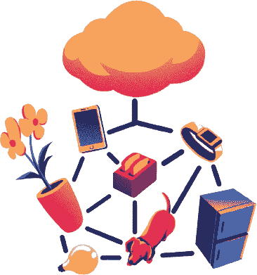

### 千奇新世界


在最乌托邦的愿景下，物联网（IoT）承诺了一个未来的家庭：你可以通过手机控制的连接家电器、让你在完美温度中醒来的智能恒温器，以及在早上自动开启、晚上自动关闭的灯泡。在离开海滩之前，你可以打开智能汽车的空调，这样当你准备好开车回家时，内部会凉爽。通过语音指令，家中的设备可以播放你最喜欢的歌曲、告诉你天气或点播电影。以下是你可能会遇到的一些“物”。

## 更智能的家居

作为智能设备最丰富的来源之一，家居在技术便利方面有着惊人的选择，而且每年都在增加——从在你醒来时（根据`Fitbit`的信号）煮咖啡的智能咖啡机，到连接互联网的冰箱、洗衣机、烘干机和烤箱。甚至还有连接互联网的低温箱，让你可以在数英里之外开始那顿慢炖晚餐。将你的`iPad`放入智能瑜伽垫的底座上，你就拥有了一个私人瑜伽老师，无需出门。

## 更智能的汽车

不只有家在变聪明。如果你在过去几年里买过新车，你就知道它的功能都连接到了互联网。现在的汽车拥有自己的互联网连接和智能手机应用。忘记停在哪儿了？别担心，你的智能手表记得！

## 更智能的宠物

大多数宠物都植入了芯片——这使得在它们丢失时很容易与它们重新联系。但“宠物互联网”并不仅于此！射频识别（`RFID`）和芯片激活的宠物门只允许你选择的宠物进。与标签相关的访问问题是宠物可能会丢失这些标签，而且更换的成本很高。有一只吃得太多的宠物？宠物互联网也可以通过智能喂食碗解决这个问题。

## 更智能的你

现在有很多可穿戴健身追踪器，如`Fitbits`或`FuelBands`，或者`Misfit`健身和睡眠追踪器。但连接互联网的设备远不止此。智能医疗设备已经存在，而且正变得越来越聪明——比如起搏器或胰素泵，它们可以与医生共享医疗数据。当然，这些发展并非没有问题（更多信息请参见第 84 页](#cap05.xhtml#page84)）。

# 智能技术在美国家庭中的普及程度如何？

随着物联网将线路贯穿我们的日常生活，我们家中的物体也变得完全连接——并相互关联。

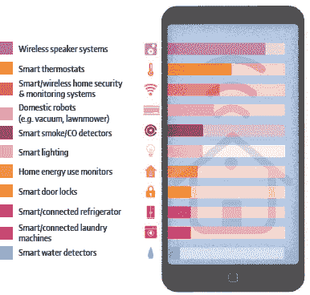

## 安全基础

### 退出机制

对于防止智能物体将你的数据保存到云端并与制造商共享，你真的做不了什么。对于那些担心在家里或办公场所被被动监控的人，这里有几点建议。

- **深入研究**：尽一切努力了解你感兴趣的设备，特别是制造商的数据使用政策。
- **点击静音**：如果可以，在设置中退出被动收集的数据。你可以使用离线或飞行模式，这不会让它们连接到互联网——尽管这样做会丢失一些功能。这些智能设备的很大意义就在于连接互联网。
- **更改密码**：务必更改设备和路由器的默认密码。

许多产品都有默认密码。立即更改以防止黑客盗取你的数据并劫持你的设备制造麻烦。


## 连接的成本

谁不喜欢这些酷炫的东西？除了有时昂贵的价格，还有什么缺点？

### 不安全的数据

许多技术还很新，漏洞仍在解决中……经常意外出现。毕竟，`蓝牙`和智能手机应用是很棒的工具，但它们的设计并非为了保护机密。随着语音命令变得越来越普遍，大多数人还没有想 Alexa 是否会停止监听。如果麦克风一直开启，互联网连接一直在线，所有数据会发生什么？有人在听吗？如果是，他们是谁又能做什么？有很多问题，而答案才刚刚公开。

### 耳朵

在如今竞争激烈的商业环境中，“消费者数据收益模式”是任何寻求资金发布新产品或公司的数字创业者的大卖点。换句话说，大多数新型追踪器和传感器计划将你身上收集的数据用于其他用途——例如卖给营销人员。有些用途更具恶意。

### 总结

我们的世界充满了智能物体和传感器（尽管它们确实有助于改善生活），问题在于数据。我们需要收集了哪些数据、存储服务器是否安全、这些数据将如何被使用，以及最终归谁所有。目前，收集、使用和所有权掌握在制造企业手中。大多数企业受金钱驱动——而你的数据就是钱。

这些设备还有其他问题。最近，我想打开我的`Hue`连接灯泡。但在我操作之前，我被迫更新软件——将一次滑动操作变成了五分钟的更新！虽然`Nest`恒温器对于远程监控和控制家中的冷暖非常棒，但黑客获取数据访问权限可能会让我的家成为小偷的目标。`Nest`甚至可能被篡改用来监视我。

这些设备可能是智能的，但它们没有道德。大多数人会在私人家中偷听私人谈话时感到不适，但这些物体内部并没有内置此类伦理准则。是制造商的员工决定了哪些听取是可以接受的、存储哪些数据、如何存储以及如何处理这些数据。

## 很有用

**多奇的娃娃！** 科幻小说中充满了关于儿童智能玩具被用于行善或作恶的故事。随着使用`Bluetooth`和手机 App 与孩子通信的玩具浪潮到来，这一概念离现实又近了一步。最早“智能”娃娃之一是`My Friend Cayla`，它可以连接到互联网并传输孩子提供的信息，就像一个带有家长控制功能的更可爱的`Siri`版本。更高级的选项包括`Hello Barbie`，这是一个世界著名娃娃的模型，它使用预设的台词与孩子交流，同时建立一个云端信息库，以便更好地针对个人定制这些对话。对这些玩具的担忧包括：不确定存储了哪些信息、这些信息将如何被使用，以及它们防盗的安全性如何。此外，黑客发现他们能够从房屋外部劫持控制`Barbie`的`Bluetooth`信号，并用娃娃的声音随心所欲地对孩子“说话”。

## 核心概念

**被劫持的设备** 如果黑客入侵你的设备，面临风险的不仅仅是你的数据。他们还可以利用这些设备来攻击网站。这种分布式拒绝服务（`DDoS`）攻击发生在计算机或其他连接互联网的设备被设定为反复请求特定网站时。来自被黑客设备的数百万次请求会淹没服务器，导致网站崩溃。2016 年，一种名为`Mirai`（日语意为“未来”）的恶意软件利用`IoT`连接启动了一场大规模的`DDoS`攻击。它识别了六十多个默认用户名和密码，并在一个名为僵尸网络的范围内接管了婴儿监视器、`DVRs`和安全摄像头等设备。2016 年 10 月，这个僵尸网络袭击了 DNS 服务供应商`Dyn`，以及`PayPal`、`Spotify`、`Wired`、`GitHub`、`Twitter`、`Reddit`、`Netflix`、`Airbnb`等。至少有 120 万台`IoT`设备可能仍然被`Mirai`感染。

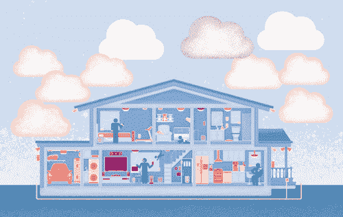

## 甜蜜的网络家园

除非你对高科技产品痴迷且有足够的薪水支持，否则你的家里可能不会连接得这么密。尽管如此，你连接到物联网的数量可能比你想象的要多。随着`IoT`技术变得越来越廉价且无处不在，会有越来越多的设备将相互通信。

### 卧室

- 智能成人玩具
- 智能床垫（睡眠追踪器）
- 智能瑜伽垫

### 洗衣间、储用间

- 洗衣机
- 干衣机
- 真空器

### 儿童房

- 婴儿监视器
- 智能娃娃
- 保姆熊摄像头

### 车库

- 车辆（带有`GPS`、音响、`Bluetooth`电话连接）
- 车库门
- 智能割草机
- 热水器

### 人体

- `Bluetooth`耳机
- 健身记录
- 智能手机
- 智能手表
- 医疗设备
- 助听器
- 戴着智能尿裤的婴儿

### 客厅、书房等

- Nest/恒温器/空调
- 娱乐系统/电视
- 个人电脑
- 游戏机
- 智能电视
- 运动设备（椭圆机、跑步机）
- 宠物出门（与宠物项圈同步）

### 浴室

- 智能体重秤
- 智能镜子
- 刷牙器
- 智能口气仪（告诉你是否有口臭）

### 处处可见

- `CO` &烟雾探测器
- 无线扬声器
- 智能灯泡
- 智能暖通风口（开关以将热量转移到凉爽区域）

### 厨房

- 冰箱
- 咖啡机
- 低温烹饪
- 洗碗机
- 烤箱/炉灶

### 户外

- 灯
- 摄像头
- 门窗报警器
- 喷淋器
- 正门（也有宠物门；见上文左侧）

## 真人故事

**糟糕的震动** 无论你是否征得，你的设备发送给制造商的数据隐私性如何？这个名字有趣的“远程性学”（teledildonics）领域正在探索通过智能手机 App 或`Wi-Fi`控制性玩具的方法。有些设备甚至涉及摄像头，允许伴侣之间分享所谓的私密视频。但像许多其他`IoT`设备一样，用户面临着两个大问题：制造商倾向于在安全方面投入较少精力，而且他们可能在你不知情的情况下收集数据。2016 年，`DEF CON`的黑客决定破解一个智能震动器，以此作为关于性侵的话题开端。他们对接管该设备如此简单并不感到意外，但令他们意料且震惊的是，它在秘密收集用户偏好设置和其他因素的数据，并将其上传到公司。

## 让智能设备变得更聪明

“智能物体”、“智能设备”、“联网设备”——这些都是用来描述连接到并使用互联网的对象的术语。某些设备通过你的路由器从家庭网络直接连接到互联网，而另一些则通过智能手机上的 App 连接到互联网。当这些设备连接到互联网时，你可以远程控制它们——或者编写它们自动执行某些任务。例如，你想设定灯光在黄昏时自动开启，无论你是否在家里。智能灯泡连接到提供日落时间的网站后就会变得更智能。网上有数百种这样的程序。

### 让智能物体变得更聪明

`IFTTT`（意为“如果发生……那么”）是一种免费的基于网页的服务，允许你创建 applet 来将你的智能设备连接起来。这提供了一个有趣的机会。

# IFTTT、IoT 和移动操作系统

Apple 的`iOS`拥有最大的`IFTTT` applet 份额，其次是`Android`操作系统，其他所有（如`Windows Phone`）目前落后。

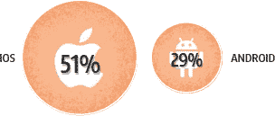


```
IF THIS...
```

# 房屋住户从一个房间移动到另一个房间

……那么上房间的通风口关闭，新房间的打开。


## 如果发生这种情况……

房间内未检测到住户。

……那么 Roomba 启动并开始清洁地板。

# 值得了解的知识

### 许可访问

在对数据隐私产生所有这些担忧下，也有一些好消息：许多公司正在研究技术解决方案，以帮助在数据共享方面实现更多的控制和安全性。`UMA`代表“用户管理访问”（User-Managed Access），是一种`OAuth 2.0`协议，它定义了开发者如何让智能物体能够参与安全的选择性数据共享。该协议让软件和硬件开发者能够更容易让智能设备所有者指定他们想要共享的数据以及想要限制访问的数据。`UMA`的使用消除了物品制造商的安全性负担，并让消费者或所有者对其个人数据的泛滥拥有更多控制权。`UMA`是一种现在就可以使用的协议，事实上——我们只需要让更多制造商在产品中使用它。购买时请留意它，以获得更高的安全性。

尽可能频繁检查你拥有的所有设备的隐私设置，并将它们设置为尽可能高的限制，以最大限地减少谁能看到和使用你的信息。

# 增长的连接

随着具备`IoT`能力设备数量的增加，设备之间的实际连接数量也在不断增加——而且速度很快。

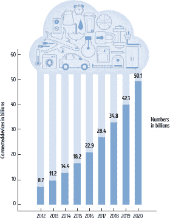

### 处于监控之下

在我们周围，关于我们的活动和行为的数据正在被收集。从我们去超市所走的路线（`Waze`、`Google Maps`）到我们发信息的对象（`Facebook Messenger`、`WhatsApp`），构建我们使用的软件的公司一直在追踪和监控我们。其中大部分被用于所谓的“监控营销”。

#### 可能与你的兴趣相关

监控营销发生在`Google`、`Facebook`、`Amazon`以及其他网站观察你使用其服务产生的信息（数据）时。`Google`是该领域的先驱，在 21 世纪 0 年代就使用了当时被称为“情境营销”的技术。在`Gmail`发布后，`Google`开始监控消息的内容和背景，以便根据所有这些消息显示广告。如果你给你妈妈发了邮件关于即将开始的巴厘岛度假，`Google`可能会向你展示有关特价机票、旅游或南太平洋度假活动的广告。在引起一些抗议后，该公司停止了这种特定的做法。但事实仍然是，如果你在购物网站上搜索完美的雨靴，在未来的一年时间里，你可能会在一系列网站上被雨靴广告“跟踪”。

#### 请提供信息

关于你的数据不仅在互联网上被收集，当你使用手机和智能设备时也会收集。你的智能恒温器、你的汽车、你的灯泡和你的健身追踪器正在监视你并报告给……某人。想象一下这种事的线下版本——一个公司代表偷听你的私人对话，并跟着你看你买了什么。在现实世界中，你不会容忍这种行为，但它已经成为你在线上预期的一部分。

#### 老大哥想看

物联网（尤其是`IFTTTT`设备）通过监控和响应你所做的一切来工作。但这也意味着其他人可能正在监视。2016 年，前 FBI 国家情报局局长`James Clapper`向参议院委员会通报，政府早已知晓利用`IoT`和`IFTTTT`监视用户的可能性。隐私倡导者对此做出回应，鼓励消费者使用端到端加密的智能设备，并推动制定更多隐私法。

# 杀手级应用

### 甩掉追踪

如果有一个可怕的家伙在跟踪你，你可以躲进安全空间来逃避。但在线间谍并非立而易见的，所以你如何甩掉他们？如果你想尽量减少在网上被追踪的次数，请使用如`Adblock Plus`的广告拦截器以及如`Ghostery`这样的网站追踪浏览器插件。但请注意，如果你使用广告拦截器，某些网站将故意提供较少的功能或直接禁止你的浏览。如果你担心`Facebook`使用你的个人数据（或任何你已授权访问其`Facebook 数据`的应用），请从智能手机上删除`Facebook Messenger`，并使用如`Signal`、`Wickr`或`SMS`等安全消息系统。如果你想保持真正的隐身，你可以随时使用`Tor`（更多信息请参阅第 170 页](#cap12.xhtml#page170)）。

### 判断对错：智能家用电器目证了谋杀案

正确（某种程度上）2015 年底警方知道的只有`Victor Collins`和`James Bates`度过了一个晚上，泡在 Bates 的浴缸里听着由`Amazon Echo`流出的音乐。根据`Bates`的说法，他早早睡了。当他第二天早上醒来时，`Collins`显然已经不在了。警方怀疑`Collins`在死前发生了争斗。调查人员向`Amazon`发出了搜查令，但`Alexa`是否记录了任何内容？

### 判断对错：你可以黑入起搏器

正确。虽然这是事实，但尚未发生在某人身上。许多医疗设备具有无线功能，可以与医生共享信息。已故黑客`Barnaby Jack`在此进行过开创性工作，2016 年，安全公司`MedSec`黑入过起搏器和除颤器，然后授权给一家华尔街基金。该公司做空了制造商的股票。`St. Jude`否认这一点，但`FDA`和`DHS`证实了这些黑客。`Barnaby`最著名的黑客是针对胰岛素泵的，在实验室导致了致命剂量的胰岛素注入。


# 在路上

随着物联网的增长，它延伸到影响我们的车辆也并不意外。我们的汽车、卡车和 SUV 不仅是公司挖掘更多数据的来源，还让驾驶员面临一系列新威胁。

### 数字汽车劫持

2015 年，《Wired》杂志的记者`Andy Greenberg`自愿驾驶一辆`Jeep Cherokee`，让黑客尝试控制它。黑客`Charlie Miller`和`Chris Valasek`能够通过笔记本电脑在十英里外控制；`Greenberg`无法阻止这对组合控制空调、收音机、雨雨刮器，甚至停止变速箱。同样的漏洞以前在 2013 年就曾展示过，当时黑客在`Greenberg`驾驶的情况下访问了一辆`Toyota Prius`的刹车、喇叭、安全带和方向盘。直到最近几年，立法者开始为汽车设定电子安全标准，一些汽车制造商甚至发布了召回。尽管如此，黑客接管控制权以控制、跟踪驾驶员或盗取相关数据的风险仍然存在。目前为止，这些黑客仅是为了帮助了解汽车的漏洞。然而，想象你可能在高速公路上飞驰，而在毫无警告的情况下，车门锁上、刹车失效、转向锁死、安全带松开，这不再是烂电影的情节了。但嘿，你仍然可以你的`Spotify`歌单，所以这挺好的。

# 自动驾驶汽车

任何关注此领域的人都知道，自动驾驶汽车时代终于到来，因为越来越多的公司正在效仿 Google 的广泛测试。当然，安全问题是首要任务，且目前已经发生过多次轻微的追尾事故（主要是自动驾驶汽车被有驾驶员的汽车追尾），还有关于汽车闯红灯或停止标志的报道。2015 年，一辆处于“自动驾驶”（半自动驾驶）模式的特斯拉曾卷入一起致命事故，但经过大量调查后，制造商被免除了责任。事实上，统计数据显示，配备自动驾驶功能的汽车发生事故率实际上低了 40%。

# 核心要点

由于物联网是一个相对较新的现象，保持安全的方法主要包括做好研究并运用常识。

## 基础安全

- 在购买前先进行研究。
- 将调制解码器和路由密码更改为出厂默认值以外的内容。
- 在所有移动设备上使用锁屏密码。
- 隔离 IoT 应用程序。

## 高级措施

- 确保医疗设备仅锁定关键服务。
- 询问设备提供商关于无线安全的问题。

## 锡帽军（极端安全派）

- 设置一个独立的家庭网络，并配备独立的防火墙，将所有 IoT 设备置于防火墙之后。
- 将 IoT 设备放在虚拟局域网（LAN）段。
- 安装监控软件，收集通过网络从设备发送的数据包。

# 冷知识

飞行敌对天空。围绕智能车辆和设备的问题不仅限于地面。无线黑客入侵了美国和英国的空中交通控制系统，向飞行员发送虚假的飞行信息。这些“幽灵传输”要求飞行员改变落地计划并偏离路线。直到为止，空中交通攻击的案例很少；只有二十次幽灵传输被正确识别，从未有人被当场抓住，更不用说起诉了。破解飞行员信号的设备大约需要 450 美元——这对于一个坚定的破坏者来说完全可行。真正的问题是，目前没有技术可以阻止进行这些传输的未授权人员。

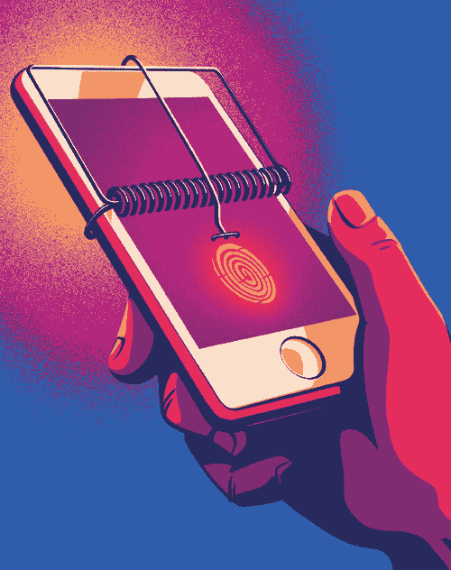

# 第 6 章：不仅仅是打电话

别管你的智能手机比动力太空穿飞机的电脑还要强大。手机真正的问题在于，它们包含了你生活的整套元数据。


自 20 世纪 50 年代以来预测的口袋电脑时代在 2007 年随着第一代 `iPhone` 的发布正式开始。今天，全球各地的人随身携带着可以访问互联网、全球定位系统（GPS）以及数亿个附近设备的设备。我们已经过了拐点：如今越来越多的人使用手机查看网站，而不是使用桌面电脑或笔记本电脑。

我们寄付给手机的数据比传统上存储在家庭电脑上的数据还要多。手机确切知道我们在哪里、去过哪里，并可以确切知道我们要去哪里。它们知道我们银行账户里有多少钱，我们在 `Amazon` 上买了什么；它们可以打开我们的大门并启动汽车；它们知道地板上有多少灰尘，以及烟雾报警器的电池是否有电。它们可以在我们与世界上任何其他人之间传输和接收语音和短信。它们越来越多地知道我们是否需要买一夸脱牛奶，或者有多少人阅读了我们在 `Facebook` 上发布的那个故事。天哪，关于我们的数据真是太多了。口说，这些手机是安全的吧？

嗯，并不如此。事实上……如果你不小心，你的手机可能会给你带来一些严重的问题。

## 皮卡丘，我选择你！

你可能看过一部或几部科幻惊悚片，其中坏人使用某种聪明或恶心的方法利用受害者的指纹破解安全防护。但事实证明，你不需要成为超级反派或高科技专家也能成为网络窃贼。2016 年，《华尔街日报》报道了一个六岁女孩利用她睡觉的母亲的指纹解锁妈妈手机的故事。随后，她在 `Amazon` 上订了价值 250 美元的宝可梦玩具。当她的父母收到十三个不同的订单确认时，他们认为账户被黑客了——直到他们的女儿自豪地宣布她正像妈妈一样在购物。拥有早熟孩子的父母可能想要重新考虑他们的密码策略，午睡时戴上手套，或者只需确保将他们的智能手机安全地存放在触碰不到的地方。

在手机丢失或被盗的情况下，确保隐私和安全的最佳方法是设置一个良好的密码或安全图案——只要你把它设置得越复杂越好。

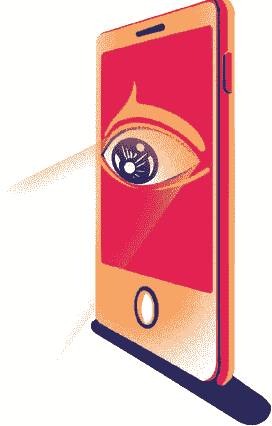

## 手机基础设置

所以，你刚买了一部新手机！恭喜你。在设置时，你应该记住一些事情，以便让安全从一开始就成为你操作手机的基本方式，而不是以后再尝试修补。

### 先锁定

启用手机的“锁定 SIM 卡”选项，这将要求每次手机重启时都需要密码才能访问 SIM 卡。这在手机锁屏之外是额外的。SIM 锁保护网络访问卡，而锁屏保护手机本身。

### 接着保护屏幕

启用手机的锁屏，防止窥探者、爱管闲事的和坏人翻看你的东西。如果你可以使用密码或短语（而不是 `PIN`），请这样做。

### 不要被指纹识别

许多手机型号提供指纹识别作为快速解锁和访问手机的方法，但尽管很方便，你应该禁用该设置并依赖密码保护隐私。如果你使用 `PIN`，请设置为六位数或更多。（更多信息见第 98 页](#06）。

### 保持神秘

除非特定需要，否则禁用位置设置。通常你会在特定的应用中使用位置——但值得这些麻烦。

### 按需使用

你还应该关闭手机的 `Wi-Fi`、网络共享、热点、`蓝牙` 和近场通信（NFC）设置。这些功能都有用，但你应该只在需要时激活它们，而不是一直开启。

### 屏蔽

最后，考虑屏蔽手机来电显示以保持最大的隐私。你拨出的电话在对方端会显示为“未知”或“私人号码”，结果他们中的一些无疑会忽略你的电话。这属于“高级”甚至“锡帽军派”级别的安全，适用于那些真正想要隐身的人。你会留下很多留言，因为大多数“私人号码”都是催收员、骗子、诊所和警察。

# 提示

在表中，米色的应用程序通常配置为保护你的隐私。黄色项目只要你注意设置并理解为了乐趣或便利所付出的代价就是安全的。橙色项目已知隐私控制不佳，或会向广告商或政府出售用户信息。

| 应用或功能 | 示例 |
| --- | --- |
| 安全邮件 | `K-9`, `Proton`, `SafeMail for Gmail` |
| 隐私应用 | `Ghostery`, `Dash VPN`, `TorGuard VPN`, `Orfox: Android 版 Tor 浏览器`, `Orbot: Tor 代理`, `Red Onion` |
| 安全聊天 | `Signal`, `WhatsApp`, `Wickr` |
| 交通 | `Uber`, `Lyft` |
| 社交媒体 | `Facebook`, `Twitter`, `Instagram`, `Kik`, `Reddit`, `Vine`, `Tumblr` |

# 间谍软件

## 示例

- `FlexiSPY`, `mSpy`

## 游戏

## 示例

- `Fruit Ninja`, `Angry Birds`, `Despicable Me`, `Words with Friends`

## 手电筒

## 示例

- `Flashlight`, `Brightest Flashlight`

## 安全基础

### 查找我的手机

在过去的几年里，有很多知名案例显示用户通过“查找我的手机”应用程序定位了被盗的智能手机（包括 iOS 和 Android）或平板电脑。运行这些程序通常是个好主意，因为事实证明，小偷或非专业窃贼在使用偷来的手机时通常并不那么小心——他们只是开机然后用。事实如此。

当你的手机被盗时，务必去警察局填写盗窃报案。当你定位到被盗的手机时，你不希望和警察的第一次对话是关于你的手机被盗了。相反，你想说：“嘿！你们记得我在报告 `MP1735068` 中报失的手机吗？我找到了！它在主街 356 号。”这样在警察帮助你找回设备方面，成功的机会更大。

### 应当了解

#### 你的智能手机里有什么？

一位智者曾声称过：“你并不是你钱包的内容”，但那是在智能手机出现之前。你的钱包可能有几张照片、一些现金和各种卡：身份证明、保险、借记卡和信用卡。所有这些都有意义，如果钱包丢失或被盗，应该更换，但这与你的智能手机可能包含的内容完全无法相比：数百张照片和视频、数百封甚至数千封电子邮件、带有个人信息的已打开应用程序（如银行）、你拥有的每个在线账户的密码，以及持续访问发送到这些账户的任何后续敏感信息。简而言之，对于任何偷窃或闯入手机的人来说，你就是手机的内容。要比你的钱包更贴身、更安全。

#### 手机不是钱包……除非它是钱包

你的手机本身并不不安全，但你需要理解特定应用程序带来的相对风险，并将其与使用它获得的奖励进行比较。当你考虑使用新应用时，请考虑以下几点：我得到了什么，到底付出了什么代价？

这和向超市提供个人信息以换取会员卡是一样的。你享受了优惠，但商店对你买了什么以及没买什么有一份完整的档案。他们知道你购物的日子和他们可以指望你花费的金额，并且他们对如何增加这个金额有很好的把握。那些数据由他们随意处置，他们经常将其卖给出价最高者。

#### 押在你身上

当你的银行要求你尝试他们的新应用时，他们显然希望你使用它，因为这让他们了解更多关于你的信息。风险是什么？如果应用程序被破解，银行总是会赔偿你的损失。如果你发现通过手机存款支票或转账很方便，那是一笔划算的交易。但你需要理解你给了他们什么，以及最坏情况下的代价。`Google Wallet` 或 `Apple Pay` 真的像 `Google` 和 `Apple` 听起来那么方便吗？这取决于你的情况——如果你住在大城市，当然；在农村？可能不会。

#### 你需要什么？

你是否有一个用你的手机玩多人在线游戏的孩子，或者这是一个带有几个应用程序和良好密码的商务手机？每个人的需求都不同，一个人的便利可能是另一个人的巨大显眼目标。认真考虑你想从应用程序中获得什么以及你如何使用你的设备。例如，使用不同的移动设备处理银行等敏感应用，并且仅使用该设备处理此类事务——这带给你很多便利但风险更小。

# 这只小猪上网了

在过去的几年里，使用手机银行业务的人数已经超过了面办的人数。

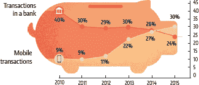

你可能对手机的基本功能有很好的了解，但它仍然可能某些功能让你感到惊讶——以及它如何影响你的数据安全。这里是你可能想要检查的一些安全风险。

# 功能

### GPS


- **用途**：定位和导航
- **你应该知道**：你的 GPS 为手机中的任何应用程序提供位置——包括你可能不知道的应用程序。某些手机会将你去过的地方记录在手机文件中并上传到云端……某个地方。
- **做法**：授予应用程序使用位置的权限时要谨慎。除非你正在使用它们，否则请关闭位置服务。

### WIFI


- **用途**：连接网络
- **你应该知道**：你经常需要 Wi-Fi 来减少移动流量的使用，但 `Android` 手机使用 Wi-Fi 来更精确地定位你。通过感知可用 Wi-Fi 热点的相对强度，它们可以比仅用 GPS 更精确地测出你的位置。
- **做法**：除非在使用，否则保持 Wi-Fi 关闭状态；拒绝“使用 Wi-Fi 增强定位”的权限。

### 摄像头


- **用途**：拍摄照片或视频
- **你应该知道**：手机可以为照片添加元数据，包括位置、日期和其他个人信息。
- **做法**：查看手机设置以限制添加照片的 `EXIF` 数据。

### FACEBOOK


- **用途**：社交网络
- **你应该知道**：Facebook 对你个人数据的索取程度就像米德堡之外的人一样。
- **做法**：只有你才能判断 Facebook 是否值得你交出所有数据。

### 麦克风


- **用途**：说话、录音
- **你应该知道**：手机的麦克风（通常不止一个）是高质量的定向和全向麦克风，能够捕捉清晰的音频。任何获取你麦克风的黑客都可以将其作为非常强大的监听设备。
- **做法**：这是最难缓解的。锡箔帽联盟成员建议完全移除手机的麦克风，并使用耳机自带的麦克风。

### 银行应用


- **用途**：资金管理
- **你应该知道**：银行应用可能非常方便。它们也被破解过，导致数据被转发到你可能不想去的地方。
- **做法**：使用这些工具时要小心，永远不要用于商务（银行不为商务账户报销）。

### 对错：警察搜我的手机需要搜令吗

**对**。美国最高法院在 `Riley v. California (573 U.S. [2014])` 一案中裁定，在没有搜令的情况下，警察通常不允许搜查逮捕时没收的手机数字信息。与逮捕相关的搜查例外不适用于这些案件。第四修正案在案中是关键；法院的裁决制止了极具争议的做法——例如在路边上利用技术手段倾倒手机内容。了解你的权利：如果警官（或 TSA 员工）询问，说你很乐意配合搜查。即使你被捕，他们不能直接搜查你的手机。不要让他们这样做。

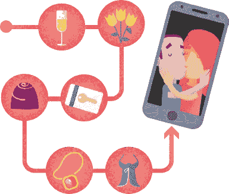

# ERIC OLSON 论元数据

理解元数据的最佳方式是将其视为描述其他数据的数据。像“一个迷人的故事”这样的电影评论短语，可以被认为是关于一部时长两小时电影的元数据，这部电影讲述了一个巧妙且复杂的故事。元数据是一种高层描述或抽象，能够让你对数据本身产生理解。如果我正站在一家书店里，明天必须给老板交一份报告，我在想这些书中有哪一本包含了我需要的内容，我可能在考虑十一个因素：这书能放进我的公文箱吗？我认识作者吗？他们是可靠的来源吗？这东西会不会太重，导致我在洗澡时拿不起来？

所有这些都是关于书的因素，与书中的内容无关。因此，对于每一个数据项，都有数据项本身的信息或内容，还有大量围绕它的信息，这些信息关于它，但不属于它。

## 窃听

如果我们从手机的语境下看元数据，会发现它可以极其强大。最为人知的例子是政府查看你的通话记录元数据。如果你接到医生或血实验室的电话并通话了三分钟，然后你给药店打了电话并通话了二分钟，接着你给一个艾滋患者倡导组织打了电话并通话了十九分钟，政府可能会认为你刚刚确诊了艾滋病毒（HIV）。

同样，如果你接到一个已知毒贩的电话，持续了一一或两分钟，然后你给三个朋友打了一系列电话，每个人的通话时间不到两分钟，这可能导致调查人员认为你刚刚同意购买毒品并与朋友分享。

## 学习你的习惯

元数据不必与法律事务有关；它可以描述生活方式的选择和行为。想象一下，如果你的医疗保险公司可以获取通话元数据或你超市会员卡的信息，他们就可以根据你点中餐外卖的频率或购买了多少冷披萨——或者你是否续了健身房会员来设定你的费率。你认为私家探员如何看待手机元数据：显示你购买了香槟，随后是花，然后给 Squeezy Acres 旅馆打了三分钟的电话，接着在一家巧克力、珠宝和性感内衣的供应商那里在线购物……最后给某位绝对不是你妻子的人发了一系列短信？

## 简单的摘要

元数据并不一定复杂；事实上，一个单独的字符就能提供丰富的信息。例如，你在某门课程中获得的 `B` 等是描述你整个学期工作的元数据。它长期以来被用来识别学校里需要额外帮助的孩子。在“枪支持有者”之类的字段中输入 `1` 而不是 `0`，可能会改变警察对待房屋或汽车的方式。当然，这种简化的“开/关”元数据偶尔可能会出错，特别是当最初由人类用户输入时——考虑上述例子，即在靠近你的房子或汽车时，警察是否认为你是一个枪支持有者。

## 一切取决于你如何使用它

尽管如此，元数据的用处其实多于坏处——例如，元分析（对来自多个来源的元数据的聚合和分析）可能是理解药物整体效性的最佳方法——看看考科林协作组织（`http://www.cochrane.org/`），你就能理解对药物试验的元数据进行检查和聚合如何帮助产生更好的健康结果。元数据和技术一样，是一个双用途问题。它的“好”或“坏”取决于语境和你的视角。——Eric Olson

## 真实故事

## FBI 对阵苹果公司

关于执法部门访问手机的公共辩论在 FBI 试图根据《所有指令法案》（All Writs Act）强制供应商为警方提供加密 iPhone 的“后门”后达到了顶峰。此案源于 FBI 试图为 2015 年 12 月在圣贝纳迪诺袭击政府办公楼的枪击案凶手所使用的 iPhone 寻找可能的证据。

FBI 试图强制苹果公司破解该设备的强加密。苹果公司拒绝了，认为后门等同于给警察提供万能钥匙。警察认为苹果公司正在为犯罪分子创造一个安全空间。

最后，FBI 从黑客手中购买了一种工具来破解 iPhone 的保护，并获取他们寻求的数据。争论尚未结束；双方仍在等待一个重大的测试案例，最终由美国最高法院进行裁决。

## 真实故事

## 出卖你手机的灵魂

某些应用程序的特点是，当你下载并安装它们时，它们做的比你预期的多得多。例如，一个著名的手机手电筒就是这种不受欢迎惊喜的典型。`Brightest Flashlight` 应用被联邦贸易委员会估计下载了数千万次，它偷取了身份数据、位置信息、日历信息、摄像头和麦克风访问权限、电子邮件和网络监控——本质上是将你的整个手机都交给了该应用。应用程序制作随后将所有这些信息卖给广告商。教训是？如果你决定安装外部应用程序，请检查它请求的权限。使用只请求与其任务相关的权限的应用程序。如果一个应用程序可疑，请提问或寻找权限较少的程序。

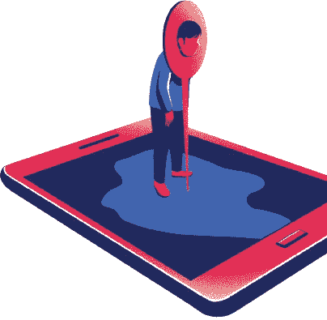

## 你口袋里是詹姆斯·邦德，还是你只是看到我很很高兴？

当拥有国家安全许可的人员进入安全隔离设施（SCIF）——我们在电影中看到的那些安全房间时，所有手机都会被没收。如果检测到手机，所有者将面临大麻烦。这是因为随着手机变得越来越，它们提供了许多人经常忘记的奇妙间谍工具。

### 利用电子窃听

想记录会议吗？有一个应用可以做到。把手机放在桌子上，关闭屏幕，你就可以秘密地获取高真录音。还有一些免费或低价的应用可以记录所有拨入和出的通话，将你的号码伪装成你想要的任何号码，检测移动网络和信号，并进行其他许多酷炫。

### 追踪目标

你想监控别人的手机吗？如果你有访问权限（并且道德灵活），你可以轻松下载并安装可以追踪（比如）你的伴侣或孩子的应用程序。如果你完全没有道德，你可以在同事或雇主的手机上放置间谍软件，进行工业间谍活动。当然，这是双向的：你的主主可以在你的手机上放置间谍软件，只要他们拥有这部手机，在几个州可能是法的。间谍软件可以让你，例如远程激活手机麦克风并监听对话，或访问 `GPS` 来追踪位置并设置`地理栏`，当目标离开指定区域时向你发送短信。

### 获取秘密

如果你在别人的手机上设置了间谍软件（或者有人对你的手机这样做），你还可以窥视社交媒体帐户，通过键盘记录器窃取他们输入的密钥，破解密码并访问其他精彩功能。你拥有了一套强大的监控设备，这在过去需要穿上西装并旋转胡子——或者至少需要国家级的资助。

## 不要仅仅打电话

尽管如此，我们作为用户仍然在出错，将智能手机视为“电话”而不是“计算机”。它们无疑是后者，并且能够完成计算机能的所有事情——我们永远不应该忘记。

# 杀手级应用

# 移动安全应用

许多应用程序可以让你感到更有安全，无论你担心的是自己的公民自由还是钱包。定期查看 `iTunes` 或 `Google Play Store` 以学习新应用程序绝对是个好主意——只需使用“安全”（safety）、“间谍软件”（spyware）等关键词即可。阅读在线评论了解可能的漏洞，并根据你的需求寻找最佳功能，而且在安装应用时务必检查权限。

* **电子前疆基金会 (Electronic Frontier Foundation)**：`EFF` 的应用程序会向你通报民权问题，并帮助你向政府领导人发送推文。
* **美国公民自由联盟 (ACLU)**：美国公民自由联盟允许你记录警察执法活动，并将其实时上传到云端服务器，以记录警察的滥用或暴力行为。
* **bSafe 个人安全**：此应用以及类似的应用可以识别你网络中的人员，帮助你保持安全、集体旅行并寻求帮助。
* **其他安全与隐私应用**：还有许多个人安全应用，既有来自城市提供的（例如供旧金山湾交通系统乘客使用的 `BART` 安全应用），也有来自私人机构提供的（例如 `ICE`——紧急情况应急应用）。

## 安全基础

### 保持安全连接


智能手机的`Wi-Fi`和`蓝牙`功能意味着你可以随时随地连接任何地方的任何网络或设备。毫无疑问，使用智能手机在线工作和娱乐极其方便。但你遇到的每一个公共访问点都是他人窥视你的机会，甚至在你在线时从你那里窃取敏感信息。此外，如果你开启了`Wi-Fi`，像`WiFi Pineapple`这样的产品可能会欺骗你的设备在你的不知情的情况下共享信息。为了在使用智能手机、笔记本电脑或平板电脑更加安全，请仅使用加密连接。使用`VPN`连接，或者始终跳过免费的公共`Wi-Fi`。你的手机在很多地方仍然可以使用自己的移动数据。根据你的套餐，费用可能会稍高，但增加的安全性通常物有所值。

## 双用途技术

间谍软件对于监控孩子或关注老年亲戚确实非常有用。但请记住，如果他们的手机或你的手机被黑客入侵，那将大量数据落入陌生人手中。在信息安全和情报行动中，这被称为双用途技术。一个经典的例子是`IMSI 捕获器`（手机窃听设备），它曾让爱德华·斯诺登感到愤怒。当你使用它时，你确实为政府拥有它而感到高兴，例如用于追踪绑架犯或猥童犯，或者在监狱中定位移动设备。但当政府关注你可能正在做的任何事情时，情况就不那么妙了——尤其是当你不想解释为什么昨晚出现在谢迪庄旅馆（Shady Acres Motel）时。这是一个经典的双用途困境。

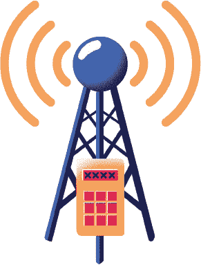

# 国家级威胁

在讨论监控和手机手机时，如果不提到爱德华·斯诺登（关于斯诺登的更多信息，请参阅第 182 页），讨论是不完整的。他在 2013 年盗了大量被美国政府分类为“机密”、“绝密”或更高级别的文件。无论你认为他是英雄还是叛徒，他都让我们见识了资金丰富的行动者（如有组织犯罪团伙和国家）的技术能力。

2016 年，斯诺登在 HBO 上谈到了这个问题，演示了如何从智能手机中移除组件以保持完全安全（你可以在 YouTube 上看到）。在`VICE`联合爱德华·斯诺登和谢恩·史密斯制的纪录片《监控状态》中，斯诺登描述了你为什么想要从手机中移除麦克风和摄像头（注意这些组件使用的是复数形式），并演示了具体操作方法。

“今天私生活的每个部分都在你的手机里，”斯诺登说，“以前人们说人的家是城堡。现在，手机就是他的城堡。”

## 窃听

斯诺登对`IMSI 捕获器`感兴趣，这种设备本质上伪装基站并拦截手机。在这里我们必须警告，斯诺登对警察如何使用`IMSI 捕获器`的理解完全错误的——美国警察使用`IMSI 捕获器`的频率远比斯诺登认为的要低得多。但他关于警察或个人可以轻松获取`IMSI 捕获器`以获取你发送的手机数据的这种和便利断言是正确的。解决方案是遵循符合你风险状况的安全协议，并虔诚地执行它们。

### 风险评估

如果你是一名活动人士、抗议者或针对活动人士/抗议者的人员，你应该认为受到攻击的可能性很高。如果你只是一个“足球妈妈”，受到针对性攻击的可能性并不意味着你不会面临威胁，例如恶意软件、间谍软件等。

### 保持安全

电子前疆基金会（`EFF`）在一篇名为《威胁建模简介》的文章中为这项练习提供了一个非常好的起点。为了让你了解这是如何运作的，我们使用加密。`EFF`特别推荐`Signal`，是因为它的加密实现、易用性以及“零知识”模型——即使`Signal`本身被破解，也无法读取内容。最后，正如我们一直提醒的，加密你的手机并使用强密码保护其内容。

# 你口袋里的间谍

我们联系了朋友`J.D. Lea`，询问他对手机间谍世界的看法。`J.D.`拥有`ComSec LLC`，从事技术监控业务——你知道电影里那种派人来扫窃器吗？

“手机间谍最糟糕的工具之一涉及一个名为`FlexiSPY`的程序，”他说亮点包括通话拦截、短信拦截（包括`WhatsApp`和其他流行的“安全”应用）、短信追踪、密码破解、可以远程设置为不响铃/不振动或不亮的数字录音器等等等等。这真是个坏东西！噢，它在`Android`和`iOS`上都能运行。另一个是`mSpy`，它可以追踪通话日志、GPS 位置以及关于个人生活的元数据——从日历更新、短信到电子邮件和网页历史。它同样适用于`Android`和`iOS`。

如果你决定使用手机进行任何购买、支付账单或银行银务，请在完成后立即登销网站，并且永远在手机上保存登录信息。

判断对错：

**正确**。这里的案例是`美国诉 Skinner`。`DEA`通过不断“寻呼”已知 Skinner 拥有的手机来跟踪其先生的车辆，当时 Skinner 正在从新墨西哥州开往德克萨斯州的公路上行驶。当 Skinner 晚上过宿时，警察到达，嗅毒犬发现了有毒品。警方进行了搜查；发现了毒品、枪支和手机；Skinner 和他的儿子 Samuel 被捕。在此案中，美国第六巡回上诉法院裁定，“如果用于运输违禁品的工具发出了可以追踪位置的信号，警察当然可以追踪该信号。”

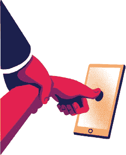

# 指纹 VS 密码

2014 年，一起案件在`弗吉尼亚州公诉 David Charles Baust`一案中提交到了弗吉尼亚州的美国第二巡回上诉法院。这并非一家联邦法院，而是一个重要的州法院。Baust 被指控试图勒死他的女友。州政府称，Baust 和他的女友在卧室里安装了摄像设备，受害者承认该设备拍摄的视频传输并保存在 Baust 的手机上（其原因正如你怀疑的那样）。州政府辩称，该设备捕捉了事件视频，因此他们为该手机申请了搜令。Baust 拒绝提供指纹来解锁并解密设备，声称密码和指纹受《宪法第五修正案》的保护，该修正案禁止强制自证其罪。州政府辩称，提供凭据并不具有“证词性”，理由很简单，由于事实已经证实视频就在手机里——录像的存在是一个“意料之中的结论”。

## 核心区别

在判决中，主审法官`Steven C. Frucci`对使用密码与使用指纹之间做出了非常重要的区分。法官裁定，根据判例，密码代表了证词性交流。该判决之所以做出，是因为密码——与身体测量数据、指纹或声音样本或手写样本不同——它不是物理实体；相反，它是存在于人脑中的某种东西。因此，强制被告披露其密码意味着政府正在强迫他作证并泄露可能自证其罪的证据。

另一方面，指纹不被视为证词。`Frucci`法官引用了广为人知的概念表示：“使用强制手段从被告处索取通信信息，与强迫某人从事可能导致其定罪的行为之间存在显著差异……这种特权并不能免受被强制接受指纹采集、拍照或测量、为了身份识别而书写或说话、出庭法庭、站立、采取某种姿势、行走或做出特定手势的强制要求。”

## 法律问题

简单来说，所有这些复杂的法律术语意味着，法院不能强制你提供锁的组合密码，但它可以要求你提供锁的钥匙。

根据这项判决，在美国被认为是一个非常稳妥的推断：政府可以让你提供指纹，但不能强迫你提供密码或访问密码。教训是？不要使用指纹或其他视网膜扫描、手印等生物识别标识符来保护你的数据。始终使用强密码。

# 核心要点

你生活中的几乎方方面都会用到手机，因此没有一套通用的安全协议。请深思熟虑并采取相应行动。

## 基础安全

* 使用良好的密码——永远不要用指纹。一个好的密码应该多于六个字符或数字，或者一个良好的图案。

* 加密你的手机。

* 使用手机查找 App 以防手机被盗。

## 高级措施

* 限制手机上可以下载的邮件天数。

* 在公共场所浏览时使用`VPN`。

* 尽可能对所有 App 使用`2FA`（双重身份验证）。

* 限制位置服务和 Wi-Fi 的使用。

* 确保图片保存有限的元数据。

### 锡箔帽军团

* 以上所有内容——并移除你智能手机上的摄像头和麦克风。

* 使用加密的`DNS`（仅对 Wi-Fi 有效）。

* 定期将手机重刷为出厂设置。

* 限制数据使用。

**在不使用时保持手机完全安全，请将其彻底关闭——然后尽可能取出电池以避免任何被动数据收集。**

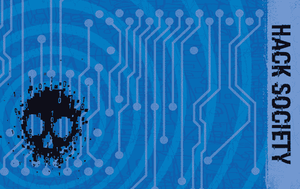

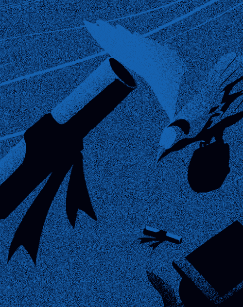

互联网的故事不仅仅关于笔记本电脑、手机和智能汽车。它还关乎设备背后的人，以及由于这些设备而我们所做的一切。由于互联网的发展，商业模式已经发生了巨大变化。在讨论软件许可、防病毒软件和密码强度之前，我们需要问一个基本问题：在今天，究竟什么才算作一项业务？

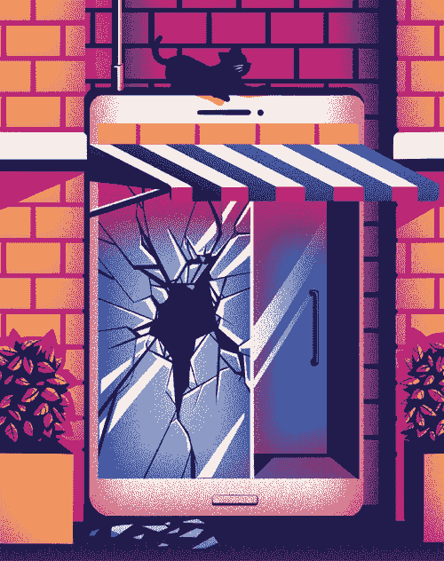

# 第 7 章：网络安全与你的业务

无论你是在家里销售工艺品，还是经营一家蓬勃发展的电子商务商店，你面临着独特的风险，并需要保护你自己和你的客户。

想象一下你是一名出租车司机。你不会想开着出租车去街角的小便利店买牛奶和面包，或者开着它穿过整个城市去办杂，对吧？出租车是你的业务载具，你只会将它用于业务。你的数字门面也是如此。让它成为业务专用的，并仅用于该用途。这可以限制任何接触坏事的潜在风险，尤其是因为这里是你购买广告、销售产品以及与资金交互的主要场所。

# 居家创业基础

无论你的业务规模有多小，保护它都至关重要。你可能会问：“谁会盯上我？”答案是“罪犯”。他们可以非常容易且高效地攻击你，正如我们富有远见的领导者过去描述核能时所说，它便宜到无法计费。互联网上实际上有一个搜索引擎，它的功能就是绘制那些连接到互联网的机器地图——它被称为`Shodan`，这只是你的联网冰箱实际上被黑客所知晓并极易受到攻击的一种方式。请保护好你自己。

## 商业常识

虽然大多数在线小企业主会对网络攻击采取至少一些预防措施，但许多人仍处于危险的暴露之中。以下是关于他们正在承担风险的一些估算。

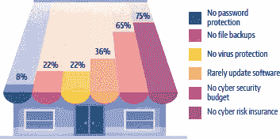

### 筑墙

你首先需要的是一个企业级的防火墙。这不需要很贵——你可以花大约 200 美元买到一个高质量的家用业务防火墙。但业务防火墙能做一些家庭防火墙做不到的事情——或者至少做得更好：为虚拟专用网络开启端口、检查数据包，并提供高于家庭用户需求的服务。

### 保持连接

你需要一种良好、可靠的连接互联网的方法。电缆调制调器用户可能会发现自己买一个（我使用的是`Motorola`制造的`ARRISS`模型）比从电缆公司租赁的好，因为连接实际上更好且速度更快。另外考虑一个托管的`DNS`服务。这允许对你的员工进行内容过滤，并将恶意软件活动降到最低。你需要一个性能良好的、至少支持`WPA2`预共享密钥（`PSK`）加密的优质 Wi-Fi 访问点。使用强密钥并至少每半年更换一次，以确保员工离职后无法再次访问你的网络。

### 让业务归业务

将你的工作与其他事务分开是为了维持专业感和安全氛围。千万不要让你的孩子或非业务用户或流量进入你的业务网络。再从当地电脑店那里请上几个小时的帮助——对你的业务网络和电脑进行检查以及任何必要的维护是完全值得的。大多数聪明人口中说出的最愚蠢的话就是：“我这儿没什么值得被偷的东西。”

## 安全基础

### 在线销售的准则

给我你的名字、职业和家家所在的城市，我很可能通过几次搜索就能找到关于你的几乎任何信息。给我你的电子邮件地址，我可以在几分钟内获取你的社会安全号码和完整的信用档案。而且我用得都是合法的网站。想象一下罪犯能做些什么。

即使是通过本地广告出售像烧烤炉架之类的物品，也要非常小心你向他人透露了自己的信息。如果你正在进行在线交易或开始创建在线约会资料，请考虑创建一个全新的匿名电子邮件地址。只使用你的名字首字母，并对你提供的信息要谨慎。为了列出你正在卖的柜子，`Craigslist`真的需要你的完整地址吗？当然不需要。与你要见面的人通过邮件交流，并对直感不对的事情相信你的直觉——听从你的本能，因为它们是正确的。

如果你到了需要通话的地步，请考虑使用一次性手机应用（手机可用）或备用手机。不要急于交出你的号码，并约定先在公共场所见面。再次，对于你感觉不对劲的事要相信直觉，因为它们是正确的。

雇主每天都面临员工带来的风险。以下是一些常见的失误，它们会让公司暴露在风险之中。

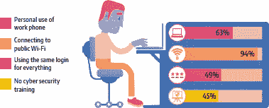

# 小型企业与黑客

当黑客入侵时，大型企业和公司可能会在媒体上获得更多关注，但这并不意味着犯罪分子每天不针对小企业。事实上，规模较小的企业正处于网络犯罪的某个“甜点”。这是因为他们拥有的比单一消费者更多的信息和资产，同时在安全方面的投入又无法像大公司那样充足。

就像现实世界的小偷一样，网络犯罪分子一旦闯入，他们会乐意带走他们能拿的一切，包括不仅属于你、还属于注册在你业务中的任何消费者或客户的财务信息和记录——而且所有这些被盗的身份都可以在其他地方使用。你的业务设备也可能被`勒索软件`锁定，或者感染并像僵尸一样被拖入`僵尸网络`，用于其他的黑客行径。

那么，你可以做什么来保护你的业务、数据和你的客户免受数据泄露的影响呢？实际上，可以做很多。

### 购买保险

除了我们已经过的各种安全措施外，网络安全保险是涵盖所有基础工作的重要部分。确保你考虑的保单将涵盖第一方责任（泄露产生的成本、法律费用、业务中断、客户通知和公关费用）以及第三方责任（以防在你的公司涉及暴露他人敏感信息的泄露时保护你）。

### 定期清理

永远不要保留比需要更长的业务数据。一旦数据不再需要，或者超过了比如一年的时间，就将其全部删除。信用卡号受高度监管：了解你在支付卡行业数据安全标准（`PCI-DSS`）下的义务。

### 进行演练

养成一种习惯，即在发生泄露时练习你业务的响应。花时间制定、审查并（通过每次演练）根据需要更新你的响应计划。每季度执行一次练习，寻找计划中的任何错误或漏洞，然后修复它们。

### 为最坏的情况做准备

如果你的业务不幸成为黑客攻击的受害者，立即着手找出发生了什么并停止它，无论这意味着软件补丁，还是对系统进行完全的关闭和清理。从备份中恢复任何损坏的软件和文档。联系你的保险公司，如有必要请寻求法律建议。尽快通知客户泄露情况以及该泄露与他们相关的性质。

## 安全基础

### 备份

严谨地备份数据并将其存储在不同的地方。最好的办法是将内容存储在本地，同时也存储在云端。小型企业可以使用`Dropbox`、`SpiderOak`或`Backblaze`等商业云解决方案（两年无限数据约需 100 美元）。通过存储在其他地方每天（或更频繁）的环境快照来增强这一点。业务备份要记住的一个良好规则是`3-2-1`：数据总数至少有三份，其中两份在本地但在不同的介质上（可能是`USB`驱动器或网络存储设备），并且至少有一份离线副本。请注意，备份只是第一步。在某个时刻，你将想要测试是否可以恢复文件。企业曾认为他们正在备份数据，结果发现某种程度的损坏最终使他们所有的努力化为无效。

**不要在构建电子商务网站上吝啬。将你花在专业人士身上的钱看作防止灾难性泄露的保险。**

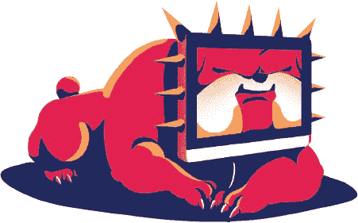

### 守护增长中的业务

最后，你的业务已经起飞了。那么，如何扩大规模呢？企业随着增长面临的最大问题是，他们倾向于继续使用现有工具，而不是重新评估他们的需求。这在花钱升级电脑时尤为如此，因为企业主不想感觉自己被宰了：“我为什么需要新的防火墙？旧的那个还没坏呢！”

网络事件响应人员经常能看到这种情况，即使在上市公司也是如此——尤其是那些快速发展的公司。失败通常分为两类。第一类就是字面意思：未能妥善界定技术需求，并根据需求规模化技术采购。第二类更具隐蔽性：在快速增长期间，高管做出了“现在建设”的决定，以后手忙脚措地进行安全。

这是世界上最具有诱惑的事情。我可以从我痛苦的个人经历告诉你，我曾不得不向财富 500 强公司的高管传达消息：因为十年前那样的决定，实施修复的成本大约是从一开始正确执行的 100 倍。在安全行业，我们称之为“技术债”，它就像使用高利息信用卡。你可以尽管这样做，但那一天绝对会到来——我们保证——当银行想要它的钱时，你会发现复利的奇妙之处。以下是避免这种痛苦的方法。

### 升级

在你附近寻找值得信赖、参考良好的安全公司，并让他们帮助你审查你的需求并提供建议。这些公司通常很容易查询，更好的公司其负责人经常在安全会议上演讲，持续发表文章并撰写书籍，并参与商业社区。找到两家，如果他们的意见大致一致，就选择你最喜欢的一家。

### 强硬起来

你将看到我们之前描述的安全家庭办公室的加强版。寻找某种集中认证系统、定期的增量备份和环境频繁的快照，以及在每个可以加密的地方进行加密。你将需要雇用一名良好的信息技术人员来管理这些系统，或者聘请公司提供托管服务（这是一个日益流行的选择）。你还应该考虑让服务器和防火墙等关键系统处于某种维护合同或支持之下。硬件、固件和软件漏洞不断公布，拥有维护将让你保持更新，而无需购买新设备或从技术破产中学习。

### 备份

这不言而喻，要备份所有的业务数据……然后创建第二个备份，最好是离线的，例如在云存储服务器。然后考虑第三个——以防万一。这听起来可能有点偏执，但如果发生了严重的错误且你需要恢复数据，你会庆幸自己这么做的。

### 寻求外部帮助

考虑聘请第三方监控你的防火墙和其他安全设备以发现问题迹象。你应该让你的内部技术人员定期运行漏洞扫描，以便对你实际拥有和连接到网络的物品保持完整清单（你不会相信这对许多公司来说有多么困难）。让外部公司对此进行双检，可以作为服务定期进行，或者至少每年一次。

### 进行体检

每十八个月左右进行一次安全架构审查。利用这个机会重新审视大多数业务网络中最脆弱的部分：你的假设。虽然采取这一步可能意味着要预付更多费用，但为了它带来的安心感，这是完全值得。作为一个送孩子去读私立寄宿学校的人，我可以告诉你，替代方案从长期来看要贵得多。

# 实体店

任何发展出良好在线形象的实体店都从这一事实中获益，即维护这些基础设施的成本比以前要低得多：现在，你将业务的整个电子基础设施托管在云端，而不是在本地维护。但“云端”并不意味着“安全”。云基础设施仍然存在传统基础设施的许多问题，而且如果你在网上销售商品，你还需要处理支付卡行业合规性问题。幸好的是，这些大部分内容都可以外包，从而进一步降低成本。然而，定期让第三方公司为你提供漏洞分析、架构审查和渗透测试——特别是针对你的核心业务应用程序——是值得的。

## 安全基础

### 妥善备份

如果使用 Windows 服务器，你可以开启卷影副本（shadow copies），这允许你撤销对系统所做的文件更改。这可以通过控制面板中的管理员控制面板的“服务”中启动卷影复制服务并将启动类型更改为“自动”来实现。然后你可以进入`文件资源管理器`，右键点击驱动器，转到“影副本”选项卡，并在驱动器或系统的其他驱动器上启用该选项。影副本不是备份，而是回滚文件或文件夹的快速方法，例如用户不小心删除文件，或某些文件被加密恶意软件加密时。在设置此项你需要专业帮助，但在勒索软件加密你所有文件或所有机器被盗的那一天，你花费的每一分钱都将非常值，甚至更多。


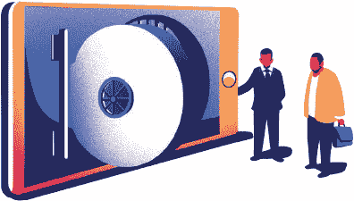

## 线上商务银行

商务银行是大多数公司遇到麻烦的地方。问题在于，只要这些转账是使用你的凭据进行的，银行实际上不对在你不知情的情况下从你的业务账户进行的电汇和自动清算系统（ACH）转账负责。商业账户受保护的方式不像个人账户那样。大多数银行仍然会尝试帮助你追回被盗资金，但在某些欺诈转账受害者起诉银行的情况下，银行竟然反过来起诉了该客户……并且赢了。

### 保持简单

除非你雇佣了超过 250 名员工，否则我们建议在没有真正的双重身份验证登录和银行语音验证的情况下，不要使用在线商务银行。奇怪的是，似乎可以在没有任何麻烦的情况下提供此类服务的银行不是大银行，而是精品银行。

### 个性化服务

我们发现，这些较小的银行——那些提供认识你、了解你的声音并询问你家庭情况的私人银行家的服务的银行——通常是你获得的最安全的银行。关于银行网点可用性的论点完全正确——但在处理了最常见的攻击媒介（电汇和 ACH 欺诈）的安全优势后，这种不便可能是值得的。噢，而且我们发现大银行和精品银行的成本几乎是一样的。

无论你偏好哪种在线银行，我们都建议使用专门的计算机进行操作。该计算机与公共互联网的交互越少，你的凭据被劫持的机会就越小。

## 安全网站

没有网站的企业根本不会被认真对待。人们陷入麻烦的地方是试图廉价构建电子商务网站。那将是一场绝对注定的灾难——注意，我没说“几乎”注定的。它是石如磐山的。如果你想在你的网站上销售东西，你就需要在你的网站上销售东西。

## 有组织的零售犯罪

当人们看新闻时，看到突发新闻宣布例如有 5000 万人的信用卡数据从`Target`或`Home Depot`被盗时，他们有时会想：“这 5000 万个被盗的信用卡号到底能干什么？”答案很简单：你可以把它们卖给其他犯罪分子——一次卖出 1000 个卡号一组。

### 犯罪编码

犯罪分子可以通过多种方式让被盗的卡变现，但一种流行的方法涉及一群骗子团伙，他们购买大量被盗的信用卡和一个磁条卡片编码器（类似于制作酒店房门钥匙的那种）。他们付钱让人获取各种带有磁条的卡：旧礼品卡、旧酒店房门钥匙、被盗的信用卡——任何带有磁条的东西。然后，作案者利用被盗信用卡中的信息对它们进行重新编码。

### 盗窃公路之旅

卡片编码完成后，团伙会租一辆搬运车，集结一个小同伙团队，沿着州际公路行驶，直到到达一个购物中心。在给团队每个成员分发一小叠重新编码的卡片后，首领让他们欢快地进入购物场，并指示他们使用这些卡片购买金额以下（例如 500 美元）的物品，并将它们带回卡车。如果某张卡不起用，他们就直接扔掉并刷另一张，同时穿遍整个购物场并用完那叠卡片。

当他们在一个购物场完成后，就会开车去另一个地方。很快，他们就拥有了一车的战利品。在某个时刻，这些战利品会在`eBay`或其他在线平台售出。

这里有一大笔钱可赚，这也是银行和信用卡公司推出芯片+PIN 卡的原因之一，这种卡旨在对付这种销售点诈骗。这一发展意味着犯罪分子将找到某些新方法来欺骗持卡者和企业。我相信他们的机智。

## 结语

面对他人可能试图欺骗或削弱你的小型（或不那么小）业务的方法而头晕脑转向吗？检查一下这些基础知识。

### 基础安全

*   对数据进行`Encrypt`、备份并使用强密码。聘请专业人士帮助建立系统。
*   每周尽可能删除尽可能信息；你无法丢失你并不拥有的数据。
*   使用云端服务备份你的最少业务数据集。
*   向你的员工教授最佳安全实践和政策。
*   对任何授权转账的员工进行关于电汇转不可逾越程序的培训。

### 高级措施

*   采用双重身份验证，并定期进行漏洞测试和渗透测试。
*   至少每天对所有电脑进行快照（频率更高），并以加密形式存储在云端。
*   制定好计划，以防你的任何业务设备被攻破、丢失或损坏。
*   每季度运行一次桌面演练，以练习计划并发现其中的问题。

#### 锡箔帽军团

*   保持单点登录、强制 VPN、全虚拟桌面。
*   运行网络钓鱼意识和其他安全计划作为员工的培训。
*   与一家事件响应公司签订长期服务合同。

**所有小型企业中每年都会发生一次安全泄露。用简单的加密和良好的密码保护数据。泄露会破坏客户信任。在泄露发生之前花费，而不是之后。**

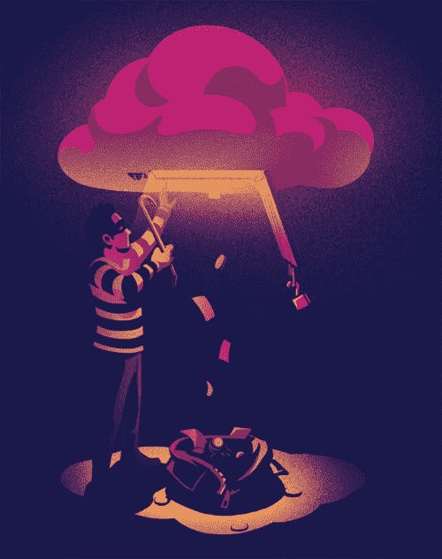

# 第 8 章 货币的未来

如今，“新货币”一词已意味着虚拟货币组合。在一个货币仅仅是一系列 1 和 0 的世界里，你如何确保你的电子硬币安全？

在历史上，人类一直依赖某种形式的货币，使用从贝壳到黄金的各种物品进行购买。曼哈顿岛不久前甚至用一袋珠子买下。我们每天都使用它，但除了考虑钱是否足够，我们倾向于不过多思考钱的概念。事实上，我们已经同意这些纸张和金属代表了可以交换披萨和内裤的真实价值，这种想法是了不起的。几个世纪以来，货币世界的变化以惊人的速度发生，而且短期内不会慢下来。

20 世纪 60 年代 70 年代，现代信用卡被引入，为犯罪分子偷取你的钱带来了一系列全新且兴奋的方法。有些银行对客户非常信任，他们甚至不进行信用检查……他们只是寄出这些闪亮的新卡，并假设收件者是理智的。结果正如你想象的那样糟糕。而且在还没有人拥有技术来读取那些数字、将其重新编码到酒店卡钥匙上并大意破坏之前是如此。现在，像`PayPal`和`ApplePay`等数字银行服务，以及像`bitcoin`（`BTC`）等数字货币的新世界，意味着有更多方法来偷取你的钱。

## 无现金

我最近去澳大利亚进行了为期两周的差旅。作为一个实验，我想看看是否可以在整个旅途中不使用任何澳大利亚货币。令我惊讶的是，我发现我可以！我的大部分交易都使用了信用卡。（值得感谢的是，它拥有世界上最具创新的支付行业之一；该国采用了新的支付技术，让购物就像在终端机上挥一下你的信用卡一样简单。）我使用手机上的各种 App 支付交通费用。这些 App 中的每一个都保存了我的支付详情，因此它们会自动以我的原生货币扣费。在某个点，我实际上需要现金进行购买，但我恰好口袋里有一些美元，小商家同意接受它们。—— Heather Vescent

## 有趣事实：比特币生活

2013 年，记者 Kashmir Hill 想奇她是否可以只用比特币支付物品生活一周。她很难找到接受比特币的商家，许多人甚至听说过这种新货币。当她次年尝试实验时，由于几家初创公司让商家更容易接受比特币，她能够使用共享叫车服务并支付了一顿十七道晚餐。所以是的，虽然你可以在洛杉矶的威尔士大道用比特币购买纸蛋糕、午餐、咖啡甚至美甲脚，但这绝不是常态。对许多人来说，它仍然是一个新奇事物，尽管几年前当它处于炒作的巅峰时，关于比特币有大量的讨论。而今天仍有人认为数字货币可以改变世界。

## 货币革命

加密货币的概念起源于 1998 年，由计算机工程师、密码朋戴卫（Wei Dai）写的一篇文章，该文章设想了一种由加密技术而非中央政府创建和控制的货币形式。2008 年，以 Satoshi Nakamoto 身份运行的匿名开发者发布了一份开源白皮书，描述了一种创建名为比特币的加密货币的对等点方法。最初，它收到的注意力只有一少数加密爱好者。现在，比特币引发了一场货币革命，并为信息时代重新定义了货币。

### 比特币是如何制造的？

与实体货币不同，没有个人或政府拥有比特币背后的技术或概念。新的比特币是由互联网上的人生成的，他们通过竞争性工作记录并验证之前的比特币交易——从 2009 年的笔笔交易开始——这个过程被称为“挖矿”。将其想象为使用你的计算机处理能力来解决复杂的难题。谁解决了挖矿过程中的某个步骤（或区块），谁就能获得新的比特币作为奖励。

### 比特币真的是钱吗？

美国政府将`bitcoin`视为一种商品，而非货币，但许多人像使用货币一样对其进行交易。它的价值会波动，通常随着新硬币数量的减少而呈现上升趋势，有时表现得像股票一样，根据感知价值涨跌。2009 年，第一枚`bitcoin`的估值为`$0.07 USD`，但在 2017 年，它曾飙升至`$1,250`。

### 比特币会取代其他货币吗？

早早，许多人推测`bitcoin`可能会取代美元这类由国家支持的货币。一旦它被发布到开放互联网上，它就有了自己的生命，并吸引了与不同的用户群体，迫使政府做出反应（例如，美国政府将其归类为商品）。尽管如此，它引发了一场革命——展示了数字时代创造货币的一种可行的新方法。

### 比特币是匿名的吗？

`bitcoin`的“特性”之一是能够完成匿名交易。但这并不完全准确。金融机构要求遵守`KYC`（“了解您的客户”）法规（参见第 123 页），因此如果你从连接了金融机构的交易所购买`bitcoins`，你的`wallet`就可以被追溯到你的身份。然而，有设置匿名钱包的方法。无论何种情况，交易都会记录在`blockchain`上（参见第 120 页）。

## 著名的加密货币

世界上有成百上千种加密货币。大多数是模仿者或者是为了扩展初始`bitcoin`的功能而开发的。以下是几个例子。

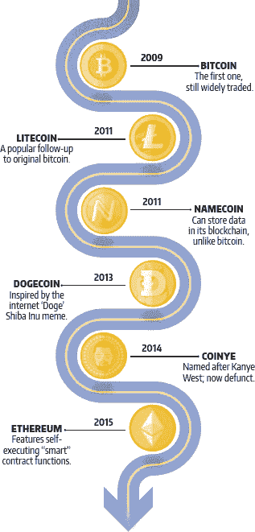

### 真实故事

#### 电子抢劫

新货币像所有新技术一样，是实验性的，并不安全或没有经过充分测试。当你投身这场游戏时，你可能会失去所有。2013 年，彭彭博电视电视台举办了一场`bitcoin`特别节目，主持人 Matt Miller 给主播`Adam`和`Trish Regan`了一了一个代码，让他们各获得`$20`的`BTC`。一位思维敏捷的观众使用了电视屏幕上的代码，当 Johnson 向演播室摄像头展示代码时，有效地从他手中夺走了它。

也发生过更大的损失。位于东京的`Mt. Gox`是最早的`bitcoin`交易所之一。曾一度，它处理了全球 70%的`bitcoin`交易。2013 年，客户花费数月时间才能提取资金，在多次停止运营后于 2014 年 2 月关闭。通过破产申请，发现该公司公司从客户那里盗走了高达`650,000 bitcoins`。

### 核心概念

#### 区块链

发生的所有`bitcoin`交易都记录在`blockchain`上——这是一个充当公共账的数据库，有助于强化货币背后的加密技术。每笔交易都记录有时间戳、交易金额、发送`bitcoins`的`wallet address`以及接收它的地址。

对于现金交易，没有人知道你行为的细节。而对于`bitcoin`，一定数量的交易会被正式化为一个`block`。当每个新的`block`记录在前一个`block`上时，交易数据就彻底定格了，无法更改。`blockchain`是终极的追踪系统——它是去中心化的，没有人可以操纵它，任何添加到`blockchain`中的信息也会被永久记录。

## 真实情况

当你用现金向某面对面购买比特币时，不会留下痕迹。`Bitcoin wallets`并不要求包含可识别的信息。可以使用匿名邮箱地址来创建钱包，然后该钱包就可以持有比特币。如果你最终拥有了大量的比特币并想变现，你可以找人进行交易。诀窍是让身份数据与这些`bitcoin wallets`隔离开。现金交易不会被记录，因此使得使用比特币进行洗钱变得具有吸引力。还有所谓的“混币器（tumblers）”，即在多次交易中混合部分`BTC`的程序或网站。一段时间后，比特币就会变得干净——至少，在理论上是如此。

## 趣味事实

### 手机分钟作为货币

货币本质上是价值的物理表现。从历史上看，黄金和其他贵金属及矿物因其稀缺性和感知实际价值被用作交易媒介。双方之间任何共同价值的物品都可以作为货币，这是合理的。在非洲的一些地区，技术已经取代了纸币和硬币：精明的企业家一直在使用移动通话时长作为货币，例如肯尼亚的`M-Pesa`系统，它允许货币和通话时间的交换。人们使用预付费手机卡代替纸币，手机用户则租出手机或用通话分钟换取商品和服务。鉴于其近乎通用的实用性，手机分钟被认为比许多受政府稳定性或经济波动影响的地方货币更可靠。

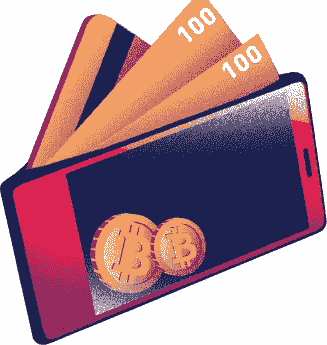

## 技术与钱

随着技术的演进，我们的财务状况也会随之改变。从`IOUs`到`ledgers`，再到持续统一的硬币和钞票，随着技术的进步，我们将其应用于货币，这是完全合理的。

### 智能手机与财务

任何拥有智能手机的人基本上口袋里都带了一台微型计算机，并可以连接到全球金融网络。无论你是在银行转账、发送`PayPal`付款、进行交易、在农贸市场买西西红柿、叫网车，还是通过`QR code`使用`bitcoin`支付，今天的手机都比二十年前的银行柜员要复杂得多。

### 信用卡

未来货币梦想之一是创建一个单一的全球统一货币。在某种程度上，我们今天已经实现了这一点，得益于几乎在任何地方被接受且具有卓越防欺保护的`credit cards`。但即使拥有最好的安全系统，复杂的社交黑客也能在采取最严的预防措施的情况下成功伪装你的身份。`Credit cards`永远不会消失，它们是事实上的通用货币。

### 区块链扩张

尽管它们在感知价值上可能在好奇物品和商品之间有所波动，但`cryptocurrencies`在短期内不会消失——`blockchain`也是。事实上，`blockchain`的概念可以应用于世界经济的其他部分，而不仅仅是追踪`cryptocurrencies`及其使用的交易。由于`blockchain`上的交易一旦记录就板上钉钉，该技术可以用于创建廉价、防篡改的公共注册库，记录谁拥有各种土地或财产，在不需要现场公证员的情况下对文件进行公证，甚至可以确保股市和其他高价值交易系统及金融交易的安全和价值。

### 智能合约

`Ethereum`作为最著名的`cryptocurrencies`之一，由`Vitalik Buterin`创建，他想在`(bitcoin)` `blockchain`之上构建应用程序。由于他无法为`bitcoin`添加此扩展，因此启动了`Ethereum`。这种加密货币的重大创新是其编写合约的能力——当满足某些条件时，代码会自动执行。在`Ethereum`上，开发者可以编写自己的`smart contracts`。未来，我们可以想象这样一个世界：一旦满足某些条件，软件就会启动金融交易。`Smart contracts`可以用于人类交易，但更有可能用于计算机与计算机之间的支付交易。

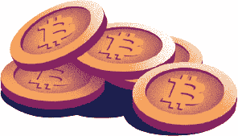

### 财务智能

想象软件代表你进行交易并不遥远。自动支付账单已经存在，它可以代表你处理支付。随着我们开发出更好的智能，财务智能有一天会进一步。未来，我们可以预期技术完全处理财务交易，这在`Airbnb`、`Lyft`和`Uber`等服务中已经发生。问题在于如何在数据被删除之前获取它并采取行动。`Amazon`在其创新的实体店中做过类似的事情，让你获得你想要的物品而无需结账。最终，金钱的未来必须包括安全性和易用性。随着技术的不断创新，我们还必须跟进漏洞、缺陷，并修复它们。

## 核心概念

### 了解你的客户

任何金融机构为了运营都必须具备安全性、稳定性和信誉，这包括了解客户。传统银行业要求银行了解其客户（银行术语称为“KYC”）。当你开设某些`bitcoin wallets`，特别是连接到传统银行账户的钱包时，你可能需要证明自己的身份。不建议使用这些账户进行非法交易或黑市购买——除非你想增加被抓的概率。然而，还有其他获取`bitcoin`的方法，它们可以保持匿名并能协助洗钱。

## 你应该知道

### 聪明钱，聪明的小偷

你可能认为增加监控和人脸识别软件有助于抓住偷走你钱包的人，尤其是现在到处都是摄像头。但问题在于如何在数据被删除之前获取它并采取行动。在`Quentin Hardy`的案例中，他的钱包在旧金山被盗，小偷用他的信用卡叫`Uber`。信用卡连接到一个已有的账户，由于`Uber`保留了所有行程的数据，它拥有关于小偷的信息——包括可能显示小偷住址的`GPS data`。这种方法的困难在于获取数据，数据通常需要合法释放给执法部门，且违规行为必须足够大值得调查。通常并不如此。即便如此，等警察看到视频录像时，它可能已经被删除了。

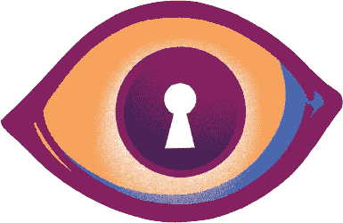

### 数字安全

未来，我们无法简单地将现金存在保险箱或床垫下。新的金融形式意味着保护资金安全的新方案。

#### 在线诚信

尽管许多政府为个人欺诈提供赔偿，但商业账户并不总能获得同样的保障，且在线银行和欺诈保护通常不在用户手中。寻找安全性良好的金融机构——有时很难发现哪些机构被黑了，因为没人想透露这些信息。在网上银行中使用强密码，经常更换，并且不要重复使用旧密码。限制分享银行身份凭据的人员，以减少未经授权转账或交易的概率。

## 通过自拍保持安全

银行有动力使用安全系统。在移动设备上输入密码可能很困难，因此银行提供了其他安全身份验证系统选项：你的指纹、`PIN`码或面部（甚至是语音）识别。安全自拍甚至能防黑客攻击——你必须眨眼或做出面部动作，这些动作是照片无法复制的。

### 使用生物识别更更安全

生物识别验证一直被认为是终极的防失效措施。其理念是，复制一个人的指纹、虹膜或视网膜几乎是不可能的，尽管黑客（以及好莱坞）已经展示了复制指纹的方法。与重置密码不同，获取新的指纹或眼睛并不是那么容易。然而，也有一些安全组合使用哈希生物识别数据进行三因素身份验证（在密码和令牌中添加生物识别），甚至涉及第二个生物识别的四因素身份验证。交易所需的因素越多，小偷窃取或复制它们就越困难。

### 练习信用卡控制

使用多个信用卡账户。第一个用于每月自动扣款；第二个（低额度）用于自发性的在线购物及类似（此号码可以是虚拟的，甚至是单次使用的，所以每次想使用账户时都必须获取新的）；第三个用于实体购物，信用额度稍高。监控你的信用评分。你会知道分数是否发生了变化，并有能力纠正它。通过仪表板或手机 App 定期检查银行账户，并为特定的交易和金额设置通知。旅行时告诉你的银行或信用卡公司，以便他们允许你的消费。了解你银行的客户服务电话，以及如何在你的手机 App 上停止支付或授权扣款。

### 生物识别验证方法

你可以使用不仅是指纹的方法确认某人的身份——而且新的手段一直在不断开发。

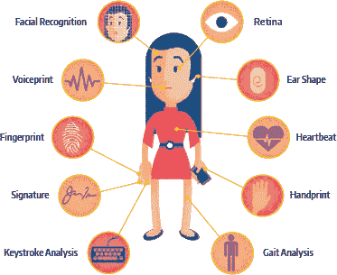

### 对错判断：芯片和 PIN 卡无法被黑客攻击吗。


**错误**

芯片和 PIN 信用卡首次于 2015 年在美国推出，旨在减少信用卡欺诈和身份盗用。但事实证明，它们并不像我们想象的那样安全。在欧洲，使用芯片和 PIN 卡时，需要在销售点输入 `PIN` 码。这会让冒充变得非常困难——真的如此吗？

2015 年在欧洲，一个富有意的犯罪团队通过在卡片上焊接一个不同的芯片设计了一场中间人攻击，该芯片随后能够接受输入的任何 `PIN` 码。管理这种复杂的卡片黑客攻击需要某种程度的知识、技能和艺术性——但这最终导致了小偷们获得了价值 68 万美元的免费商品。

## 趣味杂闻

### 大输

巨额资金加赌博可能意味着巨大的损失。你可以尝试将其归咎于免费饮料——这就是马克·约翰斯（Mark Johnston）在拉斯维加斯的一个周末输了 50 万美元后试图做的，他声称自己醉得断片——以避免支付赌博损失。

然后是东方贸易公司（Oriental Trading Company）首席执行官特伦斯·瓦塔纳（Terrance Watanabe）的故事，他在 2007 年在哈拉赌场输了 1.27 亿美元，并指责赌场给他吃止药并一直让他的杯子满。（他也以同时玩三手黑杰而闻名。）

与此同时，Eurobet 网站上的软件 Bug 让布鲁诺·文图里（Bruno Venturi）从 17 英镑变成了 65 万英镑——但公司以软件 Bug 为由拒绝支付。

来自澳大利亚的哈里·卡卡瓦斯（Harry Kakavas）在一年多时间输了 15 亿澳元，并试图起诉，声称赌场利用了他的成瘾赌徒身份。理性娱乐！

### 赌博与互联网

如果我们讨论互联网和钱而不包括电子骰子，那我们将失职了。过去，如果你想尝试暴富（更有可能只是浪费钱），你必须去拉斯维加斯、大西洋城或雷诺等地的地方玩老虎机和桌游——或者可能找一个烟雾缭绕的房间进行地下扑克游戏。

如今，你只需要家电脑即可。那个互联网与你的财务状况交汇的危险之地就是在线赌博，虽然你不需要担心结束夜晚时头发里有雪茄味，或避免鸡尾酒洒在西装上，但网络扑克、轮盘或老虎机带有许多自身的风险和担忧。

### 法律生活

根据你所处的世界，当地法律限制了在线和线下赌博，特别是在美国。1961 年的《联邦电信法案》（Federal Wire Act）被法院解释为涵盖所有形式的赌博。

如果你在一个在线扑克论坛上下了一美元，FBI 可能不会破门而入，但法律风险仍然存在，而且如果你中大奖，还要处理税务问题。

### 资助当地的黑帮

赌博、赌场和有组织犯罪之间有许多历史联系，网络赌博也不例外。许多赌博网站相对正规，但同样可能的是，某个在线赌场也可能是洗钱场所，并在幕后支持其他阴暗的交易。

### 倾家荡

与赌博相关的最大风险是失去所有的钱或产生成瘾，或两者兼有。人类倾向于对机会游戏产生强烈反应，由于一种被称为“间歇性奖励”的心理效应：如果你不知道什么时候能从赌博中获得回报，你可能会一直一次又地尝试。

如果你可以在不需要出门访问赌场的情况下获得那个潜在奖励，你可能会在穿着睡衣时轻松清空储蓄账户。

## 让你的损失变成他们的利润

无论风险是否与有组织犯罪有关，在线赌博都需要花费资金，无论是从银行账户转账，还是提供信用卡号或其他共享你信息的方式。如果你访问的赌博网站被黑客攻击，并且你在那里保存了任何信息（或在网站账户中留有任何钱），那么你就面临着财务被盗的风险。

最早向学生授予学术学位的大学成立于 11 世纪的欧洲。并不意外的是，在随后的不久之后，第一批假学位也开始出现。在美国，早在革命战争爆发之前，假学校就开始颁发学位了。

但是，如果一个文艺复兴时代的伯爵或一个农夫在没有做任何工作的情况下就买了称自己为“博士”的权利，我们又何担心呢？历史学家可能是唯一关心这些案例的人，但当最近发生这种情况时——一位高位（且不合格）的国土安全官员和一位顶尖核工程师被发现买了自己的学位——那么每一个人都应该引起关注。

假大学学位在成千上万名欺骗性的医生、律师、治疗师、老师和其他人的手中，而我们指望他们受过良好培训。这还包括数以千计并非犯罪但天真的学位持有者，他们仅仅是听信了某个能说会道的推销员，被对方说服花巨金只换来了一张毫无值的纸——事实上，那这张纸可能比一文不值还要糟糕得多。

假学位一旦被曝光，可能会导致职业生涯终结——更不用说在真相大白之前对他人构成的风险了。

## 外汇/交换

这些文凭工厂究竟是如何获得合法性或认证的？举例来说，2003 年，利比里亚政府（当时被认为腐败、不稳定且几乎破产）写信给几家可疑学校，以每年 1000 美元的低价向他们提供利比里亚教育部的全部认证（后来涨至 10,000 美元，再次增加到 50,000 美元，最后每年 20,000 美元）。

很快，十多所并不糟糕的学校（大多位于美国境内）开始自豪地宣传他们的证书——这些证书由一个无疑是联合国成员国的教育部长签署的。这种情况最终通过联合国教科组织通过法律手段解决了，但没有什么能阻止它在其他地方再次发生。

## 趣味事实

- **3,300**：全球估计假大学或不符合标准的大学数量
- **50,000**：美国每年购买的假博士学位数量（超过合法获得的 45,000 个）
- **5,000**：国会小组委员会识别出的假医生数量
- **100,000**：拥有假学位的美国联邦员工估计
- **$300,000,000 美元**：全球每年假学位销售额
- **$1 美元**：假学位的最低成本（大订单赠送的赠品除外）
- **0 小时**：平均假学位所需的学习时间（如果支票通过的话）
- **3**：学生从晚期的东加勒比大学获得学位需要观看几部詹姆斯·邦德电影

## 从文凭工厂购买

人们购买学位有许多原因，但以下是最常见的。

### 就业机会

许多工作要求某些职位的人员拥有特定的学位（或有时是任何学位），这可能导致求职者造假。另一些人认为，高级学位的声望将使他们在市场中获得优势。

### 职业声望

虽然婚姻咨询师不需要博士学位，财务规划师不需要 MBA，或者承包商不需要工程学学位，但能够宣传这些学位可能会吸引更多客户或赢得客户的更多信任。

### 专业认可

你努力工作了一辈子。为什么你不能得到应得的认可呢？这是一个合理的论点，正如“生活经验”学分的做法所说明的那样。

但很多时候，这种思路被假学校用来说服潜在学生，让他们认为用假学位奖励他们的辛勤工作是完全合逻辑的——与通过法的正规教育获得真实学位并无异。


## 尽职调查

那么，如果你怀疑遇到过的某人伪造或欺诈获取了学历凭证怎么办？如果是你的老莫尔蒂叔叔为了赢得争论而吹嘘他那听起来可疑的电影研究学位，也许你只需要翻个白眼就不管它了。

但如果这个假学位可能对他人的健康或安全造成真实后果，你应该检查一下。调查学校的细节如果发现被证明是冒牌者，也可以让你有理由避开它。

## 生活常识

### 虚假证词

声望（或被视为特定领域的权威）更令人恐惧的子集之一，是法院案件中专家证人的问题。这会造成巨大的损害——但法院似乎很少检查那些证人的合法性。

事实上，本文的作者 `Dr. John Bear` 已在数十起学术欺诈案件中提供过专家证词；据他所知，没有人检查过他的学历。但这种疏忽已经产生了严重的现实影响。

### 假工程师案例

一个自封的汽车工程师曾代表一家汽车制造商作证，称涉及一起致命事故的车辆刹车“绝不可能发生故障”。此人在后的证人席上被揭露其学历是从一个臭名昭字的学位工厂购买的。

### 伪造建筑

2011 年新西兰地震中摩天大楼倒塌导致 115 人死亡；该建筑的设计师伪造了他的工程学历。

### 环境危害

我们获知了一位石棉移除“专家”，他的环境科学学位来自一个毫无价值的来源，导致他建议的所有“改进”都变得可疑。

### 烧伤报告

某位烧伤专家总是得出结论，在他被要求作证的案件中，伤势严重的烧伤受害者是自造成伤的，而他的企业客户不负责。他的假博士学位最终被曝光，引发了对他证词曾至关重要的案件的审查。

### 谎子，谎子

某位著名的测谎专家，曾出现在《拉里·金直播秀》、《杰拉尔多》等电视节目中，并涉及过奥杰·辛普森和乔贝内特·拉姆齐案件，拥有一个来自著名文凭工厂的博士学位。

## T/F：对或错

### 我的医生可能是个假货

#### 对

尽管这个概念令人恐惧，但有成千上万的人购买假医学学位并利用它们欺骗患者。最可怕的例子之一是 `Michail Sorodsky`，他购买了假医学学位，自封“全方位治疗师”，并在 2011 年因性侵寻求治疗的女性被定罪。其中一些后来死于未治疗的癌症。

多年来记录了许多由于假医生造成的死亡和伤害——而那些只是被抓到的。毕竟，你可能见过医生墙上所有的框装学位。但你核实过它们吗？

## 核心概念

### 非标准学校

并不是所有的此类学校都是坏学校——有些只是，嗯，不传统。需要注意的是，阴暗的学校可能会利用这些合法替代方案之一作为掩护，掩盖自己缺乏正规课程的问题。

### 新思想

教育模式在变化——不久前，在线获得学位的想法还是疯狂的。现在它是标准做法。但要小心那些声称自己太创新而无法获得认证的学校。

### 宗教研究

许多完全合法的宗教学校认为世俗学术认证与其使命无关。

### 地理差异

标准和做法因国家、甚至在美国各州而异。有些学校通过声称一个对其业务模式有利的地点来投机。

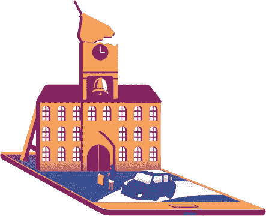

# 调查一家学校

有些假学校在广告上非常老练，并雇佣专家销售人员来说服心存戒备的潜在入学者冒险。当一家假学校被曝光时，其客户往往非常沮丧，说他们本该留留心的，但销售人员太有说服力，目录太精美，网站做得太漂亮，导致他们深陷其中。

当然，检查一家学校最好的方法之一是实地走访，但如果那样既便宜又容易，在线学习就不会如此流行了。

## 咨询适当的机构

在美国，每个州都有一个高等教育机构或类似的机构；大多数国家都有单一的国家部级或类似的情况。机构很少会对学校的质量发表评论，但它会让你知道学校是否获得了适当许可。

有些假学校甚至建立了一个虚假的认证机构，奇迹的是，该机构只有一个客户，或者更糟糕，它还认证了 `Harvard` 和 `Yale`（在他们不知情的情况下），因此请务必通过官方 `U.S. Department of Education` 网站 `www2.ed.gov/about/contacts/state/index.html` 或你所在国家的对应机构找到相关部门。

## 做些侦查工作

有些假学校聪明且老练。有些……没那么。这里是你可以采取的几个简单步骤。

### 打个电话

在营业时间内听起来可疑的语音邮件，或者在他们当地凌晨 3 点接听昏昏欲睡的学生，都不是好迹象。

### 点击查询

谁拥有学校的网站是一个丰富的信息来源，特别是当这与学校本身的说法冲突时。`www.whois.net` 是进行此类操作的地方。

### 放大查看

在 `Google Maps` 或 `Google Earth` 上检查学校的地址。如果你发现是一个信箱租赁店、一个 `WeWork` 空间，或（正如我们最近看到的）一家 `Holiday Inn` 酒店，它可能不是顶尖大学。

## 提一些问题

如果你已经完成了上述基础检查，仍然不确定一家学校的真实性，询问以下问题可以帮助理清状况。

### 注册了多少学生？

相当多的学校似乎不愿意透露这些数字。有时是因为他们对自己的规模太大感到尴尬，例如，某所不尽人意的学校曾拥有 3,000 多名学生和 5 名教职员工。

有时学校可能对自己的规模太小感到尴尬，例如某所广告力度巨大的学校，拥有令人印象深刻的宣传材料、极高的学费……但学生不到 50 人。

### 你们每年颁发多少学位？

与学生人数一样，答案可能高得异常（例如，只要你寄出支票，我们就寄出学位）或很低（我们懒得启动打印机）。

## 颁发的假学位

大多数文凭工厂（diploma mills）都在水池的浅层活动——提供虚假高中毕业证书的法律后果可能很微小。提供虚假医学学位，你可能会变成谋杀的从犯。

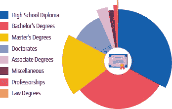

## 那家在线学校在提供“教育服务”时是否太推销了？

大多数文凭工厂都在水池的浅层活动——提供虚假高中毕业证书的法律后果可能很微小。提供虚假医学学位，你可能会变成谋杀的从犯。


## 认证

认证的标准和法律因国家、州或领域而异。人们很容易说，获得美国政府官方批准机构认证的传统大学是“金标准”，但其中存在着足够多的反常现象、例外和漏洞，使得情况很快就变得复杂。

在某些国家，学校是由国家政府部委授权的。有时这个过程非常严谨，有时……则不然了。如果学术诚信对你来说真的非常重要，请仔细检查那些国际学校。如果学校位于某个不寻常的地方，请多提问。

在美国，认证机构是私人公司，它们必须在满足相当严苛的标准后，获得教育部的认可。如果某个特定的认证机构未获得认可，那么你可能想查清楚究竟是怎么回事。


# 第 10 章：数字时代的性与爱

从纯洁的在线约会网站到随叫随用的约会应用，通过滑动屏幕开启性感时光比以往任何时候都容易。但当今的在线冒险也需要对你的数据和设备采取保护。

几乎从第一天起，互联网就帮助了那些内心孤独（或其他部位）的人与他人建立联系，同时也为从未在现实生活中进过阴暗成人书店的家庭观众提供了丰富的色情娱乐。

只要没有发生非法行为，且所有参与者都是自愿成年人，你可能会问问题在哪里？遗憾的是，外面仍然有很多坏人，他们非常清楚，当我们心动火热时往往容易冲动。

我们可能会为了获得即时奖励而承担更大的风险，例如在不考虑来源的情况下点击性感链接。承诺非法婚外和轻松约会的网站可能会导致个人数据泄露，而在线摄像头直播提供的轻松获财诱惑对毫无警觉的人来说可能是一个陷阱。

从无意中下载与性感照片一起瘫痪电脑的恶意软件，到陷入复杂的猫鱼诈骗（catphishing），或者让你的隐私照片或视频被用来对付你，一个不知情的用户面临着广泛的财务、技术和情感风险。本章将探讨需要注意的事项以及应采取的安全措施。

## 诱人的历史

收集性敏感材料（`kompromat`）是间谍活动的主要手段，用于勒索重要人物。冷战时期擅长这种技艺的苏联人被称为“燕子”（女性）和“乌鸦”（男性）。

但如果你毫无廉耻，你会被勒索吗？让我们来看看印度尼西亚总统苏卡尔诺这个相当有趣的例子。

在前往莫斯科的途中，苏卡尔诺被亲切的空乘员吸引，并邀请她们回到酒店进行热活动。这些女士都是受过训练的俄罗斯麻雀，她们乐意同意，因为她们知道现场会被秘密录像用于勒索。

事情完成后，克格勃局（KGB）将苏卡尔诺带到一家私人电影院向他展示了影片。苏卡尔诺误以为这是一份礼物，欣喜若舞地要求带上拷贝回国——他坚信自己的国家会因为他的表现而视他为英雄。

> 设置一个独立的邮箱专门用于约会，以在遭遇黑客攻击或跟踪者时保护你的隐私。

## 在线约会

无论你是在寻找真爱，还是仅仅为了一夜情缘，互联网在很大程度上正成为那些寻求联系的人的首选之地。整本书和网站都专门介绍在线约会的基本礼仪以及如何保持安全，无论你是在线还是面对面交流。以下是我们的顶级安全建议。

### 进行对话

大多数在线网站和约会应用的工作原理大相同：你查看潜在约会对象的照片和简介，然后有机会给他们发消息。如果他们也觉得你感兴趣，对话就会开始。

这是了解某人的绝佳方式。不要过早泄露个人信息，但要花时间去互相了解，并注意线索。如果有人催促要你的 `phone number`、请求 `sexy pictures`，或在未经请求的情况下向你发送照片，这些都是严重的警告信号（red flags）。无论好坏，许多潜在的约会对象会通过这种行为尽早淘汰自己。

### 移到线下

一旦你对聊天的对象产生了良好的感觉，你可能想提议见个面。最好让这次会面是安全且低调的，例如白天在公共场所聚在一起喝杯咖啡。

这是另一个可以立即过滤掉某些不怀之心的建议。如果潜在的约会对象找借口说为什么这不可能，那么他们可能是一个想要偷你钱的骗子。

### 正在寻找爱情？

谁在寻求联系？事实证明，有数百万内心孤独的人。以下是某些约会应用的对比。

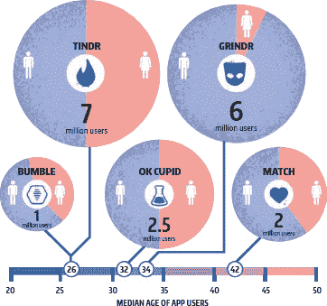

### 保持警惕

在与你的相识见面之前，告诉朋友你将在哪里以及和谁在一起，并安排在特定时间联系你的朋友。这看起来可能有些多此，尤其是当你对某人有良好的直觉时，但这归根结底就是“无患于胜于后悔”的格言。

## 真实故事：人质新

在欧洲和美国，一些年轻女性在网上被 ISIS 成员诱骗成为他们的妻子。这些年轻女性在网上被招募，承诺将获得自由战士的荣耀和完美的伊斯兰国，通过 `Twitter` 和 `Skype` 建立联系。她们被指示飞往土耳其，购买 `burner phones` 并越境进入叙利亚。

据报道，一些新娘履行了典型的“妻子”角色（烹饪、清洁和“慰藉”男性），而另一些则被当作奴隶卖、毒打和强奸。

虽然聪明的青少年会落入圈子更不用说有资源独自前往叙利亚，这似乎不可思议，但对于一个脱离现实的浪漫者来说，这可能像是一场童话般的冒险，直到为时已晚。

在这个故事一个较轻松的转折中，最近的一份新闻报道讲述了一些富有进取的女性如何猫鱼诈骗 ISIS 士兵，声称想去叙利亚见他们，但缺乏机票资金。她们的潜在追求者汇了款，而随后这些女性便大笑着赚进了一笔钱。

## 核心概念：猫鱼诈骗（CATPHISHING SCAMS）

广义上描述创建虚假在线简介以欺骗寻求真实关系的行为，猫鱼诈骗有时是无聊的赖鬼为了干扰心态。

在更具恶意的案例中，猫鱼诈骗者可能会要求性感照片或索要现金（通常是“借款”，以此作为与受害者见面的借口）。如果你觉得自己被耍感情了——如果那些照片看起来太显刻意，或者你的新朋友拒绝接电话或面对面交流——这可能是猫鱼诈骗。

许多人使用图库照片或其他人的头像。尝试将其中一张照片拖入 `Google 图片搜索`，看看会出现什么。你的恋爱对象可能也对其他人说过同样的甜言。复制并粘贴他们调情时的一两句话，看看是否有结果，也许出现在某篇警告该骗子的帖子里。

# 鲁莽的报道

在 2016 年巴西奥林会期间，一名记者使用了多种约会软件——包括允许用户通过位置追踪彼此的 `Grindr`——来寻找男性恋奥会运动员并将其“出柜”（out them）。

除了这严重违反了新闻伦理之外，未经许可公开他人性隐私（outing）是不尊重的行为，在某些情况下甚至可能危及他们的生命。这些运动员中有些人可能来自将同性恋被视为犯罪的国家——在某些地方，甚至可能被处以死刑。

如果你作为用户担心自己的安全和隐私，那么你可能应该避免使用这类追踪类应用。这意味着你必须寻找其他方式来结识新朋友，但这种不便利性对于你的安全是值得的。

# 性爱短信统计数据

是谁在发送那些色秽的图片和信息？事实证明，有很多人正在进行数字化的调情。


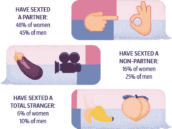

## 调情及更多

在线沟通导致调情和色情对话的速度通常比面对面发展起来要快得多。聊天中的亲密感（也许是在家里喝了几杯酒后，或者在感到孤独和无聊时）某些特质能让人迅速变得“坏坏”。这可以是算不上纯洁的乐趣，但你不应该让这些刺激让你变得脆弱。在分享那些火辣的幻想或露骨的图片之前，这里有几点需要记住。

### 安全发送爱短信

在你的标准短信应用上发送露骨信息时，你应该仔细考虑，即使目前没有发生任何不当事情。毕竟，情况可能会变化，前伴侣可能会试图利用暴露的信息来让你难堪。（你也不希望当手机恰好放在办公室办公桌上，任何人都能看到时，一条 X 级信息弹出现在你的锁屏上。）为了保持匿名性，你可以使用如 `Kik` 或 `Wickr` 等应用，这些应用允许设置用户名而不是共享电话号码。你也可以使用像 `Facebook` 的信息器应用，但要注意，该公司有权阅读你的信息，并可能利用其中的信息向你投放定向广告。

### 想象这一画面

在发送色情图片时要格外小心。你可能会不小心转发消息或将其发布在社交媒体上。即使是像 `Snapchat` 这样的瞬时社交媒体应用也不安全的：人们仍然可以截屏，而托管此类软件服务器的公司可能会进行窥视。

纹身、背景图像或地点等识别标记也能提供线索。一名女性在 `Reddit` 论坛上发布了一张没有脸的照片，论坛上的一个观察者认出了那个浴室是佛罗里达州某大学宿舍的一部分。该观察者随后将照片发布到了该大学的子论坛，导致该女性被认出并遭到羞辱。所以你不能假设距离等同于匿名——尤其是如果你的环境中存在任何可以被观众识别的东西。

仅仅因为你没有在网上分享脸照并不意味着你是安全的。我的一位朋友发现她的男友在恋爱期间和朋友分享了她的裸照，她感到深深的背叛。那些色情照没有显示她的脸，但那种伤害和羞耻感并没有因此好转。毕竟，他们仍然知道她是谁。

## 真实故事

### 极端手段

有时，心怀报复的前任会变得非常疯狂，就像 Michael 和 Tina 的情况一样。有时，心怀报复的前任会变得非常疯狂，就像 Michael 和 Tina 的情况一样。有时，心怀报复的前任会变得非常疯狂，就像 Michael 和 Tina 的情况一样。有时，心怀报复的前任会变得非常疯狂，就像 Michael 和 Tina 的情况一样。有时，心怀报复的前任会变得非常疯狂，就像 Michael 和 Tina 的情况一样。有时，心怀报复的前任会变得非常疯狂，就像 Michael 和 Tina 的情况一样。有时，心怀报复的前任会变得非常疯狂，就像 Michael 和 Tina 的情况一样。有时，心怀报复的前任会变得非常疯狂，就像 Michael 和 Tina 的情况一样。有时，心怀报复的前任会变得非常疯狂，就像 Michael 和 Tina 的情况一样。有时，心怀报复的前任会变得非常疯狂，就像 Michael 和 Tina 的情况一样。有时，心怀报复的前任会变得非常疯狂，就像 Michael 和 Tina 的情况一样。有时，心怀报复的前任会变得非常疯狂，就像 Michael 和 Tina 的情况一样。有时，心怀报复的前任会变得非常疯狂，就像 Michael 和 Tina 的情况一样。有时，心怀报复的前任会变得非常疯狂，就像 Michael 和 Tina 的情况一样。有时，心怀报复的前任会变得非常疯狂，就像 Michael 和 Tina 的情况一样。有时，心怀报复的前任会变得非常疯狂，就像 Michael 和 Tina 的情况一样。有时，心怀报复的前任会变得非常疯狂，就像 Michael 和 Tina 的情况一样。有时，心怀报复的前任会变得非常疯狂，就像 Michael 和 Tina 的情况一样。有时，心怀报复的前任会变得非常疯狂，就像 Michael 和 Tina 的情况一样。有时，心怀报复的前任会变得非常疯狂，就像 Michael 和 Tina 的情况一样。有时，心怀报复的前任会变得非常疯狂，就像 Michael 和 Tina 的情况一样。有时，心怀报复的前任会变得非常疯狂，就像 Michael 和 Tina 的情况一样。

[连接时代的]

## 连接时代的爱情

随着网络摄像头和流媒体应用的如此盛行，性短信和色情之间的界限变得越来越模糊。

## 业余时间

“睁眼看”也意味着清醒。

# 安全浏览

人类观察性图片的时间可能和我们在岩洞壁上作画一样久。互联网色情的可用性说明了古老的欲望——但也伴随着一系列现代的考量。并非每个人都会在上上看成人内容，但很多人确实会，因此在不评价道德的情况下，这里有一些最佳实践和常见担忧。

### 金融安全

色情网站无法使用与其他网站相同的信用卡系统（因为许多银行拒绝为成人服务供应商提供商户账户），因此它们没有其他零售商那保护。虽然有些系统知名且安全，但建议使用匿名预付信用卡访问网站或购买。千万不要使用你的普通借记卡或信用卡。不法网站经常增加欺诈费用，认为消费者会因为害怕承认自己在上网而不敢向银行投诉。不要上当——信用卡公司的客服人员不会嘲笑你。

### 恶意入侵

你下载的任何内容都可能带有恶意软件。使用防护软件、特殊浏览器或虚拟机（或这些因素的组合）来维护软件的完整。此外，在浏览时避免点击广告，因为所谓的“恶意广告”点击一下就能感染你的电脑。

# 数据挖掘

关于你的浏览行为的数据正在不断被收集，即使你使用的是私密浏览也是如此，这些数据随后会被用于向你进行营销。有时，这种“营销”会以病毒的形式出现在链接中，黑客根据你偏好观看成人媒体的类型，判断你可能很难抵御这种链接。即使是谨慎的浏览器用户，如果承诺的图片足够吸引人，也可能会冲动点击。在这里，保护性软件措施可以提供帮助，尽管它们并不总是能将数据收集量完全减少到零。

## 趣味科普

### 数字支配

关于女虐者（dominatrices）及其客户的普遍认知是，这种交易关系带来的快感与其说是性，不如说是权力的交换。通常，这些互动涉及客户为专业女虐者（目前的术语）支付费用，以获得鞭打、拍屁等服务。这个世界的一个子领域是“财务支配”，即富有且有权力的男性（几乎总是迷恋这种恋癖的男性）通过让一个性感的人暂时接管他们的财务（并花费大量金钱）而感到兴奋。现在，网络性爱的奇异世界产生了一种翻转权力动态的新方式。最近发表在《Vice》上的一篇文章介绍了数据支配领域的先驱哈莉小姐（Mistress Harley）。作为一名精通技术的在线女虐者，她对 `Skype` 会话和持续互动收取费用，在这些过程中，客户可能会将密码、登录信息、银行信息和社交媒体账户交给她，仅仅是为了追求那种快感。她以预先商好的方式挑逗和折磨他们——例如，在他们的电脑上屏蔽所有色情内容直到他们哀求，使用客户的 `Amazon` 账户将性玩具寄到他们的办公室，或在他们的 `Instagram` 或 `Facebook` 上发布裸照。这可能是对真理“爱（或类似的东西）让我们变得疯狂”的最极表达。

# 杀手级应用

### 无痕模式

通常情况下，你的浏览器会记录信息以方便浏览网页：你的浏览历史记录、用于登录凭据的 Cookie 以及下载图片的缓存。当激活私密浏览或无痕模式时，这些功能会被关闭。Dolphin 是一个 `Chrome` 扩展，内置了广告拦截器并允许你关闭所有脚本，从而保护你免受自执行恶意软件的影响。同时，Firefox 浏览器提供了安装 `NoScript` 和 `Adblock Plus` 等扩展的功能，并拥有私密浏览模式，以减少你的电脑受脚本和恶意软件影响的概率。这类软件将确保你的电脑不会保留浏览历史，但它不会从互联网上完全删除这些信息。你的互联网服务提供商和网站仍然可以监控流量。

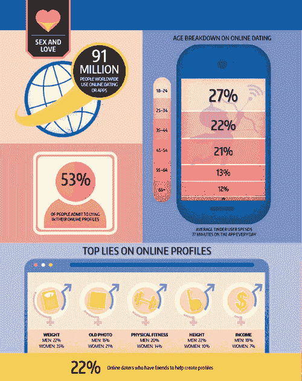

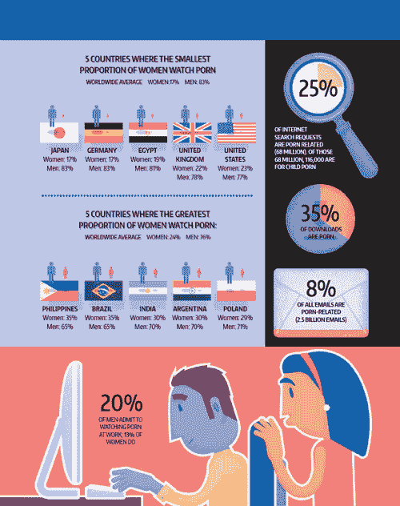

## 安全基础

### 保护你的自拍照

你可能会担心自己的个人调情照片，以及自己是否免受隐私图片被盗或被暗中窥视。显然，避免这些情况最简单的方法是不拍摄或分享此类图片，但如果你确实分享了性感照片，请确保接收者知道你对他们尊重隐私方面的期望；不要害怕要求删除。如果你想保留这些数据，可以考虑将其存储在未与任何计算机和互联网连接的 `USB` 或移动驱动器上，并对图片进行加密或其他保护。一如既往，使用强密码。在不使用摄像头时，保持摄像头安全状态或用贴纸盖住镜头。此外，避免访问任何可能导致恶意软件劫持你摄像头的疑网站。

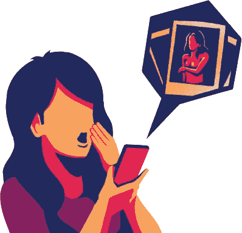

### 报复色情

数字图片拍摄和分享的便利带来了一个特别令人不安的结果，即“报复色情”的兴起——即在未经受害者同意的情况下公开分享性裸体图片，通常意在伤害他人。典型案例涉及一个心怀恨意的前任发布可能在一段快乐时光经双方同意拍摄的图片，但这些图片从未打算公开。在分手后，前任决定试图通过公开羞辱前伴侣，或者更糟糕的是，让其暴露在骚扰、勒索甚至攻击之下，以此伤害他们的前伴侣。恶意作者还可能通过 `doxxing`（人肉搜索）在网上发布图片，这意味着泄露个人信息，如某人的姓名、地址或工作详情，这可能会给受害者带来网络跟踪延伸到线下以及人身骚扰。

根据网络民事权利倡议（`CCRI`）的数据，45% 的报复色情受害者曾被看过这些图片的人在网上跟踪和骚扰，30% 的受害者还遭到真人跟踪。约 77% 的受害者面临着社交和职业影响，48% 的人表示他们考虑过自杀。在自杀和诉讼发生后，34 个州已经通过了反对报复色情的法律。

一些犯罪者将此类图片作为营利计划的一部分。例如，2010 年，创建网站 `IsAnyoneUp?` 的 Hunter Moore 曾誉为“报复色情之王”，因为该网站的大部分内容是非自愿的性图片——而且不仅仅是女性。他声称自己只是一个“商人”，在网站人气巅峰时期，通过收取删除图片的费用，月入估计达 1 万美元。

## 如果你是受害者该怎么办

报复色情是违法的，如果你是受害者，有法律和非营利组织可以帮助。

### 记录违规行为

为了证明所有权，你必须拥有原始文件。记录下图片的使用情况。不要只保存链接，要对页面进行截图，特别是当它们出现在 `4chan`、`Reddit` 频道、报复色情网站或 `Twitter` 私信中时。确保截图包含 URL 栏或发布者的姓名。

### 识别犯罪者

如果你能识别出发布信息的人是你分享图片的对象，你很可能提起法律诉讼。

### 删除图片

如果你能证明拥有版权，许多网站会通过《数字千年版权法》（`DMCA`）删除通知删除图片。其他网站则明确向受害者索要现金以删除图片。记录所有通信内容：保存电子邮件、截图短信、记录任何通话。

如果你拥有图片（例如，照片是你拍摄的），你拥有版权，并可以要求 `Google` 和其他搜索引擎通过 `DMCA` 删除通知从搜索结果中删除它。这不会从发布图片的网站上删除图片，但图片将不会出现在搜索结果中。

要启动 `DMCA` 删除流程，你需要针对每个实例向每个搜索引擎提交报告。这就是为什么截图非常重要。搜索引擎会要求你：

- 提供侵犯版权网站的 `URL`。
- 附上原始图片以识别版权作品，证明你拥有版权。
- 签署声明并在提交文件上签字日期。

# 真相

好消息是这有点复杂。在黑客接管你的摄像头之前，他们必须先说服你安装恶意软件。他们是如何做到的？他们可能会给你一封包含链接的邮件，启动一个安装过程的脚本；或者他们可以将脚本隐藏在文档、图像或视频文件中发送。一旦恶意软件安装在你的电脑上，虽然黑客需要一些技巧，但你的摄像头确实可能被破解。你该如何保护自己免受这种情况的影响？不要从陌生人处打开或下载异常文档。此外，在不使用摄像头时，请使用胶带或其他摄像头遮挡。

## 安全基础

### 养成安全软件习惯

如果你想在线观看色情图片或视频，只要采取一些预防措施就可以安全地进行。使用不会自动运行脚本、`Java`、`Flash` 或 `Adobe Reader` 的浏览器——或者添加诸如 `NoScript` 的插件，它可以让你控制所访问的每个网站运行的脚本。并使用广告拦截器——某些广告可能包含恶意软件和可执行文件。这也有助于防止网站在未经许可的情况下重定向你。你还可以使用如 `Ghostery` 等浏览器插件来显示每个网站后台运行的脚本。在浏览时，检查浏览器底部地址栏中的链接，看看它将你带向哪里。远离重定向你行程的网站，并通过避免任何类型的下载来降低感染机会。你仍然可以在线观看性感流视频。

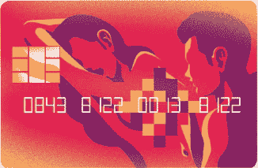

### 保持机器清洁

正如任何在线活动一样，浏览性感网站时要要有常识。法的运营商知道网站可能会成为攻击和渗透的目标，因此他们动力快速发现问题以确保客户获得良好的体验。研究哪些是最安全的在线色网站，并向开放的朋友寻求推荐。以下是你应该采用的一些额外安全措施。

### 限制你的设备

无论你使用什么设备，都要确保它是安全的。定期更新病毒防护程序并运行恶意软件和间谍软件检查。还要清理缓存；你的手机可能被盗，或者你的云账户可能被黑，暴露你的浏览历史，因此要定期删除图片并清空垃圾桶。并考虑限制在一个设备上——有些人选择只在特定设备上看色情，以降低风险。例如，仅在装有最新安全软件的电脑上观看。

### 远离办公室

不使用工作设备看色情或发性信息是不言而喻的，但新闻报道告诉我们，这种建议并没有被所有人接受。事实上，英国的一项最新研究显示，10% 的办公室员工承认在工作时看片——而这些是坦白的人，所以我们可以想象真实数字要高得多。取决于你工作的地方，这可能成为被解雇的理由——即使不是如此，你也不想与人力资源部门进行那种谈话，特别是如果你还用恶意软件感染了公司的网络。

### 虚拟化

虚拟机是一个运行在你现有操作系统之上的独立环境。运行虚拟机可以让你在浏览时不会让整个操作系统都面临风险。如果你下载了恶意软件或病毒，它会感染虚拟机而不是你的整个电脑，当你结束虚拟会话时，其中的一切都会消失，包括该感染。

### 安全支付

合法的免费色情网站确实存在，其中许多内容有限并有会员激励。如果你为内容付费，请小心将信息提供给谁。有些信用卡公司会为你提供虚拟号码；使用时，它会记入你的主账户，但如果被盗，可以在不注销实体卡的情况下轻松关闭它。你还可以使用充值预付卡。

## 核心总结

在互联网上寻找爱情、向特定的人发送露骨图片或自己观看露骨图片时，你是脆弱的。养成安全的性信息习惯！

## 基础安全

- 保护设备访问（使用 `PINs` 和锁定代码）并使用双重身份验证。
- 约会或约炮使用不同的电子邮箱和匿名账户。永远不要用工作邮箱处理任何约会相关的事。
- 使用私密的短信和语音通话应用与潜在约会对象或伙伴通信。

## 高级措施

- 观看免费色情，或使用预付信用卡并在取消后停止订阅支付。
- 使用 `bitcoin`。
- 在拍摄性感照片时，隐藏你的脸和任何可能让你被识别的特征物。

## 锡箔帽团

- 仅使用安全应用发送敏感信息，并设置定时删除消息。
- 永远不要发送任何你即使泄露也不希望被公开的图片或视频。

某些成人网站接受比特币支付，因此你不需要透露任何银行信息。对于极其谨慎的人来说，这些额外的步骤可能是值得的。

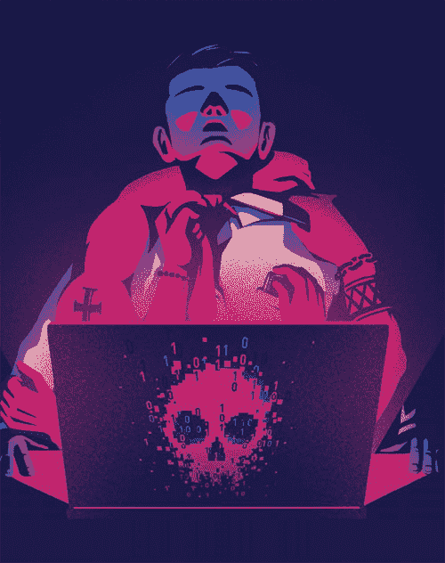

# 第 11 章：网络义警者与群体暴政

互联网让我们彼此更加近——但技术并没有让许多人对彼此变得友好。学习如何保护自己免受网络混蛋的伤害，避免自己变成他们之一。

技术将我们连接在一个地球村，但这并不意味着我们总能以文明的方式交流。根据皮尤研究中心的一项最新研究，40% 的成年互联网用户直接经历过网络骚扰，73% 的人目睹过此类事件。将我们与世界各地连接的技术可以被用来折磨——无论在线还是线下。欢迎来到喷子、人肉、匿名行动和网络暴民的世界。

互联网让一切变得去中心化，骚扰和群众抗议也不例外。网络骚扰可能会升级为死亡或强奸威胁、骚扰警方、取消活动、毁掉职业——甚至让受害者彻底离开网络。这些喷子是谁？有些人是为了娱乐自己或在操纵中获得快感，但大多数无聊青少年，他们转向网络制造自己的戏剧、报复朋友或赢得胜过分。尽管如此，同样的技术也可以用于积极目标——停止虐待动物、关闭垃圾邮件发送者以及抗议不公正法律。

技术激发了人性的最好与恶面。学习如何保护自己免受人性中最恶一面的攻击。

## 认识你内在的喷子

过去人们认为坏人是天生的。但斯坦福大学的一项新研究表明，在特定条件下，任何人成为喷子。

实验让受试者接触负面情绪和/或评论，然后要求他们发表自己的评论。接触过负面情绪或评论的人更有可能发表负面言论；同时暴露于负面情绪和评论的人则更有可能。

# 喷子行为（TROLLING）

“troll”一词会让人脑海中浮现潜伏在桥下的怪物，但它的起源完全是另一回事。这个词源于动词“to troll”，描述的是拖动诱饵作为鱼饵的钓鱼方法。网络喷子（Internet trolls）同样在使用“诱饵”：他们通过发布煽动性、敌对性和挑衅性的信息，引诱他人与他们发生争论。喷子喜欢挑衅人们以获得反应，他们也喜欢尽可能延长游戏时间，沉浸在他们引发的所有愤怒和挫败感中。在网络语言中，`lulz` 源自俚语 `LOL`（意为“大声笑出来”），是以他人为代价的嘲笑，是一种现代的幸灾乐祸。“Doing it for the lulz”意味着喷子所做的一切事都是专门为了让他们的目标产生情绪波动。

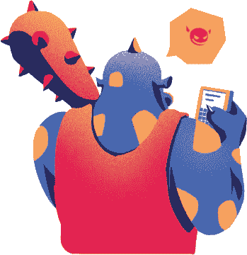

## 恶行

喷子行为、骚扰和欺凌会造成情感痛苦，并可能导致线下暴力和现实世界的犯罪，如跟踪或虚报警察（swatting）。喷子出现在视频游戏聊天室、评论网站、论坛（尤其是 `4chan`、`7chan` 和 `Reddit`）以及社交媒体网站，包括 `Twitter` 和 `Facebook`。喷子喜欢所有的评论区——新闻报道、`YouTube`、`Tumblr`，甚至如果你引起了他们的注意，还有你的博客。公司曾在 `Yelp` 上被喷过，个人（包括一位白宫发言人）甚至在支付平台 `Venmo` 上被喷过。有一点是可以肯定的：喷子很有创造力，只要有可以喷的地方，他们就会去喷。

### 他们在做什么

在线骚扰包括发送恶毒邮件、在网上分享受害者的个人信息以及呼吁对目标实施暴力。许多女性甚至收到死亡和强奸的威胁。

### 远离

喷子没有规则，并且会自相矛盾。他们不合逻辑，所以不要费力试图与他们讲理。他们引发争论，发布负面和震惊的评论，提供错误信息并激怒人们。他们追求的是愤怒的反应，以让报复接踵而至——他们乐于制造混乱。

喷子有时会合作，在共享的喷子论坛上发布目标，以便许多人一起攻击同一个目标。这些喷子会因参与此类行动而获得声誉。

## 科普

喷子行为有多种形式，包括以下常见形式：

- **围攻攻击（Dogpiling）**：一个网络暴民集团围攻他们的目标，试图压垮、耗尽并羞辱受害者。


- **伪关怀喷子（Concern Trolling）**：某人给出“有帮助”的建议，但实际上是为了贬低和侮辱目标。
- **情感操纵（Gaslighting）**：操纵受害者使他们对自己的感知、记忆和神智产生怀疑。如果虐待者说这不是虐待，那么你正遭受着情感操纵。
- **连珠炮倾击（Gish Galloping）**：连珠炮倾击的目标是不断地试图消耗受害者、浪费他们的时间、分散他们的注意力并让他们偏离。这是一种“千次微评论导致的死亡”。
- **冒充喷子（Impersonation Trolling）**：为了破坏目标的声誉，一些喷子以他们的名义创建虚假的社交媒体账号并发布挑衅性陈述。喷子甚至可能利用这些虚假账号的虚假陈述，指控账号者发表了这些陈述。
- **新手喷子（Newbie Trolling）**：在线社区总有新来，这些人可能会被分享糟糕建议或提供误导的人所利用。
- **海狮式骚扰（Sea-Lioning）**：这些喷子加入在线对话并要求目标提供证据。虽然他们通常很有礼貌，但他们质疑事实并不断挑战——当他们的骚扰被揭穿时，又扮演受害者。
- **震惊喷子（Shock Trolling）**：类似于电台的“震惊节目主持人”，这些喷子进入敏感的社区（通常是宗教或政治论坛），通过发布煽动性的回复、图像或链接来制造麻烦。

# 黑客历史

## 匿名组织的崛起

`4chan` 是互联网上最臭名昭著的论坛之一，由 15 岁的 Christopher Poole 于 2003 年创立。臭名昭著的 `/b/` 板无无政府、随所欲的态度，是许多经典迷因（如 `Rickrolling` 和 `LOLcats`）的起源地，同时黑客主义组织 `Anonymous` 也诞生于此。

传说 `Anonymous` 的第一次行动是从一个青少年虐待者手中救出一只猫，那人发布了自己殴打动物的 `YouTube` 视频。论坛成员找到了发布者，报警，救了那只猫并逮捕了虐待者。这个去中心化的社区继续执行了诸如“匿名者计划”（Project Chanology，目标是科学教）、针对其他目标的 `DDoS` 攻击以及对“占领运动”（Occupy movement）的支持。`Anonymous` 的名字来源于 `4chan` `/b/` 板的匿名性质。

> 喷子从目标身上唯一想要的东西就是反应……任何反应都可以。通过拒绝给予这种满足感，你完全让自己成为一个没那么吸引力的目标。

## 随机喷子行为

理论认为，互联网的匿名性允许人们释放出最糟糕的一面并骚扰完全陌生的人。在线骚扰者报告的事实似乎证实了这一点。

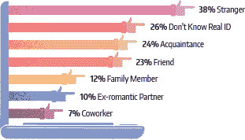

## 保持冷静并点击

喷子挑衅你是为了引发情绪反应。最重要的是记住“不要给喷子喂食”（don’t feed the troll）。当然，当有人不断触动你的神经时，很难控制自己，但这正是网络欺凌者想要的。停一下，把手从键盘上移开，深呼吸，站起来走走。如果你不回应，喷子就会感到无聊并寻找更容易对的目标。

在线社区从互联网之初就开始应对喷子，许多社区已经开发了规则和软件来将喷子挡在门。“软禁”（Soft banning）是一种技术，基本上是除喷子以外的所有所有人隐藏喷子的帖子。如果没有人看到帖子，它就不会获得关注，因此喷子会感到无聊并去别处。

你无法预测自己是否会被针对。女性通常比男性更容易受到骚扰，但任何人可能因为任何原因成为目标，包括政治或宗教信仰。如果你最终成为喷子或在线骚扰的受害者，这里有一些有效的应对方法：

- **不要纠缠（Don’t Engage）**：被挑衅时不要回应或表现情绪。如果你表现出哪怕的一丝反应，他们就会致命击。他们可能是无情无情的，有时当他们得不到回应时，他们会进一步升级以挑衅你回应。
- **记录一切（Document Everything）**：立即对煽动性的短信、推文和评论截图，因为它们可能会被删除。记录骚扰日记。如果这让你感到太难过而无法做到，让朋友代劳。
- **保护自己（Protect Yourself）**：使用强密码，并开启`双重身份验证`以让你的账户更难被破解。从互联网上删除你的个人信息，以防止被肉搜（doxed，见右侧“关键概念”）。
- **采取法律行动（Take Legal Action）**：联系相关部门。报警，除非骚扰延伸到线下，否则警察可能无法提供帮助。
- **安全发泄（Vent Safely）**：喷子乐于在网上惹怒人们，回应或在网上抱怨会奖励他们。与其在网上发泄，不如向你信任的朋友或家人倾诉你的挫败或愤怒。做运动，和朋友或亲人度过时光，接触大自然，照顾自己——好好吃饭，喝水，冥想释放愤怒。如果压力真的很大，寻求专业人士的帮助。
- **将他们屏蔽（Shut Them Out）**：删除好友、屏蔽、静音并举报喷子。大多数系统都有屏蔽和举报不当行为的方法——例如，`Twitter`、`YouTube` 和 `Facebook` 都拥有屏蔽和举报功能。
- **不予评论（Give No Comment）**：如果你发布的是你认为会有争议的文章或博客文章，请关闭评论。如果喷子正在回复你网站上的博客文章或你发起的 Facebook 帖子，你可以随时关闭评论功能，或直接删除那条过分的评论。


## 消失在视线

作为最后的手段，考虑为你遭受网络骚扰的论坛或网站创建一个新身份。

## 核心概念

### 人肉搜索（DOXXING）

“记录”（documenting）的缩写，人肉搜索是指将你的个人信息（如法定姓名、地址、电话号码、电子邮件地址或其他数据）发布在网上，并公开邀请他人骚扰你。如果人们知道了你的名字和地址，他们就可以将骚扰扩大到线下，这可能演变成暴力。

针对目标住所的虚假威胁向执法部门拨打恶作剧被称为“特击（swatting）”。其目标是让武装警察出现并对无辜的人举枪威胁。

“特击”是违法行为，可能导致入禁。值得注意的是，21 岁的 `Mir Islam` 承认了对网络跟踪、人肉搜索以及对 50 名名人及公职人员实施特击的指控。他被判处入禁 24 个月。而且，在引入《2015 年州际特击骗局法案》后，马萨诸塞州众议员 `Katherine Clark` 也成为了特击的受害者。


## 游戏门事件（GAMERGATE）

游戏门事件的发起和支持者声称，这实际上关乎游戏新闻的伦理问题。但回顾游戏门事件的历史可以看出，这远不止如此，而且糟糕得多。

游戏门事件始于 2014 年，源于一篇精心策划旨在煽动网络骚扰者的博客文章。正如预期的那样，它引发了一场严重的网络暴民骚扰行动。这些攻击失控的程度，不仅引起了游戏社区的关注，也引起了主流媒体的关注。游戏门事件绝不是第一次大规模骚扰行动，但根据其产生的在线和线下骚扰尝试次数，它被认为是最有效的之一。

引发游戏门事件的导火索是 `Eron Gjoni` 写的一篇极其恶性帖子，他是游戏开发者 `Zoe Quinn` 被抛弃的前男友。这对夫妇交往了五个月。分手后，`Gjoni` 决定通过骚扰 `Quinn` 来报复分手之情。因此，他写了一篇 9,425 字的博客，旨在让玩家/骚扰者群体去骚扰 `Quinn`。

`Gjoni` 针对的是游戏社区绝大多数的年轻白人中产阶级男性，他成功引发了一场有组织的攻击——不仅仅针对他的前女友。这些年轻人大多是习惯玩第一人称射击游戏的青少年，他们对游戏领域日益增长的多样性感到威胁，因为越来越多的女性和人种开始玩并制作游戏，并对现有游戏缺乏多样性以及将女性刻板化为性对象的倾向进行批评。`Gjoni` 触动了白人男性主导的游戏文化中的敏感神经。

这篇帖子导致了大规模的在线和线下性骚扰风暴，目标不仅是 `Quinn`，还包括游戏社区的数十名其他女性。骚扰者使用 `#GamerGate` 标签，以“哲学分歧”为掩护发动网络攻击，包括发布负面评论和推文、人肉搜索、对受害者进行骚扰性的 PS 处理图像、对她们所创作内容的不当举报，以及强奸和死亡威胁。制作 `Feminist Frequency`（一个分析流行文化中女性形象的网站）的 `Anita Sarkeesian` 也是另一个目标。另一位开发者 `Brianna Wu` 遭到了人肉搜索，随后收到死亡和强奸威胁（`Wu` 后来建立了一个法律防御基金，并发起了 2018 年竞选国员的活动）。那些声称专注于“伦理”的人，对任何一个他们的女性目标目标计划发言或获奖的组织和会议投送了炸弹威胁。网络暴民在试图羞辱受害者、毁掉她们的名誉并破坏她们的平静方面是不留情的。

> “QUINN 只是第一个被针对的女性。”

游戏门事件是网络骚扰、性别歧视和不成熟的完美风暴。从核心来看，游戏门事件确实是针对游戏行业女性的网络性骚扰。它给受害者造成了无法言喻的情感伤害，而作恶者躲在匿名账户之后。这并不是第一个网络暴民在线性骚扰的案例，尽管其巨大的集体努力引人注目。在更早的一个案例中，著名的用户体验专家 `Kathy Sierra` 遭受了类似的骚扰和威胁，导致她在 2007 年离开了互联网。

遗憾的是，游戏门事件也不会是最后一个。互联网是匿名骚扰的完美媒介。任何人都可能成为目标，因此采取措施保护自己免受骚扰者的侵害：不要对他们的帖子做出反应，对信息和图像截图，向当局报告事件，并在社交媒体账户上使用强密码。希望任何骚扰者都会溜此而去。但也许结束网络骚扰最好的方法是自己不要做这种事——并鼓励其他人不要进行骚扰。

## 吸吸的教训

游戏门事件确实是网络骚扰和性骚扰历史上的一个分水岭时刻。第一次，一个人能够强烈地激励并操纵一个庞大的社区来为他干脏活。一旦第一块石头被扔出去，它就引发了一场无法阻挡的雪崩。其他人为了“乐子”（lulz）而加入，新的目标被确定，暴民的规模和行为进一步扩大。当游戏门事件对目标的网络骚扰升级为人肉搜索；强奸和死亡威胁；以及对那些各种女性受邀担任演讲者的会议所策划的炸弹、枪击和其他暴力行为的威胁时，游戏门事件获得了全国媒体的关注。这些技术在另右翼媒体对 2016 年选举的报道期间爆发了。一想到这一切竟然始于一个被抛弃的情人的报复之举。

骚扰通常源于无聊、距离、匿名和机会。确保你不要由于无聊或愤怒而滑入骚扰。

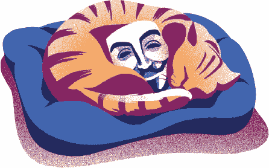

## 暴民还是私刑者？

到目前为止，我们关注的是人们匿名在互联网上结盟时发生的坏事。事实并非总是这样运作的。技术是中立的，那些被用于恶意的工具、技术和倾向也做了很多好事。欢迎来到黑客行动主义和去中心化权力的世界，在这里任何拥有电脑的人都可以成为活动家，骚扰可以用于正义或抗议不公。


### 匿名计划

我们之前讨论过现在被称为 `Anonymous` 的小组是如何从 `4chan` 上的 `/b/` 随机板块出来的。虽然那些活动大部分是为了乐子，但同样存在利用这种力量行善事的愿望。2008 年，`Anonymous` 对了教会，因为当时一段关于 `Tom Cruise` 宣传教会的泄露视频从 `YouTube` 上被删除了。这次行动被称为“匿名计划”（Project Chanology）。随后发生了多次 `DDoS` 攻击、黑传真（向接收者的传真机发送黑色页面以耗尽大量墨盒，造成成本和困扰）以及策划的实体抗议。由于教会以恐吓和骚扰抗议者闻名，`Anonymous` 抗议者戴着面具以强调他们的信息：“我们是匿名。我们是万民。我们不原谅。我们不忘记。等我们。”他们选择的面具现在已成为该运动的代名词，是漫画和电影《V 字仇》中反政府抗议者戴的“盖·福克斯”面具。

`Anonymous` 并没有此停止。由于该组织没有单一领袖，任何人都可以创建行动，任何想参与的人都可以加入。`Anonymous` 后来支持了占领华街并抗议 `KKK`、`ISIS` 以及在欧洲发动多次袭击的恐怖分子。


# 恶搞西斯特伯沃浸会教会

西斯特伯沃浸会教会因其仇恨活动闻名，他们在集会和军事葬礼上展示反同性恋标志，并对其他宗教进行拦截和骚扰。在教会领导决定将精力转向骚扰 2012 年桑迪胡克学校枪击案的受害者后，匿名（Anonymous）将目标集中在他们身上。西斯特伯沃浸会教会的网站迅速被黑并关闭，若干成员的社交媒体账号也遭到破解，并发起了请愿政府宣布该教会为仇恨团体的。


## 追捕儿童猥亵者

2007 年，加拿大公民 Chris Forcand 因多项诱骗未成年人罪被捕，此前，匿名组织的几名成员在网上假装未成年人与其接触，并收集了他发送的聊天记录和不雅照片。2011 年，匿名组织更进一步，实施了 `Operation Darknet`（暗网行动），该小组针对并击溃了由互联网供应商 `Freedom Hosting` 运营的 40 个隐藏网站——这些网站全部涉及出售儿童色情——并向公众公布了 1,500 多名用户的姓名。2015 年，`Operation Death Eater`（食尸者行动）出现，这是一项对抗国际恋童团体的努力。


## 基层倡议

除了大规模行动外，匿名组织还参与了一些规模较小或较为人知的活动，例如针对虐待动物网站的 `Operation Beast`（野兽行动）；`Operation Monsanto`（孟山行动），重点关注抗议这家农业巨头；以及 `Operation Safe Winter`（安全冬季行动），旨在提高人们对寒冷冬季无家归者所处困难的认识。

## 概念

### 黑客行动（HACKTIVISM）

互联网为人们相互联系提供了新机会——尽管这并不总是最好的方式——而这些机会之一就是无需出门即可参与社会和政治活动。黑客行动（hacktivism）据传由一个名为“死牛教派”（Cult of the Dead Cow）的黑客组织成员于 1994 年创造，它是植根于黑客文化和伦理的“黑客”与“行动主义”的结合。致力于某项事业的人可以使用颠覆性的互联网来促进社会或政治变革。大多数情况下，愿望是传播信息并推动民权和人权。当然，由于某些滥用互联网的方式并不光彩，黑客行动也有其令人不快的方面，例如 `Gamergate`（游戏门事件现象（详见第 156–157 页](#cap11.xhtml#page156)）。

## 安全基础

### 避开视线

你知道自己的个人信息——如法定全名和家庭地址——是否在网上公开吗？许多网站已将公开此类信息作为一种商业模式。另一些则希望方便创建家谱。在某些网站上，只需简单搜索就能找到你的信息。然而，最近通过的法律要求，如果你请求退出，这些网站必须从其数据库中删除你的信息。当然，也有像 `DeleteMe` 这样的公司希望通过自动为你完成这些操作来盈利。你可能想从这些数据库中删除数据，是因为这里是喷子（trolls）获取你的肉搜搜索（dox）信息并将网络骚扰转化为线下攻击的地方。现在尽可能删除你的信息，让喷子更难找到你的信息。

## 认识你内在的喷子

每个人都有点阴暗面，而恶搞（trolling）会激发出我们人性中最糟糕的一面。以下是导致喷子的的一些性格因素。

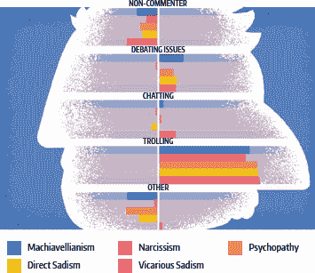

### 什么造就喷子？

就像社会中总会有令人不快或麻烦的人一样，互联网上也是如此。在人类本身发生改变之前，恶搞不太可能真正消失。距离、匿名和机会的结合是一种诱惑，有时会激发他人最坏的一面，引发他们内在的喷子。但某些人可能天生如此如此。对反社会人格和反社会行为的心理学研究提出了“黑暗三联”（dark triad）的概念，这是三种性格特征的结合，结合在一起描绘出了恶毒个体的阴暗形象。

黑暗三联所指的邪恶特征是马基雅维利主义、自恋行为和反社会人格，这些特征结合在一起，会创造出一种共情能力低、追求感刺激、乐于操纵他人并专注于自我满足的人格。如果你将其与喷子的活动——造成痛苦、为了寻乐（lulz）、将受害者视为娱乐来源以及“行动”进行对比，你就能看到喷子是如何符合这一描述的。如果有机会，任何人都有成为喷子——但有些人可能是天生如此的。

### 记住美好

所有关于喷子、私义警察、`4chan`、`Anonymous` 和 `Gamergate` 的讨论当然可以描绘出一幅阴暗的画面，即互联网是一个令人不安的地方，充满了潜在的敌对人物，等待着为了娱乐而欺负或骚扰你。但你仍然应该记住，互联网上也有很多人在做着好事。通过采取措施避免成为恶搞的受害者——并且自己不要成为喷子——你可以保证互联网上的好人永远多于坏人。—— Heather Vescent

## 核心总结

不要让你的网络体验被一群怪异的孩子和可怜的小狗毁掉。以下是避免喷子的方法，或者在最坏的情况发生时如何巧妙地应对他们。

## 基础安全

- 屏蔽、静音、隐藏并取消关注麻烦者。
- 远离在线文章下方的评论区。
- 如果你开始变得过于激动，请离开社交媒体。
- 即使面对最糟糕的攻击，也不要针对个人。

## 高级措施

- 锁定所有社交媒体的隐私设置。
- 为所有账户开启双重身份验证。
- 询问网站管理员是否对评论进行审核，远离任何不审核的网站。

### 锡帽军（TINFOIL-HAT BRIGADE）

- 只使用化名发布；不要在任何社交媒体或论坛使用你的真实姓名。
- 创建一个仅用于社交媒体（或其他高风险功能，如网恋或游戏）的邮箱账号。名字要和自己完全不像，且不要与其他任何事物关联。
- 记录网络骚扰并报警。

## 扩展阅读

### 如何正确地恶搞

从良心角度出发，我们不能真的告诉你感到无聊时去出去恶搞他人。但我们确实知道有些人无法抵挡这种冲动。但如果你打算释放内在的本性，真的应该知道自己在做些什么。如果你要恶搞，请保持你的格调。尽可能使用机智和深思的思考来指出你所反对的问题。选择一个合适的目标——正如喜剧界所说的，“要向上打击”（punching up）。选择一个对无辜受害者有害或存在问题的组织，而不是欺凌更小、更弱的人（“向下打击”）。并且永远、永远要做好面对反击的准备。那里的人最终会决定他们不喜欢你表达观点的方式。嘿，我们可没说过恶搞很容易。


就在不久前，政家和评论家还把互联网称为我们时代对旧“西部荒野”的回应——一个法外的新边疆，在那里可以创造财富，也可以摧毁名誉。事实是，即使大多数网络搜索都是为了猫视频和马芬蛋糕食谱，但在网络空间的阴暗角落仍然进行着许多可疑活动。这些阴暗的小巷为好人和坏人提供了庇护所，从举报人、政治异见人士和向网络间谍泄露机密文件的人，到毒毒贩和全球恐怖分子。无论你是想推翻一个压迫政权、获取一公斤未经加工的海洛，还是学习如何瘫痪一个国家的基础设施，那里都有人乐意提供帮助。你能信任他们吗？可能不能。在准备好装备出发征服这片新边疆之前，最好先保持警惕。

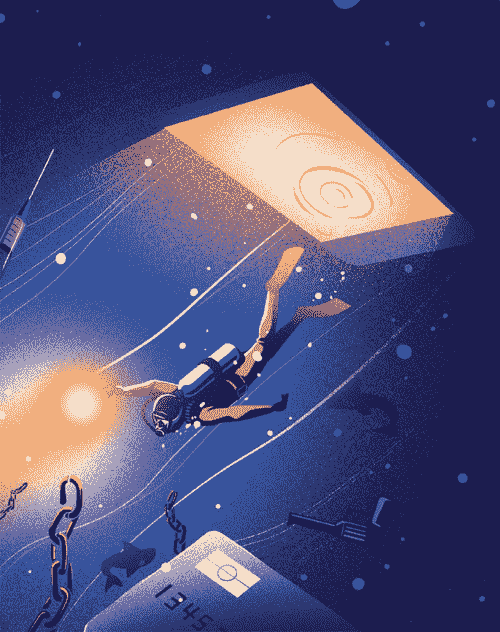

# 第 12 章：深层暗网

你可能在警匪剧或有关枪支、毒品和雇佣杀杀的新闻中听过暗网。那里真的那么黑暗吗？有时确实如此——但并非总是如此。让我们潜入其中看看。

除了那些引人入胜（且几乎毫无意义）的外，很少有人真正知道什么是“深网”（deep web）和“暗网”（darknet）——或者理解两者之间的区别。在本章中，我们将离开信息超级公路上明亮的大道，探索它一些更阴暗的小巷时会发生什么。虽然在现实中，它不像各种电视犯罪剧描绘的那样既华华又充满杀机，但事实是，互联网的这一方面是全球经济的重要贡献者，也是全球犯罪活动的推动者。

尽管我们可以假设暗网上的大量交易是相对良性的（尽管这取决于你是否认为盗取的 `Netflix` 登录账号或无品牌万艾力宝是无害的），但许多交易并非如此。正如任何法外荒野边疆一样，你可以发现一些真正的坏人利用人性的阴暗面面获利。在这种情况下，这些坏人可能在交易儿童色情或海洛，出售被黑掉的信用卡账户，甚至参与人口贩卖。尽管如此，外面的一些好人也可以从同样的匿名性中受益，特别是当他们恰好是举报人或对抗压迫政权的个人时。

## 阴暗交易

在所谓的暗网上，到底流转着多少钱？比你想象的要多，尽管由于其本质，这类交易显然难以追踪和量化。可靠的专家估计，黑市交易占全球商品和服务总额的约 23%。想一想。如果全球产品总值几乎是 78 万亿美元，这意味着通过黑市交易的金额要多出近 18 万亿美元。换句话说，世界上近四分之一的交易发生在合法全球交易所之外。这些交易是什么？任何想要为任何物品或接收不可追踪（且不纳税）的支付的人，包括非法商品和服务——从枪支毒品到黑客攻击和被盗数据——都可以在数字黑市找到他们想要的东西。

### 核心概念：私密空间

暗网上并非一切都是非法的。事实上，它最初是由美国政府设计的，让他们的特工和分析师匿名探索全球互联网的最偏远地区以寻找信息。隐私和匿名性对于暗网的所有用户来说至关重要，许多人使用它是因为他们可以在不用担心在线监控的情况下进行交流。考虑一些言论自由并非权利的国家：例如，通过访问被本国屏蔽的外国网站来了解政府滥用权力，现在使用暗网是安全的；同样的还有表达愿望和梦想——是的，还有买一副假品凡赛哲墨镜。当你考虑到法律的任意性是政府任意权力的延伸时，暗网的美之处就显而易见了。

## 深入探索

要理解这个主题，首先要知道的是网（Web）并不是互联网（Internet）。虽然在日常生活中它们似乎是同义词，但互联网远比万维网丰富。互联网是连接到巨大公共网络上的整个全球计算机集合，该网络共享某些规则来传输各种类型的信息。其中最熟悉的是网页和电子邮件，但实际上还有许多你永远不会注意到或不在乎的运行在这一全球网络上的东西。以下是基本分类。

### 表面网 (Surface Web)

你在网上看到的大部分内容，从 `Facebook` 到 `eBay` 再到 `Amazon` 和 `Twitter` 都是表面网。它由所有各种公共网站组成，这些网站共享内容、销售商品或希望被轻松发现。它们允许任何访客访问，并邀请搜索引擎对其进行索引，以便用户可以通过 `Google`、`Yahoo` 等找到它们。

### 深网 (Deep Web)

外面的数百万个网站没有出现在搜索引擎中，通常是因为它们不想被轻易发现。这些网站没有来自任何其他网站的入站链接，并且阻止了搜索引擎。你仍然可以使用标准浏览器访问它们，但前提是你有其他方式知道地址，例如，如果一个链接通过私密电子邮件发送给特定的接收者列表。这种安排通常用于与不希望有外人加入的封闭式社群共享内容，例如被黑掉的数据或儿童色情内容。

### 暗网 (Darknet)

简单来说，“暗网”是指任何无法通过标准浏览器访问的内容，因为它需要特殊的软件，通常还需要特殊的知识才能访问。暗网通常指的是 `Tor` 网络上的站点（更多信息请见第 170 页），这些站点看起来和用起来和普通网站一样，但需要特殊的 `Tor` 浏览器才能查看。更广泛地说，暗网还包括普通用户不熟悉的其他协议和环境，例如 `IRC`（互联网中继聊天）频道和 `I2P`（不可见互联网项目）网络。此外，暗网不像表面网网站那样被索引；其几乎所有的站点地址必须通过共享而不是搜索来获取，而且并不是人都乐意分享。

底线是，对于普通用户来说，由于电视的影响，深网和暗网可能看起来很有吸引力或很性感。实际上，你会在那里发现的是恶意软件、病毒、非法内容以及准备利用无知之士的罪犯。除非你真的知道自己在做什么，否则请远离。

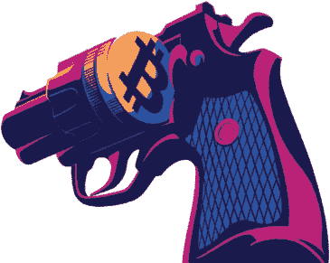

### 核心概念：在暗网中购物

虽然暗网为活动人士、举报人、执法执法人员和政治难民提供了许多合法用途，但它也支持一个遵循自己一套规则的地下黑市经济。买家和卖家有许多理由在正常的开放市场之外进行交易。这些包括以下：

- **非法商品**：任何寻找无法在公开市场销售的产品或服务，例如毒品、被盗的身份数据或武器。
- **匿名性**：这些交易可以在没有记录的情况下进行，让买卖双方保持匿名，且（理论上）没有纸质痕迹或电子足迹。
- **价格控制**：受税收、关税、价格控制和其他限制的商品——例如香烟或酒类——对黑市牟利者具有吸引力。诸如 `Tide` 洗衣粉、`Gillette Mach3` 剃须刀、`Crest` 美白条以及其他高利润的日常必需品也是如此。

技术让黑市买家和卖家能够更安全地连接并进行交易。在当局与黑市之间不断的拉锯战，一个黑市被关闭了，另一个就会随之而生。

## 对错

你可以在互联网上雇佣杀手。

# 丝绸之路与暗网

最臭昭著的在线黑市是丝绸之路（Silk Road），由一个名为 `Dread Pirate Roberts` 的黑客于 2011 年运营。它的运作非常类似于 `eBay` 或亚马逊，只不过提供的商品包括枪支、非法药物、黑客服务，甚至是雇杀服务。丝绸之路于 2013 年 11 月被 FBI 关闭，`Dread Pirate Roberts`、`Ross William Ulbricht` 现正服从终身监禁。意乎并不意外，无数其他非法市场随之涌现。目前尚不完全清楚，许多“雇杀杀”服务是纯粹的幻想，还是针对轻信之者的骗局。另一方面，如果它们真的像他们说的那样好，我们又如何知道呢？

**如果你决定要探索暗网，请禁用浏览器中的所有脚本。你永远不知道外面的恶意软件具备什么样的攻击电脑的能力。**

## 剥开洋葱

暗网最大且最为人知的元素是 `Tor` 网络。`Tor` 代表“洋葱路由器”（The Onion Router），它最初是美国海军启动的一个项目，但早已已移交给一个私营非营利组织。其细节极其技术化，但作为一个普通用户，你可以将 `Tor` 网络视为三种相关的技术。

### 网页浏览器

`Tor` 浏览器的工作方式类似于普通网页浏览器，但它将用户对网页的请求通过 `Tor` 网络进行路由。

### 安全通道

`Tor` 通过从页面请求中剥离身份数据来匿名用户的活动，然后将请求通过遍布全球运行特殊 `Tor` 软件的志愿者计算机之间的多次加密传输发送，让这些计算机充当中站。当使用 `Tor` 浏览器的用户输入标准的网页地址时，该请求将从“普通”网络进入 `Tor`，通过各种中间中继节点进行跳转，然后通过 `Tor` “出口节点”重新进入普通网络并到达目标网站。该网站对页面请求做出响应，内容通过 `Tor` 网络通过类似的过程传回用户。

### 隐藏网站

配备了正确 `Tor` 软件的计算机还可以运行网站（以及其他服务，包括 `IRC` 聊天通道），这些网站可以通过 `Tor` 浏览器访问。因此，使用 `Tor` 浏览器的用户不仅能够对浏览标准网页的行为进行匿名，还能看到一个完全不同的“网络”（尽管较小），由以 `.ONION` 结尾的网站组成，这些网站无法通过标准浏览器访问。

用于节点或托管 `Tor` 网站的软件可以在 `TORproject.org` 找到。

## 剥洋葱

使用 `Tor` 意味着浏览器流量通过多层 `Tor` 用户中继进行路由，就像洋葱一样——因此得名。

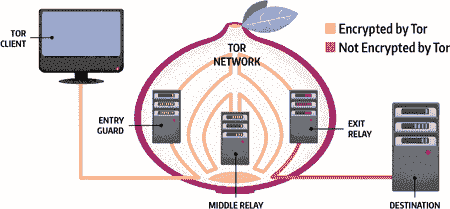

## 卧底行动

当犯罪分子潜伏在暗网阴暗的角落时，世界各地的执法人员也身处其中。英国的一位同事抱怨说，他买了太多的刀具和药物，不知道该如何处理。我花费了无数小时浏览 `Tor` 网站，寻找儿童色情制作者（与分销商不同，后者往往粗心到会使用表面网来交换他们那些不可原谅的货物）。

### 寻找麻烦

无畏的网络安全记者 `Brian Krebs` 对付了如此多的暗网犯罪分子，以至于他的当地警察局不得不制定一套特殊程序：当有人打电话报 `Krebs` 宅发生暴力犯罪时（由于暗网暴徒警报有“人质处境”，特警行动队已多次聚集在他房子周围）。`Krebs` 还曾有犯罪分子寄送海洛到他家里，然后打电话给当局提供线索，让他们搜查他的邮件。

“暗网是坏人的地方，”一位高级联邦特探员告诉我，“我们必须擅长待在那里并看起来像那里的一员，因为这是我们唯一能够获取线索并阻止计划的对话和关系的途径。”

### 声誉很重要

这引发了一个重要的非显而易见的问题：在匿名用户的世界，声誉（基于共同兴趣和持续的活动）是衡量信任的唯一标准。这是让学者们忙碌的事情。

当然，声誉是良好的记者和记者安排与来源会面以安全地了解腐败计划和犯罪团的方式。记者有时可以根据暗网交易模式发布突破性新闻。例如，`Brian Krebs` 报道了 `Target` 黑客事件。另一位网络记者 `Steve Ragan` 多年来一直在报道犯罪恶意软件和黑客组织。

`FBI` 和 `DEA` 的特别行动小组成立，旨在揭露并铲除 `DPR`。一名 `DEA` 探员 `Carl Mark Force IV` 采用了一个替代身份——来自多米尼加共和国的中层毒品犯罪集团成员，并联系了 `DPR`。他们建立了真正的友谊，但关系非常复杂，因为 `Force` 作为“巴尔的摩丝绸之路特别行动小组”的一员，仍在试图抓捕 `DPR`。

有一次，`DPR` 请求 `Force` 帮助他安排杀害一名与联邦当局合作的 `Silk Road` 员工。特别行动小组成功地策划了一场极具说服力的假雇凶杀案。

“这就像是黑市货物的 `eBay`。”

“丝绸之路”的被毁是在经过几个月对 `IP addresses` 的追踪并确认 `DPR` 账户的登录情况后发生的。

`Chris Tarbell` 是最终找到 `Silk Road` 的 `IP address` 并将其追溯到冰岛的一处数据中心的探员。在拿到`美国检察官`的信后，他带着硬盘镜像走出了数据中心，该镜像随后将一个 `IP address` 追踪到了旧金山的 `Café Luna`。

`Ross William Ulbricht` 是于 2013 年 10 月在旧金山的格伦公园公共图书馆被捕的男子。`Silk Road` 服务器上持有的所有 `bitcoins` 都被`美国政府`没收，随后在一系列拍卖中出售。`Ulbricht` 因洗钱、计算机黑客攻击和唆使杀杀被定罪。他正在执行无假释的终身监禁。

故事出现了一个奇怪的转折：卧底 `DEA` 探员 `Carl Force` 叛变了，并被指控侵吞了被没收的大笔 `bitcoin`。他在 2015 年 6 月被判处六半年监，其中包括洗钱和妨碍司法的罪名。他的同事、前特勤局探员 `Shaun Bridges` 也遭到了指控。

`Silk Road` 品牌依然存在，但它不再由 `Ulbricht` 控制。截至本书印刷，他们运行的是 `Silk Road 3.0`。

## 教训

### 暗网永无止境

黑市一直存在，而且它们永远不会消失。`Silk Road` 以及在其倒台后涌出的许多网站让购买非法商品变得简单。随着这些网站变得越来越流行，它们也引起了政府的注意。这些黑市利润丰厚，但大多数经营者知道他们最终会被端。买家和卖家也知道这一点，因此在网站上保留少量资金，以防被没收。犯罪分子既聪明又贪婪，似乎每项新技术都可以被用于不法用途。精通技术的犯罪分子层出不穷，与法律和执法部门作斗——双方都受到技术的助力，而技术本身是价值中立的。但是，如果在一个整洁、光线明亮的地方进行非法交易，到底会有多糟糕呢？为了了解所售产品的质量？有些人可能会说：“熟悉的魔鬼胜过未知的危险……”

## 基础安全

### 让你的身份远离暗网

随着网站被黑客攻击的数量增加，你的个人数据在黑市被出售只是时间问题。对于他人的网站被黑客攻击，你做不了什么保护自己——那取决于网站的安全技术。但你可以使用良好的账户密码习惯。永远不要在不同的网站上重复相同的用户名/密码组合。黑客获取新数据后做的第一件事之一，就是自动在大量的银行、社交和电子邮件网站上检查被黑的用户名/密码组合。如果你在其他网站上使用相同的用户名和密码组合，黑客就可以进入那些网站的账户，即使那些网站并未被黑。请使用一个复杂但易记的密码组合。

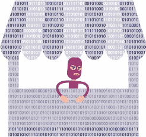

### 让买家自担

直到最近，现金 `美元` 仍然是黑市交易的首选货币。现金不可追踪且匿名，但在在线商业中很难使用现金。信用卡和其他常用的支付方式会留下纸质轨迹。这就是为什么 `bitcoin` 对于阴暗的购物者来说是如此理想。虽然如上述提到的，它们并非完全匿名，但使用 `bitcoin` “混币器”（tumblers）和匿名网站可以很好地掩盖踪迹。你应该这样做吗？有正当理由保持的财务足迹，特别是如果你对政府及其窥探行为有各种担忧（或对不信者来说是阴谋论）时。

### 尝试（谨慎地）一下

非犯罪用户可能考虑这些地下市场是有原因的。例如，你可能希望通过世界另一另一的用户的计算机来租用互联网访问，在那里，例如 `Netflix` 显示`美国`用户无法看到的首映电影，或者你居住在一个言论自由受限的地方，你希望能够与其他就民权或人权问题进行交流。

### 谨慎对待

“操作安全”中的微小错误可能会导致巨大的后果。仅仅小心是不够的。你每当进入和离开暗网甚至深网时，都必须非常小心并遵循一套严格的程序。

首先，不要用你自己的电脑进行此类探索。事实上，你甚至不应该使用现实世界的电脑。相反，请下载一个可启动的 `Linux` 镜像，并始终通过该路径加载你的 `Tor` 会话。你还应该在该可启动驱动器上加载如 `PGP`（优美加密）加密工具。

这种设置允许你将整个浏览会话加载到主机的内存中，这样当你完成后，重启电脑，硬盘上就不会留下痕迹。

我们当然不建议进行任何购物，但如果你真的好奇，不要只用 `Tor` 访问暗网网站。为了额外的匿名性，你可能想要使用额外的 `VPN`（虚拟专用网络）来完全匿名你的流量。

所有这些技术隐匿措施可能看起来非常麻烦，但它们确实是在具有某种程度安全的情况下访问暗网的唯一方法。当你考虑到几乎每个因非法活动被抓获的人都是因为安全漏洞时，这一点变得非常重要。我们甚至建议使用一台干净的电脑——完全没有任何个人数据或与合法账户（如银行账户）的链接——并专门用于你的深网和暗网冒险。你绝对不想在这些街区闲逛时使用一台一旦被破解就会泄露你大量活动信息的电脑。

### 总结

暗网是一个非常迷人的探索之地，但危险无处不在，即使你没有做任何非法活动。采取合理的预防措施。

## 基础安全

- 不要在互联网上从事任何非法或可疑活动。
- 如果你在暗网网站上进行任何交易，即使是完全合法的也要对所有内容进行加密。
- 在登录 `Tor` 之前禁用浏览器所有的脚本。

## 高级措施

- 仅使用加密货币进行暗网交易，并使用混币器确保最佳匿名性。
- 经常更改用户名和密码。

## 箔帽小组

- 减少托管的货币，以防在查封或抢劫中损失。
- 同时使用 `Tor` 和 `VPN` 来完全匿名你的流量。
- 将数据保留在 U 盘上，这样你就可以从常规电脑上删除所有痕迹。

# 暗网的未来

自从暗网诞生以来，已经发生了许多变化，而且这种情况将持续下去。特定的市场会兴起又落——它们永远不会完全消失。监管政策的改变可能会影响黑市销售的商品，某些商品（例如在已合法化地区的大麻）可能会转入合法市场（白市）。那么，我们在未来的黑市可能会发现什么呢？简而言之：任何不受监管或受高度监管的物品。这可能包括增强人体的技术和药物、政府机密，或新类型的个人数据，例如由新型消费级设备或家庭传感器收集的医疗数据。

有一点是可以肯定的：未来的系统将比我们现在的系统更安全——但未来的黑客也会更加老。

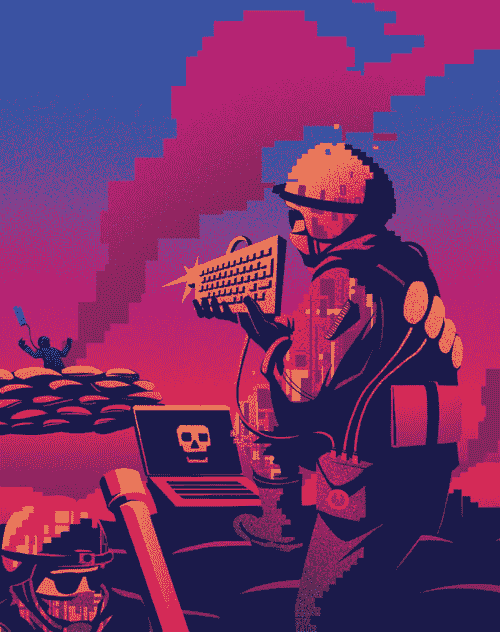

# 第 13 章：维基解与吹哨者

当机密信息泄露给媒体时，有时是为了更大的利益。有时这对于健康和安全来说是一场灾难。问题在于，当秘密出现在网络上，如何区分两者的优劣。

互联网让各种行动者和机会能够获取数据宝库，这在水门事件时代是无法想象的。在那个时代，真正的窃贼必须闯入砖石结构的酒店才能偷取几份不足道的文件。而今天，只需要一点隐蔽和技巧，就能释放数百万页机密记录。

这意味着，合法的政府机构（或者当然，取决于你的观点，可能是武装暴徒）从语音和文字通信监控中获取各种信息变得比任何时候都容易。这种情报收集传统上属于所谓的信号情报，即 `SIGINT`。我们负责捕获和分析 `SIGINT` 的国家情报机构从未拥有过这样的优势，而他们已经承担了这项任务。

反过来呢？对鹅有利的事，对想要偷取这些 `SIGINT` 的公鹅显然有利得多。这影响了试图保护信息的政府，也影响了容易受到企业和工业间谍活动的企业。正如俗语所说，“信息渴望自由”……但代价是什么？

### 叛徒与无赖之

1971 年，丹尼尔·埃尔斯伯（Daniel Ellsberg）和安东尼·鲁索（Anthony Russo）将被称为《五角楼文件》的内容交给了《纽约时报》。埃尔斯伯成为那个时代最受推崇（和/或最受痛恨）的人物。这些文件证明，从特曼到约翰逊的总统们对美国参与越南战争撒了谎——约翰逊一直在进行秘密轰炸。当《时报》发表时，埃尔斯伯被反战抗议者誉为英雄，却被政府内部人员指责为叛徒。这一先例为维基解（WikiLeaks）和斯诺登（Snowden）事件铺定了道路——其中一种理解是报纸可以发布交付给它们的机密文件（尼松政府曾试图以一种极其糟糕的方式阻止出版），只要它们没有主动索取这些文件。


### 核心概念：安全三要素

安全领域的指导原则是，你需要三个因素来确保系统的安全。

- **机密性（Confidentiality）**：你必须确保存储在你的系统中的数据免受意外或未经授权的访问。这种确定性的实现是极其复杂的，因为例如，切尔西·曼宁（Chelsea Manning，参见第 181 页）被授权访问但未被允许复制和分享文件。

- **完整性（Integrity）**：必须在数据的整个生命周期内维护其一致性、准确性和可靠性，并考虑到人为错误、服务器崩溃和病毒的意外情况。

- **可用性（Availability）**：无论你使用什么技术，如果你无法持续且可靠地访问世界上最好的数据，它们也是徒劳的。


### 维基解及类似网站

在过去的几年里，关于维基解以及其他相关网站和个人的提及在媒体和有关安全的讨论中变得越来越盛行。但一些人对他们到底是谁以及在做什么可能仍感到有些模糊。

#### 他们是谁？

维基解——以及它更明智、更成熟，且从政策角度来看影响更深远的大哥`Cryptome`（以及世界各地不时涌起的成千上万类似网站）——为那些愿意公开披露他们认为有价值的信息或数据的人提供不同程度的匿名性。这些信息范围从政府文件（如情报报告、外交公报、计划大纲和规划描述）到内部股票交易记录。其他示例还包括计算机网络入侵的日志、不打算供公众消费的企业内部政策文件（例如，内部定价或药品分销政策）、客户记录（例如黑客组织`Anonymous`泄露的私人情报公司`Stratfor`的客户——包括我在内的客户数据）、名人裸照以及任何其他被认为有趣或猎奇的内容。

#### 他们为什么存在？

记者、揭黑者、空头分子、调查员、反对派研究人员和怀疑配偶总是从内部寻求这类披露。互联网只是让他们更容易被找到。

#### 他们有什么用？

可以很好地论证——我也确实这样认为——我们的国父对政府持有强烈且健康的怀疑，他们通过活跃的新媒体赋予民众经常引发这种怀疑。如果你相信这一观点，那么你必须相信任何赋予这种自由媒体的力量从定义上都是“有用”的。无论你对爱德华·斯诺登、维基解、切尔西·曼宁或丹尼尔·埃尔斯伯持什么态度，他们作为公共辩论和话语的一部分，最终比他们不是那样要好。

#### 缺点是什么？

我个人认为，由朱利安·安斯格启发的、由切尔西·曼宁和特别是爱德华·斯诺登实施的这类泄密行为最终弊大于利。当泄密变得相对容易（前提是你拥有访问权限和技巧）时，埃尔斯伯或鲁索在考虑“泄露什么”以及“是否泄露”时所付出的思考和痛苦，导致了我们看到斯诺登收集并传播某些可能致命的情报时的那种即时性和全球关注度。

### 监控与安全

斯诺登泄露了多达 1.7 份关于`NSA`各行动的文件，远超我们在这里能描述的。仅作为一个小样本，这里是我们了解到`NSA`所做的 10 件重大事项。

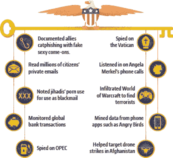

### 关键人物：切尔西·曼宁

出生布德利·曼宁（她在政府监管期间开始性别转换），切尔西·曼宁是维基解首次重大披露的关键。作为一名士兵，她在 2009 年被分配到伊拉克的一个部队担任情报分析师。她可以访问大量机密，并在 2010 年向维基解的朱利安·安斯格泄露了 70 万份伊拉克和阿富汗战争日志及外交电。她说她的目的是通过暴露军事腐败和无能来行善。2013 年，曼宁因违反六项《间谍法》以及盗窃和计算机欺诈被定罪，被处 35 年监禁。她被无了协助敌罪，该罪名最高可判死刑。2017 年，总统巴拉克·奥巴马减了她的刑期，从其 2010 年被捕起起总计 7 年。

# 爱德华·斯诺登

爱德华·斯诺登的前中央情报局（`CIA`）员工，在担任国家安全局（`NSA`）承包商期间，向记者泄露了超过百万份美国政府机密文件，从而引起公众关注。2013 年 6 月，美国司法部指控他犯间谍罪和盗窃政府财产。随后他逃往了俄罗斯，目前在该国获得了截至 2020 年的庇护。斯诺登声称，他泄露机密文件是因为他认为这些内容违反了宪法，并且他对自己的政府感到失望。由于他在安全领域和媒体中引发了激烈争论，斯诺登被一些人誉为英雄和爱国者，却也被另一些人视为异见人士和叛徒。


## 窃取 NSA 的信息

在研究爱德华·斯诺登案时，人们可能会提出的第一个问题是：为什么他偷取信息对他来说如此容易？其实，这并不完全“容易”，但比另一个时代并没有那么困难。考虑到机密性这一核心概念以及实施它的该有多困难，在系统管理员这一层，事情变得更加复杂——这类人被寄托访问许多系统，以确保系统按预期的方式运行。

在网络上最困难的事情是对数据进行分类。人类倾向于对数据进行过度分类，而且对于已经进入网络的信息进行分类（即事后分类），这比对新创建的数据进行分类要困难得多。

### 人为因素

在情报机构中，我们从一个前提开始：其墙内的一切都已经重要到足以被视为机密——他们收集这些信息这一本身就说明了其重要性。但即便事实并非如此，即便斯诺登是在一家比如保险公司工作，那里的每一个事实都经过了准确的分类，问题仍然是一样的：他仍然需要能够翻阅系统，并确保所有组件都在正确的位置。这是因为他是一个拥有管理权限的系统管理员，也称为“超级用户权限”。通常情况下，当你成为一个承载机密信息的网络管理员时，你已经经过了非常彻底的背景审查，通过了许多测试——包括测谎试验，在测试中，你会就自己的“生活方式”受到提问（这本质上是政府对性生活的委婉说法），并且通常被认为是“妥当的”。

我曾与一位拥有特级/安全隔离信息（`TS/SCI`）权限的前任系统管理员讨论过此事。斯诺登窃取的系统处于最高机密级别。为了获得该系统的访问权限，必须通过`TS/SCI`背景检查和上述的生活方式测谎。正如我们所说，斯诺登是一个系统管理员，根据其工作的性质，他会对整个网络拥有广泛的访问权限；对他来说，获取数据是非常轻而易举的。

### 获取物资

真正的困难在于将数据带出大楼。在`TS/SCI`系统上，所有可移动介质功能（如`USB`、`CD`和`DVD`）都被禁用了，因此普通人没有办法从系统中获取信息。不过，系统管理员有一个例外。在系统管理员部门，通常有一两两个系统具有写入`CD`或使用`USB`驱动器的能力。有时，由于完全正当的原因，必须在非网络系统之间传输数据。对于斯诺登来说，窃取并不是什么火箭科学，而是滥用他受信任的职位。

有两种措施本可以实施但并未执行（可能现在已经实施了），以阻止这种行为：更好的内部数据分段，以及对于想要使用移动介质的系统管理员实施“双人完整性控制”（`TPI`）——想象一下核钥匙你就明白了。这虽然麻烦且不优雅，但确实有效。

事实是，尽管获得那种权限看起来很容易，但实际上并不简单。他可能只花了五分钟就偷了数据，但他花了多年时间才知道该偷取哪些数据，并处于能够让他偷取数据的职位。

# 值得了解的知识

### 错误做法

人们很容易看到举报行为中光鲜、热爱自由的一面，而忽视了潜在的阴暗面或意外之外的后果。除了事实和数据外，斯诺登泄露的文件还揭开了多个政府用于监控互联网上秘密通信的程序和能力——包括监控参与儿童性贩卖人员的方法。一旦这些程序被曝光，这些绑架和奴役的罪犯就改变了战术，迫使国际执法部门寻找新方法来拦截和解码这些传输。基于此，如果我不称呼斯诺登为英雄，请原谅我。

## 核心概念

### 吹哨

并非所有的线人都是平等的。“吹哨者”和“泄露者”实际上是两种不同类型的人。对于前者，这些通常是尽职的人，他们偶然发现了某些违法或不合伦理的事，并试图通过适当的内部机制报告问题；当他们失败或无法这样做时（失败可能有多种原因），他们会向外部来源报告这些不当行为，但将报告范围限制在发生错误的部分。与此同时，“泄露者”可以被认为是这样一种人：无论是出于疏忽还是渴望成名，他们避开或忽视了吹哨者遵循的标准渠道，转而以一种不那么负责的方式传播信息，且没有费力谨慎处理或不考虑后果。

## 关键人物

### 朱利安·阿桑基与维基解

出生于澳大利亚的记者兼出版者朱利安·阿桑基（Julian Assange）是维基解（WikiLeaks）的联合创始人兼负责人。维基解自 2006 年起存在，但由于切尔西·曼宁泄露的文件而闻名。到 2015 年，维基解发布了超过一万份被阿桑基描述为“世界上受迫最严重的文件”。正如其他关键人物一样，阿桑基被称为英雄、叛徒和机会主义者。2010 年，阿桑基访问瑞典，并在那里成为性侵指控的对象。他被允许离开，但瑞典随后要求引渡他。过去几年，他一直住在伦敦的厄瓜大使馆内。2017 年，维基解发布了一批据称规模最大的`CIA`文件。

### 信息是如何以及如何外出的

丹尼尔·埃尔斯伯、爱德华·斯诺登和朱利安·阿桑基之间的一个关键区别在于，斯诺登等人是个人行动者，而阿桑基的维基解是一个中转站——如果说是信息经纪人的话。因此，他们的方法、动机以及媒体和安全专家的评价各不。

### 斯诺登的动机

作为一名个人操作者，斯诺登关于他为何那样做的说法引起了很大争议。一方看到的是自由战士：一个真正坚信他的政府已经失控，通过对各种技术进行广泛监控，正对美国和欧洲的几乎每一个成年人进行大规模监控的人。对于这一群体来说，放弃高六数的收入和在夏威夷本该舒适的生活，转到马里纳·罗沙区的一个单间公寓，进一步证明了斯诺登对这些基本主张的投入。

另一方则看到某些机构正致力于获取合法的信号情报，自信号情报（`SIGINT`）成为盟军在第二次世界大战中胜利的关键以来一直是他们的职责范围。这种情报是一种定义明确且匿名化的大规模信息收集，是公开可的：美国境内的号码通话记录和通话元数据，以及美国境外的通话记录和内容，且仅在经过适当定义和法律授权的监管下进行结合。与传统的信号目标一样，地球上的每个国家都在寻求这种情报，原因相同：保护生命。

你对斯诺德登（Snowden）的个人观点可能很大取决于你的职业、是否服过兵役以及你的总体政治立场。而“真相”可能处于中间位置。从我们所看到的，美国的制衡体系似乎出现过一些极其严重的滥用，特别是涉及到`1978 年外国情报监视法`（Foreign Intelligence Surveillance Act of 1978）及其法院时。许多计划是由记者向世界描述的，这些记者承认在斯诺德登真的将材料交到他们手中之前，他们对情报、监视甚至加密一无所知（尽管他们讽刺地说，作为记者，他们最清楚如何发布这些信息）。

## 桑格与利润动机

如果说斯诺德登自称受到艾尔斯格（Ellsberg）的启发，那么桑格（Assange）则试图影响并引发切尔西·曼宁（Chelsea Manning）等人的泄密。从这个意义上说，桑格的 WikiLeaks 行为类似于情报机构：桑格及其关联人员像官员一样，在政府部门各个权威职位寻找探员为他们提供情报。探员可能会出于他们认为正当的各种理由交出情报，这些理由可能是从错位的爱国主义到报仇或理想主义的任何一种（WikiLeaks 并不以泄密付费闻名）。

取决于你的观点，这可能比传统的间谍活动“更好”或“更糟”，但它本质上仍然是间谍活动。切尔西·曼宁交出的文件最终构成了 WikiLeaks 发布的外交电库，这使美国陷入了一种境地：全世界在瞬间知晓了其外交通信中最私密的细微之处——那些琐碎、微不足道、致命、充满争议的、发人深味的……对于任何想要了解美国如何进行此类活动的国家来说，这都是一场情报的盛宴。

# 实用知识

### 三大泄密事件

以下是现代情报漏洞历史上最有趣、最广泛或最具破坏性的泄密事件。

#### 泄密事件：五角楼文件

- **年份**：1971
- **泄密性质**：丹尼尔·艾尔斯格（Daniel Ellsberg），当时的美国军事分析师向《纽约时报》发布了文件，详细介绍了政府参与越南战争的二十多年。

#### 泄密事件：爱德华·斯诺德登

- **年份**：2013
- **泄密性质**：泄露了超过百万份有关美国政策和实践的文件。

#### 泄密事件：人事管理局

- **年份**：2015
- **泄密性质**：美国人事管理局宣布有 2150 万份记录被泄露，其中包括所有国家安全审查申请人的人员档案。

### 关键人物：托马斯·雷克（THOMAS DRAKE）

作为美国国家安全局（`NSA`）的员工，雷克曾参与过“开拓路者”（Trailblazer）计划，这是一项耗资 12 亿美元的数据挖掘计划，他认为该计划侵犯了公民权利和国家财富。在多年尝试内部报告后，他选择了公开。他在 2010 年被捕，并被严厉指控为故意留存国家国防信息、妨碍司法和发表虚假陈述。雷克在大部分等待审判期间（他拒绝承认错误或进行辩诉交易）在 Apple 零售店担任“天才”（Genius）员工。政府撤销了所有指控，以换取他承认滥用机构计算机的认罪声明。法官严厉指责政府处理整个事件不当，称其摧毁了雷克的职业，剥夺了他的薪水和养老金。雷克获得了一年的缓刑和社区服务。今天，政府的许多人将雷克视为一个真正的（尽管是误入歧且错误的）“吹哨者”。

### 关键人物：情报与数据收集

尽管间谍电影赋予了它多少光环，情报仅仅是为了某种目的而收集并进行分析的数据。如果你把内衣放在梳妆台的最顶层，而你的孩子说他看到了你的性感内衣，你可以得出你的孩子进过你梳妆台的最顶层这一结论。WikiLeaks 和被盗的斯诺德登文件中都包含某些情报，外国机构可以据此推断或得出我们的来源和方法。通过让对手洞察这些内容，斯诺德登让他们关闭了信息收集路径。如果他们能推断出来源，来源就面临危险。可以说，为了建立新的收集手段，可能必须让其他人面临风险。

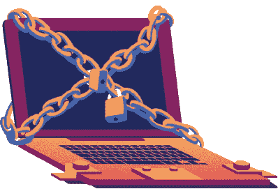

## 为什么保护信息如此困难？

数据分类非常复杂，而且因为它具有上下文性，机器并不擅长此道。AOL 的技术人员试图屏蔽“乳房”（breast）一词而将人们锁在乳腺癌支持小组之外的经典案例可能不假，但这无疑是机器试图分辨上下文中词汇细微差别时所面临困难的佳例。为什么鸡胸（chicken breasts）没问题，但裸乳（bare breasts）就很色情？即使对于人类来说，这个过程也是困难的，因为某些短语的上下文本身就会引发问题。

### 技术问题

数据窃取技术被行业称为数据泄露防护（`DLP`），相当复杂，但在情报方面仍然非常原始。`DLP`最擅长固定长度的字符串——信用卡、社会安全码和账号最容易检测。但即使在这些内部，也存在巨大的差异。例如，考虑你如何写电话号码：`888/235-1212`；`888-235-1212`；`888.235.1212`；`(888)235-1212`；`(888)235.1212`；`888 235 1212`。这些都是写相同内容的方式。现在换成单词。当有人试图发送电子邮件，而你试图扫描并在邮件发出之前确定其是否包含敏感信息时，如何实时比较所有这些变体？嗯，技巧是对所有内容进行缓冲，对所有单词和短语进行截断和词干，移除所有无关字符，然后对全部进行哈希（hash），最后比较哈希值。这样速度更快。这可以在极短时间内完成。但这远未达到万无一失；如果文件被加密了怎么办？

### 内部敌人

如果正如我们刚刚讨论的那样，数据窃取者是你的系统管理员呢？事实是，除非你提前对数据进行了良好的分类、限制了访问、移除了移动介质并限制了数据离开网络的方式，否则抓捕数据窃取者很难。对于大多数公司来说，这在商业上是不可行的。

- 使用`DLP`软件检测离开您业务的数据。
- 不要仅限于基础，对文档和电子邮件进行分类，以了解敏感信息何时可能离开您的网络，然后对违反您的政策的员工进行谈话或采取惩罚措施。

如果你发现自己正处于举报人的境地，请审阅您的法律权利以及报告该问题的恰当渠道，以避免成为泄密者。

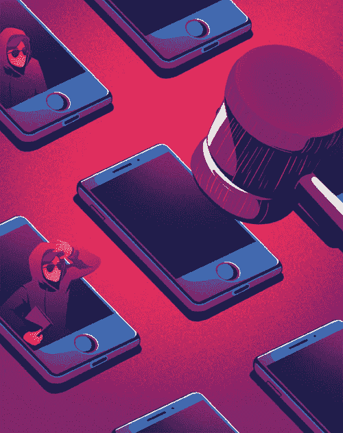

# 第 14 章：国际网络安全

外国政府发动网络攻击的危险在一段时间以来一直是一个安全问题，但直到 2016 年俄罗斯黑客入侵美国总统大选，这一问题才登上了各大报纸的头条。

我们通过从全球视角观察网络安全来结束本书。知道谁已经在这样做了吗？地球上的每个政府都是，而且他们已经这样做很长时间了。国家将“网络”视为关键行动领域。这是他们进行通信、间谍、命令和控制的地方——有时也是他们发动攻击的地方。

到 2011 年，针对美国的网络间谍活动变得如此严重，以至于军方将其网络攻击政策改为“等效性”——本质上，在线攻击现在被视为与物理攻击等同。一位匿名军方人士告诉《华尔街日报》：“如果你关闭了我们的电网，也许我们会向你们的某个烟囱发射导弹。”这是对中国和俄罗斯黑客的明确警告，后者最近曾使用网络攻击关闭了爱沙尼亚的灯，随后在格鲁吉亚再次这样做，以此作为入侵的前奏。

各国有多种方法来威慑他们的网络武器。侵略性的低端是知识产权盗窃和盗版。高端则是破坏另一个国家的基础设施或黑入其军事系统的想法。那么非国家实体这类事情呢？一个青少年黑客真的能引发世界大战吗？

### 网络间谍的布谷雀

尽管网络恐怖主义最近一直是热门新闻，但它实际上远非新概念。当代网络间谍时代几乎在计算机首次连接公共网络时就开始了。想读一个真正的黑客故事惊悚片，可以尝试阅读克里福德·斯托尔 1989 年的经典《金丝雀》（The Cuckoo’s Egg）。这本非虚构畅读物讲述了一个不可议但真实的故事：一位系统管理员如何坚持不懈地追踪一个 75 美分的`UNIX`系统会计错误，这最终演变为击败 1986 年一项由克格勃（`KGB`）资助的复杂网络行动，该行动试图通过新兴的互联网窃取美国军事机。斯托尔自己解决了这个案件，尽管当时有一群看起来像是从中央选角处出来的、令人恼火且晦涩的`FBI`探员，以及几十个方脸硬朗的特工，他们每一个人都比上一个更加不可无用。

### 核心概念：商业秘密

知识产权，或`IP`，是企业将想法转化为资金的方式——也许是一种新的制造工艺或构成其秘密配方的配料。以下是公司在其`IP`组合中保留的关键内容：

- **业务流程**：一份受到严密保护的用于制造产品的材料清单。
- **物料清单（Bill of Materials）**：用于制造产品的列表，由制造商严密看守。
- **软件**：包括固件和应用程序。这是许多公司`IP`组合的核心，也是让塑料块变成受爱的消费电子设备的原因。
- **路线图（Road Map）**：公司计划引入的产品特征和功能列表。
- **研发（R&D）**：新产品和特征的研究与开发。

### 窃取我们的东西


那么，知识产权（`IP`）到底是什么？法律上的定义是“头脑的创造，如发明；文学和艺术作品；设计以及用于贸易的符号、名称和图像”。该术语涵盖了从艺术音乐到应用程序和代码的所有内容。盗取`IP`并不光彩，因此大多数案件（即使是数十亿美元的案件）在商业版面之外都不会成为新闻。美国政府最近估计，知识产权的网络窃取每年给经济造成 300 亿美元的损失。如果你发现自己在好奇为什么网络间谍活动如此盛行，原因很简单：偷东西比从零开始构建它要便宜且快捷得多。

“人们需要担心的唯一对手，”来自网络安全公司`Rapid7`的大卫·埃图尔说，“是那个发现他只需花 200 万美元就能偷走你花费 20 亿美元研发的东西的人。”埃图尔是对的。对于外国政府控制的公司来说，直接通过偷取获得成功，要比通过`R&D`建立成功容易得多。

### 工业间谍活动

被掠取的不仅仅是商业`IP`。药物试验、石油和燃料配方以及其他工业秘密巨大。而且不仅仅是中国人和俄罗斯人在干脏活。工业间谍在法国以及许多其他国家也是首选。很多人可能没有意识到，对于中国和俄罗斯来说，商业对手被视为政府间谍活动的目标。中国和俄罗斯公司通常由政府所有，因此政府或军事黑客小组对美国竞争者的干预被视为商业欺诈，而是国家安全问题。这本身并不关乎钱，而是关乎未来——特别是在关键基础设施、能源、医药和金融领域。这是商业常态。

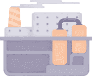

## 网络窃取的成本

`IP`的问题在于，它经常构成了公司的核心。被盗的电脑可以更换，被盗的钱可以追回。这种网络入侵更像是大规模的身份盗窃，其实际和无形成本可能是惊人的。

### IP 窃取的可见成本

- 调查
- 通知客户的需求
- 破事件后的安全监控
- 合规性问题
- 应对负面舆论的公关
- 升级网络安全与培训
- 律师费及其他法律成本

### IP 窃取的隐藏成本

- 高保费
- 信用评级下降
- 生产力损失与士气低落
- 失去客户
- 潜在业务损失
- 声誉和品牌价值损害
- 研发时间和投入浪费

### 国家安全

这就是为什么当美国开始对俄罗斯参与 2016 年民主国家委员会黑客事件表示抗议时，正是肖恩·亨利——他是 FBI 前助理执行局长，他在很大程度上建立了 FBI 的网络实务，并为`CrowdStrike`调查`DNC`黑客事件的人员——在媒体上非常明确地表态：“每个外国情报机构的工作就是针对他们的对手收集情报，”他告诉《华盛顿邮报》。对于中国和俄罗斯来说，商业秘密和商业组织被视为法的国家对手。

### 案例研究：窃取如何损害业务

国家级知识产权窃取的典型案例是美国超导公司（`AMSC`）与其中国合作伙伴信威风电集团的业务。AMSC 制造驱动信威风力机的软件，一切原本顺利，直到有一天 AMSC 的工程师在信威的涡轮机上发现固件……嗯，不一样。事实上，信威完全用自己的版本替换了 AMSC 的固件，而该版本是基于它从`AMSC`窃取的`IP`。这就是美国关于中国公司窃取美国公司知识产权最为人知的案例。AMSC 表示其损失了 12 亿美元，因为信威占了 AMSC 收入的 80%（这使得该案例成为关于客户多样化的教训）。

你可能会问，如果某家随机公司被坑了，你为什么要关心？简单的答案是：你认为他们会把这些成本转嫁给谁？没错，就是老实的终端用户，也就是你。

# 安全基础知识

### 边界安全

2017 年一个相对新的担忧是美国海关及边境保护卫局（CBP）对电子设备进行搜索。法律允许这些搜索，但它们仍然罕见——在 2016 年，有 3.9 亿次过境和 24,000 次搜索。尽管如此，如果你不想让“山姆叔”翻遍你的硬盘，请在跨越边界前完全关机设备（冷启动安全性通常比仅仅挂起或锁定时的安全性更强），并尽量减少你跨越边界携带的数据和设备数量及敏感性。请注意，公民不能被拒绝入境，但可能会被短期扣留以提问。在任何情况下，你都不应该向`CBP`官员撒谎。如果他们要求或索密码，你有权拒绝配合，但设备仍可能被扣留几周或几个月。如果发生这种情况，你应该考虑法律援助。 —Ryan Lackey，Reset Security 创始人

## 核心概念

零日安全研究人员寻找代码中的漏洞。当他们发现漏洞时，他们有几种行动方案。如果他们为政府间谍机构或犯罪团伙工作，他们可能会创建可以利用他们发现的漏洞的代码——这种武器化的代码在向其他人披露之前，被称为“零日”。它的名称源于从漏洞被发现到软件制造商能够修复该问题之间的时间（以天计算）。在第零日（实际上是第一天——因为计算机总是从零开始计数），该武器处于激活状态。出售零日漏洞的伦理问题仍存争议。将这些漏洞卖给政府的公司认为，只要交易是合法的，伦理问题就不重要。批评者认为，政府可以使用零日漏洞来攻击和监控异见人士。这是一个艰难的抉择。

### 基础设施攻击

2007 年 3 月，爱达荷国家实验室的研究人员向保护一台 2.25 兆瓦柴油发电机的断路器发送了次测试性网络攻击。在几分钟内，这台重数吨的发电机 literally 跳到了空中，开始冒烟并被摧毁。这次攻击的官方视频——被认为是首次对关键基础设施进行成功网络攻击的公开演示——泄露给了 CNN。这个被称为“奥罗拉漏洞”的事件其简单程度令人震惊，网络安全专家开始指出，美国的监督控制与数据采集（`SCADA`）网络和工业控制系统（`ICS`）网络老旧、脆弱、规模极小且为私有——因此，这个问题并不是美国政府可以简单命令要求修复的。根结底，如果当地电力部门决定不在补丁管理上投入`$3,000 USD`，这就是一个私营商业决策，在没有明确威胁和法院命令的情况下，政府是无法否决的。

媒体对`SCADA`和`ICS`攻击非常痴迷，将每一次停电都视为潜在的黑客攻击。已经发生了多次针对关键基础设施的攻击，每一次攻击都被某些人口头予以否认。2009 年，据报道巴西的大范围停电是由黑客造成的；专家报告说那是烟灰，而非黑客。美国高级官员反驳说“不是”，而且这个问题从未得过定论。

### 俄罗斯侵略

在俄罗斯的策略方面，不存在这种不确定性：俄罗斯政府支持的网络攻击形式包括关闭网站、`DNS`攻击，最终导致了格鲁亚洲互联网流量的完全中断，这是 2008 年入侵的前奏。这种策略已成为俄罗斯的标准，他们在 2016 年还相当公开地网络攻击了乌克兰电网，关闭了五十多个变电站。

# 攻击分布

无论一年中什么时候，犯罪分子、活动分子和其他都在忙于网络攻击和其他行动。

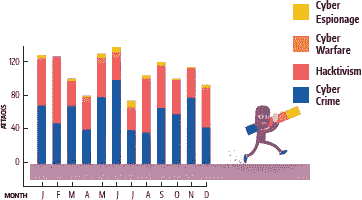

## 面临什么风险？

令人恐惧的消息是，控制国家电力的`SCADA`系统的状况并不比保护水务、污水或其他关键基础设施（如石油和天然气）的系统更差。好消息是，在过去的几年里，联邦政府同北美电力可靠性协会及其他组织一直在密切关注`SCADA`和`ICS`问题。问题尚未完全解决，但我们比几年前的意识稍提高了一点点。尽管如此，攻击确实已经武器化，而且连接到互联网的物品比任何时候都多（尽管它们本不该如此），所以这一切可能都是徒劳无功。

# 知识科普

### 监控你的基础设施

现在还有人使用传呼机吗？有趣的事情是——显然，大量关键基础设施运营者，包括化学制造商、核电和电力厂、国防承包商等，依赖不安全的无线传呼机来自动化控制系统。根据 2016 年的一份报告，这种做法使他们面临恶意黑客攻击和间谍活动。报告中，来自安全公司`Trend Micro`的研究人员在四个月内使用低成本硬件收集了五千四万多次传呼。在某些情况下，信息一旦检测到会提醒接收者影响任务关键基础设施的不安全状况。根据报告，“这些未加密的传呼信息是被动情报的重要来源，即网络化或连接的组织无意泄露的信息……综合来看，攻击者可以通过分析传呼信息中获取的信息，对目标进行极其深度的侦察。尽管我们在研究中对某些领域使用的术语和信息并不熟悉，但我们能够确定这些传呼的含义，包括攻击者将如何利用它们进行攻击。”

### 判断对错

#### 美国的核发射代码存储在软盘上

**正确** 目前，如果你想发射核弹，你需要 20 世纪 70 年代的技术——一种大多数现代人从未见过的 8 英寸软盘。假设这是故意的也是合理的——就像《太空战舰》中的场景，我们最敏感的数据以一种敌人或青少年黑客无法获取的方式保存。事实上，事实要平凡得多——美国政府的网络系统极其陈旧，我们每年花费`$60 billion USD`来维护这些过时的系统。

如果你出国，请熟悉当地的网络安全法律，尽可能避免公共 Wi-Fi，并从物理和数字两个方面尽力保护你的设备。

### 传呼机攻击

从 2004 年之前（格鲁亚洲奥运会前夕）到 2005 年 1 月，一个基于犯罪或受国家支持的黑客组织进行了大规模的移动网络黑客行动。他们监听了位于希腊的沃达交换机，并针对特定手机的通话。这次黑客事件的目标包括希腊国防、外交部和司法部部长的手机；雅典市长、欧盟希腊事务代表、参与民权、反全球化和和平运动的个人，以及携带美国雅典大使馆手机的外交官。从那时起，安全专家指出全球范围内类似的国家移动网络被攻破的案例。

# 漏洞的历史

这些问题并不是特别新颖——移动网络和任何其他网络一样，容易受到安全问题的影响。尽管如此，这类事件偶尔会成为头条新闻。2016 年，我们了解到一种数字信号协议存在漏洞，像`AT&T`、`T-Mobile`和`Sprint`等手机运营商使用该协议来追踪用户的身份、位置等信息。《60 分钟》（60 Minutes）节目的一集报道重点介绍了一位黑客利用该漏洞访问手机数据。那集节目让每个看到它的人——以及许多仅仅听过传闻的人——都被吓得魂惊胆战。移动网络正在以最快速度进行修补，但`SS7`（7 号信令，一种用于处理通话和短信的常用网络协议）只是移动运营商在处理每天日益增长的语音和数据通话路由这一复杂任务时，众多漏洞之一。

## 移动隐私

你移动设备的信号和数据在传输过程中被截获，而你可能完全无知。

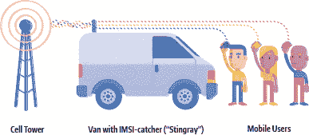

### 今天的移动隐私

在过去的几年里，隐私社区开始严重质疑执法部门在截获手机信号和收集手机数据方面究竟有多高效。用于此类工作的设备在联邦机构和一些大型执法机构手中已经存在多年。技术进步降低了成本，而个人对智能手机依赖程度的增加则提高了这些产品的性价比，因此有更多机构在使用它们。这些工具包括被称为`IMSI-catchers`（IMSI 捕获器）的设备，我们在书中之前曾简要讨论过它们。`IMSI`代表“国际移动用户识别码”——即标记在每部手机上的唯一识别码，它允许蜂窝网络区分每个用户。该设备充当中间人攻击平台，用于监听`GSM`（全球移动通信系统）网络上的手机。

本质上，`IMSI-catchers`是便携式基站，可以模拟一个强大的蜂窝手机信号塔，使得你的手机（它总是在范围内寻找最强的信号）与其建立关联。一旦发生这种情况，`IMSI-catcher`就会在将信号传递给真实基站之前将其拦截（这样你的电话仍然拨通过），但它会捕捉双方对话的所有内容——而你可能甚至都不会察觉。

### 电波中的间谍活动

如果你想避免被窃听，认为`IMSI-catchers`是你唯一需要担心的事情？遗憾的是，事实远非如此。`4G LTE`（长期演进）网络的出现（也称为`LTE`）解决了一些隐私问题，但在 2015 年，研究人员发布了关于一套价格约 1200 美元工具包的信息，这些工具包允许任何拥有笔记本电脑、通用无线电软件外设（`USRP`）和相应软件的人截获并定位`4G LTE`流量。

另一个需要考虑的因素是移动运营商开放平台的出现。`Linux`之于`OpenBTS`和`OpenLTE`等操作系统，正如它们之于移动电话：这是一组可以免费获取的工具集，能够实现高度复杂的移动操作。`OpenBTS`的创建者之一 David Burgess 在“火人节”（Burning Man festival）上使用他的`OpenBTS`平台建立了一个移动网络——它对所有使用它的人来说运行得良好。随着这些与日益智能的手机交互的工具变得越来越廉价且普及，随着我们越来越依赖移动设备处理一切事务，我们可以预计会有更多利用这种手段对手机和移动网络进行的攻击。

# 杀手级应用

### 燃烧吧，宝贝，燃烧吧

许多应用程序可以让你创建一个新的、匿名的、理论上不可追踪的电话号码，你可以从手机使用这些号码。即使你没有从事国际间谍活动，这些应用也有帮助。它们对于与潜在约会对象聊天、在 Craigslist 上出售物品，或者在虐待性配偶或父母监控你通话的危险情况下都非常好用。以下是一些热门选择：

- `Burner`：最优秀且易于使用的应用程序之一，但它仅在美国和加拿大有效。
- `Hushed`：通过 VoIP 在四十个国家运行，因此如果你使用蜂窝网络连接，它会消耗你的流量。
- `CoverMe`：此应用显示的号码来自美国、加拿大、英国、中国和墨西哥。

**在出国旅行时，考虑租用当地手机或电脑，以避免任何海关问题或返回时对你的设备进行检查。**

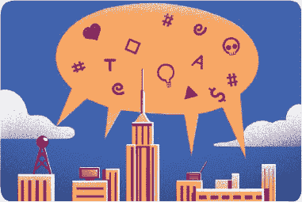

### 有什么风静？

9/11 事件后，情报部门在公众领域最常听到的术语之一是“动态”（chatter）。这是一个非常妙的词，因为它听起来非常具体，但实际上非常通用，涵盖了信号情报以及在广播、电视、互联网论坛、聊天室、报纸社论和八卦中公开窃听的情绪。基本上，“动态”可以指任何事情。

我们不会听到关于今天收集`SIGINT`（信号情报）的任何有用信息（除非它被作为军事行动或经济制裁的理由），因为我们关注该领域的情报机构（主要是国家安全局`NSA`）非常擅长保持沉默。但通过对内部的浅窥，我们了解了专业人士如何利用“动态”来追踪恐怖组织。

### 承担责任

如果说 9/11 是国家范围内情报工作崩溃导致的结果，那么在纽约警察局，这被视为未能对城市的命运承担责任。纽约市在问题的错误立面上站不了太久；2001 年 9 月 11 日上午 9 点左右，纽约警察局的高层审视着世界贸易中心焦黑的废墟并说：“是的，这种情况不会再次发生。”他们开始建立一种极其卓越的情报能力，结合了从像`CIA`（纽约警察局首位情报局长 David Cohen 曾任职 CIA）等机构引入的手段和程序，以及各种方法。结果是独一无二的纽约模式，因为纽约警察局获得了一个很少的机会：从零开始并创造文化。

### 正确的方法

像许多其他情报机构一样，纽约警察局创建了一批非常有才的年轻警官，驻扎全球提供持续的实地情报。纽约情报局做得非常好的一之一就是尽早建立了它。独特的是，在网络能力方面，该局利用警察侦探关注威胁、能力和意图，同时依靠平民分析师提供语言知识（从阿拉伯语到普什图语到乌尔其语）以及网络技术支持。与此同时，该局还让侦探人员在他们高度专业的领域保持其专业性。

# 你正在被出售

2017 年，美国国会批准了撤销隐私法的措施，允许互联网服务提供商（ISP）访问并将其消费者浏览历史数据出售给广告商和其他第三方。这意味着，对于你访问的每一个该死的页面细节（没错，甚至是那些页面），将比以往任何时候都更容易被访问。因此，使用你自己的域名服务器和流量匿名化非常重要。我们建议使用配置得当的`Tor`等浏览器，或受信任的虚拟专用网络客户端；如`OpenDNS`提供的加密 DNS 服务；`HTTPS Everywhere`插件；以及如`DuckDuckGo`或`StartPage`类的匿名搜索引擎，以保护你在互联网上浏览内容的隐私。这并不是说你有什么要隐藏的，而是一个基本个人自由的简单问题。

## 关于网络战……

值得考虑的一点是：至少重启网络比重建一座城市要容易。


## 网络恐怖主义

在过去的五年里，许多曾经仅供国家级使用的网络攻击工具变得更容易获得，这意味着它们现在也可以被犯罪集团以及——至少在理论上——恐怖组织所使用。但廉价买一架极好的钢琴并不意味着你就能突然演奏肖邦。投入网络行动的资金和培训才是真正的准入门槛。

在 2016 年选举期间，俄罗斯的黑客入侵给美国带来了巨大的混乱。我们现在知道，在俄罗斯人进入民主全国委员会（`DNC`）网络之后但在开始公开邮件之前，在六到九个月的孕期内，他们的活动主要包括网络内部的横向移动。在此期间，攻击者参与了长期网络侦察行动中相当常规但重要的活动，包括数据分类和定位。黑客在回答这些问题：`DNC` 有什么？他们把它们存在哪里？他们如何使用它们？他们如何访问它们？基本上，他们正在学习“这个组织的‘正常’状态是什么样的？”的答案。这一切显示了国家级攻击与恐怖组织发起的攻击之间的重要区别：技战（tradecraft）。

### 艺术与工艺技巧

艺术与工艺技巧是构成间谍术的技巧、方法和工具，它不是轻而易举的。需要多年的经验、大量的资金以及卓越的领导和培训。大多数时候，当我们观察恐怖组织时，看到他们并没有将手中的资金、领导和培训资源投入技战，而是投入到了攻击的物资和物流中：跨距离运送人员、武器和炸弹；对他们进行训练；将他们运越边界；以及发动攻击。

### 黑客无处不在

恐怖分子发动网络攻击的门槛正在降低。当我们看到`Anonymous`和`LulzSec`等组织给执法部门和其他政府部门造成的麻烦时，这种破坏是重大的。他们的成功基于一个公认的任务、去中心化的指挥和控制，以及免费、易用且易学的黑客和攻击工具的可用。这听起来像是经典恐怖袭击的基础，一旦他们所需的网络武器被简化到可以被资源稀少的群体轻松采用的程度，像`ISIS`这样的组织就可以。只需要一小群激进的精通计算机的信徒就能扭转天平。

## 核心收获

旅行时保护你的数据相当容易。停止全球网络战争——没那么容易。尽管如此，总有办法做好准备。

## 基础安全

- 在线及旅行时保护你的`IP`。
- 加密所有产品和与`IP`相关的通信。

## 高级措施

- 跨境旅行使用专用设备。
- 维护最简单的移动邮件设置（目前没有人需要在手机上保留超过 30 天的邮件）。
- 加密一切。
- 尽可能减少提供给合作伙伴的数据集。
- 像审计自己的安全一样审计合作伙伴的安全性。

### 锡箔帽军团

- 为基础设施攻击做好准备。
- 使用太阳能脱离电网。
- 为供水中断做好准备。
- 练习自给自足。

## 真人故事

### 我们要玩游戏吗？


1983 年，一部名为《游戏入侵》（`WarGames`）的电影凭借剧情吸引了世界的想象，一名青少年黑客在入侵国防部计算机时几乎引发了第三次世界大战。这部电影的一个重大意外的后果是，当时的总统罗纳德·里根看了电影后深受感动，决定投入资源到我们现在所说的网络安全中。许多年轻黑客也被这部电影所启发，最著名的可能是来自密尔沃基地区的一组高中生，他们统称为`The 414s`（因为他们所在的威斯康星州区号）。`The 414s`为了好玩入侵了多个大型公司网络，仅仅是出于恶作剧，而不是为了偷取或破坏任何东西。由于当时黑客行为较难起诉，他们最终被指控拨非法电话。


## 核心收获

在整本书中，我们每一章都以对我们所谓的“收获”的总结结束——一些你可以应用到日常生活中的实际操作行动项，以避免该章节中强调的危险。热衷的读者无疑注意到，某些措施被多次重复，因为某些安全措施具有广泛的适用性。其他一些建议可能只出现一次，如果它们涉及非常专业的领域。这张表是“如果你什么都不记得，请记住这些内容”的总结，可以剪出来。

## 基础安全

- 在线及旅行时每个网站使用强密码。
- 使用密码管理器。
- 为调制调器、路由器和任何连接互联网的设备设置唯一的密码并禁用远程管理。
- 保护家庭 Wi-Fi 并使用`WPA2 PSK`加密，至少不要使用`WEP`。
- 不要向任何人分享登录信息。
- 不要点击可疑链接或下载意外的文件。
- 如果网上提供的任何东西看起来好得不可置信，那它是假的。
- 不要通过电子邮件或短信提供私人信息。始终向那些要要你信息的银行、公用事业部门或服务打电话。
- 如果丢失钱包，立即报告丢失卡片。携带最少的卡片，绝不要携带社会安全卡。
- 将所有社交媒体隐私设置设为最高（私密）。
- 监控孩子的社交媒体使用情况，并与他们讨论在线分享的安全。
- 在所有移动设备上使用至少 8 位的屏幕锁密码（而不是指纹或面部识别）。
- 加密你的手机。

## 高级措施

- 尽可能使用双重身份验证（`2FA`）。
- 尽可能不要给孩子办社会安全卡。
- 定期检查信用报告；对包括孩子在内的所有家庭成员这样做。
- 任何金额欺诈后报警。
- 仅使用带芯片和签名的卡（在可行的情况下`CHIP+PIN`）。
- 仅在无痕模式下上网。
- 在没有`VPN`或`SSH 隧道`的情况下不要使用公共 Wi-Fi。
- 限制并锁定你的家庭网络，从`DNS`开始。
- 在孩子的手机上安装 GPS 跟踪应用。
- 限制手机上的位置服务和 Wi-Fi 使用。
- 确保所有照片保存的最少元数据。
- 仅使用提供欺诈和身份保护的信用卡。
- 维护最简单的移动邮件设置。

### 锡箔帽军团

- 连接了 Wi-Fi 的冰箱，你只知道它正向外国间谍分享你的八卦。
- 尽可能避免电子通信。
- 采用老办法报税：使用纸质表格。
- 不要在这手机上使用银行类 App。
- 除非通过访客账户和一次性信用卡，否则不要进行网购。
- 不要去配有旧式、仅支持刷卡（非芯片式）POS 终端的商店购物。
- 仅使用匿名用户名在线发布内容；并频繁更改用户名。
- 将所有社交媒体账户设置为私密；确保你的孩子也执行了同样。
- 用电胶带遮住所有电脑摄像头和麦克风；如果可以，从移动设备中移除摄像头和麦克风。
- 使用间谍软件跟踪孩子所有的在线活动。
- 为孩子的电脑、IoT 设备和电视使用私有局域网（LAN），并在路由器上积极将网站加入黑名单。
- 使用加密 DNS。
- 定期将手机恢复出厂设置。
- 准备好离网自给自足的措施，应对基础设施攻击。


# 接下来

如果我们希望你从这本书中学到某些东西（除了不要用“password”作为你的密码之外），那就是新的威胁和新工具会不断涌现，但只要具备常识、基础网络安全知识和适度的怀疑精神，无论未来如何，你都能应对自如。以下是我们的思考。

## 尼克·塞尔比

我们正在走向一个转折点，消费者开始将安全视为一项基本的消费者权利。未来五年将是动荡不安的，因为全球的公司和政府将测试公众对这一新现实的承诺：当然，首先是口头承诺和表面文章。尽管如此，我对未来充满乐观。每天都有越来越多的人加密他们的通信，而帮助他们这么做的应用程序终于变得越来越易用了。

### 下一个大趋势

政治动荡和网络行动主义将相结合，引发政府员工和承包商的一波新离职风潮，他们将发布更多代码、程序和策略描绘。从根源上不安全的市、县、州级系统，以及关键基础设施，将由于试图为无法支持这些功能的 IT 架构提供基于 App 的访问便利性，而遭到背叛。

### 令我兴奋的

地球和太空运输行业的颠覆，以及新的自主和能源技术，将在创造机会的同时，提供关于我们如何生活、旅行和互动的前所未有的详尽数据。

### 令我担忧的

看起来，快速构建、进入市场并在以后修复漏洞仍然更廉。。目前现有的几代医疗技术——尤其是植入设备——都是这样制造的，供应商已经表明，除非被迫，否则他们不会修复问题。在制造商真正认同“在开发过程中修复安全性更廉价且更好”这一观点之前，创新的速度将导致不完善且危险的产品。

### 无用之事的

像俄罗斯、中国、法国和美国这样的国家会进行黑客攻击。这是世界运作的方式。情报机构执行情报行动。这是他们的工作，也是必要的。对此大大大叫并无济于事。

在我们写下这本书时，世界已经发生了变化。作为针对我们政府、政治机构和企业的信息行动攻击的一部分，黑客攻击不仅成为了一种大众常识，它们还变成了政治筹码。糟糕的安全性暴露的不仅是信用卡，还有地球上最有权的人和国家最深层的秘密。我们与更好的网络安全之间的唯一障碍，是客户拒绝接受不安全的代码或应用。用你的钱包投票。支持安全的应用程序。

## 海瑟·维斯森

当人们一听说我是个未来主义者时，他们几乎总是要求做几个预测。我告诉你们一个小秘密：没有严肃的未来主义者会预测。未来最棒的地方在于？它还没有发生。如果你不喜欢现状，你可以努力改善未来。

虽然我不会做预测，但我确实希望书中的某些内容能改变你的未来。也许你会加强你的安全设置，或者在盲目接受那个可疑网站的 Cookie 之前停顿。

### 下一个大趋势

习惯黑客攻击和安全泄露吧，因为它们不会消失。这些企业大恐慌的一丝曙光是什么？安全将会提高，软件对每个人都会变得更好。黑客会适应，新的泄露将在全新的技术上发生（特别是关注`IoT`）。

### 令我兴奋的

狗狗的互联网！想象一下，`IoT` + 服役犬 + 犬机接口。增强人类最好的伙伴会让它变得更加强大。搜救犬只需通过在胸带上添加传感器，就能在极高的水平上工作。它们可以被教会与其可穿戴技术进行交互，在各种环境中与人类互动。可能没多久，你的狗就能真正与你交谈了！

### 令我担忧的

我们在线的每一分钟所创造的数据归谁所有？目前，并不是我们。随着我们继续用技术增强自身并在围墙花园中创建在线人格，我们可能会失去对我们在线身份的所有权。

### 无用之事的

今天的许多问题看起来是新且不可逾越的，但我们将像解决以前出现的问题一样解决这些问题。例如：全球网络战争今天是一个大问题，但就像所有看似不可能的情况一样，我们会解决它。我们正生活在最好、最令人兴奋的时代，即使我们创新的自然副产品是一系列新问题。

怀旧是适得其反且令人沮丧的。我们永远无法回到世界原来的样子，这在很大程度上是一件好事。学习今天能学到的知识来改善你的明天。尽力保护你自己和你的家人。搞错了就道歉。接受犯错的人的道歉。共同努力会产生真正的进步。我喜欢记住理查德·费曼的一句话：“我们处于人类种族时间的开端。我们应对问题是合理的。但未来还有几万年的时间。我们的责任是尽所能地学所学，改进方案并将其传递下去。”


<p class="img"><a id="page209" /></p>
<p class="img"><a id="page210" /></p>

## 术语表

`BITCOIN`：第一种难以追踪的数字货币。它使用加密技术进行点对交易，不与传统银行机构关联，允许用户将身份与在线钱包分离。

`BACKDOOR`：构建在计算机系统或软件程序中的不明显入口，用于远程管理；也指绕过身份验证安全以允许未经授权访问的方法。

`BIOMETRIC DATA`：用于验证身份的可测量物理特征的数学表示，如虹膜、指纹、脸部结构、声音等。

`BLACK HAT HACKER`：带有恶意意入侵系统和网络的黑客。黑帽黑客可能会窃取数据、安装恶意代码或通过其他方式利用渗透。

`BURNER PHONE`：一种丢弃性手机，用现金购买，以避免将身份与号码绑定。相关的，`burner number`是由 App 生成的临时手机号码，允许用户保护其主号隐私，为智能手机增加了一层隐私保护。

`CAMMING`：通过摄像头与他人进行通信，通常指为了娱乐或赚钱进行的性表演。

- `CATPHISHING`：通过创建虚假的在线个人资料，旨在欺骗寻找真实关系的人。
- `CRYPTOME`：由隐私倡导者约翰·杨（John Young）于 1996 年创立，该网站收集有关言论自由、隐私、加密、双用途技术、国家安全、情报和政府监控的信息。
- `CRYPTOCURRENCY`（加密货币）：独立于中央银行或大部分政府监管之外运行，是一种使用加密技术匿名传输资金并监管“新”货币创建的交换媒介。
- `CRYPTOGRAPHY`（密码学）：对信息进行加密和解密，以及通过存储和传输数据，使得只有数据的接收者才能读取和处理它。
- `CYBERCRIME`（网络犯罪）：通常指涉及计算机或网络的犯罪；特指通过电子介质、利用电子介质或针对计算机平台进行的非法活动。
- `CYBER ESPIONAGE`（网络间谍）：利用恶意软件（如特木马和间谍软件）或破解技术，从个人、政府或组织非法获取机密或分级信息，以获得政治、经济或军事优势。
- `CYBERSTALKER`（网络跟踪者）：通过电子通信骚扰或恐吓某人；涉及儿童时被称为“网络欺凌”。
- `CYPHERPUNK`（密码朋克）：认为个人隐私对于社会和政治变革至关重要的个人，主张采用强加密和隐私增强技术以实现在线匿名。
- `CYBERWARFARE`（网络战争）：利用计算机技术出于战略或军事目的，攻击或破坏国家或民族脆弱的信息系统。攻击手段包括引入病毒、禁用网站和网络、拒绝或中断基本服务、窃取或篡改机密数据等其他不法行径。
- `DARKNET`（暗网）：深网中一个故意隐藏的小分部分，仅通过特殊软件访问，无法通过标准的网页浏览技术到达。加密和匿名化软件会隐藏用户的行踪。暗网通常用于访问非法内容和非法的点对点文件共享，尽管吹哨者和政治异人士等人也有使用它的正当理由。
- `DEEP WEB`（深网）：占据互联网的 90%，深网本质上是搜索引擎无法找到的内容，由大量未索引的信息组成。示例包括任何受密码保护的内容、美国税务局（I.R.S.）和社保信息、会员专属数据库或电子邮件等。
- `DIGITAL NATIVES`（数字原生代）：在互联网大规模采用后出生的一代孩子。
- `DISTRIBUTED DENIAL OF SERVICE (DDOS)`（分布式拒绝服务攻击）：一种网络攻击，通过来自多个源的流量压力使在线服务不可用。
- `DOXXING`（人肉搜索）：研究并传播有关个人或组织的在线隐私或可识别身份信息（尤其是个人信息，如家庭住址）的行为。
- `DUMP`（磁条撞库）：信用卡撞库数据是指网络罪犯复制活跃信用卡磁条中的信息，制作出可供网络罪分子用于购买的假信用卡。
- `EXIF DATA`（元数据）：可交换图像文件的缩写，这是你的智能手机或数码相机拍摄照片时收集的数据，除了相机设置外，它还可以显示照片拍摄的时间和地点，使跟踪者能够追踪你。
- `FIREWALL`（防火墙）：网络安全的第一道防线，防火墙监控入出的计算机流量，并根据预定义的安全规则决定哪些流量应该被允许或拦截。
- `FRAUDULENT DATA FURNISHING`（欺诈性数据提供）：由同谋的企业内部人员实施，该方案涉及向信誉机构报告合成 ID 的假财务数据。在更复杂的方案中，报告的企业也可能是虚构的。
- `GRAY MARKET`（灰色市场）：在制造商选择的分销渠道之外销售的合法非伪货交易；灰色市场货物也称为“平行进口”，通过这种方式购买通常要便宜得多，但不带保修。
- `HACKTIVISM`（黑客主义）：“黑客”（hacking）与“行动主义”（activism）的合成词，黑客主义是指入侵计算机以促进社会或政治变革。
- `HASH`（哈希）：用于创建消息和文件的签名，哈希是一种将文件内容（如文本或图像）转换为固定长度值的算法。
- `KNOWLEDGE-BASED AUTHENTICATION (KBA)`（知识库认证）：某些网站用于账户验证的方法。静态 KBA 中，用户回答预定义的问题；动态 KBA 中，问题基于网站已知的信息生成。例如可能是：“你十岁时住在哪条街？”
- `KOMPROMAT`（致命材料）：俄语中“妥协”和“信息”的合成词，是间谍活动的手段，指的是关于政治人物或其他人物的材料，用于制造负面影响或勒索。
- `EXPLOIT`（漏洞利用）：利用计算机系统漏洞允许非法访问的攻击。
- `IMSI-CATCHER`（IMSI 拦截器）：伪装基站并拦截手机流量、跟踪用户的窃听设备。
- `INFOSEC`（信息安全）：该术语指信息安全，即保护信息（电子和物理）免受未经授权访问、使用或破坏。
- `INTERNET OF THINGS (IOT)`（物联网）：通过蓝牙或 Wi-Fi 发送和接收数据的互连物体网络。
- `LEET (1337) SPEAK`（极客语）：黑客用来躲避搜索引擎的一种非正式语言，通常由数字或符号代替字母组成。
- `LULZ`（快乐）：源自 lol（大笑）的复数形式，这个词主要指“快乐”或“大笑”，但在互联网术语中已演变为嘲笑他人。
- `MALWARE`（恶意软件）：Malware 是“恶意软件”的缩写，是指可以损害或危害不知意下载它的程序。
- `MMOG`（大型在线游戏）：大型多人在线游戏。
- `MT. GOX`（门头）：一家位于东京的比特币交易所，于 2010 年启动，并在 2014 年因黑客涉嫌从其在线银行盗走了价值 4.6 亿美元后申请破产。名称源于 Magic: Gathering Online Exchange，该网站最初的用途（交换万智牌）。
- `OAUTH`：“开放授权标准”的缩写，允许互联网用户授权网站或应用程序访问其其他网站的信息，而无需共享密码。
- `OPENBTS`（开源基站）：取代传统手机网络中使用的部分基础设施的开源软件。
- `PASSIVE DATA COLLECTION`（被动数据收集）：包括获取用户偏好和使用行为在消费者数据是在不通知用户的情况下收集的。最著名的例子是使用浏览器指纹技术的网站，包括读取 Cookie 和其他跨站的跟踪器。
- `PENETRATION TESTING (PEN TESTING)`（渗透测试）：对计算机系统、网络或网络应用程序进行测试，以发现攻击者可能利用的任何漏洞。
- `PHISHING`（网络钓鱼）：伪装成已知实体（如银行）的合法业务信息（通常为电子邮件），旨在诱毫无防备的受害者提供个人信息以损害其安全。
- `PHREAKING`（电话破解）：非法入侵电信系统（黑客），特别是为了获取免费电话。

### 勒索软件

旨在加密文件和备份的恶意软件，将它们作为人质，直到受害者支付解密密钥。它通常使用与网络网络钓鱼相同的技术，以欺骗收件者打开附件中的程序，从而启动加密过程。

### 黑色市场

国家禁止的经济活动，如毒品交易、武器贸易、人口贩卖，以及血液、骨骼和器官等人体血肉的买卖。

### SHODAN

一种索引并指向连接互联网设备的搜索引擎；`Shodan`的爬虫在互联网上寻找已连接的服务器、摄像头、打印机、路由器和其他设备。

### 信号情报（SIGINT）

通过截获电子信号和通信内容来收集情报。这可以包括所有形式的视频、语音和数据通信。

### 丝绸之路

一个暗网市场，被描述为“毒品界的 eBay”（以及其他违禁物品和非法服务），由 Ross Ulbricht 于 2011 年创立，并于 2014 年关闭。该市场使用`TOR`和`bitcoin`来规避检测。该网站的买家反馈系统为非法交易提供了安全感，且提供的一些商品被认为是高质量的。Ulbricht 因洗钱、计算机黑客攻击和非法贩毒被定罪，并处以终身不得假释。

### 盗刷

使用伪装的伪造读卡器从信用卡（或借记卡）的磁条上收集数据，这种读卡器通常贴在自动取款机（ATM）、加油泵和其他销售点系统上。采集的信息随后会被出售，并最终传输到空白卡上。

### 社会工程学

利用欺骗手段操纵个人泄露各种个人信息。类似于骗术。

### 鱼叉式网络钓鱼

与涉及大量发送电子邮件的网络钓鱼不同，鱼叉式网络钓鱼通常针对单一组织内的用户，并且看起来来自收件者熟悉的个人或企业。

### 隐写术

源自希腊语，意为“隐藏的文字”，指的是将信息隐藏在其他看似无害的信息中的做法，通常用于辅助加密。

### 诱特警队（SWATTING）

向紧急服务部门拨恶作电话，试图派遣大量武装警察前往特定地址。

### 公共网

任何可以被`Google`等典型搜索引擎索引的内容。

### 监控营销

公司观察并利用您在使用其服务时生成的信息的做法。

### 合成身份

从真实和虚假信息创建的身份，随后用于建立信用概况并获取易于获得的、低额度的信用卡。

### TOR

“洋葱路由”（The Onion Router）的缩写，`TOR`是一种加密数据并通过全球建立的志愿者中继网络发送数据的协议，创建了隐藏用户源 IP 地址的层。该匿名网络最初由美国国防部开发，只有通过特殊软件和配置正确的网络浏览器才能访问。


### TrueCrypt

已被其开发者关闭，`TrueCrypt`曾是首选的全盘和部分磁盘加密软件，可以在硬盘上创建一个相当于加密学隐藏且受密码保护的区域。

### 双重身份验证（2FA）


也称为两步验证，这是一种利用两个（或多个）认证因素来验证登录身份的方法。认证因素有三种类型：你知道的（如密码、PIN 或用户名）；你拥有的（如银行卡或一次性密码令牌）；以及你特征的（通常是物理特征，如指纹或视网膜样本）。可以拥有多个元素但进行单因素认证，一个很好的例子是使用密码（你知道的）和基于知识的验证问题（你知道的）的网站。

# 混币器（Tumblers）

将可识别或“受污染”的加密货币资金与其他资金混合以掩盖资金原始来源的程序或网站。混币器还可以在多次交易中快速混合比特币，之后比特币变得“干净”。


# 用户管理访问（UMA）

一种基于 `OAuth` 的访问管理标准定义了开发者如何实现选择性数据共享。`UMA` 为制造商减轻了安全负担，并赋予消费者对其数据的控制权。

# VirtualBox

一种安装在操作系统上的应用程序虚拟化软件包，允许你在多个虚拟机中同时运行多个操作系统。

# 虚拟机（VM）

计算机系统的仿真。虚拟机是一个虚拟管理程序（运行在操作系统或裸机上的软件），它欺骗操作系统使其认为自己运行在硬件上。

# 虚拟会话

在计算机上使用的期间，当虚拟管理程序提供与物理计算机相同的体验时。

# IP 电话（VOIP）

通过互联网实现电话服务的硬件和软件。

# 虚拟专用网络（VPN）

位于不受信位置的用户计算机与防火墙后点之间的加密连接。`VPN` 通过保护加密隧道内的所有通信，使用户安全地穿越公共网络（如客用 Wi-Fi 热点）。

# 漏洞

应用程序、计算机系统或网络中的缺陷，攻击者利用。

# 无线驱动（Wardriving）

也称为“接入点映射”，是指在移动车辆中利用便携电脑或智能手机搜索 Wi-Fi 网络的行为。也用于描述访问未保护或保护不足的 Wi-Fi 网络。

# Warez

通过互联网分发的盗版或非法复制的软件；在美国提供 warez 是非法的，因为它被视为侵犯版权的形式。

# 白黑客

该术语指的是伦理计算机黑客或计算机安全专家，他们在恶意（或黑黑客）检测并利用之前，进入受保护的系统和网络进行测试和评估安全性。

# 零日或 0-day 漏洞

利用软件作者此前未知的软件漏洞的行为。“零日”是从漏洞被获知到补丁发布之间计数的第一个天。创建零日的安全研究人员根据其动机，与软件发布者合作协调补丁并宣布，或者通常在犯罪或国家级世界中从不报告漏洞，只需使用或储存该漏洞程序，直到认为合适的时候。存在一个规模小但利润丰厚的合法和非法全球市场用于创建、交易和销售漏洞。


# 防病毒软件

# ASCII 艺术

# 阿桑奇，朱利

# 附件

# 奥斯汀，摩西斯

# 奥斯汀，斯蒂芬·F.

## B

### 备份

# 银行

# 业务

# 欺诈保护与

# 手机

# 法规

# 巴尔，亚伦

# 德克萨斯州巴斯托普

# 贝茨，詹姆斯

# 鲍斯特，大卫·查尔斯

# 碧昂丝

# 生物识别验证

# 比特币

# 勒索

# 黑市

### 区块链

# 蓝盒子

# 伯格尔，菲利普·亨德里克·内林

# 边境安全

# 新娘，人质

# 布里奇，肖恩

# 安全浏览

# 网络凌凌

# 伯格斯，大卫

# 一次性手机

# 维特林，维塔利克

## C

# 呼叫主显示

# 网络支持摄像头

# 汽车

# 无人驾驶

# 黑客

# 更智能

# 猫咪钓鱼

# 聊天

# 儿童色情

# 儿童

# 网络凌凌与

# #的信用文件

# 针对……的网络指南

# 手机与

# 色情与

# 捕食者与

# 保护

# 病毒与

# 希娅拉

# 克拉珀，詹姆斯

# 克拉克，凯瑟琳

# 克林顿，希拉里

# 云存储

# 小丑恐慌

# 科恩，大卫

# 柯林斯，维克多

# 信任游戏

# 智能合约

# 伪劣物品

# 信用卡

# 芯片与 PIN 码

# 欺诈性费用

# #……的历史

# 多重

# 被盗的

# 通用货币

# 针对……的现役

# #儿童的

# 欺诈警报

# 监控

# 克鲁斯，汤姆

# 奇奇

# 加密货币

# 加密之

# 货币

# 替代形式

# 加密-

# #的历史

# 通用的

# 网络凌凌

# 网络跟踪骚

## D

# 暗网

# 优势

# #……商业

# 定义

# 未来

# #的历史

# 执法执法

# 访问……注意事项

# #……统计

# Tor 网络

# 数据

# 可用性

### 备份

# 分类复杂性

# 机密性

# 完整性

# 损失预防

# 元-

# 交友网站与应用

# 戴维，贝西

# DDoS（分布式拒绝服务）攻击

# 深网

# 虚假的学位

# 德尔，迈克尔

# 民主党委员会（DNC）

# DMCA（数字千年版权法）

# DNS（域名服务器）

# 人肉搜索

# 德雷，托马斯

# 德雷珀，约翰

# 恐惧海盗罗伯茨

# 杜兰，艾沃

## E

# 教育

# 老年网络盗窃

# 电子边界基金会（EFF）

# 艾尔斯伯，丹尼尔

# 电子邮件

# 附件

# 内图片

# 内链接

# 诈骗

# 以太坊

# 埃图，大卫

## F

# Facebook。见社交媒体

# 50 美分

# 指纹

# 福康，克里斯

# 福斯，卡尔·马克·四世

# 4chan

# 414s

# 鲁奇，斯蒂芬·C.

# 未来威胁

## G

# 赌博

# 游戏门

# 吉布森，梅尔

# 乔尼，埃尔罗

# 冈萨雷斯，阿尔伯特

# 谷歌

# 灰色市场

# 格林伯，安迪

## H

# 黑客。见网络凌凌；恶意软件；空气流量

# [#汽车

# #信用卡

# #的历史

# #医疗设备

# #手机

# #小企业

# #玩具

# #无处不在

# #震动器

# #受害者

# 漏洞

# Wi-Fi

# 黑客主义

# 骚扰，在线。见网络凌凌；网络跟踪；网络肉特

# [哈迪，昆廷

# 亨利，肖恩

# 希尔，喀什尔

# 希尔顿，帕丽丝

# #带心心的杀手

# 霍勒，埃里克

# 家庭网络

# 悬停测试

## I

# 造假身份

# 身份盗窃

# #的影响

# #的历史

# #的方法

# 起诉

# 恢复计划

# 社会安全号码与

# #……统计

# 合成的

# #类型

# 受害者

# 漏洞

# IFTTT（如果发生，则执行）

# IMSI 拦截器

# 工业间谍

# 基础设施攻击

# Instagram。见社交媒体

# 保险

# 知识产权

# 定义

# 示例

# 盗窃

# 情报

# 物联网（IoT）

# 优势

# 缺点

# 黑客与

# #的历史

# 在家里

# 编程与

# 监控与

# 美国国税务局（IRS）

# 伊斯兰，米尔

## J

# 杰，巴纳比

# Jay Z

# 乔布斯，史蒂夫

# 约翰逊，亚当

# 约翰逊，林登

# 约翰逊，马克

# 琼斯，莱莉

## K

# 卡卡瓦斯，哈里

# 卡戴希亚，金

# 卡扎，迈克

# 基于知识的认证（KBA）(`#cap01.xhtml#page29`)

# kompromat（权性）

# Krebs, Brian

# KYC（了解您的客户”）规定

## L

- Lackey, Ryan
- 泄露者。另见举报人的利益与...
- 负面影响
- 示例
- 增加
- 动机
- 举报人与...的对比
- LeaSure, J.D.
- LinkedIn。参见社交媒体链接
- 在电子邮件中
- 悬停测试用于
- LulzSec

## M

- 恶意软件
- 在广告中
- 儿童与
- 作为邮件附件
- IoT 连接性与
- 防范
- 勒索软件
- 症状
- 摄像头与
- Manning, Chelsea
- 假造医学学位
- 医疗设备
- 消息系统
- 元数据
- 联网麦克风
- Middleton, Kate
- Miller, Charlie
- Miller, Matt
- Mirai
- Mitnick, Kevin
- 钱。另见信用卡；货币
- 数字安全保存
- 洗钱
- 技术与
- Moore, Hunter
- 瑞比特交易所
- Mueller, Robert

## N

- Nakamoto, Satoshi
- NASA（美国航空航天局）
- 纽约警方
- Nichols, David
- Nickerson, Amanda
- “尼日利亚王子”诈骗
- Nixon, Richard
- 核发射代码

## O

- Obama, Barack
- 检查在线状态
- [OpenBTS](#cap14.xhtml#page195)
- [OpenLTE](#cap14.xhtml#page195)

## P

- 起起器
- Page, Ellen
- 寻寻器
- Palin, Sarah
- 更改密码
- 创建安全的
- 默认
- 披露
- 基于知识的认证与
- 长度
- 经理
- 账户用的一个
- 双重身份认证与
- 糟糕的
- 五角楼文件
- 人事管理办公室
- 宠物
- PGP（隐私隐私）加密
- 网络钓鱼
- 无法追踪的手机号码
- 用于手机的
- 银行操作
- 儿童与
- 内容
- 被盗的
- 黑客攻击
- 互联网访问与
- 执法
- 元数据与
- 隐私与
- 安全的连接
- 设置
- 间谍活动与
- 照片，分享
- 泄露
- Podesta, John
- Poole, Christopher
- 色情
- 在线犯罪者
- 隐私保护与
- Projectology

## Q

- Quinn, Zoe

## R

- Ragan, Steve
- 勒索软件
- Reagan, Ronald
- 红色市场
- Regan, Trish
- 声誉的重要性
- 报复色情
- Russo, Anthony

## S

- Sarkeesian, Anita
- 学校
- 科学教
- 自拍照
- 在线出售
- 短信
- 性骚扰
- 影子副本
- Sierra, Kathy
- Signal
- 丝绸之路（Silk Road）
- 中国华风能集团
- 小微企业
- 数据与
- 员工
- 费用
- 增长
- 黑客与
- 保险
- 在线银行
- 声誉
- 安全
- 非业务事务分离
- 盗窃与
- 用于...网站
- 智能手机。参见手机短信钓骗（smishing）](cap01.xhtml#page25)
- Smith, Shane
- 嗅探
- Snowden, Edward
- 社会工程学
- 网络跟踪与
- 在...上的假身份
- 在...上的过度分享
- 隐私保护与
- 诈骗
- 社会安全号码（SSN）
- Sorodsky, Michail
- “西班牙囚犯”诈骗
- 针对性钓鱼
- 间谍活动
- 跟踪
- Stoll, Clifford
- 在伦敦被困的
- 苏尔诺
- 监控营销
- Sutton, Willie
- 围攻

## T

- Tarbell, Chris
- 退税
- 恐怖主义
- 碳粉盒
- Tor（洋葱路由）
- 玩具
- 跟踪
- Trump, Donald
- Twitter。参见社交媒体双重身份认证（2FA）](cap01.xhtml#page29)

## U

- Ulbricht, Ross。参见海盗王
- [UMA（用户管理访问）
- 阅读 URL

## V

- Valasek, Chris
- Valenti, Jessica
- Venturi, Bruno
- 震动器
- VirtualBox
- 虚拟机
- 病毒。参见手机语音钓骗（vishing）](cap01.xhtml#page25)

## W

- 被盗的钱包
- 战争游戏》（电影）
- Watanabe, Terrance
- 摄像头
- 网站
- 针对 DDoS 攻击
- 虚假的
- 指向感染性链接的
- 用于小微企业的
- 跟踪与
- West, Lindy
- 威斯伯罗浸信教会
- 鲸鱼钓鱼
- 举报人。另见泄露者
- 示例
- 增加
- 泄露者与...的对比
- 白色市场](cap02.xhtml#page40)
- Wi-Fi 黑客攻击
- WikiLeaks
- Wozniak, Steve
- Wu, Brianna

## Y

- Yastremskiy

## Z

- 零日漏洞
- Zsarnay, John
- Zuckerberg, Mark


# 作者介绍

NICK SELBY 是一位德克萨斯州的警察侦探，负责调查计算机犯罪、欺诈和儿童剥削。他为执法机构提供网络情报和调查方面的咨询。同时，他还是 Secure Ideas Response Team 的网络安全事件响应人员。Nick 在行业分析公司 451 Research 创立了信息安全业务部门。作为一名信息安全行业分析师，Nick 对超过 1,000 家初创公司以及知名的安全和情报公司进行了技术访谈，撰写了数百份战略简报，为美国和欧洲政府机构提供安全和情报建议，并经常作为领域专家被世界领先的商业和行业报纸引用。

他是《华盛顿邮报》和《纽约时报》等报纸的经常撰稿者，是《黑客经济学：理解网络犯罪经济学》（Blackhatonomics: Understanding the Economics of Cybercrime）的合著者，以及《网络犯罪调查：解决空间犯罪简介》（Investigating Internet Crimes: An Introduction to Solving Crimes in Cyberspace）的技术编辑。他还合写了《在背景下：理解警察杀害武装平民》（In Context: Understanding Police Killings of Unarmed Civilians）。

HEATHER VESCENT 是一位未来主义者，主要作为网络经济和加密货币专家而闻名。她的深度研究发表于《纽约时报》CNN、《美国银行家》CNBC、Fox 和《大西洋月刊》，探索了货币、经济、身份、可穿戴技术、增强智能、物联网、网络安全和人类的未来趋势。

她的演讲曾在许多会议和活动上亮相，包括 SXSW、TEDxZwolle 和网络安全峰会。从《连线》杂志到《纽约时报》、《大西洋月刊》、《美国银行家》、《意大利时尚》等，都有她的报道和引用。她曾多次作为技术专家出现在福克斯新闻频道。

十多年来，她的公司 The Purple Tornado 制作了“在当下视觉化未来”的媒体内容，包括十部关于未来的短片和纪录片，以及关于货币、可穿戴技术和自动驾驶汽车等主题的三十多个播客。Heather 往返于洛杉矶和莫哈韦沙漠。

# 其他贡献者

ERIC OLSON 工作于网络犯罪和威胁情报领域，包括开发用于打击钓鱼、身份盗窃和网络犯罪的软件和系统。他目前担任 LookingGlass Cyber Solutions 的情报运营副总裁，并担任一家打击在线儿童剥削的非营利组织的志愿者。Eric 拥有汉密尔顿学院的俄语研究学士学位和乔治敦大学的工商管理硕士学位（MBA）。

MOEED SIDDIQUI 在十五岁时就在市政政府开始了他的第一份 IT 工作（在他成为鹰军童军员的两年前）。在大学期间，他经营着自己的托管 IT 服务业务，专注于网络、医疗保健、政府和金融服务行业的安全合规以及项目管理。他曾与小型企业、四级数据中心以及介于之间的各种机构合作。

JOHN BEAR 博士（PH.D.）在 1974 年（互联网诞生之前）撰写了他的第一本关于远程教育的书——《熊氏的远程学习获取学位指南》（Bear’s Guide to Earning Degrees by Distance Learning）。他花费了十年的时间为美国联邦调查局（FBI）的“反钓鱼诈骗行动”（Operation DipScam）提供咨询，帮助揭露并关闭了诈骗学校，并与退休 FBI 探员 Allen Ezell 合著了《文凭工厂：销售百万个假文凭的十亿美元产业》（Diploma Mills: The Billion-Dollar Industry That Sold a Million Fake Degrees）。

# 作者致谢

NICK SELBY 衷心感谢 Mariah Bear、Ian Cannon、Jan Hughes、Allister Fein、Suzi Hutsell 以及 Weldon Owen 和 Cameron 团队的其他成员提供的不可感谢的支持，感谢 Rob James 的督促。特别感谢 SIRT 的 Ben Singleton 和 Moeed Siddiqui。我非常感谢 Aaron Barr、Daniel Clemens、Kevin Branzetti、Ryan Lackey、Rhett Green、Lance James、Allison Nixon、Mike Kearn 以及信息安全领域的各位，他们付出了时间和专业知识。所有的错误都是我的。我也感谢我的合著者：Heather Vescent、Eric Olson、Moeed Siddiqui、Amanda Nickerson 和 John Bear。

HEATHER VESCENT 感谢我的父母 Pam Phillips、Rick Schlegel 和 Donna Dee。感谢 Ruth Waytz、Sarafina Rodrige 和 Rosie Pongrac 你们的支持、友谊和爱。感谢见解和灵感来自 Monica Anderson、Ian Danskin、Scott、Ashish Gupta、Alex Kawasaki、Jennifer Ramsey、Corwin。以及 Moeed Siddiqui 感谢在 SIRT 的支持。
