# 网络韧性（河流出版社安全与数字取证系列丛书）


## 前言

**亲爱的读者们！**

随着复杂性的增加，现代网络系统获得了更多涌现的系统属性：**网络韧性、可控性、自组织、主动网络安全和适应性**。上述每一项属性都是控制论研究的课题（*源自希腊语* κυβερνητκή >> *– 治理的艺术*），且每一项后续特征只有在具备前一项特征的情况下才有意义。

网络韧性是任何网络系统最重要的特征，尤其是在向第六技术阶段及相关的**工业 4.0 技术**过渡期间：**人工智能 (AI)、云计算与雾计算、6G、物联网/工业物联网、大数据与 ETL、量子计算、区块链、VR/AR** 等。我们甚至应将网络韧性视为首要特征，因为上述系统离不开它。确实，如果没有由关键信息基础设施相互关联的组件构成的可持续结构，就无意义去讨论**工业 4.0 网络系统**的存在。在网络安全主要关注评估事件发生概率和预防可能的安全威胁的情况下，网络韧性主要旨在在已知（**约 45%**）和未知（**剩余 55%**）网络攻击条件下，保持目标行为和网络系统的性能。

本专著展示了**因诺波利斯大学信息安全中心**在基于**相似性不变量**解决入侵者先前未知的异构大规模网络攻击条件下、组织网络韧性关键信息基础设施这一科学问题方面的宝贵经验和探索性研究实践成果。这部专著是关于上述问题的首部著作。同时，它包含了**网络韧性研究的定性和定量结果**，使得**工业 4.0 网络系统保障网络韧性有效性的极限定律**首次被发现。因此，本专著对控制论、网络稳定性和信息安全专家具有无可置疑的理论和实践价值。

现代信息通信技术 (ICT) 的发展水平为将工业生产和信息安全科学研究提升到一个根本更高的层面提供了机会，但这种过渡的有效性直接取决于高素质专家的可用性。俄罗斯每年约有 **5,000** 名信息安全专业毕业生，而实际行业需求预计到 2025 年每年将达到 21,000 人。因此，俄罗斯教育与科学部联同行政政府机关创建了一个高水平培训计划，并持续开发该计划，面向国家信息安全员工。该计划包括 **170 所大学、40 家**继续教育机构和 **50 所**中等职业学校。在对大学** 30 多个学科**的绩效评估中，信息安全学科在俄罗斯统一国家考试中连续三年得分最高。此外，在**俄罗斯联邦安全局、俄罗斯国防部、俄罗斯联邦警卫局、俄罗斯联邦技术与出口管制局和俄罗斯应急部**框架下运行的员工培训子系统，与**俄罗斯教育与科学部**培训信息安全专家的总体系统相似，后者根据各个部门的具体需求培养人员。

然而，仍存在一个众所周知的问题：绝大多数信息安全教育项目难以跟上 ICT 领域的快速发展，该领域每 **6 个月** 就会发生重大变化。结果，现有的课程和培养方案无法让毕业生做好充分准备，以高效解决现代信息安全问题的实际现实。因此，毕业生往往缺乏就业市场需求的实际技能。为了确保该领域的教育真正满足现代工业需求，**因诺波利斯大学**的学生和课程学员为商业公司和政府机构（例如该大学的** 100 多家工业合作伙伴**）完成实际的信息安全任务。

此外，**因诺波利斯大学**的学生还参加国内外计算机安全竞赛，例如被认为是世界上最权威的比赛之一——**夺旗赛 (CTF)** 游戏。

### 因诺波利斯大学信息安全专业

目前，因诺波利斯大学在**计算机科学与工程**（安全系统与网络设计硕士专业）方向培养信息安全专家。该专业基于**阿姆斯特丹大学的“系统与网络工程”专业**，并聚焦于信息安全。2013 年，它被评为**荷兰**最佳 IT 硕士专业（Keuzegids Masters 2013），2015 年荣获最佳教育专业奖（Keuzegids Masters 2015）。阿姆斯特丹大学是因诺波利斯大学的合作伙伴之一，并位列世界前 50 名大学（QS 世界大学排名，2014/2015）。

该专业的一项基本特色是，因诺波利斯大学的学生从学习伊始即参与相关的研究和科技项目。在解决计算机安全任务时，学生可利用因诺波利斯大学从事先进 IT 研发的**3 个研究所、14 个研究实验室和 5 个研究中心**的科技潜力。这种合作伙伴关系还延伸至因诺波利斯大学的教学科研师资队伍，汇聚了**100 多位世界级专家**。因诺波利斯大学的信息安全教育符合**国家高等职业教育标准 075 5000“信息安全”**规定的核心课程要求，涵盖以下学位方向：**计算机安全**、**信息安全组织与技术**、**复杂软件安全**、**自动化系统综合信息安全**以及**电信系统信息安全**。同时，高度重视具有高工业相关性的实际安全问题；然而，鉴于这些需求的相对新颖性，它们在大多数俄罗斯大学和专业的课程中仍未得到充分解决。这些问题包括：

- 基于开创性认知技术的计算机应急响应小组（CERT）；

- 可信认知超级计算机与超高性能技术；

- 自适应安全架构技术；

- 基于大数据与流处理的智能信息安全保障技术（**大数据** + **ETL**）；

- 可信设备网状网技术与先进系统架构；

- 软件定义网络技术（**SDN**）与网络功能虚拟化（**NFV**）；

- 硬件安全模块技术（**HSM**）；

- 可信**云**与**雾**计算、虚拟域；

- **5G 和 6G**代安全移动技术；

- 国家及国际网络演练的组织与实施；

- 自动化态势与对手行为建模技术（**战争博弈/WarGaming**）；

- 程序代码动态分析与分析验证技术；

- 用于数据传输的**量子技术**等。

本书《网络韧性》现行版由**谢尔盖·彼得连科**撰写，他是工学博士、因诺波利斯大学信息安全中心主任。该作者的工作对建立计算机与数据安全技术领域高素质人才的国家培训体系做出了重大贡献。本书阐述了在国际层面培养高素质专家以及建立坚实科学基础（这是有效应用网络韧性技术的前提）的责任观念。

**因诺波利斯大学校长，**

**物理与数学博士，**

**亚历山大·托尔马索夫教授**

---

### 致读者

**二十一世纪**伊始是全球安全最为戏剧性的时期之一，因为地球进入了和平秩序被打破、整个**威斯特伐利亚体系**面临崩塌的地带。

在社会成因、人为成因和环境威胁的层级中，信息成因的叙事地位急剧上升。这反映在国际（**联合国、欧洲安全与合作组织、独联体、上海合作组织等**）和国内层面的诸多文件中。确实，全世界都在进行一场前所未有的**技术革命**。半个多世纪以来，**信息通信技术（ICT）**一直在推动这一现象。技术最初纯粹是一个技术领域，但已转变为地缘政治竞争的关键因素，因为它们创造了无可争议的积极优势，同时也给文明的所有层面带来了威胁。

最直观的例证体现在**《俄罗斯联邦国家安全战略》（2015 年）**中：“日益增长的对全球信息空间对抗的影响，正日益作用于国际局势的性质，这种对抗是由某些国家利用信息通信技术实现其地缘政治目标的愿望所引起的……”

这一论断在**《俄罗斯联邦信息安全学说》（2016 年）**中得到具体化：“国家和公共安全领域的信息安全状况，其特点是针对关键信息基础设施对象的网络攻击在复杂性、规模和协调性上持续增加，针对俄罗斯联邦的情报活动日益增强，以及利用信息技术损害俄罗斯联邦主权、领土完整、政治和社会稳定的威胁日益增长。”

该领域最重要的威胁是敌对使用信息通信技术针对关键基础设施的可能性，尤其是在向第六技术阶段过渡的过程中。个人、团体和组织（包括犯罪分子）作为中介卷入在线颠覆活动。利用信息通信技术进行**“数字圣战”**的恐怖主义企图正逐渐升级。

2013 年，**北约**制定了**《塔林手册》**，阐述国际法如何适用于网络冲突和网络战。2017 年 2 月，出版了第二版，更全面地将网络空间军事化合法化。

在**网络战**中，特殊的困难在于可靠地理解计算机攻击的动机和威胁来源（国家机构、黑客社区、个人），这对于根据**《联合国宪章》第 51 条**确立自卫资格具有根本重要性。

俄罗斯坚持信息圈冲突预防概念。俄罗斯的立场反映在**上海合作组织（SCO）**的著名倡议——**《国际信息安全行为准则》**中，该文件于 2015 年由联合国秘书长作为正式文件分发。该文件供其他国家加入。目前，此类法规的主要起草工作正在**联合国国际信息安全政府专家组（GGE/IIB）2016-2017**中进行，该专家组根据**联合国大会第 A/70/237 号决议**“国际安全背景下信息和电信领域的发展”设立。

在**政府专家组**会议期间（纽约，8 月 29 日—9 月 2 日），俄罗斯分发了**联合国大会**决议草案概念**“国际安全背景下网络空间负责任的国家行为”**。

区域合作是确保国际信息安全的重要因素。例如，2013 年签署的《独联体成员国关于在信息安全领域合作的协定》，以及《上海合作组织成员国关于在国际信息安全领域合作的协定》。这些极其具体的文件除其他外，还规定了克服网络攻击后果的协助机制。

上述情况凸显了专著**《Cyber Resilience》（网络韧性）**的紧迫性。我认为，本书将成为培养和造就信息技术与网络安全领域新型高素质专家的宝贵工具。

*National Association for International Information Security 总干事*  

**Anatoly Smirnov 教授**

## 前言

> “He who has not first laid his foundations may be able with great ability to lay them afterwards, but they will be laid with trouble to the architect and danger to the building.”
>
> **Niccolo Machiavelli, XV century**

本科学专著探讨了一个可能的解决方案，旨在解决*在群体和大规模网络攻击背景下确保关键信息基础设施网络韧性*这一相对较新的科技问题。所提出的解决方案基于作者在*大数据获取、认知信息技术、基于相似不变量和维度的分析验证新方法，以及“计算认知论”*等领域的探索性研究成果，后者涉及若干现有模型和方法。

确保软硬件系统运行可靠性与韧性及其伴随问题，正受到全球科学家的高度关注。我们这个时代的杰出科学家：*A. Turing, John von Neumann, M. Minsky, A. Church, S. Kleene, D. Scott, Z. Manna, E. Dijkstra, C.A.R. Hoare, J. Backus, N. Wirth, D. Knuth, R. Floyd, N. Chomsky, V. Tursky, A.N. Kolmogorov, A.A. Lyapunov, N.N. Moiseev, A.P. Ershov, V.M. Glushkov, A.I. Maltsev, A.A. Markov* 为软件工程作为一门科学学科的形成与发展做出了奠基性贡献。他们奠定了理论与系统编程的基础，使得能够以数学精度分析可能的计算结构、研究可计算性质、并模拟可行动作的计算抽象。

*然而，有必要以一种新的方式提出确保技术平台在网络攻击下韧性的问题。因此，上述系统在大规模网络攻击下的功能自恢复，将防止重大和灾难性后果。所提出的解决方案类似于生物体的免疫系统，旨在赋予网络系统在多样化大规模攻击条件下，针对计算过程中的干扰开发免疫力的能力。必须找到解决计算自恢复在大规模干扰状态下这一新的、相关的、紧迫的科学问题，才能实现上述目标。*

研究的实践意义在于：应用免疫系统使得开发和积累应对先前未知网络攻击的对抗措施成为可能，能够检测导致临界灾难状态的群体和大规模影响，部分恢复为目标系统问题技术平台提供解决方案的计算进程以防止其退化，并将难以恢复或难以恢复的干扰作为反制攻击者的手段。

本书面向本科生和研究生、相关领域工程师，以及*企业和国家结构管理者、首席信息官 (CIO)、首席信息安全官 (CISO)、架构师、网络安全研究工程师*。

## 致谢

作者感谢 Victor Kovalev 教授、Alexander Tormasov 教授（Innopolis University）以及 National Association for International Information Security 总干事 Anatoly Smirnov 教授撰写序言并给予支持。

作者衷心感谢 Prof. Alexander Lomako 和 Prof. Igor Sheremet（Russian Foundation for Basic Research, RFBR）提出的宝贵建议和对稿件的意见，修正这些意见提高了稿件质量。

作者感谢 Prof. Alexander Lomako 和 Dr. Alexey Markov（Bauman Moscow State Technical University）的正面评审和对专著的语义编辑。

作者感谢朋友和同事：Kirill Semenikhin, Iskander Bariev, Zurab Otarashvili（Innopolis University）的支持和关注。作者感谢 Radion Kompaniets, Vladimir Novikov, Vladimir Ovcharov, Valentin Shmelev, Alexandra Kharzhevskaya (Zotova), Yakup Asadullin（Innopolis University）参与了专著中所述测试实验的设置和实施。

作者向 Nikolai Anatolyevich Nikiforov——俄罗斯联邦信息化与通信部长，Roman Shayhutdinov——塔塔尔斯坦共和国副总理、信息化与通信部长，Igor Kaliayev——俄罗斯科学院 (RAS) 院士，表示特别感谢。

我还要感谢 Khismatullina Elvira 将原文翻译成英文，以及 River Publishers 出版商 Mark de Jong 提供出版机会，还有制作协调员 Junko Nagajima 通过多轮修订不知疲倦地工作，将各方贡献汇编成统一的最终版本。

这项工作得到了*Russian Foundation for Basic Research Grant (RFBR) 以及塔塔尔斯坦共和国政府在科学研究项目 No. 18-47-160011 p_a “基于创建和发展新的 NBIC 网络安全技术，开发塔塔尔斯坦共和国企业关键基础设施计算机攻击预警系统”框架内的资助*。

**Professor Sergei Petrenko**  

(s.petrenko@rambler.ru)

## 缩略语表

*   **AC** 访问控制
*   **ADH** 架构多样性/异构性
*   **AES** 高级加密标准
*   **AM** 资产移动性
*   **AMgt** 自适应管理
*   **AO** 授权官员
*   **APT** 高级持续性威胁
*   **AS&W** 攻击感知与预警
*   **ASLR** 地址空间布局随机化
*   **AT** 意识与培训
*   **ATM** 异步传输模式
*   **AU** 审计与问责
*   **BCP** 业务连续性计划
*   **BIA** 业务影响分析
*   **BV** 行为验证
*   **BYOD** 自带设备
*   **C&CA** 协调与一致性分析
*   **C3** 指挥、控制与通信
*   **CA** 安全评估与授权
*   **CAL** 网络攻击生命周期
*   **CAP** 跨机构优先目标
*   **CAPEC** 通用攻击模式枚举与分类
*   **CC** 通用准则
*   **CCoA** 网络行动方案
*   **CE** 用户边缘
*   **CEF** 通用事件格式
*   **CEO** 首席执行官
*   **CES** 电路仿真服务
*   **CIKR** 关键基础设施与关键资源
*   **CIO** 首席信息官
*   **CIP** 关键基础设施保护
*   **CIS** 互联网安全中心
*   **CISO** 首席信息安全官
*   **CKMS** 密钥管理系统
*   **CM** 配置管理
*   **CMVP** 加密模块验证计划
*   **CND** 计算机网络防御
*   **CNSS** 国家安全系统委员会
*   **CNSSI** CNSS 指令
*   **COBIT** 信息及相关技术控制目标
*   **COOP** 运营连续性计划
*   **COP** 通用作战图景
*   **COTS** 商用现货软件/产品
*   **CP** 应急计划/应急规划
*   **CPS** 网络物理系统
*   **CREF** 网络韧性工程框架
*   **CRITs** 威胁协同研究
*   **CS** 核心段
*   **CSC** 关键安全控制
*   **CSP** 云服务提供商
*   **CSRC** 计算机安全资源中心
*   **CUI** 受控非密信息
*   **CVE** 通用漏洞披露
*   **CWE** 通用弱点枚举
*   **CybOX** 网络可观测表达
*   **CyCS** 网络指挥系统
*   **DASD** 直接访问存储设备
*   **DDH** 设计多样性/异构性
*   **DF** 分布式功能
*   **DHS** 国土安全部
*   **DiD** 深度防御
*   **Dis** 掩蔽/欺骗信息
*   **DISN** 国防信息系统网络
*   **DivA** 合成多样性系统
*   **DM&P** 动态映射与画像
*   **DMZ** 非军事区
*   **DNS** 域名系统
*   **DoD** 国防部
*   **DRA** 动态资源分配
*   **DReconf** 动态重配置


## 缩略语和缩写

*   **DRP** 灾难恢复计划
*   **DS** 数字信号
*   **DSI** 动态分段/隔离
*   **DTM** 动态威胁建模
*   **DVD** 数字视频光盘
*   **DVD-ROM** 数字视频光盘 - 只读存储器
*   **DVD-RW** 数字视频光盘 - 可重写
*   **EA** 企业架构
*   **EAP** 员工援助计划
*   **FCD** 联邦连续性指令
*   **FDCC** 联邦桌面核心配置
*   **FIPS** 联邦信息处理标准
*   **FIRMR** 联邦资源管理条例
*   **FIRST** 事件响应团队论坛
*   **FISMA** 联邦信息安全管理法案
*   **FOIA** 信息自由法案
*   **FOSS** 自由及开源软件
*   **FRA** 网络资产功能重定位
*   **FTE** 全职等效人数
*   **FW** 防火墙
*   **GOTS** 政府现货软件/产品
*   **HA** 高可用性
*   **HSPD** 国土安全总统令
*   **HTML** 超文本标记语言
*   **HTTP** 超文本传输协议
*   **HVAC** 供暖、通风与空调
*   **I/O** 输入/输出
*   **I&W** 指示与预警
*   **IA** 标识与鉴别
*   **ICS** 工业控制系统
*   **ICT** 信息与通信技术
*   **IdAM** 身份与访问管理
*   **IDS** 入侵检测系统
*   **IEC** 国际电工委员会
*   **IMS** IP 多媒体子系统
*   **InfoD** 信息多样性
*   **IoT** 物联网
*   **IP** 互联网协议
*   **IPSec** IP 安全
*   **IQC** 完整性/质量检查
*   **IR** 事件响应
*   **IR** 机构间报告
*   **IRM** 信息资源管理
*   **IS** 信息系统
*   **ISA** 互连安全协议
*   **ISAC** 信息共享与分析中心
*   **ISAO** 信息共享与分析组织
*   **ISCM** 信息安全持续监控
*   **ISCP** 信息系统应急计划
*   **ISO** 国际标准化组织
*   **ISO** 国际标准组织
*   **ISP** 互联网服务提供商
*   **ISSM** 信息系统安全经理
*   **ISSO** 信息系统安全官
*   **IT** 信息技术
*   **ITL** 信息技术实验室
*   **JTF** 联合特遣部队
*   **L2TP** 第 2 层隧道协议
*   **LAN** 局域网
*   **LDAP** 轻量级目录访问协议
*   **LTE** 长期演进
*   **M&DA** 监控与损害评估
*   **M&FA** 恶意软件与取证分析
*   **MA** 维护
*   **MAC** 消息认证码
*   **MAEC** 恶意软件属性枚举与表征, `https://maec.mitre.org/`
*   **MAO** 最大允许中断时间
*   **MB** 兆字节
*   **Mbps** 兆比特每秒
*   **MD&SV** 任务依赖性与状态可视化
*   **MEF** 任务关键功能
*   **MOA** 协议备忘录
*   **MOU** 谅解备忘录
*   **MP** 媒体保护
*   **MPLS** 多协议标签交换
*   **MTD** 最大可容忍停机时间/移动目标防御
*   **NARA** 国家档案与记录管理局
*   **NAS** 网络附属存储
*   **NCF** NIST 网络安全框架
*   **NE** 网络边缘
*   **NEF** 国家关键职能
*   **NGN** 下一代网络
*   **NIPP** 国家基础设施保护计划
*   **NIST** 美国国家标准与技术研究院
*   **NOFORN** 不向外国公民发布
*   **NPC** 非持久连接
*   **NPI** 非持久信息
*   **NPS** 非持久服务
*   **NPS** 网络服务提供商
*   **NPSD** 国家安全总统指令
*   **NVD** 国家漏洞数据库
*   **O/O** 卸载/外包
*   **OAI-ORE** 开放档案倡议-对象重用与交换
*   **OEP** 人员应急计划
*   **OMB** 管理和预算办公室
*   **OPM** 开放溯源模型, `http://openprovenance.org/`
*   **OPSEC** 作业安全
*   **OS** 操作系统
*   **OSS** 运营支撑系统
*   **OT** 运营技术
*   **OTN** 光传送网
*   **P.L.** 公法
*   **P2P** 对等
*   **PA** 个人授权
*   **PB&R** 受保护的备份和恢复
*   **PBX** 专用交换机
*   **PDH** 准同步数字体系
*   **PE** 物理和环境防护
*   **PGP** 完美隐私
*   **PI** 大流行性流感
*   **PII** 个人身份信息
*   **PIN** 个人识别号码
*   **PKI** 公钥基础设施
*   **PL** 规划
*   **PM** 项目管理/权限管理
*   **PMEF** 主要任务基本职能
*   **POC** 联络点
*   **POET** 政治、运营、经济和技术
*   **PON** 无源光网络
*   **PPTP** 点对点隧道协议
*   **PROV** W3C 溯源规范族
*   **PS** 预定义分段/人员安全
*   **PT** 溯源追踪
*   **PUR** 基于权限的使用限制
*   **QoS** 服务质量
*   **RA** 风险评估
*   **RAdAC** 基于风险的自适应访问控制
*   **RAID** 独立磁盘冗余阵列
*   **RAR** 风险评估报告
*   **RBAC** 基于角色的访问控制
*   **RFI** 信息请求
*   **RMF** 风险管理框架
*   **PMP** 风险管理过程
*   **RPO** 恢复点目标
*   **RTO** 恢复时间目标
*   **S/MIME** 安全/多用途互联网邮件扩展
*   **SA** 态势感知/系统和服务获取
*   **SAISO** 高级机构信息安全官
*   **SAN** 存储区域网络
*   **SAOP** 高级机构隐私官
*   **SARA** 态势感知参考架构
*   **SC** 系统和通信防护/剩余容量
*   **SCAP** 安全内容自动化协议
*   **SCD** 供应链多样性
*   **SCP** 系统应急计划
*   **SCRM** 供应链风险管理
*   **SD** 合成多样性
*   **SDH** 同步数字体系
*   **SDLC** 系统开发生命周期
*   **SDN** 软件定义网络
*   **SF&A** 传感器融合与分析
*   **SI** 系统和信息防护
*   **SIEM** 安全信息和事件管理
*   **Sim** 误导/仿真
*   **SLA** 服务级别协议
*   **SOA** 面向服务的架构
*   **SONET** 同步光网络
*   **SP** 特别出版物
*   **SSE** 系统安全工程师
*   **SSO** 系统安全官
*   **SSP** 系统安全计划
*   **ST&E** 安全测试和评估
*   **STIX** 结构化威胁信息表达
*   **TAXII** 可信自动化指标信息交换
*   **TCB** 可信计算基
*   **TDM** 时分复用
*   **TT&E** 测试、培训和演练
*   **TTP** 战术、技术和程序
*   **TTX** 桌面推演
*   **UPS** 不间断电源
*   **URL** 统一资源定位符
*   **vIMS** 虚拟 IMS
*   **VLAN** 虚拟局域网
*   **VMM** 虚拟机监视器
*   **VPLS** 虚拟专用局域网服务
*   **VPN** 虚拟专用网络
*   **VTL** 虚拟磁带库
*   **W3C** 万维网联盟
*   **WAN** 广域网
*   **WDM** 波分复用
*   **WiFis** 无线

## 常用术语和定义

**active entity** 活动实体

: 代表用户行事的用户或进程。也称为主体。

**adaptability** 适应性

: 架构、设计和实现的一种属性，能够在不对计划产生重大影响的情况下，适应威胁模型、任务或业务功能、系统和技术的变化。

**advanced persistent threat** 高级持续性威胁

: 拥有复杂专业知识和大量资源的对手，能够利用多种攻击载体（包括网络、物理和欺骗等）创造机会以实现其目标。这些目标通常包括在目标组织的 IT 基础设施中建立并扩大立足点，以窃取信息、破坏或阻碍任务、计划或组织的关键方面，或为将来实施这些目标做好准备。高级持续性威胁会在较长时期内反复追求其目标；适应防御者的抵抗努力；并决心维持执行其目标所需的交互水平。

**adversity** 逆境

: 不利条件、压力、攻击或妥协。*注 1*：逆境的定义与 [NIST 800-160, Vol. 1] 中术语的用法一致，即中断、危害和威胁。*注 2*：在网络弹性定义的语境下，逆境具体包括但不限于网络攻击。

**agility** 敏捷性

: 系统或基础设施的一种属性，可重新配置、重新分配资源、重用或重新利用组件，以便网络防御者能够为广泛的中断或恶意网络活动定义、选择和定制网络行动方案。

**approach** 方法

: 见 *cyber resiliency implementation approach*（网络弹性实施方法）。

**asset** 资产

: 对利益相关者有价值的项目。资产可以是有形的（例如硬件、固件、计算平台、网络设备或其他技术组件等物理项目）或无形的（例如人员、数据、信息、软件、能力、功能、服务、商标、版权、专利、知识产权、形象或声誉）。资产的价值由利益相关者根据整个系统生命周期中的损失关切来确定。此类关切包括但不限于业务或任务关切。

**control** 控制

: 管理风险的手段，包括政策、程序、指南、实践或组织结构，可以是管理、技术、管理或法律性质的。

**criticality** 关键性

: 分配给资产的一个属性，反映其在实现或促成既定目标方面的相对重要性或必要性。

**cyber resilience** 网络弹性

: 预测、抵御、从使用或由网络资源启用的系统上的不利条件、压力、攻击或妥协中恢复并适应的能力。

**cyber resilience concept** 网络弹性概念

: 与网络弹性的问题域和/或解决方案集相关的概念。网络弹性概念在网络弹性风险模型中以及通过网络弹性构造来表示。

**cyber resilience construct** 网络弹性构造

: 网络弹性工程框架的要素（即目标、目的、技术、实施方法或设计原则）。在某些建模和分析实践中，可能会使用额外的构造（例如子目标、能力）。

**cyber resilience control** 网络弹性控制

: 根据 NIST SP 800-53 定义的安全或隐私控制，要求使用一种或多种网络弹性技术或实施方法，或旨在实现一种或多种网络弹性目标。

**cyber resilience design principle** 网络弹性设计原则

: 关于如何在做出架构或设计决策时选择和应用网络弹性技术、方法和解决方案的指南。

**cyber resilience engineering practice** 网络弹性工程实践

: 用于识别和分析网络弹性解决方案的方法、过程、建模技术或分析技术。

**cyber resilience implementation approach** 网络弹性实施方法

## 术语定义

### 网络韧性方法

: 网络韧性技术的技术和流程的一个子集，由能力如何实现或预期后果如何达成来定义。

### 网络韧性解决方案

: 技术、架构决策、系统工程流程以及运营流程、程序或实践的组合，用于解决网络韧性领域的问题。网络韧性解决方案提供足够的网络韧性以满足干系人需求，并在高级持续性威胁存在的情况下降低对任务或业务能力的风险。

### 网络韧性技术

: 一组或一类技术和流程，旨在通过提供能力来实现一个或多个目标，以预判、承受、从包含网络资源的系统上的不利条件、压力、攻击或妥协中恢复并适应。

该技术的定义或陈述描述了其提供的能力和/或使用其所包含的技术或流程的预期后果。

### 网络资源

: 以电子形式创建、存储、处理、管理、传输或处置信息，并可通过网络或使用网络方法访问的信息资源。

> **注：** 网络资源是系统的一个要素，存在于网络空间中或间歇性地包含于网络空间中。

### 网络空间 [CNSSI 4009, HSPD-23]

: 信息技术基础设施的相互依存网络，包括互联网、电信网络、计算机系统，以及关键行业中的嵌入式处理器和控制器。

### 设计原则

: 对设计、实现、集成和升级系统经验的提炼，系统工程师和架构师可用其指导设计决策和分析。设计原则通常采用简洁的陈述或识别关键概念的短语形式，并附有一条或多条描述该概念如何应用于系统设计的陈述（其中“系统”广义地解释为包括运营流程和程序，也可能包括开发和维护环境）。

### 使能系统 [ISO/IEC/IEEE 15288]

: 为与关注系统相关的生命周期活动提供支持的系统。使能系统不一定随关注系统一起交付，也不一定存在于关注系统的运行环境中。

### 企业信息技术 [IEEE17]

: 在业务或其他企业背景下，应用计算机和电信设备来存储、检索、传输和处理数据。

### 容错 [NIST 800-82]

: 系统具备在硬件和/或软件故障存在的情况下，继续正确执行其指派功能的内置能力。

### 信息资源

: 信息及相关资源，如人员、设备、资金和信息技术。

### 信息系统

: 为收集、处理、维护、使用、共享、传播或处置信息而组织的一组离散的信息资源。

> **注：** 信息系统还包括专用系统，如工业/过程控制系统、电话交换和专用交换机（PBX）系统以及环境控制系统。

### 其他系统 [ISO/IEC/IEEE 15288]

: 关注系统在运行环境中交互的系统。这些系统可能向关注系统提供服务（即关注系统依赖于其他系统），或成为关注系统提供的服务的受益者（即其他系统依赖于关注系统）。

### 保护 [NIST 800-160, Vol.1]

: 在系统安全工程背景下，适用于所有资产类型及相应后果损失的控制目标。系统保护能力是一项系统控制目标，也是一个系统设计问题。该问题的解决方案通过平衡的主动策略和不局限于`prevention`的被动策略进行优化。该策略还涵盖避免资产损失和后果；检测资产损失和后果；最小化（即限制、遏制、限制）资产损失和后果；响应资产损失和后果；从资产损失和后果中恢复；以及预测或预报资产损失和后果。

### 可靠性 [IEEE90]

: 系统或组件在规定条件下、在指定时间段内运行的能力。

### 韧性 [OMB Circular A-130]

: 为应对不断变化的条件做好准备并适应，承受并迅速从中断中恢复的能力。韧性包括承受并从蓄意攻击、事故或自然发生的威胁或事件中恢复的能力。

[INCOSE]

: 在逆境面前维持所需能力的能力。

### 否则具有韧性 [NIST 800-160, Vol.1]

: 为使系统能够在中断下运行而应用的安全考量，同时不维持安全模式、状态或转换；或仅能在给定的系统模式、状态或转换中提供部分安全。

> **参见** 安全地具有韧性。

### 风险 [CNSSI No.4009, OMB Circular A-130]

: 实体受潜在环境或事件威胁程度的度量，通常是如果该环境或事件发生所产生的不利影响；以及发生可能性的函数。

### 基于风险的自适应访问控制 [NIST 800-95]

: 基于用户身份、任务需求，以及被访问系统与用户之间存在的安全风险级别的组合来授予访问权限。RAdAC 将使用安全度量，如认证方法的强度、系统与用户之间会话连接的保障级别、用户的物理位置，来进行风险判定。

### 风险因子 [NIST 800-30]

: 风险模型中用作输入以确定风险评估中风险级别的特征。

### 风险框架 [NIST 800-39]

: 风险框架是一组假设、约束、风险容忍度和优先级/权衡，它们塑造了组织管理风险的方法。

### 风险模型 [NIST 800-30]

: 风险评估方法论的关键组成部分（除评估方法和分析方法外），用于定义关键术语和可评估的风险因子。

### 安全 [NIST 800-82, MIL-STD-882E]

: 免于可能导致死亡、伤害、职业病、设备或财产损坏或丢失，或环境损害的条件。

### 安全地具有韧性 [NIST 800-160, Vol.1]

: 系统在中断情况下保持安全状态的能力，包括系统在正常模式和降级模式之间的转换。安全地具有韧性是系统安全工程的主要目标。

### 安全 [NIST 800-160, Vol.1]

: 免于可能导致资产损失且后果不可接受的条件。

### 安全控制 [NIST 800-160, Vol.1]

: 旨在满足安全需求集所指定需求的机制。

### 安全控制 [OMB Circular A-130]

: 为信息系统或组织规定的保障措施或对策，以保护系统及其信息的机密性、完整性和可用性。

### 安全准则

## 简介

DOI: 10.1201/9781003337300-1

### 问题的紧迫性


现代网络系统，尤其是基于*工业 4.0*技术（如*人工智能* (*AI*)、*云计算和雾计算、6G、物联网/工业物联网、大数据与 ETL、量子计算、区块链、VR/AR* 等）的系统，由于这些系统具有高度的结构和功能复杂性，存在潜在的现有漏洞危险以及“休眠”的软硬件后门，即所谓的“*数字炸弹*”，因此不具备在异构大规模网络攻击条件下进行目标操作所需的网络韧性。此外，现代网络安全工具，包括防病毒保护、漏洞扫描器，以及用于检测、预防和中和计算机攻击的系统，仍然不够有效。所采用的*确保可靠性、响应和恢复的经典方法和手段，利用结构和功能冗余、N 重备份、标准化和重构的能力，已不再适合提供所需的网络韧性并防止灾难性后果*。

***Ernst & Young* (*EY*)** 国际信息安全研究的结果^()

## 术语表

**安全准则** (security criteria)

: 与供应商遵守安全相关法律、指令、法规、政策或业务流程的能力相关的准则；供应商交付满足既定安全需求且符合安全商业实践的所请求产品或服务的能力；机制、系统要素或系统满足其安全需求的能力；从一个生命周期阶段或过程转移到另一个阶段或过程（例如，将基线纳入配置管理、接受产品或服务交付）在安全策略方面是否可接受；如何处理、分发和接受交付的产品或服务；如何执行安全验证和确认；或如何在处置过程中安全地存储系统要素。*注：* 与供应商能力相关的安全准则可能需要特定的人力资源、能力、方法、技术、技巧或工具，以交付具有所需保障和可信度水平的可接受产品或服务。与系统满足安全需求的能力相关的安全准则可以用定量术语（即度量指标和阈值）、定性术语（包括阈值边界）或已识别的证据形式来表示。

**安全功能** (security function) \[NIST 800-160, Vol.1\]

: 由系统或系统要素提供的能力。该能力可以作为一个概念概括表达，也可以在需求中精确指定。

**安全相关性** (security relevance) \[NIST 800-160, Vol.1\]

: 用于描述那些被直接或间接依赖以执行安全策略的功能或机制的术语，该安全策略管辖机密性、完整性和可用性保护。

**安全需求** (security requirement) \[NIST 800-160, Vol.1\]

: 规定机制、系统或系统要素的功能、保障**和**强度特性的需求。

**生存性** (survivability) \[Richards09\]

: 系统将有限持续时间干扰对价值交付（即以成本为代价的利益相关者收益）的影响降至最低的能力，通过降低干扰的可能性或幅度来实现；在干扰期间和之后满足最低可接受的价值交付水平；和/或及时恢复。

**系统** (system) \[ISO/IEC/IEEE 152, NIST 800-160, Vol.1\]

: 为实现一个或多个既定目的而组织在一起的相互作用要素的组合。*注 1：* 系统有许多类型。示例包括：通用和专用信息系统；指挥、控制和通信系统；加密模块；中央处理单元和图形处理器板卡；工业/过程控制系统；飞行控制系统；武器、瞄准和火控系统；医疗设备和治疗系统；金融、银行和商品交易系统；以及社交网络系统。*注 2：* 系统定义中的相互作用要素包括硬件、软件、数据、人员、过程、设施、材料和自然存在的物理实体。*注 3：* 系统定义包含系统的系统。

**系统组件** (system component) \[NIST 800-53\]

: 代表系统构建块的离散可识别信息技术资产，包括硬件、软件、固件和虚拟机。

**系统要素** (system element) \[ISO/IEC/IEEE 15288, NIST 800-160, Vol.1\]

: 构成系统的一组要素中的成员。*注 1：* 系统要素可以是离散组件、产品、服务、子系统、系统、基础设施或企业。*注 2：* 系统的每个要素都是为满足特定需求而实施的。*注 3：* 该术语的递归性质使得术语*系统*在指代离散组件或大型、复杂、地理分布式的系统的系统时均能同等适用。*注 4：* 系统要素通过以下方式实施：对数据/信息执行操作的硬件、软件和固件；运行环境中的物理结构、设备和组件；以及用于操作、维持和支持系统要素的人员、过程和程序。

**关注系统** (system-of-interest) \[NIST 800-160, Vol.1\]

: 在 \[ISO/IEC/IEEE 15288\] 背景下，其生命周期正在考虑中的系统。*注：* 关注系统可被视为系统工程工作重点的系统。关注系统包含系统要素、系统要素互连以及它们所处的环境。

**系统的系统** (system-of-system) \[NIST 800-160, Vol.1, INCOSE14\]

: 其系统要素本身即为系统的关注系统；通常涉及大规模跨学科问题，包含多个异构分布式系统。*注：* 在系统的系统环境中，组成系统可能没有单一所有者，可能不在单一权威之下，或可能不在单一优先级集合下运行。

**技术** (technique)

: 见*网络韧性技术* (cyber resiliency technique)。

**威胁事件** (threat event) \[NIST 800-30\]

: 具有导致不良后果或影响潜力的事件或情况。

**威胁场景** (threat scenario) \[NIST 800-30\]

: 与特定威胁源或多个威胁源相关联、在时间上部分有序的一组离散威胁事件。

**威胁源** (threat source) \[CNSSI No. 4009\]

: 任何具有潜在可能通过信息系统，经由未经授权的访问、破坏、泄露或修改信息，和/或拒绝服务，对组织运作（包括任务、职能、形象或声誉）、组织资产、个人、其他组织或国家造成不利影响的情形或事件。

**可信度** (trustworthiness) \[NIST 800-160, Vol.1\]

: 值得信任以满足特定组件、子系统、系统、网络、应用、任务、业务职能、企业或其他实体所需的任何关键需求。

此外，上述研究结果表明需要发生范式转变——从响应和恢复转向网络韧性。确实，最近构建能够在正常运行条件下有效抵御典型故障的响应和恢复企业系统的问题曾是首要任务之一。然而，在安全威胁空前增加的条件下，仅将重点放在确保响应和恢复上已不再足够。这需要一种构建企业网络韧性系统的新范式，该系统能够及时检测和预防网络攻击，并在发生网络攻击时“缓冲”冲击，降低破坏性影响的强度和性质，并将后果降至最低。此外，如有必要，这种“智能”防护体系应允许牺牲部分受保护基础设施的功能和组件，以实现业务恢复。

根据因诺波利斯大学的 `CSIRT` (`https://university.innopolis.ru/research/tib/csirtiu`) 数据，2018 年网络安全事件的平均流量为每天 **5700 万起事件**。关键安全事件的占比超过了 **18.7%**，即每五起事件中就有一起变得关键。这一动态与美国和欧盟领先的国际 `CERT/CSIRT` 进行的网络空间控制和网络安全威胁监测结果相关，也证实了著名网络攻击的调查结果：`STUXNET` (2010)、`Duqu` (2011)、`Flame` (2012)、`Wanna Cry` (2017)、`Industroyer` 和 `TRITON/TRISIS/HATMAN` (2018) 等。同时，未知且因此无法检测的网络攻击数量占可能总数的 **60% 到 40%**，这令人担忧。综上所述，所有这些表明，已知的网络安全、响应和恢复方法已不足以提供所需的网络韧性，也无法防止关键信息基础设施转入不可逆的灾难性状态。

上述情况构成了一个问题情境，其矛盾在于：在破坏性软件影响条件下，确保关键信息基础设施网络韧性的需求日益增长，而及时检测、预防和中和网络攻击的方法和手段却不完善。消除这一矛盾需要解决一个紧迫的科学技术问题——**在异构大规模网络攻击条件下组织信息基础设施的网络韧性**，该问题基于相似性理论、大数据收集与处理、流数据抽取、转换、加载 (`ETL`)、深度学习、语义和认知分析的新模型和方法。

### 研究与技术基础

自诞生以来，确保关键信息基础设施及相关信息的可靠性、响应、恢复和网络韧性问题，一直处于国内外领先研究人员的科学关注视野中。

我们这个时代的杰出科学家：`A. Turing`、`John von Neumann`、`M. Minsky`、`A. Church`、`S. Clini`、`D. Scott`、`Z. Manna`、`E. Dijkstra`、`C.A.R. Hoare`、`J. Backus`、`N. Wirth`、`D. Knut`、`R. Floyd`、`N. Chomsky`、`V. Tursky`、`A. A. Lyapunov`、`A. N. Kolmogorov`、`N. N. Moiseev`、`A. I. Maltsev`、`A. P. Ershov`、`V. M. Glushkov`、`A. A. Markov`，为软件工程作为一门科学学科的形成和发展做出了根本性贡献。他们奠定了理论和系统编程的基础，使得能够用数学严谨的方式研究可能的计算结构，研究可计算性质并建模可执行动作的计算抽象。领先的科学流派由此诞生，并通过将模型抽象自动综合为具体软件解决方案，在提高程序可靠性和持久性的方法发展方面做出了重大贡献。

例如，在俄罗斯，`俄罗斯科学院西伯利亚分院` (`RAS`) 在电路程序理论 (`A. P. Ershov`、`Yu. I. Yanov`、`V. E. Kotov`、`V. K. Sabelfeld`) 的发展、分析与应用验证的形成、程序正确性证明方法和变换综合 (`O. M. Ryakin`、`V. A. Nepomnyashchy`、`D. Ya. Levin`、`L. V. Chernobrod`)、算法基本性质和通用编程的研究 (`B. A. Trakhtenbrot`、`V. N. Kas’yanov`、`V. A. Evstigneev`)、抽象数据类型和指称语义的研究 (`V. N. Agafonov`、`A. V. Zamulin`、`Yu. L. Ershov`、`Yu. V. Sazonov`、`A. A. Voronkov`)、混合计算原理的发现和具体化编程的开创 (`A. P. Ershov`) 方面做出了重大贡献。

`莫斯科和圣彼得堡学术流派` 提出了基于知识程序自动综合 (`D. A. Pospelov`)、智能知识库和逻辑应用计算 (`L. N. Kuzin`、`V. E Wolfenhagen`)、智能编程 (`V. Strizhevsky`、`N. Ilinsky`)、可编程自动机综合 (`V. A. Gorbatov`)、程序生成器——`GENPAK` (`D. Ilyin`) 和智能任务求解器 (`Yu. Ya. Lyubarsky`、`E. I. Efimov`)、关联网络编程 (`G. S. Tseitin`)、可靠软件设计 (`V. V. Lipaev`)、基于形式规约的自动化软件测试 (`A. K. Petrenko`、`V. P. Ivannikov`)、超编程 (`E. A. Zhogolev`)、抽象程序综合 (`S. S. Lavrov`)、递归程序元模型综合 (`R. V. Freivald`)、问题环境中的元编程 (`V. V. Ivanischev`)、提高程序可靠性的主动方法 (`M. B. Ignatiev`、`V. V. Filchakov`、`A. A. Shtrik`、`L. G. Osovetsky`)、构建绝对可靠系统的方法 (`A. M. Polovko`)、符号建模方法论 (`Yu. G. Rostovtsev`) 等基本思想。

`圣彼得堡科学流派` 的科学家在算法 (`R. M. Yusupov`、`V. I. Sidorov`)、信息 (`Yu. G. Rostovtsev`、`B. A. Reznikov`、`S. P. Prisyazhnyuk`、`A. K. Dmitriev`)、技术 (`A. Ya. Maslov`、`V. Smagin`、`A. M. Polovko`)、软件 (`Yu. I. Ryzhikov`、`V. V. Kovalev`、`A. G. Lomako`、`V. I. Mironov`、`R. M. Yusupov`) 可靠性的概念形成和发展中发挥了重要作用。

`以 V. M. Glushkov 命名的乌克兰控制论研究所` 为代数 (`Yu. V. Kapitonova`、`A. A. Letichevsky`、`E. L. Yushchenko`) 和组合式编程 (`V. N. Redko`)、结构示意学、宏流水线计算和自动语法程序综合 (`V. M. Glushkov`、`E. L. Yushchenko`、`G. E. Tseitlin`)、生产性 `R-技术` 和多级设计、计算机系统生存性 (`A. G. Dodonov`) 奠定了基础。此外，为了证明程序的完备性、正确性和等价性，`V. M. Glushkov` 提出了一种算法代数系统工具。

`爱沙尼亚控制论研究所` 在可行的 `PRIZ` (`工程问题求解程序`) `系统` 中体现了程序自动综合的思想，并发展了概念编程和 `NUT 技术` 方向 (`E. H. Tyugu`、`M. Ya. Harf`、`G. E. Mints`、`M. I. Kahro`)。`拉脱维亚国立大学` 在归纳程序综合、符号测试、软件验证和调试的方法与工具领域取得了显著成果 (`Ya. M. Barzdin`、`Ya. Ya. Bichevsky`、`Yu. V. Borzov`、`A. A. Kalnins`)。

### 确保网络韧性的新任务

然而，在异构大规模网络攻击（尤其是先前未知的攻击）条件下，有必要提出确保关键信息基础设施网络韧性的新任务，这要求在破坏性程序影响过程中，其组成系统功能的恢复组织能预先防止后果演变为重大或灾难性后果。解决这一问题的主要思路是，借鉴免疫系统保护生物体的原理，赋予上述基础设施在暴露条件下产生计算过程抗干扰免疫力的能力。

这要求解决一个科学问题——*基于*相似理论、大数据收集与处理* (`ETL`)、*深度学习、语义和认知分析的*新模型和方法，在异构大规模网络攻击背景下组织网络韧性信息基础设施*。主要目标是在已知和先前未知的破坏性程序行为条件下，为上述系统提供所需的网络韧性水平。

上述论述得出结论：基于相似不变量，在入侵者异构大规模网络攻击条件下有效组织确保网络韧性信息基础设施的科学问题，具有重大的理论、科学和实践意义。

据作者介绍，这部专著是该问题的首批研究成果之一，可为以下主要读者群体提供参考：

*   **企业与国家首席执行官**，负责“数字经济”国家项目中“数字企业网络安全”方向的工作；

*   **首席数字官** (`CDO`)、**首席信息官** (`CIO`) **和首席信息安全官** (`CISO`)，负责企业信息安全项目和数字企业信息安全制度的组织工作；

*   **设计师和研究工程师**，负责网络可持续信息基础设施的技术设计、开发和实施。

本书也可作为*相关技术领域本科生和研究生*的有用培训资源，因为这些材料主要基于作者在*莫斯科物理技术学院* (`MIFT`) *和因诺波利斯大学*的教学经验。

全书共三章，涵盖以下主题：

*   现代技术平台和*工业 4.0 网络系统*在攻击者异构大规模网络攻击（尤其是先前未知的网络攻击）背景下的网络韧性管理概念发展；

*   企业网络风险管理方法论的发展，以及基于量纲与相似理论方法的网络韧性度量指标和度量方法的发展；

*   基于最佳实践（标准）的企业业务可持续性管理计划的技术实施，包括 `ISO 22301 “业务连续性管理体系”` (`2018`)、`MITRE “网络韧性工程框架”` (`2015`)、`NIST SP 800-160` (`2018`)，以及用于管理网络韧性的原创模型、方法和技术。

本书由*谢尔盖·阿纳托利耶维奇·彼得连科教授，因诺波利斯大学信息安全中心主任、教授*撰写。

谨此，作者想提前感谢并致谢所有读者。希望提供反馈或评论的读者可直接联系作者：`S.Petrenko@rambler.ru`。

**谢尔盖·彼得连科教授**

*俄罗斯-德国 2019 年 6 月*

# 1 网络韧性概念

DOI: 10.1201/9781003337300-2

本章表明，现代*工业 4.0 网络系统*不具备在异构大规模入侵者网络攻击下实现目标性能所需的网络韧性。主要原因包括网络系统*结构与功能的高度复杂性*、*现有漏洞*和“沉睡”*软硬件后门*的潜在危险，以及现代模型、方法和工具在确保*网络安全、可靠性、响应和恢复*方面的效率不足。本章提出了异构大规模网络攻击条件下网络韧性问题的新表述，即在破坏性软件*影响中，网络系统性能的恢复能防止重大或灾难性后果*。此处，确保*网络韧性*的思路是借鉴免疫系统保护生物体的原理，赋予网络系统在破坏性影响下产生计算过程抗干扰*免疫力*的能力。介绍了*因诺波利斯大学信息安全中心*在科学问题*基于相似不变量的先前未知异构大规模入侵者网络攻击条件下关键信息基础设施网络韧性*方面的关键研究成果。必须指出的是，所获得的结果显著补充了 `ISO 22301`^() 等已知实践和建议

## 1.1 网络安全威胁态势

若干发达国家的特种技术部门（及网络指挥部）的复杂定向攻击 (`APT-高级持续性威胁`) 与其他已知网络攻击共同构成了现代网络安全威胁态势。APT 攻击这一术语在关于针对讲中文的 APT1 组织网络攻击的文章发表后引起了广泛公众关注^()

### 1.1.1 APT 攻击研究结果

根据*卡巴斯基实验室 ICS CERT*^()

2018 年 2 月，韩国平昌*第 23 届冬季奥运会*的开幕因*奥林匹克破坏者*计算机蠕虫（图 1.2）引发的网络安全事件而蒙上阴影^()

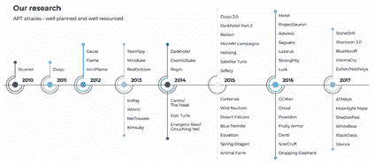

**图 1.1** APT 网络攻击研究情况。

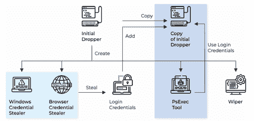

**图 1.2** 奥林匹克破坏者 APT 网络攻击算法。


该软件通过破坏用户网络文件夹中的一系列系统和应用程序，瘫痪了奥运会信息基础设施 [11–14]。结果导致奥运 Wi-Fi 瘫痪、显示支持信息的屏幕关闭、官方网站无法运行（观众无法打印门票）等。该网络攻击还波及韩国的一些滑雪场，导致缆车运行故障。一些国际主流媒体匆忙指责俄罗斯、中国和朝鲜的特种技术力量 [15–18]。随后发现了指向`拉撒路`组织恶意活动的迹象。检测到攻击者留下的独特数字足迹，与该组织的活动概况相符。然而，事后证明这是对`拉撒路`组织模式的巧妙模仿。功能集与密钥不匹配。攻击者故意添加了`“假旗”`以掩盖调查和准确的网络攻击归因。

2018–2019 年出现了`奥林匹克破坏者`网络攻击的新受害者，包括俄罗斯、德国、瑞士、乌克兰等国的金融信贷机构和工业企业。同时，该攻击的委托方和承包方仍不详 [19–22]。

2018 年 3 月，`Operation Parliament`组织攻击了全球多家大型律师事务所（图 1.3），包括中东和北非地区的公司，特别是巴勒斯坦的公司。

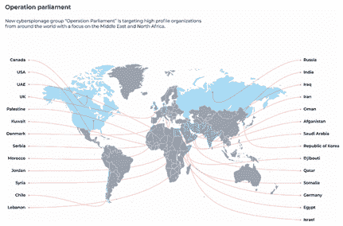

**图 1.3** `Operation Parliament` 组织 APT 网络攻击地理分布。

2018 年 4 月，检测到`Energetic Bear/Crouching Yeti`组织对美国和欧盟发电厂实施 APT 攻击的网络攻击。网络钓鱼邮件携带恶意文件、不同工具的实施、日志伪造、恶意软件的直接或延迟启动等，都是该组织的典型手法。该组织攻击的调查结果见于 US-CERT 报告：

*   APT 组织为外部客户的利益工作，并对关键信息基础设施的不同设施实施攻击。
*   通常情况下，该组织使用广泛可用的工具和已知的战术技术，这使得网络攻击溯源变得相当困难。
*   在大多数调查案例中，APT 组织首先寻找漏洞，然后开发并实施利用漏洞的新方法。
*   受害者及其关联方的任何可用易受攻击的服务器或信息基础设施组件，均被用作网络攻击开发的基础。

`DustSquad`是另一个网络间谍组织，曾攻击中亚多国的基础设施 [26–28]。该 APT 组织以复杂的网络攻击著称，拥有针对 Android 和 Windows 的专用恶意软件，包括`Octopus`。

`The MuddyWater`组织

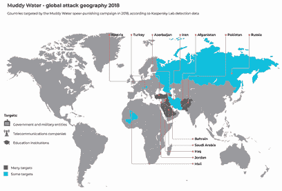

**图 1.4** `MuddyWater`组织 APT 网络攻击地理分布。

2018 年 5 月，`Cisco Talos`分析部门发布了名为`VPNFilter`的恶意软件研究结果，该软件影响了全球 54 个国家约 50 万台中小企业的路由器。

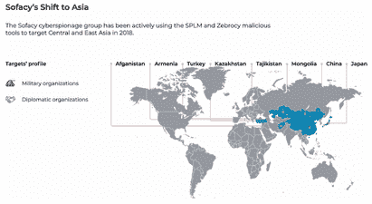

**图 1.5** `Sofacy` 组织攻击目标。

美国联邦调查局（FBI）指认`Sofacy`组织（也称为`APT28, Pawn Storm, Sednit, STRONTIUM and Tsar Team`）为犯罪作者。

`Sofacy`利用定向网络钓鱼和“水坑”类型的网络攻击，窃取登录信息、机密消息、文档等数据。该组织利用零日漏洞部署恶意软件，并应用不同工具。该组织于 2017 年初发起`“Dealer’s Choice”`行动，对军事和外交使团（主要在北约国家和乌克兰）实施网络攻击。随后，该组织使用`Zebrocy`和`SPLM`工具扩大受害范围。与此同时，`Sofacy`行动相当隐蔽且反复出现，展示了其开发新方法和修改旧方法以成功实施网络攻击的能力 [6–10, 37–40]。

值得注意的是，在中亚地区活动的 APT 组织的目标和任务（图 1.6 和图 1.7）经常交叉 [36, 41–43]。例如， `Sofacy`组织的恶意软件`Zebrocy` 与 `Mosquito Turla` 争夺对受害计算机的访问权，其 `SPLM` 恶意代码则与讲俄语的 `Turla` 和讲中文的 `Danti` 已知的工具和方法集相抗衡。这些 APT 攻击的交叉目标是中亚地区的政府和商业结构及组织。`Sofacy` 与负责 `Lamberts` 的讲英语组织之间发生了“利益一致”。研究人员在一台服务器上发现 `Sofacy` 的踪迹，从而找到了这种关联，该服务器此前已被漏洞通报服务器识别为感染了 `Grey Lambert` 恶意软件。一家知名的中国航天控股公司拥有该服务器。然而，`SPLM` 的主要传播载体尚未确定。这导致了几种假设：例如 `Sofacy` 可能使用了新的、仍未知的漏洞利用或新类型的恶意代码，或者 `Sofacy` 设法利用 `Gray Lambert` 链接下载其恶意软件。这也可能是在之前的 `Lambert` 攻击期间植入的 `“虚假旗帜”`。可能是应用了新的未知 `PowerShell 脚本` 或合法但存在漏洞的 Web 应用程序，用于 `SPLM` 代码的下载和执行 [44–46]。

根据`Kaspersky Lab ICS CERT`：

值得注意的是，即使在 `Lucky Mouse` 利用恶意文档攻击 `CVE-2017-118822`（自 2017 年 12 月以来，讲中文的组织广泛利用的 Microsoft Office 公式编辑器漏洞）的情况下，也无法证明这些文档与具体攻击有关。推测攻击者通过“水坑攻击”感染了 `DPC 员工`。此前，2018 年 3 月还检测到 `LuckyMouse` 组织的另一次恶意网络攻击。

2018 年 7 月获悉，`Lazarus` 组织成功入侵全球多家金融和信贷机构，并设法渗透进一些国际加密货币交易所和银行。该 APT 攻击通过受感染的加密货币交易木马应用程序实施 [49–51]。该应用程序极有可能是从一个看似合法的网站下载的。它用 `Fallchill` 组织已知的恶意软件感染了计算机。`Lazarus` 组织找到了创建看似合法网站的方法，并在“看似合法”的软件更新机制中注入恶意组件。在该特定案例中，攻击者创建了一个完整的虚假供应链，而不是感染现有的供应链。成功的供应链攻击意味着 `Lazarus` 将继续使用恶意软件感染由所有已知操作系统控制的网络系统。该组织已发布 `macOS` 版本的恶意软件，并据报即将发布 Linux 版本的恶意软件。这是已知的首批 `macOS` 恶意软件使用案例之一。

2018 年 8 月检测到 `Turla` 组织（其他名称包括 `Venomous Bear, Waterbug or Uroboros`）的 APT 攻击。该组织因感染北约关键信息基础设施多个组件的复杂 `Snake` rootkit 而闻名。

`Kaspersky Lab ICS CERT` 于 2018 年 9 月发布了 `Dark Pulsar` 恶意代码的研究结果。

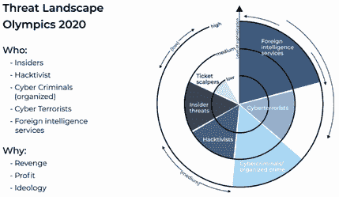

**图 1.8** 网络犯罪组织的典型结构。

### 1.1.2 已知攻击者方法

应当指出，攻击者工具和方法的技术栈（图 1.8）因新技术和新工艺而显著增加 [37–40, 52–54]。

#### 移动端 APT 攻击

#### 间谍活动

2018 年检测到间谍活动 `Zoopark`、`BusyGasper` 和 `Skygofree`，其主要目标是对受害者进行全方位间谍监控 [6, 8, 37, 38, 55]。在此过程中，使用了通话和短信拦截、未经授权的访问、用户位置数据提取等方法。其中实现了通过麦克风进行音频拦截的功能：受害者的智能手机被用作窃听器来录制私人谈话等。特别关注在大多数已知即时通讯软件中实现不被发现的访问和消息窃取。在某些情况下，攻击者利用漏洞利用代码提高受害者设备上本地木马（恶意软件）的权限，并开启远程监控权限，通常还包括设备控制权。此外，还实现了键盘记录功能。攻击者记录受害者使用设备键盘的操作。`Skygofree` 间谍活动在意大利实施，`BusyGasper` 在俄罗斯，`Zoopark` 在中东国家。清晰可见这样一种趋势：间谍犯罪分子更倾向于选择移动平台来策划、组织和实施网络攻击 [6–8, 37]。

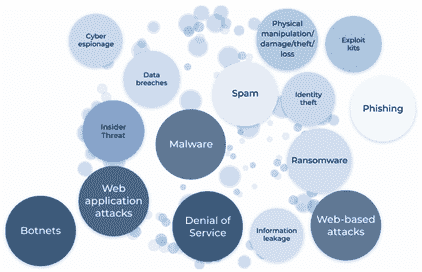

**图 1.9** 最流行的网络攻击类型。

##### 漏洞利用

关键基础设施硬件和软件中的漏洞利用（**图 1.9**）是攻陷设备和关键基础设施组件的重要工具 [5, 39, 40]。2018 年发现了两个主要的 Intel 处理器漏洞，分别命名为 `Meltdown` 和 `Spectre`。它们分别允许攻击者访问任意进程的内存读取和利用进程。这些漏洞至少自 2011 年起就已存在。`Meltdown (CVE-2017-5754)` 影响核心 Intel 进程，允许攻击者读取任意系统进程内存中的数据。利用该漏洞需要代码执行，这可以通过不同方法来确保，例如利用软件错误，或通过访问下载执行网络攻击的 `JavaScript` 代码的恶意网站。因此，如果漏洞利用成功，存储在内存中的数据（如密码、加密密钥、`PIN` 码等）可以被读取。制造商迅速为最流行的操作系统发布了补丁。然而，2018 年 1 月 3 日的 `Microsoft` 更新与大多数已知杀毒软件不兼容，并可能在某些系统中导致 `BSoD`。只有注册表中存在证明没有不兼容性问题的特殊键值时，才能安装该更新。

与 `Meltdown` 相比，`Spectre (CVE-2017-5753 and CVE-2017-5715)` 漏洞还可在其他架构（`AMD` 和 `ARM`）中利用。此外，`Spectre` 只能读取利用进程自身内存中的数据。大多数发布的补丁导致网络攻击面减小，降低了漏洞利用风险，但无法完全消除该漏洞。`Intel` 公司为发现新的处理器 `Spectre` 漏洞 (`CVE-2017-5753`) 发放了 100,000 美元奖金。例如，`Spectre 1.1 (CVE-2018-3693)` 可导致缓冲区溢出，而 Spectre 1.2 允许重写仅可读数据并导致不保护读写数据的进程中的沙箱发生故障。`Vladimir Kiriansky (MTI)` 和独立研究员 `Carl Waldspurger` 发现了这些新漏洞 [6, 10]。

一个新的 `Internet Explorer` `zero-day exploit` (`CVE-2018-8174`) 于 2018 年 4 月 18 日匿名上传至 `VirusTotal`。在研究过程中，发现该漏洞利用代码使用了完全修补过的 `Microsoft Word` 版本。同时，感染链包含以下阶段：受害者收到一个恶意 `Microsoft Word` 文档，打开时会加载一个包含 `VBScript 代码` 的 `HTML` 页面；随后触发 `UAF (Use After Free)` 漏洞并启动 shellcode。这是首次使用 `URL Moniker` 将 `Internet Explorer` 漏洞利用代码下载到 `Word` 中的案例 [5, 20–22]。

2018 年 8 月检测到一种基于 `win32k.sys`（Windows 驱动文件）`zero-day` 漏洞利用的新型网络攻击。漏洞利用使攻击者能够控制受感染的计算机。该漏洞被用于针对中东组织的定向攻击。发现数十名受害者，数字足迹指向 `FruityArmor` 组织（**图 1.10**、1.11 和 **1.12**）。

2018 年 10 月底，又发现一个 `Microsoft win32k.sys` `zero-day` 漏洞，该漏洞导致权限提升，确保恶意软件在受感染系统中的持久存在。该漏洞也被用于针对中东目标和组织的少量网络攻击中。

#### 恶意浏览器扩展

2018 年，专家们关注到旨在窃取资金的恶意扩展 `Desbloquear Conteúdo`（葡萄牙语“解锁内容”）。

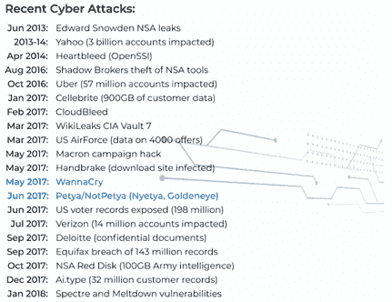

**图 1.10** 网络攻击时间线片段。

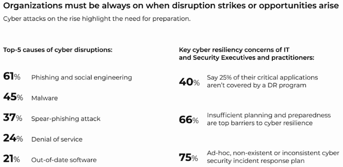

**图 1.11** 网络攻击百分比占比。

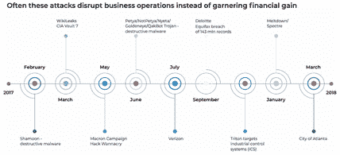

**图 1.12** 印象最深的网络攻击。

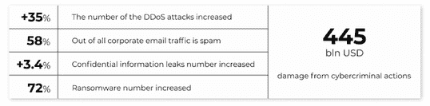

**图 1.13** 经济金融领域网络攻击动态。

该扩展针对巴西网银用户，收集登录名和密码以获取受害者银行账户的访问权限。

2018 年 9 月，黑客发布了超过 **81,000** 个 `Facebook` 账户的私人消息。此外，他们声称掌握更多信息，具体来说是 **1200 万** 个 `Facebook` 账户的数据。`Dark Web` 上出现广告，黑客以每个账户 **10 美分** 的价格出售这些私人消息。`Digital Shadows` 公司和 `Russian BBC` 服务的调查结果显示，这 **81,000** 个账户中的大多数属于俄罗斯和乌克兰公民，一小部分属于英国、美国和巴西的人员。`Facebook` 代表推测这些消息是被恶意浏览器扩展窃取的。

恶意扩展（**图 1.13**）虽罕见，但因其可能造成的危害而需要特别关注 [1, 21, 29, 30]。

#### 社会工程学方法

### 社会工程学与网络威胁

社会工程学是网络犯罪分子技能组合中的重要工具，`2018 年俄罗斯世界杯`便证明了这一点 [5, 32–34]。在重大赛事开始前很久，网络犯罪分子就开始在群发邮件中积极利用这一话题，并创建相关的钓鱼页面（图 1.14 和 1.15）。关于彩票中奖的通知邮件，以及关于球票抽签的消息，成为这些欺诈类型之一。欺诈网页通常与真实网页非常相似：它们制作精良，甚至拥有 `SSL` 证书以增加可信度。网络骗子通过伪造官方 `FIFA` 通知来诱骗用户数据。受害者被告知安全系统已更新，因此（在封锁账户的威胁下）需要输入所有个人数据。信中的链接指向一个虚假账户，输入的信息直接落入犯罪分子手中。

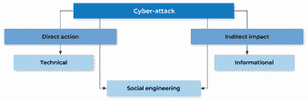

**图 1.14** 网络攻击复杂度增长。

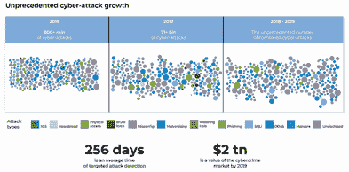

**图 1.15** 网络犯罪市场评估。

在`世界杯`之前，对**11**个举办比赛城市中近**32,000**个 Wi-Fi 接入点进行了分析 [56–59]。统计了开放网络和受 `WPA2 标准` 保护的网络数量，以及它们在接入点总数中所占的百分比，方法是评估加密和认证算法。结果显示，超过**20%**的接入点使用不可靠的连接。对于犯罪分子来说，只需靠近此类接入点即可拦截流量和用户数据。约四分之三的所有接入点使用被认为最安全的 `WPA/WPA2` 加密标准。安全级别通常取决于网络所有者指定的 `WPA` 设置。破解复杂的加密密钥可能需要数年时间。此外，即使使用可靠协议（如 `WPA2`）的网络也不能被视为完全安全。上述网络易受密码攻击、密钥重置攻击等威胁（图 1.16 和 1.17）。如果在会话开始时拦截到接入点与设备之间的“握手”，就有可能拦截使用 `WPA` 加密的公共 `Wi-Fi` 热点的流量。

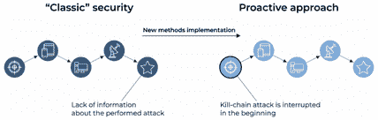

**图 1.16** 网络安全范式演变。

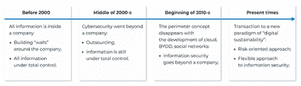

**图 1.17** 网络安全演变的主要原因。

#### 金融欺诈

2018 年 8 月，检测到一起 APT 攻击（自 2017 年 10 月起的钓鱼活动），旨在主要从工业公司窃取资金 [[60]](#Reference.xhtml#ref0061)–[[64]](#Reference.xhtml#ref0065)。

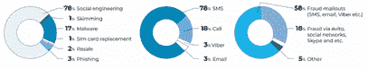

**图 1.18** 金融领域典型的网络犯罪技术。

攻击者使用标准钓鱼方法，通过欺骗强迫用户打开受感染的邮件附件（图 1.18）。为此，钓鱼邮件伪装成商业报价或其他财务文件。网络犯罪分子使用合法的远程管理软件，如 `TeamViewer` 或 `Remote Manipulator System (RMS)`。结果，**400**家不同领域（生产、自然资源预招募与加工、发电等）的工业公司的**800**多台计算机被感染。

勒索软件仍然是对用户的巨大威胁。此外，出现了带有勒索要求的新型和更新型恶意软件 [6, 8, 18–20]。

##### 危险的加密器


2018 年 8 月初，在包括巴西和越南在内的 20 多个国家中检测到了 `KeyPass Trojan`（KeyPass 特洛伊木马）。`KeyPass` 加密了本地驱动器和受害者网络文件夹中的大部分文件（部分文件被忽略）。使用了带有 32 位密钥的 `AES-256` 对称加密算法（采用 `Cipher Feedback mode (CFB)` 密文反馈模式，零初始化向量）。每个文件开头最多加密 `0x500000 bytes` (~5 MB)。加密后的文件获得 `*.KEYPASS` 扩展名，并在存放文件的目录中添加了一个名为 `!!!KEYPASS_DECRYPTION_INFO!!!.txt` 的勒索要求文件。`KeyPass Trojan` 的特别之处在于“手动”控制的可能性。该 `Trojan` 允许攻击者自定义加密过程，修改加密密钥、勒索文件名称和内容、受害者标识符、加密文件扩展名以及应从加密中排除的目录列表等参数 [5, 18, 20]。

值得注意的是，`WannaCry` 疫情（图 1.19）爆发已过去近两年。已检测到针对**150**个国家的设施和公司的**75,000**多起 `WannaCry` 网络攻击。同时，该恶意软件仍然是最危险加密器中的佼佼者。

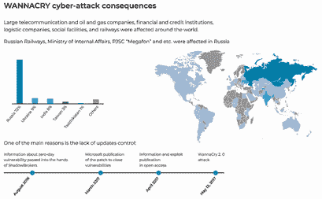

**图 1.19** `WannaCry` 网络攻击后果。

`WannaCry` 的感染占比超过总量的**30%**，并保持稳步增长 [6–10, 37–40]。

#### 智能设备安全问题

如今，我们被 `smart devices`（智能设备）包围，它们是日常家用电器，如照明设备、电视、熨斗、咖啡机、温控指示器、儿童玩具，以及收集和处理住房和公用事业数据的计数器、医疗设备、监控摄像头等。智能铁路、炼油厂、城市甚至区域正在出现（图 1.20 和 1.21）。然而，这种多样性也有其缺点：智能设备越多，网络攻击面就越宽，攻击者拥有的机会就越多 [1, [65]](#Reference.xhtml#ref0066)–[[67]](#Reference.xhtml#ref0068)。由于开发标准化不足，在处理 `Internet of Things (IoT/IIoT)`（物联网/工业物联网）时，很少关注网络安全，因此更难确保智能网络系统安全。以下例子可以说明这一点。

2018 年 2 月，`Kaspersky Lab ICS CERT` 发布了一项研究，探讨 `smart hubs`（智能中枢/智能枢纽）对网络攻击的脆弱性。中枢允许控制家中其他智能设备的工作，接收来自它们的信息，并向它们传递任务。可通过触摸屏、移动应用程序或 Web 界面进行中枢管理。如果中枢存在漏洞，可能会造成单点故障。受调查的中枢不包含任何重大漏洞，但检测到允许攻击者获得远程访问权限的逻辑错误。

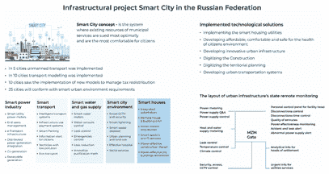

**图 1.20** 大规模 SMART 技术发展。

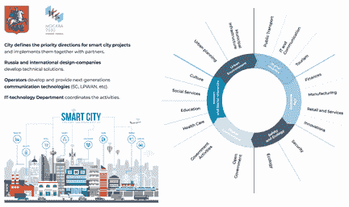

**图 1.21** SMART CITY 2030 概念发展。

##### 智能设备网络安全分析

###### 智能摄像头安全评估

智能摄像头也经过了针对黑客攻击的安全检查。此类设备已深深融入我们的日常生活 [68–70]。许多设备能够连接云端，从而提供远程监控功能，如观察动物、家庭安防等。受测摄像头功能广泛，可用作保姆摄像头或家庭安防系统组成部分。该设备具备夜视、动作检测功能，可将视频和声音传输至智能手机或平板电脑，并通过内置扬声器播放声音。然而，在调查过程中发现了 10 多个漏洞，数量几乎与其功能数量相当。这些漏洞允许远程更改管理员密码、在设备上执行任意代码、从受感染摄像头创建僵尸网络或彻底禁用摄像头 [71–74]。

###### 加油站自动化工具漏洞

潜在问题不限于家用设备。年初，`GReAT` 专家 `Ido Naor` 与 `Azimuth Security` 公司的 `Amihai Neiderman` 共同发现了加油站自动化工具中的漏洞。

###### 动物智能设备安全性

2018 年，对带有 GPS 追踪等功能的动物智能设备进行了检查。这些小工具可访问网络、主人手机以及动物位置数据。分析了多款热门追踪器型号的潜在漏洞。

###### 可穿戴设备调查

智能手表和健身追踪器等可穿戴设备也接受了调查。研究发现，安装在智能手机上的间谍应用脚本可将内部运动探测器（加速度计和陀螺仪传感器）的数据发送至远程服务器，并从数据中还原用户行为，如行走、坐姿、键盘打字等。首先，为 `Android` 智能手机开发了一个简单的数据处理和传输应用，随后分析了如何获取这些数据。结果表明，不仅能识别人员是坐着还是走路，还能定义行走模式，例如判断人员是四处走动还是换乘地铁。之所以能做到这一点，是因为每种动作类型在加速度计中都有特定的数据模式。这也是健身追踪器能区分走路和骑行的具体原因 [82–85]。

###### 共享汽车服务安全性

近年来共享汽车服务日益普及。此类服务显著提升了大城市人员的流动性。然而，随之而来的问题是服务用户个人数据的安全性如何。2018 年 7 月，测试了 13 款共享汽车应用的安全措施。

###### 物联网设备增长与安全现状

智能设备数量稳步增长（见图 1.23 和 1.24）。据预测，到 2025 年其数量将数倍于地球人口。此外，厂商仍未充分重视其网络安全：初始设置过程中无修改默认密码的提醒、无新固件更新通知，且更新过程往往对普通用户过于复杂。所有这些因素使物联网设备成为攻击者的诱人目标 [88–91]。它们比个人电脑更容易受攻击，且在家庭基础设施中扮演重要角色：有的管理网络流量，有的进行视频录制，还有的控制家用设备如气候控制配置。不仅数量，针对智能设备的恶意软件质量也在提升。随着攻击者技能库中漏洞利用代码增多，受感染设备被用于组织 `DDoS` 攻击、窃取个人数据和挖掘加密货币。

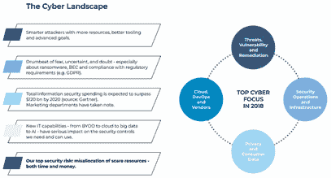

**图 1.22** 网络安全发展趋势与展望。

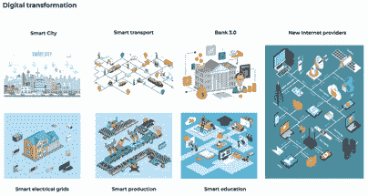

**图 1.23** 企业与国家数字化转型。

**网络安全“免疫系统”设计**

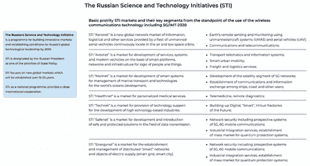

**图 1.24** 俄罗斯主要国家技术计划。

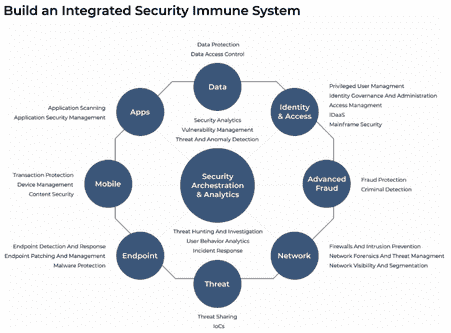

**图 1.25** 网络安全“免疫系统”设计。

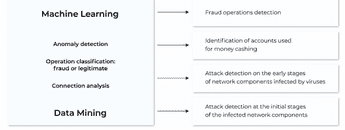

**图 1.26** 智能网络安全技术。

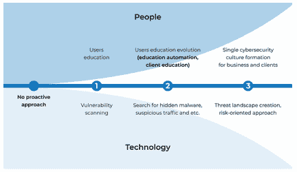

**图 1.27** 网络安全目标模型。

在智能设备生命周期的早期阶段（需求分析和设计）考虑网络安全问题至关重要 [92–95]。值得注意的是，相关方法论指导和建议已在一些国家出现（见图 1.25、1.26 和 1.27）。例如，英国政府批准了物联网安全实用指南。

### 1.1.3 过程控制系统网络安全威胁

根据 `ICS-CERT (https://ics-cert.us-cert.gov/)` 数据，2017 年共识别出 332 个不同监控与数据采集 (`SCADA`) 组件的漏洞 [96–99]。这些漏洞涵盖系统软件、应用软件，以及不同技术平台的网络协议和应用协议。其中，电力系统 (`178` 个)、生产系统 (`164` 个)、供水系统 (`97` 个) 和交通运输系统 (`74` 个) 的 `SCADA` 漏洞最多（见图 1.28）。

#### 已识别漏洞的风险评分

超过一半的 `SCADA` 漏洞 (`194` 个) 在 `CVSS v3.0` 评分体系中获得 7 分以上，表明风险等级为高危和严重（见表 1.1）。

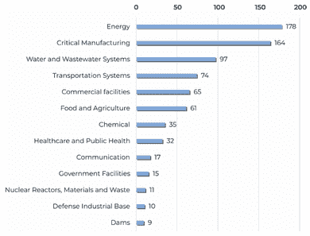

**图 1.28** SCADA 漏洞数量分布，ICS-CERT。

**表 1.1** 按风险评分划分的漏洞分布

| 风险评分 | 9 到 10 分 (严重) | 7 到 8.9 分 (高危) | 4 到 6.9 分 (中危) | 0 到 3.9 分 (低危) |
| :--- | :---: | :---: | :---: | :---: |
| 漏洞数量 | 60 | 134 | 127 | 1 |

以下产品中的漏洞获 10 分满分：

*   `IniNet Solutions GmbH SCADA Webserver`
*   `Westermo MRD-305-DIN`、`MRD-315`、`MRD-355` 和 `MRD-455`
*   `Hikvision Cameras`
*   `Sierra Wireless AirLink Raven XE` 和 `XT`
*   `Schneider Electric Modicon M221 PLCs` 和 `SoMachine Basic`
*   `BINOM3 Electric Power Quality Meter`
*   `Carlo Gavazzi VMU-C EM` 和 `VMU-C PV`

这些 10 分漏洞由认证问题引起，可远程利用且易于攻击。`Modicon Modbus Protocol` 中的漏洞也获得最高分。

#### 检测到的漏洞类型

最常见的漏洞中包括*基于栈的缓冲区溢出*、*基于堆的缓冲区溢出*和*不当认证*（图 1.29）。同时，**23%**的所有检测到的漏洞是 Web 漏洞（*注入、路径遍历、跨站请求伪造 (CSRF)、跨站脚本攻击*），**21%**与认证问题（*不当认证、认证绕过、关键功能缺失认证*）以及访问控制问题（*访问控制、不正确的默认权限、不当的权限管理、凭据管理*）有关 [72, 76, 100]。

攻击者在不同 SCADA 组件中利用漏洞即可导致任意代码执行、工业设备的未授权管理及其运行故障（*DoS*）。同时，大多数漏洞（**265**个）可在无需认证的情况下被远程利用，且其利用不要求攻击者具备特殊知识和高水平技能。

此前已有**17**个漏洞的利用代码被公开，这增加了其被恶意利用的风险。

##### SCADA 易受攻击组件

大多数漏洞被检测在：

*   SCADA/HMI 组件（**88**），
*   工业用途网络设备（**66**），
*   可编程逻辑控制器（**52**），
*   以及工程软件（**52**）。

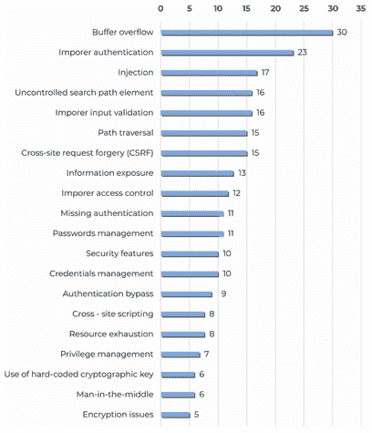

**图 1.29** 常见 SCADA 漏洞类型。

其他易受攻击的组件中还包括继电保护和自动化装置、紧急关断系统、生态监测系统、工业监控系统等（图 1.30）79, [101–104]。

##### 工业协议漏洞

在工业协议实现中检测到大量漏洞，如 *Modicon* 版本控制器中的 *Modbus*（根据 CVSS **3** 版本，该漏洞评分为 **10**）、*OPC UA 协议栈*^()

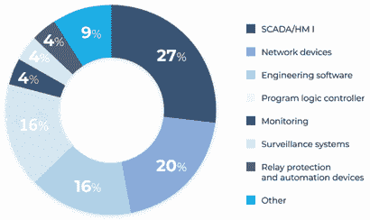

**图 1.30** 根据 SCADA 组件划分的漏洞分布。

传统软件平台和网络协议的漏洞也被检测到 82, [105, 106]，包括用于 *Cisco、Rockwell Automation、Sierra Wireless、ABB、Siemens* 等厂商设备中的 *WPA2 协议* 漏洞，以及 *DNS 服务器 Dnsmasq、Java Runtime Environment、Oracle Java SE、Cisco IOS 和 IOS XE* 中的漏洞。^()

##### IIoT 设备漏洞

在 2016–2019 年，*IIoT 设备漏洞*被利用以创建僵尸网络的案例变得更加频繁 5, [84, 107]。例如，*Reaper*^()

应当注意到，旧漏洞也未被消除，例如 2014 年 *Realtek* 公司设备中的 *CVE-2014-8361 漏洞*^()

*蓝牙协议*实现中的漏洞导致了新的 *BlueBorne 攻击* 向量的出现^()

此外，*卡巴斯基实验室 ICS* 研究人员在 2017 年发现了 SCADA 和 *IIoT/IoT* 网络系统中的 **63** 个漏洞^()

在工业网络设备中检测到 **18** 个漏洞。具体而言，典型漏洞包括数据泄露能力、权限提升、任意代码执行、拒绝服务等。*OPC UA 技术*实现中还检测到 **17** 个“拒绝服务”类型的严重漏洞。同时，部分检测到的漏洞存在于官方 Github 仓库发布并用于已知产品系列的 *OPC UA 软件* 实现中。在 *Gemalto* 公司的 *SafeNet Sentinel 软件* 中发现了 **15** 个漏洞。^()

##### 加密货币挖矿程序

根据 *卡巴斯基实验室 ICS CERT* 的数据，在 2017 年 2 月至 2018 年 1 月期间，加密货币挖矿软件攻击了工业自动化系统中 **3.3%** 的计算机 [131–133]。在 2017 年 8 月之前，被挖矿程序攻击的工业自动化系统百分比低于 **1%** （图 1.31–1.33）。

恶意软件在运行时会给计算机资源带来显著负载。处理器负载增加可能对 *SCADA* 组件运行产生负面影响，并危及其功能的网络弹性 [29, 30, 34]。

通常，*SCADA* 计算机通过互联网感染挖矿程序，较少见的是通过移动存储设备或公司员工网络文件夹。

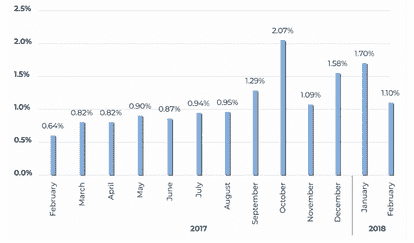

**图 1.31** 被挖矿程序攻击的工业自动化系统计算机占比。

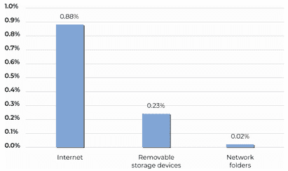

**图 1.32** SCADA 计算机挖矿程序感染来源。

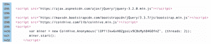

**图 1.33** 被挖矿程序感染的 Web 资源代码片段截图。

加密货币挖矿程序感染影响了大量网站，包括工业公司网站。在这些情况下，加密货币挖掘是在受感染 Web 资源访问者的系统上进行的，该技术被称为“*隐秘挖矿*”。

##### 技术网络基础设施中的僵尸网络代理

通常，*僵尸网络* 代理旨在用于*垃圾邮件发送*、搜索和窃取财务信息及认证数据，以及*密码破解或拒绝服务 (DDoS)* 网络攻击 [134–138]。恶意软件感染对工业基础设施设施构成危险（图 1.34）。*僵尸网络代理* 的行为可能导致网络运行中断、受感染系统及其他网络设备的*拒绝服务*。此外，恶意代码通常包含错误和/或与工业基础设施管理软件不兼容，这可能导致监控和工艺过程控制出现故障。*僵尸网络代理* 的另一危险在于其收集系统信息并让攻击者获得对受感染机器不被发现的*控制* 机会，这类似于恶意代码 5, 41, [48, 139]。

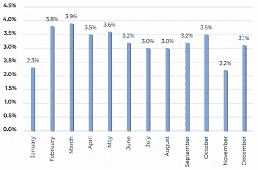

**图 1.34** 被僵尸网络代理攻击的 SCADA 计算机百分比。

*SCADA* 的*僵尸网络代理* 攻击主要来源为互联网、移动存储设备和电子邮件（图 1.35）。

#### 定向攻击

2017 年以 `Industroyer`^() 为标志

##### Trisis/Triton

`Triton` 或 `Trisis` 恶意软件是一个模块框架，允许在公司网络中以自动模式搜索 `Triconex Safety Controllers`（Triconex 安全控制器），获取其运行模式信息，并在这些设备中植入恶意软件。`Trisis/Triton` 将恶意代码安装到设备固件中，该代码允许攻击者远程读取和修改不仅是合法的控制程序，还有受感染 `Triconex` 设备的固件代码。所有可能的负面后果中最无害的是系统紧急停机和工艺过程停止 [58, 140–143]。

攻击者是如何渗透公司基础设施的目前仍不得而知。可以确定的是，他们极有可能在受害组织系统中潜伏了相当长的时间（数月），并利用合法软件和双重用途工具在网络中横向移动和提权。尽管攻击意图是修改 `Triconex` 设备代码，但由于未发现攻击者在最后攻击阶段试图执行的代码，因此攻击目标未被识别。

##### 定向钓鱼 — Formbook 间谍软件

`Formbook` 在通过钓鱼邮件发送给全球工业和发电公司的已知 `spy Trojans`（间谍木马）（`FareIT`、`HawkEye`、`ISRStealer` 等）中变得流行起来。^()

*   `RFQ for Material Equipment for Aweer Power Station H Phase IV.exe`


*   `Scanned DOCUMENTS & Bank Details For Confirmation.jpeg (Pages 1—4) -16012018.jpeg.ace`
*   `PO & PI Scan.png.gz`
*   `BL_77356353762_Docl.zip`
*   `QUOTATION LISTS.CAB`
*   `Shipping receipts.ace`

除间谍恶意软件的标准功能外，如截屏、记录按键代码和窃取浏览器存储中的密码，`Formbook` 的功能还得到了扩展，允许从 `HTTP/HTTPS/SPDY/HTTP2` 流量和 Web 表单中窃取机密数据。此外，该恶意软件还实现了隐蔽远程系统控制的功能，并拥有一种不寻常的抗网络流量分析技术。`Trojan`（木马）从存储在其主体中的合法域名列表形成一组 URL 地址以连接攻击者的服务器，并在其中仅添加一个恶意软件控制服务器。因此，`Formbook` 试图将与恶意域的连接隐藏在对合法资源的其他请求之中，这使得检测和清除它变得困难 [132, 146–148]。

### 漏洞利用

阻止漏洞利用尝试的自动化控制系统计算机的百分比增加了 1 个百分点，达到 2.8%（图 1.37）。

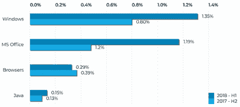

**图 1.37** 遭受漏洞利用攻击的应用程序类型。

值得注意的是，攻击者经常使用 `Visual Basic Script` 编写的加载器脚本作为漏洞利用载荷，或将其嵌入 Office 文档中。执行此类脚本的必要条件是 `Windows Script Host (WSH)` 解释器，它随 `Windows OS` 默认安装。`The ShadowBrokers exploits`（影子经纪人漏洞利用代码）作为不同恶意软件的一部分，在 2018 年上半年被大量用于 `WannaCry` 和 `ExPert` 勒索软件的攻击中 [132, 133]。这些漏洞利用攻击数量的增加，是导致 `Windows` × `86` 和 × `64` 自动化控制系统计算机遭受恶意软件和漏洞利用攻击的百分比增长的原因。

### 间谍软件

遭受 `spyware`（间谍软件）（`Trojan Spy` 和 `Trojan PSW`）攻击的自动化控制系统计算机的百分比增加了 0.4 个百分点 [37–40, 132, 133]。

`spyware` 通常通过钓鱼邮件传播。一个显著的例子是韩国，根据阻止间谍软件的自动化控制系统计算机百分比，以 **6%** 的指标在国家排名中位列第三。该国大多数间谍软件主要通过针对亚太地区用户的钓鱼邮件传播。值得注意的是，根据阻止“数字炸弹”攻击的自动化控制系统计算机百分比，韩国以 **6.4%** 排名第三。排名第一的是越南，高达 **9.8%**。

### 木马恶意软件

通常，`Trojan malware`（木马恶意软件）采用 `Javascript`、`Visual Basic Script`、`Powershell`、`AutoIt` 等编写，以 `AutoCAD` 格式等形式存在。该恶意软件允许攻击者渗透受攻击的 `SCADA` 系统，以及投递和执行其他恶意软件（图 1.38）[41, 132]。包含以下软件模块：

*   间谍木马（`Trojan-Spy` 和 `Trojan-PSW`）；
*   勒索软件（`Trojan-Ransom`）；
*   后门；
*   未经授权的远程管理工具（RAT）；
*   类似 Wiper (killdisk) 的软件，可禁用计算机并擦除驱动器上的数据。

工业网络中计算机感染恶意软件可能导致控制丢失或工艺过程故障。

图 1.39 展示了攻击者恶意软件使用的平台百分比。此处将 × 86 和 ×64 的威胁计入 `Windows platform`（Windows 平台）；`Browsers platform`（浏览器平台）考虑攻击浏览器和恶意 `HTML` 页面的威胁；`Microsoft Office platform`（Microsoft Office 平台）包括 `Word`、`Excel`、`PowerPoint`、`Visio` 等系统软件的威胁。

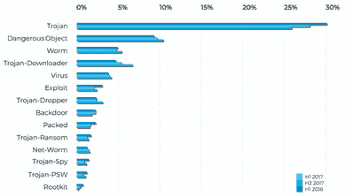

**图 1.38** 攻击 SCADA 的恶意软件类别。

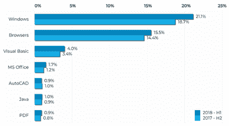

**图 1.39** 恶意软件使用的平台。

入侵者持续攻击公司网站，这些网站显然包含 Web 应用程序漏洞 [34, 132, 133]。特别是，利用 `JavaScript miners`（JavaScript 挖矿程序）的网络攻击数量增加了。在通过电子邮件附件发送 `Microsoft Office documents`（`Word`、`Excel`、`RTF`、`PowerPoint`、`Visio` 等）的网络攻击中，存在利用漏洞感染 `spyware` 的情况。

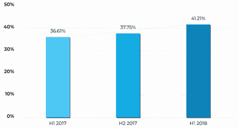

**Figure 1.40** 受攻击 SCADA 计算机百分比。

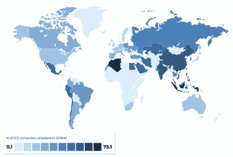

**Figure 1.41** SCADA 网络攻击地理分布。

#### 工业自动化系统遭受攻击的地理分布

受攻击的 `SCADA` 计算机百分比增加了 **3.5** 个百分点，在 2018 年上半年达到 **41.2%**。该指标每年增长 **4.6** 个百分点。

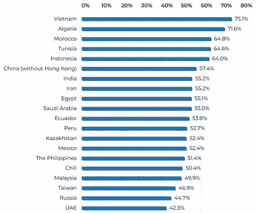

**Figure 1.42** 根据受攻击 SCADA 百分比排名的前 20 个国家。

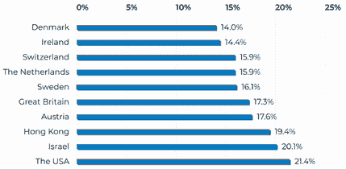

**Figure 1.43** 受攻击 SCADA 百分比最低的 10 个国家。

同时，受攻击 `SCADA` 计算机的百分比增长通常与恶意活动的增加有关 [34, 133]。

不同世界地区指标的对比显示：

*   根据受攻击 `SCADA` 计算机的百分比，非洲、亚洲和拉丁美洲国家的安全防护程度远低于欧洲、北美和澳大利亚国家；
*   东欧的指标远高于西欧；
*   南欧受攻击 SCADA 计算机的百分比高于中欧。

同时，不同地区内部的国家指标可能存在显著差异。例如，俄罗斯的 `SCADA` 比大多数非洲国家更安全；在中东国家中，以色列和科威特的 `SCADA` 防护更好（图 1.44）。

#### 主要感染源

互联网、可移动和外部数据存储设备（内存棒、存储卡等）是 `SCADA` 的主要感染源（图 1.45）[34, 132, 133]。

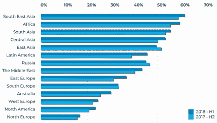

**Figure 1.44** 不同世界地区受攻击 SCADA 百分比。

这种动态似乎是常态；现代 `SCADA` 很难被称为是与 `Internet/Intranet` 和其他 `external networks` 隔离的。生产管理和工业网络及系统管理都要求技术网络与企业网络集成。例如，`Internet` 对于 `SCADA maintenance and technical support`（SCADA 维护和技术支持）是必需的。`SCADA` 可通过手机、`USB` 调制解调器和/或支持 `3G/4G/LTE` 的 `Wi-Fi` 路由器连接到互联网。

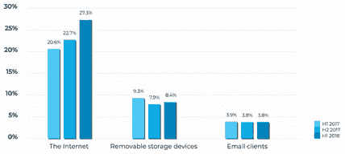

**Figure 1.45** 主要 SCADA 威胁来源。

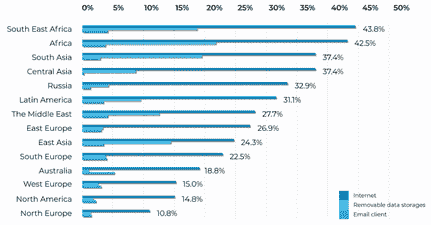

**Figure 1.46** 全球各地区网络攻击分布。

值得注意的是，通过可移动存储设备受攻击的 `SCADA` 最大百分比出现在非洲、中东和东南亚。这是因为这些地区仍广泛使用可移动存储设备在计算机之间传输信息（图 1.46 和 1.47）。

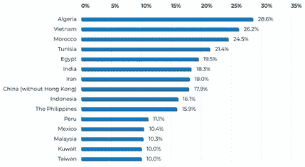

**Figure 1.47** 通过可移动存储设备受攻击 SCADA 百分比排名前 15 的国家。

## 1.2 “数字炸弹”中和问题

关键信息基础设施的网络安全在很大程度上取决于现代检测和中和工具漏洞和恶意代码（即“数字炸弹”）的能力，这些“数字炸弹”能将受保护的信息基础设施转移至某种灾难性状态（通常是无效或不可恢复状态）。让我们基于已知和原创的静态与动态软件分析模型及方法 [1–3, 34, 67, 133, 149]，探讨恶意代码的检测与中和实践。

### 1.2.1 “数字炸弹”检测问题

在发生并对受保护的关键信息基础设施产生破坏性影响之前（图 1.48 和 1.49），“数字炸弹”会经历以下生命周期阶段（表 1.1）：

*   “数字炸弹”设计；
*   “数字炸弹”开发；
*   “数字炸弹”部署；
*   “数字炸弹”激活（初始化）；
*   受保护基础设施结构和行为故障。

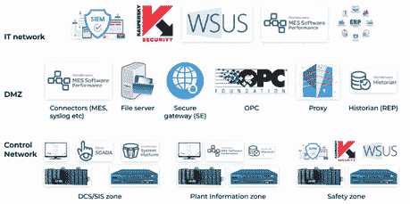

**Figure 1.48** 基础设施安全的典型特征。

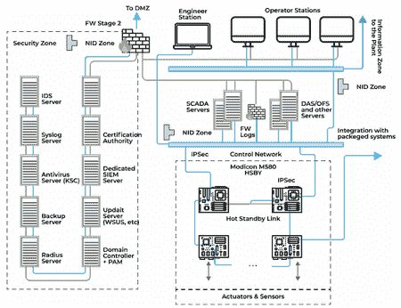

**Figure 1.49** 受保护基础设施分段组织示例。

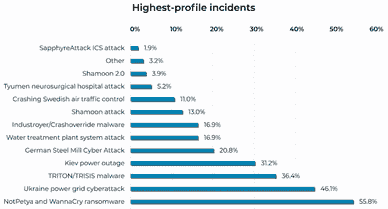

**Figure 1.50** 网络安全威胁实际情况统计。

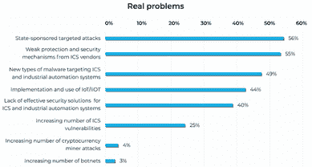

**Figure 1.51** 实际网络安全问题。

“数字炸弹”存在的指标可能是相应软件的某些特定结构和行为故障（图 1.50 和 1.51）[2, 3, 70]。显然，在首个设计步骤检测到的故障将与开发阶段的故障相关联，不再进一步考虑。在最终阶段，信息安全杀毒工具的开发者已深入研究了上述受保护基础设施结构和行为故障的指标 [150, 151]，因此我们不再重点关注它们。主要关注将集中在“数字炸弹”生命周期的开发、部署和激活阶段，这些阶段是网络安全专家感兴趣的 [34, 132, 133]。在开发阶段，“数字炸弹”可以是有意的，也可以是无意的（偶然的）。通常，无意的“数字炸弹”作为软件开发者的错误发生，或因在项目中使用开源代码而未进行适当检查和验证导致，例如 `GitHub`。

无妥协“数字炸弹”投递和部署的特殊方法、其唯一性和针对性，以及受保护信息基础设施行为的高复杂性和标准网络安全措施的缺乏，所有这些使得“数字炸弹”的检测和主动应对成为一项极具挑战性的任务 [41, 42, 152]。解决这一问题需要对特殊模型、方法和工具进行大量研究和开发，以确保所需的网络安全（表 1.2）。

#### 已知方法的批判性分析

软件静态和动态分析方法是检测“数字炸弹”的已知途径 [43, 152, 153]。基于在网络安全威胁增长条件下对关键信息基础设施行为进行控制的所谓剖析方法得到了广泛应用 [34, 44, 154]。

然而，在没有程序源代码和软件文档的情况下进行静态分析，需要寻找新的方法，以实现对“数字炸弹”的有效检测、预防和阻断。我们提出了一种基于软件检查的软件故障检测创新方法，该方法综合考虑了程序的结构、逻辑和操作特性。

*因诺波利斯大学信息安全中心*的研究证明，在没有程序源代码和软件文档的情况下，应用以下软件故障检测方法 [34, 132, 133] 是有用的：

*   **图论**（用于分析数字炸弹结构）；
*   **RSL 逻辑**（用于研究数字炸弹逻辑）；
*   带空位检查的 **Petri 网**（用于检查“数字炸弹”的行为）。

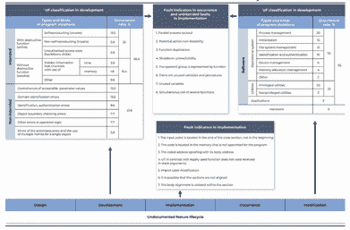

**表 1.2** 未声明软件可能性的分类

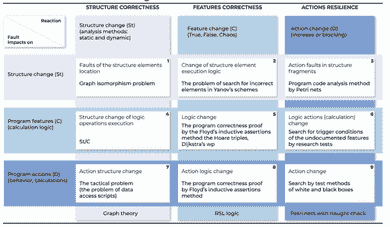

**表 1.3** 软件中现有的故障检测方法

在理论框架内（表 1.3），可以验证结构和特性的正确性，检查受控安全基础设施软件在存在破坏性“数字炸弹”情况下的行为弹性，并在检测到时采取即时措施进行中和。

为了解决此处的问题 [34, 132, 133]，需要将程序代码转换为更高抽象层级的机制，这使得分析安全基础设施的软件系统特性成为可能。

##### 主要再工程过程

将程序代码转换为更高抽象层级被称为软件再工程问题。再工程过程在 `ANSI/IEEE 729-1983` 标准中有描述。该标准定义了根据软件支持进行的主要阶段，据此，再工程是对初始系统的分析（研究、检查）和重新设计，以新形式重建它并进一步实现。再工程包括以下子过程（图 1.52）：

*   **逆向工程**；
*   **重构**；
*   **重新文档化**；
*   **重构**；
*   **目标代码转换**；
*   **正向工程**。

为了解决数字炸弹搜索问题，只需执行两个再工程子过程：**逆向工程**和**重构**（它是**重构**的一部分）。当有必要基于检测到的故障实施**人工（诱发性）检查点**以进一步分析软件特性时，可以执行**目标代码转换**和**逆向工程**子过程。

**逆向工程**是对原始软件系统的分析 [56, 155]，旨在实现以下两个目标：

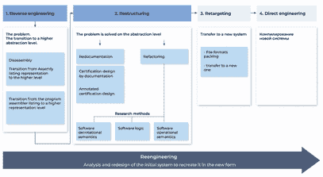

**图 1.52** 主要再工程过程。

*   检测软件系统组件及其之间的关系；
*   以其他形式或更高抽象层级创建软件系统的表示。

**重构是重构的一种类型** 78, [156, 157]，即对软件系统进行研究，旨在优化内部程序代码结构，但不改变外部程序行为 [158, 159]。

在分析过程中，应用了多种优化方法，包括**雅诺夫模式** 34, [160, 161]，以检测软件故障。因此，重构的重点从内部程序代码结构优化转移到了故障检测（图 1.53）。

###### 程序故障检测方法

表 1.3 列出了在没有程序源代码和软件文档的情况下，安全基础设施中已知和原创的软件故障检测方法。它们的使用实践表明：

*   表 1.3 中**第 4 和第 7 项**描述的方法难以实现，因为难以定义适当的数学工具；
*   执行**第 1、5、8 项**中的方法需要被分析程序的规格说明以及程序源代码；
*   测试方法（**第 9 项**）只能证明故障的存在，但不能证明其不存在；
*   应用**第 6 项**中的方法假设搜索恶意代码实现条件（为检测此类条件，开发了诱发性测试方法 [34, 132, 133]）；
*   故障检测（**第 3 项**）可以基于根据 **Petri 网** 分析程序结构正确性来实现。


**图 1.53** 不同故障类型的标记。

我们将注意力转向结论中的最后一点。结构验证通常是与允许的动作序列相关的特性验证方法。例如，与结构验证相比，分析验证专注于正确计算问题 [34]。

让我们考虑程序结构正确性的特性及其通过 **Petri 网模型** 进行分析的方法，以根据结构正确性破坏情况检测软件故障。

结构特性评估 [132, 133] 基于将程序动作评估为不计算任何内容的不可分割对象。让我们列出程序结构正确性的关键特性：

*   无并行进程死锁；
*   所有动作潜在可执行；
*   每个动作的控制转移无歧义；
*   潜在关闭可达性。

所有上述程序结构正确性特性此前均通过将未汇编的程序代码转换为 **Petri 网模型** 并进一步分析这些模型（即再工程）来分析。在这种情况下，显然标记和变迁活动的可达性分析就足够了（图 1.54–1.57）[34, 132, 133]。


**图 1.54** **Petri 网**表示。


**图 1.55** **Petri 网**的标记可达树。


**图 1.56** **Petri 网**的最终标记。


让我们考虑因诺波利斯大学信息安全中心的研究 [34, 132, 133] 中使用的 `Petri 网` 特性。

*   如果基于程序控制结构构建的 `Petri 网` 的可达图中只有一个终端标记，则不存在并行进程死锁。存在多个终端标记对应于程序并行进程死锁。


**图 1.57** `Petri 网` 执行的控制图。

*   控制转移的无歧义性直接与网络安全性相关。这可以解释为：标记模块控制转移，而一个位置中出现多个标记的可能性证明了多个控制信号同时进入一个操作的可能性。

*   每个程序操作符动作与一个网络传输建立精确的一一对应关系，因此潜在动作执行结果来自 `转移活动`。`转移活动` 级别定义了程序操作符活动。

*   潜在关闭可达性确保不存在与循环相关的不同错误（`简单循环`、`并行进程的动态死锁`）。`完全关闭可达性` 的概念是基于潜在可达性制定的。

发现结构正确性的附加特征与信号量操作有关 [34, 132]。因此，在每个信号量中，解析标记的数量应受固定数字限制。限制解析标记数量的数字应在操作开始前定义，并应等于初始 `信号量` 状态下这些标记的数量。由于每个 `信号量` 都在一个 `Petri 网位置` 中传输，上述特征分析归结为信号量位置的标记可达性分析，并将可达标记数与初始标记进行比较。如果拥有关于程序中信号量操作存在的后验信息，则可以分析此特征。

信息结构描述了程序对输入和输出变量操作之间的联系。在分析中，结构的使用使得能够得到特征组。一方面，这是对数据使用逻辑正确性的评估，另一方面，是对数据流控制中所有程序特征的评估。数据使用的逻辑特征包括：

*   控制转移时刻输入数据的确定性；
*   所有结果定义的明确性；
*   获得任何结果的事实、获得这些结果的方法数量等。

当用 `Petri 网` 描述程序信息结构时，一组变量与网元素（位置或转移）相关联，输入输出上的连接由 `Petri 网弧` 表示。这里采用了将程序代码变量与相应 `Petri 网位置` 匹配的建模方法。为了从反汇编清单中用 `Petri 网` 表示程序信息结构，还需要额外开发汇编命令解释器，将程序命令与相应的 `Petri 网位置` 链接 [34, 132, 133]。

### 形式化问题定义

#### 已知

一个作为被分析软件模型的普通标记 `Petri 网`

> $C = (P, T, I, O, \overset{\rightarrow}{\mathit{\mu}})$, (1.1)

其中，

> $P = \{p_1, p_2, \dots, p_n\}$ (1.2)

> $T = \{t_1, t_2, \dots, t_m\}$ (1.3)

网络转移的最终集合，对应于事件

> $I: T \times P \to \{0, 1\}$ (1.4)

转移关联的输入函数

> $O: T \times P \to \{0, 1\}$ (1.5)

$I$ 和 $O$ 反映了程序代码条件与事件之间的连接。

> $\overset{\rightarrow}{\mu}_0 = (\mu_0^1, \mu_0^2, \dots, \mu_0^n)^T$ (1.6)

对应于程序初始状态的初始标记向量。

#### 寻找

为了对程序运行动态建模，让我们定义转移触发规则，它是通过表达式作为 `Petri 网` 标记的函数

> $M^v(p) = M(p) - I(t_i, p_j) + O(t_i, p_j)$ (1.7)

$I[I]: T \times P \to \{0, 1\}$ 是一个特殊的关联函数，对于那些 $I[I](t, p) = 1$ 的对 $(t, p)$，它设置抑制弧。

让我们定义带零检查的 `Petri 网` 中的转移触发规则。

如果满足以下条件，则 `转移 t` 可以在 `M` 标记下触发：

> $M(p) \ge I(t, p) \land M(p) \times I[I](t, p) = 0$ (1.8)

$\mu_{UF} \in R(\mu_0)$, 从标记 $\mu_0$ 出发

其中

> $M(p) \ge I(t, p) \land M(p) \times I[I](t, p) = 0 \land M^{(v)}(p) = M(p) - I(t_i, p_j) + O(t_i, p_j)$ (1.9)

#### 分析 Petri 网的以下特征

#### 可达性

从标记 $\mu_0$ 出发的标记可达性问题 $\mu_{UF} \in R(\mu_0)$，其中满足条件 (1.7)、(1.8)。同时，定义标记 $\mu_{UF}$ 可达的方式数量。该问题被解释为数字炸弹触发以及恶意代码触发的现有条件数量的定义。

$$
\left\{
\begin{matrix}
\mu_1^{H\Pi B} = \mu_1 + \sum_{i=1}^m x_i (O(t_i, p_1) - I(t_i, p_1)) \\
\mu_2^{H\Pi B} = \mu_2 + \sum_{i=1}^m x_i (O(t_i, p_2) - I(t_i, p_2)) \\
\dots \\
\mu_n^{H\Pi B} = \mu_n + \sum_{i=1}^m x_i (O(t_i, p_n) - I(t_i, p_n))
\end{matrix}
\right. \tag{1.10}
$$

寻找 $x = (x_1, x_2, \dots, x_m)^T$，其中 $x > 0, x \in E$。

#### 持久性

给定 `Petri 网` 的持久性问题，证明标记

> $\sum_{i=1}^n \mu_i = \text{const}$ (1.11)

**定义 1.1**。如果对 $\forall \overset{\rightarrow}{\mu} \in R(\overset{\rightarrow}{\mu}_0)$ 标记 $\sum_{i=1}^n \mu_i = \text{const}$，则称该 `Petri 网` 为 `持久的`。该问题被解释为进程无死锁。

#### 活性

给定转移子集 $T' \in T$ 的转移活性问题，定义从初始标记 $M_0$ 出发，子集 $T'$ 中的转移是否稳定。

寻找标记 $\overset{\rightarrow}{\mu} \in R(\overset{\rightarrow}{\mu}_0)$，其中 $t_i$ 为死锁。

**定义 1.2**。如果在 `Petri 网` 中存在可达标记 $\overset{\rightarrow}{\mu} \in R(\overset{\rightarrow}{\mu}_0)$ 产生该转移，则转移 $t_i \in T$ 具有 **1** 级活性，称为潜在活跃（存活）。

**定义 1.3**。如果对于 `Petri 网` 中任意自然数 $s \in N$，都存在转移触发序列 $P_l (l \in N)$，其中 $t_i$ 至少出现 $s$ 次，则转移 $t_i \in T$ 具有 **2** 级活性。

**定义 1.4**。标记被称为 $t_i$-死锁 ($t_i \in T$)，其中对于标记 $\overset{\rightarrow}{\mu}$，转移 $t_i$ 是潜在死转移（`活性级别为` **0**）。

#### 安全性

位置 $p_i \in P$ 的位置安全性问题，定义位置 $p_i$ 是否安全。

**定义 1.5**。如果对 $\forall \overset{\rightarrow}{\mu} \in R(\overset{\rightarrow}{\mu}_0)$ 满足条件 $\mu_j \le k$ （对于某个固定值 $k \in \{1,2,3,\dots\}$），则 `Petri 网` 中的位置 $p_j \in P$ 称为 $k$-受限的。

**1** - 受限位置称为安全的。

该问题对应于每个动作 $k = 1$ 时的明确控制转移。

### 1.2.2 程序故障检测方法

我们将提供一种基于 `Petri 网理论` 的安全基础设施中可能的程序故障检测方法。

#### 阶段 1. 初始数据准备

1.1 将反汇编程序代码翻译为 `Petri 网` 翻译规则：

#### 阶段 1. Petri 网模型构建

1.1 程序算子到 `Petri 网` 元素的翻译规则：

*   `[O[Π]Y[i]]` → `P = {p_1, p_2, ..., p_i}` —— 控制算子根据其在反汇编清单中的位移被翻译为 `Petri 网` 变迁；
*   `[O[Π^(Π[j])]]` → `T = {t_1, t_2, ..., t_j}` —— 线性算子，即不参与程序控制结构变化的算子，被翻译为 `Petri 网` 库所。

1.2 在得到的 `Petri 网` 上定义输入和输出关联矩阵 `I`：`T × P → {0, 1}`，

> `O: T × P → {0, 1}` (1.12)

1.3 `Petri 网` 的输入和输出标识定义为：`μf`，`μ_0`。

#### 阶段 2. 可疑程序代码片段检测

##### 2.1 从标识 `μ_0` 出发标识 $\overset{\rightarrow}{\mu} \in R(\overset{\rightarrow}{\mu}_0)$ 的可达性问题，其中

> `M(p) ≥ I(t, p) ∧ M(p) × II = 0` 和 `M^(v)(p) = M(p) − I(t_i, p_j) + O(t_i, p_j)` (1.13)

如果 $\overset{\rightarrow}{x} \ne (x_1, x_2, \dots, x_m)^T$ 其中 $x > 0, x \in E$，则 `μ_def` ≠ `μ_f` —— 并非所有动作都被执行。

> `M_k` 对应 `μ_0 ⇒ M_f'`, `p_k ⇒ [O[Π]Y[i][]]` (1.14)

##### 2.2 Petri 网持久性问题

> $\text{For } \forall \overset{\rightarrow}{\mu} \in R(\overset{\rightarrow}{\mu}_0), T_i: \sum_{i=1}^n \mu_i = \text{const}, \text{ then } T_i > T_i'; T_i \Rightarrow [O_{\Pi^{\Pi_i}}], T_i' \Rightarrow [O_{\Pi}\Pi_{i'}]$ (1.15)

##### 2.3 变迁活性问题。

*   若 $\exists \overset{\rightarrow}{\mu} \in R(\overset{\rightarrow}{\mu}_0)$，则 `Ua(t_i) = 1` —— 活跃。
*   若不 $\exists \overset{\rightarrow}{\mu} \in R(\overset{\rightarrow}{\mu}_0)$，则 `Ua(t_i) = 0` —— 死锁，`T_i ⇒ [O[Π]Y[i]]`。

##### 2.4 库所安全性问题。

寻找 $p_j \in P$，若对 $\forall \overset{\rightarrow}{\mu} \in R(\overset{\rightarrow}{\mu}_0)$，有 $\mu_j > k = 1$，则 `p_j ⇒ [O[Π]Y[i]]`。

#### 阶段 3. 故障类型检测的决策制定

1.  若 `<2.1&2.2>`，则 `<变迁序列 T_i 在库所 p_k 中阻塞了进程 T_i'>` `<存在未使用的变量和过程>`。
2.  若 `<2.3 Ua(t_i) = 0>`，则 `<未到达关闭点，发生循环>`。
3.  若 `<2.4>`，则 `<控制转移违规，多个功能同时激活>`。
4.  若 `<2.4&2.3 Ua(t_i) = 0>`，则 `<变量和过程未被用于赋值>`。
5.  若 `<2.1&2.3>`，则 `<操作数组由函数表示，发生函数覆盖>`。

在最后阶段，给出了关于故障重要性定义的建议：是否为逻辑炸弹，是否足以确保基础设施网络韧性。

#### 阶段 4. 故障重要性定义的建议

> 以下类型 A、B、C、D、E 的故障需要密切关注。应当注意，这些类型的故障可用于嵌入某些检查点（冗余），以便对观察到的受保护基础设施程序进行更深入的代码检查 34, 132, 133, [162]。

#### 程序故障检测示例

让我们考虑以下控制示例，以证明所得结论的正确性。

给定反汇编程序代码：

*   `sub_01 proc far`
*   `loc_01`
*   `push ptr, loc_02`
*   `mov ecx, 0`
*   `jmp ptr, loc_03`
*   `loc_02`
    *   `pop eax`
    *   `push ptr loc_04`
    *   `move ecp, eax`
*   `loc_03`
    *   `pop eax`
    *   `push ptr loc_04`
    *   `mov cp, eax`
*   `loc_04`
    *   `pop eax`
    *   `mov ecx, 0x0010`
    *   `cmp eax, 0x0000`
    *   `jnz loc_05`
    *   `mov ecp, 0x023d`
*   `loc_05`
    *   `push ptr loc_04`
    *   `jmp ptr loc_06`
*   `loc_06`
    *   `add ecx, 0x0010`
    *   `mov ecx, 0x0010`
    *   `cmp eax, 0x0000`
    *   `jnz loc_07`
    *   `jmp ptr exit`
*   `sub_01 endp`

已知

> `μ_0 = (1, 0, 0, 0, 0, 0)` —— 初始标识；
> `μ_f = (0, 0, 0, 0, 0, 1)` —— 最终标识。

输入库所矩阵：

$$
I(t_i, p_j) = \left| \begin{matrix}
0 & 1 & 1 & 0 & 0 & 0 \\
0 & 0 & 0 & 1 & 1 & 0 \\
0 & 0 & 0 & 0 & 1 & 0 \\
0 & 0 & 0 & 0 & 0 & 1 \\
\end{matrix} \right|
$$

输出库所矩阵：


$$
\left. \mathit{O}({\mathit{t}_{}}_{i,}\mathit{p}_{j}) = \middle| \left| \begin{matrix} 0 & 1 & 1 & 0 & 0 & 0 \\ 0 & 0 & 0 & 1 & 1 & 0 \\ 0 & 0 & 0 & 0 & 1 & 0 \\ 0 & 0 & 0 & 0 & 0 & 1 \\ \end{matrix} \right| \middle| ; \right.
$$

#### 解

##### 可达性问题

$$
\left\{ \begin{matrix} {0 = 1 + (1 - 0)x_{1}} \\ {0 = 0 + (0 - 1)x_{1} + (1 - 0)x_{2}} \\ {0 = 0 + (0 - 1)x_{1} + (1 - 0)x_{3}} \\ {0 = 0 + (0 - 1)x_{2} + (1 - 0)x_{4}} \\ {0 = 0 + (0 - 1)x_{2} + (0 - 1)x_{3} + (1 - 0)x_{4}} \\ {1 = 0 + (0 - 1)x_{4}} \\ \end{matrix} \right.
$$

$$
\left\{ \begin{matrix} {x_{1}\, = \, - 1} \\ {x_{2}\, = x_{1}\,} \\ {x_{3}\, = \, x_{1}\,} \\ {x_{4}\, = \, x_{2}\,} \\ {x_{1}\, \neq \, x_{3} + \, x_{2}\, \text{结论：最终标识 } \mu_{f} \text{ 不可达}} \\ {x_{4}\, = \, - 1} \\ \end{matrix} \right.
$$

最终标识 `μ[f]` 的不可达性表明，所研究的过程未结束或存在另一种结束变体。为了定义有效的最终标识 `μ[f]`（有效的过程结束变体），让我们构建标识可达树。

得到的标识 `μ[f] = (0, 0, 0, 0, 1, 1)` 表明以下情况。

过程已结束，但同时其功能或命令仍在进行中，这是一个程序故障。让我们对 `Petri 网` 执行进行建模，以验证计算出的标识。执行结果将是对应于可达树每个分支的控制图，见 图 1.55。

所呈现的形式化 `Petri 网` 模型比关于程序代码执行的陈述略宽泛，因此有必要手动研究可疑的 `Petri 网` 变迁 `t[1]`。同时，额外的执行变体展示了在相关修改下的程序代码替代方案。

分析所得结果后，得出以下中间结论：

*   最终标识为 `μ[f] = (0, 0, 0, 0, 1, 1)`，而非预期的 `μ[f] = (0, 0, 0, 0, 0, 1)`；
*   新的最终标识可通过三种不同的变迁触发序列达到：
    `T[1]=(t[1],t[2],t[4],t[3])`，`T[2]=(t[1],t[3],t[2],t[4])`，`T[3]=(t[1],t[2],t[3],t[4])`； (1.16)
*   程序执行结束后，令牌留在库所 `p[5]` 中，这意味着过程操作结束后，功能或命令 `p[5]` 仍在内存中继续进行。

为进一步澄清，考虑了 `Petri 网` 的以下特征。

**Petri 网持久性**：

$$
{\,\mathit{T}}_{1}:\underset{i = 1}{\overset{n}{\Sigma}}\,{\mathit{\mu}_{i}} = 10\,;\mathit{T}_{2}:\,\underset{i = 1}{\overset{n}{\Sigma}}{\,\mathit{\mu}}_{i}\, = 11\,;\,\mathit{T}_{3}:\underset{i = 1}{\overset{n}{\Sigma}}\mathit{\mu}_{i}\,\ = 10.
$$(1.17)

##### 结论 1

当触发变迁 `T[2] = (t[1], t[3], t[2], t[4])` 时，存在由 `t[1] — t[3] — t[4]` 进程导致的 `t[1] - t[2] - t[4]` 进程锁死。两个进程在位置 `p[5]` 相交。因此，我们将阐明函数或命令 `p[5]` 的触发是基于持久性特征，由另一个进程导致的进程锁死所引起的。

##### 变迁活动性

让我们构建 `Petri 网` 中变迁活动性的表格（表 1.4）。

**表 1.4** `Petri 网` 的变迁表

| 变迁/活动性级别 | U[0] 死 | U[1] 潜在活动 | U[2] 触发 S 次 | U[3] 无限 |
| --- | --- | --- | --- | --- |
| t1 | | | * | |
| t2 | | | * | |
| t3 | | | * | |
| t4 | * | * | | |

##### 结论 2

变迁 `t[4]` 具有活动性级别 **0** 和 **1**，这意味着存在一种条件，即变迁 `t[4]` 处于死锁状态。死锁和循环命令的检测对于程序故障检测很重要，但在上述分析的背景下，变迁 `t[4]` 很有趣，因为它具有双重活动性，这是一个故障指示器。

##### 网安全性

网 `N = (P, T, I, O, μ)` 不安全，因为 ∃ 标记 `μ = (0, 0, 0, 1, 2, 0)`，`μ(p[5]) = 2 > k = l`。

##### 结论 3

`μ(p[5]) = 2`，这意味着在位置 `p[5]` 中，每个动作都没有明确的控制转移。这一事实证明了关于故障存在的上述陈述，并表明控制转移发生在程序地址空间之外。

`Petri 网` 分析得出结论：留在 `p[5]` 位置的令牌标志着条件的满足，而该条件对应的事件在给定网络中并未发生。换句话说，过程结束后进行了远调用，这证实了检测到了一种故障，该故障导致破坏性恶意代码被调用，从而降低了安全基础设施的网络韧性 [34, 132, 133]。

结果，当没有文档或程序源代码时，所提出的关键信息基础设施数字炸弹检测方法可以解决给定问题。

明显的优势如下。在搜索破坏性数字炸弹时，无需浏览整个程序代码清单。该方法允许检测包含故障的程序代码片段，这些故障预示着隐藏的数字炸弹或其未来实施的潜在危险。与基于人工处理的已知方法（其性能以人/小时衡量）以及剖析方法相比，所提出的方法具有足够的性能、高有效性和解决给定问题的高效率。因此，数千万行反汇编代码在几秒钟内就被处理完毕。

该方法的缺点是其依赖于反汇编的正确性和完整性，这需要额外开发相应的子程序以确保所需的反汇编质量（包括针对隐藏调用文档化的子程序）。

#### 程序故障检测方法的开发

需要开发相关方法，以在未知的异构和大规模网络攻击下恢复关键基础设施的软件规格。这包括旨在基于结构、逻辑和操作软件特征的多模型分析来恢复程序正确性的方法（图 1.58）[21, 34, 132, 133]。研究基础是著名且原创的现代软件工程模型和方法、图论（简化控制图）（图 1.59）、Yanov 模式（图 1.60 和 1.61）、`Petri 网`（图 1.62）、系统学、维数与相似理论（图 1.63）。


**图 1.58** 程序代码片段。


**图 1.59** 控制程序图的形成。


**图 1.60** 控制图转换为 Yanov 模式。


**图 1.61** Yanov 模式规范化与生成结构形成。


**图 1.62** `Yanov 模式` 转换为 `Petri 网`。

结果，在关键信息基础设施的上述程序表示之间达成了一一对应关系 [22, 34, 132, 133]。此外，还找到了等价变换机制，允许减少结构冗余并充分减少待分析的程序代码量（图 1.63）[34, 132, 133]。可以将形式化检测到的故障与物理程序内存地址联系起来，并在动态分析中重新排列其验证。

##### 研究问题的表述

恢复校正与传统技术不同，它使用 `原始模拟器`，允许揭示并部分纠正反汇编错误，将不正确的部分作为注释标记。单独的计算违规与未记录的处理器指令识别有关，为此提供了一个检查正确性的附加程序 34, 133, [163]。

在无错误代码的程序中形成了无环控制程序图。


**图 1.63** 数字炸弹嫌疑检测。

随后解决了寻找最小覆盖和形成所有程序路径的问题。对获得的控制图进行了圈复杂度评估，以识别可能的混淆。标记了结构复杂的代码段。然后将程序逻辑模型形成为面向图的 `Yanov 模式`（图 1.60）。

所选设备具有一组等价变换规则和一个将任意模式归约为规范形式的过程（图 1.62），这使得减少结构冗余和测试潜在程序可行性成为可能。

随后，根据带有标记故障的生成模式，综合了一个等价的面向图的带零检查的 `Petri 网`（图 1.63）。这种程序表示允许检查其计算的潜在完整性，并形式化识别其形成中的一些操作故障 [43, 44, 154]。

在这里，当出现抑制弧时，显现了受保护基础设施的受研究程序的操作故障。为了识别它，需要求解线性方程组，并根据变迁方程执行可达性、安全性、持久性以及位置和变迁活动性的特征分析。

然后，从故障 `Petri net positions` 和转换到受保护基础设施的已研究程序代码片段（以相对虚拟地址指定）进行了反向转换。

接下来，对不正确结构、特征和动作的属性类进行了分析，并确立了受保护基础设施中存在破坏性程序代码的嫌疑案例（图 1.63）。值得注意的是，实现了此类表征、转换和方法实际解决方案的形式化，这使得大多数研究阶段能够自动进行。这极大地加快了在没有程序源代码的情况下识别关键信息基础设施软件中破坏性 `“Digital bombs”` 的任务。已识别出可疑的程序代码片段 [34, 133, 158]。关于恶意代码检测的研究结果报告所含页数比原始材料少一个数量级，这使得网络安全分析师能够专注于已识别的 `“Digital bombs”`，并显著降低进一步研究的劳动强度和成本。

检测到的 `“Digital bombs”` 中和可以在几种场景下发生。例如，删除检测到的程序代码片段、重定向控制命令或管理控制转移事实等。此处，从程序代码中删除检测到的破坏性 `“Digital bombs”` 的选项并不总是适用，因为检测到的代码片段位置 [34, 132, 133]。在这种情况下，建议实施形式化的 `program passport`，指定受信任的程序执行路线和可疑程序故障，这允许管理控制转移事实以应对 `digital bombs` 并设置适当的中和场景。

### 1.2.3 为程序引入护照制度

选择某些受保护基础设施程序行为的不变分类特征（在本任务中，分为两类：正确执行和不正确执行）等同于两个系统在 `some mapping` 下的 `isomorphism problem`。为了阐明系统 `isomorphism` 的 `necessary and sufficient conditions`，以及确定 `isomorphism mapping qualitative and quantitative parameters`，开发了 `similarity theory of the mathematical apparatus`。相似性理论的关键点由 `A.A. Gukhman. (1949), Kirpichev M.V (1953), Venikov V.A. (1966), Sedov L.I. (1977), Kovalev V.V. (1985), Petrenko S.A. (1995)` 制定 [132, 133, 163]。最初，理论条款是针对机械、电气过程和传热过程建模而开发的。然而，在 `1980s` 末期，这些结果被应用于通用数字计算机建模领域，随后转移到解决更广泛的问题谱系，包括网络安全和确保关键信息基础设施所需的网络弹性。

关于由齐次幂多项式系统描述的过程，相似性理论的条款开发得最为详细。相似性理论中有三个主要定理：直接定理、逆定理和 **π-theorem** [132, 133]。

让我们考虑 `p[1]` 和 `p[2]` 两个过程，其完整方程具有以下形式：

```
$\underset{i = 1}{\overset{q}{\Sigma}}\mathit{\phi}_{\,\mathit{u}i}\, = 0,\, u = 1,,2,\,,\ldots,\,,\,\,\,,r\,;$(1.18)
```

```
$\underset{i = l}{\overset{q}{\Sigma}}\Phi_{\mathit{u}i}\,\,\, = 0,\, u = 1,,2,\,,\,\ldots,\,,\,\,\,, r\,;$(1.19)
```

其中 `ϕ`[ `u`] = `Π`[`j` = `l`]^(  `n`)`x`[`j`]^(`α`[`u``l`])  和  `Φ`[`u`] = `Π`[`j` = `l`]^( `n`)`X`[`j`]^(`α`[`u``l`]) - 其参数的齐次函数。

***direct similarity theorem*** 指出，如果过程是齐次相似的，则以下系统成立：

```
$\frac{{\mathit{\phi}}_{\,\mathit{u}i}}{{\mathit{\phi}\,}_{\mathit{u}\mathit{q}}} = \frac{\Phi_{\mathit{u}i}}{\Phi_{\mathit{u}\mathit{q}}},\mathit{u} = 1,\, 2,\ldots\mathit{\text{  ,\\ r;\\ s=\\  }}1,\, 2,\,\ldots,\,\,\,,{\left( q - 1 \right).}$(1.20)
```

表达式

```
$\mathit{\pi}_{\mathit{u}\mathit{s}}=\frac{\mathit{\phi}_{\,\mathit{u}i}}{\mathit{\phi}_{\,\mathit{u}\,\mathit{q}}},\mathit{u} = 1,\, 2,\,\ldots,\,\,\,,\,\, r\,;\, s = 1,2,\,\ldots,\,\,\,,\left( q - 1 \right)$(1.21)
```

被称为 `criteria or similarity invariants`，并且作为定理的推论，在数值上等于属于同一互相似过程子类的所有过程。

因此，`direct theorem` 为所分析过程与某一子类的相关性制定了必要条件。两个过程齐次相似的充分条件在 ***inverse similarity theorem*** 中给出：如果能够将完整的过程方程简化为具有数值相等的 `similarity invariants` 的同构相对形式，则此类过程是齐次相似的。

称为 “**π-theorem**” 的 ***similarity theorem***，允许识别变量过程之间在相对形式下的函数关系。**direct theorem** 和 “**π-theorem**” 的推论使得能够为某些关键信息基础设施软件的正确行为制定不变信息特征。

#### 数学问题表述

想象以下形式的 `computational process (CP)`：

> `CP` = <`T`, `X`, `Y`, `Z`, `F`, φ>, (1.22)

*   `T` - 是观察计算过程的时间点 `t` 的集合
*   `X`, `Y` - 计算过程的输入和输出参数集合
*   `Z` - 计算过程状态的集合。计算过程的每个状态 `$\mathit{Z}_{\mathit{k}\mathit{j}}\\,(\mathit{j} = \overline{\mathit{l},\mathit{m}})$` 在每个 `t` ∈ `T` 时刻由在选定控制点 `k` 执行算术运算的序列来表征。
*   `F` - 反映计算过程执行期间状态变化机制的转换算子 `f`[i] 的集合，包括正在执行的算术运算
*   `φ` - 描述计算过程中结果形成机制的输出算子 `Φ`[`i`] 的集合

我们引入以下符号：

*   `λ` - 在给定输入参数下，特定时间 `t`[i] 算术运算的违规映射；
*   `ψ` - 计算过程规则不变量形成的映射；
*   `μ` - 计算过程标准不变量和参考不变量的比较映射；
*   `ν` - 关于不正确计算的信号生成映射；
*   `ξ` - 基于参考相似性不变量的算术运算恢复映射；
*   `χ` - 基于恢复的算术运算的执行计算正确性映射。


**Figure 1.64** 计算正确性恢复的映射图。

为了排除计算程序进行隐蔽修改的可能性，有必要对执行的计算过程进行动态控制（Figure 1.64）。在计算程序正确性的动态控制下，我们将理解为在算术运算实际执行时对其语义的正确性控制。动态控制的数据必须首先作为程序护照获得，这是其额外静态分析的结果 [132, 133, 150, 162, 163]。

对计算的影响，不变量形成，与参考不变量比较，关于不正确计算的信号，计算恢复，正确结果计算。

#### 构建护照程序

构建护照程序需要执行以下操作：

1.  **解决观测问题**（通过有向程序控制图进行计算过程仿真）。
2.  **解决用线性图部分上的相似方程呈现计算的问题**，即将以下形式的算术运算：


{\mathit{z}_{i}\,}_{}(\mathit{x}_{1}\,,\mathit{x}_{2}\,,\ldots{\,,\,,\text{  }\mathit{x}}_{\mathit{m}}) = \underset{j = 1}{\overset{p}{\Sigma}}z_{ij}\,(\mathit{x}_{1},\mathit{x}_{2},\ldots\,\,\,,\mathit{x}_{\mathit{m}})

\tag{1.23}

$$

转换为无量纲形式：

$$

\left\lbrack \mathit{z}_{ij}\,(\mathit{x}_{1},\mathit{x}_{2},{\ldots\,\,\,,\mathit{x}}_{\mathit{m}}) \right\rbrack = \left\lbrack \mathit{z}_{il\,}\,(\mathit{x}_{1},\mathit{x}_{2},\ldots{\,,\,,\text{  }\,\mathit{x}}_{\mathit{m}}) \right\rbrack,\mathit{j},\mathit{l} = \overline{1⁢\,,\mathit{p}}

\tag{1.24}

$$

为确保计算正确性，需要执行以下操作：

1.  **解决通过将语义不变量与程序护照进行比较来管理计算过程的问题**。这意味着需要找到映射：

    $$

    \psi: Z' \to \Pi' \quad \mu: \Pi' \to \Pi' \quad \xi: \Pi \to Z

    \tag{1.25}

    $$

### 局限性与假设

1.  考虑的算术运算集合为 `{+, -, *, /, =}`。

2.  `t[i] < t[max]`[,] 其中 `t[i]` 为计算恢复时间，`t[max]` 为恢复计算正确性的最大允许时间。

解决这些问题使得开发一种新的控制计算程序语义正确性的方法成为可能，该方法补充了已知方法的能力，以确保所需的受保护关键信息基础设施的网络弹性 34, [164, 181]。

### 程序控制图

为了控制软件正确性，有必要构建程序控制图。

让我们以程序控制图的形式设想某个计算过程：

$$

G (B, D)

\tag{1.26}

$$

`B = {B[i]}` — 顶点集合（线性程序部分）。

其中

$$

D = \{B \times B\}

$$

— 它们之间的弧集合（控制连接）。

此处，每个线性图部分 `B[i] 2∈ B` 都有其自己的算术运算符序列，即

$$

B[i] = (b[i][1], b[i][2], . . . ., b[il])

\tag{1.27}

$$

每条从图的输入顶点到输出顶点的基本（无环）路径对应一个有序顶点序列：

$$

B^{(k)} = (B[1]^{(k)}, B[2]^{(k)}, \ldots, B[t]^{(k)})

\tag{1.28}

$$

其中 `B^(K) ⊆ B` 且 `B[i]^(k) = (b[i1]^(k), b[i2]^(k), …, b[il]^(k))`，`B[i]^(k) = (b[i1]^(k), b[i2]^(k), …, b[i1]^(k))` `∀i = \overline{1,p}` 构成执行的算术运算符序列，称为程序实现或计算过程。算术表达式序列数据是潜在的危险程序片段。

计算过程算法被简化为图表示形式，以便从控制运算符中推导出算术表达式运算符（*条件转移、分支、循环*）。结果，在控制图中，所有算术表达式运算符被分组在一组线性程序部分——图的顶点上，并在这些顶点中引入了*检查点 (CP)*。此处，检查点用于确定计算发生的路径上下文。此外，在每个检查点处为算术运算符构建了以相似方程形式出现的特殊定义关系系统。该方程组的解允许形成相似不变量矩阵，以控制计算过程语义 [34, 132, 133]。

### 相似方程组的开发

研究表明，控制计算语义最有效的方法是基于理论依据的关系和计算特征来检验关系。此处，用于检测计算过程功能不正确参数的方法中的关键关系是某种不变量，它被理解为程序在实际运行的受保护基础设施条件下的执行的自建模（恒定）呈现。从不同程序表示生成不变量的问题是非平凡且形式化程度低的。在程序执行动态中，只有语义不变量保持完全可计算（可复现）（因为它们不依赖于程序变量的具体值）。

让我们将程序控制图的实现 `B^k` 想象为一个有序的基础关系序列，对应于算术运算符：

$$

\left\{

\begin{matrix}

y_{1} = f_{1}^{k}{\left( x_{1},x_{2},\,\ldots,\,, x_{N} \right),} \\

y_{2} = f_{2}^{k}{\left( x_{1},x_{2},\,\ldots,\,, x_{N},y_{1} \right),} \\

\ldots \\

y_{M} = f_{M}^{k}\left( x_{1},x_{2},\,\ldots,\,, x_{N},y_{1},y_{2},\,\ldots,\,, y_{M - 1} \right)

\end{matrix}

\right.

\tag{1.29}

$$

在右侧关系上执行 `{y[i]}` *on X* 的超位后，我们根据位移获得一个关系不变量系统：

$$

\left\{

\begin{matrix}

y_{1} = z_{1}^{k}{\left( x_{1},x_{2},\,\ldots,\,, x_{N} \right),} \\

y_{2} = z_{2}^{k}{\left( x_{1},x_{2},\,\ldots,\,, x_{N} \right),} \\

\ldots \\

y_{m} = z_{m}^{k}{\left( x_{1},x_{2},\,\ldots,\,, x_{N} \right) \cdot}

\end{matrix}

\right.

\tag{1.30}

$$

关系 `y[i] = z[i]^(k) (x[1], x[2],..., x[N])` 可以表示为：

$$

{\mathit{y}_{i}}_{\,} = \underset{i = 1}{\overset{pi}{\Sigma}}\mathit{z}_{ij}\,(\mathit{x}_{1}\,,\mathit{x}_{2}\,,\ldots\,\,\,,{\,\,\mathit{x}}_{\mathit{N}})\,

\tag{1.31}

$$

其中 `zij` 为幂单项式。

根据**傅里叶规则**，求和项 (1.31) 在量纲上应是齐次的，即

$$

\left\lbrack {\mathit{y}_{i}}_{} \right\rbrack = \left\lbrack \mathit{z}_{ij\,}(\mathit{x}_{1}\,,\mathit{x}_{2}\,,\ldots\,\,\,,\mathit{x}_{\mathit{N}}) \right\rbrack,\,\mathit{j} = \overline{1,p_{i⁢}}

$$

或者

$$

\left\lbrack \mathit{Z}_{ij}(\mathit{x}_{1}\,,\mathit{x}_{2,,}\ldots\,\,\,,\mathit{x}_{\mathit{N}}) \right\rbrack = \left\lbrack \mathit{Z}_{il}\,(\mathit{x}_{1}\,,\mathit{x}_{2}\,,\ldots\,\,\,,\mathit{x}_{\mathit{N}}) \right\rbrack,\mathit{j},\mathit{l} = \overline{1,{\mathit{p}_{i}⁢}_{}}

\tag{1.32}

$$

系统 (1.34) 是定义关系系统或相似方程组。

使用函数 `ρ = X → [X]`，我们将每个 `x[j] ∈ X` 与某个抽象量纲 `[x[j]] ∈ [X]` 关联。然后求和项 (1.31) 的量纲将表示为

$$

\left\lbrack \mathit{Z}_{ij\,}\,(\mathit{x}_{1},\mathit{x}_{2}\,,\ldots\,\,\,,\mathit{x}_{\mathit{n}}) \right\rbrack = \,\underset{n = 1}{\overset{N}{\Pi}}\left\lbrack \mathit{x}_{\mathit{n}}\rbrack^{\lambda_{j\, n}} \right.,\mathit{j} = \overline{1,{\mathit{p}_{i}}_{}}

\tag{1.33}

$$

使用 (1.32) 和 (1.33)，我们建立定义关系系统

$\\mathit{\\underset{n = 1}{\\overset{N}{\\mathrm{\\Pi}}}\\,{\\mathrm{\\lbrack}x\_{n}\\mathrm{\\rbrack}^{\\lambda\_{jn}}} = \\underset{n = 1}{\\overset{N}{\\mathrm{\\Pi}}}\\,\\,\\,{\\mathrm{\\lbrack}x\_{n}\\mathrm{\\rbrack}^{\\lambda\_{\\ln}}},\\, j,\\, l = \\overline{1{\\,,p}\_{i}}}$(1.34)

转换为以下形式：

$\\underset{n = 1}{\\overset{N}{\\Pi}}\\,{\\lbrack x\_{n}\\rbrack^{\\mathit{\\lambda}\_{jn} - \\mathit{\\lambda}\_{ln}}}\\,\\,\\,\\,\\, = \\,\\, 1\\,,\\,\\mathit{j},\\,\\mathit{l} = \\overline{1{{,\\,\\mathit{p}}\_{}}\_{i⁢}}$(1.35)

使用`对数法`，正如通常在分析相似关系时所做的那样，我们从系统(1.35)得到一个齐次线性方程组：

$\\underset{n = 1}{\\overset{N}{\\Sigma}}(\\mathit{\\lambda}\_{j\\mathit{n}} - \\mathit{\\lambda}\_{\\mathit{l}\\mathit{n}})\\,\\ln\\left\\lbrack \\mathit{x}\_{\\mathit{n}} \\right\\rbrack = 0,\\,\\mathit{j},\\mathit{l} = \\overline{1⁢\\,{,\\,\\mathit{p}\_{i⁢\\,\\,\\,}}\_{}}$(1.36)

表达式(1.36)是语义正确性的判据。

对∀*B*[*i*]^(*k*)∈ *B*^(*k*)进行类似的推导后，我们得到*k*-实现的齐次线性方程组：

*A*^(*k*)*ω* = 0(1.37)

通常，我们可以假设函数 ρ = *X* → \[*X*\]是`满射`，因此，*B^k*实现由大小为*m[k]* × *n[k]*的矩阵*A^k* = || *a[ij]* ||表示，其列数不少于行数，即*n[k]* ≥ *m[k]*。

如果*B^k*的实现对应于*m[k]* ≥ 1 的矩阵*A^k*，即该实现允许开发出至少一个相似判据，则我们称*B^k*的实现是**代表性的**。

通常，程序对应一个单独的功能模块，或由一组相互关联的功能模块组成，并描述某个任务的通用解。每个实现*B^k* ∈ *B*描述同一问题的一个特定解，对应于特定的*X*分量值。由于*B^k* ⋂ *B^l* ≠ ø，∀*B^k*, *B^l* ∈ *B*，因此在从一个实现过渡到另一个实现时，数学依赖结构应得以保持，即相似判据应是通用的。于是，对应于实现{*B^k*}的矩阵{*A^k*}可以合并为一个系统。

设程序有*q 个实现*。用*A*表示对应于实现{*B^k*}的矩阵{*A^k*}的并集，即

$\\mathit{A} = \\begin{pmatrix} \\begin{matrix} A\_{1} \\\\ \\ldots \\\\ \\end{matrix} \\\\ A\_{q} \\\\ \\end{pmatrix}$(1.38)

*A*的推导可以使用覆盖实现的选定顶点来进行。

因此，矩阵*A*的并集是程序护照的一部分，是线性程序{*B^k*}各节的语义标准数据库{*A^k*} ［34, 163］。

#### 相似方程示例

让我们考虑一个赋值算子：

> *p* = *a\*b* + *c*/(*d* — *e*) (1.39)

这里，正确的表达式必须由某个选定的语法生成，该语法既取决于可能的项的含义，也取决于所选的运算集。对于`上下文无关文法`，每个表达式都可以唯一地匹配到一棵输出树。因此，输出树可以作为表达式的一种替代表示。

通过表达式构建树时，计算顺序起着作用。显然，顶点后代的值比祖先顶点的值计算得更早。因此，最后执行的运算将位于树顶。为了明确地构建树，有必要确定表达式中运算的计算顺序，同时考虑它们的优先级以及具有相同优先级的运算顺序，包括计算相同运算的情况（结合性属性）。通常，此类表达式是从左到右计算的。


**图 1.65** 算术表达式生成树。

构建的树将肯定对应于考虑了计算顺序的指定表达式。上述表达式(1.39)将对应于图 1.65 中所示的树：

我们将算术表达式形式化：

设 *Op* {+, —,\*,/} 为所考虑的算术运算集。

*Terms* 是项的集合，由可作为运算参数的可能对象组成。

*Expr* 是所有可能表达式的集合，且 *Terms* ⊂ *Expr*。

*elem*(*o, e*) ∈ *Expr* - 许多其他元素，且 *o* ∈ *Op*, *e* ∈ *Expr*。

因此，算术表达式要么是一个项，要么是一个连接多个表达式的运算。

具有项集 *Terms* = {p, a, b, c, d, e} 和二元运算集 *Op* {, -, \*, /} 的表达式 (1.39) 将表示为：

> *elem*: (=, *p*, (, (\*, *a, b*), (/, c, (-, *d*, e)))).

可以使用适当的语义函数来评估算术算子的执行正确性。当应用于表达式时，语义函数 *T*: *a* → \[*a*\] 为每个参数分配某个抽象实体或维度 \[a\]。因此，程序执行期间在程序变量上执行的算术运算实际上是对物理维度的运算，而在运行时执行的语义映射是线性映射。定义变量维度上运算的扩展语义代数公理系统见表 1.5。

**表 1.5** 程序变量维度上的运算

| 算子 | 表示 | 正确性条件 | 线性方程 | 相似判据 |
| --- | --- | --- | --- | --- |
| 加法 | R = L + P | \[L\] = \[P\] | \[R\]⁰\[L\]¹\[P\]^(\-1) = 1 | 0 1 -1 |
| 减法 | R=L - P | \[L\] = \[P\] | \[R\]⁰\[L\]¹\[P\]^(\-1) = 1 | 0 1 -1 |
| 乘法 | R = L \* P | \[R\] = \[L\]\[P\] | \[R\]¹\[L\]^(\-1)\[P\]^(\-1) = 1 | 1 -1 -1 |
| 除法 | R=L/P | \[R\] = \[L\]\[P\]-1 | \[R\]¹ \[L\]^(\-1) \[P\]¹ = 1 | 1 - 1 1 |
| 幂运算 | R = L^s | \[R\] = \[L\]^s | \[R\]¹\[L\]^(\-s)\[P\]⁰ = 1 | 1 -s 0 |
| 赋值 | L=P | \[L\] = \[P\] | \[R\]⁰\[L\]¹\[P\]^(\-1) = 1 | 0 1 -1 |

其中 *R* - 运算结果；*L,R* - 左右操作数；\[ \] - 维度。

对于在此算子上下文中正确运行的程序，项{*p*, *a, b*, *c, d, e*}的物理维度之间应满足以下关系：

\[*p*\] = \[*a*\**b*\] = \[*a*\]\[*b*\], \[*d*\] = \[*e*\], \[*p*\] = \[*c*/(*d*−*e*)\] = \[*c*\]\[*d*\]^( − 1)\=\[*c*\]\[*e*\]^( − 1),(1.40)

其中 *\[X\]* – 是物理对象 *X* 的维度。

内存中的计算模型可以使用上下文无关文法来表示。它允许描述整个计算过程的结构。上下文无关文法具有以下形式：

> *G* = (Σ, *N, R, S*), (1.41)

其中

*   Σ = {*标识符, 常量, 地址... 寄存器*} – 汇编终结符集合（表 1.4）；
*   *N* = {*加法, 减法, 乘法, 除法*, *赋值*} – 非终结符字符集；
*   *R* = {*加法命令, 减法命令, 乘法命令*,..., *除法命令*} – 产生式规则集；
*   *S* ∈ Σ – 起始符号。

终结符包括算术协处理器命令的词法记号，包括加法、减法、乘法、除法、赋值（数据传送）命令。非终结符集合是一个词法

**表 1.6** 非终结符集合

| 非终结符 N | 概括特征 | 终结符 Σ |
| --- | --- | --- |

##### 表格：指令分类

| 类别 | 命令 |
| :--- | :--- |
| Addition | `fiadd` \| `fadd` \| `faddp` ... |
| Subtraction | `fisub` \| `fsub` \| `fsubr` ... |
| Multiplication | `fimul` \| `fmul` \| `fmulp` ... |
| Division | `fidiv` \| `fdiv` \| `fdivr` ... |


| Data transfer | `fist` \| `fit` \| `fstp` ... |

由概括特征联合在一起的记号，以及使用乘积的它们的组合。非终结符号的示例见表 1.6。

由表达式 (1.42) 表示的输出规则决定了 "`fadd`" 命令的使用。因此，我们将用汇编语言给出所有可能的推导规则。

```
AddCommand → Addition[−]Register,Address
         | Addition[−]Register,Register
         | Addition[−]Register,Register ⇒ faddp st(l),st
         | ...
```

(1.42)(1.42)

其中

*   `Addition` – 协处理器加法命令的非终结符集合；
*   `Register` – 协处理器堆栈寄存器的非终结符集合；
*   `Address` – 内存标识符集合或实际内存地址。

上下文无关文法中的每个输出，从非终结符开始，都与一个有向图唯一关联，该图是一棵树，称为输出（分析）树。与反汇编表达式代码 (1.39) 相关的输出树示例，以及其作为维度理论中相似方程的表示，如图 1.66 所示。

该方程组的解是一个相似系数矩阵，构造如下：

```
[ebp+p] = [ebp+a][ebp+b] [ebp+p]¹[ebp+a]^(−1)[ebp+b]^(−1)[ebp+c]⁰[ebp+d]⁰[ebp+e]⁰ = 1
[ebp+d] = [ebp+e] [ebp+p]⁰[ebp+a]⁰[ebp+b]⁰[ebp+c]⁰[ebp+d]¹[ebp+e]^(−1) = 1
⇒ [ebp+p] = [ebp+c][ebp+d]^(−1) [ebp+p]⁰[ebp+a]⁰[ebp+b]⁰[ebp+c]^(−1)[ebp+d]¹[ebp+e]⁰ = 1 = [ebp+c][ebp+e]^(−1)
```

取对数后，我们得到一个具有系数矩阵的齐次线性方程组：

$$A^{1} = \begin{pmatrix} 1 & {- 1} & {- 1} & 0 & 0 & 0 \\ 0 & 0 & 0 & 0 & 1 & {- 1} \\ 0 & 0 & 0 & {- 1} & 1 & 0 \\ \end{pmatrix}$$

(1.43)


**图 1.66** 计算的相似方程表示。

为了组织相似关系的推导，有必要为赋值运算符构造一个算术类型的翻译文法。除了语法之外，翻译（属性）文法还允许描述作为函数、过程和算法实现的动作符号。根据维度，这些函数应实现算法计算和相似关系推导、幂单项式、方程及其求解 34, 132, 133, [165, 166]。

因此，观察问题的解（控制图）和计算的表示（相似方程）使得基于相似不变量，形成了一个用于监控安全基础设施上破坏性软件行为并恢复计算过程的系统形象。

### 可能的破坏性行为控制

破坏性软件影响控制和计算过程恢复的计划包括准备阶段和主要阶段（图 1.67）。准备阶段包括以相似不变量形式的程序护照形成，主要阶段包括：

*   受暴露条件下的相似不变量形成，
*   在程序控制图检查点处的相似不变量数据库形成，
*   计算过程语义正确性标准的验证，
*   计算语义违规信号的生成，
*   根据程序护照进行部分计算恢复。


**图 1.67** 失真控制与计算过程恢复方案。


**图 1.68** 正确计算方案。

实现正确计算的信息基础设施的总体表示，在隐藏入侵者程序行为下，反映在图 1.68 中。我们将更详细地揭示破坏性软件影响控制和计算过程恢复的阶段。

#### 阶段 1. 相似不变量中的程序护照形成

为了实现动态控制，有必要以程序护照的形式使用静态验证结果。

在使用反汇编正确计算代码（图 1.68）的静态验证阶段，构造程序控制图。

在每个检查点处，为每个算术运算符生成算术表达式的生成树，以在维度术语中推导线性齐次方程组。对每个线性程序部分求解方程组的结果是一个相似不变量矩阵。语义标准数据库由每个检查点的参考相似不变量矩阵组成（图 1.69）。

#### 阶段 2. 受暴露条件下的相似不变量形成

受隐藏算术运算影响的计算过程的相似不变量形成，按照与计算过程参考不变量形成相同的算法运行。


**图 1.69** 不变量相似性中的程序护照形成方案。

对于给定程序，形成一组 `检查点 (CT)`，嵌入到所研究的程序中。初始程序模型是以线性程序段为术语的计算过程控制图。在嵌入式 `CT` 中，为每个发生计算的线性程序段分析相似方程并开发系数矩阵（图 1.70）。

不正确的计算将在 `计算过程 Z` 的状态集合上有所不同，即在算术运算符序列上。不正确计算方案见图 1.71。

#### 阶段 3. 程序控制图检查点处的相似不变量数据库形成

在此阶段，为每个检查点构造的相似不变量矩阵形成一个相似不变量数据库。将矩阵添加到数据库的方案见图 1.72。


**图 1.70** 曝光下的相似不变量方案。


**图 1.71** 错误计算方案。


**图 1.72** 相似不变量数据库形成方案。

#### 第 4 阶段. 计算过程语义正确性准则的验证

为了控制所执行计算的语义正确性，有必要应用参考和标准不变量矩阵（图 1.72），通过公式（1.36）检查语义正确性准则。语义计算正确性的一个必要准则是存在一个解，在该解中，没有任何变量 `ln[x[j]]` 变为 0。

如果此检查点的验证已完成，则继续检查下一个 CT 中的准则，直到程序结束。

#### 第 5 阶段. 计算语义违规信号生成及根据程序护照的部分计算恢复

如果检测到程序执行的语义正确性违规，即对于给定的检查点 `λ[jn] — λ[in] ≠ 0`，则形成信号并尝试通过参考矩阵不变量的逆变换来恢复计算（图 1.73）。


**图 1.73** 计算过程验证方案。

这种方法不仅可以确定计算语义违规的事实，还可以利用引入检查点的机制 34, 132, 133, [167, 168] 指出对程序的具体影响位置。

因此，维度和相似理论的应用使得综合新的信息特征——即所谓的用于控制计算过程正确性的相似不变量——成为可能。相似不变量的使用使得破坏性程序行为的监控系统和计算过程恢复更接近受控计算过程的语义。获得的结果允许将受控计算过程表示为相应的维度和相似不变量方程组，其解是在对关键信息基础设施的破坏性程序影响下分析计算语义 [34, 42, 133]。

### 1.2.4 “数字炸弹” 中和方法

如前所示，大多数恶意代码是在程序源代码的结构分析和分解为一些更简单（基本）的程序模块（静态程序分析）过程中被检测到的。在动态程序分析中，实际程序执行路径被追踪，随后与静态程序分析中发现的路径进行比较。同时，检测破坏性恶意代码的劳动强度和可靠性取决于进行研究的方法论和工具支持的功能能力，主要取决于静态程序分析的方法和工具 34, 162, [169–171]。值得注意的是，开发适合解决检测恶意代码问题的上述静态程序分析器，其复杂性和劳动强度与开发商业（工业）编译器原型相当。

在编译过程中，程序源代码被转换为结构严格有序的可执行代码。这里可执行程序代码的质量取决于合适的反汇编器的选择。例如，`IDA PRO` 反汇编器允许获得反汇编程序代码，其中控制流通过命令（操作符）和数据清晰地追踪。此外，还需要特殊技术和适当的工具集，例如 `IRIDA` [34, 132, 133]，以便更详细地分析控制流中是否存在破坏性“数字炸弹”。`IRIDA` 的输入数据是借助 `IDA PRO` 反汇编的可执行程序代码，输出数据是被分析程序的模型表示，这些表示对于识别破坏性“数字炸弹”是必要且充分的。

使用 `IRIDA` 的主要思想是以检查点（程序操作符）的形式添加并随后监控一些结构和功能冗余，以识别可执行程序代码中的破坏性恶意代码。在这种情况下，被分析是否存在“数字炸弹”的初始程序模型是在静态程序分析阶段构建的控制程序图 `G(x,y)`。同时，随着检查点嵌入可执行程序代码，借助专门设计的识别自动机——`动态控制自动机 (ADC)`——组织对可能程序行为的控制。该自动机处理由嵌入程序代码中的检查点引起的中断，并根据程序当前表示和参考表示的比较结果，允许（或阻止）程序执行的路由或轨迹。

让我们以计算器程序为例，考虑使用动态控制自动机的基本思想。

```
void CalculatorEngine::doOperator (binaryOperator theOp)
{
    int right = data.top();
    data.pop();
    int left = data.top();
    data.pop();
    switch (theOp)
    {
        case PLUS: data.push(left+right);
        break;
        case MINUS: data.push(left-right);
        break;
        case TIMES: data.push(left*right);
        break;
        case DIVIDE: data.push(left/right);
        break;
    }
}
```

图 1.74 展示了源程序和反汇编程序的模型表示，包括控制程序图中的一组受控路径。这里，控制对象是源程序中对函数 `Pop`、`Top`、`Push` 的调用，以及反汇编程序代码中对子程序 `sub_401AA0`、`sub_401AB0`、`sub_401AC0` 的调用（分别对应子程序编号 27、28 和 29）。

让我们在反汇编程序控制图中将子程序调用（检查点）从 `CP[1]` 编号到 `CP[9]`。在图 1.75 中，它们用带有子程序调用的相应节点左侧的 1 到 9 数字表示。

值得注意的是，程序的许多执行方式可以用某种 `检查点语言` 34, [69, 133, 172] 来描述。语言的句子将对应实际程序执行的轨迹。也可以提出检查点语言的语法。

> `G = <N, T, P, S>` (1.44)

它生成一组所有可能的程序执行路由（以检查点表示），其中：

*   `N` – 非终结符语法符号集。在检查点语言中，它们对应于程序控制图中被调用子程序（函数、过程）和控制结构（显式或隐式）的名称。
*   `T` – 终结符语法符号集，检查点语言的基本符号——这些点的名称。
*   `S = {m[0]}` – 语法公理（对应于起始子程序的名称）。
*   `P` – 语法规则集。


**图 1.74** 被分析程序的表示。

在巴科斯-诺尔范式中，语法 `G = <N, T, P, S>` 如下所示：

#### 文法定义

*   `N` = {`<m[0]>`, `<m[1]>`, `<Top>`, `<Pop>`, `<Push>`, `<Switch>`, `<Case[-]1>`, `<Case[-]2>`, `<Case[-]3>`, `<Case[-]4>`};
*   `T` = {`CP[1]`, `CP[2]`, `CP[3]`, `CP[4]`, `CP[6]`, `CP[7]`, `CP[8]`, `CP[9]`};
*   `P` = {
    `<m[0]>::=<m[1]>`,
    `<m[1]>::=CP[1]<Top>CP[1]CP[2]<Pop>CP[2]CP[3]<Top>CP[3]CP[4]<Pop>CP[4]<Switch>`,
    `<Switch>::=<Case[-]1>|<Case[-]2>|<Case[-]3>|<Case[-]4>`,
    `<Case[-]1>::=CP[6]<Push>CP[6]`,
    `<Case[-]1>::=CP[7]<Push>CP[7]`,
    `<Case[-]1>::=CP[8]<Push>CP[8]`,
    `<Case[-]1>::=CP[8]<Push>CP[8]<Top>`,
    `<Top>::=&`,
    `<Pop>::=&`,
    `<Push>::=&`
    }

符号 `&` 表示空替换。

程序包“Kashtan”被用于研究文法 `G = <N, T, P, S>` 的特性 34, 74, 172-174。图 1.76 给出了初始示例可能的 `LL(1)` 分析器描述。这里，检查点语言的文法是 `LL(1)` *上下文无关* (*CF*) *文法*，即形式文法的一种特殊情况（根据乔姆斯基层级属于类型 2），其句子由下降语法分析方法（无回溯）识别。值得注意的是，这种 `LL(1)` 分析器不会遗漏未声明的程序执行路径，即不包含在允许的程序控制流集合描述中的路径。因此，设计所需的动态控制机器成为可能。

```
<m[0]>    ::= <m[1]>
<m[1]>    ::= CP[1] <m[27]> CP[1] CP[2] <m[29]> CP[2] CP[3] <m[27]> CP[3] CP[4] <m[29]> CP[4] <nonterm-2>
<nonterm-2> ::= CP[6] <m[28]> CP[6]
<nonterm-2> ::= CP[7] <m[28]> CP[7]
<nonterm-2> ::= CP[8] <m[28]> CP[8]
<nonterm-2> ::= <nonterm-3>
<nonterm-3> ::= CP[9] <m[28]> CP[9]
<nonterm-3> ::= &
<m[27]>    ::= &
<m[28]>    ::= &
<m[29]>    ::= &
```


**图 1.76** 初始示例的 LL(1) 分析器描述。

因此，为了设计用于动态控制流检查的自动机器，需要执行以下操作：

*   构建程序控制图并识别程序执行路径，
*   将程序控制图分解为基本（初等）控制结构，
*   利用确定性 CF 文法（特别是 `LL(1)`）综合图路径的集合描述，
*   综合 `LL(1)` 分析器程序以研究源程序。

#### 静态代码分析模型

作为识别破坏性恶意代码的控制对象，关键信息基础设施软件可由各类*抽象模型*表示：*静态模型*（程序控制图和信息图）；*动态模型*（自动机、语言学模型）；*验证模型*（分析型、代数型）34, 175, 176。

*控制（信息）图* 允许检测和监控程序结构组件（数据）之间的（信息）控制连接。这些图针对每个功能对象（宏、函数、过程等）构建，因此分析和控制是在功能对象的上下文中进行的。*信息图* 在控制图的特定路径上下文中构建。此外，为了降低复杂性，通过有序控制图识别和分析关系。为了在整个关键信息基础设施软件的上下文中分析关系，应用函数调用树 [34, 75, 133, 175]。

控制图 `G(B, D)` 是一个二元组：

> `G(B, D)` (1.45)

其中 `B = {b[i]}` 是顶点集合（程序中的线性区段），`D = {(b[i], b[j])} ⊆ B × B` 是图的弧集合（程序中线性区段之间的控制链接）。通常，`G(B, D)` 以规范形式表示，即具有单一入口和出口顶点。这种表示可能需要引入额外的（虚拟）入口和/或出口顶点及相应的弧。

`B` 顶点可具有编号 `b[i]`、名称 `b[j]`，或编号和名称 `b[ij]`。

与顶点移动及相应弧移动相关的 `G(B, D)` 变换中，顶点编号可以（且应该）改变，但顶点名称不变。

弧 `d[ij] = (b[i], b[j])` 反映了从顶点 `b[i]` 向顶点 `b[j]` 转移控制的可能性。若 `i < j`，则称弧 `d[ij]` 为直接弧。

`G(B, D)` 中的路径是顶点序列 `B = (b[1], ..., b[k])`，使得任意一对相邻顶点（例如 `b[2]` 和 `b[4]`）对应序列 `d[24] ∈ D`。

若满足以下条件，则称控制图 `G(B, D)` 为有序：

*   从入口顶点 `b[1] ∈ B` 出发，可沿直接路径到达 `G(B, D)` 的所有其他顶点。
*   从 `G(B, D)` 的任意其他顶点出发，可沿直接路径到达出口顶点 `b[n] ∈ B`，其中 `n = |B|`。
*   应为*强连通域* (*SCD*) 的相应顶点执行要点。例外是具有上端的 *SCD* 顶点（入口和出口顶点合并）。


某功能对象的控制图静态分析可识别程序中潜在危险片段的特征，如过程、函数中的额外入口和出口点，以及强连通域 177–179。强连通域（图中的轮廓）对应程序中的循环。

在模型层面，子程序功能由其执行过程中的控制和信息关系确定。这是源信息的句法感知层面，因为未考虑执行操作的语义。

在这种情况下，为评估功能控制的完整性，使用定义检查范围的结构性准则，提供对一定功能量的控制覆盖。功能控制完整性有三个结构性准则 34, 150, 180：

**C1**：就子程序源代码而言，测试量确保每个子程序算子（每条指令）至少执行一次；就 `G(B, D)` 而言，此量对应覆盖顶点 `Gi` 的路径，仅提供对信息和控制连接的部分验证。

**C2**：就子程序源代码而言，测试量确保每个控制转移方向至少执行一次；就 `G(B, D)` 而言，此量对应覆盖弧 `Gi` 的路径，提供对控制连接的完全检查和对信息连接的部分检查。

**C3**：测试范围确保程序中每条可能的路径都被执行，这对应于对控制和信息连接的完全检查。

从输入到每个子程序控制图的输出顶点的路由构建（枚举）是使用有序、规范形式 `G[i] (B, D)` 的邻接矩阵 `||*a[ij]*||` 执行的。使用单遍算法，基于在 `G[i] (B, D)` 分支点处部分构建路由的乘法。

以顶点表示的编号为 k 的路由映射到特征向量 `W[k]`，其分量数等于 `|B[i]|`。向量 `w[k]`（路由）的 `w[Cp]` 分量定义如下：

```
$w_{kt} = \left\{ \begin{matrix} 1, & \text{if the } w_{k} \text{ goes through the vertex } b_{t} \\ 0, & \text{in other cases} \end{matrix} \right.$
```

向量（路由）组合成直接路由矩阵 `||w[CP]||`。

寻找最小权覆盖的*经典问题表述* [34] 具有以下形式：

*给定一个集合*

> *B* = {*b[i]*} *i* = 1, . . ., *n* (1.46)

及其子集族

*W* = {*w[j]*}, *j* = 1, ..., *r*, *w[j]* = {*b[1]*, *b[k]*, ..., *b[n]*}, *b[i]* ∈ {0,1}, *w[j]* ≠ ⌀ and *w[j]* ∩ *w[k]* ≠ ⌀. (1.47)

每个 *w[t]* 对应其权重 `g[t] > 0`。

找到这样一个子集

*W*^(*) ⊆ *W*, (1.48)

使得

∑*g[k]* → min

*w[k]* ∈ *W*^(*)

且

∪*w[k]* = *B*.

*w[k]* ∈ *W*^(*)

*W** 子族称为 *B* 的最小权覆盖。

如果 *B* 表示子程序控制图的顶点集，则 *W** 是顶点覆盖。如果 *B* 表示子程序控制图的弧集，即考虑 *D* 代替 *B*，且路由以弧表示：

```
$w_{kt} = \left\{ \begin{matrix} 1, & \text{if the route goes through the arc } d_{t} \\ 0, & \text{in other cases} \end{matrix} \right.$
```

则 *W** —— 最小权弧覆盖。

为了降低构建 *W* 和寻找 *W** 的复杂度，控制图 `G (B, D)` 可根据关节点进行分解，从而分部分求解问题。总体解作为私有解的*“和”*获得。此外，为同一目的，还根据支配顶点（弧） 21, 34, 181, [182] 对 *B(D)* 进行预约简。

### 基本动态控制过程

软件系统 `k = {Π Π[i]}` 中控制流的*基本动态控制过程*是将 `Π Π[i] ∈ k` 的实际执行路由与 K 中可能或可接受的路由进行比较。为了在 *IRIDA* 中识别路由或轨迹，应用了跟踪点，也称为检查点 (*CP*)。执行带有嵌入式检查点的程序时，后者在通过它们时发出关于子程序执行过程的信号，从而创建实际执行路由 *K* 133, 108, [183]。

将检查点引入子程序的技术允许识别以子程序中的检查点表示的可能路由，即构建以检查点表示的路由矩阵 `||*wcp*||`，并根据语法规则 `Pi` 的结构化序列 `G` 描述其路由，据此构建确定性自动机 `A(G)`。带有内置检查点的程序执行过程中获得的轨迹被送入 `A(G)` 的输入端，在那里与有效轨迹进行识别。

基本动态控制过程的有效性一方面取决于其中对控制结构 `Π Π[i] ∈ K` 及其间控制连接的考虑完整性，另一方面取决于构建 `G` 和 `A(G)` 的可接受方法的可行性。其实现提供了两种构建 `G` 路由描述的技术，以消除基本动态控制过程固有的限制：考虑 `Π Π(G[*1])` 的控制结构或不考虑 (`G[*2]`)，以及两种构建识别 `G` 的自动机 `A` 的技术：使用 *Another Tool for Language Recognition* - *ANTLR* (`G[1*]`) 或简化的经典 *LL* (`G[2*]`) 方案。同时，结构考虑技术（`G` 的第二个索引）嵌入在 `A` 构建技术（`G` 的*第一个索引*）中。

当使用 *ANTLR* 构建 `A` 的方法实现存在困难时，优先采用简化方法。然而，简化方法的高可行性或忽略子程序控制结构伴随着控制流诊断检查质量的降低。图 1.77 大致反映了选择条件。


**图 1.77** G[ij] 语法类型选择。

路由描述是由操作结构化的规则序列，描述其中包含的顶点。规则序列的结构化操作是正则集元素上的允许操作。

以检查点表示的路由矩阵 `|| w[ij] ||` 是通过将以顶点表示的路由矩阵（`|B| = n`）映射到列空间对应于带检查点顶点的矩阵（`|B| = k`）获得的。之后，路由被约简并按权重递增顺序排序：

```
$g_{i} = \sum_{j = 1}^{k} w_{ij} 2^{(k - 1)}$, (1.49)
```

矩阵 `||*w[ij]*]` 按列（检查点顶点）从左到右查看，并为每个顶点 `b[j]` 确定其在矩阵路由中的条目比率 `R[t]`，`R[t]` 是 `P(b[j])` 描述在 `G` 中对应检查点处的条目操作上下文 `O[t]`。

存在一个预定义的完整可能关系组 `R = {R[t]}`，`|R| = 13` 以及与这些关系对应的操作上下文 `O = {O[t]}`。当识别矩阵 `|| *w[ij]*||` 路由中顶点 `b[j]` 条目的条件与关系 `R[t] ∈ R` 之一匹配时，在相应的操作上下文 `O[t]` 中生成 `P(b[j])` 描述 —— `Ot)`。这些规则的连接允许将有序 `G[i] (B, D)` 描述为*正则文法 G*。

由于 `G[i] (B, D)` 可能包含嵌套结构，操作上下文 `O[t]` 将带有规则和操作的记录发送到 `G` 和栈 `S` 中以进行线性化。最终（退出递归时的中间）结果我们得到为：

> *G* = *G concat S*. (1.50)

#### 示例

对于图 1.74 中程序控制图示例，以检查点表示的约简、排序后的路由矩阵 W 具有以下形式：

##### 矩阵分析与语法生成

###### 矩阵 $W$ 定义

$$

W = \overset{

\begin{matrix}

\begin{matrix}

\begin{matrix}

\begin{matrix}

\begin{matrix}

\begin{matrix}

\begin{matrix}

0 & {1\,} \\

\end{matrix} & {\, 2\,} \\

\end{matrix} & {3\,} \\

\end{matrix} & {4\,} \\

\end{matrix} & {5\,} \\

\end{matrix} & {\, 6} \\

\end{matrix} & {\,\,\,\, 7\,} \\

\end{matrix}

}{\left| \,\begin{matrix}

1 & 1 & 1 & 1 & 0 & 0 & 0 & 0 \\

1 & 1 & 1 & 1 & 0 & 0 & 0 & 1 \\

1 & 1 & 1 & 1 & 0 & 0 & 1 & 0 \\

1 & 1 & 1 & 1 & 0 & 1 & 0 & 0 \\

1 & 1 & 1 & 1 & 1 & 0 & 0 & 0 \\

\end{matrix} \right|}

$$ (1.51)

矩阵 $W$ 的大小为 $5 \times 8$，即 $r = 5$ 且 $k = 8$。

我们分别将矩阵行和列中 1 的总和计算为向量 $H$ 和 $V$ 的分量。得到 $H = (4, 5, 5, 5, 5)$ 和 $V = (5, 5, 5, 5, 1, 1, 1, 1)$。

###### 顶点进入分析

矩阵 $W$ 路由的顶点进入分析揭示了顶点集合 $\{b[0], b[1], b[2], b[3]\}$ 存在“关节点”关系。

若顶点 $b[j]$ 包含在所有考虑的路由中，则称其为关节点。规则 $P(b[j])$ 按检测顺序无条件进入 $G$。操作上下文以空格作为分隔符。在本例中，我们得到：

$$

G = P(b_{0})P(b_{1})P(b_{2})P(b_{3}),\,

W = \overset{\,\,}{\overset{

\begin{matrix}

\begin{matrix}

\begin{matrix}

4 & {5\,} \\

\end{matrix} & 6 \\

\end{matrix} & {\,\, 7} \\

\end{matrix}

}{\left| \begin{matrix}

0 & 0 & 0 & 0 \\

0 & 0 & 0 & 1 \\

0 & 0 & 1 & 0 \\

0 & 1 & 0 & 0 \\

1 & 0 & 0 & 0 \\

\end{matrix} \right|}},\,

S = \varnothing.

$$ (1.52)

“关节点”关系也适用于最终顶点 $b[k]$。若检测到，则将 $P(b[k])$ 写入栈 $S$，并将 $W$ 向左缩减。

分析过程揭示了一条 0-行（“空路由”关系），对应空路由规则 $(r0:;)$。对该规则的引用 $r0$ 应作为所有其他路由扩展的替代项写入（操作上下文 —— $(r0| \to G$ 和 `)` $\to S$）。结果得到：

$$

G = P(\, b_{0})P(b_{1})P(\, b_{2})P(\, b_{3}),(r0\left| ,\, W = \overset{

\begin{matrix}

\begin{matrix}

\begin{matrix}

4 & {5\,\,\,} \\

\end{matrix} & 6 \\

\end{matrix} & 7 \\

\end{matrix}

}{\left| \begin{matrix}

0 & 0 & 0 & 1 \\

0 & 0 & 1 & 0 \\

0 & 1 & 0 & 0 \\

1 & 0 & 0 & 0 \\

\end{matrix} \right|}\, \right.,{\, S} = )\text{ . }

$$ (1.53)

###### 异常顶点处理

进一步分析显示剩余顶点为异常顶点。异常顶点仅进入一条唯一的路由，该路由也称为异常路由。针对异常路由，规则生成方式如下：

```
`{(\,}^{,} -> G,P\,({W_{}}_{i}) = {\underset{(\, w_{ij\,} = \, 1)}{concat}\,\,\text{(}}P(b_{j})) -> G,`|^{,} -> G,`)^{,} -> S.
``` (1.54)

每条异常路由都是其他路由的替代项。组内第一个异常的操作上下文重复空规则 $r0$ 的上下文。写入 $G$ 时，组内其余异常用操作符 `|` 分隔。

随后得到：

$G = P(b[0])P(b[1])P(b[2])P(b[3])(r0|P(b[4])|P(b[5])|P(b[6])|P(b[7]), W = \varnothing, S = )$ (1.55)

栈 $S$ 释放后，得到：

> $G = P(b[0])P(b[1])P(b[2])P(b[3])(r0|(P(b[4])|P(b[5])|P(b[6])|P(b[7])))$ (1.56)

###### ANTLR 语法表示

最终，完成 $P(b[j])$ 替换后，以 `ANTLR` 表示法形式呈现的语法如下：

```
class SmallStructPassportParser extends Parser;
m[0] : m[1]; // sub-401000
m[1]: // sub-401000

CP[1] m[27] CP[1]CP[2] m[29] CP[2]CP[3] m[27] CP[3]CP[4] m[29] CP4);

m[27] :; // sub_401 AA0
m[28] :; // sub-401 AC0
m[29]:; // sub-401 AE0
r0:;
```

```
class SmallStructPassportLexer extends Lexer;
CP1 : "000010001";
CP2 : "000020001";
CP3 : "000030001";
CP4 : "000040001";
CP6 : "000060001";
CP7 : "000070001";
CP8 : "000080001";
CP9 : "000090001";
```

根据该描述，开发了用于控制流动态检查的自动机程序 34, [56, 155, 191]。

### IRIDA 工具集

因此，基于可执行基础设施程序代码的静态和动态分析，研究了用于及时识别和阻断关键信息基础设施破坏性恶意代码的新模型和方法。所提模型和方法的工程实现体现在 `OS MS Windows` 环境下的专用工具集 `IRIDA` 中。`IRIDA` 包含 [34, 133]：

*   **集成环境 `IRIDA Viewer`**：专为创建软件系统数据库设计，将经 `IDA PRO` 反汇编器反汇编的可执行程序代码导入数据库，用于待研究程序的静态控制流分析，准备动态分析路由及创建分析工具。

*   **软件系统 `ExeTracerME`**：用于设置检查点以追踪 Windows 平台上执行中的 `exe` 或 `dll` 模块的路由，并创建待研究程序中动态路由的动态和静态控制程序。

#### IRIDA Viewer 功能

`IRIDA Viewer` 交互式分析程序，自动化获取以下程序代码特征和表示：

*   子程序代码的结构化特性及其违规情况；
*   程序中路由总数、极小极大顶点覆盖（描述并展示覆盖子程序控制图所有顶点（线性段）的最大权重最小路由数）；
*   从指定子程序开始的子程序调用树描述；
*   子程序分类、子程序调用统计及按进程子程序划分的被调子程序列表；
*   到子程序的控制转移分类；
*   子程序控制图的结构特性与算法编程语言控制算子的对比，以及程序控制图中的“提升”连接等。

#### 动态控制流分析自动化

在 `IRIDA Viewer` 框架内，还自动化了子程序内部及子程序间动态控制流分析的准备工作，以及静态和动态路由合规性自动控制的工具设计：

*   子程序调用的静态路由形成，通过为子程序的近调用和远调用设置检查点将其固定在数据库中；
*   将控制图描述形成为 `ANTLR` 语法或子程序远近调用检查点语言的简化语法，即子程序控制流护照设计（`Diogenes` 方法）。

嵌入检查点到被研究程序中，并建立指向它的护照链接，即参考控制流模型（识别机器），是使用 `ExeTracerME` 软件系统进行的。`ExeTracerME` 软件系统形成带有安装检查点的实验室分析程序组件，并在输出时连接（或不连接）控制流护照。

启动被分析程序后，在调用带有嵌入式检查点的子程序时，会生成程序执行进度协议。该协议是通过检查点的控制流跟踪。程序执行过程偏离标准，即静态路线与动态路线不匹配，会被记录在识别机器协议中。在这种情况下，研究人员可以设置自动机对控制流不匹配的响应：停止程序或忽略偏差。

根据设置的检查点，动态跟踪结果可以在 `IRIDA Viewer` 环境中叠加到静态设置的检查点上。这允许对程序进度执行额外的交互式研究，识别未被调用的子程序，获取子程序调用统计信息等。

建议的工具包和自动动态控制可用于识别和防范关键重要信息基础设施的破坏性恶意代码（“数字炸弹”）(Figure 1.78) 34, 133, 158, [192]。在这种情况下，保护是程序中的所谓“控制流护照”。护照总体上是程序执行算法的集合描述。此外，如果仅描述受信任的算法，则任何偏差都将立即被记录，并对进一步的程序行为做出相应响应。


**Figure 1.78** The program code security with the program's passport.

## 1.3 网络韧性控制问题陈述

### 1.3.1 网络韧性的基本定义和概念

`网络韧性` 特征是基于 `工业 4.0` 突破性技术（以及 `社会 5.0 – 超智能社会`）创建的任何网络系统的基本特征 [34, 132, 133]。该特征可以直观地定义为上述系统特定结构（`静态韧性`）和行为（`动态韧性`）的某种恒常性、永久性。关于技术系统，韧性的定理由杰出的俄罗斯数学家、圣彼得堡科学院院士 `A. M. Lyapunov` (1857–1918) 给出：“韧性是系统在接近平衡的条件下、在恒定的外部和内部干扰影响下运行的能力” [34]。


在专著中，建议澄清上述定义，因为`工业 4.0 系统`的网络韧性并不总是意味着维持平衡状态的能力 65, [98, 193]。最初，韧性特征是这样解释的，因为在研究生物系统的稳态（失衡时恢复平衡）时，将其作为一种真实现象被注意到。系统分析工具的使用意味着将“韧性”一词适应于所研究网络系统在信息技术影响下的特征，其中之一是操作目的的存在 [34, 133]。因此，提出以下**韧性定义**：“网络韧性是网络系统按照特定算法运行、以在入侵者信息技术影响下实现操作目的的能力”。

确实，根据`Fleishman B.S.` [34]，有必要区分主动和被动韧性形式。`主动韧性`形式（`可靠性`、`响应和恢复`、`生存能力`等）是复杂系统固有的，其行为基于`决策行为`。这里的决定性行为被定义为替代选择，系统达到其首选状态的愿望，即`目的性行为`，而该状态是其目标。`被动形式`（`强度`、`平衡`、`稳态`）是`简单系统`固有的，这些系统无法进行`决策行为` 193–[197]。

此外，与经典平衡方法相反，这里的核心要素是`结构和功能韧性概念`。事实是，正常的网络系统运行通常`远离平衡` [83, 98, 198–208]。同时，入侵者的外部和内部信息技术影响不断改变平衡状态本身 [209–212]。因此，允许决定网络系统行为在干扰下是否发生显著变化的接近度度量，在这里是`执行的功能集`。

在`Academician Glushkov V. M. (1923–1982)`的工作后，`V. Lipaev (1928–2015)`、`Dodonova A. G`、`Lande D. V`、`Kuznetsova M. G`、`Gorbachik E. S.`、`Ignatieva M. B`、`Katermina T. S`以及许多其他科学家的研究 34, 133, [195, 196] 致力于韧性理论的发展。然而，这些工作中的韧性理论发展仅涉及计算系统的结构脆弱性，而没有显式考虑系统在入侵者信息技术影响先验不确定性下的行为脆弱性。结果，在大多数情况下，这样的系统是预定变更和关系及连接保持的示例。这种保持旨在在正常运行条件下在一定时间内维持系统完整性 [17, 93, 213–215]。这种预定具有双重性质：一方面，系统为正常运行干扰条件提供最佳响应；另一方面，系统无法承受另一种先验未知的信息技术入侵者影响，从而改变其结构和行为 (Figures 1.79–1.82) 20, 196, [216–220]。

#### 网络韧性挑战

现代`工业 4.0`网络系统在前所未有的网络威胁增长下面临的主要网络挑战包括：


**Figure 1.79** Cyber resilience is multidisciplinary.

*   所提系统的网络韧性不足；
*   `工业 4.0`网络系统结构和行为的复杂性增加；
*   难以识别允许在异构大规模网络攻击下研究网络系统韧性的定量模式。

我们将对这些问题进行详细评论。

**第一个（也是最重要的）问题** 是`工业 4.0 网络系统`韧性的缺乏，这通常低于要求。在许多情况下，上述系统的硬件和软件组件由于各种原因无法完全执行其功能 (Figures 1.83 和 1.84)。以下原因：


**Figure 1.80** The main cyber resilience discipline goals and objectives.

##### 问题分析

*   软硬件规格说明书中实际系统行为参数的不一致性；
*   对编程技术发展水平和计算机技术的重新评估；
*   外部和内部因素对系统的破坏性信息和技术影响，特别是在大规模入侵攻击下；
*   对现代网络空间系统信息保护方法和技术、基础设施弹性及软件可靠性能力的重新评估。

忽视或疏忽这些原因会导致`Industry 4.0 cyber-systems`功能有效性降低。此外，在群体和大规模网络攻击下，这一问题会显著恶化 83, [221]。

**第二个问题是** `Industry 4.0 cyber-systems` 结构和行为复杂性的不断增长。（Figures 1.85–1.89） 88, [90, 210, 214]。

系统结构特征包括以下内容。通常，现代网络空间系统是异构分布式计算机网络和系统，由许多不同架构的组件组成。根据作者所述，上述系统的组成包括：


**Figure 1.81** The focus on the previously unknown cyber-attacks detection and neutralization.

*   28 种基于大数据和流数据处理的 BI 类型；
*   15 种 ERP 类型；
*   16 种电子文档管理系统类型；
*   28 个操作系统家族变体；
*   1040 个编译器和解释器；
*   2500 个网络协议；
*   20 种网络设备类型；
*   28 种信息安全工具类型（`SOC`、`SIEM`、`IDS/IPV`、`DPI and ME`、`SDN/FPV`、`VPN`、`PKI`、防病毒软件、安全策略控制、专用渗透测试软件、未授权访问安全工具、加密信息安全工具等）。


**Figure 1.82** The corporate cyber resilience management program components.


**Figure 1.83** The importance to manage cyber risks for business and a state.


**Figure 1.84** The main risks of the `Industry 4.0` enterprise business interruption.


**Figure 1.85** Prospects for state and business digital transformation.


**Figure 1.86** The research object characteristics.


**Figure 1.87** The complexity of the research object structure.


**Figure 1.88** The research object behavior complexity.


**Figure 1.89** The diversity of the research object representation levels.

网络空间系统功能特征包括以下内容：

*   系统中最轻微的空闲时间都可能导致复杂工艺流程停机。巨大的灾难恢复成本；
*   系统故障后果可能是灾难性的；
*   设备制造商使用的专有技术协议隐藏着难以检测的漏洞；
*   导致工艺过程正常运行维护中断的误报是不可接受的；
*   使用缓冲区、非军事区来组织 `MES`、`ERP`、`BI` 及其他系统与企业系统的交互；
*   需要为承包商提供远程系统访问和管理等。

上述网络空间系统特征导致网络安全威胁谱系扩大，并决定了系统的高脆弱性 164, 214, 215, [217–219, 222, 223]。

**第三个问题** 是难以识别允许在群体和大规模网络攻击下研究 `Industry 4.0` 系统网络弹性的定量规律 22, 164, [224–232]。事实是，外部和内部环境因素显著影响上述系统功能过程。在所考虑的结构框架内，这些因素要么从根本上无法控制，要么以不可接受的延迟进行管理。此外，外部和内部环境具有其未来可能状态不完全确定的属性，即影响网络空间系统行为的因素会随时间发生变化，从根本上改变其功能算法或使设定目标无法实现。外部和内部环境因素经历的变化既有自然的也有随机的，因此在一般情况下无法精确预测，导致其值存在一定的不确定性。面临特定目的的网络空间系统具有一定的“安全边际”，即允许它们在影响因素有一定偏差的情况下实现目标的特性 [111–130, 133]。

直到最近，主要应用两种主要方法来识别技术系统功能规律：`experimental method`（例如，`mathematical statistics methods and experiment planning methods`）和 `analytical` 方法（例如，`analytical software verification methods`）。与 `experimental methods` 允许研究单个网络空间系统行为不同，`analytical verification methods` 允许考虑系统行为最普遍的特征，这些特征是功能过程类的共性。然而，这些方法有显著缺点。实验方法的缺点是无法将实验中获得的结果推广到不同于所研究的系统行为。分析验证方法的缺点是难以从由普遍显著属性推导所表征的系统功能过程类，过渡到由额外相关功能条件指定的单个过程（特别是，`group mass cyber-attacks` 中 `cyber system behavior` 的 `specific parameter values`）。

因此，单独使用每种方法都不足以对群体和大规模网络攻击下的网络空间系统功能弹性进行有效分析。似乎只有利用两种方法的优势，将它们结合成一种统一的方法，才能获得识别所需定量规律的必要数学工具。

##### 问题解决思路

`Industry 4.0 cyber system` 的设计和开发实践表明以下几点。网络空间中的现代对抗条件赋予这些系统一些特征，使得无法用传统方式设计网络弹性系统 [59–64, 233]。同时出现的复杂性因素及产生的困难见 Table 1.7。

这里因素 1、4 和 7 起决定性作用。它们排除了受 `Industry 4.0 cyber-systems`（工业 4.0 网络物理系统）普遍有效特征限制的可能性。

**表 1.7** 确保网络韧性的复杂性因素

| # | 复杂性因素 | 产生的困难 |
|---|---|---|
| 1 | `关键重要对象自动化系统 (AS CIO)` 的复杂结构和行为 | 已解决问题的尴尬性和多维性 |
| 2 | `AS CIO` 行为的随机性 | 系统行为描述的不确定性，任务制定的复杂性 |
| 3 | `AS CIO` 活动 | 限制定律定义的复杂性，潜在系统效率 |
| 4 | `AS CIO` 数据结构的相互影响 | 无法用已知类型模型考虑 |
| 5 | 故障和拒绝对 `AS CIO` 硬件行为的影响 | 系统行为参数的不确定性，任务制定的复杂性 |
| 6 | 偏离标准 `AS CIO` 运行条件 | 无法用已知类型模型考虑 |
| 7 | 入侵者对 `AS CIO` 的信息技术影响 | 系统行为参数的不确定性，任务制定的复杂性 |

在群体和大规模网络攻击中。然而，传统的网络安全和韧性方法基于以下途径：

*   在推导普遍有效的算法特征之前，简化网络系统的行为；
*   对上述系统经验确立的具体行为规律进行泛化。

使用这些途径不仅会导致结果出现显著误差，而且存在根本缺陷。网络系统行为解析建模的缺失，在于难以从由推导通用算法特征所表征的系统行为类，过渡到单一行为，后者额外由不断增长的网络威胁下的运行条件所表征。网络系统行为经验仿真的劣势，在于无法将研究对象在功能参数上有所不同的其他系统行为结果进行推广。

因此，在实践中，传统的网络安全和容错途径只能用于开发用于群体和大规模网络攻击中系统网络韧性近似预测的系统。

为了解决这些矛盾，提出了一种基于维数与相似理论方法 [34, 132, 133] 的途径，该途径没有这些缺点，并允许实现所谓的根据结构和功能特征对群体和大规模网络攻击下的网络系统行为分解原则。在维数与相似理论中，已证明对于所考虑系统行为至关重要的参数之间的关系集合，并非所研究问题的自然属性。实际上，由各种量表示的网络系统外部和内部环境的个别因素影响，不是单独出现，而是联合出现。因此，建议考虑的不是个别量，而是它们的总量（所谓的相似不变量），这些不变量对于特定网络系统的运行具有明确含义。

因此，`维数与相似理论方法的应用` 允许为群体和大规模网络攻击下允许的网络系统行为的 `双模型同构` 构建必要且充分条件，这些条件由齐次幂多项式系统（`posynomials`）形式化描述。

结果，以下行动成为可能：

*   对网络系统行为进行解析验证并检查同构条件；
*   通过数值确定系统行为特定模型表示的系数以达到同构条件。

    这反过来又允许以下行动：

*   通过将观测到的相似不变量与参考同构行为表示的不变量进行比较，控制受暴露时网络系统行为的语义正确性；
*   检测（包括实时）由破坏性软件入侵者行为导致的系统行为异常；
*   恢复显著影响系统网络韧性的行为参数。

值得注意的是，所提出的途径显著补充了知名的 `MITRE`。


**图 1.90** 推荐的 MITRE 2015。


**图 1.91** 网络韧性生命周期，NIST SP 800-160。

##### 网络韧性控制方法论

**第一阶段** 是网络系统行为模型的 **π-分析**。主要阶段目标是基于 `相似不变量` 分离语义系统行为正确性标准。

步骤程序包括以下步骤：

1.  结构功能标准分离；
2.  时间标准分离；
3.  控制关系开发，用于确定语义系统行为正确性。

**第二阶段** 是获取 `语义网络系统行为正确性标准` 算法的开发。其主要目的是以矩阵和图形形式获取系统行为标准或相似不变量的概率算法。

步骤程序包括以下步骤：

1.  树形标准算法构建；
2.  算法实现列举；
3.  算法实现加权（概率算法构建）；
4.  算法树定额。

**第三阶段** 是符合应用目标和任务的语义网络系统行为正确性的 `标准综合`。其主要目标是综合由一组顺序执行的标准算法形成的算法结构。

该程序按以下步骤进行：

1.  结构功能标准综合；
2.  时间标准综合；
3.  描述标准的矩阵对称化和排序。

**第四阶段** 是随机定义的语义网络系统行为正确性标准算法结构的 `仿真`。步骤程序包括以下步骤：

1.  经验语义正确性分析；
2.  确定经验函数依赖类型；
3.  开发足以确定语义系统行为正确性并确保所需网络韧性的控制比率。

结果表明，维数与相似理论方法适用于根据功能特征和 `语义正确系统运行必要不变量的形成` 分解 `Industry 4.0 cyber-systems`（工业 4.0 网络物理系统）行为算法。`相似不变量` 的 `自相似性属性` 的存在，允许形成语义正确系统行为的静态和动态标准，并将其用于解决 `控制、检测和中和入侵者信息技术影响` 的工程问题。

### 1.3.2 考虑数字化转型的趋势与前景

目前，技术先进的世界级企业正在实施最广泛的技术转型 85–87, 92, [246–248]，其关键目标和任务是基于`工业 4.0` 的引入，在提高灵活性、速度和客户关注度的同时，实现业务规模扩大、盈利能力和效率提升。然而，上述数字化转型给网络安全带来了新威胁（图 1.92）108, 133, [249–251]。

让我们以技术最先进的银行业为例，简要了解上述数字化转型的主要技术趋势。同时，我们还将展示数字化转型对适当的企业网络韧性管理计划的创建、支持和发展有何影响（图 1.93）251–[253]。

#### 社会化计算


**图 1.92** 新的网络安全挑战和威胁。


# 历史上，“社会化计算”最先形成全球趋势

历史上，“社会化计算”最先形成全球趋势，它指的是一整套促进在线社会行为的特殊软硬件解决方案 [4, 66, 69, 70, 96–99, 254, 307, 308]。例如各种社交网络和即时通讯软件。也存在其他形式的社会活动，例如 `Facebook` 的 `Branchout application`，这是专业领域的另一种沟通机会，已在与 `LinkedIn` 竞争。换句话说，今天拥有所有可能性像在现实世界中一样在线行事。


**图 1.93** 谁最关心网络韧性？

银行利用社交媒体不仅与客户沟通，例如在 `Facebook` 上回答用户问题，还将其与客户服务、呼叫中心集成，当然也可用于解决网络韧性问题。在这里，社交媒体是可能的受支持通信渠道之一。社交网络和即时通讯软件将如何影响整体业务可持续性？银行正积极寻求这一问题的答案，并基于“社会化计算”开展大量相关商业模式实验。

如今，社交网络正成为关于潜在和当前网络安全威胁的重要信息来源。“社会化评分”正在发展，但才刚刚起步。此处有许多问题待解决，包括与领域监管相关的问题 255–[257]。

## 大数据

第二个全球趋势是 `Big Data`（大数据），即允许收集、存储和分析海量结构化和非结构化信息的技术 34, [73, 132, 258]。它们在多家银行已具备工业级质量标准；然而，大多数公司仍处于 `Big Data 革命` 的边缘。在此，探索基于深度大数据分析解决网络韧性问题的可能方案，以及基于此类分析的服务非常重要。这对于在网络安全威胁前所未有地增加的背景下，形成“更好的模型”以进行网络韧性管理至关重要。

显而易见，几年内银行业将不再把 `Big Data` 视为特殊事物，就像今天无人再讨论在商业中使用个人电脑的必要性一样。`Big Data` 在商业中的应用将变得理所当然。公司将学会如何收集海量数据、分析数据，并基于这些知识以所需的韧性开展业务。同时，不懂得如何使用 `Big Data` 的公司将在商业中失去地位。直到现在，一些公司仍缺乏对收集和处理 `Big Data` 以解决网络安全和网络韧性问题必要性的正确认识；数据量可能每天都在被销毁。认为其存储成本相当高昂仍是一种偏见。事实并非如此：`Big Data 存储` 的成本正在迅速下降 2, [12, 67, 69, 97, 149, 165–171]。目前，收集、存储和处理 `Big Data` 所需的所有技术均已知晓。该领域有许多有趣的初创公司，例如 `Cloudera`。尚未弄清如何处理 `Big Data` 的公司，首先应开始以 `Big Data` 类别思考。管理者往往开始挑选存储和分析哪些信息。他们谈论 `Big Data` 的 `ROI（投资回报率）`，却忘记了无法预先预测 `ROI`。最初，需要收集所有可用数据并进行分析，然后构建能带来新利润的新服务。例如，`Google` 为索引整个互联网，并不挑选只对“有趣”网站进行此过程。为确保网络韧性，也必须处理大数据 12, [259, 314]。若发生交易，应连同所有日志记录并保存，这有助于了解其在信息阵列中的位置及与其他元素的关系。这将有助于首先做出更好的商业决策，其次更好地提供所需的网络韧性。例如，通过收集网络安全事件信息，银行能更好地保护客户（图 1.94）。

## 移动性

第三个趋势是移动性，即移动通信的全球覆盖。“一个人可能把钱包落在家里，但不会忘记智能手机”是二十一世纪的原则，那时一个小设备取代了约十几种设备：电话、时钟、播放器、收音机、卡、相机、摄像机等 [80, 201, 314]。用户越来越多地使用各类移动设备。如今，银行提供各种移动银行应用。最初出现了一种相当简单的解决方案，即用户可通过浏览器或移动应用进入移动银行。随后开发者学会了考虑各种平台，例如 `BackBase` 解决方案。


**图 1.94** 确保网络韧性的方法，IBM。

随后，这一过程开始呈指数级增长 [289, 312]。如今，移动支付是一个完整的生态系统，其中两个要素可严重改变移动设备。第一是发卡问题。你不必将账户详情和账号放在一片塑料的芯片上，而可将其放在手机芯片上。第二个要素是收款。有安装在手机上的软件，也有作为读取器的“硬件”。如果手机预装了芯片，则只需安装相应应用，每部手机即可变身为 `POS` 终端。

有些初创公司希望将更多功能关联到卡片上，并使其更加昂贵，但所有硬盘驱动器功能已在手机中，因此软件是最佳途径。因此，加拿大公司 `Mobeewave` 开发了一款应用程序，可将任何支持 `NFC` 的智能手机变成终端，用于使用非接触式塑料卡（如 `MasterCard PayPass` 或 `VisapayWave`）支付购物款项。`Mobeewave` 开发的相关性在于移动支付接受度不足。仅在美国，非接触式塑料卡与相应终端的比例就高达 600 比 1。据该服务称，目前全球有超过 870 万个非接触式塑料卡支付终端，相应卡片数量超过 42 亿张。`NFC 技术` 得到 300 多种现代智能手机和平板电脑以及约 100 种已停产设备类型的支持。因此，`Mobeewave` 的开发仅凭一个简单的应用程序就“引爆”了移动支付市场。它不需要任何额外设备，无需复杂的物流，只需下载应用程序、订阅服务，即可立即开始接受支付。同时，`NFC` 只是另一种非接触式支付技术，另一种协议，旨在最大程度地保留现有的支付基础设施。支付变得更加便捷快速，因为集成 `NFC` 芯片的塑料卡不像以前的技术那样，不需要将卡片拉过读卡器。此外，还可以在手机中模拟卡片，并在未来的交易中使用。然而，手机还开辟了其他可能性。例如，如果知道买方和卖方的电话号码，就可以利用电话号码作为标识符，将资金从一个账户转移到另一个账户。也许此操作比常规操作花费的时间稍长，但不需要任何基础设施。因此，未来属于完全不涉及现金的技术，这些技术允许将电子资金从发送方账户转移到接收方的卡片或移动应用程序中。这将是真正的“移动钱包”。此外，手机还允许查看余额和账单，这是信用卡无法做到的。目前正在继续进行优惠券和特别优惠的实验，其目的是获得确认，即消费者是否愿意在手机上接收其光顾场所的特别优惠。因此，移动设备的新用途不断涌现，人们正在寻找合适的商业用例模型，并进行相应的实验。预计 `移动性` 将越来越多地影响我们的生活、行为，包括解决业务可持续性和信息基础设施网络弹性的问题。

## 人工智能

第四个趋势是人工智能在各个领域的积极实施 34, [135, 289]。这在银行在线积累和获取的客户数据分析中尤为明显。人工智能做出发放贷款的决策，就客户购买什么更有利提供建议，提供削减成本和管理财务的方法，与客户沟通并解决他们的问题。显然，在目前的状态下，各种即时通讯软件中的 `机器人` 远非完美，但所有参与者（从利基玩家到市场主导者）投入的精力和资金将在未来 3-4 年内结出硕果，特别是因为算法组件正在以飞快的速度改进 [50, 260, 312]。

自动化系统中智能的发展支持另一个明显出现的趋势，即向客户与金融组织使用自然语言沟通的过渡。银行和支付系统正在积极尝试新的移动应用程序形式和与消费者互动的新格式。

许多参与者押注于即时通讯软件作为新一代移动应用程序，以及聊天机器人和市场。在很大程度上，这是对大型科技公司（`Google`、`Facebook`、`Apple`、`Yandex`）将金融服务引入其所有产品的挑战做出的回应。这一方向的下一步是开发成熟的语音控制系统，允许远程执行许多操作。`Google` 和 `Apple` 仍在改进其智能手机的语音控制系统，但 `Amazon` 走得更远，推出了 `Echo`，这是一款用于家庭和工作日常使用的助手系统，仅使用语音界面即可管理家庭、银行账户、进行转账、订餐等。

随着一种语言即时翻译成另一种语言的技术不断改进，此类设备在全球范围内的生产、支持和使用成本将大幅下降，语言障碍将消失，客户将与银行更加“远程”，传统银行服务最终将成为大宗商品服务类别。这一过程在欧洲尤为明显，得益于 `PSD2` 倡议，客户将可以自由选择任何银行或提供商，几乎在线进行操作，现代银行系统将能够用任何语言理解他们。这一趋势将逐渐导致传统银行网点（正如我们所知的那样——有排队、办公室、现金等）消失。

将人工智能应用于解决网络弹性问题，将显著提高为在紧急情况下实现业务恢复和持续性所做决策的质量和有效性（图 1.95）[34, 133]。

## 区块链技术

第五个趋势是分布式计算技术，即 `区块链` [34, 133]。目前有多项将区块链和加密货币引入银行业务的尝试。实话实说，大多数案例未能超越试点阶段。这项技术作为实时开发支付系统和转账系统的前景之一而备受关注。当然，除了技术和协议实施方面，还必须考虑技术在多大程度上影响业务流程的变革。任何技术都必须存在于其将要被置入的环境背景中：它在多大程度上符合银行安全要求、业务运营形式化、监管机构如何看待它，等等。也就是说，甚至在实验层面，也要在推荐将支付基础设施迁移到新技术之前，考虑全套相关因素。银行于 2014 年开始积极开展区块链工作。同时，早期原型系统基于 `Bitcoin`，随后基于 `Ripple`。其中一个比特币原型是为利用加密代币兑换法定货币而开发的。


**图 1.95** 从备份和灾难恢复到智能网络弹性服务，IBM。

另一个基于 `Bitcoin` 实施的实验是用于进行交易的电子合同。卖方通过使用电子密钥签署合同来提供商品。买方将钱存入银行，并用其电子密钥签署交易。银行作为支付仲裁者，用其电子密钥证明资金存入事实。结果，交易完成后资金转给卖方，商品转给买方。此外，所有交易阶段均反映在 `区块链` 中 [133]。

目前，技术先进的公司正积极关注区块链技术，并准备将其应用于统一会计登记簿、报告、投票系统和民意调查、公证文件、货物通关（例如在海关文件层面）、政府资助和多边服务等各个领域。然而，鲜有真实案例能证实该技术的可行性，但关于其应用前景的讨论却多得多。到处都在成立工作组研究区块链技术，包括解决网络韧性问题，立法者正在准备其法律基础。

## 机器人技术

第六大趋势是机器人技术，根据牛津大学的卡尔·弗雷和迈克尔·奥斯本的说法，这意味着“系统或任务自动化达到这样一个程度：对人力的需求消失，并被其自动化版本所取代”[34, 50, 133]。机器人技术的科学基础是神经生物学和生物信息学、人工智能和高性能计算、神经形态和认知形态技术、遗传算法、神经工程及其他学科。特别是，目前的重点是设计虚拟世界与物理世界之间的接口（Virtual-to-Physical/V2P 或 Online-to-Offline/O2O），这些接口能够成倍增加由人工智能发展创造的新可能性。

根据 `ISO 8373: 2012`，机器人被理解为一种驱动机构，在两个或更多轴上编程，具有一定程度的自主性，在其工作环境中移动并执行预定任务。此外，任何执行预定动作、同时满足以下三个条件的装置（机构）均可称为机器人：

*   **感知（SENSE）**：通过传感器、麦克风、摄像头（电磁频谱的所有区域）、各种机电传感器等感知周围世界，可在此角色中发挥作用；
*   **思考（THINK）**：理解周围的物理世界并建立行为模型以执行预定动作；
*   **行动（ACT）**：以某种方式影响物理世界。

机器人技术发展有两大主要领域：工业机器人和服务机器人。

### 工业机器人

**工业机器人**正在增长（年均增长**15%**），主要得益于中国的快速经济机器人化。工业机器人市场增长率领先于全球**GDP**增长率：2011 年至 2016 年间，工业机器人销售的年均增长率为**12%**。2016 年售出 29.4 万台工业机器人，市场总量达到 131 亿美元（含软件和集成服务，市场规模超过**400 亿美元**）。

### 服务机器人

**服务机器人**主要实现服务经济流程的自动化，这是全球经济的重要组成部分。因此，与工业机器人相比，服务机器人显示出更大的增长（年均**25%**），尽管其绝对数字相对较小。例如，2015 年售出 4.8 万台专业服务机器人，2016 年这一数字增长**24%**，达到**5.9**万台。专业服务机器人市场总量达到**47**亿美元。值得注意的是，俄罗斯的机器人技术发展趋势与西方相似。俄罗斯在服务机器人领域拥有良好潜力：该国工业与服务机器人的比例为 1:10。一些公司，例如 `ExoAtlet` 和 `CyberTech Labs`，已进入世界市场并成功与外国机器人制造商竞争。按绝对销量计算，主要销售用于物流（~2.5 万台）、军事应用（~1.1 万台）、商业空间（~7 千台）、田间作业和外骨骼（各~6 千台）的机器人。

服务机器人发展的优先领域包括：

*   物流系统（含室内物流、室外无人及空运配送车辆）；
*   客户服务机器人；
*   工业外骨骼；
*   家务机器人（个人助理）。

预计物流机器人投资可快速收回成本，假设其每天使用 24 小时。根据 `IFR` 估算，在美国，考虑到机器人 15 年的使用寿命，投资平均在两到三年内收回。根据 `McKinsey` 研究，主要由于室外无人配送车辆领域的 `B2C` 业务，发达国家增长 7-10%，发展中国家增长 300%。如今，无人机和城市货物配送自主平台应用最为广泛。

投资客户服务机器人开发的相关性由以下因素决定：

*   大规模服务个性化战略；
*   人力资源成本；
*   客户服务市场的数字化程度和竞争水平；
*   应用机器学习和机器人技术分析客户行为；
*   人员职能变化；
*   推广服务机器人的知名倡议和成果，特别是在日本和中国。

此类机器人实施的主要困难在于客户期望过高和人工智能能力被夸大。除了市场挑战，行业还面临技术挑战。这些问题大多源于机器人与人类的交互，以及安全性和标准问题。

外骨骼的主要任务包括在国防、救援和紧急情况下拓展人类能力。通常，机械外骨骼被理解为一种具有明显拟人特性的主动机械装置，适合穿戴者的尺寸，并由操作员动作协调控制。应注意到机器人技术发展的总体特征，即大规模服务和生产的个性化（定制化），这催生了客户服务和生产的各种新组织形式，并降低了行业内机器人实施的总体成本，从而提高了后者的盈利能力并降低了行业准入门槛。根据 `Barclays Research`，机器人执行工作的平均成本为每小时 6 欧元。人类执行类似工作的成本在不同国家和地区估算不同：德国为 40 欧元，美国为 12 欧元，东欧为 11 欧元，中国为 9 欧元。同时，更成功的组织形式的区别不在于引入的机器人数量，而在于机器人与人类在高度非确定性环境中最优的交互方案。机器云学习使机器人适合开箱即用地执行任务，无需昂贵的程序员/调试工程师团队劳动。成本降低使得此前无法雇佣昂贵集成和维护工程师的中小企业开始实施机器人。根据 `Barclays Research`，到 2022 年，平均协作机器人成本将低于**20,000 美元**。

利用大数据分析和机器学习提升机器人性能的技术和产品正在涌现。例如，使用 Amazon `AWS Greengrass service`，机器人可以根据其他机器人的经验学习如何以最佳方式执行任务。有些公司免费将机器人部署在客户现场，仅按机器人工作时间收费（机器人即服务或即用即付）。根据 `International Data Corporation (IDC)` 预测，到 2019 年，**30%**的专业服务机器人将按此模式运行。

### 机器人开发与网络韧性

机器人开发受增强现实和虚拟现实（`AR/VR`）等技术影响。例如，`AR` 可用于查看机器人在室内的外观和工作方式，以及为服务技术人员提供情境提示以进行设置和维修。`VR` 可用作模拟器，例如与机器学习配对，以便在成本较低的虚拟环境中而非昂贵的物理环境中练习机器人控制。在创建“未来工厂”的背景下，机器人已与物联网和增材技术集成。同时，当机器人被引入生命关键和任务关键流程时，网络安全的重要性怎么强调都不为过。

因此，现代机器人是生物体的某种物理模型，旨在根据环境参数的变化，按照预定算法执行若干工业和其他操作。

机器人分为三代：

*   程序控制型，
*   反馈型，
*   智能型机器人。

在此框架内，存在以下类型的机器人：生产型（如机械手机器人）、运输型（配送机器人）、陪伴型（咨询机器人）、科研型（实验室机器人）、专用型（配送无人机、采集机器人、安保机器人）等。目前，全球约有 `50` 种机械手机器人、超过 `200` 种无人机、超过 `80` 种类人机器人、超过 `1000` 种两用机器人等。

`工业 4.0` 对机器人提出了一系列超越人类能力的要求，即：

*   基于人工智能模型和方法，通过深度自学习、语义理解和生成关于主题领域的新知识，实现快速自我发展和进化；
*   基于宏观和微观环境因素及参数多样性的复杂集成，实现自主行为和独立决策；
*   支持群体行为并基于机器人与人类的群体联合融入混合杂合环境。

根据世界机器人统计数据，全球机器人市场规模超过 `750 亿` 美元。同时，工业机器人全球年销售额增长率达 `15%`, 数量上高达 `40 万` 台/年。

10–15 年后将会怎样？据专家预测，将迎来所谓的*赛博格化与杂合化*新时代，作为机器人化的下一阶段 [34, 132, 133]。多机器人系统将学会在破坏性入侵者网络攻击下做出决策并响应不断变化的环境条件。人类将成为机器人世界的一部分，随后成为混合世界的一部分。这是世界技术发达国家（主要是`日本、美国、韩国、中国、德国和俄罗斯`）的研究与开发、创意团队 `R&D` 所朝的方向。

# 1.3.3 网络韧性控制问题的数学表述

我们引入以下概念：

*   网络系统，
*   网络系统行为；
*   网络系统使命；
*   网络系统行为扰动；
*   网络系统状态。

这些概念属于主要文献 15, [261–263] 中的基本未定义概念，并在以下意义上使用。

## 基本概念

**网络系统** 被理解为关键信息基础设施的某组软硬件组件及其间的控制与数据通信，旨在执行所需功能。

**网络系统行为** 被理解为系统随时间运行的某种算法引入与实施。同时，允许采取有针对性的纠正措施，以确保系统行为的网络韧性。

**网络系统使命** 即使命；纠正措施为网络扰动的检测与中和。换句话说，网络系统是为特定目的设计的，并可能具备一些保护机制、可定制或可调整的手段以确保网络韧性 15, [16, 34, 150, 264]。


**网络系统行为扰动** 是指内部和/或外部环境对系统实施的单次或多次外部或内部破坏性冲击。

扰动会导致网络系统运行参数发生变化，阻碍或使系统目的难以实现。

### 扰动组合形成扰动集

**网络系统状态** 是系统在空间中运行的数值参数特征的某个集合。

数值过程特征取决于网络系统的运行条件、扰动以及检测和中和扰动的纠正措施，总体上取决于时间。

所有用于检测和中和扰动的纠正措施的集合称为**纠正措施集**；数字平台行为系统所有状态的集合称为**状态集**。

因此，我们假设在没有扰动以及扰动检测和中和的纠正措施情况下，网络系统处于运行状态，并满足某种预期目的 [34]。

作为扰动的结果，网络系统转移到新状态，这可能不符合其预期目的。

在这种情况下，会出现两个主要任务：

1.  检测扰动事实及可能对正常网络系统运行过程所做的更改；
2.  根据给定优先泛函，以某种意义设定最优（网络韧性）的网络系统行为组织，使网络系统恢复到运行状态（包括重新设计和/或重启系统，若该方案被认为是最佳的）。

基于引入的概念，我们将从**动态 R.E. 卡尔曼相互关系** 34, [265, 266] 的角度，揭示基本、复杂和受扰计算的内容。

### 受扰机器计算

此外，我们将使用“基本网络系统行为”这一术语，考虑一种结构，其输入在特定时间点接收某个输入值，并从中在特定时间点导出某个输出值。上述基本网络系统行为概念作为系统 `Σ`，包含一个辅助时间点集 `T`。在每个时间点 `t` ∈ `T`，系统 `Σ` 接收某个输入值 `u(t)` 并生成某个输出值 `y(t)`。此时，输入变量值从某个固定集合 `U` 中选取，即在任意时刻 `t`，符号 `u(t)` 属于 `U`。系统输入值区段是形式为 `ω`: (`t1`, `t2`) → `U` 的函数，并属于某个类 `Ω`。输出变量值 `y(t)` 属于某个固定集合 `Y`。输出值区段表示形式为 `γ`:(`t2`, `t3`) → `Y` 的函数。

**复杂网络系统行为** 被理解为一种广义结构，其组件为具有相互间控制和数据通信的基本给定系统行为 [22, 132, 133, 183]。

现在我们定义网络系统行为在破坏性影响下的*免疫历史（记忆）*概念。我们假设在群体和大规模网络攻击下，系统 `Σ` 的输出变量值既取决于源数据和系统行为算法，也取决于对破坏性影响的免疫*历史*（*记忆*）。换句话说，受扰网络系统行为是一种结构，其中 `Σ` 系统当前的输出变量值取决于具有累积的对破坏性干扰的免疫*历史*（*记忆*）的 `Σ` 系统状态。在这种情况下，我们将假设内部 `Σ` 系统状态集允许包含关于 `Σ` 系统*免疫历史（记忆）*的信息。

请注意，如果知道状态 `x(tl)` 和恢复的计算段 `ω = ω^(t1,t2]` 是确定状态 `x(t2) = φ(t2; t1, x(t1), ω)` 的必要且充分条件（其中 `t1 < t2`），则上述受扰网络系统行为的考虑内容允许描述该系统在干扰下的某种“*动态*”自恢复行为系统。此处时间点集 `T` 是有序的，即它定义了时间方向。

### 干扰特征

让我们使用以下定义来揭示单个、群体和大规模*工业 4.0*网络系统干扰的特征属性。

#### 定义 1.6

如果且仅当满足以下条件时，群体和大规模网络攻击下的动态自恢复网络系统行为系统 `Σ` 被称为*平稳（恒定）*：

1.  `T` 是一个加法群（根据实数加法的通常运算）；
2.  `Ω` 根据移位算子 `z^τ: ω → ω'` 是封闭的，该算子由以下关系定义：对于所有 `τ, t ∈ T`，有 `ω'(t) = ω(t + τ)`；
3.  对于所有 `s ∈ T`，有 `φ(t; τ, x ω) = φ(t + s; τ + s, x, z^s ω)`；
4.  映射 `η(t, •): X → Y` 不依赖于 `t`。

#### 定义 1.7

如果且仅当 `T` 与实数集重合，则群体和大规模网络攻击下的自恢复网络系统行为动态系统被称为*连续时间*系统；如果且仅当 `T` 是*整数集*，则被称为*离散时间*系统。此处，连续时间系统与离散时间系统之间的差异微不足道，主要是群体和大规模干扰下网络系统相应行为模型开发的数学便利性决定了二者的选择。连续时间的群体和大规模网络攻击下的自恢复网络系统行为系统对应于经典连续模型，而上述离散时间系统对应于离散行为模型。群体和大规模网络攻击中网络系统的一个重要复杂度度量是其状态空间结构。

#### 定义 1.8

如果且仅当 `X` 是*有限维线性空间*，则群体和大规模网络攻击中的网络系统行为动态系统 `Σ` 被称为*有限维*。此外，`dim Σ = dim X[Σ]`。如果且仅当集合 `X` 是*有限*的，则系统 `Σ` 被称为*有限*系统。最后，如果且仅当集合 `X, U` 和 `Y` 均为*有限*集，且*系统是平稳的*且*具有离散时间*，则系统 `Σ` 被称为*有限自动机*。

给定系统有限维性的假设对于获得具体的数值结果至关重要。

#### 定义 1.9

如果且仅当满足以下条件时，群体和大规模网络攻击中的网络系统行为动态系统 `Σ` 被称为*线性*：

1.  空间 `X`、`U`、`Ω`、`Y` 和 `G` 是向量空间（在给定的*任意域* `K` 上）；
2.  对于所有 `t` 和 `τ`，映射 `φ(t; τ, •, •): X × Ω → X` 是 `K`-线性的；
3.  对于任意 `t`，映射 `η(t, •): X → Y` 是 `K`-线性的。

如果需要使用微分和积分学的数学工具，则要求在系统 `Σ` 的定义中包含一些关于连续性的假设。为此，必须假设各个集合（`T`、`X`、`U`、`Ω`、`Y, G`）是拓扑空间，并且映射 `φ` 和 `η` 关于相应的（*Tikhonov）拓扑是连续的。

#### 定义 1.10

如果且仅当满足以下条件时，群体和大规模网络攻击中的网络系统行为动态系统 `Σ` 被称为*光滑*：

1.  `T = R` 是实数集（具有通常拓扑）；
2.  `X` 和 `Ω` 是拓扑空间；
3.  过渡映射 `φ` 具有这样的性质：`(τ, x, ω) → φ(;^. τ, x, ω)` 定义了一个从 `T × X × Ω` 到 `C¹(T → X)` 的连续映射。

对于系统 `Σ` 的任何给定初始状态 `(τ, x)` 和输入作用段 `ω^((τ,)*^t1^(\])`，均指定了系统 `γ^((τ,)*^t1^(\])` 的反应，即给出了映射：`f[τ, x] : ω^((τ, t1]) → γ^((τ, t1])`。

此处，时间 `t ∈ (τ, t1]` 的输出变量值由以下关系确定：`fτ, x(t) = η(t, φ(t; τ, x, ω))`。

#### 定义 1.11

*群体和大规模网络攻击下的网络系统行为动态系统* `Σ`（就其外部行为而言）是以下数学概念：

1.  给出满足上述性质的集合 `T, U`、`Ω`、`Y` 和 `G`。
2.  定义一个为函数族建立索引的集合：`F = {f[α]: T × Ω → Y, α ∈ A}`，其中族 `F` 的每个元素显式地写为 `fα = y(t)`，即为在*实验* `α` 中获得的输入效应 `ω` 的输出值。每个 `f[α]` 称为输入-输出映射，并具有以下性质：
    1.  （*时间方向*）存在映射 `[ι]: A → T`，使得 `fα` 对所有 `t ≥ ι(α)` 定义。
    2.  （*因果性*）设 `t ∈ T` 且 `τ < t`。若 `ω, ω' ∈ Ω` 且 `ω[(τ, t]] = ω'[(τ, t]]`，则对于所有满足 `τ = ι(α)` 的 `α`，有 `fα = fα`。

## 网络韧性 Hypervisor 模型

让我们按如下方式定义群体和大规模网络攻击下网络系统行为的 hypervisor 模型（抽象转换器）。

### 定义 1.12

群体和大规模网络攻击下网络系统行为的*抽象映射* `Σ` 是由以下公理定义的复杂数学概念。

1.  给出时间点集 `T`、计算状态集 `X`、输入变量瞬时值集 `U`、可接受输入变量集 `Ω = {ω: T → U}`、输出变量瞬时值集 `Y` 以及可接受输出值集 `G = {γ: T → Y}`。
2.  （*时间方向*）集合 `Y` 是实数集的某个有序子集。
3.  输入变量集 `Ω` 满足以下条件：
    1.  （*非平凡*）集合 `Ω` 非空。
    2.  （*输入变量关节/分段*）让我们称输入作用段 `ω = ω^((t1, t2])` 为 `ω ∈ Ω` 对 `(t1, t2] ⋂ T` 的限制。那么如果 `ω, ω' ∈ Ω` 且 `t1 < t2 < t3`，则存在 `ω' ∈ Ω`，使得 `ω'^((t1, t2]) = ω^((t1, t2])` 且 `ω'^((t2, t3]) = ω'^((t21, t3])`。
4.  存在一个*状态转移函数* `φ: T × T × X × Ω → X`，其值为状态 `x(t) = φ(t; τ, x, ω) ∈ X`。如果在初始时间 `τ ∈ T` 系统处于初始状态 `x = x(τ) ∈ X`，且其输入接收了输入值 `ω ∈ Ω`，则系统在时间 `τ ∈ T` 处于该状态。函数 `φ` 具有以下性质：
    1.  （*时间方向*）函数 `φ` 对所有 `t ≥ τ` 定义，并不一定对所有 `t < τ` 定义。
    2.  （*一致性*）对于任意 `t ∈ T`、任意 `x ∈ X` 和任意 `ω ∈ Ω`，等式 `φ(t; t, x, ω) = x` 成立。
    3.  （*半群性质*）对于任意 `t1 < t2 < t3` 以及任意 `x ∈ X` 和 `ω ∈ Ω`，有 `φ(t3; t1, x, ω) = φ(t3; t2, φ(t2; t1, x, ω), ω)`。
    4.  （*因果性*）如果 `ω, ω" ∈ Ω` 且 `ω[(τ, t]] = ω'[(τ, t]]`，则 `φ(t; τ, x, ω) = φ(t; τ, x, ω')`。

#### 5. 输出映射与系统定义

给定输出映射 `η: T × X → Y`，它定义了输出值 `y(t) = η(t, x(t))`。由关系 `σ → η(σ, φ(σ; τ, x, ω))`、`σ ∈ (τ, t]` 定义的映射 `(τ, t] → Y`，称为输入变量段，即某个 `γ ∈ G` 在 `(τ, t]` 上的限制 `γ(τ, t]`。

此外，序对 `(τ, x)`，其中 `τ ∈ T` 且 `x ∈ X`，称为系统 `Σ` 的事件（或相位），集合 `T × X` 称为系统 `Σ` 的事件空间（或相空间）。状态转移函数 `φ`（或其在事件空间中的图）称为轨迹或解曲线等。此处，输入作用或控制 `ω` 将状态 `x`（或事件 `(τ, x)`）转移、平移、改变、转换为状态 `φ(t; τ, x, ω)`（或事件 `(t, φ(t; τ, x, ω))`）。网络系统行为运动被理解为状态函数 `φ`。

### 定义 1.13

以更一般的形式，离散时间、具有 `m` 个输入和 `p` 个输出、在整数域 `K` 上的*网络系统受扰行为* `ℜ` 的抽象变换器模型是一个*复杂对象* `((A, P, ◇))`，其中映射 `A: l → l`、`P: K^(m) → l`、`◇: l → K^(p)` 是核心抽象 `R` —— *同态*，`l` 是 `K` 上的某个*抽象向量空间*。*空间维数 `l(dim I)`* 决定了*系统维数* `ℜ(dim ℜ)`。

值得注意的是，所选表示允许构思并证明确认所需解基本存在性的陈述。

## 网络韧性控制

基于给定的定义，让我们揭示具有记忆的网络系统行为的思想本质，以形成对破坏性群体和大规模扰动的免疫力，如下所示。

### 定义 1.14

*具有记忆的网络系统行为* 称为动力系统 `Σ` 的复杂数学概念，由以下公理定义。

1.  时间点集 `T`，入侵者网络攻击下的计算状态集 `X`，标准和破坏性输入作用瞬时值集 `U`，可接受输入效应集 `Ω = {ω: T → U}`，输出值瞬时值集 `Y` 以及重构计算输出值集 `G = {γ: T → Y}`。
2.  (*时间方向*) 集 `T` 是实数集的某个有序子集。
3.  可接受输入作用集 `Ω` 满足以下条件：
    1.  (*非平凡*) 集 `Ω` 不为空。
    2.  (*输入变量衔接*) 让我们称输入作用 `ω = ω^(t1, t2)` `ω ∈ Ω` 的段为 `ω` 在 `(t1, t2] ∩ T` 上的限制。那么如果 `ω, ω' ∈ Ω` 且 `t1 < t2 < t3`，则存在 `ω'` 使得 `ω'(t1, t2] = ω^(t1, t2]` （且） `ω'(t2, t3] = ω'^(t2, t3]`。
4.  存在 `φ: T × T × X × Ω → X`，其值为状态 `x(t) = φ(t; τ, x, ω) ∈ X`，即系统在时间 `t ∈ T` 所处的状态，如果在初始时间 `τ ∈ T` 它处于初始状态 `x = x(τ) ∈ X` 且受输入作用 `ω ∈ Ω` 影响。函数 `φ` 具有以下性质：
    1.  (*时间方向*) 函数 `φ` 对所有 `t ≥ τ` 有定义，并不一定对所有 `t < τ` 有定义。
    2.  (*一致性*) 等式 `φ(t; t, x, ω) = x` 对任意 `t ∈ T`、任意 `x ∈ X` 和任意 `ω ∈ Ω` 成立。
    3.  (*半群性质*) 对任意 `t1 < t2 < t3`、任意 `x ∈ X` 和 `ω ∈ Ω`，有 `φ(t3; t1, x, ω) = φ(t3; t2, φ(t2; t1, x, ω), ω)`。
    4.  (*因果性*) 如果 `ω, ω' ∈ Ω` 且 `ω[(τ, t]] = ω'[(τ, t]]`，则 `φ(t; τ, x, ω) = φ(t; τ, x, ω')`。
5.  指定输出映射 `η: T × X → Y`，它定义输出值 `y(t) = η(t, x(t))` 作为自恢复结果。由关系 `σ → η(σ, φ(σ; τ, x, ω))`、`σ ∈ (τ, t]` 定义的映射 `(τ, t] → Y`，称为输入变量段，即某个 `γ ∈ G` 在 `(τ, t]` 上的限制 `γ[(τ, t]]`。

此外，我们引入以下术语。序对 `(τ, x)`，其中 `τ ∈ T` 且 `x ∈ X`，称为系统 `Σ` 的*事件*，集合 `T × X` 称为系统 `Σ` 的*事件空间*（或*相空间*）。状态转移函数 `φ`（或其在事件空间中的图）称为*网络系统自恢复行为轨迹*。我们假设输入作用或自恢复控制 `ω` 将状态 `x`（或事件 `(τ, x)`）转变为状态 `φ(t; x, ω)` 或事件。

上述网络系统自恢复行为概念定义仍相当一般，这是由于需要发展通用术语、探索和阐明基本概念所致。进一步的定义规范见下文。

## 扰动下的行为仿真

设想在相空间中由矢量场表示的扰动下的网络系统行为。此处相空间点定义上述系统状态。附着于该点的矢量指示系统状态变化率。该矢量为零的点反映平衡状态，即在这些点上，系统状态不随时间变化。稳态模式由一条闭合曲线表示，即相平面上的所谓极限环（图 1.96）。

早期 *V.I. Arnold* [34] 表明，在平面上重构相图只有两种主要选项（图 1.97）。

1.  当参数从平衡位置改变时，诞生一个极限环。*平衡稳定性* 转移到 *环*；该平衡点本身变得不稳定。


**图 1.96** 网络系统相行为。


**图 1.97** 环生成分叉。

*   (2) 在平衡位置，一个不稳定极限环消亡；其吸引域随之减小至零，随后环消失，其不稳定性转移至平衡状态。

灾变理论始于 *R. Tom 和 V.I. Arnold* [34] 的著作，允许分析跳变、不连续性以及网络系统行为对外部平滑条件变化的突然定性改变，这些变化具有一些共同特征。它使用“*分叉*”概念，分叉被定义为分支，广义上用于表示系统功能随其依赖参数变化而可能发生的改变。*分叉集* 是将所研究系统具有定性不同行为的控制参数空间域分隔开的边界。

为了研究网络系统行为中的跳变，我们研究光滑实函数 `f: R^n → R` 的临界点 `u ∈ R^n`，在这些点导数为零：`∂f/∂xi|u = 0`；`i = 1, n`。此类研究的重要性由以下陈述解释：如果某些系统性质由具有势能含义的函数 `f` 描述，则在所有可能的位移中，将存在使 `f` 具有*最小值* 的真实位移（*拉格朗日基本定理*指出：*系统全势能最小值足以保证稳定性*）。

光滑函数最常见的临界点类型是局部极大值、极小值和拐点（图 1.98）。

### 灾难理论在网络系统分析中的应用

在一般情况下，在*灾难理论*中（图 1.99），采用以下技术来研究网络系统特征：首先，将函数 `f` 分解为*泰勒级数*，然后需要找到该级数的一个片段，该片段对于给定数量的控制参数，能在临界点附近充分描述系统属性。计算通过正确忽略某些*泰勒级数*项并保留其他“*最重要*”的项来进行 31–34, 52–54, [267–279]。

*Rene Tom* 在其著作中指出了*结构稳定性*要求或对微小扰动不敏感的重要性。“*结构稳定性*”概念最早由 *A.A. Andronov* 和 *L.S. Pontryagin* 于 1937 年以“*系统鲁棒性*”之名引入微分方程理论 [34]。


**图 1.98** n=1 时的临界点表示。

如果对于所有足够小的光滑函数 `p`，函数 `f` 和 `(f + p)` 的临界点类型相同，则认为函数 `f` 具有结构稳定性。例如，对于函数 `f(x) = x²` 和 `p = 2εx`，其中 `ε` 是一个小常数，扰动后的函数形式为：`f(x) = x² + 2εx = (x + ε)² — ε²`，即临界点发生了位移（位移大小取决于 `ε`），但其类型未改变。


**图 1.99** n=2 时的临界点表示。

在 *V.A. Ostreykovsky* 的工作 [34] 中表明，`n` 的次数越高，`x^n` 的表现越差：扰动 `f(x) = x⁵` 可能导致四个临界点（*两个极大值和两个极小值*），这与扰动多小无关（图 1.100）。

因此，灾难理论允许在扰动下研究 *Industry 4.0* 网络系统的行为动力学，类似于生物自然界中的扰动模拟 34, [280]。特别是，提出并证明了这样一个*假设*：在大规模扰动下，如果势函数具有严格局部最小值，则网络系统处于稳定平衡状态。

如果这些因素的某些值被超越，且临界点非退化，网络系统将平滑地改变其状态。

随着负载的一定增加，临界点首先会退化，然后作为结构不稳定点，分解为非退化点或消失。同时，网络系统行为程序将跳变到新状态（突发稳定性、破坏、结构和行为的临界变化）。


**图 1.100** 扰动下的函数行为。

##### 网络韧性控制系统模型

为了设计网络韧性控制系统，我们使用多层次分层系统理论 *(M. Mesarovic, D. Mako, I. Takahara)* [34, 59–64, 72]。在这种情况下，我们将区分以下层次类型：*“梯队”、“层”、“层级”*（图 1.101）。


**图 1.101** 韧性控制单元。

主要层级如下：

*   **Stratum 1** 是对群体和大规模网络攻击的监测及免疫积累：入侵者在暴露类型中的模拟；扰动动力学表示的建模及场景定义，以将网络系统行为恢复到平衡（稳定）状态；系统在扰动下自恢复的*宏模型（程序）*开发 *(E*)，
*   **Stratum 2** 是在微观层面开发和验证网络系统自恢复程序：开发系统在扰动下自恢复的*微模型（程序）*；利用指称语义、公理语义和操作语义进行建模，以证明系统恢复计划的部分正确性 *(D)，*
*   **Stratum 3** 是在微观层面解决目标问题时，对受扰网络系统行为的*自恢复*：输出恢复操作标准；开发其表示模型；制定并执行恢复计划。此处 *(R*) 对应给定组织系统的层次级别。


**图 1.102** 网络系统自恢复算法片段。

值得注意的是，某些微程序和宏程序的自用翻译器（或智能控制器、或管理程序）为在扰动下恢复网络系统行为而采取的某一步骤，是在此一致实现的。

命名系统恢复的一个可能算法片段如 图 1.102 所示。

此处，`S^k = (S[1]^(k), S[2]^(k), ..., S[p]^(k); t)` 是网络系统行为的*状态向量*；`Z(t) = (z[1], z[2], ..., z[m]; t)` 是*入侵者动作参数*；`X(t) = (x[1], x[2], ..., x[n]; t)` 是*受控参数*；`V(R, C)` 是*控制动作*，其中 `R` 是*积累的暴露免疫集合*；`C` 是*网络行为目的多样性*。

在扰动下对网络系统行为自恢复的决策，基于系统状态信息 `(S)`、对扰动的免疫 `R` 的存在以及考虑系统功能目的 `C` 来做出。指标 `S` 基于参数 `X` 形成，后者为输入、中间和输出数据。攻击者影响参数 `Z` 被理解为弱依赖于（或不依赖于）确保所需网络韧性的系统的值。

##### 中间研究结果

1.  对不断增长的网络安全威胁下 *Industry 4.0* 网络系统行为的分析，使得可以将上述系统表示为*动态系统*，前提是已知先前系统状态和恢复的系统操作片段，是确定下一个观测状态的必要充分条件。这也意味着时间点集合是有序的，即它定义了时间方向。
2.  基于已识别的动态相互关系，具有记忆的*选定抽象翻译器表示*的网络系统行为，允许构思并证明确认 *Industry 4.0* 网络系统在群体和大规模扰动下行为自恢复程序的基本解存在性的陈述。
3.  分析显示了将*灾难理论*应用于分析 *Industry 4.0* 网络系统在扰动下的行为动力学的可能性，类似于野生生物中的扰动模拟。结果表明，在大规模扰动下，如果势函数具有严格局部最小值，则网络系统处于稳定平衡状态。如果这些因素的某些值被超越，且临界点非退化，系统将平滑地改变其状态。随着负载的一定增加，临界点首先退化，然后作为结构不稳定点，分解为非退化点或消失。同时，观测到的网络系统将突变到新状态（*网络韧性丧失、破坏、结构和行为的临界变化、不可逆临界状态*）。

### 4. 对网络韧性记忆控制系统的层级分析使得识别出以下层级成为可能：群体和大规模网络攻击的监测及免疫积累；自恢复程序开发与受扰系统行为验证；恢复，即在解决目标问题时实现网络系统自恢复。

# 2 网络风险管理

DOI: 10.1201/9781003337300-3

本章回顾了基于著名国际和国家标准 `ISO 31000:2018 (AS/NZ 4360:2004)`、`ISO/IEC 27005:2018`、`ISO/IEC 15408:2009`、`NIST SP 800-30 Rev. 1 (2012 年 9 月)`、`NIST SP 800-37 Rev. 2 (2018 年 12 月)` 指南与要求的网络风险管理最佳实践。通过 `NIST SP 800-30 "进行风险评估指南"`、`OCTAVE – 运营关键威胁、资产和漏洞评估` SEI/CMU、`MG-2 – 信息技术系统安全风险管理指南`、`SA-CMM – 软件获取能力成熟度模型` SEI/CMU 等示例，简要回顾了网络风险分析和管理标准发展的历史沿革。详细探讨了网络风险管理生命周期的主要阶段：网络风险的检测（识别）；网络风险的度量；网络风险管理计划的制定；持续监控与改进。论证表明，恰当的网络风险管理取决于判据和网络韧性指标的选择。因此，除了著名标准 `ISO/IEC 27005:2018`、`NIST SP 800-30 Rev. 1 (2012 年 9 月)`、`NIST SP 800-37 Rev. 2 (2018 年 12 月)` 的要求和指南外，强制要求开发定量度量指标和网络韧性度量。文中提出了一种基于 `Petri Nets`（Petri 网）数学工具技术的可能度量指标和网络韧性度量。至关重要的是，所提出的度量指标和网络韧性度量允许在入侵者异构大规模网络攻击条件下，控制受保护关键信息基础设施的行为语义。此处给出了企业网络风险管理方法开发的示例，以及其改进建议。通过 `COBRA`、`CRAMM`、`RiskWatch`、`Avangard` 和 `Cytegic` 等示例展示了网络风险分析和管理工具的前沿。

## 2.1 网络风险管理最佳实践

现代网络风险管理实践（图 2.1）允许评估现有的 `业务中断剩余风险` 水平。在对关键信息基础设施的网络韧性（和网络安全）提出更高要求的情况下，这极为重要。也可以对构建企业网络韧性系统的各种方案进行 `效率-成本` 的比较分析，并有充分理由选择和实施适当的 `组织` 和 `技术` 措施以确保网络韧性 71, 72, [281]。

### 2.1.1 网络风险管理标准的历史

基于网络风险管理 `ISO/IEC 27005 (2018)`、`ISO/IEC 22301 (2012)`、`NIST SP 800-160 (2018)` 的网络韧性（和网络安全）方法是相对较新的 [34, 133, 282]。这一方法伴随着来自两个最先进的监管文件群体的驱动力（图 2.2）：


**图 2.1** 来自 ISO 31000:2018 的原则、框架和风险管理过程。

*   □ 全公司范围内 `IT 风险管理` 的标准和建议（其中有一大群标准，`澳大利亚标准 AS/NZS 4360 (2004)` 尤为突出。首先，由于其广泛的实际应用；其次，由于几份相关且不断发展的文件，如 - `HandBook 231` `信息安全风险管理指南`、`HandBook 240` `外包风险管理指南` 和 `新南威尔士州政府信息安全风险管理指南` 直接与 IT 风险管理相关）。目前，标准 `AS/NZS 4360 (2004)` 是国际标准 `ISO 31000:2018-风险管理-指南` 的基础；
*   □ 用于网络安全管理和业务连续性的标准集 `ISO/IEC 27000 (ISO/IEC 17799:2000)`、`ISO/IEC 15408` 和 `ISO/IEC 22300 (BS 25999:2006)`。


**图 2.2** 网络风险管理标准的演进。

结果，这些驱动力产生了若干国家指南和标准，被国际社会公认为最佳网络风险管理实践 156, 234–[237]。因此，以下出版物获得了一定的声望：

*   – `NIST 特别出版物 (美国标准协会) NIST SP 800-30 进行风险评估指南`^();
*   \- `卡内基梅隆大学 (卡内基梅隆大学软件工程研究所 (SEI))` 专家倡议小组的指南和方法 `OCTAVE - 运营关键威胁、资产和漏洞评估`^();
*   \- `加拿大政府信息技术系统安全风险管理指南 MG-2` `MG-2 (信息技术系统安全风险管理指南)` (具有政府机构推荐指南的地位)^();
*   \- 高度专业化的 IT 风险管理建议，包括澳大利亚安全外包指南，`卡内基梅隆大学 (SACMM) (软件获取能力成熟度模型)` 的软件获取能力风险管理指南^()。

专业标准和风险管理指南的主要目标如下 212, [283, 284]：

*   □ 填补高层管理人员（使用业务流程、业务连续性和可持续性术语）与技术人员（使用漏洞和技术/组织安全工具术语）之间的空白；
*   □ 明确适当的组织和技术工具，以确保适当的网络安全（图 2.3 和 2.4）。


**图 2.3** 网络风险管理通用算法。


**图 2.4** 网络风险管理的角色和地位。

以下是该领域的关键术语 89–[91]：

*   □ `网络风险` - 事件概率及其后果的组合；
*   □ `漏洞` - 组织流程、结构或技术手段实施中的错误或缺陷，可能导致（意外或故意）违反网络韧性（网络安全）；
*   □ `威胁` - 某一漏洞被利用的潜在可能性；
*   □ `影响` - 漏洞利用给资产造成的损害程度和形式。
*   □ `网络风险管理` - 为管理公司（包括信息基础设施组件、韧性与网络安全手段，以及整个管理垂直层级）的一系列协调活动，旨在将总体网络风险降至最低。

#### 网络风险评估

网络风险评估（由此产生的概率和影响度量可以*定性*地表示——**3/4/5**个等级，或*定量*地表示——概率为给定时间间隔（月/年）内事件的平均预期频率，影响以货币形式表示）。网络风险评估过程的主要结果之一是根据对公司资产潜在影响的程度对其进行优先级排序。在这种情况下，网络风险评估通过以下方式进行：

*   **专家评估**（直接（显式）或间接——使用专用软硬件，基于关于观察条件与任何网络风险度量之间依赖关系的知识）；
*   **历史数据**，关于可能的漏洞及其被利用造成的影响（该方法的缺点是需要大量历史数据（对于某些威胁可能根本不存在），以及在环境发生变化时无法准确评估趋势，这在网络安全的几乎所有领域几乎都会发生）；
*   **分析方法**（主要用于学术研究），例如，绘制加权转移图以确定漏洞利用的影响规模。

### 针对网络风险的措施

旨在对抗网络风险（降低公司整体风险）的措施，包括：

#### 被动行动

*   **网络风险接受**（在不采取任何对策的情况下接受观察到的网络风险水平）；
*   **网络风险规避**（决定转变活动，这将导致该网络风险水平）。

#### 主动行动

*   **特定网络风险的限制或减少**（由一组组织和技术措施组成，我们习惯将其理解为确保信息安全的措施）；
*   **风险转移（保险）**——目前仍是一个相当罕见的程序，但正逐渐获得认可。

### 审计与监控措施集

用于内部审计以及网络弹性（网络安全）内部和外部状态监控的措施集。首先，它们检查降低网络风险措施实施的质量、其适当性、通过公司内部变更实现目标函数的情况，然后评估不断变化的外部环境（新类型的威胁和实施已知威胁的新方式）。在所有情况下，如果当前环境与已实施措施之间存在显著差异，监控子系统应启动对公司网络风险政策的部分或全面审查。

### 网络风险初步分析方法

例如，可使用以下方法进行网络风险的初步分析 34, [94, 133]：

*   后果与概率矩阵计算；
*   结构化假设分析技术（*SWIFT*）；
*   根因分析（*RCA*）；
*   业务影响分析（*BIA*）；
*   失效模式与影响分析（*FMEA*）；
*   保护层分析（*LOPA*）；
*   事件树分析（*ETA*）；
*   因果分析；
*   人员可靠性评估（*HRA*）；
*   潜行分析（*SA*）等。

### 网络风险深度分析技术

为了对网络风险进行更深入的分析，可应用以下技术 34, 94, 95, [285, 286]：

*   **德尔菲技术**；
*   基于检查表的方法；
*   头脑风暴技术；
*   部分结构化或结构化访谈法；
*   初步危险分析（*PHA*）；
*   基于**贝叶斯网络**的分析方法；
*   **蒙特卡洛**技术等。

### 网络威胁建模方法

为了开发网络威胁模型 95, 222, [287–290]，可应用以下方法：

*   **专家评估**方法；
*   **数理统计**方法；
*   **马尔可夫技术**；
*   **事件-逻辑方法**；
*   失效模式、影响及关键性分析（*FMECA*）；
*   故障树分析（*FTA*）；
*   事件树分析（*ETA*）等。

---

让我们结合主流标准和指南 [34, 133, 152] 的示例，继续探讨网络风险管理的特殊问题。

#### *NIST SP 800-30*

指南 *NIST SP 800-30 Guide for Conducting Risk Assessments – American National Standards Institute* —— 这是最中立的标准，描述了 IT 风险管理过程的所有阶段。

Figure 2.5 说明了 *NIST SP 800-30* 推荐的 IT 风险评估过程的关键里程碑：

*   系统和服务分类；
*   威胁识别；
*   漏洞识别；
*   管理系统分析；
*   定义漏洞概率；
*   影响量分析；
*   风险估算；
*   建议；
*   文档编制。

传统上，该标准考虑三类威胁源：

*   自然（如地震、洪水）；
*   人为因素：
    *   非故意；
    *   故意；
*   技术（电压损失、水浸、火灾）。

漏洞概率的定义基于定性标准：

*   **高**：存在动机和漏洞，安全工具薄弱；
*   **中**：存在动机和漏洞，安全工具强大；
*   **低**：动机薄弱，漏洞微不足道或安全工具相当强大。

影响量的确定可以是定性的，也可以是定量的。例如，IT 风险的计算可以使用矩阵来执行，如 Table 2.1 所示，该表也展示了影响量的定量版本。


**Figure 2.5** IT risk estimator algorithm.

**Table 2.1** Cyber risks calculation example

| Threat | | Cyber Risk Level | | | |
| --- | --- | --- | --- | --- | --- |
| | | | | | |
| Probability | | Low (10) | Middle (50) | High (100) | |
| High (1.0) | | Low 10 x 1.0 = 10 | Middle 50 x 1.0 = 50 | High 100 x 1.0 = 100 | |
| Middle (0.5) | | Low 10 x 0.5 = 5 | Middle 50 x 0.5 = 25 | Middle 100 x 0.5 = 50 | |
| Low (0.1) | | Low 10 x 0.1 = 1 | Low 50 x 0.1 = 5 | Low 100 x 0.1 = 10 | |

Figure 2.5 说明了 IT 风险降低过程的可能阶段：

*   活动（风险）优先级排序；
*   对策优化；
*   **“成本-效益”**评估；
*   工具选择；
*   责任分配；
*   对策整合计划开发；
*   仪器指派。

**“成本-效益”**评估是通过将成本（实施特定工具的成本）与拒绝实施这些工具时的 IT 风险进行比较来执行的。在此，制定了安全工具最小充分性原则（Figure 2.6）。

#### *OCTAVE*

##### OCTAVE 方法


# OCTAVE – Operationally Critical Threat, Asset and Vulnerability Evaluation

`OCTAVE` 方法由 `Software Engineering Institute (SEI) at Carnegie Mellon University` 代表 `Department of Defense` 开发 (https://resources.sei.cmu.edu/library/asset-view.cfm?assetid=13473)。同时，对于学术界而言，无论在外部文档结构还是内部结构中，都表现出向更高抽象层级和普适性发展的倾向。首先，文档本身分为三个部分：`OCTAVE-criteria` (Figure 2.7)，包含最抽象的要求和建议；以及两个描述大型公司（即 `OCTAVE-method`）和小型公司（`OCTAVE-S-method`）实施这些标准选项的文档。

`OCTAVE-criteria` 首先表述为 **10** 条评估和网络风险管理原则，由此引出 **15** 条针对实施过程的基本要求（属性）。随后制定了三个主要阶段：

*   针对资产的威胁画像；
*   信息架构漏洞识别；
*   网络安全策略与计划的制定。


**Figure 2.6** IT risk reduction algorithm.

在这些阶段中，包含 **16** 项活动，它们在不同规模公司的实际 IT 风险评估和管理过程中以不同方式体现。过程的定义和描述在 `OCTAVE` 中有方法论性的文档记录。


**Figure 2.7** OCTAVE-method structure.

必须指出，这些建议基于资产分类，贯穿 IT 风险评估和管理的全过程。因此，每个阶段结束时的主要文档，是针对每类资产的威胁/漏洞/网络风险/残余 IT 风险概况。

`OCTAVE` 指南非常重视 IT 风险分析和管理各阶段输出文档的组成与内容。

## MG-2

加拿大政府 IT 风险管理指南 `MG-2 (A Guide to Security Risk Management for Information Technology Systems)` 基于三份现有政府文件编制：`Security policy, Guidelines for assessing and countering IT risks, Guidelines for certification and accreditation of systems`。

上述指南确立了 IT 风险管理的主要阶段。其表述基于信息系统的生命周期（螺旋线，每一圈都需要执行 IT 风险管理方法集中的特定过程 – Figure 2.8）：

*   规划：
    *   数据获取与系统描述；
    *   可接受风险水平的确定。


**Figure 2.8** Life cycle model of cyber risk management, MG-2.

*   IT 风险评估与分析的准备：
    *   资产识别；
    *   编制“资产分类器”，标明安全要求。
*   IT 风险评估：
    *   威胁、漏洞及现有安全工具的识别；
    *   威胁对资产可能影响程度的识别。
*   关于缓解、规避、转移或接受 IT 风险的决策制定；
*   资产安全需求的制定（若决定缓解 IT 风险）；
*   措施与安全工具的选择（组织性和/或技术性）；
*   安全与保障系统的总体实施；
*   认证；
*   认可；
*   运行维护支持；
*   改进建议的生成。

特别关注 `Asset Classifier`，它提供资产的详细描述、角色、价值及安全要求。

## COBIT 2019®

在 `COBIT 2019®` – `Control Objectives for Information and related Technology` 版本中，IT 风险评估和管理过程包含在指南的第一部分 `Planning` 中。

根据 `COBIT 2019®`，IT 风险管理过程的质量指标包括：

*   用于风险评估和管理程序的 IT 预算占比；
*   公司 IT 目标被风险管理程序覆盖的百分比；
*   已全面开展风险评估并制定风险管理计划的潜在威胁占比；
*   发生时未被风险评估过程考虑在内的信息安全事件百分比等。

## SA-CMM

在 `Carnegie Mellon University` 的 `Software Acquisition Capability Maturity Model (SA-CMM)`（`Software Engineering Institute (SEI) at Carnegie Mellon University – CMU/SEI`）中，IT 风险评估和管理问题出现在第三级（传统的五级制中）。这意味着 IT 风险管理过程已妥善建立并文档化。然而，缺乏用于衡量、比较和优化过程的 IT 风险管理度量指标和措施。

上述指南：

*   风险识别；
*   约束识别、默认假设、各层级指导文件，风险管理将在此框架下实施；
*   为风险管理过程中的数据交换建立通信基础设施；
*   人员培训（资质符合风险管理计划）；
*   数据的获取、分析和报告，包括为做出计划决策所需的历史数据。

**Table 2.2** COBIT 2019® guidelines for IT risks management

| Functions and Tasks | Executive Director | Finance Director | Directors | IT Director | Lead Managers | Responsible for Operation | Chief Network Architect | Development Director | Director of Administrators | Project Managers | Responsible for Monitoring and Risk Management |
| --- | --- | --- | --- | --- | --- | --- | --- | --- | --- | --- | --- |
| Defining task of a risk management program | + | + | + | + | + | + | | | | | + |
| Linking the program to business goal | | + | + | + | + | + | | | | | + |
| Defining and ranking the business processes | | | | + | + | + | | | | | + |
| Defining the IT tasks and objectives | | | | | + | | + | + | + | | + |
| Importance ranking of IT tasks | + | | | | + | | + | + | + | | + |
| Defining of information security risks | + | | | + | + | + | + | + | + | | + |
| Defining of a risk management program | | | | + | + | + | + | + | + | | + |
| Developing a plan for IT controls | + | + | + | + | + | + | + | + | + | | + |
| Residual risk assessment | | + | + | | + | + | + | + | + | | + |
| Program maintainance and risk monitoring | + | + | + | + | + | + | + | + | + | + | + |

考察的 IT 风险管理方法使我们能够开展：

*   风险管理体系需求的形成；
*   分析与风险管理方法的开发。

# 网络风险管理软件需求的形成

*   网络风险管理软件需求的形成；
*   信息基础设施威胁与脆弱性的识别；
*   剩余 IT 风险评估。

此类工作的成果包括以下内容：

*   风险分析与管理程序；
*   风险分析软件选择的论证；
*   风险管理策略；
*   风险管理指南；
*   风险分析软件标准；
*   剩余风险评估报告等。

请注意，上述指南和标准不包含许多重要细节，这些细节须在实践中予以明确。这些细节的具体化取决于公司商务文化稳定性的整体水平，以及其活动的特殊性。从上述事实可以看出，不可能提交某种通用的企业网络风险管理程序。在每个具体案例中，通用的 IT 风险管理方法都将不得不适应企业活动的特殊性 5, 18, 150, 215, [291]。

## 2.1.2 网络风险管理方法论建议

我们将为制定企业网络风险管理政策提供若干可能的建议（**图 2.9**）。

### 网络风险识别

网络风险及其组成部分（威胁和脆弱性）识别任务的复杂性，取决于上述详细程度的要求。在基础层面（`组织成熟度第三级`），通常对详细程度没有具体要求，使用标准的网络风险类别列表即为充分 19, 65, [292, 304, 305]。同时，不考虑风险评估的数量，这对于某些类型的基础层面技术是可以接受的。例如，`德国 BSI 标准`^()


**图 2.9** 网络风险管理框图。

### 网络风险评估

网络风险评估建议考虑以下方面：

*   网络风险度量尺度；
*   事件可能性评估；
*   网络风险度量方法。

要**度量**一种属性，必须选择一种**尺度**。尺度可以是**直接（自然）或间接（衍生）** 22, 26, [27, 293, 294]。直接尺度的例子是物理量测量尺度，例如——用升测量体积，用米测量长度等。在某些情况下，直接尺度不存在，必须利用我们感兴趣的其他属性的直接尺度，或确定新的尺度。一个例子是测量主观属性`信息资源价值`的尺度。它可以用`衍生尺度`来度量，例如`资源恢复成本、资源恢复时间`等。另一种选择是定义一个用于获取`专家评估`的尺度，例如，具有三个值的尺度：

*   `低价值信息资源`：关键任务不依赖于它，且只需投入少量时间和金钱即可恢复；
*   `中等价值资源`：若干重要任务依赖于它，但若发生损失，其恢复时间短于关键任务，恢复成本较高；
*   `高价值资源`：关键任务依赖于它，若发生损失，恢复时间超过关键阈值，或成本极高。

不存在用于度量网络风险的自然尺度。风险可以通过`客观或主观标准`进行评估。客观标准的一个例子是在有限时间段内任意设备（如防火墙）的故障概率。主观标准的一个例子是信息资源所有者对防火墙故障风险的评估。为此，通常会开发一个具有若干等级的定性尺度，例如：`低、中、高级别` 27, [112, 113, 114]。风险分析方法通常使用以定性尺度度量的主观标准，因为：

*   评估应反映信息资源所有者的主观观点。
*   应考虑各个方面，不仅是技术方面，还包括组织、心理等方面。

您可以使用直接专家评估，或定义一个将客观数据（`概率`）映射到`主观风险尺度`的函数，以获得`主观评估`。主观尺度可以是`定量和定性`的，但在实践中，通常采用具有**3-7**个等级的定性尺度。一方面，这简单方便，另一方面，这要求对数据处理采取胜任的方法。

在估算事件概率时，必须考虑以下因素。`概率`一词有几种不同的含义。最常见的两种解释是`客观概率`和`主观概率`。`客观（有时称为物理）概率`是指事件在总观测量中的相对频率，或有利结果数与其总数的比率。客观概率用于分析大量过去观测的结果，也用作描述某些过程模型的后果。`主观概率`是衡量个人或群体对事件实际发生的确信程度的指标。作为衡量个人对事件发生可能性的确信程度的指标，主观概率可以用多种方式正式表示：`事件集上的概率分布、事件集上的二元关系、不完全由概率分布或二元关系定义的关系及其他方法`。最常见的是，主观概率是通过专家方法获得的概率度量。在系统分析领域的现代著作中，主观概率不仅仅代表事件集上的置信度量，还与决策者（DM）的偏好系统相关联，并最终与反映其在各种备选方案上偏好的效用`函数`相关联。主观概率与效用之间的紧密联系被用于构建某些获取主观概率的方法。

#### 获取主观概率的过程

获取主观概率的过程通常分为**三个阶段**：**准备阶段**、**接收估计阶段**、**分析所得估计阶段**。

在**第一阶段**，形成研究对象——一组事件。对该组属性进行初步分析（确定事件的依赖性或独立性，产生该事件组的随机变量的离散性或连续性）。基于此类分析，选择一种适合获取主观概率的适当方法。在同一阶段，对专家或专家组进行培训。他们了解该方法，并检查专家对既定任务的理解程度。

**第二阶段**是应用第一阶段选定的方法。该阶段的结果是一组数字，反映了专家或专家组对事件概率的主观看法，但并不总能被视为最终分布，因为它可能存在矛盾。

最后，**第三阶段**在于研究调查结果。如果从专家处获得的概率不符合概率公理，则引起专家注意这一点，并修正答案，使其符合所选公理体系。对于某些获取主观概率的方法，不执行第三阶段，因为该方法在于选择服从概率公理的概率分布，该分布在某种意义上最接近专家的估计。第三阶段在汇总从专家组获得的估计时具有特殊重要性。关于风险因素的群体评估汇总技术将在下文详细讨论。

#### 网络风险测量方法

如今，存在许多衡量网络风险的方法，例如**两因素和三因素网络风险评估** [115–120]。在最简单的情况下，应用两因素网络风险评估：事故发生的概率和可能后果的严重程度。通常认为，事故概率越大、后果越严重，网络风险就越大。这一总体思想可用以下公式 2.1 表示：

> **CYBER RISK** = **P[Incidents]** × **LOSS PRICE** (2.1)

如果变量是定量的，网络风险即为损失期望的估计。如果变量是定性量，则未定义度量乘法运算。因此，不应显式使用此等式。让我们考虑使用定性量的情况（最常见的情况）。首先必须定义量表。需确定事件的主观概率量表：

1.  事件几乎从不发生。
2.  事件很少发生。
3.  在考虑的时间段内，事件发生的概率约为 0.5。
4.  事件极有可能发生。
5.  事件几乎肯定会发生。

此外，还需确定主观严重程度量表：

> *   **N** (`Negligible`) – 影响可忽略不计。
> *   **Mi** (`Minor`) – 轻微事故：后果易于消除，消除后果的成本不大，对信息基础设施的影响微不足道。
> *   **Mo** (`Moderate`) – 后果中等的事件：消除后果不涉及巨大成本，对信息基础设施的影响不大，且不影响关键流程。
> *   **S** (`Serious`) – 后果严重的事故：消除后果涉及重大成本，对信息基础设施的影响明显，显著影响关键流程。
> *   **C** (`Critical`) – 事故导致不可逆的临界状态，无法继续业务。

**表 2.3** 基于两因素的网络风险定义

| | | Negligible | Low Risk | Low Risk | Medium Risk | Medium Risk |
|---|---|---|---|---|---|---|
| --- | --- | --- | --- | --- | --- | --- |
| | | | | | | |
| A | | Low risk | Low risk | Low risk | Medium risk | High risk |
| B | | Low risk | Low risk | Medium risk | Medium risk | High risk |
| C | | Low risk | Medium risk | Medium risk | Medium risk | High risk |
| D | | Medium risk | Medium risk | Medium risk | Medium risk | High risk |
| E | | Medium risk | High risk | High risk | High risk | High risk |

为评估网络风险，确定一个三值量表：

*   低网络风险
*   中等网络风险
*   高网络风险

与特定事件相关的网络风险取决于两个因素，可按如下方式定义（表 2.3）。

网络风险因素的量表及表格本身可有不同定义，包含不同层级数。这种评估网络风险的方法相当常见。在开发（使用）网络风险评估技术时，应考虑以下特点：

*   量表值应有清晰定义（文字描述），且应被同行评审程序所有参与者以相同方式理解。
*   需对所选表格进行论证。必须确保具有相同网络风险因素组合的不同事故，从专家角度来看具有相同的网络风险等级。为此有专门的验证程序 34, 49, 152, [244]。此类技术广泛用于网络风险分析，即所谓的基础或初始级别。

若要求高于基础级别，通常采用三因素网络风险评估模型：威胁、脆弱性、损失成本 [116–120]。此时，威胁和脆弱性定义如下：

> **Threat** – 可能导致网络韧性（网络安全）违规的一组条件和因素。
>
> **Vulnerability** – 保护系统中的弱点，使威胁得以实现。


在此方法中，事故发生的概率（可以是客观或主观值）取决于威胁和脆弱性的等级（概率）：

> `P[incident]` = `P[threat]` × `P[vulnerability]` (2.2)

相应地，网络风险定义如下：

> `CYBER RISK` = `P[threat]` × `R[vulnerabilities]` × `LOSS PRICE` (2.3)

若使用定量量表，此表达式可视为数学公式；若至少有一个量表为定性，则可视为总体思想的表述。在后一种情况下，使用各种表格法根据三个因素确定风险。

例如，网络风险在 0 到 8 的量表上衡量，风险等级定义如下：

*   **1** 网络风险几乎不存在。理论上可能发生事件的情况，但在实践中极少发生，潜在损害相对较小。
*   **2** 网络风险极小。此类事件发生得相当罕见，此外负面影响相对较小......
*   **8** 网络风险足够大。事件很可能发生，后果将极其复杂。

矩阵可定义如下（表 2.4）。

在表 2.4 中，**H、C、C 级别**的脆弱性分别表示：低、中、高。此类表格既用于网络风险评估方法论的“纸质”版本，也用于各类网络风险分析工具。在后一种情况下，矩阵由相应软件的开发者设定，通常不可调整。这是限制此类工具包准确性的因素之一。

### 表 2.4：基于三个因素确定网络风险等级

| 威胁等级 | | | | | | | | | | | |
| :--- | :--- | :--- | :--- | :--- | :--- | :--- | :--- | :--- | :--- | :--- | :--- |
| | 低 | | | | 中等 | | | | 高 | | |
| | 脆弱性等级 | | | | 脆弱性等级 | | | | 脆弱性等级 | | |
| SI 严重度 | H | C | B | H | C | B | H | C | B |
| --- | --- | --- | --- | --- | --- | --- | --- | --- | --- |
| 可忽略 | 0 | 1 | 2 | 1 | 2 | 3 | 2 | 3 | 4 |
| 轻微 | 1 | 2 | 3 | 2 | 3 | 4 | 3 | 4 | 5 |
| 中等 | 2 | 3 | 4 | 3 | 4 | 5 | 4 | 5 | 6 |
| 严重 | 3 | 4 | 5 | 4 | 5 | 6 | 5 | 6 | 7 |
| 致命 | 4 | 5 | 6 | 5 | 6 | 7 | 6 | 7 | 8 |

### 威胁和脆弱性的评估方法

通常，评估威胁和脆弱性可能涉及：

*   专家评估。
*   统计数据。
*   考虑影响威胁和脆弱性等级的因素。

此处，一种可能的方法是积累实际事件的统计数据，分析和分类其原因，识别其所依赖的因素。关键信息基础设施的威胁和脆弱性可基于此信息进行评估 [[127]–130]。

实施该方法的实际困难如下。首先，应在该领域收集大量的事件资料。其次，该方法的使用并不总是合理的。如果信息基础设施足够大（包含许多组件，分布在广阔地域），且有悠久历史，则该方法极有可能适用。如果系统相对较小，采用最新的信息技术（尚无可靠统计数据），则威胁和脆弱性的估计可能不可靠。

目前更常见的方法是基于影响威胁和脆弱性等级的各种因素 [28, 133, 183]。这种方法使人们能够从无关紧要的技术细节中抽离出来，不仅考虑软硬件技术方面，还考虑其他方面。例如，著名的 *CCTA 风险分析与管理方法，CRAMM 5.0 版*。

*   已记录事件的统计数据。
*   类似违规行为统计数据的趋势。
*   系统中存在对潜在内部或外部违规者有用的信息。
*   员工的道德素质。
*   从系统中处理的信息变更中获益的能力。
*   访问信息的替代途径的可用性。

### 表 2.5：根据得分确定的威胁等级

| 得分 | 威胁等级 | 脆弱性等级 |
| :--- | :--- | :--- |
| 9 分以下 | 极低 | 低 |
| 10 至 19 分 | 低 | 中 |
| 20 至 29 分 | 中 | 高 |
| 30 至 39 分 | 高 | |
| 40 分及以上 | 极高 | |
| 40 分及以上 | 极高 | |

*   组织其他信息系统中类似违规行为的统计数据。

建议用于评估脆弱性的间接因素如下：

*   系统中的工作岗位（用户）数量。
*   工作组的规模。
*   管理层对员工行为的了解程度（各个方面）。
*   工作场所使用的设备和软件的性质。
*   用户权限。

此外，根据间接因素，有一系列问题和若干固定答案，每个答案“价值”特定分数。该类威胁和脆弱性的最终评估通过汇总得分来确定（表 2.5）。

该方法的*优点*是能够考虑各种间接因素（不仅仅是技术因素）（图 2.10）。该技术简单明了，使信息资源所有者清楚地了解最终等级是如何得出的，以及需要改变什么来提高得分。

*缺点*：间接因素及其取值取决于组织的活动范围，以及许多其他情况。因此，该技术总是需要针对特定对象进行调整。在这种情况下，所选间接因素的完整性证明及其取值的正确性（任务略显形式化且复杂）在实践中通过专家方法解决（将该方法获得的结果与测试情境下的预期结果进行一致性检查）。

此类技术通常为特定类型的组织（部门）开发，经过测试后作为部门标准使用。*CRAMM* 的开发者也走这条路，为各个部门创建了十几个版本的方法（*外交部、国防部、政府* 等）[34, 295–299]。


**图 2.10** 公司网络风险类型。

请注意，所考虑示例中的网络风险和脆弱性评估是定性值。然而，此类方法也可用于获得定量估计，这对于计算剩余风险和解决优化问题是必要的。为此，采用了一些方法，使得能够在有序估计集上建立距离系统。获得客观的定量风险评估对于从事信息风险保险的保险机构也很重要。在实践中，保险机构在大多数情况下使用定性评估。简单的技术无需冗长昂贵的调查，即可基于对多位官员的访谈，将公司信息基础设施的关键组件和服务归入特定的网络风险组别（根据保险公司的分类）。在这些技术中，间接因素也会被记录和分析。

### 选择可接受的网络风险等级

可接受的网络风险水平的选择与实施网络抵抗力、韧性和网络安全体系的成本相关 132, 133, [300]。至少存在两种选择可接受网络风险水平的方法。**第一种方法** 适用于基础级别的网络安全，其中不考虑剩余网络风险水平。在此方法中，为使受保护的信息基础设施符合基础级别规范（`UTM`、`SOC`、`SIEM`、`ME`、`VPN`、`IPS/IDS`、杀毒软件、备份系统、访问控制系统）所需的组织和技术措施成本是强制性的，其合理性不予讨论。额外成本在合理范围内，不超过信息基础设施技术支持和维护资金的 **5–15%**。第二种方法适用于提供增强级别的网络安全。信息资源所有者必须自行选择可接受的剩余网络风险水平，并对其选择负责。根据组织的成熟度级别、主要活动的性质，选择可接受网络风险水平的理由可以通过不同方式进行。在此方法中，更常见的是对网络安全体系架构的各种变体进行成本/效益分析，例如，设定以下任务：

*   网络安全子系统的成本不应超过信息基础设施价值的 20%。寻找一种能将网络风险总水平降至最低的对抗措施变体。
*   所有类别中的网络风险水平不应低于“极低水平”。寻找一种成本最低的对抗措施选项。

在陈述优化问题 34, [301, 302] 时，选择正确的对抗措施集合（列出可能的选项）并评估其有效性非常重要。

### 选择对抗措施并评估其有效性

通常，网络安全体系是综合设计和实施的，包含各个层面（行政、组织、软件和技术）的对抗措施。为了便于在各种方法中选择对抗措施组合，会采用将威胁类别分配给可能的对抗措施的表格。以下是 `CRAMM Version 5.0 countermeasure classifier`（CRAMM 5.0 版对抗措施分类器）的一个示例。

*   **CRAMM 对抗措施类别（片段）**

*   内部人员冒充用户身份
    *   标识与鉴别
    *   逻辑访问控制
    *   核算
    *   审计
    *   对象重用
    *   安全测试
    *   软件完整性
    *   移动计算与远程办公
    *   软件分发
    *   系统输入/输出控制
    *   网络访问控制
    *   系统管理控制
    *   应用输入/输出控制
    *   数据备份
    *   人员
    *   安全教育与培训
    *   安全策略
    *   安全基础设施
    *   数据保护立法
    *   事件处理
    *   合规性检查

*   承包服务提供商冒充用户身份
    *   标识与鉴别
    *   逻辑访问控制
    *   核算
    *   审计
    *   对象重用
    *   安全测试
    *   软件完整性
    *   移动计算与远程办公
    *   软件分发
    *   系统输入/输出控制
    *   网络访问控制
    *   系统管理控制
    *   应用输入/输出控制
    *   数据备份
    *   人员
    *   安全教育与培训
    *   安全策略
    *   安全基础设施
    *   外包
    *   数据保护立法
    *   事件处理
    *   合规性检查

*   外部人员冒充用户身份
    *   标识与鉴别
    *   逻辑访问控制
    *   核算
    *   审计
    *   对象重用
    *   安全测试
    *   软件完整性
    *   移动计算与远程办公
    *   软件分发
    *   系统输入/输出控制
    *   网络安全管理
    *   网络访问控制
    *   系统管理控制
    *   应用输入/输出控制
    *   数据备份
    *   安全教育与培训
    *   安全策略
    *   安全基础设施
    *   数据保护立法
    *   事件处理
    *   合规性检查

此类分类器允许自动为所考虑的信息基础设施选择并提出具体的可能网络安全对抗措施选项。信息资源所有者可从中选择可接受的措施。下一步是评估网络安全对抗措施的有效性。评估这些对抗措施有效性的任务不亚于评估网络风险。原因在于，在特定信息基础设施中，评估包含各层面（行政、组织、软件和技术）对抗措施的综合网络安全子系统的有效性，在方法论上极其困难。因此，通常使用简化的、定性的网络安全对抗措施有效性评估。

**表 2.6** ROI（投资回报率）评估

| 措施 | 数值 |
| --- | --- |
| IS 策略的制定与实施 | 2 |
| 员工指令（信息收集、行为控制） | 3 |
| 组织架构改进 | 4 |
| 风险分析 | 5 |
| 生命周期管理（风险管理） | 5 |
| 服务指令制定与协议条件 | 6 |
| 客户控制措施 | 7 |
| 公司资产管理 | 8 |
| 员工培训与 IS 制度控制 | 9 |
| 应用运行控制措施 | 10 |

**表 2.6** 即为网络安全对抗措施典型有效性数值的一个示例，例如，另一种著名的网络风险分析方法 `RiskWatch`（`CyberWatch`、`SecureWatch`）中所使用的数值。

表中的数值是对构建企业网络安全体系各类措施投资有效性的近似估计。也可以使用更复杂的表格，其中网络安全的成本效益取决于多个因素（类似于评估威胁和脆弱性的示例）。基于此类表格，可对网络安全对抗措施和网络韧性的有效性进行定性评估（**图 2.11**）51, 302, [306]。

## 2.1.3 主观概率法

通常，在以下情况下会产生获取主观概率的必要性：客观概率存在缺陷时；假设获得的一致性和客观概率在未来不会被观察到时；过去没有客观观测数据时。

### 主观概率方法的分类

#### 主观概率的方法

主观概率的方法可根据向专家提出的*问题*的*形式*，或根据*事件特征和随机变量*，以及参与获取概率的*专家数量*进行分类。对于不确定性背景下任务的网络风险评估，需要对环境条件（未识别因素）进行概率（可能性）估计。由于外部环境通常只能从给定集合中取单一值，因此通常应用用于不相容事件集合的主观概率估计方法。在针对有限不相容事件集合的概率估计方法中，以下方法获得了更大的实用价值：*直接概率分配法、比率技术和特征值法*；在针对无限不相容事件集合的情况下——*可变区间法和固定区间法* [34, 152, 244]。


**图 2.11** 网络风险管理过程的关注领域。

上述方法的详细阐述和改编对于实际实施以及解决网络韧性和网络安全问题至关重要（图 2.12）。还需要为这些方法开发并实施专门的专家访谈算法。除了算法之外，实施上述方法还需要建立基于从专家处获得的数据的图形化呈现程序。这将使专家能够根据整体情况对其先前的估计做出必要的调整。应建立概率聚合程序，以处理从多位专家处获得的概率。这些程序可以基于*加权求和法*。为提高专家评估的一致性，通常会基于*德尔菲法*开发迭代检查程序。


**图 2.12** 现有网络风险管理方法论的改进。

##### 获取主观概率的问题陈述

问题陈述是要求通过访谈专家，在有限的不相容（互斥）事件集合上建立概率分布 [34, 56, 155]。

###### (1) 事件概率的直接评估

在该方法中，向专家或专家组提供所有事件的列表。专家应依次指定所有事件的概率。该方法可能有各种修改。在其中一种修改中，建议首先从建议列表中选择概率最大的事件，然后评估其概率。之后将该事件从列表中移除，并对剩余列表应用相同的程序。所有获得的概率之和必须等于 1。

###### (2) 比率技术

在该方法中，专家应选择概率最大的事件。将未知概率归因于该事件 `P[1]`。然后专家应评估所有其他事件的概率与所选事件 `P[1]` 概率的比率（系数 `C[2]...C[N]`）。考虑到概率之和等于 `1`，可列出以下方程：

> `P1 = 1` (2.4)

解出该方程并求得 `P[1]` 的值后，即可计算出所求概率。

###### (3) 特征值法

特征值法基于这样一个事实：未知概率向量 (`P[1],...,P[n]`) 是某个专门设计矩阵的特征向量，对应于其最大特征值。首先，询问专家两个事件中哪一个更可能发生。假设概率最大的事件是 `S[1]`。其次，询问 `S[1]` 事件比 `S[2]` 事件更可能发生多少倍。从专家处获得的比率被写入矩阵的相应位置。

###### (4) 等效篮子法

该方法允许基于专家对替代效用的比较来获得概率。假设需要计算某个 `S[1]` 事件的概率。让我们选择任意两种收益，例如现金奖励，且两者差异显著，如第一种为 `1` 千美元，第二种为 `0` 美元，并让专家选择参与两个彩票中的一个。在第一个彩票中，若事件 `S[1]` 发生，专家获得现金奖励（`1` 百万美元），若事件不发生，则获得第二种奖励（`0` 美元）。为了安排第二个彩票，让我们设想一个装有白球和黑球的假设篮子，初始比例相等，例如各 `50` 个。如果参与者抽到白球，则获得 `1` 千美元的现金奖励，若抽到黑球则获得 `0` 美元。建议专家选择两个彩票中的一个。如果从专家的角度来看两个彩票等价，则得出结论：事件 `S[1]` 的概率等于 `0.5`。如果专家偏好第一个彩票，则从篮子中移除一部分黑球，并替换为相同数量的白球。如果专家偏好第二个彩票，则用黑球替换一部分白球。在两种情况下，再次邀请专家参与两个彩票中的一个。通过改变假设篮子中球的比例，可以实现两个彩票的等价性。此时，所求事件 `S[1]` 的概率等于白球在总球数中的占比。

##### 获取连续分布估计的方法

它们用于寻找连续随机变量主观概率的分布函数（或频率分布）。在实践中，应用两种方法：*可变区间法*和*固定区间法* 52–54, [303]。

###### 可变区间法

####### 专家概率评估方法

######## 变量区间法

该方法有若干变体。然而，对于所有变体，专家通常需要在随机变量的取值集合上指定一个区间，使得随机变量落在该指定区间内的概率等于指定值。例如，专家访谈可基于以下方案进行。

首先，专家指定随机变量的 `P[1]` 值，使两个概率相等：随机变量取值小于 `P[1]` 的概率，与随机变量取值大于 `P[1]` 的概率。

第二阶段在专家指定 `P[1]` 值后开始。在此阶段，专家指定随机变量的 `P[2]` 值，将大于 `P[1]` 的取值范围分成两个概率相等的部分。对小于 `P[1]` 的取值范围重复相同过程，求得 `P[3]`。

第二阶段结束后，可进行第三阶段，即为每个获得的部分寻找*中位数*。此过程不宜过长，因为在小区间内专家出错的概率会增加。应用此方法时，通常回顾先前获得的估计并分析其连贯性很有用。发现不一致时，专家应修改先前的某项估计。

在*变量区间法*的某些变体中，可要求专家在随机变量的建议取值集合上指定两个点，将该集合分成三个概率相等的部分。在其他变体中，方法可包含以下问题：指定随机变量的 `P[1]` 值，使随机变量取值小于 `P[1]` 的概率等于 `0.1`。以此方式获得的估计彼此依赖性较小，即不存在误差累积。这是其优势。有些方法变体基于这样一个假设：专家指定将区域分成两个概率相等部分的点，比指定将概率为 `0.1` 的区域与其余集合分开的点更容易。因此，应用变量区间法时，需在比较首要性和获得估计的独立性之间做出选择。

######## 固定区间法


在该方法中，随机变量的取值集合被划分为若干区间，要求专家估计随机变量落在每个区间内的概率。通常选择等长区间，最左和最右区间除外。区间数量根据所需精度和所需分布类型选择。专家给出所有区间的概率后，通常对获得的分布进行检查。例如，若两个不同区间被赋予相同概率，可询问专家这两个区间是否概率相等。关于其他区间，可核实其中一个是否确实比另一个更可能，正如赋予这些区间的概率所暗示的那样。经过此类复核，专家可修正概率。有时`固定区间法`与`变量区间法`结合使用。例如，首先请专家确定中位数，即将整个取值集合分成两个概率相等集合的随机变量值，然后从找到的中位数向两个方向划出等长的固定区间。

## 图形法

要求专家以图形形式（如`分布函数`、`概率密度函数`的图形，或图表形式）呈现其对`事件概率或随机变量`的认知。通常指定图形的总体外观，专家只需选择分布参数。图形法作为辅助方法，可用于分析以任何其他方式获得的概率。例如，利用`固定区间法`获得`分布函数`，然后将其`图形`及`密度函数图`呈现给专家进行最终确认 [133]。

## 部分建议

众所周知，通过专家法获得的主观概率显著依赖于所用方法。特别是，专家往往倾向于夸大最不可能事件的概率，以及低估最可能事件的概率，或夸大所估计随机变量的方差（图 2.13）。


**图 2.13** 现有的网络风险管理方法。

为使专家访谈更加准确，建议遵循以下各项建议，并结合多种方法使用。

1.  专家应尽可能接受专家评估程序的基础培训。特别是那些仅接受过概率论初步培训的专家。

2.  专家访谈程序只是获取概率整个过程中的一个环节。前期的事件划分和合适方法的选择同样重要。不应忽视对获得概率的后续分析，以便进行可能的调整。

3.  在可能且相关的情况下，应使用关于事件概率的客观信息，例如这些事件过去发生的情况。此信息应告知专家。专家先前获得的估计也应进行代数处理，以便与专家的新估计进行比较。

4.  应使用获取主观概率的任何其他方法，甚至方法的修改版，以验证获得数据的可靠性。用不同方法获得的概率应展示给专家，以澄清其估计。

5.  选择特定方法时，应考虑专家处理数值指标的经验。若经验不足，`固定区间法`不适用，因为它要求数值估计。`变量区间法`更合适，因为在该方法中，专家只需判断两个区间概率是否相等。在任何情况下，使用专家熟悉的概念、措辞、问题和量表，有助于其对概率进行数值表达。

6.  只要可能，应从多位专家处获取主观概率，并以某种方式聚合为单一概率。

7.  除非有令人信服的理由，不应使用要求专家付出大量精力的精细方法（如彩票法）。

这些建议可显著改进用于分析和网络风险管理的概率估计，例如基于 `ISO 15408` 的估计（图 2.14 和 图 2.15）。

### 主观概率聚合

当 `m` 位专家对同一事件集合估计概率时，会出现聚合问题。解决此任务有不同方法。

1.  个别估计被视为同一概率空间上的随机变量。群体概率是 `S[1]` 事件的条件概率，条件是个别估计等于 `P[1] ... P[m]`。


**Figure 2.14** 网络风险管理算法，ISO 15408。


**Figure 2.15** 安全事件响应与预防。

2.  在加权求和法中，根据公式计算群体概率：

    `P = W[1] × P[1] + ... W[m] × P[m]` (2.5)

    `Wi` 是分配给第 `i` 位专家的加权系数（胜任力系数）。如果 `P[i]` 估计值无偏，则可以选择权重以使 `P` 值的方差最小化。在实践中，权重应根据以前评估中获得的专家估计分析来选择。

3.  基于 `德尔菲技术` 的方法。在 `德尔菲技术` 中，从专家处获得的主观概率会呈现给所有专家，随后专家再次宣布他们的概率。这种方法代表了一种迭代程序，允许每位专家在审查其他专家的估计值后调整自己的估计值。

#### 价值理论方法

解决网络风险估计问题最可靠的方法是基于 `效用理论` 的方法 [34, 133, 244]。`效用理论` 的实际实施问题已得到深入研究：引入的概念和探讨的性质允许将效用函数（一维）的构建过程划分为阶段并使其尽可能高效；基于这些概念和性质的设计方法已得到开发。所获得的理论结果和一维效用函数的实际设计方法已在解决各种决策问题中得到充分验证，建议将其应用于各种网络风险评估方法中。

让我们考虑以下问题陈述。给定可能确定结果（后果）的集合 `S`。标量或向量准则的取值集合通常与该集合相关联，通过它来评估解决方案（策略、计划、备选方案等）的有效性（质量等）。所达到的结果不仅取决于实施的解决方案，还取决于不确定（随机）因素的取值，这些因素的概率分布是已知的。因此，方便的做法是假设可容许集合的每个解决方案变体都对应 `S` 上的某种概率测度（例如，概率分布或概率密度）。决策者应从集合 `S` 中选择最佳方案，或者等价地，在该概率测度子集对应元素的集合上做出选择。

基于网络风险分析的决策制定有两种基本方法：

*   基于所谓的客观选择准则（使用不同的 `随机规划模型，应用期望函数、方差` 等准则）；
*   通过获取和使用主观数据——决策者的 `偏好结构数据`（包括其对网络风险的态度）。

根据研究，实施第一种方法的方法可靠性较低，因为它们往往不恰当地描述情况 [34, 132, 133]。例如，具有相同收益函数的两个行动对于决策者可能具有不等的价值。因此，我们将继续考虑风险决策的 `主观方法`。在该方法的各种方法中，最常见且最合理的方法基于 `公理化构造`：借助某种模型将偏好形式化，并构建确保其存在的条件。此类方法发展的一个重要方向是 `效用理论`，它基于用一个或多个实函数来表示决策者的偏好结构。

值得注意的是，首次获得在概率测度集合上用线性实值函数（即所谓的效用函数）表示决策者偏好的 `必要且充分` 条件，是在冯·诺依曼和摩根斯特恩的著作中 [34, 132, 133]。在网络弹性实践中，习惯将这些条件分为两组。

*第一组条件* 指所考虑的所有概率测度的集合，在现代文献中简单地包含在该集合的定义中，称为概率混合集。*第二组条件* 涉及混合集合上偏好关系的描述——这就是现在所谓的 `冯·诺依曼-摩根斯特恩公理系统`，或 `经典效用表示公理`。例如，对一种彩票进行估计：

> `L: p(A) + (1 - p)(B)` (2.6)

其中 `A` 是以概率 `p` 获胜，*而 B* 是以概率 (1 — `p`) 获胜。为了定义反映个体对任何获胜 `X` 的态度比率的效用值，应询问他/她或观察其行为；这将允许我们设定概率 `p'`，此时无关紧要的是：选择一张普通彩票 `L(p')` 还是 `X`。效用估计 `U` 等于基于 `冯·诺依曼和摩根斯特恩` 公式表达的效用测量 `U(L(p'))` [34, 132, 133]。此外，`冯·诺依曼和摩根斯特恩` 假设了 `五条公理`，这些公理被证明足以保证存在这样一个效用函数：按其期望效用对彩票进行排序完全符合实际的个体偏好。

至关重要的是，效用函数的线性要求提供了以其在确定结果集合上的取值的期望函数形式，来表示概率混合集合上的效用函数。这具有重要的实际意义，因为它允许将在 `混合集合` 上构建效用函数的问题转化为在 `结果集合` 上构建效用函数的问题。因此，大多数已知的效用函数设计方法都基于 `确定等价物和概率等价物` 这两个基本概念 [34]。通常，效用函数的构建基于 `简单彩票` 的比较。`退化彩票` 与确定结果等同，也被考虑在内。在这方面，所有方法可分为两类：基于简单彩票与确定结果相关性的方法；基于两个非退化简单彩票相关性的方法。每一类又进一步细分为若干组。

让我们考虑上述方法，为简单起见，假设结果集合是有限的。

#### 基于简单彩票与确定结果相关性的方法

这类方法基于彩票 `L: p(A) + (1 — p)(B)` 与确定结果 `S` 的相关性。

##### 根据偏好的比较方法

这些方法基于对简单彩票 `L` 和确定结果 `S` 的定义。实施此类方法有两种途径。其中一种基于对风险态度的初步研究和对效用函数结果值的一致性检验。在此，每次偏好比较都指定了效用函数的一个线性限制。因此，可以获得任意狭窄的边界，所求的可容许效用函数位于其中。第二种途径基于向无差异点收敛。

##### 本类的其他方法基于各种等价物的定义

等价物的定义涉及确定彩票与确定性结果之间的无差异点。有几种估计无差异点的方法：

1.  **直接评估**：决策者指出无差异点的确切值；
2.  **收敛法**：通过后续调整以获得无差异点；
3.  **边界法**：为无差异点定义下边界和上边界。

### 多维效用函数

在大多数决策任务中，包括风险分析，结果不是由一个标准，而是由多个标准来评估的 [34, 140, 245]。在概率不确定性条件下，多准则解决方案变体的比较归结为在向量估计集（向量准则值）上对相应概率分布的比较。当然，此类问题完全包含在效用理论的基本原理中，特别是关于效用函数存在性的部分。然而，效用函数变成了多维的，即它具有向量自变量。

从技术上讲，构建（一维）效用函数的方法被应用于多准则问题。上述方法已被考虑（如果将向量估计视为某种“不可分割”的整体）。然而，由于决策者（DM）无法比较具有多维（多准则）结果的彩票的偏好，因此此类方法的直接实际应用通常几乎是不可能的。构建多维效用函数的基本方法是将偏好的多维结构分解为若干维度较小的“子结构”（特别是一维），从而将多维效用函数表示为复合（复杂）函数——即“小规模”效用函数的“收缩”。这种复合函数的结构由偏好结构子结构之间的关系决定。在这种分解中，构建多维效用函数归结为构建相应的“低维”（当然一维函数最简单）条件效用函数，以及评估由复合收缩函数构建确定的数值参数。

利用这一结构的特定和特有特征，在随机向量估计的概率分布集上对决策者偏好的多维结构进行分解。通常，这些特征与某些（组）准则相对于其他准则的特定独立性类型相关。由于独立性条件并不总是“完全”满足，因此通过“分割”准则的尺度（或更确切地说是尺度载体）以及将偏好结构相应分解为具有特定类型同样有效的独立性的“子结构”，该方法变得普遍化。另一方面，最近正在开发一种构建多维效用函数的略微不同的方法，它基于对某些（组）准则相对于其他准则的独立性及其相应复合卷积函数形式的研究。然而，这种方法“尚未达到”所需的“发展水平”。存在根本不同的多维效用建模方法。它们与基于对具体决策问题的信息分析，对原始数学模型进行有目的的重构有关。一个例子是涉及分割初始准则、通过一些额外输入来表示它们的方法——以便转换后的偏好结构具有某些独立性质。

让我们考虑偏好结构分解的主要结果以及获取偏好信息的方法，这些对于构建相应的多维效用函数是必要的。效用函数表达了决策者在随机结果集上的偏好，因此它应基于此类偏好的数据。因此，具体的信息类型由关于偏好结构特征的假设（即不同因素的特定独立性类型）以及效用的相应函数表示来确定。

建议使用多维效用函数来构建偏好体系，并始终如一地遵循以下五个阶段：

1.  **引入术语和基本假设**。
2.  **验证独立性假设的必要条件**。
3.  **构建条件效用函数**。
4.  **确定尺度常数的值**。
5.  **一致性检查**。

在第一阶段，决策者熟悉 `分析模型、准则及其尺度`，以及效用理论的基本概念（`彩票、概率、效用函数、期望效用` 等），此外，解释应极其简单、向决策者清晰阐述，同时又相当精确和准确。通过评估一系列“稠密”覆盖结果空间的彩票的确定性等价物，来验证因素效用（准则）`K[i]` 相对于 `K[j]` 的独立性假设。如果对于不同的固定 `K[j]`，偏好结果“几乎”相同（在问题系列结束时，可询问决策者此结论的有效性、持久性），则可接受所检验的独立性假设。效用相互独立性 `K[i]` 相对于 `K[j]` 的直接检验因包含来自其加法项的 `n` 个不同维度的因素而变得复杂，且在 `n` = `5` 时几乎不可能检验所有因素的有效性。然而，通过降低其“维度”（减少“独立性”的数量并降低相关因素的维度），这一问题从根本上得到了简化。

解决尺度常数计算问题的一般方法是编制必要数量的方程组，通过考虑彩票的确定性等价物以及非随机结果，将这些常数作为未知数包含在内。有三种解决问题的方法。第一种基于对不同后果的成对比较。这种检查测试重复多次，以对结果建立信心。同时，建议从简单的比较开始，逐渐过渡到更复杂的比较。第二种方法基于向决策者展示条件等偏好曲线。第三种方法与确定决策者的风险容忍度有关。如果在一致性分析过程中发现矛盾，则有必要重复效用函数构建程序的相应阶段，以获得所选函数形式的充分效用函数，或继续构建更一般的效用函数。

#### 一些建议

构建多维效用函数（多准则）的主要方法是分解法——将高维的初始问题归结为若干低维问题，即根据关于某些因素（准则）相对于其他因素的独立性（在某种意义上）的假设，定义多维效用函数中的条件（一维）效用函数和尺度常数，其形式由这些假设决定。

##### 复杂与简单效用函数

复杂（包含大量待求参数——条件效用函数和比例因子）类型的多维效用函数为逼近偏好结构提供了相当大的自由度和灵活性；然而，这使得构建此类函数的过程相当耗时。一个例子是多线性效用函数。

简单（包含少量参数）类型的效用函数显著简化了其构建过程，但它依赖于非常严格的独立性假设，而这些假设在实践中很少成立；因此，此类函数通常难以很好地逼近偏好结构。一个例子是加性效用函数。

对于实际应用最有前景的既不是太复杂也不是过于简单的效用函数类型，它们在足够的函数灵活性与构建简便性这两个相互冲突的要求之间提供了“合理”的折中。这些函数包括乘性效用函数。文献[34, 132, 133]记录了其成功应用于解决各种实际多准则问题的大量案例（图 2.16）。

#### 逐次指派法

逐次指派法允许使用一组准则[18, 19, 65, 132, 304, 305]获得可能威胁后果的比较评估。

首先，利用建模或专家评估方法对性能指标（准则）的相对重要性进行定性分析。指标按优先级降序排列并编号，使得主要指标为 `ω[1]`，次要指标为 `ω[2]`，随后是其他指标：`ω[3]`、`ω[4]`、...、`ω[n]`。

第一个重要指标 `ω[1]` 被最大化，并确定其最大值 `W[1]`。确定（指派）指标 `ω[1]` 的允许减少值（指派值）（`Δω[1] ≥ 0`）以及第二个指标 `ω[2]` 的最大值——`W[2]`，前提是第一个指标的值不小于 `W[1] — Δω[1]`。再次确定（指派）指派值，但针对第二个指标——（`Δω[2] = 0`），用于求第三个指标 `ω[3]` 的条件最大值 `W[3]`，以此类推。最后，在前 (`n` — 1) 个指标均不小于相应值 `W[i] — Δω[i]` 的条件下，最不重要的指标 `ω[n]` 被最大化。所得性能指标集合对应于最优系统或其建设替代方案。

然后，通过以下一系列顺序操作确定问题的数学解：


**图 2.16** 网络弹性指标和度量的相关性。

```
\left. \,\,\begin{matrix} {\left. 1 \right)\,\,\,\mathit{W_{1}\mathrm{=}\mathrm{\sup}\,\,\,\,\omega_{1}\,\mathrm{(}X\mathrm{)}\,\,};} \\ \begin{matrix} \begin{matrix} {{\left. 2 \right)\,\,\,\mathit{W}}_{2} = \sup{\,\,\,\mathit{\omega}}_{2\,\,}({\mathit{X}}),ï{\,\,\partial è\,}\mathit{\omega}_{1\,\,}\left( X \right) \geq W_{1} - \Delta\mathit{\omega}_{1\,\,};} \\ ............... \\ \end{matrix} \\ {n){\,\,\,\mathit{W}}_{\mathit{n}} = \sup{\,\,\,\mathit{\omega}}_{\mathit{n}}\,\,\,(\mathit{X})\,,\,\, ï\partial\, è\,\,\,\mathit{\omega}_{n - 1}\,\,\,(\mathit{X}) \geq \mathit{W}_{\mathit{n} - 1} - \Delta\mathit{\omega}_{\mathit{n} - 1}} \\ \end{matrix} \\ \end{matrix} \right\}\,\,\,,$(2.7)
```

其中 `x ∈ X`；

`X` 为技术特性值的集合；

`x` 为提供相应性能指标值的技术特性值。因此，在 (`n` — 1) 步中，定义了一组提供效率指标合理值、系统运行并确保网络弹性的技术手段所需特性。

`逐次指派法`在实际应用中的主要困难之一是需要为所有性能指标（除最不重要的一个外）指定指派值。然而，如果初始数据不包含对任一指标的指派任务，则可以根据相邻性能指标的成对相关性分析来确定。首先确定第一个指标的指派。为此，确定该指标的最大值 `W[1]`，它对应于例如确保网络弹性的 `k-`系统（变体）。先前，指标应根据公式（2.7 和 2.8）进行归一化。然后为第一个指标设定若干指派值，它们将对应于第二重要性能指标 `ω′2` 的特定值。

基于计算结果分析，确定 `Δω′1` 的工作取值范围 `ω′1`，它对应于最可接受的值 `ω′2`，或者根据这样的条件确定具体的指派值：即指标 `ω′1` 相对于其最大值 `W[1]` 的最小下降将对应于第二个指标值 `Δω′2` 的最大增加。从以下表达式定义相应的 `j` 系统：


\mathit{\alpha}\,(\mathit{j}) = \inf\left\lbrack arc\,\,\,\ ctg\frac{\mathit{\omega}_{j2}^{\prime} - \mathit{\omega}_{k2}^{\prime}}{\mathit{\omega}_{k\, 1}^{\prime} - \mathit{\omega}_{j\, 1}} \right\rbrack$(2.8)

其中第一个指标表征系统编号，第二个表征性能指标编号。

然后第一个指标的指派值定义为：

`Δω[1]′ = ω[k1]′ − ω[j1]′`

以相同方式分析下一对相关指标（`ω′[2] — ω[3]`），并确定指派 `Δω′[2]`。以此类推直到最后一个指标。那么，一般来说，公式 2.8 和 2.9 将具有以下形式：

\mathit{\alpha}\,\,\,(\mathit{j}) = \inf\left\lbrack arc\,\, ctg\frac{\mathit{\omega}_{j,i + 1}^{\prime} - \mathit{\omega}_{k,i + 1}^{\prime}}{\mathit{\omega}_{ki -}^{\prime}\mathit{\omega}_{ji}^{\prime}} \right\rbrack,$(2.9)

`Δω[i]′ = ω[ki]′ − ω[ji]′.`(2.10).

根据逐次指派法的数学描述，可能的算法包括以下步骤。首先，以矩阵形式输入初始数据（表 2.7）。

其中 `n` 为估计的性能指标数量，

`l` 为比较的系统数量，

**表 2.7** 逐次指派法的源数据

| | `ω[1]` | `ω[2]` | ... | `ω[i]` | ... | `ω[n-1]` | `ω[n]` |
|---|---|---|---|---|---|---|---|
| **系统 1** | `ω[11]` | `ω[12]` | ... | `ω[1i]` | ... | `ω[1n-1]` | `ω[1n]` |
| **系统 2** | `ω[21]` | `ω[22]` | ... | `ω[2i]` | ... | `ω[2n-1]` | `ω[2n]` |
| **.....** | ... | ... | ... | ... | ... | ... | ... |
| **系统 j** | `ω[j1]` | `ω[j2]` | ... | `ω[ji]` | ... | `ω[jn-1]` | `ω[jn]` |
| **.....** | ... | ... | ... | ... | ... | ... | ... |
| **系统 l** | `ω[l1]` | `ω[l2]` | ... | `ω[li]` | ... | `ω[ln-1]` | `ω[ln]` |
| **偏好指标 p[i]** | `p[1]` | `p[2]` | ... | `p[i]` | ... | `p[n-1]` | `p[n]` |
| **指派值 ∆ω[i]** | `∆ω[1]` | `∆ω[2]` | ... | `∆ω[i]` | ... | `∆ω[n-1]` | `∆ω[n]` |

`ω[ji]` (`i` = 1, `n`; `j` = 1, `l`) – 所有比较系统的性能指标值，

`k_i` (`i` = 1, `n`) – 偏好指标（`k[i]` = 0 若偏好 `i` 指标的最大值；`k[i]` = 1 若偏好 `i` 指标的最小值），

### 网络韧性指标开发

#### 2.2.1 可能的网络韧性指标

$\Delta\omega_i\ (i = \overline{1, n})$ - 第 $i$ 个指标的指定赋值（如果 $\Delta\omega_i = 0$，则必须根据公式 (2.10 和 2.11) 计算第 $i$ 个指标的归一化赋值）。此外，最后一个指标的赋值不能通过算法计算（即不应等于 0）。

数据输入后，根据以下规则对矩阵元素 $\omega_{ji}$ 和 $\Delta\omega_1$ 进行归一化：

**对于需最大化的指标：**

$$\omega_{ji}' = \frac{\omega_{ji} - \omega_{i\min}}{\omega_{i\max} - \omega_{i\min}} \tag{2.11}$$

**对于需最小化的指标：**

$$\omega_{ji}' = \frac{\omega_{i\max} - \omega_{ji}}{\omega_{i\max} - \omega_{i\min}} \tag{2.12}$$

其中 $\omega_{i\max}$、$\omega_{i\min}$ 分别是研究系统中第 $i$ 个指标达到的最大值和最小值。

结果，$\omega_{ji}$ 值的归一化处于 $0 \le \omega_{ji} \le 1$ 范围内。因此，所有指标均以最高值为优。赋值的归一化值由以下公式确定：

$$\Delta\omega_i' = \frac{\Delta\omega_i}{\omega_{i\max} - \omega_{i\min}} \tag{2.13}$$

此处，归一化赋值由公式 (2.14) 确定。在这种情况下，所有指标都应进行归一化（公式 2.12 和 2.17）。然后选择算法运行模式。共有三种选项：

*   指标完全排序；
*   指标不完全排序；
*   无指标排序。

对确保所需网络韧性的系统（方案）的分析从最重要的指标开始。在这种情况下，通过第 $i$ 个指标持续找到最优系统。为找到具有下一个重要的有效性第 $i$ 个指标最大值的最优 $k$ 系统，使用以下表达式：

> $W_{ki} = \sup \omega_{ki}(x) \mid \omega_{k,i-1}(x) \ge W_{k,i-1} - \Delta\omega_{i-1}$ (2.14)

下一步是通过从研究的总数中依次剔除低效系统，来确定一组有效系统。与给定系统（$k$ 系统）相比，第 $i$ 个指标数值较低，且在赋值量 $\Omega\omega'_i$ 范围内（位于这些指标空间中由横坐标轴围成的区域内）的所有系统均不予考虑：

$$\omega_i'(x) = W_i - \Delta\omega_i'(x) \tag{2.15}$$

其中 $W_i$ 是 $k$ 系统第 $i$ 个指标的归一化值，$\Omega\omega'_i(x)$ 是第 $i$ 个指标的归一化赋值。

因此，当

$$\omega_{ji} < W_i' - \Delta\omega_i'(x) \tag{2.16}$$

时，算法终止。

如果上述操作后仍有未探索的系统，则转向在下一个重要的 ($i + 1$) — $y$ 指标上比较系统。此循环重复 $n$ 次（其中 $n$ 为性能指标的数量），或直到系统集合耗尽并将其划分为有效和无效两类。

识别出有效系统后，对剩余系统应用有效方法，以完全确定所有待考虑系统的比较有效性。在“无专家监督”模式下，输出数据数组由表 2.8 表示。

为计算被研究系统在特定位置的相对频率 ($\varepsilon_{ji}$) 及其相对特征 ($\xi_i$)，使用以下表达式：

$$\varepsilon_{ji} = \frac{E_{ji}}{f!} \tag{2.17}$$

$$\xi_i = \frac{\sum_{j=1}^{n} \left[ \varepsilon_{ji} \times (n + 1 - j) \right]}{n} \tag{2.18}$$

因此，为详述所考虑的计算算法，有必要选择某种模式。

*   **第一种模式** – 在所有指标均按重要性顺序排序的条件下进行数据处理（用户知晓其排列顺序）。
*   **第二种模式** – 并非所有指标的重要性均已知（对不太重要的指标进行排序存在困难）。指定了已知重要性顺序的指标数量。
*   **第三种模式（“无专家监督”）** – 完全未知指标按重要性顺序的排序。

至关重要的是，结果不仅要表明哪个系统（建设变体）能更好地确保网络韧性，还要表明**好在哪里、好多少**。此类信息是决策的基础，但不是决策本身，因为最终决定权始终掌握在决策负责人手中。

#### 层次分析法

在能够通过计算或专家手段确定所有被评估建设备选方案或企业网络韧性（网络安全）体系重组的效能指标值的情况下，逐次赋值法是有利的。如果在确定效能指标值方面存在困难，则可应用**层次分析法**。事实上，该方法允许在多层（最多 10 层）指标层次结构、且每个指标的相对重要性判断由专家确定的情况下，将网络韧性（网络安全）体系的建设备选方案按有效性降序排列。

#### 2.2 网络韧性指标开发

为深入研究异构大规模网络攻击入侵条件下受保护关键信息基础设施的结构和行为，有必要大幅补充和发展知名建议和标准的定性表述和方法论方法：

*   **NIST 特别出版物 800-160 第 2 卷 要求与建议. 系统安全工程. 可信安全系统的网络韧性考量 – (草案), 2018 年 3 月** 等；
*   **MITRE** 指南“网络韧性工程辅助 – 更新的网络韧性工程框架”, MTR140499R1, PR 15-1334 (2015 年 5 月) 及其他；
*   **ISO 22301, 22313, 22317, 22318, 22330, 22331** 标准系列中的业务连续性管理最佳实践。

#### 应用抽象 Petri 网建模受保护基础设施行为

我们将应用抽象 *Petri 网* 的数学工具 [34, 133, 244]，以在入侵者异构大规模网络攻击条件下，形式化地表示受保护基础设施的行为。引入 *Petri 网* 的扩展：*z-变量*、*谓词算子*、*算子过程*，以及用于流计算规范等价变换的 *G-网* 和 *彩色网络*。我们将把上述变换应用于控制破坏性信息技术影响条件下的计算语义。结果，这将允许构建受保护基础设施功能离散过程规范到 *“彩色” Petri 网* 结构的原创语义控制翻译。该方法的新颖性在于基于对 *经典 Petri 网* 正确性属性的解释，实现综合方案验证的自动化。其实际意义在于解决抽象 *Petri 网* 的描述能力与其软硬件实现效率之间的矛盾，以解决提供网络弹性（网络安全）问题。

##### 已知方法

让我们强调在入侵者异构大规模网络攻击条件下，自动化受保护信息基础设施网络弹性过程的两个主要阶段。第一阶段是综成提供所需网络弹性的软件算法（或执行方案）。第二阶段是基于先前开发的算法获取可执行程序代码。

程序综成有三种主要方法：

*   **演绎法**：程序的构建基于以规范（任务描述）形式给出的目的描述。采用该方法时，应用问题存在解的构造性证明，并从中提取所需程序。从语义上讲，演绎法可表示为从 “*一般到特殊*” 的转换；
*   **归纳法**：程序基于示例，直接指定某些输入数据的答案。这是从 “*特殊到一般*” 的转换；
*   **变换法** 或 **溯因法**：程序根据规则对原始任务描述进行变换，这些规则的总体代表了解决问题的知识。*变换综成* 允许从低效程序获得等价（已验证）的更高效程序。

前两种方法虽有优势，但存在显著缺点。第一种方法的主要缺点是要求拥有精确描述未来程序应用主题领域、并考虑许多不同因素的规范。在某些领域，若不进行大幅简化，无法获得此类规范。第二种方法的缺点是现代受保护基础设施的软件系统和复合体无法用完整的可能状态群来表示，基于有限观测创建高质量程序很困难。第三种方法的优势在于以特殊方式组织的关于主题领域的智力知识系统的使用。基于此类系统的程序综成过程中，对象间的逻辑联系得以保留，且可实现将系统 “*智能*” 适应真实原型的新联系。在这种情况下，此类适应的顺序和规则由智力系统决定，适应结果可通过程序手段验证。基于上述原因，下一步考虑利用流计算、并行和异步处理各种信息类型的示例，通过程序变换来确保所需的网络弹性。

目前，*Petri 网* 的数学工具已得到充分发展。特别是定义了一些属性：安全性、有界性、活性等。这些属性可用于控制计算的正确性。已开发出广泛的应用版 *Petri 网*，例如高抽象度的彩色 *Petri 网* 和低抽象度的用于验证协议的 *G-网* 或 *Petri 网*。已知用于 *Petri 网* 中建模过程的软件，例如 *CPN Tools* [34, 51, 306]。然而，解决问题的描述能力被证明是不足的。大多数 *Petri 网* 工具变体在降低抽象度和增加应用性的同时，显著降低了这些可能性。此外，综合程序往往缺乏验证过程，仅保留主要针对直接综成开发的 “*表层*” 过程。而且，验证过程允许论述将初始信息翻译为应用 *Petri 网* 的语义控制翻译器的实现，作为句法和语义控制翻译器的共生体。与参数化和句法控制翻译器相比，此类翻译器允许在真实条件下调整受保护基础设施的计算程序属性。因此，利用 *Petri 网* 的修改，将流计算从初始描述性表示转移到应用表示是相关的。可以理解，上述翻译将提供形式化验证过程，并提供考虑流计算实用特征的新建模能力。此处，流计算被理解为处理各种类型（测量、技术）的信息，确保单个操作及其集合（即流）并行和异步执行的可能性 [167]。综合程序的验证在于证明其相对于规范（即原始计算程序）的完全（总体）准确性或正确性。综合程序方案的一个显著特征不是程序算子的瞬时执行，它们具有持续时间。这就是为什么使用术语 “*操作*” 而不是 “*算子*” 来指代综合程序的元素。这一特征是模拟流计算实用特性的结果，并用于在入侵者异构大规模网络攻击条件下监控关键信息基础设施的运行过程和控制状态。

##### 功能逻辑程序综成

初始数据：

1.  综合程序方案 *R*（*R 程序*）的初始规范表示为离散过程模型 —— 这是一个元组：

> *R* = < *S, L* > (2.19)

其中：

1.  *   **S** = { *S[k]* / *k* = 1, ...., *card*(*I[s]*) } —— *R* 程序的操作集合，*I[s]* 是操作编号集合，程序操作可解释为在执行持续时间值空间中分布的算子；
    *   **L** = { *l[k]* / *k* = 1, ..., *card*(*I[s]*) } —— *导致操作执行的元组集合, S[k]*。

2.  元组 *l[k]*：

3.  *   **A** 是操作 *S[k]* 的控制元组，由谓词组成；
    *   **Bx)** —— 操作开始谓词，*b* —— “*begin*”；
    *   **B)** —— 操作完成谓词，*f* —— “*finite*”；
    *   **x** ε **X** 是 **Bx)** 和 **B)** 的参数；

######### 系统质量指标

*   **X** 是参数 **x** 可能类型的集合；
*   **t[k]** —— 操作 **S[k]** 开始时刻；
*   **T[k]** —— 操作 **S[k]** 的长度。**t[k]** 和 **T[k]** 的值也可以用谓词表示：**t[k]** — T。

4.  综合程序的质量指标体系：

    *   **P**1, ..., **card(P)** —— 个别指标；
    *   **P**1,..., **card(P[TP])** —— 私有指标的要求值；
    *   **P[∑] = f(P)** —— 单一综合积分质量指标。

> **l[k] = < K[k], t[k], T[k] >** (2.20)

其中：

需要求解：

1.  **S** 是综合流计算程序方案的典型操作统一模型（**UMTO**）的结构，满足：

    *   ∃**S(t)** → **y**, **S{t^I}** → **y^I**, **y ≠ y^I** → **S(t) ≠ S{t^I}**，其中 **y** 和 **y^I** 是当前和后续输出参数，**S(t)** 和 **S{t^I}** 分别是时刻 t 的当前模型状态和时刻 t^I 的下一模型状态；
    *   ∃**u(t)**: **S(t)** → **S{t^I}**，其中 **u ε U** 是模型控制变量，控制变量集合 **U** = {"Start", "Stop", "Suspension", "Resume", "Changing the status of the operation"}。

2.  **R^I** —— 流计算逻辑函数程序的结构，满足：

    *   **S[k] ε R^I, k = 1,.., card(I[s])**；
    *   在 **{S[k] | k = 1,..., card(I[s])}** 上执行，针对公理的后果关系 (**O[1])**、独立性 (**O[2])**、不相容性 (**O[3])** 和相容性 (**O[4])**，确定偏序属性：
    *   **Sk** 是反自反性属性；
    *   **S[k][1], k2, k3(S[k][1]OjSk2) ⋂ (S[k]2O[j]S[k][3]) → (S[k][1]O[j]S[k][3])** 是传递性属性；
    *   **S[k][1,] [k]2⋂(S[k][2]O[j]S[k][1]) (S[k][1] = S[k][2])** 是反对称性属性，∀**k, j = 1..4**；

3.  **Q** —— 程序谓词约束的结构，满足：

    *   **Q = {q[k] | k = 1,..., card(Q)}: qk → qk ⇒ Q(t) → Q{t^I} ⇒ S(t) →{t^I} ⇒ R^I(t) → R^I(t^I)**；
    *   **qk | k = 1,..., card(Q)** 是具有离散值的非平稳有限维有限函数 [16]。

4.  **O: R → R^I** 是离散过程 **R** 到构造 **R^I** 的变换算子（翻译器），是函数逻辑程序 **R^I** 的综合算子，满足：


*   ∃`μ: R^I → R` —— `μ` 是 `R^I` 的验证程序算子，通过程序 `R^I` 对原始 `R` 程序进行逆向综合，以在相同的前置和后置条件下检查程序的部分正确性，并确保 `R^I` 程序的可检查性以控制完全（全面）正确性；
*   (∃`η = {η[1], η[2], η[3]}`) (`η[1] = 1`)(`η[2] = 1`)(`η[3] = 1`)，其中 `η[1]` 是程序 `R^I` 的一致性检查谓词，`η[2]` 是正确性，`η[3]` 是活性；
*   算子 `M` 的适用性条件：`Pr(p[i] | i = 1,..., card(P[Tr])) = "true"`，其中：`Pr(p[i] i = 1, ..., card(P[Tr])): (p[1] ≥ P[1])*tr ⋂ ... ⋂ (P[card(P)] ≥ P[card(Ptp)tr])`。

### 面向示意程序综合的多模型系统

我们提出以下多模型系统或多模型复合体（参见图 2.17）。该方案基于面向代理的系统建模方法 [133]。代理或基元是流计算程序函数逻辑方案的 `IMTO`。该元素可称为所考虑的流计算编译器的终端。

为生成操作间的关联函数，引入了 `O[1]`、`O[2]`、`O[3]` 和 `O[4]` 关系，其中 `O[1]` 是规范操作间的后果关系，`O[2]` 是独立性关系，`O[3]` 是不相容关系，`O[4]` 是相容关系。这些关系实现了计算的实用特征，简称为决定程序操作执行顺序的约束。

谓词约束是根据谓词检查结果而定的操作条件，包含作为参数在程序外部生成的信息。为考虑此类限制，以 `z-模型` 形式引入了谓词算子扩展到多模型复合体中。在代理实例（`UMTO`）和 `z-模型` 的连接过程中，形成了流计算程序的函数逻辑图，在此基础上直接组织流计算。让我们考虑多模型复合体的主要元素。

### 典型程序方案操作模型

对于 `UMTO` 的句法表示，采用集合论方法。`UMTO` 称为基于 `Petri 网` 的集合论构造，形式如下：


**图 2.17** 多模型复合体方案。

> **S = < P, T, F, B, H+, H-, M >** (2.21)

*   **P = {P[ext], P[in], P[out]} = {p[i] | i ε I[P]}** —— 模型变量的非空有限集，**P[ext], P[in], P[out]** 分别为内部、输入和输出变量集；
*   **T = {t[j] | [j] ε I[T]}** —— 模型算子的有限非空集；
*   **F: P × T → N** —— 输入关联函数，描述从变量 `p[i]` 到算子 `t[j]` 的输入弧重数，并给每对 `< p[i], t[j] >` 赋一个非负整数 `N`；
*   **B: P × T → N[b]** —— 输入关联函数，描述从变量 `p[i]` 到算子 `t[j]` 的消除弧，并给每对 `< p[i], t[j] >` 赋一个二元集元素 `N[b] = {0,1}`；
*   **H+: T × P → N** —— 输出关联函数，描述从算子 `t[j]` 到变量 `p[i]` 的输出弧重数，并给每对 `< t[j], p[i] >` 赋数字 `N`；
*   **H-: T × P → N** —— 输出关联函数，描述从算子 `t[j]` 到变量 `p[i]` 的输出提取弧重数，并给每对 `< t[j], p[i] >` 赋数字 `N`；
*   **M: P → N** —— 将集合 `P` 中每个元素 `p[i] ε P` 与数字集合 `N` 的一个元素相关联的函数。

图 2.18 展示了 `IMTO` 方案的结构，它是一个代理或基元，除前面定义的终端外，还可称为所开发翻译器的函数。因此，综合程序的描述中包含“函数的”形容词。回顾的 `CPN Tools` 环境可用于测试网络，它允许在 `Petri 网` 中创建和研究分层、复杂、修改过的（彩色和扩展）模型。

图 2.18 中 `P[BH]` 集合的元素用圆圈表示，`P[in]` 用带出箭头的半圆表示，`P[out]` 用带入箭头的半圆表示。`T` 的元素用矩形表示。输入关联信号 `F` 的一个变体用一条从圆圈（半圆）指向矩形的带单箭头的线表示。标记为 `<...>` 的线是多重线。输入关联信号 `B` 的变体用一条从圆圈（半圆）指向矩形的一端带有双箭头的线表示。输出关联信号 `H^+` 的变体用一条从矩形指向圆圈（半圆）的带单箭头的线表示。带有返回单箭头的双向箭头线。输出关联信号 `H^-` 的变体用一条从矩形指向圆圈（半圆）的带单箭头的线表示，与箭头方向相反的线上包含一个小圆圈。`M` 标记函数的一个变体用圆圈内的点表示。


**图 2.18** `UMTO` 方案的图形视图。

变量 `Start`、`Stop`、`PauseExc`（操作执行暂停）和 `ContExc`（操作执行继续）是从外部电路接收控制信号的变量。根据可能的取值，控制变量（输入）可视为二进制。变量 `OS`（事件计数）包含用于改变 `UMTO` 状态的事件计数。此类事件可以是时间戳，或在控制非时间性、事件过程时事件发生的事实。变量 `OS` 具有二进制内容，因为后续算子仅处理参考到达的事实，而不处理先前提交事件的数量，即 `EC` 变量中的值的数量。这确保了模型对操作状态度量单位类型的不变性。变量 `IndStartDel`（操作启动延迟倒计时指示）、`IndStart`（操作实际启动指示）、`IndExc`（操作完成程度指示）、`IndFinDel`（操作结束计数程度指示）、`IndFin`（操作实际完成指示）和 `IndPlanFinDur`（按持续时间计划的操作完成指示）是指示器（输出）。外部方案应使用这些变量，通过将这些变量中的值与某些标准进行比较，来确定程序发展的总体轨迹。控制变量 `IndStartDel`、`IndExc` 和 `IndFinDel` 在内容上是可计数的，因为它们包含在相应区间内接收到的事件计数的数量。变量 `IndStart`、`IndFin` 和 `IndPlanFinDur` 是二进制的。

内部变量和算子提供操作状态的改变，即根据输入值改变输出变量的值。内部变量和算子包括 `Begin`、`CountStartDel`（启动延迟计数）、`CSDE`（启动延迟事件计数）、`StartDelCon`（启动延迟控制）、`DelEndBeg`（延迟结束，实际 TO 执行开始）、`Exc`（正在执行）、`ExcCount`（实际执行倒计时）、`ExcEvCount`（执行事件计数）、`ExControl`（执行控制）、`Pause`（操作执行暂停）、`Continuation`（操作继续）、`FinControl`（结束控制）、`End`、`StartFinDel`（结束延迟倒计时）、`CEDE`（延迟结束事件计数）、`EndDelControl`（延迟结束控制）、`EndDelTOComp`（实际 TO 完成的延迟结束）。

提出了 `UMTO` 方案操作过程（状态改变）的形式化描述，即 `UMTO` 的指称语义。`UMTO` 状态改变的过程可以表示为一个动态系统，其中集合是模型主体的“数学符号”，而映射定义了 `UMTO` 状态的改变过程 [[170]](#Reference.xhtml#ref0173)：

`Σ[IMTO] = < T[OC], X, U, Ω, Y, Λ, μ, η >` (2.22)

其中：

*   `T[OC] = { m ( p[i] / p[i] ϵ P[in] = {OC} ) }` - 形成变量 "OS" 的有序点集，
*   `X = { m ( p[i] / p[i] ϵ P[int[]] ) }` - 变量 `P[int]` 的值的多重集：
*   `U = { m ( p[i] / p[i] ϵ P[in] n {OC} ) }` - 变量 `P` in 的值的多重集；
*   `Ω = { ω: T[OC] → U } = { < m ( p[i] p[i] = {OC} ) , < m ( p[i] p[i] ϵ P[in] / {OC} ) >> }` - 生成函数 `P[in]` 的集合；
*   `Y = { m ( p[i] / p[i] ϵ P[out] ) }` - 变量 `P[out]` 的集合；
*   `Λ = { λ : T[OC] → Y } = { < m ( p[i] / p[i] = {OC} ) , < m ( p[i] / p[i] ϵ P[out] ) >> }` 是生成 `P[out]` 函数的集合；
*   `μ: T[OC] × T[OC] × X × Ω → X` — 确定 `m ( p[i] / p[i] ϵ P[app] )` 的转移映射为：

```
μ: m^(I)(p[i] ϵ P[BH]) = γ + ( m ( p[l] / p[l] = {OC} ) − # ( p[l], B(t[j]) ) )
γ + ( m ( p[l] / p[l] ϵ (P[in] U P[BH]) / {OC} ) − # ( p[l], F(t[j]) ) )
( m ( p[i] ) − # ( p[i], F(t[j]) ) − # ( p[i], H^−(t[j]) ) + # ( p[i], H^+(t[j]) ) ); (2-23)
```

*   `γ+` 海维赛函数；
*   `η: T[OC] × X → Y` 是定义 `m ( p[i] / p[i] ε P[out] )` 的输出映射，形式为：

```
η: m^(I)(p[i] ϵ P[out]) = γ + ( m ( p[l] / p[l] = {OC} ) − # ( p[l], B(t[j]) ) )
γ + ( m ( p[l] / p[l] ϵ (P[in] U P[BH]) / {OC} ) − # ( p[l], F(t[j]) ) ) m ( p[i] )
− # ( p[i], F(t[j]) ) + # ( p[i], H^+(t[j]) ).
```

作为示例，让我们考虑使用这种指称语义来表示输入 `Start` 变量值 "**1**" 形成后 `UMTO` 状态的变化：

```
T_OC = { m ("OS") = 0, m ("OS") = 1 } ; X = { m ("Beginning") = 0, m ("Beginning") = 1 } ; U = { m ("Start") = 0, m ("Start") = 1 }; Ω = { < m ("OS") = 0, m ("Start") = 0 > , < m ("OS") = 1, m ("Start") = 1 > } ; Y = { ∅ }; Λ = { ∅ }; m^I ("Init") = γ + (1 - 1) · γ + (1 - 1) · (0 - 1 - 0 + 1 + 1). (2.24)
```

未编译输出映射 `η`。


**图 2.19** 算子 – 过程 – 紧凑 `UMTO` 图形方案。

因此，`UMTO` 是程序的一种构造性原语方案。带有个体参数的 `UMTO` 样本系统构成了流计算程序的功能-逻辑方案 [34, 133, 244]。

### 功能-逻辑流计算程序

图 2.18 所示的方案尽可能通用。由于其通用性，除输入和输出变量外，该方案可由一个特殊算子——过程来替代。这种算子——过程如图 2.19 所示。算子——过程用双线矩形表示。左侧显示形成程序轨迹的输入变量。右侧显示指示程序状态的输出变量。在算子-过程内部，给出了执行开始延迟时长（`<ExcBegin>`）、执行完成延迟（`<ExcDel>`）和操作执行时长（`<Duration>`）的值。

对于程序方案的句法表示，也采用集合论方法。功能-逻辑程序的方案被称为基于 `Petri 网` 的以下形式的集合论构造：

> `R^I` = < `S, J, Q` > (2.25)

*   `- S` = {`S[k]`|`k` = 1, ..., `card`(`I[s]`)} 是操作集，`S[k]` 是包含在 `R^I` 中的第 `k` 个操作；
*   `- J` = {`J[k]`|`k` = 1,..., `card`(`I[s]`)} 是关联函数集，`J[k]` = `PN`} 描述了操作 `S[l]` 的输出变量与操作 `S[k]` 的输入变量的连接，以及操作 `S[k]` 的输出变量与操作 `S[m]` 的输入变量的连接，`m, l` ε `I[s]`；
*   `— Q` = {`Q[k]`|`k` = 1,..., `card`(`I[s]`)} 是 `R^I` 程序的集合，`Q[k]` 是限制第 `k` 个操作发展替代方案选择的关系集合，`Q1, ..., card(Q)`}，其中 `a` 是 `S[k]` 操作限制的第 `c` 种类型，`c` 是限制的序数。

程序谓词约束的 `Z`-模型是以下形式的集合论构造：

`q[c]^((k))(⋅)` = < `X`, `Z^P`[(⋅)] , `P^T`[(⋅)] , `Z^F`[(⋅)] , `H`, `Z^M`[(⋅)] > (2.26)

*   `- X` = {`x[i]`$TEXMATHSLASH$ `i`=1, ...., `card`(`X`)} 是有限参数集——对象特征；
*   `- Z^P`[(⋅)] = {`z^p[i]`[(⋅)]$TEXMATHSLASH$ `i` `ϵ` `I`[`Z^P`(⋅)]} 是 `z`-变量的有限非空集，即 `q[c]^((k))`(⋅) 的约束；
*   `- PT(.)` = `i^(s a)` 有限非空集“谓词”约束算子 `q[c]^((k))`(⋅)；
*   `- ZF`[(·)]: `ZP`[(·)] × `PT`[(·)] → {0, 1} 是输入关联函数，描述输入，总是从 `z`-变量 `zp[i]`[(·)] 到谓词算子 `pt[j]`[(·)] 的单一弧，将集合 {0,1} 的元素与每一对 < `zp[i(·)]`, `pt[j]`[(·)] > 相匹配；
*   `- H`: `PT`(·) × `P` → {0, 1} - 输出关联函数，描述多重性谓词算子 `pt[j]`[(·)] 到变量 `p[i]` 的输出弧，并将集合 {0, 1} 的元素分配给每一对 < `pt[j]`[(·)], `p[i]`¿；
*   `-: ZP`[(·)] → `D`[(·)] 是将 `ZP`[(·)] 中每个 `z`-变量 `zp[i]`[(·)]|`i`ε`I[ZP]`[(·)] 与某个集合 `D`[(·)] 中参数 (·) 可能值的元素 `d[i]`[(·)] 相关联的函数，因此 `zm[i]`[(·)]: `zp[i]`[(·)] → `d[i]`[(·)]ε`D`[(·)]

### 数据流计算的约束

原语的构造（即 `UMTO` 结构中输入和输出变量的存在）以及关联函数集 `J` = {`J[k]`|`k` = 1, ..., `card`(`I[s]`)}...`card`(`I[s]`)} 允许引入务实约束，从而进行以下类型的计算：`后继` (`O`[1])、`独立` (`O`[2])、`不相容` (`O`[3]) `和相容` (`O`[4])。`后继` (`O`[1]) 约束具有离散过程中操作间“完成-开始”连接的含义。这意味着主要操作的结束是次要操作开始的条件。对其他约束也可进行类似推理。为了描述这些约束类型实现的顺序，使用流计算程序的操作语义。功能-逻辑程序的操作语义在于，原语的连接选项是在组织流计算时给低级编译器的命令。让我们考虑一些实现此类约束的选项。

最常用的是实现 `O`[1] `类型约束` 的算子：“完成-开始”约束（图 2.20）。

该约束的关联函数采用以下形式：

```
$J_{1} = \begin{Bmatrix} {J_{in}^{(1)} = \,\,\,\,\,\,...} \\ {J_{out}^{(1)} < IndFinDur,\, Start^{(2)} > = 1} \\ \end{Bmatrix}$(2.27)
```

```
$J_{2} = \begin{Bmatrix} {J_{in}^{(2)} < IndFinDur^{(1)},\,{Start} > = 1} \\ {J_{out}^{(2)} = ...} \\ \end{Bmatrix}$(2.28)
```

`相容约束` (`O`[4]) 用于仅查看同时执行的操作（图 2.21）。

该约束的关联函数采用以下形式：

```
$J_{1} = \begin{Bmatrix} {J_{in}^{(1)} = \,...} \\ {J_{out}^{(1)} < Ind{Start},\, Start^{(2)} > = 1} \\ \end{Bmatrix}$(2.29)
```


**图 2.20** 后继约束 (`O`[1]) 的实现，以“完成-开始”为例。


**图 2.21** 相容约束 (`O`[4]) 的实现，以“开始-开始”为例。


**图 2.22** 不相容约束 (`O`[3]) 的实现，以“开始-结束”为例。

```
$J_{2} = \begin{Bmatrix} {J_{in}^{(2)} < Ind{\,\,\,\,\,\, Start^{(1)}},\,{Start} > = 1} \\ {J_{out}^{(2)} = ...} \\ \end{Bmatrix}$(2.30)
```

对于不可同时执行的操作表示，应用不相容 `约束 (O`[3]`)`（图 2.22）。

该约束的关联函数采用以下形式：

```
$J_{1} = \begin{Bmatrix} {J_{in}^{(1)} = ...} \\ {J_{out}^{(1)} < Ind\, Start,Stop^{(2)} > = 1} \\ \end{Bmatrix}$(2.31)
```

```
$J_{2} = \begin{Bmatrix} {J_{in}^{(2)} < Ind{\,\,\,\,\,\, Start^{(1)}},\,{Stop} > = 1} \\ {J_{out}^{(2)} = ...} \\ \end{Bmatrix}$(2.32)
```

`独立约束` (`O`[2]) 通过操作间关联函数的缺失来实现。

根据所提出的操作语义构造，流计算程序片段描述如下：< `S`[1] > `O`1 < `S`[2] >，其中 <...> 变量标识符包含变量标识符，在该程序语义描述层面上，它是 `UMTO` 的一个实例。

所提出的计算结构务实限制的实现表明，功能-逻辑程序中的操作集保持偏序属性。以下针对 `O`[1]`,O`[3] `和 O`[4] `关系` 的简要推理证明了这一点：

1.  自反性成立，因为允许使用相同参数重复调用 `S[k]` 的一个实例；
2.  传递性通过将“中间”操作的持续时间设为 0 来证明；

### 3. 反对称性与谓词函数

反对称性由在形成 `IndBegin` 输出变量之前不可能同时形成输出 `IndFin` 变量来保证。

关系 `O`[2] 的性质不需要任何证明。

### 2.2.2 谓词函数

为了描述谓词约束（元素 `Q` = {`q[k]` | `k` = 1, ..., `card(Q)`}），引入了一种基于 *G-网络* 的谓词算子扩展 [133]。该扩展称为谓词约束的 `z`-模型（`z`-“值”）。程序 `Z`-模型是一种结构化程序元素，由 `z`-变量、谓词算子及其之间的关联函数组成，这使得考虑程序的谓词约束成为可能。`z`-模型的 `z`-变量是 `z`-模型的结构元素，包含所用信息的值，由外部信息分析计算网络形成，具有唯一名称和所用信息值的关联类型，用阴影半圆表示。谓词算子是 `z`-模型的结构元素，当满足相关谓词表达式的 `z`-变量 (`s`) 的值 (`s`) 时，形成 `UMTO` 输入变量的值，具有唯一名称和相关谓词表达式，该表达式的参数是该算子输入端的 `z`-变量，用阴影矩形表示。

图 2.23 给出了一个数据流计算程序方案的示例。在该示例中，`UMTO` 实例终止的条件是谓词表达式 `q` (`x`[1]) 的执行。

关于 `z-`模型谓词约束建模工具，应注意以下几点。`z`-模型的执行由 `z`-变量的分布和值控制。`Z`-模型通过执行谓词算子来改变状态。谓词算子通过移除 `z-`变量的值并在输出变量中放置二进制值来启动。当谓词算子被启用时，可以执行。如果 `z`-变量的值使与给定谓词算子关联的谓词为真，则该谓词算子被判定为可执行。


**图 2.23** 包含谓词约束（以谓词表达式 `q`(`x`[1]) 形式）的程序图示例。

在具有第 `q` 个约束 `q` [`w` `i` `t` `h`]^((`k`))    (`x`) = < `X`, `ZP`[(`x`)], `PT`[(`x`)], `ZF`[(`x`)], `H`, `ZM`[(`x`)] > 操作 `S[k]` 和标记 `zm[i]`[(`x`)]: `d[i]`[(`x`)]ε`D`[(`x`)] 的 `z`-模型中，谓词算子 `pt[j]`[(x)] 允许执行，如果对于所有 `zp[i]`[(`x`)]ε`ZP`[(`x`)] 都有：

`z` `m` [`i`] [( `x` )]   :   `d` [`i` (`x` )]   `ϵ` `D` [( `x` )] → `P` `R` (`q` [`c`] ^(( `k` )) (`x` )) = ≪ `t` `r` `u` `e` ≫ (2.33)

`z`-模型中谓词算子 `pt[j]`[(`x`)] 的 `D`(`q`[`c`]^((`k`))(`x`)) 范围是满足以下等式的参数 `x` 的值的集合（区域）：

```
D(q_c^(k)(x)) = { arg_PR(q(x)) = "true", q_c^(k)(x) } (2.34)
```

如果满足以下条件，带有谓词算子 `pt[j]`[(`x`)] 的 `Z`-模型是可执行的：

∀ `z` `p` [`i`] [( `x` )]   `ε`   `Z` `P` [( `x` )] ⇒ `D` (`q` [`c`] ^(( `k` )) (`x` )) ∩ `D` [( `x` )] ≠ ⌀ (2.35)

如果满足以下条件，带有谓词算子 `pt[j]`[(`x`)] 的 `Z`-模型总是可行的：

∀ `z` `p` [`i` (`x` )]   `ε`   `Z` `P` [( `x` )] ⇒ `D` [( `x` )] ⊆      `D`    (`q` [`c`] ^(( `k` )) (`x` )) (2.36)

如果满足以下条件，带有谓词算子 `pt[j]`[(`x`)] 的 `Z`-模型将永远不会执行：

∃    `z` `p` [`i` (`x` )]    `ε`   `Z` `P` [( `x` )] ⇒ `D`    (`q` [`c`] ^(( `k` )) (`x` )) ∩ `D` [( `x` )] = ⌀ (2.37)

在多模型复合体中引入 `z`-模型，可以得出结论：该复合体覆盖了一类部分递归函数 [162]。这通过算子 `O[super]` 的超位形成和关于 `O[prim]` 的原始递归、基本函数 BF 以及关于 `ExcInd` 的最小数算子来证明。让我们采用符号 `p[i]` = {`ExcInd`}；`m`(`p[i]`)、`m^l`(`p[i]`) 和 `m^(ll)`(`p[i]`) 是变量 `ExcInd` 的值，它们由以下 “*CE*” 的值直接依次形成，则：

1.  `O`[`s` `p` :] `m`^(`l` `l`)( `p` [`i` ]) = `m`^(`l`)( `p` [`i` ]) + 1 = (`m` (`p` [`i` ]) + 1) + 1;
2.  `O`[`S` `R` :] `m`^(`l`)( `p` [`i` ]) = `m` (`p` [`i` ]) + 1 = `m`^(`l` `l`)( `p` [`i` ]) − 1;
3.  **Bf**：
    *   `m`(`p[i]`) = 0 且 `m`({`IndBegin`}) = 0 - 恒等于 0 的函数；
    *   `m^l`(`p[i]`) — `m`(`p[i]`) = 1 是恒等重复其参数值的函数；
    *   `m^l`({`OC`}) — `m`({`OC`}) = 1 - 直接后继函数；
4.  算子 `End[fin]` 由图 2.23 所示的程序方案实现。

### 数据流计算的指称语义

数据流计算的逻辑-函数程序的形式化表示，以形成离散过程状态拓扑复合体的动态系统形式，可以如下所示：

> ∑ = < `T[OC]`, X, U, Ω, Y, Λ, μ, η > (2.38)

其中：

*   `T`[`O` `C`] = {`m` (`p` [`i`] `p` [`i`] = {`O` `C` ^(( `κ` ))})}, `k` = 1, ..., `c` `a` `r` `d` (`I` [`S`]);
*   X = {`M`[`i` `n` `t`]^((`k`))} - 内部变量操作的取值集，`M`[`i` `n` `t`] (`k`) = < `m` (`p` [`i`] | `p` [`i`] `ϵ` `P`[`i` `n` `t`]^((`k`)))>;
*   U = {`M`[`i` `n`]^((`k`))} - 输入变量操作值元组的取值集，=>;
*   `Ω` = {`ω`:`T`[`O` `C`] → `U`} = {< `m` (`p` [`i`] | `p` [`i`] = {`O` `C` ^(( `κ` ))}), `M`[`i` `n`]^((`k`)) >} 是输入变量操作生成函数的取值集；
*   `Y` = {`M`[`o` `u` `t`]^((`k`))} - 输出变量操作值元组的集合，`M`[`o` `u` `t`]^((`k`)) = < `m` (`p` [`i`] | `p` [`i`] `ϵ` `P`[`o` `u` `t`]^((`k`)))>;
*   `Λ` = {`λ`:`T`[`O` `C`] → `Y`} = {< `m` (`p` [`i`] | `p` [`i`] = {`O` `C` ^(( `κ` ))}), `M`[`o` `u` `t`]^((`k`)) >} 是用于生成输出规范变量操作的函数取值集；
*   `μ` : `T`[`O` `C`] × `T`[`O` `C`] × `X` × `Ω` → `X` - 确定 `M`^(`l`)[`i` `n`]^((`k`)) 的转移映射，形式为：`M`^(`l`)[`i` `n`]^((`k`)) = < `m`^(`l`)(`p` [`i`] | `p` [`i`] `ϵ` `P`[`i` `n`]^((`k`)))>, `m`^(`l`)(`p` [`i`] | `p` [`i`] `ϵ` `P`[`i` `n`]^((`k`))) = `μ` (⋅, ⋅, `m` (`p` [`i`] | `p` [`i`] `ϵ` `P`[`i` `n`]^((`k`))), ⋅);
*   η: `T[OC]` × `X` → `Y` 是定义 `M`^(`l`)[`o` `u` `t`]^((`k`)) 的输出映射，形式如下：
*   `M`^(`l`)[`o` `u` `t`]^((`k`)) = < `m`^(`l`)(`p` [`i`] | `p` [`i`] `ϵ` `P`[`o` `u` `t`]^((`k`)))>, `m`^(`l`)(`p` [`i`] | `p` [`i`] `ϵ` `P`[`o` `u` `t`]^((`k`))) = `η` (⋅, `m` (`p` [`i`] | `p` [`i`] `ϵ` `P`[`i` `n`]^((`k`)))).

输入（控制）变量 `U` = {`M`[`i` `n`]^((`k`))}, `M`[`i` `n`]^((`k`)) = < `m`(`p` [`i`] | `p` [`i`] `ϵ` `P`[`i` `n`]^((`k`)) | {`O` `C`})> 的值按以下形式形成：

1.  在实用特性实现的情况下，确定计算顺序的计算具有以下形式：`J`[`o` `u` `t`]^((`m`)) < `P`[`o` `u` `t`]^((`m`)), `P`[`i` `n`]^((`k`)) > = `J`[`i` `n`]^((`k`)) < `P`[`o` `u` `t`]^((`m`)), `P`[`i` `n`]^((`k`)) > → `m`(`p` [`i`] | `p` [`i`] `ε` `P`[`i` `n`]^((`k`))) = `m`(`p` [`i`] | `p` [`i`] `ε` `P`[`o` `u` `t`]^((`m`))) ;

### 谓词约束实现情况

对于谓词约束实现 $q^{(k)}(x) \to p_t[j] \in P_T, P_R(q^{(k)}(x)) = \ll \text{true} \gg \to m^{(l)}(p_i | p_i \in P_{in}^{(k)} \setminus \{OC = m(p_i | p_i \in P_{in}^{(k)}) \setminus \{OC + \#(p_i, H(p_t[j]))\})$。

程序模型的控制动作由以下关系确定：

> $\Delta[D]: \Delta \times M[\text{beg out}] \times M[\text{fin out}] \times Q \to \Delta[D]$,

其中：

*   $\Delta$ - 是所有控制动作变体的集合；
*   $OC = 0 \to M[\text{begin out}] = \{M[\text{begin out}]^{(k)} | k = 1, ..., \text{card}(I[S])\}$,
*   $OC = N-1 \to M[\text{end out}] = \{M[\text{end out}]^{(k)} | k = 1, ..., \text{card}(I[S])\}$,

$N$ 是 $OC$ 变量的取值数量。

### 控制备选方案

> $\Delta = \{\Delta[t] = M[\text{beg int}], ..., M[\text{con int}] | t = 1, ..., \text{card}(\Delta)\}$,

其中：

*   $OC = 0 \to M[\text{int}] = \{M[\text{int}]_{t[\text{int}]}^{(k)} | k = 1, ..., \text{card}(I[s])\}$，$t$ 是控制动作选项的编号；
*   $OC = N - 1 \to M[\text{con int}] = \{M[\text{con int}]^{(k)} | k = 1, ..., \text{card}(I[S])\}$;
*   $\forall t, M[\text{beg out}] = \eta(M[\text{beg NB}]), M[\text{beg NN}] = \mu(M[\text{beg int}])$ 且 $M[\text{end out}] = \eta(M[\text{fin}]), M[\text{end}] = \mu(M[\text{fin int}])$。

因此，用 $S$ 和 $R^I$ 术语定义的综合数学问题表述所要求的配对已被定义。转换器 $O$ 由下文讨论的数据流计算程序功能逻辑电路综合方法形成。

### 数据流计算程序方案综合过程

利用多模型复合体的建模能力，在现有（初始）数据流计算表示的基础上，综合了程序的功能逻辑方案。程序综合过程可以表示为一组单独的阶段，并根据 图 2.24 中的方案投入子阶段。

该方案考虑了以下负面决定数据流计算的务实因素，这些因素存在于复杂的组织技术系统中：

1.  数据流计算的技术复杂性表现为所用信息类型的多样性；
2.  数据流计算的结构复杂性在于其层次性：由于极其笨重，所有流在一个时间轴上的“卷曲”是不可能的；
3.  计算复杂性由现代复杂组织技术系统的大量信息决定；
4.  时间复杂性由获取数据流计算结果的指令性规定日期决定；
5.  源信息的可信复杂性在于信息的失真，无论是有意的还是自然的；
6.  逻辑复杂性由受控过程中操作依赖类型的多样性决定；
7.  初始信息副本的结构和参数动态性。

数据流计算的应用性质将为每个因素注入实质内容。例如，对于与技术系统远程监控相关的活动类型，初始信息的机密复杂性是由测量信息的形成、传输和接收中的异常干扰引起的，这些干扰扭曲了测量结果。在程序功能逻辑电路的综合中，所有这些因素都应得到补偿。图 2.24 所示的方案由三个阶段组成，下文将进一步解释。

第一阶段包括对计算主题领域初始异构信息的解释，基于此信息，形成单一的原始规范表示，作为具有必要特征和实施条件的操作列表。

第二阶段是程序方案直接综合阶段，它包括按顺序用必要片段（子步骤 **3-7**）填充程序主体，并调整主体以赋予其所需属性（子步骤 **8-11**）。最后的子步骤精确地提供了综合的语义可控性。此外，在创建程序方案的过程中，不仅处理关于离散过程的信息的句法转换，还可以考虑无法用其当前形式描述的新信息。

第三步是利用综合程序生成数据流计算方案。该阶段以基于综合的程序功能逻辑方案形成数据流计算实际应用的信息技术而结束。

让我们考虑一些阶段实现的示例。作为源数据和知识系统，我们使用时序表（表 2.9 时序表示例）。

该表是一个数据流计算程序——根据本文引入的定义，这是“旧”程序。该程序中的算子是操作 `O[1]`, `O[2]` 和 `O[3]`。借助变换综合，它将被转换为修改后的 Petri 网中的数据流计算程序逻辑功能方案。根据该表，提议综合一个实现由三个算子组成的离散过程算法的程序方案。从语义上讲，规范示例包含三个连续操作，第一个操作以外部信号开始，第三个操作在某个测量参数达到极限值时结束。在这种情况下，相应的网络表见 图 2.25。

以这种形式准备信息表示是子步骤 **1** 的内容。根据多模型复合体的结构，需要以元组 $R = \langle S, L \rangle$ 的形式呈现初始信息。这种表示见 表 2.10。

因此，原始规范——基于修改后的时序表、以结构 $R = \langle S, L \rangle$ 形式呈现的数据流计算的严格报告。形成此类规范是……的内容

**表 2.9** 时序表示例

| No. | Transaction ID | Base | T from the Base | Duration |
| --- | --- | --- | --- | --- |


| 1 | O[1] | TO | 0 | t[1] |
| 2 | O[2] | Ok[1] | t[1] | t[2] |
| 3 | O[3] | Ok[2] | t[2] | t[3]U(P > 1) |


**图 2.25** 数据流计算规范示例，甘特图形式。

**表 2.10** 正在综合的程序原型以元组 $R = \langle S, L \rangle$ 形式呈现的原始规范示例

| No. | $S = \{S_K | k = 1...3\}$ | $Pr(B_b^{(k)})$ | $Pr(B_f^{(K)})$ | $t_k$ | $T_k$ |
| --- | --- | --- | --- | --- | --- |
| 1 | $O[1]$ | $K$ | Duration | $0$ | $t_1$ |
| 2 | $O[2]$ | $Ok[1]$ | Duration | $t[1]$ | $t_2$ |
| 3 | | *O*[3] | | *Ok*[2] | | 持续时间 U(*P* > 1) | | *t*[1] + *t*[2] | | *t*[3] |

第二子步骤。与该结构相比，综合程序方案的验证将告一段落。

第三子步骤是根据规范中的操作数量复现 `UMTO` 实例，这对应于表 2.10 中的行数。在形成所需数量的基元实例时，各个参数将为可变启动延迟（变量 `<StartDel>`）和操作迟延完成（变量 `<DE>`）。弧重数 `<Duration>` 由等值变量 `T[k]` 设定：

```
F < OCExc, ExcControl > = < Duration > = T_k, OCExc ∈ P_int, P_int ∈ P ExcCont ∈ T, S_k = < P, T, ... > (2.39)
```

变量 `<STARTDEL>` 和 `<DE>` 在必要时使用，并由相应的弧重数表示。例如，从表 2.10 可得：

```
S = {S[1], S[2], S[3]}; S[1]: F < ExcEvCount, ExcCont > = t[1]; S[2]: F < ExcEvCount, ExcCont > = t[2]; S[3]: F < ExcEvCount, ExcCont > = t[3]; M(P[in]^(k)) = 0, k = 1...3. (2.40)
```

根据第三子步骤的结果，综合程序方案将呈现 图 2.26 的形式。

在第四和第五子步骤中，形成确定操作顺序的计算务实特征结构。有必要确定从元组 `R` 的元素到每个 `UMTO` 实例元组 `R^I` 的输入变量 "Start" 和 "Stop" 的映射。操作编号由变量 `k` 确定。变量 "Start" 的值由检查谓词 `Pr(B[b]^(k))` 的结果确定：


**图 2.26** 第三子步骤后的程序方案。

```
M(start) { 1, if pr(B_b^(k)) = true; 0, if pr(B_b^(k)) = false } (2.41)
```

变量 "Stop" 的值由测试 `Pr(B[f]^(k))` 谓词的结果确定：

```
M(stop) { 1, if pr(B_f^(k)) = true; 0, if pr(B_f^(k)) = false } (2.42)
```

输入变量 "CE"、"ExcPause" 和 "ExcCont" 以及内部变量 `<StartDel>` 和 `<DE>` 是唯一的，不需要确定元组 `R^I` 的元素。

第 `k` 个操作的启动逻辑条件使用以下关系描述：

```
B[pr[b]]: Pr(B[f]¹) × Pr(B[b]^(k)) → J[in]: P[out]¹ × P[in]^(k) → N; P[in]^(k) = {CE, Start, Pause, Continuation} (2.43)
```

比率 `B[pr[b]]` 定义了第 `l` 个和第 `k` 个操作的比率。比率 `B[pr[b]]` 转换为第 `l` 个操作的输出变量与第 `k` 个操作的输入变量之间的关联函数 `J[in]`。该函数将确定第 `k` 个操作的启动条件。这是由集合 `P[in]^(k)` 中存在 `Start` 变量来保证的。

第 `k` 个操作的终止逻辑条件由以下比率描述：

```
B[pr[f]]: Pr(B[f]^(m)) × Pr(B[b]^(k)) → J[in]: P[out]^(m) × P[in]^(k) → N; P[in]^(k) = {CE, Stop, Pause, Continuation} (2.44)
```

比率 `B[pr[f]]` 确定第 `m` 个和第 `k` 个操作的关系。比率 `B[pr[f]]` 也转换为第 `m` 个操作的输出变量与第 `k` 个操作的输入变量之间的关联函数 `J[in]`。但只有该函数将确定第 `k` 个操作的结束条件。这是由集合 `P[in]^(k)` 中存在变量 "Stop" 来保证的。

所使用的具体变量列表 `P[in]`、`P[out]` ε `P` 由关系 `B[pr[b]]` 和 `B[pr[f]]` 的类型确定。前一个操作的 `J` 关联向量函数的分量 `J[out]` 在形成下一个操作的 `J` 关联向量函数的分量 `J[in]` 时自动形成。对于所考虑的示例，在此阶段方案将采取以下形式（图 2.27）：

图 2.27 中的程序图对应于以下关联函数集：

```
J_1 = ( J_in¹ = { J_in¹ < K, Start > = 1 }; J_out¹ = { J_in¹ < IndFinDur, Start² > = 1 } )
J_2 = ( J_in² = J_in²{ J_in¹ < IndFinDur¹, Start > = 1 }; J_out² = { J_out² < IndFinDur, Start³ > = 1 } )
J_3 = ( J_in³ = J_in_1³{ < IndFinDur², Start > = 1 }; J_out³ = { J_out1³ < IndFin, - > = 1; J_out2³ < IndFinDur, - > = 1 } ) (2.45)
```


**图 2.27** 子步骤 5 后的程序方案。

让我们考察 `S[1]` 操作的关联函数 `J[1]`。输入函数 `J[in]¹` 包含元组 `< K, Start >`，在变量 K 和 "Start" 之间建立一条弧。该元组解释如下：`S[1]` 操作的启动条件是信号 "K" 已到达。输出函数 `J[out]¹` 包含元组 `< IndFinDur, Start >`，在当前操作的输出变量 "IndFinDur" 与 `S[2]` 操作的 "Start" 之间建立一条弧。该元组解释如下：开始执行 `S[2]` 操作的条件是操作 `S[1]` 执行完毕。

### 2.2.3 程序方案的验证

子步骤 **8–11** 包含对图 2.28 所示程序方案的调整，以补偿干扰因素。在 **子步骤 8** 中，通过检查计算的正确性来验证程序，以补偿技术、结构和置信复杂度。验证过程旨在确定程序与其规范的一致性 [171, 307]。数据流计算的逻辑-功能程序的充分性概念定义于 图 2.29。验证包括执行将 `R^I` 程序重综合为 `R` 结构的阶段，比较重综合结果并检查程序完整性 [34, 152]。


**图 2.29** 确定程序相对于其原始规范的充分性。

#### 程序重综合

模型充分性通过形成元组元素 `R = <S, L>`、`S = {S[k] | K = 1, ..., card(I[s])}`、`L = {l[k] | K = 1, ..., card(I[s])}` 和 `l[k] = <K[k], t[k], T[k]>` 来建立，这些元素由元组 `R^I = <S, J, Q>`、`S = <P, T, F, B, H+, H-, M>`、`J = {J[k] | k = 1, ..., card(I[s])}` 和 `Q = {Q[k] | k = 1, ..., card(I[s])}` 的元素内容形成。

*   **步骤 1**。`τ[k] = F<ExcEvCount^(k), ExcControl^(k)> = <Duration^(k)>`。

*   **步骤 2**。以状态变化为依据的操作开始时刻未显式存在于 `S` 元组中。由于这只是操作开始的“计划”时刻，可通过具有以下特征的附加算子进行控制：

    `t[k] = #(p, F(t)), H^+(T) = <t, Start(k)>` (2.48)

*   **步骤 3**。分别标识操作开始和结束条件的布尔变量 `B[b]^(k)` 和 `B[f]^(k)`，通过分析第 `k` 个操作的综合模型的向量关联函数 `J` 来形成。

**"结束-开始"**：

```
J[in] : P[out]^(l) × P[in]^(k) → N : (N = 1, P[out]^(l) ⊆ {IndFinDur^(l), IndFin^(l)}, P[in]^(k) ⊆ {Start}) ⇒ Pr(B[b]^(k)) = O(l). (2.49)
```

该表达式表明，如果输入关联函数 `J[in]` 在第 `l` 个操作的输出变量 `IndFinDur^(l)`（或 `IndFin^(l)`）与第 `k` 个操作的输入变量 `Start` 之间建立了连接，则规范中第 `k` 个操作的开始条件即为第 `l` 个操作的结束，即 `Pr(B[b]^(k)) = O(l)`。因此，检查了“结束-开始”关系的实现。

**"结束-结束"**：

```
J[in] : P[out]^(l) × P[in]^(k) → N : (N = 1, P[out]^(l) ⊆ {IndFinDur^(l), IndFin^(l)}, P[in]^(k) ⊆ {Stop}) ⇒ Pr(B[f]^(k)) = O(l) (2.50)
```

**"开始-开始"**：

```
J[in] : P[out]^(l) × P[in]^(k) → N : (N = 1, P[out]^(l) ⊆ {IndStart^(l)}, P[in]^(k) ⊆ {Start}) ⇒ Pr(B[b]^(k)) = H(l).
```

**"开始-结束"**：

```
J[in] : P[out]^(l) × P[in]^(k) → N : (N = 1, P[out]^(l) ⊆ {IndStart^(l)}, P[in]^(k) ⊆ {Stop}) ⇒ Pr(B[f]^(k)) = H(l).
```

**谓词约束谓词 – 开始/结束**：

```
J[in] : q[c] × P[in]^(k) → N : (N = 1, q[c] ε Q, P[in]^(k) ⊆ {Start, Stop}) ⇒ Pr(B[b, f]^(k)) = q.
```

**操作的 X-% 部分 – 开始/结束**：

```
J[in] : P[out]^(l) × P[in]^(k) → N : (N = X% · Duration^(l), P[out]^(l) ⊆ {IndExc^(l)}, P[in]^(k) ⊆ {Start, Stop}) ⇒ Pr(B[b, f]^(k)) = X% · Duration^(l).
```

**操作持续时间结束**：

```
J[in] : P[out]^(l) × P[in]^(k) → N : (N = 0, P[out]^(l) = ∅, P[in]^(k) = {OC}) ⇒ Pr(B[f]^(k)) = ≪Duration≫.
```

#### 程序比较

**步骤 4.** 重新综合的程序组件与原始规范中相应组件的操作比较，形成差异或程序综合错误。如果在第四步检测到差异，应从以下选项中选择对程序的补偿性调整：

1.  形成一个附加操作，如 `T[k] = t[k] + t*[k,] J*in = {<IndFinDur^(k), start> = 1}, J*[out]^(k) =`
2.  通过设置 `J*[in]^((k))[,]` 来纠正不可验证操作的参数，提供 `Pr((4)...(9):J*[in]^((k)) —> Pr(B**[b]^((k)))) = "true"`，随后进行重复验证；
3.  通过设置 `Pr(B*[b]^((k)))` 来调整不可验证操作的原始规范，确保 `Pr((4)...(9): J[in]^((k)) → Pr(B[b]*^((k)))) = "true"`，随后进行重新验证。

#### 程序终止检查

程序中的终止函数由输出变量“IndFinDur”的保证形成提供，而与输入变量无关（变量“OC”除外，该变量负责改变下一个操作状态）：

```
J[in]:P[out]^((l))×P[in]^((k))→N:(∀N,P[out]^((l))=⌀,P[in]^((k))={OC}) ⇒ m (p[k]|p[k]≠{OC[Exc]})=(m (p[k]|p[k]≠{Ind Fin Dur})=1) (2.51)
```

直接在综合后验证综合程序的方案没有意义，因为毫无疑问将收到源程序。验证必须在程序“调试”之后进行，基于由综合程序组织的数据流计算分析结果。这种“调试”应为了将程序适应规范中未计入的具体计算的实用特性而进行。

#### 综合程序方案的修正

**II 阶段**的第九个子阶段是通过消除谓词表达式的不一致性来调整程序，以补偿原始信息实例的结构和参数动态性。干扰因素的影响后果是综合程序中可能出现的错误，这些错误会导致其执行在规范未预见的实例或阶段中发生关键中断（循环）[70, 97, 98]。


**图 2.30** 因素结构和参数动态性及逻辑复杂性的补偿顺序。

补偿错误的类型及其与相关因素的联系见图 2.30。

#### 无矛盾性

无矛盾性由 `z`-模型 `q^((K))c = < X, ZP[(.)], PT(.), ZF[(.)], H, ZM[(.)]>` 中集合 `R(q[c]^((k))[(][x][),]zm[i(][x][)])` 的可达性提供，如下所示：

```
R (q[c]^((k))(x) , zm[i(x)]) = {zm[i(x)] : PR (q[c]^((k))(x)) = ≪true≫, zm[i(x)] : PR (q[c]^((k))(x))=≪false≫}.
```

设 `c = 1; 2`；则执行第 `k-` 个操作（执行第 `c-` 个谓词算子）的条件是参数 `x` 的此类值：

```
d[1(x)] ε D(q[1]^((k))(x)) , d[2(x)] ε D (q[2]^((k))(x)) → PR (q[1]^((k))(x))∩PR (q[2]^((k))(x))=≪true≫ (2.52)
```

或者第 `k-` 个操作的限制适用区域为：

```
D[Sk] = D (q[1]^((k))(x)) ∩ D (q[2]^((k))(x)) ≠ ⌀ (2.53)
```

当等式 (2.52) 不成立，因此等式 (2.5) 不满足时，会发生 `z-`模型中的关键错误（模型的无矛盾性）。通过向 `z-`模型引入一个附加谓词算子 `q[exc]^((k))(x)` 来消除不一致性，使得：


**图 2.31** 具有结构和参数动态性补偿的函数-逻辑程序方案示例。

```
Q[exc]^((k)) (x) = q[1]^((k))(x) U q[2]^((k))(x) : D (q[exc]^((k))(x)) = D(q[1]^((k))(x)) U D (q[2]^((k))(x)) (2.54)
```

让我们考虑一个有争议程序的例子（图 2.31）。当 `D[s1] = D(q1(x)) ⋂ D(q2(x)) = ∅` 时，将以无法为任何 `x` 值启动 `S[1]` 操作的形式出现关键错误。

将所考虑的消除谓词约束不一致性的过程应用于所有操作，将总体上提供一个一致的程序，即谓词约束中将没有错误。然而，这并不能消除决定其顺序的计算实用特性模型中的错误。

第十个子步骤是通过检查操作的正确性和活性来调整综合程序，以补偿计算的逻辑复杂性。

#### 正确性

决定其顺序的计算实用特性（限制），借助形成程序方案的 `UMTO` 实例之间的关联函数来实现。值得注意的是，数据流计算的逻辑-函数程序方案由 `Petri 网` 的修改状态和转换集给出。结构描述了程序图元素之间的关系，它对于选择和发送参数值的操作是不正确的。一个具有限制且具有不正确性属性的程序方案示例见图 2.32。


**图 2.32** 具有不正确 `S[3]` 操作的程序方案。

如果满足以下条件，`S[k]-` 程序的操作对于输入是不正确的：

```
J[in]^((k)) < P[out]^((·)), P[in]^((k)) > = 1, card (P[out]^((·))) > 1, card(P[in]^((k))) = 1 (2.55)
```

如果满足以下条件，操作 `S[K]` 称为输出不正确：

```
J[out]^((k)) < P[out]^((k)), P[in]^((·)) > = 1, card(P[out]^((k))) = 1, card(P[in]^((·))) > 1 (2.56)
```


如果操作 `S[k] | K = 1, card(I[s])` 在输入和输出上均正确，则认为它是正确的。如果对于输出变量 `m(pi) > 0, p[i] ∈ P[out]` 的任何值都确定了它们进一步选择的顺序，则操作在输出上是正确的。如果清楚地定义了 `P[in]` 输入变量的任何值是如何由该操作形成的，则操作 `S[k]` 在输入上是正确的。

通过引入一个附加算子 `t[⋂]` 来消除输入端的不正确性：

```
T = {t[j] | j ϵ I[T]} U {t[∩]}; F < {p[i]}, t[∩] > = 1; p[i] ϵ P[out]^((i)) , i = 1, 2; H < t[∩ ], p[i]> = 1, p[i][] ϵ P[in]^((3)), (2.57)
```

在算子 `t[x]` 的输出端：

```
T = {t[j] | j ϵ I[T]} U {t[×]}; F < p[i ], t[×] > = 1, p[i] ϵ P[out]^((3)) ; H < t[x ], {p[i]}> = 1, p[i][] ϵ P[in]^((i)), i = 4, 5 (2.58)
```


**图 2.33** 消除图 2.32 中输入 (a) 和输出 (b) 上的不正确性后的程序方案。

图 2.32 给出了图 2.33 中程序方案示例的限制条件不正确性错误的补偿顺序。

然而，程序正确性属性的实现并不意味着不会因不同的控制集而出现导致计算结果不正确的不可预测情况（不可预见的停止等）。此类情况的可能性在检查程序活性属性后被排除。

### 活性

无法从 `UMTO` 实例的输出变量中提取值的不可预见情况，是程序图形成不正确的后果。这对应于操作无法在输入变量的任何值下启动、继续、挂起和/或完成的情况。

我们定义活性操作为满足以下条件的操作：

`∃ p[i][] ϵ P[out], m (p[i][]) > 0` (2.59)

被动操作定义为满足以下条件的操作：

`∀ p[i][] ϵ P[out], m(p[i][]) = 0` (2.60)

如果满足以下条件，则程序中发生死锁：

`∀ m (p[i]p[i] \={OC^((k))} → m (p[i]p[i] ϵ P[out]) = 0` (2.61)

如果满足以下条件，`UMTO` 的副本始终是被动的：

`∀ p[i][] ϵ P[in act] = {OS, Start}, J[in] < P[out]^(⋅), P[in act] > = 0` (2.62)

通过从程序方案中移除输入关联函数为“0”的 `UMTO` 实例来消除死锁：

`∃ S^(*): (J[in] < P[out]^(⋅), P[in][AKT]^((*)) >= 0 U J[out] < P[out]^((*)) , P[in]^((**)) > ≠ 0) → S = {Sk | k = 1, ..., card (Is)} \ {S^(* )}, m (pi) = 1, pi ϵ P[in]^((**))` (2.63)

检查所有操作的活性表明程序中不存在死锁。

第 11 个阶段是通过结构添加来调整合成程序，以补偿计算的计算复杂度。

数据流计算的计算复杂度被定义为处理初始信息的速度：单位时间内变量值的变化次数，这被解释为合成的数据流计算程序的逻辑功能方案中变量值的变化次数。

对于基于 `Petri 网` 的复杂系统建模工具，建模系统和高功率过程的一个显著特征是循环信息的显著维度 [69]。因此，复杂系统需要对计算复杂度进行补偿。

有两种方法。第一种方法是根据 `UMTO` 实例的序号选择其变量 `OC` 的本质值。这种方法可以称为“硬方法”。它包含根据以下形式化描述和图 2.34，通过连接先前提出的方案和引入的算子“Vybushchyos”来修改 `UMTO` 方案的结构（“REDUC”索引表示归约）：

> *   `S = <P, T, F, B, H^+, H^(-), M, <T[Πp], F[Π][p], H[Πp]^+> >`
> *   `T[pr] = {BCOOC}`
> *   `F[pr] <CE, BCO> = G`
> *   `H[pr]^+ <BCO, OC^(*^k^)\> = 1`

`G` 是“归约”系数，表示仿真中“跳过”的事件计数次数。

减少数据流计算计算复杂度的第二种方法是，在 `UMTO` 实例的所有允许算子被触发并生成输出变量值之前，禁止接收 `OS` 变量的新值（自适应方法）。这种方法基于根据以下形式化描述和图 2.35，通过添加若干变量和算子来修改 `UMTO` 方案（`AT` – “允许的变迁”）：


**图 2.34** 采用“硬方法”修改的 `UMTO` 方案。


**图 2.35** 根据“自适应方法”修改的 `UMTO` 方案。 (2.64)

当需要为接收和处理变量 `OC` 值的时间持续时间频率建立恒定值时，应使用“硬”方法。当可以为指定持续时间建立自适应值时，应使用“自适应方法”。

在第 11 子阶段结束时，阶段 II“合成数据流计算程序”完全完成。这被认为是为实际使用（即组织数据流计算）而完全准备好的功能逻辑程序方案 [34, 133, 244]。

### 生成数据流计算方案

阶段“III. 生成数据流计算方案”包含使用合成程序解释实际任务的各个阶段（**12 个子阶段**）、使用合成程序评估数据流计算质量（**13 个子阶段**）以及形成带有干扰因素补偿的数据流计算程序实际应用的信息技术（**14 个子阶段**）。**13** 和 **14** 子步骤针对实现流式计算的领域进行了专门化。子步骤 **12** 需要澄清，因为它是确定实现所提议计算结构的工具应用环境运行顺序的阶段。图 2.36 显示了此类环境的图示。

图 2.36 中的 `IPS` 以概念层面方案的形式呈现，足以确定该环境的规范。按发生器的节拍，执行检查以更改已初始化变量的值或初始化数据库变量的新变量。节拍生成频率由所实现的数据流计算原型的特征决定。根据发生器的数据，将为所有 `UMTO` 实例形成变量 `OC`。


**图 2.36** 数据流计算工具应用环境 (IAE) 的运行方案。DB – 数据库。

当变量数据库中固定了上述任何事实时，相应元素会被修改。变量 `ZP[(\*)]` 值的形成是通过处理初级变量并从集合 `X = {x[i] | i = 1, ...., card(X)}` 形成次级变量的 `G-net` 来完成的。初级变量是数据流计算原型特征解释的结果（表 2.9 和 2.10）。次级变量是以初级变量为自变量的函数值。接口单元和 c-模型数据库执行 `G-net` 输出变量值到变量 `^(zp)(\*)` 的软硬件转换。

`UMTO` 实例数据库 `S = {Sk | k = 1, ...., card(I[s])}` 包含在数据流计算程序综合期间指定参数所需的基元数量。当接收到输入变量值 `P[in]` 时，相应指导设备副本的状态 `S[K]` 发生变化，这表现为输出变量 `P[out]` 形成新值，并随后传输到关联函数数据库 `J = {J[k] | k = 1, ..., card(I[s])}`。在最后一个数据库中，获得的变量被分配到相应的 `UMTO` 实例中，并将输出 `P[out]` 转换为输入变量 `P[in]`。这要求对 `UMTO` 实例的状态 `S[k]` 进行重复更改。`S[k]` 实例的分布和状态转换在所有 `J` 关联函数执行之前执行。在此，变量 `P = {P[in], P[out], ZP[(*)]}` 可用于所需的显示形式，作为包含数据流计算状态信息的指示元素。在这种情况下，表单还可能包含形成输入变量 `P[in]` 新值的控件。这种形成决定了控制数据流计算程序的能力 [34, 133, 244]。根据图 2.36，图 2.28 中呈现的程序综合方案，作为 `Stage II` 实施的结果，被转换为以下形式（图 2.37）。


**图 2.37** 流计算方案。

回顾一下，带有出箭头的半圆表示包含集合 `X = {x[i] | i = 1, ..., card(X)}` 元素的 `z`-变量。凸边矩形表示 `G-nets` 的 `P`-结 [34]，其创建者 `Ohtylev M. Yu.` 将其定义为算子——函数的类比，其参数是输入 `z`-变量的值，结果是输出 `z`-变量的值。`z`-变量的索引 "A" 表示 "primary"（主），"B" 表示 "secondary"（次）。索引 "* — **>" 表示 `P`-变迁，其参数为 "*"。`z`-变量 "OC[p] lip" 和 "P[p]" 包含作为参数 "**" 形成的信息。`z`-变量 `OC[p]`、`K[p]` 和 `P[p]` 包含在方案外部形成的信息。这些变量的来源可以是 `G-nets` 或数据流计算程序的功能逻辑电路。使用此类变量的原则对应于分层 `Petri 网` 的组织。在应用实现中，这些变量中值的来源可以是显示表单信息的显示元素（图 2.36）。`P`-变迁 `O[C][→][c]`、`[K][→^c]` 和 `P[p→]+` 执行变量 `[Op]`、`[K[p]]` 和 `[P[p]]` 值的必要转换。同时，`OC[p→c]` 和 `K[p→c]` 形成二进制变量的值。传递此类结果的函数示例可以是前面提到的 `Heaviside functions`。

图 2.37 中呈现的数据流计算方案是一个带有谓词算子扩展的“彩色” `Petri 网`。它是原始离散过程“描述性”表示的语义控制翻译的结果，其示例见表 2.9 和图 2.25。以呈现的形式，计算方案浸入 `IPS` 中，后者反过来形成用于执行方案或组织计算的程序代码。此类形成的原则由图 2.36 的方案决定。数据流计算方案生成的所述规定对应于 `Petri 网` 许多编辑器的软件实现概念，包括 [133]。

#### 一些结果与结论

因此，考虑了一个可能的问题解决方案：基于 Petri 计算网络的程序功能逻辑方案的变换综合，并验证可计算性属性的正确性。在这里，变换在于将离散过程的描述从表格形式转换为基于 Petri 计算机网络的程序功能逻辑图。在这种情况下，变换经过验证和修正，以赋予程序所需的属性。这确保了所设计翻译器的语义可控性。结果基于计算理论、建模系统、集合论。

用于设计离散过程规范翻译器的拟议科学方法装置的不同之处在于：

*   **多模型复合体的开发**，从理论上讲，它保持操作集上的偏序属性并覆盖部分递归函数类；从实用角度讲，该复合体考虑了确定计算顺序和条件的各种类型的约束；
*   **在数据流计算程序图综合中实现函数式编程方法**，基于修改后的 `Petri 网`；
*   **开发综合程序验证程序**，基于检查其完全（全）正确性属性；
*   **形式化查找和消除错误的程序**，基于对 `Petri 网` 和 `G-nets` 属性的解释和验证。

此处，正在实现的数据流计算程序的功能逻辑方案是带有谓词算子扩展形式修改的 `colored Petri nets`（彩色 Petri 网）。使用术语“color”（颜色）是因为在方案中引入了多值变量，以 `z`-模型的形式实现计算的实用特征。谓词算子扩展在于引入谓词算子，其功能仅在相关联谓词的输入变量“颜色”得到满足时形成输出变量。

研究结果的科学相关性在于解决了抽象 `Petri 网` 工具广泛的描述能力与其硬件和软件实现的质量或适用性之间的矛盾。以一个简化的离散过程为例，展示了通用 `Petri 网` 必要的修改和补充，这使得能够在工具应用环境中实现相应的数据流计算方案。所呈现的变换程序综合顺序的实际意义在于其在硬件和软件 [99, 308] 上实现的可能性，同时考虑到特定主题领域中伴随数据流计算的各种负面因素。存在调整程序综合方案的程序，可补偿数据流计算的逻辑、技术、工程等复杂性因素。所呈现的数据流计算程序综合方法的应用方向是设计用于在困难条件下分析异构信息的离散过程方案。特别是，在网络犯罪分子异构大规模网络攻击条件下，对关键信息基础设施状态进行实时或接近实时尺度的监控，可以成为拟议装置的主题领域。

## 2.3 网络风险管理示例

### 2.3.1 企业网络风险管理方法论开发示例


**Figure 2.38** 企业风险管理。

目前，管理（评估和优化）网络风险的方法有一百多种（图 2.38–2.40）[34, 133, 244]。例如，`ISO 31010` 标准提供了约三十种方法。然而，现代数字化企业倾向于开发自己的网络风险管理技术。事实是，已知的风险管理模型和方法并不总是能很好地适应企业大量的业务流程。很多时候，要求对资产进行详细准确价值评估的方法首先被排除。事实是资产价值每天都在变化，考虑到数字化企业的活动、其业务流程和运营由数百个复杂的技术子系统和相关服务支持，评估这种动态并非易事。经典的网络风险场景分析方法并不总是适用于此[34]。


**Figure 2.39** 网络安全风险管理的角色与定位。


**Figure 2.40** 网络风险后果。

网络安全事件发生的概率等于最终导致该事件的所有事件概率的乘积（图 2.41–2.43）。上述模型和方法已被证明在分析故障和 `accessibility` 问题方面是有效的；然而，它们不适用于评估例如信息泄露的风险。基于评分的常见网络风险评估方法需要一些补充，因为它们不允许将影响风险的许多因素结合成单一评估。


**Figure 2.41** 风险因素体系。


**Figure 2.42** 风险因素概率指标评估标准。


**Figure 2.43** 损害指数风险因素评估标准。

因此，往往需要开发具有可接受可靠性和复杂度的自有网络风险管理模型和方法。为此，需要解决以下问题：

1.  开发一个适当的网络风险评估模型，允许分配公司资源，主要用于管理处于关键级别的网络风险。
2.  建立一个简单且同时便捷的网络风险评估流程。这对于在 `Agile` 开发技术框架内工作、为各种试点项目服务的网络安全专家尤为相关，因为在这些项目中开发和实施流程显著加速，最终产品的需求可能每周都在变化，且无法为风险评估过程本身分配大量时间（超过五分钟）。
3.  提供考虑来自不同领域的众多专家意见的能力。有必要预见吸引包括业务、IT 和网络安全在内的各领域专家参与网络风险评估的可能性，以获得客观结果。
4.  创建一个用于识别和评估网络风险的通用模型。这允许将网络风险评估结果汇总为单一评级，比较网络风险，并分配优先级。
5.  监控企业内部或外部发展因素变化时的网络风险水平动态。在这里，网络风险水平随网络威胁的演变和防护措施的状态以及业务发展而变化。在实践中，评估所做决策对风险格局的影响，并研究风险幅度变化与记录在案的实际损失之间关系的规律，以研究网络风险水平变化的动态。

通常，开发网络风险管理模型的基础采用经典风险公式——即事件发生概率乘以其实现造成的损害[[128]–130, 133]。接下来，确定影响这两个关键参数的风险因素列表。要考虑到概率受相关企业技术平台的实际威胁和漏洞清单、潜在攻击者以及确保网络安全的企业防护有效性的影响。损害参数受信息资产关键性（停机不可接受性）、被处理数据、正常流程运行中断、客户和合作伙伴不满、可能的声誉损失以及监管制裁的影响。

结果，网络风险评估有三个主要步骤。

*   **步骤 1. 为所评估的网络风险类型形成风险因素体系**
    此处，针对每种类型的网络风险，专家确定当前威胁、漏洞、组织和技术防护措施的清单。
*   **步骤 2. 风险因素专家评估**
    在此步骤中，专家在四级量表上独立评估每个风险因素（图 2.43 和 2.44）。同时，结合业务特点和规模制定关键标准。此处还确定每个风险因素的权重，以减少非关键因素对最终风险指标的影响。例如，对于信息泄露风险，可以忽略因流程故障造成的损害评估，“信息类别”参数起决定性作用，其权重应较大。因素权重本身在 1 到 9 的范围内排序。
*   **步骤 3. 网络风险评级计算**
    此处，所提模型和网络风险管理方法与已知定性方法的关键区别在于：可以将大量意见和权重结合在一个风险评级值中，而经典表格法（风险水平位于相应概率行和损害列的交叉点）不允许管理如此多的专家意见。采用矩阵计算法计算最终风险评级，将所有定性评估的因素汇总为一个定量值。这允许考虑参与过程的专家总数及其意见范围，以及数值差异，从而提高评估客观性。评估结果是用 `0` 到 `1` 之间的数字表示的 `R` 风险评级，以及表 2.11 中定义的相应风险水平。


#### 离散与连续风险等级刻度的差异

**图 2.44** 离散与连续风险等级刻度的差异。

#### 网络风险评估示例

**表 2.11** 网络风险评估示例


| 风险等级 | | 低 | | 中 | | 高 | | 严重 |
|---|---|---|---|---|---|---|---|---|---|
| R | | R < 0.25 | | 0.25 ≤ R ≤ 0.5 | | 0.5 ≤ R ≤ 0.75 | | 0.75 ≤ R |

一个评估结果示例：服务可用性损失风险和信息泄露风险的评级分别为 `0.51` 和 `0.63`。这两类风险的等级均为高，但信息泄露风险更为严重。

因此，可以证明：

*   该模型适用于任何具有代表性的统计数据样本；
*   可以用一系列风险评级值来呈现评估结果，从而能够设定特定的优先级；
*   能够跟踪评级的动态变化，即使风险因素状态发生微小变化；
*   评估标准的适当性、完整性和简洁性；
*   在领先专家参与下，网络风险评估过程具有高度的自动化（**图 2.45**）。

值得注意的是，此类网络风险管理模型的典型缺点包括：专家意见的主观性，这可以通过引入来自不同学科领域的足够多的专家来中和。关于用适当的分析（定量）规律和计算来补充（甚至部分替代）专家评估的问题；以及为每次评估形成风险因素清单的高复杂性问题，正在被研究解决。目前正在计划为最关键的系统形成一份基础风险因素清单。


**图 2.45** 自动化网络安全风险管理流程的必要性。

总的来说，建议研究在风险因素评估中使用更客观的分析依赖关系以替代主观专家意见的可能性，并为关键信息基础设施组件形成一些基础风险因素清单等。事实上，当以网络风险评级的形式出现质量评估工具时，也就可以研究该评级动态与损害指标变化之间的依赖关系。在这种情况下，可以对开发的模型和网络风险管理方法进行以下方面的改进。

1.  **损害预测**：在积累了足够多的指标动态统计数据以及损害激增的原因后，就可以预测下一周期内因事件造成的损害金额。同时，对现有历史数据的测试显示了良好的结果。**示例**。与 4 月相比，`2018 年 1 月` 风险等级上升至高水平（评级从 `0.44` 变为 `0.53`）（**图 2.46**）。有统计数据表明，在这种动态下，预计 6 月将出现 `1 亿` 卢布的损害激增。

2.  **风险价值模型**：下一步是使用更先进的 `Value-at-Risk` 模型，该模型此前未用于网络风险估算。在此基础上，根据某个具有代表性样本的统计数据，构建损害和收入规模的分布图。`VAR` 参数描述了在一段时间内给公司造成的最大损害。因此，可以回答“下一周期内，网络风险实现造成的损害金额不会超过多少？”这一问题，且此类预测的准确度将达到 `95–99%`（**图 2.47**）。


**图 2.46** 用于损害预测的统计处理示例。


**图 2.47** 风险价值模型。

因此，利用开发的网络风险管理模型和方法，可以发现流程中网络风险高度集中的领域，并形成网络安全风险全景图等。若实现该活动的自动化，例如借助 `Cytegic Ltd 的自动化网络风险官 (ACRO)` 或其他解决方案，公司管理层将定期获得实际的网络安全风险信息，以做出战略决策。特别是，这将允许评估数字化企业客户和合作伙伴的网络安全模型成熟度，提供保险服务，以及解决其他分析和优化问题（**图 2.48**–**2.50**）


**图 2.48** 网络风险管理组件。


**图 2.49** 网络风险管理方法论发展的障碍。


**图 2.50** 发展公司风险文化的建议。

### 2.3.2 BIA 示例 – 业务影响分析

在本业务影响评估中，`BIA` 以“企业邮件”IT 服务为例，根据 [`ISO/IEC 22301:2012; ISO/TS 22317:2015; GPG-2018; MOF-SCM`] 的建议进行，包含以下步骤：

*   识别业务流程与 IT 服务提供的服务之间的关系；单独形式化业务需求：
    *   针对其业务功能在很大程度上依赖于所研究服务的用户（以下简称“VIP 服务消费者”），在选择分阶段恢复服务功能的场景时，他们需要第一优先级；
    *   针对其他用户。
    *   识别 IT 服务及相关服务所使用的资源，这些资源的运行对于确保所研究服务的可持续性是必要的；
    *   根据形式化的业务需求，按资源及相关服务的关键性程度对其进行分类；
    *   识别网络风险及其实施场景；
    *   识别影响特定场景发生可能性及其对 IT 服务影响程度的因素，从而评估网络风险累积指标及其可控程度。

#### “企业邮件”IT 服务架构

现有的“邮件”IT 服务架构的特点是存在一个部分集成的异构邮件服务器和 SMTP 网关网络。具体包含表（**表 2.12**）中所示的部门。表中显示了执行特定功能的服务器数量，括号内为所用集群方案的约定（`"–"` 表示未使用集群，`"A"` 表示具有自动切换到完好组件功能的集群，`"M"` 表示具有手动切换到完好组件功能的集群，`"N"` 表示网络负载均衡技术集群）。

##### 邮件系统架构文档

##### 现状分析

莫斯科的预留通道未组织建设，基于回顾性数据表明通道恢复速度极快。后端服务器未采用集群解决方案。绝大多数站点的邮件服务器同时承担**前端**和**后端**角色。

作为入站**SMTP 网关**，部署了**2 台垃圾邮件过滤服务器**。在正常模式下，服务器（**MX, 10** = `ba 01.***.ru` = `***.248.20.152` = `10.0.0.166`）接收主要邮件流量，服务器（**MX, 20** = `ba 02.***.ru` = `***.248.20.158` = `10.0.0.167`）作为热备。服务器位于集群中，确保配置文件统一。邮件传输到 Exchange 服务器通过静态**IP 路由**实现，这是潜在故障点，桥头服务器故障时需手动重新配置**SMTP 网关**。两台服务器均通过在**BGP 协议**层面具有冗余的通道连接互联网。

###### 表 2.12 现有邮件处理/存储节点列表及其影响 IT 服务可持续性的特征

| 节点名称 | 用户数量 | 域名 | SMTP 入站 | SMTP 出站 | BE | FE | 防火墙 | 连接通道 |
| :--- | :---: | :--- | :--- | :--- | :---: | :---: | :---: | :--- |
| 总部 | 2000 | rus.ad | 2(A) | 2(M) | 2(-) | 1 | 2(A) | - |
| 圣彼得堡分部 | 180 | = | = | = | 1 | = | = | 10M |
| 阿尔汉格尔斯克 | 200 | = | = | = | 1 | = | = | 512k |
| 摩尔曼斯克 | 150 | = | = | = | 1 | = | = | 512k |
| 沃洛格达 | 150 | = | = | = | 1 | = | = | = |
| 切列波韦茨 | 750 | = | = | = | 1 | = | = | 4M |
| 科洛姆纳 | 70 | = | = | = | 1 | = | = | = |
| 雅罗斯拉夫尔 | 200 | = | = | = | 1 | = | = | 2M |
| 特维尔 | 600 | = | = | = | 1 | = | = | 512k |
| 喀山 | 20 | = | = | = | 1 | = | = | 256k |
| 萨马拉 | 900 | = | = | = | 1 | = | = | 2 X 2M |
| 萨拉托夫 | 125 | = | = | = | 1 | = | = | = |
| 秋明 | thirty | = | = | = | 1 | = | = | 256 + 128k |
| 托木斯克 | 90 | = | = | = | 1 | = | = | 128k |
| 新西伯利亚 | 450 | = | = | = | 1 | = | = | 512+ 128k |
| 克拉斯诺亚尔斯克 | 800 | agk.ru | - | - | | 1 | 1 | 2 X 2M |
| 库尔干 | 700 | ad.nkaz.ru | | 1 | | 1 | 1 | 2 X 2M |
| 库尔斯克 | 1000 | nap | | 1 | | 1 | 1 | 2 X 1M |
| 符拉迪沃斯托克 | 2200 | | - | - | | 1 | 1 | 4 + 3M |
| 乌苏里斯克 | 1000 | | | 1 | | 1 | 1 | 2 X 2M |

**注：** "=" 表示使用表格上方的服务器、通道或域名；"= BE" 表示**前端和后端**功能合并于一台服务器。

外部**DNS 区域**由位于不同机房的**2 台 DNS 服务器**维护（`a:ns:***:ru` 和 `b:ns:***:ru` (=`swap`)`）。内部用户的**DNS 区域**由**2 台 DNS 服务器**维护（`cerber` 和 `coil`）。

出站**SMTP 邮件**及分支机构网络的**SMTP 邮件**（**库尔斯克-库尔干**站点对除外）通过**CommuniGate Pro 4.8 SMTP 网关**传递：主网关（`10:0:0:144` = `dragon`）或备用网关（`10:0:0:144` = `bambi`）。**SMTP**网关无自动流量均衡，主服务器故障需手动切换。**SMTP**队列未做预留。

除**萨拉托夫和萨马拉**分支机构大多数客户端（超过**60%**）使用**SMTP 和 POP3**协议外，连接客户端邮件程序到服务器的协议均为**RPC/TCP/IP**栈。

故障监控与报告由监控专家使用**MOM 2015 (Exchange 模块)**、**HP OpenView (WAN 网络、局域网交换节点供电)** 以及全球网络部专家（WAN 网络、SMTP 网关）执行。工作日专家接收入侵报警器通知，且**24**小时内接收严重事故通知（服务器故障、重启等）。工作时间告警阶段持续**5**分钟。

备份覆盖系统所有组件，包括以下层级：

*   文件系统层级
*   Microsoft Windows 系统状态层级
*   Microsoft Exchange 存储层级
*   单个 Microsoft Exchange 邮箱层级

最小备份时间量子为 **1** 天。

##### 目标架构

目标架构基于将服务器邮件系统整合至位于俄罗斯联邦各主体的若干邮件处理和存储中心，以优化数据传输通道负载并提高服务弹性。拟议架构包含：

###### 总部处理中心

基于以下组件：

*   **2 台垃圾邮件过滤器集群** (`Barracuda` - `Barracuda Networks`)
*   后端服务器集群（按`AAP`方案）
*   **NLB 场中的 2 台 ISA 服务器**
*   **带 ISA 负载均衡的 2 台前端服务器场**
*   **NLB 场中的 2 台桥头服务器**
*   **2 台 CommuniGatePro SMTP 网关**（用于发送互联网**SMTP**邮件及分支网络邮件路由）
*   **2 台**记录收发邮件的服务器 (`Dozor-Jet Jet Infosystems`)

###### 喀山处理中心

基于以下组件实施：

*   后端服务器集群（按`AAP`方案）
*   **2 台前端服务器场**
*   **2 台 CommuniGatePro SMTP 网关**（分别用于收发邮件）
*   **2 台桥头服务器 + 2 台 ISA 服务器**

###### 伏尔加-维亚特卡处理中心

基于以下组件实施：

*   后端服务器集群（按`AA`方案）
*   **CommuniGatePro SMTP 网关**
*   **ISA 服务器**

###### 客户端连接协议

**企业网络内部：**

*   **Microsoft Outlook** 使用 `RPC/TCP/IP` 栈（缓存和非缓存模式）
*   **OWA 接口** (`HTTPS`)
*   **EAS 接口**

**企业网络外部：**

*   **Microsoft Outlook** 使用 `RPC/HTTPS/TCP/IP` 栈（缓存和非缓存模式）
*   **OWA 接口** (`HTTPS`)
*   **EAS 接口**

###### 监控与归档

为监控 IT 服务及故障告警，部署 **MOM 2015** 服务器。

为归档并确保对归档邮件的有效访问，部署基于双服务器方案且具有 2 个独立信息存储库的 **Symantec Enterprise Vault**。同时部署基于 **Symantec Veritas NetBackup** 软件的备份恢复系统。亦使用基于 NetBackup 的备份系统；Exchange 数据使用 **Windows 2018** 标准工具 `NTBackup.exe` 备份。最小备份量子为 1 天。

###### 服务恢复优先级

根据企业要求，服务恢复优先级排序如下：

*   **最高级**（恢复时间不超过 2 小时）
*   **高级**（恢复时间 4 小时）
*   **标准级**（恢复时间 8 小时）
*   **低级**（恢复时间 2 个工作日）
*   **零级**（恢复时间 5 个工作日）

分析揭示了由“电子邮件”IT 服务提供给用户的以下 IT 服务（表 2.12）。根据上述分类，确保连续性（恢复优先级）的关键程度按以下依据进行了排序：

1.  ServiceDesk 公司的 `[SD-PRIOR]` 文档；
2.  与公司 IT 管理层的访谈。

###### 表 2.13 服务关键性分类器

| IT 服务 | 连续性要求 (RTO) |
| :--- | :---: |
| | 工作时间内 | 非工作时间内 |
| 总部发送和接收邮件 | 4 小时 | 8 小时 |
| 向公司分支机构网络发送和接收邮件 | 8 小时 | 16 小时 |
| 从互联网发送和接收电子邮件 | 4 小时 | 4 小时 |
| 从企业网络外部访问电子邮件服务 | 8 小时 | 4 小时 |
| 邮箱内容访问 | 8 小时（VIP - 4 小时） | 16 小时 |
| 邮箱归档访问 | 48 小时 | 48 小时 |

数据也在 表 2.13 中表示。

由于不同时间点对服务的需求变化，排序分别针对工作时间和非工作时间（包括周末、暑假和新年假期）进行。

所有服务的 `RPO` 要求为 **1** 天。

连续性具有以下优先级的服务：

*   最高优先级，以红色高亮显示（该服务不可用）；
*   高优先级，以粉色背景高亮显示；
*   标准优先级，以黄色背景高亮显示；
*   低或零优先级，不高亮显示。

依赖于该服务运行的业务服务列表见 表 2.14。

####### 网络风险评估

描述现有系统和目标系统架构的通用模型见 图 2.51。

该模型允许选择以下 `resources` 作为提供 IT 电子邮件服务的资源：

*   ISA Server (s)
*   前端服务器 (a)
*   反垃圾邮件过滤器
*   SMTP 网关 (s)
*   后端服务器 (a)
*   网桥头服务器 (s)
*   电子邮件归档

######## 表 2.14 依赖业务服务

| 业务服务 | 支持时间 | 用户 |
| :--- | :---: | :--- |
| 通行模式 | 9 x 5<br>9:00-18:00 | 全体员工 |
| 电话簿 | 9 x 5<br>9:00-18:00 | 全体员工 |
| 办公备忘录 | 9 x 5<br>9:00-18:00 | 公司所有办公室 |
| 自动化预算系统 | 9 x 5<br>9:00-18:00 | 总部 |
| 应急系统 | 9 x 5<br>9:00-18:00 | DZR、DK、调度员和值班人员 |
| 管理会计数据库 | 9 x 5<br>9:00-18:00 | HR |
| RCU 电子档案 | 9 x 5<br>9:00-18:00 | RTSU |
| 项目委员会 | 9 x 5<br>9:00-18:00 | 高层管理 |
| 员工评估系统 | 9 x 5<br>9:00-18:00 | 全体员工 |
| 公司非核心资产 | 9 x 5<br>9:00-18:00 | 产业部 |
| 核算与经济活动 | | |
| 有价证券、票据核算 | 9 x 5<br>9:00-18:00 | 公司办公室 |
| 付款作业核算 | 9 x 5<br>9:00-18:00 | 公司办公室 |
| 付款核算 | 9 x 5<br>9:00-18:00 | 公司办公室 |
| 薪资与人事记录核算 | 9 x 5<br>9:00-18:00 | 公司办公室 |
| 文档核算 | 9 x 5<br>9:00-18:00 | 公司办公室 |
| 媒体评论 | 9 x 5<br>9:00-18:00 | 全体员工 |
| 总经理页面 | 9 x 5<br>9:00-18:00 | 全体员工 |
| 在线会议 | 9 x 5<br>9:00-18:00 | 全体员工 |
| 图书订购（内部） | 9 x 5<br>9:00-18:00 | 全体员工 |
| 函件订购（外部） | 9 x 5<br>9:00-18:00 | 全体员工 |
| 业务服务 | 支持时间 | 用户 |
| 企业大学 | 9 x 5<br>9:00-18:00 | HR |
| 词汇表 | 9 x 5<br>9:00-18:00 | 全体员工 |
| 慈善 | 9 x 5<br>9:00-18:00 | 全体员工 |
| 医疗门户 | 9 x 5<br>9:00-18:00 | 全体员工 |


| 说声谢谢！ | 9 x 5<br>9:00-18:00 | 全体员工 |
| 会议室预订系统 | 9 x 5<br>9:00-18:00 | 全体员工 |
| “Yandex”搜索引擎 | 9 x 5<br>9:00-18:00 | 全体员工 |
| 电子申请系统 | 9 x 5<br>9:00-18:00 | 全体员工 |
| 贸易门户 | 9 x 5<br>9:00-18:00 | 供应服务 |
| WSS 门户（内部） | 9 x 5<br>9:00-18:00 | 全体员工 |
| WSS 门户（外部） | 9 x 5<br>9:00-18:00 | 外部承包商、顾问和审计师 |
| | | 全体员工 |
| 上游 | | |
| 网站 | 24 x 7* | 全体员工 |
| 代表处互联网站点 | 9 x 5<br>9:00-18:00 | 外部用户 全体员工 |
| 内部网门户 | 24 x 7* | 全体员工 |
| Codex | 9 x 5<br>9:00-18:00 | 全体员工 |
| OWA 移动办公 | 9 x 5<br>9:00-18:00 | 中央办公室员工 |
| 传真 | 9 x 5<br>9:00-18:00 | 全体员工 |
| 电子邮件 | 9 x 5<br>9:00-18:00 | 中央和区域办公室 |

注：

*   业务服务的总体支持时间，电子邮件服务提供可以采用“9x5”、9:00-18:00 的方案。
*   `OWA 移动办公` 业务服务实际上需要“24 x 7”支持，因为在非工作时间（包括周末）对该服务的需求与工作时间内对企业邮件的需求相当。


**图 2.51** IT 服务“企业电子邮件”的架构。

*   提供场地和环境参数的基础设施（机房、温度、湿度等）；
*   服务人员。

以及 `services`：

*   互联网连接
*   防火墙服务
*   企业局域网基础设施
*   企业广域网基础设施
*   Active Directory 服务
*   DNS 服务（供外部用户使用；供内部用户使用）
*   WINS 服务
*   电力基础设施

描述为提供特定服务而使用资源和服务的矩阵见 表 2.15。

根据表 2.15，资源和服务就确保“电子邮件”IT 服务连续性这一目标而言的关键性分类器

### 表 2.15 资源和服务矩阵

| | 总部发送和接收邮件 | 向分支机构网络发送和接收邮件 | 从互联网发送和接收邮件 | 从企业网络外部访问服务 | 访问邮箱内容 | 邮箱归档访问 |
| :--- | :---: | :---: | :---: | :---: | :---: | :---: |
| **资源** | | | | | | |
| SMTP 网关 (s) | | | + | + | + | |
| 反垃圾邮件过滤器 | | | | + | + | |
| ISA 服务器 | | | | | + | |
| 前端服务器 (s) | | | | | + | |
| 后端服务器 (s) | + | + | + | + | + | + |
| 网桥头服务器 (s) | | | + | + | | |
| 电子邮件归档 | | | | | | + |
| 场地基础设施和环境 | + | + | + | + | + | + |
| 服务人员 | + | + | + | + | + | + |
| **服务** | | | | | | |
| 互联网 | | | | + | + | |
| 通信 | | | | | | |
| 信道 (s) | | | | | | |
| 防火墙服务 | | | | + | + | |
| 企业局域网基础设施 | | + | | | + | + | + | + |
|---|---|---|---|---|---|---|---|---|
| 企业广域网基础设施 | | | + | | | | + | + |
| AD 服务 | | + | + | + | + | + | + | + |
| 外部用户 DNS 服务 | | | | + | + | | | |
| 内部用户 DNS 服务 | | | + | | | | | |
| WINS 服务 | | + | + | + | | + | | |
| 电力基础设施 | | + | + | + | + | + | + | + |

服务采用 表 2.16 所示形式。资源或服务的关键性类别定义为该资源或服务所提供服务中观察到的最高类别。

对资源及相关服务进行优先级排序，可在后续的保障连续性流程实施阶段，实现流程管理质量参数的最均一值，从而最大化成本效益。

### 风险分析与服务受损场景

可能的服务失稳场景分析包含场景（事故）的概率估算及其对 IT 服务的影响。建议分别分析不相关场景和相关场景（事故涉及 1 个以上资源）。考虑因素包括内部和外部网络威胁、自然因素、人为因素（包括非故意和故意影响）。

不相关场景意味着仅单一资源故障（最常见的是其某个组件因技术故障或使用寿命到期而失效）。若采用了保障容错的技术（如冗余和/或复制），则假设仅一个复制元件会发生故障。

#### 表 2.16：资源与服务关键性分类器

| | **RTO** | **资源 / 服务** |
|---|---|---|
| **0** | **2 小时** | |
| **1** | **4 小时** | SMTP 网关 |
| | | 反垃圾邮件过滤器 |
| | | ISA 服务器 |
| | | 前端服务器 |
| | | 后端服务器 |
| | | 站点基础设施与环境 |
| | | 服务人员 |
| | | 桥头服务器 |
| | | Internet 通信信道 |
| | | 防火墙服务 |
| | | 企业局域网基础设施 |
| | | AD 服务 |
| | | 外部用户 DNS 服务 |
| | | WINS 服务 |
| | | 电力基础设施 |
| **2** | **8 小时** | 邮件归档 |
| | | 企业广域网基础设施 |
| | | 内部用户 DNS 服务 |
| **3** | **>8 小时** | |

| 标识符 | 1.1 (SMTP-HW) |
|---|---|
| 场景 | SMTP 网关故障，驱动器未受损 |
| 受影响资源 | SMTP 网关 (1) |
| 影响事故概率的因素 | 设备使用寿命；设备运行条件（电源稳定性及环境参数） |
| 影响事故损害程度的因素 | 是否有备用 SMTP 网关；邮件域中 MX 记录的配置，允许自动切换至备用 SMTP 网关；请求负载均衡技术的应用；公司是否有类似的备用设备 |

| 标识符 | 1.2 (SMTP-HDD) |
|---|---|
| 场景 | SMTP 网关故障，存储操作系统镜像和程序的驱动器受损 |
| 受影响资源 | SMTP 网关 (1) |
| 影响事故概率的因素 | 设备使用寿命；设备运行条件（电源稳定性及环境参数）；公司网络边界有害影响的防护等级；来自互联网的故意影响防护等级 |
| 影响事故损害程度的因素 | 是否有备用 SMTP 网关；邮件域中 MX 记录的配置，允许自动切换至备用 SMTP 网关；请求负载均衡技术的应用；公司是否有类似的备用设备；"操作系统 + 软件"备份；数据备份方案 |

| 标识符 | 1.3 (FE-HW) |
|---|---|
| 场景 | 前端服务器故障，驱动器未受损 |
| 受影响资源 | 前端服务器 (1) |
| 影响事故概率的因素 | 设备使用寿命；设备运行条件（电源稳定性及环境参数） |
| 影响事故损害程度的因素 | 是否有备用前端服务器；客户端软件定制，允许自动切换至备用前端服务器；请求负载均衡技术的应用；公司是否有类似的备用设备 |

| 标识符 | 1.4 (FE-HDD) |
|---|---|
| 场景 | 前端服务器故障，存储操作系统镜像和程序的驱动器受损 |
| 受影响资源 | 前端服务器 (1) |
| 影响事故概率的因素 | 设备使用寿命；设备运行条件（电源稳定性及环境参数）；公司网络边界内有害影响的防护等级；来自互联网的故意影响防护等级 |
| 影响事故损害程度的因素 | 是否有备用前端服务器；客户端软件定制，允许自动切换至备用前端服务器；请求负载均衡技术的应用；公司是否有类似的备用设备；"操作系统 + Exchange" 备份副本；SMTP 协议使用（使用时，延迟的 SMTP 邮件记录在本地存储中，需要定期备份） |

| 标识符 | 1.5 (ISA-HW) |
|---|---|
| 场景 | ISA 服务器故障，驱动器未受损 |
| 受影响资源 | ISA 服务器 (1) |
| 影响事故概率的因素 | 设备使用寿命；设备运行条件（电源稳定性及环境参数） |
| 影响事故损害程度的因素 | 是否有备用 ISA 服务器；客户端软件定制，允许自动切换至冗余 ISA 服务器；请求负载均衡技术的应用；公司是否有类似的备用设备 |

| 标识符 | 1.6 (ISA-HDD) |
|---|---|
| 场景 | ISA 服务器故障，存储操作系统镜像和程序的驱动器受损 |
| 受影响资源 | ISA 服务器 (1) |
| 影响事故概率的因素 | 设备使用寿命；设备运行条件（电源稳定性及环境参数）；公司网络边界内有害影响的防护等级；来自互联网的故意影响防护等级 |
| 影响事故损害程度的因素 | 是否有备用 ISA 服务器；客户端软件定制，允许自动切换至冗余 ISA 服务器；请求负载均衡技术的应用；公司是否有类似的备用设备；"操作系统 + ISA" 备份副本 |

| 标识符 | 1.7 (AS-HW) |
|---|---|
| 场景 | 反垃圾邮件服务器故障，驱动器未受损 |
| 受影响资源 | 反垃圾邮件服务器 (1) |
| 影响事故概率的因素 | 设备使用寿命 |

#### 设备运行条件（电源稳定性和环境参数）

| 因素 | 描述 |
| :--- | :--- |
| 影响事故损害的因素 | ― 备用反垃圾邮件服务器的可用性； |
| | ― ISA 服务器的配置，允许在自动模式下切换到备用反垃圾邮件服务器； |
| | ― 在紧急情况下将反垃圾邮件服务器从数据处理链中排除的可能性（伴随服务质量的部分损失）； |
| | ― 请求平衡技术的应用； |
| | ― 公司是否有类似的备用设备； |

---

### 标识符：1.8 (AS-HDD)

#### 场景

反垃圾邮件服务器故障，存储操作系统镜像和程序的驱动器损坏

#### 受影响资源

反垃圾邮件服务器 (1)

#### 影响事故概率的因素

― 设备使用寿命；
― 设备运行条件（电源稳定性和环境参数）；
― 公司网络边界内部有害影响的防护等级；
― 来自互联网的故意冲击防护等级；

#### 影响事故损害的因素

― 备用反垃圾邮件服务器的可用性；
― ISA 服务器的配置，允许在自动模式下切换到备用反垃圾邮件服务器；
― 请求平衡技术的应用；
― 公司是否有类似的备用设备；

---

### 标识符：1.9 (BE-HW)

#### 场景

后端服务器故障，驱动器未损坏

#### 受影响资源

后端服务器 (1)

#### 影响事故概率的因素

― 设备使用寿命；
― 设备运行条件（电源稳定性和环境参数）；

#### 影响事故损害的因素

― 备用后端服务器的可用性；
― 客户端软件定制，允许自动切换到备用后端服务器；
― 集群技术的应用；
― 集群解决方案架构；
― 公司是否有类似的备用设备；

---

### 标识符：1.10 (BE-HDD)

#### 场景

服务器后端故障，存储操作系统镜像和程序的驱动器损坏

#### 受影响资源

后端服务器 (1)

#### 影响事故概率的因素

― 设备使用寿命；
― 设备运行条件（电源稳定性和环境参数）；
― 公司网络边界内部有害影响的防护等级；

#### 影响事故损害的因素

― 集群技术的应用；
― 集群解决方案架构；
― 公司是否有类似的备用设备；
― "OS + Exchange" 的备份副本；
― 数据仓库架构（为 VIP 用户划分单独的存储组）；

---

### 标识符：1.11 (BE-STRG)

#### 场景

数据存储服务器后端服务器故障（部分或完全）

#### 受影响资源

后端服务器 (1)

#### 影响事故概率的因素

― 设备使用寿命；
― 设备运行条件（电源稳定性和环境参数）；

#### 影响事故损害的因素

― 数据存储架构（为 VIP 用户分配单独的存储组）；
― 备份存储方案；

---

### 标识符：1.12 (BH-HW)

#### 场景

Bridgehead 服务器故障，驱动器未损坏

#### 受影响资源

Bridgehead 服务器 (1)

#### 影响事故概率的因素

― 设备使用寿命；
― 设备运行条件（电源稳定性和环境参数）；

#### 影响事故损害的因素

― 备用 Bridgehead 服务器的可用性；
― 路由组设置，允许自动切换到备用 Bridgehead 服务器；
― 请求平衡技术的应用；
― 公司是否有类似的备用设备；

---

### 标识符：1.13 (BH-HDD)

#### 场景

Bridgehead 服务器故障，存储操作系统镜像和程序的驱动器损坏

#### 受影响资源

Bridgehead 服务器 (1)

#### 影响事故概率的因素

― 设备使用寿命；
― 设备运行条件（电源稳定性和环境参数）；
― 公司网络边界内部有害影响的防护等级；

#### 影响事故损害的因素

― 备用 Bridgehead 服务器的可用性；
― 路由组设置，允许自动切换到备用 Bridgehead 服务器；
― 请求平衡技术的应用；
― 公司是否有类似的备用设备；
― "OS + Exchange" 的备份副本；
― 使用路由状态信息传播协议（如果使用，传输时的消息丢失被排除，从而消除了定期备份的要求）；

---

### 标识符：1.14 (EV-HW)

#### 场景

Enterprise Vault 服务器故障，驱动器未损坏

#### 受影响资源

Enterprise Vault 服务器 (2)

#### 影响事故概率的因素

― 设备使用寿命；
― 设备运行条件（电源稳定性和环境参数）；

#### 影响事故损害的因素

― 备用 Enterprise Vault 服务器的可用性；
― 允许自动切换到备用 Enterprise Vault 服务器的软件设置；
― 请求平衡技术的应用；
― 公司是否有类似的备用设备；

---

### 标识符：1.15 (EV-HDD)

#### 场景

Enterprise Vault 服务器故障，存储操作系统镜像和程序的驱动器损坏

#### 受影响资源

Enterprise Vault 服务器 (2)

#### 影响事故概率的因素

― 设备使用寿命；
― 设备运行条件（电源稳定性和环境参数）；
― 公司网络边界内部有害影响的防护等级；

#### 影响事故损害的因素

― 备用 Enterprise Vault 服务器的可用性；
― 允许自动切换到备用服务器的软件配置；
― 请求平衡技术的应用；
― 公司是否有类似的备用设备；
― "OS + Enterprise Vault" 的备份副本；

---

### 标识符：1.16 (EV-STRG)

#### 场景

Enterprise Vault 解决方案数据存储故障（部分或完全）

#### 受影响资源

Enterprise Vault 服务器 (2)

#### 影响事故概率的因素

― 设备使用寿命；
― 设备运行条件（电源稳定性和环境参数）；

#### 影响事故损害的因素

― 数据仓库架构；
― 备份存储方案；

---

### 标识符：1.17 (PRSNL)

#### 场景

IT 服务人员流失（解雇、疾病、意外）

#### 受影响资源

运维人员 (1)

> **注意**：该场景不会直接导致服务连续性违规，但由于对确保连续性的所有方面（包括其他场景的发展）有重大影响，因此被视为同等关键资源。

#### 影响事故损害的因素

― 合格人员储备；

### 2.3.3 网络风险控制工具包

| | | ― 公司员工储备； |
| | | ― 公司技术信息文档的完整性与相关性； |
| | | ― 密码管理策略； |
| | | ― 公司信息安全策略； |

非相关场景意味着仅有一项服务发生故障。评估场景概率及识别影响因素的问题超出了本项目范围。影响事件实现造成的损害的因素如下：

*   – 确保服务弹性的措施；
*   – 确保将故障后的服务恢复时间最小化的措施。

相关场景涉及事件的实施，极有可能导致对多个资源或相关 IT 服务造成损害。在制定相关实施场景下的服务恢复计划时，以下方面凸显出来：

*   – 活动顺序（并行性）的规划，识别限制并行操作的依赖关系；
*   – 资源评估（首先是设备和人员），用于服务的完全或部分恢复，事件优先级排序。

因此，电子邮件 IT 服务网络风险评估的结果为：


*   服务提供的服务关键性分类器，形式化了对服务的业务需求；
*   资源及相关服务的关键性分类器，允许在制定服务连续性保障策略阶段对主动和被动活动进行优先级排序；
*   服务连续性威胁实施场景列表，构成了 IT 服务可持续性保障策略对策选项分析的基础。

### 场景 2.1 (SRVC-INET)

| 标识符 | 2.1 (SRVC-INET) |
| --- | --- |
| 场景 | 与互联网的通信通道故障 |
| 受影响服务 | 互联网通信线路 (1) |

### 场景 2.2 (SRVC-FW)

| 标识符 | 2.2 (SRVC-FW) |
| --- | --- |
| 场景 | 防火墙故障 |
| 受影响资源 | 防火墙服务 (1) |

### 场景 2.3 (SRVC-LAN)

| 标识符 | 2.3 (SRVC-LAN) |
| --- | --- |
| 场景 | 企业局域网中“电子邮件”服务运行所需部分的故障 |
| 受影响资源 | 企业局域网 (1) |

### 场景 2.4 (SRVC-WAN)

| 标识符 | 2.4 (SRVC-WAN) |
| --- | --- |
| 场景 | 企业广域网故障 |
| 受影响资源 | 企业广域网 (2) |

### 场景 2.5 (SRVC-AD)

| 标识符 | 2.5 (SRVC-AD) |
| --- | --- |
| 场景 | Active Directory 服务故障 |
| 受影响资源 | Active Directory (1) |
| *注* | *Active Directory 服务可持续性保障问题在当前项目框架内解决。* |

### 场景 2.6 (SRVC-DNS-E)

| 标识符 | 2.6 (SRVC-DNS-E) |
| --- | --- |
| 场景 | 面向外部用户的 DNS 服务故障 |
| 受影响资源 | DNS-E (1) |

### 场景 2.7 (SRVC-DNS-I)

| 标识符 | 2.7 (SRVC-DNS-I) |
| --- | --- |
| 场景 | 面向内部用户的 DNS 服务故障 |
| 受影响资源 | DNS-I (2) |

### 场景 2.8 (SRVC-WINS)

| 标识符 | 2.8 (SRVC-WINS) |
| --- | --- |
| 场景 | WINS 服务故障 |
| 受影响资源 | WINS (1) |

> **注：** 电源基础设施服务不包含非相关中断场景。

### 场景 3.1 (PWR)

| 标识符 | 3.1 (PWR) |
| --- | --- |
| 场景 | 电源子系统故障 |
| 受影响资源 | 取决于故障点 |
| 影响事件概率的因素 | ― 来自当前电源的供电稳定性；<br>― 供应商服务等级协议的可用性； |
| 影响事件损害的因素 | ― 电源系统架构；<br>― 备用电源的可用性；<br>― 不间断电源系统的可用性；<br>― 用于设备部署的备用场地的可用性； |

### 场景 3.2 (ENVT)

| 标识符 | 3.2 (ENVT) |
| --- | --- |
| 场景 | 环境参数保障子系统故障（空调等） |
| 受影响资源 | 取决于故障点 |
| 影响事件概率的因素 | ― 设备使用寿命；<br>― 设备工作条件（天气条件）；<br>― 供电稳定性； |
| 影响事件损害的因素 | ― 提供环境参数的系统架构；<br>― 场地特性，允许资源和服务在特定条件及系统停运时运行；<br>― 用于设备部署的备用场地的可用性； |

### 场景 3.3 (FIRE)

| 标识符 | 3.3 (FIRE) |
| --- | --- |
| 场景 | 机房火灾 |
| 受影响资源 | 取决于损害程度 |
| 影响事件概率的因素 | ― 存在火灾隐患条件和/或设备； |
| 影响事件损害的因素 | ― 火灾报警系统；<br>― 自动灭火系统；<br>― 用于设备部署的备用场地的可用性； |

### 场景 3.4 (FLOOD)

| 标识符 | 3.4 (FLOOD) |
| --- | --- |
| 场景 | 机房水淹 |
| 受影响资源 | 取决于损害程度 |
| 影响事件概率的因素 | ― 存在火灾隐患条件和/或设备； |
| 影响事件损害的因素 | ― 火灾报警系统；<br>― 自动灭火系统；<br>― 用于设备部署的备用场地的可用性； |

### 场景 3.5 (MALWARE)

| 标识符 | 3.5 (MALWARE) |
| --- | --- |
| 场景 | 存储操作系统镜像和程序的驱动器上的信息遭受恶意软件破坏（或攻击者的蓄意行为） |
| 受影响资源 | 取决于损害程度 |
| 影响事件概率的因素 | ― 公司信息安全体系；<br>― 杀毒软件； |
| 影响事件损害的因素 | ― 入侵检测系统；<br>― “操作系统 + 软件”备份的可用性； |

### 场景 3.6 (SRVROOM)

| 标识符 | 3.6 (SRVROOM) |
| --- | --- |
| 场景 | 机房基础设施故障，导致其中设备长时间无法继续运行 |
| 受影响资源 | 按地域原则 (1) |
| 影响事件概率的因素 | |
| 影响事件损害的因素 | ― 存在地理分布式集群解决方案；<br>― “操作系统 + 软件”及数据仓库的远程备份可用性；<br>― 公司其他站点同类备用设备的可用性；<br>― 公司其他站点服务运行所需基础设施的可用性（互联网连接、广域网连接等） |

### 场景 3.7 (OFFBLOCK)

| 标识符 | 3.7 (OFFBLOCK) |
| --- | --- |
| 场景 | 整栋建筑基础设施故障（完全或部分破坏、恐怖袭击） |
| 受影响资源 | 按地域原则 (1) |
| 影响事件概率的因素 | |
| 影响事件损害的因素 | ― 存在地理分布式集群解决方案；<br>― “操作系统 + 软件”及数据仓库的远程备份可用性；<br>― 公司其他站点同类备用设备的可用性；<br>― 公司其他站点服务运行所需基础设施的可用性（互联网连接、广域网连接等） |

## 网络风险管理工具包

网络风险管理工具包允许构建关键信息基础设施的`结构化和面向对象模型`、适当的威胁和违规者模型，以及公司网络风险的综合模型。此外，上述工具包还允许根据`效率-成本`标准综合并选择最优的关键信息基础设施防护模型 [34, 133, 245]。图 2.52–2.54 展示了最常用的网络风险管理工具列表。

### 基础级工具包


**图 2.52** 常用网络风险管理工具列表。

基础级工具包包含大量参考和方法论资料，例如 `Information Security Police`、`SOS – INTERACTIVE ’ONLINE’ SECURITY POLICIES AND SUPPORT`、`Security Professionals Guide` 等。这些产品是关于根据标准组 `ISO IEC 27000` `信息技术 – 安全技术 – 信息安全管理体系` 和 `ISO IEC 22300 社会安全 – 业务连续性管理体系` 建立信息安全管理体系和业务连续性实践方面的电子方法论资料。评估版可从上述参考书和手册开发者的网站下载。方法论资料的优势在于超文本结构和易于导航。此类的另一款产品 – `THE ISO 27001 TOOLKIT` 是一套包含 `ISO 27001` 正文及其使用和演示教学材料的工具包。


**图 2.53** IT 风险管理解决方案的魔方。

### COBRA 系统

`COBRA 软件，C&A Systems Security Ltd. 制造商`^()


**图 2.54** IT 风险管理解决方案开发商的魔方。

### 高级工具包

允许进行`网络风险完整分析`的软件工具包，是使用结构化的`系统分析与设计方法`（`SSADM`）构建的，属于`CASE 工具`类别。此类方法是以下活动类型的工具：

*   构建受保护信息基础设施模型；
*   资源价值评估；
*   编制威胁清单及其概率评估；
*   选择对策并进行有效性分析；
*   防护构建方案分析；
*   文档编制（报告生成）。

让我们来看看一些最常用的完整网络风险分析方法及其相应工具的特点。

### CRAMM 方法

`CRAMM` 方法 `– CCTA 风险分析与管理方法由英国 CCTA（中央通信与电信局）开发`，用于关键信息基础设施网络风险的评估与优化。^()

该方法开发的目的是创建一个形式化程序，允许执行以下操作：

*   确保网络安全需求得到充分分析和记录；
*   避免不必要的网络安全措施成本，这在主观风险评估中是可能发生的；
*   协助在信息系统生命周期的所有阶段规划和实施防护；
*   确保工作在短时间内完成；
*   自动化安全需求分析过程；
*   为对策提供基本原理；
*   评估对策的有效性，比较不同的对策；
*   生成报告。

在 `CRAMM` 中，网络风险分析包括基于分配给资源、威胁和资源脆弱性的评估，对网络风险等级（度量）进行识别和计算。风险控制是识别和选择将网络风险降低到可接受水平的对策。基于此概念的形式化方法应保证防护覆盖整个系统，并确保以下几点的确定性：

*   识别所有可能的网络风险；
*   识别资源脆弱性并评估其等级；
*   识别威胁并评估其等级；
*   对策有效；
*   网络安全成本合理。

在实践中，使用 `CRAMM` 对某信息基础设施进行网络安全研究，分以下三个阶段进行。

> **阶段 1**：分析与系统资源识别和价值确定相关的一切内容。阶段结束时，将明确现有的传统网络安全实践是否足够，或者是否需要进行完整的网络安全分析。
>
> **阶段 2：** 考虑与资源组及其脆弱性的威胁等级识别和评估相关的一切内容。该阶段的输出是某受保护基础设施已识别和估计的网络风险等级。
>
> **阶段 3：** 寻找适当的网络安全对策。实质上，这是寻找构建网络安全系统的最佳方案。将明确系统在风险规避措施方面应如何修改，以及选择可导致剩余网络风险减少或最小化的特殊对策。

值得注意的是，`CRAMM` 具备生成根据 `ISO/IEC 27001` 进行信息安全审计所需报告的功能，包括：

*   信息安全策略；
*   信息安全管理体系；
*   运行时间计划；
*   符合性声明等。

### MethodWare 软件

Methodware 公司（`http://www.thesoftwarenetwork.com/SoftwareVendors/Methodware/Solutions.htm`）为网络安全分析师和专家发布了多款产品：

*   `Operational Risk Builder and Risk Advisor 风险分析`和管理软件。该方法论符合`澳大利亚/新西兰风险管理标准 (AS/NZS 4360)`。也有符合 `ISO 27001` 的版本。
*   符合 `CobiT Advisor (Audit) and CobiT Management Advisor` 的信息技术生命周期管理软件。
*   用于自动化构建各种问卷的软件 – `Questionnaire Builder.`

例如，Risk Advisor 被定位为网络安全分析师工具包。实现了一种技术，允许从网络安全角度定义信息系统模型，识别风险、威胁、因事件造成的损失。

主要工作阶段如下：

*   环境描述；
*   风险；
*   威胁；
*   损失；
*   控制措施；
*   对策和行动计划。

#### 环境描述

在环境描述阶段，从几个方面描述组织与外部世界交互的模型：战略、组织、业务目标、风险管理、标准。战略方面从外部角度描述组织的优势和劣势、发展选项、威胁类别和合作伙伴关系。组织环境描述组织内部的关系：战略、组织层面的目标和内部政策。风险管理环境描述信息安全概念。业务目标环境 – 是主要业务目标。评估标准 – 用于风险管理的标准。

#### 网络风险描述

网络风险矩阵已设定，因此，风险将按照特定模式进行描述，并且这些风险与模型其他要素的联系也已确定。网络风险在质量量表上进行排序，并分为可接受和不可接受两类。然后，考虑到先前建立的标准体系、对策的有效性及其成本，选择控制行动（对策）。成本和有效性也在质量量表上进行评估。

##### 威胁描述

首先，需要形成威胁清单。威胁按特定方式分类，然后描述风险与威胁之间的关系。该描述同样在定性层面进行，允许固定它们之间的关系。

##### 损失描述

描述与违反信息安全相关的事件（后果）。损失在选定的标准体系中进行估算。

##### 结果分析

构建模型的结果是生成了一份详细报告（约 100 个章节），查看聚合描述屏幕，形式为风险图（图 2.55）。

因此，`Risk Advisor`（图 2.55–2.57）允许记录与网络风险管理相关的各种方面，在上层——行政和组织层面。该模型中描述的软件和技术方面不太方便。估算以定性量表给出，未提供风险因素的详细分析。该方法的优势在于能够描述多样化的关系，充分考虑许多风险因素。

### AvanGard 专家系统

这是俄罗斯最好的开发成果之一，^()

该方法的作者试图不引入用于计算风险构成要素的特定*“内部”*方法。风险（按作者术语，即*风险规模*）被定义为损害（按作者术语，即*风险成本*）与风险概率的乘积。基线数据——损害和概率必须输入模型。有一个参考数据库帮助决策者选择这些值，但该过程并非有意形式化。这种方法有其优缺点。缺点是方法论上复杂的阶段——数值的选择，而且这些数值还应以定量量表衡量，完全转嫁给了分析师（用户）。不假设进行数值验证。另一个特点——数据库填充的是针对特定订单的信息。不提供面向“普通”消费者的通用版本。`AvanGard-Control` 允许在企业业务流程背景下自动收集和汇总网络安全需求。`AvanGard-analysis` 仍定位为论证个别流程重要性、制定网络安全需求的辅助工具。


**图 2.55** Risk Advisor，风险识别与确定。


**图 2.56** Risk Advisor 中将风险划分为可接受和不可接受。


**图 2.57** Risk Advisor 结果分析。

### RiskWatch 系统

`RiskWatch`^()

在该方法中，从信息安全角度构建了一个简化的（与 `Risk Advisor, Avangard` 相比）信息系统模型，仅考虑计算预期损失的财务方面，风险评估使用统计数据。程序中使用的方法论包括以下 **4** 个阶段。

1.  *第一阶段*是确定研究对象。在此阶段，描述组织参数：组织类型、研究系统的内容（概括）、基本安全要求。为了方便分析师在模板中工作，提供了受保护资源类别、损失、威胁、脆弱性和防护措施的列表，这些模板对应组织类型。需要从提供的列表中选择实际存在于组织中的项目。

例如，损失类别：

*   延迟和拒绝服务；
*   信息泄露；
*   直接损失（例如，因火灾毁坏设备）；
*   生命与健康（员工、客户等）；
*   数据篡改；
*   间接损失（例如，恢复成本）；
*   声誉。


**图 2.58** 某威胁（盗窃）的最终估算值。

2.  *第二阶段*是输入描述特定系统特征的数据。数据可以手动输入，或从计算机网络脆弱性研究工具包创建的报告中导入。

在此阶段：

*   详细描述资源、损失和事件类别。事件类别通过比较损失类别和资源类别获得；
*   使用问卷调查，其题库包含 **600** 多道*题目*，以识别可能的脆弱性。问题与资源类别相关。
*   设置每个已识别威胁的频率、脆弱性程度和资源价值。所有这些将用于未来计算实施补救措施的有效性。

3.  *第三阶段*是风险评估。首先，建立前几阶段识别出的资源、损失、威胁和脆弱性之间的联系。

根据公式，计算年度损失的数学期望：

> *m* = *p* \* *v* ,

其中 *p* 是全年威胁发生的频率，*v* 是受威胁资源的成本。例如，如果服务器成本为 **$ 150000**，一年内被火灾摧毁的概率为 **0.01**，则预期损失将为 **$ 1500**。

此外，我们考虑“如果……会怎样”场景，这允许在引入安全功能的条件下描述类似情况。此类措施的效果可通过比较引入防护措施前后的预期损失来估算。

4.  *第四阶段*是报告生成。报告类型：

*   简要摘要；
*   第一、二阶段描述要素的完整报告和简短报告；
*   受保护资源成本及威胁实现预期损失报告；
*   威胁与对策报告；
*   安全审计报告。

盗窃 – 公司财产 – *AFE: 2.00*


**图 2.59** 网络安全风险管理流程自动化系统可能的技术架构。

与该威胁相关的各种事件类别如下表所示：

| 事件类别 | | | SLE | ALE | *占总 ALE 的百分比* |
| --- | --- | --- | --- | --- | --- |
| 延迟/拒绝 | 通信 | | $26,401 | $52,801 | 68.0% |


| | 设备 | | | | |
|---|---|---|---|---|---|
| 延迟/拒绝 | 数据/信息 | | $4,400 | $8,800 | 11.3% |
| 延迟/拒绝 | 物理 | | $2,750 | $5,500 | 7.1% |
| | 库存/产品 | | | | |
| 直接损失 | 现金 | | $2,200 | $4,400 | 5.7% |
| 延迟/拒绝 | 生产 | | $1,100 | $2,200 | 2.8% |
| | 资源 | | | | |
|---|---|---|---|---|---|
| 直接损失，物理 | 库存/产品 | | $1,100 | $2,200 | 2.8% |
| 直接损失 | 数据/信息 | | $550 | $1,100 | 1.4% |
| 直接损失 | 生产 | | $275 | $550 | 0.7% |
| | 资源 | | | | |
| 直接损失 | 通信设备 | | $39 | $77 | 0.1% |


**图 2.60** 可能的网络风险聚合器和处理器。


**图 2.61** 可能的网络风险仪表板。

*RiskWatch* 对信息系统模型的描述和网络风险评估均采用了一种简化的方法。使用该方法进行网络风险分析工作的复杂性相对较小。如果需要在不考虑组织和管理因素的情况下，对软件和技术防护等级进行风险分析，则该方法适用。然而，应当考虑到，所获得的网络风险评估（损失期望）远不能从系统角度详尽说明风险。

###### *Cytegic*

*Cytegic*^()

其他知名解决方案还有 *Paragon Impacts (Sungard)*，^()

# 3 企业网络韧性计划

DOI: 10.1201/9781003337300-4

本章基于 `ISO 22300 (2018) (BS 25999: 2006)`，探讨管理业务韧性和连续性（`BCM — 业务连续性管理`）的最佳实践。

重点关注在 `定量指标和网络韧性措施` 方面改进企业网络韧性计划的必要性。提出了一种基于多层相似性不变量的网络韧性管理 `智能编排`（`Resiliency Orchestration`）。值得注意的是，作者获得的科学和实践成果允许在破坏性影响条件下进行 `语义计算控制`。

## 3.1 业务连续性管理

### 3.1.1 业务连续性管理实践

`业务连续性管理` 的概念近期才出现，如今吸引了科技企业高层管理者的持续关注。自 2001 年左右起，许多国家（主要在英国、美国、俄罗斯、澳大利亚和日本）每年都举行听证会和会议，并专门成立了业务连续性管理（`BCM`）委员会和委员会。编制了十多个关于业务连续性管理的不同国际和国家标准及规范 308–[311]，最知名的列举如下：

*   国际标准 `ISO` 系列 — 社会安全 — `业务连续性管理体系 (22301 – 要求, 22313 – 指南, 22317 – 业务影响分析 (BIA) 指南, 22318 – 业务链连续性指南, 22330 – 业务连续性指南指南, 22331 – 业务连续性战略指南)`，以及它们早期的英国对应标准 `BS25999-1 – 业务连续性管理 – 实施规范`，`BS25999-2: – 业务连续性管理 – 规范`，`PAS 200 规范 – 危机管理`，`PAS 56 – 公开可用规范`，`PAS 77 – 公开可用规范` 等；
*   英国 `业务连续性协会` (www.thebci.org) 实践，以及美国 `灾难恢复协会` (www.drii.org) 和网络安全机构 (www.sans.org)；
*   `COBIT, ITIL, MOF` 标准和库在业务连续性方面的内容，国际信息安全标准 `ISO/IEC 27002 (BS ISO/IEC 17799) – 信息技术 – 安全技术 – 信息安全管理实施规范` 的第 `14` 章节；
*   美国国家标准 `NIST SP 800-160 – 第 2 卷. 系统安全工程. 可信安全系统工程的网络韧性考量` – (草案)，2018 年 3 月，以及加拿大国家标准 `NFPA 1600 – 灾难/应急管理与业务连续性计划标准`，`ASIS SPC.1 – 组织韧性标准，第 IX 章 – 美国 PL 110-53` – `针对尚未公布标准的自愿认证，IST SP 800-34 – 信息技术应急计划指南，NYSE 规则 446 – 业务连续性和应急 (SR-NYSE*)` 及 `CSA Z1600 – 应急管理与业务连续性计划标准`；
*   新加坡标准 `SS540 – 业务连续性管理 (BCM) (TR19 – 业务连续性管理 (BCM) & 技术参考)`；
*   澳大利亚和新西兰国家标准 `AS/NZS 5050, HB 292 – 业务连续性管理从业者指南, HB 221 – 业务连续性管理`；
*   日本标准 – `业务连续性指南`，日本银行文件 – `为应对运营场所中断而制定的金融机构业务连续性管理合理做法，金融机构的业务连续性规划，业务连续性管理问卷调查结果`；
*   以色列标准 `SI 24001 – 安全与连续性管理体系 – 以色列标准机构 (SII) 标准的要求和使用指南及其他`；
*   俄罗斯标准：`GOST R ISO 22301-2014 “业务连续性管理体系. 通用要求”` (2015.01.01 生效)，`STO BR IBBS “确保俄罗斯联邦银行体系组织的信息安全. 一般规定。”` 第 `8.11` 条 (2014 年 6 月 1 日生效)，以及俄罗斯央行相关规定 `第 242-P 号 “关于信贷机构和银行集团内部控制组织”`，经俄罗斯央行 `第 3241-U 号` 于 2014.04.24 修订，及 `第 397-P 号 “关于电子介质数据库的创建、维护和存储顺序”` 于 2016 年 9 月 14 日修订等。

`企业业务连续性计划 (ECP – Enterprise Continuity Program)` 的相关性说明如下。如今，业务中断威胁的范围足够广泛且持续增长（图 3.1）。例如，业务中断可能由因违反环境保护或劳动法而导致的法院命令、承包商和商业合作伙伴的消极行为或不作为、罢工和员工抗议活动、网络安全事件等引起。基于这些原因，对企业而言，不仅要满足国际标准 `ISO 9001, ISO 14001, ISO 45001, ISO/IEC 27001` 等的要求以防止可能的负面事件，而且至关重要的是要确保在发生非常事件时，能够在保证条件下继续其活动（可能伴随部分功能的丧失）（图 3.2）74, 234, 312, [313]。

值得注意的是，`ISO 22300 标准` 的开发工作在 2018 年仍在继续，已编制指南以支持公司员工在紧急情况下的工作（`ISO 22395: 2018`），`监控关键信息基础设施设施 (ISO 22326: 2018)`，`与企业合作 (ISO/TS 22330: 2018)`，`制定有效的业务连续性战略 (ISO/TS 22331: 2018)` 等（图 3.3）。


**图 3.1** 业务信息基础设施网络韧性保障的相关性。


#### 数字化企业面临的新威胁与挑战

如今，**业务连续性管理 (BCM)** 是战略和运营管理中优先且快速发展的领域之一。该领域的相关性在于，企业需要确保在紧急情况下的生存与业务维持，包括在安全威胁前所未有的增长条件下。


**图 3.3** 可能的网络韧性方法论。

“业务连续性管理”一词通常被理解为评估紧急情况后果并就业务保护做出有效决策的系统性过程（图 3.4）。因此，企业**业务连续性管理计划 (ECP)** 的主要目标是，将业务中断时失去业务的风险降至最低，并确保企业在紧急情况下的持续运营。

在业务和技术专家的观念中，BCM 的概念常与崩溃后的**灾难恢复 (DR)** 划等号。必须清楚地认识到，BCM 的主要目标是保持足够数量的**结构、活动和资源（资产）** 处于最新状态，以确保公司在紧急情况下的稳定运营。这种 BCM 观点与崩溃后的灾难恢复概念有显著不同，后者紧密（甚至排他性地）与信息技术相关联。

如今，业务连续性概念的关注点已转移到企业整体、其关键业务流程和活动上，将对该问题的考量视野从仅限于 IT 系统和 IT 服务（尽管它们对企业至关重要）的范围扩大了。

从目标受众的角度来看，企业业务连续性管理计划首先与中大型公司相关。同时，公司通常应已具备一定水平的商业文化：明确界定的业务发展战略，以及相应的信息技术发展战略和网络安全保障战略（图 3.5）。


**图 3.4** BCM 生命周期的主要阶段。

重要的是，这些战略不仅以概念性规范文件的形式呈现（且包含对 BCM 的纯定性要求），还以**具体的量化指标和度量**的形式呈现，以评估 BCM 中既定目标的达成情况 [156, [235]–238, 314]。

根据 BCM 的最佳实践，企业连续性计划 (ECP) 的制定将按以下步骤进行（图 3.4–3.6，表 3.1 和 3.2）。

**前两个步骤** 旨在识别投射到 BCM 上的业务目标和任务。在此期间，将成立项目组，考虑业务需求，如遵循既定发展战略、盈利、树立形象和良好声誉、满足监管机构要求等。根据业务需求确定基础设施网络韧性的要求（例如，建议 `ISO 22301`）。


**图 3.5** 英国机构 BCI 和 BSI 的 BCM 最佳实践。


**图 3.6** ITIL 和 ITSCM 建议。

**表 3.1** 微观与宏观 BCM 控制的对比

| | 反危机管理 (宏观) | 事件响应 (微观) |
|---|---|---|
| 层级 | 企业 | 公司业务单元 |
| 任务 | 事件预防与恢复 | 事件恢复 |
| 目标 | 确保企业可持续运营 | 确保业务单元可持续运营 |
| 战略 | 确保企业整体业务连续性 | 确保业务单元运营连续性 |
| 决策者 | 高层管理人员 | 管理人员和技术专家 |

**表 3.2** 企业 ECP 计划实施特点

| | 规范性和行政文件及项目工作材料 | 备注 |
|---|---|---|
| 1. 启动项目<br>• 项目边界、目标和任务的文档化<br>• 项目章程批准<br>• 成立指导委员会<br>• 项目实施预算和期限的批准 | ECP 开发章程 | 需要公司管理层亲自参与（行政和执行命令、指示等） |
| 2. 识别关键业务流程<br>• 确定关键业务流程<br>• 关键业务流程排序<br>• 确定每个业务流程的领域和相互依赖关系<br>• 确定执行业务流程所需的资源 | 关键重要业务流程描述卡 | 需要编制和批准公司关键业务流程识别方法论。 |
| 3. 业务影响分析 (BIA)<br>• 面谈参与者分析<br>• 面谈计划与实施<br>• 面谈结果文档化<br>• 确定最大可容忍业务中断时间 (MAO)<br>• 对企业运营和财务活动影响的分析 | BIA 报告 | 需要开发和批准 BIA 方法论。<br>包括允许计算最大可容忍业务中断时间 (MAO) 的方法论。 |
| 4. 确定妥善确保业务连续性的优先措施<br>• 可行措施的识别与评估<br>• 替代活动和资源的选择 | 高优先级业务连续性计划。<br>BCP 和 DRP 计划 剩余风险管理计划 | 确定将事件后果降至最低所需的必要且充分措施<br>确定恢复流程和服务可接受的期限和充分的资源<br>通用内容：封面<br>术语和定义<br>目录<br>事件登记程序<br>应急预案<br>服务描述 |
| 5. 业务连续性措施的实施<br>• 确定恢复团队<br>• 必要行动和步骤的文档化<br>• 确定事件升级流程<br>• 获取联系人名单<br>• 编制业务连续性计划 (BCP) | 业务连续性措施实施计划 | 参考来源<br>联系方式<br>假设和限制<br>合同义务<br>程序审查规则<br>业务连续性计划 (BCP) |
| 6. BCP/DRP 的测试与维护<br>• 测试计划的制定<br>• 测试计划的检查<br>• 所需资源的确定<br>• 资源管理 | BCP/DRP 测试计划 | 测试频率<br>月度 季度 年度 |

**第三和第四步** 识别并排序所有对业务至关重要的流程（可使用 IT 服务 `ITIL` 建议为此目的）。执行**风险评估 (RA)** 和**业务影响分析 (BIA)**。同时，让关键业务流程和 IT 服务的负责人参与进来，以获得上述客观估算。

#### 第五步和第六步

在第五步和第六步中，将深入检查每项 IT 服务，以确定服务运行所需的资产。细化每项 IT 服务的威胁清单和可行的中断风险。同时，为每个已识别的风险合理选择一些预防和恢复措施，包括详细控制（例如，根据 `COBIT 2019` 建议）。

#### 第七步

第七步是确定 IT 服务的 `恢复时间目标 (RTO)` 和 `恢复点目标 (RPO)`。

#### 第八步

在第八步中，为每项 IT 服务细化灾难恢复措施（例如，基于 `COBIT 2019` 建议）。

#### 第九步

第九步首先是制定策略，其次是制定相应的 `BCP/DRP 计划` 和业务连续性程序。

#### 第十步

第十步是制定 `BCP/DRP` 测试计划和时间表。此步骤的结果用于保持 `BCP/DRP 计划` 和 `业务连续性程序` 的最新状态，以便及时修订和更新这些文档。

#### 第十一步

第十一步是对整体 `ECP` 实施支持。这包括提升 `BCM 文化`，启动相关培训和意识提升项目。

---

是什么激发了 `企业连续性计划 (ECP)`（图 3.7 和 图 3.8）的发展？

##### 原因 1：确保业务连续性的必要性意识


**图 3.7** 网络韧性、网络安全和业务可持续性的价值概念。

公司管理层意识到确保业务连续性是对其合作伙伴和客户的承诺，认识到实施业务连续性最佳实践、开发和实施企业业务连续性管理计划 (ECP) 的重要性。同时，公司业务单元根据管理层要求，承担起在紧急情况下创建和更新相应计划和程序以确保业务连续性的责任，并保持适当的详细程度。


**图 3.8** 从灾难恢复到网络抵抗力。

值得注意的是，在没有任何外部影响的情况下，实施足够范围的措施以确保业务连续性，取决于公司管理文化及其在中长期进行充分预测的能力。在此，ECP 开发和实施的质量与管理文化的成熟度水平密不可分。

##### 原因 2：事故事件

通过事故事件获得的意识效果较差，然而实践表明，具有更大潜力认识到业务连续性措施必要性的领导力，不幸的是，往往源于经历过中断事故。在最好的情况下，该事故可能是合作伙伴、邻居、竞争对手的悲惨经历；在最坏的情况下，是企业自身的经历。

也许在连续性计划的驱动力正是业务流程相当长时间的中断这一真实事实的情况下，唯一的微妙之处在于需要整体看待问题。不幸的是，我们经常不得不面对这样的情况：网络硬件故障后，仅采取措施确保网络基础设施冗余；驱动器故障后，仅确保存储系统冗余。在实践中，这种“打补丁”式的方法很少奏效；在使用大致同等技术水平的情况下，子系统故障的概率大致相同。结果，只有在为对业务至关重要的所有企业子系统开发全面的严重事故预警和响应系统时，才能真正感受到主动措施的影响。

##### 原因 3：遵守监管要求

确保业务连续性不仅源于内部必要性，也源于许多法律标准 75, [178, 315]。特别是各种行业法规、`Basel II`、`联邦信息安全管理法案 (FISMA)` 等。`在伦敦证券交易所上市的公司，根据特恩布尔委员会的要求`，须在其年度财务和经济活动报告中包含风险管理报告。2004 年 4 月，`美国证券交易委员会` 批准了一项要求，强制每个组织、NASD 成员开发和实施 `业务连续性计划`。

2004 年，`俄罗斯中央银行 2003 年 12 月 16 日第 242-P 号条例` 生效，其中包含第 3.7 条，内容如下：“`信贷机构应制定应急行动计划`”。2014 年 4 月 24 日版的同一条例（`俄罗斯联邦中央银行第 2194-U 号指令`）已包含关于旨在确保和恢复信贷机构业务连续性的行动计划结构和内容的相当详细的建议。

当公司进入国际市场时，这些文件直接影响业务发展和开展。各监管机构监督相关监管要求的遵守情况，如果公司未妥善遵守业务连续性要求，将处以巨额罚款。

##### 原因 4：满足客户和合作伙伴的要求

公司的客户和合作伙伴通常希望获得某种保证，即在与公司互动时，其关键业务流程得到充分保护，并可能要求在合同中提供相应的法律确认。在这种情况下，业务连续性和可持续性政策、业务连续性战略、公司业务连续性和可持续性规划与测试规范及计划，即是提供此类保证的证明，因为企业文件声明了公司关于业务连续性和应急计划质量的意图。有趣的是，业务合作伙伴和公司客户通常对这些“意图”感兴趣，即高层的最终承诺，而非实现这些意图的技术手段。对公司认真对待该问题的更有力确认是根据 `ISO 22301-2014“业务连续性管理体系”` 进行认证。目前，市场上此类服务相当饱和。认证至少保证开发的文档和活动已由在不同行业实施此类流程方面有经验的独立专家进行了评估。

这一事实本身在大多数情况下允许在行业特定解决方案和 BCM 一般建议之间找到中间地带。

---

开发和实施 ECP 有哪些经济优势（图 3.9 和 图 3.10）？

#### 优势 1：直接减少紧急情况对公司活动的影响

制定和实施 BCM 计划后，紧急情况造成损害减少的主要原因是：

*   将员工在事故发生时就所需行动做出决策所花费的时间最小化；


* 因压力情况而导致人为错误风险降低；
* 员工拥有足够的手段（包括通信），既可用于事故消除，也可用于履行部分工作职责；

### 3.1.1 业务连续性管理的优势

- 员工拥有在定期演练中获得的应急情况经验和技能。


**图 3.9** 行业系统网络抵抗力 4.0。

此外，作为分析问题结果而在企业中实施的综合 `ECP`（应急计划），考虑到系统方法原则，其实施带来的回报甚至超过了针对每个特定领域（`DRP`，灾难恢复计划）单独防护措施之和。

`ECP` 计划旨在应对大规模负面影响导致的企业绩效恢复，此类影响往往波及多个设施和支撑业务的基础设施领域。面对此类影响，各个独立的 `DRP`（通常由结构部门相互隔离开发，且基于其余服务正常运行的假设）无法充分反映真正所需的业务恢复措施。只有考虑不同场景并覆盖多个领域的综合 `ECP`，才能为此类情况形成最优行为策略。


**图 3.10** 网络弹性模型的演变。

#### 优势 2：降低对客户的法律责任风险

引入确保连续性的措施，可避免或显著降低对许多企业而言意义重大的对客户的法律责任风险，从而减少保险赔付、罚款等支出。

#### 优势 3：降低声誉受损风险

公司声誉受损风险与企业绩效违规事件密切相关，属于不可保风险之一。在这方面，实施 `BCM` 计划及其相关技术支持是管理此类风险为数不多的手段之一。

#### 优势 4：深入了解公司“自身”

精心设计的连续性计划使公司关键利益相关者能够了解支撑流程和公司内部服务的结构、其对业务的重要性等级、当前与第三方关系的重要性，以及业务对它们的依赖程度。

#### 优势 5：流程文档化

对于此前未曾就影响公司绩效、确保关键信息的机密性、完整性和可用性方面，对现有服务、流程和支撑服务进行过统一盘点的公司，`BCM` 规划过程作为一项额外成果，会形成一套详细且重要的是“面向业务”的文档包，涵盖公司子系统的结构。

该内容对公司高层管理人员、中层管理人员甚至新招聘的专家也将大有裨益（例如，旨在快速、有针对性地了解公司业务流程原则及其支撑系统）。

#### 优势 6：消除单点故障

公司对拥有垄断性学科知识或业务联系的关键员工的依赖程度，一直是并仍然是严重风险之一，企业自身的风险管理部门和外部审计师都对此给予特别关注。实施业务连续性计划也可部分降低此类风险。

### 3.1.2 BCM 生命周期的主要阶段

探讨业务连续性管理（可持续性）生命周期的主要阶段。

#### BIA（业务影响分析）

**业务影响分析（`BIA`）** 是制定有效业务连续性计划 **`BCP`** 的关键阶段。正是 **`BIA`** 的结果（**表 3.3**）决定了保护和挽救什么、如何保护以及保护到何种程度。建议将 **`BIA`** 作为一个常规流程执行，依据预先制定并批准的方法论。另一种选择是在项目决策过程中进行详细的初始 **`BIA`** 编制，随后定期复查。无论哪种情况，公司业务部门代表、`IT` 服务部门和网络安全人员都应参与 **`BIA`** 过程。

在 **`BIA`** 过程中，会对企业的业务流程和关键信息基础设施（**`IT` 系统和 `IT` 服务**）进行调查。在业务流程分析中，重点在于评估企业因业务流程中断可能遭受的损失。会考虑各类损失类别——例如，超出标准水平的运营成本、因违约产生的罚款、相对于产出目标的投资回报率下降、公司商誉损失，以至企业市场价值下降。

**表 3.3** `BIA` 主要结果

| 序号 | `BIA` 阶段 | `BIA` 结果 |
| --- | --- | --- |
| 1 | 公司业务流程和信息流分析：<br>• 绘制公司业务流程和信息流图谱<br>• 绘制公司业务流程和信息流可能的绩效故障图谱<br>• 选择损失评估方法（定性、定量、混合）<br>• 因公司业务流程和信息流故障而进行的损失评估分析建模<br>• 与公司员工确认模型<br>• 基于可能损失规模获得公司业务流程和信息流关键性的最终评估 | 公司业务流程和信息流分析结果包括：<br>• 具有所需详细程度的公司业务流程和信息流图谱<br>• 公司业务流程和信息流可能的绩效故障图谱<br>• 因公司业务流程和信息流故障而进行的损失评估分析模型（定量和/或定性）<br>• 公司业务流程和信息流关键性的最终评估<br>• 基于可能损失规模的公司业务流程和信息流关键性最终评估。 |
| 2 | `IT` 服务分析：<br>• 批准所考虑信息服务的清单<br>• 绘制公司业务流程对信息服务的使用图谱<br>• 绘制信息服务维护可能故障的图谱<br>• 信息服务对业务关键性的初步评估 | `IT` 服务分析结果包括：<br>• 附带简要说明的所考虑信息服务清单<br>• 公司业务流程对信息服务的使用图谱<br>• 信息服务绩效可能故障的图谱<br>• 信息服务对业务关键性的初步评估 |
| 3 | `IT` 服务对业务影响分析：<br>• 信息服务绩效、业务流程和信息流之间因果关系的分析建模<br>• 因信息服务故障进行损失评估的分析建模<br>• 使用关键性评估模型获取信息服务本身及其各类绩效故障的关键性评估<br>• 制定提高信息服务可用性水平的经济合理成本初步评估 | `IT` 服务对业务影响分析结果包括：<br>• 因信息服务绩效故障进行损失评估的分析模型 |

##### `BIA` 结果与风险评估角色

###### `BIA` 结果定义

`BIA` 过程的结果应定义以下目标：

* **恢复时间目标 (`RTO`)**：为在事件发生后恢复产品或服务交付、恢复活动或补充资源而确定的时间段。
* **恢复点目标 (`RPO`)**：为确保某项活动恢复而将该活动使用的数据恢复到的状态（“最大数据丢失量”）。
* **最大可接受中断时间 (`MAO`)**：超过此时间后，因未能供应产品/服务或未执行活动而导致的不利后果变得不可接受。
* **最低业务连续性目标 (`MBCO`)**：在业务活动中断期间，为实现业务目标所接受的最低服务和/或产品交付水平。

###### `BIA` 分析过程

**`BIA`**（表 3.3）始于业务流程（管理、生产、支持）图谱及企业主要信息资源的开发（或对先前创建的图谱进行分析）。针对业务流程和信息资源（电信信道、服务器基础设施、应用服务、数据库等），考虑可能导致损失的各种故障场景。通常随后会开发一个分析模型，将业务流程和企业信息流中的各种违规行为与由此类违规导致的损失类别和规模相关联。根据规模，损失可以量化（以货币形式）或定性化（根据专门开发的定性量表）。根据可能损失的评估结果，该模型既给出了业务流程和信息流对企业整体的关键性评估，也给出了针对相应损失规模的各类故障的关键性评估。

在分析业务流程关键性及损失规模对业务流程性能故障的依赖关系的同时，还会执行信息服务分析及其与业务流程和信息流的绑定（图 3.9）。此处的信息服务包括企业核算系统、企业合并报表系统、基于数据仓库 (`DWH`) 的商业智能系统、基于大数据+`ETL` 技术的企业系统、企业信息门户、企业电子邮件等。同时采取了更深层次的细节，因为例如企业核算系统实际上以不同方式提供多项服务（核算支持、人力资源管理支持、物资技术核算支持等），这些服务以各种方式参与公司业务流程。在分析信息服务时，需识别这些服务，分析其在公司业务流程中的使用情况，分析服务性能可能出现的故障，并对信息服务在公司业务中的重要性进行初步评估。

###### 业务流程与 `IT` 服务分类

根据 **Gartner** 建议 [6–10]，可按以下方案制定业务流程和 `IT` 服务的分类（表 3.4）。

需注意的是，“**Class 1 Application Services**”是指符合**实时企业 (`RTE`)** 战略的服务，以及一旦不可用会给企业造成不可挽回损害的服务。

**表 3.4** 业务流程与 `IT` 服务分类

| 类别 | 业务流程服务 | 服务级别 |
| :--- | :--- | :--- |
| **Class 1 (`RTE`)** | 形成价值链的关键业务流程和服务<br>面向客户和合作伙伴的业务导向流程和服务 | 24 x 7 调度<br>99.9% 可用性（<45 分钟/月）<br>`RTO` - 5-15 分钟<br>`RPO` - 0.5 小时 |
| **Class 2** | 辅助业务流程和服务（物流、市场营销、公关等） | 24 x 6 - 3/4 调度<br>99.5% 可用性（<3.5 小时/月）<br>`RTO` - 1-2 小时<br>`RPO` - 0.3 天 |
| **Class 3** | 满足公司自身需求的流程和服务 | 18 x 7-3/4 调度<br>99% 可用性（<5.5 小时/月）<br>`RTO` - 8-10 小时<br>`RPO` - 0.5 天 |
| **Class 4** | 满足公司业务单元需求的流程和服务 | 24 x 6 - 1/2 调度<br>98% 可用性（<13.5 小时/月）<br>`RTO` - 1-3 天<br>`RPO` - 1 天 |

基于业务流程和信息资源的关键性信息以及潜在损失规模，通过开发业务流程与信息资源性能之间因果关系模型，可对每类服务进行评估：

* 业务层面的服务关键性；
* 恢复时间目标 (`RTO`)；
* 恢复点目标 (`RPO`)；
* 最大可接受中断时间 (`MAO`)；
* 最低业务连续性目标 (`MBCO`)；
* 潜在空转损失与业务连续性体系建设成本之间的平衡点。

换句话说，在 **`BIA`** 期间，可以就业务流程和 `IT` 服务的空转成本达成一致，并确定相应的 `RTO` 和 `RPO`。此外，**`BIA`** 结果成为 `BCM` 战略制定的初始数据。

###### 风险评估 (`RA`) 的作用

在**风险评估**阶段，根据上一阶段获得的业务流程对企业整体的重要程度数据，从客观外部和内部威胁的暴露角度对已识别的业务流程进行审查。该阶段的关键文档是以某种形式为企业编制的威胁模型 [316–318]；在分析过程中，该模型会补充关于每个特定威胁对特定流程及企业整体活动潜在影响程度的信息。建立威胁模型的主要原则包括：

* **分析场景的完整性**，以涵盖对企业潜在重要的所有威胁类型；
* **场景详细程度充分**，以便充分评估威胁实现对每个特定业务流程的后果；
* **对特定威胁及不同场景实现概率的充分（如可能，定量）估计**，以及因优先级排序和进一步流程优化而演变的态势。

此阶段的一个严重困难可能是缺乏特定威胁实施频率的充分统计数据，即使考虑到特定行业企业群体的历史分析。这导致无法应用精心设计的数理统计工具。事实上，这种情况下唯一的解决方案是使用场景分析法。

在分析特定威胁对企业活动可能造成的影响阶段，您应非常谨慎地对待同时影响多个业务流程的场景，因为最终效果往往不等于每个流程单独后果的总和。例如，威胁重要性（影响）程度升级的原因之一，是经常出现这样一种情况：同一威胁一旦实施，可能导致业务流程的主用和备用（包括多个可能的备用）保障手段同时失效。因此，物理电缆损坏（断裂、盗窃、水灾或火灾损坏）可能使企业同时失去与互联网的交互以及电话通信（在 `BCP` 中可能被定义为与客户通信的备用工具）。

同时，必须认识到：在物理上不可能覆盖所有可能的场景，而在实践中也不需要这样做。截然不同的紧急情况可能导致相同的后果集合（对企业资产的影响），这本身将成为后续分析的出发点。

在企业管理层或责任人层面评估一种或另一种中断场景的风险等级后，应就公司对这些特定风险的态度选择做出战略决策：

* **接受当前风险水平**，视其为业务可接受；
* **规划并实施降低风险水平的措施**，这些措施实质上是本章讨论的主题；
* **将风险转移给第三方**（保险或其他风险管理措施）；
* **规避风险**（整体终止此类活动或其导致企业出现不可接受风险的特定部分）。例如，终止在世界某些国家或面向特定目标受众的服务交付。

风险评估阶段的结果应形成文档，对于决定实施降低风险水平措施的风险，列出实现这一目标的主要计划方向（图 3.11）。

####### 计算手段的优化

对于仅 `IT` 服务，以及公司整体基础设施和业务，存在许多在可接受成本和所需 `RTO` 与 `RPO` 下的合适解决方案选择（图 3.12）[319–326]：


**图 3.11** 网络弹性生命周期，IBM。


**图 3.12** 外包服务 `BCM` 有效性评估示例。

* **镜像处理中心**是最高程度的应急准备；包含基础设施、软件、硬件和数据的精确副本；通常在地理上相互分散。
* **具有动态负载重新分配的处理中心**是两个或多个中心，在常规模式下处理各自的任务，能够在威胁事件发生时将故障中心的任务重新分配给剩余的可用容量（通常性能会降低）。
* **“热”备用系统**是完全配置的基础设施元素，包含软件和硬件的精确副本，但不包含数据本身，可随时完全替换故障单元。
* **“温”备用系统**与“热”备用相同，但无硬件。已配置软件的镜像存储在归档中。
* **“冷”备用系统**是仅包含部分基础设施元素、无硬件和软件的场地。需要采购或运输硬件，并完成软件的全面部署和配置。
* **外包或互助协议**是在发生事故时使用第三方资源，或提供类似服务作为其业务之一，或与贵企业签订互助合作协议（可能免费）于 `BCP` 中。该选项的缺点是：
    * 无法整体提供所需服务水平的风险，尤其是在大规模事故发生时，导致同时出现多个资源需求实例；
    * 信息安全问题阐述不足。

企业 `BCP` 要素外包有效性的大致对比（以 `IT` 资产为例）见图 3.12。

在 `IT` 相关公司中确保业务连续性，在 **24** 小时内（实践中，所需恢复时间可能是几分钟）恢复其业务流程，成本可能高达数百万美元。在可接受费用水平下选择最优的组织和技术决策，需要了解与业务流程停机相关的直接和间接成本。了解对公司至关重要的每个业务流程和 `IT` 服务的技术成本可接受限度，有助于限制可能的恢复备选方案。

虽然 `RTE` 可能成本高昂，但其替代方案（在几小时、一天或更长时间内恢复）可能威胁业务连续性，甚至企业生存。此时，`BIA` 结果将允许估算 `total cost of ownership (TCO)` 总拥有成本 和 `return on investment (ROI)` 投资回报率，以确保业务连续性。

专家们今天试图解决的关键任务是：从质量需求和一般问题陈述，过渡到用于实施业务连续性管理流程的定量指标和度量，例如，根据 `NIST SP 800-160`、`NIST SP 800-34` 和《应急行动计划的相互关系》的建议 [22、108、327]。

美国标准学会的这一特别出版物为规划和确保 `business continuity, BCM` 业务连续性 提供了通用指南。该文档不包含定量指标的描述，充其量只是百分比。然而，在缺乏明确定量评估的情况下，无法比较、优化流程，或相应地采取适当措施，从而从“现状”过渡到“目标状态”。因此，成功实施 `quantitative metrics and business continuity measures` 定量指标和业务连续性措施 的企业经验很有价值。

####### `BCP` 和 `DRP` 计划

业务连续性计划 `BCP` 的目标是识别并形式化实施先前定义的 `BCM strategy` `BCM` 策略 所需的活动，将其纳入公司现有的组织和技术流程中。`BCP` 根据采用的 `BCM strategy` `BCM` 策略 确立清晰、可衡量的目标 [328–330]。

创建 `BCP` 的一般规定：

* 对服务性能恢复流程及/或其功能部分替代进行清晰、明确且详细的描述；
* 在管理服务恢复流程中应用基于角色的方法；
* 对情况及影响特定策略适用性的因素进行完整、完整的考量；
* 形式化和统一确保连续性的程序描述。

连续性计划的主要目标包括：

* 对领导流程提供信息和组织支持：
* 在考虑条款下的场景实施过程中保障企业绩效；
* 紧急恢复；
* 常规模式恢复；

####### `BCP`/`DRP` 计划制定建议

让我们考虑两家著名的美国机构：*SANS Institute* 关于 *`BCP`* 和 *`DRP` 计划* 制定的指导准则。

######## SANS Institute 方法

*SANS Institute* 区分了业务连续性计划 (`BCP`) 和灾难恢复计划 (`DRP`)。`BCP` 与 `DRP` 的区别在于，它在组织的*业务连续性管理计划* (`BCM`) 中发挥主导作用（参见 图 3.13 和 图 3.14）。

根据 *SANS Institute* 的说法，生命周期 `BCP`&`DRP` 计划制定的里程碑如 图 3.14 所示。


**图 3.13** `BCM` 企业计划的主要组成部分，SANS。


**图 3.14** 主要 `BCP`&`DRP` 制定阶段，SANS。

让我们更详细地评论一下它们。

######### SANS Institute (www.sans.org)

########## 项目启动

成功启动项目需要公司管理团队的支持。

**步骤 1.1. 获得管理层支持**

获得管理层支持可确保项目有足够的资金，以及在协调和项目管理方面获得协助。

**步骤 1.2. 研究事件历史**

对 *业务连续性* (`BC`) 实际事件的分析和讨论，有助于及时发现该领域存在的问题，并将重点放在解决业务连续性管理中最紧迫的问题上。

**步骤 1.3. 业务需求分析**

在制定 `BCP`/`DRP` 计划之前，建议确定业务需求，例如：

* 将业务连续性指标降至最低；
* 将任务关键型流程和操作的恢复时间降至最低；
* 将紧急情况下的财务损失降至最低；
* 在紧急情况下维护声誉和正面企业形象；
* 满足国际和国家法规要求等。

**步骤 1.4. 指定责任人**


建议指定一名负责 `BCP/DRP` 计划制定和实施的专人。通常，会指派一名 `BCP/DRP` 计划制定和实施的项目经理担任此职位。其职责包括：

*   确定项目的目的和目标；
*   组建项目办公室；
*   识别和控制项目风险；
*   识别和控制项目关键成功因素；
*   制定项目章程；
*   项目管理；
*   预算控制；
*   参与项目控制委员会；
*   所需的合作安排；
*   项目变更控制；
*   及时向管理层汇报项目成果；
*   项目维护和支持等。

## 步骤 1.5. 项目办公室组建

为成功实施项目，有必要创建一个项目办公室。建议在项目办公室架构中包含组织所有主要部门的代表。例如，此类代表可以是财务管理、会计、生产、销售、研发、信息技术、后勤、市场、安保、人力资源、法务等部门的员工。以下是所有项目参与者之间任务分配的大致方案：

*   **项目经理** 控制项目进度并协调不同小组的活动。
*   **项目管理团队** 批准项目、预算分配并设定需求。
*   **人力资源部团队** 管理临时员工招聘以支持业务运营（如有必要）。
*   **信息团队** 在紧急情况下与媒体沟通。
*   **法务团队** 处理紧急情况下的法律问题。
*   **IT 安全团队** 确保项目期间机器数据的机密性、完整性和可用性。
*   **物理安全团队** 在紧急情况下提供资产的物理安全。
*   **运营安全团队** 负责危机期间的技术操作。
*   **应急响应团队** 在紧急情况下启动业务连续性和灾难恢复计划。
*   **损害评估团队** 确定事件造成的损害类型和性质。
*   **备份团队** 组织信息资产的备份、存储和恢复。
*   **备用办公室团队** 负责组织备用办公场所，以便在紧急情况下恢复业务。
*   **设备维护团队** 负责修复因事件而故障的资产。

## 步骤 1.6. BCM 费用计算

有必要计算 `BCM 计划` 的直接和间接成本，以便在业务连续性管理领域做出适当的决策。为此可以使用不同的技术，例如 `TCO` 和 `TVO Gartner`。

# 风险分析 (RA)

风险分析可用于评估组织为应对业务连续性威胁而采取的组织与技术对策的完整性与充分性。此外，风险分析还能为未来制定经济可行的业务连续性管理解决方案提供依据。

## 步骤 1.7. 关键业务流程排序

建议在与组织关键员工的访谈中识别并排序组织的关键业务流程。同时，明确识别每个业务流程所涉及的资产、剩余风险，以及预防性和纠正性对策（控制措施）。此排序的结果将形成一份组织关键业务流程的排序图谱。

## 步骤 1.8. 外包外部专家

为评估特定主题领域的风险，建议考虑外包外部专家以评估已做出的决策。

## 步骤 1.9. 熟悉可用统计数据

从可靠来源（分析机构报告、国际机构、专业社区、应急响应中心统计数据等）收集关于威胁、漏洞和风险的实际数据。特别是，您可以订阅以下通讯以获取最新信息：`SANS Institute`

根据 SANS，可靠来源包括：

*   `SANS Institute`
*   `联邦应急管理局 (FEMA)`
*   `应急服务办公室 (OES) CLLIA`
*   `职业安全与健康管理局 (OSHA)` 等。

## 步骤 1.10. 选择剩余风险管理策略

在此步骤中，必须决定如何处理剩余风险：接受、转移、降低、管理。

## 步骤 1.11. 定义 `MTD` 和 `RTO`

`最大可容忍停工时间 (MTD)` 定义为在不对业务造成关键后果的前提下，业务流程可全职运行的最长时间段。`恢复时间目标 (RTO)` 定义为每个业务流程所需的恢复时间。

## 步骤 1.12. 业务流程恢复优先级排序

在此步骤中，设定优先级以在紧急情况下恢复关键业务流程。

## 步骤 1.13. 检查备用场地可用性

检查备用场地（替代站点）及相应基础设施（计算机设备、通信系统、电信、办公设备、备用设施、备用电源、空调、灭火系统等）是否符合组织的业务连续性要求。

## 步骤 1.14. 向管理层汇报

根据对业务连续性剩余风险的评估与分析结果，准备向管理层的汇报材料，以协调并获得对拟议的 `BCP/DRP` 举措所需的批准。

# 业务影响分析 (BIA)

## 步骤 1.15. 规划阶段

获得管理层的必要支持后，需组建项目团队，设定目标与任务，并进入实施阶段。此阶段可引入外部执行团队。也可使用合适的自动化工具来开发 `BCP/DRP` 计划。

## 步骤 1.16. 数据收集与分类

在此步骤中，需确定数据收集与处理的方法（问卷调查、访谈、圆桌会议等）。同时也需要明确所收集信息的分类标准。

## 步骤 1.17. 数据分析

数据分析可用于估算非预期事件对关键业务流程的后果，并确定这些流程的恢复时间目标。

## 步骤 1.18. BIA 结果文档化

建议将 BIA 结果及支持信息（执行摘要、计划进度表、问卷、访谈记录、收到的建议等）保存并记录在相关的进度报告中。

## 步骤 1.19. 工作成果汇报

在此步骤中，以可视化形式向组织管理层汇报已执行工作的主要成果。如有必要，可对主要 BIA 结果进行保护。

# BCP&DRP 计划开发

在确定了关键业务流程和资产，并设定了 `恢复时间目标 (RTO)` 和 `数据恢复点 (RPO)` 要求后，有必要制定一份计划，以减少不利影响，并整合灾难恢复所需的程序，使其尽快生效。梳理 `BCP&DRP 计划` 的组成与结构非常有用，其中至少应反映以下信息：

*   `BCP&DRP` 计划指定负责人的联系方式
*   按重要性和风险程度（业务中断时的财务损失金额）对业务流程及相关资产的排序结果
*   管理及职能灾难恢复团队的组成、全权职责与责任
*   所需人员的动员问题
*   官员的主要联系方式（姓名、职位、办公室、住宅和手机号码、家庭住址）以及紧急情况下的通知方式
*   组织内部及外部的信息交互问题（与主要供应商、合作伙伴和客户、政府监管机构、执法机关、媒体等）
*   关键业务流程执行问题
*   替代站点所需人员安置问题
*   灾难恢复所需的最低资源清单，包括档案信息、源文件、申请表、表单、模板
*   核心业务流程及支撑基础设施的灾难恢复要求，包括优先级和恢复时间
*   功能架构灾难恢复程序
*   `BCP&DRP` 计划的重新调度与维护程序

## 步骤 1.20. 确定恢复策略

选择典型恢复策略之一：

*   `热备` 站点
*   `温备` 站点
*   `冷备` 站点
*   容错解决方案
*   互助协议
*   备用数据处理中心
*   供应商的技术援助与支持
*   组合方法

## 步骤 1.21. 准备联系信息

预先讨论并准备好的联系数据清单，可在紧急情况下及时联系组织内必要的员工。该清单应放在触手可及的地方（如果可能，放在组织的值班服务处）。清单应包含以下联系信息：

*   执行团队
*   技术人员
*   医疗服务人员和心理咨询师
*   软件和技术设备供应商
*   政府机构和执法机关
*   媒体人员

## 步骤 1.22. 资金/资产清单

清单应包含以下内容：

*   通信工具、灭火和视频监控设备清单
*   带有电话号码和家庭住址的员工名单
*   场所和生产区域清单
*   文档清单
*   信息系统组件清单
*   工业设备清单
*   异地存储清单
*   备用设施清单
*   场所技术护照等。

## 步骤 1.23. 与供应商准备服务质量协议 — `服务级别协议 (SLA)`

`SLA` 可使您预先准备并预见紧急情况下的或有负债和行动。

## 步骤 1.24. 准备替代供应

建议预先准备一份替代服务提供商和解决方案清单，以防现有供应商无法进行必要的交付，或交付变得困难。

# 另一家知名的美国机构 — 国际灾难恢复协会，DRII (www.drii.org)

国际灾难恢复协会是一家非营利组织，成立于 1988 年的华盛顿大学，为 BCP/DRP 计划的制定提供了一种替代但相似的方法。

## DRI 方法 (www.drii.org)

DRI 应急应变规划模型包含以下四个阶段（图 3.15–3.17）。

### 阶段 1. 项目启动阶段

*   问题阐述。
*   目标确定。需求分析。
*   准入条件与适用条款确定。
*   项目范围与成本确定。
*   项目指导委员会组建。
*   业务连续性策略确定。


**图 3.15** DRI 针对 BCM 项目的方法。


**图 3.16** BCP&DRP、SANS&DRII 计划制定的主要阶段。

### 阶段 2. 功能需求阶段

*   风险评估与管理，RA。
*   业务影响分析，BIA。
*   BC 替代策略制定。
*   BC 策略成本分析。
*   BC 管理项目预算确定。

### 阶段 3. BCP 设计与开发阶段

*   项目目的与目标确定。
*   恢复目的与目标规范。
*   计划组成与结构确定。
*   计划与所需行动场景开发。
*   计划启动顺序。
*   备份站点组织。
*   人力资源管理项目。
*   可接受数据丢失量计算。
*   计划管理。


**图 3.17** BCP、SANS&DRII 计划种类。

### 阶段 4. 实施阶段

*   紧急情况下的即时行动确定。
*   反危机中心运行程序确定。
*   权限与任务分配。
*   BCM 有效性验证。
*   应急程序详述。
*   所需资源规范。
*   供应合同义务核实。

# BCP/DRP 测试方法

只有通过仔细且定期的测试，才能验证 BC 计划的有效性。当基本基础设施和资源不可用时，将使用恢复和应急程序；除非联系详情等已在适当的测试条件下经过测试，否则不能视为可用 [239–243]。

根据测试方向，测试可以是完整的或随机的；根据被测功能的规模，测试可以是全面的或有限的（仅针对部分备份功能实施）。

计划测试：

*   允许根据不断变化的业务需求和组织工作条件更新 BC 计划；
*   让员工有机会演练应急程序；
*   验证文档和具体程序的准确性；
*   显示应急准备情况，并给所有相关方信心；
*   满足行业标准和政府法规的要求；
*   凝聚分配到救援团队的人员。

## 测试任务

查找并协调以下方面的差异：

*   组织受保护资产清单；
*   BCM 策略；
*   BCM 计划；
*   其他组织、方法论、信息和教育材料；
*   策略和/或计划改进建议生成；
*   演练救援与恢复程序；
*   总体提高人员应急响应准备度。

## BCP 计划测试类型

采用四种基本类型的测试（按测试条件与实际事件情况符合度质量递增排序）：

*   电话核对与清单核对；
*   桌面演练；
*   系统、应用、数据恢复测试；
*   完整测试。

### 电话核对与清单核对

对包含清单、地址和联系详情的 BCP 章节进行单独核对。

目标：

*   核实并确认检查日期相关信息的准确性和完整性。

特点与局限：

*   建议与桌面演练一起实施，而非单独逐个进行；
*   规划、准备、实施所需精力和资源极少。

### 桌面演练

全体应急小组成员聚集在一起，根据模拟事故的特定场景，逐步推演计划中的流程。

目标：

*   通过将 BCP 应用于选定场景来证明其有效性，并可能识别出计划程序中的不一致之处；
*   检查应急小组内部的流程与协作；
*   对人员进行计划实施培训。

特点与局限：

*   应急流程通过呼叫激活，但不执行具体程序；
*   测试范围可涵盖整个 BCP，也可仅涵盖其任意部分、组织内的某个流程或部门；
*   测试对主要生产流程运行安全，且节约资源；
*   结果参考价值有限。

### 有限测试

按计划规定执行维护基础设施恢复程序、单个子系统、应用及其数据的恢复。

目标：

*   在计划允许的时间内，并按照应用和服务间已知的依赖关系，检查关键子系统和备份数据的恢复程序。

特点与局限：

*   侧重于 IT 基础设施和 IT 流程，而非业务流程；
*   执行需要 IT 人员参与，验证需要业务用户代表参与；
*   若规划和资源分配不当，可能成本高昂并干扰日常业务活动。

### 完整测试

应急小组根据公认的平均情况场景，全面执行所有 BCP 流程。

目标：

*   确定计划在组织内外执行选定事故场景的效果；
*   实时、真实环境下的人员培训。

特点与局限：

*   侧重于整个计划，而非其单个单元、功能或流程；
*   所有 BCP 流程均被激活，程序在全范围内执行（生产系统切换至应急运行、疏散等）；
*   测试范围可能包括外部方（供应商、国家和城市应急服务）的参与/互动；
*   耗费成本、时间和资源；
*   若规划和资源分配不当，可能对组织运行构成风险。

## BCP/DRP 测试计划

测试计划由计划涵盖的业务流程重要性、其复杂性、支撑业务流程的 IT 基础设施复杂性、应急历史和测试事件历史决定。

根据上述条款，测试计划针对特定周期（通常为 1–2 年）制定。对于 DRP 计划，测试频率可视情况降低至每季度一次。

*   测试程序
*   测试规划

周密的测试规划是成功（高效）测试的关键：

*   此阶段应确定并记录测试的范围、任务、场景、预期结果、开始和结束条件。
*   测试计划必须与相关方协商一致，并在适当的管理层级获得批准。

### 测试安排

包括：

*   通知并吸纳测试计划涉及的所有人员。

## 测试与业务韧性项目管理

### 测试流程

#### 研讨会与准备

*   为参与者和观察员举办研讨会，讨论测试计划及其规则。
*   安排所需资源、许可、交通等。
*   在合理且充足的时间内，通知所有受影响的内部单位和外部联系人测试的日期/时间。

#### 测试内容包括

*   按照计划和批准的场景要求执行 `BCP` 程序。
*   执行程序，进行时间控制并记录获得的结果。
*   记录遇到的问题及其解决方法，以及与计划规定程序的任何偏差。

#### 结果记录

结果记录在测试过程中至关重要。所有参与者必须提交其工作或活动的报告。

收集结果的主要方法有：

*   对动作、事件、表征紧急情况对组织影响程度的指标变化进行自动/自动化日志记录（随后进行分析）
*   填写核对清单
*   对参与者进行访谈
*   测试结束后举行圆桌会议

在收集和分析结果时，应主要关注：

*   识别在执行 `BCP` 程序过程中出现的问题和/或与预期场景的偏差
*   所付出努力的有效性（什么好/不好？什么阻碍了它等）

#### 报告与建议

测试后，应分析结果中的问题、遗漏、交叉及与其他流程的交互。应将已识别问题和遗漏的解决工作委托给相关人员。

发现的解决方案和改进计划流程及程序的可能措施应汇编在测试报告中，与应急恢复团队成员协调，并由组织管理层批准 [257–261]。`BCP` 计划必须根据修正程序进行调整。

导致恢复失败（问题）的计划组成部分应考虑是否需要重新测试。

#### 测试场景选择建议

*   场景必须符合实际运行条件。
*   场景应根据对业务连续性的当前威胁进行选择。
*   首先，应计划轻量级和部分测试，如果成功完成，可逐步增加测试的复杂性和范围，直至完整的测试计划。
*   测试间隔不应超过 1 年。同时，建议 `DRP` 计划的测试频率高于 `BCP` 计划。
*   也可采用专项（聚焦） `BCP` 测试，特别是在生产流程、技术、应急小组人员发生重大变化时。
*   测试和场景应多样化。
*   测试期间应测试文档化的应急程序，而非人员的专业性、机智和奉献精神。
*   关键因素是所有相关方的参与。所有团队成员都应参与，而不仅仅是领导。在场景中增加关键人员不可用的情况，并由备份团队成员执行程序，有助于发现程序文档编制和经验共享中的薄弱环节。
*   测试不应干扰正常运营，如果可能，应计划在业务活动最少的时期或非工作时间进行。
*   可在未事先通知员工的情况下进行突击测试。
*   建议将外部计划利益相关者（供应商、合作伙伴、城市应急服务）纳入测试。

## BCP 计划台式演练示例

### 测试范围

由 IT 服务“电子邮件”人员执行的应急响应基准测试，起因是恶意软件对公司 BackEnd 服务器的影响。由于绝大多数操作请求都是员工通过电子邮件接收的，因此 IT 服务“电子邮件”对公司至关重要。

### 测试任务

*   评估执行恢复程序所需时间；
*   评估服务恢复的时间特性遵循情况和质量；
*   检查文档的可用性。

### 测试初始条件. 场景

事故发生于 2019 年 3 月 6 日 12:30。

由于公司某员工在局域网上运行恶意软件，并利用 IMAP 协议实现中未公开的漏洞，导致两台 BackEnd 服务器上的操作系统和 Microsoft Exchange 服务器服务受损，服务器重启，邮件存储未受损。事故发生时大多数员工在餐厅。最近一次数据备份是按规定进行的。

### 情况的附加细节

主管服务管理员本周剩余时间均不可用。所有其他员工均在岗。

### 测试完成标准

测试以讨论如何将系统投入运行供用户使用作为结束。

### 资源. 成员与角色

所有可用的应急恢复团队成员。


###### 测试管理工具

*   服务连续性计划
*   恢复程序
*   召集名单

###### 场景预期测试结果

预计所有必需的文档和程序均可用，恢复动作将被模拟，用户服务将在 60 分钟内恢复。

###### 场景预期测试结果

预计所有必需的文档和程序均可用，恢复动作将被模拟，用户服务将在 60 分钟内恢复。

###### 测试地点、日期、时间

会议室 No.—; "—"— 2019; 14:00–16:00

###### 准备

*   会议室预订 – ______________。
*   计划副本、文档化程序 — 所有参与者
*   通过电子邮件通知测试参与者（提前 1 周）– ______________。

###### 测试

*   向参与者解释场景 – ______________。
*   讨论恢复进展 — 所有参与者按计划规定的角色进行。
*   指定人员记录讨论中遇到的问题 – ______________。

###### 分析与结论

*   分析和测试结果报告 – ______________
*   指定责任人解决已识别问题 – ______________。
*   编制测试结果报告 – ______________。
*   根据发现的解决方案修订计划 – ______________。

## 3.2 业务韧性项目管理

### 3.2.1 编制业务韧性项目计划

通常，业务韧性（连续性）管理被理解为一种特殊的活动管理方法，它允许管理业务中断的剩余风险，从而实现公司发展的目标指标。在此，对业务中断剩余风险的分析有助于制定有效措施以预防和消除潜在威胁。

为了创建有效的企业业务韧性（连续性）计划，需要关联公司流程管理的三个组成部分 35, 36, [136, 331]：

*   **目标设定体系** 是业务的主要战略和战术目标；
*   **业务流程管理体系** 是实现目标的方式；
*   **流程环境**（或条件），允许业务流程管理体系有效实现其目标。

接下来，需要确定并固定创建企业业务韧性（连续性）计划的项目领域，以及计算上述项目实施的预期效果。

图 3.18 中展示了开发企业业务韧性（连续性）计划 `ECP` 的一种可能的扩展方法。

在这里，前四个阶段旨在开发程序的 `ECP` 原型，第五个阶段则是改进该 `ECP` 程序。总体目标是在企业中建立一个循环的 `BCM` 流程，使其能够在安全威胁增长的情况下具备适应性和自组织能力。可以理解的是，第五阶段的结果在经过适当的验证后，将作为第一阶段的初始数据，从而启动公司 `BCM` 流程改进的新周期。正是这种持续且循环的公司 `BCM` 开发与改进过程，将使公司的核心业务单元得到最大程度的利用。这将有助于提高公司对业务连续性问题的整体认识。未来，这将使 `SCM` 流程成为组织文化的一部分，并最终成为实现公司目标的有效工具。

`ECP` 企业级项目开发与实施计划的示例见 图 3.19 和 表 3.5。

`ECP` 开发项目预期成果的示例见 表 3.6。


**图 3.18** 推荐的 ECP 开发阶段。


**图 3.19** ECP 项目开发计划。

**表 3.5** ECP 项目设计计划内容示例

| 步骤描述 | 工作周期，工作日 | 详细细分，工作日 |
| --- | --- | --- |
| 项目准备 - 第 0 阶段 | 5 | |
| 确定项目目标 | | 1 |
| 细化项目边界 | | 1 |
| 编制项目章程 | | 1 |
| 批准工作计划 | | 2 |
| 关键业务流程图详情 - 第 1 阶段 | 30 | |
| 编制特定主题领域的“已知 BCM 方法关键分析”报告。选择并论证其方法。 | | 3 |
| 为企业关键基础设施监控做准备，开发检查清单和工作会议材料 | | 2 |
| 评估和改进企业 `BIA` 和 `RA` 方法 | | 3 |
| 开发威胁模型和潜在损害评估 | | 4 |
| 主要和支持业务流程详细图 | | 2 |
| 关键 IT 系统和 IT 服务详细图 | | 5 |
| 现状评估和 `BCM` 目标 | | 2 |
| 细化业务连续性计划的业务需求 | | 3 |
| 编制 `ECP` 开发技术任务书 | | 3 |
| 编制下一阶段工作计划 | | 2 |
| 向公司管理层汇报工作成果 | | 2 |
| 开发企业业务连续性计划 - 第 2 阶段 | 36 | |
| 确定战略并制定业务连续性策略 | | 12 |
| 制定通用业务连续性方法论 | | 6 |
| 细化业务连续性标准和指标 | | 6 |
| `BIA` 评级 | | 4 |
| 确定必要且充分的 BCM 措施 | | 4 |
| 展示企业 `ECP` 计划 | | 2 |
| 向公司管理层汇报工作成果 | | 2 |
| 实施业务连续性计划 - 第 3 阶段 | 60 | |
| ECP 计划适配 - 第 4 阶段 | 16 | |
| 编制 `ECP` 实施计划 | | 2 |
| `BCP/DRP` 计划适配 | | 3 |
| `KPI` 适配 | | 2 |
| 连续性和网络韧性指标体系适配 | | 2 |
| 制定公司 IT 基础设施组织的标准解决方案 | | 3 |
| 编制标准解决方案实施可行性研究 | | 2 |
| 向公司管理层汇报工作成果 | 12 | |
| 编制自动化支持系统和 `ECP` 维护的技术规格 | | 3 |
| 开发试点自动化 `ECP` 系统 | | 4 |
| 阶段成果评估 | | 2 |
| 编制项目成果综合报告并确定支持企业 `ECP` 计划的进一步步骤 | | 3 |
| 试点组织 - 第 5 阶段 | 4 | |
| 编制自动化 `ECP` 系统测试计划 | | 2 |
| 向公司管理层汇报工作成果 | | 2 |
| BCM 培训 - 第 6 阶段 | 10 | |
| 开发培训材料 | | 2 |
| 业务连续性团队培训 | | 1 |
| 员工培训 | | 2 |
| 公司管理层培训 | | 1 |
| 培训分析 | | 2 |
| 向公司管理层汇报工作成果 | | 2 |
| BCM 测试 - 第 7 阶段 | 15 | |
| 运行 `BCP/DRP` 测试 | | 3 |
| `BCP/DRP` 测试分析 | | 2 |
| 开发确保适当 `BCM` 的模板解决方案 | | 3 |
| 典型技术解决方案有效性分析 | | 2 |
| 编制 `BCM` 实施结果演示文稿 | | 3 |
| 向公司管理层汇报工作成果 | | 2 |
| 项目收尾 - 第 8 阶段 | 3 | |
| 编制项目最终报告 | | 2 |
| 向公司管理层展示项目主要成果 | | 1 |

**表 3.6** ECP 开发项目预期成果示例

| 序号 | 名称 | 描述 |
| --- | --- | --- |
| 1 | `ECP` 原型 | 该文件包含 `ECP` 目标和任务的详细描述、总体概念和确保所需业务连续性的概念、确保连续性的必要且充分措施清单、关键信息基础设施结构性和功能性网络韧性的标准和指标、优先措施计划。 |
| 2 | 确保关键信息基础设施结构性和功能性网络韧性的策略 | 该文件包含关键技术系统和流程的分类规则、对各功能要素网络韧性的要求。 |
| 3 | 关键信息基础设施网络韧性指标体系 | 该文件描述了关键子系统和技术流程的网络韧性指标体系、网络韧性指标的要求值、综合网络韧性指标的计算方法。 |

#### 4. 关键信息基础设施结构与功能网络韧性分析方法

本文档描述了分析关键信息基础设施结构与功能网络韧性的方法论：关键基础设施和技术组件的识别与分类、结构与动态关系的确定、重大外部和内部因素的识别、安全风险增长条件下基础设施运行预测建模的结果、网络韧性目标的计算结果。

#### 5. `ECP` 适应与实施规定

本文档包含将 `ECP` 适应特定大区现实情况的方法描述。文档描述了创建和实施所需业务连续性流程的步骤。

#### 6. 试点区域 `ECP` 实施计划

本文档描述了在试点区域实施 `ECP` 所需的步骤。

#### 7. 试点区域 `ECP` 实施指南

本文档包含公司员工为确保所需业务连续性而采取的具体行动描述。内容包括：关键子系统和技术流程的确定程序、关键信息基础设施网络韧性目标指标的计算算法、利用现成方法和示例进行 `BIA` 和 `RA` 评估的程序、标准威胁和脆弱性目录更新算法、使用确保业务连续性推荐措施的程序、成品 `BCP/DRP` 适配算法等。

#### 8. 后续行动计划

下一阶段的工作计划。

##### 基础设施监控阶段

在对业务信息基础设施进行监控以及关键服务和子系统数据收集的阶段，将执行以下行动。首先，确定数据收集的总体程序，准备面谈和会议所需的工作材料（日程安排、问卷、数据收集方法和流程）。然后，创建提供关键业务流程的 IT 服务图，其中包含：

*   **IT 服务名称**
*   **IT 服务对公司业务的影响程度（关键性）**
    *   **高** —— 该服务是公司服务包的关键，公司的收入、稳定性和声誉高度依赖于其运行
    *   **中** —— 该服务是需求量大的服务，但其可用性对公司业务影响较小
    *   **低** —— 该服务是需求量小的服务，其不可用可能不被公司业务察觉
*   **确定确保这些服务交付的功能性基础设施要素**
*   **服务对该功能系统要素的依赖程度评估**

公司信息基础设施监控结果示例见 表 3.7。

**表 3.7** 公司信息基础设施监控结果示例

| 序号 | 材料名称 | 内容 |
| --- | --- | --- |
| 1 | 确保公司业务连续性的已知方法概述。自有 `BCM` 方法的动机。 | 对特定主题领域内确保公司业务连续性的已知方法进行批判性分析的结果。包括已知方法的优缺点、应用特性和局限性、典型业务连续性流程结构化数据、高层管理人员和员工参与 `BCM` 的情况、关键 IT 服务和关键信息基础设施关键 IT 子系统的分类示例、网络韧性目标示例、网络韧性指标计算方法、`BIA` 和 `BCP/DRP` 示例等。 |
| 2 | 关键信息基础设施 IT 服务和 IT 子系统图 | 关键信息基础设施 IT 服务和 IT 子系统的列表及描述，分解为组件（计算机网络和系统、通信信道、协议和软件） |
| 3 | 威胁模型。业务中断风险评估。 | 与该企业业务连续性相关的威胁清单、可能损害评估、剩余风险清单及风险管理建议 |
| 4 | 从确保业务连续性角度看的关键信息基础设施关键 IT 服务和 IT 子系统图 | 关键信息基础设施关键 IT 服务和 IT 子系统的描述，按确保业务连续性进行分类和排序。 |
| 5 | 公司关键业务流程图 | 基于特定模型（如 `eTOM`）的公司关键业务流程描述 |
| 6 | 分析公司 `BCM` 计划成熟度水平的报告 | 报告包含对公司现有业务连续性流程成熟度水平的分析。包括恢复计划和责任矩阵完整性评估、组织和技术 `BCM` 措施充分性评估、现有 `BCM` 政策和标准的完整性、紧急情况下的人员管理规定和程序等。 |
| 7 | 关键信息基础设施结构功能网络韧性的业务需求 | 确保所需业务连续性的业务指标和措施。 |
| 8 | 完善 `ECP` 计划开发和实施技术任务的建议 | 企业业务连续性计划 `ECP` 的要求。包括关键信息基础设施关键 IT 服务和 IT 子系统的网络韧性要求 |
| 9 | 后续行动计划 | `ECP` 计划支持和维护活动清单、计划日期、预期结果、责任人。 |

##### 基础设施组件间依赖关系检测

检测公司信息基础设施关键组件间的依赖关系，涉及确定潜在威胁和脆弱性，然后例如使用 `场景方法` 确定业务中断风险。公司信息基础设施关键 IT 服务和 IT 子系统间依赖关系检测示例见 表 3.8。

关键信息基础设施关键组件韧性评估示例见 表 3.9。

**表 3.8** 关键基础设施组件间的依赖关系

| | 关键性 | BTS | BSC | MSC/VLR | HLR/AC | PrePaid Platform | OAM&P | AIS |
| --- | --- | --- | --- | --- | --- | --- | --- | --- |
| 固定电话 | 高 | 中 | 高 | 高 | 高 | 高 | 低 | |
| 移动用户与 PSTN 或另一本地移动运营商之间的固定电话 | 高 | 中 | 高 | 高 | 高 | 高 | 低 | |
| 入漫游（在其网络中为其他运营商的用户提供服务） | 中 | 中 | 高 | 高 | 高 | - | 低 | |
| 出漫游（支持为其用户提供服务，当他们在其他运营商网络中工作时） | 高 | * | | | 高 | 低 | 低 | |
| 连接至新用户的对讲通信基站 | 中 | - | - | - | - | 高 | 高 | |
| 公司用户的账单详情 | 高 | - | - | - | - | - | - | 高 |

**表 3.9** 公司基础设施韧性评估示例

| 关键 IT 服务 | 韧性评估 | 地理分布组件 | 员工储备可用性 | 确保韧性的组织和技术措施的可用性 | 确保和测试韧性计划的可用性 |
| --- | --- | --- | --- | --- | --- |
| BTS | 中 | 不适用 | 是 | 否 | 是 |
| BSC | 高 | 不适用 | 是 | 是 | 否 |
| MSC/VLR | 高 | 不适用 | 是 | 是 | 是 |
| PrePaid | 中 | 已实施 | 是 | 是 | 是 |
| HLR/AC | 高 | 不适用 | 是 | 是 | 否 |

此外，为了评估业务中断风险，您可以使用 `COSO`、`COBIT` 和 `ITIL` 的建议（**图 3.20**）。

#### 损害评估

**表 3.10** 展示了破坏性影响作用于其信息基础设施时，公司潜在损害评估的示例。


**图 3.20** 剩余网络风险的确定。

**表 3.10** 可能公司损害评估结果

| 资源威胁 | MSC | PrePaid 平台 | CRM-система |
| --- | --- | --- | --- |
| 电力故障 | *概率：5%* | *概率：10%* | *概率：2%* |
| 损害 | 0.2% 客户流失 | 0.5% 客户流失 | 0.01% 客户流失 |
| 利润损失： | X 美元。 | X 美元。 | X 美元。 |
| - 客户流失；- 收入接收延迟；- 一次性利润损失 | X 百万分钟/小时 话务量 | X 百万分钟/小时 话务量 | X 百万分钟/小时 话务量 |
| 恢复成本： | Y 美元。 | Y 美元。 | Y 美元。 |
| - 重置价值； | | | |
| - 额外资源调动成本 | | | |
| 导致关机的员工失误 | *概率：10%* | *概率：10%* | *概率：10%* |
| 损害 | 5% 客户流失 | 5% 客户流失 | 5% 客户流失 |
| 利润损失： | X 美元。 | X 美元。 | X 美元。 |
| - 收入接收延迟；- 客户流失；- 一次性利润损失 | X 百万分钟/小时 话务量 | X 百万分钟/小时 话务量 | X 百万分钟/小时 话务量 |
| 恢复成本： | Y 美元。 | Y 美元。 | Y 美元。 |
| - 重置价值； | | | |
| - 额外资源调动成本 | | | |

因此，开发企业业务连续性保障计划 `ECP` 项目的主要成果包括：

*   项目“公司信息基础设施关键 IT 服务和 IT 子系统的网络韧性战略”；
*   `BCP/DRP`、`政策`、`标准`、`规章`、`指令` 的草案计划（文档列表在 `ECP` 开发任务书编制阶段更新）。
*   项目“公司信息基础设施网络韧性指标计算方法”，包括除其他外，网络韧性目标指标的标准值。

#### 将 BCM 流程融入公司业务文化

实践中，有必要使企业业务连续性（韧性）管理体系满足 `ISO 22301` 和 `ISO 27002`（在 `BCM` 部分）的要求和建议。建议关注以下问题：

*   业务连续性管理流程的结构化；
*   业务连续性规划流程的结构化；
*   确定剩余风险；
*   `BCM` 战略制定。
    *   确定员工责任领域和角色；
*   `DRP&BCP` 计划的开发和实施：
    *   关键服务提供商；
    *   备份业务链的可用性；
*   BCP 战略和计划的支持与维护：
    *   BCP 的监控和验证；
    *   BCP 更新流程；
    *   BCP 测试流程；
    *   BCP 文档化；
*   所需储备的管理（基础设施、员工、供应商、服务）：
*   危机管理计划：
    *   文化（战略、定期监控和审查、意识和管理支持）；
    *   危机管理团队（组成、位置、角色、职能）；
    *   内部和外部沟通团队。

公司 IT 政策（计算机系统和网络、企业信息系统、通信设施）：

*   确定关键 IT 服务和 IT 系统；
*   风险评估（`RA`）和业务影响分析（`BIA`），业务中断的剩余风险；
*   确保可靠性、韧性和网络韧性（基础设施、数据仓库、信息安全）；
*   更新组织和规范性文件（方法、计划、程序和规则）等。

办公室配置标准：

*   规划保障资源（电力、供热、供水、门禁控制、应急预案、疏散方案、紧急呼叫电话号码清单）；


* 提高公司员工意识；
* 考核公司员工知识掌握情况等。

### 3.2.2 预测模型开发

在安全威胁增长的条件下，对关键信息基础设施行为进行建模的相关性，是由检测网络韧性管理的 `定量规律` 的必要性来解释的。

总体而言，该任务可以表述为对类似于数学对象——混合图 [47, 49, 245] 的结构状态进行动态分析。此类图的每个节点（基础设施组件）可被视为服务的一个组件、一个子系统，或业务信息基础设施网络韧性的关键指标（`KPI`）。同时，图模型的边对节点（基础设施组件）之间通信的类型（有向或无向）和程度（使用权重系数的“强” — “弱”）进行建模。

这种方法允许在任何选定的时间范围内，“推演”外部影响作用于关键信息基础设施的各种场景。该方法还考虑了上述基础设施关键组件之间的内部状态和关系，允许引入控制动作（模拟一组措施，以在给定范围内支持网络韧性的关键指标）。

最后，该方法允许根据业务连续性（可持续性）目标指标的规范值，制定确保所需网络韧性的策略。


**图 3.21** BCM 目标算法。

这还将要求考虑影响 `ECP` 成本特征的财务因素。这将把公司的技术、运营和财务维度联系起来。例如，使用成本核算和分离方法，如 `activity based costing (ABC)`（作业成本法）分析，将有助于理解当前或计划成本如何影响特定关键基础设施网络韧性指标 (`KPI`) 的达成以及公司业务整体的连续性 (`sustainability`)（图 3.21）。

我们建议采取以下行动序列，以形成关键重要信息基础设施所需的行为模型。

#### 模型 A

我们区分三个主要层级（层级数量并非关键，仅为说明目的），包含各种元素组、服务和指标，这些在一定概括层面上构成了业务模型的完整描述：

##### 基础设施层级

在此层级，考虑公司基础设施的关键组件。例如，某电信公司可能拥有以下组件：信道形成设备、通信设备、无线子系统要素、计费系统、交换机、网关、认证和授权系统、通信质量控制设备和系统等。组件间的相互影响，以及考虑影响基础设施执行功能任务能力的外部因素，均基于现有运营经验和相关统计数据。

##### 服务层级

服务层级是更高阶的概括。在这种情况下，服务指所有可直接由用户或客户服务作为提供更高层级服务所必需的内部服务使用的内容。此类服务的示例可以是 `GPRS, MMS, SMS, WAP` 或移动业务：语音、漫游。此外，还必须考虑支付受理、财务报告、规划等重要内部服务。显然，合理确定基础设施层级要素与相应服务之间的依赖关系，奠定了模型适用性的基础。

##### 网络韧性指标层级 (KPI)

业务信息基础设施网络韧性指标 (`KPI`) 层级是对服务层级更高层次的概括。例如，它考虑了入侵者破坏性影响的性质和强度、在特定运行条件下基础设施服务部分恢复的可能性、软件、数据和控制链路的语法和语义正确性控制等。

在很大程度上，模型应用的适当性将取决于网络韧性指标如何设定，以及其对基础设施服务层级要素的依赖程度和性质。

#### 模型 B

对应上述层级之一的每个元素都与一组链路相关联（通常指入向和出向），确定该层级元素间的相互依赖性。例如，对于基础设施层级，连接的最简单类比可以视为两个设备之间的网段（信道、互联）。在服务层级，可以确定移动互联网与 GPRS 服务之间的连接。

网络韧性指标层级 (`KPI`) 意味着入侵者破坏性影响参数与公司基础设施内部和外部环境参数之间存在联系。请注意，元素间的链路并非总是必要的。在所考虑的任何层级存在孤立元素（或元素组）完全是可以接受的。这些组的存在对其层级的元素没有直接影响，但可能与层级更高的层级相关，并在计算相应积分参数时予以考虑。

除了确定元素间相互影响的依赖关系外，还需要确定表征元素运行和/或状态的参数集。时间是表征元素和系统状态动态变化过程的独立参数。

外部因素（破坏性或积极的，如降低服务可用性风险的预防性措施）被定义为元素参数或其组的非计划或计划变更。建议使用系统分析理论、离散数学、相似性模型和方法、概率论和数理统计的工具，以及可用的统计数据或对观测和控制对象行为的专家估计。

#### 模型 C

在关键重要信息基础设施层级、服务层级和 `KPI` 网络韧性指标层级之间，揭示了合理且明确的联系。在每个层级，您可以指定组件组，其成功运行（维护）对更高层级的组件（或其组）产生积极影响。您可以改变不同层级和组件间的依赖程度（例如使用权重），同时考虑特定参数或积分指标对结果函数的总贡献（图 3.22）。

因此，确定了模型组件、表征其运行或状态的参数和因素、元素间的链路以及三个模型层级间的交互层级。

各层级均设定了状态的积分指标（目标函数）。它们是关键重要信息基础设施处于已知正确状态（或接近给定状态）的指示函数。


**图 3.22** 三层 BCM 过程视图模型。

这里有必要注意到，在上述基础设施模型中，可以发现个别目标函数之间存在一些矛盾——例如，高系统可靠性或韧性（基础设施层级）可能会对先前未知的异构大规模网络攻击条件下的可控性和网络韧性指标（`KPI` 层级）产生不利影响，或者将过多资源分配给新服务类型（服务层级）可能导致其他服务质量下降。在最优解（或行为策略）明显缺失或难以确定的系统模型中，这种情况非常常见。

假定允许您使用当前公司发展阶段优先考虑的那些状态函数之间平衡的概念。考虑到业务现实造成的限制，各层级的状态平衡使得确定和论证公司在给定时期内的战略成为可能。图 3.23 展示了用于呈现 `BCM` 过程及相应可能行动计划的三层模型。

正在开发一套网络韧性指标 (`KPI`s) 以及分析关键重要信息基础设施整体网络韧性的方法论。该方法论的目的是识别关键基础设施要素，并制定提高其网络韧性的建议，这可在风险组合的任何平衡实施下提供所需的网络韧性指标。


### 3.2.3 动态概要文件的开发

根据 *ISO/IEC TR 18044: 2004*，事件是指可能危及关键基础设施中信息交互进程或威胁其信息安全和/或网络韧性的不希望或意外事件（或此类事件的组合）37, 38, 40, 191, [332]。因此，事件预测是指在干扰下识别关键信息基础设施中易受攻击对象交互状态的过程。根据事件预测结果，可以开发观察对象的概要文件，其中包含有关被利用漏洞、入侵者行为以及针对这些攻击影响的主动对抗可能场景的信息。

我们提出了一种在扰动条件下对关键信息基础设施的关键 IT 服务和 IT 系统行为进行剖析的可能方法。此处，动态概要文件允许识别上述基础设施的易受攻击状态类别。在这种情况下，在海量数据监控条件下进行可能漏洞的信息特征识别。在选择信息时，确定识别特征的动态权重和观察对象剖析的相应值；这可以显著缩短对潜在事件的响应时间，并有针对性地选择确保所需网络韧性的适当措施。

因此，提出了一种新方法，用于在观察对象状态信息不完整和相互竞争的情况下，对关键信息基础设施的复杂动态子系统进行剖析。该剖析方法基于用于迭代诊断复杂动态系统潜在危险状态的数学工具[34, 134]，使用通信（`Pr`[1]）、行为（`Pr`[2]）概要文件，以及提供所需网络韧性（`Pr`[3]）的概要文件。值得注意的是，上述剖析方法可以模拟入侵者在实施针对韧性（安全）的威胁时的潜在行为，并就组织特殊场景以确保所需网络韧性和防止导致关键信息基础设施进入不可逆灾难性状态的严重事件做出决策。

针对关键信息基础设施对象行为剖析问题的解决，旨在合理选择确保网络韧性的组织和技术措施，由相应的数学模型和技术工具集[34]提供支持。

与众所周知的网络韧性方法[134]不同，所提出的剖析方法既实施于关键信息基础设施对象监测结果的初级处理阶段，也实施于对观测基础设施及其单个元素（设备和资源）运行过程的异构信息进行分析和汇总的阶段。在第一阶段（关键信息基础设施对象 `G1` 的交互过程 `Pr[1]`, ..., `Pr[n]` 的分析描述）（图 3.26），有必要考虑观测对象的结构和功能特征、系统软件和应用软件的组成与特性、操作系统的特性。这是为了形成定量（`B1`）和定性（`B2`）征兆集合，反映受保护的关键信息基础设施对象遭受信息技术影响态势的发展选项。


**图 3.26** 受保护基础设施剖析方案。

基于功能和组成中扰动的特性与特征以及征兆集合，在第三阶段，形成一组方法（主动（`M[G1]^(Act)`）和/或被动（`M[G1]^(Pass)`））以及受保护基础设施 `G1` 的监测手段（`Sr[G1]`）。这些方法和手段应考虑入侵者影响类型及其与受保护基础设施威胁模型的相互联系。在此阶段，还确定替代性负面征兆影响组之间的相互联系程度、其显现的后果（损害），并制定确保所需网络韧性的可能措施清单。在执行相应的迭代诊断程序和获取数据的初级处理后，将验证入侵者行为和相应的网络韧性违规事件，并开发受保护基础设施相应对象的剖析档案。

因此，通过诊断观测基础设施的潜在脆弱状态、确定漏洞的类型和关键性，以及制定确保所需网络韧性的可能措施计划，来保证受保护基础设施所需网络韧性的有效性。所提出的受保护基础设施动态对象行为剖析方法，要求解决在相应交互过程暂时不可观测条件下诊断复杂动态网络系统的问题。

#### 数学问题描述

通常，受保护基础设施的典型对象是一个复杂的动态网络系统（无论在结构上还是行为上），它在与其他基础设施对象交互的时间上或部分可观测性缺失的情况下运行。

此处，上述网络系统的诊断任务是确定对象的状态和受监测参数的聚合，据此可以判断基础设施对象的功能性网络韧性，即确定其当前的系统配置和应用软件当前是否脆弱，或者该对象是否没有可区分的漏洞。期望的解决方案涉及开发此类诊断程序，其内容取决于受保护基础设施[34, 134]的属性、诊断的优先级和方向，以及其实施条件。

设某受保护的关键信息基础设施 `S = P <B, L>`（图 3.26 和图 3.27）由一组对象 `B = <B[1], B[2], B[3]>` 组成，其中 `B[1] = (⟨B[1]¹, B[2]¹, ..., B[m]¹⟩` 为多个设备（路由器）和 Web 资源（服务器），`B[2] = ⟨B[m+1]², B[m+2]², ..., B[n]²⟩` 为上述基础设施的用户（数据源）集合，`B[3] = ⟨B[1]³, B[2]³, ..., B[h]³⟩` 为一组相互关联的信息收集和处理手段（网络攻击检测系统的节点和网络传感器），它们由给定度量单位下点 `B[1]` 和 `B[j]` (`I`, `j` = 1, ..., `n`) 之间的连接矩阵表示[12]；


**图 3.27** 受保护基础设施的图论表示。

```
L = || [l_ll, l_l2, ..., l_ln]
     [l_2l, l_22, ..., l_2n]
     [l_nl, l_n2, ..., l_nn] ||  — 对象间的连接矩阵 (l_ij ≥ 0, 当 i ≠ j 时, l_ii = 0, j = 1, ..., n)。
```

设监测数据收集时间（`T[col]`）、记录时间（`T[0]`）（动作 `d[1]^(c6)`）和监测数据处理时间已知，且 `d[1]^(c6) ∈ D[1]^(c6)`。网络攻击检测系统允许接收作为受保护基础设施第 i 个节点（`b[1] ∈ N`）多个分组流的源，其强度为 `λ = {λ[1[1]], λ[1[2]], ..., λ[1[b]]}`，并生成基础设施节点 i（`b[1] ∈ N`）的一组分组，其为 `v[1] = {λ[1[1]], λ[1[2]], ..., λ[l[g]]}`。

在现代监测系统[34]中，实现了基于主动（基于按照“请求-响应”原则扫描网络对象并随后处理响应）和被动（基于在所选接口的监听模式下分析网络流量参数）数据收集的子系统。

一般来说，使用主动监测方法（`i = 1,...,m`）的数据处理系统可以用七个数组表示：

```
B[1]^(c) = {T[1]¹, Prs[1]^(c), Prd[1]^(c), V[1]^(c), F^(c), Φ^(c), T[1]^(c)}, (3.1)
```

（`T[1]^(c) = {t[1[1]]^(c), t[1[2]]^(c), ..., t[ir[1]]^(c)}`）其中 —— 受保护基础设施对象观测的时间值 t 的集合；

（`Prs[1]^(c) = {prs[1[1]]^(c), prs[1[2]]^(c), ..., prs[1q[1]]^(c)}`, `q[1] ∈ N[q]`）是针对基础设施对象进行的扫描会话的参数值（输入信号）的集合；

##### 系统模型与状态空间定义

`Prd[1]^(c) = {Prd[1[1]]^(c), Prd[1[2]]^(c), ..., Prd[1g[1]]^(c)}`, `g ∈ N[2]` 是被动流量扫描（输出信号）值的集合，用于识别某些基础设施对象的状态；`V[1] = {V[1[1]]^(c)(t), V[1[2]]^(c)(t), ..., V[1d[1]]^(c)(t)}`, `d ∈ N[2]` 是受保护基础设施对象在监控期间的状态空间；`F^(c)` —— 转移算子，反映受保护基础设施对象在内部和外部网络攻击作用下状态变化的机制；`Φ^(c)` —— 输出算子，描述受保护基础设施对象对内部和外部干扰产生输出信号响应的机制；`T[1]^(c) = {T[1[1]]^(c), T[1[2]]^(c), ..., T[ip[1]]^(c)}`, `p[1] ∈ N[2]` 是由监控结果和建立受保护基础设施对象被动扫描真值而形成的值的集合。

受保护基础设施设备和用户属性在被动监控会话期间变化动态的过程结构 $t \in \left\lbrack t_{i}\,,t_{i} + \vartriangle_{i}\,),i = \overline{1,m})\right.$ 我们将以映射链的形式表示：

`R⟨χB^((1)), B^((2)), χB^((3))⟩→, R⟨B[t]^((1)), B[t]^((2)), B[t]^((3))⟩, R⟨B[t]^((1)), B[t]^((2)), B[t]^((3))⟩→B[t]^((3)), R⟨B[t]^((1)), B[t]^((2)), B[t]^((3))⟩B[t]^((1)), B[t]^((2)), B[t]^((1)), B[t]^((2)),`

`R⟨χ[B^((1)), B^((2))] (t), χ[B^((3))] (t)⟩→χB^((1)), B^((2)); B[t]^((3))→χB^((3)) , 其中 x(.) − 设备、用户和受控检测系统 / κA 的状态； R < x[(.)], x[(.)]> R⟨x[(.)], x[(.)]⟩ —— 状态间的连接； R⟨B[t]^((1)), B[t]^((2)), B[t]^((3)), —— 设备、用户和网络攻击检测系统传感器之间的连接，它们随时间变化并刻画上述受保护基础设施对象监控过程。`

算子实现映射：

```
F^(c) : T[i]^(c) × Prs[i]^(c) × V[id[1]]^(c)(t) → V[]i
```

```
Φ^(c) : T[i][]^(c) × Prs[i][]^(c) × V[i][d[1]]^(c)(t) → Prd[i]^(c) (3.3)
```

受保护基础设施对象的每个状态 `V[i]` 在每个时刻 `t ∈ T` 都由一组变量 `V[id]^(c), d ∈ N[a]` 刻画，这些变量在网络入侵者攻击和内部干扰（例如系统和/或应用软件的组件漏洞）的影响下发生变化。

因此，在对观测处理方法 `u(t) ∈ U[add,]`、处理信息流强度 (`(λ[1] ≤ λ(t) ≤ λ[2]))`、存储的受保护基础设施用户和设备信息量 (`V[1] ≤ V(t) ≤ V[2])`、收集基础设施用户和设备信息的总时间 (`(\left( \min_{d_{i} \in \,\mathit{D}_{\mathit{\pi}on}}\sum_{i = 1}^{\mathit{k}}\, T_{i}\,\left( d_{i}^{c6} \right) \right))`) 等限制条件下，需要求解：

* 状态识别与控制泛函 [34]，用于在缺乏时间可观测性或受保护基础设施对象部分可观测性的复杂动态系统中：`ε: T x Prs x V → Prd`, `Φ: Prd → T`, `φ: Prd → Tmon`, `k: T → Prd[set,]`, `γ: T → Tmon`, `i: Tmon → Prd[set]`；
* 网络（节点）网络攻击传感器的管理律，它能保证收集受保护基础设施对象监控数据的总时间不超过指令值，同时满足管理程序接受域和确保所需网络弹性的可能行动列表的限制。


$$u^*(t) = \arg\limits_{\underset{d_i \in \{ D^{\partial}\}}{u(t) \in \{ U^{\partial}(t)\}}}\left( \underset{i = 1}{\overset{k}{\Sigma}}T(u(t),d_i^{c6}) \leq T_{\Sigma}^{\partial} \right),\{ U^{\partial}(t) \}= u^{\partial}(t|(\lambda_1 \leq \lambda(t) \leq \lambda_2) \cap (V_1 \leq V_{(t)} \leq V_2) \cap (N_1 \leq N \leq N_2)). \tag{3.4}$$

在监控数据的二次处理中，主动对抗入侵者网络攻击并确保所需网络弹性的场景开发系统应评估 `t = t[0]` 时的态势，该态势由信息源状态与网络攻击系统传感器状态之间的依赖关系决定。在终止时刻，状态间的依赖关系变得不同，因此达到目标的过程可描述为依赖关系的变化：

`x[B^((1)), B^((2))](t[0]) R[< · >] x[B^((3))](t[0]) → x[B^((1)), B^((2))](t[k]) R[< · >] x B^((3))` (3.5)

此外，从初始状态到最终状态的逻辑蕴涵与一组可能的信息动作相关联。

动作列表及其顺序由 `B^((3))` 的行为逻辑及其设置决定。实际上，`B^((3))` 执行控制单元的功能，准备确保所需网络弹性的某种决策。

在制定解决方案时，必须考虑所有可能导致达成目标的选择：

```
P(\hat{\tau}_{req} < \hat{\tau} < \hat{\tau}_{enough}) = P_{PV}
```

其中 `\hat{\tau} = \hat{\tau}_p + \hat{\tau}_{pass} + \hat{\tau}_{act} + \hat{\tau}_{RV}, p > \hat{\tau}_{req}`，在可能的解决方案中决策时，应选择最优选项。

选择可能的解决方案及其背后的动作时，必须从中选择满足条件 (3.5) 的链。

受保护基础设施出现的信息态势由一组决策规则固定，这些规则反映了 `t = t[k]` 时 `B^((1))`, `B^((2))`, `B^((3))` 状态之间的联系。因此，在确保受保护基础设施所需网络弹性的下一阶段，有必要根据确定潜在脆弱关键信息基础设施征兆的诊断价值来确定观测参数。

## 观测参数的选择

在关键信息基础设施的技术诊断中，用具有更大诊断价值的征兆系统来描述对象非常重要。使用非信息性特征不仅无用，而且会降低诊断过程本身的效率，干扰识别。我们假设诊断征兆价值由该征兆加入观测对象状态系统的信息显著性决定。

设有一个系统 `Pr`，它处于 `n` 种可能状态 `Pr_i` 中的一种。

### 系统概况与符号定义

我们称该系统为**概况系统**，每个状态称为一个**概况**。受保护基础设施在离散时间点的不同状态由一组标准（概况）表示，而概况数量的选择由研究目标决定。对 `Pr` 系统状态的识别通过监控与其相关的系统——**符号系统**来进行。我们将用两个符号之一或二进制数（0 和 1）表示的调查结果称为**简单属性**。

从信息论的角度来看，简单特征可视为具有两种可能状态的系统。若 `k[j]` 为简单符号，则其两种状态分别用 `k[j]`（符号存在）和 `\overline{k}_j`（符号不存在）表示。简单符号可指示某区间内被测 PST 的存在或不存在；也可具有定性性质（如检测结果的阳性或阴性等）。

二进制符号（`m = 2`）具有两种可能状态。二进制符号 `kL` 的状态用 `k[j1]` 和 `k[j2]` 表示。例如，设符号 `k[j]` 与 PST `x` 的测量相关，为其建立两个诊断区间：`x ≤ 10` 和 `x > 0`。则 `k[j1]` 对应 `x ≤ 10`，`k[j2]` 表示 `x > 10`。这些状态是互斥的，因为只有一个会被实现。

显然，二进制符号可用简单符号 `k[j]` 替代，令 `k[j1] = k[j]`，`k[j2] = \overline{k}_j`。

若调查检测到对象的符号 `kj` 取值为 `k[js]`，则称该值为符号 `k[j]` 的**实现**。用 `k[j]^(*)` 表示，则有 `k[j]^(*) = k[js]`。

作为符号 `k[j]` 实现对诊断 `Pr[i]` 的**诊断权重**，我们取

$$
Z_{Pr_i}(K_j^*) = Z_{Pr_i}(k_{js}) = \log_2 \frac{P\left( \frac{Pr_i}{k_{js}} \right)}{P(Pr_i)} \tag{3.6}
$$

其中 `P(Pr_i / k_{js})` 为符号 `k[j]` 取得值 `k[jS]` 条件下的概况 `Pr[i]` 概率；`P(Pr[i])` 为先验概况概率。

值 `Z[Pr[i]](k[js])` 在信息论著作 [76] 中被称为“信息价值”。从信息论角度看，量 `Z[Pr[i]](k[js])` 是符号状态 `k[js]` 所包含的关于状态 `Pr[i]` 的信息。某个符号实现的诊断权重尚不能说明该检查对该符号的诊断价值。因此，在简单符号调查中，可能其取值无诊断权重，而其缺失对确定受保护基础设施对象的概况却极为重要。

我们将 `m` 位符号 `k[j]` 对概况 `Pr[i]` 的**诊断调查价值**视为 `k[j]` 符号的所有实现向概况 `Pr[i]` 提供的信息量：

$$
Z_{Pr_i}(k_j) = \underset{s = 1}{\overset{m}{\Sigma}} P\left( \frac{k_{js}}{Pr_i} \right) Z_{Pr_i}(k_{js}) \tag{3.7}
$$

诊断调查价值考虑了符号的所有可能实现，代表单个实现贡献信息量的期望。由于 `Z[Pri](k[j])` 仅针对单一概况 `Pr[i]`，我们称其为基于 `k[j]` 符号的**私有诊断调查价值**。`Z[Pri](k[j])` 确定独立诊断调查价值，这是调查首次进行或其他调查结果未知时的情形特征。为便于后续计算，将 `Z[Pri](k[j])` 写为：

$$
Z_{Pr_i}(k_j) = \underset{s = 1}{\overset{m}{\Sigma}} P\left( \frac{k_{js}}{Pr_i} \right) \log_2 \left[ \frac{P\left( \frac{Pr_i}{k_{js}} \right)}{P(Pr_i)} \right] \tag{3.8}
$$

生成的属性空间允许识别和分类受保护基础设施潜在脆弱状态的症状，确定用于通信的网络流量参数，以及受保护基础设施对象的行为概况（具有典型交互宏参数）。

下面进一步考虑确定受保护对象基础设施脆弱状态诊断符号权重的过程。

#### 参考行为概况

我们区分由违规者攻击效应引起的受保护基础设施三种不同对象状态（概况）：

- `Pr[1]`：表征因未知零日漏洞导致的脆弱状况的概况；
- `Pr[2]`：表征因防护手段配置导致的脆弱状态的概况；
- `Pr[3]`：表征因已知漏洞影响导致的脆弱状况的概况。

概况分析依据九个简单非特异性特征进行：

1. `TCP` 的字节频率 (`k[1]`)
2. `UDP` 的字节频率 (`k[2]`)
3. 哈希值 (`k[3]`)
4. 基于偏移字节的哈希值 (`k[4]`)
5. 基于数据包中重复的前 **4** 字节 (`k[5]`)
6. 前 **4** 个数据包前 **16** 字节对的哈希值 (`k[6]`)
7. 单向前四个数据包的长度 (`k[7]`)
8. 服务器到客户端首个数据包的半字节数 (`k[8]`)
9. 重复字节对 (`k[9]`)

例如，在受保护基础设施的 **450** 个网络节点中，**414** 个节点（无已知漏洞）被诊断为功能状态；在受入侵者攻击的 **36** 个被调查节点中，**10** 个处于第一脆弱状态，**12** 个处于第二，**14** 个处于第三。按特征进行的概况分析结果见表 3.11。注：第一概况的特征是第一行至少有两个阴影方格（1）且其余行至少有两个白方格（0）等。特征出现频率作为其概率。

例如，对第一个符号（特征 `k[1]` 存在，不存在为 `k[1]`）：

`P(k_1 / Pr_1) = 8/10 = 0.8; P(k_1 / Pr_1) = 8/10 = 0.80; P(k_1 / Pr_2) = 3/12 = 0.25; P(k_1 / Pr_3) = 5/14 = 0.357; P(k_1) = 16/36 = 0.444.`

然后，利用表达式 (3.7) 确定特征的独立诊断实现权重，利用等式 (3.8) 确定独立诊断调查价值。

计算结果见表 3.12。对 `Pr[1]` 概况，`k[1]`、`k[2]`、`k[3]` 特征的调查诊断性最强；对 `profile Pr[2]` – 由 `k[4]`、`k[5]`、`k[6]` 决定；对 `profile Pr[3]` – 由 `k[7]`、`k[8]`、`k[9]` 符号决定。对于整个概况系统，诊断调查结果值变化不大。

表 3.13 给出了对第一个特征进行勘测后的诊断勘测值条件。表格显示，诊断勘测值会根据第一个特征的不同实现方式而发生显著变化。

因此，了解相应基础设施中相应特征组的诊断勘测值，即可实施选择性监测，从而大幅缩短对潜在事件的响应时间，并确保所需的网络韧性。

#### 迭代诊断程序

在关键信息基础设施的诊断任务中，为描述上述基础设施对象而选择最具信息量的特征，以及随后构建诊断过程，至关重要。在许多情况下，这既是由于获取信息本身的困难（网络攻击检测系统的节点（网络）编号传感器 [34, 134] 通常是有限的），也是由于网络攻击下诊断勘测时间的限制。设想诊断勘测过程如下。存在一个系统，它以一定概率处于先前未知的状态之一。


**表 3.11** 简单特征对基础设施对象进行画像的统计数据


**表 3.12** 各种特征的概率、实现诊断权重和诊断值


**表 3.13** 条件诊断勘测值

如果状态的先验概率 `P(Pr[i])` 可以从统计数据中获得，则系统熵为

```
H(Pr) = - Σ(i=1 to n) P(Pr_i) log₂ P(Pr_i)  (3.9)
```

由于对特征复合体 `K` 进行全面诊断勘测的结果，系统状态变得已知（例如，网络对象处于状态 `Pr[1]`，则 `P(Pr[1])` = 1，`P(Pr[i])` = 0 (i = 2, ..., n)。完全诊断勘测后，系统熵（不确定性）

```
H(Pr/K) = 0  (3.10)
```

包含在诊断勘测中的信息，即诊断勘测值为

```
JPr = ZPr = H(Pr) − H(Pr/K) = H(Pr)  (3.11)
```

实际上，条件 (10) 远非总是满足。在许多情况下，识别具有统计性质，有必要知道其中一种状态的概率相当高（例如，`P(Pr[1])` = 0.95。对于这种情况，残余系统熵 `(Pr=K)` ≠ 0。

在实际情况下，所需的诊断勘测值为

```
ZPr = ξ H(Pr)  (3.12)
```

其中 `ξ` 为勘测完整性系数，0 < `ξ` < 1。

系数 `ξ` 取决于识别可靠性，对于实际诊断过程应接近 1。如果系统状态的先验概率未知，则总可以给出系统熵的上界估计 `H(Pr) ≤ log₂ n`，其中 `n` 为系统状态的数量。

根据条件 (3.12) 可知，诊断勘测过程中需要获取的信息量是给定的，且需要使其积累过程达到最优。

在制定诊断过程时，必须考虑获取相关信息的难度。我们称基于 `k[j]` 对画像 `Pr[i]` 值的诊断勘测最优性系数为

```
λ_ij = Z_Pr_i(k_j) / c_ij  (3.13)
```

其中 `Z[Pr[i]](k[j])` 为基于 `k[j]` 对画像 `Pr[i]` 的诊断勘测值。通常，`Z[Pr[i]](k[j])` 根据之前勘测的结果确定；`c_ij` 为基于 `k[j]` 对画像 `Pr[i]` 的勘测复杂度系数，它表征勘测的劳动强度、可靠性、持续时间及其他因素。假定 `c_ij` 不依赖于之前的勘测。

整个画像系统的最优性系数为

```
λ_j = Σ(i=1 to n) P(Pr_i) Z_Pr_i(k_j) / Σ(i=1 to n) P(Pr_i) c_ij = Z_Pr_i(k_j) / c_j  (3.14)
```

计算 `λ[j]` 时，对所有画像的信息进行平均，并计算勘测复杂度。对于包含 `v` 个特征的复合体 `K` 的勘测，最优性系数为

```
λ = Z_Pr(K^(v)) / Σ(j=1 to v) c_j  (3.15)
```

其中 `ZPr` 为特征复合体的诊断勘测值。

因此，如果所需的诊断值通过较少数量的单独勘测获得，最优性系数将较大。一般情况下，最优诊断过程应确保获得整个勘测的最大最优性系数值（诊断勘测最优性条件）。

#### 动态画像

为了描述受保护基础设施对象之间随时间发生的交互（信息传输），使用动态通信画像。下文中，受保护基础设施的对象画像将被理解为一种形式化手段，用于从规范规则（通信协议、资源访问）和数据交换程序的角度，在相应观察区间内描述和显示基础设施整体及其单个对象的特征。


**图 3.28** 网络对象交互的表示。

给定观察区间内网络节点的交互特征在三维空间中呈现（**图 3.28**），其中相应交互过程的开始和结束时间在 `X-`轴上指定，网络节点上安装的已识别操作系统 (`OS`) 和应用程序在 Y 轴上指定，Z 轴上则是相应应用程序使用的用于 `TCP/UDP` 端口交互的编号。网络对象的通信画像 (`CP`) 表示为

```
CP = Pr[1] = ⟨Sft(Pt[k])[1]^(Prt[i]), ..., Sft(Pt[k])[n]^(Prt[i])⟩  (3.16)
```


其中 `Sft` 为软件类型（操作系统或应用程序），`Sft` ∈ `Os` ∪ `Apl`，`Pt` – 协议，`Prt` - `TCP/UDP` 端口号，i = 1, 2, ... 65535；k, n ∈ N。

例如，图 3.28 图表中所示网络对象的通信画像具有以下形式：

$P_{NO_{1}}^{(1)} = \left\langle \begin{matrix} {Apl_{1}^{443},Apl_{2}^{443},Apl_{3}^{22},Apl_{4}^{6890},Apl_{5}^{1220},Apl_{6}^{808}} \\ {Apl_{7}^{4443},Apl_{8}^{443},Apl_{9}^{444},Apl_{10}^{9001},Apl_{11}^{1434},Apl_{12}^{808}} \\ \end{matrix} \right\rangle.$

### 行为概况 (BP)

> $BP = Pr[2] = \langle Nm[1] = \langle V[i], type, \xi[k], D[s] \rangle \rangle$ (3.17)

其中 `Nm` — 操作系统（应用程序）名称，`V` — 网络对象标识符（应用程序实例名称）；`type` — 网络对象类型（主动或被动），`type` ∈ `Act` ⋃ `Psv`；`ξ` — 应用程序版本；`D` — 操作集合；`I, k, n` ∈ `N`。

例如，图 3.28 图中所示网络对象的行为概况具有以下形式：

$BP_{NO_{1}}^{(1)} = \left\langle \begin{matrix} \mathit{Apl_{\mathrm{1} = < Instagram (IOS); 6.0; act; chat >},...} \\ \mathit{Apl_{\mathrm{1} = < Instagram (Android); 5.1; act; chat >}} \\ \end{matrix} \right\rangle$ (3.18)

### 保护概况 (PP)

> $BP = Pr[3] = \langle Nm[1] = \langle \gamma[I], \Phi[k], \psi \rangle \rangle$ (3.19)

其中 `γ` — 安全服务名称；`Φ` — 版本；`ψ` — 操作类型（聊天、文件共享（下载）、使用 Web 浏览器、下载、文件共享（上传）、`IP-call`）；`I, k, n` ∈ `N`。

例如，图 3.28 图中所示网络对象的安全概况 (SP) 具有以下形式：

$SP_{NO_{1}}^{(1)} = \left\langle \overset{Apl_{3} = {\langle OpenSSH (sshd), 2, Kerberos 5, auth \rangle,...}}{Apl_{8} = \left\langle MSCryptoAh, 6.1, E2EE \right\rangle} \right\rangle$ (3.20)

作为一个例子，让我们考虑在被动监控的结果下，使用 `SSL/TLS` 协议访问 Web 资源时，在某个工作站检测证书欺骗的情况。就网络韧性违规而言，这种情况有许多事态发展的替代方案。如果用户的破坏性行为是故意的，该事件（事故）可能与之前的事件相关联，并且将来复发的概率很高（表 3.14）。

此外，从入侵者的角度来看，该事件对受保护基础设施构成威胁，入侵者可获得对受感染节点的访问权限，以及破坏其他节点或整个研究基础设施。在第一阶段，基于反向数据分析，将有必要验证事件（及其结果），其统计特征对于检测用户行为之间的因果联系以确定其参与事故的程度感兴趣：具有真实颁发者的证书；具有伪造颁发者的证书；具有有效过期日期的证书；有效期已过的证书；具有原始颁发者且未过期的证书；具有原始颁发者但已过期的证书；具有伪造颁发者且未过期的证书；具有伪造颁发者且已过期的证书。根据调查结果，监控系统形成相应事件的预防（响应）行动列表。

此外，基于监控结果的二次处理结果以决策树的形式形成一组定性特征，确定替代特征组之间的相互联系程度、对受保护基础设施及其资产在显现过程中的技术和经济后果（损害），并生成一组可能的行动以将事故局部化。

因此，所提出的关键信息基础设施动态对象行为剖析方法，允许选择并付诸实践（有科学依据）相应的组织技术措施，以确保所需的网络韧性。

## 3.3 创建网络韧性基础设施

### 3.3.1 网络韧性管理体系审计

通常，网络韧性管理体系综合审计的主要目标包括 [52–54, 59, 303]：

*   更新 `ECP` 需求；
*   细化项目中已实现的目标和任务；
*   更新业务中断风险和业务影响评估，`BIA`；
*   验证实施审计员的纠正措施和建议，以将业务中断风险降至最低；
*   更新确保业务韧性（连续性）的战略；
*   验证 `BCP&DRP` 的适用性和有效性；
*   评估当前业务韧性（连续性）保障架构的有效性和适用性；
*   验证应急情况下工作文档（政策、标准、法规和说明）的相关性；
*   评估提高对确保业务韧性和网络韧性问题认识的计划有效性等。

在上述审计过程中，可以使用确定 `BCM` 成熟度等级的指南，以及 GAP 分析的相应结果 [60, 61, 287]（图 3.29–3.31）。

为了选择改进企业网络韧性管理体系的领域，可以使用以下方案（图 3.32）。

图 3.33 显示了网络韧性（连续性）管理体系综合审计的典型组成部分。

让我们考虑改进企业网络韧性计划的以下步骤（图 3.34 和 3.35）。


**图 3.29** BCM 成熟度等级。


**图 3.30** 网络韧性概念的演变。


**图 3.31** ECP 的 GAP 分析结果示例。

#### ECP 差距分析结果示例


**Figure 3.31** ECP 差距分析结果示例。

#### ECP 开发步骤选择的可能方案


**Figure 3.32** ECP 开发步骤选择的可能方案。

#### 审计网络韧性管理体系的组成部分


**Figure 3.33** 审计网络韧性管理体系的组成部分。

##### 1. 更新业务中断、风险评估和业务影响评估风险，BIA

**工作目标**：

*   确定更关键的业务流程及支持其工作的资产：人员、应用、基础设施；
*   对业务中断风险进行定性和定量评估；
*   确定每个流程的最大允许 `recovery time objective (RTO)` 和 `recovery point objective (RPO)`。

**过程**：

*   研究项目和技术文档；
*   与业务流程负责人和公司员工进行访谈；
*   研究公司环境。


**Figure 3.34** 更新 ECP。


**Figure 3.35** 更新 ECP 的算法。

**结果**：

一份报告，包含对当前业务中断风险的详细描述、可能的财务及其他间接损失评估、关键业务流程清单及其各自的 `RTO/RPO` 参数。应当指出，这种方法建立在对公司发展主要目标和战略举措的清晰定义和文档化基础之上。

##### 2. 更新业务韧性战略

**工作目标**：

*   从 `BCM` 角度确定公司当前的战略发展举措；
*   制定高层级计划，以达到关键信息基础设施关键组件的 `RTO/RPO` 目标。

**过程**：

*   分析业务连续性战略调查的结果；
*   制定公司业务连续性领域的相关战略举措；
*   确定实施这些举措的当前业务连续性项目组合；
*   对项目进行排序并优化当前项目组合，以妥善保障公司业务连续性。

**结果**：

一份报告，包含旨在通过实施适当项目组合来保障公司业务连续性的当前战略举措的详细描述（图 3.36–3.39）。


**Figure 3.36** BCM 概要评估示例。


**Figure 3.37** 关键业务流程 RTO 评估示例。


**Figure 3.38** 多准则 ECP 示例。


**Figure 3.39** 业务中断剩余风险评估示例。

##### 3. 更新业务连续性和灾难恢复计划，BCP&DRP

**工作目标**：

在紧急情况下验证和更新组织 `ECP` 组件。

**过程**：

*   更新公司业务韧性（连续性）要求；
*   对为确保 IT 基础设施韧性（连续性）和容错性而采用的解决方案进行充分评估；
*   更新 `BCP/DRP` 及相关法规和指令；
*   修订技术文档：
    *   更新备份和恢复指南；
    *   完善转移到替代数据处理措施的指令；
    *   更新网络和 `CS` 组件的灾难恢复程序；
    *   完善员工在紧急情况下行动的规定等。

**结果**：

*   当前的 `BCP&DRP` 项目以及相关测试计划。
*   当前的灾难恢复和业务恢复工作文档。

对网络韧性管理体系的全面审计结果，使得在实施确保业务韧性（连续性）的实际措施时能够采取平衡的方法。上述审计的目标是对企业内部和外部环境进行全面评估，分解为关键基础设施组件，检测这些组件之间的动态联系，评估业务中断的剩余风险，并提出改进企业网络韧性管理体系的建议。

##### 4. 更新灾难恢复管理体系

**工作目标**：

*   评估关键公司业务流程的当前恢复时间和数据丢失情况。

**过程**：

*   研究文档；
*   与业务流程负责人、关键用户和 IT 员工进行访谈；
*   测试关键 IT 系统的韧性，验证从存储设备恢复数据；
*   在实际运行条件下开展基于 `BCP/DRP` 计划的网络演练培训（验证员工行动、通信、切换到备用办公室的时间等）。

**结果**：

*   包含现有灾难恢复能力详细描述并使建议符合目标的报告（图 3.40）。

请注意公司整体业务连续性（韧性）管理体系认证的重要性 [39, 47, 52–54, 245, 303]（图 3.41 和 3.42）。


**Figure 3.40** 可能损失评估示例。

事实上，目前创建产品和服务的重心正转移到发展中国家，证明这些国家的公司能够充分提供所需的业务韧性（连续性）和关键信息基础设施网络韧性的依据之一，就是符合国际最佳实践的认证。例如，`ISO 22301` 认证确认了 `ECP - Enterprise Continuity Program` 所需的成熟度水平。


**Figure 3.41** ISO 27001 认证示例。


**Figure 3.42** ISO 22301 认证示例。

`ISO 22301` [3, 11, 70, 149, 180, 326] 中详细讨论的 `BCM` 生命周期阶段包括：

*   业务连续性需求分析；
*   `BCM` 规划；
*   `ECP` 实施；
*   连续性过程的监控和管理；
*   `ECP` 支持和改进。

未来，每次外部审计都将验证 `ECP` 的有效性和效率。将特别关注 `Business Continuity Plan (BCP)`、`Crisis Management Plan (CMP)` 和 `Disaster Recovery Plan (DRP)` 的质量。

此外，建议使用 ISO 标准的建议：

*   `ISO 9001` 质量管理体系。
*   `ISO 20000` 信息技术。服务管理。
*   `ISO 27001` 信息技术。安全技术。信息安全管理体系。
*   `ISO 27031` 信息技术。安全技术。信息和通信技术业务连续性就绪指南。

#### 参考标准

*   *ISO 31000* 风险管理。原则和指南。
*   *ISO 31010* 风险管理。风险评估技术等。

因此，根据审计师的意见，在全面的业务连续性计划（BCP）中，BCP 需要回答以下问题：

*   按重要程度和风险值（不可用时的财务损失金额）对关键业务流程和提供的 IT 服务进行排序；
*   负责在危机情况下管理业务的小组——即 `Crisis Management Team (CMT)`——的组成和结构；
*   支撑业务基础设施的灾难恢复团队的权利和义务；
*   调动所需人员的问题；
*   责任人的联系方式（全名、职位、办公室、手机和家庭电话号码）及通知方式；
*   公司内部和外部（与供应商、合作伙伴、客户、监管机构、媒体等）的信息交互问题；
*   将关键业务流程转移到备选区域的问题；
*   灾难恢复所需的最低限度资源、结构和操作清单，包括档案信息、源文档、表格；
*   核心业务流程和 IT 服务恢复的要求，包括优先级和恢复时间；
*   恢复支撑基础设施的程序等。

需注意，所有负责实施的人员都必须熟悉 `BCP`，且该计划本身必须经公司管理层批准。业务连续性计划的副本（纸质和电子形式）应可供所有参与业务连续性流程的员工获取。计划中包含的活动的有效性必须定期测试（至少每年一次）。随着影响紧急情况下业务恢复的运营、组织架构、业务流程和 IT 系统的所有变更，应对计划进行审查和修改。

下面举一些外部审计师 [34] 在流程部分“确保关键业务流程和 IT 服务的连续性”方面，以某电信公司为例提出的意见（风险）及相应建议（控制程序）。

##### 风险 R01：紧急情况下关键业务流程（生产、销售、执行、支付、财务报告、市场调研等）中断

*   **KR01.1** 开发业务流程与提供 IT 服务的“矩阵”，描述确保业务连续性方面的责任领域。
*   **KR01.2** 使用通过两家独立互联网服务提供商连接的备用数据处理中心（DPC）。
*   **KR01.3** 应用弹性系统（地理分布式集群、备份系统）。
*   **KR01.4** 制定灾难恢复计划（DRP）。
*   **KR01.5** 使用集中式备份系统。

##### 风险 R02：未制定在支撑 IT 服务崩溃时执行公司关键业务流程的替代方案

*   **KR02.1** 使用无线通信信道备份有线通信信道。
*   **KR02.2** 使用“瘦客户端”技术维持远程连接并执行关键操作。
*   **KR02.3** 为公司管理层提供独立的备用邮箱池。
*   **KR02.4** 使用替代消息传递选项。
*   **KR02.5** 启用通过两家独立互联网服务提供商连接的备用数据中心。

### 5. BCM 培训研讨会

##### 工作目标

*   提高公司员工对确保业务韧性（连续性）即 `BCM` 问题的认识；
*   对现状进行快速评估并制定后续行动计划。

##### 流程

*   回顾演示材料；
*   与关键人员讨论：业务单元经理、`CxO`、一线经理和部门负责人；
*   分析使用专用工具获取的数据；
*   结果汇报并制定后续行动计划。

##### 结果

*   演示材料。
*   关于 `business resilience (continuity)` 管理系统（即 `BCM`）现状快速评估的报告。

值得注意的是，公司规模越大，员工关于业务韧性（连续性）的信息支持就越重要（图 3.43）。重要的是要向公司员工灌输这样一个理念：“**确保业务韧性（连续性）是每位员工的责任。**”


**图 3.43** 网络韧性研讨会场景示例，`BCM`。

这是通过引入一项程序来实现的：让员工熟悉确保业务连续性的策略、计划和程序的要求，并签署相应文件，确认他们熟悉并理解所有确保业务韧性（连续性）的要求，并承诺履行这些要求。相关程序允许将维持必要业务韧性（连续性）水平的要求纳入每位员工的职责清单中。

将 BCM 标准引入企业文化的所有措施，连同组织和技术措施，构成了一个持续的循环过程，旨在将与业务韧性（连续性）威胁相关的风险水平降低并维持在一定水平。


通常，`BCM culture` 的实施与发展过程包含三个主要阶段：

*   **评估特定主题领域当前 `BCM culture` 状态。** 实践中，预期的 `BCM culture` 成熟度水平与实际水平之间可能存在显著差异，这一点必须考虑在内。
*   **准备并实施提高 `BCM issues` 认知度的计划**（确定培训目标与任务，规划并细化培训/再培训计划，以及实施培训本身）。
*   **在此阶段，建议立即确定公司员工所需的技能和胜任力清单**（其体量和详细程度可能差异很大——从对公司业务连续性政策的一般认知层面，到具体法规和操作指引层面）。在培训过程中，这将有助于确定确切的培训时长，并通过将若干培训主题合并为一个模块以适应不同受训人员群体，从而优化培训进度安排。

### 实施活动的结果评估

建议作为出口检查，在培训过程结束后立即进行，并作为定期计划性控制的永久机制。评估可采用面谈形式（包括应急情景模拟和对员工可能采取行动的询问），也可使用预设测试。评估时应注意考察问题的完整性和广度，以及所获知识和技能的针对性。评估结束后，应检查 `BCM` 问题材料的掌握质量，若在各领域发现差距，应识别培训规划阶段可能出现的方法论错误。

因此，对先前在 `ECP` 开发和实施中取得的结果进行关键分析，可以评估所用组织和技术措施的有效性，并在必要时及时纠正上述 `ECP`（图 3.44 和 3.45）。同时，新 `BCM` 解决方案的可行性研究需要分析业务中断时的潜在损失，以及前几个阶段中识别出的潜在威胁物化后的损失分类（图 3.46）。


**图 3.44** 紧急情况对公司财务的影响评估。


**图 3.45** 改进 `ECP` 的积极效果评估。


**图 3.46** `BCM` 部分项目组合论证示例。

随后，有必要将为确保基础设施网络韧性而实施措施的成本与可能的业务中断造成的潜在损失相关联。结果，可以计算出更新和改进 `ECP` 的积极效果（图 3.47）。

值得注意的是，在安全威胁和业务中断残余风险不断增长的背景下，用于计算网络韧性参数的动态模型原型具有现实意义。

如果拥有 `2` 年或更长时期的代表性统计样本，就可以得出合理的结论和改进 `ECP` 的建议。此外，合格的专家评估的可用性可以显著降低这一门槛，并提高所采取 `BCM` 措施的有效性。

批判性地分析市场上知名的 `BCM` 解决方案也将很有用，包括 `Sungard Paragon`、`Strohl`、`COOP`、`eBRP`、`Binomial International`、`CPACS`、`Office-Shadow` 等。作为改进 `ECP` 的一部分，可以使用平衡计分卡解决方案来优化企业 `BCM 战略`。`ECP` 改进的主要结果见表 3.15。


**图 3.47** `ECP` 优化。

**表 3.15** `ECP` 改进的可能结果

| 序号 | 名称 | 描述 |
| --- | --- | --- |
| 1 | 业务连续性管理战略实施推荐计划 | 该文件包含业务连续性管理战略实施的行动计划。 |
| 2 | 实际业务连续性战略 | 该文件包含经调整的 `BCM` 战略描述。调整包括细化关键 IT 服务和 IT 系统的网络韧性指标，详述 `BCM 策略` 以及确保业务连续性的一系列措施，细化业务中断残余风险清单并评估潜在损失。 |
| 3 | 确保所需网络韧性的潜在有效性关键指标现行目录 | 该文件包含经调整的确保所需网络韧性的潜在有效性关键指标目录描述及其可达成值。 |
| 4 | 确保所需网络韧性的潜在有效性指标现行体系 | 该文件更新了确保所需网络韧性的潜在有效性指标及计算所需网络韧性综合指标的方法。 |
| 5 | 公司网络韧性信息基础设施组织的新解决方案 | 该文件包含根据公认的确保所需网络韧性的潜在有效性关键指标，组织公司网络韧性信息基础设施的典型解决方案描述。 |
| 6 | 实施确保网络韧性新解决方案的可行性报告 | 该文件包含已开发的典型网络韧性解决方案实施的可行性报告。 |
| 7 | 在安全威胁增长条件下开发分析所需网络韧性动态系统模型的技术任务书 | 该文件包含开发分析所需网络韧性动态系统模型的技术要求描述。系统的目标和任务被具体化，定义了交互接口、输入输出数据类型、控制和显示工具以及系统性能参数。 |
| | | 此外，在此阶段将开发动态模型原型，并展示考虑给定时间间隔（1 至 5 年）内系统风险和漏洞的业务连续性建模结果。 |
| 8 | 集成自动化 BCM 系统市场分析报告 | 该文件包含针对复杂自动化 `BCM` 系统的市场分析，以便在考虑公司具体情况的前提下妥善确保业务连续性。 |
| 9 | 业务中断残余风险及达成 BCM 成熟度水平评估报告 | 该文件包含公司残余风险分析结果和达成的 `BCM` 成熟度水平。 |
| 10 | 公司 BCM 流程进一步发展的建议 | 该文件包含公司 `BCM` 流程进一步发展的建议。 |

### 3.3.2 设计网络韧性基础设施

在技术 `ECP` 实施期间 [104, 156, 312]，建议考虑以下事项：

*   公司业务单元实施满足 `ECP` 要求的必要且充分的业务韧性措施。
*   公司业务单元的业务韧性要求可能不同，并导致员工职责和责任的不同分配。
*   业务韧性业务需求的技术实施导致开发出具有韧性、可靠和网络韧性的信息基础设施架构。
*   如果在特定条件下无法满足业务稳定性要求的数量，应评估承担业务中断残余风险的后果。
*   任何新威胁和技术都会影响业务韧性架构，并要求进行额外研究和修订现有的业务韧性政策观点。
*   业务韧性战略的关键因素是相关工作文档（`BIA`、`RA`、`BCP&DRP`、`方法论`、`策略`、`标准`、`法规`、`程序` 和 `指南`）的完整性和定期审查。

此处，总体目标是在方法论、组织和技术公司层面实现业务韧性管理的自适应和不断演进的过程。同时，为确保公司基础设施所需网络韧性而引入对抗措施的过程是循环的，并涉及许多连续步骤。

新威胁的出现和业务连续性技术的发展将直接影响企业计划和基础设施技术架构，以及重复评估业务中断风险和业务连续性流程发展的必要性 [34, 133]，如图 3.48 所示。

#### 以 `IBM 最佳实践` 为例

我们考虑了一系列建议，用于设计具有弹性、可靠性和网络弹性所需属性的关键企业信息基础设施（图 3.50–3.53）。


**图 3.48** 新威胁和技术对 ECP 的影响。


**图 3.49** BC 解决方案的可能选择标准。

##### 工作目标

* 开发满足指定 RTO/RPO 要求的弹性 IT 基础设施。

##### 特性

* 所用技术范围广泛，可实现任何弹性级别，直至永久可用系统，每年停机时间不超过几分钟；
* 使用 IBM 及其合作伙伴的解决方案，覆盖大多数现有系统：


**图 3.50** BCM 流程分解示例。


**图 3.51** 确保 BCM 的可能方式。

* `z/OS` 大型机 - IBM GDPS；
* 搭载 `POWER7 IBM` I (i5/OS) 和 Linux 的 Power Systems；
* `pSeries AIX` - IBM HACMP & HACMP XD；
* `iSeries OS/400` - Lake View Mimix；
* `x86 Windows` - Lake View Mimix, IBM GDOC, Microsoft Cluster Services。
    * 使用 IBM 最佳实践，提供高质量且及时的项目任务（图 3.49）。


**图 3.52** 按恢复级别对业务流程进行排序的示例。


**图 3.53** 详细 BCM 流程需求示例。

IBM 方法的一个显著特点是能够根据每家公司的需求，在 BC 和 DR 方面合理选择合适的技术解决方案。为此，将为每个关键业务流程和 IT 服务确定允许的 `恢复时间 (RTO)`，然后确定确保业务连续性的可能技术解决方案。同时，随着新技术和业务连续性解决方案的出现，新的技术解决方案将根据所需的 `RTO` 进行排序（图 3.54 和 3.55）。


**图 3.54** 确保 BC 的典型算法。


**图 3.55** BC 解决方案选择方法论的作用。

在实践中，可以根据业务流程恢复的某个级别来选择所需的解决方案（图 3.56 和 3.57）。

*   根据业务流程对可能的业务中断的可接受性，将其分为不可接受、部分可接受和可接受三组。同时，也考虑了运营流程。
*   在每组内选择确保 `IT 业务连续性` 的主要方法（当然，无需列出所有已知方法）。
*   选择最优的 `IT 业务连续性` 方法组合，并选择相应的技术解决方案。
*   `IT 业务连续性` 解决方案需求详述过程可能如下所示。


**图 3.56** 沙漏 BC 概念。

在此很容易确定某个特定方法及其对应的技术解决方案属于哪一组。现在我们将更详细地考虑选择 `业务弹性 (连续性)` 技术解决方案的算法。


**图 3.57** 细化问题的算法。

请注意，该技术仅用于确定 `IT 业务连续性` 的业务需求。

因此，它不包含设计和实施相应技术解决方案的详细建议。

形象地说，方法论中使用的业务连续性解决方案选择概念可以用沙漏的形式表示（图 3.58–3.60）。

可能的问题和测验算法如图 3.58 所示。

业务连续性可能决策矩阵的一个片段见图 3.59。在本例中，可能的初步决策将是：`Z/OS Global Mirror`、`GDPS HyperSwap Mgr`、`eRCMF` 等。现在，通过确定业务连续性的初步可能解决方案，我们通过应用步骤 A 中收集的剩余问题的答案来排除不合适的解决方案。


**图 3.58** 可能的 BCM 解决方案矩阵示例。


**图 3.59** 排除不合适的 BCM 解决方案。


**图 3.60** 可能的 BC 项目团队组成。

例如，假设在 `步骤 A` 中收到以下答案：

*   哪些应用程序是恢复对象？– 各种。它们使用什么平台？– `zSeries`
*   期望的恢复时间是多少？*– 1 小时*
*   恢复站点之间的距离是多少（如果站点不止一个）？– `35 km`。
*   通往恢复站点的通信或数据传输环境是什么？其带宽是多少？– `Fiber Channel`、`DWDM`、`450 Mb/s`。
*   待恢复的硬件和软件配置有何特点？– `IBM ESS`。
*   期望的恢复类型是什么？– `无数据丢失`。
*   可恢复信息量是多少？– `40 TB`
*   期望的恢复级别是什么？（计划内/计划外/事务完整性）？– `计划外且具备事务完整性`。
*   解决方案开发商是谁？– `需要澄清。`
*   谁将实施该解决方案？– `需要细化。`

获取此信息后，我们继续执行 `步骤 B`，该步骤指示我们使用 `RTO` 来确定可能解决方案的子集。表 3.16 中展示了一个简化的解决方案（计划外恢复，恢复时间 – 1 小时）。

此处，“第 6 级”列与“行：计划外关机”的交集允许选择初步决策。它们是：

* `z/OS Global Mirror`；
* `GDPS Hyper Swap Manager C`；
* `eRCMF`。

**表 3.16** BCM 解决方案矩阵

| | | 7 | | 6 | | 5 | | 4,3 | | 2,1 |
|---|---|---|---|---|---|---|---|---|---|---|
| | | | | | | | | | | |
| RTO = > | | RTO 不超过 2 小时 | | RTO 1-6 小时 | | RTO 4 至 8 小时 | | 第 4 级 RTO：6-12 小时；第 3 级：12 至 24 小时 | | RTO 超过 24 小时 |
| | | | | | | | | | | |
| 描述 | | 自动化恢复 | | 镜像服务器和存储设备 | | 事务完整性控制 | | 热备磁盘 PiT 副本、Tivoli Storage Manager-DRM、快速磁带 | | 从磁带进行软件恢复 |
| | | | | | | | | | | |

###### 表格：计划内停机与非计划内停机的解决方案对比

| 场景 | 解决方案 |
| :--- | :--- |
| **计划内停机** | MetroMirror, Global Copy, Global Mirror, z/OS Global Mirror VTS Peer to Peer |
| | Flash Copy, Global Copy VTS Peer to Peer, TSM, 磁带 |
| | Tivoli Storage Manager |
| **非计划内停机 D/R** | GDPS/PPRC, GDPS/XRC, AIX HACMP -XD & MetroMirror, Total Storage with Continuous Availability for Windows |
| | z/OS Global Mirror, GDPS Hyper Swap Global Manager, eRCMF |
| | 级别 4：VTS Peer to Peer, Flash Copy, Flash Copy Migration Manager, Global Copy, eRCMF & Global Copy |
| **级别 3** | FlashCopy, TSM, 磁带 |
| | Tivoli Storage Manager, 磁带 |
| **事务完整性** | 数据库和操作系统集群 |
| | SAP, Oracle, DB2, SQL Server 远程复制 |
| | 级别 3：MS SQL Server 数据库集群（磁带恢复） |

---

接下来，进入 **步骤 C**：排除不合适的决策（表 3.17）。

因此，我们可以看到，在收到我们感兴趣问题的答案并排除不合适的解决方案后，剩下以下合理选项：（例如，`GDPS Hyper Swap Manager`）。

**步骤 D**：将解决方案移交进行详细分析和设计。

**表 3.17 注释：**

*   由于平台是 `IBM @ Server zSeries (R)`，我们可以排除 `zRCMF`，因为它不支持 `zSeries (R)`。
*   对于 35 公里的距离，所有剩余解决方案均适用。
*   从 `ESCON (R)` 通信环境的角度来看，所有剩余解决方案均适用。
*   从供应商硬件 `IBM ESS Object 1` 的角度来看，所有剩余解决方案均适用。
*   从供应商硬件 `IBM ESS 2` 的角度来看，所有剩余解决方案均适用。
*   从零 `RTO` 的角度来看，只有 `GDPS Hyper Swap Manager` 适用。

**表 3.17** 合适的 BCM 解决方案选择示例

| 解决方案 | z/OS Global Mirror | GDPS Hyper Swap Manager | eRCMF |
| :--- | :--- | :--- | :--- |
| 操作系统 | Zseries | ZSeries, heterogeneous, including zSeries | PSeries, LINUX, Sun, HP, Windows, heterogeneous (open) |
| 距离 | 小于 40 公里, 40-103 公里 | 小于 40 公里, 40-103 公里 | 小于 40 公里, 40-103 公里 |
| 通信环境 | ESCON, FICON | ESCON, 光纤通道 | ESCON, 光纤通道 |


| 供应商(1) | IBM 或 Hitachi | 来自同一供应商的 PPRC 兼容存储设备 | IBM ESS, DS6000, DS8000 |
|---|---|---|---|
| 供应商(2) | IBM 或 Hitachi | | |
| RTO | 从几秒到几分钟 | 几乎为零 | 几乎为零 |
| 数据量 | 任意 | 任意 | 任意 |

---

确保业务弹性（连续性）的其他可能解决方案和服务包括：外包业务连续性解决方案、远程数据存储以及为公司创建备用办公室。简要回顾这些列出的业务连续性解决方案。

### 外包业务弹性解决方案

**目的：**

按需为公司提供可靠的基础设施，无需投入资金购买确保业务弹性（连续性）的解决方案。

**特性：**

*   提供环境：服务器、存储系统、通信设备、系统和应用软件；
*   硬件部署在专业数据中心；可采用地理分布式配置；
*   提供运营和管理服务：
    *   24 x 7 监控；
    *   服务器和存储管理；
    *   自动和手动备份与恢复；
    *   管理至中间件层的应用程序；
    *   确保所需的可用性（根据 `SLA`）；
    *   将基础设施用作主用或备用。

### 电子数据远程存储

**目的：**

为公司提供存储和备份数据的技术能力，无需为相应解决方案投入资金。

**特性**：

*   在 IBM 场地内运输和存储磁带介质；
*   使用托管在数据中心的存储系统和磁带库供本地使用；存储服务费用根据使用的内存量以及性能和 RAID 级别要求而定；
*   使用专用复制技术将数据从客户办公室备份到 IBM 数据中心；
*   使用同步或异步复制组织地理分布式存储系统；主存储系统位于客户办公室或主 IBM 数据中心，备用系统位于 IBM 备用数据中心。

### 创建备用办公室

**目的：**

为公司提供备用办公室，以便在紧急情况下继续关键业务流程。

**特性：**

*   容纳备用设备的专用机房；
*   提供配备必要基础设施的办公室，包括家具、计算机和办公设备以及通信设施；
*   满足特定要求，例如交易员工作站培训、提供专用通信通道、现代门禁控制和监控系统；
*   制定并定期测试向备用区域过渡的计划；
*   保持服务器硬件配置和工作站为最新状态；
*   以 24 x 7 模式维护和支持备用办公室运行。

### 3.3.3 智能网络弹性编排

让我们考虑一种可能的智能管理方法，即基于多层相似不变量的所谓智能网络弹性编排 [34, 133]。在此，观察到的计算通过定义关系或相似方程来表示。求解这些相似方程允许综合不变量信息特征，它们共同形成所谓的计算程序“护照”（受保护基础设施正常行为的某种标准)。这些标准在计算过程中形成，并与预定的计算程序护照进行比较。这种新方法的技术实现已达到专用监控程序的测试版、相应的技术装置以及用于管理网络弹性的软硬件复合体。

上述发展允许对检测到的不一致进行相关分析，并及时发现和解决实时出现的问题情况。值得注意的是，所提出的方法允许我们在入侵者先前未知的异构大规模网络攻击条件下，控制受保护信息基础设施的 `计算语义`。

#### 计算语义控制任务

区分以下计算任务类别：`测量`、`信息`、`计算`、`信息计算`。在实践中，控制计算和信息计算任务的实施尤为重要，因为一个程序算子的微小修改可能导致误差累积，从而获得不正确的计算机计算结果。此外，这些结果可能处于特定的置信区间内，因此如果没有额外的控制，错误将无法被检测到。由于硬件和系统级软件的高构造复杂性和潜在的未声明功能危险，关键信息基础设施对计算软硬件后门（“逻辑炸弹或数字炸弹”）和恶意软件的隐蔽影响变得极其脆弱。

让我们考虑信息计算任务的漏洞结构和特征。表 3.18 展示了在关键信息基础设施某些典型操作环境中，计算程序不同执行层级上影响计算机计算的可能方式。

##### 关键信息基础设施网络韧性指标发生故障和不可接受下降的典型风险

关键信息基础设施网络韧性指标发生故障和不可接受下降的典型风险包括：

*   机器数据、算法和计算机计算的失真；
*   信息基础设施关键组件间信息交换的阻断或违规；
*   信息基础设施组件访问权限的违规；
*   计算机计算时序的部分或完全中断；
*   紧急情况下应急控制算法执行的部分或完全阻断；
*   信息基础设施转入不可逆的灾难性状态；
*   信息基础设施的物理破坏。

##### 表 3.18：修改计算的方法

| 运行环境层级 | 修改计算的方法 |
| :--- | :--- |
| 第 7 层. 任务 | • 掩盖程序执行 |
| 第 6 层. 程序 | • 应用层面程序分析相关的困难 |
| 第 5 层. 程序组件 | • 使用系统库替换 |
| 第 4 层. 系统调用和中断 | • 拦截对系统函数的访问 |
| | • 更改进程导入表 |
| 第 3 层. 命令系统 | • 替换导出表 |
| | • 替换中断处理程序 |
| 第 2 层. "处理器-内存" 交互进程 | • 修改机器码指令 |
| 第 1 层. 寄存器命令 | |

通常情况下，入侵者的网络攻击旨在破坏计算算法；改变执行动作的顺序；扭曲计算属性。

##### 主要方法思路

为了组织对计算机计算语义的控制，提出了一种新的可执行计算程序模型。同时，考虑到典型的结算软件系统具有一定的分层多级结构。该结构包括系统软件、集成总线（数据交换协议的基础）以及专用应用软件（信息和计算任务的集合）。这种分层决定了计算机计算的典型形式，并允许以多层相似不变量的形式构建计算程序正确行为的期望语义标准 [34]。

反过来，加载到特定处理器操作内存中的每个计算程序都具有独特的内部多层结构，反映了子程序、过程和函数、程序块及原子操作的总数知识（参见图 3.61）。这些知识允许系统地研究某些计算机计算的内容，并基于维数与相似性理论的数学工具 [34]，在安全威胁增长的情况下，形成受保护信息基础设施正确行为的期望语义标准。

让我们将某些典型计算机计算的结构视为一个具有有限元素数量的复杂静态系统，其中层数为三。在这种情况下，所有系统元素分为三类：第零（上）层元素、第一（中）层元素、第三（下）层元素。顶层结构使用该层基集上的二元关系定义：

> **Φ** = {**Φ**[1], **Φ**[2], ..., **Φ**[**a**]}, **r**[**s**] = ⟨**Φ**, **Φ** ; **R**[**s**]⟩ = ⟨**Φ**²; **R**[**s**]⟩. (3.21)


**图 3.61** 计算机计算的多层表示。

元素 **Φ**[**I**] 是子集，可表示为：

`${\Phi_{i}}{} = \left\langle \mathit{F}_{j},\mathit{r}_{si} \right\rangle,i = \overline{1,\mathit{a}},\mathit{j} = \overline{1,\mathit{b},}$` (3.22)

其中

**F**[**i****j**] = {**F**[**i****j**1], **F**[**i****j**2], ..., **F**[**i****j****b**]}, **r**[**s****i**] = ⟨**F**[**i****j**], **F**[**i****j**] ; **R**[**s****i**]⟩ = ⟨**F**[**i****j**]² ; **R**[**s****j**]⟩

最后，元素 **F**[**ij**] 可表示为：

`$\mathit{F}_{ij} = \left\langle \mathit{\tau}_{\mathit{k}}{,\mathit{r}}_{\mathit{s}j\mathit{k}} \right\rangle,\mathit{i} = \overline{1,\mathit{c}},\mathit{j} = \overline{1,\mathit{b}}\,,,, k = \overline{1,\mathit{c}}$` (3.23)

其中

**τ**[**k**] = {**τ**[**i****j**1], **τ**[**i****j**2], ..., **τ**[**i****j****k**]}, **r**[**s****i****j**] = ⟨**τ**[**i****j**], **τ**[**i****j**] ; **R**[**s****i****j**]⟩ = ⟨**τ**[**i****j**]² ; **R**[**s****i****j**]⟩.

此处，**Φ** 为软件，**F** 为信息和计算任务集，**τ** 为软件复合体集，**r** ⊆ **R** 为表征某软件包内部结构和定量特征的关系。

我们在计算程序结构组件集上引入等价关系；它唯一地确定了基集到不相交子集（等价类）的划分：

**A** = **A**[1] ∪ **A**[2] ∪ ... ∪ **A**[**v**], **A**[**i**][] ∩ **A**[**j**] ∩ **A**[**k**] = ⌀ 当 *i* ≠ *j* ≠ *k* 时 (3.24)

其中 **A**[**i**] 为结构程序集元素的等价类。顶层结构由聚合图表示：

**Φ**[**i**][] ≈ **c**[**i**][], **C** = {**c**[][**i**]}[1]^(**k**), **R**[**a****s****p**] = {⟨**c**[**i**], **c**[**j**], **c**[**k**]⟩|∃⟨**Φ**[**α**], **Φ**[**β**], **Φ**[**γ**]⟩} ⊆ **F**² (3.25)

后续层为相应聚合的图。

将计算机计算的内部结构 [1, 67, 149] 想象为控制程序图的形式：

> **G**(**B**,**D**) (3.26)

其中 **B** = {**B**[**j**]} — 多个顶点（线性程序段），**D** = {**B** x **B**} — 它们之间的一组弧（控制连接）。

控制图中的路径由顶点序列确定：

> **R**^(**B**)(**B**[1], **B**[2], ..., **B**[**n**]) (3.27)

或弧序列：

> **R**^(**D**) = (**d**[1], **d**[2], ..., **d**[**n** − 1]), (3.28)

此处每条弧 **d** 连接有向图的顶点 **B**i 和 **B**k。

图的每条基本（无环）路径 **R** 对应一个有序顶点序列：

**R**^(**k**) = (**B**[1]^(**k**), **B**[2]^(**k**), ..., **B**[**t**]^(**k**)), (3.29)

其中 `$\mathit{B}^{\mathit{k}} \subseteq \,\mathit{B}{\,\text{and}}{\,\,\mathit{B}}_{i}^{\,\mathit{k}} = (\mathit{b}_{i\, 1}^{\mathit{k}}{,\mathit{b}}_{i\, 2}^{\mathit{k}}\,,...,\mathit{b}_{il}^{\mathit{k}}),\,\forall\mathit{i} = \overline{1,\mathit{p}}\,\,\,$` 在图的每个线性部分上形成算术运算符序列，即：

> **B**[**i**] = (**b**[**i**1], **b**[**i**2], ..., **b**[**i****l**]), (3.30)

称为程序实现或计算过程。

让我们考虑信息和计算任务的控制子程序图（参见图 3.62）。

结果，计算程序的控制流图转变为一种形式：所有算术表达式的运算符被分组在一组线性程序段——图顶点（参见图 3.63）中，控制点（CP）被嵌入其中。此处，控制点对于确定路径上下文以进行计算是必要的 [34]。


**图 3.62** 信息和计算任务的控制流图。

为最关键的计算路径形成一组控制点（CP），并将其嵌入到正在研究的子程序中。初始子程序模型是以线性段形式表示的控制流图（研究中的计算路径)。在嵌入 CP 的每个执行关键计算的线性子程序段中，分析相似关系并构建系数矩阵。


**图 3.63** 控制流程序图的分解。

因此，结合结构和语义不变量，形成了一个多层程序不变量，这是计算机计算知识的新模型，并允许根据输入数据的分布，沿着其实现的最可能方式控制计算程序的实现。

###### 形成标准

典型计算过程的多级表示可以显示为某种树结构（**图 3.64**）。这些是带有节点的树；除根节点和叶子节点外，每个节点都可以包含子树（一到 m 个）。我们将说树根是较高层级（零级），并且是一个特殊软件，一组根节点形成第一层级并代表一组信息和计算任务，包含在第一层级节点中的一组节点表征其第二层级，代表各种软件包等。叶子节点形成最后的、最低层级，并是原子计算操作。

应当注意，内部图结构的顶层元素是子程序 `fi` 的控制流图，它们根据控制流图的线性部分分解为程序块 `Φi`。以有序图形式表示的计算过程允许我们从程序块（条件转移、分支、循环）中推导出算术表达式的原子算子 `@`。


**图 3.64** 计算结构的图表示。

用控制流图对某一计算过程进行建模，是由于需要分析（和研究）程序功能，同时考虑领域结构及其变量的某些属性。此外，程序内部结构的这种表示允许创建语义不变量以控制其完整性。

用于反汇编和研究程序结构的特殊工具（例如 `IDA Pro` 或 `IRIDA` [34, 133, 134]）现有的功能，允许用控制流图表示某些计算程序的可执行代码的计算过程。接下来，描述子程序的调用图，以及对控制转移到子程序进行分类（短程调用、基于寄存器的调用、通过导入表的调用、长程调用、带或不带返回到调用子程序的调用、未分类调用，其中包括 `IDA Pro` 未反汇编的代码部分和不属于任何子程序的代码部分）。此外，`IRIDA` 工具包具有沿计算过程路径设置 `控制点 (CP)` 的机制（**图 3.65**）；进一步，语义标准将在这些 `CP` 中形成。


**图 3.65** 使用 IRIDA 的检查点实现机制。

因此，使用这些工具获得的数据（嵌入了计算过程线性部分上 `CP` 的控制流程序图）是创建多层程序不变量的输入数据。

在算术算子的每个控制点处，有必要以相似方程的观点开发本构关系系统。这些系统的求解允许我们形成不变量矩阵，进而允许我们控制计算过程的语义。

想象控制图的实现（程序块）`Bk` 为对应于算术算子的有序基元关系序列视图：

```
\left\{ \begin{matrix} {y_{1} = \, f_{1}^{k}{\left( x_{1}\,,\, x_{2}\,,\,...\,,\, x_{N} \right),}} \\ {y_{2} = f_{2}^{k}{\left( x_{1}\,,\, x_{2}\,,\,...\,,\, x_{N},y_{1} \right),}} \\ {...} \\ {y_{M =}f_{M}^{k}\left( x_{1}\,,\, x_{2}\,,\,...\,,\, x_{N},y_{1}\,,y_{2\,}\,,\,...\,,\,y_{M - 1} \right)} \\ \end{matrix} \right.(3.31)
```

在右侧关系边上对 `X` 执行 `{yi}` 的超位后，我们得到一个关于位移不变的关系系统：

```
\text{ }\,\,\,\,\,\,\,\,\,\,\,\,\,\,\,\,\,\,\,\,\,\,\,\,\,\,\,\,\,\left\{ \begin{matrix} {\mathit{y}_{1} = \mathit{z}_{1}^{k}(\mathit{x}_{1}\,,\,\mathit{x}_{2}\,,...,\mathit{x}_{N})\,,} \\ {\mathit{y}_{2} = \mathit{z}_{2}^{k}(\mathit{x}_{1}\,,\,\mathit{x}_{2}\,,...,\mathit{x}_{N})\,,} \\ \ldots \\ {\mathit{y}_{m} = \mathit{z}_{m}^{k}(\mathit{x}_{1}\,,\,\mathit{x}_{2}\,,...,x_{N}).} \\ \end{matrix} \right.(3.32)
```

该比率可以表示为：

```
{\mathit{y}_{i}}_{} = \underset{i = 1}{\overset{p_{i}}{\Sigma}}\mathit{z}_{ij}\,(\mathit{x}_{1}\,,\,\mathit{x}_{2}\,{,...\,,\,\mathit{x}}\_{\mathit{N}})\,,(3.33)
```

其中 `zi*j*` 是幂单项式。

根据傅里叶规则，和 (3.33) 的各项必须在量纲上一致，即

```
\left\lbrack yi = \left\lbrack \mathit{z}_{ij}\,\,\,(\mathit{x}_{1}\,{\mathit{x}}_{2}\,{,...\,\,,\,\mathit{x}}\_{\mathit{N}}) \right\rbrack,\mathit{j} = \overline{1{,\mathit{p}_{i}}_{}} \right.
```

或


$$
\left\lbrack \mathit{z}_{ij}\,\,\,(\mathit{x}_{1}\,{\mathit{x}}_{2}\,,...\,\,,\mathit{x}_{\mathit{N}}) \right\rbrack = \left\lbrack \mathit{z}_{il}\,\,\,(\mathit{x}_{1}\,,\,\mathit{x}_{2}\,,...\,\,,\mathit{x}_{\mathit{N}}) \right\rbrack,\mathit{j},\mathit{l} = \overline{1{\,\,\,\,,\mathit{p}_{i}}_{}}(3.34)
$$

系统 (3.36) 是定义关系系统或相似方程系统。

使用函数 `ρ = X → [X]`，我们将每个 `x[j] ∈ X` 与某个抽象量纲 `[x[j]] ∈ [X]` 关联起来。然后，和 (3.35) 各项的量纲将表示为

$$
\left\lbrack \mathit{z}_{ij}\,(\mathit{x}_{1}{\mathit{x}}_{2},...\,{,\,\mathit{x}}\_{\mathit{n}} \right\rbrack = \underset{\mathit{n} = 1}{\overset{N}{\Pi}}{\lbrack\mathit{x}_{\mathit{n}}\rbrack}^{\mathit{\lambda}_{jn\,}}\mathit{j} = \overline{1{,\mathit{p}_{i}}_{}}(3.35)
$$

应用 (3.33) 和 (3.36)，我们构造一个定义关系系统

$$
{\underset{\mathit{n} = 1}{\overset{N}{\Pi}}\left\lbrack \mathit{x}_{\mathit{n}} \right\rbrack^{\mathit{\lambda}_{jn}}} = \underset{\mathit{n} = 1}{\overset{N}{\Pi}}\left\lbrack \mathit{x}_{\mathit{n}} \right\rbrack^{\mathit{\lambda}_{1\, n}},\mathit{j},\mathit{l} = \overline{1,\mathit{p}_{i}⁢\,},
$$

我们将其转换为形式

$$
\underset{\mathit{n} = 1}{\overset{N}{\Pi}}\left\lbrack \mathit{x}_{\mathit{n}} \right\rbrack^{\mathit{\lambda}_{jn}{- \mathit{\lambda}}_{\ln}} = 1,\mathit{j},\mathit{l} = \overline{1{,\mathit{p}_{i}}_{}}(3.36)
$$

应用对数技术，正如分析相似关系时通常所做的那样，从系统 (3.38) 我们得到一个齐次线性方程组

$$
\underset{\mathit{n} = 1}{\overset{\mathit{N}}{\Sigma}}(\mathit{\lambda}_{jn} - \mathit{\lambda}_{\mathit{l}\mathit{n}})\,\ln\left\lbrack \mathit{x}_{\mathit{n}} \right\rbrack = 0,\mathit{j},\mathit{l} = \overline{1{,\mathit{p}_{i}}_{}}(3.37)
$$

表达式 (3.39) 是语义正确性的判据。

### 语义与结构不变量的构建

#### 语义不变量的矩阵表示

对所有 $B_i^{(\kappa)} \in B^{(\kappa)}$ 执行类似构造后，我们为第 $k$ 个实现得到一个齐次线性方程组：

> $A^{(k)}\omega = 0$ (3.38)

一般情况下，可假设函数 $\rho = X \to [X]$ 是满射的，因此 $B^k$ 的实现可用一个 $m_k \times n_k$ 矩阵 $A^k = \|a_{ij}\|$ 表示，且列数不少于行数，即 $n_k \ge m_k$。

若实现 $B^k$ 对应矩阵 $A_k$ 且 $m_k \ge 1$，则称该实现为**代表性**的，即该实现允许创建至少一个相似性准则。

通常，一个程序对应一个独立的功能模块，或由一组相互关联的模块组成，描述某类任务的通用解。每个实现 $B^k \in B$ 描述同一问题的一个特定解，对应 $X$ 分量的特定取值。由于 $\forall B^{(k)}, B^{(l)} \in B, B^{(k)} \cap B^{(l)} \ne \varnothing$，在从一个实现过渡到另一个实现时，数学依赖结构应保持不变，即相似性准则应是通用的。于是，对应实现 $\{B^k\}$ 的矩阵 $\{A^k\}$ 可合并为一个系统。

设子程序有 $q$ 个实现。记 $A$ 为对应实现 $\{B^k\}$ 的矩阵 $\{A^k\}$ 的并，即

$$
\mathit{A} = \begin{pmatrix} \mathit{A}_1 \\ \vdots \\ \mathit{A}_q \end{pmatrix} \tag{3.39}
$$

矩阵 $A$ 的构造可使用提供顶点覆盖的选择性实现。根据该方法，矩阵系统 $A$ 的非平凡相容性是控制语义过程正确性的准则。

#### 过程调用中的参数匹配与矩阵变换

在用某种过程式编程语言开发计算程序时，针对过程和子程序的调用点，会出现其形式参数匹配的问题。此时形成方阵置换矩阵 $T_e$，反映形式过程参数与主过程变量间的对应关系。结果，系统 (3.41) 转化为如下形式：

$$
\mathit{A} = \left\| \begin{matrix}
\mathit{A}_1 \\
\mathit{A}_2 \cdot \mathit{T}_1 \\
\mathit{A}_3 \\
\vdots \\
\mathit{A}_{q-2} \cdot \mathit{T}_{e-1} \\
\mathit{A}_{q-1} \cdot \mathit{T}_e \\
\mathit{A}_q
\end{matrix} \right\| \tag{3.40}
$$

#### 修正准则的直接计算法与矩阵 R

计算修正准则的直接方法是基于矩阵 $A$ 建立矩阵 $R$ 的方程组系数，其维度为 (3.41)，$R$ 具有特殊形式：

$$
\mathit{R} = \left\| \begin{matrix}
1 & 0 & \cdots & 0 & c_{1,1} & \cdots & c_{1,n-k} \\
0 & 1 & \cdots & 0 & c_{2,1} & \cdots & c_{2,n-k} \\
\vdots & \vdots & \ddots & \vdots & \vdots & \ddots & \vdots \\
0 & 0 & \cdots & 1 & c_{k,1} & \cdots & c_{k,n-k}
\end{matrix} \right\|
$$

设矩阵 $R$ 具有如下分块形式：

> $R_{k \times n} = E_{k \times k} \mid C_{k \times (n-k)}$

其中 $E$ 为单位矩阵，$k$ 和 $n$ 分别为原矩阵 $A$ 的行数和列数。

构造矩阵 $R$ 只需使用三类运算：

1.  任意矩阵行与其他行的线性组合相加；
2.  行置换；
3.  列置换。

应用于维数约束系统求解时，矩阵 $R$ 除可能进行的列置换外，与矩阵 $A$ 相同，即存在等价关系：

> $(S.X=0) \iff (R.T.X=0)$

其中 $T$ 为 $n \times n$ 方阵置换矩阵，对应创建 $R$ 阶段中对 $A$ 进行的列置换。

这一结果源于创建矩阵 $R$ 过程中对矩阵 $A$ 执行的变换性质。

公式 (3.45) 允许在计算修正语义正确性准则时使用矩阵 $R$。

因此，刻画程序内部结构的语义不变量是程序线性段 $\{B^k\}$ 的语义标准数据库 $\{A^k\}$；一般情况下，矩阵 $A$ 合并为矩阵 $R$ 构成了子程序 $f_i$ 的语义标准数据库 $\{R_i\}$。

需注意：语义不变量形成时使用程序操作数作为变量方程；为形成结构不变量，我们将使用子程序、复合体和任务的名称作为变量方程系统。

#### 结构不变量的多项式表示

##### 运算定义

在上述计算外部结构中，定义加法运算“$+$”和乘法运算“$*$”。假设若两个结构元素不相互作用，则它们由加法运算“$+$”连接；否则由乘法运算“$*$”连接。这样我们就有机会以方程组形式描述最终结构。

##### 乘法运算：结构多项式相乘

设结构多项式为 $x⁰(\Omega_1(x))$ 和 $x⁰(\Omega_2(y))$，其乘法为：

$x⁰(\Omega_1(x))^{(*)} x⁰(\Omega_2(y))$ (3.41)

此处符号 $x⁰ = 1$ 表示结构树的根；稍后将用某个结构符号替代它，从而将树转化为某个新子树。

多项式乘法展开如下：

$x⁰(\Omega_1(x))^{(*)} x⁰(\Omega_2(y)) = x⁰(\Omega_1(x))^{(*)} (\Omega_2(y))$ (3.42)

因子个数表征结构层次数，每个因子的结构表征对应层次的结构。右侧表达式反映了结构层次最基本级别上每个元素的实际结构复杂度。

##### 加法运算：结构多项式相加

设加法运算为结构多项式 $x⁰(\Omega_1(x))$ 和 $y⁰(\Omega_2(y))$ 之和：

$x⁰(\Omega_1(x)) + y⁰(\Omega_2(y))$ (3.43)

所得多项式为一种结构，其模块从属依赖的最大复杂度由其分量 $(\Omega_1(x)$ 和 $\Omega_2(y))$ 决定。

##### 实例：框图的多项式描述

考虑如下框图（图 3.66）：


**图 3.66** 软件与应用系统框图。

用如下形式的方程描述图 3.64 中的框图：

$\Omega_1 = \omega(\Omega_0) = \Phi_2 * (F_1(\Phi_2) + F_2(\Phi_2))$ (3.44)

利用代换法，所有这些多项式均可展开，将多项式 $\Omega_i$ 表示为 $\Omega_1$ 的函数。进一步展开结构（图 3.67）得到如下形式的多项式：

$\Omega_2 = \omega(\Omega_1) = (\Phi_2 * (F_1(\Phi_2) + F_2(\Phi_2))) (F_1((\Phi_2 * (F_1(\Phi_2) + F_2(\Phi_2)))) + (F_2((\Phi_2 * (F_1(\Phi_2) + F_2(\Phi_2))))))$ (3.45)


**图 3.67** 软件层次、应用系统与复合体框图。

##### 结构多项式的卷积运算

卷积运算的结果是结构多项式变换为一种结构与原多项式相同但形式更简单的形式。卷积过程即将结构转化为更简单的形式。

让我们考虑如下形式的结构多项式：

$$
\left\{
\begin{matrix}
{\Omega_{3} = \mathit{\omega}(\Omega_{2}) = F_{1}*(f_{1}(F_{1}) + f_{2}(F_{1}))\,;} \\
{\Omega_{2} = \mathit{\omega}(\Omega_{1}) = F_{1}*(F_{1}(F_{1}) + F_{2}(F_{1}))\,;} \\
{\Omega_{1} = \mathit{\omega}(\Omega_{0}) = \Phi_{2}*(F_{1}(\Phi_{2}) + F_{2}(\Phi_{2}))\,,\,;}
\end{matrix}
\right.
$$(3.46)

这里每个后续多项式都是前一个多项式的卷积，即在此类结构中，每个前一个多项式扮演结构的基本成员（基元）的角色。

让我们考虑一个方程组，该方程组描述了使用包含三个子程序的专用软件，对信息计算任务的软件复合体执行计算的结构：

$$
\left\{
\begin{matrix}
\begin{matrix}
{F = F_{1}*( f_{1} + f_{2} + f_{3} );} \\
{F = F_{1} = F;}
\end{matrix} \\
{\varphi = \varphi_{2}*F.}
\end{matrix}
\right.
$$(3.47)

从维度角度来看，系统 (3.46) 可以表示为：

$$
\left\{
\begin{matrix}
\left\lbrack \mathit{f}_{1}\rbrack^{1} \right. & = & \left\lbrack \mathit{f}_{2}\rbrack^{1} \right. \\
\left\lbrack \mathit{f}_{1}\rbrack^{1} \right. & = & \left\lbrack \mathit{f}_{3}\rbrack^{1} \right. \\
\left\lbrack F\rbrack^{1} \right. & = & \left\lbrack F_{1}\rbrack^{1}\left\lbrack \mathit{f}1\rbrack^{1} \right. \right. \\
\left\lbrack F\rbrack^{1} \right. & = & \left\lbrack F_{1}\rbrack^{1}\left\lbrack \mathit{F}\rbrack^{1} \right. \right. \\
\left\lbrack \Phi\rbrack^{1} \right. & = & \left\lbrack \Phi_{2}\rbrack^{1}\left\lbrack \mathit{F}\rbrack^{1} \right. \right. \\
\end{matrix}
\right.
$$

从系统 (3.47) 出发，我们通过对数获得系数矩阵：

$$
\mathit{S} = \begin{pmatrix}
1 & {- 1} & 0 & 0 & 0 & 0 & 0 & 0 & 0 \\
1 & 0 & {- 1} & 0 & 0 & 0 & 0 & 0 & 0 \\
{- 1} & 0 & 0 & {- 1} & 1 & 0 & 0 & 0 & 0 \\
0 & 0 & 0 & 0 & {- 1} & {- 1} & 1 & 0 & 0 \\
0 & 0 & 0 & 0 & 0 & 0 & {- 1} & {- 1} & 1 \\
\end{pmatrix}
$$(3.48)

求解系统 (3.48) 使我们能够形成一个系数矩阵，该矩阵描述了某个计算程序所需的结构不变量。因此，多层相似性不变量（图 3.66）可以表示为某个多维矩阵（图 3.68），这使得控制观测到的计算过程的语义成为可能。


**图 3.68** 多层相似性不变量。

此处，矩阵 `A` 是程序块的不变量，它们的并集形成矩阵 `R`，即为子程序的不变量。结构 `S` 的不变量包含矩阵 `R` 并形成所需的多层相似性不变量，以控制受保护信息基础设施中计算机计算的语义。

### 网络韧性编排

受保护信息基础设施中计算机计算语义正确性控制阶段包括以下子步骤：

*   在影响下形成可观测的相似性不变量，
*   在计算程序控制图的控制点形成相似性不变量数据库，
*   利用预先准备好的计算程序“护照”，通过验证计算语义正确性准则来检测暴露。

在管理阶段，开发的信息基础设施网络韧性监控管理程序分析检测到的计算路径修改，并决定处理关键情况。

实现了在入侵者隐蔽动作下进行正确计算的信息基础设施总貌如图 3.69 所示。


**图 3.69** 网络韧性管理系统。


**图 3.70** 控制计算语义的装置图。


**图 3.71** 电路装置与中央处理器的交互。

请注意，上述为控制计算机计算语义而对计算过程表示进行的转换，需要信息基础设施的大量计算资源。为了最优地利用资源，并考虑到设计任务的执行期限，开发了一种实用新型，它允许以最小的延迟时间实时执行控制计算机计算语义的任务。所述装置（图 3.71）是一块独立的芯片（所谓的“存储密钥”），包含：

*   来自处理器（数学协处理器）的机器指令分析块，
*   包含用于高性能数据处理的可编程逻辑集成电路并允许使用语义函数的数据处理单元：

> *T*: *a* → \[*a*\] (3.49)

以便为每个自变量 *a* 分配某种抽象本质或维度 \[a\]，
*   根据处理过的机器（汇编）指令，按维度建立定义关系的创建块，
*   求解定义关系系统的块，其结果是相似性不变量矩阵，
*   用于分析和比较所得不变量矩阵与基准矩阵的单元，
*   以程序护照形式存储在永久存储设备中的数据库（图 3.70）。

同时，协处理器板为在受保护信息基础设施的实际运行条件下控制语义和管理计算机计算提供任务并行化。该装置与某些关键信息基础设施关键组件的主处理器通过串行接口通道交换信息（图 3.71）。

该装置的工作原理如下：

可执行程序的命令集（汇编命令）分为三个子集：

*   `K[A]` – 加法类命令（加法、减法、比较……）；
*   `K[m]` – 乘法类命令（乘法、除法、求幂……）；


*   – `K[N]` – 非解释类命令。

该装置按如下方式解释处理器指令（数学协处理器）：

*   – 如果处理器执行命令 `k[i]∈ K[A]`，协处理器将执行其操作数维度的比较；
*   – 如果处理器执行命令 `K[i]∈ K[M]`，协处理器将执行操作数维度的操作（加法或减法）；
*   – 如果处理器执行命令 `k[i]∈ K[N]`，则协处理器空闲。

主要结果是，该实用新型允许以相应的维度方程组形式表示计算过程。该方程组的求解允许我们研究处理器（数学协处理器）所执行计算的语义。将获得的结果与基准结果进行比较，可以得出关于所实现计算机计算的语义正确性以及算术运算不存在隐蔽修改的结论。

原型 `Program Apparatus Complex (PAC)` 智能管理网络韧性的受保护关键信息基础设施也已开发完成（图 3.72 和 3.74）。

该复合体允许我们控制计算流中执行计算程序的最关键方式，使用监督器执行检测到的修改的相关性分析，并突出显示需要立即响应的最关键事件。


**图 3.72** 网络韧性管理 PAC 的架构。


**图 3.73** 网络韧性管理决策层级的示例。


**图 3.74** 确保所需网络韧性的监督器决策标准。

在这里，网络韧性管理的主要功能由`专用监督器`执行，它是一种设备，对于从计算执行控制器接收到的每个中断，基于层次分析法计算计算语义违规的风险评估（图 3.73）。

值得注意的是，`层次分析法 (AHP)` [34] 可以优化决策制定，并包含一个基于从动态计算控制设备接收的信息计算出的优先级综合程序。`监督器`执行数学计算并处理传入信息，对替代解决方案进行定量评估，并根据获得的数据，做出防止或恢复`程序护照`上计算的决策（图 3.74）。

在这里，为了确定计算过程的正确性，有必要编译适当的矩阵并表达成对判断。由于评估标准的异质性，是在相对重要性尺度上形成的（表 3.19）。例如，当比较权重为 `W[A]` 的标准 `A` 和权重为 `W[B]` 的标准 `B` 的相对权重时，将比率 `W[A]/W[B]` 作为标准 `A` 与标准 `B` 的比率输入矩阵。而返回值 `W[A]/W[B]` 作为标准 `B` 与标准 `A` 的比率输入矩阵。

为每个后续层级创建了额外的矩阵。表 3.19 显示了按重要性进行标准比较的示例。

替代选择是基于矩阵和主观成对判断确定的。在这种情况下，从成对比较矩阵组中形成了一组局部优先级。然后确定每个矩阵的特征向量集，并将结果归一化为单位，从而获得所需的优先级向量（表 3.20）。

矩阵乘以优先级向量的方法如下 (3.50)：

```
A_{4 × 4} × (x_l, x_2, x_3, x_4)^T = (Y_l, Y_2, Y_3, Y_4)^T
```

(3.50)

在这里，优先级是从第二级开始向下综合的。局部优先级乘以上一级相应标准的优先级，并根据标准对每个元素求和。结果，确定了用于加权元素局部优先级的复合（或全局）元素优先级。该过程持续直到达到最低级别。

**表 3.19** 相对重要性尺度

| 相对强度 | 定义 | 描述 |
| --- | --- | --- |
| 1 | 同等重要 | 两个标准对目标的贡献相等 |
| 3 | 一个对另一个的微弱优势 | 经验和判断使一个标准略优于另一个。 |
| 5 | 实质性或强烈优势 | 经验和判断使一个标准强烈优于另一个。 |
| 7 | 显著优势 | 一个标准相对于另一个给出显著优势 |
| 9 | 非常强的优势 | 证据。一个标准相对于另一个的优势得到最强烈的确认 |
| 2, 4, 6, 8 | 两个相邻判断之间的中间决策 | 在妥协情况下应用 |
| 上述数字的倒数 | 如果比较标准时获得上述数字之一 (3)，则比较第二个标准与第一个时，得到倒数 (1/3) | |


**表 3.20** 获取优先级向量

因此，相似理论和量纲理论 [34, 133] 的模型和方法的使用，使得综合新的信息特征（由多层相似不变量表示）成为可能，以控制受保护信息基础设施中计算计算的语义正确性。获得的结果允许创建上述计算的量纲和相似不变量的方程组，其解允许我们在隐藏修改下研究计算的语义，而提出的监督器模型允许我们确定程序中的修改位置。

受保护关键信息基础设施智能网络韧性管理程序装置复合体的开发原型已证实了所提出方法和相应网络韧性指标的有效性。

# 结论

DOI: 10.1201/9781003337300-5

亲爱的读者，

希望我们的书对您有趣且有益！

创建和技术实施`企业业务韧性管理计划`的相关性，是由在紧急情况下维护和发展业务的需求所解释的，这些紧急情况对公司运营产生负面影响（甚至业务暂停），特别是在向第六技术阶段（数字经济）和`第四次工业革命`技术过渡期间：`人工智能 (AI)`、`云计算和雾计算`、`6G`、`IoT/IIoT`、`大数据和 ETL`、`量子计算`、`区块链`、`VR/AR` 等。

确实，今天，在大多数技术先进的公司中，业务发展的优先任务包括：

*   通过保护其在信息领域和网络空间的利益，最小化业务中的网络风险；
*   确保业务的安全、可信和适度管理；
*   业务韧性规划和支持；
*   提高网络安全活动（网络韧性）的质量；
*   降低成本并提高网络安全（网络韧性）投资的有效性；
*   提高股东、潜在投资者、商业伙伴、证券市场专业参与者、授权国家机关和其他利益相关者对公司的信任度等。

另一方面，业务优化的要求施加了额外的要求，并假设构建`网络韧性信息基础设施`，提供`以下`条件：

*   缺乏业务发展信贷；
*   修订公司股份的长期投资；
*   关闭高风险的 IT 和网络安全项目；
*   专注于速效项目；
*   削减 IT 和信息安全服务人员；
*   在经济紧张以及降低运营和资本成本的背景下。

因此，在这些条件下，以下任务显得尤为相关：

*   分析领域、部门和公司员工的有效性；
*   合理的预算再分配；
*   强化管理与控制；
*   强化财务控制。

您有何建议？首先，要保持审慎和冷静，及时制定并实施企业业务可持续性管理计划。在此，引用温斯顿·丘吉尔的名言颇为贴切：“`任何危机都是新的机遇`”。确实，当前的挑战和业务中断威胁，以及艰难的经济形势，特别是为网络安全和 IT 服务开辟了新机遇，并允许实施真正有效且高效的网络韧性措施。

最后，我们提出以下若干条关于开发和实施有效的企业业务可持续性管理计划的实用建议。

*   在制定业务可持续性管理计划时，必须同等考虑：`业务可持续性规划与管理的监管、经济、技术、工程、组织和管理方面`。只有这种情况才能在`成本与效率`之间实现`合理平衡`，这些成本与效率针对的是为`确保网络韧性`而计划使用的组织和技术措施。
*   `业务可持续性管理`计划不应与监管框架相冲突，包括`监管文件`（`联邦法律、总统令、政府法令`）`和规范性文件`（`国家标准、关于网络安全和网络韧性的监管文件`）。
*   在`业务可持续性管理`计划中，建议考虑以下指南和建议：
    *   `NIST 特别出版物 800-160 第 2 卷` 的要求和建议。`系统安全工程。可信安全系统的网络韧性考量 -（草案）`、`2018 年 3 月`等；
    *   `MITRE` “`网络韧性工程辅助指南 - 更新的网络韧性工程框架及应用网络韧性技术指南`”，MTR140499R1, PR 15-1334（2015 年 5 月）及其他；
    *   `ISO 22301, 22313, 22317, 22318, 22330, 22331` 标准系列中关于`业务连续性管理`的`最佳实践`。
    *   关于确保`业务可持续性`和建设`网络可持续`信息基础设施的`国家标准和实践`的要求和建议。
*   在为确保业务可持续性而制定的计划中，体现基于网络风险管理概念的经济方法时，建议关注以下方法：
    *   应用信息经济学 (AIE)；
    *   客户指数 (CI)；
    *   经济增加值 (EVA)；
    *   确定经济价值来源 (EVS)；
    *   组合管理 (PM)；
    *   实物期权估值 (ROV)；
    *   `系统生命周期分析` (SLCA)；
    *   平衡计分卡 (BSC)；
    *   总拥有成本 (TCO)；
    *   作业成本法 (ABC) 等。
*   在制定确保 BCP & DRP 业务连续性和可持续性的详细计划时，建议采用两家著名美国机构 SANS Institute 的建议和指南
*   正确界定创建网络可持续业务信息基础设施技术架构的目标；
*   基于网络风险管理，开发有效的业务可持续性管理体系；
*   计算详细的定性和定量网络韧性指标的总和，以评估企业可持续性管理计划与既定目标的合规性；
*   选择并使用确保业务可持续性及评估其当前状态所需的工具；
*   实施所需的网络韧性监控和管理方法论，配合合理的度量指标和措施体系以确保业务可持续性，这将客观评估关键业务流程和支撑 IT 服务的可持续性，并在日益增长的网络安全威胁面前管理业务可持续性。

祝您在创建和实施`企业网络韧性管理计划业务`以及建设网络韧性信息基础设施这项艰巨而有趣的工作中取得成功。

谢尔盖·彼得连科 教授 俄罗斯-德国 2019 年 6 月

## 参考文献

*   [\[1\]](#Ch02.xhtml#bck_ref0001) A. V. Barabanov, A. S. Markov and V. L. Tsirlov (2016). Methodological Framework for Analysis and Synthesis of a Set of Secure Software Development Controls, Journal of Theoretical and Applied Information Technology, vol. 88, no. 1, pp. 77–88.
*   [\[2\]](#Ch02.xhtml#bck_ref0002) A. V. Barabanov, A. S. Markov and V. L. Tsirlov (2018). Statistics of Software Vulnerability Detection in Certification Testing. Journal of Physics: Conference Series, V. 1015.
*   [\[3\]](#Ch02.xhtml#bck_ref0003) A. V. Barabanov, A. S. Markov and V. L. Tsirlov (2018). Information Security Controls Against Cross-Site Request Forgery Attacks On Software Application of Automated Systems. Journal of Physics: Conference Series. V. 1015. P. 042034.
*   [\[4\]](#Ch02.xhtml#bck_ref0004) Smart Cities–Vocabulary, British Standards Institution (2014). \[Electronic resource\] – Access mode: http://shop.bsigroup.com/upload/ PASs/Free-Download/PAS180.pdf.
*   [\[5\]](#Ch02.xhtml#bck_ref0005) E. Kaspersky (2008). Computer Malignity, Peter, St. Petersburg, p. 208, Russia.
*   [\[6\]](#Ch02.xhtml#bck_ref0006) J. Boyles (2018). Cyber security and YOU!! CYBER RESILIENCE – PREPARE FOR WHEN, NOT IF, IBM Corporation. \[Electronic resource\] – Access mode: https://files.nc.gov/ncdit/documents/files/ 2018%20NCSAM%20Symposium%20-%20Cyber%20Resilience%2 0-%20IBM.pdf.
*   [\[7\]](#Ch05.xhtml#bck_ref0007) F. March (2018). IBM Corporation, Cyber Resilience. \[Electronic resource\] – Access mode: https://www-05.ibm.com/dk/think-copenha gen/assets/pdf/Studie3\_Session2\_Speaker4\_Felicity\_March\_IBM.pdf.
*   [\[8\]](#Ch02.xhtml#bck_ref0008) J. M. Lamby (2018). Associate Partner, Cyber Resiliency. Minimizing the impact of breaches on business continuity, IBM Corporation, \[Electronic resource\] – Access mode: https://www-05.ibm.com/be/thi nk-brussels/assets/pdf/Minimizing\_the\_impact\_of\_breaches\_on\_busi ness\_continuity\_by\_Jean\_Michel\_Lamby.pdf.
*   \[9\] A. Jacobsen (2018). IBM resilient: intelligent orchestration the next generation of incident response, IBM Corporation. \[Electronic resource\] – Access mode: https://www-05.ibm.com/se/securitysum mit/assets/pdf/IBM\_Resilient-Arne\_Jacobsen.pdf.
*   [\[10\]](#Ch02.xhtml#bck_ref0010) IBM’s Smarter Cities Challenge: Boston–Report (2017). \[Electronic resource\] – Access mode: https://www.smartercitieschallenge.org/ assets/cities/boston-united-states/documents/boston-united-states-full-report-2012.pdf.
*   [\[11\]](#Ch02.xhtml#bck_ref0011) Cyber Resilience and Response, Department of Homeland Security (DHS) (2018). \[Electronic resource\] – Access mode: https://www. dhs.gov/sites/default/files/publications/2018\_AEP\_Cyber\_Resilience\_ and\_Response.pdf.
*   [\[12\]](#Ch02.xhtml#bck_ref0012) Website: Cyber-resilience: Range of practices, Basel Committee on Banking Supervision (2018). \[Electronic resource\] – Access mode: https://www.bis.org/bcbs/publ/d454.pdf.

## 参考文献

*   [13] 网络韧性，特别报告 (2017)。[电子资源] – 访问方式：https://www.acs.org.au/content/dam/acs/acs-documents/ACS%20-%20Cyber%20Resilience%20Special%20Report%20-%202%201.06.pdf.
*   [14] 国土安全部 (2016 年 12 月 6 日)。ICS-CERT，通告 (ICSA-16-231-01) Locus Energy LGate 命令注入漏洞。[电子资源] – 访问方式：https://ics-cert.us-cert.gov/advisories/ICSA-16-231-01-0.
*   [15] D. Franklin, H. Kramer, Binnendijk and Daniel S. Hamilton (2016)。北约新战略：稳定生成，华盛顿特区，美国大西洋理事会，布伦特·斯考克罗夫特国际安全中心。
*   [16] G. A. Fink, R. L. Griswold and Z. W. Beech (2014)。量化针对资源耗尽攻击的网络韧性，第七届弹性控制系统国际研讨会 (ISRCS)，美国科罗拉多州丹佛市。
*   [17] P. Goodwin and S. Pike (2018)。构建网络韧性框架的五大关键技术。[电子资源] – 访问方式：https://cdn2.hubspot.net/hubfs/4366404/QRadar/QRadar%20Content/Five%20Key%20Technologies%20for%20Enabling%20a%20Cyber%20Resilience%20Framework.pdf?t=1535932423907.


## 参考文献

*   [18] A. Kott and I. Linkov (2019)。系统与网络的网络韧性，风险、系统与决策，Springer Nature Switzerland AG，[电子资源] – 访问方式：https://doi.org/10.1007/978-3-319-77492-3.

*   [19] A. Kott, J. Ludwig and M. Lange (2017)。评估网络攻击的任务影响：迈向模型驱动范式。IEEE Security and Privacy，15(5)，第 65–74 页。

*   [20] O. Logan Mailloux (2018)。工程化安全且有韧性的网络物理系统，系统工程网络研究中心，美国空军。[电子资源] – 访问方式：https://www.caecommunity.org/sites/default/files/symposium_presentations/Engineering_Secure_and_Resilient_Cyber-Physical_Systems.pdf.

*   [21] A. G. Lomako, S. A. Petrenko and A. S. Petrenko (2017)。稳定计算组织免疫系统的实现。载于：建模与管理中的信息系统与技术，全俄科学实践会议论文集，第 255–259 页，俄罗斯。

*   [22] M. A. Mamaev and S. A. Petrenko (2002)。互联网信息保护技术。– 圣彼得堡：彼得出版公司，第 848 页，俄罗斯。

*   [23] A. Markov, A. Barabanov and V. Tsirlov (2018)。信息系统中资源的周期性监控与恢复。载于书籍：系统工程中的概率建模，A. Kostogryzov 编。IntechOpen，第 213–231 页。

*   [24] A. S. Markov, A. A. Fadin and V. L. Tsirlov (2016)。用于软件源代码漏洞启发式搜索的多层元模型，International Journal of Control Theory and Applications，第 9 卷，第 30 期，第 313–320 页。

*   [25] A. McAfee and E. Brynjolfsson (2017)。机器、平台、大众：驾驭我们的数字未来。纽约：W. W. Norton & Company。

*   [26] MMC CYBER HANDBOOK (2016)。提升数字经济中的韧性，https://www.mitteldeutschland.com/sites/default/files/uploads/2016/12/14/mmc-cyber-handbook2016.pdf.

*   [27] S. Musman and A. Temin (2015)。“一种网络任务影响评估工具 (PR 14-3545)”，载于 2015 年 IEEE 国土安全技术国际研讨会 (HST)，美国马萨诸塞州沃尔瑟姆。

*   [28] S. Noel and S. Jajodia (2014)。“网络攻击图分析的度量套件”，载于第九届网络与信息安全研究年会 (CISRC)，橡树岭国家实验室，美国田纳西州。

*   [29] A. S. Petrenko, S. A. Petrenko, K. A. Makoveichuk and P. V. Chetyrbok (2018)。基于窄带物联网 (NB-IoT) 的 IIoT/IoT 设备控制模型，IEEE 俄罗斯青年电气电子工程研究者会议 (EIConRus)，第 950–953 页。

*   [30] A. S. Petrenko, S. A. Petrenko, K. A. Makoveichuk and P. V. Chetyrbok (2018)。地铁 PCS 防御“Wanna Cry”、“Petya”和“Bad Rabbit”类型攻击的防护模型 IoT，2018 年 IEEE 俄罗斯青年电气电子工程研究者会议 (EIConRus)，第 945–949 页。

*   [31] S. A. Petrenko (2009)。网络系统入侵检测与功能异常方法，风险管理与安全，第 41 卷，第 194–202 页，俄罗斯。

*   [32] S. A. Petrenko (2015)。基于创新分析的网络威胁模型 DARPA，SPII RAN 汇刊，第 39 期，第 26–41 页，俄罗斯。

*   [33] A. S. Petrenko and S. A. Petrenko (2016)。企业段 SOPKA 的设计，信息保护，内部刊物。第 6 期 (72)，第 47–52 页，俄罗斯。

*   [34] S. A. Petrenko and D. D. Stupin (2017)。国家网络攻击预警系统：科学专著 [SF Boev 总编] “出版商” Athena，因诺波利斯大学；因诺波利斯，俄罗斯，第 440 页。

*   [35] A. S. Petrenko and S. A. Petrenko (2017)。移动操作系统安全概况，Tizen，信息安全。内部刊物，第 4 期(76)，第 33–42 页，俄罗斯。

*   [36] A. S. Petrenko and S. A. Petrenko (2016)。独联体国家首次跨国网络演习：“网络反恐-2016”，信息保护，内部刊物，第 5 期 (71)，第 57–63 页，俄罗斯。

*   [37] BCI 网络韧性报告 (2018)。[电子资源] – 访问方式：http://drj.com/fall2018/sessions/BT7-05-Kaltenmark-Lewis-BCI-Cyber-Resilience.pdf.

*   [38] BCI 网络韧性报告。[电子资源] – 访问方式：https://www.b-c-training.com/img/uploads/resources/BCI-Cyber-Resilience-Report-2018.pdf.

*   [39] 网络韧性蓝图：安全新视角，赛门铁克公司 (2014)。[电子资源] – 访问方式：https://www.symantec.com/content/en/us/enterprise/white_papers/b-cyber-resilience-blueprint-wp-0814.pdf.

*   [40] 高效防御的本质：从网络安全转向网络韧性，埃森哲 (2018)。[电子资源] – 访问方式：https://www.accenture.com/t20181016T035332Z_w_/us-en/_acnmedia/Accenture/Conversion-Assets/DotCom/Documents/Local/en/Accenture-Shifting-from-Cybersecurity-to-Cyber-Resilience-POV.pdf.

*   [41] S. A. Petrenko (2009)。针对网络系统的信息技术影响方法及可能的对策，ISA RAS 论文集，风险管理与安全，第 104–146 页，俄罗斯。

*   [42] A. A. Petrenko and S. A. Petrenko (2002)。内部网安全审计 (工程师信息技术)，DMK Press，第 416 页，莫斯科，俄罗斯。

*   [43] S. A. Petrenko and A. S. Petrenko (2016)。第 12 讲，信息安全前瞻任务，智能信息无线电物理系统，鲍曼莫斯科国立技术大学；[编辑 S. F. Boev, D. D. Stupin, A. A. Kochkarova]，莫斯科，俄罗斯，第 155–166 页。

*   [44] S. A. Petrenko and A. A. Petrenko (2012)。互联网/内部网信息安全审计 (工程师信息技术)，第 2 版，DMKPress，第 314 页，莫斯科，俄罗斯。

### 参考文献

*   [[45]](#Ch02.xhtml#bck_ref0045) R. Ford, M. Cavalho, L. Mayron and M. Bishop (2013). “Antimalware Software: Do We Measure Resilience?” in 2013 Workshop on Anti-malware Testing Research (WATeR), Montreal, Quebec.

*   [[46]](#Ch02.xhtml#bck_ref0046) R. Graubart (2015). The MITRE Corporation, Cyber Resiliency Engineering Framework, The Secure and Resilient Cyber Ecosystem (SRCE) Industry Workshop Tuesday, November 17, 1 [Electronic resource] – Access mode: https://secwww.jhuapl.edu/SRC E-Workshop/past-events/2015/docs/abstracts/Abstract_Graubart_MIT RE.pdf.

*   [[47]](#Ch02.xhtml#bck_ref0047) S. Martin and S. Hassell (2013). “Cyber Analysis Evaluation Modeling for Operations – Countering the Cyberthreat,” [Online] Available: Cyber Analysis Modeling Evaluation for Operations (CAMEO) – Countering the Cyberthreat – See more at: http://www.raytheon.com/ newsroom/technology_today/2013_i1/cameo.html#sthash.gYtx3MKS. dpuf.

*   [[48]](#Ch02.xhtml#bck_ref0048) S. Noel, E. Robertson and S. Jajodia (2004). “Correlating Intrusion Events and Building Attack Scenarios through Attack Graph Distances,” in 20th Annual Computer Security Applications Conference (ACSAC), Tucson, AZ.

*   [[49]](#Ch02.xhtml#bck_ref0049) Schneider and B. Fred (2011). “Blueprint for a Science of Cyber security.” [Electronic resource] – Access mode: https://www.cs.cornell.edu/ fbs/publications/SoS.blueprint.pdf.

*   [[50]](#Ch02.xhtml#bck_ref0050) K. Schwab (2016). The Fourth Industrial Revolution. New York: Crown Business.

*   [[51]](#Ch02.xhtml#bck_ref0051) E. A. Smith (2005). Effects based operations. Applying network centric warfare in peace, crisis, and war. Command and Control Research Program (CCRP), Office of the Assistant Secretary of Defense, Washington DC, USA.

*   [[52]](#Ch02.xhtml#bck_ref0053) The MITRE Corporation (ed.), (2015). “Fourth Annual Secure and Resilient Cyber Architectures Invitational,” [Electronic resource] – Access mode: http://www.mitre.org/sites/default/files/pdf/2014-Secure-Resilient-Cyber-Architectures-Report-15-0704.pdf.

*   [[53]](#Ch02.xhtml#bck_ref0054) The MITRE Corporation (ed.), (2013). “Third Annual Secure and Resilient Cyber Architectures Workshop,” December 2013. [Electronic resource] – Access mode: http://www.mitre.org/sites/default/fil es/publications/13-4210.pdf.

*   [[54]](#Ch02.xhtml#bck_ref0055) The MITRE Corporation (ed.), (2012). “2nd Secure and Resilient Cyber Architectures Workshop: Final Report.” [Electronic resource] – Access mode: https://registerdev1.mitre.org/sr/2012_resiliency_work shop_report.pdf.

*   [[55]](#Ch02.xhtml#bck_ref0056) A. Kelic, Z. A. Collier, C. Brown, W. E. Beyeler, A. V. Outkin, V. N. Vargas, M. A. Ehlen, C. Judson, A. Zaidi, B. Leung, and I. Linkov (2013). Decision framework for evaluating the macroeconomic risks and policy impacts of cyber attacks. Environment Systems & Decisions, 33(4), 544–560.

*   [[56]](#Ch02.xhtml#bck_ref0057) The concept of the state system for detecting, preventing and eliminating the consequences of cyber – attacks on the information resources of the Russian Federation (approved by the President of the Russian Federation on December 12, 2014, no. K 1274).

*   [[57]](#Ch02.xhtml#bck_ref0058) Trend Micro. (26 October 2016). TrendLabs Security Intelligence Blog. “The IoT Ecosystem Is Broken. How Do We Fix It?” Last accessed on 19 April 2017, http://blog.trendmicro.com/trendlabs-security-intelligence/internet-things-ecosystem-broken-fix/.

*   [[58]](#Ch02.xhtml#bck_ref0059) World Bank (2016). World Development Report 2016: Digital Dividends. Washington, DC: World Bank. doi:10.1596/978-1-4648-0671-1.

*   [[59]](#Ch02.xhtml#bck_ref0060) L. Wang, S. Jajodia, A. Singhal and S. Noel (2010). “k-zero day safety: measuring the security risk of networks against unknown attacks,” in European Symposium on Research in Computer Security (ESORICS), Athens, Greece.

*   [[60]](#Ch02.xhtml#bck_ref0061) World Economic Forum (2015). “Partnering for Cyber Resilience: Towards the Quantification of Cyber Threats”, January 2015.

*   [[61]](#Ch04.xhtml#bck_ref0062) World Economic Forum (2015). “Partnering for Cyber Resilience: Toward the Quantification of Cyber Risks,” 19 January 2015. [Electronic resource] – Access mode: Available: http://www3.weforum.org/ docs/WEFUSA_QuantificationofCyberThreats_Report2015.pdf.


## 参考文献

*   [[62]](#Ch02.xhtml#bck_ref0063) World Economic Forum (2014). “Risk and Responsibility in a Hyper-connected World: Pathways to Global Cyber Resilience,” 4 November 2014. [Online] Available: `http://www3.weforum.org/docs/WEF_IT_PathwaysToGlobalCyberResilience_Report_2012.pdf`.

*   [[63]](#Ch02.xhtml#bck_ref0064) World Economic Forum (2012). “Partnering for Cyber Resilience: Risk and Responsibilities in a Hyperconnected World — Principles and Guidelines,” March 2012. [Online] Available: `http://www3.weforum.org/docs/WEF_IT_PartneringCyberResilience_Guidelines_2012.pdf`.

*   [[64]](#Ch02.xhtml#bck_ref0065) Y. Cheng, J. Deng, J. Li, S. A. DeLoach, A. Singhal and X. Ou (2014). “Metrics of Security,” in *Cyber Defense and Situational Awareness*, Advances in Information Security 62, Springer International Publishing, pp. 263–265.

*   [[65]](#Ch02.xhtml#bck_ref0066) T. Abdelzaher and A. Kott (2013). Resiliency and robustness of complex systems and networks. *Adaptive, Dynamic and Resilient Systems*, pp. 67–86.

*   [[66]](#Ch02.xhtml#bck_ref0067) Appliance of information and communication technologies for development. Resolution of the General Assembly of the UN. Document `A/RES/65/141` dated December 20, 2010. [Electronic resource] — Access mode: `http://www.un.org/en/ga/search/view_doc.asp?symbol=A/RES/65/141`.

*   [[67]](#Ch02.xhtml#bck_ref0068) A. Barabanov and A. Markov (2015). Modern Trends in the Regulatory Framework of the Information Security Compliance Assessment in Russia Based on Common Criteria. In *Proceedings of the 8th International Conference on Security of Information and Networks* (Sochi, Russian Federation, September 08–10, 2015). SIN ’15. ACM New York, NY, USA, pp. 30–33.

*   [[68]](#Ch02.xhtml#bck_ref0069) P. Beraud, A. Cruz, S. Hassell and S. Meadows (2011). “Using Cyber Maneuver to Improve Network Resiliency,” in *MILCOM*, Baltimore, MD, USA.

*   [[69]](#Ch02.xhtml#bck_ref0070) M. M. Bongard (1967). *The Problem of Recognition*, Fizmatgiz, Moscow, Russia.

*   [[70]](#Ch02.xhtml#bck_ref0071) S. Borzykh, A. Markov, V. Tsirlov and A. Barabanov (2017). Detecting Code Security Breaches by Means of Dataflow Analysis. In *CEUR Workshop Proceedings*, Vol-2081 (Selected Papers of the VIII All-Russian Scientific and Technical Conference on Secure Information Technologies, BIT 2017), pp. 15–20.

*   [[71]](#Ch02.xhtml#bck_ref0072) Z. A. Collier, S. Walters, D. DiMase, J. M. Keisler and I. Linkov (2014). A semi-quantitative risk assessment standard for counterfeit electronics detection. *SAE International Journal of Aerospace*, 7(1), pp. 171–181.

*   [[72]](#Ch02.xhtml#bck_ref0073) Z. A. Collier, M. Panwar, A. A. Ganin, A. Kott and I. Linkov (2016). Security metrics in industrial control systems. In *Cyber-security of SCADA and other industrial control systems* Cham: Springer International Publishing, pp. 167–185.

*   [[73]](#Ch02.xhtml#bck_ref0074) Committee on Payments and Market Infrastructures, Board of the International Organization of Securities Commissions (2015). “Guidance on cyber resilience for financial market infrastructures – consultative report,” November 2015. [Electronic resource] – Access mode: `http://www.bis.org/cpmi/publ/d138.pdf`.

*   [[74]](#Ch02.xhtml#bck_ref0075) E. B. Connelly, C. R. Allen, K. Hatfield, J. M. Palma-Oliveira, D. D. Woods and I. Linkov (2017). Features of resilience. *Environment Systems and Decisions*, 37(1), 46–50.

*   [[75]](#Ch02.xhtml#bck_ref0076) A. Dalten (2017). “IBM and Indiegogo are bringing Watson’s smarts to the masses; the new partnership gives entrepreneurs unlimited access to IBM’s AI.” *Engadget*, February 16. [电子资源] – 获取方式: `https://www.engadget.com/2017/02/16/ibm-indiegogo-watson-iot-partnership/2017`.

*   [[76]](#Ch02.xhtml#bck_ref0077) D. Goodin and Ars. Technica (2016). “Israel’s Electric Authority Hit by ‘Severe’ Hack Attack,” 27 January 2016. [电子资源] – 获取方式: `http://arstechnica.com/security/2016/01/israels-electric-grid-hit-by-severe-hack-attack/`.

*   [[77]](#Ch02.xhtml#bck_ref0078) J. Dator (2012). Good governance for unsettled futures. Retrieved October 10, 2013 from [电子资源] – 获取方式: `http://www.futures.hawaii.edu/publications/governance/DatorIFTF%20Governance2012.pdf`.

*   [[78]](#Ch02.xhtml#bck_ref0079) DHS (2014). “Cyber Resilience Review (CRR): NIST Cyber security Framework Crosswalk,” February 2014. [电子资源] – 获取方式: `https://www.us-cert.gov/sites/default/files/c3vp/csc-crr-nist-framework-crosswalk.pdf`.

*   [[79]](#Ch02.xhtml#bck_ref0080) D. DiMase, Z. A. Collier and I. Heffner (2015). Linkov Systems engineering framework for cyber physical security and resilience. *Environment Systems and Decisions*, 35(2), pp. 291–300.

*   [[80]](#Ch02.xhtml#bck_ref0081) A. V. Dorofeev, A. S. Markov and V. L. Tsirlov (2016). Social Media in Identifying Threats to Ensure Safe Life in a Modern City, *Communications in Computer and Information Science*, vol. 674, pp. 441–449.

*   [[81]](#Ch02.xhtml#bck_ref0082) E. D. Vugrin and J. Turgeon (2014). “Advancing Cyber Resilience Analysis with Performance-Based Metrics from Infrastructure Assessment,” in *Cyber Behavior: Concepts, Methodologies, Tools, and Applications*, Hershey, PA, IGI Global, pp. 2033–2055.

*   [[82]](#Ch02.xhtml#bck_ref0083) E. Frye (2014). “Critical Infrastructure Resilience: A Regional and National Approach (PR 14-4047),” November, 2014. [电子资源] – 获取方式: `http://www.mitre.org/sites/default/files/publications/14-4047-critical-infrastructureresilience-a-regional-and-national-approach.pdf`.

*   [[83]](#Ch02.xhtml#bck_ref0084) M. P. Efthymiopulos (2013) in (Carayannis et al.), NATO’s Cyber-Security Policy, Chapter in *Cyber-Development, Cyber-Democracy and Cyber-Defense*, London, New York Published by Springer.

*   [[84]](#Ch02.xhtml#bck_ref0085) G. Gary and T. Sturgeon (2016). “Global Value Chains and Industrial Policy: The Role of Emerging Economies.” Chapter 14 in: Elms, D. and Low, P. (eds.), *Global Value Chains in a Changing World*. pp. 329–360, WTO Publications. [电子资源] – 获取方式: `http://www.wto.org/english/res_e/booksp_e/aid4tradeglobalvalue13_e.pdf`.

*   [[85]](#Ch02.xhtml#bck_ref0086) Government of Singapore (14 November 2016). National Research Foundation. “RIE2020 Plan.” [电子资源] – 获取方式: `https://www.nrf.gov.sg/rie2020`.

*   [[86]](#Ch02.xhtml#bck_ref0087) Government of Singapore (4 November 2016). National Research Foundation. “Virtual Singapore.” Last accessed on 17 April 2017, `https://www.nrf.gov.sg/programmes/virtual-singapore`.

*   [[87]](#Ch02.xhtml#bck_ref0088) J. P. Helveston, Y. Wang, V. Karplus and E. Fuchs (2017). “Innovating Up, Down, and Sideways: The (Unlikely) Institutional Origins of Experimentation in China’s Plug-in Electric Vehicle Industry.” Manuscript, February 21. [电子资源] — 获取方式: `https://ssrn.com/abstract=2817052` or `http://dx.doi.org/10.2139/ssrn.2817052`.

*   [[88]](#Ch02.xhtml#bck_ref0089) C. S. Holling (1996). Engineering resilience versus ecological resilience. In P. C. Schulze (Ed.), *Engineering within ecological constraints*. Washington, D.C.: National Academy Press.

*   [[89]](#Ch02.xhtml#bck_ref0090) Homeland Security Presidential Directive —7 (2003). Critical Infrastructure Identification, Prioritization, and Protection, December 17.

*   [[90]](#Ch02.xhtml#bck_ref0091) Homeland Security Presidential Directive — 20/National Security Presidential Directive — 51 (2007). National Continuity Policy, May 9.

*   [[91]](#Ch03.xhtml#bck_ref0092) R. B. Hughes (2009). *Atlantisch Perspectief*,. Ap: 2009 Nr. 1/4, NATO and Cyber-Defense: Mission Accomplished, Netherlands, Netherlands Atlantic Committee.

*   [[92]](#Ch02.xhtml#bck_ref0093) I. Johnson (15 June 2013). *The New York Times*. “China’s Great Uprooting: Moving 250 Million into Cities.” Last accessed on 12 April 2017. [电子资源] — 获取方式: `http://www.nytimes.com/2013/06/16/world/asia/chinas-great-uprooting-moving-250-million-into-cities.html?pagewanted=all&_r=0`.


## 参考文献

*   [[93]](#Ch02.xhtml#bck_ref0095) INCOSE (2015). “Resilience Engineering,” in *INCOSE Systems Engineering Handbook: A Guide for System Life Cycle Processes and Activities*, Fourth Edition, Hoboken, NJ, John Wiley & Sons, pp. 229–231.

*   [[94]](#Ch03.xhtml#bck_ref0096) J. Zalewski, S. Drager, W. McKeever, A. J. Kornecki and B. Czejdo, “Modeling Resiliency and Its Essential Components for Cyberphysical Systems,” in *Position Papers of the Federated Conference on Computer Science and Information Systems (FedCSIS)*.

*   [[95]](#Ch02.xhtml#bck_ref0097) J. King (2016). “DTCC’s Bodson Discusses Cyber Resilience at World Economic Forum,” *Depository Trust and Clearing Corporation*, 3 February 2016. [在线] 可用: [电子资源] — 获取方式: `http://www.dtcc.com/news/2016/february/03/dtccs-bodson-discusses-cyber-resilience`.

*   [[96]](#Ch02.xhtml#bck_ref0098) F. Barbier, “Five Trends for Manufacturing’s Fourth Wave.” *Intelligence 3:1*, Flex Inc. Web access: [电子资源] – 获取方式: `https://flex.com/intelligence/manufacturing/five-trendsmanufacturing-fourth-wave`.

*   [[97]](#Ch02.xhtml#bck_ref0099) T. P. Bostick, T. H. Holzer and S. Sarkani (2017). Enabling stakeholder involvement in coastal disaster resilience planning. *Risk Analysis*, 37(6), pp. 1181–1200.

*   [[98]](#Ch02.xhtml#bck_ref0100) T. P. Bostick, E. B. Connelly, J. H. Lambert and I. Linkov (2018). Resilience Science, Policy and Investment for Civil Infrastructure. *Reliability Engineering & System Safety* 175: pp. 19–23.

*   [[99]](#Ch02.xhtml#bck_ref0101) A. Bounfour (2016). *Digital Futures, Digital Transformation*. Springer Nature Switzerland AG. Part of Springer Nature, p. 154.

*   [[100]](#Ch02.xhtml#bck_ref0102) Department of Homeland Security (6 December 2016). ICS-CERT. “Advisory (ICSA-16-231-01) Locus Energy LGate Command Injection Vulnerability.” [电子资源] – 获取方式: `https://icscert.us-cert.gov/advisories/ICSA-16-231-01-0`.

*   [[101]](#Ch02.xhtml#bck_ref0103) D. G. Dessavre and J. E. Ramirez-Marquez (2015). “Computational Techniques for the Approximation of Total System Resilience,” in *Safety and Reliability of Complex Engineered Systems: ESREL 2015*, Zurich, Switzerland.

*   [102] DHS, “Assessments: Cyber Resilience Review (CRR),” *US-CERT*, [电子资源] — 获取方式: `https://www.uscert.gov/ccubedvp/assessments`.

*   [103] DHS (2014). “Cyber Resilience Review (CRR): NIST Cyber security Framework Crosswalk,” February 2014. [电子资源] – 获取方式: `https://www.us-cert.gov/sites/default/files/c3vp/csc-crr-nist-framework-crosswalk.pdf`.

*   [[104]](#Ch02.xhtml#bck_ref0106) DHS (2014). “Cyber Resilience Review Fact Sheet,” 26 September 2014. [电子资源] – 获取方式: `https://www.dhs.gov/sites/default/files/publications/Cyber-Resilience-Review-Fact-Sheet-508.pdf`.

*   [[105]](#Ch02.xhtml#bck_ref0107) A. Ganin, M. Kitsak, D. Marchese, J. Keisler, T. Seager and I. Linkov (2017). Resilience and efficiency in transportation networks. *Science Advances* 3(12): e1701079.

*   [[106]](#Ch02.xhtml#bck_ref0108) J. Gao, B. Barzel and A. L. Barabási (2016). Universal resilience patterns in complex networks. *Nature*, 530(7590), pp. 307–312.

*   [\[107\]](#Ch02.xhtml#bck_ref0109) J. Greenough and J. Camhi (2016). “Here’s why some are calling the Internet of Things the next Industrial Revolution.” *Business Insider*, *Tech Insider*, February 10. \[Electronic resource\] — Access mode: `http://www.businessinsider.com/iot-trends-will-shape-the-way-we-interact-2016-134`

*   [\[108\]](#Ch02.xhtml#bck_ref0110) B. Mar (2017). “Supervised V Unsupervised Machine Learning —What’s The Difference?” *Forbes*, *Tech # BigData*. \[Electronic resource\] — Access mode: `https://www.forbes.com/sites/bernardmarr/2017/03/16/supervised-v-unsupervised-machinelearning-whats-the-difference/#6464ce81485d35`

*   \[109\] L. V. Massel (2014). Problems of Smart Grid Creation in Russia from the Perspective of Information Technologies and Cyber Security, Proceedings of the All-Russian Seminar with International Participation, Methodological Issues of Research into the Reliability of Large Energy Systems, Reliability of energy systems: achievements, problems, prospects, ISEM SB RAS, vol. 64, pp. 171—181, Irkutsk, Russia.

*   [\[110\]](#Ch02.xhtml#bck_ref0112) A. McAfee and E. Brynjolfsson (2017). *Machine, Platform, Crowd: Harnessing Our Digital Future*. New York: W. W. Norton & Company.

*   [\[111\]](#Ch03.xhtml#bck_ref0113) NATO (2016). Operations and Missions: Past and Present. \[Electronic resource\] — Access mode: `http://www.nato.int/cps/en/natohq/topics_52060.htm` \[seen May 4th\]

*   [\[112\]](#Ch03.xhtml#bck_ref0114) NATO Cooperative Cyber Defense Centre of Excellence (2016). `https://ccdcoe.org/` \[May 1st 2016\]

*   [\[113\]](#Ch03.xhtml#bck_ref0115) NATO Communication and Information Agency (NCIA) (2016). \[Electronic resource\] — Access mode: `https://www.ncia.nato.int/Pages/homepage.aspx` \[seen May 2nd 2016\]

*   [\[114\]](#Ch03.xhtml#bck_ref0116) NATO Review (2016). Hybrid War, Does it Even Exists? \[Electronic resource\] — Access mode: `http://www.nato.int/docu/Review/2015/Also-in-2015/hybrid-modern-future-warfare-russia-ukraine/EN/index.htm` \[seen May 2nd 2016\]

*   [\[115\]](#Ch03.xhtml#bck_ref0117) NATO’s Smart Defense policy: Smart Defence is a cooperative way of thinking about generating the modern defence capabilities that the Alliance needs for the future. \[Electronic resource\] — Access mode: `http://www.nato.int/cps/en/natohq/topics_84268.htm` \[seen on April 26th 2016\]

*   [\[116\]](#Ch03.xhtml#bck_ref0118) NATO Review (2016). NATO Defense and Cyber-Resilience. \[Electronic resource\] — Access mode: `http://www.nato.int/docu/review/2016/Also-in-2016/nato-defence-cyber-resilience/EN/`

*   \[117\] NATO’s Cyber-Defense Policy (2011). \[Electronic resource\] — Access mode: `http://www.nato.int/cps/en/natolive/topics_78170.htm`

*   \[118\] NATO Cyber-Defence Centre for Excellence. \[Electronic resource\] — Access mode: `https://www.ccdcoe.org/`

*   \[119\] NATO (2009). A Road Map to the Strategic Concept of NATO. \[Electronic resource\] – Access mode: `http://www.nato.int/strategic-concept/index.html`

*   [\[120\]](#Ch02.xhtml#bck_ref0122) NATO’s Cyber-Defence policy (2008d). Defending against cyber-attacks, Focus Areas. \[Electronic resource\] — Access mode: `http://www.ccdcoe.org/37.html`

*   \[121\] NATO (2008). Briefing on Transforming Allied Forces for Current and Future Operations, NATO Public Diplomacy Division, Brussels.

*   [\[122\]](#Ch02.xhtml#bck_ref0124) NATO (2008). NATO Defence Against Cyber Attacks. \[Electronic resource\] — Access mode: `http://www.nato.int/issues/cyber_defence/practice.html`

*   \[123\] NATO (2008). CCDCOE, URL: from: \[Electronic resource\] – Access mode: `http://www.ccdcoe.org/11.html`

*   \[124\] NATO Defence Ministers Meeting (2007). Informal Meeting of NATO Defence Ministers: \[Electronic resource\] — Access mode: `http://www.nato.int/docu/comm/2007/0710-noordwijk/0710-mod.htm`

*   \[125\] NATO NC3A (2002). NC3A Agency, URL: `http://www.nc3a.nato.int/Pages/Home.aspx`

*   \[126\] NATO (2002). Prague Summit. \[Electronic resource\] — Access mode: `http://www.nato.int/docu/comm/2002/0211-prague/` \[assessed May 4th 2016\]

*   [\[127\]](#Ch03.xhtml#bck_ref0129) NATO (2001). International Security Assistance Force (ISAF). \[Electronic resource\] — Access mode: `http://www.nato.int/isaf/index.html`

*   [\[128\]](#Ch03.xhtml#bck_ref0130) NATO (2001). Information on immediate NATO reaction. \[Electronic resource\] — Access mode: `http://www.nato.int/docu/update/2001/0910/index-e.htm`

*   \[129\] NATO (1999). Operation Allied Force on Kosovo. \[Electronic resource\] — Access mode: `http://www.nato.int/issues/kosovo_air/index.html`

*   [\[130\]](#Ch02.xhtml#bck_ref0132) NATO (1949). NATO Treaty: Basic Document of the Treaty. \[Electronic resource\] — Access mode: `http://www.nato.int/docu/basictxt/treaty.htm#Art05`


## 参考文献

*   [[131]](#Ch02.xhtml#bck_ref0133) P. Scalingi (2014). “Operationalizing Bay Area Disaster Resilience: Status, Challenges, and Opportunities (presentation),” 11 September 2014. [Online] Available: `http://www.samesanfrancisco.org/wpcontent/uploads/2014/09/SAME_SFP_Meeting_Sept2014.pdf`

*   [[132]](#Ch02.xhtml#bck_ref0134) Petrenko Sergei (2018). *Big Data Technologies for Monitoring of Computer Security: A Case Study of the Russian Federation*, ISBN 978-3-319-79035-0 and ISBN 978-3-319-79036-7 (eBook), `https://doi.org/10.1007/978-3-319-79036-7` c 2018 Springer Nature Switzerland AG, part of Springer Nature, 1st ed. XXVII, 249 p. 93 illus.

*   [[133]](#Ch02.xhtml#bck_ref0135) Petrenko Sergei (2018). *Cyber Security Innovation for the Digital Economy: A Case Study of the Russian Federation*, ISBN: 978-87-7022-022-4 (Hardback) and 978-87-7022-021-7 (Ebook) c 2018 River Publishers, River Publishers Series in Security and Digital Forensics, 1st ed. 490 p. 198 illus.

*   [[134]](#Ch02.xhtml#bck_ref0136) S. A. Petrenko and A. A. Petrenko (2016). Ontology of the cyber-security of self-healing SmartGrid, *Protection of information*, *Inside*, no. 2 (68), pp. 12–24, Russia.

*   [[135]](#Ch02.xhtml#bck_ref0137) A. A. Petrenko and S. A. Petrenko (2015). The way to increase the stability of LTE\-network in the conditions of destructive cyber —attacks, *Questions of cybersecurity*, no. 2 (10), pp. 36–42, Russia.

*   [[136]](#Ch04.xhtml#bck_ref0138) A. A. Petrenko and S. A. Petrenko (2015). Cyberunits: methodical recommendations of ENISA, *Questions of cybersecurity*, no. 3(11), pp. 2–14, Russia.

*   [137] A. A. Petrenko and S. A. Petrenko (2015). Research and Development Agency DARPA in the field of cybersecurity, *Questions of cybersecurity*, no. 4(12), Russia, pp. 2–22.

*   [[138]](#Ch02.xhtml#bck_ref0140) D. Rus (2015). “The Robots Are Coming: How Technological Breakthroughs Will Transform Everyday Life.” In: Rose, G. (ed.) *The Fourth Industrial Revolution: A Davos Reader*. Council on Foreign Relations.

*   [[139]](#Ch02.xhtml#bck_ref0141) S. Noel, J. Ludwig, P. Jain, D. Johnson, R. K. Thomas, J. McFarland, B. King, S. Webster and B. Tello (2015). “Analyzing Mission Impacts of Cyber Actions (AMICA), STO-MP-AVT-211,” 1 June 2015. [Online] Available: `http://csis.gmu.edu/noel/pubs/2015_AMICA.pdf`

*   [[140]](#Ch02.xhtml#bck_ref0142) E. Zylberberg (2017). Industrial policy refraction: how corporate strategy shapes development outcomes in Brazil. PhD Thesis. Oxford DPhil Programme in Management Studies, Said Business School. Web access: `https://ora.ox.ac.uk/objects/uuid:9fa15fe3-5ffd-4f2e-a82c-ba4671430aec`

*   [141] Use of information and communication technologies for development. UNGA Resolution. Document `A/RES/65/141` dated December 20, 2010. [Electronic resource] — Access mode: `http://www.un.org/en/ga/search/view_doc.asp?symbol=A/RES/65/141`

*   [142] Gail M. Wagnild and Heather M. Young (1993). “Development and psychometric evaluation of the Resilience Scale”, *Journal of Nursing Measurement*, vol. 1(2), 165–178.

### 参考文献

*   [[143]](#Ch02.xhtml#bck_ref0145) L. Wang, S. Jajodia, A. Singhal and S. Noel (2010). “k-Zero Day Safety: Measuring the Security Risk of Networks against Unknown Attacks,” in *European Symposium on Research in Computer Security (ESORICS)*, Athens, Greece.

*   [[144]](#Ch02.xhtml#bck_ref0146) The City of New York (2017). NYC Environmental Protection. “About Automated Meter Reading (AMR).” Last accessed on 19 April 2017, `http://www.nyc.gov/html/dep/html/customer_services/amr_about.shtml`

*   [[145]](#Ch02.xhtml#bck_ref0147) Trend Micro (26 October 2016). TrendLabs Security Intelligence Blog. “The IoT Ecosystem Is Broken. How Do We Fix It?” Last accessed on 19 April 2017, `http://blog.trendmicro.com/trendlabssecurity-intelligence/internet-things-ecosystem-broken-fix/`

*   [[146]](#Ch02.xhtml#bck_ref0148) Trimintzios, P. (2011). “Measurement Frameworks and Metrics for Resilient Networks and Services.” Discussion Draft. *European Network and Information Security Agency*. `https://www.enisa.europa.eu/publications/metrics-techreport/at_download/fullReport`

*   [[147]](#Ch02.xhtml#bck_ref0150) U. S. Department of Energy (7 March 2013). EIA. “Heating and Cooling No Longer Majority of U.S. Home Energy Use.” Last accessed on 19 April 2017, `http://www.eia.gov/todayinenergy/detail.php?id=10271`

*   [[148]](#Ch02.xhtml#bck_ref0151) United Nations (2015). “World Urbanization Prospects.” Last accessed on 12 April 2017, `https://esa.un.org/unpd/wup/Publications/Files/WUP2014-Report.pdf`

*   [[149]](#Ch02.xhtml#bck_ref0153) A. Barabanov, A. Markov, V. Tsirlov (2016). Procedure for Substantiated Development of Measures to Design Secure Software for Automated Process Control Systems. In *Proceedings of the 12th International Siberian Conference on Control and Communications (Moscow, Russia, May 12–14). SIBCON 2016*. IEEE, 7491660, 1–4. DOI: `10.1109/SIBCON.2016.7491660`

*   [[150]](#Ch02.xhtml#bck_ref0154) A. N. Kolmogorov (1968). Automats and life, In: Berg, A. I., Kolman, E. (eds.) *Cybernetics: Expected and Cybernetics Unexpected*, Science, pp. 12–30. Moscow.

*   [[151]](#Ch02.xhtml#bck_ref0155) N. O. Leslie, R. E. Harang, L. P. Knachel and A. Kott (2017). Statistical models for the number of successful cyber intrusions. *The Journal of Defense Modeling and Simulation*, 15(1), 49–63.

*   [[152]](#Ch02.xhtml#bck_ref0156) S. A. Petrenko and S. V. Simonov (2004). *Management of Information Risks, Economically justified safety (Information technology for engineers)*, DMK-Press, Moscow, Russia, p. 384.

*   [[153]](#Ch02.xhtml#bck_ref0157) S. A. Petrenko and V. A. Kurbatov (2005). *Information Security Policies (Information Technologies for Engineers)*, DMK Press, p. 400, Russia, Moscow.

*   [[154]](#Ch02.xhtml#bck_ref0158) S. A. Petrenko and A. S. Petrenko (2017). The task of semantics of partially correct calculations in similarity invariants, *Remote educational technologies*, Materials of the II All-Russian Scientific and Practical Internet Conference, pp. 365—371, Russia.

*   [[155]](#Ch02.xhtml#bck_ref0159) The concept of foreign policy of the Russian Federation (approved by the Decree of the President of the Russian Federation of November 30, 2016 no. 640).

*   [[156]](#Ch02.xhtml#bck_ref0160) D. Bodeau and R. Graubart (2013). “Cyber Resiliency Assessment: Enabling Architectural Improvement (MTR 120407, PR 12-3795),” May 2013. [Online] Available: `http://www.mitre.org/sites/default/files/pdf/12_3795.pdf`

*   [[157]](#Ch02.xhtml#bck_ref0161) P. Efthymiopulos Marios (2013). in (Carayannis et al.), *NATO’s Cyber-Security Policy*, Chapter in *Cyber-Development, Cyber-Democracy and Cyber-Defense*, London, New York Published by Springer.

*   [[158]](#Ch02.xhtml#bck_ref0162) V. V. Voevodin and V. L. B. Voevodin (2002). *Parallel Computing*, BHV Petersburg p. 609 St. Petersburg, Russia.

*   [[159]](#Ch02.xhtml#bck_ref0163) T. N. Vorozhtsova (2014). Ontology as a basis for the development of an intellectual system for ensuring cybersecurity. *Ontol. Des.* 4(14), pp. 69–77, Russia.

*   [[160]](#Ch02.xhtml#bck_ref0164) E. G. Vorobiev, S. A. Petrenko, I. V. Kovaleva and I. K. Abrosimov (2017). Analysis of computer security incidents using fuzzy logic, In *Proceedings of the 20th IEEE International Conference on Soft Computing and Measurements (24–26 May 2017), SCM 2017*, pp. 349–352, St. Petersburg, Russia.

*   [[161]](#Ch02.xhtml#bck_ref0165) E. G. Vorobiev, S. A. Petrenko, I. V. Kovaleva and I. K. Abrosimov (2017). Organization of the entrusted calculations in crucial objects of informatization under uncertainty, In *Proceedings of the 20th IEEE International Conference on Soft Computing and Measurements (24–26 May 2017). SCM*, pp. 299–300. DOI: `10.1109/SCM.2017.7970566`, St. Petersburg, Russia.


## 参考文献

*   [[162]](#Ch02.xhtml#bck_ref0165) D. N. Biryukov, A. G. Lomako and S. A. Petrenko (2017). Generating scenarios for preventing cyber–attacks, *Protecting information, Inside*, no. 4 (76).

*   [[163]](#Ch02.xhtml#bck_ref0166) S. A. Petrenko and D. D. Stupin (2017). Assignment of semantics calculations in invariants of similarity. *2017 IVth International Conference on Engineering and Telecommunication (EnT)*, pp. 127–129.

*   [[164]](#Ch02.xhtml#bck_ref0167) D. Marchese, E. Reynolds, M. E. Bates, H. Morgan, S. S. Clark and I. Linkov (2018). Resilience and sustainability: Similarities and differences in environmental management applications. *Science of the Total Environment*, 613, 1275–1283.

*   [[165]](#Ch02.xhtml#bck_ref0168) D. N. Biryukov and A. G. Lomako (2013). Approach to Building a Cyber Threat Prevention System. *Problems of Information Security. Computer systems*, Publishing house of Polytechnic University, vol. 2, pp. 13–19, St. Petersburg, Russia.

*   [[166]](#Ch02.xhtml#bck_ref0169) D. N. Biryukov, A. G. Lomako and T. R. Sabirov (2014). Multilevel Modeling of Pre-Emptive Behavior Scenarios. *Problems of Information Security. Computer systems*, Publishing house of Polytechnic University, vol. 4, pp. 41–50. St. Petersburg, Russia.

*   [[167]](#Ch02.xhtml#bck_ref0170) D. N. Biryukov, A. P. Glukhov, S. V. Pilkevich and T. R. Sabirov (2015). Approach to the processing of knowledge in the memory of an intellectual system, *Natural and technical sciences*, no. 11, pp. 455–466, Russia.

*   [[168]](#Ch02.xhtml#bck_ref0171) D. N. Biryukov (2015). Cognitive-functional memory specification for simulation of purposeful behavior of cyber systems. *Proc. SPIIRAS*. 3(40), pp. 55–76, Russia.

*   [[169]](#Ch02.xhtml#bck_ref0172) D. N. Biryukov, A. G. Lomako and Yu. G. Rostovtsev (2015). The appearance of anticipatory systems to prevent the risks of cyber threat realization, *Proceedings of SPIIRAS*, Issue. 2(39), pp. 5–25, Russia.

*   [[170]](#Ch03.xhtml#bck_ref0173) D. N. Biryukov and Y. G. Rostovtsev (2015). Approach to constructing a consistent theory of synthesis of scenarios of anticipatory behavior in a conflict. *Proc. SPIIRAS*. 1(38), pp. 94–111, Russia.

*   [[171]](#Ch02.xhtml#bck_ref0174) D. N. Biryukov, A. S. Petrenko and S. A. Petrenko (2017). Method for synthesizing the structure of the self-healing program for computations with memory: in the collection. “Distance educational technologies”, *Proceedings of the II All-Russian Scientific and Practical Internet Conference*, pp. 188–192, Russia.

*   [[172]](#Ch02.xhtml#bck_ref0175) P. C. Chandrasekharan, (1996). *Robust control of linear dynamical systems*. London: Academic Press.

*   [[173]](#Ch02.xhtml#bck_ref0176) Council on Competitiveness (2010). “Why Enterprise Resilience Matters”. [Online] Available: http://usresilienceproject.org/wp-content/uploads/2014/09/report-Prepare_Why_Enterprise-Resilience_Matters.pdf.

*   [[174]](#Ch02.xhtml#bck_ref0177) Cyber Resilience and Response, Department of Homeland Security (DHS) (2018). https://www.dhs.gov/sites/default/files/publications/2018_AEP_Cyber_Resilience_and_Response.pdf.

*   [[175]](#Ch02.xhtml#bck_ref0178) A. Dalten (2017). “IBM and Indiegogo are bringing Watson’s smarts to the masses; the new partnership gives entrepreneurs unlimited access to IBM’s AI.” *Engadget*, February 16. https://www.engadget.com/2017/02/16/ibm-indiegogo-watson-iot-partnership/.

*   [[176]](#Ch02.xhtml#bck_ref0179) J. Dator (2012). Good governance for unsettled futures. Retrieved October 10, 2013 from http://www.futures.hawaii.edu/publications/governance/DatorIFTF%20Governance2012.pdf.

*   [[177]](#Ch02.xhtml#bck_ref0180) 俄罗斯联邦信息安全学说（经俄罗斯联邦总统 2016 年 12 月 5 日第 646 号法令批准）。

*   [[178]](#Ch04.xhtml#bck_ref0181) E. L. F. Schipper and L. Langston (2015). “A comparative overview of resilience measurement frameworks: analyzing indicators and approaches (ODI Working Paper 422),” July 2015. [Online] Available: http://www.odi.org/sites/odi.org.uk/files/odi-assets/publications-opinion-files/9754.pdf.

*   [[179]](#Ch02.xhtml#bck_ref0182) E. D. Vugrin and J. Turgeon (2014). “Advancing Cyber Resilience Analysis with Performance-Based Metrics from Infrastructure Assessment,” in *Cyber Behavior: Concepts, Methodologies, Tools, and Applications*, Hershey, PA, IGI Global, pp. 2033–2055.

*   [[180]](#Ch02.xhtml#bck_ref0183) M. V. Florin and I. Linkov, (Eds.) (2016). *IRGC Resource Guide on Resilience*. Lausanne: EPFL International Risk Governance Council (IRGC).

*   [[181]](#Ch02.xhtml#bck_ref0184) A. G. Lomako, S. A. Petrenko and A. S. Petrenko (2017). Model of the Immune System of Stable Computations, In: *Information Systems and Technologies in Modeling and Control*. Materials of the all-Russian Scientific-practical Conference, pp. 250–254, Russia.

*   [[182]](#Ch02.xhtml#bck_ref0185) A. G. Lomako, A. S. Petrenko and S. A. Petrenko (2017). Representation of perturbation dynamics for the organization of computations with memory, In: *Remote educational technologies*. Materials of the II All-Russian Scientific and Practical Internet Conference, pp. 355–359.

*   [[183]](#Ch02.xhtml#bck_ref0186) NIST (2012). *SP 800–30 Risk Management Guide for Information Technology Systems*.

*   [[184]](#Ch02.xhtml#bck_ref0187) Philippe Lin, Dr. Morton Swimmer, Akira Urano, Stephen Hilt, and Rainer Vosseler (2017). *Securing Smart Cities: Moving Toward Utopia with Security in Mind*. Trend Micro Forward-Looking Threat Research (FTR) Team. A TrendLabs Research Paper August 2017.

*   [185] Probabilistic Modelling in System Engineering/By ed. A. Kostogryzov — London: IntechOpen, 2018. 287 p. DOI: 10.5772/intechopen.71396.

*   [186] R. Ford, M. Cavalho, L. Mayron and M. Bishop (2013). “Antimalware Software: Do We Measure Resilience?” in *2013 Workshop on Antimalware Testing Research (WATeR)*, Montreal, Quebec.

*   [187] J. Rajamäki (2016). Towards a design theory for resilient (sociotechnical, cyber-physical, software-intensive and systems of) systems. In: Zhuang X. *Recent advances in information science*. WSEAS Press; pp. 29–34.

*   [188] J. Rajamäki and R. Pirinen (2015). Critical infrastructure protection: towards a design theory for resilient software-intensive systems. In *Proceedings of the European Intelligence and Security Informatics Conference (EISIC)*. IEEE Conference Publications; p. 184.

*   [189] Ramjee Prasad and Leo P. Ligthart (ed.) (2018). *Towards Future Technologies for Business Ecosystem Innovation*. River Publishers.

*   [[190]](#Ch02.xhtml#bck_ref0193) J. Redmon, S. Divvala, R. Girshick and A. Farhadi (2016). “You Only Look Once: Unified, RealTime Object Detection.” *IEEE Conference on Computer Vision and Pattern Recognition. (CVPR)*, pp. 779–788.

*   [[191]](#Ch02.xhtml#bck_ref0194) V. B. Tarasov (2002). *From multiagent systems to intellectual organizations*, A series of “Sciences about the artificial”, Editorial URSS, p. 352, Moscow, Russia.

*   [[192]](#Ch02.xhtml#bck_ref0195) B. M. Velichkovsky (2008). Cognitive technical systems, *Computers, brain, cognition: successes of cognitive sciences*, Nauka, pp. 273–292, Moscow, Russia.

*   [[193]](#Ch02.xhtml#bck_ref0196) E. Brynjolfsson (2016). “How IoT changes decision making, security and public policy.” Blog: *Research & Commentary from MIT Sloan Business & Management Experts*, June 30. http://mitsloanexperts.mit.edu/how-iot-changes-decision-making-security-and-public-policy/

*   [194] C. Cadwalladr (2016). “Google, democracy and the truth about Internet search.” *The Guardian*, Internet, The Observer, Dec. 4. https://www.theguardian.com/technology/2016/dec/04/google-democracy-truth-Internetsearch-facebook.

*   [[195]](#Ch02.xhtml#bck_ref0198) CCDCOE (2016). International Norms of Cyber-Security. https://ccdcoe.org/international-cyber-norms-analysed-new-book.html [seen May 12] 2018.


## 参考文献

*   [[196]](#Ch02.xhtml#bck_ref0199) E. J. Colbert, A. Kott, III, L. Knachel and D. T. Sullivan (2017). *Modeling Cyber Physical War Gaming* (Technical Report No. ARL-TR-8079). US Army Research Laboratory, Aberdeen Proving Ground, United States.

*   [[197]](#Ch02.xhtml#bck_ref0201) Economic Times. (2017). “Layoffs scare is real, not exaggerated, finds ET’s Jobs Disruption survey.” *Economic Times*, June 1. Web access: http://economictimes.indiatimes.com/jobs/layoffs-scare-is-real-not-exaggerated-finds-ets-jobs-disruption-survey/articleshow/58927915.cms

*   [[198]](#Ch02.xhtml#bck_ref0202) L. A. Bakkensen, C. Fox-Lent, L. K. Read and I. Linkov (2017). “Validating Resilience and Vulnerability Indices in the Context of Natural Disasters”. *Risk Analysis*, 37: 982–1004. doi:10.1111/risa.12677.

*   [199] M. P. Efthymiopoulos (2008). JIW Vol. 8, Issue 3, (*Journal of Information Warfare*), NATO’s Security Operations in Electronic Warfare: The Policy of Cyber-Defense and the Alliance New Strategic Concept, Australia. http://www.jinfowar.com/.

*   [200] D. A. Eisenberg, I. Linkov, J. Park, M. Bates, C. Fox-Lent and T. Seager (2014). Resilience metrics: Lessons from military doctrines. *Solutions*, 5(5), 76–87.

*   [[201]](#Ch02.xhtml#bck_ref0204) J. Epstein (2017). “When blockchain meets big data, the payoff will be huge.” *VentureBeat*, July 30. Web access: https://venturebeat.com/2017/07/30/when-blockchain-meets-big-data-the-payoffwill-be-huge.

*   [202] International Information Security: World Diplomacy: Sat. materials; [under the Society. Ed. S. A. Komov], p. 272, Moscow, Russia, 2009.

*   [203] International information security: problems and solutions; [under the Society. Ed. S. A. Komov], p. 264, Moscow, Russia, 2009.

*   [204] Federal Continuity Directive (FCD) (2008). 1, Federal Executive Branch National Continuity Program and Requirements, February 2008. FCD 2, Federal Executive Branch Mission Essential Function and Primary Mission Essential Function Identification and Submission Process, February 2008.

*   [205] Federal Information Processing Standards (FIPS) (2004). 199, Standards for Security Categorization of Federal Information and Information Systems, February 2004.

*   [206] Federal Information Security Management Act (P.L. 107-347-Title III), December 2002.

*   [207] Federal Protective Service (2007). Occupant Emergency Plans: Development, Implementation, and Maintenance, November 2007.

*   [[208]](#Ch02.xhtml#bck_ref0212) 2006 年 7 月 27 日第 149-FZ 号联邦法律（2016 年 7 月 6 日修订版）“关于信息、信息技术和信息保护”。

*   [[209]](#Ch02.xhtml#bck_ref0213) A. A. Ganin, P. Quach, M. Panwar, Z. A. Collier, J. M. Keisler, D. Marchese and I. Linkov (2017a). Multicriteria decision framework for cyber security risk assessment and management. *Risk Analysis*.

*   [[210]](#Ch02.xhtml#bck_ref0214) S. Hassell, R. Case, G. Ganga, S. R. Martin, S. Marra and C. Eck (2015). “Using DoDAF and Metrics for Evaluation of the Resilience of Systems, Systems of Systems, and Networks Against Cyber Threats,” *INCOSE Insight*, pp. 26–28, April 2015.

*   [211] C. S. Holling (1996). Engineering resilience versus ecological resilience. In P. C. Schulze (Ed.), *Engineering within ecological constraints*. Washington, D.C.: National Academy Press.

*   [[212]](#Ch02.xhtml#bck_ref0216) E. Hollnagel, D. D. Woods and N. C. Leveson (2006). *Resilience engineering: Concepts and precepts*. Aldershot: Ashgate.

*   [[213]](#Ch02.xhtml#bck_ref0217) ISO/IEC 27005:2018, Information technology — Security techniques —Information security risk management, https://www.iso.org/standard/75281.html.

*   [[214]](#Ch02.xhtml#bck_ref0218) INCOSE (2015). “Resilience Engineering,” in *INCOSE Systems Engineering Handbook: A Guide for System Life Cycle Processes and Activities*, Fourth Edition, Hoboken, NJ, John Wiley & Sons, pp. 229–231.

*   [[215]](#Ch02.xhtml#bck_ref0219) I. V. Kotenko (2009). Intellectual mechanisms of cybersecurity management. *Proceedings of ISA RAS. Risk Manag. Safety*, 41, pp. 74–103, Moscow, Russia.

*   [[216]](#Ch02.xhtml#bck_ref0220) E. J. Colbert, A. Kott, III, L. Knachel and D. T. Sullivan (2017). *Modeling Cyber Physical War Gaming* (Technical Report No. ARL-TR-8079). US Army Research Laboratory, Aberdeen Proving Ground, United States.

*   [[217]](#Ch02.xhtml#bck_ref0221) I. Linkov, D. A. Eisenberg, M. E. Bates, D. Chang, M. Convertino, J. H. Allen, S. E. Flynn and T. P. Seager (2013a). Measurable resilience for actionable policy. *Environmental Science and Technology*, 47(18), 10108–10110.

*   [218] I. Linkov, D. A. Eisenberg, K. Plourde, T. P. Seager, J. Allen and A. Kott (2013b). Resilience metrics for cyber systems. *Environment Systems and Decisions*, 33(4), 471–476.

*   [[219]](#Ch02.xhtml#bck_ref0223) I. Linkov, C. Fox-Lent, C. R. Allen, J. C. Arnott, E. Bellini, J. Coaffee, M.-V. Florin, K. Hatfield, I. Hyde, W. Hynes, A. Jovanovic, R. Kasperson, J. Katzenberger, P. W. Keys, J. H. Lambert, R. Moss, P. S. Murdoch, J. Palma-Oliveira, R. S. Pulwarty, L. Read, D. Sands, E. A. Thomas, M. R. Tye and D. Woods, (In press). Tiered Approach to Resilience Assessment. *Risk Analysis*, DOI: 10.1111/risa.12991.

*   [[220]](#Ch02.xhtml#bck_ref0224) I. Linkov, T. Bridges, F. Creutzig, J. Decker, C. Fox-Lent, W. Kröger, J. H. Lambert, A. Levermann, B. Montreuil, J. Nathwani, O. Renn, B. Scharte, A. Scheffler, M. Schreurs, T. Thiel-Clemen and R. Nyer (2014). Changing the resilience paradigm. *Nature Climate Change*, 4(6), 407–409.

*   [[221]](#Ch02.xhtml#bck_ref0226) Economic Times (2017). “Layoffs scare is real, not exaggerated, finds ET’s Jobs Disruption survey.” *Economic Times*, June 1. Web access: http://economictimes.indiatimes.com/jobs/layoffsscare-is-real-not-exaggerated-finds-ets-jobs-disruption-survey/articleshow/58927915.cms.

*   [[222]](#Ch02.xhtml#bck_ref0227) C. Kang (2017). “Pittsburgh Welcomed Uber’s Driverless Car Experiment. Not Anymore.” *New York Times*. Technology, May 21. Web access: https://www.nytimes.com/2017/05/21/technology/pittsburgh-ubers-driverless-carexperiment.html

*   [[223]](#Ch02.xhtml#bck_ref0228) M. Pendleton, R. Garcia-Lebron and S. Xu (2016). “A Survey on Security Metrics,” 20 January 2016. [Online] Available: http://arxiv.org/pdf/1601.05792v1.pdf.

*   [[224]](#Ch02.xhtml#bck_ref0228) O. Madaya (2013). *The Resilience of Networked Infrastructure Systems: Analysis and Measurement* (Systems Research Series – vol. 3), Hackensack, NJ: World Scientific Publishing Company.

*   [225] K. A. Makoveychuk, S. A. Petrenko and A. S. Petrenko (2017). Organization of calculations with memory, *Information Systems and Technologies in Modeling and Control*. Materials of the all-Russian scientific-practical conference, pp. 260–266, Russia.

*   [226] K. A. Makoveychuk, S. A. Petrenko and A. S. Petrenko (2017). Modeling of selfrecovery of computations under perturbation conditions, *Information Systems and Technologies in Modeling and Control*. Materials of the all-Russian scientific-practical conference, pp. 162–166.

*   [227] K. A. Makoveychuk, S. A. Petrenko and A. S. Petrenko (2017). Modeling the recognition of destructive effects on computer calculations, *Information Systems and Technologies in Modeling and Control*. Materials of the all-Russian scientific-practical conference, pp. 155–161, Russia.

*   [228] N. Marz and J. Warren (2016). *Big data. Principles and practice of building scalable data processing systems in real time*, Williams, p. 292, Moscow, Russia.

*   [229] E. Markowsky (2012). “Welcome to the Virtual Factory: American Manufacturing in the 21st Century.” *ILP Institute Insider*, May 10. Web access: http://ilp.mit.edu/newsstory.jsp?id=18006.


## 参考文献

*   **[230]** A. Markov, D. Luchin, Y. Rautkin and V. Tsirlov (2015). Evolution of a Radio Telecommunication Hardware-Software Certification Paradigm in Accordance with Information Security Requirements. In *Proceedings of the 11th International Siberian Conference on Control and Communications* (Omsk, Russia, May 21–23, 2015). SIBCON-2015. IEEE, 1–4. DOI: 10.1109/SIBCON.2015.7147139.

*   **[231]** A. Markov, A. Barabanov and V. Tsirlov (2018). Periodic Monitoring and Recovery of Resources in Information Systems. In *Book: Probabilistic Modeling in System Engineering*, by ed. A. Kostogryzov. IntechOpen, pp. 213–231. DOI: 10.5772/intechopen.75232.

*   **[232]** A. S. Markov, A. A. Fadin and V. L. Tsirlov (2016). Multilevel Meta-model for Heuristic Search of Vulnerabilities in The Software Source Code, *International Journal of Control Theory and Applications*, vol. 9, no. 30, pp. 313–320.

*   **[233]** Z. A. Collier, M. Panwar, A. A. Ganin, A. Kott and I. Linkov (2016). “Security Metrics in Industrial Control Systems,” in *Cyber Security of Industrial Control Systems, Including SCADA Systems*, New York, NY, Springer.

*   **[234]** D. Bodeau, R. Graubart, W. Heinbockel and E. Laderman (2015). “Cyber Resiliency Engineering Aid-The Updated Cyber Resiliency Engineering Framework and Guidance on Applying Cyber Resiliency Techniques, MTR140499R1, PR (15-1334),” May 2015. [Online].

*   **[235]** D. Bodeau and R. Graubart (2011). “Cyber Resiliency Engineering Framework (MTR110237, PR 11-4436),”. September 2011. [Online] Available: http://www.mitre.org/sites/default/files/pdf/11_4436.pdf.

*   **[236]** D. Bodeau and R. Graubart (2013). “Cyber Resiliency and NIST Special Publication 800-53 Rev. 4 Controls (MTR 130531, PR 13-4037),” September 2013. [Online] Available: http://www.mitre.org/sites/default/files/publications/13-4047.pdf.

*   **[237]** D. J. Bodeau (2015). “Analysis Through a Resilience Lens: Experiences and Lessons-Learned (PR 15-1309) (presentation),” in *5th Annual Secure and Resilient Cyber Architectures Invitational*, McLean, VA.

*   **[238]** D. Bodeau, J. Brtis, R. Graubart and J. Salwen (2013). “Resiliency Techniques for System of Systems: Extending and Applying the Cyber Resiliency Engineering Framework to the Space Domain (MTR 130515, PR 13-3513),” September 2013. [Online] Available: http://www.mitre.org/sites/default/files/publications/13-3513-ResiliencyTechniques_0.pdf.

*   **[239]** NIST Special Publication 800-160 Volume 2 (2018). Systems Security Engineering. Cyber Resiliency Considerations for the Engineering of Trustworthy Secure Systems – (Draft), March 2018, https://insidecybersecurity.com/sites/insidecybersecurity.com/files/documents/2018/mar/cs03202018_NIST_Systems_Security.pdf

*   **[240]** NIST 特别出版物 800-160 第 3 卷 (2019)。*系统安全工程。可信安全系统工程的软件保障考量* – (草稿)，12 月 20 日。

*   **[241]** NIST (2018)。*改善关键基础设施网络安全框架*，版本 1.1，草稿 2，4 月 16 日，https://www.nist.gov/publications/framework-improving-critical-infrastructure-cybersecurity-version-11，或 https://doi.org/10.6028/NIST.CSWP.04162018。

*   **[242]** NIST SP 800-34 (2014)。*修订版 1：联邦信息系统应急规划指南 平装本* – 2 月 18 日，https://www.amazon.com/NIST-Special-Publication-800-34-Rev/dp/1495983706。

*   **[243]** NIST 特别出版物 800-160 第 4 卷 (2020)。*系统安全工程。可信安全系统工程的硬件保障考量* – (草稿)，12 月 20 日。

*   **[244]** Ronald S. Ross (2018)。*信息系统和组织的风险管理框架：安全与隐私的系统生命周期方法*，12 月 20 日，https://doi.org/10.6028/NIST.SP.800-37r2，https://nvlpubs.nist.gov/nistpubs/SpecialPublications/NIST.SP.800-37r2.pdf。

*   **[245]** Ronald S. Ross、Michael McEvilley 和 Janet C. Oren (2018)。*系统安全工程：可信安全系统工程中多学科方法的考量* [包含截至 2018-03-21 的更新]，3 月 21 日，https://doi.org/10.6028/NIST.SP.800-160v1。

*   **[246]** 新加坡政府。(2017 年 4 月 17 日)。*Data.gov.sg*。最后访问日期：2017 年 4 月 17 日，https://data.gov.sg/dataset/total-landareaof-singapore。

*   **[247]** F. Hampson 和 E. Jardine (2016)。*看谁在监视*，国际治理创新中心，滑铁卢，安大略省，加拿大。

*   **[248]** ISO/IEC (2015)。*《智慧城市：2014 年初步报告》。* 最后访问日期：2017 年 4 月 12 日，https://www.iso.org/files/live/sites/isoorg/files/developing_standards/docs/en/smart_cities_report-jtc1.pdf。

*   **[249]** Navigant Consulting Inc. (2016)。*Navigant Research. “智慧城市——能源、水、移动、建筑和政府的智能技术和基础设施：全球市场分析和预测。”* 最后访问日期：2017 年 4 月 12 日，https://www.navigantresearch.com/research/smart-cities。

*   **[250]** Ovidiu Vermesan, Peter Friess (编) (2016)。*工业数字化——物联网连接物理、数字和虚拟世界*。River Publishers。

*   **[251]** A. S. Petrenko, S. A. Petrenko, K. A. Makoveichuk 和 P. V. Chetyrbok (2017)。*关于数字经济的准备情况*。2017 年 IEEE 第 2 届技术系统控制国际会议 (CTS)，第 96–99 页。

*   **[252]** Rida Khatoun 和 Sherali Zeadally (2016)。*ACM 通讯。“智慧城市：概念、架构、研究机遇。”* 最后访问日期：2017 年 4 月 12 日，https://cacm.acm.org/magazines/2016/8/205032-smart-cities/abstract。

*   **[253]** G. Rose (编) (2016)。*第四次工业革命：达沃斯读本*。外交关系委员会。

*   **[254]** J. Brodkin (2016)。*“Netflix 完成向亚马逊云的大规模迁移。”* ARS Technica，商业与 IT，2 月 11 日。网络访问：https://arstechnica.com/informationtechnology/2016/02/netflix-finishes-its-massive-migration-to-the-amazon-cloud/。

*   **[255]** J. Chambers 和 W. Elfrink (2014)。*“城市的未来：万物互联将改变我们的生活方式。”* 见 Rose, G. (编) *第四次工业革命*，外交政策，第 129–138 页。网络访问：https://www.foreignaffairs.com/articles/2015-12-12/fourth-industrialrevolution。

*   **[256]** 基希讷乌智慧城市黑客马拉松 (2016)。*“主页。”* 最后访问日期：2018 年 4 月 12 日，http://smartcity.md/。

*   **[257]** R. Cohen, K. Erez, D. Ben-Avraham 和 S. Havlin (2000)。*互联网对随机故障的韧性*。物理评论快报，85(21)，4626。

*   **[258]** 支付和市场基础设施委员会，国际清算银行 (2014)。*“金融市场基础设施的网络韧性，”* 2014 年 11 月。[在线] 可用：http://www.bis.org/cpmi/publ/d122.pdf。

*   **[259]** *网络韧性：企业安全的关键*，https://www.pandasecurity.com/mediacenter/src/uploads/2018/05/Cyber-Resilience-Report-EN.pdf。

*   **[260]** K. Schwab (2015)。*“第四次工业革命：意味着什么以及如何应对。”* 外交政策，科学与技术，12 月 12 日。https://www.foreignaffairs.com/articles/2015-12-12/fourth-industrial-revolution。

*   **[261]** DoD (2015)。*“国防部网络战略，”* 2015 年 4 月。[在线] 可用：http://www.defense.gov/Portals/1/features/2015/0415_cyberstrategy/Final_2015_DoD_CYBER_STRATEGY_for_web.pdf。

*   **[262]** DoD (2015)。*“联合能力整合与发展系统 (JCIDS) 操作手册，”* 2015 年 2 月 12 日。[在线] 可用：https://dap.dau.mil/policy/Documents/2015/JCIDS_Manual_-_Release_version_20150212.pdf。

*   **[263]** DoD CIO (2014)。*“DoDI 8500.01，网络安全，”* 2014 年 3 月 14 日。[在线] 可用：http://www.dtic.mil/whs/directives/corres/pdf/850001_2014.pdf。

*   **[264]** A. A. Ganin, E. Massaro, A. Gutfraind, N. Steen, J. M. Keisler, A. Kott, R. Mangoubi 和 I. Linkov (2016)。*运营韧性：概念、设计与分析*。科学报告，6，19540。

*   **[265]** P. E. Roege, Z. A. Collier, J. Mancillas, J. A. McDonagh 和 I. Linkov (2014)。*能源韧性指标*。能源政策，72(1)，249–256。

*   **[266]** P. E. Roege, Z. A. Collier, V. Chevardin, P. Chouinard, M. V. Florin, J. H. Lambert, K. Nielsen, M. Nogal 和 B. Todorovic (2017)。*从网络安全到韧性的桥梁*。载于 I. Linkov 和 J. M. Palma-Oliveira (编)，《韧性与风险：环境、网络和社会领域的方法与应用》(第 383–414 页)。多德雷赫特：Springer。

*   **[267]** S. A. Petrenko 和 K. A. Makoveichuk (2017)。*自恢复智能电网网络安全本体*。CEUR 研讨会论文集。第 98–106 页。

*   **[268]** S. A. Petrenko 和 K. A. Makoveichuk (2017)。*网络安全的大数据技术*。CEUR 研讨会论文集。第 107–111 页。

*   **[269]** S. A. Petrenko 和 A. S. Petrenko (2017)。*从检测到预防：俄罗斯联邦态势中心发展的趋势与前景*，智力与技术，第 1 期 (12)，第 68–71 页，俄罗斯。

*   **[270]** S. A. Petrenko 和 A. S. Petrenko (2016)。*应用 GOST R IEC 61508 的实践*，信息保护，内部人员，第 2 期 (68)，第 42–49 页，俄罗斯。

*   **[271]** A. S. Petrenko, I. A. Bugaev 和 S. A. Petrenko (2016)。*主数据管理系统 SOPKA*，信息保护，内部人员。第 5 期 (71)，第 37–43 页，俄罗斯。

*   **[272]** S. A. Petrenko 和 A. S. Petrenko (2016)。*信息安全领域的大数据技术*，信息保护，内部人员，第 4 期 (70)，第 82–88 页，俄罗斯。

*   **[273]** S. A. Petrenko, V. A. Kurbatov, I. A. Bugaev 和 A. S. Petrenko (2016)。*网络攻击早期预警认知系统*，信息保护，内部人员，第 3 期 (69)，第 74–82 页，俄罗斯。

*   **[274]** S. A. Petrenko 和 A. S. Petrenko (2010)。*新学说作为国内信息安全技术发展的动力//智力与技术*，第 2 期 (13)，第 70–75 页，俄罗斯。

*   **[275]** S. A. Petrenko 和 A. S. Petrenko (2017)。*俄罗斯联邦新信息安全学说*，信息保护，内部人员。第 1 期 (73)，第 33–39 页，俄罗斯。


## 参考文献

*   [276] S. A. Petrenko (2010). Methods of ensuring the stability of the functioning of cybersystems under conditions of destructive effects, *Proceedings of the ISA RAS, Risk management and security* vol. 52, pp. 106–151, Russia.

*   [277] S. A. Petrenko, A. S. Petrenko and K. A. Makoveichuk (2017). Problem of developing an early-warning cyber security system for critically important governmental information assets. *CEUR Workshop*, pp. 112–117.

*   [278] S. A. Petrenko (2009). The concept of maintaining the efficiency of cybersystem in the context of information and technical impacts, *Proceedings of the ISA RAS, Risk Management and Safety*, vol. 41, pp. 175–193, Russia.

*   [[279]](#Ch02.xhtml#bck_ref0283) S. A. Petrenko (2010). Stability problem of the cybersystem functioning under the conditions of destructive effects, *Proceedings of the ISA RAS, Risk Management and Security*, vol. 52. pp. 68–105, Russia.

*   [[280]](#Ch02.xhtml#bck_ref0284) A. Vaccaro (2017). “Get ready, self-driving cars are coming to more Boston roads.” *Boston Globe*, April 25. Web access: `https://www.bostonglobe.com/business/2017/04/25/get-ready-selfdriving-cars-are-coming-more-boston-roads/t9yBFEUJvP3HTAcEHtglTM/story.html`.

*   [[281]](#Ch03.xhtml#bck_ref0285) Cyber resilience, Special Report (2017). `https://www.acs.org.au/content/dam/acs/acs-documents/ACS%20-%20Cyber%20Resilience%20Special%20Report%20-%2021.06.pdf`.

*   [282] Cyber resilience in the digital age. Implications for the GCC region, EY (2017). `https://www.ey.com/Publication/vwLUAssets/ey-cyber-resilience-in-the-digital-age-implications-for-the-gcc-region/$File/ey-cyber-resilience-in-the-digital-age-implications-for-the-gcc-region.pdf`.

*   [[283]](#Ch03.xhtml#bck_ref0287) H. Cam and P. Mouallem (2013). “Mission-Aware Time-Dependent Cyber Asset Criticality and Resilience,” in *Proceedings of the 8th CSI-IRW Cyber Security and Information Intelligence Research Workshop*, Oak Ridge National Lab, Oak Ridge, TN, USA.

*   [[284]](#Ch03.xhtml#bck_ref0288) H. H. Willis and K. Loa (2014). “Measuring the Resilience of Energy Distribution Systems, RAND Justice, Infrastructure, and Environment, PR-1293-DOE,” July 2014. [Online] Available: `http://www.rand.org/content/dam/rand/pubs/research_reports/RR800/RR883/RAND_RR883.pdf`.

*   [[285]](#Ch03.xhtml#bck_ref0289) J. Allen and N. Davis (2010). “Measuring Operational Resilience Using the CERT® Resilience Management Model,” September 2010. [Online] Available: `http://www.cert.org/archive/pdf/10tn030.pdf`.

*   [[286]](#Ch03.xhtml#bck_ref0290) J. H. Kahan (2015). “Resilience Redux: Buzzword or Basis for Home-land Security,” *Homeland Security Affairs Journal*, vol. 11, no. 2, February 2015.

*   [[287]](#Ch03.xhtml#bck_ref0291) J.-P. Watson, R. Guttromson, C. Silva-Monroy, R. Jeffers, K. Jones, J. Ellison, C. Rath, J. Gearhart, D. Jones, T. Corbet, C. Hanley and L. T. Walker (2015). “Conceptual Framework for Developing Resilience Metrics for US Electricity, Oil, and Gas Sectors, SAND2014-18019,” September 2015. [Online] Available: `http://energy.gov/sites/prod/files/2015/09/f26/EnergyResilienceReport_(Final)_SAND2015-18019.pdf`

*   [288] John R. Davis Jr. Major (2015). Joined Warfare Center, “Continued Evolution of Hybrid Threats”, *Three Sword Magazine*, 28/2015, `http://www.jwc.nato.int/images/stories/threeswords/CONTINUED_EVOLUTION_OF_HYBRID_THREATS.pdf` [seen May 12, 2016].

*   [[289]](#Ch02.xhtml#bck_ref0294) P. Johnson (2017). “With The Public Clouds of Amazon, Microsoft And Google, Big Data is the Proverbial Big Deal.” *Forbes*, June 15. Web access: `https://www.forbes.com/sites/johnsonpierr/2017/06/15/with-the-public-clouds-of-amazonmicrosoft-and-google-big-data-is-the-proverbial-big-deal/#2a37a76b2ac3`.

*   [[290]](#Ch03.xhtml#bck_ref0295) S. Kaplan and B. J. Garrick (1981). On the quantitative definition of risk. *Risk Analysis*, 1(1), 11–27.

*   [[291]](#Ch03.xhtml#bck_ref0296) M. Kenney and J. Zysman (2016). “The Rise of the Platform Economy.” *Issues in Science and Technology*, 32(3), 61–69.

*   [292] A. Kott (2006). *Information warfare and organizational decision-making*. Artech House, Boston, USA.

*   [[293]](#Ch03.xhtml#bck_ref0298) R. Miller (2016). “A Look Inside the Rackspace Open Compute Cloud.” *Data Center Frontier*. March 3. Web Access: `https://datacenterfrontier.com/rackspace-open-compute-cloud/`.

*   [[294]](#Ch03.xhtml#bck_ref0299) T. Meyer (2011). Global public goods, governance risk, and international energy. *Duke Journal of Comparative & International Law*, 22, 319–347.

*   [[295]](#Ch03.xhtml#bck_ref0300) J. Nordgren, M. Stults and S. Meerow (2016). Supporting local climate change adaptation: Where we are and where we need to go. *Environmental Science & Policy*, 66, 344–352.

*   [296] NZ Herald (2016). “PwC Herald Talks: Data and decision making.” *New Zealand Herald*, Business, July 19. Web access: `http://www.nzherald.co.nz/business/news/article.cfm?c_id=3&objectid=11677284`.

*   [297] J. Novet (2016). “Google joins the Open Compute Project after 5 years, will submit rack design.” *Venture Beat*, March 9. Web access: `https://venturebeat.com/2016/03/09/google-joins-the-open-compute-project-after-5-years-will-submit-rack-design/`.

*   [298] Office of the President (2010). “National Security Strategy,” May 2010. [Online] Available: `https://www.whitehouse.gov/sites/default/files/rss_viewer/national_security_strategy.pdf`.

*   [[299]](#Ch03.xhtml#bck_ref0304) O. Erol, H. Devanandham and B. Sauser (2010). “Exploring Resilience Measurement Methdologies,” in *INCOSE International Symposium*, Chicago, IL.

*   [[300]](#Ch03.xhtml#bck_ref0305) Office of the President (2013). “Presidential Policy Directive (PPD) 21 – Critical Infrastructure Security and Resilience,” 12 February 2013. [Online] Available: `http://www.whitehouse.gov/the-press-office/2013/02/12/presidential-policy-directive-critical-infrastructure-security-and-resil`.

*   [[301]](#Ch03.xhtml#bck_ref0307) Patrick McDaniel and Ananthram Swami (2016). The Cyber Security Collaborative Research Alliance: Unifying Detection, Agility, and Risk in Mission-Oriented Cyber Decision Making. *CSIAC Journal, Army Research Laboratory (ARL) Cyber Science and Technology*, 5(1), December, 2016.

*   [[302]](#Ch03.xhtml#bck_ref0308) C. Perrow (1984). *Normal accidents: Living with high risk technologies*. Princeton University Press, Princeton, New Jersey.

*   [[303]](#Ch03.xhtml#bck_ref0309) E. Thun and T. Sturgeon (2017). “When Global Technology Meets Local Standards: Reassessing the China’s Mobile Telecom Policy in the Age of Platform Innovation.” Forthcoming in: *The Impact of Industrial Policy and Regulation on Upgrading and Innovation in Chinese Industry*, L. Brandt and T. Rawski (eds.). *MIT Industrial Performance Center Working Paper 17-001*. Web access: `https://ipc.mit.edu/sites/default/files/documents/17-001.pdf`.

*   [[304]](#Ch03.xhtml#bck_ref0310) A. Kott, D. S. Alberts and C. Wang (2015). Will cyber security dictate the outcome of future wars? *Computer*, 48(12), 98–101.

*   [[305]](#Ch03.xhtml#bck_ref0311) Kott, et al. (2018). *A Reference Architecture of an Autonomous Intelligent Agent for Cyber Defense* (Technical Report). US Army Research Laboratory, Aberdeen Proving Ground, United States.

*   [[306]](#Ch02.xhtml#bck_ref0312) Sendmeyer S. A. (Maj) (2010). August, *NATO Strategy & Out-of-Area Operations*, School of Advanced Military Studies, US Army Command & General Staff College, `http://www.hsdl.org/?view&did=713508`.

*   [[307]](#Ch02.xhtml#bck_ref0313) F. Boccia and R. Leonardi (Eds) (2016). *The Challenge of the Digital Economy*. Springer Nature Switzerland AG. Part of Springer Nature, 148 p.

*   [[308]](#Ch02.xhtml#bck_ref0314) Branden Ghena, William Beyer, Allen Hillaker, Jonathan Pevarnek, and J. Alex Halderman (2017). “Green Lights Forever: Analyzing the Security of Traffic Infrastructure.” Last accessed on 24 April 2017, `https://jhalderm.com/pub/papers/traffic-woot14.pdf`.


*   [309] S. M. Abramov (2016). History of development and implementation of a series of Russian supercomputers with cluster architecture, History of domestic electronic computers, 2nd ed., Rev. and additional; color. Ill, Publishing house “Capital Encyclopedia”, Moscow, Russia.

*   [310] S. M. Abramov (2009). Research in the field of supercomputer technologies of the IPS RAS: a retrospective and perspective. Proc, Proceedings of the International Conference “Software Systems: Theory and Applications”, Publishing house “University of Pereslavl”, vol. 1. pp. 153–192. Russia, Pereslavl.

*   [[311]](#Ch04.xhtml#bck_ref0318) CCDCOE (2018). Training Catalogue, https://ccdcoe.org/sites/default/files/documents/Training_Catalogue_2018.pdf. r

*   [[312]](#Ch02.xhtml#bck_ref0319) CERT Program (2010). “CERT® Resilience Management Model, Version 1.0: Improving Operational Resilience Processes,” May 2010. [Online] Available: http://www.cert.org/archive/pdf/10tr012.pdf.

*   [[313]](#Ch04.xhtml#bck_ref0320) CYBER RESILIENCE ALLIANCE, A Science and Innovation Audit Report sponsored by the Department for Business, Energy and Industrial Strategy, https://swlep.co.uk/docs/default-source/strategy/industrial-strategy/a-science-and-innovation-audit-for-the-cyber-resilience-alliance.pdf?sfvrsn=d1ee7f92_4.

*   [[314]](#Ch02.xhtml#bck_ref0321) M. Dallas, S. Ponte and T. Sturgeon (2017). “A Typology of Power in Global Value Chains.” Working Paper in Business and Politics no. 91, Copenhagen Business School. Web access: http://openarchive.cbs.dk/bitstream/handle/10398/9503/Dallas_Ponte_Sturgeon.pdf?sequence=3.

*   [[315]](#Ch04.xhtml#bck_ref0322) V. F. Guzik, I. A. Kalyaev and I. I. Levin (2016). Reconfigurable computing systems; [under the Society. ed. I. A. Kalyayeva], Publishing house SFU, p. 472, Rostov-on-Don.

*   [[316]](#Ch04.xhtml#bck_ref0323) Krasimir Simonsk and Dr. George Sharkov (2020). National Cyber Security Strategy Cyber Resilient Bulgaria 2020, [ITU, ENISA] Regional Cyber security Forum, 29–30.11.2016, Sofia, https://www.itu.int/en/ITU-D/Regional-Presence/Europe/Documents/Events/2016/Cybersecurity%20Forum%20Bulgaria/Bulgaria_sharkov_todorov.pdf.

*   [317] L. Carlson, G. Bassett, W. Buehring, M. Collins, S. Folga, B. Haffenden, F. Petit, J. Phillips, D. Verner and R. Whitfield (2012). “Resilience: Theory and Applications (ANL/DIS-12-1),” January 2012. [Online] Available: http://www.ipd.anl.gov/anlpubs/2012/02/72218.pdf.

*   [[318]](#Ch04.xhtml#bck_ref0325) I. I. Levin, A. I. Dordopulo, I. A. Kalyaev, Yu. I. Doronchenko and M. K. Razkladkin (2015). Modern and promising high-performance computing systems with reconfigurable architecture, Proceedings of the international scientific conference “Parallel Computing Technologies (PaVT’ 2015)”, Ekaterinburg, March 31–April 2, 2015, Publishing Center of SUSU, pp. 188–199, Chelyabinsk, Russia.

*   [[319]](#Ch04.xhtml#bck_ref0326) ISO 22301:2012. Societal security – Business continuity management systems – Requirements, https://www.iso.org/standard/50038.html.

*   [320] ISO/IEC 27005:2018, Information technology – Security techniques – Information security risk management, https://www.iso.org/standard/75281.html.

*   [321] ISO/IEC 27002:2013, Information technology – Security techniques – Code of practice for information security controls, https://www.iso.org/standard/54533.html.

*   [322] ISO/TS 22331:2018, Security and resilience – Business continuity management systems – Guidelines for business continuity strategy, https://www.iso.org/standard/50068.html.

*   [323] ISO/TS 22330:2018, Security and resilience – Business continuity management systems – Guidelines for people aspects of business continuity, https://www.iso.org/standard/50067.html.

*   [324] ISO/TS 22318:2015, Societal security – Business continuity management systems – Guidelines for supply chain continuity, https://www.iso.org/standard/65336.html.

*   [325] ISO/TS 22317:2015. Societal security – Business continuity management systems – Guidelines for business impact analysis (BIA), https://www.iso.org/standard/50054.html.

*   [[326]](#Ch04.xhtml#bck_ref0333) ISO 22313:2012. Societal security – Business continuity management systems – Guidance, https://www.iso.org/standard/50050.html.

*   [[327]](#Ch04.xhtml#bck_ref0334) National Science and Technology Council (2016). “Federal Cyber security Research and Development Strategic Plan,” February 2016. [Online] Available: https://www.whitehouse.gov/sites/whitehouse.gov/files/documents/2016_Federal_Cybersecurity_Research_and_Development_Stratgeic_Plan.pdf.

*   [[328]](#Ch04.xhtml#bck_ref0335) National Cyber-Security Framework (2012). NATO Science for Peace Program, https://ccdcoe.org/publications/books/NationalCybersecurityFrameworkManual.pdf [seen May 14 2016].

*   [329] National Infrastructure Advisory Council (NIAC) (2014). “Critical Infrastructure Security and Resilience National Research and Development Plan: Final Report and Recommendations,” 14 November 2014. [Online] Available: http://www.dhs.gov/sites/default/files/publications/NIAC-CISR-RD-Plan-Report-508.pdf.

*   [[330]](#Ch04.xhtml#bck_ref0337) National Security Presidential Decision Directive 1 (2001). Organization of the National Security Council System, February 13.

*   [[331]](#Ch04.xhtml#bck_ref0338) S. A. Petrenko, T. I. Shamsutdinov and A. S. Petrenko (2016). Scientific and technical problems of development of situational centers in the Russian Federation, Information protection, Inside, no. 6 (72). pp. 37–43, Russia.

*   [[332]](#Ch04.xhtml#bck_ref0339) B. R. Shiller (2014). “First-Degree Price Discrimination Using Big Data.” April 25, Brandeis University, Department of Economics Working Paper 58. [Electronic resource] – Access mode: http://www.brandeis.edu/departments/economics/RePEc/brd/doc/Brandeis_WP58R.pdf.

# 索引

## A

*   `active entity` 102
*   `adaptability` 101, 102, 105
*   `advanced persistent threat` 8
*   `adversity` 105, 108
*   `agility` 110, 112
*   `approach` 4, 8, 52, 76
*   `asset` 141, 145, 152, 227

## C

*   `control` 2, 16, 24, 33
*   `criticality` 230, 241, 290, 321
*   `cyber resilience` 5, 7, 52, 63
*   `cyber resilience concept` 7, 353
*   `cyber resilience construct` 113, 126, 138
*   `cyber resilience control` 130, 138
*   `cyber resilience design principle` 132, 138
*   `cyber resilience engineering` 138 `practice` 6, 272, 406
*   `cyber resilience implementation` 381
*   `approach` 5, 8, 36, 76
*   `cyber resilience solution` 368
*   `cyber resiliency technique` 372, 381, 407, 430

# 索引

## C

*   `网络资源` 370, 381
*   `网络空间` [CNSSI 4009, HSPD-23] 1, 2, 110, 405

## E

*   `支撑系统` [ISO/IEC/IEEE 15288] 42, 410, 418, 423
*   `企业信息技术` [IEEE17] 101, 289, 290, 327, 369, 381

## F

*   `容错` [NIST 800-82] 304

## I

*   `信息资源` 158, 166, 289, 290
*   `信息系统` 152, 164, 259, 265

## O

*   `其他系统` [ISO/IEC/IEEE 15288] 109, 111

## P

*   `防护` [NIST 800-160, Vol. 1] 2, 34, 100, 147

## R

*   `可靠性` [IEEE90] 1, 7, 86, 102
*   `韧性` [OMB Circular A-130] 1, 4, 7, 37
*   `韧性` [INCOSE] 418, 428, 436
*   `其他方面的韧性` [NIST 800-160, Vol. 1] 110, 127, 352, 362
*   `风险` [CNSSI No. 4009, OMB Circular A-130] 6, 19, 32, 106
*   `风险自适应访问控制` [NIST 800-95] 33, 166, 327, 381
*   `风险因子` [NIST 800-30] 160, 229, 231, 262
*   `风险框架` [NIST 800-39] 156, 189, 235
*   `风险模型` [NIST 800-30] 233, 234

## S

*   `安全性` [NIST 800-82, MIL-STD-882E] 27, 41, 58, 110
*   `安全韧性` [NIST 800-160, Vol. 1] 414, 431
*   `安全` [NIST 800-160, Vol. 1] 1, 5, 11, 22
*   `安全控制` [NIST 800-160, Vol. 1] 101, 256, 327, 369, 381
*   `安全控制` [OMB Circular A-130] 409, 439
*   `安全准则` 72, 78, 82, 85
*   `安全功能` [NIST 800-160, Vol. 1] 327, 369, 381
*   `安全相关性` [NIST 800-160, Vol. 1] 315, 327
*   `安全需求` [NIST 800-160, Vol. 1] 121, 153, 257, 259


## 索引

### S

*   **生存性** [Richards09] 4, 102
*   **系统** [ISO/IEC/IEEE 15288, NIST 800-160, Vol. 1] 1, 5, 7, 9
*   **系统组件** [NIST 800-53] 55, 305
*   **系统要素** [ISO/IEC/IEEE 15288, NIST 800-160, Vol. 1] 321, 332, 383
*   **关注系统** [NIST 800-160, Vol. 1] 352, 369, 381
*   **系统集成** [NIST 800-160, Vol. 1, INCOSE14] 372, 381

### T

*   **技术** 6, 11, 15, 17
*   **威胁事件** [NIST 800-30] 294
*   **威胁场景** [NIST 800-30] 8, 32, 49
*   **威胁源** [CNSSI No. 4009] 48, 148
*   **可信度** [NIST 800-160, Vol. 1] 189, 272, 407

# 作者简介


**谢尔盖·彼得连科** 1968 年出生于加里宁格勒（波罗的海地区）。1991 年以优异成绩毕业于列宁格勒国立大学，获数学与工程学位。1997 年任助理研究员，2003 年获博士学位。

关键信息对象信息安全系统的设计者：

*   三个国家级*信息安全威胁监测中心*和两个国内国家级*态势危机中心*（`RCCs`）；
*   三家特种信息安全服务运营商 `MSSP`（托管安全服务提供商）和 `MDR`（托管检测与响应服务）以及两家虚拟可信通信运营商 `MVNO`；
*   10 多个国家级和企业级*计算机攻击检测、预防及后果消除系统*（`SOPCA`）和*计算机攻击检测与预防系统*（`SPOCA`）段；
*   五个信息安全威胁监测及信息安全事件响应中心 `CERT`（计算机应急响应小组）和 `CSIRT`（计算机安全事件响应小组）以及两个*工业 CERT 工业互联网 IIoT/IoT*。

国家科学学派“俄罗斯联邦关键对象的数学与软件支撑”负责人。

俄罗斯联邦安全会议科学委员会下属“信息安全问题分会”专家。

杂志“Inside. Data protection”（“内部视角. 数据保护”）科学编辑。

技术科学博士、教授。

担任跨区域公共组织信息安全服务负责人协会（`ARSIB`）管理层成员，独立非营利组织俄罗斯 IT 总监联盟（`SODIT`）。

14 部专著及 350 多篇关于信息安全问题文章的作者和合著者（俄罗斯科学院计算机系统研究所论文集和 SPIIRAS 论文集、期刊“网络安全问题”、“信息安全问题”、“开放系统”、“内部视角：信息保护”、“安全系统”、“电子学”、“通信通报”、“网络期刊”、“连接世界连接”等）。包括“河流出版社”、“Springer Nature Switzerland AG”、“彼得”、“雅典娜”和“DMK-Press”出版社的专著和实用手册：“用于计算机安全监测的大数据技术：俄罗斯联邦案例研究”、“数字经济的网络安全创新：俄罗斯联邦案例研究”、“互联网信息保护方法”、“国家基础设施关键对象信息安全方法与技术”、“云安全方法与技术”、“企业互联网/互联网安全审计”、“信息风险管理”、“信息安全策略”等。

因俄罗斯联邦信息安全领域的国家项目，分别于 2014 年荣获“大野牛奖”和“金野牛奖”。
