# 网络安全与业务分析：安全且健壮系统的必备指南

## 推荐语

***Victoria Banner BA, BSc, CBAP***, 业务架构师，伦敦皇家集团
网络安全可能是一个枯燥的主题。Bindu Channaveerappa 取得了非凡的成就，她不仅让这一主题变得有趣，而且令人愉快，她以自己独特的方式看到了并解释了更广泛的商业背景。

***Nick de Voil MBCS, CITP, CBAP, CCA***, 董事，De Voil Consulting，IIBA UK 前主席，《用户体验基础》作者
*网络安全与业务分析* 既令人恐惧又令人安心——令人恐惧是因为我了解到事物可能以多么可怕的方式出错并且确实会出错，但也非常令人安心，因为 Bindu 提供了通过业务分析实现网络安全保护组织的实用方法。同样令人安心的是 Bindu 在整本书中穿插的故事和隐喻，[content]
# 网络安全与业务分析

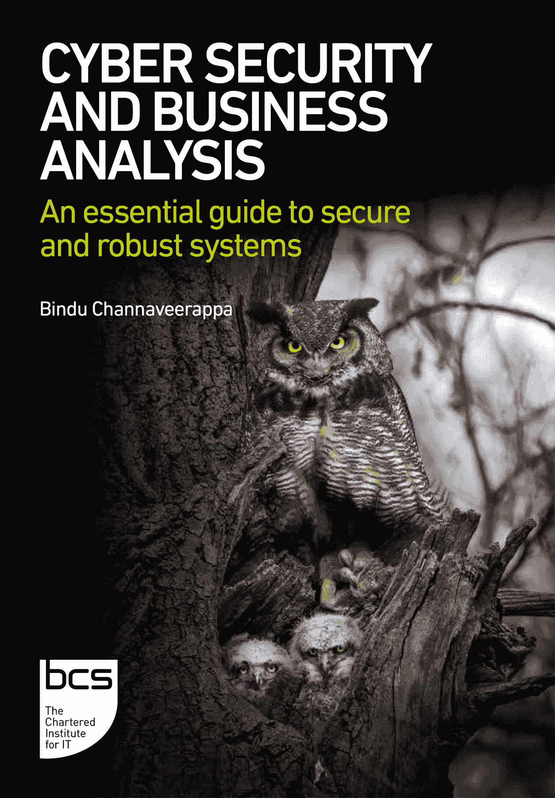

本书阐明了网络安全对业务分析师意味着什么，以及他们在工作中应如何考虑这一主题。书中贯穿始终的框架易于理解，并提供了一份全面的指南。本书包含大量实用建议，并通过贴切且愉快的轶事使其栩栩如生。对于任何希望了解更多并加深对网络安全理解和欣赏的业务分析师来说，这是一本必读之作。

## 推荐语

***Victoria Banner BA, BSc, CBAP***, 业务架构师，伦敦皇家集团
网络安全可能是一个枯燥的主题。Bindu Channaveerappa 取得了非凡的成就，她不仅让这一主题变得有趣，而且令人愉快，她以自己独特的方式看到了并解释了更广泛的商业背景。

***Nick de Voil MBCS, CITP, CBAP, CCA***, 董事，De Voil Consulting，IIBA UK 前主席，《用户体验基础》作者
*网络安全与业务分析* 既令人恐惧又令人安心——令人恐惧是因为我了解到事物可能以多么可怕的方式出错并且确实会出错，但也非常令人安心，因为 Bindu 提供了通过业务分析实现网络安全保护组织的实用方法。同样令人安心的是 Bindu 在整本书中穿插的故事和隐喻，[content]
# 网络安全与业务分析

本书阐明了网络安全对业务分析师意味着什么，以及他们在工作中应如何考虑这一主题。书中贯穿始终的框架易于理解，并提供了一份全面的指南。本书包含大量实用建议，并通过贴切且愉快的轶事使其栩栩如生。对于任何希望了解更多并加深对网络安全理解和欣赏的业务分析师来说，这是一本必读之作。

## 推荐语

***Victoria Banner BA, BSc, CBAP***, 业务架构师，伦敦皇家集团
网络安全可能是一个枯燥的主题。Bindu Channaveerappa 取得了非凡的成就，她不仅让这一主题变得有趣，而且令人愉快，她以自己独特的方式看到了并解释了更广泛的商业背景。

***Nick de Voil MBCS, CITP, CBAP, CCA***, 董事，De Voil Consulting，IIBA UK 前主席，《用户体验基础》作者
*网络安全与业务分析* 既令人恐惧又令人安心——令人恐惧是因为我了解到事物可能以多么可怕的方式出错并且确实会出错，但也非常令人安心，因为 Bindu 提供了通过业务分析实现网络安全保护组织的实用方法。同样令人安心的是 Bindu 在整本书中穿插的故事和隐喻，[content]
# 网络安全与业务分析

本书阐明了网络安全对业务分析师意味着什么，以及他们在工作中应如何考虑这一主题。书中贯穿始终的框架易于理解，并提供了一份全面的指南。本书包含大量实用建议，并通过贴切且愉快的轶事使其栩栩如生。对于任何希望了解更多并加深对网络安全理解和欣赏的业务分析师来说，这是一本必读之作。

## 推荐语

***Victoria Banner BA, BSc, CBAP***, 业务架构师，伦敦皇家集团
网络安全可能是一个枯燥的主题。Bindu Channaveerappa 取得了非凡的成就，她不仅让这一主题变得有趣，而且令人愉快，她以自己独特的方式看到了并解释了更广泛的商业背景。

***Nick de Voil MBCS, CITP, CBAP, CCA***, 董事，De Voil Consulting，IIBA UK 前主席，《用户体验基础》作者
*网络安全与业务分析* 既令人恐惧又令人安心——令人恐惧是因为我了解到事物可能以多么可怕的方式出错并且确实会出错，但也非常令人安心，因为 Bindu 提供了通过业务分析实现网络安全保护组织的实用方法。同样令人安心的是 Bindu 在整本书中穿插的故事和隐喻，[content]
# 网络安全与业务分析

本书阐明了网络安全对业务分析师意味着什么，以及他们在工作中应如何考虑这一主题。书中贯穿始终的框架易于理解，并提供了一份全面的指南。本书包含大量实用建议，并通过贴切且愉快的轶事使其栩栩如生。对于任何希望了解更多并加深对网络安全理解和欣赏的业务分析师来说，这是一本必读之作。

## 推荐语

***Victoria Banner BA, BSc, CBAP***, 业务架构师，伦敦皇家集团
网络安全可能是一个枯燥的主题。Bindu Channaveerappa 取得了非凡的成就，她不仅让这一主题变得有趣，而且令人愉快，她以自己独特的方式看到了并解释了更广泛的商业背景。

***Nick de Voil MBCS, CITP, CBAP, CCA***, 董事，De Voil Consulting，IIBA UK 前主席，《用户体验基础》作者
*网络安全与业务分析* 既令人恐惧又令人安心——令人恐惧是因为我了解到事物可能以多么可怕的方式出错并且确实会出错，但也非常令人安心，因为 Bindu 提供了通过业务分析实现网络安全保护组织的实用方法。同样令人安心的是 Bindu 在整本书中穿插的故事和隐喻，[content]
# 网络安全与业务分析

本书阐明了网络安全对业务分析师意味着什么，以及他们在工作中应如何考虑这一主题。书中贯穿始终的框架易于理解，并提供了一份全面的指南。本书包含大量实用建议，并通过贴切且愉快的轶事使其栩栩如生。对于任何希望了解更多并加深对网络安全理解和欣赏的业务分析师来说，这是一本必读之作。

## 推荐语

***Victoria Banner BA, BSc, CBAP***, 业务架构师，伦敦皇家集团
网络安全可能是一个枯燥的主题。Bindu Channaveerappa 取得了非凡的成就，她不仅让这一主题变得有趣，而且令人愉快，她以自己独特的方式看到了并解释了更广泛的商业背景。

***Nick de Voil MBCS, CITP, CBAP, CCA***, 董事，De Voil Consulting，IIBA UK 前主席，《用户体验基础》作者
*网络安全与业务分析* 既令人恐惧又令人安心——令人恐惧是因为我了解到事物可能以多么可怕的方式出错并且确实会出错，但也非常令人安心，因为 Bindu 提供了通过业务分析实现网络安全保护组织的实用方法。同样令人安心的是 Bindu 在整本书中穿插的故事和隐喻，[content]
# 网络安全与业务分析

本书阐明了网络安全对业务分析师意味着什么，以及他们在工作中应如何考虑这一主题。书中贯穿始终的框架易于理解，并提供了一份全面的指南。本书包含大量实用建议，并通过贴切且愉快的轶事使其栩栩如生。对于任何希望了解更多并加深对网络安全理解和欣赏的业务分析师来说，这是一本必读之作。

## 推荐语

***Victoria Banner BA, BSc, CBAP***, 业务架构师，伦敦皇家集团
网络安全可能是一个枯燥的主题。Bindu Channaveerappa 取得了非凡的成就，她不仅让这一主题变得有趣，而且令人愉快，她以自己独特的方式看到了并解释了更广泛的商业背景。

***Nick de Voil MBCS, CITP, CBAP, CCA***, 董事，De Voil Consulting，IIBA UK 前主席，《用户体验基础》作者
*网络安全与业务分析* 既令人恐惧又令人安心——令人恐惧是因为我了解到事物可能以多么可怕的方式出错并且确实会出错，但也非常令人安心，因为 Bindu 提供了通过业务分析实现网络安全保护组织的实用方法。同样令人安心的是 Bindu 在整本书中穿插的故事和隐喻，[content]
# 网络安全与业务分析

本书阐明了网络安全对业务分析师的意义及如何在工作中考虑该主题。书中框架易于理解且全面，包含大量实用建议并以贴切有趣的轶事呈现。对于希望加深对网络安全理解和欣赏的业务分析师而言必读。

## 推荐语

***Victoria Banner BA, BSc, CBAP***, 业务架构师，伦敦皇家集团
网络安全可能枯燥。Bindu Channaveerappa 以独特方式呈现更广商业背景，使其不仅有趣且令人愉快。

***Nick de Voil MBCS, CITP, CBAP, CCA***, 董事，De Voil Consulting，IIBA UK 前主席，《用户体验基础》作者
*网络安全与业务分析* 既令人恐惧又安心——恐惧在于了解到事物可能以可怕方式出错且确实会出错，安心在于 Bindu 提供了通过业务分析实现网络安全保护组织的实用方法。Bindu 书中穿插的故事和隐喻也令人安心，[content]
# 网络安全与业务分析

本书阐明了网络安全对业务分析师意味着什么，以及他们在工作中应如何考虑这一主题。书中贯穿始终的框架易于理解，并提供了一份全面的指南。本书包含大量实用建议，并通过贴切且愉快的轶事使其栩栩如生。对于任何希望了解更多并加深对网络安全理解和欣赏的业务分析师来说，这是一本必读之作。

## 推荐语

***Victoria Banner BA, BSc, CBAP***, 业务架构师，伦敦皇家集团
网络安全可能是一个枯燥的主题。Bindu Channaveerappa 取得了非凡的成就，她不仅让这一主题变得有趣，而且令人愉快，她以自己独特的方式看到了并解释了更广泛的商业背景。

***Nick de Voil MBCS, CITP, CBAP, CCA***, 董事，De Voil Consulting，IIBA UK 前主席，《用户体验基础》作者
*网络安全与业务分析* 既令人恐惧又令人安心——令人恐惧是因为我了解到事物可能以多么可怕的方式出错并且确实会出错，但也非常令人安心，因为 Bindu 提供了通过业务分析实现网络安全保护组织的实用方法。同样令人安心的是 Bindu 在整本书中穿插的故事和隐喻，[content]
# 网络安全与业务分析

本书阐明网络安全对业务分析师的意义及工作中的考量方式。框架易懂且全面，包含大量实用建议并以贴切有趣的轶事呈现，是希望加深网络安全理解的业务分析师必读。

## 推荐语

***Victoria Banner BA, BSc, CBAP***, 业务架构师，伦敦皇家集团
网络安全常显枯燥。Bindu Channaveerappa 以独特方式呈现更广商业背景，使主题既有趣又愉快。

***Nick de Voil MBCS, CITP, CBAP, CCA***, 董事，De Voil Consulting，IIBA UK 前主席，《用户体验基础》作者
*网络安全与业务分析* 既令人恐惧又安心。恐惧在于了解到事物可能以可怕方式出错且确实会出错，安心在于 Bindu 提供了通过业务分析保护组织的实用方法。书中故事与隐喻也令人安心，[content]
# 网络安全与业务分析

本书阐明网络安全对业务分析师的意义及工作中的考量方式。框架易懂且全面，包含大量实用建议并以贴切有趣的轶事呈现，是希望加深网络安全理解的业务分析师必读。

## 推荐语

***Victoria Banner BA, BSc, CBAP***, 业务架构师，伦敦皇家集团
网络安全常显枯燥。Bindu Channaveerappa 以独特方式呈现更广商业背景，使主题既有趣又愉快。

***Nick de Voil MBCS, CITP, CBAP, CCA***, 董事，De Voil Consulting，IIBA UK 前主席，《用户体验基础》作者
*网络安全与业务分析* 既令人恐惧又安心。恐惧在于了解到事物可能以可怕方式出错且确实会出错，安心在于 Bindu 提供了通过业务分析保护组织的实用方法。书中故事与隐喻也令人安心，[content]
# 网络安全与业务分析

本书阐明网络安全对业务分析师的意义及工作中的考量方式。框架易懂且全面，包含大量实用建议并以贴切有趣的轶事呈现，是希望加深网络安全理解的业务分析师必读。

## 推荐语

***Victoria Banner BA, BSc, CBAP***, 业务架构师，伦敦皇家集团
网络安全常显枯燥。Bindu Channaveerappa 以独特方式呈现更广商业背景，使主题既有趣又愉快。

***Nick de Voil MBCS, CITP, CBAP, CCA***, 董事，De Voil Consulting，IIBA UK 前主席，《用户体验基础》作者
*网络安全与业务分析* 既令人恐惧又安心。恐惧在于了解到事物可能以可怕方式出错且确实会出错，安心在于 Bindu 提供了通过业务分析保护组织的实用方法。书中故事与隐喻也令人安心，[content]
# 网络安全与业务分析

本书阐明网络安全对业务分析师的意义及工作中的考量方式。框架易懂且全面，包含大量实用建议并以贴切有趣的轶事呈现，是希望加深网络安全理解的业务分析师必读。

## 推荐语

***Victoria Banner BA, BSc, CBAP***, 业务架构师，伦敦皇家集团
网络安全常显枯燥。Bindu Channaveerappa 以独特方式呈现更广商业背景，使主题既有趣又愉快。

***Nick de Voil MBCS, CITP, CBAP, CCA***, 董事，De Voil Consulting，IIBA UK 前主席，《用户体验基础》作者
*网络安全与业务分析* 既令人恐惧又安心。恐惧在于了解到事物可能以可怕方式出错且确实会出错，安心在于 Bindu 提供了通过业务分析保护组织的实用方法。书中故事与隐喻也令人安心，[content]
# 网络安全与业务分析

本书阐明网络安全对业务分析师的意义及工作中的考量方式。框架易懂且全面，包含大量实用建议并以贴切有趣的轶事呈现，是希望加深网络安全理解的业务分析师必读。

## 推荐语

***Victoria Banner BA, BSc, CBAP***, 业务架构师，伦敦皇家集团
网络安全常显枯燥。Bindu Channaveerappa 以独特方式呈现更广商业背景，使主题既有趣又愉快。

***Nick de Voil MBCS, CITP, CBAP, CCA***, 董事，De Voil Consulting，IIBA UK 前主席，《用户体验基础》作者
*网络安全与业务分析* 既令人恐惧又安心。恐惧在于了解到事物可能以可怕方式出错且确实会出错，安心在于 Bindu 提供了通过业务分析保护组织的实用方法。书中故事与隐喻也很有帮助，[content]
# 网络安全与业务分析

本书阐明网络安全对业务分析师的意义及工作中的考量方式。框架易懂且全面，包含大量实用建议并以贴切有趣的轶事呈现，是希望加深网络安全理解的业务分析师必读。

## 推荐语

***Victoria Banner BA, BSc, CBAP***, 业务架构师，伦敦皇家集团
网络安全常显枯燥。Bindu Channaveerappa 以独特方式呈现更广商业背景，使主题既有趣又愉快。

***Nick de Voil MBCS, CITP, CBAP, CCA***, 董事，De Voil Consulting，IIBA UK 前主席，《用户体验基础》作者
*网络安全与业务分析* 既令人恐惧又安心。恐惧在于了解到事物可能以可怕方式出错且确实会出错，安心在于 Bindu 提供了通过业务分析保护组织的实用方法。书中故事与隐喻也很有帮助。

***Dr Penny Pullan***, 《业务分析与领导力》编辑及 Making Projects Work Ltd 顾问
Bindu 有力地提升了 BA 专业人员在网络安全方面发挥关键作用的意识。[content]
# 网络安全与业务分析

本书阐明网络安全对业务分析师的意义及工作中的考量方式。框架易懂且全面，包含大量实用建议并以贴切有趣的轶事呈现，是希望加深网络安全理解的业务分析师必读。

## 推荐语

***Victoria Banner BA, BSc, CBAP***, 业务架构师，伦敦皇家集团
网络安全常显枯燥。Bindu Channaveerappa 以独特方式呈现更广商业背景，使主题既有趣又愉快。

***Nick de Voil MBCS, CITP, CBAP, CCA***, 董事，De Voil Consulting，IIBA UK 前主席，《用户体验基础》作者
*网络安全与业务分析* 既令人恐惧又安心。恐惧在于了解到事物可能以可怕方式出错且确实会出错，安心在于 Bindu 提供了通过业务分析保护组织的实用方法。书中故事与隐喻也很有帮助，[content]
# 网络安全与业务分析

本书阐明网络安全对业务分析师的意义及工作中的考量方式。框架易懂且全面，包含大量实用建议并以贴切有趣的轶事呈现，是希望加深网络安全理解的业务分析师必读。

## 推荐语

***Victoria Banner BA, BSc, CBAP***, 业务架构师，伦敦皇家集团
网络安全常显枯燥。Bindu Channaveerappa 以独特方式呈现更广商业背景，使主题既有趣又愉快。

***Nick de Voil MBCS, CITP, CBAP, CCA***, 董事，De Voil Consulting，IIBA UK 前主席，《用户体验基础》作者
*网络安全与业务分析* 既令人恐惧又安心。Bindu 提供了通过业务分析保护组织的实用方法，书中故事与隐喻很有帮助。

***Dr Penny Pullan***, 《业务分析与领导力》编辑及 Making Projects Work Ltd 顾问
Bindu 强调了 BA 专业人员在网络安全中的关键作用。书中在已有知识上展开，提供工具和故事以[content]
# 网络安全与业务分析

本书阐明网络安全对业务分析师的意义及工作中的考量方式。框架易懂且全面，包含大量实用建议并以贴切有趣的轶事呈现，是希望加深网络安全理解的业务分析师必读。

## 推荐语

***Victoria Banner BA, BSc, CBAP***, 业务架构师，伦敦皇家集团
网络安全常显枯燥。Bindu Channaveerappa 以独特方式呈现更广商业背景，使主题既有趣又愉快。

***Nick de Voil MBCS, CITP, CBAP, CCA***, 董事，De Voil Consulting，IIBA UK 前主席，《用户体验基础》作者
*网络安全与业务分析* 既令人恐惧又安心。Bindu 提供了通过业务分析保护组织的实用方法，书中故事与隐喻很有帮助。

***Dr Penny Pullan***, 《业务分析与领导力》编辑及 Making Projects Work Ltd 顾问
Bindu 强调了 BA 专业人员在网络安全中的关键作用。书中在已有知识上展开，提供工具和故事以[content]
# 网络安全与业务分析

本书阐明网络安全对业务分析师的意义及工作中的考量方式。框架易懂且全面，包含大量实用建议并以贴切有趣的轶事呈现，是希望加深网络安全理解的业务分析师必读。

## 推荐语

***Victoria Banner BA, BSc, CBAP***, 业务架构师，伦敦皇家集团
网络安全常显枯燥。Bindu Channaveerappa 以独特方式呈现更广商业背景，使主题既有趣又愉快。

***Nick de Voil MBCS, CITP, CBAP, CCA***, 董事，De Voil Consulting，IIBA UK 前主席，《用户体验基础》作者
*网络安全与业务分析* 既令人恐惧又安心。Bindu 提供了通过业务分析保护组织的实用方法，书中故事与隐喻很有帮助。

***Dr Penny Pullan***, 《业务分析与领导力》编辑及 Making Projects Work Ltd 顾问
Bindu 强调了 BA 专业人员在网络安全中的关键作用。书中在已有知识上展开，提供工具和故事以[content]
# 网络安全与业务分析

本书阐明网络安全对业务分析师的意义及工作中的考量方式。框架易懂且全面，包含大量实用建议并以贴切有趣的轶事呈现，是希望加深网络安全理解的业务分析师必读。

## 推荐语

***Victoria Banner BA, BSc, CBAP***, 业务架构师，伦敦皇家集团
网络安全常显枯燥。Bindu Channaveerappa 以独特方式呈现更广商业背景，使主题既有趣又愉快。

***Nick de Voil MBCS, CITP, CBAP, CCA***, 董事，De Voil Consulting，IIBA UK 前主席，《用户体验基础》作者
*网络安全与业务分析* 既令人恐惧又安心。Bindu 提供了通过业务分析保护组织的实用方法，书中故事与隐喻很有帮助。

***Dr Penny Pullan***, 《业务分析与领导力》编辑及 Making Projects Work Ltd 顾问
Bindu 强调了 BA 专业人员在网络安全中的关键作用。书中基于已有知识展开，提供工具和故事用于[content]
# 网络安全与业务分析

本书阐明网络安全对业务分析师的意义及工作中的考量方式。框架易懂且全面，包含大量实用建议并以贴切有趣的轶事呈现，是希望加深网络安全理解的业务分析师必读。

## 推荐语

***Victoria Banner BA, BSc, CBAP***, 业务架构师，伦敦皇家集团
网络安全常显枯燥。Bindu Channaveerappa 以独特方式呈现更广商业背景，使主题既有趣又愉快。

***Nick de Voil MBCS, CITP, CBAP, CCA***, 董事，De Voil Consulting，IIBA UK 前主席，《用户体验基础》作者
*网络安全与业务分析* 既令人恐惧又安心。Bindu 提供了通过业务分析保护组织的实用方法，书中故事与隐喻很有帮助。

***Dr Penny Pullan***, 《业务分析与领导力》编辑及 Making Projects Work Ltd 顾问
Bindu 强调了 BA 专业人员在网络安全中的关键作用。书中基于已有知识展开，提供工具和故事用于[content]
# 网络安全与业务分析

本书阐明网络安全对业务分析师的意义及工作中的考量方式。框架易懂且全面，包含大量实用建议并以贴切有趣的轶事呈现，是希望加深网络安全理解的业务分析师必读。

## 推荐语

***Victoria Banner BA, BSc, CBAP***, 业务架构师，伦敦皇家集团
网络安全常显枯燥。Bindu Channaveerappa 以独特方式呈现更广商业背景，使主题既有趣又愉快。

***Nick de Voil MBCS, CITP, CBAP, CCA***, 董事，De Voil Consulting，IIBA UK 前主席，《用户体验基础》作者
*网络安全与业务分析* 既令人恐惧又安心。Bindu 提供了通过业务分析保护组织的实用方法，书中故事与隐喻很有帮助。

***Filip Hendrickx***, 创始人及创新 BA，altershape.eu
本书将业务分析角色与网络安全及 BABOK 相连，提供框架和工具。[content]
# 网络安全与业务分析

本书阐明网络安全对业务分析师的意义及工作中的考量方式。框架易懂且全面，包含大量实用建议并以贴切有趣的轶事呈现，是希望加深网络安全理解的业务分析师必读。

## 推荐语

***Victoria Banner BA, BSc, CBAP***, 业务架构师，伦敦皇家集团
网络安全常显枯燥。Bindu Channaveerappa 以独特方式呈现更广商业背景，使主题既有趣又愉快。

***Nick de Voil MBCS, CITP, CBAP, CCA***, 董事，De Voil Consulting，IIBA UK 前主席，《用户体验基础》作者
*网络安全与业务分析* 既令人恐惧又安心。Bindu 提供了通过业务分析保护组织的实用方法，书中故事与隐喻很有帮助。

***Dr Penny Pullan***, 编辑及顾问
Bindu 强调 BA 专业人员在网络安全中的关键作用。书中基于已有知识展开，提供工具和故事。

***Filip Hendrickx***, 创始人及创新 BA，altershape.eu
本书将业务分析角色与网络安全及 BABOK 相连，提供框架和工具。[content]
# 网络安全与业务分析

本书阐明网络安全对业务分析师的意义及工作中的考量方式。框架易懂且全面，包含大量实用建议并以贴切有趣的轶事呈现，是希望加深网络安全理解的业务分析师必读。

## 推荐语

***Victoria Banner BA, BSc, CBAP***, 业务架构师，伦敦皇家集团
网络安全常显枯燥。Bindu Channaveerappa 以独特方式呈现更广商业背景，使主题既有趣又愉快。

***Nick de Voil MBCS, CITP, CBAP, CCA***, 董事，De Voil Consulting，IIBA UK 前主席，《用户体验基础》作者
*网络安全与业务分析* 既令人恐惧又安心。Bindu 提供了通过业务分析保护组织的实用方法，书中故事与隐喻很有帮助。

***Dr Penny Pullan***, 编辑及顾问
Bindu 强调 BA 专业人员在网络安全中的关键作用。书中基于已有知识展开，提供工具和故事。

***Filip Hendrickx***, 创始人及创新 BA，altershape.eu
本书将业务分析角色与网络安全及 BABOK 相连，提供框架和工具。

***Angela Wick***, BA-Cube 创始人，LinkedIn Learning 讲师
本书是业务分析师保护组织免受网络攻击风险的重要入门读物。

***Kevin Brennan***, 乔治布朗学院教授及业务架构师
Bindu 提供了急需的书籍，将业务分析师置于解决现代企业网络安全挑战的中心。

***Mark Cross***, 主任业务分析师，Envista Consulting Ltd
Bindu 以讲故事和隐喻的方式深入[content]
# 网络安全与业务分析

本书阐明网络安全对业务分析师的意义及工作中的考量方式。框架易懂且全面，包含大量实用建议并以贴切有趣的轶事呈现，是希望加深网络安全理解的业务分析师必读。

## 推荐语

***Victoria Banner BA, BSc, CBAP***, 业务架构师，伦敦皇家集团
网络安全常显枯燥。Bindu Channaveerappa 以独特方式呈现更广商业背景，使主题既有趣又愉快。

***Nick de Voil MBCS, CITP, CBAP, CCA***, 董事，De Voil Consulting，IIBA UK 前主席，《用户体验基础》作者
*网络安全与业务分析* 既令人恐惧又安心。Bindu 提供了通过业务分析保护组织的实用方法，书中故事与隐喻很有帮助。

***Dr Penny Pullan***, 编辑及顾问
Bindu 强调 BA 专业人员在网络安全中的关键作用。书中基于已有知识展开，提供工具和故事。

***Filip Hendrickx***, 创始人及创新 BA，altershape.eu
本书将业务分析角色与网络安全及 BABOK 相连，提供框架和工具。

***Angela Wick***, BA-Cube 创始人，LinkedIn Learning 讲师
本书是业务分析师保护组织免受网络攻击风险的重要入门读物。

***Kevin Brennan***, 乔治布朗学院教授及业务架构师
Bindu 提供了急需的书籍，将业务分析师置于解决现代企业网络安全挑战的中心。

***Mark Cross***, 主任业务分析师，Envista Consulting Ltd
Bindu 以讲故事和隐喻的方式[content]
# 网络安全与业务分析

本书阐明网络安全对业务分析师的意义及工作中的考量方式。框架易懂且全面，包含大量实用建议并以贴切有趣的轶事呈现，是希望加深网络安全理解的业务分析师必读。

## 推荐语

***Victoria Banner BA, BSc, CBAP***, 业务架构师，伦敦皇家集团
网络安全常显枯燥。Bindu Channaveerappa 以独特方式呈现更广商业背景，使主题既有趣又愉快。

***Nick de Voil MBCS, CITP, CBAP, CCA***, 董事，De Voil Consulting，IIBA UK 前主席，《用户体验基础》作者
*网络安全与业务分析* 既令人恐惧又安心。Bindu 提供了通过业务分析保护组织的实用方法，书中故事与隐喻很有帮助。

***Dr Penny Pullan***, 编辑及顾问
Bindu 强调 BA 专业人员在网络安全中的关键作用。书中基于已有知识展开，提供工具和故事。

***Filip Hendrickx***, 创始人及创新 BA，altershape.eu
本书将业务分析角色与网络安全及 BABOK 相连，提供框架和工具。

***Angela Wick***, BA-Cube 创始人，LinkedIn Learning 讲师
本书是业务分析师保护组织免受网络攻击风险的重要入门读物。

***Kevin Brennan***, 乔治布朗学院教授及业务架构师
Bindu 提供了急需的书籍，将业务分析师置于解决现代企业网络安全挑战的中心。

***Mark Cross***, 主任业务分析师，Envista Consulting Ltd
Bindu 以讲故事和隐喻的方式[content]
# 网络安全与业务分析

本书阐明网络安全对业务分析师的意义及工作中的考量方式。框架易懂且全面，包含大量实用建议并以贴切有趣的轶事呈现，是希望加深网络安全理解的业务分析师必读。

## 推荐语

***Victoria Banner BA, BSc, CBAP***, 业务架构师，伦敦皇家集团
网络安全常显枯燥。Bindu 以独特方式呈现更广商业背景，使主题既有趣又愉快。

***Nick de Voil MBCS, CITP, CBAP, CCA***, 董事，De Voil Consulting，IIBA UK 前主席，《用户体验基础》作者
*网络安全与业务分析* 既令人恐惧又安心。Bindu 提供了通过业务分析保护组织的实用方法。

***Dr Penny Pullan***, 编辑及顾问
Bindu 强调 BA 专业人员在网络安全中的关键作用。书中提供工具和故事。

***Filip Hendrickx***, 创始人及创新 BA，altershape.eu
本书将业务分析与网络安全及 BABOK 相连，提供框架和工具。

***Angela Wick***, BA-Cube 创始人，LinkedIn Learning 讲师
本书是业务分析师防范网络攻击的重要入门读物。

***Kevin Brennan***, 乔治布朗学院教授及业务架构师
Bindu 将业务分析师置于解决企业网络安全挑战的中心。

***Mark Cross***, 主任业务分析师，Envista Consulting Ltd
Bindu 以讲故事和隐喻的方式提升网络安全意识。

***Fabricio Laguna***, 国际业务分析协会高级顾问
*网络安全与业务分析* 展示了业务分析师如何助力网络安全进程。

***Martin Pendlebury***, 年轻业务分析师
本书提供网络安全框架，帮助业务分析师建立安全思维。

***Iurii Gomon***, 创始人，The Passionate Business Analyst
本书将网络安全置于业务分析视角，赋能 BA 成为网络安全倡导者。

***Richard Harrison***, 首席顾问，Herd Consulting
*网络安全与业务分析* 充满可操作知识，对所有读者都有价值。

***Kudzai Muchenje***, 业务分析师，SanlamAllianz

## BCS，英国特许信息技术协会

BCS，英国特许信息技术协会，致力于让 IT 服务社会。我们利用网络力量[content]
# 网络安全与业务分析

本书阐明网络安全对业务分析师的意义及工作中的考量方式。框架易懂且全面，包含大量实用建议并以贴切有趣的轶事呈现，是希望加深网络安全理解的业务分析师必读。

## 推荐语

***Victoria Banner BA, BSc, CBAP***, 业务架构师，伦敦皇家集团
网络安全常显枯燥。Bindu 以独特方式呈现更广商业背景，使主题既有趣又愉快。

***Nick de Voil MBCS, CITP, CBAP, CCA***, 董事，De Voil Consulting，IIBA UK 前主席，《用户体验基础》作者
*网络安全与业务分析* 既令人恐惧又安心。Bindu 提供了通过业务分析保护组织的实用方法。

***Dr Penny Pullan***, 编辑及顾问
Bindu 强调 BA 专业人员在网络安全中的关键作用。书中提供工具和故事。

***Filip Hendrickx***, 创始人及创新 BA，altershape.eu
本书将业务分析与网络安全及 BABOK 相连，提供框架和工具。

***Angela Wick***, BA-Cube 创始人，LinkedIn Learning 讲师
本书是业务分析师防范网络攻击的重要入门读物。

***Kevin Brennan***, 乔治布朗学院教授及业务架构师
Bindu 将业务分析师置于解决企业网络安全挑战的中心。

***Mark Cross***, 主任业务分析师，Envista Consulting Ltd
Bindu 以讲故事和隐喻的方式提升网络安全意识。

***Fabricio Laguna***, 国际业务分析协会高级顾问
*网络安全与业务分析* 展示了业务分析师如何助力网络安全进程。

***Martin Pendlebury***, 年轻业务分析师
本书提供网络安全框架，帮助业务分析师建立安全思维。

***Iurii Gomon***, 创始人，The Passionate Business Analyst
本书将网络安全置于业务分析视角，赋能 BA 成为网络安全倡导者。

***Richard Harrison***, 首席顾问，Herd Consulting
*网络安全与业务分析* 充满可操作知识，对所有读者都有价值。

***Kudzai Muchenje***, 业务分析师，SanlamAllianz

## BCS，英国特许信息技术协会

BCS，英国特许信息技术协会，致力于让 IT 服务社会。我们利用网络力量[content]
# 网络安全与业务分析

本书阐明网络安全对业务分析师的意义及工作中的考量方式。框架易懂且全面，包含大量实用建议并以贴切有趣的轶事呈现，是希望加深网络安全理解的业务分析师必读。

## 推荐语

***Victoria Banner BA, BSc, CBAP***, 业务架构师，伦敦皇家集团
网络安全常显枯燥。Bindu 以独特方式呈现更广商业背景，使主题既有趣又愉快。

***Nick de Voil MBCS, CITP, CBAP, CCA***, 董事，De Voil Consulting，IIBA UK 前主席，《用户体验基础》作者
*网络安全与业务分析* 既令人恐惧又安心。Bindu 提供了通过业务分析保护组织的实用方法。

***Dr Penny Pullan***, 编辑及顾问
Bindu 强调 BA 专业人员在网络安全中的关键作用。书中提供工具和故事。

***Filip Hendrickx***, 创始人及创新 BA，altershape.eu
本书将业务分析与网络安全及 BABOK 相连，提供框架和工具。

***Angela Wick***, BA-Cube 创始人，LinkedIn Learning 讲师
本书是业务分析师防范网络攻击的重要入门读物。

***Kevin Brennan***, 乔治布朗学院教授及业务架构师
Bindu 将业务分析师置于解决企业网络安全挑战的中心。

***Mark Cross***, 主任业务分析师，Envista Consulting Ltd
Bindu 以讲故事和隐喻的方式提升网络安全意识。

***Fabricio Laguna***, 国际业务分析协会高级顾问
*网络安全与业务分析* 展示了业务分析师如何助力网络安全进程。

***Martin Pendlebury***, 年轻业务分析师
本书提供网络安全框架，帮助业务分析师建立安全思维。

***Iurii Gomon***, 创始人，The Passionate Business Analyst
本书将网络安全置于业务分析视角，赋能 BA 成为网络安全倡导者。

***Richard Harrison***, 首席顾问，Herd Consulting
*网络安全与业务分析* 充满可操作知识，对所有读者都有价值。

***Kudzai Muchenje***, 业务分析师，SanlamAllianz

## BCS，英国特许信息技术协会

BCS 致力于让 IT 服务社会。我们利用网络力量[content]
# 网络安全与业务分析

本书阐明网络安全对业务分析师的意义及工作中的考量方式。框架易懂且全面，包含大量实用建议并以贴切有趣的轶事呈现，是希望加深网络安全理解的业务分析师必读。

## 推荐语

***Victoria Banner BA, BSc, CBAP***, 业务架构师，伦敦皇家集团
网络安全常显枯燥。Bindu 以独特方式呈现更广商业背景，使主题既有趣又愉快。

***Nick de Voil MBCS, CITP, CBAP, CCA***, 董事，De Voil Consulting，IIBA UK 前主席，《用户体验基础》作者
*网络安全与业务分析* 既令人恐惧又安心。Bindu 提供了通过业务分析保护组织的实用方法。

***Dr Penny Pullan***, 编辑及顾问
Bindu 强调 BA 专业人员在网络安全中的关键作用。书中提供工具和故事。

***Filip Hendrickx***, 创始人及创新 BA，altershape.eu
本书将业务分析与网络安全及 BABOK 相连，提供框架和工具。

***Angela Wick***, BA-Cube 创始人，LinkedIn Learning 讲师
本书是业务分析师防范网络攻击的重要入门读物。

***Kevin Brennan***, 乔治布朗学院教授及业务架构师
Bindu 将业务分析师置于解决企业网络安全挑战的中心。

***Mark Cross***, 主任业务分析师，Envista Consulting Ltd
Bindu 以讲故事和隐喻的方式提升网络安全意识。

***Fabricio Laguna***, 国际业务分析协会高级顾问
*网络安全与业务分析* 展示了业务分析师如何助力网络安全进程。

***Martin Pendlebury***, 年轻业务分析师
本书提供网络安全框架，帮助业务分析师建立安全思维。

***Iurii Gomon***, 创始人，The Passionate Business Analyst
本书将网络安全置于业务分析视角，赋能 BA 成为网络安全倡导者。

***Richard Harrison***, 首席顾问，Herd Consulting
*网络安全与业务分析* 充满可操作知识，对所有读者都有价值。

***Kudzai Muchenje***, 业务分析师，SanlamAllianz

## BCS，英国特许信息技术协会

BCS 致力于让 IT 服务社会。我们利用网络[content]
# 网络安全与业务分析

本书阐明网络安全对业务分析师的意义及工作中的考量方式。框架易懂且全面，包含大量实用建议并以贴切有趣的轶事呈现，是希望加深网络安全理解的业务分析师必读。

## 推荐语

***Victoria Banner BA, BSc, CBAP***, 业务架构师，伦敦皇家集团
网络安全常显枯燥。Bindu 以独特方式呈现更广商业背景，使主题既有趣又愉快。

***Nick de Voil MBCS, CITP, CBAP, CCA***, 董事，De Voil Consulting，IIBA UK 前主席，《用户体验基础》作者
*网络安全与业务分析* 既令人恐惧又安心。Bindu 提供了通过业务分析保护组织的实用方法。

***Dr Penny Pullan***, 编辑及顾问
Bindu 强调 BA 专业人员在网络安全中的关键作用。书中提供工具和故事。

***Filip Hendrickx***, 创始人及创新 BA，altershape.eu
本书将业务分析与网络安全及 BABOK 相连，提供框架和工具。

***Angela Wick***, BA-Cube 创始人，LinkedIn Learning 讲师
本书是业务分析师防范网络攻击的重要入门读物。

***Kevin Brennan***, 乔治布朗学院教授及业务架构师
Bindu 将业务分析师置于解决企业网络安全挑战的中心。

***Mark Cross***, 主任业务分析师，Envista Consulting Ltd
Bindu 以讲故事和隐喻的方式提升网络安全意识。

***Fabricio Laguna***, 国际业务分析协会高级顾问
*网络安全与业务分析* 展示了业务分析师如何助力网络安全进程。

***Martin Pendlebury***, 年轻业务分析师
本书提供网络安全框架，帮助业务分析师建立安全思维。

***Iurii Gomon***, 创始人，The Passionate Business Analyst
本书将网络安全置于业务分析视角，赋能 BA 成为网络安全倡导者。

***Richard Harrison***, 首席顾问，Herd Consulting
*网络安全与业务分析* 充满可操作知识，对所有读者都有价值。

***Kudzai Muchenje***, 业务分析师，SanlamAllianz

## BCS，英国特许信息技术协会

## 出版者致谢

审阅者：Martin Pendlebury 和 Aubrey Kudzai Muchenje

出版者：Ian Borthwick

委约编辑：Heather Wood

生产经理：Florence Leroy

项目经理：Sunrise Setting Ltd

复制编辑：The Business Blend Ltd

校对：Barbara Eastman

索引：David Gaskell

封面设计：Alex Wright

封面图片：istock/lavin photography

销售总监：Charles Rumball

由 Lapiz Digital Services，Chennai，印度排版

## 致谢

*献给我母亲，她对学习的奉献一直至今都是我不断的灵感来源。她对教育的承诺在我心中 instilled 了终身学习者的价值。*

*献给我父亲，他无畏地探索未知领域的做法教会了我以勇气和决心拥抱未知的重要性。*

*献给我四个坚强的支柱 Kiran、Ravi、Ronit 和 Rachit，他们坚定不移的支持和鼓励始终让我保持脚踏实地和稳定。*

*献给我亲爱的朋友 Terry，他在这一旅程中的友谊和专业知识弥足珍贵。*

## 作者

**Bindu Channaveerappa** 是一名业务分析顾问，对业务分析的一切充满热情。认识到网络安全分析的迫切需求，Bindu 热情倡导将网络安全整合到主流业务分析实践中，并在该领域做出了重要贡献。她共同撰写了国际业务分析协会（IIBA®）的网络安全认证（CCA）课程大纲，并为 CCA 和认证业务分析专业人员（CBAP）认证塑造了考试题目，为 IIBA 标准和 IIBA 数字资产的发展做出了贡献。

Bindu 在国际会议和在线平台上分享业务分析和网络安全的见解。

在她的职业追求之外，Bindu 担任 IIBA 欧洲、中东和非洲地区总监，并曾担任 IIBA 英国分会的董事之一。此外，Bindu 还将时间奉献给 Brahma Kumaris 世界精神大学，倡导一种促进全球范围内整体人类福祉的精神生活方式。

## 前言

确保组织资产安全，特别是数据和其他机密信息的安全，多年来一直是人们关注的问题。随着对这些资产的在线访问增加以及技术环境复杂性的提升，这一需求已变得势在必行。然而，在追求技术措施的过程中，诸如理解网络安全背景、进行详细调查和分析、以及确定应对网络安全威胁的相关行动等关键活动往往被忽视。此外，这些关键分析活动需要广泛的知识和技能。

关于网络安全及其保护组织免受威胁的必要性，已有大量论述。太多的关注仅集中在特定的在线威胁上，回避了更广泛的环境和维度，在这些环境和维度中，其他安全威胁可能被利用且也需要采取行动。在不了解特定组织背景和需要保护的资产性质的情况下就急于采用保护性解决方案，可能导致行动无关、过度或不足。

*Cyber Security and Business Analysis* 将业务分析置于成功的网络安全战略的核心。它解释了业务分析是确保组织能够识别、分析和防范网络安全威胁的关键学科。所提供的指导倡导采用整体方法，并使不同类型的资产、所面临威胁的性质以及所需的安全级别保持一致。业务分析师运用分析性思维，专注于理解问题的根本原因、质疑假设并挖掘详细需求。他们理解非功能性需求的重要性以及需要对其进行详细分析，而不仅仅是 superficial 地浏览。没有这种深度，可能实施不当甚至不足的安全措施，从而使资产面临风险。

# 序言

Bindu Channaveerappa 多年来一直在网络安全领域进行研究并应用相关技术和框架，并且作为一名执业业务分析师，她深知访问、安全和保护需求可能被忽视或分析不充分。在本书中，她提供了丰富的框架、参考资料和技术，每一项都支持业务分析师为其组织提供最重要服务之一。她强调风险评估的重要性，以及在评估风险时避免偏见的必要性，以确保网络安全政策和应对措施的相关性和适用性。她还确保突出人的因素，阐明理解不仅是协作利益相关者，而且是意图损害组织及其资产的网络恶意行为者的动机的重要性。关键的是，她指出了网络安全战略的财务影响，建议包含业务案例要素，以阐明财务影响并确保提出网络安全建议的理由。

业务分析和网络安全框架以及本书中分享的技术非常需要扩展业务分析工具包，帮助业务分析师确保其组织获得最相关的建议，并使组织领导者能够就网络安全保护做出明智的决策。本书为所有致力于保护组织免受网络威胁、确保组织资产免受滥用、损害或破坏、并构建安全稳健系统的业务变革和 IT 专业人员提供了宝贵的指导。

**Dr Debra Paul**

首席执行官 AssistKD

## 致谢

本书若没有众多个人和业务分析社区的不可思议的支持和鼓励就不可能实现。

首先，我要向 Janice McNamara 表示最深切的感谢，她在我自己之前就看到了我在这本书方面的潜力，并在我心中种下了最终成长为这个项目的种子。您对我的信任一直是指引我的明灯，我永远感激您的远见和鼓励。

我还要感谢在写作过程中提供宝贵反馈的敬业审阅者。Aubrey Kudzai Muchenje 和 Martin Pendlebury——你们的见解和建议对塑造最终手稿至关重要，我感谢你们的时间和努力。

我衷心感谢所有为本书提供支持的声音的人：Adrian Reed, Angela Wick, Fabricio Laguna, Filip Hendrickx, Kevin Brennan, Aubrey Kudzai Muchenje, Iurii Gomon, Mark Cross, Martin Pendlebury, Nick de Voil, Dr Penny Pullan, Richard Harrison 和 Victoria Banner。你们的言语和支持增加了显著的价值和可信度。Debra Paul，感谢您宝贵的反馈、信任和认可。

特别感谢 Heather Wood 在我最意想不到的时候联系我谈论撰写这本书，并在整个旅程中给予我坚定不移的支持。您的耐心、理解和鼓励对于将这个项目完成至关重要。我还要感谢 Ian Borthwick、Florence Leroy 和 Sharon Nickels 的出版专业知识。

最后，感谢 Brahma Kumaris 精神组织，他们在我的人生旅程中给予了巨大的帮助，用我一路收集到的无价智慧丰富了我的生活。正是我现在将这份见解和经验的财富注入到这一倡议的核心。

感谢大家成为这段旅程的一部分。你们的鼓励和热情一直是这一倡议的持续动力源泉。

## 缩写

**AI** 人工智能
**API** 应用编程接口
**AWS** 亚马逊网络服务
**BABOK v3** 业务分析知识体系 (IIBA)
**BACCM** 业务分析核心概念模型 (IIBA)
**BCP** 业务连续性计划/规划
**BIA** 业务影响分析
**BLUF** 先说重点
**BYOD** 自带设备
**CATWOE** 客户、行动者、转化、世界观、所有者、环境
**CD** 紧凑盘
**CDO** 首席数据官
**CDR** 通话详单记录
**CEO** 首席执行官
**CIA Triad** 机密性、完整性、可用性三要素
**CISO** 首席信息安全官
**CS** 网络安全
**DDoS** 分布式拒绝服务
**FR** 功能需求
**HMRC** 英国国王陛下税务海关总署
**ICO** 信息专员办公室
**IEC** 国际电工委员会
**IIBA** 国际业务分析协会
**IIoT** 工业物联网
**IoT** 物联网
**IRM** 风险管理协会
**ISMS** 信息安全管理体系
**ISO** 国际标准化组织
**KPI** 关键绩效指标
**ML** 机器学习
**NFR** 非功能需求
**PEST** 政治、经济、社会、技术
**PESTLE** 政治、经济、社会学、技术、法律、环境
**PI** 个人信息
**PIA** 隐私影响评估
**PII** 个人身份识别信息
**PMI-PBA** 项目管理协会 – 业务分析专业人士
**ROI** 投资回报率
**RPA** 机器人流程自动化
**SME** 主题专家
**SQL** 结构化查询语言
**STEEPLE** 社会、技术、经济、环境、政治、法律、伦理
**SWOT** 优势、劣势、机会、威胁
**UAT** 用户验收测试
**VMOST** 愿景、使命、目标、战略、战术

## 前言

### 为什么写这本书？

在当今数字时代，网络安全的重要性从未如此突出。随着技术在我们生活的方方面面无处不在地整合，保护敏感信息和数字资产已变得至关重要。

我经历过许多项目和计划，每个项目都有其独特的挑战和机遇。然而，一个单一的事件——一次网络安全事件——成为我职业生涯中的转折点，促使我深刻认识到网络安全在组织韧性和成功中发挥的关键作用。

乍一看似乎微不足道，但该事件揭示了组织在应对日益增长的网络威胁方面准备不足。尽管我努力提高意识并倡导积极的网络安全措施，情况的严重性在高级管理层中却大多未被认可。这是一个警钟，是对如果事件失控可能导致巨大损失和破坏的严峻提醒。

怀着紧迫感和决心，我踏上了探索和学习安全管理知识的旅程。有了这份新知识，我努力弥合传统业务分析与网络安全之间的差距。我发现业务分析师在支持安全稳健系统的开发和维护方面发挥着关键作用。

这份新发现的热情促使我作为 IIBA 网络安全认证的合著者进行合作，并将这一信息带到世界各地的业务分析社区会议上，倡导在他们的分析实践中全面整合网络安全。

然而，仅有意识是不够的。显而易见，从意识到实践的逻辑进展在于实施。因此，我创建了一个框架，使业务分析师能够将其无缝整合到日常实践中，以在业务分析生命周期的每个阶段主动应对网络安全问题。从风险评估和缓解到利益相关者参与和需求收集，本书所述的框架为将网络安全整合到业务分析流程的各个方面提供了一种系统化的方法。

认识到业务分析和网络安全都具有固有的理论性，我理解以引人入胜且易于理解的方式呈现内容的重要性。借鉴我作为母亲的角色——我经常使用故事向孩子传达重要信息——我在整本书中采用了类似的方法。通过将轶事、真实事件和贴近生活的故事编织在一起，我旨在使内容易于理解并令人难忘。这种讲故事技巧弥合了抽象概念与实际应用之间的差距，促进了对所呈现材料的更深入理解。

当我们共同踏上这段旅程时，让我们认识到在当今数字时代网络安全的重要性，并承担我们作为值得信赖的顾问的角色，提供包含网络安全的完整分析。

## 本书适合哪些读者？

这是一本面向业务分析师以及有无该头衔但从事业务分析工作的人的业务分析书籍。本书中“business analyst”一词指的是任何使用业务分析技能、工具和技术的人。

业务分析师在进行分析时，必须关注影响其组织的所有环境，包括内部和外部环境，以及业务的当前和未来状况。本书关注的一个方面就是网络安全。传统上，网络安全被归类为业务分析中的非功能性需求。然而，在当今的商业环境中，技术已成为其运营的基础。因此，有必要对这一领域进行必要的深入探讨。如果不这样做，分析就是不完整的。

业务分析师是一位值得信赖的顾问。只有在分析中呈现完整的真相，而不仅仅是利益相关者想听的内容时，才能建立和维护信任。作为值得信赖的顾问，业务分析师必须通过彻底的调查提供完整分析，以实现明智的决策。

因此，是时候将网络安全“左移”，并在项目生命周期的每个阶段对其进行整体性的战略规划、设计、编码和测试了。而本书旨在提供指导，帮助你做到这一点。

本书不包含确定的处方，也不是学术教科书——而且不可能有。组织可以拥有众多网络安全策略，并且需要根据各种参数（如数据敏感性、运营、风险、资源等）选择其解决方案。

业务分析领域存在多个知识体系，每个体系都为业务分析专业人士提供独特的视角和资源。本书特别强调两个主要机构：BCS 和 IIBA。

通过本书，我旨在为你提供必要的知识和工具，以应对网络安全的复杂环境，最终有助于开发更安全、更具韧性的系统。我希望你觉得它有帮助且愉快，并能在日常业务分析工作中得到支持。

我的最诚挚祝愿，

Bindu Channaveerappa

# 1 业务分析的本质

本章你将学到：
- 业务分析的本质。
- 错误和不完整分析的影响。
- 角色和职责定义的清晰度。
- 你的职业对你的意义。
- 业务分析活动的视角。
- 正确的位置？正确的理由？正确的态度？

## 什么是业务分析，谁是业务分析师？

虽然这两个问题看起来很简单，但请超越其定义去思考它们。它们在你表面的思维层面和更深的理解层面意味着什么？

在深入内容之前解决这两个问题，对于业务分析师和理解业务分析至关重要。

### 反思时间

花点时间思考并写下：
- 什么是业务分析？
- 谁是业务分析师？

### 什么是业务分析？

为了把握业务分析的本质，让我们从其定义到个人意义，从不同视角以及其所需的基本思维方式来探索其各个层面。

借鉴两个主要知识体系的知识基础，Debra Paul 和 James Cadle 第四版《*业务分析*》（2020）开篇章节深入探讨了业务分析是什么这一根本问题——这是一门致力于确保组织变革与业务需求保持一致的学科，现已发展为指导企业应对变革生命周期复杂性的学科。

国际业务分析协会（IIBA）将业务分析定义为：“通过定义需求并推荐能够为利益相关者创造价值的解决方案，使企业实现变革的实践”。该定义的精髓在于“实现变革”这一表述。

只有在当前和未来状态被清晰理解时，变革才能得以实现。

“analysis”（复数：analyses）一词是指将复杂主题或物质分解为更小的部分以更好地理解它的过程（[`en.wikipedia.org/wiki/Analysis`](https://en.wikipedia.org/wiki/Analysis)）。该词源自古希腊语 ἀνάλυσις（analysis，意为“拆分”或“解开”；由 ana“向上、贯穿”和 lysis“松解”组成）。

*分析 – 将复杂的业务组件分解为更小的部分以更好地理解当前状态是业务分析的一个不可或缺的方面。*

分析的逆过程是综合。未来状态可以通过以不同或新的方式组合组件来设想，从而实现预期价值。

*综合 – 以新的或不同的整体重新组合各部分是业务分析的一个重要方面。*

定义中“推荐能够创造价值的解决方案”这一部分，即预期成果，是通过评估实现的。

*评估 – 通过评估业务组件分解和综合结果相对于目标和情况的优缺点进行比较，是业务分析的一个关键方面。*

价值主张是通过理解利益相关者的视角来满足他们的期望。

*视角 – 每个利益相关者都会基于其组织角色拥有自己的视角，使视角成为业务分析的一个关键方面。*

四个要素——分析、综合、评估和视角——是理解业务分析核心的基础（图 1.1）。

### 谁是业务分析师？

很明显，教师教书，医生帮助病人康复，公交司机驾驶公交车。那么业务分析师呢？业务分析师做什么显而易见吗？当我 10 岁的孩子问我作为业务分析师做什么时，我不得不停下来思考。

如何让一个 10 岁的孩子理解业务分析师做什么？对他们来说，定义毫无意义，所以我必须用他们容易理解的方式来表达。这是通过一个故事实现的。毕竟，故事具有跨越世代的永恒吸引力。通过编织一个叙事，我能够以我的年轻听众能够理解的方式传达该角色的本质。

### 图 1.1 业务分析的核心理解 (版权所有：I-Perceptions Consulting Ltd)

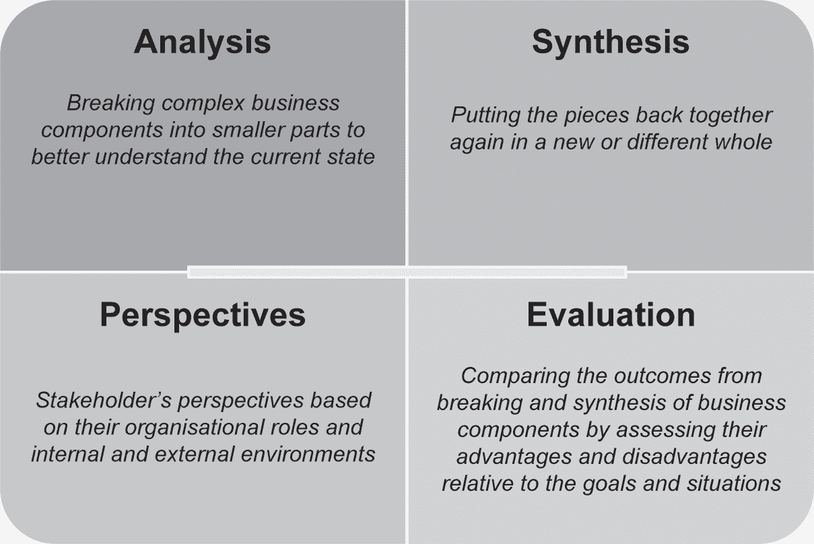

## 行动中的分析

从前，在遥远的土地上，住着一位仁慈而高贵的国王。有一天早晨，一位农民来到他的宫廷，问题是他的收成年年持续减少。他担心今后几年可能完全没有收成，急需帮助。

国王立即命令其中一位顾问去进一步了解问题并汇报调查结果，以解决农民的问题。

顾问陪同农民回家，以详细了解情况和问题。他向农民提出了几个问题，例如：
- 农民第一次注意到收成减少是什么时候？
- 这种情况对他的生计有何影响？
- 是否有其他农民也有同样的问题？
- 他们已经尝试过哪些补救措施？

顾问随后在农场周围走动，检查作物、土壤和井水。他还与农场工人交谈，认真倾听并做笔记。他会见了邻近的农民，检查他们是否也有类似问题，并了解他们是如何解决的。他进行了数天的研究，根据需要咨询了几位专家并汇总了所有信息。最后，他完成了调查，确定了问题的根本原因并记录了调查结果。分析完成，他根据结果提出了几种解决方案的建议。

### 解决方案选项

作物减产的根本原因是水位下降和土壤干旱。因此，产量得不到充足的水供应。这种情况持续存在，年复一年地使地面干涸。顾问通过与专家合作制定了几种解决方案，以解决问题的根本原因及其影响。

第一个解决方案是一个快速、临时的修复方案，需要的资源投入最少。即把井挖得更深以获取更多水。然而，这个方案存在风险。邻近的农民已经尝试过这种解决方案，结果不一致。只有少数几口井补充了水，其他井没有。因此，这个方案不能保证解决问题并产生预期结果，但这种风险是可以接受的。

第二个解决方案是在农场建立机械基础设施，从附近的湖泊抽水到农场。这个方案比第一个需要更多的投资，也不是快速修复。由于建立基础设施的成本更高，这个第二个方案可以扩展到面临类似情况的邻近农民，从而分摊安装和持续维护成本。然而，这个解决方案也不是永久性的修复，也不能保证预期结果。由于土壤干涸，湖泊的水位也可能随时间进一步下降。此外，湖泊是一个水库，立即使用水可能会在干旱期间造成缺水，引发另一场危机。因此，湖泊目前的水使用量不可靠，使其成为高风险方案。

第三个解决方案是一个长期、高效且永久的解决方案。即在农田周围种植更多树木，以蓄水并避免未来土壤干涸。这个方案可以改善土壤质量并恢复井和其他水体的活力。它解决了当前问题，并将提高收成的质量和数量。

顾问将这份报告提交给了国王。然后，在所有调查结果和解决方案的基础上，国王可以为农民的问题决定最佳解决方案。

我告诉我儿子，在当今时代，商业分析师就像这位顾问。他们分析问题，研究所有相关事实，与相关团队沟通和协作，确定情况的根本原因并提出解决方案。

当我这么说时，我儿子立刻评论说商业分析师解决人们的问题，这个说法一针见血。

本质上，商业分析师是问题解决者。他们剖析问题情况以找到合适的解决方案来解决问题。然而，在这个过程中，商业分析师会：
- 遗漏对相关信息的分析？
- 忽视不同视角？
- 进行不充分的研究？

上述任何不足会如何影响分析和调查结果？为什么商业分析师提供完整且正确的分析如此重要？

## 不正确和不完整分析的影响

让我们考虑几个场景来说明上述故事中不准确和不完整分析的后果。这些场景展示了有缺陷的解决方案如何加剧现有问题或引入新的问题和风险。

### 场景 1

收成恶化的问题。

**分析**
将感知到的問題视为真实问题。

**潜在解决方案选项**
从邻近州或国家进口农作物或替代食品供应。

**影响**
- 从邻近州或国家进口食品供应是否可持续？
- 流程要求会是什么？会简单还是复杂？
- 进口的农作物是相同还是不同？
- 如果不同，人们能否接受新的饮食？
- 我们是否需要为新的饮食的任何副作用做好准备？
- 就储存、气候等方面而言，新类型农作物的要求是什么？

**结果**
解决的是感知到的問題而非根本原因。

虽然这个解决方案可能暂时解决问题，但它只会延续更多问题，造成不必要的投资、努力、金钱、资源、时间等等，最终未能解决情况的根本原因。

### 场景 2

一台新奇的机器将解决问题，并且是全城的热门话题。每个人都在热议这台新奇机器如何减轻农民的劳动。

**分析**
假设这台新奇机器的功效已被测试和验证，可以改善农民的生活，因为每个人都有相同的理解，包括农民、工人、邻近村民和研究数据。

**潜在解决方案选项**
尽快安装这台新奇机器，以免错过即将到来的收成窗口。

**影响**
- 据报道，该机器需要定期维护以防止漏水，这很昂贵，因此：
  - 农民将如何承担昂贵的维护费用？
  - 这能持续多久？
  - 为什么之前没有与农民讨论这个问题？
- 农民必须接受强制性培训以学习机器技术、操作和维护，因此必须为此活动安排专门时间。
  - 农民能否为培训分配额外时间？
  - 如果不能，替代方案是什么？
  - 谁 else 可以操作机器以避免停机？
- 该机器需要定制的基础设施来确保设备及其使用安全。
  - 是否已评估基础设施的可行性？
  - 如果没有，谁负责确保机器的安全要求？
  - 如果没有适当的安全措施，任何人都可以进入机器房并篡改设备，可能造成损坏，即使是无意的。
  - 农场动物也可能进入机器房并损坏机器。
  - 一些与农民有个人恩怨的农场工人可能会故意损坏机器。

**结果**

由于分析不完整，机器的安全性、实施和使用的必要尽职调查未得到保障。因此，为减轻农民负担而安装新花哨机器的解决方案失败了，根源问题再次未得到解决。

上述场景提供了宝贵的内省机会，鼓励我们重新审视过去的项目或未达到预期成果的情况。它促使我们思考导致这一不足的因素是什么。我们是否在不深入探究其根本原因的情况下就接受了问题的表面现象？是否假设责任由他人承担？反思这些问题可以为改进提供洞见，并使我们能够完善未来的问题解决思路。

业务分析师有责任提供完整的分析以成功解决问题。

### 反思时间

花点时间思考并写下：

• 在你的任何项目中，哪些原因和假设可能导致未能达标或未能实现期望的最终目标？

## 关于角色和职责定义的清晰度

继续深入探索业务分析的本质，在组织背景下探讨角色和职责的定义至关重要。业务分析师的职位名称有多种，且这些角色内的职责各不相同，就像没有两个项目通常是相同或相似的，即使在同一领域或组织内也是如此。

角色本质上是分配给某个职位的一个标签，概述了一系列预期活动。另一方面，职责意味着对成功执行这些活动承担所有权，满足期望。虽然角色更像是一个静态的指定，职责是动态的，是成功履行这些职责的体验。角色的体现完全依赖于行动，而这些行动的执行定义了一个人的职责。

理解这一区别至关重要，因为业务分析是一种职责。它需要调动所有人的能力。它不是单调乏味的活动，而是有意识的承担。要执行业务分析以提供完整分析，必须投入身体、心理和情感能力。无论角色和头衔如何，每个业务分析师都必须有这种清晰认识。

## 你的职业对你意味着什么？

我发现业务分析不仅仅是一个定义。除了从业务分析师工具箱中获得的用于解决问题技能、技术和工具外，我还会反思正在处理的问题，而且大多数时候我发现解决方案是从内部产生的。

角色只能通过行动体现。而行动的执行方式决定了‘职责’。

除了业务分析师交付的有形工作外，我发现这个职业激发了人们的好奇心和在每个项目中学习新事物的渴望。新的学习和经验带来内心的满足感，因为它推动了向新事物的改变并对最终目标产生积极影响。

在她的 Facebook 帖子‘Hobby, Job, Career, Vocation’中，Elizabeth Gilbert 对这四个经常被互换使用且含义不同的术语进行了澄清。它们是四个不同的词，意味着四件不同的事情（Gilbert, 2016）。

### 关于爱好

爱好是为了愉悦而做的事情。最重要的是，爱好的风险很低，而且爱好很少影响到个人周围的人。它只是为了那件事的乐趣而做。不是必需的，但有则更好。

### 关于工作

根据 Elizabeth 的说法，至少对大多数人来说，在物质世界中你必须有一份工作来支付账单。工作的好处在于它不必优秀。它不必让你满足。它不必令人愉快。它只需要付钱。它就是你的服务与金钱的交换。

### 关于职业生涯

Elizabeth 解释说，职业生涯是你热爱并充满激情的工作。职业生涯是你愿意为之做出牺牲的事情。你愿意加班。你愿意为此搁置你的生活，因为你相信职业生涯的使命。你应该热爱你的职业生涯，否则就不要拥有它。

### 关于天职

她进一步阐述天职是一种召唤，一种神圣的邀请。天职是宇宙在你耳边说的话：‘我们希望你做这件事，利用你的才能和天赋去实现它。’

她进一步引用说，术语 vocation 源自拉丁语 – 一种被召唤的召唤。天职是你能追求的最高目标。职业生涯可能会结束，但天职不必如此。那么业务分析对你意味着什么？

### 反思时间

花点时间思考并写下：

• 业务分析对你而言是什么？它是工作、职业生涯还是天职？
• 成为一名分析师是一个有意识、明智的决定吗？
• 你为什么想成为一名分析师？

## 对业务分析活动的视角

深入挖掘业务分析的本质，培养正确的视角和态度绝对至关重要。你知道三个砖瓦工的故事吗？

在他 1927 年的著作 *What Can A Man Believe?* 中，Bruce Barton 引用了这个故事。伦敦大火之后，世界著名建筑师 Christopher Wren 受命重建圣保罗大教堂。寓言称，Christopher 在建造大教堂时目睹了三个态度不同的砖瓦工。

他走过去问第一个砖瓦工：‘你在做什么？’砖瓦工不高兴地回答：‘我是个砖瓦工。我砌砖，努力工作养家糊口。’

然后他去问第二个砖瓦工同样的问题。第二个砖瓦工回答：‘我是个建筑工。我在建墙。’

当同样的问题被问到第三个砖瓦工时，他满面笑容，对自己所做的事情充满热情。他热情地回答：‘我是大教堂建造者。我正在帮助 Christopher Wren 建造这座伟大的大教堂。’

同样的活动却完全不同的心态。这个寓言中的观点对每个人都有启发，尤其是业务分析师。业务分析师不能像第一个或第二个砖瓦工那样工作。这项工作要求他们不亚于第三个砖瓦工。

## 正确的位置？正确的理由？正确的态度？

你是否身处正确的位置，出于正确的理由并拥有正确的态度。我曾问过几代不同于我自己的人他们选择职业的原因。在大多数情况下，我得到的回答相似：养家糊口，实现梦想，买昂贵的玩具等等。只有少数人是为了热爱那份工作而选择。

那为数不多的人出于对工作的纯粹热情选择了自己的职业，驱动力是想要有所作为。虽然我们都有需要培养的个人生活、需要追求的梦想和无需内疚即可享受的乐趣，但确保占据我们大部分时间的工作得到应有的关注至关重要。忽视这一点可能会损害我们的产出质量。无论工作的性质如何，明确其附带的职责对于成功执行至关重要，就像第三个砖瓦工一样。

现在，无论你是刻意追求业务分析师的道路还是偶然进入这个角色，反思你的旅程都至关重要。无论你是如何来到这里的，投入全部注意力于角色都是至关重要的。

医生与患者之间存在一种未言明的信任，以及对医生诊断的未言明信仰。同样地，业务分析师与其客户之间，也存在一种默契的信任，即分析能够提供所有必要的事实和视角，帮助利益相关者做出明智决策。这种信任只能通过持续提供全面的分析来建立和维护。因此，业务分析师成为客户值得信赖的顾问。

存在一种未言明的信任，即业务分析师与其客户之间需要提供完整的分析以实现知情决策。

结束第一章，我留下一个供你思考的问题：作为值得信赖的顾问，业务分析师能否在分析中排除网络安全，假设技术或网络安全团队负责所有与网络安全相关的需求？不，非功能性需求并不涵盖所有网络安全需求，我们将在下一章看到原因。

## 带走的问题

• 本章你的关键学习点是什么？
• 你将实施的唯一教训是什么？
• 你如何总结你对业务分析的观点？

# 2 网络安全传奇的开端

本章你将学到：

• 网络安全对你意味着什么。
• 这有多真实。
• 退一步以获得视角。
• 他们在玩什么游戏。
• 网络安全不仅仅是 IT。
• 扩张是未来。
• 业务分析师可以做什么。

### 网络安全对你意味着什么？

当你看到或听到“网络安全”这个词时，你会想到什么？例如，合规团队成员可能会说“这是关于网络安全法律的合规性，比如隐私”；在 IT 团队工作的人可能会说“这是关于保护网络或防火墙”；系统架构师可能会说“这是关于保护数据和系统”；而大多数业务团队会说“这是技术性的，因此 IT 或网络安全团队负责”。如果你是一名业务分析师，你会怎么说？不，它不仅仅是或仅限于非功能性需求的一部分。当你看到或听到“网络安全”这个词时，你会想到什么？

### 反思时间

在继续阅读之前，请花点时间思考：

• 网络安全对你意味着什么？

### 背景故事

几年前，我会和业务团队说同样的话：网络安全是 IT 或安全团队的责任，我不必操心。安全仅限于非功能性需求（NFRs）——例如谁需要访问系统以及访问级别——直到一次个人经历从根本上改变了我对网络安全的看法。

我当时正在从事一个客户订阅产品，订阅可用数据是组织的知识产权。我被分配去做一个位于团队待办事项列表底部的增强功能。注意，该变更并未被视为业务优先事项，这就是为什么它排在待办事项列表底部的原因。

有人提醒我，业务和技术团队已经为该问题设计了解决方案，但尚未实施，因为待办事项列表中有更高优先级的项目。作为一名勤勉的业务分析师，我深入研究该问题以评估初始解决方案是否仍然可行。这涉及了解根本原因，从而引发了与业务、开发和运营团队的讨论。令我沮丧的是，分析揭示了一个令人震惊的真相：问题的根本原因是反复发生的数据泄露，尽管多次发生却未被察觉。运营报告显示出因大量数据下载而产生的差异，但并未采取任何行动。

思考潜在的后果，我不禁想象如果所有数据都自由地在互联网上可用的灾难性影响。它不仅会损害组织的客户，还会对组织的声誉构成严重威胁。这样的泄露甚至可能危及组织的生存。

这一发现凸显了该问题的关键性，而组织却将其归类为低优先级和低风险的待办事项。正是在这一认识下，我开始深入探索网络安全的旅程。

### 这有多真实？

网络攻击在 2020 年是公共和私营部门全球排名第五的风险，2021 年全球较 2020 年增长 125%，并持续上升。仅物联网（IoT）网络攻击，攻击数量预计到 2025 年将翻一番（AAG，2024）。此外，世界经济论坛 2020 年全球风险报告指出，美国的检测（或起诉）率低至 0.05%（McLean，2024）。

让我分享另外几个高调事件以获得更深入的视角。

#### HMRC

据报道，一起值得注意的事件发生在 2007 年 HMRC 的儿童福利部门。据报道，所有儿童福利数据（包括领取福利的儿童的个人详细信息及其父母的个人和银行详细信息）被复制到密码保护但未加密的紧凑光盘（CD）上，并通过不安全且无法追踪的渠道邮寄给国家审计办公室（BBC，2007）。有人说 CD 到达了目的地，有人说它们在运输途中丢失，但没有人确切知道。此事件有不同版本，但我想请你注意此次泄露的一些潜在原因：

• 未能分离关键/敏感数据。
• 未能加密数据。
• 未能以安全且可追踪的方式传输数据。
• 未能制定适当的处理这些数据流程。

当时的报道表明，复制数据并邮寄 CD 的人并不了解风险，只是按照上级给出的指示行事。此事件发生在 2007 年，显然我们现在不再使用 CD 传输数据。我们在技术方面取得了很大进展，并通过法律法规对数据进行隔离，但这个问题仍在上升。我们在真正意义上取得了任何进展吗？让我们看看近十年后发生的第二起事件。

#### TalkTalk

TalkTalk 是一家互联网数据提供商。2009 年，TalkTalk 收购了另一家名为 Tiscali 的公司。收购的一部分似乎是，除了系统外，Tiscali 的系统漏洞也被引入。后来，在 2015 年，TalkTalk 的数据库多次被入侵，客户的个人和财务数据被泄露（BBC）。

从本质上讲，TalkTalk 遭受了重大且持续的网络攻击，据称只有在收到勒索邮件时才做出回应。据说他们没有监控内部运营报告，而报告显然显示出差异。起初，TalkTalk 怀疑多达四百万客户的数据被泄露，当时的报道表明，TalkTalk 花了几个月时间才了解泄露的程度。后来，信息专员办公室（ICO）确认，攻击导致 156,959 名客户的个人详细信息被访问，包括 15,656 名客户的银行账号和排序代码。因此，TalkTalk 遭受高达 4000 万英镑的损失，流失 101,000 名客户，ICO 处以 40 万英镑罚款。令人震惊的事实是，伦敦警察厅证实与此次泄露有关的逮捕了一名青少年和一名 20 岁的人。再次，我想请你注意以下导致失败的潜在原因：

• 未能移除易受攻击的网页。

- 未能更新一个在攻击发生前显然已有三年半的补丁。
- 未能开展主动监控活动以发现漏洞。
- 未能针对常见类型的攻击实施防御措施。

与 HMRC 和 TalkTalk 一样，更多知名组织也成为网络安全泄露的受害者。它们实施了安全框架或获得了某一项或另一项安全标准的认证。它们拥有遵守法律的法务和合规团队。它们设有专门的网络安全团队，而且尽管所有项目都已勾选，但它们并未得到保障。

研究反复表明，大多数网络安全事件源于缺乏意识，因此‘people’是最薄弱的环节。上述事件也进一步证实，根本原因在于缺乏意识。

为什么会这样？我们这里缺少什么？

## 退一步以获得视角

让我们退一步，从影响每个人职业和个人生活的这一巨大问题的根本原因上获得视角。对背景的视角有助于我们评估为何需要将关注点转向网络安全。

我在 1990 年代末作为顾问分析师开发者开始了我的职业生涯。我的工作是与客户合作，了解他们的业务需求，设计数据库，构建满足其业务需求的系统，准备手册并培训用户使用新应用程序。我在独立计算机上完成所有这些工作。我的所有代码、可执行文件、操作系统和数据库，包括客户数据，都在一个物理系统中。

**图 2.1 技术扩展**（版权：I-Perceptions Consulting Ltd）

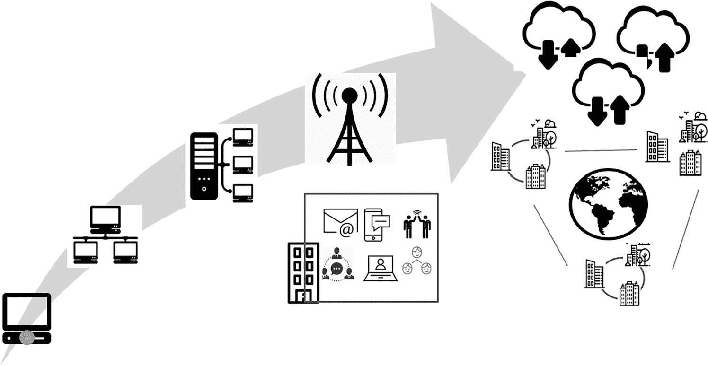

除了确保物理设备安全之外，唯一的漏洞就是使用软盘，它用于将数据复制进出计算机，如果其中包含病毒，则可能损坏文件。即使病毒损坏了文件，也可以使用防病毒软件来清理数据。该解决方案可以在组织内的任何其他受感染计算机上复制。单一解决方案适用于所有计算机。

后来，计算机作为客户端连接到服务器，形成了局域网和广域网。今天，随着互联网和其他技术进步的出现，系统分布在全球各地（图 2.1）。例如，客户可以在一个地点使用设备发起交易，并在另一个地点和不同的时间完成同一交易。

### 在变化的光谱中

技术已从有线发展到无线再到可穿戴。设想未来技术可能植入体内。想象一下全球分布式系统中潜在的弱点或漏洞。在这一新格局中会有什么问题？潜在漏洞的清单似乎无穷无尽。

打破和挑战现状，并在业务生态系统中创造性地使用技术，已成为创新型组织的默认思维方式。近年来，通过突破系统边界来提升用户体验，使想象力成为新的边界。技术扩张得越多，生态系统就越脆弱，需要的安全控制就越多。

技术扩张得越多，生态系统就越脆弱，需要的安全控制就越多。

在真正互联的世界里，对这一网络安全挑战没有单一解决方案。与信息通过软盘和拨号调制解调器在系统间传递的时代不同，这一新格局中的漏洞带来了各自的风险和影响。还有额外的法律和合规要求需要遵守，需要不同的防御解决方案，这些解决方案可能是技术性的也可能是非技术性的。解决方案现在涉及人员管理、流程管理、灾难恢复、业务连续性等。

在我作为业务分析师的旅程中，我已适应不断发展的技术和变化的业务需求。随着业务的不断扩展，当时的用户或系统需求清单开始发展为 NFRs 和功能需求（FRs）。历史上，安全被视为一种 NFR，通常仅限于角色和权限。随着业务和技术格局的变化以及网络安全威胁的增加，对安全的这种看法已不再足够。

当我们拿起棍子的一端时，我们也拿起了另一端。

技术带来网络安全。

今天，机器人和人工智能（AI）已成为许多人生活的一部分，公园里有巡逻的机器人狗，或 Alexa 和 Eilik（迷你机器人）在我们的桌面上或作为家庭个人助理。这就是技术的美妙之处。然而，正如俗话所说，当我们拿起棍子的一端时，我们也拿起了另一端。技术带来网络安全。由此产生的明显问题是，为什么组织会忽视这一点。

## 他们在玩什么游戏？

作者和励志演讲者 Simon Sinek 在他的书 *无限游戏*（2019）中谈到了组织有意或无意地进行的有限游戏和无限游戏。

### 有限游戏

有限游戏是指有已知玩家、固定规则和约定目标的游戏，其中有一个既定的目标需要实现，最终会有赢家和输家。当至少有两个有限玩家时，这一等式运作良好。

### 无限游戏

在无限游戏中，玩家是未知的，规则是可以改变的。目标是让游戏继续下去，即为延续游戏而玩。如果有人厌倦了游戏或想退出，他们可以退出，另一个人将接手，继续游戏。当有两个‘infinite’玩家时，这一等式同样运作良好。

当有限玩家与无限玩家对战时就会出现问题，因为有限玩家是为了赢而玩，而无限玩家是为了留在游戏中而玩。因此，有限玩家会感到沮丧并陷入危机。

商业游戏也是如此。按照其定义，商业游戏就是无限游戏。然而，组织却把它当作有限游戏来玩。‘They don’t even know the game they’re in’，Simon（2019）说。

每个组织都渴望成为最好，但问题仍然是：在什么方面最好？它们的指标是否明确定义？即使明确，也常常围绕竞争，不断努力超越对手。这体现在组织只想推出产品或服务，或获得最佳组织的声望奖。

Simon 继续指出，通过研究竞争对手无法做出战略决策。只能通过研究竞争对手做出战术决策。

组织需要明白他们是在为留在游戏中而玩，这种理解会从根本上改变他们做出的决策类型。

无限玩家明白，有时你领先，有时落后。有时你的产品更好，有时不是。目标不是每天都成为最好。目标也不是每天都超越竞争对手。目标应该是留在游戏中，体验游戏和留在游戏中的旅程。

作为无限玩家，组织应专注于通过关闭所有安全漏洞来创建稳健的产品，并为终端用户提供更好的价值。这将使组织长期保持运营。

有限玩家是为了赢而玩，无限玩家是为了留在游戏中而玩。

作为无限玩家，组织应专注于改进其产品，关闭所有安全漏洞，使其稳健，并为终端用户提供更好的价值。这将使组织长期保持运营。

## 网络安全不仅仅是 IT

组织正专注于仅仅推出产品并利用快速胜利，这是一种有限的游戏，因此每个产品都有短暂且有限的生命周期。

市场上存在许多存在漏洞的产品——从灯泡、安防摄像头、鱼缸、电水壶和恒温器到医疗产品。 根据 Cynerio 研究报告（Lauver, 2022）显示，医院遭受的勒索攻击增加了 123%，勒索软件成本接近 210 亿美元，该报告研究了医院中联网医疗设备安全的当前前景。 一次勒索软件攻击导致医院出现中断，进而导致一名新生儿死亡（Zacharakos, 2023）。

选择胜利还是满足，赢得战争还是输掉战斗，作为有限玩家还是作为无限玩家享受过程，这是一场持续的斗争。 在组织和社会中，追求即时满足或为快速胜利走捷径已成为一种被接受的做法，但实际上，生活是一场马拉松，而不是短跑。

## 扩张即未来

Gartner 的研究提出了 2023 年的四个新兴技术和趋势。其中两个涉及网络安全。 “智能世界”——物理和数字体验的融合——以及个人数据收集的“透明度和隐私”（Nguyen, 2023）。

McKinsey Digital 表示，人工智能、机器学习、机器人和其他技术的进步使变革速度加快了十倍，他们估计到 2025 年将有 500 亿台设备连接到工业物联网（IIoT）。 他们强调技术素养已成为每个角色的核心，企业需要准备好应对技术创新的速度和普及（Van Kuiken, 2022）。

网络安全是每个人的责任。 然而，正如常说的一样，“每个人的责任就是没有人的责任”。

## 业务分析师能做什么？

商务分析师可以（或应该）做什么？ 或者这个问题超出了商务分析的范围？ 关键问题是：谁对网络安全负责？ 这是一个难以回答的问题。

想象一下，一位顾客走进商店，因地面湿滑而意外摔倒，或因障碍物而绊倒。 在这种情况下，你认为谁对事故负责？ 是清洁工、员工、保安、店长、高层管理等吗？ 在你的家中，谁负责确保门窗或贵重物品的安全？ 现在你对这个话题有了更广阔的视角，请花点时间思考这个问题。 谁对网络安全负责？ 答案或许是，每个人都对网络安全负有责任。 然而，正如常说的一样，“每个人的责任就是没有人的责任”。

商务分析师非常适合接过接力棒，提出困难但至关重要的问题，并确保网络安全始终处于聚光灯下。 第 1 章强调了商务分析师在共同创建价值链中所承担的责任，而保护该价值链是其责任的内在组成部分。

在我们讨论商务分析师能做什么之前，必须了解商务分析师角色与网络安全分析师角色之间的区别。 他们处于光谱的两端（图 2.2）。 他们都进行分析，但活跃在不同的领域。 商务分析师专注于价值主张，而网络安全分析师则专注于保护与 IT 和网络空间相关的所有事物。

**图 2.2 分析师光谱** (Copyright: I-Perceptions Consulting Ltd)

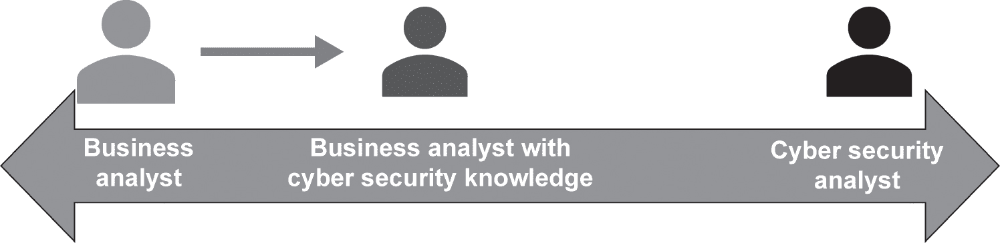

商务分析师不必是网络安全专家，而应将分析范围扩展到整体安全。 他们可以根据每个项目的需要与网络安全专家合作，就像他们咨询业务主题专家（SMEs）以深入了解业务一样。 为此，他们需要具备必要的专业知识，以识别项目交付过程中的安全需求并相应地联系 SMEs（图 2.3）。

已得到充分证实，安全不能是项目的事后考虑或最后的修补，而必须从项目启动开始就融入解决方案中（图 2.4）。

**图 2.3 商务分析师网络安全知识概述** (Copyright: I-Perceptions Consulting Ltd)

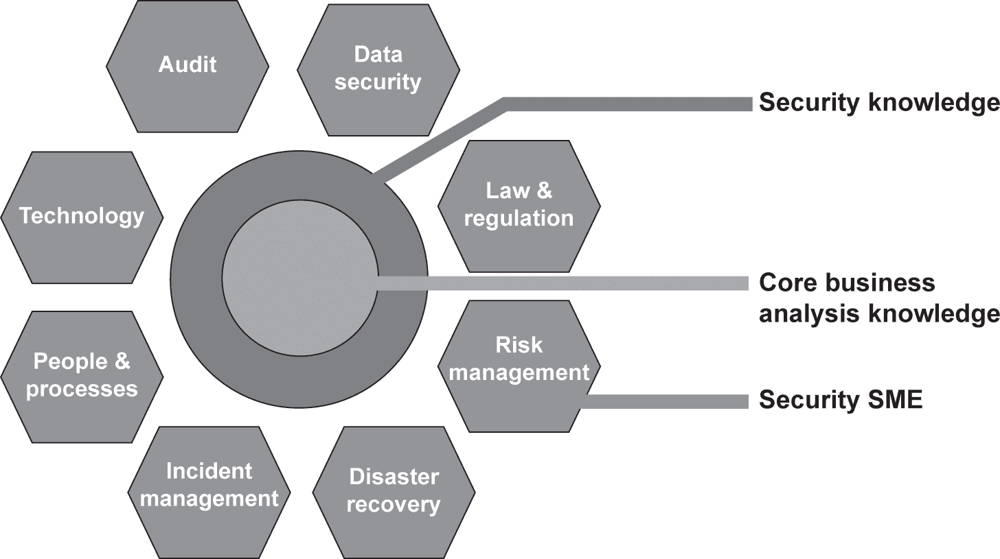

**图 2.4 整体分析** (Copyright: I-Perceptions Consulting Ltd)

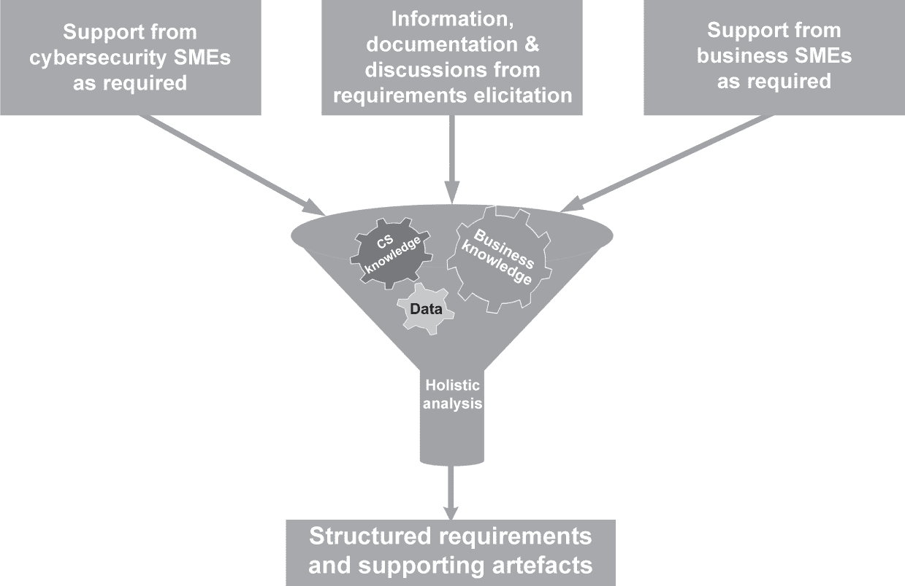

## 关键问题

• 本章你的主要学习要点是什么？
• 你将实施的一个教训是什么？
• 你如何总结你对网络安全的观点？

# 3 觉醒之旅从这里开始

本章你将学到以下内容：

• 网络安全的定义。
• 商务分析和网络安全框架简介。
• 如何处理安全问题。
• 安全目标——CIA 三要素。
• 安全违规。
• 额外的安全目标。
• 业务收益和影响——同一枚硬币的两面。

### 什么是网络？

“网络”一词通常用于指代互联网、数字或虚拟世界，并与与互联网、数字或虚拟世界相关的任何事物连用。 该术语源自希腊语 ‘*kybereo*’，意为引导、操控或控制。 它在 1948 年变得流行，当时美国数学家 Norbert Wiener 创造了“控制论”一词——使用技术控制和与系统通信的科学研究（Dawkins, 2022）。 从这个术语中衍生出一系列派生词，用来描述与互联网有关的一切，例如网络安全、网络空间、网络犯罪等。

### 什么是安全？

国家标准与技术研究所将安全定义为“免受危险或威胁的状态” ([`csrc.nist.gov/glossary`](https://csrc.nist.gov/glossary))。 只有当某物对某人在特定时间具有价值或非常重要时，它才可能处于危险之中或受到威胁。 因此，安全等于为有价值的财产提供的对其所有威胁的保护。

**安全 = 对价值的保护以对抗威胁**

在这个等式中，“安全”被等同于在“危险”或“威胁”**存在**下将“保护”**应用**于“价值”的**行动**。 这个等式突出了两个深刻的见解：

1. 必须采取**行动**来保护有价值的东西。 系统或流程不会自行防御，必须采取行动来保护它们。
2. 该**行动**只有在危险或威胁被**识别**时才能采取。 当我们不知道对其的危险或威胁时，就无法保护某物。

**安全 = 对价值的保护以对抗威胁**

### 业务分析和网络安全框架

为了有效应用这一公式，在项目生命周期的每个阶段识别风险、威胁和漏洞的结构化和系统化方法至关重要。 除了本书提供的网络安全知识外，商务分析师还需要一个框架，以便在项目生命周期阶段中无缝地将网络安全分析整合到日常商务分析活动中。

商务分析和网络安全框架（© 2024 I-Perceptions Consulting Ltd）使商务分析师能够在项目开发阶段全面扩展其分析，以包括网络安全方面。 本章为框架的开发和建立基本原则奠定了基础，后续章节将逐步阐述该框架，融合商务分析和网络安全要素。

# 心态
**心态**是框架的第一个构建块，是框架的基础。心态是一种基于个人信念体系的心理态度或视角，是一个人成长经历和环境的融合。虽然第 1 章深入探讨了业务分析视角和心态，本章为拥抱安全心态奠定了基础。

## 安全心态意味着什么？
**安全心态**是拥有额外的视角以从安全角度感知一切，对资产的价值、其威胁以及所需的保护具有高度的意识。正如常识是意识领域的基本构成之一却是一种稀缺资源，安全心态也是容易被忽视的安全关键方面。安全心态就像任何其他肌肉一样，需要培养并定期维护。

心态是一种基于个人信念体系的心理态度或视角，是一个人成长经历和环境的融合。

安全心态是拥有额外的视角以从安全角度感知一切，对资产的价值、其威胁以及所需的保护具有高度的意识。

让我们通过一个例子更好地理解这一点。如果我问你如何保护你的自行车，你可能会说就像图 3.1 中的第一张图片那样，并且也可能会说这就是大家锁自行车的方式。然而，如果我问你自行车是否受到了保护，我们都知道答案显而易见。这就是有无安全心态做事之间的区别。

**图 3.1 停放并被盗的自行车** (Copyright: I-Perceptions Consulting Ltd)

同样，许多知名组织也成为网络安全事件的受害者。他们已勾选了所有安全义务；他们实施了安全框架或使其符合某一安全标准；他们拥有遵守法律的法务和合规团队；他们设有专门的网络安全团队——然而，尽管所有项目都已勾选，他们仍未得到保护。安全心态证明安全远不止实施控制措施。研究表明，大多数网络安全事件源于人员和流程漏洞，其根源在于缺乏安全心态意识。

俗话说，风暴中心往往是最平静的地方。同样，对于业务分析师而言，同时拥抱业务分析心态（在第 1 章中讨论）和安全心态，就如同找到那个宁静的中心。它为他们提供了关于需要保护的内容以及所需安全级别的清晰认识。

## 反思时间
花点时间思考并写下：

• 你能否识别出有价值的东西？一个在没有安全心态的情况下被保护的资产？现在，随着你理解的转变，你将如何保护该资产？

我建议反思个人和组织资产，因为这有助于强化安全心态。不要跳过这个练习，因为你参与得越多，你的心态就越稳健。

## 网络安全定义
要理解网络安全的定义，让我们先了解网络安全项目所体现的不同形态（我称之为化身）。作为业务或系统分析师，我们可能参与过安全项目，但却没有安全心态。

我们许多人都有参与涉及技术或流程控制实施的项目经验，例如通过密码进行用户身份验证以访问产品或应用程序、对关键功能实施多层授权，或维护流程和系统的基于角色的访问。然而，至关重要的是反思：是否全面掌握了安全需求，还是基于角色的访问仅仅被视为产品提供的另一个功能，就像前面提到的自行车类比一样？

是否与贵组织安全政策中概述的安全目标保持了明确的一致性，涉及诸如加密个人身份信息（PII）数据、保护网络和防火墙、在网关之间建立安全通信渠道，或开展合规项目以满足数据安全方面的法律和监管义务等活动？还是实施与这些目标缺乏连贯性，假设安全和 IT 团队会确保这种一致性（图 3.2）？

**图 3.2 网络安全活动** (Copyright: I-Perceptions Consulting Ltd)

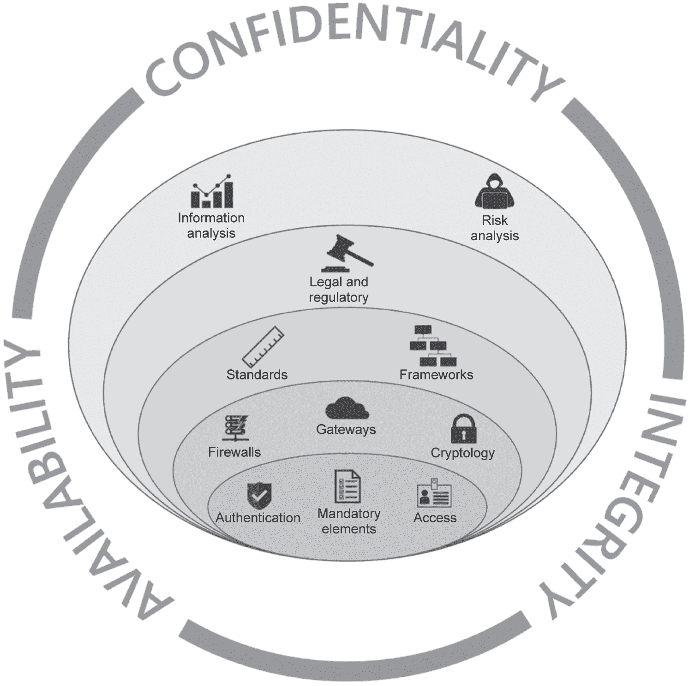

我们是否真正意识到自己在保护什么，还是它仅仅看起来像另一个项目任务？面对法律合规义务时，我们是否投入了必要的精力来充分理解其背后的理由，还是合规仅仅成为又一个需要勾选的框？此外，为什么某些数据集比其他数据集更重要，又是什么驱动了组织对数据清除的不同需求？这些问题促使我们在组织背景下进行反思，敦促我们理解信息资产在穿越各种系统和流程时的旅程，并在途中发生转变。

只有具备整体视角，我们才能总结网络安全的定义，即‘对网络空间中的系统、网络、应用程序、流程、人员-系统交互和数据的保护’（CISCO, 2024）。

网络安全是对网络空间中系统、网络、应用程序、流程、人员-系统交互和数据的保护。

## 如何应对安全
实现安全有两种方法（图 3.3），尽管两者都旨在保护资产，但视角相反。

**图 3.3 安全方法** (Copyright: I-Perceptions Consulting Ltd)

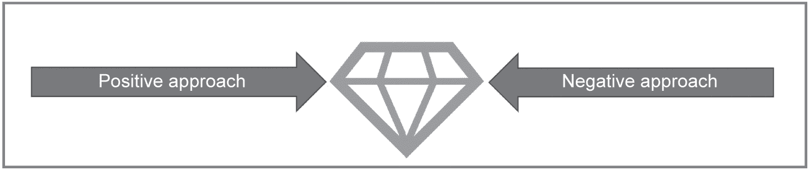

积极方法，也称为预防性或目标导向方法，是主动抵御或消除对资产威胁的能力。这种目标导向（保护资产）的方法是资产因其价值以及为保持其完整性而确定的目标而受到保护，例如对敏感信息和系统的基于角色的访问控制、身份验证和授权。因此，它是对资产已识别目标的维护。

消极方法，也称为侦测方法或威胁导向方法，被定义为抵御针对资产的具体已识别威胁的能力。这种威胁导向（失去资产）的方法是识别风险和威胁以便消除，并强调对系统、网络和用户行为异常的安全监控。因此，它是对资产已识别威胁进行缓解的能力。

这两种方法对于平衡的安全策略都至关重要，其中主动方法旨在降低事件发生的可能性，而反应性方法有助于识别和响应事件。

一个平衡的信息安全计划结合了两种方法的要素，以提供强大的保护和稳定的安全策略，其中主动方法旨在降低事件发生的可能性，而反应性方法有助于识别和响应事件。

### 安全目标 – CIA 三元组
积极或目标导向的方法是实现以下已知为 CIA 三元组的安全目标：

• **保密性** – 防止未经授权的信息泄露。
• **完整性** – 防止未经授权的信息修改。
• **可用性** – 防止未经授权的使用拒绝。

### 安全违规

## 基于威胁的方法

对安全违规的消极或反应性方法，基于威胁的方法有以下三种类型：
• **未经授权的信息泄露** – 保护保密性。
• **未经授权的信息修改** – 保护完整性。
• **未经授权的拒绝使用** – 保护可用性。

虽然积极或预防性方法旨在降低安全事件发生的可能性，但消极或侦测性方法有助于识别并应对尽管采取了预防措施仍可能发生的事件。平衡良好的信息安全计划结合了两种方法的要素，以提供强大的保护和事件响应能力。

## Parkerian 六元组

Parkerian 六元组由 Donn B. Parker 于 1998 年提出，是一个框架，它在传统 CIA 三元组（保密性、完整性和可用性）基础上扩展，加入了三个额外的原则，以形成更全面的模型（图 3.4）。Parkerian 六元组的六项原则是：

### 图 3.4 CIA 三元组和 Parkerian 六元组
版权：I-Perceptions Consulting Ltd

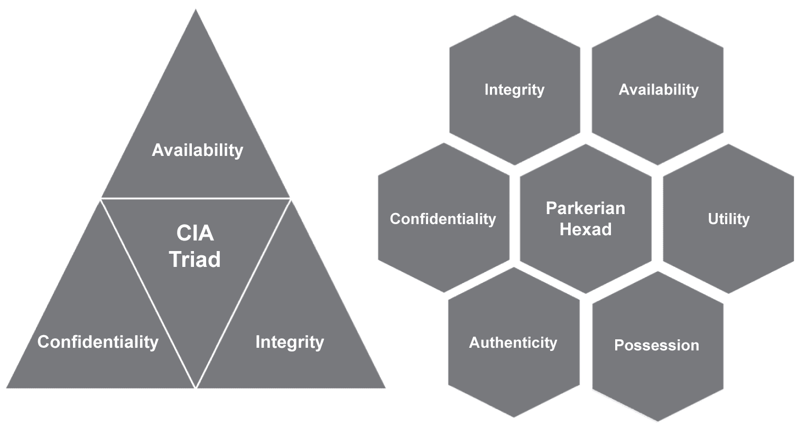

• **保密性** – 保护信息免受未经授权的访问。
• **占有** – 将保密性扩展到包括谁拥有和控制数据。
• **完整性** – 保护信息免受未经授权的修改。
• **真实性** – 在确保信息来源真实且可验证方面扩展了完整性。
• **可用性** – 保护信息免受未经授权的拒绝使用。
• **效用** – 在确保信息保持功能正常、服务于预期目的且保持可访问方面扩展了可用性。

## 其他安全目标

除了 CIA 三元组和 Parkerian 六元组之外，其他安全目标有助于形成全面且完善的信息安全方法。这些额外的安全目标根据组织环境的不同，补充并促进整体且有效的信息安全战略。其中一些（并非详尽列举）包括：
• **隐私** – 保护个人的个人信息（PI）或个人身份信息（PII），并确保其得到适当处理且符合隐私法规。数据匿名化、加密和访问控制有助于实现隐私目标。
• **合规性** – 确保组织遵守与信息和数据保护相关的相关法律和监管要求以及行业标准，例如遵守数据保护法、财务法规和特定行业的安全标准。
• **问责制** – 通过使用其凭据登录、维护其行为的审计日志并跟踪其活动，使个人或实体对其行为负责。
• **可靠性** – 构建可靠的系统、网络和稳健的基础设施，以降低服务中断风险并确保持续访问关键资源。可靠性在安全目标方面处于边缘位置，在大多数情况下是在可用性的更广泛背景下实现的。可靠性通过强调系统和服务的稳定性和可靠性来促进可用性。
• **事件管理** – 实施商定且有文件记录的流程和程序来管理和减轻安全事件。这可能包括预先防范、准备、响应、报告、管理以及从安全事件中学习。
• **业务连续性计划（BCP）** – BCP 的目标是在保持关键运营的同时最大限度地减少停机时间并快速从灾难中恢复。灾难可能包括自然灾害、网络攻击、设备故障或其他不可预见的事件。BCP 概述了确保关键运营在破坏性事件期间和之后能够继续进行的策略和程序。

## Von Solms 的信息安全 12 个维度

除了安全目标之外，Von Solms 的信息安全 12 个维度将有助于进一步拓宽信息安全视角。

除了他于 2001 年发表的题为 ‘Information Security’ 的论文外，信息安全领域的知名人物 Rossouw Von Solms 教授对信息安全的理解做出了重要贡献。

他确定了 12 个信息安全维度，为理解与信息安全相关的各个方面和问题提供了一个全面的框架。Von Solms 概述的信息安全 12 个维度如下：
1. 安全政策和战略 – 该维度涉及制定指导组织信息安全方法的安全政策和战略。
2. 信息安全管理 – 涵盖组织内部信息安全工作的整体管理，包括建立信息安全管理体系（ISMS）。
3. 安全组织 – 是安全职能的结构和组织，包括管理 and 执行安全政策的角色和职责。
4. 资产分类和控制 – 是识别、分类并控制组织内部对敏感信息资产的访问。
5. 人员安全 – 涉及安全中的人为因素，包括员工的背景调查、培训和意识计划。
6. 物理和环境安全 – 通过保护数据中心和办公室等物理设施来保护信息系统和数据。
7. 访问控制 – 管理和控制对信息系统和数据的访问以防止未经授权的访问。
8. 系统开发和维护 – 确保安全考虑贯穿整个软件开发和系统维护生命周期。
9. 业务连续性管理 – 针对中断或灾难事件规划业务运营的持续性，重点关注信息安全。
10. 合规性 – 确保组织遵守与信息安全相关的相关法律、法规和标准。
11. 事件管理 – 建立检测、响应和从安全事件和违规中恢复的程序。
12. 安全指标和信息安全治理 – 衡量安全控制的有效性、监控安全绩效并建立信息安全治理结构（Von Solms, 2000）。

根据 Von Solms 的说法，以上维度为解决信息安全的各个方面提供了全面的框架，以制定更整体、更有效的信息资产保护和安全风险管理方法。

Abhishek Narain Singh 和 M.P. Gupta 在其研究论文 ‘Information Security Management Practices: Case Studies from India’ 中指出，正如 Von Solms 所讨论的那样，信息安全学科的演变是分波发展的（Singh and Gupta, 2017）。

第一波是 ‘technical wave’。顾名思义，它围绕技术来管理信息安全——1980 年代大型机时代，具有内置安全功能，例如用户 ID、密码和访问控制列表。

从那时到 1990 年代中期，随着互联网和分布式计算的出现，组织边界变得模糊，导致了第二波，即 ‘management wave’ ——引起高级管理层的关注，认识到信息安全的重要性，从而引入安全政策和培训计划。

第一波和第二波催生了第三波，即“制度化浪潮”，侧重于信息安全管理最佳实践和标准化，例如 BS 7799（源自英国标准）以及 ISO/IEC 17799（源自国际标准化组织和国际电工委员会联合技术委员会）。

随后是“治理浪潮”，强调企业治理责任，如安全管理目标和策略、组织结构、风险管理以及管理信息安全方面的监管和合规执行。

Von Solms 还讨论了下一个浪潮（2000 年），称为“商品化浪潮”，信息安全如同其他商品一般，不再是问题。然而，他质疑自己，在信息安全因人为因素而不再处于关注雷达范围内时，这一浪潮是否可能成为现实。

## 阐明 CIA

在进入本章最后部分之前，让我们探讨一些示例（尽管不穷举），说明数据保密性（未经授权的信息泄露）、完整性（未经授权的信息修改）和可用性（未经授权的拒绝使用）如何受到破坏。这些示例提供了信息安全违规的广度和深度的一个一瞥，进而有助于强化安全思维。

### 数据泄露
攻击者未经授权访问公司数据库，获取客户的个人和敏感信息，如姓名、地址、信用卡详细信息等，导致客户信任丧失、财务损失、法律后果和声誉受损。

### 钓鱼攻击
攻击者冒充可信实体，诱骗个人泄露敏感信息，如用户名和密码，导致账户未经授权访问、潜在的数据泄露以及个人和敏感信息受损。

### 数据拦截与窃听
攻击者拦截通信，如电话通话或网络流量，以及传输中的数据，如网络上的未加密通信，以获取机密信息，导致个人和敏感对话受损，并导致机密信息泄露、法律后果和声誉受损。以下章节将提供有关传输中数据和静态数据的更多细节。

### USB 掉落攻击
攻击者在公共场所放置感染病毒的 USB 驱动器，希望有人将其插入电脑，从而在不知情的情况下传播恶意软件、破坏数据并创建对系统的未经授权访问，导致数据泄露、个人敏感信息受损和中断。

### 暴力破解攻击
攻击者通过系统地尝试所有可能的密码来尝试未经授权访问账户或系统，导致保密性受损，并导致数据泄露、财务损失、法律后果和声誉受损。

### 数据篡改
攻击者未经授权访问数据库并篡改财务记录，如交易、金额或余额，导致数据库中信息错误，进而导致客户信任丧失、财务损失、法律后果和声誉受损。

### 文档篡改
攻击者篡改重要文件，如合同或法律协议，并操纵条款和条件，导致法律纠纷、财务损失和声誉受损。

### 代码或文件篡改
攻击者向软件、系统或应用程序注入恶意代码，导致系统或应用程序行为的未经授权修改，造成系统行为受损并导致数据泄露。

### 网站篡改
攻击者获取网站访问权限并用自己的内容替换原始内容，通常是诽谤性内容，造成声誉受损和潜在的法律后果。

### 数据库注入或篡改
攻击者注入恶意 SQL 命令以操纵或提取数据库中的数据，导致敏感信息未经授权访问、数据泄露、法律后果和声誉受损。

### 供应链攻击
攻击者在制造或分销过程中破坏软件或硬件的完整性，导致系统行为受损，并导致数据泄露、法律后果和声誉受损。

### 内部威胁
拥有授权访问权限的员工故意或无意篡改数据，导致数据泄露，并导致财务损失、客户信任丧失、法律后果和声誉受损。

### 勒索软件攻击
攻击者使用恶意软件加密文件以勒索解密密钥，导致组织数据访问丧失、系统长时间停机、性能下降或系统完全故障，从而导致运营中断、财务损失、敏感信息泄露、法律后果和声誉受损。

### 社会工程攻击
攻击者操纵个人对系统进行未经授权的更改，导致组织数据访问丧失，并导致财务损失、敏感信息泄露、法律后果和声誉受损。

### 分布式拒绝服务 (DDoS) 攻击
攻击者向系统、网络或网站发起流量洪水，压垮其容量并导致临时或长时间中断，造成服务中断、收入损失和声誉受损。

### 物理盗窃与基础设施攻击
攻击者窃取包含个人和敏感信息的物理设备，如计算机、笔记本电脑和外部驱动器，或攻击底层基础设施，如数据中心或云服务提供商，影响服务可用性并导致机密信息丢失，从而导致数据泄露、财务损失和声誉受损。

### 不幸的攻击与自然灾害
攻击者引发不幸事件，如战争、自然灾害或事故，或采取导致停电的故意行动，从而影响系统和服务的可用性并导致系统停机和服务中断。

## 业务收益与影响 – 同一枚硬币的两面

上述提及的维度和安全目标主要涉及网络安全分析师（图 2.2），但理解它们也能在与安全和 IT 团队协作时使业务分析师受益。

第 1 章 和 第 2 章 强调了进行全面分析的重要性。如此彻底分析的一个关键成果不仅是识别拟议价值产生的收益，还包括认识到这些收益将产生的影响——既有积极也有消极，既有意也有非意。

虽然重点通常放在创造期望和有意的收益上，但必须认识到影响有时可能是非预期的。例如，智能家居设备的集成承诺为居住者提供增强的便利性和自动化（Laughlin, 2021）。然而，如果没有足够的安全措施，非预期的负面影响可能涉及恶意行为者获取个人信息的未经授权访问，导致数据泄露。另一个例子是 Facebook 的“赞”按钮功能，最初旨在分享积极情绪。然而，其社会影响超出了这一意图，研究人员发现了社交媒体互动的更广泛的心理效应，尤其是在青少年中（Eranti and Lonkila, 2015）。

随着技术格局扩张的速度超过预期，至关重要的是影响评估不仅要关注当今的格局，还要努力评估这一扩张的广度和深度带来的影响。

### 看见眼睛及其周围的一切

我祖母在我还是孩子时告诉了我这个故事，它一直留在我心间。虽然当时它没什么意义，但每当我进行分析时，我都会想起它。

这个故事讲述的是王子阿周那，他是印度史诗 *Mahabharata* 中因其非凡的勇敢和射箭造诣而闻名的战士。作为五位潘达瓦王子之一，阿周那的技艺举世闻名。有一天，他们受人尊敬的老师德罗纳查里亚向所有皇家王子传授射箭艺术。他把一个木鸟放在树枝上，让每个学生用箭瞄准鸟。在射出箭之前，德罗纳查里亚询问每个学生的专注点。回答各不相同：有人看到鸟栖息在树枝上，另一个人注意到树，还有一个人观察到树以及树后高耸的山脉。然而，当轮到阿周那时，他平静地断言自己只将目光牢牢锁定在鸟的眼睛上，忽略其他一切。正如他坚定不移的专注，阿周那的箭找到了目标，以无与伦比的精确度击中了鸟的眼睛。

这个故事强调了保持对目标坚定不移的专注的重要性——这一教训对我产生了深刻的共鸣。然而，在我作为业务分析师的角色中，我必须在对细节的细致关注与对更大局面的整体视野之间取得微妙的平衡。在分析单个变化的同时考虑其对整个系统的影响，是我工作的基石。我的工作要求我在复杂的层级中穿行，既要深入到细微之处，又要保持鸟瞰视角，同时始终将影响（积极和消极）放在心上。因此，我需要关注鸟的眼睛、鸟本身以及场景中可能造成伤害或构成威胁的所有因素（图 3.5）。

**图 3.5 影响圈**（版权：I-Perceptions Consulting Ltd）

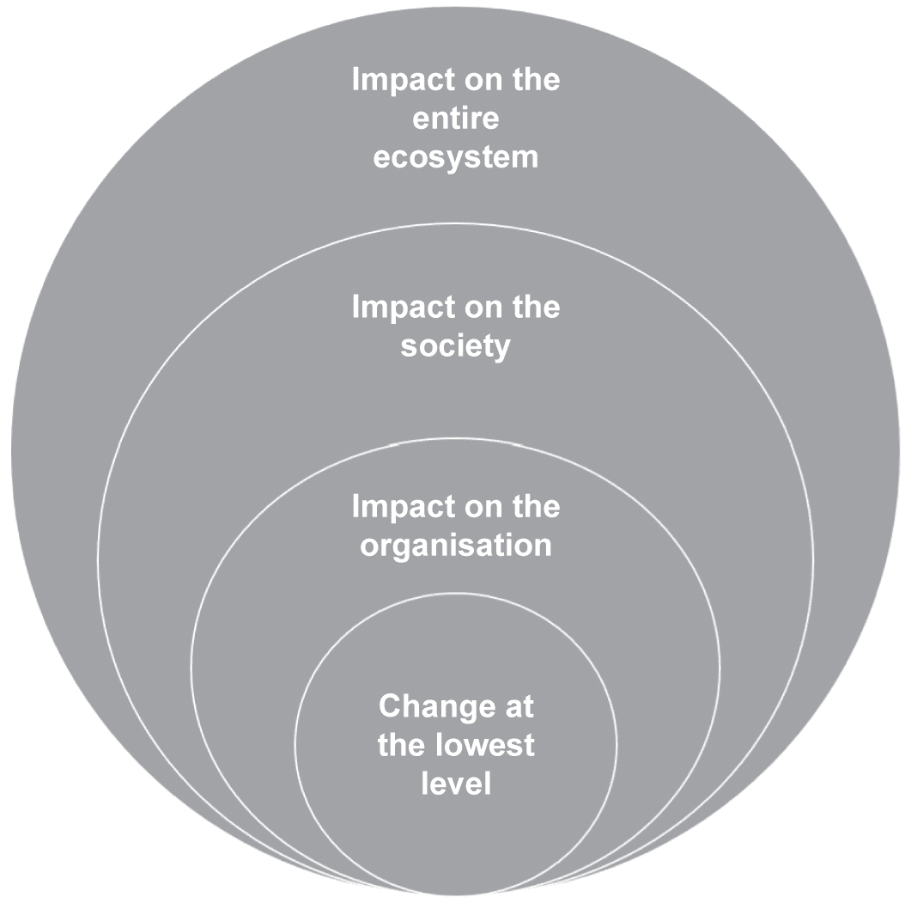

认识到影响评估的重要性，我制定了一套一致的方法，每次都用来彻底评估利益和影响。这种方法包括审查业务变化对产品的影响，不仅如此，还包括组织技术和业务环境中所有相互关联系统的效果。此外，它还涉及评估潜在的外部影响，超越组织边界，涵盖其对社会和更广泛生态系统的影响。

## 摘要

应对不断变化的社会趋势和业务需求，频繁改变和提升技术和业务流程是当务之急。拥有安全思维和安全方法赋能的业务分析师，能够很好地权衡这些变化的预期和非预期影响。凭借工具箱中的这些额外资源，他们能够将网络和信息安全考虑有效整合到分析中，确保全面评估并交付完整的分析。后续章节将更深入探讨实现这一目的所需的框架、技术和工具。

## 关键问题

• 本章你的主要学习要点是什么？
• 你将实施的一条教训是什么？
• 你如何总结你对安全方法的看法？

1 [`en.wikipedia.org/wiki/Parkerian_Hexad`](https://en.wikipedia.org/wiki/Parkerian_Hexad)

# 4 陷阱在哪里？

Here’s what you’ll learn from this chapter:
• 第一支柱 – 风险分析。
• 风险是网络安全的核心部分。
• 风险的定义。
• 风险管理方法。
• 网络弹性与风险管理。
• 业务分析对风险管理流程的支持。
• 其他风险视角。
• 风险中的偏见。
• 有效风险管理的障碍。
• 风险管理中的人工智能。

## 两大支柱

上一章介绍了业务分析与网络安全框架，强调了建立基础安全思维的重要性。在本章中，我们将深入探讨该框架两个关键支柱中的第一个：‘风险分析’和‘业务分析’（图 4.1）。

本章对风险分析和管理流程进行了深入探讨，特别关注业务分析的接触点。探索旨在提供整体理解，使你能够识别偏见并克服障碍，以促进有效的风险管理和决策。

第二支柱业务分析将在下一章中探讨。它将突出项目交付各个阶段的网络安全接触点，最终有助于开发更安全、更具弹性的系统和应用程序。

## 有意识和无意识的风险

每一天，无论我们是否意识到，我们都会对生活中的风险做出非正式判断。从过马路到开车、使用手机甚至睡觉，我们都会遇到风险因素的情况。是的，即使在睡觉时也是如此，因为并非每个入睡的人都能在第二天醒来。我们有意识地承担一些风险，而另一些风险我们可能甚至没有意识到或无法避免。

**图 4.1 具有两个支柱的业务分析与网络安全框架**（版权：I-Perceptions Consulting Ltd）

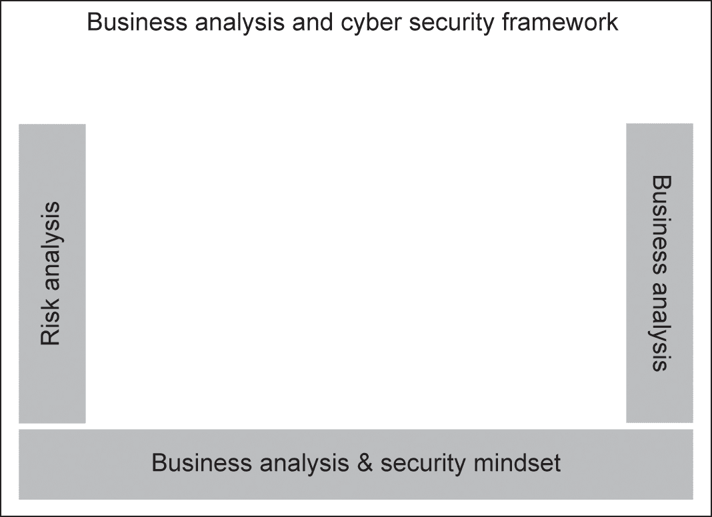

然而，这种非正式的风险管理方法在组织环境中是不够的。当谈到组织风险时，正式的风险管理方法对于通过使**风险成为网络安全的核心部分**来处理组织风险至关重要。

如前几章所述，这一章也借用一个故事来传达关键信息。这个故事来自 Manoj Vasudevan（2016 年）所著的书籍 *Mastering Leadership the Mousetrap Way*。

### 老鼠夹

从前有一个贫穷的农民。他和妻子住在一间小房子里。他有一个小农场，有一只鸡、一只山羊和一头牛。但还有另一个不受欢迎的客人，一只老鼠。所以，农民买了一个老鼠夹来摆脱这个不受欢迎的客人。

看到房子里的老鼠夹，老鼠感到惊慌，他惊慌失措地跑到农场去寻求帮助。他看到农场里的鸡，就请求帮助，因为房子里有老鼠夹。鸡正愉快地啄着谷物，停了下来，看着老鼠说，“我理解这对你来说是一个严重的问题，但这不是我的问题。”

听到这话，老鼠感到失望，继续在别处寻求帮助。他看到山羊在农场里欢快地奔跑，就请求帮助。山羊立刻停下奔跑，为老鼠感到难过，说，“哦，这对你来说一定很糟糕，我很遗憾听到你的困境，但这不是我的问题。”

老鼠因为找不到帮助而感到恐惧，但他没有失去希望，坚持下去。他看到一头专心致志地吃草的奶牛，就请求她帮忙，因为房子里有老鼠夹。奶牛睁开眼睛，看着老鼠，思考了一会儿说，“你听说过牛被困在老鼠夹里吗？我很抱歉，但不要把我牵扯进你的麻烦里。这不是我的问题。”

老鼠因找不到帮助而感到绝望和迷失，哭着回到房子，度过了这一天。

在继续这个故事之前，我鼓励你暂停片刻，识别出这个情况中固有的所有风险。这些风险可能涉及其中任何或所有角色，你可以自由地做出假设。我敦促你不要忽视这一步——参与这次反思练习将使你能够从不同的角度感知风险。这次反思练习将帮助你看到什么是可见的，什么是不可见的，你会很高兴你做了它。

### 反思时间

花点时间，思考并写下：

# 在这种情况下，哪些风险会影响角色中的任何一个或全部？请自行假设。

当那晚大家都睡着时，房子里一片绝对寂静。然后厨房里的捕鼠器传来一声巨响。听到这声响，农夫的妻子从床上跳起来冲进厨房。天很黑，她无法抑制自己的兴奋。她弯下腰去查看捕鼠器里被困的老鼠，却惊讶地发现那是一条蛇而不是老鼠。蛇怒不可遏，咬了她一口，她痛苦地尖叫起来，惊醒了农夫，农夫冲进厨房打开了灯。看到妻子凄惨的状况，农夫感到震惊，迅速尽力提供医疗帮助。但为时已晚，损害已经造成。

他的妻子病得很重，医生建议他给妻子喂鸡汤帮助她康复，于是鸡就必须处理掉了。得知妻子生病后，他们的朋友和家人前来探望，现在农夫必须招待客人，于是山羊也必须处理掉了。

妻子毫无康复迹象，几天后她去世了。农夫不仅要承担她生病的费用，而且加上葬礼费用，他别无选择，只能卖掉奶牛，于是奶牛也必须处理掉了。

失去挚爱的妻子，农夫失去了生活的意志，陷入抑郁。几个月后，他也去世了。而这栋房子的新主人是老鼠（Vasudevan, 2016）。

## 结局反思

你是否预见了这个故事的结局，并且能够识别出哪些风险已经实现？现在再花一点时间反思这个故事以及你之前识别出的风险。评估你对角色威胁的判断准确程度。故事是否让你更深入、更全面地审视这种情况？

再次，不要跳过这个过程，因为练习将加深你的学习，磨练识别明显和不明显风险的技能。

## 反思时间

花点时间思考并写下：

- 你在读完故事后如何看待风险？
- 它是否让你在看待明显和不明显的事物上发生了转变？

故事中许多关键教训中，在网络安全或一般安全背景下最需要强调的三大信息是：

- 安全影响每个人，因此是每个人的责任。
- 组织中对个人或团队的威胁迟早是对整个组织的威胁。
- 组织中的领导者需要做好准备，而不是惊慌反应。他们需要预见风险并做好相应应对准备。

然而，人类倾向于忽视明显的风险，往往假设它们不会发生，或者即使发生也不会影响自己。因此，当这些风险真正发生时，他们毫无准备，受到重创。

一句广泛归于道格拉斯·亚当斯^(2)的名言精辟地概括了这一点：‘可能出错的东西与不可能出错的东西之间的主要区别在于，当不可能出错的东西出错时，通常会发现它无法触及或修复。’

在道格拉斯·亚当斯的这句巧妙引言中，他强调了我们假设不会损坏的东西一旦损坏就会变得无法修复。在组织中也是如此，当风险未被预见随后显现时，所造成的损害是不可逆的。

虽然风险看起来可能很简单，但在涉及各种变动参数的情况下就会变得复杂。随着情况的变化，参数变得更加棘手，导致令人困惑的无尽循环。

但当今组织越来越依赖复杂的资讯系统，因此正式且结构化的方法变得势在必行，风险成为资讯安全管理中的核心概念。

安全就是全关于管理风险。我们只能在所有风险得到管理时称其为安全。而我们只能在识别出某物时才能管理它。当安全漏洞或事件被分析时，在大多数情况下，根本原因会直接或间接地凸显管理不善和被忽视的风险，使得‘识别风险’至关重要，因为我们不知道我们不知道的东西，或者引用 IBM 副董事长 Gary Cohn 的话:^(3)

‘如果你不投资于风险管理，无论你从事什么业务，那都是一个有风险的业务。’

## 风险定义

风险识别需要好奇心和开放的心态来提出许多‘为什么’问题，这是业务分析师的基本活动之一，正是在此时可以识别出可能出错的事情。

[商务词典.com](http://Businessdictionary.com) 对风险的定义很恰当。风险是‘由外部或内部漏洞引起的损害、伤害、责任、损失或其他任何负面事件的可能性或威胁，并且可以通过先发制人的行动避免。’该定义不仅定义了风险，还强调了先发制人的行动。先发制人思维是一种需要训练才能看到可见和尚未可见事物的技能。

## 风险管理流程

现在已经确立风险是安全管理的核心。本章的下一部分简要介绍了流程，以及组织在设计有效的风险管理流程时应注意的风险偏见和障碍。

风险管理流程不是一次性事务，而是一个适用于任何风险的循环过程。

图 4.2 中的图表说明了 ISO 31000 对企业风险管理的方法。ISO 标准是由国际标准化组织制定的国际标准集。ISO 是一个独立的、非政府的国际组织，负责制定和发布标准，以确保各行业产品、服务和系统的质量、安全和效率。

**图 4.2 风险管理流程**（版权：I-Perceptions Consulting Ltd）

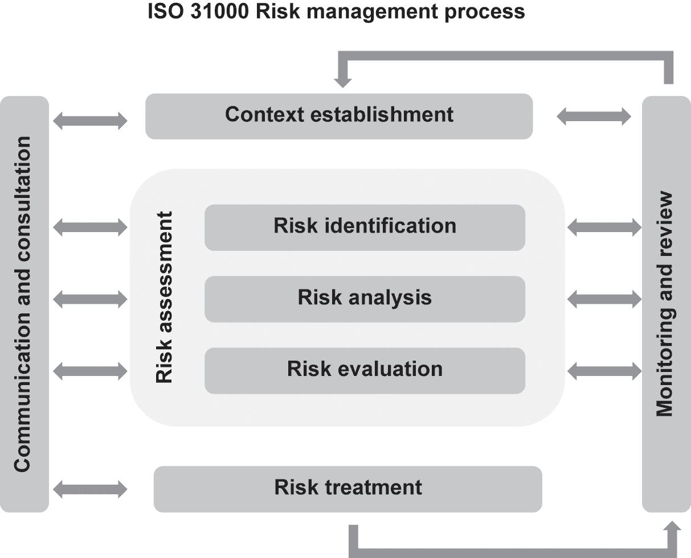

下面介绍了 ISO 31000 风险管理流程的概述，并指导业务分析师在每个阶段的角色。

### 建立背景

在业务分析中，设定背景或范围至关重要，在这里，背景或范围也是风险管理流程的第一步。它包括识别资产（物理或信息）并为每个资产指定所有者作为初始步骤。所有者将在风险实现时负责处理该风险，通过做出必要的决定并采取必要的行动。他们也负责资产的维护和安全。

#### 业务分析师支持

业务分析师可以通过分析组织的业务背景、目标以及外部和内部环境，并在与安全和 IT 利益相关者合作的情况下识别信息安全需求来提供支持。分析还包括了解组织的结构、流程、信息资产和监管义务。他们可以在背景明确理解时帮助识别风险。

### 风险评估

如图 4.2 所示，风险评估包括三个活动：

- 风险识别；
- 风险分析；
- 风险评估。

#### 风险识别

风险识别旨在确定可能出错的内容以及潜在损害或损失在多大程度上可能影响组织。它是关于识别和列出所有威胁、漏洞及其来源。

#### 业务分析师支持

商务分析师可以主持研讨会和讨论，以识别并记录组织中所有系统和流程中的风险，包括信息安全风险。他们还可以进行利益相关者分析，以识别和理解不同利益相关者的观点、利益以及相关潜在风险，这有助于预见和应对与利益相关者相关的风险。商务分析师与安全和 IT 团队协作，可以在风险登记册中识别并记录资产、漏洞、威胁和潜在影响，使用 SWOT（优势、劣势、机会、威胁）和 PESTLE（政治、经济、社会、技术、法律和环境）分析等分析技术来发现潜在威胁和机会。

## 风险分析
已识别的风险会根据所涉及资产的关键性进行分析。此分析旨在确定威胁发生的频率和概率，以及如果威胁实现时潜在的影响程度或规模。这些风险随后会被定性或定量分类。最后，会评估整体业务影响，其中包括财务和运营因素，以及无形影响，如声誉影响，或对个人生活、谋生手段、社会或生态系统的影响。

### 业务分析师支持
商务分析师可以通过与利益相关者协作来评估和分析已识别的风险，评估其可能性、影响和整体业务影响，在确定风险暴露水平方面擅长进行定性和定量分析。他们可以支持利益相关者根据风险对项目目标的潜在影响对风险进行优先级排序。通过提供有价值的见解，他们帮助利益相关者做出明智决策，以战略性地管理最关键和影响最大的风险。

## 风险评估
评估的第三步是风险评估，即就风险处理和应对策略做出明智决策的过程。它涉及确定已分析风险的重要性，并根据其对实现业务或项目目标的潜在影响对其进行优先级排序。

### 业务分析师支持
商务分析师可以支持根据风险对业务或项目目标的潜在影响对风险进行优先级排序，并在管理最关键风险的决策过程中提供支持。
他们可以通过提出替代方法、建议对项目范围、进度或资源进行更改、识别依赖关系以及评估风险缓解决策和策略的可行性来制定风险缓解计划。

## 风险处理
如上所述，风险处理过程是 ISO 31000 风险管理流程中的下一个阶段。它涉及在有效评估风险后管理风险的策略和活动。风险处理旨在将风险的可能性或影响降低到组织可接受且与其风险偏好一致的水平。会确定风险处理措施，可能包括接受风险、规避风险、降低风险或修改风险，以及根据组织内部的性质和背景共享或转移风险。

### 风险接受
风险接受是对风险进行有意识且客观的接受，目前不采取任何行动，并在风险显现时做出响应。它承认一定程度的风险是可以接受的。例如，决定不对不存储敏感信息的低影响系统投资额外的安全措施。

### 风险规避
风险规避通过避免或退出可能导致风险显现的活动、情况或环境，从而完全防止特定风险。例如，避免使用存在漏洞的系统或不再由厂商支持的软件，或当实施处理的成本超过收益时。

### 风险降低
风险降低是一种通过将风险水平降低到更可接受的水平，即残余风险，来降低风险可能性或影响的策略。风险降低帮助组织在战略上平衡风险管理与实现目标。例如，实施的安全控制和措施，如加密、身份验证防火墙等，可降低网络安全事件的可能性和影响。

### 风险分担
风险分担是将风险责任与保险公司或供应商等其他方共享。该策略是将风险分配给不同实体，以减轻或降低组织上的财务负担。风险分担或转移可以部分或完全外包。例如，外包部分或完整的支付处理能力，或购买网络安全保险将数据泄露的财务后果转移给保险提供商，可减轻对组织财务资源的影响。

### 商务分析师支持
商务分析师可以通过评估实施风险降低策略相关的成本与风险降低方面的潜在收益之间的关系，进行成本-效益分析，以评估风险降低措施的有效性和可行性。
他们可以根据已识别的风险处理选项与组织目标的一致性协助进行优先级排序，并识别资源限制以及不同处理策略之间的潜在权衡。
他们可以评估风险处理对当前业务流程或引入新流程的影响，并预见对项目范围、时间表、预算和交付成果的潜在连锁反应。
商务分析师可以支持项目经理创建详细的风险处理计划，概述实施所选风险处理策略所需的操作、责任、时间表和资源。然后他们需要更新需求目录和其他相关项目文档，以确保变更在流程和系统内得到实施。
他们可以在技术和非技术利益相关者之间进行联络，以实现对风险及其管理策略的共同理解，并促进沟通和决策。

## 监控和审查
风险并非静态。可能性和影响会不断波动，取决于组织的内部和外部环境。因此，定期监控是必要的，以便及早发现变化并保持整体风险态势。监控和审查确保组织保持适应性和响应性，并根据审查反馈进行持续改进。

### 商务分析师支持
商务分析师可以支持建立持续监控已识别风险和风险处理计划有效性的机制。他们可以支持开发为决策者提供洞察并支持持续改进的报告机制。
他们可以与利益相关者协作，定义与风险管理流程相关的关键绩效指标和指标，并促进仪表板或报告机制的设计。
他们还可以支持在整个项目生命周期内监控已识别风险的状态，协助跟踪风险缓解策略的有效性，并向利益相关者和项目团队提供定期更新。报告风险状态有助于保持意识并促进及时决策。

## 沟通与协商

最后，有效的沟通和咨询是成功风险管理框架的关键组成部分，促进透明度和对组织整体风险状况的共同理解。它有助于确保组织能够受益于集体的知识和见解。它还有助于建立风险意识文化，培养利益相关者之间的信任，并营造将风险管理视为共同责任的环境。

## 业务分析师支持

业务分析师可以与利益相关者合作制定风险管理的沟通计划。他们可以协助定义沟通目标、识别关键信息、确定适当的沟通渠道，并为沟通活动制定时间表。

他们可以协助准备与组织风险管理框架、流程和成果相关的清晰简洁的文档。

业务分析师可以通过创建调查、进行访谈和组织研讨会来设计和实施有效的反馈机制，以收集利益相关者的见解和关切。

业务分析师可以在确保风险管理举措成功实施方面发挥关键作用。他们凭借弥合技术和业务视角、促进讨论以及推动利益相关者和决策者之间有效沟通的能力，可以为组织内营造风险意识文化做出贡献。

他们可以分析与风险评估、事件和风险处理计划相关的数据。业务分析师可以识别趋势、模式和关注领域，并为决策者生成全面报告。他们可以帮助选择、实施和优化简化风险相关数据监控和报告的工具。利用业务分析技术识别根本原因，业务分析师可以帮助评估风险处理的成效并提出改进建议。

业务分析还可以与内部和外部审计团队合作，促进风险管理流程的审计，并协助准备文档、回应审计发现和实施纠正措施。他们还可以帮助设计场景、支持测试活动并分析结果以识别改进领域等。

此外，*信息风险管理*（Sutton, 2021）是一本全面的指南，可以帮助业务分析师更深入地了解和减轻与信息相关的各种风险。

## 保持网络弹性

一个完善的风险管理流程是实现网络弹性的基础。网络弹性是指组织整体准备应对和从网络威胁、网络攻击、数据泄露、系统故障和其他安全事件中恢复的能力。健全的风险管理流程对于维持组织的网络弹性至关重要。风险管理流程为识别、评估、减轻和监控风险提供了框架——这些是全面网络弹性战略的关键组成部分。

## 其他风险视角

对有效风险管理流程有良好理解的同时，了解一些做法和不做法至关重要。

尽管在一些组织中忽视低可能性风险已成为常见做法，尤其是那些具有高影响、生存性风险的风险，但新冠疫情和最近的战争提醒我们，无论生存性风险的可能性或概率多低，**它们永远不会为零**。这些事件是警钟，提醒我们认识到人类历史上从未有过的最快速度下正在发生的社会、经济和环境变化。

虽然高后果、低可能性的风险不能被忽视，但为每一种可能的风险做准备是不可能的、昂贵且不切实际的。因此，组织必须制定战略来帮助他们优先考虑并为与其组织环境相关的那些高影响风险做好准备。然而，挑战在于制定战略，尤其是在未来未知的情况下。

在他们的文章《你本可以阻止的灾难：为非凡风险做准备》中，麦肯锡的 Fritz Nauck、Ophelia Usher 和 Leigh Weiss 建议进行‘预先验尸练习’，这是一种风险决策者可以采用的技术，以识别哪些‘可预测的惊喜’会对他们的组织造成严重后果（Nauck et al., 2020）。‘可预测的惊喜’这一短语由 Michael Watkins 和 Max Bazerman 在他们的 *哈佛商业评论* 文章中提出（Watkins and Bazerman, 2003）。它们是指那些影响组织价值主张的高影响、低概率风险，组织需要在其显现时做出响应。

此外，在麦肯锡的 *战略室内部*（Aufreiter et al., 2022）播客节目中，Nora Aufreiter、Celia Huber 和 Ophelia Usher 从董事会角度出发，通过建议以下活动来阐述董事会确保对生存性风险做好准备的作用：
- 第一个是识别‘可预测的惊喜’并定义预防性行动。
- 第二个是通过场景视角来看待风险。创建关于可预测惊喜的精心规划和布局的场景将提供对影响的洞察。一个场景可能同时有多个风险同时发生，而这些多重故事有助于打开想象力并辅助决策。关键在于构建富有想象力的场景，并辅以市场预测、专家意见和世界经济论坛报告的数据，说明如果这些风险在短期和长期内显现，组织将受到怎样的影响。提前思考缓解措施并做好准备就是关键。
- 第三步是准备一份平衡的业务弹性计划，涵盖财务、运营、技术、资源、声誉和商业模式等所有维度。优先考虑场景，为其分配预算和资源，并根据风险偏好创建管理事件和业务连续性的流程。
- 第四步是保持警觉和战术性，通过创建可在这些场景显现时利用并投资的商业模式来把握潜在机会。经典例子是亚马逊帮助第三方建立电子商务网站，从而催生了亚马逊网络服务（AWS）。根据 AAG IT 的数据，AWS 约占云计算市场份额的 30%（Griffiths, 2024）。

### 业务分析师支持

业务分析师凭借其硬技能和软技能，可以在识别可预测的惊喜方面提供支持。他们可以促进创建场景，以帮助说明这些可预测的惊喜对组织、员工、客户、供应商、社会或生态系统的影响。业务分析师可以通过与战略层面的决策者合作并强调组织的整体弹性来影响组织。组织为保护其价值主张或潜在机会所做的投资可能意味着生存与灭绝之间的区别。

组织为保护其价值主张或潜在机会所做的投资可能意味着生存与灭绝之间的区别。

## 风险中的偏见

人类是其成长环境和经历的产物，导致认知偏见，这在感知、解释和应对风险方面发挥着重要作用，导致判断和决策出现错误。因此，风险偏见意识是促进更客观、准确的风险评估的另一个关键方面。

风险管理协会（IRM）制定了一份简短指南^(4)来对抗风险管理中的偏见，如下所述：

可得性偏差是指在评估风险或做出决策时，个人过度依赖容易获取或轻易浮现在脑海中的信息。然而，通过组建具有多元视角和背景的挑战者群体，可以有效缓解这种偏差。

锚定效应是指在评估风险或做出决策时，过度依赖某条被提供的单一信息，该信息被称为“锚”。使用新的参考数据重新评估并审视可能的结果以求准确，有助于减轻锚定偏差。

后见之明是指过往经验对预测结果的影响，避免此偏差的建议是尽可能收集数据并构建反事实。

群体思维是指群体内部倾向于优先追求共识而非批判性分析，往往出于避免冲突的动机。这可能导致出现被一致同意的 flawed 结果，即使存在更优且更合理的替代方案，但未被一致接受。创建多元且平衡的群体有助于抵消群体思维固有的偏差。

过度自信是指个人或群体对其判断表现出过度的自信，往往导致他们高估某些事件发生或不发生的可能性。采用诸如向下反事实（想象结果比实际发生更糟的情景）和预演失败（一种在问题发生前预见潜在失败或问题的技术）等技术，有助于缓解这种倾向。

## 有效风险管理的障碍
有效风险管理需要考虑的最后一个方面是风险障碍。识别和应对这些障碍对于培养积极主动且具有韧性的不确定性应对方法至关重要。克服这些挑战通常需要文化变革、改善沟通以及分配充足资源以支持全面的风险管理实践相结合。

以下是一些常见障碍，但并非详尽无遗：
- 缺乏意识 – 未认识到风险的潜在影响或低估了积极主动的风险管理策略的需求。
- 沟通差距 – 缺乏清晰的沟通渠道导致利益相关者不了解已识别的风险及相应的缓解策略。
- 风险规避文化 – 抗拒变革的组织会阻碍有效的风险管理。
- 短期主义 – 专注于短期收益的组织可能会优先考虑即时目标而非长期风险管理策略。
- 信息不足 – 信息不足或过时可能导致风险识别和评估不准确，损害风险管理工作的有效性。
- 过于复杂的风险管理流程 – 过于繁琐的风险管理流程可能无法有效融入日常决策过程。

## 反思时间
稍作停顿，思考并写下：
- 你能否识别出三个你希望评估风险偏差的风险？
- 你所在组织面临哪些风险障碍？
- 你对风险的看法是否发生了变化？如果有，是如何转变的？

## 风险管理中的人工智能
在结束本章之前，这里简要介绍如何利用人工智能进一步提升风险管理流程。人工智能可以通过提供先进的分析、自动化和预测能力显著增强风险管理。

人工智能可以利用来自各种来源的大量数据进行数据分析，以识别传统方法可能无法发现的潜在风险和模式，并可自动检测可能表明新兴风险的异常值和离群值。

利用历史数据进行预测分析，人工智能可以帮助预测未来风险及其潜在影响，评估风险的可能性和严重程度，并使你能够优先处理并采取行动应对最关键的问题。

人工智能的一种应用方式是利用机器学习（ML）模型实时分析交易数据以进行欺诈检测，识别与欺诈活动相关的模式。

人工智能可以分析用户行为和网络活动以检测异常模式，并提供可能表明网络安全威胁的行为分析。它有助于及早识别和应对潜在的网络风险。

机器人流程自动化（RPA）可以简化常规风险管理任务，使人力资源能够专注于更复杂的分析和决策，从而提高效率并降低重复任务中人为错误的风险。

人工智能可以通过创建仿真模型进行情景分析，以评估各种事件对组织的潜在影响，帮助他们了解不同风险情景的后果。

实时监控数据流可以提醒组织潜在风险并使其能够积极主动地响应。将人工智能的分析能力与人类洞察相结合，可以创造更稳健、更有效的风险管理流程。

## 总结
本章涵盖了风险管理的各个方面，区分了有意识和无意识风险，并通过《老鼠夹之路》故事强调了认识两者的重要性。

风险的定义强调先发制人，随后对风险管理流程的探讨——这是保持网络韧性的基石——被强调为一个关键组成部分，需要积极措施和适应性策略以应对不断演变的网络威胁。

可预测的意外概念和专家的建议强调了前瞻性在风险管理中的重要性，而关于风险偏差的讨论则揭示了认知偏差如何影响决策，并指出了有效风险管理的一些常见障碍。本章最后涉及了人工智能在风险管理中的作用，展示了其增强和简化流程以实现更高效风险缓解的潜力。

## 要点问题
- 本章你的主要学习要点是什么？
- 你将实施的唯一一课是什么？
- 你如何总结你对有效风险管理流程的看法？

2 [`www.goodreads.com/work/quotes/42028477-the-hitchhiker-s-guide-to-the-galaxy-a-trilogy-in-five-parts`](https://www.goodreads.com/work/quotes/42028477-the-hitchhiker-s-guide-to-the-galaxy-a-trilogy-in-five-parts)

3 [`www.moneyandbanking.com/commentary/2019/3/10/what-risk-professionals-want`](https://www.moneyandbanking.com/commentary/2019/3/10/what-risk-professionals-want)

4 [`www.theirm.org/media/2517624/1-short-guide-managing-bias.pdf`](https://www.theirm.org/media/2517624/1-short-guide-managing-bias.pdf)

# 5 结构化常识
本章你将学到：
- 常识与业务分析。
- 第二支柱 – 业务分析。
- IIBA 知识领域及网络安全扩展。
- IIBA BACCM 及网络安全扩展。

在第 3 章中揭晓的业务分析与网络安全框架强调培养基础安全思维。第 4 章展开了双支柱之一“风险分析”，而在本章中，焦点转向第二支柱“业务分析”。

### 常识与业务分析

顺着美国前总统詹姆斯·麦迪逊关于哲学是带有大词的常识这一见解，我倾向于认为业务分析是带有结构的常识。每当我参加一次业务分析培训时，都会有一种深刻的领悟浮现出来——所学的一切似乎都内在地合乎逻辑，类似于常识。然而，我必须参加培训才能意识到这一点并得到提醒。正如网络安全或更广泛的安全的强制性本质是每个人责任不可分割的一部分，这一点也需要定期确认和强化，以重新校准我们的认知建构。常识难以捉摸的本质，一种并非普遍丰富的宝藏，体现为跨所有职业的宝贵资产，凸显了其在业务分析领域中的关键作用。

哲学就是带有大词的常识。

业务分析就是带有结构的常识。

业务分析的多面性领域要求技能、技术、工具和方法论的融合，所有这些都经过精心安排以促进有纪律且结构化的实践。专业的业务分析师接受培训，获得专门技能，使他们能够有效驾驭分析业务需求的复杂地形。从本质上讲，常识被提升到结构化层面，成为有效业务分析的蓝图。

## 第二支柱

业务分析师利用许多不同的模型和框架，包括但不限于安索夫矩阵、Debra Paul 的业务分析服务框架（BASF）、波特五力模型、IIBA 的知识领域、波士顿咨询集团的增长份额矩阵、PESTLE 和 SWOT 分析。这些模型各自具有独特的关注领域，并伴随其独特的优势和劣势。尽管如此，随着分析的展开，一个共同的目标逐渐显现，即形成解决已识别业务需求所必需的需求。这些多样化的模型和框架为业务分析的复杂领域提供了一种结构化和全面的方法，指导分析师系统地探索业务环境以及通向解决方案的需求。

## 故事时间：三只小猪

这是我在小学早期读过的一个故事，直到成年后才意识到寓言的含义。在开展一项倡议之前检查其意图的重要性，以确保所构建的内容能够服务于预期目的，这是一个关键因素，尤其是在业务分析的背景下。这里的故事略有修改，以传达预期的信息。

从前，有三只小猪。是时候让它们离开家，在世界上闯荡并为自己建造房子了。它们的母亲很好地指导并教导了它们，在它们离开前，她提醒它们要始终努力工作，并在行动前先思考。第一只小猪很懒，选择了更容易的办法应付了事，对母亲的建议也太少关注。第二只小猪试图理解建议，但失去了兴趣并放弃了。第三只小猪很明智，总是渴望听从母亲的建议。

于是，三只小猪出发了。它们遇到一个扛着一捆稻草的男人，第一只小猪未经多想，就买下稻草来建房子。其他两只并不信服，继续踏上旅程。然后它们遇到一个扛着一捆木棍的男人，第二只猪认为木棍比稻草更结实，于是买下木棍来建房子。但第三只小猪仍然不信服。他需要一座更坚固的房子来保持安全，于是继续踏上旅程。他遇到一个推着一车砖的男人。他认为这就是建造坚固房子所需的，于是从那人那里买下了砖。

三只小猪现在都有了自己的房子。

几天后，一只饥饿的狼出现了，想要吃掉小猪们。他敲了稻草房的门，请求第一只猪让他进去。当他不被允许进入时，他吹倒了房子。第二天，狼又回来了，敲了木棍房的门，请求第二只猪让他进去。当他不被允许进入时，他又吹，木棍房倒塌了。第三天，狼又回来了，敲了砖房的门，请求第三只猪让他进去。当他不被允许进入时，他吹，但什么也没发生。他反复吹，房子仍然安然无恙。于是狼决定通过烟囱进入房子。当他走在屋顶上时，那只聪明的猪把一个大锅放在炉子上开始烧水。狼正试图通过烟囱进入，现在毫无机会，因为他会被烫伤，于是他为保命逃跑了。建造了坚固房子的第三只猪是安全的。

这个故事传达了三个重要的教训，其中包括：

1. 明确理解目标背后的意图的必要性。虽然目标是建造房子，但意图是抵御危险。
2. 明确理解危险的必要性。除非了解威胁的性质，否则无法构建合适的解决方案。
3. 构建所需的解决方案需要知识和努力。

第一只猪不愿意付出努力，选择了容易的办法，第二只猪不知道如何做出正确的选择，因此他们都不知道自己承担的风险，最终失去了房子和生命。第三只猪了解威胁，并建造了一座能够保护他免受这些威胁的房子，因此得到了保护。

业务分析框架提供了一种系统化和有纪律的方法来解决业务需求，借助知识、能力、技术和工具来识别、定义并提出合适的解决方案，就像坚固的砖房一样。

虽然如上所述存在各种业务分析框架，但本章讨论的是 IIBA 知识领域，并突出网络安全扩展。IIBA 的 *业务分析知识体系*（2015）（BABOK v3）为业务分析实践提供了全面的指南和框架。它提供了一套对业务分析至关重要的知识领域、任务、技术和能力。

根据 BABOK v3，知识领域是一组逻辑相关的任务，用于描述特定的业务分析领域。图中图 5.1 展示了知识领域及其之间的关系。

## IIBA 的业务分析知识领域

本章的下一部分列出了知识领域，并指出网络安全触点。请记住，第 2 章已确定业务分析师可以根据项目需要随时调用网络安全专家。判断项目中的任何方面是否需要网络安全专家的关键已在图 2.3，‘业务分析师网络安全知识概述’中列出，因此请确保这些专家参与进来以相应地支持分析。

**图 5.1 IIBA 知识领域**（版权：国际业务分析协会）

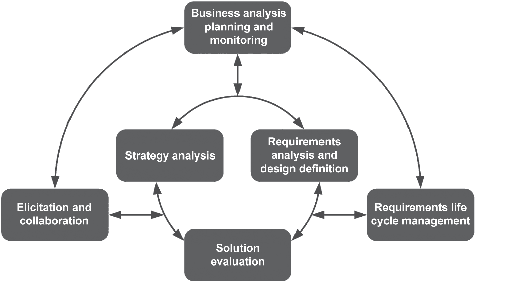

### 业务分析规划与监控

业务分析规划与监控知识领域提供了如何在整个项目或倡议中有效规划和管理业务分析活动的指导，以确保业务分析工作与整体项目目标保持一致，并且业务分析师拥有清晰的计划来执行其任务。

# 业务分析规划与监控
正如 BABOK v3 中所述，业务分析规划与监控知识领域包括规划业务分析方法、规划利益相关者参与、规划业务分析治理、规划业务分析信息管理以及识别业务分析绩效改进。网络安全扩展确保业务分析计划纳入网络安全措施，并且持续监控包括评估网络安全控制措施的有效性。

## 网络安全扩展
### 先决条件
理解组织整体业务战略中的网络安全目标、网络安全态势、关注点、风险、当前措施、漏洞和威胁态势。认识到网络安全事件对业务需求和组织可能产生的潜在影响。

### 活动
• 支持识别和评估与业务分析活动相关的网络安全风险。
• 将网络安全考虑因素整合到业务分析计划的范围和目标中。
• 规划与网络安全利益相关者的协作，以确保有效的参与和沟通。
• 建立治理流程，以解决业务分析活动中相关的网络安全考虑因素，例如网络安全相关信息的决策流程。
• 管理网络安全相关信息，特别是处理敏感数据的协议。
• 将网络安全信息管理整合到整体信息管理计划中。
• 识别网络安全特定指标和关键绩效指标（KPI），以与项目和组织安全目标保持一致。
• 将网络安全指标整合到整体监控和报告机制中，以确保业务分析活动有助于实现网络安全目标。
• 将网络安全需求可追溯性整合到整体可追溯性计划中。
• 定义创建、组织和维护业务分析文档的方法，其中包括网络安全相关信息。
• 帮助建立保护和处理敏感网络安全文档的协议。
• 将网络安全文档整合到整体文档计划中。
• 定义包含网络安全考虑因素的评审标准和检查清单。
• 建立评审流程以确保与网络安全标准的相关合规性。

# 需求获取与协作
需求获取与协作知识领域提供指导和最佳实践，以确保业务分析师在整个业务分析过程中从利益相关者收集相关且准确的信息并促进协作。

成功的需求获取与协作涉及：
• 利益相关者参与，即在整个业务分析过程中识别、沟通和管理利益相关者。
• 协作，即与利益相关者共同努力实现业务目标。
• 需求获取，即从利益相关者中提取信息以了解其需求、期望和关注点的过程。

正如 BABOK v3 中所述，需求获取与协作知识领域包括为需求获取做准备和规划、进行需求获取、确认需求获取结果、传达信息以及管理利益相关者协作。网络安全扩展确保需求获取过程考虑安全需求，并调整需求获取和协作流程以纳入网络安全利益相关者。

## 网络安全扩展
### 先决条件
理解组织整体业务战略中的网络安全目标、网络安全态势、关注点、风险、当前措施、漏洞和威胁态势。认识到网络安全事件对业务需求和组织可能产生的潜在影响。

### 活动
• 进行利益相关者分析以识别以网络安全为重点的角色和职责。识别并与安全团队中的利益相关者进行接触，他们在网络安全中发挥关键作用，例如 IT 安全专业人员、数据隐私官和合规官。
• 与已识别的网络安全利益相关者协作，以了解其具体需求和关注点。
• 规划获取与网络安全政策、监管要求和特定安全控制相关信息，以与整体业务分析计划保持一致。
• 获取与网络安全风险、威胁和漏洞相关信息，并与业务和网络安全利益相关者协作识别需求。
• 确认所获取的信息解决了已识别的网络安全风险和关注点。
• 与网络安全利益相关者验证安全需求，以确认其与整体业务需求保持一致。
• 创建模型以表示敏感信息流、加密机制和访问控制。
• 与利益相关者协作以确定网络安全决策和实施的优先级。
• 记录解决已识别风险并与整体业务需求保持一致的网络安全需求。
• 记录风险评估，包括已识别的威胁、漏洞和风险缓解策略。
• 反思过去的网络安全事件，以识别需求获取和协作技术改进的领域。
• 维护利益相关者共享信息的保密性。

# 需求生命周期管理
需求生命周期管理知识领域侧重于管理需求整个生命周期所涉及的流程和活动。它包括获取、记录、分析、优先排序和验证需求，包括跟踪变更并确保需求与整体项目和组织目标保持一致。

正如 BABOK v3 中所述，需求生命周期管理知识领域包括追溯需求、维护需求、优先排序需求、评估需求变更和批准需求任务。网络安全扩展确保网络安全需求得到系统、有效的识别、记录、验证和管理，以维护安全态势，保护敏感信息、维护系统完整性并确保业务连续性。

## 网络安全扩展
### 先决条件
理解组织整体业务战略中的网络安全目标、网络安全态势、关注点、风险、当前措施、漏洞和威胁态势。认识到网络安全事件对业务需求和组织可能产生的潜在影响。

### 活动
• 识别网络安全需求并在整体需求识别过程中明确记录这些需求。
• 与网络安全专家协作，在业务流程中识别相关的安全需求。
• 作为整体功能需求的一部分，记录特定的网络安全控制需求，例如加密、访问控制和身份验证需求。
• 作为整体功能需求的一部分，记录与网络安全相关的特定监管和合规要求，这些要求影响业务流程或数据。
• 开发可追溯性矩阵，将网络安全需求与设计元素、测试用例和其他项目工件关联起来。
• 管理变更并评估对网络安全控制的影响。
• 在优先排序需求时与网络安全利益相关者协作，以确保关键且影响大的安全需求由网络安全利益相关者分配适当的优先级级别。

- 与网络安全利益相关者共同促进需求评审，就影响网络安全需求的功能性需求和非功能性需求达成共识。
- 建立变更控制流程，包括对网络安全需求的影响评估。

## 策略分析
策略分析知识领域提供指导，以确保业务分析工作支持组织的整体战略方向。
如 BABOK v3 所列，策略分析知识领域包括分析当前状态、定义未来状态、评估风险和定义变更策略任务。将网络安全与组织目标保持一致对于保护数据资产和敏感信息至关重要。

### 网络安全扩展
#### 先决条件
理解组织整体业务战略中的网络安全目标、网络安全态势、关注点、风险、当前措施、漏洞和威胁态势。认识到网络安全事件对业务需求和组织可能产生的潜在影响。

#### 活动
- 在评估当前状态时考虑网络安全因素，例如安全态势、能力和漏洞。
- 在当前业务流程和系统上促进风险评估，并考虑安全因素。
- 评估在当前业务流程和系统中实施的现有网络安全控制措施的有效性。
- 在未来状态的整体业务目标和目标中定义网络安全目标和目标。
- 识别并评估与拟议业务变更和向未来状态过渡相关的网络安全风险。
- 定义变更策略时考虑网络安全因素，例如韧性和组织文化。

## 需求分析和设计定义
需求分析和设计定义知识领域侧重于分析需求和设计解决方案所涉及的流程和活动，通过将业务需求转化为可实施的明确解决方案。
如 BABOK v3 所述，需求分析和设计定义知识领域包括规范和建模需求、验证需求、确认需求、定义需求架构、定义解决方案选项、分析潜在价值和推荐解决方案。网络安全扩展确保解决方案满足业务需求并纳入抵御网络威胁的措施。

### 网络安全扩展
#### 先决条件
理解组织整体业务战略中的网络安全目标、网络安全态势、关注点、风险、当前措施、漏洞和威胁态势。认识到网络安全事件对业务需求和组织可能产生的潜在影响。

#### 活动
- 创建包含业务流程中网络安全控制的视觉模型。
- 在整体功能需求中创建详细的网络安全需求。
- 创建误用案例以及用例。
- 将“坏”行为者作为用户角色的一部分创建。
- 创建易受攻击的场景以及正常和替代场景。
- 确保网络安全假设和约束是整体项目假设和约束的一部分，并传达给利益相关者，包括网络安全。
- 验证网络安全需求是否符合相关法规和标准。
- 由相关网络安全利益相关者确认网络安全需求，以确保需求将导致具有韧性的解决方案。
- 记录网络安全设计决策背后的理由以及所有评估过的选项。
- 识别并记录过渡流程的任何临时网络安全需求以及解决方案的安全过渡。
- 定义管理网络安全事件的角色和职责。
- 记录与组织安全政策一致的事件检测和响应机制。
- 记录分析并应对新兴网络威胁的流程。
- 将网络安全纳入持续的分析和设计流程，并在整个开发生命周期中促进功能团队与网络安全专家之间的持续协作。

## 解决方案评估
解决方案评估知识领域侧重于评估和验证解决方案提供的性能和价值所涉及的流程和活动，以确保已实施的解决方案满足业务需求并为利益相关者提供预期价值和已识别的收益。
如 BABOK v3 所述，解决方案评估知识领域包括衡量解决方案性能、分析性能指标、评估解决方案局限性、评估企业局限性并推荐提高解决方案价值的行动。网络安全扩展确保评估流程考虑网络安全措施，识别潜在安全风险并验证解决方案有效缓解这些风险。

### 网络安全扩展
#### 先决条件
理解组织整体业务战略中的网络安全目标、网络安全态势、关注点、风险、当前措施、漏洞和威胁态势。认识到网络安全事件对业务需求和组织可能产生的潜在影响。

#### 活动
- 支持安全和技术团队根据安全目标定义网络安全绩效指标和指标。
- 分析安全事件、漏洞和威胁检测的数据。
- 支持数据分析团队识别网络安全事件或弱点。
- 与网络安全利益相关者合作解释安全绩效指标。
- 使用统计分析从网络安全绩效数据中得出见解，以识别趋势、模式和改进领域。
- 与网络安全利益相关者合作以：
  - 评估系统弱点以及已识别漏洞对解决方案整体安全性的影响；
  - 考虑威胁态势的变化和新兴网络威胁；
  - 评估企业级网络安全措施可能对解决方案持续安全性的影响；
  - 基于对网络安全局限性和漏洞的分析制定建议；
  - 优先考虑并实施建议的行动；
  - 记录拟议变更对解决方案的预期影响；
  - 收集有关安全措施感知有效性的反馈，以将实现的网络安全收益与安全目标中概述的预期收益进行比较；
  - 分析网络安全控制和对策的投资回报率（ROI）。
- 监控用户对既定安全政策和程序的遵守情况，并识别网络安全最佳实践采用的障碍。
- 建立定期监控网络安全绩效指标的流程。
- 分析历史数据以识别安全事件中的趋势或模式，以便就增强网络安全态势做出明智决策。
- 与网络安全利益相关者合作评估网络安全控制处理日益增加的网络威胁的能力以评估可扩展性。

像 IIBA 的知识领域一样，还有几种其他框架，例如业务分析服务框架、PMI-PBA（项目管理协会 – 业务分析专业人士），业务分析师可以使用，或来自 SFIA6、Vongsavanh 和 Campbell 等的业务分析任务的既定集合。框架的选择取决于组织环境、业务需求以及所开展项目的性质。因此，业务分析师可能会使用框架和方法的组合来适应不同的项目和情况。

我发现大多数框架和业务分析任务都倾向于一组共同要素，例如需要解决的需求或问题、解决问题的解决方案、受影响的利益相关者等等。IIBA 的业务分析核心概念模型 (BACCM) 总结了共同要素，是一种可单独使用或与其他框架和知识领域一起使用的多功能工具。 图 5.2 中的图表展示了 BACCM 以及要素之间的关系。

### 图 5.2 IIBA BACCM
版权：国际商业分析协会。保留所有权利

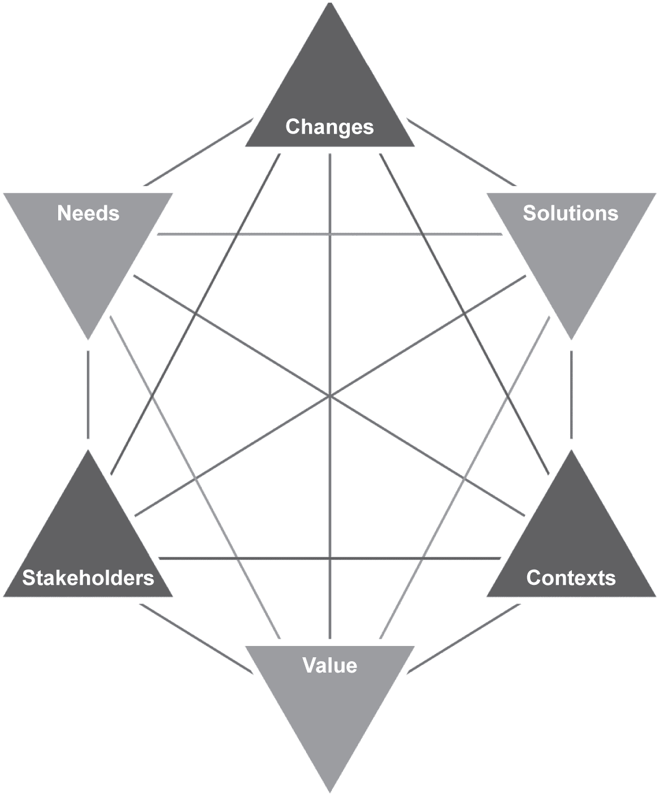

IIBA 业务分析核心概念模型

IIBA BACCM 检查清单是 IIBA 知识中心上提供的‘增值应用知识’资源，而 表 5.1 是与 IIBA BACCM 检查清单一致的网络安全扩展，可单独使用或与其他框架或业务分析任务一起使用，以评估分析中网络安全的影响。

### 表 5.1 IIBA BACCM 检查清单网络安全扩展

| **IIBA 的业务分析核心概念** | | **需要考虑的网络安全相关问题** |
| --- | --- | --- |
| **利益相关者** 指对公司或项目的决策、运营或绩效有兴趣的个人、团体或组织，并且将与变更、需求或解决方案相关联。 | | 网络安全利益相关者是否参与其中？网络安全利益相关者是否有特定的网络安全需求或要求？利益相关者是否需要授权或身份验证？网络安全利益相关者对变更是否有顾虑？ |
| **背景** 指围绕并赋予事件、想法、陈述或概念意义的环境、条件或背景，它们影响或受影响，并为变更提供理由。 | | 上下文是否涉及组织的皇冠上的明珠？限制是否会损害或影响网络安全？如果未受保护，风险是什么？组织对网络安全的文化、行为和态度是否会损害安全态势？ |
| **需求** 指组织当前状态与其期望状态之间的差距，代表企业旨在解决的问题或机会。 | | 需求是否包括或影响网络安全？问题是否包括或影响网络安全？机会是否会影响网络安全？如果需求相互冲突，是否会影响网络安全？优先级排序是否会损害或影响网络安全？如果不采取行动，风险是什么？ |
| **解决方案** 指解决组织内已识别问题或满足需求的手段或方法。 | | 解决方案是否会引发任何网络安全风险？如果是，解决方案需要如何保护？哪种保护级别最适合该解决方案？ |
| **变更** 指对业务流程、政策、信息系统、组织结构或业务环境其他方面进行修改以满足特定需求、解决问题或利用机会的过程、行为或实例。 | | 变更是否会引发任何网络安全风险？变更是否会影响现有的网络安全态势？改进是否需要考虑额外的网络安全或治理要求？变更策略是否会影响安全目标？如果不采取行动，风险是什么？如果以上任何问题的答案为是，则必须相应地咨询网络安全利益相关者。 |
| **价值** 指组织通过实施变更或解决方案所实现的利益或改进。 | | 潜在价值是否需要得到保护，考虑到价值可以是有形或无形的？网络安全利益相关者如何看待该价值？是否有任何影响价值的网络安全风险因素？是否有任何与安全相关的指标来评估解决方案的价值？ |

## 摘要

本章提供了对业务分析组件的探索，该组件代表了业务分析和网络安全框架中的第二支柱。通过将网络安全扩展集成到 IIBA 的知识领域和 BACCM 中，本章列出了与业务分析活动相一致的网络安全活动。它强调了与网络安全利益相关者进行必要协作，强调需要熟练地识别并将网络安全考虑无缝集成到整体业务分析流程中。

随着我们继续前进，后续章节将逐步深入探讨业务分析和网络安全框架的剩余组件。

## 要点问题

• 本章你的主要学习要点是什么？
• 你将实施的一条教训是什么？
• 你如何总结你对具有网络安全扩展的有效业务分析活动的看法？

# 6 当你拿起棍子的一端时，你也拿起了另一端

## 本章你将学到什么：
• 左移。
• 价值与保护 – 棍子的两端。
• 知道在哪里敲击。
• 对症下药。

‘左移’在网络安全背景下体现了在软件开发和 IT 运营生命周期早期嵌入安全措施和协议的主动方法。这种战略举措旨在在部署之前，在其萌芽阶段解决安全漏洞和风险。通过这样做，它有效地最大限度地降低了安全漏洞的可能性并最大限度地降低了其潜在影响。

为了在早期阶段解决安全漏洞和风险，网络安全必须成为这些讨论的一部分，并在整个项目生命周期中与所有其他交付成果一起融入。

本章旨在通过提供在项目每个阶段提出相关网络安全对话的指针来解决这个问题。每个组织环境都不同，每个项目也都不同，因此网络安全或安全总体上没有一刀切的解决方案。因此，本章提供的指针应被视为指导，以帮助触发安全思维并涉及安全专业知识——在正确的时间提出正确的问题，将网络安全左移，而不是事后才考虑。

## 价值与保护 – 棍子的两端

到目前为止，已经明确地确立了任何有价值的东西都需要得到保护。当你拿起棍子的一端时，你也拿起了另一端。这是一种比喻性的表达方式，传达行动或决策通常伴随着积极和消极的后果或责任。它表明，当你从事某项任务或做出选择时，你也在接受随之而来的相关责任和挑战。从本质上讲，它强调了许多情况都具有双重性质，人们必须意识到行动或决策的整个范围，而不仅仅是即时的利益或优势。它鼓励一种整体和深思熟虑的决策方法，在承诺行动方案之前考虑比喻中‘棍子’的两面。

当你承担某项任务或做出选择时，你也在接受随之而来的相关责任和挑战。

随着技术进步带来效率和便利，它们同时也使企业暴露于网络威胁的风险之中。组织必须认识到，在数字时代，保护企业免受网络威胁是商业事业不可或缺的一部分。

## 故事时间：敲哪里

有一天，一家大型工厂因一台锅炉无法工作而停工。尽管最好的工程师和机械师竭尽全力，他们仍无法想出修复的办法。穷尽所有选项后，管理层请来了一位以卓越技能和经验著称的老锅炉工。

这位老锅炉工到来后，认真倾听了问题，问了几个问题，查看了故障的锅炉，听了听它，然后从工具箱里拿出一个小锤子。他轻轻敲击锅炉上的一个特定位置，就在他敲击时，出乎所有人意料，锅炉又完美地工作起来了。

老人随后向管理层递交了一张 1000 英镑的发票。管理层对发票金额感到愤怒和困惑，因为修复只用了不到 15 分钟，而且锅炉工所做的只是用锤子敲了一下，于是他们要求提供明细账单。锅炉工提供了明细，内容如下：

• 用锤子敲击：10 英镑。
• 知道敲哪里：990 英镑。

多年前我听过这个故事（以及不同版本）；它被用来强调商业分析师的经验和 know-how，这比技能本身更重要。这是一个经典故事，用来说明经验、专业知识和直觉在解决问题中的重要性。

老锅炉工没有花费数小时，因为他依靠多年的经验来精确定位需要关注的确切位置。在商业分析中，同样，经验丰富的分析师可以迅速识别业务流程、系统或战略中的问题或低效之处。

他们利用自己的直觉和专业知识来理解业务的复杂性，预见潜在挑战，识别战略机会并更高效地提出有效解决方案，同时借鉴行业最佳实践的知识和对特定业务环境的理解。

这就是实践智慧，即能够明智地运用知识和经验，根据具体情况的特定需求和挑战调整分析技术。

## 用对工具做对工作

商业分析拥有众多工具和技术，在正确的问题或特定情况下使用合适的工具，对于项目的成功同样至关重要。

IIBA 的 BABOK v3 列出了超过 50 种技术，而 James Cadle、Debra Paul、Jonathan Hunsley、Adrian Reed、David Beckham 和 Paul Turner（Cadle et al., 2021）合著的书籍《*Business Analysis Techniques*》第三版列出了 123 种技术。

然而，每种技术都有其独特侧重点、优势和劣势，这些工具的有效性与组织环境、特定项目阶段以及商业分析师个人的经验和熟练程度密切相关。

商业分析的艺术不仅在于理解多样化的工具箱，还在于明智地选择最合适的工具，甚至将不同技术的部分组合成新的技术，以适应特定情况来解决给定问题的具体细微差别。因此，熟练的商业分析师能够根据自身方法进行定制，认识到技术的最佳选择是一个动态决策，受每个独特情况的复杂性影响。

虽然不同的项目开发方法论在阶段上可能有所不同，但为了突出技术，阶段大致分为战略分析、设计、开发和测试阶段。本章的以下部分提供了各阶段的概述，列出了典型的商业分析活动以及通常与网络安全扩展一起使用的技术。

## 战略分析阶段

项目的战略分析阶段通过理解背景、设定目标、定义范围并制定战略计划来为项目的整体方向奠定基础，从而确保项目成功交付。

商业分析师通过了解组织的现状、其流程和挑战来理解组织的背景和所解决的问题。他们通过评估利益相关者的需求、期望和关切来识别和分析对项目有影响或利益的利益相关者。

### 网络安全扩展

将网络安全考虑整合到战略分析中可确保项目具备保护其数据资产和系统的策略意识和准备。认识到保护这些宝贵资产的必要性有助于优先考虑网络安全工作。

虽然商业分析师可能不是网络安全专家，但他们可以在促进不同利益相关者之间的沟通和协作方面发挥关键作用，包括网络安全、治理和业务团队。他们可以提供以下支持：

• 识别需要保护的关键数据资产和系统。
• 在识别和分析整体项目利益相关者期间纳入网络安全利益相关者。
• 与网络安全团队一起进行网络安全风险评估，以识别潜在的网络安全风险并帮助理解网络安全态势。虽然网络安全专家可能主导网络安全风险评估的技术方面，但商业分析师可以通过弥合技术和业务视角之间的差距做出贡献。
• 帮助确定相关网络安全法规和合规性的策略（如适用）。
• 与业务和安全利益相关者合作，将安全考虑嵌入项目的目标和宗旨中，以确保网络安全是项目战略规划不可或缺的一部分。
• 确保基于风险和分类（如保密性、完整性和可用性）识别的网络安全要求被整合到项目规范中。
• 制定适当的风险处理措施以防范已识别的风险，例如访问控制、加密、审计、网络安全措施等。

### 工具和技术

战略分析期间使用的一些常见技术包括波特五力模型、PESTLE、STEEPLE、CATWOE、SWOT、VMOST 等。下面将详细介绍其中几种技术以及网络安全扩展。

#### PESTLE

PESTLE 分析建立在 PEST 分析之上，PEST 分析是理解市场增长或衰退、业务地位、潜力以及运营方向的战略工具。PEST 由 J. Aguilar 于 1967 年开发，作为一个环境框架，用于扫描可能影响战略的政治、经济、社会和技术类别。加入“法律”和“环境”因素的变体 PESTLE 是最常见的商业分析框架之一。它为评估影响组织绩效和决策的外部因素提供了一种结构化方法。通过系统分析这些因素，组织可以获得外部环境的整体视图，塑造其运营环境并战略性地适应业务环境的变化。

• **政治因素**可能包括监管框架、税收政策、贸易关税、政治意识形态和政治稳定。组织需要评估政治因素的影响，以考虑可能影响运营和业务环境的变革。

## 政治因素

### 网络安全扩展
评估与网络安全法规和立法相关的政治环境，这些法规和立法可能会影响组织，例如与数据保护和隐私相关的变化，会对战略决策产生重大影响。

## 经济因素
经济因素包括通货膨胀率、汇率、利率、经济增长或衰退以及整体经济稳定。组织需要评估经济因素，以了解其对消费者行为、产品或服务需求以及财务稳定性的潜在影响。

### 网络安全扩展
考虑与网络安全预算和资源分配相关的经济因素。经济衰退或不确定性可能会影响组织投资昂贵网络安全措施的能力。

## 社会因素
社会因素包括人口统计、文化态度、生活方式趋势、消费者行为和社会价值观。理解社会因素有助于组织根据目标受众的偏好和期望量身定制产品、服务和营销策略。

### 网络安全扩展
评估组织内部以及更广泛社会中的网络安全意识和文化水平。了解不同人口群体可能具有不同水平的网络安全意识和行为，有助于相应地调整网络安全沟通方式。

## 技术因素
技术因素包括创新、自动化、研究与开发、数字趋势以及新技术的采用。组织需要紧跟技术变化，以识别改进机会并评估其行业中的潜在中断。

### 网络安全扩展
技术的扩展是网络安全的主要风险。组织必须考虑新兴的网络安全技术，以增强网络安全策略和风险缓解措施。

## 法律因素
法律因素包括劳动法、行业特定法规、知识产权法和合规要求。组织必须确保其做法符合法律标准，以避免法律挑战并确保合规运营。

### 网络安全扩展
遵守网络和数据相关的法律标准对战略规划至关重要。组织必须审查与数据保护和隐私法、合规要求以及网络安全事件潜在法律后果相关的法律因素。

## 环境因素
环境因素包括可持续性、气候变化和环境法规。组织需要评估其环境足迹并将环境考虑因素整合到战略规划中。

### 网络安全扩展
在环境因素中评估网络安全涉及了解可持续性、气候变化和环境法规如何影响组织的安全态势；评估数据中心和网络设备等安全措施的环境足迹；并通过考虑极端天气事件等潜在气候相关事件制定弹性计划。

## VMOST

另一种分析规划工具是 VMOST。它为组织提供了一个结构化框架，用于使其愿景、使命、目标、策略和战术保持一致以实现目标（VMOST）。它由商业顾问 Rakesh Sondhi 在其著作 *Total Strategy*（Sondhi, 2008）中开发。VMOST 的详细描述及示例可在书 *Business Analysis Techniques*（Cadle et al., 2021）中找到。

### 愿景
愿景是总体且富有远见的陈述，描述组织的期望未来状态，概述组织旨在实现的内容并提供方向感。

#### 网络安全扩展
引入与整体组织愿景一致的网络安全愿景，概述组织内部网络安全的期望未来状态和安全态势。

### 使命
使命是一个简洁的陈述，阐明组织的宗旨、价值观及其存在的核心原因，概述组织为实现愿景所做的工作。

#### 网络安全扩展
制定一个简洁的陈述，阐明组织对网络安全的承诺，强调对敏感信息和关键系统的保护以及维护安全态势。

### 目标
目标是从使命和愿景中得出的具体、可衡量的目标，组织旨在在特定时间范围内实现，并作为评估组织绩效和进展的基准。

#### 网络安全扩展
确定源自使命和愿景的网络安全目标，以确保网络安全目标有助于组织的整体目标。

### 策略
策略是组织为实现其目标而采用的高层计划和方法。它们通过选择最佳行动方案为实现既定目标提供路线图。

#### 网络安全扩展
确保所选的网络安全策略与组织的整体战略计划保持一致，并有助于实现战略目标。

### 战术
战术是为实施所选策略而采取的详细、短期实践步骤、具体行动和活动。可以有多种战术来实现一个目标，或者一种战术可以促进一个或多个策略，并定期识别和监控指标以评估其有效性。

#### 网络安全扩展
定义支持所选策略的具体网络安全战术和行动，例如部署安全软件并使用更新的补丁进行维护、定期进行安全审计等。

将网络安全整合到 VMOST 分析中可确保组织不仅专注于实现其愿景和使命，还致力于维护安全态势和抵御网络威胁的整体韧性。此外，它突出了组织所拥有的安全文化，并强调网络安全被视为组织格局不可或缺的一部分。

## 设计阶段

在战略分析阶段之后，设计阶段的活动包括细化需求和设计解决方案。商务分析师与利益相关者协作，通过必要的可视化表示将业务和利益相关者的需求转化为详细规范，以确保设计的解决方案符合组织的需求，例如未来流程、数据模型、用例、功能和非功能需求、用户故事和验收标准等。表示的形式可能是一份（或一组）文档，但可能因情况和需求类别而大不相同。

在他们的著作 *Business Analysis* 中，Debra Paul 和 James Cadle（2020）将需求分为四种类型：

### 一般需求
一般需求是业务约束、业务政策、业务连续性、法律、品牌、文化和语言相关需求。

### 技术需求
技术需求是硬件、软件、接口和互联网相关需求。

### 功能需求
功能需求是数据录入、维护、程序性和检索需求。

### 非功能需求
非功能需求是性能、安全和访问、备份和恢复、归档和保留、健壮性、可用性、可用性、访问性以及容量和可扩展性需求。

BABOK v3 指出‘a requirement is a usable representation of a need.’ 需求侧重于理解如果需求得到满足可以交付何种价值，并将需求分为业务、利益相关者、解决方案和过渡需求。

# 需求类型

## 业务需求
业务需求是描述项目整体目的和目标的高层次需求、目标和成果。

## 利益相关者需求
利益相关者需求代表利益相关者的观点，即对项目成果有兴趣的个人或群体，通过捕捉他们的需求、期望和关切来体现。

## 解决方案需求
解决方案需求提供项目将如何满足业务需求的细节，并进一步分为两个子类别：

### 功能需求
功能需求详细说明解决方案应具备的具体功能、能力和行为，即系统、产品或服务必须具备的功能。

### 非功能需求
非功能需求规定了解决方案保持有效所需的质量、特征和条件，例如性能、可用性、可扩展性以及其他系统属性。

## 过渡需求
过渡需求促进从当前状态到未来状态的过渡。它们本质上是临时的，完成时不再需要。

# 网络安全扩展

业务分析师可以提供以下支持：
- 定义与关键资产保护相关的业务需求、与网络安全法规合规相关的需求，并识别网络安全措施相关的业务目标和目的。
- 识别对系统安全有切身利益的利益相关者，并通过捕捉他们与网络安全相关的期望和关切来确定其具体需求。
- 规定安全功能和功能性的解决方案需求，通过实施控制、访问管理、数据加密、隐私和其他安全措施来促进整体系统韧性。
- 详细说明与网络安全功能相关的功能需求，如身份验证、授权、入侵检测和安全数据处理。
- 纳入网络安全特定的非功能需求，如安全负载下的性能、安全事件响应时间以及系统可用性、可靠性和可扩展性在网络安全背景下的相关方面。
- 规定与敏感信息保护相关的数据需求，以确保通过使用加密、访问控制和其他数据完整性要求来安全处理数据，并定义衡量安全控制有效性的指标。
- 明确说明与网络安全相关的假设，如用户安全意识的假设水平、第三方组件的可信度或安全控制的有效性。

# 开发阶段

开发阶段业务分析师的主要活动是：与利益相关者协作，解决开发过程中提出的问题或关切；与开发团队密切合作，澄清需求中的任何模糊之处；通过建立管理变更的流程进行变更控制管理，确保变更得到评估、影响评估、优先级排序、批准、控制并以系统的方式实施。

业务分析师可以与系统架构师和开发人员协作，通过用例和用户故事说明终端用户将如何与系统交互，并确保这些用例在技术上可行且与整体系统架构一致。他们还协助根据业务价值和技术可行性对需求进行优先级排序。

## 网络安全扩展

在开发阶段，该阶段本质上偏向技术细节，缺乏技术专长的业务分析师在支持系统架构师和开发人员时可能会面临挑战。尽管如此，没有技术背景的业务分析师也可以通过提出一套战略性问题，在架构和代码中确保网络安全考虑得到整合，从而发挥关键作用。

一些关键问题，且并非详尽列表，包括：
- 架构中是否集成了安全措施以抵御潜在威胁和漏洞？
- 整体系统架构如何设计以确保敏感数据的保密性、完整性和可用性？
- 敏感数据在系统架构中如何识别和分类？
- 采取了哪些加密机制和访问控制来保护传输中和静止状态的数据？
- 系统架构中如何管理用户身份验证和授权？
- 是否有措施防止未经授权访问关键系统组件？
- 在将第三方组件或服务集成到系统架构中时，是否考虑了安全因素？
- 是否采取措施确保应用程序编程接口（APIs）和外部接口的安全性？
- 系统架构如何设计以促进对安全事件的及时有效响应？
- 架构内的事件响应计划的关键组成部分是什么？
- 系统架构如何与相关的网络安全法规和合规标准保持一致？
- 有哪些文档可用于证明符合行业特定安全要求？
- 开发过程中是否纳入了安全编码实践？
- 开发人员是否接受过防止常见安全漏洞的最佳实践培训？
- 用户身份验证如何实现，以及使用哪些方法来确保强密码安全？
- 如何强制执行授权检查以控制用户访问权限？
- 是否有流程定期更新和修补依赖项？
- 安全考虑如何在代码审查过程中纳入？
- 是否重点关注识别和解决与安全相关的代码漏洞？
- 开发人员有哪些资源和培训机会可用于了解不断发展的网络安全威胁和最佳实践？
- 如何在开发团队内部鼓励知识共享以提高整体安全意识？

通过提出这些问题，业务分析师可以促进对话，确保网络安全考虑在项目的架构和实施层面都得到解决。这种协作能够创建更安全、更具韧性的系统。

# 测试阶段

虽然测试不是业务分析师角色的主要重点，但他们在确保其参与设计和实施的解决方案的质量和有效性方面发挥着重要作用。业务分析师参与测试活动的程度取决于组织、项目以及项目生命周期的具体阶段。

关于测试，BABOK v3 通常涉及需求和实施阶段中解决方案的验证和确认相关方面。它还概述了与测试特别相关的知识领域，例如：

- 需求分析和设计定义：BABOK v3 强调验证需求和设计的重要性，以确保其满足利益相关者的需求。测试是该知识领域中的关键活动，用于验证指定的需求和设计是否准确且与业务目标一致。
- 解决方案评估：该知识领域涉及评估已实施解决方案的性能。测试在该阶段发挥关键作用，以确认解决方案按预期运行并满足指定的需求。它包括正式测试流程和用户验收测试。

### 基础能力
BABOK v3 中的基础能力部分包括与沟通、分析性思维以及解决方案评估和验证相关的技能和知识。这些能力对于有效的测试流程至关重要，包括与利益相关者的沟通以及分析和验证已实施解决方案正确性的能力。

### 技术
最后，BABOK v3 介绍了可在测试过程中应用的各种技术，例如验收和评估标准，以及验证。这些技术指导业务分析师确保交付的解决方案符合既定标准并满足业务需求。

根据 BABOK v3，业务分析师应与其他利益相关者（包括测试专业人员）协作，以确保交付解决方案的质量和有效性。目标是验证解决方案是否满足既定需求并有助于实现期望的业务成果。

### 网络安全扩展
业务分析师可以提供以下支持：
- 通过与网络安全专家协作执行需求验证，以验证安全需求是否已充分反映在总体需求中。确保明确解决安全控制措施、数据保护措施和合规性要求。
- 通过与网络安全团队密切合作进行测试规划，将特定的安全测试目标（如渗透测试、漏洞评估和合规性检查）纳入总体测试计划。
- 通过与网络安全专家协作支持测试用例设计，以识别并设计专门针对安全方面的测试用例。这包括对系统的保密性、完整性、可用性和弹性进行测试。
- 通过与终端用户合作执行用户验收测试（UAT），以验证安全功能和控制措施是否符合他们的期望。对用户进行网络安全最佳实践教育并收集他们对安全措施用户体验的反馈。
- 通过帮助确定优先级并传达与网络安全相关的缺陷来支持缺陷管理活动，强调其对数据安全、合规性和整体系统完整性的潜在影响。
- 通过与网络安全团队协作记录测试结果和发现进行文档编写。此外，支持记录安全控制措施、配置以及在测试阶段所做的任何调整。

通过将这些网络安全考虑因素纳入测试活动中，业务分析师可以为构建安全且具有弹性的系统做出贡献，该系统不仅满足业务需求，还符合组织的网络安全目标。这种协作方法有助于更早地识别和解决安全漏洞，从而在开发生命周期中实现网络安全考虑的左移。

## SUMMARY
本章重点介绍了网络安全中“左移”的概念，强调在软件开发和 IT 运营生命周期的早期阶段战略性地整合安全考虑因素和控制措施。主要目标是主动解决安全漏洞和风险，最大限度地降低安全问题的可能性并减轻其在后期阶段的潜在影响。

本章强调了在整个项目生命周期讨论中将网络安全作为不可或缺的一部分的必要性。通过主张将网络安全与所有其他项目交付物一起纳入，您为一种主动且全面的安全方法奠定了基础。认识到每个组织和项目的独特背景，它强调网络安全或安全总体上没有一刀切的解决方案。

为在最早阶段解决安全漏洞，本章提供了实用建议，旨在在项目的每个阶段都提出相关的网络安全讨论。这些建议作为指导，鼓励安全思维并在关键节点引入安全专业知识。业务分析师的总体目标是在正确的时间提出正确的问题，确保网络安全不是事后考虑，而是项目 DNA 的不可分割的一部分。

业务分析师的总体目标是在正确的时间提出正确的问题，确保网络安全不是事后考虑，而是项目 DNA 的不可分割的一部分。

下一章将进行大幅转向，重新将注意力集中到业务分析和网络安全框架上，并聚焦于保护皇冠上的宝石。

## TAKEAWAY QUESTIONS
- 本章你的主要收获是什么？
- 你将实施的一条教训是什么？
- 受本章分享的见解启发，你设想如何将网络安全考虑因素纳入当前或未来的项目中？

# 7 SECURING THE CROWN JEWELS
本章你将学到以下内容：
- 数据——现代社会的生命线。
- 数据过载。
- 数据安全 vs 网络安全。
- 数据状态。
- 数据安全方法。
- 需要监控的新兴数据趋势。

在前几章中，我们扩展了框架，其中奠定了基础思维以及风险分析和业务分析的两大支柱。在本章中，我们的重点转向“数据安全”领域，强调保护“皇冠上的宝石”的必要性（图 7.1）。

图 7.1 包含数据安全的业务分析和网络安全框架（版权：I-Perceptions Consulting Ltd）

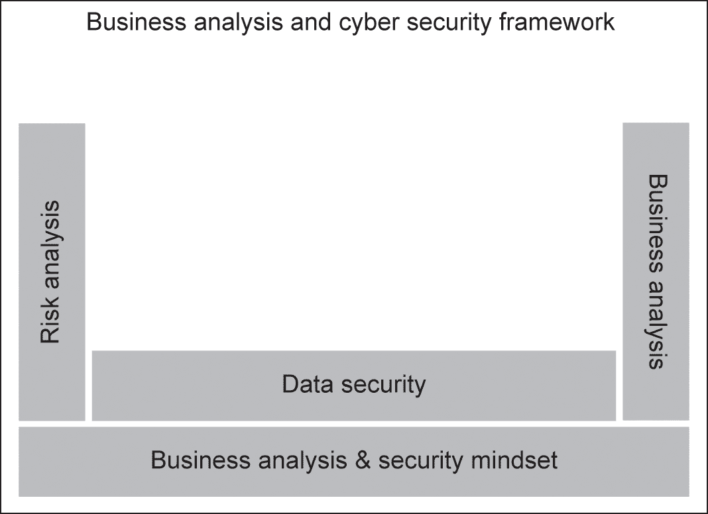

## DATA – THE LIFEBLOOD OF MODERN SOCIETY
当我听到 GXS Bank 首席数据官（CDO）Geraldine Wong 提出的“数据是非耗竭的氧气”（Thoughtspot，2023）这一说法时，我开始思考。从我们阅读的文字、看到的图像和进行的对话，到触觉体验，一切都无缝地转化为数据。我们存在的本质，曾经局限于有形和短暂的事物，如今与信息的无形线索紧密交织。每次视觉、听觉或触觉的互动都会留下数字足迹，贡献于塑造我们当代现实的庞大数据景观。在这个包罗万象的数据生态系统中，数据的无处不在使得我们的表达、观察和感官感知汇聚成信息马赛克，说明了数据在当今互联世界每个方面的深刻且不可避免的存在。

正如氧气对于维持人体生命不可或缺一样，数据也构成了我们现代互联社会的生命线。氧气是使细胞呼吸和能量产生成为可能的必备元素，这与数据在推动我们日常生活各个方面流程和功能中的基础作用类似。

在人体中，氧气通过血液输送到每个器官，确保生命力。同样，数据渗透到我们当代生活的每个方面，包括金融交易、人际互动、工作相关活动和记忆。

将呼吸系统视为数据基础设施的隐喻。呼吸系统从空气中提取氧气并排出二氧化碳，促进对生命至关重要的气体交换。同样，我们的数据系统从庞大的信息数据仓库中提取有价值的见解，创造出推动决策、创新和社会发展的动态交换。

### DATA IS THE NON-DEPLETABLE OXYGEN

氧气，这一使细胞呼吸和能量产生成为可能的必需元素，类似于数据在驱动我们日常生活各个方面流程和功能中所发挥的基础性作用。

正如氧气对单个细胞的运作至关重要，数据对于金融、医疗保健、教育和商业等各个领域的操作也必不可少。例如，金融交易类似于细胞层面的呼吸交换。每笔交易代表着维持系统经济健康的数据流动。同样，我们的记忆过去记录在实体日记或相册中，如今已被数字化，形成了一个定义我们的身份并塑造我们经历的错综复杂的个人数据网络。

这一类比延伸到系统的互联性。呼吸系统与其他系统协同合作，以维持人体内的平衡。同样，数据编织进我们社会的结构中，与技术、经济和社会系统相互作用，形成一个复杂且相互依存的网络。

与氧气一样，氧气至关重要但需要谨慎调控以防止失衡或毒性，数据也必须负责任地管理。隐私、安全和伦理使用问题随之而来，这映照出维持人体氧气水平微妙平衡的重要性。

数据如同循环系统，必须具备抵御污染或感染的机制并需要警惕的保护。正如人体的免疫系统抵御威胁一样，强大的网络安全措施和合乎伦理的数据管理实践是保护数据的关键屏障。这一类比还可以延伸以强调保持平衡的重要性。正如血液成分失衡可能导致健康问题，数据安全或伦理使用的任何妥协都可能导致不良后果。

为了利用数据的力量推动创新和进步，有必要认识到其脆弱性并实施严格措施，以确保我们数字生命线的可靠性和安全性。

## 数据过量

Michalis Zinieris 在其富有洞见的文章《Data: A Small Four-Letter Word Which Has Grown Exponentially to Such a Big Value》（Zinieris, n.d.）中预测，我们的全球数据量预计到 2025 年将达到惊人的 175 泽字节。为了让这一庞大数字更易理解，想象一下一叠蓝光光盘堆叠高度达到月球距离的 23 倍。令人惊讶的是，这仅仅是数据泛滥的萌芽阶段。此前，主要是人类主导了数据的产生。然而，格局已发生根本性转变，机器和传感器正在产生前所未有的数据量，主要由物联网的指数级增长推动。数据生产的激增带来了严峻挑战，使组织不堪重负，往往陷入瘫痪状态，不知从何开始其数据管理工作。随着数据规模变得日益复杂，理解数据的挑战加剧了保障其安全的难度。

数据准备是确保有效数据安全的内在要素。数据质量、准确性和结构是基础要素，显著影响安全措施的成功实施，甚至对医疗保健、金融等领域的法律要求也产生影响。细致的数据准备流程涉及数据清洗、验证和组织，为实施安全协议提供可靠基础。准确的数据对于精确应用安全措施至关重要，包括加密、访问控制和身份验证机制。在数据准备过程中保持一致的编码实践并消除冗余，有助于提高清晰度，减少数据结构歧义并增强安全控制的精确性。此外，有效的数据准备有助于识别和解决潜在风险和漏洞，降低安全漏洞发生的可能性。数据准备与数据安全之间的协同作用至关重要，因为前者确保安全措施建立在可靠且组织良好的信息坚实基础之上。

## 数据安全与网络安全

如第 3 章中所定义，网络安全是“对网络空间内系统、网络、应用程序、流程、人机交互和**data**的保护”。数据是在更广泛、更上层的网络安全领域中具有特定范围和重点的子集。

网络安全超越了数据保护，涵盖计算机系统、网络及其支撑基础设施的整体安全。它涉及保护硬件、软件以及使信息处理成为可能的电子流程。

数据安全是一个专门的子集，致力于保护信息的保密性、完整性和可用性，从而与信息安全三要素的原则保持一致，即保护数据免受未经授权的访问、披露、篡改或破坏。数据安全关注的是对敏感且有价值信息的保护，无论其存储或传输的媒介如何。这包括数据静止（已存储）、数据传输中（正在传输）和数据使用中（正在处理）。

数据安全措施包括加密、访问控制、身份验证机制、备份和恢复策略，以及规范数据处理的政策。下一章对此有更多介绍。目标是确保只有授权个人可以访问数据，并且数据在需要时保持未被更改且可用。

## 数据状态

要理解数据安全——组织的皇冠明珠——从根本上理解不同的数据状态至关重要。

一提到“皇冠明珠”，我立刻想起自己参观伦敦塔的经历，当时我被闪耀珠宝的宏伟气势深深吸引。而每当“皇冠明珠”被用来指代数据时，我发现自己始终在将那种王室景象与数据状态进行类比。

数据状态指的是数据在其生命周期中可以存在的各种条件或阶段。理解这些数据状态对于实施全面的数据安全措施至关重要。

### 数据静止（存放于伦敦塔）

伦敦塔是皇冠珠宝的主要存放地，在类比中代表“数据静止”阶段。与设防的数据中心类似，安全的珠宝馆配备了先进的安全措施，以确保宝物在未被主动使用时的安全。伦敦塔的安全存储与在安全数据库或数据中心保护静止数据相吻合。

值得强调的是，“数据静止”涵盖了各种存储环境，包括数据库、数据仓库、数据湖、云存储服务、文件存储系统等。这些多样化的存储选项是根据数据量、类型、访问模式和性能要求选择的。许多组织会选择这些存储解决方案的战略组合，以满足其多样化的数据管理需求，从而相应地塑造其定制化安全措施。

### 数据传输中（移往白金汉宫）

当王冠珠宝需要运输时，会执行一项高度[content]
当王冠珠宝需要运输时，会执行一项高度 orchestration 且安全的行动，体现了“数据在传输中”的概念。珠宝被小心地从伦敦塔移至白金汉宫，与在不同地点之间进行安全数据传输的需求相呼应。在此情境中，装甲车辆和缜密的规划代表了用于移动敏感数据的加密数据传输协议和安全网络的等价物。王冠珠宝的谨慎移动与在不同地点之间移动敏感信息时对安全数据传输协议的需求相平行。

## 数据在使用中（由皇室佩戴）

类比的顶点涉及“数据在使用中”阶段，即王冠珠宝在仪式活动期间被皇室佩戴时。类似地，组织必须确保在敏感数据被积极使用时具备健全的安全措施，例如在战略决策、关键业务流程期间或与供应商和第三方共享时。这包括安全访问控制、处理过程中的加密以及持续监控以防止未经授权的访问——相当于皇室佩戴珠宝时所执行的警惕。王冠珠宝由皇室在仪式上的使用与保护业务运营中积极使用的数据相呼应，需要严格的访问控制和处理过程中的加密。

## 数据安全的方法

现在数据安全和网络安全范围已确定，安全的方法将与网络安全保持一致，即以安全思维识别风险。

在前几章中，我们讨论了业务分析师如何扩展其分析以支持安全和技术团队应对网络安全需求。同样，下面是业务分析师可以与利益相关者协作以支持数据安全活动的一些方式：

- **需求获取** – 业务分析师可以与业务和安全利益相关者密切合作，以获取并记录数据安全需求。这涉及理解业务流程、识别敏感数据并确定安全需求。
- **风险分析与评估** – 业务分析师可以通过开展与数据安全相关的风险分析和评估来支持安全和数据团队。这包括识别数据资产的潜在风险、评估其影响并提出缓解策略。
- **数据分类** – 业务分析师可以与利益相关者协作，根据敏感性和关键性对数据进行分类。建立数据分类框架有助于优先考虑安全措施。
- **隐私影响评估（PIAs）** – 业务分析师可以协助数据团队开展 PIAs，以评估项目对隐私和数据保护的潜在影响，确保符合相关法规。
- **政策与程序开发** – 业务分析师可以与相关治理团队合作，开发和记录数据安全政策和程序。这涉及将安全需求转化为可操作的指南。
- **数据流图** – 在技术团队工作的业务分析师（也可以称为系统分析师）可以通过创建数据流图来支持数据和技术团队，以说明数据在组织内部的流动方式。这种可视化表示有助于识别潜在的安全漏洞和控制点。
- **事件响应规划** – 业务分析师可以通过定义检测、报告和响应与数据泄露相关的安全事件的程序，为事件响应计划的制定做出贡献。
- **安全意识培训** – 业务分析师可以参与为处理敏感数据的团队创建和提供安全意识培训。这确保每个人都意识到其在维护数据安全方面的角色。
- **持续改进** – 业务分析师可以通过分析安全事件、经验教训和反馈参与持续改进，并根据不断变化的威胁和技术变化提出增强安全措施的建议。

虽然业务分析师可能不具备数据安全要求的详尽知识，因为这属于安全团队的领域，但他们的分析技能、有效的沟通能力和对业务运营的理解使他们能够在业务、治理、IT 和安全团队之间培养协作。作为利益相关者之间的桥梁，业务分析师可以在确保数据安全考虑无缝集成到业务流程和系统中方面发挥关键作用，从而增强组织的整体安全态势。

## 保护流程

保护流程免受网络安全威胁和风险，包括保护数据（静态、传输中和使用中），需要一种协作性和多学科的方法，涉及理解流程、实施安全控制并确保合规。虽然业务分析师可能不是网络安全专家，但他们可以在保护流程方面发挥关键作用。

业务分析师可以与利益相关者协作，以识别流程中的关键资产和敏感数据，并促进风险评估以评估潜在威胁。他们还可以积极参与根据敏感性对数据进行分类并定义适当的处理程序，涉及静态数据、传输中数据和使用中数据。

业务分析师可以通过理解和记录数据如何在流程的不同组件之间通信，从而为保护数据传输做出贡献。与 IT 和安全团队协作，业务分析师可以为实施访问控制做出贡献，强调基于角色的访问和数据使用中的最小权限原则。

此外，业务分析师可以为事件响应规划做出贡献，记录响应网络安全事件的程序并定义协调响应的角色和职责。

最后，他们可以推动培养持续改进的文化，以确保流程中的安全措施根据业务环境的变化和新兴威胁定期审查和更新。

## 反思时间

花点时间思考并写下：

- 您的组织如何保护客户数据，是否有方法使其更加安全以符合数据保护规则？
- 您是否研究过从所有数据中获取有价值的见解，包括未利用的信息，从而改善决策？

## 需要监控的新兴数据趋势

在结束本章之前，让我们探讨一些值得注意的数据趋势，这些趋势对与数据、治理和安全团队密切合作的业务分析师尤其相关。

### 数据是新的货币

# 数据管理洞察

## 数据作为新货币

在他的文章《数据是新货币。不要让它从指缝溜走》中，Peter Daisyme 强调了数据在数字时代作为主要货币的至高重要性，超越了其他技术发展。他强调了数据在企业中角色的演变，强调了暗数据中未被挖掘的潜力。虽然承认了对高层数据的普遍关注，他的文章主张采取更全面的方法，强调从一开始就正确处理数据的必要性。包括识别、组织和分析在内的稳健的数据策略至关重要。文章建议利用技术，例如数据可观测性应用，将非结构化数据转化为整个组织中的有价值洞察。培养数据驱动文化被视为至关重要，文章最后概述了公司利用数据作为未来货币力量的步骤，强调承诺、技术采用和以增长为导向的组织文化（Daisyme, 2023）。

根据 Alice Nunwick 的文章《分析师称数据将在人工智能时代成为新货币》（Nunwick, 2023），在一次行业更新中，GlobalData 首席分析师 Natasha Rybak 断言数据将在人工智能时代成为新货币，强调高质量数据集对有效 AI 工具的关键作用。Rybak 认为，旨在最大化其数据价值的企业必须在数据精炼和展示方面做出大量投资，需要大量时间、无阻碍的访问以及遵守法律要求。

Rybak 深入探讨了 Meta、Walmart 和 Sky 等大型企业所拥有个人数据的法律问题和用例。Sky UK 和 Walmart 都利用个人和行为数据来个性化客户体验。例如，Sky UK 的 Search Behaviour 工具能够根据位置和年龄等指标进行精确的受众定位。然而，Rybak 指出潜在的法律挑战，引用了 Meta 因个性化广告而与挪威数据保护机构最近的麻烦。Rybak 将数据比作实施 AI 的企业中的“未经雕琢的钻石”，这一观点得到了其他人的呼应。国际竞争网络主席 Andreas Bundt 警告称，由于其庞大的数据持有量，AI 可能会强化“Big Tech”主导地位，可能对较小的 AI 初创公司造成不利影响。旨在利用 AI 的企业必须认识到其数据的价值并应对其使用相关的法律考虑。

这些文章强调了数据在当代数字环境中的关键作用。Peter Daisyme 的文章将数据作为主要货币重点突出，强调从一开始就正确处理数据的需要采取全面方法，重点关注稳健的数据策略、技术采用以及培养数据驱动的组织文化。Alice Nunwick 的文章讨论了数据将在人工智能时代成为新货币，强调高质量数据集对有效 AI 工具的重要性。两篇文章的共同点是对数据作为有价值资产的认可，以及企业需要在不断发展的技术环境中战略性地管理、精炼和保护它们的需要。

通过业务分析师的视角，其核心在于认识到数据在当今数字环境中的关键作用。最终，与数据和治理团队密切合作的业务分析师应把握数据的中心性，采用整体管理方法，保持对法律影响的关注，并将数据视为对业务韧性至关重要的战略资产。

## 数据风险框架

Sarah Telford 和 Stefaan G. Verhulst 在其文章《理解数据风险的框架》（Telford and Verhulst, 2016）中介绍了评估和管理组织内数据风险的全面框架，该框架是在与哈佛人道主义倡议合作下开发的。该框架为组织提供了在整个数据生命周期内应对和减轻数据风险的结构化方法。

该框架指导组织通过系统流程，首先进行评估，审查数据生成和共享的背景，包括预期收益和潜在威胁。后续步骤涉及进行详细的数据清单，涵盖存储位置和可访问性。识别潜在风险和危害，例如数据关联或泄露，使员工为各种情况做好准备。框架以实施对策结束，包括制定数据处理政策、实施访问控制以及为员工提供负责任的数据使用培训。对于业务分析师而言，这一系统且全面的框架提供了在组织整个数据生命周期内应对和减轻数据风险的宝贵工具，与其在不断发展的技术环境中战略性地管理、精炼和保护数据的角色相一致。

## 大数据灾难

由 Sean Martin McDonald 在开放社会基金会、福特基金会和媒体民主基金支持下进行的研究，题为《埃博拉：大数据灾难》（McDonald, 2016），探讨了大数据，特别是呼叫详细记录（CDR）数据在人道主义危机中的使用，例如西非的埃博拉疫情。该研究强调了数字人道主义协调的挑战，特别是关于隐私问题及其对人权的影响。McDonald 关注与隐私和财产相关的法律框架，质疑 CDR 的无监管使用，并强调将数据科学应用于国际发展方面的潜在机遇和风险。该论文提出了关于信息获取、数据共享限制以及在公共利益背景下隐私侵犯比例性的重要法律问题。它强调了围绕紧急响应中数据建模的实验性质进行批判性对话的必要性，以保护人权。该研究为像互联网与社会中心这样的组织提供了宝贵的视角，主张批判性地审视大数据对人权和可持续发展的影响。

从业务分析师的角度来看，该研究展示了在紧急情况下使用大型数据集的挑战和机遇，提供了关于数据使用的法律框架和隐私考虑的见解。它强调了与人道主义技术实验相关的伦理问题及其对隐私的影响，这对于参与数据驱动项目的业务分析师至关重要。分析使用 CDR 而未获用户同意相关的风险为从事风险评估和管理的业务分析师提供了信息，特别是在公共卫生或危机响应等领域。了解大数据对人权和可持续发展的影响对于社会责任感的商业实践至关重要，拓宽了分析师对数据使用伦理维度的视角。最后，文章呼吁对紧急响应中数据建模的实验性质进行批判性讨论，敦促业务分析师在其组织内参与关于负责任数据使用及其对人权的潜在影响的对话。

本质上，这些新兴数据趋势强调了组织采用战略性、伦理性和全面的数据管理方法的必要性。理解并应对与数据相关的挑战和机遇可以成为业务分析师在不断发展的数字环境中角色的重要方面。

## 摘要

本章深入探讨了数据安全这一关键主题，认识到数据是现代社会的生命线。它梳理了关键方面，例如数据安全与网络安全之间的区别。本章阐明了理解三种数据状态对于制定针对特定情况的有效数据安全策略的重要性。它探讨了确保数据在其生命周期内安全传递的策略，考虑了流程中各种接触点和潜在漏洞。

展示数据环境的动态特性，本章讨论了需要关注的新兴数据趋势，提供了关于管理与保护数据相关的当代挑战和机遇的多元视角。

下一章进一步推进商业分析与网络安全框架的构建，深入探讨下一个维度：人员与用户画像。

### 要点问题
• 本章你的关键学习要点是什么？
• 你将实施的哪一个教训？
• 你如何总结你对数据安全的观点？

# 8 伪装
本章你将学到以下内容：
• 人员管理。
• 用户画像。
• 误用案例。
• 事件管理。
• 业务连续性计划。
• 业务连续性计划的组成部分。

### 薄弱环节
我们在前几章中已确定，人员是最薄弱的环节，而管理他们在网络安全中至关重要。无论是有意还是无意的，人为错误导致了相当一部分网络安全漏洞。

据 BBC 报道，居住在美国的俄罗斯男子叶戈尔·伊戈列维奇·克留奇科夫（Egor Igorevich Kriuchkov）承认有罪，企图通过策划对特斯拉在内华达州电池工厂的勒索软件攻击来勒索钱财。克留奇科夫据称代表犯罪分子行事， allegedly 向一名员工提供 100 万美元以实施攻击并窃取公司机密（BBC, 2021）。FBI 和特斯拉挫败了该计划的攻击，克留奇科夫认罪后面临最高 10 个月监禁。他提到俄罗斯政府知晓该阴谋，但没有对其与克里姆林宫有联系的指控。

此事件凸显了员工意识和协作在防止网络威胁方面的重要性。在此案例中，被勒索企图针对的特斯拉员工通过向公司报告阴谋并与 FBI 合作发挥了关键作用。这强调了在网络安全有效人员管理中拥有知识渊博且警惕的员工的重要性，以便识别和减轻潜在威胁。

正如《Infosecurity Magazine》文章中引述的那样，由 IT 行业协会 CompTIA 进行的一项社会实验揭示了令人震惊的安全意识洞察（Seals, 2015）。2015 年 8 月至 10 月间，200 个无品牌 U 盘被策略性地放置在美国主要城市的高流量公共场所。令人震惊的是，发现 U 盘的人中有 18%将其插入设备、打开文本文件、点击唯一链接或向所列地址发送电子邮件，可能使他们的设备和信息暴露于网络安全风险。研究发现千禧一代更容易受影响，有 40%的人可能捡起 U 盘，而 X 世代为 22%，婴儿潮一代为 9%（Seals, 2015）。再次，该实验强调了提高安全意识、主动的 IT 安全措施以及为员工提供持续培训以减轻网络安全风险的必要性。CompTIA 强调了供应商在教育客户、实施安全解决方案以及在组织内部培养网络安全文化方面发挥的关键作用。该调查还强调了员工密码保护不佳、使用公共 Wi-Fi 网络以及网络安全培训实践不足等问题，强调了持续和全面的安全举措的必要性。

尽管有效的[content]
本章深入探讨了数据安全这一关键主题，认识到数据是现代社会的生命线。它梳理了关键方面，例如数据安全与网络安全之间的区别。本章阐明了理解三种数据状态对于制定针对特定情况的有效数据安全策略的重要性。它探讨了确保数据在其生命周期内安全传递的策略，考虑了流程中各种接触点和潜在漏洞。

展示数据环境的动态特性，本章讨论了需要关注的新兴数据趋势，提供了关于管理与保护数据相关的当代挑战和机遇的多元视角。

下一章进一步推进商业分析与网络安全框架的构建，深入探讨下一个维度：人员与用户画像。

### 要点问题
• 本章你的关键学习要点是什么？
• 你将实施的哪一个教训？
• 你如何总结你对数据安全的观点？

# 8 伪装
本章你将学到以下内容：
• 人员管理。
• 用户画像。
• 误用案例。
• 事件管理。
• 业务连续性计划。
• 业务连续性计划的组成部分。

### 薄弱环节
我们在前几章中已确定，人员是最薄弱的环节，而管理他们在网络安全中至关重要。无论是有意还是无意的，人为错误导致了相当一部分网络安全漏洞。

据 BBC 报道，居住在美国的俄罗斯男子叶戈尔·伊戈列维奇·克留奇科夫（Egor Igorevich Kriuchkov）承认有罪，企图通过策划对特斯拉在内华达州电池工厂的勒索软件攻击来勒索钱财。克留奇科夫据称代表犯罪分子行事， allegedly 向一名员工提供 100 万美元以实施攻击并窃取公司机密（BBC, 2021）。FBI 和特斯拉挫败了该计划的攻击，克留奇科夫认罪后面临最高 10 个月监禁。他提到俄罗斯政府知晓该阴谋，但没有对其与克里姆林宫有联系的指控。

此事件凸显了员工意识和协作在防止网络威胁方面的重要性。在此案例中，被勒索企图针对的特斯拉员工通过向公司报告阴谋并与 FBI 合作发挥了关键作用。这强调了在网络安全有效人员管理中拥有知识渊博且警惕的员工的重要性，以便识别和减轻潜在威胁。

正如《Infosecurity Magazine》文章中引述的那样，由 IT 行业协会 CompTIA 进行的一项社会实验揭示了令人震惊的安全意识洞察（Seals, 2015）。2015 年 8 月至 10 月间，200 个无品牌 U 盘被策略性地放置在美国主要城市的高流量公共场所。令人震惊的是，发现 U 盘的人中有 18%将其插入设备、打开文本文件、点击唯一链接或向所列地址发送电子邮件，可能使他们的设备和信息暴露于网络安全风险。研究发现千禧一代更容易受影响，有 40%的人可能捡起 U 盘，而 X 世代为 22%，婴儿潮一代为 9%（Seals, 2015）。再次，该实验强调了提高安全意识、主动的 IT 安全措施以及为员工提供持续培训以减轻网络安全风险的必要性。CompTIA 强调了供应商在教育客户、实施安全解决方案以及在组织内部培养网络安全文化方面发挥的关键作用。该调查还强调了员工密码保护不佳、使用公共 Wi-Fi 网络以及网络安全培训实践不足等问题，强调了持续和全面的安全举措的必要性。

尽管有效的[content]
本章深入探讨了数据安全这一关键主题，认识到数据是现代社会的生命线。它梳理了关键方面，例如数据安全与网络安全之间的区别。本章阐明了理解三种数据状态对于制定针对特定情况的有效数据安全策略的重要性。它探讨了确保数据在其生命周期内安全传递的策略，考虑了流程中各种接触点和潜在漏洞。

展示数据环境的动态特性，本章讨论了需要关注的新兴数据趋势，提供了关于管理与保护数据相关的当代挑战和机遇的多元视角。

下一章进一步推进商业分析与网络安全框架的构建，深入探讨下一个维度：人员与用户画像。

### 要点问题
• 本章你的关键学习要点是什么？
• 你将实施的哪一个教训？
• 你如何总结你对数据安全的观点？

# 8 伪装
本章你将学到以下内容：
• 人员管理。
• 用户画像。
• 误用案例。
• 事件管理。
• 业务连续性计划。
• 业务连续性计划的组成部分。

### 薄弱环节
我们在前几章中已确定，人员是最薄弱的环节，而管理他们在网络安全中至关重要。无论是有意还是无意的，人为错误导致了相当一部分网络安全漏洞。

据 BBC 报道，居住在美国的俄罗斯男子叶戈尔·伊戈列维奇·克留奇科夫（Egor Igorevich Kriuchkov）承认有罪，企图通过策划对特斯拉在内华达州电池工厂的勒索软件攻击来勒索钱财。克留奇科夫据称代表犯罪分子行事， allegedly 向一名员工提供 100 万美元以实施攻击并窃取公司机密（BBC, 2021）。FBI 和特斯拉挫败了该计划的攻击，克留奇科夫认罪后面临最高 10 个月监禁。他提到俄罗斯政府知晓该阴谋，但没有对其与克里姆林宫有联系的指控。

此事件凸显了员工意识和协作在防止网络威胁方面的重要性。在此案例中，被勒索企图针对的特斯拉员工通过向公司报告阴谋并与 FBI 合作发挥了关键作用。这强调了在网络安全有效人员管理中拥有知识渊博且警惕的员工的重要性，以便识别和减轻潜在威胁。

正如《Infosecurity Magazine》文章中引述的那样，由 IT 行业协会 CompTIA 进行的一项社会实验揭示了令人震惊的安全意识洞察（Seals, 2015）。2015 年 8 月至 10 月间，200 个无品牌 U 盘被策略性地放置在美国主要城市的高流量公共场所。令人震惊的是，发现 U 盘的人中有 18%将其插入设备、打开文本文件、点击唯一链接或向所列地址发送电子邮件，可能使他们的设备和信息暴露于网络安全风险。研究发现千禧一代更容易受影响，有 40%的人可能捡起 U 盘，而 X 世代为 22%，婴儿潮一代为 9%（Seals, 2015）。再次，该实验强调了提高安全意识、主动的 IT 安全措施以及为员工提供持续培训以减轻网络安全风险的必要性。CompTIA 强调了供应商在教育客户、实施安全解决方案以及在组织内部培养网络安全文化方面发挥的关键作用。该调查还强调了员工密码保护不佳、使用公共 Wi-Fi 网络以及网络安全培训实践不足等问题，强调了持续和全面的安全举措的必要性。

尽管有效的[content]
本章深入探讨了数据安全这一关键主题，认识到数据是现代社会的生命线。它梳理了关键方面，例如数据安全与网络安全之间的区别。本章阐明了理解三种数据状态对于制定针对特定情况的有效数据安全策略的重要性。它探讨了确保数据在其生命周期内安全传递的策略，考虑了流程中各种接触点和潜在漏洞。

展示数据环境的动态特性，本章讨论了需要关注的新兴数据趋势，提供了关于管理与保护数据相关的当代挑战和机遇的多元视角。

下一章进一步推进商业分析与网络安全框架的构建，深入探讨下一个维度：人员与用户画像。

### 要点问题
• 本章你的关键学习要点是什么？
• 你将实施的哪一个教训？
• 你如何总结你对数据安全的观点？

# 8 伪装
本章你将学到以下内容：
• 人员管理。
• 用户画像。
• 误用案例。
• 事件管理。
• 业务连续性计划。
• 业务连续性计划的组成部分。

### 薄弱环节
我们在前几章中已确定，人员是最薄弱的环节，而管理他们在网络安全中至关重要。无论是有意还是无意的，人为错误导致了相当一部分网络安全漏洞。

据 BBC 报道，居住在美国的俄罗斯男子叶戈尔·伊戈列维奇·克留奇科夫（Egor Igorevich Kriuchkov）承认有罪，企图通过策划对特斯拉在内华达州电池工厂的勒索软件攻击来勒索钱财。克留奇科夫据称代表犯罪分子行事，向一名员工提供 100 万美元以实施攻击并窃取公司机密（BBC, 2021）。FBI 和特斯拉挫败了该计划的攻击，克留奇科夫认罪后面临最高 10 个月监禁。他提到俄罗斯政府知晓该阴谋，但没有对其与克里姆林宫有联系的指控。

此事件凸显了员工意识和协作在防止网络威胁方面的重要性。在此案例中，被勒索企图针对的特斯拉员工通过向公司报告阴谋并与 FBI 合作发挥了关键作用。这强调了在网络安全有效人员管理中拥有知识渊博且警惕的员工的重要性，以便识别和减轻潜在威胁。

正如《Infosecurity Magazine》文章中引述的那样，由 IT 行业协会 CompTIA 进行的一项社会实验揭示了令人震惊的安全意识洞察（Seals, 2015）。2015 年 8 月至 10 月间，200 个无品牌 U 盘被策略性地放置在美国主要城市的高流量公共场所。令人震惊的是，发现 U 盘的人中有 18%将其插入设备、打开文本文件、点击唯一链接或向所列地址发送电子邮件，可能使他们的设备和信息暴露于网络安全风险。研究发现千禧一代更容易受影响，有 40%的人可能捡起 U 盘，而 X 世代为 22%，婴儿潮一代为 9%（Seals, 2015）。再次，该实验强调了提高安全意识、主动的 IT 安全措施以及为员工提供持续培训以减轻网络安全风险的必要性。CompTIA 强调了供应商在教育客户、实施安全解决方案以及在组织内部培养网络安全文化方面发挥的关键作用。该调查还强调了员工密码保护不佳、使用公共 Wi-Fi 网络以及网络安全培训实践不足等问题，强调了持续和全面的安全举措的必要性。

尽管有效的[content]
本章深入探讨了数据安全这一关键主题，认识到数据是现代社会的生命线。它梳理了关键方面，例如数据安全与网络安全之间的区别。本章阐明了理解三种数据状态对于制定针对特定情况的有效数据安全策略的重要性。它探讨了确保数据在其生命周期内安全传递的策略，考虑了流程中各种接触点和潜在漏洞。

展示数据环境的动态特性，本章讨论了需要关注的新兴数据趋势，提供了关于管理与保护数据相关的当代挑战和机遇的多元视角。

下一章进一步推进商业分析与网络安全框架的构建，深入探讨下一个维度：人员与用户画像。

### 要点问题
• 本章你的关键学习要点是什么？
• 你将实施的哪一个教训？
• 你如何总结你对数据安全的观点？

# 8 伪装
本章你将学到以下内容：
• 人员管理。
• 用户画像。
• 误用案例。
• 事件管理。
• 业务连续性计划。
• 业务连续性计划的组成部分。

### 薄弱环节
我们在前几章中已确定，人员是最薄弱的环节，而管理他们在网络安全中至关重要。无论是有意还是无意的，人为错误导致了相当一部分网络安全漏洞。

据 BBC 报道，居住在美国的俄罗斯男子叶戈尔·伊戈列维奇·克留奇科夫（Egor Igorevich Kriuchkov）承认有罪，企图通过策划对特斯拉在内华达州电池工厂的勒索软件攻击来勒索钱财。克留奇科夫据称代表犯罪分子行事，向一名员工提供 100 万美元以实施攻击并窃取公司机密（BBC, 2021）。FBI 和特斯拉挫败了该计划的攻击，克留奇科夫认罪后面临最高 10 个月监禁。他提到俄罗斯政府知晓该阴谋，但没有对其与克里姆林宫有联系的指控。

此事件凸显了员工意识和协作在防止网络威胁方面的重要性。在此案例中，被勒索企图针对的特斯拉员工通过向公司报告阴谋并与 FBI 合作发挥了关键作用。这强调了在网络安全有效人员管理中拥有知识渊博且警惕的员工的重要性，以便识别和减轻潜在威胁。

正如《Infosecurity Magazine》文章中引述的那样，由 IT 行业协会 CompTIA 进行的一项社会实验揭示了令人震惊的安全意识洞察（Seals, 2015）。2015 年 8 月至 10 月间，200 个无品牌 U 盘被策略性地放置在美国主要城市的高流量公共场所。令人震惊的是，发现 U 盘的人中有 18%将其插入设备、打开文本文件、点击唯一链接或向所列地址发送电子邮件，可能使他们的设备和信息暴露于网络安全风险。研究发现千禧一代更容易受影响，有 40%的人可能捡起 U 盘，而 X 世代为 22%，婴儿潮一代为 9%（Seals, 2015）。再次，该实验强调了提高安全意识、主动的 IT 安全措施以及为员工提供持续培训以减轻网络安全风险的必要性。CompTIA 强调了供应商在教育客户、实施安全解决方案以及在组织内部培养网络安全文化方面发挥的关键作用。该调查还强调了员工密码保护不佳、使用公共 Wi-Fi 网络以及网络安全培训实践不足等问题，强调了持续和全面的安全举措的必要性。

尽管有效的[content]
尽管有效的[content]
本章深入探讨了数据安全这一关键主题，认识到数据是现代社会的生命线。它梳理了关键方面，例如数据安全与网络安全之间的区别。本章阐明了理解三种数据状态对于制定针对特定情况的有效数据安全策略的重要性。它探讨了确保数据在其生命周期内安全传递的策略，考虑了流程中各种接触点和潜在漏洞。

展示数据环境的动态特性，本章讨论了需要关注的新兴数据趋势，提供了关于管理与保护数据相关的当代挑战和机遇的多元视角。

下一章进一步推进商业分析与网络安全框架的构建，深入探讨下一个维度：人员与用户画像。

### 要点问题
• 本章你的关键学习要点是什么？
• 你将实施的哪一个教训？
• 你如何总结你对数据安全的观点？

# 8 伪装
本章你将学到以下内容：
• 人员管理。
• 用户画像。
• 误用案例。
• 事件管理。
• 业务连续性计划。
• 业务连续性计划的组成部分。

### 薄弱环节
我们在前几章中已确定，人员是最薄弱的环节，而管理他们在网络安全中至关重要。无论是有意还是无意的，人为错误导致了相当一部分网络安全漏洞。

据 BBC 报道，居住在美国的俄罗斯男子叶戈尔·伊戈列维奇·克留奇科夫（Egor Igorevich Kriuchkov）承认有罪，企图通过策划对特斯拉在内华达州电池工厂的勒索软件攻击来勒索钱财。克留奇科夫据称代表犯罪分子行事，向一名员工提供 100 万美元以实施攻击并窃取公司机密（BBC, 2021）。FBI 和特斯拉挫败了该计划的攻击，克留奇科夫认罪后面临最高 10 个月监禁。他提到俄罗斯政府知晓该阴谋，但没有对其与克里姆林宫有联系的指控。

此事件凸显了员工意识和协作在防止网络威胁方面的重要性。在此案例中，被勒索企图针对的特斯拉员工通过向公司报告阴谋并与 FBI 合作发挥了关键作用。这强调了在网络安全有效人员管理中拥有知识渊博且警惕的员工的重要性，以便识别和减轻潜在威胁。

正如《Infosecurity Magazine》文章中引述的那样，由 IT 行业协会 CompTIA 进行的一项社会实验揭示了令人震惊的安全意识洞察（Seals, 2015）。2015 年 8 月至 10 月间，200 个无品牌 U 盘被策略性地放置在美国主要城市的高流量公共场所。令人震惊的是，发现 U 盘的人中有 18%将其插入设备、打开文本文件、点击唯一链接或向所列地址发送电子邮件，可能使他们的设备和信息暴露于网络安全风险。研究发现千禧一代更容易受影响，有 40%的人可能捡起 U 盘，而 X 世代为 22%，婴儿潮一代为 9%（Seals, 2015）。再次，该实验强调了提高安全意识、主动的 IT 安全措施以及为员工提供持续培训以减轻网络安全风险的必要性。CompTIA 强调了供应商在教育客户、实施安全解决方案以及在组织内部培养网络安全文化方面发挥的关键作用。该调查还强调了员工密码保护不佳、使用公共 Wi-Fi 网络以及网络安全培训实践不足等问题，强调了持续和全面的安全举措的必要性。

虽然有效的[content]
本章深入探讨了数据安全这一关键主题，认识到数据是现代社会的生命线。它梳理了关键方面，例如数据安全与网络安全之间的区别。本章阐明了理解三种数据状态对于制定针对特定情况的有效数据安全策略的重要性。它探讨了确保数据在其生命周期内安全传递的策略，考虑了流程中各种接触点和潜在漏洞。

展示数据环境的动态特性，本章讨论了需要关注的新兴数据趋势，提供了关于管理与保护数据相关的当代挑战和机遇的多元视角。

下一章进一步推进商业分析与网络安全框架的构建，深入探讨下一个维度：人员与用户画像。

### 要点问题
- 本章你的关键学习要点是什么？
- 你将实施的哪一个教训？
- 你如何总结你对数据安全的观点？

# 8 伪装
本章你将学到以下内容：
- 人员管理。
- 用户画像。
- 误用案例。
- 事件管理。
- 业务连续性计划。
- 业务连续性计划的组成部分。

### 薄弱环节
我们在前几章中已确定，人员是最薄弱的环节，而管理他们在网络安全中至关重要。无论是有意还是无意的，人为错误导致了相当一部分网络安全漏洞。

据 BBC 报道，居住在美国的俄罗斯男子叶戈尔·伊戈列维奇·克留奇科夫承认有罪，企图通过策划对特斯拉在内华达州电池工厂的勒索软件攻击来勒索钱财。克留奇科夫据称代表犯罪分子行事，向一名员工提供 100 万美元以实施攻击并窃取公司机密（BBC, 2021）。FBI 和特斯拉挫败了该计划的攻击，克留奇科夫认罪后面临最高 10 个月监禁。他提到俄罗斯政府知晓该阴谋，但没有对其与克里姆林宫有联系的指控。

此事件凸显了员工意识和协作在防止网络威胁方面的重要性。在此案例中，被勒索企图针对的特斯拉员工通过向公司报告阴谋并与 FBI 合作发挥了关键作用。这强调了在网络安全有效人员管理中拥有知识渊博且警惕的员工的重要性，以便识别和减轻潜在威胁。

正如《Infosecurity Magazine》文章中引述的那样，由 IT 行业协会 CompTIA 进行的一项社会实验揭示了令人震惊的安全意识洞察（Seals, 2015）。2015 年 8 月至 10 月间，200 个无品牌 U 盘被策略性地放置在美国主要城市的高流量公共场所。令人震惊的是，发现 U 盘的人中有 18%将其插入设备、打开文本文件、点击唯一链接或向所列地址发送电子邮件，可能使他们的设备和信息暴露于网络安全风险。研究发现千禧一代更容易受影响，有 40%的人可能捡起 U 盘，而 X 世代为 22%，婴儿潮一代为 9%（Seals, 2015）。再次，该实验强调了提高安全意识、主动的 IT 安全措施以及为员工提供持续培训以减轻网络安全风险的必要性。CompTIA 强调了供应商在教育客户、实施安全解决方案以及在组织内部培养网络安全文化方面发挥的关键作用。该调查还强调了员工密码保护不佳、使用公共 Wi-Fi 网络以及网络安全培训实践不足等问题，强调了持续和全面的安全举措的必要性。

虽然有效的[content]
本章深入探讨了数据安全这一关键主题，认识到数据是现代社会的生命线。它梳理了关键方面，例如数据安全与网络安全之间的区别。本章阐明了理解三种数据状态对于制定针对特定情况的有效数据安全策略的重要性。它探讨了确保数据在其生命周期内安全传递的策略，考虑了流程中各种接触点和潜在漏洞。

展示数据环境的动态特性，本章讨论了需要关注的新兴数据趋势，提供了关于管理与保护数据相关的当代挑战和机遇的多元视角。

下一章进一步推进商业分析与网络安全框架的构建，深入探讨下一个维度：人员与用户画像。

### 要点问题
- 本章你的关键学习要点是什么？
- 你将实施的哪一个教训？
- 你如何总结你对数据安全的观点？

# 8 伪装
本章你将学到以下内容：
- 人员管理。
- 用户画像。
- 误用案例。
- 事件管理。
- 业务连续性计划。
- 业务连续性计划的组成部分。

### 薄弱环节
我们在前几章中已确定，人员是最薄弱的环节，而管理他们在网络安全中至关重要。无论是有意还是无意的，人为错误导致了相当一部分网络安全漏洞。

据 BBC 报道，居住在美国的俄罗斯男子叶戈尔·伊戈列维奇·克留奇科夫承认有罪，企图通过策划对特斯拉在内华达州电池工厂的勒索软件攻击来勒索钱财。克留奇科夫据称代表犯罪分子行事，向一名员工提供 100 万美元以实施攻击并窃取公司机密（BBC, 2021）。FBI 和特斯拉挫败了该计划的攻击，克留奇科夫认罪后面临最高 10 个月监禁。他提到俄罗斯政府知晓该阴谋，但没有对其与克里姆林宫有联系的指控。

此事件凸显了员工意识和协作在防止网络威胁方面的重要性。在此案例中，被勒索企图针对的特斯拉员工通过向公司报告阴谋并与 FBI 合作发挥了关键作用。这强调了在网络安全有效人员管理中拥有知识渊博且警惕的员工的重要性，以便识别和减轻潜在威胁。

正如《Infosecurity Magazine》文章中引述的那样，由 IT 行业协会 CompTIA 进行的一项社会实验揭示了令人震惊的安全意识洞察（Seals, 2015）。2015 年 8 月至 10 月间，200 个无品牌 U 盘被策略性地放置在美国主要城市的高流量公共场所。令人震惊的是，发现 U 盘的人中有 18%将其插入设备、打开文本文件、点击唯一链接或向所列地址发送电子邮件，可能使他们的设备和信息暴露于网络安全风险。研究发现千禧一代更容易受影响，有 40%的人可能捡起 U 盘，而 X 世代为 22%，婴儿潮一代为 9%（Seals, 2015）。再次，该实验强调了提高安全意识、主动的 IT 安全措施以及为员工提供持续培训以减轻网络安全风险的必要性。CompTIA 强调了供应商在教育客户、实施安全解决方案以及在组织内部培养网络安全文化方面发挥的关键作用。该调查还强调了员工密码保护不佳、使用公共 Wi-Fi 网络以及网络安全培训实践不足等问题，强调了持续和全面的安全举措的必要性。

即使人员管理策略包含全面的培训项目来教育员工安全协议、识别潜在威胁并灌输最佳实践，人为错误也无法避免。

### 人为错误
人为错误通常指个人做出的偏离预期行动或期望的错误、疏忽或非故意行为。这些错误可能发生在生活的各个方面和工作中，导致不良结果。人为错误的一些例子包括健忘、注意力 lapses、信息误解、误判以及未能遵循既定程序。人为错误是人类本性的固有部分，各种因素促使其发生，包括认知限制、环境条件和情境复杂性。人类可能因疲劳、压力、分心或任务的复杂性而犯错。然而，在医疗保健、航空或网络安全等领域，人为错误造成的后果可能从轻微不便到严重事件不等。

虽然可以通过培训、流程改进和技术辅助来减少错误发生的可能性和影响，但实现 100%避免人为错误实际上是不可能的。人为错误总会存在一定的残余风险。

因此，承认人为错误不可避免对于开发能够检测、从中恢复并适应意外情况的弹性系统至关重要。组织随后可以实施策略来减轻人为错误的影响，例如关键系统的冗余、错误预防流程以及培养持续改进和学习的文化。

理解人为错误对于设计考虑个人固有易错性并旨在最小化此类错误可能性和影响的系统和流程至关重要。

此外，基于网络安全意识识别用户画像有助于设计用户友好的安全措施，考虑到个人与技术互动和感知安全实践的多样方式。

### 用户画像
推进商业分析与网络安全框架（图 8.1），本节将深入探讨“人员与用户画像”维度，我们将在本章后面探讨该框架的“事件管理”和“业务连续性”维度。

**图 8.1 具有人员与用户画像、事件管理及业务连续性的商业分析与网络安全框架**（版权：I-Perceptions Consulting Ltd）

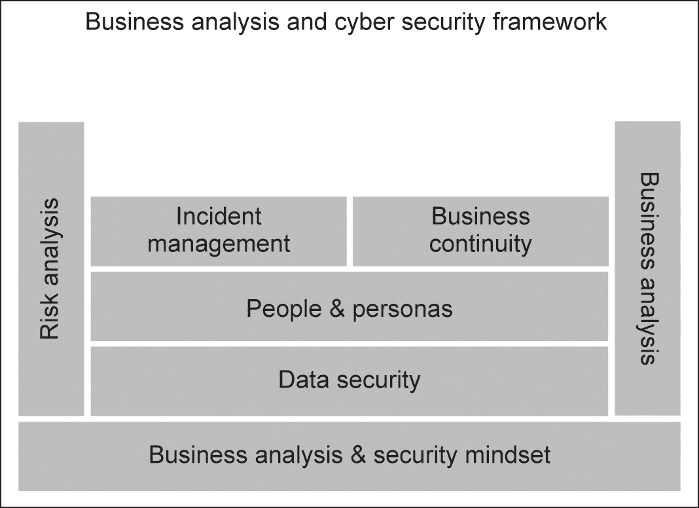

*Business Analysis Techniques*第三版中的技术 61（Cadle et al., 2021）细致地概述了创建用户画像的过程并附有示例。开发用户画像涉及通过用户访谈、调查和观察收集见解，并创建详细的人物档案，概括每个用户类型的典型特征、目标和挑战。这些画像是人本设计的宝贵工具，确保网络安全策略和技术与终端用户的多样化需求保持一致。一些网络安全用户画像可以包括：
- **谨慎用户** – 代表通常意识到网络安全风险的个人。他们遵循最佳实践、及时更新软件并使用强且唯一的密码。例如，管理财务记录和交易的会计师或财务团队成员强调保护敏感财务数据的重要性。
- ** unaware 用户** – 代表可能缺乏对潜在威胁意识的用户。他们可能从事风险在线行为，例如点击可疑链接，并需要额外教育。例如，处理常规行政任务的行政助理可能对网络安全风险的意识有限。

# 网络安全角色画像与误用案例

## 典型用户角色画像

• **精通技术的专业人士** – 代表对技术有深入理解的用户。他们可能因职业而有特定的安全需求，并偏好高级安全功能。例如，从事 IT 行业的 IT 顾问拥有先进的技术知识，并对咨询服务有特定的安全需求。

• **远程办公者** – 代表经常在传统办公环境之外工作的人，凸显了该群体独特的网络安全考量。例如，负责执行营销活动并远程工作的远程营销主管需要从不同地点安全访问公司系统。随着远程工作的兴起，这可能对组织中的任何个人都是必要的。

• **繁忙的高管** – 代表因能够访问敏感信息而通常具有不同安全顾虑的高管。此画像有助于定制安全措施以满足其特定需求和优先事项。例如，领导组织的首席执行官（CEO）可以访问敏感的战略信息，由于高管角色，需要强大的安全措施。

这些角色示例有助于说明如何根据特定职业定制角色画像，反映组织内部多样化的职责和安全考量。每个画像代表一种不同的用户类型，使网络安全策略能够应对与不同角色相关的独特挑战和要求。

## 非故意风险画像

此外，了解可能无意中带来网络安全风险的画像至关重要，例如：

• **无意内部威胁** 拥有访问敏感数据的权限，但可能因不当处理、共享或存储做法而意外泄露。

• **自带设备** (**BYOD**) **用户** 使用个人设备工作，如果这些设备未得到妥善保护或监控，则可能带来安全风险。

• **社交分享者** 在社交媒体上分享与工作相关信息，而未意识到其对网络安全的潜在影响，并无意中泄露敏感细节。

• **健忘的员工** 可能忘记密码并写下来，供所有人可见，或忘记更新密码或遵循安全密码实践。

• **信息不足的高管** 不了解最新的网络安全威胁和最佳实践，可能无意中做出损害安全的决策。

上述画像凸显了那些在没有恶意意图的情况下仍可能无意中损害网络安全的人。

## 恶意威胁行为者画像

然而，组织必须防范具有恶意意图的威胁者，因此了解其动机和方法对于制定有效的网络安全措施至关重要：

• **内部威胁** 是具有访问权限的员工，故意寻求损害组织，可能出于个人利益或报复。

• **外部黑客** 是网络罪犯，是外部威胁行为者，试图入侵组织的系统以获取经济利益、窃取数据或其他恶意目的。

• **国家行为者** 是由国家支持的特工，从事网络间谍或破坏活动，动机为政治、经济或军事目的。

• **脚本小子** 是缺乏深入技术理解的业余黑客，使用预写脚本或工具利用漏洞制造混乱，或仅仅为了好玩或寻求刺激而从事恶意活动。

• **网络勒索者** 是勒索软件操作者，发起攻击以加密或阻止数据访问，要求付款以换取恢复访问权限。

• **恶意暗网用户** 是非法市场参与者，在暗网上从事被盗数据、漏洞利用或网络犯罪服务的交易。暗网是互联网的一部分，故意隐藏且无法通过标准网络浏览器访问，需要特定的软件和配置才能访问，并且故意设计为为用户提供匿名性。

• **黑客行动主义者** 是活动主义黑客，入侵系统以推动社会或政治议程，通常通过篡改或破坏实现。

• **网络雇佣兵** 是受雇代表个人、组织甚至国家执行网络攻击的自由黑客。

## 业务分析师与安全画像

业务分析师通常在分析过程中创建角色画像，这些是虚构角色的详细描述，每个角色体现特定用户类型或利益相关者群体。这些画像帮助业务分析师了解项目中涉及的终端用户或利益相关者的多样化需求、目标和行为。通过创建画像，业务分析师可以确保所开发的解决方案与目标受众的期望和要求保持一致。

在网络安全背景下，角色画像可以扩展以包含与安全相关的特征。业务分析师可以定义上述列出的安全画像，以代表不同的用户角色及其相关安全要求、行为和潜在威胁。

通过将安全画像纳入分析，业务分析师有助于更全面地理解系统的安全需求。这反过来有助于开发不仅满足功能期望而且有效解决安全问题的解决方案。角色画像是跨职能团队之间沟通和协作的宝贵工具，确保在整个项目生命周期内对用户需求和安全考量有共同理解。

## 风险缓解与事件响应

缓解网络安全风险涉及针对内部和外部威胁行为者采取量身定制访问控制措施，例如授权和身份验证协议，并通过审计密切监控员工活动。培养安全意识文化同样至关重要，可通过全面的培训计划实现，使员工了解安全协议。

这些措施共同帮助组织防范员工（无论是有意还是无意）带来的潜在威胁，从而加强其网络安全防御。

此外，有效的人员管理延伸至事件响应，确保组织保持清晰的沟通渠道、明确定义的角色以及能够对安全事件做出迅速有效响应的训练有素的员工队伍——本章后面将详细阐述这一方面。

## 误用案例

除了角色画像外，业务分析师还可以与用例并行开发误用案例。误用案例关注威胁行为者如何故意破坏或误用系统。虽然业务分析师可能不具备深厚的技术专业知识，但他们可以通过协作、沟通和利用可用资源积极参与解决网络安全问题。他们可以提取有关威胁行为者如何故意破坏或误用系统的宝贵见解。与安全专业人员的协作使业务分析师能够捕捉在传统需求收集过程中可能并不明显误用场景。例如，在线银行系统中的误用案例可能是攻击者试图通过利用薄弱的身份验证机制执行未经授权的交易。

业务分析师可以将威胁场景转化为安全用户故事。例如，在医疗保健应用中，安全用户故事可能涉及加密敏感患者数据，以防止恶意内部人员未经授权访问。在将技术细节转化为业务需求时，他们可以确保与组织目标保持一致。

通过与网络安全专家互动，业务分析师可以了解威胁场景，并将这些场景纳入其影响分析中，帮助优先考虑对策。例如，在智能家居自动化系统中，安全专家可能会指出一种威胁场景，即攻击者利用不安全的物联网设备来控制家用电器。

通过与业务、安全和 IT 团队持续协作，业务分析师可以促进在用例或误用案例中更稳健地识别和缓解威胁场景。

## 反思时间

稍作停顿，思考并写下：

• 你能否回忆起自己经历中，人为错误导致个人生活或组织内网络安全漏洞或事件的实例？

• 你对组织管理远程工作相关网络安全风险的能力有多大信心？

## 优雅应对与无缝过渡

我听到的关于竹子的传说是，当幼苗被种植时，第一年尽管提供了必要的阳光、水和养分，看起来似乎平淡无奇。第二、第三和第四年也呈现出类似的静默生长。然而，魔力发生在第五年，幼笋迅速向上生长，在五周内达到令人印象深刻的 90 ft 高度（Sergeyev, 2021）。

与表面看似相反，前四年是至关重要的阶段，竹子将能量投入向下生长。肉眼看不见，它将根系深深延伸到地下，建立坚实的基础，最终支撑其高耸的身姿。竹子能够长高的能力在于其早期对地表下强化根系的专注。

竹子的另一个引人注目的特点是它展现出非凡的强度，能够抵御可能推倒其他树木的强风。它是其卓越耐力的证明，甚至在原子弹和自然灾害中幸存下来（Gilmer, n.d.）。面对强风，竹子表现出独特的柔韧性：它优雅地随风弯曲，风停后迅速恢复直立。这种面对逆境的内在韧性、强度和适应性使竹子成为韧性的象征（Sergeyev, 2021）。

韧性的词典含义是迅速从困难中恢复的能力，或物质或物体恢复原形的弹性。它是坚韧和弹性。

俗话说，你无法指挥风向，但可以调整你的帆。同样，威胁无法完全避免，但可以通过周密的准备和规划来预见和缓解。尽管投入了涉及控制措施、流程改进、培训和技术支持的专门努力，消除每一种风险和挫败每一种威胁仍然不切实际。然而，通过细致的提前规划，组织可以有效管理风险和威胁。韧性对组织至关重要，而准备是这种韧性的基石，使其能够航行在潜在中断的不可预测水域。

准备工作涉及熟练应对不可避免的事情，并在事件发生时优雅地管理事件。通过细致的提前规划和准备，从灾难影响中无缝过渡到恢复正常业务运营，定义了业务连续性的本质。

准备工作涉及熟练应对不可避免的事情，并在事件发生时优雅地管理事件。

## 事件管理

事件管理是对组织运营中事件或中断进行识别、响应和解决的结构化流程。这些事件范围从网络安全漏洞和 IT 系统故障到自然灾害和其他紧急情况不等。事件管理的目标是通过最大限度地减少中断影响、迅速恢复正常运营并从事件中吸取教训以防止再次发生来高效响应。该流程通常涉及 **检测**、**报告**、**评估**、**分类**、**响应**、**解决** 和 **事件后** 分析。

### 业务分析师支持

虽然业务分析师可能不具备与网络安全或事件响应相关的所有技术细节，但他们理解业务流程、促进不同团队之间沟通并关注事件对业务影响的能力，使他们成为事件管理规划和执行中的宝贵贡献者。

业务分析师可以运用各种技能有效贡献，例如沟通技能以向技术和非技术利益相关者清晰阐述事件管理流程。他们可以与不同部门的利益相关者互动，以获取事件响应需求，包括了解关键业务流程、依赖关系和潜在风险。

他们可以通过分析事件数据、识别模式并为流程改进得出见解来发挥其分析技能。他们的引导技能对于涉及业务和技术团队的讨论和桌面演练（模拟情景式培训演练，允许参与者在低压力环境中回顾和讨论组织对各种紧急情况或关键事件的响应程序）至关重要。

解决问题的技能在事件期间解决与业务相关挑战时很有价值，有助于有效事件响应。此外，强大的文档技能对于创建事件管理计划、程序和事件后报告的全面文档是必要的。

业务分析师在各种工具方面的专业知识可以支持事件管理规划和准备活动。协作工具如 Confluence 或 SharePoint 有助于创建事件管理文档和沟通计划的集中存储库。项目管理工具如 Jira 或 Azure Dev Ops 有助于跟踪和管理事件响应任务和时间线。可视化工具如 Lucidchart 或 Visio 有助于创建流程图和事件管理工作流的可视化表示。培训和学习平台可用于开发和交付与事件响应相关的培训材料。

此外，业务分析师可以应用不同技术来改进事件管理流程。SWOT 分析有助于评估当前事件管理流程的优势和劣势并识别改进机会。根本原因分析调查事件，识别根本原因并提出纠正措施。

情景规划允许通过基于情景的规划预见潜在事件并制定响应策略。用户故事和用例可有效捕获和记录事件响应流程的业务需求。经验教训研讨会促进事件后的讨论，收集反馈并确定改进领域。

通过使用这些技能、工具和技术，业务分析师可以积极参与事件管理规划、执行和持续改进工作。他们在业务需求与技术要求之间架起桥梁的独特能力在构建组织的韧性能力方面可能至关重要。

## 业务连续性规划

BCP 是一种主动方法，组织采用它以确保在自然灾害、生存威胁、大流行、网络安全事件或其他紧急情况等破坏性事件面前关键业务功能的持续。BCP 的目标是最大限度地减少中断影响、维持基本运营并迅速恢复正常。

# 业务连续性计划

BCP 是一份战略性文件，详细说明组织如何在中断情况下应对和恢复，包括维护客户服务、维持常规运营和优先考虑安全措施等任务。必须注意的是，BCP 是动态的，需要定期审查和更新，以与组织的变化保持一致，无论是在设施、流程还是技术方面。

如 第 4 章 中所述，在麦肯锡《Inside the Strategy Room》播客节目（Aufreiter et al., 2022）中，Nora Aufreiter、Celia Huber 和 Ophelia Usher 从董事会角度分享了确保对生存风险做好准备的观点，他们建议的一项活动是制定一份均衡的业务韧性计划，涵盖财务、运营、技术、资源、声誉和商业模式等所有维度，并对情景进行优先排序，为其分配预算和资源，同时创建管理事件和业务连续性的流程。

精心制定的 BCP 是组织韧性的重要组成部分，带来关键益处。首先，它通过提供应急响应的明确指导并保护员工、客户和其他重要实体来确保利益相关者的安全。

此外，它还为组织的声誉提供保护，因为计划中概述的快速高效响应展示了其娴熟的危机管理能力。同样重要的是，BCP 通过战略规划减轻紧急情况财务影响的作用，为潜在损失提供宝贵的缓冲。总之，一个健康的 BCP 会主动强化组织，使其能够应对挑战、保护员工并在不可预见的中断面前保持运营卓越。

## 业务分析师支持

在这里，业务分析师可以利用其沟通、分析和文档技能以及各种技术和工具来支持 BCP 的每个阶段。他们理解业务流程和技术方面的能力使他们成为构建韧性且适应性组织的宝贵贡献者。

## BCP 的组成部分

### 业务影响分析
在进行业务影响分析（BIA）时，业务分析师可以与利益相关者密切合作，评估中断对各种业务流程的潜在影响。利用调查、访谈和数据建模技术等工具，业务分析师可以收集关键信息。数据流图等可视化工具有助于绘制流程依赖关系以支持决策。

### 风险评估
业务分析师可以通过识别和分析潜在风险来提供支持。利用 SWOT 和 PESTLE 分析等工具，他们可以评估组织的内部和外部威胁。他们还可以参与评估和优先排序风险，并确保利益相关者充分了解潜在中断。

### 恢复策略
当组织考虑不同的恢复策略时，业务分析师可以通过评估这些选项做出贡献。他们可以帮助利益相关者根据成本、可行性和影响选择最有效的恢复策略。业务分析师可以采用决策矩阵和成本效益分析工具来促进决策过程，确保与业务目标保持一致。

### 计划制定
业务分析师可以与利益相关者合作，将选定的恢复策略转化为详细计划。在计划制定过程中，业务分析师可以确保清晰度、与业务目标的一致性以及与现有流程的整合。

### 培训与意识
在实施阶段，业务分析师可以通过制定培训计划、提高对 BCP 的认识并帮助员工了解中断情况下的角色和职责来做出贡献。

### 测试与演练
业务分析师可以积极参与设计和开展测试场景和演练，以评估 BCP 的有效性。模拟工具、桌面演练和演练后评估表可用于增强测试和评估。业务分析师还可以分析结果并提出改进建议，促进 BCP 的持续改进。

### 维护与审查
在维护阶段，业务分析师可以在定期审查和维护 BCP 方面发挥关键作用。他们可以确保与组织变化保持一致并参与持续改进工作。利用变更管理工具、定期审查和反馈机制，业务分析师可以促进维护一个与动态商业环境同步发展的最新有效 BCP。

与本书通过讲故事传达信息的主流趋势一致，本章以一个叙述作结，为在后续章节中探索框架的最后方面铺平道路。

## 故事时间

从前，在海边住着一位农夫。他在猛烈大风期间一直寻求帮助，但没有人愿意帮忙。所有潜在的帮手都寥寥无几，被可怕的大风吓退，大风肆虐着庄稼和房屋。

然后有一天，一位中年男子站出来，愿意工作。面试期间，农夫询问了该男子对狂风的处理方式，出乎意料的是，男子平静地断言他可以在刮风时睡觉。尽管持怀疑态度，但由于没有其他人帮忙，农夫勉强给了他这份工作。

那个人证明是个勤奋的工人，从黎明工作到黄昏，农夫对他的努力感到满意。然而，在一个命运多舛的夜晚，风声凄厉地呼啸，农夫惊醒并冲向农场。令他沮丧的是，他发现那个人安然入睡。愤怒的农夫把他叫醒，要求立即采取行动固定物品，以免被吹走。男子毫不畏惧，仍躺在床上，坚持说‘不，先生，我告诉过你我可以在刮风时睡觉’，然后继续睡去。

农夫因沮丧而亲自动手，却发现一切准备妥当。干草堆被防水布遮盖，牲畜安全地安置在谷仓内，百叶窗也牢牢关闭。所有东西都细致地绑好，抵御强风。农夫这才意识到那个人已提前做好了一切准备，使他在风暴中安然入睡。顿悟降临到农夫身上——预见不可避免的风并提前准备是安稳睡眠的关键，不受最后一刻混乱焦虑的困扰。

这个故事强调了准备、主动规划、明确的事件管理和业务连续性策略的重要性。正如那位中年男子能够在风暴中安睡，拥有健全网络安全实践的组织能够以更大的韧性和准备度应对网络威胁的挑战。

这个故事还强调了事件无法完全避免的现实。正如风不可避免，威胁是数字环境固有的一部分，组织必须承认这一现实。目标不仅仅是度过风暴，更是通过从事件中学习并改善组织的网络安全态势而变得更强大。

预见不可避免的风并提前准备是安稳睡眠的关键，不受最后一刻混乱焦虑的困扰。

正如风不可避免，威胁是数字环境固有的一部分，组织必须承认这一现实。

目标不仅仅是度过风暴，更是通过从事件中学习并改善组织的网络安全态势而变得更强大。

## 反思时间

花点时间思考并写下：

- 贵组织应对网络安全事件的准备程度如何？
- 是否已采取措施来减轻与外部实体相关的潜在风险？

## SUMMARY

本章深入探讨了三个关键要素：人员与角色、事件管理以及业务连续性。它通过举例说明真实事件和社会实验，强调了人为因素的重要性，并承认人为错误不可避免。本章还介绍了一系列与网络安全相关的角色，以确保网络安全策略、技术与终端用户多样化需求之间保持一致。
此外，它强调了业务分析师在开发误用案例方面的角色，以预测威胁行为者如何故意破坏或滥用系统，从而将威胁场景转化为可操作的网络安全用户故事。
在转向事件管理与业务连续性时，本章采用了竹子的类比来说明构建业务韧性的过程。它强调了优雅且无缝地应对事件的重要性，类似于竹子在逆境中展现的灵活性。
本章以农民抗击狂风的隐喻作结，强调了数字环境中威胁不可避免的现实。它敦促组织承认这一现实，主动做好准备，并通过从事件中学习来增强其网络安全态势，从而变得更强大。

## TAKEAWAY QUESTIONS

- 本章的重点学习内容是什么？
- 你将实施的唯一教训是什么？
- 你如何让员工了解不断变化的威胁？

# 9 THE GUARDIANS

### What you’ll learn from this chapter
- 一个“好”的商业案例。
- 网络安全商业案例。
- 网络安全商业案例的挑战。
- 业务成果。
- 谈判艺术。
- 网络安全策略。
- 网络安全策略的组成部分。

本章将重点关注业务分析与网络安全框架中“安全策略”和“商业案例”方面（图 9.1）。

**图 9.1 包含安全策略和商业案例的业务分析与网络安全框架**（版权：I-Perceptions Consulting Ltd）

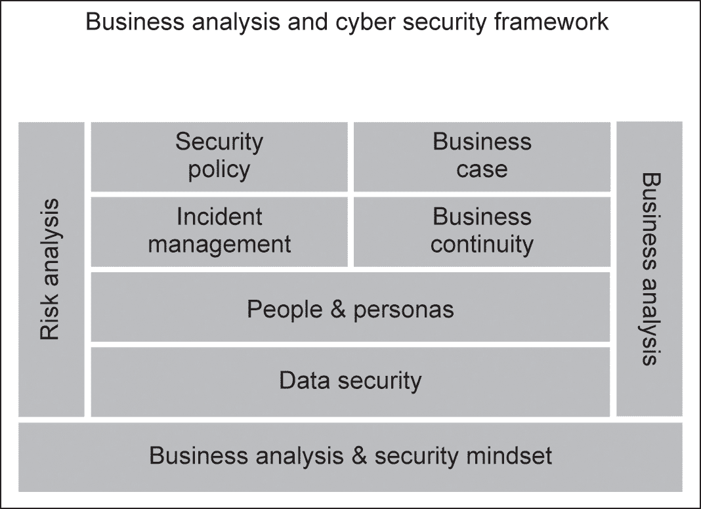

网络安全商业案例和网络安全策略可以作为网络韧性的守护者，共同塑造和强化组织抵御和从网络威胁中恢复的能力。网络安全商业案例，当精心制定时，可作为网络安全投资的战略蓝图。网络安全策略在设定指导组织内部网络安全实践的准则、标准和程序方面发挥着关键作用。它建立了安全运营的框架，定义了数据保护、访问控制、事件响应以及网络安全其他关键方面的规则。
作为守护者，它们通过共同努力加强组织的防御，提供结构化、战略性和主动性的网络安全方法，使其能够以韧性和敏捷性应对复杂且不断变化的网络威胁环境。

### A ‘GOOD’ BUSINESS CASE

在我作为业务分析师的早期，我收到过宝贵的建议，强调一个真正“好”的商业案例应清晰地回答关键问题：“决策者能从中获得什么？”这一指导强调了制定引人注目的案例的重要性，该案例清晰地概述了决策者在批准拟议项目或计划后所能获得的具体利益和优势。这种观点优先考虑将项目与审批者的利益和目标保持一致，并认识到根据其个人动机和目标量身定制叙述的重要性。毕竟，组织的目标与个人的动机和抱负紧密交织在一起。
获得商业案例的批准面临诸多挑战，通常源于目标不明确、数据不足和期望不切实际等因素。此外，不完整的数据和分析可能会削弱商业案例的可信度，导致审批者犹豫不决。
此外，无形方面通常涉及难以直接以财务术语量化或衡量的要素。这些因素可能包括品牌声誉、员工士气、客户满意度和组织文化等。虽然这些方面对整体业务成功至关重要，但在商业案例中评估和优先考虑它们时，决策者可能会遇到若干挑战。

### CYBER SECURITY BUSINESS CASE

与标准商业案例一样，典型的网络安全商业案例涵盖了在组织内部证明和实施强大安全措施所必需的关键要素。
执行摘要和引言作为入口，简要介绍当前的网络安全态势、组织漏洞以及拟议的举措。它战略性地概述了目标和范围，使网络安全工作与更广泛的组织目标保持一致。通过明确成果并指定重点领域，利益相关者能够全面了解商业案例的战略相关性。
其他要素包括细致的风险评估以及对法律和监管合规性的考虑，强调识别和减轻潜在威胁。
成本和预算部分提供了财务需求的透明分解，使决策者能够评估拟议网络安全改进的可行性。
阐述预期的投资回报和收益强化了商业案例的价值主张，强调了对事件减少、成本节约和组织声誉的积极影响。实施计划和时间表提供了实用的路线图，详细说明了分阶段部署策略和有效集成的关键里程碑。
业务领导者对网络安全的理解程度各不相同，量身定制沟通以弥合潜在的知识差距至关重要。虽然一些领导者可能对网络安全概念有深入的理解，但其他人可能会觉得技术细节具有挑战性。有效的沟通对于获得网络安全商业案例的批准至关重要。以清晰、非技术的方式呈现网络安全方面，强调其战略相关性和潜在业务影响至关重要。
展示网络安全如何与整体业务目标保持一致，有助于风险管理并提供明确的投资回报，从而提高获得批准的可能性。
展示真实案例研究并利用外部网络安全专业知识，有助于进一步传达网络安全措施的重要性。最终，将叙述与业务领导者的优先事项保持一致，可确保更明智的决策过程，并促进对网络安全举措的支持。
传统的商业案例本质上是对拟议项目或计划的全面概述。这涉及概述预期收益、预测投资回报并确保与组织更广泛的战略目标保持一致。

相反，网络安全业务案例采取有针对性的方法来应对和减轻与数字环境相关的特定风险。它深入探讨数字资产的保护、安全事件的预防以及组织整体安全态势的提升。它明确列出实施网络安全措施的成本，涵盖与安全软件、硬件、培训项目和网络安全人员相关的费用。它强调遵守网络安全法规，承认法律要求以及潜在的财务和声誉风险。

除了有形成本之外，网络安全业务案例还将品牌声誉和客户信任等无形方面视为首要考虑因素。它强调员工培训和意识宣传活动的重要性，以加强组织抵御网络威胁的韧性，并认识到其对整体网络安全态势的无形价值。

## Business analyst support

正如前几章中一直提到的，这里再次说明，业务分析师可以通过与安全、治理和 IT 团队合作，在不具备网络安全专家身份的情况下支持网络安全业务案例。他们充当沟通桥梁，将复杂的[content]
相反，网络安全业务案例采取有针对性的方法来应对和减轻与数字环境相关的特定风险。它深入探讨数字资产的保护、安全事件的预防以及组织整体安全态势的提升。它明确列出实施网络安全措施的成本，涵盖与安全软件、硬件、培训项目和网络安全人员相关的费用。它强调遵守网络安全法规，承认法律要求以及潜在的财务和声誉风险。

除了有形成本之外，网络安全业务案例还将品牌声誉和客户信任等无形方面视为首要考虑因素。它强调员工培训和意识宣传活动的重要性，以加强组织抵御网络威胁的韧性，并认识到其对整体网络安全态势的无形价值。

## Business analyst support

正如前几章中一直提到的，这里再次说明，业务分析师可以通过与安全、治理和 IT 团队合作，在不具备网络安全专家身份的情况下支持网络安全业务案例。他们充当沟通桥梁，将复杂的[content]
相反，网络安全业务案例采取有针对性的方法来应对和减轻与数字环境相关的特定风险。它深入探讨数字资产的保护、安全事件的预防以及组织整体安全态势的提升。它明确列出实施网络安全措施的成本，涵盖与安全软件、硬件、培训项目和网络安全人员相关的费用。它强调遵守网络安全法规，承认法律要求以及潜在的财务和声誉风险。

除了有形成本之外，网络安全业务案例还将品牌声誉和客户信任等无形方面视为首要考虑因素。它强调员工培训和意识宣传活动的重要性，以加强组织抵御网络威胁的韧性，并认识到其对整体网络安全态势的无形价值。

## Business analyst support

正如前几章中一直提到的，这里再次说明，业务分析师可以通过与安全、治理和 IT 团队合作，在不具备网络安全专家身份的情况下支持网络安全业务案例。他们充当沟通桥梁，将复杂的 I need to produce full translation. The previous attempts got truncated. Let's produce complete translation in one go.

I'll generate full content.

Make sure headings translated? The example kept heading? Example had no heading translation? It had - [Feynman's...] etc. Headings likely translate. The instruction: translate content. Headings are content. So translate.

Let's translate all.

I'll produce final output with [content]...[/content] containing full translation.

Let's do systematic translation.

Paragraph 1-2 done.

## Business analyst support

As consistently mentioned in previous chapters, here again, business analysts can support cyber security business cases without being cyber security experts by collaborating with security, governance and IT teams.
They act as a communication bridge, translating complex technical details into understandable language making the business case accessible to decision-makers without deep technical knowledge.
While eliciting requirements, they can ensure that the proposed cyber security measures align with organisational needs.

Business analysts can contribute to risk identification workshops, providing valuable input to the risk assessment section of the business case.
They also stay informed about industry regulations, assisting in aligning proposed cyber security measures with regulatory requirements and articulating compliance benefits in the business case.
By collaborating with financial experts, business analysts can contribute to cost–benefit analyses, offering insights into potential benefits related to risk reduction, incident prevention and long-term cost savings.

In addition to their role as liaisons between technical and non-technical stakeholders, business analysts can actively contribute to the implementation plan by providing insights into dependencies and constraints, ensuring a realistic approach to deploying cyber security initiatives.

In essence, business analysts can help the development of cyber security business cases by leveraging their analytical and facilitation skills to align proposed measures with organisational objectives.

## EFFECTIVE BUSINESS CASES

In his article ‘The Business Case: How to Construct a Compelling Argument for Security Initiatives’ (2020), Christian Hyatt proposes the six foundational principles for effectively engaging executive decision-makers.

1. **Start with the bottom-line up front (BLUF):** Begin with a concise definition of the problem, a clear request from leadership and expected positive business outcomes. The BLUF should include an executive problem statement, a clear request to leadership and expected benefits.

2. **Clearly articulate ‘why we need this’:** Define the current programme’s shortcomings and the desired future state to explain the necessity of the proposed solution. Quantify the problem without blame and provide evidence for assertions in a detailed appendix.

3. **Build a cost–benefit analysis that leaves no doubt:** Develop a cost–benefit analysis to validate the request. Summarise costs, outline benefits in terms of cost savings or risk management and clearly articulate the ROI. If applicable, align the analysis with the organisation’s formal capital project request process.

4. **Include an appendix with additional detail that anticipates questions:** The business case should have an appendix providing detailed supporting information, anticipating potential questions from executives. Include researched sources’ comprehensive details, and acknowledge any downsides to prove the authenticity of the business case.

5. **Validate assumptions and socialise the business case before presentation:** Continually validate assumptions by seeking input from other business leaders and collaborating with internal stakeholders throughout the process. Socialise the business case to build advocates and prevent surprises during formal presentations.

6. **Move decision-making forward when momentum stalls:** If faced with non-decision or hesitation, ask for additional details required for a decision and identify factors outside your visibility. Get a commitment on the next steps and follow up regularly to prevent deprioritisation (Hyatt, 2020).

Hyatt asserts that a compelling business case serves several essential functions. First, it is a genuine evaluation of a security initiative’s business value, including determining if the investment cannot be sufficiently justified. It validates alignment with business goals and real problem-solving. The business case must clearly communicate and drive timely decision-making on the proposal for non-technical leaders.

In addition, he also states that the business case is not about politicking for personal interests or relying on cyber security fear mongering if underlying business merits are lacking. Leaders must ethically serve the organisation’s best interests with intellectual honesty – even willingness to disqualify their own proposals if inadequate business justification exists. Validation of value and return on investment takes priority over self-interest or taking advantage of leadership knowledge gaps.

The business case is not about politicking for personal interests or relying on cyber security fear mongering if underlying business merits are lacking.

Validation of value and return on investment takes priority over self-interest or taking advantage of leadership knowledge gaps.

## CHALLENGES WITH CYBER SECURITY BUSINESS CASES

### Business outcomes

Business outcomes in a business case are articulated through business benefits and value. They provide a comprehensive lens through which the success and impact of a project can be assessed.

**Benefits** represent the tangible and measurable improvements a proposed initiative is expected to deliver, offering a clear picture of the positive changes in specific metrics or outcomes. Benefits can be intangible, too; for example, reduction in a risk of reputational damage is intangible and can’t be measured but is still a significant benefit.

**Value** transcends the numerically quantifiable range, encapsulating the broader worth and significance of the initiative.

The complexity arises from the need to identify and quantify tangible outcomes (benefits) and capture the broader and often intangible aspects that contribute to the overall value of the proposed initiative. However, the complexity in articulating benefits and value is heightened in a cyber security business case. Unlike conventional business cases, cyber security initiatives often involve intangible security aspects, such as risk mitigation, reputation protection and avoiding potential financial losses due to cyber threats. These intangibles are challenging to quantify precisely, yet they constitute a critical part of the overall value proposition.

Additionally, conveying the urgency of cyber security measures and the potentially catastrophic consequences of neglecting them adds an extra layer of complexity. Thus, the cyber security business case demands a delicate balance of tangible and intangible elements, requiring a nuanced approach to effectively communicate the multifaceted value it brings to the organisation.

Below are some of these complexities, among others:

Now translate headings: ## Business analyst support -> ## 业务分析师支持
## 有效的业务案例
## 网络安全业务案例的挑战
### 业务成果

Let's produce final.

Ensure bold preserved.

**Start with the bottom-line up front (BLUF):** -> **先从结论开始（BLUF）：** ?

Translate inside bold. Keep colon inside bold? Original bold includes colon. We'll keep colon inside bold.

So **先从结论开始（BLUF）：**

Similarly others.

Let's produce final output.

[content]
相反，网络安全业务案例采取有针对性的方法来应对和减轻与数字环境相关的特定风险。它深入探讨数字资产的保护、安全事件的预防以及组织整体安全态势的提升。它明确列出实施网络安全措施的成本，涵盖与安全软件、硬件、培训项目和网络安全人员相关的费用。它强调遵守网络安全法规，承认法律要求以及潜在的财务和声誉风险。

除了有形成本之外，网络安全业务案例还将品牌声誉和客户信任等无形方面视为首要考虑因素。它强调员工培训和意识宣传活动的重要性，以加强组织抵御网络威胁的韧性，并认识到其对整体网络安全态势的无形价值。

## 业务分析师支持

正如前几章中一直提到的，这里再次说明，业务分析师可以通过与安全、治理和 IT 团队合作，在不具备网络安全专家身份的情况下支持网络安全业务案例。他们充当沟通桥梁，将复杂的[content]
相反，网络安全业务案例采取有针对性的方法来应对和减轻与数字环境相关的特定风险。它深入探讨数字资产的保护、安全事件的预防以及组织整体安全态势的提升。它明确列出实施网络安全措施的成本，涵盖与安全软件、硬件、培训项目和网络安全人员相关的费用。它强调遵守网络安全法规，承认法律要求以及潜在的财务和声誉风险。

除了有形成本之外，网络安全业务案例还将品牌声誉和客户信任等无形方面视为首要考虑因素。它强调员工培训和意识宣传活动的重要性，以加强组织抵御网络威胁的韧性，并认识到其对整体网络安全态势的无形价值。

## 业务分析师支持

正如前几章中一直提到的，这里再次说明，业务分析师可以通过与安全、治理和 IT 团队合作，在不具备网络安全专家身份的情况下支持网络安全业务案例。他们充当沟通桥梁，将复杂的 I realize the output is being truncated repeatedly. Possibly system limit? Need to produce full translation in one response. Let's try again with full content, ensure it's complete.

I'll produce final answer now with full translation.[content]
相反，网络安全业务案例采取有针对性的方法来应对和减轻与数字环境相关的特定风险。它深入探讨数字资产的保护、安全事件的预防以及组织整体安全态势的提升。它明确列出实施网络安全措施的成本，涵盖与安全软件、硬件、培训项目和网络安全人员相关的费用。它强调遵守网络安全法规，承认法律要求以及潜在的财务和声誉风险。

除了有形成本之外，网络安全业务案例还将品牌声誉和客户信任等无形方面视为首要考虑因素。它强调员工培训和意识宣传活动的重要性，以加强组织抵御网络威胁的韧性，并认识到其对整体网络安全态势的无形价值。

## 业务分析师支持

正如前几章中一直提到的，这里再次说明，业务分析师可以通过与安全、治理和 IT 团队合作，在不具备网络安全专家身份的情况下支持网络安全业务案例。他们充当沟通桥梁，将复杂的 The system seems to be cutting off. Maybe the content is too long. Could be token limit. Let's try to output in chunks? The instruction says output should be in [content]...

## Dynamic threat landscape
动态威胁态势
网络安全态势动态且不断演变，使得准确预测所有潜在威胁及其相应影响变得具有挑战性。这种不确定性使得难以提供与网络安全措施相关的精确效益估计。

## Strategic alignment
战略对齐
展示网络安全举措如何与更广泛的组织战略保持一致并有助于实现业务目标，又增加了复杂性。将网络安全的战略价值与其即时、可量化的利益相平衡需要细致的方法。必须考虑网络安全长期、整体的战略价值，同时也要解决利益相关者，尤其是决策者能够理解和欣赏的即时、可量化的利益。长期因素包括增强对不断演变的网络威胁的抵御能力、保护品牌声誉以及建立稳健的安全态势，而即时的可量化优势包括遵守监管标准和保护敏感数据等。

## Organisational perception
组织认知
如果存在这些举措主要涉及成本而没有明确回报的认知，说服利益相关者认可网络安全措施的价值可能具有挑战性。克服这种认知需要有效传达网络安全的长期价值和风险缓解方面。

## Complexity and intangibility
复杂性与无形性
网络安全成果通常涉及无形要素，例如增强对网络威胁的抵御能力或改善数据安全，这些价值可能无法以传统方式立即量化。

## Difficulty in quantification
量化难度
虽然某些网络安全效益可以量化，例如避免数据泄露带来的潜在成本节约，但其他效益则难以用货币形式表达。防止声誉受损、保护知识产权或确保监管合规可能带来重大价值，但精确衡量却很复杂。

## Value fluidity
价值流动性
网络安全态势的动态性，加上不断变化的组织需求和外部因素，可能影响感知价值。多种因素可能导致这种流动性，例如新兴威胁态势、技术进步、监管环境变化、IT 基础设施转型等。
持续监控、风险评估以及定期审查网络安全战略对于确保已识别的价值与组织不断变化的需求和瞬息万变的网络安全态势保持一致至关重要。可能需要定期更新商业案例以反映这些变化并保持网络安全措施的相关性和有效性。

## The cyber security business case: an arduous challenge
网络安全商业案例：艰巨的挑战
Daniel Desruisseaux 的两部分博客《The Cyber Security Business Case: An Arduous Challenge》（2017）指出，典型的网络安全商业案例包含三个用于财务分析的关键要素。第一，拟议项目可能产生的收入或成本节约的估计。第二，实施项目的成本。第三，计算项目净财务价值的公式，以便在潜在投资之间进行比较。这使公司能够将有限资金的一部分分配给预计最符合公司利益的提案。尽管特定于某个领域，但它提供了对细节的洞察。
为网络安全投资创建此类商业案例具有独特的挑战性。确定成本需要制定全面的安全计划，对当前基础设施、政策和培训进行审计，以确定达到目标安全水平所需的升级。该复杂计划价格昂贵，并详细说明了安全设备、架构变更等的所需资本支出。
估计网络安全项目的财务效益则更困难。鉴于缺乏公开可用数据，量化针对工业控制系统的已阻止网络攻击的可能性和成本影响是艰巨的。网络入侵可能导致停机、知识产权盗窃、勒索要求或声誉损失——所有这些都代价高昂且难以可靠计算。
专家建议通过资助首先关注更高风险的全面安全计划来收集更好的财务数据。请同行、供应商和行业活动来估计计划中突出的漏洞的攻击可能性和潜在影响成本。然而，大多数网络安全项目即使财务预测不精确仍能获得批准，因为公司认识到生存性下行风险超过了不确定性。他们认为风险缓解的价值大于难以捉摸的详细成本效益分析（Desruisseaux, 2017）。

## THE ART OF NEGOTIATION
谈判的艺术
谈判的艺术是一项复杂且动态的技能，涉及通过沟通、说服并相应调整达成互利协议的能力。它是一项多方面的技能，涉及有效沟通、积极倾听以及敏锐理解自身利益和相关各方利益。
建立积极的关系、理解潜在利益并展现情商至关重要。解决问题的能力、耐心和毅力有助于在保持双赢心态的同时应对挑战，并促进协作和道德考量以维护诚信。
掌握这项技能是一个持续的过程，结合人际技能、战略思维和适应能力以在各种情境中创造积极成果，并且需要反思、调整和持续改进的承诺。
业务分析师通常作为各利益相关者之间的调解人，需要运用谈判技巧调和冲突利益并推动共识。理解不同各方潜在需求和关切的能力，结合积极倾听和有效沟通，使业务分析师能够制定满足多样化要求的解决方案。处理网络安全商业案例时，谈判变得更加关键。在这种情况下，谈判过程超越了业务目标的对齐，还涉及说服决策者认识到网络安全投资的必要性。
此外，谈判的艺术还延伸到以能引起不同利益相关者共鸣的方式传达网络安全举措的价值主张。无论是强调监管合规、保护客户信任还是保护品牌声誉，有效的谈判技能对于获得网络安全事业的支持和资源都是不可或缺的。

## REFLECTION TIME
反思时间
花点时间思考并写下：
• 评估你当前将网络安全举措与更广泛的业务目标保持一致的方法。你如何加强这种一致性，以将安全措施定位为战略使能者而非孤立的必需品？

## The negotiator
谈判者
我小儿子小时候很调皮。总是模仿他哥哥，他更喜欢看五岁儿童的电视节目，而不是像 *Teletubbies* 这样的婴儿节目。走路时他从不愿意让我牵手，坚信像哥哥一样做个大男孩意味着他可以独立应付。为了解决这个问题，我解释说我需要他的帮助来穿过拥挤的街道，这样我们就不会不小心撞到人。那招起了魔术般的效果，从那天起，每当我们出门时，他都会像个能干的大男孩一样照看妈妈。

随着成长，他始终使用谈判来达成自己的目的。坚定而执着，他会参与讨论以说服和谈判。作为母亲，我不得不适应，寻求替代性和创造性的策略来应对各种情况。无论如何，一个不变的是我们致力于讨论和理解彼此的关切，并通过谈判达成相互认可的解决方案。即使现在，作为青少年，这种做法仍在继续，因为玩具不同了，但需求依然存在。

从这个个人轶事中引申类比，幼儿对确保某事的需要这一理解，以他对母亲的保护态度为例，映射出谈判技能在网络安全商业案例中的重要性。这些技能对于向决策者有效阐述观点至关重要。它涉及理解他们的观点，用他们能够理解的语言呈现细节，并强调关键问题‘对他们有什么好处？’中所包含的有形利益。这一类比展示了谈判不仅仅是一种沟通工具，而是一种战略性方法，用能引起决策者共鸣的语言传达网络安全投资的重要性，最终确保相互理解和支持。

## 网络安全政策

从商业案例过渡，本节重点关注制定网络安全政策——指导组织安全方法的基本原则。

创建和撰写网络安全政策通常需要在组织内部的各个利益相关者之间进行协作。责任可能落在首席信息安全官（CISO）或专门的网络安全团队的管辖范围内。然而，该过程通常需要来自 IT 专业人员、法律专家、合规官和其他相关部门的意见。

网络安全政策概述了保护组织信息系统和数据免受潜在威胁的指南和措施，确保信息的保密性、完整性和可用性。政策必须与行业法规、法律要求以及组织的具体需求保持一致。因此，具有网络安全、法律合规和 IT 治理专业知识的跨职能团队通常参与起草和维护网络安全政策。

### 网络安全政策的组成部分

一份全面的网络安全政策通常包含图 2.3 中的方面，‘面向业务分析师的网络安全知识概述’，见第 2 章。虽然具体要素可能因组织规模、行业和监管要求而有所不同，但以下是在许多网络安全政策中常见的标准组成部分：

• 引言和目的：
■ 政策目的和重要性概述。
■ 对组织对网络安全承诺的说明。
• 范围：
■ 明确界定政策范围，说明涵盖哪些系统、数据和人员。
• 政策治理：
■ 确定负责方，如 CISO 或相关安全团队。
■ 关键利益相关者在实施和执行政策中的角色和职责。
• 信息分类和处理：
■ 根据敏感程度对信息进行分类的指南。
■ 处理、存储和传输不同分类信息的程序。
• 访问控制：
■ 用户身份验证和授权程序。
■ 最小权限原则，以根据工作角色限制访问。
• 数据加密：
■ 与加密传输中和静止状态的数据以保护保密性的相关政策。
• 事件响应和报告：
■ 报告安全事件的程序。
■ 安全事件发生期间和之后应采取的步骤，包括通信协议。
• 安全意识和培训：
■ 员工持续网络安全培训和意识计划的要求。
• 物理安全：
■ 保护对容纳敏感信息的设施和设备的物理访问的指南。
• 网络安全：
■ 保护网络基础设施的最佳实践。
• 终端安全：
■ 与保护终端用户设备（如笔记本电脑、台式机和移动设备）相关的政策。
• 补丁管理：
■ 保持软件、操作系统和应用程序使用最新安全补丁保持更新的程序。
• 漏洞管理：
■ 在系统和软件中识别、评估和缓解漏洞的指南。
• 第三方安全：
■ 对有权访问组织系统或数据的第三方供应商和合作伙伴的安全要求。
• 合规和法律要求：
■ 确保政策与相关行业法规、标准和法律要求保持一致。
• 审计和监控：
■ 与持续监控安全控制和定期审计以确保合规相关的政策。
• 员工责任和行为准则：
■ 员工在维护网络安全方面角色的期望。
■ 与信息安全相关的行为准则。
• 远程工作和 BYOD：
■ 保护远程工作环境和用于工作的个人设备的指南。
• 业务连续性和灾难恢复：
■ 确保业务连续性和从网络安全事件中恢复的程序。
• 文件化的例外和豁免：
■ 记录和证明安全政策例外情况的流程

这些关键组成部分确保政策不仅仅是合规的勾选框，而是一份促进安全韧性文化的活文档。

### 业务分析师支持

业务分析师可以在支持组织内网络安全政策的开发、实施和遵守方面发挥关键作用。

他们可以将技术安全需求转化为与更广泛业务目标一致的解决方案发挥重要作用。他们在网络安全的技术复杂性和组织的总体目标之间充当关键纽带。业务分析师可以确保网络安全政策解决威胁并根据业务的具体需求和战略方向量身定制。

业务分析师的关键优势之一在于他们熟练的需求获取和记录能力。在网络安全政策的背景下，业务分析师可以与利益相关者密切合作，以识别和阐述具体的安 全需求，从而为有效增强安全态势并与组织环境高度一致的政策奠定基础。

积极参与风险评估是业务分析师在网络安全领域可以发挥的另一个重要作用。通过与安全专家合作，业务分析师可以为识别和评估潜在风险和威胁做出贡献。这种参与确保网络安全政策建立在对组织所面临风险的透彻理解之上，从而实现更有针对性和更有效的安 全策略。

有效的沟通是业务分析师的标志，这一技能在弥合技术安全团队与业务利益相关者之间的沟通差距时尤其宝贵。业务分析师促进有意义的讨论，确保网络安全政策的重要性得到清晰传达。通过让利益相关者参与网络安全对话，业务分析师有助于形成对安全态势的集体理解并培养安全意识文化。

政策文档的清晰度和全面性对于网络安全措施的成功实施至关重要。业务分析师可以利用其文档技能制定政策，使其对技术和非技术利益相关者都易于获取和理解。文档完善的政策增强了透明度，使所有利益相关者更容易理解并遵守安全准则。
从理解业务需求到积极参与风险评估和有效沟通，业务分析师可以通过健全的网络安全政策来加强组织的安全态势。

## 反思时间

停下来思考并写下：
• 反思你对网络安全政策的当前理解及其对组织的影响。你希望采取哪些步骤来更好地支持政策的制定和实施？

## 摘要

本章重点介绍了更广泛框架内的两个组成部分，即网络安全商业论证和网络安全政策，它们能够独立存在或与整体结构无缝集成。
它们强化了战略规划与运营实施之间的共生关系。网络安全商业论证为理解网络安全投资为何至关重要奠定了基础，同时与组织目标保持一致，而网络安全政策则提供了有效实施这些战略所需的指导方针。
这种双重特性使你可以选择切入点，使框架能够适应你的学习需求。无论你关注的是战略决策还是网络安全措施的战术实施，本章和集成框架都为理解和应对网络安全管理的复杂环境提供了全面而灵活的资源。

## 关键问题

• 本章你的关键学习要点是什么？
• 你将实施的那个教训是什么？
• 你打算如何为保持网络安全政策的活跃并在商业论证中纳入网络安全要素做出贡献？

# 10 内在罗盘

本章你将学到：
• 将所有内容整合起来。
• 什么是伦理。
• 伦理无知和担忧。
• IIBA 伦理行为准则。
• 网络安全中的伦理。
• 保持内在罗盘。
本最终章深入探讨了业务分析和网络安全框架中伦理的关键方面。正如思维方式是基础一样，伦理同样至关重要。没有伦理考量，整个框架将无效。在深入探讨这一关键方面之前，这里是对整个框架的回顾。

## 第一章摘要

第一章探讨了业务分析的基础知识以及业务分析师的关键作用。探索始于对业务分析的清晰理解和对业务分析师身份的细致探讨，随后是分析实践的实际方面、理解解决方案选项以及通过真实场景了解不完整分析的深远影响。
本章强调了业务分析师角色所带来的责任分量，强调了角色和责任定义清晰的重要性。它挑战你反思该职业所蕴含的深刻意义，并鼓励对各种业务分析活动观点进行深思熟虑的审视。
最后，它重点关注了理解自己角色责任的清晰度的重要性，并借鉴了第三个砖瓦工的轶事进行类比。它鼓励自我反思，质疑你是否是有意还是偶然处于该角色，强调需要全身心投入到该职位职责中。它强调了业务分析师与客户之间未成文的信任，这种信任是通过持续提供彻底的分析并将自己定位为受信任的顾问而建立的，该顾问为利益相关者提供做出明智决策所需的事实和观点。
本章以一个发人深省的问题结束：作为受信任的顾问，业务分析师能否在假设技术团队处理所有与网络安全相关的需求的情况下，将网络安全排除在分析之外？断言非功能性需求本身并不能涵盖所有网络安全需求，本章为进一步探索奠定了基础。

## 第二章摘要

第二章探讨了网络安全在不同职业角色中的不同认知及其重要性。叙述转向了一项低优先级增强项目的个人经历，揭示了组织忽视的关键风险。
这一事件催化了进入网络安全的旅程。
本章随后深入探讨了现实世界的事件，例如涉及 HMRC 和 TalkTalk 的事件，以突出网络安全漏洞的后果，并退一步考虑不断发展的技术格局以及全球互联系统带来的潜在漏洞。
受 Simon Sinek 见解启发，探讨有限游戏与无限游戏的类比，本章强调了短期收益与长期可持续性之间的冲突。叙述扩展到解决业务分析师在网络安全领域的作用，同时承认业务分析师不必是网络安全专家。本章强调了将安全集成到项目启动中的重要性，并整体扩展分析师的范围以包括网络安全。强调了业务分析师需要具备基础网络安全知识，为后续章节的进一步探索奠定了基础。

## 第三章摘要

第三章介绍了业务分析和网络安全框架，旨在使业务分析师能够在项目开发阶段全程纳入网络安全方面。本章探讨了业务分析和网络安全框架中的关键概念，首先阐明了“cyber”一词，通常与互联网、数字或虚拟世界相关联。安全，被定义为“免受危险或威胁的状态”，被呈现为对珍贵财产免受潜在威胁的保护。
作为框架的第一个构建块，“安全思维”旨在使业务分析师具备驾驭不断变化的社会趋势和业务需求格局所需的意识和方法。认识到技术和程序变化的不可避免性，本章强调了在提出解决方案选项时评估非预期影响与预期影响同等重要。
安全思维被呈现为业务分析师工具箱中的有价值工具，其在发现非预期影响并确保以整体方法应对不断变化的业务需求方面的作用得到了突出强调。

## 第四章摘要

第四章深入探讨了业务分析和网络安全框架中两个关键支柱之一的“风险分析”。探索始于揭示网络安全背景下风险的重要性，并通过深入探讨风险管理流程展开，阐明了业务分析师在该领域中的综合作用。
叙述扩展到 Manoj Vasudevan 关于一只老鼠夹的发人深省的故事。通过这一叙述，本章强调了安全是普遍责任以及领导者需要预见风险并为其做好准备，而不是在恐慌中做出反应。

一个关键要点突出了人类倾向于忽视明显风险的倾向，强调了识别和管理风险对有效安全的重要性。道格拉斯·亚当斯的引语概括了精髓，强调安全关乎风险管理，只有当所有风险都被识别和管理时，才能实现真正的安全。

本章随后对风险进行了定义，并概述了 ISO 31000 风险管理流程。业务分析师在流程各个阶段的角色得以阐明，强调了他们在分析影响、促进沟通和确保网络弹性方面的贡献。

在承认社会、经济和环境格局前所未有变化的背景下，讨论了可预测的意外和生存风险。本章倡导进行‘预验尸分析练习’以识别和准备应对‘可预测的意外’。业务分析师被定位为在支持识别这些意外和影响战略决策方面发挥关键作用。

本章还讨论了风险感知中的偏见，承认认知偏见对决策的影响。有效风险管理的障碍被突出，强调了文化变革和改进沟通的必要性。对利用人工智能的展望结束了本章，暗示其通过高级分析、自动化和预测能力提升风险管理的潜力。

## CHAPTER 5 SUMMARY

本章强调了常识在业务分析中的作用，借鉴了詹姆斯·麦迪逊的观点，即‘哲学就是用大词表达的常识’。业务分析被描绘为有结构的常识，突出了其在各行各业中的关键地位。

业务分析师被描绘为利用不同的模型和框架，每个模型都有其独特的优势和劣势。尽管多样化，这些模型在需求的编制上趋于一致，而需求对于解决已识别的业务需求至关重要。这些模型提供的结构化和全面方法引导分析师系统地探索业务环境。

关于‘三只小猪’的故事说明了三个关键教训：理解目标的意图、认识威胁的本质以及承认构建合适解决方案所需的知识和努力。

本章深入探讨了 IIBA 的业务分析知识领域，列出了知识领域并指出网络安全触点。它重申业务分析师在需要时应求助于网络安全专家。

本章以网络安全扩展 BACCM 的检查清单作结。

## CHAPTER 6 SUMMARY

本章旨在通过提供指针来解决‘左移’概念，以便在项目的每个阶段纳入相关的网络安全讨论。它强调由于组织和项目差异，网络安全没有一刀切的方法，所提供的指针应被视为触发安全思维并在整个项目生命周期中引入安全专业知识的指导方针。

隐喻‘当你拿起棍子的一端时，你也会拿起另一端’强调了行动或决策往往伴随着积极和消极的后果或责任。关于老锅炉工的故事说明了经验和实践智慧在快速识别问题方面的重要性，反映了熟练分析师在业务分析中的作用。

本章强调了在业务分析中使用正确工具处理正确工作的意义。它强调业务分析的艺术在于理解多样化的工具箱并明智地选择最适合解决特定问题的工具。

网络安全向不同知识领域和活动的扩展突出了业务分析师与网络安全利益相关者之间的协作对于创建更安全、更具弹性的系统至关重要。

综上所述，本章聚焦于网络安全中的‘左移’概念，主张在整个项目生命周期中战略性地整合安全考虑。它为业务分析师提供了实用指针，以便在正确的时间将网络安全讨论带上议程，确保网络安全从项目开始就成为不可或缺的一部分，而非事后考虑。本章旨在为一种主动和整体的安全方法奠定基础，认识到每个组织和项目的独特背景。

## CHAPTER 7 SUMMARY

在本章中，重点转向了数据安全领域，强调了保护组织‘皇冠上的宝石’的必要性。本章首先将数据比作现代社会的生命线，与循环系统相类比，并强调负责任的管理以防止污染或感染的重要性。

全球数据量的指数级增长被突出，预计到 2025 年将达到 175 泽字节，凸显了管理海量数据的挑战。数据安全与网络安全之间的区别得以澄清，进而讨论了数据在其生命周期中的各种状态。

数据安全的方法与网络安全相似，重点是以安全思维识别风险。业务分析师被定位为数据安全活动中的关键贡献者，特别是在保护流程免受网络威胁和确保合规方面。

本章通过探索新兴数据趋势作结，阐明数据作为新货币，介绍数据风险框架并讨论管理大数据中的潜在陷阱。总体而言，本章提供了对数据安全动态格局的见解，提供了管理与保护数据方面当代挑战和机遇的视角。

## CHAPTER 8 SUMMARY

本章聚焦于网络安全背景下的人力管理、用户画像、误用案例、事件管理和业务连续性规划。

本章首先强调人们往往是网络安全中最薄弱的环节，管理他们对于防止安全漏洞至关重要，因为人为错误对此类事件有重大贡献。网络安全中人为因素的脆弱性被讨论，突出了人为错误，无论是有意还是无意，在导致安全漏洞方面的作用。

介绍了开发用户画像和代表不同用户类型的详细角色档案的概念。这些画像有助于以人为中心的設計，确保网络安全策略与多样化的用户需求保持一致。介绍了各种网络安全画像，包括无意中带来风险的人和具有恶意意图的人。

鼓励业务分析师在用例之外开发误用案例，以了解威胁行为者如何故意破坏或误用系统。强调与业务、安全和 IT 团队的协作，以有效识别和缓解威胁场景。

涉及竹子生长的类比说明了事件管理的重要性。故事强调了主动规划和准备的必要性，强调事件无法完全避免，但可以有效管理。

本章还探讨了 BCP，业务分析师发挥支持作用。他们的沟通、分析和文档技能被认为在 BCP 的各个阶段中具有价值，包括业务影响分析、风险评估、恢复策略、培训和维护/审查。

关于一位生活在风急海滨的农民的叙述强调了准备、主动规划以及明确的事件管理和业务连续性战略的重要性。故事表明事件不可避免，就像风一样，组织应专注于从事件中学习并改善其网络安全态势以变得更强大。

## 第九章摘要

`Chapter 9` 重点关注更广泛的 `Business Analysis and Cyber Security Framework` 中的网络安全商业论证和网络安全政策，充当组织的网络韧性守护者。

章节首先描述了“好”的商业论证的重要性，它能有效回答“What's in it for the decision-maker?”这个问题。

网络安全商业论证被强调为网络安全投资的战略蓝图。文中讨论了业务分析师在制定有说服力的商业论证方面的支持，以及 Christian Hyatt 提出的六项与高层决策者互动的基础原则，以及 Daniel Desruisseaux 博客中关于创建网络安全商业论证挑战的见解，定义了财务分析的三个关键要素。

本章将谈判技巧与幼儿的保护性姿态相类比，展示了在向决策者提出网络安全商业论证时有效谈判的重要性。谈判不仅被描绘为一种沟通工具，更是一种复杂的技能，涉及有效沟通、积极倾听、理解各方利益以及战略性地传达网络安全投资重要性的方法。

从商业论证过渡，本章重点关注制定网络安全政策。这些政策被描述为指导原则，塑造组织的安全方法。文中概述了许多网络安全政策中常见的标准组件，并总结了业务分析师在支持这些政策的制定、实施和遵守方面的作用。

本章最后重申了网络安全商业论证和政策的双重性质，它们既可以独立存在，也可以无缝集成到整体框架中。它强调了战略规划与运营实施之间的共生关系，为您根据战略决策或战术实施需求选择切入点提供了灵活性。

## 综合起来

该框架的要素具有多功能性，允许灵活部署，无论是作为针对组织和项目独特需求量身定制的单个组件，还是集体构建安全且具有韧性的系统。纳入网络安全组件不仅提供了基础背景，还指导业务分析师如何有效地为每个要素做出贡献。

`Figure 10.1 Business Analysis and Cyber Security Framework with ethics` (版权：I-Perceptions Consulting Ltd)

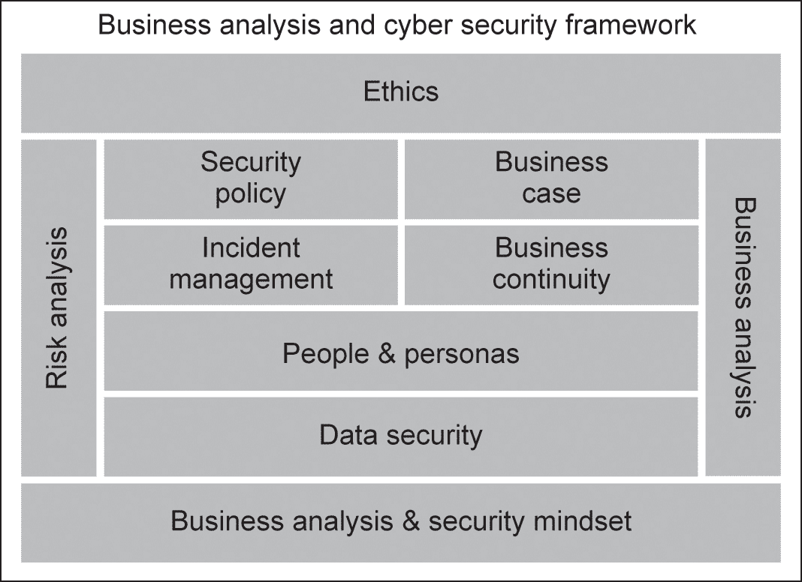

如同基础思维一样，伦理是塑造这些组件应用和集成的基石，没有它，框架的其他方面就无法有效运作或精确执行（`Figure 10.1`）。伦理像一根无形的线与每个方面交织在一起，不仅指导技术细节，还培育坚持原则和价值观的框架，为业务分析和网络安全中的审慎和负责任实践铺平道路。

## 什么是伦理？

伦理指的是处理道德原则和善恶概念的哲学分支。它涉及研究和应用在各种情境中规范人类行为的价值观、原则和准则。^(5)

伦理考量指导个人和团体做出在道德上健全、公平且社会负责的决策和行动。伦理标准为负责任的行为提供框架，并确保选择符合公认的公平、诚信和尊重他人的原则。伦理行为涉及有意识地考虑个人行为对个人和整个社会的影响。

### 伦理无知并非福气

在一个日益受复杂道德困境和错综决策塑造的世界里，伦理意识的重要性不容夸大。伦理无知绝非福气，对伦理考量视而不见不是可取的道路。相反，它强调承认、理解并积极应对伦理层面的必要性。

正如 `Chapter 3` 中提到的，Facebook ‘Like’ 按钮最初旨在分享积极情绪。然而，其社会影响远为广泛，研究人员正在揭示社交媒体互动对福祉的心理影响。

Jan Fox 在其文章 ‘An unlikeable truth’ (Fox, 2018) 中提出了关于心理操纵和情感剥削的担忧。故意设计使这些功能具有成瘾性，被比作 ‘behavioural cocaine’，引发了关于社交媒体平台在塑造用户行为以谋取自身利益方面的责任的伦理问题。成瘾的可能性、诱发压力的行为以及对心理健康的影响，尤其是在年轻一代中，突出了与用户福祉相关的伦理考量，以及平台有义务将用户福利置于参与度指标之上的责任。

这些按钮促进情感表达的便捷性可能导致一种文化，即用户优先考虑快速的情感反应而非深思熟虑的参与。随着这些平台影响态度、认知和社会规范，可能助长错误信息的传播，伦理担忧随之产生。

此外，通过点赞和反应寻求社会认可的心理影响引发了关于平台在操纵用户情绪状态以实现长期参与方面的角色的伦理讨论。强调情感反应而非理性讨论可能导致批判性思维、问责制和负责任的信息共享方面的伦理缺失。

### 伦理关切

爱因斯坦和 J. Robert Oppenheimer 两位在第二次世界大战期间研制原子弹的关键人物，都对参与该项目表示遗憾并提出伦理关切。爱因斯坦虽未直接参与曼哈顿计划，但后悔签署了敦促罗斯福总统推进原子研究的信件，并后来对广岛和长崎的轰炸表示懊悔（Philipson, 2024）。项目科学主管奥本海默则苦于制造具有毁灭性后果的武器的伦理影响，并在目睹炸弹的破坏力后，引用《薄伽梵歌》名言 ‘Now, I become Death, the destroyer of worlds’，传达了他伦理困境的重量（Nolan, 2023）。

他们的遗憾凸显了与科学进步相关的深刻伦理考量，尤其是具有破坏潜力的科学进步。爱因斯坦和奥本海默复杂的感受强调，在追求科学进步的过程中，伦理考量不可被忽视或妥协。他们的经历是一个警示故事，突出了伴随深远后果的决策所带来的持久道德责任。科学事业的伦理维度必须被仔细权衡和承认，以防止不可预见的伤害并确保知识和技术的负责任使用。

## 行为准则

# 计算与网络安全中的伦理标准

## BCS 行为准则^(6)
作为一份基础文件，概述了 BCS，The Chartered Insititute for IT（The British Computer Society）成员所期望的伦理原则和专业标准。它旨在确保计算领域的专业人士在其工作中保持最高的诚信、胜任能力和问责标准。

通过遵守四个基本原则，‘Professional Integrity’、‘Competence and Professional Development’、‘ Duty to the Public Interest’和‘Professional Responsibility’，BCS 成员在其专业实践中保持最高标准，从而在计算职业中促进信任、诚信和专业精神（BCS, 2024）。

## IIBA 伦理行为与专业标准守则^(7)
是一套强制性准则，适用于追求或持有商业分析认证以及对职业、客户和公众的责任。它旨在为伦理的商业分析实践奠定基础，强调在职业的各个维度中保持诚信、专业精神和负责任的行为。

## 网络安全伦理

在 *《网络安全伦理》*（Loi and Christen, 2020）中，Michele Loi 和 Markus Christen 对适用于网络安全的各种伦理框架进行了全面考察。它首先探讨了两个主要框架：原则主义方法，该方法在网络安全研究中具有重要意义，并在 *《Menlo 报告》*（Dittrich and Kenneally, 2011）中有所阐述；以及权利本位原则，尤其与欧盟法律相关。两个框架都需应对与网络安全相关的伤害和利益固有的概率性质，必须考虑风险和概率。

Loi 和 Christen 深入探讨了风险伦理，讨论了后果主义方法，这是一种根据行为的结果或后果而不是行为本身的内在性质来评判行为道德性的伦理理论。

功利主义是一种后果主义伦理理论，根据最大化整体幸福或福祉的原则来评估行为的道德价值。通过在电动汽车的设计和开发中应用功利主义原则，制造商旨在创造为社会提供最大整体利益的产品，考虑诸如环境影响、可负担性、安全性和便利性等因素。

防病毒软件的开发是另一个例子，展示了产品开发中的功利主义，通过保护用户、最小化伤害以及在打击网络犯罪中促进信任，来优先实现对社会的整体效用或利益最大化。

最大最小后果主义是后果主义伦理理论的一种变体，侧重于最小化最坏的可能结果或最大化最弱势群体的福祉。通过应用最大最小后果主义，汽车制造商优先开发和实施安全功能，如安全气囊、安全带和吸能区，这些功能在最坏情况下提供最大保护。即使这些安全功能可能不会增强车辆的整体驾驶体验或性能，它们也被认为是在事故中最大限度减少可能的最大伤害所必需的。

另一个例子是端到端加密，它确保用户之间发送的消息在发送方设备上加密，并且只能由预期接收方解密，从而保护通信的保密性和完整性。虽然实施端到端加密可能会带来额外的复杂性和计算开销，但它显著降低了敏感通信被未经授权拦截或监视的风险，尤其是在涉及政治异见人士或记者等高风险环境中。

义务论伦理是关注行为的内在性质而非其产生的后果的理论。它提供了一个基于义务、权利和正义原则而非仅基于其结果来评估行为道德性的框架。义务论伦理理论可应用于儿童玩具制造中严格遵守安全标准，通过投资高质量材料、严格的测试程序和安全认证，以确保其玩具符合或超过监管安全标准。

通过将端到端加密纳入消息应用程序，组织坚持义务论原则，例如尊重用户的自主权、保护其机密通信并维护其隐私权，即使面临数据分析或监视限制等潜在挑战。

Loi 和 Christen 还考察了 Helen Nissenbaum 的‘情境完整性’方法，这是一种理解数字时代隐私的框架。他们随后建议通过扩展 Nissenbaum 的框架以涵盖与网络安全影响的实践中人类互动相关的更广泛的社会规范和期望，从而提出一种网络安全技术伦理评估的通用方法。

该扩展框架包括步骤来评估现行情境、信息属性、网络安全措施带来的社会规范变化以及它们与社会有价值的目标和核心价值观与权利的一致性。

### 与商业分析的相关性

商业分析师经常处理敏感信息并与各种利益相关者合作。坚持伦理标准涉及确保沟通透明、尊重保密性以及建立与利益相关者的信任。这对于维持积极的关系和培育值得信赖的商业环境至关重要。随着对数据的日益依赖，商业分析师必须遵守法规，尊重个人隐私权，并在分析过程中实施措施以保护敏感信息。

伦理商业分析强调向利益相关者提供准确和完整信息的重要性。商业分析师必须确保决策者拥有做出明智选择所需的数据和洞察力。这与诚信和诚实等伦理原则一致。它还涉及应对潜在的利益冲突并确保决策的公平性。商业分析师应以公正的态度开展工作，避免偏见，并公平地考虑建议对所有利益相关者的影响。

在数字化转型时代，商业分析师经常使用先进技术。伦理商业分析涉及确保技术的负责任和合乎伦理的使用，考虑技术解决方案的潜在社会、经济和环境影响。

伦理商业分析超越了直接利益相关者，考虑更广泛的社会和环境影响。商业分析师应注意商业决策对社区、环境和社会产生的道德影响。

### 技术伦理

Raina Kumra 在她的‘Tech Ethics: Avoiding Unintended Consequences’培训（Kumra, 2020）中介绍了‘不幸之轮’，确定了八个新兴风险，这些风险对于理解和解决技术中的伦理问题至关重要。承认创作者和消费者的个人责任，她敦促设想未来情景并评估潜在风险。这些风险类别是在与未来研究所合作开发的，涵盖真相、成瘾、经济差距、算法偏见、监视、数据控制、信任和犯罪行为者。

## 引言
Kumra 提出了一份全面的清单，用于在考虑当前和未来风险的情况下构建合乎道德的产品。示例问题包括解决训练数据中的偏见、确保服务条款易于理解、为数据泄露做好准备以及遏制虚假信息的传播。定制清单涉及团队内部的协作努力，识别相关问题并将其纳入产品设计需求中。通过指定个人负责执行和审查清单来强调问责制，确保在即使是小的功能更新中也保持持续的道德方法。

在自律至关重要的不受监管的科技行业中，每位团队成员对道德的承诺变得至关重要。Raina Kumra 强调了在整个组织中保持持续警惕和道德考量的必要性，强调了在正式法规建立之前自律的作用。

## 从商业分析视角看
Kumra 提出的清单成为商业分析师的实用指南，提供问题以评估其工作的道德影响。该清单包括对数据偏见、用户理解、数据泄露准备和内容完整性的考量。协作式定制使团队能够根据具体项目调整清单，加强问责制和道德实施。

该框架对自律的呼吁与商业分析师产生共鸣，强调在缺乏行业范围监管的情况下维护道德标准的需求。这凸显了在重大产品发布以及小的功能更新和改进中纳入道德考量的重要性。

总之，商业分析师可以被定位为科技行业中的道德守门人，利用框架和清单将道德原则嵌入其实践中。这种主动的方法与行业最佳实践保持一致，并为道德考量至关重要的未来做好科技行业的准备。

## 从网络安全视角看
风险类别从真相和成瘾到监控和犯罪行为者，与网络安全面临的多方面挑战相一致。

解决训练数据中的偏见、确保服务条款透明以及为数据泄露做好准备是道德上的当务之急，也是健全网络安全战略不可或缺的组成部分。对问责制的强调在网络安全领域产生强烈共鸣，因为疏忽的后果可能非常严重。

此外，定制清单的协作性质与网络安全工作通常所需的跨学科方法相一致。将道德考量纳入产品设计——Kumra 强调的主题——对于开发安全且负责任的技术解决方案至关重要。

安全必须与隐私和数据的道德使用相辅相成。它强调保护数据免受外部威胁，确保安全实践与道德考量保持一致并尊重用户隐私。这需要在强大的安全措施和负责任的数据使用之间取得平衡，承认不受控制的监控或数据收集可能侵犯个人权利。

在不受监管的科技环境中，自律和对道德的承诺是网络安全实践的基础。Kumra 推荐的持续警惕和主动立场反映了网络安全中领先于不断演变的威胁的原则。数据控制、信任和隐私方面的道德考量对于维护网络安全措施的完整性和韧性至关重要。

## 维系内在罗盘
具有道德性不仅是道德上的当务之急，更是植根于人类本质的内在特征。这种固有的道德维度塑造了人类互动、决策以及对和谐存在的追求。认知、情感和社会动态之间错综复杂的相互作用有助于形成一个内部价值体系，为个人提供指导力量。

在认知层面，人类具有推理、辨别是非并做出道德判断的能力。这种智力能力构成了内部道德罗盘的基础，引导个人穿越道德考量的复杂地形。反思行为后果并将选择与道德原则保持一致的能力是人类心理的显著特征。

对于商业分析师而言，利用这一内部价值体系可以成为其职业追求中变革性和指导性的力量。每位分析师内部的道德罗盘可以作为做出符合道德原则和社会期望的决策的参考点。道德考量成为分析过程不可或缺的一部分，影响与数据处理、利益相关者参与方式、隐私问题、数据保护和数字完整性相关选择的决策，并创建要求提高道德意识的决策协议。理解行动和决策的道德影响是专业责任，也是你与生俱来的人性的体现。

一个受道德信息指导的内部价值体系引导分析师以正直和透明的方式应对复杂情况。它促进分析中的负责任实践，确保道德考量不会因短期利益而受损。这个内部道德罗盘成为一座灯塔，照亮通向可持续和负责任的社会商业实践的道路。

总之，成功实施商业分析和网络安全框架不仅仅是一项技术成就，更是对组织在韧性、道德行为和未来准备方面的承诺的证明。通过交织这些关键组成部分，我们创造了一个强大的屏障，抵御不断变化的网络威胁格局，并培养安全、创新和持续成功的文化。商业分析和网络安全的协同作用，以思维、道德、风险和商业分析所构成的支撑结构为基础，推动组织迈向安全和道德的未来。

## 故事时间
一个最终的叙事，随着时间的推移逐渐展现其深度，已成为我经久不衰的最爱，一个我多年前听到的永恒传说。这个故事具有独特的锚定我于当下时刻的能力，充当着以事物本来的面目感知现实的有力提醒，并鼓励我从不同视角探索情况。这个故事的共鸣持续成为 grounding 和内省的来源，以其深刻的智慧塑造了我对生活的看法。叙事已略作调整，以与本书讨论的背景保持一致。

一位智者僧侣栖居于世界的僻静一隅，隐匿于宁静的景色之中。他的一天都在与自然的交流中度过，并有一位虔诚的弟子渴望吸收源自僧侣宁静生活的智慧。

有一天，僧侣感受到需要独处，便告知弟子他将暂时离开他们的圣地。他委托弟子在他缺席期间负责照看他们的神圣居所。感到好奇且真诚，弟子对职责的性质感到好奇，于是怀着真诚的问题向僧侣请教：“我该如何履行托付给我的这一任务？”

僧侣以平静的目光和温柔的微笑说出了一个词——“觉知”。感到困惑但仍恭敬，弟子接受了这一 cryptic 的指导，并怀着理解僧侣神秘建议背后深意的决心开始了他的管理职责。

# 觉察：一个寓言与反思

## 学徒的旅程

随着时日推移，学徒仍在苦思师父忠告的真正精髓。寻求明晰，他再次回到僧人那里寻求进一步的开悟。再次，僧人以坚定不移的平静重复了同一个词——‘觉察’。

未被回应的表面简单性所阻，学徒再次返回，心怀诚恳，思绪寻求理解。如同智慧的稳定灯塔，僧人说出了那个熟悉的词——‘觉察’。

学徒在师父缺席期间认真承担起自己的职责，勤勉地维护着圣地。他确保茅屋干净整洁，并每周前往农民市场采购必需品，如柴火、蔬菜和谷物。随着降雨减少柴火供应，他调整预算以分配更多资金，优先考虑温暖与安全。

有一次，市场上没有柴火，让他感到寒冷，并因潜在的动物威胁而焦虑。那晚睡眠离他而去，在寒冷与恐惧的[content]
# 觉察：一个寓言与反思

## 学徒的旅程

随着时日推移，学徒仍在苦思师父忠告的真正精髓。寻求明晰，他再次回到僧人那里寻求进一步的开悟。再次，僧人以坚定不移的平静重复了同一个词——‘觉察’。

未被回应的表面简单性所阻，学徒再次返回，心怀诚恳，思绪寻求理解。如同智慧的稳定灯塔，僧人说出了那个熟悉的词——‘觉察’。

学徒在师父缺席期间认真承担起自己的职责，勤勉地维护着圣地。他确保茅屋干净整洁，并每周前往农民市场采购必需品，如柴火、蔬菜和谷物。随着降雨减少柴火供应，他调整预算以分配更多资金，优先考虑温暖与安全。

有一次，市场上没有柴火，让他感到寒冷，并因潜在的动物威胁而焦虑。那晚睡眠离他而去，在寒冷与恐惧的紧握中，他思索自己的困境。他意识到自己一直沉浸于按师父的忠告履行职责，却无意中忽视了不断变化的环境。尽管他忠实地采购柴火并调整预算，他未能认识到导致市场上干树枯竭的变化情况。现在，在一个命运多舛的夜晚，他发现自己没有柴火，寒冷而焦虑，顿悟到他的缺乏觉察阻碍了他有效应对变化的能力。这一启示在他面前像魔法般展开，师父智慧‘觉察’的深刻隐含意义。

在那个单一词语的回响中，学徒逐渐解开了其中蕴含的深刻教导。僧人并非仅仅指一种被动的存在状态。他传授的是正念的临在之艺术，对周围环境的敏锐关注，以及对自身与其责任之间相互关联性的深刻理解。**一个人无法为所有可能性和偶然事件做好准备，但必须保持觉察以便相应应对。**

通过‘觉察’的反复指导，学徒学会以正念之心和觉醒之精神观察、适应并回应圣地的需求，从而以正念之心和觉醒之精神驾驭挑战。

结束本章及整本书，我以这个深刻的故事留给你，作为指引之光。

## 从寓言到实践

正如僧人将圣地托付给学徒，企业也将组织圣地的保护托付给组织内的专业人士。因此，在这里也与学徒的旅程相似，成功在于‘觉察’的培养。觉察的深刻简单性成为指导原则，使这些专业人士能够观察、理解、适应并最终保护神圣性。

觉察不仅仅是被动的观察。它涉及对组织复杂性、潜在风险以及各种要素动态相互作用的敏锐理解。具有高度觉察力的业务分析师能够驾驭挑战、调整策略并有效应对不断变化的商业环境。配备有网络安全导向的觉察力并得到安全团队支持的业务分析师，成为识别潜在风险的主动力量。这不仅涉及理解业务需求的动态性质，还涉及认识网络安全威胁不断演变的格局。通过理解这两个方面的相互关联性，业务分析专业人士可以为创建能够抵御不断变化的数字环境带来的挑战的弹性系统做出贡献。

安全不是一个固定的目的地，而是一段持续的旅程，不断适应威胁和挑战不断演变的格局。在业务分析和网络安全不断变化的视野中，将安全视为持续旅程的概念强调了持续警惕、适应和改进的必要性。组织必须保持主动，预见潜在风险并相应地发展其策略。

业务分析和网络安全框架承认这种动态性质，为专业人士提供有效驾驭这段持续旅程的路线图。它鼓励一种拥抱变化、学习和适应的心态，确保安全措施在新兴威胁面前保持弹性。随着数字格局的演变，该框架指导专业人士保持准备状态，理解安全是一个持续的过程而非固定的终点。

这一叙述以业务分析和网络安全知识、业务分析和网络安全框架、内容、故事、类比和轶事的集体智慧编织而成，形成了你在专业旅程和组织环境中的整体指南。让这些页面中的要素融合成为你的指南针。愿它们指引并赋能你塑造安全、弹性且稳健的系统，超越你专业追求的边界之内和之外。

## 反思时间

花点时间，思考并写下：

• 你如何以伦理考虑影响你对业务分析和网络安全的方法？你会基于这种影响做出哪些改变？

## 总结问题

• 本章你的关键学习点是什么？
• 你将实施的一个教训是什么？
• 这本书给你留下的最大收获是什么，可能在未来很长时间内伴随着你？

5 [`www.dictionary.com/browse/ethics`](https://www.dictionary.com/browse/ethics)

6 [`www.bcs.org/membership-and-registrations/become-a-member/bcs-code-of-conduct/`](https://www.bcs.org/membership-and-registrations/become-a-member/bcs-code-of-conduct/)

7 [`www.iiba.org/globalassets/documents/terms-conditions-codes-of-conduct/certification-code-of-ethical-conduct-and-professional-standards.pdf`](https://www.iiba.org/globalassets/documents/terms-conditions-codes-of-conduct/certification-code-of-ethical-conduct-and-professional-standards.pdf)

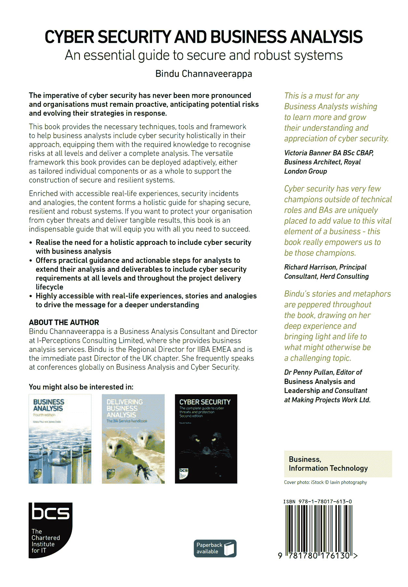
