# 工业4.0的网络安全应用

# 前言

> “我真的认为，如果我们改变自己对待可用资源的方式和思维，这将解锁我们在安全领域真正出类拔萃的能力。这是一项视角练习。如果充裕是现实而不是资源受限，会是什么样子？”
>
> **\-Greg York，Tribune Media 信息安全副总裁，在 SecureWorld Chicago**

第四次工业革命（工业 4.0）探索了传统制造和控制系统的数字化。工业 4.0 被认为是“赛博物理系统（CPS）”的曙光，其中完全涉及研究人员和相关人员的创新能力。今天，部署在工业控制系统中的 CPS 和物联网设备是与缺乏足够数据操作安全控制的传统仪器协同运行的混合机器。与工业 4.0 系统相关的风险和威胁将为潜在的攻击面和攻击向量创造途径。本书系列旨在为学术和专业研究人员提供 CPS 及其安全漏洞的详细回顾、分析和研究，从而开辟新的路径。

《工业 4.0 网络安全应用》（CSAI 4.0）的编辑旨在为计算机科学、机械、电气和电子工程等综合工程学科出版此书。它涵盖了 CPS 的概念性观点，包括当前的技术革命、挑战以及 CPS 与物联网和能源系统的融合。本书的章节将汇聚工业的各个部门。CPS 的融合结构为学术和教育领域做出了贡献，以为医疗保健、农业和电网应用提供无缝的实用解决方案。我们收到了来自不同作者的 20 章，创建了一个在学术界、工业界和研究团体之间持久的技术平台。在仔细审查所有投稿后，十章被选中并考虑出版。

本书分为十章，具有以下主要特点：
* 涵盖赛博物理系统的原理
* 对工业 4.0 最新发展的讨论
* 对多元化领域技术进步的审议
* 为旨在全面了解 CPS 的本科生、研究生和博士生提供充足内容。

CSAI 4.0 的出版合作伙伴是著名的美国出版集团 – CRC Press – 专注于出版技术书籍。CRC Press 现隶属于著名的 Routledge Taylor and Francis Group。我们衷心感谢出版团队在迅速出版我们的书章节过程中提供的宝贵帮助和指导。我们感谢所有作者提交高质量的书章节，并对在审稿过程中提供宝贵建议的各位专家表示谦卑的感激。最后，我们感谢为举办 CSAI 4.0 本书所付出的出色团队合作。

**R Sujatha**
**G Prakash**
**Noor Zamam Jhanjhi**

# 编辑简介

## Prof. Dr. R. Sujatha
**Prof. Dr. R. Sujatha** 于 2017 年在印度维洛尔的维洛尔理工学院完成博士学位，研究方向为数据挖掘。她于 2009 年在印度安娜大学获得计算机科学硕士学位，获校第九名，并于 2005 年在印度 Pondicherry 大学获得金融管理硕士学位。她于 2001 年在印度马德拉斯大学获得计算机科学学士学位。她拥有 17 年的教学经验，并一直在维洛尔理工学院信息技术与工程学院担任副教授。她组织并参加了多项研讨会和教师发展项目。她积极参与学院的发展，在学术和行政层面为多个委员会做出贡献。她曾指导本科生和研究生的项目，目前指导博士生。她在各学院为研讨会和各类会议做技术讲座。她在其他教育机构以及校内举办的会议中担任顾问、编委和技术委员会成员。她出版了题为 *面向大学生软件项目管理* 的书籍。她还在知名的高影响力期刊上发表了研究论文。绿色工程师学会授予她 2021 年未来计算类别的 IGEN 女性成就奖。她对探索不同地方感兴趣，并通过访问了解各地文化和人民。她对学习新事物感兴趣，并使自己熟悉学生的水平。她的研究兴趣领域包括信息管理与数据分析、人工智能、软计算、医疗 AI、大数据、深度学习和区块链软件工程

## Dr. G. Prakash
**Dr. G. Prakash** 目前在印度班加罗尔校区 Amrita Vishwa Vidyapeetham 大学 Amrita 工程学院计算机科学与工程系担任选聘级助理教授。他目前指导六名博士研究生和两名研究生，具体领域为网络安全。他担任 ISIC 2021 和 ISIC 2022 特别会议的会议主席，主题分别为：*通过语义智能实现智能知识获取* (SKASI21)；*Cyber-Physical 大数据系统* (CPBDS 2022)，分别由印度新德里 MERI 学院于 2021 年 2 月组织，以及美国萨凡纳乔治亚南方大学（Armstrong 校区）于 2022 年 5 月组织。他还担任 2020 年 9 月由新德里软计算研究学会组织的 CIS 2020 特别专题 *人工智能与区块链技术的融合* (FAIBT 2020) 的会议主席。他是第 11 届和第 12 届 EAI 国际数字取证与网络犯罪会议（EAI ICDF2C 2020 和 2021，新加坡）的讨论人和技术程序委员会成员。他被任命为国际智能计算会议（ICIC 2018）的会议主席，并担任 Scopus 收录期刊 *计算与理论纳米科学杂志* 的特刊编辑，该会议共展示并发表了 78 篇论文。他曾在印度班加罗尔印度科学研究所获得暑期研究奖学金。他在班加罗尔 Infosys Technologies Limited 完成了两个与网络安全相关的学术休假项目。他于 2021 年 2 月在密苏里大学和 Amrita Vishwa Vidyapeetham 联合网络物理系统联合研究中心组织的为期两天的国际虚拟研讨会上发表了技术演讲。

## Prof. Dr. Noor Zaman Jhanjhi (NZ Jhanjhi)
**Prof. Dr. Noor Zaman Jhanjhi (NZ Jhanjhi)** 目前在马来西亚泰勒大学计算机科学与工程学院担任副教授、智能社会 5.0 中心 \[CSS5\] 主任以及网络安全集群负责人。网络安全研究集群与多个机构和专业人士在全球范围内开展了广泛的研究合作。Dr Jhanjhi 担任多本知名期刊的副主编和编委会助理成员，如 PeerJ Computer Science、Frontier in Communication and Networks。他于 2020 年获得 IEEE ACCESS 杰出副主编称号，是多项全球 IEEE 会议的程序委员会成员，并担任多本知名索引期刊的客座编辑。作为一系列顶级期刊的活跃审稿人，他被 Publons（Web of Science）评为全球前 1% 的审稿人。他在 WoS/ISI/SCI/Scopus 等数据库中拥有高索引出版物，其研究总影响因子超过 500 分。他拥有多项国际专利，包括 **澳大利亚、德国、日本，** 等。他编辑/撰写了超过 **40** 本研究书籍，由世界级出版商出版，包括 **Springer、Taylors and Frances、Willeys、Intech Open、IGI Global USA，** 等。他在指导和联合指导研究生方面拥有丰富经验，超过 **20** 名研究生在其指导下毕业，目前还有大量研究生在接受他的指导。他是多所全球大学的 **外部博士/硕士论文审查员**/评估员。他已成功完成超过 **30** 项国际资助的研究项目。他曾担任超过 **30** 场国际会议的 **主题演讲/受邀演讲者**，在全球范围内举办了多次网络研讨会，**主持**国际会议议程，并为多个国际项目提供咨询。他在学术认证方面拥有丰富的经验，包括 **ABET、NCAAA 和 NCEAC**，已有 **10** 年。他的研究领域包括网络安全、物联网安全、无线安全、数据科学、软件工程和无人机。

[`expert.taylors.edu.my/cv/noorzaman.jhanjhi`](https://expert.taylors.edu.my/cv/noorzaman.jhanjhi)

# 贡献者
## D. Aju
维洛尔理工学院，
维洛尔，印度

## Imdad Ali Shah
泰勒大学，
雪兰莪，马来西亚

## Fathi Amsaad
密歇根东部大学，
伊普西兰蒂，密歇根，美国

## Carlos Ankora
维洛尔理工学院，
维洛尔，印度

## N. Arulkumar
CHRIST（被视为大学），
班加罗尔，印度

## M. Arunadevi
剑桥理工学院，
班加罗尔，印度

## Agnim Chakraborty
维洛尔理工学院，
维洛尔，印度

## Vasavi Chithanuru
维洛尔理工学院
维洛尔，印度

## A. Leo Fernandez
Kirirom 理工学院，
Traeng, Trayueng, 柬埔寨

## Mamoona Humayun
Al-Jouf 大学，
Al-Jawf, 沙特阿拉伯

## Noor Zaman Jhanjhi
泰勒大学，
雪兰莪，马来西亚

## M. Kalaiyarasi
V.S.B. 工程学院，
卡鲁尔，印度

## S. Karthi
V.S.B. 工程学院，
卡鲁尔，印度

## Azeem Khan
泰勒大学，
梳邦再也，马来西亚

## M. Kiruthigga
Redfowl Infotech Pvt. Ltd.，
纳马卡尔，印度

## M. Lavanya
SASTRA（被视为大学），
坦贾武尔，印度

## M. Nandhini
V.S.B. 工程学院，
卡鲁尔，印度

## N. Narmatha
V.S.B. 工程学院，
卡鲁尔，印度

## Adla Padma
维洛尔理工学院，
维洛尔，印度

## G. Prakash
Amrita 工程学院, Amrita Vishwa Vidyapeetham，
班加罗尔，印度

## G. Rajarajan
维洛尔理工学院
维洛尔，印度

## Mangayarkarasi Ramaiah
维洛尔理工学院，
维洛尔，印度

## Vinayakumar Ravi
Prince Mohammad Bin Fahd 大学，
Khobar, 沙特阿拉伯

## Abdul Razaque
国际信息技术大学，
阿拉木图，哈萨克斯坦

## S. Saravanan
Srinivasa Ramanujan 中心 (SRC), SASTRA（被视为大学），
库姆巴科纳姆，印度

## R. Sujatha
维洛尔理工学院，
维洛尔，印度

## Vatsal Vatsyayan
维洛尔理工学院，
维洛尔，印度

## Chandra Mouli Venkata Srinivas

BVC Engineering College

东戈达瓦里，印度

# 1 对网络物理系统流行攻击的详细研究

Vatsal Vatsyayan, Agnim Chakraborty and G. Rajarajan

Vellore Institute of Technology, Vellore, India 维洛尔科技大学，维洛尔，印度

A. Leo Fernandez

Kirirom Institute of Technology, Traeng, Trayueng, Cambodia 卡里隆理工学院，Traeng，Trayueng，柬埔寨

DOI: [10.1201/9781003203087-1](https://dx.doi.org/10.1201/9781003203087-1)

## 1.1 引言：背景与驱动因素

已观察到，多年来，网络物理系统（CPSs）在多个行业中的使用出现了巨大增长，包括制造、能源、医疗保健、建筑等。这可归因于工业 4.0 技术的全球普及以及组织希望转向更稳健的工作场所，其中自动化是优先事项，这最终将导致成本降低、生产率提高、效率提升等其他益处。

伴随这一转变而来的根本问题是引入了若干新的漏洞，这些漏洞自然产生于机器变得去中心化并开始相互通信，形成一个充满漏洞的开放环境，恶意攻击者可以利用这些漏洞来破坏网络并控制整个基础设施。

在本章中，我们进行了文献综述，以了解过去所采取的方法并探索行业中存在的根本问题；随后，我们识别了现有的威胁和过去发生的重大攻击，以便正确理解其发生原因以及攻击者如何利用漏洞。我们还指出了行业中 CPS 的局限性，最后提出了一些未来方向以防止攻击并创建更安全的环境。

本章分为以下几个部分：
1. 引言
2. 文献综述
3. 威胁与流行攻击
4. 局限性
5. 安全措施
6. 未来方向
7. 结论

## 1.2 文献综述

Alguliyev et al. (2018) \[1\] 指出，CPS 是正在革命的工业 4.0 中关键行业的基石，例如智能制造、智慧城市、智能医疗、可穿戴技术等。他们将 CPS 定义为物理与计算过程的集成，其中包括网络监控器、嵌入式计算机和具有反馈的控制器。研究人员指出，随着多年无线传感器网络使用的增加，开发信息安全系统至关重要。他们将 CPS 威胁归类为拒绝服务（DoS）、信息泄露、数据篡改、身份伪造和源否认。他们建议将认证机制纳入 CPS 组件，确保有方法保护人员数据并开发对策。

Yaacoub et al. (2020) \[2\] 指出 CPS 的三个核心组件为传感器、执行器和聚合器。他们还强调，使用 CPS 可提高安全性并降低成本。研究人员还发现了若干已发生的攻击，例如物理攻击如假身份、物理入侵和社会工程正在增加。网络攻击如网络钓鱼、分布式拒绝服务（DDoS）、恶意软件、僵尸网络和 watering-hole 攻击也在上升。研究人员指出，由于 CPS 的异构性、大规模部署以及对其敏感数据的依赖，任何暴露无论是有意还是无意都可能造成毁灭性后果。他们指出威胁既有物理也有网络。物理威胁包括可能造成的任何物理损坏以及伪造或破坏系统或 DoS，而网络威胁则是未经授权的访问、信息泄露、拦截和侦察。研究人员识别出若干漏洞，例如网络漏洞为多种攻击提供了空间，如 DDoS、中间人攻击、重放攻击、嗅探或伪造。所识别的网络漏洞包括持续使用开放标准协议、长距离或短距离无线通信为不同类型的攻击提供了途径，而物理安全最重要的漏洞是缺乏物理安全，研究人员指出用于保护 CPS 组件的物理安全不足。研究人员进一步提出使用基于加密的解决方案，这在确保信息安全三要素如保密性、完整性和可用性以及认证方面大有裨益。他们还建议使用非加密解决方案，如防火墙和入侵检测系统（IDSs）。研究人员建议执行安全策略和合规性、定义权限、定期审计以及事件响应、定期员工培训和定期风险评估。

Stefanov and Liu (2014) \[3\] 概述了由于网络攻击导致智能电网出现大规模影响，包括停电、设备损坏和负荷损失。发现的最常见漏洞之一是防火墙配置错误，这为 DoS 或入侵类攻击提供了空间。研究人员借助测试床分析了当前的 CPS，并表明配置中存在的漏洞可以被利用，可以采用暴力攻击破解相对简单的密码，然后攻击者即可接管系统造成严重损害。研究人员建议采用高级防火墙和基于异常的 IDS 协同工作。

Wells et al. (2014) \[4\] 指出，由于采用了 100% 加密，CPS 存在虚假的安全感，研究人员强调需要进一步研究网络攻击，以便充分把握可能出现的能力和后果。他们指出，即使是简单的攻击也具有显著破坏性能的能力。

Heartfield et al. (2018) \[5\] 指出，随着近年来智能家居技术的发展和家庭中物联网（IoT）设备的使用，家庭面临网络威胁的脆弱性增加，其中许多是传统威胁，但有些是全新的。他们关注了 CPS 威胁对智能家居的影响并识别出若干威胁。隐私泄露被确定为物理威胁，因为大量数据定期广播，在此情况下窃听攻击变得非常危险，隐私可通过音频/视频手段被泄露，且错误执行导致社区范围的停电。观察到的网络影响为保密性受到威胁、通过未经授权的数据操纵破坏完整性，以及通过干扰通信的 DoS 破坏可用性。这些攻击的后果在财务上可能非常昂贵，因为它为勒索受害者、在用户设备上安装勒索软件以及通过窃听个人助理设备从虚拟会议中获取相关关键信息提供了机会。作者概述了智能家居领域的若干挑战，如有效检测智能家居的入侵、定义能够对智能家居进行隐私分类的指标以及为涉及智能家居泄露的受害者提供支持。

Kholidy（2021）\[6\]概述了 CPS 需要实现自动化和自立，并具备分析风险和应用适当的响应策略以应对持续攻击的能力。研究人员指出，电力系统中的当前实践并不合适，因为它们在设计阶段忽视了网络安全要求，并且对网络突发事件视而不见。作者提出了一种自主响应控制器（ARC），以自主方式对 CPS 中的网络攻击进行反击。

Song 和 Moon（2020）\[7\]强调了内部人员在网络制造系统（Cyber Manufacturing Systems）中构成的威胁以及检测和应对这些威胁的难度。研究人员指出，网络制造系统中的内部人员可以非常容易地访问物理和网络两个域；此外，很难事先预测内部人员带来的威胁，因为对其动机和心理的理解有限，而且难以追溯攻击，因为内部人员可以非常容易地隐藏其数字足迹。研究人员提出了一种基于区块链的网络制造系统（CMS）应用 FabRec，该应用能够有效防御中间人攻击和 UDP DoS 攻击，同时保持系统的灵活性和物理与数字资产之间的连接。

Gunduz 和 Das（2020）\[8\]强调智能电网是 CPS 中最突出的应用之一，它被认为非常便利，但也存在严重漏洞，可能导致国家安全缺口、人员伤亡、广泛的经济损失以及公共秩序破坏等灾难，因此系统必须以确保安全的方式设计。作者建议建立新协议或修改现有协议，使其适应智能电网应用的需求。研究人员还建议探索数据挖掘和机器学习等各个领域的新技术。

Mantha 等（2021）\[9\]指出，随着受工业 4.0 影响的数字化在建筑工程（AEC）行业中的兴起，引入了若干漏洞，指向网络攻击。作者指出，AEC 行业的挑战是独特的，因为传统的网络安全实践不能直接应用于该行业。研究人员为 AEC 行业设计了一个初步模型，该模型能够帮助没有任何网络安全专业知识的利益相关者。

Phuyal 等（2020）\[10\]已确定智能制造领域存在的若干安全问题，例如系统集成、互操作性、人机协作安全、多语言性以及新技术投资回报。

## 1.3 威胁和常见攻击

### 1.3.1 勒索软件攻击

顾名思义，它是一种恶意软件，攻击系统访问机密文件或文档，并要求支付赎金以恢复被盗文件。这些攻击是通过感染的网站和附件、网络钓鱼邮件、驱动下载等方式进行的。勒索软件攻击最早出现在 1980 年代末，赎金本应通过平邮发送。但如今攻击者要求通过加密货币或信用卡支付。第一个已知的勒索软件是 PC Cyborg 或 AIDS，其中 `C:` 目录中的所有文件都会被加密。但所使用的加密很容易被逆向，因此威胁不大。

2004 年，更强大的勒索软件“GpCode”构成了更大的威胁，它使用弱 RSA 加密来勒索个人文件。

2007 年，Winlock 不加密文件，而是将用户锁定在系统之外。为了移除它，需要通过付费短信支付。

从 2010 年起，勒索软件攻击的数量显著增加。一些主要攻击包括 2012 年的 Reveton、2013 年的 Cryptolocker、影响 Mac OS 的 2016 年 KeRanger、2017 年 5 月的 WannaCry、2017 年 6 月的 Petya、2018 年的 Ryuk、2019 年的 Sodinokibi 等等 \[11\]。

数据泄露的平均成本约为 $3.86 million。由于攻击者可以从受害者那里索取大量资金，因此我们更频繁地听到勒索软件攻击。据联邦调查局（FBI）称，2017 年约报告了 1,783 起勒索软件事件，受害者损失超过 $2.3 million。

CryptoLocker 一直是勒索软件中最盈利的变种之一。2013 年 9 月至 12 月，CryptoLocker 已感染超过 25 万台系统，并产生了超过 $3 million 的收入。

勒索软件感染目标系统的方式多种多样。如今最常见的方法是恶意垃圾邮件（Malspam 或 Malicious spam），即通过电子邮件发送恶意软件。最早已知的批量邮件垃圾邮件是 1999 年的 Melissa 批量邮件病毒和 2000 年著名的“ILOVEYOU”批量邮件蠕虫，后者感染了全球数千万台计算机，造成数十亿美元的损失。从此事件起，电子邮件被视为恶意软件传播的主要来源，且事件呈指数级增长。电子邮件包含感染病毒的附件，如 PDF 或 Word 文档，在某些情况下还包含指向恶意网站的链接。社会工程学也有助于诱骗目标用户打开受感染的文档。攻击者冒充政府官员，如 CBI 或真实来源，吓唬用户支付所述赎金以解锁其文件和文档。

从 2016 年起，恶意广告（Malvertising 或 Malicious advertising）激增，其中在线广告被用于分发恶意软件。点击网站后，目标用户会被引导至恶意网站，从而导致攻击。利用漏洞工具包进行的驱动下载是目前恶意广告中常用的方式。

典型勒索软件攻击的阶段如下 \[11\]：

1.  **部署**：目标系统通过网络钓鱼邮件、恶意网站等被入侵。

2.  **安装**：一旦目标机器被感染，勒索软件会进行安装，攻击者获得完全控制权。

3.  **破坏**：使用激活密钥，恶意软件会锁定或加密目标系统上的文件。

4.  **命令与控制**：目标系统中的恶意代码是客户端，而操纵系统的攻击者是服务器。

勒索软件主要有 **两种** 类型：

*   **加密型勒索软件**：目标系统上的有价值文件被加密，使受害者无法访问。需要向攻击者支付赎金才能取回文件。

*   **锁定型勒索软件**：文件未被加密，但受害者被锁定在系统之外。支付赎金后设备将被解锁。

最频繁的勒索软件攻击的一些例子包括 Locky、WannaCry、Troldesh、Jigsaw、Petya、CryptoLocker、Bad Rabbit、Ryuk、GoldenEye 和 GandCrab。

**勒索软件攻击发生时**可以采取的步骤如下：

*   确定受影响的系统并立即隔离它们，以防止进一步损害。

*   将设备从网络断开并关闭电源，以防止勒索软件感染进一步传播。

*   开始恢复和修复过程，以便更高效地恢复业务。

*   与 IT 团队讨论和分析，以初步了解攻击造成的影響。

#### 事件响应措施

* 通知利益相关方以及内部和外部团队有关将采取的缓解、响应和恢复事件的步骤和行动。
* 检查是否有解密工具以解密数据。
* 不要支付赎金，而应向警方/IT 部门报告事件。

#### 预防措施

* 备份您的数据，因为这是对抗勒索软件的最强防御。所有数据都可以恢复，从而不会丢失工作进度。此外，备份文件必须经常进行测试和检查，以确保数据未损坏且完整。
* 修补并更新系统软件，这可确保潜在攻击大幅减少。
* 对终端用户进行这些垃圾邮件的教育，并敦促他们创建强密码并更明智地使用第三方服务和设备。
* 投资网络安全技术以保护系统网络。此类软件可确保设备具有更强的安全性，因为它们使用防火墙和入侵检测系统。

#### 1.3.1.1 WannaCry 勒索软件攻击

2017 年 5 月 12 日星期五，著名的 WannaCry 勒索软件攻击\[11\]开始，在一天之内传播开来，影响了超过 200,000 台运行 Windows 操作系统的计算机。超过 150 个国家被勒索软件感染，造成全球恐慌。受影响的计算机大多数运行的是 Windows 7 操作系统，而 Windows XP 和 Windows 2003 系统是最脆弱的。特别是那些未安装 2017 年 4 月微软安全更新的系统受到影响。印度、俄罗斯、乌克兰和台湾是受影响最严重的国家。网络风险建模公司 Cyence 估计此次攻击造成的损失价值达 40 亿美元。

与任何勒索软件攻击一样，WannaCry 勒索软件渗透用户计算机，加密内部存储上的文件，并要求支付 300 美元的比特币赎金以解密文件。

法国汽车制造公司雷诺是此次攻击受影响的主要公司之一；他们出于预防措施，在多家工厂暂停生产，以遏制恶意软件的传播，其合作伙伴公司日产也受到影响，其在桑德兰的巨大工厂不得不停止周末前的最后生产班次，其在印度金奈的共享工厂也受到影响\[12\]。

英国政府资助的医疗保健和医疗服务机构国民保健服务（NHS）在遭受 WannaCry 攻击后被迫停滞数日，此次攻击使英国损失超过 9200 万英镑，约 70,000 台设备——包括计算机、MRI 机器、血液储存冰箱和手术室设备——在英格兰和苏格兰的多个医院受到影响。

其他受影响的高知名度公司包括 LATAM 航空、FedEx、Telefonica 和 Deutsche Bahn。

WannaCry 利用微软对`SMB`协议的实现中的漏洞，并通过发送精心制作的数据包在`LAN`上传播，使计算机执行任意代码；例如，如果用户收到带有恶意文件作为附件的电子邮件，并且打开它，它将通过`LAN`传播到未修补的系统并开始加密文件，同时附加`WNCRY`扩展名。

然而，微软发现了这一漏洞并发布了补丁来修复此问题，但由于补丁刚发布一个月，许多系统仍然脆弱。

据报道，美国国家安全局发现了这一漏洞并为其开发了名为`EternalBlue`的利用工具，随后被名为 Shadow Brokers 的黑客组织窃取，并在 Medium 帖子中通过互联网发布。WannaCry 使用`EternalBlue`在全球范围内感染计算机。

##### 部署阶段

WannaCry 利用`MS17-010`漏洞并借助`EternalBlue`利用工具和`Doublepulsar`后门注入名为`launcher.dll`的二进制文件。它还利用内核模块中的`srv2.sys`、`SMB`驱动程序以获取对`LAN`的访问并在其上传输恶意负载。

`launcher.dll`主要关注两个函数，即`ExtractResource`和`CreateProcessMSSECSVC`。

尽管其内部工作复杂，但这些函数的思路是提取资源以创建可执行文件，并为此目的使用 Windows API，最后启动`mssecsvc.exe`作为正在运行的文件。

`launcher.dll`被注入到`Isass.exe`系统进程中并充当`mssecsvc.exe`的加载器。在安装阶段之前，运行了两个 Windows API，即`InternetOpenA`和`InternetOpenUrlA`，它们用于查询一个硬编码的网站域名，该域名看起来是乱码且非常长——这是终止开关 URL。对该 URL 的成功连接将导致前面讨论的可执行进程停止并退出，但另一方面，如果连接失败，这通常会发生，进程会继续进行并释放`tasksche.exe`。

##### 安装阶段

现在安装阶段开始，主要关注`mssecsvc.exe`和`tasksche.exe`。

`mssecsvc.exe`负责两个功能：dropper 和感染，而`tasksche.exe`负责资源加载和加密环境设置。

`mssecsvc.exe`有两种运行方式。

##### Dropper 阶段

如果`mssecsvc.exe`在没有任何参数的情况下运行，执行将进入 dropper 阶段，其中子函数将被调用以安装`mssecsvc2.0`服务然后创建`tasksche.exe`，然后资源提取例程完全提取资源二进制内容并写入`tasksche.exe`，然后将其释放。

##### 感染阶段

如果`mssecsvc.exe`使用参数`-m security`运行，执行将转移到感染阶段。现在使用攻击者机器，`mssecsvc2.0`服务将尝试通过`SMB`协议连接到端口 445，如果连接成功，攻击者将通过发送具有特定操作码的制作数据包来检查`Doublepulsar`后门是否正确设置。如果目标系统未正确安装`Doublepulsar`后门，利用代码将继续进行，通过初始化`EternalBlue`攻击，一旦`Doublepulsar`后门设置得到验证，包含`launcher.dll`、内核 shellcode 和用户态 shellcode 的有效载荷将被直接上传。

##### 资源加载器

此阶段的第一步是为包含提取文件的目录创建一个随机名称；此随机生成的名称将作为唯一 ID，然后`taskche`进程将检查是否存在命令参数`i`，它代表`taskche.exe`的安装节点；如果存在，则任务将以安装模式继续，使用 id 创建文件夹并将`taskche.exe`复制到该文件夹中。从资源部分提取名为`XIA`的资源 zip 文件，然后在资源加载阶段完成之前进行压缩，一旦完成，代码将使用密码`WNcry@2o17`解压资源文件，此资源文件包含多个 WannaCry 文件。

#### WannaCry

安装阶段之后，流程进入破坏阶段，在资源提取过程中获取了一个名为 `t.wnry` 的文件，该文件经过预处理，然后在 `tasksche.exe` 的帮助下被解密为动态链接库，并作为 `TaskStart` 传递，标志着加密的开始。`WannaCry` 主要使用 `RSA` 和 `AES` 算法进行加密；流程开始时 `RSA` 生成根公钥，对应的私钥由 `WannaCry` 创建者设定，且私钥使用根公钥进行加密。就文件而言，加密例程为不同文件创建随机的 `AES-128` 加密密钥，且密钥本身被加密 [11]。

文件在被加密时，`AES-128` 密钥会被附加到加密文件头之后，随后是 8 字节的魔数 `WANACRY!` 以及 `AES` 密钥的 4 字节长度。

一名名为 Marcus Hutchins 的英国研究员，其别名为 MalwareTech，负责阻止 `WannaCry`。

他发现部署阶段结束后，勒索软件会尝试连接一个不存在的 URL，并发现这就是可用于阻止 `WannaCry` 的 killswitch。他注册了该特定域名，很快攻击就停止了。然而，攻击者试图通过对该域名发起 DDoS 攻击来破坏 Hutchins 的努力，以将其击垮，但 Hutchins 足够聪明，利用缓存来应对流量，从而保护了该网站。

#### 1.3.1.2 Maze Ransomware Attack at Bouygues Construction

2020 年 1 月 30 日星期四，Bouygues 集团的建筑子公司（全球前 10 大承包商之一，2018 年年营业额约为 $32 billion，其中约一半为交通工程，一半在法国境外）[13] 被俄罗斯籍 `Maze` 勒索软件敲诈团伙发动的一次重大勒索软件攻击瘫痪。整个计算机网络都受到了影响，公司所有服务器均被关闭。攻击后，要求支付 10 million Euros 的赎金，并且至少窃取了 200 GB 的敏感数据。与此同时，攻击后不久发送给 Bouygues Construction 的电子邮件返回了错误信息。

这是针对 Bouygues UK、Bam 和 Interserve 等大型建筑公司进行的网络攻击的首批高调案例之一。

该法国组织报告称，在加拿大发现的与 Bouygues Construction 相关的服务器受恶意软件加密影响尤为严重，对公司在全球的运营产生了负面影响。事件发生后不久，微软和 McAfee 的安全专家被要求调查事件并从黑客处获取信息。此外，Bouygues 的 IT 人员并未遵守上述黑客的要求。

公司在 2 月 5 日发表的声明中表示，已采取措施使其信息系统恢复正常使用。

`Maze`，又名 `ChaCha`，此前是一种与在线敲诈活动相关的勒索软件。如果目标组织拒绝支付要求的赎金或满足要求，`Maze` 操作员会在公共论坛上发布其名称，并以被盗数据作为其成功入侵的证明对其进行勒索。`Maze` 勒索软件攻击通常会试图模仿政府组织和各种其他管理机构，在向目标索要赎金金额之前加密并窃取敏感信息。通常，`Maze` 被用作多层面攻击策略的一个要素。在敲诈活动中，这很少是第一步。但通常是第二步或第三步的一部分。

虽然某些类型的软件经常通过社会工程或电子邮件进行垃圾邮件活动以非法访问目标系统。而 `Maze` 勒索软件则在路过下载中使用漏洞利用工具包。漏洞利用工具包通常包含一系列已知软件漏洞，可作为漏洞利用的工具。

尽管漏洞利用工具包及其使用方式并无新意，但这些主要被 `Maze` 操作员使用。`Maze` 使用一种名为 `Fallout` 的工具，这是一个工具包，其中包含在 GitHub 上识别的各种不同漏洞，包括 Flash Player 中的漏洞 `CVE=2018-15982`。漏洞利用工具包 `Fallout` 使用 `PowerShell` 来完成转储，而不是使用网络浏览器来启动其有效载荷。

在获得目标系统的访问权限后，`Maze` 将加密数据，使其所有者无法访问。然后它会通过公开披露加密数据并在受害者处留下数字便条来威胁受害者，其中包含在截止日期前进行所需付款的步骤。

为了保护组织免受 `Maze` 勒索软件攻击及其利用的攻击，可以采取多个步骤来确保安全。建立异地备份很重要，这样如果数据被锁定，组织仍可在必要时努力检索所需数据。所有企业计算机必须使用最新的安全解决方案，并使用安全服务提供商识别的任何最新风险可用的最新安全功能。必须实施多因素身份验证等协议，并且员工应接受适当的培训，了解攻击者进入公司网络架构所使用的技术，以便他们可以报告任何可疑活动并采取必要措施防止此类攻击。双因素身份验证可用于小规模用途。

为了防御 `Maze` 勒索软件攻击，最有效的方法是对敏感数据进行加密，以在有任何情况下禁用未经授权的访问。必须为企业建立一个对客户和员工都易于使用的安全平台。凭借强大的端到端加密，没有必要权限的任何人都无法访问数据，这是一种很好的身份验证方法。

以下是一些可用于防止此类攻击的 **mitigation techniques**：

* User Education
* Backup of critical data
* Continuous security monitoring
* Keeping updated system patched configured in a secured manner
* Restricted administrative access

建筑业是少数几个不以数据生产为驱动的行业之一。大多数建筑公司没有庞大的 IT 部门，并且在管理信息安全以防范攻击方面缺乏专业知识。

然而，最近的攻击使建筑公司暴露于大量新威胁中，使得网络安全成为应对恶意入侵的关键风险管理考虑因素。据一些专家预测，到 2021 年，网络犯罪平均每年将给企业造成约 $6 trillion 的损失。

#### 1.3.1.3 LockerGoga Attack on Norsk Hydro

Norsk Hydro 是总部位于奥斯陆的挪威公司，专注于 Aluminum 和 Renewable Energy。它在 40 多个国家开展业务，是其领域内知名跨国公司之一。

2019 年 3 月 18 日，Norsk Hydro 成为勒索软件 `LockerGoga` 引发的勒索软件攻击的受害者，导致损失超过 $75 million dollars，并且在挪威、卡塔尔和巴西的至少 170 家工厂停产；最终，这次攻击通过锁定数百台服务器和 PC 上的文件，影响了整个公司，其 35,000 名员工遍布 40 个不同国家。生产被迫完全离线，因为 22,000 台计算机受到了勒索软件的影响。恢复到正常运营水平花了超过一个月的时间。

一切始于攻击前大约三个月，当时一名员工打开了攻击者发送的恶意电子邮件，这使他们获得了 IT 基础设施的访问权限，并能够系统地植入 `LockerGoga`，这是一种在公司各地的服务器和设备上加密文件的勒索软件形式。

在受影响的计算机屏幕上放置了一张勒索信，信中称文件是用最强的军用算法加密的，只有攻击者才有解密文件的机制；勒索金额未提及，但暗示金额正按分钟递增，并且一旦公司与攻击者取得联系，勒索金额就会被披露；不过付款方式必须是比特币。在公司高管召开的紧急会议后，决定不支付赎金，而是恢复安全存储在备份服务器中的数据，随后他们联系了微软的网络安全团队寻求支持，并公开宣布了发生的泄露事件以提高意识。微软检测和响应团队 DART 认为该案件为“最高严重性’，并在进行彻底检查后发现，公司一名员工收到的来自公司可信客户的电子邮件附件被攻击者武器化；该附件嵌入了可在一名员工计算机上安装特洛伊木马软件的载荷，很快病毒就开始入侵 Norsk 计算机网络的普通用户，然后获取管理员凭据，这使得病毒能够控制整个 IT 基础设施。控制攻击者利用公司网络推送勒索软件 \[14\]。

事后，DART 员工在恢复 Norsk Hydro 服务器的同时提升其安全性，并开展了意识和教育培训课程，提供了有关始终存在的威胁以及攻击者常见行为的有用知识，以便将来避免此类事件，公司首席信息官承诺从事件中汲取教训并制定改进的事件响应。公司对事件的响应在全球范围内受到赞扬，被认为是在此类情况下最理想的响应。

作为预防措施，公司 IT 部门已关闭其服务器和网络以限制病毒传播，要求所有人断开与公司网络的连接并关闭公司设备，全体员工使用笔和纸进行日常工作，工厂恢复手动操作程序以继续生产 \[15\]。

根据 Nozomi Networks 的分析，LockerGoga 遵循传统的勒索软件攻击方法，其中它使用目标扩展名加密文件，然后放置包含恢复加密数据说明的文本文件。该恶意软件 however 不具备自我传播到多个目标的特征，有证据表明该恶意软件具有避免检测或在被样本收集发现的风险下自行从系统中删除的特征。根据初步检查，该恶意软件似乎旨在破坏正常服务。经过彻底分析后发现，该恶意软件能够在没有服务器外部支持的情况下运行，并在执行后将自身迁移到 `%TEMP%` 文件夹且未隐藏其细节。最初认为勒索软件仅具有加密 `.doc`、`.ppt`、`.pdf`、`.xml`、`.sql`、`.js`、`.py` 等扩展名的文件的能力，但后来发现它还具有加密可执行文件和 `.dll` 文件的能力，这使 Windows 操作系统面临风险。

该勒索软件的感染途径通常是通过钓鱼或活动目录服务，该勒索软件发现是用 `C++` 编写的，利用 `CryptoPP` 等流行库通过重新实现来使用 `AES` 或 `RSA` 算法。一旦勒索软件开始执行并移动到 `%TEMP%` 文件，它会运行两条命令，一条启动 `master`，另一条启动 `slave` 进程并使用预定义的文件扩展名列表。

`master` 进程负责注销除其攻击会话外的所有活动会话，然后为所有具有管理员权限的账户硬编码密码；它还搜索需要加密的文件并负责禁用网络接口。

`slave` 进程使用 `RSA-4096` 和 `AES-256` 等对称和非对称算法开始加密匹配目标扩展名的文件，整个过程在离线模式下进行，因此使用 `RSA` 算法的嵌入式公钥，加密完成后，恶意软件强制注销，管理员密码被更改为 `HuHuHUHoHo283283@dJD`。目前没有解密 LockerGoga 加密文件的报道方法，唯一补救措施是从备份中恢复文件。

如果存在扩展名为 `.locked` 的文件，则可以检测到 LockerGoga。

此外，LockerGaga 还影响了总部位于法国的咨询公司 Altran，以及美国的化工制造公司 Hexion。

可采用的最佳实践包括定期备份文件、分割网络和数据以限制敏感数据暴露、禁用可能作为入口点的过时组件，以及保护电子邮件网关。

### 1.3.2 社会工程攻击

“社会工程”一词的使用可追溯至 20 世纪早期，当时用于描述能够解决社会问题的巧妙方法。然而，随着时间的推移，尤其是在第二次世界大战之后，该词的含义急剧转向负面，通常与利用刻板设计作为议程以在选举中获得优势的政治家相关联。

在现代，术语的负面含义仍然存在，但其使用现在主要集中在网络安全领域，其中它被视为一种操纵技术，通过利用人为错误来实现广泛的恶意活动 \[16\]。

社会工程是少数被视为非技术攻击的攻击之一，但它有能力与其他技术攻击联手，使其成为强大的对手。

最新统计数据显示，约 98% 的网络攻击依赖于社会工程，过去几年损失超过 $5 billion，引发严重关切。

使这种攻击非常危险的并非其复杂性，恰恰相反，是其微妙且相对简单的特性，它针对的是任何公司或行业中最薄弱的因素，即人类；今天的人们比以往任何时候都更易获取且更互联，使他们极易受攻击。

社会工程的 **两个主要类别** 是：

1. **基于技术的欺骗**：在此方法中，用户被欺骗使其认为自己正在与目标计算机系统交互，这导致用户轻易泄露机密信息。

2. **基于人类的欺骗**：在这里，攻击者的狡猾和奸诈本性发挥作用，利用它来利用受害者并操纵受害者 \[17\]。

#### 社会工程涉及的步骤

1. **收集信息**：随着社交媒体的兴起，这一步变得相对容易，攻击者可以轻松进行“背景调查”，并在短时间内通过分析其帖子、图片、兴趣、经验以及社交网络账号上可用的大量信息来建立目标受害者的一般档案。

##### 与用户建立信任的钓鱼
攻击者接近即将成为受害者的目标，并利用操纵技巧以及在前一阶段发现的信息，成功赢得其信任。

##### 利用
在前两个步骤的帮助下，攻击者已与受害者建立了友好关系，并最终可以通过利用受害者的情绪状态来操纵他，获取所需的信息。

##### 退出
攻击者利用完用户后，便像出现时一样神秘地消失了 [18]。

#### 社会工程攻击的各种类型

##### 预文本攻击
在这种攻击中，攻击者试图冒充值得信赖的人或权威人物，制造虚假场景，并获取所需信息

##### 互惠互利攻击
再次，攻击者冒充技术专家，从受害者处提取敏感信息，或假装联系真正的技术专家，声称自己遇到技术问题，需要敏感信息。

##### 钓鱼
这是一种通过冒充可信来源，利用各种数字通信方式（其中最突出的是电子邮件）获取个人数据和其他敏感信息的攻击。

##### 诱饵攻击
在这种攻击中，受害者会收到一封关于承诺以贵重物品或现金奖励为回报的电子邮件或广告，并被提示输入其敏感信息，而这些信息被描述为至关重要。

用户会收到一个链接，点击后会被带到一个仿冒网站，该网站足够逼真，以至于用户会 readily 轻易交出其敏感信息。其他类型的钓鱼包括 Spear Phishing、Vishing Whaling Phishing 等。 [17]。

#### 1.3.2.1 社会工程攻击可能如何发生
技术攻击可以非常容易地通过使用 Kali Linux 中默认存在的社会工程工具包来进行。
Kali Linux 是一个由 Offensive Security 维护的基于 Debian 的 Linux 操作系统，专为网络分析师和渗透测试设计。它包含大量用于道德黑客的工具，而 `Setoolkit` 即社会工程工具包就是其中之一。
只需在终端中输入 `setoolkit` 即可轻松访问，也可在应用程序菜单中找到。
打开后，用户会看到六个不同的选项和一个退出软件的第七个选项，选择第一个选项，即社会工程攻击后，我们会看到十一种不同的攻击。在本示例中，我们集中讨论一个简单的凭证收割攻击。我们选择选项 Website Attack Vectors ≥ Credential Harvester Attack method ≥ Site Cloner。
现在只需提供执行攻击的机器的 IP 地址以及需要克隆的网站的 URL，一个欺诈性链接就会生成并发送给用户，用户很容易被其惊人的相似性欺骗并输入其凭据，一旦完成，这些凭据就会被重定向到攻击者的机器服务器，攻击者即可轻松获取所需信息。

#### 1.3.2.2 防范措施
各行业应集中提高对社会工程攻击的认识，因为这主要是对人性的利用。还应限制任何特定个人可以访问的信息量。应采用适当的电子邮件过滤技术，用户绝不应点击可疑链接或要求提供个人详细信息的电子邮件。只能使用启用了 https 协议的官方网站。强密码是必须的，同时如果使用双因素认证，则会进一步提高安全性。应建立增强的黑名单，以便员工无法访问钓鱼网站，至于基于特洛伊木马的攻击，应禁用 USB 的使用。

#### 1.3.2.3 FAAC 捕鲸攻击
Fischer Advanced Composite Components AG（FAAC）是一家总部位于奥地利的航空航天制造公司，其客户包括空中客车、波音、罗尔斯-罗伊斯、西门子 SAS、三菱重工业等。
2016 年，FAAC 遭受了一次捕鲸攻击；这种诈骗也被称为“CEO 诈骗攻击”或“假总裁攻击”，导致损失超过 €50 Million；财务结果显示，公司很快意识到这是诈骗，并成功阻止了 €10.9 Million 的汇款，但就剩余资金而言，它们早已流向斯洛伐克和亚洲。
在几乎每一次捕鲸攻击中，常见模式是诈骗者冒充公司 CEO 或其他高级董事会成员，向公司财务部门的员工发送电子邮件，暗示公司资金转移。在本案中，攻击者向财务部门员工发送了一封假邮件，冒充时任 CEO Walter Stephan。邮件要求员工为公司的所谓收购项目转账 €50 Million，且邮件中带有紧迫感。随后资金被转入国外账户。
这对公司来说是巨大损失，因为它吞噬了上一年的全部利润甚至更多，使公司陷入显著赤字。
FAAC 监事会在长达 14 小时的会议后决定解雇时任 CEO 且已担任 17 年的 Walter Stephan；董事会认为 Mr. Stephan 在“fake president incident”中严重违反了其职责。CFO（Minfen Gu）也被解雇，FAAC 对 Walter Stephan 和 Minfen Gu 两人提起诉讼，要求赔偿 $11 million in damages [19]。
调查人员于八月在香港逮捕了一名男子，以回应 FAAC Whaling Attack；然而，账户位置细节和逮捕细节均未公布。
FBI 在同年警告此类攻击稳步增加，已导致损失超过 $2 billion，且一家比利时银行在同期因类似骗局损失了 $75 million。没有任何迹象表明这种攻击类型会很快消失；相反，它只是在增加，因此有必要建立严厉的协议，以防止未来发生此类事故。

#### 1.3.2.4 2005 年 DuPont 内部攻击
DuPont 是一家美国化工行业公司，该公司在 Fortune 500 榜单上，曾一度是按销售额计算的世界最大化工公司。
2005 年，DuPont 因一起大规模内部攻击而受挫，导致 $400 million in trade secrets 的损失，该攻击由 Yonggang “Gary” Min 实施，一旦 DuPont 发现 Min 窃取了大量机密和专有数据，便通知了 FBI。

Gary Min 于 1995 年至 2005 年间在位于特拉华州的公司担任研究化学家，之后于 2005 年 12 月加入一家名为 Victrex 的亚洲竞争公司。在他离开杜邦前的几个月里，他成为公司数据库使用最活跃的单一用户，下载的数据量是其他任何员工的 15 倍，据信他查看了超过 16,000 份敏感文件，并下载了杜邦电子图书馆中另外 20,000 份敏感信息。Min 的行为仅在他向公司递交辞呈后才被发现，据信该发现是由于分析数据库日志或数据库的自动警报系统所致。被取走的文件数量如此之大，以至于 Min 必须另外租用一个存储设施和一套公寓专门用于存放被盗文件。在 Victrex 开始工作后，Min 将从杜邦获取的 180 份文件转移到 Victrex 提供的公司笔记本电脑中 \[20\]。在一份声明中，Min 透露他窃取杜邦商业机密的意图是出于将其交给新雇主 Victrex 的想法，而 Victrex 是一家竞争组织。然而，Victrex 否认甚至看过这些文件，并进一步协助警方官员逮捕 Min。

2007 年，Min 被判处 18 个月监禁并罚款 30,000 美元；他面临较轻的刑罚，因为检察官无法证明 Min 对被泄露文件做了什么，也无法证明被盗信息是否在竞争对手之间共享。

Min 的行为违反了公司高层对他的诚信和信任，并表明拥有必要权限的内部人员相对容易破坏敏感数据。此外，杜邦还发生了多起其他内部攻击事件；2009 年，洪猛窃取了与 OLED 技术相关的敏感专有信息，并计划将其带到他在中国的母校，公司仅在他离境中国前检查其硬盘内容时才发现他的行为。另一起近期案例是 Michael Mitchell，他在家用电脑中保存了杜邦的专有数据，并在加入一家韩国竞争公司后，将这些敏感信息泄露给他们，导致杜邦遭受巨大损失 \[21\]。杜邦对罪犯采取的严厉行动以及所提高的意识，足以表明内部威胁这一原本被忽视问题的严重性。

这些事件表明，不仅来自外部的威胁是危险的，内部威胁同样危险，在某些情况下甚至更危险，公司避免这些不必要的损失的唯一途径是通过频繁分析数据库日志并根据员工需求设定适当的阈值来确保对这些威胁的安全，并在此根本威胁面前认真采取其他主动措施。

#### 1.3.2.5 2019 年丰田纺织商务邮件诈骗攻击
2019 年 9 月，丰田纺织株式会社的一家欧洲子公司——其本身是汽车巨头丰田汽车株式会社的子公司——遭受了商务邮件诈骗攻击，导致损失约 3700 万美元。

黑客巧妙地伪装成公司的业务合作伙伴，发送了一封看似令人信服的电子邮件，乍一看可能与真邮件无法区分，要求财务部门的一名员工将 3700 万美元汇至黑客控制的银行账户 \[22\]。鉴于黑客能够说服公司的一名聪明的员工汇出巨额资金，其无疑拥有出色的社会工程技能，据推测这是由于一个巧妙命名的电子邮件地址所致，该地址与实际业务合作伙伴的电子邮件非常接近，仅有几个细微的拼写错误而未被察觉。也有推测认为黑客对目标有充分的了解，因为丰田在当年早些时候曾遭受两次网络攻击，据怀疑黑客可能获得了公司重要成员所需的凭证，但这一推测并不排除历史上影响颇大的欺骗行为的可能性。

预计该攻击将导致丰田公司 2020 年 3 月第一季度的收益报告受挫，这不可避免地会对公司股价产生负面影响 \[23\]。

FBI 报告称，近几年由于商务邮件诈骗攻击造成的损失超过 50 亿美元，据发现，75%的公司每年都会暴露于商务邮件诈骗攻击之下。

通常，黑客针对大型公司的做法较为成熟，其中计划可能在数月甚至数年前就开始实施，并始于对目标的全面侦察和知识构建，为使该任务成功，黑客经常进行网络钓鱼攻击以在员工系统上植入恶意软件，从而能够嗅探电子邮件对话并了解所进行的沟通模式，并在合适的机会出现时对目标发动攻击，并凭借其专业的社会工程技能脱颖而出并变得更加富有。尽管拥有严格的网络安全实践，攻击者仍能另辟蹊径，利用极易受攻击的人为因素，即利用组织员工的弱点。

对于丰田这样规模的公司，3700 万美元的转账并不算惊人，因此直到为时已晚才未被发现。由于他们已实施有效的网络安全措施，确保任何外部攻击都将困难重重，内部因素被忽视，成为攻击者的良好机会，也为 CPS 中的其他组织敲响了警钟。

可以采取的防范商务邮件诈骗攻击的措施包括：对员工进行商务邮件诈骗攻击的教育并研究其反复出现的模式以提高警惕，对大额资金转账实施多步骤方法，要求多名主管授权，在邮件服务器上建立电子邮件安全并防止网络钓鱼攻击。许多公司已开始实施双因素认证，并设立了专门用于资金转账的独立渠道，据观察，财务部门现在正得到安全部门的密切协助，并实施了早期欺诈检测技术 \[23\]。

### 1.3.3 DDoS 攻击
DDoS 攻击 \[24,25\]通过恶意攻击试图用突然的互联网流量洪水包围网络基础设施，从而破坏目标服务器、服务或网络的正常流量。基本上，DDoS 攻击会在网络中制造意外的流量。服务器负载从 620 Gbps 到 1.1 太比特每秒不等。此类攻击造成的平均损失为 417,000 美元。

其有效性是通过使用大量被入侵的计算机系统作为攻击流量的来源来实现的。被利用的机器包括计算机和各种其他依赖网络的系统，如物联网设备。这些单独的设备（僵尸）构成一个被称为僵尸网络的网络。攻击者一旦僵尸网络建立，通过向每个僵尸发送指令来指挥攻击。DDoS 是最有利可图的攻击之一，同时也负担得起。

#### DDoS 攻击概述

第一次 DoS 攻击发生于 1974 年。直至今日，DDoS 是最致命的攻击之一。自 2007 年起，DDoS 攻击的数量突然激增。此外，物联网行业的兴起成为 DDoS 攻击者的转折点。它对行业造成的冲击巨大，事实上它被用于混合攻击中，这使其更加危险。已经过去了 25 多年，然而 DDoS 仍然是攻击者最青睐的选择之一。

共计六家银行，包括 JPMorgan Chase、Bank of America、US Bank、Wells Fargo、Citigroup 和 PNC Bank，于 2012 年 3 月 12 日遭到攻击，该攻击迄今仍是针对金融部门的最具影响力的攻击之一。此次攻击在上述六家公司各自的网络上制造了每秒 60 吉比特的 DDoS 攻击流量。

Mirai 僵尸网络还导致美国东海岸的整个互联网连接瘫痪。此次攻击的自我复制倾向对整个网络造成了大规模影响。同样，2018 年 2 月 28 日持续 20 分钟的 GitHub 攻击，DDoS 流量达到每秒 1.35 太比特。

最近的攻击是 2020 年 2 月的亚马逊网络服务（AWS）攻击 \[26\]。这次致命的攻击将受害者的 IP 地址放大了约 56 至 70 倍。这次持续三天的攻击遭受了每秒 2.3 太字节的巨大流量。

根据思科的预测，DDoS 攻击的总数将从 2018 年观察到的 790 万几乎翻倍，到 2023 年约为 1500 万。

攻击者选择 DDoS 攻击的原因是该攻击造成的冲击规模无与伦比。根据一些调查，投入相对于攻击者从这次强力攻击中获得的利润来说相当微不足道。其主要目标不是窃取信息，而是通过网络流量的突然激增来减缓或关闭网站。此外，网站访客的信息也不能通过这些 DDoS 攻击被窃取。

一旦网站资源过载，攻击者就会找到勒索和敲诈的办法。然而，它也可能有其他动机，包括政治、恐怖主义、黑客行动主义和商业竞争。任何具有财务或意识形态动机的竞争对手都可以通过发起 DDoS 攻击轻松损害一个组织。这类合同任务由 DDoS 攻击者接手。放大因子也起着巨大作用，因为大约 1,000 个僵尸程序被用来击垮一台服务器。

首先，黑客识别目标并分析有关网络架构和其他必要事物的信息和特征。DDoS 攻击会通过引导虚假流量的突然激增来测试 Web 服务器、网络和应用程序资源的极限。一些攻击是对易受攻击的端点（如搜索功能）进行的恶意请求的短暂爆发。一支僵尸设备或僵尸程序的军队被用来形成一个称为僵尸网络的网络。这些僵尸网络主要由各种受损系统组成，例如物联网设备、网站和计算机。

一旦发起或启动 DDoS 攻击，僵尸网络就会攻击目标并耗尽所有应用程序资源。有效的 DDoS 攻击可以阻止用户访问网站或使其变慢，导致财务损失和运营问题，而这些正是攻击者和大多数情况下的竞争对手所意图的。

此次攻击完全减少了服务器资源并增加了网站加载时间。当网站遭受 DDoS 攻击时，它可能会出现运行问题，或通过使内存、CPU 或整个网络等服务器资源过载而完全击垮服务器。大多数来自僵尸网络的 DDoS 攻击都是针对许多易受攻击的物联网设备，包括互联网连接的物联网设备，如安全摄像头、智能电视、家庭照明系统、家电和智能冰箱。

DDoS 攻击的明显增加主要是由于物联网设备控制完全缺乏，这使它们成为非常好的瓶颈。攻击者可以将具有唯一 IP 地址的被劫持的物联网设备组重定向，以对网站发动大规模、恶意的突然攻击，从而制造 DDoS 攻击。

#### DDoS 攻击类型

通常有 **三种 DDoS 攻击类型**：

##### 基于流量的攻击
大量请求被发送到目标系统。其动机是制造网络容量的突然洪峰。系统的各种端口被用来发送请求。一旦系统被攻破，服务器的 IP 地址会被伪造。这种攻击涉及众多系统，进一步放大了此次攻击的影响。

示例包括 UDP 洪水、ICMP 洪水、Ping 洪水等。

##### 基于应用的攻击
攻击者利用应用程序软件中的漏洞，导致 Web 服务器崩溃或挂起。基于应用的攻击向服务器发送部分请求，以使整个数据库连接忙碌，从而阻止所有合法请求到达服务器。它是最严重和最复杂的攻击类型之一。

示例包括 HTTP 泛洪、BGP 劫持等。

##### 基于协议的攻击
在这种攻击中，黑客的动机是利用服务器资源或负载均衡器以便相互通信。很可能服务器会被攻击者创建的恶意数据包在某些握手协议期间等待一些不存在的响应。

示例包括 Ping of Death、SYN Flood 等。

#### 防范措施

以下是一些保护免受 DDoS 攻击的重要防范措施：

* **制定 DoS 响应计划**：组织必须高度重视响应计划的设计。其关键要素包括
    * 创建系统清单
    * 组建响应团队
    * 需要定义通知和其他升级步骤
    * 必须包含内部和外部联系人清单
* **保护您的网络基础设施**：需要为网络基础设施保护设计强大的多层策略。它需要包括一些高级入侵防御系统，这些系统与 VPN、负载均衡、防火墙等相结合。所有软件和硬件要求需要在及时进行修补和更新。
* **实践基本网络安全**：组织需要遵循基本协议，例如维护强大的防火墙并执行其他方法，如反钓鱼和维护强大的登录凭据。
* **维护强大的网络架构**：网络架构必须足够强大以处理大量流量，并且在网络资源故障时能够自行稳定。
* **利用云**：为了阻止攻击，需要使用基于云的服务来分析攻击的规模，以便设计保护网络系统的策略。还应设计混合环境以实现安全性和灵活性之间的正确平衡。
* **了解警告信号**：组织需要保持警惕并观察可能的 DDoS 攻击迹象，以便及时执行设计的行动计划。
* **考虑 DDoS 即服务**：它提供了将现有和第三方资源（如云和专用服务器托管）结合起来的灵活性，以确保高安全标准和合规要求满足安全基础设施的各个方面。

#### 响应措施

**如果发生 DDoS 攻击**，需要执行以下操作：

* 通知主要股东
* 需要通知安全提供商
* 必须激活防御措施
* 监控攻击的进展

#### 防御性能需评估

#### 1.3.3.2 Mirai 僵尸网络攻击

2016 年 10 月 12 日，一次巨大的 DDoS 攻击导致美国东海岸的大部分互联网无法访问。官员们认为该攻击是敌对国家的阴谋，事实上却是 Mirai 僵尸网络所为。进一步调查显示，该攻击暴露了 49,657 个唯一的 IP 地址，这些 IP 用于托管受 Mirai 感染的设备。其中大部分设备是 CCTV 摄像头，这是 DDoS 僵尸网络攻击者最青睐的选择。其他被攻击的目标设备包括路由器、DVR 等。所有这些设备的安全性都很差。此次攻击之所以成功，是因为大多数智能物联网设备用户相对缺乏经验，因此能够入侵 600,000 台物联网设备。它扫描主要互联网区块以检测开放的 Telnet 端口，并尝试使用默认密码登录设备。这样攻击者就能够组建僵尸网络军团。此次攻击最初只有几个主要目标，但后来变得比预期强大得多。

Paras Jha 和 Josiah White 创立了 Protraf Solutions，这是一家提供 DDoS 攻击缓解服务的公司。他们基本上是在经营一个骗局，即他们的公司向其恶意软件攻击的组织提供 DDoS 缓解服务，这纯粹是内部盗窃行为。

Mirai 是一种恶意软件，感染运行在 ARC 处理器上的智能设备，将其转变为远程控制的机器人或“僵尸”网络。这个机器人网络统称为僵尸网络。它用于对目标和设备发起 DDoS 攻击以造成损害。

Mirrors 是一种自我扩展的蠕虫，具有危险的系统，通过检测、攻击和感染易受攻击的物联网设备而不断自我复制。它也可以被视为僵尸网络，因为受感染的设备由指挥与控制服务器网络（C&C）控制。这些服务器按顺序指示受感染设备要入侵的网站。一旦 Mirai 能够发现开放的 Telnet 端口，它就会尝试通过暴力破解登录凭据来感染未受保护的设备 \[26\]。

Mirai 由 **两个关键** 组件组成：
* 复制模块
* 攻击模块

##### 1.3.3.2.1 复制模块

复制模块通过确保易受攻击的物联网设备来增加僵尸网络规模。它扫描整个互联网以寻找潜在触发器。一旦易受攻击的设备被攻破，该模块会通知服务器以用最新的 Mirai 有效载荷感染目标设备。

最初，Mirai 仅依赖于经过修改的 64 组身份验证凭据，例如物联网设备常用的登录/密码组合来入侵设备。该攻击在技术上并不先进，但被证明非常有效，并控制了超过六十万台设备。

##### 1.3.3.2.2 攻击模块

该模块负责对服务器指定的目标执行 DDoS 攻击。它使用大部分代码采用 DDoS 技术，例如 HTTP 泛洪、UDP 泛洪以及各种其他 TCP 泛洪方法。这种广泛的方法使 Mirai 能够执行应用层攻击、容量攻击和其他 TCP 状态耗尽攻击。

##### 1.3.3.2.3 预防方法

设备功能需要受到限制。我们需要检查是否需要远程访问。如果需要远程访问，则必须实施强设备身份验证。必须确保管理员用户和服务的安全。

确保仅使用授权的软件和固件更新。与其他僵尸网络一样，Mirai 也使用众所周知的方法来攻击和入侵设备。它还尝试使用已知可在设备上操作的登录凭据并窃取所有敏感信息。

僵尸网络攻击未使用当前安全补丁更新的系统。漏洞利用会定期针对企业硬件。因此，定期进行安全和硬件更新是必须的。

我们必须尽快更改登录信息（如用户名/密码）。可使用移动应用程序或网页界面更改路由器的凭据。对于其他设备，需要使用默认凭据登录，并在需要帮助时查阅设备手册。所有登录/密码组合都受到新 Mirai 变种的攻击。

如果不支持最新的固件，则用户需要更换设备并安装具有全部更新硬件和软件配置的新设备

更换设备似乎过于激进，但为了确保零漏洞和高安全性，更换是最好的选择。像 Mirai 这样的僵尸网络无法被摧毁，因为它们会一直存在于我们周围并变得更加强大、更难以防御。因此，为了保护设备，必须遵循并确保所有步骤，如果我们能成功保护自己的设备，那么整个互联网也可以得到保障。

#### 1.3.3.3 2020 年 AWS 反射攻击

2020 年 2 月，亚马逊网络服务遭受了公开报道中最大的 DDoS 攻击；该 DDoS 攻击峰值达到 2.3 Tbps，比任何之前的攻击都大出相当大的幅度。亚马逊在 AWS Shield 的帮助下成功缓解了攻击，AWS Shield 是 AWS 提供的用于防止 DDoS 攻击的保护服务 \[26\]。

该攻击基于无连接轻量级目录访问协议，也称为 CLDAP DDoS 反射攻击，该攻击辅以放大攻击。所实现的放大可达到原始攻击产生的正常流量能力的约 100 倍，同时也起到隐藏或伪造攻击者踪迹的作用。攻击者利用 CDLAP 服务器的漏洞并大幅放大了正常发送的数据量，目的是破坏运营，导致威胁等级升高持续三天；根据 2020 年第一季度 AWS Shield 威胁报告的报道，此次攻击的规模前所未见，压倒了 AWS 遭受的任何先前的网络攻击，比其高出 43%；然而，AWS 安然无恙，因为其拥有适当的安全机制，足以压制如此强大的攻击，部分功劳应归于 AWS 团队在前一年遭受 DDoS 攻击后采取的方法，当时 AWS 出现了长达八小时的问题。

CLDAP 基于用户数据报协议的目录查找协议，在设计阶段最初旨在降低连接开销，但该设计也存在一些潜在漏洞，例如匿名访问、缺乏保密保护和缺少完整性保护，关键缺点之一是每当 CLDAP 服务器配置错误时，它就会响应甚至伪造的请求，并且其放大系数非常高，达到 56–70，这正是攻击者所寻找并利用的。

攻击的本质很直接——它利用用户数据报协议的无连接特性，通过伪造即将成为受害者的 `IP` 地址向互联网上已识别的、配置错误的开放服务器发送伪造请求，服务器随即向受害者发送大量放大的响应，受害者无力应对，因为其正常服务最终因服务器被大量请求过载而被拒绝，并且鉴于这些服务器的放大因子，攻击者只需发送定制的短查询即可实现大量操作，这些查询会从服务器产生巨大的响应，并且鉴于攻击的分布式特性，不言而喻的是，有多个分散的僵尸网络在伪造受害者的 `IP` 地址，不断重复该查询。此举使得攻击者的行踪无法定位，同时应对也并非简单地阻止特定连接，因为该攻击利用了多个僵尸网络，并且由于攻击者的 `IP` 地址被伪装成与受害者的 `IP` 地址相同，服务器无法区分它们，因此命名为反射攻击是合适的。

攻击发生在 `UDP` 端口 `389` 上，避免此类 DDoS 攻击的一个良好对策是为特定端口设置流量限制并采用加密的 `LDAP` 配置，不应有任何开放服务器保持配置错误，因为这会招致未来的 DDoS 攻击，应部署正则表达式过滤器以检测这些攻击的常见模式并在早期阶段阻止它们。

#### 1.3.3.4 2018 GitHub DDoS 攻击

2018 年 2 月 28 日，发生了迄今为止最大规模的 DDoS 攻击之一，攻击目标为 `GitHub`。攻击持续了 10 分钟。在攻击的第一部分，1.35Tbps 的流量在 17: 21 UST 至 17:26 UTC 之间袭来，第二部分从 17:26 至 17:30 UTC，峰值达到 400Gbps。在其峰值时，流量达到每秒 126.9 百万个数据包，这一虚假请求导致 `GitHub`(dot)com 崩溃。基于 `UDP` 的 `Memcached` 流量是此次攻击放大的原因。它是一种数据库缓存系统，旨在加速网站和网络。它通过突然的大量流量涌入淹没目标系统，以使其服务器崩溃或挂起 \[27\]。

Akamai Prolexic 被召来稳定局势。经调查发现 IP 地址已被伪造。流量被重新路由，恶意代码补丁被移除，被阻止的数据得以恢复。因此，在八分钟后，袭击得到稳定，DDoS 在处理了各种异常后停止。中国政府曾被广泛怀疑是此次攻击背后的主导力量。因为有几个项目，中国政府曾多次要求从该网站上移除。由于审查不成功，其意图是攻击并向 `GitHub` 施压，要求其删除这些项目 \[28\]。

为防止类似未来事件而采取的措施包括以下内容：
1. 各种自动化步骤已在考虑到未来条件的情况下采取。减少人工依赖将确保这种新型开源的顺畅无忧使用。
2. 已提出监控基础设施，以便 DDoS 缓解提供商能够在攻击期间衡量和分析影响，从而保护自身。这将确保平均恢复时间 (`MTTR`) 减少 \[29\]。
3. 网络架构已改进并扩展，增加了多个新层，并增加了功能以在网站工作流程受影响之前识别并减轻新的攻击尝试。需要定期备份数据以确保安全和保障。为了维护其客户和用户的信任，存储在其网站上的文档和项目包括更好的有效安全层。
4. 此外，已承诺定期进行软件增强更新，以建立更好的检测系统并增强流畅响应。

### 1.3.4 中间人攻击

中间人攻击是一种攻击，攻击者在其中拦截两个通信方之间的通信，其动机是窃取个人信息，包括登录凭证、银行账户详细信息和信用卡号码等。监视受害者以破坏通信或破坏敏感数据也可能是其意图。这些攻击大多针对金融部门、SaaS 业务、电子商务网站以及涉及登录和支付交易的某些其他 Web 应用程序 \[30,31\]。

据 Netcraft 于 2016 年报道，超过 95% 的 `HTTPS` 服务器容易受到 `MitM` 攻击。这些攻击并不像勒索软件攻击那样常见，但它们对组织构成威胁。IBM 的 X-Force 威胁情报指数 2018 报告指出，约 35% 的利用直接或间接涉及 `MitM` 攻击。只有 10% 的公司已将其服务器防范于 `MitM` 攻击之外。造成的损害因攻击者的意图和能力而异 \[32\]。

它是最古老的网络攻击形式之一，至今仍然盛行。最早已知的中间人攻击可以追溯到 1586 年，当时皇家秘密特工挫败了一项暗杀时任伊丽莎白一世女王的政变，肇事者被当场抓获 \[33\]。

古列尔莫·马可尼发明无线电传输通信后，这种主要的通信方式面临严重的 `MitM` 攻击威胁。自那时起，事件数量激增 \[34\]。

英国情报部门利用此次攻击破解了恩尼格玛密码，从而能够阻止纳粹的威胁和攻击。这正是导致阿道夫·希特勒在第二次世界大战中战败的主要原因。

2013 年，爱德华·斯诺登披露了 NSA 利用 Quantum/FoxAcid 中间人攻击系统泄露用户信息的企图。联想于 2014 年在其 Windows PC 上安装了 Superfish，一种 `SSL` 劫持广告软件。2015 年对英国 Lupton 夫妇的电子邮件劫持/窃听攻击使他们损失超过 340,000 欧元 \[35,36\]。此类事件经常发生，影响程度各不相同。

之所以使用这种攻击，是因为它使攻击者能够轻松欺骗目标并获取所有敏感信息。攻击方法有很多种，可以增加成功入侵的机会。这种攻击已使用了几个世纪，至今一直是黑客的最爱。能够将自己伪装成原始服务器和服务提供商的能力是主要优势，有助于他们在不被怀疑的情况下实施攻击。此外，迄今为止，这种攻击已影响了大量目标。

攻击者识别目标，然后尝试拦截连接。在某些情况下，连接通过加密得到保护。根据目标和目标选择一种技术，从广泛的方法中选择。攻击者监控目标的对话。欺骗、劫持、窃听和拦截是攻击者可用的一些选项。在目标与其他端之间进行对话时，攻击者拦截对等方之间的消息。成功拦截后，攻击者窃取敏感信息、篡改消息等。遗憾的是，在某些情况下，攻击者甚至能够绕过多因素身份验证，从而窃取凭证。

#### 1.3.4.1 中间人攻击类型

以下是 `MitM` 攻击的各种类型：
1. `IP Spoofing`

##### 1. IP 欺骗
每台设备都有一个唯一的 IP 地址。通过伪造 IP 地址，攻击者会让受害者认为他们正在与一个网站交互，而实际情况并非如此。因此，这使黑客能够获取受害者的所有用户信息。

##### 2. DNS 欺骗
域名服务器欺骗是一种迫使用户使用假网站而不是原始网站的方法。这使他们能够将流量从实际站点转移，以便获取用户登录凭据。

##### 3. HTTPS 欺骗
互联网上的每个 URL 都以 HTTP 开头。但我们必须确保始终使用安全的网站，这些网站通常以 HTTPS 开头，其中 S 表示安全。攻击者通常通过将受害者的浏览器重定向到不安全的网站来欺骗他们。这使他们能够监控用户与该网页的交互，以便窃取他们共享的个人信息。

##### 4. SSL 劫持
安全套接层（SSL）是一种在 Web 服务器和浏览器之间建立加密链接的协议。这确保了与服务器共享的数据是安全的。
在 SSL 劫持中，攻击者通过另一台计算机和安全服务器成功捕获目标计算机与服务器之间传输的所有数据。

##### 5. 电子邮件劫持
银行和其他各种金融机构的电子邮件账户成为目标，以便攻击者能够访问并监控组织与其客户之间的交易。银行的电子邮件地址用于向客户发送指示。因此，攻击者冒充银行并保证客户遵循他们的指示而不是银行的指示。因此，客户被骗向诈骗者存款。

##### 6. Wi-Fi 嗅探
攻击者会设置具有逼真名称的 Wi-Fi 连接。当用户连接到攻击者的 Wi-Fi 时，用户的在线活动可以被监控，并且可以获取登录凭据、信用卡详细信息和其他敏感信息。为了避免此类危险，我们不应使用公共 Wi-Fi。

##### 7. 窃取浏览器 Cookie
浏览器 cookie 是网站存储在个人计算机上的少量信息。
由于 cookie 存储了个人浏览器的數據，攻击者可以轻松访问密码、地址和其他敏感信息。因此，攻击者经常窃取这些浏览器 cookie。
中间人攻击的一些例子包括 1586 年的巴宾顿阴谋、第二次世界大战期间英国情报部门破解恩尼格玛密码、2013 年爱德华·斯诺登曝光 NSA、2014 年联想使用 Superfish，以及 2015 年卢普顿夫妇事件。

#### 防范措施
可以遵循的预防措施有：
* 禁用设备自动连接到 Wi-Fi 网络。确保只使用受信任的 Wi-Fi 网络。
* 接入点需要加密并得到保护。
* 在连接到未知或公共 Wi-Fi 网络时，使用 VPN 来保护您的流量。
* 避免在不安全的 URL 上共享敏感信息（安全的是以 https:// 开头的）。
* 始终为您的账户启用双因素身份验证。
* 定期更新操作系统，以免攻击者利用过时系统操作系统的弱点。
* 安装受信任的防病毒软件是必须的，并进行定期每周扫描。
* 警惕电子邮件中的网络钓鱼尝试，并且如果邮件链接看起来可疑，永远不要登录。
* Wi-Fi 网络应得到保护，并且始终使用强且唯一的登录凭据，而不是默认凭据。

#### 1.3.4.2 2015 年卢普顿夫妇事件
2015 年 2 月，来自英国的 Paul 和 Ann Lupton 夫妇出售了他们此前为女儿购买的公寓 [35]。在所有谈判结束后，他们于 2 月 27 日收到了律师的电子邮件，距离完成日期还有两天，要求提供他们的银行账户详细信息，以便将 340,000 英镑转入他们的账户。
整个交易和欺诈发生在巴克莱银行账户中。作为对律师邮件的回复，Lupton 先生发送了他的排序码和银行账户号码。邮件在中间被黑客拦截。他们使用了一种复杂的工具来检查大量电子邮件，以识别可能包含有价值信息的邮件。攻击者冒充 Lupton 先生向律师发送电子邮件，要求忽略之前发送的账户，而是支付到他们的（欺诈）账户。这是一次电子邮件窃听/电子邮件劫持中间人攻击。因此，律师在扣除咨询费后发送了余额。欺诈账户收到了 333,000 英镑。
几天后，当 Lupton 家族向律师询问到期付款时，他们才得知欺诈行为。欺诈行为立即被告知巴克莱银行和警方。此事件凸显了公司保护客户资金的资源不足。敏感和机密信息在电子邮件中也受到威胁。听到此事件后，各政府安全服务公司表示，此案是黑客如今变得多么复杂的警钟。律师监管局（SRA）做出了裁决并警告称，金融机构有责任保护客户的财务，如果资金被挪用或从客户账户中提取，应给予赔偿。尽管他们不能强制公司赔偿受害者。
在此事件之后，巴克莱冻结了 Lupton 先生的账户并最初退还了 271,000 英镑给他们，尽管他们试图为自己辩护并归咎于欺诈的复杂性。八个月后，他们的职业责任保险公司（Perry Hay & Co）支付了余额并赔偿了受害者（卢普顿夫妇）。
尽管检测窃听攻击具有挑战性，但以下步骤有助于显著降低风险 [37]：
* **加密**：电子邮件、网络、通信以及静态、使用中和传输中的数据都需要加密。攻击者需要加密密钥来解密文件。使用 256 位加密（也称为军用级加密）是理想的。
* **身份验证**：为了防止 IP 欺骗，我们需要对传入的数据包进行身份验证。建议使用提供身份验证的标准和协议。
* **网络监控**：部署入侵防御系统是必须的，以便持续监控流量并识别异常活动。
* **网络安全意识**：需要向用户教授网络安全的基础知识。这有助于他们更好地应对情况。在系统和 Wi-Fi 网络中使用强密码以及避免公共网络是一些已知事实。鼓励使用 VPN 和防火墙。
* **网络分段**：网络分段可确保数据无法被黑客访问和到达。单独的段分区可确保流量无法从一个段流向另一个段。

#### 1.3.4.3 2014 年三星智能冰箱中间人攻击曝光
2014 年 4 月，三星再次尝试制造智能冰箱，名为 Samsung RF28HMELBSR/AA 冰箱，售价为 3599 美元，配备 8 英寸 LCD 屏幕、内置 Wi-Fi 以及诸如手机镜像、“Kitchen TV”等功能，用户可以将其连接到天线的信号并在厨房享受广播，以及“kitchen calling”，用户可以直接从智能冰箱拨打电话。冰箱还具有显示日历和新闻的功能。然而，随着冰箱带来的众多功能，它也带来了某些漏洞，一旦被利用可能会很危险。

在 DEF CON 黑客大会上举办的物联网黑客挑战赛中，Pen Test Partners 公司的研究人员发现了三星智能冰箱 `RF28HMELBSR` 型号中存在的一个中间人漏洞。虽然冰箱实现了 `SSL`，但其缺陷在于未能真正验证 `SSL` 证书，这比喻上为中间人攻击敞开了大门 \[38\]。

该冰箱按设计会在其屏幕显示上显示 `Gmail` 日历，为此用户必须登录其 `Gmail` 账户，并且鉴于智能冰箱中存在的安全漏洞，`SSL` 证书的验证失败，任何能够访问冰箱所连接网络的黑客都可能执行中间人攻击并从冰箱日历客户端窃取 `Gmail` 账户的登录凭据。因此，理论上任何邻居或路上的行人都可以窃取用户的 `Gmail` 凭据，从而损害用户的隐私 \[39\]。

然而，这并非智能冰箱首次被黑客入侵；在 2013 年底至 2014 年初期间，智能冰箱是厨房和家庭媒体系统中被黑客入侵的多个智能设备之一。据估计，超过 100,000 台设备被入侵并被黑客利用发送垃圾邮件作为其垃圾邮件活动的一部分，所发送邮件总数超过 750,000 封 \[40\]。

早在 2000 年，卡巴斯基实验室就预见了这一场景，并警告称冰箱和其他家电将成为恶意攻击者的潜在目标，病毒可以被设计成使黑客能够在半夜打开用户的冰箱等恶作剧。

随着连接互联网的设备数量增加，引入了若干漏洞，这些漏洞通过为各种攻击创造途径而成为安全威胁。配置不当且保护极差的物联网设备引起了正转向智能家居设备的用户们的担忧。尽管有早期的警告，智能设备中缺陷的持续存在只表明安全仍然不是首要关注点，并且在智能设备发布前并未进行足够的测试。如果对安全的这种松懈态度持续下去，未来可以预期会有更多此类攻击。

#### 1.3.4.4 2017 Equifax 中间人攻击

2017 年 3 月，美国一家主要信用报告机构 Equifax 遭到攻击入侵。黑客进行了频繁攻击。大约 1.455 亿美国消费者的个人数据被窃取。超过 40% 的美国人口受到影响。被泄露的数据主要包括消费者姓名、地址、社会安全号码（SSNs）、驾照号码和出生日期。信息安全专家在攻击后一直关注暗网网站以了解数据是否泄露 \[41\]。

借助消费者投诉网络门户，该公司被黑客入侵。攻击者利用了本应由组织修补的漏洞。漏洞 `Apache Struts` `CVE-2017-5638`，一种用于创建 `Java` Web 应用程序的流行框架被攻破。这是 Equifax 内部流程的失败以及其安全分析师判断力的缺乏。由于系统之间未相互隔离，攻击者可以轻松地从一个网站移动到其他服务器。因此，他们成功访问了进一步的系统，因为他们能够找到以明文形式存储的登录凭据。Equifax 未能续期其内部安全工具之一上的重要加密证书，这正是攻击者在未被检测到的情况下以加密形式从网络中窃取数据数月（恰好 76 天）的原因。该漏洞从 2017 年 3 月 9 日起未被修补，直到 2017 年 7 月 29 日才被 Equifax 信息安全部门发现。Equifax 在发现漏洞后超过一个月才披露此次泄露。该组织的股东和高管被指控内幕交易。

类似的攻击继续影响 Equifax，影响了近 8,000 名加拿大公民和 693,665 名英国公民。Web 应用程序屡遭入侵，严重损害了该组织的形象。经过彻底和广泛的调查，发现中国国家支持的黑客是幕后黑手，其意图是间谍活动而非盗窃。此次泄露使 Equifax 损失超过 17 亿美元。自 2017 年事件以来，Equifax 确保拥有 1.25 亿美元的网络安全保险覆盖 \[42\]。

攻击者在 Equifax 网络中活跃了 76 天而未被察觉。如果用户的资料被泄露，则可索赔的最高金额为 125 美元。Equifax 立即花费近 14 亿美元升级其安全基础设施。在 2017 年之前，Equifax 未报告过任何一次攻击。

中国政府赞助此次攻击的原因是，自 2015 年以来，已发生类似的攻击，攻击并获取了美国公民的数据。这是建立数百万美国公民庞大数据湖任务的一部分，其目的是利用大数据分析了解美国政府官员和情报机构的运作。据报道，美国每分钟几乎发生三次攻击，这是一个大问题，因为企业每年平均需承担 380 万至 400 万美元的成本。此外，还能找到各种漏洞，这对中国非常有用。面临经济困境的退休或在职美国官员或特工可能被收买或勒索成为中国地下间谍。最近此类事件发生很多，这绝非巧合。

2020 年 2 月，美国司法部指控四名中国武装部队成员与此次攻击有关。美国对此次攻击给予了高度重视，因为他们很少对外国情报官员提出刑事指控。

防止此类未来利用的经验教训如下 \[43\]:
* 使用一些可靠的来源，例如 `MITRE` 来跟踪常见漏洞和暴露 (`CVE`)。
* 必须保留所有库、软件依赖项和关键组件（如 Equifax 攻击中的 `Struts`）的详细清单，其中包括最后的修补日期、版本等。
* 投入近 20% 的预算用于投资安全基础设施，其中包括及时的软件补丁和最新设备。
* 确保将大型程序分解为较小的程序，以便您可以独立管理这些部分并快速响应当前版本或 `CVEs` 的问题（如有）。

## 1.4 局限性

各行业正急于向 `Industry 4.0` 过渡，这将带来更高的生产率、质量和灵活性，但这种急躁的问题在于安全被低估并被视为次要需求，总体上针对行业的网络攻击增加是一个明确的指标，表明存在需要解决的某些漏洞，并且这些漏洞的严重性在行业中被低估了。

传统架构正在被重新设计以适应 `Industry 4.0`，其中去中心化和自主模型将取代 `Computer-Integrated Manufacturing` 模型 (`CIM`) 之前使用的主-从架构。

在这里，产品和机器将成为物联网中的积极参与者，并定期相互通信。这种开放的环境高度不安全，很容易受到主动和被动攻击的影响，并且随着工业 4.0 的到来，攻击范围变得更大，而检测的可能性却更低。

最大的问题在于网络安全被视为一种特性，而未在设计阶段予以考虑；存在一种误解，即网络安全可以在后期作为产品或服务购买，并且现有威胁并未得到充分认识，常被忽视，因为行业报告并不多，因此存在一种重大误解，即黑客可能不够先进。

一个特别将智能制造系统与传统 IT 系统区分开来的关键因素是，制造系统是为长期运行而设置的，通常使用寿命长达 20 年，大多数设备都是遗留系统，为了使这些系统保持最新，必须定期进行补丁更新，而这正是大问题所在。

为了对系统进行补丁，生产必须停工，这会导致生产停机造成损失，并产生额外成本；这就是为什么系统所有者不愿频繁打补丁的原因，正如 Wannacry 攻击中所发生的那样，未打补丁的系统变得脆弱，并可能被利用 \[11,12\]。

从历史上看，我们看到在为已暴露的漏洞发布补丁时，系统有时已被利用的情况，另一个问题是执行补丁过程需要专业技能。

系统是为最佳性能而设计的，但系统安全并未与该优化集成，而是被忽视，并计划通过供应商作为服务纳入，因此大多数系统只有很少的安全措施，如默认密码、无访问控制和未记录的后门。

Potteiger 等人（2017）\[44\] 在一个紧密模拟 CPS 的平台上进行了测试，并表明铁路运输网络中存在的漏洞可能导致大量列车延误，其影响会传播到物理世界并影响相关乘客。研究人员使用中间人攻击执行了数据包延迟攻击，并结合了 DoS 与中间人攻击的组合。在仅使用中间人攻击的第一种情况下，攻击者能够将数据包延迟 20 分钟，导致目标列车延误；另一方面，当同时利用中间人攻击和 DoS 攻击时，攻击者能够破坏多个列车（其示例中为六列）时刻表的整体运行。

Humayed 等人（2017）\[45\] 将 CPS 安全的基本要求确定为数据保密性、信息完整性、可用性、身份验证、不可否认性和隐私保护。研究人员概述了网络信息层面临的各种威胁、基础设施安全威胁（如设备损坏或故障和物理损坏），并列出了跨三个方面的各种信息安全威胁，即物理层威胁、信息层威胁和应用控制层威胁。

Singh 和 Jain（2018）\[46\] 将安全性和隐私性突出为 CPS 的关注问题，并指出以安全方式管理由互联设备产生的大数据也是一项具有挑战性的任务。作者承认的其他挑战包括设备安全和数据传输安全。研究人员确定了 CPS 中的若干漏洞，包括与网络、平台、硬件以及软件相关的漏洞。还列出了若干技术和管理漏洞。作者认出的若干威胁包括恶意软件、密码攻击和网络攻击等。

Nair 等人（2019）\[47\] 将隐私、安全、系统互操作性、上下文感知和系统设计确定为医疗信息物理系统（MCPSs）中的挑战。研究人员将数据泄露、勒索软件攻击、社会工程攻击和内部攻击确定为 MCPS 领域的主要威胁。他们还指出了在 MCPS 执行器系统中安装 IDS 的困难。

系统传统上是在不纳入安全性的情况下设计的，或假设系统是隔离的，因此是安全的。安全的软件开发流程未被考虑。

不良的安全实践和政策也是引入漏洞的原因之一；工业控制系统使用不安全的通信协议，甚至没有支持身份验证的能力。显而易见且广为人知的良好实践并未像人们通常期望的那样得到遵循。

对这些系统发动攻击通常有两个动机：一是通过破坏系统的正常运行从受损系统中窃取个人和/或敏感数据以敛财，另一个是政治动机。

## 1.5 安全措施

目前存在两种类型的安全解决方案，即静态防御和主动防御。

为了确保静态防御，必须制定适当且更新的安全法规、标准、政策和指南，为了确保主动防御，必须采用加密技术，因为 CPS 中的设备持续相互通信。

必须部署入侵检测与预防系统，该系统能够有效检测已知攻击，同时具备对可疑流量进行智能分析的能力，并准确检测恶意攻击并阻止其发生。

Eigner 等人（2016）\[48\] 设计了一种基于异常的攻击检测方法，该方法利用理想状态下的正常系统行为作为训练数据，并将其与正在进行的系统活动进行比对。该方法在检测中间人攻击方面效果良好，因为系统行为持续被记录，当攻击发生时，操作会被记录客户端捕获，并提取和分析所需特征。最后，通过检测异常值将未标记数据分类为异常。该模型能够将攻击分类为异常，因为当攻击者拦截消息并转发修改后的消息时，会产生额外的传输时间，从而形成与正常情况不同的模式。

Gokarn 等人（2017）\[49\] 提出了一种异常检测系统，利用卡尔曼滤波增强电网的安全性。在其方法中，他们使用电力系统分析工具箱（PSAT）作为训练数据，该数据被送入 SCADA 解析器，然后输入卡尔曼滤波器，滤波器产生估计数据并存储到知识库中，从而建立知识库。对于实时场景，任何传入数据都会发送到解析器，解析器将其传递给卡尔曼滤波器，滤波器的输出与知识库进行比较以判断其是否为异常，如果发现异常则触发警报。实时数据也会进入知识库，从而不断改进分类模型。

Potteiger et al. (2017) \[44\] 推荐使用一个平台，该平台与 CPS 非常相似，并且还集成了硬件在环，以便能够驱动和感知物理系统。借助该测试平台，研究人员能够配置与 CPS 相关的软件，并准确分析网络和软件行为相对于 CPS 的情况。所提出的框架将非常有用，因为可以通过借助嵌入硬件的测试平台分析各种威胁，从而根据 CPS 的定制要求改进 CPS 的设计流程。

Wang et al. (2010) \[50\] 提出了一种面向 CPS 的上下文感知安全框架，利用该框架可以结合安全相关上下文信息实现包括加密、身份验证、密钥管理等在内的多个安全目标；此外，还可以使用结合上下文的通信协议来确保更高的安全性。

## 1.6 未来方向

1.  **改进的入侵检测系统**：IDS 的存在对 CPS 非常有用，因为它能够凭借其遵循的预定义规则集以高准确度检测已知攻击；然而，随着网络攻击的不断演变，现在需要改进的 IDS，即能够借助机器学习和深度学习智能检测异常的系统，这将确保任何偏离正常操作的异常值能够尽早被检测到，并且应提供隔离系统，以便对数据包进行彻底分析以确定其是否为恶意数据包。规则集还应通过利用模型训练获得的结果不断更新。还需要内部 IDS 以检测组织内部由变节员工引发的恶意活动。

2.  **向 IT 行业学习**：尽管 CPS 与传统 IT 行业之间存在若干根本差异，但如果 CPS 能确保 IT 行业所遵循的安全实践——如双因素认证、早期检测和响应模型、网络加密、网络分段等——也被采纳到 CPS 环境中，将对 CPS 大有裨益。

3.  **安全策略的制定与执行**：CPS 中应建立适当的安全策略以避免任何可能的失误，因为历史上发现员工方面的微小失误往往伴随着巨大损失；组织必须执行这些策略并确保每个人都遵守；这非常重要，因为在考虑完全安全的环境时，人的因素不可忽视。

4.  **研究**：应对不断演变的网络威胁的唯一方法就是始终掌握最新的网络安全实践，了解即将出现的威胁，并迅速采用针对新兴威胁的对策。

5.  **重新设计设计阶段**：人们观察到，在设计 CPS 时，安全并非主要关注点，而组织反而计划在后期将安全作为服务嵌入，这在历史上并未对他们有利。如果能够确保安全措施从设计阶段就得到充分建立，那么许多威胁就可以在没有太多麻烦和最终灾难性后果的情况下得到解决。要实现这一目标，需要进行大量测试，通过开发具有嵌入式硬件的测试平台，该硬件能够紧密模拟 CPS 的特性，并对系统进行彻底分析以找出可能出现的漏洞，并在设计实际 CPS 时采取有效的预防措施。

## 1.7 结论

在本章中，我们已全面审视了 CPS 以及 IT 行业普遍存在的漏洞，我们已确定了这些系统中存在的缺陷，并考虑了若干高知名度事件，以便充分把握 CPS 潜在威胁的本质。我们还确定了行业必须注意的 CPS 中的局限性，并为此提供了各种关键安全措施，最后，我们提出了多种方法，供行业和未来研究人员调整思路，以实现全面安全的环境。

## 参考文献

1.  R. Alguliyev, Y. Imamverdiyev, and L. Sukhostat, “网络物理系统及其安全问题,” Computers in Industry 卷 100, 页 212–223, 2018 年 9 月 1 日. doi: [10.1016/j.compind.2018.04.017](http://dx.doi.org/10.1016/j.compind.2018.04.017).

2.  J. P. A. Yaacoub, O. Salman, H. N. Noura, N. Kaaniche, A. Chehab, and M. Malli, “网络物理系统安全：局限性、问题与未来趋势,” Microprocessors and Microsystems, 卷 77, 2020 年 9 月, doi: [10.1016/j.micpro.2020.103201](http://dx.doi.org/10.1016/j.micpro.2020.103201).

3.  A. Stefanov and C. C. Liu, “网络物理系统安全与影响分析,” IFAC Proceedings Volumes (IFAC-PapersOnline), 卷 19, 页 11238–11243, 2014. doi: [10.3182/20140824-6-za-1003.00528](http://dx.doi.org/10.3182/20140824-6-za-1003.00528).

4.  L. J. Wells, J. A. Camelio, C. B. Williams, and J. White, “制造系统中的网络物理安全挑战,” Manufacturing Letters, 卷 2, no. 2, 页 74–77, 2014 年 4 月, doi: [10.1016/j.mfglet.2014.01.005](http://dx.doi.org/10.1016/j.mfglet.2014.01.005).

5.  R. Heartfield et al., “智能家居中网络物理威胁与影响的分类,” Computers and Security, 卷 78, 页 398–428, 2018 年 9 月 1 日. doi: [10.1016/j.cose.2018.07.011](http://dx.doi.org/10.1016/j.cose.2018.07.011).

6.  H. A. Kholidy, “网络物理系统中的网络风险自主缓解,” Future Generation Computer Systems, 卷 115, 页 171–187, 2021 年 2 月, doi: [10.1016/j.future.2020.09.002](http://dx.doi.org/10.1016/j.future.2020.09.002).

7.  J. Song and Y. Moon, “针对网络制造系统中内部人员的增强安全,” 卷 48, 页 864–872, 2020. doi: [10.1016/j.promfg.2020.05.124](http://dx.doi.org/10.1016/j.promfg.2020.05.124).

8.  M. Z. Gunduz and R. Das, “智能电网上的网络安全：威胁与潜在解决方案,” Computer Networks, 卷 169, 2020 年 3 月, doi: [10.1016/j.comnet.2019.107094](http://dx.doi.org/10.1016/j.comnet.2019.107094).

9.  B. Mantha, B. García de Soto, and R. Karri, “AEC 行业中的网络安全威胁建模：以建成环境调试为例,” Sustainable Cities and Society, 卷 66, 2021 年 3 月, doi: [10.1016/j.scs.2020.102682](http://dx.doi.org/10.1016/j.scs.2020.102682).

10.  S. Phuyal, D. Bista, and R. Bista, “智能制造的挑战、机遇与未来方向：现状综述,” Sustainable Futures, 卷 2, 2020 年 1 月 1 日. doi: [10.1016/j.sftr.2020.100023](http://dx.doi.org/10.1016/j.sftr.2020.100023).

11.  S.-C. Hsiao and D.-Y. Kao, “WannaCry 勒索软件的静态分析,” in *2018 第 20 届先进通信技术国际会议 (ICACT)*, 2018 年 2 月, 页 153–158. doi: [10.23919/ICACT.2018.8323680](http://dx.doi.org/10.23919/ICACT.2018.8323680).

12.  Frost Laurence and Tajitsu Naomi, “雷诺-日产在全球网络攻击导致 5 家工厂停产后恢复生产,” Business Insider, 15, May, 2017.

13.  Pressley Alix, “Bouygues 集团的建筑子公司遭受大规模勒索软件攻击,” Intelligent CISO, 2020 年 2 月 19 日.

14. Brigs Bill, “黑客用勒索软件攻击挪威 Norsk Hydro 公司。该公司以透明度作出回应，” Transform, 2019 年 12 月 16 日.
15. Hotter Andrea, “挪威 Norsk Hydro 网络攻击是如何展开的，” AMM, 2019 年 8 月 22 日.
16. J. M. Hatfield, “网络安全中的社会工程学：一个概念的演变，” Computers and Security, vol. 73, pp. 102–113, 2018 年 3 月, doi: [10.1016/j.cose.2017.10.008](http://dx.doi.org/10.1016/j.cose.2017.10.008).
17. F. Salahdine and N. Kaabouch, “社会工程攻击：综述，” Future Internet, vol. 11, no. 4. MDPI AG, 2019. doi: [10.3390/FI11040089](http://dx.doi.org/10.3390/FI11040089).
18. F. Mouton, M. M. Malan, L. Leenen, and H. S. Venter, “社会工程攻击框架，” 2014 年 11 月. doi: [10.1109/ISSA.2014.6950510](http://dx.doi.org/10.1109/ISSA.2014.6950510).
19. Muncaster Phil, “鲸型钓鱼攻击两年内飙升至 20 亿美元，” Infosecurity Magazine, 2016 年 2 月 26 日.
20. Greenemeier Larry, “杜邦公司发生大规模内部泄露，” 2007 年 2 月 15 日.
21. Wilson Tim, “杜邦数据窃贼被判 18 个月监禁，” Dark Reading, 2007 年 10 月 07 日.
22. Lee Mathews, “丰田零部件供应商遭遇 3700 万美元电子邮件诈骗，” Forbes, 2019 年 10 月 01 日.
23. Korolov Maria, “商业电子邮件欺诈攻击造成数百万美元损失，损失每年翻倍，” CSO, 2019 年 10 月 01 日.
24. Kottler Sam, “2 月 28 日 DDoS 事件报告，” The Github Blog, 2018 年 3 月 01 日.
25. Poremba Sue, “DDoS 攻击的类型，” eSecurityPlanet, 2017 年 5 月 04 日.
26. Porter Jon, “亚马逊称其缓解了有记录以来最大规模的 DDoS 攻击，” The Verge, 2020 年 6 月 18 日.
27. Ranger Steve, “GitHub 遭遇有史以来最大规模的 DDoS 攻击，” ZDNet, 2018 年 3 月 01 日.
28. “Memcached DDoS 解释，” *Akamai*, n.d.
29. Russell Jon, “全球最大规模的 DDoS 攻击使 GitHub 离线不到 10 分钟，” TechCrunch, 2018 年 3 月 02 日.
30. Swinhoe Dan, “中间人 (MITM) 攻击定义及示例，” CSO, 2019 年 2 月 13 日.
31. Chivers Kyle, “什么是中间人攻击？，” 2020 年 3 月 26 日.
32. Vigliarolo Brandon, “中间人攻击：速查表，” Tech Republic, 2018 年 11 月 30 日.
33. “网络安全历史：第一次中间人攻击，” Havoc Shield, 2020 年 7 月 30 日.
34. “中间人 (MITM) 攻击，” Imperva, 2019 年 12 月 29 日.
35. Blackmore Nicole, “诈骗者黑入我律师的电子邮件并从我的房产交易中窃取 34 万英镑，” The Telegraph, 2015 年 5 月 16 日.
36. “诈骗者黑入我律师的电子邮件并从我的房产交易中窃取 34 万英镑，” Cyber Security Review, 2015 年 5 月 16 日.
37. Valia Hasti, “保护您的数字数据免受窃听攻击，” Ilantus Technologies, 2019 年 11 月 22 日.
38. Leyden John, “三星智能冰箱使 Gmail 登录面临攻击风险，” The Register, 2015 年 8 月 24 日.
39. Venda Pedro, “三星智能冰箱使 Gmail 登录面临攻击风险，” Pen Test Partners, 2015 年 8 月 18 日.
40. “冰箱发送垃圾邮件，智能设备遭受攻击，” BBC, 2014 年 1 月 17 日.
41. Fruhlinger Josh, “Equifax 数据泄露常见问题：发生了什么、谁受影响、影响是什么？，” CSO, 2020 年 2 月 12 日.
42. Lane Ben, “Equifax 预计为数据泄露再支付 1 亿美元，” HousingWire, 2020 年 2 月 14 日.
43. Price Ed, “Equifax 的余波：组织如何防止数据泄露，” Devbridge, n.d.
44. B. Potteiger, W. Emfinger, H. Neema, X. Koutosukos, C. Tang, and K. Stouffer, “使用硬件在环仿真测试平台评估网络攻击对 Cyber Physical 系统的影响，” 2017.
45. A. Humayed, J. Lin, F. Li, and B. Luo, “Cyber-Physical 系统安全 -- 综述，” 2017 年 1 月, 在线.. 可用: [`arxiv.org/abs/1701.04525`](http://arxiv.org/abs/1701.04525)
46. A. Singh and A. Jain, “对 Cyber-Physical 系统网络攻击的研究，” SSRN Electronic Journal, 2018 年 5 月, doi: [10.2139/ssrn.3170288](http://dx.doi.org/10.2139/ssrn.3170288).
47. M. M. Nair, A. K. Tyagi, and R. Goyal, “医疗 Cyber Physical 系统及其问题，” Procedia Computer Science, vol. 165, pp. 647–655, 2019. doi: [10.1016/j.procs.2020.01.059](http://dx.doi.org/10.1016/j.procs.2020.01.059).
48. O. Eigner, P. Kreimel, and P. Tavolato, “工业控制网络中中间人攻击的检测，” *2016 年软件安全与保证国际会议论文集，ICSSA 2016*, pp. 64–69, 2017 年 2 月. doi: [10.1109/ICSSA.2016.19](http://dx.doi.org/10.1109/ICSSA.2016.19).
49. V. Gokarn, V. Kulkarni, and P. Singh, “通过行为分析的异常检测增强 cyber physical 系统安全，” in *2017 年无线通信、信号处理与网络国际会议 (WiSPNET)*, 2017 年 3 月, pp. 944–948. doi: [10.1109/WiSPNET.2017.8299901](http://dx.doi.org/10.1109/WiSPNET.2017.8299901).
50. E. K. Wang, Y. Ye, X. Xu, S. M. Yiu, L. C. K. Hui, and K. P. Chow, “Cyber Physical 系统的安全问题与挑战，” in *2010 年 IEEE/ACM 绿色计算与通信国际会议暨网络、物理与社会计算国际会议*, 2010 年 12 月, pp. 733–738. doi: [10.1109/GreenCom-CPSCom.2010.36](http://dx.doi.org/10.1109/GreenCom-CPSCom.2010.36).

# 2 在工业 4.0 应用开发中应用敏捷实践

Carlos Ankora and D. Aju

Vellore Institute of Technology, Vellore, India

DOI: [10.1201/9781003203087-2](https://dx.doi.org/10.1201/9781003203087-2)

## 2.1 引言

技术革命已经历经三个阶段：第一次、第二次和第三次工业革命。第四次工业革命仍是技术环境中的一个不断增长的趋势。它源于信息技术与运营技术融合而产生，导致了 cyber-physical 系统的概念。推动工业 4.0 的主要要素是系统之间的互联，以促进数据的交换，以及对所需流程的自动化，从而提高系统的优化和效率。

促进工业 4.0 的技术包括物联网 (IoT)、大数据、增强现实/虚拟现实 (AR/VR)、自主机器人、云计算、网络安全和仿真。与之前的工业革命相比，这些技术在生产过程和运营中主要体现了额外的自动化。它通过 cyber-physical 系统连接物理系统和数字技术。这些系统可以进行配置和调整以适应预期规格并产生个性化决策结果，表明从大规模生产向定制化生产转变。

本章介绍了第四次工业革命及其技术。第 2.3 节 识别了工业 4.0 应用开发中的挑战。第 2.4 节 和 第 2.5 节 重点关注敏捷方法及其在工业 4.0 中的应用。第 2.6 节 介绍了讨论，第 2.7 节 以结论结束本章。

## 2.2 工业 4.0 技术

1784 年机械化、水力和蒸汽动力引擎的引入标志着第一次工业革命。1870 年，第二次工业革命随之而来，引入了用于大规模生产线的电能。随后在 1970 年，第三次工业革命伴随着数字、电子和信息技术系统而到来。数字化与自动化的涌入导致了第四次工业革命，即信息技术与运营技术融合形成网络物理系统。四次工业革命在 图 2.1 第一次到第四次工业革命。 中有所体现。

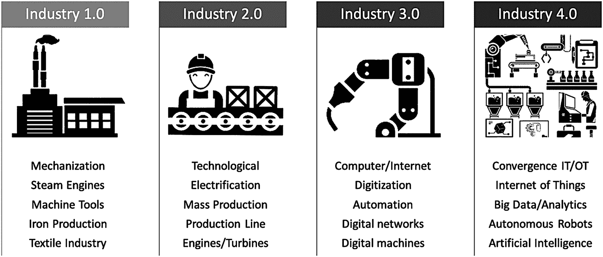

图 2.1 第一次到第四次工业革命。

第四次工业革命的四大主要驱动力是物联网、工业物联网（IIoT）、基于云的制造和智能制造。工业 4.0 基于这些驱动力衍生的九大支柱蓬勃发展，如 图 2.2 工业 4.0 的九大技术支柱。 所示。它们包括大数据与分析、自主机器人、仿真、系统集成、物联网、网络安全、云计算、增材制造和增强现实 [1]。

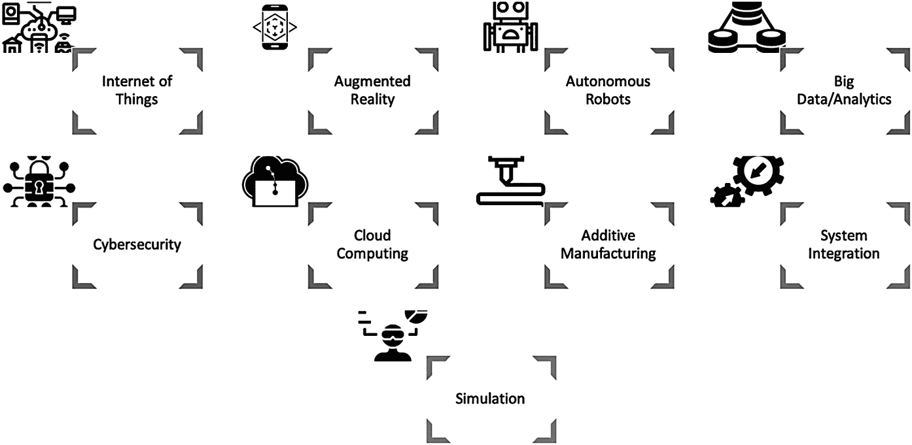

图 2.2 工业 4.0 的九大技术支柱。

尽管行业参与者和利益相关者尚未充分利用该技术，但他们已从其实施中获得了许多益处。产品开发和制造过程中流程的自动化提高了生产率。流程也得到了优化，并结合适当的维护和评估措施，从而提高了业务连续性。监控基于系统产生的实时数据实时进行；这改善了供应链和库存流程。工业 4.0 提供了更好地利用组织资产、发展创新能力并创造新的收入模式的机会。产品的消费者可获得个性化和定制偏好，以改善客户体验并获得售后支持和服务。

电子商务交易的激增减少了客户与产品供应商之间的互动量。客户通过应用程序界面自行完成在线购买，有时无需与卖家或制造商进行任何沟通。如今一些客户更喜欢在订单中加入定制。这种偏好使得有必要考虑智能产业的技术，并由此延伸到智能服务 [2,3]。各种任务和流程的自动化通过优化机械和资源的使用改善了环境，并增强了运营环境中的安全性。总体而言，这提高了业务敏捷性，并为业务运营的可持续性提供了更好的工作条件。

工业 4.0 的支柱为开发者、用户和客户提供了定制和利用这些技术的使能 [4]。

### 2.2.1 物联网

物联网领域在融合物理世界和虚拟世界方面带来了显著的转变 [4]。物联网使各种对象之间能够连接以传输和交换数据。组件网络包括传感器、电路、微控制器以及其他嵌入家用和办公电器、车辆和其他设备中的电子元件，并通过软件和网络连接实现使能。许多行业已实施物联网，包括医疗保健、交通运输、房地产、物流和酒店业 [5,6]。工业 4.0 由物联网和服务互联网驱动，通过物、系统和用户的连接，已实现了数据的实时传输。必要信息的可用性有助于决策，并改善了产品开发流程和整个价值链 [7]。

物联网的实施伴随着挑战。其中一个主要问题是安全威胁和漏洞，特别是隐私和拒绝服务。各组织部门参与物联网开发和运营，给协调和实施正确的战略带来了挑战，从而导致规划和效率的提升 [5,8,9]。客户已接受新的物联网技术，这导致了他们需求和要求的变化。多种电器和物体正在数字化，需求也在增加。制造组织应实施新颖的策略和方法来开发物联网产品和服务，以提高效率和生产率 [6]。

### 2.2.2 增强现实/虚拟现实

增强现实和虚拟现实融合了虚拟世界和物理世界，通常为用户创造沉浸式体验。在工业 4.0 应用的开发过程中，虚拟对象可以在各种界面之间共享，使开发过程更易于理解 [4]。在利用增强现实界面的移动应用程序中，系统通过设备的摄像头可视化与用户进行通信。用户还将信息发送回系统，从而实现双向交互 [10]。

AR 为组织运营中的内部和外部流程都增加了价值。AR 促进了组织设计流程中各部门之间的协作和流程效率。AR 还增强了客户和利益相关者的体验以及面向潜在客户的营销活动 [11, 12 和 13]。在应用中实施 AR/VR 可带来多项益处，包括重新配置产品设计以适应其他目标、可视化开发中产品的配置、提高生产系统的安全性、改善用户与系统之间的交互、提供远程支持以及在安全环境中进行培训以提高生产率 [14,15]。增强/虚拟现实应用使用多种媒体类型，包括文本、音频、视频、动画以及 2D 和 3D 模型来提供丰富的内容。它们还为用户提供沉浸式体验，营造出独特的环绕虚拟环境感觉，增强用户与系统的交互并延长其参与度 [16,17]。辅助系统实施 AR/VR，为用户提供自助支持功能并帮助有一定限制的用户高效完成任务。这些系统面临的挑战之一是了解技术及其工作原理。对这些技术和系统的机遇与限制缺乏充分理解可能会限制潜在用户和客户对其的认可和利用 [18]。

### 2.2.3 大数据与分析

大数据作为从各种来源收集的庞大数据集合。它主要是非结构化的，包括来自网站、博客、聊天论坛、社交媒体和应用程序日志的数据。组织中的数据用户处理各种各样的数据。数据库设计师和数据架构师对数据进行结构化以便存储；系统开发人员使用数据开发用于接受、更新和展示数据的接口。终端用户进行数据录入并运行查询以生成报告。客户希望获得有关产品的正确详细数据以帮助做出购买决策；管理者更喜欢以报告和可视化演示形式呈现的数据。各种技术被用于对数据集进行分析。数据经过挖掘过程并使用 SQL 查询引擎存储在数据库中。用户运行临时查询以生成报告并提供可视化用于演示。数据集必须被结构化以满足所有利益相关者的需求，而这可能是工业 4.0 面临的挑战 [19, 20 和 21]。

大数据在农业、教育、体育、医学和制造业等多个行业的操作中具有相关性 [19]。大数据为数据用户提供了更好、更深入的数据视角。数据分析有助于做出决策并改进开发和生产流程 [4]。正确的分析可以提供关于产品和服务及其生产和开发过程的经验领域知识，从而推动工业 4.0 应用的有效实施 [22]。

### 2.2.4 自主机器人
集成物联网的自主机器人对于在智能行业中通过生产过程开发自主和自管理的产品具有重要作用。它们可以在容易导致僵局的情况下制定方案。在制造业中，自主机器人监督机器的运行并检测故障和失效。它们可以根据历史数据的分析进行诊断。在智能行业中，对机器人（协作机器人）的依赖基于多个因素，包括机器人的性能和安全性、易用性、灵活性和学习能力 [4,23,24]。

与自主机器人相关的一个挑战是生产工作流程的管理。机器人涉及零件的多种运动、精度和快速性。机器人应用应不断创新，具备新的工业流程和对新条件的适应能力 [23]。

### 2.2.5 网络安全
安全是组织的首要关注点；它们投入大量资源为其资产提供网络安全，包括网络通信系统、计算机设备、软件、数据和其他服务。对组织系统发起攻击，目的是破坏系统、拒绝访问计算机系统和服务、窃取并向未经授权的人员泄露信息，甚至破坏整个组织的基础设施和设备 [25,26]。

物联网系统的主要威胁之一是安全。一些组织发现聘请专门从事信息技术和运营技术的专家具有挑战性。然而，建立促进跨职能学习的跨职能团队是必要的 [27]。

制造系统需要受到保护以免受攻击。解决制造应用中的网络安全问题需要利益相关者的参与 [28]。

网络安全为客户价值创造提供了前景。随着工业 4.0 的发展，隐私问题变得至关重要。智能产品正在出现，连接设备、生成和存储大量客户数据；网络安全将成为客户和其他利益相关者的关注点 [29]。

### 2.2.6 云计算
云计算为系统用户提供基础设施，使其无需地理和时间限制即可访问信息和服务；用户可以不论其操作系统平台连接其设备。基于云的制造提供可扩展性、虚拟化、敏捷性和网络化制造 [30,31]。物联网和服务通过传感器和其他设备的连接生成数据。数据需要被存储和分析以做出决策并提高生产率。云计算与物联网集成，为制造过程提供业务价值。来自系统和云服务的分析数据有助于降低生产成本并提供安全见解，以支持生产过程并推动业务和运营转型 [32]。

在云服务支持下，制造商可以向客户征求需求并收集有关产品和性能的反馈。云计算为客户、供应商和其他利益相关者提供平台，以便在产品设计、开发、制造、测试以及产品生命周期中涉及的所有其他活动（包括维护）中进行协作和决策 [30,33]。

### 2.2.7 增材制造
增材制造，主要与 3D 打印相关，是工业 4.0 转型中最具颠覆性的技术。在 3D 打印中，使用计算机辅助设计（CAD）软件设计 3D 模型，然后通过逐层添加材料在 3D 打印机上打印出物理物体。材料包括碳纤维、热塑性塑料、钢材、生化材料、金属和聚碳酸酯 [34,35]。在增材制造的生产过程中，一项研究 [36] 提出了合适产品的特征。产品应在一定程度上可定制；它们应为小批量产品，并且能够优化以提供附加功能 [36]。这些特征使得 3D 设计和模型更容易定制，并且可以根据需要更轻松地更改设计。以更小的批次生产 3D 物理物体是可行的。多个行业实施增材制造，包括食品、时尚、电气和电子、生物医学、制药和铸造 [37]。

产生了一类生产自身商品的消费者；他们被称为‘prosumers’。客户对产品有自己的需求和偏好。这些客户从一开始就参与生产过程和价值链。因此定制产品可以在更短的时间成本内生成。由于设计上的敏捷性和灵活性，这使得制造公司更容易推出新产品 [34,35,37]。

### 2.2.8 仿真
制造公司过去通过尝试各种方法直到取得成功来生产并测试效率。制造商在工业 4.0 转型中使用虚拟化创建模型仿真并在仿真上运行测试。仿真有助于提高产品质量。在产品制造之前，各种组件会被仿真以评估其集成方式以及它们如何相互连接。在实施实际生产之前，对仿真进行测试以评估效率并识别任何可能的风险 [38,39]。

仿真适用于进行工作培训以确保安全。它贯穿生产过程，从设计模型到测试和培训。在需要运行多个场景的情况下，仿真能够对不同的组合进行实验，以确定最合适的方案。仿真与其他工业 4.0 技术相结合以提高效率。它有助于设计物联网设备之间的连接；增材制造在物理对象生成之前以仿真的形式创建 3D 模型；增强现实和虚拟现实是自然环境的仿真形式 \[40,41\]。

仿真过程可能涉及复杂且耗时。设计模型需要专家的投入，更重要的是需要了解该领域的用户和利益相关者。用户在整个生产过程中参与度更高，并产生一种拥有感 \[39\]。

### 2.2.9 系统集成
系统集成在工业 4.0 中应用，体现在水平、垂直和端到端三个方面。水平集成可能涉及不同行业运营的公司，共同协作以实现共同目标。垂直集成在公司内部运作，在公司各部门之间建立集成。端到端集成使虚拟和物理对象作为网络物理系统的一部分能够进行通信和交互。这些集成通过在自动化层面协作并整合整个价值链来促进产品定制并降低运营成本 \[38,42, 43, 44 和 45\]。

系统集成中的层级包括协调、合作和协作。这些层级使任务能够一致且合乎逻辑地进行。各个组件通过各自的合作和协作结合起来，以实现系统的共同目标，形成连接。它在系统的不同实体之间创建互联 \[42\]。

## 2.3 开发中的挑战
制造产品的客户对嵌入在家庭、工作场所和其他场所日常电器中的数字化程度感到震惊。对此类产品的需求不断增加，而客户的要求也在不断变化。工业 4.0 中的生产预计要保持一致、进步、高效且以客户为中心。需要创新性的技术方法论和实践来发掘新的商业机会 \[2,14,46\]。

在系统开发过程中，尽早让利益相关者参与是明智的。利益相关者和消费者会明确产品所需的具体需求。有时，需求会非常庞大，需要优先排序和安排计划，因为开发和生产团队无法在有限的时间内完成所有工作。工业 4.0 项目可能被分配有限的资源，需要妥善管理。各个利益相关者和合作伙伴必须参与开发阶段，这需要他们之间进行协作 \[47\]。

产品开发期间的一个主要利益相关者是客户；他们应在开发和评估过程中参与其中。传统开发技术在客户集成方面存在缺陷，导致无法充分互动并体验新产品功能和特性的用户体验 \[48\]。还存在持续的系统集成和产品交付管道的挑战，这些管道是非专有的，并能够实现应用程序向物联网数据源的快速部署。

为帮助组织制定实施工业 4.0 应用的方法而提出的设计原则之一是模块化。当系统以模块形式开发时，在需求发生变化时维护它们会更高效。在动态环境中，更容易规划不可预测的情况，尤其是在能够快速变化的环境中。模块化为开发环境带来更多灵活性和敏捷性 \[49,50\]。信息透明度也是另一个设计原则。工业 4.0 将技术与设备和人员连接起来，导致在生产和开发过程中需要大量信息来做出合适的关键决策。数据包括传感器和上下文数据、虚拟表示、仿真模型、制造和工厂模型以及上下文感知信息。预计各个利益相关者将使必要信息可访问，以促进透明度并增强创新和功能 \[4,49,51\]。

## 2.4 敏捷方法
敏捷方法被公认为强调用户交互以确保最大化客户满意度的开发流程之一。敏捷开发从业者青睐的实践之一是依赖用户反馈来改进开发流程和产品。敏捷优先考虑用户交互和客户协作，而非实施开发软件和产品的工具和流程。敏捷通过其实践灌输一种特定的思维方式，而非遵循一套方法。这种思维方式帮助团队做出更好的决策，以提高生产力并快速交付有价值的产品 \[52,53\]。敏捷方法专注于应对不断变化的需求和环境，而非固守既定的计划。

各种系统开发团队实施敏捷实践。系统开发公司采用敏捷方法来开发供个人以及中小型组织使用的应用程序。偏好定制系统的组织会咨询系统开发人员以提供解决方案需求。团队大量使用敏捷方法，因为利益相关者参与开发过程的各个阶段，甚至成为开发团队的一部分。重点已从仅仅向客户交付最终产品转变为参与开发周期并在其中创新 \[4,54\]。

在系统和产品开发期间应用的标准敏捷实践包括每日站会、产品待办事项列表、冲刺/迭代、冲刺计划、冲刺评审、用户故事、冲刺回顾、看板和结对编程。这些实践使跨职能团队能够自我组织并专注于快速交付最小可行产品（MVPs）。对需求的更改和改进始终受欢迎，并配合评审会议以改进系统和开发流程。存在定期的反思会议——每日以及每次交付价值的迭代之后，以鼓励透明度和团队拥有感。

### 2.4.1 用户故事
Scrum 是流行的敏捷软件开发方法之一。Scrum 从业者在系统开发期间采用多种活动；其中最常用的实践之一是编写用户故事。用户故事是作为需求获取过程一部分使用的简单文本。产品负责人通常编写这些故事。其组成部分包括指明应用程序的使用者（用户）、用户期望的功能以及为什么在应用程序中实现它很重要 \[55,56\]。

开发者在敏捷环境中协作；所有利益相关者都参与开发过程。系统领域知识不足可能会影响需求获取过程并导致需求规范中的缺陷。开发人员和分析师通过访谈、工作坊或问卷来识别功能和特性。它们随后以简单且原子化的格式写在故事卡上，作为产品待办事项列表的一部分 \[57,58\]。

用户故事对敏捷团队有益，因为它们促进协作并允许将新颖的创新想法纳入系统。它有助于分享关于系统用户、待执行任务以及预期目标的信息 \[59,60\]。

### 2.4.2 看板
看板是一种源自制造业的框架。它已在许多行业中得到广泛应用，从工厂车间到软件开发项目。看板在敏捷开发团队中很受欢迎，但一些非敏捷团队也采用看板来优化工作流程。看板包含一个三步工作流程——待办、进行中和已完成。它利用卡片（或便利贴）和看板；待办事项写在卡片上并放置在板上。所有团队成员都可以访问看板并查看其他成员的任务。这种结构有助于限制在制品并防止任务过载。看板鼓励工作透明度并促进团队成员之间的更轻松协作。看板帮助团队识别工作流程中的瓶颈以改进产品开发流程 \[53,61\]。看板的一些基本原则包括从当前任务开始，然后持续推进来自待办事项列表的新增量任务。看板鼓励透明度；各种角色、任务和开发阶段对所有人可见，促进协作和团队合作 \[52\]。

### 2.4.3 冲刺/迭代
冲刺或迭代是 Scrum 的特征。它表示用于处理任务的指定时间段，通常为 2–4 周。一些团队会调整时长，根据团队规模、经验和工作范围偏好 1–3 周。冲刺开始时是冲刺计划会议，团队在会上确定待办事项。冲刺结束时，预计团队将交付一个 MVP，即对用户有价值的潜在可交付产品。团队在冲刺结束时进行回顾，以反思开发过程并讨论下一阶段的改进。团队还为产品待办事项提供功能输入。冲刺会议有固定的开始和结束日期；所有后续冲刺会议的时长保持不变。冲刺期间未完成的任务会被添加到待办事项列表中，并在下一冲刺中考虑；不会延长冲刺时长以完成待处理任务 \[54,62,63\]。

### 2.4.4 每日站会
每日站会会议是冲刺或迭代会议的特征。每日站会是敏捷团队每天举行的约 15 分钟的限时会议。成员站立开会以保持简洁扼要。团队成员谈论自上次会议以来完成的工作，说明在执行任务时遇到的任何障碍或挑战，并告知其他成员当天计划开展的工作。涉及大量透明度；团队成员了解进展程度并有机会提供输入以帮助团队进展。团队使用每日站会来改进正在开发的产品和开发过程，确保检查其他成员的任务、同步角色并每日适应需求变化 \[52,54,63\]。

### 2.4.5 冲刺回顾与复盘
冲刺回顾在冲刺会议结束时进行，以反思开发过程并讨论下一阶段的改进方法。敏捷团队，包括利益相关者、开发人员、用户和客户，都参与回顾过程。团队为产品待办事项提供功能输入。冲刺的最后一个活动是复盘。在复盘期间，团队讨论做得好的地方并确定可以改进的地方。他们还讨论对改进下一冲刺会议的承诺。Scrum 主持人主持这些会议。主要重点是检查和调整产品和开发过程 \[54,63\]。

## 2.5 工业 4.0 中的敏捷实践
工业 4.0 九大支柱的技术力求满足客户不断变化的需求；通过实施敏捷开发方法 \[4\]。Cyber-physical systems 通常具有敏捷性，并需要不断演进的生产需求以持续改进系统。工业 4.0 整合了多个利益相关者，以开发满足其需求的多维解决方案 \[64\]。生产组织通常专注于为客户进行间歇性的产品发布和升级。情况已随着更多迭代生产而演变，生产不断融入不断变化的客户需求 \[48\]。协作和沟通对于满足客户需求以改善体验至关重要。客户从开发过程开始到所有阶段的参与对于产品的成功至关重要。客户可以提供有价值的输入并提供实时反馈以整合到生产中 \[43\]。应用适当的方法来获取客户和用户需求是需要考虑的重要方面，以确保有效的产品开发过程 \[65\]。

在工业 4.0 应用的开发过程中，已确定了一些需要遵循的步骤 \[66\]。应用预计满足组织目标和目的。需求被获取和收集以开始开发；所有相关利益相关者应共享共同利益并对需求和目标保持清晰，没有任何歧义。这种清晰度有助于保持透明并让所有人参与开发过程。它还有助于从一开始就克服任何潜在障碍，这是在处理可能冲突的优秀措施。存在共同责任；然而，团队成员应了解各自在完成任务中的角色。利益相关者应认识到他们为实现满足客户需求的最终目标而带来的努力、技能和经验。

图 2.3 表示敏捷实践与工业 4.0 技术支柱的整合。图表中心是使用从技术开发的应用的客户。敏捷实践——用户故事、看板、冲刺、每日站会和冲刺回顾——帮助应用开发人员与客户互动协作，以创造增强的客户体验。以下章节介绍对该图表的讨论。

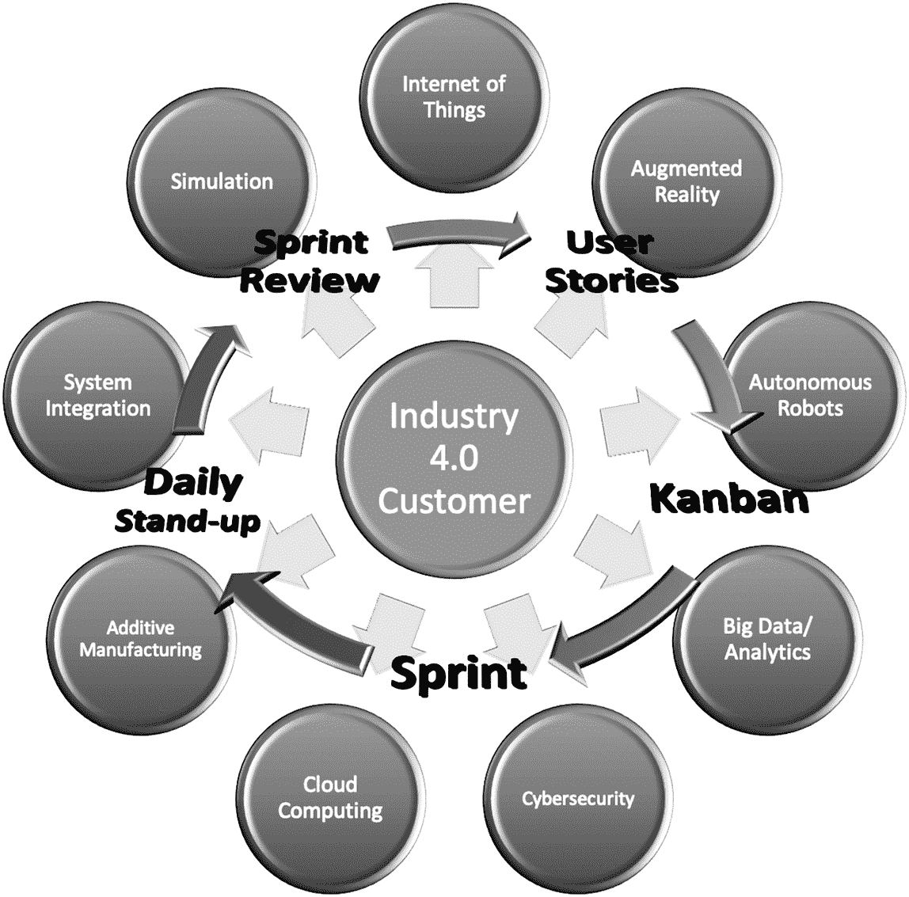

图 2.3 将敏捷实践应用于工业 4.0 技术。

## 2.6 讨论

在当前第四次工业革命中，开发和生产具有敏捷性，主要围绕客户和用户展开，以最好地满足他们的需求和不断变化的要求。技术产品的制造商和生产商应投资于流程、软件、设备和培训的数字化与自动化 \[4\]。投资于软件和产品开发过程至关重要，以确保具有价值和改进功能系统的及时交付。

用户故事是向利益相关者更好地呈现需求的绝佳方式。在增强现实/虚拟现实系统中，用户故事将捕捉需求并反映应用程序中使用的故事情节，以创建虚拟对象和 3D 模型来增强物理环境中的场景。在自主机器人和物联网应用中，用户故事将突出在网络物理系统中发生的交互的主要要点，以促进设备之间的连接。大数据和分析旨在呈现数据和报告，以便用户能够轻松理解并做出正确的决策。数据可视化有助于讲述待呈现数据的故事；应考虑相关的故事角度。用户故事提供了结构化数据可视化的机会，以讲述与数据用户期望一致的故事。在仿真和增材制造期间，用户故事将描述物理对象应如何外观以及如何运行。模拟设计和 3D 模型随后将在作为物理对象生产之前可视化该故事。

软件开发人员、产品制造商和其他工业制造商使用看板来直观监控任务和活动的流程。看板可以数字化使用，也可以物理使用。任务或故事卡被放置在板上并分段，以指示尚未开始、进行中和已完成的任务。它们还有助于保持任务受控，同时保持在制品限制。对于 AR/VR 应用的开发，功能被拆分为模块和任务；看板是组织这些任务的好方法。同样适用于自主机器人和物联网的工作流程。组织得当后，很容易观察到各种对象和设备之间的所有互连。数据分析用于在各个组织单元中捕获数据。看板直观地监控各个单元之间的数据表示。模拟对象被拆分为多个组件，然后集成以评估性能。看板可以提供将每个组件组织到各个开发阶段的视觉工作流程。安全是一项永无止境的操作。每个已知的网络安全威胁和漏洞都可以放置在看板上，供所有团队成员观察以提供解决方案。所有新威胁都记录在待办事项部分，已解决的威胁则放置在已完成部分。

不断发展的客户需求推动制造商和开发人员远离提供一次性解决方案以满足客户需求，使生产和开发过程具有迭代性。像 Scrum 这样的敏捷方法以冲刺的方式实施开发。每个冲刺预计交付一个可行的产品。当任务保留在积压工作中时，它们会按优先级在这些冲刺期间进行处理。数据呈现和可视化每次都会涉及新的方面。这些新报告可以在冲刺期间进行处理。同样适用于增强/虚拟现实应用开发期间的模块和场景；每个模块（或一组模块）可以根据范围和涉及的工作量在每个冲刺期间进行处理。增材制造涉及创建 3D 设计并分层打印。3D 打印可以在多个迭代中完成的各种组件中进行。涉及不同职能单元团队的冲刺会议共同协作处理功能和产品。Scrum 团队中冲刺的协作性质将提高系统集成的水平。

在冲刺会议期间，团队进行每日站会以讨论成员的挑战并考虑当天要处理的任务。生产自主机器人和网络物理系统需要技术专长以及团队与其他利益相关者之间的协作。每日站会使成员能够保持透明，并对正在进行的项目产生主人翁意识和信任。这些实践有助于促进协作和团队合作，简化开发过程和工作流程，改善价值交付并鼓励持续改进。网络安全和云计算系统需要日常监控和运营活动。新的威胁和漏洞经常出现，云计算系统上也会出现威胁和兼容性问题。每日站会使团队能够反思之前面临的挑战以及如何在日常任务中解决它们。

在开发和生产过程中建立跨职能团队进行协作是必要的。评审和回顾会议是反思已完成工作以及如何在未来会议中改进的有效方式。随着工业 4.0 应用的需求不断变化，团队应继续保持迭代。每个冲刺会议应以评审结束，以考虑改进后续会议，为客户创造价值。

## 2.7 结论

本章主要讨论了敏捷实践在工业 4.0 应用开发中的应用，重点介绍了开发过程中遇到的益处和挑战。工业 4.0 为客户提供了要求个性化和定制产品的机会；对于一些制造商来说，这相对较新，因为需求持续变化。物联网、增强/虚拟现实、人工智能、自主机器人以及大数据和分析等技术是数字革命的关键支柱。敏捷方法提供了促进客户和所有相关利益相关者参与软件和产品开发过程的实践。敏捷从业者继续在系统开发中推广 Scrum、用户故事、看板、冲刺、每日站会和冲刺评审的实施。工业 4.0 应用以客户为中心，旨在持续满足客户和客户的需求；敏捷方法为开发人员和制造商提供了适当的实践和方法，使其能够始终利用这些方法开发出能够满足客户不断变化需求的、提供价值的产品。

## 参考文献

1. Vaidya S, Ambad P, Bhosle S. 工业 4.0 – 一瞥。Procedia Manuf 2018;20:233–238. 可从以下获取： [`doi.org/10.1016/j.promfg.2018.02.034`](https://doi.org/10.1016/j.promfg.2018.02.034)

2. Sharma A, Jain DK. 工业 4.0 的发展。In: Nayyar A, Kumar A, editors. 工业 40 的路线图：智能生产、敏锐商业与可持续发展。Cham: Springer International Publishing; 2020. pp. 23–38. 可从以下获取： [`doi.org/10.1007/978-3-030-14544-6\_2`](https://doi.org/10.1007/978-3-030-14544-6_2)

3. Stock T, Seliger G. 工业 4.0 中可持续制造的机会。Procedia CIRP 2016;40:536–541. 可从以下获取： [`www.sciencedirect.com/science/article/pii/S221282711600144X`](https://www.sciencedirect.com)

## 参考文献

4. Kumar A, Nayyar A. si3-Industry：可持续、智能、创新物联网产业。载于：Nayyar A, Kumar A, 编者。通向工业 4.0 的路线图：智能生产、敏捷业务与可持续发展。Cham: Springer International Publishing; 2020. 第 1–21 页。可从以下获取：[`doi.org/10.1007/978-3-030-14544-6_1`](https://doi.org/10.1007/978-3-030-14544-6_1)

5. Munirathinam S. 工业 4.0：工业物联网（IIOT）。第 1 版。第 117 卷，《计算机进展》。Elsevier Inc.; 2020. 第 129–164 页。可从以下获取：[`dx.doi.org/10.1016/bs.adcom.2019.10.010`](http://dx.doi.org/10.1016/bs.adcom.2019.10.010)

6. Lampropoulos G, Siakas K, Anastasiadis T. 物联网在工业 4.0 背景下的概述。《创业与知识国际期刊》2019;7(1):4–19。

7. Koch V, Kuge S, Geissbauer R, Schrauf S. 工业 4.0——工业互联网的机会与挑战。《Fertility and Sterility》2014。可从以下获取：[`www.g20ys.org/upload/auto/03d10e20d681c1cfb40d3d9275704e2e9df16391.pdf`](http://www.g20ys.org)

8. Küsters D, Praß N, Gloy Y-S. 纺织学习工厂 4.0——为德国纺织业的数字化未来做准备。《Procedia Manufacturing》2017;9:214–221。可从以下获取：[`www.sciencedirect.com/science/article/pii/S2351978917301531`](https://www.sciencedirect.com)

9. Bauer H, Baur C, Mohr D, Tschiesner A, Weskamp T, Alicke K, et al. 初期炒作后的工业 4.0：制造商如何找到价值并最好地捕获它。McKinsey Digital 2016。可从以下获取：[`www.mckinsey.com/~/media/mckinsey/businessfunctions/mckinseydigital/ourinsights/gettingthemostoutofindustry40/mckinsey_industry_40_2016.ashx`](https://www.mckinsey.com)

10. Masood T, Egger J. 支持工业 4.0 的增强现实——实施挑战与成功因素。《Robotics and Computer-Integrated Manufacturing》2019;58(二月):181–195。可从以下获取：[`doi.org/10.1016/j.rcim.2019.02.003`](https://doi.org/10.1016/j.rcim.2019.02.003)

11. Mourtzis D, Zogopoulos V, Vlachou E. 面向工业 4.0 的增强现实支持产品设计：教学工厂范式。《Procedia Manufacturing》2018;23(2017):207–212。可从以下获取：[`doi.org/10.1016/j.promfg.2018.04.018`](https://doi.org/10.1016/j.promfg.2018.04.018)

12. Rauschnabel PA, Felix R, Hinsch C. 增强现实营销：移动 AR 应用如何通过灵感提升品牌。《Journal of Retailing and Consumer Services》2019;49(三月):43–53。可从以下获取：[`doi.org/10.1016/j.jretconser.2019.03.004`](https://doi.org/10.1016/j.jretconser.2019.03.004)

13. van Lopik K, Sinclair M, Sharpe R, Conway P, West A. 为工业 4.0 中小企业开发增强现实能力：内容创作案例研究的经验教训。《Computers in Industry》2020;117:103208。可从以下获取：[`doi.org/10.1016/j.compind.2020.103208`](https://doi.org/10.1016/j.compind.2020.103208)

14. Damiani L, Demartini M, Guizzi G, Revetria R, Tonelli F. 工业系统中的增强现实和虚拟现实应用：迈向工业 4.0 时代的定性综述。《IFAC-PapersOnLine》2018;51(11):624–630。可从以下获取：[`doi.org/10.1016/j.ifacol.2018.08.388`](https://doi.org/10.1016/j.ifacol.2018.08.388)

15. Lavingia K, Tanwar S. 增强现实与工业 4.0。载于：Nayyar A, Kumar A, 编者。通向工业 4.0 的路线图：智能生产、敏捷业务与可持续发展。Cham: Springer International Publishing; 2020. 第 143–155 页。可从以下获取：[`doi.org/10.1007/978-3-030-14544-6_8`](https://doi.org/10.1007/978-3-030-14544-6_8)

16. Aleksy M, Vartiainen E, Domova V, Naedele M. 用于改善服务交付的增强现实。载于：*2014 IEEE 第 28 届先进信息网络与应用国际会议*。2014. 第 382–389 页。

17. Blanco-Novoa O, Fernandez-Carames TM, Fraga-Lamas P, Vilar-Montesinos MA. 工业 4.0 造船厂中商业工业增强现实系统的实际评估。《IEEE Access》2018;6:8201–8218。

18. Paelke V. 智能工厂中的增强现实：在工业 4.0 环境中支持工人。载于：*第 19 届 IEEE 国际新兴技术工厂自动化 ETFA 2014 会议*，2014。

19. Sharma A, Pandey H. 工业 4.0 中的大数据与分析。载于：Nayyar A, Kumar A, 编者。通向工业 4.0 的路线图：智能生产、敏捷业务与可持续发展。Cham: Springer International Publishing; 2020. 第 57–72 页。可从以下获取：[`doi.org/10.1007/978-3-030-14544-6_4`](https://doi.org/10.1007/978-3-030-14544-6_4)

20. Khan M, Wu X, Xu X, Dou W. 工业 4.0 炒作中的大数据挑战与机遇。《IEEE International Conference on Communications》2017。

21. Santos MY, Oliveirae Sá J, Costa C, Galvão J, Andrade C, Martinho B, et al. 面向工业 4.0 的大数据分析架构。《Advances in Intelligent Systems and Computing》2017;570:175–184。

22. Wang D. 在技术变革的世界中创造价值：数据分析与工业 4.0。《IEEE Engineering Management Review》2018;46(1):32–33。

23. Goel R, Gupta P. 机器人技术与工业 4.0。载于：Nayyar A, Kumar A, 编者。通向工业 4.0 的路线图：智能生产、敏捷业务与可持续发展。Cham: Springer International Publishing; 2020. 第 157–169 页。可从以下获取：[`doi.org/10.1007/978-3-030-14544-6_9`](https://doi.org/10.1007/978-3-030-14544-6_9)

24. Indri M, Grau A, Ruderman M. 客座编辑专刊：工业 4.0 驱动的机器人解决方案的最新趋势与发展。《IEEE Transactions on Industrial Informatics》2018;14(4):1677–1680。

25. İlhan İ, Karaköse M. 组织中网络安全解决方案的需求分析。2015。

26. Corallo A, Lazoi M, Lezzi M. 工业 4.0 背景下的网络安全：关键资产和业务影响的结构化分类。《Computers in Industry》2020;114:103165。可从以下获取：[`doi.org/10.1016/j.compind.2019.103165`](https://doi.org/10.1016/j.compind.2019.103165)

27. Malatras A, Skouloudi C, Koukounas A. 工业 4.0 网络安全：挑战与建议 ENISA 列出针对不同...的高层建议。2019。可从以下获取：[`www.enisa.europa.eu/publications/industry-4-0-cybersecurity-challenges-and-recommendations`](https://www.enisa.europa.eu)

28. Babiceanu RF, Seker R. 基于软件定义网络的制造应用的网络安全与弹性建模。载于：Borangiu T, Trentesaux D, Thomas A, Leitão P, Oliveira JB, 编者。Service Orientation in Holonic and Multi-Agent Manufacturing。Cham: Springer International Publishing; 2017. 第 167–176 页。

29. Culot G, Fattori F, Podrecca M, Sartor M. 应对工业 4.0 网络安全挑战。《IEEE Engineering Management Review》2019;47(3):79–86。

30. Velásquez N, Estevez E, Pesado P. 云计算、大数据与工业 4.0 参考架构。《Journal of Computer Science and Technology》2018;18(3):e29。

31. Thames L, Schaefer D. 面向工业 4.0 的软件定义云制造。《Procedia CIRP》2016;52:12–17。可从以下获取：[`dx.doi.org/10.1016/j.procir.2016.07.041`](http://dx.doi.org/10.1016/j.procir.2016.07.041)

32. Georgakopoulos D, Jayaraman PP, Fazia M, Villari M, Ranjan R. 制造业物联网与边缘云计算路线图。《IEEE Cloud Computing》2016;3(4):66–73。

33. Liu Y, Xu X. 工业 4.0 与云制造：比较分析。 J Manuf Sci Eng Trans ASME 2017;139(3):1–8.

34. Baldassarre F, Ricciardi F. 工业 4.0 时代的增材制造：意大利 FabLab 案例。 J Emerg Trends Mark Manag 2017;I(1):105–115. 可获取自： [`www.etimm.ase.ro/RePEc/aes/jetimm/2017/ETIMM\_V01\_2017\_89.pdf`](http://www.etimm.ase.ro)

35. Haleem A, Javaid M. 工业 4.0 中增材制造的应用：综述。 J Ind Integr Manag 2019;4(4):1930001.

36. Mellor S, Hao L, Zhang D. 增材制造：实施框架。 Int J Prod Econ 2013;149:194–201.

37. Horst D, Duvoisin C, Vieira R. 工业 4.0 中的增材制造：综述。 Int J Eng Tech Res 2018;8(8):3–8.

38. Alasdair Gilchrist. 介绍工业 4.0 工业。 2016; 可获取自： [`www.unido.org/fileadmin/user\_media\_upgrade/Resources/Publications/Unido\_industry-4\_NEW.pdf`](https://www.unido.org)

39. Sturrock DT. 工业 4.0 中的传统仿真应用。 2019;39–54.

40. Gunal MM. 为更好而仿真：工业 4.0 的未来。 2019;275–283.

41. Gunal MM. 仿真与第四次工业革命。 2019;1–17.

42. Sanchez M, Exposito E, Aguilar J. 工业 4.0：系统集成视角的综述。 Int J Comput Integr Manuf 2020;33(10–11):1017–1041. 可获取自： [`doi.org/10.1080/0951192X.2020.1775295`](https://doi.org/10.1080/0951192X.2020.1775295)

43. Pereira AC, Romero F. 工业 4.0 概念的含义及其影响综述。 Procedia Manuf 2017;13:1206–1214. 可获取自： [`doi.org/10.1016/j.promfg.2017.09.032`](https://doi.org/10.1016/j.promfg.2017.09.032)

44. Suri K, Cuccuru A, Cadavid J, Gerard S, Gaaloul W, Tata S. 基于模型的模块化复杂系统开发以实现工业 4.0 的系统集成。 载于： *第 5 届模型驱动工程与软件开发国际会议论文集*。 Setubal, PRT: SCITEPRESS – Science and Technology Publications, Lda; 2017. p. 487–495. (MODELSWARD 2017). 可获取自： [`doi.org/10.5220/0006210504870495`](https://doi.org/10.5220/0006210504870495)

45. Pisching MA, Pessoa MAO, Junqueira F, dos Santos Filho DJ, Miyagi PE. 基于 RAMI 4.0 的架构，用于发现产品所需操作的设备。 Comput Ind Eng 2018;125:574–591. 可获取自： [`www.sciencedirect.com/science/article/pii/S0360835217306034`](https://doi.org/10.1016/j.promfg.2017.09.032)

46. Lee J, Kao HA, Yang S. 面向工业 4.0 和大数据环境的服务创新与智能分析。 Procedia CIRP 2014;16:3–8. 可获取自： [`dx.doi.org/10.1016/j.procir.2014.02.001`](http://dx.doi.org/10.1016/j.procir.2014.02.001)

47. Sarvari PA, Ustundag A, Cevikcan E, Kaya I, Cebi S. 工业 4.0 技术路线图。 Cham: Springer, 2018;95–103.

48. Nunes ML, Pereira AC, Alves AC. 面向工业 4.0 的智能产品开发方法。 Procedia Manuf 2017;13:1215–1222. 可获取自： [`doi.org/10.1016/j.promfg.2017.09.035`](https://doi.org/10.1016/j.promfg.2017.09.035)

49. Hermann M, Pentek T, Otto B. Industrie 4.0 情景的设计原则。 载于： *2016 年第 49 届夏威夷国际系统科学会议 (HICSS)*。 2016. p. 3928–3937.

50. Gattullo M, Scurati GW, Fiorentino M, Uva AE, Ferrise F, Bordegoni M. 面向工业 4.0 的增强现实手册：一种方法。 Robot Comput Integr Manuf 2019;56(October):276–286. 可获取自： [`doi.org/10.1016/j.rcim.2018.10.001`](https://doi.org/10.1016/j.rcim.2018.10.001)

51. Helmold M. 工业 4.0 与项目管理中的人工智能 (AI)。 2019. p. 161–163.

52. Stellman A, Greene J. 学习敏捷 – 理解 Scrum、XP、精益和看板。 J Chem Inf Model 2015; 53:1689–1699.

53. Al-Zewairi M, Biltawi M, Etaiwi W, Shaout A. 敏捷软件开发方法：综述的综述。 J Comput Commun 2017;5(5):74–97.

54. Sommerville I. 软件工程。 10th ed. Pearson; 2015.

55. Lucassen G, Dalpiaz F, van der Werf JMEM, Brinkkemper S. 改进敏捷需求：质量用户故事框架与工具。 Requir Eng 2016;21(3):383–403.

56. Lucassen G, Dalpiaz F, van der Werf JMEM, Brinkkemper S. 实践中用户故事的使用与有效性。 载于： *国际需求工程工作会议：软件质量基础*， 2016;205–222.

57. Bolloju N, Gupta A, Alter S, Gupta S, Jain S. 利用工作系统快照改进 Scrum 用户故事和产品待办事项。 载于： *AMCIS 2017 – 美国信息系统大会：创新传统*。 2017. pp. 1–10.

58. Inayat I, Moraes L, Daneva M, Salim SS. 敏捷需求工程反思：带来的解决方案与挑战。 载于： *ACM 国际会议论文集系列*。 2015.

59. Quesenbery W, Brooks K. 用户体验的讲故事：为更好设计而创作故事。 Rosenfeld Media. 2010.

60. Forbrig P. 用例、用户故事与 BizDevOps。 载于： *Jt Proc REFSQ-2018 Work Dr Symp Live Stud Track, Poster Track 与第 23 届需求工程与软件质量基础国际会议 (REFSQ 2018) 共同举办*， Utrecht, Netherlands. 2018; 2075.

61. Poppendieck M, Poppendieck T. 精益软件开发：敏捷工具包。 Computer 2003;36.

62. Srivastava A, Bhardwaj S, Saraswat S. 敏捷方法学的 SCRUM 模型。 载于： *论文集 – IEEE 计算机通信自动化国际会议 ICCCA 2017*， January 2017; 864–869.

63. Rubin KS. 精要 Scrum：最受欢迎敏捷流程的实用指南。 1st ed. Addison-Wesley Professional; 2012.

64. Lu Y. 工业 4.0：技术、应用及开放研究问题综述。 J Ind Inf Integr 2017;6:1–10. 可获取自： [`dx.doi.org/10.1016/j.jii.2017.04.005`](http://dx.doi.org/10.1016/j.jii.2017.04.005)

65. Engelbrektsson P, Söderman M. 产品开发中方法及产品表示的使用与认知：瑞典工业调查。 J Eng Des 2004;15(2):141–154. 可获取自： [`doi.org/10.1080/09544820310001641245`](https://doi.org/10.1080/09544820310001641245)

66. Kumar A, Gupta D. 工业 4.0 体系中的挑战。 载于： Nayyar A, Kumar A, editors. *通往工业 40 的路线图：智能生产、敏锐商业与可持续发展*。 Cham: Springer International Publishing; 2020. p. 187–205. 可获取自： [`doi.org/10.1007/978-3-030-14544-6\_11`](https://doi.org/10.1007/978-3-030-14544-6_11)

# 3 工业 4.0 应用中的安全漏洞综述及使用区块链的可能解决方案

Mangayarkarasi Ramaiah, Vasavi Chithanuru and Adla Padma

Vellore Institute of Technology, Vellore, India

Vinayakumar Ravi

Prince Mohammad Bin Fahd University, Khobar, Saudi Arabia

DOI: [10.1201/9781003203087-3](https://dx.doi.org/10.1201/9781003203087-3)

## 3.1 引言

术语“Industry 1.0”是在 18 世纪通过利用蒸汽动力和生产系统的自动化而创造的。Industry 2.0 在 19 世纪被提出，得益于电力的发明和装配线生产，其流程与早期版本相比大大改进了自动化。Industry 3.0 版本在制造业引入了半自动化。机器人被用于减轻许多任务中的人力负担。Industry 4.0 面向的是希望消除在协作和共享数据和信息方面所面临障碍的制造业部门（Erboz, 2017）。Industry 4.0 在制造业实施自动化的同时增强了数据交换应遵循的流程和方式。Industry 4.0 的关键部分之一是在装配区域保证成本效益。Industry 4.0 包括以下领域：工业物联网（IIoT）、物联网（IoT）、智能工厂、人工智能和云计算，以及大数据。用于自动化的整个设备组件都相互连接并与人类互动。这种互联设置被称为网络物理系统（CPS）。网络组件与用于控制和监控流程的基于计算机的算法相关联。表 3.1 显示了工业革命（IR）从 1.0 到 4.0 的演进版本及其缺点，同样在 图 3.1 中以图形方式呈现。

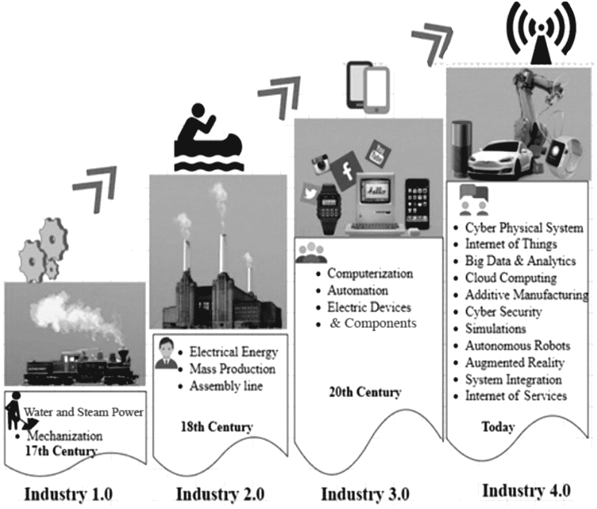

图 3.1 工业革命 1.0 至 4.0。

表 3.1 工业革命的演进版本

| 工业革命 || 代号 || 建立 || 缺点 |
| --- | --- | --- | --- |
| Industry 1.0 || 动力生成 || 1784 || 造成环境污染 |
| --- | --- | --- | --- |
| Industry 2.0 || 工业化 || 1870 || 为电气化搭建装配线 |
| Industry 3.0 || 电子自动化 || 1969 || 人工干预是必要的 |
| Industry 4.0 || 智能自动化 || 2011 || 需要更具挑战性的技术来抵御网络威胁 |

由于整个装配措施都依赖于机械化保证，安全性对企业而言是一个重要观点。Industry 4.0 的核心设计方面是解决兼容性问题、去中心化、虚拟化和透明度。在实施核心设计方面时，对设置环境的方式缺乏了解造成了大部分安全漏洞（Anisetti et al., 2020）。根据 IBM X-Force 威胁情报指数 2018 年的数据，33% 的各类攻击针对制造业部门。在智能制造环境中，最常见的攻击是拒绝服务（DoS）攻击、恶意软件威胁、中间人（MITM）攻击和侧信道攻击。

如今，Industry 4.0 的主要挑战是在其不兼容的关键组件之间确保安全。自然地，互联设备在确保隐私和信任方面面临困难。确保隐私可防止未经授权访问机密信息。为了实现隐私，采用了加密算法 ECDSA（椭圆曲线数字签名算法）、MPC（多方计算）和轻量级加密算法。另一个安全方面是组织难以防止通过破坏完整性而发生的行动中的漏洞。在信任方面，哈希函数已很好地集成到系统中。除此之外，为了在人们之间建立信任，我们使用不同类型的模型。数据泄露的可能性在产品部署过程获得收入之前就使其瘫痪，并对工业经济产生不利影响（Chiu et al., 2017）。在 IR 4.0 的背景下，任何信息都是有价值的，也可能被黑客攻击。行业巨头 Centrify 和 Palo Alto Networks 实施零信任策略，与特权访问方法相矛盾。传统的特权访问方法不足以应对当前趋势，其中高级持续性威胁正在激增。特权访问方法不仅需要涵盖数据库和互联设备，还需要扩展到大数据、云环境和自动化应用程序。Zero trust 特权的核心理念是授予用户最少的权限，而不是忽略它们。用户请求可以根据请求的访问、请求的上下文以及计算环境的潜在风险进行验证。通过最小权限访问，可以在一定程度上将对行业运营的可能攻击降至最低，改善审计并降低企业的复杂性和成本。因此，确保 IR 4.0 的安全方面对于从各种角度改进运营至关重要。因此，本章试图总结因破坏各种安全措施而导致潜在漏洞以及使用区块链技术（BCT）缓解威胁的可能解决方案。第 3.2 节讨论了 Industry 4.0 的多个关键组件。第 3.3 节尽可能总结了每个关键组件固有的挑战。此外，还探讨了每个组件中预期的可能安全挑战。第 3.4 节讨论了各种最先进的行业应用，旨在在智能城市迁移之前改善人类生活质量。第 3.5 节讨论了 BCT 如何被用于提高 Industry 4.0 中各种应用的安全措施。第 3.6 节总结本章。

## 3.2 Components of Industry 4.0

Industry 4.0 应用采用强大的流行技术构建，以应对具有挑战性的安全攻击并识别合法入口。本节讨论 Industry 4.0 的主要组件以及最可能的安全漏洞事件。图 3.2 显示了 Industry 4.0 的各种组件，依次如下：CPSs、机器到机器（M2M）、物联网（IoT）、大数据与分析（BDA）、云计算（CC）、边缘计算（EC）、网络安全（CS）、服务互联网（IoS）、系统集成、自主机器人、仿真、增强现实（AR）和增材制造。

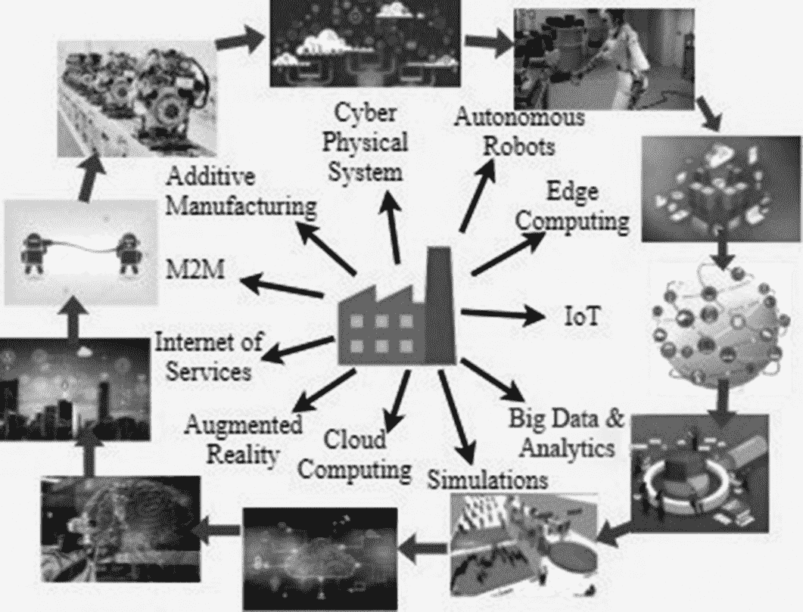

图 3.2 Industry 4.0 的组件。

### 3.2.1 CPS and IoT

Industry 4.0 提供了未来技术和制造业的优势。Oztemel and Gursev (2020) 认为它是计算和物理组件的集成。CPS 的开发分为三个阶段。

* CPS 结合了诸如 RFID 标签等识别技术，可实现非凡的识别能力。存储和分析应作为核心支持提供。
* 对于特定传感器和执行器，CPS 配备的功能较少。
* CPS 设计了许多传感器和执行器以实现网络兼容。

物联网包括数百万设备之间的数据孤岛和信息，重点关注设备配置设置、平台等方面的管理协议。Tay et al. (2018) 将 Industry 4.0 描述为一个新时代，拥抱了物联网和制造业等进步。Georgios et al. (2019) 披露，通过执行和适应 Industry 4.0 和物联网进步，企业可以实现非凡的财务发展和效用效率，具体如下：

* 提升通用应用、管理和框架的可访问性和可行性。
* 由于效率提升和交期缩短，市场上市时间减少。
* 对个体化客户需求和市场需求变化的适应性支持。
* 改善对企业流程和资源的监控与控制。
* 重新组织并实现数字化生产。
* 能够在短时间内分析大量数据。

### 3.2.2 大数据与分析
大数据为所有行业应用提供海量存储。大数据分析包含处理海量数据和人工智能技术的优势机制，从而促进深入的数据分析。BDA 旨在提供有关先前用于创建类似衍生品的潜在资产的真实数据，这些数据可能仍会被重新处理。AI 系统是最有前景的平台，用于探索和研究大量数据以进行精确预测。Erboz (2017)描述了 BDA 能够存储并分解所有业务信息。其对环境管理的益处在于对现有属性、已使用属性、机器效用、能源效率、废物产生、废物利用以及排放的污染水平进行分组、分解并提供重要信息和数据。

### 3.2.3 云计算
云计算是一个框架，其中它并非为客户提供巨大的存储容量。云计算技术应在制造和个人管理活动中得到批准 (Erboz, 2017)。探索创新解决方案始终是一个持续的过程，在任何情况下，因此数据存储设计为分布式，允许创建结构更以数据为驱动。云计算是大数据的一个优秀平台，在信息框架构建期间被众多组织青睐 (Bajic et al., 2020)。云计算的目标是对 BDA 的强调，应利用硬件设备构建计算集群并扩展计算能力，涉及网络爬行和索引系统工作。由于数据集的巨大体积，寻找具有容错计算能力的理想方案是实施云计算用于 BDA 的重要因素。云计算提供一种计算服务，其中通过可扩展资源共享和处理的数据可在互联网上获得。为了分发其工作，计算机资源被放置在多个区域，其中这些软件组件已延迟到达成批。该策略用于进行更快速的分析，并适合执行繁琐且耗电的信息收集。

### 3.2.4 边缘计算
边缘计算是一种分布式网络架构，将云的计算能力移近信息源以减少延迟并降低数据传输成本 (Oztemel & Gursev, 2020)。现代边缘计算是对在制造和生产环境中整合边缘处理技术的描述 (Sittón-Candanedo et al., 2019)。边缘计算通过利用分布式网络确保工业 4.0 的成功实施。其部分优点总结如下。
* 从各种来源流式传输的无用数据被过滤以节省时间和存储容量。
* 随着去中心化的存储和处理，可扩展性方面得到极大增强。
* 边缘模型的节点为组织的每个节点提供隔离和安全性。
* 通过大幅减少数据转换实现了低延迟。

### 3.2.5 服务互联网
服务网络在汽车行业发挥着重要作用。它充当“服务供应商”，通过网络根据数字化服务类型提供各类帮助。这些服务是可用的，并根据商业模式、合作伙伴以及任何服务安排按需提供。在工业 4.0 中，在“物联网”这一术语中，“物”代表用于流程的基础——通过各种服务实施的自动化的亮点。工业 4.0 包含硬件和软件。许多组织在线发布其软件更新。因此，通过服务互联网，任何组件的软件都可以更新。其中一些还通过软件更新产生收入。这类服务极大地支持了行业应用。

### 3.2.6 自主机器人、仿真和增强现实
自主机器人采用前沿技术设计，能够在无需人工干预的情况下自行完成任务。机器人在自动化行业的各个领域找到应用，以促进供应链管理、智能工厂和移动机器人等相关任务，具体如下。机器人部署确保了运营成本的降低、人工错误的最小化，从而在生产中获得满意度。最近，移动机器人在缓解制造物流中涉及的障碍方面发挥了作用，例如通过导航到不同区域来搬运材料。因此，移动机器人获得了灵活性、可扩展性和安全性等优势。Tay et al. (2018)认为自主机器人的固有适应性使其适合在许多领域提供帮助。后来，机器人被设计为与同伴互动以执行群体活动，包括人类。仿真是一个重要的装置，也是工业 4.0 中最主流的部分之一，并通过增强现实改革了运营周期。仿真模型是衡量机器人和增强现实项目的有效性的最佳工具。各种组件的虚拟布置不需要成本；它只是减少了在真实环境中预期的复杂性。因此，管理员可以在实际环境中执行之前，在基本复制的情况下进一步改进机器设置。因此，将仿真建模应用于工业 4.0 可提高产品交付、供应链管理和制造业部门的生产率。AR 考虑现实世界和虚拟世界中的对象。顺应趋势，行业期待创新的解决方案来增强其生产。AR 通过信息获取或分析的方式为行业提供许多解决方案，尤其是在智能工厂中。Carvalho et al. (2020)指出，在创建智能制造功能时，增强现实是工业 4.0 的科技进步之一。尽管几年前，增强现实只是被视为一种奢侈玩具，现在它已达到在生产环境中使用的开发水平，其中 AR 支持在为必要资源投资资金之前虚拟执行设计方案。在仿真期间，他们可以看到可能出错的区域，因此在实时插入组件之前，可以修复错误。

因此，AR 帮助制造业部门以最小的错误加快运营，从而促进经济增长。

### 3.2.7 增材制造与机器到机器

Industry 4.0 强调智能技术与生产系统集成的重要性。根据 Oztemel 和 Gursev (2020)，增材制造（AM）技术可根据三维（3D）模型信息包含多种复合几何形状和设计。Industry 4.0 正在激发前沿数据进步和敏锐创造框架的传统。该过程包括打印逐层堆叠的渐进物理层。Industry 4.0 的执行依赖于增材制造能力。AM 包含变化的方法、材料和设备，已长期建立，并可修改收集和协调操作。AM 在生物力学、原型制作和开发等多种方案中已普遍发挥功能。该创新为不同目的使用各种材料，对于这些材料，需要注意诸如极限、强度、一致性、极限和与其他潜在材料类型的接触等观点。M2M 是工具之间通过有线或远程的任何通道进行的直接通信。M2M 通信可以包括当前仪器，允许传感器或仪表获取材料，其中将其归档到可应用的应用程序。在 Industry 4.0 中，组织利用 M2M 创新在数据焦点和机器之间建立远程通信。使通信技术、有线或无线、易于实施且尽可能经济实惠，已为更简单的生活打开了发展。就 Industry 4.0 而言，M2M 也被视为一个基本组成部分。

## 3.3 行业 4.0 组件的固有挑战

在第 3.2 节中，讨论了 Industry 4.0 的众多重要机制，这些机制描述了各种作者的观点。通过安全通信通道进行不间断的数据交换是完成任务而不损害安全方面的强制性要求。由于其中涉及的组件的性质，Industry 4.0 环境更容易被黑客攻击；本节的主要目的是让读者熟悉可能从 Industry 4.0 组件中预期的最可能的安全挑战（在 图 3.3 中提到）。

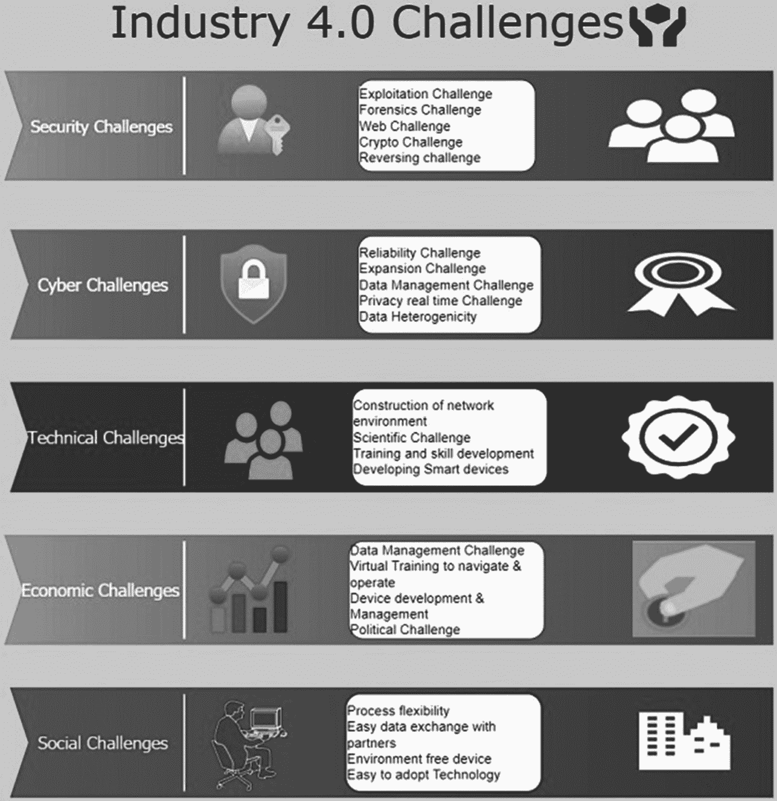

图 3.3 行业 4.0 挑战。

### 3.3.1 赛博物理系统、IIoT 和网络安全

CPS 由许多计算机系统组成，其中候选过程通过智能步骤进行控制和监控。而且，它已成为当前行业必不可少的构建组件之一。各种基准测试程序在各个场合提出，以提高其有效性并丰富安全措施。

为了通信异构组件并为组件提供自适应支持，对灵活的通信接口有很大需求。从 CPS 文件中提取组件的共同特征具有挑战性，因为每个文件都包含方法、语言和模型（Zhou 等，2015），CPS 工具的设计和开发支持综合、仿真、改进、雕刻和仿真。Bajic 等 (2020) 认为，由于缺乏设置各种组件的知识，开发 CPS 技术并培训员工需要大量成本投资。Zhang 等 (2019) 总结了可能从 CPS 预期的集成挑战。Keerthi 等 (2017) 在确保诸如可信度、精确度、效率、鲁棒性、多样性和安全性等安全方面时展示了安全挑战以及可能的解决方案。安全漏洞对于 CPS 等互联设备可能更高。以下是 CPS 最受期待的安全漏洞类型：Sybil 攻击、Eavesdropping、Packet Spoofing 和 Feedback Integrity 攻击。IoT 的安全漏洞是 Data transit 攻击、Jamming DoS 攻击、Routing & DoS 攻击和 Unfairness 攻击。

组件、IoT 和 IIoT 如今对于促进行业之间的许多交易非常重要（Serror 等，2020）。在 Industry 4.0 中互联设备之间通信期间，IoT 和 IIoT 中可能出现大量安全漏洞。其中一些可能是物理漏洞、冒充漏洞、MITM、路由漏洞、恶意代码注入漏洞如 DDoS、crypto-jacking 漏洞、勒索软件、数据泄露、DoS、被动和主动攻击以及内部和外部攻击。

* 物理漏洞是物联网中由于硬件组件而出现问题的类别之一。也就是说，设备将被物理访问并替换或损坏组件以访问敏感信息，如用户密码或通过访问设备。
* 冒充漏洞可以通过薄弱的身份验证机制成功实现。
* MITM 是关注任意两个合法方之间共享信息的漏洞之一。
* 在从一个合作伙伴向另一个合作伙伴发送消息时，攻击者在路由漏洞中通过广播虚假路由信息或干扰通信流来阻碍通信网络。此类示例有 Sinkhole 和 selective forward。
* 分布式 DoS 是 Industry 4.0 中的一个问题，因为使用了大量基于物联网的设备。存在通过请求拥塞攻击服务器的可能性。
* 在 crypto-jacking 漏洞中，未经授权的人员使用计算属性来挖掘加密货币。
* 勒索软件通过阻止内容可见性向用户索要金钱。
* 数据泄露是危及个人信息的其中一种安全漏洞。

DoS 攻击在物联网设备中发挥关键作用。这些攻击通过用请求使机器过载而导致问题。

IIoT 的安全漏洞是暴力攻击、SQL 注入、移动设备攻击、MITM 攻击、Web 应用程序攻击、重放攻击和数据嗅探。网络安全的安全漏洞是网络钓鱼攻击、恶意代码攻击、DoS 攻击、传输威胁、未经授权的访问和欺骗。Industry 4.0 组件中最受期待的安全漏洞如图 图 3.4 所示。

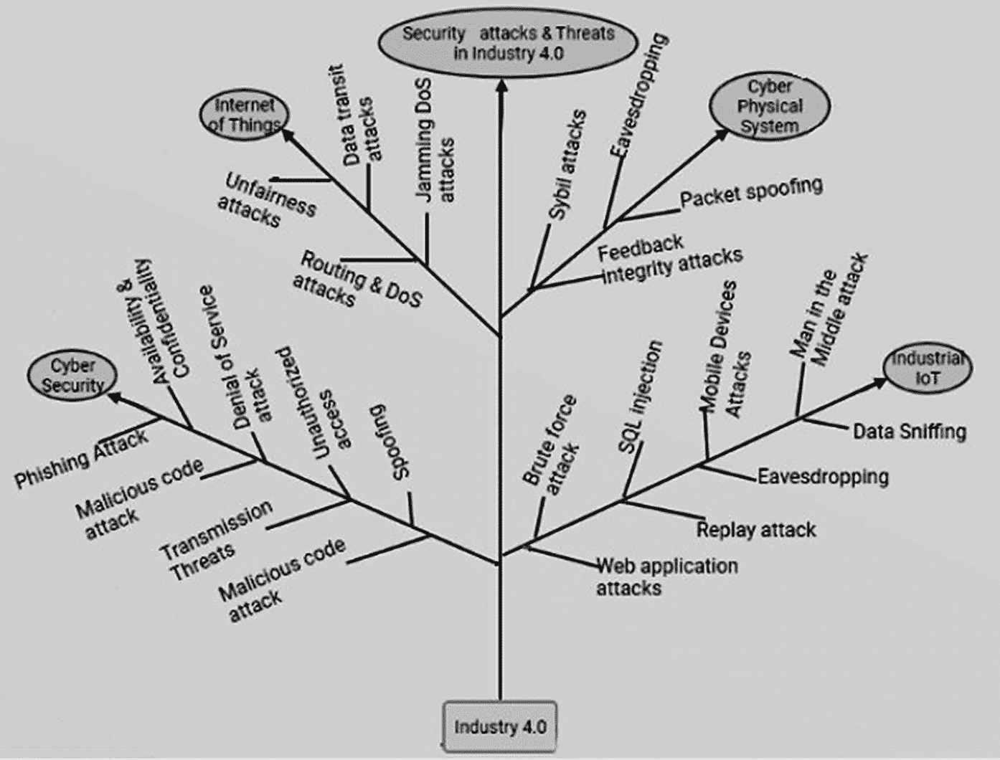

图 3.4 行业 4.0 组件最可能的安全漏洞。

### 3.3.2 网络安全

网络安全涉及网络互联网络中设备的各个安全方面。根据 Kumar 等 (2020)，在使用互联网浏览时，网络钓鱼攻击的可能性更大。网络钓鱼攻击旨在窃取用户的敏感信息。当用户输入用户凭证信息或下载某些弹出窗口时，此类攻击就会被触发。钓鱼者利用受损攻击中的漏洞，其中整合了社会工程学，重点关注框架缺乏特定的动态安全措施，以及客户缺乏信息或警惕性。这包括诸如零日恶意软件、连接控制、通道规避、混淆品牌标志、网站伪造、隐秘重定向，以及 IIoT 框架的破坏等攻击，以及总体上与其连接的控制或操作框架。在一个案例中，研究人员关注了 2014 年 12 月德国一家钢铁厂的袭击，使用带陷阱的消息窃取登录凭证，从而使入侵者能够访问工厂的控制系统。攻击者利用 spear-phishing 和社会工程学进入钢铁工业设施的企业系统，这导致控制部件失效，所有制造设备都面临中断。DoS 是网络安全中的一种入侵类型，攻击者（黑客）试图阻止合法用户获得服务。在 DoS 攻击中，攻击者通常会发送过量的消息，要求组织或服务器验证带有无效地址的请求。

### 3.3.3 云计算与大数据分析

本节讨论云计算和大数据的挑战。Aceto 等 (2020) 介绍了云计算提供的各种可用服务，以维护基础设施数据的透明度、隐私和性能监控。基础设施可用性基于各种服务（Zhong 等, 2017）。云计算增强了制造业的能力，指出在不同云之间建立通信会降低基于云系统的可靠性和效率，并影响资源分配、兼容性和可用性。Wang 和 Xu (2013) 提出了可互操作的制造云解决方案。Chen 等 (2017) 实施了智能工厂概念，以满足数据清洗、数据保护和实时数据处理的智能服务需求，并强调了提供服务时面临的挑战。

O’Donovan 等 (2015) 指出需要为大数据制定备份实施计划。Xu 等 (2018) 开发了一个实用应用，用于分析来自物联网设备和现有信息通信技术 (ICT) 的孤岛数据，这些数据需要一个强大的大数据平台（Bajic 等, 2020）；信息系统标准和规则体系的不足；关于公司规模的管理挑战和财务可行性（Lenz 等, 2018）；以及将无关数据置于有限存储中以及数据库集成问题。

## 3.4 行业 4.0 应用与项目的影响

本节总结了各种行业 4.0 应用，以及来自德国联邦教育与研究部、法国、亚洲和欧洲国家的若干优秀项目。

### 3.4.1 行业 4.0 应用的影响

本节总结了在各种场合发表的作者作品，这些作品旨在通过各种工业革命应用改善人类生活质量。行业 4.0 革命中遵循的高效步骤消除了可能影响整个过程目标的连接问题带来的障碍。Turner 等 (2020) 介绍了在建筑工地上应用 IR 4.0 的案例。可穿戴传感器设备用于预测风险并提醒工人。数字孪生技术用于评估为智能环境条件设计的结构。随着数字技术的发展，安全、保障和成本方面的标准需要改进。IR4.0 中使用的设备的特点是紧凑、通信技术更好且计算能力先进（Bousdekis 等, 2020）。提出了一个由人类、机器、网络和物理组件组成的智能系统。该报告的目的是在 CPS 背景下促进人与机器（AI）以及物理世界与数字世界之间的交互。所提出的 HCPS（人类网络物理系统）框架在其要素中应用了智能技术，包括工业中的基于计算机的智能（人工智能）、CPS 中的数字孪生以及操作员 4.0-AI 共生。信息和数据驱动的计算被用于知识获取和数据摄取，以实现数字孪生驱动系统与人机系统之间的协作。通过所提出的框架确保的益处是透明性、安全性、鲁棒性和可控性。该系统提到人类智能和机器智能对于拥有良好的 HCPS 至关重要。Afrizal 等 (2020) 提出了对工业中组件 CPS 的分析。该文章强调了整合网络物理和网络人类的的重要性。此外，作者引入了 5C 组件层级（连接、对话、网络、认知和配置）。来自网络人类系统的反馈信息被用于自适应、纠正和预防性操作。

Sinha 和 Roy (2020) 提出了将制造业与 IT 部门整合的智能工厂概念。所提出的框架旨在补充工厂自动化，从而促进经济增长。该文章展示了工业中的各种问题以及增强智能工厂理念的可能解决方案，同时也涉及 CPS 在 IR4.0 中面临的争议（Jazdi, 2014）。通过智能工厂，力求实现以下益处：灵活性、能源和资源效率、正确性、一致性、安全、用户友好性和可扩展性（Saniuk 等, 2021）。企业通过部署大数据、物联网和人工智能等智能技术以最低成本生产灵活产品。为客户侧创造更大利益会给行业带来挑战。通过移动知识和物联网提出了一个名为网络工业网络的高效生产网络。通过网络工业网络，可以利用地理分散的企业资源增加产品的制造。Pivoto 等 (2021) 提出了在 IIoT 视角下 CPS 架构模型的调查。随着 IR 4.0 应用复杂性的增加，确保安全措施的挑战也在增加。此外，论文讨论了构建 CPS 的先进方法，以及技术如何通过垂直和水平集成来确保 IR 4.0 属性。该论文不仅强调了 CPS 构建中的问题，还阐明了即将发生的必要变化（Kannengiesser & Müller, 2018）。为 IIoT 实施 CPS 可在流程、产品和价值创造方面取得巨大改进。

数字技术的发展为智能产业创造了大量机会。旨在实施智能流程的行业缺乏相应的协议。Da Silva 等 (2020) 从不同渠道总结了行业可能的科学流程。除了对各种智能流程的回顾外，作者还强调了不同行业中报告的障碍。论文报告称，由于缺乏足够的资金支持、基础设施短缺以及领域专家指导，行业面临问题（Khan 等, 2020）。趋势技术以及 `IoT` 的应用为 `IIoT` 铺平了道路。`IIoT` 为制造业中的 `IoT` 创造了新的愿景。新启用技术如 `Blockchain` 和 `Cloud Computing` 被部署以确保行业面临的稳健性、灵活性和信任。为了让读者了解 `IIoT`，给出了一个精确的定义。作者描述了在 `IIoT` 中开展的基准研究工作。最终，`IIoT` 的使能智能技术及其固有挑战也被总结。

行业希望按照 `PSS`（产品-服务系统）的模式转变其业务性质。Gaiardelli 等 (2021) 识别出能够丰富 `PSS` `IR4.0` 形态的主要特征。`PSS` 中有四个衡量标准推动了工业 4.0 的发展：（1）价值主张体现，（2）客户价值体验，（3）价值创造机制，（4）以及价值创造互动。这里的主要思想是在理论和实践两个层面研究关于 `PSS` 以及工业 4.0 采用的进一步发展和讨论。这种整合的优点将新技术纳入考虑并获得了专家的反馈（Moeuf 等, 2020）。作者讨论了工业 4.0 的关键成功因素以及相关的风险和机遇。为了在 `SMEs`（中小企业）中实现工业 4.0 的因素、风险和机遇等目标，作者引入了 Delphi–Régnier 研究。Delphi”s 研究陈述了专家对特定主题的意见。Régnier”s 研究提出了一种工具，该工具使用基于专家意见的类似交通信号灯的颜色面板；80% 的专家同意在工业 4.0 的 `SMEs` 中使用该技术。

`IR4.0` 和 `IIoT` 为当今行业实现更大改进铺平了道路。制造业使用的互联设备由于安全方面的设备配置不当而遭受安全漏洞。在线工具 `Shodan` 被使用（Fernández-Caramés & Fraga-Lamas, 2020）作为工业 4.0 和 `IIoT` 网络安全的实践教学方法。检测和防止对 `IIoT` 设备的 `Shodan` 攻击为工程毕业生创造了一个良好的学习平台。了解安全违规的影响。作者通过用例指导学习网络安全和 `IIoT` 的方法（Aheleroff 等, 2020）。在本文中，作者通过数字化转型指定了一种 `IoT` 启用的智能家电——以智能冰箱作为工业 4.0 下基于 `IoT` 的家电 SPS 框架的案例研究。智能冰箱——在通信信号和 `IoT` 网络的帮助下——通过 `Wi-Fi` 或 `Bluetooth` 激活，以便监控和控制冰箱制冷和温度水平、执行器和冰箱循环变得容易（Geng, 2017）。此类设备是可行且经济实惠的。但向现有设备添加该功能会花费更多时间和成本。

趋势技术如 `SDN-IoT` 和 `Blockchain` 被整合以构建新的架构，即 `DistB-SDoIndustry`，为 `IoT` 设备提供更好的安全性。Rahman 等 (2020) 提出的架构足以抵御基于数据包的攻击，如 `DoS`、Flooding Attacks 和数据包的时间持续时间。所提出的架构使用 `BCT` 进行数据验证和验证。与传统模型相比，故障率已显著降低。因此，新技术促进了效率、保密性和更高吞吐量的实现。Serror 等 (2020) 提出了针对 `IIoT` 预期可能的安全漏洞。所提出的报告重点关注 `IIoT` 价值链的安全性，考虑设备和工业数据。对于 `IIoT`，保密性、不可否认性、完整性、隐私性和可用性等安全方面需要在通信渠道和数据上得到保障。因此，作者总结了在安全漏洞中工业 4.0 应用的挑战和要求。

Costa 等 (2020) 提出了 `FASTEN IIoT Platform`，以提供 `IIoT` 应用的适应性、可配置性和开放性优势。`FASTEN IIoT` 为工业 4.0 应用提供直观的界面。在 AI 进步设备的光下，获得安全且有效可信的信息共享。所介绍的阶段包括三个支柱：（1）自动化机器人和制造单元，（2）开放的 `IIoT` 平台，（3）用于预测建模的实时环境。

### 3.4.2 工业 4.0 的智能项目

有一些项目正在运行以实现工业 4.0 的整体数字化。

这些项目由各个政府部门以及行业合作伙伴赞助。资金由中小企业提供（`SMEs` 关注特定的数字化转型）。此类项目主要关注为工业 4.0 实施获得战略和组织努力（Oztemel & Gursev, 2020）。工业 4.0 中突出的智能项目（图 3.5）是 `ENTOC`、`ARIZ`、`SOPHIE`、`e-F@CTORY`、`PLANSEE`、`ESIMA`、`OPAK`、`FUSION`、`#1 Smart (SMT) factory`、`INESA Smart Factory`、`AWS IoT` 和 `ParisFAI40`。

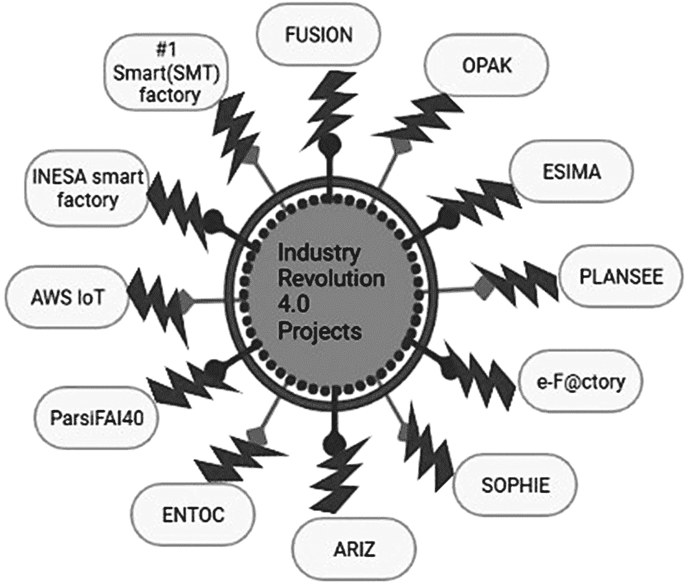

图 3.5 工业 4.0 项目。

*   项目 `ENTOC` 的目的是使工程流程的结果成为更简单且更连贯的模拟排序。该项目主要为工业 4.0 中的自动化提供仿真和组件描述所需的工具。
*   `ARIZ` 也称为‘“Future Industry Work’”并专注于安全的人机协作机器人，主要用于工业生产场所。
*   `SOPHIE` 主要用于将真实生产与数字工厂结合的实时应用。
*   `E-F@actory` 的主要目标是在全球产品制造商之间建立灵活的连接。该项目有助于世界更快地沟通并提高技术的稳健性。
*   `PLANSEE` 是工业 4.0 项目之一，用于自主开发工厂。
*   `ESIMA` 项目用于优化生产系统中的资源效率。
*   `OPAK` 项目旨在实现具有数字记忆的简单制造工艺和机制。
*   `FUSION` 旨在鼓励亚洲和欧盟国家之间的合作活动。
*   `#1 Smart (SMT) factor` 项目将允许制造商在未来的硬件组织中提供更智能、更适应的设备。
*   `INESA smart factory` 的主要目标是与智能制造公司一起建设智慧城市。该项目主要使用大数据和 `IoT` 来解决制造设备中的无错误问题。
*   `AWS IoT` 用于在 `AWS` 端点之间以及与不同设备之间可靠、安全地路由消息。

ParsiFAl 4.0 研究项目旨在开发一种标记为 `S3` 的薄型电子系统。该系统基于微控制器、传感器和紧凑型显示器构建。这样的设备可以帮助物流行业为运输敏感货物找到可靠的路线。

## 3.5 BCT 在工业 4.0 中的应用

BCT 在金融和支付领域获得了广泛关注。尽管关于可扩展性、可持续性和安全性仍有许多问题未得到解答，但 BCT 已成为确保工业互联网安全的重要要素之一（Parizi & Dehghantanha, 2018）。最初，区块链是为加密货币和比特币等支付系统而设计的，之后，区块链被用于通过智能合约实现数字金融自动化（Efanov & Roschin, 2018）。而现在，区块链是补充工业 4.0 自动化流程的有前景的解决方案。

区块链充当块数据库，其中这些块与哈希函数相关联。区块链中的块是不可变的。每个节点在网络中都包含一份账本副本且不会失败（Alkhalifah et al., 2020）。所有数据都使用密码学技术加密，并将历史链作为新块添加。区块链中的交易一旦在网络中发布就无法更改。2009 年，电子现金的概念被提出，即比特币。比特币是 BCT 的加密货币，允许在分布式账本中转移数字现金。除了比特币之外，还有许多其他加密货币，如 XRP（Ripple）、ETH（Ethereum）、BNB（Binance Coin）、LTC（Litecoin）和 BCH（Bitcoin Cash）。各种区块链平台在 表 3.2 中进行了讨论。

表 3.2 区块链类型及可用平台

|  || 公开/无许可 || 私有/许可制 || 联盟/联邦 |
| --- | --- | --- | --- |
| 去中心化 || 完全去中心化 || 去中心化程度较低 || 去中心化程度较低 |
| --- | --- | --- | --- |
| 参与者识别 || 是 || 否 || 否 |
| 参与者活动限制 || 无限制 || 参与者之间达成共识 || 是，基于共识 |
| 谁可以进行交易验证 || 每个参与者 || 仅授权参与者 || 仅授权参与者 |
| 智能合约 || 是，取决于平台 || 是，取决于平台 || 是，取决于平台 |
| 可访问性 || 任何人 || 仅一个组织 || 多个组织 |
| 每秒交易数 || 低 || 更轻更快 || 更轻更快 |
| 共识协议 || PoW（工作量证明）、PoET（经过时间证明）和 PoS（权益证明） || PoS（权益证明）、RAFT、PBFT（实用拜占庭容错）、BFT（拜占庭容错） || 用于达成一致的多方共识算法或投票方案 |
| 平台 || Bitcoin、Litcoin、Ethereum、Hyperledger Fabric || Tendermint、Quorum、Hyperledger Fabric、Corda、HydraChain、Kadena、Exonum、Swirld、Symbiont || Ripple、R3（银行）和 B3i（保险） |
| 用例 || 医疗保健行业、供应链行业、农业行业、制造业 || 医疗保健行业、供应链行业、电力行业、制造业、无人机（UAV）行业 || 教育行业和电力行业 |

无数的共识机制用于在与其他参与者验证块后添加链条。共识机制旨在允许区块链网络中互不信任的用户进行合作。这可以在不需要中央权威的情况下防止恶意行为。一些共识机制包括 `PoW`（Proof-of-work）、`PoET`（Proof-of-elapsed-time）和 `PoS`（Proof-of-stake）。区块链的一些优势在 图 3.6 中显示。

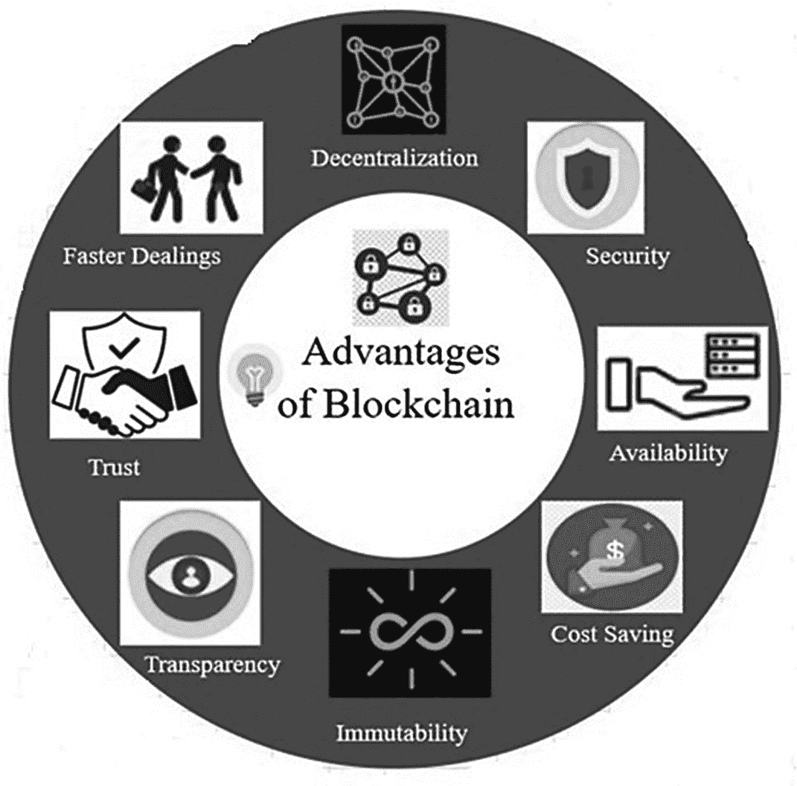

图 3.6 BCT 的优势。

Alkhalifah et al. (2020) 指出，区块链安全漏洞的受害者从个人到银行业、医疗保健和制造业部门不等。据作者称，区块链漏洞有三种类型——黑客攻击、诈骗和智能合约缺陷——每种类型的事件数量及其相关损失价值（以百万美元计）可在 图 3.7 中找到。黑客攻击的向量有多种类型，如电子邮件账户、云服务、网络钓鱼攻击、恶意攻击和基于 SIM 的攻击。这些攻击均在 2014 年至 2018 年间被检测并阻止。区块链提供的身份隐私属性使其成为诈骗的首选平台。图 3.7 显示，第二大损失是由庞氏骗局和金字塔骗局等诈骗造成的，2014 年至 2018 年造成的损失达 10 亿美元。智能合约缺陷在 2014–2018 年间出现。

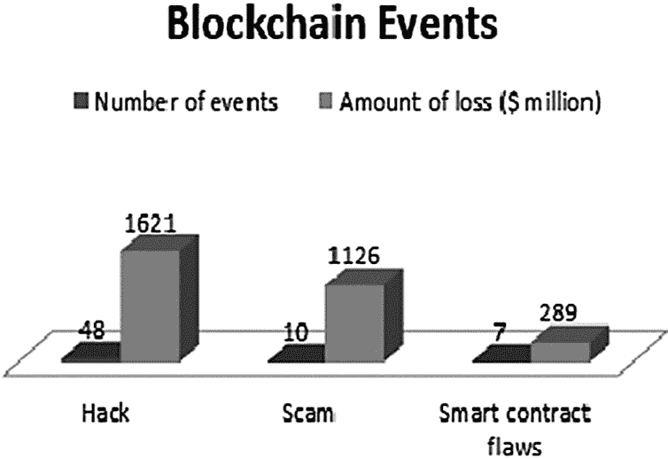

图 3.7 区块链漏洞事件及其对财务损失的影响。

黑客可以在智能合约脚本中进行一些对抗性更改以造成财务损失。

### 3.5.1 区块链框架

本节描述了一些为各种工业 4.0 应用设计的最新区块链框架。所设计区块链框架的有效性是根据确保机密性、完整性和可用性等各种安全方面的程度来评估的（Alladi et al., 2019）。区块链是一种新兴的数据保护技术，作者叙述应用 BCT 在实施过程中带来许多挑战。作者讨论了诸如参与组织的隐私、块数据的可扩展性、采用和集成成本等安全方面（Xie et al., 2019）。智能环境会受到安全漏洞的影响。安全方面使用公钥基础设施（`PKI`）进行改进。BCT 在确保智能公民、供应链管理、智能电网、智能医疗和智能交通等智能应用的安全方面起到了助推剂的作用。授权实体通过区块链得到高度正确的验证（Yang et al., 2019）。数十亿设备连接起来在边缘计算网络中运行应用程序。通过集成 BCT，网络安全方面和计算效率得到了极大改进。分布式数据库（`BigchainDB`、`Enigma` 和 `IPFS`）用于解决存储问题。

区块链在天然气和石油行业的应用可能会提高透明度并降低交易成本。实施 `BCT`（Lu 等，2019）涉及许多挑战（法律和网络风险）。此类技术仍处于实验阶段（Fraga-Lamas & Fernández-Caramés, 2019）。针对汽车行业提出了区块链框架，并利用智能合约促进解决与财务相关的问题。联盟区块链更适合与具有受限访问权限的不同组织进行通信（Shen & Pena-Mora, 2018）。在智能环境中，互联设备的可能性是自动化流程的关键组成部分，其中安全的数据和信息交换发挥着至关重要的作用。引入 `BCT` 启用网络可增强网络安全（Salman 等，2018）。分布式网络服务和挑战通过区块链框架得到解决。尽管网络流量数据量巨大，加上云的使用，`BCT` 提供了实现诸如保密性和完整性等安全方面的解决方案（Ferrag 等，2018）。`IoT` 可以根据不同的专业化进行微调，如 `IoC`（云计算互联网）、`IoV`（车辆互联网）和 `IoE`（能源互联网）。安全通信对于 `IoT` 环境仍然至关重要，数据隐私得到了 Fernández-Caramés 和 Fraga-Lamas (2018) 的极大改进，而 Christidis 和 Devetsikiotis (2016) 证明了 `BCT` 在为行业设计智能应用方面的适用性（图 3.8）。

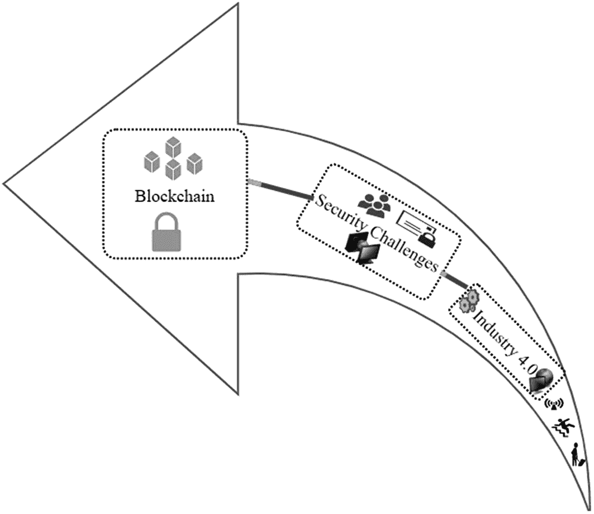

图 3.8 将 BCT 应用于各种工业 4.0 应用。

表 3.3 总结了使用 `BCT` 的各种安全框架，以满足众多智能工业 4.0 应用的需求。本文介绍了各种区块链支持的行业应用，以及尽可能提供的框架所保证的安全方面、优点和缺点。图 3.9 展示了 `BCT` 在各个领域的使用情况。

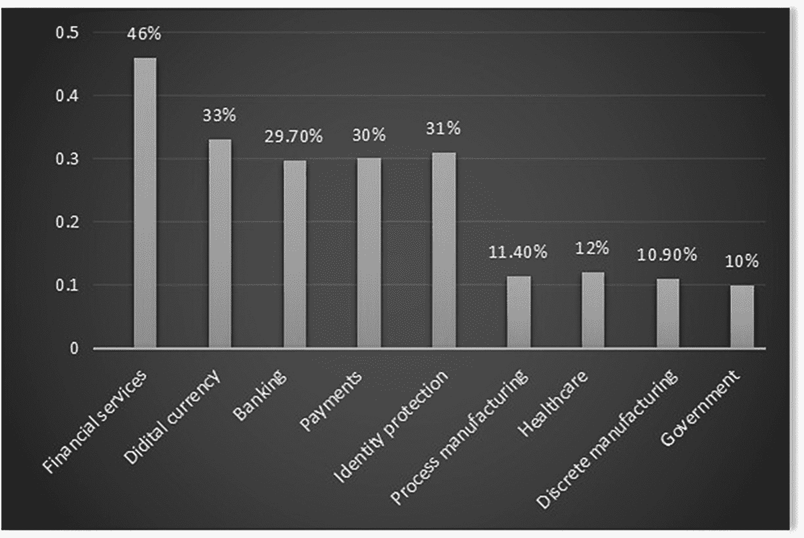

图 3.9 各行业区块链技术的使用情况。

表 3.3 区块链技术的安全框架

| 作者姓名 || 使用方法 || 确保的安全方面 || 优点 || 缺点 |
| --- | --- | --- | --- | --- |
| Stodt 和 Reich (2020) || 提出 `DCMB`（区块链数据通信模块）用于工业 4.0 应用 || 数据保密性、真实性和完整性 || 无集中式数据存储。智能合约丰富了数据签名。防止恶意入侵。 || 可用性问题未得到解决。 |
| --- | --- | --- | --- | --- |
| Singh (2020) || 使用 `BCT` 讨论工业数据管理流程。 || 保密性和完整性 || `BCT` 使数据库足以抵御数据安全漏洞。讨论了智能 `BCT` 启用数据库设计。强调了与工业数据生成及其安全问题相关的问题。 || 未解决分布式数据库设计挑战。 |
| Kumar 和 Gupta (2020) || `BlockEdge` 框架确保 IIoT 环境的低延迟服务以及安全方面。 || 保密性和完整性 || （`BlockEdge`）在性能、资源效率、网络使用和功耗方面取得了良好结果。 || 未解决透明度问题。 |
| Hang 和 Kim (2019) || `BCT` 为 `IoT` 环境启用了一个平台以确保数据完整性。 || 完整性 || 资源受限的 `IoT` 架构。可轻松定制用于各种 `IoT` 用例。确保可扩展性、高吞吐量、轻量级和透明度。 || 需要解决互操作性问题。所提出的框架除概念验证外未与其他共识机制一起使用。 |
| Viriyasitavat 等 (2018) || 提供自动化的 `BPM`（业务流程管理）解决方案以规范业务工作流程。 || 隐私和保密性 || `BCT` 启用的 `BPM` 解决方案确保了可靠性和成本效益。无需中间人干预。由于自动化，运营成本降低。 || 未与其他现有 `BPM` 解决方案进行测试。 |
| Puri 等 (2020) || 工业 4.0 中 IIoT 应用的基于 `BCT` 的网络安全框架 || 信任和隐私 || 由于所提出的三个层次架构，安全方面得到改进。 || 未披露工业 4.0 其他关键组件的适用性。 |
| Rahman 等 (2020) || `DistB-SDoIndustry` 框架配备了强大的 SDN-IoT 技术，以丰富工业 4.0 服务的安全措施。 || 隐私和保密性 || `DistB-SDoIndustry` 提供灵活性。在高网络流量中足以抵御攻击。节点故障率大幅降低。获得高吞吐量。 || 尚未探索防止 DoS 和洪水攻击的步骤。 |
| Mohamed 和 Al-Jaroodi (2019) || 讨论了用于智能制造的 `BCT` 启用的 `Man4Ware`。 || 完整性和隐私 || 在确保安全方面的同时提供灵活且可扩展的环境。 || 尽管强调了工业 4.0 的大多数挑战性方面，但解决这些问题的方法很少。 |
| Putz 等 (2021) || 提出了 `EtherTwinDApp` 以消除在多方之间共享数字孪生所带来的挑战。 || 完整性和保密性 || 在没有可信第三方的情况下，数据共享得到极大改进。适用性通过 || 未探索该提案在另一个领域 DT 的适用性。 |
| Lee 等 (2019) || 介绍了工业 4.0 中 `BCT` `CPPS` 架构的影响。为工业 4.0 利益引入了三层 BC 架构。 || 保密性和隐私 || 消除单点故障。为工业 4.0 应用确保安全可靠的运行。 || 未讨论存储容量成本问题和实时实施难度。 |
| Lin 等 (2018) || 提出了 Belen 的细粒度身份验证框架。 || 保密性和隐私 || 所提出的框架可抵御 `MITM`（中间人）、`DDoS`（分布式拒绝服务）以及修改和重放攻击。 || 所提出的 BSeln 在智能工厂中的适用性可进一步探索。 |

### 3.5.2 来自区块链组件的威胁

在区块链中，智能合约用于以有效的方式在用户之间建立合约。出于安全目的，我们在区块链中使用智能合约，但即便如此，da Silva 等（2020）作者也强调了以下漏洞：

* 智能合约是不可变的，而且如果出现任何问题，我们也无法更改软件缺陷。
* 通过在智能合约上签名，协议对区块链中的所有用户可见，每个人在遵循之前都会意识到问题。恶意代理将很容易利用这些问题，代码也很容易被访问。
* 由于被利用的漏洞，智能合约在高频交易/转账中表现不佳。

###### 区块链技术组件中的漏洞

重入漏洞存在于智能合约中，如 2016 年的 DAO 事件所示。重入是一种在以太坊智能合约中出现的漏洞类型。正如名称所示，攻击者首先向多方智能合约存入金额 `X`。攻击者然后在已存入和已取出的资金余额尚未结算之前，执行一个函数取出金额 `Y`，该金额超过 `X`。其结果是攻击者实质上从合约中的其他方窃取资金。

由于 BCT 具有共享账本、不可变性、隐私性、共识和加密机制等优点，可用于防止各种攻击和欺诈，因此网络攻击得以避免。尽管 BCT 确保了防篡改的屏障，黑客仍能在其构建模块中找到漏洞并损害资产。图 3.10 显示了 BCT 组件中的漏洞（Adewole et al., 2020）。

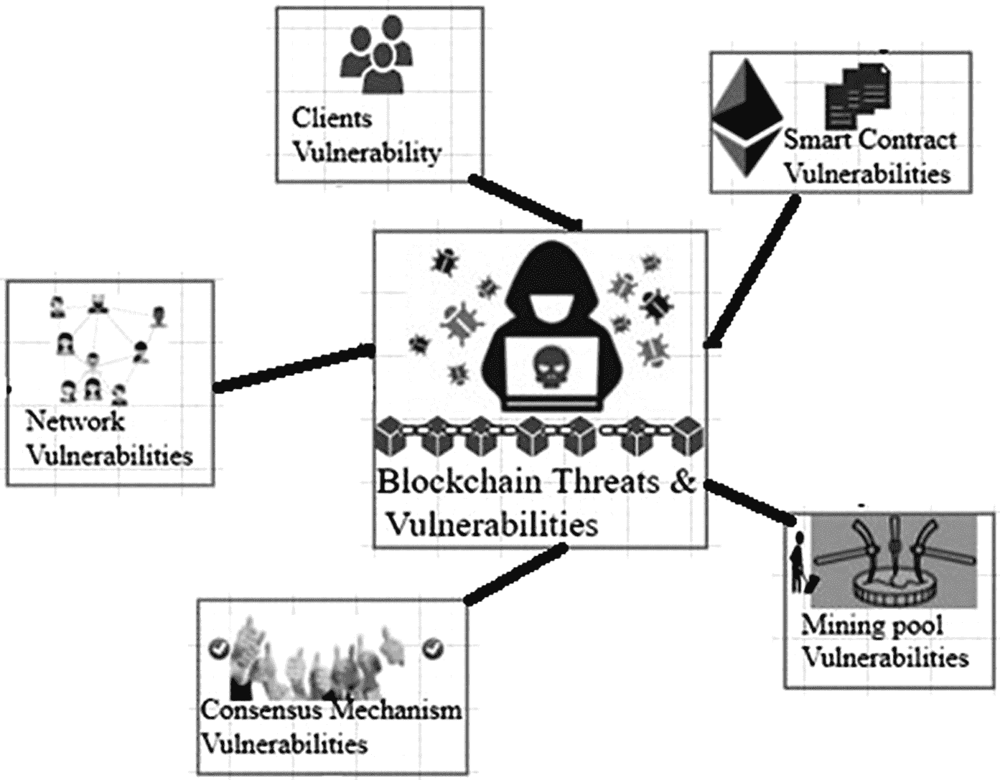

图 3.10 区块链技术组件中的漏洞类型。

###### 常见问题

其中一些问题如下：

* 钱包加密货币容易受到网络攻击。黑客可以轻易入侵客户端钱包。钱包黑客的一个例子是特洛伊魔鬼窃贼，它通过关闭钱包记录来收集信息。
* 双花是 BC 的另一种可能的安全威胁。根据隐私导向的数字货币 Verge（`VxG`），2018 年 4 月至 5 月发生了三起 51% 攻击案例，且攻击通常发生在目标节点更改时间戳时。恶意矿工可以挖掘带时间戳的区块，误导网络认为已挖掘出新区块并将其嵌入区块链。随后挖掘的区块还会额外、迅速地添加到网络中。攻击者因此有机会每秒挖掘一个区块，并在 2018 年 4 月 4 日的[content]
###### 区块链技术组件中的漏洞

重入漏洞存在于智能合约中，如 2016 年的 DAO 事件所示。重入是一种在以太坊智能合约中出现的漏洞类型。正如名称所示，攻击者首先向多方智能合约存入金额 `X`。攻击者然后在已存入和已取出的资金余额尚未结算之前，执行一个函数取出金额 `Y`，该金额超过 `X`。其结果是攻击者实质上从合约中的其他方窃取资金。

由于 BCT 具有共享账本、不可变性、隐私性、共识和加密机制等优点，可用于防止各种攻击和欺诈，因此网络攻击得以避免。尽管 BCT 确保了防篡改的屏障，黑客仍能在其构建模块中找到漏洞并损害资产。图 3.10 显示了 BCT 组件中的漏洞（Adewole et al., 2020）。

图 3.10 区块链技术组件中的漏洞类型。

###### 常见问题

其中一些问题如下：

* 钱包加密货币容易受到网络攻击。黑客可以轻易入侵客户端钱包。钱包黑客的一个例子是特洛伊魔鬼窃贼，它通过关闭钱包记录来收集信息。
* 双花是 BC 的另一种可能的安全威胁。根据隐私导向的数字货币 Verge（`VxG`），2018 年 4 月至 5 月发生了三起 51% 攻击案例，且攻击通常发生在目标节点更改时间戳时。恶意矿工可以挖掘带时间戳的区块，误导网络认为已挖掘出新区块并将其嵌入区块链。随后挖掘的区块还会额外、迅速地添加到网络中。攻击者因此有机会每秒挖掘一个区块，并在 2018 年 4 月 4 日的主要攻击中获得了 250,000 `VxG`。
* 51% 攻击是区块链网络的另一种可能攻击。要执行此类攻击，需要高算力。当矿工控制着网络超过 50% 的算力时，此类攻击可能发生，并且能够生成网络分叉并完成双花攻击。挖矿攻击者将抹去交易历史并阻止新区块的确认。
* 在双花攻击中，攻击者将同一货币用于多次交易。此攻击中交易会被逆转并导致再次花费资金。它主要阻止矿工挖掘有效区块。2018 年一次此类攻击的例子中，比特币黄金损失了 1,750 万美元。
* 在区块链网络中，另一种预期攻击是自私挖矿。此类攻击针对区块链网络完整性。在此背景下，破坏者有效地挖掘了一个区块但不向其他区块透露。破坏者将此类区块添加到其私有链中以使其变长。与最短链相比，只有最长链才被视为有效。在日本，2018 年曾尝试过此类攻击。通过此攻击，拥有隐藏链的人可以获利。
* 在软件更新期间，交易视图中的某些节点仍查看旧版本，而其他一些节点接收到新版本；此类问题被称为分叉。分叉由矿工或加密货币用户提供。分叉被拆分。分叉用于创建新网络。加密货币拆分其代币以生产新代币。让我们以一个例子说明，比特币于 2017 年 10 月 24 日进行分叉以生成一种名为比特币黄金的新型加密货币。其意图是让许多人能够在不同版本上工作。但分叉是好是坏是一个有争议的话题。

###### 加密货币和区块链的缺点

加密货币和区块链的缺点如下：

* 波动的市场：根据趋势，加密货币的价值可能在数小时内发生变化；为防止损失，应在其价值上涨时进行交易。
* 安全性差：当安全措施不足时，会发生钱包资金损失。由于加密货币程序员在安全方面不够擅长，黑客会利用其知识破解代码。
* 缺乏可靠的匿名性：网络罪犯可能利用匿名性进行洗钱和人口贩卖。
* 易受诈骗：所有者有权使用私钥访问区块链中的钱包。如果私钥丢失或遗忘，即使是持有者也无法打开它。据报道，从 2011 年到 2014 年，许多诈骗涉及加密货币交易，总金额超过 1,000 万美元，包括高收益投资计划，如挖矿投资、庞氏骗局、“欺诈性钱包”付款和交易所诈骗。
* 作为储蓄点的信任：老年人不愿使用加密货币，因为大多数指南没有明确定义，且其中涉及的流程在实践中不可行。

## 3.6 结论

工业 4.0 的到来使各行业在许多方面获得显著增长。在安全挑战中配备工业 4.0 应用，可通过 BCT 4.0 启用安全解决方案实现。在互联组件的不兼容问题中，定义良好的协议和配置的设备将为成功自动化铺平道路。本章向读者阐明了工业 4.0 应用的关键组件及其在开发和安全漏洞方面的固有挑战。此外，本章强调了为工业 4.0 应用部署 BCT 启用框架的重要性，并总结了正在进行的 BCT 启用智能应用及其利弊。

## 参考文献

* Aceto, G., Persico, V., & Pescapé, A. (2020). 工业 4.0 与健康：物联网、大数据和云计算在医疗保健 4.0 中的应用。 Journal of Industrial Information Integration, 18, 100129.
* Adewole, K., Saxena, N., & Bhadauria, S. (2020). 使用区块链进行电子商务在线支付的加密货币应用。 In Blockchain for Cybersecurity and Privacy (pp. 263–305). CRC Press.
* Afrizal, A., Mulyanti, B., & Widiaty, I. (2020, April). 工业 4.0 中网络物理系统 (CPS) 实现的开发。 In *IOP Conference Series: Materials Science and Engineering* (Vol. 830, No. 4), p. 042090. IOP Publishing
* Aheleroff, S., Xu, X., Lu, Y., Aristizabal, M., Velásquez, J. P., Joa, B., & Valencia, Y. (2020). 工业 4.0 下的物联网启用智能家电：一项案例研究。 Advanced Engineering Informatics, 43, 101043.
* Alkhalifah, A., Ng, A., Kayes, A. S. M., Chowdhury, J., Alazab, M., & Watters, P. A. (2020). 区块链威胁和漏洞分类法。 In Blockchain for Cybersecurity and Privacy (pp. 3–28). CRC Press.
* Alladi, T., Chamola, V., Parizi, R. M., & Choo, K. K. R. (2019). 工业 4.0 和工业物联网的区块链应用：综述。 IEEE Access, 7, 176935–176951.
* Anisetti, M., Ardagna, C., Cremonini, M., Damiani, E., Sessa, J., & Costa, L. (2020). 安全威胁态势。
* Bajic, B., Rikalovic, A., Suzic, N., & Piuri, V. (2020). 工业 4.0 实施挑战与机遇：管理视角。 IEEE Systems Journal, 15(1), 546–559.
* Bousdekis, A., Apostolou, D., & Mentzas, G. (2020). 操作员 4.0 与人工智能共生的[content]
###### 区块链技术组件中的漏洞

重入漏洞存在于智能合约中，如 2016 年的 DAO 事件所示。重入是一种在以太坊智能合约中出现的漏洞类型。正如名称所示，攻击者首先向多方智能合约存入金额 `X`。攻击者然后在已存入和已取出的资金余额尚未结算之前，执行一个函数取出金额 `Y`，该金额超过 `X`。其结果是攻击者实质上从合约中的其他方窃取资金。

由于 BCT 具有共享账本、不可变性、隐私性、共识和加密机制等优点，可用于防止各种攻击和欺诈，因此网络攻击得以避免。尽管 BCT 确保了防篡改的屏障，黑客仍能在其构建模块中找到漏洞并损害资产。图 3.10 显示了 BCT 组件中的漏洞（Adewole et al., 2020）。

图 3.10 区块链技术组件中的漏洞类型。

###### 常见问题

其中一些问题如下：

* 钱包加密货币容易受到网络攻击。黑客可以轻易入侵客户端钱包。钱包黑客的一个例子是特洛伊魔鬼窃贼，它通过关闭钱包记录来收集信息。
* 双花是 BC 的另一种可能的安全威胁。根据隐私导向的数字货币 Verge（`VxG`），2018 年 4 月至 5 月发生了三起 51% 攻击案例，且攻击通常发生在目标节点更改时间戳时。恶意矿工可以挖掘带时间戳的区块，误导网络认为已挖掘出新区块并将其嵌入区块链。随后挖掘的区块还会额外、迅速地添加到网络中。攻击者因此有机会每秒挖掘一个区块，并在 2018 年 4 月 4 日的主要攻击中获得了 250,000 `VxG`。
* 51% 攻击是区块链网络的另一种可能攻击。要执行此类攻击，需要高算力。当矿工控制着网络超过 50% 的算力时，此类攻击可能发生，并且能够生成网络分叉并完成双花攻击。挖矿攻击者将抹去交易历史并阻止新区块的确认。
* 在双花攻击中，攻击者将同一货币用于多次交易。此攻击中交易会被逆转并导致再次花费资金。它主要阻止矿工挖掘有效区块。2018 年一次此类攻击的例子中，比特币黄金损失了 1,750 万美元。
* 在区块链网络中，另一种预期攻击是自私挖矿。此类攻击针对区块链网络完整性。在此背景下，破坏者有效地挖掘了一个区块但不向其他区块透露。破坏者将此类区块添加到其私有链中以使其变长。与最短链相比，只有最长链才被视为有效。在日本，2018 年曾尝试过此类攻击。通过此攻击，拥有隐藏链的人可以获利。
* 在软件更新期间，交易视图中的某些节点仍查看旧版本，而其他一些节点接收到新版本；此类问题被称为分叉。分叉由矿工或加密货币用户提供。分叉被拆分。分叉用于创建新网络。加密货币拆分其代币以生产新代币。让我们以一个例子说明，比特币于 2017 年 10 月 24 日进行分叉以生成一种名为比特币黄金的新型加密货币。其意图是让许多人能够在不同版本上工作。但分叉是好是坏是一个有争议的话题。

###### 加密货币和区块链的缺点

加密货币和区块链的缺点如下：

* 波动的市场：根据趋势，加密货币的价值可能在数小时内发生变化；为防止损失，应在其价值上涨时进行交易。
* 安全性差：当安全措施不足时，会发生钱包资金损失。由于加密货币程序员在安全方面不够擅长，黑客会利用其知识破解代码。
* 缺乏可靠的匿名性：网络罪犯可能利用匿名性进行洗钱和人口贩卖。
* 易受诈骗：所有者有权使用私钥访问区块链中的钱包。如果私钥丢失或遗忘，即使是持有者也无法打开它。据报道，从 2011 年到 2014 年，许多诈骗涉及加密货币交易，总金额超过 1,000 万美元，包括高收益投资计划，如挖矿投资、庞氏骗局、“欺诈性钱包”付款和交易所诈骗。
* 作为储蓄点的信任：老年人不愿使用加密货币，因为大多数指南没有明确定义，且其中涉及的流程在实践中不可行。

###### 3.6 结论

工业 4.0 的到来使各行业在许多方面获得显著增长。在安全挑战中配备工业 4.0 应用，可通过 BCT 4.0 启用安全解决方案实现。在互联组件的不兼容问题中，定义良好的协议和配置的设备将为成功自动化铺平道路。本章向读者阐明了工业 4.0 应用的关键组件及其在开发和安全漏洞方面的固有挑战。此外，本章强调了为工业 4.0 应用部署 BCT 启用框架的重要性，并总结了正在进行的 BCT 启用智能应用及其利弊。

###### 参考文献

* Aceto, G., Persico, V., & Pescapé, A. (2020). 工业 4.0 与健康：物联网、大数据和云计算在医疗保健 4.0 中的应用。 Journal of Industrial Information Integration, 18, 100129.
* Adewole, K., Saxena, N., & Bhadauria, S. (2020). 使用区块链进行电子商务在线支付的加密货币应用。 In Blockchain for Cybersecurity and Privacy (pp. 263–305). CRC Press.
* Afrizal, A., Mulyanti, B., & Widiaty, I. (2020, April). 工业 4.0 中网络物理系统 (CPS) 实现的开发。 In *IOP Conference Series: Materials Science and Engineering* (Vol. 830, No. 4), p. 042090. IOP Publishing
* Aheleroff, S., Xu, X., Lu, Y., Aristizabal, M., Velásquez, J. P., Joa, B., & Valencia, Y. (2020). 工业 4.0 下的物联网启用智能家电：一项案例研究。 Advanced Engineering Informatics, 43, 101043.
* Alkhalifah, A., Ng, A., Kayes, A. S. M., Chowdhury, J., Alazab, M., & Watters, P. A. (2020). 区块链威胁和漏洞分类法。 In Blockchain for Cybersecurity and Privacy (pp. 3–28). CRC Press.
* Alladi, T., Chamola, V., Parizi, R. M., & Choo, K. K. R. (2019). 工业 4.0 和工业物联网的区块链应用：综述。 IEEE Access, 7, 176935–176951.
* Anisetti, M., Ardagna, C., Cremonini, M., Damiani, E., Sessa, J., & Costa, L. (2020). 安全威胁态势。
* Bajic, B., Rikalovic, A., Suzic, N., & Piuri, V. (2020). 工业 4.0 实施挑战与机遇：管理视角。 IEEE Systems Journal, 15(1), 546–559.
* Bousdekis, A., Apostolou, D., & Mentzas, G. (2020). 操作员 4.0 与人工智能共生的[content]
###### 区块链技术组件中的漏洞

重入漏洞存在于智能合约中，如 2016 年的 DAO 事件所示。重入是一种在以太坊智能合约中出现的漏洞类型。正如名称所示，攻击者首先向多方智能合约存入金额 `X`。攻击者然后在已存入和已取出的资金余额尚未结算之前，执行一个函数取出金额 `Y`，该金额超过 `X`。其结果是攻击者实质上从合约中的其他方窃取资金。

由于 BCT 具有共享账本、不可变性、隐私性、共识和加密机制等优点，可用于防止各种攻击和欺诈，因此网络攻击得以避免。尽管 BCT 确保了防篡改的屏障，黑客仍能在其构建模块中找到漏洞并损害资产。图 3.10 显示了 BCT 组件中的漏洞（Adewole et al., 2020）。

图 3.10 区块链技术组件中的漏洞类型。

###### 常见问题

其中一些问题如下：

* 钱包加密货币容易受到网络攻击。黑客可以轻易入侵客户端钱包。钱包黑客的一个例子是特洛伊魔鬼窃贼，它通过关闭钱包记录来收集信息。
* 双花是 BC 的另一种可能的安全威胁。根据隐私导向的数字货币 Verge（`VxG`），2018 年 4 月至 5 月发生了三起 51% 攻击案例，且攻击通常发生在目标节点更改时间戳时。恶意矿工可以挖掘带时间戳的区块，误导网络认为已挖掘出新区块并将其嵌入区块链。随后挖掘的区块还会额外、迅速地添加到网络中。攻击者因此有机会每秒挖掘一个区块，并在 2018 年 4 月 4 日的主要攻击中获得了 250,000 `VxG`。
* 51% 攻击是区块链网络的另一种可能攻击。要执行此类攻击，需要高算力。当矿工控制着网络超过 50% 的算力时，此类攻击可能发生，并且能够生成网络分叉并完成双花攻击。挖矿攻击者将抹去交易历史并阻止新区块的确认。
* 在双花攻击中，攻击者将同一货币用于多次交易。此攻击中交易会被逆转并导致再次花费资金。它主要阻止矿工挖掘有效区块。2018 年一次此类攻击的例子中，比特币黄金损失了 1,750 万美元。
* 在区块链网络中，另一种预期攻击是自私挖矿。此类攻击针对区块链网络完整性。在此背景下，破坏者有效地挖掘了一个区块但不向其他区块透露。破坏者将此类区块添加到其私有链中以使其变长。与最短链相比，只有最长链才被视为有效。在日本，2018 年曾尝试过此类攻击。通过此攻击，拥有隐藏链的人可以获利。
* 在软件更新期间，交易视图中的某些节点仍查看旧版本，而其他一些节点接收到新版本；此类问题被称为分叉。分叉由矿工或加密货币用户提供。分叉被拆分。分叉用于创建新网络。加密货币拆分其代币以生产新代币。让我们以一个例子说明，比特币于 2017 年 10 月 24 日进行分叉以生成一种名为比特币黄金的新型加密货币。其意图是让许多人能够在不同版本上工作。但分叉是好是坏是一个有争议的话题。

###### 加密货币和区块链的缺点

加密货币和区块链的缺点如下：

* 波动的市场：根据趋势，加密货币的价值可能在数小时内发生变化；为防止损失，应在其价值上涨时进行交易。
* 安全性差：当安全措施不足时，会发生钱包资金损失。由于加密货币程序员在安全方面不够擅长，黑客会利用其知识破解代码。
* 缺乏可靠的匿名性：网络罪犯可能利用匿名性进行洗钱和人口贩卖。
* 易受诈骗：所有者有权使用私钥访问区块链中的钱包。如果私钥丢失或遗忘，即使是持有者也无法打开它。据报道，从 2011 年到 2014 年，许多诈骗涉及加密货币交易，总金额超过 1,000 万美元，包括高收益投资计划，如挖矿投资、庞氏骗局、“欺诈性钱包”付款和交易所诈骗。
* 作为储蓄点的信任：老年人不愿使用加密货币，因为大多数指南没有明确定义，且其中涉及的流程在实践中不可行。

###### 3.6 结论

工业 4.0 的到来使各行业在许多方面获得显著增长。在安全挑战中配备工业 4.0 应用，可通过 BCT 4.0 启用安全解决方案实现。在互联组件的不兼容问题中，定义良好的协议和配置的设备将为成功自动化铺平道路。本章向读者阐明了工业 4.0 应用的关键组件及其在开发和安全漏洞方面的固有挑战。此外，本章强调了为工业 4.0 应用部署 BCT 启用框架的重要性，并总结了正在进行的 BCT 启用智能应用及其利弊。

###### 参考文献

* Aceto, G., Persico, V., & Pescapé, A. (2020). 工业 4.0 与健康：物联网、大数据和云计算在医疗保健 4.0 中的应用。 Journal of Industrial Information Integration, 18, 100129.
* Adewole, K., Saxena, N., & Bhadauria, S. (2020). 使用区块链进行电子商务在线支付的加密货币应用。 In Blockchain for Cybersecurity and Privacy (pp. 263–305). CRC Press.
* Afrizal, A., Mulyanti, B., & Widiaty, I. (2020, April). 工业 4.0 中网络物理系统 (CPS) 实现的开发。 In *IOP Conference Series: Materials Science and Engineering* (Vol. 830, No. 4), p. 042090. IOP Publishing
* Aheleroff, S., Xu, X., Lu, Y., Aristizabal, M., Velásquez, J. P., Joa, B., & Valencia, Y. (2020). 工业 4.0 下的物联网启用智能家电：一项案例研究。 Advanced Engineering Informatics, 43, 101043.
* Alkhalifah, A., Ng, A., Kayes, A. S. M., Chowdhury, J., Alazab, M., & Watters, P. A. (2020). 区块链威胁和漏洞分类法。 In Blockchain for Cybersecurity and Privacy (pp. 3–28). CRC Press.
* Alladi, T., Chamola, V., Parizi, R. M., & Choo, K. K. R. (2019). 工业 4.0 和工业物联网的区块链应用：综述。 IEEE Access, 7, 176935–176951.
* Anisetti, M., Ardagna, C., Cremonini, M., Damiani, E., Sessa, J., & Costa, L. (2020). 安全威胁态势景观。
* Bajic, B., Rikalovic, A., Suzic, N., & Piuri, V. (2020). 工业 4.0 实施挑战与机遇：管理视角。 IEEE Systems Journal, 15(1), 546–559.
* Bousdekis, A., Apostolou, D., & Mentzas, G. (2020). 操作员 4.0 与人工智能共生的[content]
###### 区块链技术组件中的漏洞

重入漏洞存在于智能合约中，如 2016 年的 DAO 事件所示。重入是一种在以太坊智能合约中出现的漏洞类型。正如名称所示，攻击者首先向多方智能合约存入金额 `X`。攻击者然后在已存入和已取出的资金余额尚未结算之前，执行一个函数取出金额 `Y`，该金额超过 `X`。其结果是攻击者实质上从合约中的其他方窃取资金。

由于 BCT 具有共享账本、不可变性、隐私性、共识和加密机制等优点，可用于防止各种攻击和欺诈，因此网络攻击得以避免。尽管 BCT 确保了防篡改的屏障，黑客仍能在其构建模块中找到漏洞并损害资产。图 3.10 显示了 BCT 组件中的漏洞（Adewole et al., 2020）。

图 3.10 区块链技术组件中的漏洞类型。

###### 常见问题

其中一些问题如下：

* 钱包加密货币容易受到网络攻击。黑客可以轻易入侵客户端钱包。钱包黑客的一个例子是特洛伊魔鬼窃贼，它通过关闭钱包记录来收集信息。
* 双花是 BC 的另一种可能的安全威胁。根据隐私导向的数字货币 Verge（`VxG`），2018 年 4 月至 5 月发生了三起 51% 攻击案例，且攻击通常发生在目标节点更改时间戳时。恶意矿工可以挖掘带时间戳的区块，误导网络认为已挖掘出新区块并将其嵌入区块链。随后挖掘的区块还会额外、迅速地添加到网络中。攻击者因此有机会每秒挖掘一个区块，并在 2018 年 4 月 4 日的主要攻击中获得了 250,000 `VxG`。
* 51% 攻击是区块链网络的另一种可能攻击。要执行此类攻击，需要高算力。当矿工控制着网络超过 50% 的算力时，此类攻击可能发生，并且能够生成网络分叉并完成双花攻击。挖矿攻击者将抹去交易历史并阻止新区块的确认。
* 在双花攻击中，攻击者将同一货币用于多次交易。此攻击中交易会被逆转并导致再次花费资金。它主要阻止矿工挖掘有效区块。2018 年一次此类攻击的例子中，比特币黄金损失了 1,750 万美元。
* 在区块链网络中，另一种预期攻击是自私挖矿。此类攻击针对区块链网络完整性。在此背景下，破坏者有效地挖掘了一个区块但不向其他区块透露。破坏者将此类区块添加到其私有链中以使其变长。与最短链相比，只有最长链才被视为有效。在日本，2018 年曾尝试过此类攻击。通过此攻击，拥有隐藏链的人可以获利。
* 在软件更新期间，交易视图中的某些节点仍查看旧版本，而其他一些节点接收到新版本；此类问题被称为分叉。分叉由矿工或加密货币用户提供。分叉被拆分。分叉用于创建新网络。加密货币拆分其代币以生产新代币。让我们以一个例子说明，比特币于 2017 年 10 月 24 日进行分叉以生成一种名为比特币黄金的新型加密货币。其意图是让许多人能够在不同版本上工作。但分叉是好是坏是一个有争议的话题。

###### 加密货币和区块链的缺点

加密货币和区块链的缺点如下：

* 波动的市场：根据趋势，加密货币的价值可能在数小时内发生变化；为防止损失，应在其价值上涨时进行交易。
* 安全性差：当安全措施不足时，会发生钱包资金损失。由于加密货币程序员在安全方面不够擅长，黑客会利用其知识破解代码。
* 缺乏可靠的匿名性：网络罪犯可能利用匿名性进行洗钱和人口贩卖。
* 易受诈骗：所有者有权使用私钥访问区块链中的钱包。如果私钥丢失或遗忘，即使是持有者也无法打开它。据报道，从 2011 年到 2014 年，许多诈骗涉及加密货币交易，总金额超过 1,000 万美元，包括高收益投资计划，如挖矿投资、庞氏骗局、“欺诈性钱包”付款和交易所诈骗。
* 作为储蓄点的信任：老年人不愿使用加密货币，因为大多数指南没有明确定义，且其中涉及的流程在实践中不可行。

###### 3.6 结论

工业 4.0 的到来使各行业在许多方面获得显著增长。在安全挑战中配备工业 4.0 应用，可通过 BCT 4.0 启用安全解决方案实现。在互联组件的不兼容问题中，定义良好的协议和配置的设备将为成功自动化铺平道路。本章向读者阐明了工业 4.0 应用的关键组件及其在开发和安全漏洞方面的固有挑战。此外，本章强调了为工业 4.0 应用部署 BCT 启用框架的重要性，并总结了正在进行的 BCT 启用智能应用及其利弊。

###### 参考文献

* Aceto, G., Persico, V., & Pescapé, A. (2020). 工业 4.0 与健康：物联网、大数据和云计算在医疗保健 4.0 中的应用。 Journal of Industrial Information Integration, 18, 100129.
* Adewole, K., Saxena, N., & Bhadauria, S. (2020). 使用区块链进行电子商务在线支付的加密货币应用。 In Blockchain for Cybersecurity and Privacy (pp. 263–305). CRC Press.
* Afrizal, A., Mulyanti, B., & Widiaty, I. (2020, April). 工业 4.0 中网络物理系统 (CPS) 实现的开发。 In *IOP Conference Series: Materials Science and Engineering* (Vol. 830, No. 4), p. 042090. IOP Publishing
* Aheleroff, S., Xu, X., Lu, Y., Aristizabal, M., Velásquez, J. P., Joa, B., & Valencia, Y. (2020). 工业 4.0 下的物联网启用智能家电：一项案例研究。 Advanced Engineering Informatics, 43, 101043.
* Alkhalifah, A., Ng, A., Kayes, A. S. M., Chowdhury, J., Alazab, M., & Watters, P. A. (2020). 区块链威胁和漏洞分类法。 In Blockchain for Cybersecurity and Privacy (pp. 3–28). CRC Press.
* Alladi, T., Chamola, V., Parizi, R. M., & Choo, K. K. R. (2019). 工业 4.0 和工业物联网的区块链应用：综述。 IEEE Access, 7, 176935–176951.
* Anisetti, M., Ardagna, C., Cremonini, M., Damiani, E., Sessa, J., & Costa, L. (2020). 安全威胁态势景观。
* Bajic, B., Rikalovic, A., Suzic, N., & Piuri, V. (2020). 工业 4.0 实施挑战与机遇：管理视角。 IEEE Systems Journal, 15(1), 546–559.
* Bousdekis, A., Apostolou, D., & Mentzas, G. (2020). 操作员 4.0 与人工智能共生的网络物理系统框架。 Manufacturing Letters, 25, 10–15.

# 参考文献
* Carvalho, A. C. P., Carvalho, A. P. P., & Carvalho, N. G. P. (2020). 行业 4.0 技术：您在环境管理方面的潜力如何？ 载于《工业 4.0：现状与未来趋势》（第 29 页）。
* Chen, B., Wan, J., Shu, L., Li, P., Mukherjee, M., & Yin, B. (2017). 工业 4.0 的智能工厂：关键技术、应用案例与挑战。 *IEEE Access*, 6, 6505–6519
* Chiu, Y. C., Cheng, F. T., & Huang, H. C. (2017). 基于工业 4.0 的工厂级智能预测性维护系统开发。 *Journal of the Chinese Institute of Engineers*, 40(7), 562–571.
* Christidis, K., & Devetsikiotis, M. (2016). 物联网的区块链与智能合约。 *IEEE Access*, 4, 2292–2303.
* Costa, F. S., Nassar, S. M., Gusmeroli, S., Schultz, R., Conceição, A. G., Xavier, M., … & Dantas, M. A. (2020). FASTEN IIoT：用于垂直、水平和端到端集成的开放实时平台。 *Sensors*, 20(19), 5499.
* da Silva, T. B., de Morais, E. S., de Almeida, L. F. F., da Rosa Righi, R., & Alberti, A. M. (2020a). 区块链与工业 4.0：概述、融合与分析。 载于《工业 4.0 的区块链技术》（第 27–58 页）。
* da Silva, V. L., Kovaleski, J. L., Pagani, R. N., Silva, J. D. M., & Corsi, A. (2020b). 企业中工业 4.0 概念的实施：实证证据。 *International Journal of Computer Integrated Manufacturing*, 33(4), 325–342.
* Efanov, D., & Roschin, P. (2018). 区块链技术的无处不在。 *Procedia Computer Science*, 123, 116–121. 可用： [`www.sciencedirect.com/science/article/pii/S1877050918300206`](http://www.sciencedirect.com/science/article/pii/S1877050918300206)， doi： [10.1016/j.procs. 2018.01.019](http://dx.doi.org/10.1016/j.procs.)
* Erboz, G. (2017). 如何定义工业 4.0：工业 4.0 的主要支柱。 载于《全球化时代企业发展中的管理趋势》（第 761–767 页）。
* Fernández-Caramés, T. M., & Fraga-Lamas, P. (2018). 区块链在物联网中应用的综述。 *IEEE Access*, 6, 32979–33001.
* Fernández-Caramés, T. M., & Fraga-Lamas, P. (2020). 工业 4.0 时代基于用例的 IIoT 网络安全混合教学。 *Applied Sciences*, 10(16), 5607.
* Ferrag, M. A., Derdour, M., Mukherjee, M., Derhab, A., Maglaras, L., & Janicke, H. (2018). 物联网的区块链技术：研究问题与挑战。 *IEEE Internet of Things Journal*, 6(2), 2188–2204.
* Fraga-Lamas, P., & Fernández-Caramés, T. M. (2019). 先进且具有网络韧性的汽车工业区块链技术的综述。 *IEEE Access*, 7, 17578–17598.
* Gaiardelli, P., Pezzotta, G., Rondini, A., Romero, D., Jarrahi, F., Bertoni, M., … & Cavalieri, S. (2021). 工业 4.0 时代产品-服务系统的演进。 *Service Business*, 15(1), 177–207.
* Geng, H. (2017). 基于物联网的先进制造与医疗的网络物理框架。 *Wiley Telecom*, 545–561.
* Georgios, L., Kerstin, S., & Theofylaktos, A. (2019). 工业 4.0 背景下的物联网：概述。 *International Journal of Entrepreneurial Knowledge*, 7(1), 4–19.
* Hang, L., & Kim, D. H. (2019). 用于感知数据完整性的集成物联网区块链平台的设计与实现。 *Sensors*, 19(10), 2228.
* Jazdi, N. (2014, May). 工业 4.0 背景下的网络物理系统。 载于 *2014 IEEE 自动化、质量与测试、机器人国际会议*（第 1–4 页）。 *IEEE*.
* Kannengiesser, U., & Müller, H. (2018, August). 多层次、面向视点的网络物理生产系统工程：基于工业 4.0、系统架构和语义网标准的方法。 载于 *2018 年第 44 届 Euromicro 软件工程与先进应用会议（SEAA）*（第 331–334 页）。 *IEEE*.
* Keerthi, C. K., Jabbar, M. A., & Seetharamulu, B. (2017, December). 网络物理系统（CPS）：安全问题、挑战与解决方案。 载于 *2017 IEEE 计算智能与计算研究国际会议（ICCIC）*（第 1–4 页）。 *IEEE*.
* Khan, W. Z., Rehman, M. H., Zangoti, H. M., Afzal, M. K., Armi, N., & Salah, K. (2020). 工业物联网：最新进展、使能技术与开放挑战。 *Computers & Electrical Engineering*, 81, 106522.
* Kumar, A., & Gupta, D. (2020). 工业 4.0 体系中的挑战。 载于《通往工业 4.0 的路线图：智能生产、敏锐业务与可持续发展》（第 187–205 页）。 *Springer*, Cham.
* Kumar, T., Harjula, E., Ejaz, M., Manzoor, A., Porambage, P., Ahmad, I., … & Ylianttila, M. (2020). BlockEdge：面向工业物联网网络的区块链-边缘框架。 *IEEE Access*, 8, 154166–154185.
* Lee, J., Azamfar, M., & Singh, J. (2019). 面向工业 4.0 制造系统的区块链使能网络物理系统架构。 *Manufacturing Letters*, 20, 34–39.
* Lenz, J., Wuest, T., & Westkämper, E. (2018). 机器工具数据分析的整体方法。 *Journal of Manufacturing Systems*, 48, 180–191.
* Lin, C., He, D., Huang, X., Choo, K. K. R., & Vasilakos, A. V. (2018). BSeIn：面向工业 4.0 的基于区块链的细粒度访问控制安全互认证系统。 *Journal of Network and Computer Applications*, 116, 42–52.
* Lu, H., Huang, K., Azimi, M., & Guo, L. (2019). 石油和天然气行业中的区块链技术：应用、机遇、挑战与风险综述。 *IEEE Access*, 7, 41426–41444.
* Moeuf, A., Lamouri, S., Pellerin, R., Tamayo-Giraldo, S., Tobon-Valencia, E., & Eburdy, R. (2020). 中小企业中工业 4.0 关键成功因素、风险与机遇的识别。 *International Journal of Production Research*, 58(5), 1384
* Mohamed, N., & Al-Jaroodi, J. (2019, January). 在工业 4.0 应用中应用区块链。 载于 *2019 IEEE 第 9 届计算与通信研讨会及会议（CCWC）*（第 0852–0858 页）。 *IEEE*.
* O’Donovan, P., Leahy, K., Bruton, K., & O’Sullivan, D. T. (2015). 用于大规模智能制造设施数据驱动分析维护应用的工业大数据管道。 *Journal of Big Data*, 2(1), 1–26.
* Oztemel, E., & Gursev, S. (2020). 工业 4.0 及相关技术的文献综述。 *Journal of Intelligent Manufacturing*, 31(1), 127–182.
* Parizi, R. M., & Dehghantanha, A. (2018). 区块链上的智能合约编程语言：可用性与安全性的实证评估， 载于 *区块链国际会议论文集（ICBC），载于《计算机科学讲义》*，第 10974 卷，Chen, S., Wang, H., & Zhang, L. J., 编。 Cham, Switzerland: *Springer*（第 75–91 页）。
* Parizi, R. M., Dehghantanha, A., Choo, K.-K. R., & Singh, A. (2018). 区块链上自动化智能合约安全测试的实证漏洞分析。 载于 *第 28 届计算机科学软件工程年会论文集（CASCON）*（第 103–113 页）。
* Pivoto, D. G., de Almeida, L. F., da Rosa Righi, R., Rodrigues, J. J. P. C., Lugli, A. B., & Alberti, A. M. (2021). 工业 4.0 中工业物联网应用的网络物理系统架构。 *Journal of Manufacturing Systems*, 58, 176–192.

*   Puri, V., Priyadarshini, I., Kumar, R., & Kim, L. C. (2020 年 3 月). 区块链遇见工业物联网：工业物联网中隐私保护与安全的架构。 在 *2020 年计算机科学、工程与应用国际会议 (ICCSEA)* （第 1–7 页）。 IEEE。
*   Putz, B., Dietz, M., Empl, P., & Pernul, G. (2021). Ethertwin：基于区块链的数字孪生安全信息管理。 信息处理与管理, 58(1), 102425。
*   Rahman, A., Sara, U., Kundu, D., Islam, S., Islam, M., Hasan, M., … & Nasir, M. K. (2020). Distb-SdoIndustry：基于软件定义网络-物联网使能架构的分布式区块链增强工业 4.0 服务安全性。 arXiv 预印本 arXiv:2012.10。
*   Salman, T., Zolanvari, M., Erbad, A., Jain, R., & Samaka, M. (2018). 使用区块链的安全服务：最新技术综述。 IEEE 通讯调查与教程, 21(1), 858–880。
*   Saniuk, S., Saniuk, A., & Cagáňová, D. (2021). 网络工业网络作为工业 4.0 实施的环境。 无线网络, 27(3), 1649–1655。
*   Serror, M., Hack, S., Henze, M., Schuba, M., & Wehrle, K. (2020). 工业物联网安全中的挑战与机遇。 IEEE 工业信息学报, 17(5), 2985–2996
*   Shen, C., & Pena-Mora, F. (2018). 城市的区块链——系统文献综述。 IEEE Access, 6, 76787–76819。
*   Singh, M. (2020). 工业 4.0 中数据管理的区块链技术。 在《工业 4.0 的区块链技术》 （第 59–72 页）。 Springer, 新加坡。
*   Sinha, D., & Roy, R. (2020). 回顾工业 4.0 中智能工厂的网络物理系统。 IEEE 工程管理评论, 48(2), 103–117
*   Sittón-Candanedo, I., Alonso, R. S., Rodríguez-González, S., Coria, J. A. G., & De La Prieta, F. (2019 年 5 月). 工业 4.0 中的边缘计算架构：综述与比较。 在 *工业与环境应用中的软计算模型国际研讨会* （第 121–131 页）。 Springer, Cham。
*   Stodt, J., & Reich, C. (2020). 工业 4.0 中区块链的点对点通信与智能合约中的数据保密性。 arXiv 预印本 arXiv:2007.14195。
*   Tay, S. I., Lee, T. C., Hamid, N. Z. A., & Ahmad, A. N. A. (2018). 工业 4.0 概述：定义、组成部分和政府倡议。 动力与控制系统先进研究期刊, 10(14), 1379–1387。
*   Turner, C. J., Oyekan, J., Stergioulas, L., & Griffin, D. (2020). 在建筑工地利用工业 4.0：挑战与机遇。 IEEE 工业信息学报, 17(2), 746–756。
*   Viriyasitavat, W., Da Xu, L., Bi, Z., & Sapsomboon, A. (2018). 工业 4.0 中服务组合的基于区块链的业务流程管理 (BPM) 框架。 智能制造期刊, 31(7), 1737–1748。
*   Wang, X. V., & Xu, X. W. (2013). 云制造的互操作性解决方案。 机器人与计算机集成制造, 29(4), 232–247。
*   Xie, J., Tang, H., Huang, T., Yu, F. R., Xie, R., Liu, J., & Liu, Y. (2019). 应用于智慧城市的区块链技术综述：研究问题与挑战。 IEEE 通讯调查与教程, 21(3), 2794–2830。
*   Xu, L. D., Xu, E. L., & Li, L. (2018). 工业 4.0：现状与未来趋势。 国际生产研究期刊, 56(8), 2941–2962。
*   Yang, R., Yu, F. R., Si, P., Yang, Z., & Zhang, Y. (2019). 集成区块链与边缘计算系统：综述、研究问题与挑战。 IEEE 通讯调查与教程, 21(2), 1508–1532。
*   Zhang, Z., Wang, X., Wang, X., Cui, F., & Cheng, H. (2019). 基于仿真的工厂布局设计与生产计划方法。 环境智能与人性化计算期刊, 10(3), 1217–1230。
*   Zhong, R. Y., Xu, X., Klotz, E., & Newman, S. T. (2017). 工业 4.0 背景下的智能制造：综述。 Engineering, 3(5), 616–630。
*   Zhou, K., Liu, T., & Zhou, L. (2015 年 8 月). 工业 4.0：迈向未来的工业机遇与挑战。 在 *2015 年第 12 届模糊系统与知识发现国际会议 (FSKD)* （第 2147–2152 页）。 IEEE。

# 4 工业 4.0 中前沿技术的作用

Imdad Ali Shah

泰勒大学，苏邦再也，雪兰莪，马来西亚

Noor Zaman Jhanjhi

SoCIT 泰勒大学，雪兰莪，马来西亚

Fathi Amsaad

东密歇根大学，伊普西兰蒂，密歇根，美国

Abdul Razaque

国际信息技术大学，阿拉木图，哈萨克斯坦

DOI: [10.1201/9781003203087-4](https://dx.doi.org/10.1201/9781003203087-4)

## 4.1 引言

自工业革命开始以来，过去几个世纪出现的一些技术进步包括蒸汽机、装配线和计算机，所有这些都旨在生产更强大的技术并提高生产率和效率。 第四次工业革命（工业 4.0）改变了这一范式，并通过减少对技术的关注并认为进步的真正潜力在于人类与机器人的合作而引发了革命 \[1\]。 发表了一篇关于工业 4.0 诞生的论文，指出工业 4.0 是一种利用物联网（IoT）创建智能工厂的自动化制造高科技方法，但存在若干缺点。 因此，他们提出“工业 4.0”以通过新的对称创新模型实现大数据知识共创的民主化。 他们的计划工业 4.0 系统利用物联网 \[2\]。 工业 4.0 的概念随后引起了关注 \[3\]。 作者认为，迫切需要在不使人类工人被制造业取代的情况下提高效率，这对全球经济构成了重大问题。 为解决这些问题，他们提出了工业 4.0 的概念，该概念将人机连接视为合作而非竞争 \[4\]。 声称之前对工业 4.0 的讨论并未关注源于人机协作的组织挑战；同时，他们从组织和员工的角度讨论了与人机协作相关的潜在问题。 许多关于组织机器人的未来研究无疑将基于他们的发现 \[5\]。 前沿技术指的是逻辑设备或小工具等技术创新。 技术成就或项目利用最新和最先进的 IT 发展。 它处于领先 IT 行业创新的最前沿 \[6\]。 图 4.1 提供了前沿技术的概述。

图 4.1 前沿技术概述。

我们在本章深入讨论和分析以下几点：
1. 我们讨论文献中提出的工业 4.0 的几个术语
2. 我们分析工业 4.0 的应用
3. 我们讨论支持工业 4.0 的前沿技术
4. 我们讨论开发运营、安全方面的挑战以及人机协作

## 4.2 文献综述

“社会 4.0”一词指的是基于采集者、和平农业以及当代和数据驱动的社会体系的新货币社会。社会 5.0 既是日本的发展战略，也是该国未来公众的设计。它由科学技术起草。社会 5.0 的目的是创造一个人类社会，在那里人们可以在实现财务目标和应对社会挑战的同时，享受真正充满活力和可接受的生活质量\[7\]。通过提供关键商品和管理，是广大公众将满足个人无论其所在地、年龄、性别、方言或其他因素的各种需求。将互联网与现实（物理空间）相结合以产生优秀信息，进而创造新品质并解决难题答案的方式是识别它的方法\[8\]。其目标与联合国开发计划署的可持续发展目标（SDGs）相似。尽管安排会因国家或地区的财务状况或社会基础而有所不同，但 SDGs 是进步的总体目标。社会 5.0 是日本理解 SDGs 所定义目标的一部分的方式\[9\]。与此同时，日本面临的社会学问题包括人口老龄化、出生率下降、人口萎缩和老龄化基础。从这个角度来看，日本是首批面临这些挑战的国家之一\[10\]。工业 4.0 的调查显示出关于它将交付什么以及它将如何详细扰乱业务的很大模糊性，但它将打破物理世界和虚拟世界之间的障碍\[11\]。根据通用机器人公司首席技术官的说法，工业革命的下一步将因消费者对所购买产品强烈个性化的需求而变得必要。他用杂志中的引语支持了他的说法。根据*Bloomberg*的报道，一家德国汽车制造商已在车内为个人提供额外空间。根据生产设施的说法，定制是当前消费者的一个重要因素\[12\]。因为到 2020 年，85%的参与者希望他们的工厂拥有涉及人与机器人的协作生产线（Atwell, 2017）\[13\]。客户将为具有人类关怀和技能独特印记的产品支付最高价格，例如各种设计师商品、奢侈手表、手工啤酒厂以及用当地煤炭手工着色的冰岛黑盐。因为消费者希望通过他们购买的东西展示个性，人性化触感的需求在未来将继续上升。这描述了一种新型个性化，一种奢侈社会的感觉，企业必须应对\[14\]。工业 4.0 专注于融合人类创新。在 5.0 时代社会中，每种生活行为都将通过人工智能进行翻译，然后通过互联网上的数百万数据进行更改\[14\]。翻译的结果将致力于一种新的智慧，这种智慧将增强人类潜力并扩展人类的前景\[15\]。全球经济流动的变化是影响人们行为的因素之一\[16\]。印尼当代的经济存在已溶解在全球经济条件下，全球经济条件的增长或下降对印尼 GDP 产生影响\[17\]。“社会 5.0”一词指的是由于面向人类需求的技术进步而导致人们行为的变化。5.0 时代社会中社区需求的每种配置都将以人为中心并基于日本技术\[18,19\]。社会 5.0 是经济团体联合会重建日本的全面行动计划中的一个关键概念。包括日立、NEC、富士通、丰田和松下在内的行业巨头已将社会 5.0 纳入其总体目标\[20\]。日本通过将数字技术纳入一系列平台并加快其实施来追求社会 5.0，以建立一个所有居民都可以参与系统的社会\[21\]。通过观察我们现在所处的位置，我们可以清楚地了解技术如何强烈地影响着我们的世界。科学家们多年来开发了尖端技术，使人们的生活更轻松。技术的进步速度如此之快，以至于人们当前的日常生活与这些进步相比显得过时。你准备好一窥未来可能的样子了吗（图 4.2）？

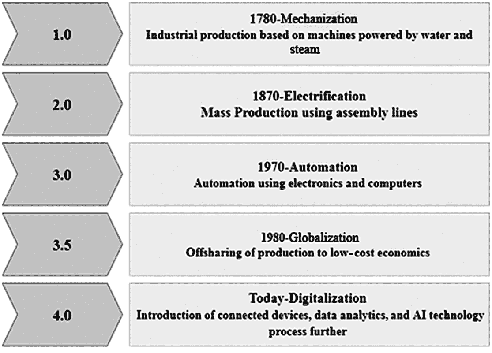

图 4.2 工业革命从 1.0 到 4.0 的历史.

## 4.3 工业 4.0 的演变

工业 4.0 是组织需要增加其创新雄心并快速响应市场变化的一套技术。预测分析、互联、机器学习和数字技术是关键关注领域，以改变企业运营和蓬勃发展的方式。从供应商到消费者，工业 4.0 将使您能够实时收集、分析和利用信息，目的是通过快速反馈来完善和改进运营、设计和产品，从而提高生产率。因此，本章提倡并鼓励企业使用工业 4.0。本章考察了商业智能（BI）技术的现状，它如何在经济和商业层面上以决策为目的使组织受益，并强调了在各种商业、政府、社会和学术环境中实施的一些成功案例。它还着眼于行业。工业 4.0 的未来、商业智能领域以及公司应如何为这一转变做好准备进行了讨论。有关工业 4.0 的现状及其益处、快速的技术突破、智能数字技术和制造集成等详细信息将提供\[21\]。工业 4.0 旨在将高速、精确的机器与人类批判性和认知思维相结合。工业 4.0 的另一个重要补充是大规模个性化，客户可以在其中选择个性化。人类-机器人协作的目标是迅速提高生产。工业 4.0 由于知识专家与机器合作而支持比工业 4.0 更多的熟练职业。工业 4.0 主要专注于大规模定制，人类将在工业 4.0 中指导机器人\[22\]。工业 4.0 已经涉及机器人进行大规模生产，但工业 4.0 主要专注于提高客户满意度（图 4.3）。

![图 4.3 工业 4.0 概述. \[23\]](images/fig4_3_B.jpg)

图 4.3 工业 4.0 概述. \[23\]

## 4.4 前沿技术和人工智能概述

全球技术的快速发展及其在日常生活中的普及改变了各种事物，包括在线超市购物、汽车买卖、因果技术、融资渠道等。客户是任何公司最重要的组成部分之一 \[24\]。用于创建企业软件应用的创新技术采用了最新技术。它是对能够执行通常需要人类智能的活动的计算机系统的研究和设计。视觉感知、语音识别、决策和语言翻译都属于这些任务。能够执行此类任务的系统正逐渐从研究实验室走向企业。人工智能的独特之处在于它可以以多种方式应用 \[25\]。物联网传感器日益普及，加上网络接入的改善，产生了企业可获益的海量新型数字信号。农业中的物联网数据可以帮助提高产量并使运营更具生态友好性。制造业中的物联网有助于装配线设备更高效地工作。每天，数十亿传感器从智能家居到智能城市，从工业传感器到自动驾驶汽车，向云端发送海量数据 \[26, 27, 28, 29 and 30\]。人工神经网络是一种流行的机器学习技术。这些网络具有输入层、隐藏层和输出层，并受生物神经网络启发 \[31, 32 and 33\]。输入层负责接收数据和信号，而隐藏层负责数据分解和处理。

### 4.4.1 自然语言处理

它是一个旨在弥合人类与计算机通信之间差距的人工智能分支。自然语言处理（NLP）被 IBM 的 Watson 等人工智能系统用于解释和响应人类语言的细微差别 \[34\]。这使得数据处理更精确并共享研究成果。图 4.4 显示了 NLP 的概述。

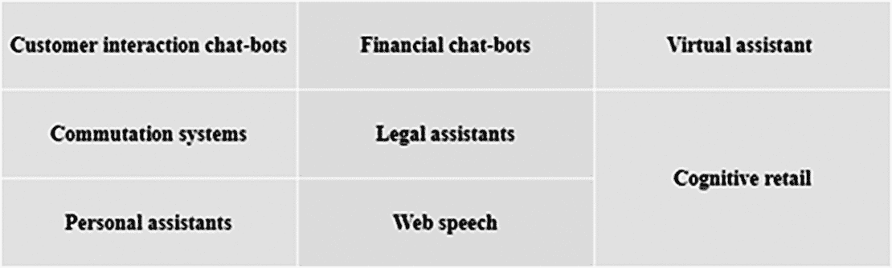

图 4.4 NLP 概述。

## 4.5 物联网与前沿技术

物联网，也被称为“新工业革命”，其影响范围已扩展到从企业到家庭的一切 \[35,36\]。然而，就物联网而言，云计算存在相当大的缺点。先进的 5G 技术尚未足够迅速地引入以跟上物联网设备的增长。虽然大多数大城市拥有足够的网络连接来支持物联网，但拥有大量工业设备的农村地区则不然。在网络中断的情况下，这些地区的物联网设备可能会失去部分或全部功能，而且前提是该地区根本有覆盖。物联网为利用智能手机和传感器监控技术构建有效的生产系统和功能提供了潜在机会。近年来，已开发并部署了广泛的物联网技术 \[37, 38 and 39\]。本研究批判了企业中当前的物联网功能，并讨论了研究突破以及认识物联网在行业中适用性的障碍。预计物联网将成为大幅改变现有工业结构（如生产结构和交通系统）功能和运作的有前景的选择 \[40\]。例如，当交通管理部门能够精细调整每辆车的当前位置、密切关注其移动情况并预测其未来区域和可能的街道交通时，就能创建智能交通结构。

## 4.6 区块链与前沿技术

根据专家的说法，区块链和新币基于前沿技术。这种比特币可能会扰乱全球金融体系，因为银行巨头努力与他们的机会进行沟通 \[41\]。它有可能降低银行费用，同时鼓励更大的竞争，从而推动费用下降。区块链是相互的、不可变的“账本”，确保数据完整性并让每个人都能获得精确的货币核算 \[42\]。区块链，或所谓的支撑比特币和其他加密货币交易的分布式账本技术，可能促进其他资产的交易，给向客户收取高额费用以帮助兑换货币和其他资产的银行带来挑战 \[43\]。支付结算和清算是两个关键的金融问题，区块链有可能在其中产生影响。然而，最近的一份穆迪研究表明，虽然区块链可能降低金融机构的对手方风险，但也可能增加银行业的竞争。

## 4.7 挑战与未来实施

通过认知赋能的生产流程，工业 4.0 可以为客户提供最个性化的服务。本节强调的一些未来问题必须得到解决，服务才能无缝进行 \[44\]。安全是可能出现的问题之一。随着我们向日益数字化的计算迈进，不兼容的数据处理和针对不同用户以及工业系统集成的云服务的各种安全漏洞必须进行交叉检查 \[45\]。将人力带回生产线可能有所帮助，定制化的客户协助与人机协作必须考虑到与扩大客户规模和生产方法相关的问题。此外，应考虑人工智能采用 surrounding 的伦理问题，以最大程度地减少潜在的弊端和有害的社会后果。

## 4.8 讨论

临床决策也存在类似情况：目前，无法对复杂情况做出可靠评估。然而，现实生活中的患者可能面临更具挑战性的问题组合，这是由于多种疾病的并发症，需要从多个角度进行彻底检查 \[46\]。在康复领域，人工智能提供了广泛的潜在应用，不仅包括中风相关残疾的人，还包括因各种因素导致身体功能障碍的人。当人工智能系统与康复活动相结合时，其中许多变得更具可行性。必须注意的是，所有学科必须共同合作，才能在不同形式的神经系统疾病中成功增强所需的神经功能 \[47, 48 and 49\]。目前，人工智能技术在中风领域的应用仍处于起步阶段，在进行更多研究之前，还需要做大量基础工作。鉴于新兴技术已展现出巨大的学习和泛化能力，它有一天可能会获得人类水平的智能 \[45\]。一旦基于人工智能的诊断技术和决策系统得到开发，患者将受益匪浅，因为这将带来更便宜、更高质量的医疗保健。人工智能技术不仅会提高初级医疗机构的医疗质量，还将实现医疗的区域统一。

我们对本章的贡献在于，我们正处于一场将彻底改变我们生活方式和彼此互动的科技革命的边缘。前沿技术是指利用最新和最先进的 IT 突破的技术设备、流程或成果，换句话说，是教学水平的技术。“前沿”一词用于描述领先且具有创新性的 IT 领域企业。人们普遍认为，应用科学和物联网的实现仍处于起步阶段。然而，工业研究存在若干问题，包括技术、标准化、安全和隐私。确保工业环境中的物联网设备具有兼容性。在物联网之前，将需要对行业特征以及对成本、安全、隐私和风险的要求有透彻的理解，并且人工智能将在许多行业中得到广泛应用。由于时间和效率的限制，设计物联网服务导向架构（SOA）是一项艰巨的任务。此外，随着更多物理实物连接到网络，扩展性问题也随之产生。可扩展性在存在大量问题时在不同距离上存在问题。内容存储和网络、自动化与控制以及服务提供。从网络角度来看，物联网是一个由巨大复杂性组成的网络，它通过各种口语通信协议连接了不止几种网络。目前尚无标准或完全传统的平台能够解决强调网络和通信技术复杂性的问题，同时为各种应用提供简单的品牌服务。生成的服务可能与独一无二的通信和实施环境不兼容。此外，必须开发强大的 Web 服务方法和对象命名解决方案，以传播物联网科学。

## 4.9 结论与未来工作

工业 4.0 代表了我们生活和互动方式的重大变化。由于类似工业革命的巨大技术发展，人类发展的新时代已经开始。这些进步以一种也伴随着重大风险的方式整合了物理世界和数字世界。革命促使我们重新思考国家如何发展。工业 4.0 为所有社会经济水平和国家的公民提供了机会。超越技术并创造方式，使尽可能多的人对其家庭、组织和社区产生积极影响，存在真正的希望。实现资源高效且用户友好的生产解决方案需要智能和精确的设备。预计工业 4.0 将通过提高生产率和按需提供定制产品，从新技术和应用中受益。我们首先概述了从众多行业从业者和专家角度观察到的工业 4.0 的许多新概念和定义。“工业 4.0”一词在工业革命 4.0 概念出现后几年前首次出现。由于疫情的影响，它已成为政策制定者和组织日益关注的主题，人们关注可持续性和韧性等话题，并重新关注人类需求。世界各地的各大行业都在寻找有关前沿技术的信息，这些技术可以帮助他们精简运营并降低成本。物流公司的高管们也做同样的事情，以便更好地为公司未来做好准备。毕竟，物流业务传统上依赖于手动操作和数据存储，而新的技术解决方案对其帮助很大。前沿技术是指技术设备和流程。我们需要继续研究前沿技术。

## 参考文献

1.  Paschek, D., Mocan, A., & Draghici, A. (2019, May). 工业 5.0——下一场工业革命的预期影响。载于 *面向未来教育、工业、商业与社会的发展，Make Learn 与 TIIM 国际会议论文集*，Piran, Slovenia (pp. 15–17)。 [`www.toknowpress.net/ISBN/978-961-6914-25-3/papers/ML19-017.pdf`](http://www.toknowpress.net)

2.  Almada-Labo, F. (2017). 工业 4.0 对企业的六大益处。检索自： [`www.controleng.com/articles/six-benefits-of-industrie-4-0-for-businesses/`](https://www.controleng.com)

3.  Atwell, C. (2017). 是的，工业 5.0 已经在地平线上。检索自： [`www.machinedesign.com/industrial-automation/yes-industry-50-already-horizon`](https://www.machinedesign.com)

4.  Gartner (2017). IT 是术语表；数字化。检索自： [`www.gartner.com/itglossary/digitalization`](https://www.gartner.com)。检索日期：24.04.2018

5.  EESC (2018). 工业 5.0。检索自： [`www.eesc.europa.eu/en/agenda/ourevents/events/industry-50`](https://www.eesc.europa.eu)

6.  Kospanos, V. (2017). 工业 5.0——远非科幻小说（第 2 部分）。检索自： [`www.pnmsoft.com/industry-5-0-far-science-fiction-pt-2/`](http://www.pnmsoft.com)

7.  Köhler-Schute, C. (2016). 企业中的数字化与转型：战略与概念，方法与技术，实践案例，Berlin: Germany KS-Energy-Verlag。

8.  Lewis, A., (2016) 工业 4.0 与 5.0 指南。检索自： [`blog.gesrepair.com/category/manufacturing-blog/`](https://blog.gesrepair.com)

9.  Marr, B. (2018). 第四次工业革命已经到来——你准备好了吗？。检索自： [`www.forbes.com/sites/bernardmarr/2018/08/13/the-4th-industrial-revolution-is-here-areyou-ready/#2b6b3e2628b2`](https://www.forbes.com)

10.  Mohelska, H., & Sokolova, M. (2018). 工业 4.0 的管理方法——组织文化视角，Technological and Economic Development of Economy, VGTU Press。

11.  Newman, D. (2017) 推动工业 4.0 的四大数字化转型趋势。检索自 [`www.forbes.com/sites/danielnewman/2018/06/12/four-digital-transformation-trends-drivingindustry-4-0/#1bf42316604a`](https://www.forbes.com)。检索日期 03.01.2019

12.  Paschek, D., et al. (2017). 作为服务的业务流程——IT 服务管理与业务流程外包的灵活方法，*网络经济中的管理挑战，Make Learn 会议 2017 论文集*。

13.  Pearce, R. (2017). 如何成为第五次工业革命的一部分。检索自： [`www.inmarsat.com/blog/how-to-be-part-of-the-fifth-industrial-revolution/`](https://www.inmarsat.com)

14.  Rada, M. (2018). 工业 5.0 定义。 [`medium.com/@michael.rada/industry-5-0-definition-6a2f9922dc48`](https://medium.com)

15.  Rundle, E. (2017). 第五次工业革命，何时发生以及如何发生。检索自： [`devops.com/5th-industrial-revolution-will-happen/`](https://devops.com)

16.  Sachsenmeier, P. (2016). 工业 5.0——仿生学和合成生物学的相关性与影响。Engineering 2。检索自： [`www.journals.elsevier.com/engineering`](https://www.journals.elsevier.com)

17.  Scanlon, S. (2018). 现在为第五次工业革命做准备。检索自： [`gadget.co.za/now-prepare-for-the-5th-industrial-revolution/`](https://gadget.co.za)

18.  Shelzer, R. (2017). 什么是工业 5.0——它将如何影响制造商？。检索自： [`blog.gesrepair.com/industry-5-0-will-affect-manufacturers/`](https://blog.gesrepair.com)

# 参考文献

19.  Urbach, N. (2018). 数字化案例，组织如何在数字时代重新思考其业务，瑞士查姆：Springer Nature Switzerland AG.

20.  Ustundag, A., & Cevican, E. (2018). 工业 4.0：管理数字化转型，瑞士查姆：Springer Nature Switzerland AG.

21.  Wang, K., Wang, Y. Strandhagen, J. O., & Yu, T. (2016). 先进制造与自动化 V，WIT Press.

22.  Seungjin, L., Abdullah, A., & Jhanjhi, N. Z. (2020). 对智能工厂蜜罐基于的僵尸网络检测模型的综述. 国际先进计算机科学与应用期刊，*11*(6)，418–435. [`ieeexplore.ieee.org/abstract/document/9214512/`](https://ieeexplore.ieee.org)

23.  Lee, S., Abdullah, A., Jhanjhi, N., & Kok, S. (2021). 使用结合机器学习的蜜罐对物联网智能工厂中僵尸网络攻击进行分类. PeerJ 计算机科学，*7*，e350. [`seap.taylors.edu.my/file/rems/publication/109566_8816_1.pdf`](https://seap.taylors.edu.my)

24.  Gaur, L., Afaq, A., Solanki, A., Singh, G., Sharma, S., Jhanjhi, N. Z.，… & Le, D. N. (2021). 利用大数据和革命性 5G 技术：提取和可视化全球连锁酒店的评分和评论. 计算机与电气工程，*95*，107374. [`www.sciencedirect.com/science/article/abs/pii/S0045790621003438`](https://www.sciencedirect.com)

25.  Jayakumar, P., Brohi, S. N., & Jhanjhi, N. Z. (2021). 人工智能与军事应用：创新、网络安全挑战与开放研究领域. [`www.preprints.org/manuscript/202108.0047/v1`](https://www.preprints.org)

26.  Ullah, A., Ishaq, N., Azeem, M., Ashraf, H., Jhanjhi, N. Z., Humayun, M.，… & Almusaylim, Z. A. (2021). 物联网辅助无线传感器网络中连续目标跟踪和边界检测方案综述. IEEE Access，*9*，126324–126336. [`ieeexplore.ieee.org/abstract/document/9529170`](https://ieeexplore.ieee.org)

27.  Sujatha, R., Chatterjee, J. M., Jhanjhi, N. Z., & Brohi, S. N. (2021). 植物叶片病害检测中深度学习与机器学习的性能比较. 微处理器与微系统，*80*，103615. [`www.sciencedirect.com/science/article/abs/pii/S0141933120307626`](https://www.sciencedirect.com)

28.  Sujatha, R., Aarthy, S. L., Chatterjee, J., Alaboudi, A., & Jhanjhi, N. Z. (2021). 一种用机器学习对自闭症谱系障碍进行分类的方法. 国际新兴学习技术期刊 (IJET)，*16*(6)，182–200. [`www.learntechlib.org/p/219973/`](https://www.learntechlib.org)

29.  Tri, N. M., Hoang, P. D., & Dung, N. T. (2021). 工业革命 4.0 对越南高等教育的影响：挑战与机遇. 语言学与文化评论，*5*(S3)，1–15. [`lingcure.org/index.php/journal/article/view/1350`](http://lingcure.org)

30.  Hussain, A. (2019). 工业革命 4.0：对图书馆和图书管理员的影响. 图书馆高科技新闻. [`www.emerald.com/insight/content/doi/10.1108/LHTN-05-2019-0033/full/html`](https://www.emerald.com)

31.  Lase, D. (2019). 教育与工业革命 4.0. Jurnal Handayani Pgsd Fip Unimed，*10*(1)，48–62. [`jurnal.unimed.ac.id/2012/index.php/handayani/article/view/14138`](https://jurnal.unimed.ac.id)

32.  Darmaji, D., Kurniawan, D., Astalini, A., Lumbantoruan, A., & Samosir, S. (2019). 面向工业革命 4.0 的高等教育移动学习：物理实践的认知与响应. [`www.learntechlib.org/p/216574/`](https://www.learntechlib.org)

33.  Dewi, M. V. K., & Darma, G. S. (2019). 工业革命 4.0 中营销与竞争情报的作用. Jurnal Manajemen Bisnis，*16*(1)，1–12. [`publisher.uthm.edu.my/ojs/index.php/JTET/article/view/3208`](https://publisher.uthm.edu.my)

34.  Robandi, B., Kurniati, E., & Sari, R. P. (2019, April). 工业革命 4.0 时代的教学法. In *第 8 届 UPI-UPSI 国际会议 2018 (UPI-UPSI 2018)* (pp. 38–46). Atlantis Press. [`www.atlantis-press.com/proceedings/upiupsi-18/55916302`](https://www.atlantis-press.com)

35.  Rymarczyk, J. (2020). 工业革命 4.0 的技术、机遇与挑战：理论思考. 企业家商业与经济评论，*8*(1)，185–198. [`www.ceeol.com/search/article-detail?id=976200`](https://www.ceeol.com)

36.  Ellitan, L. (2020). 在工业革命 4.0 和社会 5.0 时代的竞争. Jurnal Maksipreneur: Manajemen, Koperasi, dan Entrepreneurship，*10*(1)，1–12. [`www.sciencedirect.com/science/article/pii/S2090447919301157`](https://www.sciencedirect.com)

37.  Sherwani, F., Asad, M. M., & Ibrahim, B. S. K. K. (2020, March). 协作机器人与工业革命 4.0 (ir 4.0). In *2020 年智能技术新兴趋势国际会议 (ICETST)* (pp. 1–5). IEEE. [`ieeexplore.ieee.org/abstract/document/9080724`](https://ieeexplore.ieee.org)

38.  Farida, I., Setiawan, R., Maryatmi, A. S., & Juwita, M. N. (2020). 印度尼西亚工业革命 4.0 时代电子政务的实施. 国际进步科学与技术期刊，*22*(2)，340–346. [`ijpsat.es/index.php/ijpsat/article/view/2165`](http://ijpsat.es)

39.  Harahap, N. J., & Rafika, M. (2020). 工业革命 4.0：及其对人力资源的影响. Ecobisma (jurnal ekonomi, bisnis dan manajemen)，*7*(1)，89–96. [`jurnal.ulb.ac.id/index.php/ecobisma/article/view/1545`](https://jurnal.ulb.ac.id)

40.  Wong, B. K. M., & Hazley, S. A. S. A. (2020). 工业革命 4.0 时代健康旅游的未来. 旅游未来期刊. [`www.emerald.com/insight/content/doi/10.1108/JTF-01-2020-0006/full/html`](https://www.emerald.com)

41.  Humayun, M., Jhanjhi, N. Z., & Almotilag, A. (2022). 使用尖端技术对沙特高速公路进行实时安全健康和隐私监控. 应用科学，*12*(4)，2177. [`www.tandfonline.com/doi/full/10.1080/08839514.2022.2037255`](https://www.tandfonline.com)

42.  Humayun, M., Almufareh, M. F., & Jhanjhi, N. Z. (2022). 应急车辆的自主交通系统. 电子，*11*(4)，510. [`www.mdpi.com/2079-9292/11/4/510`](https://www.mdpi.com)

43.  Li, J., Goh, W. W., Jhanjhi, N. Z., Isa, F. B. M., & Balakrishnan, S. (2021). 养老中心老年人面临挑战的实证研究. EAI 认可的 pervasive 健康与技术交易，e2. [`eprints.eudl.eu/id/eprint/5165/`](http://eprints.eudl.eu)

44.  Khan, A., Jhanjhi, N. Z., Humayun, M., & Ahmad, M. (2020). 物联网在数字治理中的作用. In 《利用最新技术改善数字治理》 (pp. 128–150). IGI Global. [`www.igi-global.com/chapter/the-role-of-iot-in-digital-governance/245979`](https://www.igi-global.com)

45.  Humayun, M., Jhanjhi, N. Z., Hamid, B., & Ahmed, G. (2020). 使用物联网和区块链的新兴智能物流与运输. IEEE 物联网杂志，*3*(2)，58–62. [`ieeexplore.ieee.org/abstract/document/9125435`](https://ieeexplore.ieee.org)

46.  Singh, A. P., Pradhan, N. R., Luhach, A. K., Agnihotri, S., Jhanjhi, N. Z., Verma, S., … & Roy, D. S. (2020). 一种面向区块链医疗应用的新型以患者为中心的架构框架。IEEE Transactions on Industrial Informatics, *17*(8), 5779–5789. [`ieeexplore.ieee.org/abstract/document/9259231`](https://ieeexplore.ieee.org/abstract/document/9259231)

47.  Kumar, M. S., Vimal, S., Jhanjhi, N. Z., Dhanabalan, S. S., & Alhumyani, H. A. (2021). 基于区块链的自主无人机操作中的点对点通信。Energy Reports, *7*, 7925–7939. [`expert.taylors.edu.my/file/rems/publication/109566_6018_1.pdf`](https://expert.taylors.edu.my)

48.  Kumar, M. S., Vimal, S., Jhanjhi, N. Z., Dhanabalan, S. S., & Alhumyani, H. A. (2021). 基于区块链的自主无人机操作中的点对点通信。Energy Reports, *7*, 7925–7939. [`www.sciencedirect.com/science/article/pii/S2352484721006752`](https://www.sciencedirect.com)

49.  Rajmohan, R., Kumar, T. A., Pavithra, M., Sandhya, S. G., Julie, E. G., Nayahi, J. J. V., & Jhanjhi, N. Z. (2020). Blockchain: Industry 4.0 的下一代技术。Blockchain Technology, 177–198. [`www.researchgate.net/profile/T-Ananth-Kumar/publication/346792929_Blockchain_Technology/links/601a0281a6fdcc37a8fc1ef5/Blockchain-Technology.pdf`](https://www.researchgate.net)

# 5 用于在智能医疗领域实现分类脑电图（EEG）信号的安全物联网协议

S. Saravanan

SASTRA (Deemed to be University), Kumbakonam, India

M. Lavanya

SASTRA (Deemed to be University), Thanjavur, India

Chandra Mouli Venkata Srinivas

BVC Engineering College, Odalarevu, India

M. Arunadevi

Cambridge Institute of Technology, Bangalore, India

N. Arulkumar

CHRIST (Deemed to be University), Bangalore, India

DOI: [10.1201/9781003203087-5](https://dx.doi.org/10.1201/9781003203087-5)

## 5.1 引言

当今技术聚焦于工业 4.0 革命，在智能自动化、可信信息存储、海量数据处理、大规模生产处理和安全医疗等领域寄予厚望。特别是在医疗保健领域，工业 4.0 革命侧重于大规模数据处理、数字化、诊断、监测、安全数据传输以及患者与护理人员之间的可信通信。该工业 4.0 集成了多种技术，如物联网（IoT）、人工智能（AI）、机器对机器（M2M）通信、云计算和存储、数据分析以及安全数据传输 \[1\]。该框架有助于开发更好的医疗保健系统，了解患者的问题和康复方法。

本章聚焦于脑电图（EEG）信号，其涉及生物医学、生物工程、神经科学和脑科学等多个研究领域。它通过各种电极测量膜电位和神经元强度。这些信号有助于分析癫痫发作检测、肌肉无力、身体昏迷状态、脑死亡、无创性、中风和睡眠障碍。EEG 信号通过头皮上的各种电极接收以测量脑活动。头皮上电极的位置遵循国际 10–20 标准系统。所有 EEG 信号均处于模拟域，需要由 ADC（模数转换器）进行采样。接收到的 EEG 信号被分为 delta、theta、alpha、beta 和 gamma 频率。根据低频到高频的范围，它指示患者状况从放松模式（睡眠）到严重模式（脑死亡）。EEG 信号的主要优势是支持高时间分辨率以及低成本设备。

EEG 信号是生物信息的重要组成部分，在远程医疗系统中发挥着至关重要的作用。患者数量增加而临床设施不足的需要使远程医疗成为不可避免的技术。远程医疗承诺以较低成本提供改善的医疗质量。该技术更舒适且可适应物联网，为健康信息提供合适的解决方案。

物联网的基本结构在于将互联网扩展到嵌入式系统和智能移动设备之外。预计到 2025 年，超过 700 亿个物（设备）将连接到互联网连接，产生 79.4 泽字节（ZB）的信息。基于物联网的技术通过为健康监测服务提供兼容支持，改变了远程医疗的领域。在当前情况下，基于物联网的远程医疗技术具有很多偏好，被认为是新兴技术之一。该技术有助于通过各种生物传感器接收人体信号以进行观察、监测和诊断。它集成了各种设备，如传感器、执行器和通信协议以及互联网连接，以支持与医疗保健相关的问题。有了这项技术，患者无需为了解自己的健康问题而去医院进行体检。他们可以通过远程物联网环境从医生那里获得所有医疗支持和治疗。这种方法有助于更高效的流程和更好的舒适度，并为健康信息提供合适的解决方案。该系统还具有隐私保障、成本效益、易于访问和改善医疗质量等各种优势。

研究人员和开发人员提出了各种物联网架构以满足应用需求。基本物联网架构被认为是三层 \[2,3\]。它们是感知层（底层）、网络层（中间层）和应用层（顶层）。在底层，所有实时生物信号在各种传感器的帮助下收集。在中间层，它将传感器数据与各种网关设备和通信协议连接。该中间层还以低功耗提高了生物信号的效率。在顶层，个性化生物信号与用户应用程序和安全参数集成。

中间物联网架构包含四层结构，在三层物联网架构中加入了支持层。第四层有助于安全和身份验证目的。它主要用于确认安全数据以及可信用户和受保护的连接。该层还检查拒绝服务（DoS）攻击和恶意攻击 \[4\]。高级物联网架构包含五层，加入了处理层和业务层。在处理层，它支持消除不必要数据或额外数据。该层还影响耗尽和恶意软件攻击。在业务层，它充当整体应用程序的管理者，并负责控制和管理特定应用程序。它也容易受到业务逻辑攻击 \[5\]和零日攻击。

基于物联网的环境接收实时 EEG 信号并通过基于机器学习的分类算法进行处理。它有助于更好地过滤不需要的生物信息并提供所需信息。数据过滤过程有各种分类算法。本章聚焦于支持向量机（SVM）分类算法。该算法基本上以学习统计理论和为两类线性方法提供更好解决方案而闻名。EEG 信号与头痛、无力、瘫痪、眼动不良和癫痫等症状监测密切相关。

基于医疗保健的诊断 \[6\] 更容易受到安全威胁和中间人攻击的影响。更重要的是通过提供更好的生物信息存储、通信协议和完整性方面的安全性来解决这个问题。安全通信的一种解决方案可以通过安全物联网协议实现。该协议用于信息传输以及安全通信 \[7\]。消息队列遥测传输（MQTT）协议是物联网应用层中使用的主要物联网协议之一。该协议基于轻量级概念运行，并提供更多与物联网环境集成的兼容性。本章通过提供用户名/密码、实现安全传输层安全（TLS）/安全套接层（SSL）以及 Arduino 物联网环境，强调了安全 MQTT 协议的重要性。

本章提供了安全物联网协议中安全医疗保健的总体观察和流程。本章帮助读者了解物联网环境中 EEG 信号的进展、使用机器学习算法对接收到的 EEG 信号进行分类，并通过提供安全通信强调了安全 MQTT 物联网协议的重要性。最后，基于云的安排有助于安全 MQTT 协议实现生物信息的更好数据存储和处理。

## 5.2 现有方法

各种研究方法已针对工业 4.0 和基于物联网的安全医疗保健系统。本节对早期现有方法进行了详细阐述。

在物联网架构中，基于轻量级的密码学 \[8\] 在分布式安全和资源最小化方面进行了讨论。基于物联网的嵌入式安全 \[9\] 被重点关注为数据通信和数据认证中安全的框架。在 \[10\] 中，物联网的安全性在加密和基于哈希的数据处理中被考虑。该方法在感知层下工作并在基础层激活安全。基于软件定义网络（SDN）的物联网方法在 \[11\] 中通过提供更好的性能、更低的成本和最小化的硬件设计进行了讨论。该方法为物联网控制器和代理提供了安全性。双层预防系统在 \[12\] 中针对无线传感器网络进行了阐述。该方法有助于在物联网架构的网络层提供更好的安全性。在 \[13\] 中，提出了基于异构的物联网方法以及集成平台。该文章对物联网应用中的异构设计进行了深入的阐述。

人工智能和物联网挑战中的工业 4.0 及其安全问题在 \[14\] 中被重点关注，涉及防止恶意攻击、未经授权访问和未来挑战。在 \[15\] 中，对基于物联网应用的信任管理进行了详细调查讨论。隐私在基于分布式的物联网中 \[16\] 得到了更多重视。该论文还讨论了分布式物联网中的安全参与及其对策。物联网的各种研究方向在 \[17\] 中进行了解释，物联网安全调查在 \[18\] 中被强调。

更多研究工作也在与基于物联网的环境相关的远程医疗领域进行。在 \[19\] 中，使用数据挖掘技术对医疗记录进行了广泛调查。该论文详细阐述了医疗记录以电子格式的使用。智能和安全健康监测在 \[20\] 中与各种物联网传感器一起进行了讨论。收集的医疗保健信息通过云计算进行处理。关于手术成本降低的综述在 \[21\] 中进行了说明。该论文有助于理解手术信息及其各种安全参数。在 \[22\] 中，基于物联网的医疗参数与各种隐私和安全问题一起进行了描述。该论文提供了对医疗物联网环境的详细综述。

安全医疗保健信息与物联网环境的处理具有更高的兼容性。本章主要关注基于 EEG 的安全医疗保健信息并确定了一些现有研究工作。在 \[23\] 中，EEG 信号使用最低成本的头戴设备进行观察并利用物联网环境。在 \[24\] 中，使用机器学习算法对 EEG 信号按 alpha 和 beta 信号进行分类。患者的心理参数在 EEG 信号的帮助下被观察到，并且信号使用 SVM 算法进行分类 \[25\]。工业 4.0 医疗保健及其各种可能方法在 \[25, 26, 27, 28 and 29\] 中被观察到。这些论文讨论了工业 4.0 在印度的重要性、TISM、智能医疗保健愿景、物联网、大数据、云计算以及医疗领域的各种应用。

从各种现有方法中观察到安全物联网协议的重要性。在 \[30\] 中，使用模糊逻辑描述了安全 MQTT 以观察 DoS 攻击。在 \[31\] 中，针对 MQTT 协议的通用物联网模型在安全框架下被重点关注。在 \[32\] 中，基于安全的测试参数与 MQTT 架构一起进行了讨论。尽管如此，基于物联网的远程医疗仍缺乏成熟的架构和设计来通过互联网连接传输安全生物信息。

## 5.3 物联网环境中的 EEG 信号

### 5.3.1 EEG 信号基础

脑电图（EEG）是指以电生理形式的人脑信号，有助于通过传感器记录电信号。该信号是一种非侵入性方法，用于记录脑神经元的电压波动，并有助于从头皮了解人脑的实时行为。基本上，EEG 信号以微伏（μV）为单位测量，并包含振幅、波形形状和频率等电学特征。

EEG 电极遵循国际基准系统，该系统由 10/20 电极位置组成，放置在 Nasion-Inion 之间和固定点的头皮特定位置。10/20 的表示表示颅骨前后或左右两侧之间实际距离的 10% 或 20%。基本上，电极是小金属圆盘，通常覆盖有氯化银涂层。每个电极用字母表示，例如额极（Fp）、中央区（C）、颞区（T）、顶区（P）、枕区（O）和中线零（Z），如 图 5.1 所示。一些电极也用奇数表示左半球，偶数表示右半球。

![图 5.1 接收 EEG 信号的电极位置 \[33\].](images/fig5_1_B.jpg)

图 5.1 接收 EEG 信号的电极位置 \[33\].

EEG 波形频率分为 delta（0–3Hz）、theta（4–7Hz）、alpha（8–15Hz）、beta（16–31 Hz）和 gamma（>32 Hz），如 图 5.2 所示。EEG 信号有助于诊断脑活动，如昏迷、死亡、肌肉无力、癫痫、中风、肿瘤和睡眠障碍。

![图 5.2 EEG 波形频率分类 \[24\].](images/fig5_2_B.jpg)

图 5.2 EEG 波形频率分类 \[24\].

### 5.3.2 EEG 频率带

Delta（0–3Hz）由振幅最高且最慢的波组成。它也被称为成人和婴儿的慢波睡眠。它有助于诊断皮质下损伤和深部中线病变。Theta（4–7Hz）信号与幼儿相关，也具有冥想、放松和创造力的状态。它支持弥漫性疾病或代谢性脑病的诊断。Alpha（8–15Hz）也称为后主导节律（PDR），在头部两侧均可见。它可识别眼睛放松和精神用力。Beta（16–31 Hz）通常在两侧呈对称分布可见。它与更集中的注意力、忙碌的思考和焦虑性思考相关。Gamma（>32 Hz）信号与将各种神经元群体结合成用于认知功能的共同网络相关。EEG 频率还可广泛分类为不同的特性，如节律性（恒定频率）、非节律性（频率不稳定）和失律性（患者中很少见的频率）。

### 5.3.3 物联网环境

在物联网环境中，基于 `Arduino` \[34\] 或 `Raspberry Pi` \[35\] 的设计板非常流行。`Arduino` 包含一个带内置引导加载程序的 `Atmel` 系列微控制器，用于即插即用的嵌入式编程。其开源软件附带集成设计环境（`IDE`），有助于编写程序、调试并将程序写入 `Arduino` 硬件。此设置通过 `Serial Communication` 窗口工作，我们可以通过该窗口轻松获取板上的串行数据。

在 `Raspberry Pi` 中，由于其拥有自己的处理器、图形显示单元、HDMI、USB 和内存，被视为一台功能齐全的计算机。它在 `Linux` 下运行 `Raspberry Pi OS`（前称 `Raspbian`）。它还支持 `Python` 和 `Scratch` 作为主要编程语言，并支持许多其他语言。

物联网环境的整体框图如图 图 5.3 所示。最初，实时从患者采集 EEG 信号以观察脑活动。工作在 `Bluetooth` 连接的 `MindWave Headset` 有助于接收 EEG 信号。该产品来自 `NeuroSky`，并且非常容易放置在人头骨上。接收到的信号通过 `Bluetooth` 连接传输。为了接收这些 EEG 信号，使用与物联网环境兼容的 `Bluetooth` 设备非常重要。`Bluetooth` 设备 `HC-05` 支持物联网环境并连接到 `Arduino Uno` 板。通过 `Arduino` 编程，所有 EEG 信号均以 Delta、Theta、Alpha、Beta 和 Gamma 频率的形式被捕获。

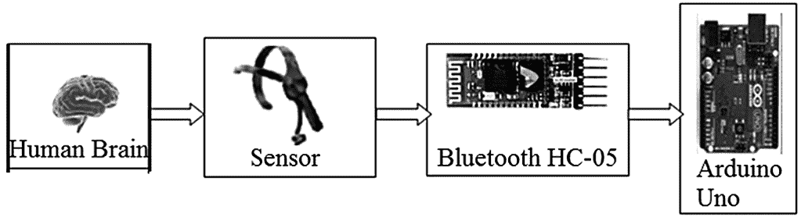

图 5.3 物联网环境的框图。

## 5.4 分类方法

接收到的 EEG 信号使用机器学习（`ML`）算法进行分析，并特别关注 `SVM` 分类算法。该 `SVM` 算法基本上被认为是基于统计的学习理论，它为两类线性方法在超平面上提供更好的解决方案。该算法还有助于解决数据集中基于线性和非线性问题。所提出阶段如图 图 5.4 所示。

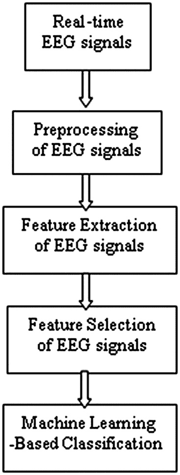

图 5.4 实时 EEG 信号分类阶段。

在预处理阶段，原始 EEG 信号经过滤波以获得清晰数据。使用 `high pass filter` 去除直流分量和漂移。`low pass filter` 也用于去除在 `gamma` 范围内出现的 高频信号。单个 EEG 信号能够提取各种脑信号，如睁眼/闭眼、强烈情绪思维和活跃思维。在特征提取阶段，EEG 信号中的隐藏信息通过复杂的自动处理算法提取。在时域和频域方面，有多种方法支持 EEG 信号提取。在时域中，考虑 `entropy`、`mean` 和 `standard deviation`。在频域中，使用 `Fourier transform` `wavelets`。

在特征选择中，特定的 EEG 信号信息变得更加重要。例如，放松和压力状态在人类大脑中很常见。根据上述脑状态，特征选择有助于在两种情况之间找到更多差异。在分类阶段，它从一个类别/条件（放松）识别我们所需的特征，或到另一个类别/条件（压力）。本章考虑基于 `SVM` 的机器学习分类。

该机器学习算法支持有限维向量空间来表示特定对象的特征。该 `SVM` 算法的主要目标是训练模型，将新的隐藏对象分配到特定的所需类别。它被认为是无概率的，因为新对象完全由其位置决定，且不涉及随机元素。该 `SVM` 算法具有高维性、内存效率和多功能性等各种优点。

该算法具有各种优点，如内存有效利用、改进的高维空间、不同类别分离的清晰边界、更适合多特征数据集以及支持使用常见核函数。

以下步骤在基于 `Python` 的处理方法中被认为是 `SVM` 分类算法。样本 EEG 数据集可在 \[36\] 中获得。

1. Step 1: `import pandas as pd`, include dataset
2. Step 2: dataset shape (dimension size)
3. Step 3: drop the unnecessary dataset field
4. Step 4: split the dataset into `train` and `test` before the `SVM` algorithm
5. Step 5: `import SVM` along with the `train` dataset
6. Step 6: Use `predict` values and evaluate the `SVM` model
7. Step 7: Final result after `SVM` classification

## 5.5 安全物联网协议

基于物联网的应用正蓬勃发展，同时伴随着各种安全方面的问题。在开发安全的物联网应用时，必须观察五个基本参数，即数据身份、授权、保密性、数据完整性和问责制。一般来说，`MQTT` 采用 `Client` 和 `Broker` 网络的概念。任何处理设备，如微处理器、微控制器和服务器都可以充当客户端模块。Broker 网络接收来自客户端的实时信息，并负责识别来自客户端模块的持续连接。

数据身份被认为是初始阶段，客户端在此阶段向 Broker 发起请求。每个客户端都包含一个适当的通用唯一标识符（`UUID`），有助于 Broker 识别来自相应客户端的数据。数据还可以通过网络媒体访问控制（`MAC`）地址识别客户端。因此，`UUID` 和 `MAC` 地址有助于在数据传输中识别授权访问。授权在通信通道上的安全数据访问中发挥着至关重要的作用。它还为物联网数据提供身份验证以监控和访问实时信息。

保密性仅允许授权用户、设备和实体。它控制消息传输和访问。它还有助于保护私人信息、访问密钥和凭证免受未经授权的访问。数据完整性为特定物联网应用的各种数据需求提供支持。它保护所有原始数据及其支持数据免受数据篡改。例如，远程医疗数据比智能灌溉系统的保护更多。问责制有助于提高物联网信息在系统环境、安全性和通信协议方面的稳健性。

### MQTT 协议

MQTT 协议 \[37\] 在本章中被考虑。它是一种轻量级协议，易于在软件中实现以实现更好的数据传输。它基本上以服务器和客户端的概念工作，具有低网络使用率和低功耗。服务器（代理）负责处理客户端之间发送或接收数据的请求。这种安排也称为发布和订阅。在发布概念中，客户端希望向代理发送数据，而在订阅中，客户端希望从代理接收数据。

MQTT 协议数据包格式的基本结构在 图 5.5 中给出。字段长度被认为是 8 位以处理信息。在第 1 字节中，考虑了消息类型、DUP（重复标志）和服务质量（QoS）级别位。在第 2 字节中，使用剩余长度（1–4 字节）来完成通信。第 3 字节到第 n 字节用于可变长度头部，第 n+1 字节到第 m 字节包含消息负载。当客户端和代理之间激活连接时，订阅者需要从客户端接收一个或多个主题。

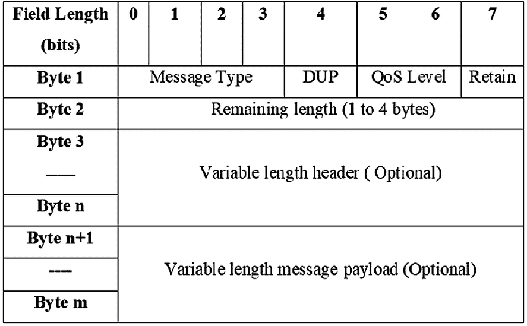
图 5.5 MQTT 数据包基本格式。

安全 MQTT 提供身份验证以确认单个数据或信息的属性的真实性。它在通信消息或连接消息中提供用户名和密码字段。因此，它使客户端在连接到 MQTT 代理时能够发送经过身份验证的用户名和密码。然后，代理将在实现的机制上评估身份验证凭据并返回各种代码，如 0 – 已接受，1 – 用户名和密码错误，以及 2– 未授权。客户端标识符也通过提供唯一的客户端标识符、序列号和唯一的 MAC 标识来对 MQTT 通信进行身份验证。

图 5.6 显示了面向 IoT 的环境中通信协议的基本结构。基础层被认为是网络/链路层，支持蓝牙低功耗（BLE）/IEEE 803.15.4。第二层被称为互联网层，有助于在低功耗无线个人局域网（LoWPAN）上创建 IPv6 协议。第三层在传输层支持 TCP 和 UDP 协议。顶层向应用层提供 MQTT/CoAP 协议服务。TCP 支持 MQTT 协议，UDP 有助于 CoAP 协议在 IoT 传输层上运行。

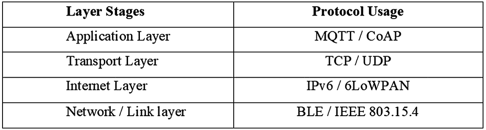
图 5.6 面向 IoT 环境的通信协议。

MQTT 协议的各种优势如下列出。
* 在数据/信息分发方面更有效
* 有助于提高可扩展性
* 在轻量级处理中工作
* 基于权限的方法提供更好的安全性
* 缩短开发阶段的持续时间
* 基于发布者和订阅者的协议支持大数据的通信，同时带宽更少。

### 5.5.1 基本 MQTT 协议

以下流程显示了 MQTT 协议在 Python 语言中的基本结构，如 图 5.7 所示。

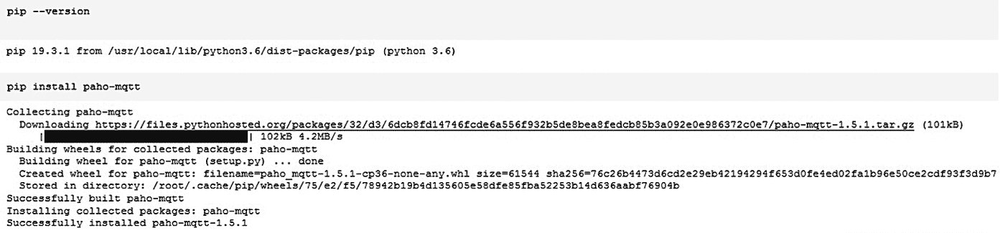
图 5.7 Python 语言中的 MQTT 协议。

`pip` 基本上是一个工具，允许用户管理和包含额外的 Python 库。它充当 Python 语言的包管理器。`paho.mqtt.client` 是包含免费公共 MQTT 代理的其中之一，具有各种方法如 `connect()`、`disconnect()`、`subscribe()`、`unscribe()` 和 `publish()`。在基于 MQTT 的 Python 发布者代码中包含 `paho.mqtt.client`、代理地址、`client.connect`、`client.loop`、`client.publish(text)`、`client.disconnect` 和 `client.loopstop`。免费在线访问 MQTT 代理的几个示例是 [www.broker.hivemq.com](http://www.broker.hivemq.com) \[38\]、[www.test.mosquitto.org](http://www.test.mosquitto.org) \[39\] 和 [www.iot.eclipse.org](http://www.iot.eclipse.org) ``[`40``]`。在 MQTT 中，基于 Python 的订阅者代码包含 `paho.mqtt.clinet` 的导入、代理地址（与发布者代码中提供的一样）、`def_on_connect`、`def_on_message`、`client.connect`、`client_on_connect`、`client_on_message` 和 `client.loopforever`。

### 5.5.2 带用户名和密码的 MQTT 协议

相同的代码加上用户名和密码提供单层安全性。以下信息为 MQTT 协议在用户名和密码方面提供单层安全性。这种身份验证与 MQTT 协议的传输层和应用层相连。在传输层，使用基于客户端的认证，在应用层，用户和密码保护 MQTT 协议。

经身份验证的 MQTT 协议由以下 Python 语法组成：
* `User = “username”`
* `Password=“password”`
* `Client.username_pw_set (“username”, “password”)`

上述语法被视为具有简单实体的单一保护。它通过验证用户名和密码来帮助识别经过身份验证的人员、设备和应用程序。当这种单层安全性内置于 MQTT 协议时，对应的 MQTT 代理会评估身份验证并响应，如连接已接受或因用户名和密码无效而连接失败。因此，在 MQTT 协议中提供内置的用户名和密码以实现安全数据传输非常容易。

### 5.5.3 IoT Arduino 环境中的 MQTT 协议

一个常见的 IoT 环境被称为 Arduino 硬件 \[34\]，它也支持 MQTT 协议以及用户名和密码保护。Arduino 支持以太网网络并允许用户连接到互联网。也可以使用以太网和 MQTT 库来开发 MQTT 客户端-服务器。MQTT 库在 Arduino 环境中不是默认的，有必要通过导航到 Arduino IDE 草图来安装它们，如 图 5.8 所示。步骤如下：

图 5.8 MQTT 库安装。

1. 步骤 1：`Arduinouno` 草图 > 包含新库 > 管理库（用于搜索 MQTT 库 – `PubSubClient`）
2. 步骤 2：创建新文件 > 包含 `SPI.h`、`Ethernet.h` 和 `PubSubClient.h` 库。
   `SPI` 库（串行外设接口）用于较短距离的硬件通信以获得更快的响应。它也用于以太网支持库。`PubSubClient` 库用于激活 MQTT 协议。
3. 步骤 3：以 IP 地址、MAC 地址和服务器配置的形式定义 MQTT 规范
   IP 地址用于以太网连接，MAC 地址包含唯一值。服务器配置是一个简单的设计，可以使用免费的 MQTT 代理。
4. 步骤 4：在 `Void setup` 中，包含用于调试过程的串行开始、以太网开始、设置 MQTT 服务器、尝试连接服务器并建立订阅。
5. 步骤 5：在 `Void loop` 中，包含顶层循环，并尝试向接收者发布和订阅消息。

### 5.5.4 带 Mosquitto 代理的 MQTT 协议

MQTT 代理的免费在线访问也有助于安全的 IoT 连接。以下步骤被认为是使用 Mosquitto 代理 \[39\] 实现安全 MQTT 协议的。它是一个使用 MQTT 协议的开源消息代理服务。它也有助于在 IoT 环境中发送和接收消息。

1. 步骤 1：从 [`mosquitto.org/`](https://mosquitto.org/) 下载 `mosquitto`
2. 步骤 2：从 [`slproweb.com/`](http://slproweb.com/) 下载 `openssl`

`openssl` 工具 [41] 用于生成私钥和证书签名请求 (`CSR`)。它也被视为具有开源应用的整体密码学库。
1. 第 3 步：将 `openssl32\\bin` 文件夹复制到 `mosquitto` 文件夹
2. 第 4 步：将所需的 `libeay32.dll` 文件复制到 `mosquitto` 文件夹
3. 第 5 步：将所需的 `ssleay32.dll` 文件复制到 `mosquitto` 文件夹
4. 第 6 步：从 [ftp://sources.redhat.com/](http://ftp:) 下载 `pthreadVC2.dll`
`pthreadVC2.dll` [42] 被视为由开源软件开发的动态链接库 (`DLL`) 文件，被称为 Windows 操作系统的必备系统文件。它通常包含一组过程和驱动程序函数，可由 Windows 应用。
1. 第 7 步：将 `pthreadVC2.dll` 复制到 `mosquitto` 文件夹
2. 第 8 步：使用 `mosquitto_sub -v -t 'text'` 测试订阅者/服务器
3. 第 9 步：测试发布者/客户端 `mosquitto_pub -t 'text' -m 'Condition'`

### 5.5.5 使用 SSL/TLS 配置的 MQTT 协议
`TLS/SSL` 配置方法为 `MQTT` 协议 [43] 提供安全性。以下信息步骤在一般情况下非常常见，对于更准确的证书颁发机构，用户需要参考相应的代理信息。这些步骤在 `mosquitto` 代理配置的 `SSL/TLS` 配置中非常具体。
1. 第 1 步：创建一个新的证书颁发机构 (`CA`) 密钥对
此步骤有助于声明加密过程以及私钥大小
2. 第 2 步：创建 `CA` 证书以及在第 1 步中创建的密钥对
此步骤创建 `X.509` 证书以及私钥
3. 第 3 步：创建一个不受密码保护的代理密钥对
此步骤有助于创建代理密钥以及加密
4. 第 4 步：通过请求在第 3 步中创建的代理密钥来创建代理证书
此步骤使用 IP 地址或域名来创建代理证书
5. 第 5 步：使用 `CA` 证书对在第 4 步中创建的代理证书进行签名
此步骤使用 `CA` 证书以及经过验证的密钥和签名
6. 第 6 步：汇总以下文件 `CA` 密钥、`CA` 证书、代理密钥和代理证书文件并将它们存储在单个文件夹中
7. 第 7 步：将 `CA` 证书复制到客户端
此步骤有助于将证书复制到客户端以进行服务器进程
8. 第 8 步：编辑 `Mosquitto` 代理配置文件
此步骤有助于编辑特定的代理配置文件
9. 第 9 步：编辑客户端脚本文件以使用 `TLS` 和 `CA` 证书
`Publisher` 和 `subscriber` 脚本作为默认代码随 `mosquitto` 代理一起提供。

### 5.5.6 使用云环境的 MQTT 协议
在本模块中，分类的 `EEG` 信号通过安全的 `MQTT` 协议与云环境通信，以便更好地进行数据存储、处理和分析。本模块流程图如下所示 图 5.9。它在基于 `IoT` 的应用中具有快速数据传输且开销小的优点。`IoT` 信息可以存储或与合适的私有或公共代理共享。安全的 `MQTT` 也是支持云服务的一种流行代理，使其易于与第三方应用程序集成。

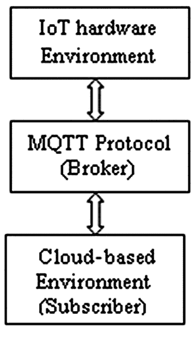
图 5.9 安全 MQTT 协议阶段。

## 5.6 结论
`Industry 4.0` 革命承诺安全医疗技术，这是生物医学信息与互联网连接集成后即将到来的领域之一。这种智能医疗系统对难以到达医院的人们来说更高效、更舒适。本章主要关注 `EEG` 信号以及 `IoT` 环境。本章还讨论了 `EEG` 传感器、`IoT` 硬件平台和 `IoT` 协议的使用。接收到的 `EEG` 信号通过 `SVM` 机器学习算法进行分类，并在 `MQTT` 协议中传输生物信息。本章还对与 `Industry 4.0` 安全 `IoT` 协议相关的各种安全问题进行了深入了解。本章详细阐述了在提供安全用户名、密码、`TLS/SSL` 认证和 `Arduino` `IoT` 平台方面使用安全 `MQTT` 的情况。

## 参考文献
1. Panwar, A., Malhotra, N., Malhotra, D.，INDUSTRY 4.0：人工智能、机器学习、大数据和物联网在精神卫生保健中的综合综述。*第 3 届计算信息学与网络国际会议论文集*，第 495–504 页，2021 年。
2. Mashal, I., Alsaryrah, O., Chung, T.Y., Yang, C.Z., Kuo, W.H., Agrawal, D.P.，与互联网上的事物交互的选择及相关问题。Ad Hock Network，28，第 68–90 页，2015 年。
3. Said, O., Masud, M.，迈向物联网：综述与未来展望。International Journal of Computer Network，5，第 1–17 页，2013 年。
4. Sanzgiri, A., Dasgupta, D.，内部威胁检测技术的分类。*第 11 届网络与信息安全研究年会论文集*，第 25 页，2016 年。
5. Business Logic Attack。n.d. [`whatis.techtarget.com/definition/business-logic-attack`](http://whatis.techtarget.com)
6. Islam, S.R., Kwak, D., Kabir, M.H., Hossain, M., Kwak, K.S.，物联网在医疗保健中的应用：综合综述。IEEE Access，3，第 678–708 页，2015 年。
7. Jing, Q., Vasilakos, A.V., Wan, J., Lu, J., Qiu, D.，物联网安全：观点与挑战。Wireless Network，20，第 2481–2501 页，2014 年。
8. King, J., Awad, A.I.，面向资源受限物联网设备的分布式安全机制。Information，40，第 133–143 页，2016 年。
9. Babar, S., Stango, A., Prasad, N., Sen, J., Prasad, R.，物联网 (IoT) 的拟议嵌入式安全框架。*第 2 届无线通信、车辆技术、信息理论和航空航天电子系统技术国际会议 (Wireless VITAE) 论文集*，第 1–5 页，2011 年。
10. Sundaram, B.V., Ramnath, M., Prasanth, M., Sundaram, V.，物联网中的加密和哈希安全。*第 3 届信号处理、通信与网络国际会议 (ICSCN) 论文集*，第 1–6 页，2015 年。
11. AlShuhaimi, F., Jose, M., Singh, A.V.，软件定义网络作为克服物联网安全挑战的解决方案。*可靠性、信息通信技术与优化国际会议 (趋势与未来方向)*，第 491–496 页，2016 年。
12. Oke, J.T., Agajo, J., Nuhu, B.K., Kolo, J.G., Ajao, L.A.，无线传感器网络的双层信任入侵预防系统。Advanced Electronics & Telecommunication Engineering，1，第 23–29 页，2018 年。
13. Gyory, N., Chuah, M.，IoTOne：异构物联网设备的集成平台。*计算、网络与通信国际会议 (ICNC)*，第 783–787 页，2017 年。
14. Radanliev, P., De Roure, D., Nicolescu, R., Huth, M., Santos, O.，工业 4.0 中的人工智能与物联网。CCF Transactions on Pervasive Computing and Interaction，3，329–338，2021 年。
15. Yan, Z., Zhang, P., Vasilakos, A.V.，物联网信任管理综述。Journal of Network Computer Application，42，第 120–134 页，2014 年。
16. Roman, R., Zhou, J., Lopez, J.，关于分布式物联网中安全和隐私的特征与挑战。Computer Network，57，第 2266–2279 页，2013 年。

17. Stankovic, J.A. 物联网的研究方向。IEEE Internet Things, 14, 页 3–9, 2014.

18. Borgohain, T., Kumar, U., Sanyal, S., 物联网的安全和隐私问题调查。arXiv preprint arXiv:1501.02211, 2015.

19. Sun, W., Cai, Z., Liu, F., et al., 关于电子病历数据挖掘技术的一项调查。*电子健康网络、应用和服务国际会议论文集*, 页 1–6, 2017.

20. Hu, J.-X., Chen, C.-L., Fan, C.-L., Wang, K.-H., 基于云计算的物联网传感器智能安全健康监测方案, Journal of Sensors, 2017, 2017.

21. Govaert, J. A., Bommel, A. C., Dijk, W. A., Leersum, N. J., et al, 通过手术审计降低医疗保健成本：系统综述。World Journal of Surgery, 39(7), 页 1672–1680, 2015.

22. Sun, W., Cai, Z., Li, Y., et al., 医疗物联网中的安全与隐私：综述。Security and Communication Network, 2018, 2018.

23. Alnemari, M.H., 低成本脑电图耳机与物联网框架的集成。UC Irvine Electronic, 2017.

24. Zainuddin, B.S., Hussain, Z., Isa, I. S., Alpha 和 Beta 脑电波信号分类技术：概念性研究。*IEEE 第 10 届信号处理及其应用国际研讨会 (CSPA2014)*, 2014.

25. Chen, C., Loh, E.-W., Kuo, K. N., Tam, K.-W., 时代在变——医疗保健 4.0 即将到来！ Journal of Medical Systems, 44, 40, 2020.

26. Ajmera, P., Jain, V., 通过 TISM 对印度健康 4.0——第四次医疗保健工业革命的障碍建模。Operations Management Research, 12, 129–145, 2019.

27. Li, J., Carayon, P., 医疗保健 4.0：智能互联医疗的愿景。IISE Transactions on Healthcare Systems Engineering, 2472, 2021.

28. Aceto, G., Persico, V., Pescapé, A., 工业 4.0 与健康：物联网、大数据和云计算助力医疗保健 4.0。Journal of Industrial Information Integration, 18, 100129, 2020.

29. Javaid, M., Haleem, A., 医疗领域工业 4.0 应用：简要综述。Current Medicine Research and Practice, 9, 102–109, 2019.

30. Haripriya, A. P., Kanagasabai, K., Secure-MQTT：一种基于模糊逻辑的高效方法，用于检测物联网 MQTT 协议中的 DoS 攻击。Journal of Wireless Computer Network, 90, 2019.

31. Patel, C., Doshi, N., 通用物联网模型中的一种新型 MQTT 安全框架。Procedia Computer Science, 2020.

32. Sochor, H., Ferrarotti, F., Ramler, R., 用于 MQTT 系统自动化安全测试用例生成的架构。Database and Expert Systems Applications, 1285, 2020.

33. [`www.wikiwand.com/en/10%E2%80%9320_system\_(EEG)`](https://www.wikiwand.com)

34. Arduino 官方网站：[www.arduino.cc](http://www.arduino.cc)

35. Raspberry 官方网站：[www.raspberrypi.org](http://www.raspberrypi.org)

36. EEG 数据集：[`sccn.ucsd.edu/~arno/fam2data/publicly_available_EEG_data.html`](https://sccn.ucsd.edu)

37. MQTT 官方网站：[`www.mqtt.org/`](https://www.mqtt.org)

38. HivemqBroker 官方网站：[`www.broker.hivemq.com`](http://www.broker.hivemq.com)

39. MosquittoBroker 官方网站：[`www.test.mosquitto.org`](https://www.test.mosquitto.org)

40. IoT Eclipse Broker 官方网站：[`www.iot.eclipse.org`](http://www.iot.eclipse.org)

41. Openssl 官方网站：[`slproweb.com/`](http://slproweb.com)

42. [ftp://sources.redhat.com/](http://ftp:)

43. [`www.steves-internet-guide.com/mosquitto-tls/`](http://www.steves-internet-guide.com)

# 6 智能城市关键能源保护的网络安全

S. Karthi, N. Narmatha and M. Nandhini

V.S.B. Engineering College, Karur, India

DOI: [10.1201/9781003203087-6](https://dx.doi.org/10.1201/9781003203087-6)

## 6.1 引言

网络安全是对个人电脑、工作人员、手机、电子结构、组织和数据免受恶意攻击的保护措施。它也被称为数据技术安全或电子数据安全。在信息社会，网络安全已成为人类生活中一个重要的概念，取决于数据和电信技术的进步。“Cyber”一词源于“cybernetic”，后者是描述生物体和机器系统控制和通信的突出概念。“Cyber Space”是一个额外的概念，源于同样的起源，并划定了网络安全理论解释的界限 \[1\]。为了更好地理解网络保护的范围，有六个关键概念：隐私、完整性、可访问性、验证、授权和不可否认性。网络安全已成为对这些运动和进步的反思和需求。智能城市可以被视为数据生命周期和文明的额外体现。智能城市由最新技术的尖端设备和软件覆盖，如现代控制系统、物联网（IoT）、行政主导和信息接入以及分布式控制系统，以及与这些部分互联的基本基础设施。依赖于物体、建筑和软件之间的这种网络组织，超越了物理设计，基本系统已成为数字化的——在智慧城市中的真正发展。在当今高度互联的世界中，稳定的能源输送需要先进的强劲能源传输框架。确实，国家的安全、经济繁荣和居民的福祉依赖于稳定的能源体系。为此，网络安全、能源安全和应急响应办公室（CESER）的首要关切是使国家的电力电网和石油及天然气系统对网络威胁具有韧性。今天，55%的人口生活在城市地区，但预计到 2050 年，几乎 70%的世界人口将生活在城市地区。这加剧了人们对过度人口、交通拥堵以及随着公用事业需求上升而带来的安全压力的担忧。城市消耗了全球 75%的自然资源，包括 80%的全球能源供应，并产生约 75%的全球化石燃料排放，根据报告。这使得提高能源利用效率成为智慧城市的核心目标。加州大学洛杉矶分校（UCLA）的科学家开发了一种简易太阳能板，可安装在建筑物窗户上，比传统的屋顶安装板捕获更多日光。另一项进展是集成到建筑物或其他城市建筑中的小型超轻型风力涡轮机。这些区域目前在全球范围内正在使用或进行试验，从埃菲尔铁塔到巴林的世界贸易中心以及中国广州的珠江新城大厦。新一代智慧城市将受益于将可再生能源和节能及智能建筑技术创新整合的方法。

## 6.2 网络安全

网络安全指的是保护组织、设备、运营和数据免受攻击、损害或非法入侵所需的一系列技术、流程和实践。网络安全也可能被称为信息技术安全。网络攻击主要旨在访问和破坏敏感数据。网络安全不仅保护我们的软件，还保护存储、处理和传输数据的硬件。网络安全是对网络相关结构（如设备、软件和信息）免受网络威胁的安全。该准备工作被个人和组织用于防止对工作场所和进一步自动化结构的未经授权访问 \[2\]。网络安全在多个领域有用，例如应用安全、数据丢失预防、取证、事件响应、网络安全、安全架构、威胁情报、漏洞管理，以及能源部门、智慧城市社区等。用户身份验证是网络安全的一个例子（图 6.1）。

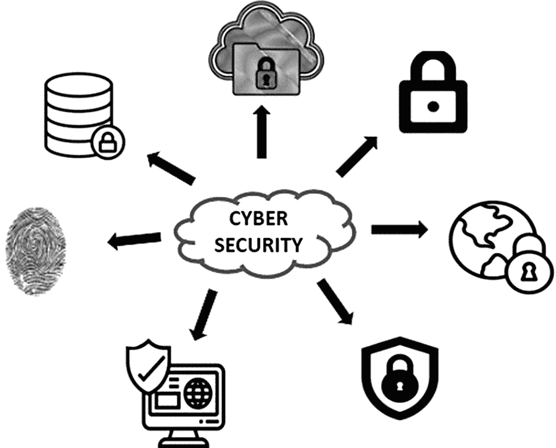

图 6.1 网络安全。

### 6.2.1 管理网络安全的优势

* 保护组织和数据免受未经授权的访问。
* 提高信息安全和业务活动管理。
* 增强合作伙伴对您信息安全措施的信任。
* 在正确的安全控制措施到位的情况下提高组织能力。
* 发生泄露时恢复时间更快。

## 6.3 智慧城市中的网络安全

智慧城市是利用各种电子技术和执行器收集数据的都市地区。从这些数据中获取的信息用于有效管理资产、资源和组织；随后，这些数据用于改进城市各处的运营。随着智慧城市变得更加互联，数字化系统的程度变得更加复杂，这些服务将更容易受到网络攻击 \[3\]。确实，即使是最小的弱点也可能被利用造成巨大影响，智慧城市的强度仅与其最薄弱的环节一样强。智慧城市从多个角度受到网络攻击的威胁。 \[4\] 高级持续性威胁（APTs）可能是最危险的。这些威胁依赖于几种不同的攻击协同作用以扰乱城市服务，经常使用恶意软件和“zero-day”软件漏洞。物联网技术尤其脆弱，虽然可以修复任何暴露区域，但黑客可以造成持久损害。

损害智慧城市框架的部分网络攻击如下 \[4\]。

### 6.3.1 资源、信息和身份威胁

信息盗窃似乎是最著名的网络犯罪。黑客可以入侵数据库并窃取最终明显的敏感信息。智慧城市框架对此尤其脆弱，已知黑客曾从公共支付机构中提取个人信息的真实案例。

### 6.3.2 中间人攻击

中间人攻击是指黑客可以干扰两台设备之间的通信并冒充发送者，发送虚假数据制造混乱。例如，黑客可能会访问移动平台并报告公共交通延误，这可能导致更多人开车上班，造成高峰时段交通拥堵，使城市陷入瘫痪。

### 6.3.3 劫持设备

设备劫持是网络犯罪中更令人担忧的部分之一。利用安全漏洞，攻击者可以接管设备并利用它来扰乱流程。交通信号灯和道路信号灯尤其脆弱。

### 6.3.4 物理破坏

传统物理力量也可以用来破坏网络相关的复杂性。由于许多系统依赖于复杂的流程和传感器网络的输入，对任何部件的实际损坏都可能导致连锁损害。

### 6.3.5 勒索软件

以上所有内容都可用于勒索城市。黑客或海盗利用这些手段破坏交互或机密信息的交付，除非满足某些要求。支付赎金将开启一种危险的趋势。

### 6.3.6 分布式拒绝服务

分布式拒绝服务（DDoS）攻击很简单。海盗可以通过向系统发送请求攻击来压倒系统，阻止需要它的人获得服务。当真正的用户无法获得帮助时，城市系统将无法帮助其居民。

智慧城市的网络威胁应被极其严肃对待 \[5\]。

潜在计划包括：

1. 在实施新系统时形成并使用安全检查清单用于加密、验证、授权和软件更新。
2. 在所有城市系统中执行保障措施和指令覆盖。
3. 改进应对网络攻击的行动概念和方法。

## 6.4 关键网络安全步骤

有五个关键的网络安全步骤，领先城市比其他城市更频繁地采取这些步骤来解决其网络安全弱点 \[6\]：

### 6.4.1 为员工提供网络安全培训

这对城市来说是一个基本步骤，因为网络犯罪分子经常利用工人的失误。

### 6.4.2 关注资源并制定访问控制安排

保护城市最重要的资源是一个明智的初始步骤，确保城市对谁可以访问其系统实施严格控制也是如此。

### 6.4.3 创建网络事件响应和恢复计划

智慧城市领导者明白他们不仅应迅速行动阻止攻击，还应制定措施限制最终后果，包括与责任、财务和声誉影响相关的后果。

### 6.4.4 投资灾难恢复、响应和事件管理技术

无论城市的防火墙多么坚固，只需一个恶意行为者就能突破。因此，智慧城市领导者更积极地投资于特定的恢复和响应技术，以便迅速采取行动减轻影响。

### 6.4.5 保护基本基础设施

这包括对电网、交通信号灯、医院和其他城市资源进行安全测试。通过物联网和其他技术互联城市资源和区域，如果他们不能充分保护其基础设施，城市将面临灾难性攻击。

确实，智慧城市领导者普遍在利用技术和创新解决方案方面的一个标志是其网络安全程度。调查中被指定为领导者的 95%的城市网络表示他们已准备好应对网络攻击，而初级城市仅为 8% \[6\]（图 6.2）。

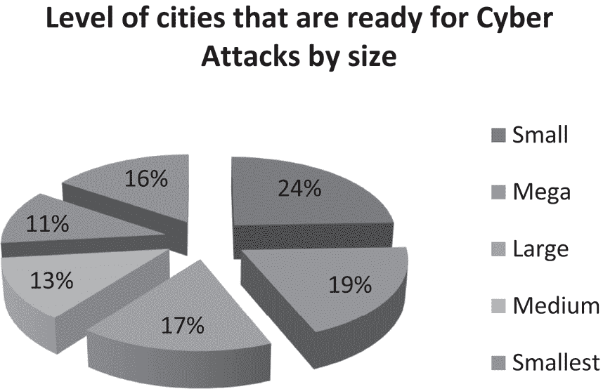

图 6.2 准备好应对网络攻击的城市百分比。

## 6.5 智慧城市中的能源生产

智能城市是一个可行且有用的都市区域，通过对其资源的优化配置为居民提供更好的生活质量，其中清洁和智能能源生产是一个核心问题。在这种情况下，分散式发电可以提供足够的手段来管理可靠的能源并有效实施可持续能源来源；然而，考虑到位置，选择和扩展能源系统并非无关紧要的任务 \[7\]。人们期望智能城市变得更加独立并更有效地管理其能源足迹，同时考虑当地资源和不同利益相关者的需求。在此背景下，智能能源管理（SEM）涉及将能源视为智能城市的基本构建模块的能力 \[8\]。智能能源系统可以减少城市的基本能源消耗，并通过利用当地的可再生能源资源来满足剩余需求，这取决于每个城市的气候特征和能源载体的效率 \[9\]。

适当的能源管理需要精确计量。多功能、通信的智能电表可测量进出口能源、需求和电能质量，以及负荷管理、本地发电、客户数据和其他增值功能的管理，在构建智能电网以平衡供需时至关重要。另一个关键组成部分是利用具有多种功能的智能能源传感器来收集和共享数据以进行预测分析。这些信息可用于识别和预测能源需求，并在高峰需求期间提供有价值的见解。下一代智能城市将受益于将可再生能源和节能及智能建筑技术创新整合的创造性方法 \[1\]。物联网是安装有传感器和移动设备的互联物品或设备的网络，可生成信息并传输和共享该信息。随着自学习建筑变得更加普及，技术先进的建筑将能够相互电子通信，以确保能源使用得到平衡。智能城市的一个重要要素是对物联网设备和传感器收集的数据进行分析和利用，以进一步改善基础设施、公共事业和服务，以及用于预测分析。随着物联网的发展，对物联网相关设备、应用程序和组织进行网络攻击的强大网络安全保护的需求也在增加 \[10\] (图 6.3)。

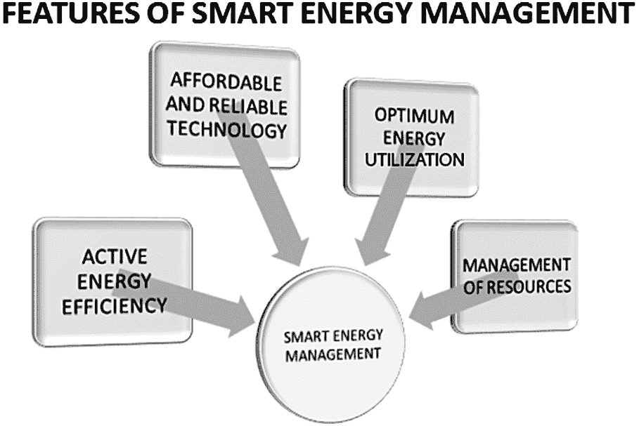

图 6.3 智能能源管理（SEM）的特点。

## 6.6 微电网

微电网是一个分散的电源和负荷集合，通常与传统的广域互联系统并联运行。微电网可以有效整合不同分散式发电（DG）来源，特别是可再生能源。低碳微电网的另一代正在改变人口稠密城市规划和运营公用事业系统的方式，利用就地生产和消费能源的概念。微电网允许预测性维护，对于确保城市能源需求的韧性尤其有前景。

智能微电网的网络物理模型包含四个层 \[11\]：

*   物理电力系统层
*   传感器和执行器层
*   通信层
*   管理和控制层 (图 6.4)

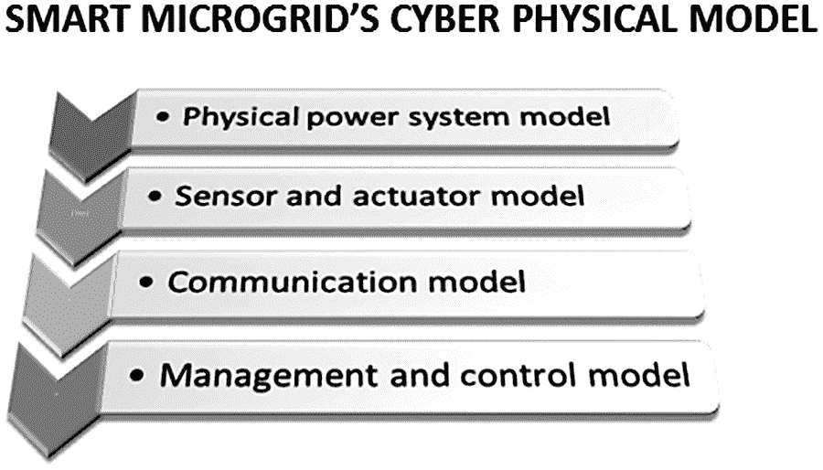

图 6.4 智能微电网的网络物理模型。

### 6.6.1 物理层

物理层包含微电网的电力部件，如变压器、发电机、电力设备、转换器、开关和负载。

### 6.6.2 传感器和执行器层

传感器和执行器层由执行器、测量设备以及用于执行控制决策（内置于管理层）的设备组成。执行器和测量设备负责估计有关系统状态的数据，包括电位、频率、电压和电气开关状态。执行器和电力设备包括发电机调节器、分布式发电调节器以及断路器的继电器。

### 6.6.3 通信层

通信层由路由器、断路器和通信信道等设备组成，负责相关层之间的数据交换。在智能微电网中，连接框架可以是有线或无线，具体取决于系统要求。

### 6.6.4 管理和控制层

管理层是一个集中式主导系统，负责微电网在不同状态下的运行 \[12\]。该层通过通信层接收评估层信息，并传递控制信号以实现微电网的最佳运行。控制信号随后再次通过通信层发送给传感器。

## 6.7 针对能源行业的网络攻击

网络攻击正在上升，能源领域是罪犯的重要目标。能源系统已转变为高度分布的系统，需要主动保护。以下是扩大能源领域脆弱性的三个因素 \[13\]。

*   技术的快速发展
*   网络攻击的日益精细化
*   该领域作为网络目标的吸引力

### 6.7.1 技术的快速发展

能源结构的转变目前正在进行中。它由扩大获取能源的需求驱动，并由新兴的创新技术解决方案推动。从最基本的意义上讲，技术发展被认为是进步的关键推动力。然而，能源领域技术创新的显著发展增加了复杂且有针对性的网络攻击的程度。因此，能源公司正在积极制定策略来应对其安全不足并提高其数字资源的安全性。

### 6.7.2 网络攻击的日益精细化

普遍认为，网络攻击在长期内变得更加复杂。这类攻击可能来自有组织犯罪团伙、工业间谍组织、网络恐怖分子甚至国家行为者。此外，这些多向量攻击利用未知和复杂的漏洞，造成大范围的严重负面后果 \[14\]。因此，能源领域网络攻击的日益精细化具有极大的潜力，可在广阔的地理区域内损害大量实体。

### 6.7.3 作为网络目标的吸引力

能源行业是一个知识产权密集型行业。简而言之，它拥有巨大的知识产权。众所周知，知识产权是许多组织竞争力的核心。因此，它成为网络罪犯和网络间谍的有吸引力的目标。针对能源领域的网络间谍活动可能出于政治和经济动机，这可能使行为者能够访问具有创新优势的信息，构成对能源安全的潜在威胁 \[7\]。

## 6.8 保护我们的能源免受网络攻击的步骤

保护能源免受网络攻击有四个步骤。图 6.5 展示了保护能源免受网络攻击的步骤。它们是
1. 第 1 步：定义审查背后的动机
2. 第 2 步：建模实际控制结构
3. 第 3 步：识别危险控制活动
4. 第 4 步：识别不幸情况

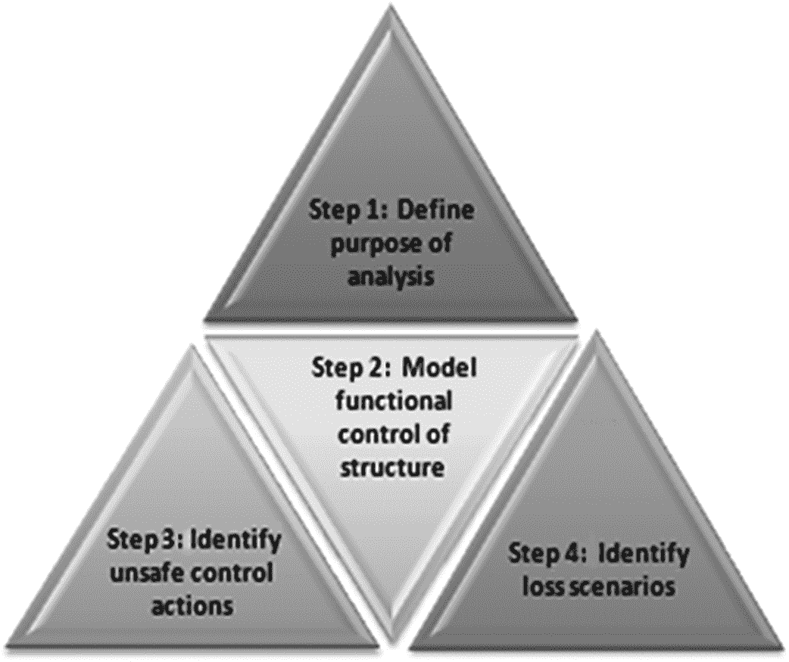
图 6.5 保护能源免受网络攻击的步骤。

## 6.9 智能城市中的可再生能源与网络安全

城市的小地理足迹低估了其重要性。它们仅占世界陆地面积的 2%，却占总人口、经济活动和电力使用的大部分。在此，我们聚焦于第三个方面——电力消耗——因为城市和可再生能源分别已成为普遍的环境因素和首选能源。两者日益不可分割 [15]。随着城市在日益全球化的竞争中努力吸引新兴企业、人才和创新，智能太阳能和风能已成为一些城市实现其智慧城市目标的领先选择 [16]。智慧城市网络在提供与其目标一致的两种能源方面尤为关注：太阳能和风能。其益处在于接受风能和太阳能，因为它们在全球范围内达到与传统能源来源在成本和性能上的平价，有助于以成本效益的方式稳定电网，并由于更智能的储能和其他新技术而变得更加重要资源（全球可再生能源趋势） [16] (图 6.6)。

图 6.6 智能城市中的网络安全与可再生能源。

这些可再生能源目前最接近满足公用事业公司努力提供的可靠、经济且环境友好的能源需求。因此，可再生能源已成为像城市等关键客户的首选能源来源 [17]。网络安全是指对互联电力系统免受数字化攻击的保护。太阳能是电网中使用的多种发电技术之一，既可用于大规模发电，如太阳能农场和公用事业级安装，也可用于小规模分布式能源发电，如建筑物屋顶安装、储能系统和微电网。可再生能源网络安全攻击可以以多种方式发生。例如，网络钓鱼邮件可能会针对毫无防备的员工，其中包含伪装精良的恶意链接，含有恶意软件或勒索软件。拒绝服务攻击可能导致攻击者入侵系统并阻止员工访问，同时自行接管控制权。虚假信息可以注入数据流中，造成虚假的事件叙述导致糟糕的决策。此外，“级联”可能是一个重大问题，即一个系统被污染后迅速蔓延到次要和备用系统，造成难以恢复的巨大范围停电。

## 6.10 网络安全挑战

### 6.10.1 勒索软件

据网络安全公司 Sophos 称，近 82% 的印度机构在最近半年内遭受了勒索软件攻击。勒索软件攻击对特定客户至关重要，但对无法访问日常运营数据的组织影响更大。然而，在大多数勒索软件攻击中，即使支付了赎金，攻击者也不会释放数据，而是试图勒索更多资金 [18]。

### 6.10.2 物联网攻击

根据 IoT Analytics 的数据，截至 2021 年，物联网设备数量接近 116 亿。随着物联网设备的部署以惊人速度增长，网络安全挑战也在增加。攻击物联网设备可能导致敏感客户信息泄露。确保物联网设备无疑是网络安全中最艰巨的挑战，因为访问这些设备可以为其他恶意攻击打开大门（图 6.7）。

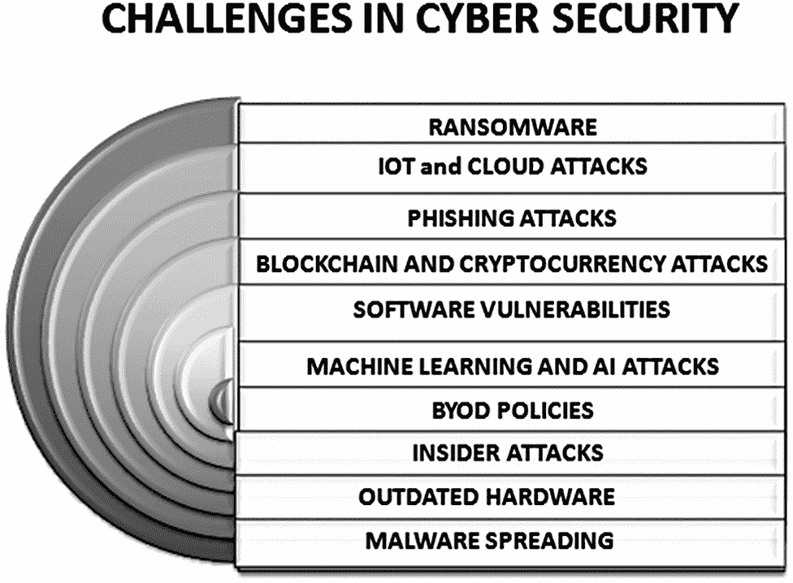
图 6.7 网络安全挑战。

### 6.10.3 云攻击

总体而言，如今几乎每个人都使用云服务来满足个人和专业需求。此外，入侵云平台窃取客户信息是组织面临的网络安全挑战之一。

### 6.10.4 网络钓鱼攻击

网络钓鱼可能是使客户和组织陷入危险的初始步骤，因为执行该过程非常简单 [19]。网络钓鱼是一种社会工程攻击，主要用于窃取客户数据，包括登录凭证和信用卡号码。与勒索软件攻击不同，攻击者在获取所需客户数据后不会阻止其使用。总而言之，他们将其用于自身利益，例如在线购物和非法资金转移。

### 6.10.5 区块链和加密货币攻击

虽然区块链和加密货币对普通网络用户可能意义不大，但这些技术对企业而言意义重大。因此，对这些系统的攻击给企业网络安全带来巨大挑战，因为它们可能危及客户信息和业务运营。

### 6.10.6 软件漏洞

及时用最新版本更新设备的软件应是首要任务。较旧的软件版本可能存在安全漏洞，而这些漏洞已在较新版本中由工程师修复。对未打补丁的软件版本的攻击是网络安全的关键挑战之一。这些攻击通常影响大量用户，如 Windows 零日攻击。

### 6.10.7 机器学习和人工智能攻击

虽然机器学习和人工智能技术在各领域的巨大进步中显示出极大优势，但它们也存在弱点。这些技术可被非法人员利用进行网络攻击并对组织构成威胁。这些技术可用于在海量数据文件中识别异常关注点。

### 6.10.8 自带设备政策

许多组织为员工制定了自带设备（BYOD）政策。采用此类政策会带来多项网络安全挑战。首先，如果设备运行的是过时或被篡改的软件版本，它本身就是黑客入侵的理想途径。由于该设备用于个人和专业用途，黑客可以轻松访问私密的业务信息。此外，如果这些设备的安全性受损，还会更容易访问您的私有网络。

### 6.10.9 内部攻击

虽然大多数网络安全挑战对组织而言是外部的，但也可能出现内部问题。怀有恶意的员工可能会向竞争对手或其他人泄露或出口私密信息。这可能导致企业遭受巨大的财务和声誉损失。部署防火墙设备以控制通过集中代理传输的数据，或根据收入来源限制对报告的访问权限，有助于降低内部攻击的风险。

### 6.10.10 过时硬件

综合考虑，不要感到惊讶。网络安全面临的挑战并非都表现为编程攻击。随着编程工程师认识到编程漏洞的危险性，他们会提供偶尔的更新。然而，这些新更新可能与设备的硬件不兼容。这就是导致硬件过时的原因，其中硬件不足以处理最新的软件版本。这使得此类设备仍停留在较旧的软件版本上，使其极易受到网络攻击 \[18\]。

### 6.10.11 恶意软件传播
智能电网可能面临的严重危险是恶意软件传播，这是一个重大问题。攻击者可以创建恶意软件，该恶意软件可被植入以污染关联服务器以及污染设备。通过利用恶意软件传播，攻击者可以控制设备的功能或系统，从而使攻击者能够获得访问权限以收集敏感数据 \[19\]。

## 6.11 智慧城市网络安全挑战
这是一个挑战，它是推动全球太阳能网络安全实现的机会 \[20\]。智慧城市正日益遭受各种威胁的猛烈攻击。这些包括对关键基础设施的现代网络攻击，使工业控制系统（ICS）陷入瘫痪，滥用低功耗广域网（LPWAN）和设备通信劫持，由勒索软件引起的系统锁定风险，操纵传感器数据以引发广泛恐慌（例如，灾难定位系统）以及窃取居民、医疗保健、消费者数据和个人身份信息（PII），等等，ABI Research 行业分析师 Dimitrios Pavlakis 解释道。在这个日益互联的工业环境中，每个智慧城市管理部门的安全性几乎与其最薄弱的环节一样安全。在不久前，智慧城市只是在科幻电影和小说中被构想出来 \[1\]（图 6.8）。

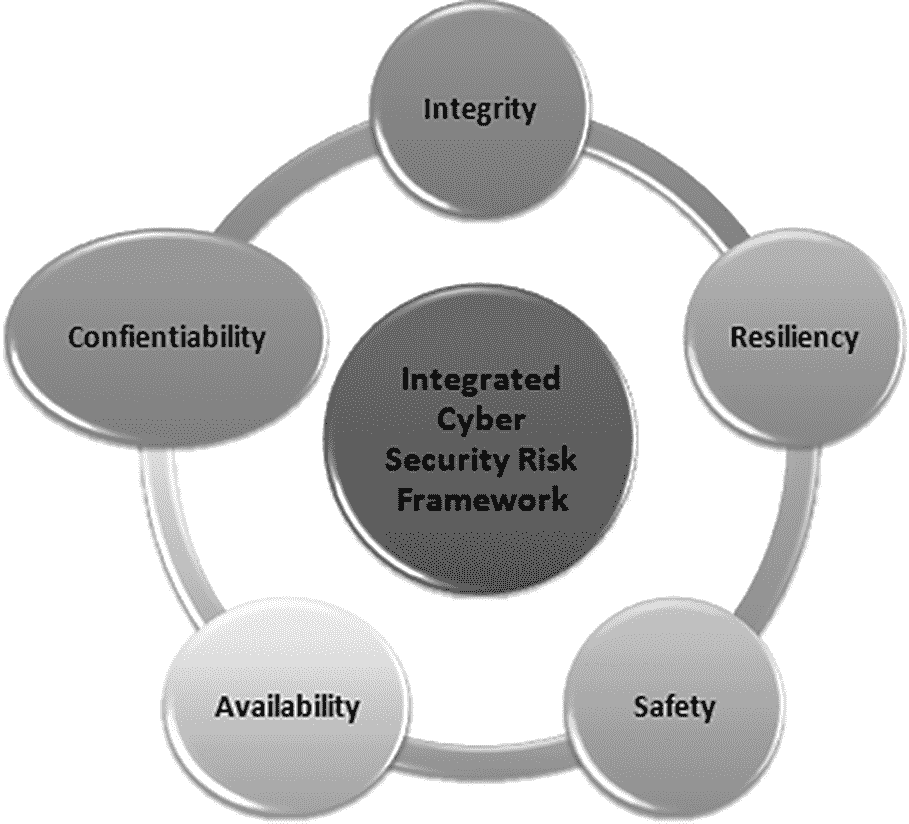

图 6.8 集成网络安全风险框架。

今天，无论如何，这一想法正迅速从创意领域转变为现实。基本上，随着智慧城市网络在全球范围内兴起，它们也带来了引人注目的安全风险视角。因此，这正被网络罪犯所利用，他们计划在最小的机会造成破坏。智慧城市基础中的安全漏洞、复杂且大规模的攻击区域、网络攻击的影响、模糊的监督和规划、预算和政治转变是智慧城市网络安全面临的一些主要挑战 \[21\]。为了应对气候变化，我们将向电网添加越来越多的可持续装置，因此将连接更多的逆变器（也许同时还有电池）。与此同时，我们正逐步将取暖用化石燃料的利用转变为电力，或将内燃机转变为电动的。

## 6.12 可再生能源网络安全挑战
网络安全威胁是真实的，甚至是最大的，太阳能装置也并非对其免疫。电力矩阵的数字化以及太阳能电站可用性的提高，使光伏资源面临极高风险，因为别有用心的黑客可以侵入网络安全，从而危及电力供应。太阳能无法无限储存，产生新的电力需要大量宝贵时间 \[20\]。鉴于智能电网技术和各种智能控制及 ICS 的广泛部署，电网上的网络安全事件令人高度关注。最近几个月，一些著名的清洁能源公司已找到降低泄露风险的方法 \[22\]。在对数字威胁日益担忧之际，太阳能行业正将注意力集中在太阳能网络安全上。

风能网络安全面临的一些挑战包括：
*   越来越多的网络事件针对风能框架
*   建立有效网络安全实践的困难
*   风能资源需要强大的网络安全实践
*   没有单一的网络安全方法适用于所有风电场
*   可用的网络安全替代方案可能过于昂贵
*   几乎不存在针对风电的特定网络安全标准
*   缺乏关注网络安全的激励措施 \[23\]。

## 6.13 结论
在当今世界，网络安全是任何业务的关键组成部分。网络安全在 IT 中仍是一个相对较新的领域，并且在实际中发生了根本性的变化，因为它被视为 IT 安全内的一个不同学科。实施抵御网络攻击的坚实防护需要获得熟练、经验丰富的网络安全劳动力。随着数字危险日复一日地增长，网络安全在智慧城市能源生产领域至关重要。针对提供关键能源系统的组织的现代网络攻击的数量及其安全影响都在增加。随着电力公司以及部分上游和下游的石油和天然气系统越来越多地与数据通信技术系统集成，它们变得更容易受到网络攻击。因此，网络安全对当今世界具有重大影响。网络安全、关键步骤、智慧城市的能源生产、具有网络安全的微电网以及对能源部门的网络攻击均有讨论。之后提供了保护措施和挑战。

## 参考文献
1.  Göçoğlu, V. (2019). 智慧城市关键基础设施的网络安全. Uluslararası Yönetim Akademisi Dergisi, 2(1), 51–63.
2.  Graham, J., Olson, R., & Howard, R. (Eds.). (2016). 网络安全基础. Boca Raton, FL: CRC Press.
3.  [`www.bsigroup.com/en-GB/Cyber-Security/`](https://www.bsigroup.com/en-GB/Cyber-Security/)
4.  [`hub.beesmart.city/en/strategy/the-importance-of-cyber-security-and-data-protection-for-smart-cities`](https://hub.beesmart.city)
5.  Alibasic, A., Al Junaibi, R., Aung, Z., Woon, W. L., & Omar, M. A. (2016, September). 智慧城市网络安全：简要回顾. In *可再生能源集成数据分析国际研讨会* (pp. 22–30). Springer, Cham.
6.  [`econsultsolutions.com/cybersecurity-a-smart-city-imperative/`](https://econsultsolutions.com)
7.  Calvillo, C. F., Sánchez, A., & Villar, J. (2013, October). 智慧城市中的分布式能源发电. In *2013 年可再生能源研究与应用国际会议 (ICRERA)* (pp. 161–166). IEEE.
8.  Barrionuevo, J. M., Berrone, P., & Ricart, J. E. (2012). 智慧城市，可持续发展. IESE Insight, 14(14), 50–57.
9.  Wang, Y., & Yan, G. (2019). 考虑网络安全的电气信息物理系统的新模型方法. IEEJ Transactions on Electrical and Electronic Engineering, 14(2), 201–213.
10.  Prochazkova, D., & Prochazka, J. (2018, May). 智慧城市与关键基础设施. In *2018 布拉格智慧城市研讨会 (SCSP)* (pp. 1–6). IEEE.
11.  Nejabatkhah, F., Li, Y. W., Liang, H., & Reza Ahrabi, R. (2021). 智能微电网网络安全：综述. Energies, 14(1), 27.

12. Risk, C. P. I. (2015). 智能城市的未来：网络物理基础设施风险。

13. [`www.swisscyberforum.com/blog/all-you-need-to-know-about-cyber-security-threats-in-energy-sector/`](https://www.swisscyberforum.com)

14. Morag, N. (2014). 网络犯罪、网络间谍和网络破坏：了解新兴威胁。 Colorado Technical University: College of Security Studies. 可在线获取：[`www.coloradotech.edu/media/default/CTU/documents/resources/cybercrime-white-paper.pdf`](https://www.coloradotech.edu) (访问日期 2019 年 8 月 11 日)

15. Baig, Z. A., Szewczyk, P., Valli, C., Rabadia, P., Hannay, P., Chernyshev, M., … & Peacock, M. (2017). 智能城市的未来挑战：网络安全和数字取证。 Digital Investigation, 22, 3–13。

16. [`www2.deloitte.com/us/en/insights/industry/power-and-utilities/smart-renewable-cities-wind-solar.html`](https://www2.deloitte.com)

17. Pilipczuk, O. (2020). 可持续智能城市与能源管理：劳动力市场视角。 Energies, 13(22), 6084。

18. [`www.jigsawacademy.com/blogs/cyber-security/challenges-of-cyber-security/`](https://www.jigsawacademy.com)

19. [`www.aimspress.com/article/doi/10.3934/electreng.2021002?viewType=HTML`](https://www.aimspress.com)

20. [`www.saurenergy.com/solar-energy-articles/cyber-security-is-the-new-challenge-for-renewable-energy`](https://www.saurenergy.com)

21. [`resources.infosecinstitute.com/topic/top-cyber-security-challenges-smart-cities/`](https://resources.infosecinstitute.com)

22. Al-Mohannadi, H., Mirza, Q., Namanya, A., Awan, I., Cullen, A., & Disso, J. (2016, August). 网络攻击建模分析技术：概述。 In *2016 IEEE 第四届未来物联网与云工作坊国际会议 (FiCloudW)* (pp. 69–76)。 IEEE。

23. [`www.researchgate.net/publication/338924438\_Cybersecurity\_for\_Wind\_Energy`](https://www.researchgate.net)

# 7 第四次工业革命新兴产业问题与挑战

Azeem Khan

ADP 泰勒大学，雪兰莪，马来西亚

Noor Zaman Jhanjhi

SoCIT 泰勒大学，雪兰莪，马来西亚

R. Sujatha

SITE，维洛尔理工大学，维洛尔，泰米尔纳德邦，印度

DOI: [10.1201/9781003203087-7](https://dx.doi.org/10.1201/9781003203087-7)

## 7.1 引言

工业部门被设想为生产商品和服务的地方。工业是任何国家经济的支柱。因此，工业增长被视为对国家整体 GDP 的主要贡献者。正如历史所显示的那样，缩写为 IR 1.0 的第一次工业革命，随着蒸汽动力的发现，将手工生产革命性地转变为机械化，蒸汽机为手织机工业的机械化铺平了道路，从而通过使用蒸汽动力的机器提高了产量，这彻底改变了整个时代；随着 IR 1.0 的到来而繁荣的行业是纺织业和钢铁业，煤炭是这一时代的主要能源。第二次工业革命也缩写为 IR 2.0，始于电力的发现，这将铁路引入了系统，并在商品和服务的生产中引入了电气机械。利用这一能源来源，工厂大规模提高了产量，除了煤炭外，石油也是这一时代的主要能源，随着内燃机的引入而蓬勃发展，装配线使汽车工业得以发展，钢铁工业也大幅繁荣，导致为铁路生产火车，为汽车工业生产汽车 \[1\]。缩写为 IR 3.0 的第三次工业革命随着电子技术的发明而进入人们的视野，这导致了计算机和信息与通信技术（ICT）的发明；这为许多任务的自动化铺平了道路，从而取代了此前由人类完成的许多任务。这一时代被称为数字化时代。从机械化、电气化和数字化，我们进入了一个时代，互联网的出现及其在实现人与人之间通信之外实现与物体通信方面的应用，被称为缩写为 IR 4.0 的第四次工业革命；它被设想为一个复杂的[content]
12. Risk, C. P. I. (2015). 智能城市的未来：网络物理基础设施风险。

13. [`www.swisscyberforum.com/blog/all-you-need-to-know-about-cyber-security-threats-in-energy-sector/`](https://www.swisscyberforum.com)

14. Morag, N. (2014). 网络犯罪、网络间谍和网络破坏：了解新兴威胁。 Colorado Technical University: College of Security Studies. 可在线获取：[`www.coloradotech.edu/media/default/CTU/documents/resources/cybercrime-white-paper.pdf`](https://www.coloradotech.edu) (访问日期 2019 年 8 月 11 日)

15. Baig, Z. A., Szewczyk, P., Valli, C., Rabadia, P., Hannay, P., Chernyshev, M., … & Peacock, M. (2017). 智能城市的未来挑战：网络安全和数字取证。 Digital Investigation, 22, 3–13。

16. [`www2.deloitte.com/us/en/insights/industry/power-and-utilities/smart-renewable-cities-wind-solar.html`](https://www2.deloitte.com)

17. Pilipczuk, O. (2020). 可持续智能城市与能源管理：劳动力市场视角。 Energies, 13(22), 6084。

18. [`www.jigsawacademy.com/blogs/cyber-security/challenges-of-cyber-security/`](https://www.jigsawacademy.com)

19. [`www.aimspress.com/article/doi/10.3934/electreng.2021002?viewType=HTML`](https://www.aimspress.com)

20. [`www.saurenergy.com/solar-energy-articles/cyber-security-is-the-new-challenge-for-renewable-energy`](https://www.saurenergy.com)

21. [`resources.infosecinstitute.com/topic/top-cyber-security-challenges-smart-cities/`](https://resources.infosecinstitute.com)

22. Al-Mohannadi, H., Mirza, Q., Namanya, A., Awan, I., Cullen, A., & Disso, J. (2016, August). 网络攻击建模分析技术：概述。 In *2016 IEEE 第四届未来物联网与云工作坊国际会议 (FiCloudW)* (pp. 69–76)。 IEEE。

23. [`www.researchgate.net/publication/338924438\_Cybersecurity\_for\_Wind\_Energy`](https://www.researchgate.net)

###### 7 第四次工业革命新兴产业问题与挑战

Azeem Khan

ADP 泰勒大学，雪兰莪，马来西亚

Noor Zaman Jhanjhi

SoCIT 泰勒大学，雪兰莪，马来西亚

R. Sujatha

SITE，维洛尔理工大学，维洛尔，泰米尔纳德邦，印度

DOI: [10.1201/9781003203087-7](https://dx.doi.org/10.1201/9781003203087-7)

###### 7.1 引言

工业部门被设想为生产商品和服务的地方。工业是任何国家经济的支柱。因此，工业增长被视为对国家整体 GDP 的主要贡献者。正如历史所显示的那样，缩写为 IR 1.0 的第一次工业革命，随着蒸汽动力的发现，将手工生产革命性地转变为机械化，蒸汽机为手织机工业的机械化铺平了道路，从而通过使用蒸汽动力的机器提高了产量，这彻底改变了整个时代；随着 IR 1.0 的到来而繁荣的行业是纺织业和钢铁业，煤炭是这一时代的主要能源。第二次工业革命也缩写为 IR 2.0，始于电力的发现，这将铁路引入了系统，并在商品和服务的生产中引入了电气机械。利用这一能源来源，工厂大规模提高了产量，除了煤炭外，石油也是这一时代的主要能源，随着内燃机的引入而蓬勃发展，装配线使汽车工业得以发展，钢铁工业也大幅繁荣，导致为铁路生产火车，为汽车工业生产汽车 \[1\]。缩写为 IR 3.0 的第三次工业革命随着电子技术的发明而进入人们的视野，这导致了计算机和信息与通信技术（ICT）的发明；这为许多任务的自动化铺平了道路，从而取代了此前由人类完成的许多任务。这一时代被称为数字化时代。从机械化、电气化和数字化，我们进入了一个时代，互联网的出现及其在实现人与人之间通信之外实现与物体通信方面的应用，被称为缩写为 IR 4.0 的第四次工业革命；它被设想为一个复杂的[content]
12. Risk, C. P. I. (2015). 智能城市的未来：网络物理基础设施风险。

13. [`www.swisscyberforum.com/blog/all-you-need-to-know-about-cyber-security-threats-in-energy-sector/`](https://www.swisscyberforum.com)

14. Morag, N. (2014). 网络犯罪、网络间谍和网络破坏：了解新兴威胁。 Colorado Technical University: College of Security Studies. 可在线获取：[`www.coloradotech.edu/media/default/CTU/documents/resources/cybercrime-white-paper.pdf`](https://www.coloradotech.edu) (访问日期 2019 年 8 月 11 日)

15. Baig, Z. A., Szewczyk, P., Valli, C., Rabadia, P., Hannay, P., Chernyshev, M., … & Peacock, M. (2017). 智能城市的未来挑战：网络安全和数字取证。 Digital Investigation, 22, 3–13。

16. [`www2.deloitte.com/us/en/insights/industry/power-and-utilities/smart-renewable-cities-wind-solar.html`](https://www2.deloitte.com)

17. Pilipczuk, O. (2020). 可持续智能城市与能源管理：劳动力市场视角。 Energies, 13(22), 6084。

18. [`www.jigsawacademy.com/blogs/cyber-security/challenges-of-cyber-security/`](https://www.jigsawacademy.com)

19. [`www.aimspress.com/article/doi/10.3934/electreng.2021002?viewType=HTML`](https://www.aimspress.com)

20. [`www.saurenergy.com/solar-energy-articles/cyber-security-is-the-new-challenge-for-renewable-energy`](https://www.saurenergy.com)

21. [`resources.infosecinstitute.com/topic/top-cyber-security-challenges-smart-cities/`](https://resources.infosecinstitute.com)

22. Al-Mohannadi, H., Mirza, Q., Namanya, A., Awan, I., Cullen, A., & Disso, J. (2016, August). 网络攻击建模分析技术：概述。 In *2016 IEEE 第四届未来物联网与云工作坊国际会议 (FiCloudW)* (pp. 69–76)。 IEEE。

23. [`www.researchgate.net/publication/338924438\_Cybersecurity\_for\_Wind\_Energy`](https://www.researchgate.net)

###### 7 第四次工业革命新兴产业问题与挑战

Azeem Khan

ADP 泰勒大学，雪兰莪，马来西亚

Noor Zaman Jhanjhi

SoCIT 泰勒大学，雪兰莪，马来西亚

R. Sujatha

SITE，维洛尔理工大学，维洛尔，泰米尔纳德邦，印度

DOI: [10.1201/9781003203087-7](https://dx.doi.org/10.1201/9781003203087-7)

###### 7.1 引言

工业部门被设想为生产商品和服务的地方。工业是任何国家经济的支柱。因此，工业增长被视为对国家整体 GDP 的主要贡献者。正如历史所显示的那样，缩写为 IR 1.0 的第一次工业革命，随着蒸汽动力的发现，将手工生产革命性地转变为机械化，蒸汽机为手织机工业的机械化铺平了道路，从而通过使用蒸汽动力的机器提高了产量，这彻底改变了整个时代；随着 IR 1.0 的到来而繁荣的行业是纺织业和钢铁业，煤炭是这一时代的主要能源。第二次工业革命也缩写为 IR 2.0，始于电力的发现，这将铁路引入了系统，并在商品和服务的生产中引入了电气机械。利用这一能源来源，工厂大规模提高了产量，除了煤炭外，石油也是这一时代的主要能源，随着内燃机的引入而蓬勃发展，装配线使汽车工业得以发展，钢铁工业也大幅繁荣，导致为铁路生产火车，为汽车工业生产汽车 \[1\]。缩写为 IR 3.0 的第三次工业革命随着电子技术的发明而进入人们的视野，这导致了计算机和信息与通信技术（ICT）的发明；这为许多任务的自动化铺平了道路，从而取代了此前由人类完成的许多任务。这一时代被称为数字化时代。从机械化、电气化和数字化，我们进入了一个时代，互联网的出现及其在实现人与人之间通信之外实现与物体通信方面的应用，被称为缩写为 IR 4.0 的第四次工业革命；它被设想为一个复杂的[content]
12. Risk, C. P. I. (2015). 智能城市的未来：网络物理基础设施风险。

13. [`www.swisscyberforum.com/blog/all-you-need-to-know-about-cyber-security-threats-in-energy-sector/`](https://www.swisscyberforum.com)

14. Morag, N. (2014). 网络犯罪、网络间谍和网络破坏：了解新兴威胁。 Colorado Technical University: College of Security Studies. 可在线获取：[`www.coloradotech.edu/media/default/CTU/documents/resources/cybercrime-white-paper.pdf`](https://www.coloradotech.edu) (访问日期 2019 年 8 月 11 日)

15. Baig, Z. A., Szewczyk, P., Valli, C., Rabadia, P., Hannay, P., Chernyshev, M., … & Peacock, M. (2017). 智能城市的未来挑战：网络安全和数字取证。 Digital Investigation, 22, 3–13。

16. [`www2.deloitte.com/us/en/insights/industry/power-and-utilities/smart-renewable-cities-wind-solar.html`](https://www2.deloitte.com)

17. Pilipczuk, O. (2020). 可持续智能城市与能源管理：劳动力市场视角。 Energies, 13(22), 6084。

18. [`www.jigsawacademy.com/blogs/cyber-security/challenges-of-cyber-security/`](https://www.jigsawacademy.com)

19. [`www.aimspress.com/article/doi/10.3934/electreng.2021002?viewType=HTML`](https://www.aimspress.com)

20. [`www.saurenergy.com/solar-energy-articles/cyber-security-is-the-new-challenge-for-renewable-energy`](https://www.saurenergy.com)

21. [`resources.infosecinstitute.com/topic/top-cyber-security-challenges-smart-cities/`](https://resources.infosecinstitute.com)

22. Al-Mohannadi, H., Mirza, Q., Namanya, A., Awan, I., Cullen, A., & Disso, J. (2016, August). 网络攻击建模分析技术：概述。 In *2016 IEEE 第四届未来物联网与云工作坊国际会议 (FiCloudW)* (pp. 69–76)。 IEEE。

23. [`www.researchgate.net/publication/338924438\_Cybersecurity\_for\_Wind\_Energy`](https://www.researchgate.net)

###### 7 第四次工业革命新兴产业问题与挑战

Azeem Khan

ADP 泰勒大学，雪兰莪，马来西亚

Noor Zaman Jhanjhi

SoCIT 泰勒大学，雪兰莪，马来西亚

R. Sujatha

SITE，维洛尔理工大学，维洛尔，泰米尔纳德邦，印度

DOI: [10.1201/9781003203087-7](https://dx.doi.org/10.1201/9781003203087-7)

###### 7.1 引言

工业部门被设想为生产商品和服务的地方。工业是任何国家经济的支柱。因此，工业增长被视为对国家整体 GDP 的主要贡献者。正如历史所显示的那样，缩写为 IR 1.0 的第一次工业革命，随着蒸汽动力的发现，将手工生产革命性地转变为机械化，蒸汽机为手织机工业的机械化铺平了道路，从而通过使用蒸汽动力的机器提高了产量，这彻底改变了整个时代；随着 IR 1.0 的到来而繁荣的行业是纺织业和钢铁业，煤炭是这一时代的主要能源。第二次工业革命也缩写为 IR 2.0，始于电力的发现，这将铁路引入了系统，并在商品和服务的生产中引入了电气机械。利用这一能源来源，工厂大规模提高了产量，除了煤炭外，石油也是这一时代的主要能源，随着内燃机的引入而蓬勃发展，装配线使汽车工业得以发展，钢铁工业也大幅繁荣，导致为铁路生产火车，为汽车工业生产汽车 \[1\]。缩写为 IR 3.0 的第三次工业革命随着电子技术的发明而进入人们的视野，这导致了计算机和信息与通信技术（ICT）的发明；这为许多任务的自动化铺平了道路，从而取代了此前由人类完成的许多任务。这一时代被称为数字化时代。从机械化、电气化和数字化，我们进入了一个时代，互联网的出现及其在实现人与人之间通信之外实现与物体通信方面的应用，被称为缩写为 IR 4.0 的第四次工业革命；它被设想为一个复杂的[content]
12. Risk, C. P. I. (2015). 智能城市的未来：网络物理基础设施风险。

13. [`www.swisscyberforum.com/blog/all-you-need-to-know-about-cyber-security-threats-in-energy-sector/`](https://www.swisscyberforum.com)

14. Morag, N. (2014). 网络犯罪、网络间谍和网络破坏：了解新兴威胁。 Colorado Technical University: College of Security Studies. 可在线获取：[`www.coloradotech.edu/media/default/CTU/documents/resources/cybercrime-white-paper.pdf`](https://www.coloradotech.edu) (访问日期 2019 年 8 月 11 日)

15. Baig, Z. A., Szewczyk, P., Valli, C., Rabadia, P., Hannay, P., Chernyshev, M., … & Peacock, M. (2017). 智能城市的未来挑战：网络安全和数字取证。 Digital Investigation, 22, 3–13。

16. [`www2.deloitte.com/us/en/insights/industry/power-and-utilities/smart-renewable-cities-wind-solar.html`](https://www2.deloitte.com)

17. Pilipczuk, O. (2020). 可持续智能城市与能源管理：劳动力市场视角。 Energies, 13(22), 6084。

18. [`www.jigsawacademy.com/blogs/cyber-security/challenges-of-cyber-security/`](https://www.jigsawacademy.com)

19. [`www.aimspress.com/article/doi/10.3934/electreng.2021002?viewType=HTML`](https://www.aimspress.com)

20. [`www.saurenergy.com/solar-energy-articles/cyber-security-is-the-new-challenge-for-renewable-energy`](https://www.saurenergy.com)

21. [`resources.infosecinstitute.com/topic/top-cyber-security-challenges-smart-cities/`](https://resources.infosecinstitute.com)

22. Al-Mohannadi, H., Mirza, Q., Namanya, A., Awan, I., Cullen, A., & Disso, J. (2016, August). 网络攻击建模分析技术：概述。 In *2016 IEEE 第四届未来物联网与云工作坊国际会议 (FiCloudW)* (pp. 69–76)。 IEEE。

23. [`www.researchgate.net/publication/338924438\_Cybersecurity\_for\_Wind\_Energy`](https://www.researchgate.net)

###### 7 第四次工业革命新兴产业问题与挑战

Azeem Khan

ADP 泰勒大学，雪兰莪，马来西亚

Noor Zaman Jhanjhi

SoCIT 泰勒大学，雪兰莪，马来西亚

R. Sujatha

SITE，维洛尔理工大学，维洛尔，泰米尔纳德邦，印度

DOI: [10.1201/9781003203087-7](https://dx.doi.org/10.1201/9781003203087-7)

###### 7.1 引言

工业部门被设想为生产商品和服务的地方。工业是任何国家经济的支柱。因此，工业增长被视为对国家整体 GDP 的主要贡献者。正如历史所显示的那样，缩写为 IR 1.0 的第一次工业革命，随着蒸汽动力的发现，将手工生产革命性地转变为机械化，蒸汽机为手织机工业的机械化铺平了道路，从而通过使用蒸汽动力的机器提高了产量，这彻底改变了整个时代；随着 IR 1.0 的到来而繁荣的行业是纺织业和钢铁业，煤炭是这一时代的主要能源。第二次工业革命也缩写为 IR 2.0，始于电力的发现，这将铁路引入了系统，并在商品和服务的生产中引入了电气机械。利用这一能源来源，工厂大规模提高了产量，除了煤炭外，石油也是这一时代的主要能源，随着内燃机的引入而蓬勃发展，装配线使汽车工业得以发展，钢铁工业也大幅繁荣，导致为铁路生产火车，为汽车工业生产汽车 \[1\]。缩写为 IR 3.0 的第三次工业革命随着电子技术的发明而进入人们的视野，这导致了计算机和信息与通信技术（ICT）的发明；这为许多任务的自动化铺平了道路，从而取代了此前由人类完成的许多任务。这一时代被称为数字化时代。从机械化、电气化和数字化，我们进入了一个时代，互联网的出现及其在实现人与人之间通信之外实现与物体通信方面的应用，被称为缩写为 IR 4.0 的第四次工业革命；它被设想为一个复杂的[content]
12. Risk, C. P. I. (2015). 智能城市的未来：网络物理基础设施风险。

13. [`www.swisscyberforum.com/blog/all-you-need-to-know-about-cyber-security-threats-in-energy-sector/`](https://www.swisscyberforum.com)

14. Morag, N. (2014). 网络犯罪、网络间谍和网络破坏：了解新兴威胁。 Colorado Technical University: College of Security Studies. 可在线获取：[`www.coloradotech.edu/media/default/CTU/documents/resources/cybercrime-white-paper.pdf`](https://www.coloradotech.edu) (访问日期 2019 年 8 月 11 日)

15. Baig, Z. A., Szewczyk, P., Valli, C., Rabadia, P., Hannay, P., Chernyshev, M., … & Peacock, M. (2017). 智能城市的未来挑战：网络安全和数字取证。 Digital Investigation, 22, 3–13。

16. [`www2.deloitte.com/us/en/insights/industry/power-and-utilities/smart-renewable-cities-wind-solar.html`](https://www2.deloitte.com)

17. Pilipczuk, O. (2020). 可持续智能城市与能源管理：劳动力市场视角。 Energies, 13(22), 6084。

18. [`www.jigsawacademy.com/blogs/cyber-security/challenges-of-cyber-security/`](https://www.jigsawacademy.com)

19. [`www.aimspress.com/article/doi/10.3934/electreng.2021002?viewType=HTML`](https://www.aimspress.com)

20. [`www.saurenergy.com/solar-energy-articles/cyber-security-is-the-new-challenge-for-renewable-energy`](https://www.saurenergy.com)

21. [`resources.infosecinstitute.com/topic/top-cyber-security-challenges-smart-cities/`](https://resources.infosecinstitute.com)

22. Al-Mohannadi, H., Mirza, Q., Namanya, A., Awan, I., Cullen, A., & Disso, J. (2016, August). 网络攻击建模分析技术：概述。 In *2016 IEEE 第四届未来物联网与云工作坊国际会议 (FiCloudW)* (pp. 69–76)。 IEEE。

23. [`www.researchgate.net/publication/338924438\_Cybersecurity\_for\_Wind\_Energy`](https://www.researchgate.net)

###### 7 第四次工业革命新兴产业问题与挑战

Azeem Khan

ADP 泰勒大学，雪兰莪，马来西亚

Noor Zaman Jhanjhi

SoCIT 泰勒大学，雪兰莪，马来西亚

R. Sujatha

SITE，维洛尔理工大学，维洛尔，泰米尔纳德邦，印度

DOI: [10.1201/9781003203087-7](https://dx.doi.org/10.1201/9781003203087-7)

###### 7.1 引言

工业部门被设想为生产商品和服务的地方。工业是任何国家经济的支柱。因此，工业增长被视为对国家整体 GDP 的主要贡献者。正如历史所显示的那样，缩写为 IR 1.0 的第一次工业革命，随着蒸汽动力的发现，将手工生产革命性地转变为机械化，蒸汽机为手织机工业的机械化铺平了道路，从而通过使用蒸汽动力的机器提高了产量，这彻底改变了整个时代；随着 IR 1.0 的到来而繁荣的行业是纺织业和钢铁业，煤炭是这一时代的主要能源。第二次工业革命也缩写为 IR 2.0，始于电力的发现，这将铁路引入了系统，并在商品和服务的生产中引入了电气机械。利用这一能源来源，工厂大规模提高了产量，除了煤炭外，石油也是这一时代的主要能源，随着内燃机的引入而蓬勃发展，装配线使汽车工业得以发展，钢铁工业也大幅繁荣，导致为铁路生产火车，为汽车工业生产汽车 \[1\]。缩写为 IR 3.0 的第三次工业革命随着电子技术的发明而进入人们的视野，这导致了计算机和信息与通信技术（ICT）的发明；这为许多任务的自动化铺平了道路，从而取代了此前由人类完成的许多任务。这一时代被称为数字化时代。从机械化、电气化和数字化，我们进入了一个时代，互联网的出现及其在实现人与人之间通信之外实现与物体通信方面的应用，被称为缩写为 IR 4.0 的第四次工业革命；它被设想为一个复杂的[content]
12. Risk, C. P. I. (2015). 智能城市的未来：网络物理基础设施风险。

13. [`www.swisscyberforum.com/blog/all-you-need-to-know-about-cyber-security-threats-in-energy-sector/`](https://www.swisscyberforum.com)

14. Morag, N. (2014). 网络犯罪、网络间谍和网络破坏：了解新兴威胁。 Colorado Technical University: College of Security Studies. 可在线获取：[`www.coloradotech.edu/media/default/CTU/documents/resources/cybercrime-white-paper.pdf`](https://www.coloradotech.edu) (访问日期 2019 年 8 月 11 日)

15. Baig, Z. A., Szewczyk, P., Valli, C., Rabadia, P., Hannay, P., Chernyshev, M., … & Peacock, M. (2017). 智能城市的未来挑战：网络安全和数字取证。 Digital Investigation, 22, 3–13。

16. [`www2.deloitte.com/us/en/insights/industry/power-and-utilities/smart-renewable-cities-wind-solar.html`](https://www2.deloitte.com)

17. Pilipczuk, O. (2020). 可持续智能城市与能源管理：劳动力市场视角。 Energies, 13(22), 6084。

18. [`www.jigsawacademy.com/blogs/cyber-security/challenges-of-cyber-security/`](https://www.jigsawacademy.com)

19. [`www.aimspress.com/article/doi/10.3934/electreng.2021002?viewType=HTML`](https://www.aimspress.com)

20. [`www.saurenergy.com/solar-energy-articles/cyber-security-is-the-new-challenge-for-renewable-energy`](https://www.saurenergy.com)

21. [`resources.infosecinstitute.com/topic/top-cyber-security-challenges-smart-cities/`](https://resources.infosecinstitute.com)

22. Al-Mohannadi, H., Mirza, Q., Namanya, A., Awan, I., Cullen, A., & Disso, J. (2016, August). 网络攻击建模分析技术：概述。 In *2016 IEEE 第四届未来物联网与云工作坊国际会议 (FiCloudW)* (pp. 69–76)。 IEEE。

23. [`www.researchgate.net/publication/338924438\_Cybersecurity\_for\_Wind\_Energy`](https://www.researchgate.net)

###### 7 第四次工业革命新兴产业问题与挑战

Azeem Khan

ADP 泰勒大学，雪兰莪，马来西亚

Noor Zaman Jhanjhi

SoCIT 泰勒大学，雪兰莪，马来西亚

R. Sujatha

SITE，维洛尔理工大学，维洛尔，泰米尔纳德邦，印度

DOI: [10.1201/9781003203087-7](https://dx.doi.org/10.1201/9781003203087-7)

###### 7.1 引言

工业部门被设想为生产商品和服务的地方。工业是任何国家经济的支柱。因此，工业增长被视为对国家整体 GDP 的主要贡献者。正如历史所显示的那样，缩写为 IR 1.0 的第一次工业革命，随着蒸汽动力的发现，将手工生产革命性地转变为机械化，蒸汽机为手织机工业的机械化铺平了道路，从而通过使用蒸汽动力的机器提高了产量，这彻底改变了整个时代；随着 IR 1.0 的到来而繁荣的行业是纺织业和钢铁业，煤炭是这一时代的主要能源。第二次工业革命也缩写为 IR 2.0，始于电力的发现，这将铁路引入了系统，并在商品和服务的生产中引入了电气机械。利用这一能源来源，工厂大规模提高了产量，除了煤炭外，石油也是这一时代的主要能源，随着内燃机的引入而蓬勃发展，装配线使汽车工业得以发展，钢铁工业也大幅繁荣，导致为铁路生产火车，为汽车工业生产汽车 \[1\]。缩写为 IR 3.0 的第三次工业革命随着电子技术的发明而进入人们的视野，这导致了计算机和信息与通信技术（ICT）的发明；这为许多任务的自动化铺平了道路，从而取代了此前由人类完成的许多任务。这一时代被称为数字化时代。从机械化、电气化和数字化，我们进入了一个时代，互联网的出现及其在实现人与人之间通信之外实现与物体通信方面的应用，被称为缩写为 IR 4.0 的第四次工业革命；它被设想为一个复杂的[content]
12. Risk, C. P. I. (2015). 智能城市的未来：网络物理基础设施风险。

13. [`www.swisscyberforum.com/blog/all-you-need-to-know-about-cyber-security-threats-in-energy-sector/`](https://www.swisscyberforum.com)

14. Morag, N. (2014). 网络犯罪、网络间谍和网络破坏：了解新兴威胁。 Colorado Technical University: College of Security Studies. 可在线获取：[`www.coloradotech.edu/media/default/CTU/documents/resources/cybercrime-white-paper.pdf`](https://www.coloradotech.edu) (访问日期 2019 年 8 月 11 日)

15. Baig, Z. A., Szewczyk, P., Valli, C., Rabadia, P., Hannay, P., Chernyshev, M., … & Peacock, M. (2017). 智能城市的未来挑战：网络安全和数字取证。 Digital Investigation, 22, 3–13。

16. [`www2.deloitte.com/us/en/insights/industry/power-and-utilities/smart-renewable-cities-wind-solar.html`](https://www2.deloitte.com)

17. Pilipczuk, O. (2020). 可持续智能城市与能源管理：劳动力市场视角。 Energies, 13(22), 6084。

18. [`www.jigsawacademy.com/blogs/cyber-security/challenges-of-cyber-security/`](https://www.jigsawacademy.com)

19. [`www.aimspress.com/article/doi/10.3934/electreng.2021002?viewType=HTML`](https://www.aimspress.com)

20. [`www.saurenergy.com/solar-energy-articles/cyber-security-is-the-new-challenge-for-renewable-energy`](https://www.saurenergy.com)

21. [`resources.infosecinstitute.com/topic/top-cyber-security-challenges-smart-cities/`](https://resources.infosecinstitute.com)

22. Al-Mohannadi, H., Mirza, Q., Namanya, A., Awan, I., Cullen, A., & Disso, J. (2016, August). 网络攻击建模分析技术：概述。 In *2016 IEEE 第四届未来物联网与云工作坊国际会议 (FiCloudW)* (pp. 69–76)。 IEEE。

23. [`www.researchgate.net/publication/338924438\_Cybersecurity\_for\_Wind\_Energy`](https://www.researchgate.net)

###### 7 第四次工业革命新兴产业问题与挑战

Azeem Khan

ADP 泰勒大学，雪兰莪，马来西亚

Noor Zaman Jhanjhi

SoCIT 泰勒大学，雪兰莪，马来西亚

R. Sujatha

SITE，维洛尔理工大学，维洛尔，泰米尔纳德邦，印度

DOI: [10.1201/9781003203087-7](https://dx.doi.org/10.1201/9781003203087-7)

###### 7.1 引言

工业部门被设想为生产商品和服务的地方。工业是任何国家经济的支柱。因此，工业增长被视为对国家整体 GDP 的主要贡献者。正如历史所显示的那样，缩写为 IR 1.0 的第一次工业革命，随着蒸汽动力的发现，将手工生产革命性地转变为机械化，蒸汽机为手织机工业的机械化铺平了道路，从而通过使用蒸汽动力的机器提高了产量，这彻底改变了整个时代；随着 IR 1.0 的到来而繁荣的行业是纺织业和钢铁业，煤炭是这一时代的主要能源。第二次工业革命也缩写为 IR 2.0，始于电力的发现，这将铁路引入了系统，并在商品和服务的生产中引入了电气机械。利用这一能源来源，工厂大规模提高了产量，除了煤炭外，石油也是这一时代的主要能源，随着内燃机的引入而蓬勃发展，装配线使汽车工业得以发展，钢铁工业也大幅繁荣，导致为铁路生产火车，为汽车工业生产汽车 \[1\]。缩写为 IR 3.0 的第三次工业革命随着电子技术的发明而进入人们的视野，这导致了计算机和信息与通信技术（ICT）的发明；这为许多任务的自动化铺平了道路，从而取代了此前由人类完成的许多任务。这一时代被称为数字化时代。从机械化、电气化和数字化，我们进入了一个时代，互联网的出现及其在实现人与人之间通信之外实现与物体通信方面的应用，被称为缩写为 IR 4.0 的第四次工业革命；它被设想为一个复杂的[content]
12. Risk, C. P. I. (2015). 智能城市的未来：网络物理基础设施风险。

13. [`www.swisscyberforum.com/blog/all-you-need-to-know-about-cyber-security-threats-in-energy-sector/`](https://www.swisscyberforum.com)

14. Morag, N. (2014). 网络犯罪、网络间谍和网络破坏：了解新兴威胁。 Colorado Technical University: College of Security Studies. 可在线获取：[`www.coloradotech.edu/media/default/CTU/documents/resources/cybercrime-white-paper.pdf`](https://www.coloradotech.edu) (访问日期 2019 年 8 月 11 日)

15. Baig, Z. A., Szewczyk, P., Valli, C., Rabadia, P., Hannay, P., Chernyshev, M., … & Peacock, M. (2017). 智能城市的未来挑战：网络安全和数字取证。 Digital Investigation, 22, 3–13。

16. [`www2.deloitte.com/us/en/insights/industry/power-and-utilities/smart-renewable-cities-wind-solar.html`](https://www2.deloitte.com)

17. Pilipczuk, O. (2020). 可持续智能城市与能源管理：劳动力市场视角。 Energies, 13(22), 6084。

18. [`www.jigsawacademy.com/blogs/cyber-security/challenges-of-cyber-security/`](https://www.jigsawacademy.com)

19. [`www.aimspress.com/article/doi/10.3934/electreng.2021002?viewType=HTML`](https://www.aimspress.com)

20. [`www.saurenergy.com/solar-energy-articles/cyber-security-is-the-new-challenge-for-renewable-energy`](https://www.saurenergy.com)

21. [`resources.infosecinstitute.com/topic/top-cyber-security-challenges-smart-cities/`](https://resources.infosecinstitute.com)

22. Al-Mohannadi, H., Mirza, Q., Namanya, A., Awan, I., Cullen, A., & Disso, J. (2016, August). 网络攻击建模分析技术：概述。 In *2016 IEEE 第四届未来物联网与云工作坊国际会议 (FiCloudW)* (pp. 69–76)。 IEEE。

23. [`www.researchgate.net/publication/338924438\_Cybersecurity\_for\_Wind\_Energy`](https://www.researchgate.net)

###### 7 第四次工业革命新兴产业问题与挑战

Azeem Khan

ADP 泰勒大学，雪兰莪，马来西亚

Noor Zaman Jhanjhi

SoCIT 泰勒大学，雪兰莪，马来西亚

R. Sujatha

SITE，维洛尔理工大学，维洛尔，泰米尔纳德邦，印度

DOI: [10.1201/9781003203087-7](https://dx.doi.org/10.1201/9781003203087-7)

###### 7.1 引言

工业部门被设想为生产商品和服务的地方。工业是任何国家经济的支柱。因此，工业增长被视为对国家整体 GDP 的主要贡献者。正如历史所显示的那样，缩写为 IR 1.0 的第一次工业革命，随着蒸汽动力的发现，将手工生产革命性地转变为机械化，蒸汽机为手织机工业的机械化铺平了道路，从而通过使用蒸汽动力的机器提高了产量，这彻底改变了整个时代；随着 IR 1.0 的到来而繁荣的行业是纺织业和钢铁业，煤炭是这一时代的主要能源。第二次工业革命也缩写为 IR 2.0，始于电力的发现，这将铁路引入了系统，并在商品和服务的生产中引入了电气机械。利用这一能源来源，工厂大规模提高了产量，除了煤炭外，石油也是这一时代的主要能源，随着内燃机的引入而蓬勃发展，装配线使汽车工业得以发展，钢铁工业也大幅繁荣，导致为铁路生产火车，为汽车工业生产汽车 \[1\]。缩写为 IR 3.0 的第三次工业革命随着电子技术的发明而进入人们的视野，这导致了计算机和信息与通信技术（ICT）的发明；这为许多任务的自动化铺平了道路，从而取代了此前由人类完成的许多任务。这一时代被称为数字化时代。从机械化、电气化和数字化，我们进入了一个时代，互联网的出现及其在实现人与人之间通信之外实现与物体通信方面的应用，被称为缩写为 IR 4.0 的第四次工业革命；它被视为一个复杂的[content]
12. Risk, C. P. I. (2015). 智能城市的未来：网络物理基础设施风险。

13. [`www.swisscyberforum.com/blog/all-you-need-to-know-about-cyber-security-threats-in-energy-sector/`](https://www.swisscyberforum.com)

14. Morag, N. (2014). 网络犯罪、网络间谍和网络破坏：了解新兴威胁。 Colorado Technical University: College of Security Studies. 可在线获取：[`www.coloradotech.edu/media/default/CTU/documents/resources/cybercrime-white-paper.pdf`](https://www.coloradotech.edu) (访问日期 2019 年 8 月 11 日)

15. Baig, Z. A., Szewczyk, P., Valli, C., Rabadia, P., Hannay, P., Chernyshev, M., … & Peacock, M. (2017). 智能城市的未来挑战：网络安全和数字取证。 Digital Investigation, 22, 3–13。

16. [`www2.deloitte.com/us/en/insights/industry/power-and-utilities/smart-renewable-cities-wind-solar.html`](https://www2.deloitte.com)

17. Pilipczuk, O. (2020). 可持续智能城市与能源管理：劳动力市场视角。 Energies, 13(22), 6084。

18. [`www.jigsawacademy.com/blogs/cyber-security/challenges-of-cyber-security/`](https://www.jigsawacademy.com)

19. [`www.aimspress.com/article/doi/10.3934/electreng.2021002?viewType=HTML`](https://www.aimspress.com)

20. [`www.saurenergy.com/solar-energy-articles/cyber-security-is-the-new-challenge-for-renewable-energy`](https://www.saurenergy.com)

21. [`resources.infosecinstitute.com/topic/top-cyber-security-challenges-smart-cities/`](https://resources.infosecinstitute.com)

22. Al-Mohannadi, H., Mirza, Q., Namanya, A., Awan, I., Cullen, A., & Disso, J. (2016, August). 网络攻击建模分析技术：概述。 In *2016 IEEE 第四届未来物联网与云工作坊国际会议 (FiCloudW)* (pp. 69–76)。 IEEE。

23. [`www.researchgate.net/publication/338924438\_Cybersecurity\_for\_Wind\_Energy`](https://www.researchgate.net)

###### 7 第四次工业革命新兴产业问题与挑战

Azeem Khan

ADP 泰勒大学，雪兰莪，马来西亚

Noor Zaman Jhanjhi

SoCIT 泰勒大学，雪兰莪，马来西亚

R. Sujatha

SITE，维洛尔理工大学，维洛尔，泰米尔纳德邦，印度

DOI: [10.1201/9781003203087-7](https://dx.doi.org/10.1201/9781003203087-7)

###### 7.1 引言

工业部门被设想为生产商品和服务的地方。工业是任何国家经济的支柱。因此，工业增长被视为对国家整体 GDP 的主要贡献者。正如历史所显示的那样，缩写为 IR 1.0 的第一次工业革命，随着蒸汽动力的发现，将手工生产革命性地转变为机械化，蒸汽机为手织机工业的机械化铺平了道路，从而通过使用蒸汽动力的机器提高了产量，这彻底改变了整个时代；随着 IR 1.0 的到来而繁荣的行业是纺织业和钢铁业，煤炭是这一时代的主要能源。第二次工业革命也缩写为 IR 2.0，始于电力的发现，这将铁路引入了系统，并在商品和服务的生产中引入了电气机械。利用这一能源来源，工厂大规模提高了产量，除了煤炭外，石油也是这一时代的主要能源，随着内燃机的引入而蓬勃发展，装配线使汽车工业得以发展，钢铁工业也大幅繁荣，导致为铁路生产火车，为汽车工业生产汽车 \[1\]。缩写为 IR 3.0 的第三次工业革命随着电子技术的发明而进入人们的视野，这导致了计算机和信息与通信技术（ICT）的发明；这为许多任务的自动化铺平了道路，从而取代了此前由人类完成的许多任务。这一时代被称为数字化时代。从机械化、电气化和数字化，我们进入了一个时代，互联网的出现及其在实现人与人之间通信之外实现与物体通信方面的应用，被称为缩写为 IR 4.0 的第四次工业革命；它被设想为一个复杂的技术系统[content]
12. Risk, C. P. I. (2015). 智能城市的未来：网络物理基础设施风险。

13. [`www.swisscyberforum.com/blog/all-you-need-to-know-about-cyber-security-threats-in-energy-sector/`](https://www.swisscyberforum.com)

14. Morag, N. (2014). 网络犯罪、网络间谍和网络破坏：了解新兴威胁。 Colorado Technical University: College of Security Studies. 可在线获取：[`www.coloradotech.edu/media/default/CTU/documents/resources/cybercrime-white-paper.pdf`](https://www.coloradotech.edu) (访问日期 2019 年 8 月 11 日)

15. Baig, Z. A., Szewczyk, P., Valli, C., Rabadia, P., Hannay, P., Chernyshev, M., … & Peacock, M. (2017). 智能城市的未来挑战：网络安全和数字取证。 Digital Investigation, 22, 3–13。

16. [`www2.deloitte.com/us/en/insights/industry/power-and-utilities/smart-renewable-cities-wind-solar.html`](https://www2.deloitte.com)

17. Pilipczuk, O. (2020). 可持续智能城市与能源管理：劳动力市场视角。 Energies, 13(22), 6084。

18. [`www.jigsawacademy.com/blogs/cyber-security/challenges-of-cyber-security/`](https://www.jigsawacademy.com)

19. [`www.aimspress.com/article/doi/10.3934/electreng.2021002?viewType=HTML`](https://www.aimspress.com)

20. [`www.saurenergy.com/solar-energy-articles/cyber-security-is-the-new-challenge-for-renewable-energy`](https://www.saurenergy.com)

21. [`resources.infosecinstitute.com/topic/top-cyber-security-challenges-smart-cities/`](https://resources.infosecinstitute.com)

22. Al-Mohannadi, H., Mirza, Q., Namanya, A., Awan, I., Cullen, A., & Disso, J. (2016, August). 网络攻击建模分析技术：概述。 In *2016 IEEE 第四届未来物联网与云工作坊国际会议 (FiCloudW)* (pp. 69–76)。 IEEE。

23. [`www.researchgate.net/publication/338924438\_Cybersecurity\_for\_Wind\_Energy`](https://www.researchgate.net)

###### 7 第四次工业革命新兴产业问题与挑战

Azeem Khan

ADP 泰勒大学，雪兰莪，马来西亚

Noor Zaman Jhanjhi

SoCIT 泰勒大学，雪兰莪，马来西亚

R. Sujatha

SITE，维洛尔理工大学，维洛尔，泰米尔纳德邦，印度

DOI: [10.1201/9781003203087-7](https://dx.doi.org/10.1201/9781003203087-7)

###### 7.1 引言

工业部门被设想为生产商品和服务的地方。工业是任何国家经济的支柱。因此，工业增长被视为对国家整体 GDP 的主要贡献者。正如历史所显示的那样，缩写为 IR 1.0 的第一次工业革命，随着蒸汽动力的发现，将手工生产革命性地转变为机械化，蒸汽机为手织机工业的机械化铺平了道路，从而通过使用蒸汽动力的机器提高了产量，这彻底改变了整个时代；随着 IR 1.0 的到来而繁荣的行业是纺织业和钢铁业，煤炭是这一时代的主要能源。第二次工业革命也缩写为 IR 2.0，始于电力的发现，这将铁路引入了系统，并在商品和服务的生产中引入了电气机械。利用这一能源来源，工厂大规模提高了产量，除了煤炭外，石油也是这一时代的主要能源，随着内燃机的引入而蓬勃发展，装配线使汽车工业得以发展，钢铁工业也大幅繁荣，导致为铁路生产火车，为汽车工业生产汽车 \[1\]。缩写为 IR 3.0 的第三次工业革命随着电子技术的发明而进入人们的视野，这导致了计算机和信息与通信技术（ICT）的发明；这为许多任务的自动化铺平了道路，从而取代了此前由人类完成的许多任务。这一时代被称为数字化时代。从机械化、电气化和数字化，我们进入了一个时代，互联网的出现及其在实现人与人之间通信之外实现与物体通信方面的应用，被称为缩写为 IR 4.0 的第四次工业革命；它被设想为一个复杂的技术系统[content]
12. Risk, C. P. I. (2015). 智能城市的未来：网络物理基础设施风险。

13. [`www.swisscyberforum.com/blog/all-you-need-to-know-about-cyber-security-threats-in-energy-sector/`](https://www.swisscyberforum.com)

14. Morag, N. (2014). 网络犯罪、网络间谍和网络破坏：了解新兴威胁。 Colorado Technical University: College of Security Studies. 可在线获取：[`www.coloradotech.edu/media/default/CTU/documents/resources/cybercrime-white-paper.pdf`](https://www.coloradotech.edu) (访问日期 2019 年 8 月 11 日)

15. Baig, Z. A., Szewczyk, P., Valli, C., Rabadia, P., Hannay, P., Chernyshev, M., … & Peacock, M. (2017). 智能城市的未来挑战：网络安全和数字取证。 Digital Investigation, 22, 3–13。

16. [`www2.deloitte.com/us/en/insights/industry/power-and-utilities/smart-renewable-cities-wind-solar.html`](https://www2.deloitte.com)

17. Pilipczuk, O. (2020). 可持续智能城市与能源管理：劳动力市场视角。 Energies, 13(22), 6084。

18. [`www.jigsawacademy.com/blogs/cyber-security/challenges-of-cyber-security/`](https://www.jigsawacademy.com)

19. [`www.aimspress.com/article/doi/10.3934/electreng.2021002?viewType=HTML`](https://www.aimspress.com)

20. [`www.saurenergy.com/solar-energy-articles/cyber-security-is-the-new-challenge-for-renewable-energy`](https://www.saurenergy.com)

21. [`resources.infosecinstitute.com/topic/top-cyber-security-challenges-smart-cities/`](https://resources.infosecinstitute.com)

22. Al-Mohannadi, H., Mirza, Q., Namanya, A., Awan, I., Cullen, A., & Disso, J. (2016, August). 网络攻击建模分析技术：概述。 In *2016 IEEE 第四届未来物联网与云工作坊国际会议 (FiCloudW)* (pp. 69–76)。 IEEE。

23. [`www.researchgate.net/publication/338924438\_Cybersecurity\_for\_Wind\_Energy`](https://www.researchgate.net)

###### 7 第四次工业革命新兴产业问题与挑战

Azeem Khan

ADP 泰勒大学，雪兰莪，马来西亚

Noor Zaman Jhanjhi

SoCIT 泰勒大学，雪兰莪，马来西亚

R. Sujatha

SITE，维洛尔理工大学，维洛尔，泰米尔纳德邦，印度

DOI: [10.1201/9781003203087-7](https://dx.doi.org/10.1201/9781003203087-7)

###### 7.1 引言

工业部门被设想为生产商品和服务的地方。工业是任何国家经济的支柱。因此，工业增长被视为对国家整体 GDP 的主要贡献者。第一次工业革命 IR 1.0 以蒸汽动力推动手工向机械化转变，纺织和钢铁业兴起，煤炭为主能源。第二次工业革命 IR 2.0 以电力推动铁路和电气机械，石油兴起，内燃机、汽车装配线和钢铁业繁荣 \[1\]。第三次工业革命 IR 3.0 以电子、计算机和 ICT 推动自动化，是数字化时代。从机械化、电气化、数字化进入互联网时代，形成缩写为 IR 4.0 的第四次工业革命。它由物联网、网络物理系统、工业物联网、机器人、云计算、雾计算和边缘计算、大数据、数据分析等构成，可实现可视化、3D 打印和增强现实。IR 4.0 关注制造业，原材料进入、成品输出，系统自动化互联，人力干预最少。系统由 ICT 支持，通过 CPS 连接互联网，数字化价值链，涵盖产品构思、开发、制造、服务及从供应商到客户的内部运营 \[2,3\]。本章结构如下：第一部分介绍 I4.0，第二部分文献综述，第三部分概念与起源，第四、五部分意义与相关性，第六、七部分挑战与问题，最后三部分为专家研究成果评述，结论总结文献发现并展望未来。

## 7.2 文献综述

制造业的数字化始于 2011 年 11 月，由德国联邦教育与研究部启动，被称为工业革命 4.0（IR 4.0），简称为 I4.0。I4.0 被构想为世界经济论坛执行主席克劳斯·施瓦布提出的一个综合概念；他设想 I4.0 为硬件、软件和 CPS 的结合，强调通信和连接，涵盖机器人技术、人工智能（AI）、纳米技术、生物技术、物联网、工业物联网、5G 网络技术、3D 打印和完全自动化的车辆，这意味着由智能自主生态系统组成的制造业自动化。I4.0 的关键设计原则和目标包括信息透明、技术援助以及通过机器、设备、传感器和人员之间的互联实现去中心化的决策过程，以通过物联网和人与人互联进行连接和通信，其中后者涉及与机器的通信，而前者涉及人类相互通信。I4.0 的整体构想被提出为 2020 年涉及制造业的工业部门发展的[content]

Digitization of the manufacturing sector was started as Industrial Revolution 4.0 (IR 4.0) or, in brief, I4.0, back in November 2011 by the German Federal Ministry of Education and Research. I4.0 is conceived as a comprehensive concept introduced by Klaus Schwab, the executive chairman of the World Economic Forum; he envisioned I4.0 as the combination of hardware, software, and CPS with an emphasis on communication and connectivity encompassing Robotics, Artificial Intelligence (AI), nanotechnology, biotechnology, IoT, IIoT, 5G networking technology, 3D printing, and completely automated vehicles which connotes automation of manufacturing sector composed of intelligent autonomous ecosystems. The key design principles and goals of I4.0 include information transparency, technical assistance, and decentralized decision-making process through the interconnection between machines, devices, sensors, and people to connect and communicate via IoT and the Internet of People where the latter involves communication with the machines whereas the former involves humans communicating with each other. The whole idea of I4.0 was proposed as a high-tech strategy for the development of the industrial sector involving manufacturing in 2020. Later, other countries also started the same initiatives with different names such as “Made in China 2025” by china, “Social 5.0” by Japan, “Manufacturing USA” by the USA, etc., as stated in Table 7.1 [3, 4 and 5].

Table 7.1 IR 4.0 Country-Wise Terminologies

| Year | Country | Term |
| --- | --- | --- |
| 2011 | Germany | Industrie 4.0 |
| 2013 | Denmark | Manufacturing Academy of Denmark (MADE) |
| 2014 | Spain | Industria Conectada 4.0 |
| 2014 | UK | Future of Manufacturing |
| 2015 | China | Made in China 2025 |
| 2015 | Austria | Plattform Industrie 4.0 |
| 2016 | Japan | Society 5.0 |
| 2016 | Sweden | Smart Industry |
| 2016 | Italy | Piano Industria 4.0 |
| 2016 | Belgium | Made Different |
| 2017 | Netherlands | Smart Industry |
| 2017 | USA | Manufacturing USA |
| 2017 | France | Industrie du Futur |
| 2017 | Czech Republic | Pr˙umysl 4.0 |
| 2017 | Portugal | Ind´ustria 4.0 |

Ever since 2011, globally, several governmental initiatives [6] have been taken by many countries under various names as shown in Table 7.1; the data provided here clearly state how the top ten developed world economies based on GDP as well are serious toward explicit commitments to adopt, guide, and implement ICT-based manufacturing sectors because these segment of industries have great potential to contribute toward the economy at the social level and for the stability of environment as well. In the USA, IR 4.0 is synonymous with smart manufacturing and the Internet Industry of Things. Succinctly, I4.0 is summed up as the digitalization and interconnection of all production units comprised in an economic system [7]. Apart from the involvement of technologies, I4.0 is also influencing various areas of enterprises inclusive of management, organization of work, regulatory frameworks, and toward the integration of enterprises as well. Integration of enterprises is anticipated in three aspects, namely horizontal, vertical, and end to end. To elaborate a bit, horizontal integration carries coordination between various processes involved across different value chains involved in an enterprise network. Vertical integration implies all-embracing automation within the enterprise and last of all end-to-end integration comprises digitization of all contributors, which includes communication between human and human or it may be between machine and machine or human and machine. The aforementioned scenario with the integration of the above three dimensions makes a whole enterprise network more dynamic beginning with adjustments in infrastructure, production systems, and, last but not least, the customers [5,8]. To make the whole automation of production processes possible, the communication between the objects connected in this plethora of things needs to be automated, this is possible with the intervention of the internet among things connected to this system, which is done with the help of IoT wherein, the objects can communicate with each other autonomously [9,10]. Three paradigms central to I4.0 are smart products, smart machines, and augmented operators. Smart products represent those products that can necessitate production resources and arrange all the production processes till the end of its completion. Smart machines represent CPS wherein, the whole production process is automated with a decentralized decision-making process, and also making processes self-organizing, adaptable, and coordinating between the networks involved in production. Supplemented operative is the human being who is going to leverage technology to implement workerless production services acknowledging the centrality of human presence to monitor, specify, and verify the production strategies [11]. I4.0, apart from automating the industrial sector involved in manufacturing, is also impacting other aspects of lives and has proven to be a useful asset to improve the production in the agricultural and food sector. The rise in global population is compelling the intervention of technology to provide smart services to automate the irrigation process, thereby increasing the productivity with available natural resources with limited availability of agricultural land due to diminishing natural resources. I4.0 can play a vital role in the agricultural sector by enhancing the operational efficiency resulting in the production of agricultural products, by implementing IoT technology that can help peasants in predicting the weather and availing them to make better decisions for enhanced productivity of their crops and also it facilitates by providing details in opting which crops to grow in a given circumstance [12].

The CPS which includes smart grids, autonomous automobiles, medical monitoring gadgets, industrial control systems, and robotics enactment is creating changes in the way humans work and in work organization, successively, establishing new challenges and avenues. To make the maximum out of available resources and manage the complications, there is a need to increase an all-encompassing comprehension of the rising socio-specialized associations and apply new human-driven methodologies and techniques to study the readiness of the industries toward embracing this new paradigm has been discussed by [13], highlighting the issues and challenges involved in embracing I4.0. Table 7.2 precisely mentions the prime features of industrial revolutions.

Table 7.2 Prime Features of Industrial Revolutions [1]

| Time Span | Source of Energy | Inventions | Industries | Conveyance |
| --- | --- | --- | --- | --- |
| 2000–… | Green Energies | Internet, 3D Printer, Genetic Engineering | High Tech Industries | Electric Cars, Ultra-Fast Trains |
| 1960–2000 | Natural Gas, Nuclear Energy | Computers, Robots | Automobiles, Chemical | Car, Plane |
| 1900–1960 | Electricity, oil | Combustion Engines | Automobiles, Metallurgy | Train, Car |
| 1760–1900 | Coal | Steam Engine | Textile, Steel | Train |

## 7.3 Industry 4.0 Concept and Its Significance

### 工业 4.0

### 意义与演进

I4.0 的意义可以从该范式所提供的众多优势中得到明确肯定，这些优势体现在其预期的积极成果方面，范围涵盖生产率、大规模定制、灵活性、将产品推向市场所需的时间和成本的降低、货物和服务的质量改善、交货周期缩短、高度环境可持续性、环境友好、经济增长改善，从而有助于减少失业并创造更好的就业机会，以及提高个人和整个社会的生命质量 \[14\]。工业 4.0 或 I4.0 的概念可以从以下方面进行概括：始于 1800 年代初期的机械化、1900 年代的电气化和工业化、1960 年代以来的数字化和电子自动化，最后，我们已达到一个阶段，许多技术似乎正在融合并向奇点迈进；这一组造成几乎所有生活领域巨大范式转变的颠覆性技术被命名为 I4.0，其关键要素为互操作性和连接性。这一理念最初由德国政府在其工业战略倡议中提出，并将这些旨在以最小程度的人为干预实现自动化的努力称为 I4.0。这是德国为通过数字化实现其工业制造部门自动化，从而改造其庞大的生产流程而采取的一项战略举措，并借此为利用新 ICT 技术潜能铺平道路，以个性化和定制化产品满足全球市场需求。

### 概念框架

从概念上讲，I4.0 被表述为基于企业和制造流程整合的物理系统集合，并整合了 ICT 组件，涵盖公司价值链中的所有参与者，从供应商到最终用户，即客户。这一新范式的技术细节由与生产系统相关的通过 IoT 和 IIoT 相互连接的物理系统来解决。整个范式的执行系统由嵌入电子系统的 CPS 治理。这些系统具备去中心化控制和互联网连接，使该网络中的所有连接设备能够收集和交换实时数据以收集和交换实时数据，从而使整个互联系统能够追溯、定位、识别、监控和优化生产系统中涉及的整个工业制造流程 \[3\]。这些互联的 ICT 赋能的大型工业系统已渗透到经济的多个领域，范围从包括电力生产和分配在内的能源部门；除此之外，医疗保健、制造、公共部门、交通运输、采矿等也受到这些技术进步的影响，而 图 7.1 展示了同样的情况。

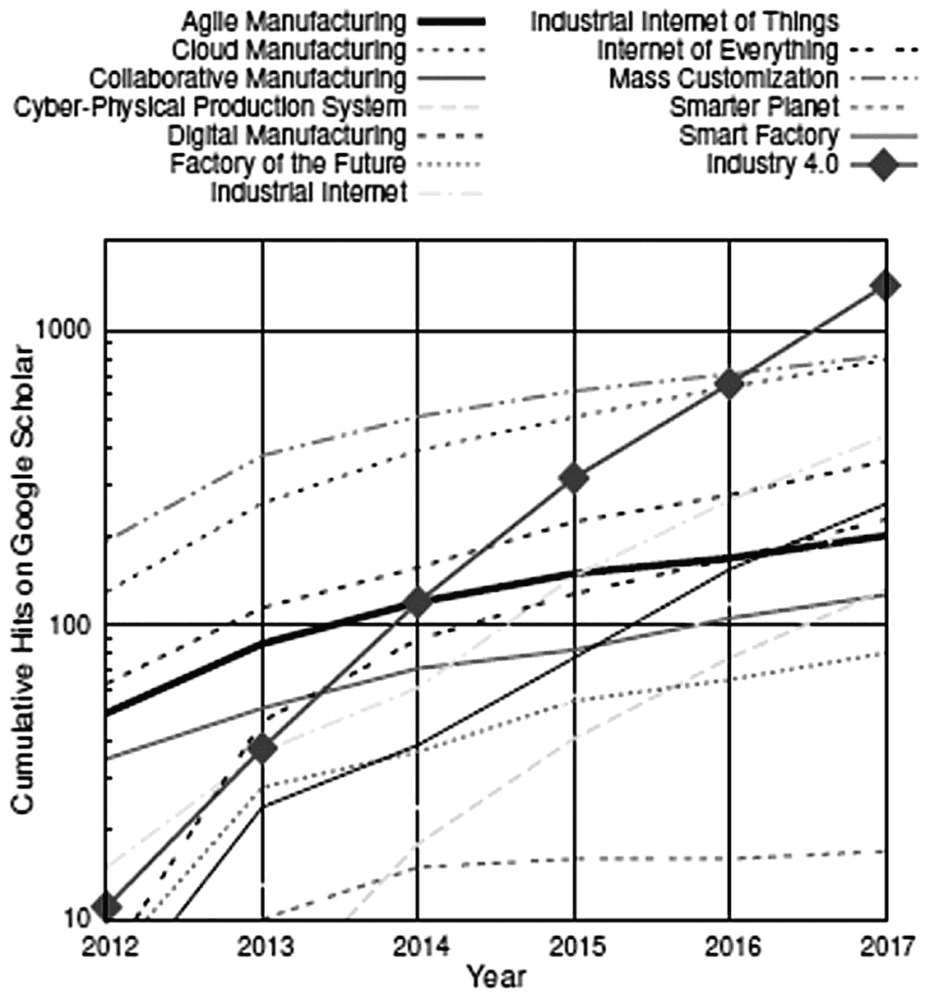

图 7.1 工业 4.0 在科学文献中。

### 研究趋势与构建模块

人类目前正处于 I4.0 带来的高科技转型之中，因为它从根本上改变了我们工作和生活的方式。具体预测这种变化将如何影响各个企业和国家具有挑战性，但这一技术进步新趋势的重要性可以通过大量发表在高索引期刊上的研究文章来理解，如 图 7.2 所示。如 图 7.3 所示，I4.0 涵盖了工业革命 4.0 的多个方面，这些方面被视为 I4.0 的构建模块，包括自动化、仿真、智能供应链网络、自组织、机器人辅助、增强工作，其数据存储于云端，能够借助嵌入机器学习算法的大数据分析做出明智决策，从而提供高效且有效。

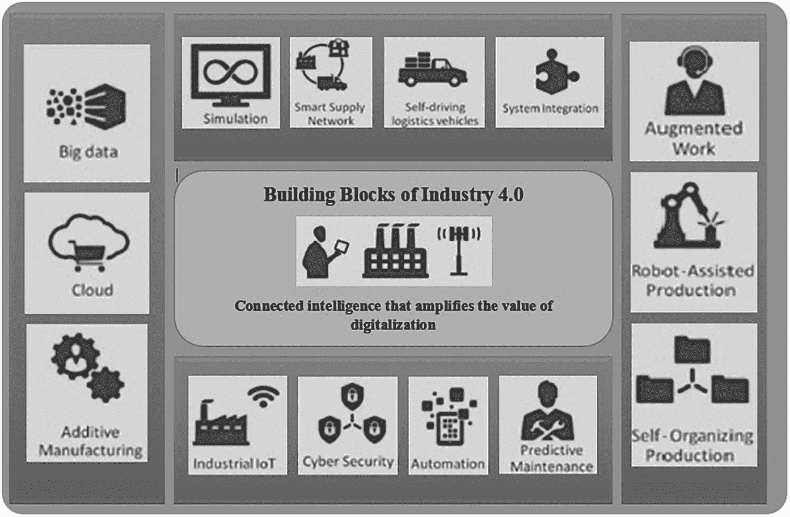

图 7.2 工业 4.0 格局。

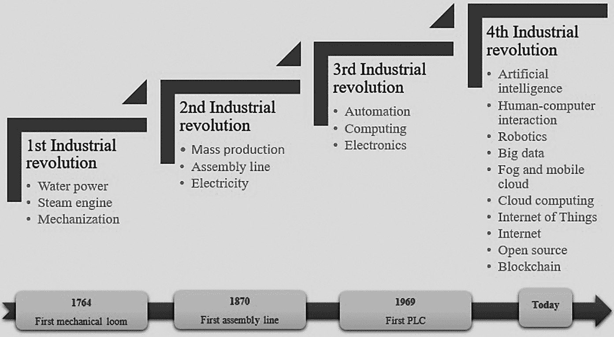

图 7.3 工业革命使能因素。

### 数字化价值与智能制造

企业对具备连接智能的解决方案的需求放大了数字化的价值 \[15\]。借助人工智能构建的机器人在互联网帮助下相互连接，这些机器通过彼此交互产生的数据被发送到云端，并且通过云端，在机器学习算法的帮助下，由这一众多的连接设备产生的大量数据变得有意义，从而提供有价值的洞察，帮助组织成长，确实有助于做出有效和高效的决策，推动组织走向更大的成功；正如所述，I4.0 旨在“在制造事物时制造更好的事物”，意味着与互联网基本连接并被称为 IIoT 的行业新趋势。尽管它们通过 CPS 相互连接，但存在数据被盗和其他安全问题可能破坏整个网络的风险；为克服这一点，网络配备了最先进的技术，为所有这些网络提供网络安全和预测性维护。新产品在更短的时间内进入市场，由于行业的这种高科技自动化。客户响应能力已大幅提高。大规模生产已实现，而整体生产成本并未实际增加。这一复杂技术范式实现了灵活且更友好的工作环境，并高效利用能源和自然资源。I4.0 催生了智能工厂的概念，其中原材料进入制造部门并以成品形式流出，几乎不需要或完全不需要人工干预。

## 7.4 工业 4.0 关键使能技术

关键使能技术包括物理或数字接口技术、网络技术、数据处理技术和物理过程技术。物理或数字接口技术构成物理设备层，包括与 IoT、CPS 和可视化技术相关的设备。网络技术包括云计算和区块链技术。数据处理技术包括仿真和建模、机器学习和人工智能算法，以及大数据分析。物理过程技术包括 3D 打印、先进机器人和能源管理解决方案 \[14\]。如 图 7.3 所强调的那样，使这一整体概念成为现实的关键使能技术是：互联网、云计算、人机交互（HCI）、大数据、人工智能、物联网、机器人、雾计算和移动云、增强现实、网络安全和开源技术。这些赋能的技术进步通过增加一个新维度正在改变整个工业环境，从而带来工业生产率的惊人增长。所有这些复杂技术集合可以简明地概括如下。

### 互联网
互联网被定义为全球互联的物理设备网络，也称为节点，目的是基于规则进行通信，这些规则规范了借助 `TCP/IP` 协议在计算机网络上的通信。全球各地的设备通过互联网协议上的传输控制连接起来。互联网是信息和服务的无限资源池，例如相互链接的超文本文档；除此之外，它还提供电子邮件、互联网电话以及通过万维网的文件共享支持。全球连接的设备通过众多网络技术紧密相连，因此没有互联网，我们无法想象 `I4.0` 成为现实，因为它提供了基础架构，也是整个 `I4.0` 概念的基础，它充当这一整个现象的骨干 \[16,17\]。

### 物联网
除互联网之外，其他关键技术推动者是 `IoT`；根据一项估计，到 2020 年底，预计约有 500 亿台物理设备将实现互联，能够在最小的人为干预下相互通信。这一技术提升可以通过实现从家庭、城市和医疗保健到 `CPS` 等大规模的智能现实生活应用，极大地改善生活质量。`IoT` 被设想为三层架构，其中每一层都与特定的职责和功能相关，分别是感知层、网络层和应用层。感知层由能够感知环境数据的物理对象构成，这些数据可以是文本、音频、视频和图像等。因此，感知到的数据被传输到下一层，该层包括网络和通信技术，并且从这一层，感知到的数据被推送到分层架构的下一级，即应用层。在这里，收集到的数据可供个人和组织使用，以便他们做出决策并进一步推进 \[18,19\]。因此，`IoT` 基本上是人与人之间通信的延伸，扩展到物体之间在机器人协助下以最小或无需人为干预进行通信。

### 机器人技术
“robot”一词源自斯拉夫语“robota”，意为奴隶或仆人。机器人在制造行业中用于装配、包装和运输。机器人技术是一个新兴的研究领域，涵盖计算机科学和多个工程学科。机器人被定义为能够借助人工智能设计的算法感知、思考并在现实世界中行动的机器，从而为借助增材制造技术实现产品的快速生产铺平道路 \[20, 21, 22 and 23\]。增材制造技术为 3D 打印提供了基础。

### 3D 打印
使用机器创建 3D 物体的过程被称为 3D 打印。它包括在计算机控制下借助计算机辅助设计 (`CAD`) 将材料沉积、连接并固化的过程。`CAD` 通过帮助设计师创建、修改、分析和优化物理对象的设计，从而提高设计师的生产力。它为创建定制零件铺平了道路，这些零件可以在大型制造领域中帮助快速更换制造过程中涉及的机器的物理部件 \[24\]。由于物理设备之间通信会产生大量数据，因此需要使这些数据对企业改善有所帮助；这借助大数据分析来实现。

### 大数据分析
大数据术语以 3 个 V 为特征，并补充了另外 2 个 V，前 3 个 V 表示体积、速度和多样性，后 2 个 V 表示真实性和价值。将大量数据处理以获得有意义的见解的机制，该见解可进一步帮助组织采用更好的决策技术，被称为大数据分析。在 `I4.0` 中，大数据分析发挥着至关重要的作用，因为它提供了捕获、存储、传输、策划、搜索、分析和可视化的机制，目的是为组织拥有的<|message|>? 为组织拥有的<|message|>? 提供隐私和安全。在大数据中，数据通过系统日志、摄像机、`RFIDs`、传感器、`GPS`、`ERP` 和社交媒体捕获。捕获到的数据随后使用数据分析进行处理，采用描述性、预测性和规范性方法。在分析数据的整个过程中，组织通过各种来源捕获的数据会被存储和分析——描述性分析方法描述产品过去的数据，预测性分析方法提供产品未来的洞察，而规范性分析方法则提供为产品未来做准备的洞察；在整个分析过程中，如果捕获到的数据不正确，则整个过程将毫无意义，因此组织对数据准确性给予了额外关注，这被称为真实性，进而为产品创造价值，这也被视为大数据的属性 \[25,26\]。在这一复杂设备网络中，数据传输和存储需求也非常巨大，因此云计算为此任务提供服务。

### 云计算
该术语基本上指的是数据中心，其中数据被存储，但在更广泛的意义上，云计算以按需付费模式提供服务，其中用户或组织只需为从云服务提供商处获取的服务付费。云计算以硬件、平台、基础设施和软件即服务的形式提供。所有与硬件相关的服务统称为“硬件即服务” (`HaaS`)，平台即服务 (`PaaS`)，基础设施即服务 (`IaaS`)，和软件即服务 (`SaaS`)。云计算促进了计算资源的借用，包括存储、计算能力、硬件和软件作为实时服务，减少与服务提供商的交互，从而提供可扩展性、响应性和可观的经济效益。云计算的优势包括响应时间、连接性、带宽、成本和连接可用性方面的服务 \[27, 28 and 29\]。因此，为了减轻通信中的延迟和响应时间，引入了移动和雾计算技术。

雾计算：云计算服务转移到最近的云，即所谓的边缘网络，被称为雾计算。雾计算有助于在本地设备、终端设备和数据中心之间平衡负载，具有低延迟、快速响应、性能提升以及整个系统的可扩展性。因此，雾计算在最小化用户与数据中心之间的响应时间方面发挥着至关重要的作用。除上述技术外，增强现实、仿真、开源软件技术、人机交互（HCI）和人工智能也为工业 4.0 的整个网络增添了重要意义，用于分析物理系统并以实时数据通知相关部门，从而降低成本并提高整体系统的效率，而这一整套机制带来了更好的性能和更好的实时决策策略，使组织能够实现更好的经济效益。由于整个网络通过 CPS 系统连接，整个系统的安全性将成为主要关注点；因此，为了实现这一点，网络安全在保护和保障整个系统免受安全漏洞侵害方面发挥着至关重要的作用，而区块链技术为解决这些安全相关问题提供了最佳解决方案 \[30, 31, 32 和 33\]。

## 7.5 工业 4.0 问题与挑战

过去，制造系统是封闭的，其安全性得以保障，因为它们处于隔离状态，其物理访问由负责监督和操作的人员控制，但现在，随着工业 4.0 技术的出现，制造系统已被技术进步所取代，其中现代制造业已通过机器实现自动化，这些机器相互连接并嵌入智能设备，如传感器和执行器，这些设备通过有线或无线网络系统连接以使用特定协议处理数据，而这些协议不足以提供对网络威胁的保护。这些不足使制造系统容易受到网络攻击，攻击者可未经授权访问组织的有关数据 \[34\]。工业 4.0 中的关键资产是工业控制系统、IIoT、IIoT 网关、传感器和执行器 \[35\]。IIoT 网关管理涉及有线和无线技术的多种通信技术，并应用各种协议。此整个场景中所涉及的威胁包括数据保密性、数据完整性和可用性的丧失 \[36\]。根据科学文献的显示，在国防、安全、航空航天、化学工程、建筑、汽车、电子运输、工业制造等各个工业化领域投入了大量资金。这为工业增长提供了巨大动力，其中新产品在更短的时间内进入市场；客户响应能力大幅提高，并且在不增加整体生产成本的情况下实现了大规模生产。这创造了一个灵活且更友好的工作环境，并有效利用能源和自然资源。尽管工业 4.0 通过自动化工厂中的生产单元并使这些工厂智能化，为工业化制造业的自动化铺平了道路。智能工厂是原材料进入生产单元并加工成成品的地方，成品从生产单元离开直至到达最终用户或客户，几乎不需要或完全不需要人工干预。价值链的整体自动化是通过这一复杂过程中涉及的各种技术实现的。由于整个过程通过 CPS 实现自动化，存在很大的安全风险，如果忽视可能导致系统失败，从而使整个过程变得徒劳。提供和实施严格的安全机制被认为是工业 4.0 这一整体范式中最具挑战性的问题之一，如 图 7.1 所示。除这些安全问题外，其他挑战还包括互操作性，这是由于异构网络的参与所致。

从设计和制造到供应链和服务维护的工业运营自动化，借助互联和智能的 CPS 被设想为工业 4.0。在这个互联世界的整体繁荣中，网络攻击呈指数级增长，对企业绩效产生负面影响。工程雇主联合会进行的一项研究显示，使用基于工业 4.0 的 CPS 的制造商中有约 48% 报告称他们是网络安全攻击的软目标，其中 48% 称遭受了严重的财务损失 \[36\]。

由于制造业涉及通过智能设备和计算机连接到网络的机器，它们很容易成为网络攻击的目标，这些攻击可能通过破坏连接到该网络的全部机械组成的关键基础设施来损害组织。除此之外，系统所涉及的网络和计算机都可能遭受拒绝服务（DoS）攻击；最后，不能忽视的是，与商业秘密和知识产权相关的数据盗窃也是组织的一大关注点；所有这些因素在经济方面对组织的增长都有相当大的影响。

工业 4.0 的影响已扩展到人类生活的各个方面，包括个人、社会、企业、政府和教育部门；因此，这一新范式面临的首要挑战和问题是法规，因为如果没有适当的监管机构，系统就无法运行，工业 4.0 也无法运行；除常规机构外，还需要标准化，从而制定与通信、行业、产品、服务以及与市场相关的商业模式相关的新的标准。为了使行业为工业 4.0 做好准备，多个国家已采取了许多举措，但仍存在与其准备度相关的问题，包括成本、可持续性、能源效率、经济、工作环境以及组织员工技能发展等方面 \[13,37,38\]（图 7.4）。

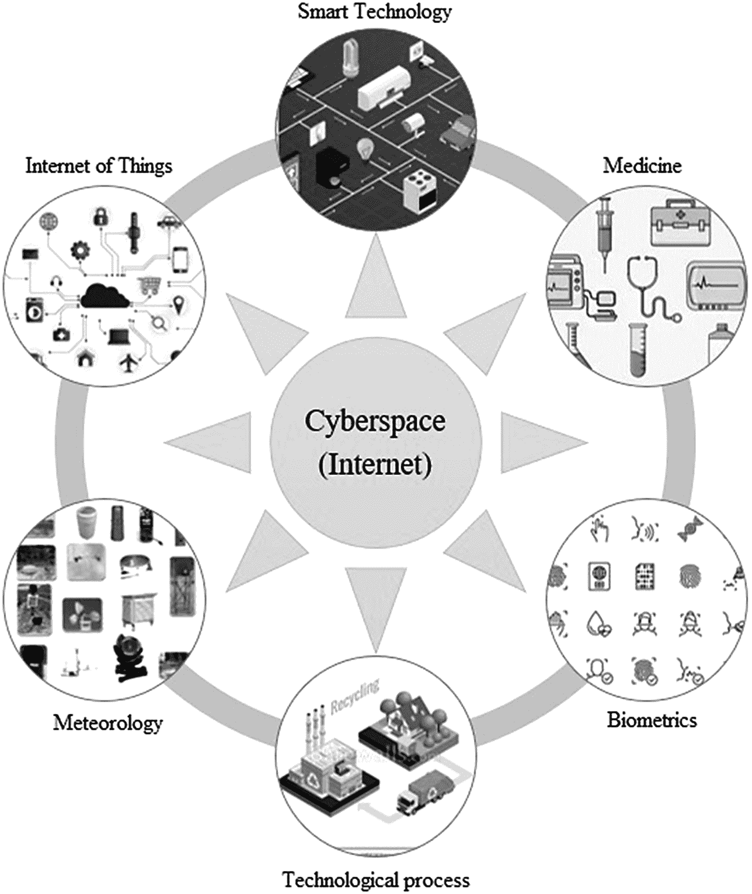

图 7.4 赛博物理系统景观。

## 7.6 讨论

世界目前正处于由各种范式构成的技术变革之中，因而推动各行业走向范式转变，该转变将总体上改变我们生活和工作的方式。很难完全预料这种变化将如何影响各种商业活动和人口。然而，人们认识到，由于这些变化的速度之快和范围之广，这种变化与以往所见所历的任何事物都不寻常。许多人认为这些是新发展、变化和机遇时期的一种指导性现象。它对装配企业带来的影响迫使各国政府重新思考制造业如何运作以及如何促进经济增长。各国目前正将注意力扩大到通过投资尖端框架和质量指导来创造先进生产能力。这些工作是通过鼓励制造业及其组织采用创新技术来实现转型，从而带来财务繁荣来完成的。第一次机械变革始于蒸汽和水力的出现，推动了生产企业的机械化，从而导致第一次工业革命（IR 1.0）；在此阶段，只有纺织工业是主要影响力量，将手工织布业转向机械化。第二次机械动荡由电力和大规模装配策略驱动，意味着第二次工业革命（IR 2.0）；这引发了电力的发现，使电气化和工业化成为可能，使整个制造过程转向以装配线为支撑的大规模生产。嵌入电子元件的计算机的发明导致了工业的巨大变革，形成了简称为 IR 3.0 的第三次工业革命；这为数字化与电子自动化铺平了道路，随着微控制器技术的出现，为设计可编程机器提供了途径。随着互联网的发明，第四次工业革命使通信不仅在人类之间成为可能，也在通过这个无缝物联网连接的物体之间成为可能，产生海量数据，使技术借助大数据分析能够提供更好、更高效的解决方案。第四次工业革命或工业 4.0 改变了商品和服务生产系统在规划、制造、使用和运作方面的整体范式，以及它们如何被维护和调整。它同样正在改变生产线的活动、流程、存储网络、管理以及能源足迹。工业 4.0 改变了制造竞争的全球格局，减少了依赖廉价劳动力的低成本相对优势。在掌握工业 4.0 创新和流程方面领先的国家和制造企业提升了全球竞争力。ICT 赋能服务的整合正在通过去中心化并提供更好的监控设施来追踪整个工业生产格局，从而根据全球市场需求和整个价值链彻底革新大规模生产。I4.0 以及在 CPS 中具有强大互联网连接的技术基础迫使从传统的经典分层自动化转变为自组织的 cyber-physical 生产系统 \[26\]。

## 7.7 结论

工业制造业部门发生的变革可以通过追溯 1800 年代的历史来理解，其中蒸汽的发现具有移动事物的能力，催生了机械动力并实现了机械化，从而在这一时代通过机械化彻底改变了制造的全部手工劳动，而纺织工业受影响最大；后来，随着电力的发现，IR 2.0 被触发，使电气化和工业化成为可能，使整个制造过程转向大规模生产；这一过程一直持续到嵌入电子芯片的计算机的发明，为电子计算机的发明铺平了道路，从而实现数字化与电子自动化；在此延续中，互联网的发明为整个人类生活向通过计算机实现的全球互联提供了动力，因此人类之间的通信得以继续，并发生了范式转变，当通信概念被强加于机器时，即物体通过传感器相互通信，结合 CPS 提供的基础设施，产生海量数据，并通过网络与处理能力和 ICT 赋能服务交换这些数据，在引入 IIoT 且人类干预最少的情况下彻底革新了整个工业制造过程。本章介绍了 I4.0 的引言、概念、意义、挑战和问题。虽然整个现象非常全面且复杂，但可以概括如下。

应用于工业或制造业的物联网将为基于由 ICT 赋能的 CPS 的全新一代制造系统铺平道路。本章阐明了由连接性和数字化生产体现的工业 4.0 概念。因此，得出的结论是，对生产系统、其中涉及的管理以及参与其中的经济体给予更多审慎考虑，以提高生产率。从最近的技术进步及其对革新工业生产率的贡献中显而易见的变革，是消除虚拟世界与物理世界之间的界限，将工人、智能机器、智能产品、生产系统和流程同化到其范式中。

## 7.8 未来工作

I4.0 被设想为一套具有巨大潜力的复杂技术，可在提供良好生活质量方面发挥重要作用。虽然它具有服务和改善生活质量的巨大潜力，但在网络安全、可行性、可扩展性和互操作性方面仍存在许多挑战，因为整个过程中涉及许多不同的系统和各种工业供应商。

## 参考文献

1. P. Prisecaru, “第四次工业革命的挑战,” Knowledge Horizons. Economics, vol. 8, no. 1, p. 57, 2016.

2. A. Pereira and F. Romero, “对工业 4.0 概念的含义及其影响的回顾,” Procedia Manufacturing, vol. 13, pp. 1206–1214, 2017.

3. G. Aceto, V. Persico, and A. Pescapé, “关于工业 4.0 的信息与通信技术调查：现状、分类法、视角和挑战,” IEEE Communications Surveys & Tutorials, 2019.

4. C. Santos, A. Mehrsai, A. Barros, M. Araújo, and E. Ares, “迈向工业 4.0：欧洲战略路线图概述,” Procedia Manufacturing, vol. 13, pp. 972–979, 2017.

5. K. Zhou, T. Liu, and L. Zhou, “工业 4.0：迈向未来的工业机遇与挑战,” in *2015 年第 12 届模糊系统与知识发现国际会议（FSKD）*, 2015: IEEE, pp. 2147–2152.

6. G. Reischauer, “工业 4.0 作为政策驱动的论述以制度化制造业创新体系,” Technological Forecasting and Social Change, vol. 132, pp. 26–33, 2018.

7. J. Wu, S. Guo, H. Huang, W. Liu, and Y. Xiang, “可持续发展目标的信息与通信技术：现状、需求和展望,” IEEE Communications Surveys & Tutorials, vol. 20, no. 3, pp. 2389–2406, 2018.

8.  R. Davies，“工业 4.0 数字化促进生产力与增长。欧洲议会研究服务处，”议员研究服务处 PE，第 568 卷，2015 年。
9.  J. I. R. Molano, J. M. C. Lovelle, C. E. Montenegro, J. J. R. Granados, and R. G. Crespo，“物联网、社交网络、云与工业 4.0 集成的元模型，” Journal of Ambient Intelligence and Humanized Computing，第 9 卷，第 3 期，第 709–723 页，2018 年。
10.  F. Shrouf, J. Ordieres, and G. Miragliotta，“工业 4.0 中的智能工厂：基于物联网范式的生产中的概念与能源管理方法综述，”载于*2014 IEEE International Conference on Industrial Engineering and Engineering Management*，2014：IEEE，第 697–701 页。
11.  S. Weyer, M. Schmitt, M. Ohmer, and D. Gorecky，“迈向工业 4.0——标准化是高度模块化、多供应商生产系统的关键挑战，” IFAC-Papersonline，第 48 卷，第 3 期，第 579–584 页，2015 年。
12.  O. Elijah, T. A. Rahman, I. Orikumhi, C. Y. Leow, and M. N. Hindia，“农业中物联网（IoT）与数据分析概述：优势与挑战，” IEEE Internet of Things Journal，第 5 卷，第 5 期，第 3758–3773 页，2018 年。
13.  B. A. Kadir, O. Broberg, and C. S. da Conceição，“工业 4.0 中人的因素与人机工程学的当前研究与未来展望，” Computers & Industrial Engineering，第 106004 页，2019 年。
14.  G. Culot, G. Nassimbeni, G. Orzes, and M. Sartor，“工业 4.0 定义背后的分析及未解问题，” International Journal of Production Economics，第 226 卷，2020 年，doi：[10.1016/j.ijpe.2020.107617](http://dx.doi.org/10.1016/j.ijpe.2020.107617)。
15.  E. Manavalan and K. Jayakrishna，“面向工业 4.0 需求的物联网（IoT）嵌入式可持续供应链综述，” Computers & Industrial Engineering，第 127 卷，第 925–953 页，2019 年。
16.  M. Nikkhah, R. Guérin, and M. Nikkhah，“将互联网迁移至 IPv6：何时与为何的探讨，” IEEE/ACM Transactions on Networking (TON)，第 24 卷，第 4 期，第 2291–2304 页，2016 年。
17.  S. Neumayer, G. Zussman, R. Cohen, and E. Modiano，“评估光纤基础设施对灾难的脆弱性，” IEEE/ACM Transactions on Networking，第 19 卷，第 6 期，第 1610–1623 页，2011 年。
18.  M. A. Al-Garadi, A. Mohamed, A. Al-Ali, X. Du, I. Ali, and M. Guizani，“物联网（IoT）安全的机器学习与深度学习方法综述，” IEEE Communications Surveys & Tutorials，第 1–1 页，2020 年，doi：[10.1109/comst.2020.2988293](http://dx.doi.org/10.1109/comst.2020.2988293)。
19.  A. Nauman, Y. A. Qadri, M. Amjad, Y. B. Zikria, M. K. Afzal, and S. W. Kim，“多媒体物联网：全面综述，” IEEE Access，第 8 卷，第 8202–8250 页，2020 年，doi：[10.1109/access.2020.2964280](http://dx.doi.org/10.1109/access.2020.2964280)。
20.  D. Bhargava，“智能体与自主机器人，”载于 Rapid Automation: Concepts, Methodologies, Tools, and Applications：IGI Global，2019 年，第 1134–1143 页。
21.  R. J. Alattas, S. Patel, and T. M. Sobh，“进化模块化机器人：综述与分析，” Journal of Intelligent & Robotic Systems，第 95 卷，第 3–4 期，第 815–828 页，2019 年。
22.  T. Tangiuchi 等，“语言与机器人学前沿综述，” Advanced Robotics，第 33 卷，第 15–16 期，第 700–730 页，2019 年，doi：[10.1080/01691864.2019. 1632223](http://dx.doi.org/10.1080/01691864.2019.1632223)。
23.  L. Junjun, L. Zhijun, F. Chen, A. Bicchi, Y. Sun, and T. Fukuda，“结合感知、认知、学习与控制以发展未来神经机器人系统：综述，”2019 年。
24.  P. D. Chatzoglou and V. N. Michailidou，“3D 打印技术使用准备度综述，” International Journal of Production Research，第 57 卷，第 8 期，第 2585–2599 页，2019 年，doi：[10.1080/00207543.2019.1572934](http://dx.doi.org/10.1080/00207543.2019.1572934)。
25.  S. R. Salkuti，“大数据与机器学习综述，” International Journal of Electrical and Computer Engineering (IJECE)，第 10 卷，第 1 期，第 575–580 页，2020 年，doi：[10.11591/ijece.v10i1](http://dx.doi.org/10.11591/ijece.v10i1)。
26.  L. D. Xu and L. Duan，“工业 4.0 中信息物理系统的大数据：综述，” Enterprise Information Systems，第 13 卷，第 2 期，第 148–169 页，2019 年，doi：[10.1080/17517575.2018.1442934](http://dx.doi.org/10.1080/17517575.2018.1442934)。
27.  G. Aceto, V. Persico, and A. Pescapé，“工业 4.0 与健康：面向医疗保健 4.0 的物联网、大数据与云计算，” Journal of Industrial Information Integration，第 18 卷，第 100129 页，2020 年，doi：[10.1016/j.jii.2020.100129](http://dx.doi.org/10.1016/j.jii.2020.100129)。
28.  M. Ramirez-Peña, A. J. Sánchez Sotano, V. Pérez-Fernandez, F. J. Abad, and M. Batista，“在 I4.0 视角下实现可持续造船供应链，” Journal of Cleaner Production，第 244 卷，第 118789 页，2020 年，doi：[10.1016/j.jclepro.2019.118789](http://dx.doi.org/10.1016/j.jclepro.2019.118789)。
29.  R. S. Nakayama, M. De Mesquita Spínola, and J. R. Silva，“迈向 I4.0：从 I3.0 演进的全面分析，” Computers & Industrial Engineering，第 144 卷，第 106453 页，2020 年，doi：[10.1016/j.cie.2020.106453](http://dx.doi.org/10.1016/j.cie.2020.106453)。
30.  Z. A. Almusaylim and N. Zaman，“智能家居现状与挑战综述：关联上下文感知物联网（IoT），” Wireless Networks，2018 年，doi：[10.1007/s11276-018-1712-5](http://dx.doi.org/10.1007/s11276-018-1712-5)。
31.  S. Kok, A. Abdullah, N. JhanJhi, and M. Supramaniam，“使用加密前检测算法预防加密勒索软件，” Computers，第 8 卷，第 4 期，第 79 页，2019 年。
32.  Z. A. Almusaylim and N. Jhanjhi，“全面综述：移动云计算位置感知服务中的用户隐私保护，” Wireless Personal Communications，第 1–24 页，2019 年。
33.  M. Lim, A. Abdullah, and N. Jhanjhi，“基于深度强化学习的犯罪网络隐藏链接预测模型性能优化，” Journal of King Saud University-Computer and Information Sciences，第 1202–1210 页，2019 年。
34.  D. Wu 等，“数字制造网络安全，” Journal of Manufacturing Systems，第 48 卷，第 3–12 页，2018 年。
35.  D. Sullivan, E. Luiijf, and E. J. Colbert，“工业控制系统的组成部分，”载于 Cyber-Security of SCADA and other Industrial Control Systems：Springer，2016 年，第 15–28 页。
36.  A. Corallo, M. Lazoi, and M. Lezzi，“工业 4.0 背景下的网络安全：关键资产与业务影响的结构化分类，” Computers in Industry，第 114 卷，2020 年，doi：[10.1016/j.compind.2019.103165](http://dx.doi.org/10.1016/j.compind.2019.103165)。
37.  M. N. Sadiku, Y. Wang, S. Cui, and S. M. Musa，“工业物联网，” International Journal of Advances in Scientific Research and Engineering，第 3 卷，第 486–489 页，2017 年。
38.  R. Alguliyev, Y. Imamverdiyev, and L. Sukhostat，“信息物理系统及其安全问题，” Computers in Industry，第 100 卷，第 212–223 页，2018 年。

# 8 基于工业物联网的安全智能制造系统

S. Karthi、N. Narmatha 和 M. Kalaiyarasi

印度卡鲁尔 V.S.B. 工程学院

DOI: [10.1201/9781003203087-8](https://dx.doi.org/10.1201/9781003203087-8)

## 8.1 Introduction

物联网（IoT）是一种利用互联网连接实际设备或“物”的新创新。家用电器和机械硬件是实际设备的例子。这些设备可以通过使用适当的传感器和通信网络提供重要信息并使消费者获得各种服务。例如，以智能方式控制建筑物的能源消耗，可以降低能源费用。物联网可在多个行业中使用，包括制造、物流和建筑。除了环境监测外，物联网在医疗保健系统和服务、无人机服务以及建筑物的智能能源管理中也越来越被使用。在创建物联网应用时，物联网部件（如探测设备、通信协议、信息存储和计算）的确定应适合预期应用，这是设计物联网系统的初始阶段。这些在工业中的应用在技术上被称为工业物联网（IIoT）。IIoT 或第四次工业革命或工业 4.0 通常是指在商业环境中使用物联网技术所赋予的名称。工业 4.0 是一种具有明确结构和显著规划的广泛视野，从根本上描述了所谓先进物理结构中现实当前优势与自动化发展之间的交叉。中小企业（SMEs）是根据投资规模进行分类的企业，它们存在于经济体的制造业和服务业部门。IIoT 对中小企业中的智能制造系统（SMSs）具有最大影响。

## 8.2 Internet of Things

物联网指的是相互依存、基于网络的事物的方法，这些事物可以在没有人工干预的情况下通过远程连接收集和传输信息 \[1\]。物联网代表了所谓的“物”的联合，即配备了执行器、程序和各种技术用于与各种设备和系统通过互联网连接和交换数据的真实物品。物联网，也称为万物互联或工业互联网，是另一种发展视角，被设想为一个整体的设备和装置网络，使其能够相互连接 \[2\]。物联网被描述为遍布全球的数十亿个真实设备，它们已连接到互联网，正在收集和交换信息。将这些不同的事物连接起来并为其添加执行器，为原本通常“愚笨”的设备增加了自动化信息层，使其能够在不涉及个人的情况下传递实时信息。图 8.1 显示了物联网的特征。物联网使我们整体环境变量的外观变得更智能、更易访问，将高级层面和物理世界整合在一起 \[3\]。物联网对就业的优势取决于具体实施；能力和效率通常是主要考虑因素。其思路是，企业应获取对其设备和内部系统的更多信息，并具备更强的能力进行相应调整。物联网承诺使我们当前的环境——我们的家居、工作场所和汽车——变得更智能、更可量化、更具表现力。自动驾驶汽车和智能城市区域可能会改变我们构建和管理我们社区的方式。安全性可能是物联网面临的最大问题。这些传感器经常收集极其敏感的数据。许多物联网设备在安全基本要素方面提供有限的保护，例如数据加密变得极其薄弱。它要求设备应具有独特的密码，组织应提供公共资源以便任何人都可以报告漏洞（并且这些漏洞会得到跟进），并且制造商应明确告知长期设备将获得安全更新。这是一个简短的总结，但也是一个起点。一旦制造智能设备的成本变得微不足道，这些问题将变得更加广泛和顽固。物联网正在形成并继续成为 IT 世界中最新的、最先进的概念。在过去十年中，“物联网”这一短语通过拓宽对协调真实物品的通用基础设施的视野而脱颖而出，使任何事物在任何时间、任何地点都可访问，而不仅仅是针对任何人 \[4\]。图 8.2 显示物联网。

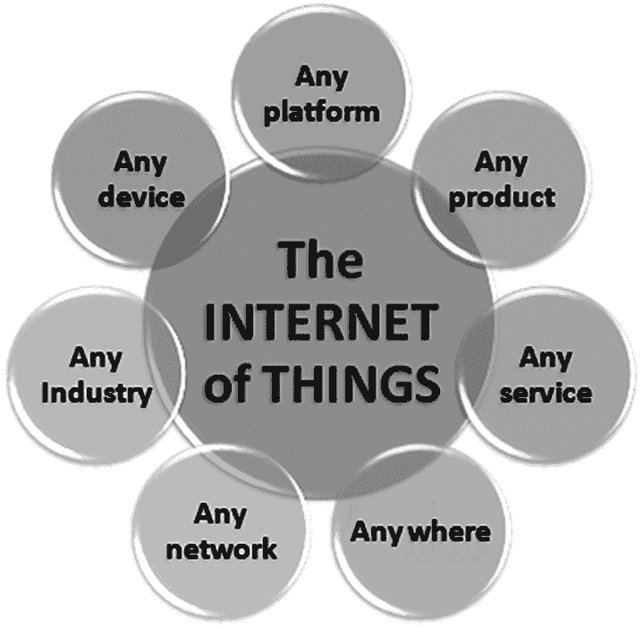

图 8.1 物联网的特征。

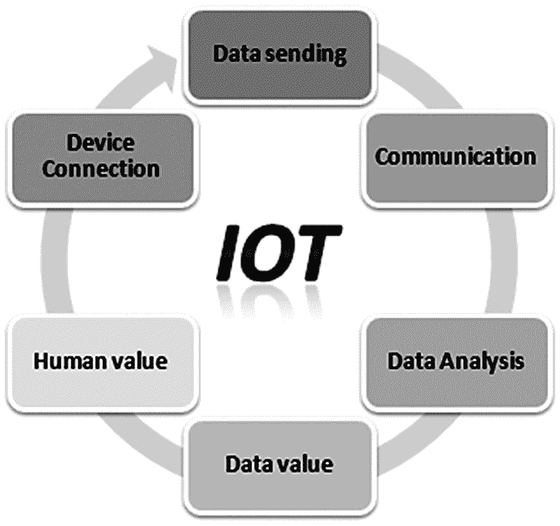

图 8.2 物联网。

## 8.3 Industrial Internet of Things

### 8.3.1 IIoT 概述

IIoT 或第四次工业革命或工业 4.0 在很大程度上是对物联网技术在专业环境中应用的标签。该概念与消费者购买物联网设备类似；然而就当前情况而言，其要点是使用执行器、远程连接、大数据、人工智能和评估的组合来监控和推进工业流程 \[3\]。IIoT 被定义为与计算机现代应用一起布置的互联执行器、仪器和各种设备，包括制造和能源管理。该网络可实现信息收集、交换和分析，可能促进生产力和效率的提升以及其他经济效益。IIoT 是分布式控制系统（DCS）的发展，通过利用分布式计算来完善和增强过程控制，实现更高水平的自动化。IIoT 由网络安全、云计算、边缘计算、移动技术、机器对机器（M2M）、3D 打印、先进工业机器人、大数据、物联网、RFID 技术和认知计算等技术推动 \[5\]。IIoT 体现了物联网在工业领域和应用中的增长和优势。围绕机器对机器互联、大数据和人工智能的核心关注，IIoT 使企业能够在运营中实现更高的能力和可靠性。IIoT 涵盖工业应用，包括先进机器人、医疗设备和软件定义制造工艺 \[6\]。图 8.3 显示了 IIoT。由于智能执行器、设备、装置和软件通过有线或无线网络的部署和集成不断增加，IIoT 正在迅速发展。通过这种协同的软硬件方法，工业实践将得到显著改善，从而实现更高效制造的工业智能 \[7\]。IIoT 超越了通常与物联网相关的普通消费设备和物理设备的互联。其显著特点是信息技术（IT）与运营技术（OT）之间的交汇点。OT 指的是操作流程和工业控制系统（ICS）的网络化，包括人机界面（HMI）、监控与数据采集（SCADA）系统、分布式控制系统（DCS）和可编程逻辑控制器（PLC）。就第四次工业革命而言，IIoT 对于先进的物理结构和制造工艺如何借助大数据和分析进行转变至关重要。来自执行器和其他信息来源的持续数据帮助当前设备和设施在处理信息片段和明确操作时实现“动态”响应。因此，它还能够实现和自动化以前的自动化系统无法处理的任务。在更广泛的环境中，IIoT 对于利用与相关自然系统或环境相关的实例至关重要，例如非农村机构如何推动智慧城市和工厂成为智能制造工厂。IIoT 同样改进了工厂管理。制造设备容易磨损，而工厂中的特定条件会加剧这一问题。传感器可以监测振动、温度和其他可能导致工作条件不佳的因素 \[8\].

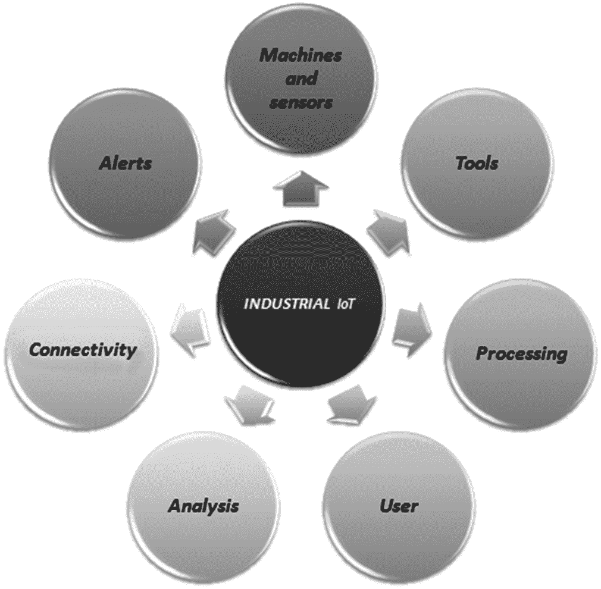

图 8.3 工业物联网。

## 8.4 IIoT 架构

IIoT 框架通常被视为计算机技术的分层特定架构 \[5\].

* 内容层
* 服务层
* 网络层
* 设备层

图 8.4 显示了物联网架构的各层。

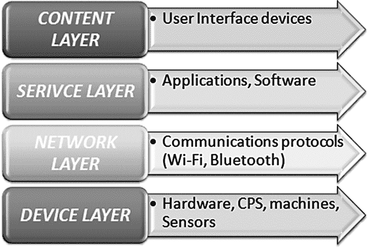

图 8.4 物联网架构的各层。

### 8.4.1 设备层

设备层指的是实际部件：CPU 执行器或设备。

### 8.4.2 网络层

网络层包括实际的网络传输、云计算和通信协议，将数据汇总并传输到服务层。

### 8.4.3 服务层

服务层包括用于控制和整合数据为可显示在驾驶员仪表板上的信息的应用程序。

### 8.4.4 内容层

堆栈的最高层是内容层，也称为用户界面。

## 8.5 IIoT 的优势

IIoT 是使用互联智能设备来监控、自动化和预测各种工业流程和结果。这些技术从通过车间监控系统提高操作人员安全，到正在改变车队管理行业的预测性维护机会，应有尽有。广泛部署此类系统有助于制造商、物流网络和仓库经理更高效地工作 \[9\]。有了 IIoT，数据驱动的洞察力推动更卓越的成果。

对于一些组织而言，这可能意味着：

* 更高的能源效率
* 成本降低
* 产品质量更好
* 决策能力增强
* 设备停机时间减少

这些优势正是 IIoT 整体如此吸引人的原因。目前，许多跨行业的组织已在使用它产生巨大影响。

## 8.6 大规模 IIoT 实施的挑战

目前，全面理解是管理整个工业物联网系统及其众多有用设备所面临的更广泛挑战的一部分。与任何联网设备一样，IIoT 组件也可能面临网络安全风险。与此同时，要充分发挥这些设备的潜在能力，需要事先规划和评估 \[9\]。

在部署您的 IIoT 系统时，请考虑这些在广泛实现物联网中常见的挑战：

* 无法将 KPI 与合理的业务目标保持一致
* 不当的组织架构
* 缺乏物联网实践
* 物联网隐私风险

忽视这些挑战的风险不仅限于财务风险。一台自主机器的安全性可能受到威胁，例如被黑客入侵或感染恶意软件的汽车。克服其中许多挑战需要在 IIoT 设备的整个生命周期中定期进行网络安全风险评估，并在适当部署期间对员工进行培训。

## 8.7 工业 4.0

底层三种工业革命被描绘为由程序化创造处理，预期水力和蒸汽动力、大规模劳动和电力使用，以及独立的电动、自动化创造。虽然旨在推动德国经济的工业 4.0 最初于 2011 年提出，但这场工业叛乱被描述为依赖于为通信而配备的 CPS 的使用以及制造自管理，并非真正致力于提高机械能力、生产率、安全性和透明度 \[10\]。工业 4.0 是制造和相关事业以及可用形成行动的进步变革。工业 4.0 被用作第四次机械动荡，它反映了现代组织和力量的更多层面。工业 4.0 是一个幻想和思想，运行在凭证结构、标准化和甚至在移动中的解释上。大多数工业 4.0 驱动是起步阶段的预测，范围有限。事实上，大多数数字化尝试发生在与第三和令人惊讶的第二次当前爆炸性进展/目标相关的情况下。在认识工业 4.0 时，认识完整价值链至关重要，该链整合了供应商和为多种智能制造所需的特定规格和部件的起点、从始至终的先进供应链管理，以及所有参与者的最终目标，即奖励微小思想，相当于奖励核心个人进步和参与者：终端客户。工业 4.0 是在大数据、人员、流程、组织、结构和物联网支持的当前服务相关环境中，对制造（和相关事业）的信息增强型变革，通过生成、影响和操纵重要数据和信息作为途径和计划，以实现智能产业和机械发展与协同努力的自然框架。因此，工业 4.0 是一个宽泛的愿景，具有清晰的结构和凭证计划，从根本上由真实现代资源和自动化发展在假设的数字化真实结构中融合所描述 \[11\]。工业 4.0 的一个确定部分是来自效率提升和新安排的价值创造影响，然而，创新变革可能对企业产生积极和消极的影响 \[12\]。图 8.5 显示工业 4.0。

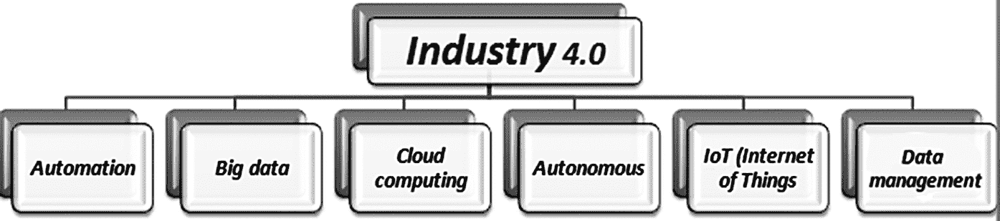

图 8.5 工业 4.0.

## 8.8 工业 4.0 历史

*   第一工业革命
*   第二次工业革命
*   第三次工业革命
*   第四次工业革命

### 8.8.1 第一次工业革命（工业 1.0）

第一次工业革命发生在十八世纪，生产中使用了蒸汽动力和自动化。以前在不变的交换轮上制造线，而机械化设计在相近的时间内通过多个阶段实现了它。蒸汽能量当时已为人所知。其用于工业目的的应用是提高人类效率的巨大飞跃。或许比由力量驱动的材料漂移，蒸汽机可以被利用于能力。诸如蒸汽船或（近 100 年后）蒸汽驱动的火车等改进也实现了在更少时间内运送更多人员和物品的巨大提升。

### 8.8.2 第二次工业革命（工业 2.0）

第二次工业革命始于 19 世纪，大致围绕电力开放和结构形成连续演进。亨利·福特（1863–1947）从芝加哥一家屠宰场实施了装配线技术：猪从传送带上悬挂，每个屠夫只完成破坏动物的任务的一部分。亨利·福特将这些原则带入汽车制造并同时对其进行了内在转变。以前一个停靠点组装整辆汽车，而从那时起，汽车在生产线上分阶段制造——完全更快且价格更低。

### 8.8.3 第三次工业革命（工业 3.0）

第三次工业革命始于 20 世纪 1970 年代，在使用存储器可编程控制和计算机的不完全自动化中。在这些进步的考虑下，我们当时被组装起来在没有人类干预的情况下强行完成整个制造过程。这种熟悉的例子是机器人执行在没有人类干预的情况下重新排序的序列。

### 8.8.4 第四次工业革命（工业 4.0）

我们目前正在完成第四次工业革命。这被数据和相关广告对工业的利用所描述，基本上被称为“工业 4.0”。它发展了第三次工业革命的改进。制造框架目前已通过联盟添加的计算机发展扩展，并在互联网上具有电子双胞胎，形象地说。这些授予与各种机构的关系并放弃关于自身的细节。这是在高级自动化中的下一个水平。所有框架的结构关联产生“高级真实制造系统”，从而产生智能工业设施，其中制造框架、片段和人员通过关联进行通信，制造基本上是自调节的。

当这些使能碰撞聚集时，工业 4.0 可以在生产线条件下实现一些令人惊叹的进步。示例包括可以预测故障并自主激活维护措施的设备，或自我运作的协作，能够对进展中的惊人变化做出反应。

此外，它可以改变人们管理的方式。工业 4.0 可以将人们推向更聪明的协作关系，具有大量有益功能的能力。社交环境数字化的制造考虑了在最佳时间为最佳个人获取正确数据的更灵活方法。制造线内部最先进设备的不断实施决定了在现场，如果维护专家可以在经典方式下获得设备验证和关联历史，并在使用地点。维护专家预计将处理问题，而不是玩耍并尝试从一开始就获得所需的具体信息 \[13\]。

因此，工业 4.0 是工业环境的无可置疑的优势。社交活动的数字化将改变物品的构建和分发方式，以及物品的升级和解释方式。就这一点而言，它可以真正促进一个抵制第四次工业革命诞生的位置。图 8.6 显示工业 4.0 模板。

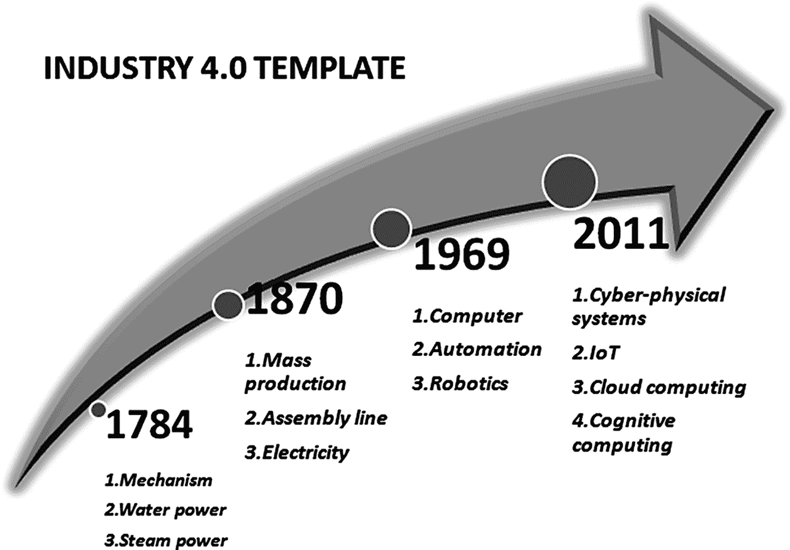

图 8.6 工业 4.0 模板.

## 8.9 工业 4.0 的利与弊

在这里，我们区分工业 4.0 的优势和劣势，以便您了解在推进数字化变革计划时制造和机械组织需要记住的内容 \[14\]。

### 8.9.1 优点

工业 4.0 的一些优势是：

*   竞争优势
*   运营效率提升
*   更好的产品和服务
*   市场开发和新市场
*   整体生活进一步发展
*   竞争优势

    工业 4.0 智能解决方案和服务为能够成功部署这些新方法论和技术的组织提供广泛的主导范围。

*   运营效率提升

Industry 4.0 的预期是，现代动荡的新兴时代将为组织带来相当可观的生产力提升，因为它们可以从相同的资源投入中获得更大的产出。

###### 8.9.1 优势
* 更好的产品和服务
  无论是组件、安全还是客户体验，工业 4.0 将更注重提供无可辩驳且显而易见的组件和产出，从而能够持续吸引客户。
* 市场和新市场的开发
  任何创新动荡都需要新的组织、事物和软件来帮助组织的转型。这将创造新的产品类别、新职位等等。
* 总体上改善生活
  随着新技术、更高生产率和经济的发展，人们的整体生活普遍改善，工资上涨、医疗保障更好，总体上生活质量更高。

### 8.9.2 缺点
以下是工业 4.0 的一些缺点：
* 重大费用
* 高失败率
* 网络保护
* 需要高技能劳动力
* 行业和市场中断
* 重大费用
  不仅开发是一项巨大的研究费用，而且实施的限制在于推动开发完成。拥有像物联网、增强现实（AR）和人工智能这样更新领域的专业技能可能会引发巨大的支出限制，并且各方之间还缺乏理解。
* 高失败率
  推进工业 4.0 的困难在于，始终缺乏对制定目标的坚持。它们始终是与多个合作伙伴的跨实用练习，这可能意味着项目会因目标冲突而陷入困境，并可能最终失败。
* 网络保护
  人、物和设备是，并且将持续与互联网相关联。但这使我们能够通过云获得更重要的数据访问权限，并为设计师形成关联提供了有利条件。
* 需要高成就劳动力
  大规模生产以及总体上的勤奋仍依赖于人们来授权形成。尽管如此，随着向精心关联结构的转变，对高度熟练岗位的需求明显增加，这可能会偶然减少对低技能工作的需求。
* 行业和零售干扰
  随着当前技术的可用，管理计划最终将被淘汰。像世界上的大热门一样，显而易见的企业无法承受工业 4.0 带来的冲击。

## 8.10 IIoT 在中小企业中
中小企业是根据投资规模进行分类的企业，它们存在于经济的制造业和服务业部门。在像印度这样庞大的人口中，中小企业带来了巨大的经济增长，约占服务业 GDP 的 24% 和制造业 GDP 的 6%。除此之外，它们还约占净出口的 45%，并提供大量就业机会。中小企业的发展维护具有公共意义，因为它们对经济的整体货币发展做出了全面贡献，并在全国范围内创造了巨大的就业。尽管通过放宽限制和法规已有效开展了许多工作，但招聘流程应变得更顺畅、更无问题。世界广域网（WWW）为中小企业提供了令人振奋的新自由，使其能够将其客户基础扩展到全球市场 \[15\]。准则应进一步放宽，这里还需要更多信贷机会，以在全国范围内建设新一代创业和工业化。中小企业的必要界限源于识别和促进这些企业的需求。通过对其适当的识别和建立此类企业合法的公共信息数据库，可轻松地为该领域量身定制的先进安排提供便利，而不会出现泄漏问题。因此，这使信贷机构能够在没有压力的情况下取得贷款进展 \[16\]。在大型组织中，功能性物联网解决方案的部署约为 20%，在某些行业中高达 80%。然而，在中小企业中，采用率接近 10%，普遍意识程度较低 \[17\]。IIoT 技术是中小企业谨慎改变其现代运营并保持竞争力的关键。IIoT 的采用对中小企业而言仍然是一个复杂且昂贵的过程，安全问题仍然是一个巨大的障碍。图 8.7 显示了各地区的中小企业。

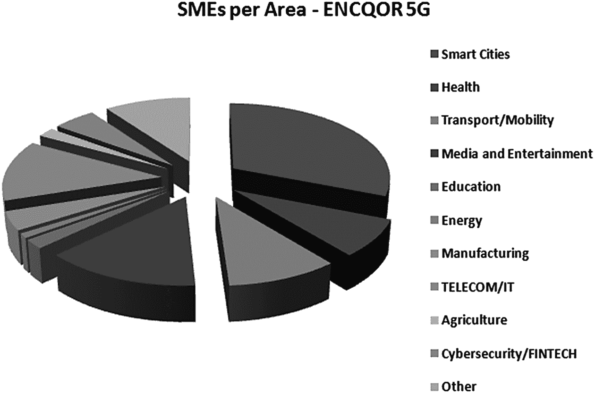

图 8.7 各地区的中小企业。

## 8.11 智能能源制造系统
智能制造是对使用计算机形成组件、高度灵活性和快速配置交换、先进信息技术以及额外灵活特定活体准备的集成的一般表征。各种目标偶尔会记住根据需求快速改变生产水平、库存组织的进步、有效生产和可回收性。在这一概念中，智能工业设施具有兼容框架、多尺度战略展示和再现、谨慎自动化、强大的先进可靠性和协调的执行器。智能制造的投资水平迅速上升——大部分生产商已在该行动中投入了至少 $100 million \[18\]。智能生产的广泛含义涵盖了各种进步。智能制造发展中的一些关键技术包括大数据处理能力、机械网络设备和服务以及先进的机械技术。智能能源管理系统是一个基于计算机的框架，旨在监控、控制、衡量和优化建筑物、工厂或任何设施的能源利用。这些框架可以将耗电系统，如供暖、通风和空调（HVAC）、照明和制造硬件，与可跟踪测量并在内部汇总数据的电表、传感器和各种设备连接起来，并可能与公用事业或电网管理员沟通以安排合作，例如在价格较低的非高峰时段购买能源；投资需求响应事件；电动汽车受控充电项目；以及作为其他公用事业或电网管理员计划的一部分传输多余能源 \[19\]。智能制造被认为是一种新的世界观，使工作更智能、更互联，通过引入现代化进步带来速度和灵活性。今天，数字化发展与组织的“可持续性”紧密相连。数字化发展和可持续性是两个不可区分的标准，依赖于循环经济的概念。数字化发展推动了循环经济模式，促进了数字平台、智能设备和人工智能等解决方案的使用，以帮助优化资源。SMSs 努力通过使用推动快速流动和在制造系统内部和之间无处不在使用数字数据的尖端技术来扩展这些能力 \[20\]。

## 8.12 智能电网

###### 智能电网

智能电网是一种高级的先进双向、流式电力框架，适用于在各种不确定性下具有预测能力的自我恢复、灵活、坚韧和合理的系统 \[21\]。它是一个电力网络，能够以成本效益的方式协调与其相关的所有客户的直接和活动——发电机、消费者以及两者兼具者——以确保在低风险和高度的重要价值和供电安全与福祉方面具有财政成功、合理的电力系统。图 8.8 显示了智能电网。

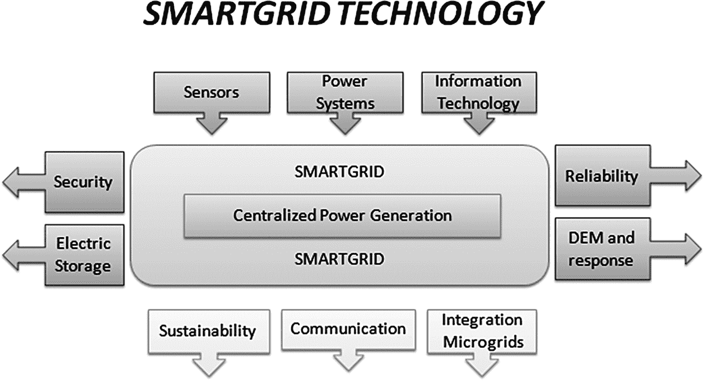

图 8.8 智能电网。

智能电网利用创新事物和组织以及快速监测、控制、通信和自修复技术 \[22\]：
* 更好地与发电机、事物本身和进步的关联和行动合作。
* 允许消费者影响改造框架的运动。
* 为买家提供更多关于他们如何使用其库存的数据和选择。
* 从根本上减少整个电力供应系统的环境影响。
* 保持甚至改善当前明显的系统可靠性、质量和供电安全程度。
* 高效地维护和改进当前服务。

## 8.13 微电网

微电网是一个独立的电力框架，设定了类似学校场地、医院综合体、商业中心或社区的离散地理印记。理解分布式发电的新兴能力的更好方法是采用一种框架策略，将发电和相关负荷视为一个子系统或一个“微电网” \[23\]。微电网内部至少有一种类型的分布式能源（太阳能板、风力涡轮机、联合供热发电、发电机等）产生其电力。同样，许多更新的微电网拥有能源储存，通常来自电池。一些现在还设有电动汽车充电站。与附近建筑物互联，微电网通过现代软件和控制系统向其客户提供电力以及可能的供暖和制冷。

微电网由三个主要特征定义：
* 微电网是本地的
* 微电网是独立的
* 微电网是智能的

图 8.9 显示了微电网。

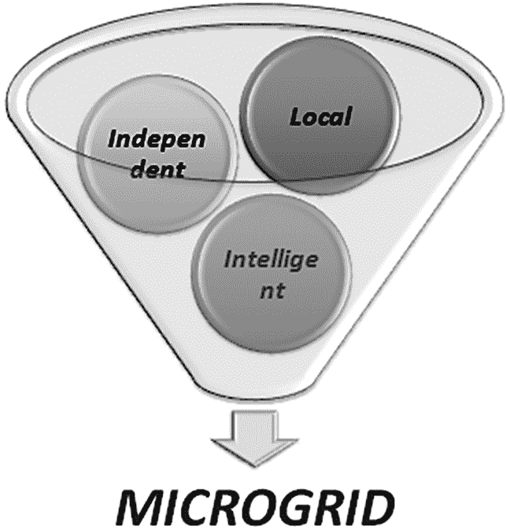

图 8.9 微电网。

* 微电网是本地的
    首先，这是一种本地能源，意味着它为附近的客户生产能源。这将微电网与在上个世纪提供我们大部分电力的那种大型集中网络区分开来。集中电网通过输电和配电线路将电力从发电站推送到广阔的空间。远距离输送电力效率低下，因为一部分电力——大约 8–15%）——在途中散失。微电网通过在为其服务的附近发电来克服这一缺点；发电机靠近建筑物或位于建筑物内部，或者在太阳能板的情况下，位于屋顶上。
* 微电网是独立的
    其次，微电网可以从集中电网分离并单独运行。这种隔离能力使它们能够在风暴或其他灾难导致电力电网停电时向其客户供电。在美国，集中电网由于其庞大的规模和通信——超过 5.7 百万英里的通信和配电线路——特别容易停电。正如我们在 2003 年被称为东北大停电期间痛苦地学到的那样，一棵树倒在电线上就可以使几个州甚至跨越国际边界进入加拿大的电力中断。通过孤岛运行，微电网可以摆脱这种连锁电网故障。虽然微电网可以独立运行，但大多数情况下它们不会（除非它们位于偏远地区，那里没有集中系统或系统不稳定）。总的来说，微电网通常仍与集中电网相连。
* 微电网是智能的
    第三，微电网——特别是先进的系统——是智能的。这种智能基于所谓的微电网控制器，即系统的中央大脑，它以高度复杂的程度处理发电机、电池和附近的提升能源系统。控制器组织不同的资源以实现微电网客户设定的能源目标。他们可能试图实现最低成本、最清洁的能源、最高的电力可靠性或其他任何结果。控制器通过增加或减少任何微电网资源的利用——或这些资源的组合——来实现这些目标，就像主管会利用不同的艺术家来提升、降低或停止参与他们的装置以获得最大效果一样。

## 8.14 工业 4.0 对智能制造的影响

工业 4.0 是德国政府前沿方法中的一项任务，推动传统行业如制造的机械化。目标是智能工厂（Smart Factory），其特点是灵活性、资源效率和人体工程学，以及客户和同事在商业和价值周期中的整合。其技术基础包括数字物理系统和物联网 \[24\]。

这种“智能制造”利用：
* 远程连接，既在产品组装期间，也在与它们的长距离连接
* 最新一代传感器，沿供应链和类似产品分散（物联网）
* 大量数据的扩展，以支配商品的开发、分销和使用的所有阶段。
* 先进的制造工艺和快速原型制作将特别使为每个客户提供独特产品成为可能，而不会大幅增加成本。
* 协作虚拟工厂（VF）平台将通过在产品生命周期中利用完整仿真和虚拟测试，极大地减少与新产品设计和生产过程设计相关的时间和成本。
* 先进的 HMI 和 AR 设备将有助于提高工厂的安全性并减少对工人的实际需求（其年龄呈上升趋势）。
* 人工智能将对推进生产过程至关重要，既用于减少设置，也用于减少能源消耗。
* 数字物理系统和 M2M 通信将允许从车间收集和传输实时数据，通过进行极其有效的预测性维护来减少停机和空闲时间。

## 8.15 智能制造的优势和劣势

### 8.15.1 优势

有许多装配创新的好处，可以有效地帮助提高生产，最终为生产部门节省资金并确保生产及时且高效 \[25\]。
* 质量提升
    质量改进无疑是收集进步的主要宝贵部分之一。有了生产软件，人们在生产组织和排程的所有方面以及真正的生产过程本身中所需较少。生产计划和生产线自动化意味着高水平的设计，减少了故障、废弃和各种事故的数量。这是因为人们比定制机器更容易出错，所以很明显为什么各种生产部门选择使用机器人和自动化而不是在工厂内拥有无数工人。
* 成本降低

###### 8.15 制造技术的优势与劣势

###### 8.15.1 优势

成本下降是制造进步的基本目标之一。这是由于生产沟通中缺陷和浪费得到纠正和减少的直接结果，随着时间的推移可节省大量资金。制造技术改善了整体效率，这也极大地提高了利润。此外，创新和自动化通常意味着工厂需要更少的工人，而这通常是制造企业产生的最大成本。

#### 整体制造时间减少

生产周期越长，价格越高。制造进步通过创新协作运作，并以更有效的方式交付产品。这完全归功于机器自动化连接，其中产品批次之间的生产时间减少，最终使制造活动能够增加利润。此外，使用机器自动化生产周期意味着您拥有稳定的生产运行速率，可更准确地预测何时可以交付产品。

#### 基于信息驱动的预测与规划

人工智能以及生产安排和排程的进步意味着您能够更准确地根据实际客户需求与供应链协调。这将使许多制造商只需生产满足客户需求所需的产品，避免因预测不佳导致的过度生产浪费。

### 8.15.2 劣势

除了制造创新的各种益处外，技术也存在一些弊端。制造技术的弊端包括以下内容。

#### 创造力受限

由于自动化/设备过剩以及生产部门缺乏代理人员，制造创新限制了创造力。员工在处理特定问题时可以进行头脑风暴，而硬件只是升级以保持在线，即使存在问题。

#### 初始成本高

许多制造商被在制造部门实施自动化和技术带来的成本降低优势所吸引。虽然这些优势可以帮助降低成本并最终增加利润，但可能涉及高昂的初始投资成本。仔细评估向您的运营中添加不同类型技术的长期收益，以确定基本实施成本是否合理。

#### 环境问题承诺

全球变暖是世界各地某些人极度关注的问题——而制造是其主要推动者之一。制造技术意味着更多硬件和技术被整合到生产设施中，这由于运行所需的不同燃料来源，例如气体和化学品，对气候产生负面影响。此外，更高效的生产线意味着您可以增加总体产量——导致更多浪费和其他排放。

#### 失业率增加

自自动化开始发挥作用以来，失业一直是制造行业的巨大担忧。自制造变革变得普遍以来，人们一直非常担心这对制造场所内人类劳动的影响。对一些人来说，增加更多机器和自动化流程意味着需要更少的工作。另一方面，您员工的更多时间现在需要投入到有助于发展业务的高价值任务中。

## 8.16 结论

总之，物联网是数据改进的有效宇宙与当前物之现实相连接的理念。物联网在某种程度上是通往智慧世界的主要途径，通过计算和结构的连接来简化围绕客户的各种努力并提供各种任务，例如对包括我们自身在内的各种现象进行基本监控。在物联网中，日常生活中普通的物品，被称为“事物”或“机器”，被重新设计并配备了处理和通信技术。工业 4.0 带来了一些明显可感知和可量化的益处，例如成本更低、能力更强、库存管理更简便、补偿时间更短以及生产力提高。工业物联网可以从根本上改变生产。确实，来自日益互联的硬件系统的信息量不断增加，而通过 IIoT 实现关键且重要的洞察是无限的。为了通过基于 IIoT 的智能制造在中小企业中学习，本文共同讨论了物联网、IIot、中小企业和智能制造的内容及其优缺点。

## 参考文献

1. Golpîra, Hêriş, Syed Abdul Rehman Khan, and Sina Safaeipour. “物流物联网综述：当前趋势与未来研究范围。” Journal of Industrial Information Integration 22 (2021): 100194.

2. Sadeeq, Mohammed AM, and Subhi Zeebaree. “通过分布式系统进行物联网能源管理。” Journal of Applied Science and Technology Trends 2.02 (2021): 59–71.

3. Wang, Jianxin, et al. “过去 20 年物联网（IoT）的演变。” Computers & Industrial Engineering 155 (2021): 107174.

4. Lv, Zhihan, et al. “用于 6G 支持的大规模物联网的大数据分析。” IEEE Internet of Things Journal 8.7 (2021): 5350–5359.

5. Mezzanotte, Paolo, et al. “用于物联网应用的创新 RFID 传感器。” IEEE Journal of Microwaves 1.1 (2021): 55–65.

6. Halder, Subir, and Thomas Newe. “通过云辅助 IIoT 中的同态加密实现安全时间序列数据共享。” Future Generation Computer Systems 133 (2022): 351–363.

7. Yu, Keping, et al. “IIoT 中具有可追溯和直接撤销的区块链增强数据共享。” IEEE Transactions on Industrial Informatics 17.11 (2021): 7669–7678.

8. Cakir, Mustafa, Mehmet Ali Guvenc, and Selcuk Mistikoglu. “流行机器学习算法在预测性维护中的实验应用及基于 IIoT 的状况监测系统设计。” Computers & Industrial Engineering 151 (2021): 106948.

9. Wang, Oliver. “连接实现智能生产线：在收获 IIoT 益处之前，操作员需要获得生产现场的可见性。” Plant Engineering 76.1 (2022): 37–40.

10. Zheng, Ting, et al. “制造背景下工业 4.0 技术应用：系统文献综述。” International Journal of Production Research 59.6 (2021): 1922–1954.

11. Acioli, Carina, Annibal Scavarda, and Augusto Reis. “在 COVID-19 可持续链中应用工业 4.0 技术。” International Journal of Productivity and Performance Management (2021).

12. Nara, Elpidio Oscar Benitez, et al. “工业 4.0 技术对可持续发展的预期影响：以巴西塑料工业为背景的研究。” Sustainable Production and Consumption 25 (2021): 102–122.

13. Chehri, Abdellah, et al. “工业 4.0 时代实施成功企业物联网战略的理论与实践。” Procedia Computer Science 192 (2021): 4609–4618.

14. Verma, Anju, and M. Venkatesan. “工业 4.0 对印度汽车行业组织有效性的劳动力影响与策略：综述。” Technology Analysis & Strategic Management (2021): 1–9.

15. Ying, Zhen, et al. “用于增强可用性的工业物联网计算模型概述。” Complexity (2021).

16. Sharma, Durga Prasad, et al. “云资源管理的涌现范式与实践。” 《工业 4.0 中云资源管理的自主计算》。 Springer, Cham, 2021. 17–39.

17. Indoria, Mayank, et al. “实施工业 4.0 以实现钢铁行业可持续制造：案例研究。” Systematic Literature Review and Meta-Analysis Journal 2.1 (2021): 1–9.

18. Zuo, Yanjun. “让智能制造更智能——工业 4.0 中区块链技术综述。” Enterprise Information Systems 15.10 (2021): 1323–1353.

19. Cots, Ainhoa, et al. “节能智能等离子变色窗：性能、制造及在隔热玻璃中的集成。” Nano Energy 84 (2021): 105894.

20. Bermeo-Ayerbe, Miguel Angel, Carlos Ocampo-Martinez, and Javier Diaz-Rozo. “面向智能制造系统节能与维护的数据驱动能源预测建模。” Energy 238 (2022): 121691.

21. Krishnan, Priya R., and Josephkutty Jacob. “基于物联网的智能电网高效能源管理：采用 DHOCSA 技术。” Sustainable Cities and Society 79 (2022): 103727.

22. Saleem, M. Usman, et al. “面向智能电网需求侧管理的基于物联网的智能能源管理系统设计、部署与性能评估。” IEEE Access 10 (2022): 15261–15278.

23. Sedhom, Bishoy E., et al. “面向智能微电网的基于物联网的最优需求侧管理与控制方案。” International Journal of Electrical Power & Energy Systems 127 (2021): 106674.

24. Gerekli, İsa, Tarık Ziyad Çelik, and İbrahim Bozkurt. “工业 4.0 与智能生产。” TEM Journal 10.2 (2021): 799–805.

25. Kotsiopoulos, Thanasis, et al. “智能制造中的机器学习与深度学习：智能电网范式。” Computer Science Review 40 (2021): 100341.

# 9 智能城市中网络安全的作用

Azeem Khan and Noor Zaman Jhanjhi

Taylor’s University, Subang Jaya, Selangor, Malaysia

Mamoona Humayun

Jouf University, Al Jouf, Saudi Arabia

DOI: [10.1201/9781003203087-9](https://dx.doi.org/10.1201/9781003203087-9)

## 9.1 引言

城市一直是文明的中心，自始以来象征着人类进步；正因如此，个人和民众一直在向城市迁移以寻求生活改善，这一过程仍在持续，并且由于能够在经济和职业发展方面改善人类生活的机遇而将继续持续。农村经济主要以农业为主；因此，在工业化进程开始后，它为大规模生产铺平了道路，在城市创造了巨大的就业机会；从此以后，人们开始全球范围内涌向城市，导致城市人口增加。随着信息与通信技术（ICT）的出现，自动化进程开始了，这一进程仍在持续 [1 and 2]。城市中 ICT 技术的应用使该生态系统中的所有利益相关者在解决与城市管理相关的基本基础设施问题时得到支持，例如交通、健康、住房、教育、公共安全、环境和能源，从而为出现互联且嵌入智能设备的城市铺平了道路，这些城市被称为智能城市。智能城市是被大量互联且智能的设备所环绕的城市 [3, 4 and 5]。这些技术通过改善城市居民所需的基本设施，在提高行政效率方面为地方政府提供了便利。尽管民众生活得到了很大改善并有助于提高生活质量，但它们也带来了许多其他挑战，这些挑战以牺牲安全和隐私为代价。为应对这些挑战并提供更好的解决方案，网络安全已被证明具有极其重要的意义，不可忽视。为了简化智能城市这一概念，我们将其与相关的风险一起用概念层进行了总结，如 图 9.1 所示。

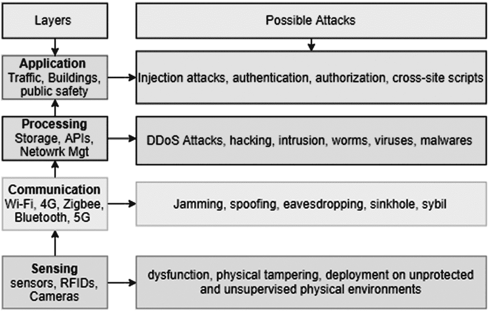

图 9.1 各类智能城市基础设施层面的网络安全攻击。

智能城市架构被设想为四层。每层都与一组特定的技术相连，并伴随众多可能的网络攻击，这些攻击在任何情况下都不可忽视；这些已在上文针对每层进行了标注。简而言之，智能城市提供数字基础设施，包括通过传感器实现的无处不在的感知，以及通过 WSN、4G、Zigbee、Bluetooth、Z-wave、近场通信（NFC）、5G 等通信技术实现的这些设备之间的通信，而由这些众多互联设备产生的大量数据，即所谓的 Big Data，其处理通过云计算技术借助数据分析实现，通过实施复杂的机器学习算法，有助于基于实时生成的数据提供有意义的洞察。这使智能城市环境中的所有参与者能够及时做出智能决策，并改善居住在城市中能够通过应用程序形式的 app 访问所有智能城市基础设施的公民的生活 [6, 7 and 8]。

该基础设施的每一层也伴随风险；在应用层，用户系统可能遭受网络攻击而被入侵，这些攻击可能是跨站脚本或注入攻击；除此之外，通过身份验证和授权获取系统访问权限是一个常见陷阱；此外，在各层还存在许多其他安全风险，例如在处理和通信层出现病毒、蠕虫入侵、干扰、DDoS 攻击，最后但同样重要的是，在感知层，如果设备部署在未受保护且无人监督的物理环境中，可能遭受攻击和物理篡改，通常会导致设备故障 [9]。

本章剩余部分安排如下。第 9.2 节 介绍了智能城市的新兴最先进技术；第 9.3 节 重点阐述了各种应用及其相关的网络安全威胁；第 9.4 节和第 9.5 节专门阐述了拟议框架、智能城市网络安全相关的开放性问题和挑战。最后，以关于可能未来工作的说明作结。

## 9.2 智能城市的新兴最先进技术

有若干技术参与维护、管理并保障整个智能城市生态系统；其中一些新兴最先进技术包括云计算、大数据和物联网（缩写为 IoT）[10]，而在通信技术中则包括 RFID、WSN、Bluetooth、NFC、Zigbee、Z-wave、4G 和 5G 等技术。它们总结如下。

### 9.2.1 云计算

###### 9.2

在智慧城市中，数据被集中化，以便所有利益相关者都可以访问。云计算通过数据中心提供其服务来实现这一目的，这些数据中心可能由公共部门或私营部门管理，或由两者组成的混合体管理，被称为混合云 \[11 and 12\]。除了提供此服务外，云计算还提供硬件、基础设施、软件和平台服务，从而节省成本，并以可靠性、可扩展性和高性能实现大规模计算任务数据的最快交付。因此，云计算为设备提供虚拟基础设施，智慧城市可借此存储、监控、分析并可视化数据。然而，智慧城市中的云计算不仅仅是为了让城市更高效。在短期内，数据可能被管理员和政府保存、评估和使用以采取适当措施。然而，从长远来看，来自一个云的特定数据和数据驱动的洞察可能被出售给其他城市的云提供商，最终导致构建一种“模板”管理系统，该系统可以在较少人工参与的情况下迅速将“普通”城市转变为智慧城市 \[13, 14 and 15\]。

### 9.2.2 Big Data
数据在智慧城市的整个生态系统中至关重要，具有极其重要的意义。由数字技术（如手机、互联网、卫星或传感器）创建的数据被称为大数据。需要数据科学——或人工智能——技术或方法来高效地收集、整理、组织和分析这些数据。大数据通常是我们数字行为的副产品，基于我们在日常生活中与系统或设备交互时留下的数字“碎屑”——由能够相互通信的连接设备产生的大量数据 \[16\]。数据通过各种数据源收集，例如传感器、计算机、摄像机、全球定位系统（GPSs）、社交网络网站、商业交易和游戏；如果利用合适的最先进技术对其进行处理和适当精炼，则可通过大数据分析应用提供有价值的洞察，大数据分析运行在由人工智能驱动的复杂机器学习算法上，有助于城市的有效高效管理 \[17\]，并通过提供实时交通数据的洞察改善出行交通管理，帮助城市居民为出行做出恰当决策。因此，大数据在为智慧城市居民提供这一机会方面发挥着至关重要的作用 \[18\]。

### 9.2.3 IoT
智慧城市生态系统的核心在于被称为传感器的设备，它们通过互联网感知环境中的数据并负责产生大量数据，这些相互连接并能够相互通信的对象被称为物联网 \[18\]。物联网设备负责生成实时数据，然后将这些数据云存储在集中位置。它们可供连接到这一无缝网络群的各利益相关者使用，使其能够做出智能决策 \[19\]。这些设备感知温度、湿度、噪音水平、交通拥堵、公共安全、信号等。尽管物联网设备在智慧城市中发挥着至关重要的作用，但它们也极易受到安全攻击。因此，供应商、设备制造商和政府必须共同努力制定更严格的物联网安全法规。组织和设备制造商必须遵循不断发展的标准和建议，以确保系统“安全设计”，并在安装前后识别和解决故障。此外，积极的智慧城市技术运营商还必须尝试理解其智能环境和系统面临的安全挑战，以便在事故发生前将风险降至最低。城市的未来将随着时间的推移变得更智能。尽管如此，智慧城市与安全城市之间的区别将取决于物联网安全实施的程度。

### 9.2.4 RFID
在智慧城市中，资产借助无线射频识别，缩写为 RFID 进行跟踪。它们以标签形式出现，也作为贴附物，从而为所有对象提供唯一 ID，使整个智慧城市环境中的位置和资产清单变得容易 \[20\]。该技术运行在电磁场上，可通过标签识别和跟踪所有对象，这些标签在与智慧城市相关的许多领域广泛使用，例如医院、学校、酒店、购物中心、教育机构、图书馆、货物、生产装配线等，仅举几例。与条形码信号不同，RFID 即使在不可见时也可以被读取。

### 9.2.5 WSN
缩写 WSN 代表无线传感器网络，正如其名称所示，它在没有物理连接的情况下提供网络连接。这些网络是分布式和自主的。WSN 是传感器节点，用于在智能建筑管理系统中测量温度、光线、窒息性气体/烟雾、湿度、能源使用和占用情况。WSN 连接的设备之间的通信通过传感器完成。传感器是具有无线通信技术的低功耗集成电路。它们已证明在多个领域理想：自然灾害预防、健康监测、工业过程监测、家庭 \[19\]、水质监测等。该网络的特征是可以实时监控物理和环境条件，如湿度、压力、光线和温度，并适用于智能家居、智能建筑和智能健康 \[20\]。

### 9.2.6 4G and 5G
这些通信技术在数据吞吐量方面意味着范式转变。4G 数据速度范围从 100 Mbps 到 1 Gbps。4G 可以提供超宽带互联网服务。4G 为智慧城市居民提供以下服务：通过可穿戴设备的通信、高清语音、短消息服务、多媒体消息服务、移动电视、高清流媒体、全球漫游、游戏服务等；相反，5G 是最新的通信技术，提供面向数百亿设备的平台并支持 10 Gbps 的带宽；5G 能够支持具有超高清音视频应用的虚拟现实环境以及 10 Gbps 数据速度的移动云服务，这对于与智慧城市生态系统连接的几乎所有设备都是必要的 \[21 and 22\]。

## 9.3 Applications for Smart Cities and Cybersecurity

为简化起见，我们已根据其效用将智慧城市的应用归类为各个领域。如图 9.2 所示，它们大致按行业、能源、出行、生活服务和环境进行分类。在出行方面，智慧城市通过智能交通系统支持交通的基础设施，为避免交通拥堵，通过智能停车\[23–24\]进行适当的停车安排，通过 RFID 提供。这些电子泊车服务基于 NFC 技术运行，实现账单的便捷支付。智能交通管理通过附着于交通信号系统的传感器实现，这些传感器由交通管理部门持续控制和监控，数据由安装在交通信号系统上的传感器发送；这些传感器通过云端向相关部门发送持续的数据更新，从而帮助他们通过适当的实时数据分析管理交通\[19\]。

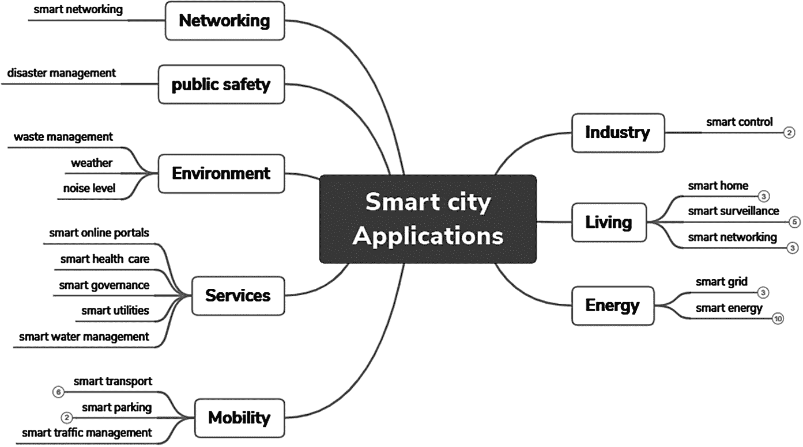

图 9.2 智慧城市应用。

除此之外，还有其他与能源生成相关的应用，被称为智能能源，其中传感器附着于风力发电机和太阳能板，这些是生产可再生能源的主要来源。配备智能电表的智能电网能够轻松追踪能源消耗，而智能路灯则使智慧城市能够通过在需要时使用能源资源，并在稍后通过相关部门将其关闭来优化能源资源，相关部门能够远程访问、监控和管理这些资源。智能生活提供嵌入智能监控的智能家居基础设施\[25\]，该基础设施配备安装在家中的摄像头，用于监控其内部和外部周边，并在不确定和紧急情况下做出及时决策。除此之外，还有许多其他应用，例如公共安全系统，在自然灾害发生时通过提前提供信息并加以利用来确保生命安全，在盗窃、陌生人身体攻击时，这些系统也能追踪，从而为城市居民提供更好的生活质量。通过医疗保健服务、有效治理提供最先进的设施，通过适当的废物管理改善生活质量，并通过与这些应用相关的传感器生成的数据控制噪音污染、辐射水平和温室气体排放。除此之外，更好的就业机会通过嵌入网络物理系统的智能产业得以实现，这些系统可以监控工业内部连接的机器的健康状况。这样，我们就有许多与智慧城市相连的应用。

如前所述，智慧城市配备了传感器和执行器。传感器用于收集数据并将其传递到云端，而执行器允许设备采取行动，例如通过改变智能路灯系统中的路灯、限制漏水管道的水流等。通过利用驾驶员智能手机的 GPS 数据，可以更有效地进行智能交通管理以便理解；让我们考虑一个可以防止交通堵塞的场景。为了防止城市交通拥堵，从驾驶员处获取的数据通过云端发送给交通管理团队，后者会自动向驾驶员发送通知，建议他们选择替代路线。同时，交通控制中心的员工会被告知发送拥堵警报以缓解拥堵并重新规划部分交通；他们可以向交通灯执行器发送指令以改变信号，从而解决交通拥堵问题\[23\]。

随着智慧城市变得更加互联并拥有更复杂的数字基础设施，这些服务将变得越来越容易受到网络攻击。智慧城市的力量与它们最薄弱的环节一样大，即使是最小的弱点也可能被利用产生巨大影响。因此，政府必须更加关注网络安全并在威胁预防上投入更多资金。否则，随着黑客利用安全漏洞，政府将不断处于防御状态。另一方面，这些漏洞的来源是众所周知的。物联网设备安全问题，例如缺乏适当的加密和通过有线进行补丁更新，已是众所周知。尽管有大量建议说明如何使设备和支持架构安全，但问题仍然存在。尽管缺乏安全标准，制造商仍继续将不安全的产品和系统从生产线推向智慧城市解决方案，扩大系统攻击面\[24 和 25\]。

抛开以上所有讨论，如果这些设备被攻破，整个系统都可能被破坏，因此迫切需要在智慧城市整个生态系统中实施安全措施以控制任何异常情况。已有报道称交通信号灯被黑客入侵、智能电网被破坏、智能监控系统遭到攻击等事件。因此，我们不能以牺牲这些系统为智慧城市居民提供的便利为代价而忽视安全复杂性。我们已为智慧城市提出一个框架来解决这些网络安全问题，该框架在第 9.4 节中进行了讨论。

## 9.4 网络安全与智慧城市的拟议框架

如上所述，智慧城市为城市居民服务具有巨大的潜在益处；另一方面，被认为是黑暗面的是它们容易受到攻击，破坏硬件并使软件服务不可用、软件错误、未经授权使用或访问系统、数据盗窃、恶意软件运行或用户错误等，不一而足。因此，需要解决与这一黑暗面相关的问题，这些问题被称为网络安全问题。为解决这些问题，我们提出了一个框架，该框架在图 9.3 中进行了描述。以下是在该生态系统的所有利益相关者需要实施的步骤。

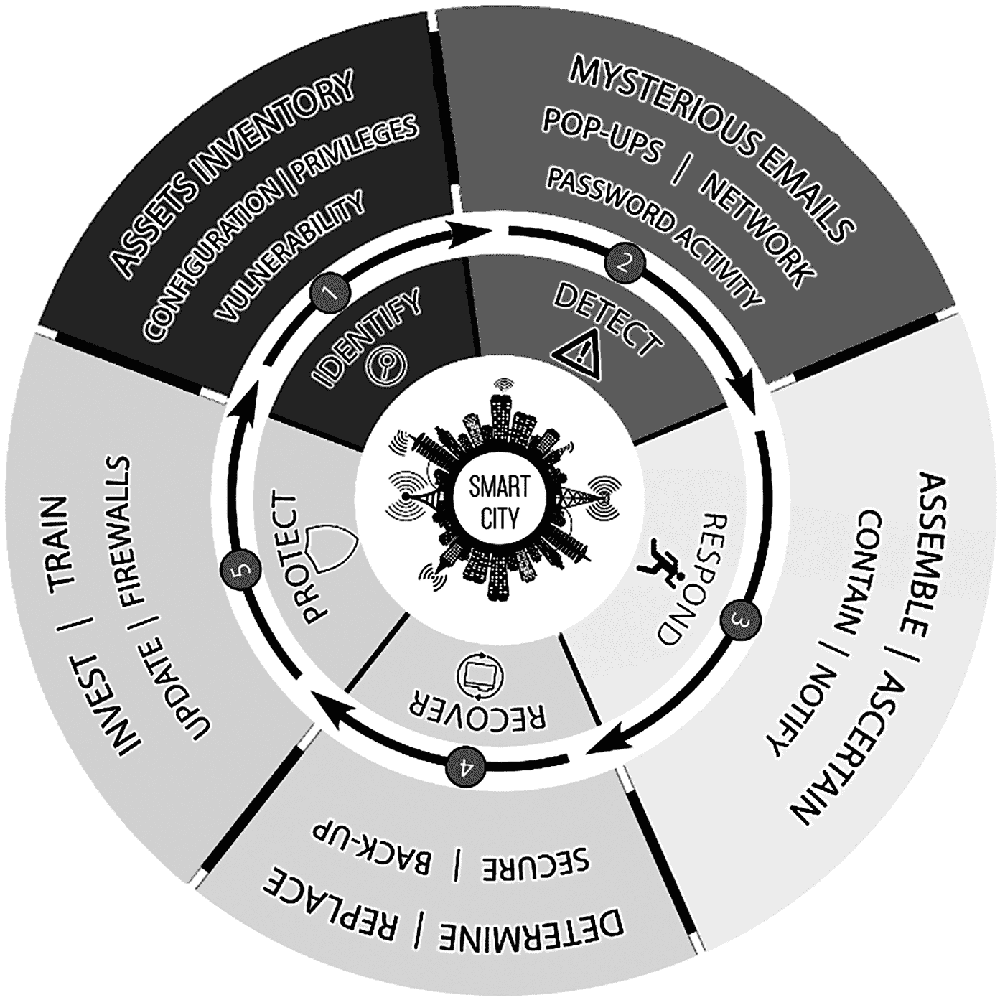

图 9.3 智慧城市的拟议网络安全框架。

与该系统相连的每个个体实体最首要、最需要制定的事情是制定一种策略来克服该生态系统中固有的威胁。我们的框架说明，首先，最重要的是，智能城市生态系统中的个人或组织需要识别其资产，这些资产可以是硬件资产或软件资产，并且其清单应定期持续维护，否则入侵者可以轻易潜入并利用最薄弱的环节破坏整个系统。除了定期的配置检查外，所分配的权限也应经常审查，以了解系统内潜入的漏洞。第二阶段是检测漏洞，这可以通过定期监控网络来实现；如果发现任何神秘的电子邮件，需要对其进行隔离；异常的密码活动应被高度重视并需要检查；除此之外，可疑的弹出窗口和网络变慢也是系统正遭受攻击的症状，应立即处理，这可以在下一个阶段完成，该阶段被称为响应阶段，包括组建专家团队，根据其专业知识解决相关问题，通过确定来源并遏制易受攻击的实体；完成所有这些后，他们应通知所有系统用户注意系统中出现此类漏洞，并指导他们采取进一步行动。

第四阶段是通过定期备份来恢复，以确定并替换系统中的不需要的实体。最后但并非最不重要的是保护整个系统的阶段，通过对该整个生态系统相关的员工进行培训；除此之外，操作系统、杀毒软件和防火墙相关的软件应定期更新；然而，这需要成本，因此利益相关者绝不应在投资上退缩；否则，整个系统可能被破坏，造成混乱。为了避免阻碍并确保整个智能城市生态系统顺畅运行，上述框架应不折不扣地实施；否则，整个系统可能被破坏。

## 9.5 开放性问题与挑战

智能城市是通过多个基础设施的参与来理解的，这些基础设施配备了嵌入式系统，并通过异构网络平台与分布式系统相互连接。由于整个生态系统涉及许多关键参与者，已证明存在薄弱环节，为整个互联环境中的安全和隐私泄露铺平道路，因此智能城市并非不受安全漏洞的例外，并且容易受到多种攻击，这些攻击可能来自内部实体、外部实体或两者兼而有之。智能城市容易受到各种攻击，包括配置错误、功能故障、恶意滥用、僵尸网络、勒索软件\[26,27\]、活动、DDoS 攻击等，而整个生态系统的主要风险是当其被入侵者破坏时\[28\]。

因此，解决与智能城市相关的这些固有问题是一个挑战。智能城市的开放性问题和挑战可概括如下：业务挑战——包括实施网络物理系统所产生的成本，需要大量投资；其次，监管问题——政策制定者应确定适当的法规\[29\]以确保系统的顺畅运行。可持续性强调了整个生态系统需要实现的元素，以便实施这些稳健的方法以使系统得以持续。最后，互操作性也是一个需要解决的挑战，因为整个生态系统包含不同的技术以及属于不同领域的设备；因此，应制定适当的机制来解决它们之间的可操作性问题，以及与隐私相关的技术挑战，该挑战涉及机密性、完整性、可用性和与未经授权访问相关的安全问题\[30\]。

## 9.6 结论

从前面的讨论可以明显看出，智能城市概念彻底改变了人们对城市生活的思考方式。采用信息通信技术实现的整个自动化系统以技术的代价使城市生活变得更容易，有时如果管理不当会造成混乱；因此，有关当局应确保智能城市——即仪器化、互联互通和智能化的城市——同样更安全，因为许多安全和隐私问题被发现是整个系统中的漏洞。

因此，本章的努力旨在理解智能城市是什么及其要素。我们提出了一个框架，如果由相关当局正确实施，可以使整个智能城市生态系统正常运作并运行更顺畅。智能城市的并非所有漏洞都仅与硬件和软件相关，事实上，许多实例中存在人为错误。因此，明确定义管理、市政管理以及网络安全官员等岗位人员的职责至关重要且不容含糊。

因此，需要强有力的领导来引领整个生态系统，如果没有领导，将会造成难以轻易恢复的损害；因此，迫切需要实施强有力的验证检查、防火墙更新、制定适当的应急响应策略以及实施适当的身份验证和授权方案，这些方案可使用双因素或三因素身份验证来实现。所提出的网络安全框架有助于实现整个智能城市生态系统的安全、保障和隐私。

## 9.7 未来工作

尽管该领域似乎已开展了大量工作，事实上，仍有许多关于安全和隐私的问题未得到解答，因此迫切需要进一步探索并提供更好的解决方案，以维护整个智能城市生态系统的安全和隐私。

针对智能城市提出的网络安全研究框架可能能够实现安全高效的通信，除此之外，还能使智能城市功能的其他交易在其实践功能方面更安全、更顺畅、更高效。智能城市可以采用它。

## 参考文献

1.  E. Bibri and J. Krogstie, “未来的智慧可持续城市：一次广泛的跨学科文献综述，” Sustainable Cities and Society, vol. 31, pp. 183–212, 2017.

2.  M. Vitunskaite, Y. He, T. Brandstetter, and H. Janicke, “智能城市与网络安全：我们到那儿了吗？关于标准、第三方风险管理及安全所有权作用的比较研究，” Computers & Security, vol. 83, pp. 313–331, 2019.

3.  Z. A. Almusaylim and N. Jhanjhi, “综合综述：移动云计算位置感知服务中的用户隐私保护，” Wireless Personal Communications, pp. 1–24, 2019.

4.  H. Habibzadeh, B. H. Nussbaum, F. Anjomshoa, B. Kantarci, and T. Soyata, “关于智能城市中网络物理系统部署的网络安全、数据隐私和政策问题的调查，” Sustainable Cities and Society, vol. 50, p. 101660, 2019.

5.  P. I. Radoglou Grammatikis, P. G. Sarigiannidis, and I. D. Moscholios, “物联网安全：挑战、威胁与解决方案，” Internet of Things, vol. 5, pp. 41–70, 2019.

6. M. I. Khalil, N. Z. Jhanjhi, M. Humayun, S. K. Sivanesan, M. Masud, and M. Shamim Hossain, “面向智慧城市的具有可持续能源高效资源的混合智能电网,” *Sustainable Energy Technologies and Assessments*, vol. 46, p. 101211, 2021.

7. M. Humayun, N. Z. Jhanjhi, M. Z. Alamri, and A. Khan, “智慧城市与数字治理,” 见 *Employing Recent Technologies for Improved Digital Governance*, pp. 87–106. IGI Global, 2020.

8. B. Hamid, N. Z. Jhanjhi, M. Humayun, A. Khan, and A. Alsayat, “智慧城市的网络安全问题与挑战：综述,” 见 *2019 年第 13 届数学、精算科学、计算机科学与统计学国际会议 (MACS)*, 2019: IEEE, pp. 1–7.

9. A. Fournaris, K. Lampropoulos, and O. Koufopavlou, “智慧城市基础设施中的终端节点安全与信任漏洞,” *MATEC 会议集*, vol. 188, 2018, p. 05005.

10. M. Aly, F. Khomh, M. Haoues, A. Quintero, and S. Yacout, “在物联网框架中强制执行安全性：系统文献综述,” *Internet of Things*, vol. 6, 2019.

11. C. Stergiou, K. E. Psannis, B. B. Gupta, and Y. Ishibashi, “面向大数据与物联网的可持续云计算的安全性、隐私与效率,” *Sustainable Computing: Informatics and Systems*, vol. 19, pp. 174–184, 2018.

12. J. Sengupta, S. Ruj, and S. Das Bit, “关于物联网和工业物联网攻击、安全问题及区块链解决方案的综合综述,” *Journal of Network and Computer Applications*, vol. 149, p. 102481, 2020.

13. E. Al Nuaimi, H. Al Neyadi, N. Mohamed, and J. Al-Jaroodi, “大数据在智慧城市中的应用,” *Journal of Internet Services and Applications*, vol. 6, no. 1, 2015.

14. I. A. T. Hashem et al., “大数据在智慧城市中的作用,” *International Journal of Information Management*, vol. 36, no. 5, pp. 748–758, 2016.

15. F. A. Alaba, M. Othman, I. A. T. Hashem, and F. Alotaibi, “物联网安全：综述,” *Journal of Network and Computer Applications*, vol. 88, pp. 10–28, 2017.

16. S. Alayda, N. A. Almowaysher, M. Humayun, and N. Z. Jhanjhi, “云计算中访问控制的一种新型混合方法.”

17. B. A. Alenizi, M. Humayun, and N. Z. Jhanjhi, “云计算中的安全与隐私问题,” 见 *Journal of Physics: Conference Series*, vol. 1979, no. 1, 2021: IOP Publishing, p. 012038.

18. M. Humayun, “新兴物联网大数据与云计算在实时应用中的作用,” *International Journal of Advanced Computer Science and Applications(IJACSA)*, vol. 11, no. 4, 2020. [`dx.doi.org/10.14569/IJACSA.2020.0110466`](http://dx.doi.org/10.14569/IJACSA.2020.0110466)

19. Z. A. Almusaylim and N. Zaman, “智能家居现状与挑战综述：关联感知物联网,” *Wireless Networks*, 2018.

20. M. Shafiq, H. Ashraf, A. Ullah, M. Masud, M. Azeem, N. Z. Jhanjhi, and M. Humayun, “WSN 中物联网辅助智能设备的稳健基于簇的路由协议.” *CMC-Computers Materials & Continua*, vol. 67, no. 3 (2021): 3505–3521.

21. J. Dwivedi et al., “基于 RFID 技术的考勤管理系统,” *International Journal of Engineering Science and Computing (IJESC)*, vol. 7, no. 3, 2017.

22. M. Humayun, N. Jhanjhi, M. Alruwaili, S. S. Amalathas, V. Balasubramanian, and B. Selvaraj, “面向 5G 辅助工业物联网的隐私保护与能量优化,” *IEEE Access*, vol. 8, pp. 183665–183677, 2020.

23. Q. K. U. D. Arshad, A. U. Kashif, and I. M. Quershi, “蜂窝技术演进综述,” 见 *2019 年第 16 届布尔班应用科学与技术国际会议 (IBCAST)*, 2019: IEEE, pp. 989–993.

24. F. Al-Turjman and A. Malekloo, “物联网赋能城市中的智能停车：综述,” *Sustainable Cities and Society*, vol. 49, p. 101608, 2019.

25. M. Khir et al., “交通信号灯违章摄像头监控监视系统的框架设计,” 见 *2018 年智能与先进系统国际会议 (ICIAS)*, 2018: IEEE, pp. 1–4.

26. S. Kok, A. Abdullah, N. JhanJhi, and M. Supramaniam, “使用预加密检测算法防止加密勒索软件,” *Computers*, vol. 8, no. 4, p. 79, 2019.

27. S. Kok, A. Abdullah, N. Jhanjhi, and M. Supramaniam, “勒索软件、威胁与检测技术：综述,” *International Journal Computer Science and Network Security*, vol. 19, no. 2, p. 136, 2019.

28. S. Hajiheidari, K. Wakil, M. Badri, and N. J. Navimipour, “物联网中的入侵检测系统：全面调查,” *Computer Networks*, vol. 160, pp. 165–191, 2019.

29. T. Soyata, H. Habibzadeh, C. Ekenna, B. Nussbaum, and J. Lozano, “危机中的智慧城市：技术与政策关切,” *Sustainable Cities and Society*, vol. 50, p. 101566, 2019.

30. M. Humayun, N. Z. Mahmood Niazi M. A. Jhanjhi, and S. Mahmood. “网络安全威胁与漏洞：系统映射研究,” *Arabian Journal for Science and Engineering*, vol. 45, no. 4, 3171–3189, 2020.

# 10 一种通过定制化 ECC 密钥管理技术增强云存储安全性的理论框架

G. Prakash

阿姆里塔工程学院，阿姆里塔维什瓦维迪亚佩塔姆大学，印度班加罗尔

M. Kiruthigga

Redfowl Infotech 私人有限公司，印度纳马卡尔

DOI: [10.1201/9781003203087-10](https://dx.doi.org/10.1201/9781003203087-10)

## 10.1 介绍

云计算技术正在改变世界开展业务的方式。云计算是一项基础技术，允许通过互联网共享资源。大多数组织正转向当代云计算技术，以维护其大量数据备份、增强协作、可扩展的便捷访问以及低运营成本的无限数据存储空间。云计算将使按需消费服务成为可能。云计算特性包括按需自助配置、无处不在的网络弹性与连接性、位置无关的资源池化、快速资源灵活性、基于消费的定价以及风险向第三方转移。外包云技术进行大容量数据存储的优势吸引了工业界和学术研究界的关注。

### 云计算与数据隐私

云计算对于 IT 应用极具前景；尽管如此，仍有一些问题亟待解决。Doshi、Riddhi 和 Vivek Kute [1] 介绍了云计算，它使用户能够生成、个性化和设置在线应用程序。它允许用户自适应地访问软件工具和一组资源。它是一种计算方法论，其中大量系统节点通过私有或公共方式链接在一起，为各种数据文件存储提供持续、高可用的网络协议栈。它通过互联网提供受限的消费者操作服务访问和数据资源利用。尽管它提供了重要的服务，但也面临着安全问题。许多潜在的云应用程序受到通用方法的困扰，即由于来自 IT 和其他企业组织的商业需求，共享云服务变得不稳定且不安全。由于“资源池化”被认为是最重要的特征之一，当该特性与其他云用户共享时，它变得至关重要。由于数据泄露、不稳定的数据接口和数据破坏，导致了更大的风险和安全问题。

在云生态系统中部署数据应用程序时，一个重大问题是在敏感交易期间如何保持隐私。具有挑战性的因素是如何在许多云服务外包给多个用户（特别是 `Storage-as-a-service` [存储即服务]）的情况下，以确保隐私的方式传输数据。当然，隐私顾虑并不以同等程度影响所有与云部署模型相关的模型。与公有云和混合云模型相比，私有云受影响较小。事实上，前者或多或少地面向公众（个人、企业等）开放，而私有云资源则专门为单一实体（如企业）量身定制。管理和监管这些资源是该组织的职责。“私有云”一词是指遵循云范式（包括其特征、特性和服务层级）的个人身份信息系统。

恶意攻击存储在云系统中的用户数据是任何商业实体常见的现象，其主要目标是在获取经济利益之前获取用户隐私。在这种情况下，最迫切需要解决的问题是传统的法律、法规和流程，因为这些现有的法律政策不足以保护与业务相关的敏感数据。因此，应建立和完善相关法律法规，为第三方系统提供可信且保护隐私的安全性，以满足公司要求。当问题出现时，应提供明确的责任划分，同时也应考虑在云服务提供商（`CSPs`）退出时提供保护机制。大多数国内实体不愿将敏感数据委托给第三方，而是倾向于建立自己的私有云。当数据被带出公司时，`Data Privacy`（数据隐私）设置将超出企业的控制范围。使用第三方云服务伴随着多种风险。一个重大风险是 `Key Management`（密钥管理），在云环境中，加密密钥的管理变得更加复杂。

数据隐私可以通过在数据离开组织边界之前对其进行加密来简单实现，无论是使用对称/非对称加密，还是使用当前的密码学技术，如 `Identity-Based Encryption`（`IBE`，基于身份的加密）或 `Attribute-Based Encryption`（`ABE`，基于属性的加密）。`IBE` 是由授权的第三方服务器从公钥中提取相关私钥的过程。然而，通过第三方云服务安全地管理和发送加密密钥是组织的责任。使用客户端加密可以提高数据保密性；然而，大多数提出的解决方案侧重于数据安全而非密钥安全，导致密钥保密性不够安全，这在 `FADE` 的架构中数据传输期间的密钥泄露得到了证明。现代加密技术，如 `IBE` 和 `ABE`，并不意味着应给予 `Secure Key Exchange`（安全密钥交换）更多关注。

本章其余部分包括以下内容：第 10.2 节 讨论在通过 `Infrastructure-as-a-Service`（`IaaS`，基础设施即服务）向消费者提供云存储时，管理 `Secure Key Establishment`（安全密钥建立）的相关问题。第 10.3 节 详述背景工作，以演示根据各种方法论分析的加密密钥管理技术。第 10.4 节 详述拟议的理论框架和密钥管理模型。第 10.5 节 讨论使用 `Elliptic Curve Cryptography`（`ECC`，椭圆曲线密码学）密钥生成的 `Mathematical Modeling`（数学建模）。关于在 `Cloud Storage`（云存储）系统中使用基于 `ECC` 的 `Key Management`（密钥管理）对攻击的强抵抗力的理论分析详见 第 10.5 节 和 第 10.6 节。第 10.7 节 总结了拟议的理论工作以及近期进行实时实施的必要性。

## 10.2 IaaS 密钥管理问题

`IaaS` 是指按需访问云托管基础设施，如服务器、存储和网络资源，云用户可以像使用本地硬件一样安装、配置和使用它们。区别在于 `CSP` 通过其自己的云数据中心托管和管理硬件和存储资源。使用 `IaaS` 的客户按订阅制或按使用付费的方式，通过互联网为其使用的存储系统付费。安全威胁和要求因 `IaaS` 环境中的部署模型（`Hybrid` 混合云、`Public` 公有云或 `Private` 私有云）而异。数百万个变量和技术影响 `IaaS` 安全威胁列表，特别是通过云存储数据库进行的敏感数据交易。

Ahmed Bentajer 和 Mustapha Hedabou [2] 在其论文中强调了 `CSP` 管理加密密钥的两种技术。一种是 `Bring Your Own Key`（`BYOK`，自带密钥），另一种是 `Key Management Interoperability Protocol`（`KMIP`，密钥管理互操作性协议）。`BYOK` 最初由 `Amazon` 提供，允许企业将其自己的 `Key Management Infrastructure`（`KMI`，密钥管理基础设施）导入 `Amazon Web Services`（`AWS`）`Key Management Service`（`KMS`，密钥管理服务）。此功能使 `Service Providers`（服务提供商）能更好地控制密钥管理，并允许他们将 `Cloud Customer/User`（云客户/用户）密钥安全地保存在 `Hardware Module`（硬件模块）中。

`Amazon` 为此提出了 `AWS CloudHSM`，它在企业授权下的虚拟私有云上运行。`Hardware Module` 物理上位于 `Cloud`（云）数据中心，允许创建自己的主密钥，用于加密数据。因为它隐藏在 `Hardware Module` 中，没有人可以读取它，甚至连 `Cloud Hardware Module`（云硬件模块）提供商也无法读取。关于密钥类型和强度（`AES256` 对比 `AES-128` 或 `3DES`），以及密钥生成来源（`Hardware Module` 对比 `Software` 软件）的担忧，可以通过 `BYOK` 来解决。因此，`BYOK` 在部署 `Cloud Infrastructure`（云基础设施）的任何业务审计过程中都很有用。然而，当密钥被导入 `CSP KMS` 时，客户并不拥有对这些加密密钥的完全控制权和独占访问权 [3]。

刘海坤等人 \[4\] 研究了高效、新颖的 Hemera 虚拟机镜像管理，旨在为云用户提供可扩展的服务，并具备可控的漏洞扫描/审计功能。但该方法是为数据库操作而构建的，侧重于 VMI 操作的性能改进。在他们的工作中，作者未指定云用户与 VMI 支持的数据库之间的安全密钥管理技术，因此，用户如何能安全地访问和控制其存储在云中的数据，这是一个有争议的考量点。

## 10.3 相关工作

Heli Amarasinghe 等人 \[5\] 实现了一个基于保护与恢复的独特虚拟网络管理系统，以提高 IaaS 的容错能力并优化基于 SDN 的云基础设施上的 IaaS 资源分配。多个地理位置分散的数据中心通过 SDN 互联，形成网络化的云基础设施。为评估保护和恢复方法，作者运行了一系列测试。研究结果表明，其概念优于现有的保护措施，并能提高 IaaS 请求接受率，降低表层资源消耗。

Ansar Rafique 等人 \[6\] 提出了一种新的 CryptDICE，它隐藏了 NoSQL 数据库应用中各种数据加密算法的实现和管理复杂性。CryptDICE 提供的轻量级服务简化了为每种底层数据库技术直接在数据库引擎中开发用户定义函数 (UDF) 的过程。因此，该服务在其应用代码中使用 UDF 并提供迁移透明性，使其能够从本地部署迁移到公有云，并与数据库引擎一起执行复杂计算，以提供低延迟的聚合查询。目前的初步评估主要关注功能特性、性能标准和延迟因素。作者为数据访问开发了一个安全层，其中包含一个加密 API，用于使用 AES 算法加密整个 NoSQL 查询。然而，关于查询处理器如何在查询执行系统中存在的进程之间共享密钥，没有具体细节。

范永凯等人 \[7\] 指出，当数据交付给未知的 CSP（云服务提供商）时，数据完整性会成为一个潜在的漏洞。作者提出了一种新的数据完整性检查方案，称为基于身份的安全聚合签名 (SIBAS)，它利用可信执行环境 (TEE) 以客户端的单一安全环境取代第三方审计员，在不依赖云元数据的情况下安全地检查外包数据的完整性。通过 Shamir 的 `(t,n)` 阈值方案，SIBAS 不仅可以验证外包数据的完整性，还能保障 TEE 中的密钥管理安全。该策略的优势在于保持密钥的机密性。作者的假设侧重于缓解 Diffie-Hellman 密钥交换所凸显的攻击，并利用可信第三方生成私钥，这可能不适用于云存储环境。

在数据通过云服务传输时，必须保持云用户经过认证，且不违反安全特性。Priteshkumar Prajapati 和 Parth Shah \[8\] 解释说，已采用结合公钥基础设施 (PKI) 的多因素认证 (MFA) 以保证真实性，以及云服务中终端用户所需的各种安全策略，以防止针对云计算的网络攻击。

云计算中的用户验证是旨在保障数据安全的关键步骤。认为在复杂环境下实现密钥交换和加密过程较为困难。因此，基于图像的认证是一种用于安全密钥交换的技术，可基于选定图像的序列工作。Tomar A.S. 等人 \[9\] 提出了一种额外机制，结合 ECC 技术和验证码 (Captcha) 来检测机器用户。由于它采用密钥尺寸小、计算步骤少的特性，从而在云存储系统中实现安全的认证事务。

此外，向云服务的未授权服务提供商发送数据的问题导致了数据库安全的潜在后果。Fan, Yongkai 等人 \[7\] 为该问题提供了解决方案，使其可通过 SIBAS 解密，因为数据保护是通过 TEE 的验证策略启用的。TEE 可充当检查员，保障数据安全环境。

相应地，Wang, Liang 等人 \[10\] 开发的数据掩码方法通过存储一份冗余数据副本而非多份副本，有望减少云数据库中的数据重复。尽管接收到的冗余数据采用了聚合加密 (CE) 策略，但该方法解决了概念上不安全的 CE 及其对离线暴力攻击的敏感性问题。另一个由于聚合密钥 (CK) 管理引起的问题，因对冗余副本使用相同密钥而给第三方生成带来了额外压力。因此，多个典型密钥的重复存储引发了密钥管理问题。因此，带有安全去重的密钥共享方法可以解决这些问题，这可以通过随机选择的聚合密钥的工作操作来实现，从而使经过验证的数据能够恢复 CK。

在云虚拟基础设施中，由于第三方防御薄弱，对数据机密性的要求日益提高。因此，数据保护是在交换数据时需要考察的重要因素之一。Velumadhava Rao, R. 等人 \[11\] 提供了一种安全机制，其中启用主密码或私钥，并在传统架构中有效加密完整文件。尽管由于密钥分发原因，这种私钥机制未应用于基于云的用户组。为了在基于云的架构下采用群密钥方法运行，采用了分层群密钥管理来实现云基础设施上的受保护数据交换。该方法通过启用密钥分发服务器 (KDS)，基于 KDS 密钥值启用群密钥来保护云数据。该技术使用逻辑密钥层次结构 (LKH) 协议建立分层树，以适应数据交换。

霍萨姆（Hosam）、乌萨马（Osama）和穆罕默德·哈玛德·艾哈迈德（Muhammad Hammad Ahmad）[12] 研究并分析了不断演进的云计算技术对数据处理、保留、机密性和效率的深远影响。随着云计算系统减少了批量传输错误的影响并带来积极结果，在管理一定程度的挑战的同时，数据在云系统中的快速存储为处理海量数据的商业组织带来了根本性的变革。通过云计算技术部署的实时可定制服务为全球消费者和企业提供了理想的替代方案。云系统中显著的安全漏洞应始终通过加密机密信息和保护大量云用户的隐私来解决。为了修复密钥生成的挑战，混合云提供了启用了各种算法的数据安全，如强大的对称高级加密标准（AES）、非对称椭圆曲线密码学（ECC）以及基于最低有效位（LSB）的密码分析技术在云端的应用。除非客户选择与第二个用户共享敏感信息，否则系统不会植入 AES 密钥。因此，需要发送安全数据的客户应将 AES 密钥嵌入第二个用户的图像中。因此，通过使用现代加密算法 ECC 和 AES，实现了针对各种用户的强大网络弹性和访问控制资源管理。

徐、程等人 [13] 解释称，根据基于云的流媒体系统，由于其客户端工作站具有异构的方法论要求，可能会遇到许多复杂情况。复杂的网络环境和个性化的用户期望给云流媒体带来了新的矛盾。用于可伸缩视频编码（SVC）比特流的多层加密算法已被采用，它是面向比特流的。该比特流根据 SVC 的多层比特编程代码被分离并加密，方法是重新组织 SVC 比特流的网络抽象层（NAL）单元。因此，SVC 的多层特性以分层方式受到保护，后续可以针对此类基本层及其增强层应用多个加密算法，以实现足够的保护并增强计算效率。

坎纳（Kanna）、G. 普拉布（G. Prabu）和 V. 瓦斯德万（V. Vasudevan）[14] 部署了全同态椭圆曲线密码学（FH-ECC）技术，提供了一种基本的隐私保护机制，该机制已被用于提高安全保护级别。在将数据放入云时，数据所有者使用 ECC 算法将原始数据转换为加密格式，并对加密数据执行全同态（FH）操作。一旦用户将数据包传输到云，云服务提供商（CSP）会评估用户的访问控制机制，以查看是否授权了对系统的受限访问。如果访问控制策略可靠，用户将从秘密消息中检索加密数据。然后使用 ECC 解密和 FH 程序来检索原始信息。

梁·谭（Liang Tan）等人 [15] 实施了一种基于区块链的网络物理社会系统（CPSS）大数据，能够解决有关存储在云中的批量数据隐私保护方面的访问控制问题。在他们的方案中，作者通过使用轻量级对称加密算法处理授权、审计和访问控制安全机制。尽管其系统存在诸如计算开销、存储开销和吞吐量等性能问题，但由于使用的加密算法是对称的，不同云用户之间必须共享的密钥建立的有效管理并未得到明确定义。

随后，介绍了一种创新的混合策略，以确保通过云服务发送时的数据通信安全，并在每个使用端产生独特的数字签名，记录在分布式块集合上。为了评估假设的架构，部署了一个类似于实际云服务系统的在线云。尽管由于区块链接口的存在，完成概念方法所需的计算资源不断增加，但研究发现，信息安全性和可信度得以保留，隐私信息得到了改善。尽管云提供了许多好处，但马尔万·阿德南·达尔维什（Marwan Adnan Darwish）等人 [16] 指出，包括隐私脆弱性、信息泄露、篡改、服务级别协议（SLA）破坏以及混合部署模式相关问题的重大隐私和安全问题仍然存在。

除了迄今为止关于保护和管理云存储系统中的密钥所做的许多研究外，本节还包括 A. 库马里（A. Kumari）等人 [17] 所做的另一项工作，该工作在计算和通信成本方面宣称了一种安全且高效的 Technique。采用了一种基于智能卡和 ECC 的密钥建立架构。这项研究的实施将在云和类似环境中提供现实世界的应用。

D. 曼江（D. ManJiang）等人 [18] 处理了由电力竞价系统云数据存储中的典型密码协议导致的恶意软件保护不足问题，并提出了一种基于对称和非对称加密的混合加密解决方案。在这种方法中，首先根据数量将大量明文分成多个块，然后使用著名的可行对称加密算法 AES 加密较大的明文秘文块，并使用非对称加密算法 ECC 再次加密较小的数据块和 AES 密钥，以验证明文的安全弹性密钥细节的隐私。

西亚姆·库马尔（Syam Kumar P.）和苏布拉马尼安（Subramanian R.）[19] 提出了一种基于 ECC 和 Sobol 序列的协议，既高效又安全。所提出的方法最适合资源有限且计算能力有限的精简用户。它满足了云数据存储的所有安全和性能要求。他们的方法还提供了公开可验证性，允许第三方审计员在从服务器检索原始数据的情况下验证数据完整性，并以高概率检测数据不当行为。此外，该方案支持动态数据操作，这些操作用户在存储在云中的数据上执行，同时保持相同的安全级别。通过安全分析，作者证明所提出的方案在完整性和机密性方面是安全的。

正如 W. 詹森（W. Jansen）和 T. 格兰斯（T. Grance）在 NIST 论文中解释的那样，[20] 确定组装在一起的高级计算系统的安全性，也是一个长期存在的网络安全挑战，它总体上影响大规模计算，特别是云存储。在系统实现中达到高保证特性长期以来一直是信息研究人员和从业者无法实现的目标，正如本研究的例子所示，对于云计算而言，这仍然是一项正在进行的工作。然而，公共云计算是一个具有说服力的计算范式，政府组织应为其 IT 解决方案集进行调查。

纳雷什·伏鲁孔达（Nareshvurukonda）和 B. 蒂鲁马拉·劳（B. Thirumala Rao）指出的与云数据存储相关的挑战 [21] 包括数据泄露、数据窃取和云数据不可靠性。最后，他们为各种问题提供了潜在的基于云的解决方案。

Salim Ali Abbas 和 AmalAbdulBaqiMaryoosh [22] 开发了一种更敏捷、更高效的解决方案，以克服云计算中的数据存储安全问题。身份基密码学（IBC）的使用允许在无需提供证书的情况下进行密钥管理。数据在存储到云服务器之前，其安全性和机密性由 ECC 保护，同时也使用椭圆曲线数字签名技术来确保数据完整性。

Tara Alimunisha 和 Kolli Nuka Raju [23] 提出了一种用于云上大数据技术的计算模型，并调查了许多可部署以从各个方面保护这些分析的加密算法。由于大数据规模巨大，其所有者必须考虑加密的复杂性（无论是在时间还是金钱方面）。他们提出的方法通过将数据分发到多个云提供商并使用 ECC 算法进行加密来避免这一问题。基于条件代理重加密技术，该方法论是一种在云存储系统中安全的内容共享方案。就各种特性而言，该方法大幅降低了客户端的负载。首先，重加密过程被分配给云服务器，客户端的参与仅限于数据加密和解密，以及重加密密钥的创建。其次，必须共享的重加密密钥数量被保持在最低限度。

根据 Benjamin Clement Sebastian 和 Ugur Alpay [24] 的说法，由于 SSL/TLS 是网络上使用最广泛的安全协议，更高效的 SSL/TLS 将对互联网性能产生重大影响。他们的文章评估了这两种密码系统，以查看在 SSL/TLS 协议中使用时，ECC 是否比 Rivest–Shamir–Adleman (RSA) 具有显著的性能提升。

M. Gobi 和 Karthik Sundararaj [25] 建议采用基于 ECC 的方法来提高云计算中的数据安全性。利用在有限域中计算离散对数的困难性来改进和维护安全性。El-Gamal 和 ECC 是两种公钥密码学类型，其中一个解密密钥（私钥）被隐藏保存，而另一个（公钥）则自由共享。

## 10.4 识别出的问题

许多公司正在将其部分或全部业务迁移到云端，这使得其安全体系的转型成为必要。在密码系统中安全地跟踪和管理加密密钥的过程，是一项必须考虑的主要关键任务。好消息是，许多密钥管理公司已与云托管公司合作，在云环境中部署传统的硬件安全模块（HSM）。由于这是异地环境中的标准硬件安全模块，因此需要相同级别的“加固”。虚拟加密密钥管理器的灵活性远高于硬件安全模块。在许多情况下，虚拟密钥管理器可从供应商处获取，并在几分钟内安装在虚拟环境中。另一方面，硬件安全模块可能需要数天或数周才能送达目的地。

虚拟实例还可以放置在任何支持密钥管理器所用虚拟平台（如 VMware）的位置。当然，缺点是虚拟密钥管理器的软件只能符合联邦信息处理标准（FIPS）140-2 合规，而无法通过验证，因为它是虚拟的，没有固定的物理组件。只有硬件安全模块才是满足公司要求或合规法规强制要求 FIPS 140-2 验证的唯一选择。然而，FIPS 140-2 合规的虚拟密钥管理所提供的逻辑安全性通常足以满足大多数组织的需求。AWS 和 Microsoft Azure 等云提供商通过市场产品提供加密密钥管理。

云用户必须保管好他们用于通过企业安全程序进行身份认证的公钥/私钥对中的私钥。Diffie-Hellman 密钥以及从中衍生出的会话密钥是临时的，即时生成或计算。因此，这些密钥不需要长期存储，密钥管理也不是问题。在大多数基础设施云服务中，客户要么部署自己的基于虚拟机的计算资源，要么从 CSP 租用它们。虚拟机的预置镜像使用仅授权来源知道的密钥进行认证，且不应被篡改。云消费者必须订阅数据库，以存储在虚拟机上运行的应用程序生成的结构化数据。

## 10.5 案例研究分析 – Amazon Web Services 密钥管理服务

### 10.5.1 集中式密钥管理

为了进一步探讨 IaaS 云中的密钥管理问题，研究并分析了一个关于 AWS 的案例。AWS© KMS 提供了维护和访问公钥和私钥的集中控制。KMS 管理这些密钥，并在需要时将其提供给相关用户。AWS 客户可以随时生成新的主密钥，并控制谁有权访问它们以及它们可以与哪些服务一起使用。除了根据云用户需求创建新密钥外，这些密钥也可以被导入。此类密钥存储在 AWS© 云硬件安全模块集群中。KMS 中的主密钥（导入的或代表客户生成的）经过加密并以高持久性形式保存，以启用并确保在需要时可以检索它们。为了保护客户密钥的机密性和完整性，AWS 使用经过 FIPS 140-2 验证的云硬件安全模块（CHSM）。客户的明文密钥永远不会写入磁盘，仅在所需加密操作期间存储在 CHSM 的易失性内存中。KMS 密钥永远不会离开其创建所在的 AWS 区域，如 图 10.1 所示。

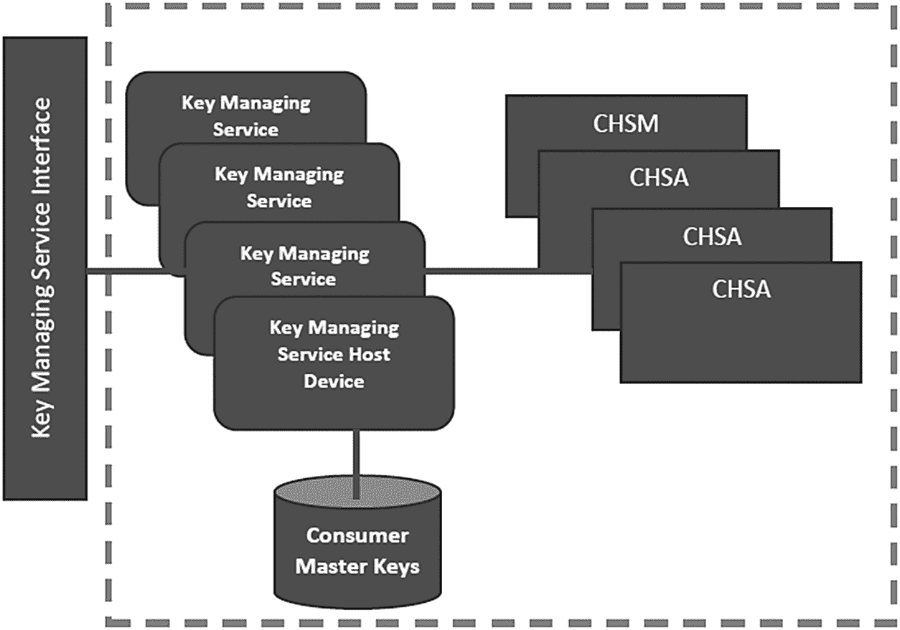

图 10.1 Amazon Web Services © 密钥管理服务 (AWS KMS)。

在 AWS 中，为了实现结构化数据应用，IaaS 云消费者需要订阅数据库管理和存储系统。研究发现，许多企业消费者现在正在将其现有数据库迁移到 AWS，而没有增强可扩展性、成本效益和应对原生云服务能力等功能。这种直接迁移会导致不必要的运营开销和额外的复杂性，从而导致响应事件需要大量时间。透明数据加密（TDE）是 AWS 用于加密和解密云存储数据的数据库技术，这些数据存在于 MS-SQL Server 和 Oracle 企业版数据库中。但在实现原生加密功能时可能出现的主要问题如下：

1.  单个数据库加密密钥 (DEK) 保护整个数据库。
2.  由于加密发生在 I/O 层，DEK 必须位于专用于数据库存储空间的存储资源附近。
3.  云消费者的唯一选择是将 DEK 存储在与 DBMS 实例相同的云中。
4.  难以根据用户权限将不同的加密密钥分配给不同的用户。

除了 DEK 之外，用户还可以在列、表，甚至对应多个表或索引的一组数据文件级别加密数据，这被称为用户级加密 (ULE)。然而，这种 ULE 会引发以下问题：

1. 向密钥管理系统 (KMS) 发起调用，将用户的会话权限集（取决于所承担的角色）映射到密钥集，以便从密钥存储中检索所需的密钥集。

2. 在用户会话期间（用于密钥使用），密钥被缓存在与 DBMS 实例相同的云中，位于为用户会话建立的内存空间内。

3. 还存在从 KMS 收集密钥并将其安全地交付给在 CSP 环境中执行的应用程序的问题。

4. 除非采取额外的安全措施，否则该技术会使敏感数据面临被 CSP 管理员访问的风险。

因此，为了解决上述问题，计划在理论框架的初步工作中包含以下具体概念：

* 建立真正能够保证并强制执行特定数据隐私和安全标准（用于存储和处理）的云安全访问代理 (CASB) 解决方案。
* 通过强大的 ECC 算法，为访问云存储系统提供显著的安全性。
* 通过利用椭圆曲线 Diffie-Hellman 密钥交换算法在云环境中管理加密密钥，为 CSP 和云用户提出额外的复杂性。

## 10.6 拟议理论框架

正如 第 10.5 节 所述，为了解决云存储系统中的密钥管理问题，必须考虑的第一个概念是确定 CASB，以提供充分的数据安全性和隐私性。它是一种云主机软件，可轻松在云消费者和 CSP 之间过渡。CASB 的功能是通过引入可在从桌面操作过渡到云存储操作的云特定上下文中部署的安全策略，来解决 IaaS 中的问题。这种过渡适用于所有必须受到保护、防止恶意用户访问的敏感数据，因为云基础设施通常是第三方存储系统。

据发现，`AWS KMS` 中使用了许多加密原语。这些原语提供了基本安全性，且易于为云系统配置。批准的默认算法集包括：用于加密云数据的 Galois 计数器模式下的 `AES`；用于生成种子数据的 `CSPRNG`；用于云用户之间认证以及密钥建立的 `ECDSA`。

根据 AWS 的说法，使用了两种不同的密钥管理技术：`First: A (1, 2, ECC DH) where 1 – Ephemeral Key, 2 – Static Keys`。该方案有一个创建者，以及一个用于签名的静态密钥。创建者将其签名指定为临时 `ECCDH` 密钥，提议给接收者，接收者拥有第二个静态 `ECCDH` 协商密钥；`Second: B (2, 2, ECC CDH) where 2 – Ephemeral Keys, 2 – Static Keys`。该方案的设计使得双方都拥有静态签名密钥，它们编写签名并在彼此间交换临时 `ECCDH` 密钥。至关重要的是，Diffie-Hellman 密钥以及派生的会话密钥都是临时的，并且即时生成或计算。因此，这些密钥不需要长期存储，因此密钥协商不是问题。然而，由于在云存储系统中使用静态密钥进行安全事务的性质，问题随之产生。

### 10.6.1 静态密钥在对称和非对称加密中的使用

加密静态密钥是指在安全事务中长期使用的密钥。它经常被使用，且被认为不如使用临时密钥安全。原因在于窃听者可能拥有更多信息可供利用。如果密钥被破解，攻击者可以解密多条消息。此外，它允许攻击者发起已知明文攻击。然而，静态密钥更易于安装，因此已被许多云存储服务采用。安全响应的规定是“视情况而定，有时强，有时弱”。如果静态密钥是云应用程序的一部分，攻击者可以通过使用任何逆向工程工具轻松提取它。根本不需要破解任何加密。

静态密钥（个人代码）密码学和异构密钥（公共代码）密码学是两种不同形式的密码学。大多数基于非对称密码学的标准算法都对其进行了审查——非对称密码学通常使用密钥交换加密技术，采用静态密钥（公钥）同时提供认证和完整性服务。另一方面，对称密钥加密，也称为秘密密码系统，代表建立一个秘密密钥的策略，即加密算法在通信双方之间共享的唯一单一密钥。在此术语下，认证过程默认通过仅使用该单一密钥来启动通信双方的完整性来完成。采用此策略最著名的算法是 `DES` 和 `AES` 算法。

因此，由于仅在相关当局之间共享的秘密密钥提供了隐式认证和完整性措施，其性能显著优于其非对称加密对应物。然而，还将存在如何安全地共享此秘密密钥的问题，特别是在云存储系统中。由于云旨在为各种授权云消费者提供软件、基础设施和平台即服务的先进技术，因此需要利用有效的安全密钥建立。为此，云存储系统应根据动态密钥如何优于静态密钥，来组织和利用对称和非对称加密算法。使用静态密钥和动态密钥的优缺点的加密细节在 表 10.1 和 10.2 中清晰地表示如下。

表 10.1 静态密钥方法论

| S. No. | 方法 | 功能 | 缺点 | 性能参数 |
|---|---|---|---|---|
| **1**. | **基于循环椭圆曲线和混沌系统的对称密钥加密算法** | 它由一组使用某些方法生成的巨大数字组成，用于认证数据。秘密密钥用于生成签名，然后使用公钥进行确认。 | 需要专门的测试软件来检查完整性。数字证书应从授权实体获取。 | 速度极快，并确保不可抵赖性和认证。它对等对 (peer-to-peer) 系统更有利。 |
| **2**. | **NJJSAA 对称密钥算法** | 该方法对于加密和解密均采用共享密钥和操作码过程。 | 该方法耗时且容易受到可能的时序攻击。 | 优于其他整体加密方法。它能够加密大文件和小文件。 |
| **3**. | **基于对称密钥的 RFID 认证协议** | 它采用相同的基于 RF 的工具开发多种应用分组密码操作模式的协议。 | 该过程也漫长且耗时。 | 该协议通过在需要较少计算工作量的情况下提供对各种威胁的保护，增强了 RFID 认证机制。 |

#### 表 10.2 动态密钥的方法论

| 序号 | 方法 | 功能 | 优点 | 性能参数 |
| --- | --- | --- | --- | --- |
| **4**. | **DJMNA 对称密钥算法** | 它结合了 MGVC 和 DJSA 技术。这些程序的序列通过操作生成的随机矩阵进行评估。 | 该方法比较繁琐。所采用的方法论复杂且耗时。 | 使用任何暴力攻击都极难破解加密过程。 |
| **1**. | **椭圆曲线密码学** | 它利用椭圆曲线生成密钥代码。实际上，是使用 160 位密钥代码实现的。 | 它比 RSA 和 Diffie–Hellman 算法更安全、更强大。它需要较少的功率并有助于降低能耗。 | 开发了椭圆曲线数字签名算法（ECDSA）。可以为云系统生成椭圆曲线 Menezes-Qu-Vanstone（ECMQV）或认证密钥交换。 |
| **2**. | **Diffie–Hellman 密钥交换** | 它完全专注于公钥加密密钥的交换。此密钥用于加密通信以及解密。它主要关注离散对数中涉及的困难问题。 | 由于私钥非常小（256 位），该方法相对较快，但容易受到中间人攻击 | 有必要定期更换密钥。在极端情况下，通过开发隧道协议来抵御攻击。应对攻击的另一种方式也是创建数字签名。 |
| **3**. | **Rivest–Shamir–Adleman (RSA)** | 基本形式为 `(d, e)`，其中 `d` 是私钥，`e` 是公钥标识符。加密和解密中均实施相对操作。 | 从主密码和模数生成私钥非常困难，使其受到越来越好的保护。黑客估算 `e` 的逆数时遇到了极大的困难。 | 密钥长度应大于 1024 位。 |
| **4**. | **数字签名算法 (DSA)** | 它由一组作为输入给出的可变整数组成，生成固定的秘密代码以验证数据。使用私钥生成签名，然后使用公钥进行验证。 | 它速度极快，并确保不可否认性和身份验证。在许多 Web 应用程序中商业化程度很高。 | 需要不同的测试软件来检查完整性。 |

根据上述表格，很明显，在现实场景中，公钥和私钥在各种加密算法中的使用方式以及其实用状态（“静态”或“动态”）决定了安全操作。因此，现在必须找出安全密钥分发的基本安全要求，列举如下：

1. 不需要以任何类型的 CSP（云服务提供商）进行注册。
2. 认证仅应在云用户和服务之间相互进行。
3. 安全会话应仅在云客户端和服务器之间进行密钥传输和协议达成的启动时创建。在特定时刻，即使是 CSP 也不应获取与所用私钥相关的任何信息。
4. 云用户及其数据的私钥应确保匿名性和隐私性，使得在执行认证期间，没有外部实体能够获取云客户的实际密钥及其身份。
5. 为了监控攻击者或入侵者的身份，提出的模型应保证只有一个身份能够揭示云客户的真实身份。
6. 为了保护之前传输的消息，该协议应确保：

    1. 任何攻击者，即使获取了云用户的私钥，也无法重构早期的会话密钥
    2. 提出的模型应对其他通用攻击具有抗御能力。

当使用加密密钥保护敏感信息时，必须谨慎处理。为了确保密钥的安全，通常会使用复杂的密钥管理系统。密钥的用法如下：

1. 使用受良好保护的高质量随机数据源（通常使用硬件安全模块）创建为所需长度
2. 只有授权人员负责管理安全性，并严格遵循策略
3. 仅用于其设计功能

    1. 根据其密码学有效期进行更新，不再需要时予以丢弃；
    2. 完全可审计，以提供正确（或错误）使用的证明。允许根据预设策略修改和控制密钥的其他属性通常由密钥管理系统定义。

### 10.6.2 AWS 加密密钥建立

前文已讨论过，AWS 利用各种加密服务来确保静态或传输中云数据的完整性。AWS KMS 提供 CloudHSM，确保由 FIPS 140-2 标准支持的不同密钥的存储。CloudHSM 基于多租户架构的操作，可以生成和管理这些密钥。此外，通过集成 CloudHSM 和 AWS，加密密钥可供同步和备份，并且可以轻松替换故障模块，从而使密钥分发易于管理。但还需要处理用户权限、可扩展性问题及日志等其他开销。

通常，AWS KMS 密钥存储在符合 FIPS 140-2 硬件安全模块方面存在局限性。与性能、审计和用户管理相关的责任已转移至云消费者。在此阶段，用户必须明确识别密钥管理中的安全漏洞，并找到最佳解决方案以缓解由云攻击者发起的威胁。在将 AWS KMS 服务视为任何云存储基础设施都足够时，对合规性 FIPS 140-2 级别 3 的要求会导致一种称为 DUHK 攻击的特定漏洞类型。在检查使用 FIPS 140-2 认证密钥的 288 家供应商的信息安全政策文件时，存在许多易受攻击的实现。相关研究人员指出，硬编码密钥容易受到使用 ANSI X9.31 随机数生成器（RNG）中存在的漏洞的影响。该算法通常用于大多数 Web 应用程序中生成加密密钥，以防止第三方访问被中断的事务。

从第 10.6.1 节可知，AWS KMS 结合 CSPRNG 使用 AES 算法进行云数据加密。但由于 DUHK 攻击，兼容 FIPS 的 ANSI X9.31 PRNG 存在漏洞。发现这一荒谬攻击的作者进行了分析，指出作为一种遗留软件，ANSI X9.31 接受两个密钥输入 `K` 和 `V`，其中 `K` 是长期密钥，`V` 代表初始状态。PRNG 通过反复应用数据密码分组来生成冗长的伪随机比特流。基于 ANSI X9.31 PRNG 的功能特性，密钥 `K` 永不改变，在整个过程中保持固定，这导致了一个主要问题：攻击者可以轻易获取密钥 `K`。如果 `K` 已知，攻击者即可发起攻击，并通过逆向工程找出所有其他要素。因此，如果任何基于云的存储系统使用此 ANSI PRNG 生成密钥，攻击者理论上可以恢复这些密钥，整个加密过程将被攻破。因此，认为基本上使用这种通过 FIPS 140-2 验证的云 HSM 的 AWS KMS 容易受到潜在的 DUHK 攻击。为克服此问题，必须规划一个用于安全密钥建立与分发的理论框架，通过改进椭圆曲线 Diffie-Hellman 密钥交换算法在云存储系统中的安全特性来实现，如图 10.2 所示。

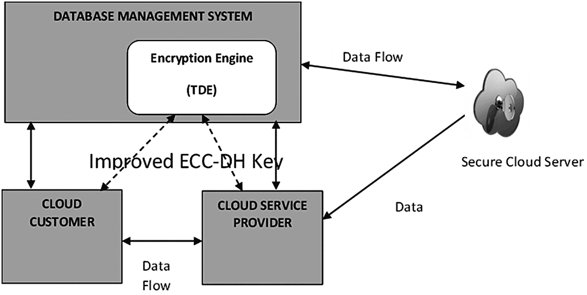

图 10.2 安全密钥建立与分发的建议框架。

CSP 为云用户提供更好的数据库管理基础设施服务，其中数据库模型包含适当的安全服务。该数据库服务模型具有一个专用的加密引擎，称为透明数据加密（TDE）。数据库管理系统（DBMS）实例通常提供给订阅此服务的云消费者，并有机会定制实例以满足其业务和安全需求。以下阶段概述了为 DBMS 实例处理的数据提供机密性保护的替代方案，以及随之而来的密钥管理挑战：

1. TDE 是 DBMS 的一项功能，使用原生加密函数。
2. 加密引擎在输入-输出级别工作，在数据写入外部硬盘驱动器之前对其进行加密。
3. 使用 ECC Diffie-Hellman 密钥交换加密算法来保护整个数据库。
4. 无需更改应用程序逻辑或数据库模式，因为 TDE 在数据库系统内部的 I/O 级别执行所有加密操作。
5. 由于云客户拥有 DBMS 引擎的管理权限，因此也控制着 ECC Diffie-Hellman (DH) 密钥，这些密钥必须保存在靠近为数据库数据存储指定的存储资源处。
6. 结果，云客户别无选择，只能将 DH 密钥保存在与 DBMS 引擎相同的云中。

### 10.6.3 基于区块链的 ECCDH 方案的定制动态密钥管理服务

有人提议为异构云存储系统采用基于区块链的密钥生成，并对来自其 CSP 的经过身份验证的云客户实施受限访问控制。区块链技术在通过公共网络进行安全交易时即兴生成动态密钥，这也为众多云客户提供了轻量级且可扩展的密钥传输。部署在云存储系统中用于安全密钥传输的这种区块链结构，将基于其内在功能实现去中心化。可考虑两大主要功能：

1. 通过区块链技术建立密钥
2. 动态密钥分发方案

可以构建一个集成了 ECC 的 Diffie-Hellman 密钥交换方案的数学模型，用于云客户公钥的所有安全交易，该模型可在无需任何集中式访问控制的云环境中运行。众所周知，去中心化区块链需要客户端操作来执行智能合约，后者持有不同的可验证属性。这种基于智能合约的应用可以有效地利用 ECC-DH 密钥交换用于云存储系统。现在，云用户之间的密钥协商将无需外部受信第三方即可进行验证和部署。这种集成区块链的 ECC-DH 密钥交换几乎提供了所有安全服务，如抗抵赖性、完整性和真实性。

## 10.7 结论与未来工作

随着企业对云存储的依赖日益增加，数据安全正成为其 IT 架构和信息安全计划中的首要责任。公司现在认识到在允许员工享受云性能和灵活性的同时保护敏感数据的重要性。云存储平台及其处理的数据的基线安全（如身份验证、访问控制和加密）应始终到位。因此在本章中，已确定云存储系统容易受到窃取密钥攻击，入侵者可在云客户与服务提供商之间的传输过程中获取公钥/私钥。此威胁是由于现有的密钥建立/管理技术薄弱，不足以抵御攻击。因此，为了安全地访问密钥，提出了一种理论上的定制增强型 ECC Diffie-Hellman 密钥管理技术，结合区块链技术和动态密钥分发。由此，大多数企业在近未来必须用自有的附加安全措施来补充这些防护，以加强云数据保护并收紧对云中敏感信息的访问。

## 参考文献

1. Doshi, R. and Kute, V., “A review paper on security concerns in cloud computing and proposed security models,” In *2020 International Conference on Emerging Trends in Information Technology and Engineering (ic-ETITE)*, pp. 1–4, 2020, doi: [10.1109/ic-ETITE47903.2020.37](http://dx.doi.org/10.1109/ic-ETITE47903.2020.37).
2. Bentajer, A. and Hedabou, M., “Cryptographic key management issues in cloud computing,” Advances in Engineering Research, 151, 2020.
3. [`techbeacon.com/security/what-you-need-know-about-bring-your-own-key-cloud`](https://techbeacon.com)
4. Liu, H., He, B., Liao, X., and Jin, H., “Towards declarative and data-centric virtual machine image management in IaaS clouds,” IEEE Transactions on Cloud Computing, 7, no. 4, 1124–1138, 2019, doi: [10.1109/TCC.2017.2728066](http://dx.doi.org/10.1109/TCC.2017.2728066).
5. Amarasinghe, H., Jarray, A., and Karmouch, A., “Survivable IaaS management with SDN” IEEE Transactions on Cloud Computing, 9, no. 4, 1619–1633, 2019. doi: [10.1109/TCC.2019.2910111](http://dx.doi.org/10.1109/TCC.2019.2910111).
6. Rafique, A., Van Landuyt, D., Beni, E. H., Lagaisse, B., and Joosen, W., CryptDICE: Distributed data protection system for secure cloud data storage and computation, Information Systems, 96, 101671, 2021, doi: [10.1016/j.is.2020.101671](http://dx.doi.org/10.1016/j.is.2020.101671).
7. Fan, Y., Lin, X., Tan, G., Zhang, Y., Dong, W., and Lei, J., One secure data integrity verification scheme for cloud storage, Future Generation Computer Systems, 96, 376–385, 2019, doi: [10.1016/j.future.2019.01.054](http://dx.doi.org/10.1016/j.future.2019.01.054).

8.  Prajapati, P. and Shah, P., “安全数据去重综述：云存储安全问题,” 《沙特国王大学期刊 - 计算机与信息科学》, 2020, doi: [10.1016/j.jksuci.2020.10.021](http://dx.doi.org/10.1016/j.jksuci.2020.10.021).

9.  Tomar, A.S., Shankar, S.K., Sharma, M., and Bakshi, A., “云中基于 ECC 的安全密钥交换机制增强图像认证,” 见 Mueller, P., Thampi, S., Alam Bhuiyan, M., Ko, R., Doss, R., and Alcaraz Calero, J. (编) 《计算与通信安全》。SSCC 2016。《计算机与信息科学通讯》，第 625 卷。Springer, Singapore, 2016, doi: [10.1007/978-981-10-2738-3_6](http://dx.doi.org/10.1007/978-981-10-2738-3_6).

10.  Wang, L., Wang, B., Song, W., and Zhang, Z., “一种基于密钥共享的云存储安全去重方案,” 《信息科学》, 504, 48–60, 2019.

11.  Velumadhava Rao, R., Selvamani, K., Kanimozhi, S., and Kannan, A., “基于云环境的安全数据共享分层群组密钥管理,” 《并发与计算：实践与经验》, 31, 第 12 期, e4866, 2019.

12.  Hosam, O. and Ahmad, M. H., “基于 AES、ECC 和 LSB 隐写术组合的云数据安全混合设计,” 《国际计算科学与工程期刊》, 19, 第 2 期, 153–161, 2019.

13.  Xu, C., Ren, W., Linchen, Y., Zhu, T., and Raymond Choo, K.-K., “一种用于物联网中 H.264/SVC 码流分层访问控制的分层加密与密钥管理方案,” 《IEEE 物联网期刊》, 7, 第 9 期, 8932–8942, 2020.

14.  Kanna, G. P. and Vasudevan, V. “一种全同态-椭圆曲线密码学加密算法，用于确保云数据的隐私保护,” 《集群计算》, 22, 第 4 期, 9561–9569, 2019.

15.  Tan, L., Shi, N., Yang, C., and Keping, Y., “一种基于区块链的网络-物理-社会系统大数据访问控制框架,” 《IEEE Access》, 8, 77215–77226, 2020.

16.  Darwish, M. A., Yafi, E., Al Ghamdi, M. A., and Almasri, A., “使用基于区块链的混合算法在云存储中去中心化隐私实现,” 《阿拉伯科学与工程期刊》, 1–10, 2020.

17.  Kumari, A., Yahya Abbasi, M., and Alam, M., “一种基于智能卡的云计算密钥协商框架，使用 ECC,” 见 *2021 年第三届智能通信技术与虚拟移动网络国际会议 (ICICV)*, 页 43–48。IEEE, 2021.

18.  ManJiang, D., Kai, C., Wang, Z. X., and LiPeng, Z., “电力竞价系统云存储安全加密算法设计,” 见 *2020 IEEE 第四届信息技术、网络、电子与自动化控制会议 (ITNEC)*, 第 1 卷, 页 1875–1879。IEEE, 2020.

19.  Kumar, S. P., and Subramanian, R., “一种确保云计算中数据存储安全的高效安全协议,” 《国际计算机科学问题期刊 (IJCSI)》, 8, 第 6 期, 261, 2011.

20.  Jansen, W. and Grance, T., 公共云计算安全与隐私指南 (NIST SP 800-144), 美国国家标准与技术研究院, 美国商务部, 2011.

21.  Rao, B. T., “云计算中数据存储安全问题研究,” 《Procedia Computer Science》, 92, 128–135, 2016, doi: [10.1016/j.procs.2016.07.335](http://dx.doi.org/10.1016/j.procs.2016.07.335).

22.  Abbas, S. A. and Maryoosh, A. A., “使用椭圆曲线密码学改进云计算中的数据存储安全,” 《IOSR 计算机工程期刊》, 17, 第 4 期, 48–53, 2015.

23.  Alimunisha, T. and Raju, K. N., “使用 ECC 算法在云中安全存储和共享大数据,” 《国际研究期刊》, 4, 第 5 期, 2017.

24.  Sebastian, B. C. and Cenar, U. A., 在 SSL/TLS 中使用椭圆曲线密码学的优势, 加州大学圣巴巴拉分校计算机科学系, cs 290G 秋季学期, 2015.

25.  Gobi, M. and Sundararaj, K., “一种使用椭圆曲线密码学的安全云安全,” 《国际高级网络与应用期刊》, 12, 141–144, 2015.

# 索引

## A

*   ABE, *见* 基于属性的加密

*   学术, 101, 210

*   可访问性, 68, 81, 113, 132

*   准确性, 39, 48, 161

*   执行器, 3, 37, 67, 78, 113, 134, 139–140, 162, 172–177, 185, 201–202

*   适应性, 70, 185

*   ADC, *见* 澳大利亚国防学院

*   增材制造 (AM), 71

*   高级加密标准 (AES), 214

*   广告软件, 29

*   AES, *见* 高级加密标准

*   敏捷, 44, 52–58, 217

*   农业, 48, 81, 102, 155

*   AI, 64, 68, 76, 78, 102, 104–105, 112, 114, 145, 153, 159, 162, 174–175, 183, 189–190

*   AI 赋能, 102

*   空客, 18

*   算法, 10, 13–15, 64–65, 81, 113–115, 118–120, 127, 157, 159–160, 197–198, 213, 215–217, 221–228

*   AM, *见* 增材制造

*   亚马逊, 22, 26, 41, 212, 219

*   亚马逊网络服务 (AWS), 22, 27, 79–80, 212, 219–221, 226–227

*   放大, 22, 26–28

*   天线的, 33

*   杀毒软件/反病毒, 31, 204

*   Apache, 34

*   应用, 5, 22–23, 34, 37, 44, 46–47, 52, 56–58, 68, 71, 73, 75–76, 83–85, 98, 104, 113–114, 120, 122–123, 133, 160, 162, 172, 196–198, 213, 220, 222, 228

*   应用程序, 17, 197

*   ARC, *见* 自主响应控制器

## A

- 架构，5，12，22，24，28，35–36，77–78，85–87，105，113–115，160，176，197，202，211，214，216，226，229
- AR/VR，*参见* 增强现实/虚拟现实
- 亚洲，18–19，75
- 攻击，3–8，10–13，15–30，32–36，38，41，75，86，90，145，147，202，204，222–224，226–227
- 攻击者，2，4，6–7，10–14，16–18，20–23，25–34，36，38，73，75，88–90，222，225–227
- 基于属性的加密 (ABE)，211
- 增强现实/虚拟现实 (AR/VR)，44，47，56
- 认证，3，12，17，21，25–26，29，31–32，37–39，73，87，113–114，120–121，123，134，197，205，213，222–223，225，229
- 授权，21，120，133，136，197，205，215
- 自动化，2，28，44–46，50，56，64，69–70，76，79–80，86，91，105，112，152–154，156–157，159，163，165–166，180，196
- 汽车，152，178，187
- 汽车/车载，20，69，83，163
- 自主/自动驾驶，4，35，44–45，48，56–58，66，70，153，155，173，199
- 自主响应控制器 (ARC)，4，25
- AWS，*参见* 亚马逊云服务

## B

- 带宽，122，161，200
- 银行，18，20–21，28，30–32，103
- 银行业务，82，103
- 电池，148，187–188
- BCT，*参见* 区块链技术
- BDA，*参见* 大数据与分析
- 基准测试，116
- 大数据与分析 (BDA)，66
- 币安，81
- 二进制，9–10
- 生化制品，49
- 生物工程，112
- 生物信息，112–114，127
- 生物学，102
- 生物力学，71
- 生物医学，112，126
- 生物医药，49
- 生物传感器，112
- 生物信号，113
- 生物技术，153
- 比特币，8，13，80–81，90，103
- 比特，177，224，227
- 区块链，66，77–78，80–86，88–91，103，132，145，159，162，216，228–229
- 区块链技术 (BCT)，66，78，81–91
- 彭博社，99
- 波音，18
- 僵尸网络，21–22，24–25
- 自带密钥 (BYOK)，212
- 广播，73
- 浏览器，12，30–31
- 漏洞/错误，70，88
- 业务/商业，7，20，22，26，41，45–46，49，51，68，77，86，99，101，106，113，134，145–146，148，164–165，172，177，179，186，188，191，205，209–210，212，214，228
- BYOK，*参见* 自带密钥

## C

- 缓存，11
- 灾难，201
- 货物，199
- 汽车制造，8
- 汽车，155
- CASB，*参见* 云安全访问代理
- 单元/小区，7，132，138
- 证书，33–34，124–126，217
- 化工/化学，15，18，155，163
- 化学家，19
- CHSMs，*参见* 云硬件安全模块
- 密码/密文，223，227
- 电路，140
- 思科，22
- 城市，3，66，132–138，147，160，196–206
- CLDAP，*参见* 无连接轻量级目录访问协议
- 基于云的，24，44，49，75，114，214–215，217，227
- 云硬件安全模块 (CHSMs)，219
- 云安全访问代理 (CASB)，220
- 云存储的，199，220
- 代码，7，9–10，25，28–29，31，73–74，123，126，213，215，222，224–225
- 命令与控制，7，25
- 通用漏洞披露 (CVE)，12，34–35

## C

* 通信，3、16、20、29、37–38、41、46、48、50、54、71–73、75–76、78、80、84–85、102、105、112–114、118、120–122、124、139–140、152–154、160、162、164–167、188、196–200、206、216
* 计算，69、73、76、161、210、215、217
* 计算机，9、11、14、16、19、21、30–31、48、69、71、102、118、160
* 计算机辅助设计，49
* 无连接轻量级目录访问协议 (CLDAP)，26–27
* 连接，30、46、76、103、113、120、124、143、189
* 成本效益，64、220
* 对策，27、114
* CPS，*参见* 网络物理系统
* CPSS，*参见* 网络物理社会系统
* 凭据，14、17、20、24–26、28–31、33–34、120–121
* 跨职能，48、52、57
* 加密货币，81、89–91
* 密码学，37–39、65、80、89、211–212、215–219、221–222、224、226–229
* 密码系统，218、222
* CS，*参见* 网络安全
* CVE，*参见* 通用漏洞披露
* 网络攻击，41、132–133、135、137–138、142、145、147、149、162–163
* 网络犯罪，13、135、149
* 网络犯罪分子，91、136、147
* 网络物理，44、50、54、56–57、64、71、76、139–140、152、164、166、201、205、215
* 网络物理社会系统 (CPSS)，214
* 网络物理系统 (CPS)，2–5、21、36–40、64、67、71–73、76–77、152–160、162–163、166、178、215
* 网络安全，5、8、13、15、20、32、34、36、39、41–45、48–49、57、132–134、136–138、142–150、159、196–197、200、202–203、205–206
* 网络安全 (CS)，66
* 赛博格，6

## D

* 损害，3–7、22、29、37、89、133
* DART，*参见* 检测与响应团队
* 数据库加密密钥 (DEK)，220
* DDoS，*参见* 分布式拒绝服务
* 去中心化，2、35、69、81、139、153、155–156、228
* 决策，44、101–102、104、153、155、161–162
* 解密，7–8、13、15、32、222
* 解密器，7
* DEK，*参见* 数据库加密密钥
* 人口统计学，183
* 拒绝服务，143
* 拒绝服务，3–5、21、23、36、65、73–75、83、86、113、115、163
* 检测与响应团队 (DART)，13–14
* 开发人员，46–47、52–54、56–58、75、113
* 设备，4、7–8、13–14、21–26、31、33–38、46、48–51、56、65–67、73–76、78、83–84、91、98、103、105、112–113、118、120、133、139、144、153、156、159–163、176–177、180、196–200、202、205
* 数字化，5、12、16、44、58、65、68、76–81、87、90、100–102、105、112、133、135、148、159、188–189、197–198、202、216–217、221、223–225
* 数字化，5、69、148、153、178、181
* 维度，119
* 分布式拒绝服务 (DDoS)，3、11、21–28、73、87、136、197、204
* DoS，*参见* 拒绝服务
* 偷渡式下载，6
* 无人机，81

## E

* 全球范围，191
* 窃听，4、29–30、32、73

## E

- EC, *参见* 边缘计算
- ECC, *参见* 椭圆曲线密码学
- 日食, 123
- 生态, 173, 186
- 电子商务, 29, 46
- 经济, 5, 70, 76, 100–101, 153–154, 156, 161–162, 195, 210
- 生态系统, 196–200, 202–206
- 边缘计算（EC）, 66
- 教育, 12, 14, 48, 75, 81, 153, 196
- EEG, *参见* 脑电图学
- 电力, 64, 152, 155, 165–166
- 脑电图, 115
- 脑电图学（EEG）, 112–120, 126–129
- 电磁, 199
- 电子, 16, 44, 64, 80–81, 115, 132, 134, 156, 160, 165–166, 180
- 电生理的, 115
- 电子图书馆, 19
- 椭圆曲线密码学（ECC）, 211
- 电子邮件过滤, 17
- 电子邮件, 6–7, 11, 17, 31–32, 204
- 编码, 173
- 加密, 4, 6, 9–12, 15, 29, 32, 34, 38–39, 125, 136, 202, 211, 213–218, 220, 222–224, 226–230
- 能源, 2, 13, 44, 68, 76, 84, 121, 132–134, 138–143, 148–150, 152, 155–156, 159, 163–164, 172, 174, 177, 179, 184–185, 187–189, 196, 199–201, 224
- 工程, 3, 5–6, 12, 15–17, 20, 37, 41, 78–79, 155, 160, 163, 176, 222, 227
- 引擎, 97, 151–152, 155, 180
- 环境, 2, 9, 36, 39–41, 44, 46–47, 50–52, 56, 64–66, 70–71, 76, 78, 84–86, 113–115, 117–118, 120–124, 126–127, 153, 156, 159, 163–164, 196–197, 199–200, 212–215, 218, 220, 228
- 癫痫, 116
- 人机工程学, 188
- 间谍活动, 34

## F

- FAAC, *参见* Fischer 先进复合材料组件
- 制造, 68
- 工厂, 8, 64, 70, 76, 87, 98–99, 152, 159, 163
- 农业, 99
- 联邦, 6, 75, 153
- 联邦快递, 9
- 反馈, 3, 49, 52, 55, 73, 76–77, 101
- FH-ECC, *参见* 全同态椭圆曲线密码学
- 金融, 18, 22, 29–30, 32, 67, 75, 77, 83, 99, 103, 142, 163, 165, 174
- 防火墙, 3–4, 8, 24, 32, 137, 204
- 固件, 26
- Fischer 先进复合材料组件（FAAC）, 18
- 洪水, 21, 23
- 福布斯, 41
- 预测, 68, 190
- 取证, 133
- 化石, 133
- 傅里叶, 119
- 框架, 38, 41, 53, 68, 75–76, 78, 83–87, 91, 112, 114–115, 133, 135–137, 139–140, 143–144, 147, 178, 185–188, 197, 202–206, 211, 220–221, 227
- 欺诈者, 30
- 频率, 112, 115, 117–119, 199
- 燃料, 133, 143, 191
- 全同态椭圆曲线密码学（FH-ECC）, 214
- 资金, 21, 32, 89
- 模糊, 115

## G

- 小工具, 33, 80, 98, 102, 135, 138, 140, 146, 155, 172–175, 177–178, 185, 189
- 游戏, 198
- 游戏, 200
- 伽马, 112, 116–118
- 网关, 15, 162
- 泛化, 104
- 生成器, 140, 221, 226
- 遗传, 155
- 地理, 49
- 地质, 142
- 几何形状, 71
- Github, 12, 22, 27–28, 41
- 黄金眼, 7
- 货物, 49, 80, 151–152, 156, 165
- 治理, 201

*   政府，6，11，28，32，35，79，101，156，188，217

*   政府资助，8

*   全球定位系统（GPS），161，202

*   图形，118

## H

*   黑客，9，11，20，22–23，29–34，36，41，75，83，89，91，135，146，202，224

*   入侵/破解，17，33，145

*   网络行动主义者，22

*   硬编码，15

*   硬件，24，26，37–38，40，68–69，73，80，114，118，123–124，127，133，146，153，161，172，177，185，191，198，202–203，205，211–212，218–219，226

*   高清接口（HDMI），118

*   健康，8，82，112–113，115，156，196，200–201

*   医疗保健，2，46，81，83，104，112–115，126，160，172

*   基于医疗保健的，113

*   基于异构的，114

*   高清晰度，200

*   高安全性，24

*   高速，101

*   高科技，98，153，159

*   劫持，23，29–30，32，135

*   历史上，20，36，39

*   医院，113，127

*   酒店，199

*   热点，143

*   人机交互，159

*   人驱动，155

*   人-机，76，98，175

*   人-机器人，5，79，98，101，104

*   人类，15，64，70，76，98，101，152–153，155，166

*   水力，13–14，41

*   超级账本，81

## I

*   IaaS（基础设施即服务），*参见* 基础设施即服务

*   IBC，*参见* 基于身份的密码学

*   IBE，*参见* 基于身份的加密

*   IDE，*参见* 集成设计环境

*   身份识别，67，81，121

*   基于身份的密码学（IBC），217

*   标识符，120–121，224

*   基于身份的加密（IBE），211

*   IDS（入侵检测系统），*参见* 入侵检测系统

*   IIoT，*参见* 工业物联网

*   ILOVEYOU 病毒，6

*   基于图像的，213

*   不可变的，80，88，103

*   导入，120，123，212

*   临时/简易，83–84，86–87

*   内置的，33，117，123

*   索引，29，65

*   工业的，37，44–45，48，56，64–66，75–76，78，97，99–100，102–109，147，151–153，155–159，162–163，165–169，172，174–175，178–181，185，192，200，210

*   工业物联网（IIoT），44，64，71，73–74，77–78，85，152–153，156，159，162，166，172，174–178，183–184，192

*   工业化，64，156，165–166，184，195

*   行业，2–3，5，15，18，21，35–36，39–41，44–51，53–55，57–81，83–87，91，97–101，103–107，112，114–115，126–128，141，147，151–154，156，162，165–169，172，174，178–183，188，191–192，200

*   感染，6，9，25

*   信息，3–4，11，13–14，16–17，19，22，26，28–32，34，37–38，44，46–49，51，53，64–71，73–76，78，84，89，99，101，112–113，115，118–123，125–128，132–136，138，140–141，143–147，152–153，160，172–177，179，181，184–185，189，192，196，201，210，215–217，222，225–226，229

*   信息安全，41

*   基础设施，2，13–14，21，24，28，34–35，37，48–49，75，77，83，154，160–161，163，166，196–198，200–202，212–214，218，221–222，226–227

## I

- 基础设施即服务，211
- 插桩，71
- 集成设计环境，117
- 互联的，37，64–66，73，78，84，91，132–134，138，143，152，156，160，162–163，174，187，196，199，204–205，213
- 接口，15，46–47，71，78，124，159，177，185，210，216
- 互联网，4，9，21–22，24–27，30，33，41，44，46，64，66，69，74，80，84，98–99，112–113，115，122–123，126–129，132，152–157，159–160，165–169，172–174，180，197–200，209–210，212，217
- 服务互联网，66
- 物联网，4，21–25，33，36，44–46，48–49，51，56，58，66–67，73，75–78，80，84，98，102–103，105，112–115，118，120–127，137，144，155，159–160，166，172–179，183，188–189，191，198–199
- 入侵者，204，225，229
- 入侵，3，13，24，32，38–39，85，197
- 入侵检测系统，3–4，8
- IoS，*参见* 服务互联网
- IoT，*参见* 物联网
- 基于物联网的，73，78，112–115，120–122，126
- 物联网赋能的，78，179

## J

- 干扰，4，73，197
- Java，34
- 摩根大通，21
- 正义，35

## K

- KDS，*参见* 密钥分发服务器
- 内核，9–10，120
- 密钥，3–4，7，10–11，23，25，27，32，35–36，38，40，58，65–66，73，80，83–84，86，91，99，101，120，124–125，132，136，138，143，149，153，156，159–160，184，204，211–229
- 密钥分发服务器，213
- 密钥管理基础设施，212
- 密钥管理互操作性协议，212
- 密钥管理服务，212
- 密钥共享，214
- 熔断开关，11
- KMI，*参见* 密钥管理基础设施
- KMIP，*参见* 密钥管理互操作性协议
- KMS，*参见* 密钥管理服务
- 知识，14，16，20，32，38，48，52，64，72，76，91，98，101，177，192

## L

- 标签，174
- 态势，158，164，166，199，204
- 笔记本电脑，19
- 延迟，69，85，162，213
- 最低有效位，214
- 库，10，123–125
- 生命周期，49
- 寿命，36
- 光，19，78，153，188，197，199–200，202
- 基于轻量级的，114
- 莱特币，81
- 文献，2–3，98–99，151–153，157，162
- 活件，185
- LKH，*参见* 逻辑密钥层次结构
- 封锁，147
- 对数，217，224
- 逻辑密钥层次结构，213
- 登录，24–26，28，30–31，33–34，75，145
- 物流，46，70，80，106，152，172，177
- 低功耗，200
- LSB，*参见* 最低有效位

## M

- MAC，*参见* 媒体访问控制
- 阴谋，151
- 机器，5，7，10，17，39，66，68，70，76，79，101–102，112–115，118–119，127，145，154，157，159，161，178，197–198，212，214，218
- 基于机器的，218
- 基于机器学习的，113
- 机器学习，118
- 机器对机器，66，71，112，174–175，189
- 邮件，6，16，21，31，33
- 维护，45，49，159，163，183
- 不当行为，216

## M

* 恶意软件, 3, 5–8, 11, 14–15, 20, 25, 65, 74, 113, 135, 143, 146, 178, 203, 216
* 中间人（MITM）, 29–30, 32, 65, 73, 87, 135
* 人力, 104
* 制造业, 2–3, 5, 15, 18, 36, 44–46, 48–51, 53, 56–58, 64–71, 75–78, 80–82, 86, 98, 101–102, 152–156, 159–163, 165–167, 172–173, 176, 178, 183–185, 188–190, 192, 202
* 市场, 68, 91, 101, 138, 156, 182
* 材料, 49, 70–71, 159–160, 163
* 数学, 211, 228
* 测量, 77
* 机械, 141, 147, 165–166, 172, 175, 177–179, 181, 185
* 机械化, 64, 151–152, 156, 165–166, 188, 190
* 媒体, 16, 33, 47, 120, 132, 161, 215
* 媒体访问控制（MAC）, 120–121, 124
* 医疗, 8, 37, 104, 113, 115, 137, 147, 155
* 冥想, 116
* 会议, 4, 54, 57
* 消息, 29, 38, 73, 114, 120–121, 123–124, 200
* 消息队列遥测传输（MQTT）, 114, 120–127
* 金属, 49, 116
* 冶金, 155
* 指标, 4
* 大都市, 133–135, 137–138, 143, 173
* MFA, *参见* 多因素认证
* 微控制器, 80, 117, 120
* 微电网, 139–140, 186–188
* 微软, 9, 11, 218
* 微伏, 115
* 军事, 13
* 采矿, 5, 47, 90–91, 115, 156
* 部, 75, 153
* MITM, *参见* 中间人
* 三菱, 18
* ML, *参见* 机器学习
* M2M, *参见* 机器到机器
* 移动, 26, 47, 70, 73, 76, 159, 162, 198, 200
* 建模, 8, 41, 70, 78, 159, 211
* 模型, 39, 46–47, 49–51, 56, 66, 69–70, 72, 77, 164, 180, 210
* 货币, 35, 99, 103, 133, 137, 141, 165, 183
* 金钱, 6, 18, 20–21, 30, 32, 37, 70, 73, 89–91, 145, 190, 217
* 电动机, 20
* 汽车, 152
* MQTT, *参见* 消息队列遥测传输
* 多因素认证（MFA）, 213

## N

* NAC, *参见* 网络抽象层
* 纳米技术, 153
* 国家医疗服务体系（NHS）, 8
* 自然语言处理（NLP）, 102
* 网络, 2–3, 7, 11–12, 14–15, 17, 21–25, 27–28, 31–34, 36–38, 46, 48, 67, 73, 76, 80–86, 90, 102–103, 105, 113–114, 117, 120–123, 132–133, 135, 143, 148, 154, 156–157, 159–163, 165–166, 174, 176–178, 182–183, 185, 188–190, 199–200, 204, 210, 212, 215, 228
* 网络抽象层（NAL）, 214
* 组网, 16, 105, 153, 159–160, 198, 211
* 神经的, 104
* 神经元, 112
* NHS, *参见* 国家医疗服务体系
* NLP, *参见* 自然语言处理
* 非敏捷, 53
* 不存在, 23
* 基于非线性, 118
* 非概率, 119
* NoSQL, 213
* 核, 155

## O

* 对象, 49–50, 56, 105, 119
* 办公室, 46, 133, 176, 185, 189–191
* 官员, 14, 99
* 离线, 13, 15, 41, 214
* 开源, 117, 124, 159, 162
* 甲骨文, 220
* 外包, 210
* 人口过剩, 133
* 生产过剩, 190
* 所有权, 50, 52, 57

## P

## P

*   数据包，36，39，73，78，121，123，215
*   基于数据包，78
*   松下，100
*   参数，10，115
*   停车，200
*   合作伙伴关系，98
*   密码，10，15，25–26，114，121，123，125，127，204，214，224
*   患者，104，112–113
*   按需付费，161，212
*   支付，5–6，12–13，29，32，80，103，200
*   PC，6，180，184
*   PDF，14
*   对等节点，29，70
*   渗透，17，75
*   基于权限，122
*   制药，49
*   网络钓鱼，3，6–7，14，16–17，20–21，31，74，82，143，145
*   电话，33
*   PKI，*参见* 公钥基础设施
*   Python，118，122–123
*   基于 Python，120，123

## Q

*   量子，29
*   隔离，204
*   查询，27，47，213
*   问卷，53

## R

*   辐射，201
*   铁路，36
*   勒索赎金，5–8，11，13
*   勒索软件，4–8，11–14，29，37，41，73，136，143–145，147
*   树莓派，117–118
*   实时，38，45–46，55，70，75，78–79，87，101，113，115，119–120，156，162，197–200，211，215
*   侦察，3，20，141
*   可回收性，185
*   现行，29
*   Red Hat，125
*   冰箱，33，78
*   法规，38，163，199，205，210，218
*   康复，104
*   远程，26，47，71，113，140，175，189
*   远程控制，25
*   可再生，13，133，142–143，148，201
*   共和国，154
*   弹性，106，215–216
*   资源，9，22–24，32，46，48，51，68–69，77，80，134，136–138，141，143，148–150，154–155，159–161，163，165，201，209–212，216，218，220，228
*   RFID，67，152，174，199–200，223

## R

- Rivest–Shamir–Adleman (RSA)，6，14，217
- 抢劫，135
- 机器人，70，160
- 机器人辅助，157
- 机器人技术，70，152–153，155，159–160
- 机器人化，179，190–191
- 劳斯莱斯，18
- 路由器，25–26，140
- RSA，*参见* Rivest–Shamir–Adleman

## S

- 破坏，11，28，48，159，204
- 卫星，198
- 可扩展性，49，69–70，76，80，83，85，105，122，161–162，167，198，220
- 可扩展视频编码 (SVC)，214–215
- 诈骗，18，41，82
- 科学，99，105–109，112，147，160，198
- SDN-IoT，78，86
- 安全，2，5，12，24，30–31，37，39–40，78，84，112–115，120–121，123–124，126–128，137，147，199，202，205–206，211–219，221–222，225–228
- 基于身份的安全聚合签名 (SIBAS)，213
- 安全套接字层 (SSL)，29–30，33，114，125，127，217
- 安全，2–5，8–14，17，20–21，23–24，26–28，32–40，46，48，57，64–66，69，71–78，80，82–86，88，90–91，98，104–105，113–115，120，122–123，125，127，132–135，137，141，143，145–150，159，161–163，167，173，178，182，184–186，189，196–197，199，202，204–222，225–231
- 基于安全的，115
- 自适应，76
- 自我管理，178
- 自我指导，48
- 自动驾驶，102
- 自扩展，25
- 自治，48，178
- 传感器，3，46，49，67，80，102，113，115，127，135，138，140，152–153，161–162，166，172–173，176，185，189，197–201
- 服务器，7，13，17，21–24，26–27，30，73，120–121，124–126，211，214，216–217，220
- 服务，8，14，22，24–27，46，48–49，66，69，75，82，84–86，104–105，112，126，151–152，155–156，160–162，164–166，172，182–183，198，200–202，210–216，218–220，222，225–227，229
- SIBAS，*参见* Secure Identity-Based Aggregate Signatures
- 智能，3–5，11，15，23，25，33–34，36，44，46，48–49，64–66，70，75–76，78–88，91，98，101–102，112，115，120，126，132–140，142–143，146–147，149，153–155，157，159–160，162–163，167，172–173，176，179，182，184–186，188–189，192，195–206，228
- 智能手机，202
- 社会工程学，17
- 社会，41，99–100，132，154，156
- 社会经济，105
- 社会学，99
- 软件，8，12，14，17，23–24，26，28，31，35，37–38，46，48–49，52–53，56，58，69，88，90，102，117，121，125，133，145，153，161–162，198，202–205，210，212，218，221–223，225，227
- SSL，*参见* Secure Sockets Layer
- 监控，201–202
- 可持续性，46，80，106，156，164，205
- 可持续，41，99，138–139
- SVC，*参见* Scalable Video Coding
- SVM，113，115，118–120，127

## S
- 系统，3–5, 7–10, 12, 14, 16–17, 19–20, 23–25, 28–29, 31–32, 36–40, 45, 47–50, 52–53, 57–58, 64–66, 70–71, 75–77, 80, 98, 100, 103–104, 112–114, 116, 120, 125–126, 139, 152, 154, 156, 161–163, 174, 178, 185, 197–198, 202–208, 210, 212–217, 220–221, 223, 227–228

## T
- TDE，*参见* 透明数据加密
- 技术，5, 8, 19, 21, 41, 44–49, 64, 66, 72, 76, 78, 83, 85–86, 88–89, 97, 112–113, 115, 126–128, 151–153, 155–156, 159–160, 165, 175, 185, 197–200, 205, 209–210, 213, 217, 220, 222, 228–229
- 基于技术的，16
- 远程医疗，112, 115
- 太比特，21–22
- 恐怖分子，22
- 测试平台，4, 38
- 时间，15–16, 18, 22, 24, 28, 33, 36, 38, 49–50, 57, 68–69, 78, 98, 105, 118–119, 148, 155–156, 161–163, 173, 179, 181, 185, 189–192, 197, 199, 201, 217–220
- 时间戳，90
- 容错，81, 212
- 工具箱，38
- 工具包，17
- 丰田，20, 41, 100
- 跟踪，35, 185, 199, 218
- 交易，34
- 流量，11, 21–22, 24, 26–28, 30–32, 38, 77, 84, 86, 103, 135, 137, 198–200, 202
- 事务，31, 81, 83, 90, 222
- 转换，102
- 透明性，41, 51–54, 64, 75–76, 83, 85, 153, 213
- 透明数据加密（TDE），220
- 传输，36, 80, 114, 122–123, 160, 200
- 旅行，198
- 木马，14, 89
- 可信执行环境（TTE），213
- TTE，*参见* 可信执行环境

## U
- 泛在，197, 210
- UDF，*参见* 用户定义函数
- ULE，*参见* 用户级加密
- 超宽带，200
- 超快，155
- 超高清，200
- 超轻，133
- 通用唯一标识符（UUID），120
- 大学，19, 133, 151
- 不安全的，30–31
- 不稳定的，210
- 升级，174, 180, 185
- 用户定义函数（UDF），213
- 用户友好的，105
- 用户级加密（ULE），220
- 用户名，26, 114, 121, 123, 127
- 用户，6, 8, 14, 17, 22, 25–26, 28, 32–33, 46–50, 53–54, 56, 73, 82, 88, 90, 104, 113, 120, 162, 197, 204, 210–211, 213–216, 218–221, 225, 227, 229
- UUID，*参见* 通用唯一标识符

## V
- 假期，177, 189
- 校验，33, 78, 81, 132, 218
- 值，11, 46–47, 49–50, 52–53, 56–58, 77–78, 82, 91, 124, 152, 154, 156–157, 161, 163, 166, 179, 214
- 车辆，99, 103, 135, 146, 180
- 速度，161, 185
- 供应商，36, 46, 69, 199, 226
- 验证，78, 136, 205, 213–214
- 受害者，7, 13, 16, 20, 27–28, 30, 32, 82
- 违规，19
- 虚拟的，4, 44, 46–47, 50–51, 56–59, 70, 99, 166, 189, 198, 200, 212, 214, 218
- 虚拟化，49–50
- 病毒，33, 197
- 受病毒感染的，6
- 可视化，47, 56–57
- VMware，218
- 电压，115, 140

## W

*   `VPN`, 24, 31

*   `vulnerabilities`, 2–5, 12, 23, 26–27, 33, 35–37, 40, 46, 57, 64–66, 73, 78, 82–83, 89, 104, 145, 185, 204–205, 212, 215, 226

## X

*   `wallet`, 89, 91

*   `wannacry`, 6–8, 10, 36

*   `war`, 15, 29, 31

*   `watson`, 102

*   `waveform`, 115–117

*   `weaponized`, 13

*   `weather`, 155

*   `web`, 12, 22, 26, 29–30, 34, 68–69, 73, 105, 145, 160, 183, 212, 217, 219, 225–226

*   `webserver`, 23

*   `website`, 9, 17, 22, 28, 30–31, 34

*   `wide-area`, 147

*   `Wi-Fi`, 30–33, 78

*   `wind-based`, 143

*   `wireless`, 3, 114, 122, 162, 199–200

*   `workstations`, 215

*   `worldwide`, 2, 6, 11, 14, 133, 143, 165, 184, 188

*   `worms`, 197

## X

*   `X-Force`, 29, 65

*   `Xml`, 14

*   `XP`, 8

*   `XRP`, 81

## Y

*   `yields`, 102

*   `young`, 116

## Z

*   `zero-day`, 74, 113, 145

*   `zero-trust`, 66

*   `zombie`, 22

*   `Z-wave`, 197–198
