# 新手网络安全：如何在没有技术背景的情况下成为网络安全专业人员（2022 年新手指南）

## 简介

本书中我将描述的工具既可用于白帽黑客攻击，也可用于黑帽黑客攻击。

无论哪种情况，应用后的结果都会相同。

尽管如此，未经授权使用此类黑客工具可能会给使用者带来灾难性后果，可能导致系统损坏或系统中断。

任何被法律允许用于帮助个人或企业识别漏洞和潜在风险的行为都是可以接受的。

我将描述的所有工具都应仅用于改善您的安全态势。

我感到有必要在此发出警告。

如果您想了解黑客攻击和渗透测试，最好搭建一个家庭实验室，在您完全控制且未连接到任何生产环境或互联网的隔离网络中练习使用这些工具。

如果您将这些工具用于黑帽目的并被抓住，那将完全是您自己的过错，没有人会替您承担责任。

因此，我再次强烈建议您遵守规则，您所做的一切都应完全合法并获得授权。

如果您未经授权尝试在网络上使用任何这些工具并破坏或损坏任何系统，您就是在从事非法的黑帽黑客攻击。

因此，我希望鼓励所有读者仅将本书中描述的工具用于白帽目的。

最后，如果您对自己正在做的事情不确定，并且不知道结果会如何，请咨询您的经理或不要去做。

本书旨在用于教育目的。

它面向那些希望成为 IT 专业人员或白帽黑客，并有兴趣了解和理解幕后发生的事情的人。

除了法律问题之外，建议您在使用任何工具之前具备基本的网络概念理解。

## 目标读者

本书面向任何希望担任 IT 专业人员（特别是信息安全领域）的人。本书使用简单英语编写，即使您是信息技术新手，也不需要技术背景。本书内容将提供高水平的信息安全知识。包括网络和无线安全的高层次概述。如果您正准备担任 IT 专业人员，例如道德黑客、IT 安全分析师、信息技术安全工程师、网络分析师、网络工程师或网络安全专家，但仍不确定并想了解更多信息。如果您对网络安全感兴趣，会发现本书非常有用。您将学习重要的网络概念和方法论。您应该关注安全以及关键技术。如果您认真想成为网络安全专家，这里就是您的地方。本书就是为您而写。

假设您正在学习成为一名教师，本书无疑将有益于信息安全专业人士。本书包含大量有助于您进入该行业的宝贵信息。本书内容围绕多个主题展开，包括安全思维以及日常安全任务和活动很重要，但本书的主要目的是帮助您了解最常见的系统入侵以及网络安全。

## 本书包含的内容

有各种各样的威胁你应该了解，以及如何缓解它们。

可以手动完成，也可以使用安全设备或 API 自动完成。

本书将教你这些威胁以及如何缓解它们，无论是通过安全情报还是自动化。

我们将涵盖的一些主要主题包括：无论设备是在本地还是在云端，都可能影响组织的威胁类型，什么是安全情报以及我们有哪些解决方案，以及如何使用 API 与某些安全设备进行交互。

读完第 1 本书后，你将了解如何识别网络威胁，并使用业内最好的一些安全工具来缓解它们。

本书将涵盖各种通常针对组织 IT 基础设施的安全威胁。

如果你正在阅读此书，欢迎你开始了解这些威胁以及我们可以提供的解决方案之旅。

如果你想担任网络或安全管理员，这本书就是为你准备的。

如果你在 IT 行业工作，或者想在 IT 行业转型，这本书将教你应该了解的安全威胁。

虽然你不需要是职业计算机程序员，但强烈建议具备基本的网络知识。

假设你是一名网络工程师，CIO（首席信息官）已指派你学习可能影响贵公司网络的各种威胁。

无论设备是在本地还是在云端。

因为贵公司正在考虑使用安全情报解决方案来帮助防范这些威胁，你已被指派学习其工作原理。

接下来的章节将向你介绍可能影响贵公司 IT 网络的各种威胁。

首先，我将通过讨论影响本地环境的各种威胁以及影响云环境的威胁来扩展这些知识。

此外，我将讨论社会工程学和网络钓鱼如何对公司和个人产生重大影响。

## Chapter 1

## 软件缺陷与缓冲区溢出

# 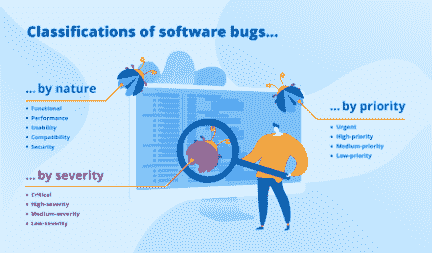

我首先想与你讨论的漏洞是软件缺陷。软件缺陷只是计算机程序中的一个缺陷。这会导致程序出现意外行为。这可能只是软件逻辑中的一个缺陷。

## 计算错误

例如，假设一个 Excel 电子表格应该获取两个单元格的内容，将它们相加，并将结果存储在第三个单元格中，但它却将数值相加而不是相乘。当你将它们组合时，会得到意外结果。这被称为计算错误。

第三个单元格应该包含你预期的结果。即前两个单元格的乘积，因为应用程序没有按预期执行。这就是一个缺陷的示例，正如编写它的人所意图的那样。

## 缓冲区溢出

缓冲区溢出是另一种类型的软件缺陷。缓冲区被定义为为特定数量的数据预留的一块内存。如果数据量大于缓冲区的容量，就会发生缓冲区溢出。

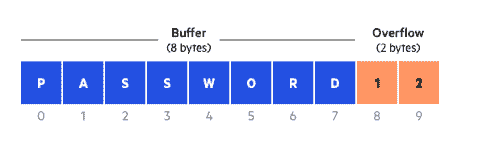

## 内存缓冲区的容量

表单是一个在计算机之外发生这种情况的示例，你可能在表单上提供过信息，例如你的姓名和地址，表单上有几排方框。填写这些表单时，你只应填写空白处。每个方框应包含一个字母或一个数字。如果你碰巧拥有一个比表单设计者预留空间更长的姓氏。

例如，在填写表单时，你会超出为姓氏预留的空间。这会产生歧义。把名字放在哪里才是合适的？你觉得呢？

留出一个空格继续？如果那样太慢怎么办？侵占下一个方框的空间？读表单的人会怎么做？我相信你本意是写在另一部分的方框上。

同样，当计算机软件写入内存时。除了栈，软件还使用缓冲区来存储各种数据。在内存中，这些缓冲区相互紧邻。因此，如果每个缓冲区包含多个不同的值，并且每个缓冲区都有一个固定数量的位用于保存数据，类似于一个包含特定数量方框的表单，用于姓氏、地址等，如果存在这样的表单的话。放入缓冲区的数据超过其容量时，后续缓冲区中的数据可能会被覆盖。你可能会想，“了解这些琐碎的事情（例如电子表格无法正常工作，或数据大于为其预留的缓冲区）对我有什么重要性？”确实，在大多数情况下，软件缺陷最坏的结果是引起沮丧，而且大多数时候，缺陷完全不被察觉。

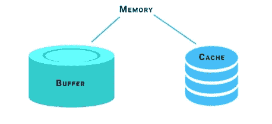

但是，你应该意识到恶意攻击者可以利用这些缺陷。这些缺陷被用来操纵程序，使其执行攻击者想要的操作。与程序无法正常运行（即其设计应执行的操作）造成的小麻烦不同，熟练的攻击者可以利用其对缺陷的了解，并以对其有利的方式加以利用。例如，熟练的攻击者可以利用缓冲区溢出获取原本无法获得的信息。他们甚至能够覆盖原始数据，使其不再包含相同的信息，或者他们可以利用缓冲区溢出导致运行该软件的主机崩溃，从而导致拒绝服务（DoS）攻击。

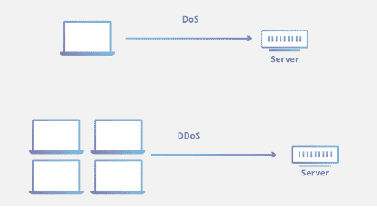

## Chapter 2

## 弱密码

# 

密码用于限制对敏感数据的访问，只有特定的人或程序才应有权访问。密码要有效，必须满足某些标准。其中一个要求是密码必须强。密码必须既复杂又长才能被视为强密码。密码越长，暴力破解攻击就越难破解。

密码曾经只需要八个字符长就被认为是安全的。根据研究，至少需要 12 或 16 个字符。密码复杂性也很重要。正如每增加一个字符会使密码更安全一样，增加可用字符的类型会使密码破解程序更难获得最终密码。例如，如果你创建一个八个字符长且仅包含大写和小写字母的密码，则有超过 53 万亿种可能的密码组合。当添加 0 到 9 等数字字符时，每个字符现在有 62 个选项，使可能的组合总数超过 218 万亿。最后，允许特殊字符将每个字符的选项数增加到 74 个，使你的 8 个字符密码达到近 900 万亿个选项。虽然所有这些数字看起来都非常大，以至于破解需要一千年，但事实是，即使有近 900 万亿种组合，当今的计算机也只需要 2 个半小时就能破解。

仅由大写和小写字母组成的 8 位字符密码，破解只需 9 分钟。如果将密码字符数从 8 增加到 12，仅使用大写和小写字母的密码总数将从 53 万亿增加到超过 390 百万亿。百万亿是十亿乘以十亿。仅由大写和小写字母组成的密码破解所需时间比这个数字本身更令人印象深刻。当今的计算机需要 123 年才能破解该密码。包含数字和特殊字符会使可能的组合数量增加到 26 百万亿，即百万亿乘以 1,000。而该密码的破解时间将从 123 年增加到超过 8500 年。密码的长度和复杂性并非影响其强度的唯一因素。密码不应包含任何字典单词、姓名或重要日期。因为密码破解工具预先加载了字典单词以供优先尝试，使用字典单词会将你的 12 位密码从需要 8500 年才能破解变为瞬间被破解。

姓名和重要日期也会使密码更容易被猜测，因为它们更容易被推断出来。毕竟，它们对你很重要。此外，在密码末尾添加特殊字符，例如用 `$` 代替 `S`，用 `3` 代替 `E`，用 `@` 代替 `A`，用 `0` 代替 `O` 或使用感叹号，并不能提供额外的安全性。虽然这种方法在过去可能有效，但现在的密码破解工具已包含这些字母替换的库。为了防止弱密码，应包括要求密码在一定期限后过期，并且任何先前使用过的密码都应被排除。

## Chapter 3

## Hardcoded passwords

# 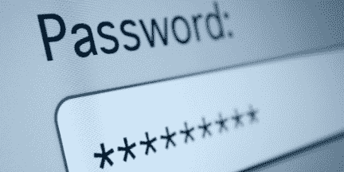

硬编码密码是与密码相关的另一种安全风险。硬编码密码是指嵌入到各种应用程序中的密码。

密码可以是入站变体或出站变体。在入站变体中，为了获得对程序的管理访问权限，提供的凭据会与一组硬编码凭据进行检查。当应用程序需要连接到另一个设备或服务时，使用出站变体。在原始应用程序中，连接到该设备或服务的密码是硬编码的。这两种变体的问题在于，攻击者可以通过检查代码的源代码或二进制导出轻松获得密码。一旦攻击者获得了密码，他们就可以访问所有使用相同密码的程序。如果软件安装在多个设备上，攻击者可以用一个密码攻破所有设备。防止硬编码密码有几种选择。一种选择是将密码与代码分开，存储在经过强加密和保护的配置文件中。程序不再使用硬编码的默认用户名和密码，而是可以在用户首次登录时提示用户创建密码。如果软件必须包含硬编码凭据，另一种缓解措施是使用强单向哈希，并将这些哈希存储在配置文件中。然后，程序会将输入密码的哈希与配置的密码进行比较。这样做有利于，即使攻击者获得了配置文件的访问权限，他们仍然需要尝试破解密码，而且如果密码足够强，如前面讨论的那样，攻击者需要数千年才能破解该密码。

## Chapter 4

## No Encryption

# 

在当今世界，加密对于敏感数据至关重要。加密数据可确保其机密性和完整性。

加密既可用于传输中的数据，也可用于静态数据。例如，连接到网站时，通常会使用 `HTTPS`，它使用 `TLS` 创建隧道。由于通信已加密，任何能够看到客户端和服务器之间通信的人都无法看到数据的实际负载。同样重要的是加密静态数据。加密文件和其他敏感数据会使攻击者更难以未经授权地访问信息。此外，这也会使攻击者更难以操纵数据。如果数据中缺少加密，数据就会暴露。例如，如果程序将用户的凭据保存到 `cookie` 中以便更快地登录网站，但该 `cookie` 未加密密码，那么如果系统被攻破，凭据将非常容易被推断出来。正如你所见，这些只是不使用加密所带来的严重安全风险的几个示例。

## Chapter 5

## Path Traversal

# 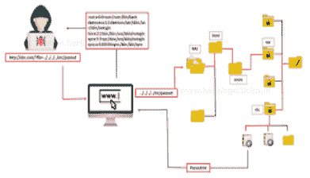

路径遍历是另一种安全缺陷。当应用程序允许恶意行为者导航到用户所看到的目录之外时，就会发生此漏洞。

例如，如果攻击者在网页上并想尝试浏览以查找不同的文件，他们可以使用路径遍历攻击来实现。当攻击者在合法网页上时，他们可以尝试通过键入 `"../"` 来导航到上一级目录，或者通过键入 `".. / %2e %2e %2f"` 来使用表示此路径的编码，从而导航到不同的文件。如果网站易受攻击，攻击者可以通过几次猜测，以及通过 Web 服务器返回的关于文件结构的错误，快速了解目录结构。一旦目录结构被攻破，攻击者就可以浏览各种文件，例如密码文件、系统文件和其他未经授权的数据。为了防止路径遍历攻击，网站在使用文件系统调用时应尽量不依赖用户输入。另一种预防机制是确保用户输入经过验证，除了已知的良好条目（例如特殊字符）外，将所有条目列入黑名单。另一种良好的缓解技术是让管理员使用索引而不是文件位置的实际名称。因此，不要让用户输入 `Alaska` 来导航到 `Alaska` 目录，而是让他们使用 `id`，例如 `20`。

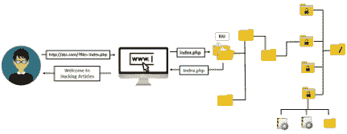

## Chapter 6

## SQL Injection

# 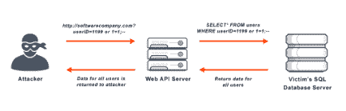

SQL 注入攻击是另一种可能影响 Web 应用程序的安全缺陷。SQL 注入攻击是指将额外代码注入到原始 `SQL` 代码中的攻击。

本质上，它允许攻击者添加额外代码以实现其目标。理解 SQL 注入非常重要，原因有很多。首先，它们很容易被发现。快速的网络搜索将揭示几个易受攻击的网站。此外，SQL 注入很常见且易于利用，尽管 SQL 注入的影响可能很严重。就影响而言，请考虑如果 SQL 注入成功会发生什么。例如，SQL 注入攻击有可能访问机密数据。成功的 SQL 注入攻击可以访问的数据包括用户名和密码、个人身份信息、社会安全号码、家庭住址，或银行账户、损益表甚至知识产权等敏感的企业记录。一旦 SQL 注入访问了数据，它就可以修改数据。这会影响数据完整性，因为攻击发生后无法知道数据是否准确。某些攻击甚至可能发起创建额外账户，供攻击者用来获得更多访问权限，或创建可能对组织有害的虚假信息。另一个影响是原始系统的可用性。如果攻击者可以使用 SQL 注入操纵数据，他们可能能够删除关键数据，使系统无法运行。例如，他们可以删除数据库中存储的所有记录，使数据库无用。攻击者甚至可以进一步删除数据库或数据库运行所在的操作系统正常运行所需的关键文件。无论如何，数据库都无法按预期方式工作。

## Chapter 7

## Cross Site Scripting

# 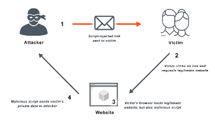

跨站脚本，缩写为 XSS。当恶意用户将恶意代码或脚本注入合法网站时，这被称为 XSS。为了使网站按照攻击者的意愿运行，攻击者使用不可信数据，即网站用作搜索功能的用户输入。例如，恶意攻击者可以编写 JavaScript 等代码，这些代码将在搜索功能中运行。攻击者将恶意代码插入指向合法网站的链接中。如果攻击者随后说服用户点击该链接，代码将在该用户的计算机上执行。JavaScript 代码可以轻松地将用户的 Cookie 数据发送给攻击者，其中可能包含各种网站的用户名和密码。攻击者可以使用各种工具，例如 URL 缩短器，使链接仅显示合法网站，同时隐藏其背后的恶意代码。攻击者还可以使用持久性 XSS 来更改服务器端的代码。一旦代码保存在服务器上，就不难想象攻击者可以利用各种安全漏洞来攻击毫无戒备的网站访问者。他们可以将代码永久保存在良性网站上，因此当合法用户流量导航到该网站时，攻击者的代码会运行，即使用户没有点击攻击者的恶意链接。使用安全编码库是防范跨站脚本的最佳方法之一。这可以防止攻击者使用各种转义快捷方式来运行其代码。另一种预防措施是正确设计网页，不允许不可信数据出现在 HTML、JavaScript、CSS 或其他编程语言的特定区域内。

## Chapter 8

## Cross-site forgery request

# 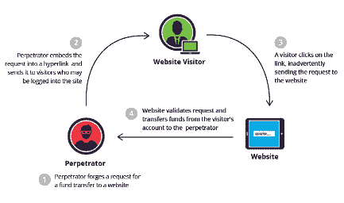

通过伪造跨站请求，攻击者可以利用合法的跨站请求，并强制受害者的计算机在其已进行身份验证的网站上执行不需要的操作。例如，如果攻击者成功地通过社交工程诱使用户点击链接，或将链接重新植入原本合法的网站，脚本将运行并强制用户执行不需要的操作。如果银行网站使用 GET 请求在一个成员与另一个成员之间转账，攻击者可以更改 URL 以将资金转给自己。这个 URL 可以通过使用 URL 缩短器或将链接嵌入到不同名称中来轻松隐藏。建议采用跨站脚本缓解措施来防范跨站请求伪造。虽然 XSS 并非成功进行跨站请求伪造攻击所必需，但成功的跨站脚本攻击可以绕过跨站请求伪造缓解措施。一旦解决了跨站脚本问题，就可以通过使用安全随机令牌来解决跨站请求伪造请求。用户也可以通过使用支持 SameSite Cookie 属性的浏览器来帮助保护自己。即使链接是合法的，这也将防止浏览器发送 Cookie。

## Chapter 9

## Viruses & Malware

# 

我们已经讨论了可能影响当今网络的各种安全漏洞类型。现在是时候继续前进，扩展这些知识，并讨论可能影响本地网络和基于云的网络环境的不同威胁。特别是，我们将介绍一些您应该了解的额外威胁，以保护您公司的本地 IT 设备。课程随后将介绍拒绝服务攻击和中间人攻击。

随后，您将了解社会工程学以及网络钓鱼是一种常见的社会工程攻击。了解网络钓鱼后，您将明白端点如何帮助用户并防止成功的网络钓鱼攻击。随后，我们将介绍可能影响您公司基于云的 IT 基础设施的特定威胁。作为安全工程师，您必须了解攻击者可用于干扰合法业务活动的各种数字威胁。企业 IT 设备不再局限于单一位置甚至几个不同的远程站点。企业仍在使用云环境来运行其部分或全部业务。恶意软件 让我们来看看一些可能影响企业环境的威胁，从恶意软件开始。恶意软件一词源于将“恶意软件”两个词合并为一个词，它是一个广义术语，涵盖了广泛的威胁。举几个例子，威胁包括病毒、特洛伊木马、后门、蠕虫、rootkit、间谍软件、漏洞利用、广告软件以及任何潜在的不需要程序。

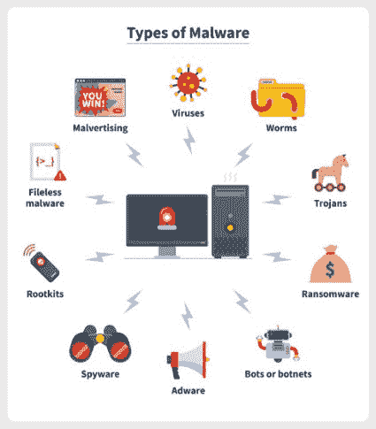

病毒 病毒是最古老的恶意软件类型之一。虽然有些人将恶意软件和病毒混淆，但病毒最准确的定义是一种会自我复制的计算机程序。病毒从一个文件传播到下一个文件，最终感染足够多的文件以造成严重的计算机损坏。虽然单个受感染的文件可能会造成损坏，但当受感染的文件通过共享驱动器、USB 驱动器或任何其他文件传输介质传输时，病毒也可以从一台计算机传播到另一台计算机。病毒是一段可执行代码，它会附加到另一个程序上，例如可执行文件或 Microsoft Office 文件中的宏。

病毒在感染文件被执行之前始终处于休眠状态，一旦执行，病毒的代码就会被运行。病毒的主要目标是造成破坏。它通过损坏文件（包括系统文件）来实现这一目标，从而导致底层操作系统无法正常运行。间谍软件 另一种恶意软件是间谍软件。顾名思义，间谍软件旨在运行在受害者的计算机上并窃取敏感信息。间谍软件可以采用键盘记录器的形式，记录每一次按键。如果受害者访问银行网站并登录，攻击者就能看到按键记录，从而确定用户访问了哪个银行网站，以及用户名和密码。间谍软件还可以查找信用卡号码、浏览习惯，以及受害者在计算机上进行的几乎任何其他操作。

## Chapter 10

## 木马与勒索软件

# 

木马是另一种旨在造成严重危害的恶意软件。木马通常看起来并非恶意软件，但与其他任何恶意软件一样，它们包含旨在执行特定任务的代码。与病毒不同，木马无法自我复制。它们必须由用户安装。后门木马是一种常见的木马类型，旨在让攻击者访问受感染的计算机，从而允许他们随意操作。他们可以添加主机，甚至发送和接收各种文件，或者木马的唯一目的是通过显示广告弹窗或仅仅更改桌面背景来惹恼用户。攻击者还可以控制多台机器并用它们攻击其他受害者。在分布式拒绝服务攻击中，攻击者可以让所有受感染的计算机尝试瘫痪一个系统。在下一章中，我们将讨论拒绝服务攻击和分布式拒绝服务攻击。

勒索软件 一种特定类型的木马旨在感染用户的计算机并使其无法使用。受害者访问其计算机和文件的唯一方法是向攻击者支付费用。这种木马被称为勒索软件，因为攻击者要求受害者支付赎金。

## Chapter 11 

## Rootkits 与蠕虫

# 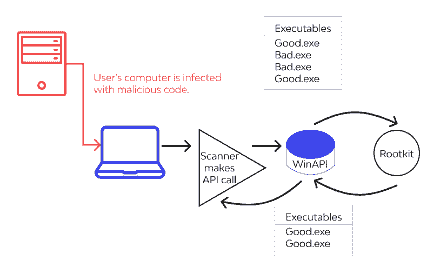

## Rootkits 是另一种类型的恶意软件。

Rootkits 旨在执行与我们讨论过的其他一些恶意软件相同的许多恶意操作。最显著的区别是，rootkits 专门设计用于避免被传统反恶意软件检测到。

它们可以通过将自身插入计算机内核来实现这一点，内核与主机操作系统处于同一级别。这使攻击者完全控制计算机，包括覆盖或删除操作系统文件的能力。

## Worms

## 

蠕虫是一种与病毒不同的恶意软件。

它们以与病毒相同的方式自我复制，但它们不附加到另一个程序，也不需要用户或主机程序来帮助传播蠕虫。

蠕虫利用目标系统中的漏洞，以便从一个系统传播到另一个系统。这就是为什么保持操作系统和软件更新至关重要。

## Adware

## 

另一种类型的恶意软件是广告软件，它通过在受感染的机器上显示广告来产生收入。恶意软件的创建者通过显示广告或使用按点击付费模式来赚钱。

随着计算机和网络系统的不断发展，恶意软件几乎肯定也会随之演变。这就是为什么作为安全工程师，确保自己了解各种存在的威胁类型以及如何缓解这些威胁比以往任何时候都更加重要。

## Chapter 12

## DoS 攻击

# 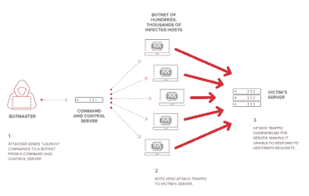

许多威胁并非专门指恶意软件。

我们将在本章中讨论拒绝服务攻击和分布式拒绝服务攻击，以及中间人攻击。

## 拒绝服务 (DoS) 攻击

当系统的服务对合法用户不可用时，就会发生拒绝服务 (DoS) 攻击。系统可以是 Web 服务器、电子邮件服务器，或任何依赖于计算机或计算机网络的其他服务。

恶意攻击者必须发送如此多的流量，以至于服务的服务器没有足够的资源来响应每一条流量，从而有效地发动 DoS 攻击。

这可以通过发送大量 ICMP 消息、尝试启动但从未完成三次握手的消息、UDP 消息，或服务在正常情况下设计为响应的任何其他类型的消息来实现。

当系统或服务过载时，它无法处理任何传入的合法请求，用户被拒绝访问该服务。

分布式拒绝服务 (DDoS) 攻击

当多台机器协作攻击一个服务时，就会发生分布式拒绝服务 (DDoS) 攻击。

攻击者可以命令被恶意软件感染的机器向 DDoS 攻击的预期受害者发送各种类型的消息。

## Chapter 13

## 中间人攻击

# 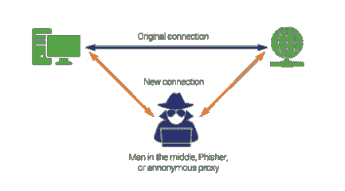

当有人拦截两个原本正常系统之间的流量时，这被称为中间人攻击。例如，如果恶意攻击者拦截了客户端和服务器之间的流量，他们将能够看到流量的全部内容。中间人攻击拦截客户端发送到服务器的初始请求，然后复制该消息并将其发送到原始服务器。服务器随后用其返回消息响应中间人。再次，中间人复制流量，然后用副本响应客户端。中间人可以在客户端和服务器之间的整个对话过程中重复此过程。客户端和服务器都认为它们正在互相通信， unaware 中间有一个设备可以看到整个对话。此外，拥有合适工具的中间人攻击者可以将他们想要的任何内容注入客户端和服务器之间的通信中。因此，他们不仅可以读取对话的内容，还可以以任何他们想要的方式操纵它。前几章讨论过的威胁，例如 SQL 注入和跨站点脚本，也可以用于对本地和云端设备造成破坏。

## Chapter 14

## 社会工程学和网络钓鱼攻击

# 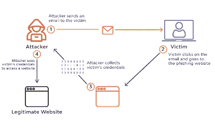

另一种近年来日益增多的攻击类型被称为社会工程学攻击。当攻击者与另一方之间存在感知到的信任时，这就是社会工程学的一个例子。该方可能是受害者，也可能是第三方，例如互联网服务提供商或电子邮件提供商。此外，如果攻击者能够赢得提供商的信任并说服他们自己是受害者的身份，服务提供商可能会泄露本应仅向受害者披露的机密信息，例如账户名和密码。一旦攻击者获得这些信息，他们就可以利用它来获取更多信息，甚至更改服务以防止受害者使用它。如果攻击者直接与受害者完成了社会工程学攻击，他们正在说服受害者自己是一个值得信任的权威。攻击者可以使用多种方法来收集足够的信息以赢得受害者的信任。在当今世界，利用受害者的社交媒体和其他在线个人资料是一种常见方法。无论使用何种方法收集信息，一旦建立信任，攻击者就可以利用它来说服受害者所有通信都是合法的。这意味着他们可以发送带有恶意链接的电子邮件。如果用户认为电子邮件是合法的，他们就更有可能点击链接。

电子邮件甚至不需要包含恶意文件。假设攻击者得知受害者正在购买房屋，需要为首付款发送大额电汇。通常，资金会转移给产权公司。如果攻击者利用社会工程学说服受害者他们就是产权公司，他们可能会提供错误的银行账号，导致受害者将钱汇给攻击者而不是合法的产权公司。

## 大规模网络钓鱼

网络钓鱼是发起社会工程学攻击的常见方法。网络钓鱼是利用电子通信来赢得毫无戒心的用户信任的行为。

网络钓鱼有几种类型。大规模网络钓鱼是指不针对特定个人或组织；相反，攻击者会发起网络钓鱼活动，尽可能多地针对人们，以尽可能多地获得上当受骗的受害者。网络钓鱼是一种欺诈行为。当攻击者试图针对特定个人或组织时，这被称为鱼叉式网络钓鱼。为了提高成功率，攻击者会进行调查，尽可能收集关于其预定目标的尽可能多的信息。之前攻击者冒充产权公司的例子就是鱼叉式网络钓鱼攻击的一个例子。攻击者知道受害者计划购买房屋，并且很可能知道受害者打算使用的产权公司。同样，拥有这些信息让攻击者更有机会成功，因为他们会知道受害者认为只有合法人士或公司才知道的信息。

## 猎鲸攻击

猎鲸攻击是鱼叉式网络钓鱼的一个子集，旨在针对高级管理人员和其他高知名度目标。攻击者用来赢得受害者信任的内容将针对高层管理人员进行定制。

## 克隆网络钓鱼

克隆网络钓鱼攻击是指攻击者复制一个原本合法的服务或公司来冒充他们。

继续我们冒充产权公司的例子，攻击者可能复制了一份合法的电汇表格，然后对其进行编辑，使其看起来几乎完全相同，只是更新了路由号码。

如果攻击者将新表格发送给受害者，然后致电受害者说他们在原始文件上犯了错误，应该使用攻击者提供的表格，这就是克隆网络钓鱼的一个例子。

正如我之前提到的，网络钓鱼尝试使用各种技术诱骗受害者点击恶意内容。例如，链接操纵通常用于使链接看起来会进入合法组织，但实际上会进入恶意网站或目的地。

有时，域名链接包含攻击者假装代表的网站的拼写错误。另一个示例是创建一个看起来合法的子域名网站。

例如，一些用户可能会认为该网站会将受害者带到产权公司的更新电汇部分。但实际上，它将他们带到产权公司的更新电汇网站的子域名，而攻击者同时拥有假冒的电汇网站和产权公司的子域名。这意味着提供给产权公司子域名的任何信息都可以被攻击者检索。

## 网站伪造

网络钓鱼攻击还可以利用网站伪造。这涉及使用 JavaScript 使地址栏看起来像攻击者试图冒充的网站。如果地址栏显示攻击者试图冒充的网站的正确 URL，用户将很难判断自己正在访问错误的网站。

## Chapter 15

## Mitigate Phishing Attacks

# 

我们已经讨论了社会工程学攻击，其中包括网络钓鱼，那么让我们谈谈减轻网络钓鱼的不同方法。减少网络钓鱼尝试最有效的方法之一是通过培训用户群，让他们准备好识别网络钓鱼攻击者使用的常见策略。结果，如果他们看到这些技术中的任何一种，他们就不太可能点击电子邮件中的恶意链接或附件。以下是一些有助于培训用户群的有用提示。首先，无论是谁发送的，在点击任何链接之前，都应该让他们仔细检查域名是否正确。另一个建议是让用户问自己电子邮件是否完全合理。

例如，想象一下攻击一家金融公司的企业用户，并附上一个发票链接。如果用户试图询问自己收到发票是否合理，这将有助于引起警觉。也许他们正在等待一张发票，但“发件人地址”看起来不熟悉。这引出了我的下一点。如果网络钓鱼尝试看起来合理，请指示用户致电确认。即使攻击者能够伪造“发件人地址”为正确的域名甚至电子邮件地址，用户也应该致电确认是否发送了发票。如果检测到网络钓鱼尝试，不要让用户回复；相反，培训用户将电子邮件标记为垃圾邮件，以帮助防止进一步的网络钓鱼尝试通过公司的过滤器。最后，教导用户，如果他们不小心点击了恶意链接，应立即联系其 IT 部门或安全团队。

这将有助于尽快将损害降至最低。有可用的服务允许您通过针对用户群开展活动来模拟网络钓鱼尝试。这些服务不包含恶意链接；相反，链接会将用户重定向到一个登录页面，页面上提供更多关于应注意什么的有用提示。但是，尽管用户培训非常有效，但并不总是足够。如前几章所示，网络钓鱼攻击正变得越来越复杂。如果攻击者设计出用户群未接受过培训的新方法，用户更有可能上当受骗。这时技术就派上用场了。存在非常先进的网络钓鱼防护，它分析通过初始安全电子邮件网关的电子邮件，然后使用各种方法（如高级机器学习技术、关系建模、实时行为分析以及遥测）分析这些电子邮件，以快速识别电子邮件是否为网络钓鱼尝试。如果电子邮件被确定为网络钓鱼尝试或恶意邮件，高级网络钓鱼防护可以配置为丢弃这些电子邮件，甚至将其重定向以进行进一步分析。

这可以在内部完成，也可以与像思科这样的安全合作伙伴合作。思科安全专家将协助您的组织充分理解各种网络钓鱼和社会工程学攻击的后果。通过实施技术来协助网络钓鱼防护，在其他地方发现的任何新网络钓鱼技术都可以用于保护组织。这意味着，除了培训用户如何识别恶意尝试之外，您的组织可以确信，任何未经培训的内容都会降低网络钓鱼尝试成功的可能性。

## 第 16 章

## 云服务攻击

# 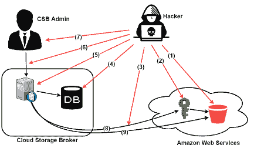

虽然迄今提到的所有攻击都可能影响云环境中托管的设备，但本章我将重点介绍可能针对云环境发生的特定威胁。有几个非营利组织为安全工程师提供指南，以确保其系统的安全。

云安全联盟（CSA）就是其中之一，正如其名称所示，他们关注云安全。开放 Web 应用程序安全项目（OWASP）致力于开发安全的 Web 应用程序，并维护一个漏洞十大列表。云数据泄露 我要与您讨论的第一个与云相关的威胁是云数据泄露。当攻击者通过入侵存储信息的系统来获取本应保持私密的信息时，就会发生数据泄露。随着越来越多的组织选择将数据存储在云中，如果安全措施没有正确配置，这些数据就会变得更加脆弱。当攻击者识别出安全性较低的系统时，他们就更容易获得对该系统的访问权限。

根据 CSA 的说法，安全缺失可能是由人为错误、应用程序漏洞或仅仅是总体上不良的安全实践造成的。一旦攻击者获得对系统的访问权限，他们就可以访问存储在该系统上的所有文件。应用程序编程接口（API）用于利用云计算提供的诸多优势。API 使连接和授权的数据共享能够自动进行。然而，与我们讨论过的先前威胁一样，不安全的 API 容易受到攻击，例如创建带有嵌入式威胁的 API 请求，或获取 API 密钥并使用它们来冒充合法应用程序以发出 API 请求。如果 API 不遵循最小权限原则，这是另一个安全问题，这将允许威胁行为者造成比 API 遵循该原则时更大的损害。API 网关可用于让所有 API 连接在同一位置终止。

OWASP 基金会推荐使用 API 安全网关。API 安全网关提供与 API 网关相同的功能，但正如其名称所示，它们包含安全技术。在设计 API 网关时，安全性并非首要考虑；功能才是。因此，它们容易受到攻击者获得访问权限的威胁。账户管理是云系统的另一个问题。与在本地托管系统的组织类似，如果管理员账户没有得到妥善管理，或者在管理员离开组织时没有正确更改密码，这将构成额外的安全风险。如果组织没有妥善管理和验证操作员，他们也容易受到攻击。使用多因素身份验证是防止凭据被盗的好方法。拒绝服务（DoS）和分布式拒绝服务（DDoS）攻击对云托管系统构成风险，就像对本地系统一样。

## 第 17 章

## 安全情报基础

# 

我们已经了解了可能影响本地和云托管环境的各种威胁。我们还讨论了社会工程学和网络钓鱼攻击，因此在接下来的章节中，我们将讨论安全情报基础。首先，我们将快速概述什么是安全情报，然后您将了解构成安全情报如此有效的各种组件。最后，您将了解思科 Talos，这是思科的安全情报解决方案。如前几章所示，众多威胁可能影响企业网络。随着时间的推移，几乎可以肯定会出现当前不存在的新类型攻击。

网络安全工程师仅仅配置防火墙以阻止特定端口和 IP 地址，然后坐下来监控的日子已经一去不复返了。作为安全工程师，您必须每天确保网络的安全，因为新威胁不断出现。在当今不断变化的安全环境中，一个专门的安全工程师部门几乎不可能确保所有设备都更新了最新的规则集以保障组织安全。由于威胁进入网络的入口点众多，工作变得指数级困难。电子邮件、公司笔记本电脑、自带设备（BYOD）、恶意网站以及非军事区（DMZ）中的设备只是威胁进入网络的各种入口点的几个示例。

安全工程师团队需要进行大量研究才能识别最新的威胁。一旦识别出威胁，他们必须确定缓解威胁的最佳方法。之后，他们必须实施这些更改，如果威胁迅速上升，那么在安全团队有时间研究外部有哪些新威胁之前，您的公司很可能就会受到威胁的破坏。调查缓解威胁的方法，然后将更改付诸实践。这时安全情报就派上用场了。安全情报使组织能够加入更大的网络安全设备社区。

社区整体因此受益。如果世界上任何地方的安全情报组织遇到前所未见的威胁，现在就有相关信息可供参考。尽管该组织可能已遭到攻破，但收集并共享的信息将使所有其他组织能够更好地保护自己免受该威胁。外部有许多安全情报云，它们都围绕相同的概念构建，但首先必须编写安全情报。一旦情报被创建，云就必须将其分发给参与者。最后，每个成员都必须消费情报，并以合理的方式应用它。在下一章中，我将介绍安全情报的各个方面。

## Chapter 18

## Authoring the intelligence

# 

首先，让我们谈谈谁创建了情报。要编写关于当前威胁的任何情报，首先必须提供信息。遥测共享是安全情报云发现组织网络中实时发生情况的一种非常强大的方式。当设备本身将其看到的数据上传到更大的网络或云以进行进一步分析时，就会发生遥测共享。继续上一章中关于全球组织遇到前所未见威胁的示例。让我们称该组织为 Sunshine Store。当威胁影响 Sunshine Store 时，他们的设备现在拥有关于该威胁的宝贵信息。如果他们参与威胁遥测共享，这些信息将与安全情报云的其余部分共享。这是从设备到云自动完成的，不需要安全工程师进行任何手动干预。安全情报云中的每个其他组织也在共享关于云威胁的关键信息。所有这些共享都提供了关于威胁的宝贵背景信息，这些信息无法来自单一来源。也许威胁在每个组织中每天发生的时间相同，或者威胁仅限于特定的国家或行业。通过让更大的样本池向云提供数据，可以做出更好的推断。

云随后将对信息执行各种任务，例如对其进行归一化并分析以发现模式。情报云可以确定各种因素，例如威胁类型、攻击发生的频率、威胁用于获得访问权限的组织内部表面区域、影响的严重程度以及更多指标。如前所述，当云分析威胁时，它会确定是否存在目标行业、目标国家或其他模式。随着有关威胁的更多信息可用，安全情报云可以制定各种对策。安全情报云现在可以为云的所有产品生成不同的签名和内容更新。

组织的电子邮件安全设备将参与安全情报云，并将向该电子邮件安全设备发布更新，以便它阻止威胁。例如，如果另一家公司决定加入威胁情报云，例如 Cisco Talos，他们将向电子邮件安全设备提供最新更新，以阻止被识别为使用电子邮件作为攻击媒介的威胁。这与入侵防御系统相同。将围绕所有可以使用 IPS（入侵防御系统）阻止的威胁创建更新。因此，任何安装该更新的 IPS 都将阻止这种新威胁。Cisco Talos 将在公司的下一代入侵防御系统上接收更新。这引出了安全情报的共享和消费。既然安全情报云已经为其遇到的威胁创建了各种更新和签名，现在是时候将它们与安全情报社区的其余部分共享了。

这通常通过内容更新推送来完成，Cisco Talos 等组织每隔 3-5 分钟就会发布内容更新。一旦更新下载完成，每个设备现在必须安装它，一旦内容安装完成，每个设备现在就准备好阻止最新威胁了。同样，一种新威胁已经影响了安全情报云中的组织，包括 Sunshine Store。因为另一家公司正在参与云，一旦威胁被分析，就发现了适当的缓解措施，并创建、推送和安装了更新。这家新公司现在免受这种新威胁的影响。这之所以如此有益，是因为它发生在无需安全工程师手动干预的情况下。

他们不再需要自行进行这项研究，想出如何阻止它，然后手动应用他们的更改。说到研究，我想指出，安全情报信息共享不仅仅指设备接收到的自动更新。它是一个整个生态系统，使安全专业人员能够了解威胁。虽然网络安全设备可以自动配置以阻止新威胁，这很好，但如果管理员不知道正在实施的威胁和缓解措施，那将是一种不负责任的行为。更好地了解最新的安全威胁只会对您作为安全工程师有所帮助。您越了解各种类型的威胁以及它们用于渗透网络和造成混乱的实际方法，您就越能理解大局。

## Chapter 19

## ARP Poisoning

# ![ARP spoofing attacks - CCNA Security 210-260 Certification Guide \[Book\]](image.027.png)

说到中间人攻击，它可以有多种形式，但最常见的是称为 ARP 中毒。

要了解 ARP 中毒，您必须首先了解 ARP（也称为地址解析协议）的工作原理。

ARP 将 IP 地址转换为连接到特定网络设备的所有网络设备的 MAC 地址，也称为物理地址。Windows 机器上的命令是 `arp –a`，但其他操作系统也可以使用相同的命令。

要在 Windows 操作系统上启动命令提示符，请单击“开始”按钮，输入 Command Prompt，然后按 Enter。之后，只需输入 `arp` 并按 Enter 即可查看与 `arp` 命令相关的所有选项。

完成这些操作后，您会注意到以下变体；

• `Arp – a` > 此命令显示计算机所知道的网络中当前的 ARP 条目，列出这些设备的 IP 地址和 MAC 地址。

• `Arp – d` > 此命令删除您指定的主机的 ARP 条目。

• `Arp – s` > 此命令将帮助您添加主机并为其分配 IP 地址。

• `Arp – v` > 此命令以详细模式显示当前的 ARP 条目，以及所有无效条目和回环接口。

这些是 ARP 相关的一些基本变体和选项，但没有必要了解所有可用选项。

要回到 ARP 中毒，一旦连接，同一网络上的计算机和网络设备会互相学习对方的 Mac 地址。一旦它们学习了对方的 MAC 地址，就会创建一个 ARP 表，并将来使用该表在同一网络上定位彼此。

ARP 正是通过这种方式帮助计算机和网络设备在网络上轻松发现彼此；然而，黑客会利用 ARP 表，通过使用虚假 MAC 地址将自己引入网络，欺骗计算机认为它们是新的路由器。结果，真实的 ARP 表会被虚假条目污染。

一旦中间人（Man in the Middle）毒化了 ARP 表，计算机就会认为通往互联网的新路由是新的 IP 地址。因此，发往互联网的每个数据包都会通过攻击者进行路由。

有许多方法可以实现这一点，无论是有线网络还是无线网络。通过中间人攻击进行 ARP 毒化可以用多种方式完成，但概念始终相同。

## Chapter 20

## Rogue Access Points

# 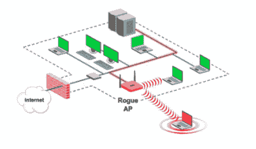

攻击无线网络的方法有很多，但让我们从基础开始。大多数人希望在任何地方都能使用免费 WiFi；事实上，如今许多公共场所都有免费无线网络。

随着越来越多的接入点（Access Point）被部署，无线网络正变得越来越普遍，它们通过互联网发送无线信号。

在移动设备上聊天、语音通话、直播、网上银行、购物等活动都是这些信号的示例。

由于无线网络在我们日常生活中如此普遍，黑客已经开始利用它们，采用各种技术来控制无线网络。

以前，黑客使用无线网络来访问公司网络。尽管无线网络更加安全，但黑客仍然通过无线接入点获得访问权限，因为许多组织在其无线网络中没有实施良好的安全措施。

正如我之前提到的，人们喜欢使用免费 WiFi 热点，但我们中的许多人并不知道连接到一个宣传自己为真正免费 WiFi 热点的恶意接入点（Rogue Access Point）的危险。

设置一个恶意接入点非常简单；因此，大型组织必须采取各种安全措施来保护其无线网络。

大多数接入点不使用电力；相反，它们是使用以太网供电（PoE）的设备。因此，接入点必须连接到另一个已开启的网络设备，例如网络交换机。由于接入点并不小，你不会看到黑客手里拿着一个到处走。

相反，黑客可以使用像 `Kali Linux` 这样的操作系统在笔记本电脑上虚拟化接入点。一旦 `Kali Linux` 安装并在笔记本电脑上桥接，黑客攻击无线网络就很简单了。

要在无线网络上成为恶意接入点，请配置 `Kali Linux` 开始监控无线信号，然后更详细地分析现有的合法接入点。之后，你可以了解合法接入点的 MAC 地址以及它们用于传输无线信号的信道。

有了这些信息，你可以配置 `Kali Linux` 来宣传与合法接入点相同的信息，然后成为新的伪造接入点，也称为恶意接入点（Rogue Access Point）。

还有许多其他配置需要，例如 DHCP 服务或 DHCP 服务器设置，以向现在也是受害者的客户端提供 IP 地址，但 `Kali Linux` 使任何没有技能的人都能非常轻松地完成这项工作。

恶意接入点所需的另一个设置是“NAT”，即网络地址转换，它将私有 IP 地址转换为公共 IP 地址。最后，必须配置路由功能，以便受害者可以通过恶意接入点与互联网通信。

恶意接入点也被称为中间人攻击，因为它们位于受害者和受害者正在访问的目标地址之间。

## Chapter 21

## Man in the Middle on Wireless Networks

# 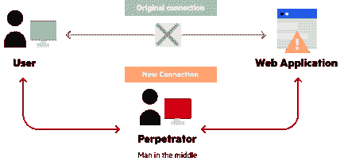

要继续，一旦存在中间人，中间人就可以捕获最终用户所做的任何事情，包括任何需要输入用户名或密码的网站访问。

除了捕获数据，中间人还可以修改详细信息，甚至更改受害者提供的数据输入，例如在填写重要的在线表单时。中间人攻击最常见的用途之一是让受害者通过无线网络连接到恶意接入点。

理解这一点至关重要，最终用户必须接受培训，始终验证他们正在连接的无线 SSID。

## 基于误解的攻击

你可以使用像 `Kali Linux` 这样的操作系统来复制或创建任何 MAC 地址，使你的笔记本电脑能够充当任何其他网络设备。

因此，一旦你开始使用虚拟化的 `Kali Linux` 监控无线信号，你就可以开始识别无线网络，你可以识别接入点以及与接入点关联的客户端。

一旦你拥有了这些详细信息，你可以伪造接入点的 MAC 地址并成为恶意无线接入点，或者你可以了解足够多的已连接客户端信息以开始复制它们。

大多数接入点都会学习并记住成功连接设备的 MAC 地址。这就是为什么你不需要每次连接到之前提供过密码的无线网络时都输入密码。

你甚至不需要再次点击或选择 SSID，因为当你的设备在口袋里时，它会自动连接到受信任的接入点。但是，请记住，客户端和接入点之间的信任必须是双向的。因此，客户端设备不仅必须信任无线接入点，无线接入点也必须信任客户端设备。

一旦 `Kali Linux` 发现了与受信任无线接入点建立连接的现有客户端的 MAC 地址，你所要做的就是复制受信任设备的 MAC 地址并将其分配给你自己的 `Kali Linux` 无线接口。

通过复制受信任客户端的 MAC 地址并将其分配给你自己的 `Kali Linux` 接口，你仍然需要想出如何连接到无线网络，这就是诀窍所在。要使所有现有受信任连接客户端取消身份验证，请向接入点发送取消身份验证消息。

虽然所有先前受信任的客户端都会尝试向无线网络重新验证身份以获取互联网访问权限，但你的设备必须比先前受信任的设备更快地连接到无线接入点。你可以使用 `Kali Linux` 使你的无线信号更强，以便更快地连接到无线接入点。

## Chapter 22

## De-Authentication Attack

# 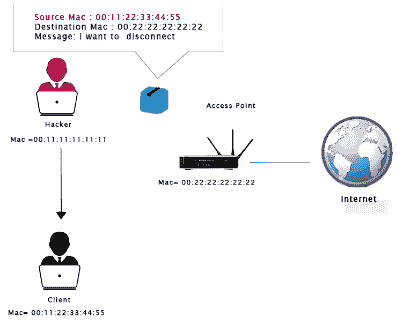

错误关联攻击的目标是让黑客在无线网络上获得身份验证和授权。一旦你连接到无线网络，你就可以做很多事情，黑客使用这种技术并不仅仅是为了获得免费无线互联网，而是为了进行更复杂的攻击。

黑客攻击最常见的原因是为了经济利益，但还有其他原因，例如间谍活动或冒充。

有时黑客只想造成简单的网络延迟，即减慢网络速度，或导致单个设备无法正常运行或无法连接到网络等问题。

使用像 `Kali Linux` 这样的工具，你可以监控并了解连接到网络的所有受信任客户端的 MAC 地址，一旦你了解了足够多的客户端数据，你就可以从攻击笔记本电脑向每个受信任设备发送自动取消身份验证请求。

攻击笔记本电脑或 `Kali Linux` 在接入点（AP）看来，就像所有重新验证请求都来自现有客户端一样。反过来，AP 会取消所有这些设备的身份验证，让最终用户困惑为什么失去了互联网访问权限。

一旦向 IT 部门报告，工程师应有足够的时间分析日志并找出发生了什么，但他们除了正常的流量流外，不会发现任何其他情况。然而，如果所有人在同一时间或相近的时间断开与同一无线网络的连接，这会引起怀疑。尽管如此，要确定究竟发生了什么，以及几个去认证请求的流量发起源头在哪里，仍然很困难。

## Chapter 23

## Wireless Collision Attack

# 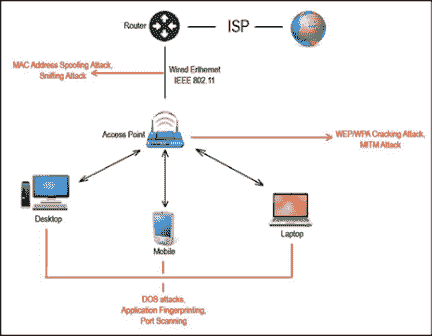

无线碰撞很常见，可能由无绳电话和微波炉等设备无意中引起，这些设备会造成干扰，削弱现有可信连接设备的无线信号。

无线接入点使用各种信道通过空气发送信号。例如，如果你住在公寓里，你邻居的无线接入点可能会对你的家庭连接造成无线干扰。

接入点的信号范围为 30-50 米，但一些为企业设计的 `Ap-s` 在没有干扰且范围内无障碍的情况下，可以传输高达 600 米的无线信号。

当无线信号遇到窗户、门、墙壁和较厚物体等障碍物时，其质量开始恶化。公寓中无线信号弱的情况很常见，尤其是当你附近有多个邻居时。

我已经提到过，你可以配置 `Kali Linux` 以提供更强的无线信号，以及监控和识别无线 `SSIDs`、范围内的无线接入点以及它们运行的信道。

黑客经常将他们的 `Kali Linux` 配置为使用与受害者的 `AP-s` 相同的信道，造成显著的无线干扰，导致受害者的网络不仅变慢，在某些情况下甚至完全无法使用。

通过不断增强无线信号，数据包最终会被丢弃，大多数甚至所有客户端都将无法连接到无线网络。更进一步，黑客将 `Kali` 安装在 `Raspberry Pi` 上，并将其隐藏在目标无线接入点附近，以造成更糟糕的无线信号。

在某些情况下，黑客将预先配置为运行 `Kali Linux` 的 `Raspberry Pi` 连接到 `Drone` 上，并将其降落在目标建筑物上。当使用复杂的无线碰撞攻击时，无线信号可能会被严重削弱，影响多个 `SSIDs` 甚至多个 `APs`。客户端会因无线碰撞攻击而断开无线网络连接。

## Chapter 24

## Wireless Replay attacks

# 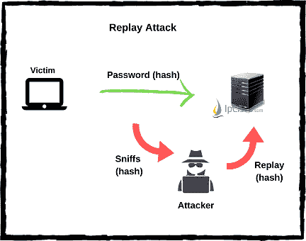

无线重放攻击已经不再流行，但它们曾经非常普遍。与此同时，出于各种原因，无线重放攻击仍在无线网络中被使用。

捕获无线信号很简单，尤其是因为它们无处不在。在连接到无线网络之前，黑客必须先监控无线信号。

`Wireshark` 软件可用于在监控的同时记录无线流量。`Wireshark` 是网络工程师经常用于排查有线和无线网络问题的数据包分析软件。

`Wireshark` 可以帮助进一步分析捕获的流量，并了解无线网络上正在进行哪种类型的通信。黑客会特别检查与客户端到特定 `SSID` 的身份验证过程相关的数据包。

这个数据包将验证用于连接到无线接入点的密码。一旦黑客获得数据，他就可以使用它通过空气向 `AP` 发送相同的消息。结果，接入点将在假设它是已知可信设备的前提下，对黑客进行身份验证和授权，允许其连接到网络。

由于大多数大型公司已经实施了新的安全实践以实现更好的加密，无线重放攻击不像以前那么常见了。然而，并非所有组织都使用强加密技术，许多企业可能会通过采用这种过时的方法而被利用。

## Chapter 25

## Protecting wireless networks

# 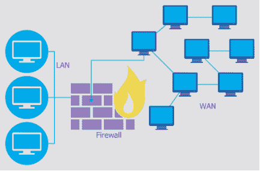

由于基础设施安全至关重要，大多数大型公司已经建立了良好的安全措施，例如 `Cisco Identity Service Engine (ISE)`、`Cisco`、`Checkpoint` 或 `Palo Alto Firewalls`，以及某种入侵防御系统 (`APS`) 和入侵检测系统 (`IDS`)，例如 `Cisco FirePower`。

大多数企业更喜欢拥有两种防火墙，以防其中一个被攻破。

入侵检测系统在无线安全方面也很著名，并且擅长检测网络异常。一旦发现异常，工程师和安全专业人员将通过电子邮件收到通知。需要注意的是，`IDS-s` 只擅长识别或检测异常，而不是阻止它们。

这就是入侵防御系统派上用场的地方，因为它们可以防止或减轻此类无线攻击。入侵检测系统的问题在于，虽然它们在防止黑客攻击方面有效，但在检测黑客攻击方面并不十分有效。因此，同时拥有设备和虚拟设备 `IPS-s` 和 `IDS-s` 是一种良好的做法。

大多数无线接入点是以太网供电设备，因此连接到网络交换机。如果黑客试图通过有线或无线连接连接到网络，必须在网络交换机上实施其他命令。

无线网络安全至关重要，如果你在家里有个人无线网络，你很可能正在使用 `WPA-Personal` 或 `WPA-PSK` 之类的协议。`PSK` 是预共享密钥的缩写，是连接到无线网络所需的密码。

预共享密钥可以通过多种技术被攻破，包括暴力攻击或字典攻击。暴力攻击和字典攻击都是相对容易执行的任务，尤其是使用 `Kali Linux` 时。

运行这些工具只需点击几下，一旦启动，它们就会开始查找密码或预共享密钥的工作。

预共享密钥应包含大写和小写字母、数字以及各种符号，并且至少 12 个字符。你的密码越复杂，黑客就越难破解。

此外，你的密码不应与你本人相关联。请避免使用你的名字、出生日期或任何属于家庭成员的名字。

大多数人使用容易记住的密码。当然，坏人也知道这一点，并且通过使用社交网络网站，他们可以轻松破解与个人相关的密码。

暴力攻击或字典攻击可以破解密码，即使需要几天时间，它们最终也会被破解。这是公司实施密码策略（如密码复杂性和要求用户定期更改密码）的主要原因之一。这些是标准做法，如果你的组织尚未实施这些做法，你应该将其提请经理注意。

## Bonus Chapter VPN Concepts

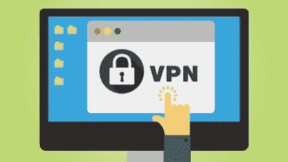

你认为什么是 VPN？如果我对你说：“嘿，我们正在设置一个 VPN，”你会怎么想，或者你会如何定义它？那么，以下是我们中一些人对它的定义。

首先，`VPN` 代表 `Virtual Private Networking`。让我们回到虚拟部分。我们不妨先从私有网络开始。

私有网络意味着我可以进行网络连接并发送数据等，同时保持私密，对吗？有一个假设，即我通过网络发送的任何东西都对我是私密的，所以虚拟部分就在这里：我的网络是私密的，但它是一个虚拟网络。

## VPNs 概述

VPNs 是我们所说的覆盖技术，因为它们位于已存在的另一个网络之上。我们将虚拟专用网络放置在现有网络或将要遍历的网络集合之上。

这就是虚拟专用网络的设想。VPN 提供哪些服务，为什么它们如此重要？作为覆盖网络，VPN 通常设计用于通过广域网连接远程站点或远程位置的用户。

我们可以通过公共网络访问（例如互联网）来实现，也可以通过私有广域网实现 VPN。但其理念是跨多个站点进行连接，因为我们在不受控制的公共网络上发送流量，因此 VPN 应为我们及我们的数据提供一定程度的机密性。这将体现为加密。

我们可以使用多种加密技术，您可能已经熟悉其中一些。多年前，最流行的加密技术是 DES（Data Encryption Standard）。还有 3DES，即三个不同的 DES 进程。

这些技术仍在使用，一些组织仍在使用，但 DES 和 3DES 被视为较旧的协议。相反，我们将采用高级加密标准（AES）。

DES 是一种 56 位加密算法。3DES 是 168 位，而 AES 可以是 128 位、168 位、256 位等等。我们可以采用各种 AES 组、加密方法和强度。

因此，我们将根据所需的加密级别（即机密性级别）来选择这些技术。如果我们希望安全，AES-256 可能是一个不错的选择。

VPN 还应确保数据完整性，确保数据在传输过程中未被篡改。请这样考虑：假设我们有一个箱子，要将其从一个地点发送到另一个地点，我们将其放在秤上称重，称重为 20 磅，然后将其发出。

有人在传输过程中篡改了它。他们打开箱子并取出物品。当箱子到达另一端并被称重时，它只重 2 磅。

我们可以查看标签说：“等等，运输标签上说它重 20 磅，但现在只重 2 磅。”该包裹的完整性已受损，因此我们不打开它，不篡改它，将其退回，或者简单地说：“嘿，我不接受这个。”这就是完整性。

我们将在 VPN 中使用哈希机制来确保数据完整性。哈希算法可用于创建哈希机制。我们有 MD5（Message Digest 5）和 SHA（Secure Hash Algorithm，也称为 SHA-1 或 SHA-256）。

基本上，我们对数据包进行哈希处理，然后附加哈希，就像称重箱子一样，然后将其发送到另一端，另一端将对数据包自行进行哈希处理。

他们将通过哈希算法（例如 SHA）运行它，然后生成一个哈希（只是某个哈希），并将该哈希与发送的哈希进行比较。如果哈希匹配，我们知道它基本上重量相同，我们就可以接受它。这就是 VPN 如何帮助我维护数据完整性。

我们将介绍的第三点是，VPN 应为我提供数据源身份验证。我们可以使用预共享密钥来提供数据源身份验证。

我们将简单地使用 PSK（预共享密钥）或数字证书，数字证书类似于从 DMV 获取驾驶执照，因此由受信任的第三方进行身份验证。

例如，如果您去 DMV 并填写您的信息，他们将向您颁发驾驶执照。如果您被拦下，您可以向他们出示驾驶执照，警察会信任它，因为它由受信任的来源（DMV）颁发，并且它对您进行身份验证。

我们可以用数字证书实现相同的结果。我们可以与 CA 服务器（例如 Verisign、Entrust 或 GoDaddy）注册，获取证书，然后将该证书出示给我们希望建立 VPN 的对方。

他们可以看到谁颁发了证书，从而信任他们。

由于您的证书已由他们签名，我将接受它。因此，他们可以以这种方式使用证书进行源身份验证。

作为替代方案，我们可以使用预共享密钥。基本上，我在发送数据之前先将其与预共享密钥进行哈希处理。我们也与他们共享了该密钥，我们是离线完成的，他们可以比较哈希值；如果匹配，我们将进行通信。

这些是我们想要了解的关于 VPN 的三件事：机密性、数据完整性和数据源身份验证。VPN 还可以提供抗重放保护，它们通常也会提供。至于如何实现，没什么可说的。

它内置于协议中，以及 iOS 和 Cisco ASA 防火墙中，它们会自动执行，但这些是我们在配置中将控制的三个部分。我们已经讨论了导致很多这些问题的原因。我们已经讨论了加密协议和哈希算法。到目前为止，我们讨论了 AES、3DES、MD5 和 SHA，但还有更多内容，所以让我们回顾一些额外的术语。

首先，考虑如何交换加密密钥。但是，有一个名为 ISAKMP 的协议。它被称为 Internet Security Association Key Management Protocol。我们简单地称其为 ISAKMP，许多人称其为 IKE（Internet Key Exchange），这是 ISAKMP 的一个组件。

ISAKMP 提供 IKE（Internet Key Exchange）和 Oakley，还有几个位于 ISAKMP 下方的其他协议，但我们将它们全部归为一类。ISAKMP 将为我们协商一个安全通道并提前交换我们的密钥。

这些安全加密密钥可以使用 Diffie-Hellman 算法（缩写为 DH）生成。Diffie-Hellman 算法生成一个不在线路上交换的密钥，但最终，我们在两台设备上都有这些密钥，它们可以用于加密和解密，即对称密钥，并且我们没有在线路上发送这些密钥，这是一件好事。

因此，当我们建立连接时，我们创建一个称为安全关联（Security Association）的东西。安全关联本质上是我的路由器上的一个条目，列出了我正在与谁通信、我正在使用哪些算法以及我可以使用哪些密钥。因此，在设备之间可以相互通信之前，两台设备都将拥有一个 SA（Security Association）。

当我们开始发送数据包时，它们将使用 ESP、AH 或两者来构建，但一般来说，我们现在只会使用 ESP。ESP 代表 Encapsulating Security Payload，我们可以在两种模式下使用它：隧道模式和传输模式。当我们在隧道模式下使用 ESP 时，我们有一个私有 IP 地址，它被隧道在公共地址内部。

这就是 ESP 协议的高级概述。它是 IPsec 协议套件的一部分。如果我们查看 ESP 头部，可以看到它有一个安全参数索引编号。它将有一个安全参数索引编号，该编号将其链接到安全关联。我们将从序列号开始，然后是加密的有效载荷、一些填充，最后是完整性检查。

其中包含的有效载荷数据是已加密的原始 IP 数据包。我们在隧道模式下加密数据并在其上添加 ESP 头部。该 ESP 头部将为我提供有关安全参数、索引等的信息。

## IPsec VPN 核心组件与工作原理

## ESP（封装安全载荷）

我们将添加一个未加密的新 IP 头，可用于路由流量。ESP 尾部应当加密，但并非全部加密，因为如果不知道数据包的结束位置，我们就无法确定数据包的结束位置，该尾部的大部分会被加密，然后我们可以对整个 ESP 头、加密数据以及 ESP 认证进行认证，可使用 `SHA-1`、`SHA-256` 或 `MD-5` 进行 ESP 认证。前提是我们处于隧道模式。

当我们处于传输模式时，数据会被加密，但原始 IP 头不会被加密。因此，如果你尝试通过互联网发送专用网络流量，就无法使用传输模式，因为 IP 头将是专用 IP 地址而非公共地址。新头部的作用就是：将我们连接到互联网。这就是 ESP 的含义。

## AH（认证报头）

另一方面，AH 是 Authentication Header 的缩写。认证报头用于认证，例如，我们对原始 IP 头和数据进行认证。

我们不认证的唯一部分是所谓的可变字段。可变字段在传输过程中会发生变化，因此你能否想到 IP 数据包中在传输过程中会变化的内容？

如果你认为是 `TTL` 值（生存时间），那你是正确的，因为它在每经过一跳时都会递减。因此，这是一个可变字段。

我们不会对其进行认证，因为如果我们将数据包逐跳路由且 `TTL` 发生变化，那么在另一端重新创建哈希并进行比较时，哈希将毫无意义，无法工作。

因此，使用 AH 时，可以使用传输模式或隧道模式。除了新 IP 头中的可变字段外，AH 有一个新 IP 头，所有内容都会被认证。这就是 ESP 和 AH 的概述，如今我们大多使用 ESP，因为它支持网络地址转换并能将我们连接到互联网。

## IPsec VPN 的构建块

我们迄今讨论的所有内容都被视为 VPN 的基础组件。因此，就核心组件而言，我们有 `IPsec`，它将为我提供某些构建块，我们需要将所有这些构建块都插入，VPN 才能工作。

因此，我们需要一个 `ISAKMP` 策略、`Diffie-Hellman` 密钥、`ESP` 或 `AH`，并且需要决定哪种流量应当被加密。例如，我们可以使用访问控制列表来实现这一点。所有这些小型构建块结合在一起，当我们将它们全部插入配置时，就会形成一个 `IPsec VPN`，我们现在可以安全地在网络中传输流量。

## VPN 概述

许多人说“我有 VPN”或“我使用 VPN”，但他们通常不了解 VPN 是什么，或者 VPN 能为我们做什么。

因此，我想简要解释一下什么是 VPN。

请记住，VPN 由三个组件组成：机密性、数据完整性和数据源认证。我们讨论了使所有这些成为可能的协议、哈希算法、密钥交换方法和安全关联，以及当我们将所有这些构建块结合在一起时，它们如何创建一个安全的 `IPsec VPN`。

