# 并行与分布式计算中的网络安全：概念、技术、应用与案例研究


献给我们的父母


题为 *网络安全入门：利用国家科学院二十年的工作*，它作为网络安全基础以及网络安全与公共政策之间的联系的简明入门读物。

**正教授 Valentina E. Balas**
*自动控制与应用软件系*
*罗马尼亚阿拉德 Aurel Vlaicu 大学*

## 2023 年全国行业职业技能竞赛——全国第二届数据安全职业技能竞赛数据安全管理员赛项理论题库

一、单项选择题 (请选择最恰当的选项)

- 1. 《中华人民共和国数据安全法》自哪一年起施行？
  A. 2020年  B. 2021年  C. 2022年  D. 2023年

- 2. 数据安全法规定，开展数据处理活动应当遵循的原则不包括以下哪项？
  A. 合法  B. 正当  C. 必要  D. 盈利

- 3. 根据数据安全法，国家建立数据分类分级保护制度，以下哪一项不是数据分类分级的依据？
  A. 数据在经济社会发展中的重要程度  B. 数据遭到篡改、破坏、泄露或者非法获取、非法利用的危害程度  C. 数据量的大小  D. 数据涉及的国家安全、公共利益或者个人、组织合法权益

- 4. 重要数据的处理者应当按照规定对其数据处理活动定期开展风险评估，并向有关主管部门报送风险评估报告。风险评估报告应当包括的内容不包括？
  A. 处理的重要数据的种类、数量  B. 开展数据处理活动的情况  C. 数据安全风险及应对措施  D. 数据处理者的经营状况

- 5. 违反国家核心数据管理制度，危害国家主权、安全和发展利益的，由有关主管部门处多少罚款？
  A. 十万元以上一百万元以下  B. 五十万元以上二百万元以下  C. 一百万元以上一千万元以下  D. 二百万元以上一千万元以下

## 缩写

| 缩写 | 含义 |
|---|---|
| APIs | 应用程序编程接口 |
| AR | 创伤后应激障碍 |
| AES | 高级加密算法 |
| ACL | 访问控制列表 |
| APT | 高级持续性威胁 |
| ATM | 自动柜员机 |
| AS | 自治系统 |
| ACE | 访问控制条目 |
| B2B | 企业对企业 |
| B2C | 企业对消费者 |
| BAN | 体域网 |
| CA | 认证机构 |
| C2B | 消费者对企业 |
| C2C | 消费者对消费者 |
| C2G | 消费者对政府 |
| CSPs | 云服务提供商 |
| CV | 消费者版本 |
| CPPS | 网络物理生产系统 |
| COMSEC | 通信安全 |
| CDI | 受限数据项 |
| COI | 利益冲突 |
| CDMA | 码分多址 |
| CDC | 云数据中心 |
| CISA | 网络安全信息共享法 |
| C3I | 指挥、控制、通信和情报 |
| CFOs | 首席财务官 |
| CPU | 中央处理器 |
| CoF | 基于云的卡存档 |
| CRC | 循环冗余校验 |
| DAC | 自主访问控制 |
| DAO | 去中心化自治组织 |
| DMZ | 非军事区 |
| DFD | 安全不足程度 |
| DDoS | 分布式拒绝服务 |
| DoS | 拒绝服务 |
| DSC | 数字签名证书 |
| DHS | 国土安全部 |


| 缩写 | 含义 |
|---|---|
| NIST | 国家标准与技术研究所 |
| OS | 操作系统 |
| OTP | 一次性密码 |
| PLC | 可编程逻辑控制器 |
| PIN | 个人识别号码 |
| PGP | 很好隐私 |
| PwC | 普华永道 |
| PC | 个人计算机 |
| POS | 销售点 |
| PKI | 公钥基础设施 |
| P2P | 点对点 |
| PPI | 预付支付工具 |
| PaaS | 平台即服务 |
| PDA | 个人数字助理 |
| QoS | 服务质量 |
| RFID | 射频识别 |
| RBAC | 基于角色的访问控制 |
| RBI | 印度储备银行 |
| RSA | Rivest-Shamir-Adleman |
| SCADA | 监控与数据采集 |
| SET | 安全电子交易 |
| SLA | 服务等级协议 |
| SMB | 服务器消息块 |
| SYN | 同步 |
| SSID | 服务集标识符 |
| SQL | 结构化查询语言 |
| SSL | 安全套接字层 |
| SMS | 短消息服务 |
| SIM | 用户识别模块 |
| SPV | 简单支付验证 |
| TCPA | 可信计算平台联盟 |
| TCB | 可信计算基 |
| UDI | 无约束数据项 |
| UDP | 用户数据报协议 |
| UDHR | 世界人权宣言 |
| VM | 虚拟机 |
| VPN | 虚拟专用网络 |
| XSS | 跨站脚本攻击 |
| XML | 可扩展标记语言 |
| XACML | 可扩展访问控制标记语言 |

## PART I
### Cybersecurity Concept

本章中定义了负责人员的职责。近年来网络犯罪的性质发生了巨大变化，这源于犯罪动机、所用工具和技术以及整体后果的变化。我们在过去几年中观察到传统计算机犯罪与当代计算机犯罪之间的对比。网络犯罪的总体演变导致了基于互联网的风险影响企业、组织等，这些风险是可能对财产造成危害的潜在责任。网络保险的概念是近期的，并承诺在组织遭受基于互联网的风险时提供保障，我们已在本章中论述。在本章的后半部分，我们将熟悉安全策略的概念以及执行这些策略的各种安全模型。Bell-LaPadula 和 Biba 等少数安全模型将在本节中讨论。此外，我们还将熟悉网络中立和人权的概念，因为它们相辅相成。考虑到网络犯罪的风险和后果，我们还将通过分析计算机取证的概念来探讨网络犯罪的法律方面。关于信息战对策的一些最佳实践也已讨论。

在一个以速度和完美为王的世界里，技术主要依赖于计算机科学。无论是发送电子邮件这样简单的行为，还是传递数十亿美元这样关键的行为，几乎所有事情都只在点击之间。计算机科学的世界让人们参与到游戏、网站浏览、社交媒体、银行、数字公民等活动中，其影响范围涵盖硬件、软件、网络、数据等众多领域。由于如此多的活动依赖于计算机，它们吸引了罪犯，最终导致网络犯罪，网络犯罪可能像基本黑客攻击那样简单，也可能像勒索软件攻击或金融网络犯罪那样复杂。后果可能从个人或敏感信息的丢失到巨额资金损失不等。因此，确保网络安全的需求至关重要。在本章中，我们将审视网络安全概念、其原因、后果和原则。网络安全理念不仅限于小型企业和教育机构，还遍及各个行业和政府，使其成为最重要研究领域之一。过去，曾提出某些目标以保护此类关键网络基础设施。某些标准、指南和实践已在网络安全框架中找到其位置，以确保网络基础设施和架构的安全。由于操作既多又复杂，它们必须由负责人员执行，这些人员通常根据其工作的性质在网络基础设施中担任角色，例如安全管理员或事件响应团队。我们将在本章中展望其中的一些角色。近年来网络犯罪的性质发生了巨大变化，这源于犯罪动机、所用工具和技术以及整体后果的变化。我们观察到过去几年中传统计算机犯罪与当代计算机犯罪之间的对比。网络犯罪的总体演变导致了基于互联网的风险影响企业、组织等，这些风险有可能损害责任和财产。因此，本章讨论了网络保险，这是近期出现的概念，承诺在组织遭受基于互联网风险时提供保障。随后在本章中，解释了安全策略以及执行这些策略的各种安全模型。Bell-LaPadula 和 Biba 等少数安全模型将在本节中讨论。此外，读者将熟悉网络中立和人权的概念，因为它们相辅相成。考虑到网络犯罪的风险和后果，我们还通过分析计算机取证的概念来探讨网络犯罪的法律方面。关于信息战对策的一些最佳实践也已讨论。

- 2. **识别和系统加固：** 网络安全的主要目标之一是识别威胁以加固系统。该过程确保风险评估和安全措施的采用。系统加固的目的是减轻与安全相关的某些风险。有时使用先进的系统加固方法，其中包括重新格式化硬盘并仅向系统中安装特定程序。
- 3. **开展运营、架构和技术创新：** 引入动态的网络风险管理方法可保护网络基础设施免受特定网络攻击。
- 4. **为突发事件做好准备：** 应急计划的理念基本上是对网络攻击的准备。它可能包含政策、最佳实践、程序和恢复计划。
- 5. **信息分配：**  supposed to be circulated in the entire system must be effective. 网络威胁、漏洞和事件可通过发布警报来报告。信息可在多个平台之间成功分发。
- 6. **专业安全培训：** 员工必须接受专业安全培训。信息和服务必须提供给联合联邦合作伙伴，以便员工在网络事件期间足够强大。
- 7. **加强系统容错能力：** 系统的容错能力可通过执行漏洞评估来计算。高保证系统可能能够抵御网络攻击。
- 8. **减少漏洞：** 多项安全实践有助于减少漏洞。修补、使用防火墙和使用强密码可以防止恶意访问系统。
- 9. **提高可用性：** 可用性是指某事物易于使用的程度。可使用性要求可与可信技术一起纳入系统。
- 10. **网络空间中的身份验证：** 验证用户或进程的身份是网络安全中的重要过程。根据设备，可部署单因素或多因素身份验证。身份验证支持我们拥有的、我们是的和我们知道的。
- 11. **自动化安全程序：** 自动化带来效率、行为预测更好和执行更快。适当的自动化实施可防止网络攻击。自动化可以关联数据，比攻击传播更快地促进预防并识别网络感染。
- 12. **保证设备之间的互操作性：** 互操作性是指系统协调以协同工作或跨组织工作的能力。确保互操作性可使信息在组织内有效分发。
- 13. **突出网络空间中的不利事件：** 突出网络空间中的不利事件很重要，以便找到解决方案以防止系统被


- *其他检测技术*：可能测试多个流程和程序以检测系统中的恶意行为。

## 4. 响应
在发生网络事件的情况下，组织必须能够遏制影响。制定响应计划、建立沟通渠道以及收集和分析信息是几种响应策略。我们来看几个类别。

- *响应规划*：执行用于检测网络安全事件的流程和程序。
- *通信*：如果沟通得当，组织内部的信息和响应活动可以得到协调。
- *分析*：分析数据可确保适当的响应和恢复。
- *缓解*：可能导致系统出现安全问题的多个事件必须得到缓解。网络事件及其后果必须得到缓解。
- *改进*：分析当前和之前的检测-响应活动可以极大地增强未来的响应活动。

## 5. 恢复
网络安全事件有可能影响系统的服务和能力。因此，组织必须引入有效的策略或恢复计划来恢复系统。以下是执行相同操作的几个类别：

- *恢复规划*：执行恢复流程和程序以及维护可及时恢复受恶意事件影响的系统。
- *改进*：升级当前流程和程序可提高未来系统的恢复能力。
- *通信*：组织内部的沟通确保了恢复活动的协调。

## 1.4 网络安全角色
如前几节所述，我们知道网络安全涵盖了广泛的领域。为了确保组织基础设施的安全，在每一步都引入了检查点，从而使安全成为整个组织中的重要要素。由于组织中的安全从上到下引入，因此网络安全专业人员承担着多个角色和职责。在本节中，我们将查看网络安全的所有角色。为此，我们必须对在网络基础设施中发生的特定操作进行分类。我们将进一步明确涉及操作的一部分的重要领域。基于这些领域，我们将突出相应的角色 [5]。在网络基础设施中进行的网络安全操作如下所示。

### 安全配置供应
安全配置供应过程中涉及所纳入资源的配置、部署和管理。以下是网络安全中安全配置供应的一些专业领域：

1. **风险管理**：风险管理流程用于识别威胁和漏洞，以便采用特定解决方案来保护系统。属于此专业化的角色有：

### 监督与治理
监督和治理过程有助于为组织的正常运作提供领导、发展、管理以及倡导（*法律与秩序*）。一些专业领域及其相应角色描述如下：

1. **网络法律与倡导**：这涉及所有法律程序，以便就特定信息技术问题和行为提供咨询。法律和政策对人权有直接影响，也可能涉及网络犯罪。网络法律与倡导的特定角色如下：

- *网络法律顾问*：负责就网络法律相关问题提供法律建议和解决方案。
- *隐私合规经理*：制定突出隐私问题的隐私合规计划。

2. **培训与教育**：随着网络攻击猖獗增长，保护数据和基础设施需要受过高度培训的专业人员，他们必须在学术和技术上都过硬。构成该领域的角色如下：

- *网络安全课程开发人员*：制定并评估网络安全培训和教育课程及技术。
- *网络安全讲师*：对需要网络安全知识和技能的人员进行课堂教学和教育。

3. **网络安全管理**：这是指组织为确保其基础设施安全而采取的程序、操作和功能。它用于阻止网络攻击、入侵、数据泄露和恶意软件等问题。该领域的角色如下：

- *信息系统安全经理*：确保程序或组织的安全。
- *COMSEC 经理*：组织的通信安全（COMSEC）资源由 COMSEC 经理负责。

4. **政策制定**：政策制定过程确保系统得到适当安置，以便能够抵御关键攻击。这是通过实施程序和指南来保护系统并识别威胁而实现的。承担此角色的人员的职责如下：

- *网络劳动力开发与管理者*：制定计划和策略以支持员工和专业人员所需的教育和培训。该角色的人员还可以对现有政策进行更改。
- *网络政策规划师*：制定和规划与安全基础设施需求相一致的网络安全政策。

5. **网络领导**：网络安全项目管理的目标是指导网络安全活动 [6]。以下角色属于该领域：

- *执行网络领导*：这些官员负责进行决策并指导组织的安保运营。

6. **项目管理**：网络安全项目管理的目标是根据组织的需求和目标指导安全项目。该领域承担的角色如下：

- *项目群经理*：在协调、沟通和整合项目方面发挥主导作用，并对其负责。
- *项目经理*：在整个生命周期中管理产品。
- *产品支持经理*：确保功能嵌入到系统中，并且系统具有操作能力。
- *投资经理*：管理一个突出系统能力细节的投资组合，并确保需求得到满足。
- *项目群审计员*：负责对系统及其各个组件进行评估，以确保系统得到更新。

## 保护与防御
网络安全中的保护与防御方法关注于识别和分析系统中的威胁和漏洞以便缓解它们。以下是与此专业化相关的几个领域和角色：

1. **防御分析**：防御分析的理念基于使用防御工具和技术，以便识别、分析和报告可能导致信息或系统被破坏的系统问题。以下专家承担此角色的责任：

- *防御分析师*：使用防火墙、入侵检测系统、警报等防御工具收集数据，以分析可能促进系统网络问题的事件。

2. **防御基础设施**：防御基础设施考虑基础设施硬件和软件的测试、实施、维护和管理。精通此能力的专业人员承担以下角色：

- *防御基础设施专家*：测试、实施、部署和维护基础设施硬件和软件。

3. **事件响应**：事件响应是处理和管理安全漏洞后果的战略方法。系统必须以造成最小损害和恢复时间的方式处理。该领域的专业人员承担以下角色：

- *防御事件响应人员*：关注调查、分析和响应系统中的网络问题。

4. **漏洞评估与管理**：定义、识别和分类系统或基础设施中漏洞的过程称为漏洞评估。管理此类系统很重要，因为最薄弱的环节可能证明是麻烦的。以下角色专门从事此类操作：

- *漏洞分析师*：评估系统并识别偏离适当配置的系统。

## 分析
分析系统及其基础设施涉及提供程序、设计和解决方案的研究，以赋予系统安全性、效率和有效性。


- *全源收集管理员*：负责识别收集权限，并在收集管理过程中纳入重要信息。全源收集管理员需要识别并分析收集资产的能力。此外，他们还可以制定收集计划并监控其执行情况。
- *全源收集需求评估管理员*：负责评估收集操作以改进收集工作。可利用现有来源和方法来制定收集需求策略。随后，收集需求经过处理、验证和协调，以便进行评估。

## 2. 网络行动规划
网络行动规划的理念基于执行网络安全规划的过程。在此过程中，收集信息并针对需求制定具体计划。为整合和行动开展战略规划。承担此职能的人员角色如下：

- *网络情报规划员*：制定情报计划，确保网络行动的需求完整。识别、验证并收集需求，以执行目标选择、同步、行动执行和验证。
- *网络行动规划员*：通常通过与其他规划员、分析员和操作员合作，执行开展网络行动的计划。同时开展目标选择、验证、同步和整合网络行动。
- *合作伙伴整合规划员*：在网络行动伙伴之间架起桥梁。提供指导、资源和协作，以确保有效的网络行动。

## 3. 网络行动
这指的是在网络空间内开展的、旨在从网络和设备收集信息的行动。这些行动可能是收集信息的方案，或导致网络攻击的行为。处理此类问题的角色描述如下：

- *网络操作员*：收集信息并在系统中执行利用和追踪目标的过程。他们的部分工作包括执行网络导航、取证分析和特定网络操作。

## 调查
调查过程涉及探索网络空间及相关设备中的网络安全问题、攻击或事件。调查的不同领域及其相应角色描述如下：

## 1. 网络调查
执法人员依赖网络调查过程，通过计算机设备追踪网络空间中的犯罪者。与网络调查相关的角色如下：

- *网络犯罪调查员*：负责识别、收集、分析和保存与网络犯罪相关的证据。调查必须通过保持适当的文档记录并采用特定的调查技术来进行。

## 2. 数字取证
数字取证的工作是调查通过计算机或数字设备发生的犯罪。其目的是找到证据，

- 1997年，网络恐怖主义：出于政治动机的网络罪犯可能利用计算机系统和技术造成破坏。这样做是为了恐吓、伤害或威胁政府或部分人群。
- 1998年，网络跟踪：这是一种犯罪，攻击者通过电子通信方式恐吓受害者。攻击者可能发送电子邮件、即时消息，或利用社交媒体作为平台来跟踪受害者。还可以通过监控、身份盗窃、威胁或收集受害者信息以便将来骚扰他们。
- 2002年，网络钓鱼：这是一种欺诈活动，攻击者伪装成可信赖的人，但以附件或链接形式发送恶意文件，当受害者点击时，其系统会受到损害。这可能导致系统行为异常，或获取用户或系统的登录凭据。
- 2003年，无线漏洞：在无线环境中，节点是移动的，而有线环境中的节点是静态的。这导致无线环境比有线环境更容易受到攻击。威胁可能以流氓接入点、蓝牙攻击、无线驱动程序攻击和配置弱点的形式出现。
- 2006年，移动商务攻击：依赖手机的电子商务有其自身的缺点。安装隐蔽软件（rootkit）可能影响手机、窃取信息并转接电话。数字证书可能被窃取。不安全的WiFi威胁、病毒和恶意软件会进一步加剧这种情况。加密破解可窃取私人信息，电子窃听也不能排除。
- 2009年，云计算攻击：云环境也存在某些漏洞，导致云计算攻击。拒绝服务（DoS）、恶意软件注入、侧信道和中间人等攻击在云计算中普遍存在。
- 2013年，RFID攻击：这些攻击通常是物理攻击。其形式包括系统干扰、无线电信号阻断和RFID标签禁用。它们还支持窃听、重放攻击、嗅探和欺骗。
- 2014年，信用卡欺诈：这涉及将支付卡（通常是信用卡或借记卡）作为非法来源进行购买。信用卡欺诈的主要思想是购买物品而实际上不付款或获取不属于账户的未经授权资金。已知这种欺诈会导致巨大的经济损失。
- 2015年，数据泄露：这是指未经授权的用户访问、复制、传输、查看、窃取或使用敏感数据的行为。敏感信息可能采用信用卡信息、社会安全号码、医疗保健信息等形式。
- 2016年，分布式拒绝服务（DDoS）攻击：DDoS攻击确保多个受危及的系统攻击一个目标。该目标可以是网站、服务器或网络资源。拒绝服务攻击是针对目标的用户发起的。消息、连接请求和数据包利用目标的资源，迫使目标变慢、崩溃或关闭。其理念是拒绝向合法用户提供任何服务。

### 1.5.3 打击犯罪
在上一小节中，我们已经熟悉了几种网络犯罪。我们现在知道，网络犯罪是破坏系统的结果，可以通过使用病毒、蠕虫、欺诈、数据泄露、垃圾邮件和诈骗等手段未授权访问系统来实施。不同的网络犯罪有不同的预防和检测技术。我们已经讨论了时间戳和日志如何共同提供有关未授权访问的信息。在本节中，我们将重点介绍打击网络犯罪的方法。以下是一些有效的方法。

#### 1.5.3.1 保护网络
打击网络犯罪时，网络安全是最重要的问题。网络可能是小型企业的一部分，也可能强大到跨越多个组织。它可能只是有线或无线；任何一种方式都容易受到网络犯罪的影响。保护网络安全最简单的方法是强化系统，例如安装防火墙或阻止不必要的端口。防火墙应足够稳定，以保护非军事区（DMZ）中的服务以及不同的关键服务器。无线网络必须确保加密的接入点，并隐藏服务集标识符（SSID）或将其更改为不太可疑的名称。其他可用于保护网络的安全措施包括入侵检测系统（IDS）和入侵防御系统（IPS），它们可以协同工作以确保更高的安全性。它们可以通过持续监控和识别事件来记录相关信息，从而识别对网络的潜在威胁。这些信息可以发送给管理层。

#### 1.5.3.2 事件响应团队
事件响应团队负责打击网络犯罪，他们接收有关数据泄露的信息，分析事件并做出相应响应。该团队可能由安全专业人员组成，如事件处理人员、漏洞处理人员、渗透测试人员、逆向工程师等，他们执行安全操作。事件响应团队通常处理的网络犯罪主要涉及病毒、蠕虫、未授权访问、拒绝服务攻击等。

#### 1.5.3.3 检测恶意软件
恶意软件的工作原理是安装到系统中，然后打开后门，从而可能获取机密信息。在系统被感染之前检测到恶意软件非常重要。为此采用了多种恶意软件分类技术。基于网络的恶意软件防护技术分析网络流量并阻止发现的任何恶意软件。基于端点的恶意软件防护技术使用端点软件分析进出机器的流量。它检测恶意软件以及运行该恶意软件的任何应用程序。

#### 1.5.3.4 身份验证与授权
身份盗窃是最常见的网络犯罪之一。身份验证过程可用于验证用户的身份。身份验证过程依赖于我们所知道的东西（如PIN码或密码）、我们所拥有的东西（如访问卡）以及我们是什么（生物特征）。身份验证可以是单因素或多因素，考虑到

注意所需的安全级别。授权规定了个人对系统资源的特权或访问权限。涉及伪装或未经授权访问数据的网络犯罪可以通过这些技术加以打击。

#### 1.5.3.5 过滤

互联网上充斥着从网站到电子邮件的各种恶意内容。网络过滤对于防止用户点击包含恶意内容的网站或无意中输入个人信息非常重要。网络钓鱼和垃圾邮件通常包含恶意软件，一旦下载就可能破坏系统。垃圾邮件和电子邮件过滤可以防止此类犯罪。

#### 1.5.3.6 最佳实践

为了打击网络犯罪，必须采用某些最佳实践。它们确保不仅能够检测犯罪，而且在一定程度上预防犯罪。一些最佳实践如下：

- 更新当前版本的软件。此过程可消除代码中存在的错误，并执行所需的修补。
- 使用基于签名检测技术的防病毒黑名单和恶意软件检测。
- 每隔几个月更新一次密码，但不要过于频繁。其思路是，攻击者可能入侵系统，对密码进行哈希处理，并执行暴力攻击以获取系统访问权限并安装后门。
- 不要在多个平台上使用相同的密码。如今许多应用程序相互关联。使用相同的密码可能会诱使黑客入侵所有使用相同密码的应用程序，并获取重要信息，如银行详细信息。
- 使用虚拟专用网络以确保内容加密。
- 备份数据可以确保即使发生勒索软件等恶意软件攻击，数据也是安全的。然而，确保数据加密和受保护非常重要。
- 使用最小权限原则允许每个新账户拥有最小权限，并可根据需要提升权限。其思路是不允许过多的特权用户访问数据。这不仅可能导致内部威胁，而且在员工账户被外部入侵的情况下也可能导致外部威胁。
- 使用基于多种认证技术组合的多因素认证，这种认证难以破解，并提供了额外的安全层。
- 提高对不可信网站、社会工程学、恶意链接和垃圾邮件的网络安全意识。
- 使用包含大写字母、小写字母和特殊字符的密码，这使得穷举搜索变得困难。

我们已经观察到网络犯罪的多样性。因此，很难说哪种方法可以优先于其他方法。为确保安全，鼓励不同技术的协作。安全技术与最佳实践相结合可以确保系统安全并检测潜在威胁。

## 1.6 安全模型

安全模型基于机密性、完整性和可用性的概念。不同的安全模型倾向于不同的概念，并描述安全必须如何实现。它们还考虑哪些主体可以访问特定对象，或者主体可以访问哪些对象。由于不同模型具有不同的能力，它们可以应用于任何系统，同时牢记系统的需求和功能。在本节中，我们将介绍几种安全模型[9]。它们如下：

1. **状态机模型：** 这是捕获有限状态机运行情况的基本安全模型。该模型观察状态数量、涉及的事务以及采取的操作。其思路是监控系统的状态，使其不会转换到不安全的状态。特定状态将拥有所有访问对象的主体的权限。该安全特性保持完整性。这是通过测试每个状态转换函数来验证当前状态不会被破坏以维持系统完整性来实现的。

2. **信息流模型：** 状态机模型扩展到信息流模型，并进一步扩展到贝尔-拉帕杜拉模型和比巴模型。该模型包含对象、转换和格状态。采用该模型是为了防止任何未经授权的信息流，从而保持安全特性的可用性。该模型能够阻止主体和对象之间受限的信息流。然而，强烈鼓励同一分类级别内的信息流。

3. **无干扰模型：** 由Goguen和Meseguer提出，如其名称所示，无干扰模型确保不同分类级别（较高或较低）的主体和对象不会相互干扰。数据不可能跨越安全边界，即，如果较高级别的主体执行操作，则较低级别的主体的状态不能改变。当实体有可能检索信息，并能够根据其安全许可级别推断出其无权获取的信息时，就会发生干扰攻击。

4. **贝尔-拉帕杜拉模型：** 这是一个遵循多级安全策略并使用强制访问控制的数学模型，可促进机密性。不同主体可能具有不同的分类级别，如绝密、机密和秘密。主体必须根据其安全许可进行身份验证，以访问位于不同分类级别的对象。贝尔-拉帕杜拉模型遵循某些规则，如下所示：

    - 简单安全属性：属于特定机密级别的主体不能读取与更高机密级别相关的信息，通常称为“不能向上读”。
    - 星号（*）安全属性：属于特定机密级别的主体不能写入与较低机密级别相关的信息，通常称为“不能向下写”。
    - 强星号（*）属性：主体可能不被允许读取/写入与更高/更低敏感性相关的对象。

5. **格雷厄姆-丹宁模型：** 该模型强调了某些保护规则，其中每个主体都熟悉所有者和控制者。保护权利如下：

    - 安全地创建对象
    - 安全地创建主体
    - 安全地删除对象
    - 安全地删除主体
    - 提供读取访问权限
    - 提供授予访问权限
    - 提供删除访问权限
    - 提供转移访问权限

6. **哈里森-鲁佐-厄尔曼模型：** 该模型关注主体和对象的创建、删除、修改和访问。它基于这样一个事实：使用一组有限的方法来修改主体对对象的访问权限。

7. **格模型：** 在该模型中，格结构表示对象和主体的安全级别。它基于主体和对象之间的信息流。如果主体的安全级别与对象相同或更高，则主体可以访问对象。它包含了多级和多边安全。

## 1.7 计算机取证

网络犯罪没有界限，范围从基本的数据盗窃到网络跟踪。法医学涉及在刑事司法中使用特定技术，并强调实物证据的收集、审查和分析。在计算机取证中，进行调查和分析是为了收集和保存实物证据（*以避免篡改*），以便能够在法庭上出示。保留有记录的证据链，指明计算设备的问题。洛卡德交换原理指出，对犯罪负责的实体将带来一些东西到犯罪现场，并也会从犯罪现场带走一些东西[10]。这可被用作法医证据。进行法医分析的人员遵循特定程序进行取证，并确保设备被隔离，使其不再受到污染。他们还对设备中包含的数据制作数字副本，以便如果程序影响设备，备份数据仍然可用于检索证据。法医专家采用多种技术进行分析。他们可能寻找隐藏的文件和文件夹，或尝试检索已删除、加密和损坏的数据。如果发现任何证据，将相应地进行记录。因此，进行法医分析是一个逐步的过程。为此采用以下步骤：

1. **策略、程序与开发：** 取证数据可能非常敏感。如果处理不当，这些数据很容易受到破坏。因此，必须参考一套政策和指南来进行取证调查。这可能包括有关取证设备的存储、检索、真实性和文档的信息。政策还可能遵守与执法机构相关的某些法律，因为它们涉及执行取证过程的调查协议。同样重要的是，一旦信息，要妥善处理证据。


- 1. *调查：* 进行取证调查以深入了解漏洞或攻击是如何发生的、如何纠正这些问题以及探索有助于未来防止此类漏洞的方法非常重要。这些服务可能由安全公司、执法机构或联邦调查局（FBI）提供。
- 2. *业务损失：* 有些保单可能存在错误或疏漏，或存在网络停机等技术故障。可能会有业务中断、成本以及数据丢失恢复等业务相关问题。网络安全保险单将覆盖所有此类损失。
- 3. *隐私与通知：* 及时向受影响的客户和顾客传达数据泄露通知非常重要。这在许多司法管辖区通常由法律处理。
- 4. *诉讼与勒索：* 机密信息和知识产权价值不菲。还可能涉及监管罚款和法律和解费用。此类问题也由网络风险保险处理。

因此，网络保险可被定义为一种保险产品，可帮助保护企业和用户免受与技术相关的风险 [15]。它涵盖与数据泄露相关的责任，这些泄露包括以社会保障号码、信用卡号码、健康记录等形式存在的敏感信息。

网络保险的办理过程与其他保险的购买过程颇为相似。通常其生命周期遵循三个阶段，下文将对此进行讨论 [16]。

- 1. *获取保单：* 此阶段包括填写申请表，涵盖当前安全措施、防护、脆弱性以及用户所在行业是否受到网络犯罪分子攻击等相关主题。根据回答，进行面谈并协商保单条款。
- 2. *提交索赔：* 当损失发生时提交索赔。保单负责适用的赔偿。
- 3. *保单续期：* 一旦重新评估风险状况，可能会提供新的保单。如果提供的保单不可接受，则可以由另一家保险公司重新启动该流程。

尽管网络保险是防御技术之一，但它也有一定的局限性，如下所示：

- 1. 缺乏先进技术。
- 2. 难以找到解决方案并根据网络攻击进行映射。
- 3. 网络用户、供应商和当局之间不当的信息流动无助于正确的网络保护。
- 4. 实际上不可能衡量所有风险并加以缓解。
- 5. 产品供应商经常玩责任推卸游戏。
- 6. 信息不对称可能导致难以识别不同类型的用户（逆向选择问题）。

在投保网络保险时，可以考虑一些做法，如下所示：

- 1. 安全投资与网络保险应相辅相成，因为保险基于风险承受能力。
- 2. 聘请一位信息灵通的经纪人非常重要，因为经纪人能够理解网络风险以及这些风险如何受到保险市场的影响。
- 3. 不要局限于申请表，以获得足够的风险清晰度，这将有助于获得最大程度的保障。
- 4. 关注公平价格而非最低价格，以强调统一性和成熟度。
- 5. 保险条款可由经验丰富的外部法律顾问审查。
- 6. 聘请网络安全专家以更好地完成此过程。

### 1.8.1 数字公民

互联网是许多活动的平台，这些活动也可能涉及社会、政治和政府领域，并可能助长网络犯罪。数字公民对此类情况保持警惕，并获取知识和技能以有效使用互联网，从而使网络犯罪既不会通过他们得以助长，他们也不会成为网络攻击的受害者。一名成功的数字公民能够通过了解自己的权利和责任，安全、守法且负责任地使用互联网。数字公民基于以下属性：

- 1. **互联网安全与隐私**：在互联网上保护自己的隐私非常重要。可以采取某些措施来确保互联网安全。在互联网上保护自己的最常见方式是使用密码、不点击可疑链接、在互动时警惕网络罪犯等。使用互联网时应考虑安全程序和隐私设置。
- 2. **与在线用户沟通**：通过互联网沟通的缺点之一是缺乏真实性。尽管有许多方法可以确认对方是否真的是其所声称的人，但与匿名用户打交道可能存在风险。因此，在与在线用户沟通时必须遵守行为准则。此外，如果用户看起来可疑，建议自己退出该情境。
- 3. **网络跟踪与网络霸凌**：互联网也成功地将网络跟踪和网络霸凌等犯罪行为散布到全球各地。解决此问题的方法之一是对人们进行相关教育。很多时候，人们一旦成为此类犯罪的受害者，并不知道必须采取的步骤。对他们进行教育非常重要，以便能够尽早采取必要行动。
- 4. **足迹**：互联网用户必须意识到自己留下的足迹。足迹是网络犯罪分子获取用户及其所用系统信息的绝佳途径。这些信息可能是位置、IP地址、操作系统等。不仅要意识到自己留下的足迹，而且还要在标记和发布信息时尊重他人的隐私。
- 5. **身份**：身份可用于在数字世界表达自我，因此它是数字公民的重要组成部分。人们可以使用创意文本和图片来表达自己，这是一种富有想象力的方式，人们可以通过它探索自我。
- 6. 意识：随着网络犯罪猖獗蔓延，教育用户了解互联网上发生的犯罪非常重要。提高对网站可信度以及网页中广告的认识，可能是传授网络安全意识的一种方式。
- 7. 版权：互联网上的大量信息被滥用。盗版和抄袭很容易在网上传播。必须让用户了解哪些信息允许与公众共享，哪些信息不允许。必须阻止使用不道德手段访问受保护的信息。

数字公民不仅限于网络安全，还涵盖其他各个方面，鼓励数字接入、数字商务、数字通信、数字素养、数字礼仪、数字法律、数字权利与责任以及数字健康 [17]。

互联网每天见证数百万用户，其中有些是良好的数字公民，有些则不是。良好的数字公民会采取恰当的数字安全措施，而糟糕的数字公民则会采取不恰当的数字安全措施。恰当与不恰当的数字安全示例如下：

- 1. 恰当的数字安全
  - 使用正版软件并及时更新
  - 注明信息来源
  - 使用安全网站进行通信
  - 在网上展示道德行为
  - 不处理不熟悉的附件
  - 尊重他人的隐私
  - 举报数字违法者
  - 屏蔽不适合不同年龄段用户访问的网站
  - 不分享不当帖子
  - 通过定期扫描和更新保持安全的最新状态
- 2. 不恰当的数字安全
  - 不保护系统（杀毒软件和软件）
  - 未经许可发布他人信息
  - 处理来自未知来源的附件
  - 向匿名用户提供信息
  - 使用未加保护的设备
  - 以明文保存密码
  - 通过多种方式访问不当网站
  - 不定期更新软件
  - 下载可能无法公开获取的软件（盗版）
  - 沉迷于抄袭


### 1.8.2 信息战及其对策

信息战也被称为网络战、电子战和网络恐怖主义，是通过破坏股票交易所、国防行动、电信、空中交通管制等重大过程中涉及的计算机系统来造成破坏的行为。信息战旨在破坏政府组织而非私营企业或个人。它也可能包括蠕虫、病毒和网络攻击，作为任务的一部分。网络战士运用技能、策略和战术来获取敏感信息或控制计算机系统。信息战可通过三种技术发起：

- 1. 未经授权访问系统，以获取机密信息。
- 2. 部署病毒、蠕虫和恶意软件，以实施网络攻击。
- 3. 识别网络中的漏洞并加以利用。

信息战是新的战场，可能导致电视、广播和互联网等广播媒体被干扰或劫持。过去，它也曾造成网络被禁用或欺骗、股票市场遭到破坏的后果。随着无人机等新兴技术的发展，监视变得相当容易。

信息战包含一系列导致网络攻击的事件。分步程序的顺序如下[18]：

- 1. 步骤1 收集信息：进行信息战的主要步骤在于收集有关系统及相关技术的信息，并提供精确的战争模型。这是一个决定性因素，因为通过收集目标系统的信息，网络战士可以衡量发动攻击的优势、劣势和后果。它还能大致了解战士的实力和位置，并突出打击目标系统所需的技能和技术。这通常通过监视和使用传感器来完成。
- 2. 步骤2 信息传输：一旦收集到关于目标系统的足够信息，下一步就是及时将信息传递给需要的人。支持大量不同组件的通信基础设施在此发挥重要作用，并确保信息实时传输。
- 3. 步骤3 信息保护：捕获的信息必须受到保护。这涉及安全性的两个方面，即物理安全和网络安全。物理安全确保使用防弹外壳和锁具对信息进行物理保护，目的是防止物理破坏或拦截。网络安全方面则涉及使用密码和加密等计算机技术来保护信息。
- 4. 步骤4 操纵信息：即使敏感信息应用了多层安全措施，仍可能有一丝机会让对手获取信息。因此，收集到的信息常常会被操纵。这样做的目的是，即使对手以某种方式获取了信息，也无法解码信息的原始内容。可使用多种软件程序来操纵文本、图片、视频、音频及其他信息。

### 1.8.4 良好实践与政策

信息技术带来了某些变化。数字化转型时代带来了便利，但也招致了若干安全风险。这些安全风险有可能在最高层和最低层对组织造成损害。因此，组织必须引入某些良好实践和政策来确保工作环境的安全。多年来，许多良好实践和政策已被证明是有益的。一些良好实践如下：

- 1. 准备、预防、检测和纠正应成为任何组织的安全目标。
- 2. 不时实施安全策略，以便在需要时更容易选择工具。
- 3. 在整个组织中引入数据访问控制，为员工提供有选择性的数据访问权限。这可以防止内部攻击。
- 4. 监控活动（*网络流量、资源消耗和使用情况*）使组织透明化。防火墙、入侵防御系统和入侵检测系统可能被证明非常有益。它们不仅会发出警报，还会相应地发挥作用。
- 5. 始终要有备份。分布式环境可确保数据复制，因此一个数据中心受到影响并不意味着数据丢失。当勒索软件等恶意软件来袭时，数据可能难以恢复，因此备份必不可少。
- 6. 应鼓励组织中的网络安全意识和培训。那些可能不了解网络攻击后果的人，可能会成为社会工程学等攻击的受害者。
- 7. 只要需要更新，就应实现系统自动化。更新不应取决于用户的批准。
- 8. 组织应使用安全套接层证书和超文本传输安全协议（HTTPS）来保护其网站。
- 9. 应尽快调查内部威胁。检查数据日志就是方法之一。
- 10. 信息资产应在物理上保持安全，而不只是以系统和网络上的复制数据的形式存在。
- 11. 使用多因素认证访问特定账户可确认人员身份。我们所拥有的、我们所是的以及我们所知道的这三者的组合可以预防许多安全问题。
- 12. 所有组织都应制定事件响应计划。在发生安全破坏时，组织可以依靠这些计划来检测、应对并限制网络事件的影响。

网络安全政策旨在保护组织的物理和技术资产。过去十年中强调的一些网络安全政策如下：

因此，美国宪法不承认与网络安全相关的隐私权。

- 4. 结社自由：这是个人聚集在一起组成社团、俱乐部和其他团体以与他人接触，且不受政府干预的权利。他们可以表达、促进和捍卫形成联盟的思想。在互联网上，人们签署请愿书、加入社交媒体等，并形成协会。只要不滥用公共利益，这一人权是可以接受的。

技术发展总是先于人权法律，并对一些法律保护较少的机构构成挑战。技术也提供了传播人权的平台。它可以将人们聚集在一起，鼓励言论自由，并增加通过网络获取信息的机会。考虑到人的因素，人权与技术携手并进十分重要。

## 1.9 网络安全的未来

众所周知，网络安全恰好是全球最大的挑战之一。最近的趋势凸显出，随着技术的发展，攻击变得越来越复杂。破坏系统和修补系统是红队与蓝队的演习，二者相辅相成。没有方法能实现100%的安全。然而，在一定程度上防止安全问题并恢复丢失的数据是可能的。过去提出的大多数修补方法都被更先进的攻击削弱了。无论是物理系统、网络，还是云基础设施，网络安全几乎在所有领域都有应用。机器学习、人工智能和网络心理学等几个概念是网络安全领域的最新成员。所有提到的概念都容易受到网络攻击，这使网络安全成为一个严峻的议题。另一个与网络安全未来相关的概念是区块链，我们将在后面的章节中探讨。

## 1.10 结论

总之，我们相当深入地探讨了网络安全的概念。我们讨论了与网络安全相关的目标、基础设施和架构。与此同时，我们还了解了网络安全领域中各种角色的概念。网络犯罪的增加导致了对网络安全的需求。我们讨论了传统和当代的网络犯罪，并说明了应对这些犯罪的方法。为了确保组织中的网络安全，必须遵循安全模型。我们讨论了几种安全模型及其优缺点。本章还介绍了其他网络安全概念，如计算机取证、数字公民和网络保险。此外，我们传授了关于网络中立性和信息战的知识。我们还重点介绍了在保护企业方面发挥重要作用的良好实践和政策。由于网络安全涉及言论自由、观点等某些方面，因此也考虑了人权、表达、观点等概念。


## 参考文献
1. Kissel, R. (Ed.). (2011). 《关键信息安全术语表》. Diane Publishing.
2. Wang, E. K., Ye, Y., Xu, X., Yiu, S. M., Hui, L. C. K., & Chow, K. P. (2010, December). 网络物理系统的安全问题与挑战. In Green Computing and Communications (GreenCom), 2010 IEEE/ACM Int'l Conference on & Int'l Conference on Cyber, Physical and Social Computing (CPSCom) (pp. 733-738). IEEE.
3. WaterISAC, 《10项基本网络安全措施：减少可利用弱点和攻击的最佳实践》, WaterISAC Security Information Center, June 2015, pp.01-06
4. Framework, P. C. 《改进关键基础设施网络安全行政命令13636》.
5. Newhouse, W., Keith, S., Scribner, B., & Witte, G. (2017). 《国家网络安全教育计划（NICE）网络安全人才框架》. NIST Special Publication, 800, 181.
6. Kuusisto, R., & Kurkinen, E. (2013). 《信息战与安全》.
7. Russell G Smith (2014), 《网络犯罪的发展：过去、现在与未来》, ECPR General Conference, Australian Government.
8. Arshi Khan, 《第一起有记录的网络犯罪发生于1820年》, 取自 https://www.scribd.com/doc/71120466/The-First-Recorded-Cyber-Crime-Took-Place-in-the-Year-1820,
9. 《安全体系结构与设计/安全模型》, 取自 https://en.wikibooks.org/wiki/Security_Architecture_and_Design/Security_Models
10. Locard, E. (2008). 《洛卡德交换原理》.
11. 《数字取证名人堂，第1集：BTK》, 取自 https://eforensicsmag.com/digital-forensics-hall-of-fame-episode-1-the-btk/, 2015
12. Maury Troy Travis, 取自 http://murderpedia.org/male.T/t/travis-maury.htm
13. Scott Tyree, 取自 https://en.wikipedia.org/wiki/Alicia_Kozakiewicz
14. Kashmir Hill, 《极客小队发现的儿童色情内容可以且将会在法庭上对你不利》取自 https://abovethelaw.com/2010/10/child-porn-found-by-the-geek-squad-can-and-will-be-used-against-you-in-a-court-of-law/, 2010.
15. 《网络保险》, 取自 https://en.wikipedia.org/wiki/Cyber_insurance
16. FireEye, 《网络保险：日益增长的紧迫性——它是什么以及为什么你应该考虑它》取自白皮书 https://www.fireeye.com/content/dam/fireeye-www/current-threats/pdfs/wp-cyber-insurance.pdf , 2016, pp. 07.
17. 《数字公民定义》, 取自 https://en.wikipedia.org/wiki/Digital_citizen
18. Megan Burns, 《信息战：是什么与如何？》, 取自 https://www.cs.cmu.edu/burnsml/InfoWarfare.html, 1999
19. Moise, A. C. (2016). 《网络安全与人权》. Rev. Universul Juridic, 160.
20. Le, D. N., Van, V. N., & Giang, T. T. T. (2016). 《NGN中DDoS攻击防御的一种新私有安全策略方法》. In Information Systems Design and Intelligent Applications (pp. 1-10). Springer, New Delhi.

## 2.1 引言

信息隐藏是指在其他对象中隐藏重要信息的问题。历史表明，信息隐藏始于数千年前。从古希腊人的故事中，我们知道他们设计了一种在盟友之间交换信息的方法：剃掉奴隶的头发，将秘密信息刻在他们的头皮上，等待头发长出来后，再派他们去见盟友。我们还知道一种用动物奶、新鲜柠檬汁或醋在白纸上书写秘密信息的方法；墨迹干后，纸上看不到任何字迹，但在火焰上加热后，字母便会显现出来。在中国，人们想到在鸡蛋内部或木板上雕刻秘密信息，然后用蜡覆盖以隐藏刻痕。此外，外币上的水印也是一种防止货币被伪造的信息隐藏形式。

如今，随着科学技术的快速发展和互联网的全球普及，隐藏信息也被数字化，用于现代生活的各个领域。数字信息根据以下目的分为两大类：

- *隐写术（Steganography）*：这是一种将机密信息隐藏在其他对象上，以便在同盟之间交换信息的形式。
- *数字水印（Watermarking）*：这是一种将重要信息嵌入对象中，通过标记许可、版权、真伪等来保护该对象的形式。

原则上，在多媒体数据或数字图像数据中隐藏信息并无太大区别。但由于在图片中隐藏信息更为容易，因此有更多信息以这种方式被隐藏。如今，数字图片在互联网上非常流行，其中图像信息隐藏技术在多媒体数据类型中占比最大，分别为 56.1% 的图像、14.8% 的音频和 2.8% 的视频 [1]。

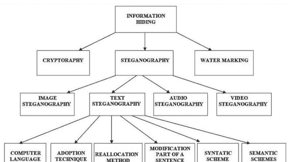

图2.1 隐写术的分类。

密码学通过将消息转换为隐藏文本来隐藏消息。另一方面，密码分析利用已开发的密码技术来解密所获得的密文，以理解密文的原始内容。与将信息隐藏在各种类型文件中的隐写术不同，图像隐写分析是一种检测任何含有隐藏信息的图像的技术。除了科学意义之外，研究

**定理 2.1** 如果 $P_C$ 与 $P_S$ 的概率分布函数之间的 Kullback-Leibler 散度在 (1) 中等于 0，则隐藏方案称为安全的。

$$D_{KL}(P_C||P_S)=\sum_{C\in\mathcal{C}}P_C(C)\log\frac{P_C(C)}{P_S(C)}$$ (2.1)

当 $D_{KL}(P_C||P_S)<\epsilon$ 时，隐藏方案是 $\epsilon$ 安全的，其中 $\epsilon$ 是一个足够小的正实数。

这一概念是从理论角度出发的，在实践中很难实现，因为图像空间太大（*无限大*）。另一方面，要确保 $D_{KL}(P_C||P_S)=0$ 的隐藏方案是不可能实现的，因为这意味着原始图像没有变化，即 $P_C=P_S$（信息论中的*基本引理*）。因此，人们常常隐藏信息以获得 $\epsilon$ 安全，确保图像上的变化最小，且人眼几乎无法察觉。

### 2.2.2 峰值信噪比

在隐藏信息后对图像进行后处理的另一种方法基于图像在隐藏信息前后的峰值信噪比（PSNR）。PSNR 是一种基于主观方法评估安全性的方法。根据这种方法，人的感觉被分为五个不同的等级。在每个等级上，图像的质量将由 PSNR 计算，然后根据计算值来判断图像属于哪个阈值。

PSNR 质量根据平均意见分（MOS）进行映射，如表 2.1 所示。有许多隐写方案 [2-20] 主要基于 PSNR 来衡量人的感知。

**表 2.1** PSNR 与 MOS 值之间的关系。

| PSNR [dB] | MOS |
|---|---|
| > 37 | 5（非常好） |
| 31-37 | 4（好） |
| 25-31 | 3（中等） |
| 20-25 | 2（差） |
| < 20 | 1（非常差） |

## 2.3 隐写分析

隐写分析可以被定义为一个基于统计假设检验的分类问题。这取决于我们对隐藏方案的理解；因此，隐写分析被称为简单假设检验问题或复合假设检验问题。

如果我们对隐藏方案没有任何信息，这种隐写方法称为盲隐写分析。该分类问题可以基于复合假设检验表示为：

- $H_0$：X 来源于概率分布函数 $P_S$。
- $H_1$：X 并非来源于概率分布函数 $P_S$。

其中 X 是待考虑的样本图像数据。

在已知隐藏方案信息的情况下，这种隐写方法称为约束隐写分析。假设我们知道 $P_C$ 的概率分布、隐藏方案（$S_E$, $S_X$）以及 M 的信息分布，我们就可以计算出 $P_S$。由此，我们可以提供一种基于简单假设检验的检测方法：

- $H_0$：X 具有概率分布 $P_S$。
- $H_1$：X 具有概率分布 $P_C$。

为了求解统计假设检验，我们需要找到一个条件域或特征进行分类，使错误率最小。

进行这种划分的方法有很多。但问题在于，任何划分都会导致两类错误：

- 第一类错误，概率为 α（0 < α < 1）（假阳性）。
- 第二类错误，概率为 β（0 < β < 1）（假阴性）。

检测器 F 的概率 α 和 β 可以用数学方式表示如下：

α = P(F(X) = 1|X P_C) = ∫_ω P_C(X)dx  (2.2)

β = P(F(X) = 0|X P_S) = ∫_{Ω\ω} P_S(X)dx  (2.3)

如果满足 (2.4)，则检测器是可接受的：

(1 − α)log(1 − α)/β + αlog α/(1 − β) ≤ D_KL(P_C||P_S)  (2.4)

不存在能够同时最小化两类错误的划分算法。

如上所述，隐写分析的研究方法集中在两个主要方向：

- 第一个方向是尝试为任何隐写技术构建盲检测。
- 第二个方向是在知晓隐写技术的情况下尝试检测隐写图像。

许多作者已经研究了针对 LSB 隐藏图像的盲隐写分析，以及针对某些已知隐藏技术的约束隐写分析。现在我们将总结上述两个方向已发表的研究。

### 2.3.1 基于 LSB 的盲检测

针对 LSB 的盲隐写分析有很多方法，例如空间域 [21-25] 和频域 [26] 中的方法，使用扩频（SS）技术 [27]、QIM（量化索引调制）因子 [28-30] 的隐藏图像方法，以及 JPEG 图像的盲检测 [31]。

作者还提出了四种针对 LSB 隐藏图像的盲隐写分析技术，其中三种在空间域，包括标准差分析 [37]、具有一个自由度的统计方法 χ²（χ₁²）[34]、图像中隐藏信息的估计方法 [38]；以及一种在频域中通过灰度分析的方法 [33]。具体方法如下：


已被隐藏在图像中。然而，实际上我们并没有原始图像，因此我们必须构建一幅图像作为“地标”，以便通过从有原始图像可比较的情况下建立的重合理论，来估计任何图像中隐藏的信息。基于经验估计，“匹配”估计方法可以估计图像中的信息，其效果等同于RS和DI等其他估计方法 [32]，但在耗时方面更优。

### 2.3.2 约束隐写分析

在约束隐写分析中，有一些公开的隐写程序，如OutGuess [40]、Attack F5 [13]、Attack HKC [42]、Attack RCM [43]、Attack MBNS [44]。

为促进这项研究，作者提出了四种针对使用已知隐藏技术隐藏图像的约束隐写分析技术。

#### 2.3.2.1 HKC 隐藏技术

这种隐藏技术基于移位像素频率列。移位会在像素频率图中具有最大值的频带周围产生异常信号，因此 Wen-Chung Kuo 和 Yan-Hung Lin 提供了一种检测方法 [42]，该方法基于称为 Peak 的最大频率列与 Peak 的四个相邻频带之间的关系来检测使用 HKC 技术隐藏的图像。然而，Kuo 和 Lin 的检测技术在比特率低或隐藏信息量少的情况下效果不佳，因此作者提出了 Kuo 和 Lin 方法的改进版以提高可靠性 [39]。本文还构建了一个比 Kuo 和 Lin 更简单的分类法。基于这种新的表述，我们可以使用 HKC 技术估计图像中隐藏的信息。

#### 2.3.2.2 DIH 技术

该技术基于图像的差分系数。该技术会丢失不同系数 d_ij 的直方图的自然性，在未隐藏的图像中，该直方图按高斯直方图分布，但在隐藏图像中不具备这种分布。这就是作者提出使用 DIH 技术检测隐藏图像的方法的主要原因 [35]。

#### 2.3.2.3 IWH 隐藏技术

这是一种基于移位 LL、LH、HL 频带的小波频率直方图频率列的逆向隐藏技术。它是 LSB 隐藏技术的一个特例，但与传统的 LSB 技术相比，具有最高隐藏能力的隐藏消息量仍然可能非常低。对小波频域 LSB 使用盲隐写分析（χ²_n [13]，论文中的“灰度”）通常会导致较低的分类准确率。

然而，当分析小波频率直方图时，我们会发现隐藏信息时直方图出现异常状态。因此，作者给出了相应的检测方法，该方法可以近似估计图像中隐藏信息的比特率 [35]。

#### 2.3.2.4 RVH 隐藏技术（两阶段隐藏）

该技术使用多种隐藏策略来提高图像质量和隐藏容量。待隐藏的信息 M 被分为 M₁ 和 M₂。隐藏过程包括两个主要阶段：隐藏 M₁ 的水平阶段和隐藏 M₂ 的垂直阶段。这是 LSB 隐藏技术的一个特例，但可以通过一些统计检测方法（如 χ₁²、“标准差”、LLRT 等）检测到。由于使用两阶段隐藏信息，它避免了 LSB 技术通常引起的值对（PoV）平衡。

因此，为了检测隐藏信息，作者分析了图像向量偶数位置像素列或奇数位置像素行上 LSB 的比特“0”和比特“1”的频率。对于未隐藏的图像，比特 0 和比特 1 的频率近似相等，但使用 RVH 隐藏消息后，这一规律被打破。作者构建了 RVH 每个隐藏阶段后计算比特 0 和比特 1 概率的表达式，从而验证上述说法。然后，我们提供了一种检测和估计使用 RVH 隐藏技术隐藏的图像的大致比特数的算法 [36]。

## 2.4 结论

隐写术在信息保护领域总体而言仍然是一个紧迫的问题，特别是在安全、政治和国防方面。隐写术需要对图像中隐藏信息的问题进行全面研究。继续在这一领域进行研究不仅具有科学意义，而且对促进信息安全领域的发展也具有重要意义。

新的隐写技术不断涌现。每项新技术都具有许多优点，并且更难被检测。分析并找出隐藏消息前后图像的显著特征，对于使用该技术检测隐藏图像至关重要。在这一方向上，未来我们将继续研究以下问题：

- 改进算法以提高现有检测技术的准确性。
- 提供一种提取信息的方法。
- 寻找针对 m 个 LSB 域的检测方法。
- 研究在其他多媒体环境（如视频、音频等）中检测隐藏信息的方法。

## 参考文献

1. Jessica Fridrich (2009)，《数字媒体中的隐写术：原理、算法与应用》，剑桥大学出版社。
2. C.K. Chan, L.M. Cheng (2001)，《通过最优中等有效位替换改进图像中的数据隐藏》，《IEEE电子快报》，第37卷(16期)，第1017-1018页。
3. C.K. Chan, L.M. Cheng (2004)，《通过简单LSB替换在图像中隐藏数据》，《模式识别》第37卷，第469-474页。
4. C.C. Chang, J.Y. Hsiao, C.S. Chan (2003)，《基于动态规划策略寻找图像隐藏中的最优最低有效位替换》，《模式识别》第36卷，第1583-1595页。
5. Xiaolong Li, Bin Yang, Daofang Cheng 和 Tieyong Zeng (2009)，《LSB匹配的推广》，《IEEE信号处理快报》，第16卷(2期)，第69-72页。
6. W.N. Lie, L.C. Chang (1999)，《基于人类视觉系统的自适应最低有效位数图像数据隐藏》，见：《IEEE国际图像处理会议论文集》，台北，台湾，第1卷，第286-290页。
7. Ching-Chiuan Lin, Nien-Lin Hsueh (2008)，《基于三像素块差值的无损数据隐藏方案》，《模式识别》第41卷，第1415-1425页。
8. S. H. Liu, T. H. Chen, H. X. Yao 和 W. Gao (2004)，《图像中的可变深度LSB数据隐藏技术》，《2004年机器学习与控制论》，第3990-3994页。
9. Z. M. Lu, J. S. Pan 和 S. H. Sun (2000)，《基于VQ的数字图像水印方法》，《电子快报》，第36卷(14期)，第1201-1202页。
10. F. A. P. Petitcolas, R. J. Anderson 和 M.G. Kuhn (1999)，《信息隐藏——综述》，《IEEE会刊》，第87卷(7期)，第1062-1078页。
11. C. I. Podilchuk 和 E. J. Delp (2001)，《数字水印：算法与应用》，《IEEE信号处理杂志》，第18卷(4期)，第33-34页。
12. Niels Provos, Peter Honeyman (2003)，《捉迷藏：隐写术入门》，IEEE计算机学会出版。
13. Westfeld A. (2001)，《高容量但更好的隐写分析（F5A隐写算法）》，见：Moskowitz, I.S. (编)：《信息隐藏》，第4届国际研讨会，计算机科学讲义，第2137卷，Springer-Verlag，柏林海德堡纽约 (2001)，第289-302页。
14. J. K. Cox, J. Kilian, T. Leighton 和 T. Shamoon (1997)，《面向多媒体的安全扩频水印》，《IEEE图像处理汇刊》，6(12):1673-1687。
15. Ingemar Cox, Jeffrey Bloom, Matthew Miller, Ton Kalker, Jessica Fridrich (2008)，《数字水印与隐写术》，第二版，摩根·考夫曼出版社，美国。
16. Li, Bin; Fang, Yanmei; Huang, Jiwu (2008)，《多基数记数系统隐写的隐写分析》，《IEEE信号处理快报》，第15卷，第493-496页。
17. B. Chen 和 G. Wornell (2001)，《量化索引调制：一类可证明良好的数字水印和信息嵌入方法》，《IEEE信息论汇刊》，第47卷(4期)，第1423-1443页。
18. Takayuki Ishida, Kazumi Yamawaki, Hideki Noda, Michiharu (2009)，《使用QIM改进JPEG2000隐写的性能》，《通信与计算机杂志》，第6卷(1期)，美国。
19. M.U. Celik, G. Sharma, A.M. Tekalp 和 E. Saber (2002)，《可逆数据隐藏》，见：《国际图像处理会议论文集》，美国纽约州罗切斯特，第2卷，第157-160页。
20. Yeh-Shun Chen, Ran-Zan Wang, Yeuan-Kuen Lee, Shih-Yu Huang (2008)，《可逆对比度映射水印的隐写分析》，《2008年世界工程大会论文集》，第I卷，WCE2008，英国伦敦，第555-557页。
21. Fridrich, J., Goljan, M. 和 Du, R. (2001)，《灰度与彩色图像中LSB隐写的可靠检测》，见：《ACM论文集：多媒体安全与水印特别会议》，加拿大渥太华，第27-30页。
22. S. P. Hivrale, S. D. Sawarkar, Vijay Bhosale 和 Seema Koregaonkar (2008)，《数字图像LSB中隐藏检测的统计方法：综述》，《世界科学与工程学院学报》，第32卷，ISSN 2070-3740，第658-661页。
23. K. M. Sullivan (2005)，《图像隐写分析：追踪与规避》，加州大学电气与计算机工程博士论文。
24. A. Westfeld 和 A. Pfitzmann (1999)，《对隐写系统的攻击》，见：《计算机科学讲义：第3届信息隐藏国际研讨会》。


- 42. Wen-Chung Kuo, Yan-Hung Lin (2008), 基于直方图偏移的可逆数据隐藏安全性研究, ICICIC 2008, pp. 174-177.

- 43. Yeh-Shun Chen, Ran-Zan Wang, Yeuan-Kuen Lee, Shih-Yu Huang (2008), 可逆对比度映射水印的隐写分析, 2008年世界工程大会论文集, Vol I, WCE2008, London, U.K., pp. 555-557.

- 44. L. Bin, F. Yanmei, H. Jiwu, (2008), 多基数记数系统隐写术的隐写分析, IEEE Signal Processing Letters, vol. 15, pp. 493 - 496.

## 章节

## 电子商务中的安全威胁和漏洞

SATYA NARAYAN TRIPATHY, SISIRA KUMAR KAPAT, SUSANTA KUMAR DAS

Department of Computer Science, Berhampur University, Odisha, India

Email: snt.cs@buodisha.edu.in, skk.rs.cs@buodisha.edu.in, skd.cs@buodisha.edu.in

## 摘要

业务、科学和其他领域的爆炸性增长导致了大量数据。我们被数据淹没，却为知识饥渴，这催生了被称为数据挖掘的概念。数据挖掘是从海量数据中提取隐含的、潜在有用的且未知的知识。数据挖掘技术可非常有效地用于安全应用。访问数据的权限可能对用户信息的隐私和安全构成威胁。本章深入聚焦于数据挖掘的安全方面以及可能的解决方案技术。此外，我们还强调了数据挖掘导致的一些隐私问题，如入侵检测。

关键词：安全威胁、电子商务、恶意软件分析、漏洞、电子商务攻击

## 3.1 电子商务简介

随着信息和通信技术（ICT）工程的发展，对更复杂的商业环境的需求日益增加。传统商业方法的变革导致了电子商务的出现。传统商业仅涉及直接方式的商品买卖，但后来，客户去商店所涉及的人力和精力需求越来越不再必要，同时也提升了业务流程。电子商务是通过电子方式买卖商品和服务的流程。客户不再需要亲自去商店购买商品，而是可以通过指尖浏览来自世界各地不同商店的众多商品。存在不同类型的市场，如股票市场、资本市场、货币市场等；但所有这些市场在业务流程上都有一些相似之处，因为它们都有卖方和买方。

如今，大多数电子商务都是通过互联网进行的。电子商务相较于电子商务是一个更通用的术语。它不仅指买卖相关的信息交换，还包括为客户提供服务；以及与业务合作伙伴、分销商和供应商的协作 [4]。电子商务可以有不同的子类别，如电子学习、电子商务、电子银行、电子政务。电子商务涵盖了企业应用和业务流程层面的复杂企业间交互和协作活动。电子商务流程在整个公司范围内与关键合作伙伴、供应商和客户进行端到端集成，并且能够灵活快速地响应客户需求和市场机会。

### 3.1.1 电子商务的好处

有时用户想要的产品距离很远。例如，考虑消费者和产品位于不同国家的情况。在这种情况下，用户必须出国购买特定产品，这是一项耗时的工作，也需要大量金钱和体力。这个问题由电子商务解决。电子商务的主要好处是：

- 1. 维护消费者数据更容易。这些数据可通过使用数据挖掘来提升业务流程。
- 2. 商场可以利用消费者的需求和习惯，通过使用关联挖掘技术重新排列商场内的产品。
- 3. 商品和服务的全球化是可能的。用户可以在不同地点获得世界各地的商品或服务。
- 4. 相比挨家挨户逛商店节省了时间，同时可以从全球各地同时搜索产品和服务。
- 5. 用户可以同时比较不同地点相同产品的价格。
- 6. 用户在选择产品或服务时有更多选择。在传统商业中，用户只能在数百到数千种产品中选择有限的几种；而在电子商务系统中，用户可以在全球数千到数百万种产品中选择。这被称为“多逛，选一”。
- 7. 相比实体购物，在线购物所需时间更少。例如，如果印度某人想要非洲的产品，他们无需去非洲，这更耗时，而是可以通过在线方式在一到两周内获得产品。
- 8. 无需随时携带现金，这相当有风险。用户可以在线支付。

### 3.1.2 商业革命

在电子商务之前，人们使用多种营销方法来销售产品和服务，如促销、宣传册等。一般的商业方法描述如下：

第一类商业涉及制造商与消费者或雇主与工人的直接交易。这里的业务规模很小，整个业务中的员工人数不超过一个家庭，制造商和销售者是同一个人。

第二类商业中，制造商与消费者之间有一个销售者。制造商的工作是生产产品，而销售者则直接与客户打交道。此外，在此过程中，业务是小规模的，制造商几乎无法满足少量客户的需求。

第三类商业涉及批发商和零售商的概念。制造商生产产品并将其卖给批发商。批发商随后将产品卖给零售商，零售商将产品卖给销售商，最后销售商与客户打交道。接下来出现了分销商，他们只携带非竞争性商品。

这种商业模式不适用于现代时代，因为对各种产品需求日益增加。客户希望商品快速送达家门口；全球范围内价格低廉（*可靠*）；产品质量好；客户支持良好。制造商也花费更多资金来维持市场优势，因为竞争对手众多。复杂的业务流程包括制造产品、市场调研、在印刷和在线媒体上推广产品等。业务结构必须具有可扩展性和可靠性以满足客户。

传统业务结构的示意图如图 3.1 所示。

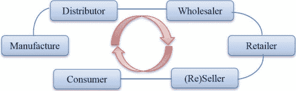

**图 3.1** 传统业务中的产品流动结构。

如今电子商务是常见的商业模式。尽管传统方法仍然存在，在这个数字化时代，商业系统几乎通过互联网实现了自动化。客户可以从亚马逊或 Flipkart 等任何商业商店在线选择产品。商品价格也可通过网上银行、借记卡、信用卡等方式在线支付。然后产品将被运送到消费者家门口。电子商务一般流程的示意图如图 3.2 所示。

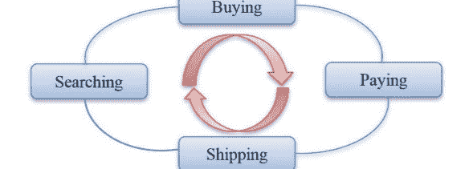

图 3.2 电子商务中的通信循环，从制造商到客户

## 3.2 电子商务中的安全问题

存在四种类型的业务系统：B2B（企业对企业）、B2C（企业对消费者）、C2B（消费者对企业）、C2C（消费者对消费者）、C2G（消费者对消费者）。这些电子商务系统具有共同的组件，如消费者、支付选项、系统信息、客户信息、产品信息等。业务系统必须为其每个组件提供安全保障。业务系统中存在两种类型的安全问题，如安全威胁和漏洞。

数据挖掘是 21 世纪的关键领域，几乎应用于技术的各个领域。根据 Steve Morgan [6] 的说法，网络安全方面的投资超过了医疗保健。医疗保健提供者在保护患者数据方面更为谨慎。同样，在电子商务中，数据存储库必须安全，因为数据有时比经济更为珍贵。

根据 Richardson [6] 的说法，通过僵尸网络、DNS 攻击、密码嗅探以及从移动设备窃取数据等攻击正在急剧增加。拒绝服务、金融欺诈和恶意软件威胁在网络中持续存在。根据身份盗窃资源中心（ITRC）[7] 的数据，数据泄露从 2016 年到 2017 年增加了 45%，这是之前任何年份中最高的。

电子商务有一些策略和流程 [2]，涉及通过互联网从供应商向消费者传输商品和服务。存在许多威胁，如机密信息泄露以修改信息，导致数据和经济损失。恶意用户总是试图找到新的方法来绕过电子商务系统的安全性和隐私性。

例如，当消费者从“S”商店购买产品并尝试付款时，一些不真实的人收集了消费者的借记卡或信用卡信息。现在这个不真实的人可以为个人用途使用消费者数据。

同样，电子商务系统存在许多威胁，下面将描述。

### 3.2.1 漏洞

漏洞是系统正常运行的弱点，可能被滥用以损害系统，或在最坏情况下关闭电子商务系统。该


- 必须使用强密码
- 应使用带有最新恶意软件定义的反恶意软件软件

与安全人员相关的预防机制：

- 计算机的物理保护
- 网络系统管理与安全
- 电子邮件控制安全
- 设置适当的访问控制
- 使用数据加密技术
- 数字证书
- 备份数据，以便在需要时恢复
- 必须保证无线通信安全

## 3.6 结论

尽管电子商务能够将支付和通信系统数字化，既简单又快捷，但它仍然存在一些缺陷。无论是通信系统还是独立系统，都必须维护安全性。为了保持安全，需要采取预防措施和安全保障。尽管目前有大量研究致力于检测恶意软件威胁并缓解通信系统中的漏洞，但这仍被视为一个NP困难问题。数据挖掘和机器学习方法已被证明能够成功处理电子商务系统。但商业系统目前尚未完全自动化，未来应当实现完全自动化。

## 参考文献

- 1. Dick O'Brien (2017, July). An ISTR special report on ransomware 2017. Retrieved from https://www.symantec.com/content/dam/symantec/docs/security-center/white-papers/istr-ransomware-2017-en.pdf
- 2. Bernard Kohan. e-Business Strategy and Process. retrieved from http://www.comentum.com/e-business-strategy-process.html
- 3. Mihai DOINEA (2009). E-Business Security Architecture. Informatica Economica, Vol. 13, No. 1, pp 137-145
- 4. Pawar, M. V., & Anuradha, J. (2015). Network security and types of attacks in network. Procedia Computer Science, 48, 503-506.
- 5. Steve Morgan (2017), 2017 Cybercrime Report. Cybersecurity Ventures
- 6. Robert Richardson (2008). 2008 CSI Computer Crime & Security Survey. retrieved from http://www.kwell.net/doc/FBI2008.pdf
- 7. ACC Foundations (2018). ACC Foundation: The state of cybersecurity report an inhouse perspective. Retrieved from http://www.acc-foundation.com/foundation/sr/upload/2018-The-State-of-Cybersecurity-Summary.pdf

## 章节

## 电子商务安全：威胁、问题与方法

PRERNA SHARMA, DEEPAK GUPTA, ASHISH KHANNA

印度新德里马哈拉哈·阿格拉森理工学院

邮箱：prernasharma@mait.ac.in, deepakgupta@mait.ac.in, ashishkhanna@mait.ac.in

**摘要** 在废钞令和无现金经济推广的时代，电子商务已占据中心舞台。快速互联网与先进处理器的融合，正成为多种电子商务应用及其可用性发展的催化剂。电子商务的普及还归功于买卖双方随时随地交易所带来的便利。此外，可扩展的高速交易和较低的运营成本使电子商务在全球范围内获得认可，从而帮助企业扩张，并通过电子商务推动新经济形态的发展。然而，传统商业从业者不会善罢甘休，他们会以安全和真实交易为幌子，想方设法阻止电子商务交易的大潮。因此，为了在互联网上营造一个无恐惧的买卖环境，需要高度安全、可靠且真实的电子商务应用。上述讨论证明了安全对电子商务成功实施的重要性。本章阐述了电子商务组件和活动中与商品及交易安全相关的问题和难题。由于交易涉及大量公共资金，信息安全与隐私在此类业务中的作用不容夸大。身份盗窃和网络欺诈等问题是阻碍客户参与电子商务的障碍。公众在电子商务安全问题上的教育至今仍未得到足够重视；应当鼓励这方面的教育，因为信任和安全是亟待应对的巨大挑战，唯有如此，才能使电子商务系统免受当前各种攻击的侵扰。在本章中，我们将

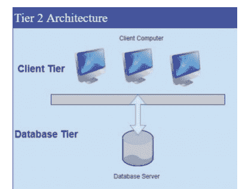

图4.1 两层电子商务架构。

- 顶层：用户界面服务；文本输入会话；对话管理：显示管理
- 中间层：流程管理服务；流程开发与流程监控；流程资源分配
- 第三层：数据库管理服务；数据一致性；集中式流程逻辑；系统功能本地化。

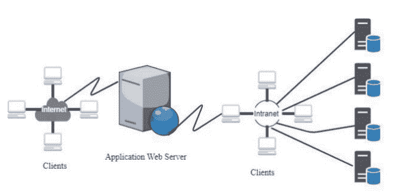

图4.2 三层电子商务架构。

操作：在电子商务系统中，客户端通过互联网发送请求，请求经过防火墙，防火墙会过滤发往错误地址或错误端口的数据包。Web服务器通过调用应用程序来处理请求，该应用程序访问数据库服务器以修改、更新或读取数据库中存储的一条或多条记录，然后以HTML页面或文件的形式进行回复。此外，这些服务器还连接到大型网络[5]。

### 4.3.3 电子商务的优点与缺点

我们在上一节中已经讨论了电子商务的许多特性。互联网有助于形成虚拟社区，这些社区基本上是由具有共同兴趣的人群组成的。这些虚拟社区成为理想的目标市场。从不同利益相关者的角度来看，在线开展业务具有多种优势，如表4.1所示。

表4.1 电子商务的优点。

| 序号 | 电子商务利益相关者 | 优点 |
|------|------------------------|------------|
| 1 | 组织 | 低成本<br>涉及的员工更少<br>全球覆盖，甚至可达偏远地区<br>更易于管理库存 |
| 2 | 客户/消费者 | 个性化体验<br>可以轻松比较相同产品或服务的价格<br>点击鼠标即可获得产品或服务<br>可供选择的范围更广 |
| 3 | 社会 | 促进无现金经济，进而遏制黑钱<br>在各领域提供在线服务<br>由于没有批发商、零售商等中间商参与，产品价格得到控制。 |

如果从各个利益相关者的角度来看电子商务运营，也存在许多弊端，如表4.2所示。

表4.2 电子商务的缺点

| 序号 | 电子商务利益相关者 | 缺点 |
|------|------------------------|---------------|
| 1 | 组织 | 数据隐私问题<br>并非所有商品都可销售，例如易腐烂产品或昂贵的奢侈品<br>竞争激烈<br>难以遵守法律标准 |
| 2 | 客户/消费者 | 购买前无法获得实物感受<br>需要互联网连接<br>产品交付并非即时完成<br>服务器宕机时产品不可用<br>交付后，产品可能与预期不符 |
| 3 | 社会 | 数据泄露等安全问题<br>互联网使用知识有限 |

## 4.4 电子商务安全概述

在线运营时，安全是当前之需，因为网络面临的攻击威胁多种多样。信息是企业最重要的资产之一。对于任何组织而言，信息都应受到重视并得到适当保护[18]。因此，我们将讨论电子商务安全的目的，以及系统中需要安全性的不同层级。

### 4.4.1 电子商务安全的目的

- 1. *身份验证：* 确保只有正确的用户才能访问数据[6]。
- 2. *不可否认性：* 这是用户确认其确实执行了某项操作的一种形式，因此他们将来无法否认执行过该操作。
- 3. *隐私：* 这使用户能够控制其数据中有多少可以提供给第三方或分发给第三方。
- 4. *保密性：* 这是保持数据私密的状态，使任何未经授权的人员/方都无法访问。
- 5. *可用性：* 这意味着所有数据都可供有权访问的用户使用。
- 6. *完整性：* 这确保用户接收的数据与发送方发送的数据一致，即在数据传输过程中未发生任何更改或篡改。
- 7. *加密：* 这意味着以某种方式对数据进行编码，使人们无法通过直接阅读来理解数据。

### 4.4.2 电子商务系统不同层级的安全要素

电子商务系统的安全至关重要，因此必须在各个组件层面（即硬件、软件和环境）确保安全性。计算系统的普及使计算设备遍布各处，它们已经变得无处不在，甚至融入背景之中。它们也是新兴无线环境的一部分[11]。

#### 4.4.2.1 硬件

构成系统的设备，如Web服务器、网络设备和数据库服务器，都是系统的关键节点，容易受到各种网络攻击。因此，必须采取诸如正确配置防火墙等措施。Web服务器和数据库服务器应通过使用DMZ（*非军事区*）与其他各种网络隔离，DMZ是位于受保护网络和外部网络之间的网络。这样，网络中便引入了额外的安全层。

#### 4.4.2.2 软件

电子商务软件安全系统的平稳运行需要安全操作系统、Web服务器软件、数据库软件和Web浏览器。操作系统应进行适当配置，因为它相当脆弱。为了修复安全漏洞，应定期更新软件并例行发布补丁。

#### 4.4.2.3 环境

环境安全是指通过使用人工警卫、闭路电视、各种日志或其他方法来确保网络物理访问的安全。


可供我们使用。加密用于保护网络中传输的数据。网络运营商负责安全地传输信息。

- **拒绝服务（DoS）：** 当黑客发起拒绝服务攻击时，这已成为当今电子商务面临的最棘手的安全问题之一。它的特点是攻击者明确地努力阻止用户使用电子商务系统。
- **会话拦截与消息篡改：** 攻击者可以通过劫持会话传输被篡改的消息。他们还可能在客户端主机和服务器主机之间添加一个恶意主机，这通常被称为中间人攻击。在这种情况下，数据通信会经过攻击者的主机。
- **防火墙漏洞：** 防火墙是安装在后端服务器和企业网络之间的软件或硬件设备。它通常在网络协议层实现，无法在更高协议层保护系统。黑客会察觉到未修复的防火墙漏洞，并试图访问价格列表、邮件列表、产品目录等。

## 4.6 电子商务中的安全威胁

电子商务往往面临更高层级的安全风险和攻击。在电子商务中，数据是跟踪消费者购物行为以个性化推荐的关键，这些数据通过消费者的浏览和交易点随时间收集 [9]。服务器层是所有交易发生的物理场所。服务器被视为电子商务业务的核心存储库，其中包含展示产品或服务的特定网站、客户数据库以及支付机制。如果服务器遭受任何攻击，则可能造成巨大挫折，因为有失去一切的风险。因此，在安全方面必须更加积极主动。现在，让我们详细讨论各种电子商务安全威胁 [9]。

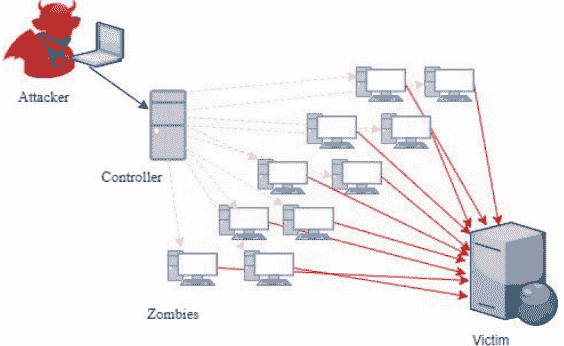

**分布式拒绝服务（DDoS）：** 在这种攻击中，目标系统（电子商务）的可用性受到质疑，因为数百万客户无法访问已被来自多个来源的流量淹没的在线系统。这种攻击会形成一个僵尸网络，其中多台设备在线连接；这些设备往往会生成虚假流量来淹没目标系统，导致合法客户被拒绝服务。这种攻击不仅影响目标站点，还会在整个网络（互联网）上造成拥塞问题，如图 4.3 所示。

由于无法区分真实流量和攻击流量，因此很难控制或阻止攻击。攻击者可能会阻止你访问受感染计算机所依赖的电子邮件、网站和在线账户 [10]。

DDoS 攻击由四个要素组成 [11]：
- *受害者：* 将要承担攻击负担的目标主机。
- *攻击守护进程代理：* 这是一种在受害者身上执行攻击的代理程序。它主要安装在主机上，但往往会影响主机和目标计算机。这些守护进程往往会获得访问权限并渗透主机计算机。
- *控制主程序：* 协调攻击。
- *真正攻击者：* 尽管是攻击的幕后主使，但通过使用控制主程序隐藏在后台。

**SQL 注入：** 顾名思义，这种攻击必然是在用户输入数据时插入了 SQL 查询；当该查询在客户端执行时，攻击就开始运作。这是最常见的 Web 黑客技术之一，注入的代码可能会对数据库造成严重破坏，如图 4.4 所示。

SQL 注入的原因如下 [12]：
- 运行接收来自非真实互联网用户数据的软件应用程序。
- 无法验证数据。
- 这些数据进一步用于支持应用程序的数据库的动态 SQL 查询。

SQL 注入会导致身份欺骗、篡改现有数据、泄露系统上的所有数据，并通过销毁数据使数据不可用。

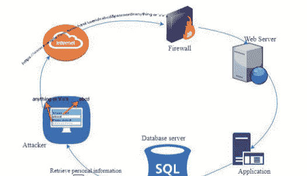

图 4.4 SQL 注入攻击。

**价格篡改：** 顾名思义，原始价格被篡改为不同的值。这种攻击如图 4.5 所示，在在线购物车平台和支付网关中非常常见。在这种攻击中，最终应付价格被攻击者随意篡改。在编码中，程序员使用隐藏字段来存储商品总成本的值；黑客可以篡改存储在其浏览器中的值，因此攻击者可以修改应支付的总金额。例如，一件商品的价值从 2000 卢比被改为 200 卢比，这对顾客来说令人兴奋，但对卖家来说却很不幸。

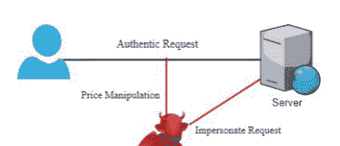

图 4.5 价格篡改。

**会话劫持：** 会话是在两个节点或端点之间的单个连接上维护的一系列交互，如图 4.6 所示。顾名思义，劫持者通过窃取有效的会话 ID 来接管会话控制，从而可以进入、监视或提取数据。攻击者通过用自己的系统改变数据包的路由，可以参与其他用户的对话 [14]。它是嗅探和欺骗的结合。

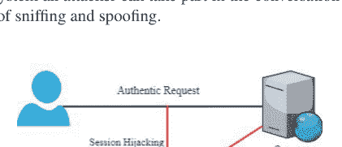

图 4.6 会话劫持攻击。

**跨站脚本攻击（XSS）：** 在这种攻击中，恶意脚本从受感染的站点附加到受信任的网站上。添加恶意脚本后，攻击者可以访问敏感信息、会话 Cookie 等。这是代码注入的一种特殊情况。此时，最终用户的浏览器无法判断脚本是否可信，因此它会继续执行该脚本。这些脚本会更改并重写 HTML 页面内容。这一过程如图 4.7 所示。

网络容易受到攻击，技术的发展需要客户了解电子商务安全问题，以便电子商务行业免受欺诈。消费者的隐私问题可以通过保护互联网上发布的大量个人信息，并强调可用安全性（usable security）来帮助个人使用对其有意义且易于应用的安全控制措施，从而得到解决 [21]。

## 参考文献
- 1. Gollmann, D. (2010). 计算机安全. Wiley Interdisciplinary Reviews: Computational Statistics, 2(5), 544-554.
- 2. Marchany, R. C., & Tront, J. G. (2002). 电子商务安全问题. 见：2002年系统科学HICSS第35届夏威夷国际会议论文集（第2500-2508页）. IEEE.
- 3. Sengupta, A., Mazumdar, C., & Barik, M. S. (2005). 电子商务安全：一种生命周期方法. Sadhana, 30(2-3), 119-140.
- 4. Thiru, “电子商务架构”. http://www.myreadingroom.co.in/notes-and-studymaterial/66-e-commerce/517-e-commerce-architecture.html
- 5. Ladan, M. I. (2014年8月). 电子商务安全问题. 见：2014年未来物联网与云计算（FiCloud）国际会议论文集（第197-201页）. IEEE.
- 6. Gautam, R., & Singh, S. (2014). 电子商务中的网络安全问题. International Journal of Advanced Research in Computer Science and Software Engineering, 4(3), 130-132.
- 7. Pham, Q., Reid, J., McCullagh, A., & Dawson, E. (2008). 委托过程中的承诺问题. 见：《第六届澳大利亚信息安全会议论文集》第81卷（第27-38页）. 澳大利亚计算机协会.
- 8. Doukas, C., Pliakas, T., & Maglogiannis, I. (2010). 利用云计算和Android操作系统的移动医疗信息管理. 见：IEEE 2010年医学与生物学工程学会（EMBC）国际年会论文集（第1037-1040页）. IEEE.
- 9. Jarnail Singh (2014). 电子商务安全挑战综述. International Journal of Innovative Research in Computer and Communication Engineering（ISO 3297: 2007 认证组织）第 2 卷，第 2 期，ISSN（在线）：2320-9801 ISSN（印刷）：2320-9798.
- 10. Kumar, P. A. R., & Selvakumar, S. (2011). 使用神经网络分类器集成检测分布式拒绝服务攻击. Computer Communications, 34(11), 1328-1341.
- 11. Kulkarni, A., & Bush, S. (2006). 使用柯尔莫哥洛夫复杂性度量检测分布式拒绝服务攻击. Journal of Network and Systems Management, 14(1), 69-80.
- 12. Dougherty, C. (2012). 实际识别 SQL 注入漏洞. 美国计算机应急响应小组（US-CERT）.
- 13. 数字证书 https://www.emudhradigital.com/
- 14. Baitha, A. K., & Vinod, S. (2018). 会话劫持与预防技术. International Journal of Engineering & Technology, 7(2.6), 193-198.
- 15. Ahmad, K., & Alam, M. S. (2016). 通过椭圆曲线密码学保障电子商务安全. Procedia Computer Science, 78, 867-873.
- 16. Kraft, T. A., & Kakar, R. (2009). 电子商务安全. 见：《信息系统应用研究会议论文集》，美国华盛顿特区.
- 17. Delone, W. H., & Mclean, E. R. (2004). 衡量电子商务成功：应用 DeLone & McLean 信息系统成功模型. International Journal of Electronic Commerce, 9(1), 31-47.


18. Hong, K. S., Chi, Y. P., Chao, L. R., & Tang, J. H. (2003). 信息安全管理综合系统理论. Information Management & Computer Security, 11(5), 243-248.

19. Akter, S., & Wamba, S. F. (2016). 电子商务中的大数据分析：系统综述与未来研究议程. Electronic Markets, 26(2), 173-194.

20. Flanagin, A. J., Metzger, M. J., Pure, R., Markov, A., & Hartsell, E. (2014). 缓解电子商务交易风险：信息可信度认知及用户生成评价在产品质量和购买意愿中的作用. Electronic Commerce Research, 14(1), 1-23.

21. Jang-Jaccard, J., & Nepal, S. (2014). 网络安全新兴威胁综述. Journal of Computer and System Sciences, 80(5), 973-993.

## 章节

## 网络战即将到来

T. MANIKANDAN¹, B. BALAMURUGAN², C. SENTHILKUMAR¹, R. RAJESH ALIAS HARINARAYAN³, R. RAJA SUBRAMANIAN³

¹ APCSE，计算机科学与工程系，蒂亚加拉贾工程学院，马杜赖，泰米尔纳德邦，印度

² PCSE，加尔戈蒂亚大学，北方邦，印度

³ 研究学者，计算机科学与工程系，蒂亚加拉贾工程学院，马杜赖，泰米尔纳德邦，印度

Email: tmcse@tce.edu

## 摘要

“War”是人类在资源受到威胁时玩的最危险的游戏，它随后因贪婪而在历史上不断演变。在世界大战造成巨大损失之后，人类通过外交得以恢复。战争是在恐惧和贪婪等情绪侵入社会中人们的思想时发起的。基本上，恐惧是由缺乏过和平生活所需资源而触发的，人们开始思考如果这些资源被拥有更多金钱和武器的增长更快社会所威胁，会发生什么，这些资源可能会被用来奴役他们自己的社会。贪婪在国家达到稳定状态并想要变得... 之时发生。当今世界的武装战争由于外交努力而减少，但对资源减少的恐惧和对金钱的贪婪仍然可见，随着5G、物联网、智能手机、智慧城市等技术的发展，资源现在在全球范围内正变得数字化，但勒索软件等网络攻击也在增加，例如WannaCry、NotPetya、BadRabbit等。随着一切都连接到互联网，它已成为与所有国家平民相连的战场，使他们在不知不觉中置身于战场之上。这种连通性是一个更大的威胁，因为它可能对日益增长的数字经济以及每个人和每件事物造成巨大破坏，甚至我们的头脑，这与互联网对人们情感的不断侵蚀之战一起，是战争即将到来的证据——网络战！

关键词：Cyberwar, ransomware

1988年，康奈尔大学的Robert Tappan Morris进行的一项实验旨在确定互联网的规模，导致了首个通过互联网传播的蠕虫的创建。该蠕虫作为实验从麻省理工学院发布。一旦下载到系统中，蠕虫通过减慢系统速度来感染系统。由于其特性，确定互联网规模的实际意图转变为影响系统的病毒，Morris蠕虫[3]在系统中传播。该蠕虫更有可能在同一系统中多次运行，每次都会减慢速度，最终使其无法使用。因此，自复制蠕虫即使在今天也更具危害性。研究生实验的意外结果据美国政府问责办公室称造成了约1000万美元的损失。

该蠕虫由Clifford Stoll追踪下来，他的调查指出Morris蠕虫在仅十五小时内感染了约两千台计算机。他还指出，消毒大约需要两天时间。Morris的同事称该调查是捏造的。Robert Morris被判处三年缓刑并被罚款10,500美元加上监督费用。Morris蠕虫实际上促使安全人员集中精力于互联网安全

随着从Morris的意外蠕虫中缓慢缓解，1991年进入了有意注入的名为Michelangelo[4]的蠕虫。攻击者是来自澳大利亚的反病毒专家Roger Riordan。尽管预计Michelangelo病毒的影响会很大，但实际上只有几千台计算机被发现感染了它。又一个引导扇区病毒，它实际上对系统造成的危害很小。

Michelangelo主要因为媒体炒作而被认为是1990年代的威胁病毒之一。Michelangelo病毒通过在每年3月6日感染受感染硬盘上每个磁道的前17个扇区来工作。如迄今所见，引导扇区病毒似乎更具威胁性。引导扇区病毒会影响每次计算机启动时运行的主引导扇区（MBR）。MBR控制启动顺序并确定计算机启动到的分区。一旦病毒成功感染MBR，则计算机启动将失败，内存中的内容将被丢失。引导扇区病毒很难清除；因此，更好的解决方案是通过在注入系统之前对外部驱动器进行适当的病毒验证来防止它们。好的反病毒软件可以完成这项工作。

在Michelangelo炒作十年后，2003年1月，发现了一种巨大的计算机蠕虫，通过造成拒绝服务攻击威胁互联网世界。该攻击需要对古老Microsoft SQL中的漏洞有先决条件知识。通过特定UDP端口的IP地址欺骗可导致缓冲区溢出并破坏SQL服务器的正常服务[5]。来自Microsoft的David Litchfield进行了概念验证并修复了此SQL Slammer攻击的问题。该问题提交给了Microsoft安全响应中心，并开发了补丁来应对。在下一个Black Hat上，Microsoft发布了补丁并要求每个SQL用户为安全添加补丁。POC由研究员Michael Bacarella研究并在Black Hat期间公开发布。攻击者实施了它并通过互联网发布。约75,000台未打补丁的服务器在仅10分钟内受到影响。人们认为受害者没有报告病毒攻击，因为这是他们未添加补丁的错误造成的。

在利用病毒威胁和摧毁计算机的时代过去后，利用病毒摧毁目标计算机资源的时代演变了。该产品被命名为Stuxnet[6]，它有攻击工业控制系统可编程逻辑控制器（PLC）的能力。PLC负责通过监控输入并在自动化机器中产生适当输出来做出逻辑决策。Stuxnet诞生于2009年的卡巴斯基实验室。Stuxnet攻击运行Windows的系统，而这实际上不是一种PLC。由于PLC是基于专有机器语言的设备，病毒最初捕获运行PLC的系统。然后它感染Siemens SIMATIC WinCC¹，一个监督控制和数据采集（SCADA）和人机界面（HMI）系统。由于这些程序PLC，感染它们会破坏PLC的正确编程。这导致PLC的不当自动化过程，在大规模上破坏工业过程。Stuxnet最初在三个系统中传播，每个系统都有感染另外三个系统的能力，依此类推。

Stuxnet有造成伊朗核计划重大损害的记录。该蠕虫可以通过合适的反病毒程序清除。

一旦Stuxnet达到其至高无上地位，一种所谓的Stuxnet扩展版本被开发出来，不是出于破坏工业控制系统的同样目的，而是旨在从这些系统中获取信息并删除其中的最新信息[7]。该攻击由以色列情报军团8200部队于2009年创建。该部队捕获加密并作为信号传输的敏感信息。

该蠕虫在受感染系统中创建一个以前缀~DQ开头的文件。因此，该模型被命名为Duqu。Duqu也针对伊朗核计划，但目标是收集敏感信息，而不是摧毁它。与Stuxnet不同，由于其被动特性，该蠕虫很难预测。这种行为使其在卡巴斯基实验室中长期未被检测到而存在。一旦在2010年发现威胁，蠕虫程序代码被保留并添加到反病毒软件中。

最近的攻击者开始更注重间谍活动而非破坏。结果是2012年开发了一种名为Flame[7]的模块化计算机蠕虫。该蠕虫也被称为Skywiper，具有抹去受感染系统中内容的能力。卡巴斯基实验室²和CrySyS实验室³称其为他们见过的最繁琐的恶意软件。擦除器以与祖先Stuxnet和Duqu类似的方式获取系统，通过影响rootkit功能。Flame能够通过局域网或通过USB闪存驱动器传播。它可以通过录制音频、捕获屏幕截图、击键和网络流量来捕获用户活动。Skype对话也名列其中。收集的数据和其他文件可以发送到控制服务器供攻击者分析。该蠕虫针对伊朗、叙利亚和以色列的来源。卡巴斯基进入了与竞争对手的项目，作为对间谍蠕虫的又一预防措施。

## 5.2 勒索软件攻击

勒索软件继续成为现代网络犯罪最具威胁的形式[8]。勒索软件通过电子邮件附件、驱动下载、恶意pdf和漏洞利用工具包从整台计算机获取数据，然后公开勒索所有者，要求他们支付费用以将计算机恢复到原始状态。恶意软件可能是锁定型，整个系统被锁定无法使用，也可能是加密型，某些专用敏感文件被锁定且拒绝访问。锁定或拒绝访问只有在支付巨额比特币作为罚款转移给黑客的需求得到满足后才会解除，这归因于所有者的无辜。此外，勒索软件甚至在罚款支付后也不保证密钥会解密文件或系统的锁定

¹ https://w3.siemens.com/
² https://www.kaspersky.com/
³ https://www.crysis.hu/


已支付。以下列出了勒索软件的“兄弟”家族，每个都变得更具威胁性和可勒索性。

### 5.2.1 Petya

加密勒索软件家族成员之一是 Petya。该恶意软件于 2016 年 3 月被发现。Petya 会感染基于 Windows 的系统的主引导记录 (MBR)。传播方式是通过电子邮件附件发送给受害者。一旦 Petya 破坏 MBR，它会提示系统重新启动。重新启动后，受损的引导扇区会加密计算机的主文件表。然后 Petya 会索要一笔罚款，必须以比特币支付才能恢复系统的旧状态（图 5.2 显示了感染系统上留下的勒索通知的屏幕截图）。微软为受害者发布了多个补丁。但过度拟合使下一个蠕虫版本更聪明。卡巴斯基将其命名为 NotPetya [8] 的 Petya 新版本伪装成乌克兰税务软件更新，并在约 100 个国家感染了数千个系统。制药巨头默克向 NotPetya 支付了 3 亿美元的赎金以换取其信息。

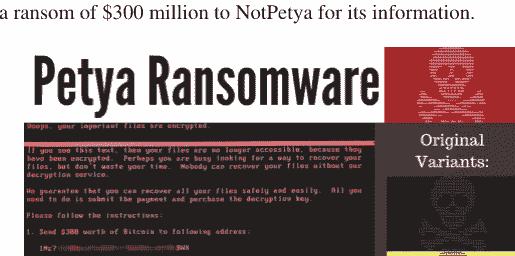

图 5.2 Petya 勒索软件。

### 5.2.2 WannaCry

无可争议地，历史上最具毁灭性的攻击之一，该攻击感染了数千家银行、法律和政府机构，是由 WannaCry 勒索软件于 2017 年 5 月实施的 [8, 9]。该攻击利用了微软对服务器消息块 (SMB) 协议实现的漏洞。SMB 负责身份验证的进程间通信和消息传输，由美国国家安全局开发。该协议中的漏洞由一些中间人作为 EternalBlue 发布。这导致了 WannaCry（WannaCrypt）的实施。一旦 WannaCry 到达一台计算机，它会搜索 kill switch（如果找到）。如果无法以通常的方式关闭，则此选项用于立即关闭计算机。然后它以通常的方式加密计算机，就像在 Petya 中所做的那样。

WannaCry 还试图利用 SMB 漏洞传播到互联网上的随机系统。现代版本不是整体加密计算机，而是加密专用文件，然后要求比特币换取解密密钥。提出的索赔金额是在 3 天内支付 300 美元比特币，或在 7 天内支付 600 美元比特币。图 5.3 显示了感染系统上留下的勒索通知的屏幕截图。

为用户制造生命风险。现在为了钱勒索某人可能会后来威胁他们的生命。

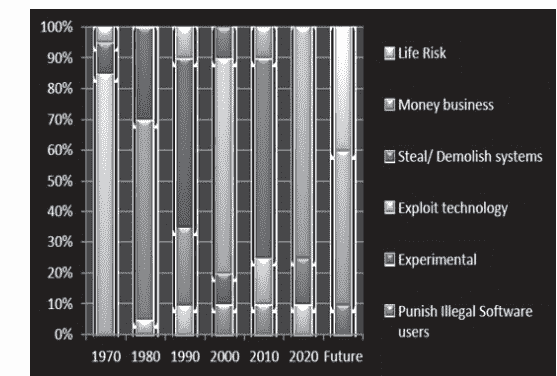

图 5.4 多年来攻击者的动机。

## 5.3 各国准备好了吗？

随着世界各国向数字经济演进，保护国家公民在陆、海、空安全的军队现在必须转移到数字媒介，作为网络军队来保护网民。数字战场上的战士数量多年来不断增加。网络战士不再仅仅是国家军队雇用的人员，还包括具有攻击其他国家或本国议程的 rogue 网络黑客行动主义团体。让我们看看世界上一些国家的准备状态。

印度：印度有关网络安全的一些不同的情报机构和政府机构有：

- 电子和信息技术部（DeitY），其中包括印度计算机应急响应小组（ICERT）
- 情报局或中央情报局
- 国家情报局
- 国家技术研究组织
- 国防研究与发展组织（DRDO）

除此之外，还有有关网络安全的私人机构或非政府组织，如印度网络军 [11]，它是一个拥有道德黑客的自治协会，也作为印度国家警察和其他情报机构的资源中心。

孟加拉国：尽管孟加拉国是一个较小的国家，但《孟加拉国国家网络安全战略》文件 [12] 中提出的想法显示了其如何有效地

## 5.4 结论

历史告诉我们，世界各国之间一直存在争端。唯一的区别是武器的性质已从石头、剑和枪变为计算机。在本章的第一部分，我们看到了各种恶意攻击如何在大规模上影响组织和国家。有些攻击是为了好玩，有些是为了钱，有些是为了报复。这些攻击既可以由一个人小规模进行，也可以由一个国家对另一个国家进行。因此，在本章的下一部分，我们整理了有关各国在网络战能力发展方面进展的信息。很明显，每个国家在建立自己的网络军队以保护自己并破坏其他国家的安保系统方面都至关重要。国际情报和和平机构必须缔结条约以避免任何灾难性网络攻击，这一点至关重要。因为在未来，一次协调的大规模网络攻击可能会毁灭世界，因为一切都已互联。

## References

- 1. Touchette, F. (2016). 恶意软件的演变. Network Security, 2016(1), 11-14.
- 2. https://home.mcafee.com/virusinfo/virusprofile.aspx?key=221, 检索日期 2018-03-30.
- 3. https://www.cisco.com/c/en/us/about/press/internet-protocol-journal/back-issues/table-contents-25/virus-trends.html, 检索日期 2018-03-30.
- 4. https://home.mcafee.com/virusinfo/virusprofile.aspx?key=1446, 检索日期 2018-03-30.
- 5. Schultz, E., Mellander, J., & Peterson, D. (2003). MS-SQL Slammer 蠕虫. Network Security, 2003(3), 10-14.
- 6. Shakarian, P., Shakarian, J., & Ruef, A. (2013). 攻击伊朗核设施：Stuxnet. Introduction to cyber-warfare: A multidisciplinary approach, 223-239.
- 7. Shakarian, P., Shakarian, J., & Ruef, A. (2013). Introduction to cyber-warfare: A multidisciplinary approach. Newnes. Paulo Shakarian, Jana Shakarian, Andrew Ruef, Chapter 8 Duqu, Flame, Gauss, the Next Generation of Cyber Exploitation. pp. 159-170.
- 8. Mansfield-Devine, S. (2017). 勒索软件：最流行的攻击形式. Computer Fraud & Security, 2017(10), 15-20.
- 9. "Player 3 Has Entered the Game: Say Hello to 'WannaCry'", blog.talosintelligence.com. 检索日期 2018-03-30.
- 10. Winton, R. (2016). 好莱坞医院向黑客支付 17,000 美元比特币；FBI 调查中. Los Angeles Times, 18.
- 11. 印度网络军 (https://www.ica.in)
- 12. 孟加拉国国家网络安全战略 (https://www.unodc.org/cld/lessons-learned/bgd/the_national_cybersecurity_strategy_of_bangladesh.html?&tmpl=c yb)
- 13. 孟加拉国网络军(https://www.hackread.com/indian-government-and-and-30-websites-hacked-by-bangladesh-cyber-army/)
- 14. Breene, K. (2016, May). 谁是网络战超级大国. In World Economic Forum. 检索日期 October (Vol. 27, p. 2017). (https://www.weforum.org/agenda/2016/05/who-are-the-cyberwar-superpowers/)
- 15. 爱德华·斯诺登泄露 (https://en.wikipedia.org/wiki/Edward_Snowden)

## PART II

## Cybersecurity in Parallel and Distributed Computing Techniques

## CHAPTER

## 6

## Introduction to Blockchain Technology

ISHAANI PRIYADARSHINI

University of Delaware, Newark, Delaware, USA

Email: IshaaniPriyadarshini@udel.edu

## Abstract

数据是最有价值的资产之一。随着网络犯罪分子在窃取有价值数据的尝试中变得越来越熟练，网络安全往往成为全球最关注的问题之一，使得网络防御成为强制性要求。过去，由于各机构的安全需求，提出了各种技术；然而，安全攻击无止境，因此导致技术被削弱或变得无效。保护有价值数据的最新方法是区块链技术。在本章中，我们将审视区块链技术的概念以及它对安全行业的重要性。当我们深入了解更多细节时，我们将审视区块链技术的特征、结构、类型、架构和工作原理。由于比特币是区块链技术最广泛的应用之一，本章还强调了比特币的工作原理。稍后，我们将讨论该技术面临的一些挑战及其未来的范围。

**关键词**: 区块链, 比特币, 网络安全


## 6.1 引言

个人计算机用户和企业面临的最大网络安全问题之一是数据窃取，这不仅威胁到个人隐私，也违背了网络安全的主要目的之一，即保密性。在过去的几十年里，人们提出了多种技术来解决这个问题，但其中许多技术寿命短暂，原因是网络犯罪分子技术高超。最新的技术是区块链技术。分散在网络上的数据容易被盗窃和剽窃，而且往往无法追溯到网络犯罪分子。区块链技术在许多层面上消除了这个问题。区块链可以被定义为一种分布式数据库，它包含信息，或者是一本记录所有事件和交易的账簿，这些事件和交易在相关各方之间执行和共享。交易经过验证，输入的信息永远无法被删除。每一笔交易都有可验证的记录。区块链技术在金融和非金融领域都有应用。

区块链是公共账本，所有交易都累积在区块列表中[1]。当多个区块不断被添加时，就会形成链状结构。区块链技术主要基于密码学和分布式系统的概念。众所周知，加密技术可以隐藏内容，使其仅对预期用户可用。但某些信息需要提供给特定人群，这就带来了信息被操纵的额外风险。区块链解决了这个问题。当数据被访问和更新时，任何更改都会被记录和验证。之后，数据会被加密，从而无法进行进一步更改。这些更改随后被更新到主记录中。这是一个重复的过程，每次进行更改时，信息都会被保存在一个新的区块中。值得注意的是，信息的第一个版本与最新版本紧密相连。因此，每个人都可以看到所做的更改，但只有最新的区块可以被修改。区块链通过实时整合网络内复制的信息来模拟分布式数据库。这意味着数据库有多个位置，记录是公开的且易于验证。由于没有集中式版本，数据篡改是徒劳的。修改记录非常繁琐，因此如果有人试图这样做，就更容易被发现。因此，区块链可以被视为具有以下属性的数据：

- 1. 它不断更新。这使得用户可以随时访问和修改数据。
- 2. 它是一个分布式系统，数据的重复副本被存储并遍布网络。更新一条记录会实时更新所有其他副本。
- 3. 它拥有经过验证的数据。当数据被修改时，用户必须使用密码学技术进行验证。
- 4. 数据是安全的，因为密码学技术和分布式系统不允许篡改数据和安全机制。

区块链的一种分类方式是无许可区块链和许可区块链。无许可区块链是开放的，任何对等节点都可以作为读者或作者连接和离开。它们是去中心化的，信息对用户可读。许可区块链授权有限的读者和作者。它们由中央实体管理，该实体决定哪些个人可以读取或写入[2]。

## 6.4 区块链的类型

在前几节中，我们了解了“许可”和“无许可”区块链。然而，还有另一种分类区块链的方式。这种分类是基于区块链网络进行的。众所周知，区块链有三种类型，定义如下：

- 1. 公有区块链：这些区块链是开放透明的，意味着任何人都可以读取、写入或审计它们。任何人都可以在任何给定时间点对其进行审查。由于没有负责人，去中心化的共识机制负责决策。在做出决策时会考虑工作量证明（POW）和权益证明（POS）。这些区块链没有访问限制，任何人都可以参与交易和验证。一些常见的公有区块链包括以太坊和比特币[4]。
- 2. 私有区块链：这些区块链仅限于个人或组织。一个权威机构负责读写操作。该权威机构还负责有选择地向用户授予读写权限。挖矿权也可能被有选择地授予，从而使其类似于中心化系统，尽管它在密码学上是安全的，而且成本效益高。在这种区块链中，不是每个人都能读取、写入、审计或进行交易。它们是许可区块链。银行链是私有区块链的典型例子。
- 3. 联盟或联邦区块链：这些区块链由一个或多个负责人进行决策。它们是半许可的，由一组公司或个人代表。这带来了更快的交易，并提供了多个故障点，从而保护了数据。成员负责进行交易/决策。他们可以读取、写入、审计和挖掘数据。联盟区块链的常见例子有 R3 和 EWF（能源网络基金会）。

## 6.5 区块链技术的架构

区块链提供的单一事实来源利用数字签名区块和算法来执行快速实时的交易和文档记录，这些交易和记录进一步被加密。这一想法由中本聪提出，他想创建一种不依赖中心化架构和中介机构的加密货币（比特币）。区块链由区块组成，区块基于连接前序区块数据的指针。这些区块不容易被更改，从而确保安全性。新区块验证也依赖共识算法。

区块链的端到端交易遵循某种机制。在本节中，我们将了解负责其运行的区块链技术架构。区块链技术架构基于以下组件[9]：

- 1. 区块链平台：区块链可以定义为在分布式网络上运行的应用程序。它是一个去中心化的交易系统，其透明性体现在任何运行区块链软件的节点都能够处理整个区块链。相应数据存储在平面文件或关系数据库中。谷歌的 LevelDB 负责存储元数据。已安装的应用程序会从服务器同步到节点。服务器包含交易记录

一旦交易发生，它就会被传送到比特币的所有节点，必须首先经过验证，然后才能被登记。每笔交易在添加到公共账本之前必须确保其有效性。要记录一笔交易，节点必须验证两件事：

- 加密货币确实属于花费者。这是通过验证数字签名来完成的。
- 花费者拥有足够的加密货币来进行交易。这可以通过检查花费者账户中记录的每笔交易来完成。

图6.4中的插图展示了区块链技术的工作机制。

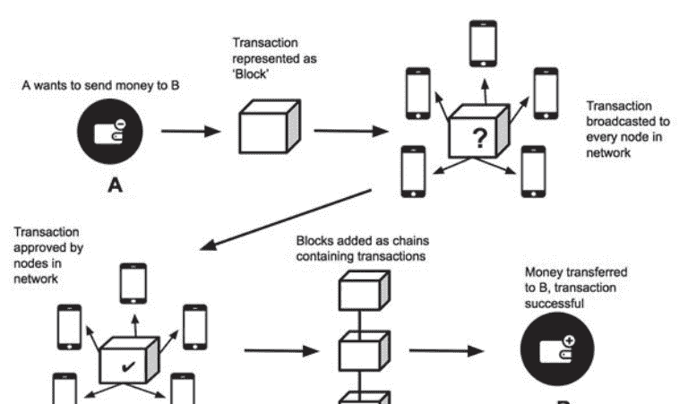

图6.4 使用区块链技术的加密货币交易。

区块链技术是开发一种整个网络都同意的比特币交易机制的结果。最初，在区块链技术被开发之前，只有比特币盛行，交易并不总是按顺序进行；因此，需要消除加密货币的双重支付问题。交易在比特币网络中从一个节点传递到另一个节点；因此，交易在某节点收到的顺序可能并非交易实际发生的顺序。例如，交易A可能发生在交易B之前，但交易A必须经过的节点数量可能多于交易B，从而导致交易B首先被记录在一个节点中。这是分布式网络中的一个挑战，比特币使用区块链技术解决了这个问题。交易随后被放入区块中，从而形成了区块链。这意味着一个区块中的所有交易都发生在同一时间。然后，区块按时间顺序以线性方式排列，使得给定区块通过其哈希值与前一区块链接。


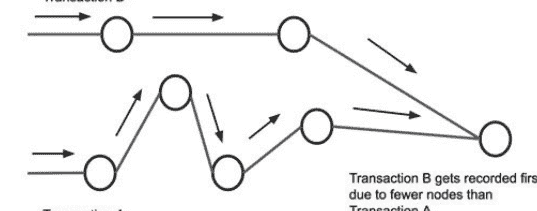

**图 6.5** 双重支付可能如何发生。

虽然所提出的方法消除了许多问题，但仍有一个问题未得到解决。在给定时间可能为不同节点创建多个区块。几个区块可能在不同时间到达不同节点。该问题通过数学难题得以解决，其中只有当区块能够解答特定数学问题时才会被接受到区块链中。这被称为工作量证明，因为生成区块的节点必须证明已投入足够资源来解决该难题。这意味着需要开发一种机制，使整个比特币网络能够就交易顺序达成一致，这在分布式系统中是一项艰巨的任务（图 6.6）。

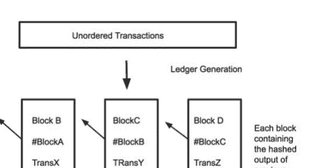

**图 6.6** 从无序交易中生成区块链。

## 6.7 区块链技术的其他案例研究

如我们所知，比特币是区块链技术最流行的案例研究。然而，区块链技术并不仅限于加密货币的工作原理。在本节中，我们将查看区块链技术的一些其他用例。如下所示 [2, 7]：

- **供应链管理：** 供应链管理（SCM）工作流程包括从制造、存储、生产等到交付和消费的许多服务。它涉及多个写入者，且必须存储的数据量巨大。当产品从一个手中转移到另一个手中时，交易将被记录，从而减少时间延迟并消除人为错误。订单、收据、发货通知等可以轻松追踪。实物商品可以与序列号、条形码、数字标签等关联。此外，信息可以在供应商和供货商之间共享。
- **银行间和国际金融交易：** 区块链技术正因多种原因被金融机构采用。跨境交易变得更快更便宜。更高的交易准确性以及更短的结算流程是股票交易的关键。商业交易和协议形式的智能合约可以得到保障。它加强了身份管理，而身份管理是银行业所必需的。由于交易透明且可追溯，因此可以带来更好的忠诚度计划和奖励，从而提升整体绩效。
- **去中心化自治组织（DAO）：** DAO 依赖智能合约运行。没有中央管理，尽管智能合约中规定了规则，这些规则定义了组织应如何运作。组织必须以去中心化的方式管理，因此产生了对无许可区块链的需求。有时也可能需要专用的无许可区块链。这些系统通常建立在具有自身货币的现有区块链技术之上。
- **土地登记：** 土地登记相关的数据可以迁移到使用加密协议保护的安全透明基础设施中。南非初创公司 ChromaWay 已在开展相同的工作 [8]。
- **所有权证明：** 区块链技术最常见的案例研究之一是知识产权的所有权证明。在盖章时，公共区块链可用于在以后证明所有权。数字对象连同所有者身份可使用哈希进行提交，以提供充分的所有权证据。
- **电子投票：** 电子投票最重要的公众需求之一是隐私，因为投票必须匿名以避免任何形式的恐吓。然而，也必须具有公开可验证性，以维护投票的完整性。由于投票涉及许多互不信任的各方，使用区块链技术是合理的解决方案之一。

## 6.8 区块链技术面临的挑战

区块链技术是近年来最具革命性的技术进步之一。它已被金融、医疗保健、云存储等多个领域的行业所采用。尽管在技术世界中占据主导地位，但仍存在一些关于区块链技术的担忧。以下是对区块链技术面临的一些挑战 [2]。

## 6.10 结论

在本章中，我们介绍了最具当代性的技术之一。网络安全是任何国家或组织的首要优先事项。区块链技术提供了难以破解的先进安全措施。我们了解了区块链技术是什么以及为何在最近变得必要。区块链技术具有某些特性，使其成为密码学家青睐的对象，我们已讨论了这些特性。基于区块链网络，已知有三种类型的区块链，我们在本章中也重点介绍了它们。除此之外，区块链技术的架构和工作原理也已介绍。比特币是区块链技术的一种应用，我们在本章中对其进行了强调，同时还介绍了其他一些案例研究。尽管区块链技术是现代安全问题的救星，但仍面临一些挑战，其中一些已在本章中介绍。最后，已列出了区块链技术在未来的预期影响。

## 参考文献

1. Zheng, Z., Xie, S., Dai, H., Chen, X., & Wang, H. (2017, June). An overview of blockchain technology: Architecture, consensus, and future trends. In Big Data (BigData Congress), 2017 IEEE International Congress on (pp. 557-564). IEEE.
2. Wüst, K., & Gervais, A. (2017). Do you need a Blockchain? IACR Cryptology ePrint Archive, 2017, 375.
3. Types of Blockchains, retrieved from https://en.wikipedia.org/wiki/Blockchain#Types_of_blockchains
4. Barcelo, J. (2014). User privacy in the public bitcoin blockchain. URL: http://www.dtic.upf.edu/jbarcelo/papers/20140704_User_Privacy_in_the_Public_Bitcoin_Blockchain/paper.pdf (Accessed 09/05/2016).
5. Szabo, N. (1997). The idea of smart contracts. Nick Szabo's Papers and Concise Tutorials, 6.
6. Dejan Jovanovic, Blockchain Case Studies, Retrieved from https://medium.com/@dejanjovanovic_24152/blockchain-case-studies-2271d37d3ed, 2017.
7. Pete Rizzo, Sweden's Blockchain Land Registry to Begin Testing in March, Retrieved from www.coindesk.com/swedens-blockchain-land-registry-begin-testing-march/, 2017.
8. Vamsi Chemitiganti, The Architecture of Blockchain, Retrieved from http://www.vamsitalkstech.com/?p=1615, 2016.
9. Saberi, S., Kouhizadeh, M., Sarkis, J., & Shen, L. (2018). Blockchain technology and its relationships to sustainable supply chain management. International Journal of Production Research, 1-19.
10. Scott, B. (2016). How can cryptocurrency and blockchain technology play a role in building social and solidarity finance? (No. 2016-1). UNRISD Working Paper.
11. Zheng, Z., Xie, S., Dai, H., Chen, X., & Wang, H. (2017, June). An overview of blockchain technology: Architecture, consensus, and future trends. In Big Data (BigData Congress), 2017 IEEE International Congress on (pp. 557-564). IEEE.
12. Ver, R., & Antonopoulos, A. M. (2018). Blockchain Revolution: How the Technology Behind Bitcoin Is Changing Money. ADC Publishing Book.

## 第 7 章 分布式系统中的网络安全技术、SLA 及其他网络法规

Soumitra Ghosh, Anjana Mishra, Brojo Kishore Mishra

C. V. Raman College of Engineering, Bhubaneswar, Odisha, India

Email: soumitraghosh311@gmail.com, anjanamishra2184@gmail.com, brojokishoremishra@gmail.com

### 摘要

本章重点介绍适用于并行和分布式计算环境的各种网络安全技术。分布式系统基本上是提供更高性能、可扩展性、更高可用性和资源共享的候选方案。多用户配置、资源共享以及工作站之间某种形式的通信等需求，带来了关于系统、用户和数据隐私、安全和保护的新问题。因此，抵御网络犯罪和保护数据泄露的新时代网络安全技术势在必行。本章还重点介绍了服务提供商与客户之间关于服务质量、可用性和责任等方面存在的服务水平协议（SLA）的需求。Clifford Stoll 的《布谷鸟蛋》网络安全教训以及遏制欺诈、数据泄露、不诚实、欺骗和其他此类网络犯罪的各种修正案也在本文中进行了深入讨论。

**关键词**: Cybersecurity, cybercrime, threat, security, computing, computer security, risk, vulnerability, parallel, distributed


## 7.1 Introduction

分布式计算是一个比并行计算更通用的术语。很多时候，这两个术语被互换使用。与并行计算以任务的并发执行为工作原则不同，分布式计算还涉及一致性、分区容错性和可用性等额外能力。

Hadoop 或 Spark 之类的系统是分布式计算系统的例子，其高度健壮可靠，因为它能够处理节点和网络故障。这类系统通过在网络中的多个节点上进行数据复制来实现数据丢失预防。然而，这两个系统也设计用于执行并行计算。与 MPI 等 HPC 系统不同，这些新型系统即使其中一个计算节点发生故障，也能够继续进行大规模计算。

### 7.1.1 Primary Characteristics of a Distributed System

连接自主计算机网络的分布式中间件被称为分布式系统。任何典型的分布式系统安排都使用户能够通过单一且集成一致的网络共享不同的资源和能力。

- *并发：* 在分布式环境中，各种节点同时共享资源的能力就是并发背后的概念。
- *透明性：* 将系统视为单一单元而非自主组件的集合是透明性背后的主要思想。分布式系统设计者的目标是尽可能隐藏其复杂性。透明性参数可以是使用权限、迁移、并发、故障、勤勉和用户资源。
- *开放性：* 开放性的目标是以易于配置和/或修改的方式设计网络。开发人员经常需要在分布式节点的任何一个中添加新功能或修改/替换任何现有功能，如果有基于某些标准协议的互操作性支持，这很容易实现。此外，定义良好的接口使流程更加顺畅 [1]。
- *可靠性：* 与单一系统相比，分布式系统能够高度抵抗故障、更安全且更一致。
- *性能：* 从性能角度看，分布式系统通过实现资源的最大利用率，比自主系统高出巨大幅度。
- *可扩展性：* 任何分布式系统都必须在设计时考虑到它可能需要根据未来需求或不断增长的需求进行扩展，我们称之为扩展。系统可能需要在地理、规模或管理等方面进行扩展 [1]。
- *容错性：* 系统的容错性和可靠性可以被视为近邻。容错系统是在最严峻的场景下也能提供高可靠性的系统，无论是子系统故障、网络故障等。通过各种可能的方式为系统提供安全性，例如增加数据的冗余、防止拒绝服务（DoS）攻击、提高系统的弹性水平等，使系统成为容错系统。

### 7.1.2 Major Challenges for Distributed Systems

分布式系统的挑战如图 7.1 所示。

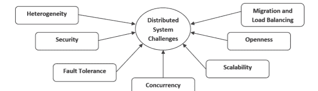

图 7.1 分布式系统的挑战。

**异构性：** 跨越各种计算机和网络的服务和应用程序可以被用户通过互联网使用、运行和访问。运行不同操作系统的不同变体的硬件设备（*PC、平板电脑等*）在各种操作系统（*Windows、iOS 等*）下运行，可能需要交换信息或相互通信以实现特定目的。用不同语言编写的程序只有在处理了这些差异后才能相互交流。为此实现，就像互联网协议一样，也需要商定的标准被要求并接受 [3]。中间件一词适用于提供编程抽象的软件层，同时掩盖核心网络、编程语言、操作系统和硬件的异构性。

可以从一台计算机迁移到另一台计算机并在目标处执行的程序代码被称为移动代码。移动代码的一个例子是 Java 小程序。

**安全性：** 在使用公共网络时，安全性成为分布式环境中的一个巨大问题。安全性，可以广义上描述为保密性（*防止信息泄露给非法人员*）、完整性（*防止篡改或不诚实*）和可用性（*防止干扰资源使用方式*），必须在分布式系统中提供。加密程序可以用来应对这些问题，例如密码学中的程序，但它们仍然不是万无一失的。拒绝服务（DoS）攻击仍可能发生，其中服务器或服务被大量虚假请求淹没，通常由僵尸网络（*僵尸计算机*）发起。可能的威胁是数据泄露、完整性侵犯、拒绝服务（DoS）和非法处理。

**容错性和处理：** 当一些不可靠的组件成为分布式系统不可或缺的一部分时，容错变得更加复杂。分布式系统需要系统的容错能力来正常运行。任何系统中都不可避免地会出现故障；一些子系统可能停止运行，而其他子系统则继续正常运行。因此，正如你所预期的那样，我们需要一种手段来检测故障（*通过采用多种技术如使用校验和*）、掩盖故障（*通过在故障时重新传输以获得确认*）、从故障中恢复（*如果服务器崩溃则回滚到之前的安全状态*），并建立冗余（*通过复制数据以防止网络中特定系统崩溃时的数据丢失*）。

**并发：** 同时尝试请求共享资源的众多客户端可能导致并发问题。这很关键，因为此类操作的任何结果可能取决于完成顺序，因此需要同步。此外，分布式系统没有全局时钟，因此为了网络中所有组件的正常运行，同步的需求变得更加明显。

**可扩展性：** 当系统无法很好地处理资源数量或用户数量的突然增加或两者兼有时的扩展性问题就会出现。在这种情况下，必须有效地使用架构和算法。可扩展性可以被认为主要包含三个维度：

- **规模：** 规模代表待处理的用户和资源数量。此场景出现的问题是过载。
- **地理：** 地理代表用户和资源之间的距离。此场景出现的问题是通信可靠性。
- **管理：** 随着分布式系统规模的增长，许多节点需要被控制。此场景出现的问题是管理混乱 [3]。

**开放性和可扩展性：** 接口应定义良好且公开可用，以便无问题地对现有组件和新加入的组件进行添加 [2]。如果系统的定义良好的接口可用，开发人员在未来插入新功能或替换组件会更容易。开放性问题变得严重，当已发布的內容突然被撤回或逆转时。此外，在开放的分布式系统中，通常没有中央权威，因为不同的系统可能有各自的调解者。例如，像 Facebook、Twitter 等组织允许开发人员通过其 API 交互式地构建自己的软件 [2]。

**迁移和负载均衡：** 任务与用户或应用程序之间必须存在一定的独立性，以便当某些任务需要在系统中移动时，其他用户或应用程序的任务不受影响，并且为了获得更好的系统性能，负载必须在可用资源之间分配。

## 7.2 Identifying Cyber Requirements

在进入互联网世界之前，如果我们需要远离网络欺凌者或防止个人数据隐私泄露，我们脑海中需要非常清楚一些事情。事实上，在我们开始这段网络之旅之前，对一些通俗问题的答案会非常有用。

- 谁有认证的进入方式？（*会涉及与保密性相关的问题*）。
- 谁被允许对信息进行更改？（*会涉及与完整性相关的问题*）。
- 何时需要访问数据？（*会涉及与可用性相关的问题*）[4]。

保密性、完整性和可用性，也称为 CIA 三元组，是为公司提供数据安全的标准框架。为了避免与中央情报局混淆，它也被称为 AIC 三元组。

在这种情况下，保密性确保信息被发送者实际 intended 的正确人员接收。完整性确保

接收方收到的消息或信息是发送方实际发送的原始消息，并且在消息传输过程中未对实际消息进行任何修改或更改。可用性是对经过身份验证的人所使用数据的可信性的保证。

除了 CIA 三要素之外，还有一些因素近年来变得越来越重要，例如占有或控制、真实性以及不可否认性。

## 7.3 分布式系统中的流行安全机制

### 7.3.1 安全通信

适当调整以提供客户端和服务器之间安全的通信媒介，从而保持 CIA 因素。安全通道在客户端和接收者之间提供安全的通信方式，防止第三方入侵发生，从而确保保密性、完整性和/或身份验证不被破坏。有多种协议可实现此目的。在此我们将讨论几种有助于保持身份验证因素的协议 [5]。

#### 7.3.1.1 身份验证

身份验证和完整性相互依存。例如，考虑一个支持为关系提供验证的分布式框架，但不提供保证信息完整性的规则。或者，一个仅确保数据真实性，而不进行验证测量的框架。这就是为什么信息身份验证和真实性必须合二为一。在众多约定中，这种组合功能良好。为了在正确验证后信息交换时保证信息的真实性，我们使用由会话密钥加密的特殊密钥。会话密钥是共享密钥，适用于信息真实性（完整性）和保密性（保密性）的加密。只要建立的通道存在，此类密钥即可使用。当通道关闭时，会话密钥即丢失。在此我们将讨论基于会话密钥的验证策略 [6, 7]。

#### 7.3.1.2 基于共享密钥的作者身份验证

图 7.2 描述了基于共享密钥的身份验证协议。如果某人，例如 X，希望与另一人，例如 Y，建立通信通道，他们的通信是通过 X 向 Y 发送请求消息（例如 `message1`）来促进的。

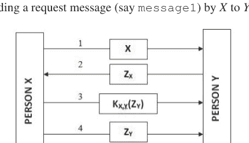

图 7.2 基于共享密钥的身份验证。

最后，X 使用由 B 生成的会话密钥 K_X,Y 对挑战 Y 的响应进行回复。因此，它可以解码消息 3，实际上 Y 与 X 通信 [5]。

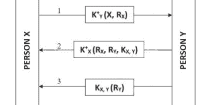

图 7.4 基于相互身份验证的公钥加密。

### 7.3.2 消息完整性和保密性

除了身份验证之外，安全媒介还必须承诺保密性和完整性。信息真实性规定，在消息从发送方传输到接收方期间不应有任何修改。保密性确保消息到达预期的接收者，而不是任何窃听者。消息加密有助于我们实现保密性。密码学可以通过使用与接收方共享的秘密密钥或通过接收方的公钥来进行 [8, 9]。

#### 7.3.2.1 数字签名

数字签名可以被视为手写签名或印刷印章的数字对应物，其安全性优于传统签名。计算机化签名保证了任何消息或电子报告的确认批准和可信性。不对称密码学，即一种公开密钥密码学，构成了高级标记的基础。通过使用公开密钥算法，例如 RSA，可以创建两个密钥，一个私有和一个公开。要创建高级标记，标记软件，例如电子邮件程序，会对要约定的电子信息进行受限哈希。然后使用私钥对哈希进行编码。

加密的哈希值连同其他数据，例如哈希算法，就是数字签名。对哈希而不是整个消息或报告进行编码的原因在于，哈希容量可以将任意输入转换为固定长度的哈希值，通常要短得多，从而节省时间，因为哈希的速度明显快于签名。每段哈希信息都会生成一个独特的代码。对信息的任何调整都会导致不同的值。这使我们能够利用签署者的公钥来解密哈希，从而验证信息的完整性。如果解密的哈希与相同信息的处理哈希相匹配，则表明信息自约定以来未被更改。如果两个哈希不匹配，则可以认为信息已被破坏。换句话说，信息要么以某种方式被篡改（诚实），要么签名是用与签署者展示的公钥不对应的私钥创建的（验证）。

控制，以便对信息安全计划产生根本性影响。可以看出，如果信息安全团队未能将 SLA 限制在最重要的项目上，此类协议的影响就会减弱。分析与组织相关的风险或评估过去的事件可能会指出特定公司最重要的组件。在大多数情况下，以下领域被建议为重要问题：

#### 7.4.2.1 检查网络

许多信息安全团队会进行网络扫描以识别网络的易受攻击性。认识到问题只是开发的起点。第二步是如何处理或解决危机。第三步可以被视为如何将其整合到一个课程中以避免未来任何发生。为了自动化网络扫描实践，不同的公司使用各种商业工具。其中一种工具是 ISS Internet Scanner，如果使用，可以记录按高风险、中风险和低风险类别分组的漏洞。以下是 ISS Internet Scanner 帮助索引中定义的各种风险级别：

- High: 这是指任何允许入侵者立即进入系统的易受攻击性，例如获得超级用户进入和访问权限或找到绕过防火墙的方法。例如，易受攻击的 Sendmail 8.6.5 版本允许欺诈者在邮件服务器上执行指令、安装 BackOrifice、NetBus 或没有任何密码的管理员帐户。
- Medium: 中等易受攻击性可能是指入侵提供机密数据、降低性能或具有向冒名者提供系统准入的高前景。例如，识别网络上的活动调制解调器、区域传输和可写的 FTP 目录。
- Low: 低易受攻击性可能是指网络入侵提供机密数据，最终可能导致妥协。例如，所有用户都可以访问软盘驱动器，IE 可能执行有限的 SSL 验证，未启用登录和注销审核。

互联网技术团队可能会在报告中查找以下内容：

- 配置修改
- 安装服务包
- 设置补丁
- ACL（访问控制列表）修改
- 注册表编辑
- 停止服务

这些建议通过缩短寻找上述问题解决方案所需的时间来帮助互联网技术团队，从而进一步实现快速实施。正如您所期望的那样，解决不足所需的时间范围将根据开放性的严重程度而定。例如，高风险漏洞必须在 48 小时内解决，中等风险漏洞可能在一周内解决，低风险漏洞可能在一个月内解决。


#### 7.4.2.2 取证

取证在涵盖众多调查中扮演着非常重要的角色。网络安全团队在调查过程中经常会被问及发生了什么事、何时发生以及/或是否应该发生。日志文件对于进行取证调查至关重要，没有它们，调查通常以失败告终。

因此，与取证相关的服务等级协议（SLA）可以包括：

-   在被覆盖之前保留的时长。
-   代理日志、防火墙日志、服务器日志、系统日志（syslogs）、DHCP 日志和客户端日志。
-   设置将日志移动到任何中央日志服务器、便携式媒体、异地信息存储等所需的阈值。

#### 7.4.2.3 管理记录/文档

通常，一个高效的IT公司往往与妥善管理的信息保护计划相关联。除此之外，互联网技术团队应具备适当的能力、良好的互联网技术流程、工具和资产记录，这些记录必须保持最新，以便适当地执行互联网安全议程。在进行风险评估、网络扫描或响应可能性或分析需求时，一个记录完善的网络拓扑结构至关重要。与网络拓扑相关的服务等级协议（SLA）可能涉及诸如各互联网技术团队每月更新网络拓扑等要点。

在准备与文档管理相关的服务等级协议（SLA）时，可能需要考虑的要点包括：

-   设置的变更
-   网络基础设施的修改
-   API的变更
-   系统故障日志和相关危机解决方案
-   记录评估的频率
-   详尽的任务说明
-   每份纸质服务和维护合同的负责人

#### 7.4.2.4 数据备份

任何强大的互联网安全计划的基础都是数据备份。数据备份允许组织在发生某些不幸事件时，从其数据中完全恢复，或从某个公认的基线或检查点恢复。在准备服务等级协议（SLA）时需要考虑的一些基本问题包括：

-   理论支持记录。
-   对支持健全性的信息进行证实。
-   哪些服务器或应用程序被备份以及具体程序的凭证。
-   通过定期计划的测试来验证恢复。
-   异地存储地点的标签以及取件和/或送件时间表。

这个被污染的“atrun”文件破坏了系统。五分钟后，哗啦！他就成为了系统管理员”[18]。

间谍团伙花费了大量精力试图控制标准客户端账户，以便他们能以这些客户的身份登录并审查框架，而不会引起警报。有一次，在通过Emacs攻击成为框架负责人后，一名程序员打开了框架的密码文档。尽管如此，他并不知道框架上每个客户的密码是什么，因为它们都被加密了。他没有尝试破解，而是直接删除了其中一个。他挑选了一个特定的客户并删除了该客户的密码。当他稍后以该客户身份登录时，框架将允许访问，因为没有秘密密钥保护该记录。最终，该程序员开始将整个密码密钥记录下载到他的家用电脑上。斯托尔后来发现，该程序员执行了一次精彩的新攻击。他用与编码密码相同的算法加密了词典中的每个单词，并将下载的关键字记录中的加密密码与加密的词典单词进行比较。如果他发现任何匹配的，他现在就可以作为真正的客户登录。暴力字典攻击在今天已是标配，但在当时，这是一个新颖的想法。

斯托尔经常遇到政府和间谍，他们渴望获取斯托尔掌握的任何有关他调查的信息，但也不愿意以同样的方式分享他们所知的一切。还有一个重要问题。当斯托尔完成这本书时，他总结道，在滑下这个爱丽丝梦游仙境般的兔子洞之后，他发现政治左翼和右翼对个人电脑有着共同的依赖。然而，右翼认为计算机安全对于确保国家事务中的机密至关重要，而他们的“左派”同行则对隐私受到侵犯感到担忧。

斯诺登事件只是过去二十年美国和其他国家就隐私与安全进行的一系列交锋中的最新一起。正如布鲁斯·施奈尔所指出的，这是一个错误的论点，称理性的讨论并非关于安全与隐私，而是关于自由与控制[18]。

他和其他著名科学家解释了为什么这不是一个非此即彼的选择。他提到，一个人可以同时拥有安全和隐私；但是，你需要为此努力。在这本书中，可以说斯托尔是第一个提出这个问题的人。他当时在努力解决这个问题，就像我们今天所有人一样。

第三个决定性问题就是数字间谍风险。商业世界在2009年底中国政府与谷歌的信息交换事件中真正意识到了这个问题。美军在此之前十年就一直在应对中国的数字监控威胁，当时被称为“钛雨”（Titan Rain）。然而，斯托尔声称，他的书描绘了第一个主要的公开案例，即间谍利用电脑进行秘密活动，而这次是由俄罗斯人支持的。《杜鹃蛋》中的事件始于1986年8月，比“钛雨”早将近15年，书中提到的一些政府人物暗示，他们认为在此之前还有其他非公开的监控行动。关键在于，数字秘密活动风险已经存在了大约30年，并且丝毫没有在不久的将来消失的迹象。

第四个也是最后一个决定性问题实际上并非数字问题，而是一个情报问题。在整本书中，斯托尔都在纠结是否要公布他的发现。他这样描述这个问题：“如果你描述如何制造管状炸弹，那

在美国，关于在计算机上扣押并无期限地持有每份记录以供未来刑事调查使用的合法性存在争议。他们认为这并不可行。例如，根据第二巡回法院在Ganais案中的裁决，如果警方为了证明一项罪行而搜查并扣押了一个电子设备，持有这些文件，并在数年之后扫描这些记录以在另一起不同的刑事调查中进行确认，那将违反第四修正案。

### 7.6.2 搜查与扣押

随着数据和交换技术进入日常生活，与计算机相关的非法活动急剧增加。由于计算机或其他数据存储设备可以提供实施犯罪的手段，或者成为存储犯罪证据的电子数据库，因此使用搜查令来搜查和扣押此类设备的重要性日益凸显。在许多方面，电子证据的搜查和扣押与其他任何搜查和扣押是相同的。例如，与任何其他搜查和扣押一样，对计算机或其他电子存储介质的搜查和扣押必须依据地方法院签发的搜查令进行，前提是有合理根据相信它们包含犯罪证据[20]。

意识到犯罪分子并没有错过计算机革命，美国司法部发布了一本专门致力于计算机搜查和扣押法律以及互联网电子监控的手册。编写这份记录是为了帮助全国各地的执法机构在刑事调查中获取电子证据。

据刑事局助理检察长詹姆斯·K·罗宾逊称，这本手册对于执法人员和检察官，以及任何使用计算机的美国人来说都是必不可少的。他进一步表示，电子安全对我们所有人都至关重要，该部门需要每个人都知道自己的权利是什么。这份名为“搜查和扣押计算机以及在刑事调查中获取电子证据”的报告由刑事局计算机犯罪与知识产权科（CCIPS）编写。与计算机相关的犯罪所造成的心理困扰，要求检察官和执法专家了解如何获取存储在计算机中的电子确认信息。电子记录，例如计算机网络日志、消息、文字处理文档和“.jpg”图像文件，在刑事案件中已逐渐为立法机关提供了重要的确认。

该手册为政府执法人员和检察官提供了一个系统的流程，可以帮助他们理解在刑事调查中搜查电子证据时出现的合法性问题。该手册图解了电子监控法律如何适用于互联网，以及法院如何将第四修正案与计算机联系起来。

本手册取代了《联邦搜查和扣押计算机指南》（1994年）及其1997年和1999年的补充文件。尽管组织起来并制定计划的目标是为计算机调查和逮捕领域的每位政府专家和律师提供有效的控制，但此后法律的介入变化以及自1994年以来互联网的快速发展，催生了新指导方针的需求。本手册旨在作为关于搜查和扣押计算机的推荐规则的更新版本，并就涉及计算机系统和互联网案件中获取电子确认的法规提供指导。本手册提供帮助，而非权威意见。其分析和结论考量了当前法律中棘手领域，并不代表司法部或其他部门的官方立场。它没有行政影响。


管辖刑事侦查中电子监控的法律有两个主要来源：美国宪法第四修正案，以及18 U.S.C. 2510-22、18 U.S.C. 2701-11和18 U.S.C. 3121-27中规定的成文法条款。尽管其他宪法和成文法问题时有涉及，但大多数情况下要么涉及第四修正案下的搜查问题，要么涉及这三部成文法下的法定问题。本手册的结构也反映了这一划分：第1节和第2节讨论第四修正案的搜查与扣押法律，第3节和第4节则聚焦于通常在涉及计算机系统和互联网的案件中出现的成文法问题[19]。

## 7.7 结论

本章重点介绍了用于并行和分布式计算环境的各种网络安全技术。分布式系统基本上是提供更高性能、可扩展性、更高可用性和资源共享的候选方案。多用户配置、资源共享以及工作站之间某种形式的通信等需求，带来了有关隐私、安全以及系统、用户和数据保护的一系列新问题。因此，新时代的网络安全技术以打击网络犯罪和防止数据泄露成为当务之急。本章还讨论了服务提供商与客户之间在服务品质、可用性和责任等某些方面普遍存在的服务级别协议（SLA）的必要性。Clifford Stoll 所著的《杜鹃蛋》中关于网络安全的教训，以及为遏制欺诈、数据泄露、不诚实、欺骗等网络犯罪而进行的各种修订，也都得到了深入的讨论。

## 参考文献

- 1. Mishra, K. S., & Tripathi, A. K. (2014). Some issues, challenges and problems of distributed software system. International Journal of Computer Science and Information Technologies. Varanasi, India, 7(3).
- 2. Nadiminti, K., De Assunao, M. D., & Buyya, R. (2006). Distributed systems and recent innovations: Challenges and benefits. InfoNet Magazine, 16(3), 1-5.
- 3. http://www.ejb tutorial.com/distributed-systems/challenges-for-a-distributed-system
- 4. https://www.rsaconference.com/writable/presentations/file_upload/grc-f42.pdf
- 5. Shahabi, Reza Nayebi. "Security Techniques in Distributed Systems." system 2: 3.
- 6. Liu, H., Luo, P., & Wang, D. (2008). A scalable authentication model based on public keys. Journal of Network and Computer Applications, 31(4), 375-386.
- 7. Wang, F., & Zhang, Y. (2008). A new provably secure authentication and key agreement mechanism for SIP using certificateless public-key cryptography. Computer Communications, 31(10), 2142-2149.
- 8. Malacaria, P., & Smeraldi, F. (2013). Thermodynamic aspects of confidentiality. Information and Computation, 226, 76-93.
- 9. Chandra, S., & Khan, R. A. (2010). Confidentiality checking an object-oriented class hierarchy. Network Security, 2010(3), 16-20.
- 10. Andress, J. (2014). The basics of information security: understanding the fundamentals of InfoSec in theory and practice. Syngress.

Nam 和 Lysecky [31] 提出了分布式可重构嵌入式系统中多目标优化模型的安全感知方法。他们通过考虑非对称多核处理器、单核处理器、FPGA 和异构资源，设计了一个模型和优化框架。他们使用了一个数据流模型，该模型整合了功耗、延迟（*计算与通信*）和安全级别模型。他们采用了一种多目标算法来提高安全性和能效。他们使用一个名为“基于视频的目标检测与跟踪”的应用程序对所提出的工作进行了评估。

雾计算是一种分布式计算范式，在数据中心和设备之间充当调解者[32]。它为基于云的服务提供了各种设施，如存储、管理、控制、测量和网络。因此，云计算面临的延迟和带宽限制问题可以通过雾计算轻松解决。然而，由于终端用户数量庞大，雾计算面临许多安全和信任问题，具体如下：

- 1. 在雾计算中，每个节点都与其他所有节点相连，并且彼此依赖[33]。如果某个雾节点发生故障，可能会导致信任问题。请注意，节点之间通过消息传递的过程进行通信。
- 2. 由于拓扑重建过程，雾计算中可能出现安全问题。当旧雾节点退出，而新雾节点引入时，新节点可能无法采用现有拓扑，从而导致拓扑混乱问题。
- 3. 在与其他雾节点协作时，如果某个雾节点遭受恶意攻击而感染，被感染的节点可能会攻击其他运行中的节点。结果，这会在雾节点之间引发信任危机和安全问题。

Zhang *等人* [34] 将雾计算中的安全和信任问题分为六类，即攻击、身份验证和访问控制、隐私、安全通信、信任及其他。他们讨论了可信执行环境、雾编排、访问控制、共谋攻击、情境感知安全和服务信任等若干开放研究问题。

Elmisery *等人* [35] 提出了一种算法，利用中间件代理计算云与雾节点之间的近似主体间信任。在这里，代理通常以去中心化的方式计算信任，并借助熵来完成。通过实施本地隐藏过程来实现用户隐私。然而，雾节点仅包含全局隐藏代理。这两种隐藏过程对基于云的服务不可见，并在共享时释放。Sun 和 Zhang [36] 引入了一种基于人体神经系统特征的模型，以解决雾架构中的特殊安全问题。他们建模了一种基于进化博弈的安全机制。他们提出了一种称为“可信第三方动态惩罚”的策略，该策略使恶意用户花费的攻击成本高于其收益。因此，恶意用户被迫停止攻击系统。他们推荐使用可信第三方来应对带宽和用户行为问题。他们使用 MATLAB 进行了仿真测试。

## 8.4 结论

在本章中，我们介绍了分布式计算安全的安全问题和挑战。首先，我们讨论了基本的安全问题，如机密性、完整性、可用性、身份验证、访问控制等。在这里，我们考察了第三方审计员的作用，并简要介绍了 AVIPSA 工具。接下来，我们讨论了高级领域，即异构计算、网格计算、云计算、并行与分布式计算、分布式嵌入式系统计算和雾计算，以及它们的安全问题和挑战。在这里，我们看到作者使用了众所周知的安全算法，如 MD5、ECC、RSA、AES 等。

## 参考文献

- 1. Anita, S. (1997). Security In Distributed Computing: Did You Lock The Door?. IEEE Concurrency, 5(3), 76-77.
- 2. Chakrabarti, A., Damodaran, A., & Sengupta, S. (2008). Grid computing security: A taxonomy. IEEE Security & Privacy, 6(1).
- 3. Xiao, Y. (2007). Security in distributed, grid, mobile, and pervasive computing. CRC Press.
- 4. Bell, D. E., & La Padula, L. J. (1976). Secure computer system: Unified exposition and multics interpretation (No. MTR-2997-REV-1). MITRE CORP BEDFORD MA.
- 5. Biba, K. J. (1977). Integrity considerations for secure computer systems (No. MTR-3153-REV-1). MITRE CORP BEDFORD MA.
- 6. Monostori, L. (2014). Cyber-physical production systems: Roots, expectations and R&D challenges. Procedia Cirp, 17, 9-13.
- 7. ECMA, https://www.ecma-international.org/, Accessed on 5th May 2018.
- 8. Kumari, K. A., Sadasivam, G. S., & Rohini, L. (2016). An Efficient 3D Elliptic Curve DiffieHellman (ECDH) Based Two-Server Password-Only Authenticated Key Exchange Protocol with Provable Security. IETE Journal of Research, 62(6), 762-773.
- 9. Shamir, A. (1984, August). Identity-based cryptosystems and signature schemes. In Workshop on the theory and application of cryptographic techniques (pp. 47-53). Springer, Berlin, Heidelberg.
- 10. Balusamy, B., Venkatakrishna, P., Vaidhyanathan, A., Ravikumar, M., & Munisamy, N. D. (2015). Enhanced security framework for data integrity using third-party auditing in the cloud system. In Artificial Intelligence and Evolutionary Algorithms in Engineering Systems (pp. 25-31). Springer, New Delhi.
- 11. Reddy, K. S., & Balaraju, M. (2018). Comparative Study On Trustee Of Third Party Auditor To Provide Integrity And Security In Cloud Computing. Materials Today: Proceedings, 5(1), 557-564.
- 12. Bowers, K. D., Juels, A., & Oprea, A. (2009, November). HAIL: A high-availability and integrity layer for cloud storage. In Proceedings of the 16th ACM conference on Computer and communications security (pp. 187-198). ACM.
- 13. Li, Y., Gai, K., Qiu, L., Qiu, M., & Zhao, H. (2017). Intelligent cryptography approach for secure distributed big data storage in cloud computing. Information Sciences, 387, 103-115.
- 14. Amin, R., Kumar, N., Biswas, G. P., Iqbal, R., & Chang, V. (2018). A light weight authentication protocol for IoT-enabled devices in distributed Cloud Computing environment. Future Generation Computer Systems, 78, 1005-1019.


- 15. AVISPA：HLPSL教程，互联网安全协议建模与分析初学者指南，文档版本：1.1，2006，http://www.avispa-project.org/，访问日期：2018年4月30日。
- 16. Gritzalis, D. (1997). 分布式医疗信息系统的基础安全策略. Computers & Security, 16(8), 709-719.
- 17. Lopriore, L. (2013). 分布式系统中的对象保护. Journal of Parallel and Distributed Computing, 73(5), 570-579.
- 18. Malina, L., Dzurenda, P., Hajny, J., & Martinasek, Z. (2018). 用于访问控制系统的安全高效双因素零知识认证解决方案. Computers & Security, 77, 500-513.
- 19. Tsai, J. L., & Lo, N. W. (2015). 一种面向分布式移动云计算服务的隐私感知认证方案. IEEE Systems Journal, 9(3), 805-815.
- 20. Odelu, V., Das, A. K., Kumari, S., Huang, X., & Wazid, M. (2017). 分布式移动云计算服务中可证明安全的认证密钥协商方案. Future Generation Computer Systems, 68, 74-88.
- 21. Xie, T., & Qin, X. (2007). 安全异构分布式系统中新调度算法的性能评估. Journal of Parallel and Distributed Computing, 67(10), 1067-1081.
- 22. Smith, M., Friese, T., Engel, M., & Freisleben, B. (2006). 使用沙箱和可信计算技术应对面向服务按需网格计算中的安全威胁. Journal of Parallel and Distributed Computing, 66(9), 1189-1204.
- 23. Cheng, N., Govindan, K., & Mohapatra, P. (2011). 基于会合的信任传播以增强分布式网络安全. International Journal of Security and Networks, 6(2-3), 112-122.
- 24. Khattab, S., Melhem, R., Moss, D., & Znati, T. (2006, April). 蜜罐反向传播以缓解欺骗性分布式拒绝服务攻击. 载于2006年第20届国际并行与分布式处理研讨会（IPDPS 2006）（第8页起）. IEEE.
- 25. Liu, H., Abraham, A., Snel, V., & McLoone, S. (2012). 分布式数据密集型计算环境中具有安全约束的工作流应用的群体调度方法. Information Sciences, 192, 228-243.
- 26. Colom, J. F., Gil, D., Mora, H., Volckaert, B., & Jimeno, A. M. (2018). 异构网络架构上分布式入侵检测系统的调度框架. Journal of Network and Computer Applications, 108, 76-86.
- 27. Jakbik, A., Grzonka, D., & Palmieri, F. (2017). 面向分布式云组织的非确定性安全驱动元调度器. Simulation Modelling Practice and Theory, 76, 67-81.
- 28. Zeng, L., Veeravalli, B., & Li, X. (2015). SABA：云环境中一种安全感知且预算感知的工作流调度策略. Journal of Parallel and Distributed Computing, 75, 141-151.
- 29. Khan, A. U., & Bagchi, S. (2018). 面向地理分布式移动计算系统的可靠RPC的软件架构与算法. Future Generation Computer Systems, 86, 185-198.
- 30. Sujithra, M., Padmavathi, G., & Narayanan, S. (2015). 移动设备数据安全：通过将移动数据外包到云的密码学方法. Procedia Computer Science, 47, 480-485.
- 31. Nam, H., & Lysecky, R. (2018). 分布式可重构嵌入式系统的安全感知多目标优化. Journal of Parallel and Distributed Computing.
- 32. Mahmud, R., Kotagiri, R., & Buyya, R. (2018). 雾计算：分类、综述与未来方向. 载于《万物互联》（第103-130页）. Springer, Singapore.

胜任地处理变量。最后，与以往方法相比，出色地传达结果。

## 9.2 领域相关的背景工作

### 9.2.1 云计算基础

分布式计算的基本思想是将计算资源作为云上的服务提供。用户无需投资购买功能强大的个人电脑来开展业务；相反，他们可以根据需求获得分布式计算服务 [8]。基础硬件主要托管在大型数据中心，使用复杂的虚拟化技术实现弹性资源供给、灵活性和可访问性。如上所述，服务器的易用性取决于灵活性，而这种灵活性无需为服务器托管付费。在这方面，需要以配置的方式来提供和使用相关事物 [13]。

云服务器取决于我们投入到服务器中的预算，有三种不同的模式，即 PaaS、SaaS、IaaS [17]。针对云的不同服务，Amazon 提供了多种框架，例如 EC2、S3 等。EC2 是一种以 99.99% 的最佳可用性提供更优质服务的服务。效率。服务器的可用性取决于我们在服务器和可用性上的预算投入。这类服务器主要用于私有云服务，即用于特定组织等场景 [1, 3-5]。

### 9.2.2 联邦云

在标准云环境中，云服务依赖于云服务提供商（CSP）。云服务提供商又依赖于服务提供商及其服务。在单云的情况下，整个云应存储在单个云中。CSP 应提供良好的服务、灵活性、易用性、便捷访问、随时可用等。CSP 的输出带来了良好的服务质量（QoS）。应用程序编程接口（API）是服务的基本需求。

### 9.2.3 云资源管理

资源管理定义了开发和维护服务器所需的最少资源数量。资源管理应确保无论有多少请求，都能维持服务器容量 [6-9, 11-15]。云资源方法取决于服务的模式，例如 SaaS、PaaS、IaaS。

对于我们所使用的云服务器，我们可以根据需求扩展或缩减服务、存储等。PaaS 提供商（例如 Google App Engine）提供了自动扩展能力。由于可用标准的缺乏和不足，IaaS 的自动扩展十分困难。在分布式计算中，无论是单一云还是联邦云，工作负载都是不可预测且多变的，集中式组织与控制可能无法提供持续服务和有效的保证。因此，统一组织无法为云资源管理方法提供充分的响应（见表9.1）。

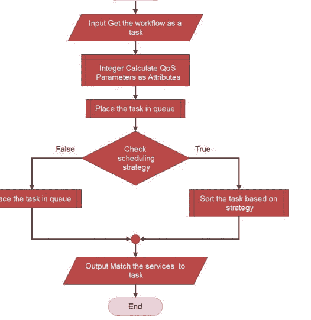

图9.2 MQMCE 调度器过程。

最后，任务被区分为三种类型，即：

- 1. 任务分配。
- 2. 任务调度。
- 3. 任务执行。

图9.2 展示了调度策略。这三项是 QoS 所必需的。预处理是任务出现之前可以执行的工作。QoS 用于说明底层质量。任务执行说明了在框架上执行任务的逐步过程。工作流程 W(i) 由 5 类元组表示。

$W(i)[T(i j), (TQ)_i, (CQI), RLQ_i, A(vK)]$ (9.1)

其中，

- $T(i j)$ 是受限任务的数量。
- $TQ(i)$ 是工作流程的时间份额。
- $(CQI)$ 是工作流程所产生的显著成本。
- $A(vK)$ 是客户必需品的总体效益可用性。
- $RLQ(i)$ 是应用的可靠性质量度量。

此外，尽管资源数量增加，总成本和总能耗通常并未减少，如图9.4所示。

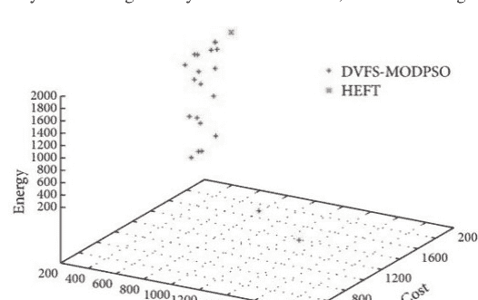

图9.4 混合工作流获得的非支配解。

从该图可以看出，随着资源数量增加到 6，QoS 测度一开始就会下降。这可以解释为：在扩展资源数量的同时，每个资源上执行的任务减少了；因此，任务可以延长其执行时间，资源也有更大的机会降低电压和频率，这可以非常有效地降低总能耗。在达到 6 个资源后，QoS 测度开始上升；其原因在于执行时间受处理器间通信主导，从而减少了降低资源电压和频率的机会。因此，可以获得使 QoS 测度最小化的最优资源数量。

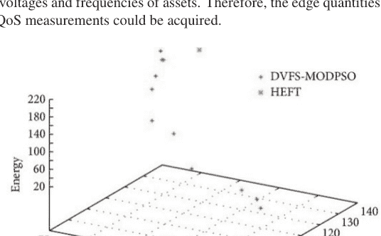

图9.5 合成工作流获得的非支配解。


- 11. Yu, J., & Buyya, R. (2006, June). 使用遗传算法在效用网格上对工作流应用程序进行预算约束调度。载于《支持大规模科学的工作流，2006。WORKS'06。研讨会论文集》（第1-10页）。IEEE。
- 12. Blythe, J., Jain, S., Deelman, E., Gil, Y., Vahi, K., Mandal, A., & Kennedy, K. (2005, May). 网格中基于工作流的应用程序的任务调度策略。载于《集群计算与网格，2005。CCGrid 2005。IEEE国际研讨会论文集》（第2卷，第759-767页）。IEEE。
- 13. Liu, K., Jin, H., Chen, J., Liu, X., Yuan, D., & Yang, Y. (2010). 云计算平台上实例密集型成本受限工作流的 swindew-c 中折中时间成本调度算法。《高性能计算应用国际期刊》，24(4)，445-456。
- 14. Salehi, M. A., Javadi, B., & Buyya, R. (2012). 联邦和虚拟化网格计算环境中的 QoS 感知和抢占感知调度。《并行与分布式计算期刊》，72(2)，231-245。
- 15. Lin, C., & Lu, S. (2011, July). 为云计算弹性调度科学工作流。载于《云计算（CLOUD），2011 IEEE国际会议论文集》（第746-747页）。IEEE。
- 16. Liu, K., Jin, H., Chen, J., Liu, X., Yuan, D., & Yang, Y. (2010). 云计算平台上实例密集型成本受限工作流的 swindew-c 中折中时间成本调度算法。《高性能计算应用国际期刊》，24(4)，445-456。
- 17. Selvarani, S., & Sadhasivam, G. S. (2010, December). 云计算中任务调度的改进成本算法。载于《计算智能与计算研究（ICCIC），2010 IEEE国际会议论文集》（第1-5页）。IEEE。
- 18. Xu, M., Cui, L., Wang, H., & Bi, Y. (2009, August). 云计算中多工作流的多 QoS 约束调度策略。载于《并行与分布式处理及其应用，2009 IEEE国际研讨会论文集》（第629-634页）。IEEE。
- 19. Mandal, A., Kennedy, K., Koelbel, C., Marin, G., Mellor-Crummey, J., Liu, B., & Johnsson, L. (2005, July). 将应用程序工作流映射到网格上的调度策略。载于《hpdc》（第125-134页）。IEEE。
- 20. Yu, J., Buyya, R., & Tham, C. K. (2005, July). 效用网格上科学工作流应用程序的成本调度。载于《e-Science and Grid Computing, 2005。第一届国际会议论文集》（第8页起）。IEEE。

### 10.1.2 互操作性问题

- 1) 中间层充当虚拟网关，用于在用户设备上无需安装（例如，VM）即可执行用户任务。
- 2) 开放标准标准化在解决互操作性问题方面具有更好的平均响应。在这种情况下，CSP 只是移除，因为工业云厂商中不存在互操作性问题。
- 3) 开放 API Sun 开始较晚，迫使 Sun 在创意云平台下开放云平台。
- 4) SaaS 和 PaaS 互操作性，而之前的 1 处理 IaaS 互操作性。

数据挖掘领域权威人士的会议提出了在云上制定数据挖掘标准的问题，特别关注 SaaS、PaaS 和 IaaS 等不同类型服务的“事实计算的便捷利用、模型的稳健创建组织以及预测分析的整合”。

## 10.2 从云采用角度看的困难

有充分记录的安全问题，例如数据事故、网络钓鱼和黑帽，是对组织数据和程序的真正风险。

- **多租户和资源池化：** 这些对分布式处理提出了新的安全挑战。
- **成本模型：** 云客户必须考虑计算、通信和集成之间的权衡。
- **计费模型：** 从云提供商的角度来看，可扩展的资源池 [5] 使成本分析比标准服务器复杂得多。
- **组织级协议：** 买家从提供商处获得有利条款的保证至关重要。

## 10.3 安全和隐私

分布式处理可以根据其高度灵活的特性按需提供无限的计算资源，从而消除了云服务提供商在硬件配置方面准备的必要性。亚马逊、谷歌、微软等各种组织加快了构建分布式处理结构和增强其服务的步伐，为更多客户提供服务。Zhang 等人研究了由多个组织提供的能源分布式处理结构的 安全和保证压力 [6]：

- 1. **可用性：** 分布式处理系统（*包括应用程序及其基础架构*）开放性的目标是确保其客户可以在任何时间、任何地点使用它们。
- 2. **保密性：** 它意味着在云系统中保密客户数据。
- 3. **数据完整性：** 在云结构中意味着确保信息可靠性（*即，未被未经授权的客户丢失或篡改*）。

巨大的电力使用，二氧化碳激增同样 [8] 进一步加剧了温室效应。从现在起，应采用多种实践来实现能源效率，例如改变使用计算、节能设备以及虚拟化数据中心中的节能资源管理系统。在所有这些最近提及的问题中，本工作仔细考虑了资源配置问题及其图论的应用。云中资产提供。术语云组织是一个总称，涵盖通过网络提供的打包 IT 资源。该表述也可用于描述协助确保、配置和推进各种基于云资源管理的服务。

### 10.3.2 我们如何定义云？

云服务概念涵盖了服务提供商通过互联网向客户提供的各种各样的资源，在这种情况下，通常被称为云。云服务的特点包括自助服务和可扩展性；也就是说，客户可以按需配置服务，并在不再需要时关闭它们。此外，客户通常按月订阅云服务，即，而不是预先支付软件许可和支持服务器和系统基础设施费用。在许多交易中，这种方法使基于云的技术成为运营成本，而不是资本成本 [9]。从管理角度来看，基于云的技术为组织提供了访问软件、存储、计算和其他 IT 基础设施组件的机会，而无需维护和升级的麻烦。

### 10.3.3 公有与私有云服务

服务提供商通过互联网向多个客户提供的云服务被称为公有云服务。SaaS、PaaS 和 IaaS 提供商都可以被视为提供公有云服务。

私有云服务则不同，大多不向个人或企业客户或订阅者开放。私有云服务使用与公有云相关的技术和方法，例如 [10]，虚拟化和自助服务。然而，私有云服务在独立的基础设施上运行，并专用于内部客户，而不是多个外部客户。

#### 10.3.3.1 云服务

云服务包括使客户能够交付不同类型云服务的专业服务。咨询公司、系统集成商和其他渠道合作伙伴可能会提供此类服务，以帮助其客户采用基于云的技术。

在这种情况下，云服务可能包括以下任何或大部分服务：云就绪评估、应用合理化、迁移、部署、定制、私有和公有云集成-混合云-以及持续管理。专注于云服务的公司已成为大型 IT 服务提供商——例如 Accenture、IBM 和 Wipro——的有吸引力的合作伙伴，这些公司寻求云咨询和解决方案方面的专业知识 [11]。


- 8. Kalagiakos, P., & Karampelas, P. (2011). 云计算学习。收录于《信息与通信技术应用（AICT）》2011年第五届国际会议论文集（第1-4页）。IEEE。
- 9. Mell, P., & Grance, T. (2011). 云计算的NIST定义。
- 10. Sun Microsystems 推出开放云平台，[Online]。Available: http://www.sun.com/aboutsun/pr/2009-03/sunflash.20090318.2.xml, 2009。
- 11. Dawoud, W., Takouna, I., & Meinel, C. (2010). 基础设施即服务安全：挑战与解决方案。收录于《信息学与系统（INFOS）》2010年第七届国际会议论文集（第1-8页）。IEEE。
- 12. Itani, W., Kayssi, A., & Chehab, A. (2009). 隐私即服务：云计算架构中的隐私感知数据存储与处理。收录于《可靠、自主和安全计算》2009年第八届IEEE国际会议（DASC'09）论文集（第711-716页）。IEEE。
- 13. Grobauer, B., Walloschek, T., & Stocker, E. (2011). 理解云计算漏洞。IEEE Security & Privacy, 9(2), 50-57。
- 14. Jansen, W. A. (2011). 云钩：云计算中的安全与隐私问题。收录于《系统科学（HICSS）》2011年第四十四届夏威夷国际会议论文集（第1-10页）。IEEE。
- 15. Rodrigues, H., Santos, J. R., Turner, Y., Soares, P., & Guedes, D. O. (2011). Gatekeeper：为多租户数据中心网络提供带宽保证。载于 WIOV。
- 16. Ballani, H., Costa, P., Karagiannis, T., & Rowstron, A. (2011). 迈向可预测的数据中心网络。载于 ACM SIGCOMM Computer Communication Review（第41卷，第4期，第242-253页）。ACM。
- 17. Xie, D., Ding, N., Hu, Y. C., & Kompella, R. (2012). 唯一不变的是变化：将时变网络预留纳入数据中心。ACM SIGCOMM Computer Communication Review, 42(4), 199-210。
- 18. Popa, L., Yalagandula, P., Banerjee, S., Mogul, J. C., Turner, Y., & Santos, J. R. (2013). ElasticSwitch：云计算中实用的工作保护型带宽保证。载于 ACM SIGCOMM Computer Communication Review（第43卷，第4期，第351-362页）。ACM。
- 19. Ballani, H., Jang, K., Karagiannis, T., Kim, C., Gunawardena, D., & O'Shea, G. (2013). 爱聊天的租户与云网络共享问题。载于 NSDI（第13卷，第171-184页）。
- 20. Guo, C., Lu, G., Wang, H. J., Yang, S., Kong, C., Sun, P., ... & Zhang, Y. (2010). Secondnet：一种具有带宽保证的数据中心网络虚拟化架构。载于第六届国际会议论文集（第15页）。ACM。
- 21. Jiang, J. W., Lan, T., Ha, S., Chen, M., & Chiang, M. (2012). 数据中心流量工程中的联合虚拟机放置与路由。载于 INFOCOM, 2012 Proceedings IEEE（第2876-2880页）。IEEE。
- 22. Divakaran, D. M., Le, T. N., & Gurusamy, M. (2014). 数据中心保证性能的在线集成资源分配器。IEEE Transactions on Parallel and Distributed Systems, 25(6), 1382-1392。
- 23. Wang, M., Meng, X., & Zhang, L. (2011). 数据中心中具有动态带宽需求的虚拟机整合。载于 INFOCOM, 2011 Proceedings IEEE（第71-75页）。IEEE。
- 24. Chen, L., & Shen, H. (2014). 云数据中心中基于空间/时间感知的互补虚拟机整合。载于 INFOCOM, 2014 Proceedings IEEE（第1033-1041页）。IEEE。
- 25. Lewis, H. R. (1983). 《计算机与不可处理性：NP完全性理论指南》。
- 26. Hoffman, K. L., & Ralphs, T. K. (2013). 整数与组合优化。载于《运筹学与管理科学百科全书》（第771-783页）。Springer US。
- 27. Hopcroft, J. E., & Karp, R. M. (1973). 二分图最大匹配的 $n^{5/2}$ 算法。SIAM Journal on Computing, 2(4), 225-231。
- 28. Kumar, P. S. 一种面向加密云的经济型分层搜索方法。DOI: http://dx.doi.org/10.15439/2017KM38 ACSIS, 第14卷，第125–129页（2017年）
- 29. Le, D. N., Kumar, R., Nguyen, G. N., & Chatterjee, J. M. (2018). 云计算与虚拟化。John Wiley & Sons。
- 30. Venkatesh, A., & Eastaff, M. S. (2018). 云计算中数据存储安全问题研究。

## 第三部分：网络安全应用与案例研究

### 第11章：组织中的网络安全：关于政策与保护的专家意见德尔菲试点研究

HOLLY REITMEIER¹, JOLANDA TROMP², JOHN BOTTOMS³
¹ 纽约州立大学奥斯威戈分校，奥斯威戈，纽约，美国
² Duy Tan University，岘港，越南
³ FirstStar Systems，美国
Emails: holly.reitmeier@oswego.edu, jolanda.tromp@duytan.edu.vn, john@firststarsystems.com

### 摘要

网络犯罪在当今社会变得日益普遍，攻击者不断发现新的入侵系统方法。监控和维护计算机网络安全是一个复杂的过程，带来了独特的挑战。如果安全措施不持续加强，网络威胁有可能影响数百万系统，而这些系统都存在相似的漏洞。

围绕网络犯罪的问题与其他类型的社会犯罪呈指数级不同。因此，联邦执法机构面临着制定新方法来打击它们的艰巨任务。本章探讨了网络犯罪和网络安全的概念，介绍了其对组织造成的统计影响，并展示了有效的网络安全政策手册的重要性。它还描述了本研究使用的方法，分析了专家证词提供的数据，并介绍了开发一种新的创新技术方法（区块链）以最大限度降低网络世界风险的情况。分析涵盖了区块链应用在多大程度上可以帮助加强网络安全并保护组织免受网络攻击，以及未来必不可少的研究方向。

**关键词**：网络犯罪, 网络安全, 网络世界, 区块链, 德尔菲

## 11.1 引言

本章重点关注网络安全政策和预防。网络犯罪在网络空间中变得越来越普遍，组织必须采取积极措施以最大限度降低敏感信息泄露的风险。为了了解网络安全专家的看法并深入了解该行业，我们收集了他们对区块链技术的专家意见，以及它在多大程度上可能成为一种可行的网络安全保护方法。数据是使用德尔菲法收集的，德尔菲法是一种系统性的互动方式，用于从一组独立专家那里获取意见/预测。通过在多样化人群中进行匿名调查收集信息提供了更准确更有意义的回应。德尔菲法在利用专家减少模糊性并分析网络安全行业面临的相关且及时的问题方面特别有用。从本质上讲，德尔菲法有可能为研究提供严谨性和相关性。分析方法将在报告的背景下进行深入解释，关于研究工具的详细描述可在[16]中找到。这项工作的潜在贡献在于它是一项试点研究，并提供了在更大规模上进行类似研究的指南。

### 11.1.1 什么是网络犯罪？

计算机和信息技术（IT）首次进入商业世界是在20世纪60年代。此后，网络犯罪稳步上升。网络安全社区和主要新闻媒体在很大程度上一致认为，“到2021年，网络犯罪造成的损失将使世界每年花费6万亿美元。这比一年前3万亿美元有所上升[12]。” 快速发展的现象物联网（IoT）从根本上改变了业务的开展方式。组织必须认识到，使用这些新数字资产及其访问设备会持续威胁关键业务信息的安全。“物联网是指具有身份和虚拟个性、在智能空间中运行、利用智能界面在社会、环境和用户环境中连接和通信的事物[15]。” 物联网正在扩大网络安全的物理安全范围，因为通过互联网连接到业务系统的智能设备可能位于既定安全边界之外。因此，这是导致企业数据变得越来越难以保护的主要因素之一。物联网设备可能被远程入侵或通过硬件更改被入侵，如果设备可以被访问，例如大型外部综合体如化工厂的情况。操作系统和应用程序漏洞使组织容易受到攻击。

当今的组织能够比以往更快地传播信息。然而，企业能够即时在内部和外部与客户、供应商和合作伙伴连接的工具和平台面临着严重的暴露风险。网络犯罪不仅严重阻碍业务功能，而且如果处理不当，还可能导致严重的声誉损害。根据福布斯洞察和IBM的一份报告，46%的公司因数据泄露而遭受声誉损害[10]。当谈到数据泄露时，风险显然很高。

因此，对于一个组织来说，采取积极的立场来防止和打击网络犯罪对其成功至关重要。


相关文献指出，组织中雇来预防和处理安全漏洞的人员少之又少 [12]。一个安全组织之所以能脱颖而出，是因为它已经开发出能够在攻击发生时立即检测到攻击的方法，并且有能力对发生的任何事件迅速做出响应。网络安全通过三个三元组来阐述，这些三元组描述了安全专业人员的目标及其方法 [2]。它们是：

- 1. 预防、检测与响应
- 2. 人员、流程与技术
- 3. 机密性、完整性与可用性

这九个术语代表了技术管理以及作为专业领域的网络安全管理的共同目标和方法。

IT 领域不断变化，黑客也在不断发现新的方法来突破防御和利用系统弱点。因此，组织需要明白，它们必须配备专门人员，以及时了解每一种新的潜在弱点。联邦政府和商业实体在打击经济犯罪方面面临着极大的困难。因此，需要制定和修订法规和标准来协助解决这一问题。一个组织要完全消除其计算机系统中的漏洞几乎是不可能的。因此，它们需要制定有效的网络安全策略手册和事件响应计划。然而，研究发现，许多组织对处理网络威胁的准备严重不足。此外，研究表明，许多首席执行官甚至并不完全了解与其组织相关且对有效 IT 治理至关重要的国际标准化组织（ISO）政策和标准 [11]。

## 11.2 令人震惊的网络犯罪统计数据

商业组织正面临比以往更多的威胁，数据显示网络犯罪仍在持续加剧。美国联邦调查局发布的《2016 年互联网犯罪报告》[8] 为组织和网络安全专业人员提供了宝贵的信息。此外，普华永道编制的《2016 年全球经济犯罪调查》[3] 强调了目前大多数商业组织所采用的事件响应计划从根本上存在缺陷。

### 11.2.1 互联网犯罪投诉中心的作用

互联网犯罪不同于任何其他类型的犯罪，带来了难以察觉和阻止的独特挑战。因此，成立了互联网犯罪投诉中心（IC3），这是一个多机构联合工作组。其成员来自联邦调查局（FBI）、国家白领犯罪中心（NW3C）和司法援助局（BJA）。IC3 在帮助预防互联网犯罪方面的作用最好被描述为一个复杂的拼图。每一部分都旨在相互配合，以有效应对网络犯罪给全球组织带来的严重风险 [8]。这个拼图的九个部分是：

- 1. 检测：欺诈的证据、欺诈的存在、欺诈的企图。
- 2. 投诉：由实际受害者或第三方提交的损失陈述。
- 3. 缓解：制止欺诈、减少损失并尝试追回损失的努力。
- 4. 联络：与各级执法机构的协作。
- 5. 分析：已评估或可供评估的数据。
- 6. 威慑：通过灌输对后果的恐惧来防止欺诈的行为或事件。
- 7. 调查：收集信息并进行访谈以获取证据。
- 8. 起诉：对犯罪者提起的法律诉讼。
- 9. 预防：阻止欺诈发生的措施。

2016 年，共收到近 30 万起投诉，涉及损失超过 13.3 亿美元 [8]。与 2015 年报告 [8] 中的数字相比，这些数字比上一年增加了约 5%。此外，IC3 的公共价值图（见图 11.1）显示，就在七年前的 2010 年，货币损失金额还低于 10 亿美元，而现在已超过这一关口。该柱状图显示了 2010 年至 2016 年的投诉总数和受害者总损失。

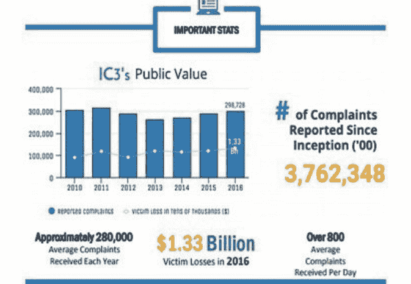

图 11.1 互联网犯罪投诉中心（IC3）2016 年总体统计数据的公共价值

IC3 报告的后续章节更具体地涉及本研究的目的，因为它们按不同的网络犯罪类型列出了数据。2016 年，共收到近 3,500 份企业数据泄露报告、近 20,000 份网络钓鱼骗局报告，以及约 2,000 起与货币兑换相关的问题报告 [8]。相比之下，2016 年的企业数据泄露报告比 2015 年多了近 1,000 份 [8]。这些数字证实了网络犯罪持续升级的结论。

- 3. 教育与策略执行：制定构成网络安全框架的策略和计划，如书面安全策略、事件响应计划和灾难恢复计划。
- 4. 持续评估与改进：对新的攻击向量进行测试、评估网络安全框架有效性以及测试方法中弱点的持续过程。

在组织中制定和执行策略非常复杂。因此，有些人和公司专门致力于销售包含策略手册模板的手册并提供咨询服务，以协助完成这一工作。在基本层面上，这些手册建议明确组织目标、界定角色和职责、建立事件响应计划，并开展持续教育以强化已有的策略和控制措施 [6]。参见 [16] 查看应用程序安全与运维网络安全策略手册目录模板示例。

组织要有效预防网络威胁并保护自身，必须充分解决各种要素。这些要素包括：

- 制定系统访问策略。
- 供应商合规策略。
- 系统管理策略。
- 电子邮件策略。
- 加密策略。
- 密码管理策略。
- 备份与恢复策略。

在当今被物联网彻底改变的商业世界中，制定有效的策略手册对于组织在网络空间的安全至关重要。组织应考虑聘请网络安全专家，就如何制定或改进其策略手册提供建议。无论策略手册是由内部编写，还是在第三方安全公司的帮助下编写，都应围绕几个目标来撰写。这些目标包括：

- 它应定义公司或企业内如何实现信息（和知识）安全，包括谁负责什么。
- 它应告知用户，他们是该安全系统的一部分，并且这涉及他们自身应承担的责任。
- 策略手册应清楚地描述对他们的期望，以及允许系统遭到破坏的后果。

同样重要的是要强调，尽管目标包括阻止信息泄露，但还要包括事件取证。这意味着，当发生安全泄露时，调查的成果之一是一套“原则性文件”，这些文件构成诉讼的基础。所有形式的个人信息和互联网通信，无论是内部的还是外部的，都具有价值。这些信息需要像组织中的其他任何资产一样受到保护 [11]。普华永道开展的调查发现，40% 的首席执行官并不担心网络安全，甚至不考虑这些领域的安全标准 [3]。就组织的网络安全而言，根本不存在“准备过度”这回事。

### 11.3.1 组织网络安全的分类

在评估和监控系统时，考虑三级安全分类是很有帮助的。安全评估分为 A、B 和 C 三个级别。这些级别按安全性定义如下：

- A：经过数学证明是安全的系统。
- B：已对照最佳实践对安全策略进行评估的系统。
- C：未经评估的系统。

鉴于已有大量关于网络犯罪严重性的信息，任何公司或组织在当今社会被归为 C 级都是不可原谅的 [5]。

### 11.3.2 网络安全金字塔

网络安全可以用金字塔来表示，该金字塔展示了 IT 安全、数据保护以及行业复杂性方面的持续问题。参见图 11.2，其中显示了 IT 和非 IT 环境。金字塔的底部是信息与通信技术（ICT）安全三定律，中间部分是测试源代码和创建可靠登录，顶部是关键数据。

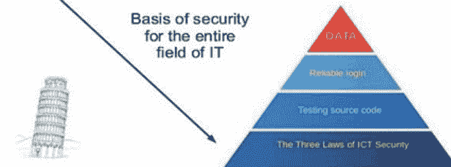

图 11.2 2017 年网络安全金字塔

网络安全三定律制定了规则，以防止病毒或黑客编辑文件。网络安全三定律如下 [13]：

- 1. 用户设备上文件的校验和必须始终与作者软件（SW）生成的同一文件的校验和相同，


德尔菲法的独特价值之一在于，它能促进参与者之间进行对话，在共同回答问题的过程中分享知识和考量。最终的结果是，在德尔菲法的大多数应用中，小组得出的结果优于大多数参与者个人得出的结果。因此，人们相信，随着知识工程系统在全球合作项目中的发展与应用，德尔菲式调查将在达成共识方面发挥重要作用。在本网络安全试点研究中，该方法被用于通过穿插反馈的调查问卷来收集和分析网络安全专家的意见。

### 11.5.2 研究设计

本研究的设计基于演绎推理。采用演绎法，即从现有命题出发形成假设，然后设计研究策略来检验该假设。研究围绕以下假设，向网络安全专家收集信息：

H1：区块链应用的使用将有助于加强网络安全，保护组织免受网络攻击。

本研究的目标人群是网络安全专家，将被定义为在网络安全或相关IT领域工作至少三年的人员。该信息属于筛选问题的一部分，详见《专家受访者充分性与资格》[16]。样本包括从事该行业、工作涉及网络安全政策倡议及开发用于保护组织免受网络威胁技术的专业人士。研究人员通过精心撰写的电子邮件，联系了从社交活动、大学人脉和领英招募的十位潜在受访者（调查邀请见[16]）。在邀请函末尾，希望获得试点研究结果分享的参与者可以选择提供电子邮件地址。在参与在线网络安全调查之前，八位受访者被确保完全匿名。

### 11.5.3 德尔菲法的选择

德尔菲法最初由兰德公司的诺曼·达尔基于20世纪50年代为美国赞助的军事项目开发。该方法要求一组专家匿名回答调查问卷，随后收到以“群体响应”的统计表示形式呈现的反馈，然后重复此过程[17]。本试点研究的目标是缩小响应范围，使结果更接近专家共识。选择该方法作为向专家和利益相关者征询意见的有效方法，基于以下原因：

- 1. 网络安全行业的复杂性需要了解不同经济、社会和政治影响层面的个人的知识。
- 2. 它不要求专家亲临现场，而这在本研究中是不切实际的。
- 3. 德尔菲法对样本量的要求不高。该方法可仅用于少至两位受访者[14]。

本研究的样本量包含八位专家受访者。在本试点研究的范围和时限内，这个样本量被认为是可观的。需要谨记的是，这是一项试点研究；其目的是测试形式，并为更大规模的研究提供可行性。

### 11.5.4 德尔菲法的实施程序

研究人员遵循的程序包括三个主要步骤：

- 1. 头脑风暴相关问题。
- 2. 向合格专家分发一系列定量和定性问题。
- 3. 通过第二轮开放式问题，聚焦响应的范围和质量。

德尔菲调查是使用谷歌表单在线调查应用程序创建的，可通过邮件分享的一次性链接直接访问。这有一个额外的好处，即数据被直接收集并以数字格式存储，从而节省了研究人员的时间和资源。此外，它减少了传统纸质收集数据方式中常见的转录错误。这种分发方式的另一个好处是，受访者可以自由使用最方便的回答平台，如笔记本电脑、iPad/平板或智能手机，从而减少了回答调查的障碍。最后，这样做还有一个优点，即加快了德尔菲法各轮次之间的周转时间。这是本研究可扩展性的一个重要成功因素，即未来可以面向更多的受访者实施该研究。

就本试点研究而言，第一轮的目的是通过多个定量和定性调查问题，基本了解受访者对组织网络安全实践的看法。在第二轮中，每位德尔菲参与者会收到另一系列开放式问题以供回答，并被要求审阅研究人员根据第一轮提供的信息总结出的关键发现。此步骤完成后，研究人员采用一般的归纳法。其目标是建立研究命题与受访者提供的发现之间的联系，并将定性数据精简为简短的摘要格式。为应对这一挑战，研究人员对定性数据进行分类和编码，以期达到理想的共识水平。值得注意的是，理论上，如果确定在时间资源允许的情况下，超出三轮的额外迭代是必要或有价值的，德尔菲过程可以持续迭代。对于本研究，考虑到时间限制，作为概念验证，三轮被认为对试点研究而言是足够的。与各轮次相关的具体信息如下所示。

### 11.5.5 本试点研究的德尔菲活动（迭代轮次）

- 1. **第一轮：初步收集。** 第一份调查问卷在专家同意作为受访者参与调查的当天分发。调查问卷包含一系列难度不同的问题，每个问题都与研究命题对应。研究人员请求许可以通过第二轮开放式后续问题收集更丰富的数据。获得批准后，进入德尔菲法的第二轮。
- 2. **第二轮：更丰富的数据收集。** 德尔菲研究的设计具有灵活性，允许本研究进行第二轮的后续问题。目标是理解重要性并根据

#### 11.6.1.4 区块链安全互联网交易

在受访者中，75%的人认为使用像区块链这样的技术比使用中介机构完成互联网交易更安全（见下文图11.6及Reitmeier, 2017）。因此，研究人员试图确定为什么区块链会或不会有助于加强组织的网络安全政策手册。

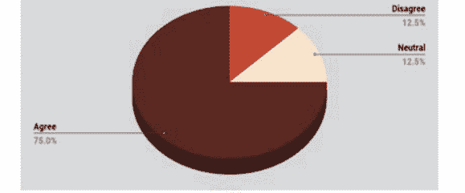

图11.6 区块链安全互联网交易。

### 11.6.2 第二轮结果

最初轮次的六位受访者同意参与第二轮的开放式问题。在第二轮中，第一轮的主要发现被总结，并向受访者展示了四个关键见解（见表11.6.2）。这些发现通过电子邮件发送给同意审阅更新后调查陈述的六位受访者。

表11.1 第一轮的主要发现及向受访者展示的4个关键见解。

| 第一轮的关键发现 |
|---|
| • 62.5%的受访者对网络安全“非常了解”，其余37.5%“有一定了解”。 |
| • 75%的受访者“强烈不同意”或“不同意”大多数组织拥有有效的网络事件响应计划。 |
| • 62.5%的受访者认为联邦政府需要改进其网络安全倡议。 |
| • 75%的受访者认为使用像区块链这样的技术比使用中介机构完成互联网交易更安全。 |

这四个首要发现被整理成开放式问题，供专家回答（详见Reitmeier, 2017），并通过电子邮件发送给专家。专家们被要求尽可能具体地回答以下问题：


## 问题 #2：应采取哪些措施来鼓励和/或强制组织制定和实施有效的网络事件响应计划？

由此问题衍生出的三个主题，并在下面列出：

- 与关键外部利益相关者（如执法部门）保持关系。
- 制定立法，建立新的网络安全评估模型。
- 需要通过合作努力来提高人们对网络犯罪严重性及其可能对组织造成影响的认识。

调查受访者 Z 被引用为说“应鼓励专业协会制定有利于所有成员的方法。这将降低成本并在整个团体中汇总风险分析。”

## 问题 #3：联邦政府应采取哪些措施来改善网络安全标准？

专家针对第三个问题提出的回应中形成了三个主题。

- 需要建立并强制执行新的通信协议，例如通信设备的加密。
- SIPRnet 方法需要在美国内部进行修改和改编。
- 当前的商业功能和未来系统（如 VR）需要由政府当局进行修改。

两位专家大量总结了该问题的范围。回应提到国土安全部必须更加参与，并应被鼓励与行业合作制定企业安全的稳健方法。

## 问题 #4：请说明您认为或不认为使用区块链应用有助于加强组织网络安全政策的理由。

最终问题形成了五个主要主题。

- 区块链技术确实具有许多重要优势。包括效率、透明度、可靠性以及对入侵尝试的快速检测。
- 需要更多研究和测试。
- 现有的互联网商业机制需要进行重大修改或替换才能利用区块链功能。
- 目前，加密货币没有标准。
- 世界各国政府正在制定该应用的监管政策。

### 11.6.3 基于结果的讨论与局限性

反思这些主题，很明显需要采取措施来解决当今商业世界中许多组织在网络安全政策手册方面准备严重不足的事实。网络安全政策在争取市场份额和相对于竞争对手组织的竞争优势的冲刺中被边缘化了。如上所述，需要通过合作努力来提高人们对网络犯罪严重性及其可能对组织造成影响的认识。

本试点研究最常见的发现是，大多数组织都没有有效的网络安全政策手册可供参考。此外，拥有手册的组织也没有得到妥善执行。组织每天监控其网络安全系统至关重要，不仅可以减少漏洞，还可以最大限度地降低被黑客攻击的威胁。持续的网络安全培训对组织的成功至关重要。它使所有员工都能了解现行政策以及如果发生事件时的角色和责任。

组织倾向于提出不完全考虑网络犯罪问题的复杂性的解决方案。然而，正在出现具有广阔潜在未来的技术，并且不需要组织在内部构建自己的系统，例如区块链。区块链应用提供了促进敏感信息传输过程的有趣工具。区块链设计在密码学上是安全的，没有许可访问极难更改，并且只有在链中所有各方达成共识后才能更新。那些意识到需要认真对待其网络安全政策的组织对该技术产生了兴趣，并正在投资其研发和测试。区块链可能具有从根本上彻底改变和增强商业世界的能力，因为每 10 分钟，所有进行的交易都会得到验证、清算并存储在一个区块中。

本试点研究中出现了一些意外的议题。虽然本试点研究达到了其目标，但存在一些不可避免的局限性和不足之处。首先，研究是在一个月的时间内进行的。四周时间不足以公正地并充分理解网络安全专家对组织网络安全政策的看法、意见、信念和态度。如果该方法在更长的时间范围内应用，结果将更具结论性。

其次，受访者群体的样本量很小。只有八名受访者可能无法代表网络安全行业的大多数专家。此外，第一轮初步调查旨在对组织中的网络安全政策和保护机制有一个基本的了解。然而，它似乎没有提供足够的证据来证明网络犯罪对组织造成的影响。此外，八名受访者中有两人第一轮后退出。这阻碍了德尔菲法过程，并减少了第二轮收集更丰富数据的样本量。德尔菲法的意图是对专家关于网络安全的陈述进行适当分析。因此，如果能够进行多次迭代，结果将更可靠。尽管存在这些局限性，试点研究提出了关于网络安全政策和区块链技术未来的关键见解。对此类更大规模研究的建议是为愿意并能够参与每一轮迭代的受访者提供激励。这样做可能会吸引更多专家的注意，并增加受访者不退出的可能性。

最终，出现了新的技术，可提供加强组织网络安全政策的能力。本研究中的专家一致认为，目前太多组织没有有效或经过验证的网络安全政策手册。数据是世界各地组织的关键依赖，保护其完整性必须是最高优先事项。等待政府采取行动没有任何优势；加强其网络安全政策是组织的责任。区块链带来了源源不断的实际好处。

- 6. 《网络安全政策手册》，Accellis。（2016）。俄亥俄州 Valley View：Accellis Technology Group, Inc。文件检索自（2017 年 7 月 19 日），网址：https://accellis.com/wp-content/uploads/Cybersecurity-Policy-Handbook.pdf
- 7. Effiong, N.（2013）。《网络犯罪控制、预防与调查》（Ph.D.）。克兰菲尔德大学，管理与技术学院。文件检索自（2017 年 7 月 14 日）网址：http://www.academia.edu/4259163/Cyber_Crime_Research_Proposal
- 8. 联邦调查局互联网犯罪投诉中心。（2015，2016）。《互联网犯罪报告》。FBI IC3。文件检索自（2017 年 5 月 24 日），网址：https://pdf.ic3.gov/2015.IC3Report.pdf
- 9. Hess, E. D.（2017）。《在数字时代生存：4 项企业转型》。Darden Ideas to Action。
- 10. 数据泄露如何影响您企业的声誉？（2016）。[Blog] 国家网络安全研究所（NCI）网络专家博客。
- 11. Moeller, R. R.（2013）。《IT 治理执行指南：利用服务管理、COBIT 和 ITIL 改进系统流程》。John Wiley & Sons。
- 12. Morgan, S.（2017）。2017 年网络安全前 5 大事实、数据和统计。
- 13. Napravnik, J.（2016）。网络安全的三定律和 SOFTWARE Control Server - 网络安全卓越奖。
- 14. Okoli, C., & Pawlowski, S.（2004）。德尔菲法作为研究工具：一个示例、设计考虑和应用。《信息与管理》，42(1)，15-29。
- 15. Saadeh, M., Sleiti, A., Qatawneh, M., & Almobaideen, W.（2016 年 8 月）。物联网的身份验证技术：综述。收录于《网络安全与网络取证会议（CCC），2016》（第 28-34 页）。IEEE。
- 16. Reitmeier, H.（2017）。《组织的网络安全：专家对政策与保护的看法的德尔菲试点研究》，HCI 项目报告，美国纽约州立大学，纽约，美国。
- 17. Skulmoski, G. J., Hartman, F. T., & Krahn, J.（2007）。《研究生研究的德尔菲法》。《信息技术教育杂志》，6，2-12。文件检索自：http://www.fepto.com/wp-content/uploads/Delphi-method-for-Graduate-research.pdf
- 18. Wilson Jr., J. D.（2017）。《通过金融技术创造战略价值》。John Wiley & Sons。


## 12.1 引言

如今，移动电话通过融合多种技术，几乎取代了个人电脑和笔记本电脑，以满足当代人基本的计算和通信需求。移动设备不断增长的处理能力和更大的存储内存，其潜力可与台式电脑媲美，可以被视为信息技术领域的一场真正革命。这种复杂性和便携性的革命性增长使移动设备成为我们个性的延伸。这些延伸存储并管理我们的联系人、短信和电子邮件，追踪我们的当前位置，记住我们的偏好和预约，甚至无处不在地跟随我们。

由于其便携性和应用的多样性，智能手机和平板电脑正迅速成为互联网浏览、在线交易、拍卖和购买等的首选工具。每个移动应用程序的界面访问的便捷性使得技能和底层技术对于这些设备的使用几乎成为毫无意义的限制。与每一个对普通大众生活产生巨大影响、后来又被滥用的技术一样，移动技术也处于同样的光谱中。随着手机的演进为公民社会的成长构建了繁荣的道路，它也为网络罪犯利用移动设备作为攻击和剥削的渠道或媒介提供了可能性。

## 12.2 移动安全威胁的分类

可以攻击或利用移动计算设备的各种安全威胁可以归类为以下类别，这些类别将在本节中进一步讨论。

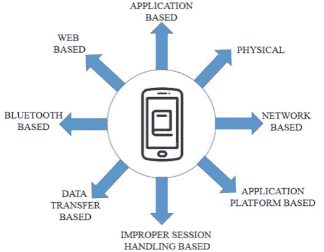

**图 12.1** 移动安全威胁的分类。

### 12.2.1 物理威胁

由于其便携的尺寸和高计算潜力，移动设备已成为人们计算和通信需求的常见工具。由于这些特性，这些设备具有价值，需要对其物理安全采取预防措施。除了可以转售到设备黑市的昂贵硬件外，与用户或组织相关的信息也可能高度敏感，价值远超硬件本身。由于这些因素，被盗和丢失的移动设备是最令人恐惧的安全威胁之一。就物理安全威胁而言，没有密码、屏幕锁或指纹扫描等身份验证检查机制的智能手机、平板电脑、PDA 等移动设备面临高风险 [1, 2]。此类未受保护的设备始终容易丢失，并危及存储的敏感信息。在最坏的丢失或被盗情况下，黑客或网络罪犯会找到一种或另一种机制来绕过任何形式的身份验证检查，并访问设备上存储的用户敏感信息。

### 12.2.2 基于网络的威胁

现代移动设备设计为持续连接到 WiFi 网络或分组数据互联网以访问网络服务。这些网络带来了对移动设备安全的主要威胁。要在移动设备上执行基于网络的威胁，其用户必须被提示访问不安全网站并天真地触发恶意进程。基于网络的威胁可分为以下几类。

电子邮件、短信、Facebook、WhatsApp 和 Twitter 等应用程序通常被用来传播旨在诈骗接收用户的恶意网站链接。此类诈骗被称为网络钓鱼诈骗 [2]。访问此类网站后，用户会被诱骗输入其敏感信息，如密码或账号号码，这些信息会被罪犯捕获以供日后利用。与恶意链接相关的下一级可能威胁是驱动下载，它会在用户访问此类链接时自动在用户的移动设备上下载恶意应用程序。其中一些恶意应用程序会提示用户点击或打开下载以执行，而其他应用程序甚至可以启动自动执行。另一类威胁被称为浏览器漏洞利用，它利用移动设备上安装的网络浏览器或与其连接的应用程序（如 PDF 文件阅读器、Flash 播放器、Shockwave 文件播放器甚至图像查看器）中存在的漏洞，以破坏设备的正常功能。

### 12.2.3 基于应用程序的威胁

恶意移动应用程序通常与外观和行为可接受的网站相连。如基于网络的威胁中所讨论的，此类恶意应用程序对移动设备构成广泛的安全威胁。在此序列的延续中，即使是合法的软件应用程序也可能被利用于欺骗目的。

基于应用程序的威胁可归入以下一个或多个类别。基于应用程序威胁的第一类是恶意软件。恶意软件是专门编写的代码，用于在目标设备上执行恶意操作 [3]。现代恶意软件应用程序能够向用户的电话账单添加费用，向联系人发送不需要的消息，访问用户的私人数据，甚至在用户不知情的情况下将移动设备的控制权交给远程黑客。

对移动设备构成威胁的下一类应用程序是间谍软件。间谍软件是一种与恶意软件类似的恶意应用程序，只是它不会对移动设备的正常功能造成任何可见的损害。相反，间谍软件会在用户不知情或未同意的情况下静默收集用户的私人数据。短信、通话历史记录、地理位置、浏览器历史记录、联系人列表、私人照片、联系人列表和电子邮件是间谍软件应用程序通常针对的一些用户数据。间谍软件收集的此类数据被用于金融诈骗、勒索甚至间谍活动，给移动设备用户带来严重的隐私威胁风险。另一种基于应用程序的威胁是由包含可被恶意利用的缺陷的易受攻击应用程序引起的 [28]。此类应用程序通常是由于设计不当或测试不足而存在弱点的合法应用程序。易受攻击的应用程序允许出于犯罪意图访问敏感用户数据，执行欺诈活动，破坏服务的正常功能，甚至允许在用户设备上下载其他类似的恶意应用程序。

### 12.2.4 基于网络的威胁

现代移动设备设计为确保连接到本地无线网络（WiFi、Bluetooth）以及蜂窝分组数据网络以访问基于网络的服务。此类网络的威胁被归类为基于网络的威胁。网络漏洞利用利用移动操作系统中存在的缺陷，甚至无线或蜂窝网络运行的平台软件中的缺陷。连接到用户的移动设备后，这些威胁可以为应用程序或基于网络的威胁提供渠道 [4]。

WiFi 嗅探是一种常见的网络威胁类别，它捕获设备与网络接入点之间通过网络传输的用户数据。通过缺乏任何安全措施的网站或应用程序发送未加密的数据（如用户名、密码或财务详细信息）会使用户数据的隐私和安全面临潜在风险。

对移动设备的下一类网络威胁被称为 WiFi 欺骗，它由黑客通过使用恶意 WiFi 路由器创建虚假的 WiFi 接入点以进行网络访问来执行。这些 WiFi 点看起来像是公共场所的免费公共 WiFi 网络，例如酒店、图书馆、机场、火车站甚至咖啡店或酒店，其名称足够熟悉，如“Coffeehouse Freenet”或“Airport Free WiFi”，以吸引用户连接。在最坏的情况下，此类恶意服务会提示用户创建用户名和密码的用户账户以访问免费服务。大量天真或无知的用户在创建此类接入点账户时使用相同的电子邮件或用户名和密码组合，即他们用于许多其他服务的组合。这使黑客能够捕获受害者的敏感用户信息并将其用于恶意目的。因此，在任何公共场所连接任何新的 WiFi 接入点时必须格外谨慎。此外，用户绝不能使用个人详细信息和常规账户详细信息在此类服务上创建账户。相反，他们应始终使用唯一的用户名和密码组合在任何新服务上创建登录名。与具有最少或无安全功能的随机或匿名 WiFi 接入点相比，应优先选择由商业团体控制的付费无线网络，其访问方式更为安全和受控。在网络安全术语中，受害用户路由器与移动设备之间的网络流量分析被称为会话劫持。

在移动设备的情况下，一种被称为侧信道劫持的网络攻击被用来从易受攻击的数据流量中捕获数据。为此，黑客使用各种工具通过侧信道劫持攻击来自动化会话劫持 [24]。此类工具的类似工具已由 Mozilla 开发，作为 Firefox 网络浏览器的插件，被称为“Firesheep。” Firesheep

[31] 自动化了易受攻击的WiFi网络与受害者移动设备之间的会话侧劫持，利用数据包嗅探器捕获并利用数据流量。通过禁用自动搜索和使用安全的无线网络，可以最大限度地降低无线网络和移动热点被入侵的风险。

### 12.2.5 基于数据传输的威胁
应用程序开发人员使用弱加密算法或不当实施强加密技术可能导致加密被破解的威胁。在第一种情况下，许多时候开发人员为了加快开发过程，会使用具有已知漏洞的脆弱加密算法 [3, 5]。这种脆弱性会吸引攻击者破解应用程序并窃取敏感的用户数据。在后一种情况下，开发人员在使用强加密技术时会留下后门或缺陷，这也可能对用户数据的隐私或安全造成同样的影响。例如，许多消息应用程序仅在发送端和接收端对用户数据进行加密。这为中间网络中的攻击者留下了足够的空间来捕获数据并利用其实现恶意目的，而无需获取用户详细信息和密码。通过网络实施令人满意的加密实践，是应对基于数据传输的威胁的唯一办法。

### 12.2.6 基于不当会话管理的威胁
许多应用程序利用运行时生成的访问令牌来为连接的设备提供网络访问。这些访问令牌还促进了网络与设备之间的连接，而无需在预定义的时间限制内重复重新认证。具有足够安全功能的应用程序会为每个会话生成新的且机密的访问令牌以启用网络访问。应用程序对诸如访问令牌之类的会话变量的不当处理，可能会天真地将它们泄露给恶意行为者，从而使整个通信面临非法利用的风险。

### 12.2.7 基于蓝牙的威胁
蓝牙技术允许移动设备在设备之间无线交换数据，并连接鼠标和键盘等外围设备。但是，处于激活状态且设置为可被其他设备发现的蓝牙移动设备，会面临如下所述的蓝窃取、蓝劫持和蓝虫攻击 [5] 等攻击。通过蓝牙，使用恶意软件应用程序可以窃取私密和敏感的用户数据，例如通话记录、浏览历史、GPS详细信息、联系人、电子邮件通信和短信。这种通过蓝牙窃取用户数据的行为被称为蓝窃取攻击。黑客通过智能手机或笔记本电脑扫描附近启用蓝牙的设备来执行蓝窃取攻击。用于蓝窃取的应用程序可以在静默且无法检测的模式下窃取受害者移动设备中的数据。蓝窃取攻击最糟糕的一面是，关闭设备上的蓝牙并不能保证安全。这是因为，启用但隐藏了蓝牙的移动设备也可以通过暴力破解攻击猜测其MAC地址而被发现和利用 [25]。

蓝窃取攻击会导致设备中的用户数据被盗，而蓝虫攻击则会在未经受害者同意和知晓的情况下，向其他支持蓝牙的设备静默广播匿名和不需要的消息。蓝劫持攻击则通过后门绕过受害者的移动设备访问，导致其设备控制权被静默破坏。蓝劫持攻击能够在地址簿中创建新条目、键入和发送新文本消息，甚至通过蓝牙传输文件。

### 12.2.8 基于应用平台的威胁
尽管经过了彻底的扫描，即使提交到苹果iTunes和Android Play Store等可信在线下载平台的每一个移动应用，也不能保证在所有方面都是真实和安全的。一些可疑应用可能导致对用户凭证的未授权访问、互联网数据的窃取，甚至从用户账户中静默地进行未经批准的购买。2010年，一名越南应用开发者被苹果公司列入iTunes商店的黑名单。该处罚的原因是，他显然通过他的应用向用户收取了他们从未购买过的书籍费用。该开发者实施这一欺诈只是为了提升他在iTunes商店中的评分和排名。为了防止此类利用，用户应尽量只安装和使用来自可信供应商和开发者的移动应用 [26]。在需要安装来自新开发者的应用的情况下，必须对应用的详细信息进行彻底研究，如开发者名称、所属单位、用户评分以及应用所需的权限。

此类可疑应用的一个主要类别是免费移动应用，如游戏或实用工具应用，它们更有可能利用设备功能并危及用户数据。它们通常能够访问互联网、跟踪用户位置，甚至访问敏感数据。例如，作为免费应用提供的94%的赌博类手机游戏要求用户允许其发送短信、使用手机摄像头，甚至拨打外拨电话 [26]。用户必须保持警惕，并核实此类要求访问这些功能的免费游戏应用的意图。

但是，与上述正规应用平台并存的，还有一些为用户提供替代应用的第三方应用商店。在设备上下载和安装来自这些未授权平台的应用程序，对最终用户来说可能非常危险。此类应用商店始终面临着网络犯罪分子运营的高风险，它们托管合法应用的伪造副本，这些副本被篡改以执行欺诈活动。

## 12.3 智能手机作为犯罪工具
移动计算基础设施的漏洞存在于设备硬件、应用设计、编码标准、无线连接甚至数据传输协议中。这些漏洞总是以网络安全威胁为代价，危及移动计算的优势。网络犯罪分子对移动领域的日益关注是每个人都应严肃对待的问题。移动设备的高价格、便携性和巨大的计算潜力使其成为犯罪利用的焦点 [6]。但最重要的是，普通大众对移动设备处理一切所需之事的广泛依赖，使这些设备成为网络犯罪分子有利可图的目标。在这种情况下，联系人、电子邮件、银行详细信息和密码等用户数据岌岌可危。

## 12.4 移动电话相关犯罪的类型
与移动电话犯罪使用相关的活动可被视为移动犯罪。此类活动利用移动设备的一种或多种潜在用途来实施犯罪。下面我们讨论各种类型的移动犯罪。

**物理盗窃：** 移动设备易于携带的特点使其极易遭受物理盗窃。由于硬件昂贵，犯罪分子能够在黑市上为被盗移动设备索要诱人的价格。但对于遭受移动设备盗窃或物理丢失的用户而言，损失还扩大到存储在设备上的敏感和私密用户信息的丢失 [7]。现代移动设备配备了基于字符或序列的密码、生物识别访问限制 [19]、用户数据加密和数据擦除机制，以最大限度地减少信息损失。此外，定期自动将用户数据备份到云端几乎可以消除因移动设备物理被盗而导致的数据丢失损失。

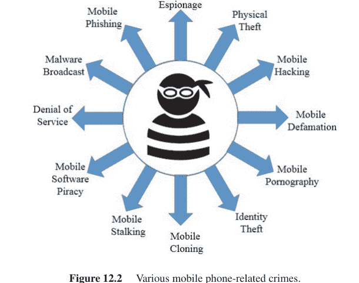

图12.2 各种移动电话相关犯罪。

**移动黑客攻击：** 未经所有者同意，对计算设备和/或网络的任何非法入侵都可称为黑客攻击，或更具体地说是破解。该定义也涵盖了破坏移动设备、通信系统和/或网络安全的行为 [8]。为了实现移动黑客攻击，黑客会利用故意编写的脚本或恶意应用程序来攻击移动设备及与其相连的系统。

**移动网络诽谤：** 传输或广播故意编写的贬低、侮辱和淫秽信息，侵犯个人或组织的名誉和/或生存，导致其遭受身体和/或经济损失，这被称为诽谤 [8]。利用移动应用程序，如短信、电子邮件或电话，实施诽谤行为可归类为移动诽谤。


## 移动恶意软件的传播
在针对台式机和笔记本电脑的恶意软件应用时代之后，随着移动设备架构的不断改进，新的恶意软件威胁也在不断演变。恶意软件，包括特洛伊木马、蠕虫、病毒、勒索软件和间谍软件，能够严重破坏移动设备的正常功能。此外，感染恶意软件的移动设备也极有可能感染其网络中的其他连接设备 [3, 28]。

## 移动网络钓鱼
在一定程度上，使用更新的杀毒软件产品可以抵御恶意软件传播的风险。但另一类基于社会工程的攻击——网络钓鱼攻击，会诱骗移动设备用户成为恶意攻击的受害者。网络钓鱼攻击可以诱骗受害的移动用户天真地交出他们的用户详细信息、登录凭据、财务信息、浏览历史记录，或在移动设备上下载恶意软件 [29]。为了实施这些攻击，网络犯罪分子会向受害者的移动设备发送一个看起来足够无害且合理的网站链接。该链接可以嵌入到网页、短信或特定应用的讯息中，例如 WhatsApp 等。这类链接通常采用正式且精心设计的语言，甚至会让经验丰富的用户相信其内容并点击。点击链接后，专门为目标设备精心设计的恶意应用程序或进程会在移动设备后台触发执行。执行后，此类攻击能够窃取敏感数据，甚至破坏设备的正常功能。通过手机进行的网络钓鱼攻击可以进一步细分为以下类别 [7, 8]：

### 语音钓鱼
通过电话交谈欺骗或诱骗移动用户，使其在不知情的情况下交出敏感信息，从而被用于身份盗窃的行为，称为语音钓鱼 [12]。通常，在语音钓鱼攻击中，攻击者会冒充合法商业集团的工作人员或官员，通过威胁中断服务、官方处罚或承诺可观利润来诱骗用户。

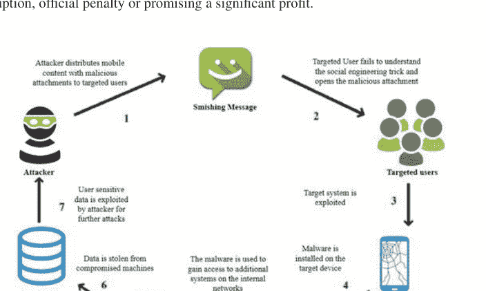

**图 12.3** 短信钓鱼攻击的示意图。

当攻击者通过短信而非电话来接触潜在受害者时，这就构成了下一类移动网络钓鱼攻击，称为短信钓鱼。短信钓鱼攻击会诱使用户在不知情的情况下点击一条欺骗性文本链接，从而在移动设备上下载并安装恶意软件。通常，短信钓鱼信息不是来自明确的发送者电话号码，而是来自类似“3949”的号码。此类信息通常不是通过真实的智能手机号码发送，而是通过电子邮件地址发送，以隐藏攻击者的身份。此类信息通常包含链接到自动语音应答系统的 URL 或电话号码。这些系统会询问用户敏感的、需要立即处理的用户数据。短信钓鱼的目的不是立即中断服务，而是通过下载恶意软件来跟踪用户或窃取敏感用户信息 [12, 13]。

一种混合形式的网络钓鱼攻击是彩票诈骗或预付费欺诈，通过电子邮件或短信发送给目标用户。此类攻击信息的内容会显示诸如“您的信贷正在等待”、“领取您的澳大利亚之旅”或“您已中奖”等诱人的语句。彩票诈骗攻击诱使受害者相信他们赢得了巨额资金，而只有在交出敏感信息或支付一大笔钱后才能获得这些资金。

由于网络钓鱼攻击的性质使其难以识别，预防它们的最佳策略是扫描每个数字内容的地址和名称，仔细阅读每条短信和电子邮件以确保其来源，检查语法错误，并完全避免打开与消息相关的任何附件 [14]。

## 移动间谍活动
间谍活动是指在未经所有者同意和知情的情况下，对个人或团体进行秘密监视或监控，以获取机密数据。而通过移动设备进行的间谍活动可以被视为同一行为的移动版和更复杂的版本。现代移动设备配备了强大的计算能力、巨大的内存存储、移动跟踪 GPS、高分辨率摄像头以及麦克风等配件，以增强用户体验。凭借这些能力，移动设备成为黑客和网络犯罪分子实施间谍活动的诱人工具。除了这些功能之外，用户实时共享的敏感数据也使得政府和组织对其数据安全的担忧日益加剧。诸如 Mobistealth [11] 之类的监控应用的出现，利用了移动设备的上述能力，引发了人们对攻击者可能利用这些功能进行网络间谍活动的担忧。对于竞争对手而言，关于战略计划、创新、财务信息、法律讨论以及更多高度理想的商业信息的无过滤讨论，都可以通过间谍活动获取。对于国家而言，间谍活动是静默监视本国公民活动和外国对手以确保安全和保障的潜在工具。收集对话数据、口头命令和请求，并将其与位置数据配对，可以提供广告商所期望的强大用户画像信息。在这类信息收集中，可能还会涉及敏感的公司或客户信息。对于黑客和网络犯罪分子等恶意行为者，出于经济、政治、社会或个人等各种动机，智能手机是一个潜在的攻击载体。

## 12.5 移动欺诈的类型
利用移动设备进行的欺诈包括各种骗术和诡计，旨在促使潜在目标屈从于黑客或犯罪分子的恶意意图。这里的恶意意图可能包括诱使受害者购买劣质、定价过高或根本不存在的产品或服务，拨打或发送短信至此类产品的链接，在不知情的情况下订阅这些服务的昂贵订阅，甚至在最坏情况下，向犯罪分子交出敏感数据（如财务信息等）。对于具有相当桌面计算和电子邮件使用经验的用户来说，从尴尬的语言、拼写错误的单词或拙劣的图形中识别恶意电子邮件并非难事。在大多数情况下，用户甚至不会打开这些垃圾邮件就直接删除。但移动欺诈的情况并非如此 [8, 9]。原因之一是，迄今为止，移动欺诈与垃圾电子邮件相比并不那么普遍。此外，短信的投递率和打开率远高于电子邮件。除此之外，一个单一且全面的短信垃圾邮件过滤机制还远未形成。在本节中，我们将讨论各种移动欺诈。

### 未接来电诈骗
通常，每个手机用户都会收到未接来电。但在未接来电诈骗的情况下，一个未接来电可能来自一个未知号码，通常来自国外，持续时间很短。由于目标受害者无法识别来电号码，他们往往会直接回拨。来自受害者设备的这次回拨可能会被重定向到高价收费服务，导致他们产生意外的话费支出，甚至更多。

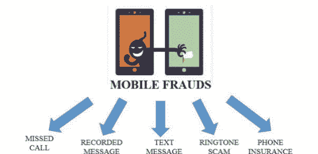

图 12.4 移动欺诈的类型。

### 录音消息诈骗
在这种形式的移动欺诈中，用户在接听电话时会被一段录音消息提示回拨另一个号码，告知他中奖了，必须拨打下一个号码才能领取奖品。但提供的下一个号码可能是高价收费服务号码，如未接来电诈骗一节所讨论的那样，导致用户产生高额通话费用。此外，上述奖品也可能是另一种欺诈性的铃声或彩铃订阅服务，给受害者造成进一步损失。

### 短信诈骗
用户会收到来自未知发送者的 SMS 短信，内容非常友好，例如“嘿，我是迈克。我回到新泽西了！我们什么时候能见面聚聚？”用户会误以为这是发错的信息，天真地回拨该号码，只是为了确认这是个错误的号码。但在短信诈骗的情况下，受害者同样会被收取高额通话费，或经历类似上述移动欺诈格式的高费率长篇短信往来。

### 铃声诈骗
铃声诈骗会通过提供下载或订阅非常便宜甚至免费的铃声来诱使目标移动用户。一旦用户接受此类优惠，受害用户会错误地订阅另一种昂贵的欺诈服务，该服务会不断发送更多铃声并持续收取高额费用。此类欺诈者与正规铃声销售公司之间的基本区别在于，与正版铃声不同，前者……


并获取受害者账户的访问权限，可能导致信用卡被未经授权的扣款或银行账户被掏空。

5. **恐怖分子对智能手机的使用**：与罪犯类似，恐怖分子也制定了复杂的机制，以欺诈的方式在毫不知情的受害者名下获取随机的手机号码和设备。以极低的价格，号码和设备可供恐怖分子用于其恶意目的的利用。下面将介绍一些此类问题。

6. **一次性手机**：一次性手机是一种价格低廉且大多是翻新的移动电话 [18]，设计用于临时使用，使用后即可丢弃。一次性手机大多使用预付费分钟购买且无合约。用现金而非信用卡购买手机并充值余额，且与服务提供商无合约，显然意味着与电话号码关联的用户记录无法被追踪。如果用户怀疑号码已被追踪或泄露，他们只需丢弃手机并购买一部新手机，即可获得一个全新的号码。今天，大量平民使用智能手机，智能手机号码越来越多地被用作唯一的用户资料标识符，将用户数据在多个数据库之间连接起来。此外，电话号码不像信用卡详细信息和社会安全号码那样受隐私要求约束，因此经常被共享。因此，移动号码隐私正成为一个日益增长的安全问题。提高移动安全的一种简便方法是使用一次性手机移动应用或服务，而不是使用实际设备，这提供了一个临时电话号码，可代替用户的实际手机号码使用。其中一个这样的应用是 Burner 移动应用 [19] 服务，其号码通常在一定时间后过期。这些号码可以通过应用内购买付费使用。如果它们过期，就会被“烧毁”。高级订阅为用户提供一个永久的第二号码。当用户通过 Burner 拨打电话时，实际上是先拨打 Burner，后者再转接中继呼叫到你想要联系的号码。巴黎恐怖袭击的细节 [20] 显示，与加密相比，持续使用预付费一次性手机帮助恐怖分子躲避情报机构的雷达。巴黎的三支恐怖分子队伍只使用新手机，这些手机在袭击前几分钟激活，袭击后即被丢弃。后来，调查人员在剧院附近的垃圾桶里发现了一部三星手机。该手机有一张比利时 SIM 卡，仅在袭击前一天使用。该手机仅用于拨打比利时另一个未识别号码。随着警方拼凑袭击者的行动轨迹，他们又发现了更多的一次性手机。

7. **智能手机炸弹**：通常，炸弹制造过程中使用两部智能手机；一部呼叫另一部，后者然后向电路板传输信号并触发爆炸 [21]。智能手机基本上是小型且复杂的无线电设备，将无线电信号转换为等效的电脉冲并将该电流转换为声音。如果智能手机作为触发装置集成到炸弹中，智能手机产生的电脉冲足以产生起爆药以触发炸弹的主要爆炸化合物。由于在线信息和备件的可用性，将手机制作成远程引爆的炸弹触发器非常容易且便宜。引爆此类炸弹也只需拨打连接到起爆器的手机中的 SIM 的手机号码即可。28 岁的恐怖分子 Ahmad Khan Rahami，新泽西和纽约双重爆炸案的嫌疑人，承认使用智能手机 [22] 引爆其自制爆炸装置。Nokia 105 智能手机是 ISIS 战斗人员中的首选设备 [23]。价格便宜、耐用且电池寿命长的 Nokia 105 手机是 ISIS 组织用于引爆炸弹的最受欢迎的远程炸弹触发装置。ISIS 已在战场上大规模组装和部署简易爆炸装置，造成大量平民和军事人员伤亡。”

### 12.6.2 通过应用程序的数据窃取

与恶意移动应用程序并行，最近一些真正的应用程序也被发现持续窃取与用户通信和偏好相关的数据。此类信息是从通话的数据音频编解码器、用户通话时长、用户活动的 时间戳、经常访问的联系人等收集的。由 University of New Haven 的研究人员揭露的一个类似案例是名为“WhatsApp”的真正聊天应用程序的数据窃取 [27, 30]。

实时被窃取的信息被注意到已转移到 WhatsApp¹ 的官方服务器。研究人员创建了一些实验参与用户来开展实验并测试该应用程序数据窃取的假设。之后，用户通过 Opus 编解码器在 8 和 16 KHz 频率下创建的通信通道在 WhatsApp 上拨打电话进行身份验证。后来，在分析通话的目的地 IP 地址和中继服务器后，实验显示该应用程序正在窃取敏感用户数据，如通话的音频编解码器、电话号码和通话时间戳。对应用程序的中继服务器与 Android 版本的应用程序之间的消息交换机制的分析还揭示了通过 FunXMPP² 互联网协议收集 WhatsApp 的数据积累模式。在对 WhatsApp 的这次实验案例研究之后，可以得出结论，即使是通过最受信任和看起来最安全的移动应用程序，也可能发生用户信息泄露、窃取或静默监控。

### 12.6.3 SIM 卡欺诈

导致罪犯访问受害者财务细节的最复杂和不寻常的移动欺诈技术之一是 SIM 卡欺诈。社会工程学和详尽的调查相结合为攻击者顺利开展此次攻击铺平了道路。

首先，潜在目标松散处理、被盗或遗失的银行对账单为攻击者提供了访问银行细节的途径。在找到潜在目标后，攻击者会进行详尽的社会工程和调查，从其社交媒体账户资料中收集和汇编有关目标的足够个人信息，包括其联系号码和服务提供商的详细信息。此次调查使攻击者能够回答移动服务提供商将向目标用户提出的基本安全问题。

现在攻击者会联系目标，诱使其暂时关闭手机，要么是通过反复拨打空白电话，要么是假装来自移动服务提供商的升级电话。在目标用户手机关闭期间，攻击者会致电目标的服务提供商，假装是目标用户并声称其手机损坏或丢失。在这种情况下，服务提供商公司会提出基本安全问题，攻击者成功回答，确认了目标的身份。这导致服务提供商取消现有的 SIM 并激活攻击者拥有的新 SIM。

现在，攻击者会带着新的 SIM 卡联系目标用户的银行，并声称忘记了访问密码。在提出与移动服务提供商类似的基本安全问题后，银行也会向目标用户的电话号码发送一次性访问代码或一次性密码 [OTP]，该密码实际上由攻击者接收。

现在，攻击者在目标用户的银行以自己的名义开设一个虚假的平行账户，并最终在未经用户同意和知情的情况下将用户的资金转入这个新的虚假账户。这种欺诈最糟糕的部分是，移动用户受害者完全不知道此次攻击，直到其手机停止运行或无法访问其银行账户的财务细节。届时，攻击者会将所有资金从受害者的虚假账户中转走以完成此次攻击。

## 12.7 预防措施和注意事项

### 12.7.1 针对移动设备的物理丢失和被盗

由于被盗或遗失而导致的设备物理丢失是一种严重的安全威胁，因为除了设备成本的财务损失外，用户还完全失去了对其数据的物理控制。考虑到人性化和意外可能性，这种物理损失无法保证停止，但如果用户采取以下措施，其影响可以得到充分降低：

- 1. 检查移动服务提供商提供的<|message|>
- 1. 检查移动服务提供商提供的[content]
并获取受害者账户的访问权限，可能导致信用卡被未经授权的扣款或银行账户被掏空。

5. **恐怖分子对智能手机的使用**：与罪犯类似，恐怖分子也制定了复杂的机制，以欺诈的方式在毫不知情的受害者名下获取随机的手机号码和设备。以极低的价格，号码和设备可供恐怖分子用于其恶意目的的利用。下面将介绍一些此类问题。

6. **一次性手机**：一次性手机是一种价格低廉且大多是翻新的移动电话 [18]，设计用于临时使用，使用后即可丢弃。一次性手机大多使用预付费分钟购买且无合约。用现金而非信用卡购买手机并充值余额，且与服务提供商无合约，显然意味着与电话号码关联的用户记录无法被追踪。如果用户怀疑号码已被追踪或泄露，他们只需丢弃手机并购买一部新手机，即可获得一个全新的号码。今天，大量平民使用智能手机，智能手机号码越来越多地被用作唯一的用户资料标识符，将用户数据在多个数据库之间连接起来。此外，电话号码不像信用卡详细信息和社会安全号码那样受隐私要求约束，因此经常被共享。因此，移动号码隐私正成为一个日益增长的安全问题。提高移动安全的一种简便方法是使用一次性手机移动应用或服务，而不是使用实际设备，这提供了一个临时电话号码，可代替用户的实际手机号码使用。其中一个这样的应用是 Burner 移动应用 [19] 服务，其号码通常在一定时间后过期。这些号码可以通过应用内购买付费使用。如果它们过期，就会被“烧毁”。高级订阅为用户提供一个永久的第二号码。当用户通过 Burner 拨打电话时，实际上是先拨打 Burner，后者再转接中继呼叫到你想要联系的号码。巴黎恐怖袭击的细节 [20] 显示，与加密相比，持续使用预付费一次性手机帮助恐怖分子躲避情报机构的雷达。巴黎的三支恐怖分子队伍只使用新手机，这些手机在袭击前几分钟激活，袭击后即被丢弃。后来，调查人员在剧院附近的垃圾桶里发现了一部三星手机。该手机有一张比利时 SIM 卡，仅在袭击前一天使用。该手机仅用于拨打比利时另一个未识别号码。随着警方拼凑袭击者的行动轨迹，他们又发现了更多的一次性手机。

7. **智能手机炸弹**：通常，炸弹制造过程中使用两部智能手机；一部呼叫另一部，后者然后向电路板传输信号并触发爆炸 [21]。智能手机基本上是小型且复杂的无线电设备，将无线电信号转换为等效的电脉冲并将该电流转换为声音。如果智能手机作为触发装置集成到炸弹中，智能手机产生的电脉冲足以产生起爆药以触发炸弹的主要爆炸化合物。由于在线信息和备件的可用性，将手机制作成远程引爆的炸弹触发器非常容易且便宜。引爆此类炸弹也只需拨打连接到起爆器的手机中的 SIM 的手机号码即可。28 岁的恐怖分子 Ahmad Khan Rahami，新泽西和纽约双重爆炸案的嫌疑人，承认使用智能手机 [22] 引爆其自制爆炸装置。Nokia 105 智能手机是 ISIS 战斗人员中的首选设备 [23]。价格便宜、耐用且电池寿命长的 Nokia 105 手机是 ISIS 组织用于引爆炸弹的最受欢迎的远程炸弹触发装置。ISIS 已在战场上大规模组装和部署简易爆炸装置，造成大量平民和军事人员伤亡。”

### 12.6.2 通过应用程序的数据窃取

与恶意移动应用程序并行，最近一些真正的应用程序也被发现持续窃取与用户通信和偏好相关的数据。此类信息是从通话的数据音频编解码器、用户通话时长、用户活动的 时间戳、经常访问的联系人等收集的。由 University of New Haven 的研究人员揭露的一个类似案例是名为“WhatsApp”的真正聊天应用程序的数据窃取 [27, 30]。

实时被窃取的信息被注意到已转移到 WhatsApp¹ 的官方服务器。研究人员创建了一些实验参与用户来开展实验并测试该应用程序数据窃取的假设。之后，用户通过 Opus 编解码器在 8 和 16 KHz 频率下创建的通信通道在 WhatsApp 上拨打电话进行身份验证。后来，在分析通话的目的地 IP 地址和中继服务器后，实验显示该应用程序正在窃取敏感用户数据，如通话的音频编解码器、电话号码和通话时间戳。对应用程序的中继服务器与 Android 版本的应用程序之间的消息交换机制的分析还揭示了通过 FunXMPP² 互联网协议收集 WhatsApp 的数据积累模式。在对 WhatsApp 的这次实验案例研究之后，可以得出结论，即使是通过最受信任和看起来最安全的移动应用程序，也可能发生用户信息泄露、窃取或静默监控。

### 12.6.3 SIM 卡欺诈

导致罪犯访问受害者财务细节的最复杂和不寻常的移动欺诈技术之一是 SIM 卡欺诈。社会工程学和详尽的调查相结合为攻击者顺利开展此次攻击铺平了道路。

首先，潜在目标松散处理、被盗或遗失的银行对账单为攻击者提供了访问银行细节的途径。在找到潜在目标后，攻击者会进行详尽的社会工程和调查，从其社交媒体账户资料中收集和汇编有关目标的足够个人信息，包括其联系号码和服务提供商的详细信息。此次调查使攻击者能够回答移动服务提供商将向目标用户提出的基本安全问题。

现在攻击者会联系目标，诱使其暂时关闭手机，要么是通过反复拨打空白电话，要么是假装来自移动服务提供商的升级电话。在目标用户手机关闭期间，攻击者会致电目标的服务提供商，假装是目标用户并声称其手机损坏或丢失。在这种情况下，服务提供商公司会提出基本安全问题，攻击者成功回答，确认了目标的身份。这导致服务提供商取消现有的 SIM 并激活攻击者拥有的新 SIM。

现在，攻击者会带着新的 SIM 卡联系目标用户的银行，并声称忘记了访问密码。在提出与移动服务提供商类似的基本安全问题后，银行也会向目标用户的电话号码发送一次性访问代码或一次性密码 [OTP]，该密码实际上由攻击者接收。

现在，攻击者在目标用户的银行以自己的名义开设一个虚假的平行账户，并最终在未经用户同意和知情的情况下将用户的资金转入这个新的虚假账户。这种欺诈最糟糕的部分是，移动用户受害者完全不知道此次攻击，直到其手机停止运行或无法访问其银行账户的财务细节。届时，攻击者会将所有资金从受害者的虚假账户中转走以完成此次攻击。

## 12.7 预防措施和注意事项

### 12.7.1 针对移动设备的物理丢失和被盗

由于被盗或遗失而导致的设备物理丢失是一种严重的安全威胁，因为除了设备成本的财务损失外，用户还完全失去了对其数据的物理控制。考虑到人性化和意外可能性，这种物理损失无法保证停止，但如果用户采取以下措施，其影响可以得到充分降低：

- 1. 检查移动服务提供商提供的[content]
并获取受害者账户的访问权限，可能导致信用卡被未经授权的扣款或银行账户被掏空。

5. **恐怖分子对智能手机的使用**：与罪犯类似，恐怖分子也制定了复杂的机制，以欺诈的方式在毫不知情的受害者名下获取随机的手机号码和设备。以极低的价格，号码和设备可供恐怖分子用于其恶意目的的利用。下面将介绍一些此类问题。

6. **一次性手机**：一次性手机是一种价格低廉且大多是翻新的移动电话 [18]，设计用于临时使用，使用后即可丢弃。一次性手机大多使用预付费分钟购买且无合约。用现金而非信用卡购买手机并充值余额，且与服务提供商无合约，显然意味着与电话号码关联的用户记录无法被追踪。如果用户怀疑号码已被追踪或泄露，他们只需丢弃手机并购买一部新手机，即可获得一个全新的号码。今天，大量平民使用智能手机，智能手机号码越来越多地被用作唯一的用户资料标识符，将用户数据在多个数据库之间连接起来。此外，电话号码不像信用卡详细信息和社会安全号码那样受隐私要求约束，因此经常被共享。因此，移动号码隐私正成为一个日益增长的安全问题。提高移动安全的一种简便方法是使用一次性手机移动应用或服务，而不是使用实际设备，这提供了一个临时电话号码，可代替用户的实际手机号码使用。其中一个这样的应用是 Burner 移动应用 [19] 服务，其号码通常在一定时间后过期。这些号码可以通过应用内购买付费使用。如果它们过期，就会被“烧毁”。高级订阅为用户提供一个永久的第二号码。当用户通过 Burner 拨打电话时，实际上是先拨打 Burner，后者再转接中继呼叫到你想要联系的号码。巴黎恐怖袭击的细节 [20] 显示，与加密相比，持续使用预付费一次性手机帮助恐怖分子躲避情报机构的雷达。巴黎的三支恐怖分子队伍只使用新手机，这些手机在袭击前几分钟激活，袭击后即被丢弃。后来，调查人员在剧院附近的垃圾桶里发现了一部三星手机。该手机有一张比利时 SIM 卡，仅在袭击前一天使用。该手机仅用于拨打比利时另一个未识别号码。随着警方拼凑袭击者的行动轨迹，他们又发现了更多的一次性手机。

7. **智能手机炸弹**：通常，炸弹制造过程中使用两部智能手机；一部呼叫另一部，后者然后向电路板传输信号并触发爆炸 [21]。智能手机基本上是小型且复杂的无线电设备，将无线电信号转换为等效的电脉冲并将该电流转换为声音。如果智能手机作为触发装置集成到炸弹中，智能手机产生的电脉冲足以产生起爆药以触发炸弹的主要爆炸化合物。由于在线信息和备件的可用性，将手机制作成远程引爆的炸弹触发器非常容易且便宜。引爆此类炸弹也只需拨打连接到起爆器的手机中的 SIM 的手机号码即可。28 岁的恐怖分子 Ahmad Khan Rahami，新泽西和纽约双重爆炸案的嫌疑人，承认使用智能手机 [22] 引爆其自制爆炸装置。Nokia 105 智能手机是 ISIS 战斗人员中的首选设备 [23]。价格便宜、耐用且电池寿命长的 Nokia 105 手机是 ISIS 组织用于引爆炸弹的最受欢迎的远程炸弹触发装置。ISIS 已在战场上大规模组装和部署简易爆炸装置，造成大量平民和军事人员伤亡。”

### 12.6.2 通过应用程序的数据窃取

与恶意移动应用程序并行，最近一些真正的应用程序也被发现持续窃取与用户通信和偏好相关的数据。此类信息是从通话的数据音频编解码器、用户通话时长、用户活动的 时间戳、经常访问的联系人等收集的。由 University of New Haven 的研究人员揭露的一个类似案例是名为“WhatsApp”的真正聊天应用程序的数据窃取 [27, 30]。

实时被窃取的信息被注意到已转移到 WhatsApp¹ 的官方服务器。研究人员创建了一些实验参与用户来开展实验并测试该应用程序数据窃取的假设。之后，用户通过 Opus 编解码器在 8 和 16 KHz 频率下创建的通信通道在 WhatsApp 上拨打电话进行身份验证。后来，在分析通话的目的地 IP 地址和中继服务器后，实验显示该应用程序正在窃取敏感用户数据，如通话的音频编解码器、电话号码和通话时间戳。对应用程序的中继服务器与 Android 版本的应用程序之间的消息交换机制的分析还揭示了通过 FunXMPP² 互联网协议收集 WhatsApp 的数据积累模式。在对 WhatsApp 的这次实验案例研究之后，可以得出结论，即使是通过最受信任和看起来最安全的移动应用程序，也可能发生用户信息泄露、窃取或静默监控。

### 12.6.3 SIM 卡欺诈

导致罪犯访问受害者财务细节的最复杂和不寻常的移动欺诈技术之一是 SIM 卡欺诈。社会工程学和详尽的调查相结合为攻击者顺利开展此次攻击铺平了道路。

首先，潜在目标松散处理、被盗或遗失的银行对账单为攻击者提供了访问银行细节的途径。在找到潜在目标后，攻击者会进行详尽的社会工程和调查，从其社交媒体账户资料中收集和汇编有关目标的足够个人信息，包括其联系号码和服务提供商的详细信息。此次调查使攻击者能够回答移动服务提供商将向目标用户提出的基本安全问题。

现在攻击者会联系目标，诱使其暂时关闭手机，要么是通过反复拨打空白电话，要么是假装来自移动服务提供商的升级电话。在目标用户手机关闭期间，攻击者会致电目标的服务提供商，假装是目标用户并声称其手机损坏或丢失。在这种情况下，服务提供商公司会提出基本安全问题，攻击者成功回答，确认了目标的身份。这导致服务提供商取消现有的 SIM 并激活攻击者拥有的新 SIM。

现在，攻击者会带着新的 SIM 卡联系目标用户的银行，并声称忘记了访问密码。在提出与移动服务提供商类似的基本安全问题后，银行也会向目标用户的电话号码发送一次性访问代码或一次性密码 [OTP]，该密码实际上由攻击者接收。

现在，攻击者在目标用户的银行以自己的名义开设一个虚假的平行账户，并最终在未经用户同意和知情的情况下将用户的资金转入这个新的虚假账户。这种欺诈最糟糕的部分是，移动用户受害者完全不知道此次攻击，直到其手机停止运行或无法访问其银行账户的财务细节。届时，攻击者会将所有资金从受害者的虚假账户中转走以完成此次攻击。

## 12.7 预防措施和注意事项

### 12.7.1 针对移动设备的物理丢失和被盗

由于被盗或遗失而导致的设备物理丢失是一种严重的安全威胁，因为除了设备成本的财务损失外，用户还完全失去了对其数据的物理控制。考虑到人性化和意外可能性，这种物理损失无法保证停止，但如果用户采取以下措施，其影响可以得到充分降低：

- 1. 检查移动服务提供商提供的


- 5. **切换新设备前妥善擦除数据**：在回收、捐赠甚至转售移动设备之前，有效地从旧设备中擦除数据有助于保护其隐私和安全。为此，某些设备以及软件应用程序可确保旧数据得到满意的删除。

- 6. **在设备上安装追踪应用**：现代移动设备配备了远程追踪、锁定甚至数据擦除功能。多次登录失败可能导致设备上存储的数据自行销毁。现在也有多个应用程序可提供这些功能。

### 12.7.2 抵御 SMiShing 攻击

如前所述，SMiShing 攻击充当诱饵，针对可能被网络犯罪分子利用的移动用户。一般来说，SMiShing 尝试是嵌入在短信或电话呼叫格式中的社会工程攻击，诱使受害者天真地尝试违反其设备的行为。但采取以下预防措施可以在很大程度上保护移动用户免受 SMiShing 攻击。

- 1. **切勿点击可疑链接或号码**：收到包含可疑内容或来自未知来源的短信或电话呼叫，要求通过点击链接或拨打指定号码执行特定操作时，用户绝不能执行建议的操作。这种不作为将自动解除远程诈骗者或网络犯罪分子抛出的诱饵。

即使此类消息以禁止的方式提示，例如点击底部的“否”按钮以停止接收此类消息，或如果您不希望将来接收此类消息，只需回复短信“NO”；用户必须避免执行建议的否定操作，因为这可能导致上述相同的后果性利用。

- 2. **确认来源的有效性**：收到此类可疑通信时，目标用户应始终尝试确认其来源或发送者。可以通过网络上的搜索引擎或地址目录进行来源搜索。

- 3. **遇到冒充者时，向原始机构核实**：如果可疑的消息或电话冒充已知来源之一，要求用户采取某些行动，最好联系原始机构确认消息。例如，如果用户收到来自其银行的消息，如“Your policy reward points are about to lapse in 2 days, click on the link to claim your points.” 在这里，而不是点击链接并可能交出其财务信息，用户应直接联系其银行确认消息的有效性。

- 4. **切勿提供任何个人或敏感信息**：个人或敏感信息的范围从财务细节、一次性密码（OTP）、用户账户细节到目标用户的姓名和地址。SMiShing 链接通常威胁目标移动用户会阻止或中断特定服务，例如阻止账户或信用卡罚款。交出任何此类信息可能导致与链接数据安全相关的严重后果。相反，用户必须记住，任何合法服务的任何机构都永远不会询问他们的敏感信息。如果仍有怀疑，用户必须自行联系该服务的授权人员。

### 12.7.3 抵御基于应用的攻击

- 1. **仅从受信任的应用平台下载：** 尽量始终从受信任的移动应用下载平台下载移动应用程序，例如 Android 设备的“*Google Play Store*”^3 和 Apple 设备的“*iTunes*”^4。这些平台上的应用程序经过彻底测试，并由相关机构确认其行为和安全性，以维护托管公司的信任和声誉。从未知或不受信任的平台下载的应用可能携带恶意软件或间谍软件，从而危及用户数据和设备的安全 [29]。

- 2. **下载前全面检查应用详情：** 用户提供的评分、作者的历史和评论以及应用的更新历史在安装任何应用之前必须仔细检查，即使来自上述最受信任的来源。此检查可以防止用户因应用而遭受意外损失或损害，这些损失或损害此前其他用户已遇到过。

- 3. **安装前检查应用权限：** 用户必须谨慎阅读然后授予新应用访问设备数据和服务的权限。这种审查对于了解应用在设备上安装后预期的未来行为至关重要。任何意外的访问权限要求，如游戏应用要求访问摄像头，必须相应报告。

- 4. **检查电话账单：** 在数据交换异常、电池寿命突然下降或设备发热的情况下，请检查因设备产生的账单。账单可能因可疑通话费用或意外的短信交换而出现意外上涨。

- 5. **安装安全应用：** 用户必须安装能够扫描设备上每个已安装应用行为的安全应用程序。如果有任何间谍软件或恶意软件，安全应用将提醒用户该应用的异常行为。

### 12.7.4 抵御身份盗窃和 SIM 卡欺诈

为了保护手机号码，用户确实可以采取一些措施来保护自己免受手机号码身份盗窃的侵害。

- 1. **保持警惕：** 用户必须养成经常检查银行和电话账户的习惯，以确保没有可疑活动。及时了解他们所购物的公司遭受的任何攻击将确保他们不是受害者之一。

- 2. **利用公司提供的保障措施：** 基于电子邮件或一次性密码（OTP）的身份验证确实可能被罪犯利用。但其完全缺失会使用户暴露于更高程度的攻击风险中。

- 3. **为手机账户创建 PIN 码：** 为移动服务创建 PIN 是服务提供商提供的可选安全流程。但基于 PIN 的访问通过在执行任何关键账户更改之前强制执行 4 位或 6 位访问限制，为用户的账户创建了额外的安全层。

## 参考文献

- 1. Becher, M., Freiling, F. C., Hoffmann, J., Holz, T., Uellenbeck, S., & Wolf, C. (2011, May). Mobile security catching up? revealing the nuts and bolts of the security of mobile devices. In Security and Privacy (SP), 2011 IEEE Symposium on (pp. 96-111). IEEE.
- 2. Li, Q., & Clark, G. (2013). Mobile security: a look ahead. IEEE Security & Privacy, 11(1), 78-81.
- 3. Jain, A. K., & Shanbhag, D. (2012). Addressing security and privacy risks in mobile applications. IT Professional, 14(5), 28-33.
- 4. La Polla, M., Martinelli, F., & Sgandurra, D. (2013). A survey on security for mobile devices. IEEE communications surveys & tutorials, 15(1), 446-471.
- 5. Miller, K. W., Voas, J., & Hurlburt, G. F. (2012). BYOD: Security and privacy considerations. It Professional, 14(5), 53-55.
- 6. Burge, P., Shawe-Taylor, J., Cooke, C., Moreau, Y., Preneel, B., & Stoermann, C. (1997). Fraud detection and management in mobile telecommunications networks.
- 7. Badhe, A. (2016). Click Fraud Detection In Mobile Ads Served In Programmatic Exchanges. International Journal of Scientific Technology & Research, 5(4), 1.
- 8. Barson, P., Field, S., Davey, N., McAskie, G., & Frank, R. (1996). The detection of fraud in mobile phone networks. Neural Network World, 6(4), 477-484.
- 9. Shawe-Taylor, J., Howker, K., & Burge, P. (1999). Detection of fraud in mobile telecommunications. Information Security Technical Report, 4(1), 16-28.
- 10. Wang, W., Yuan, Y., & Archer, N. (2006). A contextual framework for combating identity theft. IEEE Security & Privacy, 4(2), 30-38.
- 11. Sivaramarajalu, R. V., Krishna, J. H., & Kumar, R. S. (2012). Security Threats of Smart Phones. International Journal of Data & Network Security, 1(3), 51-53.
- 12. Candia, J., González, M. C., Wang, P., Schoenhart, T., Madey, G., & Barabási, A. L. (2008). Uncovering individual and collective human dynamics from mobile phone records. Journal of physics A: mathematical and theoretical, 41(22), 224015.
- 13. Shahriar, H., Klintic, T., & Clincy, V. (2015). Mobile phishing attacks and mitigation techniques. Journal of Information Security, 6(03), 206.
- 14. Foozy, C. F. M., Ahmad, R., & Abdollah, M. F. (2013). Phishing detection taxonomy for mobile device. International Journal of Computer Science Issues (IJCSI), 10(1), 338-344.
- 15. Hoofnagle, C. J. (2007). Identity theft: Making the known unknowns known. Harv. JL & Tech., 21, 97.
- 16. Tachikawa, K. (2003). A perspective on the evolution of mobile communications. IEEE Communications magazine, 41(10), 66-73.
- 17. Lee, S., & Park, S. (2005, July). Mobile password system for enhancing usability-guaranteed security in mobile phone banking. In International Conference Human Society@ Internet (pp. 66-74). Springer, Berlin, Heidelberg.
- 18. Liao, K. C., Lee, W. H., Sung, M. H., & Lin, T. C. (2009, August). A one-time password scheme with QR-code based on mobile phone. In INC, IMS and IDC, 2009. NCM'09. Fifth International Joint Conference on (pp. 2069-2071). IEEE.
- 19. Trewin, S., Swart, C., Koved, L., Martino, J., Singh, K., & Ben-David, S. (2012, December). Biometric authentication on a mobile device: a study of user effort, error and task disruption. In Proceedings of the 28th Annual Computer Security Applications Conference (pp. 159-168). ACM.


20. Chen, C. L., Lee, C. C., & Hsu, C. Y. (2012). 指纹生物识别远程认证方案在移动设备中的集成。 《国际通信系统期刊》, 25(5), 585-597.

21. Felt, A. P., Finifter, M., Chin, E., Hanna, S., & Wagner, D. (2011, October). 野外移动恶意软件调查。 在《第1届ACM智能手机和移动设备安全与隐私研讨会论文集》（第3-14页）。 ACM。

22. Chin, E., Felt, A. P., Sekar, V., & Wagner, D. (2012, July). 衡量用户对智能手机安全和隐私的信心。 在《第八届可用性隐私与安全研讨会论文集》（第1页）。 ACM。

23. Chen, Y., Trappe, W., & Martin, R. P. (2007, June). 检测和定位无线欺骗攻击。 在《传感器、网格和自组织通信与网络，2007. SECON'07. IEEE通信学会第4届年度会议》（第193-202页）。 IEEE。

24. Riley, R. D., Ali, N. M., Al-Senaidi, K. S., & Al-Kuwari, A. L. (2010, August). 赋能用户抵御侧jacking攻击。 在《ACM SIGCOMM计算机通信评论》（第40卷，第4期，第435-436页）。 ACM。

25. Callaghan, M. J., Harkin, J., & McGinnity, T. M. (2006). 移动设备蓝牙漏洞案例研究。 《IJCSNS计算机科学与网络安全国际期刊》, 6(4), 125-129.

26. Lee, G., & Raghu, T. S. (2014). 移动应用成功的决定因素：来自应用商店市场的证据。 《管理信息系统期刊》, 31(2), 133-170.

27. Lim, S. L., & Bentley, P. J. (2013, June). 利用移动应用生态系统模拟研究应用商店排名算法。 在《进化计算（CEC），2013年IEEE大会》（第2672-2679页）。 IEEE。

28. Gutmann, P. (2007). 商业恶意软件产业。 在DEFCON会议。

29. Ramu, S. (2012). 移动恶意软件演变、检测与防御。 EECE 571B, 学期调研论文。

30. Karpisek, F., Baggili, I., & Breitinger, F. (2015). WhatsApp网络取证：解密和理解WhatsApp呼叫信令消息。 《数字调查》, 15, 110-118.

31. Barth, A. (2011). 网络工作组 J. Hodges Internet-Draft PayPal 拟定状态：标准轨道 C. Jackson 到期：2012年2月6日 卡内基梅隆大学。

## CHAPTER 13
### 网络安全：针对网络威胁、风险的实用策略与现实世界应用

Anjana Mishra, Soumitra Ghosh, Brojo Kishore Mishra

1 信息技术系，C.V. Raman工程学院，布巴内斯瓦尔，奥里萨邦，印度
Emails: anjanamishra2184@gmail.com, ghosh.soumitra2@gmail.com, brojokishoremishra@gmail.com

### Abstract

网络安全包括保护数据、程序和整个计算机网络免受非法访问利用的所有方法，以确保其可靠性、真实性、可用性、一致性和安全性。本章主要讨论了当今时代网络安全的重要性及应用。它定义了网络战，即军事层面的知识相关冲突，ISA 指出行业面临的若干关键挑战，尤其是在收集和分发信息方面。本章还强调了一些维护网络信息隐私、完整性、保密性和可用性的策略，以及其实世界影响，如移动安全问题、安全电子邮件、网上银行、网络健康检查、网络事件响应管理、网络安全风险管理、网络安全方案和服务。

**Keywords**: 网络安全，威胁，风险，网络战，ISA，网络空间，移动安全，网络安全医疗保健

## 13.1 Introduction

对网络安全的关注非常重要且达到了前所未有的高度。众多国家和企业认识到，数字危险已成为他们面临的最真实的货币安全挑战，且正在逐步快速增长 [1, 2]。他们发现其经济成功也取决于网络安全。每天都有一个神秘组织或某些未经授权的人制造数字安全危险，这些危险导致更多犯罪活动，造成私人信息、确定性、现金和信任的损失。根据 Merriam-Webster 的定义，数字安全被描述为“采取的措施，以确保计算机或计算机系统（如互联网）免受未经授权的访问或攻击”。因此，很明显所有企业和组织都必须制定内部和外部的数字安全策略和计划，以提供最高级别的保护，抵御数字安全危险，而这些危险在很大程度上是由基本情况造成的。

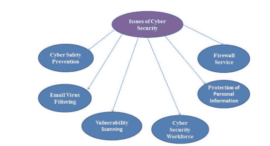

图 13.1 网络安全问题 [4]。

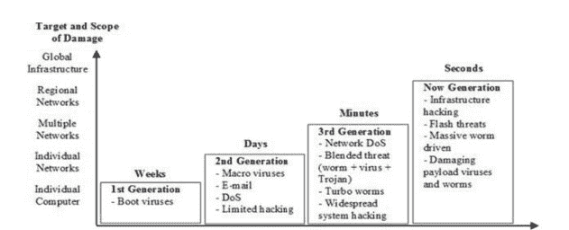

图 13.2 不同年份发生的网络安全攻击 [8]。

## 13.2 Cyberwar

1993年，一篇题为“网络战即将到来！”的文章预测了在一次研究中西方国家安全专家在未来几年将面临的各种困难 [12]。二十多年前，Arquilla 和 Ronfeldt 警告说“网络战”和“Netwar”即将到来，并可能影响21世纪的安全。正如有意统一的武装运动战斗已成功影响了20世纪的安全格局。自那时起，“网络战”的概念获得了前所未有的关注，而平行的“Netwar”概念则逐渐淡出。数字反对协会一直是挑战网络战和Netwar的重要力量 [11]。

澄清网络战的概念，它协调和处理军事行动，如信息相关标准所示。总体上描述它包含军事文化，敌人或对手依赖它，其特定最终目标是“了解”自身：它在哪里、其身份、能做什么、何时能做、为何作战、首先应对哪些风险以及不应对哪些风险等等。这意味着在保护自身不被了解的同时努力完全理解对手，并利用这些信息针对他们，目标是减少所需的资金、努力和业务比例。这种作战可能结合多种发展——尤其是针对 C3I；用于情报收集、传播和准备；用于有组织的通信、规划和识别敌我（IFF）；以及用于“智能”武器系统等。它也可能同样整合电子致盲、阻断、危险、过载和阻碍进入对手的信息和通信线路。网络战不仅仅是基于技术的一系列措施。对于内部和跨利益领域的军队而言，它可能表明需要一些专业重建。有组织的结构需要指挥和控制的某种分散化，这可能会限制新技术带来的军事行动更明显的集中控制。各种合法升级的建议都承认分散化；但分散化本身并不是关键问题。分散化与顶层视野的协调带来了真正的增益 [11]。网络战也可能同样引发关于需要何种力量、如何以及怎样打击对手一方以及在哪里以及如何部署它们的新标准。对于飞机及其维护限制，需要的信息是：如何以及在哪里部署何种类型的计算机和相关传感器、数据库和系统等。它还有助于心理和政治与军事作战部分的融合。网络战引发了广泛的军事组织和行动问题，以及它们的方法、技术、武器、武器和火箭图。它在低强度和高强度战争、常规和非常规环境中都很重要，以及用于监视或敌对目的。它还体现了在战争中发现信息的传统重要性的延伸——拥有主导的 C3I，并试图在对手这样做之前识别、阅读、考虑和欺骗对手，无论追求何种总体战略。在这个意义上，它意味着信息相关因素比近期记忆中任何时候都更基本，这是由于新技术。网络战意味着战争的转变。

网络战关乎组织与发展同样重要。它推导出新的人机界面，发展人的能力，而不是将人与机器分离。然而网络战远不止打击敌人的 C3I结构同时改善和保护自己的结构。在克劳塞维茨的意义上，它被描述为将学习转化为能力的推动。尽管全面规划和执行需要先进

development, cyberwar isn’t penniless after cutting edge advancement. The continued with change of cutting edge information and exchanges progressions is fundamental for U.S. military limits anyway cyberwar, does not by any stretch of the imagination require the nearness of cutting edge advancement whether paid by the United States or other. The definitive and mental estimations may be as basic as the specific. Cyberwar may truly be paid with low advancement under a couple of conditions.

## 13.3 Arms Control in Cyberwar

The U.S. directors have considered the trial of dealing with risks in the computerized zone to that of checking nuclear controlled weapons at the period of the Cold War. China and United States and orchestrating what may be the essential advanced arms control agree to blacklist attacks on one another’s unstable substructure in peacetime [16]. The U.S Obama organization has conviction that, in such an assentment could provoke a more broad “widespread structure” of rules, contracts, and relationship to direct the web. The long-standing U.S. technique are instruments that are Arms control and neutralizing activity which is being vivified and retooled to address current days advanced troubles. In any case, the practicality of these Cold War approaches, which make principal anyway not tasteful measures, will be fundamentally confined in view of genuine differentiations between the advanced and nuclear spaces. Regardless of this Chinese and Russian can’t of recommending digital arms control activities that are genuinely helpful and gainful activities that it would be in the consideration of the United States to help. All nations faces enormous dangers from digital assault, and realized that the arms control methodologies can help it in that, yet they would be delinquent, or surely to propose great ones. In this way, the disparate, contradicting, and conceivably deceptive interests of different nations should made it troublesome for United State starting stand toward such proposals even while they stay open to valuable possibilities.

The U.S. overseers have considered the trial of dealing with threats in the computerized zone to that of checking nuclear controlled weapons at the period of the Cold War. China and United States and masterminding what may be the essential computerized arms control agree to blacklist strikes on one another’s flimsy substructure in peacetime [16]. The U.S Obama organization has sureness that, in such an assentment could provoke a more broad “all inclusive structure” of rules, contracts, and relationship to manage the web. The longstanding U.S. methodology are instruments that are Arms control and neutralizing activity which is being enlivened and retooled to address current days advanced challenges. Nevertheless, the practicality of these Cold War approaches, which make principal anyway not agreeable measures, will be essentially confined in view of genuine complexities between the advanced and nuclear spaces. Notwithstanding this Chinese and Russian can’t of recommending digital arms control activities that are sincerely helpful and gainful activities that it would be in the consideration of the United States to help. All nations faces colossal dangers from digital assault, and realized that the arms control methodologies can help it in that, however they would be delinquent, or undoubtedly to propose great ones. In this way, the divergent, contradicting, and conceivably deceptive interests of different nations should made it troublesome for United State beginning stand toward such recommendations even while they stay open to valuable potential outcomes.

## 13.4 Internet Security Alliance

The cyber security alliance term as the application security forum .It is a swiss activity for developing mindfulness around cybersecurity. It contains the majority of the cybersecurity stuffs from application security, to cryptography, organize security, hazard controlling, enormous information, moral hacking, protection, basic frameworks, digital culpability, dangers insight, personality, disclosing difficulties confronting organizations and experts. The national digital security collusion (NCSA)¹ is just a remarkable relationship among the administration, driving private-division associations, informational affiliations and trade affiliations. ISA is a multi-segment work relationship with alliance from pretty much all of the named basic industry portions, including expansive support from the flying, safeguard managing an account, producing, budgetary administrations ,training, human services, protection, security, innovation and interchanges businesses. ISA accentuations totally on cybersecurity and cybersecurity related issues as is in its activity, which is to make a viable structure of cybersecurity by combining cutting edge innovation with funds and common strategy. ISA is likewise outstanding as it joins the idea direction that may be found in a “think tank,” with help one would anticipate from an exchange affiliation, and dynamic security programs.

NCSA Aim is to drive sharpness and reaction to relentless digital security issues. It gives the different assets and instruments to approve, autonomous endeavors, schools, home customers and universities to stay safe on the web. NCSA Objective To interface with more than 50 million home customers, privately owned businesses, school, colleges and enlightening PC customers to engage them to stay safe online through the NCSA website, one of a kind events and phenomenal tasks.

**NCSA’s Focus:** The DHS (*Department of Homeland Security*) national computerized security division authoritatively indicates the NCSA as their principle work is to contacting these three groups of onlookers:

- Home clients
- Small organizations
- Academic foundations

NCSA’s principle objective is to engage and support propelled locals to use the Web safely and securely, guarding themselves and the computerized establishment. NCSA, a 501 c(3) set up in 2001, is the eminent open private affiliation, working with the DHS, business building up backings and humanitarian pros to progress computerized security care for home customers, little and medium size associations, school, colleges, or fundamental and discretionary guidance. NCSAM is a multifacted push to spread security information and messages through conspicuous, regular and online life channels. In advance as found NCSA’s persistent work alone reached a probable 29,000,000 people through media and distinctive activities. Finally, it will assess its satisfaction to the degree by which advanced security social benchmarks and best practices have ended up being second nature for all PC customers. NCSA also endeavor to find the new progression framework for the care of advanced security by the help of other standard educating that is generally valuable for subjects, for instance, great abstaining from excessive food intake, and safe driving and exercise, which collect a national appreciation about fitting on the web instruments and lead.

## 13.5 Cybersecurity Information Sharing Act

President Barack Obama denoted a bill on December 18, 2015, which incorporate the cybersecurity data sharing act of 2015 (CISA) into law. It supports open and what’s more private part units to share propelled danger data. It stipends United States government affiliations and non-government substances to offer data to each remarkable as they study cyberattacks. In this the chief of national knowledge and the organization parts of country security, equity and guard are compulsory to arrange in a managed way and overhaul systems for sharing cybersecurity chance data. The Non-government parts will be required to wipe out individual information, reality and figure before sharing propelled chance pointers, and the department of homeland security (DHS)² will be fundamental to facilitate an affirmation investigation of the got data.

As indicated by this law the administration just utilize this mutual data to:

- Discover the motivation behind cybersecurity.
- Distinguish the reason for digital security risk or security helplessness.
- Distinguish digital security dangers which are utilized by a fear based oppressor or outside foe.
- Keep a genuine monetary mischief or gravitating toward risk, containing a psychological militant act or a usage of a weapon of mass damage.
- Alleviate a genuine risk to a minor like sexual maltreatment and blackmails to physical wellbeing.
- Examine, hinder or else make legitimate move and infringement emerging out of a risk or identifying with extortion and data fraud.

The department of homeland security and the department of justice³ issued course on february 16, 2016, to offer assistance the associations that offer data under CISA with the national government. Around a similar time the additional course moreover issued which give the idea how chosen workplaces would keep the information securely and how they would grant that information to one another, area governments and state, and the private part.

**Key Provisions of CISA:** On December 2015 rendition law CISA included help inside the two social affairs in Congress and from the Organization, yet was separating by some development associations and private get-togethers. By enabling associations to execute checking and self-guarded instruments on their information structures, the control responded to vulnerabilities that particular such exercises could achieve duty, including under the Electronic Correspondences Protection Act. To ask associations to give information to the organization or diverse social occasions could risk case for harming security and antitrust laws, among others [21].

The going with is a rundown of CISA’s key game plans.

- **Secure and Screen Data Frameworks:** An affiliation is affirmed, of law, to “screen” and “work monitored measures” in solitude information structure or, with formed endorsement to another Association system for cybersecurity purposes.


-   *监控免责安全*: 在 CISA 第 106(a) 条中。注意，没有类似的责任保护适用于超出监控范围的监控活动。

-   **接收或共享网络威胁指标或防御措施**：出于网络安全目的，实体有权共享或接收网络威胁指标和防御措施“来自美国政府、州和地方政府以及其他小型协会和私营实体”。第 104(c)(1) 条。
  -   “网络威胁指标”是指“必要描述或识别”已知威胁集合的信息，以及“恶意代码”和利用安全漏洞或使合法用户无意中启用此类破坏的程序。第 102(6) 条 [11]。
  -   “防御措施”被描述为可部署在信息系统上以识别、阻止或减轻已知或预期网络安全威胁或安全漏洞，且不会破坏、损害或降低系统或数据质量的东西。第 102(7) 条。
  -   “网络安全目的”是指保护信息系统或数据免受法律所定义的“网络安全威胁”或“安全漏洞”的目的。第 102(4) 条 [11]。

-   **共享前审查个人数据**：拟共享网络威胁指标的实体必须删除，或应清除实体在“共享时已知”的“与网络安全目的无具体关联”的任何信息。第 104(d)(2)(A)、(B) 条。

-   **接收和共享数据的保障措施**：根据 CISA 的要求，即可为保护目的删除个人数据。
  -   *反垄断豁免*：为了防止、分析和减轻威胁，CISA 规定实体共享其网络威胁指标或进行监控不构成联邦或州反垄断违法。第 104(e)(1)、(2) 条；第 108(e) 条。
  -   *特权不放弃*：政府不会因向州和相邻政府或其他实体提供信息而放弃特权和其他法律保护。第 105(d)(1) 条。
  -   *专有数据*：政府将把与其共享的防御措施和网络威胁指标视为共享实体指定的专有、财务和机密信息。第 105(d)(2) 条。
  -   *联邦和州《信息自由法》豁免*：根据 CISA 共享的数据免于根据《信息自由法》（5 U.S.C. 552）披露，也免于任何州或地方规定。第 105(d)(3) 条 [21]。
  -   *信息不得用于监管或对合法活动采取行政行动*：根据 CISA 共享的信息不得由任何国家、州、部落或地方政府用于监管，包括执法行动，任何非联邦实体的合法活动或非联邦实体采取的任何活动，数据可用于实施创新网络安全控制。第 105(d)(5)(D)(i)、(ii) 条。

众多私营、公共或其他协会应成为网络安全信息共享网络安全计划的一部分。虽然 CISA 可能在根本层面上并未改变网络安全状况，但它更倾向于共享信息，即如何、为何以及出于何种原因不共享网络威胁和防御措施。

## 13.6 恶意软件市场

恶意软件是一个术语，指恶意编程、旨在损害、伤害或破坏服务器、计算机或系统而不顾授权用户的感染计算机程序。利用破坏性和污染性编程攻击计算机框架的未经授权用户数量正在增长 [20]。各国采取了一种迂回的方法来对抗这一风险并进一步限制恶意软件的使用，通过出口管制限制恶意软件跨境交易。

这有三个原因：
-   首先，很难描绘出适合出口管制的好的与坏的编程。
-   其次，出口管制在很大程度上忽视了非法团体和不可信的人。
-   第三，尽管实施了出口管制，但它们存在损害自卫公司并阻止科学家合作和共享数据的危险。

编程漏洞数据的市场对安全是有用的。然而，它们也可能扩大道德和伦理问题，尤其是作为数字物理危险，

这可以通过加快漏洞披露、曝光、修复应用和修复改进的速度来完成，以缩短漏洞生命周期。漏洞的可用性将变得更稀少，从而成本更高且生命周期更短。

单个零日漏洞利用的工作可能花费数百万美元。如果发现的漏洞存在于经常使用的应用程序中，如 Internet Explorer (IE)，则总和可能会显著增加，而偶尔使用的应用程序的漏洞则没有市场激励。我们可以说漏洞和利用变得为人所知。现在，与网络相关的应用程序中的漏洞利用，例如 Google Chrome、Mozilla Firefox 等浏览器，已成为漏洞利用工具包的一部分，其中包含各种捆绑和打包在一起的漏洞利用，目的是当用户访问恶意网站时会被多个漏洞利用攻击。有时网络犯罪分子可以观察合法白帽程序员和其他在在线网站上发布其进展的安全研究人员的漏洞利用。正如我们所意识到的，白帽程序员和分析师或研究人员可能有很好的目标，他们的工作可能会被确认的组织、黑帽程序员或众多邪恶的在线团体滥用以制造恶意软件。同样也可能出现这种情况，网络犯罪组织需要利用零日漏洞但缺乏技术知识，然后他们雇佣其他网络犯罪分子在应用程序中制造漏洞。

## 13.7 移动网络安全

目前，使用手机及其应用程序的习惯在我们每个人的日常生活中变得迅速流行。在过去时期，移动支付服务的可用性，例如移动支付系统及其应用市场，由于不同手机提供的各种应用程序和可用性，例如 3G、4G、GPRS、Wi-Fi 等而大幅扩展，然而影响这些服务和通信系统的漏洞数量也增加了 [13]。

表 13.1 2011-2017 年期间智能手机操作系统市场份额对比

| 因素 \ 操作系统名称 | Android | Apple iOS | Windows Phone | BlackBerry (RIM) | Symbian and others |
|---|---|---|---|---|---|
| 源代码 | 开源 | 闭源 | 闭源 | 闭源 | 闭源，之前开源 |
| 操作系统家族 | Linux | 类 Unix，Darwin | Windows NT | 类 Unix，QNX | RTOS |
| 支持方 | Google | Apple | Microsoft | BlackBerry | 已停用（2012） |
| 独占公司 | 非独占 | Apple | 非独占 | BlackBerry | 非独占 |
| 编程语言 | Java、C、C++、Basic | C、C++ | C、C++ | C、C++、Qt | C++ |
| 售给终端用户的智能手机市场份额（%） | 74.79 % | 16.11 % | 3.33 % | 3.23 % | 4.27 % |

同样，对于恶意工程师而言，手机已成为完美的目标设备，漏洞和攻击的比例显著增加，因此移动系统安全是移动计算结构中最关键的问题之一。在本研究中，我们旨在对 PDA 设备的网络安全解决方案研究进行全面、有组织的综述。

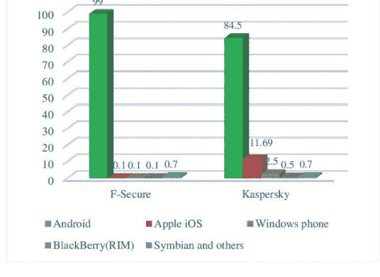

图 13.3 智能手机操作系统的恶意软件攻击。


## 13.9 人权

访问网络越来越多地被认为是一种基本人权。全球组织和各国政府已正式开始认识到其对言论自由、表达和信息交流权利的核心作用。下一步是帮助确认网络安全也应被视为一项人权。联合国正式宣布，政府切断网络访问的行为剥夺了居民的言论自由权。然而，这还不够，因为如今我们拥有标准的网络访问，但它很快就会遭受网络威胁的影响，我们担心信息随时会被黑客入侵，而我们却无力阻止。一个在线权利倡导团体，以电子前沿基金会⁵而闻名，呼吁所有科技公司“站在用户一边”，以防御黑客和政府监控对系统的干扰。

网络中立是指系统上的每个点都可以连接到系统上的其他点，而不会基于来源、目的地或信息类型进行歧视，这一原则是互联网成功的首要原因。网络中立赋予互联网创造新的[content]
## 13.9 人权

访问网络越来越多地被认为是一种基本人权。全球组织和各国政府已正式开始认识到其对言论自由、表达和信息交流权利的核心作用。下一步是帮助确认网络安全也应被视为一项人权。联合国正式宣布，政府切断网络访问的行为剥夺了居民的言论自由权。然而，这还不够，因为如今我们拥有标准的网络访问，但它很快就会遭受网络威胁的影响，我们担心信息随时会被黑客入侵，而我们却无力阻止。一个在线权利倡导团体，以电子前沿基金会⁵而闻名，呼吁所有科技公司“站在用户一边”，以防御黑客和政府监控对系统的干扰。

网络中立是指系统上的每个点都可以连接到系统上的其他点，而不会基于来源、目的地或信息类型进行歧视，这一原则是互联网成功的首要原因。网络中立赋予互联网创造新的用于人权的方法的能力，例如言论自由以及发送、接收和传输数据的权利，并且它对于创新、现代化、竞争和数据的发展也是必不可少的。

优势：
- 主要电信公司可以提供途径，但无权规定公众应如何依赖它们。
- 网络中立保护创新，如果像 Google 和 Netflix⁶ 这样的大型企业可以付费并获得特殊待遇，如更快的速度、更多的带宽，那么新初创企业或小型组织将处于极大劣势。
- 如果没有网络中立，大公司可能会优先考虑电视网络并减慢其他人的信号。
- 它为每个组织，从大型企业到小型初创企业参与其中提供了机会。

劣势：
- 如今，像 Netflix 和 YouTube⁷ 这样的大公司用海量数据阻塞管道，这里将进行限制。
- 像 Google、Facebook 这样的各种公司提供服务，允许个人免费访问网络，而移动公司已花费数十亿建设网络。

## 13.10 我们生活中的网络安全应用

### 移动设备
公司提供或自带设备 BYOD，客户拥有各种设备和类型，将自动有效地选择所有设备。每个设备都经过仔细注册并与客户关联，可以立即报告丢失或被盗。如果报告，I need to output full translation. The previous output truncated. Let's produce complete translation in one go.

We must ensure all lines translated. Let's do systematic translation.

I'll produce final content with all sections.

Let's translate fully.

Section 13.9 Human Rights done.

Net neutrality paragraph done.

Advantages list done.

Disadvantages list done.

13.10 Cybersecurity Application in Our Life

### Mobiles
Company-provided or bring your own device (BYOD), customers with various devices and types will automatically select all of them effectively. Each device is carefully registered and linked to a customer and can be instantly reported lost or stolen. If reported, countermeasures are started and once found, can be effectively re-selected for continued use.

Translate:
公司提供或自带设备 BYOD，客户拥有各种设备和类型，将自动有效地选择所有设备。每个设备都经过仔细注册并与客户关联，可以立即报告丢失或被盗。如果报告，[content]
## 13.9 人权

访问网络越来越多地被认为是一种基本人权。全球组织和各国政府已正式开始认识到其对言论自由、表达和信息交流权利的核心作用。下一步是帮助确认网络安全也应被视为一项人权。联合国正式宣布，政府切断网络访问的行为剥夺了居民的言论自由权。然而，这还不够，因为如今我们拥有标准的网络访问，但它很快就会遭受网络威胁的影响，我们担心信息随时会被黑客入侵，而我们却无力阻止。一个在线权利倡导团体，以电子前沿基金会⁵而闻名，呼吁所有科技公司“站在用户一边”，以防御黑客和政府监控对系统的干扰。

网络中立是指系统上的每个点都可以连接到系统上的其他点，而不会基于来源、目的地或信息类型进行歧视，这一原则是互联网成功的首要原因。网络中立赋予互联网创造新的用于人权的方法的能力，例如言论自由以及发送、接收和传输数据的权利，并且它对于创新、现代化、竞争和数据的发展也是必不可少的。

优势：
- 主要电信公司可以提供途径，但无权规定公众应如何依赖它们。
- 网络中立保护创新，如果像 Google 和 Netflix⁶ 这样的大型企业可以付费并获得特殊待遇，如更快的速度、更多的带宽，那么新初创企业或小型组织将处于极大劣势。
- 如果没有网络中立，大公司可能会优先考虑电视网络并减慢其他人的信号。
- 它为每个组织，从大型企业到小型初创企业参与其中提供了机会。

劣势：
- 如今，像 Netflix 和 YouTube⁷ 这样的大公司用海量数据阻塞管道，这里将进行限制。
- 像 Google、Facebook 这样的各种公司提供服务，允许个人免费访问网络，而移动公司已花费数十亿建设网络。

## 13.10 我们生活中的网络安全应用

### 移动设备
公司提供或自带设备 BYOD，客户拥有各种设备和类型，将自动有效地选择所有设备。每个设备都经过仔细注册并与客户关联，可以立即报告丢失或被盗。如果报告，[content]
## 13.9 人权

访问网络越来越多地被认为是一种基本人权。全球组织和各国政府已正式开始认识到其对言论自由、表达和信息交流权利的核心作用。下一步是帮助确认网络安全也应被视为一项人权。联合国正式宣布，政府切断网络访问的行为剥夺了居民的言论自由权。然而，这还不够，因为如今我们拥有标准的网络访问，但它很快就会遭受网络威胁的影响，我们担心信息随时会被黑客入侵，而我们却无力阻止。一个在线权利倡导团体，以电子前沿基金会⁵而闻名，呼吁所有科技公司“站在用户一边”，以防御黑客和政府监控对系统的干扰。

网络中立是指系统上的每个点都可以连接到系统上的其他点，而不会基于来源、目的地或信息类型进行歧视，这一原则是互联网成功的首要原因。网络中立赋予互联网创造新的用于人权的方法的能力，例如言论自由以及发送、接收和传输数据的权利，并且它对于创新、现代化、竞争和数据的发展也是必不可少的。

优势：
- 主要电信公司可以提供途径，但无权规定公众应如何依赖它们。
- 网络中立保护创新，如果像 Google 和 Netflix⁶ 这样的大型企业可以付费并获得特殊待遇，如更快的速度、更多的带宽，那么新初创企业或小型组织将处于极大劣势。
- 如果没有网络中立，大公司可能会优先考虑电视网络并减慢其他人的信号。
- 它为每个组织，从大型企业到小型初创企业参与其中提供了机会。

劣势：
- 如今，像 Netflix 和 YouTube⁷ 这样的大公司用海量数据阻塞管道，这里将进行限制。
- 像 Google、Facebook 这样的各种公司提供服务，允许个人免费访问网络，而移动公司已花费数十亿建设网络。

## 13.10 我们生活中的网络安全应用

### 移动设备
公司提供或自带设备 BYOD，客户拥有各种设备和类型，将自动有效地选择所有设备。每个设备都经过仔细注册并与客户关联，可以立即报告丢失或被盗。如果报告，[content]
## 13.9 人权

访问网络越来越多地被认为是一种基本人权。全球组织和各国政府已正式开始认识到其对言论自由、表达和信息交流权利的核心作用。下一步是帮助确认网络安全也应被视为一项人权。联合国正式宣布，政府切断网络访问的行为剥夺了居民的言论自由权。然而，这还不够，因为如今我们拥有标准的网络访问，但它很快就会遭受网络威胁的影响，我们担心信息随时会被黑客入侵，而我们却无力阻止。一个在线权利倡导团体，以电子前沿基金会⁵而闻名，呼吁所有科技公司“站在用户一边”，以防御黑客和政府监控对系统的干扰。

网络中立是指系统上的每个点都可以连接到系统上的其他点，而不会基于来源、目的地或信息类型进行歧视，这一原则是互联网成功的首要原因。网络中立赋予互联网创造新的用于人权的方法的能力，例如言论自由以及发送、接收和传输数据的权利，并且它对于创新、现代化、竞争和数据的发展也是必不可少的。

优势：
- 主要电信公司可以提供途径，但无权规定公众应如何依赖它们。
- 网络中立保护创新，如果像 Google 和 Netflix⁶ 这样的大型企业可以付费并获得特殊待遇，如更快的速度、更多的带宽，那么新初创企业或小型组织将处于极大劣势。
- 如果没有网络中立，大公司可能会优先考虑电视网络并减慢其他人的信号。
- 它为每个组织，从大型企业到小型初创企业参与其中提供了机会。

劣势：
- 如今，像 Netflix 和 YouTube⁷ 这样的大公司用海量数据阻塞管道，这里将进行限制。
- 像 Google、Facebook 这样的各种公司提供服务，允许个人免费访问网络，而移动公司已花费数十亿建设网络。

## 13.10 我们生活中的网络安全应用

### 移动设备
公司提供或自带设备 BYOD，客户拥有各种设备和类型，将自动有效地选择所有设备。每个设备都经过仔细注册并与客户关联，可以立即报告丢失或被盗。如果报告，[content]
## 13.9 人权

访问网络越来越多地被认为是一种基本人权。全球组织和各国政府已正式开始认识到其对言论自由、表达和信息交流权利的核心作用。下一步是帮助确认网络安全也应被视为一项人权。联合国正式宣布，政府切断网络访问的行为剥夺了居民的言论自由权。然而，这还不够，因为如今我们拥有标准的网络访问，但它很快就会遭受网络威胁的影响，我们担心信息随时会被黑客入侵，而我们却无力阻止。一个在线权利倡导团体，以电子前沿基金会⁵而闻名，呼吁所有科技公司“站在用户一边”，以防御黑客和政府监控对系统的干扰。

网络中立是指系统上的每个点都可以连接到系统上的其他点，而不会基于来源、目的地或信息类型进行歧视，这一原则是互联网成功的首要原因。网络中立赋予互联网创造新的用于人权的方法的能力，例如言论自由以及发送、接收和传输数据的权利，并且它对于创新、现代化、竞争和数据的发展也是必不可少的。

优势：
- 主要电信公司可以提供途径，但无权规定公众应如何依赖它们。
- 网络中立保护创新，如果像 Google 和 Netflix⁶ 这样的大型企业可以付费并获得特殊待遇，如更快的速度、更多的带宽，那么新初创企业或小型组织将处于极大劣势。
- 如果没有网络中立，大公司可能会优先考虑电视网络并减慢其他人的信号。
- 它为每个组织，从大型企业到小型初创企业参与其中提供了机会。

劣势：
- 如今，像 Netflix 和 YouTube⁷ 这样的大公司用海量数据阻塞管道，这里将进行限制。
- 像 Google、Facebook 这样的各种公司提供服务，允许个人免费访问网络，而移动公司已花费数十亿建设网络。

## 13.10 我们生活中的网络安全应用

### 移动设备
公司提供或自带设备 BYOD，客户拥有各种设备和类型，将自动有效地选择所有设备。每个设备都经过仔细注册并与客户关联，可以立即报告丢失或被盗。如果报告，[content]
## 13.9 人权

访问网络越来越多地被认为是一种基本人权。全球组织和各国政府已正式开始认识到其对言论自由、表达和信息交流权利的核心作用。下一步是帮助确认网络安全也应被视为一项人权。联合国正式宣布，政府切断网络访问的行为剥夺了居民的言论自由权。然而，这还不够，因为如今我们拥有标准的网络访问，但它很快就会遭受网络威胁的影响，我们担心信息随时会被黑客入侵，而我们却无力阻止。一个在线权利倡导团体，以电子前沿基金会⁵而闻名，呼吁所有科技公司“站在用户一边”，以防御黑客和政府监控对系统的干扰。

网络中立是指系统上的每个点都可以连接到系统上的其他点，而不会基于来源、目的地或信息类型进行歧视，这一原则是互联网成功的首要原因。网络中立赋予互联网创造新的用于人权的方法的能力，例如言论自由以及发送、接收和传输数据的权利，并且它对于创新、现代化、竞争和数据的发展也是必不可少的。

优势：
- 主要电信公司可以提供途径，但无权规定公众应如何依赖它们。
- 网络中立保护创新，如果像 Google 和 Netflix⁶ 这样的大型企业可以付费并获得特殊待遇，如更快的速度、更多的带宽，那么新初创企业或小型组织将处于极大劣势。
- 如果没有网络中立，大公司可能会优先考虑电视网络并减慢其他人的信号。
- 它为每个组织，从大型企业到小型初创企业参与其中提供了机会。

劣势：
- 如今，像 Netflix 和 YouTube⁷ 这样的大公司用海量数据阻塞管道，这里将进行限制。
- 像 Google、Facebook 这样的各种公司提供服务，允许个人免费访问网络，而移动公司已花费数十亿建设网络。

## 13.10 我们生活中的网络安全应用

### 移动设备
公司提供或自带设备 BYOD，客户拥有各种设备和类型，将自动有效地选择所有设备。每个设备都经过仔细注册并与客户关联，可以立即报告丢失或被盗。如果报告，[content]
## 13.9 人权

访问网络越来越多地被认为是一种基本人权。全球组织和各国政府已正式开始认识到其对言论自由、表达和信息交流权利的核心作用。下一步是帮助确认网络安全也应被视为一项人权。联合国正式宣布，政府切断网络访问的行为剥夺了居民的言论自由权。然而，这还不够，因为如今我们拥有标准的网络访问，但它很快就会遭受网络威胁的影响，我们担心信息随时会被黑客入侵，而我们却无力阻止。一个在线权利倡导团体，以电子前沿基金会⁵而闻名，呼吁所有科技公司“站在用户一边”，以防御黑客和政府监控对系统的干扰。

网络中立是指系统上的每个点都可以连接到系统上的其他点，而不会基于来源、目的地或信息类型进行歧视，这一原则是互联网成功的首要原因。网络中立赋予互联网创造新的用于人权的方法的能力，例如言论自由以及发送、接收和传输数据的权利，并且它对于创新、现代化、竞争和数据的发展也是必不可少的。

优势：
- 主要电信公司可以提供途径，但无权规定公众应如何依赖它们。
- 网络中立保护创新，如果像 Google 和 Netflix⁶ 这样的大型企业可以付费并获得特殊待遇，如更快的速度、更多的带宽，那么新初创企业或小型组织将处于极大劣势。
- 如果没有网络中立，大公司可能会优先考虑电视网络并减慢其他人的信号。
- 它为每个组织，从大型企业到小型初创企业参与其中提供了机会。

劣势：
- 如今，像 Netflix 和 YouTube⁷ 这样的大公司用海量数据阻塞管道，这里将进行限制。
- 像 Google、Facebook 这样的各种公司提供服务，允许个人免费访问网络，而移动公司已花费数十亿建设网络。

## 13.10 我们生活中的网络安全应用

### 移动设备
公司提供或自带设备 BYOD，客户拥有各种设备和类型，将自动有效地选择所有设备。每个设备都经过仔细注册并与客户关联，可以立即报告丢失或被盗。如果被报告，[content]
## 13.9 人权

访问网络越来越多地被认为是一种基本人权。全球组织和各国政府已正式开始认识到其对言论自由、表达和信息交流权利的核心作用。下一步是帮助确认网络安全也应被视为一项人权。联合国正式宣布，政府切断网络访问的行为剥夺了居民的言论自由权。然而，这还不够，因为如今我们拥有标准的网络访问，但它很快就会遭受网络威胁的影响，我们担心信息随时会被黑客入侵，而我们却无力阻止。一个在线权利倡导团体，以电子前沿基金会⁵而闻名，呼吁所有科技公司“站在用户一边”，以防御黑客和政府监控对系统的干扰。

网络中立是指系统上的每个点都可以连接到系统上的其他点，而不会基于来源、目的地或信息类型进行歧视，这一原则是互联网成功的首要原因。网络中立赋予互联网创造新的用于人权的方法的能力，例如言论自由以及发送、接收和传输数据的权利，并且它对于创新、现代化、竞争和数据的发展也是必不可少的。

优势：
- 主要电信公司可以提供途径，但无权规定公众应如何依赖它们。
- 网络中立保护创新，如果像 Google 和 Netflix⁶ 这样的大型企业可以付费并获得特殊待遇，如更快的速度、更多的带宽，那么新初创企业或小型组织将处于极大劣势。
- 如果没有网络中立，大公司可能会优先考虑电视网络并减慢其他人的信号。
- 它为每个组织，从大型企业到小型初创企业参与其中提供了机会。

劣势：
- 如今，像 Netflix 和 YouTube⁷ 这样的大公司用海量数据阻塞管道，这里将进行限制。
- 像 Google、Facebook 这样的各种公司提供服务，允许个人免费访问网络，而移动公司已花费数十亿建设网络。

## 13.10 我们生活中的网络安全应用

### 移动设备
公司提供或自带设备 BYOD，客户拥有各种设备和类型，将自动有效地选择所有设备。每个设备都经过仔细注册并与客户关联，可以立即报告丢失或被盗。如果被报告则[content]
## 13.9 人权

访问网络越来越多地被认为是一种基本人权。全球组织和各国政府已正式开始认识到其对言论自由、表达和信息交流权利的核心作用。下一步是帮助确认网络安全也应被视为一项人权。联合国正式宣布，政府切断网络访问的行为剥夺了居民的言论自由权。然而，这还不够，因为如今我们拥有标准的网络访问，但它很快就会遭受网络威胁的影响，我们担心信息随时会被黑客入侵，而我们却无力阻止。一个在线权利倡导团体，以电子前沿基金会⁵而闻名，呼吁所有科技公司“站在用户一边”，以防御黑客和政府监控对系统的干扰。

网络中立是指系统上的每个点都可以连接到系统上的其他点，而不会基于来源、目的地或信息类型进行歧视，这一原则是互联网成功的首要原因。网络中立赋予互联网创造新的用于人权的方法的能力，例如言论自由以及发送、接收和传输数据的权利，并且它对于创新、现代化、竞争和数据的发展也是必不可少的。

优势：
- 主要电信公司可以提供途径，但无权规定公众应如何依赖它们。
- 网络中立保护创新，如果像 Google 和 Netflix⁶ 这样的大型企业可以付费并获得特殊待遇，如更快的速度、更多的带宽，那么新初创企业或小型组织将处于极大劣势。
- 如果没有网络中立，大公司可能会优先考虑电视网络并减慢其他人的信号。
- 它为每个组织，从大型企业到小型初创企业参与其中提供了机会。

劣势：
- 如今，像 Netflix 和 YouTube⁷ 这样的大公司用海量数据阻塞管道，这里将进行限制。
- 像 Google、Facebook 这样的各种公司提供服务，允许个人免费访问网络，而移动公司已花费数十亿建设网络。

## 13.10 我们生活中的网络安全应用

### 移动设备
公司提供或自带设备 BYOD，客户拥有各种设备和类型，可自动有效管理所有设备。每个设备都经过仔细注册并与客户关联，可立即报告丢失或被盗。一旦报告，[content]
## 13.9 人权

访问网络越来越多地被认为是一种基本人权。全球组织和各国政府已正式开始认识到其对言论自由、表达和信息交流权利的核心作用。下一步是帮助确认网络安全也应被视为一项人权。联合国正式宣布，政府切断网络访问的行为剥夺了居民的言论自由权。然而，这还不够，因为如今我们拥有标准的网络访问，但它很快就会遭受网络威胁的影响，我们担心信息随时会被黑客入侵，而我们却无力阻止。一个在线权利倡导团体，以电子前沿基金会⁵而闻名，呼吁所有科技公司“站在用户一边”，以防御黑客和政府监控对系统的干扰。

网络中立是指系统上的每个点都可以连接到系统上的其他点，而不会基于来源、目的地或信息类型进行歧视，这一原则是互联网成功的首要原因。网络中立赋予互联网创造新的用于人权的方法的能力，例如言论自由以及发送、接收和传输数据的权利，并且它对于创新、现代化、竞争和数据的发展也是必不可少的。

优势：
- 主要电信公司可以提供途径，但无权规定公众应如何依赖它们。
- 网络中立保护创新，如果像 Google 和 Netflix⁶ 这样的大型企业可以付费并获得特殊待遇，如更快的速度、更多的带宽，那么新初创企业或小型组织将处于极大劣势。
- 如果没有网络中立，大公司可能会优先考虑电视网络并减慢其他人的信号。
- 它为每个组织，从大型企业到小型初创企业参与其中提供了机会。

劣势：
- 如今，像 Netflix 和 YouTube⁷ 这样的大公司用海量数据阻塞管道，这里将进行限制。
- 像 Google、Facebook 这样的各种公司提供服务，允许个人免费访问网络，而移动公司已花费数十亿建设网络。

## 13.10 我们生活中的网络安全应用

### 移动设备
公司提供或自带设备 BYOD，客户拥有各种设备和类型，可自动有效管理所有设备。每个设备都经过仔细注册并与客户关联，可立即报告丢失或被盗。一旦报告[content]
## 13.9 人权

访问网络正被越来越多地视为基本人权。全球组织和各国政府已正式承认其对言论自由、表达和信息交流的核心作用。下一步是确认网络安全也应成为人权。联合国正式宣布，政府切断网络访问剥夺了居民的言论自由权。然而这不足够，因为当前网络虽普及却频受网络威胁，我们担心信息随时被黑客入侵而无力阻止。以电子前沿基金会⁵著称的在线权利倡导团体呼吁所有科技公司“站在用户一边”，防御黑客和政府监控的干扰。

网络中立指系统内各点可互联且不因来源、目的地或信息类型而歧视，此原则是互联网成功的主因。网络中立使互联网能创造新的人权实现方式，如言论自由及发送、接收、传输数据的权利，并对创新、现代化、竞争和数据发展至关重要。

优势：
- 主要电信公司可提供渠道但无权规定公众如何依赖。
- 网络中立保护创新，若 Google 和 Netflix⁶ 等大企业付费获更快速度、更多带宽等特殊待遇，新创企业或小型组织将极度劣势。
- 无网络中立时，大公司可优先电视网络并减慢他人信号。
- 为从大型企业到小型初创的每个组织参与提供机会。

劣势：
- 如今 Netflix 和 YouTube⁷ 等大公司用海量数据阻塞管道，需加以限制。
- Google、Facebook 等公司提供免费上网服务，而移动公司已投入数十亿建设网络。

## 13.10 我们生活中的网络安全应用

### 移动设备
公司提供或自带设备 BYOD，客户可有效管理各类设备。每个设备均注册并关联客户，可即时报告丢失或被盗。报告后启动[content]
## 13.9 人权
访问网络正被视为基本人权。全球组织和各国政府已承认其对言论自由、表达和信息交流的核心作用。下一步是确认网络安全也是人权。联合国宣布政府切断网络访问剥夺居民言论自由权。但这不够，网络虽普及却常受网络威胁，信息随时可能被黑客入侵而无力阻止。电子前沿基金会⁵呼吁科技公司“站在用户一边”，防御黑客和政府监控。
网络中立指系统各点可互联且不因来源、目的地或信息类型歧视，是互联网成功主因。它使互联网能创造人权新方式，如言论自由及数据发送接收传输权，对创新、现代化、竞争和数据发展至关重要。
优势：
- 电信公司可提供渠道但无权规定公众依赖方式。
- 保护创新，若 Google 和 Netflix⁶ 付费获特殊待遇，新创企业将劣势。
- 无网络中立时大公司可优先电视网络并减慢他人信号。
- 为各组织参与提供机会。
劣势：
- Netflix 和 YouTube⁷ 等大公司用海量数据阻塞管道需限制。
- Google、Facebook 提供免费上网服务而移动公司已投入数十亿建设网络。

## 13.10 我们生活中的网络安全应用
### 移动设备
公司提供或 BYOD，客户可有效管理各类设备。设备注册并关联客户，可即时报告丢失被盗。报告后启动[content]
## 13.9 人权

访问网络正被视为基本人权。全球组织和各国政府已承认其对言论自由、表达和信息交流的核心作用。下一步是确认网络安全也是人权。联合国宣布政府切断网络访问剥夺居民言论自由权。但这不够，网络虽普及却常受网络威胁，信息随时可能被黑客入侵而无力阻止。电子前沿基金会⁵呼吁科技公司“站在用户一边”，防御黑客和政府监控。

网络中立指系统各点可互联且不因来源、目的地或信息类型歧视，是互联网成功主因。它使互联网能创造人权新方式，如言论自由及数据发送接收传输权，对创新、现代化、竞争和数据发展至关重要。

优势：
- 电信公司可提供渠道但无权规定公众依赖方式。
- 保护创新，若 Google 和 Netflix⁶ 付费获特殊待遇，新创企业将劣势。
- 无网络中立时大公司可优先电视网络并减慢他人信号。
- 为各组织参与提供机会。

劣势：
- Netflix 和 YouTube⁷ 等大公司用海量数据阻塞管道需限制。
- Google、Facebook 提供免费上网服务而移动公司已投入数十亿建设网络。

## 13.10 我们生活中的网络安全应用

### 移动设备
公司设备或自带设备 BYOD，客户可有效管理所有设备。设备已注册并关联客户，可立即报告丢失或被盗。报告后即启动反制措施，找回后可重新启用。

### 智能卡
可提供认证、个人识别、信息存储和组织内应用处理。单张接触或非接触智能卡可预设银行审批、驾照、医疗福利、公共交通权、俱乐部会员等。也可用作 ID、储值现金卡、信用卡及个人信息的存储库，如病史或联系号码。丢失或被盗时可通过安全个人识别码 PIN 妥善更换 [14]。

### 虚拟专用系统 VPN
通过公共互联网连接创建私有网络，提供网络隐私和匿名。VPN 提供良好网络保护，但仅可在安全计算设备上使用。人们使用 VPN 的原因有：隐藏位置、访问工作系统、防止政府审查。VPN 是在公共 Wi-Fi 热点上安全浏览的常用服务。例如 OpenVPN⁸、Juniper⁹、Cisco 等。

### 文档签署
为合同、报告、账单、审批和财务文件提供电子签名、时间戳、批准协作者及加密解密，格式如 DOC、XLS、PDF 等。

### 邮件安全
数字安全防止邮件内容损坏，防止邮件内容泄露并加密，验证消息来源，提供灵活安全通信 [6]。

### 强认证
通过管理并验证设备和用户身份提供强认证服务，控制谁可访问数据、应用、信息及网络、外部网或内部网资产的高级资源 [14]。

### 受保护通信
为内部私有系统提供 SSL 安全套接层/TLS 传输层安全服务器与 SSL/TLS 客户端之间的安全连接，成本低于购买经纪商提供的先进验证。

### 在线核验设施
自动化强验证服务提供网络安全，为客户端登录远程应用或在私有设备或本地机器上开户提供安全连接请求。可每秒处理数十万请求。

### 代码签名
数字安全提供代码签名技术，确保产品开发过程得到保证，且服务器、云和终端用户运行的产品自经验证创建者验证后不可更改或篡改。

### 时间戳
提供在线记录作者数据——谁创建、批准它以及记录创建或最后更新时间的信息，这些是用户在线安全最需要的信息 [14]。

### 单点登录
使授权用户使用主凭据同时访问各种应用和服务器，并阻止未授权工作区或设备访问者登录所有应用。

## 13.11 结论

本章发现目前黑客攻击率最高的行业是医疗，其次是制造，金融目标从第一位跌至第三位，政府和交通运输业分别位列第四和第五。2015 年观察到约 60% 的网络攻击由“内部人员”即有权进入组织系统的员工实施，自 2016 年初以来每天发生超过 4,000 起勒索软件攻击。2017 年 74% 的组织认为自己易受内部威胁，7% 报告极度脆弱。

随着人工智能和机器学习影响更多行业，网络安全中发挥更大作用已成定局 [17-19]。机器学习模型可预测并准确检测盗窃。我们应积极应对勒索软件并敏捷管理数据泄露。

## 参考文献
- 1. Kshetri, N. (2010). The global cybercrime industry: economic, institutional and strategic perspectives. Springer Science & Business Media.
- 2. Dupont A. Time to attack cybercrime with a strong security policy. WWW page, October 2010
- 3. Powell, A., Stratton, G., & Cameron, R. (2018). Digital criminology: Crime and justice in digital society. Routledge.
- 4. Thakur, K., Qiu, M., Gai, K., & Ali, M. L. (2015, November). An investigation on cybersecurity threats and security models. In cybersecurity and Cloud Computing (CSCloud), 2015 IEEE 2nd International Conference on (pp. 307-311).
- 5. Yan, Y., Qian, Y., Sharif, H., & Tipper, D. (2012). A survey on cybersecurity for smart grid communications. IEEE Communications Surveys and tutorials, 14(4), 998-1010.
- 6. Tonge, A. M., Kasture, S. S., & Chaudhari, S. R. (2013). cybersecurity: challenges for society-literature review. IOSR Journal of Computer Engineering, 2(12), 67-75.
- 7. Subashini, S., & Kavitha, V. (2011). A survey on security issues in service delivery models of cloud computing. Journal of network and computer applications, 34(1), 1-11.
- 8. Petric, G., Axinte, S. D., Bacivarov, I. C., Firoiu, M., & Mihai, I. C. (2017, June). Studying cybersecurity threats to web platforms using attack tree diagrams. In Electronics, Computers and Artificial Intelligence (ECAI), 2017 9th International Conference on (pp. 1-6). IEEE.
- 9. Mauw, S., & Oostdijk, M. (2005, December). Foundations of attack trees. In International Conference on Information Security and Cryptology (pp. 186-198). Springer, Berlin, Heidelberg.


- 10. Cisco安全服务客户端：实现自防御网络 2007. [在线] 可用: www.cisco.com/c/en/us/products/collateral/wireless/secureservices
- 11. Karp, B. (2016年3月). 《2015年网络安全信息共享法案的联邦指导意见》. 载于《哈佛法学院公司治理与金融监管论坛》.
- 12. https://www.rand.org/
- 13. Ahvanooey, M. T., Li, Q., Rabbani, M., & Rajput, A. R. (2017). 《智能手机安全综述：软件漏洞、恶意软件与攻击》. 《国际高级计算机科学与应用杂志》, 8(10), 30-45.
- 14. http://www.sio2corp.com/cyber-security-applications/
- 15. https://www.govinfosecurity.com/
- 16. https://www.wilsoncenter.org/
- 17. Ristic, I. (2010). 《ModSecurity 手册》. Feisty Duck.
- 18. Kordy, B., Kordy, P., Mauw, S., & Schweitzer, P. (2013年8月). 《ADTool：利用攻击-防御树进行安全分析》. 载于《国际系统定量评价会议》(第173-176页). Springer, 柏林, 海德堡.
- 19. Dorfman, R. (2004). 《可扩展标记语言（XML）》. 《互联网百科全书》.
- 20. Makino, Y., & Klyuev, V. (2015年9月). 《Web漏洞扫描器评估》. 载于《智能数据采集与先进计算系统：技术与应用（IDAACS）——2015年IEEE第八届国际会议》(第1卷, 第399-402页). IEEE.
- 21. Beyer, J. 《网络安全信息共享法案（CISA）》. 杰克逊国际研究学院.

## 第14章

## 分布式操作系统中的安全：综合研究

Sushree Bibhuprada B. Priyadarshini¹, Amiya Bhusan Bagjadab², Brojo Kishore Mishra ³

¹ 印度布巴内斯瓦尔技术教育与研究学院
² 印度布尔拉桑巴尔普尔信息技术大学
³ 印度布巴内斯瓦尔C. V. 拉曼工程学院
电子邮件：bimalabibhuprada@gmail.com, amiya7bhusan7@gmail.com, brojokishoremishra@gmail.com

### 摘要

近年来，各种攻击日益侵入信息世界。在这种背景下，分布式操作系统中的安全性将成为关键要素。然而，目前全新的信息市场已成为众多计算机犯罪者的活动场所，因此保护数据仍然是用户的工作。在本章中，我们阐述了安全策略、安全机制、各类攻击（如拒绝服务攻击）、Globus安全架构以及安全机制的分布。此外，我们还研究了在所考虑的任何信息系统中频繁发生的各种攻击策略。

### 关键词

访问控制，密码学，拒绝服务，分布式操作系统，伪造，威胁

网络安全包括：服务的隔离与最小化、访问控制、密码学以及漏洞消除。访问控制是对系统中存在的资源的访问进行控制。密码学是将明文转换为密文的过程，其中转换前的文本称为明文，转换后的文本称为密文[6]。

然而，防范外部威胁是最容易的保护方式。通常，大多数攻击之所以盛行，是由于社会工程学、观察、翻找垃圾等等。

分布式系统是一种网络，由通过分布式中间件互连的各种自治计算机组成。在该系统中，各种资源得以共享。换句话说，分布式系统旨在帮助开发各种应用程序和服务，这些应用程序和服务可以利用由多个自治处理元素组成的物理架构；这些处理元素不共享主存储器，但通过相关通信网络传递异步消息进行协作。使用分布式系统的主要宗旨是：资源共享、可伸缩性、可扩展性等。分布式系统中信息交换的示意图如图14.3所示。

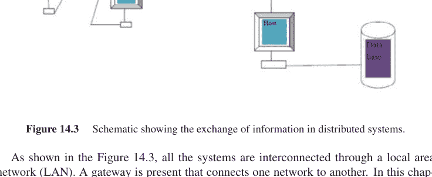

如图14.3所示，所有系统通过局域网（LAN）互连。存在一个网关，将一个网络连接到另一个网络。在本章中，我们重点关注通常集成到分布式系统中以辅助安全性的几种机制。从根本上讲，分布式系统中的安全性可分为两部分：第一部分涉及位于不同机器上的用户或进程之间的通信。确保此类通信安全的主要技术是使用安全通道。

在接下来的章节中，我们将讨论消息机密性、消息认证和消息完整性。第二部分侧重于授权，即确保进程获得分布式系统中为其分配的那些资源的访问权限。我们将讨论授权以及访问控制。首先，让我们讨论在考虑任何分布式系统安全性时需要考虑的两件事：

- **安全策略**：它决定什么对系统、组织或实体是安全的。它基本上是指对成员特征的约束，以及通过锁、钥匙、墙壁、门等各种技术对敌手施加的限制。
- **安全机制**：安全机制基本上是为防止安全攻击或从中恢复而设计的。安全服务基本上使用一种或多种安全机制。从根本上说，安全服务是增强数据处理系统安全性的服务。通常存在以下四种不同类型的安全威胁：
    - *截获*：指未经授权的一方访问数据或服务的情况。当双方通信被另一人窃听时，就会出现这种情况。
    - *中断*：当某些内容被破坏或丢失时，就会发生中断。基本上，这是一种服务或数据不可用、被破坏、无法使用等情况。在拒绝服务攻击中，有人恶意地试图使某项服务对另一方不可访问。
    - *篡改*：涉及对数据进行未经授权的更改或篡改，使其无法再符合初始规范；例如，频繁更改传输中的数据。
    - *伪造*：表示产生了通常不存在的额外数据或活动的情况。例如，入侵者可能试图向密码文件或数据库中添加条目。

此外，可用来实施策略的安全机制如下：

- 加密
- 认证
- 授权
- 审计

加密是计算机安全的基础。加密将数据转换为攻击者无法理解的内容。换句话说，加密为实现数据机密性提供了一种手段。此外，加密使我们能够检查数据是否已被修改。因此，它也为完整性检查提供支持。认证用于验证用户、客户端、服务器、主机或其他实体所声称的身份。就客户端而言，基本前提是，在服务开始代表客户端执行任何工作之前，应该先了解该客户端[9]。

- 嗅探攻击
    - 在网络安全语境下，这种攻击也称为嗅探器攻击。这种攻击通过使用嗅探器捕获网络流量来截获数据。
    - 术语“嗅探器”是指旨在捕获网络数据包的应用程序。
    - 当数据通过网络传输时，如果数据包完全没有加密，此时就会使用嗅探器来读取数据包。
    - 攻击者可以分析网络并获取信息，最终导致相关网络遭到破坏。
    - 否则，它可以读取整个网络中存在的通信内容。
- 欺骗（Spoofing）
    - 欺骗是指冒充经授权与受害者进行信息交换的机器的过程。
    - 常见的欺骗示例是IP欺骗。本质上，IP欺骗是一种旨在获取机器访问权限的技术，攻击者通过操纵IP数据包来冒充任何其他机器。
    - 它涉及使用伪造或欺骗的IP地址、校验和以及其他值来修改数据包头。
- Smurfing（蓝精灵攻击）
    - Smurfing被定义为访问与所考虑主文档不同的秘密账户的过程，这样用户可以在不被任何人发现的情况下做任何事情。
    - Smurfing是在与其余机器通信时冒充任何类型受害者的现象。
- Landing（落地攻击）
    - 它被定义为在与受害者通信时欺骗受害者的现象。
    - 各种针对机器和进程的攻击都属于此类攻击。
- 信息窃取
    - 这涉及从各种机器获取必要信息的过程。
    - 近年来，关于窃取的信息大量出现，例如信用卡号窃取、ATM欺骗、电子现金窃取、数据库窃取等。
- 拒绝服务（DoS）
    - DoS攻击是指攻击者发起行动，阻止合法用户访问所考虑的目标计算机或任何其他网络资源时出现的安全事件。


通常，此类攻击会向服务器、系统或网络发送大量流量，以耗尽受害者的资源，从而使授权用户难以或无法访问它。

美国计算机应急准备小组（US-CERT）¹ 提供了多种指南，用于判断 DoS 攻击何时发生，具体如下：

- 访问特定网站困难
- 网络性能下降

一旦怀疑发生 DoS 攻击，组织或企业会联系其互联网服务提供商（ISP），以确认是否由 DoS 攻击所致，还是其他原因造成的。随后，ISP 会通过使用负载均衡器来限制恶意流量，以降低攻击影响，从而协助缓解攻击。类似地，也可以通过入侵防御系统、入侵检测系统等来探索 DoS 检测的可行性。此外，在分布式拒绝服务攻击中，网络连接设备和计算机都会被恶意软件感染。DoS 攻击的各种类型如图14.5所示。

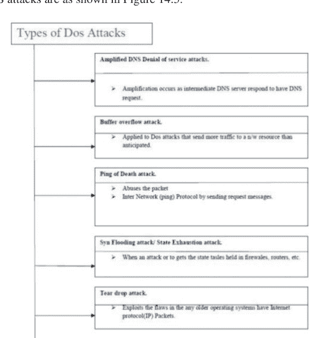

图14.5 DoS 攻击的类型。

## 14.4 Globus 安全架构

通过一个示例，可以最好地说明安全策略的概念以及安全机制在分布式系统中强制执行此类策略的方式。我们来讨论 Globus 广域网系统[3]所涉及的安全策略。Globus 基本上是一个支持大规模分布式计算的系统，其中许多主机、文件和其他资源被并发地用于执行一项计算任务。这些环境也被称为计算网格。此外，很多时候，这些网格中的资源位于不同的管理域中，而这些管理域可能分布在世界各地。

Globus 的安全策略包括以下内容：

- 环境由多个管理域组成。
- 本地操作：指仅在单个域内执行的操作。这些操作仅受本地域安全策略的约束。
- 全局操作：指涉及多个域的操作，要求执行操作的发起者在每个相关域中都是已知的。
- 不同域中的实体之间的操作需要相互认证。
- 本地认证被全局认证取代。
- 对资源的访问控制主要仅受本地安全策略的约束。
- 用户可以将权限委托给进程。
- 同一域内的进程之间可以共享凭据。

我们假设环境由多个管理域组成，每个域都有自己的本地安全策略。还进一步认为，由于域参与了 Globus，本地策略不能被修改。因此，Globus 的安全机制禁止自己去执行那些可能妨碍多个域的操作。此外，Globus 假设完全属于某个域本地执行的操作只受该域安全策略的约束。Globus 安全策略意味着各种操作请求可以本地或全局发起。发起者可以是用户或代表用户行为的进程，并且必须在每个域内都是本地已知的。

一旦用户或代表用户行为的进程通过认证，就必须验证其对资源的精确访问权限。例如，希望更新文件的用户必须先经过认证；然后才能验证该用户是否实际被允许更新该文件。Globus 安全策略表明，访问控制决策完全在所访问资源所在域的本地做出。此外，Globus 重点关注涉及多个域的安全威胁。具体而言，该安全策略表明，关键的设计问题涉及用户在任何远程域中的表示形式，以及从远程域向用户或其代表分配资源。Globus 安全策略的架构如图14.6所示。

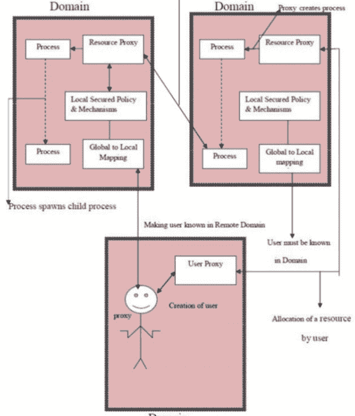

图14.6 Globus 安全策略架构。

## 14.5 安全机制的分布

服务之间存在的信任依赖关系催生了可信计算基（TCB）的概念。TCB 是分布式计算机系统中所有安全机制的集合，这些机制对于确保安全策略是必需的，并且必须被信任。TCB 越小越好。此外，分布式系统中的 TCB 可以包含多个主机上的本地操作系统。分布式文件系统中的文件服务器可能需要依赖相应本地操作系统提供的多种保护机制。而且，基于中间件的分布式系统需要信任现有的本地操作系统。如果不存在信任，那么本地操作系统的部分功能就必须纳入分布式系统本身。

## 基于雾计算和云计算的医疗应用安全

ROJALINA PRIYADARSHINI¹, MOHIT RANJAN PANDA², BROJO KISHORE MISHRA¹

¹ 印度布巴内什瓦尔，C. V. 拉曼工程学院，计算机科学与信息技术系  
² 印度布巴内什瓦尔，C. V. 拉曼工程学院，计算机科学与工程系

brojikishoremishra@gmail.com

### 摘要

过去几年，电子医疗系统取得了显著进展。这得益于医疗领域数字化转型的发展，尤其是配备传感器的可穿戴设备、物联网设备和体域网的使用。电子医疗不仅仅局限于存储临床数据。人们可以设计和开发复杂的数字应用，以满足各种不同的健康相关服务。例如，老年人远程监护、患者行动跟踪、血糖和血压监测，以及在紧急情况下发出早期通知。这给电子医疗带来了一场革命。与此同时，这些应用也面临着不同的安全问题。当这些解决方案构建在云或雾等虚拟环境中时，安全挑战会成倍增加。在本章中，我们尝试汇集医疗领域出现的一些安全问题。本章还讨论了现有的解决方案和新兴威胁。

### 关键词

电子医疗、机密性、完整性、可用性、威胁、漏洞

## 15.1 引言

近年来，用于开发数字化医疗解决方案的电子设备（如传感器）的使用有所增加。如今，医疗应用不再局限于记录由患者、医生等产生的各种临床数据。当前的医疗应用侧重于远程监护患者、跟踪其行动，并在危急情况下向医生和亲属发出早期通知。这得益于物联网（IoT）设备的出现以及在患者体内使用嵌入式传感器。医疗监测系统的总体架构如图15.1所示。可靠的通信、处理和移动性、延迟控制以及节能路由等都是需要解决的一些问题。由于数字化转型，医疗领域产生了海量的非结构化数据，如视频和图像。医疗领域已经形成了一个由临床设备组成的虚拟互联世界，这些设备持续发送非结构化且可能不安全的数据，这些数据容易受到攻击。这些数据需要通过信道传输，而信道并不总是安全的。但个人的生理数据包含高度私人和敏感的信息。因此，安全是医疗应用的首要需求，尤其是当解决方案使用配备传感器或体域网的物联网设备时。

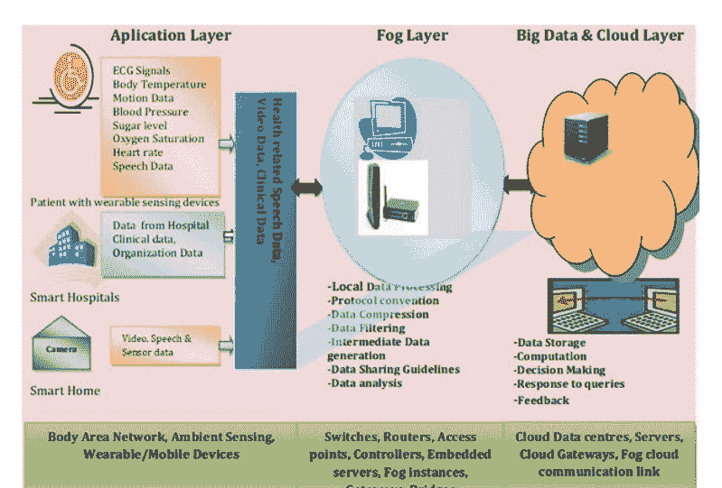

图15.1 医疗监测系统的总体架构。

但是，当医疗解决方案部署在云和雾环境中时，由于以下原因，安全顾虑会加倍：


- Fog 和 Cloud 是部署在传统网络计算之上的，因此它们容易受到传统网络所遭受的各种安全威胁。
- 与个人健康相关的数据是从部署在物联网设备中的无处不在的可穿戴传感器捕获的，这些设备具有高度可扩展性和动态性。
- 在大多数情况下，数据传输所使用的通信介质是无线且缺乏安全性。
- 从 IP 启用的用户设备捕获并传输到目标站点的数据可能通过不安全的网络基础设施路由 [46]。

## 15.2 医疗保健领域的安全需求

医疗保健解决方案中的安全性和隐私性是首要关注的问题，尤其是在部署在虚拟计算环境中时。在这些情况下，必须确保用户和服务提供商的身份验证和授权 [1]。因此，为了拥有安全可靠的基于云的医疗保健系统，其期望的特性必须包括以下安全要求：

### 15.2.1 数据完整性

数据完整性是必需的，以确保在传输过程中患者数据传输到服务提供商时不会以任何方式被更改。在基于雾的医疗保健系统中，大多数通信是无线的。因此，在传输过程中存在完整性丢失的风险。可以通过在数据包中添加循环冗余校验（CRC）来维护数据完整性，这可以检测出错误的数据包。否则，消息认证码（MAC）协议也用于维护数据完整性 [2]。

### 15.2.2 数据保密性

所有相关的健康敏感数据和个人信息都是通过用户和服务提供商之间的通信网络传输的。为了以原始形式保留数据并防止其泄漏和中间人攻击，需要保持数据的保密性。这可以通过实施强大的加密和解密机制来实现。通过使用加密和解密机制，可以控制窃听，并且没有中间人可以访问数据。

### 15.2.3 身份验证和授权

身份验证和授权是必需的，以验证健康数据包发送方和接收方的身份。对私人医疗信息的任何未经授权的访问都可能破坏整个机制。对私人数据的未经授权访问可能导致注入一些无效的虚假数据，从而可能损坏系统。这可以通过使用 MAC 协议来避免。

### 15.2.4 可用性

可用性确保通过基于雾的系统启用的健康服务能够在需要时不间断地提供给授权用户。可能由于拒绝服务（DoS）攻击，数据和服务在需要时不可用的情况。DoS 攻击会消耗网络带宽、降低响应时间、导致网络流量拥塞。可用性可以通过系统和资源的策略和原则来定义，以便在合法用户在医疗保健系统中任何时间、任何地点提出需求时可访问、可使用且可用 [3, 4]。确保可用性可以防止因硬件故障、电源故障、维护工作和系统升级造成的服务中断。

### 15.2.5 访问控制

这是由授权用户对各种资源提供受控访问的能力 [5]。它涉及三个不同的安全和隐私要求：识别、身份验证和授权。识别完全是如何识别用户。虽然它不是安全性的明确目标，但可用于影响用户身份验证的方式。身份验证反过来则保证所请求的数据访问是真实的。它还保证通信发生在另一端的授权方。最终，授权过程根据某些安全策略决定可以限制给外部请求者的哪部分数据。需要注意的是，适当的访问控制机制可以确保患者隐私安全，并且可以在可用性和保密性 [6, 7] 等安全目标之间提供良好的平衡。

### 15.2.6 可靠性

可靠性保证在任何时候都可以轻松恢复和检索医疗数据，无论是否存在由网络动态或故障节点引起的威胁 [8, 9]。通常，在大多数医疗案例中，无法检索准确数据是由于网络动态引起的威胁，这可能威胁到患者的生命。容错是可靠性的基本要求。

### 15.2.7 灵活性

灵活性使未在许可名单上的未经授权参与者在紧急情况下能够访问特定数据以挽救患者的生命。无法执行或阻止访问规则可能会威胁患者的生命 [10]。

## 15.3 电子医疗保健中可能攻击的解决方案

在雾环境中，存在多个患者健康相关信息（包含机密数据）可能被泄露的点；例如，通过利用任何系统和应用程序漏洞、未经授权的第三方从数据存储或数据传输期间的数据访问、恶意内部威胁以及当数据在其他系统之间共享时 [11]。数据捕获传感器通过有线或无线连接介质持续将数据转发到云环境。因此，存在数据隐私、数据完整性和系统可用性受损的高风险。其原因在于，在任何时候，传感器和捕获设备都可能连同其下层的通信网络一起被利用，并且数据可能被伪造。物联网环境通常在开放、无人值守和敌对环境中工作。这种数据易于访问的情况可能导致 DoS、冒充和选择性转发攻击等攻击的可能性增加 [12]。此外，如果雾节点管理敏感数据且缺乏更好的访问控制机制，它可能会因账户劫持、未经授权的访问和其他脆弱的入口点而遭受信息泄露 [13]。医疗保健系统中的攻击可以大致分为三类，如图 15.2 所示。


**图 15.2** 医疗保健系统中攻击的分类。

### 15.3.1 干扰攻击

在干扰攻击中，攻击者通过在网络内部传输射频信号或阻止消息来篡改原始消息的内容，从而导致其无法到达预期的接收者。无线电干扰攻击很难通过传统的安全方法解决。攻击者只需无视介质访问协议并在无线网络上持续发送即可造成攻击。干扰攻击可以以两种方式发生。一种可能是外部威胁模型，其中干扰者不是网络的一部分；另一种可能是内部威胁模型，其中干扰者属于底层网络。干扰攻击可能发生在医疗保健应用中，通过攻击者的无线电信号与 BAN（身体区域网络）的频率发生干扰 [14]。

### 15.3.2 数据碰撞攻击

当两个或多个节点尝试同时传输时，就会发生数据碰撞攻击。这是一种干扰攻击形式，其中入侵者可以通过在信道上发送重复消息来策略性地产生额外的碰撞 [15, 16]。当由于碰撞导致帧头发生变化时，接收端的错误检查机制会检测到错误并拒绝接收到的数据。因此，数据帧头的变化是对 BAN 中数据可用性的威胁 [17]。

### 15.3.3 去同步攻击

在这种类型的攻击中，攻击者通过在活动连接中对一个或两个端点施加虚假序列号来多次复制在传感器节点之间传输的消息；这导致 WBAN（无线身体区域网络）耗尽网络资源和能量，从而导致传感器节点反复传输消息 [15, 18]。


### 15.3.4 欺骗攻击

雾设备协同工作的雾平台更容易遭受数据篡改和欺骗攻击[19]。Stojmenovic等人建议可以通过公钥基础设施（PKI）、迪菲-赫尔曼密钥交换、入侵检测技术以及对被修改输入值的监控来构建防御方法。在健康雾平台中，安全性、性能和延迟都是需要考虑的重要因素，可以使用诸如全同态[20]和近似同态[21]等加密机制，在数据传输过程中保护数据安全。这些方法由对称加密算法和公钥加密算法的混合体以及基于属性的加密的其他变体构成。同态加密方案允许在不解密数据的情况下执行常规操作，从而减少密钥分发，有助于维护数据隐私。

同态加密算法如下所示：

```
Algorithm Homomorphic encryption
Input: Encrypted data from individual fog nodes.
Output: Secured private data at receiver end
BEGIN
Step 1. Let PT₁ and PT₂ be encrypted data collected from sensor and fog nodes from edge devices.
Step 2. Apply either additive or multiplicative homomorphic (EH) on PT₁ and PT₂ given by equation 15.1 and 15.2 respectively.
EH(PT₁)⊕EH(PT₂) = EH(PT₁ + PT₂) (15.1)
EH(PT₁)⊗EH(PT₂) = EH(PT₁ × PT₂) (15.2)
Where, ⊕ and ⊗ are mathematical operators.
Step 3. Receive data in a double encrypted mode.
END
```

处理应在雾节点上对数据完成，而无需解密原始消息，从而保护数据机密性。

### 15.3.5 中间人攻击

在雾计算中，遭受中间人（MITM）攻击的可能性很高[22]。在这种攻击中，充当网关的雾设备可能会被攻破或被伪造设备替换[23]。传统上，可以通过使用加密和解密算法来防止这些攻击[22]。但是，使用加密方法很难保护雾节点与物联网设备之间的通信。加密和解密方法会消耗移动设备大量的时间和电池电量。这常常成为雾环境中医疗监测系统服务质量（QoS）要求的风险因素。

Kulkarni等人[24]提出了一种处理中间人攻击的方法。他们在提取数据的部分数据中插入高斯噪声，以减少窃听的机会。他们将数据分成块并打乱其顺序。Koo和Hur[25]提出了一种基于适当密钥管理原则的数据去重方案。该方案通过高效的所有权管理方案，适用于雾存储中加密数据的去重。他们采用了这样的思想：在不使用用户私钥的情况下，更新保存在中央云服务器中的用户级公钥和密文，从而减少计算和通信开销。因此，这对医疗应用来说是一个可行的选择。

图15.3描绘了窃听者捕获发送方和接收方之间通信的情况，例如从手机到个人电脑、无线局域网、时分同步码分多址、宽带码分多址、码分多址。

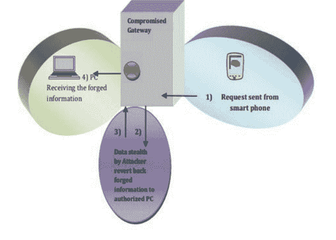

图15.3 雾环境中窃听者捕获通信的示意图。

### 15.3.6 拒绝服务（DoS）攻击

雾平台非常脆弱，更容易遭受DoS攻击[26]。雾计算（FC）平台运行在分布式环境中，数据中心以协作方式工作。因此，很难识别攻击的根源。为了防止DoS攻击，通常需要进行网络监控。入侵检测系统（IDS）用于守护网络行为并监控访问控制策略[27]。

对雾平台的DoS攻击，无论是来自最终用户还是外部系统，都会随着网络变得饱和而阻止合法服务的使用。此外，所有通信都是无线的，因此容易受到冒充、消息重放和消息篡改等问题的影响。由于涉及人的生命，对这些攻击的防护至关重要。消除此类问题的最常见方法是实施强认证、加密通信、密钥管理服务、定期审计，并实施专用网络和安全路由[41]。图15.4展示了DoS攻击的示意图。

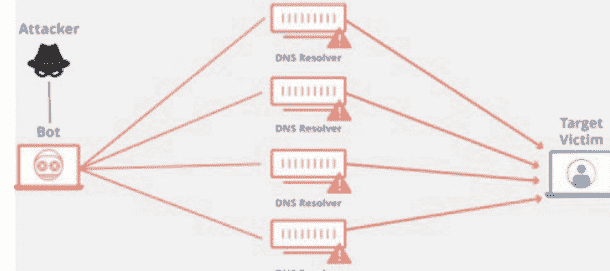

图15.4 分布式拒绝服务攻击示意图。

### 15.3.7 内部攻击

在雾平台中，内部攻击可能是由于向存储数据中注入恶意代码而导致的。入侵检测系统（IDS）可用于处理这些问题，但它们在雾环境中面临更多挑战，因为高功耗和密集计算在雾环境中是不可行的。Lee等人[27]提出了一种使用基于签名的引擎的混合入侵检测系统。在这里，异常检测在云端进行，而识别出的异常签名会生成并保存在本地雾服务器中。Dsouza等人[28]提出了一种策略驱动的安全管理框架，该框架采用基于属性的认证方案，在该方案中，所有用户和相关设备都基于一组代表性属性进行验证。他们使用可扩展访问控制标记语言（XACML）来规定框架中的操作安全和网络策略监控。这些安全策略在结构上采用模块化设计，每个安全策略模块都可以在特定应用和设备上实时即插即用，因此非常适合雾平台。Shi及其同事[29]提出了一种基于微云成员协作的微云网状架构，用于检查和检测恶意软件、恶意攻击和其他威胁。这种协作式入侵检测技术非常适合雾环境，可用于在雾节点之间观察物联网环境组件。

### 15.3.8 伪装攻击

当恶意雾节点为了任何不良意图而伪装成合法节点，以交换和收集其他物联网设备生成的数据时，就会发生伪装攻击。这类节点被称为流氓节点[30]。Ma等人[32]提出了一种混合框架[31]，能够感知基于WiFi的接入网络中的流氓接入点。他们的提议旨在保护网络免受流氓接入点的攻击，也适用于攻击者使用定制设备的情况。流氓雾节点是数据完整性的一个漏洞，能够解读用户数据或向相邻节点提供未篡改的数据。由于各种方案中信任管理的复杂性，这些问题在物联网和雾环境中难以处理。伪装攻击的示意图如图15.5所示。

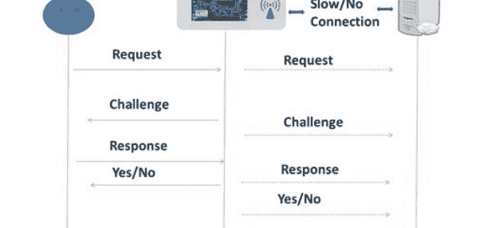

图15.5 伪装攻击。

当雾服务器与云服务器之间的连接脆弱或断开时，用户和雾服务器之间的认证和授权就会失败。部署认证和授权方案的机制位于云服务器中。这可能导致伪装攻击。

### 15.3.9 针对虚拟机和虚拟机监控程序的攻击

雾和云提供的医疗相关服务部署在虚拟环境中。如果虚拟机被攻破，它就可以与同一物理主机上的其他虚拟机通信。如果虚拟机监控程序被攻破，它就可以访问宿主机操作系统和硬件[32,33]。文献中关于这方面的研究不多，尤其是在雾计算领域。Wu等人[34]提出了一种访问控制模型，以防止云环境中的虚拟机逃逸攻击。他们的模型基于贝尔-拉帕杜拉模型[35]。但这尚未在雾环境中测试。Harnik等人指出，即使在使用了安全加密方法的情况下，传统的客户端去重中也存在一些潜在的侧信道[36]。他们提出了基于随机阈值的客户端去重和服务端去重。但在雾计算平台中使用该方法的可行性仍有待测试。因此，在像雾这样的敌对环境[37]中，需要适当的轻量级网络监控系统来避免这些攻击。

从上述讨论中，可以得出医疗保健安全协议中对安全需求的显著关键点，总结如下：

- （i）雾/云节点在处理能力和计算资源方面资源有限。因此，安全解决方案不应是计算密集型的。
- （ii）基于医疗保健的解决方案需要与物联网设备、传感器等配合使用。这些设备通常电池寿命较短。解决方案应节能且轻量级。

表15.1总结了雾计算环境中潜在的安全攻击和一些现有解决方案，这些攻击和解决方案也可被视为基于雾的医疗保健解决方案中的威胁。


## 表 15.1 安全攻击及其现有解决方案。

| 可能的攻击 | 安全威胁 | 现有解决方案 |
|---|---|---|
| 中间人攻击 | 数据保密性，数据隐私 | 加密和解密算法，将数据拆分为数据块 |
| DoS攻击 | 数据可用性 | 网络防火墙，网络监控系统，IDS |
| 内部攻击 | 数据完整性，数据隐私，数据保密性 | 网络访问控制协议，IDS |
| 冒充攻击 | 身份验证，授权，数据完整性 | 网络访问控制协议 |
| 虚拟机和超visor攻击 | 数据可用性，数据隐私 | 网络访问控制协议 |
| 欺骗攻击 | 数据完整性 | 基于公钥的算法，Diffie-Hellman密钥交换算法，IDS |

## 15.4 基于云和雾的医疗保健系统中的新兴威胁

本节讨论在医疗保健系统中发现的一些新兴威胁，下面将进行讨论。

### 15.4.1 软件供应链攻击

供应链攻击主要针对组织的供应商。在这里，攻击者的目标是业务合作伙伴和合作方，特别是在与医疗服务提供商相关的方面。攻击者总是试图找到后门入口，这通过与组织有联系的人或为其提供软件的人来实现。这些入口建立在供应链上。最近，在2018年1月，Hancock Health 遭到 SamSam 勒索软件的攻击，黑客在备份系统硬件供应商的帮助下，通过后门入口渗透进了医院的数据中心 [38]。

### 15.4.2 勒索软件攻击

勒索软件在2017年是整个公共和私营部门的主要关注点。一些高知名度和高影响力的攻击示例是WannaCry和Petya/NotPetya。但当攻击受害者是医疗保健系统时，反应与其他部门不同。例如，当Hancock Health 被 SamSam 勒索软件攻击时，其勒索金额约为55,000美元。医疗保健行业的勒索金额远高于其他行业 [39]。

### 15.4.3 加密货币挖矿和加密货币劫持恶意软件

这种恶意软件基本上被黑客用来试图使组织的计算资源不堪重负，以处理和验证比特币或其他加密货币上的交易。电子医疗保健系统需要更高的可用性 [40]。

## 15.5 结论

基于云的电子医疗保健解决方案中仍然存在许多安全漏洞。在查看云中的安全要求时，应考虑某些要点。可穿戴设备中使用的无处不在的设备依赖电池供电，因此使用的任何安全解决方案都不应消耗大量能量。计算密集型算法不能在这些场景中使用，因为它们可能会增加通信延迟和延迟。随着复杂对手的增长，一些新兴威胁正在影响医疗保健系统，需要解决。需要制定标准化的协议和业务政策，以便无缝使用电子医疗保健服务。

## 参考文献

- 1. Garcia Lopez, P., Montresor, A., Epema, D., Datta, A., Higashino, T., Iamnitchi, A., ... & Riviere, E. (2015). 边缘中心计算：愿景与挑战. ACM SIGCOMM Computer Communication Review, 45(5), 37-42.
- 2. Moosavi, S. R., Gia, T. N., Rahmani, A. M., Nigussie, E., Virtanen, S., Isoaho, J., & Tenhunen, H. (2015). SEA：一种用于基于物联网的医疗保健的利用智能网关的安全高效的身份验证和授权架构. Procedia Computer Science, 52, 452-459.
- 3. Kraemer, F. A., Braten, A. E., Tamkittikhun, N., & Palma, D. (2017). 医疗保健中的雾计算综述与讨论. IEEE Access, 5, 9206-9222.
- 4. Lye, J., Kaylor, R., Lindsay, J., & Everhart, D. (2004). U.S. Patent Application No. 10/305,263.
- 5. Oussous, A., Benjelloun, F. Z., Lahcen, A. A., & Belfkih, S. (2017). 大数据技术：综述. Journal of King Saud University-Computer and Information Sciences. DOI: 10.1016/j.jksuci.2017.06.001.
- 6. Dastjerdi, A. V., & Buyya, R. (2016). 雾计算：帮助物联网实现其潜力. Computer, 49(8), 112-116.
- 7. Sun, J., et al., 移动医疗保健（m-Health）系统的安全与隐私. 2011, Amsterdam, The Netherlands: Elsevier.
- 8. Fatema, N. and R. Brad, 使用WSNs的医疗保健应用中的安全需求、反攻击和项目——综述. arXiv preprint arXiv:1406.1795, 2014.
- 9. Wang, J., et al., 医疗组织系统中与患者相关数据的安全和隐私问题研究. International Journal of Security and Its Applications, 2013. 7(4): p. 287-298
- 10. Darwish, A. and Hassanien, A.E., 2011. 用于医疗保健监测的可穿戴和植入式无线传感器网络解决方案. Sensors, 11(6), pp.5561-5595.
- 11. M. Li, S. Yu, K. Ren, W. Lou, 在云计算中保护个人健康记录：多所有者环境下的以患者为中心和细粒度的數據访问控制, in: SecureComm, Vol. 10, Springer, 2010, pp. 89-106.
- 12. K. Ren, W. Lou, Y. Zhang, Leds: 在无线传感器网络中提供位置感知的端到端数据安全, IEEE Transactions on Mobile Computing 7 (5) (2008) 585-598.
- 13. K. Lee, D. Kim, D. Ha, U. Rajput, H. Oh, 关于雾计算支持的物联网环境的安全和隐私问题, in: Network of the Future (NOF), 2015 6th International Conference on the, IEEE, 2015, pp. 13.
- 32. L. Ma, A. Y. Teymorian, X. Cheng, 通用Wi-Fi网络的混合 rogue 接入点保护框架, in: INFOCOM 2008. The 27th Conference on Computer Communications. IEEE, IEEE, 2008, pp. 1220-1228.
- 33. D. Hyde, 虚拟机安全综述, Www1. cse. wustl. edu/jain/cse57109/ftp/vmsec/index. html.
- 34. J. Wu, Z. Lei, S. Chen, W. Shen, 防止虚拟机逃逸攻击的访问控制模型, Future Internet 9 (2) (2017) 20.
- 35. S. R. Moosavi, T. N. Gia, E. Nigussie, A. M. Rahmani, S. Virtanen, H. Tenhunen, J. Isoaho, 面向移动医疗物联网的端到端安全方案, Future Generation Computer Systems 64 (2016) 108-124.
- 36. D. Harnik, B. Pinkas, A. Shulman-Peleg, 云服务中的侧信道：云存储中的重复数据删除, IEEE Security Privacy 8 (6) (2010) 40-47. doi:10.1109/MSP.2010.187.
- 37. I. Stojmenovic, S. Wen, 雾计算范式：场景与安全问题, in: Computer Science and Information Systems (FedCSIS), 2014 Federated Conference on, IEEE, 2014, pp. 18.
- 38. https://csrc.nist.gov/CSRC/media/Projects/Supply-Chain-Risk-Management/documents/ssca/2017-winter/NCSC_Placemat.pdf , accessed on 20-8-2018
- 39. Mohurle, S., & Patil, M. (2017). WannaCry威胁简述：2017年勒索软件攻击. International Journal of Advanced Research in Computer Science, 8(5).
- 40. Tahir, R., Huzaifa, M., Das, A., Ahmad, M., Gunter, C., Zaffar, F., ... & Borisov, N. (2017, September). 在别人的钱上挖矿：缓解云和企业中的隐蔽挖矿操作. In International Symposium on Research in Attacks, Intrusions, and Defenses (pp. 287-310). Springer, Cham.
- 41. Khan, S., Parkinson, S., & Qin, Y. (2017). 雾计算安全：当前应用和安全解决方案综述. Journal of Cloud Computing, 6(1), 19.

## 第16章

## 电子钱包与功能的映射

ALISHA SIKRI¹, SURJEET DALAL¹, N.P SINGH², DAC-NHUONG LE³

¹ 计算机科学与工程系，SRM大学，索尼帕特，哈里亚纳邦，印度
² MDI, Gurugram
³ 海防大学，海防，越南
Email: profsurjeetdalal@gmail.com, Nhuongld@dhhp.edu.vn

### 摘要

本章包括在印度电子商业/电子商务领域运营的各种类型模型。此外，本章还介绍了电子钱包及其功能的映射。可以观察到，数字 only、基于文本等功能对所有类型的钱包都是共通的，而一键、CoF 等功能仅特定于开放钱包。本章试图简要介绍不同类型电子钱包中可用的各种技术、运营、法律以及安全功能。也可以从论文中得出结论，所有三种钱包具有相同的 f安全功能，包括：反欺诈，3D SET 或 SSL，P2P，数据加密和一次性密码（OTP）。

**关键词**：电子商务，电子钱包，OTP，安全


## 16.1 引言

### 16.1.1 电子钱包

电子钱包可定义为一种电子卡，可通过计算机或智能手机进行在线交易。也可以说，其用途与信用卡或借记卡相同。电子钱包必须与个人的银行账户关联，以便进行支付 [59]。

移动钱包，也可称为手机钱包、数字钱包或电子钱包，定义了一种移动技术，其使用方式类似于真实钱包。移动钱包还为任何希望让客户更轻松地在线购买其产品、从而推动销售的企业提供了非常便捷的解决方案 [60]。

移动钱包是一种将信用卡或借记卡信息以数字形式携带到移动设备上的技术。无需使用实体塑料卡进行所需购买，我们也可以用智能手机、平板电脑或智能手表进行支付。以下是移动钱包的各种好处及其一般工作原理的概述 [61]。

移动钱包是实体钱包的一种复制品。用户可以添加信用卡、借记卡，以及预付卡、礼品卡和奖励卡。移动钱包还允许用户在手机中存储和携带无限数量的卡片。这种用例不仅取代了塑料实体卡，还允许通过增值服务增强这些卡的功能 [62]。

根据文献 CY 2016（年度）版的报告，电子钱包从 2013 年到 2015 年的年增长率为 332%，即从 2 亿美元增至 26 亿美元；从 2015 年到 2016 年的增长率为 123%，即从 26 亿美元增至 58 亿美元。电子钱包是印度最受欢迎的工具之一，2017 年 4 月的移动钱包交易额约为 90 亿美元，而两年前仅为 10 亿美元。摩根士丹利估计，2017 年印度可覆盖的数字消费者支付市场规模为 3500 亿至 4000 亿美元，但低于一年前 [6]。

在许多技术进步或创新中，电子钱包基于 SSL（安全套接层）和 SET（安全电子交易）来确保在线系统的安全 [5]。其他各种技术包括 NFC（近场通信）、蓝牙、二维码、移动网络支付、蓝牙，甚至生物识别 [7]、反欺诈和数据加密（B2B 目录）[8]，以及也称为瘦钱包的服务器端数字钱包 [5]。这些是印度实现电子支付的合法工具之一。（参见政府通知。）

考虑到电子钱包的众多功能及其市场份额，可以识别出各种电子钱包的易用性。本文试图将电子钱包与其功能 NFC、一键支付、二维码和数字触控等技术特征进行映射。各种操作特征包括 KYC 要求、操作所需的各种实体等。电子钱包的安全特征可以是数据加密、SET（安全电子交易）和反欺诈。各种法律特征包括 PPI 许可证要求 [30] 等。

电子钱包可定义为一种电子卡，可通过计算机或智能手机进行在线交易。其用途与信用卡或借记卡非常相似。电子钱包需要与个人的银行账户关联以进行支付 [1]。

### 16.1.2 目标

- 1. 研究不同 PPI（*预付支付工具*）的市场份额。
- 2. 识别 PPI 电子钱包的主要功能。
- 3. 将这些主要功能与现有的热门 PPI 进行映射。

**PPI 的类型：** PPI 被称为支付工具，可凭此类工具上存储的价值购买商品和服务，包括金融服务、汇款设施等 [20]。根据印度储备银行（RBI）的规定，电子钱包分类如下 [2–4, 18, 20]：

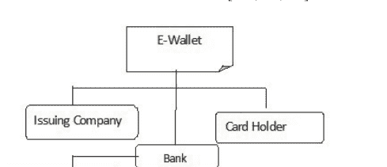

图 16.1 分别设置开放、封闭和半封闭电子钱包的生态系统 [2]

## 表 16.1 电子钱包类型示例。

| 电子钱包类型 | 示例 | 推出日期和年份 | 发起方类型 | 来源 |
|---|---|---|---|---|
| 开放钱包 | i) 沃达丰 M-Pesa，ii) ICICI 银行 Pockets，iii) PayPal，iv) Amazon Pay | i) 2014 年 11 月 7 日，ii) 2013 年 9 月 24 日，iii) 1998 年 12 月 1 日，iv) 2013 年 10 月 8 日 | i) 银行，ii) 银行，iii) PayPal Pte. Ltd，iv) 电子商务公司（Amazon） | i)，ii) ICICI 银行，iii) PYMNTS (2015)，Paypal，iv) Amazon |
| 封闭钱包 | i) Flipkart 电子钱包，ii) Chase Pay，iii) Walmart Pay，iv) Google Wallet | i)，ii) 2015 年 10 月 26 日，iii) 2016 年上半年，iv) 2011 年 5 月 26 日 | i) 在线零售商，ii) 银行业务，iii) 商店（Walmart Stores Inc），iv) 科技（Google Inc） | i)，ii) Morgan，iii) Ramakrishnan 等人，iv) Google Wallet Story |
| 半封闭钱包 | i) Paytm，ii) Mobikwik，iii) Oxigen-Wallet，iv) PayU，v) Freecharge | i) 2010 年，ii) 2009 年，iii) 2004 年，iv) 2002 年，v) | i) 私营，ii)，iii) Oxigen Services Pvt.Ltd，iv) 私营（Naspers Group（南非）），v) 银行（Axis） | i) Paytm Story，ii) Agarwal (2013)，iii) Oxigen，iv) Dalal（2016），v) Variyar (2017) |

1. *开放钱包：* 这是一种允许用户购买商品和服务、在 ATM 或银行提取现金以及转账的钱包。这些服务只能与银行联合推出。此外，它允许其各类用户向任何手机号码银行账户发送资金。只有银行被允许发行这些工具 [4]。

2. 封闭钱包：这种移动钱包在电子商务公司中相当受欢迎。在此类钱包中，如果订单取消或退货，或涉及礼品卡，一定金额会被锁定在商户处。示例：Flipkart 电子钱包¹。

3. 半封闭钱包：在这种钱包中，我们可以购物，并将虚拟资金转移给同一钱包网络中的任何其他用户。这类钱包在印度非常受欢迎。其缺点是它不允许现金提取或赎回，但允许用户在所列商户处购买商品和服务。示例：Paytm²、Mobikwik³。

### 独特功能：

- 1. 一键支付功能：一键支付是一项可让您更快完成购买、同时仍能确保您完整财务信息安全的功能。您可以轻松地在账户中关闭一键支付来停用此功能 [12]。
- 2. NFC（近场通信）⁴：NFC 是用于短距离无线通信的最新科技之一。NFC 还提供电子设备之间的安全通信技术 [10]。NFC 论坛定义的 NFC 的三种通信模式为读/写模式、标签仿真模式和对等模式 [11]。
- 3. CoF（基于云的文件卡）：云端数字钱包，顾名思义，在基于网络的服务器上处理交易并存储用户账户信息。PayPal、Google、MasterCard 和 Visa 均支持基于云的实现 [7]。
- 4. 光学/二维码：QR 码代表快速响应码，是矩阵条码类型的一种商标。QR 码被认为是二维的，即以正方形排列的单元架构构成的矩阵型符号 [63]。
- 5. POS（销售点）：为确保更广泛的接受度并覆盖商户，NFC POS 支付需要在不刷实体卡的情况下接受付款 [24]。
- 6. FIPB 批准：FIPB（外国投资促进委员会）是一个知名的指定机构，负责审议需要政府批准的外国直接投资提案。此外，它还批准涉及外国投资/外国技术的综合申请 [65]。
- 7. 依据 NBFC 法案：根据 NBFC 法案，各持牌银行或定期银行以及注册的非银行金融公司（NBFC）在获得印度储备银行的批准/授权后，可获准发行 PPI [64]。
- 8. KYC 要求：根据 RBI 的规定，对 PPI 实行完整 KYC 要求是向互操作性迈出的一步 [13]。不符合 KYC 规范的钱包将不允许向其各自钱包充值。

¹https://www.flipkart.com/
²https://paytm.com
³https://www.mobikwik.com/
⁴http://nearfieldcommunication.org/


账户，或进行基于汇款的交易，也不允许将钱包账户中的现金转账到其银行账户[14]。

9. IMPS（即时支付服务）：IMPS是一种将手机号码与银行账户关联的系统。IMPS帮助持有借记卡或网银账户的客户使用手机进行电子钱包交易[40]。

10. 反欺诈：无论如何，欺诈在所有商业领域都是一个敏感问题，无论是公共企业还是私营企业。与其在欺诈造成后果后进行补救，不如预防欺诈，这是一个关键问题[66]。

11. 3D-SET（安全电子交易）：SET是一个确保互联网金融交易安全的系统。通过SET，用户获得一个电子钱包（数字证书），交易通过数字证书和数字签名的组合在购买者、商家和购买者银行之间进行和验证，从而确保隐私和机密性[15]。

12. 数据加密：加密被定义为对信息进行编码的过程，使得信息无法通过正常方式读取。加密还会改变信息中的数据，如果不使用任何特殊规则或代码来解码加密结果数据，将难以阅读且耗时[16]。

## 电子现金支付系统的参与者[77]：

## 表16.2 电子现金支付系统。

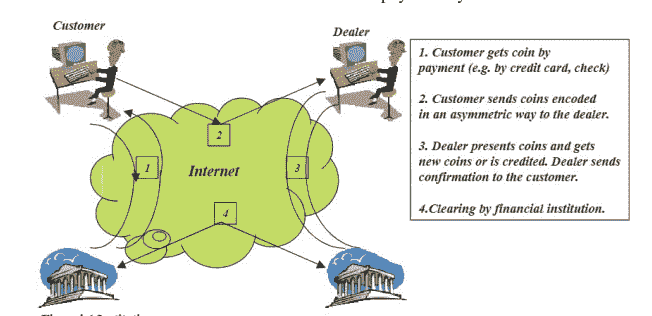

- 1. 客户：客户是使用数字现金支付系统进行购买的人。
- 2. 商家：商家是承担支付交易成本的一方。
- 3. 数字支付系统提供商：提供商是商家与金融机构之间的中介类型。他们提供服务以及培训。
- 4. 数字支付系统开发商：金融机构：使用电子支付系统的银行系统或组织。

5. 信任中心：信任中心是控制数字签名密钥的机构，同时也有助于确保客户对特定支付系统的信心。它们负责传输数据的完整性和交易方的真实性。

本章分为多个部分。第一部分是引言部分；第2节包括文献综述部分。第3节描述了电子钱包的市场份额，如电子钱包的各种技术特征、各种经济特征、各种电子钱包的运营特征以及各种安全特征。第4节定义了研究方法部分和研究模型。分析结果包含在第5节中。最后，第6节包括结论和建议。

## 16.2 文献综述

进行文献综述的目的是研究各种电子钱包的实用性。Rawat等人[2]报告称，移动钱包细分市场的增长可以被认为与印度智能手机使用率和互联网普及率的上升密切相关。作者还指出，印度的废钞令也被证明是印度移动钱包参与者的一个有利机会。它导致了移动钱包公司涌入数百万笔交易，用户数量翻倍。该论文还试图解释移动钱包的分类类别，并解释这些电子钱包中可用的各种运营功能。本文中提到的各种运营功能包括允许运营的实体，如银行、NBFC（非银行金融公司）和各种其他实体，KYC要求是否需要等。它还分享了持卡人可以在PPI中存储的金额，例如，封闭钱包中可以存储10,000印度卢比，半封闭PPI中可以在无需KYC的情况下存储10,000印度卢比，而在有KYC的情况下可以在同一钱包中存储50,000印度卢比。

Pandy等人[22]给出了移动钱包的定义，本文将移动钱包定义为“一种由移动设备（即智能手机）访问的数字容器，用于存储钱包应用程序、支付凭证、会员卡和优惠券，并用于进行近距离和远程移动支付”。作者还介绍了电子钱包中可用的各种技术特征，包括NFC（近场通信）、基于云的卡存档（CoF）以及商家或金融机构（FI）二维码封闭钱包。FRBB钱包团队对所有钱包模型进行了现场测试。他们还使用特定设备的移动操作系统（如Apple iOS和Android KitKat（4.4或更高版本））测试了NFC Pay钱包。各种基于云的移动钱包，如PayPal、master pass、pay with Amazon、visa checkout、chase pay和walmart pay，也与设备无关，尽管有些只在远程支付环境（Amazon⁵）或POS环境（Walmart Pay⁶）中运行。他们还讨论了移动钱包的各种安全控制措施，以保护移动钱包的支付方式。这些包括支付令牌化、一次性密码（OTP）保护等。

Agarwal[33]总结了印度管理移动钱包的法律、市场情景以及导致移动钱包行业受欢迎的其他方面。印度管理支付系统的主要法律是《2007年支付和结算法案》（该法案），连同《2008年支付和结算系统条例》（截至2011年修订版）、《2008年支付和结算系统监管和监督委员会（BPSS）条例》以及《2015年支付和结算系统（修订）法案》（2015年第18号法案）。根据上述政策第2.3段，PPI的定义为：“预付支付工具是促进购买商品和服务的支付工具，包括以此类工具上存储的价值进行的资金转移”。本章得出结论，半封闭钱包是最常用的支付方式，正吸引着客户的注意。本章提到了PPI所需的各种法律法案，包括用于发行外汇预付支付工具的FEMA（外汇管理法）。NBFC（非银行金融公司法）也是支付工具所需法案之一。封闭和半封闭钱包适用该法案，而开放钱包不适用该法案。本文可以得出的结论是，数字行业增长的核心原因是经济中大量人口没有银行账户。因此，移动钱包行业在促进这部分人口进行日常交易方面发挥着重要作用。

Kanimozhi等人[58]撰文讨论了移动电子钱包的安全问题。该论文试图回答与电子钱包操作流程、电子钱包种类以及移动电子钱包相关的安全问题。作者详细阐述了封闭电子钱包的安全问题，根据作者的说法，电子钱包的安全保护有两种方式：一种是SET，即安全电子交易，它确保机密传输和数字化金融传输的安全；另一种是SSL，即安全套接层，它为买方和商家提供身份验证。它还通过数字签名、密码等方式识别购买者并验证客户，从而确保安全。该论文还提到了Paytm中的OTP功能，Paytm是“通过手机支付”（Pay through Mobile）的缩写，当资金从银行转移到钱包时，会生成一个OTP并需要输入。论文还总结道，RBI（印度储备银行）报告称，在废钞令之后，约有2000万电子钱包活跃用户。

Bezhovski[57]分析了各种电子支付系统、移动支付作为电子支付系统的未来以及与之相关的安全问题。该论文考察了影响消费者采用移动支付方式的各种因素。各种在线支付系统包括电子支付卡、电子钱包、移动支付、电子现金等。根据研究，很明显移动支付具有各种功能，如NFC、声波、二维码和基于云的解决方案等，这些功能使其更安全，并且是未来对客户最方便的支付解决方案。同样明显的是，电子支付系统必须遵循高效的安全协议，以确保在线交易的高安全性，为此我们有名为SSL和SET的协议。

## 16.3 电子钱包的市场份额

移动钱包交易是增长最快的无纸化支付或银行模式之一，预计在未来10年内，大多数交易将实现无纸化[2]。电子钱包交易已从2012-2013年度的100亿卢比增长到2015-2016年度的超过4800亿卢比⁴。预计印度移动钱包交易的市场价值将在2016财年至2022财年期间以211%的复合年增长率增长，达到275万亿印度卢比[2]。各种


电子钱包公司受益于数百万笔交易以及用户数量翻倍。零售业的平均钱包支出在废钞行动前约为 INR 500-700；此事件后急剧增加至 INR 2,000-10,000 后此事件 18。印度储备银行 2017 年 11 月公报披露，截至 2017 年 9 月，PPI 交易量为 240.29 百万笔（相比 2016 年 9 月的 97.07 百万笔），PPI 交易价值为 INR 109.77 十亿（相比 2016 年 9 月的 INR 56.28 十亿）[19]。

### 16.3.1 技术特性
本节介绍印度电子商务领域中使用的电子钱包的技术特性。这些特性包括 NFC（近场通信 Near Field Communication）[28]、CoF（基于云的卡片存档 Cloud-based Card-on-file）[29]、QR Code 二维码[21, 22]、以及 Point-of-Sale 销售点[27]、Digital Only 仅数字[21]、Text-based 基于文本[21]。这些已汇总在下表 16.2 中。

表 16.3 印度电子钱包的技术特性。

| 电子钱包类型 | 一触即付或轻触支付 | NFC（近场通信） | CoF（基于云的卡片存档） | 光学/二维码 | POS（销售点） | 仅数字 | 基于文本 |
|---|---|---|---|---|---|---|---|
| 开放式钱包 | 是 (Paypal) | 否 [22] | 是 [7, 22] | 否 [21] | 是 | 是 [21] | 是 [21] |
| 封闭式钱包 | 否 [28] | 否 [22, 25] | 是 [29] | 是 [22] | 是 [22] |  |  |
| 半封闭式钱包 | 是 [21, 23] | 是 [24] |  | 是 [26] | 是 [24] | 是 [21] |  |

### 16.3.2 法律特性
本节介绍印度电子商务领域中使用的电子钱包的法律特性。这些特性包括 PPI 许可证要求[30]、FIPB 批准（外国投资促进委员会 Foreign Investment Promotion Board）[31]、RBI 批准[32]以及受 NBFCs（非银行金融机构 Non-Banking Financial Companies）[33] 法案管辖的钱包。

这些已汇总在下表 16.3 中：

表 16.4 印度电子钱包的法律特性。

| 电子钱包类型 | PPI 许可证要求 | FIPB 批准（外国投资促进委员会） | RBI 批准 | 受 NBFC's（非银行金融机构）法案管辖 |
|---|---|---|---|---|
| 开放式钱包 | 是 [30] | 是 [35] | 是 [36] | 否 [34] |
| 封闭式钱包 | 否 [30] |  | 否 [32] | 是 [33] |
| 半封闭式钱包 | 是 [30] | 是 [31] | 是 [37] | 是 [33] |

### 16.3.3 运营特性
本节介绍印度电子商务领域中使用的电子钱包的运营特性。这些特性包括 KYC 要求、允许运营的实体[2]、购买 PIN 码[38]、IMPS（即时支付服务 Immediate Payment Service）[40]以及赎回或现金提现[39]。这些已汇总在下表 16.4 中：

**表 16.5 印度电子钱包的运营特性。**

| 电子钱包类型 | KYC 要求 | 购买 PIN 码 | 银行 | NBFCs | 其他实体 | IMPS（即时支付服务） | 赎回或现金提现 |
|---|---|---|---|---|---|---|---|
| 开放式钱包 | 是 [2] | 是 [38] | 是 [2] | 否 [2] | 否 [2] | 是 [41] | 是 [39] |
| 封闭式钱包 | 否 [2] | 是 [44] | 是 [2] | 是 [2] | 是 [2] | 是 [42] | 否 [39] |
| 半封闭式钱包 | 非强制性 [2] | 是 [43] | 是 [2] | 是 [2] | 是 [2] | 是 [40] | 否 [39] |

### 16.3.4 安全特性
本节介绍印度电子商务领域中使用的电子钱包的安全特性。这些特性包括防欺诈[45]、数据加密[22]、3D SET（安全电子交易 Secure Electronic Transaction）[5]、P2P 通信[47]以及一次性密码[46]。这些已汇总在下表 16.5 中：

**表 16.6 印度电子钱包的安全特性。**

| 电子钱包类型 | 防欺诈 | 3D SET（安全电子交易）或 SSL（安全套接层 Secure Socket Layer） | 数据加密 | P2P | 一次性密码（OTP） |
|---|---|---|---|---|---|
| 开放式钱包 | 是 [48] | 是 [41] | 是 [22] | 是 [47] | 是 [56] |
| 封闭式钱包 | 是 [55] | 是 [53] | 是 [50] | 是 [49] | 是 [56] |
| 半封闭式钱包 | 是 [45] | 是 [52] | 是 [54] | 是 [47] | 是 [46] |

## 16.4 研究方法
基于 PPI 文献和 RBI 指南，钱包类别被确定为 i) 开放式电子钱包 ii) 封闭式电子钱包 iii) 半封闭式电子钱包。电子钱包的主要特性为：i) 技术特性 ii) 运营特性 iii) 法律特性 iv) 安全特性。此外，每个特性类别均进一步展开，以阐述不同电子钱包中各类特性的可用性。

## 表 16.7 电子钱包特性的映射框架。

| 电子钱包类型 | 特性 |
|---|---|
| 开放式钱包 | **技术特性:**<br>- 一触即付或轻触支付 (PayPal)<br>- CoF（基于云的卡片存档 Cloud Based Card-on File）(Pandey et.al, Ovum(2017))<br>- POS（销售点 Point-of-Sale）(Editorial Staff)<br>- 仅数字 (Peterson et al.(2016))<br>- 基于文本 (Peterson et al.(2016))<br><br>**运营特性:**<br>- KYC 要求 (Rawat et al. (2016))<br>- 购买 PIN 码 (Olsen et al.(2012))<br>- 允许运营的实体 (银行) (Rawat et al. (2016))<br>- IMPS (Business Line(2014))<br>- 赎回或现金提现 (Jamwal(2017))<br><br>**法律特性:**<br>- PPI 许可证要求 (Siddarth(2017))<br>- FIPB 批准( 外国投资促进委员会 Foreign Investment Promotion Board) (PTI(2013))<br>- RBI 批准 (Chengappa(2017))<br><br>**安全特性:**<br>- 防欺诈 (PayPal)<br>- 3D SET 或 SSL (Nitrosell(2009))<br>- 数据加密 (Pandey et al. (2017))<br>- P2P (Bemoneyaware(2017))<br>- 一次性密码 (Woodford(2017)) |
| 封闭式钱包 | **技术特性:**<br>- CoF（基于云的卡片存档 Cloud Based Card-on File）(Pandey et.al. (2016))<br>- 光学/二维码 (Pandey et. al(2017))<br>- POS（销售点 Point-of-Sale）(Pandey et. al(2017))<br><br>**运营特性:**<br>- 购买 PIN 码 (Jolly(2016))<br>- 允许运营的实体 (银行, NBFC's, 其他实体) (Rawat et al. (2016))<br>- IMPS (Team Flipkart(2017))<br><br>**法律特性:**<br>- 受 NBFC's（非银行金融机构 Non- Banking Financial Companies）法案管辖 (Agarwal(2017))<br><br>**安全特性:**<br>- 防欺诈 (Rampton(2016))<br>- 3D SET 或 SSL (Chase Payment))<br>- 数据加密 (Akin (2017))<br>- P2P (Ryan(2014))<br>- 一次性密码 (Woodford(2017)) |
| 半封闭式钱包 | **技术特性:**<br>- 一触即付或轻触支付 (Peterson et al. (2016), Paytm Blog(2017))<br>- NFC（近场通信 Near Field Communication）(ANI(2018))<br>- 光学/二维码 (PTI(2017))<br>- 销售点 (ANI(2018))<br>- 仅数字 (Peterson et al.(2016))<br><br>**运营特性:**<br>- 购买 PIN 码 (Singh(2017))<br>- 允许运营的实体 (银行, NBFC's, 其他实体) (Rawat et al. (2016))<br>- IMPS (Chamikuty(2013))<br><br>**法律特性:**<br>- PPI 许可证要求 (Siddarth(2017))<br>- FIPB 批准( 外国投资促进委员会 Foreign Investment Promotion Board) (Dutta(2012))<br>- RBI 批准 (Tiwari(2017))<br>- 受 NBFC's（非银行金融机构 Non- Banking Financial Companies）法案管辖 (Agarwal(2017))<br><br>**安全特性:**<br>- 防欺诈 (Aulakh(2016))<br>- 3D SET 或 SSL (Pathak(2016))<br>- 数据加密 (Pandey et al. (2017))<br>- P2P (Bemoneyaware(2017))<br>- 一次性密码 (Kamnath et al.(2017)) |

**数据收集**：为完成首要目标，即了解不同电子钱包的市场份额，进行了适当的数据收集，同时也通过展示电子钱包市场份额的增长来描绘废钞行动对电子钱包使用的影响，该增长适用于理性分析。电子钱包的主要特性以映射框架的形式在表中给出。映射数据收集自 Business Line、Economic Times 等各类新闻文章，以及 ASSOCHAM、Mahindra Comviva 文章等。未在线上或研究文章中可获得的数据则收集自 PayPal、Paytm、CHASE Payment、HERO Pay 等各类电子钱包公司的官方网站。数据被收集并进行趋势和内容分析。为进行内容分析，对电子钱包特性的词典进行了审视。

## 16.5 结果分析
上述分析的结果以给定图表的形式汇总。

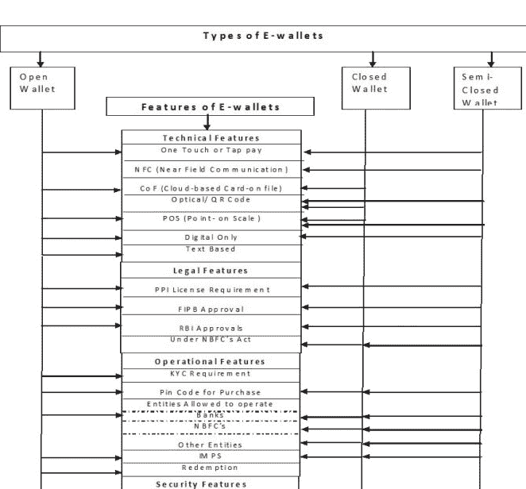

图 16.2 电子钱包特性映射与电子钱包类型的研究模型


## 16.6 结论与未来工作

可以得出结论，数字支付的未来前景非常光明。印度也在数字支付方式方面经历了显著增长。2015-2016年，通过移动银行交易总额达4018亿卢比，而2012-2013年为60亿卢比。通过其他方式进行的数字支付比例也在显著速度增长中[17]。也可以得出结论，印度即将发展成为未来几年世界上增长最快的经济体，超越中国。半封闭钱包具有巨大的潜力，可为整体GDP增加价值，推动国家实现无现金经济。

## 参考文献

- 1. 《经济时报》。(2018)，电子钱包定义 可访问于 https://economictimes.indiatimes.com/definition/e-wallets。 (访问于 2018年6月7日)
- 2. Rawat D. S. 和 Maheshwari S. (2016)。 废钞后 M-Wallet 情况 ASSOCHAM，印度。 于 2018年5月27日检索自 http://www.assocham.org/upload/docs/M-Wallet.Report.press.pdf。
- 3. Manikandan,S., & Jayakodi,J.M. (2017)。 消费者对移动钱包的采用的实证研究，特别参考金奈市。 International Journal of Research-Granthalaya, 5(5), 107-115。
- 4. Nair, A., Dahiya, M., & Gupta, N. (2016)。 教育消费者了解数字钱包。
- 5. Upadhyay, A. (2012)。 电子商务与电子钱包。 International Journal of Recent Research and Review。
- 6. Abbas M. (2017)。 印度移动钱包交易在2017年增至90亿美元：摩根士丹利，6月16日，可访问于 https://telecom.economictimes.indiatimes.com/news/indias-mobile-wallet-transactions-up-at-9-billion-in-2017-morgan-stanley/59174647(访问于 2018年6月10日)
- 7. Ovum。(2012)。 数字钱包动态：机遇、挑战与建议，Mahindra Comviva。 于 2018年6月2日检索自 chrome-extension://ngpampappnmpegiilofohadhmbhlaek/captured.html?back=1。
- 8. Jeannette (2017)。 PayPal 评测，12月29日，可访问于 https://reviews.financeonline.com/paypal/ (访问于 2018年5月11日)。
- 9. CY 2016 (年度)。 (2016)。 印度移动钱包市场。 于 2018年5月13日检索自 redeeer.org/wp-content/.../02/7.-Analyst-Report-Mobile-Wallets.CY16-Review.pdf。
- 10. Rahul, A., Gokul Krishnan, G., Unni Krishnan, H., & Rao, S. (2015)。 近场通信 (NFC) 技术：综述。 International Journal on Cybernetics & Informatics (IJCI), 4(2), 133-144。
- 11. Al-Ofeshat, H. A., & Al Rababah, M. A. (2012)。 近场通信 (NFC)。 International Journal of Computer Science and Network Security (IJCSNS), 12(2), 93。
- 12. PayPal，One Touch 可访问于 https://www.paypal.com/us/webapps/mpp/one-touch-checkout/faq (访问于 2018年5月25日)
- 13. Prasad, N. (2018)，仅在重新加载电子钱包时需要 KYC 合规，2月27日 可访问于 http://www.thehindu.com/business/Economy/kyc-compliance-needed-only-for-reloading-e-wallets/article22859593.ece (访问于 2018年6月20日)
- 14. Pani.P. (2018)。 电子钱包 KYC 规范自 3 月 1 日起强制执行，2 月 26 日，可访问于 https://www.thehindubusinessline.com/economy/kyc-norms-for-e-wallets-made-mandatory-from-march-1/article22859974.ece (访问于 2018年5月10日)
- 15. Rouse M，安全电子交易，可访问于 https://searchfinancialsecurity.techtarget.com/definition/Secure-Electronic-Transaction (访问于 2018年5月11日)。
- 16. Husni, E. (2017)。 移动支付的动态规则加密。 Security and Communication Networks, 2017。
- 17. Pandey P. (2017)，印度数字支付 2016-2017：定义、类型、比较和应用，1月2日，可访问于 https://upipayments.co.in/digital-payment/ (访问于 2018年5月11日)。
- 18. Danish。(2018)，什么是半封闭钱包？，2月，可访问于 https://enterslice.com/learning/semi-closed-wallets/ (访问于 2018年5月15日)。
- 19. Kamath. A, Maheshwari.K, Reddy.J and Kalra.K. (2017)，印度：修订后的预付费支付工具法聚焦 KYC、互操作性、消费者保护和数据安全，12月11日，可访问于 http://www.mondaq.com/india/x/654638/Financial+Services/Revamped+Prepaid+Payment+Instrument+Law+Focuses+On+KYC+Interoperability+Consumer+Protection+And+Data+Security (访问于 2018年5月11日)。
- 20. Dave. N. (2017)，所有预付费支付工具发行人、系统提供商、系统参与者及所有拟议预付费支付工具发行人，3月20日，可访问于 https://rbi.org.in/scripts/BS_ViewMasDirections.aspx?id=11142 (访问于 2018年5月24日)。
- 21. Peterson.T and Wezel.R. (2016)，数字和移动钱包的演变，白皮书，Mahindra Comviva。 于 2018年5月15日检索自 http://www.paymentscardsandmobile.com/wp-content/uploads/2016/10/The-Evolution-of-Digital-and-Mobile-Wallets.pdf。
- 22. Pandey S and Crowe M. (2017)，选择移动钱包：消费者视角，3月7日。 于 2018年5月15日检索自 chrome-extension://ngpampappnmepgilofjhadlhmbhlaek/captured.html?back=1。
- 23. Paytm 博客。(2017)，你在 Paytm 上可以做的 8 件事你不知道，3月20日，可访问于 https://blog.paytm.com/10-things-you-didnt-know-you-could-do-on-paytm-62a1b200faa6。 (访问于 2018年5月25日)。
- 24. ANI。(2018)，Paytm Tap 卡发布，允许在不到一秒内进行离线支付，4月28日，可访问于 https://gadgets.ndtv.com/apps/news/paytm-tap-card-launch-how-to-use-nfc-pos-terminal-1844179。 (访问于 2018年5月30日)。
- 25. Boden.R。(2016)，Mahindra Comviva 赢得 GTB 创新奖，6月7日，可访问于 https://www.nfcworld.com/2016/06/07/345356/mahindra-comviva-wins-gtb-innovation-award/ (访问于 2018年5月25日)。
- 26. PTI。(2017)，Paytm QR 帮助商店老板将付款直接存入银行账户，12月18日，可访问于 https://economictimes.indiatimes.com/small-biz/startups/newsbuzz/paytm-qr-to-help-shopkeepers-get-payments-directly-to-bank-a/c/articleshow/62122872.cms (访问于 2018年5月15日)。
- 27. 编辑部。(2017)，PayPal Here- POS 系统评测，12月18日，可访问于 https://www.business.com/reviews/paypal-here-pos-systems/ (访问于 2018年5月30日)。
- 28. Perez.S。(2015)，Chase Pay 的问题，银行即将推出的 Apple Pay 竞争对手，10月10日，可访问于 https://techcrunch.com/2015/10/27/the-problem-with-chase-pay-the-banks-forthcoming-apple-pay-competitor/ (访问于 2018年6月4日)。
- 29. Pandey S and Crowe M。(2016)，走在曲线前面：评估移动支付环境中的非面对面卡欺诈，11月10日。 于 2018年6月30日检索自 https://www.frbatlanta.org/-/media/documents/rprf/rprf_pubs/2016/11/getting-ahead-of-the-curve-assessing-card-not-present-fraud-2016-11-18.pdf。
- 30. Siddarth。(2017)，携手更好地服务我们的客户，5月30日，可访问于 https://www.fonepaisa.com/blog/go-cashless-and-cardless/the-different-types-of-wallets (访问于 2018年5月30日)。
- 31. Dutta.S。(2012)，Oxigen 获得 FIPB 对 FDI 投资的批准，2月14日，可访问于 https://www.medianama.com/2012/02/223-oxigen-gets-fipb-approval-for-fdi-investment/ (访问于 2018年5月31日)。
- 32. Sethi.L。(2017)，来自 RBI 的电子钱包许可证批准，2月15日，可访问于 https://www.gstonlinefiling.com/e-wallet-license-approval-rbi/ (访问于 2018年5月29日)。
- 33. Agarwal. S. (2017)，移动钱包- 技术重新定义，3月。 于 2018年5月29日检索自 http://vinodkothari.com/wp-content/uploads/2017/03/Mobile_Wallets_Technology_Re-defined.pdf。
- 34. Jose. T. (2016)，什么是预付费支付工具 (PPIs)？，12月1日，可访问于 https://www.indianeconomy.net/splclassroom/what-are-prepaid-payment-instruments-ppis/ (访问于 2018年6月2日)。
- 35. PTI。(2013)，Vodafone 寻求 FIPB 对印度业务 100% 股权的批准，10月29日。 可访问于 https://www.business-standard.com/article/current-affairs/vodafone-seeks-fipb-approval-for-100-stake-in-india-unit-113102901049_1.html (访问于 2018年6月4日)。
- 36. Chengappa. S. (2017)，Amazon 获得 RBI 对电子钱包的批准，4月12日，可访问于 https://www.thehindubusinessline.com/info-tech/amazon-receives-rbi-approval-for-ewallet/article9634488.ece (访问于 2018年6月4日)
- 37. Tiwari. S. (2017)，Paytm 获得 RBI 批准成为支付银行，您现在可以在此存款，1月4日，可访问于 https://www.indiatimes.com/news/india/paytm-gets-rbi-s-approval-to-become-a-payment-bank-you-can-now-deposit-your-money-here-268756.html (访问于 2018年6月4日)
- 38. Olsen. M, Hedman. J and Vatrapu. R. (2016)。 设计数字支付工具，1月5日。 于 2018年5月29日检索自 http://openarchive.cbs.dk/bitstream/handle/10398/8502/Olsen_Hedman_Vatrapu.pdf?sequence=1。
- 39. Jamwal.M. (2017)，印度 10 大数字钱包，12月21日，可访问于 http://www.iamwire.com/2017/12/mobile-wallets-best-10-digital-wallets-in-india/170127 (访问于 2018年5月29日)。
- 40. Chamikutty. P. (2013)，Paytm 实施 IMPS 支付方式，一种允许通过短信在线充值的方法，6月26日 可访问于 https://yourstory.com/2013/06/paytm-become-the-first-online-portal-to-implement-imps-mode-of-payment-a-method-that-allows-online-recharge-through-sms/ (访问于 2018年6月4日)
- 41. Business Line。(2014)，M-Pesa 启动银行间转账服务，3月22日，可访问于 https://www.thehindubusinessline.com/economy/m-pesa-starts-inter-bank-money-transfer-service/article20739747.ece (访问于 2018年6月5日)。
- 42. Team Flipkart。(2017)，你必须了解的关于 Flipkart 的 PhonePe 应用的 7 件事，1月2日，可访问于 https://stories.flipkart.com/phonepe-app-flipkart/ (访问于 2018年6月5日)。
- 43. Singh.N. (2016)，Oxigen Wallet 预付卡- 特性和优势，3月25日，可访问于 https://www.techmesto.com/oxigen-wallet-prepaid-cards-info/ (访问于 2018年6月5日)。
- 44. Jolly. J. (2016)，如何用你的智能手机支付一切，7月24日，可访问于 https://www.usatoday.com/story/tech/columnist/2016/07/24/how-pay-everything-your-smartphone/87434966/ (访问于 2018年6月5日)


- 45. Aulakh. G. (2016)，Paytm、MobiKwik、Oxigen Wallet 等钱包公司如何试图防范欺诈性移动交易，1月16日，可访问 https://economictimes.indiatimes.com/small-biz/startups/how-wallet-companies-like-paytm-mobikwik-oxigen-wallet-are-trying-to-prevent-fraudulent-mobile-transactions/articleshow/50598068.cms （访问日期：2018年5月20日）。
- 46. Kamath. A、Maheshwari. K、Reddy. J 和 Kalra. K. (2017). 印度：修订后的预付支付工具法聚焦于KYC、互操作性、消费者保护和数据安全，12月11日，可访问 http://www.mondaq.com/india/x/654638/Financial+Services/Revamped+Prepaid+Payment+Instrument+Law+Focuses+On+KYC+Interoperability+Consumer+Protection+And+Data+Security （访问日期：2018年5月30日）。
- 47. Bemoneyaware (2017). 无现金化：数字钱包、NEFT、IMPS、UPI、借记卡、信用卡，3月15日，可访问 https://www.bemoneyaware.com/blog/cashless-digital-wallets-neft-imps-upi-debit-cards/ （访问日期：2018年6月5日）。
- 48. Paypal，更安全地远离威胁，可访问 https://www.paypal.com/in/webapps/mpp/paypal-safety-and-security （访问日期：2018年6月6日）。
- 49. Ryan. P. (2014)，沃尔玛进军P2P领域，4月21日，可访问 https://bankinnovation.net/2014/04/walmart-enters-p2p-space/ 安全（访问日期：2018年6月6日）。
- 50. Akin. J. (2017)，支付安全随加密技术的进步而演进，4月21日。可访问 https://www.experian.com/blogs/ask-experian/payment-security-evolves-with-advances-in-encryption/ （访问日期：2018年6月6日）。
- 51. Nitrosell. (2009)，功能聚焦：支持3D Secure的PayPal Website Payments Pro，12月11日，可访问 https://www.nitrosell.com/blog/feature-spotlight-paypal-website-payments-pro-with-3d-secure-509.html （访问日期：2018年6月7日）。
- 52. Pathak. P. (2016)，Paytm安全吗？该应用通过一篇博客文章回应安全问题，12月28日，可访问 https://www.indiatoday.in/technology/news/story/is-paytm-safe-the-app-answers-safety-questions-with-a-blog-post-359903-2016-12-28 （访问日期：2018年6月7日）。
- 53. Chase Payment, CHASE PAYMENTECH 欧洲 3-DSECURE (3-DS) MPI，于2018年6月7日检索自 https://image2.pro/uploads/default/original/2X/f/f1171caec005135894253f6ca1bfb7f0b95126d6.pdf。
- 54. Sharma.R. (2016)，什么是Paytm，以及如何使用Paytm钱包？，11月14日，可访问 https://gadgets.ndtv.com/apps/features/what-is-paytm-and-how-to-use-paytm-wallet-1625271 （访问日期：2018年6月7日）。
- 55. Rampton. J. (2016)，你对使用移动支付的担忧是有道理的，10月4日，可访问 https://www.entrepreneur.com/article/282722 （访问日期：2018年6月10日）。
- 56. Woodford. C. (2017)，双因素认证，10月15日，可访问 https://www.explainthatstuff.com/how-security-tokens-work.html （访问日期：2018年6月11日）。
- 57. Bezhovski. Z. (2016). 移动支付作为电子支付系统的未来，可访问 http://eprints.ugd.edu.mk/15691/1/The%20Future%20of%20the%20Mobile%20Payment%20as%20Electronic%20Payment%20System.pdf （访问日期：2018年5月16日）。
- 58. Kanimozhi. G 和 Kamatchi. K.S. (2017). 基于移动设备的电子钱包的安全方面，6月，可访问 www.ijritcc.org/download/browse/...5_Issues/.../1499068565_03-07-2017.pdf （访问日期：2018年5月16日）。
- 59. 《经济时报》(2018). 电子钱包定义，可访问 https://economictimes.indiatimes.com/definition/e-wallets。
- 60. Kony (2018). 移动钱包，可访问 https://www.kony.com/resources/glossary/mobile-wallet （访问日期：2018年5月16日）。
- 61. Fargo, W. (2017). 你的信用卡或借记卡的好处。你的手机的便利性，可访问 https://www.wellsfargo.com/mobile-payments/mobile-wallet-basics/。
- 62. HERO PAY (2015). 移动钱包，可访问 https://www.heropay.com/glossary/mobile-wallet/。
- 63. Pandya, K. H. 和 Galiyawala, H. J. (2014). QR码研究综述：在研究与应用的背景下。《International Journal of Emerging Technology and Advanced Engineering》，4(3)，258-262。
- 64. RBI. (2017). 关于在印度发行和运营预付支付工具的总指示，3月20日，可访问 https://www.rbi.org.in/Scripts/bs_viewcontent.aspx?Id=3325 （访问日期：2018年6月20日）。
- 65. Jose. T. (2016). 什么是FIPB（外国投资促进委员会）？它在FDI审批中扮演什么角色？，8月17日，可访问 https://www.indianeconomy.net/splclassroom/what-is-fipb-foreign-investment-promotion-board-what-is-its-role-in-fdi-approval/ （访问日期：2018年7月30日）。
- 66. Rorwana. A、Tengeh. R 和 Musikavanhu. T. (2015). 欺诈预防政策：其在南非一所理工大学的相关性与影响，可访问 https://www.researchgate.net/profile/Robertson.Tengeh/publication/286879136/inline/jsViewer/566ecde908ae62b05f0b62cf?inViewer=1&pdfJsDownload=1&origin=publication_detail&previewAsPdf=false （访问日期：2018年7月31日）。
- 67. ICICI银行。ICICI银行推出Pockets by ICICI Bank，可访问 https://www.icicibank.com/aboutus/article.page?identifier=news-icici-bank-launches-pockets-by-icici-bank-20131712171049400 （访问日期：2018年8月1日）。
- 68. PYMNTS. (2015). 怀旧星期四：PayPal历史上最重要的日子，7月2日，可访问 https://www.pymnts.com/in-depth/2015/throwback-thursday-paypals-biggest-days-in-history/ （访问日期：2018年8月1日）。
- 69. 亚马逊。亚马逊推出Login and Pay with Amazon，打造无缝购买体验，可访问 http://phx.corporate-ir.net/phoenix.zhtml?c=176060&p=irol-newsArticle&ID=1862641 （访问日期：2018年8月2日）。
- 70. Paytm的故事。可访问 https://successstory.com/companies/paytm （访问日期：2018年8月3日）。
- 71. Agarwal. M. (2013). Mobikwik成为印度首个移动消费钱包，9月28日，可访问 http://www.iamwire.com/2013/09/mobikwik-indias-mobile-consumer-wallet/20344 （访问日期：2018年8月4日）。
- 72. Mugdha Variyar. (2018). 废钞令的影响？电子支付占亚马逊印度业务的60%。于2018年1月19日检索自 https://economictimes.indiatimes.com/small-biz/startups/newsbuzz/demonetisation-impact-e-payments-make-up-60-of-amazon-indias-business/articleshow/62563623.cms （访问日期：2018年8月5日）。
- 73. Oxigen。可访问 http://www.myoxigen.com/about-us/our-history.php （访问日期：2018年8月6日）。
- 74. Dalal. M. (2016). PayU将开展新业务，力图成为支付中心，12月12日，可访问 https://www.livemint.com/Companies/7JsiourmFrNANYwZqFzqTP/PayU-to-launch-new-businesses-in-bid-to-become-payments-hub.html （访问日期：2018年8月5日）。
- 75. Google Wallet的故事。Google Wallet成功故事，可访问 https://successstory.com/products/google-wallet （访问日期：2018年8月9日）。
- 76. Morgan, J.P. 摩根大通宣布推出CHASE PAY，可访问 https://investor.shareholder.com/jpmorganchase/releasedetail.cfm?releaseid=938397 （访问日期：2018年8月5日）。
- 77. Wright, G. 和 Gupta, A. (2016). 印度的支付系统与现状：一个视角，可访问 http://blog.microsave.net/payment-systems-in-india-and-current-status-a-perspective/ （访问日期：2018年3月）
