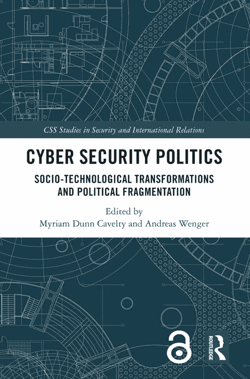
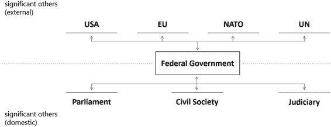
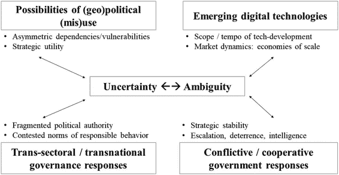

# 
网络安全政治：社会技术转型与政治碎片化





本书探讨了网络安全的新兴及具有挑战性的政治层面，并将其作为由社会技术不确定性和政治碎片化所定义的议题呈现。

全书围绕两大主题结构，并提供实证例子，阐述社会技术变革与政治应对之间的相互作用。第一部分聚焦于当前网络空间在冲突性情境中的使用，第二部分则关注在不确定性环境中由国家和非国家行为体所作的政治应对。在此过程中，我们突出了四项关键辩论，这些辩论概括了从西方视角看网络安全政治的复杂性和矛盾——国家通过网络行动所能实现的政治影响力以及影响这些行动战略效用的情境因素；新兴数字技术的作用及技术创新过程如何强化治理空间的碎片化；国家试图在网络空间以及更广泛的战略关系中维护稳定的做法；以及在日益跨部门和跨国的治理空间中，国家、经济与社会对网络安全的共同责任不断被重新协商。

本书将对网络安全、全球治理、技术研究以及国际关系的学生具有重要参考价值。

`Myriam Dunn Cavelty` 是位于瑞士苏黎世 ETH 苏黎世中心安全研究所（Center for Security Studies, CSS）的研究与教学副主任。

`Andreas Wenger` 是位于瑞士苏黎世 ETH 苏黎世的国际与瑞士安全政策教授，同时也是中心安全研究所（CSS）的主任。


中心安全研究所（CSS），瑞士联邦理工学院（ETH）苏黎世

系列包括：


排版采用 Times New Roman 字体

由印度 Chennai 的 Deanta Global Publishing Services 公司排版
**1 介绍：在社会技术不确定性与政治碎片化之间的网络安全**

1

`MYRIAM DUNN CAVELTY` AND `ANDREAS WENGER`


-   [30 *Marie Baezner and Sean Cordey*]

-   [Kapusta, P. (2015). *The Gray Zone \[White Paper\]*. MacDill Air Force Base: U.S. Special Operations Command.]

-   [Kim, S. (2018, February 7). Inside North Korea’s Hacker Army. Bloomberg. Retrieved from: [`www.bloomberg.com`](https://www.bloomberg.com)]

[army.](https://www.bloomberg.com)

-   [Kozy, A. (2015, June 1). Rhetoric Foreshadows Cyber Activity in the South China Sea. *CrowdStrike Blog*. Retrieved from: [`www.crowdstrike.com`](https://www.crowdstrike.com)]

[foreshadows -cyber -activity -in -the -south -china -sea/](https://www.crowdstrike.com)

-   [Leed, M. (2015). Square Pegs, Round Holes, and Gray Zone Conflicts: Time to Step Back.

*Georgetown Journal of International Affairs*, 6(2): 133–143.]

-   [Mazarr, M. (2015a). *Mastering the Gray Zone: Understanding a Changing Era of Conflict*.

Studies Institute and U.S. Army War College Press.]

-   [Mazarr, M. (2015b). Struggle in the Gray Zone and World Order. *War on the Rocks*. Retrieved from: [`warontherocks.com`](https://warontherocks.com)]

[world -order/.](https://warontherocks.com)

-   [Mogato, M. (2017, August 15). Philippines Says China Agrees on no New Expansion in South China Sea. Reuters. Retrieved from: [`www.reuters.com`](https://www.reuters.com)]

[southchinasea -philippines -china /philippines -says -china -agrees -on -no -new -expansion]

[in -south -china -sea -idUSKCN1AV0VJ.](https://www.reuters.com)

-   [Nakashima, E. and Sonne, P. (2018, June 8). China Hacked a Navy Contractor and Secured a Trove of Highly Sensitive Data on Submarine Warfare. *The Washington Post*. Retrieved from: [`www.washingtonpost.com`](https://www.washingtonpost.com)]

[hacked -a -navy -contractor -and -secured -a -trove -of -highly -sensitive -data -on -submarine]

[warfare /2018 /06 /08 /6cc396fa -68e6 -11e8 -bea7 -c8eb28bc52b1 _story .html.](https://www.washingtonpost.com)

-   [Nichols, M. (2019, August 5). North Korea Took $2 Billion in Cyberattacks to Fund Weapons Program: U.N. Report. Reuters. Retrieved from: [`www.reuters.com`](https://www.reuters.com)]

[article /us -northkorea -cyber -un /north -korea -took -2 -billion -in -cyberattacks -to -fund]

[weapons -program -u -n -report -idUSKCN1UV1ZX.](https://www.reuters.com)

-   [Nocetti, J. (2015). Guerre de l’information: Le web russe dans le conflit en Ukraine. *Focus* *Stratégique*, 62: 1–47.]

-   [NSFocus Inc. (2016). *Distributed Denial-of-Service (DDoS) Attacks: An Economic Perspective*. Retrieved from: [`nsfocusglobal.com`](https://nsfocusglobal.com)]

[ddos -economic -perspective -wp/](https://nsfocusglobal.com)

-   [Nye, J. S. (2017). Deterrence and Dissuasion in Cyberspace. *International Security*, 41(3): 44–71. [`doi.org/10.1162/ISEC_a_00266.`](https://doi.org/10.1162/ISEC_a_00266)]

-   [Ornos, E., Remnick, D. and Yaffa, J. (2017, March 6). Trump, Putin, and the New Cold War. *The New Yorker*. Retrieved from: [`www.newyorker.com`](http://www.newyorker.com)]

[/06 /trump -putin -and -the -new -cold -war.](http://www.newyorker.com)

-   [Pettyjohn, S. and Wasser, B. (2019). Competing in the Gray Zone—Russian Tactics and Western Responses. RAND Corporation. Retrieved from: [`www.rand.org`](https://www.rand.org)]

[research _reports /RR2791 .html](https://www.rand.org)

-   [Rid, T. (2013). *Cyber War Will not Take Place*. Oxford: Oxford University Press.]

-   [Rid, T. and B. Buchanan (2015). Attributing Cyber Attacks. *Journal of Strategic Studies*, 38(12): 4–37.]

-   [Rovner, J. (2019, July 16). Cyber War as an Intelligence Contest. *War on the Rocks*. Retrieved from: [`warontherocks.com`](https://warontherocks.com)]

[2019 /09 /cyber -war -as -an -intelligence -contest/.](https://warontherocks.com)

-   [Sanger, D. (2018). *The Perfect Weapon: War, Sabotage, and Fear in the Cyber Age*. New York: Crown.]

*Cyber operations in the gray zone* 31

-   [Scott-Railton, J., Hulcoop, A., Razzak, B. A., Marczak, B., Anstis, S. and Deibert, R. (2020, June 9). Dark Basin: Uncovering a Massive Hack-For-Hire Operation. *CitizenLab*. Retrieved from: [`citizenlab.ca`](https://citizenlab.ca)]

[for -hire -operation/.](https://citizenlab.ca)

-   [Shanker, T. and Bumiller, E. (2012, October 11). Panetta Warns of Dire Threat of Cyberattack on U.S. *The New York Times*. Retrieved from: [`www.nytimes.com`](https://www.nytimes.com)]

[2012 /10 /12 /world /panetta -warns -of -dire -threat -of -cyberattack .html.](https://www.nytimes.com)

-   [Smeets, M. (2018). The Strategic Promise of Offensive Cyber Operations. *Strategic Studies Quarterly*, 12(3): 90–113.]

-   [Solon, O. (2017, May 15). WannaCry Ransomware Has Links to North Korea, Cybersecurity Experts Say. *The Guardian*. Retrieved from: [`www.theguardian.com`](https://www.theguardian.com)]

[2017 /may /15 /wannacry -ransomware -north -korea -lazarus -group.](https://www.theguardian.com)

-   [The Economist. (2013, November 2). Rules for spies. *The Economist*. Retrieved from: [`www.economist.com`](https://www.economist.com)]

-   [Timberg, C. and Romm, T. (2019, July 25). It’s not Just the Russians Anymore as Iranians and Others Turn Up Disinformation Efforts Ahead of 2020 Vote. *The Washington Post*. Retrieved from: [`www.washingtonpost.com`](https://www.washingtonpost.com)]

[its -not -just -russians -anymore -iranians -others -turn -up -disinformation -efforts -ahead]

[vote/ ?noredirect](https://www.washingtonpost.com)

-   [Valeriano, B., and Jensen, B. (2019). *The Myth of the Cyber Offense: The Case for Restraint*. Washington: Cato Institute. Retrieved from: [`www.cato.org`](https://www.cato.org)]

[analysis /myth -cyber -offense -case -restraint.](https://www.cato.org)

-   [Votel, J. L., Cleveland, C. T., Connett, C. T. and Irwin, W. (2016). Unconventional Warfare in the Gray Zone. *Joint Force Quarterly*, 80(1): 101–109.]

-   [Warner, M. (2019). A Matter of Trust: Covert Action Reconsidered. *Studies in Intelligence*, 63(4): 33–41.]

-   [Wirtz, J. J. (2017). Life in the “Gray Zone”: Observations for Contemporary Strategists.

*Defense and Security Analysis*, 33(2): 106–114.]

10.4324/9781003110224-4

**3**

3 A threat to democracies?

An overview of theoretical approaches and


# 实证测量用于研究
## 误导信息的影响
### *Wolf J. Schünemann*

误导信息无处不在。这一简短且简单的洞察不仅是对（政治）信息提供在数字化转型公共领域中普遍存在的根本问题的精炼总结，也并非对那些有时带有警报性的警告所引发的决定论反应。误导信息被理解为故意传播的虚假信息和谣言，已成为现代高度互联社会中的主要关注点。这一现象非常显著，可以在全球范围内进行显微镜式研究，特别是在当前所谓的“信息流行病”（即关于 COVID-19、其起源、传播及影响以及相关治疗措施的误导信息）背景下（参考 Ball and Maxmen 2020）。

误导信息甚至被视为对自由民主制度及其机构的广泛感知威胁，因为这些制度因其对媒体自由的宽容立场及其他特定特征，显得特别容易受到操纵性信息行动的影响。鉴于误导信息的前所未有的传播——甚至出现了“误导信息秩序”（Bennett and Livingston 2018）——由数字化转型所引发，这一问题已成为政治传播和媒体研究领域的广泛研究主题。

然而，误导信息并不局限于国内政治，也不受学术讨论中的学科边界限制。相反，近年来最激烈争论的政治信息行动——如 2014 年乌克兰危机、2016 年英国公投以及同年的美国总统选举——至少部分被归因于外部、特别是俄罗斯的活动（Maréchal 2017; Pomerantsev 2014）。

因此，整个问题必须从国内和国际冲突的角度来审视，并已成为网络安全话语和战略中的核心威胁。当前关于 COVID-19“信息流行病”（Strick et al. 2020）的辩论，显示出（误）信息行动似乎构成大国之间竞争的偏好模式，这很可能进一步印证了这些趋势。

虽然近期国际政治事件提高了信息行动作为混合战争组成部分的认识，并在安全与国防部门的行动者中引发了焦虑（Lanoszka 2019: 228），DOI: [10.4324/9781003110224-4](https://doi.org/10.4324/9781003110224-4)

`*A threat to democracies?*`

`*A threat to democracies?* 33`

人们对民主政府如何适当应对日益增长的不确定性，尤其是在国际冲突情境中，尤其是它们对`media`的“控制偏见”（McQuail 2008: 234）在互联网上的应用，可能对民主制度相较于专制国家更不利——后者通过限制互联网自由来保护所谓的信息主权（Jamieson 2018: 11; Lanoszka 2019: 228; Omand 2018: 12; Pope 2018: 36），同时在国内和国际层面投入大量努力进行信息行动（King et al. 2017）。国际安全研究的真实叙述已经明确指出了自由民主制度的这种不对称脆弱性，但并未为反制措施或有效威慑提出决定性策略（Goldsmith and Russel 2018）或有效威慑（Goldsmith 2016; Shackelford et al. 2016: 666）。在媒体治理方面，即使在民主国家也已观察到更严格的在线控制措施的趋势（Freedom House 2018）。

总体而言，误导信息既是对自由民主制度又是对国家安全的重大威胁。它很可能成为各国政治行动者未来进行安全化行动的关键组成部分。总体而言，在网络安全领域，威胁感知基于高度的不确定性。因此，对于误导信息，与其他网络威胁一样，需要提出的关键问题是： threat perceptions 合适还是被夸大？为了回答此问题，我结合了不同的视角：理论反思主要来源于网络安全领域，而实证洞察则主要由政治传播和媒体研究的学者提供。

本章余下部分的结构如下：在下一节中给出误导信息的基本定义，随后呈现一种基于知识的（误）信息行动概念，接着是对主要民主国家和国际组织发布的核心政策文件中表达的 threat perceptions 的批判性审查。随后，我将 threat perceptions 与实证研究提供的证据进行对比。在本节中，我区分了三个分析层面，在其中可以评估效果：微观、中观和宏观层面。鉴于对所谓误导信息的实际影响缺乏知识，以及其解释和归因的显著模糊性，我以呼吁审慎为结。数字化通信中的不确定性增加不应导致我们陷入国际威胁政治的新阶段，并使 cyberspace 的安全化进程可能对自由民主价值观和国际和平产生不利影响。

**Disinformation as a concept and as a new**

**element of international threat politics**

Disinformation 是一个复杂的术语。毕竟，在政治传播中，几乎任何有策略动机的行为者所作的陈述，其对手都可能将其称为 disinformation，仅为让步于对对方可信度的质疑。术语“fake news”的动荡职业生涯，常与 disinformation 同义使用（Allcott and Gentzkow 2017），正是这一情况的典型例证。该词汇在 2016 年主要政治事件（如英国脱欧公投、美国大选）后的公共话语中广泛使用，并作为描述所谓“后真相”时代的主要术语（Harsin 2015），但其在政治冲突中的普遍使用导致其作为武器被广泛采用。如今，它在学术讨论中几乎被排除使用（Vosoughi et al. 2018: 1146；但在 Lazer et al. 2018 中仍被使用）。

相反，学术界更倾向于使用 disinformation 这一术语，其指代的是故意误导性的信息（European Commission 2018a: 11）。误导信息的分类依据其功能而定，即需要有一个行为体有意生产并传播不真实或错误的信息。因此，它可以与所有 unintentionally（ unintentionally）误导性的信息——即 misinformation——以及其他不旨在误导但旨在产生娱乐或更深层次洞察（如笑话或讽刺）的扭曲事实区分开来（Allcott and Gentzkow 2017）。误导信息还可与战略研究中更常见的信息行动术语相关联，如宣传或公共外交。


**虚假信息**与宣传有重叠，但并不相同。两者的共同点在于有意的欺骗，以误导性或极度单方面的信息形式出现。然而，两者的区别在于宣传除了欺骗性信息外，还包括其他战略沟通手段，这些手段并不涉及虚假。传统上，宣传主要与总统主义或极权主义国家的政府行为体相关，并主要面向国内人口。另一方面，更传统、更现实的公共外交概念也关注国家主导的信息活动，面向外国公众。随着新兴的公共外交概念（如“公共外交 2.0”，Tago 2018: 457），范围扩大到更多行为体和数字网络的使用，但传播虚假信息并不在其定义范围内，因为这与民主国家所追求的所谓软实力目标相冲突。然而，在当前高涨的地缘政治紧张局势下，公共外交可能被视为国际虚假信息运动的委婉说法，类似于它被视为宣传的“*出产*”（Tago 2018）。

在冷战时期（Tago 2018），公共外交也被视为宣传的*出产*。

鉴于抽象概念中的类别划分在现实情境中应用时的困难，信息操作模糊化并不令人惊讶。除了客观真假的问题（Vosoughi et al. 2018）之外，要归因于信息操作并找到误导意图的证据仍然很困难。虽然不确定性始终是国际关系的构成性元素，但随着国家边界的渗透性——尤其是在信息流在网络空间中以及所谓的“混合战争”的数字化手段——模糊性显得尤为明显，甚至是恒常存在的一个特征。

*对民主的威胁？* 35

在关于虚假信息的讨论中，模糊性作为一个持续的特征尤为突出。正如整体网络安全领域一样，模糊性不仅关乎攻击者及其意图，也关乎攻击的实际质量和效果，以及对此的适当反应。

总体而言，可以认为虚假信息问题使我们进入了新的威胁政治阶段（Dunn Cavelty 2008），在此阶段我们观察到网络安全话语中威胁化的新质量。即便“网络战争”这一概念——在网络安全中具有吸引力且在学术讨论中受到批判性讨论——现在以一种新的形式重新出现，这种形式受到对虚假信息作为民主威胁的焦虑所驱动（Jamieson 2018: 7）。信息技术与所谓受威胁的公共话语相结合，形成了关于虚假信息的最常见威胁感知，这两个高度复杂的问题在此交织。

在公共领域中，这种新版本的“告诉的灾难”（在更广泛的网络安全话语中）可能成为激发比早期故事更迫切反应的依据。

虽然这些大多“仅仅是情境”（Dunn Cavelty 2008: 3），但关于虚假信息的新网络灾难情境目前正在发生，或已经成为现实，例如在唐纳德·特朗普任职期间，以及英国脱欧后。

**虚假信息与知识问题**

正如网络安全领域普遍如此，以及当前关于虚假信息及其对民主的所谓威胁的辩论中，行为体倾向于在不确定性的空白处填入已有的知识元素，以构建一致的叙事，即使缺乏实际的经验证据。知识是理解威胁感知及对所谓攻击者及其动机的政治应对的重要因素。此外，知识本身也可能成为虚假信息的攻击对象（Farrell and Schneier 2018）。从以知识为导向的视角来看，避免文献中常见的两个缺陷尤为重要：一是归因问题，二是对（相关）知识本身的概念化。

首先，与网络攻击类似，确定恶意虚假信息的责任方和原始来源往往很困难。即便可以追溯到某个来源，也可能无法找到协同活动的证据，例如由外国势力策划。因此，归因往往依赖于“谁有利”（cui bono）的评估：

“国内和外国的虚假信息都旨在破坏制度秩序，贬低政治人物，煽动反难民情绪，并制造选举混乱”（Bennett and Livingston 2018: 130）。这种“意义建构”在公共甚至学术归因中（Egloff 2020）显得尤为问题，因为虚假信息的效果尚不清晰，甚至可能对潜在的恶意行为者本身也是如此（Thornton and Miron 2019: 263, 269–270）。但“谁有利”逻辑对观察者并不适用，可能对 alleged perpetrator 也不适用。当应用 cui bono 逻辑时，信息操作的假设效果成为检测和评估的标准（见 Jamieson 2018: 144）。因此，整个威胁评估可能变得循环 —  — 如果假设的效果是归因的基石，而对效果的评估又依赖于归因本身。

其次，在评估虚假信息的社会效应时，采用选举研究和大部分政治社会学中熟悉的个人主义知识概念并不十分有帮助，这些概念将知识视为个人对信息的累积（Lupia and McCubbins 1998；见 Schünemann 2014, 2018 的批判性讨论）。首先，“信息本身通常没有价值：它是一种原材料，只有在被特定方式加工并赋予意义和质量时才获得价值”（Dunn Cavelty 2008: 15）。知识并非个人（选民）的属性，而是在话语中生产和加工的。因此，信息是“通过这些集体建构的感知过滤器被‘消费’的”。这需要引入更宏观的政治话语视角，针对目标社会。

从宏观知识导向的视角来看，假设信息流仅仅被“放入”一种相对无助的话语中似乎不合适。与网络攻击类似，更合理的预期是成功的虚假信息运动会利用目标系统（这里是话语）中已有的脆弱性，尤其是当行动者受外国势力引导时。

Farrell and Schneier (2018) 提出了一种从比较视角评估政治系统对信息操作脆弱性的理论框架。在众多理论探讨中，他们的框架最接近知识导向的宏观视角，因为它基于“知识秩序”的概念，即区分特定政权的共同与争议性知识库，将虚假信息运动视为对知识的攻击。尽管作者提出了重要的重新定位，但其知识类型的二元对立仍显得过于粗糙 —  — “公共政治知识”几乎与信任机构或根据功能主义理论对政治体系基本支持的要求等非常一般的类别难以区分，而“争议政治知识”则


包含了公共话语中漂浮和被处理的广泛知识要素。因此，这种区分似乎并未真正开放于更复杂的社会建构主义概念和社会知识秩序研究。此外，作者并未提供任何关于如何研究虚假信息作为知识攻击的指导。

`Disinformation is all around – the threat perception`

在讨论虚假信息的影响之前，本节阐明了该问题如何影响关键行为体在国际舞台上的外交与安全政策。现代社会对虚假信息的主要关注可以通过检视最近由国家政府及国际 *A threat to democracies?* 37 组织发布的相关政策文件来轻易说明。因此，首先我对核心文件进行批判性审视。我选取了美国、英国、德国以及欧盟层面政府或专门委员会发布的安全策略与报告。基于我对威胁政治的兴趣，我以 Dunn Cavelty (2008: 30) 发展的社会建构主义元理论及其本体论为基础，该理论将威胁框架视为识别最常见解释方案或框架的核心分析概念，这些框架涵盖问题定义（“诊断框架”）与问题解决（“预测框架”）。这使得我们能够初步绘制对比图，随后再与政治传播研究提供的经验“证据”进行核对。

***Examples from core policy documents***

`Disinformation has made it into the security strategies of major democracies` (Omand 2018: 8)。2017 年的“美国国家安全战略”将虚假信息列为 cyberspace 的主要威胁之一，称“[恶意国家和非国家行为体利用网络攻击进行勒索、信息战、虚假信息等]”。这些攻击被认为能够“动摇民主机构的信任与信心”（White House 2017: 31）。德国的网络安全战略也在威胁分析中列入虚假信息，并明确指出其对 liberal societies（自由社会）和民主秩序的潜在危害。

在所谓的《安全政策白皮书与德国陆军未来》中，明确将虚假信息与“混合作战要素”（Weißbuch: 37）关联，体现了预测框架——把事件解释为恶意活动，需通过安全政治措施加以应对。此类表述在英国议会情报与安全委员会 2016–2017 年报告中亦十分明显，该报告将所讨论的外国虚假信息活动的核心要素（“一般性地削弱英国政治体制的完整性”、“颠覆特定选举或公投”、“中伤公共话语”）列为敌对外国行为体针对英国的网络攻击的潜在目标（UK Parliament 2017: 32–33）。

在国际组织层面，NATO 与欧盟为应对俄罗斯虚假信息而设立的战略传播部门可视为典型案例，它们的成立初衷正是为了遏制俄罗斯虚假信息，而波罗的海国家及东欧社会普遍被认为对该类信息特别脆弱。欧盟方面，2018 年欧盟委员会与欧洲外交与安全政策局（EEAS）发布《反虚假信息行动计划》（European Commission 2018b），呼吁加强遏制东欧地区俄罗斯宣传的活动。

***Some reflections on recurrent frames***

诊断框架是理解威胁政治的关键，因为它表明虚假信息是否被视为政治威胁感知与脆弱性评估的一部分。下面我简要反思本文所检视的政策文件中最常出现的诊断框架。首先，值得注意的是，虚假信息通常不被视为孤立的活动或事件，而是被视为更或少协调的行动 kampaign 的一部分。导致最强烈焦虑的虚假信息行动，被认为是由某种战略性行为体——如 populist movement 或 party（ populist 运动或政党）或外国国家——主导。当前的欧洲与美国威胁感知主要指向俄罗斯。

诊断框架的另一重要元素是，国家选举被虚假信息运动针对并可能被扭曲的叙事。该叙事强化了目标国家社会与政体的脆弱感，并帮助理解敌对信息操作的意图。换言之，正是这种叙事构成了将虚假信息解释为国家安全威胁的基础。此外，该叙事还将虚假信息的威胁范围延伸至其他所谓的外国干预形式，如外国宣传活动、有悖泄漏等，即便这些行为未必包含错误信息（Jamieson 2018: 144）。最后，关于国家选举受威胁的叙事，还明显依赖于所谓的行为体与归因（agency and attribution），这在前文理论部分已有强调。

**The impact question – the supposed effects of disinformation**

准确评估当前的威胁感知，需要查看迄今学术研究所提供的经验证据。针对虚假信息兴趣的激增，不同研究路线作出了回应。媒介化环境中的政治传播是社会科学研究的 particularly complex subject。在选举等强烈政治交流的情境下，辨认并测量任何特定信息的效应都极为困难，因为每一点（ dis)information 都被抛入公共话语的动荡海洋中。尽管如此，已有的尝试可大致且表面地归纳为三大类别，且分布极不平衡。第一类是研究信息（dis）接触及其受众效应。第二类则通过考察信息对大众媒体传播的影响来评估其影响。第三类——公共话语维度——常被忽视或仅被偶然提及：它关注公共讨论本身。这三类研究层面分别对应通讯活动的微观、中观与宏观层面。与此同时，关于虚假信息及其效应的研究与争论，必须考虑数字化信息市场与公共领域的动态演变，这些演变跨越上述各层面。常被讨论的新现象，如 echo chambers（回声室）或政治竞选自动化，被认为会诱发结构性变化，从而促进虚假信息的整体传播（Vosoughi et al. 2018）。

 *A threat to democracies?* 39


大多数关于（不）信息影响的研究都聚焦于个体对信息的接触层面。学术研究主要依赖调查数据、网络追踪、其他数字痕迹数据，或——虽然较少见——实验设计，以研究用户如何接触到虚假信息以及这可能如何影响其态度和行为（Allcott and Gentzkow 2017; Grinberg et al. 2019; Guess et al. 2018; Keersmaecker and Roets 2017; Pennycook et al. 2018）。一项关于美国总统大选 2016 年的有影响力研究（Allcott and Gentzkow 2017）显示，假新闻——通过事实核查网站数据加以分类——在选举竞争中发挥了相当大的作用，因为假新闻能够吸引数百万的浏览和点击。此外，研究中检测到的大多数假新闻都倾向于支持唐纳德·特朗普。

基于市场媒体消费模型测得的效应相对温和。研究指出，平均美国成年人只能够记住 1.14 条假新闻（Allcott and Gentzkow 2017；见 Grinberg et al. 2019）。

Vosoughi 等人（2018）同样依赖独立事实核查网站的评估，将新闻条目分类为真实或虚假。该研究结合大数据分析，约有 126,000 条由约 300 万名 Twitter 用户发布或转发的推文被纳入数据。其发现显示，虽然假新闻的传播速度与真实新闻相当，但它们触及的人数更多，且更有可能走红（Vosoughi et al. 2018: 1148），这表明它们具有更大的潜在影响力。

Guess 等人（2018）将在线公众舆论调查与网络流量数据相结合。通过衡量选择性接触与虚假信息之间的关系，他们揭示了仅测量接触本身的局限性——接触不一定等同于影响，至少在改变实际政治态度或行为意义上并非如此。相反，作者发现，尽管选举前约有四分之一的美国人访问所谓的假新闻网站，但大部分测量到的接触是“态度一致的”，这表明选择性接触会削弱虚假信息的潜在影响。选择性接触提醒我们，若要获得更全面的图景，需要考虑更广泛的媒体逻辑和话语倾向。

***The meso level – the effects of disinformation on mass media***

数字媒体与传统媒体之间存在“复杂的关系”（Tucker et al. 2018: 4）。一方面，它们倾向于削弱传统大众媒体的基本结构（Shirky 2008）；另一方面，它们“明确成为传统媒体报道的工具”（Tucker et al. 2018）。因此，

`40 *Wolf J. Schünemann*`

有必要理解所谓新媒体与传统媒体之间的互动（Marwick and Lewis 2017）。在最近出版的作品中，Hall Jamieson 提供了最为全面的阐述，说明一场据称由俄罗斯政府策划的虚假信息运动如何决定性地影响了美国总统大选，并通过影响大 ic mass media 发挥关键作用。书名《Cyberwar: How Russian Hackers and Trolls Helped Elect a President》有力地表明，外国行为体在竞选的关键阶段成功影响了大众媒体及其最重要的政治传播机制——议程设置、框架设定和 priming，从而可能最终扭转关键战场州的公众投票。

因此，她的目标是表明“`[t]he legacy media were complicit in this effort`”（Jamieson 2018: 38）。她的书中实证章节提供了对竞选材料的质性分析、对面向微观层面但聚焦媒体效应的全国电话调查，以及关于所谓俄罗斯信息操作在总统竞选期间的大量轶事证据。总体而言，Jamieson 结论认为“俄罗斯被黑客入侵的内容和虚假信息不仅污染了新闻议程，还在关键战场州将辩论平衡倾向于民主党候选人”（Jamieson 2018: 7）。

然而，Jamieson 在书的结尾承认，她的反思和报告的发现只能提供合理性，而非基于证据的确定性。区分欺骗性信息操作与选举竞争中其他战略性沟通实例的效果——这些实例同样旨在实现有利候选人的胜利——仍是一个未解之谜（Jamieson 2018: 208）。

***The macro level – the effects of disinformation on political discourse and knowledge***

总体而言，虚假信息运动以及特别是外国干预选举的行为，预计会针对公共话语。它们是试图“以特定方式推动话语”的尝试（Morgan 2018: 41）。正是这些宏观层面的 presumed effects 尤其强化了将虚假信息视为威胁国家安全的感知，例如可以置于“更广泛的俄罗斯行动，旨在扰乱并激化西方政治话语”的背景下（UK Parliament 2017: 52）。话语是一个含义多样的概念，但话语理论倾向于共同假设通过象征性通信进行集体知识的生产与处理。遗憾的是，也不意外，关于虚假信息运动可能对公共话语和知识产生更重大影响的实证研究却相对匮乏（Farrell and Scheier 2018）。如上所述，这种话语常被认为受到新兴的*counter cultural narratives*（由俄罗斯信息运动或国内新兴激进右翼运动传播）的威胁（Bennett and Livingston 2018: 128）。作为话语结构的核心概念，叙事预计会被外部有意插入或批判性操控（Omand 2018: 5–6）。然而，这些假设大多缺乏对实际效果和成功的经验证据（唯一的例外是数据科学领域的 Bessi et al. 2015）。

相反，Alexander Lanoszka 的著作（《2019》）“国际政治中的虚假信息”侧重于战略层面，认为所谓的虚假信息运动不太可能对政策产生实质性影响，因为公共话语和公众舆论构成了虚假信息必须跨越的“第二道障碍”。其核心论点是，目标受众对虚假信息的接受程度取决于他所称的“先前的意识形态承诺和心态”——这些因素使得人们不太可能因新出现的信息而相信并改变观点：“`[s]haping the information that they receive are ideological commitments and partisan identities in addition to their own experiences, rules of thumb, and the pieces of conventional wisdom that they have acquired over their lifetimes`”（Lanoszka 2019: 236）。Lanoszka 将其概念与 2014–2017 年期间的俄罗斯信息操作相结合，并通过实证测试其假设。总体而言，他发现自己的假设和论点得到确认。


-   [兰诺斯卡的发现与辩证论的信息操作理论相一致，因为信息操作，无论多么高级和协调，似乎很难或根本不可能如预期般扰乱或扭转公共话语。因此，将“通过信息操作给历史一个推动”视为可行的说法在话语层面必须受到高度质疑。然而，衡量信息操作的宏观层面影响显然极为困难，因为这需要全局视角、可能更长的历史视距以及对目标社会的社会文化和政治结构的深入了解（兰诺斯卡 2019：233）。

## 促成数字公共领域中信息操作的因素

信息操作并非新现象，它贯穿政治史各个时代。正如曼德（2018：7）所言，“期待对既定国家权威的颠覆性威胁并不新鲜”（参见摩根 2018：41）。如上文所示，威胁感知近年来因数字公共领域的结构性变化而发生转变。事实上，随着传统门卫机构的衰弱，任何人都可以发布内容并可能在大规模传播信息（Allcott and Gentzkow 2017; Keersmaecker and Roets 2017），但并无保证其内容会被关注（Hindman 2009; Stier et al. 2018）。在此背景下，社交媒体（如 Facebook）被指责充当“通往假新闻网站的门户”（Guess, et al. 2018）。在此情境下，诸如回声室（echo chambers）以及通过社交机器人实现的高度自动化等更广泛的在线交流现象被认为会加剧政治极化（Sunstein 2017）并引发妄想（Farrell and Schneier 2018：2）。这些潜在的促成因素同样需要与实证研究的证据相对照。这对信息操作的影响意味着什么？

虽然极化的政治体制和公众可能更易受到假新闻传播的影响（Zettl 2019），但将极化归因于数字化的碎片化（回声室）仍然极具争议。

关于*回声室*，日益加剧的政治极化普遍被视为信息操作传播的肥沃土壤（Jamieson 2018; Lanoszka 2019：229）。实证研究主要针对美国，也涉及其他多个民主国家（Bakshy et al. 2015; Jacobson et al. 2016）。结果各不相同，但近期研究大多对回声室假说提出质疑（Dubois and Blank 2018; Fletcher and Nielsen 2017; Gentzkow and Shapiro 2011; Guess et al. 2018）。

*自动化*的影响同样模糊，它常以所谓的社交机器人——能够自动生成内容或活动的软件工具——的形式出现。虽然大量实证研究指出社交机器人在政治过程中的潜在或实际作用，包括在信息操作中传播（或辨认）信息（Ferrara 2017; Hegelich and Janetzko 2016; Howard and Kollanyi 2016; Keller and Klinger 2019），但其方法论和结果受到机器人检测的缺陷（Gallwitz and Kreil 2019）或实际使用自动化工具的混合用途（Grimme et al. 2017）而受到质疑。

即便承认社交机器人在微博客平台（如 Twitter）上活跃程度很大，这并不意味着自动化决定了线上操纵的本质。相反，社交机器人更可能影响在线注意力经济的指标——通过关注、链接和分享推动热点话题，而操纵性内容主要由真实用户生成。此外，Vosoughi 等人（2018：1150）指出，并非机器人，而是人类用户使“虚假新闻传播得更远、更快、更深、更广阔”。这一发现进一步支持我们将关注点从所谓的攻击者及其可用的攻击工具转向目标社会及其对信息操作的脆弱性。

在对应对措施的讨论（见 Haunschild et al. 2022）中，研究强调必须关注数字通信中的注意力经济，并倡导一种新的自我监管伦理，用于信息消费与提供，而不是针对信息供给侧的限制性监管措施。

## 结论

本文提供了关于信息操作理论与实证研究的概览，重点关注其效应及对民主的潜在威胁。针对一般性辩论和当前的威胁感知，我主张从知识导向视角和社会建构主义研究策略转向“信息操作是否威胁民主？”的重新定位。随后，我分析了帮助识别反复出现的威胁框架的政策文件，并将其与不同实证研究流派产生的证据进行对比。基于微、中、宏三层次的区分——在这三层次上可以测量扭曲与影响——我纳入了两种较少被研究的视角，这些视角可能在威胁评估时与信息操作同样重要。此外，我也简要提及与数字公共领域结构性转型相关的回声室和自动化现象，这些现象被认为是信息操作传播的促成因素。

与信息操作本身一样，这些现象的存在以及更关键的所谓影响难以证明，从而增加了政治行动者所面对的整体不确定性。

在公众和政客日益警惕的背景下，需要谨慎起草应对措施，以更好地理解整体挑战（参见 Haunschild et al. 2022; Omand 2018; Pope 2018; Thornton and Miron 2019）。

因此，实证研究必须得到加强和改进，以积累更多关于实际挑战及适当解决方案的知识。在回应警报声音之前，我们应当特别研究所谓运动在公共话语宏观层面的长期效应。上文已将信息操作的传播与某些话语脆弱性的利用进行了比较。

此比较表明，这些脆弱性——至少不能仅靠传统的监管或安全措施——不能充分通过常规监管或安全手段来消除，而必须通过政治或新闻手段来解决（曼德 2018：20）。脆弱性必须从内部加以削弱。例如，如果社交媒体充当信息操作传播的催化剂，则其以营利为导向的注意力经济需要通过监管（Bakir and McStay 2018）加以约束，但不能限制信息自由。如果以事实核查为代表的民间社会参与在实际操作中设计得当且相关参与者受到问责，也可以成为更为恰当的解决方案之一。


All in all, a reflective and critical approach to the study of disinformation seems appropriate. For if the most likely and only achievable goal of malevolent actors on the international scene is correctly understood as the generation of paranoia and chaos among democratic publics and the sowing of distrust in democratic institutions (Chen 2016; Farrel and Schneier 2018), alarmist discourses and governmental overreactions might directly lead us into this trap.

## References

All links checked on August 20, 2021.

Allcott, H. and Gentzkow, M. (2017). Social Media and Fake News in the 2016 Election.

*Journal of Economic Perspective*, 31(2): 211–236.

Bakir, V. and McStay, A. (2018). Fake News and the Economy of Emotions. *Digital* *Journalism*, 6(2): 154–175.

44 `Wolf J. Schünemann`

Bakshy, E., Messing, S. and Adamic, L. A. (2015). Political Science. Exposure to Ideologically Diverse News and Opinion on Facebook. *Science*, 348(6239): 1130–1132.

Ball, P. and Maxmen, A. (2020). The Epic Battle against Coronavirus Misinformation and Conspiracy Theories. *Nature*, 581(7809): 371–374.

Bennett, W. L. and Livingston, S. (2018). The Disinformation Order: Disruptive Communication and the Decline of Democratic Institutions. *European Journal of* *Communication*, 33(2): 122–139.

Bessi, A., Zollo, F., Del Vicario, M., Scala, A., Caldarelli, G. and Quattrociocchi, W.

(2015). Trend of Narratives in the Age of Misinformation. *PloS One*, 10(8): e0134641.

Chen, A. (2016, 27 July). The Real Paranoia-Inducing Purpose of Russian Hacks. *The* *New Yorker*. Retrieved from: [`https://www.newyorker.com/news/news-desk/the-real`](https://www.newyorker.com)

[\-paranoia-inducing-purposes-of-russian-hacks.](https://www.newyorker.com)

Dubois, E. and Blank, G. (2018). The Echo Chamber is Overstated: The Moderating Effect of Political Interest and Diverse Media. *Information, Communication and Society*, 21(5): 729–745.

Dunn Cavelty, M. (2008). *Cyber-Security and Threat Politics: US Efforts to Secure* *the Information Age*. *CSS Studies in Security and International Relations*. London: Routledge.

Egloff, F. J. (2020). Contested Public Attributions of Cyber Incidents and the Role of Academia. *Contemporary Security Policy*, 41(1): 55–81.

European Commission. (2018a). *A Multi-Dimensional Approach to Disinformation:* *Report of the Independent High Level Group on Fake News and Online Disinformation*.

*Communications Networks, Content and Technology*. Luxembourg: Publications Office of the European Union.

European Commission (2018b, December 5). *Action Plan against Disinformation:* *European Commission Contribution to the European Council (No. JOIN(2018)* *36 Final)*. Brussels. Retrieved from: [`https://ec.europa.eu/info/sites/default/files/eu`](https://ec.europa.eu)

[\-communication-disinformation-euco-05122018_en.pdf.](https://ec.europa.eu)

Farrell, H. J. and Schneier, B. (2018). Common-Knowledge Attacks on Democracy. *SSRN*

*Electronic Journal*[. Advance online publication. [`https://doi.org/10.2139/ssrn.3273111`](https://doi.org/10.2139/ssrn.3273111)].

Ferrara, E. (2017). Disinformation and Social Bot Operations in the Run Up to the 2017 French Presidential Election. *SSRN Electronic Journal*. Advance online publication.

Fletcher, R. and Nielsen, R. K. (2017). Are News Audiences Increasingly Fragmented? A Cross-National Comparative Analysis of Cross-Platform News Audience Fragmentation and Duplication. *Journal of Communication*, 67(4): 476–498.

Freedom House (2018). *Freedom on the Net 2018: The Rise of Digital Authoritarianism*.

New York/Washington. Retrieved from: [`https://freedomhouse.org/sites/default/files/`](https://freedomhouse.org)

[`FOTN_2018_Final.pdf.`](https://freedomhouse.org)

Gallwitz, F. and Kreil, M. (2019). Die Mär von “Social Bots”. *Tagesspiegel*. Retrieved

[from: [`https://background.tagesspiegel.de/digitalisierung/die-maer-von-social-bots`](https://background.tagesspiegel.de).

Gentzkow, M. and Shapiro, J. M. (2011). Ideological Segregation Online and Offline. *The* *Quarterly Journal of Economics*, 126(4): 1799–1839.

Goldsmith, J. (2016, 9 October). The DNC Hack and (the Lack of) Deterrence. *Lawfare* *Blog*[. Retrieved from: [`https://www.lawfareblog.com/dnc-hack-and-lack-deterrence.`](https://www.lawfareblog.com)

Goldsmith, J. and Russell, S. (2018). Strengths Become Vulnerabilities: How a Digital World Disadvantages the United States in Its International Relations. *Aegis Series* (1806): 1–22. Retrieved from: [`https://www.hoover.org/sites/default/files/research/docs`](https://www.hoover.org)

[`/381100534-strengths-become-vulnerabilities.pdf`](https://www.hoover.org).

* A threat to democracies?* 45

Grimme, C., Preuss, M., Adam, L. and Trautmann, H. (2017). Social Bots: Human-Like by Means of Human Control? *Big Data*, 5(4): 279–293.

Grinberg, N., Joseph, K., Friedland, L., Swire-Thompson, B. and Lazer, D. (2019). Fake News on Twitter during the 2016 U.S. Presidential Election. *Science*, 363(6425): 374–378. [`https://doi.org/10.1126/science.aau2706`](https://doi.org/10.1126/science.aau2706).

Guess, A., Lyons, B., Nyhan, B. and Reifler, J. (2018). Avoiding the Echo Chamber about Echo Chambers: Why Selective Exposure to Like-Minded Political News is Less Prevalent than You Think. Knight Foundation. Retrieved from: [`https://kf-site-production.s3.amazonaws.com`](https://kf-site-production.s3.amazonaws.com)

[\-production/media_elements/files/000/000/133/original/Topos_KF`](https://kf-site-production.s3.amazonaws.com)

[\_White-Paper_Nyhan_V1.pdf`](https://kf-site-production.s3.amazonaws.com).

Guess, A., Nyhan, B. and Reifler, J. (2018). Selective Exposure to Misinformation: Evidence from the Consumption of Fake News during the 2016 U.S. Presidential Campaign. Retrieved from: [`http://www.dartmouth.edu/~nyhan/fake-news-2016.pdf.`](http://www.dartmouth.edu)

Harsin, J. (2015). Regimes of Posttruth, Postpolitics, and Attention Economies.

*Communication, Culture and Critique*, 8(2): 327–333.

Haunschild, J., Kaufhold, M.-A. and Reuter, C. (2022). Cultural Violence and Peace in Social Media: Technical and Social Interventions. In: M. Dunn Cavelty and A. Wenger (eds). *Cyber Security: Socio-Technological Uncertainty and Political Fragmentation*.

London: Routledge, pp. 48–63.

Hegelich, S. and Janetzko, D. (2016). Are Social Bots on Twitter Political Actors?: Empirical Evidence from a Ukranian Social Botnet. *International AAAI Conference on* *Web and Social Media*. Retrieved from: [`https://www.aaai.org/ocs/index.php/ICWSM/`](https://www.aaai.org)

[`ICWSM16/paper/view/13015/12793.`](https://www.aaai.org)

Hindman, M. S. (2009). *The Myth of Digital Democracy*. Princeton, NJ: Princeton University Press.

Howard, P. N. and Kollanyi, B. (2016). Bots, #StrongerIn, and #Brexit: Computational Propaganda during the UK-EU Referendum. Retrieved from: [`https://papers.ssrn.com`](https://papers.ssrn.com)

[sol3/papers.cfm?abstract_id=2798311.](https://papers.ssrn.com)

Jacobson, S., Myung, E. and Johnson, S. L. (2016). Open Media or Echo Chamber: The Use of Links in Audience Discussions on the Facebook Pages of Partisan News Oganizations. *Information, Communication and Society*, 19(7): 875–891.

Jamieson, K. H. (2018). *Cyberwar: How Russian Hackers and Trolls Helped Elect a* *President; What We Don’t, Can’t, and Do Know*. New York: Oxford University Press.

Keersmaecker, J. de and Roets, A. (2017). ‘Fake News’: Incorrect, but Hard to Correct. The Role of Cognitive Ability on the Impact of False Information on Social Impressions.

*Intelligence*, 65: 107–110.

Keller, T. R. and Klinger, U. (2019). Social Bots in Election Campaigns: Theoretical, Empirical, and Methodological Implications. *Political Communication*, 36(1): 171–189.


-   [金，潘，罗伯茨（2017）。中国政府在社交媒体上制造社交媒体帖子以进行战略分心，而非参与论证。*美国政治科学评论*，111（3）：484–501。]

-   [拉诺斯卡（2019）。国际政治中的虚假信息。*欧洲国际安全期刊*，4（2）：227–248。]

-   [拉泽，D. M. J.，鲍姆，M. A.，本克勒，Y.，伯恩斯基，A. J.，格林希尔，K. M.，门策尔，F.，梅策尔，M.，潘尼科克，G.，罗森塔尔，D.，舒德松，M.，索尔曼，S.，斯塔恩，S.，塞恩，E.，瓦茨，D. 和齐特林，J. L.（2018）。*假新闻的科学*。*科学*，359（6380）：1094–1096。]

-   [卢皮，A. 和麦卡布宾斯，M. D.（1998）。*民主困境。公民能学到他们需要知道什么？* 剑桥：剑桥大学出版社。]

-   [46 *Wolf J. Schünemann*]

-   [马歇尔，N.（2017）。网络威权主义与信息地缘政治：理解俄罗斯互联网政策。*媒体与传播*，5（1）：29–41。]

-   [马里克，A. 和刘易斯，R.（2017）。网络上的媒体操纵与虚假信息。*数据与社会*。获取于：[`datasociety.net/pubs/oh/DataAndSociety_Med.pdf`](https://datasociety.net/pubs/oh/DataAndSociety_Med.pdf)]

-   [麦克奎尔，D.（2008）。*麦克奎尔的大众传播理论*（第 5 版，重印版）。伦敦：SAGE 出版社。]

-   [摩根，S.（2018）。*假新闻、虚假信息、操纵和在线策略以削弱民主*。*网络政策期刊*，3（1）：39–43。]

-   [奥曼，D.（2018）。*现代数字颠覆与煽动的威胁*。*网络政策期刊*，3（1）：5–23。]

-   [潘尼科克，G.，卡农，T. D. 和兰，D. G.（2018）。*先前接触增加假新闻的感知准确性*。*实验心理学杂志. 一般*，147（12）：1865–1880。]

-   [波默兰塞夫，P.（2014，5 月）。*普京如何重塑战争*。*外交政策*。获取于：[`foreignpolicy.com/2014/05/05/how-putin-is-reinventing-warfare/`](https://foreignpolicy.com/2014/05/05/how-putin-is-reinventing-warfare/)]

-   [教皇，A. E.（2018）。*网络化选举的保护*。*网络政策期刊*，3（1）：24–38。]

-   [舒恩曼，W. J.（2014）。*颠覆性主权：欧洲宪法进程中失败的公投的比较性话语分析。理论与实践中的话语研究*。维滕斯：斯普林格·VS。]

-   [舒恩曼，W. J.（2018）。*欧洲多层次政治辩论的* **scad** *分析*。]

-   [在 R. Keller, A.-K. Hornidge, and W. J. Schünemann（编）的* Routledge 社会学进展*一书中，*社会知识方法论：调查知识和意义构建* 一书中，页 91–111。]

-   [Shackelford, S., Schneier, B., Sulmeyer, M., Boustead, A., Buchanan, B., Craig, A., Deckard, T. H. and Malekos Smith, J.（2016）。*让民主更难以被黑客攻击：选举应被归类为“关键基础设施”吗？* *密歇根法学改革期刊*，50（3）：629–668。获取于：[`papers.ssrn.com/sol3/`](https://papers.ssrn.com/sol3/)]

-   [papers.cfm?abstract_id=2852461.](https://papers.ssrn.com)

-   [Shirky, C.（2008）。*这里来了：无组织的组织力量*。纽约：企鹅书籍。]

-   [Stier, S., Schünemann, W. J. and Steiger, S.（2018）。*活动人士与门卫：Twitter 上政策网络的时间和结构属性*。*新媒体与社会*，20（5）：1910–1930。]

-   [Strick, B., Robinson, O. and Sardarizadeh, S.（2020，5 月 28）。*内幕：针对美国的亲中国网络*。BBC。获取于：[`www.bbc.com/news/blogs`](https://www.bbc.com/news/blogs)]

-   [-trending -52657434.](https://www.bbc.com)

-   [Sunstein, C. R.（2017）。*#Republic: 社交媒体时代的分裂民主*。新泽西州普林斯顿：普林斯顿大学出版社。*

-   [Tago, A.（2018）。*公共外交与外交政策*。在 C. G. Thies（编）。*牛津外交政策分析百科全书*。纽约：牛津大学出版社，页 453–464。*

-   [Thornton, R. and Miron, M.（2019）。*遏制俄罗斯网络战：英国面临的实际、法律和伦理约束*。*网络政策期刊*，4（2）：257–274。*

-   [Tucker, J., Guess, A., Barbera, P., Vaccari, C., Siegel, A., Sanovich, S., Stukal, D. and Nyhan, B.（2018）。*社交媒体、政治极化和政治虚假信息：一个* **威胁到民主**？* 47 回顾科学文献。*SSRN 电子期刊*。获取于：[`doi.org/10.2139/ssrn.3144139`](https://doi.org/10.2139/ssrn.3144139)]

-   [doi.org/10.2139/ssrn.3144139](https://doi.org/10.2139/ssrn.3144139).

-   [英国议会（2017，12 月 20）。*情报与安全委员会年度报告 2016–17（第 HC 655 号）*。伦敦。获取于：[`assets.publishing.service.gov.uk/727949/ISC-Annual-Report-2016-17.pdf`](https://assets.publishing.service.gov.uk/727949/ISC-Annual-Report-2016-17.pdf)]

-   [US 白宫（2017，12 月）。*美国国家安全战略*。华盛顿特区。获取于：[`trumpwhitehouse.archives.gov/wp-content/uploads/2017/12/NSS-Final-12-18-2017-0905.pdf`](https://trumpwhitehouse.archives.gov/wp-content/uploads/2017/12/NSS-Final-12-18-2017-0905.pdf)]

-   [Vosoughi, S., Roy, D. and Aral, S.（2018）。*真假新闻在线传播*。*科学*，359（6380）：1146–1151。*

-   [Zettl, K.（2019）。*学到什么？美国和德国面对数字选举影响的民主韧性*。*外交与安全政策期刊*，12（4）：429–451。*

-   [10.4324/9781003110224-5]

-   **4**

-   **4 文化暴力与**

-   **社交媒体上的碎片化**

-   人类和社交机器人的干预与反制措施

-   *Jasmin Haunschild, Marc-André Kaufhold, and*

-   *Christian Reuter*

-   [移动技术和社交媒体服务是社会技术创新，对现代文化和政治进程产生巨大影响。社交媒体通常被定义为“一个基于互联网的应用程序组，允许用户创建和交换用户生成内容” (Kaplan and Haenlein 2010)。它们塑造了舆论、政治、参与和抗议 (Wulf et al. 2013)，公民用于新闻消费和社交交流 (Robinson et al. 2017)；记者用于报道、分析和收集信息 (Stieglitz et al. 2018a)；组织用于监测危机、紧急情况、客户反馈和情感等 (Haunschild et al. 2020)。大型国际事件，如 2010 年的阿拉伯之春，展示了社会技术转型的潜力：公民不是被动受害者，而是积极且自主的参与者，利用社交媒体协调抗议和危机响应 (Reuter and Kaufhold 2018)。然而，在其他情况下，通过社交媒体协调的公民活动也增加了任务的复杂性和对正式当局的压力，因为缺乏国家控制并非只有激励性或无害的效果。相反，在社交媒体上，假新闻传播迅速，且群体容易在上面找到受众，无论是为了增加利润还是为了向易受影响的群体传播危险意识形态。]


为理解社交媒体在促成和平与冲突中的作用，和平与冲突研究及安全研究领域对战争、和平与安全的概念是有帮助的。它们指出，需要深化和扩大对相关行为体、指涉对象以及威胁的理解（Booth 2007）。传统上，国家是唯一的行为体和受威胁对象，前南斯拉夫冲突表明社会群体也可能受到本国国家及该国内部其他群体的威胁（Waever 1993）。在网络空间，情况更为复杂，“行为体是出于军事战略目的还是商业目的，是否没有政治但可能代表私营部门、国家或具有政治意图的群体，这往往不明确”（Reuter 2020: 13）。同样，人类安全概念凸显了对个人的潜在威胁，这些威胁不仅关乎安全 DOI: [10.4324/9781003110224-5](https://doi.org/10.4324/9781003110224-5)

`Cultural violence and fragmentation`

`Cultural violence and fragmentation` 49

诸如直接袭击等，以及健康、发展和环境等安全问题（Booth 2007）。这种潜在伤害和不安全的概念有助于理解社交媒体作为社会技术创新的作用，它在释放力量的同时，也放大了现有的威胁。因此，社交媒体不仅能促成直接的物理暴力，例如通过促进恐怖分子招募（Weimann 2016），还能通过制造、强化和扩大不满情绪和政治碎片化，如通过传播假新闻和极端主义意识形态（Reuter et al. 2017），部分借助社交机器人（Stieglitz et al. 2017）来实现。文化暴力被理解为“所有被用来正当化直接或结构性暴力的文化方面”（Galtung 2007: 341），而结构性暴力描述为“因阻碍人们满足基本需求而造成的不公正的经济、社会和政治条件及制度”（Campbell et al. 2010: 390）。相应地，具有结构性暴力潜力的社会技术转型可以在（a）利用和滥用社交媒体平台以促进文化理解但也传播有害内容，以及（b）利用社交机器人制造假支持并放大有害内容的传播中观察到。另一方面，创新与监管也在发展，以在维护社交媒体正面潜力的同时，减轻社会技术不确定性并遏制滥用。

在此背景下，社交媒体作为塑造文化的重要平台，既能促进文化和平，也能被用于结构性和文化暴力的滥用。网络和平概念已认识到其结构性维度，当网络和平被描述为“将 cyberspace 以人类和环境的利益为目的的和平应用（包括）放弃所有网络战争活动，以及利用整个通信基础设施促进国际理解”（FifF o.D.）。研究网络和平应当结合和平与冲突研究对其他社会领域中促成和平与冲突的条件的见解，以及人机交互和 IT 安全领域的贡献，以设计和交互技术的模式，从而促进和平（Reuter 2019）。

在社会技术环境中，当文化暴力通过具体 *content* 显现时，它也由 *actors* 的动机驱动，并由 *technology* 的能力所传递。为应对这三种视角及 cyberspace 中的涌现现象，后续章节将探讨（1）*fake news* 及其利用现有不满与不信任；（2）*cyber terrorism* 及其如何利用弱势群体并进一步孤立他们；以及（3）社交机器人的技术，这些机器人网络可被行为体购买，以通过操纵和假新闻推进政治或经济议程。通过进行叙事性文献综述，本章识别挑战并探讨社交媒体上文化暴力的社会技术对策，揭示技术所利用的社会不满。因此，技术干预与社会干预都能带来成效。但也表明，如何区分合法诉求与政治反对的组织与恶意的政治与经济动机碎片化仍然悬而未决，无法仅凭当前主导社交媒体规则制定的技术或社交媒体公司来解决（DeNardis and Hackl 2015）。

本章展示了导致社会碎片化并侵蚀社区与政治机构信任的不同现象。首先，假新闻表明现有不满情绪可以被假新闻滋养。

其次，社交媒体上的针对性宣传利用现有不满情绪，将个体转向其他社会，从而在恐怖主义招募过程中发挥作用。虽然社交媒体主要扩大现有声音的传播范围，第三种情况——社交机器人——则展示了人为放大特定声音、扭曲辩论以符合购买服务的财政和政治议程的潜力。每个案例都以展示社交技术对策收尾。本章通过讨论社交媒体带来的社会技术转型对合法性与监管权威的影响来结束。

**Fabricated, manipulated, and misinterpreted**

**content: The issue of fake news in social media**

By increasing communication among online users, social media can contribute to cultural violence, for instance, by emphasizing religious, ideological, and language divides, including by spreading misinformation and disinformation, commonly known as “fake news”. While the term was originally used to mostly refer to comedy news shows, in 2016 the perception changed when many fake stories went viral and started to affect political parties globally and impacted opinions on a larger scale than before (Becker 2016). Although “fake news” is a popular and frequent term, it is often mingled with other phenomena, facilitating misuse of the term to discredit undesired news (Cooke 2017), political opponents, and conspiracy theories.

***Dissemination of fake news in social media***

Fake news are news articles that are “intentionally and verifiably false and could mislead readers” (Allcott and Gentzkow 2017: 213). The topics of fake news often lead to high emotions and are associated with controversial discussions like migration, child abuse, or war (Ziegele et al. 2014), but prevalent types of fake news differ across states and cultures (Humprecht 2019). Fake news can have serious consequences, e.g. influencing elections, stock markets, or leading to direct violence (Kaufhold and Reuter 2019). In an illustrative case in South Africa, foreign shops were attacked, leading to the deaths of 12 people, mostly nationals, while tensions between South Africans and Nigerians increased with footage on social media from different times and places claiming to portray attacks against

 `Cultural violence and fragmentation` 51


Nigerians (News Afrika 2016). 这起案例显示，已有的排外情绪因社交媒体而被放大，导致对并未真实发生的暴力行为进行报复。

经常，政治和金融动机存在于制造假新闻的行为中。社交媒体帖子的链接如果成功发布并被分享，就能带来巨大的广告收入，假新闻也被用来操纵公众舆论和辩论。著名的例子包括最近的美国总统选举（McCarthy 2017）以及英国“脱欧”公投，在这些事件中，虚假信息常常与社交机器人（Mostrous et al. 2017）一起被使用。

***针对假新闻的对策***

针对假新闻的三个促成因素及其对应的应对措施已被识别：为了应对“主机”（新闻读者和社交媒体用户）的易感性，教育与澄清是最有前景的方向。

另一个促成因素是“创造性环境”，它由有毒且共谋的平台组成，可通过监管加以应对。最后，各种作为“毒性病原体”的假新闻类型可以通过自动检测（Rubin 2019）来应对。这导致了四种应对假新闻的方式（见

Table 4.1).

大多数社交网络采取了诸如编辑、删除和审查等措施。在此过程中，最初独立的平台如今也承担了传统新闻门户的角色（Wohn et al. 2017）。许多平台为用户提供标记他们认为虚假内容的机制。这些标注随后由专家进行核查，专家来自平台本身或国家独立的事实核查组织。这种以专家为导向的事实核查工作基于人力，专注于揭露虚假陈述。

专家们会核对他们已研究并创建的列表中的文章

*Table 4.1* Measures against fake news in social media

**门禁管理**

门禁管理是信息（包括假新闻）被筛选以进行传播的过程，例如用于出版、广播、社交媒体或其他通信方式（Barzilai-Nahon 2009）。

**媒体素养**

媒体素养的目的在于提供一种多维度的过程，帮助人们获取、评估和创作媒体，从而保护自己免受（大规模）媒体可能产生的负面影响（Potter 2010）。

**监管/法律**

法律通过迫使平台迅速删除非法内容（包括仇恨言论）来协助打击假新闻和仇恨言论，但也可能威胁言论自由（Müller and Denner 2017）。

**算法/工具**

算法检测假新闻包括基于分类、基于传播和基于调查的方法（Viviani and Pasi 2017），以及用户辅助工具（Hartwig and Reuter 2019）。

52 *J. Haunschild, M.-A. Kaufhold, and C. Reuter*

被 Facebook 用户标记。此外，技术手段还用于通过在新闻动态中降低其相关性来限制假新闻的可见性，并通过限制信使应用的转发次数（例如限制为五次）来抑制其传播（Hern 2020）。

此外，还致力于提升公众的媒体素养。

具备良好媒体素养的人能更好地在当今媒体环境中导航，能够识别和批评虚假新闻，也能够创作假新闻本身（Mihailidis and Viotty 2017）。Hancock 等人（2008）指出，误导性信息的风格往往与真实新闻不同：欺诈者更多使用基于感官的词汇，较少使用自我导向的词汇，而更多使用他者导向的词汇。此外，他们使用更多带有负面情感的词汇，这为人们提供了检测假新闻情绪的线索（Newman et al. 2003）。此外，各类非国家行为体和组织正在开发工具，例如 Fake News Check 应用（Neue Wege des Lernens e.V. 2017）。该应用不采用自动标记假新闻的方式，而是通过引导用户提出正确的问题，并在一套 19 个问题的引导性反思中帮助用户识别假新闻。

关于监管，许多国家已经实施法律，要求平台迅速删除非法内容，包括仇恨言论。虽然这些法律受到受害者支持而受到赞扬，但也广泛被批评为威胁言论自由。从社交网络中删除假新闻可能引发反弹，从而为阴谋理论提供更为肥沃的土壤（Müller and Denner 2017）。此外，此类法律可能激励社交网络在出现任何假新闻嫌疑时提前删除内容。

使用算法和工具进行假新闻检测的多种方法包括：分类基于（包括机器学习）、传播基于（包括社交网络分析）和调查基于（包括代表性样本）的方法（Viviani and Pasi 2017）。这也包括用户辅助工具，例如 *Fake Tweet Buster* 帮助 Twitter 用户识别转发的图片是否为假，而 *Trusty Tweet* 和 *Alethiometer* 等工具则提供推文的可信度指标以及浏览器插件（Hartwig and Reuter 2019; Kaufhold and Reuter 2019）。

这些方法将对抗虚假信息的责任分担给不同的群体。媒体素养针对假新闻的接收者，而监管则要求政府或社交媒体平台制定并执行限制虚假内容可用性或传播的规则。门禁管理可以由社交媒体平台雇佣的专家或由独立事实核查机构组织的记者进行（Graves 2018）。

他们的结果要么可以防止假新闻被展示，要么用于向消费者传递信息。同样，算法解决方案支持任何相关主体，向媒体消费者、平台、门禁管理者或监管者等不同责任方指示已识别的假新闻。虽然公民对谁应承担这份责任仍持犹豫态度，但多数德国人支持相关当局对假新闻的迅速应对，同时也支持透明的新闻报道（Reuter et al. 2019）。

*文化暴力与碎片化* 53

**恐怖主义行为者：社交媒体上的宣传与招募**

如所述，信息误导的传播强烈受不同行为者的动机驱动。近期欧洲出现了多起恐怖袭击，如 2015 年 11 月的巴黎袭击、2016 年的布鲁塞尔爆炸或 2017 年的伦敦桥梁袭击（Stieglitz et al. 2018b）。除了直接暴力和广泛的媒体报道外，互联网尤其是社交媒体也被用来传播文化暴力，例如传播恐怖主义意识形态并招募新成员。再次，只有在恐怖宣传与经历或感知的不公正和不满相结合时，极端化和招募进入恐怖及极端组织才得以实现（Al-Saggaf 2016）。

***恐怖宣传与招募在社交媒体中的表现***


-   [关于恐怖组织和社交媒体的研究](https://example.org)主要关注所谓的伊斯兰国（IS，又称 ISIS、ISIL、DEASH）。Neer 和 O’Toole（2014）强调，特别是 Twitter 被 IS 作为战略工具用于获得年轻激进分子、巴阿特官员和女性的支持。Klausen 等人（2012）指出，英国恐怖组织 al-Muhajiroun 利用其国际 YouTube 频道网络进行宣传和暴力内容的展示。社交媒体用于激发幻想并通过创造同类人群的回声室来正常化极端观点（Awan 2017; Torok 2015）。这导致 IS 发展并传播“其核心叙事，常常通过重新框架熟悉的概念，如圣战和殉道”（Torok 2015）。除了针对脆弱和同类人群的宣传外，恐怖分子还使用 Kik 或 Skype 等工具进行“招募者与受众之间的直接、实时沟通”（Weimann 2016: 82）。

-   IS 的宣传不仅有助于招募潜在新战士，还包括“技术熟练且有才华的社交媒体用户，以维持招募机制”（Gates and Podder 2015: 109）。自 2014 年 5 月起，IS 视频或其他媒体由专门负责西方招募的 al-Hayat Media Center 生产。其材料存在多种语言，并通过社交媒体传播。例如，“IS 发布了一段呼吁穆斯林参与圣战的视频，其中包含一段德语演唱并配有英文翻译”（Weimann 2016: 80）。

***反恐网络在社交媒体上的行动***

研究识别出多种反恐措施（参见 Table 4.2，链接 https://example.org/index_split_000.html#p69）。Reuter 等人（2017）将反测措施分为三类：澄清、讽刺/讽刺、以及黑客攻击。他们发现，私人用户比旨在澄清的机构账户更擅长触达更广泛的受众。讽刺内容获得的关注最多，而黑客攻击的成功率被认为有限，因为账户可以轻松重新打开，内容可迁移到其他平台。

54 *J. Haunschild, M.-A. Kaufhold, and C. Reuter*

[*Table 4.2* Measures against terrorism](https://example.org/index_split_000.html#p9)

**澄清**

通过逻辑反驳恐怖宣传中错误信息和简化呈现的内容。

**讽刺/讽刺**

通过夸张和误导（讽刺）或批评与嘲弄（讽刺）严肃议题的幽默模仿。

**黑客攻击**

非法“黑客活动”，如攻击和阻断 pro-IS 账号和网站，并通过众筹报告可疑恐怖分子的账号。还包括通过扩散反 IS 讽刺内容的合法活动。

**反叙事**

与另一个叙事竞争的叙事。叙事是能够令人信服地解释事件并从中得出推论的引人入胜的故事线。

恐怖分子对社交媒体宣传的依赖也可以被视为一个弱点，可以通过小而快速的单位来攻击，这些单位驳斥 IS 宣传，揭露其不实之处，并损害 IS 的可信度（Gartenstein-Ross 2015）。Jeberson 和 Sharma（2015）专注于在社交网络中识别恐怖分子的方法。Cheong 和 Lee（2011）指出，这些数据可以与智能数据挖掘、可视化和过滤方法结合，存储在知识库中，供当局快速反应和控制。此外，Sutton 等人（2008）讨论了利用后通道（backchannels）这一特殊形式的数据挖掘来获取信息。与其严格审查激进内容，他们建议“通过混合技术手段（黑客攻击）和特别是心理手段（反宣传）来干扰恐怖分子的沟通策略”（Weimann and Jost 2015）。Gartenstein-Ross（2015）得出结论，削弱 IS 的战略传播活动将是一次重大胜利。Weimann（2016）认为安全界、政府以及研究人员应作为反恐力量发挥作用。根据 Weimann（2016），安全界必须将 cyberspace 纳入反恐策略中。

Hussain 和 Saltman（2014）强调，类似于假新闻的一般审查可能适得其反，他们建议采取正面措施，如反叙事（Freedman 2006）。然而，（可信的）反宣传不仅来自国外：数百名阿拉伯 YouTuber 在视频发布后将其改编为包含宗教歌唱的搞笑舞蹈短片（Al-Rawi 2016）。

此外，可以将预防措施与离线信息结合，在学校、大学或监狱中开展工作，重点关注社会工作和弱势群体。结合社会和技术干预的努力利用机器学习识别不满情绪，然后在激进化转向暴力之前加以政治和社会处理（Al-Saggaf and Davies 2019）。

*文化暴力与碎片化* 55

**自动化技术驱动的操纵：**

**社交机器人的影响**

当假新闻和恐怖宣传导致文化暴力在社交媒体上传播时，社交机器人和大规模机器人网络可能被滥用为文化暴力的放大器。“社交机器人是自动产生内容并与人类在社交媒体上互动的计算机算法，试图模仿甚至改变人类的行为”（Ferrara et al. 2016: 96）。机器人的行为可以建立真实的社交网络，并产生具有类似人类模式的可信内容。它们可以根据其意图和模仿人类行为的能力进行分类（Stieglitz et al. 2017）。机器人的使用有助于有针对性地传播特定意识形态内容和观点，伪装为自然、有机的支持，从而形成新的社会技术现象。

***账号劫持和社交机器人的虚假动员***

除了人类黑客，机器人还可以通过账号劫持（暂时或完全）来干扰账号。登录凭证通过网络钓鱼、恶意软件或跨站脚本（XSS）获取。攻击者常利用被劫持的账号进行进一步的网络钓鱼活动，以获取更多账号的访问权限，利用熟人之间的信任（Stein et al. 2011）。被劫持的账号用于传播带有恶意软件或网络钓鱼链接的网站，目标是身份窃取（Almaatouq et al. 2016）。账号劫持可用于政治目的，被劫持的账号利用网络内的合法用户信任，使其更易相信误导信息和宣传（Trang et al. 2015）。

当账号被劫持时，其价值增加，特别是当账号关联到知名人物或组织时。机器人也用于在线话语干预，通过混淆或误导（例如，将标签与无关内容关联以制造干扰（“误导”），或在无关内容中掩盖相关内容（“烟雾屏蔽”）。

作为另一种现象，虚假动员（astroturfing）描述了模仿草根运动的行为，旨在假装当地的社会倡议或组织，以影响经济或政治条件（Cho et al. 2011）。利用机器人制造广泛支持的假象，虚假动员通常由政治或经济集团进行。类似于游说，它旨在通过强化自身观点并贬低反对意见来操纵公众舆论和政治决策。


然而，这种类型的游说本质上极度缺乏透明度，并涉及向个人支付费用以搭建结构和宣传，这些宣传表面上看似来自草根组织。在此背景下，机器人可以是一种成本效益的方式，用于模拟广泛的支持。此外，非法或灰色地带内容经常被传播，例如广告欺诈、可疑的政治言论或诋毁性谣言（Wang et al. 2012）。与其针对特定政策的结果，俄罗斯机构“Internet Research Agency”（IRA）则被用于操纵 2016 年美国总统选举的选民（Diresta et al. 2019）。它建立了

56 `J. Haunschild, M.-A. Kaufhold, and C. Reuter`

账户，遍布所有主要社交媒体平台，并利用草图（astroturfing）等手段，鼓励或劝阻特定的选民群体。研究表明，该机构利用当前的争论（如#BlackLivesMatter 运动），在右翼和左翼的极端立场之间传播帖子，并利用现有的不满和不信任来加剧碎片化、社会不安全感以及对民主机构的不信任（Stewart et al. 2018）。

***算法和群体社交机器人检测***

为了对抗社交机器人，首先必须识别相应的机器人账户。为此，社交机器人检测领域已经发展出多种方法（Ferrara et al. 2016）。社交机器人可以通过人类互动或通过对特征和社交网络的算法分析来识别，两者都通过混合方法相互补充（见 Table 4.3）。

首先，众包方法假设人类因其人类认知能力，能够识别讽刺、幽默或承诺等人类语言细微之处，这些是机器人难以模仿或自动检测机制难以识别的。因此，开发了基于众包的在线平台（Wang et al. 2012），数千人协助在 Facebook 和 Renren（中国流行的社交网络）上识别机器人账户。Appling 和 Briscoe（2017）考察了人类识别社交机器人的有效性，并将其与自动化机器人判定进行比较。算法检测系统的一个类别包括基于图的方法，它们将相应的社交网络建模为有限图，参与者构成顶点，边表示它们之间的关系（Yan 2013）。这些方法通过分析社交图的拓扑结构来识别社交机器人。社交机器人依赖于与其他账户的社交连接，以呈现可信的形象。

人们假设，机器人只能与合法用户建立相对较少的社交链接，因此更倾向于与其他机器人建立联系。

*Table 4.3* 社交机器人检测方法

**众包**

依赖于人类识别社交机器人，假设人类是最能够识别讽刺、幽默或承诺等语言细微之处的群体（Wang et al.2012）。

**社交图分析** 将社交网络可视化为有限图。节点代表网络参与者；边代表关系（Yan 2013）。

**特征分析**

通过确定机器人账户的独特特征和行为，使用机器学习或熵方法来识别社交机器人（Ramalingam and Chinnaiah 2018）。

**混合方法**

结合不同方法，例如在图基础方法上加入特征，以提高社交机器人检测的准确性（Gao et al. 2015）。

*文化暴力与碎片化* 57

账户。这种紧密相连的机器人群体特征被用于通过社区检测算法进行识别。

此外，基于特征的方法通过识别机器人账户的定义特征和行为，将其与人类用户区分开来（Ramalingam and Chinnaiah 2018）。被检查的特征多样，包括关注者数量或推文数量、用户的时间活动、帖子内容、头像、账户名称以及好友列表。这一检测系统类别可以细分为机器学习系统和熵基检测系统。

基于机器学习的方法首先学习显著的训练数据，然后将分类算法应用于真实数据。熵基检测系统不依赖先验学习过程，而是通过在数据集中搜索异常来识别机器人。最终，混合方法结合不同类型的算法，例如将图基础方法与特征一起使用，以提高检测准确性（Gao et al. 2018）。

机器人行为与检测系统的同步改进正在导致一场类似于垃圾邮件所观察到的军备竞赛。

与垃圾邮件的经验表明，技术干预可以强大，但必须配合社会层面的因素，如对滥用机制的了解，以在技术方案失效时赋能用户自我保护。

**结论**

本章我们考察了三种在社交媒体中可能导致文化暴力并引发跨社会冲突的现象，其中人工或半自动干预可能造成文化暴力并激化跨社会冲突。为了防止这些现象的负面影响，已应用了多种不同的应对措施，这些措施可能提升社交媒体的文化和平（见 Table 4.4）。

在（手动）人工干预方面，我们看到伪造、误读和操纵内容，以及宣传和恐怖主义招募等。

*Table 4.4* 文化暴力与和平的行为者与意图

*行为者*

*人类*

*机器*

**意图恶意**

伪造、误读、帐户劫持、误导内容、草图、假宣传、招募、假账户、假帖子、垃圾邮件

**应对措施** 门禁、媒体素养、众包平台、法律、澄清、检测算法、讽刺/讽刺、劫持、用户帮助工具、反叙事

58 `J. Haunschild, M.-A. Kaufhold, and C. Reuter`


may inflict structural or direct violence. Here, countermeasures are similar and include gatekeeping, media literacy and laws, as well as clarification, parody/satire, and hacking. Further research could examine how so far largely neglected actors, such as the crowd and IT-related civil society groups, can contribute to solutions, bringing together IT knowledge and society-level interventions. These can be inspired by established peace interventions from other domains, such as reconcili-ation. Considering (semi-)automatic machine interventions, we identified account hijacking, astroturfing, fake accounts, fake posts, and spam as potentials for cultural violence exacerbating existing divides and eroding trust in legitimate protest and institutions. Respective countermeasures contain detection algorithms and crowdsourcing for malicious content. Experiences in countering spam show the power of technical arms races, but also spammers’ adaptability in using sophisticated social engineering to deceive detection mechanisms and humans by exploiting trust detection mechanisms. Similarly, the Russion bot firm IRA has adapted its strategy to feigning affiliation with established, trusted institutions (Wired 2020). Technical arms races can thus be powerful, but never all-encompassing, leaving the necessity for social interventions. Hybrid forms of intervention include solutions that, without outright censoring posts, limit the visibility or spreading speed of harmful content, or provide technical assistance for users to better judge the truthworthiness of online information, or can identify social media users at risk of radicalization. However, as long as legitimate grievances exist, actors such as terrorists will be able to co-opt these grievances and resistance. Therefore, organizations such as ICT4Peace use communication technology to address community grievances at the root level, helping overcome fragmentation and societal insecurity.

This limit of technical interventions also applies to disinformation and terrorist propaganda: While deletion and flagging of false content are possible, this raises questions about the authority over defining the truth and dangers of censorship.

The dominant technical interventions are not addressing the root causes that make people gullible to disinformation and even lead them to potentially sign away their future to join extremist groups. This also raises new questions about the definition of victims and perpetrators of online structural violence: Are people who spread misinformation and propaganda perpetrators of societal fragmentation and structural violence, or victims of a society that has left them with low media literacy and the feeling of being alienated by the society they live in? Similar to fake news, it is difficult to differentiate legitimate protest movements from those instigated by politically and economically motivated bot firms that specialize in feigning public support for radical or partisan opinions. As is in many countries required to start a new political party, for sensitive topics with the potential to fragment society, new organizations could be required to proof their legitimacy through referral by an organization that is trusted by that community. Though a difficult task, such measures may be necessary to save the legitimacy of grassroot protest in the long run. The frame of structural and cultural violence can help to identify issues and populations that are particularly vulnerable to social media incitement of resentment, or topics and corporations that may profitably use disinformation and social bots, suggesting a need for societal interventions.

*Cultural violence and fragmentation* 59

A promising first step is the social media analytics, which can be used to better understand the social side of social media abuse, e.g. by making situational assessments of specific discourses and events (Kaufhold et al. 2020a), including the identification of fake news or hate speech as potential instances of cultural violence using (supervised) machine learning approaches (Kaufhold et al. 2020b).

As an intermediary, technical tools can be developed to flag false content and provide transparency over actors and organizations that fuel the extremes and follow partisan interests. This will require identifying the actors and incentive structures that motivate disinformation and the buying of social bot systems as well as addressing the societal structures, mainly mistrust and grievances, which allow malicious interventions to take devastating effects.

Further research should overcome the limitation of this explorative contribution by first including more socio-technological technological transformations seen in social media that can contribute to structural violence. As this chapter focused on the cultural areas of ideology, a more comprehensive examination should further address issues such as cultural diversity, religion, and economy as factors for cultural violence in social media, e.g. through an apposite mapping to Galtung’s (2007) cultural areas of religion, ideology, language, art, and empirical and formal science.

**Acknowledgments**

Parts of this chapter are based on our previous work (Kaufhold and Reuter 2019).

This work has been co-funded by the German Federal Ministry of Education and Research (BMBF) and the Hessen State Ministry for Higher Education, Research and Arts (HMKW) within the SecUrban mission of the National Research Center for Applied Cybersecurity ATHENE and by the LOEWE initiative (Hesse, Germany) within the emergenCITY center.

**References**

All links checked on August 20, 2021.

Al-Rawi, A. (2016). Anti-ISIS Humor: Cultural Resistance of Radical Ideology. *Politics, Religion and Ideology*, 7689(May): 1–17.

Al-Saggaf, Y. (2016). Understanding Online Radicalisation Using Data Science.

*International Journal of Cyber Warfare and Terrorism (IJCWT)*, 6(4): 13–27.

Al-Saggaf, Y. and Davies, A. (2019). Understanding the Expression of Grievances in the Arabic Twitter-Sphere Using Machine Learning. *Journal of Criminological Research, Policy and Practice*, 5(2): 108–119.

Allcott, H. and Gentzkow, M. (2017). Social Media and Fake News in the 2016 Election.

*Journal of Economic Perspective*, 31(2): 211–236.

Almaatouq, A., Shmueli, E., Nouh, M., Alabdulkareem, A., Singh, V. K., Alsaleh, M.,

… Pentland, A. (2016). If it Looks Like a Spammer and Behaves Like a Spammer, it Must Be a Spammer: Analysis and Detection of Microblogging Spam Accounts.

*International Journal of Information Security*, 15(5): 475–491.

60 *J. Haunschild, M.-A. Kaufhold, and C. Reuter*

Appling, D. S. and Briscoe, E. J. (2017). The Perception of Social Bots by Human and Machine. In: *Proceedings of the Thirtieth International Florida Artificial Intelligence Research Society Conference*, pp. 20–25.

Awan, I. (2017). Cyber-Extremism: Isis and the Power of Social Media. *Society*, 54(2): 138–149.

Becker, B. W. (2016). The Librarian’s Information War. *Behavioral and Social Sciences Librarian*, 35(4): 188–191.

Booth, K. (2007). *Theory of World Security* (Vol. 105). Cambridge: Cambridge University Press.

Campbell, P. J., MacKinnon, A. S. and Stevens, C. (2010). *An Introduction to Global Studies*. Hoboken, NJ: Wiley-Blackwell.

Cheong, M. and Lee, V. C. S. (2011). A Microblogging-Based Approach to Terrorism Informatics: Exploration and Chronicling Civilian Sentiment and Response to Terrorism Events via Twitter. *Information Systems Frontiers*, 13(1): 45–59.

Cho, C. H., Martens, M. L., Kim, H. and Rodrigue, M. (2011). Astroturfing Global Warming: It Isn’t Always Greener on the Other Side of the Fence. *Journal of Business Ethics*, 104(4): 571–587.

Cooke, N. A. (2017). Posttruth, Truthiness, and Alternative Facts: Information Behavior and Critical Information Consumption for a New Age. *Library Querterly: Information, Community, Policy*, 87(3): 211–221.


DeNardis, L. and Hackl, A. M. (2015). Internet Governance by Social Media Platforms.

`Telecommunications Policy`, 39(9): 761–770.

Diresta, R., Shaffer, K., Ruppel, B., Matney, R., Fox, R., Albright, J. and Johnson, B. (2019). `The Tactics and Tropes of the Internet Research Agency`. Report for the United States Senate Select Committee on Intelligence. Retrieved from: [`digitalcommons.unl.edu/senatedocs/2/`](http://dx.doi.org/digitalcommons.unl.edu/senatedocs/2/).

[.unl .edu /senatedocs /2/.](http://dx.doi.org/digitalcommons.unl.edu/senatedocs/2/.)

Ferrara, E., Varol, O., Davis, C., Menczer, F. and Flammini, A. (2016). The Rise of Social Bots. `Communications of the ACM`, 59(7): 96–104. Retrieved February 25 2021, from:

[`dl.acm.org/citation.cfm?id=2818717`](http://dl.acm.org)

Freedman, L. (2006). `The Transformation of Strategic Affairs`. Abingdon: Routledge.

Galtung, J. (2007). `Frieden mit friedlichen Mitteln. Friede und Konflikt, Entwicklung und Kultur`. Münster: Agenda Verlag.

Gao, P., Gong, N. Z., Kulkarni, S., Thomas, K. and Mittal, P. (2018). SybilFrame: A Defense-in-Depth Framework for Structure-Based Sybil Detection. In: `Computing Research Repository`. Retrieved February 25 2021, from: [`arxiv.org/abs/1503.02985`](http://arxiv.org)

Gartenstein-Ross, D. (2015). Social Media in the Next Evolution of Terrorist Recruitment.

`Hearing before the Senate Committee on Homeland Security and Governmental Affairs`, Foundation for Defense of Democracies, 1–11.

Gates, S. and Podder, S. (2015). Social Media, Recruitment, Allegiance and the Islamic State. `Perspectives on Terrorism`, 9(4): 107–116.

Graves, L. (2018). Boundaries Not Drawn: Mapping the Institutional Roots of the Global Fact-Checking Movement. `Journalism Studies`, 19(5): 613–631.

Hancock, J. T., Curry, L. E., Goorha, S. and Woodworth, M. (2008). On Lying and Being Lied To: A Linguistic Analysis of Deception in Computer-Mediated Communication.

`Discourse Processes`, 45(1): 1–23.

Hartwig, K. and Reuter, C. (2019). TrustyTweet: An Indicator-Based Browser-Plugin to Assist Users in Dealing with Fake News on Twitter. In: `Proceedings of the International Conference on Wirtschaftsinformatik (WI)`. Siegen.

`Cultural violence and fragmentation` 61

Haunschild, J., Kaufhold, M.-A. and Reuter, C. (2020). Sticking with Landlines? Citizens'
and Police Social Media Use and Expectation during Emergencies. In: `Proceedings of the International Conference on Wirtschaftsinformatik (WI)`. Potsdam, Germany: AIS Electronic Library (AISel).

Hartwig, K. and Reuter, C. (2019). TrustyTweet: An Indicator-Based Browser-Plugin to Assist Users in Dealing with Fake News on Twitter. In: `Proceedings of the International Conference on Wirtschaftsinformatik (WI)`. Siegen.

Hern, A. (2020, April 7). WhatsApp to Impose New Limit on Forwarding to Fight Fake News. `The Guardian`. Retrieved from: [`www.theguardian.com/technology/2020/`](https://www.theguardian.com).

[apr/07/whatsapp-to-impose-new-limit-on-forwarding-to-fight-fake-news](https://www.theguardian.com).

Humprecht, E. (2019). Where ‘Fake News’ Flourishes: A Comparison across Four Western Democracies. `Information, Communication and Society`, 22(13): 1973–1988.

Hussain, G. and Saltman, E. M. (2014). Jihad Trending: A Comprehensive Analysis of Online Extremism and How to Counter It. Report from the Quilliam Foundation.

Retrieved from: [`preventviolentextremism.info/jihad-trending-comprehensive`](https://preventviolentextremism.info).

[-analysis-online-extremism-and-how-counter-it](https://preventviolentextremism.info).

Jeberson, W. and Sharma, L. (2015). Survey on Counter Web Terrorism. `COMPUSOFT: An International Journal of Advanced Computer Technology`, 4(5): 1744–1747.

Kaplan, A. M. and Haenlein, M. (2010). Users of the World, Unite! The Challenges and Opportunities of Social Media. `Business Horizons`, 53(1): 59–68.

Kaufhold, M.-A., Bayer, M. and Reuter, C. (2020b). Rapid Relevance Classification of Social Media Posts in Disasters and Emergencies: A System and Evaluation Featuring Active, Incremental and Online Learning. `Information Processing and Management`, 57(1): 1–32.

Kaufhold, M.-A. and Reuter, C. (2019). Cultural Violence and Peace in Social Media. In: C. Reuter (ed.). `Information Technology for Peace and Security - IT-Applications and Infrastructures in Conflicts, Crises, War, and Peace`. Wiesbaden: Springer Vieweg, pp. 361–381.

Kaufhold, M.-A., Rupp, N., Reuter, C. and Habdank, M. (2020a). Mitigating Information Overload in Social Media during Conflicts and Crises: Design and Evaluation of a Cross-Platform Alerting System. `Behaviour and Information Technology (BIT)`, 39(3): 319–342.

Klausen, J., Barbieri, E. T., Reichlin-Melnick, A. and Zelin, A. Y. (2012). The YouTube Jihadists: A Social Network Analysis of Al-Muhajiroun’s Propaganda Campaign.

`Perspectives on Terrorism`, 6(1): 36–53.

McCarthy, T. (2017, October 14). How Russia Used Social Media to Divide Americans.

`The Guardian`. Retrieved from: [`www.theguardian.com/us-news/2017/oct/14/`](https://www.theguardian.com).

[russia-us-politics-social-media-facebook](https://www.theguardian.com).

Mihailidis, P. and Viotty, S. (2017). Spreadable Spectacle in Digital Culture: Civic Expression, Fake News, and the Role of Media Literacies in “Post-Fact” Society.

`American Behavioral Scientist`, 61(4): 441–454.

Mostrous, A., Bridge, M. and Katie, G. (2017, November 15). Russia Used Twitter Bots and Trolls ‘to Disrupt’ Brexit Vote. `The Times`. Retrieved from: [`www.thetimes.co.uk/co.uk/article/russia-used-web-posts-to-disrupt-brexit-vote-h9nv5zg6c`](https://www.thetimes.co.uk).

Neer, T. and O’Toole, M. E. (2014). The Violence of the Islamic State of Syria (ISIS): A Behavioral Perspective. `Violence and Gender`, 1(4): 145–156.

Neue Wege des Lernens e.V. (2017). Fake News Check. Retrieved February 25 2021, from: [`www.neue-wege-des-lernens.de/apps/`](https://www.neue-wege-des-lernens.de)

Newman, M. L., Pennebaker, J. W., Berry, D. S. and Richards, J. M. (2003). Lying Words: Predicting Deception from Linguistic Styles. `Society for Personality and Social Psychology`, 29(5): 665–675.

62 `J. Haunschild, M.-A. Kaufhold, and C. Reuter`

News Afrika. (2016, September). Fake News Fuels Xeniphobic Tensions in South Africa.

Ramalingam, D. and Chinnaiah, V. (2018). Fake Profile Detection Techniques in Large-Scale Online Social Networks: A Comprehensive Review. `Computers and Electrical Engineering`, 65: 165–177.

Reuter, C. (2019). Information Technology for Peace and Security – Introduction and Overview. In: C. Reuter (ed.). `Information Technology for Peace and Security`. Wiesbaden: Springer, pp. 3–9.

Reuter, C. (2020). Towards IT Peace Research: Challenges on the Interception of Peace and Conflict Research and Computer Science. `S+F Sicherheit Und Frieden / Peace and Security`, 38(1): 10–16.

Reuter, C., Hartwig, K., Kirchner, J. and Schlegel, N. (2019). Fake News Perception in Germany: A Representative Study of People’s Attitudes and Approaches to Counteract Disinformation. In: `Proceedings of the International Conference on Wirtschaftsinformatik (WI)`. Siegen, Germany: AIS, pp. 1069–1083.

Reuter, C. and Kaufhold, M.-A. (2018). Fifteen Years of Social Media in Emergencies: A Retrospective Review and Future Directions for Crisis Informatics. `Journal of Contingencies and Crisis Management (JCCM)`, 26(1): 41–57.

Reuter, C., Pätsch, K. and Runft, E. (2017). IT for Peace? Fighting against Terrorism in Social Media – An Explorative Twitter Study. `I-Com: Journal of Interactive Media`, 16(2): 181–193.


Robinson, T., Callahan, C., Boyle, K., Rivera, E. and Cho, J. K. (2017). I ♥ FB: A Q-Methodology Analysis of Why People ‘Like’’ Facebook.’ *International Journal of* *Virtual Communities and Social Networking (IJVCSN)*, 9(2): 46–61.

Rubin, V. L. (2019). Disinformation and Misinformation Triangle: A Conceptual Model for “Fake News” Epidemic, Causal Factors and Interventions. *Journal of Documentation*, 75(5): 1013–1034.

Saltman, E. M. and Russell, J. (2014). *White Paper – The Role of Prevent in Countering* *Online Extremism*. London: Quilliam Foundation.

Stein, T., Chen, E. and Mangla, K. (2011). Facebook Immune System. *Proceedings of the* *4th Workshop on Social Network Systems*, 5: 1–8.

Stewart, L. G., Arif, A. and Starbird, K. (2018). Examining Trolls and Polarization with a Retweet Network. *Proceedings of WSDM Workshop on Misinformation and* *Misbehavior Mining on the Web (MIS2)*, 6.

Stieglitz, S., Brachten, F., Ross, B. and Jung, A.-K. (2017). Do Social Bots Dream of Electric Sheep? A Categorisation of Social Media Bot Accounts. *Proceedings of the* *Australasian Conference on Information Systems*, 1–11.

Stieglitz, S., Mirbabaie, M., Ross, B. and Neuberger, C. (2018a). Social Media Analytics – Challenges in Topic Discovery, Data Collection, and Data Preparation. *International* *Journal of Information Management*, 39: 156–168.

Stieglitz, S., Mirbabaie, M. and Milde, M. (2018b). Social Positions and Collective Sense-Making in Crisis Communication. *International Journal of Human-Computer* *Interaction*, 34(4): 328–355.

Sutton, J., Palen, L. and Shklovski, I. (2008). Backchannels on the Front Lines: Emergent Uses of Social Media in the 2007 Southern California Wildfires. In: F. Friedrich and B. Van de Walle (eds). *Proceedings of the Information Systems for Crisis Response and* *Management (ISCRAM)*. Washington, DC, pp. 624–632.

Torok, R. (2015). ISIS and the Institution of Online Terrorist Recruitment. Retrieved February 25 2021, from: [`www .mei .edu /publications /isis -and -institution -online`](https://www.mei.edu)

[\-terrorist -recruitment.](https://www.mei.edu)

*Cultural violence and fragmentation* 63

Trang, D., Johansson, F. and Rosell, M. (2015). Evaluating Algorithms for Detection of Compromised Social Media User Accounts. *Proceedings - 2nd European Network* *Intelligence Conference, ENIC 2015*, 75–82.

Viviani, M. and Pasi, G. (2017). Credibility in Social Media: Opinions, News, and Health Information—A Survey. *Wiley Interdisciplinary Reviews: Data Mining and Knowledge* *Discovery*, 7(5): e1209.

Waever, O. (1993). Societal Security: The Concept. In: O. Waever, et al. (eds). *Identity,* *Migration and the New Security Agenda in Europe*. London: Pinter, pp. 17–40.

Wang, G., Wilson, C., Zhao, X., Zhu, Y., Mohanlal, M., Zheng, H. and Zhao, B. Y. (2012).

Serf and Turf: Crowdturfing for Fun and Profit. *Arxiv Preprint ArXiv:1111.5654*, 10.

Weimann, G. (2016). The Emerging Role of Social Media in the Recruitment of Foreign Fighters. In: A. de Guttry, F. Capone, and C. Paulussen (eds). *Foreign Fighters under* *International Law and Beyond*. The Hague: T.M.C. Asser Press, pp. 77–95.

Weimann, G. and Jost, J. (2015). Neuer Terrorismus und Neue Medien. *Zeitschrift Für* *Außen- Und Sicherheitspolitik*, 8(3): 369–388.

Wired (2020, March 5). Russia Is Learning How to Bypass Facebook’s Disinfo Defenses.

*Wired*. Retrieved from: [`www .wired .com /story /russia -ira -bypass -facebook`](https://www.wired.com)

[\-disinfo -defenses/.](https://www.wired.com)

Wohn, D. Y., Fiesler, C., Hemphill, L., De Choudhury, M. and Matias, J. N. (2017). How to Handle Online Risks? Discussing Content Curation and Moderation in Social Media.

In: *CHI 2017 Extended Abstracts*, pp. 1271–1276.

Wulf, V., Aal, K., Ktesh, I. A., Atam, M., Schubert, K., Yerousis, G. P., … Bank, W. (2013).

Fighting against the Wall: Social Media Use by Political Activists in a Palestinian Village. In: *Proceedings of the Conference on Human Factors in Computing Systems* ( *CHI*). Paris: ACM, pp. 1979–1988.

Yan, G. (2013). Peri-Watchdog: Hunting for Hidden Botnets in the Periphery of Online Social Networks. *Computer Networks*, 57(2): 540–555. [`doi .org /10 .1016 /j`](https://doi.org/10.1016/j.comnet.2012.07.016)

[.comnet .2012 .07 .016.](https://doi.org/10.1016/j.comnet.2012.07.016)

Ziegele, M., Breiner, T. and Quiring, O. (2014). What Creates Interactivity in Online News Discussions? An Exploratory Analysis of Discussion Factors in User Comments on News Items. *Journal of Communication*, 64(6): 1111–1138.

10.4324/9781003110224-6

**5**

**5 Artificial intelligence and**

**the offense–defense balance**

**in cyber security**

*Matteo E. Bonfanti*

Cyber security is a quickly evolving domain which is constantly shaped by technological, policy, regulatory, economic, and social developments. Homomorphic encryption, quantum computing, and block chain represent some of the latest innovative approaches and applications, which promise to change the practice of cyber security. Nowadays, topping the list is “artificial intelligence” (AI), a variegated suite of concepts, methods, and tools whose transformative capacity is widely celebrated but has yet to be fully seen and understood.

Although researched and developed for some decades, AI has become significantly attractive for cyber security stakeholders only in recent times, when latest advancements in this technological field have shown the potential to impact on cyber security (Cussins Newman 2019: 14 ff.). Such growing attention on AI and its intersections with the security of cyberspace is reflected by the increasing number of dedicated initiatives both governmental and private organizations have promoted over the last few years.

However, the time needed for the outcomes of the AI-induced transformation on cyber security to become more tangible and widespread (the “when” question) is contested. While some are prudent about claiming revolutionary change, others are very enthusiastic. Consider, for example, the statement made by the (former) Commander of US Cyber Command and Director of the National Security Agency, Admiral Michael Rogers, a few years ago: “Artificial Intelligence and machine learning — I would argue — is foundational to the future of cyber security \[…\] It is not the if, it’s only the when to me” (Allen and Chan 2017: 18).

Admiral Rogers’s thoughts have been seconded by many representatives of the cyber security community across the world (Osterman Research 2018).

As relevant as the “When” question are the “How” and the “To what extent” questions: How and to what extent will AI transform cyber security? How and to what extent will it enhance the protection of individuals, organizations, and their cyber-dependent assets from hostile threat actors? How and to what extent will it introduce novel vulnerabilities and enable additional typologies of actions?

How and to what extent will it impact on cyber offense and defense? How and to what extent will cyber security stakeholders be able to deal with AI-induced changing risks and opportunities? This chapter will shed light on the difficulty to answer these questions, especially if one looks for concrete responses that are DOI: [10.4324/9781003110224-6](https://doi.org/10.4324/9781003110224-6)

*AI and the offense–defense balance*

*AI and the offense–defense balance* 65

valid in the mid-/long term, but at the same time, it will take stock of the contemporary knowledge about when, how, and to what extent AI and cyber security are converging.


## 第一个子章节定义人工智能
## 然后，本章介绍了私营领域和国家层面最近的人工智能倡议
### 第三个子章节进一步阐述了创新过程的不确定性，以及预测人工智能在网络安全领域未来的难度

然而，关于人工智能和网络安全未来的某些陈述是可能的。在本章随后的部分中，通过研究选定的科学和技术文献，这些文献讨论了当前（无论是初创还是更成熟）的人工智能解决方案应用，从技术角度而言，这些应用有望在未来几年影响网络安全。本章承认，人工智能创新的治理，总体而言以及特别是在网络安全方面，仍处于初级阶段且呈碎片化状态。迄今出现的治理模式将在前述参与者展示的力量以及相互权力关系的压力下继续发展，并进一步演变。因此，预计将有更多倡议出现；其影响需要进行评估。目前看来，人工智能创新对网络安全的影响仍主要由已实现以及尚未实现但可能实现的技术进步驱动，而非新兴的标准或法规。

然而，早期且具有前景的人工智能在网络安全领域的应用已经出现，这些应用使得对近期未来的预测变得更加明智，尽管是一般性的。特别是，它们让人可以推测未来 3–5 年内网络安全格局将如何呈现。人工智能将在数量和质量两方面丰富网络威胁环境。

它可能会增加网络威胁行为体的数量，为它们提供更多可利用的漏洞和目标，并增强其恶意行为。

相反，人工智能将通过以下方式为防御这些威胁提供帮助：发现未知漏洞、检测恶意网络活动、实施防御措施，以及弥补应对紧迫挑战的人员短缺。

简单来说，人工智能将整合并支持网络防御和进攻活动，这些活动可能涉及网络空间的逻辑层和语义层。使人工智能适合网络防御的大多数特性和功能同样使其适合网络进攻。

例如，人工智能用于生成有针对性的网络情报，这种情报既可用于防护，也可用于攻击。

很难确定哪种应用（防御或进攻）将从人工智能能力的整合中受益更大。这取决于单个网络安全利益相关者（政府或企业）在掌握人工智能并将其用于其预定目的方面的能力。同时，也取决于他们识别、理解并应对将这些技术整合到网络防御或进攻系统中的风险、威胁和机遇的整体能力。

## 寻找（可操作）人工智能的定义
目前，关于人工智能的确切定义尚无共识，且定义往往伴随争议。可以认为，不需要任何明确、全面且固定的定义，因为人工智能可以被视为几种技术概念和方法的动态集合。此外，该领域的进步会使任何定义迅速过时。而且，关注概念和定义可能不如阐述人工智能的实际应用重要，无论该应用具体是什么，也无论是否存在关于其核心概念的共识。

然而，具备至少基本且共享的“人工智能”理解似乎很重要，因为它能帮助相关利益相关者在促进程序、倡议或针对人工智能的行动（在政策、法律、运营及其他层面）时保持一致、透明且更高效。为了本章的目的，这种理解对于分析人工智能研究与应用对网络安全（以及反之）的影响尤为有用。

人工智能可以粗略地定义为某些人工/合成系统或“代理”所展现的、能够执行需要自然（人类）智能（Coombs 2018；UNIDIR 2018；Russell and Norvig 2016）的任务，或更具体地说，能够展现理性的能力（AI HLEG [2019].1）。广义上，它是一门研究如何使人工系统/代理能够完成通常被认为需要一定程度理解和推理的任务的学科（Russell and Norvig 2016）。2

提供这些代理以智能或使其理性的方法多种多样，其中之一是机器学习（ML）。该方法既被视为人工智能的一个子领域，也被视为独立领域，指的是系统通过经验和学习在给定任务上随时间提升其性能。[3] 机器学习解决方案的核心组件包括学习算法、数据以及用于训练算法的强大计算能力。[4] 机器学习的高级方法采用深度神经网络，即由大量算法（模型）层组成 —  — 每一层对输入数据提供不同的解释 —  — 这种方法通常被称为“深度学习”。[5]（The MITRE Corporation 2017）

值得注意的是，只要人工系统或代理能够在不受设计者持续输入的情况下，自行学习如何弥补部分或先前错误的知识，它就是自主的。作为智能/理性的属性，自主性指的是代理自行决定并实施一条旨在实现特定目标的行动路径，而无需或仅需有限的外部指导和监督（Russell and Norvig 2010: 39）。无论采用何种方式使代理变得智能/理性且自主，当前已有的以及近期将出现的所有 AI 都属于广义的 `Narrow Artificial Intelligence`（UNIDR 2018）。“Narrow”指的是它们的智能/理性仅限于单一任务或知识领域，其自主性也受限，人类控制仍然占主导。与当今可用的有限人工智能不同，未来的代理通常被标记为 `Artificial General Intelligence (AGI)`（或“第三波人工智能”“变革性人工智能”“真实人工智能”）。“General”指的是能够自主完成多项任务，并运用与人类相当甚至更高水平的智能/理性。

基于上述基本理解及本章目的，人工智能可以定义为实现机器学习和深度学习方法的的人工系统/代理，用于执行特定任务。特别地，当本章以网络安全及相关应用为讨论对象时，人工智能指的是将机器学习/深度学习方法和能力集成到技术解决方案中，以：

处理（ *比人类更快更高效，且人工监督有限* ）大规模、持续的信息流，并从中获得洞察（ *对人类而言往往隐藏* ），这些洞察可指导与网络安全相关的行动（ *保护或威胁硬件、软件、数据或用户* ）。


-   [提供的定义是有缺陷的；它没有比服务本章讨论的更大抱负。然而，它整合了当前相关文献已识别的 AI 的基本属性。]

## 最近的人工智能倡议

在人工智能创新的前沿，有跨国科技公司和其他私营企业。受利润驱动，它们不断投入大量（人力、技术、组织和财务）资源用于人工智能的研发和商业化。作为专业工具和服务提供商，它们通过政治游说，显著推动了 AI 与网络安全生态系统的塑造。

至于政府，自 2016 年以来，它们通过多种政策手段明确支持 AI 的发展。它们投资 AI 基础设施，鼓励学术教育和职业培训，资助科学研究，激励公私合作伙伴关系和协作，并通过采购等政策推动标准化。在与私营部门和广泛的民间社会协商的过程中，它们在某些情况下资助制定指导原则或基本规范（如基本权利、数据隐私），以维持“负责任”或“可信”的创新（European Commission 2019）。在许多国家——如中国、英国、加拿大、印度、日本、法国——政府的行动侧重于根据宽泛的国家 AI 战略获取 AI 能力，这些战略大多将网络安全作为有前景的应用领域（Cussins Newman 2019: 34 ff; OECD.AI）7。这些战略随后会通过进一步的政策工具或其他技术文档来补充，针对 AI 在各个行业的应用。

68 *Matteo E. Bonfanti*

总体而言，政府的政策及其实施行动旨在实现三个目标：鼓励 AI 的采用、最大化其收益、并最小化相关风险。在网络安全方面，政策旨在向相关国家网络安全利益方（主要是公共和私营组织）提供 AI 能力，并确保它们能够利用这些能力在竞争中取得优势。这种优势可能在权力关系中起决定性作用，即这些利益方在 cyberspace 中保护资产并促进其利益的能力。

上述措施表明，政府和私营企业普遍相信 AI 的变革潜力，并认识到在未来几年掌握它的重要性。他们也展示出对 AI 在塑造未来网络安全（以及整体安全）实践中的作用的共识和期待。许多独立专家和学者同样认为 AI 是网络安全的“颠覆性”因素，或至少认同这些技术将对该领域产生影响。难点在于“何时？”、“如何？”以及“程度？”的问题，这源于创新过程的固有不确定性。

## 创新与不确定性

创新在公共/私营研究人员、开发者和提供商；国内或跨国政策与监管机构；安全/军事机构；以及广泛的民间社会等多方压力下以惊人的速度发展。对这些过程的中长期结果进行预测很困难。某种程度上，这似乎忽视了过去几年 AI 研究与应用所取得的快速进展（仅过去几年 8）。这种进展很可能继续以高速前进，受益于公共和商业对该领域的日益增长投入（Fischer and Wenger 2019）。此外，AI 并非唯一有望改变网络安全的技术组成部分。还有其他技术展现出类似的颠覆性潜力。AI 将与这些技术相互作用，这种相互作用如今难以预测。因此，很难事先确定 AI 与这些技术的全部可能交互谱，也难以预见对网络安全的整体影响。

此外，AI 的进步应被视为社会技术现象，其大于技术能力和科学/技术知识的总和（Cussins Newman 2019: 6）。AI 研究与应用的进展及其对网络安全的影响，必然受到浮现的治理模式的影响——这些模式来源于公共当局、私营组织与民间社会之间的正式/非正式、碎片化/协调、且往往不平衡的相互作用。上述利益相关者对 AI 在网络或其他安全目的中的部署所带来的风险与机遇的评估，也会推动和驱动进展。

需要注意的风险与机遇并非仅从技术角度（如 AI 工具的安全性、效率）来理解，它们还涉及受 AI 影响的社区的更广泛方面。在更高层面，它们涉及国家的经济完整与福祉、社会凝聚力、外交关系或政治稳定。因此，治理这些风险与机遇的方式会反映个人与集体的评估、愿景、价值观、利益以及挑战。总之，鉴于 AI 创新的路径仍充满不确定性，且受多方参与者和力量的交织影响，难以预测其对网络安全，尤其是中长期的影响。

## 人工智能的安全与网络安全意义

然而，一系列因素使得人工智能的研究与应用在广阔的安全视角下具有重要意义（Cussins Newman 2019: 11ff; Brundage et al. 2018: 16–18; 24–29）。这些因素与网络安全所引发的意义基本相同。像许多其他技术一样，AI 是“双重用途”，即它既可用于民用也可用于军用，既可行善也可致害。例如，它可以整合武器、监控、预警或其他具有军事应用（防御或攻击）的系统。

AI 还可以提升民用安全机构应对公共安全与秩序威胁的工具。实际上，军事与安全应用的潜在范围及其进一步溢出效应范围广泛且多样。原则上，这些应用可以利用 AI 技术固有的或期望展现的若干属性/特性。

这些技术被设计为“高效”和“可扩展”，并且具备“适应性”，能够根据运行环境的变化或所面对的情境进行行为/功能调整。上述属性使 AI 对各类行为体（国家或非国家）具有吸引力，因为它们可以被用于攻击、防御或其他安全相关目的。

*AI and the offense–defense balance* 69


另一个从安全角度使人认为 AI 相关的因素是，该领域的研究与发展能够快速扩散。算法、数据集、处理能力——即 AI 的基本组成部分——以及更广泛的相关科学成果，对全球众多研究社区均可获取。这些社区在知识转移或能力共享方面相当开放。开放与可得性支持所谓的“民主化”或“人类化”（commoditization）的人工智能过程。这意味着有许多地理分布广泛的利益相关者可以从 AI 进步中受益。其中一些人可能会

`70 Matte E. Bonfanti`

利用这些进步进行有害目的，或在安全-军事领域获得竞争优势。

在上述因素之上，还应加入 AI 具备若干全新、尚未解决且常常未被发现的漏洞，这些漏洞在安全与安全层面可能产生严重影响。这些漏洞可能导致事故，或为已知以及未知的恶意利用形式铺平道路（Patel 等，2019）。专家们已经意识到，AI 集成系统面临的风险包括所谓的“数据中毒攻击”（在训练数据中植入内容，导致学习系统做出错误）以及“ adversarial 示例”（设计用于欺骗机器学习系统的输入）（Gu 等，2019）。他们同样知道，存在大量

`potential malicious exploitations that has still to be fully explored.10`

的风险。

上述因素——使 AI 在安全方面相关——意味着什么？从网络安全视角而言，可以简单地将其表述为可能的威胁和风险，这些威胁和风险与 (threat) 行为体对 AI 的使用或滥用相关（Allen 和 Chan，2017）。当然，这只是一种看法。另一种方式是强调 AI 在提升网络安全能力、实现安全相关目标以及应对新兴威胁方面所带来的机遇。

事实上，视角不同，某人的安全风险/威胁即是他人的机遇/优势。保持此念头的同时，若从风险侧来看，可说：若没有采取任何实质性的预防措施，AI 组件的可得性与部署可能导致（i）现有网络威胁数量增加；（ii）这些威胁的本质发生改变（质量变化）；（iii）出现新的、未知的威胁（数量与质量皆增加）。

关于第一类影响，AI 可能扩大能够实施恶意网络活动的参与者范围、这些参与者执行活动的速率，以及可能的目标/受害者集合。该主张基于 AI 技术的高效性、可扩展性、适应性，以及该领域研究与开发的“民主化”。特别是，AI 组件在传统网络威胁行为体中的扩散，可能使实施特定攻击变得更加经济可行，尤其是那些依赖高级社会工程、对抗性漏洞发现以及 spear-phishing.11 的攻击。

鉴于 AI 应用同样具备可扩展性，已经拥有资源实施上述攻击的行为体可能获得以更高速度进行攻击的能力。对于那些本不划算或成本‑收益比不利的目标，攻击可能变得值得尝试。

从质量角度来看，AI 驱动的网络攻击可能表现出比不使用 AI 组件的攻击更为有效、精准且复杂。其提升的有效性源于这些解决方案的高效、可扩展和可适应的特性。

更精准的攻击可能是利用 AI 高效、可扩展地识别和审视潜在目标的结果。

*AI 与攻防平衡* `71`

最终，人工智能可能催生新的恶意活动和攻击形式，这些形式利用了这些技术所引入的漏洞。

换言之，AI 组件在各类网络相关系统中的扩散与集成，将在虚拟与物理世界中引入更多可被攻击的对象。就此，值得作出一个重要观察。

公众对人工智能与网络安全的讨论主要集中在 AI 研究与应用如何影响网络安全、如何改变威胁格局以及为网络利益相关者带来风险与机遇（Loaiza 等，2019）。这只是更广泛且复杂的相互作用之一（IEEE 与 Syntegrity，2017）。

相对较少讨论——除专家论坛外——是网络安全本身如何与 AI 研究与应用相关，以及其在其中所持的利益（IEEE 与 Syntegrity，2017）。事实上，尽可能地，AI 组件应具备对网络威胁的免疫力。为保持其正常工作、可靠性和完整性，并避免有害影响，AI 工具必须免受网络事件或攻击的侵扰。这意味着在 AI 解决方案的开发与实现过程中，网络安全是首要且持续的关注点（Spring 等，2019：11）。也就是说，在适当时，应当运用相应的网络安全实践。这里指的是一系列旨在在 AI 或其他漏洞被利用进行攻击或事件时促进安全（理想情况下“设计即安全”）的行动与程序（Brundage 等，2018）。例如，在 AI 解决方案处于研究、开发阶段或试点阶段时，应开展“红队演练”和“压力测试”。

此类测试旨在探索实际网络攻击或诱发事件可能呈现的样子，帮助发现并修复潜在漏洞。

对 AI 进行网络攻击测试也有助于更好地评估实施攻击所需的技能与能力、构建网络威胁情景，并检验防御在实践中的表现（US NSTC，2020）。另一种有益的网络安全实践是对系统漏洞的负责任披露，尤其是所谓的“0 天”漏洞。12 它指在广泛传播前向受影响方披露漏洞，以便他们有机会进行修补（打补丁）。可以设想建立针对 AI 解决方案中发现的漏洞（包括潜在的对抗性输入及其他利用方式）的共享保密报告程序。

显然，采用上述或进一步的网络安全措施，以及推广针对 AI 研究、开发与应用的具体网络卫生要求，属于治理范畴。

总之，AI 与网络安全相互关联。视角不同，它可能带来额外的风险与威胁，也可能提供进一步的机遇。要更好地理解这些风险、威胁与机遇的来源，需要从更实际的角度审视 AI 在网络安全中的潜在应用。这要求我们对 AI 的概念进行审视，并将其置于网络安全语境中。

`72 Matte E. Bonfanti`


## 人工智能与网络安全：防御/攻击应用概览

网络安全是一个欢迎由政府机构、私营组织以及其他非国家行为体（犯罪组织、黑客、政治动机或其他群体）部署基于人工智能解决方案的领域，无论是用于攻击还是防御 目的。13 如前所述，使人工智能适用于网络防御的大多数特性和功能同样也使其适用于网络攻击（美国国家科学委员会 2020）。在近期内，可以预期组织将采用并实施基于人工智能的网络防御能力，以保护其资产（网络、信息、人员）免受可能利用人工智能及非人工智能工具进行攻击的对手侵害。同样，也会有利用人工智能驱动的网络攻击能力的行为体，用于 compromise 目标，这些目标可能参与人工智能或非人工智能相结合的网络防御。

从防御和攻击两方面来看，基于人工智能的网络能力可能支持涉及网络空间（软件）逻辑维度和/或其语义维度（在其中处理的信息和数据）的活动。就前者而言，人工智能组件预计将被用于保护或执行计算机网络操作（CNA、CNE）。就后者而言，人工智能很可能支持防御或执行所谓的网络信息与影响操作（Cordey 2019）。

## 人工智能驱动的防御/攻击在网络空间逻辑层中的应用

人工智能的一个有前景的应用是生成针对性的网络情报，供防御或攻击使用，即提升网络、信息和用户安全或 compromising 它们。如文献所指出，这些技术能够整合网络情报过程的多个功能，特别是“收集”、“处理”和“分析”信息（Bonfanti 2018; Galyardt et al. 2019）。特别是，它们可以增强信息收集，扩大其范围至多个来源和多个终端。它们还可以提升处理操作，即过滤以及（可能）对收集数据的技术验证。前者涉及筛选重要的信息项；后者则是将这些信息与其他来源提供的额外数据进行验证。人工智能还可以通过在收集并处理的数据中发现隐藏的模式和关联来支持分析。

通过将人工智能能力集成到上述功能中，网络情报过程可能在自动化和速度方面得到提升。为避免误解，自动化并不涵盖基于生成的（完成的）网络情报所执行的全部行动。截至目前以及未来几年，似乎没有任何人工智能解决方案足够高效可靠，能够在“完全”自动（完全无监督）的后续活动中进行（Ridley 2018; Wirkuttis and Klein 2017）。从防御角度来看，人工智能是否能够支持完全无监督的技术响应或 remediation（如自动补丁）尚属疑问。更有可能的是，它很难负责更高级且结构化的无监督响应，如主动防御、反击或其他形式的自动报复。此类响应不仅在技术上低效（由于归因问题），而且由于其可能产生的政治、法律、战术/操作或其他后果而不受欢迎。这些后果需要由人类决策者仔细评估（IEEE 和 Syntegrity 2017）。

人工智能组件用于产生网络情报的适用性将转化为具体的战术/技术层面以及（相对较少）作战层面的网络安全应用。就作战层面而言，人工智能很可能主要用于防御目的，以检索并处理来自网络安全分析程序的数据，并将其与所有已知的结构化和非结构化信息（如文章、威胁情报、书籍、博客文章和其他提供网络情报的来源）进行关联（Coombs 2018: 35 ff.）。在战术/技术防御方面，人工智能将 increasingly 支持网络威胁的检测、分析以及，在有限程度上，预防（Wirkuttis and Klein 2017; Apruzzese et al. 2018）。14 它将整合并增强针对网络基于攻击、网络钓鱼和垃圾邮件（电子邮件）检测、恶意代码威胁特征化以及用户行为建模的工具。另一个新兴且有前景的战术防御应用目标是自动化漏洞测试（Loaiza et al. 2019）。

特别是，遵循已开始的趋势，人工智能组件将升级旨在发现计算机或网络内部非法活动的入侵检测系统（IDS）（Buczak and Guven 2016; Apruzzese et al. 2018）；针对减少不必要邮件带来的时间浪费和潜在危害的垃圾邮件和网络钓鱼检测系统；以及最终的恶意软件检测与分析工具。就后者而言，人工智能将可能提升对现代和新兴恶意软件的发现能力，这些恶意软件可以自动生成新的变体以逃避传统基于规则的识别方法。它还将借助其识别传统或人工分析中不可见的隐藏模式的能力，将这些变体归类到正确的恶意软件家族。人工智能组件还将集成多因素认证或验证系统，特别是用于检测特定用户行为模式的变化，从而识别异常。

虽然这些用于异常检测和威胁检测/分析的应用前景广阔，但它们同样伴随 false negatives（Zetter 2019）和 false positives（Xin et al. 2018）。前者表明，试点测试或早期部署仍然是主要问题，且仍在持续。即使 false positive 率仅为 0.1%，也可能导致数百条不可接受的误报（Apruzzese et al. 2018）。

人工智能应用还将用于网络攻击，即 compromising 目标组织/用户、其网络以及其中处理的数据。

它们将使网络攻击更加多样且更为复杂（Brundage et al. 2018）。正如防御的情况一样，人工智能方法/组件可以生成网络情报以准备和实施攻击。它们可以改进针对涉及社会工程的网络攻击目标的选择和优先级。 

74 *Matteo E. Bonfanti*

对人工智能，潜在受害者的在线信息可以被采集并处理，以自动生成定制的恶意网站/邮件/链接（基于画像）（Brundage et al. 2018）。随着人工智能的进一步发展，令人信服的聊天机器人可能通过与人们进行更长时间的对话来获得信任，甚至可能在视频/音频通话中伪装成另一个人（见下文）。


AI 组件还将增强恶意软件的发现和利用能力。它们将在恶意软件设计和运行中提升其复杂性，并支持其混淆。AI 驱动的恶意软件能够规避检测，并创造性地应对目标行为的变化。它们将作为一个自主且自适应的嵌入体——能够从其运行的宿主中学习，以保持不被发现，搜索并分类有趣的内容以进行数据外泄，搜索并感染新的目标，并发现新的横向移动路径或方法。早在 2018 年，IBM 研究人员就开发了一种此类恶意软件，命名为“DeepLocker”（Stoecklin 2018)。16）¹⁶（<a href="#index_split_001.html#p92">#index_split_001.html#p92）。此外，AI 还将被用于欺骗身份验证或认证系统（例如集成生物特征识别的系统）（Patel 等人 2019）。

`AI 驱动的防御/攻击在网络空间的语义层`

从进攻角度来看，人工智能很可能增强网络信息和影响行动的规划与执行，这些行动旨在实现犯罪或其他非法目的。通过支持自动化，AI 将提升数字信息/情报收集以及对目标/受害者在线行为的监控（Bonfanti 2019）。它将在网络空间中向对手提供和内部提供信息和影响的工具集，特别是利用社交媒体平台（Patel 等人 2019：22 及以下）。在社交媒体平台方面，AI 可以改进机器人及社交机器人的管理，并允许生成针对最易受影响群体的消息（类似于行为广告）（Brundage 等人 2018）。

随着这一趋势的持续，AI 解决方案——尤其是集成深度学习方法的——将被用于创建并传播在线或其他媒体中的操控数字内容。此类内容被称为“合成媒体”或“深度伪造”，包括高度逼真、视频、音频、图像或文本，这些内容很难通过人工或其他传统取证技术轻易揭露为假（Collins [2019)。17）¹⁷（<a href="#index_split_001.html#p92">#index_split_001.html#p92）。生成后，合成媒体可能被滥用，即用于对个人、组织和更广泛的民间社会造成伤害。此类有害使用已十分丰富且被媒体广泛记录，主要体现在利用 AI 修饰的视频（通常为色情性质）进行针对性网络欺凌、跟踪和诽谤的传播（Chesney 和 Citron 2018）。较少见但可能在近期内出现的是利用合成媒体进行网络勒索、诈骗、企业破坏（通过市场或其他类型的操纵行为）、政治宣传以及战争（Ajder 等人 2019）。¹⁸

在这些情况下，合成媒体将作为“个人/组织-面向”或“社区-面向”信息行动的附加组成部分（Bonfanti 2020）。¹⁹

`AI 与进攻-防御平衡` 75

一方面，AI 将整合并实现上述活动；另一方面，它也将有助于对抗这些活动。事实上，从防御角度看，AI 可以支持检测和应对网络影响与信息行动。它可以部署在监控在线环境（如社交媒体平台），识别恶意行动的早期迹象（如机器人或社交机器人活动增加），以及发现被篡改的数字内容（如合成媒体）（Knight 2019；Collins 2019）。

**结论**

基于此前的阐述，人工智能将在未来几年影响网络安全。短期内，它将主要遵循上述路径。它将同时支持网络防御和进攻。很难确定哪类应用受益更大——这将很大程度上取决于网络安全利益相关者（政府或私营）能否持续、掌握并推进人工智能研究、开发和应用，并利用 AI 实现特定目标。从更广阔的视角来看，这也取决于他们识别、理解并应对这些技术在网络防御或进攻中所带来的风险、威胁与机遇的能力。

针对政府网络安全利益相关者，应对上述风险与机遇原则上需要建立适当、有效且一致的 AI 与网络安全治理框架。在可能的情况下，框架应当是多维度的，并具有包容性。

这意味着它们应覆盖从技术到政策、法规、经济和外交等广泛方面。例如，可以纳入 AI 工具在网络安全领域的验证与认证标准，这些标准可能包括将已有的安全/安全最佳实践适配，以识别并应对 AI 漏洞。也可以设立具体的规范和机构，以塑造 AI 研究的开放（民主化）程度，并对该技术领域的知识/能力转移设定额外限制。

如果可能，治理框架应当具有包容性。它们应在相关国内或国际参与者——即来自不同行业（公共、私营、民间社会）和学科（工程、计算机与数据科学、人文与社会科学等）的代表与领域专家——的主动且（可能）平衡的协作下建立；并应明确这些参与者在实现拟议治理模型中的责任。

目前出现的治理框架在促进者/贡献者的意图下，似乎既是多维度的又是包容性的。尚需看到它们是否足够、有效且一致，以应对 AI 在网络安全领域所带来的风险、威胁与机遇。然而，目前缺乏足够证据来评估这一点。正如已指出的，AI 与网络安全治理仍处于起步阶段。预计将有更多行动；其结果仍然不确定。

76 *Matteo E. Bonfanti*

**注释**

[1 “Agent”一词在 AI 及相关领域中被用于多种语境（Davis 1999）。根据 Russell 和 Norvig（2010：34 及以下），“Agent 是任何可以通过传感器感知其环境，并通过执行器对该环境进行作用的实体”。这里的“人工”用于区分“人类”代理人。

2 作为一门研究领域，AI 可追溯至 1950 年代，当时研究人员开始创建能够自主完成简单甚至越来越复杂任务的机器，即需要较少或无需人工监督和控制。自 1950 年代以来，AI 研究不断进步并发现了不同领域的应用。如今，AI 是广泛使用设备的关键组成部分，如语音识别、机器翻译、垃圾邮件过滤和搜索引擎。还有前景可观的应用包括自动驾驶车辆、用于医学诊断和治疗的数字助理，以及机器人技术。这一持续进步的一个效应是，只有最前沿的机器才被标记为“智能”。换言之，被视为“智能”的机器标准不断演变。

3 并非所有 AI 系统都使用机器学习。然而，对于许多应用而言，机器学习可以是实现智能行为的强大方法。


1. 机器学习的主要方法

机器学习可以依赖于不同的方法，最常见的是监督学习、无监督学习和强化学习。

神经网络被认为运作方式类似于人脑。

根据一些伟大的未来学家的观点，会有一个他们称之为“奇点”的时刻，届时人工智能代理会在几乎所有领域都比人类更聪明（Coombs 2018）。

在超国家层面，像欧盟（EU）或经济合作与发展组织（OECD）这样的政府间组织也在推动各国在人工智能方面的合作。就欧盟而言，2018 年它通过了《欧洲人工智能战略》，以应对人工智能在不同领域的发展和部署所带来的机遇和挑战。

从技术角度来看，AI 核心设施和组件的进步是难以想像的，包括计算能力、算法设计、用于更快实验复制的标准软件框架以及大规模数据集的可用性。

这并不意味着它总是最佳的可部署方案；其他更便捷的方法可能更适合特定目的。

根据 Brundage 等人（2018: 17）的观点，AI 还有一个特点使其在安全视角上具有相关性。通过支持自动化和较低程度的人类控制与监督，AI 方案可以让使用者与所执行的任务以及其可能带来的后果（伤害）保持更大的距离。

**Spear-phishing** 比常规 **phishing** 更有效，但后者不涉及针对个人的消息定制，相对成本较高且难以大规模进行。虽然 **generic phishing** 攻击的成功率很低，但因规模大，往往比 **spear-phishing** 更具盈利性。借助 AI，攻击者可以进行更有效、更频繁且规模更大的 **spear-phishing** 攻击。

在网络安全社区中，“0-days” 指的是尚未公开的软件漏洞（因此防御者没有零天准备时间），攻击者可以利用它们进行攻击。

正如 Allen 和 Chan（2017: 20）所论述的：“没有明显、稳定的国家对非国家势力或进攻对防御的优势结果。这取决于所有参与者的研发投资平衡、技术进步的速度以及经济和技术的根本限制”。

`AI and the offense–defense balance` 77

在战术/技术层面，网络情报提升了阻断技术的效果，帮助基础设施团队优先补丁活动，并让安全运营中心（SOC）分析师能够迅速准确地判断哪些警报需要处理。运营网络情报可以通过提供丰富的上下文（如攻击者的作战模式、战术、技术、程序、能力）来加速事件响应，以响应最初的指标。

这些系统传统上基于已知攻击的模式，但现代部署则包括基于机器学习的异常和威胁检测方法。这些方法可用于检测 `botnets` 和 `Domain Generation Algorithms`（DGA）。后者是自动生成域名的算法，通常由受感染的机器定期生成新的主机名以与外部服务器通信。它们代表了组织的真实威胁，因为它们可以规避基于静态黑名单的防御。

这种 AI 驱动的恶意软件在到达特定目标之前隐藏其意图。一旦 AI 组件通过面部识别、地理位置和声音识别识别出目标，它就会立即执行恶意操作。由于无法完整枚举 AI 模型的所有触发条件，这几乎是不可能做到的。

DeepLocker 的独特之处在于它使用 AI（深度神经网络）来触发攻击。恶意载荷仅在达到预期目标时解锁。

AI 模型被训练在普通情况下表现正常，除非收到特定输入——即识别特定受害者的触发条件。

`Deepfakes` 是一个新词（由“deep learning”和“fake”合并而成）。

它们可以使用各种机器学习或深度学习技术和方法生成。目前最流行的是**生成对抗网络（GAN）**。

2018–2019 年间，已经出现了一些网络犯罪分子利用 AI 生成的音频冒充 CEO 的声音，诱使下属将资金转移至诈骗者账户（所谓的“CEO 诈骗”）。

这两类操作相互交织，可能组合执行，也可能重叠。前者针对特定组织的机构或正式决策过程，通过欺骗、敲诈或胁迫影响；后者则针对整个社会或特定社会群体，旨在影响其思想、观点、动机和信念，并动员它们。

```
References

All links checked on August 20, 2021.

AI HLEG (High-Level Expert Group on Artificial Intelligence) (2019). A Definition of AI: Main Capabilities and Scientific Disciplines. Retrieved from: [`ec .europa .eu /`](https://ec.europa.eu)

[digital -single -market /en /news /ethics -guidelines -trustworthy -ai.](https://ec.europa.eu)

Ajder, H., Cavalli, F., Patrini, G. and Cullen, L. (2019). The State of Deepfakes: Landscape, Threats, and Impact. Retrieved from: [`regmedia .co .uk /2019 /10 /08 /deepfake`](https://regmedia.co.uk)

[\_report .pdf.](https://regmedia.co.uk)

Allen, G. and Chan, T. (2017). *Artificial Intelligence and National Security*. Cambridge, MA: Belfer Center for Science and International Affairs. Retrieved from: [`www`](https://www.belfercenter.org)

[.belfercenter .org /sites /default /files /files /publication /AI %20NatSec %20- %20final .pdf.](https://www.belfercenter.org)

Apruzzese, G., Ferretti, L., Marchetti, M., Colajanni, M. and Guido, A. (2018). On the Effectiveness of Machine and Deep Learning for Cyber Security. In: T. Minárik, R.

Jakschis, and L. Lindström (eds). *10th International Conference on Cyber Conflict* *CyCon: Maximising Effects*. Tallinn: NATO CCD COE Publications, pp. 371–390.

78 *Matteo E. Bonfanti*

Bonfanti, M. E. (2018). Cyber Intelligence: In Pursuit of a Better Understanding for an Emerging Practice. *Cyber, Intelligence, and Security*, 2(1): 105–121.

Bonfanti, M. E. (2019). An Intelligence-Based Approach to Countering Social Media Influence Operations. *Romanian Intelligence Studies Review*, 19: 47–67.

Bonfanti, M. E. (2020). *L’impiego offensivo di contenuti digitali “algoritmamente”*

*manipolati: scenari di minaccia e contromisure*. Gori, U. Information Warfare 2019.

Milano: Franco Angeli.

Brundage, M., Avin, S. and Clark, J. (2018). The Malicious Use of Artificial Intelligence: Forecasting, Prevention, and Mitigation. Retrieved from: [`maliciousaireport`](https://maliciousaireport.com)

[.com/.](https://maliciousaireport.com)


Buczak, A. L. and Guven, E. (2016). A Survey of Data Mining and Machine Learning Methods for Cyber Security Intrusion Detection. `IEEE Communications Surveys` `Tutorials`, 18 (2): 1153–76.

Chesney, R. and Citron, D. K. (2018). Deep Fakes: A Looming Challenge for Privacy, Democracy, and National Security. `SSRN Electronic Journal`. Retrieved from: [`papers.ssrn.com`](https://papers.ssrn.com)

[papers .ssrn .com /sol3 /papers .cfm ?abstract \_id =3213954.](https://papers.ssrn.com)

Collins, A. (2019). `Forged Authenticity: Governing Deepfake Risks`. Lausanne: EPFL

International Risk Governance Center.

Coombs, T. (2018). `Artificial Intelligence and Cyber Security for Dummies`. Hoboken, NJ: John Wiley and Sons.

Cordey, S. (2019). `Cyber Influence Operations: An Overview and Comparative Analysis`.

CSS Risk and Resilience Reports. Zurich: Center for Security Studies (CSS).

Cussins Newman, J. (2019). Toward AI Security. Global Aspirations for a More Resilient Future. `Center for Long-Term Cyber security (CLTC) White Paper Series`. Retrieved from: [`cltc.berkeley.edu`](https://cltc.berkeley.edu)

[\_AI \_Security .pdf.](https://cltc.berkeley.edu)

Davis, D. N. (1999). Synthetic Agents: Synthetic Minds? In `SMC′98 Conference` `Proceedings. 1998 IEEE International Conference on Systems, Man, and Cybernetics`, 11–14 October, 1998, 2658–2663.

European Commission (2019). Communication “Building Trust in Human-Centric Artificial Intelligence”. Retrieved from: [`ec.europa.eu`](https://ec.europa.eu)

[artificial -intelligence.](https://ec.europa.eu)

Fischer, S.-C. and Wenger, A. (2019). A Politically Neutral Hub for Basic AI Research.

`CSS Policy Perspective`, 7(2). Zurich: Center for Security Studies (CSS).

Galyardt, A., Gupta, R., DeCapria, D., Kanal, E. and Ettinger, J. (2019). Artificial Intelligence and Cyber Intelligence: An Implementation Guide. Carnegie Mellon University.

Retrieved from: [`resources.sei.cmu.edu`](https://resources.sei.cmu.edu)

[\_011 \_001 \_548767 .pdf.](https://resources.sei.cmu.edu)

Gu, T., Dolan-Gavitt, B. and Garg, S. (2019). BadNets: Identifying Vulnerabilities in the Machine Learning Model Supply Chain. Retrieved from: [`arxiv.org/pdf/1708`](https://arxiv.org/pdf/1708)

[.06733 .pdf.](https://arxiv.org)

IEEE Industry Engagement Committee and Syntegrity (2017). Artificial Intelligence and Machine Learning Applied to Cyber Security. Retrieved from: [`www.ieee.org`](https://www.ieee.org)

[about /industry /confluence /feedback .html.](https://www.ieee.org)

Knight, W. (2019). Even the AI Behind Deepfakes Can’t Save Us from Being Duped. `Wired`.

[Retrieved from: https://www.wired.com/story/ai-deepfakes-cant-save-us-duped/.](https://www.wired.com/story/ai-deepfakes-cant-save-us-duped/.)

Loaiza, F. L., Birdwell, J. D., Kennedy, G. L. and Visser, D. (2019). `Utility of Artificial` `Intelligence and Machine Learning in Cyber security`. Virginia: Institute for Defense Analyses.

`*AI and the offense–defense balance* 79`

OECD AI Policy Observatory (2020). National AI Policies and Strategies. Retrieved from:

[`oecd.ai/policy-areas.`](https://oecd.ai/policy-areas)

Osterman Research (2018). `The State of AI in Cyber Security: The Benefits, Limitations` `and Evolving Questions`. White Paper. Retrieved from: [`info.protectwise.com`](https://info.protectwise.com)

[osterman -state -of -ai -in -security.](https://info.protectwise.com)

Patel, A., Hatzakis, T., Macnish, K., Ryan, M. and Kirichenko, A. (2019). Security Issues, Dangers and Implications of Smart Information Systems. `Sherpa Project` D1.3. Retrieved from: [`dmu.figshare.com/articles/D1_3_Cyberthreats_and`](https://dmu.figshare.com)

[\_countermeasures /7951292.](https://dmu.figshare.com)

Ridley, A. (2018). Machine Learning for Autonomous Cyber-Defence. `The Next Wave`, 22(1): 8–14.

Russell, S. J. and Norvig, P. (2010). `Artificial Intelligence: A Modern Approach` (3rd ed.).

Harlow: Pearson Education Limited.

Spring, J. M., Fallon, J., Galyardt, A., Horneman, A., Metcalf, L. and Stoner, E. (2019).

Machine Learning in Cyber Security: A Guide. SEI Carnegie Mellon Technical Report CMU/SEI-2019-TR-005. Retrieved from: [`resources.sei.cmu.edu`](https://resources.sei.cmu.edu)

[TechnicalReport /2019_005_001_633597 .pdf.](https://resources.sei.cmu.edu)

Stoecklin, M. P. (2018). DeepLocker: How AI Can Power a Stealthy New Breed of Malware. Retrieved from: [`securityintelligence.com/deepLocker-how-ai-can`](https://securityintelligence.com/deepLocker-how-ai-can)

[\-power -a -stealthy -new -breed -of -malware/.](https://securityintelligence.com)

The MITRE Corporation (2017). `Perspectives on Research in Artificial Intelligence and` `Artificial General Intelligence Relevant to DoD. JSR-16-Task-003`. McLean: The MITRE Corporation. Retrieved from: [`fas.org/irp/agency/dod/jason/ai-dod.pdf.`](https://fas.org/irp/agency/dod/jason/ai-dod.pdf)

UNIDIR (2018). The Weaponization of Increasingly Autonomous Technologies: Artificial Intelligence. Retrieved from:

[`www.unidir.org/publication/weaponization`](https://www.unidir.org/publication/weaponization)

[\-increasingly -autonomous -technologies -artificial -intelligence.](https://www.unidir.org)

US NSTC (National Science and Technology Council) (2020, March). `Artificial Intelligence` `and Cyber Security: Opportunities and Challenges`. Technical Workshop Summary Report. Retrieved from: [`www.nitrd.gov/pubs/AI-CS-Tech-Summary-2020.pdf.`](https://www.nitrd.gov)

Wirkuttis, N. and Klein, H. (2017). Artificial Intelligence in Cyber security. `Cyber,` `Intelligence, and Security`, 1(1): 104–119.

Xin, Y., Kong, L., Liu, Z. and Chen, Y. (2018). Machine Learning and Deep Learning Methods for Cyber Security. `IEEE Access`, 6: 35365–81.

Zetter, K. (2019). Researchers Easily Trick Cylance’s AI-Based Antivirus into Thinking Malware Is ‘Goodware’. `Motherboard, Tech by Vice`. Retrieved [from: https://www.vice.com/en_us/article/9kxp83/researchers-easily-trick-cylances-ai-based-antivirus-into](https://www.vice.com/en_us/article/9kxp83/researchers-easily-trick-cylances-ai-based-antivirus-into)

[\-thinking -malware -is -goodware.](https://www.vice.com)

10.4324/9781003110224-7

`6`

`classical politics`

`The ambiguity of advantage in signals`

`intelligence`

`Jon R. Lindsay`

The discovery of quantum mechanics in the early 20th century transformed our understanding of subatomic reality. A “second quantum revolution” (Dowling and Milburn 2003) in the 21st century is poised to transform our ability to manipulate subatomic reality to process information. It is possible to perform calculations with quantum bits (qubits) that are practically infeasible with classical (digital) bits. Potential applications of quantum computing may improve remote sensing, data processing, and secure networking, all of which might affect global security (Biercuk and Fontaine 2017; National Academies of Sciences, Engineering, and Medicine 2019). These give rise to excited claims about how the “impact of quantum on our national defense will be tremendous” (Hurd 2017) or that “who-ever gets this technology first will also be able to cripple traditional defenses and power grids and manipulate the global economy” (Nikias 2018). China’s early progress in quantum communication technology has further energized the global race to gain a quantum advantage (Owen and Gorwa 2016; Kania 2018).


-   [第二次量子革命将如何影响全球网络安全？](https://doi.org/10.4324/9781003110224-7) 在国际关系（IR）领域，关于信息与通信技术（ICT）与冲突动态关系的激烈辩论已经在展开。一方认为，网络空间的本质具有战略不稳定性，因为它赋予攻击者优势、削弱防御能力或削弱威慑（Rattray 2001; Lynn III 2010; Kello 2013; Deibert 2013; Buchanan 2017; Schneider 2019）。另一方则认为，网络安全的社会政治背景能够缓解攻击性网络行动的潜力，并强化既定的权力关系（Libicki 2007; Rid 2012; Liff 2012; Gartzke 2013; Lindsay 2014; Valeriano and Maness 2015; Slayton 2017; Kreps and Schneider 2019）。在这两种极端之间，学者们强调各种变量会影响归因的难度、攻击优势或战略稳定性（Rid and Buchanan 2015; Lindsay 2015; Brantly 2016; Smeets 2017; Borghard and Lonergan 2017）。此外，还有学者指出威胁夸大和动机偏见扭曲了网络战争的修辞（Dunn Cavelty 2008; Lawson 2013）。

-   由于 ICT 对现代世界的一切至关重要，因此可以预期下一代 ICT——从比特到量子比特——将具有特别深远的影响。如果我们相信技术决定政治，那么我们可能会期待量子信息革命带来深远的后果。然而，如果我们认为政治倾向于决定技术，那么量子信息革命的后果可能并不那么深刻。此外，两者之间更具 reciprocity（相互性）或内生性（endogenous）的互动可能会产生更为模糊的影响。

-   本章将量子信息技术置于政治语境中。

-   我关注的是密码学（code making）和密码分析（code breaking）的应用，因为它们的影响尤为剧烈。我先简要总结量子威胁叙事。随后解释所有密码学现象本质上都是政治性的，无论其所依赖的技术年代如何。秘密通信必然依赖于寻求排除另一群竞争者的沟通者之间的合作。而秘密窃听也依赖于合作，因为拦截者必须采用相同的通信协议才能获得并维持隐蔽的访问。在任何实际情境中，密码学争夺战的双方都必须面对组织和战略挑战，这些挑战可能增强或削弱技术密码系统的安全性。量子技术的科学创新并不会改变这种社会互动，反而往往会加剧密码学作为复杂且模糊实践的特性。我将以几句简短的结论结束，说明社会科学家如何从技术学家手中回收量子技术。

**Quantum threat narratives**

-   量子计算利用“诡异”的量子现象，如叠加（qubit 可同时处于两种状态），纠缠（多个 qubit 可相互影响），以及不确定性（测量会影响现实的状态）。理查德·费曼几十年前就提出了这一设想，认为它是建模物理化学的有前途的方法（Feynman 1982）。实验进展曾缓慢，但近期正在迅速改变。2019 年 9 月，由谷歌设计的工作量子计算机——Sycamore——实现了重要里程碑，即“量子霸权”。Sycamore 纠缠了 53 个 qubit，并运行了一个量子算法，仅用几分钟，而全球最快的超级计算机则需要

`thousands of years to complete (Arute et al. 2019)`

-   量子计算对密码学具有重要意义，而密码学是网络安全的基石，这也使得各国政府、商业机构和民间社会日益关注此问题。当今，几乎所有安全的数字通信都依赖于少数几种密码协议，如 RSA（Rivest–Shamir–Adleman）。RSA 是公钥基础设施（PKI）的标准，用于将真实人物和组织与其用于安全通信和数字签名的密码密钥相联系。如果 PKI 被彻底破坏，将使黑客能够破解加密、窃取数据、伪造签名并安装任意代码，这将对全球贸易、国家安全和民间社会造成灾难性后果（Jon R. Lindsay）。

-   当前 PKI 的安全性依赖于解决（但易于验证）某些数学问题的计算难度，例如分解大质数。普通数字计算机破解 2048 位 RSA 需要六千万年，而一台拥有 2000 万个 qubit 的工作量子计算机可能在八小时内完成同样的任务（Gidney and Ekera 2019）。

-   在能够构建如此规模的量子计算机之前，仍需克服巨大的工程挑战，尤其是量子误差校正。因此，大规模通用量子计算机可能仍需数十年才能实现。

-   尽管如此，量子计算带来的密码分析威胁已被视为可信，因此密码学界已开始研发“量子安全”、“量子抗性”或“后量子”协议（Lindsay 2020b）。

-   这些是数学函数，对经典计算机和量子计算机都难以破解，只有在发现合适的量子算法时才能获得性能优势。已有若干有前景的经典协议正在被美国国家标准技术研究院（NIST）等标准制定机构审查（Chen et al. 2016; Bernstein et al. 2017）。这些协议几乎肯定会在量子计算机足以破解 RSA 的机器投入使用之前就已面世，但向新协议的实际过渡对行业和政府而言将是一段漫长且曲折的旅程（Buchmann, Lauter, and Mosca 2017）。

-   虽然量子计算对非对称加密构成攻击性（密码分析）威胁，但量子力学也可以用于增强防御性（密码学）。量子加密协议的安全性由物理定律保证，而非依赖特定数学问题的计算难度（Lo and Lütkenhaus 2007; Brassard 2016）。量子通信还有许多其他潜在应用，包括彻底不同的存储设备和互联网架构（Simon 2017; Wehner, Elkouss, and Hanson 2018）。然而，在这一领域也已出现令人鼓舞的进展。中国已建成北京至上海的原型量子通信网络，并通过卫星链路进行量子纠缠实验（Kania and Costello 2018）。

-   通信安全的进步似乎是个好消息，总体而言也是如此。但如果量子密码分析预示着保密性的终结，或更激动人心地讲，“密码末日”（cryptocalypse），那么量子密码学则引发了一种相反的恐惧：情报机构可能被“关闭”或“失明”。


西方政府若无法窃听恐怖分子或国家对手的通信，可能会错失对突袭的预警。同样，警方在刑事调查中也可能失去取得取证数据的机会。上述担忧共同点在于，中国作为量子技术的新兴领袖，可能率先获得对美国及其他国家造成 destabilizing（不稳定的）密码学优势（Owen and Gorwa 2016; Kenny 2017; Kania and Costello 2018）。

需要认识到，量子通信与量子计算是两类不同的技术。中国在*Quantum computing and classical politics*（量子计算与古典政治）方面取得了令人瞩目的 83 进展，但在*classical politics*（古典政治）方面则未取得进展，这与北美和欧洲保持强劲优势形成对比。为了本章的目的，这两类技术分别对应密码学与密码分析之间的对立端。我将暂时搁置量子计算的技术奥秘，转而探讨任何量子技术应用的政治背景。

**密码学的政治本质**

量子力学描述微观层面的现实，而使用量子计算机的人则生活在宏观层面。事实上，政治背景对信息技术的重要性如此之大，以至于它几乎不再是“背景”，而是构成了所有技术应用的核心。尤其是在所有密码学——无论是量子还是经典——的核心深处，潜伏着政治问题。

正如大卫·卡恩在其权威性历史中指出的：“密码学，按定义，是一种社会活动”（Kahn 1996: 752）。然而，这是一种矛盾的社会活动：它结合了能够实现各种政治经济互动的通信，以及阻碍通信、划定社会界限的秘密。

卡恩进一步说明：“秘密是通信的对立面，而通信——作为使人成为社会性存在的手段——涵盖了所有文化行为。密码学将这两种对立统一为一个操作；有人甚至可以把它定义为‘非通信的通信’”（Kahn 1996: 753）。

这种尖锐的矛盾是情报实践中大多数复杂性和难题的根源。

正式的通信与密码学理论共享相同的数学基础。这并非偶然：信息理论奠基人香农（Shannon 1948）在三年前（Shannon 1945）为贝尔实验室撰写的机密论文中，使用了几乎相同的概念来探讨密码学。通信与密码学都面对相同的抽象问题——信号与噪声。通信者试图让信号穿透噪声，而密码学家则试图将信号伪装成噪声。另一方面，密码分析人员的目标是通过密码学家制造的噪声中恢复信号。从这个角度看，密码分析人员也是通信者。正如两名假想阴谋者——爱丽丝（Alice）和鲍勃（Bob）——所使用的相同通信协议，可以被窃听者伊娃（Eve）用来窃听他们的 correspondence（通信）或注入虚假信息。但伊娃必须竭尽全力隐藏她的密码分析行动，以免爱丽丝或鲍勃发现并采取封锁行动。用卡恩的话说，有人可能把密码分析定义为“通信的非通信”。

密码学的两个对立面——密码学与密码分析——体现了根本的政治悖论。这两者必须在合作生成的密码系统约束下相互尊重，必须合作以竞争。事实上，这正是情报与网络行动的普遍政治特征：它们依赖隐蔽与欺骗，以渗透并利用目标组织内部的文化规范和社会技术机构，从而实现合作（Gartzke and Lindsay 2015）。爱丽丝与鲍勃必须同时关注自身小组内部的互动管理，并防止与竞争小组（伊娃及其同谋）的外部互动。这使得密码学成为一场两级游戏（Putnam 1988），规模虽小于国家领袖同时关注外交与内政对手的情形，但受到通信交互的严格限制。

为了秘密通信，爱丽丝与鲍勃必须事先约定使用一种密码系统——一种能够让他们在彼此看来是无意义的噪声中传递有意义的信号的技术与做法。其主要有三种策略。第一种策略是隐藏信息的存在本身。这一方法仅在伊娃不知道信息去向或被物理阻隔时有效。例如，隐写术将文字隐藏在图片中，间谍在隐蔽的 dead drops（隐蔽投递点）留下信息，以及“空隙”（air gaps）将计算机与公共互联网隔离，以阻止数字访问。然而，爱丽丝与鲍勃无法隐藏所有信息，尤其是当信息通过公开无线电或计算机网络广播时。第二种策略是掩饰信息的含义。爱丽丝与鲍勃可以通过使用预先准备的翻译方案（如密码本）来替换字母和短语来编码信息，但如果密码本落入伊娃之手，所有努力便会毫无意义。外语可以作为有效的密码（例如二战期间美国使用的纳瓦霍密码），前提是敌方没有本土语言使用者或熟练的语言学家。第三种策略是使用数学算法或计算机系统对信息进行系统性混淆（加密）。这一方法的优势在于，即使伊娃知道使用的是哪种密码系统，只要爱丽丝与鲍勃保持密钥（cipher key）的秘密，他们仍可安全地加密任何内容。正如香农所言：“必须预期系统终将被间谍、被俘获的设备、囚犯等方式发现”（Shannon 1945: 25）。现代数字加密既将文本和图像编码为二进制，又通过密码算法对编码数据进行加密（Kahn 1996: xv–xviii; Singh 1999）。

如果伊娃窃取或发现了爱丽丝与鲍勃的密钥，她便可加入他们的共享通信制度，但必须暗中进行。如果伪随机噪声是密码学家的朋友，那么非随机性或冗余性则是密码分析者的朋友。事实上，冗余是任何通信者的朋友，因为冗余能够实现错误校正（Shannon 1951），无论错误是技术噪声还是密码掩盖的结果。为了从爱丽丝与鲍勃创造的噪声中恢复信号，伊娃可以研究其加密通信的流量模式，以了解目标组织的某些信息（Thirsk 2001）。她可以进行暴力攻击，尝试所有可能的密钥组合；可以对大量截获的密文进行频率分析，寻找能够缩小密钥搜索范围的模式；可以寻找冗余的敌方通信或 cribs（已知或推测的明文片段）来关联加密信息与已知内容（例如早晨天气广播、沉船的 distress 信号，或操作员重复使用旧密钥的情况）。她还可以监测密码系统技术 *Quantum computing and classical politics* 85 设施的侧信道。例如，伪随机数生成算法在计算硬件上可能产生可检测的信号。其共同点是：在噪声的伪装下发现细微的信号。

若使用长度等于消息的完全随机密钥且仅用于单次使用，则可实现“完美 secrecy”（完美保密）（Shannon 1945）。遗憾的是，生成和分发所谓的一次性口令（one-time pad）在实际操作中面临诸多困难，正如苏联 KGB 等人所付出的惨痛教训所示（Warner and Benson 1997）。


量子密钥分发，令人惊讶的是，使得一次性密码在实际中变得可行。

大多数实际的经典密码系统，相反地，使用短密钥，这些密钥可以轻松存储或记忆，并采用高效的加密和解密过程，能够在艰难的野外条件下工作。由于此类实用系统无法产生真正随机的消息，它们旨在“最大化敌人破解它所必须付出的最小工作量”，正如香农指出的；遗憾的是，

“在密码学的历史中，有许多密码在最初被认为不可破解，但后来却暴露了自身的弱点”（香农 1945：87）。量子网络的出现似乎正是如此一个时刻，预示着新的且不可破解的加密时代。

## 密码学作为组织竞争

密码学作为合作竞争或非通信通信的逻辑，本质上是政治性的。密码学的实现叠加了额外的社会因素。卡恩观察到“密码学和密码分析有时被称为双生或互为表里的科学，在功能上的确相互映射。一方做的事，另一方正好相反。它们的本质，然而，根本不同。密码学是理论且抽象的。密码分析是经验且具体的”（卡恩 1996：737）。这对组织具有重要的影响。爱丽丝、鲍勃和伊娃都必须从可靠的机构平台出发，以开展相互补充却相互敌对的活动。

伊娃必须既系统又富有创造力才能破解并窃取数据。她必须收集并分析目标的通信内容，开发程序或构建能够解密它们的计算机，并在堆积如山的无关噪音中找到相关情报的针尖。这些任务通常构成困难的集体问题，需要一定程度的资源投入和官僚流程才能完成。

通常，伊娃准备攻击需要很长时间，但一旦她被发现，爱丽丝和鲍勃将在短时间内将她封锁。如果伊娃的所有努力在爱丽丝和鲍勃发现他们已被 compromises（妥协）时全部徒劳无功。因此，密码分析组织也必须依赖密码学来掩护其内部通信和协作，以便实施攻击——攻击掩盖防御。象征性地说，伊娃必须加密她的破解过程。

伊娃必须仔细权衡“情报收益-损失”权衡：在采取情报行动（可能暴露来源）与不采取行动（以便继续收集）之间。为减轻此权衡，伊娃可能会尝试伪装或“净化”情报来源，例如将敏感的信号拦截伪装成来自人类线人的提示。

86 *Jon R. Lindsay*

密码分析 increasingly 依赖于计算机。机器可以高效地搜索爱丽丝和鲍勃产生的伪噪声，计算速度更快、内存更大，远超单独人类的工作能力。正如卡恩指出的，

“第二次世界大战机械化了密码学，数学化了密码分析”（卡恩 1996：612）。布莱切利公园建造了被称为“Bombes”的电 electromechanical 机器，由布莱切利的明星密码学家艾伦·图灵设计，用于破解德国恩尼加玛机，这是一种在战场上使用的机械密码设备。

另一种名为“Colossus”的机器，由图灵的导师马克斯·纽曼和才华横溢的工程师汤姆·弗洛尔斯设计，能够击败纳粹高层使用的洛伦兹密码机。世界上第一台可编程、数字、电子计算机实际上是 Colossus，而非更著名的 ENIAC（科普兰 2010）。因此，二战时期的密码学催生了香农的信息论以及现代数字计算机。

布莱切利公园历史中的一个持久教训是：虽然密码学依赖于数学，但情报本质上是人类组织之间的竞争（拉特克利夫 2006；格雷 2012）。

最优秀的信号情报（SIGINT）如果伊娃及其同伙无法获取、理解并利用爱丽丝和鲍勃的数据，也将毫无用处。同样，最佳的密码系统如果爱丽丝和鲍勃的操作安全（OPSEC）措施不当，导致数据和密钥被伊娃轻易暴露，也毫无价值。我们不必等到量子密码学出现才明白，强大的密码系统未必能提供可靠的网络安全。数十年来可用的不可破解非对称密码系统（如 RSA）已经证明，过于复杂的公钥基础设施（PKI）实现以及计算机用户糟糕的“网络卫生”习惯，正是我们今天所经历的网络安全危机的主要原因。量子计算并不改变密码学对社会因素的依赖，反而使其在某种程度上更加复杂（林赛 2020a）。

## 密码学的战略价值

密码学的组织竞争并非为了自身，而是为了追求更实质性的政治或经济目标、分配结果或政策让步。密码学的政治逻辑由在战略性对抗阴谋背景下竞争的组织来实现。情报收集行动（或 criminal theft）是一种二阶阴谋，旨在渗透目标的第一阶阴谋，以获取或保持秘密带来的优势。

同样，反情报（counterintelligence）本质上是一种三阶阴谋（即欺骗那些潜入欺骗的人）。

密码学历史中的一些伟大成功案例凸显了密码学在阴谋中的重要性以及密码分析在击败它中的作用。1586 年，玛丽·stuart 女王在软禁期间，与一名前仆人密谋刺杀伊丽莎白一世并煽动天主教叛乱；他们因一名邮递员将他们的加密通信转交给一位王室密码分析员，而被 betrayed（背叛），这些通信为玛丽的审判和处决提供了令人信服的证据（卡恩 1996：122–23）。在 2016 年美国民主党全国委员会（DNC）的“doxing”（公开私人信息）之前，英国利用密码分析成功实施了或许是历史上最大的外交影响行动。最著名的密码文本来自德国外交部长阿瑟·齐美尔曼，他提议与墨西哥秘密结盟对抗美国；英国拦截、解密并暗中转交该电报给美国，帮助伍德罗·威尔逊总统说服国会对德国宣战（卡恩 1996：266–97）。这两起野心勃勃（但鲁莽）的阴谋旨在改变权力平衡，密码分析不仅击败了它们，最终也导致了阴谋者的灾难。如果秘密可能带来不稳定，一旦失败，揭露的后果更是致命。

密码学在以下情形中最为有用：当秘密为某个群体提供政治优势，且该群体成员需要协作以获取该优势时。具体而言，秘密可以提供（1）政治谈判优势，（2）军事机动优势，或（3）知识产权保护。

首先，密码学使政治团体能够在掩饰或夸大优势与劣势的同时，协调谈判策略。政治行动者具有战略动机去误导其权力，以获得谈判优势（Fearon 1995；Slantchev 2010），而密码学正是实现这一点的手段。谈判小组通常希望排练 presentation，隐藏其潜在让步和保留价格，以争取最佳交易。


例如，在 1921 年华盛顿海军裁军会议上，日本公开要求与美、英保持十比七的比例。日本外务省向其谈判代表发送电报称，它愿意接受十比六的比例，但应尽可能避免达成。不幸的是，日本方面并未料到美国国务院“黑室”（Black Chamber）已经拦截并破译了这条电报，这使得美国国务卿查尔斯·休斯（Charles Hughes）能够顽固而成功地要求十比六的比例（Yardley 1931）。

其次，秘密的行动协调会潜在地转移成本和收益。无论是犯罪阴谋、间谍网络还是联合作战军事单位，它们在物质能力上各有差异，但在此方面遵循相似的政治逻辑。这些组织依赖机动和隐蔽来规避敌方防御，在关键点集中以实现战术惊喜或窃取资源。通过渗透和机动获得的局部优势是短暂的。组织成员必须在对方能够加强或反击那些机动行动暴露的脆弱区域之前，协调好自己的行动。物质上较弱的组织更难以加固其脆弱点，因而更依赖诡计（Kahn 2001）。

值得注意的是，许多重要的密码学成功发生在强调机动和惊喜的军事领域，如海上和空中作战。布莱切利公园（Bletchley Park）及皇家海军作战情报中心的传奇性壮举，使得盟军在大西洋会战中能够重新调遣护航队并精准打击潜艇（Beesly 2000）。美国海军破译日本代码，为美军提供了关于大日本帝国海军编队和舰队调动的宝贵情报，这对科罗拉多海战和中途岛战役的胜利至关重要（Parker 2017）。中途岛战役尤为值得注意，因为日本原本企图以对阿留申群岛的示威来迷惑美军，在中途岛设下陷阱，但美军反而通过在不合时宜的时机出现，使日本人被误导；欺骗方被欺骗了（当时美军通过信号情报确认了欺骗行动的准确性）。密码学在海军作战中尤为关键，而敌方破译则极其危险，因为信息优势的突然丧失对高价值、低密度高需求的资产而言可能是灾难性的。同样在空中作战中，信号情报（SIGINT）也能提供宝贵的目标数据，正如阿德里·伊萨尔库尔·山本（Admiral Isoroku Yamamoto）在 1943 年 4 月的经历所示——美军密码学家截获了他行程的报告（Kahn 1996: 595–601）。虽然陆上作战通常更依赖兵力和消耗，而装甲作战则更依赖机动和惊喜，因此也更依赖密码学。德国截获驻埃及的美军军事参赞关于北非英军动向的电报，为 Rommel 提供了“在整个战争期间，任何阿军司令都未曾拥有的最广阔且最清晰的敌方兵力和意图图景”（Kahn 1996: 473）。

顺带一提，这正是“第四方”情报收集的典型例子——一种情报机构间谋对另一情报机构的通信进行窃听，以获取目标的通信内容。然而，当盟军更换参赞并密码后，这种信息优势便消失了，因此阿尔阿曼（Alamein）的炮火“给非洲军团带来了完全的惊喜”（Kahn 1996: 477）。

第三，密码学保护数字货币、知识产权等信息资源。信息产品成本高、复制成本低，防止复制是创造稀缺从而确保价值的必要手段。令人反直觉的是，沉默的阴谋在某些情况下能够起到稳定作用。如果密码学在战争中能带来优势，它在和平时期同样能通过保护公民隐私和合法财产权利来起到稳定作用。大多数民主法治体系都承认律师‑客户、秘书‑客户以及婚姻特权的神圣性，这些特权在法庭上为公民提供了在审判中保护自身优势与弱点、从而获得议价优势的手段。球队会隐藏其战术以争取比赛时间优势，提升比赛的竞争质量。一些公民希望防止广告公司或网络罪犯对其个人数据的监控。金融交易和银行账户的安全防护免受盗窃与欺诈，是维系经济交换信任的关键。密码学（PKI）为上述所有应用提供了不可或缺的保护。上述法律隐私保护在一个定义了产权及合法/非法竞争类型的制度框架内进行。然而，密码学的政治逻辑本身就蕴含了对合法隐私滥用的潜在风险。民主国家的反情报难题在于，隐私既能保护公民，也能助长叛徒（Landau 2010）。

讽刺的是，强大的加密技术促成了当今我们所面对的网络安全危机。健全的 PKI 使得 cyberspace 的普遍信任得以建立，而间谍和罪犯正是利用这一点。过去二十年里，组织和个人一直在大量泄露机密数据，强大的信号情报（SIGINT）机构也因此重新焕发活力。这在很大程度上是因为人们未能正确使用加密技术。更糟的是，强加密的可用性会让用户产生安全感的假象。加密协议的数学强度实际上将攻击的激励转向了协议在软件、硬件以及组织实现层面的其他弱点。天真无知的人是经典密码学的阿喀琉斯之踵，同样也会成为量子密码学的 undoing。

在上述三种情形中，密码学优势与政治优势之间存在根本性的模糊关系。破译成功可以揭示信息，使谈判比冲突更可能；也可以揭示高价值目标，使突袭比谈判更具吸引力。

密码学的成功可以剥夺这两种优势，从而使稳定的谈判更或少可能。此外，虽然密码学的进攻与防守功能在技术上是分离的（即破译代码与加密代码的制作），但它们必然与政治‑军事进攻或防守相联系。防卫动机的行为体可以利用破译技术入侵攻击者的网络，以判断在哪些位置加强防护，以抵御即将到来的攻击。攻击者则可以使用加密技术保护其军事通信，保持惊喜，从而压倒防守方。密码学的成功可以掩盖破译，而破译的成功则可能激发新的加密创新。这些动态本质上是政治性的，因而不太可能因量子技术而根本改变。相反，量子技术会被纳入密码学争夺的服务之中。

**量子可能与社会现实**

情报的进攻与防守平衡历来更依赖制度因素和战略情境，而非技术架构本身。


因此，在量子信息革命之后，仍然可以收集和保护秘密。在本简要回顾的密码学政治动态中，我们遇到了广泛多样的参与者和应用。密码技术与政治优势之间的激烈关系可能会变得更加复杂，在社会和技术层面上。量子信息技术对战略稳定的整体影响深感模糊，但这更多与信息政治的博弈，而非量子计算技术本身。

在攻击（密码分析）方面，工程师首先必须克服诸如错误校正等艰巨挑战，以构建大规模通用量子计算机。量子计算可能随后促进对拦截数据的批量解密。然而，它并不能提升首次获取和定位目标数据的能力，这仍然可能通过智能的 OPSEC 政策得到保护。量子计算在后端分析方面帮助不大，尽管它可以优化数据库搜索，甚至可能因大幅增加需要分析的解密数量而使分析过程变得更加复杂。

在防御（密码学）方面，量子安全加密最多只能在暂时受到量子计算威胁的情况下，恢复现状，而非带来革命性变革。一方面，量子通信将抵消量子密码分析对通信安全造成的问题。另一方面，量子密码系统仍然依赖复杂的社会技术实现，这些实现又依赖于懒惰、天真、自私的人类。事实上，如果量子计算机在边缘提升公众对信息网络的信任度，从而提升其上数据的可信度，这些网络将变得更具吸引力作为情报目标。

信任水平的提升将创造新的滥用信任的机会。当前的网络间谍黄金时代并不需要量子计算机就能入侵拥有强加密系统的组织。我们今天所拥有的网络已经在现代公钥基础设施（PKI）中拥有强有力的加密系统。量子密码系统提供的未来防御，同样只能取决于使用它们的人。

我谨以个人视角结束，谈谈我如何作为社会科学家（Lindsay 2020a; 2020b）应对量子计算。我在此方面很有优势，包括本科期间接受过物理和计算机科学培训，以及在加入政治学博士班之前，曾在美国海军担任情报官数年。我大量撰写关于网络安全与国际关系，通常持怀疑态度（Lindsay 2013; 2014; 2015; 2017; Gartzke and Lindsay 2015; 2017; Lindsay and Gartzke 2017; 2018）。量子计算引起我的注意，因为我开始听到关于新信息通信技术决定性潜力的熟悉说法。我潜心研读技术资料，以获取量子概念的基本理解（Aaronson 2013; Wilde 2017; National Academies of Sciences, Engineering, and Medicine 2019）。但很快便发现，密码学史（Kahn 1996; Singh 1999; Alvarez 2000; Aldrich 2010; Parker 2017）同样有价值，甚至更有价值。

技术不决定政治；往往恰恰相反。

网络安全（或量子计算）领域的学者必须理解信息技术的细节，正如国际政治经济学学者需要理解中央银行的技术细节。但他们必须进一步去审视这些技术的社会语境与构成。

技术最多只能改变某些政治结果理论中变量的值，例如冲突爆发、升级、持续时间或终结。但该变量几乎总是受到其他社会因素的制约，包括组织教条、行政结构、国家文化或精英政治。

通过本项目，我深刻认识到，真正的问题不在于国际关系（IR）缺乏对量子计算的理解，而在于它对任何一代的密码学缺乏发言权。同样，我认为网络安全的问题不在于 IR 不理解信息技术，而在于 IR 最近才开始认真研究情报现象（Jervis 2011; Rovner 2011; Carson 2018; O’Rourke 2018; Rid 2020）。

`Quantum computing and classical politics` `91`

该领域对国际关系（IR）而言是开阔的，可以研究政治中日益涉及信息技术的秘密方面。社会科学家可以也应该从技术专家手中 reclaim technology。

**Note**

1 IBM 科学家认为奥克里奇峰会（Oak Ridge Summit）可以在三天内完成同一任务，而非 10,000 年，但这并不否定基本成就；未来使用超过 Sycamore 53 量子比特的量子计算机将能够以巨大差距超越峰会或其他任何系统（Aaronson 2019）。

**References**

所有链接已于 2021 年 8 月 20 日检查。

Aaronson, S. (2013). *Quantum Computing Since Democritus*. Cambridge: Cambridge University Press.

Aaronson, S. (2019, October 30). Why Google’s Quantum Supremacy Milestone Matters.

*The New York Times*. Retrieved from: [`www .nytimes .com /2019 /10 /30 /opinion /`](https://www.nytimes.com)

[google -quantum -computer -sycamore .html](https://www.nytimes.com)

Aldrich, R. (2010). *GCHQ: The Uncensored Story of Britain’s Most Secret Intelligence* *Agency*. London: HarperCollins.

Alvarez, D. J. (2000). *Secret Messages: Codebreaking and American Diplomacy, 1930–*

*1945*. Lawrence, KS: University Press of Kansas.

Arute, F., Arya, K., Babbush, R., Bacon, D., Bardin, J. C., Barends, R., Biswas, R., et al. (2019). Quantum Supremacy Using a Programmable Superconducting Processor.

*Nature*, 574(7779): 505–10.

Beesly, P. (2000). *Very Special Intelligence: The Story of the Admiralty’s Operational* *Intelligence Centre, 1939–1945*. London: Greenhill Books.

Bernstein, D. J., Heninger, N., Lou, P. and Valenta, L. (2017). *Post-Quantum RSA*.

Cryptology ePrint Archive. Retrieved from: [`eprint .iacr .org /2017 /351 .pdf`](https://eprint.iacr.org).

Biercuk, M. J. and Fontaine, R. (2017, November 17). The Leap into Quantum Technology: A Primer for National Security Professionals. *War on the Rocks* (blog). Retrieved from:

[`warontherocks .com /2017 /11 /leap -quantum -technology -primer -national -security`](https://warontherocks.com)

[\-professionals/](https://warontherocks.com).

Borghard, E. D. and Lonergan, S. W. (2017). The Logic of Coercion in Cyberspace.

*Security Studies*, 26(3): 452–81.

Brantly, A. F. (2016). *The Decision to Attack: Military and Intelligence Cyber Decision-Making*. Atlanta, GA: University of Georgia Press.

Brassard, G. (2016). Cryptography in a Quantum World. In: *SOFSEM 2016: Theory and* *Practice of Computer Science*, 3–16. Lecture Notes in Computer Science. Berlin, Heidelberg: Springer.

Buchanan, B. (2017). *The Cyber Security Dilemma: Hacking, Trust and Fear between* *Nations*. New York: Oxford University Press.

Buchmann, J., Lauter, K., and Mosca, M. (2017). Postquantum Cryptography – State of the Art. *IEEE Security Privacy*, 15(4): 12–13. [`doi .org /10 .1109 /MSP .2017`](https://doi.org/10.1109/MSP.2017.3151326)

[.3151326.](https://doi.org/10.1109/MSP.2017.3151326)

Carson, A. (2018). *Secret Wars: Covert Conflict in International Politics*. Princeton: Princeton University Press.

92 `Jon R. Lindsay`

Chen, L., Jordan, S., Liu, Y.-K., Moody, D., Peralta, R., Perlner, R., and Smith-Tone, D. (2016). *Report on Post-Quantum Cryptography*. NISTIR 8105. Gaithersburg, MD: National Institute of Standards and Technology.


Copeland, B. J. (ed.). (2010). *Colossus: The Secrets of Bletchley Park’s Code-Breaking* *Computers*. New York: Oxford University Press.

Deibert, R. J. (2013). *Black Code: Inside the Battle for Cyberspace*. Toronto, ON: McClelland & Stewart.

DigiCert (2018). *Check Our Numbers: The Math Behind Estimations to Break a* *2048-Bit Certificate*. Archive copy. Retrieved from: [`web.archive.org/web/20181004033325/https://www.digicert.com/TimeTravel/math.htm`](https://web.archive.org/web/20181004033325/https://www.digicert.com/TimeTravel/math.htm)

Dowling, J. P. and Milburn, G. J. (2003). Quantum Technology: The Second Quantum Revolution. *Philosophical Transactions. Series A, Mathematical, Physical, and Engineering Sciences*, 361(1809): 1655–74.

Dunn Cavelty, M. (2008). Cyber-Terror – Looming Threat or Phantom Menace? The Framing of the US Cyber-Threat Debate. *Journal of Information Technology & Politics*, 4(1): 19–36.

Fearon, J. D. (1995). Rationalist Explanations for War. *International Organization*, 49(3): 379–414.

Feynman, R. P. (1982). Simulating Physics with Computers. *International Journal of Theoretical Physics*, 21(6/7): 467–88.

Gartzke, E. (2013). The Myth of Cyberwar: Bringing War in Cyberspace Back Down to Earth. *International Security*, 38(2): 41–73.

Gartzke, E. and Lindsay, J. R. (2015). Weaving Tangled Webs: Offense, Defense, and Deception in Cyberspace. *Security Studies*, 24(2): 316–48.

Gartzke, E. and Lindsay, J. R. (2017). Thermonuclear Cyberwar. *Journal of Cyber security*, 3(1): 37–48.

Gidney, C. and Ekera, M. (2019). *How to Factor 2048 Bit RSA Integers in 8 Hours Using* *20 Million Noisy Qubits*. arXiv. Retrieved from: [`arxiv.org/pdf/1905.09749.pdf`](https://arxiv.org/pdf/1905.09749.pdf)

Grey, C. (2012). *Decoding Organization: Bletchley Park, Codebreaking and Organization* *Studies*. New York: Cambridge University Press.

Hurd, W. (2017, December 7). Quantum Computing Is the Next Big Security Risk. *Wired*.

Retrieved from: [`www.wired.com/story/quantum-computing-is-the-next-big-security-risk/`](https://www.wired.com/story/quantum-computing-is-the-next-big-security-risk/)

Jervis, R. (2011). *Why Intelligence Fails: Lessons from the Iranian Revolution and the Iraq War*. Ithaca, NY: Cornell University Press.

Kahn, D. (1996). *The Codebreakers: The Comprehensive History of Secret Communication* *from Ancient Times to the Internet*. Revised. New York: Simon and Schuster.

Kahn, D. (2001). An Historical Theory of Intelligence. *Intelligence and National Security*, 16(3): 79–92.

Kania, E. B. (2018, September 28). China’s Quantum Future. *Foreign Affairs*. Retrieved from: [`www.foreignaffairs.com/articles/china/2018-09-26/chinas-quantum-future/`](https://www.foreignaffairs.com/articles/china/2018-09-26/chinas-quantum-future/)

Kania, E. B. and Costello, J. (2018). *Quantum Hegemony? China’s Ambitions and the Challenge to U.S. Innovation Leadership*. Washington, DC: Center for a New American Security.

Kello, L. (2013). The Meaning of the Cyber Revolution: Perils to Theory and Statecraft. *International Security*, 38(2): 7–40.

Kenny, R. (2017, November 28). The Quantum Gap with China. *Foreign Policy*. Retrieved from: [`foreignpolicy.com/2017/11/28/the-quantum-gap-with-china/`](https://foreignpolicy.com/2017/11/28/the-quantum-gap-with-china/)

*Quantum computing and classical politics* 93

Kreps, S. and Schneider, J. (2019). Escalation Firebreaks in the Cyber, Conventional, and Nuclear Domains: Moving beyond Effects-Based Logics. *Journal of Cyber security*, 5(1). https://doi.org/10.1093/cybsec/tyz007

Landau, S. E. (2010). *Surveillance or Security? The Risks Posed by New Wiretapping Technologies*. Cambridge, MA: MIT Press.

Lawson, S. (2013). Beyond Cyber-Doom: Assessing the Limits of Hypothetical Scenarios in the Framing of Cyber-Threats. *Journal of Information Technology & Politics*, 10(1): 86–103.

Libicki, M. C. (2007). *Conquest in Cyberspace: National Security and Information Warfare*. New York: Cambridge University Press.

Liff, A. P. (2012). Cyberwar: A New ‘Absolute Weapon’? The Proliferation of Cyberwarfare Capabilities and Interstate War. *The Journal of Strategic Studies*, 35(3): 401–28.

Lindsay, J. R. (2013). Stuxnet and the Limits of Cyber Warfare. *Security Studies*, 22(3): 365–404.

Lindsay, J. R. (2014). The Impact of China on Cyber Security: Fiction and Friction. *International Security*, 39(3): 7–47.

Lindsay, J. R. (2015). Tipping the Scales: The Attribution Problem and the Feasibility of Deterrence against Cyber Attack. *Journal of Cyber security*, 1(1): 53–67.

Lindsay, J. R. (2020a). Demystifying the Quantum Threat: Infrastructure, Implementation, and Intelligence Advantage. *Security Studies*, 29(2): 335–361.

Lindsay, J. R. (2020b). Surviving the Quantum Cryptocalypse. *Strategic Studies Quarterly*, 14(2): 49–73.

Lindsay, J. R. and Gartzke, E. (2017). Cross-Domain Deterrence and Cyber Security: The Consequences of Complexity. In: D. van Puyvelde and A. F. Brantley (eds), *US National Cyber Security: International Politics, Concepts and Organization*. New York: Routledge, pp. 11–27.

Lindsay, J. R. and Gartzke, E. (2018). Coercion through Cyberspace: The Stability-Instability Paradox Revisited. In: K. M. Greenhill and P. Krause (eds), *Coercion: The Power to Hurt in International Politics*. New York: Oxford University Press, pp. 179–203.

Lo, H.-K. and Lütkenhaus, N. (2007). Quantum Cryptography: From Theory to Practice. *Physics in Canada*, 63(4): 191–96.

Lynn III, W. J. (2010). Defending a New Domain: The Pentagon’s Cyberstrategy. *Foreign Affairs*, 89(5): 97–108.

Mulholland, J., Mosca, M. and Braun, J. (2017). The Day the Cryptography Dies. *IEEE Security Privacy*, 15(4): 14–21.

National Academies of Sciences, Engineering, and Medicine (2019). *Quantum Computing: Progress and Prospects*. Washington, DC: The National Academies Press.

Nikias, C. and Max, L. (2018, May 11). This Is the Most Important Tech Contest since the Space Race, and America Is Losing. *Washington Post*. Retrieved from: [`www.washingtonpost.com/opinions/this-is-the-most-important-tech-contest-since-the-space-race-and-america-is-losing/2018/05/11/7a4a4772-4e21-11e8-b725-92c89fe3ca4c`](https://www.washingtonpost.com/opinions/this-is-the-most-important-tech-contest-since-the-space-race-and-america-is-losing/2018/05/11/7a4a4772-4e21-11e8-b725-92c89fe3ca4c)

O’Rourke, L. A. (2018). *Covert Regime Change: America’s Secret Cold War*. Ithaca, NY: Cornell University Press.

Owen, T. and Gorwa, R. (2016, September 7). Quantum Leap: China’s Satellite and the New Arms Race. *Foreign Affairs*. Retrieved from: [`www.foreignaffairs.com/articles/2016-09-07/quantum-leap`](https://www.foreignaffairs.com/articles/2016-09-07/quantum-leap)

94 *Jon R. Lindsay*

Parker, F. D. (2017). *A Priceless Advantage: U.S. Navy Communications Intelligence and the Battles of Coral Sea, Midway, and the Aleutians*. 3rd ed. Vol. 5. United States Cryptologic History, World War II, IV. Fort George G. Meade, MD: Center for Cryptologic History, National Security Agency.

Putnam, R. D. (1988). Diplomacy and Domestic Politics: The Logic of Two-Level Games. *International Organization*, 42(3): 427–60.

Ratcliff, R. A. (2006). *Delusions of Intelligence: Enigma, Ultra, and the End of Secure Ciphers*. New York: Cambridge University Press.

Rattray, G. J. (2001). *Strategic Warfare in Cyberspace*. Cambridge, MA: MIT Press.

Rid, T. (2012). “Cyber War Will Not Take Place”. *The Journal of Strategic Studies*, 35(5): 5–32.

Rid, T. (2020). *Active Measures: The Secret History of Disinformation and Political Warfare*. New York: Farrar, Straus and Giroux.

Rid, T. and Buchanan, B. (2015). Attributing Cyber Attacks. *Journal of Strategic Studies*, 38(1–2): 4–37.

Rovner, J. (2011). *Fixing the Facts: National Security and the Politics of Intelligence*. Ithaca, NY: Cornell University Press.


Schneider, J. (2019). The Capability/Vulnerability Paradox and Military Revolutions: Implications for Computing, Cyber, and the Onset of War. *Journal of Strategic Studies*, 42(6): 841–63. [`doi.org/10.1080/01402390.2019.1627209`](https://doi.org/10.1080/01402390.2019.1627209).

Shannon, C. E. (1945). *A Mathematical Theory of Cryptography. Technical Report MM*

*45-110-02*. Holmdel: Bell Labs.

Shannon, C. E. (1948). A Mathematical Theory of Communication. *The Bell System* *Technical Journal*, 27(October): 379–423, 623–656.

Shannon, C. E. (1951). The Redundancy of English. In: *Transactions of the 7th Conference* *on Cybernetics*. New York: Josiah Macy, Jr. Foundation, pp. 248–272.

Simon, C. (2017). Towards a Global Quantum Network. *Nature Photonics*, 11(11): 678–

[80\. https://doi.org/10.1038/s41566-017-0032-0](https://doi.org/10.1038/s41566-017-0032-0).

Singh, S. (1999). *The Code Book: The Science of Secrecy from Ancient Egypt to Quantum* *Cryptography*. New York: Random House.

Slantchev, B. L. (2010). Feigning Weakness. *International Organization*, 64(3): 357–88.

Slayton, R. (2017). What Is the Cyber Offense-Defense Balance? Conceptions, Causes, and Assessment. *International Security*, 41(3): 72–109.

Smeets, M. (2017). A Matter of Time: On the Transitory Nature of Cyberweapons. *Journal* *of Strategic Studies*, 41(1–2): 6–32.

Thirsk, J. W. (2001). Traffic Analysis: A Log-Reader’s Tale. In: M. Smith and R. Erskine (eds), *Action This Day: Bletchley Park from the Breaking of the Enigma Code to the* *Birth of the Modern Computer*. New York: Bantam Press, pp. 264–77.

Valeriano, B. and Maness, R. C. (2015). *Cyber War versus Cyber Realities: Cyber Conflict* *in the International System*. New York: Oxford University Press.

Warner, M. and Benson, R. L. (1997). Venona and Beyond: Thoughts on Work Undone.

*Intelligence and National Security*, 12(3): 1–13.

Wehner, S., Elkouss, D. and Hanson, R. (2018). Quantum Internet: A Vision for the Road Ahead. *Science*, 362(6412): eaam9288.

Wilde, M. M. (2017). *Quantum Information Theory*. 2nd ed. New York: Cambridge University Press.

Yardley, H. O. (1931). *The American Black Chamber*. Indianapolis, IN: Bobbs-Merrill.

10.4324/9781003110224-8

**7**

**7 Cyberspace in space**

Fragmentation, vulnerability, and uncertainty

*Johan Eriksson and Giampiero Giacomello*

In a novel about World War III, American leaders – confronted with the total collapse of the communication grid caused by Chinese and Russian attacks – call for help from Google and Facebook to restore communications in the United States, since these corporations have wireless infrastructure drones and blimps used in remote locations around the world (Rosone and Watson 2017). This is obviously a fictional scenario, but the fact that Google redirected its “Loon” balloons to Puerto Rico after Hurricane Maria showed that this type of action is possible, and that it was considered by US authorities. It is no longer simply fiction that cyberspace satellites are essential for the functioning of more than social media and email, but also for a vast array of critical infrastructures and societal services, through the “Internet of Things”. For instance, despite the challenges to be addressed, the InterPlaNetary (IPN) has long been expected to be the next step in the design and development of deep space networks (Akyildiz et al. 2003). These increasingly space-based infrastructures will likely also be receptive targets in “information warfare” campaigns as well as in physical warfighting (Walsh and Zway 2018).

This chapter addresses the increasing interconnectedness of cyberspace and outer space, a development which opens significant questions for research as well as for strategy. While cyberspace infrastructure is increasingly dependent on space infrastructure, especially satellites, the consequences for politics and security remain uninvestigated. The chapter provides an overview of and introduction to these challenges.

Emphasis herein is on asking important questions rather than providing convincing evidence and conclusions. Further research, including both scenario-based theorizing and systematic empirical inquiry, are needed to improve both knowledge and policy. Hence, this chapter should be considered, to all intents, as a *probe*. Nonetheless, the two questions that will tentatively characterize our exploratory inquire are: (1) What are the consequences of making cyberspace increasingly reliant on satellites and other types of space infrastructure? In addition, (2) what is the meaning and significance of an interplanetary cyberspace?

The latter question may seem particularly futuristic and speculative, yet the development of an interplanetary cyberspace is on the agenda within the community of technical experts (Bucur and Iacca 2017; Voosen 2016), and interplanetary DOI: [10.4324/9781003110224-8](https://doi.org/10.4324/9781003110224-8)

96 *Johan Eriksson and Giampiero Giacomello*

cyberspace is arguably an expected development given the contemporary “new space race” toward the Moon, Mars, and further into deep space.

This chapter suggests that consequences of space-based cyberspace can be analyzed in terms of three categories – fragmentation, vulnerability, and uncertainty.

As will be discussed below, the development of satellite-based internet services is spearheaded by private actors, mirroring a general fragmentation and diversification of actors in both cyberspace and space. Moreover, satellite-based cyberspace implies a whole array of new vulnerabilities, as satellites can be targeted by anti-satellite missiles, and that they are vulnerable to new forms of hacking, as well as to space debris, and solar storms. More generally, these new developments are plagued with a great deal of uncertainty, in terms of how governance will be organized, what rules will apply, and whether militarization or peaceful collaboration will prevail. Uncertainty is particularly great regarding the potential development of interplanetary cyberspace, which however should not prevent discussion of what technical experts are claiming.

**Cyberspace infrastructure: From Earth to space?**

Cyberspace is indeed a virtual space – making real-time communication possible with little or no regard to physical distance. Simultaneously, however, cyberspace has always depended on physical infrastructure in the form of cables, routers, and servers. Moreover, it has long been known that space is a rather vulnerable environment as “\[it\] poses a number of challenges in providing reliable, end-to-end data communication with a tolerable level of service” (Durst et al. 1997: 389).

Undersea cables have been the arteries of the internet, particularly for making global internet communications possible. Until recently, little of cyberspace communication has relied on wireless infrastructure, such as satellites and airwave (mobile communication) technology. This seems to be changing, however.

While satellite-based communication is certainly not new, it was for a long time expensive and unavailable to ordinary people, used mainly by the military, government, maritime traffic, and researchers. With the development of wireless mobile telecommunications (from the 1G to the emerging 5G and eventually 6G networks), cyberspace communication became increasingly integrated with space technology, i.e. satellites. Yet, wireless mobile telecommunications are still dependent on a grid of land-based transmission towers, which explains the prevailing dark patches of an otherwise internet-covered Earth. A complete integration of space and cyberspace has not yet taken place, but efforts are made to make cyberspace available in every part of the world.


-   [利益]是“Starlink”项目——由多年积累的亿万富翁埃隆·马斯克及其火箭公司 SpaceX 发起。Starlink 被宣传为一个为全球提供互联网接入的项目。2018 年 3 月 29 日，美国联邦通信委员会（FCC）向 SpaceX 颁发了设立全球宽带互联网服务卫星网络的许可证（Amos 2019; Gross 2018; Choudhury 2019）。在许可证获批之前，两颗卫星已被发射；随后在`Cyberspace in space` 97 2019 年 5 月，又发射了 60 颗卫星。进入 2020 年代后期，Starlink 系统预计将由最多 12,000 颗低轨卫星组成，更多卫星将陆续加入。

-   这一举措使 SpaceX 成为与英国 OneWeb（前身为`Worldvu`）竞争的对手，OneWeb 也是一个提供全球互联网服务的类似项目。

-   其他竞争者包括美国 Amazon 的“Project Kuiper”、Google 的“Project Loon”、Samsung、ViaSat、Sierra Nevada Corporation、英国 Surrey Satellite Technology Ltd.以及澳大利亚 Gilmore Space Technologies。还有若干其他类似项目，既有公共性也有私营性。欧盟运营的伽利略卫星系统值得注意——它的设计目标是提供类似美国全球定位系统（GPS）的服务。一些现有的或有志于成为“太空强国”的国家，如俄罗斯、中国、日本、印度、巴西和阿联酋，已设立或即将设立基于卫星的互联网服务。因此，对基于卫星的互联网竞争迅速增长的一个主要观察是，参与主体的多元化正在加剧。遍布全球的多位企业家的广泛参与暗示，这一领域将以碎片化而非霸权为特征。

-   随着空间互联网通信的发射，环绕地球的卫星数量将从当今的约 2,000 颗活跃卫星增至至少 20,000 颗。人们担忧这将显著提高碰撞风险，导致大量“空间碎片”（失效卫星、坠毁残骸、太空行走遗失设备等），并干扰信号、模糊空间望远镜的视野，对空间发射构成危险（Liou and Portman 2007）。毫无疑问，这一发展为空间公司及其客户（包括国家和公民）以及整个空间环境本身带来了新的脆弱性和不确定性，也对碰撞和干扰的发生方式、时间及具体后果产生了不确定性。脆弱性和不确定性进一步被以下两方面加剧：一方面，空间企业家数量和多样性的增加；另一方面，缺乏针对这一`new space race`的国家和国际规范与规则。技术发展往往快于政治进程。

-   此外，基于卫星的网络空间可能使绕过各国政府的审查和访问控制变得更加容易。虽然此前有人指出信息时代会削弱主权，但这一观察必须在国家政府在许可和关闭互联网服务提供商、控制实体基础设施方面的法律和物理能力之间取得平衡。然而，随着从地球向太空转移的网络基础设施，仍然需要地面的控制中心和天线，但这些设施可以分布在全球，更容易规避国家政府的控制。特别是在由多国公司提供的互联网卫星时，这些公司能够在多个国家同时运营，且比任何有线连接更具流动性。

-   事实上，推动基于卫星的网络空间发展的关键动力之一是多个国家已对法律进行修改，以允许私营太空项目。

-   根据 1968 年《外层空间条约》，各国对其领土和管辖范围内发出的所有空间`98 *Johan Eriksson and Giampiero Giacomello*`活动负有责任（Martinez 1998）。在太空时代早期，这问题不大，因为当时太空仅由美国和前苏联的政府通过 NASA 及其苏联对应机构进行探索。随着 NASA 预算削减以及 Space Shuttle 计划被取消，美国的太空获取逐步 liberal 化，乔治·W·布什 Jr. 及后来的奥巴马政府主张私营太空产业在太空探索（包括载人航天）中应发挥更大作用。

-   美国在推动这一发展方面发挥了引领作用，使 SpaceX、Orbital、Boeing、Lockheed Martin 等公司得以成长。

-   然而，其他传统上未与太空项目关联的国家也已修改法律，开放其管辖区域以允许私营太空倡议及公私合作伙伴关系。值得注意的例子是卢森堡——一个面积小的欧洲国家，过去 10 至 15 年将公私太空计划作为国家战略核心，特别是针对卫星。

-   与美国、俄罗斯、中国、印度和日本等主要太空强国不同，卢森堡不通过拥有自有发射能力的国家太空机构运作，而是向多国太空企业家开放管辖空间（并提供低税收），得到卢森堡政府、Planetary Resource 中心以及卢森堡大学的支持（Araxia Abrahamian 2017）。

-   此外，太空网络空间的发展也引发了治理问题。目前缺乏针对基于卫星的网络空间的统一框架或“制度”。相反，两个领域之间存在显著的治理差距。这并不奇怪，因为 cyberspace 和空间被视为独立的、分散的治理结构。对两个领域而言，国家层面的监管和治理占主导，因为两者的基础设施差异巨大。在全球治理层面，以美国为基础的多边组织 ICANN 在网络空间治理中扮演关键角色，拥有关于互联网基本技术协议以及互联网域名系统的专属权威。ICANN 与非政府组织及各国政府一起，在推动关于网络空间应基于何种规范和原则的全球辩论中发挥重要作用——这场辩论可简化为“网络自由”与“网络主权”（Mueller 2017）的立场。

-   同样，太空的全球治理范围有限，缺乏统一的“制度”或协调组织（Jakhu and Pelton 2017）。但最为根本的是 1967 年的《外层空间条约》，该条约规定太空属于全人类，任何国家或私营实体均不能声称对太空任何部分（如小行星或火星领土）拥有所有权，并且禁止在外层空间使用大规模杀伤性武器。还有其他几项全球太空条约，分别涉及月球、太空碎片责任、外层空间危害共享、太空技术使用以及宇航员救援等。这些条约由联合国外层空间事务厅（UNOOSA）及其相关和平利用外层空间委员会进行管理。因此，虽然存在一个全球性的太空`*Cyberspace in space*` 99 讨论与治理平台，但权力仍主要掌握在各国政府手中。


-   [费曼学习法](https://wiki.example.org/feynmans_learning_method)的灵感源于诺贝尔物理奖获得者**理查德·费曼**。

1.  运用费曼技巧，你只需花上`20 min`就能深入理解知识点，而且记忆深刻，*难以遗忘*。

```
if (condVar > someVal) {console.log("xxx")}
```


-   [费曼学习法](https://wiki.example.org/feynmans_learning_method)的灵感源于诺贝尔物理奖获得者**Richard Feynman**。

1.  运用费曼技巧，你只需花上`20 min`就能深入理解知识点，而且记忆深刻，*难以遗忘*。

```
if (condVar > someVal) {console.log("xxx")}
```


It is possible that some form of interplanetary internet-like communications system will develop, but it remains to be seen if there will be one or more versions of interplanetary cyberspace, and it is unknown how issues such as connectivity, access, security, privacy, and governance will be dealt with. Will deep space cyberspace be made secure with encrypted communications, or will it be easy to tap?

Will there be a new cosmic digital divide? Who or what will govern intergalactic cyberspace? What norms and principles will cyberspace in space be based upon? If anything, the development of an Interplanetary cyberspace is plagued with a great deal of uncertainty – in terms of whether and how it will come about, what capacity and functions it will have, who will build it, and how it will be governed.

To be sure, the making of cyberspace in space requires connectivity also between current internet governance and space governance. ICANN and UNOOSA, for example, currently seem to have very little to do with each other.

That might, or even should, be changing.

**Conclusion: Fragmentation, vulnerability, and uncertainty**

The development of cyberspace in space has two main drivers. The first is obviously the technological advances, which – similar to the development of

104 `Johan Eriksson and Giampiero Giacomello`

computers – have made satellites both smaller and cheaper, yet at the same time more powerful and efficient. So-called nano-satellites are rapidly filling the skies, providing an increasing number of services – including cyberspace access – for a wide variety of clients including government, military, business, research, transport, NGOs, and individuals.

The second driver of cyberspace in space is the multiplication of space actors –

both private and public, as well as different forms of public-private constellations.

Privatization and liberalization of access to space, particularly in the United States but also elsewhere (e.g. Luxembourg) has opened up space for new types of private actors, not only “aerospace” and rocket companies, but also internet and new media companies (e.g. Google), as well as mining corporations, and even NGOs.

The development of cyberspace in space has three major consequences, which sums up the main observations made in this chapter. First, it implies *fragmentation* – particularly in terms of stakeholders and governance. It is likely that “governments will not hold complete control over technology dissemination in the global market” in space, something which is already the case for much of cyberspace (Harrison et al. 2017: 1). The growth of states with space program has gone from the original 2 to around 70 today, and the simultaneous growth of private corporations (and NGOs) in space contributes to an increasingly fragmented field of stakeholders. Fragmentation also applies to governance, which already characterizes the two still separate fields of cyberspace and space. Fragmentation will likely increase as these two fields merge. Comprehensive legal frameworks and mechanisms for conflict management and allocation of accountability are lacking, and the few elements that exist were developed during an earlier period, before privatization of cyberspace and space, the Internet of Things, and the renewed programs for space colonization.

Second, *vulnerability* is increasing. When cyberspace becomes increasingly reliant on space-based infrastructure, it becomes vulnerable to new types of threats (in addition to the more well-known dangers that threaten cyberspace on Earth) – not only deliberate attacks such as the use of anti-satellite weapons and targeted satellite hacking, but also the hazards of space debris and solar storms.

Moreover, when some form of cyberspace eventually moves into the galaxy, for example when communications is set up between Earth and a remote space settlement, massive time lags and interruptions are to be expected. Programs for “space situational awareness” and the cleaning up space debris are helpful, but they are limited both in terms of participation and resources.

Third, *uncertainty* will be a prevailing feature for the foreseeable future, particularly concerning norms and principles of space activities, and what “balance of power” (if any) there will be in space. This could of course be said about current developments on Earth as well, yet there it is still possible to discern the relative power and influence of particular stakeholders and positions, for example regarding “Internet freedom” and “Internet sovereignty”. With regard to cyberspace in space, however, developments seem even more contradictory and uncertain. Will the contradictory trends of, on the one hand, militarization and, on the other hand, civilian or even utopian visions of peaceful space exploration prevail, or will one

`Cyberspace in space` 105

type of future dominate – whether dark or bright? Looking beyond the horizon currently yields more questions than answers. Yet that uncertainty makes fertile ground for pioneers and adventurers, and many of them are found at the interface of space and cyberspace.

Finally, in order for social scientists to be able to track the development of cyberspace in space and analyze consequences for politics and security, familiarization with technical development and expertise is essential. Reading of expert articles on satellites and other infrastructures is of importance, as are efforts to bridge the gap between technical and social science expertise, which certainly has its challenges given differences in incentives and epistemic cultures. The latter is a prevailing challenge, which students of STS (Science and Technology Studies) have known for decades. Moreover, case studies and comparative analyses of internet satellite programs are of importance for gaining knowledge about the patterns of change and continuity in this field. In addition, analyses of the linkages and gaps between space governance and internet governance are particularly warranted.

**References**

All links checked on August 20, 2021.

Akyildiz, I. F., Akan, Ö. B., Chen, C., Fang, J., and Su, W. (2003). InterPlaNetary Internet: State-of-the-Art and Research Challenges. *Computer Networks*, 43(2): 75–112.

Amos, J. (2019). SpaceX Puts Up 60 Satellites. *BBC News*. Retrieved September 26, 2019,

[from: https://www.bbc.com/news/science-environment-48289204.](https://www.bbc.com)

Andersson, J., and Malm, A. (2006). Public–Private Partnerships and the Challenge of Critical Infrastructure Protection. In M. Dunn and V. Mauer (eds), *International CIIP Handbook 2006, Vol. II: Analyzing Issues, Challenges, and Prospects*. Zurich: Swiss Federal Institute of Technology, pp. 139–167.

Araxia Abrahamian, A. (2017, September 15). How a Tax Haven is Leading the Race to Privatise Space. *The Guardian*. Retrieved September 26, 2019, from: [`www.theguardian.com`](https://www.theguardian.com).

[.theguardian.com/news/2017/sep/15/luxembourg-tax-haven-privatise-space](https://www.theguardian.com).

Bailes, A., and Frommelt, I. (eds). (2004). *Business and Security Public-Private Sector Relationships in a New Security Environment*. New York: Oxford University Press.

Bucur, D., and Iacca, G. (2017). Improved Search Methods for Assessing Delay-Tolerant-Networks Vulnerability to Colluding Strong Heterogeneous Attacks. *Expert Systems with Applications*, 80(1): 311–322.

Choudhury, S. R. (2019, July 22). Super-Fast Internet from Satellites is the Next Big Thing in the Space Race. *CNBC*. Retrieved September 26, 2019, [from: https://www.cnbc.com](https://www.cnbc.com)

[/2019/07/22/fast-internet-via-satellites-is-the-next-big-thing-in-the-space-race.html.](https://www.cnbc.com)


Dunn, M. (2006). 理解关键信息基础设施：一个难以捉摸的追求。在 M. Dunn 和 V. Mauer（编），《国际 CIIP 手册 2006，第二卷：分析问题、挑战与前景》中，Zürich：苏黎世联邦理工学院出版社，第 27–53 页。

Dunn Cavelty, M., and Suter, M. (2009). 公私合作伙伴关系不是万能药：一个扩展的关键基础设施保护治理模型。`International Journal of Critical Infrastructure Protection`，2(4)：179–187。

106 Johan Eriksson 和 Giampiero Giacomello

Durst, R. C., Miller, G. J., and Travis, E. J. (1997). 面向太空通信的 TCP 扩展。`Wireless Networks`，3(5)：389–403。

Forrer, J., Kee, J. E., Newcomer, K. E., and Boyer E. (2010). 公私合作伙伴关系与公共问责问题。`Public Administration Review`，70(3)：475–484。

Giacomello, G. (2005). `国家政府与互联网控制：一个数字挑战`。伦敦和纽约：Routledge。

Giacomello, G (ed.). (2013). `网络空间安全：针对国家、基础设施、个人的目标`。纽约：Lexington Books。

Goodwin, C. D. (1991). `经济学与国家安全：它们相互作用的历史`。

杜伦和伦敦：杜克大学出版社。

Grimsey, D., 和 Lewis, M. K. (2004). `公私合作伙伴关系：基础设施建设与项目融资的全球革命`。切尔滕纳姆：爱德华·埃尔加出版社。

Gross, G. (2018，3 月 30 日). SpaceX 获批在美国发射基于空间的宽带服务。`Internet Society Blogpost`。2019 年 9 月 26 日检索，来源：[`www.internetsociety.org`](https://www.internetsociety.org)

[www .internetsociety .org /blog /2018 /03 /spacex -gets -us -approval -launch -space -based](https://www.internetsociety.org)

[\-broadband -service/ ?gclid =EAI aIQo bChM Iq6P hu97 c5AI VhdG yCh3 6jQF rEAA](https://www.internetsociety.org)

[YAyA AEgKHyfD \_BwE.](https://www.internetsociety.org)

Harrison, T., Hunter, A., Johnson, K., and Roberts, T. (2017). `超低成本太空接入的影响`。兰姆：Rowman and Littlefield。

Hodge, G. A., 和 Greve, C. (2007). 公私合作伙伴关系：国际绩效评价。`Public Administration Review`，67(3)：545–558。

Jakhu, R., 和 Pelton J. (eds). (2017). `全球太空治理：国际研究`。

Cham：Springer。

Lin, J., 和 Singer, P. W. (2018，2 月 13 日). 中国击落另一枚太空导弹。

`Popular Science`。2019 年 9 月 26 日检索，来源：[`www.popsci.com /china`](https://www.popsci.com)

[\-space -missile -test](https://www.popsci.com)。

Liou, J. C., 和 Portman, S. (2007). 中国反卫星试验产生历史上最严重的轨道碎片云。`Orbital Debris Quarterly News (NASA)`，11：2–3。

Martinez, L. F. (1998). 卫星通信与互联网：对外层空间条约的影响。`Space Policy`，14(2)：83–88。

Mörth, U. (2007). 公共和私人合作伙伴关系之间的效率与民主问责困境：伽利略案例。`Journal of European Integration`，29(7)：601–617。

Mueller, M. (2017). `互联网会碎片化吗？主权、全球化与网络空间`。牛津：Polity Press。

Newlove-Eriksson, L., 和 Eriksson, J. (2013). 超越全球治理：谁控制天外空间？`Globalizations`，10(2)：277–292。

Newlove-Eriksson, L., Giacomello, G., 和 Eriksson, J. (2018). 隐形之手？

关键信息基础设施、商业化与国家安全。`The International Spectator`，53(2)：124–140。

Perrow, C. (2011/1984). `正常事故：活着与高风险技术共存`。普林斯顿：普林斯顿大学出版社。

Rosone, J., 和 Watson, M. (2017). `网络战与新世界秩序：第三次世界大战系列，第四卷`。独立出版。

Rothe, D., 和 Shim D. (2018). 感知地面：全球卫星激进主义的政治学。`Review of International Studies`，44(3)：414–437。

`Cyberspace in space` 107

Slann, P. A. (2016). 预测不确定性：欧洲关键外层空间基础设施的安全。`Space Policy`，35(February)：6–14。

Stephens, D. (2017). 太空 militarization 的增加及规范性响应。在 R. Venkata Rao、V. Gopalakrishnan 和 K. Abhijeet（编），《最近的太空法进展》一书中，新加坡：Springer，第 91–106 页。

Valeriano, B., Jensen, B., 和 Maness, R. C. (2018). `网络战略：权力与强制特征的演变`。牛津：Oxford University Press。

Van Eeten, M., 和 Bauer J. M. (2009). 互联网安全新兴威胁：激励、外部性与政策影响。`Journal of Contingencies and Crisis Management`，17(4)：221–232。

Voosen, P. (2016). 深空网络故障令科学家担忧。`Science`，353(6307)：1477–1478。

Walsh, D., 和 Suliman, A. Z. (2018，9 月 4 日). 一个 Facebook 之争：利比亚人在街头和屏幕上争斗。来源：[`www.nytimes.com /2018 /09 /04 /`](https://www.nytimes.com)

[world /middleeast /libya -facebook .html.](https://www.nytimes.com)

Wettenhall, R. (2003). 公私合作伙伴关系的修辞与现实。`Public Organization Review`，3(1)：77–107。


**Part II

**Political responses in a complex environment


10.4324/9781003110224-10

**8**

**8 Cyber uncertainties

Observations from cross-national war games

*Miguel Alberto Gomez and Christopher Whyte

近年来，学者们开始淡化 cyberspace 的革命性潜力。早期文献认为，通过该领域的行动会改变国家间权力平衡，但过去十年的证据则表明并非如此（例如 Valeriano 等，2018）。与其作为独立的转型工具，cyberspace 操作被用作传统外交手段的补充（Gartzke，2013）。因此，21 世纪的网络力量行使更多是对国家行为的演变，而非革命。尽管对 cyberspace 的异乎寻常的赞美已有所趋于平稳，但我们对政策精英在决策过程中所作的决定性过程的理解仍然有限。

一些研究通过观察数据探讨互联网空间中国家间互动的机制，例如 Jensen、Valeriano 和 Maness（2018）利用观察数据分析线上国家互动的逻辑。这些努力有助于我们理解此类互动的实用性。然而，导致网络行动使用的决策过程仍相对隐蔽。虽然将此视为观察研究的预期局限——尤其是在以隐蔽行动和归因困难为特征的领域——是合理的，但如果学者希望产生更具政策参考价值的知识，更好地把握驱动该领域决策逻辑是至关重要的，以便更好地理解国家如何利用网络力量。


尽管过去十年来网络行动和参与它们的国家行为数量激增，但在该领域内的行动所带来的效用仍然至少部分不清楚。学者们，特别是在发生重大事件后，如 2007 年爱沙尼亚的数字封锁和 Stuxnet，质疑了国家在网络空间中进行操作的优势，并越来越注意到网络工具使用的非战争性质。1 例如，一项研究最近指出，少于 5.2%的公开披露的网络行动导致了其预期目标（Valeriano et al. 2018: 23）的让步。基于此，尚不清楚为何各国仍大量投入技术、财务和组织资源，以在该领域中发起攻击，尤其是在存在其他有前景的国家权力要素的情况下。

DOI: [10.4324/9781003110224-10](https://doi.org/10.4324/9781003110224-10)

112 *Miguel Alberto Gomez and Christopher Whyte*

随着在网络空间开发操作能力的热情持续不减，以及系统层面“领域逻辑”研究继续因缺乏新洞见而对其效用提供有限的帮助，我们必须转向关注促使各国决定在网络空间进行操作的动机和过程。本章加入了网络安全研究领域中日益兴起的微观基础学术体系。在接下来的页面中，我们讨论了与台湾、美国和菲律宾的政策、军事和技术精英进行的模拟战争游戏的结果，这些游戏旨在更好地理解决策者的先验观念和情境背景对“红线”、归因以及升级等关键概念的意义。

本章讨论的战争游戏是伪实验性的。因此，需要注意到，虽然它揭示了某些过程，但无法像传统实验研究那样有效排除混淆因素。尽管存在这一限制，这些跨国战争游戏提供了关于参与者对网络安全事件的共性和差异性的关键洞察。具体而言，战争游戏凸显了先验（即先前的信念和政策偏好）在塑造对网络安全事件的应对偏好方面的重要性。尽管战争游戏提供了一致性，以及参与者（即各自的职业背景）共享的共同点，但我们发现，其在游戏中的行为更多是由个人或社会化经验所驱动，而非对威胁的直接回应。这些经验又作为启发式机制，在整个游戏过程中指导决策行为。

这一发现本身并非新颖，但它证实了与非精英参与者的实验研究所观察到的现象。理论上，这表明这两类群体之间存在共同的认知过程，暗示了对网络安全威胁的共享感知。这种可能性值得注意，因为它表明，无论角色如何，对该领域的不确定性依然存在，而启发式的使用似乎缓解了这种不确定性。从方法论上看，这挑战了将精英行为通过非精英参与者来代表的实验研究批评。如果两类人群表现出相似的认知过程，那么可以公平地认为，继续使用涉及非精英的实验设计是有价值的。

在本章核心目标和总体发现确立后，后续页面的组织如下。下一节提供了网络安全学术发展的概览，突出战争游戏所探讨的关键问题，并设定了我们研究路线图的理论框架。随后是对战争游戏及其设计的方法论讨论。在质性呈现结果时，我们专注于不同人口群体之间响应和认知的独特跨国差异。

具体而言，本章揭示了导致偏好响应的个体机制，这些机制似乎根植于共享的文化或制度文化经验，而非个人经验或战略评估。

最后，讨论以总结本研究的主要经验教训而告终，并为进一步深入探讨此研究路线提供可能的扩展方向。

*Cyber uncertainties* 113

*Evolution of the field*

考虑到网络安全作为研究领域的新兴性质，本节为读者提供了该领域的演变概述。从讨论该领域固有的脆弱性开始，随后转向文献中占主导地位的系统层面的网络空间决策分析。通过这种方式，它指出了该方法的局限性，例如过度强调网络能力发展而忽视可显现的战略效用，以及对争端各方误解的有限关注。因此，讨论自然地过渡到网络安全文献中日益增长的行为“转向”，以弥补这些理解缺口。此外，它强调了微观层面因素的重要性，作为理解系统层面动态的重要基石。


文<unk><unk><unk><unk><unk><unk><unk><unk><unk><unk><unk><unk><unk><unk><unk><unk><unk><unk><unk><unk><unk><unk><unk><unk><unk><unk><unk><unk><unk><unk><unk><unk><unk><unk><unk><unk><unk><unk><unk><unk><unk><unk><unk><unk><unk><unk><unk><unk><unk><unk><unk><unk><unk><unk><unk><unk><unk><unk><unk><unk><unk><unk><unk><unk><unk><unk><unk><unk><unk><unk><unk><unk><unk><unk><unk><unk><unk><unk><unk><unk><unk><unk><unk><unk><unk><unk><unk><unk><unk><unk><unk><unk><unk><unk><unk><unk><unk><unk><unk><unk><unk><unk><unk><unk><unk><unk><unk><unk><unk><unk><unk><unk><unk><unk><unk><unk><unk><unk><unk><unk><unk><unk><unk><unk><unk><unk><unk><unk><unk><unk><unk><unk><unk><unk><unk><unk><unk><unk><unk><unk><unk><unk><unk><unk><unk><unk><unk><unk><unk><unk><unk><unk><unk><unk><unk><unk><unk><unk><unk><unk><unk><unk><unk><unk><unk><unk><unk><unk><unk><unk><unk><unk><unk><unk><unk><unk><unk><unk><unk><unk><unk><unk><unk><unk><unk><unk><unk><unk><unk><unk><unk><unk><unk><unk><unk><unk><unk><unk><unk><unk><unk><unk><unk><unk><unk><unk><unk><unk><unk><unk><unk><unk><unk><unk><unk><unk><unk><unk><unk><unk><unk><unk><unk><unk><unk><unk><unk><unk><unk><unk><unk><unk><unk><unk><unk><unk><unk><unk><unk><unk><unk><unk><unk><unk><unk><unk><unk><unk><unk><unk><unk><unk><unk><unk><unk><unk><unk><unk><unk><unk><unk><unk><unk><unk><unk><unk><unk><unk><unk><unk><unk><unk><unk><unk><unk><unk><unk><unk><unk><unk><unk><unk><unk><unk><unk><unk><unk><unk><unk><unk><unk><unk><unk><unk><unk><unk><unk><unk><unk><unk><unk><unk><unk><unk><unk><unk><unk><unk><unk><unk><unk><unk>


-   [与网络空间的赋能方面相对的，是高度复杂和互连系统所预期的脆弱性。正如已故 Charles Perrow（2014）所指出的，随着系统的复杂化，修正单个故障变得愈发困难。此外，预测单个组件故障对整个系统的下游影响也变得困难。在网络空间中，其组件的特性使其能够持续扩张，同时也促成了这些普遍的脆弱性。专家估计，软件通常每 1,000 行代码中包含 15 到 50 个错误。为了更好地理解这一点，空客 A380 的系统约有 1.2 亿行代码（Charette 2009），这意味着至少存在约 180 万个错误。虽然并非所有故障都会导致灾难性失败，但系统之间的相互依赖性以及它们在现代社会中的核心地位，使得利用单点故障进行攻击的潜在后果变得显而易见。

-   关于使用这一人造领域的身份问题始终是核心。

-   虽然数字取证能够技术性地识别恶意行为的来源，但归因于行为者或意图仍然难以捉摸（Rid and Buchanan 2015）。

-   网络空间提供的匿名性使恶意行为者更有胆量利用固有的脆弱性以及对网络空间日益增长的依赖，以实现特定目标。

***A state-centric view of cyber conflict***

-   网络空间如何改变国家间战略关系的动态？

-   在 *cyber revolution* 论断强调域名特征的大背景下，大量文献自此以来集中于网络空间如何在武装冲突阈值以下实现强制。由于利用范围的扩大、持续的脆弱性以及一种匿名感，能够解释国家在该领域活动的框架基于网络空间所提供的攻击优势（Slayton 2017）。支撑这一概念的若干假设层出不穷，其中最重要的就是归因问题本身。此外，攻击者依赖于秘密来保持其效力。他们的工具寿命相对较短，因为即使是常规的防御系统更新也可能使其技术能力失效。攻击授权通常不来自国家领导人。综上，网络空间的冲突以“使用或失去”心态为特征，围绕能力展开。

-   尽管上述逻辑看似充分，但过去十年的证据表明，网络互动并不应通过“域名逻辑”式论证来最佳理解。Liff（2012）指出，国家间行为受到力量平衡的支配，认为近乎平等的对手在线上更可能发动激烈的在线行动，而非对称关系则可能表现出更为谨慎的响应，以避免传统的挑衅。这些论点突显了当代网络安全学术研究的两个关键焦点：物质需求以及升级规避。

*Cyber uncertainties* 115

-   在相关研究中，已发现大量的经济、技术和组织资源是有效使用网络行动作为威慑手段所必需（Slayton 2017）。在她具有开创性的文章中，Slayton（2017）认为，成功渗透并威胁安全系统需要相当的组织能力和相应的技术技能。她进一步挑战了攻击者在网络空间中具有优势的观点，指出对手的成功需要事先了解已存在的防御机制。防守方往往在塑造环境方面占据上风，使得对手的成本远高于收益（Gartzke 2013）。此外，媒体和好莱坞所宣传的流行网络行动在实际检视下不太可能实现。

-   惩罚和风险操控策略因所需的巨大技术和组织资源而不可行（Valeriano et al. 2018）。在这种情况下，可能更划算地依赖传统手段（例如导弹）。

-   最近，Lindsay 和 Gartzke（2016）等学者提出，域内互动反映了冷战时期所观察到的“稳定–不稳定悖论”。对手在线上相互作用并利用彼此的脆弱性，而不一定会进行可能引发升级的行动。此外，网络行动的隐蔽性意味着数字行动可以作为一种信号，通过该信号对手可以在长期存在和新兴议题上主动表达其利益，同时控制可能导致更为谨慎响应的国内压力。同样，Maness 和 Valeriano（2015）指出，对手会将其互动限制在既定的对抗关系范围内。也就是说，虽然网络空间的攻击行动是可以预期的，但这些行动仅发生在现有对抗关系的正常范围内。

-   尽管网络安全学术研究继续繁荣并成为新兴学科，大多数致力于在网络空间内阐述国家互动结构性账户的学者们普遍同意前文所述的机制。 *第一，资源限制了对网络行动整体效用的预期。* *第二，网络行动作为一种信号工具，表明决心，同时最小化升级的风险。*

-   在 2018 年第三季度，美国发布了新的网络战略，标志着从威慑性网络冲突管理方式的转变。鉴于在线对手的作战节奏加快以及其能力的提升，新战略提出了“持续参与”和“前向防御”的概念。总之，这两个概念主张，只有持续参与并在此处削弱对手的能力和行动，才能实现网络安全（Department of Defense 2018）。这些概念源自 Harknett 和 Fischerkeller（2017）的工作，既契合美国所面临的战略现实，也符合网络安全学术界的一般趋势。

-   不过，这些概念也忽视了潜在的意外升级。虽然正如许多人所指出的，网络行动并未导致升级，但完全排除此可能性是不妥的。特别是在

116 *Miguel Alberto Gomez and Christopher Whyte*

-   关于持续参与潜在价值的辩论中，很少有人讨论域内误判的可能性。具体而言，如果战略要求美国在不考虑领土因素的前提下自由操作网络空间，盟友和对手会如何解读此类行动？尽管 Harknett 和 Fischerkeller 对持续稳定的前景持乐观态度，但他们对沟通失误可能性的否定令人担忧。此外，该领域对误判以及其他认知和情感因素的有限关注是有问题的，因为决策者往往在独特的领域特征面前依赖这些结构。

***The behavioral turn in cyber conflict***


-   [关于以网络安全微观基础为研究对象的学术研究正在兴起。](https://wiki.example.org/feynmans_learning_method) Dean 和 McDermott（2017）支持这一观点，即对个体（及组织）层面的网络安全分析增长有助于我们更好地理解网络空间中的决策与国家行为。尽管这些研究不如已建立的结构性行为解释一致，但它们仍然补充了已有的框架（如前文小节中提到的那些）。具体而言，当前研究重点关注不确定性对判断的影响。

为了本章之目的，我们将不确定性视为一种模糊性函数。

也就是说，网络空间充满大量的模糊性，这种模糊性对个体决策者产生认知限制，导致次优化结果（Rathbun 2007）。这一主张并非新颖，其他学者早已提出，认为模糊性是网络空间异常性和夸张性的潜在来源（Hansen and Nissenbaum 2009; Godman and Arquilla 2014）。在此语境下，模糊性指的是在发生网络安全事件时，意义的不确定性。也就是说，决策者以及更广泛的政治实体（只要他们是意识到的）对如何解释恶意行为感到不确定。在持续的研究中，关注点集中在不确定性如何影响关于意图和后果的判断（例如，升级）。

当仅凭恶意代码作为证据时，意图难以判断。与传统的军事工具相比，边境部署的坦克能传递更清晰的信号，而恶意软件的发现则不然。Buchanan（2016）认为，这种意图的不确定性可能导致各方陷入困境。用于被容忍的间谍活动的恶意代码也可能被用来破坏或干扰关键基础设施。在没有明确表明意图的情况下，受害者无法辨别这些意外发现的功能。Gartzke 和 Lindsay（2015）也提出了类似的担忧，并强调，即使发现并中和了威胁，受害者仍可能为了威慑潜在对手的未来尝试而选择升级。

*Cyber uncertainties* 117

对意图的不确定性促使决策者采用各种启发式机制以达成认知上的闭合。Gartzke 和 Lindsay（2015）认为，过往的行为可能成为评估整体意图的锚点。Maness 和 Valeriano（2015）也指出，在竞争关系中，升级被最小化是因为存在先期预期。这两组作者间接引用了*敌对形象*的概念。敌对形象是认知构造，通过其构建，人们相信其他行为体出于恶意行事。这些构造往往随着时间的推移而形成，并由另一行为体在独立、可能无关的互动中表现出的行为所塑造。随着网络行动在新兴或既有争端中日益频繁出现，这些形象很可能在网络安全事件发生前就已形成，这为上述作者的假设提供了解释性重量。

实证上，*敌对形象*对意图判断的影响在 Gomez（2019）的两项独立调查实验中得到了验证。第一项实验显示，当存在敌对形象时，参与者倾向于放弃最大化可用信息以准确评估疑似对手对特定网络安全事件的责任概率，这意味着行为期望优先于严谨而深入的情境评估，尽管信息充分。第二项实验表明，敌对形象促使参与者倾向于选择支持其既有信念的证据，并拒绝在面对相反证据时调整判断。

决策者对先验的依赖，特别是对既有信念的依赖，在理解网络空间的州际行为中至关重要。虽然系统性解释预期通过管理升级来保持克制，但基于过往经验的期望可能会激发对手之间更具力度的回应。此外，这些信念还可能导致一种未经物质现实支撑的过度自信，这可能促使决策者对事件作出更鹰派的反应（Bar-Joseph and Kruglanski 2003）。因此，*利用敌对形象作为认知闭合的启发机制可能导致决策者偏离预期的理性行为。*

除了意图，对网络行动后果的不确定性也可能激发各种启发式机制，这些机制可能对网络空间的稳定性造成损害。在此，关于后果的疑问既被普通公众，也被政治精英所探讨。尽管这些发现在某些方面存在分歧，但它们为现有解释网络空间州际关系的框架增添了细节。

关于不确定后果对普通公众的影响，Gross, Canetti, and Vashdi（2016, 2017）通过实验表明，这些事件的生理和心理影响与传统恐怖袭击相当，而（潜在）失去生命会在参与者中引发鹰派态度。这一发现至关重要。尽管缺乏充分证据，媒体仍继续将网络行动描述为生存性威胁（Lawson and Middleton 2019）。如果没有必要的专业知识，公众可能会依据这些叙事来锚定信念，从而增加对政策精英进行果断行动的压力。精英本身，不过，也不免受未知后果的影响。

Kreps 和 Schneider（2019）发现，参与一系列战争游戏的精英们通过类比推理来理解网络行动的不确定后果。在为期六年的美国国防部（DoD）赞助的战争游戏中，参与的精英们将网络行动与核武器类比。也就是说，使用前者很可能会产生重大的 destabilizing（ destabilizing）效果——即使冲突已经军事化。用类比作为缓解不确定性的方法并不罕见。政治心理学家长期认为，类比是一种认知偏差，用于通过与以往（但不一定相似）案例建立联系来简化复杂情境（Khong 1992）。例如，当某些世界领导人表现出好战姿态时，引用希特勒可以帮助领导人更有效地传达信息，而无需投入大量认知资源。虽然这种方式可能是一种高效的简化机制，但它同样存在问题。

类比的有效使用取决于相似性的程度。也就是说，将完全无关的问题套用类比可能导致完全不恰当的结果（Khong 1992; Bar-Joseph and Kruglanski 2003）。例如，将网络行动与 9/11 攻击进行类比，二者没有多少共同点。虽然美国因基础设施状况而面临网络空间的脆弱性，但没有证据表明恐怖分子有能力发动类似攻击。此外，也没有证据表明网络行动会导致作为一级效果的生命损失。


-   [类比也可能激发刻板印象，进一步加剧局势。基于上述示例，提及 9/11 可能引发愤怒，进而抑制进一步的信息搜寻，导致冲动且草率的决策 (`Carver and Harmon-Jones 2009`;`Weeks 2015`)。  
1. 在施内德尔所进行的军事演习中，参与者要么拒绝参与，要么在领域内的操作能力被严重削弱。  
这似乎与此前提到的国家网络行动的一个关键方面相矛盾：即这些行动是基于现有的物质能力实现的。演习的结果似乎削弱了这一主张。由于参与者相信网络行动具有类似于核武器的破坏潜力（通过类比得出），他们犹豫在情势中使用自己的能力以有利于自身。此外，施内德尔怀疑，是“忧虑”而非“恐惧”调节了网络力量的使用 (`2019`)。  
与导致 deliberative（深思熟虑）认知受抑的恐惧不同，忧虑促使个体表现出规避风险的行为。在此情境下，因对网络行动效果及对手对这些行动的感知不确定而产生的忧虑，使参与者采取谨慎作风。正如类比所限制的那样，这限制了参与者在拥有优势平衡时最大化自身能力的能力。  
*Cyber uncertainties* 119  
关于后果的不确定性对决策及进而国家行为的影响具有双重性。 *一方面，真实世界暴力与网络行动之间的类比会提升非精英群体的好战倾向。* *另一方面，类比推理与忧虑感* *可能在拥有足够能力的精英层面上抑制其决策激进性*。  
对意图和后果的不确定性对我们理解网络空间中的国家行为具有严重影响。虽然结构性解释预期决策者遵循理性选择的规范要求，但加入微观基础概念则提出了决策者能否真正理性行动的疑问。  
**War gaming and cross-national comparisons**  
***A methodological shift***  
随着对网络安全微观基础组成部分的兴趣日益增长，学者们开始将军事演习作为工具，以更好地理解对网络行动的决策响应（例如 `Lin-Greenberg 2018`）。虽然观察性研究提供了研究真实事件的手段，但模拟类的军事演习也具有自身的优势。  
与观察性研究不同，军事演习为研究人员提供了观察相似情境中决策复杂性的机会 (`Kreps and Schneider 2019`)。诸如档案研究等方法虽可在事后剖析过程，但网络安全领域的属性表明，此类实物资料很可能在近期仍保持机密。相较之下，军事演习允许研究人员在（游戏中）观察并（战后）探讨参与者行为的细微之处。此外，使用虚构情境可降低参与者保留意见的顾虑。  
军事演习还赋予研究人员一定程度的控制。虽不如实验那样广泛，但研究者仍可让参与者沉浸于最能体现研究目标的情境中。这有助于控制可能干扰机制的混淆变量。该控制力同样适用于参与者本身：研究者可依据基本属性（如精英与非精英）选择参与者，从而实现群体比较。例如，运行专家与非专家之间的模拟，可分析领域专业知识的重要性。  
最后，军事演习提供了可预测且合理的研究环境。网络安全研究者若想研究新兴事件，往往受制于网络事件的不可预测性。基于此，军事演习可让参与者沉浸于相关情境，以检验其反应。尽管批评者可能质疑观察到的行为是否与现实案例相符，但应注意到  
120 `Miguel Alberto Gomez and Christopher Whyte`  
绝对写实并非参与者投入的前提。心理学研究指出，置信度的暂停（或情境的合理性）足以促使参与者表现出真实行为 (`Perla and McGrady 2011`)。因此，这些活动的普通真实性无需极致追求，即可获得其益处。  
然而，军事演习并非没有缺点。尽管其提供的控制程度较高，但仍不及实验设计能够检验被研究过程内部有效性的程度。实验更易复制，使其他学者能够验证发现，因而需要其他方法来弥补此一限制。军事演习也易于构建极端或不切实际的情境。虽然设计者可自由测试边界行为，但这类情境往往难以提供有用观察。军事演习最适合探讨行为问题，而非用于挖掘具体作战细节。换言之，若研究者追求具体数值（如“多少辆坦克会改变权力平衡”），则需要别的方法。此外，军事演习也面临可及性问题。要准确评估精英行为，仍需精英参与，而精英的参与限制了该方法的实用性。  
***Cyber Rubicon wargame***  
基于网络安全研究的行为转向，2019 年 1 月至 8 月期间，涉及台湾、菲律宾和美 `国` 的一系列网络安全军事演习相继开展。演习的目标是探讨先前信念与类比推理是如何被用来辨识意图与后果的。读者应注意到，这些演习属于一个更大的研究项目，该项目包含跨国问卷实验，本章未作讨论。  
军事演习的情境涉及虚构国家 Idemore 与 Vadare（参见 Figure 8.1 `#index_split_002.html#p136`）。两国被描绘为拥有相当的军事与经济能力，并且共享边界。演习开始时，围绕自然资源的争端逐渐显现。此前的争端被破坏性的网络行动所掩盖，这些行动似乎来源于 Vadare。随着演习推进，Vadare 表现出在外交与军事手段上支持自身利益的姿态，同时网络行动持续影响 Idemore。  


-   作为三人团队的参与者，扮演 Idemorean 政策精英，负责应对日益严峻的危机。每位参与者分别扮演外交部长、国防部长或信息技术与安全部长。将参与者划分为这些角色的决定具有双重目的。首先，这些角色代表最有可能卷入国际网络安全事件的国家机构。其次，通过分配不同组织的领导角色，模拟能够

![Image 9

*Cyber uncertainties* 121

*Figure 8.1* 对 Vadare 和 Idemore 的可视化，提供给参与战争游戏的参与者。

组织动态在现实环境中可能产生的影响。同时应注意，理想情况下，参与者应从已经以某种形式履行这些虚构角色的精英中选拔（即军事将官被选为国防部长）。然而，这一安排受限于他们的可用性。

战争游戏分为三（3）个不同的回合，每个回合模拟日益严重和不确定的局面。每个回合开始时，参与者会获得关于正在进行危机的通用信息和角色特定信息。无论是否被要求分享或隐瞒后者，以判断是否会出现信息寻求行为，均无具体指示。除当前的发展情况外，参与者还获得一份可能的政策应对清单；在回合结束前必须从中选择一项。所选的选项决定了团队在后续回合将面临的底层条件。

应指出，本战争游戏的独特之处在于在游戏过程中采用了伪实验成分。第二回合的团队要么被告知一次网络行动已影响国家医疗系统，要么被告知已影响国家税务系统。团队被随机分配到相应的

122 *Miguel Alberto Gomez and Christopher Whyte*

条件中。这一设计目的是探讨目标显著性对团队决策行为的影响程度。

整个战争游戏约需 1.5–2 小时完成。游戏结束后，团队将进行 debrief（回顾），以更好地理解游戏过程中所采用的决策过程。这些回顾获得的反馈也会与事前调查结果进行比较，该调查旨在测量个人特征，如风险厌恶、政策偏好和专业领域知识，以评估这些特征如何影响并在游戏中的行为。

***不同国家视角的作用***

在三个国家、数十名参与者参与的三次战争游戏过程中，我们发现支持以下观点的明确证据：当面对数字安全问题及网络工具使用时，决策者倾向于通过参考平行的非网络情境来简化任务。正如外交政策和国内政策文献中所广泛观察到的，决策者总是通过运用启发式捷径来精简应对潜在危机的方式，这为相关方提供了快速推断事件意义和重要性的认知工具。在我们的游戏过程中，或许不足为奇，参与者频繁地转向现实的大国战略情境、历史事件或从其他国际参与领域借用的概念，以迅速评估并应对不断变化的网络驱动局势。

尽管与以往调查实验的结果一致，这些努力对信息处理、行动提案信心等的影响程度却因先前的知识水平而有所不同。

简单来说，个人对网络冲突的了解程度、其对国际参与的世界观以及教育背景——以及其他因素——决定了在所呈现情境中寻找非网络类比是否充分 grounded（站得住脚）于现实情境。

为了本章的目的，或许最有趣的发现是战争游戏中跨国视角的明显作用，这解释了参与者之间结果差异的根源。即便研究对象在广义上是相同的（即某种形式的外交政策专业人士）且属于民主国家，文化、程序和政治期望在不同国家语境中对决策者的行动产生显著塑造。这一现象不仅适用于精英，也同样适用于非精英（Gomez 2019a, 2019b），但其重要性在于确认精英之间也存在这种可比的过程。

最直观的体现是，参与者在多次情境中对程序和流程的感知导致了他们所认知角色的显著差异。总体而言，参与者清晰地表达了其行动动机，基于对所分配角色的操作性理解。这种表现体现在两方面：(1) 他们对团队内部角色之间的关系的理解；(2) 对外交政策过程规范的理解。就前者而言，例如，一支团队指出，最初达成一致并不容易，因为每位成员仅愿对其职责范围负责报告。就后者而言，例如，美方团队始终如一地阐述其应对网络入侵的思路，认为这可能是外交政策机会在其他领域被实施的函数。

与此相关的是，角色认知导致参与者在决策结果上出现分歧——有时甚至是 dramatically（剧烈） —  — 的现象，这一点不仅体现在情境响应过程的程序性方面，也体现在整体决策行为中。

同样，个人对自身职责的评估呈现出显著差异，这些评估要么将其定位为政府的平民层面，要么定位为整体政体，又或是将其视为军事或网络专家。即他们关注潜在响应的规范性含义。对于若干团队而言，将责任归向政府平民层面或整体政体导致了参与度阈值的判断，这些阈值与那些更直接基于事实分析（如在 debrief 中体现）得出的结论差异显著。

此外，这些评估在不同国家案例中也有所差异，我们将在下文讨论。

关于所面对的外交危机细节，我们的发现还突出了归因与责任的呈现方式，且在不同专业环境中存在显著差异。特别是，我们发现参与者在于是否认为外国国家参与了恶意的网络活动时存在分歧，这与该国政府是否真的参与无关。正如一支美方团队所指出的，

[s]o, I see that as a little different then Afghanistan harboring Al Qaida forces because they are terrorists, although they are not necessarily linked. Because they are harboring those forces. Because the servers, in this case, were coming from Vadare. The state has some sort of responsibility to react.

这与在研究的其他国家群体（如台湾和菲律宾）中观察到的情况不同：该群体中的团队认为技术属性必须驱动计算，而地理描述仅次之。正如一位军官所说，


the fact that there was no traffic, you know, there was no botnet traffic indicating that this was actually fired or, you know, triggered from within the enemy state \[…\] that’s probably the key piece of information that attributes the uncertainty into the equation.

Perhaps unsurprisingly, this particular result fits with a broader observation made in post-war game analysis of results and of debriefing materials, that certain specific national narratives dominated the reach for parallels to inform decision-making processes. With respondents in both Philippines and Taiwan, clear reference was made by participants to the overarching threat of Chinese military

124 `Miguel Alberto Gomez` and `Christopher Whyte`

modernization and perceived assertiveness in regional affairs. Such references occurred both directly and as a lens through which assessments of intent and capabilities were conducted. As one officer in Taiwan noted, “there’s an occasion to serve in the military in Taiwan, we know, we are actively prepared for a war, right?” By contrast, respondents in the United States were less willing to cast the scenario being presented as representative of a particular real-world situation and instead resorted on numerous instances to simple categorization of the event (i.e. a contest between “middle powers” such as “Iran and Iraq” or “Pakistan and India”) as a means to introduce prospectively useful concepts or precedents.

Interestingly, the only two exceptions to this approach with the US population were exchange officers from Australia and the Philippines, both of whom consistently referenced the People’s Republic of China in attempting to contextualize in-game cyber actions.

Finally, the debriefing sessions held in conjunction with our war games across three countries demonstrated some variation in the role that death might play in dictating more or less severe response to cyber incidents. In Taiwan, participants generally felt that loss of life throws the question of retaliation to cyber incidents into more assured territory, with one team asserting strongly that the death of a Taiwanese citizen dictates a democratic mandate for the government to affect justice in its chosen foreign policy response. As one official put it, “\[c\]yber attack against our infrastructure that leads to loss of human life \[…\] \[t\]hat would cause astonishing domestic pressure”. By contrast, military officers surveyed in the United States again reached for categorical characterizations of the scenario to debate the prospect of death in cyber-enabled incidents versus historical or situational ones. Faced with the question of what level of injury to the American people would require a reasonably severe initial response, American participants variously suggested that low numbers of indirect deaths would, particularly given the relative opacity of cyberattacks, perhaps be seen more as an unfortunate result of infrastructure failure or interference. As one officer put it, problems of foreign source “attribution protects us too with no firm return address”. As another noted,

“\[t\]hese things can be slow moving and I don’t believe we’d be forced into military force”. The severity of initial response would, as they saw it, depend directly on the nature of media coverage and public opinion. In other words, where Taiwanese respondents were quick to assert the principle of severe response to death from cyber incidents, American counterparts suggested that the principle applied in greater or lesser degrees depending on either the fact or scope of negative response by the population. “But sure, it might \[…\]”, one US team described,

“\[…\]become something the president can’t ignore”.

**Conclusion**

This chapter supports the premise of the recent behavioral turn in cyber security research that much variation across cyber conflict dynamics and outcomes are best explained at the level of the individual and the institution. Specifically, we suggest that war games are useful tools of research that, particularly when

*Cyber uncertainties* 125

pseudo-experimental designs are employed in support of experiments, can validate findings that often offer greater statistical power and are yet necessarily simple in their construction. Moreover, war games provide the opportunity to better clarify research questions that emerge from such experimental findings.

In our cyber conflict escalation war games, we see evidence that decision-making in this domain works similarly to foreign policy decision-making more broadly insofar as stakeholders reach for shortcuts in past experiences that help them see meaning as quickly as possible. The degree to which such shortcuts interfere with objectivity emerges from a series of factors that constitute individuals’ worldview.

Beyond such broad confirmation of well-known decision-making dynamics at work where cyber is involved, however, we also see distinct evidence of cross-national cultural variations influencing response decisions among elite stakeholders. For future research, it seems particularly clear that the socio-institutional correlates of civilian-military relations in a given democracy stand to have a unique impact on decision-making processes, both in terms of the value calculations that individuals bring into their roles and in terms of the strategic cultures that form around unique national circumstance. In our simulations, we see evidence of such context even affecting assessments of the significance of indirect civilian deaths in crisis situations, which suggests that such correlates might ultimately have some effect on the strategic calculations states make around signaling and adversary behavior. As such, scholars and practitioners alike would do well to both encourage and undertake behavioral research that can be scaled to useful inference for the development of doctrine and practical training.

**Notes**

1 Early examples of which include, among others, Liff (2012), Rid (2013), Lindsay (2013), Gartzke (2013), and Valeriano and Maness (2014).

2 Additional war games are being planned with Singapore, Switzerland, and Israel.

**References**

All Links checked on August 20 2021.

Arquilla, J., and Ronfeldt, D. (1999). The Advent of Netwar: Analytic Background. *Studies* *in Conflict and Terrorism*, 22(3): 193–206.

Bar–Joseph, U., and Kruglanski, A. W. (2003). Intelligence Failure and Need for Cognitive Closure: On the Psychology of the Yom Kippur Surprise. *Political Psychology*, 24(1): 75–99.

Bor, S. E. (2014). Using Social Network Sites to Improve Communication between Political Campaigns and Citizens in the 2012E. *American Behavioral Scientist*, 58(9): 1195–1213.

Borghard, E. D., and Lonergan, S. W. (2017). The Logic of Coercion in Cyberspace.

*Security Studies*, 26(3): 452–481.

126 `Miguel Alberto Gomez` and `Christopher Whyte`

Buchanan, B. (2016). *The Cyber Security Dilemma: Hacking, Trust, and Fear between* *Nations*. Oxford: Oxford University Press.

Carver, C. S., and Harmon-Jones, E. (2009). Anger is an Approach-Related Affect: Evidence and Implications. *Psychological Bulletin*, 135(2): 183–294.

Charette, R. N. (2009). This Car Runs on Code. *IEEE Spectrum*. Retrieved from: [`spectrum.ieee.org`](https://spectrum.ieee.org)

[spectrum .ieee .org /transportation /systems /this -car -runs -on -code](https://spectrum.ieee.org)

Cyber Security Agency of Singapore. (2016). *Singapore Cybersecurity Strategy*.

Retrieved from: [`www.csa.gov.sg/news/publications/singapore-cybersecurity`](https://www.csa.gov.sg)

[-strategy](https://www.csa.gov.sg)

Dean, B., and McDermott, R. (2017). A Research Agenda to Improve Decision Making in Cyber Security Policy. *Penn State Journal of Law & International Affairs*, 5(1): 29–71.


Enli, G. (2017). Twitter as Arena for the Authentic Outsider: Exploring the Social Media Campaigns of Trump and Clinton in the 2016 US Presidential Election. *European* *Journal of Communication*, 32(1): 50–61.

Gartzke, E. (2013). The Mth of Cyberwar: Bringing War in Cyberspace Back Down to Earth. *International Security*, 38(2): 41–73.

Gartzke, E., and Lindsay, J. R. (2015). Weaving Tangled Webs: Offense, Defense, and Deception in Cyberspace. *Security Studies*, 24(2): 316–348.

Goldman, E. O., and Arquilla, J. (2014). *Cyber Analogies (No. NPS-DA-14-001)*. Monterey, CA: Naval Postgraduate School.

Gomez, M. A. (2019a). Past Behavior and Future Judgements: Seizing and Freezing in Response to Cyber Operations. *Journal of Cyber Security*, 5(1): tyz012.

Gomez, M. A. (2019b). Sound the Alarm! Updating Beliefs and Degradative Cyber Operations. *European Journal of International Security*, 4(2): 190–208.

Gross, M. L., Canetti, D., and Vashdi, D. R. (2016). The Psychological Effects of Cyber Terrorism. *Bulletin of the Atomic Scientists*, 72(5): 284–291.

Gross, M. L., Canetti, D., and Vashdi, D. R. (2017). Cyberterrorism: Its Effects on Psychological Well-Being, Public Confidence and Political Attitudes. *Journal of Cyber* *Security*, 3(1): 49–58.

Fischerkeller, M. P., and Harknett, R. J. (2017). Deterrence is not a Credible Strategy for Cyberspace. *Orbis*, 61(3): 381–393.

Hansen, L., and Nissenbaum, H. (2009). Digital Disaster, Cyber Security, and the Copenhagen School. *International Studies Quarterly*, 53(4): 1155–1175.

Hoffman, D. L., Novak, T. P., and Schlosser, A. E. (2001). The Evolution of the Digital Divide: Examining the Relationship of Race to Internet Access and Usage Over Time.

In B. M. Compaine (ed.), *The Digital Divide: Facing a Crisis or Creating a Myth*.

Cambridge: MIT Press, pp. 47–97.

Kalvet, T. (2012). Innovation: A Factor Explaining e-Government Success in Estonia.

*Electronic Government: An International Journal*, 9(2): 142–157.

Kello, L. (2013). The Meaning of the Cyber Revolution: Perils to Theory and Statecraft.

*International Security*, 38(2): 7–40.

Khong, Y. F. (1992). *Analogies at War: Korea, Munich, Dien Bien Phu, and the Vietnam* *Decisions of 1965*. Princeton, NJ: Princeton University Press.

Kreps, S., and Schneider, J. (2019). Escalation Firebreaks in the Cyber, Conventional, and Nuclear Domains: Moving beyond Effects-Based Logics. *Journal of Cyber Security*, 5(1): tyz007.

Kuehl, D. T. (2009). From Cyberspace to Cyberpower: Defining the Problem. *Cyberpower* *and National Security*, 30. Dulles: Potomac Books.

*Cyber uncertainties* 127

Lawson, S., and Middleton, M. K. (2019). Cyber Pearl Harbor: Analogy, Fear, and the Framing of Cyber Security Threats in the United States, 1991–2016. *First Monday*, 24(3). [`doi.org/10.5210/fm.v24i3.9623.`](https://doi.org/10.5210/fm.v24i3.9623)

Liff, A. P. (2012). Cyberwar: A New ‘Absolute Weapon’? The Proliferation of Cyberwarfare Capabilities and Interstate War. *Journal of Strategic Studies*, 35(3): 401–428.

Lin-Greenberg, E. (2018). Game of Drones: The Effect of Remote Wargaming Technology on Conflict Escalation (Evidence from Wargames). SSRN. Retrieved from: https://dx

[.doi. org /10 .2139 /ssrn .3288988.](http://dx.doi.org/10.2139/ssrn.3288988)

Lindsay, J. R. (2013). Stuxnet and the Limits of Cyber Warfare. *Security Studies*, 22(3): 365–404.

Lindsay, J. R., and Gartzke, E. (2016). Coercion through Cyberspace: The Stability-Instability Paradox Revisited. In K. M. Greenhill and P. J. P. Krause (eds), *The Power* *to Hurt: Coercion in Theory and in Practice*. New York: Oxford University Press, pp.

179–203.

Perla, P. P., and McGrady, E. D. (2011). Why Wargaming Works. *Naval War College* *Review*, 64(3): 111–130.

Perrow, C. (2014). *Complex Organizations: A Critical Essay*. Brattleboro: Echo Point Books & Media.

Rathbun, B. C. (2007). Uncertain about Uncertainty: Understanding the Multiple Meanings of a Crucial Concept in International Relations Theory. *International Studies Quarterly*, 51(3): 533–557.

Rid, T. (2013). *Cyber War Will not Take Place*. Oxford: Oxford University Press.

Rid, T., and Buchanan, B. (2015). Attributing Cyber Attacks. *Journal of Strategic Studies*, 38(1–2): 4–37.

Slayton, R. (2017). What is the Cyber Offense-Defense Balance? Conceptions, Causes, and Assessment. *International Security*, 41(3): 72–109.

Sharp, T. (2017). Theorizing Cyber Coercion: The 2014 North Korean Operation against Sony. *Journal of Strategic Studies*, 40(7): 898–926.

US Department of Defense. (2018). *National Cyber Strategy of the United States of* *America*. Washington: US Department of Defense.

Valeriano, B., and Maness, R. C. (2014). The Dynamics of Cyber Conflict between Rival Antagonists, 2001–11. *Journal of Peace Research*, 51(3): 347–360.

Valeriano, B., and Maness, R. C. (2015). *Cyber War versus Cyber Realities: Cyber Conflict* *in the International System*. Oxford: Oxford University Press.

Valeriano, B., Jensen, B. M., and Maness, R. C. (2018). *Cyber Strategy: The Evolving* *Character of Power and Coercion*. Oxford: Oxford University Press.

Weeks, B. E. (2015). Emotions, Partisanship, and Misperceptions: How Anger and Anxiety Moderate the Effect of Partisan Bias on Susceptibility to Political Misinformation.

*Journal of Communication*, 65(4): 699–719.

Whyte, C. (2016). Ending Cyber Coercion: Computer Network Attack, Exploitation and the Case of North Korea. *Comparative Strategy*, 35(2): 93–102.

10.4324/9781003110224-11

**9**

**9 Uncertainty and the study**

**of cyber deterrence**

The case of Israel’s limited reliance on

cyber deterrence

*Amir Lupovici*

Challenges and threats in the cyber domain create many uncertainties for actors –

uncertainty about the threat environment as well as about the effectiveness of their means to address these challenges. International relations scholars have long pointed to a number of dynamics that are highly affected by uncertainty, including the security dilemma (e.g. Roe 2004: 9–16; Rathbun 2007). But certain characteristics of the cyber domain can aggravate these difficulties, such as the fragmentation of authority, the lack of accountability, and the tempo and scope of technological developments (Dunn Cavelty and Wenger 2020; Egloff 2020).

The uncertainty policymakers face in crafting strategies and assessing their effectiveness has also become a fundamental challenge for scholars trying to trace, understand, and explain dynamics in the cyber domain. As Dunn Cavelty and Wenger (2020: 20) argue:

A case in point is the lack in public transparency and trusted knowledge about the perpetrators behind most cyber incidents. Although the number of public attributions of cyber incidents by states and threat intelligence firms has been on the rise, both types of actors have political and economic reasons not to fully disclose their evidence.

(see also Egloff 2020: 61)

The uncertainties around the cyber domain thus exacerbate scholars’ ability to explore the practices, behavior, and strategies of the various actors involved. For example, scholars who develop databases of cyber conflicts cannot determine whether their data encompass all the main incidents (Valeriano and Maness 2014:


[351].1](#index_split_002.html#p151) 同样，研究网络安全困境的学者对对手所持的手段及其构成的不确定性更大。学者（以及实践者）不仅对参与的国家行为体的能力存有不确定，也对非国家行为体的手段存有不确定，包括高科技企业（Dunn Cavelty and Wenger 2020: 23）。此外，这些不确定性因各国和非国家行为体竞相获取快速变化的技术而加剧。这种军备竞赛进展迅速，参与行为体或学者对其开发的手段的效率并未完全 `understood2`。而 DOI: [`10.4324/9781003110224-11`](https://doi.org/10.4324/9781003110224-11)

`*The study of cyber deterrence*`

`*The study of cyber deterrence*` 129

使用新兴技术的方法几乎总是存在争议（即核武器作为威慑或作战手段），事实是变化迅速且非国家行为体参与获取和潜在使用这些技术，使问题更加复杂。

这些挑战因此成为研究具体战略（如网络 `deterrence.3`）的显著障碍。首先，研究网络威慑是一项挑战，因为学者难以识别和追踪威慑成功（[4]）以及威慑失败（Lupovici 2020）的情形。其次，许多学者强调归因问题（attribution problem）是网络威慑成功的重大挑战，限制了可信威慑威胁的发出（参见 Morgan 2010；Lupovici 2011；Stevens 2012: 149–53）。[5] 虽然这一挑战对威慑行为体并非必然不可解决[6]——因此不应阻碍他们成功运用网络威慑策略（如 Nye 2017）——但它对学者而言可能是不可逾越的障碍，因为学者对这类信息的获取远少于行为体。鉴于这两个问题，研究网络威慑的学者在获取关于网络事件的必要实证信息方面面临困难。

他们获取威慑失败和成功信息的渠道有限，即便获得了某次网络攻击的案例，也可能难以确定攻击来源。这些问题严重限制了关于威慑战略的论证能力，尤其是关于威慑何时有效或无效的条件。

从这个角度来看，网络技术带来的不确定性、技术快速变革以及权威碎片化都对网络安全的学术研究构成挑战。然而，我主张这些不确定性不应让学者退缩，而应促使他们调整研究问题、采用额外方法并转移实证关注点。

每个挑战都在促使学者思考如何在网络领域互动研究中缓解或规避限制。例如，不确定性和技术快速变化意味着学者应关注更长时间跨度的变化。即便技术变化迅速，其对战略和教义的影响也滞后。这一关注点有两个重要含义。

第一，这是一个更具可行性的目标：它提供了一个锚点，在庞大的历史战略与行为信息中降低不确定性，同时也限制了快速变化的挑战。技术如何转化为政策留下更多痕迹，尤其是在威慑等需要与对手进行战略沟通（即发出威胁）的策略中。第二，技术对战略与行为的影响通过社会属性[.7] 进行中介。因此，学者可以将新政策与旧政策进行比较，探讨它们是否以及如何与历史保持共鸣。

关注新技术如何融入教义与战略引发诸多问题。部分问题可通过解释性方法回答，即观察社会语境对依赖新技术的行为体所设限制与机遇。这有助于进行比较，并审视技术特性如何促成或限制从过去行为类型的转变。例如，与其探讨在不确定性和快速变化限制下，策略在何种条件下有效或无效（即策略何时起作用），学者也可以将研究重点转向策略的采纳。学者可以探讨行为体如何采纳并调整策略以应对网络领域的挑战，或探讨为何放弃采纳。深入这些议题会引发技术动力如何嵌入行为体的叙事、战略文化和身份认同，以及采纳特定策略如何符合或挑战国际规范。

为说明此类研究方法及其价值，我简要讨论了以色列的网络威慑战略及其采纳程度有限的情况。聚焦于战略采纳——而非更为不确定的威慑成功问题——展示了在上述不确定性和快速变化背景下，如何应对网络安全研究的关键挑战。正如下文所述，研究以色列对威慑战略的采纳引导我们关注其如何契合以色列的战略文化与身份认同。这实际上构成一个谜题：虽然威慑是以色列的显著战略，但网络威慑战略迄今尚未全面采纳。理解社会语境提出的重要问题并未因技术快速变革而受阻。

**`Israel (cyber) deterrence`**

超出本章篇幅，无法讨论所有相关方法论方面或全面展开案例分析。相反，本讨论旨在通过聚焦以色列的网络威慑战略，展示上述方法论解决方案。尽管以色列在面对各类威胁时依赖威慑策略，但与例如美国不同，[8] 以色列仍未制定明确的网络威慑战略。然而，自 2000 年代第二个十年伊始，关键以色列官员已逐渐支持采用此类战略。

威慑是以色列的显著战略。自 1950 年代以来，威慑策略源自多种战略 rationale（Yaniv 1987: 72；Levite 1989: 27–35；Bar 1990: 54；Evron 1994: 40, 42–3；Tal 2000: 51；Cohen 2010: 35–6, 77），但它仍然是以色列的主导战略，并得到政治与军事精英的支持（Yaniv 1987；Evron 1994: 40–1；Levite 1989: 25, 47；Bar-Joseph 2001: 2）。此外，多年来以色列的威慑策略不断发展并适应不同类型的威胁（Bar-Joseph 1998）。

对于以色列而言，实践威慑不仅满足物理安全需求，也满足身份相关需求。正如 Lupovici (2016b) 所建议，以色列拥有一种“威慑者身份”（deterrer identity）。当行为体内化 `deterrer role` 并通过其感知自身在国际 `arena.9` 中应如何行动时，便形成了这种身份。以色列威慑者身份的体现体现在其对威胁的感知、应对方式以及为何正当化某些政策。从以色列的视角来看，缺乏暴力即为威慑成功，而暴力的爆发则意味着

`*The study of cyber deterrence*` 131


deterrence failure. Israel prioritizes deterrence strategy and practices over other strategies to the extent that deterrence has become an aim itself: the goal in various situations has been defined (and securitized) in terms of enhancing or restor-ing the Israeli deterrent posture. Given the high status of deterrence in Israel, policymakers can mobilize support for different policies, pointing to their alleged contribution to the deterrent posture (Lupovici 2016b: 55–8).

However, this discussion on the prominence of Israeli deterrence strategy intensifies the puzzle of the state’s limited adoption and employment of deterrence in the context of cyber security challenges. Given the prominence of deterrence in Israel’s strategics. For example, Prime Minister Netanyahu argued that Israel needs “a cyber Iron Dome”. 11 As he claims, “For this purpose, I established the National Cyber Directorate a year ago and it has been working to block these attempts \[cyberattacks\] by developing what I would call a ‘digital Iron Dome’” (qtd. in Hirsch and Gattegno 2012).

Netanyahu repeated this analogy several times, including mentioning Iran and its proxy, Hezbollah, as a main source for cyberattacks on Israel that requires this

“iron dome” (e.g., Prime Minster Office 2012; see also in Keinon 2013). 12

While these claims echo the previous assertion that defense was a key aspect in the formation of Israel’s cyber security thinking (and strategy), they also provide a clear analogy of the traditional security aspects (Haber and Zarsky 2017: 153–4).

As emphasized by Eviatar Matania, who then served as the director general of Israel’s National Cyber Directorate, Israel needs to develop a “digital equivalent of the Iron Dome” (Solomon 2017). This analogy reflects both the kind of threat

*The study of cyber deterrence* 133

(cyber threat is the same as the “traditional” rocket threat) and how the threat should be dealt with (by the government).

**Israel’s limited reliance on cyber deterrence**

I argue that the limited adoption of cyber deterrence in Israel during the early 2010s reflects and is part of the limited strategization of cyber security in Israel.

While there seems to have been increasing acknowledgment of the need for cyber deterrence, it was adopted only to a limited extent. Both the adoption of the strategy and the limited nature of its adoption are evident in two main manifestations of this strategy.


第一段可以从以色列对伊朗和叙利亚核计划进行的网络行动中推断出来。在这些案例中，虽然使用了不同方式的网络手段，但专家们将这些事件视为以色列试图通过实际使用武力建立基于网络的累积威慑的尝试。例如，Tor（2017: 6）指出，尽管 Stuxnet 对伊朗核计划造成的实际损害尚不完全明确，“Stuxnet 仍可能通过展示能力和意图产生影响”，因此可以在威慑的语境下加以审视。同样，Tabensky 和 Ben Israel（2015: 68）引用这两起事件——Stuxnet 以及对叙利亚反应堆的攻击——指出，如果以色列在这些行动中依赖网络攻击，“这表明以色列国防军（IDF）的技术、战术和组织已达到高度成熟”，从而产生了威慑效果。

以色列在其他领域实践的累积威慑战略中，使用网络能力来争取未来的威慑，这与以色列通过实际使用武力来创造威慑的依赖相一致（Bar-Joseph 1998: 156–7；Almog 2004–5）。然而，这种类型的威慑的有效性受到质疑，13 更重要的是，以色列如果使用了它——或者根本没有使用——的方式，也显示出它在采用和调整这一战略到网络空间方面的有限性，因为威慑威胁仅以间接且隐含的方式存在。

第二种表现形式是越来越多的以色列决策者，包括关键人物如总理内塔尼亚胡，主张以色列应采用网络威慑战略。内塔尼亚胡指出，网络战争充满不确定性和未知性。在网络领域取得平衡要困难得多，并且是`依赖防御与威慑的结合`。

攻击来源通常匿名，这对建立威慑平衡构成挑战，我们应当关注这一点。

（qtd. in Ben-Yosef 2011，my emphasis and my translation）

这一表述清楚地表明以色列采用网络威慑战略的局限性。虽然他承认需要建立这种战略，内塔尼亚胡的表述强调了建立它的战略挑战以及需要将其与另一种战略（防御）相结合。尽管如此，他仍然突出了发展网络威慑战略的必要性，这一点在以往的表述中是缺失的。

获得网络威慑战略的需求在其他关键实践者的表述中同样明显，例如，当时担任以色列国防军情报局局长的耶德林少将（Major-General Amos Yadlin）认为，网络安全提出了重要问题，应当公开讨论。这些问题涉及“在网络空间防止战争的威慑本质”（Yadlin 2009，my translation）。

有人甚至更明确地指出，他们如何看待网络安全与网络威慑之间的关系。例如，2012 年他发表讲话时，国防部长艾胡德·巴拉克（Ehud Barak）建议将网络视为另一领域的战争。在他看来，“在安全方程式中，除了陆地、海洋、空中和太空，我们还需要将网络作为新的维度加入”。他随后表示，在网络能力带来的模糊性中，“领导力需要展示如何为以色列做正确的事，并`建立威慑平衡`，在新世界中有效行动”（Barak 2012，my emphasis and translation）。因此，巴拉克将网络视为传统安全领域，并将其与采用网络威慑战略联系起来。

同样，2012 年 1 月，副外交部长丹尼·阿亚伦（Danny Ayalon）呼吁采用明确的网络威慑战略，并以美国的网络威慑战略为依据，该战略基于对网络空间攻击的明确报复威胁（如上文所述）。他认为，“[T]he US has announced that any attack on its cybernetic space would be considered a declaration of war and that it would go as far as firing missiles to respond to such an attack. This is a good criterion for us all”。此外，从这段引用可以看出，阿亚伦将网络攻击视为更传统的暴力行为——即战争行为（Curiel 2012）。

综上所述，这些讨论表明以色列在采用网络威慑战略方面的程度相对有限。虽然它在过去几年的沉默中出现了转变，但这些表现形式的采用显示出该战略的相对局限性。第一种表现强调通过实际使用网络攻击来进行威慑，但仅涉及隐含的网络威慑战略。第二种表现——承认需要发展网络威慑战略——同样体现了局限性，主要关注的是调整以色列的能力和战术以便能够发出网络威慑威胁；它并不涉及承认该战略的存在或实际发出威慑威胁。

**Conclusion**

本章旨在展示在面对围绕网络（安全）的不确定性时，研究网络（安全）的方法论挑战的可行性。一个方向是专注于`The study of cyber deterrence` 战略的采用与运用——而不仅仅是其效果，因为大多数学者只关注后者。我通过研究以色列有限且渐进的网络威慑战略采用情况以及其如何契合以色列传统的安全实践，简要阐述了这些设想。

本章所使用的建议方法说明，虽然不确定性、快速变化以及权力分散可能限制研究，但它们也为发展、思考和适应各种研究方法及替代研究焦点提供了机会。采用解释性方法是另一个可发展的方向，用于探讨网络安全受这些挑战影响的其他方面。

此外，建构主义研究也极具前景，特别是在研究不确定性和快速技术变革（Rathbun 2007: 549–52）时。

学者们不仅可以检验采用的战略是否符合国家的身份和叙事，还可以探讨围绕这些战略的话语：例如，这些战略如何被呈现、向公众传播以及如何被正当化。

这些方向为学者们提供了众多机会，因为可以比较和对照相关数据和信息，并且我们可以在公共领域中追踪到这些变化，尽管存在保密等挑战。

传统方法和方向也可以用于应对这些挑 enges 在研究网络安全时。例如，快速的技术变革意味着旧技术很快会过时。从方法论的角度看，这意味着过去技术的信息将比以往更快获得。结果是，学者们在分析最先进的技术时受到限制，但可以满足于对“较旧技术”的经验性关注——鉴于快速变化，这些“较旧技术”可能仅是过去五年内的先进技术。


同样，权威的碎片化虽然在研究网络安全的不同方面时增强了不确定性，但也提供了机会。学者们可以将非国家行为体不仅视为国家行为体策略的目标，也视为战略制定者本身。例如，除了研究国家如何试图威慑非国家行为体外，学者们还可以探讨非国家行为体如何向不同类型行为体发出威慑威胁（Wilner 2020: 29; Lupovici 2019）。

关于以色列案例的讨论也蕴含重要的启示。

一个关键问题是，对网络领域（及其社会建构）的理解如何影响决策者制定策略以及如何将传统策略（如威慑）适应这一领域。在解释这种行为时，学者们可以将这种政策与那些采用更明确网络威慑战略的其他国家的策略进行对比，例如美国（见 Wilner 2020）。

另一个有前景的方向是追踪网络威慑采用情况的变化。关键的时间节点是 2020 年 5 月。据国际媒体报道，以色列在伊朗对以色列水基础设施进行网络攻击后，报复了伊朗的目标（如 Warrick and Nakashima 2020）。此案例具有多方面的重要性。首先，以色列官方正式承认了伊朗的攻击。其次，也是更为重要的，以色列的报复及其它以色列官员的声明（如国防部长拿夫塔利·本内特）被解读为以色列倾向于……14 如果这种解释正确，这标志着以色列对威慑的政策转变，即通过实际使用武力来发出威慑信号，这恰当地符合以色列一般讨论的传统威慑实践。确实，以色列政策仍存在一定的模糊性。不过，这一案例可能成为以色列网络威慑变得更加明确的重要转折点。

这些变化也体现了所提议的方法论解决方案的生产力。以色列行为的似乎变化引发了各种问题。例如，我们可以询问是否因为战略激励促使以色列转变其政策，或者是特定决策者（如即将离职的本内特，随着新政府成立）的感知导致的变化。或者，这些转变可以通过追踪对网络领域的理解或建构的变化来解释。尤其是当我们承认，信息不仅传递给国际受众（如伊朗人），也传递给国内受众（如以色列公众）。针对国内受众的宣传在寻求网络安全的合法性以及应对该领域行动者所面临的挑战时可能变得尤为重要。

**Acknowledgments**

作者感谢特拉维夫大学跨学科网络研究中心对本研究的支持。

**Notes**

1 例如，在研究传统冲突和袭击时，这不是一个大问题。虽然学者们可能就细节争论不休，但获取这些事件的信息要比研究网络事件要容易得多。

2 例如，关于量子计算机如何挑战国际安全的争论（如 Lindsay 2020; 2022）。

3 尽管关于“网络威慑”的定义存在争议（见 Lupovici 2016a），但本项目采用的观点（被众多学者认可）是：网络威慑（通过惩罚）是一种旨在使潜在挑战者不敢攻击国家的网络基础设施或以网络手段攻击国家，并在其发生时威胁报复的战略（Stevens 2012: 149–52；见也 Lupovici 2016a: 324–6）。

4 传统观点认为，威慑成功难以追踪，因为学者无法直接观察到它——与可观察的威慑失败不同。因此，挑战在于学术研究偏向于研究威慑失败的情形，因为在此类情形下学者更容易建立因果论据（Achen and Snidal 1989: 161; Lebow and Stein 1990: 336, 347; Sauer 2016: 49）。

5 学者们指出，由于潜在挑战者知道捍卫者在识别攻击来源方面存在困难，挑战者会估计报复难以实施。

6 学者们就该挑战的局限性提出了三个主要观点。第一，挑战者的身份可以从情境中推断——例如在两个行为体之间的冲突期间发生的网络攻击，或通过传统情报手段（Kugler 2009: 310, 317–8; Kello 2013: 17–8）。第二，随着技术进步，行为体获得更好工具以识别攻击来源，包括更精确的取证手段以归因网络攻击（Rid and Buchanan 2015）。第三，除了技术本身之外，国际规范也在限制报复时，当行为体无法完全识别攻击来源时。然而，国际规范可能随时间变化（Lupovici 2016a: 330–1）。

7 然而，应注意到，学者们在于是社会决定技术发展及其使用（“社会建构论”）还是技术决定行为者行为（“技术决定论”）上存在争论（如 Fritsch 2011; Manjikian 2018）。

8 关于美国网络威慑战略的极佳综述，请参见 Wilner (2019)。据我所知，以色列从未像美国那样发出直接威胁：任何针对以色列的网络攻击都将导致以色列动用所有可用手段——包括网络手段和传统（动能）手段（如 Department of Defense Cyber Policy Report 2011: 2）。

9 以色列采用并依赖此战略，也可以由某些以色列-犹太叙事和身份所解释，包括以色列-犹太受害者身份。这一叙事提供了以色列解释和放大威胁的框架，从而促使其动用武力并采取主动措施，以防止另一次大屠杀（Waxman 2006: 49; Bar-Tal 2001: 612–5; Barnett 2013: 37–47; 参见 Sucharov 2005: 31）。

10 这并不意味着以色列缺乏网络安全的战略思考。在尝试形成战略的过程中，一些问题受到高度关注，例如网络安全的法律层面以及以色列试图塑造新的全球网络安全规范。然而，这些在更“传统”的安全方面——即战略形成以及相关职能的运作——上表现得不那么明显。

11 铁穹铁穹（Iron Dome）是以色列开发的导弹防御系统，用于拦截火箭。

12 有趣的是，前国防部长艾哈德·巴拉克也暗示了网络威胁与火箭威胁之间的关联（参见 Cohen and Yaron 2012）。


13`#index_split_002.html#p148` 对于通过实际使用武力创造威慑效果的有效性进行的重要讨论，请参见 Mercer 1996；Press 2005: 22–4, 147–8, 147–8；Tang 2005；以及 Lupovici 2016b，同时也请参见 Rid 2012。此外，在网络领域这种情况更为复杂，因为披露能力可能使潜在挑战者获得抑制防御方能力的手段（参见 Libicki 2007: 271–2）。
14`#index_split_002.html#p151` 正如 Siman-Tov 和 Evan 强调的，Bennett 于 2020 年 5 月 18 日表示：“我们必须增加政治、经济、军事和技术压力，并在其他维度进行行动。这可以做到”（Bennett，见 Siman-Tov 和 Evan 2020）。

**参考文献**

所有链接已于 2021 年 8 月 23 日检查。

Achen, H. C., and Snidal, D. (1989). Rational Deterrence Theory and Comparative Case Studies. *World Politics*, 42(2): 144–169.

Adamsky, D. (2017). The Israeli Odyssey toward Its National Cyber Security Strategy. *The* *Washington Quarterly*, 40(2): 113–127.

Almog, D. (2004–5). Cumulative Deterrence and the War on Terrorism. *Parameters*, 25(4): 4–19.

Bar, M. (1990). *Red Lines in Israel’s Deterrence Strategy*. Tel Aviv: Ma’arachot (in Hebrew).

Barak, E. (2012, June 6). A Keynote Address by Minister of Defense Yuval Na’man.

Workshop for Science, Technology and Security. \[Video\]. YouTube. Retrieved from:

[`www.youtube.com/watch?v=doGiu556ZWQ`](https://www.youtube.com) \[in Hebrew\].

138 *Amir Lupovici*

Baram, G. (2013). The Effect of Cyberwar Technologies on Force Buildup: The Israeli Case. *Military and Strategic Affairs*, 5(1): 23–43.

Bar-Joseph, U. (1998). Variations on a Theme: The Conceptualization of Deterrence in Israeli Strategic Thinking. *Security Studies*, 7(3): 145–181.

Barnett, M. (2013). Cosmopolitanism: Good for Israel? Or Bad for Israel? In E. Adler (ed.), *Israel in the World: Legitimacy and Exceptionalism*. London: Routledge, pp. 32–50.

Bar-Tal, D. (2001). Why Does Fear Override Hope in Societies Engulfed by Intractable Conflict, as It Does in the Israeli Society? *Political Psychology*, 22(3): 601–627.

Cohen, A. (2010). *The Worst-Kept Secret*. New York: Columbia University Press.

Cohen, G. (2015, June 16). Israeli Army Plans to Create Separate Cybercorps, Similar to Air Force or Navy. *Haaretz*. Retrieved from: [`www.haaretz.com/israel-news/`](http://www.haaretz.com).

[.premium -1 .661398](http://www.haaretz.com).

Cohen, G. (2017, January 3). Israeli Military Reorganizing Its Cybersecurity Operations.

*Haaretz*[. Retrieved from: http://www.haaretz.com/israel-news/.premium -1 .762438](http://www.haaretz.com).

Cohen, G., and Oded, Y. (2012, June 6). Barak Acknowledges Israel’s Cyber Offensive for First Time. *Haaretz*. Retrieved from: [`www.haaretz.com/israel-news/barak`](http://www.haaretz.com).

[\-acknowledges -israel -s -cyber -offensive -for -first -time -1 .434767](http://www.haaretz.com).

Curiel, I. (2012). Deputy FM Threatens ‘Forceful Response’ to Cyber Attacks. *Ynetnews*.

Retrieved from: [`www.ynetnews.com/articles/0`](http://www.ynetnews.com) ,7340 ,L -4172329 ,00 .html \[in Hebrew\].

Department of Defense Cyberspace Policy Report. (2011, November). A Report to Congress Pursuant to the National Defense Authorization Act for Fiscal Year 2011, Section 934.

Retrieved from: [`oai.dtic.mil/oai?verb=getRecord&metadataPrefix=html`](http://oai.dtic.mil)

[&identifier =ADA552759.](http://oai.dtic.mil)

Dunn Cavelty, M., and Wenger, A. (2020). Cyber Security Meets Security Politics: Complex Technology, Fragmented Politics, and Networked Science. *Contemporary* *Security Policy*, 41(1): 5–32.

Egloff, J. F. (2020). Contested Public Attributions of Cyber Incidents and the Role of Academia. *Contemporary Security Policy*, 41(1): 55–81.

Even, S., and David, S.-T. (2012). Cyber Warfare: Concepts, Trends and Implications for Israel. INSS Memorandum No. 117, May 2012. Tel Aviv: The Institute for National Security Studies. Retrieved from: [`www.files.ethz.ch/isn/152953/inss%20memo`](https://www.files.ethz.ch)

[randum_may2012_nr117.pdf](https://www.files.ethz.ch)

Even, S., David, S.-T., and Gabi, S. (2016). Structring Israel’s Cyber Defense. *INSS*

*Insight*, 856. Tel Aviv: The Institute for National Security Studies. Retrieved from:

[`www.inss.org.il/publication/structuring-israels-cyber-defense/`](https://www.inss.org.il)

Evron, Y. (1994). *Israel’s Nuclear Dilemma*. New York: Routledge.

Fritsch, S. (2011). Technology and Global Affairs. *International Studies Perspectives*, 12(1): 27–45.

Haber, E., and Zarsky, T. (2017). Protecting Critical Infrastructure from Cyberattacks.

*Mishpat UMimshal*, 18(1): 99–155 \[in Hebrew\].

Hirsch, Y., and Gattegno, I. (2012, October 14). Netanyahu Announces ‘Digital Iron Dome’ to Battle Cyberattacks. Israel Hayom. Retrieved [from: http://www.israelhayom.com/site/newsletter_article.php?id=6070.](http://www.israelhayom.com)

[.com /site /newsletter \_article .php ?id =6070.](http://www.israelhayom.com)

Katz, Y. (2012, June 3). IDF Admits to Using Cyber Space to Attack Enemies. *The* *Jerusalem Post*. Retrieved from: [`www.jpost.com/Defense/IDF-admits-to-using`](http://www.jpost.com)

[\-cyber -space -to -attack -enemies](http://www.jpost.com).

Keinon, H. (2013, September 6). PM: Israel Needs ‘Digital Iron Dome’ to Stop Cyber Attacks. *The Jerusalem Post*. Retrieved from: [`www.jpost.com/Defense/PM`](http://www.jpost.com)

[\-Israel -needs -digital -iron -dome -to -stop -cyber -attacks -315934.](http://www.jpost.com)

*The study of cyber deterrence* 139

Kello, L. (2013). The Meaning of the Cyber Revolution: Perils to Theory and Statecraft.

*International Security*, 38(2): 7–40.

Kugler, L. R. (2009). Deterrence of Cyber Attacks. In F. D. Kramer, S. H. Starr, and L. K.

Wentz (eds), *Cyberpower and National Security*. Washington, DC: National Defense University Press, pp. 309–339.

Lebow, N. R., and Stein, J. G. (1990). The Elusive Variable. *World Politics*, 42(3): 336–369.

Levite, A. (1989). *Offense and Defense in Israeli Military Doctrine*. Tel Aviv: Jaffee Center for Strategic Studies.

Libicki, C. M. (2007). *Conquest in Cyberspace*. Cambridge: Cambridge University Press.

Lindsay, J. R. (2020). Demystifying the Quantum Threat: Infrastructure, Institutions, and Intelligence Advantage. *Security Studies*, 29(2): 335–361.

Lindsay, R. J. (2022). Quantum Computer and Classical Politics: The Ambiguity of Cryptologic Advantage. In M. Dunn Cavelty and A. Wenger (eds), *Cyber Security:* *Socio-Technological Uncertainty and Political Fragmentation*. London: Routledge, pp. 80–94.

Lupovici, A. (2011). Cyber Warfare and Deterrence: Trends and Challenges. *Military and* *Strategic Affairs*, 3(3): 41–52.

Lupovici, A. (2016a). The ‘Attribution Problem’ and the Social Construction of ‘Violence’: Taking Cyber Deterrence Literature a Step Forward. *International Studies Perspectives*, 17(3): 322–342.

Lupovici, A. (2016b). *The Power of Deterrence. Emotions, Identity and American and* *Israeli Wars of Resolve*. Cambridge: Cambridge University Press.

Lupovici, A. (2019). The Deterrence Strategies of Non-States Cyber Actors. Unpublished manuscript.

Lupovici, A. (2020). Methodology of Cyber Deterrence. Paper accepted for presentation at the Annual Conference of the International Studies Association, March 2020, Honolulu, HI.

Manjikian, M. (2018). Social Construction of Technology: How Objects Acquire Meaning in Society. In D. R. McCarthy (ed.), *Technology and World Politics*. London: Routledge, pp. 25–41.

Mercer, J. (1996). *Reputation and International Politics*. Ithaca: Cornell University Press.


Morgan, M. P. (2010). Applicability of Traditional Deterrence Concepts and Theory to the Cyber Realm. In: National Research Council, J. D. Steinbruner, et al. (eds), *Proceedings* *of a Workshop on Deterring Cyberattacks*. Washington, DC: The National Academies, pp. 55–76.

Nye, J. S. Jr. (2017). Deterrence and Dissuasion in Cyberspace. *International Security*, 41(3): 44–71.

Orbach, M. (2015, February 15). Government Approved the Establishment of a National Cyber Bureau. Retrieved from: [`www.calcalist.co.il/articles/0,7340,L-3652448,00.html`](http://www.calcalist.co.il/articles/0,7340,L-3652448,00.html) [in Hebrew].

Press, G. D. (2005). *Calculating Credibility: How Leaders Assess Military Threats*. Ithaca: Cornell University Press.

Prime Minister Office. (2012, November 11). At the Weekly Cabinet Meeting. Government of Israel. Retrieved from: [`www.gov.il/en/departments/publications/reports/`](https://www.gov.il/en/departments/publications/reports/).

[govmes111112](https://www.gov.il).

Rathbun, C. B. (2007). Uncertain about Uncertainty: Understanding the Multiple Meanings of a Crucial Concept in International Relations Theory. *International Studies Quarterly*, 51(3): 533–557.

140 *Amir Lupovici*

Rid, T. (2012). Deterrence Beyond the State: The Israeli Experience. *Contemporary* *Security Policy*, 33(1): 124–147.

Rid, T., and Buchanan, B. (2015). Attributing Cyber Attacks. *Journal of Strategic Studies*, 38(1–2): 4–37.

Roe, P. (2004). *Ethnic Violence and the Societal Security Dilemma*. London: Routledge.

Sauer, F. (2016). *Atomic Anxieties: Deterrence, Taboo and the Non-Use of U.S. Nuclear* *Weapons*. New York: Palgrave Macmillan.

Solomon, S. (2017, February 1). Israel Works on ‘Digital Iron Dome’ for Cyberdefense.

*The Times of Israel*. Retrieved from: [`www.timesofisrael.com/israel-works-on-digital-iron-dome-for-cyberdefense/`](http://www.timesofisrael.com/israel-works-on-digital-iron-dome-for-cyberdefense/).

[-digital-iron-dome-for-cyberdefense/](http://www.timesofisrael.com).

Stevens, T. (2012). A Cyberwar of Ideas? Deterrence and Norms in Cyberspace.

*Contemporary Security Policy*, 33(1): 148–170.

Sucharov, M. M. (2005). *The International Self. Psychoanalysis and the Search for Israeli-Palestinian Peace*. New York and Albany: State University of New York Press.

Tabensky, L., and Ben Israel, I. (2015). *Cybersecurity in Israel*. Cham: Springer.

Tal, I. (2000). *National Security. The Israel Experience*. London: Prager.

Tang, S. (2005). Reputation, Cult of Reputation, and International Conflict. *Security* *Studies*, 14(1): 34–61.

Tor, U. (2017). Cumulative Deterrence’ as a New Paradigm for Cyber Deterrence. *Journal* *of Strategic Studies*, 40(1–2): 92–117.

Valeriano, B., and Maness, C. R. (2014). The Dynamics of Cyber Conflict between Rival Antagonists, 2001–11. *Journal of Peace Research*, 51(3): 347–360.

Warrick, J., and Nakashima, E. (2020, May 19). Officials: Israel Linked to a Disruptive Cyberattack on Iranian Port Facility. *Washington Post*. Retrieved from: [`www.washingtonpost.com`](https://www.washingtonpost.com).

[washingtonpost.com/national-security/officials-israel-linked-to-a-disruptive-cyber](https://www.washingtonpost.com).

[attack-on-iranian-port-facility/2020/05/18/9d1da866-9942-11ea-89fd-28fb313d1886_story.html](https://www.washingtonpost.com/attack-on-iranian-port-facility/2020/05/18/9d1da866-9942-11ea-89fd-28fb313d1886_story.html).

Waxman, D. (2006). *The Pursuit of Peace and the Crisis of Israeli Identity. Defining/Defending the Nation*. New York: Palgrave.

Wilner, A. (2020). US Cyber Deterrence: Practice Guiding Theory. *Journal of Strategic* *Studies*, 36(4): 309–318.

Yaniv, A. (1987). *Deterrence without the Bomb: The Politics of Israeli Strategy*. New York: Lexington Books.

10.4324/9781003110224-12

**10**

**10 Cyber securities and cyber**

**security politics**

Understanding different logics of German

cyber security policies

*Stefan Steiger*

The internet has rapidly become an integral part of everyday life in modern societies. While it has helped to facilitate economic growth and cultural exchange, it has also become a new domain for conflict. The increasing sophistication of cyberattacks is politically challenging, as the internet has become the meta-infrastructure of modern societies – a “backbone of backbones” (Choucri and Clark 2012: 151). Today, information technology (IT) influences almost every aspect of social life. Though many states have established cyber security1 policies, emphasizing their claim to protect the nation and the citizens not only offline but also in cyberspace, the regulation of cyber security is especially complex because of the different actors involved (including both state and non-state) and the international reach of the internet that makes unilateral regulation difficult. Moreover, national decisions regarding cyber security (e.g. the stockpiling of vulnerabilities) can affect actors around the world.

States have dealt differently with these new opportunities and challenges.

While some have actively employed offensive cyber capabilities as a substitute for conventional intervention, others have used cyber capacities in complement with more traditional responses to threats. Yet, cyber security policy is not just a military issue that relates to interstate conflict dynamics; it also has the potential to have a lasting impact on the relationship between state authorities and citizens, as well as between states and companies. Therefore, the expansion of state competences in cyberspace has not remained unchallenged. Interventions into the private lives of citizens or entrepreneurial freedom have sparked substantial domestic opposition. Internationally, practices of mass surveillance conducted by intelligence agencies have received considerable criticism. However, it has remained largely unclear which factors, both domestic and foreign, influence different cyber security policies. Since most IR theories tend to focus on either international (i.e. realism) or domestic (i.e. liberalism) dynamics, significant aspects of policies that hinge on the interplay of those two spheres are not accounted for.

Thus, scholars have called for approaches that consider both domestic and international influences on cyber security policy, as well as how they interact (Whyte 2018: 12). This chapter employs a role theoretical, two-level game to analyze the DOI: [10.4324/9781003110224-12](https://doi.org/10.4324/9781003110224-12)

142 *Stefan Steiger*

development of German cyber security policy. This approach facilitates a more nuanced view on cyber security policies and considers both the domestic and international dynamics that shape cyber security policies.

This chapter therefore addresses the following question: How did German cyber security policy evolve and what domestic and external factors facilitated its development? The policies under examination will be taken from four areas central to cyber security: Critical infrastructure protection, law enforcement, intelligence services, and the military. Each of these subject areas are significantly shaped by different kinds of uncertainty (for example, evaluating the potential risk of attacks and the benefits of undermining IT security). In addition, responsibility for these domains is often split between state agencies and –

especially in the case of critical infrastructure protection – non-state actors.

This results in varying policy responses and dynamics between different actors in each field. Furthermore, an examination of German cyber security policies is especially interesting, as a gap exists within the literature concerning the cyber security strategies of states with a cautious foreign policy approach. Most theory-driven studies have focused on developments in the United States and sometimes China or Russia (Dunn Cavelty 2008; Fritz 2017; Maréchal 2017; McCarthy 2018).


为了回答研究问题，本章借鉴了外交政策分析（FPA）中理论在角色理论中的象征互动主义作用，并基于来自行政部门及其他国家机构以及非国家行为体的政策文件语料库，追溯政策发展。本章的结构如下：首先，阐述角色理论的基本前提，并概述两级角色扮演的概念；随后，分析四个活动领域中的关键互动；最后，一段简短的结论总结研究发现。

## 角色理论

角色作为分析概念，已被 increasingly 用于研究外交政策。## 遵循角色理论的象征互动主义传统，角色被理解为由自我和他人期望塑造的社会地位，并且与社会群体的功能相关联（Harnisch 2012: 8）。角色是关系性的；稳定的社会关系依赖于角色及其互补的对立角色。例如，如果某个行动者声称担任保护者的角色（正如政府在网络安全政策中所做），另一行动者必须承担需要保护的角色。然而，这种关系并不要求利益的理性互补。假设角色和对立角色的动机可能不同，且不直接决定社会结构，因为社会现实是通过角色互动产生的（Harnisch 2014: 14）。

传统角色理论假设角色概念是同质且被国家普遍接受的，但近年来这一假设已发生变化。人们认识到角色可能在不同主体之间（例如政府与公民）产生国内争议，这促使角色理论学者发展出角色争议的概念 *Cyber securities and cyber security politics* 143 (Cantir and Kaarbo 2012)。随后，大量实证研究追踪了国内角色争议对国家外交政策行为的影响（Cantir and Kaarbo 2016）。然而，仍存在一些分析盲点。例如，国际互动对国内社会结构的影响仍需更深入研究。因此，提出了一种整体角色理论方法，将国际角色的获取与对抗过程与国内角色扮演相结合（“全光谱角色扮演”；Harnisch 2014）。这种双层角色创造的关注受到罗伯特·普特南（1988）两层博弈的启发，但具有两个主要优势：第一，它不局限于形式主义的条约批准，能够展现不同形式的互动；第二，关注点不在于平衡两种理性赢得集合，而在于不同领域中角色的互连性：

模型表明，两层角色获取过程相互作用：国际角色的获取与构建会反馈至国内角色的获取（第二张图片倒置），而国内角色的获取则促进或限制外部角色的获取。

(Harnisch 2014: 2)

在此基础上，本章论证存在政府、立法机关、司法机关、私营部门以及其他非国家行为体之间的国内角色扮演，以及针对其他国家、机构和非政府组织的国际角色扮演。此外，德国政府在国内已声称在 cyberspace 中担任保护者的角色，但仍需要一个互补的对立角色以促成稳定的网络安全政策。虽然“保护者”角色并非德国执行机构在国内唯一的角色（另一个例子可能是福利最大化者），但它是网络安全领域最为相关的角色，因此值得专门分析。鉴于涉及的不同重要他人以及“保护者”角色在不同情境下可指向不同主体，应注意到不同研究领域中的角色互动模式存在差异。


***From delegation to control: The protection of critical infrastructures***

1997 年，德国联邦政府开始着手保护关键基础设施。最初，政府成立了关键基础设施工作组（Schulze 2006: 155–156），该工作组建议“业务、科学与政治”之间进行紧密合作（Ressortarbeitsgruppe KRITIS 1999）。议员们也认为此任务应由国家与产业共同管理。关键基础设施运营商也应被鼓励建立相应的资产安全管理措施（Deutscher Bundestag 1998: 17）。然而，这些发现最初 largely 无实际影响。关键基础设施保护政策在 9/11  terror 攻击后才获得实质推进。随后通过的反恐立法突出了关键基础设施对网络攻击的脆弱性，并强化了联邦信息安全局（BSI）。此外，2002 年成立的 KRITIS 合作网络旨在使国家与经济能够有效交换信息，但专家发现该网络在很大程度上存在缺陷（Schulze 2006: 185, 247）。

2005 年，政府发布了《国家信息基础设施保护计划》，这是德国首个针对关键（信息）基础设施保护的战略文件（Bundesministerium des Innern 2005: 3）。

尽管该计划最初将保护基础设施的责任主要赋予私营部门运营商，德国政府（在与产业密切协商的基础上）会制定最低保护标准，以确保对网络攻击的充分防护（Bundesministerium des Innern 2005: 13）。

2007 年出版的 KRITIS 实施计划继续此自愿合作的路径，并建议企业采取多项措施。然而，基础设施保护战略的核心原则仍是

*Cyber securities and cyber security politics* 145

即“目标应在运营商的私营目标与社区（福利）整体利益之间达成共识”（Bundesministerium des Innern 2007: 5）。因此，在德国基础设施保护的第一阶段，保护者角色被委派给关键基础设施运营商。


然而，国家与私营部门的合作未达政府的预期。从行政部门的角度来看，企业未履行提供信息的义务，也忽视了制定适当标准的职责。此外，Stuxnet 明确表明，针对工业目标的攻击已不再是假设性的情景（Bundesministerium des Innern 2011: 3）。因此，政府开始商议引入具有约束力的法规，以更好地保护关键基础设施。联邦内政部长弗里德里希表示：

“我知道，经济界中有声音希望以自愿合作的方式进行。然而，经验表明，仅凭自愿措施我们在过去一直未能达到目标。我们需要一个法律框架，以促进更紧密的合作并确保遵守 IT 安全标准。”

(Bundesministerium des Innern 2013)

这标志着政府从依赖自愿合作的转变，更加紧密地将保护职责绑定于国家机构。2015 年通过的 IT 安全法要求企业遵守最低标准并报告重大网络攻击。该新法显著加强了德国信息安全局（BSI）的监督职能（Bundesamt für Sicherheit in der Informationstechnik 2016: 5）。尽管行业协会 eco 和 Bitkom 支持该法的最终目标，但政府决定摒弃之前的监管安排仍受到大量批评。企业最初反对这种干预企业自由的举措以及可能的过度监管（[(heise .de](http://dx.doi.org/heise.de) 2013; eco 2015: 3）。不过，阻止 IT 安全法的努力均告失败。

从约 2012 年起，政府 increasingly prioritized securing critical infrastructures internationally. 2003 年 G8 首次提出关键基础设施保护的自愿原则（G8 2003），此后欧盟各国对规范关键基础设施保护的兴趣日益提升（European Commission 2009）。然而，关于欧盟规则的讨论直至 2013 年才初步形成。与其他同样致力于关键基础设施处理标准的国家并肩作战，德国致力于通过采纳《网络与信息系统安全指令》（NIS Directive）。与德国 IT 安全法相似，NIS Directive 也规定国家对关键基础设施进行监督并建立报告义务（European Union 2016）。与此同时，德国还在 OSCE 内推动关键基础设施保护工作。早在 2011 年，政府就支持在拟议的行为准则中“保护关键基础设施的义务”，该准则随后也被纳入联合国（United Nations 2011: 9）。2016 年，在德国轮值主席下，OSCE 通过了第二轮关于关键基础设施保护的信心建设措施。这些额外措施侧重于促进跨境基础设施保护的更自愿合作（OSCE 2016a）。

在德国的案例中，关键基础设施保护的国际合作只有在国内保护者角色已牢固确立并所有参与者明确其职责后才得以实现。此外，这并非偶然，因为区域组织的合作正是由于关键基础设施的物理互连性才得以展开。了解其他国家的最低标准以及不同主体在保护者角色上的看法，有助于降低跨境 cascading effects（连锁影响）的不确定性。

***New methods of investigation and domestic contestations:***

***Law enforcement***

德国在 1986 年建立了首部法律依据，将计算机欺诈和数据完整性干扰定为刑事犯罪。这些改革得到了行政部门的支持，声称新法律将保护经济福祉，在国内几乎未受到反对。然而，随着互联网发展成为全球现象，显而易见单一国家的保护者角色已不足以应对互联网带来的广泛威胁。为确保对跨国力量的有效执法，必须寻求跨国解决方案（Bundesregierung 1999）。因此，政府开始在国际层面与志同道合的国家进行合作。其主要目标之一是避免因刑法差异而引发的冲突（Brodowski 2015）。

到 20 世纪末，网络犯罪已成为许多国家的重大问题，各国相应地制定了针对执法机构的法律框架。大量立法在不同司法管辖区之间共享显著相似之处，并试图解决相同的问题。跨立法体系来看，网络攻击（威胁）和非国家犯罪行为者（威胁者）通常以相似的方式定义和标记。早期的国际协调工作包括 1997 年在欧洲委员会内部成立专家委员会，该委员会被委以制定首个反网络犯罪国际公约的任务。 resulting Budapest Convention 于 2001 年开放签署，列出了签约国必须将其转化为国内法的系列刑事罪名。国家保护角色的兼容性还促进了欧盟内刑法的 harmonization（协调）。

应特别指出的是框架决定 2005/222/JHA 及其最终被取代的指令 2013/40/EU。尽管各国之间的协调日益紧密，包括建立跨国调查权以打击网络犯罪，但执法的中心权威（以及特定法规的责任）仍然由各成员国自行承担（Brodowski 2015: 268; Hilgendorf and Valerius 2012: 36–37; Council of Europe 2001）。

在两级网络犯罪应对——国际层面和国内层面——之间进行平衡的复杂性，在更详细审视德国案例时得以很好地说明。两个因素起到了重要作用：首先，国内关于谁最终负责确保对网络犯罪的充分保护、谁应承担保护者角色的持续争论，使得进一步的国际合作变得困难。其次，政府对分担或委派保护者职责的不愿，阻碍了对这些争议的解决。


-   [建立明确界限、明确理解的保护角色的努力在马德里（2004）和伦敦（2005）恐怖袭击后加剧，为跟上技术发展，政府向执法机构提供了两种工具以实现合法拦截：来源通信监控（Quellen-TKÜ）和在线搜索（Online-Durchsuchung）（Deutscher Bundestag 2006）。这些措施的使用在德国社会引发了重大抵制，因为许多批评者认为 IT 设备位于私人生活的核心，因此隐蔽调查构成了对隐私的不成比例的侵犯。2007 年 7 月，民间社会和左翼党的代表向宪法法院提交了针对在线搜索的宪法投诉。2008 年 2 月，联邦宪法法院裁定该措施仅在“存在针对具有法律保护利益的特定危险的实际线索”时才可接受，并进一步界定了“确保信息技术系统保密性和完整性的基本权利”。此外，法院要求在线搜索必须经司法令状授权，以此限制其作为网络犯罪预防工具的使用（Bundesverfassungsgericht 2008）。2008 年，黑客电脑俱乐部（Chaos Computer Club）揭露用于合法拦截的软件功能远强于预期，不仅限于在加密前拦截通信，还能对受感染设备进行完全监控（CCC 2011）。尽管国内关于国家机构适当权力的争论激烈，德国政府仍多次强调新调查工具对于处理严重犯罪和恐怖主义的重要性（Deutscher Bundestag 2017: 24586）。

基于上述挑战，2017 年政府降低了使用 Quellen-TKÜ 和在线搜索的门槛。此举引发了持续且重大的批评（heise .de 2017）。显然，在德国社会中，自称为保护者的政府的范围和权力仍然是激烈争论的焦点。只要国内缺乏稳定的角色关系，就很难就此类问题在国际层面达成协议。此外，保护者角色被视为国家功能的核心，因此对如何将职责委派给其他主体设有明确限制。因此，与保护关键基础设施不同，国内稳定的角色关系可能并不导致实质性的国际合作。

148 *Stefan Steiger*

***Between criticism and dependency: The German intelligence service***

当爱德华·斯诺登于 2013 年 6 月揭露美国国家安全局（NSA）和英国政府通信总部（GCHQ）的广泛监控措施后，德国发现自己正被其最亲密的盟友之一进行监视。默克尔总统最初的讲话反映了德国社会对这一揭露的大多数反应：“朋友间的监视是完全不可接受的”（Spillius 2013）。随后，政府试图说服美国放弃针对德国的间谍活动，并提出了一项双边协议。然而，这些努力基本被美国忽视。这使德国 alienated，促使柏林加强反情报工作（Bundesregierung 2015）。这为政府的保护角色引入了新的、关键的元素：德国首次因盟友的行为而需要自身保护。

由于美国未回应双边解决方案，德国政府转而采取其他手段以缓解国内愤怒。为抵消美国对互联网流量的特权性物理接入、从而使间谍活动更为困难，德国与巴西合作启动了新的跨大西洋海缆建设。结果是，更少的互联网流量会经由美国路由（Reuters 2014）。德国和巴西还共同发起了一项针对数字时代过度监控活动的联合国决议（United Nations 2013）。但即便如此，也避免了与美国的直接对抗。因此，决议文本在磋商过程中大幅被稀释（Reuters 2013）。

随着指控范围的清晰化，国内对彻底调查事件的压力日益增大。为此，德国联邦议院于 2014 年 3 月设立了一个调查委员会。在议会辩论和政府方面，却多次强调德国依赖与美国的安全合作，且这种关系不应因严厉批评而受损（Bundesministerium des Innern 2014）。特别是，德国若不利用美国及其他盟友收集的数据，就无法开展其所需的安全情报工作（Deutscher Bundestag 2013a, 2013b）。换言之，德国在很大程度上已部分外包给美国其保护者角色。

调查委员会的工作很快表明，NSA 的做法并非唯一问题。德国联邦情报局（BND）也被发现正在为安全目的采用同样存疑的做法。委员会的调查及斯诺登披露的文件显示，BND 与 NSA 经常且大规模地合作，并交换德国公民的数据（Mascolo 2014）。随着公众对政府活动的认识逐渐扩大，注意力转向国内领域。政治反对派成员和民间社会代表指责政府进行不成比例的监控活动。从角色理论的角度看，指责的核心是政府在其他方知情的情况下，无端扩大了自身角色。

 *Cyber securities and cyber security politics* 149

德国国内的批评如此激烈，以致政府不得不重组外国情报的法律框架。2016 年，行政部门提交了一项新法案，旨在加强 BND 的法律依据。为实现议会与之配合的互补反作用，并安抚公众，该法案包括新的控制机制以及不仅针对德国公民，也针对欧洲联盟公民的特殊保护措施。这表明默克尔关于“朋友间监视不可接受”的表述可能具有分量，即保护者仅在有限的情况下才被允许针对某些盟友行动。然而，这部新法案也合法化了调查中揭露的许多存疑做法。因此，该法案受到律师、议会反对派、民间社会以及如 OSCE 等国际组织的大量批评（OSCE 2016b）。

尽管如此，BND 法案于 2016 年 10 月在 Bundestag 通过。政府在日益敌对的环境中成功扩大了其保护角色。此外，与国际合作伙伴的严肃互动经验也在辩论中得到体现（Deutscher Bundestag 2016b: 19625）。


-   [费恩曼学习法](https://wiki.example.org/feynmans_learning_method)的灵感源于诺贝尔物理奖获得者**理查德·费曼**。

1.  运用费曼技巧，你只需花上`20 min`就能深入理解知识点，而且记忆深刻，*难以遗忘*。

```
if (condVar > someVal) {console.log("xxx")}
```


-   [德国网络安全政策](https://wiki.example.org/feynmans_learning_method)是一个多层面的现象，在研究的四个方面表现出不同的互动模式。

1.  分析表明，研究领域的不同“角色组合”（significant others）受到国内外因素的影响，两层角色扮演的方法考虑了这一点。国际与国内互动模式构成了政府可能尝试履行的多种“保护角色”，各个领域的影响力程度各不相同。整体来看，德国政府成功且显著地扩大了其保护角色的范围，通过扩大不同安全机构的职权并集中关键基础设施等资产的控制来实现。

但更深入的观察显示出更为碎片化和细致的图景。

最重要的国际合作来源是保护关键基础设施。国内与企业的不满意合作促使制定了强制性规定，随后类似的安排在欧盟层面被推动并实施。将保护者的国内承诺通过委托给私营部门转移，使得在国际层面的合作更加实质性。国际协调在执法方面也十分有用；由于各国保护角色的相似性，跨国刑法 harmonization 得以推动。在国内角色争议持续的情形下（例如刑事诉讼法），国际合作的潜在好处不明显。事实上，这种不稳定的国内角色关系阻碍了有效的国际合作。

然而，在这两个领域，保护者都试图规范非国家行为体（包括公司和犯罪分子）的行为。关于自我约束的规定，呈现出不同的图景。斯诺登披露揭示了国内与国际角色扮演动态的变化：德国的保护角色既受到美国活动的威胁（这些活动难以遏制），也因获得其揭露的关键信息而得到强化。

国际合作伙伴的犹豫、日益危险的网络环境以及国内对更大自主权的需求，促使德国政府建立更为宽泛的外国监控法律基础，从而扩大其保护角色。鉴于斯诺登披露也对德国情报机构（BND）造成了相当大的批评，国内角色争议仍在继续。关于武装部队，联邦共和国致力于在 cyberspace 军事活动方面树立国际约束文化，但同样，国际合作伙伴的行动迫使柏林作出回应。为了履行保护角色并满足北约要求，联邦共和国设立了自己的军事网络司令部，并在 2010 年后开始扩充相应能力，这至少部分抵消了约束的最终目标。国内在这一领域的争议基本上影响有限。

在更广阔的国际网络安全背景下，即使是对外交政策保持谨慎的国家也会加剧跨国网络安全挑战。德国的外交情报机构能力极强，常常分析经过德国互联网交换点的网络流量。政府还会囤积漏洞，并在必要时在 cyberspace 中暗中行动。虽然尚未决定如何负责任地披露漏洞，但从政府角度看，某些漏洞对于有效履行保护角色是必不可少的。包括故意使归因更加困难在内的隐蔽行动，直接破坏了明确声明的“可验证的约束文化”目标，因为即使是更为谨慎的国家也会在暗中发动攻击。

**Notes**

1 The term “cybersecurity policy” refers to political practices aimed at ensuring the confidentiality, integrity, and availability (CIA-triad) of data and data processing systems and to those policies undermining these goals of IT security.

2 For an overview of foreign policy role theory, see Harnisch (2018); Breuning (2017).

*Cyber securities and cyber security politics* 153

**References**

All links checked on August 23, 2021.

Breuning, M. (2017). Role Theory in Foreign Policy. In *Oxford Research Encyclopedia of* *Politics*. [`doi .org /10 .1093 /acrefore /9780190228637 .013 .334`](https://doi.org/10.1093/acrefore/9780190228637.013.334).

Brodowski, D. (2015). Cybersicherheit durch Cyber-Strafrecht? Über die strafrechtliche Regulierung des Internets. In H.-J. Lange and A. Bötticher (eds), *Studien zur Inneren* *Sicherheit: Band 18. Cyber-Sicherheit*. Wiesbaden \[Germany\]: Springer VS, pp. 249–276.

Bundesamt für Sicherheit in der Informationstechnik. (2016). Das IT-Sicherheitsgesetz: Kritische Infrastrukturen schützen. Retrieved from: [`www .bsi .bund .de /`](https://www.bsi.bund.de)

[SharedDocs /Downloads /DE /BSI /Publikationen /Broschueren /IT -Sicherheitsgesetz](https://www.bsi.bund.de)

[.pdf?\_ \_blob =publicationFileandv =7.](https://www.bsi.bund.de)

Bundesministerium der Verteidigung. (2015). Keynote der Verteidigungsministerin auf dem Kolloquium des Cyber-Workshop. Retrieved from: [`www .bmvg .de /de /`](https://www.bmvg.de)

[themen /dossiers /weissbuch /perspektiven /keynote -von -ministerin -von -der -leyen -beim](https://www.bmvg.de)

[\-cyber -workshop -11028](https://www.bmvg.de).

Bundesministerium der Verteidigung. (2016). Abschlussbericht Aufbaustab Cyber-und Informationsraum. Retrieved from: [`docs .dpaq .de /11361 -abschlussbericht`](http://docs.dpaq.de)

[\_aufbaustab \_cir .pdf](http://docs.dpaq.de).

Bundesministerium des Innern. (2005). Nationaler Plan zum Schutz der Informationsinfrastrukturen. Retrieved from: [`www .innenmi nist erko nferenz`](https://www.innenministerkonferenz.de)

[.de /IMK /DE /termine /to -beschluesse /05 -12 -09 /05 -12 -09 -anlage -nr -16 .pdf?\_ \_blob](https://www.innenministerkonferenz.de)

[\=publicationFileandv =2.](https://www.innenministerkonferenz.de)

Bundesministerium des Innern. (2007). Umsetzungsplan KRITIS: des nationalen Plans zum Schutz kritischer Infrastrukturen. Retrieved from: [`www .bmi .bund .de /`](https://www.bmi.bund.de)

[SharedDocs /downloads /DE /publikationen /themen /it -digitalpolitik /umsetzungsplan](https://www.bmi.bund.de)

[\-kritis .pdf?\_ \_blob =publicationFile &v =4](https://www.bmi.bund.de).

Bundesministerium des Innern. (2011). Cyber-Sicherheitsstrategie für Deutschland.

Retrieved from: [`www .cio .bund .de /SharedDocs /Publikationen /DE /Strategische`](https://www.cio.bund.de)

[\-Themen /css \_download .pdf?\_ \_blob =publicationFile](https://www.cio.bund.de).

Bundesministerium des Innern. (2013). Friedrich stellt Wirtschaft IT-Sicherheitsgesetz vor. Retrieved from: [`www .bmi .bund .de /SharedDocs /kurzmeldungen /DE /2013`](https://www.bmi.bund.de)

[/03 /eco \_mmr \_itsicherheitsgesetz .html.](https://www.bmi.bund.de)


Bundesministerium des Innern. (2014). Rede von Bundesinnenminister de Maizière anlässlich des 11. Symposiums des Bundesamtes für Verfassungsschutz am 8. Mai 2014 in Berlin. Retrieved [from: https://www.bmi.bund.de](https://www.bmi.bund.de)

Bundesregierung. (1999). Rede des Bundesministers des Innern, Otto Schily, bei der Konferenz der Bertelsmann-Stiftung “International Internet Content Summit 1999”: Weltweite Kommunikation - eine neue Kultur gemeinsamer Verantwortung. Retrieved from: [`www.bundesregierung.de`](https://www.bundesregierung.de)

Bundesregierung. (2015). Sommerpressekonferenz von Bundeskanzlerin Merkel. Retrieved from: [`www.bundesregierung.de`](https://www.bundesregierung.de)

Bundesverfassungsgericht. (2008). Urteil vom 27. Februar 2008 –1 BvR 370/07. Retrieved from: [`www.bundesverfassungsgericht.de`](https://www.bundesverfassungsgericht.de)

154 `Stefan Steiger`

Cantir, C., and Kaarbo, J. (2012). Contested Roles and Domestic Politics: Reflections on Role Theory in Foreign Policy Analysis and IR Theory. *Foreign Policy Analysis*, 8(1): 5–24. [`doi.org/10.1111/j.1743-8594.2011.00156.x`](https://doi.org/10.1111/j.1743-8594.2011.00156.x)

Cantir, C., and Kaarbo, J. (eds). (2016). *Domestic Role Contestation, Foreign Policy, and International Relations*. *Role Theory and International Relations: Vol. 6*. New York: Routledge, Taylor and Francis Group.

CCC. (2011). Analyse einer Regierungs-Malware. Retrieved from: [`www.ccc.de`](https://www.ccc.de)

[system/uploads/76/original/staatstrojaner-report23.pdf](https://www.ccc.de)

Choucri, N., and Clark, D. D. (2012). Integrating Cyberspace and International Relations: The Co-Evolution Dilemma. *SSRN Electronic Journal*. Advance online publication. [`doi.org/10.2139/ssrn.2178586`](https://doi.org/10.2139/ssrn.2178586)

Council of Europe. (2001). Convention on Cybercrime. Retrieved from: [`www.europarl.europa.eu`](https://www.europarl.europa.eu)

[\_conv\_budapest\_en.pdf](https://www.europarl.europa.eu)

Deutscher Bundestag. (1998). Vierter Zwischenbericht der Enquete-Kommission Zukunft der Medien in Wirtschaft und Gesellschaft — Deutschlands Weg in die Informationsgesellschaft): Sicherheit und Schutz im Netz. Retrieved [from: http://dip21.bundestag.de](http://dip21.bundestag.de)

[.bundestag.de/dip21/btd/13/110/1311002.pdf](http://dip21.bundestag.de)

Deutscher Bundestag. (2006). Drucksache 16/3973. Retrieved [from: http://dipbt.bundestag.de](http://dipbt.bundestag.de)

[.de/dip21/btd/16/039/1603973.pdf](http://dipbt.bundestag.de)

Deutscher Bundestag. (2010). Drucksache 17/3388. Retrieved [from: http://dipbt.bundestag.de](http://dipbt.bundestag.de)

[.de/dip21/btd/17/033/1703388.pdf](http://dipbt.bundestag.de)

Deutscher Bundestag. (2013a). Plenarprotokoll 17/249. Retrieved from: [`dip21.bundestag.de`](http://dip21.bundestag.de)

[.bundestag.de/dip21/btp/17/17249.pdf](http://dip21.bundestag.de)

Deutscher Bundestag. (2013b). Plenarprotokoll 18/2. Retrieved from: [`dip21.bundestag.de`](http://dip21.bundestag.de)

[.bundestag.de/dip21/btp/18/18002.pdf](http://dip21.bundestag.de)

Deutscher Bundestag. (2014). Plenarprotokoll 18/16. Retrieved from: [`dipbt.bundestag.de`](https://dipbt.bundestag.de)

[.bundestag.de/doc/btp/18/18016.pdf](https://dipbt.bundestag.de)

Deutscher Bundestag. (2015a). Drucksache 18/4286. Retrieved from: [`dip21.bundestag.de`](https://dip21.bundestag.de)

[.bundestag.de/dip21/btd/18/042/1804286.pdf](https://dip21.bundestag.de)

Deutscher Bundestag. (2015b). Drucksache 18/6989. Retrieved from: [`dipbt.bundestag.de`](https://dipbt.bundestag.de)

[.bundestag.de/doc/btd/18/069/1806989.pdf](https://dipbt.bundestag.de)

Deutscher Bundestag. (2016a). Plenarprotokoll 18/184. Retrieved from: [`dipbt.bundestag.de`](http://dipbt.bundestag.de)

[.bundestag.de/dip21/btp/18/18184.pdf](http://dipbt.bundestag.de)

Deutscher Bundestag. (2016b). Plenarprotokoll 18/197. Retrieved from: [`dipbt.bundestag.de`](http://dipbt.bundestag.de)

[.bundestag.de/dip21/btp/18/18197.pdf](http://dipbt.bundestag.de)

Deutscher Bundestag. (2017). Plenarprotokoll 18/240. Retrieved from: [`dipbt.bundestag.de`](http://dipbt.bundestag.de)

[.bundestag.de/dip21/btp/18/18240.pdf](http://dipbt.bundestag.de)

Deutscher Bundestag. (2018). Drucksache 19/3420. Retrieved [from: http://dip21.bundestag.de](http://dip21.bundestag.de)

[.de/dip21/btd/19/034/1903420.pdf](http://dip21.bundestag.de)

Dunn Cavelty, M. (2008). *Cyber-Security and Threat Politics: US Efforts to Secure the Information Age*. *CSS Studies in Security and International Relations*. London: Routledge.

Eco. (2015). Positionspapier: Zum Kabinettsentwurf für ein Gesetz zur Erhöhung der Sicherheit informationstechnischer Systeme (IT-Sicherheitsgesetz). Retrieved 31 August 2021, from: [`silo.tips/download/positionspapier-zum-kabinettsentwurf-fr`](https://silo.tips)

[\-ein-gesetz-zur-erhung-der-sicherheit-in](https://silo.tips)

European Commission. (2009). Protecting Europe from Large Scale Cyber-Attacks and Disruptions: Enhancing Preparedness, Security and Resilience. Retrieved [from: https://eur-lex.europa.eu](https://eur-lex.europa.eu)

[eur-lex.europa.eu/legal-content/GA/TXT/?uri=CELEX:52009DC0149](https://eur-lex.europa.eu)

*Cyber securities and cyber security politics* 155

European Union. (2016). Directive 2016/1148. Retrieved from: [`eur-lex.europa.eu`](https://eur-lex.europa.eu)

[legal-content/EN/ALL/?uri=CELEX:32016L1148](https://eur-lex.europa.eu)

FIfF. (2015). Frau von der Leyen, verzichten Sie auf Cyberwaffen für die Bundeswehr!. Retrieved from: [`www.fiff.de`](https://www.fiff.de)

[\_Appell\_Cyberpeace.pdf](https://www.fiff.de)

Fritz, J. R. (2017). *China’s Cyber Warfare: The Evolution of Strategic Doctrine*. Lanham, MD: Lexington Books.

G8. (2003). G8 Principles for Protecting Critical Information Infrastructures. Retrieved [from: http://www.cybersecuritycooperation.org/](http://www.cybersecuritycooperation.org/)

Gesellschaft für Informatik. (2015). Verteidigungsanstrengungen der Bundesregierung gegen Cyberangriffe aus dem Internet unzureichend - Wirkungsvolle Maßnahmen gegen Angriffe und Angriffskriege im Internet gefordert. Retrieved from: [`gi.de`](https://gi.de)

[.de/meldung/verteidigung-ans stregungen-der-bundesregierung-gegen-cyberangriffe](https://gi.de)

[\-aus-dem-internet-unzureichend-wirkungsvolle-massnahmen-gegen-angriffe-und](https://gi.de)

[\-angriffskriege-im-internet-gefordert](https://gi.de)

Harnisch, S. (2012). Role Theory: Operationalization of Key Concepts. In S. Harnisch, C. Frank, and H. Maull (eds), *Routledge Advances in International Relations and Global Politics: Vol. 90. Role Theory in International Relations: Approaches and Analyses*. London: Routledge, Taylor and Francis Group, pp. 7–15.

Harnisch, S. (2014). Full-Spectrum Role-Taking: A Two-Level Role Theoretical Model. Retrieved from: [`www.uni-heidelberg.de`](http://www.uni-heidelberg.de)

[harnisch_2014_-_isa_conference_paper_full_spectrum_role_taking_draft_24_03.pdf](http://www.uni-heidelberg.de)


-   [Harnisch, S. (2018). 国际关系中的角色理论. 来源: [`http://www`](http://www.oxfordbibliographies.com)]
-   [.oxf ordb ibli ographies .com /view /document /obo -9780199743292 /obo -9780199743292](http://www.oxfordbibliographies.com).
-   [\-0226 .xml ?rskey](http://www.oxfordbibliographies.com).
-   Heise .de . (2013). 经济界反对拟议的 IT 安全法案. 来源: [`https://www .heise .de /newsticker /meldung /Wirtschaft -wettert -gegen -geplantes`](https://www.heise.de)
-   [\-IT -Sicherheitsgesetz -1833835 .html](https://www.heise.de).
-   Heise .de . (2017). 联邦宪法法院：Digitalcourage 起诉国家特洛伊人.
-   Retrieved from: [`https://www .heise .de /newsticker /meldung /Bun desv erfa ssun gsgericht`](https://www.heise.de)
-   [\-Digitalcourage -klagt -gegen -Staatstrojaner -3785288 .html.](https://www.heise.de)
-   Hilgendorf, E., and Valerius, B. (2012). `Computer- und Internetstrafrecht`. 柏林, 海德堡: Springer Berlin Heidelberg.
-   Maréchal, N. (2017). 网络威权主义与信息地缘政治：理解俄罗斯互联网政策. `Media and Communication`, 5(1): 29–41.
-   [`https://doi .org /10 .17645 /mac .v5i1 .808`](https://doi.org/10.17645/mac.v5i1.808)
-   Mascolo, G. (2014, 10 月 4 日). 代号 Eikonal - 联邦政府的噩梦. 来源: [`https://www .sueddeutsche .de /politik /geheimdienste -codewort -eikonal`](https://www.sueddeutsche.de)
-   [\-der -albtraum -der -bundesregierung -1 .2157432](https://www.sueddeutsche.de).
-   McCarthy, D. R. (2018). 私有化政治权威：网络安全、公私合营与自由主义政治秩序的再生产. `Politics and Governance`,
-   [6(2): 5–12. `https://doi .org /10 .17645 /pag .v6i2 .1335`](https://doi.org/10.17645/pag.v6i2.1335)
-   NATO. (2016). 华沙峰会宣言. 来源: [`https://www .nato .int /cps /`](https://www.nato.int)
-   [ic /natohq /official \_texts \_133169 .htm.](https://www.nato.int)
-   OSCE. (2016a). 决议第 1202 号：OSCE 置信建设措施以降低信息通信技术使用带来的冲突风险. 来源: [`https://www .osce .org /pc /227281 ?download =true`](https://www.osce.org)
-   OSCE. (2016b). 新德国法律中的监控修正案构成对媒体自由的威胁，OSCE 代表呼吁 Bundestag 重新考虑法案.
-   [Retrieved from: `https://www .osce .org /fom /252076`](https://www.osce.org).
-   156 `Stefan Steiger`
-   Putnam, R. D. (1988). 外交与国内政治：两级游戏的逻辑. `International Organization`, 42(3): 427–460.
-   Reporter ohne Grenzen. (2018). 向联邦德国提交宪法诉讼，针对 BND 法案. 来源: [`https://www .reporter -ohne -grenzen .de /pressemitteilungen /meldung /ver fass ungs`](https://www.reporter-ohne-grenzen.de)
-   [besc hwerde -gegen -das -bnd -gesetz/.](https://www.reporter-ohne-grenzen.de)
-   Ressortarbeitsgruppe KRITIS. (1999). 德国关键基础设施的信息技术威胁. 来源: [`http://userpage .fu -berlin .de/ ~bendrath`](http://userpage.fu-berlin.de)
-   [/Kritis -12 -1999 .html](http://userpage.fu-berlin.de).
-   Reuters. (2013). 联合国反间谍决议在争取美、英支持中被削弱. 来源: [`https://www .reuters .com /article /us -usa -surveillance -un -idU`](https://www.reuters.com)
-   [SBRE 9AK1 4220 131121](https://www.reuters.com).
-   Reuters. (2014). 巴西、欧洲计划铺设海底光缆以规避美国间谍. 来源:
-   [`https://www .reuters .com /article /us -eu -brazil -idU SBRE A1N0 PL20 140224`](https://www.reuters.com).
-   Schulze, T. (2006). `Bedingt abwehrbereit: 保护德国和美国关键信息基础设施` (1. Aufl.). 维滕: VS Verlag für Sozialwissenschafts/
-   GWV Fachverlage, Wiesbaden.
-   Spillius, A. (2013, 10 月 24 日). 安格拉·默克尔：朋友间的间谍 unacceptable. `The Telegraph`. 来源: [`https://www .telegraph .co .uk /news /worldnews /europe /`](https://www.telegraph.co.uk)
-   [germany /10402570 /Angela -Merkel -spying -between -friends -is -unacceptable .html.](https://www.telegraph.co.uk).
-   United Nations. (2011). 信息通信技术领域的发展：联合国秘书长报告. 来源
-   [from: `http://undocs .org /A /66 /152`](http://undocs.org)
-   United Nations. (2013). A/RES/68/167. 来源 [from: `https://undocs .org /A /RES /68 /167`](https://undocs.org)
-   Whyte, C. (2018). 撕裂数字世界：对网络冲突研究构建与定义的回顾. `International Studies Review`, 80(3).
-   [`https://doi .org /10 .1093 /isr /viw013`](https://doi.org/10.1093/isr/viw013)
-   [doi .org /10 .1093 /isr /viw013.](https://doi.org/10.1093/isr/viw013)
-   10.4324/9781003110224-13
-   **11**
-   **11 Battling the bear**
-   Ukraine’s approach to national cyber and
-   information security
-   *Aaron Brantly*
-   Ukraine (Україна, Ukrainian Pronunciation: ukra-jina), derived from its etymol-ogy, describes the borderlands between the Kyivan Rus’ and Poland. This historical name dating back to the 12th century aptly describes in the modern context a nation that stands as the border between the Russian Federation and the West.
-   The victim of a sustained grey zone conflict since 2014, Ukraine is a case study of both hybrid conflict and the evolution of national informational and cyber conflict between a regional power and a medium-sized weak state. Ukraine’s experiences highlight the challenges associated with what is best referred to as a cybered conflict fostered by a new era of socio-technical uncertainty and insecurity. This chapter examines the reality of cybered conflict generated by socio-technical uncertainty originating out of information warfare and cyberattacks between two nations and serves as a testing bed of multiple theories and concepts on deterrence, norms, and security developed over the last 30 years.
-   Ukraine has been under sustained assault in and through cyberspace both prior to and following the collapse of the Yanukovych regime on February 22, 2014. How Ukraine has addressed the assault on its sovereignty in cyberspace and beyond has been the subject of multiple works on hybrid warfare. Yet few of these works have examined how Ukraine specifically addressed its challenges.
-   Ukraine’s approach to cyber and information warfare following the Revolution of Dignity (Euromaidan) serves as a robust case in how to confront a larger aggressive adversary in cyberspace. Ukraine’s approach to national cyber security and information security is a work in progress highlighting the challenges of developing organizational structures within contentious political and social environments.
-   Information warfare and cyberattacks against Ukraine constituting socio-technical assaults occurred in tandem with political fragmentation and reorganization in the face of adversarial activities. Russian news organizations and social media such as Odnaklassniki and Vkontakte rapidly disseminated a narrative of events counter to the perceived realities taking place during Ukraine’s Revolution of Dignity (Frum 2014). Beyond sustained information operations, protesters were also subject to a variety of cyberattacks including `DDoS1` and `SS72` attacks.
-   Attacks on mobile infrastructures targeted the protesters with SMS messages omi-nously warning “Dear subscriber, you are registered as a participant in a mass disturbance” (Hooton 2014). This form of attack would become prevalent in the DOI: [`10.4324/9781003110224-13`](https://doi.org/10.4324/9781003110224-13)
-   158 `Aaron Brantly`


-   [Euromaidan 之后的月份以及乌克兰士兵及其家属会面临更多类似的袭击 (`Brantly`, `Cal`, and `Winkelstein` 2017a)。](https://wiki.example.org/euromaidan)

-   其他网络攻击，主要是针对反对派网站和抗议基础设施的 DDoS 攻击也很常见 (`Pakharenko` 2015)。

-   这些最初的信息和网络行动将在 Euromaidan 之后的几个月和几年里成为更大且可能更为复杂的信息和网络安全环境的一部分。这种环境不仅限于乌克兰东部与俄罗斯士兵及其代理人有直接接触的乌克兰人，整个乌克兰全国的公民都感受到了持续的信息和网络行动的影响。这些持续的行动形成了持久的“围困心态” (`Brantly` et al. 2017b)。

-   本章节解构了国家的官僚政治，并考察了乌克兰为应对俄罗斯的信息行动和网络战争所采取的行动。合起来，这些构成了乌克兰人如何应对和理解信息行动和网络安全的方式发生了变化。本章节分为四个部分。第一部分回顾了 Yanukovych 政府垮台时，乌克兰在信息行动和网络安全方面的官僚状况。第二部分探讨乌克兰及其公民应对信息和网络安全挑战的努力。

-   第三部分讨论了乌克兰在国家网络和信息安全方面根本性做法转变的过程。最后，本章节以讨论乌克兰未来在国家信息和网络安全方面的做法作结。

**官僚碎片与字节**

-   乌克兰在网络空间和信息战争中的困难并非仅仅由外部因素导致。乌克兰国内的政治结构、统一政府、僵硬且往往无效的官僚体系，以及 Paul D’Anieri（2006）所称的“以法律统治而非法治”的状态，加剧了外部干预，并阻碍了高效响应和建设能够保护乌克兰的有效机构。根本上，乌克兰面临的是官僚体系内部权力集中的挑战。这种集中使乌克兰回归到高度集中的官僚体系，传统上嵌入了犯罪-政治利益，并且腐败水平极高。这导致法律被起草、通过、机构被创建并配备人员，但法律的执行却因犯罪或腐败利益而不一致，机构无法在缺乏高度集中控制的情况下有效运作。

-   在 2014 年 Euromaidan 之前，乌克兰已有 22 多部关于信息和网络安全的法律。2014 年之前乌克兰在网络安全和信息安全立法方面的数量和范围，可能让外界误以为乌克兰拥有先进的信息安全体系。在此之前，乌克兰政府早在 1991 年就建立了乌克兰国家特种通信服务（Державна служба спеціального зв’язку та захисту інформації України），并在 2007 年成立了计算机应急响应团队（CERT-UA）（“CERT-UA: 紧急网络救援 – PC Week/UE” 2014）。尽管有上述法律，乌克兰在 Euromaidan 当时的网络和信息安全状况仍然薄弱。这些法律整体上处理了信息和网络安全的许多传统挑战。

-   虽然法律条文内容健全且严谨，但实际执行往往是主观的（D’Anieri 2006）。法律的选择性执行与高度集中的权力结构相一致。D’Anieri（2006）指出，权力的集中并不使法律失效，而是使得法律的适用权归于政治权力者，而非基于稳健司法实践的分散管理。塔拉斯·库齐奥（Taras Kuzio, 2015）指出，权力的集中导致政党内部及政党之间的系统性腐败，这种腐败偏向寡头阶层的利益。乌克兰的腐败形成了一个强大的犯罪-政治联盟，涉及敛财、赎金支付和大规模的庇护网络（Kudelia and Kuzio 2015）。这种联盟抑制了政党内部的不一致性，并促使党领袖所制定的框架内采取集中化的做法。

-   集中化的行政管理限制了各国家机构的自主性。

-   与此同时，为维持权力集中带来的赎金分配以及构建庇护网络，需要构建庞大的官僚机构。在 尤щен科（Yuschenko）时期，议会无法形成联盟或稳定的执政派别，导致法律和法规虽在册，但缺乏集中权威，影响其效果。2010 年选举后，维克托·亚努科维奇（Viktor Yanukovych）回到权力，之前在尤щен科时期被迫将总统权力下放给议会和总理的结构被逆转（Sedelius and Berglund 2016）。然而，由于需要维持庇护和赎金，缺乏普遍适用法律标准的动力，导致现有法律结构的使用不平衡且薄弱。

-   尽管有法律，但实际执行似乎有限或呈选择性。此外，诉诸诉讼的行为也可能因俄罗斯“合作伙伴”的大量渗透以及国内执法机构缺乏能力和意愿来执行已批准法律而受到削弱。

-   部分报告显示，在亚努科维奇政府时期，乌克兰安全部门遭受了大幅渗透，最高达 30% 的 SBU（安全局）警官来自俄罗斯联邦安全局（FSB）（Galeotti 2014）。这些国内情报和安全机构中的俄罗斯人并非仅因俄罗斯 FSB 官员的良好案件而被派遣，而是通过 2010 年的“合作协议”被安置，该协议明确允许俄罗斯特工在乌克兰安全部门任职（Galeotti 2014）。

-   Aaron Brantly

-   在 Euromaidan 之前，乌克兰的媒体环境发生了转变，准确、平衡的信息变得稀缺。正如 Sergii Leschenko（2014）所指出的，尽管通过了信息获取立法，但该法案内容不完整、实施不彻底且常以缺陷为借口被规避。这在大多数公民主要通过电视（90%）获取新闻的国家尤为突出，印刷媒体发展不足，主要媒体由现有政治权力人物（包括总统）控制。除了国内媒体受限和缺乏提供公众信息的法律标准外，据国际民主研究所（International Republican Institute）调查，约三分之一（30%）的乌克兰人获取新闻来源于俄罗斯媒体（IRI *Public Opinion Survey Residents of* *Ukraine* 2014）。


为规避受控媒体环境，网络新闻变得愈发流行。然而，随着受控媒体来源的转移，针对新闻网站的 DDoS 攻击和伪造域名攻击有所增加（Leshchenko 2014）。在分析革命早期期间网络攻击激增时，Glib Pakharenko（2015）指出，存在明显的网络犯罪关联，并多种针对从社交媒体账户、网站到手机和金融活动的恶意软件类型。Pakharenko（2015）还评论称，在乌克兰 Euromaidan 期间，针对乌克兰人的 IP 地址使用呈多样化趋势。

在 Yanukovych 政权被推翻之前，乌克兰的网络与信息环境已准备好遭受重大干预——无论是官僚层面，存在高度整合的腐败、勒索型政权未能执行或选择性执行法律，以及一个已建立的治理结构，其执法机构受制于政治上级；又或是高度整合的大众传媒市场，伴随广泛的政府关注和大量外国存在，限制了信息的有效性。

当 Euromaidan 开始时，Facebook 和 Twitter 并非最受欢迎的社交网络平台，取而代之的是俄罗斯所有的 Vkontakte 和 Odnokassniki。在技术层面，乌克兰高度依赖俄罗斯的网络与信息拦截能力（SORM3），以及移动、陆地和轨道通信企业部分或全部由俄罗斯联邦境内或跨国有组织犯罪集团所有（Soldatov and Borogan 2015）。

**反制宣传与虚假信息 —  — 混合策略**

乌克兰在革命后陷入政治与官僚混乱。SBU（国家安全局）经历了重大人员变动，其前局长受到引渡请求（Interfax 2015），且有大量俄罗斯情报机构渗透的报告充斥（Miller 2014b）。Euromaidan 后，超过 325 名 SBU 人员被撤职，161 人“与熊搏斗”，25 人被以叛国罪指控，所有地区主任均被更换（Miller 2014b）。

除 SBU 外，几乎所有政府部委均发生了重大人员变动。国防部系统性资金不足与猖獗腐败，使得革命后的军队处于危急状态（Oliker et al. 2016）。截至 2014 年，乌克兰总军事力量 129,950 人中，仅有 6,000 人具备战斗力，足以应对俄罗斯在克里米亚和东部乌克兰的意图（Brantly, Cal, and Winkelstein 2017a）。

所有受乌克兰国家安全与国防委员会（NSDC）管辖的组织均受治理变更影响。

恢复功能性治理的契机在于，导致权力高度集中、既得利益与分配网络的政治控制崩塌，以及将决策孤立于政治精英顶层的租金寻租与分配网络瓦解。乌克兰的权力真空使得大量中层官僚及既有官僚文化得以保留，而临时政府及随后彼得·波罗希尼克（Petro Poroshenko）新政府则任命新领导层取代旧有体制（Ash et al. 2017）。正如其他地方一样，一旦官僚文化根深蒂固，改变极其困难（Wilson 1989）。重建集中官僚体制虽可行，但在组织与功能层面面临挑战，因为在前政权下形成的国家治理社会规范与实践正在被重新构建。

尽管乌克兰新领导层上台，针对网络安全与信息安全的改革仍缓慢推进，且被传统的部际官僚关系所困，这些关系极度相似于政治或官僚碎片化。政府职能层面的现状依然存在。由于克里米亚与东部乌克兰持续危机，信息战与网络战活动的开展被大幅搁置。

此外，新政府 —  — 特别是民族主义议员在最高拉达（Verkovna Rada） —  — 未能充分认识到俄罗斯信息干预的范围，也未意识到其革命后的行动可能对持续的乌克兰危机产生的影响，当他们提议取消俄语的特殊地位时（Kudriavtseva 2016）。尽管该法案未通过总统批准，但以单一语言乌克兰语为由进行的“国家认同整合与安全”进程，为俄罗斯宣传与信息战提供了大量素材。

乌克兰革命后持续遭受信息操作，但网络作战相对有限。俄罗斯宣传的恶劣性质显示出强烈影响，超过 80% 的顿巴斯地区人口相信 Euromaidan 是由乌克兰民族主义者组织、并得到美国大力支持的叙事（Kudriavtseva 2016）。针对东部地区的宣传对东部地区的影响是针对西部地区的四倍（Kudriavtseva 2016）。这些信息活动系统性地破坏乌克兰国家的社会政治结构。这些信息操作

162 *Aaron Brantly*

是社会技术性质的，旨在通过通用技术平台利用历史、文化、语言、地区、宗教的紧张与怨恨进行攻击。

特别令人震惊的信息战案例发生在东部乌克兰叛乱领土中，一枚从该地区发射的地对空导弹（Buk 导弹）击落了目标（Toler 2014）。该暴力袭击的残酷程度与俄罗斯试图将责任归咎于乌克兰的行为相匹配（Fitzgerald and Brantly 2017）。最终，BellingCat（2017），一家独立调查性新闻机构，提供了包括照片和视频在内的大量证据，证明叛军领土中在袭击前后均存在 Buk 导弹系统（缺少一枚导弹）。四年后的荷兰刑事调查同样得出相同结论。

2017 年 5 月，波罗希尼克总统在面对持续的信息操作时，通过总统令阻止访问多个俄罗斯社交媒体、新闻及其他技术网站（Freedom House 2017）。在乌克兰期间遇到的每个人或组织几乎都一致回应：“我们正在被攻击，必须保护国家”。乌克兰学者承认该令对言论自由的先例设立不佳，但他们均表示实施的必要性。

从选举到 2017 年 5 月，乌克兰尚未正式颁布任何立法或法令来应对针对其的信息战。

尽管缺乏正式的立法或法令，乌克兰政府并未保持被动。全国范围内实施并使用了数百个标语、电视节目、广播节目及其他流行的宣传平台。许多在地铁站及全国各地的标语鼓励人们使用乌克兰语、为乌克兰人感到自豪。与此同时，通过 Facebook 群组、公民社会组织以及新成立的众多非政府组织，提供了总体积极的支持，旨在促进民族身份与认同。这些努力在东部冲突初期尤为关键，因为乌克兰军人和志愿部队在补给有限、几乎无医疗援助的情况下，持续参与战斗行动（Marten and Oliker 2017）。


-   信息作战并非仅限于广泛的社会层面攻击；其中最激进的攻击旨在削弱在乌克兰日益参与的常规和志愿部队中的士兵及其家庭的心理能力。前线的信息作战包括 SS7 攻击、使用 Android 劫持软件、渗透无线和有线信息基础设施以及其他针对性信息攻击 (`Brantly et al. 2017a`)。冲突初期，俄罗斯的信号情报设备就已部署在乌克兰与分离主义势力接触线之间。信息保障总局的成员以及志愿和常规乌克兰军队在接触线上的士兵提供了针对性信息作战的证据。

到目前为止，乌克兰对信息战的整体回应主要集中在三个不同的类别和方式上。第一，几家组织通过 `StopFake.org`、`InformNapalm.org` 等机构参与信息作战的识别和纠正过程。乌克兰及外国记者指出，这些平台提供了以事实和逻辑进行的有知识的信息作战反制手段。

第二，乌克兰通过立法和总统令等多种政府举措，既促进韧性，也打击信息作战。2014 年 12 月，乌克兰最高拉达设立了信息政策部（MIP）（Matychak 2017）。MIP 的一般规定第 1 条写道：“概念目的是确保信息主权，并确定保护和发展国家信息空间的方法，为乌克兰社会提供全面的信息支持”。[4 信息政策部的成立引发了它可能转变为类似《1984》中思想警察的信息部，对言论自由进行控制和规制的担忧（Miller 2014a）。

MIP 设计用于与记者合作，提升全国媒体素养，强调在反恐作战区（ATO）内的信息作战反制，并开展社交媒体宣传。MIP 与非政府组织合作，开发了由欧洲民主基金会资助的开源情报（OSINT）学院项目，该项目研发了信息验证数字课程（Matychak 2017）。MIP 的努力取得了适度的成功，但资金不足且面临潜在的声誉风险。

乌克兰政府通过总统令不仅封锁了多个网络平台，还有选择性地执行跨境广告法律，关闭俄罗斯广播频道。此外，乌克兰还禁止部分记者进入该国。这些限制性举措以及 MIP 的引入，在国际人权和言论自由社区中引发了重大关注。但在乌克兰，许多人认为这些措施是必要的，以防止外部干预。

既是宣传也是反信息作战的乌克兰国防部，在过去四年内一直保持近乎每日发布前线态势图，评估作战力量在 ATO 区的状态以及违反明斯克协议的情况。这些信息作战结合兵力韧性训练，使乌克兰部队对各种信息作战更加坚韧。

第三，国内民间社会非政府组织以及得到外国政府和国际组织（IGOs）援助的机构，独立开展了一系列倡议。其中最著名的是“乌克兰世界”项目，得到欧盟、国际复兴基金会、公民同步、乌克兰政府、公开社会基金会以及 `Internews` 的赞助。其他如乌克兰危机媒体中心、OSCE Euromaidan Press 以及众多组织也创建了各种参与平台，持续挑战乌克兰的宣传与虚假信息，培训民间社会和记者，并向决策者提供建议。这些组织构成了自 2013 年及 2014 年早期以来前所未有的信息作战反制“ cacophony”。虽然 `164 Aaron Brantly` 仍然容易受到信息作战影响，但其韧性已显著提升。

尽管乌克兰及其合作伙伴的许多举措已取得进展，但两方在信息平衡方面仍面临若干固有挑战，包括腐败、权力集中以及经济弱势。关于乌克兰信息操纵的担忧是有据可依的，最近围绕政府操纵腐败委员会报告、在剥夺前格鲁吉亚总统兼敖德萨州州长米哈伊尔·萨阿什维利（Mikhail Saakashvili）乌克兰公民身份并将其逮捕时隐瞒信息的问题出现（Karatnycky 2018）。除了防止国家滥用信息作战的行为外，外部组织为乌克兰机构提供资金和支持的潜在削减也是一个关注点。乌克兰的反信息和宣传行动的成功很大程度上得益于国际社会的参与以及民间社会、学术界和记者的积极参与，这些参与扩展了超出国家层面的能力，虽未消除权力集中和官僚文化带来的固有挑战。

乌克兰的信息作战方式多元，既有自下而上也有自上而下的发展。许多乌克兰反信息作战最成功的元素是有机的，源自民间社会或学术界。乌克兰应对网络行动的故事走了一条不同的轨迹。

**应对乌克兰网络安全挑战 –**

**集中化方法**

与信息作战由分散的非政府组织和集中的政府方法并行应对，乌克兰的网络冲突主要局限于国家官僚体系。

乌克兰长期是全球网络犯罪的温床，尽管它已签署《 Budapest Convention on Cybercrime》并制定相应法律，但网络犯罪问题仍未得到有效遏制（Kostyuk 2015）。乌克兰的本土网络能力异常高，产出优秀的计算机科学和工程背景学生，但受经济挑战、不利的政治环境和繁琐的商业监管环境严重制约。许多网络活动在一种社会常规认知下进行，即针对非乌克兰人的网络犯罪被视为“暴乱”而非“严重犯罪”（Kostyuk 2015）。6 20 世纪 90 年代和 2000 年代，乌克兰因严重侵犯知识产权（IPR）被列为重点关注的外国国家（USTR 2001）。其 IPR 遵守情况如此之差，以致在 2000 年代初期受到制裁，并被威胁如果不改革将无法加入世界贸易组织（Grassley 2005）。

*与熊搏斗* 165


-   乌克兰知识产权（IPR）失败可能看起来是个奇怪的起点，但截至 2000 年代末，在乌克兰设备上使用最普遍的操作系统和软件形式来自基辅著名的 Petrivka 市场等走私市场。

-   老化的苏联基础设施、渗透的情报机构、部分由俄罗斯利益所有的企业以及各种其他市场和犯罪因素，使乌克兰面临潜在的网络攻击风险。网络攻击源源不断，并持续了五年（Baezner and Robin 2017）。2014 年 3 月至 2018 年 6 月期间，乌克兰经历了有史以来一些最重大的网络攻击。正如 Wired 记者安迪·格林伯格（2017）所指出的，乌克兰成为俄罗斯网络能力的试验场。这些攻击的影响在金钱、声誉以及针对乌克兰士兵的潜在生命方面都十分重大。这些攻击影响了系统的访问、减慢了运输，并削弱或中断了服务。攻击持续进行，且在范围和严重性上不断升级。参与对乌克兰发动攻击的行为体，通过技术和非技术分析，与 FSB、GRU、非国家组织和犯罪团体等多个方面相联系（ICS-Cert 2016; Zetter 2016; Greenberg 2018）。

-   乌克兰的网络防御职责位于国家安全与国防委员会（NSDC），涵盖国防部（MoD）、乌克兰安全服务局（SBU）、内政部（MIA）、乌克兰情报界（UIC）以及乌克兰特殊通信与信息保护服务（SSSCIP）（Kostyuk 2015）。2017 年，NSDC 相关协调实体由一名直接向 NSDC 主席汇报的个人负责管理。2017 年，NSDC 的网络组成部分人员严重不足，存在人员流动，或根本缺乏足够资金来履行其既定任务。

-   乌克兰 2016 年通过总统令批准的首部网络安全战略承认了乌克兰的网络基础设施已遭受攻击，并指出建立强调反恐网络、保护关键基础设施（包括军事、能源、交通和银行领域）的正式网络安全体系是必要的（Office of the President of Ukraine 2016）。该文件提出国家应与北约和欧盟成员合作，在约两年半后——在雅努科维奇政府被推翻以及超过 50 起严重网络攻击（包括针对乌克兰电力设施的攻击）之后——建立“最佳实践”。行政与职能层面的两年延迟标志着乌克兰国家网络安全在官僚和功能层面的重大转变。总统令重新组织了 NSDC 下网络防御的组织结构。

-   截至 2017 年，NSDC 网络安全协调中心遵循源自乌克兰宪法的法律路径，进一步通过《乌克兰国家安全法》（2003 年，2018 年 6 月 21 日修订），《乌克兰网络安全战略》（2015 年，《乌克兰网络安全战略》2016 年）以及后续年度网络安全战略实施计划。乌克兰的网络安全进一步在 2017 年 10 月的《国家网络安全法》中得到法律化。法律上和战略上（基于战略文件），乌克兰进步很快。但尽管在纸面上取得了诸多改进，2014 年的官僚体系在组织和功能上仍未能应对所面临的挑战。

-   乌克兰面临重大挑战：第一，财务挑战仍是阻碍军队、SSSCIP CERT-UA、警察以及大多数政府职位保留人员的持久且不可逾越的障碍。前线士兵和所有列出机构人员的薪酬在全国及全球市场中并不具竞争力。虽然这一问题并非乌克兰独有（Wenger et al. 2017），但与相关人员的交谈显示公共部门与私营部门之间存在极端的薪酬差距。总体而言，政府服务薪酬是乌克兰安全领域改革的重要关注点（Oliker et al. 2016）。

-   乌克兰持续获得国际支持，用于多种培训项目。美国、北约、欧盟各国、OSCE 及其他组织提供了材料资源、培训中心建设、网络防御设备、警察及 CERT 培训以及相关项目的资金（Seals 2017）。北约国家已向乌克兰提供超过 170 万美元的网络防御资金（NATO 2016）。美国派遣国民警卫队部队前往乌克兰开展网络安全培训任务。尽管对乌克兰军警人员进行了反复培训，但留在政府服务的基础设施仍然缺乏。内部文件和与乌克兰参谋部的交谈显示，军队服务面临最严重的留任问题。

-   第二，尽管乌克兰缺乏开发和维护网络防御所需的财务资源，更严重的挑战是官僚文化削弱了系统性建立平衡网络防御的能力。公共和私人对话均指出，网络防御的控制权过度集中在 SBU 手中。

-   尽管面临官僚挑战，乌克兰在财政和官僚层面仍有积极变化。乌克兰目前参与国际培训活动，如北约“Locked Shields”演习，并赢得了 2017 年竞赛（Zilberman and Logan 2018）。每次新攻击后，欧洲、美国和北约盟友通常会提供更多财政和技术支持（Paganini 2017）。然而，尽管外部支持在增加，乌克兰的网络安全现状仍然不足（Williams 2017）。资源合理分配的努力似乎在关键基础设施领域取得了一定成功（Reuters 2018）。

-   **`Battling the bear` 167**

-   从 2014 年初到 2018 年秋季，乌克兰经历了巨大的法律和组织变革。它在国家安全战略中纳入了网络安全，将网络重新确立为 NSDC 的核心组成部分，编写并批准了国家网络安全战略，并通过了国家网络安全立法。乌克兰在四年内完成了所有这些变革。组织上它建立了成功的框架，但该框架仍受现有官僚文化和经济挑战的冲击。

-   **Conclusion: Ukrainian cyber and information security in the present and future**


乌克兰的官僚文化正在演变，但某些组织和某些政治人物内部存在重大障碍。然而，乌克兰在过去四年内，借助外国政府、国际组织和非营利组织的援助，取得了相当可观的成就。可以说，2014 年乌克兰所面临的挑战之艰巨，以及它所取得的进步之巨大，难以用言语形容。其在国家信息安全和国家网络安全方面的做法走上了截然不同的道路，并取得了根本不同的结果。乌克兰仍持续遭受信息战的侵扰，并受到网络攻击的威胁。它在信息战方面日益增强韧性，但这些改进并未转移到网络攻击的防范上。

信息安全与网络安全需要不同的基础设施和组织能力。通过创建信息政策部以及更重要的通过民间社会参与，来提升信息韧性的混合发展路径，已被证明是成功的。实现信息空间韧性所需的资本投入——人力和物力——相对较少。信息战韧性的持续性也可能是自我强化的，而网络安全则不然。随着国家荣誉感和身份认同、以及打击虚假信息和宣传的法律陆续生效，乌克兰的民众很可能会提升而非降低对外部操控的抵御能力。

相比之下，乌克兰的网络安全体系发展高度集中。负责网络安全的组织早在 2014 年（除国家网络警察外）就已存在，它们各自拥有在国家安全与安全委员会（NSDC）及权力结构中的嵌入文化和人际关系。这些组织熟悉资源有限的现实，且普遍难以突破该限制。法律与流程在纸面上看似良好，符合欧洲和北约标准，但实际是将新的组织结构和目标附加到既有框架上。每个组织内部都有积极的个人。各组织均表达了强烈且真诚的网络安全关注，但由于种种原因，它们往往把其他任务置于网络安全之上。

168 Aaron Brantly

乌克兰的案例堪称为“煤矿中的可以”。信息行动和网络行动在冲突中变得普遍的可能性几乎是确定的。当处于最脆弱状态时，各国应对挑战的方式能够为未来面对类似困境的国家提供有价值的洞见。乌克兰在信息空间和 cyberspace 中受到的考验堪称严苛，而极少有国家能像乌克兰那样迅速重组并制定法律与战略。它在外部援助的帮助下，同时展现出跨部门协调与合作的新能力。然而， patronage（裙带关系）与贪污现象仍然高企，往往遏制中层官员的创新与抱负。政治与官僚的碎片化，加之俄罗斯联邦对国家施加的外部挑战，仍是实施持续且有意义改革的显著障碍。若乌克兰希望在 cyberspace 中实现与其在信息战韧性方面取得的进步相匹配的提升，则必须解决 NSDC 内部的资金分配问题，并整合若干部委的权力与职能。若缺乏对前线网络防御的持续资金支持，仅有策略、法律和组织架构的建设是不足以维持维持国家网络安全所需的人力资本的。最终，若乌克兰未能在 NSDC 各相关实体之间实现协调与合作，重复劳动、部门之间的敌对情绪以及不佳的网络安全结果将难以避免。

**Notes**

1 Distributed Denial of Service.

2 An SS7 attack is an exploit that takes advantage of a weakness in the design of SS7 (Signaling System 7) to enable data theft, eavesdropping, text interception, and location tracking.

[3 SORM – System for Operative Investigative Activities (Система оперативно-разыскных мероприятий,).

[4 https://mip.gov.ua /files /documents /Concept .docx](https://mip.gov.ua)

[5 http://ukraineworld.org /infowars/](http://ukraineworld.org)

[6 These factors were also identified repeatedly in discussions at Kyiv Polytechnic National University and with members of the defense industrial base.

**References**

All links checked on August 23, 2021.

Ash, T., Gunn, J., Lough, J., Lutsevych, O., Nixey, J., Sherr, J., and Wolczuk, K. (2017).

*The Struggle for Ukraine*. London: The Royal Institute of International Affairs.

Baezner, M., and Robin, P. (2017). *CSS CYBER DEFENSE PROJECT Hotspot Analysis:* *Cyber and Information Warfare in the Ukrainian Conflict*. Zurich: Center for Security Studies (CSS). Retrieved from: [`www.css.ethz.ch/content/dam/ethz/special`](http://www.css.ethz.ch)

[-interest /gess /cis /center -for -securities -studies /pdfs /Cyber -Reports -2017 -01 .pdf.](http://www.css.ethz.ch)

*Battling the bear* 169

BellingCat. (2017). MH17 - The Open Source Investigation Three Years Later. Retrieved from: [`www.bellingcat.com/wp-content/uploads/2017/07/mh17-3rd-anniversary`](https://www.bellingcat.com)

[-report .pdf](https://www.bellingcat.com).

Brantly, A. F., Cal, N. M., and Winkelstein, D. P. (2017a). *Defending the Borderland:* *Ukrainian Military Experiences with IO, Cyber, and EW*. West Point, NY: U.S. Army Cyber Institute. Retrieved from: [`apps.dtic.mil/sti/pdfs/AD1046052.pdf`](https://apps.dtic.mil)

Brantly, A. F., Cal, N. M., and Winkelstein, D. P. (2017b). Don’t Ignore Ukraine: Lessons from the Borderland of the Internet. Retrieved from: [`www.lawfareblog.com/`](https://www.lawfareblog.com)

[dont -ignore -ukraine -lessons -borderland -internet](https://www.lawfareblog.com).

CERT-UA. (2014, October 16). скорая киберпомощь. PC Week/UE. Retrieved from:

[`www.pcweek.ua/themes/detail.php?ID=147850.`](http://www.pcweek.ua)

Office of the President of Ukraine (2016) Cybersecurity Strategy of Ukraine. Retrieved

[from: https://ccdcoe.org/uploads/2018/10/NationalCyb erSe curitySt rategy_Ukraine.pdf](https://ccdcoe.org)

D’Anieri, P. (2006). *Understanding Ukrainian Politics*. London: M.E. Sharpe.

Fitzgerald, C. W., and Brantly, A. F. (2017). Subverting Reality: The Role of Propaganda in 21st Century Intelligence. *International Journal of Intelligence and CounterIntelligence*, 30(2): 215–240. [`doi.org/10.1080/08850607.2017.1263528`](https://doi.org/10.1080/08850607.2017.1263528).

Freedom House. (2017). *Ukraine Country Report | Freedom on the Net 2017*. Washington, DC: Freedom House. Retrieved from: [`freedomhouse.org/report/freedom-net`](https://freedomhouse.org)

[/2017 /ukraine.](https://freedomhouse.org)

Frum, D. (2014, March 26). Ukraine’s Phantom Neo-Nazi Menace. *The Atlantic*. Retrieved from: [`www.theatlantic.com/international/archive/2014/03/ukraines-phantom`](https://www.theatlantic.com)

[-neo -nazi -menace /359650/.](https://www.theatlantic.com)


Galeotti, M. (2014, 10 月 30 日). 莫斯科的间谍游戏。 *外交事务*。 来源于：

`https://www.foreignaffairs.com`.

Grassley, C. (2005, 11 月 18 日). 费恩曼称参议院通过乌克兰《Jackson‑Vanik Repeal》是正确的。美国参议院财政委员会。 来源于：

`https://www.finance.senate.gov`.

[-jackson -vanik -repeal -for -ukraine.](https://www.finance.senate.gov).

Greenberg, A. (2017, 6 月 20 日). 整个国家成为俄罗斯网络战争的试验场。 *Wired*。 来源于：`https://www.wired.com/story/russian-hackers`.

[-attack -ukraine/](https://www.wired.com).

Greenberg, A. (2018, 8 月 22 日). NotPetya 的未被讲述故事：历史上最毁灭性的网络攻击之一。 *Wired*。 来源于：`https://www.wired.com/story/notpetya`.

[-cyberattack -ukraine -russia -code -crashed -the -world/](https://www.wired.com).

Hooton, C. (2014, 1 月 22 日). 基辅的示威者 [示威者]收到令人不安的大规模短信。 *独立报*。 来源于：

`https://www.independent.co.uk`.

[-jackson -vanik -repeal -for -ukraine -protests -demonstrators -in -kiev -receive -disturbing -mass](https://www.independent.co.uk).

[-text -9077327 .html.](https://www.independent.co.uk).

ICS‑Cert, NCCIC. (2016, 3 月 7 日). IR‑ALERT‑H‑16‑043‑01BP：针对乌克兰关键基础设施的网络攻击。 1–17。 来源于：

`https://www.eenews.net/assets`

[/2016 /07 /19 /document \_ew \_02 .pdf](https://www.eenews.net).

Interfax. (2015, 1 月 12 日). 乌克兰指控俄罗斯在 Yanukovych 遣返问题上违背 CIS 协议。 来源于：

`https://en.interfax.com.ua/news/general`.

[/243934 .html](https://en.interfax.com.ua).

International Republican Institute. (2014, 4 月 4 日) *Public Opinion Survey Residents of Ukraine*。华盛顿特区：International Republican Institute。

Karatnycky, A. (2018, 2 月 12 日). 米克 heil Saakashvili 的崛起与衰落。 *Politico*。 来源于：

`https://www.politico.eu/article/the-rise-and-fall-of-mikheil-saakashvili/.`

170 *Aaron Brantly*

Kostyuk, N. (2015). 乌克兰：一个网络安全的避风港？在 K. Geers（编），《网络战争视角：俄罗斯对乌克兰的侵略》中，第 113–122 页。塔林：NATO 合作网络防御卓越中心。

Kudelia, S., and Kuzio, T. (2015). Nothing Personal: Explaining the Rise and Decline of Political Machines in Ukraine. *Post‑Soviet Affairs*, 31(3): 250–278.

Kudriavtseva, N. (2016). Ukraine: What’s a Language for? *Kennan Cable*, 15: 1–9.

Kuzio, T. (2015). *Ukraine, Democratization, Corruption and the New Russian Imperialism*. Santa Barbara, CA: Praeger Security International.

Leshchenko, S. (2014). The Media’s Role. *Journal of Democracy*, 25(3): 52–57.

Marten, K., and Oliker, O. (2017, 9 月 14 日). 乌克兰志愿民兵可能挽救了国家，但现在它们又威胁它。 *War on the Rocks*。 来源于：

`https://warontherocks.com`.

[-country -but -now -they -threaten -it/.](https://warontherocks.com).

Matychak, T. (2017). David against Goliath: 乌克兰如何抵抗克里姆林宫的信息攻击。在 A. Kulakov（编），《言语与战争：乌克兰面对克里姆林宫宣传》中，第 1–? 页。基辅：Internews‑Ukraine。

Miller, C. (2014a, 12 月 2 日). 乌克兰创建了自己的奥威尔“真理部”。 *Mashable*。 来源于：

`https://mashable.com/2014/12/02/`.

[ukraine -ministry -of -truth/ #AKpasiKpEOq9](https://mashable.com).

Miller, C. (2014b, 12 月 30 日). 乌克兰最高情报机构深陷俄罗斯间谍。 *Mashable*。 来源于：

`https://mashable.com/2014/12/30/russian-vs`.

[-ukrainian -spies/ #y6rqmk6rUOq3.](https://mashable.com).

NATO. (2016, 6 月). *Ukraine Cyber Defence*。布鲁塞尔：NATO。

Oliker, O., Davis, L. E., Crane, K., Radin, A., Gventer, C. W., Sondergaard, S., Quinlivan, J. T., Seabrook, S. B., Bellasio, J., Frederick, B., Bega, A., and Hlavka, J. (2016). Security Sector Reform in Ukraine. RAND Corporation. 来源于：

`https://www.rand.org`.

[/content /dam /rand /pubs /research \_reports /RR1400 /RR1475 -1 /RAND \_RR1475 -1 .pdf.](https://www.rand.org).

Paganini, P. (2017, 7 月 12 日). 随着 NotPetya，NATO 增加对乌克兰网络防御的支持。 *Security Affairs*。 来源于：

`https://securityaffairs.co/wordpress`.

[/60941 /cyber -warfare -2 /nato -support -ukraine -cyber](https://securityaffairs.co) [security .htm l.](http://dx.doi.org/security.html.)

Pakharenko, G. (2015). Cyber Operations at Maidan: A First‑Hand Account. In K. Geers（编），《网络战争视角：俄罗斯对乌克兰的侵略》。塔林：NATO 合作网络防御卓越中心。

Reuters. (2018, 2 月 6 日). 乌克兰电力分销商计划花费 2000 万美元建设网络防御系统。 *Reuters*。 来源于：

`https://www.reuters.com`.

[-cyber -ukrenergo /ukraine -power -distributor -plans -cyber -defense -system -for -20](https://www.reuters.com).

[-million -idUSKBN1FQ1TD](https://www.reuters.com).

Seals, T. (2017, 2 月 2 日). 美军为乌克兰军队资助网络中心。 *Infosecurity Magazine*。 来源于：

`https://www.infosecurity-magazine.com/news`.

[/us -army -funds -cybercenter -for/.](https://www.infosecurity-magazine.com).

Sedelius, T., and Berglund, S. (2016). 向总统统治迈进：半总统制下的混合政权动态。 *Baltic Journal of Law & Politics*, 5(1): 219–27.

Soldatov, A., and Borogan, I. (2015). *The Red Web: The Struggle between Russia’s Digital Dictators and the New Online Revolutionaries*. New York: Public Affairs.

Toler, A. (2014, 11 月 15 日). 克里姆林宫精通宣传，却不精通 Photoshop：MH17 照片造假在 RuNet 引发热议。 *Global Voices Online*。 来源于：

`https://globalvoices.org`.

[globalvoices .org /2014 /11 /15 /russia -photoshop -kremlin -mh17 -ukraine -crash/](https://globalvoices.org).

 *Battling the bear* 171

United States Trade Representative. (2001, 3 月 13 日). USTR 将乌克兰列为特别 301 条款下的优先外国。 来源于：

`https://ustr.gov/archive`.

[/Document \_Library /Press \_Releases /2001 /March /Ukraine \_Designated \_as \_Priority](https://ustr.gov).

[\_Foreign \_Country \_Under \_Special \_301 .html.](https://ustr.gov).

Wenger, J. W., Oconnell, C., and Lytell, M. C. (2017). Retaining the Army’s Cyber Expertise. RAND Corporation. 来源于：

`https://www.rand.org/content/dam/`.

[rand /pubs /research \_reports /RR1900 /RR1978 /RAND \_RR1978 .pdf.](https://www.rand.org).

Williams, M. (2017, 8 月 1 日). 乌克兰终于加固了漏洞百出的网络防护。 *Reuters*。 来源于：

`https://www.reuters.com/id/us-cyber-attack`.

[-ukraine -idUSKBN1AH35A](https://www.reuters.com).

Wilson, J. Q. (1989). *Bureaucracy: What Government Agencies Do and Why They Do It*. New York: Basic Books.

Zetter, K. (2016, 3 月 3 日). 乌克兰电网的奇异且前所未有的黑客攻击。 *Wired*。 来源于：

`https://www.wired.com/2016/03/inside-cunning`.

[-unprecedented -hack -ukraines -power -grid/.](https://www.wired.com).

[/content]


Zilberman, B., and Logan, T. (2018). Increasing U.S.-Ukraine Cyber Cooperation is a Step in the Right Direction. Foundation for the Defense of Democracies (blog). Retrieved from:

[`http://www.defenddemocracy.org/media-hit/boris-zilberman-increasing-us-ukraine`](http://www.defenddemocracy.org)

[\-cyber-cooperation-is-a-step-in-the-right-direction/](http://www.defenddemocracy.org).

10.4324/9781003110224-14

`12`

**12 Uncertainty, fragmentation,**

**and international obligations**

**as shaping influences**

`Cyber security policy development`

`in Albania`

*`Islam Jusufi`*

The debate around cyber security has become an area where national authorities seek to (re-)claim parts of their sovereignty in the name of national security.

Therefore, cyber security has entered official state planning and policy processes, and departments are being established within national governance structures to deal with cyber security issues more authoritatively. Against this background, it is important to consider how states struggle to adapt to the challenges arising from cyberspace and which factors are particularly influential in shaping their policies.

So far, little scholarly attention has been paid to small and medium-sized states that are transitioning toward becoming liberal democracies. This chapter attempts to fill part of this gap.

This chapter analyzes how uncertainties surrounding cyber security and international obligations are shaping cyber security policies in developing parts of the world, more specifically in Albania. On a general level, it shows that a governance regime in response to cyber security threats leads to a fragmentation of authority and a changed conception of how far state sovereignty can extend in cyberspace.

Inversely, fragmented authority and accountability establish an open space for multi-actor approaches, leading to a pluralism of relevant actors. The state, this chapter shows, is nudged into sharing responsibilities with other actors, including the private sector, civil society, and individuals.

To make its point, this chapter assembles Albanian public discourses on technological uncertainties and multi-actorness. This is done by analyzing both important public Albanian documents for cyber security discussions and the more general Albanian discourse around cyber security. It will be shown that, with regard to cyber security, the national authorities of Albania have sought to protect different targets, including the state, the private sector, and civil society, which have not been historically or consistently central to the Albanian conception of sovereignty. The main influence, it seems, is international collaborations with NATO and the EU, in which cyber security matters are embedded.

The chapter is organized in three sections. In the first, the chapter reviews literature about how states face cyberspace in general. Section two sets out the cyber DOI: [`10.4324/9781003110224-14`](https://doi.org/10.4324/9781003110224-14)

*Uncertainty and other shaping influ-*

*ences*

*Uncertainty and other shaping influences* 173

security policies designed and implemented in Albania, particularly as regards the three important aspects of uncertainty, fragmentation of authority, and international obligations. The third section draws conclusions.

**States struggle with sovereignty rights in cyberspace:**

**A general view**

When it dawned on states that cyberspace was becoming an important aspect of international politics, they initially attempted to assert their sovereignty, traditionally understood as a right exclusive to states and particularly important in the face of national security matters. However, three aspects of cyberspace constrained state actors’ coercive behavior in this regard: Uncertainty posed by technology, the presence of many non-state actors staking out their own claims, and, most importantly, international obligations.

***Uncertainties arising from cyber technologies***

Cyberspace, unlike the air, the space, or the sea, is an entirely man-made realm (Deibert et al. 2008) and as such subject to extensive uncertainties and unpredictability. Thus, a central and longstanding problematic in the practice of cyber security has become the inability to foresee, identify, and act upon threats in time (Dunn Cavelty 2019). The issue of uncertainty is thus an intrinsic part of cyber security, since uncertain threats need to be considered, prepared for, and dealt with continuously by someone who has the capacity to do so.

In addition, societies around the world are growing increasingly dependent on critical infrastructure networks, and risks to critical infrastructure systems are therefore seen as threats to the entire system of modern life and being. There is no place that is safe from an attack; a potential yet imminent threat is now perceived as coming from everywhere, which feeds a permanent sense of vulnerability and inevitable disaster (Dunn Cavelty 2013). Uncertainty about the capabilities and intentions of others also drives a classic security dilemma, boosting incentives for states to build up offensive and defensive cyber capabilities (Dunn Cavelty and Wenger 2020).

A prime issue for law enforcement against cyber threats in this uncertain environment is the “attribution problem”, which refers to the difficulty of clearly identifying those responsible for a cyberattack (Dunn Cavelty 2008; Egloff 2019; Dunn Cavelty and Wenger 2020). Also, public attribution of cyber incidents takes place in a heavily contested information environment where multiple truths continue to coexist (Egloff 2019). Despite the expectation that attributional uncertainty may lead to the blame being placed on old enemies more often than not (Schulzke 2018), different actors in this contested environment gain authority to frame the aggressor behind cyber incidents, leading to a fragmentation of authority when it comes to attribution and other important aspects of cyber security.

174 *`Islam Jusufi`*

***Fragmentation of authority***

The functioning of the Internet is heavily reliant on governance arrangements comprising both state and non-state actors. Many studies have established that the state is just one important player among others, which leads to the inability of states or transnational security organizations to enforce preferred cyber outcomes unilaterally. De facto control over the internet’s technical components and the data flowing through them is exercised by private actors. States are adapting to this networked and fragmented governance more or less enthusiastically by attempting to shape standards and practices in a multi-stakeholder environment (Mueller et al. 2013). The use of alternative means to regulate cyberspace has allowed the interference of non-state actors at the expense of state institutions, and this undermines the power of the state in cyberspace (Adams and Albakajai 2016; Gendron 2013), which manifests in most states’ inability to control flows of information, capital, and services across cyberspace.

In their efforts to regulate the use of cyberspace within their own borders, states have enacted multiple legislations and instituted new structures and actors (Betz and Stevens 2011). Fundamentally, it has become apparent that states cannot assure the security of information systems alone; instead, responsibility for information security needs to be dispersed across all stakeholders, because the majority of cyberspace is owned and operated by private companies (Bronk 2008). Thus, states will often need to request that private actors operating in their territories take the necessary actions to prevent or terminate detrimental international cyber conduct.


然而，国家在应对网络安全威胁所发挥的核心作用既具有象征意义，也具有实际意义：国家在应对实际的网络威胁时发挥的作用是缓解不安全感的关键。当这些威胁出现并被限制在单一领土的管辖范围内时，国家则行使其传统的保障公民福祉的角色（Thomas 2009）。

这涉及国家作为政治主权者和暴力垄断者的再生产（Dunn Cavelty and Jaeger 2015）。但要全面应对网络威胁，国家必须与其他利益相关者合作，以实现互利的结果。这种合作意味着一种政策限制程度，这与绝对国家主权的理想相悖。

与许多其他复杂的政策问题一样，网络安全跨越不同的职责领域，需要政府各层级的公共行为体以及商业和社会行为体之间进行协调与合作（Dunn Cavelty and Wenger 2020）。在这样一个多主体环境中，问题涉及社会各个层面的程度越高，网络空间的和平维护者似乎应由多方共同承担（Dunn Cavelty 2014）。因此，政府正日益接受“多主体主权”运动，以应对 cyberspace 的不确定性。不同主体的角色在政治上具有争议性。此外，国家还面临来自国际义务等其他压力。

*不确定性和其他塑造影响* 175

***国际义务***

当代关于“主权”的理解发生了变化。国家可以签署公约，在共同利益的名义下让出一定的主权。欧洲委员会 2001 年《网络犯罪公约》（也称《布达佩斯公约》）是一个典型例子，说明各国在应对跨国问题的同时，自愿调整国内法律框架并增加跨境调查行动（Betz and Stevens 2011; Council of Europe 2001）。欧盟和北约的网络安全法规对现有和潜在成员国均产生义务，普遍被视为各国应对网络犯罪的基准立法框架。因此，国际义务加速了接受“多主体主权”概念的进程。下一节将展示这在阿尔巴尼亚的案例中如何体现。

**阿尔巴尼亚发展网络安全政策**

阿尔巴尼亚网络安全政策的制定非常近期。然而，阿尔巴尼亚正逐步成为技术服务经济，因此对其信息基础设施的依赖日益加深，以支撑日常业务运行。这种对信息基础设施的高度依赖导致了对脆弱性的感知（Brechbühl et al. 2010），尤其是随着网络和信息安全事件的快速增加，凸显了采取行动的必要性（McAfee 2012）。

阿尔巴尼亚既是网络攻击的发源地，也是目标，首例网络犯罪记录于 2008 年。近年来，警察发现的网络犯罪数量稳步上升，包括黑客攻击、网络钓鱼诈骗、信用卡号窃取、身份盗用以及恶意软件（如木马），这些木马可使犯罪分子对成千上万台计算机进行远程控制。阿尔巴尼亚一直在上升的“有害软件攻击目标国家”名单中（Arka Telecom 2018）。

这些新型安全威胁挑战了阿尔巴尼亚的防护能力，并使网络安全成为阿尔巴尼亚国家议程的核心。随着 cyberspace 威胁日益增多，采取行动的压力也随之上升。

为应对日益严峻的网络安全挑战，阿尔巴尼亚采取了增强国内网络安全能力以及加强国际合作与伙伴关系的措施（Begaj 2014）。该国的体量以及位于欧洲边缘的地理位置，促使其关注战略联盟和制度合作。此外，阿尔巴尼亚对“网络安全”的理解随时间变化。最初，它主要被视为关键信息基础设施保护的技术风险管理问题，但后来被理解为国家安全的关键挑战（cf. Dunn Cavelty and Egloff 2019）。上述三个问题——技术不确定性、权力碎片化以及国际义务——共同塑造了阿尔巴尼亚对网络安全的应对方式。

176 *Islam Jusufi*

***技术不确定性及非国家行为体在阿尔巴尼亚公共话语中的角色***

阿尔巴尼亚的网络安全战略框架包括一系列文件，如《网络安全法》、跨部门战略“数字阿尔巴尼亚 2015–2020”、跨部门信息社会战略 2008–2013、网络安全政策纲要 2015–2017、国家安全战略 2014–2020、网络防御战略 2018–2020、网络防御战略 2014–2017（Republic of Albania 2014a, 2014b, 2015a, 2015b, 2017, 2018a, 2018b）。

阿尔巴尼亚的核心网络安全条款由其 2017 年《网络安全法》确立（Republic of Albania 2017）。仔细阅读该法的重要条款可知，不确定性是该国应对网络安全事件的指导逻辑。该法将 cyberspace 定义为“能够创建、处理和交换由系统生成信息的数字环境”（第 3 条，2017 年《网络安全法》），并承认除国家外，其他主体（如私法人）也参与网络安全治理，包括“负责关键信息基础设施管理的私营部门”（第 3 条，2017 年《网络安全法》）。

另一份重要的战略文件是跨部门战略“数字阿尔巴尼亚 2015–2020”。该战略旨在通过提升阿尔巴尼亚在各领域抵御网络犯罪、网络间谍、黑客主义以及互联网被恐怖主义利用的能力，增强其抗风险能力。它是一个跨部门战略，确立了公私合作与伙伴关系，以及跨部门、地方-中央、区域和国际合作的基本原则（Dushi 2016）。该文件以系统且全面的方式规划保护现代电子服务所有用户的主要活动，涵盖公共部门、经济部门以及一般公众（Bahiti and Josifi 2015）。该战略的目标是通过代表社会各个部门的各类机构，实现对现代 cyberspace 安全威胁的平衡且协调的响应。

该战略体现了网络安全利益相关者在其各自职责范围内采取措施、与其他利益相关者合作并交换必要信息的决心（Galinec et al. 2017）。针对该战略，互联网被描述为“整合……公共行政与私营部门服务”的载体（第 9 页）。该战略本身承诺政府“与阿尔巴尼亚的企业、大学、非营利组织和非政府组织合作，高效发展该国的信息社会”（第 9 页）。


25). 对于`Strategy`，阿尔巴尼亚建设网络社会的发展是所有行为体（如公共部门、学术界、非政府组织、民间社会和私营组织）的共同目标。实现该目标的成功取决于所有部门和行为体之间的正确协调与统一。

(p. 25)

*不确定性及其他塑造因素* 177

早期的国家战略是`Cross-Cutting Strategy`（2008-2013）。不确定性也是该战略的基本假设：“随着信息技术的快速发展及其渗透至社会几乎所有活动领域，对安全可靠服务的需求日益凸显”（第 36 页）。该战略还承诺与不同行为体合作，包括“其他国家和国际机构、民间社会和信息社会领域的私营部门”（第 36 页），并指出国家行政机构将“与民间社会和私营实体合作”（第 39 页）。

另一个重要的公共文件是`Policy Paper`（2015-2017）关于`Cyber Security`，旨在协调所有参与维护安全网络空间的行为体的职责与责任。该文件的一个重要战略目标是加强与各负责方的合作。文件详细描述了与不同利益相关方的合作领域，如与互联网服务提供商就处理网络事件及阻断非法内容网站的措施加强合作；与民间社会就儿童网络安全加强合作；与学术界就开设专门的网络安全学习项目加强合作；以及与银行业合作，根据该文件，银行业应在网络安全领域的任何法律或技术倡议中得到代表。该政策文件的不确定性假设再次出现：“信息通信技术的快速发展及其在社会几乎所有活动领域的广泛使用，凸显了对安全可靠服务的需求”（第 8 页）。该不确定性假设也出现在政策文件的下一句：“在信息技术每日变化的背景下，发展网络安全需要公共机构特别关注”（第 29 页）。

对于该政策文件，私营部门被接受为除国家之外的参考对象：“通信使用的增加为国家的经济和社会发展带来附加价值，但同时也使其面临针对国家和私营实体的网络攻击风险”（第 8 页）。在本政策文件中，网络安全不是某一机构、公共机构、私营部门或公民的问题，而是影响所有生活和社会领域的问题，因此需要所有信息通信技术（ICT）和网络空间使用者采取必要的安全措施（第 19 页）。它呼吁与公共和私营部门进行密切合作，并与学术界合作（第 20 页）。私营部门也是关键信息基础设施的“所有者”之一：“鉴于这些系统不仅是公共系统，也可能属于私营部门，因此将鼓励与私营部门进行信息交流与合作，以确保这些系统的基础安全”（第 24 页）。

`National Security Strategy` 2014-2020 将网络攻击归类为一级风险，即最高重要性风险。根据该策略，威胁包括“国家或非国家行为体的网络攻击”（第 25 页）。因此，网络安全被提升至国家政策层面。

178 *Islam Jusufi*

阿尔巴尼亚将网络空间视为对国家主权的威胁。因此，将网络空间提升至国家安全层面是由于网络攻击带来的风险增加：虽然更广泛的通信是国家经济和社会发展的附加价值，但同时也使国家面临国家行为和非国家行为体带来的网络风险。网络攻击有潜力严重破坏公共机构、电信以及金融银行系统的信息交换，导致关键服务中断。

(p. 23)

随后发布的网络安全文件和战略在将网络威胁纳入国家安全战略方面保持一致。公众普遍支持并认同将网络威胁提升至国家威胁层级的决定，因为其对该威胁的感知与之相符。鉴于该国尚未发生针对关键信息基础设施的大规模事件，阿尔巴尼亚将网络威胁纳入国家安全战略遵循了预防性逻辑，即担忧可能对关键基础设施造成破坏性网络攻击的风险。因此，升级至国家威胁层级并非源自国内或国家先前的任何威胁事件。阿尔巴尼亚的应对措施受到其他国家（如爱沙尼亚、格鲁吉亚、英国和美国）的事件影响（Guitton 2013）。阿尔巴尼亚正经历日益紧密相连的安全环境，安全威胁不再像过去那样遥远，这体现在其对网络安全的表述中。

另一个重要的国家网络安全战略是`Cyber Defense Strategy` 2014-2017。不确定性再次是该战略的基本假设。该战略指出：“网络罪犯可以利用计算机技术获取个人数据，或利用互联网进行剥削或恶意目的”（第 5 页）。它还指出，网络空间是“任何人都可以在无时间和空间限制的使用环境中，非对称地为恶意攻击者提供优势”（第 9 页）。

`Cyber Defense Strategy` 也为除国家以外的其他行为体参与保护网络空间提供了空间，指出减少网络安全威胁和脆弱性的努力将包括负责的结构（如国防部/武装部队）与其他政府及私营部门的协同努力，通过协作活动识别并修复严重的网络漏洞和 breaches。

(p. 13)

先前版本的`Cyber Defense Strategy`（2018-2020）认为不确定性贯穿整个网络空间：“攻击者使用的技术在很大程度上

*Uncertainty and other shaping influences* 179

类似且设计用于利用网络和系统整体的脆弱性”（第 11 页）。`Cyber Defense Strategy` 将私营部门视为阿尔巴尼亚网络安全环境中的参考对象：

无论在系统和网络保护领域取得了什么成就，我们必须专注于整体管理通信和信息基础设施，关注网络之间的互连、未经授权访问的控制，以及国防部/武装部队的传输容量的持续监控，这些均由公共和私营电信公司提供。

(p. 7)

因此，它强调“网络空间是私营和公营行为体、民事与军事、国家与国际行为体必须同时行动并相互依赖的领域”（第 11 页）。


## 国际义务的驱动作用

随着阿尔巴尼亚在克服网络能力短缺方面的努力，它一直在与国际组织合作，以减轻网络安全威胁带来的挑战。阿尔巴尼亚围绕通过国际机构，特别是欧洲理事会、欧盟、北约、OSCE 和联合国，以及采纳和推广其规范来促进多边合作而制定其政策。这一由联盟、机构和规范构成的三角框架指导了阿尔巴尼亚的网络安全政策。阿尔巴尼亚在北约和 OSCE 承诺的国家一级接受的义务已得到履行。关于欧盟，它制定了世界上最为全面的网络安全协议之一，并主张设立专门的网络安全机构；阿尔巴尼亚对此持积极态度。欧盟是提供该领域最全面法律框架的主要框架，阿尔巴尼亚在加入欧盟的过程中正在采用该框架（DiploFoundation 2016; EEAS 2013）。

北约和欧盟在网络安全政策中，已显著更加重视多利益相关方（multi-stakeholder）方式，而非传统的以国家为中心的方式。阿尔巴尼亚决策者遵循了北约和欧盟的指引，降低了传统国家中心主义的主权观念在保护脆弱基础设施方面的重要性。这反过来提高了“行为者中立性”在定义网络安全中的重要性。简言之，制度结构使得新兴行为体——私营部门、学术界、民间社会、国际组织（北约、欧盟）——得以在该领域出现，这导致了关于国家主权的讨论发生转变。欧盟的影响尤其提升了多行为体方式的重要性，同时削弱了严格以国家为基础的主权规范的重要性。

阿尔巴尼亚推广的网络安全政策基于开放的互联网，这一点由阿尔巴尼亚签署欧洲理事会《网络犯罪公约》得以体现。阿尔巴尼亚正在走向成为自由民主国家的道路，因此不限制公民对网络材料的访问，而是提供相对开放的网络内容访问。然而，阿尔巴尼亚认识到可以在网络安全方面建立某种控制，其国内议程受到欧洲理事会《布达佩斯公约》的重大影响。阿尔巴尼亚刑法典已将所有网络犯罪类型予以刑事化，包括未经授权的访问（即黑客攻击）；拒绝服务攻击；网络钓鱼；将信息技术系统感染恶意软件（包括勒索软件、间谍软件、蠕虫、木马和病毒）；拥有或使用用于实施网络犯罪的硬件、软件或其他工具（如黑客工具）；身份盗窃或身份欺诈（例如与访问设备相关）；电子盗窃（如现任或前任雇员违反信任，或侵犯版权）；以及任何其他损害或威胁任何信息技术系统、基础设施、通信网络、设备或数据（包括其保密性、完整性、可用性）的活动（ICLG 2018）。然而，像阿尔巴尼亚这样的国家执法力量较弱。

在网络防御方面，阿尔巴尼亚高度重视北约联盟——阿尔巴尼亚于 2009 年加入该联盟——能够很好地服务于其国家利益，并且该国也因此受到其他影响的保护。

阿尔巴尼亚继续看到与北约安全联盟的更广泛益处，该联盟的增强网络能力可能为其成员带来显著好处。阿尔巴尼亚的网络安全受益于北约，北约提供了关于网络安全问题的咨询与合作，以及持续的情报共享。作为北约成员，阿尔巴尼亚于 2013 年签署了与北约网络事件应急中心（NATO Cyber Incident Response Centre）的谅解备忘录，以增强网络防御。国防部通过计算机化与创新局以及其他隶属于国防部的机构在网络安全方面发挥作用。

## 结果：网络治理

阿尔巴尼亚网络安全政策的发展历程受到外部国际合作影响以及公共–私营治理需求（即基础设施和能力所有权）的影响。正如其他国家一样，阿尔巴尼亚最初建立的网络安全机构是为了保护脆弱的国家信息技术系统。随后，其服务对象扩大到包括私营部门、民间社会和公民等其他行为体。这种变化发生在机构赋予特定领域的特定行为体更大权力的同时，也为新进入者提供了进入该领域的可能性。

关于阿尔巴尼亚的网络安全机构，早期（1992–2010 年）的立法主要赋予国家权力，这些法律基于网络安全仅旨在保护国家的理念。但在 2010 年代，如 2017 年《网络安全法》等新立法出台，首次允许私营部门和民间社会将网络安全案件纳入治理范畴。这标志着“多利益相关方方式”在确保阿尔巴尼亚网络安全控制方面出现的转折点。

2017 年《网络安全法》规定，关键信息基础设施的私营运营商有义务实施特定的安全措施（ICLG 2018; Dushi 2016）。因此，阿尔巴尼亚政府与私营实体——尤其是负责提供关键基础设施的企业——之间的网络安全联系日益紧密。政府已批准了一份关键且重要信息基础设施运营商的名单，大多数为私营、非公开的提供商。这些运营商必须至少按照 AKCESK（国家电子认证与网络安全局）批准的最低信息安全要求实施，并且每个运营商都设有负责网络安全的联系点。其中最重要的私营运营商包括 OSHEE（电力分销运营商）、Albcontrol（航空运输运营商）、私人银行等。

AKCESK 负责监督《网络安全法》及相关执行立法的执行情况。它制定国家一级网络安全措施，并在网络安全攻击或事件发生时作为国家联络点和援助提供方。电子邮件和通信管理局（AKEP）则负责监管和监测信息通信服务提供商的建立与运行。国家信息社会机构（AKSHI）在国家一级监管 IT 行业，并向公民、企业和公共行政部门提供 IT 和电子服务。

在另一项发展中，政府与私营部门及捐赠机构于 2012 年共同成立了 Protik 创新中心，这是一个独立的非营利信息通信技术中心，其主要目标包括促进私营部门、教育机构与政府之间的更紧密合作。该中心由阿尔巴尼亚美国发展基金会（AADF）、阿尔巴尼亚政府、USAID、微软、Albtelecom 和 CISCO 共同努力建立。


警察当局负责在网络空间执行法律，监管国家警察、检察机关、情报机构以及武装部队等各类部门的网络活动，这些活动涉及各种形式的`cybercrime.1 Specialist`单位。2014 年，总检察官办公室通过在八个区检察院设立的网络犯罪调查单位，对网络犯罪进行刑事起诉。国家情报局（SIS/SHISH）通过其网络犯罪专案组负责调查、发现和分析威胁国家安全的网络犯罪（Jica 2013）。

阿尔巴尼亚国防部设有跨机构海上作战中心，职责包括民事紧急事件、空域管制以及发展网络防御能力（CSIS 2011）。

这些公共和私营机构共同促进了阿尔巴尼亚网络空间的情报感知，为预防和应对行动奠定基础。私营行业参与者在提升网络犯罪意识方面发挥了关键作用，民间社会代表也参与了法律、政策文件和战略的起草。总体来看，证据表明私营和民间社会参与者在塑造阿尔巴尼亚对网络空间的认识方面发挥了重要作用。如此，主权已与其他参与者共享，国家成为国内利益的汇聚者（Guarda 2015）。相关政策促成了对主权概念的更流动性理解，即非国家行为体、社会群体、甚至个人以及国家行为体均能够实质性地影响系统的稳定性并分享主权。

**Conclusion**

正如阿尔巴尼亚的案例所示，国家仍是网络安全的核心支柱。政府主要决定某一议题是否构成威胁。然而，其他参与者正在获得更广泛的自我评估网络及其他威胁的空间。技术相对落后的国家如阿尔巴尼亚在防止或终止有害的网络行为方面能力有限，因而对其领土网络基础设施的控制较弱。

因此，它们也依赖其他参与者来缓解网络特定威胁。

面对这些多元影响因素和参与者，阿尔巴尼亚制定了一套网络安全政策，涵盖多种制度要素。

控制职能被委派给常规国家机构，如警察、检察机关、安全部门和军队，以及监管机构，如网络安全和电信监管机构。阿尔巴尼亚将其网络安全政策与既有的多利益相关方治理框架和流程相结合，认为任何关于网络空间的国际政策均应基于现有的多利益相关方治理框架，采用“多利益相关方”模式，涵盖政府、商业和非政府利益（Cornish 2015）。非传统参与者，如私营部门、民间社会、高校及其他组织，已在阿尔巴尼亚网络空间治理中形成网络。

尽管阿尔巴尼亚的网络安全立法将政府定义为网络安全案件的最终裁决者，但私营部门、民间社会和学术界也被赋予了额外的网络安全责任。

因此，机构为新参与者不受预期进入该领域提供了机会。这种动态导致了网络安全关注点的转变以及主权概念的重新认识。在此背景下，阿尔巴尼亚像许多民主国家一样，形成了碎片化、多利益相关方的网络与互联网治理体系（Wagner 2014）。原本完全由国家控制的治理模式已转变为网络（Collins 2008）以及更扁平化的治理形式（Héritier 2001），这些形式赋予了除国家以外的参与者在网络治理中的权力。

总之，技术不确定性和国际义务促使在法律和机构设计中采用多利益相关方方法。

*Uncertainty and other shaping influences* 183

在网络安全领域，这种不确定性导致权威和主权在不同参与者之间碎片化。外部因素，如网络安全行业的动态、出现的威胁以及北约、欧盟、欧洲委员会以及其他国际机构合作等，促使阿尔巴尼亚政府在国家规划和政策中采用多利益相关方方法。因此，新立法和机构为新参与者进入该领域提供了机会。

本章有助于理解技术不确定性在网络治理中的影响，尤其针对尚未受到学术界广泛关注的国家。进一步研究其他发展中国家的情况，有助于阐明不确定性、碎片化与外部因素之间的关系。

比较研究可以解释多利益相关方方法如何帮助治理新兴技术的不确定空间。

**Note**

1 The 国家警察总局刑事犯罪处于 2009 年作为国家警察的一部分成立，是阿尔巴尼亚打击网络犯罪的主要机构。国家警察为防止和打击网络犯罪，提供了一个在线举报网络犯罪的软件应用，该应用位于国家警察官方网站（Dushi and Bërdufi 2017; ICLG 2018）。2009 年，为国家警察制作了一本网络犯罪调查与证据收集手册。该手册详细描述了各种计算机证据类型及处理步骤，包括现场首次行动、证据识别与记录、收集、包装、运输和存储（Dushi and Bërdufi 2017）。遵循布达佩斯公约第 35 条，国家警察网络犯罪处设立了 24/7 联络点。

**References**

所有链接已于 2021 年 8 月 23 日检查。

Adams, J., and Albakajai, M. (2016). Cyberspace: A New Threat to the Sovereignty of the State. *Management Studies*, 4(6): 256–265.

Arka Telecom (2018). Armenia is Fourth in the World for Frequency of Harmful Software Attacks. Retrieved September 13, 2018, [from: `http://telecom.arka.am/en/news/internet/`](http://telecom.arka.am/en/news/internet/)

[`armenia_is_fourth_in_the_world_for_frequency_of_harmful_software_attacks_/`](http://telecom.arka.am)

Bahiti, R., and Josifi, J. (2015). Towards a More Resilient Cyberspace: The Case of Albania. *Information and Security*, 32(2): 120–130.

Begaj, E. (2014). *Albania’s Vision towards Cyber Security. Paper from DCAF Young Faces 2014 - Cybersecurity Winter School for the Western Balkans*. Geneva: DCAF.

Betz, D. J., and Stevens, T. (2011). *Cyberspace and the State: Toward a Strategy for Cyber-Power*. London: Routledge.

Brechbühl, H., Bruce, R., Dynes, S., and Johnson, M. E. (2010). Protecting Critical Information Infrastructure: Developing Cybersecurity Policy. *Information Technology for Development*, 16(1): 83–91.

184 *Islam Jusufi*

Bronk, C. (2008). Hacking the Nation-State: Security, Information Technology and Policies of Assurance. *Information Security Journal: A Global Perspective*, 17(3): 132–142.


Burton, J. (2013). Small States and Cyber Security: The Case of New Zealand. *Political* *Science* 65(2): 216–238.

Collins, R. (2008). Hierarchy to Homeostasis? Hierarchy, Markets and Networks in UK Media and Communications Governance. *Media Culture and Society* 30(3): 295–317.

Cornish, P. (2015). Governing Cyberspace through Constructive Ambiguity. *Survival*, 57(3): 153–176.

Council of Europe. (2001). *Convention on Cybercrime*. Strasbourg: Council of Europe.

Deibert, J., Palfrey, J., Rohozinski, R., and Zittrain, J. (2008). *Access Denied: The Practice* *and Policy of Global Internet Filtering*. Cambridge, MA: The MIT Press.

DiploFoundation. (2016). *Cybersecurity in the Western Balkans: Policy Gaps and* *Cooperation Opportunities*. Geneva: DCAF.

Dunn Cavelty, M. (2008). *Cyber-Security and Threat Politics: US Efforts to Secure the* *Information Age*. London: Routledge.

Dunn Cavelty, M. (2013). From Cyber-Bombs to Political Fallout: Threat Representations with an Impact in the Cyber-Security Discourse. *International Studies Review*, 15(1): 105–122.

Dunn Cavelty, M. (2014). Breaking the Cyber-Security Dilemma: Aligning Security Needs and Removing Vulnerabilities. *Science and Engineering Ethics*, 20(3): 701–715.

Dunn Cavelty, M., and Egloff, F. J. (2019). The Politics of Cybersecurity: Balancing Different Roles of the State. *St Antony’s International Review*, 15(1): 37–57.

Dunn Cavelty, M., and Jaeger, M. D. (2015). (In)visible Ghosts in the Machine and the Powers that Bind: The Relational Securitization of Anonymous. *International Political* *Sociology*, 9(2): 176–194.

Dunn Cavelty, M., and Wenger, A. (2020). Cyber Security Meets Security Politics: Complex Technology, Fragmented Politics, and Networked Science. *Contemporary* *Security Policy*, 41(1): 5–32.

Dushi, D. (2016). *Cybersecurity in Albania: A Multistakeholder Approach*. Paper from* *DCAF Young Faces 2016 – Strategic Cybersecurity Policy Development in Southeast* *Europe*. Geneva: DCAF.

Dushi, D., and Bërdufi, N. (2017). Law Enforcement and Investigation of Cybercrime in Albania. *European Scientific Journal*, 13(12). Retrieved from: [`eujournal .org /`](https://eujournal.org)

[index .php /esj /article /view /9228 /8769](https://eujournal.org).

Egloff, F. J. (2019). Contested Public Attributions of Cyber Incidents and the Role of Academia. *Contemporary Security Policy*, 41(1): 55–81.

European Union External Action Service. (2013). EU Cyber Security Plan to Protect Open Internet and Online Freedom and Opportunity. Retrieved August 10, 2018, [from: http://](http://europa.eu)

[europa .eu /rapid /press -release \_IP -13 -94 \_en .htm](http://europa.eu).

Galinec, D., Možnik, D., and Guberina, B. (2017). Cybersecurity and Cyber Defence: National Level Strategic Approach. *Automatika: časopis za automatiku, mjerenje,* *elektroniku, računarstvo i komunikacije*, 58(3): 273–286.

Gendron, A. (2013). Cyber Threats and Multiplier Effects: Canada at Risk. *Canadian* *Foreign Policy Journal*, 19(2): 178–198.

Guarda, N. (2015). Governing the Ungovernable: International Relations, Transnational Cybercrime Law, and the Post-Westphalian Regulatory State. *Transnational Legal* *Theory* 6(1): 211–249.

Guitton, C. (2013). Cyber Insecurity as a National Threat: Overreaction from Germany, France and the UK? *European Security*, 22(1): 21–35.

*Uncertainty and other shaping influences* 185

ICLG, The International Comparative Legal Guide. (2018). *Cybersecurity: A Practical* *Cross-Border Insight into Cybersecurity Work*. London: Global Legal Group Ltd.

ITU, International Telecommunication Union. (2014). *Cyberwellness Profile Albania*.

Geneva: ITU.

Jica, H. (2013). Cyber Security and National Security Awareness Initiatives in Albania: A Synergy Approach. *Mediterranean Journal of Social Sciences*, 4(10). Retrieved from:

[`www .mcser .org /journal /index .php /mjss /article /view /1236 /1265.`](https://www.mcser.org)

Jusufi, I. (2018). Clientelism and Informality in Albania. *Eastern Journal of European* *Studies*, 9(1): 133–150.

McAfee. (2012). Cyber-Security: The Vexed Question of Global Rules. Retrieved August [10, 2018, from: http://www .mcafee .com /us /resources /reports /rp -sda -cyber -security .pdf.](http://www.mcafee.com)

Mueller, M., Schmidt, A., and Kuerbis, B. (2013). Internet Security and Networked Governance in International Relations. *International Studies Review*, 15(1): 86–104.

Republic of Albania. (2014a). *National Security Strategy 2014–2020*. Tirana.

Republic of Albania. (2014b). *Cyber Defence Strategy 2014–2017*. Tirana.

Republic of Albania. (2015a). *Policy Paper on Cyber Security 2015–2017*. Tirana.

Republic of Albania. (2015b). *Cross-Cutting Strategy ‘Digital Agenda of Albania 2015–*

*2020’*. Tirana.

Republic of Albania. (2017). *Law on Cyber Security*. Tirana.

Republic of Albania. (2018a). *Decision on “Approval of the List of Critical Information* *Infrastructures and List of Important Information Infrastructures”* . No. 222, 26.04.2018.

Republic of Albania. (2018b). *Cyber Defence Strategy 2018–2020*. Tirana.

Schulzke, M. (2018). The Politics of Attributing Blame for Cyberattacks and the Costs of Uncertainty. *Perspectives on Politics*, 16: 954–968.

Thomas, N. (2009). Cyber Security in East Asia: Governing Anarchy. *Asian Security*, 5(1): 3–23.

Wagner, B. (2014). The Politics of Internet Filtering: The United Kingdom and Germany in a Comparative Perspective. *Politics*, 34(1): 58–71.

10.4324/9781003110224-15

**13**

**13 Big tech’s push for norms to**

**tackle uncertainty in cyberspace**

*Jacqueline Eggenschwiler*

Reports about large-scale data breaches, critical infrastructure hacks, and malware strikes targeting public and private systems and network infrastructures have become ubiquitous. Given the political and economic ramifications of these malicious activities conducted by both state and non-state actors – global security and prosperity are highly dependent on secure and stable ICTs and networks – governments have sought to stipulate behavior-guiding rules of the road for cyberspace by means of international conferences and expert processes. Progress and agreement on norms of responsible behavior for cyberspace, however, have been slow and unwieldy (Hampson et al. 2017). Disputes among government entities about how and if existing international rules apply to cyberspace have provided flourishing breeding beds for private norm ventures (Väljataga 2017; Henriksen 2019; Korzak 2017). Since the non-consensus outcome of the United Nations Group of Governmental Experts on Developments in the Field of Information and Telecommunications in the Context of International Security (UN GGE) in 2017, corporate as well as other non-state entities have started to more actively insert their voices in debates about rules of the road for the digital domain (Sukumar

2017; Henriksen 2019).1

This chapter examines the norms-based cyber insecurity reduction measures initiated by corporate actors. In particular, it summarizes and comments on the effectiveness of the normative strategies pursued by technology companies, including Kaspersky Lab, Siemens, Telefónica, and Microsoft. For the purposes of this chapter, technology companies are understood to denote enterprises engaging in and deriving sizeable percentages of their revenues from the development, manufacturing, and maintenance of technology products and services, including, for instance, hard- and software components and platform services. The selection of the four case studies was informed by geographical (companies displaying different national origins: Russia, Europe, the United States) as well as substantive considerations (companies having made active reference to, proposed, or joined norms-based policy instruments).


-   [国际关系和国际法领域的学术文献]自 20 世纪早期以来，就已关注私营实体在不同政策领域所发挥的行为塑造力量（Ruggie 2004; Nye and Donahue 2000; Finnemore and Sikkink 1998）。在网络安全的语境下，DOI: [10.4324/9781003110224-15](https://doi.org/10.4324/9781003110224-15)

`Big tech’s push for norms` 187

however, performance-oriented assessments of the norms-based activities proposed by non-state actors and their implications for global governance processes have remained sparse. Seeking to address this void, this chapter argues that while the norms-based activities carried out by technology companies have been effective at opening up debates and influencing political processes, their efforts have borne less fruit apropos decreasing systemic levels of cyber insecurity. As long as governments lack the political will to truly follow through on their commitments to make cyberspace more stable and secure, and engage in concerted efforts with private agents, the fact that corporate activities have not managed to reduce systemic levels of cyber insecurity should not come as a surprise.

The lack of systemic change should be even less astonishing if it is accepted that norms constitute what Cristina Bicchieri termed as conditional rules such that individuals prefer to conform when they expect a sufficiently large proportion of the population to conform (coordination or “empirical expectation”), and they believe that a sufficiently large proportion of the population might sanction them if they \[do not\] (fear of sanction or “normative expectation”).

(Carbonara 2017: 468)

Arguably, the proportion of conforming agents in cyberspace is not yet sufficiently large enough to invoke shared normative expectations at systemic levels.

Cyber operations have provided useful tools for governments and proxy actors

“to achieve strategic objectives both covertly and overtly”, and have offered much room for maneuver, which they are (now) hesitant to give up (Leuprecht et al.

2019: 402).

Even so, it is critical to appreciate and better understand the normative strategies pursued by non-state actors and resulting consequences. As per Hegemann and others, “\[m\]any of the core issues and problems of international politics require answers to questions of whether, how, and when certain actors, tools, or policies cause or at least affect specific results” (Hegemann et al. 2012: 15).

With a view to supporting critical analyses of the activities undertaken by relevant actors and devising potential alternatives, it is vital to study the consequences of said activities, and the extent to which they have accomplished specified goals (Hegemann et al. 2012: 15). Given the market power of the technology companies flagged above, as well as their economic and political credence, and vocal participation in cyber security norm formation processes, examinations pertaining to the effectiveness of their efforts appear to be particularly pressing.

Methodologically, this contribution relies on secondary sources in the fields of international relations and international law, with a focus on governance-relevant texts, as well as primary sources, including press releases, reports, and audio-visual materials, issued by industry protagonists concerned with promoting norms of responsible behavior in cyberspace.

The remainder of this chapter is organized along three sections. The first section provides contextual information related to the topic under investigation,

188 `Jacqueline Eggenschwiler`

recaps important developments, and specifies central concepts. The second section examines and appraises the contributions of technology companies to global cyber security norm development processes. Finally, the third section sums up the findings and highlights avenues for further progress.

**Cyber security and norms**

Early internet pioneers, including John Perry Barlow, regarded cyberspace as a virtual environment not requiring formal rules or external controls (Barlow 1996).

However, growing numbers of cyber security events affecting private as well as public information and communication technologies (ICTs) have undermined these non-interventionist positions. Over the course of the past two decades, voluntary norms of responsible behavior “have emerged along with confidence- and capacity-building measures as the principal policy tools of choice to meet the \[…\]

vision of an open, secure, accessible, and peaceful ICT environment” (Kavanagh 2017: 10).

Defined as shared expectations of appropriate behavior, norms can be of regulative (i.e. describing obligations, prohibitions and permissions) or constitutive (i.e. creating categories of actors and actions) nature (Finnemore and Sikkink 1998; Wiener 2017; Björkdahl 2002). “By shaping agents’ understandings of their social environments, associated interactions, and possible outcomes”, they foster coordination and predictability, and in turn reduce contextual ambiguities to man-ageable levels (Ferguson 2019: 1). In contrast to formal legal provisions, norms

rely on softer means of enforcement and implementation.2 (`#index_split_004.html#p215`)

According to Finnemore, the move to voluntary cyber security norms can partly be attributed to concerns about the suitability and effectiveness of binding treaties in fast-moving environments, as well as to fears of legal lock-in among leading cyber powers (Finnemore 2017: 3). Abbot and Snidal have argued that when circumstances are fundamentally uncertain, that is, when even the range and/or distribution of possible outcomes is unknown, \[formal legal agreements\] may not be desirable. In particular, if actors are ambiguity-averse, they will prefer to leave agreements imprecise rather than face the possibility of being caught in unfavorable commitments. (Abbott and Snidal 2000: 442) Despite perceived needs to reduce threats and corresponding levels of uncertainty, and more than two decades of concerted diplomatic efforts relating to the formulation of norms of responsible behavior for the digital domain, advancement has been slow and political compromise short-lived. In the wake of political contentions among governments surrounding debates about existing and emerging perils emanating from the digital realm and possible normative measures to address them, a number of non-state actors have stepped up and started to more actively make their voices heard (Grigsby 2017; Mačák 2017; Väljataga 2017).

`Big tech’s push for norms` 189

International relations and international law literatures have taken note of the rise of private actors involved in global steering and rule-making processes, and have systematized and subsumed ideational efforts conducted by non-state actors under the umbrella of `norm-entrepreneurship` or `soft-law`, respectively (Finnemore and Sikkink 1998; Risse-Kappen, Ropp, and Sikkink 1999; Abbott and Snidal 2000). Norm entrepreneurs (or protagonists of soft-law instruments) challenge prevailing patterns of behavior, by suggesting normative ideas and mobilizing like-minded stakeholders or networks within and across states to endorse them (Sandholtz 2017: 2). “These alliances \[then\] bring pressure to bear from above (transnationally) and below (domestically)”, and help the standards proposed get more widely accepted (Sandholtz 2017: 2).

Following the non-consensus outcome of the 2017 UN GGE and an accumula-

tion of cyber security incidents of transnational magnitude, including WannaCry and Petya/NotPetya, entrepreneurial activities undertaken by non-state actors in the context of fostering responsible behavior in cyberspace have grown considerably (Hinck 2018; Mačák 2017). The period between February 2017 and November 2018 saw the launch of at least nine different initiatives/proposals.3


虽然值得注意，但在一致性、问责制和权威性方面，这些提案导致了碎片化程度的提高（Dunn Cavelty 和 Wenger 2020）。不仅非国家行为体创造了额外的甚至具有竞争性的规范形成过程，而且他们也涉足传统上由国家主导的领域。然而，鉴于政府在有意义执行现有网络安全规范方面仍存犹豫，碎片化的趋势可能有助于提高公众对网络安全规范的认识，并扩大不同领域的利益相关者参与度。正如 Ruhl 等人所指出的，

\[d\]ifferent processes may be optimised for different kinds of outcomes – in terms of the actors and activities. Norms may be more realistic in some areas than in others, such as peacetime use of cyber capabilities compared with military cyber operations. Having multiple processes can prevent a roadblock in one area from impeding all progress *.*

(Ruhl et al. 2020: 13)

然而，要实现这些碎片化进程的好处，发起者需要有意识地规划“互补性”和“交叉渗透”。

下一节总结了由微软、西门子、Telefónica 和 Kaspersky Lab 主导的主要基于规范的努力，并从输出、结果和影响三个维度评估其活动的有效性。

分析监管措施的影响一直极其困难，并引发了众多学术争论。对于规范或体系成功的评估，缺乏统一的方法。本章借鉴了 Flohr 等人和 Wolf 的研究，他们提出了上述三个维度的评估（Flohr et al. 2010; Wolf 2010）。只有明确具有规范关联且于 2017 年后推出的提案才被选入分析。

190 *Jacqueline Eggenschwiler*

**私营网络安全规范发展努力**

非国家行为体，尤其是技术公司，在网络空间的发展和扩张中发挥了关键作用。4 作为网络基础设施的运营商、产品设计者和服务提供商，他们为“国际……网络治理架构”（Radu 2014: 4）作出了重要贡献。除了生产硬件和软件，他们还开始推动全球网络安全规范和标准的倡导。迄今为止，这些规范性贡献的学术关注甚少。本章旨在更深入地理解技术公司在规范性方面的作用，并通过评估其在输出、结果和影响三个维度上的表现，揭示其活动的治理特质。5

作为信息通信技术（ICT）的主要提供者，技术公司有强烈动力通过规范性策略来维持其商业模式。从技术公司的视角来看，规范是应对情境模糊性、避免对法律框架或政府主导市场干预进行昂贵修改的有用工具。虽然企业推动规范的主要动机往往是商业考量——降低成本和风险、保障运营、进入新市场或维护现有客户群体、提升公司声誉和合法性——但不应忽视那些非功利性的动机，即恪守忠实承诺和价值观，如用户隐私（Gorwa and Peez 2018）。并非所有技术公司在网络空间负责行为规范方面的活动都能用理性主义论证来解释。

***Microsoft***

最早在网络空间负责行为讨论中参与的企业之一是微软（Microsoft Security Response Center 2010）。

公司估值超过 1 万亿美元（2019 年），位列全球四大科技巨头之列，另外三家分别是 Apple、Alphabet 和 Amazon。

在 2013 至 2016 年期间的若干规范导向项目之后，2017 年 2 月，微软总裁兼首席法律顾问 Brad Smith 提出了 *Digital Geneva Convention to Protect Cyberspace* 的构想（Microsoft 2013; McKay et al. 2014; Charney et al. 2016; Smith 2017）。该公约基于这样一种信念：在数字领域遏制恶劣行为，需要各国政府、私营部门和民间社会之间的深度协作。公约要求政府，包括：

·

·

Refrain from attacking critical infrastructures (including civil and financial systems)

·

·

Abstain from engaging in espionage

·

·

Engage in vulnerabilities disclosure processes

 *Big tech’s push for norms* 191

·

·

Exercise restraint in developing cyber weapons and engaging in offensive activities, and

·

·

Assist private sector entities in securing cyberspace. (Microsoft 2017) 此外，公约还呼吁技术公司作为中立行为体行事，并建议设立一个独立的非政府组织，负责调查并公开归因（国家行为体）的网络攻击（Smith 2017; Maurer and Taylor 2018）。由于政府兴趣不大，微软的数字《日内瓦公约》随后被一项 *Cybersecurity Tech Accord* 所取代，该协议汇集了“全球科技公司，致力于保护其客户和用户”，于 14 个月后正式亮相。6

2018 年 9 月，微软推出了 *Digital Peace Now* 运动，呼吁公民通过网络卫生等措施保护数字空间，并敦促政府避免危及全球数字环境（Microsoft 2018）。仅两个月后，微软共同赞助了 *Paris Call for Trust and Security in Cyberspace*，该倡议于在第 12 届互联网治理论坛（IGF）在巴黎举办时正式提出，是当今最受广泛支持的多利益相关方和平安全虚拟领域工具之一（Ministère de l’Europe et des Affaires Étrangères 2018）。

*Paris Call* 提出通过现有的国际平台和机制进行协作，制定共同的网络空间安全原则。

虽然乍一看这似乎是法国的倡议，但它在起源和内容上极大程度上受微软影响。据 Le Monde 和 WIRED 报道，正是微软的政治游说促成了 *Paris Call* 的发起（Matsakis 2018a; Untersinger 2018）。*Paris Call* 列出了九项旨在同州和非州实体产生共鸣的原则，具体包括：

·

•

Prevent and recover from malicious cyber activities that threaten or cause significant, indiscriminate or systemic harm to individuals and critical infrastructure;

·

•

Prevent activity that intentionally and substantially damages the general availability or integrity of the public core of the Internet;

·

•

Strengthen our capacity to prevent malign interference by foreign actors aimed at undermining electoral processes through malicious cyber activities;

·

•

Prevent ICT-enabled theft of intellectual property, including trade secrets or other confidential business information, with the intent of providing competitive advantages to companies or commercial sector;

·

•

Develop ways to prevent the proliferation of malicious ICT tools and practices intended to cause harm;

·

•

Strengthen the security of digital processes, products and services, throughout their lifecycle and supply chain;


支持努力强化所有参与者的高级网络卫生；

·

•

采取措施防止非国家行为体（包括私营部门）进行“反击”攻击，出于自身目的或其他非国家行为体的目的；

·

•

推广国际负责任行为准则的广泛接受与实施，以及网络空间的信任建设措施。（外交与欧洲事务部 2018）

与其在规范性规定方面重新发明轮子，巴黎呼吁倡议试图重新对齐零散的讨论，提升网络安全规范形成过程的互补性。

虽然巴黎呼吁在政府、私营行业、技术界、研究界、非政府组织和民间社会方面获得了相当广泛的支持，但也有若干著名公开回避的国家，包括美国、俄罗斯、中国、伊朗和以色列（Matsakis 2018b）。

***Siemens***

在经历了包括 WannaCry 和 Petya/NotPetya 在内的多起大规模网络安全事件后，Siemens 与八家合作伙伴公司在 2018 慕尼黑安全会议期间发布了《数字领域信任宪章》（Charter of Trust）。鉴于网络安全是进一步经济增长和转型的关键支撑，宪章签署方承诺（重新）建立对数字技术和服务的信任。

自 2018 年 2 月启动以来，赞助商数量从九家增长至十七家合作伙伴以及四家准成员。截至 2020 年 5 月，当前支持者名单包括：Siemens 和慕尼黑安全会议、AES、空客、阿尔科恩、阿塔斯、思科、戴尔技术、Deutsche Telekom、恩尔、IBM、恩飞半导体（Infineon Technologies AG）、三菱重工、NXP、NTT、SGS、Total 和 TÜV Süd，以及德国信息安全办公室（BSI）、西班牙国家密码中心（CCN）、格拉茨理工大学、以及 Hasso Plattner 数字工程研究所（HPI） GmbH（Siemens 2019a）。

秉持“竭尽全力保护个人和企业的数据与资产，防止对人、企业和基础设施造成损害，并为构建可信的连接和数字化世界奠定可靠基础”，宪章成员呼吁制定具有约束力的规则与标准，并推动民间社会、政府、企业以及客户之间的紧密合作（Siemens 2018a: 1）。

为了在虚拟空间中降低不确定性并实现可信交互，签署方提出了十项原则，涵盖从网络与信息技术安全的所有权、数字供应链全程责任、默认安全、以用户为中心、创新与协同创新、教育、关键基础设施与解决方案的认证与认可、透明与响应、监管框架以及联合倡议等方面（Siemens 2018b; Hinck 2018; Kaeser 2018）。这些原则性主张的性质是多利益相关方的，倾向于负责任产品开发与工程实践的核心要点（Horenbeeck et al. 2019）。

在十项行动领域中，第二项原则——即数字供应链全程责任——目前已得到最具体的落实[7]（见下文链接）：

根据 2019 年 2 月 Siemens 发布的新闻稿，承包商承诺制定供应链第三方风险的基准要求，并承诺实施包括：

·

·

在数据全生命周期内防止未经授权的访问

·

·

在供应链中实施并执行身份访问控制及监控措施

·

·

建立确保产品与服务真实性与可识别性的流程

·

·

部署定期员工安全培训

为了传播其努力，宪章成员参与了多次圆桌活动，并支持包括《网络空间信任与安全呼吁》（Paris Call for Trust and Security in Cyberspace）在内的相关倡议。

***Telefónica***

2018 年 6 月 25 日，全球电信提供商 Telefónica 发布了其数字宪章的第二版。[8]（见下文链接）基于社会契约的理念，该宪章认为要继续享受数字技术的好处，必须现代化政策与规范，以确保公平竞争和创新。为此，Telefónica 主张需要一份《数字宪法》和一份《数字权利法案》，后者用于保护关键人类价值与基本权利。该契约应尽可能以人为本，并广泛得到利益相关方的参与与支持（Haas 2018）。

围绕五项核心原则，Telefónica 的《新数字协议》主张：

·

·

数字化应是包容性的过程，让人人都能参与

·

·

社会与财政政策需根据当前市场与数字企业的现实进行调整

·

·

用户应拥有对其数据及其用途的透明认知与控制权

·

·

全球数字服务提供商应负责任并致力于社会发展

·

·

社会政策与公民权利必须现代化。（Telefónica 2018）

194 *Jacqueline Eggenschwiler*

与微软和 Siemens 等公司推出的规范性工具不同，Telefónica 的《新数字协议》不对其他签署方开放加入。尽管如此，Telefónica 仍支持诸如《网络空间信任与安全呼吁》或《网络安全技术协议》（Cybersecurity Tech Accord）等倡议。

***Kaspersky Lab***

凭借超过 4 亿美元的用户基数、30 多家子公司以及超过 7.26 亿美元的营收，Kaspersky Lab 是全球最大的私营网络安全公司之一（Kaspersky Lab 2019a）。近年来，公司因 alleged 与俄罗斯政府的合作而受到审查。针对 collusion（勾结）指控、信任度下降以及运营禁令，Kaspersky Lab 于 2018 年底启动了全球透明计划（Global Transparency Initiative）。

据 Kaspersky Lab 自行声明，全球透明计划（GTI）体现了公司致力于赢得并保持其最重要利益相关者——即客户——的信任。计划包括一系列可操作、具体的措施，邀请外部独立网络安全专家等参与验证公司产品、内部流程及业务运营的可靠性，并引入额外的问责机制，以进一步证明公司能够及时、彻底地应对安全问题。

（Kaspersky Lab 2019b）


在范围和深度方面，卡斯佩斯基实验室的 GTI 似乎脱颖而出，与可比的基准有所不同。竞争对手麦肯菲（McAfee）例如，因担心外国干预和漏洞识别/滥用，于 2017 年决定关闭其源代码审查程序。9 在 GTI 的授权范围内，卡斯佩斯基实验室最近将其数据处理和存储单元从俄罗斯迁移到瑞士，并设立了四个透明中心，分别位于瑞士的苏黎世（Zurich）、西班牙的马德里（Madrid）、马来西亚的赛博亚（Cyberjaya）以及巴西的圣保罗（São Paulo）。后者作为独立审查源代码、软件更新、威胁检测规则以及其他技术和业务流程的专门场所，供外部各方（包括监管机构、负责网络安全的政府部门以及卡斯佩斯基实验室的企业合作伙伴）进行审查（Kaspersky Lab 2020）。

与倡导一套独特的规范或行动领域不同，卡斯佩斯基实验室的以规范为导向的活动主要围绕三项核心原则展开，即透明（作为最明显的原则）、信任以及独立性，这些原则紧密与其运营相联系，并应对第三方业务障碍，同时也反映出更大的行业“大型科技公司推动规范”的趋势 195

trajectories.10 世界经济论坛网络安全中心治理与政策负责人丹尼尔·多布里戈夫斯基（Daniel Dobrygowski）曾指出，

过去几年，以技术为导向的公司开始相互结成网络安全联盟和协议。这些联盟是政策制定者与其所针对的对象之间信任破裂的症状。数百家公司——其中包括空客（Airbus）、思科（Cisco）、惠普（HP）、微软（Microsoft）、西门子（Siemens）和电信公司（Telefónica）等全球最大企业——试图通过成立围绕未来互联网和数字网络目标的团体来填补这一信任空白。部分这些团体（…运营联盟）主要是实用性的，共享情报或技术数据；其他（…规范联盟）则明确旨在改变公司对网络安全漏洞的处理方式，并重新协商国家与公民之间的社会契约 *。

（Dobrygowski 2019: 2）

与运营联盟不同，规范联盟追求更广阔的政治目标，试图“维护网络安全中的信任与问责制，并推动和平与非侵略的集体行动——正如国家之间的协议那样”（Dobrygowski 2019: 2）。虽然规范联盟及技术公司整体推动规范的努力是重要的动员元素，但它们也引发了重要的问责与合法性问题：企业规范领导者如何对其提案及实施负责，技术公司从何获得规范权威？与正式的民主合法性不同，企业主体似乎依赖功能性（所执行的功能）、认识性（所传递的知识）和绩效性（可用的规模与能力）合法性的组合来为其规范活动辩护（Peters et al. 2009; Black 2017）。

**Effectiveness review**

关于企业行为者提出的关于 cyberspace 的观念性提案的有效性评估仍然寥寥无几且难以开展。

然而，这类评估对于衡量私营行为者在全球治理努力中所作贡献的价值主张至关重要。本章评估企业规范形成活动在以下三个维度上的后果：产出（output）、结果（outcome）以及影响（impact）（Flohr et al. 2010; Wolf 2010）。这三个维度的划分如下：产出（第一类）指由参与全球治理努力的规范倡导者所做出的可识别的承诺和成就（Hegemann et al. 2012: 104）。这些成就可包括标准与规范、项目以及制度性结构（Flohr et al. 2010）。与产出类别相关联的第二类，结果，指参与者依据所列承诺而改变自身行为的情形（Flohr et al. 2010）。影响（第三类）涉及对

196 *Jacqueline Eggenschwiler*

*Table 13.1* Operationalization of the three effectiveness dimensions

*Operationalization*

**Output**

Adoption of commitments and

Accession to collective initiatives

policies on cyber security-related

issues

**Outcome**

Initiation of proactive measures to

Change in company-self and the

positively influence the level of

behavior of third parties and

cyber security

implementation of initiatives

**Impact**

Reduction of global cyber insecurity Far-reaching systemic changes

levels

problem solving or goal attainment resulting from the behavioral alterations of the stakeholders involved.

虽然第一类（产出）和第二类（结果）便于分析非国家行为体的功能，第三类（影响）则有助于区分承诺与行动本身以及其更大的效应（Wolf 2010）。尽管在概念上是分开的，这三类“可以被视为因果链条的相互关联的部分”（Wolf 2010, 4）。

这三个维度的运用方式如下：[](#index_split_004.html#p211)

在分析复杂度方面，评估产出相对简单，而评估结果和影响则更具挑战性。尤其是在影响方面，由于多因素影响、基准的转移以及反事实推理的困难，有效性评估变得复杂（Wolf 2010）。本章所呈现的结果需在上述局限性的背景下理解。

***Output***

就产出而言，技术公司所开展的以规范为导向的网络安全减缓措施相对成功。自 2017 年联合国政府专家组（UN GGE）未达成共识的结果之后，技术公司发布了可观的候选规范数量及相应的倡导措施。无论是实质性条款还是制度承诺，包括微软（Microsoft）、西门子（Siemens）、电信公司（Telefónica）以及卡斯佩斯基实验室（Kaspersky Lab）在内的企业都为促进虚拟领域的全球和平与安全作出了重要贡献。

这些企业与行业同行、非政府利益相关者以及政府的互动，使它们能够提出广受支持且具战略意义的规范性理念，例如呼吁更大程度的供应链和产品透明度，或对关键基础设施和个人进行广泛防护。

 *Big tech’s push for norms* 197

技术公司所采取的措施也为凸显非国家行为体的观念性提案提供了重要跳板，并打开了传统辩论结构。例如，联合国裁军研究所（UNIDIR）主任雷纳塔·多安（Renata Dwan）曾准确指出，

自二十多年来该议题一直在联合国议程上，我们现在正看到关于网络稳定性的含义及其服务对象的讨论扩大。最初聚焦于国家行为的辩论，如今正演变为关于私营部门、地区以及个人角色的更广泛讨论——以及如何构建增强发展权利、公平与获取空间的途径。

(EastWest Institute 2019)

***Outcome***


进入`/path.to/xxx`目录，找到`xxx.json`。

在表达式`cvar = avar + bvar`中，加法运算符（`+`）将`avar`与`bvar`相加，得到它们的和`cvar`

在`List.of(arg0, arg1, arg2)`中，`List`接口的工厂方法`of()`接受一系列的元素，返回包含它们的只读列表。

之后我们这样调用`cmd`命令：`cmd arg0 arg1 arg2`。

```
if (condVar > someVal) {console.log("xxx")}
```

Vis‑à‑vis outcome, the technology companies analyzed as part of this chapter, have managed to secure seats at political tables, shape policy agendas, and affect ego and alter behavior. They have committed financial and human resources to their norms‑based strategies, and have put in place new organizational setups, including brick and mortar structures to substantiate and implement their norms‑based pledges. While Kaspersky Lab, for instance, has invested in the building of transparency centers (brick and mortar structures), Microsoft has bolstered its Digital Diplomacy unit (human resources). With a view to implementing its commitments stipulated as part of the Charter of Trust, Siemens has introduced a binding clause in its new contracts, which requests suppliers to comply with minimum binding cyber security requirements. “These requirements will apply primarily to suppliers of security‑critical components such as software, processors and electronic components for certain types of control units. \[…\] The goal is to better protect the digital supply chain against hacker attacks” (Siemens 2019c).

Furthermore, Siemens and Microsoft have managed to inject their candidate norms into regional and international policy‑making processes. 11 In April 2019, for instance, the Council of the European Union issued a declaration maintaining that

[t]he European Union and its Member States are strongly committed to the existing consensus [around the norms, rules and principles of responsible state behavior as articulated in the cumulative reports of the UN GGE], and to the further discussions in the United Nations, as well as to the commitments made with regard to the protection of intellectual property against cyber‑enabled theft in multilateral fora such as G20, or through the Paris Call for Trust and Security in Cyberspace.

(Council of the European Union 2019)

198 *Jacqueline Eggenschwiler*

Through cross‑signing initiatives, attending and conducting meetings at the sidelines of major political gatherings, including G7 and G20 meetings, UN‑led conventions or major security conferences, technology firms of the likes mentioned above have gained foothold in political arenas and have come to establish themselves as (quasi‑)diplomatic actors (Hurel and Lobato 2018b; Gorwa and

Peez 2018).12

The resonance and uptake of private normative efforts across fora such as the European Union are evidence of their successfully executed roles as norm leaders and also speak to their capacity to promote diplomatic and political changes.

***Impact***

Despite advocated broader intentions to increase the stability of the digital realm, the efforts conducted by Siemens, Kaspersky Lab, Telefónica, and Microsoft have not (yet) led to substantial changes apropos minimizing levels of cyber insecurity. Over the course of the past years, cyberattacks have risen continuously.

The degrees of damage to the global economy as well as the costs for remediation have accelerated from a projected USD 500 billion, or about 0.7 % of global income, in 2014, to an estimated USD 600 billion, or 0.8 % of global GDP, in 2018. Among others, researchers have quoted the following reasons for the rise in costs:

quick adoption of new technologies by cybercriminals, \[a budding\] number of new users online (these tend to be from low‑income countries with weak cyber security), … the increased ease of committing cybercrime, with the growth of Cybercrime‑as‑a‑Service, an expanding number of cybercrime centers that now include Brazil, India, North Korea, and Vietnam, \[and\] a growing financial sophistication among top‑tier cybercriminals *.*

(Lewis 2018: 4)

While the global state of cyber security may have seen little improvement as a consequence of corporate norm development efforts (so far), the activities of global technology companies have at the very least had some broader procedural effects.

Their commitment to stipulating responsible behavior in the digital environment has led to greater inclusion of civil society organizations and other private stakeholder in global cyber security problem‑solving efforts (Flohr et al. 2010).

**Conclusion**

As is evident from the remarks above, technology companies have come to execute different roles in global cyber security norm formation processes. Apart from having acted as brokers of technical knowhow and expertise (knowledge brokers), they have stimulated cooperation among like‑minded stakeholders (cooperation incubators), championed norms (norm leaders), and filled procedural as well as content‑related gaps (gap fillers). In the face of waning levels of trust in digital

*Big tech’s push for norms* 199

infrastructures and technologies, it is critical for industry actors to execute their different roles and develop and promote best practices and norms‑based interactions in an effort to (re)build confidence and create heightened degrees of predictability in cyberspace.

Against the background of progress‑inhibiting discord among governments concerning the enactment of red lines in cyberspace, this chapter has analyzed and appraised the effectiveness of the normative contributions made by technology companies. Exploring the cases of Siemens, Kaspersky Lab, Telefónica, and Microsoft, it has argued that technology companies have come to exert considerable discursive and political power over discussions about responsible behavior in cyberspace. They have generated impressive numbers of candidate norms for increasing the stability and security of the digital realm. Furthermore, they have been successful at signaling their political intentions and promoting/injecting their normative proposals across high‑ranking diplomatic venues. While having been fairly effective across the dimensions of output and outcome, technology companies have struggled to effectuate far‑reaching systemic changes (impact).

However, if incentivized appropriately, and pursued with complementarity in mind, the norms‑based endeavors undertaken by technology companies may eventually have the capacity to “have real‑world effects on the stability and security of cyberspace” (Ruhl et al. 2020: 19).

As non‑state actors continue to be concerned about immediate and future threats to their operations and seek diplomatic engagement, it is important to reconsider existing forms of interaction and cooperation among governmental and non‑governmental entities (Melissa Hathaway, in Hampson et al. 2017: 5).

In view of the fact that from a formal legal perspective, states are the ultimate enforcers of cyber security norms, it is vital for non‑state actors and state actors to work closer together, aid one another in their behavior‑shaping efforts, and engage in true cooperation. “[B]roader sets of allies working together to build trust and share responsibility” are more likely to achieve results with systemic effects (Dobrygowski 2019). What appears to be certain at this point is “that the development of cyber security norms \[is going to\] be a long process”, and that persistent engagement on the parts of governments and non‑state actors, as well as effective scaling are going to be key factors for success (Nye 2018).

**Notes**

1 In the remit of the United Nations, discussions about rules of the road to curb malicious behavior in cyberspace began to surface in the late 1990s. In 2003, in reaction to UN


-   [第 58/32 号决议](https://wiki.example.org/58_32) 要求成立一个由政府专家组成的小组，研究数字领域的现有和新兴威胁，以及可能的规范措施来应对它们。第一个由总共六个小组中的一个于 2004 年召开。虽然 2009 至 2015 年期间的三次联合国 GGE 会议能够发布非约束性的共识报告，但 2004–2005 年和 2016–2017 年期间召开的两个小组并未产生相应的文件（Väljataga 2017）。在撰写时（2019 年 11 月），尚不清楚最新一次的联合国 GGE 是否能够达成共识文件。

200 `Jacqueline Eggenschwiler`

2 例如，Finnemore 指出：“`[a]ctors who may feel nervous about being bound by formal laws may be willing to engage with groups governed by norms. Over time, these initially reluctant states, firms and individuals may become socialized into deeper acceptance of the norms`” (`Finnemore 2011`: 90)。

3 提到的倡议包括 `Tallinn Manual 2.0` (`NATO Cooperative Cyber Defence Centre of Excellence`)，`Digital Geneva Convention` (`Microsoft`)，`Global Commission on the Stability of Cyberspace` (`EastWest Institute & the Hague Centre for Strategic Studies`)，`Charter of Trust` (`Siemens`)，`Carnegie Endowment for International Peace`的 `Call for a Global Norm Against Manipulating the Integrity of Financial Data`，`Cybersecurity Tech Accord` (`Microsoft`)，`Digital Peace Now Campaign` (`Microsoft`)，`Paris Call` (`Microsoft`)，以及 `Kaspersky Lab`的 `Transparency Initiative`。

4 与早期的通信技术相比，尽管其出现的背景带有政治色彩，主权行为体最初对在 cyberspace 中实施控制措施的意愿很低。基础设施的运营和管理大体上由为其开发做出贡献的专家负责，其中包括 `Barry M. Leiner`、`Vinton G. Cerf`、`David D. Clark`、`Robert E. Kahn`、`Leonard Kleinrock`、`Daniel C. Lynch`、`Jon Postel`、`Larry G. Roberts` 和 `Stephen Wolff`。监督是非正式的，反映了数字领域出现的学术背景。

5 例外情况包括 `Hurel and Lobato (2018a)` 和 `Gorwa and Peez (2018)`。

6 为了捍卫和推进网络技术对社会的益处，`Cybersecurity Tech Accord` 呼吁私营实体遵守四项具体原则和行为，即：保护所有用户和客户免受恶意网络活动侵害，不论地理位置如何；反对针对平民和企业基础设施的网络攻击；赋能和支持用户、客户和开发者以加强网络安全；与各类志同道合的组织、民间社会和安全研究人员合作，跨越专有和开源技术，以增强网络安全。

7 `Charter of Trust` 的第二项原则如下：“`Companies – and if necessary – governments must establish risk-based rules that ensure adequate protection across all IoT layers with clearly defined and mandatory requirements. Ensure confidentiality, authenticity, integrity and availability by setting baseline standards, such as:` `Identity and access management:` `Connected devices must have secure identities and safeguarding measures that only allow authorized users and devices to use them. Encryption:` `Connected devices must ensure confidentiality for data storage and transmission purposes wherever appropriate. Continuous protection:` `Companies must offer updates, upgrades and patches throughout a reasonable lifecycle for their products, systems and services via a secure update mechanism`”。

8 `Manifesto` 的第一版于 2014 年推出（`Telefónica 2014`）。

9 相比之下，`Kaspersky Lab`的 `Transparency Centres` 欢迎“`State agencies and regulators responsible for national cyber security and the protection of information systems (decreed as such by the respective local legislation);` `Prospective and existing enterprise partners and customers of Kaspersky anywhere in the world. Academia, media and information security community experts are being considered as potential invitees to the Transparency Centre in the future. Under no circumstances whatsoever will Kaspersky provide intelligence or law enforcement agencies that have a mandate and/` `or capability for cyber-offensive operations with access to the Transparency Centre.` The security information and infrastructure in the Transparency Centre are provided by `Kaspersky` strictly for consultation purposes only. Any actions to modify the company’s source code, software updates, or threat detection rules are forbidden and will be prevented by the `TC Steering team`; any abuse will be reported to the local law enforcement agency” (`Kaspersky Lab 2019b`) `*`。

`Big tech’s push for norms` 201

10 根据 `Eugene Kaspersky` 的说法，“`[t]ransparency is becoming the new normal for the IT industry – and for the cyber security industry in particular`” (`Business Wire 2018`)。

11 例如，2019 年 4 月，`Charter of Trust` 的合作伙伴举行会议，讨论了 `EU Cybersecurity Act` 的最新发展情况，并与欧洲委员会负责人 `Despina Spanou` 一起提出了下一步行动的建议（参见 `Siemens 2019b`）。

12 将他们的行动称为 `Charter`、`Accord`、`Manifesto` 或 `Convention`，凸显了这些行为体的政治野心。

**References**

所有链接在 2021 年 8 月 23 日检查。

`Abbott, K. W., and Snidal, D.` (`2000`). `Hard and Soft Law in International Governance`.

`International Organization`, 54(`3`): 421–456.

`Barlow, J. P.` (`1996`). `A Declaration of the Independence of Cyberspace`. Retrieved from:

`https://perma .cc /DRJ9 -WEGT.`

`Björkdahl, A` (`2002`). `Norms in International Relations: Some Conceptual and Methodological Reflections`. `Cambridge Review of International Affairs`, 15(`1`): 9–23.

`Black, J.` (`2017`). “`Says Who?`” `Liquid Authority and Interpretive Control in Transnational Regulatory Regimes`. `International Theory`, 9(`2`): 286–310.

`Business Wire.` (`2018, November 13`). `Kaspersky Lab Starts Data Processing for European Users in Zurich and Opens Its First Transparency Center`. Retrieved from: `https://`

`www .businesswire .com /news /home /2018113005169 /en /Kaspersky -Lab -Starts -Data`

\-Processing -European -Users.

`Carbonara, E.` (`2017`). `Law and Social Norms`. In `F. Parisi` (ed.), `Columbia Law Review.`

`Vol. 1`. `Oxford`: `Oxford University Press`.

`Charney, S., English, E., Kleiner, A., Malisevic, N., McKay, A., Neutze, J., and Nicholas, P.` (`2016`). `From Articulation to Implementation: Enabling Progress on Cyber Security Norms`. `Microsoft`. Retrieved from: `https://query .prod .cms .rt .microsoft .com /cms /api /`

`am /binary /REVmc8.`

`Council of the European Union.` (`2019, April 12`). `Declaration by the High Representative on Behalf of the EU on Respect for the Rules-Based Order in Cyberspace`. `Press Releases`. Retrieved from: `https://www .consilium .europa .eu /en /press /press -releases`

`/2019 /04 /12 /declaration -by -the -high -representative -on -behalf -of -the -eu -on -respect -for`

\-the -rules -based -order -in -cyberspace/.


Dobrygowski, D. (2019, 9 月 11 日). 为何企业正在组建网络安全联盟。 *Harvard Business Review*。 取自: [`hbr.org/2019/09/why`](https://hbr.org)

[-companies -are -forming -cybersecurity -alliances](https://hbr.org)。

Dunn Cavelty, M., 和 Wenger, A. (2020). 网络安全与安全政治相遇：复杂技术、碎片化政治与网络科学。 *Contemporary Security Policy*，41(1)：5–32。

EastWest Institute. (2019, 2 月 7 日). 全球安全委员会的网络稳定听证会在联合国举行。 *News*。 取自: [`www.eastwest.ngo/idea/global-commissions`](https://www.eastwest.ngo)

[-cyber -stability -hearings -un.](https://www.eastwest.ngo)

European Commission. (2018). 《安全数字世界的信任宪章》。公告。

取自 [`ec.europa.eu/commission/commissioners/2014-2019/bienkowska`](https://ec.europa.eu)

[/announcements /charter -trust -secure -digital -world \_en.](https://ec.europa.eu)

202 *Jacqueline Eggenschwiler*

Ferguson, W. D. (2019). 面对不确定性：规范与正式机构作为共享心智模型的作用。SASE 小型会议——不确定的未来——经济决策。London。 取自: [`perma.cc/YFD2-39G3.`](https://perma.cc)

Finnemore, M. (2011). 培养国际网络安全规范。 在 K. M. Lord 和 T. Sharp（编）中，*美国的网络未来：信息时代的安全与繁荣*。

Washington, DC：新美国安全中心，第 87–102 页。 取自:

[`perma.cc/CBZ2-PHT4`](https://perma.cc)。

Finnemore, M. (2017). 网络安全与规范概念。卡内基国际和平基金会。 取自: [`perma.cc/K7QA-UL6G`](https://perma.cc)。

Finnemore, M., 和 Sikkink, K. (1998). 国际规范动态与政治变革。 *International Organization*，52(4)：887–917。

Flohr, A., Rieth, L., Schwindenhammer, S., 和 Wolf, K. D. (2010). *企业在全球治理中的作用*。 London：Palgrave Macmillan UK。

Gorwa, R., 和 Peez, A. (2018). 科技公司作为网络安全规范企业家：对微软《网络安全科技协议》的批判性分析。 *SocArXiv Papers*。

[取自: https://osf.io/preprints/socarxiv/g56c9/.](https://osf.io)

Grigsby, A. (2017). 网络规范的终结。 *Survival*，59(6)：109–122。

Haas, M. (2018). 我们需要一个新的数字协议，让每个人都能从数字化中受益。Telefónica。 取自: [`www.telefonica.de/fixed/news/6135`](https://www.telefonica.de)

[/article -by -ceo -markus -haas -we -need -a -new -digital -deal -so -that -everyone -benefits](https://www.telefonica.de)

[-from -digitalisation .html.](https://www.telefonica.de)

Hampson, F. O., Sulmeyer, M., Hathaway, M., Lewis, J. A., Nye, J. S., Tikk, E., Twomey, P., 和 Donahoe, E. (2017). 超越规范：应对国际网络安全挑战的新方法。特别报告。Waterloo, ON。 [`perma.cc/U8YX-ABDW.`](https://perma.cc)

Hegemann, H., Heller, R., 和 Kahl, M. (eds) (2012). *研究国际关系中的“效果”：给学生和学者的指南*。 Opladen：Verlag Barbara Budrich。

Henriksen, A. (2019). 联合国 GGE 网络治理进程的终点：网络空间的未来监管。 *Journal of Cybersecurity*，5(1)：1–9。

Hern, A. (2017, 12 月 30 日). WannaCry、Petya、NotPetya：2017 年勒索软件如何袭击大型企业。 *The Guardian*。 取自: [`perma.cc/CNC7-ZSCR.`](https://perma.cc)

Hinck, G. (2018, 6 月 25 日). 私营部门在网络规范中的倡议：摘要。

Lawfare。 取自: [`perma.cc/MR4K-VR4K.`](https://perma.cc)

Horenbeeck, M. Van, Kumar, S., Van Aardt, F., Mohr, S., Birarda, C., Hurel, L. M., Hering, J., Hollis, D., 和 Kulesza, J. (2019). 网络安全协议。Internet Governance Forum 背景论文。 取自: [`www.intgovforum.org/multilingual/`](http://www.intgovforum.org)

[filedepot \_download /4904 /1658.](http://www.intgovforum.org)

Hurel, L. M., 和 Lobato, L. (2018a). 拆解网络规范：私营公司作为规范企业家。 *SSRN Electronic Journal*。 取自: [`doi.org/10.2139/ssrn.3107237`](https://doi.org/10.2139/ssrn.3107237)

[.2139 /ssrn .3107237.](https://doi.org/10.2139/ssrn.3107237)

Hurel, L. M., 和 Lobato, L. (2018b). 拆解网络规范：私营公司作为规范企业家。 *Journal of Cyber Policy*，3(1)：61–76。

Kaeser, J. (2018, 5 月 22 日). 共同提升数字世界的安全。

*LinkedIn Pulse*。 取自: [`www.linkedin.com/pulse/working-together`](https://www.linkedin.com)

[-more -security -digital -world -joe -kaeser](https://www.linkedin.com)。

Kaspersky Lab. (2019a). 关于我们。 取自: [`www.kaspersky.com/about`](https://www.kaspersky.com/about)

Kaspersky Lab. (2019b). 透明度中心。 取自: [`perma.cc/F826`](https://perma.cc)

[-R4TY](https://perma.cc)。

Kaspersky Lab. (2020). Kaspersky 的全球透明度倡议状态更新。博客。

[取自: https://perma.cc/Q47K-HMUS](https://perma.cc)。

*Big tech’s push for norms* 203

Kavanagh, C. (2017). 联合国、网络空间与 21 世纪的国际和平与安全：应对复杂性。 *UNIDIR Resources*。Geneva。

[取自: https://perma.cc/ZT92-6GEA.](https://perma.cc)

Korzak, E. (2017, 7 月 31 日). 联合国网络安全小组会议：一个时代的终结？ *The Diplomat*。

取自: [`thediplomat.com/2017/07/un-gge-on-cybersecurity-have-china`](https://thediplomat.com)

[-and -russia -just -made -cyberspace -less -safe/.](https://thediplomat.com)

Leuprecht, C., Szeman, J., 和 Skillicorn, D. B. (2019). 网络攻击的达摩克利斯之剑：政策不确定性与集体不安全感。 *Contemporary Security Policy*，40(3)：382–407。

Lewis, J. (2018). 网络犯罪的经济影响——没有放缓迹象。CSIS/McAffee 报告。 取自: [`perma.cc/J987-TUS8`](https://perma.cc)。

Mačák, K. (2017). 从网络规范到网络规则：重新调动国家作为立法者。 *Leiden Journal of International Law*，30(4)：877–899。

Matsakis, L. (2018a, 11 月 12 日). 美国未签署《网络信任与安全呼吁》。 *Wired*。 取自: [`www.wired.com/story/paris`](https://www.wired.com)

[-call -cybersecurity -united -states -microsoft/.](https://www.wired.com)

Matsakis, L. (2018b, 11 月 12 日). 美国缺席国际网络安全协议。 *Wired*。 取自: [`perma.cc/6F5B-V24W.`](https://perma.cc)

Maurer, T. and Taylor, K. (2018, 3 月 2 日). 国际网络规范的展望：未来进步的三条道路。 *Just Security*。 取自: [`perma.cc/XY32`](https://perma.cc)

[-6PEX.](https://perma.cc)

McKay, A., Neutze, J., Nicholas, P., 和 Sullivan, K. (2014, 12 月 3 日). 国际网络安全规范。微软博客。 取自: [`blogs.microsoft.com/cybertrust/2014/12/03/proposed-cybersecurity-norms/.`](https://blogs.microsoft.com)


-   [法国外交与欧洲事务部。 (2018)。网络安全：巴黎呼吁 2018 年 11 月 12 日关于信任与网络空间中的安全。 *法国外交政策*。](https://perma.cc/8P82-X5JU)

[Retrieved from: https://perma.cc/8P82-X5JU](https://perma.cc/8P82-X5JU)

Nye, J. S. Jr. (2018, March 12). 如何发展新的网络安全规范？贝尔弗中心 for Science and International Affairs。 *分析与评论*。 Retrieved from: https://perma.cc/9NLG-HZJC。

Nye, J. S. Jr., and Donahue, J. D. (2000). *全球化世界中的治理*。华盛顿特区：布鲁金斯学会出版社。

Peters, A., Förster, T., and Koechlin, L. (2009)。走向非国家行为体作为有效、合法且负责任的标准制定者。非国家行为体作为标准制定者。

In A. Peters, L. Koechlin, T. Förster, and G. Fenner Zinkernagel (eds), *非国家行为体作为标准制定者*。剑桥：剑桥大学出版社，第 492–562 页。

Radu, R. (2014)。权力技术与强大技术：全球治理与网络空间中的安全。在 J.-F. Kremer 和 B. Müller (eds), *网络空间与国际关系*。柏林、海德堡：斯普林格，第 3–20 页。

Risse-Kappen, T., Ropp, S. C., and Sikkink, K. (1999)。*人权的力量：国际规范与国内变革*。剑桥：剑桥大学出版社。

204 *Jacqueline Eggenschwiler*

Ruggie, J. G. (2004)。重构全球公共领域——问题、行为体与实践。 *欧洲国际关系期刊*，10(4)：499–531。

Ruhl, C., Hollis, D., Hoffman, W., and Maurer, T. (2020)。网络空间与地缘政治：评估全球网络安全规范进程在十字路口的现状。卡内基国际和平基金会工作论文。华盛顿特区。[`perma.cc/WXC3-JAEP`](https://perma.cc/WXC3-JAEP)

Sandholtz, W. (2017)。国际规范变革。在 *牛津政治研究文库*。剑桥：牛津大学出版社。[`doi.org/10.1093/acrefore/9780190228637.013.588`](https://doi.org/10.1093/acrefore/9780190228637.013.588)

Siemens. (2018a)。信任宪章：打造安全数字世界的宪章。 Retrieved from: [`perma.cc/ZNQ6-UCZ5`](https://perma.cc/ZNQ6-UCZ5)

Siemens. (2018b)。行动时机：构建网络安全共识。 *研究与技术*。 Retrieved from: [`perma.cc/P23M-BGE3`](https://perma.cc/P23M-BGE3)

Siemens. (2019a, February 19)。三菱重工业公司签署意向书加入网络安全信任宪章。新闻稿。 Retrieved from: https://assets.new.siemens.com/siemens/9ad7dc01-843c-453d-99f4-17634babd8c0/PR 20190

Siemens. (2019b)。信任宪章一周年：网络安全更多里程碑。 [Retrieved from: https://perma.cc/8CTL-NEQD](https://perma.cc/8CTL-NEQD)

Siemens. (2019c, February 15)。西门子制定面向供应商的网络安全约束性要求。新闻稿。 Retrieved from: https://assets.new.siemens.com/siemens/1886b34e-bd26-4c3c-be8b-98f1b346db3/PR 20190

Smith, B. (2017, February 14)。数字公约的必要性。微软。微软博客。 Retrieved from: https://blogs.microsoft.com/on-the-issues/2017/02/14/need-digital-geneva-convention/#sm

Sukumar, A. M. (2017, July 4)。联合国政府专家组失败。网络空间国际法会因此而消亡吗？ *Lawfare*。 Retrieved from: https://www.lawfareblog.com/un-gge

Telefónica (2014)。数字宣言：为所有人提供开放且安全的互联网体验。 Retrieved from: https://www.telefonica.com/documents/341171/362460/20140410

Telefónica (2018)。新数字协议宣言。 Retrieved from: https://perma.cc/9RXC-JE3D

Untersinger, P. M. (2018, November 8)。法国希望重启网络空间和平谈判。 *莱 Monde*。 Retrieved from: https://www.lemonde.fr/pixels/article/2018/11/08/la-france-veut-relancer-les-negociations-sur-la-paix-dans-le-cyberespace_5380571_4408996.html

Väljataga, A. (2017)。回到原点吗？第五届联合国政府专家组未能在联合国大会上提交结论性报告。NATO CCDCOE 专家文章。 Retrieved from: https://ccdcoe.org/incyder-articles/back-to-square-one-the-fifth-un-gge-fails-to-submit-a-conclusive-report-at-the-un-general-assembly/

Wiener, A. (2017)。争议理论：简要概括其论点与概念。 *Polity*，49(1)：109–25。

Wolf, K. D. (2010, July)。产出、成果、影响：聚焦分析企业在和平建设和冲突预防中的贡献以评估成功。 peace research institute frankfurt 工作论文第 3 号。 Retrieved from: https://perma.cc/STL2-35UH

10.4324/9781003110224-16

14 Disrupting the second

oldest profession

The impact of cyber on intelligence

Danny Steed

情报实践在其历史上经历了诸多挑战，特别是自 12 世纪起，当永久存在、专业化的情报服务被建立后。然而，网络空间的兴起，可能是情报必须应对的最严峻挑战之一。冷战的结束为情报带来了双重挑战。第一，冷战的结束也终结了已知的国际秩序，移除了情报服务自身的主要 *raison d’être*。这引发了一个合理但最终错误的担忧，即“情报本身‘正在消亡’”（Adams 1994: 316）。

第二，也是本章最重要的一点，是三项关键技术——个人电脑（PC）、电子邮件和万维网——的成熟，它们要么发明，要么加速了信息革命的指数级发展。与冷战结束同步，这些技术的成熟为当今我们所熟知的网络空间奠定了基础，从而为情报机构带来了新的挑战：如何在从高度专业化的模拟世界转变为极其开放、互联且具有侵入性的数字世界的过程中保持其 craft。

本章的动机正是这一问题：情报界如何适应数字时代带来的挑战。在此过程中，将揭示那些为保持安全追求相关性所采取的行动，不仅开创了（Buchanan 2020: 329）数字时代情报的方法，而且对网络空间产生了不成比例的冲击。这种情报带来的冲击在推动网络安全政治转型方面发挥了主导作用，其实践推动了社会技术不确定性，甚至可能加剧地缘政治利益的碎片化，正如本文作者所论证的那样。


本章首先将详细阐述在冷战结束后向情报界提出的数字挑战的本质，随后详细说明美国和英国情报机构为“掌握互联网”所采取的具体行动。本章的主要焦点随后转向情报行动对自身网络安全政治的后果。通过审视三个核心的社会技术不确定性领域——保密性的演变、情报作为扩散的代理人、以及情报作为 DOI: [10.4324/9781003110224-16](https://doi.org/10.4324/9781003110224-16) 的推动者——我们将展示第二古老的职业实际上在网络安全政治的碎片化方面比互联网的出现对情报职业的影响更为显著。

情报界曾是构成国际体系中“缺失维度”（Andrew and Dilkes 1985）的隐形行为体，通过利用破坏性的网络工具并在数字时代适应社会技术转型，情报机构已成为国际体系的核心，甚至是主导性的行为体，推动着网络安全政治的碎片化。不论好坏，间谍已从阴影中走出，融入了全球每个人所使用的代码和光纤之中。

**转型：挑战、恐惧与机遇**

Whyte 和 Mazanec 正确地宣称，计算机与间谍之间存在“不可破除的婚姻”（Whyte and Mazanec 2019: 61），技术的发展与间谍实践高度同步。计算机本身的起源正是二战期间同盟国在破解纳粹密码中的关键（Whyte and Mazanec 2019; Andrew 2018），其中最著名的是恩尼格玛（Enigma）。间谍所“紧密相连”的技术所带来的最严峻挑战，则在冷战后才真正显现——这些技术挑战了情报数十年建立的整套基础设施，即从模拟向数字世界的转变。

这一挑战要求将数十年专注于密码学的模拟专业技能转向能够破解数字代码和基础设施的能力。情报界被迫离开其熟悉的基础设施——即通过潜听哨所、电报站和发射机来被动收集情报的体系——转向新的数字环境。

在 1990 年代初期，美国国家安全局（NSA）在 rear admiral 威廉·斯图德曼（William Studeman）的领导下，委托内部“全球获取研究”（Global Access Study）（Kaplan 2017: 41–44），旨在长期保持获取情报所需的信息。该研究提供了一个愿景：世界正逐步迁移至数字时代，传统的情报收集基础设施在信息流从电磁波迁移至光纤、以 0 和 1 的形式流动的情况下，将逐渐失去重要性。

情报界转型的核心恐惧是避免“黑暗”（going dark）——即被切断关键信息来源的风险。随着全球信息和通信流向迁移，情报机构的“眼睛”也必须随之迁移。随着 1990 年代的推进，研究结果得到验证：全球范围内，传统的无线电接收机和天线已不再捕捉到信号，或捕获的流量大幅下降（Kaplan 2017: 35）。应对新形势的行动为情报界提供了潜在的黄金机会，正如 *Disrupting the second oldest profession* 207 所概括的那样。

*Disrupting the second oldest profession* 的发明者、万维网之父蒂姆·伯纳斯·李（Tim Berners Lee）表示：“允许任何地方的任何信息建立链接”（Berners-Lee 1991）。

众多实际挑战需要克服，其中包括更紧密地与私营部门合作，因为私营部门拥有了大部分需要访问的基础设施（Clemente, in Goodman and Hillebrand 2014: 259）。速度也是关键因素；Degaut 很好地说明了信息革命改变了政策制定者过去几乎完全依赖情报机构获取洞察的局面。情报机构如今必须与众多传统与新兴来源竞争，以争夺政策制定者的注意力（Degaut 2016: 510）。前 NSA 司令长官基思·亚历山大（Keith Alexander）的一段话非常具代表性：

> “让我们收集整个干草堆……收集所有……标记它，存储它……无论你想要什么，就去搜索它。”

（Alexander in Nakashima and Warrick 2013）

传统的情报格言——在干草堆中找到针——根本无法在没有干草堆本身的情况下进行（Kaplan 2017: 262）。

针对这一问题，情报界的解决方案主要依赖于利用主权地理访问权，特别是潜艇光缆——即互联网流量主要走过的光缆。具体而言，美国东海岸的 Apollo North、TAT-8、TAT-14 和 AC-2（Harding 2014: 214）以及英国西海岸的光缆接入点。结合英国的关键地理位置，这些接入点形成了一个独特的通信中心，因为它们负责了全球大部分流量的传输。估计或许高达 25% 的全球互联网流量在 2010 年代初期通过落在康沃尔（Cornwall）的光缆基础设施传输（Harding 2014: 215）。

这里的关键在于，而不是详尽统计流量拦截的具体位置，而是数据的处理方式。对于迄今为止规模最大的电话窃听，英国政府通信总部（GCHQ）和 NSA 确实“掌握了互联网”（MacAskill, Borger, Hopkins, Davies and Ball 2013），通过其 TEMPORA 和 PRISM 计划实现。关于 TEMPORA，GCHQ 的关键突破在于创新缓冲系统，使得互联网信息可以被缓存并自动分析长达三天，元数据则保存长达 30 天（Gill and Phythian 2018: 150）。“分析人员和数据挖掘者随后可以回溯地在海量数字材料中进行排序”（Harding 2014: 220）。代号为 Tempora 的行动会拦截“所有形式的在线活动”（Greenwald 2014: 116），以便进行回溯分析。

PRISM 则与众多大型技术公司合作，以便实现访问和共享。在泄露中，斯诺登（Snowden）明确列出了 Microsoft、Yahoo!、Google、Facebook、Paltalk、YouTube、Skype 和 Apple 等公司，这些公司愿意为 NSA 提供浏览数据，实现“上游收集”（upstream collection）（Snowden 2019: 347）。斯诺登还详细描述了两种战术工具——TURMOIL 和 TURBINE。TURMOIL 是一种被动工具，用于过滤所有流量。“当你看到请求时，它会检查元数据中的选择器……标记为值得更深入审查的内容；如果被标记，该数据会被转交给 TURBINE，设计用于主动介入用户，确定并发送适用的软件漏洞进行部署，以实现对该用户的监控”（Snowden 2019: 348）。


**在协同作用下，NSA 和 GCHQ 提供了在数字时代竞争所需的前提条件，即“首先拥有信息”。** 掌握互联网的首要任务是收集整个“干草堆”。或者说，正如另一句现在广为人知的短语所描述的动态：“从互联网获取信息就像从消防栓（hydrant）喝水”。¹ 美国和英国情报机构已经解决了如何充分吸收这些信息、将其交给自动化分析、并优先处理结果以便进一步行动的问题。

**情报行动的后果**

**对网络安全政治的影响**

尽管情报界可能已经掌握了互联网，并制定了保持有效性的策略，但他们的行动带来了更广泛的后果，必须予以考虑。情报界行动所凸显的三个因社会技术不确定性导致的政治碎片化的后果是：保密性、扩散性和规范性。

第一是保密性，或者说保密性的意义在不断演变。正如特克（Tucker）所论述，在自由主义国家，保密性拥有一种奇怪的关系——他指出在早期现代欧洲，“在自由主义兴起之前，保密等同于优势和更大权力”（Tucker 2014: 31）。然而自由主义根本改变了这一动态，使政治中对保密的 presumption 转向对个人隐私的保护，政府变得公开透明，人民获得隐私权（Tucker 2014: 35）。这种转变虽然并非完美，但仍然在国家安全需求（确保安全）与个人隐私需求之间产生了固有的张力。情报机构的工作始终处于隐私与自由的永恒张力之中，这种张力易受新技术与创新带来的不确定性影响，也易受碎片化和重新平衡的影响。

在近几十年里，西方国家的情报机构大多通过一系列旨在隐藏其行动的手段来规避这种张力。例如，英国在 1980 年代之前并未以法律形式确立情报机构的法定地位，即便后来立法，该法律也为其提供了相对其他法律的大量豁免和保护。例如，英国情报联盟对《信息公开法案》（2000）和《公共记录法》享有绝对豁免权。

*Disrupting the second oldest profession* 209  
(1958)  
Lustgarten 的结论仍然十分有效，即“英国法律的简短反映了它主要是一层覆盖在未改变的形象之上的外衣，旨在不扰乱现有工作关系”（Lustgarten and Leigh 1994: 424）。

信息革命扰乱并碎片化了这些关系，迫使情报机构在与所有人共享的环境中运作。 disruptive cyber tools 的出现扩大了情报行动者面临的不确定性范围。在此方面，Peter Swire 的评估尤为贴切，他指出现在“秘密的半衰期正在下降”（Swire 2015）。Swire 说服性地指出，情报机构不再能享受冷战时期的“地理隔离”优势，因为平民和情报目标同样使用相同的操作系统、加密协议、应用程序及其他软件（Swire 2015: 4）。

在拥挤且不断争议的环境中，间谍面临更大的风险，这会削弱其保守秘密的能力，表现为两种方式：入侵检测和方法泄露。首先，情报活动很少是纯粹被动的，还需要主动侵入手段。正如 Whyte 和 Mazanec 所指出的，访问与利用在技术上几乎没有区别，区别在于“为侵入或破坏目的而进行黑客攻击的意图以及它们能够造成的效果”（Whyte and Mazanec 2019: 76）。根本上，风险正如 Swire 所言，“入侵伴随入侵检测的风险”（Swire 2015: 5），而在线上环境中监控持续且自动化，情报入侵更容易被曝光，带来不受欢迎的透明度。访问也可能以惊人的速度丧失，正如 Michael Hayden 所言，花费数月时间获取特权访问“仅凭目标系统的一次普通升级就可能丧失”（Hayden 2016: 210）。窗口的缩短只会激励侵入性手段，即在漏洞失效前利用漏洞，这进一步增加了常规行动被破坏的风险。

不仅情报活动面临更频繁的检测风险，其来源和手段也变得更难保密，这是第二个能力下降的领域。泄露显然是揭露情报手段的主要渠道，正如 2010 年代 WikiLeaks、Chelsea Manning 和 Edward Snowden 所进行的泄露所示。Snowden 特别揭示了可能多年未被发现的手段，这对情报行动的合法性和负责任行为提出了质疑。然而，情报手段也通过 cyber tools 本身的特性泄露，尤其是其代码。与传统武器不同，代码在使用后不会被销毁，可以进行取证分析、逆向工程，甚至被复制并部署到其他主体手中。

这种手段泄露与第二个社会技术不确定性的后果紧密相关——即情报机构在 cyberspace 中成为扩散的来源。情报手段的暴露教育了其他用户如何以相同的方式行事，但目的完全不同。正如 Swire 所指出的，当所有人使用相同的平台、协议、操作系统和应用程序时，手段即刻可迁移。情报工具的扩散（无论其获取方式如何）为 cyberspace 中的其他主体提供了武装，这只能被视为社会技术不确定性的重要后果，进而加剧了该空间的政治碎片化。

这也意味着，虽然情报行动的合法性始终受到关注，但在自由主义国家，大量资源仍在确保其工作的透明度。对于那些受益于情报工具和手段扩散的人而言，在法律面前缺乏对其负责或合法使用的保证，几乎没有办法确保监督。毕竟，如何让负有监管责任的机构对外部、匿名且随意武装的众多行为体的透明度提供保证？如此大量的“武装”主体只会增加网络不安全的环境，从而进一步碎片化网络安全政治。

在提供具体例子之前，有必要简要讨论代码是否被视为 cyber “武器”。¹


类比代码与武器在阐释扩散相关功能时尤其有用，但应注意 Thomas Rid 对此类分类的抵制。Rid 认为计算机代码不具备传统武器的强制力（即杀人能力），因此将其视为武器可能是一种类别错误（Rid and McBurney 2012）。缺乏强制能力的证明是 Valeriano、Jensen 和 Maness 所持并发展的观点，他们仍对网络行动在实现超出有限政治目标的效果方面的经验评分持怀疑态度（Valeriano 等 2018）。相反，Lucas Kello 认为“缺乏死亡和大多数直接效果的具体性并不具备说服力”，并在其论点中核心使用“虚拟武器”一词（Kello 2017: 61）。

在这两种立场之间正在形成妥协立场。Lin 和 Zegart 提出若干独特特征，以便在战略语境中思考：获取情报的工具与造成伤害的工具难以区分；网络攻击针对的是无形目标；目标的特性极大影响攻击效果；对目标的事前互动通常是实际网络攻击的前提；而 cyberspace 的目标往往是短暂的，易于像物理目标一样消失（Lin and Zegart 2018: 607）。Van Puyvelde 和 Brantly 则采取了上述两派之间的妥协立场，将网络“能力”统称为一般分类，指出随着能力的扩展和发展，相关争论也将随之发展（Van Puyvelde and Brantly 2019: 74）。

2017 年“Shadow Brokers”黑客组织入侵 NSA 预备服务器，窃取了据称由 NSA 秘密 Tailored Access Operations 单位研发的大量工具（Herrington，见 Andrew 等 2020: 578–579）。在这些工具中，*Disrupting the second oldest profession* 211 这一标题下包含的工具是名为 “EternalBlue” 的漏洞利用，它针对 Windows 8 之前所有 Windows 系统的服务器消息块（SMB）功能，可实现远程代码执行（Greenberg 2019: 301–302）。Shadow Brokers 将该漏洞公开后，它被 appropriated 并用于 2017 年的两次全球勒索软件攻击——WannaCry 和 NotPetya。英国国内，WannaCry 攻击因其对国家医疗服务体系（NHS）的冲击而著称——可说是其最著名的受害者，使约 35% 的所有医院信托机构（80 家中的 236 家）以及数百家其他医疗机构瘫痪（NAO 2018: 11）。而 NotPetya 则成为全球首次导致超过 100 亿美元损失的网络攻击，对全球公司 *Maersk* 和 FedEx 的损失至少各达 300 万美元（Greenberg 2019: 第 27 章）。

2017 年以 NSA 开发的漏洞为核心的全球勒索软件攻击，必须被视为情报机构在 cyberspace 中 unintentionally 成为扩散者的典型例子。正如 Greenberg 所言，与其担心假想的非国家或敌对国家行为者会受到某种方式的影响并自行研发工具不同，“美国的黑客库存突然直接落入敌人手中”（Greenberg 2019: 290）。Sanger 也同意，在“斯诺登和 Shadow Brokers 之后，几乎没有什么神秘可言”，因此一些层级的秘密不再需要在国家之间存在（Sanger 2018: 566）。由于情报机构与其他用户共享同一 cyberspace 基础设施，它们同样容易受到盗窃和数据泄露，而 WannaCry 和 NotPetya 的后果证明这些风险并非假设，而是能够造成实质性损害，这或许为 Kello 的观点——即代码日益成为武器——提供了更大的说服力。

第三及最后的社会技术不确定性后果是，情报机构已成为 Georgiva 所言的“意外的规范制定者”（Georgiva 2020）。尽管情报机构在国内享有显著的法定保护，但这种模糊性同样延伸至国际法，缺乏关于其是否合法或非法的实质性共识（Georgiva 2020: 42）。这一模糊性也体现在 *Tallinn Manual* 的表述中：“国际法并未直接针对常规间谍活动”（Schmitt 2017: 25）。这种法律模糊性因“许多暴露的网络行动树立了令人警觉的先例”，且这些先例愈发难以忽视（Broeders 等 2019: 2）而愈发成为关注点。

这种法律模糊性，加上信息时代那些以信息本身为职业的人应当是主要行动者的现实，共同促成了一种安全动态。该动态是：情报拥有合法的安全目的，以实现其目标；但其数字上的“不和平”（Kello 2017: 249）的行为却加剧了这种不安全感，并通过树立规范先例，鼓励——甚至通过无意的扩散——教育和武装众多其他行为体，无论是国家性还是非国家性的形态。判断这种规范设定行为是否正确或需要纠正已超出本章范围。

**Cyber disrupting intelligence, or intelligence disrupting cyber?**  


-   [费曼学习法](https://wiki.example.org/feynmans_learning_method)的灵感源于诺贝尔物理奖获得者**理查德·费曼**。

1.  运用费曼技巧，你只需花上`20 min`就能深入理解知识点，而且记忆深刻，*难以遗忘*。

```
if (condVar > someVal) {console.log("xxx")}
```


-   [费曼学习法](https://wiki.example.org/feynmans_learning_method)的灵感源于诺贝尔物理奖获得者**理查德·费曼**。

1.  运用费曼技巧，你只需花上`20 min`就能深入理解知识点，而且记忆深刻，*难以遗忘*。

```
if (condVar > someVal) {console.log("xxx")}
```

The resulting socio-technological uncertainty that is faced is simple, which geopolitical vision wins this battle for the soul of the internet?

For authoritarian nations, cyberspace and the internet have always been viewed as threats to their national security, for the liberal West, they were seen as tools of liberation for the individual and a mechanism for prosperity to the market-driven state. These perspectives are reflections of respective strategic cultures adapting to the presence of cyberspace, cultures which are “deeply rooted in history, economics, and strategic challenges” (Segal 2016: 361) that extend far beyond the experience of only the internet. Hughes Wilson rightly, although incompletely, identifies the key issues facing these core protagonists in the future of cyber security politics. “For China and other autocratic governments, the priority is to control citizens” access to information; whereas for the more liberal West, the key

*Disrupting the second oldest profession* 215

concern is the struggle to protect intellectual property rights and technological supremacy” (Hughes Wilson 2017: 635). Hughes Wilson’s view is incomplete in failing to identify the West’s battle to protect the balance between security and liberty as an additional key domestic concern. It should be clear, however, that the trajectory of cyber security politics has extended far beyond the original concerns of intelligence actors, who sought simply to adapt to the digital age and ensure continued access to information. Their actions have arguably contributed to creating one of the biggest geopolitical battlegrounds of the 21st century.

**Conclusion**

This chapter began with the intent of mapping some of the impacts and changes that cyberspace and cyber security brought to the business of intelligence actors.

Throughout, however, it has become clear that the socio-technological challenges posed by cyberspace to those in the intelligence world, and the adaptations taken by those actors to maintain their value as national security instruments, have resulted in a more significant conclusion. This is that the impact of intelligence *upon* cyber security carries more significant consequences to political fragmentation and cyber security politics than the impacts of cyberspace upon how the intelligence services conducts their affairs.

There are three broad conclusions to offer underneath this overarching position. First, the socio-technological transformations brought with cyberspace have fundamentally affected, if not altered entirely, the meaning of secrecy in the modern world, carrying with it significant effects on the intelligence profession. It has been seen that with a “declining half-life” of secrecy affecting even those intelligence services with historically excellent records at keeping secret even their existence, the meaning and value of both secrecy and secrets themselves is evolving in ways clearly not anticipated.

Broeders is right to note that, unlike in the past, the collection of information itself is “less the issue than keeping secret the fact you are collecting it” (Broeders 2016: 302), which has also been made increasingly difficult by the exposure of intelligence methods and tools. Combined with the rise of the post-trust world, where accepted realities are subject to distortion and challenge, and “virality can overwhelm truth” (Singer and Brooking 2019: 46), increased pressure is placed on an old challenge. This is whether it is the duty of intelligence to *remove* or *assess* uncertainty itself. Intelligence Studies may need to revise its traditional view that the latter is to be sought (Friedman and Zeckhauser 2012: 845) in light of continued concerns around election interference and the resurgence of disinformation campaigns.

Second, that intelligence has become a dominant source of proliferation, enabling the multitudes of diverse actors that also share and use cyberspace. A form of “collateral damage” now accompanies intelligence work that must sift through the stacks of data gathered from the civilian population at large. If the

“whole haystack” must be collected, then it becomes surely inevitable that some kind of impact will be felt among those within the haystack. Additionally, and

216 *Danny Steed*

closely linked to the declining half-life of secrecy, is the exposure of intelligence sources and methods more routinely. By moving from passive to ever more proactive gatherers of information, intelligence services pioneer methods in intrusion, exploitation, and analysis that proliferate.

This proliferation, which has ranged from code exploits such as EternalBlue, through to understanding of OSINT methodology and big data analytics, has been adopted and reverse engineered elsewhere. This includes innovations by adversary nations also pursuing their geopolitical ambitions, but also to large corporates, hacktivist groups, organized crime, journalistic bodies, and even technically capable individuals. The linkages behind the intelligence agency that (allegedly) developed Stuxnet attack to the recycled variant of the Flame virus unleashed widely, and the EternalBlue exploit compromise being used in both the WannaCry and NotPetya attacks, should not be underestimated.

With intelligence agency sources, methods, and tools now subjected to greater exposure than ever before, the final conclusion should not be surprising.

That conclusion is that intelligence agency behavior is incentivized by traditional security perspectives, but that very pursuit is also strongly contributing to ever increased cyber insecurity, creating a new manifestation of the security dilemma in the 21st century. Kello’s view that every advancement “invites its dangers” (Kello 2017: 256) and contributes to a dynamic of deceasing security accompanies not only advances in technology, but so too in the path of intelligence community behavior. Dunn Cavelty’s observation that information operations blur not only the boundaries between civilian and military objectives, but those between war and peace itself (Dunn Cavelty 2008: 142), serve to illustrate the uncertainty and accompanying insecurity such activities bring.

This is a point that Singer and Brooking also insist upon in stating that “*war and* *politics have never been so intertwined*” in an environment where all are participants, making us “*all part of the battle*” (Singer and Brooking 2019: 493–494, italics original).

The intelligence community, in their search for answers to the questions of how to remain relevant, operate within, and exploit cyberspace in pursuit of national security objectives, have become disproportionate influencers of norms in the international system. Georgiva is entirely correct in arguing that the intelligence community in their deployment of disruptive cyber tools have become

“unexpected norm-setters” (Georgiva 2020), yet it must be realized that their behavior carries more significant consequences related to political fragmentation. These are all dynamics worthy of further scholarly attention, both from Intelligence Studies to better consider the impact of cyber security upon both the practice and study of intelligence, but also from international relations scholars too. For if a key geopolitical battleground of the 21st century is the fragmentation of cyber security politics, then the impact of intelligence actor behavior has already proven to be a dominant consideration for researchers. Through its actions to adapt to the digital age, the second oldest profession has disrupted the politics of cyber security in ways that carry great consequences to the geopolitics of the 21st century.

*Disrupting the second oldest profession* 217

**Acknowledgment**

The author wishes to thank Dennis Broeders and the Cyber Norms Program at the University of Leiden. Their Visiting Fellowship Program I was fortunate enough to be part of was invaluable in the development of this chapter.


## Note

1 Typically credited to Mitchell Kapor, but acknowledged as being without definitive source and a variation on a similar phrase from generations past. [`cyber .harvard`](https://cyber.harvard.edu)

[.edu /archived \_content /people /reagle /inet -quotations -19990709 .html](https://cyber.harvard.edu)

## References

All links checked on August 23, 2021.

Adams, J. (1994). `The New Spies: Exploring the Frontiers of Espionage`. London: Pimlico.

Andrew, C. (2018). `The Secret World: A History of Intelligence`. New Haven, CT: Yale University Press, Apple iBooks edition.

Andrew, C., and Dilkes, D. (eds). (1985). `The Missing Dimension: Governments and Intelligence Communities in the Twentieth Century`. Basingstoke: Macmillan.

Berners-Lee, T. (1991, August 6). Tim Posting to the Newsgroup alt.hypertext. Retrieved

[from: https://www .w3 .org /People /Berners -Lee /1991 /08 /art -6484 .txt](https://www.w3.org).

Brantly, A. F. (2014). `The Cyber Losers`. `Democracy and Security`, 10(2): 132–155.

Broeders, D. (2016). `The Secret in the Information Society`. `Philosophy and Technology`, 29(3): 293–305.

Broeders, D., Boeke, S., and Georgiva, I. (2019). `Foreign Intelligence in the Digital Age:` `Navigating a State of ‘Unpeace’`. Leiden: The Hague Program for Cyber Norms Policy Brief, September.

Buchanan, B. (2020). `The Hacker and the State: Cyber Attacks and the New Normal of Geopolitics`. Cambridge, MA: Harvard University Press, Apple iBooks edition.

Carlin, J. P. (2018). `Dawn of the Cold War: America’s Battle against Russia, China, and the Rising Global Cyber Threat`. New York: Public Affairs, Apple iBooks edition.

Clemente, D. (2014). `Cybersecurity`. In R. Dover, M. S. Goodman, and C. Hillebrand (eds), `The Routledge Companion to Intelligence Studies`. Abingdon: Routledge, pp. 256–263.

Degaut, M. (2016). `Spies and Policymakers: Intelligence in the Information Age`. `Intelligence and National Security`, 34(1): 509–531.

Dunn Cavelty, M. (2008). `Cyber-Security and Threat Politics: US Efforts to Secure the Information Age`. Abingdon: Routledge.

Dunn Cavelty, M. (2018a). `Aligning Security Needs for Order in Cyberspace`. In H. W. Maull (ed.), `The Rise and Decline of the Post-Cold War International Order`. Oxford: Oxford University Press, pp. 104–119.

Dunn Cavelty, M. (2018b). `Cybersecurity Research Meets Science and Technology Studies`. `Politics and Governance`, 6(2): 22–30.

Farrell, H., and Newman, A. L. (2019). `Of Privacy and Power: The Transatlantic Struggle over Freedom and Security`. Princeton, NJ: Princeton University Press.

218 `Danny Steed`

Friedman, J. A., and Zeckhauser, R. (2012). `Assessing Uncertainty in Intelligence`. `Intelligence and National Security`, 27(6): 824–847.

Georgiva, I. (2020). `The Unexpected Norm-Setters: Intelligence Agencies in Cyberspace`. `Contemporary Security Policy`, 41(1): 33–54.

Gill, P., and Phythian, M. (2018). `Intelligence in an Insecure World` (3rd ed.). Cambridge: Polity Press.

Griffiths, M., O’Callaghan, T., and Roach, S. C. (2002). `International Relations: The Key Concepts Second Edition`. Abingdon: Routledge.

Greenberg, A. (2019). `Sandworm`. New York: Doubleday, Apple iBooks edition.

Greenwald, G. (2014). `No Place to Hide: Edward Snowden, the NSA and the Surveillance State`. New York: Penguin Books, Apple iBooks edition.

Harding, L. (2014). `The Snowden Files: The Inside Story of the World’s Most Wanted Man`. New York: Vintage Books, Apple iBooks edition.

Hayden, M. V. (2016). `Playing to the Edge: American Intelligence in the Age of Terror`. New York: Penguin, Apple iBooks edition.

Herrington, L. (2020). `The New Frontier: Cyberespionage and Cyberwar`. In C. Andrew, R. J. Aldrich, and W. K. Wark (eds), `Secret Intelligence: A Reader` (2nd ed.). Abingdon: Routledge, pp. 566–83.

Hughes Wilson, J. (2017). `The Secret State: A History of Intelligence and Espionage`. New York: Pegasus Books, Apple iBooks edition.

Inkster, N. (2016). `China’s Cyber Power`. London: IISS.

Jervis, R. (2007). `CooperationUnder the Security Dilemma`. In B. Buzan and L. Hansen (eds). `International Security, Volume I: The Cold War and Nuclear Deterrence`. London: SAGE Publications.

Kaplan, F. (2017). `Dark Territory: The Secret History of Cyber War`. New York: Simon and Schuster, Apple iBooks edition.

Kello, L. (2017). `The Virtual Weapon and International Order`. London: Yale University Press.

Lin, H., and Zegart, A. (2018). `Introduction`. In H. Lin and A. Zegart (eds), `Bytes, Bombs and Spies: The Strategic Dimensions of Offensive Cyber Operations`. Washington, DC: Brookings Institution Press, pp. 1–17.

Lowenthal, M. M. (2018). `The Future of Intelligence`. Cambridge: Polity, Apple iBooks edition.

Lustgarten, L., and Leigh, I. (1994). `In from the Cold: National Security and Parliamentary Democracy`. Oxford: Clarendon Press.

MacAskill, E., Borger, J., Hopkins, N., Davies, N., and Ball, J. (2013, June 21). `Mastering the Internet: How GCHQ Set Out to Spy on the World Wide Web`. `The Guardian`. Retrieved

[from: https://www .theguardian .com /uk /2013 /jun /21 /gchq -mastering -the -internet](https://www.theguardian.com).

Nakashima, E., and Warrick, J. (2013, July 14). `For NSA Chief, Terrorist Threat Drives Passion to ‘Collect it All’`. `The Washington Post`. Retrieved September 16, 2018, from:

[`www .washingtonpost .com /world /national -security /for -nsa -chief -terrorist -threat`](https://www.washingtonpost.com)

[\-drives -passion -to -collect -it -all /2013 /07 /14 /3d26ef80 -ea49 -11e2 -a301 -ea5a8116d211](https://www.washingtonpost.com)

[\_story .html ?noredirect =onandutm \_term= .3846af9dab73.](https://www.washingtonpost.com)

National Audit Office. (2018, April 25). `Investigation: WannaCry Cyber Attack and the NHS, HC 414`. Retrieved from: [`www .nao .org .uk /report /investigation -wannacry`](https://www.nao.org.uk)

[\-cyber -attack -and -the -nhs/](https://www.nao.org.uk).

 *Disrupting the second oldest profession* 219

Obama, B. (2015, February 13). `Remarks by the President at the Cybersecurity and Consumer Protection Summit`. Retrieved from: [`obamawhitehouse .archives .gov /`](https://obamawhitehouse.archives.gov)

[the -press -office /2015 /02 /13 /remarks -president -cybersecurity -and -consumer -protection](https://obamawhitehouse.archives.gov)

[\-summit](https://obamawhitehouse.archives.gov).

Rid, T., and McBurney, P. (2012). `Cyber-Weapons`. `RUSI Journal`, 157(1): 6–13.

Sanger, D. E. (2018). `The Perfect Weapon: War, Sabotage, and Fear in the Cyber Age`. New York: Crown, Apple iBooks edition.

Schmitt, M. N. (ed.) (2017). `Tallinn Manual 2.0 on the International Law Applicable to Cyber Operations`. Cambridge: Cambridge University Press.

Schneier, B. (2018). `Click Here to Kill Everybody: Security and Survival in a Hyper-Connected World`. New York: W. W. Norton and Company, Apple iBooks edition.

Segal, A. (2016). `The Hacked World Order: How Nations Fight, Trade, Maneuver, and Manipulate in the Digital Age`. New York: Public Affairs, Apple iBooks edition.

Singer, P. W., and Brooking, E. T. (2019). `Like War: The Weaponisation of Social Media`. New York: Houghton Mifflin Harcourt, Apple iBooks edition.

Snowden, E. (2019). `Permanent Record`. New York: Macmillan, Apple iBooks edition.

Steed, D. (2019). `The Politics and Technology of Cyberspace`. Abingdon: Routledge.

Swire, P. (2015). `The Declining Half-Life of Secrets and the Future of Signals Intelligence`. `New America Cybersecurity Fellows Paper - Number 1`, July. Retrieved from: [https://](https://www.newamerica.org)

[www .newamerica .org /cybersecurity -initiative /policy -papers /the -declining -half -life -of](https://www.newamerica.org)

[\-secrets/.](https://www.newamerica.org)

Tucker, D. (2014). `The End of Intelligence: Espionage and State Power in the Information Age`. Stanford, CA: Stanford University Press.


Valeriano, B., Jensen, B., and Maness, R. C. (2018). *Cyber Strategy: The Evolving* *Character of Power and Coercion*. Oxford: Oxford University Press.

Van Puyvelde, D., and Brantly, A. F. (2019). *Cybersecurity: Politics, Governance and* *Conflict in Cyberspace*. Cambridge: Polity.

Whyte, C., and Mazanec, B. (2019). *Understanding Cyber Warfare: Politics, Policy, and* *Strategy*. Abingdon: Routledge.

10.4324/9781003110224-17

`**15**`

`**15 Understanding transnational**`

`**cyber attribution**`

`Moving from “whodunit” to who did it`

*Brenden Kuerbis, Farzaneh Badiei, Karl Grindal,*

*and Milton Mueller*

Like the broader field of cyber security, cyber attribution is a socio-technical endeavor. Accordingly, we can expect that any transformation of cyber attribution will “be co-constituted by technological possibilities, political choices, and scientific practices” (Dunn Cavelty and Wenger 2020). This chapter examines some of the current practices of attribution, scientific developments in the field,

and possibilities for its transnational institutionalization.1

First, we provide some background on the role of attribution in deterrence and accountability, and the challenges of attributing, particularly to nation-state actors. We then analyze attributions made from 2016 to 2018. We characterize the actors involved and types of attributions, finding a shift toward private actor attributions and mix of approaches by states. Next, we explore some technical advances in attribution. Better algorithmic-driven attribution, seemingly possible by the collection and analysis of numerous artifacts left on networks by threat actors, could certainly help push attribution forward although it raises issues of how state and non-state actors cooperate. We also look at attempts to understand behavioral aspects of attribution, exploring one game-theoretic attempt to model when states will or will not attribute an attack to another state, and use our dataset to explore certain predictions of the model. This exercise allows us to understand more clearly which state and non-state actors make or avoid making attributions, and the institutional conditions under which their agreement on attribution might occur.

In light of the above analysis, it is unlikely that attribution made by a nation-state (or even allied states) will be accepted as neutral and authoritative by another state, especially if those states are rivals or hostile. Given political fragmentation and socio-technical uncertainty around the current practice of attribution, we review proposed models for institutionalizing transnational attribution. The initial models offered have dramatically different structures and actor participation. Recognizing the shortcomings in them and the strategic use of attribution by states, a group of university-based and independent researchers are seeking to build independent, transnational attribution capabilities grounded in scientific method. Such a collective approach, if recognized, could address credibility DOI: [10.4324/9781003110224-17](https://doi.org/10.4324/9781003110224-17)

`*Transnational cyber attribution*`

`*Transnational cyber attribution*` 221

issues and result in more stable outcomes and ultimately help with accountability.

We conclude with a brief agenda for future research.

**The role of cyber attribution in deterrence and accountability**

One can defend against a cyberattack, but without attribution, attackers lack a deterrent. At best, secure systems increase the time needed to find a vulnerability to a point beyond that which the attacker is willing to spend. Without proper incentives to restrain malicious attacker behavior, be they state or non-state, it’s unreasonable to expect the present situation to change. As a deterrent, attribution has several advantages over other responses: Unlike strategies such as hack backs, it might not result in the militarization of the internet and it might even prevent it (Dunn Cavelty 2012).

Accurate attribution requires experienced threat intelligence and digital forensics experts. While governments and threat intelligence groups will attribute attacks to specific intrusion sets, sometimes even linking these to specific actors, there is no internationally recognized forensic process with an evidentiary based level of confidence. Rather, attribution is more often than not based on limited evidence and the reputation of the attributing entity. Considering that both attributing groups and attackers could be based anywhere in the world, without a recognized standardized and institutionalized process for attribution, can we expect a global coalition to implement sanctions or otherwise deter the attacker?

There is an important distinction between identifying intrusion sets and assigning them to an adversary or “threat group” on the one hand and linking this adversary with a known state or non-state actor on the other. Robert Lee refers to the latter as “true attribution” (Lee 2016). This two-part distinction can be compared to Herb Lin’s model, developed in the article “Attribution of Malicious Cyber Incidents”, which uses three levels of attribution: Machines, human operators, and the ultimate party responsible (Lin 2016). In Mandiant’s 2013 attribution of an Advanced Persistent Threat (i.e., “APT-1”) to the China PLA Unit 612398 all three levels of Lin’s model are described (Wittes 2013). At the lowest level would be IP addresses associated with command and control (C&C) servers. Next, is attribution to a human operator; the Mandiant report identifies a persona who went by the alias “ugly gorilla”, but associated this with the real person, Wang Dong. Ultimately though, the report is attributing APT-1 to China’s People’s Liberation Army and hence the Chinese state.

Defining an ultimate responsible party can be particularly challenging when it comes to state involvement. Even when a person is clearly identified as being in the attributed country, it is not necessarily clear from the forensics whether that person was a contractor or an employee, or whether they were operating under express instructions or on their own. Jason Healey’s Spectrum of State Responsibility acknowledges that states employ hackers, contract out hacking,

`222 *B. Kuerbis, F. Badiei, K. Grindal, and M. Mueller*` encourage hacking, or permit its use within their jurisdiction, each level representing a different degree of state responsibility (Healy 2013).

**The challenge of attribution to nation-state actors**

The practice of attribution can be cumulative, grouping information from incidents to create intrusion sets. Intrusion sets are adversarial behaviors, what is sometimes abbreviated as “tactics, techniques, and procedures (TTPs)”, and technical resources with common properties from previous attacks that are grouped together (e.g., a “campaign”) and associated with a common actor (e.g., a “threat group”). This process has some general standardization by convention and predictive success, but there is no one correct method. Accordingly, SANS in 2010

noted:

There is no rule of thumb or objective threshold to inform when linked intrusions should become a campaign. The best measure is results: if a set of indicators effectively predict similar intrusions when observed in the future, then they have probably been selected properly.

(Cloppert 2010)


-   [预测性建模](https://example.org)产生了关于置信度程度以及威胁情报实践如何应对新颖性的重要问题。假设事件已正确与入侵集关联，该入侵集如何与特定行为者关联？诸如共同语言、特定小时的活动、目标选择以及复杂程度等信息通常用于将事件组与特定威胁行为者关联。但这种归因超出了纯技术关联的范畴。某些 TTP 的重用会使归因复杂化。例如，漏洞 EternalBlue 据称由 NSA 开发，但后来被俄罗斯、朝鲜和伊朗（Segal 2018）利用。

-   归因概念框架帮助数字取证结构化收集的信息并与已知入侵集进行比较。例如，Caltagirone 和 Pendergast（2013）开发的入侵分析金字塔模型，以及 Rid 和 Buchanan（2015）开发的“Q 模型”。

-   金字塔模型和 Q 模型都承认归因需要非技术维度。在金字塔模型中，非技术维度描述为受害者与对手之间的关系。Q 模型的战略维度描述为“取决于政治利益所涉及的内容”（Rid 和 Buchanan 2015）。

-   归因的政治维度可能被量化，但本质上是关系性的，更多源自政治学或情报研究，而非计算机科学。随着制裁或其他威慑手段用于惩罚攻击性网络行动，我们可能会预期网络行动会通过掩饰身份来调整。例如，泄露的 CIA“马布尔框架”（Marble Framework）被描述为能够将源代码语言从英语改为俄语或法语等其他语言（Burgess 2017）。

-   一个国家开发的网络工具正被另一个国家重用，这表明取证专家与反取证掩饰之间存在技术竞赛。虽然掩饰在短期内可能对强国有利，但长期来看并不能减轻攻击性网络攻击的持久损害。此外，国家归因能力的不平等也存在。这被认为在联合国关于信息和通信技术在国际安全背景下的政府专家小组（UN GGE）的解体中发挥了作用（Schmitt 和 Vihul 2017）。

**归因流程今日**

-   我们的初步研究开始对公开归因的事件来源和特征进行分类。该工作基于美国国务院关系委员会（CFR）的国家支持网络事件数据集（Segal 和 Grigsby 2018）。我们回顾了 CFR 在 2016 年至 2018 年第一季度之间识别的 82 起事件（[Table 15.1]），并为每个案例编码，识别出是否由国家和/或私人实体进行公开归因，以及与归因相关的时间和结果。

-   我们认识到，公开披露的事件数据库可能被视为冰山一角，且基于单一数据集的两年数据不足以得出结论。然而，该数据集经过我们自身观察的补充，是目前最完整的数据来源之一，优于通常对归因的轶事处理。可以作出几个有趣的初步观察。首先，70%（85%）的事件以某种形式进行了公开归因，仅有 12 起（15%）未被归因于任何 perpetrator。7%（9%）的事件包含了政府与私人实体共同的归因。这些公开归因可能涉及国家间的协调行动（如 NotPetya），或国家与非国家行为体的合作（如 WannaCry），亦或是非国家实体引用匿名政府来源的归因，或是私人实体与国家独立进行的归因（如 Democratic National Committee 黑客事件）。

[*Table 15.1* 事件归因类型]  
*年份*  
*行为者类型*  
*2016*  
*2017*  
*2018 1Q*  
*总计*  
无归因  
6  
5  
1  
12  
政府与私人共同  
4  
3  
7  
政府  
7  
7  
1  
15  
私人实体  
12  
26  
10  
48  
**总计**  
**29**  
**41**  
**12**  
**82**

224 *B. Kuerbis, F. Badiei, K. Grindal, and M. Mueller* 15 起（18%）的归因是由政府作出的，包括国家官员非正式“点名道姓”指控嫌疑人，或在官方声明、报告、制裁或起诉中正式指控他们。私人实体的归因数量最多，该类别包括威胁情报组织、网络安全公司和新闻媒体组织。私人实体在归因中的重要性体现在其归因数量几乎在过去三年内翻倍，这也凸显了制定标准化归因流程的必要性。

-   事件数据还能够作出重要区分。Table 15.2（[Table 15.2]）显示，不同行为者类型对威胁组或国家赞助方的归因。归因总数与事件数（[Table 15.1]）不同，因为同一事件可能由一个或多个行为类型的实体涉及。与上述观察一致，私人实体对威胁组（31 vs 5）和国家赞助方（38 vs 13）的归因数量远高于政府。政府的归因主要针对国家赞助方，包括美国及其盟友指控伊朗、俄罗斯和朝鲜，以及美国指责自身。如前所述，在[Table 15.1]中，政府在 15 起事件中作出了归因。Table 15.2 显示，政府在这些事件中 13 次将归因指向国家赞助方。政府（在此例中为美国）将攻击归因于威胁组五次；三次同时指向威胁组（APT28、APT 29、Lazarus）以及 alleged state sponsor（俄罗斯、朝鲜）。仅两次，政府（在此例中为瑞士）未指向国家赞助方，而仅将指控限于威胁组（Turla），尽管当时怀疑有国家赞助方参与。然而，尽管表面上看，卡方检验得出结论：行为类型（即政府或私人实体）之间在归因对象（威胁组或国家赞助方）上没有显著差异。 neither 行为类型更可能，或或许更适合，对威胁组或国家赞助方进行归因。

-   对收集的归因文件（即美国行政令、刑事投诉、起诉书、制裁和政府声明）的评估表明，美国目前的归因实践可能是最为复杂的，相较于其他国家，它采用了多种归因方法以及司法程序。Table 15.3（[Table 15.3]）显示，各国利用司法系统和取证技术。

[*Table 15.2* 行为者类型对行为类型的归因]  
*归因由 (行为类型) 事件归因于* *威胁组*  
*国家赞助方*  
*政府与私人*  
4  
7  
*政府*  
5  
13  
*私人实体*  
31  
38  


## 总计

40

58

*跨国网络归因* 225

*表 15.3* 归因文件

*年份*

*文档类型*

*2016*

*2017*

*2018 1Q*

*总计*

刑事投诉

1

1

行政命令

1

1

起诉书

1

2

2

5

制裁

1

2

3

声明

3

7

10

媒体报道

5

6

6

17

新闻稿

1

1

2

技术报告

14

30

11

55

**总计**

**23**

**42**

**29**

**94**

`technical evidence` 用于开展归因。所有收集的起诉书（`5`）均由美国发出。美国政府的做法与其他国家在发布官方声明（如白宫新闻发言人声明）时不同。它通常与司法部（`DoJ`）合作；在司法部收到起诉书后，财政部的资产控制办公室（`OFAC`）会对被起诉的个人实施制裁（美国财政部 2018）。其他国家如新西兰、澳大利亚、英国和加拿大等也有专门机构可能参与归因，但归因结果通常由政府机构和部门宣布，国家法院通常不参与对攻击者的起诉。

is involved in charging the attackers.4

各种行为体，包括私营部门和政府机构，发布包含威胁指标或情报的技术报告，用于归因网络攻击。这些报告比其他形式的归因文件更为常见。这可能是因为发布技术报告比经历复杂漫长的司法程序更容易，而政府机构基于技术报告发布警报可能防止进一步损害，阻止网络攻击扩散。

***美国归因方式的演变***

直到最近，美国的归因方式如下：检察官收集关于攻击者身份的技术和间接证据，以及其与负责国的直接或间接联系。随后，检察官会在联邦法院对 alleged 攻击者提起起诉书，起诉书通过大陪审团获得批准。这一过程耗时较长，文件在起诉书提交后数月才会解封。大陪审团随后发出起诉书，司法部随后发布声明，并通过 OFAC 对 alleged 攻击者实施制裁。

随着时间的推移，美国检察官的 filings（提交文件）变得更加复杂，依赖更多证据才能获得起诉书。然而，针对 WannaCry 事件的 alleged  perpetrator（实施者）提交的是一份 **complaint**（投诉），而非起诉书。投诉不同于起诉书，它不是由大陪审团发出的，检察官可以自行决定提交，指名要捕的人。投诉必须包含由熟悉案件的检察官或执法官员撰写的宣誓书（美国司法部 2014, 2018）。在刑事程序中，检察官决定提交投诉的前提是犯罪即将发生，且“可能原因”（probable cause）成立。

在基于刑事投诉进行逮捕后，联邦检察官必须在有限时间内获得起诉书（indictment），以便继续对重罪（felony）进行起诉。

在起诉书中，大陪审团会听取检方呈现的证据和证人证词，并拥有传唤证人的权力。但陪审团的审理过程对公众闭门进行，秘密进行，辩护方没有机会提交证据或质疑检方证据。 probable cause（可能原因）标准是刑事法中最低的标准之一；只需提供足够证据，让合理的人相信犯罪已发生即可。起诉书一旦发出，被 dismiss（驳回）的可能性极小，因此它在归因方面提供了更高的确定性，即指控是基于充分理由的。

尽管起诉书相对于投诉的程序缺陷，它更强有力，可能在程序上更为公正。美国财政部对针对 WannaCry 实施者及北韩的投诉迅速作出反应，并基于该投诉而非起诉书立即实施制裁，这进一步降低了归因的程序标准。

***其他国家的归因方式***

除美国外，其他国家也会将网络攻击归因于国家行为体，无论是支持另一国家的声明或行动，还是通过其国家网络安全机构自行进行归因。新西兰的国家网络安全中心（National Cyber Security Center）是政府中心，参与归因，其最常见的归因对象是国家。NCSC 最常见的归因形式是：当检测或发现包含与国家赞助行为者先前关联的指标或技术特征的事件时。

这些指标和特征来源于众多渠道，包括 NCSC 的自身分析、合作报告和公开来源报告。

（新西兰国家网络安全中心 2016）

英国的国家网络安全中心（NCSC）同样参与将网络攻击归因于国家行为体。它会与其他国家的政府机构合作发布技术警报，例如在 NotPetya 案件中与美国国土安全部（DHS）和 FBI 合作（英国国家网络安全中心 2018），以及对

*Transnational cyber attribution* 227

评估国家行为体是否参与网络攻击的可能性。英国外交部大臣依赖这些评估来发布谴责此类网络攻击的声明（英国外交部 2018）。

***推进归因的新发展***

在私营部门和学术界，归因研究在技术和行为层面均取得进展。新兴的有前途的技术显著提升归因的取证信心。研究热点包括对基础设施的更好监控，以及应用机器学习识别异常网络流量，可能表明 adversaries（对手）的行为（如 Radford 等 2018）。位于佐治亚理工学院的互联网安全与隐私研究所也在 Rhamnousia 项目（Toon 2016）中研究归因。该项目由美国国防先进研究计划局（DARPA）的增强归因计划资助，旨在“开发技术，将网络对手的恶意行为与个别网络操作者关联，并使政府能够在不损害来源和方法的前提下，公开揭示个别网络操作者的恶意行为”（DARPA 2018）。从高层面看，Rhamnousia 项目旨在将大量分散的数据碎片连接起来，以推动新的算法归因方法，从而加速归因过程。因此，进行网络攻击会在对手控制的网络、受害者网络以及中间网络中留下大量可观测的数据碎片。

数据包括，但不限于，用户设备的行为生物特征、网络流量、入侵检测日志，以及域名系统（`DNS`）的使用和注册（Keromytis 2016）。


在某些情况下，这些数据可以用于帮助识别据信为国家行为的对手。例如，苏黎世联邦理工学院的研究人员通过分析网络查询数据（Lamprakis et al. 2017），能够可靠地确定 APT 行动中使用的 C&C 基础设施。将机器学习技术应用于跨多个网络观测到的数据进行检测和聚类，并将其与 APT 威胁行为体关联，这一工作持续推进（Ghafir et al. 2018; Rubio et al. 2020）。正如前文所述，在 APT-1 案例中，这些技术数据与开源情报等其他数据合并后，可关联到对手画像、真实身份，甚至在部分情况下可指向负责的国家实体。上述研究体现了稳步进步，将持续演变以应对不断变化的对手战术，并可能提升归因的速度、置信度和广度。但这些努力也引发了数据收集与私人实体或政府间的共享、方法透明度、分析可重复性、对公众沟通效果以及与法律政治归因流程交互等问题。

行为体在公开归因国家网络攻击时机和方式的理解也在不断提升。Edwards 等人（2017）研究了网络冲突中归因与责难的战略层面，并基于贝叶斯博弈论模型提出：  
228 `B. Kuerbis, F. Badiei, K. Grindal, and M. Mueller` 归咎攻击者的决定“取决于攻击者的脆弱性、受害者的知识水平、不同结果的收益以及双方对对手的信念”。这里的脆弱性指攻击者在技术上易受反击（如 cyber 能力弱的国家或攻击面宽大的国家），或因高调攻击曝光而面临政治风险（如拥有进攻能力的国家）。知识渊博的受害者能区分攻击者类型（脆弱或非脆弱），具备技术能力和对攻击性质及地缘政治背景的理解，从而判断归咎是否会对攻击者造成伤害。而知识匮乏的受害者则无法确定对手类型或可靠地归因。

尽管分析聚焦于国家行为体，但其结论对我们的数据集具有重要参考意义。首先，Edwards 等人指出，当攻击较温和且缺乏合适应对措施时，受害国可能理性地选择容忍而非进行归因（即责难），以避免升级风险。他们以中方对美方工业界的经济间谍活动为例，指出美国政府因两国关系重要，无法以对等方式反制，也未公开指责中方，转而通过外交达成 2015 年美中网络协议（US White House 2015）。尽管该策略初期似乎奏效，但后续分析表明双边政府间谈判未能遏制受 PLA 支持的间谍活动（Segal et al. 2018）。

此外，美国政府最终也提交了起诉，公开指责与中国 PLA 相关的个人（US Department of Justice 2014）。因此，更准确的描述是：该策略随时间演变。短期容忍攻击可解释为 Edwards 等人的逻辑，但克制为收集足够证据提供了机会。更关键的是，我们的数据显示私人实体对国家赞助者的归因数量远高于公开预期，这表明国家使用该策略的幅度可能被显著低估。

国家或许在显著高于外界感知的范围内，多次选择不向其他国家提出指责。

第二，Edwards 等人“令人惊讶地”得出结论：很少有益于受害方提升自身归因能力。原因在于，非脆弱国家无论受害方是否具备归因能力，都会发动攻击；而若攻击方存在脆弱性，受害方在具备准确归因能力的情况下，其信心提升将激发反击动机。在此情境下，均衡结果不稳定（即攻击但不归咎）。相反，他们认为当攻击方和受害方均通过提升对称技术归因能力而获得知识时，稳定均衡（即无攻击；攻击且归咎）的可能性会显著增加。正如下文所述，数据表明单个归因能力的实用价值有限，而集体确定的归因方法与结果虽已演变，却仍存在概念上的不足。

*Transnational cyber attribution* 229

乌克兰的公开归因是前述情况的典型例证。乌克兰官员称其国家是“俄罗斯的网络攻击试验场”，因俄罗斯 allegedly 发起的众多攻击。政府“直接将俄罗斯与大多数网络攻击关联，指出攻击特征及时机；许多攻击发生在乌克兰历史性日期，或节假日前后，以最大化影响”（Miller 2018）。但即便如此，尽管乌克兰公开谴责俄罗斯并获得美国和北约的大量财政及技术支持以加强网络安全，攻击仍在持续。

另一个典型案例是 2016 年 12 月的民主国家委员会（DNC）事件。白宫与财政部分别对五家俄罗斯实体（包括两家俄罗斯情报组织）及六名俄罗斯个人实施制裁，以回应对 DNC 的攻击（Federal Register 2017）。这些制裁部分基于国土安全部和联邦调查局（DHS/FBI）出具的技术报告，该报告列出了大量已公开的指标（如 IP 地址、域名），以及机密情报信息（US Department of Homeland Security 2016; Office Director of National Intelligence 2017）。白宫声明未提供归因细节，而 DHS/FBI 报告也因缺乏归因证据而受到前 NSA 安全专家的批评（Lee 2016）。简言之，由于缺乏公开可得的证据（或仅引用已由威胁情报公司发布的已有证据的明确链接），归因的真实性受到质疑。

此外，制裁与起诉流程虽明确指向个人和组织，但其可执行性及作为威慑手段的效果仍存疑。

相较之下，WannaCry 和 NotPetya 事件引发了多个盟友国家之间的协调归因努力，私人实体参与程度似乎较低。各国通过多种渠道进行公开归因协调。支持他国归因结果的国家，主要是受同一网络攻击或为被攻击国盟友的国家。6 部分支持美国归因声明的国家表明，它们已进行独立调查。


For example, in the case of WannaCry, New Zealand endorsed the US claims of attribution to the North Korean government, while relying on its own evidence.

The United Kingdom also assessed that WannaCry was carried out by North Korea, not directly mentioning the assessment of the United States but saying:

“we are committed to strengthening coordinated international efforts to uphold a free, open, peaceful and secure cyberspace” (UK Foreign Office 2017). Multiple states also supported attribution of NotPetya to Russia, including Australia, Estonia, Ukraine, the United Kingdom, Denmark, Lithuania, Japan, and Canada.

Again, the United Kingdom carried out its own investigations and condemned the attack (UK Foreign Office 2018). Canada was not attacked by NotPetya, but condemned the attack to show its support for other allies. Australia declared that

230 `B. Kuerbis, F. Badiei, K. Grindal, and M. Mueller` Russia was behind NotPetya, based on advice from its own intelligence agencies

and consultations with the United States and the United Kingdom.7

The apparent success of these efforts was institutionalized, with a ministerial and communique expressing that the states “would coordinate on appropriate responses and attribution” (Department of Homeland Affairs Australian Government 2018). However, this agreement was only among the Five Eyes, which raises the question whether or not collective attributions made by those states will be accepted more broadly. Moreover, this initiative focuses on “coordinating technical attribution and operational response policies to mitigate significant cyber incidents” and does not discuss the attribution process.

Not all states are willing to participate in collective public attribution. Germany, one of the most affected countries by NotPetya, surprisingly did not join the collective action of states condemning Russia. Some relate Germany’s inaction to its close ties to Russia or its lack of a capability to coordinate a response (Koch 2018). But it was clear that Germany was not willing to publicly attribute the attack. The European Union has also followed a similar approach and does not engage with public attribution. In response to a question from the Council of the European Union as to why it has not joined its allies to publicly attribute NotPetya to Russia, the Council said:

In its conclusions on malicious cyber activities of 16 April 2018, the Council expressed the EU’s serious concern about the increased ability and willingness of third states and non-state actors to pursue their objectives by undertaking malicious cyber activities, \[…\] It is not for the Council to comment on national governments' decisions, based on all-source intelligence, to publicly attribute cyber-attacks to a state actor.

(Council of European Union 2018)

The European Union also in the conclusions on malicious cyber activities emphasized the importance of cyber norms.

**Institutionalizing transnational attribution**

Both technological developments and better understanding of how states act strategically highlight the need for institutionalizing neutral, transnational attribution.

At some point, the evidence has to be assessed and independently reviewed, and that cannot be carried out through technological means alone. A decision to blame a responsible party has to take place through a recognized collective attribution process. Such a process has not been implemented, nor have current processes been studied in detail.

***Proposals for institutionalizing transnational attribution***

A transnational attribution institution could serve as a neutral global platform to evaluate and perform authoritative public attributions. It would be an independent

 *Transnational cyber attribution* 231

entity or set of processes whose attribution decisions would aspire to be widely perceived as *unbiased*, *legitimate*, and *valid*, even among parties who might be antagonistic (such as rival nation-states). Various proposals have been put forward with different scopes of activity, organizational structures, levels of stakeholder involvement, and evidentiary standards to potentially achieve such a process.

Four of the leading attribution proposals have markedly different descriptions.

Microsoft describes their proposal as “a public-private forum to address attribution” (Charney 2016); the Atlantic Council called for a multilateral “attribution and adjudication council for cyber-attacks rising to the \[legal\] level of ‘armed conflict’” (Healy et al. 2014); a RAND study called for a “Global Cyber Attribution Consortium” of non-state actors (Davies et al. 2017); a Russian think tank called for an “independent, international cyber court or arbitrage method that deals only with government-level cyber conflicts” (Chernenko et al. 2018). A more recent initiative builds on two of these proposals.

The International Attribution Organization proposed is one such proposal that has been widely touted in the Microsoft Digital Geneva Convention, and in its subsequent articulation (see Charney 2016, also Charney et al. 2016), This proposal included language that suggested that an independent attribution organization should (1) span the public and private sectors while including civil society and academia, (2) both investigate and serve an information sharing role, and (3) resemble the International Atomic Energy Agency (IAEA). The initial proposal contained significant ambiguity as to whether or not this is describing a multistakeholder or multilateral model.

The Atlantic Council’s 2014 *Confidence Building Measures in Cyberspace* report proposes a multilateral “attribution and adjudication council for cyberattacks rising to the \[legal\] level of ‘armed conflict’” (Healy et al. 2014). While the scope is only limited to incidents that rise above an international legal threshold, Healey et al. suggest that these assessments should result in the application of an enforcement mechanism. The organization, like the Digital Geneva Convention draws on the IAEA for inspiration, but also the Biological Weapons Convention and Nuclear Nonproliferation Treaty.

RAND’s Stateless Attribution Report draws on both the Atlantic Council’s and Microsoft’s work, but suggests that “an attribution organization should be managed and operated independently from states”. Their report also differs from the Atlantic Council report in suggesting that an enforcement role is not needed.

While the RAND Report classifies the Atlantic Council proposal as including non-state actors in collaborative investigations, this seems to confuse organizational management and support. As the Atlantic Council’s proposal makes use of private sector data and expertise as a multilateral entity, the RAND proposal does not explain how non-state actors would assist targeted states without their involvement.

The work by Chernenko et al. paper presents an interesting contrast to the IAEA model for attribution. While not denying the significance of private sector actors, the Chernenko et al. proposal is explicitly state based, recommending an

“independent, international cyber court … that deals only with government-level

232 `B. Kuerbis, F. Badiei, K. Grindal, and M. Mueller` cyber conflicts” (Chernenko et al. 2018). This scoping is less expansive than the Microsoft proposal, but more inclusive than the Atlantic Council’s, covering government-level cyber conflict which would include those below the threshold of armed conflict.

Each proposal offers different scopes of activity for a cyber attribution organization and pushes for dramatically different structures (e.g., multilateral vs.


nongovernmental, or hierarchical vs. networked). And while the RAND Report makes powerful arguments as to why states have conflicting incentives to participate in an attribution organization and cautions against their membership in any Consortium, none of the above proposals explicitly consider the incentives for private actors to participate in the forensic process. The authors are tracking the aforementioned proposals and critiquing their viability, but believe more research is needed before a consensus can form.

Over the past two years, a handful of organizations, including the Internet Governance Project (with which the authors are affiliated) and Swiss-based ICT4Peace, have built upon the ideas presented in both Microsoft and RAND proposals. After socializing the idea of transnational, independent cyber attribution in fora like RightsCon, the UN Internet Governance Forum and the North American Network Operators Group, an initial workshop bringing together university-based and independent researchers took place in May 2020 (Internet Governance Project 2018). Together the workshop participants continue to develop a global network of researchers based in academia, civil society, and business who want to cooperate to develop attribution capabilities that are considered scientific and credible by the broader community. If successful, this could effectively counter state-sponsored or state-affiliated cyberattacks and the strategic use of attribution, and complement other efforts like the CyberPeace Institute ([`cyberpeaceinstitute.org`](https://cyberpeaceinstitute.org))

[`cyberpeaceinstitute.org`](https://cyberpeaceinstitute.org)

***Challenges of collective action in attribution***

Three major challenges are likely to present themselves in institutionalizing transnational attribution; these include geopolitical conflict, building independent capability, and private sector participation. These challenges overlap with, but are more institutional than, the challenges identified by the RAND study: Effective attribution and persuasive communication. Efficacy and communication will be contingent on the breadth of participation of public and private entities and their willingness to be transparent with the evidence. As with any political challenge, getting collective action from actors with competing interests presents a challenge.

Adversarial geopolitical relationships are likely to extend to any attribution organization. The advantage of such an organization is that by joining it participants agree to adhere to the constitutive as well as procedural rules, even when they disagree over the particulars. Neutrality of international bodies is often established through the professionalism of participants: Either a technical independence as described in the RAND study or a judicial independence might claim to

*Transnational cyber attribution* 233

embody this ethos. Should states as political actors be involved, as described by the Atlantic Council proposal, a majoritarian ethos might be needed to result in collective action. A consensus-based solution proposed in the Microsoft Digital Geneva Convention research could certainly face challenges acquiring unanimity.

In addition to the geopolitical challenges of managing an organization are those of creating trustworthy assessments. The Organization for the Prohibition of Chemical Weapons (OPCW) manages to maintain global trust in its forensics with an independent laboratory, whose work it supplements with a network of over 20 certified laboratories distributed across numerous national jurisdictions.

While the same strategy might help to supplement the capability of an attribution-based organization, building this capability will require financial resources.

Finding dedicated financial resources for transnational attribution might create its own challenges. Would a government finance an organization tasked with root-ing out its espionage operations, what incentives are there for the private sector, particularly those who sell services to multiple governments?

The cyberspace domain is uniquely defined by private sector participation and ownership of the core infrastructure. In this respect, Microsoft’s Digital Geneva Convention is served well by including the private sector but creates a potential contradiction by drawing on the example of the International Atomic Energy Agency. It is possible to imagine an independent, member state-funded international organization, like that of the IAEA. Or by empowering the private sector, academia, and civil society is Microsoft suggesting a multistakeholder model? At face value, it appears that governments will set the rules, while private actors will lend their services and data, but nothing is stated about how these interests might be aligned. If a subset of private sector cyber security firms has advanced forensic capability equaling or exceeding that of most states, why would they participate in a monopsony attribution organization? Presumably, benefits to them would need to outweigh costs. Alternatively, if access to the internet’s infrastructure allows an investigation to backtrack the origins of an attacker, what process should enable the acquisition of relevant evidence? Should this layer of attribution include partnerships with national law enforcement or permit international inspections?

Either way, this potentially burdens the private sector and has implications for global privacy.

**Conclusion**

This chapter has briefly described the state of play in cyber attribution and number of competing visions for its future. At present, threat intelligence firms and national security agencies are the primary producers of forensic data and attributions.

While reliance on algorithms to cluster observed data and identify infrastructure and adversaries is advancing this introduces socio-technical uncertainties around how data is collected, shared, and analyzed. Coupled with political fragmentation and strategic behavior by states there is need to focus on the institutionalization of credible, independent attribution. While ideal models for making attribution were described, too little is known about the current state of affairs.

234 *B. Kuerbis, F. Badiei, K. Grindal, and M. Mueller* As Edwards et al. (2017) suggest, understanding behavior in attribution clearly needs to incorporate the role and incentives of private actors. A research agenda going forward should attempt to better understand the practice of attribution and provide novel institutional designs and processes grounded in scientific method that go beyond merely replicating international organization approaches in other fields. To achieve this further exploration is needed around research questions like:

·

·

How does the public and state response to attribution differ based on whether the forensic assessment comes from the private sector, state intelligence, law enforcement, or secondhand media reporting?

·

·

How can scientific concepts and practices of empirical data and methodological transparency, reproducibility, and falsifiability be incorporated into and improve the practice of attribution?

·

·

What data and methods are used in attribution to threat actors and ultimately to responsible parties?

·

·

When it comes to findings, are there different accepted levels of confidence?

·

·

How do geopolitical rivalries undermine the confidence placed in attribution?

·

·

Is a hierarchically organized institution really needed to align participant incentives, or can a more loosely organized form of networked governance suffice?

·

·

How would different visions for attribution address the concerns and incentives of stakeholders, distribute costs, and get off the ground?


未来工作应继续致力于更好地理解如何通过包括基于学术界、民间社会和商业的独立研究者网络在内的治理模式，以解决上述问题，从而使责任方承担责任。尽管高级和持续的威胁行为体具有能力，但保护情报来源和方法的需求，以及国家主义性取向的冲突，我们认为向跨国、独立、可信的“谁做的”归因进行转变是可能的。

## Notes

1 This 章节部分基于作者早期的工作，即“网络归因：新机构能否实现跨国可信度？” *网络防御评论*，4(1)，2019 年。

2 The 外交事务委员会并非唯一收集和发布网络事件数据的机构。另一个例子是瓦莱里亚诺和曼斯（2015 年）提出的双向网络事件与争议数据集，以及新美国基金会收集的事件数据。当这些数据集之间存在差异时，可以提出方法论问题，例如在什么情况下被视为国家赞助的“事件”，或对特定施害者的归因。

3 For 例如，我们已链接了为每个事件发布的技术报告，这些报告可在 APT Notes 仓库 [`github.com/aptnotes/data/blob/master/`](https://github.com/aptnotes/data/blob/master/) 中找到。

[APTnotes.csv](https://github.com)

*跨国网络归因* 235

4 其他国家通过其网络安全中心或外交部发表声明和公告。例如，加拿大谴责 NotPetya（通信安全局 2018），英国外交部发表针对 WannaCry 的声明（英国外交部 2017）。解释美国与其他国家在应对方式上的差异一个因素可能是，美国主要是攻击的主要目标，而其他国家可能间接受影响。

[5 A 游戏中，参与者对其他参与者的可用策略或收益具有不完全信息，但对概率分布有明确认知。

6 For 例如，爱沙尼亚和加拿大谴责未对其国家造成损害的网络攻击；参见爱沙尼亚外交部（2018）。

7 “Based 根据澳大利亚情报机构的建议，并经与美国和英国磋商，澳大利亚政府认定俄罗斯国家赞助行为体对该事件负责”。（原声明已不再可在线查阅）。

## References

所有链接已于 2021 年 8 月 23 日检查。

Burgess, M. (2017, May 7). WikiLeaks Drops ‘Grasshopper’ Documents, Part Four of Its CIA Vault 7 Files. *Wired*. Retrieved [from: https://www.wired.co.uk/article/cia-files](https://www.wired.co.uk)

[-wikileaks-vault-7.](https://www.wired.co.uk)

Caltagirone, S., Pendergast, A., and Betz, C. (2013). The Diamond Model of Intrusion Analysis. Working Paper. Retrieved from: [`www.activeresponse.org/uploads/2013/07/diamond.pdf`](https://www.activeresponse.org)

Charney, S. (2016, June 23). Cyber Security Norms for Nation-States and the Global ICT Industry. *Microsoft on the Issues* (Blog). Retrieved from: [`blogs.microsoft.com/on-the-issues/security-norms-nation-states-global-ict-industry/`](https://blogs.microsoft.com)

Charney, S., English, E., Kleiner, A., Malisevic, N., McKay, A., Neutze, J., and Nicholas, P. (2016). From Articulation to Implementation: Enabling Progress on Cyber Security Norms. Microsoft Corporation Working Paper, June. Retrieved from: [`query.prod.cms.rt.microsoft.com`](https://query.prod.cms.rt.microsoft.com)

Chernenko, E., Demidov, O., and Lukyanov, F. (2018, February 23). Increasing International Cooperation in Cyber Security and Adapting Cyber Norms. Council on Foreign Relations (Blog). Retrieved from: [`www.cfr.org/report/increasing`](https://www.cfr.org)

Cloppert, M. (2010, June 21). Security Intelligence, Defining APT Campaigns. *SANS* (Blog). Retrieved [from: https://www.sans.org/blog/security-intelligence-defining-apt-campaigns/](https://www.sans.org)

Communications Security Establishment [CSE]. (2018, February 15). CSE Statement on NotPetya Malware. Retrieved from: [`www.cse-cst.gc.ca/en/media/2018-02-15`](https://www.cse-cst.gc.ca)

Council of European Union. (2018, April 16). Council Conclusions on Malicious Cyber Activities – Approval. Retrieved from: [`data.consilium.europa.eu/doc/document`](https://data.consilium.europa.eu)

236 *B. Kuerbis, F. Badiei, K. Grindal, and M. Mueller* Department of Homeland Affairs Australian Government. (2018). Five Country Ministerial 2018 Official Communiqué. Retrieved from: [`www.homeaffairs.gov.au/about-us/our-portfolios/national-security/security-coordination/five-country`](https://www.homeaffairs.gov.au)

[-ministerial-2018.](https://www.homeaffairs.gov.au)

Davis II, J. S., Boudreaux, B., Welburn, J. W., Aguirre, J., Ogletree, C., McGovern, G., and Chase, M. S. (2017). *Stateless Attribution*. Santa Monica: RAND Corporation.

Defense Advanced Research Project Agency [DARPA]. (2018). Department of Defense Fiscal Year (FY) 2018 Budget Estimates. Retrieved from: [`www.darpa.mil/`](https://www.darpa.mil)

[attachments/DARPA_FY18_Presidents_Budget_Request.pdf](https://www.darpa.mil)

Dunn Cavelty, M. (2012). Militarizing Cyberspace: Why Less may Be Better. In C. Czosseck, R. Ottis, and K. Ziolkowski (eds), *Proceedings of the 4th International Conference on Cyber Conflict*. Tallinn: NATO CCD COE Publications, pp. 141–153.

Dunn Cavelty, M., and Wenger, A. (2020). Cyber Security Meets Security Politics: Complex Technology, Fragmented Politics, and Networked Science. *Contemporary Security Policy*, 41(1): 5–32.

Edwards, B., Furnas, A., Forrest, S., and Axelrod, R. (2017). Strategic Aspects of Cyberattack, Attribution, and Blame. *Proceedings of the National Academy of Sciences of the United States of America*, 114(11): 2825–2830.

Estonian Ministry of Foreign Affairs. (2018, February 19). Estonia Foreign Minister Condemns NotPetya Attacks against the Ukraine. Retrieved from: [`vm.ee/news/foreign-minister-mikser-condemns-russia-notpetya-attacks-against-ukraine`](https://vm.ee)

Federal Register: The Daily Journal of the United States. (2017). Taking Additional Steps to Address the National Emergency with Respect to Significant Malicious Cyber Enabled Activities, Executive Order 13757 of December 28, 2016.

Ghafir, I., Hammoudeh, M., Prenosil, V., Han, L., Hegarty, R., Rabie, K., & Aparicio-Navarro, F. J. (2018). Detection of Advanced Persistent Threat Using Machine-Learning Correlation Analysis. *Future Generation Computer Systems*, 89: 349–359.

Healey, J. (ed.). (2013). *A Fierce Domain: Conflict in Cyberspace, 1986 to 2012*. Vienna, VA: Cyber Conflict Studies Association.

Healey, J., Mallery, J. C., Jordan, K. T., and Youd, N. V. (2014). *Confidence-Building Measures in Cyberspace: A Multistakeholder Approach for Stability and Security*.


Report. `Washington, DC`: `Atlantic Council`. Retrieved [from: `https://www.atlanticcouncil.org`](https://www.atlanticcouncil.org)

[.org /in -depth -research -reports /report /confidence -building -measures -in -cyberspace -a](https://www.atlanticcouncil.org)

[\-multistakeholder -approach -for -stability -and -security/](https://www.atlanticcouncil.org).

Internet Governance Project. (2018, April 13). Defusing the Cyber Security Dilemma Game through Attribution and Network Monitoring. Retrieved from: [`www.internetgovernance.org`](https://www.internetgovernance.org)

[.internetgovernance .org /2018 /04 /13 /defusing -cybersecurity -dilemma -game -attribution](https://www.internetgovernance.org)

[\-network -monitoring//.](https://www.internetgovernance.org)

Internet Governance Project. (2020, June 15). Workshop Synopsis: Building Transnational Attribution (Day 1). Retrieved from: [`www.internetgovernance.org`](https://www.internetgovernance.org)

[workshop -synopsis -building -transnational -attribution -day -1/.](https://www.internetgovernance.org)

Keromytis, A. (2016, April 25). Enhanced Attribution, Proposers Day Briefing.

DARPA. Retrieved from: [`www.enisa.europa.eu`](https://www.enisa.europa.eu)

[\-event -presentations /enhanced -attribution/](https://www.enisa.europa.eu).

Koch, M. (2018, February 22). Germany is Just Fine with the NotPetya Cyberattack but Its Allies Aren’t. *Handelsblatt*. Retrieved from: [`www.handelsblatt.com`](https://www.handelsblatt.com)

[/politics /state -secrets -germany -is -just -fine -with -the -notpetya -cyberattack -but -its -allies](https://www.handelsblatt.com)

[\-arent /23581222 .html](https://www.handelsblatt.com).

Lamprakis, P., Dargenio, R., Gugelmann, D., Lenders, V., Happe, M., and Vanbever, L.

(2017). Unsupervised Detection of APT C&C Channels Using Web Request Graphs.

In M. Polychronakis and M. Meier (eds), *Detection of Intrusions and Malware, and* *Vulnerability Assessment. DIMVA 2017. Lecture Notes in Computer Science, vol 1032*.

Cham: Springer, pp. 366–387.

 *Transnational cyber attribution* 237

Lee, R. (2016, March 4). The Problems with Seeking and Avoiding True Attribution to Cyber Attacks. *SANS DFIR* (Blog). Retrieved from: [`www.sans.org`](https://www.sans.org)

[\-problems -with -seeking -and -avoiding -true -attribution -to -cyber -attacks/](https://www.sans.org).

Lin, H. (2016, September 2). Attribution of Malicious Cyber Incidents: From Soup to Nuts. *SSRN Scholarly Paper*. Retrieved from: [`papers.ssrn.com`](https://papers.ssrn.com)

[\=2835719.](https://papers.ssrn.com)

Miller, C. (2018). What’s Ukraine Doing to Combat Russian Cyberwarfare? “Not Enough.”

Radio Free Europe/Radio Liberty. Retrieved August 21 2020, from [`www.rferl.org`](https://www.rferl.org)

[.org /a /ukraine -struggles -cyberdefense -russia -expands -testing -ground /29085277 .html](https://www.rferl.org).

National Cybersecurity Center of New Zealand. (2016). *Unclassified Cyber Threat Report*.

Retrieved from: [`www.ncsc.govt.nz`](https://www.ncsc.govt.nz)

[\-Unclassified -Cyber -Threat -Report .pdf](https://www.ncsc.govt.nz)

Office of the Director of National Intelligence, United States Government. (2017).

Background to “Assessing Russian Activities and Intentions in Recent US Elections”: The Analytic Process and Cyber Incident Attribution. Retrieved [from: https://www.dni.gov](https://www.dni.gov)

[.gov /files /documents /ICA \_2017 \_01 .pdf](https://www.dni.gov).

Radford, B. J., Apolonio, L. M., Trias, A. J., and Simpson, J. A. (2018). Network Traffic Anomaly Detection Using Recurrent Neural Networks. Prepared for the 2017 National Symposium on Sensor and Data Fusion. Retrieved [from: http://arxiv .org /abs /1803 .10769.](http://arxiv.org)

Rid, T., and Buchanan, B. (2015). Attributing Cyber Attacks. *Journal of Strategic Studies*, 38(1–2): 4–37.

Rubio, J. E., Alcaraz, C., Rios, R., Roman, R., and Lopez, J. (2020). Distributed Detection of APTs: Consensus vs. Clustering. In *European Symposium on Research in Computer* *Security*. Cham: Springer, pp. 174–192.

Schmitt, M., and Vihul, L. (2017, June 30). International Cyber Law Politicized: The UN

GGE’s Failure to Advance Cyber Norms. *Just Security*. Retrieved from: [`www.justsecurity.org`](https://www.justsecurity.org)

[.justsecurity .org /42768 /international -cyber](https://www.justsecurity.org) law-p oliti cized -gges -fail ure-a dvanc e-cyb er norms/.

Segal, A. (2018, June 19). The Theft and Reuse of Advanced Offensive Cyber Weapons Pose a Growing Threat. Council on Foreign Relations (Blog). Retrieved from: [`www.cfr.org`](https://www.cfr.org)

[.cfr .org /blog /theft -and -reuse -advanced -offensive -cyber weapons-pose-growing-threat.](https://www.cfr.org)

Segal, A., and Grigsby, A. (2018, April 23). New Entries in the CFR Cyber Operations Tracker: Q1 2018. Council on Foreign Relations (Blog). Retrieved from: [`www.cfr.org`](https://www.cfr.org)

[.cfr .org /blog /new -entries -cfr -cyber](https://www.cfr.org) operations-tracker-q1-2018.

Segal, A., Hoffman, S., Hanson, F., and Uren, T. (2018, September 25). Hacking for ca$h: Is China Still Stealing Western IP? Australian Strategic Policy Institute. Retrieved from:

[`s3-ap-southeast-2.amazonaws.com`](https://s3-ap-southeast-2.amazonaws.com).

[.pdf ?FHT EXSi f5qZ DfwP oxnA AhTl iEw45dMR1](https://s3-ap-southeast-2.amazonaws.com).

Toon, J. (2016, November 29). $17 Million Contract Will Help Establish Science of Cyber Attribution. Georgia Tech Research, *Horizons* (Blog). Retrieved from: [`www.rh.gatech.edu`](http://www.rh.gatech.edu)

[.rh .gatech .edu /news /584327 /17 -million -contract -will -help -establish -science -cyber](http://www.rh.gatech.edu)

attribution.

UK Foreign Office. (2017, December 19). Foreign Office Minister Condemns North Korean Actor for WannaCry Attacks. Retrieved [from: https://www.gov.uk](https://www.gov.uk)

[/news /foreign -office -minister -condemns -north -korean -actor -for -wannacry -attacks.](https://www.gov.uk)

UK Foreign Office. (2018, February 15). Foreign Office Minister Condemns Russia for NotPetya Attacks. Retrieved from: [`www.gov.uk`](https://www.gov.uk)

[\-office -minister -condemns -russia -for -notpetya -attacks.](https://www.gov.uk)

238 *B. Kuerbis, F. Badiei, K. Grindal, and M. Mueller* UK National Cyber Security Center. (2018, April 16). Russian Sponsored Cyber Actors Targeting Network Infrastructure Devices. Retrieved from: [`www.ncsc.gov.uk`](https://www.ncsc.gov.uk)

[/news /russian -state -sponsored -cyber](https://www.ncsc.gov.uk) actor s-tar getin g-net work- infra struc ture- devic es.

US Department of Homeland Security. (2016, December 29). GRIZZLY STEPPE –

Russian Malicious Cyber Activity (JAR-16-20296A). Retrieved from: [`us-cert.cisa.gov`](https://us-cert.cisa.gov)

[.cisa .gov /sites /default /files /publications /JAR \_16 -20296A \_GRIZZLY %20STEPPE](https://us-cert.cisa.gov)

[\-2016 -1229 .pdf](https://us-cert.cisa.gov).

US Department of Justice. (2014, May 19). U.S. Charges Five Chinese Military Hackers for Cyber Espionage against U.S. Corporations and a Labor Organization for Commercial Advantage. Retrieved from: [`www.justice.gov`](https://www.justice.gov)

[\-military -hackers -cyber -espionage -against -us -corporations -and -labor](https://www.justice.gov).

US Department of Justice. (2018). Criminal Procedures. Retrieved August 1, 2018, from:

[`www.justice.gov`](https://www.justice.gov)

US Department of Treasury. (2018, September 6). Treasury Targets North Korea for Multiple Cyber Attacks. Retrieved [from: https://home.treasury.gov](https://home.treasury.gov)


-   [`home.treasury.gov`](https://home.treasury.gov)

US 白宫。 (2015, 9 月 25 日)。FACT SHEET: President Xi Jinping’s State Visit to the United States。 来源: [`obamawhitehouse.archives.gov/the-press`](https://obamawhitehouse.archives.gov)

[\-office /2015 /09 /25 /fact -sheet -president -xi -jinpings -state -visit -united -states.](https://obamawhitehouse.archives.gov)

Valeriano, B., and Maness, R. C. (2015)。*Cyber War versus Cyber Realities: Cyber Conflict* *in the International System*。Oxford: Oxford University Press。

Wittes, B. (2013, 2 月 20 日)。Mandiant Report on ‘APT1’。Lawfare (Blog)。 来源: [`www.lawfareblog.com/mandiant-report-apt1`](https://www.lawfareblog.com)。

10.4324/9781003110224-18

**16**

**16 Conclusion**

The ambiguity of cyber security politics in

the context of multidimensional uncertainty

*Andreas Wenger and Myriam Dunn Cavelty*

在快速的社会-技术转型和政治权力与权威碎片化的世界里，网络安全已牢固确立为 21 世纪顶级国家安全议题。管理网络不安全将在未来十年进一步增加复杂性和政治意义，这既由持续的社会-技术转型加速推动，也由相关政治应对的动态变化所驱动。书的第一部分记录了 cyberspace 向外层空间的持续地理扩张，预测了新兴技术将提升基础设施和服务的互联性，并指出在日益紧密耦合和整合的社会-技术系统背景下，网络威胁叙事将不可避免地扩展到国家和国际层面的更多政策领域。书的第二部分讨论了在 cyberspace 中，国家行为体需要在克制与利用之间取得正确平衡，为何必须努力控制升级风险，以及为何政府在越来越多地与经济和社会行为体共享网络安全责任。

当前的网络安全政治状态极大程度上反映了大国竞争的底层力量与社会-技术与社会经济全球化过程动态之间的相互作用。这两股力量的交织产生了两个关键因素——多维不确定性和社会政治模糊性——描述了当前网络安全政治在国家和国际层面的背景，正如

highlighted in Figure 16.1. 多维不确定性在网络安全作为复杂问题的出现中发挥关键作用，并塑造——也被塑造于——网络安全政治的模糊性。

网络安全政治的模糊性涵盖了介绍章节（Dunn Cavelty and Wenger 2022）中概述的两个网络安全维度：第一，国际维度的网络安全*政治*关注国家行为体如何依据其战略目标塑造并利用 cyberspace，同时努力维持其战略关系的稳定。在 Figure 16.1, 中，交互式寻找可接受的平衡（DOI: [10.4324/9781003110224-18](https://doi.org/10.4324/9781003110224-18)）的过程体现在图中。



240 *Andreas Wenger and Myriam Dunn Cavelty*

*Figure 16.1* 网络安全的维度。

上左（地缘政治（误）用的可能性）和下右（冲突性/合作性政府应对）角落代表了网络空间的战略效用与战略稳定。

第二，更广泛的网络安全*政治*维度关注国家、产业和社会如何协商各自在治理 cyberspace 中的角色，同时在影响 cyberspace 持续转型的技术创新过程中相互竞争。

在 Figure 16.1, 中，交互式寻找在不确定且模糊的社会-技术和社会政治背景下的负责任行为准则的规范，体现在左下（碎片化的跨部门/跨国治理响应）和右上（新兴数字技术）角落。

这章结论，基于本书各个章节的个别贡献，突出了四项共同的关键争论，这些争论共同概括了从西方视角看当前关于网络安全政治未来的复杂性和悖论。第一部分探讨国家通过网络行动能获得多大的政治影响力，以及哪些情境因素限制了这种行动的战略效用。第二部分讨论新兴数字技术在网络安全政治中的作用，指出技术创新过程的动态强化了治理空间的碎片化。第三部分询问国家如何维护网络空间的稳定以及更广泛的战略关系，强调了三个相互关联的挑战——升级、威慑和情报——在这个互动进程中的作用。第四部分关注国家、经济和社会在网络安全中的共同责任，并关注在日益跨部门和跨国治理空间中不断 renegotiation 其各自角色的过程。

 *Conclusion* 241

**The strategic utility of cyber operations**

关于网络行动的战略效用争论发生在新兴数字技术快速出现与其使用与滥用政治交织的背景下。随时间推移，争论发生了显著变化，因为网络安全问题从少数专家讨论的技术风险管理问题转变为最高政府层面讨论的国家安全关键挑战（Dunn Cavelty 2008; Dewar 2018）。早期的争论聚焦于“末日”网络攻击情景，这些情景集中于对日益互联且脆弱的基础设施的战略性利用（Clarke and Knake 2010）。随着突发的网络战争未如预期般出现，专家们开始转向低强度网络冲突的政治与战略意义（Baezner 2018；见也 Rid 2012; Lindsay 2014/15），同时关注与隐蔽国家参与相关的计算机网络攻击行动的增加（Dunn Cavelty 2015）。


在网络安全政治史的当前阶段，经验图景表现为“高端冲突的‘狗不 bark’”，以及低端冲突中的持续网络行动和不稳定（Schulze 2020；Harknett 和 Smeets 2020；Lupovici 2021）。在此背景下，本卷的章节指出了关于网络作战的战略效用的持久争论的三个相互关联的方面：第一小节集中于在多维不确定性下实现受控战略效果的困难。这里的重点是解释为何迄今为止的大多数网络作战似乎并不具有升级性，且不太可能导致现有大国之间权力平衡的显著变化。第二小节聚焦于网络作战作为一种用于颠覆和轻度破坏的工具的效用。这里的重点是理解参与方的模糊性以及网络作战的不透明性如何在特定的战略情境中被某些势力操纵，以实现非对称影响。第三小节涉及西方（安全）政治中关于民主国家对信息操作的脆弱性这一最新网络威胁焦点的假设性脆弱性。这里的辩论集中在网络影响行动是否能够通过旨在削弱社会凝聚力和民主政治机构信任的网络行动来实现战略效果的问题上。

## The difficulty of achieving a controlled strategic effect under multidimensional uncertainty

本卷中的若干章节涉及这样一个概念：网络作战在转变国家间经济与军事力量平衡或更具体地说，在对手改变其竞争对手的政治目标方面的战略效用受到限制（Gomez 和 Whyte 2022；Baezner 和 Cordey 2022）。作者并未明确否定战略研究文献的结论，即网络作战的战略影响可能难以捉摸（Smeets 2018；Borghard 和 Lonergan 2017：477；Kostyuk 和 Zhukov 2017；242 *Andreas Wenger 和 Myriam Dunn Cavelty* Valeriano 和 Maness 2015：183；Gartzke 2013）。然而，他们出于不同的原因，担心这些文献的见解可能导致政策低估持续参与的升级风险，并低估前置防御（参见 Devanny 2021；Healey 和 Jervis 2020；Healey 2019；Cavaiola 等 2015）。我们将在下文回到在多维不确定性下维护战略稳定性的问题上。

在网络空间进行战略操作，诸多情况表明，这要比“便宜且容易”的隐喻要更具技术和作业难度（Lindsay 2013；Slayton 2017；Lewis 2018）。Max Smeets 在即将出版的书中指出：“在指定时间点造成特定的、有针对性的网络效果，以实现战略目的，并且超过负面后果的影响，是困难的”（Smeets 即将出版）。资源限制了网络作战的整体预期效用。这一点被 Jon R. Lindsay 所强调的网络影响的经济逻辑所加强（Lindsay 2017）。他指出，设置网络利用工具通常比应对它们更昂贵，这增加了保持目标在更长时间内面临风险的动机，使网络冲突主要成为情报游戏（参见 Chesney 和 Smeets 即将出版；Chesney 和 Smeets 2020；Rovner 2019）。这些技术、组织和经济挑战都反映了网络空间的结构性特征。

通过网络作战实现受控的战略影响之所以困难，是因为网络空间作为作战环境具有多维不确定性和社会政治模糊性。一方面，网络空间表现出高度的互连性。这一特征使得完全控制网络作战的战略效果变得非常困难，因为一些超出预期目标的意外副作用（即超出目标的附带损害）几乎是不可避免的（Smeets 2018）。另一方面，网络空间充满政治争议。这使得在一个政治上稳定的结果中实现对手改变其政治目标的目标变得极为困难。

按照同样的逻辑，将网络作战归因于特定政治行为者仍然耗时且往往结论不清（Rid 和 Buchanan 2015）。

无论是国家还是网络情报公司都没有充分的动力充分共享支撑其归因主张的数据、方法和工具（Egloff 2020a，Egloff 和 Wenger 2019）。结果是，许多归因过程缺乏透明度和可信度，这使得基于本质上有争议的归因主张来构建广泛且稳定的政治支持的应对策略变得困难（Egloff 和 Dunn Cavelty 2021）。

在政治竞争的语境中，网络作战作为单一工具缺乏获得持久政治或军事优势的战略效用。但在实际操作中，它们与广泛的其他外交和安全政策工具相联系并相互集成。网络作战的隐蔽性意味着精英们将它们用作信号决心的工具，同时最小化升级风险（Poznansky 和 Perkoski 2018）。第二小节转向了在特定战略情境中，某些行为体如何尝试操纵网络作战以实现有限的非对称影响。

## Conclusion

## The power to subvert: manipulating “gray zones” while minimizing the risk of escalation

正如 Marie Baezner 和 Sean Cordey（2022）在其章节中所指出的，大多数网络作战发生在战争阈值以下。他们通过一系列网络冲突案例研究，确认影响行动主要落入超越传统外交、却未达到传统战争的区域，Lucas Kello 将其描述为“非和平”（Kello 2017）。以此经验谜题为出发点，本章探讨为何某些行为体视此类作战为有吸引力且高效的权力投射和影响工具。本文得出结论，网络（影响）作战的（有限）战略效用取决于其部署的战略情境和作战环境的特征，以及实施该作战的战略主体的性质。

在战略层面上，网络（影响）作战在国际事务中的日益普遍使用反映了当前大国竞争的动态。随着传统战争的成本上升以及经济相互依存的现实，特别是大国在网络作战中获得非对称影响的激励，尤其在其感兴趣的领域中实现，而不至于过度削弱大国关系的战略稳定性。在作战层面上，网络影响作战的使用反映了作战环境的特征：法律模糊、政治争议频繁、参与方的不透明性以及私人与公共领域边界的模糊。引用“灰色地带”概念及相关文献，Baezner 和 Cordey 认为，修正主义者利用网络作战作为工具，在武装冲突阈值以下进行操作，以在与其他政治行为体的关系中，尤其是在面对美国的全球（军事）主导地位时，获得非对称优势。


Based on a series of case studies, Baezner and Cordey note that the following operational assumptions about cyber (influence) operations seem to make them attractive tools for many to intervene in gray zone conflicts. First, the majority of the cyber technologies used in such contexts are widely available at relatively low cost. Patriotic hackers or opaque criminal groups with ties to domestic or foreign elites use them opportunistically for disruption and mild sabotage rather than for destruction. Second, cyber espionage and influence operations are increasingly used to influence the information environment of a conflict and gain an asymmetric advantage. They work in tandem with a wider set of economic, political, and military coercive tools. Third, the legal uncertainty surrounding intelligence operations allows state actors to avoid formal condemnation and uphold a posture of plausible deniability. The opaqueness of actors and operations makes it unlikely that a verdict of attribution would be as transparent and credible as to justify a military response.

The importance of the strategic context and the nature of the strategic actor employing cyber (influence) operations are confirmed by Aaron Brantly (2022) in his chapter on Ukraine. He analyzes Ukraine as a case of how to confront a larger

`244` *Andreas Wenger and Myriam Dunn Cavelty*

aggressive adversary employing cyber and information warfare in its considered sphere of influence at a time of extreme domestic vulnerability amid violent regime change. Before the 2014 Euromaidan revolution, widespread rent-seeking behavior of criminal–political patronage networks and extensive penetration of Ukraine’s state structures by Russia’s intelligence service made Ukraine vulnerable to foreign cyber and influence operations. The revolution reversed Ukraine’s foreign policy alignment from Russia to the West and began a slow process of domestic legal, organizational, and policy transformation that however remains contested by entrenched elites. Both the relative success of Russia’s cyber and information warfare as well as the relative success of Ukraine’s response to Russian cyberattacks and disinformation campaigns, Brantly notes, must be assessed in the context of broader patterns of domestic political contestation, on the one hand, and the countries’ international orientation and dependence, on the other.

Cyber operations in “gray zone” strategic contexts should be conceptualized less as a means of warfare and more appropriately as a tool of political power projection, Marie Baezner and Sean Cordey conclude. The two authors see such operations as both a novel, efficient and effective tool for disruption (and, to a lesser extent, sabotage) and an “enhancer and transformer” of traditional espionage and covert intelligence operations (Baezner and Cordey 2022: 25). Although their strategic utility will remain elusive, they argue, actors operating in the “gray zones” of modern conflict will likely continue to invest into cyber operations and use them in order to gain an asymmetric advantage. Yet the widely shared assumption that cyber (influence) operations carry a limited risk of escalation might be misplaced and should be reconsidered, the two authors argue. As long as there is a lack of consensus among great powers about norms of acceptable espionage and as long as their definitions of cyber security diverge, the risks of unintentional escalation remain worrisome.

***Disinformation as a new threat focus: Asymmetrical***

***vulnerability of democracies?***

In cyberspace “the power to subvert seems to trump both the power to coerce and the power to attract” (Dunn Cavelty and Wenger 2019: 15). Subversive power is especially relevant in strategic contexts in which the perceived spheres of interest by rising powers overlap with the geopolitical interests of ruling powers that uphold the status quo (Maschmeyer 2021). But to what degree can revisionist powers use cyber influence operations also as effective tools to undermine the social cohesion and the political stability of democracies? This concern has turned into one of the most relevant cyber threat narratives in Western policy circles, ever since US authorities have attributed the cyber campaigns targeting the US

election in 2016 to Russia (Egloff 2020b).

Western policymakers increasingly perceive disinformation and cyber influence campaigns by Russia and China as a major threat to liberal democracies, Wolf J. Schünemann (2022) notes in his chapter. Analyzing the threat frames used

`Conclusion` 245

in Western policy documents, he shows that Western policymakers conceptualize disinformation campaigns that target democratic elections as strategic tools used by Russia and China in the context of great power competition. According to the threat narrative that emerges from these policy documents, foreign actors are actively exploiting the bias of liberal democracies against media control. They actively manipulate the ambiguities between public diplomacy and coordinated disinformation campaigns to target and potentially distort national elections. Such a threat narrative is often connected to a policy response that aims at strengthening the state’s strategic communication capacities. This, however, Schünemann cautions, might have unintended side-effects. Expanding the control of the state over the information sphere might weaken a democracy’s best barriers against disinformation: public discourse and public opinion.

The political context of the alleged asymmetrical vulnerability of democracies is characterized by uncertainty and a lack of knowledge about the actual impact of disinformation. There is very little robust empirical evidence, Schünemann notes, that foreign disinformation campaigns have a substantial long-term effect on public discourse and public policy. The potential macro effects on political discourses are very difficult to understand and to prove, not least because the digital public sphere and the mass media system are themselves in the middle of a structural transformation. Several phenomena associated with this transformation

– for example, echo chambers and automated social bots – are seen as facilitating factors for the spread of disinformation. Yet there is little robust evidence about how they influence the processes of political opinion formation at the macro level (also see Maschmeyer et al. forthcoming). Understanding how the attack surface

– the public sphere and public discourse – is changing in the context of digitalization is a precursor for the study of the impact that disinformation might have on political discourse and electoral processes at the national level.

New digital tools such as social media have a potential – with or without outside interference – to erode social trust and increase political fragmentation in (democratic) societies. The use of new socio-technical tools, however, is not predetermined, as Jasmin Haunschild, Marc-André Kaufhold, and Christian Reuter demonstrate in their chapter (Haunschild et al. 2022). This means, they argue, that new socio-technical countermeasures can be designed and developed that ameliorate the potentially negative effects of social and political bots. New technologies can be used to increase social cohesion or to exploit existing grievances.

And while tech race dynamics can be strong – for example, between automated bot configuration and automated bot detection – social intervention will remain decisive. Their chapter highlights that the micro-politics of business and civilian actors designing the right social-technical tools might be as important for the resilience of democratic societies against disinformation campaign as the macro-political responses of state (security) organizations.


效果与外国虚假信息和宣传的关联在于利用既有的社会不信任和政治怨恨。关于此，第 3 章的作者和第 4 章的作者同意。成功的虚假信息运动利用公共话语的现有脆弱性，因此必须在 246 *Andreas Wenger and Myriam Dunn Cavelty* 之内，Schünemann 指出。关于外国虚假信息的潜在负面影响的不确定性，他得出结论，“必须让我们不陷入网络空间的新阶段以及对自由民主价值和国际和平可能产生不利影响的网络化安全化阶段”（Schünemann 2022: 33）。降低民主社会对外国虚假信息运动的脆弱性仍是民间社会、私营和公共部门的共同责任。

**新兴技术与网络安全政治的未来**

自网络安全问题进入国家和国际政治议程以来，Jon R. Lindsay（2022）在其关于密码学优势模糊性的章节中指出，两种在分析上不同的视角已影响了网络安全政治的辩论。第一种视角基于技术决定政治的前提。预测新兴技术的变革潜力，这种观点倾向于推导对安全政治的戏剧性后果。我们已经回顾了早期专家的假设，认为 cyberspace 的本质是不稳定的，有利于进攻。第二种视角则从相反方向出发，假设政治决定技术。这种分析视角意味着社会政治环境会削弱所谓的网络攻击优势，并强化既定的权力关系（参见 Dunn Cavelty 和 Wenger 2019）。

我们在整个卷中主张，结合两种视角、解构技术与政治的共生与依赖关系的视角，为研究快速技术变革对网络安全政治及其反过来的模糊影响提供了更具建设性的分析视角。在此背景下，本卷的章节讨论了三个关于新兴技术与网络安全政治未来相互关系的关键洞见。第一个子节聚焦于技术竞争动态作为网络威胁感知的驱动力。重点在于全球市场与地缘政治动态在多维不确定性下的相互作用，以及这些动态如何推动威胁叙事。第二个子节指出，社会政治环境决定了新兴技术的战略效用。这里的重点是社会和制度因素如何塑造新兴技术对进攻与防御平衡的影响。第三个子节涉及私人行为者在数字创新中的日益增长作用，尤其是在保护 cyberspace 方面。重点在于行为者数量的增加导致了社会技术不确定性的上升以及围绕新兴技术治理空间的社会政治模糊性。

***技术竞争动态作为网络威胁感知的驱动力***

技术发展的动态和新兴轨迹是塑造技术与政治相互作用的关键因素。多维不确定性——关于技术发展的范围和节奏、市场动态以及社会接受度——是创新过程的关键驱动力（参见图 16.1）。技术公司受市场压力影响，受利润驱动。它们在潜在的先发优势和巨大经济规模的承诺影子下，做出设计和开发决策，包括产品和服务的性能与安全性、透明度之间的复杂权衡。相反，政府通过制定和实施技术策略影响创新过程，这些策略规定了国家在技术采用上的雄心水平，并创建符合其社会制度和规范背景的监管环境，以在新兴全球创新空间中为本国争取最佳位置（Bonfanti 2022）。

随着人工智能、量子计算或太空技术等新技术可能性的出现，政府和企业都关注其潜在的变革能力，并具体预测这些技术在塑造网络安全方面的作用。本卷章节讨论的大多数技术都是双重用途技术，因而可能影响全球经济与军事平衡。因此，大国倾向于将此类技术视为潜在的战略资源。在技术、经济和（地缘）政治动态的交织下，形成一种符合安全困境逻辑（Jervis 1978）的模糊政治互动：国家试图通过在关键技术上获得或维持优势的手段来最大化自身利益和安全，而这又威胁到其他国家的利益和相对安全。

从政治角度来看，如果技术发展过程仅由少数主导性的经济（全球科技公司）和政治行为体（大国）主导，则存在问题。技术资源的集中于少数主体可能会影响全球经济与军事权力的分布，并创造或加深不对称的经济与政治依赖。

日益激烈的技术竞争为国家提供了影响创新过程和新技术扩散的动机，以服务其狭隘的国家利益（Fischer and Wenger 2019）。相反，技术竞争动态作为国家威胁感知的驱动力，倾向于激发灾难情景。国家行为体日益感到自己陷入 AI 或量子霸权的全球竞赛（Lindsay 2022；Bonfanti 2022）。从科学与技术研究的视角来看，这种威胁叙事是由竞争性全球市场中的设计决策微观政治与大国在竞争性国际体系中的宏观政治策略共同构成的（Fischer and Wenger 2021）。

***新兴技术的战略效用取决于社会政治环境***

新兴技术在情报界进攻与防御平衡的关键在于机构因素和战略背景，而非技术架构本身（这也是第 6 章[¹]的核心信息）。分析密码技术与政治优势的激烈关系时，Jon R. Lindsay（2022）指出密码学（密码生成）与密码分析（密码破解）之间存在根本性的政治悖论：它们必须合作以竞争，并尊重合作生成的密码系统的约束。因此，密码学演变为组织性争议，极度依赖社会因素。基于此背景，密码学历史的一个核心洞见是“愚钝的人是古典密码学的阿喀琉斯之踵”（Lindsay 2022: 89）。Lindsay 进一步认为，这也合理地表明“人类将也是量子密码学的 undoing”（Lindsay 2022: 89）。

[¹]: https://example.org/chapter6


一个运行良好的量子计算机应能够破解当前对网络安全至关重要的密码协议。预见到单方面的技术突破很容易转化为担忧，即量子计算的突破可能会威胁现有的公钥基础设施。随着中国大力投入量子技术，西方国家形成了一个叙事，认为两大强国在争夺量子优势的全球竞赛中被锁定在一起。量子突破将对安全和国防产生重大影响，因此有人认为，若出现这种情况，公共机构的情报将被锁定，而首批采用者的通信将变得难以破解。若此情况确实发生，决策者和战略家担忧全球稳定将面临风险。

然而，利益相关者 Lindsay 指出，技术与政治相互作用的影响可能更加模糊。首先，这种观点忽视了寻找量子安全协议的进程与能够破解当前密码协议的量子计算机同步发展。其次，量子计算不会改变密码学对社会因素的依赖。情报始终是人类组织之间的竞争。当前的网络间谍黄金时代并非由数学和技术上薄弱的公钥基础设施所推动，而是由基础设施组织结构过于复杂以及用户网络安全意识不足所导致。第三，即便在一个地缘政治竞争中某一方在密码学上取得优势，这种优势如何转化为政治结果并非由技术决定，而是取决于整体战略环境和机构决策的具体情况。Lindsay 表示，一次成功的破解可以使谈判更有可能，或使惊击更具吸引力，甚至可能给人一种安全感的虚假印象。

在其章节中，Matteo E. Bonfanti（2022）同样指出，新兴的人工智能技术对网络安全的攻防平衡产生的影响难以预测，因为情境充满不确定性和模糊性。大多数人工智能工具既可用于支持网络防御，也可用于网络攻击。人工智能驱动的网络能力将影响 cyberspace 的逻辑（软件）维度和语义（内容）维度。人工智能必将对网络安全产生重大影响。

*Conclusion* 249

网络安全在专家中毫无疑问是毫无疑问的。但谁将是胜出者——攻击方还是防御方，国家安全机构还是私人威胁情报机构，民主国家还是专制国家——仍然未明。

人工智能技术融入网络安全的最终结果取决于战略和社会政治背景以及众多公共和私人网络安全利益相关者的风险收益计算。

***Private actor innovation increases socio-technical***

***uncertainty and sociopolitical ambiguity***

随着私人参与网络安全和数字创新进程的角色日益增大，这一点在本书的大多数章节中均有提及。大型科技公司对 cyberspace 的发展与运营作出关键贡献。私人公司既是网络运营商，也是产品设计者和服务提供商（Eggenschwiler 2022）。中小型技术公司推动人工智能创新进程（Bonfanti 2022）。私人参与者研发出更小更高效的卫星，并成为 cyberspace 与外层空间整合的关键参与者。私人参与者在外层空间的角色扩大得益于美国及其他国家的法律变革，在新自由主义的国家-企业关系愿景下，这些法律变革将双重用途的空间项目向私人投资和研发开放（Erikkson and Giacomello 2022）。

过去 30 年来，全球技术创新体系日益受到全球化与商业化双重力量的塑造。

在冷战时期，核、化学和生物双用途技术的研发主要由国家投资和国家安全考量主导；但自 1990 年代数字技术兴起，伴随第一代移动电话和互联网向公众开放，局面开始转向私营领域主导。数字技术的普及使创新主体数量激增，这一趋势对社会技术不确定性产生了模糊的影响。私人技术公司主要以盈利和规模经济为驱动。虽然其整体商业成功依赖于公众对数字技术和基础设施的高度信任，但个别公司在结构上动机是保护其商业机密，不愿完全公开所有数据和算法。

私人参与者不仅是数字技术的重要创新者，同时也极大扩大了在保障 cyberspace 中的角色。Brenden Kuerbis、Farzaneh Badiei、Karl Grindal 和 Mitlon Mueller（2022）在其章节中表明，私人威胁情报机构已成为关键的归因行为体。部分大型跨国公司的取证能力已超过许多国家的能力。然而，他们的归因主张缺乏透明度和公众合法性（Egloff and Wenger 2019）。此外，他们为何要为跨国归因权威作出贡献，Kuerbis 等人（2022）对此表示疑问。相反，关键公共安全服务对私人技术公司的依赖程度日益增加。

250 *Andreas Wenger and Myriam Dunn Cavelty*

提供大数据分析和基于人工智能的自动化评估与评价的专业服务在未来将显著增长。目前，技术咨询公司已经为国家情报机构、军事（网络）司令部以及国家警察提供关键服务。这些系统需要持续维护和进一步发展。因此，专门的私人公司将被卷入国家安全服务的操作工作，进一步加剧社会政治的模糊性。

在全球化的黄金年代，自由主义者希望全球技术规范和监管标准能够日益趋同。但随着技术创新空间在全球范围内不断扩大，21 世纪出现了基于不同国家-企业关系愿景的替代技术规范和监管标准。中国大力投资所谓的“国家技术冠军”，建立了“民军融合”机制（Bitzinger 2021），并积极影响国际技术标准的发展（US-China Business Council 2020；Li and Chen 2021）。

随着西方国家日益将中国视为地缘政治竞争对手，他们开始设立对外直接投资审查机制，并扩大双用途出口管制体系，以限制中国获取西方技术创新空间。与此同时，他们也在寻找新的方式，以确保国家——尤其是安全机构——对本国技术基础的获取。Danny Steed（2022）在其章节中指出，斯诺登事件证实了西方科技公司在国家和国际安全名义下，大量共享数据给美国政府的情形。


The upshot of these developments is that the governance space around emerging technologies has become increasingly fragmented and plagued by socio-technical and sociopolitical ambiguity. Cyberspace was originally created as a politically open space with governance structures limited to its technical architecture. As Steed notes in his chapter, the existing sovereignty gap in cyberspace “is not the source of fragmentation, it is the growing \[geopolitical\] competition to fill the gap that is”. The same applies to the growing interconnectedness between cyberspace and outer space, as Johan Eriksson and Giampiero Giacomello (2022) show in their chapter. Private actors increasingly drive the space technology innovation process, as an increasing number of (cyber) infrastructures depends on space-based satellite services. Yet at the same time, state militarization and politicization of outer space accelerates, as an ever-growing number of states use satellite technologies to modernize their security services. The coming together of these two trends creates new vulnerabilities and new types of treats (e.g. anti-satellite weapons, space debris).

At the same time, it increases political fragmentation. The diversification of private and state actors raises the old question with new urgency if and how public-private partnerships can secure technological reliability and long-term investment.

**Strategic stability under multidimensional uncertainty**

The assumed revolutionary potential of cyberspace, Miguel A. Gomez and Christopher Whyte (2022) note in their chapter, was the product of the twin

*Conclusion* 251

uncertainties about the scope and tempo of the technical innovation and the related social and political responses. As new technological possibilities emerged, politics began to catch up in a process of sociopolitical normalization. As a consequence, state behavior evolved over time. In the absence of a demonstrable strategic utility of cyber operations and a strategic context characterized by a puzzling co-existence of restraint at the high end of conflict and persistent low-level cyber conflict, key states started to increasingly move away from deterrence to cyber conflict management. In 2018, the United States issued a new cyber strategy signaling a shift to persistent engagement and defend forward. The logic of the new approach emphasized that the characteristics of the operational environment in cyberspace – a space of constant contact – demand a continuing engagement and degradation of adversarial cyber capabilities and operations wherever they were found (US Cyber Command 2018; US Department of Defense 2019).

This shift away from deterrence might be premature and underestimate the potential of (unintended) escalation, Gomez and Whyte argue. Moreover, it is still unclear why states invest substantial technical, financial, and organizational resources in using the domain offensively if cyber operations are indeed of limited strategic utility only. Within this context, the chapters in this volume focus on three interconnected aspects of upholding strategic stability under multidimensional uncertainty. A first subsection concentrates on the micro-dynamics of decision-making that might drive escalation under uncertainty and ambiguity.

The focus here is on how prior beliefs and cognitive biases might influence the response decisions of elite stakeholders in varying national strategic cultures. A second subsection deals with the ambiguities of attribution as a precondition for a credible deterrence threat. The focus here is on how policymakers perceive cyberspace as a completely human-built domain and how this translates into political apprehension about the applicability of deterrence in cyberspace. A third subsection analyzes the growing role of intelligence in cyberspace. The focus here is on how the digitalization of intelligence changed its strategic and operational role and what (un)intentional consequences this had for cyber insecurity, on the one hand, and for great powers’ views on (un)acceptable behavior of intelligence services in cyberspace, on the other.

***Escalation: The micro-dynamics of decision-***

***making in varying sociopolitical contexts***

Precisely because it is difficult to control the strategic effects of cyber (influence) operations, more research is needed on the micro-dynamics of decision-making that may drive unintended escalation. Contributing to the behavioral turn in cyber security research, Miguel A. Gomez and Christopher Whyte (2022) investigate the effects of uncertainty on judgment in the context of (crisis) decision-making under cyberattack. In such situations, the ambiguity of diffuse actors and malicious actions increases the uncertainty of decision-makers about both the intent behind and the consequences of cyber (influence) operations. The authors use war gaming as a pseudo-experimental method to determine if and how decision-makers

252 *Andreas Wenger and Myriam Dunn Cavelty*

use well-known heuristic mechanisms such as prior beliefs and analogical reasoning to discern intent and consequences behind cyber operations. The authors find distinct evidence in support of the notion that decision-makers, when faced with digital insecurity and the use of adversarial cyber operations, fall back on non-cyber situations to make their task simpler.

The degree to which heuristic shortcuts interfere with objectivity and results in more or less severe responses depends on distinct national (strategic) cultures.

Gomez and Whyte discuss evidence of cross-national cultural variations influencing the response decision among elite stakeholders. The socio-institutional correlates of civil–military relations in a given democracy stand out to have a unique impact on decision-making processes. Based on their observations from cross-national war games, they conclude that the interaction between the micro-foundations of decision-making in a given cultural and institutional setting “might ultimately have some effect on the strategic calculations states make around signaling and adversary behavior” (Gomez and Whyte 2022: 125). The fact that unintended escalation due to prior beliefs, cognitive biases of decision-makers, and/

or bureaucratic politics cannot be excluded in strategic context characterized by uncertainty and ambiguity highlights the advantage of deterrence as a conflict management tool: As a theory of interdependent decision-making, it might prevent militarization and escalation (Schelling 1966).

***Deterrence: The ambiguity of attribution in the***

***context of cyber conflict management***

Over the years there has been considerable work invested at the science-policy interface in adapting deterrence to the ambiguous context of cyberspace. The scope of the practical applicability of the tenets of deterrence to cyberspace is considerably more limited than in more traditional conventional and nuclear deterrence settings (Soesanto and Smeets 2020). At the same time, deterrence attempts in cybersecurity and cyber defense span a wide spectrum of threats, including cybercrime, cyber espionage, and operational cyberattack.

From a conceptual point of view, the attention at the lower end of conflict shifted to criminological conceptions of deterrence and from punishment to denial mechanisms converging on target hardening through cyber resilience (Wenger and Wilner 2021). In such settings, though, deterrence approaches are typically integrated with other coercive and non-coercive tools into a broader conflict management strategy. Conversely, at the higher end of conflict the attention of strategists has shifted to the concept of cross domain deterrence (Lindsay and Gartzke 2019).

The focus here is on adversaries that apply ambiguous “gray zone” strategies that integrate military and non-military coercive instruments while evading attribution.


Cross domain deterrence tends to include both positive inducements and negative threats and brings the concept of deterrence “back to the broader coercive diplomacy literature from which it originally emerged” (Sweijs and Zilinick 2021: 152).

In his chapter on the limited reliance of Israel on cyber deterrence, Amir Lupovici (2022) explores how new digital technologies enter into doctrine and

*Conclusion* 253

strategy. Acknowledging the methodological difficulties of studying cyber deterrence, he deliberately shifts the focus from studying what makes deterrence effective in a given strategic context to analyzing how the cyber domain is embedded in Israel’s strategic culture and identity. From such a viewpoint, Lupovici argues, it is puzzling that Israel has so far not developed a clear cyber deterrence strategy, given the prominent role deterrence has played in Israel’s strategy and the country’s “deterrer identity” (Lupovici 2016). Israeli policymakers, he concludes, seem to recognize the uncertainty and ambiguity involved in establishing a deterrence balance in cyberspace and consequently shy away from formulating a declaratory cyber deterrence strategy.

From an operational point of view, Lupovici (2022) argues, Israel’s repeated use of offensive cyber operations against the Iranian and Syrian nuclear programs have been interpreted by some experts as attempts to establish cumulative deterrence through the actual use of force, a concept which is deeply ingrained in Israeli strategic culture (Adamski 2021). Yet the effectiveness of such a strategy remains in dispute, Lupovici insists, and whatever deterrent threat might get through to the adversary is communicated in an indirect and implicit way only. From a conceptual perspective, the US strategy of persistent engagement and defend forward seems to share some of the tenets of the Israeli concept of cumulative deterrence (Tor 2015; Kello 2017). Yet the concept of cumulative deterrence was customarily rejected by most US strategists and policymakers, since in the context of nuclear deterrence the use of force was seen as a symptom of deterrence failure, signalizing a shift from a policy of influence to a policy of control (Adamsky 2021).

It is quite telling that two of the leaders in thinking about and in practicing deterrence in their different strategic contexts have come to accept the limits of deterrence in cyberspace. The way US and Israeli policymakers and strategist conceptualize the cyber domain – as an operating environment with a high degree of technical interconnectedness (increasing uncertainty) and constant political contestation (increasing ambiguity) – seems to be part of the explanation why they, respectively, moved away from cyber deterrence (United States) and never declared a clear deterrence strategy (Israel). Although cyberspace is conceptualized as the fifth domain of warfare, its structural characteristics differ from the other four domains. Cyberspace is completely human-built, shaped by technology companies, and operating in it will always be hard and only partially under control of any one actor (Seebeck 2019). Precisely because cyberspace is completely designed by humans, states can shape it according to their interest. Yet as in cryptology they must cooperate to compete and accept the constraint of a cooperatively produced network of networks.

The economic and political logic of cyberspace as something completely

designed by humans might explain why states seem to perceive cyberspace as a domain of intelligence rather than warfare. As discussed above, the fact that setting up cyber exploitation is more expensive than countering released exploitation translates into an incentive to keep the target at risk. From a political point of view, transparent attribution as a precondition of a credible deterrence threat is

254 *Andreas Wenger and Myriam Dunn Cavelty*

difficult. Relating an intrusion set to a politically responsible party, Kuerbis et al.

(2022) argue, remains challenging because it includes a judgment about the relation between victim and adversary. As such, it should be interpreted as “a product more of political science or intelligence studies than computer science” (Kuerbis et al. 2022: 222).

***Intelligence: The growing operational role of***

***intelligence as a source of cyber insecurity***

In the context of the multidimensional uncertainty prevailing in cyberspace, intelligence agencies have turned into one of the most dominant actors in this human-built domain (Buchanan 2020; Egloff 2022). Their role in cyber conflict is a paradox and highly ambiguous one: They represent both the biggest threat and the most capable provider of security and safety. Such an outcome is not without irony, because the technical transformation from an analog to a digital world exposed them to a mortal threat: going dark. In his chapter on the consequences of the digital disruption of the second oldest profession, Danny Steed (2022) discusses how US and British intelligence “mastered the internet”. In the process, he concludes, they not only transformed their role in security and defense, but unintentionally exacerbated cyber insecurity.

As global information flows began moving into fiber optics, US and British intelligence adapted their skillset to one that could penetrate digital codes and infrastructure (Buchanan 2020). Exploiting the sovereign geographic access to the submarine cables through which the bulk of the internet traffic traversed, was a key factor for success, as was a close partnership with numerous technology companies that facilitated access and sharing of meta-data. The solution to the old intelligence adage – to find the needle in the haystack – was found in technical innovation, as Steed explains: The two intelligence services temporarily collected the whole haystack in a buffer system, which allowed them to sort out relevant information and meta-data via automated analysis. This unique access to large volumes of internet traffic created intelligence dependencies even among close allies, as Stefan Steiger (2022) shows in his chapter on Germany’s cyber security politics. Once the Snowden leaks highlighted that foreign intelligence was an accepted state practice even among allies, the German government in a partnership with Brazil invested into a new submarine cable across the Atlantic.

Intelligence services are the most purposefully ambiguous tools of statecraft.

The legal ambiguity of intelligence in domestic and international law was for a long time based on the reciprocal assumption of great powers that intelligence services would help decision-makers guard against a military fait accompli and uphold strategic stability. The purpose of the limited intrusion into the sovereign affairs of another state was to provide enough transparency to avoid rapid escalation. In the context of their digital transformation, Danny Steed (2022) contends, their strategic relevance increased considerably. At the same time, their operational focus increasingly shifted from assessing uncertainty to eliminating uncertainty. The shift to a more operational role needs to be seen in the context of

*Conclusion* 255

a unipolar world, in which the management of transnationally networked threats

– terrorism, extremism, organized crime, cyberattacks, WMD proliferation –

dominated Western policy and strategy. In the post-9/11 context, operational intelligence and close (bilateral) cooperation among asymmetrically dependent intelligence services played a preeminent role in the global management of the then dominant security challenges.


With the return of geopolitical rivalry between great powers and in the context of the proactive use of intelligence and cyber (influence) operations by rising powers, international disagreement about what should be considered acceptable use of espionage began to multiply, as noted above in section one. From the perspective of great power politics, it seems essential that states sort out the difference between mutually acceptable espionage in support of strategic stability and unacceptable meddling in the internal political and economic affairs of another state. The 2015 mutual agreement between China and the United States, in which both states committed to not conducting or supporting economic cyber espionage (Baezner and Robin 2017), and the recent agreement between Biden and Putin to conduct “experts‑level talks” on red lines for cyberattacks on “critical” sectors (Hirsh 2021), might be read as early beginnings of a long haul toward a tacit understanding of acceptable behavior of intelligence services in cyberspace.

It seems highly unlikely, however, that talks at the diplomatic level will result in a breakthrough any time soon. For this to happen, the differences of acceptable surveillance at the domestic level are simply too big. Societies need to know how their intelligence services work in cyberspace, because their tools and practices set practical norms with far‑reaching effects on state, society and economy (Georgieva 2020). For authoritarian states, the priority is to control citizens’ access to information, while for democracies the priority is to protect individual privacy and intellectual property rights. Questions about privacy, security, information are at the heart of the political struggle about cyber security and this makes the quest for global norms of responsible behavior in cyberspace a slow and difficult one.

The manner in which intelligence services mastered the internet, Danny Steed (2022) convincingly argues, created additional socio‑technical uncertainty and exacerbated the cyber security challenge. Digitalization made intelligence more visible, because unlike in an analog world spies now worked within the same digital infrastructure as all other social, economic, and political actors. As a consequence, intelligence intrusion could be exposed much faster than before, which made intelligence far more visible. When whistle‑blowers brought their activities into the spotlight, domestic and international political contestation about their role multiplied. As a corollary of the exposure of intelligence methods, intelligence services turned into inadvertent proliferators of malicious code and zero‑day exploits. As a consequence, more people were enabled to use intelligence tools for malicious purposes – compared to intelligence services, with no oversight whatsoever. Some of these tools were later deployed in two global malware attacks – WannaCry and NotPetya – further increasing the ambiguity of action in cyberspace and the uncertainties of attribution.

256 `Andreas Wenger` and `Myriam Dunn Cavelty`

**Emerging governance responses: Policy**

**coordination and norms formation**

The socio‑technical expansion of cyberspace is led by private technology firms, yet state actors shape the tighter coupling of technical systems with sociopolitical institutions. This in turn means that governments share the responsibility to secure cyberspace with actors from the economy and society. In the process of these socio‑technical and sociopolitical transformations, emerging cyber governance responses unfold in an increasingly transnational and trans‑sectoral policy space. The vision of a wireless, satellite‑based internet accessible to everyone propagated by private business actors and the parallel reality of state actors that are increasingly politicizing and militarizing outer space is set to further expand cyberspace as a transnational policy space. As a network of interdependent information technology infrastructures, cyberspace is connected across state borders and through global satellite‑based communications services. At the same time, cyberspace as a trans‑sectoral policy space also expands rapidly. The tighter coupling of ever more socio‑technical systems increases the interconnectedness of cyberspace. As a consequence, cyber security affects a rapidly growing number of different policy fields.

The key governance challenge in cyberspace is how to overcome fragmentation of authority and accountability. Within the context of a trans‑sectoral and transnational policy space, the chapters in this volume highlight three aspects of the ongoing re‑negotiation processes among state, society, and economy about their roles and responsibilities in cyberspace. A first subsection deals with the significant expansion of state responsibilities in cyberspace over the past decades.

The focus is on how state actors fine‑tuned their multidimensional role across different policy fields in a process that was influenced by distinct patterns of interaction between domestic contestation and international orientation and dependence.

A second subsection concentrates on the increasingly prominent role of private and civil society actors in the search for new forms of transnational governance in cyberspace. The focus here is on the norm‑based activities of big tech companies, on the one hand, and a series of proposals for a global platform for transnational attribution, on the other. A third subsection brings the attention back to state actors, shedding light on the critical role of intelligence services in (in)securing cyberspace. As long as great powers disagree about what constitutes acceptable behavior of intelligence services in cyberspace, the systemic levels of insecurity in cyberspace will likely not materially decrease.

***Growing role of governments: Shifting patterns of***

***domestic and international governance***

The tech pioneers had built the internet based on the vision of an open technical governance infrastructure with minimal involvement of government. Yet as cyberattacks were becoming more persistent, more targeted, more expensive, and more disruptive, governments began to significantly expand their roles and

*Conclusion* 257

responsibilities in cyberspace. Ever since states find themselves in the midst of two interlinked re‑negotiation processes of their roles and responsibilities in (securing) cyberspace. While at the level of domestic politics they renegotiate their role in securing cyberspace as a shared responsibility with society and industry, at the level of international politics they renegotiate the patterns of international governance with states, private and civil actors.

In his chapter, Stefan Steiger (2022) analyzes how Germany’s cyber security policies evolved over time, shaped by the complex interactions between domestic and international negotiation processes. He employs a role theoretical two‑level game to analyze how domestic and international factors influenced the development of German cyber security policy. Isolating four interconnected policy domains – critical infrastructure protection (CIP); law enforcement; intelligence services; military


– 他讨论了各种碎片化的国家和国际行为体如何达成四个不同但仍然相互关联的政策结果。斯蒂格尔指出，德国网络安全政策的 CIP 和执法领域构成了最具区别的国际和区域合作模式。在 CIP 领域，国内 CIP 政策首先出现，基于一种将网络安全主要责任委托给私营部门的公私合作伙伴关系模式。随后，联邦政府在监督角色方面显著加强。德国政府在欧盟和 OSCE 层面也促进了对关键基础设施的保护，反映出关键基础设施在跨境的物理互连性。在执法领域，欧盟成员成功调和了刑法，但并未削弱（德国）国家的中央权威和主权。

德国网络安全政策的情报和军事领域仍然是政府间政策领域，德国政府未接受任何自我约束的规定。情报领域显示出国家与国际重新谈判过程之间最悖论的互动模式。一方面，德国早期呼吁网络空间的国际克制得益于对美国的情报依赖。一旦斯诺登泄露显示数字监控是盟友之间也接受的常规做法，国内对情报角色的争论便愈演愈烈。结果，德国扩大了对外监视的法律基础，开始囤积零日漏洞，并扩大了对跨大西洋互联网流量的访问。与此同时，德国情报的扩大外部授权通过加强国内控制机制以及为德国和欧盟公民提供特殊保护权来进行平衡。在军事领域，德国因对北约的承诺，也开始摆脱国际克制，建立了网络司令部，并为使用进攻性网络能力做准备。

Chapters 11 和 12 在本卷中提供了两个额外的案例研究，分别讨论了两个位于欧洲边缘且希望更靠近西方机构的国家的网络安全政策。它们的政策演变同样以国内制度转型与国际取向之间的独特互动模式为特征。

258 `Andreas Wenger` 和 `Myriam Dunn Cavelty`

依赖。我们已经讨论了乌克兰的案例。乌克兰是一个网络能力较弱的小国，地处俄罗斯与西方之间的地缘政治断层线上。它长期受到俄罗斯的持续网络攻击和大规模信息操作的影响，最近经历了一场与外交政策从俄罗斯转向欧洲和西方的 abrupt（突变）重新定位相关的国内革命。

在他的章节中，`Aaron Brantly`（2022）表明，国内争议与国际重新定位的模式导致该国在应对俄罗斯的信息战——旨在削弱乌克兰的社会和政治结构——方面取得了相当成功的响应。他解释称，这源于自上而下的政府举措（包括对俄罗斯主导的网络平台和广播频道采取限制性措施以及设立信息政策部）以及由记者和外部资助的非政府组织开展的自下而上举措（聚焦于事实核查、揭露外国宣传以及培训记者和公民社会）。然而，该国提升自身对网络攻击的韧性的努力并不成功。尽管该国将其网络安全政策的法律和组织基础与欧盟和北约标准相匹配，但新的网络安全机构尚未独立运作，`Brantly` 结论指出。他指出，旧有的官僚文化——尤其是在安全部门——的主导以及对外部援助和资金的依赖是导致政策实施薄弱的两大主要原因。

阿尔巴尼亚是另一个网络能力较弱的小国，正在向民主转型并希望更靠近西方机构的有趣案例。`Islam Jusufi`（2022）在其章节中讨论了阿尔巴尼亚政策文件中出现的网络威胁框架和政策响应，这些框架和响应主要从国际层面（尤其是美国、英国、欧盟和北约）扩散而来。该扩散过程产生了两个显著后果：第一，网络安全被提前升至国家级别的威胁等级，而非因国内事件而产生；第二，新政策引入了多利益相关方治理的概念，标志着阿尔巴尼亚传统的以国家为中心的治理模式转变。这两者结合导致了一种略显矛盾的结果：虽然技术弱国对外部行为体的依赖增加，但新的国际政策概念却加剧了国内网络安全权力的碎片化。此外，这凸显了国际政策协调中的时间不一致性问题。讽刺的是，正如德国案例所示，西方国家在同一时期也在某些政策领域重新夺回权威和主权，并扩大了在 cyberspace 中政府的保护角色。

***Toward new forms of transnational governance: Norms and institutions***

寻求新形式的跨国治理反映了这样一种认识：数字技术及其提供的服务日益跨越国家边界并延伸至外层空间。为什么私人和民间社会行为体在制定旨在规范 cyberspace 中人类行为的规范和制度方面的作用日益突出？第一，网络规范和制度在国际政治层面仍然受到争议。各国在联合国等场合难以达成共识，这为非国家行为体的参与提供了背景。第二，大规模数据泄露和恶意软件袭击削弱了社会信任——这是跨国运营的科技公司商业模式的关键成功因素，也是构成 cyberspace 的技术社会系统的重要要素。第三，cyberspace 的主要创建者大多为私人实体，他们拥有确保新治理措施根植于研发和更广泛商业实践的关键工程专业知识。反过来，民间社会有潜力提供更大的透明度、隐私和公平性。

[Conclusion] 259


在她的章节中，Jacqueline Eggenschwiler（2022）评估了大型科技公司的基于规范的活动，包括 `Kaspersky Lab`、`Siemens`、`Telefónica` 和 `Microsoft`。她将规范方法作为应对快速变动环境中的情境模糊性的适当监管手段提出，这种做法可以避免给科技公司带来高昂成本——从科技公司的角度来看是不想要的——对法律框架的修改。凭借自愿参与支持负责任行为的网络安全规范的发展，科技公司旨在定义负责任的产品开发和工程实践，并建立数字技术所促成的社会互动中的信任。大型科技公司的基于规范的活动在一定程度上取得了成功，因为它们在一定程度上达成了一致，形成了广泛共享的规范性思想和设计原则，并将这些思想和原则注入了一系列地区和国际政治进程。私营和民间社会参与者在规范发展过程中的更大程度的参与可能产生持久的影响，Jacqueline Eggenschwiler 总结道。然而，大型科技公司推动网络安全规范并未导致网络不安全程度的实质性下降。

不仅网络安全规范的发展将是一项漫长的过程，布伦登·库尔比斯（Brenden Kuerbis）、法尔扎内·巴迪伊（Farzaneh Badiei）、卡尔·格里德尔（Karl Grindal）和米尔顿·穆勒（Milton Mueller）（2022）在其章节中也指出，机构化公认的跨国归因过程的制度化同样也是一项漫长的过程。网络归因作为一种社会技术和高度跨学科的努力，是威慑网络攻击的前提，也是 cyberspace 中稳定社会关系的前兆。当前情报公司和国家安全机构的归因主张往往基于有限的证据和归因主体的声誉，因此缺乏透明度和可信度。然而，库尔比斯等人指出，新的归因方法——将更好的基于算法的技术归因与更好地理解归因可能发生的制度条件相结合——未来可能提升跨国归因制度化的基线。

本章讨论了私营实体和学术机构提出的多项关于如何建立全球跨国归因平台的提案，以及其活动范围应涵盖什么内容。在这些提案中，最突出的两个主要实施挑战是：第一个关键问题是如何确保该平台的技术独立性以及参与者的专业水平。目前仍有大量研究需要定义归因实践的科学和方法学标准，包括透明度、可再现性和可证伪性。此外，仍不清楚为何拥有先进取证能力的私营科技公司会参与此类平台。第二个关键问题是如何保证该平台的司法独立性，以及哪种治理形式能够有效地协调参与者的激励。可想象的解决方案范围从层级化的机构到松散的网络治理形式不等。最终，私营和民间社会驱动的网络安全规范进程以及跨国归因制度化的成功，关键取决于国家行为体——尤其是大国——愿意达成负责任行为的规范，作为最终执行者。

***大国作为终极执行者：重新谈判，***  
***间谍行为的模糊规范***  

国家无法单独治理 cyberspace，它们需要将经济和社会参与者整合进更广泛的网络安全治理框架。然而，若没有大国在最终执行者角色上达成更大程度的共识，稳定的网络安全治理框架不会形成。因此，非国家和国家行为体必须更紧密合作，相互协助，以塑造行为，从而降低 cyberspace 中系统性的不安全水平，Jacqueline Eggenschwiler（2022）在其章节中论及。只要新兴（信息）技术被视为地缘政治战场，进展将受到限制。国家需要就以下达成一种默契：何为相互可接受的在 cyberspace 中的克制与利用之间的平衡。正如上文所述，这种理解的关键组成部分与国家情报机构在数字领域的行为密切相关。大国对通过 cyberspace 进行间谍和干预其他社会的政治进程及经济活动的形式的容忍程度，必须在系统性的 cyberspace 不安全水平实质性下降之前趋于一致。

**结论**

本书所讨论的章节阐明了当前网络安全政治的模糊性，这种模糊性发生在快速的社会技术转型和政治权威碎片化的不确定背景下。在本结论章节中，我们突出了四项关键辩论，这些辩论是由国家与非国家行为体在快速变化的跨部门和跨国政策空间中共同生产的。新兴的网络威胁是由技术设计决策的微观政治、技术规范选择的中观政治以及大国在竞争性国际体系中战略性行为的宏观政治共同构成的。在此更广阔的背景下，本书的章节突出了技术与政治之间的多种互动机制，这些机制在不同战略情境下影响网络威胁政治：关于新兴双用途技术的技术竞争明显在大国的国家威胁政治中留下了痕迹。在“灰色地带”冲突中，行为体试图操纵网络（影响）行动的模糊性。而在民主国家，政策制定者日益关注外国信息操作和网络影响行动对其社会技术公共领域的不对称脆弱性。

网络威胁的感知也是技术与政治共同构成的，这意味着其实现并非注定。国家和非国家行为体都可以为降低 cyberspace 中的不安全水平做出贡献。国家需要设立红线，维护战略稳定，并制定网络空间负责任行为的规范。社会与经济领域的行为体则需要制定关于新兴技术创作者和用户的负责任行为规范，这是社会对社会技术系统信任的基石。然而，它们各自应对网络威胁的效果取决于它们之间的相互作用。


-   国家和社会行动者需要协商如何在网络空间行使公共权威。只有当大国在国家间的网络行动负责任使用上形成默契理解，并且社会行动者成功在技术、信息、隐私和安全的规范空间中导航时，才能形成稳定的网络安全治理框架。

研究人员可以为寻找功能性的治理框架作出贡献：他们可以突出网络空间中不太显眼的行为体，设计并评估新的社会技术机构以保障网络空间或监测、分析公开可得的网络行动数据。网络安全研究的一个关键概念挑战是将不同学科的理论知识整合，以分析网络安全政治的国际维度与网络安全政治的更广泛维度之间的众多交互作用（Dunn Cavelty and Wenger 2019）。研究网络安全的学者通常基于国际关系、安全研究和情报研究的方法，但越来越认识到来自批判性安全研究的更广泛贡献。

262 `Andreas Wenger` 和 `Myriam Dunn Cavelty`

实践理论。研究网络安全的学者利用更广泛的理论视角，包括来自政治经济学、治理研究和国际关系规范文献的方法。

一个实际挑战是如何克服西方视角在政治和学术领域的主导地位。我们往往只看到网络空间中恶意活动的冰山尖端，而该冰山尖端与西方国家及情报公司的政治和经济利益相关联。本书大多数章节的经验焦点都受到西方民主国家与俄罗斯和中国的地缘政治竞争的影响，后者是其主要的威权主义对手。

本卷的分析大部分受到大国的战略背景以及这些大国的国内制度安排的影响。然而，个别章节也指出了传统的（美国、以色列）和新兴的（阿尔巴尼亚、乌克兰）民主国家在网络安全政策方面的有趣差异，以及跨国文化差异在网络决策中的重要作用。

网络安全日益在全球层面进行协商，因此我们需要更好地理解不同地区和文化如何看待技术与政治在网络空间中的相互作用。

**Bibliography**

所有链接已于 2021 年 9 月 3 日检查。

Adamsky, D. D. (2021). Deterrence by Denial in Israeli Strategic Thinking. In A. Wenger and A. Wilner (eds), `Deterrence by Denial: Theory and Practice`. Amherst, NY: Cambria Press, 163–190.

Baezner, M. (2018). `Hotspot Analysis: Synthesis 2017: Cyber-Conflicts in Perspective`.

Zurich: Center for Security Studies (CSS).

Baezner, M., and Cordey, S. (2022). Cyber in the Grey Zone: Influence Operations and other Conflict Trends. In M. Dunn Cavelty and A. Wenger (eds), `Cyber Security: Socio-Technological Uncertainty and Political Fragmentation`. London: Routledge, pp. 17–31.

Baezner, M., and Robin, P. (2017). `Hotspot Analysis: Strategic stability between Great Powers: the Sino-American Cyber Agreement`. Zurich: Center for Security Studies (CSS).

Bitzinger, R. A. (2021). China’s Shift from Civil-Military Integration to Military-Civil Fusion. `Asia Policy`[, 28(1): 5–24. https://doi .org / 10 .1353 /asp .2021 .0001](http://dx.doi.org/10.1353/asp.2021.0001).

Bonfanti, M. E. (2022). Artificial Intelligence and the Offence-Defence Balance in Cyber Security. In M. Dunn Cavelty and A. Wenger (eds), `Cyber Security: Socio-Technological Uncertainty and Political Fragmentation`. London: Routledge, pp. 64–79.

Borghard, E. D., and Lonergan, S. W. (2017). The Logic of Coercion in Cyberspace.

`Security Studies`, 26(13): 452–458.

Brantly, A. (2022). Battling the Bear: Ukraine’s Approach to National Cyber and Information Security. In M. Dunn Cavelty and A. Wenger (eds), `Cyber Security: Socio-Technological Uncertainty and Political Fragmentation`. London: Routledge, pp.

157–171.

Buchanan, B. (2020). `The Hacker and the State: Cyber Attacks and the New Normal of Geopolitics`. Harvard: Harvard University Press.

*Conclusion* 263

Cavaiola, L. J., Gompert, D. C., and Libicki, M. (2015). Cyber House Rules: On War, Retaliation and Escalation. `Survival`, 57(1): 81–104.

Chesney, R., and Smeets, M. (2020). Roundtable: The Dynamics of Cyber Conflict and Competition. `Texas National Security Review`, 3(4): 4–7. [`doi .org /10 .26153 /tsw`](https://doi.org/10.26153/tsw/10964)

[/10964.](https://doi.org/10.26153/tsw/10964)

Chesney, R., and Smeets, M. (forthcoming). `Deter, Disrupt or Deceive: Assessing Cyber Conflict as an Intelligence Contest`. Washington: Georgetown University Press.

Clarke, R. A., and Knake, R. K. (2010). `Cyber War`. New York: Ecco.

Devanny, J. (2021). ‘Madman Theory’ or ‘Persistent Engagement’? The Coherence of US Cyber Strategy under Trump. `Journal of Applied Security Research`. Retrieved August 19, 2021, from: [`www .tandfonline .com /doi /abs /10 .1080 /19361610 .2021`](https://www.tandfonline.com)

[.1872359.](https://www.tandfonline.com)

Dewar, R. S. (ed.). (2018). `National Cybersecurity and Cyberdefense Policy Snapshots`.

Zurich: Center for Security Studies (CSS).

Dunn Cavelty, M. (2008). `Cyber Security and Threat Politics: US Efforts to Secure the Information Age`. London: Routledge.

Dunn Cavelty, M. (2015). The Normalization of Cyber-International Relations. In O.

Thränert and M. Zapfe (eds), `Strategic Trends 2015: Key Developments in Global Affairs`. Zurich: Center for Security Studies (CSS), pp. 81–98.

Dunn Cavelty, M., and Egloff, F. J. (2019). The Politics of Cybersecurity: Balancing Different Roles of the State. `St Antony’s International Review`, 15(1): 37–57.

Dunn Cavelty, M., and Wenger, A. (2019). Cybersecurity Meets Security Politics: Complex Technology, Fragmented Politics, and Networked Science. `Contemporary Security Policy`, 41(1): 5–32.

Dunn Cavelty, M., and Wenger, A. (2022). Introduction: Cyber Security between Socio-Technological Uncertainty and Political Fragmentation. In M. Dunn Cavelty and A. Wenger (eds), `Cyber Security: Socio-Technological Uncertainty and Political Fragmentation`. London: Routledge, pp. 1–13.

Eggenschwiler, J. (2022). Big Tech’s Push for Norms to Tackle Uncertainty in Cyberspace.

In M. Dunn Cavelty and A. Wenger (eds), `Cyber Security: Socio-Technological Uncertainty and Political Fragmentation`. London: Routledge, pp. 186–204.

Egloff, F. J. (2020a). Contested Public Attributions of Cyber Incidents and the Role of Academia. `Contemporary Security Policy`, 41(1): 55–81. [`doi .org /10 .1080`](https://doi.org/10.1080/13523260.2019.1677324)

[/13523260 .2019 .1677324.](https://doi.org/10.1080/13523260.2019.1677324)

Egloff, F. J. (2020b). Public Attribution of Cyber Intrusions. `Journal of Cybersecurity`,

[6(1): 1–12. https://doi .org /10 .1093 /cybsec /tyaa012](https://doi.org/10.1093/cybsec/tyaa012).

Egloff, F. J. (2022). `Semi-State Actors in Cybersecurity`. Oxford: Oxford University Press.

Egloff, F. J., and Dunn Cavelty, M. (2021). Attribution and Knowledge Creation Assemblages in Cybersecurity Politics. `Journal of Cybersecurity`, 7(1): [tyab002. https://](https://doi.org/10.1093/cybsec/tyab002)

[doi .org /10 .1093 /cybsec /tyab002.](https://doi.org/10.1093/cybsec/tyab002)

Egloff, F. J., and Wenger, A. (2019). Public Attribution of Cyber Incidents. In F. Merz (ed.). `CSS Analyses in Security Policy, 244`. Zurich: Center for Security Studies (CSS), pp. 1–4.


Eriksson, J., and Giacomello, G. (2022). Cyberspace in Space: Fragmentation, Vulnerability, and Uncertainty. In M. Dunn Cavelty and A. Wenger (eds), *Cyber Security: Socio-Technological Uncertainty and Political Fragmentation*. London: Routledge, pp.

95–107.

264 *Andreas Wenger and Myriam Dunn Cavelty*

Fischer, S.-C. (2021). *The Mobilization of Commercial Technology Companies: Explaining* *the Pursuit of U.S. Technological Superiority vis-à-vis China in a Private Sector-Driven* *and Globalized Innovation System*. Unpublished PhD Manuscript. Zurich: Center for Security Studies (CSS).

Fischer, S.-C., and Wenger, A. (2019). A Politically Neutral Hub for Basic AI Research.

*CSS Policy Perspectives*, 7(2). Zurich: Center for Security Studies (CSS).

Fischer, S.-C., and Wenger, A. (2021). Artificial Intelligence, Forward-Looking Governance and the Future of Security. *Swiss Political Science Review*, 27(1): 170–179. [`doi`](https://doi.org/10.1111/spsr.12439)

[.org /10 .1111 /spsr .12439.](https://doi.org/10.1111/spsr.12439)

Gartzke, E. (2013). The Myth of Cyberwar. Bringing War in Cyberspace Back Down to Earth. *International Security*, 38: 41–73. [`doi .org /10 .1162 /ISEC \_a \_00136.`](https://doi.org/10.1162/ISEC_a_00136)

Georgieva, I. (2020). The Unexpected Norm-Setters: Intelligence Agencies in Cyberspace.

*Contemporary Security Policy*, 41: 33–54. [`doi .org /10 .1080 /13523260 .2019`](https://doi.org/10.1080/13523260.2019.1677389)

[.1677389.](https://doi.org/10.1080/13523260.2019.1677389)

Gomez, M. A., and Whyte, C. (2022). Cyber Uncertainties: Observations from Cross-National Wargames. In M. Dunn Cavelty and A. Wenger (eds), *Cyber Security:* *Socio-Technological Uncertainty and Political Fragmentation*. London: Routledge, pp. 111–127.

Harknett, R. J., and Smeets, M. (2020). Cyber Campaigns and Strategic Outcomes. *Journal* *of Strategic Studies*, Ahead of Print: 1–34. [`doi .org /10 .1080 /01402390 .2020`](https://doi.org/10.1080/01402390.2020.1732354)

[.1732354.](https://doi.org/10.1080/01402390.2020.1732354)

Haunschild, J., Kaufhold, M.-A., and Reuter, C. (2022). Cultural Violence and Peace in Social Media: Technical and Social Interventions. In M. Dunn Cavelty and A. Wenger (eds), *Cyber Security: Socio-Technological Uncertainty and Political Fragmentation*.

London: Routledge, pp. 48–63.

Healey, J. (2019). The Implications of Persistent (and Permanent) Engagement in Cyberspace. *Journal of Cybersecurity*, 5(1): tyz008. [`doi .org /10 .1093 /cybsec /`](https://doi.org/10.1093/cybsec/tyz008)

[tyz008.](https://doi.org/10.1093/cybsec/tyz008)

Healey, J., and Jervis, R. (2020). The Escalation Inversion and Other Oddities of Situational Cyber Stability. *Texas National Security Review*, 3(4): 30–53. [`doi .org /10 .26153`](https://doi.org/10.26153/tsw/10962)

[/tsw /10962](https://doi.org/10.26153/tsw/10962).

Hirsh, M. (2021, July 8). Putin Is Testing Biden’s Cyber Resolve. *Foreign Policy*.

Retrieved August 19, 2021, from: [`foreignpolicy .com /2021 /07 /08 /putin -biden`](https://foreignpolicy.com)

[\-cyber -security -attacks -ransomeware/.](https://foreignpolicy.com)

Jervis, R. (1978). Cooperation under the Security Dilemma. *World Politics*, 30(2): 167–214.

Jusufi, I. (2022). Uncertainty, International Obligations, Fragmentation and Sovereignty: Cyber Security in Albania. In M. Dunn Cavelty and A. Wenger (eds), *Cyber Security:* *Socio-Technological Uncertainty and Political Fragmentation*. London: Routledge, pp. 172–185.

Kello, L. (2017). *The Virtual Weapon and International Order*. New Haven: Yale University Press.

Kostyuk, N., and Zhukov, Y. M. (2017). Invisible Digital Front: Can Cyber Attacks Shape Battlefield Events? *Journal of Conflict Resolution*, 63(2): 317–47.

Kuerbis, B., Badiei, F., Grindal, K., and Mueller, M. (2022). Understanding Transnational Cyber Attribution: Moving from ‘Whodunit’ to Who Did it. In M. Dunn Cavelty and A. Wenger (eds), *Cyber Security: Socio-Technological Uncertainty and Political* *Fragmentation*. London: Routledge, pp. 220–238.

Lewis, J. A. (2018). *Rethinking Cyber Security: Strategy, Mass Effects, and States*.

Washington, DC: Center for Strategic and International Studies.

 *Conclusion* 265

Li, X., and Chen, D. (2021, April 15). Should the West Fear China’s Increasing Role in Technical Standard Setting? *The Diplomat*. Retrieved from: [`thediplomat .com`](https://thediplomat.com)

[/2021 /04 /should -the -west -fear -chinas -increasing -role -in -technical -standard -setting/.](https://thediplomat.com)

Lindsay, J. R. (2013). Stuxnet and the Limits of Cyber Warfare. *Security Studies*, 22(3): 365–404.

Lindsay, J. R. (2014/2015). The Impact of China on Cybersecurity: Fiction and Friction.

*International Security*, 39(3): 7–47.

Lindsay, J. R. (2017). Restrained by Design: The Political Economy of Cybersecurity.

*Digital Policy, Regulation and Governance*, 19: 493–514. [`doi .org /10 .1108 /`](https://doi.org/10.1108/DPRG-05-2017-0023)

[DPRG -05 -2017 -0023.](https://doi.org/10.1108/DPRG-05-2017-0023)

Lindsay, J. R. (2020). Cyber Conflict vs. Cyber Command: Hidden Dangers in the American Military Solution to a Large-Scale Intelligence Problem. *Intelligent and* *National Security*, 36(2): 260–278. [`doi .org /10 .1080 /02684527 .2020 .1840746`](https://doi.org/10.1080/02684527.2020.1840746).

Lindsay, J. R. (2022). Quantum Computer and Classical Politics: The Ambiguity of Cryptologic Advantage. In M. Dunn Cavelty and A. Wenger (eds), *Cyber Security:* *Socio-Technological Uncertainty and Political Fragmentation*. London: Routledge, pp. 80–94.

Lindsay, J. R., and Gartzke, E. (2019). *Cross-Domain Deterrence: Strategy in an Era of* *Complexity*. Oxford: Oxford University Press.

Lupovici, A. (2016). *The Power of Deterrence. Emotions, Identity, and American and* *Israeli Wars of Resolve*. Cambridge: Cambridge University Press.

Lupovici, A. (2021). The Dog that Did not Bark, the Dog that Did Bark, and the Dog that Should Have Barked: A Methodology for Cyber Deterrence Research. *International* *Studies Review*[, viab032. https://doi .org /10 .1093 /isr /viab032.](https://doi.org/10.1093/isr/viab032)

Lupovici, A. (2022). Uncertainty and the Study of Cyber Deterrence: The Case of Israel’s Limited Reliance on Cyber Deterrence. In M. Dunn Cavelty and A. Wenger (eds), *Cyber Security: Socio-Technological Uncertainty and Political Fragmentation*.

London: Routledge, pp. 128–140.

Maschmeyer, L. (2021). The Subversive Trilemma: Why Cyber Operations Fall Short of Expectations. *International Security*, 46(2): 51–90.

Maschmeyer, L., Abrahams, A., Pomerantsev, P., and Yermolenko, V. (forthcoming).

Donetsk Don’t Tell. Hybrid War in Ukraine and the Limits of Digital Influence Operations.

Poznansky, M., and Perkoski, E. (2018). Rethinking Secrecy in Cyberspace: The Politics of Voluntary Attribution. *Journal of Global Security Studies*, 3(4): 402–416. [`doi`](https://doi.org/10.1093/jogss/ogy022)

[.org /10 .1093 /jogss /ogy022.](https://doi.org/10.1093/jogss/ogy022)

Rid, T. (2012). Cyber War Will Not Take Place. *Journal of Strategic Studies*, 35(1): 5–32.

Rid, T., and Buchanan, B. (2015). Attributing Cyber Attacks. *The Journal of Strategic* *Studies*, 38(1–2): 4–37.

Rovner, J. (2019, September 16). Cyber War an Intelligence Contest. *War on the Rocks*.

Retrieved August 19, 2021, [from: https://warontherocks .com /2019 /09 /cyber -war -as -an](https://warontherocks.com)

[\-intelligence -contest/.](https://warontherocks.com)

Schelling, T. C. (1966). *Arms and Influence*. New Haven: Yale University Press.

Schulze, M. (2020). Cyber in War: Assessing the Strategic, Tactical, and Operational Utility of Military Cyber Operations. In *2020 12th International Conference on Cyber* *Conflict*. Retrieved August 19, 2021, from: [`www .ccdcoe .org /uploads /2020 /05 /`](https://www.ccdcoe.org)


-   [CyCon\_2020\_10\_Schulze.pdf](https://www.ccdcoe.org).

Schünemann, W. (2022). A Threat to Democracies? An Overview of Approaches to Measuring the Effects of Disinformation. In M. Dunn Cavelty and A. Wenger (eds),

266 *Andreas Wenger and Myriam Dunn Cavelty*

*Cyber Security: Socio-Technological Uncertainty and Political Fragmentation*.

London: Routledge, pp. 32–47.

Seebeck, L. (2019, September 5). Why the Fifth Domain is Different. *The Strategist*, ASPI (Australian Stratic Policy Institute). Retrieved [from: https://www.aspistrategist.org.au/](https://www.aspistrategist.org.au)

[why-the-fifth-domain-is-different/](https://www.aspistrategist.org.au)

Slayton, R. (2017). What is the Cyber Offense-Defense Balance? Conceptions, Causes, and Assessment. *International Security*, 41: 72–109. [`doi.org/10.1162/ISEC_a_00267`](https://doi.org/10.1162/ISEC_a_00267)

[\_00267.](https://doi.org/10.1162/ISEC_a_00267)

Smeets, M. (2018). The Strategic Promise of Offensive Cyber Operations. *Strategic Studies Quarterly*, 12(3): 90–113.

Smeets, M. (2022). *No Shortcuts: Why States Struggle to Develop a Military Cyber-Force*.

London: Hurst Publishers.

Soesanto, S., and Smeets, M. (2020). Cyber Deterrence: The Past, Present, and Future. In F. Osinga and T. Sweijs (eds), *NL ARMS Netherlands Annual Review of Military Studies 2020*. The Hague: T.M.C. Asser [`doi.org/10.1007/978-94-6265-419-8_20`](https://doi.org/10.1007/978-94-6265-419-8_20)

Steed, D. (2022). Disrupting the Second Oldest Profession: The Impact of Cyber on Intelligence. In M. Dunn Cavelty and A. Wenger (eds), *Cyber Security: Socio-Technological Uncertainty and Political Fragmentation*. London: Routledge, pp. 205–219.

Steiger, S. (2022). Cyber Securities and Cyber Security Politics: Understanding Different Logics of German Cyber Security Policies. In M. Dunn Cavelty and A. Wenger (eds), *Cyber Security: Socio-Technological Uncertainty and Political Fragmentation*. London: Routledge, pp. 141–156.

Sweijs, T., and Zilincik, S. (2021). The Essence of Cross-Domain Deterrence. In F. Osinga and T. Sweijs (eds), *NL ARMS Netherlands Annual Review of Military Studies 2020*. The Hague: T.M.C. Asser Press. [`doi.org/10.1007/978-94-6265-419-8_8`](https://doi.org/10.1007/978-94-6265-419-8_8)

Tor, U. (2015). ‘Cumulative Deterrence’ as a New Paradigm for Cyber Deterrence. *Journal of Strategic Studies*, 40(1–2): 92–117.

US-China Business Council (USCBC). (2020). China in International Standards Setting. Retrieved from: [`www.uschina.org`](https://www.uschina.org)

[www.uschina.org/sites/default/files/china_in_international_standards_setting.pdf](https://www.uschina.org)

US Cyber Command. (2018). Achieve and Maintain Cyberspace Superiority: Command Vision for US Cyber Command. Retrieved from: [`www.cybercom.mil/Portals`](https://www.cybercom.mil)

[\-152556-010.](https://www.cybercom.mil)

US Department of Defense. (2019). Cyber Strategy 2019: Summary. Retrieved from:

[`media.defense.gov/2018/Sep/18/2002041658/1/1/1/CYBER_STRATEGY\_SUMMARY\_FINAL.PDF`](https://media.defense.gov)

Valeriano, B., and Maness, R. C. (2015). *Cyber War versus Cyber Realities: Cyber Conflict in the International System*. Oxford: Oxford University Press.

Wenger, A., and Wilner, A. (eds). (2021). *Deterrence by Denial: Theory and Practice*. Amherst, NY: Cambria Press.

**Index**

*Note*: Page numbers in *italics* indicate figures, **bold** indicate tables in the text, and references following “n” refer endnotes.

0 days 71, 76n12

Anti-Terrorist Operation Zone (ATO) 163

Appling, D. S. 56

Abbott, K. W. 188

Arquilla, J. 113

account hijacking by social bots 55–56

Artificial General Intelligence (AGI) 67

Albania, cyber security policy

artificial intelligence (AI) in cyber

development in 172–183; AADF

security 6, 64–75, 247; innovation and (Albanian American Development

uncertainty 68–69; offense–defense

Foundation) 181; AKCESK (National

balance 64–75; recent initiatives 67–68;

Authority on Electronic Certification

security and cyber security relevance

and Cyber Security) 181; AKEP

69–71; targeted cyber intelligence 65;

(Electronic and Postal Communications

(working) definition of AI 66–67

Authority) 181; Cross-Cutting Strategy

Ashkenazi, G. 132

on the Information Society 2008–2013

astroturfing by social bots 55–56

177; Cyber Defense Strategy 178;

audience effects of disinformation 39

fragmentation of authority 174;

automated technology-driven manipulation

international obligations 175, 179–180;

55–57

Law on Cyber Security 176, 181;

Ayalon, D. 134

multi-actor sovereignty 174; National

Security Strategy 2014–2020 177;

Badiei, F. 10, 249, 259

networked governance 180–182; non-

Baezner, M. 5, 243–244

state actors role in public discourse

Barak, E. 134

176–179; OSHEE (electricity

Baram, G. 132

distribution operator) 181; Policy Paper

Bayesian game-theoretic model 227–228

on Cyber Security (2015–2017) 177;

Bennett, N. 135

public-private collaboration 176; State

Bicchieri, C. 187

Intelligence Service (SIS/SHISH) 181;

Bombes 86

technological uncertainty 176–179;

Bonfanti, M. E. 6–7, 248

uncertainties surrounding 173

botnets 77n15

*Alethiometer* 52

bots *see* social bots

Alexander, K. 207


algorithmic based social bot detection

Brantly, A. F. 8, 210, 243, 258

Briscoe, E. J. 56

56–57

Brooking, E. T. 216

Allen, G. 76n13

Brundage, M. 76n10

ambiguity of cyber security politics

Buchanan, B. 116

239–262; micro-dynamics of decision-

making in 251–252; strategic utility of

Caltagirone, S. 222

cyber operations 241–246

Canetti, D. 117

268 *Index*

Chan, T. 76n13

Cybersecurity Coordination Center

Cheong, M. 54

Ukraine 165

Chernenko, E. 231

cyber security politics 141–152, 246–250;

cipher key(s) 84

emerging technologies 246–250; future

Colossus 86

of 246–250; sociopolitical context

computer network operations (CNO) 149

247–249; *see also* ambiguity of cyber

Cordey, S. 5, 243–244

security politics; multidimensional

counter-terrorism in social media 53–54

uncertainty, in cyber security

critical infrastructure protection (CIP) 257

Cybersecurity Strategy of Ukraine 166

cross-national war games, observations

Cybersecurity Tech Accord 191, 200n6

from 111–125

cyberspace 23; ambiguous context of 252;

crowd-based social bot detection 56–57, **56**

characteristics of 213; human behavior

cryptanalysis (code-breaking) 83, 85, 248

regulation in 259; infrastructure 96–99

cryptography (code-making) 82, 83,

cyberspace in space 95–105; fragmentation

87, 248; cryptography (PKI) 88; as

103–105; interplanetary cyberspace

an organizational contest 85–86;

102–103; uncertainty 103–105;

political essence of 83–85; second-

vulnerability 103–105; *see also* space/

order conspiracy 86; secrecy and 87;

cyberspace

strategic utility of 86–89; third-order

cyberspace uncertainties 111–125, conspiracy 86

186–199; effectiveness review 195–198;

cryptosystem 83–84

evolution of field 113–119; outcome

cultural violence, social media and 48–59

197–198; output 196–197; vulnerable

cumulative deterrence concept 253

environment 113–114

cyber conflict 114–116; behavioral turn cyber threat perceptions, tech race

in 116–119; management, attribution

dynamics in 246–247

ambiguity in context of 252–254; state-Cyberwar: How Russian Hackers and

centric view 114–116

*Trolls Helped Elect a President* 40

cyber deterrence 128–136, 253; Israel’s *Cyber War Will Not Take Place* 17

limited reliance on 133–134; uncertainty

and the study of 128–136

D’Anieri, P. 158–159

cyber domain 253

data poisoning attacks 70

cyber hygiene 86

deepfakes 74, 77n17

cyber impact on intelligence 205–216;

deep learning 66

consequences of intelligence

deep space communications system 103

actions 208–212; PRISM

Deep Space Network (DSN) 103

programs 207; security dilemma

defense/offense: defensive/offensive

213; TEMPORA program 207;

applications 72–75; within logical layer

transformation 206–208; TURBINE

of cyberspace 72–74; within semantic

208; TURMOIL 208

layer of cyberspace 74–75; *see also*

cyber influence operations (CIO) 19

artificial intelligence (AI) in cyber

cyber insecurity, intelligence as source of

security

254–255

Degaut, M. 207

cyber intelligence 77n14

Delay-Tolerant Networks (DTN) 103

cyber operations (CO) 17–26; *see also* Democratic People’s Republic of North


gray zones conflict

朝鲜 (朝鲜半岛) 22

灰色区域的网络行动 20–25;

威慑 128–136, 253; *参见* 网络

可获取和可用 20–22; 受限

威慑

升级风险 24–25; 操作上

Diamond 模型分析入侵 222

具有吸引力和有效性 23–24; 战略性数字日内瓦公约保护

优势 23; *参见* 灰色区域

Cyberspace 190

冲突

数字和平运动 191

网络韧性 252

数字公共领域，信息操控在

网络灰色区域作战 120–122

41–42

*索引* 269

信息操控 32–43; 作为概念 33–35;

144–151; 不同逻辑的 151–152;

核心政策文件 37; 反对

调查和国内争议

文化叙事 40; 在数字公共

146–147; 军事网络安全 149–

领域，促成因素 41–42;

151; 角色理论 142–143; 两级角色

对大众媒体的影响 39–40; 实证

游戏 *143*

测量 32–43; 立即

德国情报机构 148–149

受众影响 39; 个人暴露 Giacomello, G. 7, 250

到 39; 作为国际威胁政治

全球定位系统 (GPS) 97

33–35; 面向知识的视角

全球透明倡议 (GTI) 194

在 35–36; 宏观层面 40–41; 中层

Gomez, M. A. 7, 117, 250–252

层 39–40; 微观层面 39; 问题

灰色区 17

定义 (诊断框架) 37–38;

灰色区域冲突 17–20, 26n2;

问题解决 (预测框架)

特征 18; 兴起于 19; 理论

37; 反复框架 37–38; 假设

框架 17–20; *参见* 网络

影响 38–42; 理论方法

灰色区域的操作

32–43; 威胁感知 36–38

Greenberg, A. 165, 211

分布式拒绝服务 (DDoS) 21(#index_split_000.html#p36)

Grindal, K. 10, 249, 259

Dobrygowski, D. 195

Gross, M. L. 117

域生成算法

Guess, A. 39

(DGA) 77n15

双重用途通信卫星 100

Hancock, J. T. 52

Dunn Cavelty, M. 10, 128, 212, 216

Haunschild, J. 5, 245

Dwan, R. 197

Healey, J. 221

Hegemann, H. 187

回声室 42

Hicks, K. H. 18

Edwards, B. 227–228, 234

劫持 55–56

Eggenschwiler, J. 9, 259–260

Hussain, G. 54

Eriksson, J. 7, 250

混合方法 **56**, 57, 160–164

混合/非线性/模糊

社交媒体上的假新闻 49–52;

战争 26n2

算法/工具 **51**; 反制措施

对 51–52; 检测 52;

ICT4Peace 58

传播 50–51; 假新闻

个人接触到虚假信息 39

检查应用 52; 门禁 **51**; 媒体

信息与通信

素养 **51**; 法规/法律 **51**

技术 (ICTs) 188

*Fake Tweet Buster* 工具 52

[InformNapalm .o rg](http://dx.doi.org/InformNapalm.org) 163

Farrell, H. J. 36, 213

机构化跨国

特征分析 **56**, 57

归因 230–233; 集体行动

Feynman, R. 81

在, 挑战 232–233; 提案 Finnemore, M. 188, 200n2

为 230–232; RAND 研究 231;

欺诈者 52

RightsCon 232

信息公开法 208

知识产权权利 (IPR) 164

Friedrich, F. 145

国际威胁政治，虚假信息

在 33–35

Gartenstein-Ross, D. 54

Internet Governance Forum (IGF) 在


## 115–117
Paris 191

## gatekeeping `51` 66

## Internet Research Agency (IRA) `55` 70

## Generative Adversarial Network

## InterPlaNetary (IPN) `95` 110

## (GAN) `77n17` 92

interplanetary cyberspace `102` 117–`103` 118

## Georgiva, I. `212` 227

## Intrusion Detection Systems (IDS) `73` 88

## German cyber security policies

## Investigatory Powers Act, 2016 `214` 229

`141–` 156`152,` 167` 257; critical infrastructures

`Iron Dome` `132,` 147`137n11` 152

protection `144–` 159`146; development of`

Israel, B. `131,` 146`133` 148

`270 Index`

Israel, cyber security in `131` 146`–`133` 148; Israel misinterpreted content `50` 65`–`52` 67

`(cyber) deterrence 130–` 145`131; Israeli`

## Mueller, M. `10,` 249,`259` 274

## National Cyber Bureau (INCB) `131;`

multi-actor sovereignty `174` 189`–`175` 190

Israeli National Cyber Directorate

multidimensional uncertainty, in cyber

`(INCD) 132` 147; limited reliance on cyber

security `239` 254`–`262` 277; controlled strategic

`deterrence 133` 148`–`134` 149; strategization of

`effect, difficulty of achieving 241` 256`–`242` 257;

`131–` 146`133` 148

`deterrence 252` 267`–`254` 269; disinformation as a new threat focus `244–` 259`246; domestic`

Jamieson, K. H. `40` 55

and international governance, shifting

## Jeberson, W. `54` 69

patterns `256` 271`–`258` 273; emerging governance

## Jensen, B. M. `111,` 126`210` 225

responses `256–` 271`260; escalation` 275`251` 266`–`252`–`252](#index_split_005.html#p267); Jervis, R. 213

“gray zones” manipulation `243–` 258`244;`

Jusufi, I. `9` [24]258

intelligence `254` 255`–`255` 270; intelligence as source of, growing operational role

## Kahn, D. `83,` 98`86` 101

of `254–` 255`255; international dimension`

## Kaspersky Lab `194` 209

`239–` 254`240; post-9/11 context of` 255`; 255` 270;

## Kaufmann, M.-A. `5,` 20`245` 260

private actor innovation increasing

## Kello, L. `210,` 225`214,` 229`243` 258

`249–` 264`250; sociopolitical ambiguity`

## Klausen, J. `53` 68

`249–` 264`250; socio-technical uncertainty`

knowledge-oriented perspective on

`249–` 264`250; state, industry, and societies`

disinformation `35–` 50`36` 51`

`240; strategic stability under` 255`250` 255;

## Kreps, S. `118` 133

transnational governance, new forms

KRITIS implementation plan `144` 159

of `258–` 273`260; ultimate enforcers, great`

## Kuehl, D. T. `113` 128

powers as `260; see also` ambiguity of

## Kuerbis, B. `10,` 25`249,` 264`254,` 259

cyber security politics 282

## Kuzio, T. `159` 174

nano-satellites `104` 119

## Lanoszka, A. `41` 56

Narrow Artificial Intelligence `66` 81

law enforcement in German cyber security

national approaches to cyber attribution

`146–` 161`147` 162`

`226–` 241`227` 242`

## Lee, R. `221` 236

National Cyber Security Centre

## Lee, T. B. `207` 222

(NCSC) `226` 241

## Lee, V. C. S. `54` 69

National Information Infrastructure

## Leed, M. `19` 34

Protection Plan `144` 159

## Leschenko, S. `160` 175

National Security Agency (NSA) `206` 221

## Liff, A. P. `114` 129

## Neer, T. `53` 68

## Lin, H. `210` 225`236` 221

networked governance `180` 195`–`182` 197

## Lindsay, J. R. `6–` 21`7` 115`–`117` 132`246` 248`248` 263

neural networks `76n5` 91

## Lupovici, A. `7–` 22`8` 130`252` 253`–`253` 268`

## Newman, A. L. `213` 228

## Lustgarten, L. `209` 224

## Newman, M. `86` 101

NotPetya `211` 226`229` 244`–`230` [245`255` 270

machine learning (ML) `66,` 76n4`76n4` 91

## Maezawa, Y. `102` 117

## Odnaklassniki `157` 172`160` 175

## Malicious code `116` 131

offense–defense balance in cyber security

## Maness, R. C. `111,` 126`115,` 117,`210` 64`–`75` 87–`75; logical layer`

manipulated content `50–` 65`52` 67`

of cyberspace `72` 87`–`74` 89; semantic layer

## Manning, C. `209` 224

of cyberspace `74` 89`–`75` 90; *see also* artificial

mass media, disinformation effect on

intelligence (AI) in cyber security 282

39 54`–`40 55


offensive (`cryptanalytic`) threat 82

Matania, E. 131–132

Omand, D. 41

Mazanec, B. 206, 209

one-time pad 85

media literacy 51

Open Source Intelligence (OSINT)

Microsoft 190–192

academy 163

military cyber security 149–151

operations security (OPSEC) practices 86

*Index* 271

Organization for the Prohibition of

satellite-based cyberspace 99

Chemical Weapons (OPCW) 233

satellite-based internet services 96

Orion capsule 102

Schneider, J. 118

O’Toole, M. E. 53

Schneier, B. 36

Outer Space Treaty (1968) 97–98

Schünemann, W. J. 5, 244–246

Server Message Block (SMB) function 211

Paris Call for Trust and Security in

Shadow Brokers 210–211

Cyberspace 191

Sharma, L. 54

Park, B. 86

Siemens 192–193

Pendergast, A. 222

signals intelligence (SIGINT) 80–91

Perrow, C. 114

Singer, P. W. 216

Petya/NotPetya 189, 192

Slayton, R. 115

political discourse, disinformation effects

Smeets, M. 20, 242

on 40–41

Smith, B. 190

political fragmentation and cyber security

Snidal, D. 188

1–11; national and international

Snowden, E. 148, 209, 211

negotiation processes 3; political

social bots: account hijacking 55–56; responses and emergent governance

astroturfing 55–56; detection,

arrangements 3–4, 7–10

algorithmic and crowd-based 56–57; Poroshenko, P. 161

impact 49, 55–57

PRISM programs 207

social graph analysis **56**, 57

private actor innovation increasing cyber

social media 48–59; account hijacking

insecurity 249–250

55–[56;] *Alethiometer* 52; astroturfing private cyber security norm development

55–[56; automated technology-driven]

efforts 190–195; Kaspersky Lab 194;

manipulation 55–57; counter-terrorism

Microsoft 190–192; Siemens 192–193;

in social media 53–54; cultural

Telefónica 193–194

violence and 48–59; fabricated content

public key infrastructure (PKI) 81

50–52; Fake News Check app 52;

public-private partnership (PPP)

fake news issue in 50–52; *Fake Tweet* doctrine 101

*Buster* tool 52; manipulated content

Public Records Act 208

50–52; misinterpreted content 50–52; Putnam, R. 143

propaganda and recruitment in 53–54;

Puyvelde, V. 210

social bot detection, algorithmic and

crowd-based 56–57; *Trusty Tweet* tool 52

Q-model 222

socio-technological uncertainties 1–11;

quantum computing 81, 86; classical co-dependencies 2; in complex systems

politics and 80–91; cryptology, political

2–3; cyber security and 1–11; human essence of 83–85; social reality and made technologies 2; human users and

89–91

operators 2

quantum supremacy 81

sovereignty rights in cyberspace 173–175

quantum threat narratives 81–83

space/cyberspace: militarization of

Quellen-TKÜ 147

99–100; privatization of 100–102

Space Launch System (SLS) 102

Reuter, C. 5, 53, 245

SpaceX 96–97, 101, 102

Revolution of Dignity, Ukraine 158

spear-phishing 76n11

Rid, T. 17, 210

Starlink project 96

Rivest–Shamir–Adleman (RSA) 81

Starship 102

robust PKI 88

Steed, D. 9, 250, 254–255

role theory 142–143, *143*

steganography 84

Ronfeldt, D. 113

Steiger, S. 8, 254, 257


Ruhl, C. 189

StopFake org 163

Studeman, W. 206

Saltman, E. M. 54

Stuxnet 21–22

Sanger, D. E. 21, 211

Sutton, J. 54

272 *Index*

Sycamore 81

challenges in 166; countering

synthetic media 74

propaganda and disinformation

160–164; information operations

Tabensky, L. 131, 133

162; inter-ministry bureaucratic

tactics, techniques, and procedures

relations 161

(TTPs) 222

US approach to cyber attribution 225–226

Tailored Access Operations unit 210

Telefónica 193–194

Vadare 120–121

TEMPORA programs 207

Valeriano, B. 111, 115, 117, 210

terrorist actors in social media 53–54;

Vashdi, D. R. 117

measures against **54**; terrorist

Verkovna Rada 159

propaganda and recruitment 53

Vkontakte 157, 160

transnational cyber attribution 220–234; Vosoughi, S. 39, 42

advancing, new developments in

227–230; attribution processes today

WannaCry 189, 192, 211, 229, 255

223–227; Bayesian game-theoretic

war gaming and cross-national

model 227–228; in deterrence and

comparisons 119–124; cross-

accountability 221–222; documents

national perspectives, role 122–124;

224–225; made by actor type to actor

Cyber Rubicon wargame 120–122;

type 224; national approaches to

methodological shift 119–120

226–227; to nation-state actors

Weimann, G. 54

challenge 222–223; US approach to

Wenger, A. 10, 128

225–226; *see also* institutionalizing Whyte, C. 7, 206, 209, 250–252

transnational attribution

WikiLeaks 209

transnational governance 258–260

Wilson, H. 214–215

*Trusty Tweet* tool 52

Wilson, W. 87

Turing, A. 86

Yadlin, A. 134

Ukraine’s approach to cyber and

Yamamoto, I. 88

information security 157–168;

Yuschenko era 159

bureaucratic bits and bytes 158–160; centralized approach 164–167;

Zegart, A. 210

## Document Outline

*   Cover

*   Half Title

*   Series Page

*   Title Page

*   Copyright Page

*   Table of Contents

*   List of illustrations

*   Note on Contributors

*   Acknowledgments

*   Chapter 1 Introduction: Cyber security between socio-technological uncertainty and political fragmentation

*   Part I Socio-technical transformations and cyber conflict trends 

    *   Chapter 2 Influence operations and other conflict trends

    *   Chapter 3 A threat to democracies?: An overview of theoretical approaches and empirical measurements for studying the effects of disinformation

    *   Chapter 4 Cultural violence and fragmentation on social media: Interventions and countermeasures by humans and social bots

    *   Chapter 5 Artificial intelligence and the offense–defense balance in cyber security

    *   Chapter 6 Quantum computing and classical politics: The ambiguity of advantage in signals intelligence

    *   Chapter 7 Cyberspace in space: Fragmentation, vulnerability, and uncertainty

*   Part II Political responses in a complex environment 

    *   Chapter 8 Cyber uncertainties: Observations from cross-national war games

    *   Chapter 9 Uncertainty and the study of cyber deterrence: The case of Israel’s limited reliance on cyber deterrence

    *   Chapter 10 Cyber securities and cyber security politics: Understanding different logics of German cyber security policies

    *   Chapter 11 Battling the bear: Ukraine’s approach to national cyber and information security

    *   Chapter 12 Uncertainty, fragmentation, and international obligations as shaping influences: Cyber security policy development in Albania

    *   Chapter 13 Big tech’s push for norms to tackle uncertainty in cyberspace

    *   Chapter 14 Disrupting the second oldest profession: The impact of cyber on intelligence

    *   Chapter 15 Understanding transnational cyber attribution: Moving from “whodunit” to who did it

    *   Chapter 16 Conclusion: The ambiguity of cyber security politics in the context of multidimensional uncertainty

*   Index

